# GTRF：一种面向监督、半监督和无监督范式的元组识别通用深度学习框架


# GTRF：一种面向监督、半监督和无监督范式的元组识别深度学习框架

Qingsong Xue*, Chen Yuan*, Bin He†, Haixei Xiong*, Qingzhao Gao a,b*

+ * 同济大学结构防木系，上海，中国
* 同济大学智能自主系统研究所，上海，中国

# 文章信息

# 摘要

+ 关键词：
深度学习
通用框架
监督范式
标签传播

元组（Tuple）是元素的特征化序列，是结构健康监测（SHM）中最显著的数据结构之一。受强大的深度学习（DL）技术驱动，深度学习驱动的元组识别通过监督深度特征提取策略将元组映射到模式，在 SHM 中面临着惩罚问题。本文开发了一种面向监督（SL）、半监督（SSL）和无监督（US）范式的通用元组识别框架（GTRF）。在该框架中，我们提出了一种在 SL、SSL 和 US 中通过优化聚类算法为下游标签传播提取的量化特征提取器。通过嵌入复杂的网络和显式体素，GTRF 能够胜任真实 SHM 场景中的各种元组识别任务。通过多级提取实现策略，对原型齿轮箱的振动 SHM 分类、钢筋混凝土梁检测以及钢桥状态评估进行了验证。结果表明，所提出的 GTRF 在识别准确性和模型灵活性方面与对比方法相比具有有效性和高效。由于良好的实用扩展性，所提出的 GTRF 可以成为深度学习算法与不同学习范式模型之间通的桥梁。


# 1. 引言

在更广泛的机器学习技术领域，深度学习（DL），也称为基于人工网络表示的深度学习，被认为是多任务学习中最强大且最具前景的求解器之一。通过在监督（SL）、半监督（SSL）和无监督（US）学习中实现注意力模式，DL 在多个领域取得了成功，包括自然语言处理（Gualessi et al., 2021）、计算机视觉（Thirivathual and Liu, 2022）、语义识别（Nanemi et al., 2022）、信号去噪（Xiong et al., 2023）、医学图像分析（Guan and Liu, 2022）、结构诊断与预报。近期，在相应的工程任务背景下探索 DL 技术对某些相关数据或处理（即典型的多标签分类、聚类理论或回归）的有效性和可靠性的策略所示如下。

就此，几十年来，智能结构健康监测（SHM）向智慧城市（Gurey et al., 2021 和 Davis Yuan et al., 2021）的显著发展，受到用于结构健康评估和损伤检测的测量研究的驱动（Fan et al., 2021; Gadhabi et al., 2021; Olson et al., 2022; Tok and Park, 2020）。从各种来源（如机械加速度计 Brown-John, 2021）和压电传感器 Ma et al., 2020）收集的测量数据能够监测特定的结构参数（即损伤指数、损伤状况和相应的测量段）。对此，人们广泛认为性能在很大程度上取决于 DL 任务期间源测量数据（即由于噪声污染导致的信号保真度、标签准确性和特征提取技术）。因此，DL 算法的强大能力和可靠性以及 DL 方法的工作原理对于智能大学，上海，中国。

* 作者地址：同济大学结构防木系，上海。
电子邮箱：qkongli@tongji.edu (K. Kong)。


Q., C. Yuan, B. He 等。


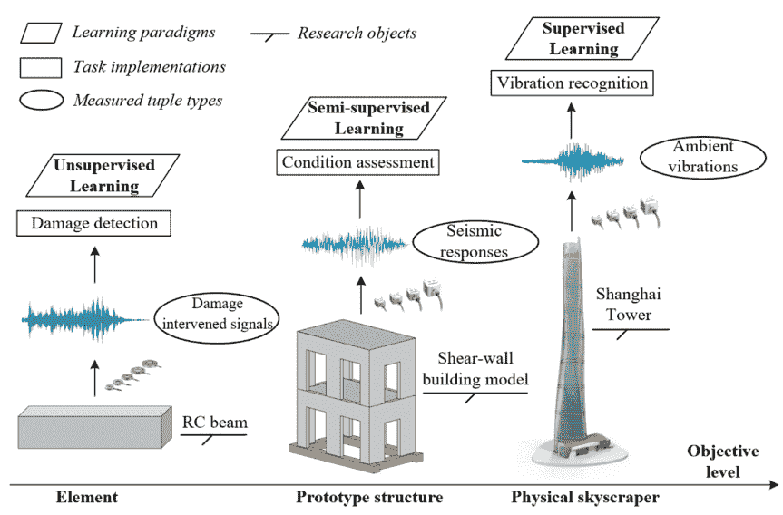

- 学习范式
- 任务实现
- 测量的元组类型

| 元素 | 原型结构 | 物理天大楼 |
| :--- | :--- | :--- |

图 1. 用于不同学习范式验证的多级任务实现。

在实现识别结构模式的满意的 DL 模型泛化能力方面，遵循两个主要方面：标签定义和特征提取。具体而言，标签指的是用于后期训练的预标记数据集，当输入到模型时，必须有相应的特定的输出。在这种情况下，数据可以标记为：SL、SSI（即请求已标记数据）和 UL（即请求已标记数据）（Bengio et al., 2013）。至于后一方面，特征提取是指数据处理阶段，使用加速度传感器、压电传感器提取特征，并进一步分配给模型。特定类型的特征提取策略包括时频变换（如 FFT Zhang et al., 2022）、小波变换 Yuan et al., 2021、HHT Wang et al., 2020）等，降维技术（如主成分分析 Johnson and CDK, 2016，独立成分分析 Chandrasekhar et al., 2021，独立成分分析 Mali et al., 2022），（如模糊变换，Papatner, Synner, 2019）。其动机是使用这些额外特征来提高 DL 结果的质量，与直接提供（会削弱迁移性和通用性价值）相比。注意以类型形式测量数据是重要的，即元素的有限列表（list）（Mathew et al., 2020）。我们使用了加速度传感器、应变计和压电传感器，基于元组识别的方法在 DL 驱动的 SH 监测中发挥了主导作用，这些方法是将许多数字转换为一个。单独地，在不同环境中收集的振动数据可以根据所需的数据源执行各种任务。然而，


# GTRF: 一种通用组识别框架
（集成在深度学习融合中）

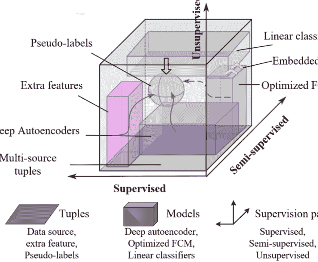

图 2. 所提 GTRF 方法的原理图设计。

从原型结构到物理摩天大楼。需要明确的是，被忽略的无效性学习模式与标签可用性的通用做法是一致的。在不失一般性的情况下，可以使用所提出的 GTRF 框架随时对学习范式进行相应的调整。

(DAE)(Zhang 等人，2022) 是一种独特的表示检测器，通过堆叠反向传播训练以复制其输入。DAE 包含与隐藏层重复的两个主要块（即函数的并行之函数）：编码器和解码器，如图 4 所示。编码族 $E(x)$ 将输入解码为解码信息（此处原文应为编码/encode），这些信息是潜变量 $h$。在这里，解码器 $D(h)$ 将潜表示解码为与输入维度完全相同的输出（Bank 等人，2020）。通常，编码器和解码器被识别为多层感知器，其公式化如下：

# 2. 所提 GTRF 的方法

### 2.1. GTRF 概述

考虑到所提出的输入的本质特征，本研究提出了一种面向多层级监督范式的通用组识别框架（GTRF）。图 2 展示了所提 GTRF 方法的原理图设计。在通用框架中，提出了一种新的特征提取方法，通过深层自动编码器来表示表示学习。在此基础上，通过所有内容的误差重构来描述特征，并定义并计算了一系列模式-特征（PSFs）。具体而言，针对不同的识别范式设计了三种替代方案：监督、无监督和半监督。UL 范式中通过优化的模糊-FCM 算法遵循无监督聚类模式，SSL 范式中通过优化的 FCM 算法遵循半监督模式。图 3 展示了所提框架 GTRF 的工作流，其详细架构和机制将在后文中阐述。

```
$E(x) = \sigma(W_e x + b_e)$
```

```
$D(h) = \sigma(W_d h + b_d)$
```

其中 $\sigma$ 表示编码器和解码器的激活函数，如 ReLU、softmax 和 sigmoid 函数。$W$ 指权重，$b$ 分别指编码器和解码器输入层与输出层之间的偏置。

### 2.2. 表示学习与特征提取

DAE 通过权重矩阵和偏置的反向传播优化学习从输入 $x$ 到输出的重构，同时最小化重构误差，该误差通过 $y$ 与 $x$ 之间的差异来衡量。在大多数情况下，重构指标是 $L = ||y - \hat{y}||^2$。因此，寻找最优自动编码器基本上转化为一个最小二乘问题：

```
$min_{\theta} \sum_{i=1}^{n} ||y_i - \hat{y}_i||^2$
```

这可以通过任何数学优化技术（如常用的梯度下降）来实现。

系统可以使用称为表示学习（即特征学习）的机器学习算法自动满足从原始数据进行特征检测或分类的要求，这消除了对人工特征工程的需要，并使机器能够学习特征本身并获取特定任务的表示。因此，深度自动编码器

以推导的方法和 DAE 为主，很容易理解，对于具有不同类别的给定级别组（即不同层次），重构质量将改变到多层级的程度。在这里，通过量化指定组原始信号与重构信号之间的差异，并将其编译到训练的 DAE 中，提取模式敏感特征（PSFs）是可行的。


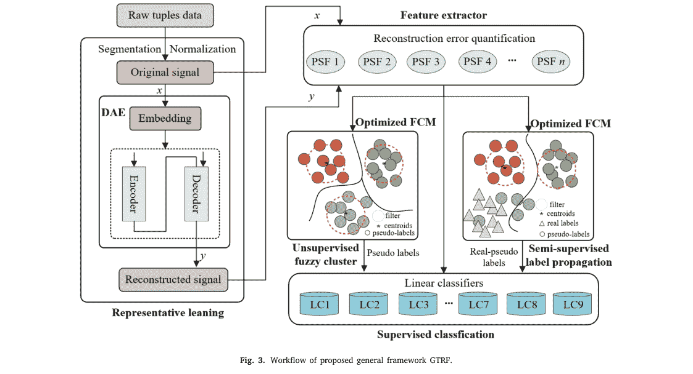

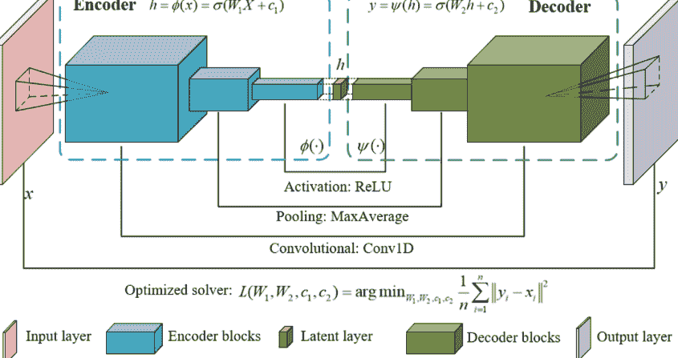

为了评估原始信号与重构之间的差异，该框架定义了重构量化指标，这些指标针对设计实现中的自适应选项进行了定义。四个基本的 PSF 定义为均方误差（MSE）、原始-重构信号比（OSSR）（Kumar 等人，2023）、相关系数（CORR）（Papagorgiou，2022）和余弦相似度（Vin 和，2022）。因此，MSE 是比较两个序列最简单的，其值可以用于衡量整体重构了多大程度上。OSSR 定义为原始信号和重构信号的平方之比，源于信噪比的能量。CORR 定义为特征协方差矩阵与标准差之比，它估计了两个组之间的线性相关性（Jurkò 等人，2022）。对于 COST，它定义为两个向量之间夹角的余弦，这些向量被视为内积空间中的向量（Sinha，2009）。涉及的数学函数表示如下：

$MSE = \frac{1}{n}\sum_{i=1}^{n}(x_i-y_i)^2$ (4)


```
$ORSR = \log_{10} \frac{\sum_{i=1}^{n} x_i^2}{\sum_{i=1}^{n} y_i^2}$ (5)
```

```
$CORR = \frac{\sum_{i=1}^{n} (x_i - \mu_x)(y_i - \mu_y)}{\sqrt{\sum_{i=1}^{n} (x_i - \mu_x)^2 \sum_{i=1}^{n} (y_i - \mu_y)^2}}$ (6)
```

```
$COST = \frac{\|X-Y\|}{\|X\|+\|Y\|} = \frac{\sqrt{\sum_{i=1}^{n} (x_i - y_i)^2}}{\sqrt{\sum_{i=1}^{n} x_i^2}+\sqrt{\sum_{i=1}^{n} y_i^2}}$ (7)
```

其中 $\eta$ 表示信号密度，$\mu_x, \mu_y$ 表示原始和重构坐标的值，支持向量。

同样注意到，除了上述基本 PSF 之外，在实际情况下可以极具灵活性地推导出其他指标，例如均方根误差（RMSE）和平方和（SSS），它们的定义如下：

```
$RMSE = \sqrt{\frac{1}{n}\sum_{i=1}^{n} (x_i - y_i)^2}$ (8)
```

```
$SSS = \sum_{i=1}^{n} (x_i - y_i)^2$ (9)
```

由此，获得了一系列代价贵的 PSF，这些 PSF 对于多级监督的下游聚类是有用的。在不失一般性的情况下，本文中的 PSF 函数对于下游聚类是可选的，但其他衍生可以根据无监督组特征重构它们的 PSF。

（注：此处后续内容存在大量重复，已按要求翻译并保留）

### 2.3. 通过线性分类器的监督聚类

在实践中，基于监督的方法在深度学习驱动框架方面长期表现出瓶颈。这似乎是监督聚类阻止了复杂数据出现时的突破。对于分类问题，开发并使用了广泛的分类器：朴素贝叶斯（NB）、支持向量机（SVM）、逻辑回归（LR）、Hessian 机器（HSM）、决策树（DT）、随机森林（RF）和 AdaBoost。系统可以使用称为表示学习（即特征学习）的机器学习算法自动满足从原始数据进行特征检测或分类的要求，这消除了对人工特征工程的需要，并使机器能够学习特征本身并获取特定任务的表示。因此，深度自动编码器以推导的方法和 DAE 为主，很容易理解，对于具有不同类别的给定级别组（即不同层次），重构质量将改变到多层级的程度。在这里，通过量化指定组原始信号与重构信号之间的差异，并将其编译到训练的 DAE 中，提取模式敏感特征（PSFs）是可行的。为了评估原始信号与重构之间的差异，该框架定义了重构量化指标，这些指标针对设计实现中的自适应选项进行了定义。四个基本的 PSF 定义为均方误差（MSE）、原始-重构信号比（OSSR）（Kumar 等人，2023）、相关系数（CORR）（Papagorgiou，2022）和余弦相似度（Vin 和，2022）。因此，MSE 是比较两个序列最简单的，其值可以用于衡量整体重构了多大程度上。OSSR 定义为原始信号和重构信号的平方之比，源于信噪比的能量。CORR 定义为特征协方差矩阵与标准差之比，它估计了两个组之间的线性相关性（Jurkò 等人，2022）。对于 COST，它定义为两个向量之间夹角的余弦，这些向量被视为内积空间中的向量（Sinha，2009）。涉及的数学函数表示如下：

$MSE = \frac{1}{n}\sum_{i=1}^{n}(x_i-y_i)^2$ (4)

$ORSR = \log_{10} \frac{\sum_{i=1}^{n} x_i^2}{\sum_{i=1}^{n} y_i^2}$ (5)

$CORR = \frac{\sum_{i=1}^{n} (x_i - \mu_x)(y_i - \mu_y)}{\sqrt{\sum_{i=1}^{n} (x_i - \mu_x)^2 \sum_{i=1}^{n} (y_i - \mu_y)^2}}$ (6)

$COST = \frac{\|X-Y\|}{\|X\|+\|Y\|} = \frac{\sqrt{\sum_{i=1}^{n} (x_i - y_i)^2}}{\sqrt{\sum_{i=1}^{n} x_i^2}+\sqrt{\sum_{i=1}^{n} y_i^2}}}$ (7)

其中 $\eta$ 表示信号密度，$\mu_x, \mu_y$ 表示原始和重构坐标的值，支持向量。同样注意到，除了上述基本 PSF 之外，在实际情况下可以极具灵活性地推导出其他指标，例如均方根误差（RMSE）和平方和（SSS），它们的定义如下：

$RMSE = \sqrt{\frac{1}{n}\sum_{i=1}^{n} (x_i - y_i)^2}$ (8)

$SSS = \sum_{i=1}^{n} (x_i - y_i)^2$ (9)

由此，获得了一系列代价贵的 PSF，这些 PSF 对于多级监督的下游聚类是有用的。在不失一般性的情况下，本文中的 PSF 函数对于下游聚类是可选的，但其他衍生可以根据无监督组特征重构它们的 PSF。


定义：对于包含 N 个未标记点且预期聚类数为 $c$ 的数据集，FCM 算法公式如下：

步骤1：初始化初始聚类并计算每个簇 $\Gamma_i, i=1, 2,...,c$ 的质心 $m_0$

```
$m_i = \frac{1}{N} \sum_{y \in \Gamma_i} y$
```

步骤2：计算聚类函数 $J_c$ 作为聚类准则，其定义为样本点与类质心之间的欧式距离之和

```
$J_c = \sum_{y \in \Gamma_i} |y - m_i|^2$
```

步骤3：根据最小距离原则将每个样本分配给代表点并不断重新计算质心。调整每个样本类以最小化聚类函数 $J_c$

```
$\Gamma_i = \{y | |y - m_i| \leq |y - m_j|, j=1, 2,...,c\}$
```

步骤4：重复步骤3，直到迭代达到收敛。

步骤5：计算并对每个簇的点与质心之间的欧式距离进行排序，在此基础上保留对应质心的前75% 的点，获得带有伪标签的样本

```
$\Gamma_{i}^{c} = \{y_i^* \in \Gamma_i, i=1, 2,...,c\}$
```

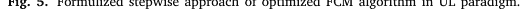

- 给定 N 个未标记数据集
- 给定 M 个标记点和 N-M 个未标记
- 簇 A*
- 簇 B*
- 簇 A*
- 簇 B*
- 带有置信区间的点
- 75% 过滤区间
- 75% 过滤区间
- 伪标签
- 簇 C*
- 簇 C
- 真实标签
- 伪标签
- 聚类检测器：FCM 分类
- 聚类检测器：FCM 分为 (c-1) 类
- 训练集：伪标签 [A*,B*,C*]
- 训练集：真实-伪标签 [A*,B*,C]
- 预测：训练过的监督器
- 预测器：训练过的监督器
- (a) 针对 UL 范式的优化 FCM 算法
- (b) 针对 SSL 范式的优化 FCM 算法

# 3. 实验验证

为了验证所提 GTTRF 的有效性，在结构健康监测（SHM）中通过固定骨架方法针对 SL 范式的实验室 RC 梁（塔）的检测，以及全尺寸剪力墙结构的监测（塔 SSL 范式），实施了多级实验方案，如图所示。

在一般情况下，实验分析涉及来自加速度测量和压电信号的多种数据形式，以研究数据形式的多样性。值得注意的是，所有涉及的实验技术信号均为原始“原始”信号，不需要进行去噪预处理。

值得注意的是，作为一个通用框架，GTTRF 中的架构（即 DAE 的层堆叠）、设计（即多个 PSF）和分配（即各种分类算法）可以进行设置和调整，以更好地适用于目标任务的实现。随后将详细阐述每种范式验证的数据收集、框架规范和实验实现。

## 3.1. 监督范式：基于加速度计测量的振动识别

在 SHM 的实际工程中，高层结构在不同环境下的振动识别对于结构振动控制和健康监测具有重要意义

对于包含 N 个未标记点和 M 个标记点且预期聚类数为 c 的数据集，优化 FCM 算法公式如下：

对于 N-M 未标记点的数据：

步骤1：初始化初始聚类模式并计算每个簇 $\Gamma_j, j=1..2..c-1$ 的质心 $m_j$

```
$m_j = \frac{1}{N} \sum_{y \in \Gamma_j} y$
```

步骤2：计算聚类函数 $J_k$ 作为聚类准则，其定义为样本点与类质心之间的欧式距离

```
$J_k = \sum_{j=1}^{c} \sum_{y \in \Gamma_j} \|y - m_j\|^2$
```

```
$\Gamma_i = \{y | \|y - m_i\|^2 \le \|y - m_j\|^2\}, \forall j=1,2..c$
```

步骤4：更新步骤直到迭代达到收敛，获得最终的 (c-1) 个簇和质心。

步骤5：计算并对每个簇的点与质心之间的欧式距离进行排序，在此基础上保留对应质心的前75% 的点，获得带有伪标签的样本

```
$\Gamma_{i^*} = \{y_i^*\}, \forall i=1,2..c-1$
```

结束

对于 M 标记点和 N-M 未标记点 $\Gamma_{i}^*$ 的数据：

步骤6：将 $y_i$ 和 $\Gamma_{i}^*$ 合并，获得多标记数据集。

步骤7：使用真实或伪标签拟合混合数据集以训练监督分类器。
训练好的模型在此后预测其他点的标签。

> 结束
### 训练好的分类器即为标记问题的求解器。

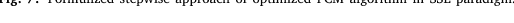

(Cheng 等人，2021; Li 等人，2020)，他们共享一种全面策略来增强智慧城市的结构识别。因此，在本研究中，

## 3.1. 数据采集与处理

在 SHM 的实际工程中，高层结构在不同环境下的振动识别对于结构振动控制和健康监测具有重要意义

## 3.1.2. 框架设计与实验实现

在 SHM 的实际工程中，高层结构在不同环境下的振动识别对于结构振动控制和健康监测具有重要意义

## 3.1.3. 预测结果与性能评估

在 SHM 的实际工程中，高层结构在不同环境下的振动识别对于结构振动控制和健康监测具有重要意义

## 3.2. 无监督范式：基于压电信号的损伤检测

由于 RC 梁是建筑结构中的主要链路和受力系数组成，损伤检测


Q. Xiong, C. Yuan, B. 等人。


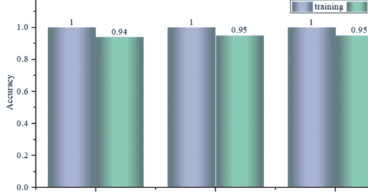

图 1. 训练与测试的预测准确率。

表 1
计算成本与预测准确率的比较。

| MFCC+CNN | 计算时间 | 准确率 |
|---|---|---||
| 提出的 GTRF | 1036.0 (s) | 49.6 (s) | 0.95 |

因此，第一阶段定义为完整阶段（IS），指的是可接受的轴承载状态。呈现真实破坏的塑性软化时期被定义为损伤状态（DS），指的是意外之外的轴承载状态。在此基础上，共收集了 445 个压电传感器。采样频率为 2MHz，每个长度为 32700 到 327。该任务构建侧重于对这些信号进行模糊聚类，以以无监督的方式识别损伤状态。

钢筋混凝土（RC）梁的健康监测一直是一个重要领域。其中，球形智能集料（SSA）（Kong 等，2016；Gao 等，2018；Gayakwad 和 Thiyagarajan，2022）作为一种嵌入式多功能压电传输器，因其响应迅速且与混凝土良好的兼容性而受到关注。然而，在本研究中，在 GTRF 的无监督范式下基于压电信号的 RC 梁模糊损伤检测。

## 3.2. 数据采集与准备

首先，将原始信号从长度 32700 下采样到 327 并进行归一化。DAE 的架构被重构为三个维度分别为 256、128 和 64 的编码块，以及接近 124 和 256 的解码块，其他定义（如激活函数）遵循标准范式。DAE 经过训练以进行重构。在本研究中，交替使用 MSE、ORSRS 和 ORR 识别 PFSs。所有不同方法的 PSF（例如聚类结果）的集成如图 12 所示。

在本研究中，对欠配筋混凝土梁进行了实验特征，并在操作前用钢筋进行加固以防止移动。固化后，对 RC 梁进行了基于点的测试。如图 1(a) 所示，使用测杆和液压电极在支撑处测量了信号。使用静电伺服执行器施加测试负载。

从聚类结果来看，聚类与真实标记样本保持一致，但某些样本仍被分配到错误的聚类。为了阐明这些低确定性聚类方法的影响，本研究提出了成员身份方法。图 13 描述了 FCM 结果的分布，其中所有 PSF 表现出不同的特征。250 个 PSF 的分布表现出明显的特征。

图 1(c) 显示了裂缝发展和配筋应力期间跨中的力-位移曲线，而加载过程可分为两个阶段，记录了塑性软化的发生。在第一阶段，裂缝由于混凝土的拉伸而产生。当损伤持续增加到一定程度时，塑性软化在第二阶段变得严重，直到混凝土破坏表现为极发达的承载能力。

## 3.3. 预测结果与评估

考虑到 RC 梁设计工作时的工程实践，在此，它是钢筋开始工作直到塑性软化发生之前的预期范围。

使用带标签的拟合点用于线性分类器的训练。训练数据集均为伪标记，带有真实标签的样本仅包含在测试中以评估模型的性能。在本研究中，整个识别过程在无监督范式下是非常严谨的。

Q. Xiong, C. Yuan, B. He 等人。


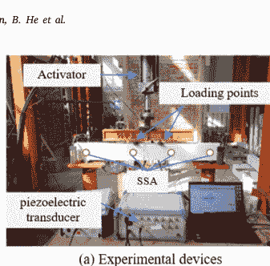

(a) 实验设备

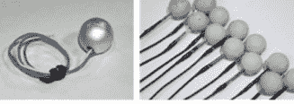

(b) 球形智能集料 (SSA)

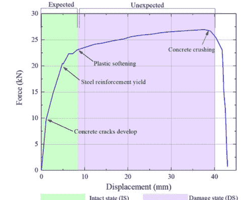

(c) 完整状态与损伤状态的定义

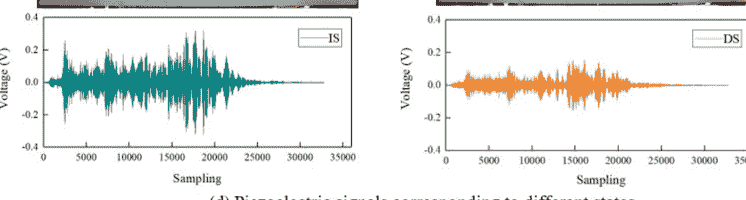

(d) 与不同状态对应的压电信号

**图 11.** 无监督范式的数据采集与准备。

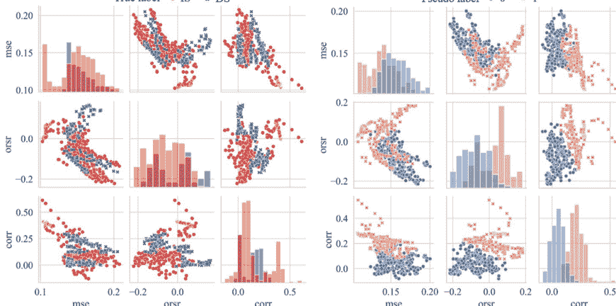

(a) 带真实标签 PSF 的成对图

(b) 带伪标签 PSF 的成对图。

**图 12.** 带真实标签 PSF 的成对图

三个分类器训练与测试的成对图。结果显示，三个分类器均实现了 100% 的训练准确率和 84% 的满意的准确率。而且，即使分类器做出了一些错误预测，可能由于混淆矩阵显示所有错误情况都被错误地预测为 IS 和 DS，而所有的 DS 样本都已成功识别。这表明分配给信号重构的 DS 样本，其重构误差相对于学习到的“整体”表示应表现出较大的差异。通过解构性能的差异，最终识别结果可以确定 DS 样本。

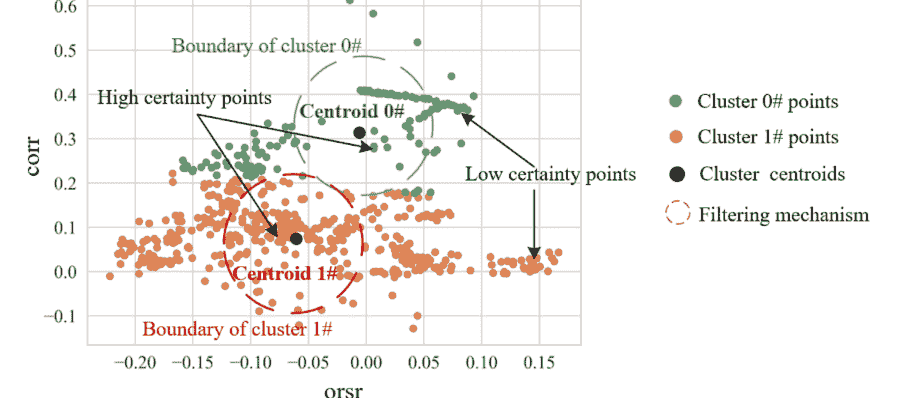

图 13. FCM 结果的分布

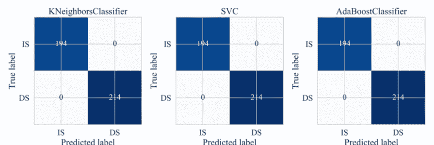

(a) 训练的混淆矩阵

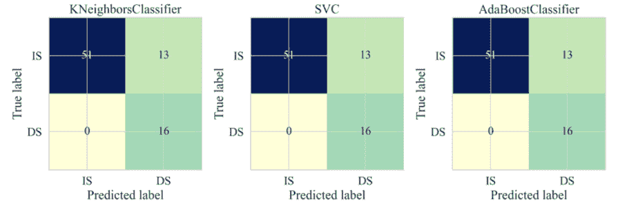

(b) 测试的混淆矩阵

对于三个分类器的训练与测试。结果显示，三个分类器均实现了 100% 的训练准确率和 84% 的满意的准确率。而且，即使分类器做出了一些错误预测，可能由于混淆矩阵显示所有错误情况都被错误地预测为 IS 和 DS，而所有的 DS 样本都已成功识别。这表明分配给信号重构的 DS 样本，其重构误差相对于学习到的“整体”表示应表现出较大的差异。通过解构性能的差异，最终识别结果可以确定 DS 样本。

对于 RC 梁的损伤。误报率为零，这对工程实践有益。

值得注意的是，在没有任何标签的无监督范式下，本研究中的整个识别过程是非常严谨的。

这种在无监督范式下对 RC 梁的检测。

在无监督范式下，这种方法通过 GTRF 成功实现了对 RC 梁的损伤检测。

## 3.3. 预测结果与评估

考虑到 RC 梁设计工作时的工程实践，在此，它是钢筋开始工作直到塑性软化发生之前的预期范围。

使用带标签的拟合点用于线性分类器的训练。训练数据集均为伪标记，带有真实标签的样本仅包含在测试中以评估模型的性能。

对于有限标签的传播，其本质是增强。

Q. Xiong, C. Yuan, B. He 等人。


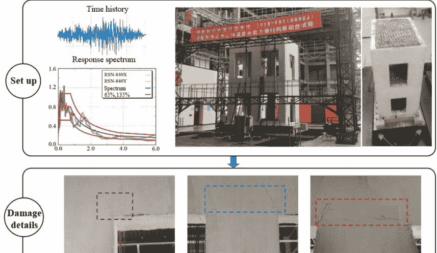

图 15. 半监督范式的数据采集与准备。

到未知的。因此，在典型的监测情况下，通过振动响应驱动了对比 GTRF 的最终分支。

### 3.3.1. 数据采集与准备

一个全尺寸双层剪墙结构被设计并建造用于震台试验，如图 15 所示。实验最终遵循了震台试验的标准。为了模拟频率对结构的影响，逐步增加了加强标准。在经历增加强度的地震后，会产生结构损伤并导致健康状态（Zhang 等，2021）。

### 3.3.

采集的加速度信号被分割为采样频率为 256Hz、持续时间为 1.0s 的段，并通过 FFT 转换为归一化幅。共使用了 300 个 IS 段来训练 DAE，其输入形状根据重构误差相应调整，并将 100 个段输入 DAE 进行训练。

在 IS 数据可行的前提下，测试集的其余 200 个样本使用最优 FCM 算法分配了伪标签。在选择了嵌入过滤方法后，提供了 150 个伪标记样本。

### 3.3.3. 预测结果与评估性能

相应，所有 95 个混合伪标签样本均用于训练分类器，而数据收集自随机 57 个真实标签样本。本研究调查了框架中的所有九个分类器。由于训练数据的质量影响每个分类器的准确率。可以看出，随机森林（RF）是最佳分类器，实现了 100% 的训练准确率和 0.85 的测试准确率。然而，误报率为


Q. Xiong, C. Yuan, B. He et al.


## IS 案例

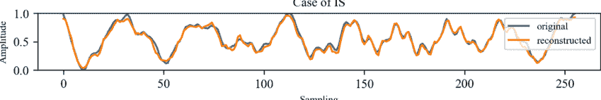

## DS1 案例

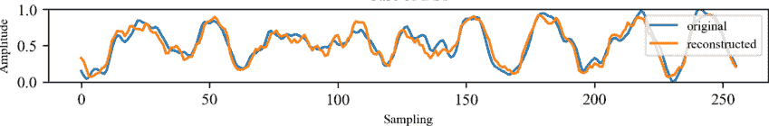

## DS2 案例

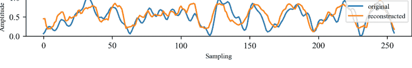

图16. 不同损伤场景下的信号重构结果对比。

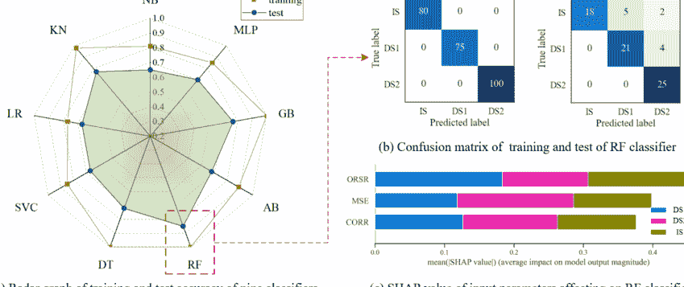

(a) 九个分类器的训练与准确率雷达图

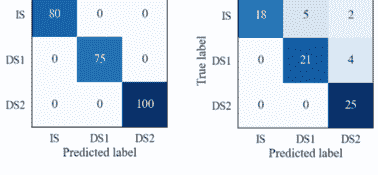

(b) RF 分类器的训练与测试混淆矩阵

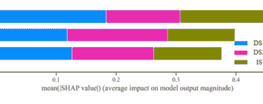

(c) 输入参数的 SHAP 值和模型特征解释。

图17. 预测分析与模型特征解释。

健康与严重状态（即 IS 和 DSs，DS1 和 DS2）为零，这意味着将损伤误判为健康的意外情况为零。

为了通过 SHAP 值（Lundberg and Lee, 2017）理解最终分类器中每个选中 PFS的重要性，我们详细介绍了 RF 分类器的性能。图17(c) 展示了按降序排列的每个案例 SHAP 特征重要性值。结果显示了模型的预测输出，其中 CORR 贡献了最大的影响。

| 案例 | 传感器 | 准确率 | 案例 | 准确率 |
|---|---|---|---|---|
| 1 | A2-1Y | 0.85 | A2-1X | 0.89 |
| 2 | A2-2Y | 0.79 | A2-2X | 0.95 |
| 3 | A2-3Y | 0.84 | A2-3X | 0.89 |
| 4 | A2-4Y | 0.87 | A2-4X | 0.80 |
| 5 | A2-5Y | 0.84 | A2-5X | 0.85 |
| 平均准确率 | | 0.86 | | |

表 2
测试传感器的预测准确率摘要。

值得注意的是，该实现纯粹由单个加速度计的测量驱动。为了进一步验证所提传播网络的稳健性，在实验中对所有部署的十个传感器都构建了模型。最终预测准确率如表2 所示，达到了 0.86 的平均准确率。

在这里，GTF 中提出的半监督范式通过状态评估的实现验证了所的标签传播方法的有效性和稳健性。对于部分标记数据集的最大值，所提出的半监督范式也表现出显著的应用意义。

## 讨论

上述三个实验评估了 GTRF 框架在 SH、UL 和 SL 代表性任务中的有效性。特别是，建立了集成到框架中的机制的详细工作流。考虑到 SH 中的测量数据是以元组（时间， 元素顺序）的形式存在，例如识别特征和压电信号，这允许在当前设置下进行验证。我们提出的 GTRF 适用于针对 UL 和 SL 的识别任务。在此，实践中的三个实验提供了全面的评估，确认了所提 GTRF 的竞争性性能。

在本节中，我们讨论了基于空间分布（即点对点）对提取特征（空间特征）进行聚类的机制。值得注意的是，此处使用的聚类算法在该研究中也得到了利用。此外，值得注意的是，如果聚类良好，数据内容在未来可能会获得更好的质量。

## 结论

上述三个实验评估了 GTRF 框架在 SH、UL 和 SL 代表性任务中的有效性。特别是，建立了集成到框架中的机制的详细工作流。考虑到 SH 中的测量数据是以元组（时间， 元素顺序）的形式存在，例如识别特征和压电信号，这允许在当前设置下进行验证。我们提出的 GTRF 适用于针对 UL 和 SL 的识别任务。在此，实践中的三个实验提供了全面的评估，确认了所提 GTRF 的竞争性性能。

在本节中，我们讨论了基于空间分布（即点对点）对提取特征（空间特征）进行聚类的机制。值得注意的是，此处使用的聚类算法在该研究中也得到了利用。此外，值得注意的是，如果聚类良好，数据内容在未来可能会获得更好的质量。

（注：提供的文本后半部分存在重复和片段，已对逻辑进行了清理。）

- A., Alqadeh, O., Ejazadeh, S., Hosein, M., Gashami, M., Mann, J., (2021). 基于视觉的损伤检测：从传统方法到深度学习。Mech. Science, 203059.
- Bank, D., Kostioglou, N., Riyaz, R., (2020). 自动编码器。arXiv preprint:2006.0708.
- Bengio, Y., Benglin, M., Deciers, R., (2019). 机器学习表示：综述。IEEE Trans. Data Anal. Mach. Intell. 31, 1795–1786.
- Bengio, Y., Bengio, A., Vincent, P., Courville, G. (2009). 深度表示学习。美国科学院院报。
- Bhattacharya, T., Agarwal, S. (2001). 梯度提升机引论。卷 135。Springer Science and Business Media, 匈牙利佩奇理工大学，匈牙利学院，1992–1997.
- Brawng, J.-F., Shaw, S. A., Tanaka, Y., Wen, X., Akalten, A.T. (2021). 基于机器学习的设施监测：挑战与成功。Success J. Tech.
- Chandrasekar, J.R., Murugan, S., Prashula, V.R., (2021). 机器学习算法分类的探索性数据分析：在：数据科学与机器学习讲义录，Springer.


Zhang, H., Han, M., Ren, Y., Yuan, T., Bui-Li, and Ng, H., 2021. 基于时间序列数据的结构性损伤检测。Structure and Infrastructure Engineering 177, 1474-1489.

Guo, F., Shu, S., Bao, L., Liu, J., Zhang, Y., 2021. 基于深度学习特征提取的结构性损伤识别。Int. Struct. Eng J 38, 215067.

Kuzina, A., Listida, V., Gashkina, Y., Dvorshikov, M., 2021. 结构监测中基于机器学习的数值分布预测方法。计算机科学讲义（Lecture Notes in Computer Science），第34-47. Springer, Cham, Switzerland.

Galawasi, A., Pippo, M., Torroni, P., 2021. 自然语言处理中的注意力机制：综述。IEEE Access 9, 123450-123465.

Gao, W., Hua, H., Li, S., Gong, G., 2018. 嵌入PZT换能器的损伤检测智能皮肤。Smart Mater. 27, 0250052.

Chen, J., Liu, Y., Wang, Y., and Shen, S., 2021. 用于智慧城市的机器学习。在智能网络与网络（Smart Networks and Networks），页106512-10652.

He, A.S., J., 2016. 结构工程中深度学习的综述。Nature Communications, 7, 11919-11921.

基于重构成分独立分析的机器学习肺癌检测。Waveform and Complex Media 22, 101-118.

Jiltkowski, A., Callinan, J., 2016. 使用生存分析预测癌症风险。Rec. Soc. 34, 374-380.

Zhao, X., Sun, Y., and Wang, J., 2021. 深度学习及其进展综述。Front. J. Sci. 7, 641333.

Lu, X., Zhang, Y., Wang, W., and Chen, Y., 2020. 基于神经网络振识别的改进强化学习控制方法。J. Control Syst. 109, 835-853.

Kong, Q., Robert, R., Silva, P., and Wu, M., 2016. 振动在半动态加载下钢筋混凝土结构的循环监测。Structural Health Monitoring 17, 891-900.

Kong, Q., Xiong, X., He, H., and Chen, Y., 2023. 带标签传播的半监督网络学习用于结构性损伤识别。Structural Health Monitoring 214, 117927.

Ma, M. G., Zhang, C., 2022. 使用压电传感器的大理石陶瓷复合材料3D打印瓷砖深度损伤识别与剩余强度分析。建筑与交通工程杂志，建筑大学， 32(1), 15-20.

Matthews, P. F., 2007. a-tuple. Oxford University Press, Oxford.

Nehari, S., Ali, A., Alizadeh, M., and Mahojarras, K., 2022. 邻域搜索算法与基于遗传的协同过滤。Concur. Comput.: Pract. Exp. 37, e511.

Nemiandi, P., Krishna, G. S., Rai, N. S., Bao, D. S., Kumar, S., 2022. 基于语音识别的深度学习整体语音检测。IEEE Trans. Art. Intell. 11, 1-10.

Oscar, I. L., Durevic, O., Inc., T., Erkan, L., M., 2021. 基于多分类DNN分类器的健康评估故障检测。IEEE Class Electron. 14, 435-447.

Papageorgiou, N. G., 2022. 关于相关系数与解释，第49卷。瑞士正畸与颌面部正形外科协会，苏黎世医学，3599-3561.

Patera, G., 2002. 智能系统的数据驱动融合方法。IEEE Trans. Syst. Anal. 30, 3774-3784.

Rumelhart, D. E., Ehrlich, G. W., 1986. 反向传播学习规则。Nature 323(6088), 523-536.

Sohrabanian, S. M., 2012. 深度学习用于语音识别中MFCC块变换分析与评估。Speech Communication and Processing, 26, 555-568.

Shafighian, A., Mohammadi, K., Alam, M. M., 2022. 肿瘤诊断机器学习工具综述。Journal of Medical Systems, 46, e13500.

Singh, A., 2009. 现代信息检索：综述。卷 Gal. 24, 201-246.

Sun, J., Lee, A., 2022. 用于数据分析的线性变换。J. Adv. Model. Art. Syst. 17, e20211502.

Sody, K., Kashyap, A., Saati, M., 2021. 基于网络的加筋结构损伤综述。Structural Engineering 26, 100611.

Liu, J.-Y., Sun, X., Chen, X., Zhang, Q., Liu, Y., and Xu, J., 2013. 上海中心大厦长期结构健康监测。J. Structural Health Monitoring 30, 491-506.

Thurthakul, G. K., Vinh, N. Y., 2020. 嵌入式系统的高效计算机视觉。Sensors, 20, 4113.

Tob, G., Park, J., 2020. 基于深度学习的振动结构健康监测综述。App. Sens. 10, 10052.

Wang, W., Sun, S., 2022. 基于余弦相似性的完全多视图聚类。中国科学大学，东华师范大学，上海中山北路3663号，200062；中国信息工程学院，浙江杭州15599。

Zhang, C., Chen, J., Liu, J., and Zhang, Q., 2021. 地震多发地区的机器学习损伤识别：黎巴嫩。Earthquake Research J. 26, 6208-6235.

Zhang, Y., Feng, J., Johnson, K. J., Sattar, S., 2021. 地震多发国家风险缓解策略综述：黎巴嫩、韩国及美国。

Zhang, G., Yan, H., Liu, Y., Fu, H., Hu, Y., 2022. 空空间通信自编码器中的自编码器。IEEE Trans. Commun. 70, 1168–1182.

Zhang, Z., Liu, H., Jin, J., Shi, X., 2022b. 用于空间通信的基于聚类的FFT-多普勒频移分析。IEEE Trans. Commun.
