# 计算机取证与调查指南 - 独立本

https://archive.org/details/guidetocomputerf0000nels_u5c2

Bill Nelson, Amelia Phillips, Christopher Stuart

高级副总裁，技能部门总经理：Jonathan Lau

产品总监：Lauren Murphy

产品团队经理：Kristin McNary

产品经理：Amy Savino

产品助理：Take Toth

内容设计执行总监：Marah Bellegarde

学习设计总监：Leigh Hefferson

学习设计师：Natalie Onderdonk

开发编辑：Lisa M. Lord

高级市场总监：Michele Tighe

助理市场经理：Cassie Coutlier

内容交付总监：Patty Stephan

高级内容经理：Brooke Greenhouse

数字交付主管：Jim Vaughney

高级设计师：Diana H. Graham

制作服务/排版：SPI Global

封面图片：i://Stock.com/Vertigo30

如需产品信息和技术协助，请通过以下方式联系我们：

engage 客户与销售支持，1-800-354-9706

或 support.cengage.com。

如需许可使用本文材料或摘，请在 www.cengage.com/permissions 在线提交所有请求。

Cengage 是领先的定制学习解决方案提供商，员工遍布近 40 个国家，业务遍全球 125 个国家。访问 www.cengage.com 寻找您的当地代表。

Cengage 产品在加拿大由 Nelson Education, Ltd. 代表。要了解更多有关 Cengage 平台和服务的信息、注册或访问您的在线学习解决方案，或购买课程材料，请访问 www.cengage.com。

* Tim Weifel

当前的数字取证工具 ....................................... 267

前言 ................................................................. vii

引言 ................................................................ xix

## 第 1 章：理解数字取证职业与调查

- 数字取证概述 .......................................... 1
- 数字取证与其他学科 ....................................... 4
- 数字取证简史 ...................................................... 7
- 理解法律 ....................................................... 9
- 开发数字取证资源 ................................................ 9
- 为法律调查做准备 .......................................... 11
- 理解执法机构调查 ................................................... 11
- 遵循法律程序 ...................................................... 13
- 理解私部门调查 ............................................... 15
- 维护职业操守 ....................................... 21

## 第 2 章：准备数字取证调查

- 计算机犯罪概述 ...................................................... 22
- 违规概述 ...................................................... 24
- 采取系统方法 ....................................... 25
- 私部门高科技调查程序 ...................................... 32
- 解雇案例 ........................................................ 32
- 互联网滥用调查 ....................................................... 32
- 电子邮件滥用调查 ......................................................................... 33
- 律师客户隐私调查 ........................................................ 34
- 工业间谍调查 ............................................................ 36

## 第 3 章：理解数据恢复工作站与软件

- 为数字取证设置工作站 ................................... 40
- 进行调查 ................................................... 41
- 收集证据 ....................................................... 41
- 理解位流复制 ........................................................ 41
- 分析你的数字证据 ......................................................... 43
- 完成案件 ......................................................................... 50
- 批判案例 ......................................................................... 52
- 章节总结 ........................................................ 52
- 关键术语 ....................................................... 53
- 复习题 ........................................................ 54
- 动手实践项目 ....................................................... 55
- 案例项目 ............................................ 61

## 第 4 章：调查员的办公室与实验室

- 理解法医实验室认证要求 ................................................ 64
- 识别实验室经理和员工的职责 ...................................................................... 64
- 实验室预算规划 ........................................................................................................... 65
- 获取认证与培训 ............................................................................... 69
- 确定数字取证实验室的物理要求 ................... 71
- 识别实验室安全需求 ......................................................................................... 72
- 进行高风险调查 ...................................................................................... 72
- 使用证据容器 ........................................................................................................ 73
- 监督设施维护 ............................................................................................. 75
- 考虑物理安全需求 ................................................................................. 75
- 审计数字取证实验室 ....................................................................................... 76
- 确定数字取证实验室的平面图 ........................................................... 76
- 选择基础法医工作站 ............................................................................... 78
- 为实验室选择工作站 ......................................................................... 79
- 为私营部门实验室选择工作站 .......................................................... 80
- 备货硬件外围 ....................................................................... 80
- 维护操作系统和软件清单 ................................................. 81
- 使用灾难恢复计划 ........................................................................................... 81
- 设备升级规划 ........................................................................ 82
- 为开发法医实验室制定商业案例 ................................... 82
- 为数字取证实验室准备商业案例 ........................................................ 84
- 本章总结 ............................................................................................................... 88
- 关键术语 ........................................................................................................................... 89
- 复习题 ................................................................................................................. 89
- 动手项目 ........................................................................................... 90
- 案例项目 ................................................................................................. 91

## 第 5 章：数据获取

- 理解数字证据的存储格式 ........................................ 94
- 原始格式 ................................................................................................. 95
- 私有格式 ....................................................................................... 95
- 高级法医格式 ....................................................................... 96
- 确定最佳获取方法 .................................................................. 97
- 镜像获取的应急计划 ......................................................... 99
- 使用获取工具 ....................................................................... 101
- Mini-WinFE 启动光盘 和 USB 盘 .................................................................. 101
- 使用 Linux CD 获取数据 ........................................................... 102
- 使用 AccessData FTK Imager Lite 捕获镜像 ......................................... 116
- 验证数据获取 ................................................................ 121
- Linux 验证方法 ........................................................ 122
- Windows 验证方法 ................................................................ 124
- 执行 RAID 数据获取 ................................... 125
- 理解 RAID ................................................................... 125
- 获取 RAID 磁盘 .............................................................. 128
- 使用远程网络获取工具 ............................................ 129
- 使用 ProDiscover 进行远程获取 ................................................ 130
- 使用 EnCase Enterprise 进行远程获取 ....................................... 131
- 使用 R-Tools R-Studio 进行远程获取 ........................................ 131
- 使用 WetStone US-LATT PRO 进行远程获取 .......................... 132
- 使用 F-Response 进行远程获取 ................................... 132
- 使用其他法医获取工具 ............................................ 133
- PassMark Software ImageUSB ........................................................ 132
- ASR Data SMART ..................................................................... 132


## 目录

- Runtime Software ................................................................................ 133
- ILookIX IXImager ................................................................................ 133
- SourceForge ........................................................................ 133
- 本章总结 ................................................................................ 133
- 关键术语 ....................................................... 134
- 复习题 ............................................................................... 134
- 动手项目 ....................................................... 135
- 案例项目 .................................................................... 140

## 第四章 处理犯罪与事件现场

- 识别数字证据 ........................................................ 144
- 理解证据规则 ...................................................... 145
- 在私营部门事件现场收集证据 ................... 153
- 处理执法部门犯罪现场 ................................... 158
- 理解搜查令中的概念和术语 ............... 158
- 准备搜查 .................................................. 160
- 识别案件性质 ................................................ 160
- 识别操作系统或数字设备类型 ................... 160
- 确定你是否可以扣押计算机和数字设备 .................................. 161
- 获取位置的详细描述 ............ 161
- 确定由谁负责 ........................................ 162
- 使用额外的技术知识 ............................................ 163
- 确定你需要的工具 ................................... 163
- 准备调查小组 ............................................ 166
- 保护数字事件或犯罪现场 ...................................................... 166
- 在现场扣押数字证据 ................................................................ 167
- 准备获取数字证据 ................................................................... 168
- 处理事件或犯罪现场 ...................................................... 169
- 处理带有 RAID 系统的数据中心 ................................................ 172
- 使用技术顾问 ........................................................................ 172
- 在实验室中记录证据 ................................................................... 173
- 处理与处置数字证据 ................................................ 173
- 存储数字证据 ....................................................................... 174
- 证据保留与媒体存储需求 ............................................ 175
- 记录证据 ............................................................................ 176
- 获取数字哈希值 ....................................................................... 176
- 审查案件 ................................................................................ 179
- 民事调查示例 ................................................................... 179
- 刑事调查示例 ................................................... 181
- 审查案件背景信息 .......................................................... 182
- 规划调查 ....................................................... 182
- 开展调查：使用 OSForensics 获取证据 ... 182
- 章节总结 ............................................................................ 186
- 关键术语 ....................................................................................... 188
- 复习题 ....................................................................... 188
- 实践项目 ........................................................................ 189
- 案例项目 ................................................... 192

## 第 5 章 与 Windows 和 CLI 系统工作

- 理解文件系统 ................................................... 196
- 理解启动序列 ........................................ 196
- 理解磁盘驱动器 ................................................... 197
- 固态存储设备 ................................................ 200
- 探索微软文件结构 ...................................... 201
- 磁盘分区 ............................................................... 201
- 检查 FAT 磁盘 ........................................................ 209
- 检查 NTFS 磁盘 ...................................................... 212
- NTFS 系统文件 ......................................................... 214
- MFT 和文件属性 ................................................ 215
- 文件数据的 MFT 结构 ................................... 220
- NTFS 加密文件系统 ................................................................................ 232
- EFS 恢复密钥代理 ....................................................................................... 232
- 删除 NTFS 文件 ........................................................................................ 233
- 弹性文件系统 (ReFS) ....................................................................................... 234
- 理解全盘加密 ................................................................... 235
- 检查 Microsoft BitLocker ................................................................. 236
- 检查第三方磁盘加密工具 ...................................... 236
- 理解 Windows 注册表 ................................................... 237
- 探索 Windows 注册表的结构 ......................... 238
- 检查 Windows 注册表 ........................................................ 240
- 理解微软启动任务 ......................................... 244
- Windows 7、Windows 8 和 Windows 10 中的启动 ........................ 244
- Windows NT 及后续版本的启动 ...................................................... 245
- 理解虚拟机 ........................................................ 248
- 创建虚拟机 .......................................................................... 249
- 章节总结 ............................................................................ 257
- 关键术语 ....................................................................... 258
- 复习题 .......................................................................... 259
- 实践项目 ................................................................ 260
- 案例项目 ............................................................................ 266

## 第 6 章 当前数字取证工具

- 评估数字取证工具需求 ................................ 268
- 数字取证工具的类型 ........................................ 269
- 数字取证任务执行的任务 ........................ 270
- 工具对比 .......................................................................... 281
- 工具的其他考虑因素 ................................ 283
- 数字取证软件工具 ....................................... 283
- 命令行取证工具 ..................................... 284
- Linux 取证工具 ................................................... 285
- 其他 GUI 取证工具 ....................................... 287
- 数字取证硬件工具 ....................... 287
- 取证工作站 ................................................... 288
- 使用写保护器 ................................................................ 289
- 取证工作站的建议 ............ 290
- 验证与测试取证软件 ................... 290
- 使用美国标准与技术研究院 (NIST) 工具 .. 290
- 使用验证协议 ................................... 292
- 章节总结 ................................................................................. 293
- 关键术语 ................................................................................ 294
- 复习题 ................................................................................ 294
- 实践项目 ................................................................................ 296
- 案例项目 ...................................................................................... 303

## 第 7 章 Linux 和 Macintosh 文件系统

- 检查 Linux 文件结构 ........................................................ 306
- Ext4 中的文件结构 .......................................................................... 313
- 理解 Macintosh 文件结构 ................................................ 320
- Mac 文件结构概述 ..................................................... 320
- Mac 取证程序 ................................................................ 323
- 使用 Linux 取证工具 ........................................ 326
- 安装 Sleuth Kit 和 Autopsy ................................................ 327
- 使用 Sleuth Kit 和 Autopsy 审查案件 ............................ 329
- 章节总结 ................................................................................. 333
- 关键术语 ................................................................................ 334


# 第 8 章 恢复图形文件

## 识别图形文件

### 理解位图和光栅图像

### 理解矢量图形

### 理解元文件图形

### 理解图形文件格式

### 理解数字照片文件格式

## 理解数据压缩

### 无损与有损压缩

## 定位并恢复图形文件

### 识别图形文件碎片

### 修复受损的文件头

### 从空闲空间搜索刻取数据

### 重建文件头

### 重组文件碎片

## 识别未知文件格式

### 分析图形文件头

### 图像查看工具

### 理解图形文件中的隐图术

### 使用隐图分析工具

### 理解图形的版权问题

### 章总结

### 关键术语

### 复习题

### 动手项目

### 案例项目

# 第 9 章 数字取证分析与验证

## 确定需要收集和分析的数据

## 处理数字取证案例的方法

## 使用 Autopsy 验证数据

## 在 Autopsy 中收集哈希值

## 验证取证数据

### 使用十六进制编辑器验证

### 使用数字取证工具验证

## 处理数据隐藏技术

### 使用操作系统隐藏文件

### 隐藏分区

### 标记坏簇

### 位移

## 理解隐图分析方法

## 检查加密文件

## 恢复密码

## 章总结

## 关键术语

## 复习题

## 动手项目

## 案例项目

# 第 10 章 虚拟机取证、现场取证与网络取证

## 虚拟机取证概述

## 2 型虚拟机程序

## 使用 2 型虚拟机程序进行调查

## 使用 1 型虚拟机程序

## 执行现场取证

### 在 Windows 中执行现场取证

## 网络取证概述

### 建立程序的必要性

### 网络安全

## 开发网络取证程序

## 调查虚拟网络

## 检查蜜网项目

## 章总结

## 关键术语

## 复习题

## 动手项目

## 案例项目

# 第 11 章 电子邮件与社交媒体调查

## 探索电子邮件在调查中的作用

## 探索电子邮件中客户端与服务器的角色

## 调查电子邮件犯罪与违规行为

## 理解取证语言学

## 检查电子邮件消息

### 查看邮件头

### 检查邮件头

### 检查额外的电子邮件文件

## 追踪电子邮件消息

### 使用网络电子邮件日志

## 理解电子邮件服务器

### 检查 UNIX 电子邮件服务器日志

### 检查 Microsoft 电子邮件服务器日志

## 使用专业的电子邮件取证工具

## 使用 Magnet AXIOM 恢复电子邮件

## 使用十六进制编辑器提取电子邮件消息

## 恢复 Outlook 文件

## 电子邮件案例研究

## 将数字取证方法应用于社交媒体通信

## 移动设备上的社交媒体取证

## 社交媒体调查的取证工具

## 章总结


# 移动设备取证与万物联网

## 理解移动设备取证

## 手机基础知识

## 移动设备内部

## 理解移动设备取证程序

## 移动取证设备

## 使用移动取证工具

## 理解万物联网中的取证

## 章节总结

## 关键术语

## 复习题

## 实操项目

## 案例项目

# 云取证

## 云计算概述

### 云的历史

### 云服务级别与部署方法

### 云供应商

## 云取证的基本概念

## 云取证中的法律挑战

### 服务等级协议

### 管辖权问题

## 在云端访问证据

## 云取证中的技术挑战

### 架构

### 云取证数据分析

### 反取证

### 事件第一响应人员

### 角色管理

### 标准与培训

## 云端取证

## 云端加密

# 开展云调查

## 调查云服务提供商（CSPs）

## 调查云客户

## 理解预取文件（Prefetch Files）

## 在 PC 上检查存储的云数据

## Windows 预取痕迹（Prefetch Artifacts）

# 云取证工具

## 开源 Open-Stack 取证工具

## 云端 F-Response

## Magnet AXIOM Cloud

# 章节总结

# 关键术语

# 复习题

# 实操项目

# 案例项目

# 高科技调查报告写作

## 理解报告的重要性

## 将报告限制在细节

## 报告类型

# 报告编写指南

## 在书面初步报告中包含的内容

## 报告结构

## 清晰地编写报告

## 设计报告的布局与呈现

# 使用取证软件工具生成报告发现

## 使用 Autopsy 生成报告

# 章节总结

# 关键术语

# 复习题

# 实操项目

# 案例项目

# 数字调查中的专家证言

## 为证言做准备

### 证据的记录与准备

### 审查你作为咨询专家或专家证人的角色

### 创建并维护你的简历

### 准备技术定义

### 准备应对新闻媒体

### 在法庭作证

### 理解审判过程

### 为你的证言提供资质

### 出证的一般指南

### 在直接询问期间作证

### 在交叉询问期间作证

### 为证词取证（Deposition）或听证会做准备

### 证词取证出证指南

### 听证会出证指南

### 为证言准备取证证据

### 为你的证据收集方法准备辩护

## 章节总结

## 关键术语

## 复习题

## 实操项目

## 案例项目

## 第 16 章

# 专家证人的伦理

## 将伦理守应用于专家证人

## 作证中的取证角色

## 取消资格的考量

## 警惕专家的陷阱

## 确定证据的可采性


- 拥有伦理守则的组织 ............................................................ 637
- 国际取证计算机检查员协会 .................................................. 637
- 国际高技术犯罪调查协会 ........................................................... 638
- 国际计算机调查专家协会 .................................................. 638
- 美国律师协会 ....................................................................................... 639
- 美国心理学会 ........................................................................................ 639
- 专家证言中的伦理困境 ........................................................... 639
- 你享有的伦理责任 .................................................... 640
- 标准取证工具以及你创建的工具 .................................................. 641
- 一个伦理练习 .......................................................................................... 642
- 对取证镜像进行快速浏览（Cursum） ................................................ 642

章节总结 ............................................................................... 663
核心术语 ........................................................................................ 665
复习题 .............................................................................. 665
实操项目 ............................................................................. 666
案例项目 .................................................................................. 669

## 附录 A
认证测试参考 ............................................ 681

## 附录 B
数字取证参考 ........................................ 685

## 附录 C
数字取证实验室注意事项 ............................ 691

## 附录 D
旧文件系统与取证工具 ................ 697

词表 ......................................................................... 705
索引 ................................................................................. 721

## 前言
《计算机取证与调查指南》已出版第六版。随着数字技术和网络空间从其最初作为基础通信平台的根基演变为我们今天所生活的超连接世界，对具备知识和技能调查涉及计算机和数字技术的法律及技术问题的人的需求也随之增加。我衷心感谢作者和出版人员，他们使这本教材成为全球数千名学生和从业人员的卓越资源。

计算机、互联网和全球数字生态系统对我们开展日常生活都起着关键作用。当现代计算时代的先驱们设计我们今天所知的数字基础设施时，安全性和问责问题并不是他们待办事项的首位。在过去的 10 年里，这些系统的技术进步改变了我们学习、社交和开展业务的方式。找到可以作为证据来指控或证明在法律或行政程序中被指控嫌疑人无辜的数字数据并非易事。

网络威胁在现代社会已无处不在。它们从简单的计算机病毒到复杂的勒索软件和网络勒索方案应有尽有。进行复杂的数字取证调查的能力已成为政府和商业领域的要求。目前，负责调查涉及快速发展的数字技术的刑事和民事案件的组织和机构，往往难以跟上不断变化的数字格局。此外，寻找经过培训且合格的人员来进行此类调查也面临着挑战。

今天，已经进化了一个整个行业，专门用于调查网络空间中发生的事件，包括涉及国际和企业间谍活动、大规模数据泄露，甚至是网络恐怖主义。该领域的就业机会每天都在扩大。这一令人兴奋的领域专业人士需求巨大，并被要求在恶意软件分析、云计算、社交媒体和移动设备取证等领域具备多项技能组合。

《计算机取证与调查指南》可以在学术和专业环境中找到，作为涉及最新数字技术调查的当前技术信息和实践练习的可靠来源。我相信，这本书结合一位充满热情且知识渊博的导师，将成为一门引人入胜的课程。

正如我过去对许多学生说的那样，不仅是笔记本电脑和服务器承载着 0 和 1 的二进制代码，还有无尽的数字设备。如果其中一个设备保留了犯罪证据，就由这些新培训和教育的数字侦探以符合取证学要求的方法找到证据了。这本书将帮助学生和从业者实现这一目标。

John A. Sgromolo

作为一名高级特探，John 是美国海军刑事调查局（NCIS）计算机犯罪调查小组的创始人之一。John 离开政府任职经营自己的公司 Digital Forensics, Inc.，并在全国范围内向数百名执法人员和企业学生教授数字取证调查的艺术与科学。目前，他担任 Verizon 全球安全服务的高级顾问，帮助管理威胁情报响应服务。

## 引言
计算机取证，现在最通俗称为“数字取证”，已成为一个专业领域多年，但该领域大多数资深专家都是自学的。互联网的增长和全球普及改变了我们学习、社交和开展业务的方式。找到可以作为证据来指控或证明在法律或行政程序中被指控嫌疑人无辜的数字数据并非易事。目前负责调查涉及快速发展的数字技术的刑事和民事案件的组织和机构，往往难以跟上不断变化的数字格局。此外，寻找经过培训且合格的人员来进行此类调查也面临着挑战。

今天，已经进化了一个整个行业，专门用于调查网络空间中发生的事件，包括涉及国际和企业间谍活动、大规模数据泄露，甚至是网络恐怖主义。该领域的就业机会每天都在扩大。这一令人兴奋的领域专业人士需求巨大，并被要求在恶意软件分析、云计算、社交媒体和移动设备取证等领域具备多项技能组合。

《计算机取证与调查指南》可以在学术和专业环境中找到，作为涉及最新数字技术调查的当前技术信息和实践练习的可靠来源。我相信，这本书结合一位充满热情且知识渊博的导师，将成为一门引人入胜的课程。

正如我过去对许多学生说的那样，不仅是笔记本电脑和服务器承载着 0 和 1 的二进制代码，还有无尽的数字设备。如果其中一个设备保留了犯罪证据，就由这些新培训和教育的数字侦探以符合取证学要求的方法找到证据了。这本书将帮助学生和从业者实现这一目标。

John A. Sgromolo

作为一名高级特探，John 是美国海军刑事调查局（NCIS）计算机犯罪调查小组的创始人之一。John 离开政府任职经营自己的公司 Digital Forensics, Inc.，并在全国范围内向数百名执法人员和企业学生教授数字取证调查的艺术与科学。目前，他担任 Verizon 全球安全服务的高级顾问，帮助管理威胁情报响应服务。

## 章节概览
第 5 章“与 Windows 和 CLI 系统协作”讨论了最常见的操作系统。你将学习在计算机启动期间发生了什么，哪些文件被修改，以及文件系统如何处理已删除和空闲空间（slack space）。此外，本章涵盖了使用全盘加密解密驱动器的选项，并解释了使用虚拟机的目的。

第 6 章“当前数字取证工具”探索了当前的数字取证软件和硬件工具，包括可能无法轻易获取的工具，并解释了它们的优缺点。

第 7 章“Linux 和 Macintosh 文件系统”通过检查 Macintosh 和 Linux 操作系统及文件系统，继续了第 5 章关于操作系统的讨论。它还让你练习了使用 Linux 取证工具的技能。

第 8 章“恢复图形文件”解释了如何恢复图形文件，并研究了进程、数据雕刻（carving）、文件碎片重建以及隐写术的版权问题。

第 9 章“数字取证分析与验证”涵盖了需要收集哪些数据以及如何完善调查计划。它还解释了使用十六进制编辑器和取证软件进行验证的方法以及数据隐藏技术。

第 10 章“虚拟机取证、现场采集与网络取证”涵盖了对虚拟机进行取证分析的工具和方法、执行现场采集、审查网络日志获取证据，以及使用网络监控工具检测未经授权的访问。它还研究了 Linux 工具和蜜罐网络项目（Honeynet Project）的资源。

第 11 章“电子邮件与社交媒体调查”研究了电子邮件犯罪，并回顾了电子邮件和社交媒体取证工具。它还解释了如何调查社交媒体通信，以及如何应对这些内容带来的挑战。

第 12 章“移动设备取证与万物互联”涵盖了智能手机、其他移动设备、万物互联设备和传感器的调查技术和获取程序。你将学习数据可能存储或备份在何处，有哪些工具可用于这些调查。

第 13 章“云取证”总结了进行云取证时面临的法律和技术挑战。它还描述了如何获取云数据，并解释了如何在云调查中使用`远程获取工具`。

第 14 章“高科技调查的报告编写”讨论了报告编写在数字取证检查中的重要性；提供了报告内容、结构和呈现的指南；并解释了如何使用取证软件工具生成报告结果。

第 15 章“数字调查中的专家证言”探索了专家证人或事实证人的角色，包括编写个人简历、理解审判过程以及准备用于作证的取证证据。它还提供了在法庭、质询和听证会中作证的指南。

第 16 章“专家证人的伦理”为数字取证调查员的伦理原则和实践提供指导，并研究了其他专业组织的伦理准则。

附录 A“NIST 认证参考”提供了有关美国国家标准技术研究院（NIST）验证数字取证工具测试过程的信息，并涵盖了数字取证认证和培训计划。

附录 B“数字取证参考”列出了推荐书籍、期刊、邮件列表和网站，用于获取更多信息和进一步学习。它还涵盖了适用于数字取证的最新 ISO 27000 标准。

附录 C“数字取证实验室考虑因素”提供了关于取证实验室考虑方面的更多信息，包括认证、人体工程学、结构设计以及通信和灭火系统。它还涵盖了相关的 ISO 标准。

附录 D“旧文件系统与取证工具”回顾了 FAT 文件系统基础和 Mac 旧版文件系统，并解释了使用 DOS 取证工具、创建取证启动媒体以及使用脚本。它还概述了十六进制计数系统及其在数字信息中的应用。

### 特性
为了帮助充分理解数字取证，本书包含了许多旨在增强你学习体验的功能：

- **章节目标**——每章的开头都列出了该章节需要掌握的概念详细列表。该列表提供了章节内容的快速参考，并是一个实用的学习辅助工具。
- **图表和表格**——作为逐步执行命令和取证工具指南的截图。对于书中未包含或未提供免费演示版的工具，增加了插图。
- **图表**——在适当的情况下，以易于理解的方式呈现补充信息。
- **章节总结**——每章结束时对书中介绍的内容进行了总结，有助于复习。
- **关键术语**——在章节总结之后介绍了书中关键术语。
- **复习题**——章节末尾通过一组问题，帮助巩固所学内容。
- **实践项目**——虽然理解背后的理论很重要，但书中提供的项目可以让你练习。
- **案例项目**——该图标标志着需要你应用常识和知识来解决涉及章节概念的项目开始。
- **动手项目**——该图标表示项目将提供使用软件工具并获得实践经验的机会。
- **软件和学生文件**——书中提到的软件可以从配套网站下载。

### 文本和图形约定


为了帮助更好地理解主题，书中添加了额外的信息和练习。书中使用的以下图标提醒你注意额外材料：

**注意**图标引导你注意与主题相关的额外信息。

**提示**基于作者的经验，提供了关于如何应对问题或在现实情况下如何操作的额外信息。

# xxiv 引言

### 警告

**警告**图标提醒你注意潜在的错误或问题，并解释如何避免它们。

### 动手项目

**动手**图标表示随后的项目将给你使用软件工具的机会。

### 案例项目

此图标标志着需要你应用常识和知识来解决涉及章节概念的项目开始。

### 教师资源

#### MindTap

《计算机取证与调查》的 `MindTap` 活动旨在帮助学生掌握当今职场所需的技能。研究表明，雇主需要批判性思维者、故障排除者和创造性问题解决者来适应这个快速变化的技术驱动的世界。`MindTap` 通过提供实践操作和现实相关的作业和活动帮助你实现这一目标。引导学生在处理更具挑战性的问题之前掌握基础知识和理解。所有 `MindTap` 活动和作业都与定义的单元学习目标相关联。实时虚拟机实验室提供了真实的应用和练习。阅读材料和动态可视化支持教学，课程后评估衡量学生的学习情况。`MindTap` 提供分析和报告率，以查看班级在进度、参与度和完成方面的状况。

#### 教师配套网站

以下教学工具可从本书的配套网站下载。只需在 `.cengagebrain.com` 搜索书名、作者或 ISBN。在产品页面上点击“教师下载”。需要教师登录。

## 引言

- **教师手册**——随书附带的教师手册包含了额外的教学材料，以协助课堂准备，包括概述、章节目标、教学技巧、快速测验、课堂讨论主题、额外项目、额外资源和关键术语等。还提供了示例教学大纲。

- **试库**——由 `Cognero` 驱动的 `Cengage` 测试是一个灵活的在线系统，允许您执行以下操作：

    - 从多个 `Cengage` 解决方案中编写、编辑和管理试库内容。

    - 瞬间创建多个测试版本。

    - 从您的 `LMS`、教室或您想任何地方交付测试。

### 幻灯片

幻灯片可用于课堂演示，供学生进行章节复习使用，或打印作为课堂讲义。书中的每个插图都提供了相应的文件。教师可以使用这些文件自定义 `PowerPoint` 幻灯片、制作测验演示或创建讲义。

- **解决方案**——提供所有章末复习题和项目的解决方案。

## 学生资源

《计算机取证与调查指南》（Guide to Computer Forensics and Investigations）的 `MindTap` 帮助您按照自己的方式进行学习。

- **口袋随随地访问**：利用 `MindTap` 移动应用按您的喜好学习。阅读或听取教材，并在教师通知、闪卡和练习测验的帮助下进行学习。

- **MindTap 帮助您挖掘自身潜力**：跟踪您的分数并保持对目标的动力。无论您是有更多工作要做，还是超前计划，您都知道需要在哪里投入精力。`MindTap` 的绿点将在沿途中增强您的信心。

- **MindTap 帮助您记录进步**：让您的教材成为您自己的；没有人比您自己更了解什么对您有效。高亮关键文本、添加注释并创建自定义闪卡。当需要学习时，您标记或记录过的所有内容都可以汇编成一份您可以整理的指南。

## 实验手册

《计算机取证与调查指南》的 `MindTap` 提供了一本全新的数字实验手册，以为您提供额外的实操经验。

## 实验要求

书中的实操项目帮助您应用所学的数字取证技术。以下章节列出了书中所有项目的最低要求。除了列出的项目外，您必须能够下载并安装软件的演示版本。

## 引言

`Magnet AXIOM` 提供 30 天试用版下载。如果您没有购买学术许可或计划在家里进行实验，建议等到第 11 章再开始使用此工具，以免您的试用期在完成项目之前过期。此外，请在定义“实操项目 6-5”之前再安装 `Magnet AXIOM`。

来自 `PassMark Software` 的 `OSForensics` 也提供 30 天试用版下载。如果您没有购买许可或计划在家里进行实验，建议等到第 4 章再开始使用此工具，以免您的试用期在完成项目之前过期。

## 最低实验要求

- 启动至 `Windows 7`、`8`、`8.1` 或 `10` 的实验电脑

- 一个比典型 `1 TB USB` 驱动器更大的外部 `USB`、`FireWire` 或 `SATA` 驱动器

书中的项目设计时考虑了以下硬件和软件要求。大部分工作所在的实验环境应该是典型的网络训练实验室，并提供各种操作系统和计算机。

## 操作系统和硬件

`Windows 7`、`8`、`8.1` 或 `10`

使用标准安装的 `Windows`。运行 `Windows` 的电脑应是符合以下要求的较新型号：

- `USB` 端口

- `CD-ROM/DVD-ROM` 驱动器

- `VGA` 或更高分辨率的显示器

- `500 GB` 或更大的硬盘分区

- 鼠标或其他指针设备

- 键盘

- 至少 `6 GB RAM`（建议更多）

## Linux

对于本书，假设您正在使用 `Ubuntu 16.04` 或更高版本的标准安装，尽管其他 `Linux` 分发版在经过细微修改后也可以运行。此外，某些项目使用了专门的“活动版”（live）`Linux` 分发版，例如 `Kali Linux`。

- 预留 `6 GB` 或更大的硬盘分区用于 `Linux`

- 其他硬件要求与列出的 `Windows` 电脑相同

## 数字取证软件

本书包含了使用以下软件的项目，其中大部分可以从互联网下载为免费软件、共享软件或演示版本：由于 `Web` 地址经常变化，学习如何在线搜索是一项有价值的技能。以下链接在编写时是有效的。

| 厂商 | 工具 | 版本 | 链接 |
| :--- | :--- | :--- | :--- |
| `AccessData` | `FTK Imager` | `3.1` | `accessdata.com/ftk-imager-lite` |
| `AccessData` | `Registry Viewer` | `8.0` | `accessdata.com/registry` |
| `Aid4Mail` | `Aid4Mail` | `N/A` | `aid4mail.com` |
| `BreakPoint Software` | | `6.8` | `bpsoft.com` |
| `Cellebrite` | `UFED Reader` | `3.2` | `celbrite.com` |
| `Citrix` | `XenServer` | `7.2` | `xenserver.org` |
| `Deft` | `DEFT Linux` | `2017` | `deft.net` |
| `Kali.org` | `Kali` | `2017` | `kali.org` |
| `PassMark` | `OSForensics` | `4.0` | `osforensics.com` |
| `Santoku` | `Santoku Linux` | `0.5` | `santoku.com` |
| `Sleuth.org` | `Autopsy` | `4.3` | `sourceforge.org` |
| `S-Tools` | `S-Tools4` | `4` | `packetsecurity.com` |
| `Ubuntu` | `Ubuntu Linux` | `17.1` | `ubuntu.com` |
| `VirtualBox` | `VirtualBox` | `5.2` | `virtualbox.org` |
| `VMware` | `Workstation Player` | `14.0` | `my.vmware.com` |
| `X-Ways` | `WinHex` | `19.5` | `x-ways.net` |

## 作者简介

`Bill Nelson` 在全球 100 强企业的信息技术领域工作了 32 年，在企业数字取证方面拥有 20 多年的经验。他在西雅图市和华盛顿大学继续教育部门担任导师。之前的经验包括指纹识别系统软件工程和储备警察工作。`Bill` 曾担任 `Computer Investigators` 的主席和副主席。他经常在大学进行演讲。

`Amelia Phillips` 毕业于马省理工学院，拥有天文学工程和考古学学士学位以及技术管理硕士学位。她还拥有阿拉斯加大学费尔分校的计算机科学跨学科博士学位。在喷气动力实验室担任工程师后，她在电子商务网站工作，并开始接受计算机取证培训以防止从敏感的电子商务数据库中窃取信用卡号。她为社区学院设计了电子商务、网络安全、计算机取证和数据恢复的证书及 `AAS` 项目。她还为 `Highline College` 设计了网络安全与取证的应用科学学士学位，并在成为国家学术卓越中心方面发挥了关键作用。`Amelia` 多年来担任亚太地区大学生防御竞赛的地区主任，是国际网络防御邀请赛的项目负责人（`PI`）。她是一位富布学者，曾在 2005 年和 2006 年在纳米比亚理工学院（现为纳米比亚科学技术大学）任教，目前是 2017-2019 届的富布学者大使。她继续与发展中国家合作，并频繁前往那里。

`Christopher K. Stewart` 是一位执业律师，从事普通诉讼业务，在世界 50 强公司和美国军队拥有信息系统安全经验。他还是 `Computer Investigators` 的荣誉终身成员和前法律顾问。他目前担任 `IT Forensics, Inc.` 的副总裁兼法律顾问。

## 引言

# xxix

### 致谢

团队感谢全体编辑和制作人员在项目期间期间的奉献与坚韧精神，包括学习设计师 `Natalie Ondondk` 和高级内容经理 `Brooke Greenhouse`。我们特别感谢开发编辑 `Lisa Lord`。我们还感谢技术编辑 `Danielle Shaw` 的细致阅读和周全建议。我们要感谢审稿员：`Henry Felch`（缅因州大学奥古斯塔分校）、`Eddie Horton`（东北部州立大学）、`Todd Koonds`（中特拉尔皮德蒙德德社区学院）以及 `Tenette Privatte`（菲耶特斯维尔技术社区学院）。我们还感谢我们在华盛顿州专业小组的同事，以及 `Mike Lacey` 提供的照片。

### 比尔·内尔森 (Bill Nelson)

我想向我的妻子 `Tricia` 表达感谢，感谢她在漫长的写作期间给予我的支持。我也想感谢我的合作者，以及我们的编辑 `Lisa Lord`、技术编辑 `Danielle Shaw` 以及书评人员，在制作本书过程中付出的共同努力。特别感谢我的数字取证同事们的支持与鼓励：`Franklin Clark`（华盛顿州塔科马皮尔斯县检察官办公室退休调查员）、来自特蒙的 `John Sromolo`、来自 `X-Ways` 的 `Stefan Fleischmann`、曾任于 `Net Nanny` 的 `Gordon Ross` 以及 `Future Focus, Inc` 的 `Gordon Mitchell`。此外，特别感谢微软的同事 `Troy Larson` 和 `Brett Shavers`。

### 阿梅莉亚·菲利斯 (Amelia Phillips)

向我的合作者 `Bill Nelson` 表出最深切的谢意。我想再次感谢 `Lisa Lord` 对所有过去帮助过我们的人付出的耐心和支持，包括 `Teresa Finley`、`Ron Godfrey`、`Deb Buser` 和 `Melissa Rogers` 探员。感谢我许多过去和现在的学生，他们帮助我们在对数字取证领域动态的研究上投入了精力。特别感谢 `X-Ways` 的 `Jens Kirchner`，他为 Macintosh 和 Linux 章节做出了贡献，并对这些开源软件（`OSS`）有着深刻见解。感谢我在纳米比亚的朋友们，没有他们，我无法对数字证据和隐私的不同法律有如此深入的理解。特别感谢 `Jack Beringham` 博士（`Highline` 学院名誉院长）、`Jeff Wagnernitz` 博士、`Alice Madsen` 和 `Rolita Ezeonu` 博士，在我经历博士学位、撰写两本教材、创建一个本科课程以及全职工作期间，为我提供了资助和支持。感谢我的朋友和家人的支持，特别感谢我的阿姨妈们，她们在人生的某个阶段都曾出色的老师，并为我树立了良好的榜样。没有她们，这一切将是不可能的。

### 克里斯托弗·斯图尔特 (Christopher Steuart)

我想向我的妻子 `Josephine`、儿子 `Alexander` 和女儿 `Isobel` 感谢，感谢他们对我投入本书创作的热情支持，尽管这消耗了他们本应享的时间精力。我还要感谢我的父母 `William` 和 `Mary`，他们支持我的教育以及为这个项目所需技能的发展。我感谢我的合作者邀请我加入这个项目。我想感谢美国童子军为我提供了人生中许多领导力机会中的第一个。我要感谢中将将（当时为上尉）`Edward Soriano`，他在我作为一名年轻士兵时看到了我的潜力，并鼓励我学习在法律、法规和个人承诺框架内管理、沟通和指挥组织所需的技能。我必须感谢德雷克大学法学院的教职员工，特别是 `James A. Albert` 教授，鼓励我对法律进行创造性的思考和写作。我还要感谢华盛顿州西雅图科学史教会的 `Diane Gagon` 和工作人员，支持我更好地理解对自己和他人的承诺。

# 第一章 理解数字取证职业与调查

在读完本章并完成练习后，你将能够：

- 描述数字取证领域

- 解释如何准备计算机调查，并总结公共部门调查与私营部门调查之间的区别

- 解释维持职业操守的重要性

- 描述如何通过系统方法准备数字取证调查

- 描述私营部门数字调查的程序

- 解释数据恢复工作站和软件的要求

- 总结如何进行调查，包括对案件进行评估

在过去的几年里，计算机取证领域取得了显著发展，产生了许多新术语。本章将向你介绍计算机取证，或者现在通常被称为数字取证，并讨论该行业中的重要问题。本书将传统的调查方法与经典的系统分析解决问题技术相结合，并将其应用于涉及计算机和其他数字媒体及系统的调查。

## 数字取证概述

随着世界变得越来越像公平的竞技场，有越来越多的人在线并获取相同的信息（`Thomas L. Freedman`, *世界是平的*, `Farrar, Strauss, and Giroux`, 2005），标准化数字取证流程的需求变得迫在眉睫。数字取证的定义多年年来不断演变，从仅仅是保护和分析存储在计算机上的数字信息以用于民事、刑事或行政案件的证据。国防计算机取证实验室的前任主任 `Ken Zatyko` 写了一篇关于包括计算机取证、网络取证、视频取证及许多其他领域的专门论文。他将其定义为“为了法律目的，应用计算机科学和调查程序，涉及对存储或传输的二进制形式的数字证据进行分析，包括取证链的有效性、验证工具的使用、重复性和报告”（*数字取证杂志*, `Forensic Magazine`, 2007）。

数字取证领域还涵盖了保护资产的保护。在事件响应中，大多数组织都关注这一点。数字取证的范围在民事、刑事和行政层面。取决于管辖权，调查员和审查员可能是相同的。在书中，这些术语是互换使用的。

> 关于“数字取证”一词的更深入讨论，请参见《数字取证证据》（Digital Forensics Examination）。

许多小组曾尝试创建全球范围内认可的数字取证认证，但都失败了。然而，在 2012 年 10 月，国际标准化组织（`ISO`）批准了一项数字取证标准。这项标准 `ISO 27037`《信息技术 安全技术——数字证据识别、收集、保护指南》（参见 `www.iso.org/standard/44381.html`）定义了获取数字证据的人和方法。为了应对不断出现的跨国案件，各国机构应制定符合标准的政策和程序。

联邦证据规则（`FRE`）于 1973 年通过，旨在确保联邦诉讼程序的一致性，但许多州也遵循 `FRE`。在另一项标准化程序的尝试中，`FBI` 计算机分析与响应小组（`CART`）于 1984 年成立，以处理涉及数字证据的案件增加。在 20 世纪 90 年代后期，`CART` 与国防部取证实验室（`DCFL`）合作。该领域的早期课程很大程度上来自 `DCFL`。有关 `FBI` 调查网络犯罪调查服务的更多信息，请访问 `http://www.bi.gov/investigate/cyber`。

存储在计算机上的文件根据性质受不同规则限制。许多州法院和联邦法院的案件已经发展并澄清了规则如何适用。美国宪法第四修正案（以及各州宪法）保护个人、住所和财产免受搜查和扣押的权利。该修正案法学的持续发展建立了一个不同的先例，单独的搜查可能并非必要。然而，在准备搜查刑事案件时，许多调查员会将嫌疑人的计算机及其组件纳入搜查，以避免后期出现有效性问题。

在一个涉及这些问题的司法案件中，宾夕法尼亚州法院解决了隐私预期以及证据是否有效的问题（参见 `Commonwealth v. Copenhagen, 587 A.2d 1333, 526 Pa. 555 (1991)`）。`FBI`、州警察和当地警察的初步调查导致了在宾夕法尼亚州科里周边隐蔽处发现了计算机生成的笔记和指令——其中一些已被删除。检查 `Copenhagen` 丢弃的垃圾发现了赎金信的草稿和指示。随后的搜查令扣获了针对他的证据。`Copenhagen` 的计算机包含了几份草稿以及第二天对受害者及其丈夫电话通话内容的修改、赎金信、一系列隐藏便条以及整个绑架计划的方案（`Cophenfer, p. 559`）。

在直接上诉中，宾夕法尼亚州法院得出，物理证据（包括数字取证）足以支持书店主的主的定罪。`Copenhagen` 的论点是：“尽管他的电脑是根据搜查令合法没收的，但他试图删除相关文件的行为创造了受第四修正案保护的隐私预期。因此，他声称根据 `Katz v. United States, 389 U.S. 347, 358–88 S.Ct. 507, 19 L.Ed.2d 576 (1967)` 及其后续案例，约翰逊探在没有获得另一份搜查令的情况下检索文件，在第四修正案下是不合理的，这些文件应当被排除”（`Cophenfer, p. 561`）。

宾夕法尼亚州法院拒绝了这一观点，并指出：“被告试图隐藏犯罪证据并不等同于法律认可的隐私预期。仅仅对秘密的渴望并不是受法律保护的预期。如果是这样，那么在许多明显不需要搜查令的情况下，这些案件都需要搜查令”（`Cophenfer, p. 562`）。

美国每个司法管辖区都有关于从计算机和其他数字设备中恢复的证据的可采纳性的判例。然而，正如你在书中学到的，数字证据的法律在州之间以及省和国家之间存在差异。


# 第一章 了解数字取证职业与调查


美国司法部提供了一份计算机和计算机证据搜查与没收程序的实用指南，网址为 `https://pdfs.msischolar.org/aabb/8b0caf982a0aa211f322252af38d4c937fb.pdf`。

## 数字取证与 DIBS 及其他相关学科

根据 DIBS USA（一家自20世纪90年代以来专门从事数字取证的私有公司，`www.dibsforensics.com`），数字取证涉及对计算机存储介质中的数据进行科学检查和分析，以便其可以作为法庭证据。在国家标准与技术研究院（NIST）的文件《将取证技术整合到事件响应的指南》（`http://nvlpubs.nist.gov/nistpubs/Legacy/SP/nistspecialpublication800-86.pdf`, 2006）中，数字取证被定义为“应用科学对数据的识别、收集、检查和分析，同时保持信息的完整性并对数据维持严格的监管链”。通常，调查数字设备包括安全地收集数据、检查嫌疑数据以确定来源和内容等细节、向法庭提交数字信息以及将法律应用于数字设备实践。

总的来说，数字取证用于调查从计算机硬盘或其他存储介质中检索的数据。就像考古学家挖掘遗址一样，数字取证人员从计算机或其组件中检索信息。检索到的信息可能已经在驱动器上，但可能并不容易找到或解码。另一方面，网络取证提供了有关攻击者如何获得访问他们可能复制、检查或篡改过的文件的信息。网络取证使用日志文件来确定用户何时登录、访问了哪些 URL、他们如何登录网络以及从何处登录。网络取证还试图确定受害者计算机上留下了哪些痕迹或新文件，以及发生了哪些更改。在第10章中，你将探索如何在调查中使用网络取证。

数字取证也不同于数据恢复，后者涉及恢复误删的信息或在电压浪涌或服务器崩溃期间丢失的信息。在数据恢复中，你通常知道自己在寻找什么。数字取证是恢复用户隐藏或删除的数据的任务，目标是确保恢复的数据是有效的，以便可以作为证据使用。在这方面，数字取证与从现场恢复的其他类型证据不同。当犯罪现场小组的调查人员检索血迹、头发或子弹时，他们可以识别那是什么。当检索到笔记本电脑、智能手机或其他数字设备时，其内容是未知的，这对调查员构成了挑战。证据可能是无罪证据（在刑事案件中，表达为“定罪证据”）或有罪证据。调查人员在接触数字设备时通常不知道其中是否包含证据。他们必须搜索存储介质并拼凑找到的所有数据。大多数案件可以使用取证软件工具。在极端情况下，调查人员使用电子显微镜和其他精密设备从被故意损坏或重新格式化导致无法正常使用的机器中检索信息。

取证调查人员通常作为团队的一部分工作以保护组织的计算机和网络。数字调查功能可以被视为构成计算安全的三要素之一。技术的快速进步导致了所需技能扩张，并取决于使用这些领域专业人员的组织。图1-1显示了由这些功能组成的调查三元组：

- 漏洞/威胁评估与风险管理
- 网络入侵检测与事件响应
- 数字调查

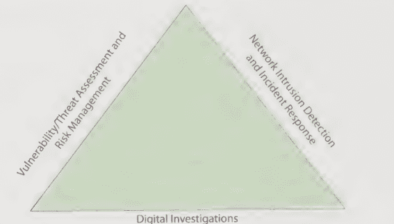

### 图 1-1 调查三元组

图1-1中三元组的每一侧代表一个负责相关任务的小组或部门。虽然每个功能独立运行，但在进行大规模数字调查时，所有三个小组相互借鉴。通过将这三个小组组成一个团队，可以在不请外部专家的情况下处理数字调查的所有方面。在较小的公司中，一个小组可能执行三元组显示的所有任务，或者小公司可能会与服务提供商签约执行这些任务。

当你在漏洞/威胁评估与风险管理小组工作时，你会测试并验证独立工作站和网络服务器的完整性。这种完整性检查了系统的物理安全以及操作系统（OS）和应用程序的安全。在该小组工作的人（通常被称为渗透测试员）测试网络使用的操作系统和应用程序的漏洞，并连接网络上未经授权的攻击。通常，执行此任务的人具有多年系统管理经验。他们的工作是在网络中“打洞”，以帮助组织更好地应对真实攻击。

漏洞评估与风险管理小组的专业人士还需要网络入侵检测和事件响应的技能。该小组通过自动化工具和监控网络防火墙日志检测入侵者攻击。当检测到外部攻击时，响应小组跟踪、定位并识别入侵方法，并拒绝进一步访问网络。如果入侵者发起了造成损害或潜在损害的攻击，该小组收集必要的证据，这些证据可用于对入侵者的民事或刑事诉讼，并防止进一步入侵。如果内部用户参与非法活动或违反政策，网络入侵检测与事件响应小组可能会协助定位用户。例如，社区学院的某人向网络上的其他用户发送电子邮件。网络小组意识到电子邮件来自内部网络的一个节点，安全小组重点关注该节点。数字调查小组负责管理调查，并对涉嫌包含案件或犯罪相关证据的系统进行取证分析。对于复杂的案件，该小组会利用来自漏洞评估、风险管理以及网络入侵检测和事件响应的人员资源。然而，数字调查小组通常负责解决或终止案件。

## 数字取证的简史

五十年前，很少有人想象到计算机将成为日常生活中不可或缺的一部分。现在，计算机技术已随处可见，而数字设备作为犯罪工具、犯罪目标，并从本质上作为证据存储地的犯罪也随之变得随处不在。

到20世纪70年代，电子犯罪日益增加，特别是在金融领域。那个时代的大多数计算机是大型机，由金融、工程和学术界具有特殊技能的受过培训的人员使用。白领欺诈的出现是因为这些行业的人发现通过操纵计算机数据是一种赚钱的方法。大型机时代最著名的犯罪之一是“半分钱犯罪”。银行对账户资金的追踪通常到小数点后三位或更多。他们在支付利息时使用现在仍在使用的舍五入算法法。如果应用于账户的利息产生了不足分的分数，该分数将用于下一个账户的计算，直到总和凑成整数分。人们假设每个客户都能从这种平均分配中受益。但一些计算机程序员破坏了这种方法，他们为自己开设账户并编写程序将这些分数资金转移到自己的账户中。在小型银行，这种做法每月仅相当于数百美元；然而在拥有数百万美元的大型银行，这一金额可达数十万美元。

在此期间，执法人员对计算机的了解还不足以在审判中索取或保留证据。许多人开始参加联邦执法培训中心（FLETC）的计划，旨在培训执法人员处理数字数据。

随着个人电脑（PC）在80年代变得流行起来并开始取代大型机，出现了许多不同的操作系统。苹果在1983年发布了Apple II，并在1984年发布了 Macintosh。TRS-80 和 Commodore 64 等计算机是当时的流行机。Kaypro 和 Zenith 等 CP/M 机器也很有需求。

磁盘操作系统（DOS）有多种版本，包括 PC-DOS、QDOS、DR-DOS、IBM-DOS 和 MS-DOS。那时的取证工具非常简单，且大多数由政府机构生成，例如加拿大皇家骑警警察（RCMP，它有自己的调查工具）和美国国税局（IRS）。大多数工具是用C语言和汇编语言编写的，普通公众无法获得。

20世纪80年代中期，一种名为 Xtree Gold 的新工具出现在市场上。它可以识别文件类型并检索丢失或被删除的文件。Norton DiskEdit 随后出现，并成为查找和恢复已删除文件的首选工具。你可以在当时最强大的PC上使用这些工具；IBM兼容计算机具有10 MB到40 MB的硬盘硬盘和两个软驱器，如图 1-2所示。

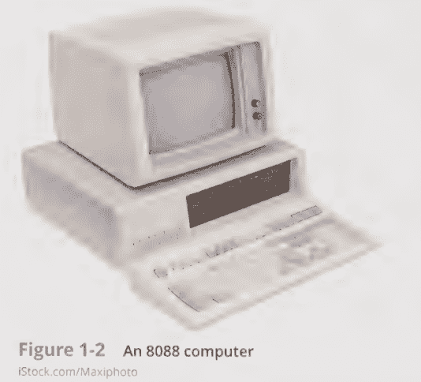

1987年，苹果生产了 Mac SE，这是一款带有60 MB存储容量外部 EasyDrive 硬盘的 Macintosh（见图 1-3）。此时，流行的 Commodore 64 仍使用标准音频磁带记录数据，因此 Mac SE 代表了计算机技术的一项重要进步。

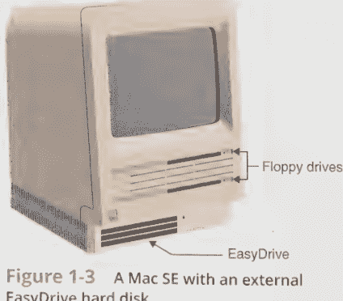

到90年代初，专门的数字取证工具已于面世。国际计算机调查专家协会（IACIS）引入了关于数字取证检查软件的培训，美国国税局创建了搜查令程序。然而，在 GSR Data 创建适用于 Macintosh 的 Expert Witness 之前，还没有商业数字取证GUI软件。该软件可以恢复已删除的文件和删除文件碎片。GSR Data 的合作伙伴之一后来离开并开发了 EnCase，这成为了一种流行的数字取证工具。

随着计算机技术的不断演进，更多的数字取证软件被开发出来。硬盘的引入为调查人员带来了新问题。大多数基于DOS的软件无法识别大于8 GB的硬盘。由于现代计算机拥有500 GB甚至更大的硬盘，取证软件需要进行。在书中，你将探索新兴软件和硬件带来的挑战。

其他工具，例如 Ilook（目前由国税局调查司维护并仅限执法部门），可以分析和读取磁盘副本的特殊文件。AccessData Forensics Toolkit（FTK）已成为一种流行的商业产品，在执法和民用市场执行类似的任务。

随着软件公司对数字取证和调查变得越来越精明，他们正在生产更多的取证工具以跟上技术。本书描述了若干工具，但并非所有可用工具。你应该参考行业杂志、电子杂志和网站以保持跟进。

## 了解案例法

现有的法律法规无法跟上技术变化的速度。因此，当法规或条例[是]...（文本似乎不完整或存在碎片）

## 数字调查准备工作

数字调查可以有多种分类方式。然而，为了本文的讨论，它们分为两类：公共部门调查和私营部门调查（见图 1-4）。

- 政府机构
  - 《加拿大权利宪章》第 8 条（美国宪法第四修正案关于搜查和查押的规定）
- 私有组织
  - 公司政策违反
  - 诉讼争议


### 图 1-4 公共部门与私营部门调查

iStock.com/RobinsonBecquart, iStock.com/buzbuz

通常，公共部门调查涉及负责刑事调查和起诉的政府机构。政府机构范围从市、县、州/省警察部门到联邦执法机构。这些组织必须遵守其司法管辖区的法律指南，例如《加拿大权利宪章》第 8 条和限制政府搜查与查押的《美国宪法第四修正案》（见图 1-5）。美国的搜查与查押法保护人们的权利，包括犯罪犯罪的人；作为一名数字取证调查员，你必须遵守这些法律。司法部（DOJ）定期更新计算机搜查和查押的信息。

私营部门调查更多关注违反政策的行为，例如未遵守 1996 年《健康保险流通性与责任法案》（HIPAA）的规定。然而，犯罪行为（如企业间谍）也可能发生。虽然营部门调查通常以民事案件开始，但它们可能会演变成刑事案件；同样，刑事案件也可能产生导致民事案件的影响。如果你遵循良好的取证程序，你在检查中发现的证据可以实现民事与刑事案件之间的转换。

### 理解执法机构的调查

在进行公共部门调查时，你必须了解有关计算机犯罪的法律，包括标准的法律程序、搜查与查押指南以及如何构建刑事案件。在刑事案件中，嫌疑人被指控犯有刑事罪：

> 人的人体、房屋、文件和财物不受不受理搜查和查押的权利不应被侵犯；除非有合理的理由，并经誓言或确认支持，且特别说明要搜查的地点以及要查押的人或物，否则不应颁发许可证。


### 图 1-5 第四修正案

犯有刑事罪，如入室、谋杀、骚扰或欺诈。为了确定是否存在计算机犯罪，调查员会询问以下问题：实施犯罪使用了什么工具？是简单的侵入吗？是盗窃还是破坏行为？犯罪实施者是否通过网络跟踪或电子邮件骚扰侵犯了他人的权利？

法律（包括程序规则）因司法管辖区而异。因此，本书指出了美国法院接受的物品在其他法院可能无法站得住脚。近期，一个主要问题是欧盟（EU）隐私法比美国隐私法更严格。与国际公司相关的问题仍在定义中。在过去的几十年里，越来越多的公司合并为全球实体。结果是公司内部调查可能涉及多个国家的法律。例如，一家公司在澳大利亚运营一家子公司。子公司的一名员工涉嫌欺诈，作为你调查的一部分，你需要查押他的手机。根据美国法律，如果他在公司财产上使用手机并与公司网络同步，你就可以这样做。根据澳大利亚法律，你不行。

计算机和网络可能只是用于实施犯罪的工具，因此类似于入室窃犯破入房屋时使用的撬锁。出于这一原因，许多州在刑法中增加了特定语言来定义涉及计算机的犯罪。像阿拉巴马州这样的州使用了“故意且未经授权”等字辞，并规定了多少美元金额属于轻罪或重罪。例如，他们扩大了未经所有者许可从计算机获取数据等犯罪的法律定义，因此计算机盗窃现在与商店行窃或车窃同等。各州还颁布了处理相关犯罪的刑事刑法，但通常不将数字问题包含在标准的侵入、盗窃、破坏或入室盗窃法律中。《计算机欺诈和滥用法案》于 1986 年通过，但具体的州法律通常在晚些才制定。

有关各州如何定义和处理计算机相关犯罪的信息，请参见 `http://statlaws.findlaw.com/criminal-laws/computer-crimes.html`。

许多严重犯罪涉及计算机、智能手机和其他数字设备。最臭名昭著的是那些涉及剥削未成年人的案件。数字图像存储在硬盘、闪存器、移动硬盘和云端，并在互联网上传传。其他计算机犯罪涉及失踪儿童和成年人，因为失踪人员的信息经常在计算机上找到。毒贩、盗车团伙和其他犯罪分子经常会在他们的计算机、笔记本电脑、智能手机和其他设备上保留交易信息。

### 遵循法律程序

在对潜在违反法律刑事的行为进行计算机调查时，你遵循的法律程序取决于当地惯例、立法标准和证据规则。然而，通常情况下刑事案件遵循三个阶段：起诉、调查和检控。某人提交诉状，专家调查诉状，并在检察官的帮助下收集证据并构建案件。如果证据充分，案件可能会进入审判。

通常，在法官批准并签署搜查令后，它就可以准备执行了，这意味着数字取证人员（DEFR）可以收集搜查令定义的证据。在你收集证据后，对其进行处理和分析，以确定是否发生了犯罪。然后可以在法庭听证或审判中提交证据。随后行政法官做出判决，或由陪审团宣布裁决。

```
根据对电子表格、财务记录和发票的实际检查，计算机取证专家 Joe Smith 意识到计算机曾用于生成、存储和打印用于乔纳森·道拉斯（Jonathan Douglas）逃税计划的文档。有理由相信，目前位于 Jonathan Douglas 场所的计算机系统就是用于制作和存储这些电子表格、财务记录和发票的同一系统，而且（电子表格、财务记录、发票）以及与 Jonathan Douglas 犯罪企业相关的其他记录都将存储在 Jonathan Douglas 的计算机中。

来源：《电子调查中的计算机搜索、搜查及电子证据的获取》，美国司法部，2002年7月。
```

### 图 1-6 典型的宣誓书语言

### 理解私营部门调查

私营部门调查涉及私人公司和律师，他们处理违反公司政策和诉讼纠纷，例如不当解雇。在为私人公司进行调查时，请记住业务必须继续进行，受调查的影响要降至最低。由于企业通常关注继续日常运营和获取利润，私营部门环境中的许多人认为，你的调查和对嫌疑人的抓捕次于停止违规行为以及减少对业务的损害或损失。企业还努力解决刑事或民事问题。私营部门的计算机犯罪可能涉及电子邮件骚扰；性别和年龄歧视；白领犯罪（由 FBI 定义，`fbi.gov/investigate/white-collar-crime`），例如数据造假、挪用公款和破坏行为；工业间谍活动，涉及向竞争对手出售敏感或机密的公司信息。任何访问计算机的人都可以实施这些犯罪。

### 建立公司政策

企业可以减少诉讼风险的一种方法是发布并维护员工易于阅读和遵循的政策。此外，这些政策可以使内部调查进行得更加顺利。最重要的政策是那些定义使用公司计算机和网络规则的政策；这类政策通常被称为“可接受使用政策”。组织应让所有员工签署此可接受使用协议。发布的公司政策还为内部调查提供了权威链线；它规定了谁有法律权利启动调查、谁可以占有证据，以及谁有权访问证据。

定义良好的政策赋予计算机调查人员和取证鉴定人员进行调查的权限。政策还证明了组织在对待员工时是公正客观的，并规定组织将在所有调查中遵循正当程序。（“正当程序”指的是法律下的公平，旨在保护所有人。）如果没有定义的政策，企业将让自己面临来自现任或前任员工的诉讼。负责维护公司政策的人员或委员会还必须遵守适用法律，这些法律可能根据城市、州和国家而异。此外，应定期安排对标准和政策的培训和更新，让员工了解在组织网络上应该做什么和不应该什么。

### 显示警告横幅

私营或公共组织避免诉讼的另一种方法是在计算机屏幕上显示警告横幅。警告横幅通常在计算机启动连接到公司内网、网络或虚拟网络（VPN）时出现，并告知终端用户，组织保留随时检查计算机系统和网络流量的权利。（终端用户是指使用计算机执行系统管理之外日常任务的人。）如果这项权利没有被明确说明，员工在访问公司计算机系统和网络访问时可能会认为自己拥有隐私权。图 1-7 显示了一个警告横幅示例。

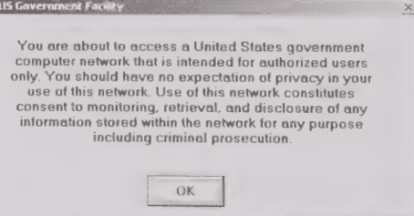

### 图 1-7 警告横幅示例

警告横幅主张进行调查的权利并通知用户。通过显示一个强有力且措辞得当的警告横幅，计算机设备的拥有不需要根据第四修正案搜索和搜查规则要求的搜查令或法院命令即可没收设备。在具有定义良好的政策的公司中，这种检查或搜索的权利既适用于犯罪活动也适用于违反公司政策。请记住，你国家的法律可能不同。例如，在某些情况下，尽管公司有权随时没收计算机，如果员工涉嫌犯罪行为，必须在当时通知他们。

以下列表建议在警告横幅中包含短语。在使用这些警告之前，请咨询组织的法律部门，获取您工作区域或部门的其他法律通知。根据组织的类型，以下文本可用内部警告横幅：

- 对系统和网络的访问受限。
- 本系统和网络仅用于正式业务。
- 所有者可随时对系统和网络进行监控。
- 使用本系统意味着同意所有者的监控。
- 未经授权或非法使用本系统或网络的用户将纪律或起诉。
- 本系统的用户同意，他们对在本系统中执行的所有活动不享有隐私预期。

位于 `www.justice.gov/criminal/cybercrime/docs/ssmanual2009.pdf` 的 DOJ 文档包含几个警告横幅示例。

社区学院等组织可能会说明，系统和网络随时接受监控，因为不是员工或学生的当地社区成员可能会使用这些设施。另一方面，营利性组织在其网络上可能有专有信息，并可以使用上述列表中建议的所有短语。客人（如业务伙伴的员工）可能允许使用系统。客人登录时显示的文本可以包括：

- 本系统是 X 公司的财产。
- 本系统仅供授权使用；未经授权的访问违反法律并将受到起诉。
- 所有活动、网络流量均受监控。


# 第一章 了解数字取证职业与调查

## 私营部门数字调查概述

私营部门的大多数数字调查都涉及数字资产的滥用。数字滥用投诉通常集中在员工对电子邮件和互联网的滥用上，但实际上也可能涉及其他数字资源，例如使用公司软件生产产品以获取个人利润。电子邮件调查的范围从过度出于个人目的使用公司电子邮件系统，到通过电子邮件对他人进行威胁或骚扰。一些常见的电子邮件滥用涉及发送具有攻击性的信息。此类信息可能会营造敌对的工作环境，导致员工对公司提起诉讼，而公司对这些行为未采取任何预防或应对措施（换句话说，即在暗中纵容了电子邮件滥用）。

数字调查员还调查互联网滥用情况。员工对互联网的滥用范围从过度使用（例如整天冲浪网页）到在浏览时查看色情图片。互联网滥用的一个极端案例是查看违禁（非法）色情图像，例如儿童色情。在大多数司法管辖区，查看违禁物品是犯罪行为，数字调查员必须以最高水平的专业性处理此类情况并通知执法部门。通过一致地执行政策，公司可以最大限度地减少其责任风险。数字取证检查员的角色是管理人员并收集准确信息，以便他们能够验证并纠正组织中的滥用问题。

看似与内部滥用相关的行动也可能产生刑事或民事责任。由于任何民事调查都可能变成刑事调查，你必须以最高水平的安全性和问责制对待你收集的所有证据。在本书的后续部分，你将学习《联邦证据规则》（确保监管链完备的程序）以及如何将其应用于数字调查中。

同样，你的私营部门调查可能看似涉及民事、非刑事事务，但随着分析的进行，你可能也会识别出刑事事务。由于这种可能性，请始终记住，你的工作可能会受到民事或刑事法律系统的审查。《联邦证据规则》对于民事和刑事案件是完全相同的。通过将这些规则统一适用于所有调查，你消除了对所开发的证据的可采性的任何疑虑。这些标准在全书中都得到了强调。


“银盘原则”（silver-platter doctrine）曾允许民事或私营部门的调查人员以违反《宪法第四修正案》的方式获得的证据交付给执法机构。然而，该原则在1960年被判定为违宪（参见 *Elkins v. United States, 1960*）。

记住，警察是执法人员。私营部门调查员的工作是最大限度地减少对公司的风险。在你将证据交给执法部门并开始在他们的指导下工作后，你就成了执法部门的代理，受到与执法人员相同的搜查和扣押限制。执法人员不能要求你（私人公民）获取需要搜查令的证据。控制私人公民收集的证据使用的规则取决于司法管辖区，因此如果你在美国境外调查案件，请查阅当地法律。

诉讼成本高昂，因此在汇集了证据后，违规员工通常会受到纪律处分。然而，当你发现涉及第三方受害者的犯罪行为时，你可能有法律和道义义务将信息移交给执法部门。在下一节中，你将学习必须将刑事证据与任何公司专有信息分离的情况。

## 区分个人财产与公司财产

许多公司政策区分了个人计算机财产和公司财产；然而，对于手机、智能手机、个人笔记本电脑和平板电脑，做出这种区分可能是困难的。例如，一名员工将个人平板电脑带到公司并连接到公司的无线网络。当员工将平板电脑上的信息与公司网络中的信息同步时，她会将一些数据复制到平板电脑，或者数据也被放在平板电脑。在这种情况下，至少有一个问题是：“平板电脑上的信息属于公司还是员工？”

现在假设公司将平板电脑作为节日奖金给了员工。公司可以声称对该设备的权利吗？当员工带智能手机并连接公司网络时也会出现类似的问题。适用哪些规则？由于数字设备是日常生活的一部分，你会经常遇到这些问题。然而，这些问题仍在争议中，公司正在建立自己的政策来处理它们。在如今的自带设备（BYOD）环境中，更多公司被迫解决个人设备访问公司网络的问题。一些公司简单地规定，如果你将个人设备连接到业务网络，它遵循与公司财产相同的规则。


`BYOD` 是公司安全、数字调查、法规遵守（包括公司政策）的一项重大挑战。

## 维持职业操守

作为数字调查员的职业操守至关重要，因为它决定了你的信誉。职业操守在第15和第16章中进行了详细讨论，包括伦理、道德和行为标准。你必须始终表现出最高水平的职业行为。为了做到这一点，你必须在调查期间保持客观性和保密性，不断扩展技术知识，并以诚信行事。保持客观性意味着你根据自己的教育、培训、经验和案件中的证据来形成意见。在耗尽所有合理的线索并考虑了可用事实之前，避免对你的发现下结论。你的终极责任是找到相关的数字证据。你必须避免偏见或偏袒，以维护所有调查中你发现结果的完整性。例如，如果你受雇于律师，不要让律师主宰你调查的结果。你的声誉取决于保持你的客观性。

你还必须通过保持保密性来维护调查的信誉。仅与需要了解案件的人讨论案件，例如参与案件的其他调查员或管理层人员。如果你需要专业人士的建议，请讨论案件的通用条款和事实，而不提及具体细节。你进行的所有调查都必须保密，直到你被指定为证人或根据律师或法院的要求发布报告。

在私营部门环境中，保密性至关重要，特别是在处理被解雇员工时。公司与员工之间的协议可能是将解雇描述为裁员或辞职，以换取不推荐信。如果你向他人提供案件细节和员工姓名，你的公司可能承担违约责任。

至少需要拥有计算机或相关专业的本科学位。如果你没有高级学位，可以考虑在补充领域进行研究生学习，例如商务法或电子商务。许多学院和大学现在都提供数字取证的专科、本科、硕士学位以及证书课程。许多公司愿意资助员工的教育费用，因为员工知识的与时俱进是他们的优势。

除了教育和培训外，加入专业组织也能增加你的资历。这些组织通常会赞助关于数字取证检查中最新技术改进和趋势的培训和出版物。此外，还要关注数字取证鉴定工具和技术的最新出版物。

作为数字调查员和取证专业人士，你被要求保持诚实正直。你必须在生活的各个方面都要以最高水平的诚信办事。任何不慎的行为都可能让你尴尬，并给对方律师在你在法庭作证期间质疑你信誉的机会。

## 准备数字取证调查

作为数字取证专业人士，你的职责是从嫌疑者的计算机中收集数据，并确定是否有证据表明存在犯罪或违反了公司政策或行业法规。如果证据表明存在犯罪或违反政策的行为，你就开始准备案件，案件是指你可以在法庭或私营部门调查中提供的证据集合。这一过程涉及调查嫌疑者的计算机，然后在另一台计算机上保存证据。然而，在开始调查之前，你必须遵循公认的程序来准备案件。通过有条理地处理每个案件，你可以彻底评估证据并记录证据链，证据链是证据从你发现它到案件结案或上庭期间所经过的路径。

以下章节介绍了两个示例案例——一个涉及计算机犯罪，另一个涉及违反公司政策。每个示例都描述了取证调查的典型步骤，包括收集证据、准备案件和保存证据。

## 计算机犯罪概述

执法人员在调查犯罪、收集其他证据或进行逮捕时经常会发现计算机、智能手机和其他设备。这些设备可能包含帮助执法人员确定导致犯罪的事件链的信息，或者提供更有可能导致定罪的证据信息。作为一个计算机涉及犯罪的案例，警方搜查了一名嫌疑毒贩的家，在卧室发现了一台台式计算机、几个 `USB` 盘（也称为“闪存盘”或“U盘”）、一台平板电脑和一个手机（见图 1-8）。该计算机被“装袋并标记”，这意味着它同存储介质一起放在证据袋中，并作为搜索和扣押的一部分贴上标签。


**图 1-8** 犯罪现场

案件主侦探希望你检查计算机和手机，以寻找并组织可能作为犯罪证据的数据，例如包含毒贩联系人名单的文件、短信和照片。获取人员向你提供了调查人员与计算机一起收集的物品证明文件，包括其他存储介质的列表，如移动式磁盘和闪存盘。获取人员还注明该计算机是 `Windows 8` 系统，且机器在被发现时正在运行。在关闭计算机之前，获取人员拍摄了 `Windows` 桌面上所有打开窗口的照片，包括其中一个显示文件资源管理器的窗口，并将照片交给你。（在关闭计算机之前，还应进行现场获取以捕获 `RAM`。此将在第 10 章中讨论。）

作为数字取证调查员，你对人员在获取证据时遵循了适当程序表示感谢。对于数字证据，重要的是意识到数据（如最后访问日期）很容易被第一个现场的急切调查员所更改。美国司法部（`DOJ`）有一份你可以下载的文档，审查了电子证据的正确获取方法，“起诉计算机犯罪”（`www.justice.gov/sites/default/files/criminal-ccips/legacy/2015/01/14/manual2009.pdf`，如果该链接有效）。在初步评估中，假设硬盘和存储介质包含完整的文件，例如电子邮件、已删除的文件。

## 数字取证调查流程

- **调查你恢复的数据**——查看从磁盘中恢复的信息，包括现有文件、删除的文件、电子邮件和网络历史记录，并整理这些文件以帮助寻找与案件相关的信息。
- **完成案件报告**——编写一份完整的报告，详细说明你做了什么以及发现了什么。
- **对案件进行评判**——自我评估和同行评审是职业成长中不可或缺的一部分。在完成一个案件后，对其进行审查，以识别成功的决策和行动，以及你本可以改进的表现。

你在每一步中投入的时间和精力各异，这取决于调查的性质。例如，在大多数情况下，你需要创建一个简单的调查计划，以免遗漏任何步骤。然而，如果一个案件涉及许多具有复杂问题待识别和检查的计算机，那么一个带有定期审查和更新的详细计划是至关重要的。系统化的方法有助于你发现案件所需的信息，你应该尽可能收集更多的信息。

对于所有的数字调查，你必须做好应对意外情况的准备，因此你应该始终为调查准备一个应急预案。应急预案可以包含任何帮助你完成调查的内容，从备用软件和硬件工具到调查的其他方法。

### 评估案件

如前所述，识别案件需求涉及确定你正在调查的案件类型。这意味着你应该系统地列出案件细节，包括案件的性质、可用证据的类型以及证据的位置。

在涉及违反公司政策的案件中，你被要求调查乔治·蒙哥马利（George Montgomery）。史夫·比林斯（Steve Billings）让`IT`部门没收了乔治可能包含其行踪信息的存储媒体。在与乔治的同事交谈后，史夫得知乔治利用公司计算机从事私活。因此，案件的重点已转移到可能的员工滥用公司资源。你可以按照以下步骤开始评估此案件：

- **状况**——员工滥用资源。
- **案件性质**——在公司计算机上开展私活。
- **案件细节**——据报道，该员工正在其公司计算机上开展私活，涉及为客户注册域名并在当地 `ISP` 处建立其网站。同事们抱怨他花费了太多时间在自己的业务上，而没有履行分配的工作职责。公司政策规定，所有公司拥有的数字资产随时可接受公司管理层的检查。员工在操作计算机系统时没有隐私预期。
- **证据类型**——连接到公司计算机的小容量 `USB` 驱动器。
- **已知磁盘格式**——`NTFS`。
- **证据位置**——从员工分配的计算机中恢复的一个 `USB` 驱动器。

根据这些细节，你可以确定案件需求。你现在知道案件性质涉及员工滥用案件资源，你正在寻找证据证明员工利用其雇主的计算机从事私活。在从乔治计算机中提取的 `USB` 驱动器上，你正在寻找与网站、`ISP` 或域名相关的任何信息。你知道该 `USB` 驱动器使用 `NTFS` 文件系统。为了复制 `USB` 驱动器并找到隐藏文件，你需要可靠的数字取证工具。由于 `USB` 驱动器已经被提取，你不需要亲自扣收硬盘。你将此案件命名为 `Montgomery_72018`（因为案件于 2018 年 7 月 20 日开启），并确定任务是从存储媒体中收集数据，以证实或否定关于乔治在工作时间和使用计算机从事私活的指控。请记住，他仅被嫌疑滥用资源，你获得的证据可能是仁慈的——这意味着它可能证明他的清白。在进行事实调查时，你必须始终保持不偏不倚的观点和客观性。如果你系统且详尽，就更有可能产生一致可靠的结果。

### 规划你的调查

现在你已经确定了 `Montgomery_72018` 案件的需求，你就可以规划你的调查了。你已经确定了需要的证据类型；现在你可以确定收集证据、建立监管链和进行取证分析的具体步骤。这些步骤将成为你调查的基本计划，并指示你应该做什么以及何时做。要调查 `Montgomery_72018` 案件，你应该执行以下通用步骤。这些步骤大部分将在后续章节中进行更详细的解释。

1. 从 `IT` 部门获取 `USB` 驱动器，他们对证据进行了装袋并贴标。
2. 填写证据表并建立监管链。
3. 将证据运输到你的数字取证实验室。
4. 将证据存放在批准的安全容器中。
5. 准备你的工作站。
6. 从安全容器中取出证据。
7. 对证据进行取证复制（在本例中，为 `USB` 驱动器）。
8. 将证据放回安全容器。
9. 使用数字取证工具处理复制的证据。

你在步骤 4 中需要的批准安全容器应该是访问受限的锁式储物柜或柜。访问受限意味着只有你和其他授权人员可以打开该安全容器。

所有调查的首要规则是保护证据，这意味着它不应被篡改或污染。由于 `IT` 部门员工没收了存储媒体，`IT` 部门经理确认自该媒体从乔治办公桌上取回以来，一直被锁在安全柜中。请记住，尽管这是一个政策问题，但许多案件因为监管链无法维持或已发生断裂而被驳回。当这种情况发生时，证据可能已经遭到破坏。

为了记录证据，你记录了有关媒体的细节，包括谁恢复了证据、由谁持有以及何时持有的。证据监管表（也称为证据链表）有助于你记录对原始证据和取证复制品做了哪些以及没有做过的操作。根据你是在执法部门还是私营领域工作，你可以创建一个适合你环境的证据监管表。该表单应易于阅读和使用。它可以包含单件或多件证据的信息。

如有必要，记录如何使用你的证据监管表。清晰的说明有助于用户在填写表单时保持一致性，并确保所有人对收集的物品使用相同的定义。标准化有助于保持所有调查的一致质量，并防止对收集的证据产生混乱和错误。证据监管表通常包含以下信息：

- **案件编号**——组织启动调查时分配的编号。
- **调查组织**——你的组织名称。在拥有全球设施的大型公司中，多个组织可能在不同的区域进行调查。
- **调查员**——负责案件的调查员姓名。如果分配了许多调查员，请指定首席调查员的名字。
- **案件性质**——案件的简短描述。例如，在私营部门环境中，可能是“为了公司诉讼的数据恢复”或“员工违反政策案件”。

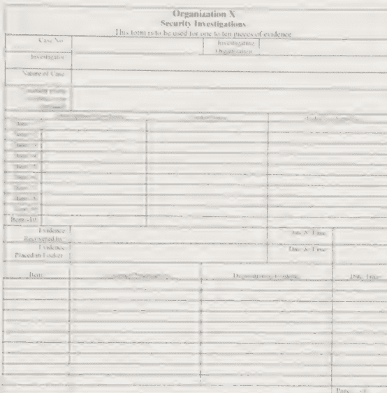

**图 1-9** 私营部门环境下使用的多证据表单示例

- **证据位置**——收集证据的精确位置。如果你使用多证据表单，应为每个位置创建一个新表单。
- **证据描述**——证据项目列表，例如“硬盘，250 GB”或“一个 `USB` 闪盘，8 GB”。在多证据表单上，请对你获取的每项证据编写描述，并可能包含照片。
- **厂商名称**——计算机组件制造商的名称。例如，将一个 250 GB 的硬盘列为“美光 250 GB 硬盘”，或将 `USB` 闪盘描述为“闪迪 8 GB `USB` 闪盘”。在随后的章节中，你将看到制造商之间的差异如何影响数据恢复。
- **型号或序列号**——列出计算机组件的型号或序列号（如果可用）。许多组件（包括硬盘、内存芯片和扩展插卡）有型号但没有序列号。
- **已提取证据**——由提取证据的调查员签名。证据监管链从此信息开始。例如，如果你填了自己的名字，就意味着你声明已经获取了对证据的控制权。你的责任是确保没有东西损坏证据，也没有人动过它。在这一行上写名字的人负责保护、运输和安全证据。此信息确立了监管链开始的确切时间。
- **日期和时间**——证据被扣押的日期。
- **证据存入储物柜**——指定使用了哪种批准的安全容器来存储证据，以及证据何时放入容器中。
- **项目 #**——证据处理人/证据处置方式/日期/时间——当你或另一位授权调查员从证据储物柜中取出证据进行处理和分析时，请列出项目编号和你的姓名，并描述对证据做了什么。
- **页码**——用于编制每个位置所有证据的表单应有页码。页码应指示你的这组证据的总页数。例如，如果你在一个地点收集了 15 份证据，而你的表单只有 10 行，则你需要填写两份多证据表单。第一页标记为“第 1/2 页”，第二页标记为“第 2/2 页”。

图 1-10 显示了一个单证据表单，每页仅列出一件证据。该表单让你在监管链日志中跟踪独立证据时具有灵活性。它还有更大的空间用于描述，这在最终确定调查和创建案件报告时非常有帮助。通过此表单，你可以准确地说明对证据做了什么以及发现了什么。使用证据表单作为你在调查分析期间所采取所有操作的参考。

**大都会警察局**

**高科技调查调查队**

**本表单仅用于单件证据**

**每件证据请单独填写一份表单**

| 案件编号 | | | |
| :--- | :--- | :--- | :--- |
| 调查员 | | | |
| 案件名称 | | | |
| 案发地点 | | | |
| 项目 # | 证据描述 | 厂商名称 | 型号/序列号 |
| 收到证据 | | 日期与时间 | |
| 存入储物柜 | | 日期与时间 | |
| 证据处理人 | 证据处置 | 日期/时间 | |

**图 1-10** 单证据表单

通过在调查中使用多证据表单和单证据表单，你可以将单证据表单随证据保留，并将多证据表单放在你的报告文件中。两份表单还提供了冗余，可以作为证据的质量控制。

### 保护你的证据

数字调查要求你调整程序以适应案件。例如，如果某个案件的证据包括整个计算机系统和相关的存储介质（如闪存驱动和大外部硬盘），你在核对所有这些物品时必须保持灵活性。某些证据足够小，可以放入证据袋。其他物品，如 `CPU` 机箱、显示器、键盘和打印机也是如此。

为了保护和清理大型计算机组件中包含的证据，可以使用警察供应商或办公商店出售的大型证据袋、胶带、标签牌、标签和其他产品。在收集用于保护计算机证据的产品时，确保它们在计算机组件上使用是安全且有效的。在处理任何计算机组件时要小心，避免损坏组件或接触静电，静电会破坏数字数据。出于这个原因，确保在收集计算机证据时使用防静电袋。也考虑使用带有腕带的防静电垫。两者都有助于防止计算机证据受损。

本节重点关注计算机和相关硬件。智能手机和手机等设备将在第12章介绍。

务必将计算机证据放在填充良好的容器中。填充物可以防止证据在运输到安全证据储物柜、证据室或计算机实验室时受损。当你需要或他人获得计算机设备时，保存废弃的硬盘盒、防静电袋和计算机硬件包装材料。因为你可能没有保护证据所需的所有物品，你必须变通处理。保护证据通常需要构建安全容器。如果计算机组件很大并包含在计算机组件需要特定的温度湿度范围。如果过冷、过热或潮湿，计算机组件和磁介质可能会损坏。加热的汽车座椅也会损坏介质。在收集证据时，确保在提供安全容器之前有一个安全的运输环境。


### 私营部门高科技调查程序

作为调查员，你需要制定正式程序和非正式清单，以涵盖高科技调查中的所有重要问题。这些程序对于确保在调查中使用正确的技术是必要的。使用非正式清单以确保所有证据都经过正确的收集和处理。本节列出了调查员在私营部门高科技调查中常用的示例程序。

### 员工终止案件

大多数终止案件涉及员工滥用公司资源。导致敌对工作环境的事件（例如在场所观看色情和发送不当邮件）是调查的主要类型。以下章节描述了可能导致员工终止调查的关键点。建议咨询组织的法律顾问和人力资源部门获取处理此类调查的具体指示。你的组织必须具备本章之前提到的相应政策。

### 网络滥用调查

本节信息适用于组织的内部私有网络，而不是公共 ISP。在查看此列表后咨询建议以建立你自己的程序。要进行涉及互联网滥用的调查，你将需要：

- 计算机的互联网代理服务器日志
- 从组织网络管理员处获取的嫌疑计算机 IP 地址
- 嫌疑计算机硬盘
- 你常用的数字取证分析工具

以下步骤概述了网络滥用案件的推荐处理流程：

1. 使用书中描述的标准取证分析技术和程序对硬盘进行检查。
2. 搜索并提取所有网页 URL 及其他相关信息。
3. 联系网络防火墙管理员，并请求（如果可用）感兴趣日期期间的嫌疑计算机网络设备名称或 IP 地址的代理服务器日志。咨询贵组织的网络管理员，以确认这些日志是否经过维护，以及在使用动态主机配置协议（DHCP）分配网络 IP 地址时，生存时间（TTL）设置为多久。
4. 将取证分析恢复的数据与网络服务器日志进行对比，以确认它们是否匹配。
5. 如果 URL 与网络服务器日志及取证磁盘检查匹配，则继续分析嫌疑计算机的驱动器数据，并收集任何支持指控的相关照片或网页。如果网络服务器日志之间没有匹配，且取证检查未显示任何相关证据，则报告该指控缺乏依据。

在调查互联网滥用案件之前，请研究你所属的州或国家的隐私法。许多国家拥有独特的隐私法，限制了计算机日志数据（如网络服务器日志或磁盘缓存文件）用于任何类型的调查。某些州或联邦法律可能优于贵组织的员工政策。请务必咨询贵组织的律师。对于拥有国际业务运营的公司，管辖权是一个问题；在某国合法的行为（例如检查和调查网络服务器日志），在德国可能就是违法的。

对于网络服务器日志与发现不当数据的取证分析不匹配的调查，请继续检查嫌疑计算机的磁盘驱动器。确定不当数据何时下载到计算机上，以及是否通过组织的内部网连接到互联网。员工可能会使用他们的笔记本电脑连接到自己的 ISP 来下载不当的网络内容。对于这些情况，你需要咨询贵组织的员工政策指南，了解哪些被视为对组织数字资源的适当使用。

### 电子邮件滥用调查

电子邮件调查通常包括垃圾邮件、不当且具有攻击性的消息内容，以及骚扰或威胁。电子邮件与其他计算机证据数据具有相同的限制，即组织必须拥有前述的定义策略。以下列表是进行电子邮件滥用调查时所需的内容：

- 违规电子邮件的电子副本，其中包含消息头数据；请咨询你的电子邮件服务器管理员
- 如果可用，电子邮件服务器日志记录；咨询你的电子邮件服务器管理员查看是否可用
- 对于在中央服务器上存储用户消息的电子邮件系统，访问服务器的权限；咨询你的电子邮件服务器管理员
- 对于在计算机上以 Outlook `.pst` 或 `.ost` 文件存储用户消息的电子邮件系统（例如），访问计算机的权限以便你对其进行取证分析
- 你首选的数字取证分析工具

以下步骤概述了电子邮件调查的推荐程序：

1. 对于基于计算机的电子邮件数据文件（例如 Outlook `.pst` 或 `.ost` 文件），使用书中描述的标准取证分析技术和程序对驱动器进行检查。
2. 对于基于服务器的电子邮件数据文件，联系电子邮件服务器管理员并获取嫌疑人和受害者电子邮件文件夹或数据的电子副本。
3. 对于基于 Web 的电子邮件（例如 Gmail）调查，搜索互联网关键词以提取所有相关的电子邮件地址信息。
4. 检查调查感兴趣的所有消息的头数据。

### 律师-客户特权调查

根据律师-客户特权（ACP）规则为律师进行数字取证分析时，你必须对所有发现保密。你所工作的律师是调查的最终权威。对于此类调查，律师通常要求你从驱动器中提取所有数据。由于驱动器可能包含大量数据，律师将希望了解驱动器上所有感兴趣的内容。

许多律师喜欢拥有你恢复的数据的打印件，但当你拥有包含数千页数据的日志文件或只能通过专有程序读取的 CAD 制图程序时，打印件可能会引发问题。你需要说服并教育律师如何以电子方式查看数字证据。此外，学习如何教律师和法务助理筛选文件，以便帮助他们高效地分析取证检查产生的海量数据。

如果你发现二进制格式的数据（如 CAD 制图），也可能遇到问题。检查这些文件需要使用 CAD 程序。此外，证据开示（Discovery）通常需要使用 CAD 程序。证据开示要求律师查看文件。

以下列表显示了进行 ACP 的基本步骤：

1. 收到备忘录后，启动调查。
2. 请求调查感兴趣的关键词。
3. 如果你通过电子邮件进行通信，请对所有消息使用加密或其他安全的电子邮件服务。

### 工业间谍调查

工业间谍案件可能非常耗时，并且容易出现范围蔓延（这意味着调查重点扩大并变得更加耗时）。本节提供了关于如何处理工业间谍调查的一些指南。请注意，涉及外国的案件可能违反了《国际武器贸易条例》（ITAR）或《出口管理条例》（EAR）。有关 ITAR 的更多信息，请参阅美国国务院网站（www.state.gov；用具体的州名或其缩写替换 state）或在互联网上搜索“《国际武器贸易条例》”。对于 EAR 调查，请参阅美国商务部网站（www.doc.gov）或在互联网上搜索“《出口管理条例》”。

与本节涵盖的其他私营部门调查不同，所有疑似工业间谍的案件都应被视为刑事调查。这里描述的技术适用于私有网络环境和尚未向执法部门报告的内部调查。请确保在未证实指控之前，不要通过提交疑似间谍案件的投诉而使自己成为执法部门的特探员。以下列表包含了你在计划工业间谍调查时可能需要的人员。此列表并非详尽的，请根据你的专业知识改进这些建议：

- 负责磁盘取证检查的数字调查员
- 对涉嫌技术数据熟悉的技术专家
- 能够进行日志分析并设置网络监控器以获取可能嫌疑人的网络通信的网络专家
- 威胁评估专家（通常为律师），他们熟悉与 ITAR、EAR 以及工业间谍相关的联邦和州法律法规

国际竞争网络（International Competition Network）已为私营部门环境下的数字证据收集制定了指南（可在 www.internationalcompetitionnetwork.org/uploads/library/doc627.pdf 获取）；这些指南已被 90 多个司法管辖区使用。

此外，在启动国际间谍调查时，请考虑以下指南：

- 确定此调查是否涉及可能的工业间谍事件，然后确定其属于 ITAR 还是 EAR。
- 如果必须秘密进行调查，请咨询公司律师和高层管理人员。
- 确定为了证实工业间谍指控需要哪些信息。
- 为磁盘取证和网络监控生成关键词列表。
- 列出并收集调查所需的资源。
- 确定调查的目标和范围，咨询管理层和公司律师关于你应该做多少工作。
- 在获得管理层批准后启动调查，并对你的活动和发现进行定期报告。

以下是工业间谍调查的计划考虑：

- 检查嫌疑员工的所有电子邮件，包括公司提供的和免费的 Web 端服务。
- 在互联网论坛或博客上搜索与事件相关的帖子。
- 对调查感兴趣的人员或物品启动带有摄像头的物理监控。
- 如果可用，检查所有敏感区域的设施物理访问日志，这可能包括使用智能卡或视频监控录像的加密区域。
- 如果有嫌疑人，确定其相对于被破坏的脆弱资源的位置。
- 研究嫌疑人的工作习惯。
- 收集所有呼入和呼出的电话日志，查看是否拨打了任何独特或异常的地方。

在进行工业间谍案件时，请遵循以下基本步骤：

1. 聚集所有负责调查的人员，并向他们简述计划和任何担忧。
2. 收集进行调查所需的资源。
3. 通过在关键位置放置监控系统（如摄像头和网络监控器）开始调查。
4. 秘密收集任何额外证据，例如嫌疑人的计算机驱动器，并制作位流镜像以供后续检查。
5. 从网络和电子邮件服务器收集所有日志数据，并检查其中可能与调查相关的独特项目。
6. 定期向管理层和公司律师报告你的调查状态和当前发现。
7. 与管理层和公司律师一起审查调查范围，以确定是否需要扩大并增加更多资源。

### 高科技调查中的访谈与审讯

成为一名熟练的访谈和审讯人员需要多年的经验。通常，私营部门的数字调查员是为调查获取证据的技术人员。许多大型组织拥有全职的安全调查员，他们在刑事和民事调查访谈技巧方面接受过多年的培训并拥有经验。这些调查员中很少有人具备计算机或技术技能，因此当你对嫌疑人的机器执行了磁盘取证分析后，可能会被要求协助对嫌疑人进行访谈或审讯。

审讯（Interrogation）与访谈（Interview）不同。访谈通常是为了从证人处或关于调查相关的特定事实收集信息。审讯是试图让嫌疑人承认某特定事件或罪行的过程。调查员在与证人或嫌疑人交谈时，可能会从访谈转为审讯。调查员在访谈和审讯艺术方面的经验和培训越丰富，就越容易判断证人是否可信以及是否可能是嫌疑人。

作为数字调查员，你的角色是指导进行访谈的调查员问什么以及应该是什么样的答案。当你与调查员建立关系时，他/她可能会要求你询问嫌疑人。观察熟练审讯员是一次人际关系技巧的学习体验。如果你被要求协助访谈或审讯，请通过回答以下问题来做好准备：

- 我需要问嫌疑人什么问题来获得案件的关键信息？
- 我知道自己在说什么吗，还是我需要研究与调查相关的主题或技术？
- 我是否需要额外的问题来涵盖调查？

常见的访谈和审讯错误包括对会议没有准备充分以及准备不足。成功的访谈或审讯的要素包括：

- 在整个过程中保持耐心
- 重复或转述证人的话语
- 坚持不懈

### 理解数据恢复工作站与软件

现在你了解了获取和记录证据涉及的内容。在第 2 章中，你将检查取证实验室的完整设置，这是进行调查的安全容器。请注意，执行数字调查的一些公司也进行数据恢复、电子发现。

记住数据恢复与数字取证之间的区别。在数据恢复中，通常客户或公司只需要恢复数据。另一个关键区别在于，在数字取证中，你可能知道自己在寻找什么，但不一定。

特殊配置的 PC 被称为取证工作站，这是一个配备了额外扩展槽和取证软件的计算机。根据你的需求，取证工作站可以使用以下操作系统：

- MS-DOS 6.22
- Windows 95, 98 或 Me
- Windows NT 3.5 或 4.0
- Windows 2000, XP, Vista, 7, 8 或 10
- Linux
- Mac OS X 和 macOS

第 2 章和第 6 章详细介绍了取证实验室和工作站所需的软件资源。访问 digitalintelligence.com 查看证据恢复设备 (F.R.E.D.) 的规格，或访问 forensiccomputers.com 查看产品。

如果你启动任何正在检查硬盘的操作系统，操作系统通过向垃圾桶写入数据来更改证据，并破坏你试图保护的证据的质量和完整性。第 5 章涵盖了 Windows 在启动时更新哪些文件。较新的操作系统还会将硬盘和 CPU 的序列号记录在文件中，这些信息很难恢复。

在所有微软操作系统中，对磁盘侵入性最小（从更改数据的角度来看）的是 MS-DOS 6.22。随着微软操作系统的持续演进，使用旧的 MS-DOS 平台并不总是可行。许多旧的数字取证工具可以在 MS-DOS 环境中运行。这些工具在 Windows 98 的 MS-DOS 窗口中运行或在 Windows 2000 及更高版本的命令提示符中运行。然而，在这些操作系统中运行时，它们的某些功能会被禁用或产生错误信息。

确保你在启动到 Windows 时不会向证据驱动器写入任何数据。在第 3 章中，你将学习更多关于写保护器的知识，以及在采集过程中保护数据的一些廉价替代方案。

市面上有许多连接到 USB 或 FireWire 端口的硬件写保护器。几家供应商销售写保护器，包括 Digital Intelligence Ultra-Kit、UltraBlock、FireFly、FireChief 800 和 USB Write Blocker；WiebeTECH 取证硬盘 DriveDock；Guidance Software FastBlock；Paypal 的 SCSI 写保护器；Tableau UltraAS Software Blocker；以及 Intelligent Computer Solutions (www.is-iq.com) LinkMassSTER 硬壳。

软件写保护器也可用。通常，这些写保护器需要一个可启动的 DVD 或 USB 驱动器，在嫌疑者的 RAM 中运行一个独立的操作系统。有关软件写保护器的更多信息，请参阅 http://forensicsoft.com。Windows 正在开发能够更方便地执行磁盘取证的产品。然而，由于 Windows 在执行磁盘取证方面存在局限性，你需要培养使用 Linux 获取数据的技能。在后面的章节中，你将学习更多关于使用这些其他工具的知识。记住，没有任何单一数字取证工具可以恢复所有内容。每个工具和操作系统都有优缺点，因此要尽可能掌握多种工具的技能，成为一名高效的数字调查员。附录 D 有关于如何使用 MS-DOS 进行数据采集的额外信息。

### 为数字取证设置工作站

凭借目前的取证硬件和软件，将计算机工作站或笔记本电脑配置为取证工作站是非常简单的。只需要以下设备：

- 一台运行 Windows 7 或更高版本的工作站
- 一个写保护器设备
- 数字取证采集工具
- 数字取证分析工具
- 用于接收源或嫌疑磁盘数据的目标驱动器
- 备用 PATA 和 SATA 端口
- USB 端口

其他有用的物品还包括：

- 网络接口卡 (NIC)
- 额外的 USB 端口
- FireWire 400/800 端口
- SCSI 卡
- 磁盘编辑器工具
- 文本编辑器工具
- 图形查看器程序
- 其他非专业性的查看工具

在第 2 章中，你将学习更多关于设置和配置计算机作为取证工作站的知识。

### 进行调查

现在你准备好回到 `Montgomery_72018` 案件了。你已经制定了调查计划，设置了取证工作站，并安装了检查证据所需的必要取证分析软件。要安装你首选的分析工具，例如 `OSForensics`、`Forensic Explorer`、`EnCase`、`FTK` 或 `X-Ways Forensics`；办公套件，如 `LibreOffice`；以及图形查看器，如 `IrfView`。在开始调查时，你首先通过各种方法复制证据。没有一种方法可以从磁盘中检索所有数据，因此使用多种工具来检索和分析数据是一个好主意。从收集调查计划中确定的资源开始。你需要以下物品：

- 原始存储介质
- 证据保管单
- 存储介质的证据容器（例如证据袋）
- 位流镜像工具；在本例中为 `FTK Imager Lite`
- 用于复制和检查证据的取证工作站
- 安全证据锁、柜子或保险箱

### 收集证据

现在你准备好为 `Montgomery_72018` 案件收集证据了。记住，你需要防静电袋和带有防静电腕带的袋，以防止静电损坏数字证据。为了从 IT 部门获取 George Montgomery 的存储介质并保护证据，你需要执行以下步骤：

1. 安排会面 IT 经理面谈并领取存储介质。
2. 面谈 IT 经理后，填写证据表单，让他签名，然后你自己签名。
3. 将存储介质存放在证据袋中，然后将其运到你的取证设施。
4. 将证据带到安全容器中，如储物柜、柜子或保险箱。
5. 完成。

### 图 1-12 新建案件信息窗口

来源：www.sleuthkit.org

3. 在“附加信息”（Additional Information）窗口中，在“案件编号”（Case Number）文本框中输入 `InChap01`，在“调查员”（Examiner）文本框中输入你的姓名（参见图 1-13），然后点击“完成”（Finish）启动添加数据源向导。

### 图 1-13 为案件添加更多信息

来源：www.sleuthkit.org

4. 在“选择数据源”（Select Data Source）窗口（参见图 1-14），点击“选择数据类型”列表箭头，并点击“磁盘镜像”（Disk Image）或“VM 文件”（VM file）。点击“浏览镜像文件”文本框旁边的“浏览”（Browse）按钮，导航并点击你的工作文件夹以及 `Ch01InChap01.dd` 文件，然后点击“打开”（Open）。点击“下一步”（Next）。

### 图 1-14 选择数据源窗口

来源：www.sleuthkit.org

5. 在“配置导入模块”（Configure Ingest Modules）窗口中保持默认设置。点击“下一步”，然后点击“完成”。

接下来按照以下步骤显示已获取数据的内容：

1. 在左侧的“树查看器”（Tree Viewer）面板中，点击展开“视图”（Views）、“文件类型”（File Types）、“按扩展名”（By Extension）和“文档”（Documents）（参见图 1-15）。
2. 在“文档”下，点击“Office”。在“结果查看器”（Result Viewer，右上侧面板）中，点击第一个文件 `Billing Letter.doc`，以便在“内容查看器”（Content Viewer，右下侧面板）中显示其内容。
3. 右点击 `Billing Letter.doc`，指向“标记文件”（Tag File），并点击“标记和注释”（Tag and Comment）。
4. 在“创建标记”（Create Tag）对话框中，点击图 1-16 所示的“新标记名称”（New Tag Name）按钮。在“新标记”（New Tag）部分，在“名称”（Name）文本框中输入 `Recovered Office Documents`，点击“确定”，然后再次点击“确定”。


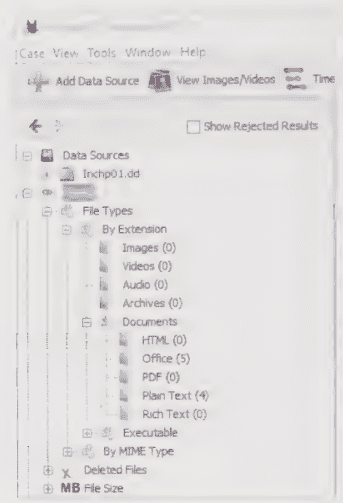

**图 1-15** Autopsy 的树查看器面板

来源：www.sleuthkit.org

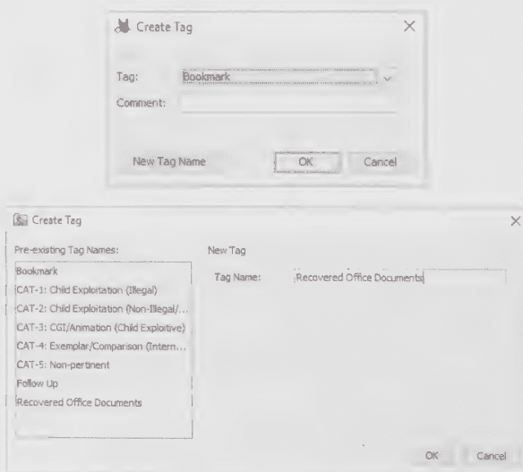

**图 1-16** 创建标记对话框

来源：www.sleuthkit.org

- 5. 在“结果查看器”面板中，按 `Ctrl`+点击 `Billing Letter.doc`、`Income.xls`、`Regrets.doc`、`$0000000.doc` 和 `$0000049.doc` 以选择这些文件，然后使用 `Ctrl` 键。右键点击图 1-17 所示的高亮文件，指向“标记文件”（Tag File）然后点击“快速标记”（Quick Tag），最后点击“Office Documents”（Office Documents）。

目录列表

Office

表格：缩略图

| 名称 | 位置 | 修改时间 | 更改时间 | 访问时间 |
| --- | --- | --- | --- | --- |
| | | | | |

图 1-17 选择多个文件进行标记

来源：sleuthkit.org

- 6. 在树查看器面板的“文档”下，点击“纯文本”（Plain Text）以显示更多恢复的文件。

- 7. 在“结果查看器”面板中，再次选择步骤 5 中列出的文件，右键点击所选内容，指向“标记文件”（Tag File）然后点击“快速标记”（Quick Tag），然后点击“后续处理”（Follow Up）。让 Autopsy 继续运行。

下一步是分析数据并搜索相关信息。数据分析可能是最耗时的任务，即使你确切知道要找什么。定位证据物的方法是搜索特定值。数据值可以是唯一的或不可打印字符，例如十六进制代码。还有是从键盘生成的打印字符代码，例如版权符号（©）或注册商标（TM）。许多取证程序可以搜索字符串和十六进制值，例如版权符号的 `0xA9` 或注册商标的 `0xAE`。所有这些可搜索数据被称为“关键词”（keywords）。十六进制值通常以零和字母开头以便清晰识别它们代表什么。使用 Autopsy，你可以搜索感兴趣的关键词。对于本案件，你需要找到与 George 关联的文件。按照以下步骤搜索“George”：

- 1. 点击右上角的“搜索”（Search）按钮，在文本框中输入 `George`（参见图 1-18），然后点击“搜索”。


- 2. 在“结果查看器”面板中，打开一个名为“search 1”的标签。点击每个文件在“内容查看器”中显示其内容（参见图 1-19）。查找包含 "George" 的。

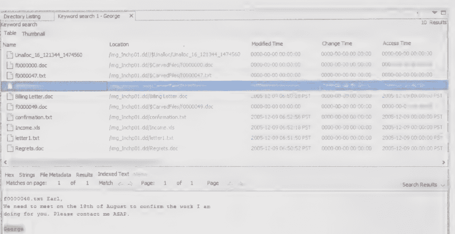

图 1-18 输入关键词

来源：www.sleuthkit.org

图 1-19 搜索 "George" 的结果

来源：www.sleuthkit.org

- 3. 点击右上角的“关键词列表”（Keyword Lists），勾选“地址”（Addresses）复选框，然后点击“搜索”。

- 4. 在“结果查看器”面板中，打开一个名为“search 2”的标签。点击每个文件在“内容查看器”中显示其内容并检查找到的所有地址。让 Autopsy 继续运行以便你可以在下一节了解更多功能。

### Autopsy 的一些附加功能

如果你找到内容查看器显示二进制（不可打印）数据的感兴趣的文件，Autopsy 有六种查看选项：十六进制（Hex）、字符串（Strings）、文件元数据（File Metadata）、索引文本（Indexed Text）和媒体（Media）。要查看未分配扇区，点击内容查看器中的十六进制标签，如图 1-20 所示

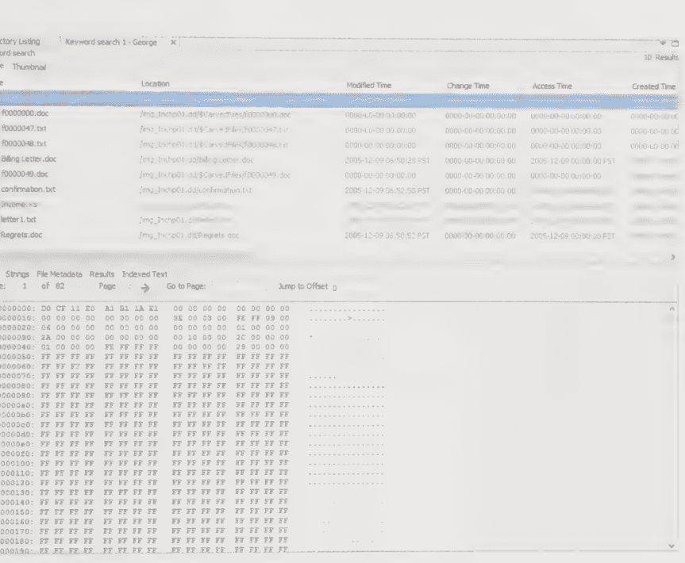

| 名称 | 位置 | 修改时间 | 更改时间 | 访问时间 | 创建时间 |
|---|---|---|---|---|---|
| 0000000.dic | C:\temp\0000000... | 0000-01-01 00:00 | 0000-01-01 00:00 | 0000-01-01 00:00 | 0000-01-01 00:00 |
| 0000047.txt | C:\temp\0000047... | 0000-01-01 00:00 | 0000-01-01 00:00 | 0000-01-01 00:00 | 0000-01-01 00:00 |
| billing_letter.txt | C:\temp\billing_let... | 0000-01-01 00:00 | 0000-01-01 00:00 | 0000-01-01 00:00 | 0000-01-01 00:00 |
| 0000049.doc | C:\temp\0000049... | 0000-01-01 00:00 | 0000-01-01 00:00 | 0000-01-01 00:00 | 0000-01-01 00:00 |
| confirmation.txt | C:\temp\confirma... | 0000-01-01 00:00 | 0000-01-01 00:00 | 0000-01-01 00:00 | 0000-01-01 00:00 |
| letter_1.txt | C:\temp\letter_1... | 0000-01-01 00:00 | 0000-01-01 00:00 | 0000-01-01 00:00 | 0000-01-01 00:00 |
| Regastra.doc | C:\temp\regastra... | 2015-12-29 16:52:58 PST | 0000-01-01 00:00 | 2015-12-29 12:12:20 PST | 0000-01-01 00:00 |

图 1-20 在未分配空间查看搜索结果

来源：sleuthkit.org

# 第 1 章 理解数字取证职业与调查

向客户提供他们的账户。文件上的时间和日期戳处于工作时间范围内，因此你也应该包含这些信息。最后，你应该将证据交给你的主管或 George 的经理 Steve，然后由他来决定行动方案。

### Autopsy 报告生成器

Autopsy 具有多种风格的报告，包括纯文本文件、带有工物链接的 HTML 网页以及 Excel 表格。要生成报告，你可以遵循以下通用步骤：

- 如果你退出了 Autopsy，请重新启动它，并点击“打开最近案例”（Open Recent Case）。点击 InChoAPI，然后在“最近的案例”窗口中点击“打开”。在 Autopsy 的主窗口中，点击顶部的“生成报告”（Generate Report）按钮。

- 在“生成报告”窗口中，在“报告模块”（Report Modules）部分选择你想要的报告格式（见图 1-21）。例如，“结果 - HTML”选项会生成一个带有标记工物的可链接网页，而“文件 - 文本”选项会创建一个纯文本输出文件。完成后，点击“下一步”（Next）。

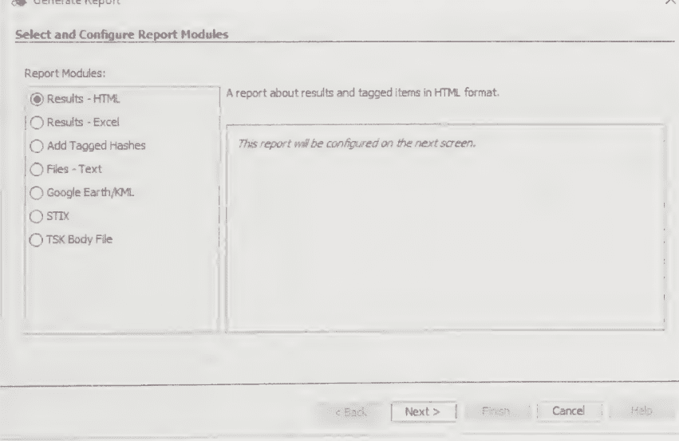

图 1-21 生成报告窗口

- 如果选择“结果 - HTML”，将打开“配置工物报告”（Configure Artifacts Report）窗口，你可以在其中选择要添加到报告中的数据。做出选择后，点击“完成”（Finish）以生成报告。

- 报告生成后，Autopsy 会显示“报告生成进度”（Report Generation Progress）窗口。点击链接打开报告，并在审核后点击“关闭”（Close）。

### 案例评审

在关闭案例并制作最终报告后，你需要与你的部门同事或调查小组会面，并对案例进行评审，以改进你的工作。问问自己以下评估性问题：

- 你是否可以提高案件中的表现？
- 你是否预料到了发现的结果？案件的发展是否以你意料之外的方式进行？
- 文档记录是否尽可能详尽？
- 从请求源收到了哪些反馈？
- 你是否发现了任何新问题？如果是，它们是什么？
- 你在案件过程中或研究期间是否使用了新技术？

在你的日志中记录关于未来调查中可能需要更改或处理的技术或流程。将你的日志存储在安全的地方。

### 章节总结

- 数字取证将法证程序应用于数字证据。这一过程涉及系统地收集和分析数字信息，以用作民事、刑事和行政案件的证据。数字取证与网络取证和数据恢复在范围、技术和目标上有所不同。
- 与数字证据相关的法律建立于 20 世纪 70 年代。
- 要成为成功的数字取证调查员，必须熟悉多种计算平台。为了补充知识，要建立并与计算机、网络和调查专业人士保持联系。
- 调查人员需要专门的工作站来检查数字证据，包括用于证据驱动器的额外槽位、取证软件和写保护保护器。
- 公共部门和私营部门的调查不同之处在于，公共部门调查通常在扣押数字证据之前需要搜查令。美国宪法第四修正案以及其他国家的类似法律适用于搜查和扣押。在私营部门调查中，你寻找证据是为了支持刑事指控。在私营部门调查中，你寻找证据是为了支持对违反规章、滥用资产以及在某些情况下的刑事投诉的指控。
- 应该使用警告横幅提醒员工和访客公司关于计算机、电子邮件和互联网使用的政策。
- 公司应该定义并限制可以启动调查的授权请求者数量。
- 数字取证调查员必须保持职业操守以保护他们的信誉。
- 始终使用系统方法进行调查。遵循本章的清单作为你案件的指南。
- 在策划案件时，要考虑到案件的性质、请求者的指示、你需要的工具和专业知识。

### 术语

- 证词书 (affidavit)
- 指控 (allegation)
- 批准的容器 (approved container)
- 律师客户权限 (attorney-client privilege)
- 授权请求者 (authorized requester)
- 位比特代码 (bit-code)
- 位比特流 (bit-stream)
- 证据链 (chain of custody)
- 计算机技术调查员 (CTIN)
- 数据恢复 (data recovery)
- 数字第一响应员 (DEFR)
- 数字证据专家 (DES)
- 数字取证 (digital forensics)
- 数字调查 (digital investigations)
- 证据袋 (evidence bags)
- 证据记录表 (evidence custody form)
- 证明证据 (exculpatory evidence)
- 证物 (exhibits)
- 取证工作站 (forensic workstation)
- 第四修正案 (Fourth Amendment)
- 敌对工作环境 (hostile environment)
- 有罪证据 (inculpatory evidence)
- 工业间谍 (industrial espionage)
- 国际调查专家协会 (IACIS)
- 审讯 (interrogation)
- 访谈 (interview)
- 权限范围 (line of authority)
- 漏洞威胁评估 (vulnerability/threat assessment)
- 搜查和扣押 (search and seizure)
- 搜查令 (search warrants)
- 响应与管理 (response and management)
- 警告横幅 (warning banner)
- 白领犯罪 (white-collar crimes)
- 职业操守 (professional conduct)

### 复习题

1. 数字取证和数据恢复是指相同的活动。对。
2. 美国警方必须遵守哪项修正案？
   a. 第三修正案
   b. 第四修正案
   c. 第一修正案
   d. 以上均非
3. 安全三要素包括以下哪些内容？
   a. 检测、响应、监控
   b. 漏洞评估、检测和监控
   c. 漏洞威胁评估以及网络入侵响应和数字调查
   d. 漏洞评估、入侵响应和监控
4. 维护专家网络的目的是？
5. 政策可以针对哪些内容制定规则？
   a. 从家里登录公司网络
   b. 你可以或不可以访问的网站
   c. 你可以发送的电子邮件数量
   d. 以上所有
6. 列出警告横幅上应该显示的两个项目。
7. 通常情况下，私营部门调查员被视为执法人员。对。
8. 列举出在商业环境中通常进行的两种数字调查类型。
9. 什么是职业操守，它为什么重要？
10. 证词书的目的是？
11. 搜查令的必要要素有哪些？
12. 确定调查所需资源的方法有哪些？
13. 列出证据记录表上应包含三个项目。
14. 为什么在调查前应该进行标准的风险评估？
15. 你应该总是证明雇佣你的人指控。对。
16. 对于数字证据，证据袋通常由静电材料制成。对。
17. 为什么要对证据介质进行写保护？
18. 列出案件报告中应包含的三个项目。

## 第一章 理解数字取证职业与调查

19. 为什么在案件完成后你还需要对该案件进行评判？
21. 在律师针对律师-客户特权案件发布备忘录之前收集的数据，受机密工作成果规则的保护。对或错？
20. 物理占有证据的人员列表称为什么什么？


在你的工作文件夹下创建 `Chap01Projects`。然后，从本章节的下载区域（该书的配套网站）下载 `Chap01DataFiles.exe` 文件到该工作文件夹。在文件资源管理器中双击此文件以解压其内容。

### 实践项目 1-1

该项目的案件涉及一起离奇死亡。乔舒亚·扎坎（Joshua Zarkan）在他的公寓发现了女友的尸体并报了案。第一现场响应执法人员收缴了一个 USB 盘。一名精通数据采集的犯罪现场技术人员使用 `FTK Imager` 对 USB 盘进行了镜像，并将其命名为 `C1Prj01.E01`。采集完成后，技术人员妥锁了 USB 盘，并将其放在警察局的证据证据柜中。你收到了负责此案件的侦探发来的镜像文件。他指示你检查并识别可能与此案件相关的任何证据制品。为了处理此案件，请按照以下步骤评估镜像中的内容：

- 1. 启动 `Autopsy` 或 `VM File`，点击“新案件”（New Case）图标。在“新信息”（New Information）窗口中，在案件名称（Case Name）文本框中输入 `C1Prj01`，点击浏览基础目录（Base Directory）文本框。导航到你的工作文件夹，并点击“下一步”（Next）。
- 2. 在“附加信息”（Additional Information）窗口中，在案件编号（Case Number）文本框中选择 `C1Prj01`，并在调查员（Examiner）文本框中输入你的名字，点击“完成”（Finish）。
- 3. 在“选择数据源”（Select Data Source）窗口中，点击选择数据源类型列表，点击“磁盘（Disk）或虚拟机文件（VM file）”。点击“浏览镜像文件”文本框旁边的浏览按钮，导航并点击你的工作文件夹以及 `C1Prj01.E01` 文件，然后点击“打开”（Open）。点击“下一步”。
- 4. 在“配置导入模块”（Configure Ingest Modules）窗口中，选择“全选”（Select All），然后点击“完成”。
- 5. 在树状查看器（Tree Viewer）中，展开“视图”（Views）、“文件类型”（File Types）、“按扩展名”（By Extension）和“文档”（Documents）。
- 6. 检查“文档”下的每个文件夹。确定哪一个文件夹可能包含本案件感兴趣的文件。
- 7. 如果你发现任何与案件相关的文件，将它们分组选中，右键点击选中项并点击“提取文件”（Extract File(s)）。在“保存”对话框中，点击“保存”以将文件自动保存到 Autopsy 的案件文件夹中：`Work\Chap01\Projects\C1Prj01\Export`。
- 8. 编写一份不超过两段的短报告，包括你发现的任何内容中的事实。完成后，如果你将继续进行项目的最后，请保持 Autopsy 运行。

### 实践项目 1-2

在此项目中，你为一家大型公司的 IT 安全部门工作。你的职责包括对公司计算系统进行数字调查和取证检查。法务部的一名法律助理琼斯女士（Ms. Jones）请求你检查一个属于已离职且目前在竞争对手处工作的员工的 USB 盘。法务部担心该员工可能拥有公司的敏感公司数据。

此外，她告诉过你该员工可能接触过机密文件，因为一位同事在他上班的最后一天看到了他经理的电脑。这些文件由九个包含“机密（confidential）”字样的文件组成。她想知道 USB 盘的位流镜像文件中是否包含这些文档。

为了处理此案件，请确保 `CPrj02.001` 文件已提取到你的工作文件夹中，然后按照以下步骤操作：

- 1. 如果你在上一个项目结束时退出了，请启动 Windows 版 `Autopsy`。如果上一个对象已打开，从菜单中点击“案件”（Case）->“案件主页”（Case Home）。点击“新案件”（New Case）图标。在“新案件信息”中，在案件名称框中输入 `CPrj02`，点击浏览基础目录文本框。导航并点击你的工作文件夹，然后点击“下一步”。
- 2. 在“附加信息”（Additional Information）窗口中，在编号（Number）框中输入 `CPrj02`，并在调查员（Examiner）框中输入你的名字，然后点击“完成”。
- 3. 在“数据源”（Data Source）窗口中，点击选择数据类型类型列表，点击“磁盘镜像（Disk Image）或虚拟机文件（VM file）”。点击“浏览镜像文件”文本框旁边的浏览按钮，导航并点击你的工作文件夹以及 `CPrj02.001` 文件，然后点击“打开”。点击“下一步”。
- 4. 在“配置导入模块”（Configure Ingest Modules）窗口中，点击“全选”。点击下一步然后点击完成。


- 5. 点击右上角的“关键词搜索”，在文本框中输入 `confidential`，然后点击搜索。

- 6. 在结果查看器中，会打开一个名为“搜索”的新标签页。点击每个文件以在内容查看器面板中查看其内容。

- 7. `Ctrl`+点击选择关键词搜索框中的文件。右键点击此选中项，选择“标记文件”，点击“标记和注释”。在“创建标签”对话框中，点击“新标签名称”，在标签名称文本框中输入 `Recovered Documents`，然后点击确定。

- 8. 点击顶部的“生成报告”。在“生成报告”窗口中，点击报告模块部分中的“结果 - Excel”，然后点击下一步。

- 9. 在“配置产物报告”窗口中，点击“已标记结果”按钮，勾选“Recovered Documents”，点击完成。

- 10. 在“报告生成完成”窗口中，点击“结果 - Excel”打开 Excel 表格。在报告生成完成窗口中，关闭 Autopsy。该 Excel 表格应包含你标记的信息。

### 实践项目 1-3

你是 Superior Sailmakers 的 IT 安全专家，该公司生产用于纵帆和横帆的帆。该公司向许多相互竞争的帆制造商销售。人力资源部的奥尔森女士通知你收到一封关于 USB 盘的匿名信。信称前员工拉尔夫·廉姆斯在 2007 年 1 月离开 Superior Sailmakers 后，利用该 USB 盘上的照片进入了竞争对手 Speedy Boats 公司。

奥尔森女士告诉你，另一位技术人员已经对 USB 盘制作了镜像（`.B01` 格式）。她希望你检查内容中的照片文件，以确定匿名投诉是否属实。在你检查后，你需要生成一份报告发送给法务部。法务部将判断是否违反了贸易秘密或知识产权法。

按照以下步骤操作：

- 1. 启动 Windows 版 `Autopsy`，点击“新案件”图标。在“新信息”窗口中，在名称框中输入 `C1Prj03`，点击浏览基础目录文本框。导航到你的工作文件夹，然后点击“下一步”。

- 2. 在“附加信息”窗口中，在案件编号框中选择 `C1Prj03`，并在调查员框中输入你的名字，然后点击“完成”。

- 3. 在“选择数据源”窗口中，点击选择数据类型列表，点击“磁盘镜像或虚拟机文件”。点击“浏览镜像文件”文本框旁边的浏览按钮，导航并点击你的工作文件夹以及 `C1Prj03.B01` 文件，然后点击“打开”。点击“下一步”。

- 4. 在“配置导入模块”窗口中，选择“全部”。点击下一步然后完成。

因为你正在寻找在 2006 年 4 月期间某被复制到 USB 盘的照片

- 1. 在树状查看器中，展开“视图”、“文件类型”以及“按扩展名”和“图像”。

- 2. 在结果查看器面板中，如有必要，向左滚动直到“修改时间”列出现在视野中。点击修改时间头进行排序。

- 3. 向下滚动直到找到起始月份为 2006 年 4 月的文件，然后点击该文件在内容查看器中查看。按下键盘上的下箭头查看所有在 2006 年 4 月创建或修改的文件。

- 4. `Ctrl`+点击每一个带有船或船局部的照片。右键点击此选中项，指向“标记文件”并选择“快速标记”，点击“后续操作”。

## 第一章 理解数字取证职业与调查

- 5. 在树状查看器面板中，向下滚动并展开标签、后续处理和文件标签。

- 6. 在结果查看器面板中，点击缩略图选项卡查看已标记的照片。

- 7. 要创建报告，点击顶部的生成报告。在生成报告窗口中，点击报告模块部分的 Results - HTML ，然后点击下一步。

- 8. 在配置构制品报告窗口中，点击标记结果按钮，勾选后续复选框，然后点击完成。

- 9. 在报告生成进度窗口中，点击 Results - HTML 路径查看报告。查看报告时，点击链接以检查已标记的文件。完成后，点击报告生成进度窗口中的关闭。

- 10. 退出 Autopsy，并编写简短备忘录来总结你的发现。


在进行字符串搜索时，检查可能包含文件的图形文件是一个良好的做法。取证工具中的搜索功能会忽略图形文件，因为图形文件中的文本是作为图片的一部分存储的，而不是文本。

### 动手项目 1-4

有时，法律事务所的发现需求要求你仅从磁盘恢复已分配的数据。本项目将向你展示如何从镜像中提取未删除的文件（即已分配的文件）。

- 1. 启动 Windows 版 Autopsy。点击创建新案件图标。在新案件信息窗口中，在案件名称文本框中输入 `C1Prj04`，并点击基础目录文本进行浏览。导航到你的工作文件夹，然后点击下一步。

- 2. 在附加信息窗口中，在案件编号文本框中输入 `C1Prj04`，在审查员文本框中输入你的名字，然后点击完成。

- 3. 在数据源窗口中，选择数据源类型列表箭头，点击磁盘镜像或虚拟机文件。点击“浏览镜像文件”文本框，导航到你的工作文件夹，点击 `C1Prj04.E01` 文件并点击打开。点击下一步。

- 4. 在配置导入模块窗口中，点击全选。点击下一步然后点击完成。

- 5. 在树状查看器面板中，展开视图、文件类型和按扩展名。在按扩展名下，有几个代表文件类型的子文件夹，正如你在之前的项目中看到的那样。每个文件类型子文件夹旁边都有一个括号内的数字，显示了 Autopsy 发现的该类型文件数量。点击数字大于零的子文件夹以查看文件。

- 6. 在结果查看器面板中，如有必要，向右滚动直到视图中的 Flags(Meta) 列。通过点击 Flags(Meta) 表头对该列进行排序，这将所有已分配的文件显示在列表顶部。

## 第一章 理解数字取证职业与调查

### 注意事项

在结果查看器面板中，已分配（未删除）的文件在文件名左侧有一个纸张图标。已删除（未分配）的文件在纸张图标上有一个红色的 X，而被操作系统损坏并恢复的未分配文件有一个对斜线图标。

- 向左滚动直到名称列可见。如果有已分配的文件，它们将位于此列表的顶部。按住 `Ctrl` 并点击每个已分配的文件，右键点击此选择项，然后点击提取文件。

- 在保存对话框中，点击保存将文件自动保存到 Autopsy 的案件子文件夹中：`Work\Chap01\Projects\CPr01\Export`。

- 编写一份简要备忘录，列出你导出的所有文件。导出 Autopsy 用于下一个项目。

### 动手项目 1-5

本项目是上一个项目的延续。你创建一个列出文件的报告，列出 Autopsy 发现的所有未分配（已删除）文件，并在需要时重启 Autopsy。

- 如果需要，启动 Windows 版 Autopsy

- 在树状查看器面板中，展开视图、文件类型和按扩展名。

- 在结果查看器面板中，点击所有。

- 右键点击此选择项，指向标记文件并点击后续。

- 点击顶部的生成报告。在生成报告窗口中，点击报告模块部分的 Results - HTML ，然后点击下一步。

- 在配置构制品报告窗口中，点击标记结果按钮，勾选后续复选框，然后点击完成。

- 在报告生成进度窗口中，点击 Results - HTML 路径查看报告。完成后，点击关闭。- 导出 Autopsy 用于下一个项目。

### 动手项目 1-6

有时，法律事务所的发现需求要求你仅从磁盘恢复已分配的数据。在本项目中，另一位调查员要求你检查镜像并搜索以下关键词：

- ANTONIO
- EVANS
- HORATIO

在你完成这些搜索后，调查员想要一份包含这些名字的报告。

- 启动 Windows 版 Autopsy。点击创建新案件图标。在新案件信息窗口中，在案件名称文本框中输入 `C1Prj04`，并点击基础目录进行浏览。

- 在附加信息窗口中，在案件编号文本框中输入 `C1Prj04`，在审查员文本框中输入你的名字，然后点击完成。

- 在数据源窗口中，选择数据源类型列表箭头，点击磁盘镜像或虚拟机文件。点击“浏览镜像文件”文本框，导航到你的工作文件夹，点击 `C1Prj04.E01` 文件并点击打开。点击下一步。

- 在配置导入模块窗口中，点击全选。点击下一步然后点击完成。

- 在树状查看器面板中，展开视图、文件类型和按扩展名。

- 在结果查看器面板中，点击所有。

- 右键点击此选择项，指向标记文件并点击后续。

- 点击顶部的生成报告。在生成报告窗口中，点击报告模块部分的 Results - HTML ，然后点击下一步。

- 在配置构制品报告窗口中，点击标记结果按钮，勾选后续复选框，然后点击完成。

- 在报告生成进度窗口中，点击 Results - HTML 路径查看报告。完成后，点击关闭。

## 第一章 理解数字取证职业与调查

- 9. 在 Autopsy 主窗口中，再次点击关键词列表，勾选搜索，然后搜索。

- 10. 检查每个文件以查看其是否包含“机密”。如果是，右键点击文件，指向标记文件并点击后续。

如果搜索结果不在内容查看器中显示关键词，可能是被遮挡了。例如，如果关键词位于与图形文件混合的未分配空间，内容查看器会自动显示图形文件。如果发生这种情况且你想检查未分配区域，使用内容查看器的 Hex、String 或索引文本选项卡查看可以发现哪些额外信息。

- 11. 点击顶部的生成报告。在生成报告窗口中，点击报告模块部分的 Results - HTML 选项按钮，然后点击下一步。

- 12. 在配置构制品报告窗口中，点击标记结果按钮，勾选后续复选框，然后点击完成。

- 13. 在报告生成进度窗口中，点击 Results - HTML 路径查看报告。完成后，点击关闭并退出 Autopsy。向调查员写一份备忘录，提供报告中的以下信息：

- 关键词
- 文件路径和文件名
- 修改日期时间
- 创建日期时间
- 文件大小

### 案例项目 1-1

一家保险公司要求你的数字取证公司审查一起纵火调查案。嫌疑纵火犯已被捕，但保险公司想确定受害者是否存在过失性错。有两份文件：第一份 `CasePrj01a.doc` 是警方部门的一份关于案件的备忘录；第二份 `Chap01_CasePrj01b.doc` 是保险公司的信函，说明了应该调查的内容。查看这些文件，并决定你的公司需要采取的行动方案。写一份你的公司将如何处理该案件的大纲。

# 第 1 章 了解数字取证职业与调查

### 案例项目 1-2

Jonathan Simpson 拥有一家建筑公司。一天，一名分包商给他打电话，说他需要一张为他在西枫树大道 1437 号完成的工作补办的支票。Jonathan 在会计程序中查询了该任务，并同意重新开具金额 12,750 美元的支票。分包商说原始支票金额仅为 10,750 美元。Jonathan 环顾办公室，但找不到公司的支票簿或账本。只有另外一个人可以访问会计程序。Jonathan 找你进行调查。你将如何开展？请写一份页报告，详细说明 Jonathan 为收集必要证据和保护其公司需要采取的步骤。

### 案例项目 1-3

你是一家律师事务所的数字取证调查员。该律所获得了一位新客户，一位年轻女性因电脑上发现不当文件而被解雇。她发誓自己从未访问过那些文件。你应该问哪些问题？应该如何进行？请写一份一到两页的报告，描述客户使用的电脑、谁还有权访问该电脑，以及其他应该被调查的相关事实。

### 案例项目 1-4

一名绝望的员工来电，因为她不小心删除了硬盘上的关键文件，且无法从回收站中恢复它们。你有哪些选择？请写一份一到两页的内容，说明你的能力，并列出你需要针对她的系统询问的问题。

### 调查员办公室与实验室

在阅读本章并完成练习后，你将能够：

- 说明数字取证实验室的认证要求
- 列出数字取证实验室的物理要求
- 解释基础取证工作站的选择标准
- 描述用于建立取证实验室业务案例的组件

本章解释了建立高效数字取证实验室的一些方案。实验室中的每位数字取证调查员都应该有一个私人办公室，可以在那里管理案件、进行访谈并交流，而不必担心被窃听。无论你是数字取证的新手还是经验审查员，你的目标都是让你的办公室和实验室在所有案件中顺畅高效地工作。

数字取证调查员在更新实验室以跟上计算机技术变化时，必须考虑预算和时间。你建立的工作流和流程直接影响你所发现的证据的质量。在确定需要添加到实验室的设备、软件和其他项目时，你必须平衡成本、质量和可靠性。本章为组织、控制和管理一个安全、高效的取证实验室提供了基础。

# 了解取证实验室认证要求

数字取证实验室是你进行调查、存储证据并完成大部分工作的地方。你利用实验室存放仪器、当前和旧版软件以及取证工作站。通常情况下，你需要各种数字取证硬件和软件来工作。

在开始任何案件工作之前，你还需要确保已经定义了政策、流程和规定的程序，以确保分析及其结果的完整性。许多机构已经制定了制定自己的流程和程序的指南。最重要的是，你要遵循自己创建的政策和程序，以确保输出的一致性。检查清单是确保人员保持一致操作方法的好方法。

> 在追求任何认证之前，务必彻底研究认证机构。

ANSI-ASQ 国家认证委员会 (ANAB) (www.anab.org) 是 ANSI（美国国家标准学会）和 ASQ（美国质量质量协会）的全资子公司，为全球范围内的犯罪和取证实验室提供认证。该认证包括分析数字证据的取证实验室。为了使实验室获得认证，ANAB 会对实验室的任务和功能进行审计，以确保所有案件都有正确且一致的结果。这些审计是对订阅成员的取证实验室进行的，以确保其工作的质量和完整性。以下章节讨论了 ANAB 程序的几项关键指南，你可以将其应用于管理、配置和审计你的取证实验室。有关 ANAB 如何符合国际标准的更多信息，请参阅：www.anab.org/forensics-accreditation/iso-iec-17025-forensic-labs。

### 识别实验室经理和员工的职责

ANAB规定，每个实验室都应该有一个母机构以及实验室主任或经理确定的特定目标。实验室经理建立管理案件的流程并定期进行审查。除了执行一般的管理任务（如在决策中促进群体共识、维护实验室需求的财政责任以及在员工中执行伦理标准，见第 15 和第 16 章）外，实验室经理还计划实验室的更新，例如购买新的硬件和软件。

## 第 2 章 调查员办公室与实验室

实验室经理还负责建立并推广实验室员工遵循的质量保证流程，例如概述案件到达时该做什么、记录证据、指定谁可以进入实验室以及建立报告编写指南。为了确保效率，实验室经理还为处理工作设定了合理的生产计划。

典型的调查涉及没收硬盘和其他介质（如 USB 驱动器）；对其制作取证副本；评估证据；编写报告。例如，对一个 6 TB 的磁盘进行取证分析可能需要几天或几周，并且通常涉及在夜和周末运行成像。这意味着其中一个取证工作站将被占用这段时间，可能是 20 小时或更多。根据以往经验，实验室经理可以估计每位调查员可以处理多少案件，以及预计何时获得每个案件的初步和最终报告。

实验室经理为员工创建并监控实验室政策，并为员工和证据提供安全的工作环境。最重要的是，经理对实验室员工完成的所有活动负责。跟踪如电子邮件、互联网滥用和非法活动等案件可以为实验室投入的资金提供理由。

取证实验室的员工有足够的培训来完成任务。必要的技能包括硬件和软件知识（包括开源软件和文件类型）以及演绎推理。他们的工作由实验室经理和同事定期审查以确保质量。员工还负责进行持续的技术培训，以更新他们的调查和计算机技能，并维护他们已完成培训的记录。许多供应商和组织举办年度或季度研讨会，提供认证考试。

ANAB 网站总结了管理数字取证实验室、处理和保护证据、执行实验室程序、设定人员要求以及鼓励职业发展的要求。该网站还提供打印和在线实验室管理指南的用户许可。ANAB 强调，每个实验室都应在其领域维护一个最新的资源库。

### 实验室预算规划


# 专业数字调查实验室指南

## 实验室成本与预算规划

为了进行专业的数字调查，你需要了解实验室运行的成本。成本可以分为每月、每季度和年度支出。你对这些支出的了解越多，越有助于为每个调查分配资源。使用电子表格可以帮助跟踪过去的调查支出，从而推算出未来的成本。

## 第2章 调查员办公室与实验室

### 预算制定与资源评估

在制定预算时，首先估计你的实验室预计检查的案件数量，并识别你可能检查的计算机类型，例如 Windows PC、Apple 系统或 Linux 工作站。例如，假设你任职于一家州立警察机构，该机构计划为全州提供数字调查服务。你可以从收集今年及过去几年的犯罪统计数据开始，以确定与这些犯罪相关的计算机类型或其他设备。犯罪行为通常反映了某些计算系统的销售趋势。大多数消费者使用 Intel 和 AMD 的 PC，且这些计算机大部分运行 Windows 系统，用于犯罪的计算机很可能也是如此。通过确定每种系统在犯罪中的具体用途来验证这一趋势。列出涉及 Windows、Linux/UNIX 和 Apple 计算机的犯罪案件数量。除了估计数字调查所需的资源外，你还应该确定移动设备（如智能手机和平板电脑）需要哪些资源。

如果你无法找到数字犯罪中使用的计算机类型和操作系统（OS）的详细信息，请收集足够的信息做出合理的推断。你的目标是为你预期调查的系统类型和数量建立一个基准。除了你收集的历史数据外，还要识别可能影响你实验室的任何趋势，例如操作系统的新版本或涉及犯罪的计算机数量增加。

接下来，估计你可能会进行多少涉及低频率使用系统的调查，以帮助确定你需要多少工具来检查这些系统。例如，如果你了解到平均每月有一台 Macintosh 涉及一起刑事调查，那么你可能只需要一两个软件工具就可以对 Macintosh 文件进行取证分析。

图 2-1 显示了一张来自《统一犯罪报告》（Uniform Crime Report）的统计表，该表识别了硬盘类型（如 SATA 或 SCSI）以及用于犯罪的操作系统。年度的《统一犯罪报告》在联邦、州和地方级别生成，以显示所犯罪罪的类型和频率。对于联邦报告，请参阅 `https://uccr.fbi.gov/uccr-publications`；对于不同级别犯罪的摘要，请参阅 `www.bjs.gov`。

你还可以识别用于某些特定犯罪的专业软件。例如，如果你发现几起伪造案件中使用了某种支票开具软件工具，你应该考虑将该专业软件加入你的库存清单。

如果你正准备为私营公司建立法医实验室，你可以更轻松地确定需求，因为你工作在一个封闭环境中。首先获取业务中使用的所有已知计算机系统和应用程序的清单。例如，保险公司通常拥有一个 Intel PC 和服务器网络，以及使用数据库进行数据存储的专业软件。大型制造公司可能使用 Intel PC、运行计算机辅助设计（CAD）系统的 UNIX 工作站、超级微型计算机和大型主机。出版公司可能拥有 Intel PC 和 Macintosh 系统的组合，以及各种文字处理、成像和排版软件包。许多其他组织使用云存储或监视控制与数据采集（SCADA）系统来处理数据和应用程序。

| 2016年犯罪统计 | Windows 操作系统 | Linux OS X & 9 | 其他硬件 (H/W) | 移动设备 | 检查系统总数 |
|---|---|---|---|---|---|
| 火灾 | 5 | 3 | 1 | 0 | 5 |
| 贿赂 | 6 | 3 | 0 | 1 | 4 |
| 盗窃 | 6 | 0 | 0 | 0 | 0 |
| 儿童色情 | 29 | 14 | 2 | 7 | 46 |
| 伪造与造假 | 6 | 6 | 0 | 0 | 7 |
| 毒品 | 20 | 7 | 0 | 3 | 64 |
| 侵用公款 | 9 | 9 | 0 | 1 | 1 |
| 勒索 | 5 | 3 | 0 | 1 | 6 |
| 诈骗 | 13 | 4 | 0 | 7 | 52 |
| 赌博 | 10 | 7 | 0 | 2 | 24 |
| 杀人 | 13 | 5 | 0 | 0 | 8 |
| 绑架与劫持 | 0 | 0 | 0 | 0 | 1 |
| 盗窃 | 2 | 1 | 0 | 2 | 3 |
| 抢劫 | 1 | 0 | 0 | 1 | 1 |
| 强迫性奸 | 6 | 4 | 0 | 0 | 4 |
| 非强迫性奸 | 8 | 8 | 0 | 0 | 16 |
| 跟踪 | 15 | 9 | 0 | 5 | 42 |
| 盗财产罪 | 1 | 1 | 0 | 0 | 1 |
| 军火违规 | 2 | 2 | 0 | 0 | 2 |
| 总计 | 157 | 86 | 7 | 28 | 287 |

**图 2-1 统一犯罪报告统计**

接下来，咨询管理层以确定你需要多少工具来检查这些系统。你的预算还应考虑到技术的发展。在考虑法医实验室时，你必须了解变化。像硬件一样，操作系统也会发生变化。如果你目前的取证工具不支持下一个操作系统或文件系统，你就必须进行升级。你应该监控或联系开发团队以了解更新信息。文件系统也会变化。取证起源于 DOS，多年来，Windows 硬盘使用了多种文件系统，包括 `FAT16`、`FAT32`、新建文件系统 (`NTFS`)、弹性文件系统 (`ReFS`) 等。大多数基于 DOS 的工具无法读取 `NTFS` 磁盘。此外，Xbox 的流行和普及要求调查人员熟悉 `FATX` 文件系统。

时间管理是选择软件和硬件时的一大重要因素。例如，你决定为你的实验室购买 8 台机器。许多商业取证软件包需要 `USB` 密钥才能运行，或者拥有 5 个并发用户的站点许可。你或预算经理必须决定是使用所有机器，还是每个软件包仅使用两份许可副本。你的选择取决于你验证过的工具以及办案人员的需求。

查看文件系统的另一种选择是使用 `Linux CD` 或 `WinFE`（`WinPE` 自动化安装包的修改版本），这些是在第3章讨论的 CD 或 DVD 获取光盘。这些工具不会自动挂载硬盘，因此不会向硬盘写入数据。（尽管如此，仍然建议使用硬件写保护器以防止取证技术人员造成的错误）。检查平板电脑、`USB` 闪存驱动器和智能手机已涵盖从刑事调查到民事诉讼发现的各种案件。数字调查员必须准备好应对这些设备不断的变化，并了解有哪些可用工具可以安全从中提取数据用于调查。在第12章中，你将学习如何从这些设备获取数据。

### 获取认证与培训

为了在数字调查和取证分析领域继续职业，你需要通过培训来提升自己的技能。多个机构开发了数字取证认证计划，这些计划通常在你完成一次或多次培训课程后对你进行测试。认证机构从非营利协会到供应商赞助小组不等。所有这些计划都会收取认证费用，并要求候选人参加供应商赞助或组织赞助的培训以获得认证资格。美国某些州立法要求在私营执业或企业工作的数字取证员持有私人调查员执照。这些州通常要求在申请执照之前，在数字取证和调查领域接受一定水平的培训和认证。

在注册认证计划之前，请彻底研究要求、成本以及在你就业地区的认可度。大多数认证计划要求继续教育学分或对候选人的技能进行重新考试，这可能会产生高昂费用。

#### 国际计算机调查专家协会

`IACIS` 由希望确定数字调查资质的执法人员创建，是最古老的专业数字取证组织之一。有关 `IACIS` 的更多信息，请访问其网站 (`www.iacis.com`) 以验证当前的成员要求。

成功通过 `IACIS` 测试的候选人被指定为认证取证计算机专家 (`CFCE`)。`CFCE` 的流程随技术变化而变化。此处的描述是目前的。`IACIS` 要求每三年重新认证一次，以证明在数字取证领域的持续工作。重新认证的强度低于原始认证，但它会对调查员进行测试，以确保他们正在继续教育并活跃在数字取证领域。有关 `CFCE` 认证或 `IACIS` 成员的最新信息，请访问 `IACIS` 网站。

除了 `CFCE` 外，`IACIS` 还有两个专门认证计划：认证高级 Windows 取证调查员 (`CAWE`) 和 `IACIS` 认证移动设备调查员 (`CMDE`)。

#### ISC² 认证网络取证专家

认证网络取证专家 (`CCFP`) 计划由 `ISC²` 赞助，要求具备数字取证、恶意软件分析、事件响应、电子发现和其他与网络调查相关的学科知识。`CCFP` 网站 (`www.isc2.org/ccfp/default.aspx`) 列出了获得该认证所需的要求和流程。

#### 高科技犯罪网络

高科技犯罪网络 (`HTCN`) 也提供多个级别的认证。然而，与 `IACIS` 不同，`HTCN` 要求对所有相关培训进行审查（包括在其批准的课程之一中的培训），并对候选人的工作历史进行审查。`HTCN` 认证向任何符合计算机调查专业标准的人开放。在写作期间，`HTCN` 网站 (`www.htcn.org`) 规定了后续段落中讨论的认证级别要求。要求更新不另行通知，因此请确保定期检查该网站。

##### 基础认证计算机犯罪调查员

- 候选人具有三年的与调查计算机相关事件或犯罪直接相关的经验。
- 候选人成功完成了从经批准的机构、组织或培训公司获得的 40 小时的培训。
- 候选人必须提供其参与的至少 10 个案件的证明。

##### 高级认证计算机犯罪调查员

- 候选人具有五年的与调查计算机相关事件或犯罪直接相关的经验。
- 候选人成功完成了从经批准的机构、组织或公司获得的 80 小时的培训。
- 候选人在过去三年中已在至少 20 个案件中担任过首席调查员，并以首席调查员、主管或支持人员身份参与了至少 40 个其他案件。候选人在过去三年中参与案件的时长至少为 60 小时。

##### 基础认证计算机取证技术员

- 候选人必须在执法或企业案件的计算机调查方面具有三年的经验。
- 候选人必须从经批准的组织完成 40 小时的计算机取证培训。
- 候选人必须提供至少 10 次计算机调查的证明。

##### 高级认证计算机取证技术员

- 候选人必须在执法或企业案件的计算机取证调查方面具有五年的实操经验。
- 候选人必须从经批准的组织完成 80 小时的计算机取证培训。
- 候选人必须提供至少 15 次计算机调查的证明。
- 候选人在过去三年中必须在 20 次或更多调查中担任首席计算机取证调查员，并在 40 次或更多调查中担任首席计算机取证技术员、主管或贡献者。候选人在过去三年中必须完成了至少 60 次调查。

#### EnCase 认证调查员认证

`EnCase` 的创建者 `Guidance Software` 赞助了 `EnCase` 认证调查员 (`EnCE`) 认证计划。`EnCE` 认证向公共和私营部门开放，专门针对 `EnCase` 取证分析的使用和精通。

参加 `EnCE` 认证考试并不取决于参加 `Guidance Software` `EnCase` 培训课程。该认证的候选人需要拥有授权的 `EnCase` 版本。有关 `EnCE` 认证要求的更多信息，请访问 `www.guidancesoftware.com/training/certifications/cparam=nav_r_`。`Guidance Software` 其他认证还有认证取证安全响应员 (`CFSR`) 和 `EnCase` 认证发现专家 (`EnCEP`)。

#### AccessData 认证调查员

`AccessData` 赞助 `AccessData` 认证调查员 (`ACE`) 认证计划。`ACE` 认证面向公共和私营部门，专门针对 `AccessData Ultimate` 工具包的使用和精通。为了帮助准备 `ACE` 考试，申请者可以参加 `AccessData` 训练营。考试包含知识库部分和实际技能部分。

### 资产管理与库存控制

还必须使用库存控制方法来跟踪你的计算资产，这意味着你应该对实验室中的所有主要硬件和软件项目维护一份完整且最新的清单。对于耗材物品（如电缆和存储介质），要维护清单，以便知道何时订购更多用品。

### 识别实验室安全需求

所有数字取证实验室都需要一个封闭的房间，用于设置取证工作站。你不应该使用开放式隔间，因为这会让人们轻易接触到你的证据。你需要一扇门锁来控制你的证据并证明其完整性。特别是，你的实验室在数据分析期间应该是安全的，即使分析硬盘驱动器需要几周时间。为了保护证据的完整性，你的实验室应该充当证物柜或保险箱，成为一个安全设施或安全的存储保险箱。

以下是任何规模数字取证实验室的最低要求：

- 具有真正通顶墙壁的小房间
- 具有锁定机制的访问入口（仅限授权用户，包括清洁人员），这可以是普通的钥匙锁、组合锁或能够记录访问人员的电子锁
- 安全容器，例如保险箱或带有高质量挂锁（防止抽屉打开）的重型文件柜
- 访客日志，其字迹清晰，列出所有访问过实验室的人员，并显示日期、进入和离开时间

对于日常工作，几名检查员可以在一个大型开放区域共同工作，只要他们具有相同的权限水平和访问需求。该区域也应该有通顶墙壁和锁门。在许多公共和私营机构中，几名调查员共用一扇实验室的门，需要身份卡和进入代码。

数字调查员和取证检查员必须接受实验室安全政策的简报。仅与需要了解该调查的其他检查员和人员分享有关案件调查的信息。

### 执行高风险调查

高风险调查（如涉及国家安全或谋杀的调查）对安全的要求比实验室最低要求提供的更多。随着技术的进步和信息在计算机攻击者之间的传播，保持调查的安全性可能会变得更加困难。例如，检测计算机窃听困难且昂贵，但外国的复杂的犯罪分子和情报机构可以使用检测网络传输、无线设备、电话通话和计算机设备使用的设备。

关于构建一个可以合法收集计算机电磁辐射的嗅探设备的说明可以在网上找到，因此任何人都可以获取。这些设备可以拾取你在计算机上输入的任何内容。

大多数电子设备都会发射电磁辐射（`EMR`）。某些类型的设备可以拦截 `EMR`，用它可以确定设备正在传输或显示的数据。计算机显示器产生的 `EMR` 在半英里之外就能被接到。

在冷战期间，国防承包商被要求对敏感计算系统进行屏蔽，防止对任何计算机发射物的电子窃听。美国国防部将这种特殊的计算机发射屏蔽称为 `TEMPEST`。有关 `TEMPEST` 的简述，请参阅《国家工业安全操作手册 [`NISPOM`]. `Dod 5220.22-M`, 第11章，第1节，`TEMPEST`，`www.dds.mil/documents/odaa/nispom2006-5220.pdf` 或 `Sans Institute`, `InfoSec Reading Room` 的文章《TEMPEST 简介》，参见 `www.sans.org/reading-room/whitepapers/priv/introduction-tempest-98`。另一个网站列出了有用的资源 (`com/~tempest.html`)。

为了保护你的调查，你可能考虑建造一个符合 `TEMPEST` 认证的实验室，这需要用专门接地的金属材料衬墙墙壁、天花板、地板和门。通常使用铜板，因为它的导电性良好。`TEMPEST` 设施必须包括电源的特殊过滤器，防止电缆传输计算机发射物。所有加热和通风管道都必须有特殊的挡流板以捕获发射物。`TEMPEST` 设施通常有两个由空隙隔开的门。在打开内部门之前，必须关闭第一个外门。每扇门还有特殊的铜制装饰以增强导电性。

由于符合 `TEMPEST` 认证的实验室价格昂贵且需要例行检查和测试，它应该仅考虑用于要求绝对防止非法窃听的大型区域数字取证实验室。为了避免这些费用，一些供应商建造了低发射工作站而不是 `TEMPEST` 设施。这些工作站比平均工作站更贵，但比 `TEMPEST` 实验室便宜。

#### 使用证据容器

证据存储容器（也称为证物柜）必须是安全的，这样未经授权的人就无法轻易接触你的证据。你必须使用高质量的锁（例如挂锁），并限制复制钥匙的分配。此外，要定期检查证据存储容器的内容，以确保只存储当前的证据。证据保管单表明了柜内的物品。结案案件的证据应转移到安全的离线设施。

`NISPOM` 第5章第3节（`www.dds.mil/documents/odaa/nispom2006-5220.pdf`）描述了安全存储容器的特征。咨询设施管理部门或法律顾问（如公司律师或检察官），以确定你的实验室应该做什么来维护证据的完整性。以下是确保存储容器安全的建议：

- 证据容器应位于只有实验室人员可以进入的受限区域。
- 授权打开证据容器的人数应保持在最少。维护关于谁授权访问每个容器的记录。
- 所有证据容器在没有授权人员直接监督的情况下，应保持锁定状态。

如果对你的容器使用了组合锁系统，请遵循这些做法：

- 为组合锁提供的安全性应与容器内容相同。将容器存放在另一个安全容器中。
- 在设置新组合后销毁任何之前的组合。
- 仅允许授权人员更改组合。
- 每六个月更改一次组合，在任何授权人员离开组织时以及在发现未安全的容器（即开启且无人看管）后立即更改。

如果你使用的是钥匙锁，请遵循这些做法：

- 指定一名钥匙保管员负责分发钥匙。
- 在每把复制钥匙上盖上序号。
- 维护一份列出分配钥匙的登记，以确保没有授权人员丢失钥匙。
- 在保管员更换时对所有钥匙进行盘点。
- 将钥匙放在只有经理和指定保管员可以进入的锁定容器中。
- 钥匙的安全性与证据容器相同。
- 每年更换锁和钥匙，如果丢失了钥匙，更换所有相关的锁和钥匙。
- 不要用一把主钥匙打开多个锁。

请确保维护一份日志，记录每个证据容器打开和关闭的时间。每次访问容器时，日志都应标明打开的日期和授权人员的字母缩写。这些记录应至少保留三年，或根据诉讼律师或公司律师的要求保留更久。日志将在第 4 章中进行更详细讨论。

### 监督设施维护

你的实验室应随时保持维护，以确保实验室人员的安全健康。地板、墙壁、天花板或家具的任何损坏都应立即修复。此外，务必护送施工人员进入设施并在他们工作时进行监控。

由于在处理计算机部件时静电是一个大问题，建议在电子工作台和工作站周围放置防静电垫。此外，地板和地毯应至少每周清洁一次，以最大限度地减少可能产生静电的损坏。

维护两个独立的垃圾桶：一个用于存放与调查无关的物品（如废弃的 `CD`），另一个用于存放需要特殊处理以确保其被销毁的敏感材料。使用相互独立的垃圾桶可以维持刑事调查过程的完整性，并保护私营公司的商业秘密和律师-客户特权通信。有几家商业碎纸公司专门处理敏感材料，你应该聘请此类公司来帮助维护你调查的完整性。

### 考虑物理安全需求


# 调查员办公室与实验室

除了实验室的物理设计和建造外，你还需要通过制定安全策略来增强安全性。你实施的物理安全程度取决于实验室的性质。区域计算机犯罪实验室具有很高的物理安全需求，因为存在丢失、损坏或破坏证据的风险。大型公司的物理安全需求可能没有那么高，因为证据丢失或泄露的风险低得多。确定你组织的风险决定了你在数字取证实验室中整合多少安全性。


在考虑数字安全时，许多公司忽视了物理安全。

无论实验室面临何种安全风险，请为所有访客维护纸质或电子签到表。日志应列出访客姓名、到达和离开的日期时间、员工姓名、访问目的以及接待访客的实验室成员姓名。将任何未分配到实验室的人员视为访客，包括清洁人员、设施维护人员、朋友和家人。所有访客在整个访问期间都由一名指定的授权工作人员全程护送，以确保他们不会无意或故意地篡改调查或证据。作为额外的预防措施，使用可见或可听的警报作为访客证，让所有调查人员知道区域内访客。如果可能，聘请安保人员或配备守卫的入侵报警系统以确保你的实验室的安全。带有守卫的报警系统也可以在办公时间后监控你的实验室。

## 审计数字取证实验室

为了确保遵守安全策略和实践，应定期检查以审计你的实验室和证据存储容器。审计应包括但不限于以下设施组件和做法：

- 每月检查一次实验室的天花板、地板和外墙，寻找任何异常或新情况。
- 检查门以确保它们能够正确关闭并锁定。
- 检查锁查看是否需要更换或更改。
- 审阅访客日志查看其使用是否得当。
- 审阅证据容器日志表以确定它们何时被打开和关闭。
- 每个工作日结束时，固定任何未在取证工作站上处理的证据。

## 确定数字取证实验室的平面图

你如何配置数字取证实验室的工作区域取决于你的预算、可用地板面积以及分配给每位计算调查员的计算机数量。对于每月处理两个到三个案件的小规模运营，一个取证工作站就足够处理工作负载。一个工作站只需要一张平均办公桌占据的空间。如果你每月处理许多案件，你可能同时处理两到三项调查，这需要一个以上的工作站。多个工作站的理想配置是两个取证工作站加上一个可以访问互联网的非取证工作站。

由于你需要在每个工作站周围留充足的空间，包含三个工作站的工作区域大约需要 150 平英尺的空间，这意味着工作区域应在 10 英尺乘以 15 英尺左右。这段空间允许放置两个椅子，以便数字调查员向另一位调查员、法律助理或律师汇报案件情况。

小型实验室通常由一个或两个取证工作站、一台可以访问互联网的科研计算机、一个工作台（如果空间允许）和存储柜组成，如图 2-2 所示。

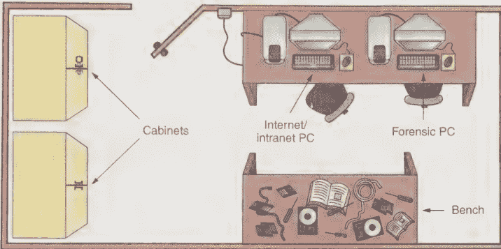

**图 2-2 小型或家庭式实验室**

中型数字取证实验室（如私营企业中的）拥有更多的工作站。出于安全考虑，实验室应至少有两个出口，如图 2-3 所示。如果可能，隔间甚至独立的办公室也应作为布局的一部分，以强化“按需知晓”策略。这些实验室通常有更多的图书馆空间来存储软件和硬件。

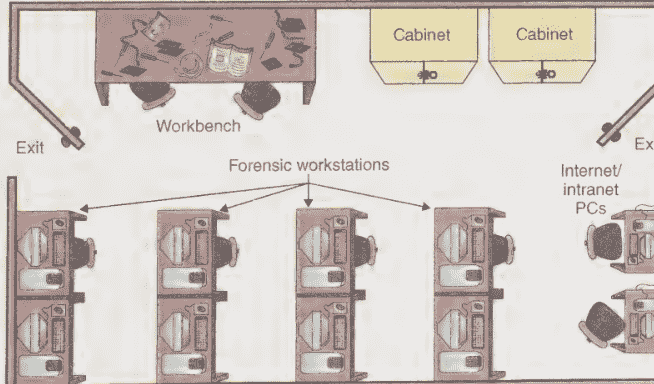

**图 2-3 中型数字取证实验室**

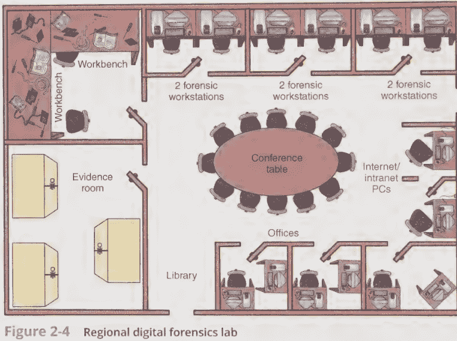

**图 2-4 大型取证实验室**

## 为私营部门选择工作站

对于私营部门，例如进行内部调查的企业或向私人提供数字取证服务的商业公司，设备资源通常很容易确定。

为其他公司提供取证分析的商业公司可以针对特定市场定制服务。他们可以专注于一或两个平台，例如运行微软操作系统的 `Intel PC`。他们也可以收集各种工具以满足更广泛的市场需求。他们需要的设备类型取决于他们的专长（如果有）。对于通用的数字取证设施，一台多功能取证工作站就足够了。

自行数字调查的私营公司可以根据其使用的计算机类型确定它们所需的取证工作站类型。如果公司使用 `Windows PC`，内部调查人员不需要各种专用设备。如果公司使用多种类型的计算机，其内部调查人员就需要支持相同类型计算机的系统和设备。通过某些数字取证程序，你可以从 `Windows PC` 工作并同时检查 `Windows` 和 `Macintosh` 驱动器。

## 硬件外围库存

除了工作站和软件，所有实验室都应该有各种电缆和备用扩展槽卡。考虑为你的取证实验室配备以下外围设备：

- 能够录制静态视频的数字相机
- 各种防静电袋
- 外部 `CD/DVD` 驱动器
- `40` 针 `18` 英和 `36` 英 `IDE` 线缆，均支持 `ATA-33` 和 `ATA-100` 或更高速
- 软盘软带线
- 额外的 `USB 3.0` 或更新版本的线以及 `SATA` 卡和相关电缆
- 额外的 `SCSI` 卡，尽可能多
- 显卡，包括外围部件互连 (`PCI`) 和加速图形端口 (`AGP`)
- 各种火线 (`FireWire`) 和 `USB` 适配器
- 各种硬盘和 `USB` 闪存盘（能力范围内越好，种类越广）
- 至少两个从笔记本 `IDE` 硬盘到标准 `IDE/ATA` 驱动器、`SATA` 驱动器等的适配器
- 计算机手动工具，如十字和一字螺丝刀、套筒扳手、任何厂商特定工具、小型手电筒和防静电腕带

## 维护操作系统和软件库存

操作系统是你的实验室库存的重要组成部分。你应该尽可能维护任何旧版操作系统的授权副本，以处理涉及异常系统的案例。微软操作系统除了最新的操作系统 `Windows 10` 外，还包括 `Windows 8.0` 和 `8.1`、`7`、`Vista`、`XP`、`2000`、`NT 4.0`、`NT 3.5`、`9X`、`3.11` 和 `DOS 6.22`。`Macintosh` 操作系统包括 `macOS`、`Mac OS X`、`9` 或更早版本。`Linux` 操作系统可以包括 `Linux Mint`、`DeftZ`、`Fedora`、`Ubuntu`、`Slackware` 和 `Debian`。

尽管高端数字取证工具可以打开或显示用常用程序创建的数据文件，但它们并不支持所有的程序。你的软件库存应该包含以下程序的当前版本和旧版本。如果你处理 `Windows PC`、`Macintosh` 系统和 `Linux` 系统，你应该拥有所有这些操作系统的程序。

- `Microsoft Office`（包括当前版本和旧版本）
- 十进制编辑器，如 `WinHex` 或 `Hex Workshop`
- 编程语言，如 `Visual Studio`、`Perl` 或 `Python`
- 特殊图像查看器，如 `Quick View`、`ACDSee`、`ThumbsPlus` 和 `IrfanView`
- `WPS Office`、`WordPerfect` 以及第三方或开源办公套件
- 会计应用程序，如 `Quicken` 和 `QuickBooks`

## 使用灾难恢复计划

除了规划设备需求外，你还需要规划灾难，例如硬盘崩溃、雷击、停电、洪水、地震和文件服务器故障。灾难恢复计划确保在发生灾难性故障时，你可以将工作站和文件服务器恢复到原始状态或实验室环境。

灾难恢复计划还规定了在工作站被分析驱动器中的病毒严重污染后如何重建。任何灾难恢复计划的核心都是调查计算机的备份系统。`Norton Ghost` 等工具对于直接恢复文件有用。作为常规预防，你应该每周备份一次工作站。你可以从原始磁盘、`USB` 驱动器、`CD/DVD` 或云恢复程序，但如果没有最新的备份，恢复丢失的数据是非常困难的。

将系统存储在易于访问的地方。你应该在现场保留至少一份备份，并在异地设施存储备份的副本或之前的备份。异地备份通常根据你的需求定期轮换，例如每天、每周或每月。

此外，使用配置管理记录你对工作站进行的所有更新。有些公司在简单的笔记本上记录手写条目以记录更改。一个实用的工具是定期使用 `Belarc Advisor` ([www.belarc.com/free_download.html](www.belarc.com/free_download.html))，它可以记录应用程序、硬件和系统配置。

灾难恢复计划还可以处理如何恢复你为特定调查重新配置的工作站。例如，如果你安装了一套应用程序，你可能没有足够的磁盘空间满足正常处理需求，在重新配置期间可能会遇到问题。灾难恢复计划应该概述如何卸载软件并删除卸载程序未删除的任何文件，以便你将系统恢复到原始配置。

对于使用高端 `RAID` 服务器或私有云（如 `Dell PowerEdge` 或 `Digital Intelligence`）的实验室，你需要恢复大数据集的方法。在发生超过一台的重大故障时，必须具有适当的数据备份系统。在为 `RAID` 服务器规划恢复程序时，考虑恢复备份数据所需的停机时间对于实验室运行是否可以接受。

### 规划设备升级

风险管理涉及确定任何过程或操作的可接受风险水平，例如更换设备。识别你的实验室依赖的设备，并创建一个更换计划。此外，识别在故障时可以更换的设备。

计算组件的设计是为了在正常业务运行中使用，而占用更多磁盘空间的操作系统和应用程序的新版本发布频繁。因此，系统定期需要更多的内存、磁盘空间和处理速度。为了让你的实验室跟上硬件技术的更新，建议每 `18` 个月更换一次硬件，最好每 `12` 个月一次。

## 为开发实验室建立商业计划

### 理由说明

在开始之前，你需要向控制预算的人说明需要实验室的原因。这一理由说明步骤需要提出以下问题：

- 你的组织需要什么类型的数字调查服务？
- 该服务的潜在客户是谁，如何制定预算——是作为内部运营（例如警察部门或公司安全部门）还是外部运营（营利性业务活动）？
- 你将如何向客户宣传你的服务？
- 你将使用哪些时间管理技术？
- 业务运营的初始和持续预算将来自哪里？

无论你为哪种组织工作——公共机构还是私营企业——成功运营数字取证实验室都需要不断努力向过去、现在和未来的客户推销实验室的服务。通过营销吸引新客户或客户，你可以为实验室的运营和人员的未来预算提供合理性依据。

### 预算制定

预算需要包含以下章节描述的所有项目。在确定这些项目的真实成本时，你必须尽可能准确。犯错可能会导致延迟，并可能失去启动或改进实验室的机会。

#### 设施成本

对于新的取证实验室，启动成本可能占据大部分预算。根据实验室的大小，你必须首先确定需要多少地面空间。如提到的，一个经验法则是每人 `150` 平英尺。这个空间看起来可能比需要的稍大，但你需要考虑保存证据和储备足够物资需要多少存储空间。向你组织的设施经理咨询你区域或建筑的每平方英尺成本。这里是一些帮助你开始计算的示例问题：

- 你需要多少数字取证调查员？
- 每个调查员每年需要多少培训，估计成本是多少？
- 你需要超过一个实验室吗？
- 有多少数字取证员将使用每个实验室？需要容纳非调查员临时检查恢复的证据。
- 建立安全实验室的成本是多少？
- 是否有一个可以转换为实验室的合适房间？
- 指定房间是否有足够的电力以及供暖空调 (`HVAC`) 系统？
- 指定房间是否有现成的电话线和网络线？如果没有，安装这些费用是多少？
- 指定房间的门是否有足够的锁？
- 家具成本是多少？
- 是否需要安装警报系统？
- 是否还有其他设施成本，例如清洁服务和设施维护服务的费用？
- 如果需要 `IT` 支持，预计需要多少小时？

#### 硬件需求

确定在取证实验室中分析的调查类型和数据决定了你需要的硬件。如果你的组织正在使用 `Windows 10` 或更高版本的 `Intel` 基 `PC`，那么你的取证工作站也应该是高端 `Intel` 基 `PC`。对于小型警察部门，确定公众使用的计算机类型更为困难。社区计算机系统的多样性要求警察部门在调查所需的工具方面更具灵活性。为了确定硬件预算需求，以下是在规划中要考虑的问题：

- 实验室将执行哪些类型的调查和数据恢复？
- 每月预计进行多少次调查？
- 是否有需要快速分析磁盘数据的时间敏感调查？
- 支持典型的调查需要多少个驱动器（多大）？
- 你是否需要高速备份系统，如磁带备份或 `DVD` 刻录机？
- 你将调查的最主要的计算机系统类型是什么？
- 你将使用什么来存储数字证据？你需要存储多多久？

#### 软件需求

在过去的几年里，出现了更多的数字取证工具。对于私营部门，这些工具的成本约为 `1100` 美元起。对于公共部门，许多取证软件供应商提供折扣。然而，就像你为数字取证实验室选择硬件以满足特定需求一样，你必须确定将调查什么类型的操作系统和应用程序，并相应进行购买。请记住，在取证软件包上花费得越多，你获得的功能和灵活性就越高。为了确定软件预算需求，在规划中请考虑以下问题：

- 将检查哪些类型的操作系统？
- 对于不流行、不寻常或其他操作系统（如 `Mac OS 9.x`、`OS/2` 和 `CP/M`），需要调查它们的频率是多少？
- 取证软件工具的最低需求是什么？例如，每种工具需要多少份？平均每周每种工具使用多少次？
- 进行常规检查需要什么类型的操作系统？
- 是否需要专业软件，例如 `QuickBooks`、`FreshBooks`、`Xero` 或 `Sage`？
- 是否有预算购买多个取证软件工具？
- 通用数据分析应选择哪种磁盘编辑工具？

#### 杂项预算需求

在预算的这部分，你需要对考虑购买的其他项目、工具和用品进行头脑风暴，从通用办公用品到日常运营的特定需求。为了确定杂项预算需求，在规划中请考虑以下问题：

- 实验室运营和人员是否需要遗漏险？
- 你是否需要办公用品的预算？

### 批准与采购

数字取证实验室的批准和采购是一项管理职能。你的责任是创建一个带预算的商业案例提交给高层管理审批。作为审批流程的一部分，你应该包含一份风险分析，描述实验室将如何降低诉讼风险，这是支持建立实验室的有力论点。你还需要对预计的调查频次以及平均需要多久进行合理的估计。记住，审批流程的一部分需要谈判技巧来证明商业案例的合理性。你可能需要修改你的案例以获得批准。

作为商业案例的一部分，采购规划需要研究不同的产品以确定哪种是最佳且最具效益的。你需要联系几个供应商的销售人员和设计工程师，了解更多关于每个产品和服务的信息。另一个需要调查的因素是年度维护成本。你也要为这项费用制定预算，以便在遇到问题时获得支持。在调查过程中遇到问题时，专业领域的另一个额外项目是供应商维护历史。取证实验室是否使用相同的产品，它们在遇到问题时是否有过任何支持？


另一个考虑因素是供应商的定价结构。供应商定价不是基于制作 CD 和 DVD 的成本。产品价格基于开发、文档支持、运输以及未来改进的成本。此外，供应商是营利组织；他们向你付费。请记住，明年将提供产品和服务。

## 实现

在批准和采购之后，你需要规划实验室的实施。作为商业案例的一部分，描述你计划如何整合和安装所有批准的项目。必须包含显示交付日期或完成日期的时间表。你还应该对材料和工具的交付日期进行计划。包括设施建设（包括家具和工作台）以及软件工具。确保检查日期，以确保送到的设备是功能正常的。

## 验收测试

在实施和检查之后，你需要为数字取证实验室制定一份验收计划以确保一切正常工作。在编写验收计划时，请确保包含以下任务：

- 检查设施是否符合包含和控制数字证据的标准。
- 测试所有通信（如电话和网络连接），以确保它们符合预期。
- 测试所有硬件以验证其运行正常；例如，测试计算机以确保其进入 Windows。
- 安装并启动所有软件；确保所有软件都能在实验室的计算机和操作系统上运行。

## 验收修正

对实验室的计划越好，出现问题就越少。然而，任何启动期间都会出现某些问题。你的商业案例必须预测可能导致实验室延迟的问题。在商业案例中，你需要针对系统或故障制定应急方案。例如，针对门锁安装错误或电力不足等问题制定变通方案。

在完成所有必要的修正后，你的数字取证实验室就可以进入生产阶段。此时，你执行本章中描述的操作程序。

关于如何编写商业案例的更多信息，请访问 `www.sba.gov/tools/sba-learning-center/training/how-write-business-plan`。

## 总结

- 数字取证实验室是你进行调查、存储证据并完成大部分工作的地方。
- 数字取证实验室是你进行调查、存储证据并完成大部分工作的地方。
- 数字取证实验室是你进行调查、存储证据并完成大部分工作的地方。
- 数字取证实验室是你进行调查、存储证据并完成大部分工作的地方。
- 数字取证实验室是你进行调查、存储证据并完成大部分工作的地方。
- 数字取证实验室是你进行调查、存储证据并完成大部分工作的地方。
- 数字取证实验室是你进行调查、存储证据并完成大部分工作的地方。
- 数字取证实验室是你进行调查、存储证据并完成大部分工作的地方。

## 动手项目

### 动手项目 2-1

你刚刚被聘佣为一家公司进行数字调查和取证分析。你发现目前尚未建立任何政策、流程或程序。请通过互联网搜索查找信息，并创建一份政策和流程文档，为你的实验室环境提供必要的结构。请务必引用你的在线来源。

### 动手项目 2-2

如前所述，市场上不断推出新的取证认证。请在网上研究各种认证证书，并找到一个在本书中未讨论过的认证。写一篇短文，说明由哪个机构提供该认证、谁背书该认证、该机构已运营了多久等。

### 动手项目 2-3

实验室的物理安全必须始终得到维护。在你的教室实验室中，获得在一天中上课和没上课的不同时间进行观察的许可。记录期间进出的人数。你认识这些人吗？或者你能识别他们吗？他们都是学生还是教职员工？没上课时谁监控实验室？房间是否锁好？实验室里物品被盗的频率有多高？根据你的观察结果写一到两页的内容。如果是数字取证实验室，你需要做哪些改变？

### 动手项目 2-4

为一家虚构公司的数字取证实验室编写一份不超过三页的灾恢复计划。包括备份计划，记录每台机器上安装的程序和操作系统，并列出灾难发生后你需要恢复的其他信息。你还应该注明原始磁盘和备份的位置。

### 动手项目 2-5

一家律师事务所聘请你协助处理涉及离婚的数字证据案件。主要证据包括电子邮件、电子表格和文档。在聘用你之前，该律所有使用外部小组进行调查。你必须决定购买哪些设备和软件。你会如何制定一份能够获得批准的商业计划？

## 案例项目

### 案例项目 2-1

你的经理通知你，她需要为明年的预算做准备，并希望你列出两台新工作站和一台笔记本电脑（均为 Windows）的硬件和软件。进行互联网研究，并创建一个列出每台电脑硬件和软件及估计成本的表格。电脑部分包括处理器速度、内存（RAM）、内部磁盘存储和显示器类型等规格。软件部分包括操作系统、办公套件和两个数字取证工具。

### 案例项目 2-2

新版本的 Windows 已经发布。为了确保在 6 到 10 个月后遇到涉及新操作系统的案例时做好准备，你需要做什么？包括研究、用户组以及你需要联系的其他人员。写一篇关于你应该使用的程序的单页论文。

### 案例项目 2-3

研究你所在的州、省或邻近州省，以确定数字取证员是否需要执照。写一份关于你所选地区许可要求的单页总结。如果你的地区没有任何许可要求，请研究以下州之一：密歇根州、德克萨斯州或佐治亚州。

### 案例项目 2-4

你的经理通知你，公司将建立一个新的数字取证实验室。那里将有空间放置额外的计算机用于密码破解。你被要求研究此任务硬件和软件需求，并写一份备忘录，描述对在带有多个 GPU 的集群系统中运行多个 GPU 的密码破解计算机的建议。说明这些集群系统推荐什么操作系统。

# 数据采集

在阅读本章并完成练习后，你将能够：

- 列出数字证据存储格式
- 解释确定最佳采集方法的方法
- 描述数据采集的应急计划
- 解释如何使用采集工具
- 描述如何验证数据采集
- 描述 RAID 采集方法
- 解释如何使用远程网络采集工具
- 列出其他可用于数据采集的取证工具

数据采集是复制数据的过程。对于数字取证，它是从电子介质收集数字证据的任务。数据采集有两种类型：静态采集和现场采集。在本章中，你将学习如何从磁磁盘介质和闪存驱动进行静态采集。在第 12 章中，你将学习如何从固态设备（通常用于智能手机和平板电脑）中取证式采集数字证据。

由于磁盘加密的使用，数据采集正转向新操作系统（OS）的现场采集。除了加密考虑因素外，收集嫌疑者计算机内存（RAM）中活动的任何数据对数字调查变得越来越重要。获取现场磁盘和 RAM 数据的技术在第 10 章中介绍。静态和现场采集的流程和数据完整性要求是相似的，因为静态采集捕获的是未被可能更改进程访问的数据。对于现场采集，文件元数据（如日期和时间值）在被采集工具读取时会发生变化。对于静态采集，如果你保留了原始介质，进行第二次静态采集应该产生相同的结果。原始磁盘上的数据无论进行多少次采集都不会被更改。在计算机运行时进行第二次现场采集会由于操作系统的动态变化收集到新数据。

你在进行静态采集数据采集时，目标是保护数字证据。很多时候，你只有一次机会使用采集工具创建可靠的磁盘证据副本。尽管这些工具通常是可靠的，但你仍然需要采取措施确保获取一个可以验证的镜像。此外，失败可能会且确实会发生，所以你应该学习如何使用几种采集工具和方法；通过使用几个不同的工具来确保镜像可以验证。此外，你应该学会确保你使用的采集工具是可验证的。

## 理解数字证据的存储格式

数据采集是复制数据的过程。对于数字取证，它是从电子介质收集数字证据的任务。数据采集有两种类型：静态采集和现场采集。在本章中，你将学习如何从磁磁盘介质和闪存驱动进行静态采集。在第 12 章中，你将学习如何从固态设备（通常用于智能手机和平板电脑）中取证式采集数字证据。

由于磁盘加密的使用，数据采集正转向新操作系统（OS）的现场采集。除了加密考虑因素外，收集嫌疑者计算机内存（RAM）中活动的任何数据对数字调查变得越来越重要。获取现场磁盘和 RAM 数据的技术在第 10 章中介绍。静态和现场采集的流程和数据完整性要求是相似的，因为静态采集捕获的是未被可能更改进程访问的数据。对于现场采集，文件元数据（如日期和时间值）在被采集工具读取时会发生变化。对于静态采集，如果你保留了原始介质，进行第二次静态采集应该产生相同的结果。原始磁盘上的数据无论进行多少次采集都不会被更改。在计算机运行时进行第二次现场采集会由于操作系统的动态变化收集到新数据。

你在进行静态采集数据采集时，目标是保护数字证据。很多时候，你只有一次机会使用采集工具创建可靠的磁盘证据副本。尽管这些工具通常是可靠的，但你仍然需要采取措施确保获取一个可以验证的镜像。此外，失败可能会且确实会发生，所以你应该学习如何使用几种采集工具和方法；通过使用几个不同的工具来确保镜像可以验证。此外，你应该学会确保你使用的采集工具是可验证的。

## 第 3 章 数据采集

在过去，出于保护证据目的复制数据只有一种实用方法。调查员从一个磁盘到另一个相同大小或更大的磁盘进行位位复制。作为保护数字证据的实用方法，供应商（以及某些操作系统实用程序，如 Linux/Unix 的 `dd` 命令）使得位流数据写入文件成为可能。这种技术创建嫌疑驱动器的简单平面文件。这些平面文件的输出被称为原始格式。

### 原始格式

原始格式的优点是数据传输快以及忽略源磁盘上微小错误的能力。此外，取证工具可以读取原始格式，使其成为大多数工具的通用采集格式。原始格式的一个缺点是它需要大量的存储空间。另一个缺点是某些原始格式（免费版本）可能无法收集源磁盘上的边缘扇区（坏道），这意味着它们在弱质介质上的重读阈值较低。许多商业工具具有高得多的重读阈值，以确保收集所有数据。

### 专用格式

大多数商业取证工具都有用于收集数字证据的格式。专用格式通常提供多项辅助供应商分析工具的功能，如下：

- 对嫌疑驱动器的镜像进行压缩或不压缩，从而节省目标磁盘的空间
- 将镜像拆分为较小的段文件以供存档（如 CD 或 DVD），并在每个段中集成了数据完整性检查
- 将元数据集成到镜像文件中，例如采集日期和时间、原始磁盘或介质的哈希值（用于自验证）、调查员或取证员姓名以及注释或案件详情

## 第 3 章 数据获取

法证检查人员有多种方式来描述将证据复制到文件中：位流拷贝、位流镜像、镜像、镜像和扇区拷贝。对于本书，“镜像”通常指所有保存到数据文件中的法证获取结果。

私有格式获取的一个主要缺点是无法在不同厂商的计算机取证分析工具之间共享镜像。例如，ILookIX 的成像工具 IImager（`www.perlustro.com/solutions/e-forensics/imexager`）产生三种私有格式——IDIF、IRBF 和 EIEF——这些格式只能由 ILookIX 读取（请访问 `www.perlustro.com` 获知有关 ILookIX 的更多信息）。

私有格式和原始格式的另一个问题是每个分段卷都有文件大小限制。通常，私有格式工具会生成 650 MB 的分段文件。文件大小可以调整或减小，每个分段的最大文件不超过 2 GB。大多数私有格式工具支持到 2 GB，因为许多检查人员使用格式化为 FAT 的目标驱动器，而 FAT 的文件大小限制为 2 GB。

在所有镜像获取的私有格式中，Expert Witness Compression（专家证人压缩）格式目前是非官方的标准。该格式是 Guidance Software EnCase 的默认格式，可同时生成压缩和未压缩的镜像文件。这些文件（或卷）写入以 `.e01` 开头的扩展名，并为每个额外的分段镜像卷递增。

多种法证工具可以生成并分析 Expert Witness Compression 格式的通用版本，包括 X-Ways Forensics、AccessData Forensic Toolkit (FTK)、Belkasoft 和 SMART。有关 Expert Witness Compression 格式的更多信息，请参见 `http://sarsdata.com/E01-format.html`。

## 高级法证格式

Simon L. Garfinkel 博士开发了一种名为 Advanced Forensic Format（AFF，高级法证格式）的开源格式。该格式具有以下设计目标：

- 能够生成压缩或未压缩的镜像文件
- 对磁盘到镜像的文件没有大小限制
- 在镜像文件或分段文件中为元数据留有空间
- 具有扩展性的简单设计
- 适用于多个计算平台和操作系统的开源
- 具有用于自认证的内部一致性检查

文件扩展名包括分段镜像文件的 `.aff` 和用于 AFF 元数据的 `.aff`。由于 AFF 是开源的，数字法证厂商对该格式没有实现限制。有关 AFF 的更多信息，请参见 `www.afflib.sourceforge.net` 和 `www.basistech.com/wp-content/uploads/datasheets/Digital-Forensics-Toolsets-EN.pdf`。

有关法证获取文件格式的更多信息，请参见 `www.sleuthkit.org/informer` 第 19 期和第 23 期。

## 确定最佳获取方法

如所述，获取分为两种类型：静态获取和现场获取。通常，静态获取是在警察突击期间收缴的计算机上进行的（例如）。如果计算机带有加密驱动器，则在密码或口令可用的情况下，会进行现场获取——这意味着计算机已开启且嫌疑人已登录。静态获取始终是收集数字证据的首选方法。然而，它们在某些情况下存在局限性，例如只有在计算机开启时才能读取的加密硬盘，或只能通过网络访问的计算机。某些解决方案可以帮助解密全盘加密的驱动器，例如 Elcomsoft Forensic Disk Decryptor（`www.elcomsoft.com/efdd.html`）。

在第 11 章中，你将学习如何执行现场获取，包括对计算系统的数字媒体和动态/临时内存（RAM）进行数据采集。

对于这两种获取，可以通过四种方法收集数据：创建磁盘到镜像文件、创建磁盘到磁盘拷贝、创建逻辑磁盘到磁盘或磁盘到数据文件，或创建文件夹或驱动器的稀疏拷贝。确定最佳获取方法取决于调查的情况。

参见 ISO/IEC 27037:2012（节 5.4.4 获取和节 6.5 审慎使用）关于何时执行稀疏获取的更多讨论。

作为标准做法，请对你收集的数字证据至少制作两份镜像。如果你有多个成像工具（例如 FTK Imager Lite 和 X-Ways Forensics），请用一个工具制作第一个副本，用另一个工具制作第二个副本。不同的获取工具使用不同的方法复制数据，例如，某一个工具可能会更多地尝试复制驱动器损坏的区域。因此，使用多个工具有助于确保数据已正确复制。

如果你只有一个工具，请一直使用同一个工具，特别是在进行关键调查时也是如此。在有多个工具的情况下，你可以制作一份不进行压缩的副本，并对另一份副本进行压缩。记住，墨菲定律也适用于数字取证；如果有任何事情可能出错，那么它就一定会出错。

某些获取工具不会复制硬盘驱动器受保护区域（HPA）中的数据。请检查厂商的文档，查看其工具是否可以复制磁盘的 HPA。如果不能，请考虑使用可以通过 BIOS 级访问驱动器的硬件获取工具，例如带有写保护保护器的 Belkaso IXImager、Image Master Solo，或使用 X-Ways Replica。这些工具可以读取磁盘的 HPA。

微软在其较新的操作系统（如 Windows Vista、7、8 和 10）中增加了 BitLocker 全盘加密功能，这使得执行静态获取变得更加困难。（还有其他几种第三方全盘加密工具可用，你应该尽可能熟悉尽可能多的工具。）作为应急计划的一部分，你必须准备好处理加密驱动器。目前，对全盘加密的驱动器进行静态获取涉及解密驱动器，这需要用户配合提供解密密钥。大多数全盘加密工具至少有一个手动解密数据的过程，即将加密磁盘转换为未加密的磁盘。此过程取决于磁盘的大小，可能需要几个小时。加密的一个优点是，如果空闲空间和空隙空间没有变化，数据就不会被篡改。全盘加密最大的问题是获取解密密钥——即用于访问加密数据的密码或代码。如果你可以使用之前提到的 Elcomsoft Forensic Disk Decryptor 等工具恢复全盘密钥，你需要学习如何使用它来解密驱动器。在刑事调查中，这可能是不可能，因为如果磁盘包含支持犯罪的证据，嫌疑人会有强烈的动机提供解密密钥。

普林斯顿大学的研究人员产生了一种从 RAM 中恢复密码和通过短语的技术；更多信息请参阅 `www.usenix.org/legacy/event/sec08/tech/full_papers/halderman/halderman.pdf` 或 `https://jhalderm.com/pub/papers/coldboot-acm09.pdf`。

## 第 3 章 数据获取

### 使用获取工具

许多取证软件供应商开发了在 Windows 中运行的获取工具。这些工具使得从嫌疑人驱动器获取证据变得更加方便，特别是当你使用热插设备（如 USB-3、FireWire 1394A 和 1394B 或 SATA）将磁盘连接到你的工作站时。

然而，在当前的操作系统（如 Windows 和 Linux）中使用获取工具具有一些缺点。因为 Windows 和 Linux 在挂载证据驱动器时很容易污染它，你必须使用经过良好测试的写保护硬件设备来保护它。自动监控过程通过更改元数据来更新启动文件。（第 6 章详细讨论了写保护设备。）此外，某些国家尚未接受在数据获取中使用写保护设备。请咨询你的法律顾问以了解你所在社区或国家的证据标准。


尽管许多数字取证供应商改进了他们的获取工具，但某些旧的 Windows 和 Linux 工具（如 `dd` 或 `dcldd` 命令）无法从磁盘的 HPA 获取数据。

## Mini-WinFE 启动 CD 和 USB 盘


直接访问磁盘对于取证获取可能并不实际。例如，笔记本电脑的设计可能导致拆卸驱动器并挂载到写保护器上变得困难，或者你可能没有对应驱动器的正确接口。在这些情况下，取证启动 CD/DVD 或 USB 盘可以为你提供一种从嫌疑计算机获取数据并对驱动器进行写保护的方法。这些取证启动光盘或驱动器可以是 Windows 或 Linux 的。

一个相对可靠的启动 CD/DVD 或 USB 盘程序是 `Mini-WinFE`。它允许你构建一个带有 Windows 注册表修改的 Windows 启动器，以便连接的驱动器挂载为只读。在用 `Mini-WinFE` 启动嫌疑计算机之前，你需要连接你的目标驱动器（例如 USB 盘）。启动 `Mini-WinFE` 后，你可以列出所有连接的驱动器并运行获取程序。

要创建你自己的 `Mini-WinFE` 启动 CD 或 USB 盘，请查阅文档并从以下网站下载：

- 关于 WinFE 的概述，请访问 <http://brettshavers.com/index.php/brettblog/tags/winfe>。
- 了解最新信息和说明，请查看 Downloads 和 Using WinFE 菜单。
- 关于 `Mini-WinFE` 的说明，请访问 <http://brettshavers.cc/index.php/brettblog/entry/mini-winfe-and-usb>。
- `Mini-WinFE` 的另一个下载地址是 <http://reboot.pro/files/mini-winfe>。
- 关于 WinFE 的完整说明，请访问 <forensicfocus.com/downloads/WinFE.pdf>。

此外，你还需要一个 Windows 安装（版本 8 或更高版本）并在工作站上安装了 `FTK Imager` 或 `X-Ways Forensics`。按照上述网站的说明创建你自己的 `Mini-WinFE` ISO 文件并将其刻录到 CD 或 USB。如果你想使用 USB 盘，将需要一个将 ISO 传输到 USB 的工具。在 <www.isotousb.com> 可以获得名为 `ISO to USB` 的工具。

## 使用 Linux 启动获取数据

Linux 系统具有许多适用于数字取证的特征，特别是数据获取。旧版本的一个独特特征是，它可以访问未挂载的驱动器。为了读取数据，物理访问可以在连接的介质上进行，例如磁盘驱动器、USB 盘或其他存储设备。在 Windows 和较新的 Linux 内核中，当你通过 USB、FireWire、外部 SATA 甚至内部 SATA 控制器连接驱动器时，两个操作系统会自动挂载驱动器。在 Windows 上，工作站可以访问并更改回收站中的数据；在 Linux 上，驱动器极可能更改元数据，例如 Ext3 或更后版本的挂载点配置。如果你需要获取一个没有写锁开关的驱动器，请使用其中一个取证 Live CD（在下一节中讨论）来访问该设备。


> 在使用带有 KDE 或 Gnome GUI 的 Linux 发行版时要小心。许多新的发行版会自动挂载介质。如果有疑问，始终使用物理写保护器从 Linux 获取。

## 使用 Linux 发行版

几种 Linux 发行版（如 Ubuntu、openSUSE、Arch Linux、Fedora 和 Slack）提供了可以刻录到 CD 或 DVD 的 ISO 镜像。这些被称为“Linux Live CD”。大多数发行版用于系统恢复，而不是数字取证。最新的 Live CD 请访问 <https://livecdlist.com/>。

少数 Linux 镜像是为数字取证设计的；这些镜像包含了普通 Linux 发行版中没有的工具。它们还配置为不挂载或以只读挂载任何连接的存储介质（如 USB 盘）。这保护了用于获取和分析数据的介质完整性。要访问介质，你需要通过 GUI 工具或命令行提示向 Live 会话提供特定指令。从命令行提示更高的控制权。查看 `mount` 命令的 man 页面（在命令行输入 `mount`）以了解你的 Linux 发行版可用选项。


`man` 命令显示在线帮助手册页面以获取 Linux 命令及其选项的信息。

Linux 可以在不挂载的情况下从物理设备读取数据。作为通常做法，不要挂载嫌疑设备以防止进行任何写入。在本节后后部分，你将学习如何在 Linux 中不挂载设备进行取证获取。

以下是一些为数字取证设计的良好的 Linux Live CD：

- Sleith Kit (<www.linux-forensics.com> 或 <https://sourceforge.net/projects/psk/?source=directory>)
- CAINE (<www.maine-live.net>)
- Deft (<www.deflinux.net>)
- Kali Linux (<www.kali.org>)，以前称为 BackTrack (<www.backtrack.org/wiki/index/Forensics_Boot>)
- Knoppix (<www.knopper.net/knoppix/index-en.html>)
- SANS Investigate Forensic Toolkit (SIFT; <http://computer-forensics.sans.org/community/downloads>)

# 第 3 章 数据取证

对于另一种基于 Windows 的 USB 启动盘，请参阅 <http://osforensics.com/tools/write-usb-images.html>。

在创建 Linux Live CD 后，在你的工作站上进行测试。记得检查工作站的 BIOS，查看系统是否优先从系统的 CD 或 DVD 启动。要测试 Live CD，只需将其放入 CD 或 DVD 驱动器并重启系统。如果成功，Linux 将加载到计算机的内存中，并显示 Linux 的常用 GUI。如果你的工作站视频显示显示出现问题，请尝试另一台带有不同显卡的电脑。没有哪个 Live CD 发行版包含所有的视频驱动程序。Linux Live CD 将操作系统加载到计算机的 RAM 中，因此在使用 GUI 工具时性能可能会受到影响。后续章节将解释如何使用 Linux 进行符合法医学的数据采集。

## 在 Linux 中为目标驱动器准备采集

Linux 操作系统有许多工具可以使用来修改非 Linux 文件系统。目前的 Linux 发行版可以创建 Microsoft FAT 和 NTFS 分区表。Linux 内核版本 2.6.177 及之前的版本只能格式化和读取 FAT 文件系统，尽管可以挂载 NTFS 驱动程序 `NTFS-3G`，它允许 Linux 挂载并向 NTFS 分区写入数据。你可以从 <http://sourceforge.net/projects/ntfs-3g> 下载此驱动程序，在那里你也可以找到关于 macOS 文件系统和 NTFS 的信息以及安装该驱动程序的说明。关于 macOS 文件系统和采集的信息，请参阅第 7 章。

在本节中，你将学习如何从 Linux 分区并格式化 Microsoft FAT 驱动器，这样你就无需切换操作系统或计算机来准备 FAT 目标磁盘。如果你有一个使用过的目标驱动器，可以使用以下步骤将其格式化为 FAT32 驱动器。完成后，你可以将 FAT 磁盘传输到 Windows 系统以使用 Windows 分析工具。

> 在准备在 Linux 系统上进行法医学采集或分析的驱动器时，请在在没有连接嫌疑驱动器的独立启动会话中进行。

Linux/UNIX 命令对大小写敏感，因此请确保你输入的命令与本节步骤所示完全一致。

假设你有一台运行良好的 Linux 电脑或一台正在运行 Linux Live CD 的电脑，请从 shell 提示符执行以下步骤：

取决于你使用的 Linux 版本和发行版，你的屏幕提示可能与本节所示略有不同。

1. 首先，在你的电脑上启动 Linux。
2. 将 USB、FireWire 或 SATA 外部驱动器连接到 Linux 电脑并开启其电源。
3. 如果 shell 窗口尚未打开，请启动一个。
4. 在 shell 提示符处，输入 `su` 并按 `Enter` 以超级用户（root）身份登录。然后输入 root 密码并按 `Enter`。

> 如果你使用的是之前列出的 Live CD 之一，这些发行版通常已经处于超级用户（root）模式，因此不需要使用 `su` 命令。其他 Live CD 可能没有设置密码，只需按 `Enter` 即可。

5. 要列出连接到电脑的当前磁盘设备，输入 `fdisk -l`（小写 L）并按 `Enter`。你应该看到类似下方的输出：

```
Disk /dev/hda: 40.0 GB, 40007761920 bytes
255 heads, 63 sectors/track, 4864 cylinders
Units = cylinders of 16065 * 512 = 8225280 bytes
Device Boot Start End Blocks Id System
/dev/hda1 * 1 13 104391 83 Linux
/dev/hda2 14 4864 38965657+ 8e Linux LVM
Disk /dev/sda: 6448 MB, 644819520 bytes
199 heads, 62 sectors/track, 1020 cylinders
Units = cylinders of 12338 * 512 = 6317056 bytes
Disk /dev/sda doesn't contain a valid partition table
```

> 在上述输出中，`/dev/sda` 设备没有列出任何分区。这些步骤显示了如何在此磁盘上创建一个 Microsoft FAT 分区。如果该驱动器上有分区，可以使用 Linux `fdisk` 工具将其删除。关于 `fdisk` 的更多信息，请参阅 man 页面（帮助文档）。

6. 输入 `fdisk /dev/sda` 并按 `Enter` 将磁盘驱动器分区为文件系统。你应该看到类似下方的输出：

```
Welcome to fdisk (util-linux 2.21.2).
Changes will remain in memory only, until you decide to write them.
Be careful before using the write command.
Command (m for help): m
```

7. 通过输入 `m` 显示 `fdisk` 菜单选项。你应该看到类似下方的输出：

```
Command action
a toggle a bootable flag
b edit bsd disklabel
c toggle the dos compatibility flag
d delete a partition
l list known partition types
m print this menu
n add a new partition
no create a new empty DOS partition table
np print the partition table
q quit without saving changes
s create a new empty Sun disk label
t change a partition's system id
u change display/entry units
v verify the partition table
w write table to disk and exit
x extra functionality (experts only)
```

8. 通过输入 `p` 并按 `Enter` 确定 `/dev/sda` 上是否存在任何分区。你应该看到类似下方的输出：

```
Disk /dev/sda: 6448 MB, 6448619520 bytes
199 heads, 62 sectors/track, 1020 cylinders
Units = cylinders of 12338 * 512 = 6317056 bytes

| Device Boot Start End Blocks Id System |
| :--- | :--- | :--- | :--- | :--- | :--- |
| /dev/sda | | | | | |
```

> 注意：在上面的输出中，`/dev/sda` 没有配置任何分区。

9. 下一步，在 `/dev/sda` 上创建一个主分区。输入 `n` 并按 `Enter` 使用整个磁盘。要创建一个主分区，输入 `p` 并按 `Enter`，然后输入 `1`（数字）选择第一个分区。在剩余的提示处，按 `Enter`。你的输出应该是：

```
Command action
e extended
p primary
1
1020
62934
```

> Linux 中，创建的扩展分区编号为 5、6 等依此类推。例如，第一个分区是 `/dev/hda1`。

10. 输入 `p` 并按 `Enter` 列出新定义的分区，这会产生下方的输出：

```
Disk /dev/sda: 6448 MB, 644819520 bytes
199 heads, 62 sectors/track, 1020 cylinders
Units = cylinders of 12338 * 512 = 6317056 bytes
```

11. 为了选择分区再次列出菜单，输入 `m` 并按 `Enter`。你应该看到：

```
a toggle a bootable flag
b edit bsd disklabel
c toggle the dos compatibility flag
d delete a partition
l list known partition types
m print this menu
n add a new partition
no create a new empty DOS partition table
np print the partition table
q quit without saving changes
s create a new empty Sun disk label
t change a partition's system id
u change display/entry units
v verify the partition table
w write table to disk and exit
x extra functionality (experts only)
```

12. 要将新创建的分区更改为 Windows 95 FAT32 文件系统，输入 `t` 并按 `Enter`。你应该看到：

```
Selected partition (1)
```

13. 通过输入 `c` 并按 `Enter` 列出可用的文件系统代码。这产生了下方的输出：

```
Id  Type
07  hp
83  Linux
8e  Linux LVM
c7  W95 FAT-32
71  W95 NTFS
83  HFS+
```

14. 通过输入 `c` 并按 `Enter` 将新创建的分区更改为 Windows 95 FAT32 系统。你的输出应该像：

```
Changed type of partition 1 to 'W95 FATFS'
```

15. 输入 `p` 并按 `Enter` 显示更改后驱动器的分区，这会产生下方的输出：

```
Disk /dev/sda: 6448 MB, 6448619520 bytes
199 heads, 62 sectors/track, 1020 cylinders
Units = cylinders of 12338 * 512 = 6317056 bytes

| Device Boot Start End Blocks Id System |
| :--- | :--- | :--- | :--- | :--- | :--- |
| /dev/sda | | 1 | 1020 | 629234 | c | W95 FAT32 (LBA) |
```

16. 输入 `w` 并按 `Enter`，将新创建的分区保存（写入）到 `/dev/sda` 驱动器。你的输出应该类似于：

```
分区表已更改。
正在调用 ioctl() 重新读取分区表。
警告：如果您创建或修改了任何 DOS 6.x 分区，请参 `fdisk` 手页以获取更多信息。
```

> 注意：`fdisk` 在更新 `/dev/sda` 驱动器上的分区表后会返回到 shell 提示符。

17. 输入 `fdisk -l` 并按 `Enter` 显示连接到您的计算机的已知驱动器，这将产生以下输出：

```
Disk /dev/sda: 40.0 GB, 40007761920 bytes
255 heads, 63 sectors/track, 4864 cylinders
Units = 16065 * 512 = 8225280 bytes

| Device Boot | Start | End | Blocks | Id | System |
| /dev/hda1 | * | 1 | 104391 | 83 | Linux |
| /dev/hda2 | | 14 | 4864 | 38965657+ | 8e | Linux LVM |

Disk /dev/sda: 6448 MB, 6448619520 bytes
199 heads, 62 sectors/track, 1020 cylinders
Units = cylinders of 12338 * 512 = 6317056 bytes

| Device Boot | Start | End | Blocks | Id | System |
| /dev/sda | | 1 | 1020 | 6292349 | b | W95 FAT32 |
```


# 18. 从 Linux 格式化 FAT 文件系统

输入 `mkfs.msdos -vf32 /dev/sda` 并按 `Enter`，这将产生以下输出：

> **注意**：如果您的 Linux 发行版缺少 `mkfs.msdos` 命令，请下载并安装您发行版的 `dosfstools` 包。要找到这些文件，可以搜索 `mkfs.msdos` Fedora 或 `dosfstools` Debian，例如。

```
mkfs.msdos 2.8 (28 Feb 2001)

Selecting 8 sectors per cluster

/dev/sde has 33 heads and 61 sectors per track,
logical sector size is 512,
using 0xf8 media descriptor, with 2047966 sectors;
file system has 2 32-bit FATs and 8 sectors per cluster.
FAT size is 1997 sectors, and provides 255492 clusters.
Volume ID is 420781ea, no volume label.
```

较新的 Linux 发行版会自动同步新创建的分区并格式化驱动器。与微软操作系统不同，同步功能不需要重启计算机。

- **19.** 输入 `exit` 并按 `Enter` 关闭此会话的 shell。现在可以挂载此驱动器并用于接收接收驱动器的镜像。在本节的后续部分，您将学习如何挂载并写入此微软 FAT 驱动器。

# 在 Linux 中使用 dd 采集数据

取证 Live CD 的一个独特之处是它可以读取和写入大多数驱动器。为了在嫌疑计算机上执行数据采集，您只需要：

- 一张取证 Live CD
- 带有线缆的 USB、FireWire 或 SATA 外部驱动器
- 了解如何更改嫌疑计算机的 BIOS 从 Linux Live CD 启动
- 了解在数据采集时使用哪些 shell 命令

如果您想了解更多关于 Linux 和 shell 命令的信息，请查看 Linux 教程，例如 [Nix Tutor](http://www.nixtutor.com/linux/all-the-best-linux-cheat-sheets)。

`dd` 命令在所有 UNIX 和 Linux 发行版中可用，意思是“数据转储”（data dump）。该命令具有许多功能和开关，可以从媒体设备和数据文件读取和写入数据。`dd` 命令不受逻辑文件系统数据结构的限制，这意味着不需要挂载驱动器 `dd` 即可访问它。例如，如果您列出一个物理设备，`dd` 命令将复制整个设备——包括设备上的所有数据、空隙空间和空空间（未分配）。`dd` 命令创建一个大多数取证工具都可以读取的原始格式，这使得它对数据采集有用。使用 `dd` 命令时要极度小心。确保您知道哪些驱动器是目标驱动器。尽管您可能没有挂载嫌疑驱动器，但如果您反转了嫌疑和目标驱动器的输入字段，数据将写入错误的驱动器，从而破坏原始证据。尽管此命令非常强大，但它也有一些需要普通用户更高级技能的缺点。此外，因为它不压缩数据，目标驱动器需要等于或大于嫌疑驱动器。如果没有大目标驱动器，可以将输出到其他驱动器，但在尝试跟踪数据块时，此过程可能会非常复杂且容易出错。`dd` 命令结合 `split` 命令输出到单独卷中。使用 `split` 命令配合 `-b` 开关来调整 `dd` 创建的分段卷的大小。作为存档的标准做法，创建可以容于 CD 或 DVD 上的分段卷。关于 `dd` 和 `split` 的更多信息，请按照以下步骤使用 `dd` 命令制作 NTFS 磁盘的镜像：

- 假设您的工作站是嫌疑计算机并从 Linux Live CD 启动，连接包含 FAT32 目标的 USB、FireWire 或 SATA 外部驱动器并将其开启。
- 如果您不在 shell 提示符状态，启动一个 shell 窗口，切换到超级用户 (`su`) 模式，输入 root 密码并按 `Enter`。
- 在 shell 提示符处输入 `fdisk -l` 并按 `Enter` 列出连接到计算机的所有驱动器，产生以下输出：

```
/dev/hda: 40.0 GB, 4000761920 bytes
255 heads, 63 sectors/track, 4864 cylinders
Units = 16065 * 512 = 8225280 bytes

| Device Boot | Start | End | Blocks | Id | System |
| /dev/hda1 | * | 1 | 104391 | 83 | Linux |
| /dev/hda2 | | 14 | 4864 | 38965657+ | 8e | LVM |

Disk /dev/sda: 163.9 GB, 16392860184 bytes
255 heads, 63 sectors/track, 19929 cylinders
Units = 16065 * 512 = 8225280 bytes

| Device Boot | Start | End | Blocks | Id | System |
| /dev/sda1 | | 1 | 12000 | 96389968+ | b | W95 FAT32 |
| /dev/sda2 | | 12001 | 19929 | 63869962+ | 5 | Extended |
| /dev/sda5 | | 12001 | 19929 | 63869961 | c | W95 FAT32 (LBA) |

Disk /dev/sdb: 648 MB, 6448619520 bytes
199 heads, 62 sectors/track, 1020 cylinders
Units = cylinders of 12338 * 512 = 6317056 bytes

| Device Boot | Start | End | Blocks | Id | System |
| /dev/sdb1 | | 1 | 1020 | 629249 | 7 | HPFS/NTFS |
```

- **4.** 为 USB、FireWire 和 SATA 外部驱动器及分区创建挂载点，在 `/mnt` 中输入 `mkdir /mnt/sda5` 并按 `Enter`。
- **5.** 挂载驱动器分区，输入 `mount -t vfat /dev/sda5 /mnt/sda5` 并按 `Enter`。
- **6.** 将默认目录更改为目标驱动器，输入 `cd /mnt/sda5` 并按 `Enter`。
- **7.** 输入 `ls -al` 列出目标驱动器根目录的内容。你的输出应该类似于：

```
total 40
drwx-xr-x 2 root root 32768 Dec 31 1969
drwx-xr-x 5 root root 4096 Feb 6 17:22
```

- **8.** 创建接收嫌疑驱动器镜像的目标目录，`mkdir case01` 并按 `Enter`。
- **9.** 进入新创建的目标目录，输入 `cd case01` 并按 `Enter`。不要关闭 shell 窗口。

接下来，对整个嫌疑驱动器执行原始格式镜像到目标目录。要实现这一点，结合 `dd` 命令使用 `split` 命令。`split` 命令为每个分段卷创建一个字母扩展名。`-d` 开关创建数字而不是字母的扩展名。通常情况下，如果你计划使用 Windows 取证工具检查 `dd`，可能需要用递增数字命名分段卷。例如将 `image_sdb.aa` 重命名为 `image_sdb.01`，依此类推。许多 Windows 取证工具只能读取具有数字扩展名的磁盘镜像分段文件。大多数 Linux 取证工具可以读取数字或字母扩展名的段。

- **3.** 完成采集后，输入 `umount /dev/sda5` 卸载目标驱动器。
- **2.** 输入 `ls -l` 列出由 `dd` 和 `split` 命令创建的原始镜像。你应该看到类似的输出：

```
629750
-rwxr-xr-x 1 root root 681574400 Feb 6 17:26 image_sdb.aa
-rwxr-xr-x 1 root root 681574400 Feb 6 17:28 image_sdb.ab
-rwxr-xr-x 1 root root 681574400 Feb 6 17:29 image_sdb.ac
-rwxr-xr-x 1 root root 681574400 Feb 6 17:30 image_sdb.ad
-rwxr-xr-x 1 root root 681574400 Feb 6 17:32 image_sdb.ae
-rwxr-xr-x 1 root root 681574400 Feb 6 17:33 image_sdb.af
-rwxr-xr-x 1 root root 681574400 Feb 6 17:34 image_sdb.ag
-rwxr-xr-x 1 root root 681574400 Feb 6 17:36 image_sdb.ah
-rwxr-xr-x 1 root root 681574400 Feb 6 17:37 image_sdb.ai
-rwxr-xr-x 1 root root 3144499220 Feb 6 17:37 image_sdb.aj
```

采集驱动器上的特定分区的方法与采集整个驱动器相同。不要像采集整个驱动器那样输入 `/dev/sdb`，而是在后面加上分区编号。

## 第3章 数据获取

设备名称的数字，例如 `/dev/sdb1`。对于带有额外分区的驱动器，请使用 `fdisk -l` 输出中显示的数字。例如，要仅复制之前 NTFS 硬盘的分区，可以使用以下 `dd` 命令：

```
dd if=/dev/sdb1 | split -b 650m image_sdb1
```

在进行取证采集时，务必谨慎使用 `dd` 命令。

## 使用 dcfldd 获取数据

`dd` 命令旨在作为一种数据管理工具；它并非为取证采集而设计。由于这些缺陷，国防计算机取证实验室（DCFL）的 Nicholas Harbour 开发了一项可以添加到大多数 UNIX/Linux 操作系统中的工具。该工具 `dcfldd` 的工作方式与 `dd` 命令类似，但为取证采集提供了许多功能。以下是 `dcfldd` 提供的 `dd` 无法实现的重要功能：

- 指定十六进制模式或文本以清除磁盘空间。
- 将错误记录到输出文件中以便分析和审查。
- 使用哈希选项 MD5、SHA-1、SHA-256、SHA-384 和 SHA-512，并带有日志以及指定要哈希字节数的选项（例如特定的块或扇区）。
- 引用状态显示，以字节为单位指示采集进度。
- 将数据采集划分为带有数字扩展的分段卷（与 `dd` 99 的限制不同）。
- 使用原始磁盘或介质数据验证已采集的数据。

使用 `dcfldd` 时，应遵循与 `dd` 相同的预防措施。如果不小心，`dcfldd` 命令也可能会写入错误的设备。示例展示了如何使用 `dcfldd` 命令从 64 MB 的 USB 驱动器获取数据，尽管你可以在更大的介质设备上使用该命令。所有命令必须在特权 root 会话中运行。要将整个介质设备获取到一个镜像文件中，请在提示符输入以下命令：

```
dcfldd if=/dev/sda of=usbimg.dat
```

如果介质或磁盘需要分段，请结合 `split` 命令使用 `dcfldd` 命令，将 `split` 放在输出文件字段（`of=`）之前，如下所示：

```
dcfldd if=/dev/sda split=2M of=usbimg.dat
```

此命令创建每个 2 MB 的分段卷。要创建适合 650 MB CD 的分段卷，请将 `split=2M` 更改为 `split=650M`。此命令还将采集数据的 MD5 值保存到名为 `usbimgmd5.txt` 的文件中。

有关 `dcfldd` 命令的更多信息，请参阅 <http://dcfldd.sourceforge.net>。许多 UNIX、Linux 和 Macintosh 操作系统都提供了下载和安装 `dcfldd` 的信息。你也可以使用 `man` 手页查找有关 `dcfldd` 及其的更多信息。

## 使用 AccessData FTK Imager Lite 镜像

以下活动假设你已移除嫌疑驱动器，并将其连接到带有取证工作站的 USB 或 FireWire 写保护器设备。采集的数据将被写入 C 盘上的工作文件夹中，假设该区域有足够的空间存储采集的数据。按照以下步骤执行将嫌疑驱动器连接到工作站的第一任务：

- **1.** 为你计划获取的驱动器记录证据链。
- **2.** 从嫌疑计算机中移除驱动器。
- **3.** 对于 IDE 驱动器，根据需要配置嫌疑驱动器的跳线帽。（注意：此步骤不适用于 SATA 或 USB 驱动器）。
- **4.** 将嫌疑驱动器连接到 USB 或 FireWire 写保护器设备。
- **5.** 在目标驱动器上创建一个存储文件夹。对于此活动，你使用你的工作文件夹（`C:\Work\Chap03\Chapter`），但在现实生活中，你会使用类似 `C:\Evidence` 的文件夹名。

FTK Imager 是 AccessData Forensic Toolkit 授权版中包含的数据采集工具。与大多数 Windows 数据采集工具一样，它需要使用 USB 加密狗授权。FTK Imager Lite、Debian 和 Ubuntu x64 命令行界面以及 macOS 10.5 和 10.6 命令行界面是免费的，不需要加密狗许可。下载 FTK Imager Lite 请访问 <http://accessdata.com/product-download/digital-forensics/ftk-imager-version-3.1.1>。要下载 Debian 和 Ubuntu x64，请访问 <http://accessdata.com/product-download/digital-forensics/debian-ubuntu-x64-3.1.1#release-information>。要下载 mac OS 10.5 和 10.6，请访问 <http://accessdata.com/product-download/digital-forensics/mac-os-10-5-and-10-6-version-3.1.1>。

FTK Imager 设计用于查看证据设备以及从其他专用格式创建的磁盘镜像。它可以读取 AccessData `.ad1`、Expert Witness Compression (EnCase) `.e01`、SMART `.e01`、Advanced Forensic Format (AFF) 和原始格式文件。除了磁盘介质外，FTK Imager 还可以读取 CD 和 DVD 文件系统。该程序显示的磁盘分区或镜像文件视图就像挂载的分区一样，并有额外的窗格显示所选文件的内容（见图 3-2）。


### 图 3-2 FTK Imager 窗口

来源：AccessData Group, www.accessdata.com

FTK Imager 可以制作磁盘到镜像的复制...

- **10.** 在“选择映像目标”对话框中（见图 3-6），点击**浏览** (Browse)，导航到图像文件所在（你的工作文件夹），如有必要，取消**使用 AD 加密** (Use AD Encryption) 复选框。

你可以调整“映像碎片大小”（Image Fragment Size）文本框中的数值，但对于本次活动，请保留 1500 MB 的默认值。

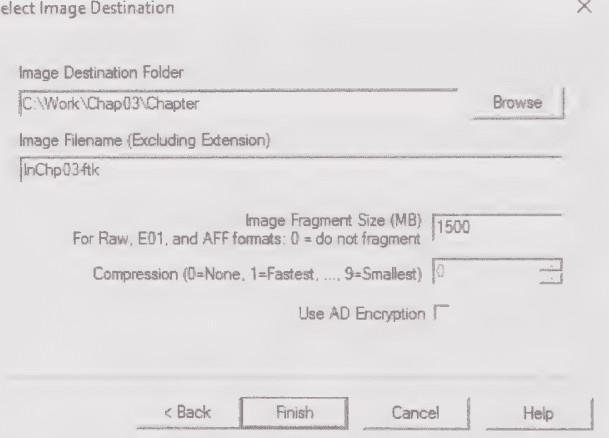

**图 3-6 选择图像文件的保存位置**

来源：AccessData Group, Inc., www.accessdata.com

- **11.** 在“文件名（不含扩展名）”文本框中输入 `InChpo3-ftk`，然后点击**完成** (Finish)。
- **12.** 接下来，在“创建映像”对话框中，点击**开始** (Start) 启动取证。
- **13.** 当 FTK Imager 完成取证后，检查“驱动器/映像验证结果”对话框中的信息，并点击**关闭** (Close)。再次在“创建映像”对话框中点击**关闭** (Close)（见图 3-7）。
- **14.** 通过点击菜单中的**文件** (File)、**退出** (Exit) 退出 FTK Imager Lite。

# 第3章 数据取证

创建映像...

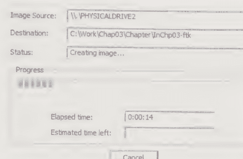

图 3-7 正在进行映像保存

来源：AccessData, Inc., www.accessdata.com

> **注意**：欲需更多信息，请参阅 FTK Imager Lite 中的“帮助”菜单以进一步了解其许多功能。

# 验证数据取证

计算机取证中最关键的方面可能过于验证数字证据。任何数字调查的弱点在于你所收集的数据的完整性，因此验证至关重要。在本节中，我们将学习如何使用多种工具来验证数据取证结果。

验证数字证据需要使用哈希算法工具，该工具用于创建一个二进制或十六进制数字，用代表数据集（如文件或磁盘驱动器）的唯一性。这个唯一数字被称为“数字指纹”。除极少数例外外，对一个文件进行任何修改——即使只是将一个大写字母改为小写——都会产生完全不同的哈希值。


这些异常被称为“碰撞”，已发现在少数使用 MD5 的文件中发生过，SHA-1 也可能受到碰撞的影响。然而，对于磁盘驱动器上数据文件的取证检查，碰撞并不令人担心。如果两个内容不同的文件具有相同的 MD5 哈希值，可以对文件的每个字节进行比较以查看差异。目前，有几种工具可以对文件进行逐字节比较。如 `X-Ways Forensics`、`X-Ways WinHex` 和 `IDM Computing Solution` 的 `UltraCompare` 程序可以分析并比较数据文件。关于 MD5 碰撞的更多信息，请访问 `www.x-ways.net/md5collision.html` 或 `www.mscs.da.de/~-selinger/md5collision/`。第4章描述了使用 MD5 和 SHA-1 的方法。

对于证据驱动器的映像制作，许多工具提供了从 CRC-32、MD5 和 SHA-1 到 SHA-512 的验证技术。这些哈希算法工具作为独立程序提供，或者集成在许多取证工具中。后续章节将描述如何使用现有的取证程序进行验证。

# Linux 验证方法

Linux 拥有丰富的命令和函数。在本章之前显示的两个 Linux Shell 命令 `dd` 和 `dcflddd` 具有多个选项，可以与其他命令结合使用来验证数据。`dcflddd` 命令具有其他选项，可以验证从取证中收集的数据。使用 `dd` 命令对取证结果进行验证则需要其他的 Shell 命令。

当前的 Linux 发行版包含两个哈希算法工具：`md5sum` 和 `ashashsum`。这两种工具都可以计算单个文件、多个文件、单个磁盘分区或整个磁盘的哈希值。

## dd 取证数据验证

如下所示，以下命令会生成 `/dev/sdb` 磁盘的分卷，每个分卷命名为 `.aa`、`.ab`、`.ac` 和 `image_sdb`，依此类推：

```
dd if=/dev/sdb split -b 650m image_sdb
```

要使用 `md5sum` 工具验证目标驱动器的所有分卷，请使用下方的 Linux Shell 命令。对于保存的映像，请切换到保存数据的目录，或列出保存映像的准确路径。若要使用 `hashsum` 代替 `md5sum`，只需将所有 `checksum` 替换为 `hashsum`。驱动器应连接到你的工作站。

1. 如必要，启动 Linux，打开 Shell 窗口并导航到保存映像的目录。计算原始驱动器的哈希值，输入 `md5sum /dev/sdb > _sdb.txt`。重定向 (`>`) 将计算出的 MD5 哈希值保存在 `_sdb.txt` 中。此文件应与映像文件一起保存。
2. 要计算分卷的 MD5 哈希值并将输出追加到 `sdb.txt`，输入 `cat _sdb.* | md5sum >> sdb.txt`。通过使用带有星号 (`*`) 作为扩展名的 `cat` 命令，所有分卷被读取为一个大文件，尽管它们是驱动器或分区。管道 (`|`) 函数将 `cat` 命令读取的数据输出给 `md5sum`。`>>` 将 `md5sum` 的结果添加到 `sdb.txt` 的末尾。
3. 输入 `cat sdb.txt` 并按回车，检查 `sdb.txt` 文件中的哈希是否匹配。如果数据取证成功，这两个数字应该是相同的。如果不是，则取证工作不正确。你应该看到类似以下的输出：

```
34963884ac5810b1301bdade1
34963884ac5810b1301bdade1
```

4. 输入 `exit` 并按回车关闭 Linux 窗口。使用 `dd` 命令在所有目标磁盘和分卷上运行 `md5sum` 或 `sha1sum` 工具。

## dcfldd 取证数据验证

由于 `dcfldd` 是为取证数据设计的，它集成了验证选项：`hash`。使用 `hash` 选项指定 `md5`、`sha1`、`sha256`、`sha384` 或 `sha512` 哈希算法。`hash` 将哈希输出到可以与映像文件一起存储的文件。要在 `dcfldd` 取证期间创建 MD5 哈希输出文件，在提示符处输入以下命令：

```
dcfldd if=/dev/sda split=2M of=img hash=md5 hash=hash.log
```

要查看用 `split` 命令生成的文件，在 Shell 提示符处输入 list (`ls`) 命令。你应该看到以下输出：

```
hash.log
img.004 img.010 img.016 img.022 img.028
hash.log
img.005 img.011 img.017 img.023 img.029
img.000 img.006 img.018 img.024 img.030
img.001 img.007 img.013 img.019 img.025
img.002 img.008 img.014 img.020 img.026
img.003 img.009 img.015 img.021 img.027
```

注意，第一个分卷的扩展名是 `.000` 而不是 `.001`。某些 Windows 取证工具可能无法读取以 `.000` 开头的分卷扩展名，它们通常在寻找 `.001`。如果你的取证工具要求从 `.001` 扩展名开始，则需要对文件进行重命名。因此，分卷文件 `.000` 应重命名为 `.001`，`.001` 应重命名为 `.002`，依此类推。

另一个实用的 `dcfldd` 是 `vf` (verify file)，它比较映像文件与原始介质（如分区或驱动器）。`vf` 选项仅适用于非分文件。要验证来自 `dcfldd` 的分卷，请使用之前描述的 `md5` 或 `sha` 命令。要使用 `vf` 选项，在 Shell 中输入以下命令：

```
dcfldd if=/dev/sda vf=sda_hash.img
```

关于 `dcfldd` 的更多信息，请参见 `man` 页。

# Windows 验证方法

与 Linux 不同，Windows 没有内置用于数字取证的哈希算法工具。许多 Windows 第三方程序具有多种内置工具。这些第三方程序从十六进制编辑器（如 `X-Ways WinHex` 或 `Breakpoint Software Hex Workshop`）到取证程序（如 `OSForensics`、`Autopsy`、`EnCase` 和 `FTK`）。在第9章，你将学习如何使用十六进制编辑器对特定数据进行哈希处理，以定位并验证没有文件关联或作为文件内部章节的数据组。商业取证程序也有内置的验证功能。每个程序都有其用于私有格式取证数据的验证技术。例如，`Autopsy` 使用 MD5 来验证映像。它读取 Expert Witness Compression (E) 或 AFF 映像文件中的元数据以获取原始哈希。如果哈希值匹配，`Autopsy` 将通知你取证已损坏，不能被视为可靠的证据。

你可以在网上找到其他开源哈希工具；只需搜索“windows open source hash”即可找到最新的 Windows 哈希工具。例如，最近的搜索发现了位于 SourceForge 上的 `md5deep` (`http://md5deep.sourceforge.net`) 以及 `Software Informer` (`http://softwaresolution.informer.com/Hash-Tool`)。

# 执行 RAID 数据采集

由于 RAID 系统设计、配置和规模的方式，数字取证人员对 RAID 驱动器的采集可能具有挑战性且令人沮丧。规模是最大的关注点，因为许多 RAID 系统现在正达到艾字节（exabytes）或更多的数据。以下章节将回顾常见的 RAID 配置以及在这些大型存储设备上采集数据的方法。

## 理解 RAID

独立磁盘冗余阵列（RAID）是一种涉及两个或多个物理磁盘的计算机配置。RAID 最初被开发为一种数据冗余措施，以尽可能地减少由磁盘故障造成的损失。随着技术的进步，RAID 也增加了存储能力。

可以通过软件（称为“软件 RAID”）或特殊的硬件控制器（称为“硬件 RAID”）实现多个层级的 RAID。软件 RAID 通常通过主机的操作系统以及连接到主机的处理器和内存来实现。有关 RAID 配置的更多信息，请参阅 `www.adaptec.com/rndolyles/14b2fd84-f7a0-4c45-a07a-21412ea3d3d6/0423_sw_hwraid_10.pdf`。

对于 Windows XP、2000 和 NT 服务器及工作站，可以使用 RAID 0 或 1。对于高端数据处理环境，RAID 5 是常见的，且通常基于特殊的 RAID 磁盘阵列（towers）。这些高端 RAID 系统通常具有高度集成的控制器，连接到高端服务器或大型机。这些系统提供了冗余和高速数据访问，并可以使许多小磁盘显示为一个非常大的磁盘驱动器。

### RAID 0

RAID 0 提供了快速访问和增加的数据存储（见图 3-8）。在 RAID 0 中，两个或多个磁盘驱动器变成一个大卷，因此计算机将这些磁盘视为单个磁盘。这种存储模式下的数据轨道跨越到每个磁盘。逻辑寻址方案使得数据轨道在所有磁盘上似乎是连续的。如果你有两个配置为 RAID 0 的磁盘，轨道 1 从第一块磁盘开始，并继续到第二个物理磁盘。从已启动的操作系统（如 Windows XP 或更高版本）中查看时，这两个磁盘显示为一个大磁盘。RAID 0 的优点是增加了速度和数据存储能力，并分布在两个或多个磁盘上，这些磁盘可以作为一个大磁盘分区。它最大的缺点是缺乏冗余；如果一个磁盘故障，数据将无法持续可用。

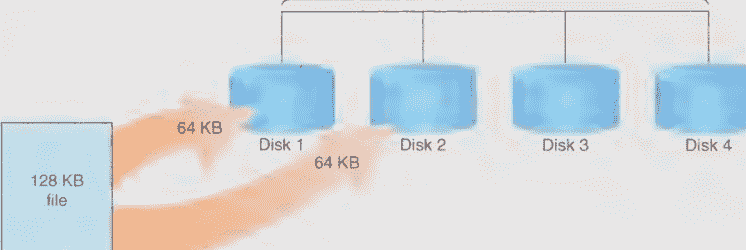

**图 3-8** RAID 0：条带化（Striping）

### RAID 1

RAID 1（见图 3-9）由每个卷的两个磁盘组成，旨在用于磁盘故障时进行数据恢复。RAID 1 中两个磁盘的内容是完全相同的。当数据写入卷中时，操作系统会写入两次数据——同时写入每个磁盘。如果其中一个磁盘故障，操作系统将切换到另一个磁盘。

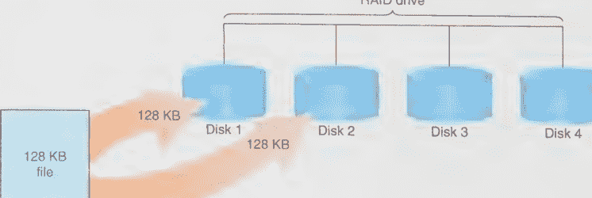

**图 3-9** RAID 1：镜像（Mirroring）

RAID 1 确保数据不会丢失并有助于防止计算机停机。RAID 1 的主要缺点是每个卷需要两个磁盘，这双倍了磁盘存储的成本。

### RAID 2

与 RAID 1 类似，RAID 2（见图 3-10）通过将两个或多个磁盘配置为一个大卷来提供快速访问和增加的存储。RAID 2 的区别在于数据是以位级（bit level）写入磁盘的。使用纠错码（ECC）来验证写入是否成功。因此，RAID 2 比 RAID 0 有更好的数据完整性检查。然而，由于位级写入和 ECC 的存在，RAID 2 比 RAID 0 慢。

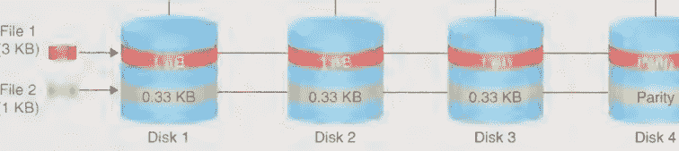

**图 3-10** RAID 2：条带化（位级）

### RAID 3 与 RAID 4

RAID 3 使用数据条带化和专用校验位，并且至少需要三块磁盘。与 RAID 0 类似，RAID 3 将轨道跨越到组成一个大卷的所有磁盘上。RAID 3 还实现了数据的专用校验位，以确保在数据损坏时进行恢复。专用校验位存储在 RAID 3 阵列中的一个磁盘上。与 RAID 3 类似，RAID 4 使用数据条带化和专用校验位（块写入），只是数据是块而不是字节写入的。

### RAID 5

RAID 5（见图 3-11）与 RAID 0 和 RAID 3 类似，因为它使用了分布式数据和分布式校验位，并在 RAID 阵列的所有磁盘上进行数据条带。然而，与 RAID 3 不同，RAID 5 将校验位放在每个磁盘上。如果 RAID 阵列中的磁盘发生数据故障，当更换故障驱动器时，其他磁盘上的校验位会自动重建损坏的数据。


**图 3-11** RAID 5：分布式校验

RAID 5 确保数据不会丢失并有助于防止计算机停机。


# RAID 技术概述

## RAID 0
RAID 0 提供了快速访问和增加的数据存储（见图 3-8）。在 RAID 0 中，两个或多个磁盘驱动器变成一个大卷，因此计算机将磁盘视为单个磁盘。这种存储模式下的数据轨道跨越到每个磁盘。逻辑寻址方案使得数据轨道在所有磁盘上似乎是连续的。如果你有两个配置为 RAID 0 的磁盘，轨道 1 从第一块磁盘开始，并继续到第二个物理磁盘。从已启动的操作系统（如 Windows XP 或更高版本）中查看时，这两个磁盘显示为一个大磁盘。RAID 0 的优点是增加了速度和数据存储能力，分布在两个或多个磁盘上，这些磁盘可以作为一个大磁盘分区。它最大的缺点是缺乏冗余；如果一个磁盘故障，数据将无法持续可用。

## RAID 1
RAID 1（见图 3-9）由每个卷的两个磁盘组成，旨在用于磁盘故障时进行数据恢复。RAID 1 中两个磁盘的内容是完全相同的。当数据写入卷中时，操作系统会写入两次数据——同时写入每个磁盘。如果一个磁盘故障，操作系统将切换到另一个磁盘。

RAID 确保数据不会丢失并有助于防止计算机停机。RAID 1 的主要缺点是每个卷需要两个磁盘，这双倍了磁盘存储的成本。

## RAID 2
与 RAID 1 类似，RAID 2（见图 3-10）通过将两个或多个磁盘配置为一个大卷来提供快速访问和增加的存储。RAID 2 的区别在于数据是以位级写入磁盘的。使用纠错码（ECC）来验证写入是否成功。因此，RAID 2 比 RAID 0 有更好的数据完整性检查。然而，由于位级写入和 ECC 的存在，RAID 2 比 RAID 0 慢。

## RAID 3
RAID 3 使用数据条带化和专用校验，并且至少需要三块磁盘。与 RAID 0 类似，RAID 3 将轨道跨越到组成一个大卷的所有磁盘上。RAID 3 还实现了数据的专用校验位，以确保在数据损坏时进行恢复。专用校验位存储在 RAID 3 阵列中的一个磁盘上。

## RAID 4
与 RAID 3 类似，RAID 4 使用数据条带化和专用校验（块写入），只是数据是块而不是字节写入的。

## RAID 5
RAID 5（见图 3-11）与 RAID 0 和 RAID 3 类似，因为它使用了分布式数据和分布式校验位，并在 RAID 阵列的所有磁盘上进行数据条带。然而，与 RAID 3 不同，RAID 5 将校验位放在每个磁盘上。如果 RAID 阵列中的磁盘发生数据故障，当更换故障驱动器时，其他磁盘上的校验位会自动重建损坏的数据。

## RAID 实现方式
独立磁盘冗余阵列（RAID）是一种涉及两个或多个物理磁盘的计算机配置。RAID 最初被开发为一种数据冗余措施，以尽可能减少由磁盘故障造成的损失。随着技术的进步，RAID 也增加了存储能力。

可以通过软件（称为“软件 RAID”）或特殊的硬件控制器（称为“硬件 RAID”）实现多个层级的 RAID。软件 RAID 通常通过主机的操作系统以及连接到主机的处理器和内存来实现。有关 RAID 配置的更多信息，请参阅 `www.adaptec.com/rndolyles/14b2fd84-f7a0-4c45-a07a-21412ea3d3d6/0423_sw_hw_raid_10.pdf`。

对于 Windows XP、2000 和 NT 服务器及工作站，可以使用 RAID 0 或 1。对于高端数据处理环境，RAID 5 是常见的，且通常基于特殊的 RAID 磁盘阵列。这些高端 RAID 系统通常具有高度集成的控制器，连接到高端服务器或大型机。这些系统提供了冗余和高速数据访问，并可以使许多小磁盘显示为一个非常大的驱动器。

# 使用远程网络采集

数字取证工具的最新改进包括远程获取磁盘数据或数据片段（稀疏或逻辑）的能力。通过这种功能，你可以通过网络连接到远程嫌疑计算机并从中复制数据。远程采集工具在配置和功能上有所不同。以下是一些工具供应商：

- EnCase
- X-Ways Forensics
- AccessData FTK
- Runtime Software
- R-Tools

## 远程采集的挑战

在进行远程采集时，需要考虑以下挑战：

1. **软件限制**可能包括：
   - 远程访问软件
   - 某些代理软件
   - 恶意软件
   - 防火墙软件

2. **硬件限制**可能包括：
   - 磁盘带宽
   - 磁盘速度
   - 处理器速度

3. **操作系统限制**可能包括：
   - 目标系统的操作系统版本
   - 目标系统的权限
   - 目标文件系统类型

4. **网络限制**可能包括：
   - 虚拟网络（VPN）
   - 宽带限制
   - 局域网限制
   - 丢包
   - 网络拥塞

5. **法律和政策限制**可能包括：
   - 隐私法
   - 组织政策
   - 司法管辖区限制

6. **权限限制**
   在执行远程采集时，需要高级权限才能将代理应用程序部署到远程系统。

## 远程采集工具示例

后续章节描述了具有远程采集能力的数字取证工具所使用的方法。以 ProDiscover 的旧版本为例，展示了远程采集是如何工作的。其他厂商的远程采集功能原理类似。第 10 章涵盖了数据复制的其他资源，并解释了如何进行现存取证采集（live forensics acquisition）。

### 使用 ProDiscover 进行远程采集

ProDiscover Incident Response 设计用于作为网络入侵分析工具进行集成，对于执行远程采集非常有用。当连接到远程计算机时，它使用之前描述的 ProDiscover 采集方法。连接建立后，“捕获镜像”（Capture Image）对话框中会显示远程计算机。该工具提供了 ProDiscover 套件中其他工具的所有功能和特征，外加以下功能：

- 采集瞬态状态信息。
- 分析远程系统上当前运行的进程。
- 在远程系统上定位可能运行恶意软件或间谍软件的隐藏文件进程。
- 远程查看并监听受感染系统的 IP 端口。
- 在远程系统上运行哈希比较，以搜索已知的木马和根内核程序（rootkits）。
- 创建远程系统所有文件的哈希清单（负哈希搜索能力），以便在受到攻击时建立基准。

用于远程访问的 ProDiscover 工具是 `PDServer` 远程代理，在 ProDiscover Incident Response 访问它之前，必须在嫌疑计算机上加载它。该远程代理可以通过三种不同的方式安装：

- **可信 CD**——对于这种安装方法，ProDiscover 可以创建一个包含 `PDServer` 远程代理的特殊 CD/DVD 或 USB 驱动器。用于在嫌疑计算机上手动加载 `PDServer`。
- **预安装**——对于配置了操作系统的网络，可以将 `PDServer` 远程代理添加到高风险计算机的标准安装中，使网络安全管理员能够响应网络攻击和恶意软件感染。可以使用任何网络管理工具（如 DameWare (`www.dameware.com`) 或 Hyena (`www.systemtools.com/hyena/`)`）启动与 ProDiscover 的连接。这是安装远程采集工具的远程方法。
- **推送并远程运行**——将 `PDServer` 下载到远程计算机有助于调查人员快速响应事件。使用此功能时会实时收集数据。这是另一种安装远程采集工具的远程方法。

使用 `PDServer`，你可以选择以隐身模式运行它以躲避嫌疑者。注意 Windows 任务管理器会将进程列为 `PDServer`。为了伪装它，你可以更改进程名称，使其看起来像嫌疑计算机任务管理器中的某个操作系统功能。此外，远程连接还提供以下安全特性：

- **密码保护**——目标计算机上的 `PDServer` 经过密码保护，且密码始终加密加密。
- **加密**——`PDServer` 与调查人员计算机之间的所有通信均可以加密。ProDiscover 为连接提供 256 位高级加密标准 (AES) 或 Twofish 加密。
- **安全通信协议**——嫌疑计算机与检查员计算机之间的所有连接都有全局唯一标识符 (GUID)，以防止在数据流中插入数据包。
- **写保护的可信二进制文件**——`PDServer` 可以从写保护的设备（如 CD）上运行。
- **数字签名**——`PDServer` 及其删除驱动程序 `PARremoval.sys` 经过数字签名，以验证它们在远程连接之前和期间未被篡改。


有关 ProDiscover 的更多信息，请访问 `www.arcgroupny.com`。

### 使用 EnCase Enterprise 进行远程采集

Guidance Software 是第一个开发基于其桌面工具 EnCase 的远程采集和分析工具的取证厂商。该远程工具 `EnCase Endpoint Investigator` 可以执行以下功能：

- 跨越地理区域搜索并收集内部和外部网络系统
- 支持多个操作系统和文件系统
- 分拣（Triage）帮助确定系统与调查的相关性
- 一时对多五个系统进行同步搜索

更多信息请访问：`www.guidancesoftware.com/docs/default-source/document-library/product-brief/encase-endpoint-investigator-product-overview.pdf`。

### 使用 R-Tools R-Studio 进行远程采集

R-Tools 软件套件旨在数据恢复。作为该恢复能力的一部分，`R-Studio` 网络版可以远程访问网络计算机。使用 `R-Studio` 网络版采集的数据创建原始格式采集，并且它能够恢复许多不同的文件系统，包括 ReFS。有关 R-Studio 的更多信息，请访问 `www.r-studio.com`。

### 使用 WetStone US-LATT PRO 进行远程采集

`US-LATT PRO` 是 WetStone 开发的工具套件的一部分，可以远程连接到网络计算机并对连接到的所有驱动器进行现存采集。有关该工具的更多信息，请访问 `www.wetstonech.com/product/us-latt/`。

### 使用 f-Response 进行远程采集

`F-Response` 是一种中立的专用远程访问工具，旨在与任何数字取证程序配合工作。当安装在远程计算机上时，它会建立安全的只读连接，允许取证检查员访问。通过 `F-Response`，检查员可以在物理层级访问远程驱动器并查看原始数据。在建立 `F-Response` 连接后，可以使用任何取证采集工具来收集数字证据。

`F-Response` 以四种版本出售：企业版（Enterprise Edition）、顾问+转换版（Consultant + Convert Edition）、顾问版（Consultant Edition）和战术版（TACTICAL Edition）。

## 使用其他取证工具

除了你学过的工具，你可以使用后续章节描述的商业工具。

### PassMark Software ImageUSB

PassMark Software 有一个名为 `ImageUSB` 的采集工具。有关 ImageUSB 的更多信息，请访问 `osforensics.com/tools/usb-`。

### ASR Data SMART

`ASR Data SMART` 是一种 Linux 取证工具，可以制作嫌疑对象的镜像。SMART 可以产生专用格式，并包括：

- 扇区的健壮读取
- 以写保护模式挂载嫌疑盘
- 挂载 NTFS 系
- 可选压缩方案

有关 SMART 的更多信息，请访问 `www.asrdata.com`。

### Runtime Software

除了 RAID Reconstructor，Runtime Software 还提供了几种用于数据采集的共享软件，包括针对 FAT 和 NTFS 的 `DiskExplorer`。Runtime 设计的工具针对特定系统，因此提供了 FAT 和 NTFS 的版本。这些工具提供：

- 创建原始格式镜像
- 为了存档目的切分原始格式或压缩镜像
- 访问网络计算机

有关 Runtime 的更多信息，请访问 `www.runtime.com/raid.htm`。

### ILookIX Imager

`Imager` 从启动 U 盘或 CD/DVD 运行。它是专为 ILookIX 设计的独立采集工具。它可以采集单驱动器和 RAID 驱动器。它支持 IDE (PATA)、SCSI、USB 和 FireWire。在使用其他分析工具时可以将 Imager 的专用格式转换为原始格式。有关 Imager 的更多信息，请访问 `www.perlost.com/e-forensics/iximager`。

### SourceForge

SourceForge 提供了用于安全、分析和调查的多种应用程序。有关其工具列表请访问 `https://sourceforge.net/directory/os:windows/`。SourceForge 还提供了 Windows 版本的 `dcfldd`，更新请访问 `https://sourceforge.net/projects/dcfldd/?source=typ_redirect`。

# 章总结

- 取证数据以三种不同的格式存储：原始、专用和 AFF。大多数专用格式和 AFF 在镜像文件中存储元数据。
- 用于取证分析的四种采集方法是：磁盘到镜像文件、磁盘到磁盘拷贝、逻辑磁盘到磁盘或数据文件，以及文件夹或文件的稀疏数据拷贝。
- 取证无损压缩在恢复时不会更改数据，与有损压缩不同。无损压缩可以将大多数数据压缩 50%。
- 如果存在时间限制或从大型驱动器和 RAID 驱动器采集的数据过多，可能需要进行逻辑采集或稀疏采集。请先咨询你的首席律师或主管，以了解可能无法收集所有数据。

## 复习题

4. 列出两个与专有格式获取文件共同的特征。
5. 在所有专有格式中，哪一个是非官方标准格式？
6. 写出两个可以对硬盘进行扇区级取证复制并保存到更大硬盘上的商业工具。
7. 逻辑获取（logical acquisition）能为调查收集哪些数据？
8. 稀疏获取（sparse acquisition）能为调查收集哪些数据？
9. 在确定要使用的数据获取方法时，你应该考虑什么因素？
10. 为什么在关键调查中对嫌疑硬盘制作两个镜像是一个良好做法？
11. 当你在远程位置执行获取时，应该考虑什么来准备这项任务？
12. 在使用较新的内核发行版时，如果连接包含证据的 USB 驱动器等热插设备，会发生什么？
13. 在 Linux 中，`dd` 命令将嫌疑硬盘列为 `/dev/sda1`。以下 dcfldd 命令是否正确？

```
dcfldd if=image_file.img=/dev/sda1
```

14. 数字证据最关键的方面是什么？
15. 什么是哈希算法？
16. 在 Linux `dd` 命令中，哪三个选项用于验证数据？
17. 写入 FAT32 驱动器时，最大文件大小是多少？
18. 从 RAID 服务器获取数据时有两个需要关注的问题？
19. 在远程获取中：
   a. 数据传输速度
   b. 网络上的访问权限
   c. 杀毒软件、间谍软件和防火墙程序
   d. 远程计算机的密码
20. 为了让取证工具连接到嫌疑人的远程计算机并隐蔽运行？
21. EnCase、FTK、SMART 和 iLookIX 将镜像文件视同于原始磁盘。正确还是错误？
22. FT Imager 可以获取驱动器受保护区域的数据。正确还是错误？


# 实验项目

在你的工作文件夹下创建一个 `Chapter3\Projects` 文件夹。将本章节下载部分（位于本书的学生辅助网站）中的数据文件复制到此工作子文件夹中。如有必要，将任何压缩文件解压到该子文件夹。

## 实验项目 3-1

在这个项目中，你将使用 Linux 准备一个驱动器并创建一个 FAT32 磁盘分区。你需要：

- 一种 Linux 发行版或 Linux Live CD
- 一个磁盘驱动器


- 一种将驱动器连接到工作站的方法，例如 `USB`、`FireWire`、外部 `SATA` 或内部连接（如 `PATA` 或 `SATA`）

1. 将要分区并格式化为 `FAT32` 的目标驱动器连接到你的工作站。
2. 启动工作站，登录或启动 `Linux Live CD`。
3. 遵循“在 Linux 中为获取准备目标磁盘”章节中的步骤操作。
4. 完成目标驱动器的格式化后，保持其连接状态以便进行下一个项目。

### 实验项目 3-2

在这个项目中，你将使用 `Linux` 命令将获取的内容分为 `30 MB` 的分卷。然后使用原始驱动器和镜像文件上的 `Linux` `mdsum` 命令验证数据。`mdsum` 的输出被重定向到与镜像文件保存在的数据文件中。在这个项目中，你需要：

- 一种 `Linux` 发行版或 `Linux Live CD`
- 在实验项目 3-1 中分区并格式化为 `FAT32` 的磁盘
- 一种将 `FAT32` 驱动器和实验项目 3-1 中创建的驱动器连接到工作站的方法，例如 `USB`、`FireWire`、外部 `SATA` 或内部连接（如 `SATA`）
- 对“在 Linux 中使用 dd 获取数据”和“验证获取的数据”章节的回顾。遵循以下步骤：

1. 将实验项目 3-1 中准备的驱动器连接到你的工作站。
2. 启动工作站，并在必要时登录或启动 `Linux Live CD`。
3. 重启 `Linux` 系统，遵循“在 Linux 中使用 dd 获取数据”的步骤，使用 `dd` 命令制作大小为 `30m` 的分卷，使用 `-d` 参数创建每个文件的扩展名。
4. 获取完成后，对嫌疑驱动器和镜像文件进行验证。遵循“验证获取的数据”的步骤。完成后，保持终端打开并运行 `Linux` 以进行下一个项目。

### 实验项目 3-3

数字取证人员有时被要求恢复镜像文件到磁盘。在这个项目中，你将学习如何执行此任务。为了准备这个项目，你需要：

- 两个格式为 `FAT16` 或 `FAT32` 的 `USB` 驱动器，可以容纳 `120 MB`。两个驱动器都应格式化为 `FAT16` 或 `FAT32`。你的 `Linux` 版本可能无法读取或写入格式为 `NTFS` 的数据。
- `Linux` 发行版，`Linux Live CD`，带有至少两个 `USB` 端口。
- `GCFI-datacarve-FAT.dd` 文件（从工作文件夹提取）。

### 在 Linux 中的程序

首先，将 `GCFI-datacarve-FAT.dd` 到目标驱动器。然后将镜像文件恢复到另一个 `USB` 驱动器。遵循以下步骤：

1. 在你的电脑上，将 `GCFI-datacarve-FAT.dd` 文件复制到其中一个 `USB` 驱动器。
2. 启动你的工作站，如果有需要，使用 `Linux Live CD`，将第二个 `USB` 驱动器连接到目标驱动器。
3. 片刻后，如果有需要打开终端窗口。为了切换到超级用户账户，输入 `sudo` 并回车，在密码提示处输入 `root` 密码并回车。
4. 输入 `df` 并回车列出所有连接设备，如图 3-12 所示。此输出标识了 `Linux` 分配的路径。

```
root@ # $ df
Filesystem     1kblocks Used% Mounted on
udev           406138 0 406138 0% /
tmpfs          916548 9990 806648 2% /run
dev/sda1      69069427 8821436 774860 16% /
dev/sdh1      7847904 102804 7745100 2% /media/joe/FC11-3DE
dev/sdil      978624 4 978624 1% /media/joe/UDISK
```

**图 3-12** 显示磁盘系统

不同的 `Linux` 发行版显示的名称略有不同，如图 3-13 所示。例如，注意 `LinuxMint` 中的 `/media` 目录列出了 `joe` 子目录。`Ubuntu Linux` 显示 `/media` 目录的子目录为 `cdrom` 和 `root`。子目录名称取决于你使用的 `Linux` 发行版。请在本项目和其他项目的命令中替换正确的目录名称。

示例 1，来自 `LinuxMint`

```
root@joe # ls /media
joe oem
```

示例 2，来自 `Ubuntu Live CD`

```
root@ubuntu:~ ls /media
cdrom root
```

**图 3-13** 不同 `Linux` 发行版显示 `/media` 目录的示例

上述步骤是在 `LinuxMint` 中执行的。这些命令在其他 `Linux` 发行版和大多数 `Linux Live CD` 中同样适用。必要，请将目录名称 `joe` 替换为你发行版的正确名称。

5. 要确定哪个 `USB` 驱动器包含镜像文件 `GCFI-datacarve-FAT.dd`，哪个是空的，请输入 `ls /media/joe/FC11-3DE` 并回车，然后输入 `ls /media/joe/UDISK`（见图 3-14）并回车。

某些 `USB` 驱动器具有十六进制数字或厂商分配的名称，例如图 3-14 所示的 `FC11-3DE`。显示的子目录名称替换第 5 步中的命令。

```
root@joe # ls /media/joe/FC11-3DE
GCFI-datacarve-FAT.dd System Volume Information
root@joe # ls /media/joe/UDISK
```

**图 3-14** 显示 `/media/joe` 目录下的子目录内容

来源：`Linux Foundation`

在本例中，`UDISK` 子目录仅显示 `FAT` 系统卷区信息文件。`FC11-30D2` 子目录显示了 `GCFI-datacarve-FAT.dd` 文件，该文件将从 `FC11-30D2` 恢复到 `UDISK`。

6. 输入 `dd if=/media/joe/FC11-30D2/GCFI-datacarve-FAT.dd of=/dev/sdh1 bs=64 conv=noerror,sync status=progress` 并按回车。图 3-15 显示了输出。

```
GCFI6m # $ if=/media/joe/FC11-30D2/GCFI-datacarve-FAT.dd of=/dev/sdh1 bs=64 conv=noerror,sync status=progress
10462208 bytes (104 MiB, 99 MiB) copied, 99.0001 s, 1.1 MB/s
1444552+0 records in
1444552+0 records out
10521328 bytes (105 MiB, 100 MiB) copied, 99.7624 s, 1.1 MB/s
GCFI6m # $
```

**图 3-15** 将镜像恢复到磁盘驱动器的命令

来源：`Linux 基金会`（`Linux Foundation`）。

7. 数据拷贝完成后，继续下一个项目。如果你不再继续，请关闭终端窗口并注销 `Linux`。

## 动手项目 3-4

在本项目中，你将使用 `dd` 命令对在“动手项目 3-3”中创建的恢复 `USB` 驱动器制作分段镜像文件。为了准备工作，你需要以下物品：

- 一个包含从“动手项目 3-3”中恢复的镜像 `GCFI-datacarve-FAT.dd` 的 `USB` 驱动器
- 一个格式化为 `FAT16` 或 `FAT32` 的 `USB` 驱动器，容量可容纳 `120 MB`
- 一个 `Linux` 发行版、`Linux Live CD` 或带有至少两个 `USB` 端口的运行 `Linux` 系统以进行采集，请按照以下步骤操作：

1. 如必要，连接两个 `USB` 驱动器并启动系统进入 `Linux`，然后打开终端窗口。
2. 输入 `sudo` 并按回车，如果有必要，输入 `root` 密码并按回车。
3. 输入 `df` 并按回车，列出所有连接到计算机的设备并查看分配的路径。
4. 输入 `cd /media/root/usbdrive` 并按回车，将当前工作目录更改包含 `GCFI-datacarve-FAT.dd` 文件的 `USB` 驱动器。

将 `/root/usbdrive` 替换为 `df -h` 命令输出列出的路径。

## 第3章 数据采集

5. 检查步骤 3 中执行的 `df -h` 命令的输出，查看 `USB` 驱动器 `/media/root/usbdrive` 上的可用空间（`Avail` 列下）。如果空间小于 `120 MB`，输入 `rm GCFI-datacarve-FAT.dd` 并按**回车**删除该文件，为写入分段镜像文件腾出空间。
6. 输入 `dd if=/dev/sdb split -b 50m - GCFI-datacarve-FAT.-d` 并按**回车**。

> **注意**
> 将 `sdb` 替换为接收“动手项目 3-3”中创建的镜像文件的 `USB` 驱动器。为了减少分段文件的数量，将 `50m` 改为 `650m` 或更大。

7. 采集完成后，输入 `ls` 并按**回车**，查看产生了多少分段文件。
8. 关闭采集工作站，移除 `USB` 驱动器，并在必要时移除 `Linux Live CD`。

### 案例项目

### 案例项目 3-1

你的主管要求你研究当前的采集工具。请使用你偏好的互联网搜索引擎和本章列出的供应商，为每种工具准备一份报告，其中包含以下信息，并说明你倾向于使用哪种工具：

- 司法取证厂商名称
- 采集工具名称及最新版本号
- 厂商的产品功能

收集这些数据后，准备一个表格，行列出供应商。列标题请列出以下功能：

- 原始格式 (`Raw format`)
- 私有格式 (`Proprietary format`)
- `AFF` 格式
- 该工具可以读取的其他私有格式
- 镜像文件的压缩
- 远程网络采集
- 验证方法（`MD5`、`SHA-1` 等）

### 案例项目 3-2

在某个谋杀案现场，你开始对一台计算机驱动器制作镜像。你位于房屋的卧室，厨房里燃起了一小火。如果火无法熄灭，你只有几分钟时间从磁盘中获取数据。请写一到两页内容，概述你保护数据的方案。

### 案例项目 3-3

你需要对一台无法离开现场的计算机获取镜像，并发现它运行的是 `Linux`。你获取镜像的方案有哪些？请写一篇简短论文，说明你将使用的硬件和软件。

### 案例项目 3-4

一家银行聘请贵公司调查员工欺诈。该银行使用局域网（`LAN`）。你被允许与熟悉数据存储位置的网络管理员交流。你应该使用哪种采集方法？请写一份两页报告，概述你预计会遇到的问题、如何纠正这些问题并描述你的解决方案。务必处理任何隐私问题。

### 案例项目 3-5

你正在调查一起案件，你正在调查一个涉及隐私的问题。

### 案例项目 3-6

你的主管要求你研究当前的采集工具。请使用你偏好的互联网搜索引擎和本章列出的供应商，为每种工具准备一份报告，其中包含以下信息，并说明你倾向于使用哪种工具：

- 司法取证厂商名称
- 采集工具名称及最新版本号
- 厂商的产品功能

收集这些数据后，准备一个表格，行列出供应商。列标题请列出以下功能：

- 原始格式 (`Raw format`)
- 私有格式 (`Proprietary format`)
- `AFF` 格式
- 该工具可以读取的其他私有格式
- 镜像文件的压缩
- 远程网络采集
- 验证方法（`MD5`、`SHA-1` 等）

### 案例项目 3-7

请使用以下工具之一进行调查：[Deft](https://github.com/deft-linux/deft) (`Linux`)、[CAINE](https://github.com/caine-linux/caine-linux-live-cd)、[Kali Linux](https://www.kali.org/) 或 [Sleuth Kit](https://www.sleuthkit.org/)，并写一份报告说明你选择的工具及其原因。

## 第4章 犯罪与事件现场处理

关于数字证据的信息，请参阅《电子犯罪现场调查：第一响应人员指南（第2版）》，该书可从 `www.ncjrs.gov/pdffiles/nij/219941.pdf` 获取。该书为美国执法部门和其他其他响应人员提供了指南，指导他们如何保护电子犯罪现场，并对电子证据进行搜索、收集和保存。

以下是调查人员在处理数字证据时执行的通用任务：

- 识别可用作证据的数字信息或人工产物。
- 收集、保存并记录证据。
- 分析、识别并组织证据。
- 重建证据或重复情境以验证结果是否可以可靠地重现。

在处理犯罪或事件现场时，收集数字设备必须系统地进行。为了最大限度地减少混乱、降低丢失证据的风险并避免损坏，在可行的情况下，应由一个团队对犯罪现场或实验室控制并编目数字证据。如果证据过多或系统过于复杂，导致一个团队无法实际完这些任务，则所有审查员必须遵循相同的既定操作程序，并由一名首席或管理审查员控制证据的收集和编目。你还应该使用标准表格（在后文“记录证据”部分进行讨论）来跟踪证据，以确保你以安全、可靠的方式处理证据。

调查人员面临的一个重要挑战是为数字证据建立公认的标准。例如，某些案件涉及在许多国家同时进行的警察搜查，以及在世界多个地点进行的反毒枭集团调查。结果是，数百件数字证据（包括硬盘、手机和其他存储设备）在多个地点被查获。如果这些国家的执法部门和民事组织对适当的程序达成共识（通常，所有司法管辖区的证据收集都应适用最高控制标准），则这些证据可以在任何司法管辖冲突中提交。随着移动设备和云存储成为常态，证据的收集现在变得更加复杂。

### 理解证据规则

一致的做法有助于验证你的工作并增强你的公信力，你必须一致地处理所有证据。对于民事诉讼和重大犯罪案件中的证据，应应用相同的安全和问责控制，以符合你所在州的证据规则或《联邦证据规则》（`FRE`）。此外，请记住，刑事案件中被纳的证据也可能用于民事诉讼，反之亦然。

例如，假设某人被指控谋杀并在刑事审判中被无罪，因为陪审团无法排除合理怀疑判定该人有罪。然而，如果有足够的证据表明被告的疏忽导致了意外死亡，受害者家属可以在民事诉讼中使用这些证据来索取赔偿。

你可以在 `www.uscourts.gov/uscourts/rules/rules-evidence.pdf` 查看《联邦证据规则》。

作为你职业成长的一部分，请关注有关收集、处理、存储和采纳数字证据的最新裁决和指令。以下章节讨论了数字证据的一些关键概念。你可以在美国司法部网站（`www.usdoj.gov`）查找更多信息，或在互联网上搜索“digital evidence”（数字证据）、“best evidence rule”（最佳证据规则）、“hearsay”（传闻）和其他相关关键词。咨询你的检察官、王室律师、公司总顾问或聘请你的律师，以了解更多关于调查证据管理的信息。

在第3章中，你学习了如何制作磁盘镜像作为收集数字证据过程的一部分。你从法医检查中发现的数据属于州证据规则或《联邦证据规则》（`FRE`）。然而，数字证据与其他物理证据不同，因为它更容易被更改。检测这些变化的唯一方法是将原始数据与副本进行比较。此外，在电子层面上区分副本和原始数据具有挑战性，因此数字证据需要特殊的法律考量。

在其他司法管辖区工作时，数字证据需要特殊的法律考量。

以下是适用于数字取证调查的例外：

- 业务记录。
- 公共记录。
- 对诉讼人的陈述。
- 传闻规则的其他特定例外。

## 第4章 犯罪与事件现场处理

### 数字记录的分类

在普通法国家，对计算机生成的记录和存储的记录进行了区分。

- **生成的记录**是系统维护的数据，例如系统日志文件。它们是计算机程序或算法的输出，通常不是人工创建的。
- **存储的记录**是人工创建的电子数据，例如表格或文字处理文档。

计算机生成的和存储的记录在采纳时还必须证明其真实性。如果生成输出的程序运行正常，则计算机生成的记录被认为是真实的。这些记录通常被视为传闻规则的例外。存储的记录要进入法庭，还必须满足传闻规则的例外（通常是业务记录例外），因此它们必须是经常进行的记录。

按照批准步骤收集证据有助于确保计算机证据的真实性，使用法医工具也是如此。法院一直裁定法医调查人员不需要成为其所用工具的专家。在 `United v. Salgado` (250 F.3d 438, 453, Cir., 2001) 一案中，法院指出：“不需要计算机程序员作证即可证实计算机生成的记录。”换句话说，证人只需对案件相关的事实有第一手知识。如果你必须就自己在获取、保存和分析证据的角色进行作证，你不需要了解所用工具的内部原理，但你应该理解其操作和目的。

尽管研究已迫使 `MD5` 哈希值发生碰撞（即重复值），但它在取证验证中仍然很有用。请记住，你无法从哈希值反向源字符串。此外，碰撞影响案件的概率微乎其微。


# 犯罪与事故现场的处理

当律师对数字证据提出质疑时，他们通常会提出计算机生成的记录在创建后是否被篡改或损坏的问题。在“美国运通诉 Vinhhee”案（第九巡回上诉法院 Bk. App. Panel, 2005）中，法官认定美国运通未能证明提交给法庭的记录是真实的，且与发送给 Vinhhee 先生的原始账单一致。该公司在上诉中也失败了。

律师还可能通过质疑创建记录的程序来质疑计算机生成记录的真实性。例如，《联邦证据规则》第902条（`FRE 902`）提到了自证证据，其中包括经过盖章、签名或认证的公共文件。它还包括如报纸之类的出版物。`FRE 902 (b)` 的拟议修订试图终止基于“计算机生成的记录不可靠或被篡改”的质疑。（更多信息，请访问：`www.jdsupra.com/legalnews/new-amendments-to-federal-rule-of-22539/`）

迄为止，法院对缺乏支持的数字证据主张持怀疑态度。在没有特定证据的情况下声称数据已更改，不足以认定数字证据的真实性。大多数联邦法院将计算机生成记录的数字证据视为“传言”进行评估。如果该记录作为数字证据涉及传言，联邦法院随后会适用“业务记录例外”。

如前所述，需要证明记录是由特定个人创建的。然而，确定谁创建了数字证据可能是困难的，因为从空隙（`slack space`）或未分配磁盘空间中恢复的记录通常不会标识作者。其他记录（如匿名电子邮件或短信）也是如此。为了在这些案件中确定数字证据的作者，律师可以使用间接证据，这需要找到与嫌疑人计算机或地点相关的其他线索。间接证据可能是：计算机的密码与其他系统使用的密码一致；证人目击犯罪发生时发现嫌疑人在电脑前；或者额外的痕迹证据将嫌疑人与案发时的计算机联系起来。在最近的一个案件中，律师选择不使用数字证据，尽管可以证明某个相机被用于制作嫌疑人的电影、CD 和 DVD，但没有办法证明嫌疑人就是使用该相机的人。

因此，没有间接证据或佐证证据可以证明嫌疑人有罪。

某些伪文件可能不包含作者姓名，在逮捕 BTK 连环杀手时，通过文件元数据识别出了一个 Microsoft Word 文档的作者。2005年2月，一名自称是 BTK 连环杀手的男子向威智科的 FOX 新闻频道送了一张软盘。警方一直被嘲讽，说他们无法通过这张软盘追踪到他。对软盘的取证检查显示出了一个教堂的名字和一个名为 Dennis 的用户，结果证明此人是教会主席 Dennis Rider。警方拥有实物证据将其与犯罪联系起来。他们逮捕了他，他承认在 30 年间杀害了 10 人。他被判处 10 条无期徒刑。（完整故事请参阅 ABA Journal 的文章：`abajournal.com/magazine/article/how_cops_caught_btk/`）

以下活动展示了识别此类文件元数据的简单方法。在开始活动之前，请访问 `www.osforensics.com/download.html` 下载 OSForensics 的试用版。在本书时，版本 4.0.1002 是最新版本。完成后，安装该程序，然后按照以下步骤操作。

在开始之前，在你的系统中创建一个 `Work\Chap04\Chapter` 文件夹；在步骤中被称为“工作文件夹”。

1. 启动 Microsoft Word，在新文档中输入 `Creating a file, you can identify the author with file metadata.`。将其保存到工作文件夹中为 `InChap04-01.docx`（或早版本 Word 中为 `InChap04-01.doc`），然后退出 Microsoft Word。

2. 点击“开始”->“OSForensics”启动该程序。如果 Windows 提示确认你信任此程序，点击“确定”或“是”。根据提示点击“继续使用试用版”。

3. 如果看到询问是否升级到专业版的消息，点击“继续使用试用版”按钮。

4. 在 OSForensics 主窗口中，注意右侧面板的 Viewers 部分。点击 File，然后点击 Hex Viewer。在弹出的“选择要打开的文件”对话框中，导航到你的工作文件夹并双击你在步骤 1 中创建的文件。

5. 打开的对话框（见图 4-1）有五个标签页。点击 File Info 标签。你可以看到文件所在的位置以及创建日期和时间。注意文件大小与其在磁盘上的大小是不同的。

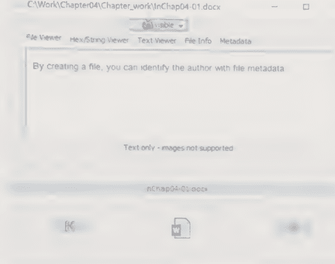

**图 4-1** 在 OSForensics 中检查文件

来源：PassMark Software, `www.osforensics.com`

6. 点击 **Metadata** 标签。该标签页中的信息包括文件权限、文件类型、文件大小和其他项目。滚动到该标签页底部，你可以看到谁创建了文件以及谁最后修改了文件。


**图 4-2** 查看元数据

来源：PassMark Software, `www.osforensics.com`

7. 关闭对话框，通过滚动到底部并点击 **Exit** 关闭 OSForensics。

## 在私营部门事件现场收集证据

私营部门组织包括中小型企业、大型公司和非政府组织（`NGOs`），这些组织可能获得政府或其他机构的资助。在美国，`NGO` 和类似的机构必须遵守州公共披露法和联邦《信息自由法》（`FOIA`），并规定州公共记录是开放且可供查阅的。例如，在公共办公室（如法院）记录的离婚案件属于公共记录，除非法官下令密封文件。任何人都可以要求索取公共离婚决书的副本。图 4-3 显示了爱达荷州公共披露法的摘要。

公共披露法适用于州记录，但 `FOIA` 允许公民向联邦机构请求公共文件副本。`FOIA` 最初于 20 世纪 60 年代制定，随后的多次修订扩大了其法律范围。一些网站现在通过付费提供可公开访问记录的副本。互联网服务提供商（`ISP`）和其他通信公司属于私营部门业务的一个特殊类别。`ISP` 可以调查员工实施的滥用行为，但不能调查客户。他们必须保护客户隐私，特别是在处理电子邮件时。然而，与《国土安全法》相关的联邦法规以及 2001 年的《爱国法案》（`PATRIOT Act`）重新定义了 `ISP` 和大型组织运行和维护记录的方式。`ISP` 和其他通信公司可能被调查被认为会引发紧急情况的客户活动。根据《爱国法案》，紧急情况被定义为死亡或人身伤害的立即风险，例如在电子邮件中发现炸弹威胁。

正如近期事件所示，政府会监控电子邮件中关键词的出现。爱德华案（`Edward case`）等实例公开了美国政府和其他国政府实施的电子监控规模。这些联邦法规的一些条款在过去几年中经过了修订，因此你应当保持关注。例如，2017 年 3 月，美国国会投票允许 `ISP` 在未获得明确许可的情况下出售客户的浏览历史。（更多细节请见 `www.congress.gov/bill/115th-congress/senate-joint-resolution/34`。）

在私营部门环境中调查和控制计算机事件现场比在犯罪现场要容易得多。在私营部门，事件现场通常是工作场所，例如受控的办公室或制造区域，在那里正在调查违反政策的行为。从用于违反公司政策的计算机到周围设施，一切都受受控制机构的管理——即公司管理层。通常，企业拥有硬件和软件的库存数据库。访问这些数据库并了解可疑电脑上有哪些应用程序，有助于识别分析政策违规所需的取证工作以及进行分析的最佳方法。例如，公司可能有偏好的 Web 浏览器，如 Microsoft Internet Explorer、Mozilla Firefox 或 Google Chrome。了解嫌疑人使用的是哪个浏览器可以帮助你开发标准的检查程序，以识别下载到嫌疑人工作站的数据。

为了调查涉嫌不当使用公司数字资产的员工，关于滥用数字资产的政策声明允许私营部门调查人员在几乎没有理由的情况下进行监控，并在无需许可证的情况下访问公司计算机系统和数字设备，这是一种优势。然而，执法调查人员在没有充分理由获得许可证的情况下无法做到这一点。

但是，如果公司没有显示警告横幅或声明其保留随时检查数字资产的权利的政策，员工对隐私将有预期（如第 1 章所示）。当对员工进行调查时，这种预期的隐私会防止雇主合规地进行侵入性调查。因此，定义良好的公司政策应当说明雇主有权检查、检查或访问任何公司拥有的数字资产。如果公司向所有员工发布政策声明，雇主可以在不受任何隐私限制的情况下调查数字资产；这种做法可能会违反欧盟等国家的隐私法。作为标准做法，公司应同时使用警告横幅和政策声明。例如，如果事件升级为刑事诉讼，检察官更倾向于向陪审团展示横幅而不是政策手册。横幅会对陪审团留下更深刻的印象。

除了确保公司有政策声明或警告横幅外，私营部门调查人员还应明确在什么情况下可以检查员工的计算机。有了政策声明，雇主可以自由启动任何必要的保护公司或组织所需的调查。然而，组织还必须有一套定义良好的流程，说明何时可以启动调查。至少，大多数公司政策都要求对员工是否违反法律或政策存有“合理怀疑”。例如，如果政策规定员工不能将计算机用于外部业务，且主管注意到工作行为发生变化可能表明员工正在违反该规则，这通常足够启动调查了。

某些国家要求，如果员工被怀疑在工作期间有犯罪行为，必须通知他们正在接受调查。

如果私营部门的调查员发现员工正在或已经实施犯罪，雇主可以向警方提起刑事控告。某些企业（如银行）具有报告犯罪的监管要求。在美国，员工必须将所有证据移交给警方进行起诉。如果这些证据是由执法人员收集的，则需要搜查令，而在没有充分理由（`probable cause`）的情况下，很难获得搜查令。在本章稍后的“处理执法部门犯罪现场”中，你将学习更多关于理由以及它如何应用于数字调查的知识。

雇主通常对执行公司政策感兴趣，而不是为了寻找并起诉员工，因此私营部门的调查员关注的是保护知识产权。在调查过程中发现犯罪行为的证据会将调查从内部事务升级为外部控诉。在某些情况下（例如发现色情内容），公司或其代理人必须立即通知执法部门。

如果你在公司调查期间发现了犯罪证据，首先要确定该事件是否符合刑法的法律构成要素。你可能需要咨询组织的律师来确定该情况是否属于潜在犯罪。接下来，通知管理层；他们可能会有顾虑，例如保护可能包含在证据中的机密数据。在这种情况下，与管理层和组织的律师协调，以确定保护数据的最佳方式。在你向警方提交包含敏感信息的证据后，它将成为公共记录。公共记录法律包括保护敏感信息的例外；最终，由法官决定何时停止你的调查，以确保你没有违反《宪法》第四修正案关于获取证据的限制。如果你提供的信息足以达到搜查令的标准，则由警方负责获取搜查令。如果你按照指示在没有搜查令的情况下收集额外证据，你将面临成为执法人员代理人的风险。相反，请保留所有收集的证据记录，以调查其是否违反公司政策。

违反公司政策的一个示例涉及员工浏览色情网站。如果你的组织政策要求你确定证据是否支持这一指控，你可以开始从代理服务器（用于连接公司到互联网）中提取日志数据，并对主体的计算机进行取证检查。

假设在检查过程中，你发现该员工在其工作站硬盘的独立文件夹中收集色情内容。在美国，根据联邦和州法律，持有色情内容是犯罪。这些情况并不常见，并让那些不想背负持有违禁物品罪责的调查员的生活变得艰难。

你调查了主体硬盘的剩余内容，发现作为公司首席工程师的他将色情图像放置在存储设计方案的子文件夹中。通过这种方式，他将违禁物品与公司的机密设计混合在一起。你的发现在处理违禁物品时带来了两个问题：

- 首先，你必须向警方报告犯罪；当发现性剥削证据时，美国所有州和许多国家都有法律规范。
- 其次，你还必须保护公司敏感信息。让设计方案成为刑事证据的一部分会使其成为公共记录，竞争对手将能够获得这些设计。

你的第一步是询问你组织的律师如何处理混合的违禁物品和敏感设计方案。你的下一步是与律师合作撰写一份确认你发现的宣誓书。律师应在宣誓书中指出证据与公司秘密混合在一起，发布这些信息将对公司的财务健康产生不利影响。宣誓书完成后，你在公证员签字，然后将宣誓书和恢复的证据以及日志文件提交给你提起刑事控告的警方。同时，律师前往法庭，请求将从硬盘中恢复的与控告无关的所有证据保护为公司商业秘密，免受公众查看。你和律师已经报告了犯罪，并采取了保护敏感数据的措施。

现在假设负责此案的侦探给你打了电话。在你提交给警方的证据中，侦探注意到嫌疑人的大部分违禁物品是从邮件附件中收集的。检察官需要你收集更多证据，以确定嫌疑人是否向其他潜在嫌疑人传输违禁图片。侦探意识到收集更多证据可能会让你成为执法人员代理人并违反员工的第四修正案权利，因此她写了一份申请搜查令的宣誓书，以确保对你的任何后续指令都是法的。在收集任何额外信息之前，你等到你或你组织的律师获得传票、搜查令或其他法院命令。

### 处理执法部门犯罪现场

要正确处理犯罪现场，你必须熟悉刑事法的搜查和扣押规则。你还应该理解搜查令是如何工作的，以及在处理它时该做什么。在美国所有的刑事调查中，第四修正案都限制了政府搜查和扣押证据。执法人员只有在有理由（`probable cause`）的情况下才能搜查和扣押证据。理由是规定警察人员是否有权进行逮捕、对人员或财产进行搜查，或获得逮捕搜查令的标准。有了理由，警察人员可以从法官那里获得搜查令，以授权搜查和扣押与刑事控告相关的特定证据。

第四修正案规定，搜查令必须“特别说明要扣押的地点和物品”。注意这段引文使用了“特别（`particularly`）”一词。法院已经确定，这意味着搜查令可以授权对特定地点搜查特定物品。如果没有具体的证据和对特定位置的描述，搜查令可能是薄弱的，并在以后产生问题。例如，“主街与榆树大道之间的房子”太笼统了，除非该区域只有一栋房子。相反，应提供具体的信息，例如“榆树大道 123 号”。


对于混合证据，法官通常会在搜令中加入限制性短语，允许警方将无关信息与证据分离。搜令必须列出哪些物品可以被扣押。

在接近或调查犯罪现场时，你可能会发现与犯罪相关的证据，但它们不在搜令指定的地点。你还可能发现另一个无关犯罪的证据。在这些情况下，这些证据适用于“现场发现原则”（`plain view doctrine`）。现场发现原则规定，对于有权进入某地的执法人员直接视野范围内的物体，无需搜令即可扣押并可作为证据提交。要适用现场发现原则，必须满足以下三个标准：

- 人员处于其有合法权所在的地方。
- 普通感官不能通过任何先进技术得到增强。
- 任何发现必须是偶然发生的。

为了让人员扣押该物品，他必须有理由相信该物品是犯罪证据或违禁品。此外，警方被禁止移动物体以获得更好的视野。在“亚利桑那州诉希克斯斯案”（`480 U.S. 321, 1987`）中，一名人员被发现行为有违法行为，因为他在没有合理理由的情况下移动了音响设备以记录序列号。现场发现原则还扩展到了包含了现场发现触觉、现场嗅觉和现场听觉等子类目。

在“霍尔顿诉加利福尼亚州案”（`495 U.S. 128, 1990`）中，法院取消了要求现场发现证据必须是“非偶然性”的。此前，要求“偶然发现”，这导致了定义该术语的困难。三段式霍尔顿测试要求如下：

- 人员必须合法地出现在可以清晰看到证据的地点地。
- 人员必须对该物体拥有合法的访问权。
- 物体的犯罪定性必须是“显而易见的”。


现场发现原则并不适用于支持从一个物体到另一个物体的一般性搜索，除非发现了某些犯罪事实的物品（`库利奇诉新罕布什尔州案，403 U.S. 443, 66, 1971`）。


然而，现场发现原则在数字取证领域的适用性正在被否定。美国第九巡回上诉法院直接处理了这一原则，并敦促给予执法部门授权（美国诉王案，334 F.3d 831, 9th Cir., 2003）。其他巡回法院较不愿将该原则应用于计算机搜索。例如，警方持有一份授权搜索计算机以获取非法毒品贩运证据的搜令调查一起案件；在搜索过程中，取证员观察到一个 `.avi` 文件，打开它后发现是儿童色情内容。此时，她必须获得额外的搜令或扩大现有搜令以继续对儿童色情内容进行搜索。这种方法与“美国诉凯里斯案”（172 F.3d 1268, 10th Cir., 1999）和“美国诉瓦尔瑟案”（275 F.3d 98, 10th Cir., 2001）的裁决一致。在最近一起上诉第九巡回上诉法院的案件中，原始搜令是针对 10 名涉疑使用类固醇的大联盟棒球员的（美国诉综合药物检测案，2010）。在检查文件和电子邮件期间，又有 200 多名球员卷入。取证调查人员在搜索证据时会看到很多文件，因此在该案中，他们的观点是数据是现场发现的。然而，法院不同意。与发现儿童色情的例子一样，应该对所有其他球员发布单独的搜令。

## 准备搜索

对计算机或数字设备的准备和扣押可能是数字调查中最重要的步骤。你准备得越充分，调查就越顺利。接下来的章节将讨论你在搜索证据之前可能应该执行的任务。对于这些任务，你可能需要从受害者（控诉人）和线人处获得答案，线人可能是负责该案件的警察侦探、执法部门证人，或者是调查目标人员的经理或同事。

### 识别案件性质

回顾第 1 章，当你被分配到一个数字调查案件时，你从识别案件的性质开始，包括它涉及私营部门还是公共部门。例如，私营部门的调查可能涉及员工过度浏览网页滥用互联网权限，或者员工提交了平等就业机会（EEO）、电子邮件骚扰或其他伦理投诉。严重案件可能涉及员工滥用公司数字资产来获取或交付违禁品。执法部门的案件范围可能从支票欺诈团到杀人案。案件的性质决定了你如何进行以及你在调查中需要使用哪些类型的资产或资源（在本章稍后的部分“确定你需要的工具”中进行详细讨论）。

### 识别操作系统或数字设备类型

接下来，确定调查涉及的操作系统类型。对于执法部门来说，这一步可能是困难的，因为犯罪现场不受控。你可能不知道使用了哪些数字设备实施犯罪，或者不知道它们在何时何地使用。在这种情况下，你必须依靠你的技能、创造力和知识来源（例如第 2 章讨论的《统一犯罪报告》）来应对未知情况。


如果你能识别操作系统或设备，请估算嫌疑计算机上存储设备的大小，并确定你在现场需要处理多少个数字设备。此外，确定可能涉及哪些硬件，如 PC 或移动设备、智能手机、平板电脑、Fitbit 和笔记本电脑。你需要确定操作系统：Windows、Linux、macOS、Apple iOS、Android 等。第 2 章讨论的配置数据库使这一步骤变得更容易。私营部门顾问或执法人员可能需要更深入地调查以确定这些细节。你还需要考虑云存储，它已变得非常普及。例如，大多数手机会自动备份到云端，人们经常在云端存储文件、音乐和照片。你可能需要单独的搜令或传票来访问这些信息。

### 确定是否可以扣押计算机和数字设备

通常，犯罪现场理想状况是将计算机和数字设备并带到实验室进行进一步处理。然而，案件的类型和证据的位置决定了你是否可以移除设备。执法人员需要搜令从犯罪现场移除计算机并运输到实验室。如果移除不可避免地损害业务，则不应异地，除非你向法官披露了扣押的影响。另一个复杂情况是远程访问的远程文件。你必须决定包含这些文件的设备是否需要检查。如果不允许将计算机和数字设备带到实验室，请确定获取数字证据所需的资源以及哪些工具可以加速获取。对于 1TB 或更大的硬盘，获取时间可能会增加到几小时。在第 3 章中，你检查了数据获取软件并了解了哪些工具适用于磁盘镜像。某些软件在制作法镜像的同时压缩数据。对于大硬盘，这种压缩可能是必要的。

### 获取地点的详细描述

你对数字犯罪地点的信息越了解，就能越高效地从犯罪现场收集证据。在这个过程中，环境和安全问题是关注重点。在到达事件或犯罪现场之前，识别对你及他人安全的潜在危险。某些案件涉及危险环境，例如冰毒实验室的突击或使用生物、化学或核污染的恐怖袭击。对于这类调查，你必须依靠危险品（HAZMAT）小组的技能来从现场恢复证据。恢复过程可能包括对调查所需的数字组件进行去污是可能的。如果去污程序可能会破坏电子证据，则应由危险品物质处理（HAZMAT）专家或穿戴危险品防护装备的调查员对嫌疑者的硬盘进行镜像。如果你必须依靠危险品专家来获取数据，请指导该专家如何连接电缆以及如何运行软件。在你的指令说明中，你必须做到精确且清晰。含糊或错误的指令可能会破坏证据。

理想情况下，应由受过处理危险品环境培训的数字取证调查员来获取硬盘镜像。然而，并非所有组织都有足够的资金进行此类培训。

无论是你还是危险品技术人员进行获取，你都应该记住一些准则。在获取数据之前，危险品技术人员可能会建议你将目标硬盘放在特殊的危险品袋中，将数据线和电源电缆留在袋外，但在电缆周围创建气密密封，以防止任何污染物进入袋内并影响目标硬盘。数据采集完成后，关闭电脑电源并断开目标硬盘上的数据线和电源电缆。然后危险品技术人员就可以对袋子进行污染处理。在处理生物或化学危险污染物等极端情况时，你可能拥有数据线和电源电缆等设备来执行任务。在某些情况下（例如甲基冰胺实验室），污染物的毒性可能大到以至于对他人安全的威胁将阻止获取任何数字证据。

此外，如果污染房间的温度高于 80 华度，你应该采取措施避免硬盘因过热而损坏。在干燥的沙漠地区，考虑使用密封的冰袋或双层包装的冰袋为目标硬盘冷却，以防水分泄漏损坏硬盘。在极端条件下，请考虑对证据和你的设备造成的风险。你需要并脑暴出解决方案来克服这些问题。将设备移动到受控环境中是理想的；但这并非总是可行。

### 确定负责人

如第 1 节所述，公司需要建立明确的权威链，以规定谁可以发起或授权调查。私营部门的调查通常只需要一个人来响应事件或犯罪现场。处理证据通常涉及获取嫌疑者硬盘的镜像。然而，在执法部门，许多调查需要额外的人员来快速收集所有证据。对于大规模调查，应该指定一名犯罪或事件现场负责人。任何分配到大规模调查现场的人员都应该与指定的负责人合作，以确保团队在收集证据时处理所有细节。

## 第 4 章 处理犯罪和事件现场

### 使用额外的技术专长

在收集证据数据后，确定你是否需要专业帮助来处理事件或犯罪现场。例如，假设你被分配处理一个数据中心的犯罪现场，该中心运行着带有多个 RAID 硬盘的 Windows 服务器和高端 Linux 服务器。如果你是此项调查的负责人，你必须识别出处理犯罪现场所需的额外技能，例如寻求在处理高端服务器操作系统方面的方面的帮助。其他关注点还包括如何从 RAID 硬盘中获取数据，以及你可以获取多少数据。RAID 服务器通常处理数 TB 的数据，标准的镜像工具可能无法处理此类大型数据集。

在高端计算设施工作时，要识别嫌疑人使用的应用程序，例如 Oracle 数据库。你可能需要招聘一名 Oracle 专家或现场支持人员来帮助提取调查所需的数据。此外，移动设备（在第 12 节介绍）在大多数事件现场都能发现，因此手头有熟悉如何处理这些设备的人至关重要。找到具有必要技术专长的合适人员可能比进行调查面临更大的挑战。

如果你需要招募一名非调查员的专家，请制定一项培训计划，让该专家掌握调查技术。此建议也适用于你计划在搜查扣押任务期间监督的专家。在处理数字证据时，未经过培训的专家可能会无意中破坏证据，无论你在提供指令和监控其活动时多么小心。

### 确定你需要的工具

在获取了关于事件或犯罪现场尽可能多的信息后，你可以开始列出你在现场需要的物品。准备过度比没有准备要好，特别是当你确定无法将计算机转移到实验室进行处理时。

为了管理你的工具，请考虑创建一个初始响应现场工具包和一个扩展响应现场工具包。使用正确的工具包会让处理事件或犯罪现场变得容易得多，并尽量减少你从车辆携带到现场的物品。

你的响应工具包应该是轻便且易于运输的。有了这个工具包，你可以到达现场获取所需数据并尽快返回实验室。图 4-4 显示你可能需要的物品，表 4-1 列出了初始响应现场工具包中可能需要的工具。

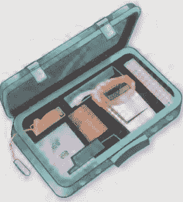


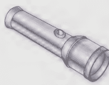

图 4-4 初始响应现场工具包中的物品

| 表 4-1 | 初始响应现场工具包中的工具 |
| :--- | :--- |
| 需要数量 | 工具 |
| 1 | 电脑 |
| 1 | 大容量硬盘 |
| 1 | 日标 (JIS) 螺丝刀 |
| 1 | ANSI 螺丝刀 |
| 2 | 静电带 |
| 1 | IDE 线 (40-100) |
| 1 | SATA 线 |
| 1 | 包含采集工具的启动介质 |
| 1 | 笔记本电脑或平板 |
| 1 | 手电筒 |

| 表 4-1 | 初始响应工具包中的工具（续） |
| :--- | :--- |
| 需要数量 | 工具 |
| 1 | 数字相机及备用电池或 35mm 胶片 |
| 10 | 证据记录表 |
| 1 | 笔记本或数字录音笔 |
| 10 | 证据袋（防静） |
| 20 | 证据标签、胶带和标签 |
| 1 | 永久性标记笔 |
| 10 | U 盘 |

扩展响应现场工具包应该包含你负担得起带到现场的所有。当你到达现场时，应只提取获取证据所需的物品。这样做可以保护你的设备，并减少你需要跟踪的物品数量。表 4-2 列出了扩展响应现场工具包中可能需要的工具。

| 表 4-2 | 扩展响应现场工具包中的工具 |
| :--- | :--- |
| 需要数量 | 工具 |
| 各视而异 | 从操作系统参考到取证指南的各种技术手册 |
| 1 | 初始响应现场工具包 |
| 1 | 带有电缆和连接器的笔记本电脑或平板 |
| 2 | 电源插 |
| 1 | 额外的手动工具，包括断线器、撬棍和电锯 |
| 1 | 皮手套和一次性乳胶手套（各种尺寸） |
| 1 | JIS 螺丝刀 |
| 1 | ANSI 螺丝刀 |
| 2 | 静电环 |
| 1 | 手推车和行李车 |
| 10 | 大垃圾袋和带包装胶带的大纸箱 |
| 1 | 各种尺寸的橡皮筋 |
| 1 | 放大镜 |
| 1 | 一包打印纸 |
| 1 | 用于清理数字设备灰尘的小刷 |
| 10 | 各种尺寸的 U 盘 |
| 2 | 外部硬盘（1 TB 或更大）及电源线 |
| 各种 | 转换线 |
| 5 | 用于数据采集的其他额外硬盘或 U 盘 |

在决定初始响应工具包和扩展响应工具包中应包含哪些物品时，你还应该分析针对你地区或组织的特定需求。请参考表 4-1 和表 4-2 的指南。

### 准备调查小组

在事故或犯罪现场启动数字证据的搜查和扣押之前，你必须与组建的调查小组审查所有可用的事实、计划和目标。现场处理的目标是成功收集并保护数字证据。你准备得越充分，在执行数据收集计划时遇到的问题就越少。

请记住，数字证据是易失的。养成快速评估事实、制定计划、收集所需资源以及从事故或犯罪现场收集数据的技能。在某些数字调查中，响应缓慢可能导致案件重要证据的丢失。

## 封锁数字事故现场或犯罪现场

调查人员通过封锁事故或犯罪现场来保护证据，并保留有关事故或犯罪现场的信息。公开的信息可能会危及调查。如果你负责封锁数字事故现场或犯罪现场，请使用警戒带防止旁观者意外进入现场，并要求警察或安保人员阻止他人进入现场或使用智能手机或其他数字设备拍摄照片和视频。现场的法律权限包括侵入违规；对于犯罪现场，则包括妨碍司法或不从警方的命令。进入现场的权限应仅限于那些有特定理由进入的人员。封锁事故或犯罪现场的标准做法是将区域扩大到现场直接位置之外。通过这种方式，你避免了遗漏可能属于现场一部分的区域。缩小现场周边界比扩大它更容易。

对于重大犯罪现场，数字调查人员并非唯一负责定义现场安全边界的人。此类案件涉及其他专家和侦探，他们负责收集物理证据并记录现场。对于主要涉及计算机的事故，计算机可以位于“犯罪现场中的犯罪现场”内部，或者是一个“次要犯罪现场”，包含待处理的证据。证据位于计算机中，但法院将其视为物理证据。计算机和其他数字设备还可能包含实际的物理证据，例如键盘上的 DNA 或指纹。实验室可以使用特种吸尘器从键盘上提取 DNA 留物，并与其它 DNA 样本进行比较。在重大犯罪现场，执法部门通常会保留键盘和其他外围。

证据经常丢失或损坏是因为存在“职业好奇心”，这涉及不属于犯罪现场处理小组的警察和其他专业人员。他们只是对发生了什么有着强烈的观察兴趣，但他们的存在可能会直接或间接地污染现场。请记住，那些获得授权并接受过犯罪现场搜索培训的人可能会在无意中改变现场。

例如，在一次谋杀案调查中，首席侦探从犯罪现场收集了一个良好的隐形指纹。他将其与受害者的指纹以及其他认识受害者的指纹进行对比，但没有找到匹配的指纹。侦探怀疑自己拥有了杀害者的指纹，并将其存档了多年，直到他的警察部门购买了一台自动指纹识别系统 (AFIS) 计算机。在验收测试期间，软件供应商处理了指纹样本，以查看系统多快、多准确地匹配数据库中的指纹。侦探要求测试小组运行他在谋杀现场发现的指纹。他相信嫌疑者的指纹在 AFIS 数据库中。测试小组照从了要求，几分钟内，AFIS 发现了该指纹的完美匹配。该指纹属于该侦探本人。

始终记住，职业好奇心可能会破坏或损坏证据，包括数字证据。在事故或犯罪现场工作时，要意识到自己在做什么以及你物理或虚拟上接触了什么。警察侦探可以对访问过犯罪现场的每个人进行排除法指纹采集，以识别已知人员的指纹；数字证据没有同等的排除过程。你必须保护数字证据，因此请确保在捕获并保存硬盘镜像之前，没有人检查嫌疑人的计算机。例如，在没有取证启动媒体的情况下启动计算机会更改重要数据，例如某些文件的最后访问日期和时间戳。

### 在现场扣押数字证据

在拥有适当搜索令的情况下，执法部门可以扣押所有数字系统和外围设备。在私营部门调查中，你可能有类似的权限；然而，你可能仅有制作嫌疑人驱动器的镜像。根据公司政策，私营部门调查人员很少权限扣押所有计算机和外围设备。

在刑事调查中扣押数字证据时，请遵循美国司法部 (DOJ) 数字数据扣押标准（在本章后面描述，或访问 `www.justice.gov/criminal/cybercrime/ssmanual2009.pdf`）。刑事和民事程序的另一个良好来源是 ISO 标准27037，它设定了识别、收集、获取和保护数字证据的国际标准（`www.iso27001security.com/html/27037.html`）。对于民事调查，你遵循与刑事调查相同的证据规则。你可能在寻找特定的证据，例如特定的电子邮件或电子表格。在刑事案件中，调查人员扣押整个驱动器以保留尽可能的信息，并确保没有证据遗漏。

### 准备获取数字证据

你在现场获取的证据取决于案件性质以及涉嫌的犯罪或违规行为。例如，对于毒贩计算机的刑事案件，你可能需要获取整个计算机以及外围和媒体，包括手机、USB 设备、CD/DVD、打印机和扫描仪。你可能还需要扣押智能电视、游戏系统以及连接到网络的设备。扣押外围和其他媒体可以确保不遗漏组件，但预测哪些组件可能是关键的通常很难。相反，如果你正在调查员工违规，你可能只需要特定的物品。

在收集数字证据之前，向你的主管或组织内的高级取证人员询问以下问题：

- 是否需要获取整个区域的计算机以及外围和媒体？在将它们运输到实验室期间如何保护它们？这些预防措施包括阻止设备访问无线网络。
- 当你到达时，计算机是开启状态吗？（此问题将在后文“处理现场”中进行详细讨论。）
- 你调查的嫌疑人在计算机的直接区域内吗？嫌疑人是否可能损坏或破坏了计算机、外围或媒体？
- 你是否需要将嫌疑人隔离？

例如，假设一名名叫 Edward 布朗 (Edward Braun) 的员工被怀疑使用公司计算机写书。你怀疑 Edward 正在计算机硬盘上保存个人文件。使用镜像软件，你可以将硬盘复制到另一个驱动器，将副本驱动器安装到计算机中，并将原始驱动器带到取证实验室进行检查。此过程并没有创建位级副本；你正在创建一个用于持续业务的工作副本，并对原始数据进行检查。

由于 Edward 的主管不知道他正在被调查，你必须在他不在座位且预计不会回来时创建工作副本。由于大多数人会注意到桌子上的东西不对，因此在移除硬盘之前，你应该对现场拍照，测量椅子的高度，并记录桌子上需要移动的物品的位置。（接下来的章节有更多关于拍照和记录现场的技巧。）

## 第 4 章 犯罪与事件现场的处理

### 处理事件现场或犯罪现场

以下指南为如何处理事件现场或犯罪现场提供了建议。随着您在执行搜索和查收方面经验的增加，您可以添加或修改这些指南以满足特定案件的需求。在处理民事或刑事调查时，您决定采取哪些步骤的判断`是至关重要的 - 注：根据上下文推断`。对于任何困难的问题，请寻求法律顾问或技术专家的帮助。

保留一份日记来记录你的活动。包括你到达现场的日期和时间、遇到的人以及你执行的每项重要任务的记录。在处理现场时不断更新日记。使用移动设备时，你可以轻松记录你的操作日志，但请务必检查谁有权访问你的移动设备。

为了封锁现场，在可行的情况下，确保只有授权人员可以进入该区域。移除所有不是在调查现场的人员，除非你需要他们的帮助来处理现场。例如，公司的网络管理员可能需要帮助你收集和恢复数据。如所述，你应该保护比必要的更广泛的现场。确保在你有时间记录之前，该区域内的任何物品（包括数字证据）都不要移动。对任何好奇的旁观者保持专业礼貌，但不要提供有关调查或事件的信息或回答问题。将记者引导至公共信息官员或组织的公关经理。


# 处理犯罪与事件现场

## 现场视频录制与拍照

对计算机或数字设备周围的区域录视频并拍摄照片。从记录整体场景开始，然后通过特写镜头记录细节，包括所有电脑的背面。在记录每台电脑的背面之前，在每根电缆上贴上编号或标签，以帮助识别哪根电缆连接到插头，以防你在实验室需要重新组装组件。确保对所有连接进行特写，包括键盘记录器（用于记录击键的设备）和作为许可协议部分的加密狗。记录计算机周围的区域，包括地板和天花板，以及计算机的所有访问点（如门窗）。确保检查任何桌子或写字台是否有贴在桌子或抽屉底部或地板上的物品。如果区域有吊顶天花板——将其拆并也记录该区域。缓慢移动或缩放相机以防止视频图像模糊，并对你拍摄的所有镜头保持相机日志。

## 绘制现场草图

完成对现场的录像或摄影后，绘制事件或犯罪现场的草图。这种草图通常是带有物体尺寸和固定物体之间距离注释的草稿。例如，注释可能写道：“嫌疑人的计算机位于南墙，距离房间的东南角三米。”

在准备报告时，你可以根据草图绘制一张整洁、详细的图，最好使用绘图软件，以便草图呈电子格式。

## 检查计算机状态

由于数字数据具有瞬态性，请尽快检查现场每台计算机或设备的状态。确定计算机是开启的、还是处于休眠或睡眠模式。如果是关闭的，请保持其关闭状态。如果是开启的，请根据你的专业判断如何处理。标准的数字取证实践是切断计算机电源，以确保数据不会通过秘密手段损坏。通常，这种程序在旧的 `Windows` 和 `MS-DOS` 系统上是可以接受的，因为掉电保留数据。在大多数 `Windows`、`UNIX` 和 `Linux` 上，通常你应该先顺序关机。然而，每个关机过程都有固有风险；为了避免数据丢失，你或你的主管可能需要确定最佳程序。

## 自毁机制与防范

此外，还有许多关于犯罪分子计算机中放置自毁机制（包括硬件和软件设备）的都市传说。许多年前，一种常见的技巧是修改 `DOS` 程序 `command.com`，将 `dir`（目录）命令更改为 `delete`（删除目录树）命令。

当调查人员在嫌疑人的计算机上输入 `dir` 命令时，他无意中启动了 `delete` 命令，这会删除所有文件和文件夹。更高级的犯罪分子会创建类似的修改命令的方法来覆盖驱动器内容。此外，那些预期会被人调查计算机的计算机所有者可能会将计算机设置为在输入屏幕保护程序密码时删除硬盘内容。

作为一般规则，除非是旧的 `Windows` 或 `MS-DOS` 系统，否则不要切断运行系统的电源。然而，由于近期数字犯罪的趋势，这是一个主观判断。更多的数字调查围绕着网络和互联网相关的案例展开，在这些案例中，如果不进行适当的关机就终止电源，文件（如 `Windows` 中的事件日志和安全日志）可能会丢失重要的网络活动记录。然而，某些政府机构仍然教调查人员“拔掉插头”；这是数字证据第一响应员（`DEFR`）的判断。

## 处理开启状态的计算机

如果你正在进行网络或互联网调查且计算机处于开启状态，请尽可能保存数据并记录所有活跃的窗口或 `shell` 会话。除非必要，否则不要检查文件夹或网络连接或按下任何键。对于开启并运行的系统，拍摄屏幕照片。如果窗口已打开但最小化了，请展开它们以便作为预防措施进行拍照，并写下每个窗口的内容。

当你在运行的嫌疑计算机上复制数据时，请在日记中记录你所做的一切，以便你可以在向检察官和其他律师的正式报告中解释你的行为。完成屏幕内容记录后，将其保存到外部介质中。例如，如果一个屏幕显示 `Word` 文件，请将其保存到外部驱动器。记住，嫌疑人可能自从上次使用 `Save` 命令以来已更改了文件。如果另一个屏幕是网络浏览器，截图或将网页保存到 `USB` 驱动器或外部硬盘。如果嫌疑计算机与具有足够存储空间的网络服务器有活动连接，你可以将大文件保存到服务器上。要这样做，你需要网络管理员的协助引导你进入文件夹。

## 无法没收设备时的处理

如果案件性质不允许你没收计算机或数字设备，请将打开的应用程序保存到外部介质并重命名。更改文件名避免覆盖现有文件。这种方法并不理想，应仅在紧急情况下使用。记住，你的目标是尽可能完好保护证据。

## 收集文档与媒体

为了完成对现场的分析和处理，请收集与调查相关的所有文档和媒体，包括以下材料：

- 硬件，包括移动设备和外围设备
- 软件，包括操作系统和应用程序
- 所有媒体，如 `USB` 驱动器、备份磁带和磁盘
- 所有文档、手册、打印输出和手写笔记

## 使用 RAID 系统处理数据中心

数字调查员有时会对 `RAID` 系统或服务器集群进行取证分析，服务器集群是装满了超大磁盘系统的房间，是大型商业数据中心（如银行、保险公司和运营商 `ISP`）的典型特征。正如你在第 3 章中学到的，从大型系统中提取证据的一种技术是稀疏采集（`sparse acquisition`）。该技术仅从分配文件中提取与你案件相关的证据数据，并尽可能地减少你需要分析的数据量。该技术的缺点是它无法恢复空闲空间或空隙空间中的数据。如果你有一个可以访问 `RAID` 系统上未分配空间的数字取证工具，请先在测试系统上使用该工具操作，以确保它不会损坏 `RAID` 系统。

## 使用技术顾问

在处理高级技术时，请聘请一名技术顾问，他可以帮助你列出处理事件或犯罪现场所需的工具。在大型数据中心，技术顾问是指导你在何处定位数据，并帮助你从大型 `RAID` 服务器中提取日志记录或其他证据的人员。在执法案件中，技术顾问可以通过列出搜押令所需的项目来帮助创建搜押令。如果你为此目的聘用技术顾问，应该在搜押令中列出其姓名或头衔。在现场，技术顾问可以指导其他调查员正确地收集证据。技术顾问具有以下职责：

- 了解被扣押和搜查的系统的所有方面。
- 指导调查员如何处理敏感媒体和系统以防止损坏。
- 帮助确保现场安全。
- 帮助记录搜查和扣押的计划策略。
- 针对被扣押和搜查的技术和组件对调查员进行即时培训。
- 记录搜查和扣押期间的活动。
- 协助进行搜查和扣押。

## 在实验室中记录证据

在现场收集数字证据后，你将其运输到取证实验室，实验室应该是一个确保数字证据安全性和完整性的受控环境。在任何调查工作中，请务必在工作过程中记录你的活动和发现。为此，你可以维护一份日志，记录你在处理证据时所采取的步骤。你的目标是确保当你或另一调查员重复你收集证据的步骤时，能够得到相同的结果。

如果你在重复步骤时得到不同的结果，那么你的证据的可信力就会受到质疑。在最好的情况下，证据的价值会受损；最坏的情况下，证据将会被排除。由于电子元件的特性，故障确实会。例如，你可能因为硬件故障（如磁盘驱动头损坏）而无法重复数据恢复。请务必按照事实发生的顺序报告所有事实和事件。

除了验证你的工作外，日志还可以作为参考记录你处理数字证据时使用的方法。你和其他人可以使用它进行其他调查的培训和指导。

## 处理和处置数字证据

你在实验室中维护数字证据完整性的做法，必须与你最初收集它时一样。你的任务是保护磁盘数据。如果你有一台未用镜像工具复制的嫌疑计算机，你必须创建一个副本。在执行此操作时，确保将嫌疑驱动器设置为只读（通常通过使用写保护保护设备），并记录此文件。如果磁盘已用镜像工具复制，你必须保留镜像文件。使用大多数镜像工具，你可以创建更小的、压缩的卷集，使你的数据更容易处理。

在第 3 章中，你学习了如何使用镜像工具，在第 1 章中，你检查通过监管链控制保护数字证据的步骤。你使用以下步骤创建镜像文件：

1. 将所有镜像文件复制到 `TB` 驱动器或存储区域网络（`SAN`）。大多数取证实验室都配备了多台安装了磁盘镜像软件的机器，并根据案件需要更换多个硬盘。你可以利用这些资源将镜像文件复制到大驱动器中。某些设备可能配备了用于处理即将到来案件的大型网络存储设备。
2. 启动你的取证工具以访问并打开镜像文件。
3. 对镜像文件运行 `MD5` 或 `SHA-1` 哈希算法以获取数字哈希值。在后面的“获取数字哈希值”中，你将学习如何比较 `MD5` 或 `SHA-1` 哈希值以确保证据没有发生变化。
4. 完成将镜像文件复制到更大的驱动器后，将原始媒体安全地存放在证据柜中。不要操作原始媒体；它应该存放在有证据保管单的柜子里。务必填写该表单并注明日期。

## 存储数字证据

对于数字证据，你需要考虑如何以及在什么类型的媒体上保存它，以及推荐使用什么类型的存储设备来确保其安全。存储数字证据媒介的选择通常取决于你需要保留多久。如果你在调查刑事案件，请尽可能久地存储证据。数字数据的理想存储媒体曾是 `CD` 和 `DVD`（1990 年代的 `CD` 可以保存长达 5 年。现在 `CD` 和 `DVD` 的预期寿命为 2 到 5 年）。最佳选择是固态 `USB` 驱动器。虽然它们比 `CD` 和 `DVD` 贵，但它们更耐用。

你也可以使用磁带来保护数字证据。`4mm DAT` 磁带容量为 40 到 72 GB 数据，但其读写速度慢。如果你使用这些磁带，请通过将磁带内容复制回磁盘来测试数据。然后通过使用取证工具检查或对原始数据与新恢复的数据进行 `MD5` 比较，验证数据是正确的。

证据可以可靠地长期保存。例如，在美国，存储的数万份强奸包从未被处理过，正如你可能听过的，20 年、30 年甚至 50 年前的悬案现在正因为技术的进步而得以解决。你永远不知道案件何时会得到解决，因此你需要确保证据被长期保存。对于你的数字证据，数据存储 30 年的寿命是可以接受的，`DLT` 磁带系统是一个很好的选择。`DLT` 系统已与大型机一起使用了几十年，是可靠的数据存档系统。根据 `DLT` 盒的大小，一个磁盒在压缩模式下可以存储高达 80 GB 的数据。从硬盘到 `DLT` 磁带的数据传输速度也比传输到 `CD` 或 `DVD` 快。`DLT` 驱动器和磁带的主要缺点是成本。驱动器的价格在 400 到 800 美元之间，每盘磁带约 40 美元。然而，配合目前的大硬盘，`DLT` 系统与其他系统相比节省了大量的人力。

制造商 `Quantum Corp` 推出了一种名为超数字线性磁带（`Super-DLT` 或 `SDLT`）的高速容量磁带系统。这些系统专门为大型 `RAID` 数据库设计，可以存储超过 1 TB 的数据。较小的外部 `SDLT` 驱动器可以通过 `SCSI` 连接到工作站。此外，许多外部 `USB` 驱动器和加密云存储也是其他选择。

然而，不要依赖单一的介质存储方法来保护你的证据。确保为每个镜像制作两个副本以防止数据丢失。此外，如果可行，请使用不同的工具创建这两个镜像，因为每个工具都有优缺点。例如，你可以使用 `Linux` 的 `dd` 命令创建第一个镜像，并使用 `FTK Imager Lite` 创建第二个镜像。

## 证据保留与媒体存储需求

为了帮助维护数字证据的监管链，使其能够在法庭或仲裁中接受，请限制对您的实验室和证据存储区域的访问。当实验室开放运行时，授权人员必须对这些区域进行持续监控。当实验室关闭时，至少应有两名安保人员守卫证据存储柜和实验室设施。

作为良好的安全实践，您的实验室应该为所有访客准备一份签到表。大多数实验室使用手动日志系统，由授权技术人员在证据存储容器打开和关闭时维护。某些设施已升级为符合法律规定的电子系统，但许多人仍倾向于经过验证的手动日志。这些日志应根据法律要求（包括诉讼时效、最高刑以及上诉期届满）进行保存。确保管理层可以检查这些日志。证据保管表应包含每一个处理过证据的人员条目（见图 4-5）。

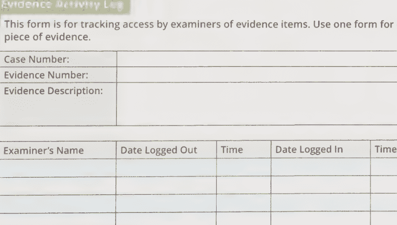

图 4-5 日志文件示例

如果您在支持执法机构，根据犯罪类型的不同，您可能需要无限保留证据。请咨询当地检察官办公室或州法律，以确保您的合规。对于私营部门，请咨询组织的法律部门（总法律顾问），该部门负责制定证据保留的标准。发现儿童色情的情况：必须由执法部门进行检查。作为私营部门的调查员，您不允许检查这些文件。您必须停止手中的工作并联系联邦调查人员。此类材料属于违禁品，执法机构以外的任何个人或组织均不得存储。

## 证据记录

为了记录证据，请创建或使用证据保管表（如第 1 章所示）。由于获取数据的技术和方法的不断变化，请创建一个可以根据需要修改的电子证据保管表。证据保管表具有以下功能：

- 识别证据
- 识别谁处理过证据
- 列出处理证据的日期和时间

在建立了这些信息后，您可以在表单中添加其他内容，例如列出 `MD5` 和 `SHA-1` 哈希值的栏目。包含任何您可能需要引用的详细信息。证据袋还包括您可以使用来记录证据的标签或证据表。商业公司提供各种尺寸和样式的纸袋和塑料袋。确保在袋为空时在袋上书写，而不是在包含数字证据时书写，以确保字迹清晰并避免损坏证据。电子元件应使用防静电袋。

## 获取数字哈希

为了验证数据的完整性，已经开发了用于获取文件数据唯一标识的各种方法。最早的方法之一是循环冗余校验（`CRC`），这是一种确定文件内容是否发生改变的数学算法。最新版本是 `CRC-32`。然而，`CRC` 不被认为是法医哈希算法。用于数字法取证的第一种算法是消息摘要 5（`MD5`）。与 `CRC` 类似，`MD5` 是一种根据文件、文件夹或整个驱动器的内容生成十六进制代码（或哈希值）的数学公式。如果文件中的某个位或字节发生变化，就会改变哈希值，可以使用唯一的十六进制值来验证文件或驱动器未被更改或篡改。在处理或分析文件之前，您可以使用软件工具计算其哈希值。在处理文件后，您会产生另一个数字哈希。如果它与原始值相同，您就可以通过数学证明文件未更改，从而验证您的数字证据的完整性。

根据北京清华大学和山东科技大学的王晓云及其同事的工作，法医哈希有三个规则：

- 您无法预测文件或设备的哈希值。
- 两个哈希值不能相同。（注意，在使用超级计算机时发生过碰撞）。
- 如果文件或设备发生任何变化，哈希值必须改变。

另一种哈希算法是安全哈希算法版本 1（`SHA-1`），由美国国家标准技术研究院（`NIST`）开发。`SHA-1` 正在逐渐取代 `MD5` 和 `CRC-32`，尽管 `MD5` 仍被广泛使用。（更多关于 `SHA-1` 的信息，请参见 `http://csrc.nist.gov/publications/fips180-4/fips180-4.pdf`）。在 `MD5` 和 `SHA-1` 中都发生过碰撞，两个不同的文件具有相同的哈希值。然而，碰撞是罕见的，`MD5` 和 `SHA-1` 仍用于验证从文件和存储介质中收集的数字证据。如果怀疑碰撞，可以进行逐字节比较以验证所有字节是否相同。逐字节比较可以使用 `MD5-dos` 命令或 `Linux/UNIX` 的 `diff` 命令完成。然而，该领域不断发展，因此通过调查 `NIST` 网站和阅读相关期刊来保持更新是一个好主意。新版本如 `SHA 256` 已经在投入使用。

大多数数字法医的哈希需求可以通过非密钥哈希集来满足，这是由软件工具（如 `Linux` 的 `md5sum` 命令）生成的唯一哈希数字。这种哈希的优点是它不需要密钥密钥。缺点是，如果攻击者知道该算法，他们可能会修改文件并生成匹配的哈希值。

## 案件回顾

第一章介绍了规划调查的任务，其中某些任务在接下来的列表中重复。在本节的后半部分，你将每项任务应用于一个假设的调查中，以为搜索事件或犯罪现场创建准备计划。以下是你在任何数字取证案件中执行的通用任务：

- 识别案件需求。
- 规划调查。
- 执行调查。
- 完成案件报告。
- 对案件进行评估。

接下来的章节将为你提供民事和刑事调查的示例，然后你将回顾如何在涉及假设性公司的案件中执行其中一些通用任务。

## 民事调查示例

私营部门的大多数案件被认为是低级调查或非刑事案件。这并不意味着私营部门的调查不重要；它们所需的精力比重大刑事案件要少。本节中低级民事调查的示例是一个电子邮件调查，该调查导致了两个企业公司之间的诉讼。这种类型的调查只需要检查电子邮件，而不需要进行完整的磁盘取证分析。

`A` 公司的 `Jones` 先生声称，从 `B` 公司采购经理 `Smith` 先生处收到了一份价值 200,000 美元的小部件订单。`A` 公司制造了小部件并通知 `B` 公司已准备好发货。`B` 公司的 `Smith` 先生回复说他们没有订购任何小部件，也不会支付费用。`A` 公司联系到一封要求小部件的电子邮件，该邮件似乎来自 `Smith` 先生，并告知 `B` 公司这封邮件的存在。`B` 公司告诉 `A` 公司，该邮件并非源自其电子邮件服务器，他们不会为小部件支付费用。

`A` 公司根据 `Smith` 先生电子邮件中的小部件订单对 `B` 公司提起了诉讼。`A` 公司的律师联系了 `B` 公司的律师并讨论了诉讼。`A` 公司的律师要求对 `Smith` 先生的计算机进行数字取证分析，希望能找到导致问题的原始信息。同时，`B` 公司的律师要求对 `Jones` 先生的计算机进行证据发现（`discovery`），因为他们认为那封邮件是伪造的。

你是一名数字调查员，接到老板的电话，要求你履行 `B` 公司律师的证据发现请求，在 `Jones` 先生的计算机上找到该电子邮件并确定其真假。由于这是一次电子邮件调查，而不是涉及计算机的重大犯罪，你被派到 `A` 公司。当你到达那里时，发现 `Jones` 先生的电脑已开启并运行着 `Microsoft Outlook`。证据发现令授权你仅恢复 `Jones` 先生的 `Outlook` 电子邮件文件夹（`.pst` 文件）。你没有权限执行任何其他操作。在这种情况下，你采取以下步骤：

1. 退出 `Jones` 先生计算机上的 `Outlook` 程序。
2. 使用文件资源管理器找到包含其业务电子邮件 mail的 `.pst` 文件。你可能需要使用 `Windows` 搜索功能查找带有 `.pst` 扩展的文件。
3. 确定 `.pst` 文件的大小，并将合适的存储设备（如 `USB` 驱动器）连接到 `Jones` 先生的计算机。
4. 将 `.pst` 文件复制到 `USB` 驱动器，然后移除 `USB` 驱动器。
5. 填写你的证据表，说明你在 `Jones` 先生磁盘的哪个位置找到了 `.pst` 文件，以及执行此任务的日期和时间。
6. 离开 `A` 公司并返回你的取证实验室。将 `USB` 驱动器放在你的证据保险箱中。

对于大多数民事调查，你只收集律师或人力资源部门确定的特定项目。

私营部门常见的另一种活动是对滥用其计算机和网络权限的员工进行秘密监控。在执行对员工的秘密监控之前，必须在公司政策中对其进行明确定义。如果公司没有政策告知员工在使用公司计算机和数字设备时没有隐私权，那么在进行任何监控时都可能使公司面临即使是刑事责任的风险。如果不存在政策，公司必须制定政策并通知所有员工新规则。法律部门应该创建适用于你所在州或国家的政策语言，并根据省、州或国家的隐私法定义公司对员工进行监控时所拥有的权利和权限。


对于秘密监控，你设置监控工具来实时记录嫌疑人的活动。实时监控需要嗅探嫌疑人计算机与网络服务器之间的数据传输。网络嗅探工具（如 `Wireshark`）允许网络管理员和其他人员确定正在通过网络传输的数据。其他数据收集工具（例如键位记录程序——`Spect` 和 `TrueActive Software`）是屏幕捕获程序，用于收集嫌疑人计算机上的大部分或全部按键。这些工具大部分运行在 `Windows` 上，并通常通过网络连接收集数据。这些工具在 `Windows` 管理器和进程日志中隐藏或伪装成其他程序。

另一种秘密监控指导工具是 `Guidance EnCase Enterprise Edition (EEE)`，它是一个位于中央的服务器，带有专用软件，可以通过网络向远程工作站激活警报。数字调查员通过此连接对嫌疑人的计算机进行实时取证检查。

## 刑事调查示例

涉及计算机的犯罪现场从欺诈案件到杀人案不等。由于现在有了高质量的打印机，最常见的计算机相关犯罪之一是支票欺诈。许多支票欺诈案件还涉及制作和销售虚假身份证，例如驾照。

在某个案件中，警方收到线报，称某公寓楼内正在进行伪造支票的操作。侦探联系了可靠的情报后，掌握了足够的信息申请搜查令，并请求巡逻部门协助他执行令。当侦探进入嫌疑人的公寓并进行初步搜索时，他发现了一个由六台高端工作站组成的网络，电缆通过墙上的洞连接到相邻公寓的设备（见图 4-7）。遗憾的是，搜查令规定只能搜索一个公寓。

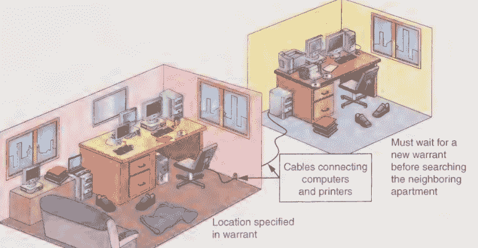

图 4-7 搜查令限制

侦探联系了副检察官，检察官指示他在两个公寓前守卫，直到她让法官为相邻公寓签发额外的搜查令。当他收到第二份搜查令时，侦探进入相邻公寓并继续搜索，发现了更多的计算机、高质量彩色激光打印机、支票和被盗的空白驾照。调查结果显示，犯罪分子是三名雄心勃勃的高中生，他们当时正向同学出售虚假身份证。该支票欺诈计划是他们正在开发的一项新副业，以改善现金流。

## 回顾案件背景信息

在本书的一些活动和项目中，你将使用来自 `M57` 案件的数据文件。这些文件是在国家科学基金会（`NSF`）资助下为数字取证学生开发的；它们是带有专有信息的驱动器完整镜像。假设初创公司 `M57` 运营了一个月。后来，一台在 `Craigslist` 上出售的计算机被发现含有“猫咪”色情内容。它被追溯到 `M57`，一名员工被怀疑下载了它。


欲了解更多案件详情，请阅读本章下载部分的 PDF 文件（`M57-Patents` 第 1、2、3 部分）。

## 规划调查

在该案件中，主要人物是执行官 `Pat McGoo`；IT 人员 `Terry` 以及专利研究员 `Jo` 和 `Charlie`。警方在现场提取了数字证据并对以下内容进行了法证：

- `Craigslist` 上出售的计算机镜像
- `M57` 办公室发现的其他五台机器镜像
- `M57` 发现的四个 `USB` 驱动器镜像
- 镜像的 `RAM`
- `M57` 服务器的网络数据

## 执行调查：使用 OSForensics 获取证据

在下面的活动中，你使用 `OSForensics` 分析镜像文件。在第 1 章和第 3 章中，你学习了如何获取驱动器镜像。为了准备 `OSForensics` 分析嫌疑 `USB` 驱动器的镜像，请遵循以下步骤：


如果尚未创建，请为工作文件夹创建一个子文件夹 `Chapter`，使路径变为 `Work\Chap04\Chapter`。

1. 进入该书的学生配套网站。滚动到本章的下载部分，并将所有 `USB` 驱动器镜像下载到你的工作文件夹中。某些镜像将用于后续的活动和项目。（如果尚未下载，也下载 PDF 文件以获取案件背景信息。）


2. 启动 `OSForensics`。如果提示允许程序对您的计算机进行更改，点击“确定”或“是”。在 `OSForensics` 消息框中，点击“继续使用试用版”（`Continue Using Trial Version`）。

3. 必要时，点击左格中的“开始”（`Start`）。在右格中，点击“创建案件”（`Create Case`）。

4. 在“新案件”（`New Case`）对话框中，输入你的姓名。案件名称输入 `M57-USB drives`。填写联系人详情和组织信息，然后点击“调查来自其他机器的磁盘”（`Investigate Disk(s) from Another Machine`）。

5. 为案件文件夹点击“自定义位置”（`Custom Location`）。点击右下角的“浏览”按钮，导航并点击你的文件夹，然后双击“确定”。你应该能看到“管理案件”（`Manage Case`）窗口（参见图 4-4）。

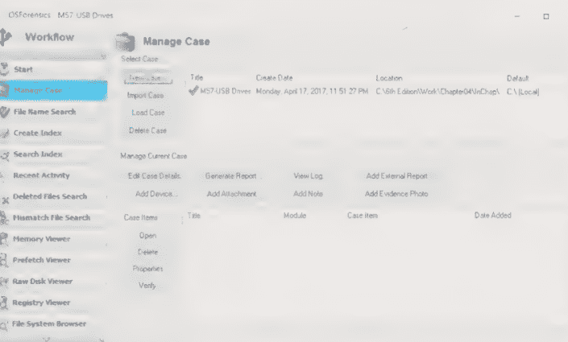

图 4-8 管理案件窗口

来源：`PassMark Software`, `www.osforensics.com`

6. 点击“添加设备”（`Add Device`）打开“选择要添加设备”（`Select device to add`）对话框，然后点击“镜像文件”（`Image File`）选项。点击浏览按钮，导航到你存放 `USB` 盘镜像的工作文件夹，点击 `charlie-work-usb-2009-12-11.E01`，然后点击“打开”。

7. 在询问使用哪个分区的消息框中，点击“分区 0”（`Partition 0`），然后点击“确定”。完成后的“选择要添加设备”对话框应与图 4-9 相似。点击“确定”。

8. 点击右下方格中的 `charlie-work-usb-2009-12-11.E01` 文件，然后点击左侧的“打开”按钮以打开图 4-10 所示的文件系统浏览器。虽然在此窗口中查看 `USB` 盘上的文件相当容易，但同时也提供了搜索特定文件的工具。关闭窗口。

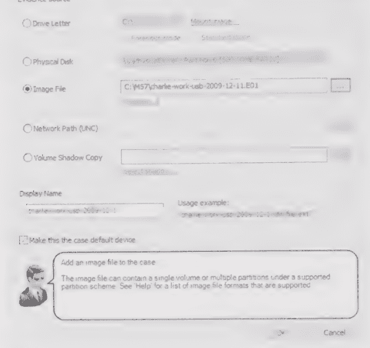

图 4-9 “选择要添加设备”对话框

来源：`PassMark Software`, `www.osforensics.com`

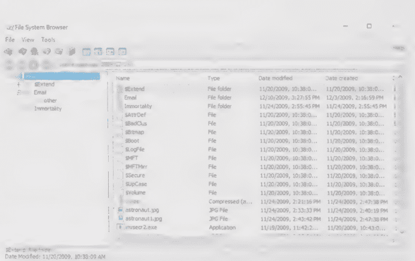

图 4-10 文件浏览器窗口

来源：`PassMark Software`, `www.osforensics.com`

9. 点击主窗口左格中的“文件名搜索”（`File Name Search`）按钮。在“搜索”文本框中输入 `charlie*`。验证“起始文件夹”（`Start Folder`）指定的 `Charlie` 的 `USB` 镜像文件。在最右侧，点击“搜索”（`Search`）按钮。双击列出的任何文件。结果应与图 4-11 相似。你可以使用搜索结果顶部的标签页来查看文件的缩略图和设备上文件的时间线。

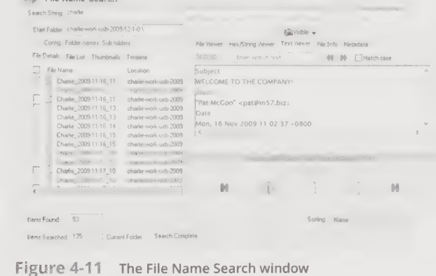

图 4-11 文件名搜索窗口

10. 接下来，点击左格中的“创建索引”（`Create Index`）按钮启动创建索引向导。在“5 步中的第 1 步”窗口中，必要时点击“使用预定义文件类型”（`Use Pre-defined File Types`）选项按钮。点击列出的所有文件（参见图 4-12），然后点击“下一步”。

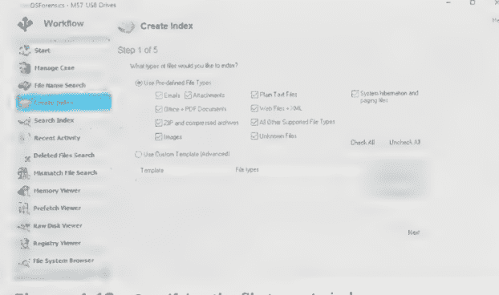

图 4-12 指定要索引的文件类型

来源：`PassMark Software`, `www.osforensics.com`

11. 在“5 步中的第 2 步”窗口中，点击“添加”（`Add`）按钮，点击 `charlie-workusb-2009-12-11.E01` 文件，点击“确定”，然后点击“下一步”。

12. 在“5 步中的第 3 步”窗口中，在“索引文本”（`Index Text`）框中输入 `Index all file types`，然后点击“开始索引”（`Start Indexing`）。“5 步中的第 4 步”窗口快速闪过，然后“5 步中的第 5 步”窗口显示正在处理的文件。当索引完成后，在提示索引过程中可能发生错误的消息框中点击“确定”。

13. 点击“5 步中的第 5 步”窗口右下角的“打开日志”（`Open Log`）按钮。打开的窗口将向你显示已索引的文件、发生的任何错误以及操作摘要。检查摘要后，关闭窗口。

14. 点击左格中的“管理案件”（`Manage Case`）按钮。注意到索引现在列在右下方的格中。滚动到左格的底部，点击“退出”（`Exit`）按钮。

此活动让你有机会了解在书中贯穿使用的 `OSForensics` 工具中是如何进行索引的。你现在应该能够创建案件、将其添加到清单、扫描文件并执行索引，这对于后续搜索非常有帮助。

## 章节总结

- 数字证据是存储或传输在电子或光学介质上的任何内容。它非常脆弱且容易被更改。
- 在私营部门，事件现场是发生或可能发生过安全事件的地点。调查人员必须保护现场以防止证据被毁。
- 数字证据必须按照法律标准进行处理，以维护其在法庭上的完整性和可接受性。
- 证据链（`Chain of custody`）是一份关键文件，记录了证据的扣押、保管、控制、传输和分析过程。
- 法证哈希（`Forensic hashing`）用于确保数字证据在调查过程中未被更改。
- 调查人员经常使用各种工具和技术从不同来源中恢复、分析和展示数字数据。

## 关键术语

- 自动指纹识别系统 (`AFIS`)
- 计算机生成记录
- 计算机存储记录
- 秘密监控
- 循环冗余校验 (`CRC`)
- 数字证据
- 扩展响应现场工具箱
- 哈希值
- 危险材料 (`HAZMAT`)
- 初始响应现场工具箱
- 无辜
- 信息
- 键哈希集 (`keyed hash set`)
- 限制性短语
- 低级调查
- 消息摘要算法5 (`MD5`)
- 美国国家标准与技术研究院 (`NIST`)
- 非键哈希集 (`nonkeyed hash set`)
- 关注人员
- 明视性原则
- 概率理由
- 职业好奇心
- 数字证据科学工作组 (`SWGE`)
- 安全哈希算法版本 1 (`SHA-1`)
- 嗅探

## 复习题

1. 出于以下哪种原因，私营部门的调查通常比执法部门调查更容易？

   a. 大多数公司都维护所有使用的硬件和软件的库存数据库。
   b. 调查员不需要获得搜令。
   c. 调查员必须获得搜令。
   d. 用户可以在他们的机器上加载任何他们想要的内容。

2. 在美国，如果一家公司发布了政策，声明其保留随时检查计算资产的权利，那么私营部门调查员可以在几乎没有理由对员工进行秘密监控。对还是错？

3. 如果你在调查公司滥用行为时发现了犯罪行为，该案件将成为刑事调查并应移交执法部门。对还是错？

4. 作为私营部门调查员，当发生以下什么情况时，你会成为执法人员？（选择所有适用项）

   a. 你开始在没有搜令或传票的情况下接受警探的命令。
   b. 你的内部调查已经结束，你提交了刑事投诉并将证据移交执法部门。
   c. 你的内部调查开始。
   d. 以上都不是。

5. 计算机搜索中的明视性原则是公认的法律。对还是错？

6. 如果在可能含有毒化学物质的区域发现嫌疑人的计算机，你必须执行以下哪些操作？（选择所有适用项）

   a. 与危险材料 (`HAZMAT`) 团队协调。
   b. 确定获取嫌疑人计算机的方法。
   c. 假设嫌疑人的计算机已被污染。
   d. 不要独自进入。

7. 取证哈希的三个条规则是什么？

8. 在取证哈希中，何时会发生碰撞？

9. 列出初始响应现场工具箱中应包含的三件物品。

10. 当你到达现场时，是否应该只提取获取证据所需的物品？

11. 计算机外围设备或附件可能包含 `DNA` 证据。对还是错？

12. 如果嫌疑人的计算机运行 `Windows 10`，你可以执行以下哪些操作？

    a. 浏览已打开的应用
    b. 断开电源
    c. 以上任其一
    d. 以上都不是

13. 描述在数字犯罪现场应该录制录像或绘制草图的内容。

14. 哪些技术可能被用于秘密监控？（选择所有适用项）

    a. 键记录记录
    b. 数据嗅探
    c. 网络日志
    d. 以上都不是

15. 在私营部门环境中，证据混杂意味着什么？

16. 列出两种常用的用于取证目的的哈希算法。对还是错？

17. 小公司很少需要调查员。对还是错？

18. 如果公司没有发布说明雇主有权检查员工计算机（包括电子邮件和网络使用情况）的计算政策，员工可能具有隐私预期。对还是错？

19. 你被传到一起致命事故现场，那里有一台笔记本电脑仍在运行。你应该带上什么种类型的现场工具箱？

20. 你应该总是回答犯罪现场旁观的问题。对还是错？

## 实践项目

在开始这些项目之前，请在你的系统上创建 `Work\Chap04\Projects` 文件夹；在步骤中它被称为你的“工作文件夹”。如果你尚未这样做，请将 `M57` 专利的驱动器镜像拷贝到你的工作站上（你可以在此书学生指南的章节的下载部分找到它们）。此外，下载包含作为搜令和宣誓书的侦探报告 PDF 文件。

### 实践项目 4-1

阅读针对 `M57` 专利案件的四份侦探报告以及合并的宣誓书和搜令。写一篇一到两页的文章，描述警察发现的证据，并解释他们是否有足够的信息来申请搜令。这些信息是否支持获取所有计算机和 `USB` 驱动器？为什么或为什么不？

### 实践项目 4-2

你正在调查一起内部政策违规行为，发现了一起需要填写警报的电子邮件攻击。你会怎么办？写一篇两页的文章，说明你需要先与公司里的谁交谈，以及哪些证据必须交给警方。

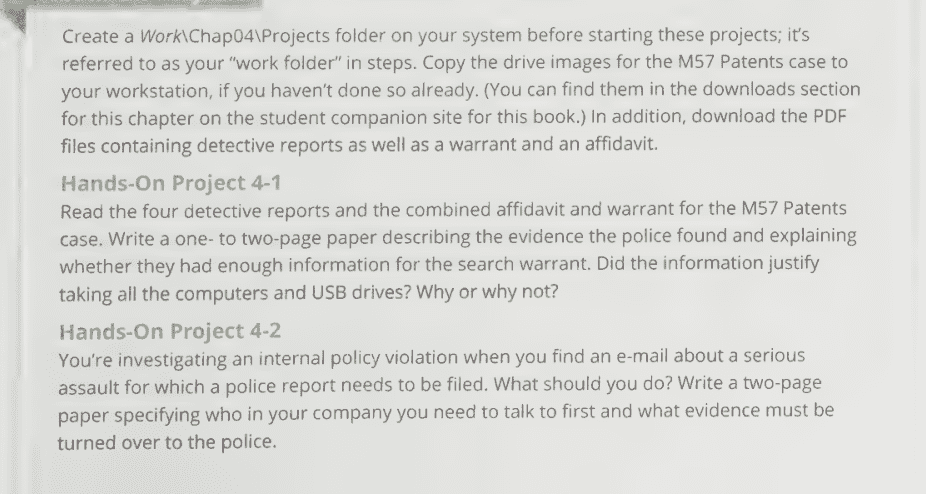

### 实践项目 4-3

在这个项目中，你检查属于 `M57` 专利 IT 人员 `Terry` 的 `USB` 盘。你的工作是评估 `Terry` 是否涉及任何非法或违反公司政策的行为。

1. 启动 `OSForensics`。如有必要，在 `UAC` 消息框中点击“OK”或“Yes”。在 `OSForensics` 消息框中，点击“Continue Using Trial Version”（继续使用预览版）。

2. 如果必要，点击左侧面板中的 `Start`。在右侧面板中，点击 `Create Case`（创建案件）。

3. 在 `New Case`（新建案件）对话框中，在 `Investigator Case` 文本框中输入你的名字。

4. [根据 OCR 质量/源重复模式，文本省略]

## 案例项目

### 案例项目 4-1

你是当地警察的一名侦探。`Thomas Brown` 是谋杀案的主要嫌疑人，他在当地的一家大公司工作，据称家里还有两台电脑。你需要如何从这些电脑中收集证据？在此过程中可能会遇到哪些障碍？请写一份两到三页的报告，说明如果公司有自己的数字取证与调查部门你会做什么，如果公司没有该部门又会做什么。

### 案例项目 4-2

市中心办公大楼的一起谋杀案已引起广泛关注。你是一名警察侦探，接到了警局聘用的数字取证调查员的电话。他叫 `Gary Owens`，他说他拥有可能与此谋杀案有关的信息。加里说，他在调查同一栋办公大楼内另一家公司的案件时发现了几个文件。考虑到“明见性原则”（`plain view doctrine`），你作为公职人员可能需要遵循哪些程序？请写一页论文，详细说明你可能做的事。

### 案例项目 4-3

你的配偶在一所中学工作，据传有一位名叫 `Zane Wilkens` 的老师猥亵某些学生并拍摄了他们的非法照片。据称，`Zane` 在自己的办公室里看过了这些照片。你的配偶希望你对 `Zane` 的电脑进行磁盘镜像，并查明传言属实。请写一到两页的论文，概述你将如何告诉配偶和学校管理人员如何进行。此外，解释为什么进入 `Zane` 的办公室获取镜像不会保护证据的完整性。

### 案例项目 4-4

作为当地警长部门的数字调查员，你被要求随一名侦探前往当地一所学校，该学校通过匿名电子邮件收到了炸弹威胁。侦探已经从发送该匿名电子邮件的已知互联网服务提供商（`ISP`）发出的传票中获得了信息，该信息来自该学校附近的一处住宅。侦探告诉你，学校校长还表示学校的 `Web` 服务器已被未知攻击者篡改。侦探刚刚获得了对 `ISP` 所确认的该处住宅内电脑的搜查和扣押令。请列出一清单，说明哪些物品应包含在现场响应工具箱（`initial-response field kit`）中，以确保在执行令时保护数字证据的完整。


# 与 Windows 和 CLI 系统协作

在阅读本章并完成练习后，你将能够：

- 解释文件系统的目的和结构
- 描述微软文件结构
- 解释 NTFS 磁盘的结构
- 列出对全盘加密驱动器加密的一些选项
- 解释 Windows 注册表的工作原理
- 描述微软启动任务
- 解释虚拟机的目的

本章和第 7 章将为你提供数字数据和驱动器的概述。在本章中，你将回顾数据如何在微软操作系统中进行存储和管理，包括 Windows 和命令行界面（CLI）操作系统。为了熟练地进行数字调查中的数据恢复，你应该理解文件系统及其操作系统，包括旧版（如 MS-DOS、Windows 9x 和 Windows Me）和当前的操作系统。在本章中，我们将检查操作系统在启动时执行的任务，以便在检查驱动器上的数据时避免更改证据。第 7 章将讨论 Linux 和 Macintosh 文件系统，并涵盖硬件设备，如 CD/DVD 以及 SCSI、IDE 和 SATA 驱动器。

## 了解文件系统

为了有效地调查数字证据，你必须理解最常用的操作系统是如何工作的以及它们如何存储文件。除了文件系统的部分外，你还应该复习有关计算机技术行业协会（CompTIA）A+ 认证中硬件和固件启动任务及操作的书籍。文件系统为操作系统提供了一份磁盘上数据的地图。文件系统的类型决定了数据如何在磁盘上存储。当你需要访问嫌疑人的电脑或获取与你的调查相关的数据时，你应该熟悉计算机和文件系统。

## 启动序列

下段文字描述了启动是如何发生的。当计算机启动时，屏幕通常会显示访问设置的键。每个 BIOS 供应商都不同，BIOS 和 UEFI 是为特定的计算机设计的。

### 图 5-1 典型的 CMOS 设置序列

| MSA7B61-M PLI/USB3 BIOS Setup | 版本 04B |
|---|---|
| Main | Advanced | Power | Tools | Exit |
| Main Settings | | | | |
| System Date | : 17:19 | | | |
| | : 06/05/2018 | | | |
| SATA3_1 | : SHS250G32TD-N12 | | | |
| SATA3_2 | : [未检测] | | | |
| SATA3_3 | : [未检测] | | | |
| SATA3_4 | : [未检测] | | | |
| System Information | | | | | |
| | | Select Screen | | | |
| | | Select Item | | | |
| | | Change Field | | | |
| | | Select Field | | | |
| | | General Help | | | |
| | | Save and Exit | | | |
| | | Exit | | | |
| V2.61 (C) 版 1985-2018, American Megatrends, Inc. | | | | | |

来源：American Megatrends, Inc., https://ami.com/

## 了解磁盘驱动器

你应该熟悉磁盘驱动器以及数据在磁盘上的组织方式，以便有效地找到数据。磁盘驱动器由一个或多个带有磁性材料盘片组成，数据以特定方式存储在盘片上。以下驱动器组件如图 5-2 所示：

- **几何结构**——指磁盘盘片、轨道和扇区的逻辑结构。
- **磁头**——读写驱动器数据的设备。每个盘片有两个头，分别读写正反面。
- **轨道**——盘片上存储数据的同心圆。
- **柱面**——柱面是两个或多个磁盘盘片上的轨道列。通常，每个盘片有两个表面：顶部和底部。
- **扇区**——扇区是轨道上的区域，通常由 512 字节组成。

每个同心圆都是一条轨道。
每个楔形区域是一个扇区。
轨道的组合形成一个柱面，并堆叠在另一个盘片上。

### 图 5-2 硬盘驱动器组件

有关硬盘驱动器配置的更多信息，请访问 www.storagereview.com/guide2000/ref/hdd/index.html。

制造商工程师设计的磁盘每条轨道具有特定数量的扇区，典型的硬盘驱动器每个扇区存储 512 字节。（关于高级 [4K] 磁盘兼容性的更新，请访问 https://msdn.microsoft.com/windows/compatibility/advanced-format-disk-compatibility-update。）要确定磁盘上可寻址字节的总数，将柱面数乘以磁头数（实际上是轨道数），再乘以扇区数（512 或更多字节的组），如图 5-3 所示。硬盘厂商将此公式称为“柱面、头部和扇区（CHS）计算”。轨道也遵循从 0 开始的编号方案，这是计算中的第一个值。如果磁盘列出 79 条轨道，你实际上拥有从 0 到 79 的 80 条轨道。

### 图 5-3 CHS 计算

```
1024 柱面 x 32 磁头 x 63 扇区 = 2,064,384 扇区
```

其他磁盘属性，如位记录（ZBR）、轨道密度、面密度以及磁头和柱面偏移，是在驱动器的硬件或固件层面处理的。ZBR 是许多制造商处理盘片内轨道周长比外轨道小（因此存储数据空间较小）的方法。通过按区域对轨道分组，确保了所有轨道包含相同的数据。

轨道密度是每条轨道之间的空间。对于旧的黑胶唱片，每条轨道之间的空间越小，盘片上放置的轨道就越多。

面密度是磁盘盘片每平方英寸的比特数。数量包含了轨道之间的未使用空间。磁头和柱面偏移用于提高磁盘性能。当读写头从一条轨道移动到另一条轨道时，起始扇区会偏移以减少延迟。

## 固态存储设备

用于 USB 盘、笔记本电脑、平板电脑和手机的闪存设备对数字取证检查员可能是一个挑战，因为删除的数据不会立即恢复，可能无故消失。原因是所有闪存设备都有的一个特性：磨损均衡（wear-leveling）。

当硬盘上的数据被删除时，仅删除其引用，原始数据留在未分配的磁盘空间中。使用取证恢复工具从磁介质恢复数据相当简单；只需复制未分配空间即可。USB 盘和其他固态驱动器系统不同，内存单元会在物理层将数据移动到读写次数较少的单元。将数据从一个内存移动到另一个内存（或旋转）的目的是确保闪存器上的所有内存单元均匀磨损。根据制造商的设计，内存单元设计只能执行 10,000 到 100,000 次读写。当它们达到定义的限制时，将无法再保留数据。当你尝试连接设备时，会收到访问失败消息。此过程由设备上的固件控制。

此外，当数据被旋转到另一个内存单元时，旧的内存地址会列在一个名为“垃圾收集器”（garbage collector）的固件文件中。在某个时刻，驱动器固件会通过重写垃圾收集文件中列出的所有单元中的值 1，来擦除未分配单元中的数据。

在处理固态设备时，尽快进行完全取证复制至关重要，以防你可能需要从未分配的磁盘空间恢复数据。你可以通过 USB 盘来测试这一点：轻松地将数据复制到，将其删除，然后使用任何取证工具（如 OSForensics 或任何取证工具）进行取证采集。

## 探索文件结构

检查分区物理层的一种方法是使用磁盘编辑器，例如 `WinHex` 或 `Hex Workshop`。这些工具允许你查看文件头和其他文件的关键部分。这两项任务都涉及分析操作系统用于识别和维护文件系统的关键十六进制代码。表 5-1 列出了分区表中的十六进制代码并识别了一些常见的文件结构。

要更好地理解十六进制编号，请访问 www.i-programmer.info/babbages-bag/478-hexadecimal.html。

### 表 5-1 分区表中的十六进制代码

| 十六进制代码 | 文件系统 |
|---|---|
| 01 | DOS 12 位 FAT（软盘） |
| 04 | 小于 32 MB 的 DOS 16 位 FAT |
| 05 | 扩展分区 |
| 06 | 大于 32 MB 的 DOS 16 位 FAT |
| 07 | NTFS 和 exFAT |
| 08 | AIX 可启动分区 |
| 09 | AIX 数据分区 |
| 0B | DOS 32 位 FAT |
| 0C | 支持中断 13 的 DOS 32 位 FAT |
| 0F | 使用逻辑块寻址 (LBA) 的扩展分区 |
| 17 | 隐藏 NTFS 分区（XP 及以前版本） |
| 1B | 隐藏 FAT32 分区 |
| 1E | 隐藏 VFAT 分区 |
| 3C | 分区魔法恢复分区 |
| 66-69 | Novell 分区 |
| 81 | Linux |
| 82 | Linux 交换分区（也可与 Solaris 分区相关） |
| 83 | Linux 原生文件系统 (Ext2, Ext3, Ext4, Reiser, Xiafs) |

### 表 5-1 分区表中的十六进制代码（续）

| 十六进制代码 | 文件系统 |
|---|---|
| 86 | FAT16 卷/条带集 (Windows NT) |
| 87 | 高性能文件系统 (HPFS) 容错镜像分区或 NTFS 卷/条带集 |
| A5 | FreeBSD 和 BSD/386 |
| A6 | OpenBSD |
| A9 | NetBSD |
| C7 | 损坏的 NTFS 卷/条带集 |
| EB | BeOS |

分区表位于主引导记录 (MBR) 中，位于磁盘驱动器的 0 扇区。在十六进制编辑器（如 `WinHex`）中，你可以找到起始从偏移量 `0x1BE` 开始的第一个分区。第二个分区从 `0x1CE` 开始，第三个分区从 `0x1DE` 开始，第四个分区从 `0x1EE` 开始（见图 5-4）。

> 欲了解更多关于主引导记录的详细信息，请参阅 https://technet.microsoft.com/en-us/library/cc97686.aspx。

对于第一个分区，文件系统的十六进制代码相对于 `0x1BE` 偏移 3 字节。该分区在驱动器上起始的扇区地址相对于 `0x1BE` 偏移 8 字节。分配给分区的扇区数量相对于位置 `0x1BE` 偏移 12 字节。这些偏移适用于磁盘上创建任何额外分区，如图 5-4 所示。对于驱动器的扩展部分，所有分区均为逻辑分区。在第一个逻辑分区的引导扇区中，有一个类似于 MBR 的分区表。

### 图 5-4 十六进制编辑器中的分区表

#### MBR 分区

| 名称 | 扩展名 | 大小 | 修改 | 记录更改 | 地址 |
|---|---|---|---|---|---|
| 分区 1 | NTFS | 1.7 GB | | | 0x0000000 |
| 分区 2 | NTFS | 97 MB | | | 0x06C0000 |
| 分区 3 | FAT32 | 10 GB | | | 0x0758000 |
| 分区 4 | FAT32 | 5.9 GB | | | 0x11B0000 |
| 分区 5 | FAT32 | 500 MB | | | 0x26A0000 |
| 未分配空间 | | 1.8 GB | | | |

#### 转换为十进制的起始扇区

| 每个分区的起始扇区 | 转换为十进制 |
|---|---|
| 0x800 | 2048 |
| 0x0C5300 | 804,028 |
| 0x12F8800 | 307,204 |
| 0x130B000 | 319,480 |

#### 每个分区的扇区数量

| 每个分区的扇区数量 | 转换为十进制 |
|---|---|
| 0x0C4B00 | 801,364 |
| 0x061A800 | 102,000 |
| 0x02B8800 | 12,888 |
| 0x272C500 | 657,216 |

来源：X-Ways AG, www.x-ways.net

在某些情况下，你可能需要识别未知磁盘上的操作系统。你可以使用 `WinHex` 或其他十六进制编辑器（如 `Hex Workshop`）完成此任务。以下步骤展示了如何使用 `WinHex` 确定磁盘的操作系统：

在开始以下活动之前，在你的系统上创建一个 `Work\Chap05\Chapter` 工作文件夹。

1. 启动浏览器并访问 http://x-ways.net。在“软件产品”（Software Products）标题下，点击 WinHex。下载并安装此程序，并在完成后向你的导师确认在计算机上的安装位置。
2. 将 USB 驱动器插入端口。
3. 右键点击 `WinHex` 桌面图标并点击“以管理员身份运行”。如有必要，在 UAC 消息框中点击“继续”或“是”。

在 Windows 10 或更高版本中，建议在资源管理器中为 `WinHex.exe` 文件创建一个快捷方式，该文件通常位于 `C:\Program Files`。要启动程序，右键点击 `WinHex` 图标并点击“以管理员身份运行”。

4. 点击菜单中的“打开磁盘”以查看逻辑驱动器列表。点击 C 盘（或你的工作驱动器），点击确定。图 5-5 显示了 `WinHex` 窗口中典型的硬盘。如果显示了错误消息，你可以忽略它，因为它不会影响你对文件系统的分析。

### 图 5-5 WinHex 识别文件系统

| 名称 | 扩展 | 大小 | 创建 | 属性 |
|---|---|---|---|---|
| 路径未知 | 0 KB | 2016/10/27 21:19 | 2016/10/27 21:19 | 6,291,478 |
| $System | 0.75 KB | 2015/10/30 00:24 | 2017/04/10 15:16 | 6,291,576 |
| Recycle.Bin | Bin | 8.2 KB | 2015/10/29 23:28 | 2017/04/10 14:50 | 936 |
| (Root) | 4.8 KB | 2016/02/13 11:02 | 2017/02/11 09:33 | 7,851,064 |
| Accounts | Msi | 1.8 MB | 2016/04/13 04:47 | 2017/04/10 12:43 | 6,458,526 |
| Config.ini | 66 KB | 2016/10/27 20:29 | 2018/10/27 10:29 | PXSH |
| $MFT | 25.6 KB | 2015/10/29 14:45 | 2017/14/15 14:52 | 6,466,730 |
| OneDrive.tmp | 326 KB | 2016/04/10 14:50 | 2017/04/10 14:50 | 6,307,318 |
| PerfLogs | 8.2 KB | 2016/04/07 04:37 | 2017/07/16 04:47 | 1,400,854 |
| Program Files ($) | 12.3 KB | 2015/10/29 24:06 | 2017/11/12 11:12 | 17,736 |
| ProgramData | 4.8 KB | 2016/02/13 11:02 | 2017/02/11 09:33 | 6,301,884 |
| Recovery | 4.8 KB | 2016/11/04 11:01 | 2017/11/03 14:13 | XSH | 140,991,226 |

来源：X-Ways AG, www.x-ways.com

5. 点击“工具”，“以...身份打开磁盘”，但这次在磁盘列表中点击你的 USB 驱动器，然后点击确定。将驱动器文件系统标签与你在步骤 4 中看到的进行比较。将 `WinHex` 留给下一个活动。


使用 WinHex 等工具你还可以识别文件头以确定文件类型（无论是否有扩展名）。在 WinHex 中执行以下步骤之前，请使用资源管理器找到一个位图 (.bmp) 和一个 Word 文档 (.docx)（在实践项目中，你会将这些技术应用于其他文件类型）。然后遵循以下步骤：

1. 要打开计算机上的位图，从 WinHex 菜单中点击“文件”，“打开”（主菜单，而不是案例数据菜单中的“文件”项）。在“打开文件”对话框中，导航到包含位图文件的文件夹，然后双击。

2. 每个分区的扇区数量 | 转换为十进制 |
| :--- | :--- |
| 0x0C4B00 | 801,364 |
| 0x061A800 | 102,000 |
| 0x02B8800 | 12,888 |
| 0x272C500 | 657,216 |

**图 5-4** 十六进制编辑器中的分区表

来源：X-Ways AG, www.x-ways.net

## 第 5 章 Windows 和 CLI 系统的操作 239

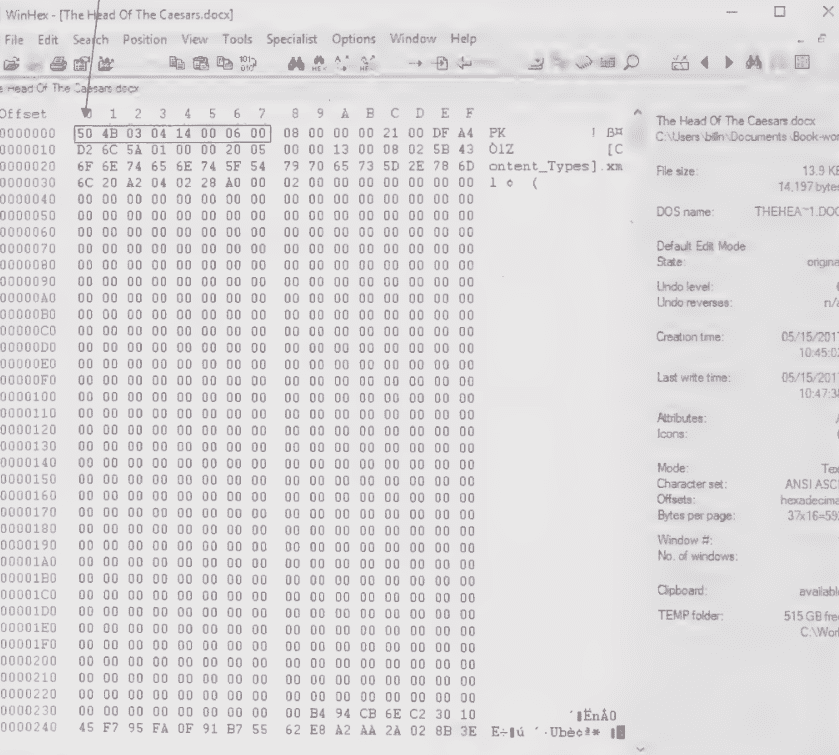

图 5-5 WinHex 识别文件系统

来源：X-Ways AG, www.x-ways.com

## 第 5 章 Windows 与命令行系统的操作

簇的大小取决于硬盘的大小和文件系统。表 5-2 列出了根据硬盘大小分配给 FAT16 磁盘上每个簇的扇区数和字节数。对于 FAT32 文件系统，簇大小由操作系统决定。簇的范围从 1 个扇区（512 字节）到 128 个扇区（64 KB）。

| 驱动器大小 | 每个簇的扇区数 | FAT16 字节 |
| --- | --- | --- |
| 8-32 MB | 1 | 512 bytes |
| 32-64 MB | 2 | 1 KB |
| 64-128 MB | 4 | 2 KB |
| 128-256 MB | 8 | 4 KB |
| 256-512 MB | 16 | 8 KB |
| 512-1024 MB | 32 | 16 KB |
| 1024-2048 MB | 64 | 32 KB |
| 2048-4096 MB | 128 | 64 KB |

微软操作系统通过簇为文件分配磁盘空间。这种做法导致了驱动器空隙（drive slack），它由活动文件内容结束处与簇结束处之间的未使用空间组成。驱动器空隙包括 RAM 空隙（RAM slack，主要见于旧版本的微软操作系统）和文件空隙（file slack）。在较新的 Windows 操作系统中，当数据写入磁盘时，剩余的 RAM 空隙会被清零，不包含任何 RAM 数据。

例如，假设你创建了一个包含 5000 个字符的文本文档——即 5000 字节的数据。如果你将其保存在一个 1.6 GB 的 FAT16 磁盘上，微软操作系统会自动为它预留一个簇。对于 1.6 GB 的磁盘，操作系统会为你的文件分配约 32,000 字节或 64 个扇区（每个扇区 512 字节）。未使用的空间 27,000 字节就是文件空隙（见图 5-8）。也就是说，RAM 空隙是最后一个簇中最后一个扇区的部分，而剩余的扇区被称为“文件空隙”。5000 字节的文档使用了 10 个扇区，即 5120 字节，其中有 120 字节扇区未使用；然而，DOS 必须以完整的 512 字节数据块（扇区）写入。填充 120 字节空白的数据从 RAM 中提取，并放置在文件结束（EOF）与簇中活动文件使用的最后一个扇区结束处之间的区域。在那个时间点，RAM 中的任何信息（例如登录 ID 或密码）在旧版微软操作系统上保存文件时，都会被放置在 RAM 空隙中。文件碎片、删除的电子邮件和密码经常在 RAM 和文件空隙中被发现。

RAM 空隙，120 字节

文件空隙，27,648 字节

EOF

第 10 个扇区结束：5120 字节

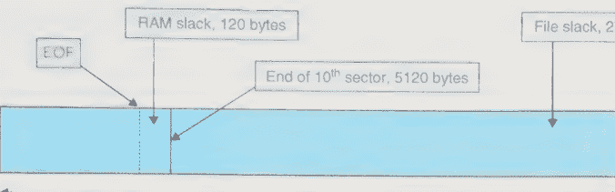

64 个扇区 × 512 字节 = 32,768 字节

图 5-8 文件空隙空间

FAT16 允许大簇的一个意外副作用是，随着簇大小增加，碎片减少了。操作系统会在文件末尾添加额外数据以扩展到分配的簇，直到耗尽剩余预留的 27,000 字节。这种簇大小的增加导致磁盘空间利用率低下。由于这种扇区到簇的低效分配，当几乎满的 FAT16 驱动器转换为 FAT32 时，用户发现他们有很多额外的磁盘空间，因为文件浪费的空间更少。

当分配的簇空间不足时，操作系统会为你的文件分配另一个簇。随着文件的增长并需要更多磁盘空间，分配的簇会被链在一起。通常情况下，链簇在磁盘上是连续的。然而，随着某些文件的创建、删除以及其他文件的扩展，链可能会断裂或碎片化。使用 WinHex 等工具，你可以查看簇链序列，并查看 FAT 如何将簇相互链接在一起（见图 5-9）。

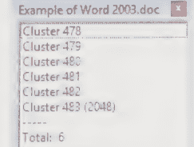

图 5-9 因文件增大而与簇相关的链扇区

来源：X-Ways AG, www.x-ways.net

当操作系统在 FAT 文件系统中存储数据时，它会为文件分配一个起始簇位置。当文件被写入第一个分配簇的第一个扇区时。当这个第一个分配的簇填满且空间不足时，FAT 将下一个可用簇分配给该文件。如果下一个可用簇与当前簇不连续，文件就会产生碎片。在卷（分区磁盘）上每个簇的 FAT 中，操作系统会写入下一个分配簇的地址。将簇想象成盛有特定数量字节的桶。当一个簇（或桶）装满时，操作系统会分配另一个簇。在系统故障或破坏时，这些簇链可能会断裂。

在极少数情况下，此类簇链可能会断裂。如果发生这种情况，数据可能会丢失，因为无法通过上一个簇访问。

### 删除文件

当文件系统中的文件删除时，操作系统不会擦除数据。相反，它会将 FAT 表中的簇标记为可用于新数据。文件的目录项会被更改以指示其已删除，但数据一直留在磁盘上，直到被新文件覆盖。这就是为什么取证工具通常可以恢复删除的文件。在 NTFS 中，当文件被删除时，操作系统会将主文件表（MFT）中的文件项标记为活动。

### 检查磁盘

NTFS（新文件系统）随 Windows NT 引入，目前仍主流文件系统。自 Windows 2000 发布以来，这种后兼容性不再可用。有关 NTFS 结构的详细解释，请参阅 www.ntfs.com。

在 NTFS 中，你写入的所有内容都被视为文件。在 NTFS 磁盘上，第一个数据集是分区引导扇区（Partition Boot Sector），它从磁盘的扇区 0 开始。分区引导扇区之后是主文件表（MFT）。MFT 对于早期的 FAT，是磁盘上的第一个文件。当磁盘分区被格式化为 NTFS 卷时，会创建一个 MFT 文件，它通常占用磁盘的 12.5%。随着数据的添加，MFT 可以扩展到占据磁盘的 50。（MFT 在“NTFS 系统”中有更详细的介绍）。

NTFS 相比 FAT 的一个重要优势是它产生的文件空间浪费少得多。将表 5-3 中的簇大小与显示 FAT 簇大小的表 5-2 进行比较。较小磁盘驱动器的簇更小。这一特性为所有使用 NTFS 的磁盘节省了更多空间。

| 驱动器大小 | 每个簇的扇区数 | 簇大小 |
|---|---|---|
| 7-512 MB | 8 | 4 KB |
| 512 MB-1 GB | 8 | 4 KB |
| 1-2 GB | 8 | 4 KB |
| 2 GB-2 TB | 8 | 4 KB |
| 2-16 TB | 16 | 8 KB |
| 16-32 TB | 32 | 16 KB |
| 32-64 TB | 64 | 32 KB |
| 64-128 TB | 128 | 64 KB |

有关微软文件系统大小的更多信息，请访问 http://support.microsoft.com/kb/140365。

NTFS（以及用于长文件名的 VFAT）也使用了 Unicode，这是一种国际数据格式。与美国信息交换标准 (ASCII) 8 位配置不同，Unicode 使用 8 位、16 位或 32 位配置。这些配置被称为 UTF-8（Unicode 转换格式）、UTF-16 和 UTF-32。对于西方语言的字母字符，UTF-8 与 ASCII 相同（详细信息请见 www.unicode.org/versions）。当你在磁盘驱动器上对证据进行关键词关键词搜索时，了解这一点会非常有用。（该功能在第 9 节中进行了更详细的讨论）。由于 NTFS 提供的功能比 FAT 很多得多，因此使用了更多的实用程序来管理它。

# NTFS 系统文件

由于 NTFS 磁盘上的所有内容都是文件，因此第一个文件——MFT（主文件表）包含了磁盘上所有文件的信息，包括操作系统使用的系统文件。在 MFT 中，前 15 条记录预留给系统文件。MFT 中的记录称为元数据。表 5-4 列出了你在 MFT 中找到的前 16 条元数据记录。

| 文件名 | 系统文件 | 记录位置 | 说明 |
|---|---|---|---|
| $MFT | MFT | 0 | NTFS 卷上每个文件夹的基础基础文件记录；如果需要更多空间，则在 MFT 中分配其他记录位置。 |
| $MFTMir | MFT2 | 1 | MFT 的前四条记录保存在此位置。如果 MFT 中的单个扇区失败，可以恢复这些记录，从而恢复 MFT。 |
| $LogFile | 日志文件 | 2 | 此处存储了之前的事务，以便在 NTFS 卷发生系统故障后进行恢复。 |
| $Volume | 卷 | 3 | 此处存储特定于卷的信息，例如标签和版本。 |

## 表 5-4 MFT 中的元数据记录（续）

| 文件名 | 系统文件 | 记录位置 | 说明 |
| --- | --- | --- | --- |
| $AttrDef | 属性定义 | 4 | 列出属性名称、编号和定义的表。 |
| $ | 根目录索引 | 5 | 这是 NTFS 卷上的根目录。 |
| $Bitmap | 启动扇区 | 6 | NTFS 分区的映射，显示哪些簇在使用中，哪些是可用的。 |
| $Boot | 启动扇区 | 7 | 用于在引导过程中挂载 NTFS 卷；如果它是系统的启动器，则在此列出额外的代码。 |
| $BadClus | 坏簇文件 | 8 | 对于发生无法恢复错误的簇，在此文件中创建一个该簇位置的条目。 |
| $Secure | 安全文件 | 9 | 此文件中列出了卷的唯一序列描述符。它是维护 NTFS 卷所有文件和文件夹访问控制列表 (ACL) 的地方。 |
| $Ucase | Ucase 表 | 10 | 将 NTFS 卷上的所有小写字符转换为大写 Unicode。 |
| $Extend | NTFS 扩展文件 | 11 | 此处列出了可选扩展，例如配额、对象标识符和重点数据。 |
| | | 12-15 | 预留供未来使用。 |

# MFT 和文件属性

当 MFT 引入 NTFS 时，操作系统在磁盘上存储数据的方式发生了根本变化。在 MFT 中，所有文件和文件夹都存储在每个 1024 字节的独立记录中。每条记录包含文件或文件夹信息。这些信息被分为记录字段，包含关于文件的元数据、文件数据或指向文件数据的链接。记录字段称为属性 ID。

文件或文件夹信息通常以两种方式之一存储在 MFT 记录中：驻留的（resident）和非驻留的（nonresident）。对于非常小的文件（约 512 字节或更少），所有元数据和数据都存储在 MFT 记录中。这些类型的记录被称为“驻留的”，因为它们的所有信息都存储在 MFT 记录中。

大于 512 字节的文件存储在 MFT 之外。文件或文件夹的 MFT 记录提供了该文件在磁盘分区上存储的簇地址。之所以有这些簇地址是因为文件数据存储在 MFT 之外的独立文件中。这种类型的记录被称为“非驻留的”，因为文件数据存储在 MFT 之外。

每个 MFT 记录都以一个头头开始，标识其为驻留属性或非驻留属性。所有 MFT 记录的前 4 个字节（字符）为 FILE。文件头包含额外数据，指定第一个属性 ID 的起始位置，通常位于记录开始后的偏移量 04 处。每个属性 ID 都有一个十六进制长度值，定义了它的结束位置和下一个属性的开始位置。长度值位于属性 ID 之后 4 字节处。表 5-5 列出了 MFT 记录中的属性类型。有关如何配置 MFT 的更多细节，请在 http://technet.microsoft.com/en-us/library/cc781134.aspx 搜索 MFT 和 NTFS。

### 表 5-5 MFT 中的属性

| 属性 ID | 用途 |
| --- | --- |
| 0x10 | $Standard Information: 此字段包含有关文件创建、修改、MFT 更改、读取日期时间以及 DOS 权限的数据。 |
| 0x20 | $Attribute_List: 不适合 MFT 的属性（非驻留属性）在此处列出，并带有其位置。 |
| 0x30 | $File_Name: 此处包含文件的长文件名和短文件名。长文件名可用最多 255 个 Unicode 字节。对于 POSIX 要求，还可以列出额外的名称或硬链接。具有短文件名的文件只有一个属性 ID 0x30。在旧版 Windows 操作系统中，长文件名在 MFT 记录中有两个 0x30：一个用于短名称，一个用于长名称。在 Windows 10 中，只有一个结合了短长文件名的 0x30。 |
| 0x40 | $Object_ID (Windows NT 中的 $Volume_Version): 此处列出了所有权以及对文件或文件夹的哪些访问权限。每个 MFT 记录都分配有一个唯一的 GUID。根据你的设置，某些文件记录可能不此属性 ID。 |
| 0x50 | $Security_Descriptor: 包含文件的访问控制列表 (ACL)。 |
| 0x60 | $Volume_Name: 此字段是卷标识符。 |
| 0x70 | $Volume_Information: 此字段指示卷的状态。 |
| 0x80 | $Data: 驻留文件的文件数据或非驻留文件的数据运行。 |
| 0x90 | $Index_Root: 用于文件夹的实现。 |
| 0xA0 | $Index_Allocation: 用于索引的实现。 |

### 表 5-5 MFT 中的属性（续）

| 属性 ID | 用途 |
| --- | --- |
| 0xB0 | $Bitmap: 位图，指示哪些簇在使用中，哪些是可用的。 |
| 0xC0 | $Reparse_Point: 用于挂载点和可文件系统 (IFS) 驱动程序。 |
| 0xD0 | $EA_Information: 用于 OS/2FS。 |
| 0xE0 | 用于 OS/2FS。 |
| 0x100 | $Logged_Utility_Stream: 用于 Windows 及之后版本的 EFS。 |

图 5-12 是非驻留文件的十六进制视图示例。注意底部 35BD50 行没有文本数据。该文件是 5-10 中文件的版本。目前的取证工具（如 Forensics、EnCase、Forensic Explorer、FTK 和 X-Ways Forensics）可以解释镜像中的 MFT。

要理解非驻留 MFT 记录如何分配数据运行，应该知道当磁盘创建为 NTFS 文件结构时，操作系统为整个磁盘分区分配逻辑簇。这些分配的簇称为逻辑簇 (LCN)，从磁盘开始顺序编号，值为 0。LCN 允许 MFT 链接到磁盘分区上的非驻留文件（MFT 之外）。

当数据写入非驻留文件时，会在 MFT 的属性 0xB0 中为文件分配 LCN 地址。此 LCN 变成文件的虚拟簇编号 (VCN)，列为：VCN(0)。如果由于磁盘碎片严重，VCN(0) 位置没有足够的空间，则添加另一个数据运行。根据需要添加更多的 VCN，每个 VCN 按顺序编号为 VCN(1)、VCN(2) 等，直到所有数据写入驱动器。

VCN 中的值是文件的第一个簇；该值是簇的实际 LCN。VCN(1) 和其他 VCN 是簇数相对于上一个 VCN 簇位置的偏移量。例如，确定下一个数据位置

# 第 5 章 Windows 与 CLI 系统的操作

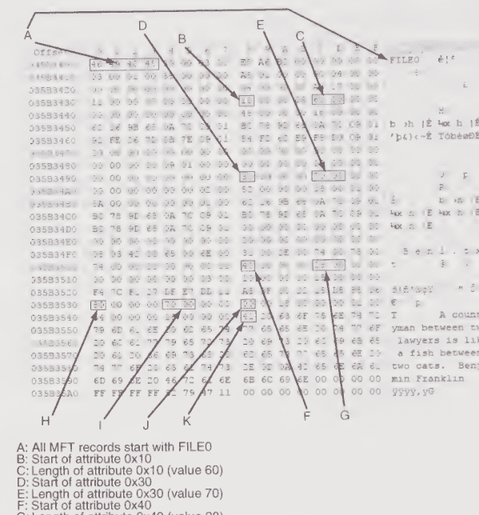

# 图 10 MFT 记录中的驻留文件

来源：X-Ways AG, with.x-ways.net

- A: 所有 MFT 记录均以 FILE0 开
- B: 属性 0x10 的起始
- C: 属性 0x10 的长度 (60)
- D: 属性 0x30 的起始
- E: 属性 0x30 的长度（值为 70）
- F: 属性 0x40 的起始
- G: 属性 0x40 的长度（值为 28）
- H: 属性 0x80 的起始
- I: 属性 0x80 的长度（值为 70）
- J: 属性 0x80 驻留标志 (resident flag)
- K: 驻留数据的起始位置
- A: 属性 0x80 $Data 的起始点
- B: 小端序值下的属性 0x80 长度
- C: 解析出的小端序值

| 偏移量 | 0 1 2 3 4 5 6 7 8 9 A B C D E F | P |
|---|---|---|---|---|---|---|---|---|---|---|---|---|---|---|---|---|---|
| 03B53530 | 03 B5 35 30 | 80 00 00 00 | 70 00 00 00 | 00 18 00 00 | 01 00 00 | € p |
| 03B53540 | 54 00 00 00 | 18 00 00 00 | 00 41 63 6F | 73 65 72 74 | T |
| 03B53550 | 79 6D 61 6E | 20 62 65 77 | 65 6E 79 20 | 74 77 6F 73 | 73 75 72 74 | 76 | yman between two |
| 03B53560 | 20 20 63 69 | 77 65 72 73 | 69 73 69 65 | Data Interpret | lawyers is like |


# 图 11 驻留文件的文件数据

来源：X-Ways AG, www.x-ways.net

# 第 5 章 Windows 与 CLI 系统的操作

| 偏移量 | 0 1 2 3 4 5 6 7 8 9 A B C D E F | P |
|---|---|---|---|---|---|---|---|---|---|---|---|---|---|---|---|---|---|

| 05B3C00 | 4E 49 4C 45 | 30 03 00 00 | 5F A7 B2 00 | 00 03 00 | FILE | A A | S' | | |
| 05B3C10 | 03 00 01 03 | 38 00 00 | 04 00 00 04 | 00 00 | | | E | | | |
| 05B3C20 | 00 00 00 00 | 00 00 | 05 00 A5 17 | 00 00 | | | | Y | | | |
| 05B3C30 | 09 00 00 00 | 00 00 | 10 00 00 60 | 00 00 | | | | | | | |
| 05B3C40 | 00 00 1C 11 | 08 00 | 48 00 00 19 | 00 00 | A - 12 13 - 12 | |
| 05B3C50 | 6A D4 5D 78 | 6D 7E 7C 01 | 6A 16 8B 7C | 29 01 | ))-C3- | |
| 05B3C60 | 37 00 00 00 | 00 00 | 75 00 00 00 | 00 00 | | | | | | | |
| 05B3C70 | 38 00 00 00 | 00 00 | 09 00 00 01 | 00 00 | | | | | | |
| 05B3C80 | 00 00 00 00 | 00 00 | 30 00 00 70 | 00 00 | | | P | | | | |
| 05B3C90 | 00 00 00 00 | 00 00 | 52 00 00 18 | 00 01 | | | A - 12 | | | |
| 00CB00 | 8A 00 00 00 | 00 00 | 71 01 00 79 | 0C 01 | | | | | | | |
| 05B3CB10 | 6A 22 16 8B | 7C 09 | 6A 16 8B 7C | 29 01 | 3" - 12 13" - 12 | | | | | |
| 05B3CB20 | 6A 22 16 8B | 7C 09 | 01 00 00 00 | 00 00 | | | | | | | |
| 05B3CB30 | 00 00 00 00 | 00 00 | 20 00 00 00 | 00 00 | Sen, rt | | | | | | |
| 05B3CB40 | 66 00 00 00 | 00 00 | 32 00 E2 72 | 00 74 | | | | | | | |
| 05B3CD00 | 66 00 00 00 | 00 00 | 00 00 00 00 | 00 00 | | | f | | | | |
| 05B3CD10 | 00 00 00 00 | 00 00 | 10 00 00 18 | 00 00 | | | | | | | |
| 05B3CD20 | 7F 7C 21 F7 | 27 DD 11 | AB 37 25 58 | 06 00 | -1'A86" - 06 | | | | | |
| 05B3CD30 | 50 00 48 00 | 00 00 | 01 00 00 00 | 03 00 | | | E | | | | |
| 05B3CD40 | 00 00 00 00 | 00 00 | 02 00 00 00 | 02 00 | | | | | | | |
| 05B3CD50 | 40 00 00 00 | 00 00 | 00 00 00 00 | 00 00 | | | | | | | | |
| 05B3CD60 | 78 05 00 00 | 00 00 | 78 05 00 00 | 00 00 | | | x | | | | | |
| 05B3CD70 | 31 03 15 55 | 01 00 | FF FF FF FF | 82 79 47 | 11 01 | 9999,Y6 | | | | |

- A: 非驻留属性 `0x80` 的起始
- B: 非驻留属性 `0x80` 的长度
- C: 属性 `0x80` 非驻留片段
- D: 数据运行 的起始点
- E: MFT 记录的记录结束标记 (`FF FF FF FF`)

### 图 5-12 MFT 记录中的非驻留文件

来源：X-Ways AG, www.x-ways.net

对于碎片文件的 `VCN(0)`，只需将 `VCN(0)` 的 `LCS` 值加到下一个 `VCN(s)` 的偏移量。如果 `VCN(0)` 的 `LCS` 是 `10000` 且 `VCN(1)` 为 `120`，则将 `VCN(1)` 的值加到 `VCN(0)` 的 `LCS` 值 `10000` 上，以获得 `VCN(1)` 的起始簇。如果文件是碎片化的且存在 `VCN(2)`，则将 `VCN(2)` 的 `LCS` 值加到 `VCN(2)` 的值。此过程对于任何额外的 `VCN` 都重复执行。

如果最大的未使用磁盘空间地址小于之前的 `VCN`，则可以通过给 `VCN` 加上一个负数来计算。例如，如果之前的 `VCN` 数据运行在偏移量 `300000`，下一个可用区域位于 `290000`，则 `VCN` 为 `-10000` (`300000 + [-10000]=290000`)。

后续章节解释了 MFT 管理的驻留和非驻留文件的配置。通过学习数据如何在 MFT 中存储，取证人员可以手动重建 NTFS 格式媒体上的任何数据。见第 16 章。

MFT 值和函数的描述并不详尽，未来的更新可能会更改这些配置。本讨论应作为定位和解释可能被覆盖的 MFT 记录的快速参考。

# MFT 数据结构

当你使用十六进制编辑器查看 MFT 记录时，数据以小端序格式显示，这意味着从右向左读取。例如，十六进制值 `400` 显示为 `00 04`，数字 `0x4000` 显示为 `00 04`。

MFT 记录的第一部分是头部，定义了第一个属性的大小和起始位置。头部具有特定于文件类型的属性，例如应用程序或数据文件。目录和系统文件的记录具有额外的属性。后续章节解释了文件如何在 MFT 中配置。

对于所有 MFT 记录的头部，感兴趣的字段如下：

- 偏移 `0x00`：MFT 记录标识符；字母 `F` 位于偏移 `0`。
- 偏移 `0x0C` 到 `0x0F`：MFT 记录的大小；默认为 `1024` 字节（两个扇区）。
- 偏移 `0x14`：头部长度，指示下一个属性的起始；通常为 `38` 字节。
- 偏移 `0x32` 和 `0x33`：序列数组，存储 MFT 记录第一个扇区的最后 `2` 个字节。仅当 MFT 数据超过 `512` 字节时使用。更新序列数组用于记录校验。

图 5-13 显示了 MFT 记录中的这些字段。

| MFT 记录标识符 | MFT 记录长度 | 整个 MFT 记录的大小 |
|---|---|---|

| 偏移量 | 0 1 2 3 4 5 6 7 8 9 A B C D E F | ASCII |
|---|---|---|---|---|---|---|---|---|---|---|---|---|---|---|---|---|---|

| 00000000 | 46 49 40 45 | 00 03 00 00 | 11 5F 42 00 | 00 00 04 00 | FILE |
| 00000010 | 01 00 01 15 | 03 03 00 00 | D0 01 00 00 | 00 00 04 00 | 8 | 0 |
| 00000020 | 00 00 00 00 | 00 00 00 00 | 00 00 00 00 | 00 00 00 00 | |
| 00000030 | 05 02 00 77 | 69 00 00 00 | 10 00 00 00 | 60 00 00 00 | W |

更新序列数组：此数据进入位置/偏移 `IE` 和 `IF`。

注意：此数据与 MFT 记录中位置 `IE` 和 `IF` 的数据交换。

### 图 5-13 MFT 头部

来源：X-Ways AG, www.x-ways.net

## 数据文件的 MFT 头部之后是标准信息属性 0x10

数据文件的 MFT 头部之后是标准信息属性 `0x10`，它具有以下字段（见图 5-14）：

- MFT 记录起始的偏移 `0x38`：属性 `0x10` 的起始。
- 从属性 `0x10` 开始的偏移 `0x04` 和 `0x05`：属性 `0x10` 的大小。
- 偏移 `0x18` 到 `0x1F`：文件的创建日期和时间；所有日期时间均 `Win32 Filetime` 格式存储。
- 偏移 `0x20` 到 `0x27`：文件的最后修改日期和时间。
- 偏移 `0x30` 到 `0x3F`：记录更新日期和时间。

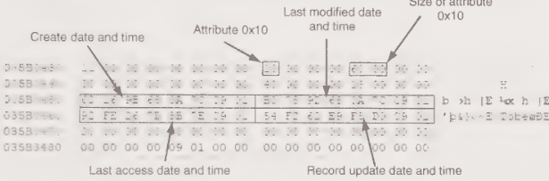

### 图 5-14 属性 0x10：标准信息

来源：X-Ways AG, www.x-ways.net

## 属性 30：文件名

对于文件名为八个字符以下的文件，MFT 记录只有一个属性 `0x30`。如果文件名超过八个字符，则有两个属性 `0x30`。以下描述了一个在属性 `0x30` 中包含短文件名和长文件名的 MFT 记录。属性 `0x30` 的感兴趣字段如下：

- 从属性 `0x30` 开始的偏移 `0x04` 和 `0x05`：属性 `0x30` 的大小。
- 从属性 `0x30` 起始位置的偏移 `0x5A`：短文件名；注意它是 Unicode 格式。

以下是长文件名属性 `0x30` 中感兴趣的字段：

- 从属性 `0x30` 开始的偏移量 `0x04` 和 `0x05` 处——属性 `0x30` 的大小。
- 从 `0x30` 属性起始位置开始的偏移量 `0x5A` 处——长文件名；注意它是 Unicode 格式。
- 在偏移量 `0x20` 到 `0x27` 处——文件的创建时间；所有日期和时间都以 `Win32 Filetime` 格式存储。
- 在偏移量 `0x28` 到 `0x2F` 处——文件的最后修改时间。
- 在偏移量 `0x30` 到 `0x37` 处——最后访问时间。
- 在偏移量 `0x38` 到 `0x3F` 处——记录更新时间。

图 5-15 显示了这些字段在 MFT 记录中的字段及其关系。

| G | E | | D | C | | A | B | | F | | | |
|---|---|---|---|---|---|---|---|---|---|---|---|

| 03B8 | 00 00 00 00 00 00 | 3D 00 00 78 00 00 | | | 0x | | | |
| 03B8 | 00 00 00 00 00 05 | 5A 00 00 18 00 01 | | | 11 | | | |
| 03B8 | 5A 00 00 00 00 01 | 32 50 67 92 0A 7C 09 01 | | | Z Pg | | | |
| 03B8 | 8C 69 92 0A 7C 09 01 | 8C 69 92 0A 7C 09 01 | | | 'i' | | | |
| 03B8 | 8C 69 92 0A 7C 09 01 | 60 00 00 00 00 00 | | | 'i' | | | |
| 03B8 | 5A 00 00 00 00 00 | 54 00 00 00 00 04 | | | € | | | |
| 03B5 | 0C 41 45 00 4E 00 | 5F 00 46 50 52 07 0E | BEN FR - | | | |
| 03B9 | 31 00 52 04 58 00 | 54 04 55 31 31 01 | | | TXT | | | |
| 03B5 | 00 00 00 00 00 00 | 00 00 00 00 00 01 | | | b | | | |
| 03B5 | 00 00 00 00 00 00 | 00 00 00 00 00 00 | | | $ | | | |
| 03B5 | 32 50 67 92 0A 7C 09 | 8C 69 92 0A 7C 09 01 | | | 'i' | | | |
| 03B5 | 8C 69 92 0A 7C 09 01 | 00 00 00 00 00 00 | | | 'i' | | | |
| 03B5 | 60 00 00 00 00 00 | 5A 30 00 00 30 00 | | | Ben | | | |
| 03B5 | 5F 00 46 72 61 00 | 6E 00 6B 00 6C 69 | | F ask li | | | |
| 03B5 | 6E 00 5F 00 31 00 | 6E 00 74 75 74 00 | n | txt | | | |

- A: 属性 `0x30` 短文件名
- B: 属性 `0x30` 短文件名的大小
- C: 创建时间
- D: 短修改时间
- E: 短访问时间
- F: 记录更新时间
- G: 短文件名的起始位置
- H: 属性 `0x30` 长文件名
- I: 属性 `0x30` 长文件名的大小
- J: 创建时间
- K: 长修改时间
- L: 长访问时间
- M: 长记录更新时间
- N: 长文件名的起始位置

### 图 5-15 属性 0x30：短长文件名

来源：X-Ways AG, www.x-ways.com

## 属性 0x40：Object_ID

根据 Windows 版本，有时 MFT 中会列出属性 `0x40`。该属性包含文件所有权和访问控制信息，具有以下字段：

- 从属性 `0x40` 开始的偏移量 `0x40` 和 `0x05` 处——属性 `0x40` 的大小
- 偏移量 `0x14` 处——GUID 数据的起始偏移
- 偏移量 `0x18` 到 `0x27` 处——GUID_ID 的起始位置

在此示例中，仅列出了 `GUID_ID`。在大型企业系统中，还会列出其他信息，例如：

- `GUID` 卷 ID
- `GUID` 对象 ID
- `GUID` 域 ID

图 5-16 显示了这些字段在 MFT 记录中的字段及其关系。


### 图 5-16 属性 0x40：Object_ID

来源：X-Ways AG, www.x-ways.com

## 属性 0x80：驻留文件的数据

对于驻留文件的属性 `0x80`，感兴趣的字段如下（见图 5-17）：

- 从属性 `0x80` 开始的偏移量 `0x04` 和 `0x05` 处——属性 `0x80` 的大小
- 偏移量 `0x08` 处——驻留/非驻留标志；对于驻留数据为 `0`
- 偏移量 `0x10` 处——数据运行的字节数
- 偏移量 `0x18` 处——数据运行的起始位置
- 从 MFT 头开始的偏移量 `0x1E` 处——用于验证 MFT 记录前 `512` 字节的扇区值。第一个和第二个扇区之间的间隔称为扇区边界。MFT 头中位置 `0x32` 和 `0x33` 处的实际值。

| 数据运行起始 | 扇区边界 | 分配数据的字节数 | 校验和 |
|---|---|---|---|

| 03B55B0 | A3 3F 00 22 15 0D 88 06 89 00 00 78 00 00 | 08 | x |
| 03B59C0 | 00 18 00 00 01 00 5A 00 00 18 00 00 00 | Z |
| 03B59D0 | 41 74 20 32 00 20 79 65 61 72 73 20 66 69 61 21 | years of a |
| 03B59E0 | 65 25 70 73 69 68 65 72 20 69 67 20 76 65 69 | the will reign |
| 03B59F0 | 67 73 20 20 71 20 61 73 30 20 64 68 69 25 00 | ns, at the 30 |
| 03B5A00 | 78 20 61 72 20 21 34 30 20 74 65 20 6A 74 | t, at the 40 jud |
| 03B5A10 | 66 6D 65 73 73 2E 64 0D 0A 20 42 65 61 61 | gment. Benjamin |
| 03B5A20 | 66 20 46 72 61 6E 66 6C 69 6E 69 00 00 00 00 | Franklin |
| 03B5A30 | FF FF 82 79 47 11 00 00 00 00 00 | yG |

### 图 17 驻留文件数据

来源：X-Ways AG, www.x-ways.net

MFT 记录的结束由十六进制值 `FF FF` 表示。

## 属性 0x80：非驻留文件

对于非驻留文件，属性 `0x80` 的感兴趣字段如下：

- 从属性 `0x80` 开始的偏移量 `0x04` 和 `0x05` 处——属性的大小
- 偏移量 `0x08` 处——驻留/非驻留标志；对于非驻留数据为 `0x1`


## 解析数据运行

偏移量 `0x40` 处——数据运行的起始。第一个运行是 LCN；如果文件分段，则会有后续的数据运行，如图 5-18 所示。在此示例中，共有六个数据运行，这意味着该文件有多个片段。最后一个数据运行之后的值 `00` 表示数据属性的结束。图 5-18 显示了这些字段在 MFT 记录中的关系。

如，非驻留属性 `0x80` 的第一个数据运行从属性起始的偏移量 `0x40` 处开始。使用 `File00.jpg` 作为解析数据运行的示例。数据运行包含三个部分：第一部分声明属性需要存储多少字节；第二部分存储分配给数据运行的簇数；第三部分包含起始簇地址（LCN 或 VCN）。

| 偏移 | 0 | 1 | 2 | 3 | 4 | 5 | 6 | 7 | 8 | 9 | A | B | C | E |
|---|---|---|---|---|---|---|---|---|---|---|---|---|---|---|
| 04C2E00 | 46 | 99 | 4C | 55 | 00 | 03 | 00 | 1C | 85 | 02 | 00 | 00 | 00 | FILE0 |
| 04C2E010 | 02 | 02 | 02 | 00 | 35 | 38 | 00 | 01 | 00 | 01 | 00 | 00 | 04 | 00 |
| 04C2E020 | 20 | 00 | 00 | 00 | 00 | 00 | 00 | 05 | 00 | 00 | 09 | 00 | | |
| 04C2E030 | 0B | 00 | 00 | 00 | 00 | 00 | 00 | 10 | 00 | 00 | 60 | 00 | | |
| 04C2E040 | DE | CE | 75 | 56 | E4 | 7C | 9C | 01 | 48 | BC | 1C | 26 | 69 | 05 | H |
| 04C2E050 | A6 | 85 | 86 | 87 | 88 | 89 | 8A | 8B | 8C | 62 | 78 | 68 | 08 | 01 | |
| 04C2E060 | 27 | 00 | 00 | 00 | 00 | 00 | 00 | 00 | 00 | 00 | 00 | 00 | | | |
| 04C2E070 | 08 | 00 | 00 | 00 | 09 | 01 | 00 | 00 | 00 | 00 | 00 | 00 | 00 | 00 | | |
| 04C2E080 | 00 | 00 | 00 | 00 | 00 | 00 | 00 | 00 | 30 | 00 | 75 | 00 | 00 | | |
| 04C2E090 | 00 | 00 | 00 | 00 | 00 | 00 | 03 | 54 | 05 | 00 | 18 | 01 | 00 | Z |
| 04C2E0A0 | 8F | 00 | 00 | 00 | 00 | 00 | 00 | DE | CE | 75 | 56 | E4 | 7C | 9C | 01 |
| 04C2E0B0 | DE | CE | 75 | 56 | E4 | 7C | 9C | 01 | 60 | 00 | 00 | 00 | 00 | 00 | |
| 04C2E0C0 | 00 | 00 | 00 | 00 | 00 | 00 | 00 | 00 | 20 | 00 | 00 | 00 | 00 | 00 | |
| 04C2E0D0 | 0F | 0C | 53 | 01 | 00 | 41 | 42 | 54 | 04 | 45 | 45 | 00 | 7E | S-A-T-E |
| 04C2F0E0 | 31 | 00 | 22 | 4A | 54 | 00 | 00 | 00 | 47 | 70 | 00 | 00 | 00 | 00 | 1. P-g-f |
| 04C2F0F0 | 78 | 00 | 00 | 00 | 00 | 00 | 00 | 00 | 00 | 00 | 00 | 00 | 00 | 00 | 0 |
| 04C2F100 | 5E | 00 | 00 | 00 | 08 | 01 | 00 | 00 | 0F | 00 | 00 | 00 | 00 | 00 | |
| 04C2F110 | DE | CE | 75 | 56 | E4 | 7C | 9C | 01 | DE | CE | 75 | 56 | E4 | 7C | 9C | 01 |
| 04C2F120 | DE | CE | 75 | 56 | E4 | 7C | 9C | 01 | 60 | 00 | 00 | 00 | 00 | 00 | |

每个数据运行的起始位置

```
02C4CF0C 35 5B 35 00 00 00 00 5B 07 8C 8E 22 63 51 = 02 ""
02C4CFD0 07 95 ED 32 5E 06 36 3C 01 22 35 03 FA 21 0B +124 <6* 5 >!
02C4FE00 6E FF 25 01 E9 04 00 FF FF FF FF 8C 39 47 11 1p2 e ~wwww.
02C4FF00 00 00 00 00 00 00 00 00 FF 00 00 05 00
```

数据运行结束标记 MFT 记录结束

第一个扇区的校验和（MFT 头文件中的更新序列数组）

### 图 5-19 多个数据运行

来源：X-Ways AG, www.x-ways.net

在图 5-20 中，第二个组件显示了 2 个字节用于存储分配给此数据运行的簇数的十六进制值（小端序）。分配给此数据运行的簇数量为 `7B1`（十六进制）或十进制的 1969。

| 第一个组件 | 第二个组件 | 第三个组件 |
|---|---|---|

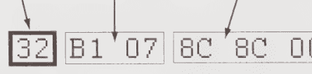

# 图 5-20 数据运行组件

来源：X-Ways AG, www.x-ways.net

如图 5-21 所示，对于第三个组件，起始分配簇地址为 `08C8C`（十六进制），或十进制的 35980。由于这是文件的第一个数据运行，因此该地址是 LCN（逻辑簇号）。

图 5-22 和 5-23 显示了 `SantéFe.jpg` 文件的第二个和第三个数据运行。对于第二个及所有其他数据运行，第三个组件是一个有符号整数；例如，在图 5-22 中，此值从十六进制数转换为负十进制。在 NTFS 中，如果高度碎片化磁盘的下一个可用区域位于较低的地址，则分配一个负数作为 VCN（虚拟簇号）值。NTFS 导航到此第二个可用区域的方法是将 VCN 加上之前的 LCN。例如，第一个数据运行的 LCN 地址为 35980，第二个数据运行的值为 -4715。操作系统将这些数字相加，由于第二个数据运行是负数，实际上执行的是减法：`35980 + (-4715) = 31265`。

如你从图 5-23 的分配簇列表中看到的，第二个片段的起始簇（LCN）为 31265。在第三个数据运行中，VCN 值为正数。

# 第 5 章 使用 Windows 命令行系统 27

十六进制值转换为十进制 SanteFe001.jpg 的分配簇（注意地址）

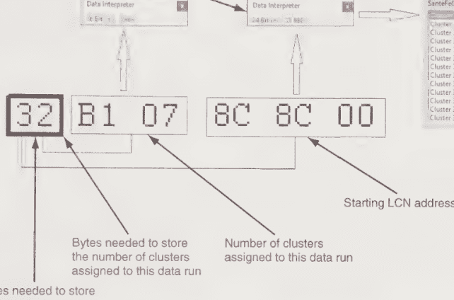

存储分配给此运行的簇所需的字节 | 分配给此数据运行的簇数量 | LCN 地址所需的字节

图 5-21 带 LCN 地址的第一个数据运行

来源：X-Ways AG, www.x-ways.net

此 VCN 值为负数，因为下一个可用 LCN 位于较低地址。

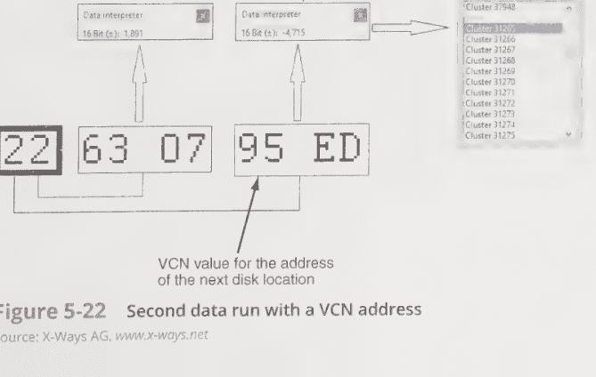

下一个磁盘位置的 VCN 值

图 5-22 带 VCN 地址的第二个数据运行

来源：X-Ways AG, www.x-ways.net

# 第 5 章 使用 Windows 命令行系统 228

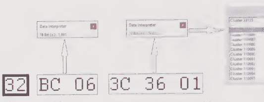

图 5-23 带 VCN 的第三个数据运行

来源：X-Ways AG, www.x-ways.net

> 提示：关于 NTFS 及其设计的额外信息，请参阅 <http://dubeyko.com/development/FileSystems/ntfsdoc.pdf> 或 <http://download.paragon-software.com/doc/manual_NTFS-HFS-for_Linux_8.1_User_Manual.pdf>。

## NTFS 数据流

检查 NTFS 磁盘时特别感兴趣的是附加到现有文件的方式。检查磁盘时，请注意数据流可以故意或无意地隐藏证据数据。

在 NTFS 中，数据流变为额外的文件属性，允许文件与不同的应用程序关联。结果它仍然是一个数据单元。你也可以在数据流中存储文件信息。微软资源文档指出：“例如，图形程序可以在命名的数据流中存储位图图像。”在 Windows NT 及更高版本的命令提示符中，可以使用此命令创建数据流：

```
echo myfile.txt:stream_name
```

你也可以使用以下命令重定向数据流的内容：

```
type file.txt:stream1
```

在这些命令中，数据流定义在 MFT 中，位于文件扩展名和流标签之间。要以简单文本显示数据流的内容，使用此命令：

```
more myfile.txt:stream1
```


如果你将带有数据流的文件保存到 FAT 分区，数据流将不会传输。如果你进行关键词搜索并检索文件，可能无法打开数据流。当你用文本编辑器打开文件时，不会显示数据流。判断文件是否带有数据流的唯一方法是检查文件的记录。图 5-24 显示包含数据流的文件 MFT 记录。注意有两个 `0xb8` 字段。图 5-25 显示较大文件在 MFT 记录中的样子。注意扇边界的校验值（项目 R）必须与更新序列的值（项目 C）交换。


关于数据流的更多信息，请参阅 <www.forensicfocus.com/dissecting-ntfs-streams>。

# 第 5 章 使用 Windows 命令行系统

| Offset | 0 | 1 | 2 | 3 | 4 | 5 | 6 | 7 | 8 | 9 | A | B | C | D | E | F |
|---|---|---|---|---|---|---|---|---|---|---|---|---|---|---|---|---|
| 02C40E00 | 00 | 44 | 49 | 4C | 35 | 00 | 00 | 03 | 5C | AC | B2 | 00 | 00 | 00 | FILE | - |
| 02C40E10 | 04 | 00 | 01 | 00 | 38 | 00 | 00 | 00 | B5 | 01 | 00 | 00 | 04 | 00 | | |
| 02C40E20 | 06 | 00 | 00 | 00 | 00 | 00 | 00 | 07 | 00 | 00 | A1 | 04 | 00 | 00 | | |
| 02C40E30 | 09 | 00 | 00 | 00 | 00 | 00 | 00 | 00 | 10 | 00 | 00 | 00 | 15 | 00 | 00 | |
| 02C40E40 | 00 | 00 | 00 | 00 | 00 | 00 | 00 | 00 | 48 | 00 | 00 | 00 | 15 | 00 | 00 | |
| 02C40E50 | B2 | 4C | 07 | 7B | D3 | 7C | 79 | 01 | 14 | A3 | 03 | 7E | 0D | 79 | 03 | |
| 02C40E60 | 14 | A3 | 03 | 7E | 0D | 79 | 03 | 60 | 69 | E5 | B5 | D5 | 79 | 03 | | |
| 02C40E70 | 20 | 00 | 00 | 00 | 00 | 00 | 00 | 00 | 00 | 00 | 00 | 00 | 00 | 00 | | |
| 02C40E80 | 05 | 00 | 00 | 00 | 00 | 00 | 00 | 00 | 00 | 00 | 00 | 00 | 00 | 00 | | |
| 02C40E90 | 00 | 00 | 00 | 00 | 00 | 00 | 00 | 00 | 30 | 00 | 00 | 00 | 00 | 00 | | |
| 02C40EA0 | 00 | 00 | 00 | 00 | 00 | 00 | 01 | 00 | B2 | 4C | 07 | 7B | D3 | 7C | 79 | 03 |
| 02C40EB0 | 9A | 00 | 00 | 00 | 00 | 00 | 00 | 00 | 00 | 00 | 00 | 00 | 00 | 00 | | |
| 02C40EC0 | B2 | 4C | 07 | D3 | 7C | 79 | 01 | B2 | 4C | 07 | D3 | 7C | 79 | 03 | 00 | 00 |
| 02C40ED0 | 00 | 00 | 00 | 00 | 00 | 00 | 00 | 00 | 00 | 00 | 00 | 00 | 00 | 00 | 00 | 00 |
| 02C40DE0 | 09 | 03 | 42 | 00 | 46 | 00 | 31 | 00 | 5F | 00 | 34 | 00 | 2E | 00 | 74 | 00 |
| 02C40EF0 | 78 | 00 | 74 | 00 | 00 | 00 | 00 | 00 | 80 | 00 | 50 | 00 | 00 | 00 | 00 | 00 |
| 02C40F10 | 00 | 00 | 13 | 00 | 00 | 00 | 05 | 00 | 38 | 00 | 35 | 00 | 00 | 00 | 00 | 00 |
| 02C40F20 | 05 | 00 | 00 | 00 | 00 | 00 | 00 | 00 | 65 | 00 | 73 | 00 | 62 | 00 | 65 | 74 |
| 02C40F30 | 69 | 64 | 2E | 00 | 0A | 20 | 42 | 65 | 2E | 64 | 0A | 61 | 09 | 29 | 20 | 00 |
| 02C40F40 | 00 | 00 | 00 | 00 | 00 | 00 | 00 | 00 | 80 | 00 | 55 | 00 | 00 | 00 | 00 | 00 |
| 02C40F50 | 01 | 06 | 40 | 00 | 00 | 00 | 00 | 00 | 50 | 00 | 00 | 00 | 00 | 00 | | |
| 02C40F60 | 00 | 00 | 00 | 00 | 00 | 00 | 00 | 00 | 00 | 00 | 00 | 00 | 00 | 00 | | |
| 02C40F70 | 00 | 00 | 00 | 00 | 00 | 00 | 00 | 00 | 50 | 00 | 00 | 00 | 00 | 00 | | |
| 02C40F80 | 3B | 00 | 00 | 00 | 00 | 00 | 00 | 00 | 68 | 00 | 69 | 00 | 64 | 00 | | |
| 02C40F90 | 65 | 00 | 62 | 00 | 00 | 00 | 00 | 00 | 32 | 00 | 31 | 31 | A2 | 00 | 21 | 54 |
| 02C40FA0 | FF | FF | FF | 74 | 11 | 00 | 00 | 00 | 00 | 00 | 00 | 00 | 00 | 属性 0x80 的数据运行（隐藏属性的位置） 属性 0x80 的大小 |

**图 5-24** 数据流

来源：X-Ways AG, www.x-ways.net

# 第 5 章 使用 Windows 命令行系统

| Offset | 0 | 1 | 2 | 3 | 4 | 5 | 6 | 7 | 8 | 9 | A | B | C | D | E | F |
|---|---|---|---|---|---|---|---|---|---|---|---|---|---|---|---|---|
| 02C4CA10 | 46 | 49 | 4C | 35 | 00 | 03 | 00 | 07 | C59 | B2 | 00 | 00 | 04 | 00 | 00 | FILE |
| 02C4CA11 | 00 | 02 | 03 | 38 | 00 | 00 | 00 | 00 | C9 | 42 | 00 | 00 | 04 | 00 | 00 | * |
| 02C4CA20 | 00 | 00 | 00 | 00 | 00 | 00 | 00 | 00 | 07 | 60 | A8 | 00 | 00 | 00 | | |
| 02C4CA30 | 00 | 00 | 00 | 00 | 00 | 00 | 00 | 00 | 10 | 00 | 60 | 00 | 00 | 00 | | |
| 02C4CA31 | 49 | 48 | 00 | 00 | 00 | 04 | 7C | 01 | 48 | 08 | 18 | 00 | 00 | 00 | H | |
| 02C4CA32 | 4A | 4E | 00 | 00 | 00 | 04 | 7C | 01 | A4 | DE | 0A | 7C | 01 | 00 | | |
| 02C4CA40 | 20 | 00 | 00 | 00 | 00 | 00 | 00 | 00 | 00 | 00 | 00 | 00 | 00 | 00 | | |


| 02C4CA41 | 00 | 00 | 00 | 00 | 00 | 00 | 00 | 00 | 00 | 00 | 00 | 00 | 00 | 00 | | |
| 02C4CA50 | 00 | 00 | 00 | 00 | 00 | 00 | 00 | 00 | 30 | 00 | 78 | 00 | 00 | 00 | | |
| 02C4CA51 | 5A | 00 | 00 | 00 | 00 | 00 | 00 | 00 | 50 | 00 | 00 | 00 | 00 | 00 | | |
| 02C4CA60 | 90 | 68 | 65 | 00 | 00 | 04 | 7C | 01 | 90 | 6B | 85 | 74 | 7C | 01 | 00 | |
| 0CC4CA61 | 90 | 68 | 65 | 00 | 00 | 04 | 7C | 01 | 00 | 00 | 00 | 00 | 00 | 00 | | |
| 02C4CA70 | 00 | 00 | 00 | 00 | 00 | 00 | 00 | 00 | 50 | 00 | 00 | 00 | 00 | 00 | | |
| 02C4CA80 | 3B | 00 | 00 | 00 | 00 | 00 | 00 | 00 | 68 | 00 | 69 | 00 | 64 | 00 | | |
| 02C4CA90 | 65 | 00 | 62 | 00 | 00 | 00 | 00 | 00 | 32 | 00 | 31 | 31 | A2 | 00 | 21 | 54 |
| 02C4FA0 | FF | FF | FF | 74 | 11 | 00 | 00 | 00 | 00 | 00 | 00 | 00 | 00 | 00 | | |

# NTFS 压缩文件

为了提高磁盘驱动的数据存储效率，NTFS 提供了类似于 FAT DriveSpace 3（Windows 98 的一种压缩工具）的压缩功能。通过 NTFS，你可以压缩文件、文件夹或整个卷。而在 FAT16 中，你只能压缩卷。在 Windows NT 或更高版本的系统上，当你在 Windows 资源管理器或 Microsoft Word 等应用程序中查看压缩数据时，数据将正常显示。

在调查过程中，你通常会针对压缩的磁盘、文件夹或文件的镜像进行工作。大多数取证工具都可以解压缩并分析压缩的 Windows 数据，包括使用 Lempel-Ziv-Huffman (LZH) 算法压缩的数据，以及采用 PKZip、WinZip 和 GNU gzip 等格式的数据。然而，取证工具在处理第三方压缩工具（如 .rar 格式）时可能会遇到困难。如果你识别出第三方压缩数据，你需要使用创建该数据的工具进行解压缩。

# NTFS 加密文件系统

当微软引入 Windows 2000 时，为 NTFS 增加了一种可选的内置加密功能，称为加密文件系统（EFS）。EFS 使用公钥和私钥方法对文件、文件夹或磁盘卷（分区）进行加密。只有加密数据的所有者或用户才能访问加密文件。所有者持有私钥，而公钥由证书机构持有，例如全局注册表、网络服务器或像 VerSign 这样的公司。

在 Windows 2000 及更高版本中使用 EFS 时，会生成一个恢复证书并发送到本地 Windows 管理员帐户。恢复证书的作用是当用户的原始私钥出现问题时，为恢复使用 EFS 加密的文件提供一种机制。恢复密钥存储在两个地方之一：当网络用户启动 EFS 时，恢复密钥将发送到本地域服务器的管理员帐户；在独立工作站上，恢复密钥将发送到本地管理员帐户。

用户可以将 EFS 应用于存储在本地工作站或远程服务器上的文件。在 Windows 2000 及更高版本中，当用户或应用程序访问 EFS 文件、文件夹或磁盘卷时，数据会自动解密。在 Windows Server 2003 及更高版本中，用户可以授予他人访问其 EFS 数据的权限。如果用户将 EFS 加密的文件复制到未加密的文件夹中，复制的数据将以未加密的格式保存。

# EFS 恢复密钥代理

恢复密钥代理实现了位于 Windows 管理员帐户中的恢复证书。Windows 管理员可以通过两种方式恢复密钥：通过 Windows 或通过命令行提示符。这两个命令可以在命令行提示符中使用：`cipher` 和 `copy`。

有关如何使用这些命令的信息，请在每个命令后输入问号开关。例如，输入 `cipher /?` 并按回车。加密文件不属于 FAT12、FAT16 或 FAT32 文件系统，因此 `cipher` 适用于运行 Windows 2000 专业版或更高版本的 NTFS 系统。然而，`copy` 命令在 FAT 和 NTFS 中均可用。

在 Vista 商业版及更高版本中，微软为 `cipher` 命令增加了功能，这些功能在 Windows 资源管理器或文件资源管理器中加密数据时是不提供的。其中一个是 `/w` 开关，它会覆盖所有删除的文件，使其无法通过数据恢复工具或取证扫描工具进行恢复。

如果你从启用 EFS 的 NTFS 磁盘或文件夹将加密文件复制到非 EFS 存储介质或文件夹，它会自动解密。

要恢复 EFS 文件，用户可以通过电子邮件将其发送或将其复制给管理员，随后管理员可以运行恢复密钥代理功能来还原文件。更多信息请参阅“其工作原理”（https://technet.microsoft.com/en-us/library/cc962103.aspx）和“加密文件系统”（https://technet.microsoft.com/en-us/library/cc700811.aspx）。

# NTFS 文件

通常，你使用文件资源管理器从磁盘删除文件。当在 Windows NT 及更高版本中删除文件时，操作系统会对其进行重命名并移动到回收站。另一种方法是使用 `del`（delete）MS-DOS 命令。这种方法不会重命名文件并将其移动到回收站，但它会像 FAT 那样从 MFT 列表中删除该文件。

在 Windows 或文件资源管理器中删除文件时，你可以从回收站恢复它。当你在 Windows 或文件资源管理器中删除文件或文件夹时，操作系统会执行以下步骤：

1. Windows 更改文件名并将文件移动到回收站中具有标识的子目录中。
2. Windows 在 Info2 文件中存储有关原始路径和文件名的信息，Info2 是回收站的控制文件。它包含每个文件或文件夹的 ASCII 数据、Unicode 数据以及删除日期和时间。

在命令行提示符中删除 NTFS 文件的功能与用户清空回收站时类似（以下步骤同样适用）。操作系统执行以下任务：

1. 关联簇被标记为空闲——即标记为可供新可用。
2. MFT 中的 `$Bitmap` 文件属性被更新以反映文件的删除，显示该空间已可用。
3. MFT 中的文件记录被标记为可用。
4. 链接到已删除非驻留文件的 VCN/LCN 位置随后从原始 MFT 记录中移除。
5. MFT 中维护了磁盘上所有用于非驻留文件的簇位置的运行列表（run list）。当链接列表被删除时，对链接的任何引用都会丢失。

NTFS 在收回删除空间方面比 FAT 更高效。被删除的文件更快地被覆盖。

# 弹性文件系统

随着 Windows Server 2012 的发布，微软创建了一个新的文件系统：弹性文件系统（ReFS）。ReFS 旨在解决极大的数据存储需求，例如云存储。以下功能整合到了 ReFS 的设计中：

- 最大化数据可用性
- 提高数据完整性
- 针对可扩展性而设计

ReFS 是 NTFS 的产物，旨在提供大规模数据存储访问能力。它仅用于数据存储，因此在本文编写时，它不能作为启动驱动器。Windows 8/8.1 及更高版本以及 Windows Server 2012 及更高版本是唯一访问 ReFS 磁盘驱动器的操作系统。

ReFS 使用与 NTFS MFT 类似的磁盘结构。其存储引擎使用 B+树排序方法快速访问大型数据集。它还使用了一种名为“写复制”（allocate-on-write）的方法，将数据文件的更新到新位置；类似于影子分页，这防止了覆盖原始数据文件。

# 第 5 章 使用 Windows 和命令行界面

有关 ReFS 和其他存储方法的更多信息，请参阅 http://msdn.microsoft.com/en-us/library/windows/desktop/hh84860(v=vs.85).aspx 或 https://technet.microsoft.com/en-us/windows-server-docs/storage/refs-overview.

# 第 236 页 第 5 章处理 Windows 和 CLI 系统

供应商使用可启动光盘或 USB 驱动器，提示输入由密钥管理功能生成的一次性口令。如果你需要再次解密同一台计算机，则需要一个新的一次性口令。

解密驱动最大的缺点是读取、解密和写入每个扇区需要几个小时。驱动器越大，解密时间就越长。然而，解密驱动器后，可以使用标准的采集方法来检索数据。

## 检查 Microsoft BitLocker

BitLocker 在第 3 章中简要介绍过，是微软用于保护驱动器数据的程序。它适用于 Windows 企业版和 Ultimate版、Windows 7、8 和 10 专业版和企业版，以及 Windows Server 2008 及更高版本。Guidance Software 的 Encase 可以解密 BitLocker 驱动器，尽管该过程可能需要大量时间。BitLocker 当前的硬件和软件要求如下：

- 一台能够运行 Windows Vista 或更高版本（非家庭版）的计算机
- 可信平台模块 (TPM) 微芯片，版本 1.2 或更高
- 符合可信计算组织 (TCG) 标准的计算机 BIOS
- 用于操作系统的两个 NTFS 分区以及一个具有可用空间的活动系统卷
- BIOS 配置为硬盘在检查 CD/DVD 驱动器或其他可启动外设设备之前首先启动

> 有关 BitLocker 的更多信息，请参见 http://technet.microsoft.com/en-us/library/cc732774.aspx 或访问 http://technet.microsoft.com 并搜索“BitLocker”。

## 检查第三方磁盘加密工具

几家供应商提供第三方 WDE 工具，这些工具的功能通常比 BitLocker 更多。例如，BitLocker 只能加密 NTFS 驱动器。如果你想加密 FAT 驱动器，则需要第三方解决方案。使用第三方工具进行解密的过程通常与 BitLocker 的过程相同，但有某些例外。在使用这些工具之前，请确保你已彻底研究了其功能。以下列表描述了可用的第三方 WDE 工具：

- Endpoint Encryption (www.symantec.com/products/endpoint-encryption) 可用于 PC、笔记本电脑和移动介质，以确保整个磁盘卷的安全。该工具适用于 Windows Server 2008 及更高版本以及 Windows 7 及更高版本。
- Voltage SecureFile (www.voltage.com/products/security/hpe-securefile/) 专企业计算环境设计。

某些第三方工具（如 FTK Registry Viewer）也可访问注册表。

## 探索 Windows 注册表的结构

Windows 注册表的组织方式会随着每个新 Windows 版本的发布略有变化。然而，自 Windows 2000 以来，主要的注册表部分保持一致，只有细微变化；在 Windows 9x/Me 中略有不同。在继续之前，请查看注册表术语列表：

- 注册表（Registry）——分层数据库系统和用户信息。
- 注册表编辑器（Registry Editor）——用于查看和修改注册表数据的 Windows 工具。有两个注册表编辑器：Regedit 和 Regedt32（引入于 Windows 2000）。
- HKEY——通过 HKEY_ 前缀将注册表分为不同的类别。Windows 9x 系统有六个 HKEY 类别，Windows 2000 及更高版本有五个。Windows 程序员将“H”称为键的句柄（handle）。
- 键（Key）——每个 HKEY 包含被称为“键”的文件夹。键可以包含其他文件夹或值。
- 子键（Subkey）——另一个键下的键是子键，类似于 Windows 或文件资源管理器中的子文件夹。
- 分支（Branch）——键及其内容（包括子键）组成了注册表中的分支。
- 值（Value）——键中的名称和值；它类似于文件及其数据内容。
- 默认值（Default value）——所有键都有一个默认值，可能包含也可能不包含数据。
- 配置单元（Hives）——配置单元是 HKEY_USER 和 HKEY_LOCAL_MACHINE 中的特定分支。HKEY_LOCAL_MACHINE\Software 下的配置单元分支是 SAM、Security、Components 和 System。对于 HKEY_USER，每个用户账户都有自己的指向 Ntuser.dat 的配置单元链接。

拼图的下一块是学习注册表数据的数据文件位于何处。注册表使用的文件数量取决于 Windows 版本。在 Windows 9x/Me 中，它只使用两个文件：User.dat 和 System.dat。在 Windows NT 及更高版本中，有 6 个文件：Ntuser.dat、System.dat、SAM.dat、Software.dat、Security.dat 和 Default.dat。当你完成采集并在取证工具中查看来自嫌疑驱动器的注册表数据时，你需要知道这些文件的位置。表 5-6 显示了注册表数据文件是如何组织的，并解释了这些文件在 Windows Vista 及更高版本中的用途。有关旧版 Windows 注册表文件的信息，请参见 http://support.microsoft.com/kb/250410。

# 第 5 章 处理 Windows 和 CLI 系统

| 表 5-4 注册表文件位置和用途 |
| :--- |
| **文件名和位置** | **用途** |
| Users\user.dat | 用户受保护区域；包含最近使用的文件和桌面设置 |
| Windows\system32\config\default.dat | 计算机设置 |
| Windows\system32\config\SAM.dat | 用户账户管理和安全设置 |
| Windows\system32\config\security.dat | 计算机安全设置 |
| Windows\system32\config\software.dat | 安装程序设置以及关联用户名和密码 |
| Windows\system32\config\system.dat | 计算机系统设置 |
| Windows\system32\config\userprofile.dat | 用户信息 |

当使用注册表编辑器查看注册表时，可以看到 Windows 使用的 HKEY（见图 5-26）。


表 5-7 描述了 HKEY 的功能。

| 表 5-7 注册表 HKEY 的功能 |
| :--- |
| **HKEY** | **功能** |
| HKEY_CLASSES_ROOT | HKEY_LOCAL_MACHINE\SOFTWARE\Classes；提供文件类型和扩展名、URL 协议前缀等 |
| HKEY_CURRENT_USER | HKEY_USERS；存储当前登录用户的设置 |
| HKEY_LOCAL_MACHINE | 包含已安装硬件和软件的信息 |
| HKEY_USERS | 存储所有用户的信息；其中一个键链接到 HKEY_CURRENT_USER |

| 表 5-7 注册表 HKEY 的功能（续） |
| :--- |
| **HKEY** | **功能** |
| HKEY_CURRENT_CONFIG | HKEY_LOCAL_MACHINE\System\CurrentControlSet\Hardware（xxx 表示当前配置）；包含硬件设置 |
| HKEY_DYN_DATA | 仅用于 Windows 9x/Me 系统；存储配置设置 |

## 检查 Windows注册表

某些取证工具如 X-Ways Forensics、OSForensics、Forensic Explorer 和 FTK 内置或插件注册表查看器。在下一个活动中，你公司的法务部要求你搜索与 outlook.com 相关的 Denise 或 Robinson。助理人员给你一个原始（dd）镜像文件，包含 Inch.img，这是 Windows 8 计算机硬盘的取证镜像。

在此项活动中，你使用 OSForensics 检查 Denise Robinson 的 NTUser.dat 文件。如果你发现任何感兴趣的项目，将其添加到 OSForensics 案例报告中交给助理人员。以下步骤解释了如何在 OSForensics 中生成案例报告。

使用 OSForensics 检查注册表文件，请遵循以下步骤：

1. 以管理员身份运行 OSForensics，并点击“继续使用试用版”。
2. 在左侧窗格中，如有必要，点击“管理案例”。在右侧的管理案例面板中，点击“新建案例”按钮。在新建案例对话框中，在案例名称文本框中输入 Inchapos，并在调查员文本框中输入你的姓名。对于采集类型设置，点击“从另一台机器磁盘”选项。对于案例文件夹选项，点击“自定义位置”。点击右下角的浏览按钮，导航并点击你的工作文件夹，然后点击确定。

## 第 5 章 Windows 与 CLI 系统的操作 24

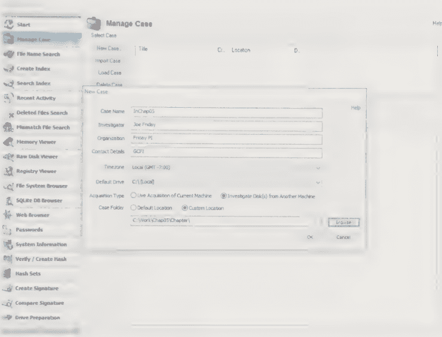

图 5-27 新案例对话框

来源：PassMark Software, www.osforensics.com

在 OSFMount - Mount drive（挂载驱动器）框中使用的驱动器字母是你在步骤 3 中使用的。此镜像作为只读驱动器挂载到你的计算机上，并供 OSForensics 访问。


## 理解微软启动任务

你应该对磁盘数据在启动时发生了什么有良好的了解。在某些调查中，你必须完全按照嫌疑人最后使用的状态保留磁盘上的数据。计算机用于某些用途之后的任何系统访问都会改变你的磁盘证据。正如你在第 3 章中学到的那样，修改磁盘数据会降低其证据质量。在接下来的章节中，你将学习 Windows 启动时访问哪些文件。这些信息有助于你确定嫌疑人的计算机最后被访问的时间，这对于在事件报告后可能被使用的计算机尤为重要。

从 Windows Vista 开始，微软更改了 OS 启动过程的方法。此外，Windows 8 和 10 是可以在桌面电脑、笔记本电脑和智能手机上运行的多平台操作系统。本讨论涵盖了桌面和笔记本电脑，虽然 Windows Vista、7 和 8 非常相似。在 Windows Vista 及更高版本中，启动过程使用启动配置数据（BCD）存储。对于桌面和笔记本电脑（BIOS 设计系统），在 `\Boot\BCD` 中维护着 BCD 注册表文件来控制启动过程。要访问此文件，你需要使用 BCD Editor；`Regedit` 和 `Regedt2` 与此文件没有关联。在 Windows 8 和 10 中，BCD 包含在 Windows 启动时启动系统引导过程的引导加载程序。要访问高级启动选项，在系统启动时按 `F8` 或 `F12`。此菜单允许你在安全模式（或 Windows 8 和 Windows 10 中的安全模式）、启动日志或禁用签名强制之间进行选择。按照屏幕上的指示保存更新并重启计算机。有关 Windows 启动过程的更多信息，请参考“Insight of Operating system booting – Windows 10”（https://pandey.wordpress.com/2016/10/insight-of-operating-system-booting）。关于 IBM 兼容笔记本电脑和桌面电脑的信息，请参“The BIOS/MBR Boot Process”（https://neosmart.net/wiki/mbr-process/）。要了解更多更改 Windows OS 启动顺序的方法，见“Computer Boot Order: How to change computer order for booting from CD/DVD, USB disk or floppy”（Markus Schuster, www.winhelp.us/computer-boot-order）。

## Windows NT 及后续版本中的启动

尽管 Windows NT 与 95 和 98 有不同，但 NT 操作系统（NT、2000 和 XP）的启动方法是相同的。某些系统文件的功能上存在细微差异，但它们实现了相同的启动。任何使用 NTFS 的计算机在启动时都会执行以下步骤：

- 上电自检 (POST)
- 初始化启动
- 引导加载程序
- 硬件检测
- 内核加载
- 用户登录

Windows OS 使用位于 `\Boot\BCD` 的 BCD 注册表文件来控制启动。这些文件位于系统分区。

## Windows Vista 的启动文件

当微软开发 Vista 时，它更新了启动过程以使用新的可扩展固件接口（EFI）。EFI 固件比 BIOS 提供更好的保护。自 Windows XP 以来，启动过程发生了变化。Windows 使用以下文件：

- `Bootmgr.exe` – Windows 管理器控制引导并允许多个操作系统启动。
- `Winload.exe` – Windows 加载程序安装内核、硬件抽象层 (HAL) 以及必要的启动程序。
- `Winresume.exe` – 此工具在 OS 进入休眠模式后重启。

Windows Vista 还包含了用于修改启动选项的 BCD。BCD 存储取代了 Windows `Boot.ini` 文件。有关 BCD 的更多信息，请访问 https://msdn.microsoft.com/en-us/library/hardware/653287(v=8).aspx

## Windows XP 的启动文件

除非有特殊说明，否则大多数 XP 的启动文件位于系统分区的根目录。NT加载程序（`Ntldr`）加载 OS。系统上电时，`Ntldr` 读取 `Boot.ini` 文件，该文件显示启动菜单。选择启动模式后，`Boot.ini` 运行 `Ntoskrnl.exe`、`Hal.dll` 和启动程序。`Boot.ini` 指定了 Windows 安装路径。

如果系统有多个操作系统（包括旧的 Windows 9x），`Ntldr` 读取 `BootSec.dos`（一个隐藏文件），该文件包含每个操作系统的引导扇区地址。

设备驱动程序包含操作系统对硬件设备（如键盘、鼠标和显卡）的指令，存储在 `systemroot\Windows\System32\Drivers` 文件夹中。

要在 DOS 提示符处识别 `systemroot` 的特定路径，请输入 `set`（不带任何开关或参数）并按回车键。此命令将显示所有当前的 `systemroot` 路径。

## Windows XP 系统文件

接下来，你需要检查 Windows XP、2000 和 NT 使用的核心操作系统文件，这些文件通常位于 `systemroot\Windows\System32` 或 `systemroot\Winnt\System32`。表 5-4 列出了 Windows XP 使用的文件。尽管这些文件中的几个与之前的表格条目重复，但你应该意识到它们的关键作用。

| 文件名 | 描述 |
| :--- | :--- |
| `Ntoskrnl.exe` | XP 可执行文件和内核 |
| `Ntkernelpa.exe` | 用于访问超过 4 GB 物理内存的物理地址支持程序 |
| `Hal.dll` | 硬件抽象层（前文已描述） |
| `Win32k.sys` | Win32 子系统的内核模式部分 |
| `Ntdll.dll` | 指向可执行函数和内部支持函数的系统服务调度存根 |
| `Kernel32.dll` | 核心 Win32 子系统 DLL 文件 |
| `Advapi32.dll` | 核心 Win32 子系统 DLL 文件 |
| `User32.dll` | 核心 Win32 子系统 DLL 文件 |
| `Gdi32.dll` | 核心 Win32 子系统 DLL 文件 |

## Windows XP 的污染担忧

当你启动 Windows XP NTFS 工作站时，启动时会访问这些中的或其他操作系统文件，文件的最后访问日期时间戳将更改为当前日期时间。这将破坏任何可以显示 Windows XP 工作站最后使用时间的潜在证据。由于这个原因，你应该对启动过程有深厚的实践知识。

## 理解虚拟机

操作系统和应用程序的新版本发布频繁，但旧版本仍被广泛使用。作为调查人员，你将面临没有足够资源来支持你可能遇到的各种软件的挑战。越来越多的公司转向虚拟化以降低硬件购买成本，随着这种做法的持续，涉及虚拟机的调查将会增加。

作为调查人员，你可能需要一个虚拟服务器来查看旧系统，并且可能需要对嫌疑人的虚拟机进行法医检查。虚拟机允许你通过模拟计算机的硬件环境，在现有的物理计算机（称为主机）上运行另一个操作系统。图 5-31 显示了在主机桌面上运行 Windows 8.1 的 Oracle VirtualBox 虚拟机。通常，虚拟机由几个文件组成。两个主要文件是包含硬件设置（如 RAM、网络配置、端口设置等）的配置文件，以及虚拟硬盘文件，后者包含引导加载程序、操作系统文件和用户数据文件。（取决于虚拟化软件，这些文件的组织方式可能不同。）

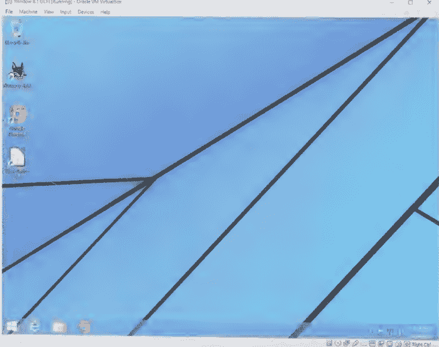

图 5-31 在主机桌面上运行的虚拟机

来源：Oracle VirtualBox, www.virtualbox.org

创建虚拟机的某些常用应用程序有 VMware Server、VMware Player 和 VMware Workstation、Oracle VirtualBox、Microsoft Virtual PC 以及 Microsoft HyperV（在当前版本的 Windows Server 中可用）。VirtualBox 是一个可以从 www.virtualbox.org 下载的开源程序。

## 在 VirtualBox 中创建虚拟机并安装 Windows 7

在执行以下活动之前请咨询你的导师，该活动将向你展示如何在 VirtualBox 中创建虚拟机并安装 Windows 7 作为虚拟机操作系统。你可以使用这些步骤安装其他旧版和当前的操作系统。

1. 启动网络浏览器，访问 `www.virtualbox.org`。下载并安装 VirtualBox。
2. 启动 VirtualBox。在 VirtualBox 界面中，点击“新建”（New）（见图 5-32）。

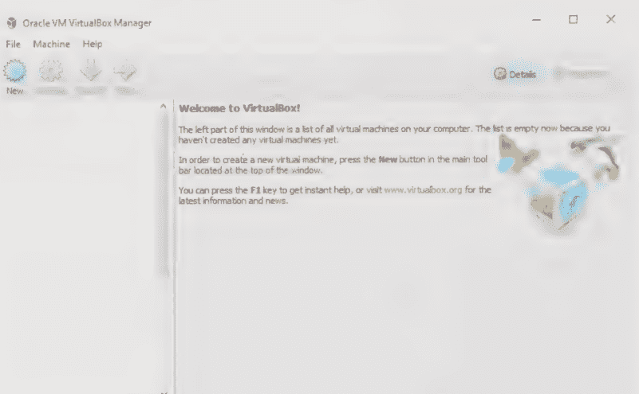

图 5-32 Oracle VirtualBox 界面

来源：Oracle VirtualBox, www.virtualbox.org

3. 在“名称和操作系统”窗口中，为虚拟机选择一个描述性名称，并选择你打算安装在上面的操作系统类型。
4. 在“内存”窗口中，将内存调整为工作站总量的 50%，点击“下一步”。
5. 在“硬盘”窗口中，点击“现在创建虚拟硬盘”（Create a virtual disk now）。
6. 在“硬盘类型”窗口中，点击“VDI”（虚拟硬盘），点击“下一步”。
7. 在“存储”窗口中，点击“动态分配”（Dynamically allocated），点击“下一步”。
8. 在“文件位置和大小”窗口中，点击“创建”（Create）。当 VirtualBox 完成虚拟机创建后，将显示图 5-33 所示的窗口。

| 名称 | 描述 |
| :--- | :--- |
| Windows | 类型：Windows |
| 版本 | Windows 7 (64位) |


图 5-33 输入虚拟机名称

来源：Oracle VirtualBox, www.virtualbox.org

在下面的活动中，你使用 ISO 镜像安装 Windows 7 作为虚拟机操作系统。对于任何虚拟机操作系统，你必须有一个产品密钥。

1. 在 VirtualBox 管理器中，点击“设置”图标。在 Windows 7 对话框中，点击左侧的“系统”，并取消勾选启动顺序中的软盘。
2. 接下来，点击左侧的“显示”，并在必要时点击“屏幕”选项卡。将视频内存滑块调整到至少 27 MB（见图 5-35）。

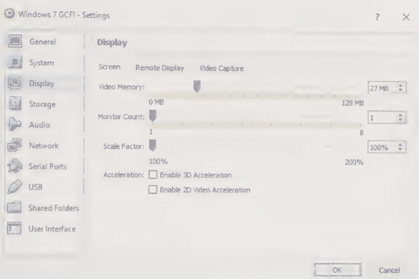

图 5-35 调整视频内存

来源：Oracle VirtualBox, www.virtualbox.org

取决于工作站的视频内存量，你可能需要调整它以便显示器能够正确显示会话。有关此设置和其他 VirtualBox 功能的更多信息，请参阅 www.virtualbox.org。

3. 点击左侧的“存储”，点击存储部分中的“空”，然后点击属性部分带有磁盘图标的箭头（如图 5-36 所示）。如果你有 Windows ISO 文件，点击“选择光盘”，选择一个 ISO 镜像安装，然后点击“确定”。如果你有 Windows 安装 DVD，点击“主机驱动器 ‘D:'”，然后点击“确定”。在 Oracle VM VirtualBox 中，点击“启动”。

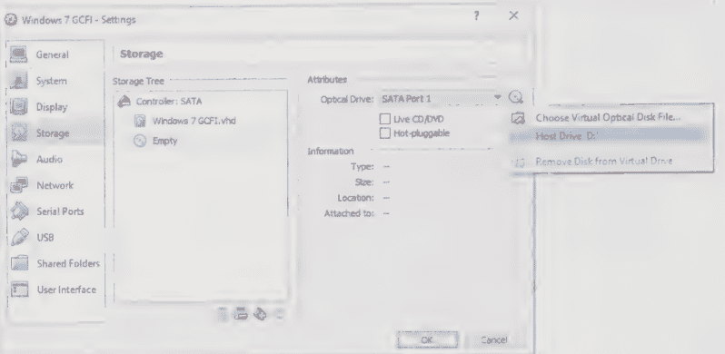

图 5-36 选择源驱动器

来源：Oracle VirtualBox, www.virtualbox.org

4. 按照提示继续在你的虚拟机上安装 Windows 7 作为客机操作系统。如果显示了“您想要哪种类型的安装？”窗口，点击“自定义（高级）”，如图 5-37 所示。退出 VirtualBox。

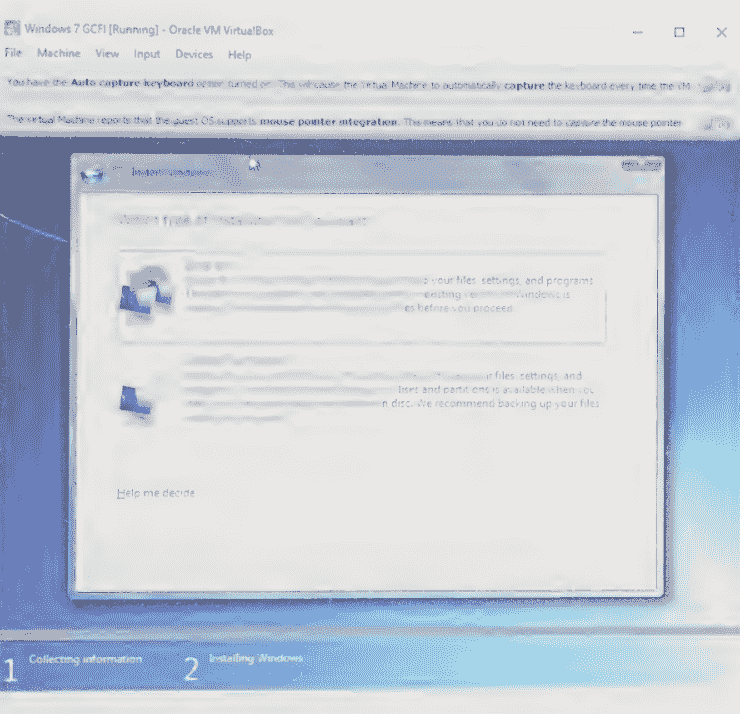

图 5-37 选择 Windows 安装选项

来源：Oracle VirtualBox, www.virtualbox.org

若要在 VirtualBox 中启动虚拟会话，请选择你创建的虚拟机，然后点击“启动”图标（见图 5-38）。你将看到在操作系统安装期间定义的登录名称和密码的启动提示。客机操作系统的工作方式就像你运行在独立的工作站上一样。你可以向此虚拟环境添加其他应用程序以按需要执行任务。要结束会话，只需执行常规 Windows 关机程序。

点击此处启动虚拟机

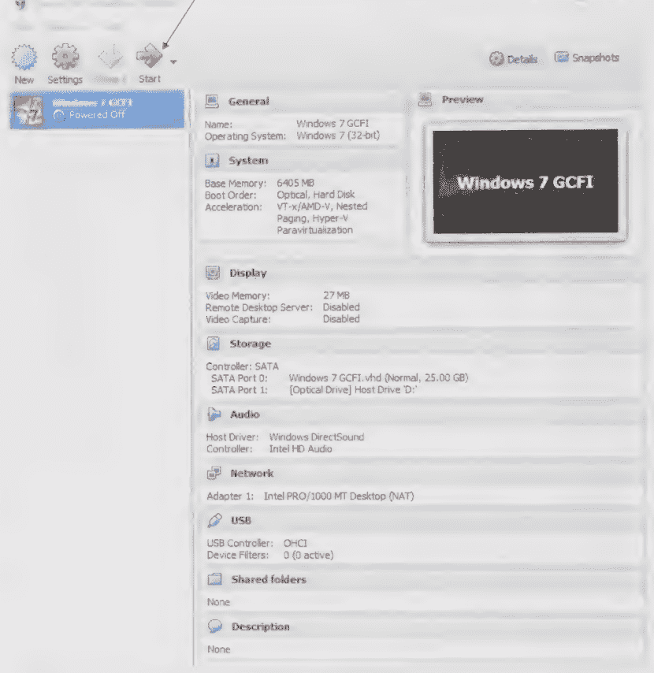

图 5-38 启动虚拟机会话

来源：Oracle VirtualBox, www.virtualbox.org

请注意，当你安装软件和执行其他任务时，可能会遇到 CD/DVD 驱动器识别等问题。虚拟机面临一些挑战，因为它们受到所加载的宿主机的限制。因此，在这些系统被使用之前，需要解决许多法律问题。

### 章节总结

- 在启动嫌疑者的计算机时，使用启动介质（如取证 CD 或 USB 驱动器）对于确保磁盘证据不被更改至关重要。你应该通过计算机访问嫌疑者的 BIOS，以启动到这些 CD 或 USB 驱动器。
- 当在 FAT 文件系统中删除文件时，目录中文件名的第一个字符处会插入十六进制值 `0x5`。
- 主引导记录 (MBR) 存储了关于磁盘分区的信息。
- NTFS 更为通用，因为它使用主文件表 (MFT) 来跟踪文件信息。小文件（称为驻留文件）的前约 512 字节数据存储在 MFT 中。较大文件（称为非驻留文件）的数据存储在 MFT 外部，并使用簇地址进行链接。


- 微软在旧的操作系统（如 MS-DOS、Windows 3.x 和 Windows 9x）中使用 `FAT12` 和 `FAT16`。最大分区大小为 2 GB。较新的系统使用 `FAT32`。`FAT12` 现在主要用于软磁盘和小型 USB 驱动器。为 Windows 95 创建的 FAT 允许长度超过 8 个字符的文件名。

- `MFT` 中的记录包含存储文件元数据的属性 ID。

- 在 `NTFS` 中，交替数据流可以隐藏对调查可能具有取证价值的信息。

- 要查找硬盘的容量，请使用磁道、磁头和扇区 (`CHS`) 计算法。要查找磁盘的字节容量，将磁头数、磁道和扇区的数量相乘。

- 文件空隙（`File slack`）、RAM 空隙（在旧版 Windows 操作系统中）和驱动器空隙（`Drive slack`）是价值信息（如下载的文件、交换文件、密码和登录 ID）可能存在的驱动器区域。

- 扇区被分组为簇，簇被链在一起，因为操作系统只能跟踪给定数量的分配单元（`FAT16` 为 65,536，`FAT32` 为 4,294,967,296）。

- `NTFS` 可以使用加密文件系统 (`EFS`) 和 `BitLocker` 加密数据。使用这些方法解密数据需要恢复证书。`BitLocker` 是微软的全盘加密 (`WDE`) 工具，可以使用一次性密码进行解密。

- 固态驱动器使用磨损均衡来确保存储单元的使用。它传输数据以确保存储单元的使用。在 Windows 8 及更高版本，交替数据流可以隐藏对调查可能具有取证价值的信息。在 `MFT` 中的记录包含存储文件元数据的属性 ID。

为 Windows 95 创建的 FAT 允许长度超过 8 个字符的文件名。

在 `NTFS` 中，交替数据流可以隐藏对调查可能具有取证价值的信息。

要查找硬盘的容量，请使用磁道、磁头和扇区 (`CHS`) 计算法。

### 关键术语

- 交替数据流
- 属性 ID
- 区域密度
- 启动扇区
- 启动过程
- 簇
- 磁道
- 数据
- 驱动程序
- 驱动器空隙
- 加密文件系统 (`EFS`)
- 文件分配表 (`FAT`)
- 文件空隙
- 文件系统
- 几何结构
- 高性能文件系统 (`HPFS`)
- 信息
- 逻辑地址
- 逻辑簇数
- 主引导记录 (`MBR`)
- 主文件表 (`MFT`)
- 元数据
- `NT`
- 加载器
- `NTFS` 文件系统 (`NTFS`)
- 内核
- 密码
- 分区
- 个人信息
- 私钥
- 公钥
- 恢复
- `Registry`
- 弹性文件系统 (`ReFS`)
- 扇区
- 空隙
- 轨道密度
- 空闲空间
- 虚拟簇数 (`VCN`)
- 虚拟硬盘 (`VHD`)
- 虚拟机
- 磨损均衡

### 复习题

1. Windows 中的[扇区]通常包含多少字节？
   a. 256
   b. 512

2. `CHS` 代表什么？

3. 区域记录确保磁盘外轨道尽可能存储数据。是/否？

4. 区域密度是指哪项？
   a. 每个比特的比特
   b. 每个分区的比特
   c. 每平方英寸比特
   d. 每个磁道的比特

5. 簇总是从哪个数字开始？

6. Windows 中一个簇通常有多少个扇区？
   a. 1
   b. 2 个以上
   c. 4 个以上
   d. 8 个以上

7. 列出 `FAT` 中的三项。

8. `NTFS` 文件包含什么？

9. 在 `FAT32` 中，123 KB 的文件使用多少扇区？

10. 删除文件时驱动器上的空间称为什么？（选择所有）
    a. 磁盘空间
    b. 未分配空间
    c. 驱动器空间
    d. 空空间

11. 列出 `NTFS` 有而 `FAT` 没有的特性。

12. `MFT` 代表什么？

13. 在 `NTFS` 中，小于 512 字节的文件存储在 `MFT` 中。是/否？

14. 在 Windows 7 及更高版本中，从内存加载到磁盘空隙的是多少数据？

15. 什么是虚拟簇？

16. 为什么开发 `EFI` 启动固件？

17. 驱动器包含什么信息？

18. 哪些 Windows 8 文件包含用户特定信息？
    a. `User.dat`
    b. `Ntuser.dat`
    c. `System.dat`
    d. `SAM.dat`

19. 虚拟机在宿主机上运行时具有哪些限制？
    a. 网络连接被限制在虚拟网站。
    b. 只有当应用程序位于物理机上时才能在虚拟机上运行。
    c. 虚拟机受宿主机配置的限制，如鼠标、键盘、CD/DVD 驱动器和其他设备。
    d. 虚拟机只能运行比物理机操作系统旧的操作系统。

## 第 5 章 Windows 与 CLI 系统的操作

20. 嫌疑驱动器的镜像可以加载到虚拟机上。正确或错误？

21. `EFS` 可以加密以下哪些内容？

22. 当你从启用 `EFS` 的 `NTFS` 磁盘复制加密文件到未启用 `EFS` 的磁盘或文件夹时，会发生什么？

- a. 文件、文件夹和卷
- b. 证书和私钥
- c. 全局注册表 (`Registry`)
- d. 网络服务器

- a. 文件将不再被加密。
- b. 文件将保持 `EFS` 保护。
- c. 文件将自动解密。
- d. 只有文件所有者可以继续访问它。

### 动手项目

本章的项目没有需要下载的数据文件，但在启动项目之前，请在你的系统上创建一个 `Work\Chap05\Projects` 文件夹。

### 动手项目 5-1

在这个项目中，你将比较两个在 Microsoft Office 中创建的文件，以确定它们在十六进制值上是否不同。请记录你的发现。

按照以下步骤操作：

1. 启动 Word，在一个新建文档中输入 `This is a test.`。
2. 将文件保存为工作文件夹中的 `Myword.docx`，并使用 Word 文档 (`*.docx`) 作为文件类型。退出 Word。
3. 启动 Excel，在一个新的工作簿中输入几个数字。将文件保存为工作文件夹中的 `Myworkbook.xlsx`，使用 Excel 工作簿 (`*.xlsx`) 作为文件类型。
4. 退出 Excel，并启动 `WinHex`（以管理员身份运行）。
5. 点击菜单中的“文件”，“打开”。在打开对话框中，导航到你的工作文件夹并双击 `Myword.docx`。
6. 注意偏移量 0 处的十六进制头 `50 4B 03 04 00 00 ...`。点击菜单中的“编辑”，“全选”，然后点击“编辑器显示”。
7. 启动记事本，在一个新建文档中按 `Ctrl+V` 粘贴复制的数据。离开此窗口。
8. 在打开对话框中点击“文件”，“打开”，导航到你的工作文件夹并双击 `Myworkbook.xlsx`。
9. 重复步骤 6。
10. 将刚刚复制的数据粘贴在你之前粘贴的 Word 头部信息下方。
11. 在记事本窗口中，添加你对两个文件头部的观察。将此文件保存为 `Cpr01.txt` 并告知你的导师。`WinHex`。

### 动手项目 5-2

在这个项目中，你将探索 `MFT`（主文件表）并学习如何在你创建的文件元数据中定位日期和时间值。这些步骤将帮助你识别之前删除的 `MFT` 记录碎片，这些碎片可能在未分配的磁盘空间或 `Pagefile.sys` 中的残余数据中找到。

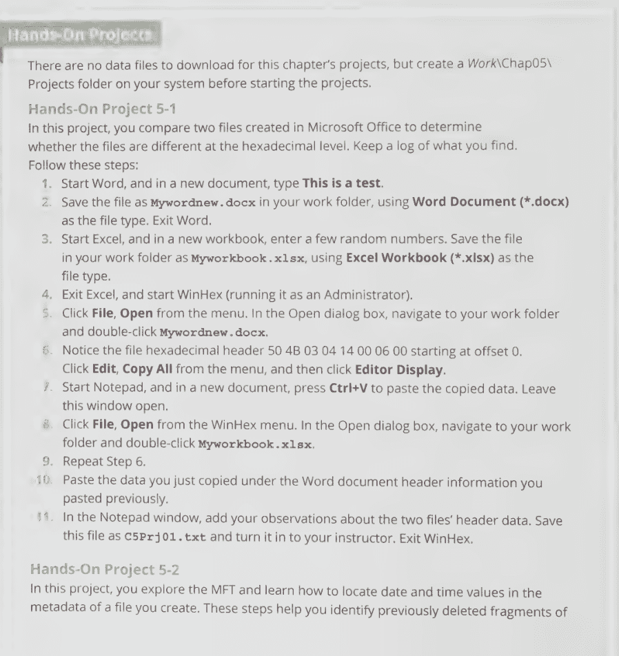

完成此项目需要以下条件：

- 运行 Windows 的系统，且 C 盘格式化为 `NTFS`
- 记事本，用于创建小型文本文件
- `WinHex`（从 `http://x-ways.net` 下载并安装，如果尚未安装的话），用于分析 `MFT` 中的元数据

1. 启动记事本，创建一个包含以下一行或多行内容的文本文件：
   - 两个律师之间的中间人就像两只猫之间的鱼。
   - 足之失很快就能恢复，但失口之言可能永远无法挽回。
   - 知识的投资总是会有最好的利息。
   - 主宰这项业务，否则它将主宰你。

将文件保存到工作文件夹中的 `C5Pr2.txt` 并退出记事本。（如果你的工作文件夹不在 C 盘上，请确保将文件保存到 C 盘上，以便将其输入你复制的 `$MFT` 文件中。）

接下来，回顾“MFT 和文件属性”中的材料，特别关注用于文件时间的属性 `0x10` 和 `0x30`。下表显示了从 `MFT` 记录的 `FILE` 位置开始计算的日期和时间戳的字节计数：


下表所示列出的偏移量是相对于 `MFT` 记录第一个字节的，而不是相对于特定属性 `0x10` 和 `0x30` 的起始位置。

| 字段描述 | 偏移位置 | 字节大小 |
|---|---|---|
| C Time (文件创建) | `0x50` | 8 |
| A Time (文件修改) | `0x58` | 8 |
| L Time (最后访问) | `0x60` | 8 |

`0x30` $File_Name (数据从偏移量 `0x18` 开始)

| 字段描述 | 偏移位置 | 字节大小 |
|---|---|---|
| C Time (文件创建) | `0xB8` | 8 |
| A Time (文件修改) | `0xC0` | 8 |
| R Time (文件读取) | `0xC8` | 8 |
| M Time (MFT 更改) | `0xD0` | 8 |

接下来，你检查存储在 `$MFT` 文件中的 `C5Prj02.txt` 文件的元数据。按照以下步骤操作：

1. 以**管理员身份运行**选项启动 `WinHex`。如果你看到评估消息，点击确定。
2. 出于起见，点击菜单中的“选项”，“编辑模式”。在“选择模式（全局）”对话框中，点击“只读模式（受保护）”，如图 5-39 所示。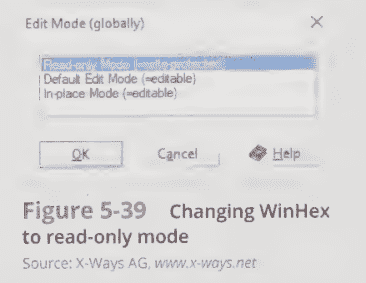

`WinHex` 默认为编辑模式，这意味着你可以更改并可能损坏系统文件。在使用 `WinHex` 编辑磁盘时，除非你需要对数据进行特定修改，否则始终将其设置为只读。

3. 点击菜单中的“工具”，“打开磁盘”。在磁盘对话框中，点击 **C:** 盘（或保存 `C5Prj02.txt` 的磁盘），如图 5-40 所示。如果提示拍摄快照，点击“新建”。根据磁盘上的数据和数量，`WinHex` 可能需要几分钟来遍历所有文件和路径。默认情况下，`WinHex` 显示一个浮动的解释器窗口，可以将十六进制值转换为十进制，还可以转换日期和时间。如果没有看到此窗口，通过点击“查看”并点击“解释器”来激活它。
4. 点击菜单中的“选项”，“解释器”。在解释器选项框中，点击 **FILETIME (64 位)**，如图 5-41 所示，点击确定。解释器应该有一个 `FILETIME` 项目。

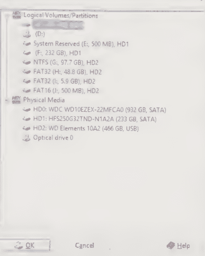 图 5-40 WinHex 中的磁盘

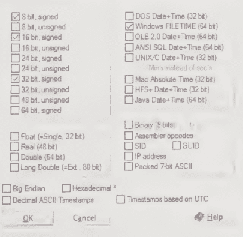 图 5-41 解释器选项框

5. 现在你需要在 `WinHex` 的右上面板中导航到你的工作文件夹（`C:\Work\Chap05\Projects`），向下滚动直到看到工作文件夹（如图 5-42），然后双击 `CSPrj02.txt`。

| C 盘 | C 盘 | C 盘 |
|---|---|---|
| \Work | \Work\Chap05 | |
| 名称 | 名称 | |
| Program Files | Program Files (x86) | Chap01 |
| Data | Chap05 | |
| Recovery | | |
| System Information | | |
| Windows | | |
| BitMap | | | 图 5-42 WinHex 中的文件夹导航

6. 从记录开头的 F 字母开始，向右下角的十六进制计数器向右移动（注意：50 字节是前文章节描述的 `0x10` 标准信息的第一个时间戳位置）。当计数器达到 50 时（如图 5-43），释放鼠标按钮。

| C 盘 | C 盘 | C 盘 |
|---|---|---|
| 文件 编辑 搜索 导航 查看 帮助 19.2 | | |
| \Work\Chap05\Projects | | |
| 名称 | 估计大小 修改 属性 第一部分 | |
| CSPrj02.txt | 48 8B/06/2017 11:20.... 04/27/2017 12:00.. 04/27/2017 12:00.. | 8,046 |
| .dat | 26 0B/06/2017 11:56.. 04/26/2017 11:56.. 04/27/2017 12:00.. | IA | 8,433 |
| 0 1 2 3 4 5 6 7 8 9 A B C D E F | | | |
| 00004410 5E 00 01 03 00 00 00 58 02 00 00 05 01 18 00 | $STANDARD | 76% 空闲 | (只读) |
| 00004410 00 00 00 00 00 00 00 00 00 00 00 00 05 01 18 00 | 文件系统 | | 可见磁盘空间分配： |
| 00004420 00 00 00 00 00 00 00 00 00 00 00 00 00 00 00 00 | | | 簇号。 |
| 00004430 00 00 00 00 00 00 00 00 00 00 00 00 00 00 00 00 | | | 804,417 |
| 00004440 00 00 00 00 00 00 00 00 00 00 00 00 00 00 00 00 | | | |
| 00004450 00 00 00 00 00 00 00 00 00 00 00 00 00 00 00 00 | | | |
| 00004460 00 00 00 00 00 00 00 00 00 00 00 00 00 00 00 00 | WinHex\Chap05 | | |
| 00004470 00 00 00 00 00 00 00 00 00 00 00 00 00 00 00 00 | | | 六月 |
| 00004480 00 00 00 00 00 00 00 00 00 00 00 00 00 00 00 00 | | | 413,530 |
| 00004490 00 00 00 00 00 00 00 00 00 00 00 00 00 00 00 00 | | | 401,578 |
| 000044A0 00 00 00 00 00 00 00 00 00 00 00 00 00 00 00 00 | | | |
| 000044B0 00 00 00 00 00 00 00 00 00 00 00 00 00 00 00 00 | FILETIME:04/25/2017 | | -04 GB |
| 000044C0 00 00 00 00 00 00 00 00 00 00 00 00 00 00 00 00 | | | |
| 000044D0 00 00 00 00 00 00 00 00 00 00 00 00 00 00 00 00 | | | |

拖动后，释放鼠标，点击此处解释日期并点击此处向下移动时间偏移计数器显示 50

# 图 5-43 在 MFT 记录中定位日期和时间

来源：X-Ways AG, www.x-ways.net

# 第 5 章 Windows 与 CLI 系统的操作

将光标位置移动到下一个字节（向下移动一行并向左），并记录数据解释器（`Data Interpreter`）`FILETIME` 值的日期和时间。

将鼠标光标重新置于前几个图表中列出的剩余偏移量上，并记录它们的值。

完成后，退出 `WinHex` 并提交你记录的日期和时间值。

# 实践项目 5-3

在此项目中，你将使用 `WinHex` 来熟悉不同的文件类型。请按照以下步骤操作：

1. 找到或创建 Excel (`.xlsx`)、Microsoft Word (`.docx`)、`.gif`、`.jpg` 和 `.mp3` 文件。如果你正在创建 Word 文档或 Excel 表格，请将其保存为 Word 或 Excel 文件。
2. 启动 `WinHex`。
3. 在 `WinHex` 中打开每种类型的文件。在文本编辑器（如记事本或 WordPad）中记录每个文件的十六进制代码。例如，Word 文档的字头 Word Header：`50 4B 03 04`。
4. 保存文件并打印出来交给你的老师。

# 实践项目 5-4

此项目是章节内使用 `OSForensics` 活动的延续。法律助理要求你检查 Denise Robinson 计算机镜像中是否列出了任何密码。请按照以下步骤操作：

1. 启动 `OSForensics`。如果提示，允许程序记录你的计算机，点击“确定”或“是”。在 `OSForensics` 消息框中，点击“继续使用试用版”（Using Trial Version）。
2. 将 `InCh05.img` 文件复制到你的工作文件夹。按照章节活动的描述挂载 `InCh05.img` 文件。
3. 在主窗口中，如有，点击左侧导航栏上的“管理案件”（Manage Case）。在右侧的“选择案件”（Select Case）面板中，如果 `InCh05` 旁边显示绿色勾选，则双击它。
4. 在左侧导航栏中点击“密码”（Passwords）。在右侧面板中，点击“查找浏览器”（Find Browser）按钮，然后点击挂载的 `InCh05.img` 虚拟驱动器盘。
5. 在左侧导航栏中点击“检索密码”（Retrieve Pass）。在右侧面板中，右键点击第一项并点击“导出列表到案件”（Export List to Case）。在标题框中，输入 Denise Robinson 的电子邮件和密码，然后点击“确定”。对所有恢复的浏览器密码重复此步骤。
6. 在密码窗口中，点击“Windows 登录密码”（Windows Login Passwords）选项卡。点击“扫描驱动器”（Scan Drive）按钮，然后点击挂载的 `InCh05.img` 虚拟驱动器。


- 7. 检索哈希值（Retrieve Hashes），然后点击“保存到文件”（Save to File）。在保存对话框中，导航到你的工作文件夹，在“文件名”文本框中输入 `Denise-Robinson-Win-Passwords`，然后点击“保存”。

- 8. 在左侧导航栏中点击**管理案件**（Manage Case）。在右侧的“管理当前案件”（Manage Current Case）面板中，点击**添加附件**（Add Attachment）按钮。找到并点击 `Denise-Robinson-Win-Passwords` 文件，然后点击“打开”。在导出文本框中，输入 `Denise-Robinson-Win-Passwords`，然后点击“添加”。

- 9. 在顶部的导航栏中，点击**生成报告**（Generate Report）。在导出报告对话框中，如果收到报告已存在的警告消息，点击“确定”，点击“是”以覆盖之前的报告。

- 10. 退出 OSForensics，并打印在 Web 浏览器中显示的报告。将报告交给你的老师。

# 案件项目

## 案件项目 5-1

使用你在实践项目 5-4 中收集的信息，给法律助理 D. K. Jones 女士写一份一页的备忘录，解释你用来查找电子邮件和密码数据的过程。

## 案件项目 5-2

一名员工怀疑他的密码已被泄露。他在两天前更改了密码，但似乎又被使用了。这可能存在什么问题？

## 实践项目 5-3

有时你需要查看应用程序在启动的计算机上是如何工作和运行的。对于此项目，请编写一份两三页的指南，说明如何使用 VirtualBox 从嫌疑计算机的磁盘映像运行程序。你的研究应从 `virtualbox.org` 开始。要获取更多信息，请搜索“VirtualBox convert RAW image to VDI”或“convert raw to vmdk”等术语。

# 当前数字取证工具

在阅读本章并完成练习后，你将能够：

- 如何评估数字取证工具的需求
- 描述可用的数字取证软件
- 列出数字取证硬件的注意事项
- 描述验证和测试取证工具的方法

第 2 章概述了如何设置取证实验室。本章介绍了在数字取证调查期间使用的软件和硬件工具。并没有特定的工具推荐；相反，说明如何根据标准选择工具。

取证工具正在不断开发、更新、补丁、修订和停用。因此，定期查看供应商网站以获取新功能和改进是重要的。这些改进可能会解决你面临的困难问题。

在购买任何取证工具之前，考虑它们是否能在调查期间为你节省时间，以及节省时间是否会影响数据恢复的可靠性。许多 GUI 取证工具需要大量资源，并需要更大内存和更快处理器的计算机。有时，由于其他应用程序（如后台运行的反病毒软件等），它们比普通工作站需要更多资源。

另一款广泛使用的 GUI 工具 Technology Pathways ProDiscover 取证版已被一家网络安全公司 ARC Group 收购。在本文写作时，该工具正被整合到一个尚未发布的新产品中（`www.arcgroupny.com/products/prodiscover-forensic-edition/`）。随着数字取证领域的不断发展，这类合并将继续发生。

软件取证工具通常用于将数据从嫌疑者的驱动器复制到镜像文件中。许多 GUI 取证工具可以像读取原始驱动器一样读取镜像文件中的所有结构，并具备进行深度反取证分析的能力。在第 5 章中，你已经学习了如何使用其中一些工具从嫌疑者的驱动器中获取数据。

## 数字取证工具形成的任务

所有的数字取证工具（无论是硬件还是软件）都执行特定的功能。当你测试新工具时，可能会发现遵循 NIST 计算机取证工具测试（CFTT）计划、ASTM 国际（原美国测试与材料协会）E2678 标准以及计算机证据国际组织（IOCE）制定的指南大有帮助。此外，ISO 标准 27037（`www.iso.org/standard/43381.html`）规定数字取证第一响应人员（DEFRs）应使用经过验证的工具。以下数字取证类别旨在作为评估数字取证工具的指南，其子功能用于细化分析和恢复以确保数据质量：

- 获取（Acquisition）
- 验证与确认（Validation and verification）
- 提取（Extraction）
- 重建（Reconstruction）
- 报告（Reporting）

NIST 的 CFTT 和其他小组包含了额外的功能，如数据获取、从移动设备提取数据、文件重建和字符串搜索，这些未包含在指南中（“数字取证工具的验证”，Jim Lyle，2010年5月，蒙大拿法院季培训）。在后续章节中，你将学习这些功能和子功能如何应用于数字调查。

## 获取

获取是数字取证调查的第一项任务，是对原始驱动器进行复制。正如第 3 章所述，该程序保护原始驱动器，以确保其不会损坏并损害数字证据。获取类别的子功能包括以下：

- 物理数据复制
- 逻辑数据复制
- 数据获取格式
- 命令行获取
- GUI 获取
- 远程、实时及内存获取

ISO 27037 规定，数据获取最重要的因素是 DEFF 的能力以及对经过验证工具的使用，它还包含了在不同情况下如何进行获取的指南。最重要的是记录做了什么以及为什么这样做。例如，如果你在含有危险材料的场景下获取数据，清晰的速度至关重要，因此你可能会放弃获取 RAM 而专注于收集设备。例如，你还可以找到关于是获取物理磁盘还是仅专注于分区或文件夹的决策流程图。标准的第 7 节涉及获取易失性内存，这是实时获取的重要部分。其他影响获取的情况还包括加密设备或无法关闭的关键任务系统。

例如，某些数字取证套件（如 AccessData FTK 和 Magnet AXIOM）允许你在同一个步骤中获取取证镜像并对其进行处理。然而，一些调查人员选择使用硬件设备获取镜像，例如 Tableau TD2、Logiccube Talon、VOOM Hardcopy 3P 或来自 Intelligent Computer Solutions, Inc. 的 Image MASSTER Solo-4。这些硬件设备内置了用于数据获取的软件。复制驱动器不需要其他设备或程序；但你仍然需要取证软件来分析数据。


查看 Logiccube Talon 的规格，请访问 `www.logiccube.com/shop/talon-ultimate/`。要查看 Image MASSTER Solo-4 设备，请搜索 `www.ics-iq.com`。要查看 VOOM Hardcopy 3，请搜索 `www.voomtech.com`。

其他获取工具需要结合硬件设备和软件程序来进行磁盘获取。例如，许多软件工具将驱动器挂载为只读，其他工具可能需要物理写保护器。任何内置软件写保护的工具都应被使用以确保证据未被篡改。

使用了两种数据复制方法：物理复制和逻辑复制。大多数获取工具提供了复制驱动器的方法，而其他工具可能需要物理写保护器。任何内置软件写保护的工具都应被使用以确保证据未被篡改。

## 验证与确认

验证与确认辅相成。验证是确认工具按预期运行的方法，而确认则证明两组数据是完全相同的。在验证工具后，你必须确保设备的所有取证副本具有相同的哈希值。你将在本章稍后的“验证和测试取证软件”部分学习更多相关内容。

# 第 6 章 当前数字取证工具

## 国家软件参考库 (NSRL)

## 欢迎访问国家软件参考库

该项目获得美国司法部、联邦、州和地方执法部门以及美国国家标准与技术研究院（NIST）的支持，旨在促进在网络犯罪调查中有效高效利用计算机技术。特别是联邦调查局（FBI）通过其 ACES 程序为 NSRL 的创建做出了重大贡献。

NSRL 旨在从各种来源收集软件，并将这些软件中的程序编译成参考数据集（RDS）。执法部门、政府和工业界使用 RDS 通过匹配哈希值（hashes）来检查计算机上的文件。该项目衡量了工具在检测作为犯罪调查一部分被扣押的计算机或系统上的证据文件方面的效果。

NSRL 是已知且可追溯软件应用程序的集合。哈希集中包含可能被视为恶意、可疑或未知的哈希值。

国家软件参考库是特殊计划办公室（Special Programs Office）软件与系统开发的一个项目。

## 一般信息

- 如何使用 NRL
- 库内容
- 版权信息
- 修改信息
- 请求
- 常见问题 (FAQs)

## 投票

- 项目概述
- 软件数据集

### 图 6-2 国家软件参考库主页

来源：`www.nsrl.nist.gov`


失踪儿童与受削儿童国家中心（NCMEC）等组织维护已知受害者照片的哈希值。这些文件被分为“可疑”或已知坏的类别。

若干数字取证工具可以集成良好的文件哈希集，并将其与嫌疑驱动器的文件哈希值进行比较，以查看它们是否匹配。通过这一过程，你可以快速消除大量数据，从而专注于证据分析。你也可以开始构建自己的哈希集。另一个值得考虑的功能是对比数据扇区进行哈希处理和比较。这对于识别磁盘空间（slack space）和空闲空间中可能被部分覆盖的数据碎片有用。

过滤数据的另一种方法是分析和验证文件类型的头部值（header values）。每个文件类型都有与文件扩展名关联的头部值，许多取证工具都包含常见文件头的列表。要查看这些文件头，你可以使用十六进制编辑器，它可以告诉你文件扩展名对于该文件类型是否正确。重命名扩展名通常足以隐藏或伪装数据，而你可能会漏掉相关数据。图形的一个标准指标是文件值“FF D8”，如图 6-3 所示的 Bayshot .docx 文件输出的第一行所示。（你将在第 8 章更详细地检查图形文件。）在练习查看文件头后，你学会识别常见的头部值。

由于 Bayshot .docx 文件的头部包含“FF D8”，因此是一个 .jpeg ，而不是 .docx 文件。如果你尝试在 Microsoft Word 中打开此文件，将看到图 6-4 所示的错误信息；但如果你使用的是 Windows 7 或 Windows 10，系统会自动检测到文件是 JPEG 并添加正确的扩展名。

# 第 6 章 当前数字取证工具 275

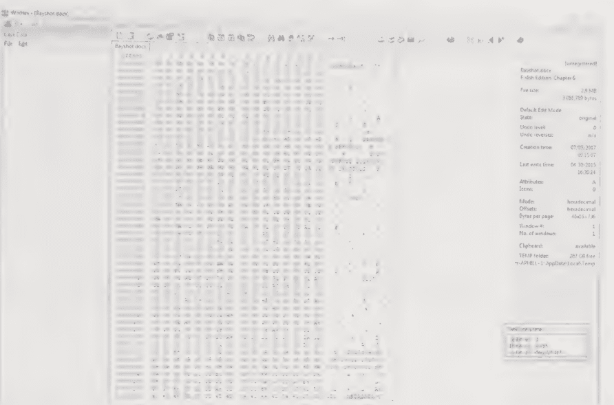

**图 6-3** 文件头指示为 .jpeg 文件

来源：X-Ways AG. `www.x-ways.net`


**图 6-4** 在 Word 中尝试打开 .jpeg 文件时显示的错误信息

如果你使用图像查看器（如 Microsoft Paint）打开文件，你将看到图 6-5 所示的图像。

搜索和比较文件头而不是文件扩展名可以提高过滤效率。通过这一功能，你可以定位可能被刻意更改的文件。在第 8 章和第 9 章，你将看到如何使用此功能定位隐藏数据。

# 第 6 章 当前数字取证工具


图 6-5 在画图中打开的 Bayshot.docx

## 提取 (Extraction)

提取功能是数字调查中的恢复任务，是所有任务中最具挑战性的。在第 1 章中，你学习了系统分析如何应用于调查。恢复数据是分析调查数据的第一步。提取的以下子功能用于调查：

- 数据查看
- 关键词搜索
- 压缩或解压缩
- 数据刻缝 (Carving)
- 解密
- 书签或标记

许多数字取证工具为数字证据提供了数据查看机制，并提供多种查看数据的方法，包括逻辑驱动器结构（如文件夹和文件）。这些工具还通过特殊的文件和磁盘查看器显示已分配的文件数据和未分配的磁盘区域。能够以正常形式查看这些数据可以为调查的分析和线索收集变得更容易。

移动设备为取证提取增加了复杂性，因为从它们可以检索到大量数据：通话记录、URL、GPS 数据、短信和文本消息等。在第 12 章探索移动设备取证。

# 第 6 章 当前数字取证工具

数字取证中的一项常见任务是搜索和恢复相关数据。取证工具具有搜索调查感兴趣的关键词的功能。如果使用得当，使用关键词搜索可以加速分析过程；然而，另一种缩小搜索范围是使用词列表。图 6-6 显示了在 OSForensics 中使用词列表搜索 Charlie 的硬盘中的关键词“核酸”。


图 6-6 在 OSForensics 中使用词列表搜索

来源：PassMark Software, `www.osforensics.com`

使用某些工具，你可以过滤搜索文件类型，例如仅搜索 PDF 文件。某些取证工具（如 X-Ways Forensics 和 OSForensics）的另一个功能是对硬盘进行索引。这些功能加快了关键词搜索，从而加速了分析。

提取的另一个特性是工具可以读取的格式。例如，OSForensics 有读取 Microsoft `.pst` 和 `.ost` 文件的格式，EnCase 有一个第三方插件可以索引并分析 Microsoft `.pst` 文件。此外，EnCase 和 FTK 的旧版本没有此功能。通常你需要结合多种工具来准确地从数字设备检索并报告证据。

调查过程还涉及重建嫌疑驱动器上删除的文件碎片。在北美，这种重建被称为“刻缝”(carving)；在欧洲，被称为“抢救”(salvaging)。（刻缝将在第 8 章和第 16 章深入介绍。）调查人员通常需要能够从未分配的磁盘空间提取数据。如“验证与确认”部分提到的，定位文件头信息是刻缝数据的可靠方法。大多数取证工具分析驱动器或取证镜像的未分配区域，定位可以刻缝并复制到新建文件的碎片或完整文件结构。某些调查人员喜欢使用命令行工具手动刻缝碎片文件，但现在内置刻缝功能的高级 GUI 工具更为常见。图 6-7 显示了 OS Forensics 中的数据刻缝功能


图 6-7 OS Forensics 中的数据刻缝选项

来源：PassMark Software, `www.osforensics.com`

某些工具，如 Simple Carver Suite (`www.simplecarver.com`) 和 DataLifter (`http://downloads.informer.com/datalifter-with-file-extractor-pro/`)，专门设计用于从导出的未分配磁盘空间刻缝已知数据类型。DataLifter 包含一个允许你添加其他头部值的的功能。

## 第 6 章 当前数字取证工具 279

有许多压缩或 zip 工具，例如 WinZip、7Zip 和 pzip。

当取证工具在取证镜像中遇到压缩文件或 zip 归档时，它会应用正确的算法来解压文件。例如，Windows 文件的解压是使用 Lempel-Ziv 算法，即 `Lz32.dll` 完成的。其他操作系统和压缩工具则使用其他算法。

数字调查中的一个主要挑战是对加密文件或系统中的数据进行分析、恢复和解密。加密可以应用于驱动器、磁盘分区或文件。许多电子邮件服务（如 Microsoft Outlook）为 `.pst` 文件夹提供加密保护。加密可以是特定于平台的，例如 Windows 加密文件系统 (EFS) 和 BitLocker，也可以使用第三方工具完成，例如 Pretty Good Privacy (PGP) 和 GnuPG。

从调查的角度来看，加密文件和系统是一个问题。许多密码恢复工具都具有生成潜在密码列表的功能，用于进行密码字典攻击。密码通常以哈希值的形式存储，而不是明文形式，且设计为单向哈希，这意味着你无法通过应用算法来破解它们。密码为你猜测密码提供了一个起点；此外，你还可以尝试与用户的职业和爱好相关的词汇。密码有时会被写入临时文件或系统，例如 `Pagefile.sys`。许多取证工具内置了密码破解器，例如 OSForensics。它首先尝试检索浏览器和操作系统的密码，特别是当你运行的是实机系统时。接下来，它会生成彩虹表（包含密码哈希值的文件；在第 9 章解释）并比较哈希值以查看是否能找到密码的匹配项。如果失败，下一步是对加密文件进行暴力破解攻击。例如，OSForensics 会尝试恢复 Windows 登录密码，并具有其他功能，如恢复浏览器密码。随着移动设备的普及，访问密码的能力取决于用户口短语的安全性。当你进入智能手机后，大多数 App 都会自动打开。

找到证据后，下一项任务是对其进行书签标记或标记，以便以后在需要时进行引用。许多取证工具使用书签将数字证据插入到报告生成器中，从而生成 HTML 或 RTF 格式的技术报告。当报告生成器启动时，书签会被加载到报告中。

## 重建

在取证工具中设置重建函数的目的是重建受疑驱动器，以显示在犯罪或事件期间发生了什么。复制受疑驱动器的另一个原因是为了给其他数字调查人员创建一个副本，这些人员可能需要一个功能完全的磁盘副本，以便他们对证据进行自己的获取、测试和分析。如果驱动器被恶意软件或嫌疑人的行为破坏，也会进行重建。以下是重建方法：

- 磁盘到磁盘复制
- 分区到分区的复制
- 镜像到磁盘的复制
- 镜像到分区的复制
- 磁盘到镜像的复制
- 从数据运行（data runs）重建文件和数据提取

重建受疑驱动器镜像有多种方法。十年前，理想的方法是使用与受疑磁盘相同品牌和型号的磁盘（如第3 章所述），但现在很少使用磁盘到磁盘的复制。（分区到分区的复制非常相似，但你使用的是分区而不是磁盘。）通常，你将镜像复制到另一个位置，例如分区、物理磁盘或虚拟机（第 10 章介绍）。复制驱动器最简单的方法是使用工具从受疑驱动器到目标位置制作直接磁盘到镜像的复制。许多工具都可以执行此任务。一个免费工具是 Linux 的 `dd` 命令，但它有一个主要的缺点：它产生一个扁平的、未压缩的文件，大小与源文件相同。

某些工具具有专有格式，只能由创建它们的应用程序恢复。例如，ProDiscover 镜像（`.ev` 格式）只能由 ProDiscover 恢复。然而，大多数工具可以将文件转换为 `.E01` 或 `.001` 格式，以便你在各种工具中使用这些文件，利用它们不同的优势。


取证分析往往因为时间敏感的案件而变得复杂，例如涉及绑架或杀人的案件，但在这些情况下影子驱动（shadowing drives）是一种实用的技术。它需要硬件设备，例如 `Voom Technologies Shadow Drive`，将受疑驱动器连接到只读 `IDE` 端口，并将另一个驱动器连接到读写端口，这被称为“影子驱动器”。当 `Voom` 设备连接到计算机时，你可以访问并运行受疑驱动器上的应用程序。所有通常写入受疑驱动器的数据都会重定向到影子驱动器（“Voom Technologies 的 Shadow 3 被认为是一种在不损害证据的情况下调查计算机的快速方法，《政府安全新闻》，2014年2月）。这种工具已在法庭上使用，以便专家证人能够轻松显示驱动器上的证据以及嫌疑人如何使用这些信息。

## 报告

执行取证磁盘分析和检查，你需要创建一个报告。在 Windows 取证工具可用之前，此过程需要从受疑驱动器手动复制数据并提取数字证据。调查人员随后将证据复制到单独程序（如文字处理程序）中以创建报告。在文字处理器中无法读取的文件数据——例如数据库、表格和图形——使得向报告中插入二进制数据等不可打印字符变得困难。通常，这些报告不是电子存储的，因为调查人员必须从几个不同的应用程序收集打印输出，将所有内容合并成一份大型纸质报告。

较新的取证工具可以产生各种格式的电子报告，如文字处理文档、`HTML` 网页和 `Acrobat PDF` 文件。以下是报告子功能：

- 书签或标记
- 日志报告
- 时间线
- 报告生成器

作为验证过程的一部分，你通常需要记录从受疑驱动器获取数据的步骤。许多取证工具可以生成日志报告，记录调查人员的活动，并整合执行期间书签或标记的证据。然后，使用内置的报告生成器创建各种格式的报告。具有显示书签证据报告生成器的工具包括 `EnCase`、`FTK`、`OSForensics`、`ILookup` 和 `X-Ways Forensics`。

你可以将日志报告添加到最终报告中，作为检查期间步骤的记录，这在需要重复检查时非常有用。对于需要同行评审的案件，日志报告确认了原始分析和检查中执行了哪些活动以及发现了哪些结果。请记住，工具生成的报告不能替代调查人员的报告。调查人员需要比工具报告更详细地解释他们的决策和输出。

## 工具比较

为了帮助决定购买何种取证工具，功能、子功能和产品的比较表是非常有用的。将功能和子功能与产品进行交叉引用，可以更容易识别满足你需求的取证工具。表 6-1 是比较取证厂商工具的示例。你的需求可能与列出的功能和子功能不同。在开发自己的表格时，增加你认为对调查是必要的其他功能和子功能。

### 表 6-1 取证工具功能对比表

| 功能 | Magnet Forensics AxiOM, 演示版 | OSForensics, 演示版 | AccessData FTK | Guidance Software EnCase |
| :--- | :---: | :---: | :---: | :---: |
| **取证** | | | | |
| 物理数据拷贝 | ✓ | ✓ | ✓ | ✓ |
| 逻辑数据拷贝 | ✓ | ✓ | ✓ | |
| 数据采集格式 | ✓ | ✓ | | ✓ |
| 命令行进程 | | | | ✓ |
| GUI 进程 | ✓ | ✓ | ✓ | ✓ |
| 远程取证 | | ✓ | ✓ | ✓ |
| **验证与核实** | | | | |
| 哈希计算 | ✓ | ✓ | ✓ | ✓ |
| 验证 | ✓ | ✓ | ✓ | ✓ |
| 过滤 | ✓ | ✓ | ✓ | ✓ |
| 分析文件头 | ✓ | | | ✓ |
| **提取** | | | | |
| 数据查看 | ✓ | ✓ | ✓ | ✓ |
| 关键词搜索 | ✓ | ✓ | ✓ | ✓ |
| 解压缩 | ✓ | ✓ | ✓ | |
| 数据刻化 | ✓ | ✓ | ✓ | ✓ |
| 解密 | ✓ | ✓ | ✓ | ✓ |
| 书签标记 | ✓ | ✓ | ✓ | ✓ |
| **重建** | | | | |
| 磁盘到磁盘拷贝 | ✓ | ✓ | ✓ | ✓ |
| 分区到分区拷贝 | ✓ | ✓ | ✓ | ✓ |
| 镜像到磁盘拷贝 | ✓ | ✓ | ✓ | ✓ |
| 镜像到分区拷贝 | ✓ | ✓ | ✓ | ✓ |
| 磁盘到镜像拷贝 | ✓ | ✓ | ✓ | ✓ |
| 重建文件 | ✓ | ✓ | ✓ | ✓ |
| **报告** | | | | |
| 书签/标记 | ✓ | ✓ | ✓ | ✓ |
| 日志报告 | ✓ | ✓ | ✓ | ✓ |
| 时间线 | ✓ | ✓ | ✓ | ✓ |
| 报告生成器 | ✓ | | ✓ | |

### 表 6-1 取证工具功能对比表（续）

| 功能 | Magnet Forensics AXIOM, 演示版 | OSForensics, 演示版 | AccessData FTK | Guidance EnCase |
|---|---|---|---|---|
| **自动化和其他功能** | | | | |
| 脚本语言 | | | | ✓ |
| 挂载虚拟机 | | ✓ | ✓ | ✓ |
| 电子发现 | | ✓ | ✓ | ✓ |

## 工具的其他考虑因素

在为你的实验室进行业务规划时，你应该确定哪些工具提供最大的灵活性、可靠性和未来的可扩展性。你选择的软件工具应该与下一代操作系统兼容；例如，`Windows 7` 及更高版本增加了对移动设备的兼容性功能。作为一名调查员，你有责任寻找有关新硬件或软件发布的变更的信息，以及下一次发布中计划的变更。由于操作系统供应商并不总是提供有关未来文件系统升级的充分信息，你必须研究并为这些变化准备，并在供应商未能提供这些信息时开发寻找新规格的资源。例如，当 `NTFS` 随着 `Windows NT` 引入时，取证软件修订其产品以适应新的文件系统变更花费了一些时间。因此，调查员不得不寻找获取所需数据的替代方案，例如咨询 `Windows NT` 的资源工具包。当人们从 `Windows 8.1` 移动到 `Windows 10` 以及 `Windows Server 2012` 移动到 `2016` 时，也发生了类似的问题。

维护取证实验室的另一个考虑因素是包含旧版本取证程序、操作系统和其他程序的软件库。在购买更新且更多功能的工具时，你还应该确保你的实验室维护旧版本的软件和操作系统。如果新软件版本修复了一个 bug 但引入了另一个，你可以使用之前的版本来克服新 bug 引起的问题。

## 数字取证软件工具

无论你是使用工具套还是特定任务的工具，你都有权选择一个可以通过命令行或 `GUI` 分析数字证据的工具。以下章节将探索 `Windows` 和 `Linux` 中命令行工具和 `GUI` 工具的一些选项。

### 命令行取证工具

`Macintosh` 已经回归，有更多的人在使用它。在 `Apple` 设备上安装 `Windows` 相当简单，因此你可以在 `macOS` 中使用大多数取证工具。

如第 1 章所述，在 `Windows` 和 `MS-DOS` 主导市场之前，计算机使用各种操作系统。在此期间，数字取证并不是一个主要关注点。然而，人们开始使用 `PC` 后，他们发现了如何将它们用于非法和破坏性目的，并实施犯罪和民事违规。软件开发者开始发布取证工具，帮助私营部门和公共部门调查员检查 `PC`。第一批从软磁盘和硬盘分析并提取数据的工具是用于 `IBM PC` 文件系统的 `MS-DOS` 工具。

用于数字调查的首批 `MS-DOS` 工具之一是 `Norton DiskEdit`。该工具使用手动过程，需要调查员在典型任务上花费大量时间。

命令行取证工具的一个优势是它们在极少资源的情况下运行，由于 `Linux` 许多版本，许多工具可以在 `de` 介质上运行。使用 `Linux` 的命令行工具可以节省时间。

许多 `Linux` 命令行工具的命令行界面 (`CLI`) 可以查看文件。


AXIOM, demo version | OSForensics, demo version | AccessData FTK | Guidance EnCase


# 现有数字取证工具

## 表 6-1 取证工具功能对比表

| 功能 | Magnet Forensics AXIOM, 演示版 | OSForensics, 演示版 | AccessData FTK | Guidance Software EnCase |
| :--- | :---: | :---: | :---: | :---: |
| **取证** | | | | |
| 物理数据拷贝 | ✓ | ✓ | ✓ | ✓ |
| 逻辑数据拷贝 | ✓ | ✓ | ✓ | |
| 数据采集格式 | ✓ | ✓ | | ✓ |
| 命令行进程 | | | | ✓ |
| GUI 进程 | ✓ | ✓ | ✓ | ✓ |
| 远程取证 | | ✓ | ✓ | ✓ |
| **验证与核实** | | | | |
| 哈希计算 | ✓ | ✓ | ✓ | ✓ |
| 验证 | ✓ | ✓ | ✓ | ✓ |
| 过滤 | ✓ | ✓ | ✓ | ✓ |
| 分析文件头 | ✓ | | | ✓ |
| **提取** | | | | |
| 数据查看 | ✓ | ✓ | ✓ | ✓ |
| 关键词搜索 | ✓ | ✓ | ✓ | ✓ |
| 解压缩 | ✓ | ✓ | ✓ | |
| 数据刻化 | ✓ | ✓ | ✓ | ✓ |
| 解密 | ✓ | ✓ | ✓ | ✓ |
| 书签标记 | ✓ | ✓ | ✓ | ✓ |
| **重建** | | | | |
| 磁盘到磁盘拷贝 | ✓ | ✓ | ✓ | ✓ |
| 分区到分区拷贝 | ✓ | ✓ | ✓ | ✓ |
| 镜像到磁盘拷贝 | ✓ | ✓ | ✓ | ✓ |
| 镜像到分区拷贝 | ✓ | ✓ | ✓ | ✓ |
| 磁盘到镜像拷贝 | ✓ | ✓ | ✓ | ✓ |
| 重建文件 | ✓ | ✓ | ✓ | ✓ |
| **报告** | | | | |
| 书签/标记 | ✓ | ✓ | ✓ | ✓ |
| 日志报告 | ✓ | ✓ | ✓ | ✓ |
| 时间线 | ✓ | ✓ | ✓ | ✓ |
| 报告生成器 | ✓ | | ✓ | | |

## 表 6-1 取证工具功能对比表（续）

| 功能 | Magnet Forensics AXIOM, 演示版 | OSForensics, 演示版 | AccessData FTK | Guidance EnCase |
| :--- | :---: | :---: | :---: | :---: |
| **自动化和其他功能** | | | | |
| 脚本语言 | | | | ✓ |
| 挂载虚拟机 | | ✓ | ✓ | ✓ |
| 电子发现 | | ✓ | ✓ | ✓ |

# 工具的其他考虑因素

在为你的实验室进行业务规划时，你应该确定哪些工具提供最大的灵活性、可靠性和未来的可扩展性。你选择的软件工具应该与下一代操作系统兼容；例如，`Windows 7` 及更高版本增加了对移动设备的兼容性功能。作为一名调查员，你有责任寻找有关新硬件或软件发布的变更的信息，以及下一次发布中计划的变更。由于操作系统供应商并不总是提供有关未来文件系统升级的充分信息，你必须研究并为这些变化准备，并在供应商未能提供这些信息时开发寻找新规格的资源。例如，当 `NTFS` 随着 `Windows NT` 引入时，取证软件修订其产品以适应新的文件系统变更花费了一些时间。因此，调查员不得不寻找获取所需数据的替代方案，例如咨询 `Windows NT` 的资源工具包。当人们从 `Windows 8.1` 移动到 `Windows 10` 以及 `Windows Server 2012` 移动到 `2016` 时，也发生了类似的兼容性问题。

维护取证实验室的另一个考虑因素是包含旧版本取证程序、操作系统和其他程序的软件库。在购买更新且更多功能的工具时，你还应该确保你的实验室维护旧版本的软件和操作系统。如果新软件版本修复了一个 `bug` 但引入了另一个，你可以使用之前的版本来克服新 `bug` 引起的问题。

# 数字取证软件工具

无论你是使用工具套件还是特定任务的工具，你都有权选择一个可以通过命令行或 `GUI` 分析数字证据的工具。以下章节将探索 `Windows` 和 `Linux` 中命令行工具和 `GUI` 工具的一些选项。

# 命令行取证工具

`Macintosh` 已经回归，有更多的人在使用它。在 `Apple` 设备上安装 `Windows` 相当简单，因此你可以在 `macOS` 中使用大多数取证工具。

如第 1 章所述，在 `Windows` 和 `MS-DOS` 主导市场之前，计算机使用各种操作系统。在此期间，数字取证并不是一个主要关注点。然而，人们开始使用 `PC` 后，他们发现了如何将它们用于非法和破坏性目的，并实施犯罪和民事违规。软件开发者开始发布取证工具，帮助私营部门和公共部门调查员检查 `PC`。第一批从软磁盘和硬盘分析并提取数据的工具是用于 `IBM PC` 文件系统的 `MS-DOS` 工具。

用于数字调查的首批 `MS-DOS` 工具之一是 `Norton DiskEdit`。该工具使用手动过程，需要调查员在典型任务上花费大量时间。

命令行取证工具的一个优势是它们在极少资源的情况下运行。由于 `Linux` 有许多版本，许多工具可以在 `de` 介质上运行。使用 `Linux` 的命令行工具可以节省时间。

## Helix 3

由于用户界面友好，`Helix` 是最易使用的套件之一。虽然 `Helix` 不再是免费软件包，但你可以访问 `http://www.e-fense.com/products.php` 了解它。`Helix` 的独特之处在于，你可以在运行中的 `Windows` 系统上加载它，它可以从冷启动开始作为可启动的 `Linux` 操作系统加载。它的 `Windows` 组件用于现场取证。然而，请注意，某些国际法院尚未接受现场取证为一种有效的取证实践。

在私营部门调查中，你通常需要从无法没收或关闭的工作站或服务器中检索 `RAM` 以及其他数据（例如嫌疑人的个人资料）。这些数据是在系统运行期间提取的，并捕捉其在提取时的状态。不过，请务必保持一份日志以记录你的操作。若要进行现场取证，将 `Helix DVD` 插入嫌疑人的机器中即可。

## Kali Linux

`Kali Linux`（以前被称为 `BackTrack`）是许多安全专业人员和调查人员使用的另一种 `Linux Live` 产品。它包含了多种工具，并拥有易于使用的 `KDE` 界面。你可以从 `kali.org` 下载 `ISO` 镜像。`Kali` 包含了几个工具，例如 `Autopsy` 和 `Sleuth Kit`（下文讨论）、`ophrack`、`dcff1dd`、`MemFetch` 和 `MBoxGrp`。

## Autopsy 和 Sleuth Kit

`Sleuth Kit` 被设计为一种取证工具，而 `Autopsy` 是访问 `Sleuth Kit` 命令行工具的浏览器界面。`Linux` 版本已多年未更新，但提供了 `Windows` 版本，该版本拥有最新的更新。第 7 章解释了如何使用 `Linux` 版本，但如果你是从 `Kali` 访问这些工具（例如），请在 `CD/DVD` 中插入 `Kali` 光盘或在 `USB` 盘上安装 `Kali` 的情况下关闭你的 `Windows` 电脑，确保系统设置为从 `CD/DVD` 或 `USB` 盘而不是硬盘启动。然后对电脑进行硬启动。在显示的选项中，选择“专家模式”，如果你是从笔记本电脑启动，可能会遇到显示问题。你可以点击“扫描”来寻找 `Kali` 的正确设置。（如果 `Kali` 无法找到这些设置，请不断实验直到找到适用的设置。）应用正确设置后，将显示 `GUI`。如果系统提示，请指定是加载 `SCSI` 模块还是为软盘加载额外模块。

在桌面上，你应该能看到检测到了哪些驱动器。例如，你在左上角看到 `/dev/sda1` 和 `/dev/sda2`。当你点击 `Kali` 按钮并选择“取证工具”，就会显示 `Autopsy` 选项。在这里，你可以打开现有案例或启动新案例。有关这些工具的更多信息，请访问 `sleuthkit.org`。

## Forcepoint 威胁防护

`Forcepoint Threat Protection`（以前被称为 `Second Look`）是一种 `Linux` 内存分析工具，是在空军研究实验室为 `Pikewersk Corporation` 提供资助下开发的。它设计用于现场和远程内存提取，以确定是否存在恶意软件。你可以在 `http://www.forcepoint.com/product/cloud-security/forcepoint-threat-protection-for-linux` 找到该工具（由雷神公司托管）。此类产品表明，数字取证和网络安全领域正在融合。

## 其他 GUI 取证工具

多家软件供应商已引入了在 `Windows` 上运行的取证工具。因为 `GUI` 工具不需要像命令行工具那样对 `Windows CLI` 和文件系统有同等程度的理解，因此它们可以简化数字取证调查。这些 `GUI` 工具还简化了初级审查员的培训；然而，你应该继续学习使用命令行工具，因为某些 `GUI` 工具可能会遗漏关键证据。

大多数 `GUI` 工具都是作为取证工具组合而成的。最大的几个 `GUI` 工具供应商——`AccessData` 和 `Guidance Software`——提供的工具可以执行本章讨论的大部分任务。另一个例子是 `Magnet AXIOM`，它被设计用于与 `FTK`、`EnCase`、`X-Ways Forensics` 配合工作，`NUI` 支持数百种三星移动设备。它还提供了用于处理 `IoT` 设备、社交媒体和云服务的功能（你将在第 12 章有机会看到这些功能是如何工作的）。与所有软件一样，每种工具都有其优缺点。`GUI` 工具有几个优势，例如易于使用、执行多项任务的能力，以及不需要过度的资源需求（例如需要大量 `RAM`），并且不会因为使用的操作系统类型不同而产生不一致的结果。使用 `GUI` 工具的另一个问题是，它们会产生调查人员对只使用一种工具的依赖性。在某些情况下，`GUI` 工具无法工作，需要命令行工具，因此让调查人员熟悉超过一种类型的工具至关重要。

# 数字取证硬件工具


本节讨论了用于取证调查的计算机硬件。技术变化迅速，硬件制造商设计的大多数计算机组件在故障之间的间隔约为 18 个月。无论硬件是架式服务器还是取证工作站，它最终都会失效。因此，你应该定期安排设备更换——如果你全职使用该硬件，理想情况下每 18 个月更换一次。大多数数字取证操作在完全关机之间，工作站每天运行 24 小时一周或更久。

你应该仔细规划硬件需求，特别是当你有预算限制时。包括你预计取证工作站运行的时间、预计硬件故障的频率、支持硬件的顾问和供应商费用，以及预计更换取证工作站的频率。你预计取证工作站运行时间越长，就越需要预测物理设备故障和更换设备的费用。

### 取证工作站

许多取证供应商提供广泛的取证工作站，你可以根据调查需求对其进行定制。你的调查环境越多样化，需要的选项就越多。通常，取证工作站可以分为以下几类：

- 固定式工作站——具有多个槽位和外围设备的机箱
- 便携式工作站——带有许多槽位的笔记本电脑
- 轻量化工作站——通常是带有少量外围选项的笔记本电脑

在考虑为工作站添加的选项时，请记住 PC 处理外围设备的能力是有限的。添加的外围设备越多，可能的问题就越多，特别是当你使用旧版本的 `Windows` 时。你必须学会在实际需求和系统能够处理的能力之间取得平衡。此外，记住 `RAM` 和存储需要随技术进步而更新。

如果你在为执法机构运营数字取证实验室，你需要尽可能多的选项来处理任何调查。如果可能，使用两种或三种硬件配置来处理多样化的调查。除了软件库外，你还应该保留一份硬件清单。但在私营部门，请考虑简化你的工作站，以满足业务中系统类型的需求。

### 自建工作站

要决定是否自己构建工作站，首先问：“我需要花多少钱？”构建取证工作站并不听起来那么困难，但如果不小心，可能会变得昂贵。如果你有时间和技能来自建取证工作站，你可以根据需求进行定制并节省费用，尽管在遇到问题时可能难以支持。例如，外围设备之间可能会冲突，或者组件可能会故障。如果你自建取证工作站，你应该能够支持这些硬件。你还需要确定要分析的内容。例如，如果你正在分析公司网络工作站的 `SPARC` 磁盘，你需要在你的取证工作站上包含一个带有写保护器的 `SPARC` 驱动器。（`SPARC` 磁盘通常用于 `Solaris` 系统。）

如果你决定构建取证工作站超出了你的技能，某些供应商提供了为数字取证设计的工作站，例如来自 `Digital Intelligence` 的 `F.R.E.D.` 设备或来自 `ForensicPC` 的硬件架，可以将标准服务器或 `PC` 转换为取证工作站。拥有供应商的工作站有其优势。如果你不擅长硬件维护和修理，在出现问题时拥有供应商支持可以节省时间并减少沮丧。当然，你可以混合组合组件以获得你取证工作站所需的功能。

> **注意：** 如果你没有构建和支持 `PC` 的技能，你可能想要考虑参加 `A+` 认证。

## 使用写保护器

取证工作站的你应该考虑的第一个项目是写保护器。写保护器通过防止数据被写入磁盘来保护证据磁盘。软件写保护器和硬件写保护器具有相同的功能，但方式不同。

软件写保护器（例如 `Digital Intelligence` 的 `PDBlock`）通常在 `shell` 模式（如 `Windows CLI`）中运行。`PDBlock` 修改工作站 `BIOS` 的中断3（`interrupt-3`）以防止写入指定的驱动器。如果你尝试向被锁的驱动器写入数据，会发出警报声，提示没有发生写入。然而，`PDBlock` 只能在真正的 `DOS` 模式下运行，不能在 `Windows CLI` 中运行。

使用硬件写保护器，你可以将证据驱动器连接到工作站并像往一样启动操作系统。硬件写保护器在嫌驱动器和取证工作站之间当桥梁，非常适用于 `GUI` 取证工具。它们可以防止 `Windows` 或 `Linux` 向被锁的驱动器写入数据。

在 `Windows` 环境中，当写保护器安装在连接的驱动器上，该驱动器显示为任何其他连接的磁盘。你可以使用任何 `Windows` 应用程序（如文件管理器）导航到被锁的驱动器以查看文件，或使用 `Word` 读取文件。当你将数据拷贝到被锁的驱动器或使用 `Word` 对文件写入更新时，`Windows` 会显示数据拷贝成功。然而，写保护器实际上会丢弃写入的数据——换句话说，数据被写入了空值（`null`）。当你重启工作站并检查被锁的驱动器时，你将看不到之前复制到其中的数据或文件。

许多开发者已经开发了写保护设备，这些设备通过 `FireWire`、`USB 2.0` 和 `3.0`、`SATA`、`PATA` 和 `SCSI` 控制器连接到计算机。大多数此类写保护器都允许你在不关闭工作站的情况下拆卸并重新连接驱动器，这节省了处理证据驱动器的时间。有关写保护器规格的更多信息，请访问 `www.cftt.nist.gov`。以下公司提供写保护设备：

- `www.digitalintelligence.com`
- `www.forensicpc.com`
- `www.guidancesoftware.com`
- `www.vomtech.com`
- `www.mykeytech.com`
- `www.lc-tech.com`
- `www.logiccube.com`
- `www.forensic-computers.com`
- `www.cru-inc.com`
- `www.paraben.com`
- `www.usbgear.com/USB-FORENSIC.html`

## 取证工作站的建议

在购买或构建取证工作站之前，请确定你的数据采集将在何处进行。如果你在现场采集数据，请考虑精简你使用的工具。有了新的 `FireWire` 和 `USB` 写保护设备，例如，你可以使用 `Digital Intelligence FireChief` 和笔记本电脑轻松地采集数据。如果你想减少随身携带的硬件，可以考虑像 `WiebeTech Forensic DriveDock` 这样的产品，它带有常规的 `DriveDock FireWire` 桥接器，或者使用像 `WiebeTech Cube Talon` 这样的产品。

在选择计算机作为固定或轻量级取证工作站时，你需要一个全塔式机（`full tower`）以容纳扩展设备，例如一个 `2.5` 英转换器，用于在 `3.5` 英寸 `IDE` 写保护型驱动器控制器上分析笔记本电脑硬盘。在预算允许范围内，想要尽可能多的内存和处理器性能，以及不同尺寸的硬盘。此外，还要考虑一个带有电池备份的 `400` 瓦或更高功率电源、额外的电源和数据线、`SCSI` 控制器卡、外部 `FireWire` 和 `USB` 端口、各种用于连接 `SATA` 到 `IDE (PATA)` 硬盘的适配器桥接器、符合人体工程学设计的键盘和鼠标，以及一个带有至少 `17` 英寸显示器的优良显卡。如果你计划进行多次调查，建议使用高端显卡和双显示器。如果你的预算有限，配置实验室的一种方案是使用来自本地计算机商店的高端 `PC`。通过对硬件组件进行一些微改和添加，这些系统的性能非常出色。

对于任何技术，你的取证工作站包含什么通常取决于偏好。无论你选择哪种供应商，请确保你选择的设备能够实现调查员所需要的功能。

## 软件的验证与测试

现在你已经选择了一些使用的工具，你需要确保你恢复和分析的数据可以被法庭接受。为了这一点，你必须对你的软件进行测试和验证。接下来的章节讨论了可用的验证工具以及如何开发你的验证协议。

## 使用美国标准技术研究院的工具

美国标准技术研究院 (`NIST`) 发布了文章，并为测试和验证计算机取证提供了程序。软件应该经过验证以提高在司法程序中的证据效力。

`NIST` 赞助 `CFTT` 项目以管理取证工具。关于此测试项目的更多信息，请访问 `www.cftt.nist.gov`。计算机取证参考数据集 (`CFReDS`; `www.creds.nist.gov`) 最近创建，用于为工具、培训和硬件测试提供数据集。`NIST` 还为测试取证工具创建了内容这些这些包含在《计算机取证通用测试方法》（版本 `1.9`，`2001`年`11`月`7`日）文章中，可通过 `www.cftt.nist.gov/testdocs` 获取。该文章讨论了取证工具应该具备的规格以及满足司法审查的重要性。

## 第 6 章 现有数字取证工具

3. 如果恢复了文件，请使用 `GUI` 工具和磁盘编辑器获取哈希值，然后比较结果以验证文件在两个工具中的取值是否相同。

公共部门和私营部门的许多调查人员都选择 `FTK` 和 `EnCase` 作为他们的“旗舰”取证软件套件，但他们并不完全依赖这些工具；调查人员的软件库通常包含其他取证程序，以补充这些工具的功能。

## 数字取证工具升级协议

除了使用两个磁盘分析工具验证你的结果外，你还应该测试所有新发布的版本、操作系统补丁和升级，以确保它们是可靠且不会损坏证据。新版本、`OS` 升级和补丁可能会影响你所执行的取证工具。如果你确定某个补丁或升级不可靠，在问题修复之前不要在取证工作站上使用。如果你遇到问题，例如无法用新版本读取旧镜像文件，或者在安装最新的服务包后磁盘编辑器生成错误，可以向供应商提交错误报告。在大多数情况下，供应商会解决问题并提供新补丁，你应该通过另一轮验证测试进行检查。

测试补丁和升级的最佳方法之一是构建硬盘，将数据存储在分配给文件的未使用空间中，也称为文件空隙（`file slack`）。然后你可以使用取证工具将其检索。如果你能用该工具检索数据并用第二种工具验证你的发现，你就知道该工具是可靠的。

随着数字取证工具的不断演进，你应该在网络上检查你的工具的新版本、更新、补丁和验证测试。始终验证硬件或软件工具实际执行的操作，而不是它们应该执行的操作，并记住测试并记录工具为何按或不按预期工作。

## 本章总结

- 参考你的业务计划，为你的数字调查需求获取最佳硬件和软件解决方案。
- 数字取证工具所需的功能包括采集、验证和确认、提取、重构和报告。
- 对于你的取证实验室，你应该为旧版本的取证程序、操作系统和应用程序创建一个软件库，并维护你已使用并退役的旧版本（例如之前的 `Windows` 和 `Linux` 版本）。此外，供应商可能会合并或关闭，维护他们工具的备份副本可能会很有帮助。
- 某些取证工具在命令行界面运行，包括寻找文件空隙和空闲空间、恢复数据以及通过关键词搜索的工具。它们设计为在最小配置下运行并可以放入可启动磁盘中。
- 数字取证所需的硬件包括工作站和设备，例如写保护器，以防止证据受污染。在购买或构建取证工作站之前，请考虑你获取数据的时间，这决定了你需要的硬件配置。
- 在 `Windows` 和其他 `GUI` 环境运行的工具不需要与命令行工具相同的计算机专业知识，并且可以培训和调查。
- 在升级到取证工具的新版本之前，先对新版本运行验证测试。美国国立标准技术研究院（`NIST`）有验证取证工具的标准指南。

### 关键术语

| 术语 | 定义 |
| :--- | :--- |
| 采集 (`acquisition`) | 密钥重构 (`key search reconstruction`) |
| 暴力攻击 (`brute-force attack`) | 国家软件验证 (`National Software validation`) |
| 计算机取证参考库 (`Computer Forensics Reference Library`) | 验证 (`verification`) |
| 工具测试 (`CFTT`) (`NSRL`) | 写保护器 (`write-blocker`) |
| 提取 (`extraction`) | 密码字典攻击 (`password dictionary attack`) |

### 复习题

1. 取证软件工具被分为 ________ 和 ________ 应用程序。

2. 根据 `ISO` 标准 `27037`，以下哪项是数据采集的一个重要因素？（选择所有适用项）
   a. `DEFR` 的能力
   b. `DEFR` 使用命令行的技能
   c. 使用经过验证的工具
   d. 采集现场的条件

3. 加密驱动是选择逻辑采集的原因之一。对或错？

4. 哈希处理、过滤和文件头分析可能构成数字取证工具的哪个功能？
   a. 验证和确认
   b. 采集
   c. 提取
   d. 重构

5. 硬件采集工具通常内置用于数据分析的软件。对或错？

6. 重构功能用于以下哪些目的？（选择所有适用项）
   a. 重建嫌疑磁盘以显示发生了什么。
   b. 为其他调查人员创建磁盘的副本。
   c. 恢复文件头。
   d. 重建被恶意软件侵害的驱动器。

7. 列出提取功能的三个子功能。

8. 数据无法通过命令行工具写入磁盘。对或错？

9. 哈希值用于以下哪些目的？（选择所有适用项）。
   a. 确定文件大小
   b. 从潜在的可疑数据中过滤已知良好的文件
   c. 重构文件碎片
   d. 验证原始数据未更改

10. 在测试工具中，“可重复的结果”一词意味着如果你在同一个实验室的同一台机器上工作，你会产生相同的结果。对或错？

11. 验证功能执行以下哪些操作？
    a. 证明工具按预期执行
    b. 创建分段文件
    c. 通过哈希值证明两组数据是相同的
    d. 验证十六进制编辑器

12. 通过 `FireWire` 或 `USB` 控制器连接到计算机的写保护设备有什么？

13. 构建取证工作站比购买一个更贵。对或错？

14. 现场采集（`Live acquisition`）是可以复制的。对或错？

15. 以下哪些项是正确的？
    a. 它们在 `Windows` 中运行
    b. 它们确保
    c. 它们创建一个
    d. 它们必须从可启动磁盘运行

16. 测试的标准是基于哪个？
    a. `ISO`
    b. `NIST`
    c. `FBI`
    d. 以上所有

17. 以下哪些项会执行？
    a. 跟踪文件类型
    b. 监控入侵
    c. 记录调查员的
    d. 列出良好文件

18. 在验证结果时，执行以下哪些操作？（选择所有适用项）
    a. 使用不同的工具
    b. 使用相同的工具
    c. 使用 `GUI` 工具
    d. 使用命令行工具

19. 使用的主要哈希算法是 `SHA-1`。对或错？

## 实验

在开始实验之前，为本章创建一个工作文件夹。

## 实验 6-1

在本实验中，将在 `USB` 驱动器上创建并删除文件。按照以下步骤操作：

1. 在 `USB` 驱动器上创建 `C6Prj01` 文件夹。
2. 在 `Word` 中打开新文档，输入一些文本。保存为 `Test 6-1.docx` 到 `C6Prj01` 文件夹中。
3. 在 `Excel` 中打开新工作簿，输入一些数字。保存为 `Test 6-2.xlsx` 到 `C6Prj01` 文件夹中。
4. 使用文件资源管理器删除这两个文件。
5. 启动 `EnCase` 并新建一个案件。案件名输入 `C6Prj01`，调查员输入你的名字。指定你创建的工作文件夹。创建一个名为 `C6Prj01` 的子文件夹并点击确定。
6. 如果，点击左侧面板中的管理案件，然后点击右面板中的添加设备按钮。点击你的 `USB` 设备驱动器，确保选择了取证选项，并点击确定。
7. 确保你刚刚创建的案件旁边有一个绿色勾选；如果没有，双击名称，然后点击左侧面板中的开始。使用右侧滚动条向下滚动，点击删除文件与数据恢复图标。在删除文件搜索窗口中，点击磁盘列表箭头，然后点击列表中的 `USB` 驱动器。点击搜索按钮。
8. 双击下方的面板中的 `Test 6-1.docx` 查看内容。你也可以点击文件信息选项卡验证文件的 `MAC` 时间。对 `Test 6-2.xlsx` 重复此过程。
9. 关闭所有打开的窗口并退出 `EnCase`。

## 实验 6-2

在本实验中，你将研究并下载一个磁盘清理和擦除工具，并验证其有效性。确保你不是在生产机器上操作。

1. 在 `USB` 驱动器上创建 `C6Prj02` 文件夹。
2. 启动你刚刚安装的工具。
3. 选择你的 `USB` 驱动器。按照软件文档擦除驱动器。
4. 启动 `OSForensics`，并开始一个新案例。在调查员名称处输入你的名字，在案例名称处输入 `C6Prj02`，并将你的工作文件夹作为案例路径。创建一个名为 `C6Prj02` 的子文件夹，并点击确定。
5. 点击“添加”（`Add`）按钮。如有必要，点击“驱动器号”（`Drive Letter`）选项，并在下拉列表框点击你的 `USB` 驱动器的驱动器号。点击确定。
6. 如必要，点击左窗格中的“开始”（`Start`），然后点击左侧的“删除文件”（`Deleted Files`）搜索按钮。（注意：这是打开删除文件搜索的另一种方式。）
7. 点击磁盘列表数组（`Disk list array`），然后在选项列表中点击 `USB` 驱动器。点击“搜索”（`Search`）。由于你正在搜索删除的文件，因此不需要输入字符串。
8. 双击下窗格中的任何文件进行打开。
9. 如必要，点击“十六进制/字符串查看器”（`Hex/String Viewer`）选项卡（见图 6-8）。它应该显示十六进制的 `0` 值，这证明了磁盘擦除有效。截屏并退出 `OSForensics`。对该工具的有效性写一份短报告，并带截图提交给你的导师。


*来源：PassMark Software, www.osforensics.com*

## 实践项目 6-3

在本项目中，通过在 `USB` 驱动器或小型磁盘分区的文件空隙空间（`slack space`）中植证据创建一个测试驱动器。然后使用 `Hex Workshop` 验证驱动器是否包含证据。按照以下步骤操作：

1. 在文件资源管理器中格式化驱动器，右键点击驱动器图标并点击“格式化”，如果有必要，取消勾选“快速格式”框，然后点击“开始”。如果看到警告消息，点击“确定”，然后在格式化消息框中点击“确定”。
2. 在 `USB` 驱动器上创建一个 `CPrj03` 文件夹。警告：此驱动器应包含你不再需要的数据。
3. 在 `Word` 中打开一个新文档，输入字符串“Testing for string Millennium”。将文件保存为 `CPrj03proj.docx`。
4. 关闭文件，启动 `Word`，双击 `Testing for string XYZX`。将文件保存为 `CPrj03proj.docx`。退出 `Word`。

接下来，使用 `Hex Workshop` 在文件空隙空间中隐藏信息：


- 1. 启动网络浏览器，访问 `www.hexworkshop.com`。下载 Hex Workshop 并使用默认设置安装。

- 2. 启动 Hex Workshop。在纸上创建一个包含两列的图表。将两列标记为“项目”（Item）和“扇区”（Sector）。

- 3. 在 Hex Workshop 中，点击菜单中的“磁盘”（Disk）、“打开驱动器”（Open Drive）。（注意：每当你看到 UAC 消息框时，点击“是”。）确保选中了 USB 或磁盘，然后点击确定。

- 4. 点击菜单中的“文件”（File）、“打开”（Open）。找到并双击 `CPrj03a.docx`。向下滚动直到看到“Testing for string Millennium”。

- 5. 选择对应你 USB 驱动器的项，然后点击右侧列的开头。点击菜单中的“编辑”（Edit）、“查找”（Find）。在查找对话框中，在“类型”列表中选择“文本字符串”（Text String）。在“值”（Value）框中输入 `Millennium`，然后点击确定。（如果 Hex Workshop 第一次没有找到“Millennium”，请重复此操作）。

- 6. 在你图表的列中写入 `CPrj03a.docx`。在“扇区”列中，使用搜索工具写入扇区号，如 Hex Workshop 标题栏所示。

- 7. 如必要，滚动到扇区的底部。在右窗格的扇区末尾输入 `Murder`，然后点击“选择”工具栏按钮。（注意：如果你启用了插入模式，点击确定，按 Insert 键，点击选择禁用通知消息框，如有必要，则点击确定。）

- 8. 点击 `CPrj03a.docx` 选项卡。点击菜单中的“编辑”、“查找”，在“类型”列表中选择“文本字符串”，在“值”框中输入 `Murder`，然后点击确定。Hex Workshop 无法在 `CPrj03a.docx` 中找到此文本。点击菜单中的“编辑”、“查找”，然后点击确定，以验证 Hex Workshop 未找到“Murder”。

- 9. 点击菜单中的“文件”、“打开”。找到并双击 `CPrj03b.docx`。向下滚动直到看到你之前输入的“Testing for string XYZX”。（提示：你可能需要多次使用查找命令来找到此文本。）

- 10. 如必要，点击你的 USB 驱动器选项卡，然后点击右侧列的开头。点击菜单中的“编辑”、“查找”，输入 `XYZX` 作为你想要查找的值，然后点击确定。在你的图表中，在“项目”列中写入 `CPrj03b.docx` 作为文件名，在“扇区”列中写入包含搜索文本的扇区号，如 Hex Workshop 标题栏所示。

- 11. 在你的 USB 驱动器选项卡中，在右窗格扇区末尾的空隙空间点击 `I Spy`，然后点击“保存”按钮。

- 12. 通过点击 `CPrj03b.docx` 选项卡并搜索该字符串，验证“I Spy”未作为文件的一部分出现。

- 13. 关闭 `CPrj03b.docx`。


文件  隙空间空间。


### 项目 6-4

在本项目中，使用 Autopsy 检查不同的数字取证工具。使用 Autopsy 检查它们是否正常工作。

- 1. 启动 Autopsy for Windows。

- 2. 创建新案例，类型选择“磁盘镜像文件”。

- 3. 添加数据源，选择镜像文件 `2009-12-07-801`。

接下来，在 OSForensics 中执行相同的搜索：

- 1. 启动 OSForensics。如必要，点击“新建案例”。

- 2. 在新案例对话框中，输入调查员名称，在案例名称处输入 `CPrj04`，并点击“来自其他机器的磁盘”作为获取类型。点击“自定义位置”作为案例文件夹，点击“浏览”，导航到 `Work\CPrj04` 文件夹，然后点击确定。

- 3. 点击“添加设备”按钮。点击“镜像文件”选项，然后浏览你的工作文件夹，点击 `2009-12-07-801` 镜像文件，点击打开。确定。

- 4. 点击左窗格中的“索引”按钮。在步骤 1 之 5 窗口中，点击“使用预定义文件”选项，点击列出的所有类型，然后点击下一步。在步骤 2 之 5 窗口中，点击“添加”按钮，点击 `2009-12-07-801`，确定，然后点击下一步。在步骤 3 之 5 窗口中，在“索引”文本框中输入所有文件类型，并点击“开始索引”。

- 5. 当 OSForensics 完成镜像文件的索引后，在消息框中点击确定。

# 第 6 章 当前数字取证工具 301

索引可能需要一小时或更久，因此请确保留出足够的时间。

- 6. 点击左面板中的 `Search Index`（搜索索引）按钮。在 Enter Search Words 框中输入 `project2400`，然后点击右侧面板中的 `Search`（搜索）。右键点击结果中的每个文件，指向 `Bookmark`（书签），并点击 `Red`（红色）。

- 7. 在 Enter Search Words 框中输入 `craigslist`，然后点击右侧面板中的 `Search`（搜索）。右键点击结果中的每个文件，指向 `Bookmark`（书签），并点击 `Yellow`（黄色）。对搜索术语 `kitty` 和 `kitten` 重复此操作，并分别为“kitty”分配红色书签，为“kitten”分配黄色书签。

- 8. 完成后，点击 `Start`（开始）按钮，然后点击 `Generate Report`（生成报告）。接受默认设置并点击 `OK`（确定）。在报告中，注意底部你标记了书签的文件。

- 9. 将你在 Autopsy for Windows 中找到的文件进行对比，并记录任何差异。使用一份包含截图的二到三页报告提交给你的老师。解释你更倾向于使用哪种工具以及原因。

- 10. 退出网络浏览器并退出 OSForensics。

# 实操项目 6-5

在该项目中，使用 Magnet AXIOM 检查与你在实操项目 6-4 中检查的同一个文件。访问 `www.magnetforensics.com` 并请求 30 天免费试用。获取 30 天许可证密钥后，按照 Magnet 的说明下载并安装 AXIOM。

在第 11 章和第 12 章中也要使用此工具，因此你的老师可能会在你到达这些章节时要求你完成此项目。

- 1. 启动 Magnet AXIOM 程序，点击 `CREATE NEW CASE`（创建新案件）按钮。在 CASE DETAILS 窗口中，在 Case number 文本框输入 `001`。在 LOCATION FOR CASE FILES 部分，在 Folder name 文本框中输入 `Hands-On Project 6-5`。点击 File path 框旁的 `BROWSE`（浏览）按钮，导航并点击你的工作文件夹，然后点击 Select Folder（选择文件夹）。

- 2. 在 Location of Acquired Evidence 文本框中输入文件夹名称 `Hands-On Project 6-5`，然后点击右角的 `GO TO EVIDENCE SOURCES`（进入证据来源）。

- 3. 在 EVIDENCE SOURCES 窗口中，你可以在 SELECT EVIDENCE SOURCE 部分选择 COMPUTER、MOBILE 或 CLOUD。点击 `COMPUTER` 图标。然后点击 `LOAD EVIDENCE`（加载证据），再点击 `NEXT`（下一步）（在这一阶段，你实际上可以进行取证分析）。

- 4. 在 EVIDENCE SOURCES 窗口中，点击 `IMAGE`（镜像），浏览并点击 `charlie-2009-12-07_.E01` 文件，然后点击 `OK`（确定）。在 EVIDENCE SOURCES 窗口中，点击清除未分区空间（见图 6-9），然后点击 `NEXT`（下一步）。

# 第 6 章 当前数字取证工具


图 6-9 EVIDENCE SOURCES 窗口

来源：Magnet Forensics, www.magnetforensics.com

- 接受默认设置 Full（完整）并点击 `NEXT`（下一步）。然后点击 `GO TO PROCESSING DETAILS`（进入处理详情）。

- 点击 `ADD KEYWORDS TO SEARCH`（添加搜索关键词），滚动到底部并点击 `Add Keyword`（添加关键字）按钮。使用类型 `project2400`、`craigslist`、`kitty` 和 `kitten`。在左面板中，根据需要向下滚动并点击 `ANALYZE EVIDENCE`（分析证据）。然后点击右下角的 `ANALYZE EVIDENCE` 按钮，如图 6-10 所示。


图 6-10 ANALYZE EVIDENCE 窗口

来源：Magnet Forensics, www.magnetforensics.com

# 第 6 章 当前数字取证工具 303

- Magnet AXIOM Examine 将打开并开始运行。完成后，点击左面板中的 `RESULTS`（结果）并检查发现的结果。

- 将你的结果与 Autopsy for Windows 或 OSForensics 中的发现结果进行对比，并记录任何差异。编写一份包含截图的二到三页报告提交给你的老师。解释你更倾向于使用哪种工具以及原因。


# 案例项目 6-1

对两种常用的 GUI 工具——Guidance Software EnCase 和 AccessData FTK 进行在线研究，并将其功能与其他产品（如 NUIX (`www.nuix.com`) 和 Ontrack EasyRecover Professional (`www.ontrack.com/easyrecoveryprofessional`)）进行对比。创建一个图表概述每个工具当前的能力（如果需要，可以参考表 6-1），并写一份一到两页的报告，说明你发现对实验室最有益的功能。

# 案例项目 6-2

研究适用于 macOS 和 Linux 的十六进制编辑器。根据文档，验证这些工具的难易程度如何？为每个操作系统选择至少两个十六进制编辑器，并根据你在本章中学的内容写一篇一到两页的文章，描述你将如何对它们进行验证。

# 案例项目 6-3

你需要为你的组织建立一套如何验证新工具的程序。务必引用 NIST 等参考文献来支持你二到三页的程序。

## 第 7 章

# LINUX 和 MACINTOSH 文件系统

阅读本章并完成练习后，你将能够：

- 描述 Linux
- 描述 Macintosh
- 使用 Linux 工具

在第 5 章中，你探索了操作系统。由于数字取证人员必须了解操作系统如何管理数据，本章通过检查 Linux 和 macOS 系统继续这一探索。随着 iPhone 和 iPad 成为如此流行的移动设备，你需要了解 X-Ways Forensics、Autopsy 和 WinHex 等工具中的 Linux 信息。

### 查看 Linux 结构

表 7-1 列出了几个包含用户信息及其活动信息的 Linux 系统文件，表 7-2 列出了 Linux 中重要的顶层目录。

| 系统文件 | 内容 |
|---|---|
| `/etc/exports` | 导出到远程主机的文件系统；可能包含远程驱动器映射 |
| `/etc/fstab` | 设备和挂载点的文件系统表表 |
| `/var/log/lastlog` | 用户最后一次登录记录 |
| `/var/log/wtmp` | 登录和注销历史信息 |
| `/var/run/utmp` | 当前用户的登录信息 |
| `/var/log/messages` | 系统消息日志 |
| `/var/log/syslog` | 系统日志，有时被称为 system.log 或 kernel.log |
| `/etc/shadow` | 主密码文件，包含本地系统的哈希密码 |
| `/etc/group` | 本地系统的组组成关系 |
| `/etc/passwd` | 本地系统的账户信息 |

| 目录 | 内容 |
|---|---|
| `/usr` | 大多数应用程序和命令都在此目录或其子目录中：`bin`（代表 "binary" ，且包含启动时所需的二进制文件）和 `sbin`（需要超级用户权限才能运行其中的二进制文件） |
| `/etc` | 大多数系统配置文件存储在此目录中 |
| `/home` | 所有用户的家目录，通常以其用户名命名 |
| `/root` | root 用户（超级用户）的家目录，它与其他用户的家目录分开存放 |
| `/dev` | 设备文件，作为其所代表的设备的占位符，如第 3 节所述；例如，`/dev/sda` 是系统上的第一个非 IDE 磁盘驱动器，通常是主硬盘 |
| `/var` | 子目录，如 `log`（通常用于调查）、`mail`（存储电子邮件账户）和 `spool`（打印任务的池化） |

## 第 7 章 Linux 和 Macintosh 文件系统


在开始此活动之前，请创建一个 `C:\Work\Chap07\Chapter` 文件夹（在步骤中称为你的“工作文件夹”）。从该书籍学生伴随网站的本章节下载部分下载任何文件到此工作文件夹。

第 3 节介绍了用于获取镜像的 Linux 命令。在本节中，你将使用标准命令查找有关 Linux 系统的信息。在此活动使用的大多数命令在 UNIX 类操作系统（包括 Mac OS）中工作原理相同。记住，UNIX 和 Linux 命令是区分大小写的。大小写错误可能导致你的命令被拒绝为错误，或被解释为其他内容。如果你没有安装 Ubuntu 16.04，请按照以下步骤创建一个运行它的虚拟机。

- 1. 启动 VirtualBox，并点击左上角的“新建”图标以启动创建虚拟机向导。

- 2. 在“名称”和“操作系统类型”中，为虚拟机名称输入 `Ubuntu 16.04`。接受默认设置，并点击“下一步”。

- 3. 在“内存内存大小”窗口中，将大小增大到 1024，然后点击“下一步”。

- 4. 在“硬盘”窗口中，点击“现在创建虚拟硬盘”，然后点击“创建”。在“硬盘类型”窗口中，点击“虚拟机磁盘 (VMDK)”，然后点击“下一步”。在“在物理硬盘上存储”窗口中，点击“动态分配”选项按钮，然后点击“下一步”。

- 5. 在“位置和大小”窗口中，将大小增大到 20 GB，然后点击“创建”。保持 VirtualBox 开启。

- 6. 启动浏览器，访问 `http://www.ubuntu.com/download/desktop`，并下载 Ubuntu 16.04 的 ISO 镜像。

- 7. 在 Oracle VM VirtualBox Manager中，点击“设置”图标。

- 8. 点击左窗格中的“存储”。点击“控制器: IDE”下的“空空”。在右侧的“属性”部分，点击光盘图标（见图 7-1）。选择“虚拟光盘文件”。导航到存储 ISO 文件的文件夹，双击 ISO 文件，然后点击“确定”。

- 9. 在 Oracle VM VirtualBox Manager中，点击 `Ubuntu 16.04` 虚拟机，然后点击“启动”图标。虚拟机将遵循标准的操作系统安装程序。接受默认设置。保持虚拟机运行以进行下一个活动。

## 第 7 章 Linux 和 Macintosh 文件系统 309


### 图 7-1 选择 ISO 文件的源

来源：Oracle VirtualBox, www.virtualbox.org

在继续进行 Linux 取证工作之前，下面的活动将让你有机会复习一些命令。例如，能够找到机器名称总是很有用的；`uname` 命令就用于此任务。显示文件列表和权限对调查人员也很有用。为了帮助完成这些任务，你可以使用 `>` 字符将前一个命令的输出重定向到你指定的文件。如果文件存在，它将被新文件覆盖；如果文件不存在，则会创建。双大于 `>>` 在文件已存在时，将输出添加到指定文件的末尾。

对于活动中的所有命令，你可以在终端窗口中查看它们的输出，或者通过在每个命令末尾输入 `~/my.log` 将输出添加到你的日志文件中。（`~` 字符指定家目录）。

# 第 7 章 Linux 和 Macintosh 文件系统

- 12. 输入 `cat /etc/passwd >> /my.log` 并按回车键，将 `/etc/passwd` 文件追加到你的日志文件中。`/etc/passwd` 文件不包含用户密码，尽管它以前曾存储哈希后的密码。由于每个人都可以读取此文件，即使是哈希后的密码也被认为是安全风险，因此它们被移动到 `/etc/shadow` 文件中，该文件只有 root 用户可以访问。

- 13. 要获取 `/etc/shadow` 文件的详细列表，输入 `ls -1 /etc/shadow` 并按回车。如果显示拒绝访问，请在命令前加上 `sudo` 重复此命令。

- 14. 输入 `sudo cat /etc/shadow` 并按回车，然后输入密码并按回车。显示文件内容，但只有普通用户账户包含密码哈希。你应该能看到你用户账户的相关信息。

- 15. 将你的用户账户条目追加到日志文件中，输入 `sudo cat /etc/shadow | grep user >> /my.log`（将 user 替换为你的用户名）并按回车。此命令将 cat 的输出重定向为 grep 的输入，只保留包含你用户名的行，然后将其追加到你的日志文件中。你可以在单个命令中使用多个 `|` 管道，但只能有一个到文件的重定向（使用 `>>`），因为文件就像就像一个死胡同——在重定向到文件之后，就不会有输出了。

- 16. 输入 `exit` 并按回车关闭终端窗口，让 Ubuntu 继续运行以进行后续活动。


接下来，你将检查解构 `/etc/shadow` 文件中的密码哈希值。`/etc/shadow` 中的条目用冒号分隔。第一个字段是用户名，第二个字段是密码哈希（如果可用）。更多详细信息，请参阅 www.cybercit.biz/faq/understanding-etcshadow-file/）。其余字段是数值设置，包括在必须更改密码之前的最大时间。查看一个典型的密码哈希字段：

```
$ShortHashString$LongHashString
```

它以 `$` 符号开头，后面是一个代表哈希算法的数字（对于 SHA-512 是 6）。接着是另一个 `$` 符号，后面跟着一个短哈希字符串，即密码盐（salt），使得即使两个用户具有相同的密码，密码哈希值也是不同的。最后是另一个 `$` 符号，后面跟着一个长哈希字符串，即加盐后的密码哈希。尽管密码不是以明文存储的，但两个用户相同的密码会导致相同的哈希值，这可能使破解变得更容易。此外，如果没有密码盐，他人可能会创建彩虹表（在第 9 章中进行更详细的讨论）。

盐和哈希以一种包含字母、数字、点和斜杠的编码格式存储，格式类似于 base-64 编码。为了确保密码哈希字段以 `$6` 开头（意味着使用了 SHA-512），你可以使用以下命令生成加盐的密码哈希，将 `ShortHashString` 和 `password` 替换为来自 `/etc/shadow` 文件中你自己条目的信息：

```
mkpasswd --method=sha-512 --salt=ShortHashString
```

这将返回加盐的密码哈希，并由操作系统内部检查是否输入了正确的密码。然而，了解密码哈希值的创建方式对于在你需要尝试破解密码时很有帮助。

## Ext4 文件结构

Linux 支持广泛的文件系统。早期的标准是第二扩展文件系统（Ext2），然后第三扩展文件系统（Ext3）在 Linux 发行版中取代了 Ext2。它与 Ext2 的主要区别是采用了日志文件系统，该系统具有内置的恢复机制，用于在崩溃后恢复。

几年后，第四扩展文件系统（Ext4）被引入。除了其他功能外，它还增加了对大于 16 TB 分区的支持，改进了对大文件的管理，并提供了一种更灵活的方法来添加文件系统功能。由于这些更改影响了 Linux 内核与文件系统交互的方式，Ext4 在某些 Linux 发行版中的采用速度较慢，但它现在被认为是大多数发行版的标准文件系统。例如，你之前使用的 Ubuntu 版本核心是一个 Ext4 分区，除非你在安装期间选择了其他文件系统。

在 Linux 中，一切都被视为文件，包括磁盘驱动器、显示器、磁带驱动器、网络接口卡、系统内存和目录。

## Inode 指针


图 7-3 Linux 文件系统中的 inode 指针

# 第 7 章 Linux 和 Macintosh 文件系统

所有磁盘的存储容量都大于厂商声明的容量。例如，一个 240 GB 的磁盘实际上可能有 240.5 GB 的可用空间，因为磁盘总是存在坏道。Windows 不跟踪坏道，但 Linux 会将其记录在一个名为 `tbad 块 inode` 的 inode 中。根 inode 是 inode 2，坏道 inode 是 inode 1。取证工具会忽略 inode 1，导致无法为案件恢复价值数据。试图误导调查人员可以访问坏道 inode，列出其中的良好扇区，并将信息隐藏在这些所谓的“坏道”中。

要在你的 Linux 计算机上找到坏道，你可以使用 `badblocks` 命令，但你必须以 root 身份登录才能操作。Linux 还包含了另外两个提供坏道信息的命令：`mk2fs` 和 `e2fsck`。`badblocks` 命令可能会破坏价值数据，但 `mk2fs` 和 `e2fsck` 命令包含了保护机制，防止它们覆盖重要信息。

### 硬链接与符号链接

硬链接是一种指针，允许通过不同的文件名访问同一个文件（[Route-Users-Guide/Linux Dictionary V0.16](http://www.tld.org/LDP/Linux-Dictionary/html/index.html)）。文件名指向磁盘上的同一个 inode 和物理位置。最初，使用硬链接是为了让具有不同登录名的用户访问同一个物理文件。如果一个人更改了文件，当另一个用户打开文件时，这些更改将显而易见。

图 7-4 显示了三个指向相同 inode（23509）的硬链接文件。你使用 `ln` 命令创建硬链接。主要要求是所有指向相同 inode 的文件必须位于同一物理硬盘上，而不是在另一个卷上。


图 7-4 不同文件名的硬链接文件

要查看文件及其 inode 号，你使用 `ls -ia` 命令。每个 inode 内部都有名为 `link count`（链接计数）的字段，规定了硬链接的数量。目录的链接计数高于其他文件类型。如果两个文件具有相同的 inode 号，链接计数为二。如果删除一个文件，链接计数会减 1。当硬链接计数降为零时，文件实际上被删除了。然而，大多数取证工具都可以检索这些文件。

要查看目录的内容，你使用 `ls -a` 命令。前两个项目是 `.`（称为 "dot"），指向目录本身；以及 `..`（称为 "dot-dot"），指向父目录（参见图 7-5）。`.` 和 `..` 都算链接，因此大多数目录至少有两个硬链接。每个子目录都有指向对应父目录的 `..` 引用；因此每个引用都会增加父目录的链接计数。


```
要以管理员（'root'）身份运行命令，使用 "sudo <command>"。
详情见 sudo。
student@ubuntu:~$ ls -a
.conf            Pictures       
.config          profile      .xession-errors
.bin  Documents     .xession-errors.old
.downloads       .local
.basrc           Templates
.cache           desktop
student@ubuntu:~$
```

| .. 表示父目录 | .. 表示当前目录 |
| :--- | :--- |

图 7-5 ls -a 命令显示目录和 ..

来源：www.ubuntu.com

符号链接（也称为“软链接”或 "symlinks"）仅仅是指向其他文件的指针，不计入链接计数。与硬链接不同，它们可以指向其他设备或网络部分；它们需要绝对路径。符号链接有自己的 inode，该 inode 与指向的项并不相同。与硬链接不同，它们依赖于目标的持续存在；并且在运行的 Linux 系统比硬链接更容易识别。硬链接通过 inode 号指向目标，符号链接通过名称和路径识别目标。如果名称和路径不存在，符号链接将失效。使用 `ln -s` 命令创建符号链接。

要查看符号链接如何工作，请遵循以下步骤：

1. 如果需要，启动 Ubuntu 并打开终端窗口。输入 `ls -l` 并回车。
2. 第二列显示硬链接计数（参见图 7-6）。注意 Music 目录的硬链接数。输入 `cd Music` 并回车。通过输入 `mkdir PopTunes` 创建名为 PopTunes 的子目录。

# 318 第 7 章 Linux 和 Macintosh 文件系统

Ubuntu 16.04 [Running]- Oracle VirtualBox

File Machine View Devices Help

Terminal

```
$student@ubuntu16:~$ ls -l
total 4
drwxr-xr-x 2 student 4096 Jun 25 29:15 Desktop
drwxr-xr-x 2 student 4096 Jun 25 28:35 Accounts
drwxr-xr-x 2 student 4096 Jun 25 28:15 Downloads
drwxr-xr-x 2 student 4096 Jun 25 28:02 Desktop
drwxr-xr-x 2 student 4096 Jun 25 28:15 Music
drwxr-xr-x 2 student 4096 Jun 25 28:11 Templates
drwxr-xr-x 2 student 4096 Jun 25 28:12 Public
drwxr-xr-x 2 student 4096 Jun 25 28:13 Downloads
drwxr-xr-x 2 student 4096 Jun 25 28:14 Documents
drwxr-xr-x 2 student 4096 Jun 25 28:15 Videos
$student@ubuntu16:~$
```


图 7-6 ls -l 命令显示链接计数

来源：www.ubuntu.com

3. 输入 `cd ..` 返回主目录。接下来，通过 `touch originalfile` 创建一个硬链接。
4. 切换到 `/tmp` 目录，输入 `ls -i` 查看 originalfile 的 inode。
5. 如果需要，切换到 `/tmp` 目录，通过 `touch newfile` 创建一个新文件。
6. 输入 `ln -s /tmp/originalfile /tmp/symlink` 创建符号链接。
7. 切换到 `/tmp` 目录并对符号链接输入 `ls -l`。
8. 保持 Ubuntu 和终端窗口运行。

[350 页]

# 第 7 章 Linux 和 Macintosh 文件系统

Ubuntu 16.04 (Running) - Oracle VirtualBox

File: Machine View Input Devices Help

```
$student@ubuntu16:~/tmp/chap07 touch originalfile
$student@ubuntu16: mkdir /tmp/chap07
$student@ubuntu16: touch /tmp/chap07/newfile
$student@ubuntu16: cd /tmp/chap07
$student@ubuntu16: ls -i
1064139 originalfile
1064139 newfile
$student@ubuntu16: ln -s /tmp/originalfile /tmp/symlink
$student@ubuntu16: ls -l symlink
-lrwxrwx 1 student student 5 Jun 12 22:20 symlink -> /tmp/originalfile
```


图 7-7 硬链接的 inode 号比较

来源：www.ubuntu.com


图 7-8 创建符号链接

来源：www.ubuntu.com

### 理解 Macintosh 文件结构

当前的 Macintosh 操作系统是 macOS，版本为 10.13，代号为 High Sierra。其他仍在使用的版本包括 10.12.5 (Sierra)、10.11 (El Capitan)、10.9 (Yosemite)、10.6 (Snow Leopard)、10.7 (Lion) 和 10.8 (Mountain Lion)。macOS 使用新的苹果文件系统 (APFS) 构建。当前版本提供了更好的安全性、加密和性能速度，用户仍然可以使用 HFS+ 驱动器。Apple 的操作系统自 1984 年引入 Apple System 1 以来就一直在开发。1997 年，Apple 引入了 Mac OS 8，随后是 Mac OS 9，然后是 OS X。随着 OS X 的出现，Macintosh 迁移转向了 Intel 处理器，并基本上变成了 UNIX。

版本 10.13 也被称为“macOS”，以与 iPod、tvOS 等名称保持一致。你可以在 http://www.macworld.co.uk/news/mac-software/macos-sierra-latest-version-updates-beta-features-3630374/ 获取更新信息。


# Mac 文件结构概览

在 OS X 之前，使用的是分层文件系统 (`HFS`)，其中文件存储在目录（文件夹）中，目录可以嵌套在其他目录中。通过 Mac OS 8.1，Apple 引入了扩展格式文件系统 (`HFS+`)。`HFS` 和 `HFS+` 之间的主要区别在于每个卷限制为 65,536 个块（每个块 512 字节），而 `HFS+` 将块的数量增加到 40 亿以上。因此，`HFS+` 在较大的卷上支持更小的尺寸，从而实现了更高效的磁盘利用。macOS Sierra 支持 Unix 文件系统 (`UFS`)，本书未涵盖该内容。在 macOS High Sierra 中，引入了苹果文件系统 (`APFS`)。它与许多文件系统的不同在于，当数据写入设备时，元数据也会被复制以帮助防止崩溃。

在旧版本的 macOS 中，文件由两部分组成：存储数据的数据分支（`data fork`）和存储文件元数据及应用程序信息的资源分支（`resource fork`）（见图 7-9）。两个分叉都包含每个文件的以下基本信息：

- 资源映射
- 每个文件的资源头信息
- 窗口位置
- 图标

数据分支通常包含用户创建的数据，可以是文本或电子表格。应用程序（如 Microsoft Word 或 Excel）也会读取和写入数据分支。当你处理一个应用程序文件时，资源分支包含额外信息，例如菜单、对话框、图标、可执行代码和控件。在 macOS 中，资源分支或数据分支可以是空的。

卷（`Volume`）是任何用于存储文件的存储介质。它可以是硬盘存储介质全部或部分；然而，在 Mac OS 9 及更早版本中，软磁盘上的卷始终是整个软磁盘。随着更大磁盘的出现，现在由用户或管理员定义卷。

卷具有分配块和逻辑块。逻辑块是一个不能超过 512 字节的数据集合。当你保存一个文件时，它被分配到一个分配块，分配块是一组连续的逻辑块。随着卷尺寸的增大，一个分配块可能由三个或多个逻辑块组成。图 7-10 显示了这两类块之间的关系。如果一个文件包含信息，它总是占用一个分配块。例如，如果数据分支仅包含 11 字节的数据，它将占用磁盘上的一个分配块（512 字节），这在数据分支中留下了 500 多 字节的空隙。

`HFS` 和 `HFS+` 文件系统有两个文件结束（`EOF`）的描述符——逻辑 `EOF` 和 物理 `EOF`。逻辑 `EOF` 是文件数据的实际结束位置，如果文件 B 有 510 字节数据，那么第 510 字节就是逻辑 `EOF`。物理 `EOF` 是在卷上分配给文件的字节数，因此对于文件 B，它是 1023，如图 7-11 所示。

在 macOS 中，通过使用簇（`clumps`，即连续分配块的组）来减少文件碎片。随着文件尺寸增大，它会占用更多的簇空间。通过向大文件添加更多簇，可以将卷碎片保持在最低。

| 分配的文件 | Mac 卷 | 分配块 |
| --- | --- | --- |
| 文件 A | 逻辑块 0 | |
| | 逻辑块 1 | 分配块 0 |
| | 逻辑块 2 | |
| | 逻辑块 3 | |
| | 逻辑块 4 | |
| 文件 B | 逻辑块 5 | 分配块 1 |
| | 逻辑块 6 | |
| | 逻辑块 7 | |
| | 逻辑块 8 | |
| 文件 C | 逻辑块 9 | 分配块 2 |
| | 逻辑块 10 | |
| | 逻辑块 11 | |
| | 逻辑块 ... | 未分配块 |

图 7-10 逻辑块和分配块结构

分配块 文件 B 分配块 1


图 7-11 逻辑 EOF 和 物理 EOF

版本 10.13 也被称为“macOS”，以与 iPod、tvOS 等名称保持一致。你可以在 <http://www.macworld.co.uk/news/mac-software/macos-sierra-latest-version-updates-beta-features-3630374/> 获取更新信息。

# 第 7 章 Linux 和 Macintosh 文件系统

在大多数调查中，你也需要寻找被删除的文件。在 macOS 中，被删除的文件位于垃圾箱（`Trash`）文件夹中。然而，如果通过命令行删除文件，它将不会出现在垃圾箱中，这类似于 Windows 中的回收站。

> **注意**
>
> 与 Windows 不同，macOS 文件在垃圾箱中会保留其文件名。此外，在 Windows 中复制文件时，时间戳会被重置。而在 macOS 中，创建时间会被复制，因此时间戳更加准确。

几家供应商提供了检查 macOS 文件系统的软件。在后续章节，你将查看 BlackBag Technologies (<www.blackbagtech.com/software-products.html>)。另一个用于 Mac 取证的产品是 SubRosaSoftForensicsLab (<www.macforensics.com>)。其他厂商也具备分析 macOS 文件系统的能力，例如 ProDiscover Forensic Edition 以及免费工具 Sleuth Kit 和 Autopsy (<www.sleuthkit.org>)。`Sleuth Kit` 将在本章稍后的“使用 Linux 取证工具”中进行讨论。

## macOS 中的获取方法

要检查运行 macOS 的计算机，你需要使用第 5 章描述的相同技术对驱动器制作镜像。然而，你应该注意由于苹果的设计和工程而引起的某些异常。（此外，从 Mac Mini 外壳中拆除驱动器非常困难，在没有苹果培训的情况下尝试这样做可能会损坏计算机。MacBook Air 也面临类似的问题，因为你需要特殊的苹果螺丝刀来打开外壳。）你需要一个兼容 macOS 的取证启动 CD/DVD 来制作镜像，该镜像必须写入外部驱动器，例如 FireWire 或 USB 驱动器。较大的 macOS 系统结构类似于桌面 PC，因此拆卸硬盘更为容易。

BlackBag Technologies 销售用于 OS 9 和 OS X 的获取工具，并提供了一种名为 `Macquisition` 的取证启动盘用于制作磁盘 (<www.blackbagtech.com/software-products/acquisition-2/acquisition.html>)。它还为取证人员提供了一些免费工具 (<www.blackbagtech.com/resources/freetools.html>)。

获取完成后，下一步是用取证工具检查文件系统的镜像。你使用的工具取决于镜像的格式。例如，如果你使用 EnCase、FTK 或 X-Ways Forensics 创建了专家证 (`.e01`) 镜像，你必须使用这些工具之一来分析镜像。如果你制作的是原始格式（`raw format`）镜像，可以使用以下任何工具：

- BlackBag Technologies Macintosh Forensic Software (仅限 OS X)
- SubRosaSoft MacForensicsLab (仅限 OS X)
- Guidance Software EnCase
- Recon Mac OS X Forensics with Palladin (<https://sumuri.com/software/recon/>)
- X-Ways Forensics
- AccessData FTK

BlackBag Technologies Macintosh Forensic Software 和 SubRosaSoft MacForensicsLab 具有一个禁用和启用磁盘授权（`Disk Arbitration`）的功能，这是 macOS 的一项功能，用于禁用通过 USB 或 FireWire 设备连接驱动器时的自动挂载（参见 <www.appleexaminer.com>）。在 macOS 中关闭挂载功能允许你在不使用写保护设备的情况下将嫌疑驱动器连接到 Mac。

### Linux 取证工具

当 Windows 工具无法工作或无法让 Windows 启动时，学习如何使用 Linux 取证工具会非常有用。多种商业和免费工具可用于分析 UNIX 和 Linux 文件系统。大多数商业取证工具，如 OSForensics、X-Ways Forensics、Guidance Software EnCase 和 AccessData FTK，都可以分析 Linux Ext2、Ext3、Ext4、ReiserFS 和 Reiser4 文件系统。

免费工具包括 `Sleuth Kit` 及其由 Brian Carrier 维护的网页浏览器 `Autopsy Forensic Browser`（参见 <www.sleuthkit.org>）。`Sleuth Kit`（以前称为 `TASK`）部分基于 Dan Farmer 和 Wiete Wenema 的 The Coroner's Toolset (`TCT`)，被设计为一种调查攻击者的网络分析工具。


美国空军特别调查局和信息系统研究与分析中心开发了另一个名为 Foremost 的专用免费工具（参见 http://foremost.sourceforge.org）。Foremost 是一种数据雕刻工具，可以读取许多镜像文件，如原始格式和专家格式。它有一个配置文件 `foremost.conf`，列出了常见的文件头、文件尾和数据结构。如果某种文件格式未包含在此文件中，可以使用十六进制编辑器确定新格式的头部和尾部值，并使用文本编辑器更新该文件。该文件通常位于 `/usr/local/` 目录下，并包含更新指令。如果你的安装路径不同，请阅读 Foremost tarball 中的 make 脚本以查看当前版本是如何安装的。tarball 是一个高度压缩的数据文件，包含一个或多个文件及其内容。它类似于 Windows 的压缩工具，通常具有 `.tar` 或 `.gz` 扩展名。

## 安装 Sleuth Kit 和 Autopsy

在第 1 章中，你最初为 Windows 安装了 Autopsy。版本 2 可以安装在 Linux 或 macOS 上。你可以在 www.sleuthkit.org 找到 Sleuth Kit 和 Autopsy Forensic Browser 的当前及历史版本。


Sleuth Kit 和 Autopsy 的旧版本可以在 Sleuth Kit 主页列出的网站上找到。RPM 包管理器实用程序使得在 Red Hat 和 Fedora Linux 中安装这些工具变得简单得多。其他几个 Linux 发行版也有安装 RPM 包的工具。检查你的文档查看它们如何处理 RPM 包。


在 Linux 中，Sleuth Kit 必须在 Autopsy Forensic Browser 之前安装，否则 Autopsy 将无法正确安装。但在 Windows 中，你只需要安装 Autopsy。此外，当你在 Mac 或 Linux 上运行 Autopsy Forensic Browser 时，必须在所有命令前加上 `sudo`。

要在 Ubuntu 16.04 中安装 Sleuth Kit 和 Autopsy Forensic Browser，你需要 root 用户权限。按照以下步骤操作：

1.  如果必要，启动 Ubuntu 并打开终端窗口。
2.  要安装 Sleuth Kit，输入 `sudo apt-get install sleuthkit` 并按下 `Enter`，然后通过输入 `sudo apt-get install autopsy` 并按下 `Enter` 来安装 Autopsy。
3.  要确认你处于主目录，输入 `pwd` 并按下 `Enter`。接下来，通过输入 `mkdir Documents/Evidence_Locker` 并按下 `Enter` 创建用于存储文件的证据库。
4.  启动 Autopsy 并告知其存储位置，输入 `autopsy -d /home/username/Documents/Evidence_Locker`（参见图 7-12）并按下 `Enter`。
5.  右键点击终端窗口中显示的 URL `http://localhost:9999/autopsy` 并点击**打开链接**。图 7-13 显示了 Autopsy 的主窗口。
6.  保持 Autopsy 运行并打开你的网络浏览器以进行后续活动。

如果你在顶部看到显示 JavaScript 已启用的警告信息，你必须重新配置浏览器以禁用它。重新配置浏览器后，你可能需要退出并重启。Autopsy 终端会仍在运行，只需将 Autopsy URL 再次粘贴到地址框中。


图 7-12 在 Linux 中启动 Autopsy

来源：www.sleuthkit.org


图 7-13 Autopsy 主窗口

来源：www.sleuthkit.org

## 使用 Sleuth Kit 和 Autopsy 检查案件

在本节中，你将使用 Sleuth Kit 和 Autopsy Forensic Browser 检查旧的 Linux 文件系统。在数字取证中，有时你需要重新评估多年的案件，此活动为你提供了一个机会。在开始检查之前，将从工作文件夹中的 `GOFI-LX-0n`（n 代表 1 到 5 的数字）镜像文件复制到你在上一个活动中设置的证据库。Autopsy 使用证据库保存检查结果。要开始检查，请按照以下步骤操作：

1.  在 Autopsy 主窗口中，点击之前图 7-13 所示的 **New Case** 按钮。当 Create New Case 对话框打开时，为案件名称输入 **InChap7**（参见图 7-14）、可选的描述以及你的姓名，然后点击 **New Case** 按钮继续。


图 7-14 创建新案件对话框

来源：www.sleuthkit.org

2.  在 Creating Case 对话框中，点击 **Add Host** 继续。在 Add New Host 对话框中，为主机名输入 **TestUbuntu12-004**，然后点击 **Add Host**。

# 第 7 章 Linux 和 Macintosh 文件系统


图 7-15 添加新主机对话框

来源：www.sleuthkit.org

3.  在“添加镜像”对话框中，点击 **Add Image** 继续。在“打开镜像”对话框中，点击 **Add Image File**。

> 如果在第 4 步中没有点击 Partition（分区），则镜像将作为原始数据读取，Autopsy 将无法看到文件和目录结构。

4.  在“添加新镜像”对话框中，在 Location 框中输入证据存储箱的完整路径，点击 **Partition** 和 **Move** 选项按钮，然后点击 Next。请记住 Linux 命令是区分大小写的。如果你输入的文件名是小写的，而文件名是大写的，Autopsy 将无法找到并加载该文件。

> 如果你有多个按顺序编号数字或字母划分的分段卷（使用带有 split 选项但未使用 `-d` 参数的 `dd` 命令），使用星号作为扩展名（例如 `GCFI-LX.*`），这样所有分段都会按顺序读取。

# 第 7 章 Linux 和 Macintosh 文件系统

5.  在“拆分镜像确认”对话框中，验证所有镜像是否已正确加载；如果是，点击 Next。如果不是，点击 Cancel。（如果这些数据错误，可能是由于证据存储箱或镜像文件的路径错误。）

6.  在“镜像文件详情”部分，点击 **Calculate hash value for this** 选项按钮，然后点击 Add。在“Calculating MD5”消息框中，点击 OK。

7.  在“选择要分析的卷或添加新镜像文件”对话框中，点击 Analyze，然后点击 Keyword Search，开始对调查感兴趣的关键词进行搜索。

8.  在“已分配和未分配空间的关键词搜索”对话框中，在文本框中输入名称 martha，然后点击 Search。

9.  搜索完成后，Autopsy 显示搜索结果摘要。要查看详细搜索结果，点击左上角的 results 链接。

10. 通过滚动左侧面板来检查搜索结果，然后点击 Fragment 236019 "ASCII" 链接查看结果详情。通过点击其他命中项的 ASCII 和 Hex 链接重复此检查。完成搜索命中检查后，关闭“Searching for ASCII”和“Searching for Unicode”对话框以返回“选择要分析的卷或添加新镜像文件”对话框。退出 Autopsy 并注销 Ubuntu。

Kali Linux 的工具箱中拥有取证工具。要查看这些工具的完整列表，请访问 https://tools.kali.org/tools-listing。许多是命令行工具。你可以在 Kali 菜单中找到 GUI 工具。要探索 Kali 的工具，请遵循以下步骤：

1.  启动浏览器，访问 www.kali.org/downloads/ 下载 Kali ISO 镜像。
2.  启动 VirtualBox，创建一个名为 Kali 的虚拟机。允许至少 2 GB 内存并将存储增加到 20 GB。
3.  安装 Kali，接受默认设置。将密码设置为 password。（请记住，在现实世界中，出于安全考虑，你会设置一个更复杂的密码。）
4.  重启 Kali，使用 root 作为用户名，password 作为密码。
5.  点击 Applications 下箭头，点击 Forensics（见图 7-16）。注意 Autopsy 列在第一位。
6.  接下来，点击 Forensic Carving Tools 类别，查看可用工具（见图 7-17）。它们通常是命令行工具；构建 GUI 商业工具套件需要大量工作。
7.  退出 Kali 并关闭虚拟机。

你有机会在实操项目中研究和使用其中的一些工具。


图 7-16 Kali Linux 中的取证工具

来源：www.kali.org


图 7-17 Forensic Carving Tools 类别中的工具

来源：www.kali.org

# 章总结

- UNIX 的创建是为了成为一个多用户、多线程、安全的操作系统。Open Group 是作为一个中立的标准联盟形成的，负责确定并认证操作系统何时符合 UNIX 要求。
- Linux 内核通常与其他软件组件（如 GUI 和应用程序）一起打包。最广泛使用的发行版包括 Ubuntu、Mint、Fedora、CentOS 和 Gentoo。
- Linux 支持广泛的系统。最新的 Ext4 增加了对大于 16 TB 分区的支持，改进了大型文件的管理，并提供了一种更灵活的方法添加文件系统功能。
- UNIX 和 Linux 有四个定义文件系统的组件：引导块、超级块、inode 和数据块。此外，每个文件分配单元都会分配一个 inode，其中包含文件和目录的元数据（文件名和路径除外），并提供了将数据链接到数据块的机制。
- 在文件系统中，硬链接是一个允许通过不同的文件名访问同一个文件的指针，这些文件名指向驱动器上的同一个 inode 和物理位置。符号链接指向其他文件的指针；它们可以指向其他驱动器上的项目或网络部分，且不影响链接计数。
- 在 macOS 之前，使用的是 HFS 和 HFS+ 文件系统。主要区别是 HFS+ 将块数增加到 40 亿以上。因此，HFS+ 在较大的卷上支持更小的文件大小，导致磁盘使用效率更高。随着 macOS High Sierra 的出现，引入了 Apple File System (APFS)，它提供了更好的安全性、加密和性能速度。
- 在旧版本的 macOS 中，一个文件由两部分组成：存储数据的数据分支和存储文件元数据应用程序信息的资源分支。
- 卷是任何用于存储文件的存储介质。卷具有分配块和逻辑块。当你保存文件时，它会被分配给一个分配块，这是一组连续的逻辑块。macOS 使用簇来减少碎片。
- 列表文件是运行 macOS 的系统上安装的应用程序的偏好文件，可以是取证调查的有用信息来源。
- 在 macOS 中，添加了统一日志来记录日志文件，并包含了新的实用程序来帮助取证人员。
- 从 macOS 系统获取镜像最大的挑战通常是访问驱动器的物理访问。对于许多 macOS 设备，需要特殊工具。
- Linux 取证工具通常是免费的，因此取证人员可以使用它们降低成本。

### 关键术语

| 术语 | 术语 | 术语 |
| :--- | :--- | :--- |
| 分配块 | 物理 | |
| Apple 文件系统 (APFS) | 偏好文件 | |
| B*树 | 资源分支 | |
| 坏块 | inode | |
| 引导块 | 超级块 | |
| 目录指针 | 符号链接 | |
| 簇 | inode 块 | |
| 数据块节点 | tar 包 | |
| 数据分支 | 第三扩展文件系统 | |
| 双间接指针 | 链接计数 | |
| 扩展文件系统 | 三间接指针 | |
| 系统 (HFS+) | 统一日志 | |
| 范围溢出文件节点 | 卷控制块 (VCB) | |
| 第四扩展文件系统 (Ext4) | 主目录块 (MDB) | |

### 复习题

1.  解释 macOS 中资源分支和数据分支的区别。
2.  获取 macOS 系统镜像的主要挑战是什么？（选择所有适用）
    a. 大多数商业软件不支持 macOS。
    b. 需要厂商培训。
    c. macOS 与写保护器不兼容。
    d. 需要特殊工具从 macOS 系统中拆卸驱动器。
3.  在 macOS 中恢复密码使用哪种工具
    a. Finder
    b. PRTK
    c. 钥匙串访问
    d. 密码访问
4.  Linux Ext4 文件系统有哪些主要改进？
5.  macOS 如何减少碎片？
6.  Linux 是内核的操作系统。对或否？
7.  硬链接仅在一个分区或卷中工作。对或否？
8.  下列哪个 Linux 系统文件包含本地系统的哈希密码？
    a. `/var/log/dmesg`
    b. `/etc/passwd`
    c. `/var/log/syslog`
    d. `/etc/shadow`
9.  下列哪些描述了超级块在 Linux 文件系统中的功能？（选择所有适用）
    a. 存储引导代码
    b. 指定磁盘几何结构和可用空间
    c. 管理文件系统，包括配置信息
    d. 包含节点之间的链接
10. macOS 中使用的磁盘仲裁功能是做什么的？
11. 在 Linux 中，下列哪项是超级用户的家目录？
    a. home
    b. root
    c. super
    d. `/home/superuser`
12. 下列哪项证明了操作系统符合 UNIX 要求？
    a. IEEE
    b. UNIX 用户组
    c. Open Group
    d. SUSE 组
13. 在大多数 Linux 系统中，当前用户的登录信息位于以下哪个位置？
    a. `/var/log/dmesg`
    b. `/var/log/wtmp`
    c. `/var/log/last`
    d. `/var/log/utmp`
14. 硬链接与下列哪项相关？
    a. 点表示法
    b. 特定的索引节点
    c. 文件的绝对路径
    d. 隐藏文件
15. 下列哪项描述列表文件？（选择所有项）
    a. 你必须有一个特殊的编辑器才能查看它们。
    b. 它们仅位于 Linux 系统中。
    c. 它们是应用程序的配置文件。
    d. 它们需要特殊的安装程序。
16. 数据块包含实际的文件和目录，并与 inode 关联。对或错？
17. 下列哪项是 macOS 中添加的新文件？（选择所有项）
    a. `/private/db`
    b. `/private/db`
    c. `/var/db/diagnostics`
    d. `/var/db/uuid.text`


在开始项目之前，请在你的系统上创建一个 Work7 文件夹：在步骤中它被称为“工作文件夹”。你在这些项目中使用到的所有数据文件均来自之前的章节。

# 实践项目 7-1

在这个项目中，你将探索另一个 Linux 取证工具。数字证据与法医学调查工具包（DEFT）是在意大利博洛尼亚大学创建的。

1.  启动浏览器（如有必要），并访问 **deflinux.net**。下载 DEFT ISO 文件和用户手册。使用 ISO 文件创建一个可引导的 DVD。（你不需要将其安装在硬盘上。你可能需要更改 BIOS 以从 CD/DVD 启动）。
2.  启动 DEFT。打开的窗口看起来应该类似于图 7-18。点击 **Start DEFT**。
3.  打开 **Manager** 工具，并对你的报告截图。在 DEFT 8 警告框中，点击 **I know what I'm doing**。接下来，点击 **Start DEFT**。点击 **Hashing**，并记录可用的哈希类型，然后关闭此工具。


### 图 7-18 DEFT 中的打开窗口


来源：www.defilinux.net

4. 点击 **Autopsy** 图标打开 Autopsy 取证浏览器窗口和文本界面。对这些窗口进行截图，然后退出两个窗口。

5. 点击 **Digital Forensics Framework (DFF)**（数字取证框架）图标。检查其界面以了解它具有的功能。如果你有时间，去它的网站了解更多信息。

6. 最后，点击 **GHex** 图标。这是一个简单的十六进制和二进制编辑器。检查其界面并截图。

7. 编写一篇一到三页的论文，解释该工具如何在实地中使用，并包含你的截图。

# 实践项目 7-2

本项目的目的是让你熟悉 Linux 版本的 Sleuth Kit 和 Autopsy。学习一个工具（尤其是文档不全的工具）的方法是探索它的功能。鼓励学生在该项目中进行团队合作并分享发现。在该项目中，请使用来自第 3 章的 `GCFI-datcarve-FAT` 文件并使用 Sleuth Kit 和 Autopsy 对其进行分析。你需要一个安装了 Sleuth Kit 和 Autopsy 的 Linux 虚拟机。按照以下步骤操作：

1. 将 `GCFI-datcarve-FAT` dd 文件拷贝到安装了 Sleuth Kit 和 Autopsy 的虚拟机。启动 Sleuth Kit 和 Autopsy。在主窗口中点击 **New Case**。在创建新案例对话框中填写你的信息（使用 `GCFI-datcarve-FAT` 作为案例名），然后点击 **New Case**。

2. 在创建案例对话框中点击，在添加新主机对话框中输入你的信息，并点击 **Add Host**。

在添加对话框中点击 **Add Image**。在打开镜像对话框中点击 **Add File**。在 **Location** 框中输入文件名 `GCFI-datcarve-FAT.dd`，点击 **Partition** 选项，为导入方法选择 **Copy**，然后点击 **Next**。

在 **Analysis Details** 部分点击 **Add**，在测试分区对话框中点击 **OK**。在“选择要分析的卷或添加新镜像”对话框中，点击 **Analyze**。

在分析对话框中点击 **File Analysis**，然后点击 **Generate MD List of Files**。在 MD5 结果窗口中，将列表保存为工作文件夹中的 `GCFI-datcarve-FAT-MD5.txt`，然后关闭 MD5 结果窗口。

接下来，在分析对话框中点击 **File Type**，点击 **Sort Files by Type**，然后点击 **OK**。分析完成后，打印网页上的 **Results Summary**。

点击 **Image Details**，在 **General File System** 对话框中，打印包含结果的框架。

写一份报告，描述每个工具请求的信息以及它产生的信息，以便你开始为该工具编写自己的用户手册。

# 实践项目 7-3

在这个项目中，你将探索 Kali Linux 中的命令行取证工具。访问 `https://tools.kali.org/tools-listing`，并在应用程序菜单中滚动到 **forensics**（取证）选项。选择三个工具，并研究它们的功能和语法。启动 Kali Linux，并使用你选择的工具对 `charlie-work-usb-2009-12-11.E01` 文件或其他文件进行操作。在该项目中，请使用来自第 3 章的 `GCFI-datcarve-FAT` 文件并使用 Sleuth Kit 和 Autopsy 对其进行分析。

# 第 8 章 恢复图形文件 341

使用支持高分辨率的程序可以对位图的显示进行更多控制。然而，位图（尤其是低分辨率的位图）在放大时通常会损失质量。

另一个影响图像质量的设置是显示器显示的颜色数量。图形文件的每个像素可能有不同数量的，但每个文件必须支持具有位空间的颜色。以下列表显示了彩色像素的比特数：

- 1 bit = 2 种
- 4 bits = 16 种
- 8 bits = 256 种
- 16 bits = 65,536 种
- 24 bits = 16,777,216 种
- 32 bits = 4,294,967,296 种

位图和光栅文件尽可能使用调色板。然而，当你保存位图或光栅文件时，分辨率和颜色可能会发生变化，取决于原始文件的颜色以及文件格式是否支持这些颜色。

## 理解矢量图形

矢量图形与位图和光栅图像不同，它使用线条而不是点来组成图像。矢量文件仅存储绘制线条和形状的计算数据；图形程序将这些计算转换为图像。由于矢量文件存储的是计算数据，它们通常比位图文件小，从而节省磁盘空间。你也可以放大矢量图形而不影响图像质量——为了使图像放大一倍，像 CorelDRAW 和 Adobe Illustrator 等矢量图形程序会通过数学方法计算图像。

## 理解元文件图形

元文件图形结合了矢量和光栅图形，可以具有两种两种文件的特征。例如，如果你扫描一张照片（位图图像）并添加文本或箭头（矢量绘图），你就创建了一个元文件图形。虽然元文件图形具有位图文件和矢量文件的特性，但它们也具有两者的局限性。例如，如果放大元文件图形，用位图创建的区域会丢失某些分辨率，而格式化的区域则保持锐清晰。

## 理解图形文件格式

图形文件在图形编辑器中创建和保存，例如 Microsoft Paint、Adobe Freehand MX、Adobe Photoshop 或 Gnome GIMP。某些图形编辑器（如 Freehand MX）仅支持矢量图形，而某些程序（如 Photoshop）则两者都支持。

大多数图形编辑器允许你以一种或多种标准图形文件格式创建并保存文件。标准位图文件格式包括便携网络图形 (`.png`)、图形交换格式 (`.gif`)、联合图像专家小组 (`.jpg` 或 `.jpeg`)、标记图像文件格式 (`.tiff` 或 `.tiff`) 以及 Windows 位图 (`.bmp`)。标准矢量文件格式包括惠尔特定语言 (`.hpgl`) 和 AutoCAD (`.dxf`)。

非标准图形文件格式包括不常用的格式，如 Targa (`.tga`) 和光栅传输语言 (`.rtl`)；专用格式，如 Photoshop (`.psd`)、Illustrator (`.ai`) 和 FreeBSD (`.fhil`)；较新的格式，如可缩矢量图形 (`.svg`)；以及旧格式如 Paintbrush (`.pcx`)。由于你可以在大多数或所有图形程序中打开标准图形文件，它们在法医调查中更容易处理。如果你遇到非标准格式的文件，你可能需要依靠调查技能来识别该文件为图形文件，然后找到查看它的正确工具。

要确定一个文件是否为图形文件并找到查看它的程序，你可以搜索网络或咨询字典网站。例如，假设你在调查过程中发现了一个带有 `.tga` 后缀的文件。你怀疑的任何程序都无法提供关键证据。要了解更多关于此文件格式的信息，请访问 `www.garykessler.net/library/file_sigs.html`，或遵循以下步骤：

1. 启动你的网络浏览器，进入 `www.webopedia.com`。

2. 在“Enter a term”文本框中输入 **Tga**，并点击 **Search**。Webopedia 列出了描述 tga 文件格式的链接。

3. 在 Webopedia 搜索结果页面中，点击 **Data Formats and File Extensions: T** 链接，地址为 `www.webopedia.com/quick_ref/graphics_formats.asp`。

4. 向下滚动直到找到该格式的定义，并将其记录下来。完成后，退出网络浏览器。

## 理解数字照片格式

数字照片对数字法医产生了影响；证人或嫌疑人可以利用智能手机、数字相机和闭路电视监控轻松创建它们。作为一名数字法医调查员，你可能需要检查事故证人创建的数字照片，例如。犯罪可能涉及对疑似受害者的杀害，了解如何分析图形文件的数据结构可以为案件提供额外证据。此外，了解数字照片是如何创建的以及它们如何存储独特信息，可以在展示证据时增加你的公信力。大多数（如果不是所有的话）相机产生 raw 或 Exif 格式的数字照片，将在后续章节中描述。

## 检查 Raw 文件格式

raw 文件格式被称为数字底片，通常用于许多高端相机。传感器简单地在内存卡上记录像素。这种格式的一个优点是它保持了最好的画质。从数字法医的角度来看，raw 文件最大的缺点是它是专用，并不是所有的查看器都能显示这些格式。要查看 raw 文件，你可能需要从相机获取软件。每个制造商都有自己的程序将原始数据转换为其他格式（如 JPEG）。将原始数据转换为另一种格式的过程称为去赛化（demosaicing）。关于 raw 格式的更多信息，请访问 `http://help.adobe.com/photoshop/digital-negative`。

## 检查交换图像格式

大多数数字照片以交换图像文件（Exif）格式存储。日本电子信息技术协会（JEITA）将其开发为 JPEG 和 TIF 文件存储元数据的标准（参见 `http://home.jeita.org/std/CP34.pdf`）。当拍摄数字照片时，关于设备（如型号、品牌和序列号）和设置（如快门速度、焦距、分辨率和时间）的信息会存储在文件中。大多数数字设备将图形文件存储为 Exif。此外，如果设备具有 GPS 能力，数字图像中记录的经纬度数据将在 Exif 部分进行详细讨论。由于 Exif 格式收集了元数据，调查人员可以了解更多设备类型和拍摄它们的环境。查看 Exif 文件的元数据需要特殊的程序，例如 Exif Reader（参见 `http://www.taken.org/minisoft/exif/`）、IrfanView（参见 `www.irfanview.com`）和 Magnet Forensics（`www.magnetforensics.com`，它内置了 Exif 查看器）。最初，JPEG 和 TIF 格式设计为仅存储数字数据。Exif 是这些格式的增强，它修改了 JPEG 或 TIF 文件的开头以便插入元数据。在图 8-1 的相似格式中，左侧是 Exif 文件，右侧是标准 JPEG。图 8-2 显示了 Exif 文件和标准 sawtooth.jpg 之间的差异。两个文件的前 16 字节（十六进制 0F）是相同的。


# 图 8-1 Exif 和 JPEG 照片

| Offset | 1 | 3 | 4 | 5 | 7 | 0 | 9 | A | B | C | D | E | F | YY | JFIF |
|---|---|---|---|---|---|---|---|---|---|---|---|---|---|---|---|
| 0000000 | FF | D8 | FF | E0 | FF | E1 | 45 | 79 | 00 | 01 | 01 | 20 | 4A | | |
| 0000010 | 01 | 2C | 00 | FF | E1 | 00 | 01 | 00 | 00 | 00 | 00 | 49 | | | |
| 0000020 | 02 | A8 | 00 | 00 | 08 | FF | E0 | 02 | 01 | 00 | 00 | 00 | 00 | | |
| 0000030 | 03 | 00 | 00 | 00 | 00 | FF | E0 | 00 | 02 | 00 | 00 | 00 | 00 | | |
| 0000040 | 01 | 10 | 02 | 00 | 00 | 00 | 00 | 08 | 00 | 00 | 12 | 01 | 00 | 03 | |
| 0000050 | 01 | 00 | 00 | 00 | 00 | 00 | 14 | 01 | 05 | 00 | 00 | 00 | 00 | | |
| 0000060 | 08 | 00 | 00 | 00 | 01 | 05 | 00 | 00 | 00 | 00 | 00 | 00 | 00 | E | |
| 0000070 | 00 | 00 | 00 | 00 | 00 | 00 | 00 | 00 | 00 | 00 | 00 | 00 | 00 | 1 | |
| 0000080 | 20 | 20 | 00 | 00 | 00 | 00 | 00 | 00 | 00 | 00 | 00 | 00 | 00 | 2 | |
| 0000090 | F8 | 00 | 00 | 00 | 01 | 05 | 00 | 00 | 00 | 00 | 00 | 00 | 00 | 00 | |
| 0000100 | 69 | 00 | 00 | 00 | 00 | 00 | 00 | 00 | 00 | 00 | 00 | 00 | 14 | 1 | |
| 0000110 | 20 | 20 | 20 | 20 | 20 | 20 | 20 | 20 | 20 | 20 | 20 | 20 | 20 | 20 | 0 |
| 0000120 | 0C | 00 | 00 | 00 | 00 | 00 | 00 | 00 | 00 | 4C | 50 | 50 | 50 | 37 | 0 |
| 0000130 | 4E | 49 | 00 | 00 | 00 | 00 | 00 | 00 | 00 | 00 | 00 | 00 | 00 | 21 | 0 |
| 0000140 | 00 | 00 | 00 | 00 | 00 | 00 | 43 | 4F | 4C | 50 | 49 | 58 | 30 | 00 | 0 |
| 0000150 | 20 | 20 | 20 | 20 | 20 | 20 | 20 | 20 | 20 | 20 | 20 | 20 | 20 | 20 | 0 |
| 0000160 | 30 | 00 | 30 | 50 | 36 | 31 | 32 | 26 | 31 | 33 | 33 | 39 | 33 | 0 | 0v1 |
| 0000170 | 20 | 20 | 20 | 20 | 20 | 30 | 30 | 00 | 33 | 33 | 33 | 3A | 3A | 31 | 0 |


| 图 8-2 Exif 和 JPEG 文件头信息的差异

Source: X-Ways AG, www.xways.net

## 第 8 章 恢复图形文件

所有 JPEG 文件（Exif 除外）都从偏移量（文件的第一个字节）的十六进制值 `FF` 开始。普通 JPEG 文件的标准头部是 JPEG 交换格式 (JFIF)，其从偏移量 2 开始的十六进制值为 `FF0`。对于 Exif 文件，从偏移量 2 开始的十六进制值为 `FF1`。此外，偏移量 6 处的十六进制值指定了标签名称（参见图 8-2）。对于所有 JPEG 文件，结束标记（图像末尾 (EOI)）为 `FF9`（见图 8-3）。

| 偏移量 | 0 1 2 3 4 5 6 7 8 9 A B C D E F | | |
|---|---|---|---|---|---|---|---|---|---|---|---|---|---|---|---|---|
| 000191D0 | 00 F8 B8 E3 CA 7F A5 B9 D7 A4 | AC AC 0A F0 77 E9 05 8E | | euâ(sof-- ¤ ¤A |
| 000191D0 | 70 F6 62 F7 29 B8 0D FF | | A1 D1 A2 A0 C2 06 13 | ube 0 ÿ ¤B |
| 000191D0 | 54 7F F1 21 E1 ED 53 D4 A8 | 9F 2E 2B 28 2D 02 37 | Zqâ¡I!!+- |
| 000191D0 | 78 D7 32 3C B8 07 EE E5 FF | 9F 7F 26 8F 25 97 15 | xx24 I!!-i i-6s |
| 000191D0 | 84 6A 7B 59 21 59 4C 66 | C2 75 7C 07 15 18 82 23 | dÿlWÝÅ-I |
| 000191D0 | 95 4A A6 63 81 4F 49 E9 | E5 C9 BB 22 E1 05 F6 C6 | 99 ¤ ¤ Ì Ì.RED |
| 00019170 | C7 A8 F3 01 51 5D 4A B3 | 1D 3C 09 22 14 E1 18 C7 | ¤ Ì Ì Ì.Ì |
| 00019170 | 68 D0 57 64 69 66 E6 D9 | 58 DF 5C 46 82 B4 20 81 | 6ÿI¡Iêv'Å-I |
| 00019170 | 39 48 50 F1 58 4F A4 E9 | 91 84 4A AE 69 20 40 21 | 6H,8¡I¡I¡buF!! |
| 00019170 | 37 60 1C 12 23 E9 53 A8 | 66 4C AE 8C AC AC D0 00 C7 | ¤¤ ¤ ¤ ¤ ¤ ¤ ¤- |
| 00019170 | 4F 5B 81 81 81 81 81 81 | 51 4C C1 4B 4B 4B | D7 | ¤ ¤ ¤ ¤ ¤ ¤ ÿ- |
| 000191C0 | 30 37 2F 2A CA 00 04 05 | 03 1E 76 E5 01 E2 2B 08 | ( I C4 ¤ ¤ ÿ ÿ ¤- |
| 000191D0 | 28 03 49 93 56 53 15 | 4A D7 38 E5 2B 28 2D 02 | ( I C4 ¤ ¤ ÿ ÿ 85 |
| 000191D0 | 95 4A 04 98 92 05 46 39 | A4 A0 A6 ¤ ¤ ¤ ¤ ¤ | ¤ ¤ ¤ ¤ ¤ ¤ ¤ ¤- |
| 000191D0 | 12 91 36 86 19 3B 28 | 26 65 53 18 35 E2 A7 38 | I 6 6ÑÅ¡Å-S 6to |
| 000191D0 | 01 12 6E 67 5A 5A 5A 22 | 2F 8A 25 34 5A 2C 77 | ¤ ¤ ¤ ¤ ¤ ¤- |
| 000191D0 | 03 28 99 93 38 45 19 2B | 67 3D 3B 37 5A 40 75 | ZÿS(I¡ ¤ ¤ ¤ ÿÿ- |


# 第 8 章 恢复图形文件

| 000191D0 | 7E 5C 54 83 80 43 09 41 | 45 29 0D E5 CC 44 81 25 | ¤ ¤ ¤ ¤ ¤ ¤ ÿÿ- |
| 000191D0 | 6C 94 9A 06 83 81 81 81 | 36 07 99 9A 24 12 03 59 | ¤ Ì Ì ¤ ¤ ¤- |
| 000191D0 | 24 00 92 49 24 99 02 04 | 24 00 9A 7A E2 48 02 08 | 8 I I ¤ ¤ ¤- |
| 000191D0 | 08 4A 2A 54 29 52 53 59 | 0F AF B2 73 7A 15 13 14 | ¤ ¤ ¤ ¤ ¤ ÿ- |
| 000191D0 | 74 15 4F 6A E4 4B 62 32 | B1 C5 71 75 25 08 96 75 | t ÿG¤¤+Å¡I ¤- |
| 000191D0 | 30 89 24 4B 10 92 45 | 0E A4 E 94 4A 40 FF 09 | ¤ I ¤ÿÿÿÿÿ- |


使用 `Autopsy` 和 `Rapid Editor` 等工具，你可以从案件中提取元数据。如图 8-4 所示，`Autopsy` 显示图片拍摄于 2017年7月10日下午5:50 PDT。

在任何数字调查中，这些信息可能有用，但对于时间戳文件（例如查找手机中删除的照片），查看 EXIF 元数据列表：

| 源文件 | 创建日期 | 设备型号 | 数据源 | 标签 |
|---|---|---|---|---|
| Odyssey11.jpg | 2017-08-07T11:50:56 PDT | Image23:00 Zoom | Minolta Co., Ltd. | F |
| Hex Strings | | | | |
| Name | | | | |
| Type | File System | | | |
| MIME Type | image/jpeg | | | |
| Size | 291877 | | | |
| File Name Allocation | Allocated | | | |
| Metadata Allocation | Allocated | | | |
| Modified | 2017-07-10 17:50:56 PDT | | | |
| Accessed | 2017-07-10 00:00:00 PDT | | | |
| Created | 2017-07-10 17:55:54 PDT | | | |
| Changed | 0000-00-00 00:00:00 PDT | | | |
| MD5 | Not calculated | | | |
| Hash Lookup Results | UNKNOWN | | | |
| Internal ID | 124 | | | |

来自 The Sleuth Kit 最新工具：

```
Directory Entry: 47635
Allocated
File Attributes: File, Archive
Name: IMG_1345.jpg
Directory Entry Times:
Written: 2017-07-10 17:50:56 PDT
Accessed: 2017-07-10 00:00:00 PDT
Created: 2017-07-10 17:55:54 PDT
```

## 图 8-4 Autopsy 显示来自 exif 文件的元数据

来源：sleuthkit.org。

你应当在报告中将此类证据列为**主观的**，因为故意或无意的行为都可能导致错误的日期时间。例如，嫌疑人可能会故意更改相机时钟在拍摄照片时记录错误的时间。无意行为可能是电池或相机电子设备故障，导致记录错误的日期时间。当你处理 Exif 元数据中的日期时间值时，始终要寻找辅助信息，例如拍摄地点或设备是否设置为协调世界时（简称为 `UTC`），以支持你在元数据中发现的内容。

例如，图 8-1 中的照片是 2013年9月10日拍摄于新墨西哥州圣菲的。如果相机的日期时间被设置为 `UTC`，你将根据当地时间进行调整。9月份，圣菲的当地时间是山地夏令时间 (`MDT`)，比 `UTC` 早 6 小时。因此，实际当地时间可能是下午 7:09 `MDT`。因为下午 7:09 是傍晚，你应该使用在线工具（如 Time and Date (www.timeanddate.com/world/sunrise.html) 或 SunriseSunset (www.sunset.com/sun.html)）来确定该日的日落时间。Time and Date 网站显示该地区的日落发生在下午 7:18。如果阴影看起来短，日期时间可能不准确。当然，这种计算仅适用于晴天在户外拍摄的照片。

### 理解数据压缩

大多数包括 `GIF` 和 `JPEG` 在内的图形格式通过压缩数据来节省磁盘空间并缩短传输时间。其他格式如 `BMP` 很少压缩数据，或者压缩效率低下。在这种情况下，你可以使用压缩工具压缩数据并减小文件大小。数据压缩是将数据从较大格式编码为较小格式的过程。

## 无损与有损压缩

本节介绍了无损和有损压缩如何工作，解释了它们的优缺点，并讨论了它们在数字取证方面的意义。

无损压缩技术在不删除数据的情况下减小文件大小。当你解压缩使用无损压缩的文件时，你会恢复它的所有信息。`GIF` 和可移植网络图形 (`PNG`) 格式通过无损压缩减小文件大小，通过使用数学公式表示文件中的数据来节省空间。这些公式通常使用两种算法之一：`Huffman` 或 `Lempel-Welch (LZW)` 编码。每个算法都使用代码来表示冗余。例如，如果图形文件包含一个大区域，算法可以将 1 字节设置为红色，并设置另一个字节指定 200 个红色字节，而不是拥有 200 个红色字节。因此，仅使用了 2 个字节。

有损压缩不同，因为它通过永久丢弃文件中信息的位来压缩数据。某些丢弃的位是冗余的，但另一些不是。当你解压缩使用有损压缩的图形文件时，你会丢失信息，除非在高分辨率打印机上打印或增大图像尺寸，否则大多数人察觉不到差异。无论如何，删除的位都会降低图像质量。`JPEG` 格式就是使用有损压缩的一种格式。如果你在图形程序中打开 `JPEG` 文件，例如并保存

如果将其保存为不同名称的 `JPEG` 文件，系统会自动重新应用有损压缩，这将移除更多数据位，从而降低图像质量。然而，如果你简单地使用文件资源管理器或命令行重命名文件，该文件不会丢失任何数据。

另一种形式的有损压缩是矢量量化（`VQ`），它使用复杂的算法根据图形文件中的向量来决定丢弃哪些数据。简单来说，`VQ` 丢弃位的方式与四舍五入小数丢弃数字非常相似。

一些广泛使用的无损压缩工具包括 `WinZip`、`PKZip`、`Stuffit` 和 `FreeZip`。`Lzip` 是一种压缩工具。你使用压缩工具压缩文件夹和文件以便于存储和传输。请记住，无损压缩和有损压缩的区别在于数据在解压后的表示形式。无损压缩在解压后产生原始数据的精确副本；有损压缩通常产生原始数据的变体副本。

## 定位和恢复图形文件

在涉及图形文件的数字取证调查中，你需要定位并恢复嫌疑者驱动器上的所有图形文件，并确定哪些与你的案件有关。由于图像并不总是以标准的图形文件格式存储，因此你应该检查取证工具找到的所有文件，即使它们被识别为图形文件。

某些操作系统内置了恢复图形文件的工具，但它们非常耗时，且结果难以验证。相反，你应该使用专门分析图形文件的数字取证工具。在使用这些工具和操作系统内置工具时，请为你的组织制定标准程序并不断完善，以便其他调查员能够从你的经验中受益。你还应该遵循每个案件的标准程序，以确保你的分析是详尽的。

正如之前在“检查交换图像文件格式”中讨论的那样，你可以使用数字取证工具根据图形文件中的信息来分析图像。每个图形文件都包含一个带有显示图像指令的头部；头部信息帮助你识别文件格式。然而，头部信息复杂且难以记忆；与其背诵头部信息，不如将已知良好的头部文件与可疑文件的头部进行比较。例如，如果你发现一个怀疑是 `JPEG` 文件但无法用位图图程序程序显示的图像，请将其文件头部与已知 `JPEG` 文件头部进行比较，以确定头部是否被修改。然后你可以使用已知 `JPEG` 头部中的信息为显示图像提供指令。换句话说，你使用已知的 `JPEG` 头部信息创建一个基准分析。

在检查图形文件头部之前，你通常需要重构一个碎片化的文件。为了做到这一点，你需要识别图形文件使用的数据模式。如果文件头部的部分被其他数据覆盖，你可能还需要修复受损的头部。通过重建文件头部，你就可以对该图形文件进行取证分析。这些技术将在接下来的章节中描述。

## 识别图形文件碎片

如果一个图形文件碎片在磁盘的不同区域，你必须在重新创建文件之前恢复所有碎片。恢复任何类型的文件碎片被称为“刻取”（`carving`），在北美以外也称为“救援”（`salvaging`）。要从空隙空间和空闲空间刻取图形文件数据，你应该熟悉已知图形文件类型的数据模式。然而，许多数字取证程序（如 `X-Ways Forensics`、`OSForensics`、`EnCase` 和 `FTK`）可以识别这些数据模式并自动从空隙和空闲空间刻取图形文件。恢复图形文件的碎片后，你需要还原它们以继续检查。本章稍后的 `Autopsy` 和 `WinHex` 可以从你恢复的文件中复制已知数据模式，并恢复这些信息以查看图形文件。

## 修复损坏的头部

当你检查来自空隙或空闲空间文件的恢复碎片时，可能会发现看起来是常见图形文件类型头部的数据。如果你定位到被部分覆盖的头部数据，必须通过将已知图形文件格式的十六进制值与你发现的文件模式进行比较，重构头部使其可读。

每个图形文件类型都有唯一的头部值。随着对这些值的熟悉，你就能识别出文件空隙或空闲空间中来自被部分覆盖头部的数据。例如，`JPEG` 的十六进制头部值为 `FFD8`，其后在偏移量为 6 的处是标准 `JPEG` 或 `Exif` 文件的标签 `JIF`。

假设你正在调查 Superior Bicycles, Inc. 一名新员工可能发生的知识产权盗窃行为。该员工 Tom Johnson 是 Jim Shu 的表弟，Jim Shu 曾是一名被解雇的员工。Bob Aspen 是一位外部承包商兼投资者，他收到了一封来自 Terry Salder 的关于 Jim Shu 新项目的奇异邮件，如图 8-5 所示。Bob 将邮件转发给 Chris Robinson（Superior Bicycles 的总裁），询问任何可能需要资本投入的特殊项目。Chris 将邮件转发给总法律顾问 Ralph Benson，要求他调查。他还将邮件转发给 Bob Swartz，要求 IT 部门查找任何带有附件的邮件。经过一番调查，Bob Swartz 将 IT 发现的一封主题为“你可能感兴趣”的邮件转发给了 Chris Robinson（见图 8-6）。

对于这次检查，你需要搜索数据可能隐藏的所有位置。为了做到这一点，在下一节中，你将使用 `Autopsy` 的搜索功能配合十六进制搜索字符串查找已知数据。

## Chris Robinson

发件人：Bob Aspen <b_aspen@aol.com>

发送时间：2017年7月10日，周一，下午3:32

收件人：cr-superior@outlook.com

主题：回复: 更多信息

Chris，

我抄送了这封来自 Terry Sadler 的奇怪信息。

你有任何可能需要资本投入的项目吗？

Bob

------原始邮件------

发件人：Terry Sadler [mailto:t_sadler@zoho.com]

发送时间：2017年7月10日，周一，下午3:28

收件人：Jim Shu

主题：回复: 更多信息

这个项目有名字吗？

> Jim Shu 于 2017/7/10 下午3:04 写道：
>
> Terry，
>
> 这里是 Tom 提供的几张照片。
>
> 你愿意为这些付多少钱？
>
> Jim

# 图 8-5 一封来自 Terry Sadler 的邮件

## Chris Robinson

发件人：Tom Johnson <1060waddinsonston@gmx.us>

发送时间：2017年7月10日，周一，下午2:40

收件人：Jim Shu

主题：你可能感兴趣

Jim，

我参观了新的皮划艇工厂。我觉得我们可以把这些东西提供给另一位感兴趣的竞争对手。我私自带出了这些文件，它们是我用十六进制编辑器编辑过的 `JPEG` 文件，这样邮件监控就检测不到它们了。所以为了查看它们，你必须重新编辑每个文件，改为偏移量 0 处的 `FF D8 FF E0` 以及偏移量 6 处的 `4A` 的 `JPEG` 头部。然后你必须将它们重命名为 `.jpg` 扩展名才能查看。

Tom

# 图 8-6 IT 发现的附件邮件

## 从未分配空间搜索刻取数据

此时，你必须考虑在邮件和邮件服务器上寻找什么。你需要提出一些基本问题，并根据可用信息做出假设，以继续你的信息搜索。

来自 `t_sadler@zoho.com` 的消息收件人为 `b_aspen@aol.com`，这与承包商的名字 Bob Aspen 匹配。查看此消息中的日期和时间戳。日期和时间是 2017年7月10日下午3:32，下方是一封来自 Terry Sadler 的头部，时间戳为 2017年7月10日下午3:28。因此，似乎是 Jim Shu 向 `t_sadler@zoho.com` 发送了原始消息。

现在检查这封邮件，它包含以下信息点：

- Jim Shu 参观了新的皮划艇工厂。
- 另一方可能感兴趣竞争。
- Jim Shu 偷出了用十六进制编辑器过的照片，这样就不会被邮件过滤器检测。
- Jim Shu 提供了如何重新编辑数字照片并添加 `.jpg` 扩展名的。

## 规划你的检查

在 Tom Johnson 写给 Jim Shu 的邮件中提到：“所以为了查看它们，你必须重新编辑每个文件，改为偏移量 0 处的 `FF D8 FF E0` 以及偏移量 6 处的 `4A`。”从这一陈述中，你可以假设邮件或驱动器上的任何皮划艇照片在前四个字节和第六字节处包含未知字符。

在“检查交换图像文件格式”中，你学习了标准 `JFIF JPEG` 和 `EXIF` 文件之间的区别。`JFIF` 格式在前四个字节为 `FF D8 FF0`，而 `EXIF` 格式为 `FF D8 FFE1`。在第六字节，`JPEG` 标签为 `JFIF` 或 `EXIF`。在第二封邮件中，Jim Shu 提到了 `FF D8 FF EO`，这也是为了将第六字节改为 0 `4A`，这在 ASCII 中的大写字母“J”。

由于文件是从邮件服务器提取的，你应该在检查和分析中保持详尽。你需要搜索驱动器所有扇区的删除文件，包括分配空间（以防 Bob 没有修改文件）和未分配空间。在下一节中，你将使用 Windows 版 `Autopsy` 搜索并恢复这些 `JPEG` 文件。

## 第 8 章 恢复图形文件

## 搜索和恢复数字照片证据

在本节中，你将学习如何使用 Windows 版 `Autopsy` 从 EMTS 经理交给你的 USB 驱动器中搜索并提取（恢复）可能的 `JPEG` 文件证据。本次检查中使用的搜索字符串为 `"FIF"`。由于它是 `JFIF` 格式 `JPEG` 格式的标签名称的一部分，如果 USB 驱动器中包含其他几个 `JPEG` 文件，可能会出现多次误命中，这被称为“假阳性（`false positives`）”，因此需要检查每个搜索结果，以核实其是否是你正在寻找的内容。在本次活动中，你将看到 `Autopsy` 带有一个 `Exif` 解析器。


在开始此活动之前，在你的系统上创建 `C:\Work\Chap08\Chapter` 文件夹（在步骤中称为你的“工作文件夹”）。然后，从本书的学生伴侣网站该章节的下载部分下载 `Co08InCh.exe` 文件。你应该将此文件解压到你的工作文件夹。

要开始检查，请按照以下步骤加载图像文件：

1. 启动 Windows 版 `Autopsy`，点击“Create New Case”（新建用例）按钮。在“New Case Information”（新建用例信息）窗口中，输入用例名称 `Co08InChp`，点击 Directory 文本框旁的“Browse”（浏览）。导航到并输入你的工作文件夹，然后点击“Next”（下一步）。在“Additional Information”（附加信息）窗口中，输入用例编号 `Co08InChp`，在检查员处输入你的姓名，然后点击“Finish”（完成）。
2. 在“Add Data Source”（添加数据源）窗口中，将“Type of Data Source to Add”（要添加的数据源类型）保持默认选择 Disk Image or VM file（磁盘映像或虚拟机文件），然后点击“Next”。
3. 在“Select Data Source”（选择数据源）窗口中，点击“Browse”按钮，导航到你的工作文件夹、`Co08InChp.dd` 并点击“Open”（打开）。然后点击“Next”。
4. 在“Configure Ingest Modules”（配置摄取模块）窗口中，你可以选择你想要的处理类型，例如 hash loop（哈希循环）或 Exif parser（`Exif` 解析器）（见图 8-7）。保持默认选择，点击“Next”，然后点击“Finish”。
5. 在 `Autopsy` 主窗口的左窗格中，如有必要点击展开 Extracted Content（提取内容），然后点击 EXIF Metadata（`EXIF` 元数据）。检查右上窗格中显示的文件（见图 8-8）。滚动这些文件时，注意十六进制代码没有被更改。在 Tom Johnson 发送的电子邮件中，`JFIF` 代码据称被修改过。

## 图 8-7 Configure Ingest Modules 窗口中的处理选项

来源：www.sleuthkit.org


## 图 8-8 在 Autopsy 中解析 Exif 元数据

来源：www.sleuthkit.org


# 第 8 章 恢复图形文件

## 活动步骤

- 6. 点击右上角的 `Keyword Search`（关键词搜索）下拉箭头。为了验证没有其他代码被更改过，你应该检查 `FIF` 格式是否发生了更改。在文本框中输入 `FIF`（全大写字母），点击 `Exact Match`（精确匹配）选项，然后点击 `Search`（搜索）。没有结果。接下来，输入 `fif`（全小写字母），点击 `Substring Search`（子字符串搜索）选项，然后点击 `Search`。你的结果应该与图 8-9 所示的内容相似。


### 图 8-9 搜索 “fif” 的结果

来源：www.sleuthkit.org

> **提示**：在图 8-10 中，JPEG 文件的文件头被 `zzzzz` 覆盖了。此唯一的文件头信息可能会为你提供额外的搜索值，从而减少后续搜索中的假阳性命中。

- 7. 要查看对文件头进行的更改，你需要查看十六进制代码。为此，如有必要，点击右下窗格中的 `Hex` 标签，并向下滚动文件直到在文件头中看到 “zzzz”，如图 8-10 所示。你查看的应该是 `gametour2.exe` 文件。

- 8. 点击 `File Metadata`（文件元数据）查看写入、访问和创建的日期时间，以及所有扇区（见图 8-11）。

- 9. 在搜索结果中，右键点击 `gametour2.exe` 文件并点击 `Extract File`（提取文件）。在 `Save As`（另存为）对话框中，导航到你的工作文件夹，输入文件名 `Recover1.jpg`，然后点击 `Save`（保存）。Autopsy 会在你的工作文件夹中创建一个 `Export`（导出）文件夹来存储此文件。在确认消息中，点击 `OK`，然后退出 Autopsy。

## 文件头被 zzzzz 覆盖


### 图 8-10 被修改的文件头

来源：www.sleuthkit.org


### 图 8-11 通过 gametour2.exe 文件查看所有扇区

来源：www.sleuthkit.org

## 重建文件头

在尝试编辑文件头之前，你需要查看十六进制代码来查看更改。为此，如有必要，点击右下窗格中的 `Hex` 标签，并向下滚动文件直到在文件头中看到 “zzzz”，如图 8-10 所示。你查看的应该是 `gametour2.exe` 文件。在 Tom Johnson 发送的电子邮件中，`JFIF` 代码据称被修改过。由于 USB 驱动器中包含其他几个 JPEG 文件，可能会出现多次误命中，这被称为“假阳性”，因此需要检查每个搜索结果，以核实其是否是你正在寻找的内容。在本次活动中，你看到 Autopsy 带有一个 `Exif` 解析器。


在开始此活动之前，在你的系统上创建 `C:\Work\Chap08\Chapter` 文件夹（在步骤中称为你的“工作文件夹”）。然后，从本书的学生伴侣网站该章节的下载部分下载 `Co08InCh.exe` 文件。你应该将此文件解压到你的工作文件夹。

要开始检查，请按照以下步骤加载图像文件：

- 1. 启动 Windows 版 Autopsy，点击 `Create New Case`（新建用例）按钮……（此处省略重复，见上文）


### 图 8-7 Configure Ingest Modules 窗口中的处理选项


### 图 8-8 在 Autopsy 中解析 Exif 元数据


### 图 8-9 搜索 “fif” 的结果


文件头被 zzzzz 覆盖


### 图 8-10 被修改的文件头


### 图 8-11 通过 gametour2.exe 文件查看所有扇区

## 重建文件头（续）

在尝试编辑文件头之前，你需要查看十六进制代码来查看更改。为此，如有必要，点击右下窗格中的 `Hex` 标签，并向下滚动文件直到在文件头中看到 “zzzz”，如图 8-10 所示。你查看的应该是 `gametour2.exe` 文件……（由于原文存在重复段落，此处按要求不重复输出翻译）

### 图 8-12 损坏或修改文件的错误消息

## 十六进制值的 ASCII 等效值

你在之前的步骤中输入的每两个十六进制值等同于一个 ASCII 字符。例如，大写字母 `A` 的十六进制值为 `41`，小写字母 `a` 的十六进制值为 `61`。大多数磁盘编辑器都有将十六进制值转换为 ASCII 字符的参考表，如图 8-15 所示。

| | 1 | 2 | 3 | 4 | 5 | 6 | 7 | 8 | 9 | A | B | C | D |
|---|---|---|---|---|---|---|---|---|---|---|---|---|---|
| 0 | MUL | SOM | STA | ETA | ENQ | AUL | BEL | BS | FT | LP | FF | GR | |
| 1 | DPV | NSQ | DVC | NUL | MAC | SOH | FER | CAR | PRM | NQ | PR | DX | |
| 2 | SP | | A | B | | | | | | | | | | |
| 3 | | 1 | 2 | 3 | 4 | 5 | 6 | 7 | 8 | 9 | | | | |
| 4 | | @ | A | C | D | E | 0 | 1 | I | J | K | L | M |
| 5 | | W | R | 3 | T | U | V | X | Y | Z | | | | |
| 6 | | a | b | c | d | e | f | g | h | i | j | k | l |

大写 `A` - `41`
小写 `a` - `61`

第二个十六进制数
第一个十六进制值

### 图 8-15 十六进制值的 ASCII 等效值

在修复图形文件文件头后，你可以通过图像查看器打开更新的文件（例如 Windows 照片查看器、IrfanView、ThumbsPlus、QuickView 或 ACDSee）进行测试。如果文件显示了图像（如图 8-16 所示），说明你执行了正确。


### 图 8-16 Fixed1.jpg 在图像查看器中打开

修复文件头的过程不仅限于 JPEG 文件。你可以将相同的技术应用于任何你可以确定文件头值的文件，包括 Microsoft Word、Excel 和 PowerPoint 文档以及其他图像格式。你只需要知道你尝试修复的文件类型的正确文件头格式。

## 重建文件碎片

你可能会偶尔遇到损坏的数据，导致你无法恢复文件的碎片数据。无论数据损坏是意外的还是故意的，都需要知道如何检查对象并提取可能的数据碎片，以便出于证据目的重建文件。在本节中，你将学习如何定位组成删除文件的非连续簇。目前的数字取证工具通常遵循 `FAT` 和 `NTFS` 文件系统中簇之间的链接。然而，有时 `FAT` 或 `NTFS` 主文件表 (`MFT`) 中的指针信息并没有列出这些信息。

你在上一个活动中恢复的 JPEG 文件被碎片成了几个簇。接下来的活动显示了如何在嫌疑驱动器上恢复碎片图形文件。要执行此数据雕刻任务，你需要定位每个碎片扇区组的起始和结束扇区。以下是程序的概述：

1. 定位并导出碎片文件的所有扇区。
2. 确定每个碎片扇区组的起始和结束簇编号。
3. 按正确的顺序将每个碎片扇区组复制到恢复文件中。
4. 重建文件头，使其在图形查看器中可读。
5. 为所有复制的扇区添加 `.txt` 扩展名。

要查看并重建文件，你可以使用之前在“重建文件头”中描述的技术。（记住用 `.jpg` 扩展名保存更新后的恢复数据。）你会注意到，这正是使你能够重新创建 `Fixed1.jpg` 的数据。其他修改了文件头信息的 JPEG 文件（如 `gamer4.exe`）可以使用相同的技术进行恢复。由于 `gamer4.exe` 大于 200 KB，如果你使用 `WinHex`，则必须将其数据提取到两个单独的文件。接下来，你将修复包含 `zzz` 覆盖数据的第一个文件（命名为 `fragment1.txt`），然后将两个文件合并为一个。然后，你可以使用 DOS 命令 `type fragment2.txt >> fragment1.txt`，并使用 DOS `rename` 将 `fragment1.txt` 重命名为 `Fixed2.jpg`。你可以使用的另一个编辑器是 `Hex Workshop` (www.hexworkshop.com)，它的演示版有 30 天的使用策略且没有文件大小限制。

### 识别未知文件格式

随着技术和数字图形的不断变化，你最终会遇到你不熟悉的图形文件格式。此外，嫌疑人可能会使用带有创建不常见或过时格式格式程序的旧系统。因此，你必须研究新旧两种类型。了解每种格式的用途及其如何存储数据是调查的一部分。互联网是学习更多文件格式及其扩展名的最佳来源。你已经使用过 `Webopedia` 研究过 `TGA`。你也可以使用搜索引擎搜索 `file type` 或 `file format` 来查找带有有关扩展名信息的最新网站列表。如果仍然找不到特定的扩展名，可以通过在搜索引擎中输入扩展名以及 `file format` 字样来细化搜索。一种非标准的图形格式是 `TIFF`。要搜索有关这种格式的信息，请遵循以下步骤：

- 启动浏览器，进入 `www.google.com`。
- 在文本框中输入 `TIFF format` 并按回车。
- 点击搜索结果中的几个链接以学习这种格式。完成后，退出浏览器。

`PaperPort` 是一个产生 `TIFF` 图像扫描程序（也称为 `XIFF` 格式，源自 `TIFF` 格式）。旧版本的 `PaperPort` 有 `TIFF` 文件的免费查看器，但你也可以使用 `Soloft` (www.soloft.com/en/extensions/tiff/) 来查看这些文件。以下网站有帮助你分析格式的信息，请记住网络信息经常变化；使用搜索引擎查找这些网站：

- `fileformat.info/format/all`
- `inquirer.com`
- `martinreddy.net/gfx`

## 分析文件头

当你发现新或独特的类型时，应该分析文件头。访问文件头的最简单方法是使用十六进制编辑器。然后，你可以渲染文件头中的十六进制值并使用它们来定义文件类型。`TIFF` 是一种用于传真和印刷物的成熟格式。所有 `TIFF` 文件都从偏移 0 处的十六进制 `49 49 2A 00` 开始。这些十六进制值对应 ASCII 字符 `II*`。图 8-17 显示在 `WinHex` 中打开的 `TIFF` 文件。`TIFF` 文件头以十六进制 `49 49 2A 00` 开始，偏移 4 个字节。

| Offset | 0 | 1 | 2 | 3 | 4 | 5 | 6 | 7 | 8 | 9 | A | B | C | D | E | F |
|---|---|---|---|---|---|---|---|---|---|---|---|---|---|---|---|---|
| 00000000 | 49 | 49 | 2A | 00 | 05 | 01 | 00 | 00 | 20 | 65 | 58 | 74 | 65 | 64 | 64 | 65 |
| 00000010 | 64 | 20 | 03 | 00 | 05 | 01 | 00 | 00 | 34 | 00 | 00 | 00 | 02 | 04 | 40 | 00 |
| 00000020 | 00 | 00 | 03 | 00 | 05 | 01 | 00 | 00 | 05 | 00 | 00 | 00 | 00 | 00 | 00 | 00 |
| 00000030 | 00 | 00 | 00 | 00 | 00 | 00 | 00 | 00 | 00 | 00 | 00 | 00 | 00 | 00 | 00 | 00 |

前 3 个字节与 `TIFF` 文件相同，随后是区分于 `TIFF` 文件的十六进制值。如你所示，头以十六进制 `49 49 2A` 开始，偏移为 4 字节（`5C 00 20 65 58`）。（为了节省空间，图中省略了一些值）。有了这些信息，你可以配置取证工具检测 `TIFF` 图像。有关 `TIFF` 的更多信息，请访问 `fileformat.info/mimetype/image/vnd.tiff/index.html` 或 `www.wincent.com/parsers/915_document.pdf`。

| Offset | 0 | 1 | 2 | 3 | 4 | 5 | 6 | 7 | 8 | 9 | A | B | C | D | E | F |
|---|---|---|---|---|---|---|---|---|---|---|---|---|---|---|---|---|
| 00000000 | 49 | 49 | 2A | 00 | 05 | 01 | 00 | 00 | 20 | 65 | 58 | 74 | 65 | 64 | 64 | 65 |
| 00000010 | 64 | 20 | 03 | 00 | 05 | 01 | 00 | 00 | 34 | 00 | 00 | 00 | 02 | 04 | 40 | 00 |
| 00000020 | 00 | 00 | 03 | 00 | 05 | 01 | 00 | 00 | 05 | 00 | 00 | 00 | 00 | 00 | 00 | 00 |
| 00000030 | 00 | 00 | 00 | 00 | 00 | 00 | 00 | 00 | 00 | 00 | 84 | 00 | 00 | 00 | 00 | 00 |
| 00000040 | 6F | 01 | 71 | 45 | 74 | 64 | 68 | 62 | 65 | 00 | 55 | 68 | 72 | 65 | 00 | 00 |
| 00000050 | 65 | 72 | 20 | 70 | 00 | 01 | 64 | 74 | 70 | 79 | 72 | 62 | 67 | 68 | 74 | 6F |
| 00000060 | 20 | 31 | 39 | 39 | 39 | 43 | 62 | 6F | 70 | 79 | 72 | 62 | 67 | 68 | 74 | 6F |
| 00000070 | 43 | 6F | 79 | 70 | 75 | 72 | 69 | 67 | 58 | 65 | 72 | 74 | 29 | 23 | 29 | 69 |
| 00000080 | 72 | 70 | 6F | 76 | 20 | 31 | 31 | 32 | 58 | 65 | 72 | 6F | 78 | 03 | 64 | 6F |
| 00000090 | D2 | 61 | 8F | E0 | 14 | 86 | 04 | 05 | 53 | 43 | 29 | F1 | 28 | 6B | F9 | 00 |
| 000000A0 | 4B | 84 | 51 | 00 | 4C | 03 | F9 | 00 | 42 | 54 | 21 | F0 | 24 | A0 | 07 | 00 |
| 000000B0 | E6 | 63 | 05 | 08 | 28 | 4F | 21 | 50 | 04 | 84 | 26 | 29 | 0D | 01 | 61 | 00 |

(注：原文文本中部分表格存在显示异常/乱码，已按原文格式保留)

### 图 8-17 TIFF 文件头示例

## 图像查看工具

在本章中，你已经学习了如何识别文件格式、使用压缩技术、提取文件头信息、恢复图形文件以及保存你的修改。在恢复图形文件后，你可以使用图像查看器来打开并查看它。目前有几百种图像查看器可以读取许多图形文件格式，尽管没有哪个查看器程序可以读取所有的文件格式。因此，在调查时，拥有许多不同的查看器程序是最好的。

许多查看器实用程序是免费软件或共享软件，可用于广泛的图形文件格式。大多数 GUI 取证工具都包含图像查看器，它们只显示常见的图像格式，特别是 `GIF` 和 `JPEG`，这些格式在与网络相关的调查中经常出现。对于不常用的文件格式（如 `PCX`），集成查看器通常简单地将数据识别为图形文件，或者可能无法识别这些数据。无法查看所有格式可能会阻碍你发现案件的关键证据。请务必对驱动器上的每一个未知文件进行分析、识别和检查。


使用许多取证工具，你可以使用外部查看器打开文件。

## 理解图形文件中的隐写术

当你用图像查看器打开某些图形文件时，它们看起来可能并不包含与你的调查相关的信息。然而，有人可能通过一种名为隐写术（`steganography`，在第 9 章中详细讨论）的数据隐藏技术在图像隐藏信息，这种技术使用宿文件来覆盖秘密消息的内容。

隐写术自古以来就被使用。希腊统治者利用这种技术通过信使向外交官和军队发送秘密信件。为了隐藏消息，统治者会剃光信使的头部，并在头皮上纹上消息。当信使的头发长到足以遮住消息时，他们就前往目的地，在当地剃掉头发，以便接收者能够阅读消息。这种方法是发送和检索加密信息的明智方式，但效率很低，因为信使的头发长回来需要很长时间，而且编写消息的空间有限。然而，它让希腊人能够发送秘密信息，直到他们的敌人发现了这种早期的隐写术并开始截获信使。

现代隐写术有其局限性，因为图形文件在尺寸和结构发生变化之前只能隐藏特定的信息。然而，它确实允许人们向接收者发送秘密信息，除非被他人检测到隐藏数据。


# 隐写术概述

隐写术的两种主要形式是插入（`insertion`）和替换（`substitution`）。插入将秘密文件中的数据存入宿文件中。当你用关联的程序查看宿文件时，除非你仔细分析数据结构，否则插入的数据将是隐藏的。例如，如果你用 HTML 创建了一个 Web 页面，你可以在 Web 浏览器中显示图像和文本，而不泄露 HTML 代码。图 8-19 显示了一个旨在在 Web 浏览器中查看的典型网页。它包含隐藏文本，在图 8-20 中与源 HTML 代码一起显示。要检测隐藏文本，你需要比较文件显示的内容和文件包含的内容。根据你的技能水平，这个过程可能是困难且耗费时间的。


```
GFClub.html - 记事本
文件 编辑 格式 视图 帮助
<html>
<head>
<title>计算机取证</title>
</head>
<body>
<input type="hidden" name="message" value="这是一个在网页中的示例">
<h1>计算机取证正在使用隐写术</h1>
</body>
</html>
```

图 8-20 隐藏文本（与源 HTML 代码一起显示的）

第二种隐写术是替换，它用其他数据位替换宿文件的某些位。例如，对于位图文件（`bitmap`），你可以将用于像素和颜色的位替换为隐藏数据。为了避免检测，你只替换那些引起变化最小的位。

例如，你使用一个 8 位的文件，每个像素的颜色由二进制位表示。从左侧开始是最高有效位（`MSB`），到右侧是最低有效位（`LSB`）。修改 `LSB` 会产生最小的颜色变化。

表 8-1 隐写术的位分解

| 原始像素 | 修改后的像素 |
| :--- | :--- |
| 1010 | 1010 |
| 1001 | 1001 |
| 1111 | 1111 |
| 0000 | 0000 |


无论是插入还是替换，你都应该检查驱动器上的隐写术迹象，特别是如果嫌疑者技术高明或你看到隐写术被使用。

# 使用隐写分析工具

你可以使用几种不同的隐写分析工具（也称为“`steg` 工具”）来检测、解码和记录重命名文件中的隐藏数据。隐写分析工具也可以检测图像的变化。如果图形文件被重命名，隐写分析工具可以从文件头识别文件格式。尽管隐写分析工具可以识别隐藏数据，但隐写术通常很难检测。事实上，如果隐写术执行得当，在大多数情况下你无法通过对比原始文件检测隐藏数据。检查文件大小、图像质量或文件扩展名是否发生了变化。如果是，你可能正在处理隐写术图像。作为检测隐写术困难的例子，密歇根大学的 Niels Provos 和 Peter Honeyman 对 eBay 拍卖使用的百万图像进行了研究，查看是否放置了隐藏数据（见 `2.sans.org/reading-room/whitepapers/steganography/steganography-whats-real-risk-555`）。

隐写术和隐写分析工具的变化速度就像操作系统一样。目前的 `steg` 工具包括 WaterStone 的 Steg Suite 以及 Outguess SteBreak。获取其他 `steg` 工具，可以在互联网上搜索“隐写术”、“隐写分析”或“盲隐写分析”。

# 版权法与数字水印

美国版权局网站精确定义了版权法如何适用于图形文件（有关 1976 年《版权法》的信息请访问 `www.copyright.gov`）。然而，适用于互联网的版权法并没有像上述法律那样明确。例如，另一个国家的服务器可能托管一个网站，这意味着该网站可能受该国家版权法的管辖。由于每个国家都有自己的版权法，法律执行起来可能非常困难。与某些人的想法相反，并不存在一种适用于所有国家的国际版权法，但多个国家之间存在国际版权条约。通常情况下，执行国际版权条约需要在相关国家采取法律诉讼；请参见 `www.mondaq.com/unitedstates/x/17306/Copyright/International+Copyright+Protection+How+Does+It+Work/` 或 `www.rightsdirect.com/international-copyright-basics/`。

美国版权局 (`www.copyright.gov/circs/circoc01.pdf`) 确定了美国版权法中哪些可以和哪些不能涵盖的内容：

版权保护已固定在有形表达形式中的“作者的原创作品”。只要借助机器或设备进行传播，这种固定就不一定是可以直接感知的。受版权保护的作品包括以下类别：

1. 文学作品
2. 音乐作品，包括任何伴随文字
3. 戏剧作品，包括任何伴随音乐
4. 哑剧和舞蹈作品
5. 绘画、图形和雕塑作品
6. 电影和其他视听作品
7. 音频记录
8. 建筑作品

任何通常通过非计算机手段可以获得版权且目前正在数字媒体上创建的内容，只要遵循了获得版权的流程，都被认为受版权保护。

数字水印在数字照片和音频文件等媒体中可以是可见的，也可以是不可见的。可见水印通常是图像，例如版权符号或公司标志，叠加在照片上。不可见水印不会改变受版权文件的外观或音质。用于制作不可见水印的方法有时涉及将文件的 `LSB`（最低有效位）修改为独特的模式。

另一个准则是考虑合理使用。用于新闻报道或评论的简短直接引用被视为合理使用，材料的原始者或所有者不需要付费。用于非商业和教育目的的材料也属于合理使用准则。然而，这些区别可能会变得复杂。例如，教师在课堂环境中复制书的部分作为讲义使用，是在合理使用准则范围内操作。另一方面，如果教师将书送到打印店进行复印并向打印店付费，就发生了侵权行为，因为支付了商业打印店来复印书籍，尽管这些副本将用于教育目的。

# 章总结

- 图形文件包含图像，例如数字照片、线条画、三维图像或打印图片的扫描复制品。图形程序创建并保存三种类型的图形文件之一：位图（`bitmap`）、矢量图（`vector`）和元文件（`metafile`）。位图像是形成图像的点（或像素）的集合。矢量图形是定义线条、曲线、文本和几何形状的数学指令。元文件图形是位图和矢量图像的组合。
- 对于形状；图形程序将这些计算转换为图像。你可以放大矢量图形而不影响图像质量。元文件图形结合了位图和矢量图形，可以具有这两种图像的特征。
- 当我们使用图形编辑器或图像查看器时，可以使用许多图形文件格式之一打开文件。每种格式都有不同的质量，包括它使用的色彩数量和压缩率。如果你在支持多种文件格式的程序中打开图形文件，你可以以不同的格式保存文件。然而，这样转换图形文件可能会改变图像质量。
- 大多数图形编辑器允许你创建一种或多种标准图形文件格式的文件，例如图形交换格式 (`.gif`)、联合图像专家小组 (`.jpeg` 或 `.jpg`)、Windows 位图 (`.bmp`) 和标记图像格式 (`.tif` 或 `.tiff`)。非标准图形文件包括较不常见的格式，如 Targa (`.tga`) 和栅格传输语言 (`.rtl`)，专有格式，如 Photoshop (`.psd`)，较新的格式，如可缩放矢量图形 (`.svg`)，以及旧或过时的格式，如 Paintbrush (`.pcx`)。
- 位图像以像素（`"picture elements"` 的缩写）的形式存储信息。位图像在屏幕上的质量由分辨率决定，分辨率决定了显示的细节程度。矢量图形与位图和栅格文件不同，它使用线条而不是点。矢量图形只存储绘制线条和形状的计算数据。


- 使用数字相机、手机和其他数字设备拍摄的照片通常为 `raw` 格式和 `Exif JPEG` 格式。`raw` 格式是设备制造商的专有格式。`Exif` 格式与标准 JPEG 格式不同，因为它包含设备和图片的元数据，例如快门速度和照片拍摄时间。
- 在涉及图形文件的取证调查中，你需要找到并恢复驱动器上的所有图形文件，并确定哪些文件与你的案件有关。由于这些文件并不总是以标准的图形文件格式存储，你应该检查你所有的取证工具，即使它们没有被识别为图形文件。图形文件包含一个带有显示图像指令的头部。每种类型的图形文件都有自己的用于识别格式的文件头。由于文件头复杂且难以记忆，你可以将已知的文件头与嫌疑文件的文件头进行比较。
- 美国的版权法保护文学作品、音乐作品、电影、录音和图形作品。然而，在互联网上，艺术家应该采取额外的预防措施。没有所谓的“国际”版权法，因此法律因国家而异。不过，存在一些条约和公约可以在国际范围内保护作品。
- 合理使用允许为了非商业或教育目的使用版权材料，而无需向材料的原作者或所有者补偿。

### 关键术语

- 位图图像 (`bitmap images`)
- 数据雕刻 (`carving`)
- 数据压缩 (`data compression`)
- 去马赛克 (`demaisicing`)
- 交换图像文件格式 (`Exif`)
- 公用使用 (`fair use`)
- 误报 (`false positives`)
- 最低有效位 (`LSB`)
- 无损压缩 (`lossless compression`)
- 有损压缩 (`lossy compression`)
- 元文件图形 (`metafile graphics`)
- 最高有效位 (`MSB`)
- 非标准图形文件格式 (`nonstandard graphics file formats`)
- 像素 (`pixels`)
- 光栅化图像 (`raster images`)
- 原始格式 (`raw file format`)
- 分辨率 (`resolution`)
- 救援 (`salvaging`)
- 标准图形文件格式 (`standard graphics file formats`)
- 矢量图形 (`vector graphics`)
- 矢量量化 (`VQ`)

### 复习题

1. 存储在计算机上的图形文件在删除后可以恢复。对还是错？
2. 当你雕刻一个图形文件时，恢复图像取决于以下哪项？
   a. 从磁带备份中恢复图像
   b. 识别数据内容的模式
   c. 识别文件头内容的模式
   d. 识别损坏文件的模式
3. 解释如何识别你的数字取证工具无法识别的未知图形文件格式。
4. 哪种压缩使用的算法允许在不丢失任何数据部分的情况下查看图形文件？
5. 在调查图形文件时，你应该将它们转换为一种标准格式。对还是错？
6. 数字图片使用数据压缩来实现以下哪些目标？（选择所有适用项）
   a. 节省硬盘空间。
   b. 提供清晰的图像。
   c. 消除冗余数据。
   d. 生成可以可以通过电子邮件或发布在互联网上的文件。
7. 将原始图像转换为另一种格式的过程称为以下哪一个？
   a. 数据转换
   b. 转换 (`Transmification`)
   c. 变形 (`Transfig`)
   d. 去马赛克
8. 在 JPEG 文件中，JFIF 标签的起始偏移位置是？
   a. 偏移 0
   b. 偏移 2
   c. 偏移 4
   d. 偏移 6
9. 每种类型的图形文件都有唯一的文件头，将其与其他类型的文件区分来。对还是错？
10. 版权法不适用于网站。对还是错？
11. 查看文件头时，你需要包含十六进制信息来查看图像。对还是错？
12. 当使用 ProDiscover 恢复文件时，你的目标是恢复簇值。对还是错？
13. 位图 (`.bmp`) 文件使用以下哪种压缩？
    a. WinZip
    b. 有损
    c. Lzip
    d. 无损
14. JPEG 文件使用哪种压缩？
    a. WinZip
    b. 有损
    c. Lzip
    d. 无损
15. 只有一种文件格式可以压缩图形文件。对还是错？
16. JPEG 文件是矢量图形示例。对还是错？
17. 关于 JPEG 和 TIF 文件，以下哪项是正确的？
    a. 它们文件头前 2 个字节的值相同。
    b. 它们文件头前 2 个字节的值不同。
    c. 它们与其他图形文件不同，因为它们的文件头包含更多位。
    d. 它们与其他图形文件不同，因为它们的头包含更少的位。
18. 信息隐写程序使用哪些方法在图形文件中隐藏数据？（选择所有适用项）
    a. 插入 (`Insertion`)
    b. 替换 (`Substitution`)
    c. 掩码 (`Masking`)
    d. 雕刻 (`Carving`)
19. 图形文件中隐藏数据的某些线索包括（选择所有适用项）
    a. 相同的文件
    b. 不同的文件
    c. 文件的时间戳
    d. 相同的文件
20. 使用哪些方法来完成数字标记？（选择所有适用项）
    a. 使用 `LSB`
    b. 隐藏文件
    c. 叠加
    d. 使用十六进制编辑器

### 实验项目

#### 实验项目 8-3

1. 从工作文件夹中打开 `Cartoon.bmp`，并将其保存为相同位置下的 `Cartoon.gif`。
2. 将 `Cartoon.gif` 另存为为相同位置下的 `Cartoon2.bmp`。
3. 在 IrfanView 的新会话中打开这三个图形文件，并记录在比较文件时你看到的任何变化。
4. 退出所有 IrfanView 实例。用简短的报告总结你的结论并提交给你的教师。

#### 操练项目 8-4

在此项目中，你将使用 S-Tools4 创建一个用于隐藏图像的隐写文件。从 `http://packetstormcity.com/files/21688/s-tools4.zip.html` 或 `www.4shared.com/zip/q764cvpu/s-tools4.htm` 下载 S-Tools4，安装该程序，然后按照以下步骤操作：

1. 在文件资源管理器中，导航到安装 S-Tools4 的目录，双击 `S-Tools.exe` 启动程序。如有必要，点击“运行”，必要时点击“继续”。
2. 将工作文件夹中的 `RUSHMORE.bmp` 拖入 S-Tools 窗口。
3. 为了在 `RUSHMORE.bmp` 文件中隐藏文本，将工作文件夹中的 `Findme.txt` 拖到 `RUSHMORE.bmp` 图像上。
4. 在隐藏数据对话框中，在“密码”（`Passphrase`）和“验证密码”（`Verify passphrase`）框中输入 `FREED`，然后点击“确定”。S-Tools 窗口中打开一个隐藏数据窗口。
5. 右键点击隐藏数据窗口并点击“保存”。将图像保存为工作文件夹中的 `Steg.bmp`。
6. 关闭 `Steg.bmp` 和 `RUSHMORE.bmp` 窗口，但保持 S-Tools 打开以进行下一个项目。

#### 操练项目 8-5


在此项目中，你将使用 `S-Tools4` 在位图文件中创建一个秘密消息，并使用 DOS `comp` 命令将此隐写文件与原始文件进行比较。你需要 `S-Tools4` 以及工作文件夹中的 `Mission.bmp` 和 `USEDECIN.rtf`。首先，按照以下步骤创建隐写文件：

1. 如果你已退出 `S-Tools4`，请在文件资源管理器中双击 `S-Tools.exe` 启动它。
2. 将工作文件夹中的 `Mission.bmp` 拖入 `S-Tools` 窗口。
3. 接下来，将工作文件夹中的 `USEDECIN.rtf` 拖到 `Mission.bmp` 图像上。
4. 在“密码”和“验证密码”框中输入 `hot08-5`，然后点击“确定”。`S-Tools` 窗口中打开一个隐藏数据窗口。
5. 右键点击隐藏数据窗口并点击“保存”。将图像保存为工作文件夹中的 `Mission-steg.bmp`。退出 `S-Tools`。

接下来，使用 DOS `comp` 命令比较这两个文件，并将输出重定向到文件以进行进一步分析：

1. 要在 Windows 中打开命令提示符窗口，点击搜索图标，输入 `cmd`，然后按回车。（在较早的 Windows 版本中，你可以点击“开始”，在“搜索程序和文件”文本框中输入 `cmd`，然后按回车。）
   - 输入 `cd \Work\Chap08\Projects`（替换为你的工作文件夹路径）并按回车切换到你的工作文件夹。
   - 输入 `comp Mission.bmp Mission-steg.bmp > Mission-compare.txt` 并按回车，然后在“比较文件 (Y/N)”提示符处输入 `n` 并按回车。
   - 在文件资源管理器中，导航到你的工作文件夹，并打开 `Mission-compare.txt` 文件查看发现了哪些差异。完成后，关闭文件并输入 `exit` 并按回车退出命令窗口。
   - 为了完成此项目，请写一份关于两个文件不匹配数量以及每个不匹配处偏差的单页报告。此外，说明你对两个文件差异的观察，例如十六进制值及其模式。


## 案例项目 8-1

在互联网上搜索隐写工具。创建一个列出至少五种隐写工具的表格。表格应包含以下列：工具名称、供应商、成本（如果适用）、文件格式和功能。

## 案例项目 8-2

在互联网上搜索隐写工具。创建一个列出至少五种隐写工具的表格。表格应包含以下列：工具名称、供应商、成本（如果适用）、文件格式和功能。

## 案例项目 8-3

在互联网上搜索隐写工具。创建一个列出至少五种隐写工具的表格。表格应包含以下列：工具名称、供应商、成本（如果适用）、文件格式和功能。

# 第 9 章 数字取证分析与验证

在阅读本章并完成练习后，你将能够：

- 确定分析哪些数据
- 解释常见的取证技术
- 解释数字数据

本章解释了如何应用取证技能来验证数据。在第 3 章中，你学习了 Windows 文件系统；在第 4 章中，你介绍了哈希算法；在第 6 章中，你学习了远程获取。在本章中，你将学习更多使用哈希算法。

### 确定收集和分析哪些数据

证据的检查和分析取决于调查的性质。刑事调查通常受搜查令限制，民事调查受法院命令限制。私营部门调查可能涉及搜索特定物品。

在某些情况下，你需要联系互联网服务提供商（ISP）和电子邮件服务商。有些公司建立了处理此类情况的系统，但另一些没有。大多数组织保留电子邮件的时间不超过 90 天，许多保留的时间更短。

对涉嫌工业间谍的员工进行调查可能工作量最大。在启动此类调查之前，请确保该机构（无论是私营公司还是公共机构）已按照第 1 章所述制定了使用规则和隐私权利限制。对于此类调查，你可能需要安装监控摄像头来监控员工在办公室的活动。你还可能需要安装软件或硬件键盘记录器（用于远程捕获击键），并可能需要聘请网络管理员来监控互联网和网络活动。在这种情况下，你可能希望对员工的硬盘进行远程获取，然后使用另一个工具确定哪些外围设备曾访问过。

作为标准做法，对于所有的数字取证调查，都应该遵循以下基本步骤：

有关基本流程和建议的信息，请参阅第 2 章关于设置取证工作站的指南。

1. 对于目标硬盘，IACIS 建议使用最近擦除过、经过重新格式化并检查过病毒的介质。至少在案件中使用这些介质之前，应对介质进行检查并清除任何可能的恶意软件。使用可以访问网络存储介质的高级数字取证工具，应用标准的网络安全实践，例如访问限制（通过访问控制列表）、安全配置的路由器和防火墙。对于磁盘到磁盘的证复制，原始硬盘会将目标硬盘格式化为相同的配置。如果你需要擦除介质，可以使用多种不同的工具，例如 `X-Ways Security`、`Digital Intelligence PDWipe` 或 `Whiteanyon SecureClean`，来清除目标介质上的所有数据。

   一些商业工具只能擦除最多 2 TB。另一种没有限制的擦除方法是 Linux 的 `dd zero` 选项。如果你的取证工作站是 Windows 系统，请按照第 7 章所述启动 Linux Live CD。打开终端窗口，识别要擦除的硬盘，输入命令 `sudo dd if=/dev/zero of=/dev/sdb` 并按回车。在选择 `of` 硬盘时要小心；确保你擦除的是正确的硬盘。

2. 对嫌疑计算机的硬件进行清单统计，并记录扣收时的计算机状态。作为证据获取过程的一部分，记录所有物理硬件组件。

3. 对于静态获取，如果可行，请从计算机中移除原始硬盘，然后检查系统 CMOS 中的日期和时间值。

4. 记录你如何从嫌疑硬盘获取数据——例如，记下你创建了位流镜像以及使用了哪种工具。你使用的工具也应该创建一个 MD5 或 SHA-1 哈希值以验证镜像性。

5. 在检查硬盘内容的镜像时，要有条理、逻辑化地处理数据。

6. 列出镜像或硬盘上的所有文件夹和文件。例如，`Autopsy` 和其他取证工具可以用 Excel、HTML 和其他数据格式生成嫌疑人硬盘上所有文件和文件夹的列表。记录发现证据的地方，并指示其与调查的关系。

7. 如果可能，检查所有文件夹中所有数据文件的内容，从卷分区的根目录开始。例外是搜查令或发现要求中规定的特定范围的案件。对于这些情况，你只需寻找搜查令或发现要求中列出的特定项目。

8. 对于所有可能与调查相关的密码保护文件，尽力恢复文件内容。你可以为此目的使用密码恢复工具，例如 `OSForensics Password Recovery and Decryption`、`AccessData Password Recovery Toolkit (PRTK)` 或 `Passware Kit Enterprise`。

9. 识别每个与哈希值不匹配的可执行（二进制或 `.exe`）文件的功能。记录任何位置异常的系统文件或文件夹，例如 `System32` 文件夹及其内容。如果你无法通过磁盘编辑器找到可执行文件的信息，请检查该文件查看其功能以及它是如何工作。

10. 保持对所有证据和发现的控制，并记录你检查过程中的每一个进展。

## 完善和修改调查计划

在民事和刑事案件中，范围通常由搜查令或传票定义，这些文件规定了你可以恢复哪些数据。然而，私营部门案件（例如员工滥用调查）可能没有规定恢复数据的限制。对于这些案件，通过尝试确定案件的要求来尽可能地完善调查计划至关重要。通常，你希望调查范围足够大以涵盖所有相关证据，但又不要宽泛以至于浪费时间和资源去分析对你的案件没有帮助的数据。

当然，即使你的初始计划是完善的，你也需要根据证据的引导进行偏离和遵循。在这些情况下，有一个在过程中刻意审阅的计划要比盲目地寻找证据好得多。

假设例如，一名员工被指控在工作期间利用公司资源经营在线业务。你利用这段时间段来缩小搜索的数据集，由于你正在寻找未经授权的互联网使用情况，所以你搜索了临时 Internet 文件、历史记录和电子邮件通信。在开始时知道你正在寻找的数据类型有助于你充分利用时间，并防止你的网撒得太广。然而，在审查与案件相关的电子邮件过程中，你可能会发现对电子表格或 Word 文档的引用。在这种情况下，有必要扩大你寻找的数据范围以包含这些类型的文件。

## 使用 Autopsy 验证数据

在之前的章节中，你已经使用了 Windows 版 `Autopsy`，它可以对以下文件系统进行取证分析：

- Microsoft FAT、NTFS、EXFAT、UFS1 和 UFS2
- ISO 9660 和 YAFF2
- Mac HFS+ 和 HFSX
- Linux Ext2fs、Ext3fs 和 Ext4

此外，它还可以分析来自多种来源的数据，包括其他厂商的镜像文件。`Autopsy` 可以处理许多格式，包括原始格式、Expert Witness 和虚拟机镜像文件 (`.vdi` 和 `.vhd`)。

为了增强消除已知操作系统和应用程序文件的搜索，`Autopsy` 拥有 NIST 国家软件库 (NSRL) 的 MDS 哈希索引版本，你可以将 NSRL 参考哈希导入 `Autopsy`。

## 在 Autopsy 中安装 NSRL 哈希

要在 `Autopsy` 中安装索引的 NSRL 哈希，你需要下载最新版本。遵循以下步骤：

在开始此活动之前，创建 `C:\Work\Chap09\Chapter` 文件夹（文中称为“工作文件夹”）。将本书学生配套网站上本章下载部分的任何文件下载到此工作文件夹。

1. 启动网络浏览器，访问 `https://sourceforge.net/projects/autopsy/files/NSRL/`，下载包含最新 NSRL 哈希的压缩包。将此文件解压到你的工作文件夹中，以便从 `Autopsy` 访问它。
2. 启动 Windows 版 `Autopsy`。在欢迎窗口中点击关闭，然后从菜单中点击工具、选项。在选项窗口中，点击哈希数据库图标打开打开图 9-1 所示的窗口。
3. 点击导入数据库按钮。在导入哈希数据库对话框（见图 9-2）中，点击打开，导航到你的工作文件夹，选择 NSRL 文件，然后点击打开。点击确定。

# 第 9 章 电子取证分析与验证


图 9-2 导入哈希数据库对话框

来源：www.sleutthkit.org

> **注意** 每个版本的 NSRL 哈希数据库在其文件名中都包含一个版本号；例如图 9-2 所示，版本号为 256。在安装此数据库时，请使用文件名中版本号最高的一个。

4. 在“选项”（Options）窗口中，点击 `OK` 完成安装。退出你的网络浏览器，并离开 `Autopsy` 以进行下项活动。

在本章的后半部分，你将学习如何使用哈希数据库在嫌疑人的磁盘或镜像文件中查找数据。

# 在 Autopsy 中收集哈希值

在接下来的活动中，你将学习如何在 `Autopsy` 中获取文件的 MD5 哈希值。你正在寻找名为“Special Project-A”且扩展名为 `.jpg` 或 `.bmp` 的文件。找到这些文件后，在电子表格中收集 MD5 哈希值。在下项活动中，你将为感兴趣的已知文件创建一个哈希数据库。查找文件的哈希值，请遵循以下步骤：

1. 在文件资源管理器中，双击下载到工作文件夹的 `Ch09Inchp01.exe` 文件，以解压 `InChap09.dd` 中的镜像文件，如果有必要，请启动 Windows 版 `Autopsy`。
2. 在欢迎窗口中，点击 `Create Case`（创建案件）按钮。在“新建信息”（New Case Information）窗口中，输入案件名为 `InChap09`。点击基础目录（Base Directory）文本框旁边的 `Browse`（浏览）按钮，导航并点击工作文件夹，点击 `OK`，然后点击 `Next`（下一步）。
3. 在“附加信息”（Additional Information）窗口中，在案件编号（Case Number）框中输入 `InChap09`，在取证员（Examiner）框中输入你的名字。点击 `Finish` 完成。
4. 在“添加数据源”（Add Data Source）窗口中，在“选择要添加的数据源类型”部分点击 `Disk Image or VM file`，然后点击 `Next`。在“选择数据源”（Select Data Source）窗口中，点击 `Browse` 按钮，导航到你的工作文件夹，点击 `InChap09.dd`，然后点击 `Open`。点击 `Next`。
5. 在“配置采集模块”（Configure Ingest Modules）窗口中，点击 `Hash Lookup`（哈希查找）选框。在“选择要使用的哈希数据库”部分，点击你安装的 NSRL 选框。在左侧，点击 `File Type Identification`（文件类型识别）、`Keyword Search`（关键词搜索）和 `PhotoRec Carver` 框，然后清除所有选框。在左下角，点击 `Process Unallocated Space`（处理未分配空间）选框（如图 9-3），然后点击 `Next` 和 `Finish`。


图 9-3 配置采集模块窗口

来源：www.sleuthkit.org

6. 采集过程完成后，在左侧的树形查看器（Tree Viewer）面板中，点击展开 `Views`（视图）、`File Types`（文件类型）、`By Extension`（按扩展名）和 `Images`（图像）（见图 9-4）。
7. 右键点击 `Special Project-A (1) .bmp` 文件，指向 `Tag File`（标记文件），点击 `Tag and Comment`（标记并注释）。在“创建标记”（Create Tag）对话框中，点击 `New Tag Name`（新标记名称）按钮。在“新标记”（New Tag）部分，在 Tag Name 框中输入 `Special Project-A`，点击 `OK`，然后点击 `OK`。


图 9-4 查看带有图像扩展名的文件

来源：www.sleuthkit.org

8. 在结果查看器（Result Viewer）面板中，Ctrl+点击 `Special Project-A (1).JPG`、`Special Project-A (2).bmp` 和 `Special Project-A (2).JPG`。右键点击此选择，指向 `Tag File` 然后点击 `Quick Tag`（快速标记），然后点击 `Special Project-A`（见图 9-5）。
9. 点击 `Generate Report`（生成报告），在“生成报告”窗口中，点击 Report Modules（报告模块）部分的 `Results - Excel` 选项按钮，然后点击 `Next`。在“配置制品报告”（Configure Artifact Reports）窗口中，点击 `Tagged Results`（已标记结果）选项按钮，点击 `Special Project-A` 选框（见图 9-6），然后点击 `Finish`。
10. 在报告生成进度（Report Generation Progress）窗口中，点击 `Results - Excel` 文件以检查 Excel 报告。
11. 在 Excel 报告中，检查 Tagged Files（已标记文件）表的内容。滚动到标记为 Hash（哈希）的 I 列（见图 9-7），将 Excel 文件保存为 `Inchapog9-Report` 到你的工作文件夹。保持打开以进行下项活动。


图 9-5 标记 Special Project-A 文件

来源：www.sleuthkit.org


图 9-6 配置报告报告选项

来源：www.sleuthkit.org

| TAG | Modified Time | Changed Time | Accessed Time | Size (Bytes) | Hash |
| :--- | :--- | :--- | :--- | :--- | :--- |
| 1 | Special Project | 2017-03-18 17:14:08 PDT | 2017-03-18 17:14:08 PDT | 2017-03-18 17:14:08 PDT | 162854 | 6b57f0a4b7a3a7c8b9d122069fa385f |
| 2 | Special Project-A | 2017-03-18 17:14:08 PDT | 2017-03-18 17:14:08 PDT | 2017-03-18 17:14:08 PDT | 162854 | 3b5f3f21a5c2cd0d0d5e8bf4167b26f |
| 3 | Special Project | 2017-03-18 17:14:08 PDT | 2017-03-18 17:14:08 PDT | 2017-03-18 17:14:08 PDT | 162854 | 6b57f0a4b7a3a7c8b9d122069fa385f |

图 9-7 用于 Special Project 的哈希值

| TAG | Accessed Time | Changed Time | Size (Bytes) | Hash |
| :--- | :--- | :--- | :--- | :--- |
| 1 | Special Project | 2017-03-18 17:14:08 PDT | 2017-03-18 17:14:08 PDT | 162854 | ac2b0328b631a7f50bdde01211111111 |
| 2 | Special Project-A | 2017-03-18 17:14:08 PDT | 2017-03-18 17:14:08 PDT | 162854 | 3b5f3f21a5c2cd0d0d5e8bf4167b26f |

```
sudo dd if=/dev/zero of=/dev/sdb
```


# 第 9 章 数字取证分析与验证

| 3 | Special Project | 2017-03-18 17:14:08 PDT | 2017-03-18 17:14:08 PDT | 162854 | 6b57f0a4b7a3a7c8b9d122069fa385f |
| 4 | Special Project-A | 2017-03-18 17:14:08 PDT | 2017-03-18 17:14:08 PDT | 162854 | ac2b0328b631a7f50bdde01211111111 |

*(注：由于原文表格内容在提供时似乎有重复或错位，译文根据表格结构进行了对齐处理)*

图 9-8 从电子表格复制的哈希值

| TAG | Modified Time | Changed Time | Size (Bytes) | Hash |
| :--- | :--- | :--- | :--- | :--- |
| 1 | Special Project | 2017-03-18 17:14:08 PDT | 2017-03-18 17:14:08 PDT | 162854 | 6b57f0a4b7a3a7c8b9d122069fa385f |
| 2 | Special Project-A | 2017-03-18 17:14:08 PDT | 2017-03-18 17:14:08 PDT | 2017-03-18 17:14:08 PDT | 162854 | 3b5f3f21a5c2cd0d0d5e8bf4167b26f |
| 3 | Special Project | 2017-03-18 17:14:08 PDT | 2017-03-18 17:14:08 PDT | 2017-03-18 17:14:08 PDT | 162854 | 6b57f0a4b7a3a7c8b9d122069fa385f |
| 4 | Special Project-A | 2017-03-18 17:14:08 PDT | 2017-03-18 17:14:08 PDT | 2017-03-18 17:14:08 PDT | 162854 | ac2b0328b631a7f50bdde01211111111 |

图 9-9 创建恶意哈希数据库

- 2. 在 Autopsy 中，点击菜单中的 `Tools`（工具）、`Options`（选项），在“选项”窗口中点击 `Hash Databases`（哈希数据库）图标。
- 3. 点击 `New database`（新建数据库）按钮打开 `Create Database`（创建数据库）对话框。在 `Hash Set name`（哈希集名称）框中输入 Special Project-A，然后点击 `Save As`（另存为）。在保存对话框中点击 Save。在“创建数据库”对话框中，点击 `Known Bad`（已知恶意）选项（见图 9-9），然后点击 OK。
- 4. 在 `Hash Databases` 列表中选择 Special Project-A，在 `Information`（信息）部分点击 `Add Hashes to Database`（添加哈希到数据库）按钮。在“粘贴 MD5 哈希值（每行一个）”部分点击 `Paste From Clipboard`（从剪贴板粘贴）。点击 `Add Hashes to Database`，双击 OK。
- 5. 退出 Autopsy 和 Excel。

## 验证取证数据

数字取证最关键的方面之一是验证数字证据，因为确保收集的数据完整性对于在法庭上展示证据至关重要。第 4 章介绍了取证哈希算法，在本节中，你将学习如何在分析之前对获取的镜像进行验证。

大多数取证工具都提供哈希镜像的功能。然而，取证工具在执行哈希方面存在某些局限性，因此必须使用高级十六进制编辑器来确保数据完整性。

## 使用十六进制编辑器进行验证

高级十六进制编辑器具有许多取证工具不具备的功能，例如对特定文件或扇区进行哈希。学习使用这些工具非常重要，特别是当你需要寻找特定文件时——例如已禁图片。有了哈希值后，你可以使用取证工具搜索可能更改了名称以伪装的嫌疑文件。

无害的文件。（请记住，两个内容完全相同的文件具有相同的哈希值，即使它们的名称不同。）使用功能全的十六进制编辑器获取哈希值比使用数字取证工具更快、更方便。

WinHex 提供了多种哈希算法，例如 `MD5` 和 `SHA-1`。有时，你需要特定扇区或文件的哈希值，以验证数据或碎片（扇区）是否与已知文件的内容匹配，或者你可能需要在稀疏采集后立即验证数据。要使用 WinHex 的哈希函数，请遵循以下步骤：

- 1. 启动 Word，在新文档中输入一或两个句子，并将文件保存为工作文件夹中的 `test_hex.docx`。完成后，退出 Word。
- 2. 启动 WinHex，并使用“以管理员身份运行”选项。（如有必要），当 UAC 消息框弹出时，点击（是）。在主菜单中点击“文件”，“”，“打开”。在打开对话框中，导航到你的工作文件夹，点击 `test_hex.docx` 并点击“打开”。图 9-10 显示了在 WinHex 中打开的文件。


图 9-10 在 WinHex 中查看打开的文件

来源：X-Ways AG, www-xways.net

- 3. 要计算此文件的 `MD5` 哈希值，点击菜单中的“工具”，“计算哈希值”以打开计算哈希对话框（见图 9-11）。点击列表箭头，如有必要，点击 `MD5 (128 bit)`，然后点击“确定”。


图 9-11 计算哈希对话框

来源：X-Ways AG, www.x-ways.net

- 4. 在 `MD5 (128 bit)` 对话框中，右键点击哈希值（见图 9-12）并点击“复制”。启动记事本，并将哈希值粘贴到新的文本文档中。将文件保存为工作文件夹中的 `test_hex_hashvalue.txt`，退出记事本，然后在 `MD5 (128 bit)` 对话框中点击“关闭”。保持 WinHex 运行以进行后续活动。


图 9-12 MD5 哈希结果

来源：X-Ways AG, www.x-ways.net

WinHex 的另一个功能是生成文件中选定数据或磁盘上任意扇区的哈希值。要查看此功能如何工作，请遵循以下步骤：

- 1. 在 WinHex 中，从工作文件夹打开 `Jeffersonian quotes.doc` 文件。
- 2. 将鼠标指针放在字节地址 `0000000` 的开头；指针应该位于十六进制的 `D` 上，因为你正在检查文件的第一个扇区。
- 3. 拖动选择完整的扇区（512 字节或 x200 字节）。要确认何时已选择扇区，请观察状态栏底部的偏移（Offset）计数器。当你高亮整个扇区时，它应该显示“Offset: 1FF”，如图 9-13 所示。

当你拖动鼠标时，注意偏移计数器会根据鼠标跨越窗口的方向增加或减少。该计数器默认为十六进制，但可以更改为十进制计数。要在十六进制和十进制之间切换偏移计数器，请点击底部状态栏中偏移区域的任何位置。


图 9-13 Jeffersonian quotes.doc 的第一个扇区

来源：X-Ways AG, www-x-xways.com

- 1. 点击菜单中的“工具”，“计算哈希值”以打开计算哈希对话框。点击列表箭头，如有必要，点击 `MD5 (128 bit)`，然后点击“确定”。
- 2. 在 `MD5 (128 bit)` 对话框中右键点击哈希值并点击“复制”。启动记事本，并将哈希值粘贴到新的文本文档中。将文件保存为工作文件夹中的 `Quotes_hashvalue.txt`，退出记事本，然后在 `MD5 (128 bit)` 对话框中点击“关闭”。
- 3. 退出记事本和 WinHex。

记录哈希值的优势在于你可以判断数据是否已经发生了变化。在前面的步骤中，你可以对特定扇区或整个文件使用这种方法。使用扇区哈希的一个优势是，你可以寻找已知的文件碎片，这个过程被称为**分块哈希**（block-wise hashing）。该过程会建立一个原始文件的哈希数据集，然后检查嫌疑人硬盘上的扇区，查看是否有其他扇区匹配。如果找到了相同的哈希值，你就确认了该文件存储在嫌疑人的硬盘上。例如，假设你有一个来自受害者的已知 Word 文档，它曾被存储并删除在嫌疑人的硬盘上。

## 使用哈希值进行区分

记录哈希值的优势在于你可以判断数据是否已经发生了变化。在前面的步骤中，你可以对特定扇区或整个文件使用这种方法。使用扇区哈希的一个优势是，你可以寻找已知的文件碎片，这个过程被称为**分块哈希**（block-wise hashing）。该过程会建立一个原始文件的哈希数据集，然后检查嫌疑人硬盘上的扇区，查看是否有其他扇区匹配。如果找到了相同的哈希值，你就确认了该文件存储在嫌疑人的硬盘上。例如，假设你有一个来自受害者的已知 Word 文档，它曾被存储并删除在嫌疑人的硬盘上。

## 验证数字工具

```
InChap09.dd - 记事本
文件 编辑 格式 帮助
由 AccessData® FTK® Imager 3.1.1.8 创建
案件信息:
使用 ADI3.1.1.8 获取
案件编号: InChap09
证据编号: InChap09
唯一描述: 章末练习
检查员: Joe Friday
备注: 关于对镜像文件进行哈希的章末练习
```

```
C:\Work\InChap09\InChap09 的信息:

物理证据项（源）信息:
[设备信息]
源类型: 逻辑
[驱动器几何]
每扇区字节: 512
扇区数量: 3,074,048
[物理驱动器信息]
移动驱动器: False
源数据大小: 1501 MB
扇区数量: 3074048

注意:
源驱动器上的以下扇区无法读取：
1960096 至 1960101
2061632 至 2061635
这些扇区的内容在镜像中已替换为零。
```

```
[计算出的哈希]
MD5 校验和: db945a7ee3589743923237c0518ababe1
SHA1 校验和: 6d87a3665d75d76b7e22de3d0b07c6ab9ec3f8bf7
```

```
镜像信息:
开始获取: 2017年7月27日 15:36:30
完成获取: 2017年7月27日 15:38:03
段列表:
C:\Work\InChap09\InChap09.001
```

图 9-14 FTK Imager 案件信息文件

```
[计算出的哈希]
MD5 校验和: db945a7ee3589743923237c0518ababe1
验证过的 MD5: db945a7ee3589743923237c0518ababe1
SHA1 校验和: 6d87a3665d75d76b7e22de3d0b07c6ab9ec3f8bf7
```

图 9-15 记录 MD5 哈希值

## 处理数据隐藏技术

数据隐藏涉及更改或操纵文件以掩盖信息。数据隐藏技术包括隐藏整个分区、更改文件扩展名、将文件属性设置为隐藏、位移、使用加密以及设置密码保护。这些技术中的一些将在后续节中讨论。

## 使用操作系统隐藏文件

隐藏数据的首要技术之一是更改文件扩展名，正如我们在第 8 章中所学的那样。例如，一个想要隐藏包含犯罪证据的 Excel 表格电子的嫌疑人可以将其扩展名从 `.xlsx` 改为 `.jpg`。尝试在 Excel 中打开该文件的调查人员将收到一条说明无法打开文件的错误消息。然而，高级的数字取证工具会检查文件头并将文件扩展名进行比较以验证其正确性。如果存在差异，工具会将该文件标记为可能被修改的文件，并需要进一步分析。

另一种隐藏技术是在文件的属性对话框中选择“隐藏”属性，因此，尝试在文件资源管理器中查看文件的调查人员应该选择查看文件、文件夹和驱动器的选项。然而，数字取证工具会为调查人员识别隐藏文件。

## 隐藏分区

隐藏分区的一种方法是使用 Windows 磁盘分区工具 `diskpart`。通过在 PowerShell 提示符运行 `diskpart remove letter` 命令，你可以取消分区的驱动器号，使其在文件资源管理器中隐藏。要取消隐藏分区，请使用 `diskpart assign letter` 命令。还可以使用其他的磁盘管理工具，例如 IM-Magic、EaseUS Partition Manager 和 Linux 统一引导加载程序 (GRUB)。关于 `diskpart` 命令的更多信息，请参见 www.disk-partition.com/diskpart/assign-drive-letter-4125.html


要了解更多关于隐藏和取消隐藏分区的信息，请参见 www.isumsoft.com/windows-10/hide-or-unhide-hard-disk-partition-in-windows-10.html 或 https://datarecovery.wondershare.com/hide-partition-in-windows-10.html。

检测是否使用了这种技术，在检查证据驱动器时，务必考虑所有的磁盘空间。分析任何包含无法解释的空间磁盘区域，以便确定它们是否包含额外证据。例如，在图 9-16 中，Windows 磁盘管理工具显示磁盘 2 有两个分区，标记为 H 和 I，它们之间有一个 200 MB 的间隙。为了演示，此间隙被标记为“PART HIDDEN”（分区隐藏）且没有分配驱动器号。大多数数字取证工具或十六进制编辑器都可以访问这些间隙。分区之间的间隙在 Windows Vista 及更高版本中通常为 128 字节。在示例中，H 和 I 分区之间的 200 MB 间隙应该检查这个比常大的间隙，查看其是否包含任何证据。


许多数字取证工具可以检测并查看隐藏分区。例如，WinHex 和 Autopsy 都可以显示磁盘卷上的分区。在 WinHex 中，你还可以查看所有连接的磁盘。注意图 9-17 中的分区 2 没有关联的驱动器号。缺少驱动器号意味着它是一个隐藏分区。此外，WinHex 将启动分区显示为“Start sectors”（起始扇区），将未分配区域显示为“Unpartitioned space”（未分区空间）。

| 名称 | 扩展名 | 大小 | 修改时间 | 属性 | 第1扇区 |
| :--- | :--- | :--- | :--- | :--- | :--- |
| 分区 1 (D:) | FAT16 | 600 MB | | 128 |
| 分区 2 (E:) | FAT16 | 178 MB | | 64 |


### 图 9-16 磁盘管理窗口

### 图 9-17 在 WinHex 中显示隐藏分区

### 图 9-18 在 Autopsy 中查看隐藏分区

## 标记坏扇区

在 FAT 文件系统中使用的另一种数据隐藏技术是将敏感或犯罪数据放置在磁盘扇区的空闲或间隙空间中。这种技术现在并不常见，但它涉及旧的实用程序，例如由 Symantec 作为其 Norton Utilities 套件的一部分开发的 Norton DiskEdit。在 Norton DiskEdit 中，你可以将良好的扇区标记为坏扇区。操作系统随后认为这些扇区不可用。从操作系统访问这些区域唯一的方法是使用磁盘编辑器将其更改为良好扇区。

PC (https://wwwworldpc.com/product/norton-utilities/80)。该下载站点提供一个 `7z` 压缩格式的文件。请参阅 `READ.ME` 文件了解如何运行。如需额外的 Norton DOS 实用程序，请使用 http://vetusware.com/download/Norton%20Utilities%208.0/?id=3515。


如果将包含标记为坏簇（clusters）的 FAT 分区转换为 NTFS 分区，这些坏簇仍会被标记为坏簇。因此，转换为 NTFS 不会影响这些簇的内容。大多数 GUI 工具会跳过 FAT 和 NTFS 中标记为坏的簇，而这些簇可能包含对你的调查有价值的证据。

## 位移

某些计算机用户在计算机制造商的汇编语言中开发了编程技能，并学会了如何创建一种低级加密程序，该程序会改变二进制数据的顺序，使得修改后的数据在用文本编辑器或文字处理器访问时无法读取。这些程序会重新排列文件中每个字节的位。为了保护包含敏感信息或递增信息的文件，这些用户会在文件上运行汇编器程序（也称为“宏”）来打乱位。要访问该文件，他们会运行另一个程序将打乱的位还原为原始顺序。这些程序中仍有一些在使用，并可能让调查人员难以分析嫌疑驱动器上的数据。你应该从开始识别任何你不熟悉且可能通向新证据的文件。接受汇编语言——以及高级编程语言（如 Visual Basic、C++ 或 Perl）的训练也会帮助。

一种相关的、为人知的隐藏数据技术是通过位移位模式来改变数据的字节值。位移会将数据从可读代码变为看起来像二进制执行代码的代码。WinHex 和 Hex Workshop 包含位移位并更改整个文件或指定数据字节模式的功能。要位移文本文件的位，请遵循以下步骤：

- 1. 启动记事本，并在文本文档中输入 TEST FILE。测试文件是为了查看位移如何改变文件中的数据。
- 2. 将文件保存为工作文件夹中的 `Bit_shift.txt`，并编辑记事本。


# 第 9 章 数字取证分析与验证

## 章节活动

### 3. 使用“管理员身份运行”启动 WinHex
（如有必要，当对话框弹出时点击“是”。）点击菜单中的“文件 -> 打开”。导航到你的工作文件夹，然后双击 `Bit_shift.txt`。图 9-19 显示了 WinHex 中打开的文件。

### 4. 为位移位设置 Hex
从菜单中点击“选项 -> 编辑模式”。如有必要，点击“默认编辑模式 (=可编辑)”，然后点击“确定”。


### 图 9-19 Bit_shift.txt

| 偏移量 | 0 1 2 3 4 5 6 7 8 9 A B C D E F | TEST File Test |
|---|---|---|---|---|---|---|---|---|---|---|---|---|---|---|---|---|---|---|
| 0000000 | 64 45 53 54 27 49 69 60 65 0D 58 54 65 65 73 74 20 | file is to see h |
| 00000010 | 66 65 20 74 69 60 65 74 74 20 73 65 65 60 58 20 | ow/Chap/ |
| 00000020 | 66 77 79 23 73 69 60 66 74 61 74 20 64 69 74 | will alter the |
| 00000030 | 20 77 79 23 73 69 60 66 74 61 74 20 64 69 74 | data in a |

Page 1 of Offset: 84

### 5. 选中文件数据
点击“编辑 -> 选择所有”选中文件中的数据。

### 6. 左移 1 位
点击“编辑 -> 修改数据”。在“修改数据”对话框中，点击**左移 1 位**（见图 20），然后点击“确定”。

### 7. 另存为
点击“文件 -> 另存为”，将文件保存为工作文件夹中的 `Bit_shift.txt`。如你所见，文本已变为随机值。退出 WinHex。

### 8. 右移 1 位恢复
要将文件恢复原始配置，你需要向右位移。确保数据已选中，然后点击“编辑 -> 修改数据”。在“修改数据”对话框中，点击“右移 1 位”，然后点击“确定”。

### 9. 保存并保持打开
将文件保存为工作文件夹中的 `Bit_shift.txt`，并在 WinHex 中保持打开状态以进行后续活动。

## 图 9-20 修改数据对话框

| 修改数据 | | |
|---|---|---|
| 添加 | 十进制 | |
| 0 | | |
| 反转字节顺序 | 反转位 | |
| **左移 1 位** | XOR 00 | |
| 右移 1 位 | OR 00 | |
| 位移 _ 字节 | AND 00 | |
| 循环左移 | ROT13 | |

Source: X-Ways AG, www.x-ways.net

## WinHex 界面示例

| 偏移量 | 0 1 2 3 4 5 6 7 8 9 A B C D E F | [未注册] |
|---|---|---|---|---|---|---|---|---|---|---|---|---|---|---|---|---|---|---|
| 0000000 | 64 | 45 | 53 | 54 | 27 | 49 | 69 | 60 | 65 | 0D | 58 | 54 | 65 | 65 | 73 | 74 | 20 |
| 00000010 | 66 | 65 | 20 | 74 | 69 | 60 | 65 | 74 | 74 | 20 | 73 | 65 | 65 | 60 | 58 | 20 | |
| 00000020 | 66 | 77 | 79 | 23 | 73 | 69 | 60 | 66 | 74 | 61 | 74 | 20 | 64 | 69 | 74 | 73 | |
| 00000030 | 20 | 77 | 79 | 23 | 73 | 69 | 60 | 66 | 74 | 61 | 74 | 20 | 64 | 69 | 74 | 29 | |

## 隐写术攻击类型

隐藏数据的一种方法是使用隐写术工具，其中许多是免费软件或共享软件，将信息插入到各种文件中。例如，如果你用 PGP 对明文文件加密，并将加密后的文本插入到隐写文件中，那么破解加密信息是极其困难的。

> Neil F. Johnson 和 Sushil Jajodia

- **仅隐形攻击 (Stego-only attack)**——当包含可能的隐写内容的文件可供分析时使用；它类似于密文攻击。这种攻击执行起来是最困难的之一，因为你只需要分析怀疑的隐形文件。

- **已知载体攻击 (Known cover attack)**——当载体媒体（无隐藏信息的原始文件）和隐形媒体（存储隐藏信息的转换后的载体媒体文件）均可用分析时使用。通过分析原始文件和隐形文件，可以进行进一步比较，以识别可能帮助破译信息的共同模式。

- **已知消息攻击 (Known message attack)**——当隐藏消息被破解时使用，允许对新消息进行进一步分析。与已知载体攻击类似，该方法使用比较分析来破解消息。由于消息已知，破解它所需的精力较少。

- **选择隐形攻击 (Chosen stego attack)**——当使用隐写术工具和隐形媒体隐藏消息内容时使用。该方法使用已知的隐写工具，分析师采用密码或短语恢复技术来破解消息。

- **选择消息攻击 (Chosen message attack)**——用于识别隐形媒体中对应的模式。该技术创建隐形媒体并对其进行分析，以确定数据如何在文件中配置。分析师随后使用这些已知配置模式与怀疑的隐形媒体进行比较，以确定信息是什么。

## 检查加密文件

想要加密数据的人会使用高级加密程序，如 `PGP` 或 `BestCrypt`。加密文件经过编码以防止未经授权的访问。要解码加密文件，用户使用密码或短语。恢复加密文件的内容非常困难。许多商业加密程序使用一种名为“密钥托管 (key escrow)”的技术，旨在当用户忘记短语或用户密钥在系统故障后损坏时恢复加密数据。取证检查员也可以使用密钥托管来恢复加密数据。尽管某些供应商开发了密钥恢复工具，但破解加密方案所需的资源通常超出了中小型组织的范围。如果你在调查中遇到加密数据，应努力说服嫌疑人透露加密短语。

某些加密方案非常复杂，破解它们所需的时间可以用天、周、年，甚至几十年来衡量。128 位到 4096 位的密钥使得使用当前技术通过暴力破解攻击破解它们几乎是不可能的。量子计算正在进展，将使许多当前的加密方案过时。目前，某些加密方案在使用商用工具的情况下无法被破解。

## 恢复密码

密码恢复在数字取证分析中变得越来越常见。有多种密码破解工具可处理受密码保护的数据或系统。其中一些产品集成在数字取证工具中，如 `OSForensics`。其他（包括以下）是独立工具，通常需要提取密码文件或直接访问嫌疑人的磁盘或镜像文件：

- Last Bit (http://lastbit.com/password-recovery-methods.asp)
- AccessData PRTK (http://accessdata.com/product-download 点击 Decryption 链接)
- ophcrack (http://ophcrack.sourceforge.net)
- John the Ripper (http://www.openwall.com/kit-forensic.htm)
- Passware (www.lostpassword.com)

这些工具使用字典攻击或暴力破解攻击来破解密码。暴力破解使用键盘上所有可能的字母、数字和字符。最终，暴力破解可以破解任何密码；然而，这种方法需要大量的时间和处理能力，特别是当密码很长时。在字典攻击中，程序使用字典中的常用单词并尝试将其作为密码。大多数密码破解器拥有多种语言的字典，包括英语、法语、俄语甚至斯瓦希里语。使用某些密码破解工具，你可以导入证据中提取的额外唯一单词。在 `FTK` 中，你可以将词列表导出到 `PRTK` 并将其添加到字典中。

通过这些许多程序，你可以构建嫌疑人的画像以帮助确定其密码。这些程序考虑诸如亲属或宠物的名字、喜爱的颜色和学校等信息。这些程序背后的原理是，人们习惯于使用自己熟悉的事物，尤其是作为密码。这种密码破解方法被称为“混合攻击 (hybrid attack)”。

许多受密码保护的操作系统和应用程序以 `MD5` 或 `SHA` 哈希值的形式存储密码。由于这种存储方法，暴力破解需要将字典密码从明文转换为哈希值。此过程需要 CPU 周期时间来处理每次尝试匹配字典密码与操作系统或应用程序密码。

还开发了另一种方法，对字典中的密码进行哈希处理。彩虹表 (rainbow table) 是一个包含从计算机键盘生成的每一个可能的密码的哈希值的文件。由于彩虹表已经包含了这些哈希值且不需要转换，这种方法比字典攻击或暴力破解快得多。有关彩虹表的更多信息和下载地址，请访问 http://project-rainbowcrack.com 和 http://project-rainbowcrack.com/table.htm。尽管彩虹表在破解密码方面很好，但一种新的密码保护方案已经开发出来。

## 复习题

### 6. 哪种取证镜像文件格式在镜像文件中创建或包含了验证哈希值？（选择所有适用项）
- a. 磁盘损坏。
- b. 有一个隐藏分区。
- c. 无；这是你预期会看到的。
- d. 驱动器格式正确。
- c. AFF
- d. dd

### 7. 当调查超出了其原始描述的范围时，就会发生 ________。

### 8. 假设你正在调查一起电子邮件骚扰案。通常情况下，对于此类案件，收集证据是公司内部调查更容易还是刑事调查更容易？
- a. 验证数据
- b. 隐藏数据
- c. 访问远程计算机
- d. 创建强密码
- a. 刑事调查，因为会签发传票以快速获取任何需要的证据
- b. 刑事调查，因为执法机构拥有更多可用资源可供调度
- c. 公司内部调查，因为公司调查人员通常可以直接访问公司记录
- d. 公司内部调查，因为 ISP 几乎总是会提供大公司请求的电子邮件和访问日志

### 9. 你正在使用“磁盘管理”查看嫌疑者驱动器上的主分区和扩展分区。程序报告扩展分区的总大小大于该扩展分区内逻辑分区大小之和。你从这些信息中可能会推断什么？
- a. 用于隐写消息的文件内容
- b. 用于隐藏消息的隐写方法类型
- c. 文件隐写工具用于托管隐藏消息的文件，例如 JPEG 或 MP3 文件
- d. 一种仅用于隐写文件哈希处理的特定类型图形文件

### 10. 商业加密程序通常依赖 ________ 技术在丢失密码或密码短语时进行恢复。

### 11. 隐写术用于以下哪些目的？
- a. 验证数据
- b. 隐藏数据
- c. 访问远程计算机
- d. 创建强密码

### 12. 国家软件参考库（NCRL）为数字取证检查员提供什么类型的资源？
- a. 一个让检查更简单的数字取证工具库
- b. 所有已知操作系统和应用程序的 MD5 和 SHA1 哈希值列表
- c. 数字取证的参考书籍和材料
- d. 一个软件供应商注册其开发的应用程序的库

### 14. 彩虹表在数字取证检查中起什么作用？
- a. 彩虹表包含可能密码的计算哈希值，某些密码恢复程序可以使用这些值来破解密码。
- b. 彩虹表是 NIST NSRL 哈希值表的补充。
- c. 彩虹表的设计旨在增强许多数字取证检查工具的搜索能力。
- d. 彩虹表为可能的搜索提供了一个评分系统。

### 15. 暴力破解成功破解密码的几率很大程度上取决于密码长度。正确或错误？

### 16. 如果应用程序在创建密码时使用了加盐（salting），取证检查员在尝试恢复密码时应该担心哪些问题？
- a. 实际上没什么好的；加盐不影响密码恢复工具。
- b. 加盐可以使密码恢复变得极其困难且耗费时间。
- c. 加盐仅适用于操作系统启动密码，因此检查员没有严重的担忧。
- d. 对计算机 CMOS 时钟的影响可能会改变文件的日期和时间值。

### 17. 块级哈希（Blockwise hashing）对取证检查员具有以下哪些优点？
- a. 验证已知文件之间的扇区比较
- b. 提供了一种在块或扇区数据中位移位的方法
- c. 验证操作系统文件的质量
- d. 提供了一种对已知良好文件扇区进行哈希的方法，可用于搜索嫌疑者驱动器上的残留数据


## 实践项目准备

在开始这些项目之前，请在你的系统中创建一个 `Work\Chap09\Projects` 文件夹；它在系统中被称为你的“工作文件夹”。将该书学生伴随网站本章下载章节中的任何文件下载到此工作文件夹中。

## 实践项目 9-1：位移操作与验证

在该项目中，你将对文件进行位移操作并验证其是否可以恢复。

1. 启动记事本，在新文档中输入以下内容：此文档包含敏感信息。我们不希望竞争对手在截获消息后读取它。
2. 将文件保存为 `correspondence.txt` 到你的工作文件夹中，然后退出记事本。
3. 启动 WinHex，使用“管理员身份运行”选项。（如有必要，当 UAC 消息弹出时，打开 `correspondence.txt` 文件。）
4. 在章节活动中，你使用了左移和右移选项。对于本项目，请在“修改块”（Modify Block）对话框中使用循环旋转。（注意：由于这些文本是 ASCII 格式，返回可读状态需要旋转八次）。点击“编辑”，从菜单中选择“全选”。
5. 点击“编辑”，“修改数据”。在“修改块”对话框中，点击循环旋转按钮，然后点击“确定”。
6. 将文件保存为 `correspondence1.txt`。
7. 重启 WinHex 并打开 `correspondence1.txt`。从菜单中选择“全选”。
8. 在选中文件内容的情况下，点击“编辑”，“修改数据”。在“修改块”对话框中，如有必要，点击循环旋转按钮来旋转位，然后点击“确定”。重复此步骤七次，直到你可以恢复数据。
9. 当你将文本恢复到可读状态（`correspondence2.txt`）时，写一篇短文说明你认为这种方法对于加密是否可靠。将 WinHex 留给下一个项目。

## 实践项目 9-2：使用 Autopsy 验证 E01 镜像哈希值

作为验证过程的一部分，应该对取证镜像文件进行分析以验证其为真实副本，正如你在章节活动“使用取证工具进行验证”中所看到的。对于 E01 格式创建的镜像文件，原始哈希值存储在镜像文件的头部中。在该项目中，检查 Bob Swartz（Superior Bicycles, Inc. 的工程经理）计算机的最近硬盘副本，以计算敏感文件的 MD5 哈希值。其目的是为了在可能遇到的磁盘检查中提供哈希值。对于本项目，请使用你下载并复制到工作文件夹的 `Chap09DataFiles.exe` 文件。在文件资源管理器中，双击此文件以导入其内容。本项目使用 `GCFI-bs01.E01`。按照以下步骤操作：

1. 启动 Windows 版 Autopsy。点击“新建案件”按钮。在“新案件信息”窗口中，在“案件名称”框中输入 `Proj902`，并点击“基本目录”框旁的“浏览”。导航并点击你的工作文件夹，然后点击“下一步”。在“附加信息”窗口中，在“案件编号”框中输入 `Proj902`，然后点击“完成”。
2. 在“数据源”窗口中，点击“浏览镜像文件”框旁的“浏览”，导航到你的工作文件夹并点击 `GCFI-bs01.E01` 文件，然后点击“打开”。点击“下一步”。
3. 在“配置索引模块”中，点击“哈希查找”（Hash Lookup）。在“选择选择使用的哈希数据库”列表中，取消勾选 `NISTFile-nnnm.txt-md5` ，然后勾选 `Special Project-A` 。在“哈希查找”框下，勾选“文件类型识别”、“关键字搜索”、“PhotoRec 扫描”和“E01 验证器”框。点击“即使选择了哈希数据库也计算 MD5”框，然后点击“下一步”和“完成”。
4. 当 Autopsy 完成分析后，转到“树查看器”面板，展开“结果”，“哈希集”（Hashsets），以查看在 `GCFI-bs01.E01` 中找到匹配文件。
5. 在“结果查看器”面板中，按 Ctrl+点击所有文件。右键点击此选择，指向“标记”，“快速标记”，并点击“Special Project-A”。
6. 点击窗口顶部的“生成报告”，在报告部分点击“结果 - Excel”选项，然后点击“下一步”。在“配置报告”窗口中，点击“已标记结果”，勾选“Special Project-A”，然后点击“完成”。
7. 报告生成后，点击报告进度窗口中的“结果 - Excel”路径。在 Excel 文件中，检查“标记文件”表格。滚动到列“哈希”，查看哈希值。完成后，将 Excel 文件保存为 `Pro902-Report` 到你的工作文件夹。
8. 点击“关闭案件”，让 Autopsy 继续运行以便下一个项目。

## 实践项目 9-3：收集哈希值并添加到哈希数据库

在该项目中，从 `GCFI-bs01.E01` 镜像收集并添加哈希值到 `Special Project-A` 哈希数据库。感兴趣的文件是与 Superior Bicycles, Inc. 特别相关的文档。按照以下步骤操作：

1. 启动 Windows 版 Autopsy。点击“新建案件”按钮。在“新案件信息”窗口中，在“案件名称”框中输入 `Proj903`，并点击“基本目录”框旁的“浏览”。导航并点击你的工作文件夹，然后点击“下一步”。在“附加信息”窗口中，在“案件编号”框中输入 `Proj903` 并在“检查员”文本框中输入你的姓名，点击“完成”。


## 实验步骤

2. 在“配置索引模块”中，点击“哈希查找”。在“选择选择使用的哈希数据库”列表中，勾选 `NISTFile-nnnm.txt-md5` ，然后勾选 `Special Project-A` 。在“哈希查找”框下，勾选“文件类型识别”、“关键字搜索”、“PhotoRec 扫描”和“E01 验证器”框。点击“即使选择了哈希数据库也计算 MD5”框，然后点击“下一步”和“完成”。

3. 当 Autopsy 完成分析后，转到“树查看器”面板，展开“数据源”，并导航到路径 `GCFI-bs01.E01\Users\Bob Swartz\Documents\Special Project A\Design Specs`。

# 第 9 章 数字取证分析与验证

在结果查看器（Result Viewer）窗格中，按 `Ctrl+` 点击所有名为 `.docx` 的特殊项目文件（忽略以波浪线 (`~`) 开头的文件或具有 `.tmp` 和 `.docx-slack` 扩展的文件）。右键点击此选择项，指向标记文件（Tag File）和快速标记（Quick Tag），然后点击 `Special Project-A`。

点击顶部的“生成报告”（Generate Report）。在生成报告窗口中，点击报告模块（Report Modules）部分中的 `Results - Excel` 选项，然后点击下一步（Next）。在配置制品报告（Configure Artifact Reports）窗口中，点击已标记结果（Tagged Results）按钮，然后勾选 `Special Project-A` 复选框，最后点击完成（Finish）。

报告生成后，点击报告生成进度（Report Generation Progress）窗口中的 `Results - Excel` 所在路径，然后点击关闭（Close）。在 Excel 文件中，检查已标记文件（Tagged Files）工作表的内容，滚动到标记为 `Hash` 的 I 列，并检查哈希值。完成后，将该文件保存为 `Proj0903-Report` 并放在你的工作文件夹中。保留此文件以供后续步骤。

- 在已标记文件（Tagged Files）工作表中，复制第 2 到 5 行的 MD5 哈希值。

- 从 Autopsy 菜单点击工具（Tools）、选项（Options），点击哈希数据库（Hash Databases）图标。

- 在哈希数据库列表中点击 `Special Project-A`，在哈希数据库信息部分点击添加哈希到数据库（Add Hashes to Database）。在添加哈希对话框中，点击从剪贴板粘贴（Paste From Clipboard），点击添加哈希，然后双击 OK。

- 退出 Excel，在 Autopsy 中关闭案件（Close Case），然后让 Autopsy 运行以进行下一个项目。

# 实验项目 9-4

与实验项目 9-2 和 9-3 类似，你从取证镜像 `GCFI-dr01` 中收集并插入哈希值到一个新的哈希数据库中。感兴趣的文件是包含 Superior Bicycles, Inc. 员工个人身份信息的文档文件。按照以下步骤操作：

- 如果必要，启动 Windows 版 Autopsy。点击“创建新案件”（Create New Case）按钮。在案件信息（Case Information）窗口中，在案件名称（Case name）文本框中输入 `Proj0904`，点击基本目录（Base Directory）旁边的浏览。导航并点击你的工作文件夹，然后点击下一步。在附加信息（Additional Information）窗口中，在案件编号（Case Number）文本框中输入 `Proj0904`，在调查员（Examiner）文本框中点击你的名字，然后点击完成。

- 在选择数据源（Select Data source）窗口中，点击 `New` 镜像文件框旁边的浏览按钮，导航并点击你的工作文件夹和 `GCFI-dr01.e01` 文件，然后点击打开。点击下一步。

- 在配置摄取模块（Configure Ingest Modules）窗口中，勾选哈希查找（Hash Lookup）复选框。在“选择要使用的哈希数据库”（Select hash databases to use）部分，勾选 `NIST-nnnn.txt-md5` 复选框，然后取消 `Special Project-A` 的勾选状态。在左侧，点击文件类型识别（File Type Identification）、关键字搜索（Keyword Search）和 E01 验证器（E01 Verifier）复选框。在“选择要使用的已知 MD5 哈希数据库”下，勾选“即使未选择哈希数据库也计算 MD5”，然后点击下一步和完成。

- 4. 当 Autopsy 完成分析后，转到树形查看器（Tree Viewer）窗格，点击展开数据源（Data Sources）。导航到路径 `GCFI-dr01.E01\Users\Robinson\Documents\Special Project\Personnel Records`。

- 5. 在 Records（记录）文件夹中，检查 Investigations（调查）子文件夹的内容。在结果查看器窗格中，按 `Ctrl+` 点击任何扩展名为 `.oda`、`.odt` 和 `.pdf` 的文件。请忽略所有以波浪线 (`~`) 开头的文件以及扩展名为 `.oda-slack`、`.odt-slack` 和 `.pdf-slack` 的文件。

- 6. 右键点击选中的文件，指向标记文件（Tag File），并点击标记和注释（Tag and Comment）。在新标记对话框中，点击新标记按钮，在 Tag 文本框中输入 `Superior-Personnel-Records`，然后点击 OK。

- 7. 在 Personnel（人员）文件夹中，检查 Official Records（官方记录）子文件夹的内容。在结果查看器窗格中，点击选择任何扩展名为 `.oda`、`.odt` 和 `.pdf` 的文件（忽略以波浪线 (`~`) 开头的文件以及扩展名为 `.oda-slack`、`.odt-slack` 和 `.pdf-slack` 的文件）。

- 8. 右键点击选中的文件，指向标记文件（Tag File），并点击标记和注释。

- 9. 按照第 7 步的操作，点击顶部的“生成报告”。在生成报告窗口中，点击报告模块中的 `Results - Excel` 选项，然后勾选已标记结果（Tagged Results）按钮，点击完成。

- 10. 报告生成后，点击报告生成进度窗口中的 `Results - Excel` 所在路径，然后点击关闭。在 Excel 文件中，检查已标记文件（Tagged Files）工作表的内容，滚动到标记为 `Hash` 的 I 列，并检查哈希值。

- 11. 按照第 10 步的操作，点击完成。

- 12. 在已标记文件（Tagged Files）工作表中，复制第 2 到 5 行的 MD5 哈希值。

- 13. 从 Autopsy 菜单点击工具（Tools）、选项（Options），点击哈希数据库（Hash Databases）。

- 14. 在哈希数据库列表中点击 `Special Project-A`，在哈希数据库信息部分点击添加哈希到数据库（Add Hashes to Database）。在添加哈希对话框中，点击从剪贴板粘贴（Paste From Clipboard），点击添加哈希，然后双击 OK。

- 15. 退出 Excel，在 Autopsy 中关闭案件（Close Case），然后让 Autopsy 运行以进行下一个项目。

- 16. 报告生成后，点击报告生成进度窗口中的 `Results - Excel` 所在路径，然后点击关闭。在 Excel 文件中，检查已标记文件（Tagged Files）工作表的内容，滚动到标记为 `Hash` 的 I 列，并检查哈希值。完成后，将该文件保存为 `Proj0903-Report` 并放在你的工作文件夹中。保留此文件以供后续步骤。

- 17. 在已标记文件（Tagged Files）工作表中，复制第 2 到 5 行的 MD5 哈希值。

# 第 9 章 数字取证分析与验证

- 18. 从 Autopsy 菜单点击工具（Tools）、选项（Options），点击哈希数据库（Hash Databases）。

- 19. 在哈希数据库列表中点击 `Superior-Personnel-Records`，在哈希数据库信息部分点击添加哈希到数据库（Add Hashes to Database）。在添加哈希对话框中，点击从剪贴板粘贴（Paste From Clipboard），点击添加哈希，然后双击 OK。

- 20. 退出 Excel，并在 Autopsy 中点击案件（Case）。在欢迎窗口再次点击关闭，然后点击案件关闭并退出。

# 实验项目 9-1

作为数字取证调查员的职责之一，制定调查计划是标准做法。写一篇论文，描述你将如何组织一起潜在欺诈案件的调查。此外，列出你计划用于验证从驱动器和文件（如 Word 和 Excel）收集的数据的方法。指定使用的哈希算法，例如 `MD5` 或 `SHA-1`。

# 实验项目 9-2

几个图形文件通过电子邮件从未知来源发送给调查中的嫌疑人。首席调查员给了你这些图形文件并告诉你其中至少包含四条信息。利用你的问题解决和头脑风暴技能确定要遵循的程序。写一份短报告概述要做的工作。

# 实验项目 9-3

你正在调查的驱动器包含几个受密码保护的文件以及其他扩展名不匹配的文件。写一份报告，描述使用本章和第 8 章讨论的某些取证工具和十六进制编辑器提取证据的程序。解释如何识别文件头并确定它们的扩展名为何不匹配。然后讨论可以使用哪些技术和工具来恢复这些密码。

# 实验项目 9-4

随着密码分析学的发展，量子计算方法已被采用。审查三到五篇讨论使用量子计算破解密码的最新文章。写一份一到两页的报告，总结量子计算在该方面的优势和可能的局限性。

# 第 10 章 虚拟机取证、现场取证与网络取证

## 虚拟机取证、现场取证与网络取证

在阅读本章并完成练习后，你将能够：

- 解释对虚拟机进行取证分析的标准程序
- 描述现场取证的过程
- 解释网络入侵和未经授权的访问
- 描述网络取证中的标准程序和网络监控工具

本章探讨了虚拟机取证、现场取证和网络取证的程序。你将学习虚拟化技术和虚拟机组件，以及如何检测主机计算机上是否安装了虚拟机，以及如何获取虚拟机的镜像。网络取证能够让你确定入侵者是如何获取网络资源和信息的，而你使用现场取证在机器运行时捕获镜像，这在很多情况下是必须的，例如当你担心关闭系统会导致数据丢失时。对于这些程序，你需要理解如何分析 RAM 和网络流量。

### 虚拟机取证概述

虚拟机现在在个人和商业领域中都很常见，因此取证调查员需要知道如何分析它们，并利用它们来分析包含恶意软件的可疑驱动器和系统。在本章的后后部分，你将使用安装在 USB 驱动器上的虚拟机对可疑驱动器进行现场取证。

正如你所学的，虚拟机（VMs）帮助公司降低硬件成本；在许多公司中，甚至整个网络都是虚拟的，这大大降低了成本。当你想要在计算机上运行其他软件的同时运行或其他或其他操作系统及软件时，虚拟机也非常方便。运行虚拟机的软件称为“虚拟机管理程序”（hypervisor）。虚拟机管理程序有两种类型：第1型和第2型。第1型虚拟机管理程序运行在“裸金属”上，这意味着它加载在物理硬件上，不需要独立的操作系统，尽管许多第1型虚拟机管理程序包含了基于 Linux 的操作系统（在后文的“使用第1型虚拟机管理程序”中解释）。单个第1型虚拟机管理程序可以托管数以千计的虚拟机，而在主机的集群上可以托管更多。第2型虚拟机管理程序运行在现有的操作系统（如 Windows、Linux 或 macOS）之上。图 10-1 展示了两者之间的区别。


图 10-1 第1型和第2型虚拟机管理程序

随着硬件和软件成本的增加，公司必须密切关注对 IT 基础设施的最佳投资。新版本的软件需要更多的 RAM、硬盘空间和资源，每年重新部署二到三次新版本的操作系统和应用程序是不符合成本效益的。虚拟机的出现使得一台服务器支持整个部门或公司成为可能。在运行虚拟机的情况下，一台配置良好的工作站或价格合理的服务器就可以满足一家小微公司的所有需求。由于这些原因，虚拟网络现在是业务经营的标准部分（“Virtual Forensics: A Discussion of Virtual Machines Related to Forensic Analysis”，B. Shavers, 2008, forensicfocus.com/downloads/virtual-machines-forensics-analysis.pdf）。大公司可能会增加可以托管数千个虚拟机的机架服务器。在第 13 章中，你将看到虚拟机在云取证中带来的挑战。

第2型虚拟机管理程序通常是你在嫌机器上发现的。第1型虚拟机管理程序通常（但并非绝对）加载在具有大量 RAM 和存储的服务器或工作站上。接下来的章节将详细描述这些虚拟机管理程序。由于用户往往更熟悉第2型虚拟机管理程序，因此你先检查它们，然后再转向第1型虚拟机管理程序。

### 第2型虚拟机管理程序

第2型虚拟机管理程序可用于笔记本电脑、桌面式电脑甚至平板电脑来模拟操作系统环境，例如在 Linux 主机上运行 Windows Server 2016 虚拟机。公司经常使用这些虚拟机管理程序运行仅支持特定操作系统（如 Windows XP）的旧硬件。尽管虚拟机应该保持在独立的网络上，但如果硬件更换成本超出了公司的预算，这种设置可以是一个非常有用的解决方案。

在尝试安装第2型虚拟机管理程序之前，你需要在创建虚拟机之前在 BIOS 中启用虚拟化。内核虚拟化技术（VT）通过产生不同的 CPU 设计来响应安全和性能的需求。对于一种设计，你必须进入 BIOS 启用虚拟化（这是一个硬件功能，而不是操作系统功能）。另一种 CPU 设计则不支持虚拟化。要确定你的 CPU 是否支持虚拟化，首先在控制面板查看你的设备是种种 CPU，然后在 `http://ark.intel.com/Products/VirtualizationTechnology` 搜索该特定 CPU。称为“虚拟机扩展”（VMX）的指令集是使用虚拟化的必需的；没有这些指令集，虚拟化软件就无法工作。（有关更详细的解释，请参考 `www.intel.com/content/www/us/en/virtualization/virtualization-technology.html`。）Intel 还开发了用于内存虚拟化、I/O 虚拟化、图形虚拟化以及网络和安全功能虚拟化的技术。以下章节将为你概述最广泛使用的第2型虚拟机管理程序。

由于人们使用移动设备连接公司网络带来的安全风险，需要一种新的 BYOD（自带设备）方法。最初移动设备和虚拟机管理程序的限制是硬件。大多数嵌入式设备和移动设备使用 ARM 技术，它不支持虚拟化。然而，随着底层硬件的进步，情况不再如此。移动设备可以支持第1型和第2型虚拟机管理程序。有多种方法，包括 CPU 虚拟化模型、中断虚拟化模型和网络虚拟化模型。欲深入讨论，请参见“A Survey of Mobile Device Virtualization: Taxonomy and State of Art，”ACM Computing Surveys 49:1, Article 1 (April 2016, Shuja, J. et al)。

#### Parallels Desktop

Parallels Desktop (`www.parallels.com/products/desktop/`) 是为同时也使用 Windows 程序的 Macintosh 用户创建的。它可以运行旧版和当前的 Windows 系统以及 Linux。与大多数第2型虚拟机管理程序不同，它是免费的，但通常低于 100 美元。

#### KVM

KVM（基于内核的虚拟机；`www.linux-kvm.org/page/Main_Page`）虚拟机管理程序用于 Linux 操作系统。这种开源虚拟机管理程序允许你在 Intel 和 AMD CPU 之间选择，并运行 Linux 或 Windows 虚拟机。它现在作为大多数 Linux 内核的一部分。与许多第2型虚拟机管理程序一样，它提供了虚拟化硬件，如显卡和网络适配器。红帽的版本将其作为1型虚拟机管理程序部署。

#### Microsoft Hyper-V

微软通过 Virtual PC 开始进入虚拟化领域，允许你创建运行非 Windows 操作系统的虚拟机。它的新虚拟机管理程序内置在 Windows 10 中，不像大多数程序那样需要下载。要安装它，转到 Windows PowerShell 执行 `Enable-WindowsOptionalFeature -Online -FeatureName:Microsoft-Hyper-V -All`。（此命令在 Windows 家庭版中不起。）安装后，你可以在 Hyper-V 管理器中创建虚拟机，并为虚拟机创建访问网络。

#### VMware Workstation 和 Workstation Player

VMware Workstation (`www.vmware.com/products/workstation`) 是一款实用的工具，虽然标准版不是免费，但提供了试用版。看看它的某些功能：

- 可以安装在任何设备上，包括平板电脑
- 可以在其上安装 Microsoft Hyper-V 服务器
- 可以创建加密的虚拟机
- 支持多达 16 个 CPU、8 TB 存储空间和 20 个虚拟网络

大多数当前的虚拟机程序都可以加密虚拟机以向客户端发送敏感信息。它们还可以用于向客户发送新的或专有的软件进行测试。

旧版本的 VMware Player 只能运行已经创建的虚拟机。然而，新版本允许你创建和运行虚拟机，但不能连接到其他设备。你可以从 VMware 网站（`www.vmware.com`）下载 VMware Workstation 和 Workstation Player。安装 VMware Workstation Player 时，务必选择安装 VMware Tools 选项，这将添加与主机共享文件夹、拖放等功能，使虚拟机的操作更加简单。


图 10-2 显示了 Windows 版 VMware Workstation Player 文件的默认位置。在 Linux 安装中，文件位于 `/var/lib/vmware/virtual machines/` 目录下。表 10-1 列出了与 VMware 关联的一些文件。有关 VMware Workstation 的更多信息，请访问 www.vmware.com/products/workstation.html。


### 表 10-1 与 VMware 关联的文件

| 文件扩展名 | 描述 |
| :--- | :--- |
| .vmx | 存储配置文件 |
| .log | 包含信息日志，例如虚拟机何时关闭、添加了虚拟设备等 |
| .nvram | 跟踪虚拟机 BIOS 的状态 |
| .vmdk | 存储虚拟硬盘的内容 |
| .vmem | 存储虚拟机分页文件，作为 RAM 使用 |
| .vmsd | 包含有关快照的信息 |

来源："Using VMware Workstation - VMware Workstation 12," 2016, https://docs.vmware.com/en/VMware-Workstation-Player/12.0/workstation-player-12-windows-user-guide.pdf

安装 VMware Workstation Player 后，你将看到图 10-3 所示的启动窗口。你可以创建一个虚拟机、打开现有的虚拟机或升级到 VMware Workstation。


### 图 10-3 VMware Workstation Player 启动窗口

来源：VMware, www.vmware.com

## VirtualBox

VirtualBox (www.virtualbox.org) 支持所有的 Windows 和 Linux 系统，以及 Macintosh 和 Solaris。此共享软件可以在 Windows 和 Linux 主机系统上下载并安装。表 10-2 显示了与 VirtualBox 关联的文件类型。

### 表 10-2 与 VirtualBox 关联的文件

| 文件扩展名 | 描述 |
| :--- | :--- |
| .ova 或 .ovf | 用于创建虚拟机的文件；OVF 代表“开放虚拟化格式” |
| .vdi | 磁盘镜像文件 |
| .vbox | 默认库 |
| .vbox | 虚拟硬盘的保存设置 |
| .vbox-extpack | 插件 |
| .vbox-prev | 虚拟机的备份 |
| .xml-prev | XML 设置的备份 |
| .log | 日志文件，包含信息，例如虚拟机启动和关闭、是否处于休眠模式、添加的虚拟应用程序等 |

在大多数其他类型的虚拟机程序中，你可以选择不同的虚拟硬盘类型（参见图 10-4）。在专家模式下，VirtualBox 甚至允许选择与其他应用程序相关的类型，例如 VMware VMDK 类型或 Parallels HDD 类型。然而，请记住，用一种类型的虚拟机程序创建的虚拟机可能无法被另一种程序读取。例如，VMware 不读取 Parallels 格式。在本章的稍后部分，你将学到虚拟硬盘类型无法被 Autopsy、OSForensics 和 FTK Imager 等取证软件挂载为虚拟驱动器。

2 型虚拟机程序还带有针对不同操作系统的模板。例如，如果虚拟机的文件名包含“Ubuntu”字样，虚拟机程序会假设它运行的是 64 位 Linux 系统。在创建虚拟机后，会有几个文件与其关联，如表 10-1 和表 10-2 所示。图 10-5 显示了与运行 Fedora Linux 的虚拟机关联的一些文件。`.vbox` 文件存储虚拟硬盘的设置，`.vbox-prev` 文件包含虚拟机的备份，而 `.vhd` 文件包含虚拟机的虚拟硬盘。还有一个用于日志文件的文件夹。

## 创建虚拟硬盘


图 10-4 虚拟硬盘类型

来源：Oracle VirtualBox, www.virtualbox.org

图 10-5 VirtualBox 中的虚拟机文件

来源：Oracle VirtualBox, www.virtualbox.org

## 使用 2 型虚拟机程序进行调查

从表面上看，涉及虚拟机的调查与标准调查没有太大区别。你首先开始获取主机计算机（运行虚拟机的物理机）的取证镜像以及网络日志。通过将虚拟机的 IP 地址与日志文件关联，你可能能够确定该虚拟机访问了哪些网站（假设它通过一个与主机独立的 IP 进行了桥接连接）。在获取主机的取证镜像后，导出关联的虚拟机文件，例如表 10-1 和表 10-2 列出的文件。虚拟机共享主机的物理设备（如 DVD/CD 播放器和 USB 驱动器），并可以访问来自外围设备和共享文件夹的文件。

对于数字调查员来说，在主机计算机上检测虚拟机可能是挑战性的。在 Linux 主机上，文件可能位于 `/usr/bin/software-center` 或 `/usr` 目录下的另一个文件夹。与虚拟机关联的文件应该被提取以确定事件的时间线，例如虚拟机的 IP 地址、网络活动或恶意软件。图 10-6 显示了日志文件的一部分。


### 图 10-6 日志文件

来源：Oracle VirtualBox, www.virtualbox.org

旧版操作系统（如 Windows XP）通常有一个“Virtual Machines”文件夹。在注册表中，`HKEY_CLASSES_ROOT` 包含关联项。如果你看到表 10-1 和表 10-2 列出的文件扩展名之一，你就知道搜索网络适配器。图 10-7 显示了 Windows 上的以太网连接，可以通过“开始->设置->网络和互联网”打开。要查看系统上的所有适配器，你还可以使用 Windows 的 `ipconfig` 或 Linux 的 `ifconfig` 命令。

## 第10章 虚拟机取证、现场取证与网络取证 455

在 Windows PowerShell 中，你还可以使用 `Get-VM` 命令并将输出传递给 `Get-VMNetworkAdapter` 命令：

```
Get-VM | Get-VMNetworkAdapter
```


### 图 10-7 以太网连接

在 VirtualBox 中，可能有六种虚拟网络适配器，例如 AMD 和 Intel Pro 适配器。参考虚拟机程序的用户文档以找到要搜索的适配器名称。

除了搜索网络适配器外，你还需要确定主机是否连接过 USB 驱动器，因为它们可能运行着现场虚拟机。这些虚拟机可能被用于访问文件并在断开时没有在主机上安装任何内容。虚拟机也可以嵌套在主机或 USB 驱动器的其他虚拟机内部（参见图 10-9）。某些较新的 Windows 系统会在连接 USB 驱动器时记录日志，但也有其他方法可以确定这是否发生，可以在镜像 Windows 注册表或系统日志文件后。


### 图 10-9 嵌套在另一个虚拟机中的虚拟机

来源：VMware, www.vmware.com

## 第 10 章 虚拟机取证、现场取证与网络取证

- 4. 记录这些关联文件的哈希值。通常情况下，取证软件可以作为导出功能的一部分执行此任务。
- 5. 接下来，你可以在取证软件中将虚拟机作为镜像文件打开，并创建一个取证镜像，或者将虚拟机挂载为驱动器，然后对其进行镜像制作或进行现场搜索。

虚拟机的现场取证通常是必要的，因为它们包含了所有的快照。快照仅仅记录了虚拟机在特定时刻的状态。然而，它只记录了状态的变化；并不是一个完整的备份。许多网络管理员在处理虚拟机时依赖于快照，以防更新或软件安装失败。当你获取虚拟机文件的镜像时，取决于你所使用的软件，快照可能不会包含在内。在这种情况下，你只有原始的虚拟机，它可能不包含创建后所做的任何更改。因此，对虚拟机进行现场取证非常重要，以确保快照包含在内。


在你的系统上创建一个 `Work\Chap10\Chapter` 文件夹。截图中显示的 work 文件夹路径可能与你的略有不同。

如有必要，从 www.vmware.com/products/workstation-player/player-evaluation.html 下载 VMware Workstation Player 并安装它。你还需要在第 3 章中安装的 FTK Imager Lite。在本次活动中，你将检查自己的系统以寻找虚拟机的证据：

- 1. 启动 FTK Imager Lite，点击菜单中的“文件（File）”、“添加证据项（Add Evidence Item）”。
- 2. 在“选择源（Select Source）”对话框中，点击“逻辑驱动器（Logical Drive）”按钮，然后点击“下一步（Next）”。
- 3. 在“选择驱动器（Select Drive）”对话框中，点击“源驱动器选择（Source Drive Selection）”列表箭头，点击你安装 VMware Workstation Player 的驱动器，然后点击“完成”。
- 4. 在左上窗格中，展开安装 VMware Workstation Player 的驱动器，直到看到旁边有一个文件夹 `[root]`。展开此文件夹，并导航到 `Windows\System32` 文件夹。
- 5. 右键点击 config 文件夹并点击“导出文件（Export Files）”。
- 6. 在“浏览文件夹（Browse For Folder）”对话框中，导航并点击你的 work 文件夹，然后点击“确定”。在“导出结果（Export Results）”对话框中，然后退出 FTK Imager。
- 7. 启动 OSForensics 并新建一个案例。当提示创建案例文件夹时，在你的 work 文件夹下创建一个名为 `InChap10-1` 的文件夹。
- 8. 在左侧窗格中，点击“注册表查看器（Registry Viewer）”，这将打开注册表项列表。
- 9. 点击右侧窗格中的 Software 文件夹并点击“打开”。在打开的窗口左侧，展开 `SOFTWARE` 节点，向下滚动并展开 `C:/VMware, Inc.` 和 `VMware Drivers`。图 10-10 所示的驱动程序是你可以在注册表中看到的作为系统虚拟机证据的示例。退出 OSForensics。


图 10-10 在注册表中查看虚拟机

源：PassMark Software, www.osforensics.com

在确定宿主机上安装了虚拟机后，下一步是查找。在 VMware 中，你需要寻找扩展名为 `.vmdk`、`.vmsd` 或 `.vmx` 的文件，以及 `nvram`（虚拟内存）文件。接下来，你需要获取虚拟机的镜像。按照以下步骤操作：

本次活动使用一台 Ubuntu Linux 16.04 机器。你应该已经安装了 VirtualBox。

- 1. 启动浏览器，访问 www.ubuntu.com/download/desktop。下载 Ubuntu Linux 16.04 的 ISO 镜像。
- 2. 启动 VirtualBox。创建一个名为 Ubuntu 16.04 的虚拟机，并安装 Ubuntu 16.04 作为客机操作系统。
- 3. 启动 FTK Imager Lite，点击“文件（File）、添加证据项（Add Evidence Item）”。
- 4. 在“选择源（Select Source）”对话框中，点击“镜像文件（Image File）”按钮，然后点击“下一步（Next）”。
- 5. 点击“浏览（Browse）”按钮，导航到 `\users\username\VirtualBox VMs\Ubuntu16.04`，点击 Ubuntu 16.04 文件夹，并双击 `.vmdk` 文件。
- 6. 点击展开左侧窗格中的证据树（Evidence Tree）。通常在 Ubuntu 安装中会列出三个分区：分区 1，包含根分区；分区 5，包含交换分区（见图 10-11）；以及未分配空间。在 Linux 中，交换分区可以设置为虚拟内存。它充当 RAM 使用，并可能包含重要信息，如密码。


图 10-11 在 FTK Imager 中检查虚拟机的根分区和交换分区

源：AccessData Group, Inc., www.accessdata.com

- 7. 现在你已经有了虚拟机文件，通过点击“文件（File）、创建磁盘镜像（Create Disk Image）”来获取它的镜像。
- 8. 在“选择源（Select Source）”对话框中，点击“镜像文件（Image File）”按钮，然后点击“下一步（Next）”。
- 9. 在“选择文件（Select File）”对话框中，点击“浏览（Browse）”按钮，然后导航并双击 `.vmdk` 文件。
- 10. 在“选择目标（Select Destination）”对话框中，点击“添加（Add）”。
- 11. 在“选择类型（Select Type）”对话框中，选择 Raw，然后点击下一步。
- 12. 在“文件名（Filename）”对话框中，输入文件名。在“目标文件夹”对话框中，点击浏览。
- 13. 在“浏览文件夹（Browse For Folder）”对话框中，导航并点击你的 work 文件夹，然后点击确定。
- 14. 在“完成（Finish）”对话框中，点击完成。

### 虚拟机取证的其它方法

# 第10章 虚拟机取证、现场取证与网络取证 431

| | | | | |
|---|---|---|---|---|
| | 数据 | | 6/12/2017 7:12 PM | 测试用 |
| | | | | |
| | VirtualBox.exe | 2/28/2016 5:22 AM | 应用程序 | 856.4 |
| | | 1/10/2017 10:31 AM | 文本文档 | 144 |


点击“下一步”，然后点击“导入”。注意：起初似乎什么都没有发生，预计时间约为13 小时。然而，该过程应该在30 分钟内完成。

- 6. 在文件资源管理器中，导航到你的 USB 驱动器，并打开创建的 VirtualMachine VMs 文件夹。然后打开 vm 子文件夹，该文件夹应包含 `.vmdk` 文件。删除从硬盘拷贝的文件夹以释放 USB 驱动器上的空间，然后关闭文件资源管理器。
- 7. 在 VirtualBox 主窗口中，点击 vm 虚拟机，然后点击“启动”。当虚拟机启动到 SANS SIFT 登录界面时，输入密码 `forensics` 并按回车。如果你看到带有错误消息的终端窗口，只需输入 `exit` 并按回车。
- 8. 你现在应该处于 SANS SIFT 的 Linux 主窗口界面。请注意图 10-13 所示的可用速查表和海报。打开几个并检查信息。完成后，点击左窗格中的“设置”按钮，然后点击“关机”按钮退出虚拟机。

# 第10章 虚拟机取证、现场取证与网络取证


图 10-13 SANS SIFT 工具

来源：Oracle VirtualBox, www.virtualbox.org。

## 使用 1 型虚拟机程序

本节并非旨在全面介绍 1 型虚拟机程序和虚拟网络；旨在帮助你理解它们对取证调查的影响。在这些调查中，与网络管理员和首席技术人员建立良好关系可能非常有帮助，特别是当你是执法人员或为外部公司工作时。

1 型虚拟机程序直接安装在硬件上，尽管出于测试目的，你可以将其安装在虚拟机中。有些是免费的，有些是专利所有的且昂贵。1 型虚拟机程序的性能仅限于可用内存、存储和吞吐量。大多数 1 型虚拟机程序提供不同的级别，例如免费版、标准版和企业版。每个主机可以托管从几个到数百个虚拟机，而 IBM 虚拟机程序每台主机甚至可以托管数千个虚拟机。以下是一些常见的 1 型虚拟机程序：

- VMware vSphere (https://www.vmware.com/products/vsphere.html) 的标准版、企业增强版和运营管理企业增强版
- Microsoft Hyper-V Server 2016 (www.microsoft.com/en-us/evalcenter/evaluate-hyper-v-server-2016)
- XenProject XenServer 免费版 (https://xenserver.org/overview/xenserver-opensource-virtualization/download.html) 和为数据中心设计的带免费演示商业版 (www.citrix.com/downloads/xenserver/)
- IBM PowerVM (www-03.ibm.com/systems/power/software/virtualization/) 的入门版、标准版和企业版
- Parallels Desktop for Mac (www.parallels.com/all-products/)


使用这些产品的培训可能非常昂贵；例如，VMware vSphere 6.5 的一周培训可能花费数千美元。为了管理这些产品，你还需要对虚拟网络、IP 地址、硬件和安全有深入的了解。

最容易获取的产品是 Citrix XenServer 和 VMware ESXi。在本次活动中，你将在 VirtualBox 中作为虚拟机安装 XenServer：

1. 启动网络浏览器，访问 `https://xenserver.org/overview-xenserver-opensource-virtualization/download.html`。下载 XenServer 的免费 ISO 镜像，并记住你存储该文件的位置。

2. 启动 VirtualBox，点击“新建”图标。在对话框中，为虚拟机输入 `XenServer`。

3. 点击“类型”列表行，点击“其他”。点击“版本”列表，点击“其他/未知 (64 位)”。如果你使用的不是 64 位机器，点击“其他”。点击“下一步”。

4. 对于内存大小，指定 `2048`（或更高，约为可用内存的 25%），然后点击“下一步”。

5. 点击“创建”。在“创建虚拟硬盘”对话框中，对于硬盘类型，点击 `VMDK (虚拟机磁盘)` 按钮，然后点击“下一步”。

6. 在下一个对话框中，接受硬盘默认的“动态分配”，并点击“下一步”。在文件位置和大小窗口中，将文件大小更改为 40 GB（或更高），然后点击“创建”。

7. 在 VirtualBox 主窗口中，点击虚拟机，并点击“设置”。

8. 在“存储”部分，点击“添加”图标。

9. 在 IDE 控制器中，选择“光驱/DVD 驱动器”。

10. 点击“选择磁盘文件”，选择你下载的 XenServer ISO 文件。

11. 点击“确定”，并点击“启动”。

12. 当虚拟机启动时，按照提示安装 XenServer。

# 第10章 虚拟机取证、现场取证与网络取证


该领域的关注日益增加，对技能技术人员的需求不断增长。劳动力预测预测，执法部门、法律机构、公司和大学的网络取证专家将出现短缺。

当入侵者进入网络时，他们会留下痕迹。能够识别网络流量的变化可以帮助你追踪入侵，因此了解你网络的典型流量模式非常重要。例如，如果一家公司的使用高峰期通常在早上 6 点到下午 6 点之间，那么你应该预期在这个时段出现峰值。如果在深夜出现使用峰值，网络管理员应该将其识别为异常活动并采取措施进行调查。

网络取证可以帮助确定网络是真的遭受了攻击，还是用户无意中安装了未经测试的补丁或自定义程序。为了确定是自定义程序或未经测试的开源程序的漏洞导致了“攻击”，可能会浪费大量的时间和资源。

## 建立标准程序的必要性

网络取证调查员必须建立在攻击或入侵事件后获取数据的标准程序。通常，网络管理员希望找到受感染的机器，将其下线并尽快恢复，以尽量减少停机时间。然而，花时间遵循标准程序对于确保所有受感染的系统都被发现，并确定攻击方法以防止其再次发生至关重要。

程序必须根据组织的需求制定，并辅助网络基础设施。网络犯罪的增加促使许多团体开始制定在发生网络入侵时遵循的程序和协议。网络管理员需要学习如何阻止入侵者并确定他们是如何进入的；他们复制、修改或删除了什么；以及（参考）NIST [将取证技术集成到事件响应中的指南](http://csrc.nist.gov/publications/nists/800-sp800-86.pdf, 2006)。此外，论文[识别网络取证调查的关键特征：多视角分析](Adeyemi, Razak, and Azhan, http://arxiv.org/ftp/arxiv/papers/1210/1210.1645.pdf, 2012) 从军事、执法和工业的视角探讨了网络调查。来自印度的一个小组也提出了一个网络取证的通用框架（www.ijcaonline.org/journal/number11/pxc387408.pdf, 2010）。这些方法在《开发网络取证程序》中进行了更详细的讨论。

## 网络加固

网络取证用于确定安全违规是如何发生的；然而，在安全漏洞发生之前必须采取措施加固网络，特别是考虑到近期网络攻击、病毒和其他安全事件的增加。加固包括一系列任务，从应用最新的补丁到分层网络防御策略，后者通过建立层保护将最有价值的数据隐藏在网络的最深处。它还确保攻击者进入网络的深度越深，访问就越困难，保护措施也越多。国家安全局（NSA）开发了一种类似的方法，称为深度防御（DID）策略。深度防御有三种保护模式：

- 人员
- 技术
- 操作

如果其中一种保护模式失效，可以使用其他模式来阻止攻击。将人员列为保护模式意味着组织聘佣素质优秀的人并良好地对待他们，让他们没有理由报复。此外，组织应该确保员工在安全程序方面经过充分培训，并熟悉组织的安全策略。物理和人事安全措施包含在这种保护模式中。

技术模式包括选择强大的网络架构并使用经过测试的工具，如入侵检测系统（IDS）和防火墙。定期的渗透测试结合风险评估也可以提高网络安全性。在安全违规发生时，允许快速、彻底分析的系统建立也是技术保护模式的一部分。

最后，操作模式处理日常运行。更新安全补丁、防病毒软件和操作系统属于这一类，评估和监控程序以及灾难恢复计划也是。

如果你对 DID 的更多信息感兴趣，请访问 `www.nsa.gov/ia/files/support/defensedepth.pdf`。

测试网络与测试服务器一样重要。你需要随时了解入侵者渗透进网络的最新方法，以及内部员工破坏网络的方法。在 20 世纪 90 年代初期，约 70% 的网络攻击是由员工造成的。从那时起，这个问题由于合同工而加剧，他们通常拥有与全职员工同等的网络权限。

此外，少于 10 名员工的小公司通常认为针对内部威胁的安全预防措施是不必要的，因此他们很容易受到员工向竞争对手泄露专利信息引起的问题。然而，互联网使用的日益增加导致外部威胁急剧上升，目前内部和外部威胁各占约 50%。

## 开发网络取证程序

正如你所看到的，日志文件通常会与从设备收集的取证文件一起进行检查。为了获取这些文件，你需要与网络管理员和技术人员建立良好的关系。网络取证可能是一个漫长枯燥的过程，不幸的是，线索可能会很快中断。网络取证中使用的标准程序如下：

1. 网络上的系统始终使用标准的安装镜像。该镜像不是位流，而是一个包含所有使用的标准应用程序的镜像。你还应该拥有所有应用程序和操作系统的文件的 MD5 和 SHA-1 哈希值。

2. 当发生入侵事件时，确保漏洞已修复，以防止其他攻击利用该漏洞。

3. 尝试在关闭系统之前通过现场取证检索所有易失数据，如 RAM 和运行中的进程。

4. 获取受感染的驱动器并制作取证镜像。

5. 将取证镜像上的文件与原始镜像进行对比。比较常见文件（如 `.exe` 和标准动态链接库 DLL）的哈希值，并确定它们是否发生了变化。

在数字取证中，你可以通过镜像找到大多数被删除或隐藏的文件和分区。有时你会将镜像还原到物理驱动器，以便在驱动器上运行程序。在网络取证中，你必须恢复驱动器以查看攻击者安装在系统上的是如何工作的。例如，入侵者可能传输了一个木马程序，赋予他们访问系统的权限，然后安装了 rootkit，rootkit 是一个可以执行网络侦察任务（例如使用 `ls` 或 `netstat` 命令收集信息）、键盘记录和其他操作的工具集。

## 查看网络日志

网络日志记录进出网络的流量。网络服务器、路由器、防火墙和其他设备记录通过它们的活动和事件。检查网络流量的一种常用方法是运行 `tcpdump` 命令行程序（www.tcpdump.org），它可以产生数百或数千行记录。示例输出所示：

```
TCP log from 2017-12-16:15:06:33 to 2017-12-16:15:06:34.
Fri Dec 15 05:06:33 2017; TCP; eth0; 1296 bytes; from
204.164.114.10.1916 to 156.26.62.201:126
Fri Dec 15 05:06:33 2017; TCP; eth0; 625 bytes; from
192.168.114.30:289 to 188.226.173.122:133
Fri Dec 15 05:06:33 2017; TCP; eth0; 2401 bytes; from
192.168.5.41:5229 to 188.226.173.122:321
Fri Dec 15 05:06:33 2017; TCP; eth0; 1296 bytes; from
206.199.79.28:1280 to 10.253.170.210:168;first packet
```

输出的第一行仅仅是表头。其余行遵循 `时间;协议;接口;大小;源地址和目的地址` 的格式。再次从上一次输出中提取第二行：

`Fri Dec 15 15:06:33 2017; TCP; eth0; 1296 bytes; from 204.146.114.101:1916 to 156.26.62.201`

此行显示数据于 2017 年 12 月 16 日（周六）15:06:33 传输。这是一个通过以太网或接口 `eth0` 发送的、为 1296 字节的 TCP 数据包。数据包从 `204.146.114.101:1916` 发送到 `156.26.62.201`。在这些 IP 地址中，冒号代表端口号。

在查看网络日志时，端口信息可以提供调查线索。例如，你可能会注意到某个特定的 IP 地址频繁通过一个异常端口接入。例如，1024 以上的接收端口也应该引起警惕。你可以查看互联网数字分配机构网站（`www.iana.org/assignments/port-numbers`）获取已分配的端口号列表。

使用如 Wireshark 等网络分析工具（你将在本章稍后部分使用它），可以生成一份你的网络访问的前 10 个网站的列表。如下所示所示，传输的字节数首先列出，对应对应网站的 IP 地址：

### 访问的前 10 个外部网站

| 字节数 | IP 地址 |
|---|---|
| 4897 | 188.226.173.122 |
| 2592 | 156.26.62.201 |
| 4897 | 110.150.70.190 |
| 4897 | 132.130.65.172 |
| 4897 | 192.22.192.204 |
| 4897 | 83.141.167.38 |
| 1296 | 167.253.170.253 |
| 1296 | 183.74.83.174 |
| 625 | 6.234.186.83 |
| 789 | 89.40.199.255 |

你也可以生成一份前 10 个内部用户的列表，如下所示：

### 前 10 个内部用户

| 字节数 | IP 地址 |
|---|---|
| 4897 | 192.168.5.119 |
| 4897 | 192.168.5.41 |
| 4897 | 192.168.5.44 |
| 4897 | 192.168.5.5 |
| 2401 | 204.146.114.360 |
| 1296 | 192.168.5.95 |
| 1296 | 204.146.114.114 |
| 1296 | 206.199.79.228 |
| 625 | 192.168.5.72 |

这些网络日志可以向你展示模式，例如员工频繁地向特定 IP 地址发送或接收数据。对该 IP 地址的进一步调查可能会显示，该员工在上班期间访问了在线购物网站等。

自动化软件包，如 Tripwire（`www.tripwire.com`），可以告诉你发生了可疑的网络活动。Tripwire 是一种审计控制程序，能够检测流量中的异常并自动发送警报。

与所有调查一样，请务必记住证据保护。你的调查可能会发现其他受过攻击的公司。就像你不会将公司的专利信息公开为公共记录一样，你不应该泄露关于其他公司的信息。在这些情况下，最佳行动方案是联系这些公司，并请求他们协助追踪网络入侵者。根据情况，在某个时刻你可能需要向联邦当局报告此事件。

## 使用网络工具

网络管理员可以使用多种工具来执行远程关机、监控设备使用等。本章涵盖的工具是免费软件和企业软件的结合；某些工具带有免费演示版。

使用如 Splunk（`www.splunk.com`）、Spiceworks（`www.spiceworks.com`）、Nagios（`www.nagios.org`）和 Cacti（`www.cacti.net`）等工具有助于高效且彻底地监控你的网络。例如，你可以查阅工具生成的记录，证明员工在未经许可的情况下运行了程序。你还可以监控网络并关闭可能有害的机器或进程。

尽管这些工具对网络管理员很有帮助，但想象一下如果攻击者（或内部用户）获得了网络的管理权限并开始使用这些工具会发生什么。例如，在一门网络课程上，学生们必须安装自己的服务器，然后对系统进行加固。一名学生能够登录另一名学生的服务器并将其远程关闭，因为没有为默认账户创建密码。

## 使用数据包分析器

数据包分析器是放置在网络上的设备或软件。

### 图 10-15 一个 TCP 头部

| 16 位 | 32 位 |
|---|---|
| 源端口 | 目的端口 |
| 序列号 | 确认号 |
| 标志位 -> 偏移 预留 | U A P S 窗口 |
| 校验和 | 紧急指针 |
| 选项和填充 | |

4. 加载跟踪文件后，向下滚动面板，直到使用一个 UDP 帧或 SSOP 帧。右键点击该帧，指向“跟踪流”（Follow），然后点击“UDP 流”（UDP Stream）。你应该能看到一个与图 10-17 类似的窗口。

```
Wireshark - UDP Stream (udp.stream eq 0) - wireshark_f271C7...
NOTIFY -> HTTP/1.1
Host: 239.255.255.1900
Cache-Control: max-age=4
Location: 192.168.175.1:57797
NT: uid:4E5064A6-B667-4ECB-9760-DC10AEBEBA55
TS: keep-alive
SERVER: 6/2. InternetIP/1
US: uid:4E5064A6-B667-4ECB-9760-DC10AEBEBA55::InternetUSIP/1
NOTIFY -> HTTP/1.1
Host: 239.255.255.1900
Cache-Control: max-age=4
Location: 192.168.175.1:57797
NT: uid:4E5064A6-B667-4ECB-9760-DC10AEBEBA55
TS: keep-alive
SERVER: 6/2. InternetIP/1
US: uid:4E5064A6-B667-4ECB-9760-DC10AEBEBA55::InternetUSIP/1
NOTIFY -> HTTP/1.1
Host: 239.255.255.1900
Cache-Control: max-age=4
Location: 192.168.175.1:57797
NT: uid:4E5064A6-B667-4ECB-9760-DC10AEBEBA55
```


图 10-17 跟踪 UDP 流

来源：Wireshark Foundation，www.wireshark.org

5. 检查此窗口中的信息，然后退出 Wireshark。你可以在本章提到的许多网上找到有关网络取证工具的信息。如果你对学习更多取证感兴趣，下一节将介绍蜜罐网项目（Honeynet Project）。

## 调查虚拟网络

《网络安全杂志》（Journal of Cybersecurity）的一篇文章探讨了如何修改用于物理网络的调查方法，使其适用于虚拟或逻辑网络（`www.riverpublishers.com/journal/journal_articles/RP_Journal_2245-1439_522.pdf`）。虚拟交换机与物理交换机的区别不大，例如，如果 24 名学生在 1 型虚拟机程序（如 vSphere）上使用 192.168.x.x 网络各创建一个虚拟网络。编号对他们的网络来说不是唯一的，但网络之间不会重叠——每个网络都有自己的交换机。没有办法连接这些虚拟交换机，它们不共享物理适配器。如果有物理适配器，学生将不得不担心子网，这可能会导致问题，例如学生 A 网络上的服务器与学生 B 网络上的服务器具有相同的 IP 地址。

虚拟交换机的这一特性源于人们需要在隔离网络上运行虚拟机，但又与其他虚拟网络位于同一个物理机架服务器上。另一个复杂之处是，虚拟机程序（包括 Xen Server）可以为虚拟设备分配地址，且设备在不同的虚拟网络上具有相同的 MAC 地址。学生 A 的虚拟机可以拥有虚拟以太网适配器或虚拟接口，其 IP 地址和 MAC 地址与学生 B 甚至学生 C 网络上的适配器相同。由于虚拟交换机，每个学生无法检测其他学生的网络，这使得每个学生都能创建独立于其他人的大型网络，且仅限于登录环境分配的内存和存储。在这种设置下，你可以拥有 24 个位于不同网络但具有相同 IP 地址和 MAC 地址的网卡（NIC）。

更进一步说，你是在处理为数百家公司托管网络的云服务提供商（CSP）。正如本节开始时的《网络安全杂志》文章所述，云网络取证调查受到了正是使云具有吸引力的特质——扩展性和灵活性的限制。如果需要（且在服务水平协议中有所规定），新的服务器可以上线进行负载均衡。此外，还有自动修复机制，这些机制可能可能与服务器位于相同的物理位置。同样，还有成百甚至上千个具有相同 IP 地址和 MAC 地址的网卡，你可以看到传统的物理网络取证无法处理这些安排。

Wireshark 和 Network Miner 是能够分析虚拟网络的两个工具。随着这些网络变得越来越复杂，将需要更新或更新的工具。

## 检查蜜罐网项目


# 蜜罐网项目

蜜罐网项目（www.honeynet.org）的开发旨在使信息广泛可用，试图阻止互联网和网络攻击者。许多人参与了这个全球性项目，该项目现在是一个非营组织。其目标是意识、信息和工具。第一步是让人们和组织意识到威胁的存在以及他们可能成为目标。第二步是提供防御这些威胁的信息，包括攻击者如何操作、如何通信以及使用什么战术。最后，对于想要进行自己研究的人，蜜罐网项目提供了工具和方法。

## 主要威胁

### 分布式拒绝服务（DDoS）攻击

一个主要威胁是分布式拒绝服务（DDoS）攻击。DDoS 攻击的跟踪可能会经过其他组织的网络，而不仅仅是你或你的互联网服务提供商（ISP）的网络。

在 DDoS 攻击中可以使用数百或上千台机器。这些机器被称为“僵尸”，因为它们在不知情的情况下成为了攻击的一部分。当最早 DDoS 攻击开始时，主要的关注点是巨大的资金影响以及追踪这些攻击所需的时间。

### 零日攻击

另一个威胁是零日攻击。

## 复习题

1. 虚拟机扩展 (VMX) 属于以下哪项？
   a. 类型 1 虚拟机
   b. 类型 2 虚拟机
   c. Intel 虚拟化技术 (Intel Virtualized Technology)
   d. AMD 虚拟化技术

2. 你预计可以在什么类型的设备上找到类型 2 虚拟机？（选择所有选项）
   a. 桌面电脑
   b. 智能手机
   c. 平板电脑
   d. 网络服务器

3. 以下哪些文件扩展与 VMware 虚拟机相关？
   a. `.vmx`, `.log`, 和 `.nvram`
   b. `.vdi`, `.ova`, 和 `.r0`
   c. `.vmmx`, `.r0`, 和 `.xml-prev`
   d. `.vbox`, `.vdi`, 和 `.log`

4. 在 VirtualBox 中，一个(n) 文件包含虚拟硬盘的设置。
   a. `.vbox-prev`
   b. `.ovf`
   d. `.log`

5. 类型 1 虚拟机支持的 VM 数量通常取决于

6. 虚拟机的取证镜像包含所有快照。对或错？

7. 哪个注册表项包含文件扩展名的关联？
   a. `HFILE_CLASSES_ROOT`
   b. `HKEY_CLASSES_ROOT`
   c. `HFILE_EXTENSIONS`
   d. `HKEY_CLASSES_FILE`

8. 以下哪项是虚拟机已安装在主机系统上的线索？
   a. 网络日志
   b. 虚拟网络适配器
   c. 虚拟化软件
   d. USB 驱动器

9. 要找到网络适配器，你在 Windows 中使用 `ipconfig` 命令，在 Linux 中使用 `ifconfig` 命令。

10. DID 策略中的三种保护模式是什么？

11. 分层网络防御策略将最有价值的数据放在哪里？
    a. 在 DMZ 中
    b. 在最外层
    c. 在最内层
    d. 以上都不是

12. `Tcpslice` 可用于检索特定时间段的数据包捕获。对或错？

13. 数据包分析器检查 OSI 哪些层？
    a. 第 2 层和第 4 层
    b. 第 4 层到第 7 层
    c. 第 2 层和第 3 层
    d. 所有层

14. 零日攻击何时发生？（选择所有选项）
    a. 在应用程序或操作系统的发布当天
    b. 在补丁发布之前
    c. 在供应商意识到漏洞之前
    d. 在补丁创建当天

## 实验项目

这些项目的目标是让你练习挂载和镜像虚拟机。在开始之前，在你的系统上创建 `Chap10` 文件夹。

### 实验项目 10-1

在该实验中，你将在 Windows 版 Autopsy 中打开一个虚拟机。你会发现，Autopsy 无法读取 `.vmdk` 文件。

1. 启动 Windows 版 Autopsy，点击 **New Case**（新建用例）。在 New Case 窗口中，在 Case Name 框中输入今天的日期，在 Base Directory 框中选择并点击文件夹 **Hands-On 10-1**。
2. 在 Additional Information 窗口中，在 Case Number 框中输入今天的日期，在 Examiner 框中输入你的名字，然后点击 **Finish**（完成）。
3. 在 Select Data Source 窗口中，点击“Browse for image file”框旁的 **Browse** 按钮。导航到你在章节活动中创建的 `users/username/VirtualBox VMs/Ubuntu 16.04*` 文件夹，点击 `Ubuntu 16.04-.vmdk` 文件，然后点击 **Open**（打开）。在 Configure Ingest Modules 窗口中保留默认设置，点击 **Next**（下一步）。如果你遇到了错误。
4. 点击 **View Log**（查看日志）。日志应显示 Autopsy 无法识别数据类型。对此截图。
5. 要将虚拟机转换为 Autopsy 可以打开的文件，请按照以下步骤操作。启动 VirtualBox，从菜单点击 **File**（文件）、**Virtual Media Manager**（虚拟媒体管理器）。在 Virtual Media Manager 对话框中，点击 **Hard Disks**（硬盘）选项卡，点击 `.vmdk` 文件。点击左上角的 **Copy**（复制）图标，然后点击 **Next**。在 Copy Virtual Hard Disk 窗口中，确认你选择了正确的文件，然后点击 **Next**。点击 VHD 选项按钮，点击 **Next**。再次点击 **Copy**。
6. 转换过程大约需要 10 到 20 分钟。完成后，重复步骤 1 到 3，点击 `Ubuntu 16.04.vhd` 文件。Autopsy 应该能识别文件类型。对结果进行截图。
7. 写一份关于结果的报告。考虑更改文件类型的取证影响，并在报告中说明转换后的文件需要证明什么才能在法庭采信。

### 实验项目 10-2

在该实验中，你将检查嵌套在另一个机器中的虚拟机。记住，你可以嵌套的 VM 数量取决于主机的硬件。对于此项目，你使用 VMware Workstation Player 和 VirtualBox。（如果你尚未安装 VMware Workstation Player，请访问 `www.vmware.com/products/workstation-player/workstation-evaluation.html` 下载并安装。）

1. 在你的主机系统上创建一个名为 **shared** 的文件夹。启动 VMware Workstation Player，创建一个虚拟机。
2. 在 Additional Information 窗口中，在 Case Number 框中输入今天的日期，在 Examiner 框中输入你的名字，然后点击 **Finish**。
3. 在 Select Data Source 窗口中，点击“Browse for image file”框旁的 **Browse** 按钮。导航到你在章节活动中创建的 `users/username/VirtualBox VMs/Ubuntu 16.04*` 文件夹，点击 `Ubuntu 16.04-.vmdk` 文件，然后点击 **Open**。在 Configure Ingest Modules 窗口中保留默认设置，点击 **Next**。如果你遇到了错误。
4. 点击 **View Log**。日志应显示 Autopsy 无法识别数据类型。对此截图。
5. 要将虚拟机转换为 Autopsy 可以打开的文件，请按照以下步骤操作。启动 VirtualBox，从菜单点击 **File**（文件）、**Virtual Media Manager**（虚拟媒体管理器）。在 Virtual Media Manager 对话框中，点击 **Hard Disks**（硬盘）选项卡，如果有必要，点击 `.vmdk` 文件。点击左上角的 **Copy**（复制）图标，然后点击 **Next**。在 Copy Virtual Hard Disk 窗口中，确认你选择了正确的文件，然后点击 **Next**。点击 VHD 选项按钮，点击 **Next**。再次点击 **Copy**。
6. 转换过程大约需要 10 到 20 分钟。完成后，重复步骤 1 到 3，点击 `Ubuntu 16.04.vhd` 文件。Autopsy 应该能识别文件类型。对结果进行截图。
7. 写一份关于结果的报告。考虑更改文件类型的取证影响，并在报告中说明转换后的文件需要证明什么才能在法庭采信。

*(注：由于原文中存在大量重复内容和 OCR 错误，译文已根据要求合并并保留核心逻辑)*

# 案例项目 10-3

你获取了一个嫌疑人笔记本电脑的司法镜像。在进行检查后，你发现至少安装了一个虚拟机（VM），你认为可以发现更多数据，但你不确定。你决定复制 VM 的文件并将 VM 挂载为外部驱动器。请为这种情况编写最佳的操作程序。

# 案例项目 10-4

访问 `http://docs.kali.org/installation/kali-linux-live-usb-install` 并按照指令在 USB 驱动器上安装 Kali Linux。尝试使用它包含的至少三个工具，并对你所选择的工具进行截图。写一篇一到两页的论文，总结每个工具的功能。

# 第 11 章 电子邮件与社交媒体调查

在读完本章并完成练习后，你将能够：

- 解释电子邮件在调查中的作用
- 描述电子邮件中的客户端和服务器角色
- 描述调查电子邮件犯罪和违规行为的任务
- 解释电子邮件服务器日志的使用
- 描述一些专门的电子邮件取证工具
- 解释如何将数字取证方法应用于调查社交媒体通信

本章解释了如何使用专为调查电子邮件设计的取证工具以及磁盘编辑器等通用工具来追踪、恢复和分析电子邮件消息。电子邮件是主要的通信手段，不同的电子邮件程序在存储和跟踪电子邮件的方式和位置上有所不同。有些是独立于操作系统安装的，需要在本地计算机上拥有自己的目录和信息文件。另一些则利用现有软件（如网络浏览器），不在客户端计算机上安装任何额外软件。此外，许多人通过 LinkedIn、Facebook 和 Twitter 等社交媒体网站进行通信。在本章中，你将看到服务器上的电子邮件程序与客户端上的电子邮件程序交互，反之亦然。你还学习了无论使用什么电子邮件程序，如何从客户端计算机恢复删除的电子邮件，以及如何追溯到发送者。你还将概述影响社交媒体通信的法律问题。

## 探索电子邮件在调查中的作用

电子邮件证据是任何调查的重要组成部分，因此数字取证调查员必须了解电子邮件是如何处理的，以便收集这些关键证据。此外，随着钓鱼或伪造电子邮件诈骗和欺诈尝试的增加，调查人员需要知道如何检查和解释电子邮件信息的独特内容。

作为一名数字取证调查员，你可能会被要求检查一封钓鱼邮件以判断其真伪。稍后在“追踪电子邮件消息”中，你将学习查找电子邮件和 Web 地址的资源，以验证它们是否与伪造信息相关。钓鱼邮件中的互联网链接通常看起来是正确的，例如美国国税局的网页 `www.irs.gov`。通常，钓鱼邮件包含指向网页上文本的链接。通过这种技术，钓鱼信息试图用虚假承诺诱导读者。当使用网络钓鱼（pharming）时，读者可能会进入正确的 Web 地址，但 DNS 投毒会将他们带到假网站。要确定是否使用了重定向，你需要查看消息的 HTML 源代码并检查互联网链接是否为重指向不同 Web 地址的标签。

有关钓鱼的更多信息，请访问 `www.phishing.org/what-is-phishing`。

最著名的电子邮件诈骗之一是 419 诈骗（或尼日利亚诈骗），它起源于 20 世纪 70 和 80 年代来自非洲的链信，后来转向传真机和电子邮件。诈骗者只需要接入电子邮件即可招骗受害者，从而节省了国际邮件和电话费用。与较新的、更复杂的电子邮件欺骗不同，419 消息具有特定的情节和典型的写作风格。例如，发送者要求获取你的银行账户权限，以便他将资金转入，以防止其母国的腐败政府官员没收。在较新的版本中，一个女性说她的丈夫去世留下了数百万美元，但她想把这些钱交给教会。发送者通常承诺，如果你支付一小笔费用或允许访问你的银行账户，将获得奖励。这些消息通常使用大写字母，且语法糟糕。另一种常见的诈骗是声明你中了抽奖活动，并要求你寄钱领取奖品。你可以在 `www.hoax-slayer.com/nigerian-scam-list.shtml` 找到 419 诈骗信息的样本。

诉讼伪造邮件的里程碑案例发生在 2001 年 2 月的马萨诸塞州高级法院：Suni Munshan v. Sign Lake Venture Fund II. LP 等人。Suni Munshani 声称收到一封来自 Signal Lake Venture Fund CEO 的电子邮件，指示他购买总价值 2500 万美元的期权（金融凭证）。Signal Lake Venture Fund 调查了电子邮件服务器，没有发现 Munshani 声称收到的电子邮件。

为了准备审判，Signal Lake Venture Fund 对 Munshani 的所有电子邮件进行了证据发现。由于 Munshani 在其电子服务器上有敏感信息，法院任命了一个中立的发现团队来检查电子邮件。发现团队发现 Munshani 使用文本编辑器修改了一封来自 Signal Lake Venture Fund CEO 的电子邮件。（注：原文此处存在大量重复 OCR 错误，已按要求处理）。

随着云服务提供商的扩展，许多公司正在将其电子邮件服务迁移到云端。这种设置非常方便，因为员工可以从世界任何地方轻松访问他们的电子邮件，但这增加了调查的复杂性，具体取决于与云服务提供商签署的服务协议（见第 13 章）。

## 调查电子邮件犯罪与违规行为

调查涉及电子邮件的犯罪或违反政策的行为，与调查其他类型的计算机滥用和犯罪相似。你的目标是找出犯罪或政策违规行为背后的黑手，收集证据并提交你的发现，以建立惩分、起诉或仲裁的案件。确保你了解你所在管辖区适用的隐私法律，例如，在美国，《电子通信隐私法》(ECPA)和《存储通信法》(SCA)适用于电子邮件。

电子邮件犯罪和违规行为取决于电子邮件起源城市、州和国家。例如，在华盛顿州，发送未经请求的电子邮件是非法的。然而，在其他州，这并不被视为犯罪。请咨询你组织的律师来确定哪些行为构成电子犯罪。

利用电子邮件实施犯罪非常普遍，越来越多的调查人员通过电子邮件发现了将嫌疑人与犯罪或政策违规联系起来的通信内容。例如，有些人在实施毒品交易、勒索、性骚扰、跟踪、欺诈、绑架、儿童色情等犯罪时使用电子邮件。由于电子邮件是主要的通信媒介，任何犯罪或政策违规都可能涉及作为短信和社交媒体通信。

## 了解法语言学

过去几十年发展的一个相关领域是法语言学，它是语言与法律的交叉领域。国际法语言学协会 (`www.iafl.org/forensic.php`) 将该领域分为四类：语言与法律、法律程序中的语言、作为证据的语言以及研究/教学。对于本书而言，作为证据的语言最重要的。考虑获取你认识的人的电子邮件。根据所使用的词汇，你几乎可以想象出发送者的面部表情，例如微笑或皱眉，你可能还可以判断出语言听起来不像他们，这可能表明他们不是这些电子邮件的写作者。

法语言学更进一步，通过培训人员收听语音录音以确定是谁在说话，或阅读已知属于某特定人的电子邮件和其他文章，以确定这个人是否写了涉案的电子邮件或信件。你能通过观察一串电子邮件判断它们是否都来自同一个人吗？你能判断出其中某一封是否是被伪造的吗？请记住，作为一名法语言学家，你可能还需要分析聊天记录、语音邮件箱信息和短信。在犯罪剧甚至犯罪重现中，调查人员能够根据语调或风格的差异推断出失踪人员没有写过电子邮件或短信。

在《法语言学如何协助调查》（`www.securityinfowatch.com/article/12078050/forensic-linguistics-can-aid-investigations`）的文章中，Liz Martinez 探讨了法语言学能做什么和不能做什么。最重要的是，它在全球范围内许多国家被接受为一种有效的科学。语言学家可以根据说话者使用的短语确定其原始方言，有时还可以判断一个人的出地。这在判断遗书是否被伪造时特别有用，也可以用于检查短信和社交媒体通信。法语言学目前还无法确定作者的真实性或性别。

法语言学涵盖民事案件、刑事案件、恐怖主义案件和其他法律程序。法语言学家的中位收入每年约为 65,000 美元。该领域有几种学士学位和硕士学位。

## 检查电子邮件消息

在你确定发生了涉及电子邮件的犯罪后，访问受害者的计算机或移动设备以恢复证据。使用受害者的电子邮件客户端，找到并复制任何潜在证据。可能需要登录电子邮件服务并访问任何保护或加密的文件或文件夹。在进行公司调查时，确保已制定此类操作的政策。对于刑事调查，你需要搜令来访问或获取服务器上文件的副本。在处理嫌疑人时，如果你无法坐在受害者的电脑前，你可能需要在电话中指导受害者打开并打印违规消息的副本，包括头部。头部包含唯一的标识码，例如发送消息的服务器的 IP 地址。这些信息帮助你将电子邮件追踪到嫌疑人。

在本章前面，你读到了关于 Munshi 案件，该案件是通过检查电子邮件头部解决的。如你所知，电子邮件由头部、正文和结尾组成。头部包含日期和时间、发送者、收件者、主题行以及电子邮件通过电子邮件服务器路径的信息。在 Munshi 案件中，Kenneth Sear 能够确定嫌疑人的电子邮件是假的，因为它的 SMTP ID 被早先发送的另一封电子邮件使用。UNIX 服务器根据精确的日期和时间为电子邮件分配唯一的代码，因此没有两个 ID 是相同的。此外，公司的电子邮件服务器上没有该嫌疑电子邮件的记录。

调查人员可以使用头部以及电子邮件的开头和结尾来追踪电子邮件通过服务器的路径。他们还可以利用这些信息确定邮件的真实位置，这在发生威胁的情况下特别有用。有关电子邮件头部的深入检查，请参见 [电子邮件取证指南](www.freeviewer.org/email-forensics/)。

在与受害者通话之前，根据你的州、县或公司的法律，为各种电子邮件程序的打开和打印创建编写程序。这些步骤有助于提供一致的指令，并在培训新调查人员时有用。

在某些情况下，可能需要在删除删除并尝试隐藏后恢复电子邮件。你将在“使用 Magnet AXIOM 恢复电子邮件”中学习如何恢复这些消息。现在，作为数字调查员继续操作受害者的计算机。

## 复制电子邮件消息


# 电子邮件与社交媒体调查

## 复制和打印电子邮件

在开始电子邮件调查之前，你需要复制并打印涉及犯罪或违反政策的电子邮件。根据你组织的指南，你可能还想将消息作为附件转发到另一个电子邮件地址。本节提供了不同电子邮件程序的步骤。你可能无法访问所有程序，但这些步骤在你遇到它们时可以作为指南。

以下活动向你展示如何使用 Microsoft Office 自带的 Outlook 将电子邮件消息复制到 USB 盘（注意：取决于你使用的 Outlook 版本，步骤可能会略有不同）。使用类似的程序复制其他电子邮件程序的程序。如果你的计算机上安装了 Outlook 或 Express，请执行以下操作：

- 插入 USB 盘。
- 打开资源管理器，导航到 USB 盘，并保持此窗口打开。
- 进入开始屏幕，输入 `Outlook` 并按回车启动 Outlook。
- 在文件夹窗中，点击包含你想复制的消息的文件夹。例如，点击“收件箱”文件夹。该文件夹中的消息列表显示在中间面板。点击你想复制的消息。
- 调整 Outlook 窗口大小，以便看到你想复制的消息和资源管理器中的 USB 盘图标。
- 将消息从 Outlook 窗口拖动到资源管理器中的 USB 盘。
- 点击“文件”选项卡，然后点击“打印”打开打印面板。在打印电子邮件以便将其包含在最终报告中的副本后，退出 Outlook。

与其拖拽不同，你可以点击收件箱中的一条消息，点击“文件”选项卡，然后点击“另存为”。在“另存为”对话框中，导航到你想要复制消息的位置，如果你想创建一个副本，请确保勾选了“Outlook 邮件格式”（“仅文本”格式会剥离消息内容以外的所有所有内容，包括格式和附件）。最后，点击“保存”按钮。

对于许多 GUI 电子邮件程序，你可以通过将电子邮件拖动到存储介质（如文件夹或目录）或通过将其保存到不同的位置来复制电子邮件。然而，你从命令行运行的电子邮件程序会打开消息，然后使用复制选项（通常位于屏幕底部）进行复制。在复制电子邮件后，请仅对副本进行操作，不要操作原始版本，以避免无意中更改原始证据。

## 查看电子邮件标头

在复制并打印消息后，使用创建该消息的电子邮件程序来查找邮件标头。本节包含了在各种电子邮件程序中查看邮件标头的说明，包括 Windows GUI 客户端和一些常用的 Web 网页电子邮件提供商。打开邮件标头后，将其复制并粘贴到文本文档中，这样你就可以使用文本编辑器读取它们，例如 Windows `Notepad`、Linux `vim`、`Nano`（用于 UNIX）或 macOS `TextEdit`。你将在下一节中检查标头。

无论你是在法医实验室还是其他地方，安装并熟悉尽可能多的电子邮件程序都是有益的。通常一台计算机上会安装多个电子邮件程序，你需要找出嫌疑人使用的是哪一个。同时请记住，大多数人现在都有一个或多个基于 Web 的电子邮件账户（例如 Gmail 和 Yahoo!），因此你需要寻找这些账户的证据。

在开始下一个活动之前，在你的系统上创建一个 `Work\Chap11\Chapter` 工作文件夹。将该书籍学生辅助网站本章节下载部分中的任何文件下载到此工作文件夹。截图中显示的工作文件夹路径可能与你的略有不同。

## 检索 Outlook 电子邮件标头

要检索 Outlook 电子邮件标头，请遵循以下步骤：

1. 启动 Outlook，然后选择你在上一节中复制的消息。
2. 双击消息，然后点击“文件 > 属性”。底部的“Internet 标头”文本框包含消息标头，如图 11-2 所示。


3. 选择消息标头，然后按 `Ctrl+C` 将其复制到剪贴板。
4. 启动记事本，在新文档窗口中按 `Ctrl+V` 粘贴消息标头。
5. 将文档保存为 `Outlook header.txt` 于你的工作文件夹中。然后关闭文档并退出 Outlook。

## 查看 Web 电子邮件标头

一些流行的 Web 电子服务提供商包括 Gmail、Zoho、Outlook Online 和 Yahoo，你可以在后续活动中使用其中几个。你可以使用任何计算机和大多数连接互联网的设备发送和接收电子邮件，这使得基于 Web 的电子邮件更难以追踪。

### Gmail

要查看 Gmail Web 电子邮件标头，请遵循以下步骤：

1. 启动你的浏览器并登录 Gmail。
2. 打开一封电子邮件，点击回复圆形箭头旁边的箭头，并点击“显示原始邮件”（Show original）。
3. 浏览器中打开一个新标签页，顶部显示基本信息，如消息 ID、发件人、收件人和主题。向下滚动时，你可以看到原始消息和编码的标头详情。点击“下载原始文件”（Download Original）链接打开“Opening original_msg.txt”对话框。点击“用记事本打开”（默认）并点击确定。以默认名称将文件保存到你的工作文件夹。

### Yahoo!

按照以下步骤在 Yahoo! 中查看电子邮件标头：

1. 登录你的 Yahoo 账户，点击“收件箱”查看传入邮件列表并打开一封电子邮件。
2. 在消息窗口上方，点击“更多”（More）列表，并点击“查看消息标头”（View Message headers）（图 11-3）。

## 即时通讯与聊天文件

文件通常存储在与数据文件不同的文件夹中。例如，在 Windows 8.1 中，你可以在 `Users\username\AppData` 或 `Program Files` 下找到 IM 文件和文件夹。IM 和聊天程序通常有自己的文件夹名称。由于这些程序中的某些会创建专有文件，你可能需要特殊的工具来读取其内容。

某些 IM 程序被配置为除非用户更改默认设置，否则保存内容，因此你可能需要搜索嫌疑者的 `Pagefile.sys` 文件来查找消息片段。与 Yahoo! 的专有文件格式不同，Windows Messenger 以 RTF 格式存储消息，大多数文字处理程序都可以读取。微软不再支持 Windows Messenger，但某些供应商仍在分发它，作为调查员，你可能仍然遇到它。当你在受害者的计算机上工作时，这些类型的文件可以帮助你记录调查的佐证证据。

## 追踪电子邮件

作为调查的一部分，你需要使用免费的互联网工具进一步检查邮件头，以确定电子邮件的来源。确定消息来源被称为“溯源”。在本节中，你将学习一些可以用于追踪电子邮件来源的互联网查询工具。

例如，如果电子邮件地址中列出了某公司，你可以访问该公司的网站以查找是谁管理该域名。如果网站上没有列出联系人，或者该域名没有使用注册机构（如下列表所示），可以通过以下方式确定联系人：

- `arin.net`——使用美国互联网数字注册机构 (ARIN) 将 IP 地址映射到域名，并查找域名的联系人。
- `internic.net`——类似于 `www.arin.net`，使用此站点查找域的 IP 地址和联系人。
- `google.com`——使用此搜索引擎和其他搜索引擎查找更多信息以及讨论板上的额外帖子。

通过使用这些网站之一，你可以找到嫌疑者的完整电子邮件地址（例如 `jim@superiorbicycles.biz`）和联系信息。请记住，嫌疑人可能发布虚假信息，因此请像下一节描述的那样，通过检查网络电子邮件日志与电子邮件地址来验证你的调查结果。

## 使用网络电子邮件日志

网络管理员维护路由器处理的入站和出站流量日志。路由器拥有根据源或目的 IP 地址允许或拒绝流量的规则。在大多数情况下，路由器被设置为跟踪通过其端口的所有流量。使用这些日志，你可以确定传输的电子邮件所经过路径。管理路由器的网络管理员可以为你提供日志文件。查看路由器日志以找到受害者（接收者）的电子邮件以及唯一 ID。网络管理员还维护过滤互联网流量的防火墙日志；这些日志可以帮助验证电子邮件消息是否通过了防火墙。防火墙维护跟踪指向其他网络或防火墙保护的网络的流量日志文件。当网络管理员提供防火墙日志文件时，你可以在文本编辑器（如 Windows 或 Linux 中的 `Notepad`）中打开它们。（但某些日志需要特殊程序来读取其文件。）图 11-5 显示了典型的 Windows 防火墙日志。


## 理解电子邮件服务器

电子邮件服务器加载了使用电子邮件协议提供服务的软件，并维护了你可以在调查中检查和使用的日志。作为数字取证调查员，你无法了解电子邮件服务器的所有信息。你的重点不是学习特定电子邮件服务器如何工作，而是为了调查检索有关电子邮件的信息。通常，你必须与网络管理员或电子邮件管理员紧密合作，他们通常愿意帮助你找到所需的数据或文件，甚至建议查找这些信息的新方法。如果你无法与管理员合作，可以在互联网上进行研究，或使用本文后提到的调查工具调查电子邮件服务器。

要调查电子邮件滥用，你应该了解电子邮件服务器如何记录和处理收到的电子邮件。某些电子邮件服务器使用存储用户邮件的数据库，而另一些使用平面文件。所有电子邮件服务器都可以维护处理过的电子邮件日志。某些电子邮件服务器默认记录事务；其他则必须配置。大多数电子邮件管理员记录系统操作和消息流量的原因如下：

- 在灾难时恢复电子邮件。
- 确保防火墙和电子邮件过滤器正常工作。
- 执行公司政策。

然而，电子邮件管理员可以禁用日志或使用循环日志（也称为“日志轮转”），在达到指定大小或指定时间结束时覆盖日志文件。这与文件服务器的标准备份轮转类似。循环日志节省了昂贵的服务器空间，但在日志被覆盖后无法恢复。例如，周一电子邮件服务器在 `Mon.log` 文件中记录流量。在接下来的六天里，电子邮件服务器每天使用一个日志，例如 `Tues.log`，以此类推。周日午夜，电子邮件服务器开始在 `Mon.log` 中记录电子邮件流量，覆盖该日志。

`/etc` 目录下的 `syslog.conf` 文件的配置包含三条信息，告诉你在记录日志时电子邮件发生了什么。默认情况下，`Sendmail` 可以显示事件消息、关注优先级级别以及记录日志时所采取的操作。通过将消息发送到日志文件，或将事件消息发送到远程日志。

还包含了关于邮局传输协议第3版 (POP3) 和互联网消息访问协议 (IMAP) 事件的信息。这些信息包括 IP 地址和时间戳，你可以将其与收到的电子邮件进行对比。

通常情况下，UNIX 系统设置为将日志文件存储在 `/var/log` 目录中。然而，管理员可以更改日志位置，特别是当电子邮件服务提供不同的位置时。如果你正在检查一台 UNIX 计算机且在 `/var/log` 中没有找到电子邮件日志，你可以使用 `find` 或 `locate` 命令来查找它们。例如，在 UNIX 命令行输入 `locate .log`。

如果你需要帮助来查找文件默认创建在何处，可以查阅该计算机上运行的电子邮件服务的 UNIX 手册页（man pages）。当用户首次登录并运行电子邮件程序时，客户端计算机上会创建一个新目录 `/home/username/mail`。如果服务器已配置为将电子邮件递送到客户端，但不在服务器上存储电子邮件副本，那么电子邮件的唯一副本就在客户端计算机上用户的文件夹中。

如果 UNIX 电子邮件服务器设置为在服务器上存储所有消息，你可以请求 UNIX 管理员创建电子邮件组，并将你加入与嫌疑人相同的组。UNIX 电子邮件服务器通常使用组来防止用户意外查看不属于自己的电子邮件。然而，只要你获得了合法的搜令，电子邮件组对于调查目的来说可能是非常有用的。

## 检查微软电子邮件服务器日志

Exchange Server（通常称为 Exchange）是微软的电子邮件软件。Exchange 使用 Exchange 数据库并基于微软可扩展存储引擎 (ESE)，该引擎使用不同组合的多个文件来提供电子邮件服务。对调查最有用的文件是 `.edb` 数据库文件、检查点文件（checkpoint files）和临时文件（temporary files）。

在旧版本的 Exchange 中，`.edb` 文件是你需要的文件。`.edb` 负责使用使用应用程序接口（MAPI）格式化的消息，MAPI 是一个能够让电子邮件应用程序协同工作的微软系统。作为数据库服务器，Exchange 会在事务日志中记录其数据信息（也称为事务）。或者，在事务日志中会插入一个标记（marker），用以标记数据库最后一次写入磁盘的位点。通过这些文件，电子邮件管理员可以从最近的备份恢复丢失的数据，或者在停电等灾难发生时通过检查点文件恢复被删除的消息。Exchange 还会创建 `.temp`（临时）文件，以防止在忙于将二进制数据转换为可读电子邮件时发生丢失。

与 UNIX 电子邮件服务器不同，Exchange 维护日志来跟踪 `GetTransactionLogStats.ps1`（参考：[Analyzing Exchange Transaction Generation Statistics (Revised)](https://blogs.technet.microsoft.com/exchange/2017/01/31/analyzing-exchange-transaction-generation-statistics-revised/)）。

Exchange 服务器还维护一个名为 `Tracking.log` 的日志，用于跟踪消息。如果启用了消息跟踪（Message Tracking）功能且电子邮件管理员选择了详细（verbose）日志，你就可以看到时间戳、发送端计算机的 IP 地址以及电子邮件内容或正文。除了特殊的取证工具外，详细模式下的消息跟踪日志提供了关于 Exchange 中发送和接收消息的最丰富信息。

另一个用于排除故障和调查 Exchange 环境的日志是故障排除日志（troubleshooting log）。你可以使用 Windows 事件查看器（如图 11-6 所示，该工具位于管理工具中）读取此日志，该日志也被称为“诊断日志”。每个事件都有一个 ID 数字和一个严重级别。


要检查电子邮件的详情，双击事件打开其“事件属性”对话框。该对话框显示了可能这些日期和时间信息，如果你怀疑电子邮件服务器被篡改，这些信息对于特殊的取证工具之外非常有用。

## 使用专业电子邮件取证工具

对于许多电子邮件调查，你可以依赖电子邮件文件、邮件头和电子邮件服务器日志文件。然而，如果你找不到愿意协助调查的电子邮件管理员，或者遇到了高度自定义的电子邮件环境，可以使用数据恢复工具和取证工具。

随着电子邮件和其他服务技术的发展，用于从硬盘中恢复丢失或删除邮件的工具也随之进步。在之前的章节中，你已经审查了许多数据恢复工具，例如 `Magnet AXIOM`、`Autopsy` 和 `OSForensics`。你也可以使用这些工具来调查和恢复电子邮件。其他工具（如下列表所示）是专门为恢复电子邮件而设计的，包括从硬盘恢复的附件：

- DataNumen 用于 Outlook 和 Outlook Express
- FINALMail 用于 Outlook 和 Eudora
- Sawmill-Novell GroupWise 用于日志分析
- MailXamer 用于多种电子邮件格式和大数据集
- Fokes Aid4Mail 和 MailBag Assistant 用于 Outlook、Thunderbird 和 Eudora
- Paraben E-Mail Examiner 用于恢复多种电子邮件格式
- AccessData FTK 用于 Outlook 和 Outlook Express
- Ontrack EasyRecovery 用于 Outlook 和 Outlook Express
- R-Tools R-Mail 用于 Outlook 和 Outlook Express
- OfficeRecovery 的 MailRecovery 用于 Outlook、Outlook Express、Exchange、Exchange Server 和 IBM Notes
- MXToolbox 用于解码邮件头
- FreeViewer 提供 Outlook、Windows Live、Thunderbird 以及其他服务器的免费工具

## 案件实操：Magnet AXIOM 电子邮件分析

### 案件详情

| 案件信息 | |
| --- | --- |
| 案件编号 | In11 |
| 案件卷宗存储位置 | |
| 文件夹名称 | InCase11 |
| 文件路径 | `C:\Work\Chapter11\Case11` |
| 数据源 | 765-1 |
| 已获取证据存储位置 | |
| 文件夹名称 | InCase11 |
| 文件路径 | `C:\Work\Chapter11\Case11` |
| 扫描信息 | |

### 处理详情

- 将证据添加到搜索
- 选择分区
- 制品物/产物详情
- 分析证据


来源：Magnet Forensics, www.magnetforensics.com

### 操作步骤

3. 在“添加文件和文件夹”窗口中，注意列出的分区，然后点击“下一步”。在下一个窗口中，你可以选择搜索类型：完整搜索、扇区级或未分区空间。保持所有这些搜索类型处于选中状态，并点击“下一步”。下一个窗口显示了已添加到案件的证据。点击“跳转处理详情”，你可以在那里添加关键词列表、哈希值和其他详情来定制你的案件。目前，你不需要添加其他任何内容，因此点击“跳转制品物详情”。“移动端制品物”和“云端制品物”显示为灰色，因为你尚未从这些源中添加任何证据。

4. 点击“跳转分析证据”。此窗口显示了要处理的证据源（见图 11-8）。点击“分析证据”。此过程大约需要两个小时，取决于你的工作站配置。完成后，Magnet AXIOM 引擎将自动启动。

5. 在左侧，展开 `EMAIL`。注意它下方的两个子文件夹。接下来，在中间的“证据”窗格中点击一个带有 `j_shu@gmx.com` 地址的电子邮件（见图 11-9）。在最右的窗格中复制邮件头。

6. 启动网络浏览器，访问 `https://mxtool.com/EmailHeaders.aspx`。将邮件头粘贴到“邮件头部分析”文本框中，并点击“分析头部”。你可以从 MXTool 工具中获得什么信息？检查完邮件后，退出 Magnet AXIOM。

```
Magnet AXIOM Process 1.2.2 RAM
```


# 文件：Basic-help

## 分析证据

| 案件详情 | 要处理的源 | 证据数量 | 搜索类型 | 状态 |
| --- | --- | --- | --- | --- |
| 证据源 | 镜像/位置名称 | | | |
| 处理详情 | 62,568 | GCR-Shura061.vd - Partition 1 (EXT-Family 123) | GCR-Shura061.vd | 文件 | 重试 |
| 搜索关键词 | | GCR-Shura061.vd - Partition 2 (GB-16 GB) | GCR-Shura061.vd | 搜索级别 | 匹配 |
| 磁带匹配 | | | | | |
| 类别匹配 | | GCR-Shura061.vd - Unpartitioned space | GCR-Shura061.vd | 未分区空间 | 就绪 |
| 制品物详情 | 118 | | | | |
| 计算机制品物 | 120 中的 118 | | | | |


# 图 11-8 准备分析证据

来源：Magnet Forensics, www.magnetforensics.com

| 所有证据 | 证据: 5231 | | | | | | |
| --- | --- | --- | --- | --- | --- | --- | --- |
| 渲染结果 | 605 | 姓名 | 类型 | 日期和时间 | | | |
| 删除邮件 | 81 | john.doe@gmail.com | 电子邮件 | 2023/05/12 10:15:22 AM | | | |
| 收件箱 | 45 | jane.smith@gmail.com | 电子邮件 | 2023/05/12 09:30:15 AM | | | |
| 已发送 | 23 | john.doe@gmail.com | 电子邮件 | 2023/05/12 11:05:00 AM | | | |
| 草稿箱 | 12 | support@other-corp.com | 电子邮件 | 2023/05/12 08:45:10 AM | | | |
| 垃圾邮件 | 15 | jane.smith@gmail.com | 电子邮件 | 2023/05/12 01:20:00 PM | | | |
| 回收箱 | 30 | john.doe@gmail.com | 电子邮件 | 2023/05/12 07:15:33 PM | | | |
| 垃圾箱 | 10 | jane.smith@gmail.com | 电子邮件 | 2023/05/12 10:55:00 AM | | | |
| 归档 | 5 | john.doe@gmail.com | 电子邮件 | 2023/05/12 02:40:00 PM | | | |
| 客户 | 101 | jane.smith@gmail.com | 电子邮件 | 2023/05/12 11:10:00 AM | | | |
| 电子邮件 | 381 | john.doe@gmail.com | 电子邮件 | 2023/05/12 04:25:00 PM | | | |
| SMS | 212 | jane.smith@gmail.com | SMS | 2023/05/12 05:44:00 AM | | | |
| 元数据 | 14,98 | john.doe@gmail.com | 元数据 | 2023/05/12 09:15:00 AM | | | |
| 媒体 | 45,713 | jane.smith@gmail.com | 媒体 | 2023/05/12 06:33:22 PM | | | |
| 文档 | 601 | john.doe@gmail.com | 文档 | 2023/05/12 08:05:59 AM | | | |
| 操作系统 | 5 | jane.smith@gmail.com | 操作系统 | 2023/05/12 07:20:00 AM | | | |

# 第 11 章 电子邮件与社交媒体调查

5. 在中间窗格的偏移量 `710EF` 处点击并拖动直到到达电子邮件末尾，如图 11-11 所示。（注意：你的屏幕看起来可能略有不同。）


图 11-11 WinHex 显示来自 Terry Seller 的邮件位置

来源：X-Ways AG, www.x-ways.com

6. 右键点击高亮文本，点击`编辑`，点击`复制块`，并点击`到新文件`。

7. 在打开的另存为对话框中，将文件保存为工作文件夹中的 `Martha-evolution.txt`，并在 `Hex Workshop` 中对其进行编辑。

8. 启动记事本并打开 `Martha-evolution.txt` 文件（见图 11-12），以便你可以在接下来的几段中阅读它，然后在阅读完成后关闭记事本。

# 第 11 章 电子邮件与社交媒体调查

Martha-evolution.txt - 记事本

```
File Edit Format View Help
From terrysader@goowy.com Sat 17 15:15:45 (2007)
Received from smtp-sjt-01.vividomain.com [199.244.225.252]]
    15:15:46
SMTPSend: 587, Sat 17 2007
Received from smtp1.goowy.com (smtp1.goowy.com [126.246.275.207])
    smtp-sjt-01.vividomain.com
    15:10:38
(012.18.11.121) with TLS (ID=HTML2164080196-0000)
(email 2864 from inbox) Feb 27 22:18:53-0000:received by simscan 1.1.0; pid: 2857;
 2059; t:0.1738s scans:4 attachment:1 clavar 1.1-c:88.44.48/30/id:551 t:3.2X-X-Check-Scanner:
Status: OK
X-Level: X-Status: No; Status=code-5; tests=tests-ALL-TRUSTED,BITED,TID
HTML_60_HTML_MESSAGE
User-Agent: webserver/2.2.0 (192.168.2.102). (envelope-sender-terrysader@goowy.com)
smtp1.goowy.com (DAX-1.0) with <marta.dax@superioritybicycles.com>; Feb 17 2007 21:08:53
00000ID: 5fe51=terrysader@goowy.com <marta.dax@superioritybicycles.com>; Date: Sat 17 2007 21:11:44
XIME-Message: ID=af230f85a4c6e5a0d-d663d7f9y2509Subject: Re: Inquiry
In-Message-Version:1.0-Mailer: goowy.com (http://www.goowy.com)
Message-ID: <5fe51@af230f85a4c6e5a0d663d7f9y2509.goowy.com>
--HEADER
Priority: normal
B2_TID,HTML_60_HTML_MESSAGE-Scanned: By: epie attachment filtering applied on 199.244.225.252-Return-Path:
trailer: terrysader@goowy.com -EPID_00000000-6ac2-7458-a4fe-b4dc-c478b910-00000000
Content-Type: text/html; charset=UTF-8
nThis is a multi-part
message in MIME format. -
At Superior Bicycles, we are looking for investors for small
small companies that have a proven track record for making
quality products and services. Our program will provide you with the necessary consultation to
achieve success. We will also help you to stay ahead of your
competitors. -ODAIF If you have interested check out our link to find out more about this and
successful offer. marta.dax@superioritybicycles.com -EPID_00000000-6ac2-7458-a4fe-b4dc-c478b910-00000000
Content-Type: text/html; charset=UTF-8
<html><head><meta charset="UTF-8">
<title>HEAD</title></head><body style="font-family:Verdana;font-size:2pt;">
<p>Are you looking for investors for your company? We specialize in small to medium
companies that have a proven track record for making quality products and services. Our program
will provide you with the necessary consultation to achieve success in the market place along with the needed
</body></html>
```

图 11-12 记事本中的 Terry Sader 邮件


此消息的结束位于偏移量 `720F1`。对于 mbox 格式的文件，你可以在“From”旁边找到消息的末尾。因为这条消息是收件箱中的行，带有“QA, “OA, “QA”等术语。

从 `.evolution` 文件中刻出一个电子邮件消息后，你将获得一个没有换行符的纯文本文件。粘贴到记事本中的文本会自动换行，你需要找到参考点。为了使该文件的文件头和内容具有可读性，你需要在逻辑位置插入换行符，然而这样做是值得的，因为你可以更轻松地找到你感兴趣的信息。

你可能会注意到，唯一可见的地址是 `terrysader@goowy.com` 和 `marta.dax@superioritybicycles.com`。

## 第 11 章 电子邮件与社交媒体调查

在媒体取证（http://mashable.com/2012/02/13/social-media-forensics/）中，Todd Piett 指出，88% 受调查的执法部门将社交媒体作为进行背景调查、数据核实、别名核实以及寻找嫌疑人和证人的工具。例如，在某个案件中，一名 19 岁的青少年被指控犯罪，但警方能够利用他的 Facebook 帖子证明他在罪案发生时在别处（http://edition.cnn.com/2009/CRIME/11/12/facebook.alibi/index.html, 2009）。

在另一个案件中，警方逮捕了一名黑派成员，因为其中一个人在 Myspace 页面上吹嘘过一起谋杀案（“警方将社交媒体作为打击犯罪的工具”，www.cnn.com/2012/08/30/tech/social-media/fighting-crime-social-media/，2012）。

使用社交媒体数据的一个挑战在于验证作者和信息的真实性。在这个充假新闻指控的时代，调查人员必须小心核实他们的数据。在《社交媒体证据的认证：两个值得了解的案例》（www.law360.com/articles/89747/authentication-of-social-media-evidence-2-cases-to-know）中，Beth Rose 通过研究“美国诉布朗案”，审视了什么是“可发现的”证据对比什么是“可采纳的”。在该案中，检察官提供了足够的间接证据来证明 Facebook 聊天是由被告撰写的。被告声称聊天无法通过认证，因此不能在法庭上使用。然而，Facebook 可以对已发生的聊天进行认证并提供真实性证明，因为这属于正常的业务记录。此外，案件中涉及的其他人员（未成年人）可以对聊天内容进行作证，并声明他们曾亲面见过被告。五段聊天中有四段被允许在法庭上采纳。

数字调查人员也可以挖掘社交媒体网站寻找信息。挑战在于，即使 YouTube 和 Facebook 的大部分内容是公开的，但数据也分布在许多服务器、提供商和用户手中。截至 2017 年 1 月，仅 Facebook 就有 20 亿月用户。社交媒体网站上的数据量极其惊人：例如，每天有 2500 万张照片和 2 亿条推文。信息多到需要进行所谓的“大数据分析”，这种分析是对对海量不同类型数据的研究。调查人员在仅仅一个案件中就必须筛选视频、照片、GPS 位置、短信、电子邮件、推文和帖子，而尝试分析如此多种类型的数据会影响所使用的方法。

此外，社交网络服务（OSN）涉及多个司法管辖区，甚至可能跨越国界，且社交媒体供应商禁止你物理接触或从这些机器中检索信息。获取信息需要搜查令或传票，然后由供应商必须为你提供信息。在涉及紧迫危险的案件中，执法部门会发出请求；然而，Facebook、Snapchat 和其他 OSN 通常有法律人员来评估这些请求。例如，Snapchat 有一份供执法人员下载的指南。Twitter 坚决反对政府请求，并引用美国宪法第四修正案拒绝所有请求。然而，Facebook 已开始积累国际请求。

Facebook 有两种类型的个人资料：基本订阅者信息和扩展信息（称为 Neoprint）。基本订阅者信息仅告知某人最后登录的时间，或者其电子邮件地址和关联手机号码，以及账户是否可以公开查看。Neoprint 资料包含了朋友、群组、视频流和已删除的照片（“美国执法部门获得搜查 Facebook 个人资料许可证”，www.foxnews.com/tech/2011/07/12/us-law-enforcement-obtain-warrants-to-search-facebook-profiles/2011）。通常情况下，该资料仅在有搜查令的情况下提供给执法部门。


Stroz-Freidburg 是一家专门从事电子发现、数字取证和欺诈会计的知名公司，他们创建了如何处理社交媒体取证的程序（www.stroz-freidburg.com/how-to-approach-social-media-forensics/）。

2. 许多人将手机号与其 Facebook 账户绑定，因此尝试在 Facebook 上查询嫌疑人的手机号，这也会显示该用户的用户名。人们通常在所有平台（包括 Twitter、Instagram、Linkedin 等）上使用相同的用户名。

3. 接下来，你应该对该用户名进行 Google 搜索，并确保使用你的调查工作站。禁用 Google 的`安全搜索`功能和`即时结果`，Google 用它们猜测你正在搜索的内容。最后，不要关闭基于位置的结果，以免 Google 使用你的地理位置来过滤结果。例如，如果你正在搜索一家供应披萨的餐厅而你位于纽约，Google 将不会返回迈阿密或其他任何城市的搜索结果。

4. 在 Google 上收集尽可能的信息，并利用它寻找嫌疑人的朋友并尝试添加好友。使用某些社交媒体工具时，你需要创建一个虚拟账号。请记住，在社交媒体账户中使用他人的肖像是违法的，在任何调查中在法律范围内操作至关重要。

## 电子邮件摘要

- 电子邮件诈骗者使用钓鱼（phishing）、钓鱼劫持（pharming）和欺骗（spoofing）等诈骗技术。钓鱼邮件通常诱导用户进入网站或索取敏感信息。钓鱼劫持邮件将用户重定向到看起来像合法企业或官方政府网站的网站，从受害者索取个人身份信息。

- 在互联网和内部网电子邮件环境中，邮件从一个中央服务器分发到连接的客户端计算机，这种配置被称为客户端/服务器架构（client/server architecture）。服务器使用电子邮件软件提供邮件服务。客户端使用电子邮件程序（也称为邮件客户端）连接电子邮件服务器发送和检索邮件。

- 调查涉及电子邮件的犯罪或违反政策的行为，与调查其他类型的计算机滥用和犯罪相似。你的目标是找出犯罪背后的人士，收集证据并建立案件。


# 第 11 章 电子邮件与社交媒体调查

## 法证语言学

法证语言学是语言与法律交叉的领域，用于确定电子邮件、短信和其他在线通信的作者；它涵盖了民事案件、刑事案件、网络恐怖主义案件和其他法律程序。法证语言学家的证据现在已被全球许多国家接受。例如，法证语言学家可以确定某人是否真的写了某封邮件，他们可能来自哪里，在某些情况下还可以确定其原始语言或方言。

## 电子邮件调查流程

在确定发生了涉及电子邮件的犯罪后，如果可能，访问受害者的计算机，然后使用电子邮件程序找到收到的邮件。接下来，复制并打印该邮件。根据你组织的指南，你可能还需要将消息转发到另一个电子邮件地址。

调查人员使用邮件头追踪邮件通过服务器的路径。他们还可以利用这些信息确定是谁发送了邮件或确定发送者的位置。

要找到邮件头，调查人员通常使用创建该消息的电子邮件程序。头部提供了支持证据，并通过查找域或 IP 地址帮助追踪嫌疑人到邮件的源地。有帮助的消息发送的日期和时间、任何附件的文件名以及（如果提供）唯一 ID 号。通过源邮箱地址，调查人员可以反向查询将消息追踪到嫌疑人。

要调查电子邮件滥用，你应该了解电子邮件服务器如何记录和处理邮件。某些电子邮件服务器存储用户的邮件；另一些则使用平面文件系统。电子邮件服务器还会维护（默认或通过配置设置）所有处理过的邮件的日志。

对于许多电子邮件调查，你可以依靠邮件文件、邮件头和电子邮件服务器日志文件。然而，如果电子邮件管理员不愿意交出记录和文件，或者你遇到高度自定义的电子邮件环境，可以使用设计用于恢复电子邮件文件的数据恢复工具和法证工具。

对于使用 `mbox` 格式的其他电子邮件应用程序，可以使用十六进制编辑器手动提取消息。这种技术需要耐心，因为既枯燥又耗时。

## 社交媒体调查

社交媒体或在线社交网络（OSNs）可以为刑事和民事案件提供证据，因此正在开发收集 OSN 信息的软件。由于 OSN 调查涉及的数据种类和数量，通常需要数据分析技术。

参与社交媒体通信的大多数是移动用户。几乎所有移动设备都将数据存储在 `SQLite` 数据库中，但证据取决于社交媒体渠道和设备。

社交媒体法证工具随技术进化，许多法证套件内置了社交媒体工具。它们旨在访问 Facebook、Twitter 并检查图片、帖子、视频、好友列表等。这些工具可以发现人们和谁在一起以及频率如何。

## 章节术语

- 客户端/服务器架构 (client/server architecture)
- 电子通信 (Electronic Communications)
- 隐私保护法 (ECPA)
- 增强/扩展简单邮件传输协议 (ESMTP)
- 法证语言学 (forensic linguistics)
- 互联网消息访问协议 4 (IMAP4)
- mbox 格式 (mbox-format)
- 消息应用程序编程接口 (MAPI)
- 多用途互联网邮件扩展 (MIME)
- 在线社交网络 (OSNs)
- 钓鱼劫持 (pharming)
- 钓鱼 (phishing)
- 邮局协议第3版 (POP3)
- 简单邮件传输协议 (SMTP)
- 存储通信法 (SCA)

## 复习题

1. 邮件头包含以下哪些信息？（可多选）
   - 发送者地址
   - 收件者地址
   - 主题
   - 以上所有

2. 你在邮件头中寻找的主要信息是什么？
   - 消息内容
   - IP 地址
   - 密码
   - 以上都不是

3. 在 Microsoft Outlook 中，电子邮件通常存储在何种文件中？
   - .pst 文件
   - .ost 文件
   - .log 文件
   - 以上所有

4. 在调查高度自定义的电子邮件环境时，可以使用什么？
   - 数据恢复工具
   - 法证工具
   - 手动十六进制编辑器提取
   - 以上所有

5. 钓鱼执行以下哪些操作？
   - 诱导用户进入虚假网站
   - 使用加密
   - 是一种硬件协议
   - 无

6. 下列哪项是目前的格式标准？
   - SMTP
   - MIME
   - HTML
   - 以上所有

7. 文件被删除后，将无法恢复。（正确/错误）

8. 在检查电子邮件时，你正在使用哪种架构？
   - 主机
   - 客户端/服务器
   - 分布式
   - 以上所有

9. 要追踪邮件头中的 IP 地址，可以使用什么？（可多选）
   - 反向查询
   - DNS 记录
   - 流量分析
   - 以上所有

10. 路由器日志可用于验证：
    - 内容
    - 消息流
    - 发送者身份
    - 以上都不是

11. 电子邮件服务器上的日志记录可以是以下哪项？（可多选）
    - 由用户禁用
    - 设置为特定大小
    - 配置为定期记录
    - 以上所有

12. 在类 Unix 系统中，哪个文件指定了不同类型的电子邮件日志？
    - mailog
    - `/var/log/mail.log`
    - 以上所有

13. 邮件头中不包含以下哪些信息？（可多选）
    - 密抄 (bcc) 地址
    - 消息内容
    - 发送者地址

14. 在检查电子邮件服务器时，以下哪类型的文件可以提供有用信息？
    - .dbf 文件
    - .emx 文件
    - .log 文件
    - 以上所有

15. 使用浏览器访问的电子邮件会留在临时文件夹中。（正确/错误）

16. 当遇到不再包含你调查所需日期的电子邮件服务器，且客户端已删除该邮件时，你会怎么？
    - 在可用日志文件中搜索转发的消息。
    - 从备份恢复电子邮件服务器。
    - 检查当前数据库文件是否存在现有的邮件副本。
    - 什么都不做。

17. 在所有流行的电子邮件客户端中使用记事本查看邮件头。（正确/错误）

18. 为了分析电子邮件证据，调查人员必须了解电子邮件服务器的内部操作。（正确/错误）

19. Sendmail 使用哪个文件作为处理电子邮件消息的指令？
    - `sendmail.cf`
    - `syslog.conf`
    - `meso.ese`
    - `mapi.log`

20. 法证语言学家可以通过分析聊天日志和社交媒体通信确定作者的性别。（正确/错误）

## 实操项目

在你的系统上创建一个名为 `WorkChap11` 的文件夹用于这些项目。前两个项目所需的数据文件来自安然公司（Enron）案件。对于第三个项目，你将使用在 Magnet AXIOM 中完成的章节内活动案例文件。

### 注意事项

如果你的讲师尚未操作，请访问 `http://info.nuix.com/Enron.html` 注册安然数据集，并获取有关下载清洗后安然电子邮件的信息。

### 实操项目 11-1

在该项目中，请使用 Aid4Mail 检查安然公司员工的电子邮件。

1. 首页，在你的工作文件夹中创建一个名为 `HandsOn11-1` 的子文件夹。然后启动网络浏览器，访问 `www.aid4mail.com/download-free-trial`。下载并安装 Aid4Mail。
2. 访问你获取的清洗后安然案例的链接。下载 18 GB 的完整安然 EDRM 数据集。将文件解压到你的工作文件夹，并将 `eric_saibi.pst` 文件拷贝到 `WorkChap11\Projects` 文件夹中。
3. 启动 Aid4Mail。在欢迎窗口中点击 Next。选择 **Office Outlook PST file**，然后点击 Next。
4. 导航并点击 `eric_saibi.pst` 文件，然后点击 Next。在 **Source MAPI folders** 窗口中点击 Next。
5. 在 **Filter Options**（过滤选项）窗口中，你可以选择要搜索的日期范围和关键词。现在，保持默认设置并点击 Next。
6. 在 **Target Settings**（目标设置）窗口中，滚动到图 11-13 的格式和导出选项。例如，你可以以 CSV 或 XML 格式导出元数据。将电子邮件转换为 CSV，然后点击 Next。
7. 在 **Target Settings** 窗口中，点击你工作文件夹下的 `HandsOn11-1` 子文件夹，输入文件名 `Eric_Saibi.CSV`。点击 Next，然后点击 Start。
8. Aid4Mail 完成将电子邮件转换为 CSV 格式后，用 Microsoft Excel（或任何电子表格程序）打开该文件，并编辑 Aid4Mail。滚动查看 Saibi 的电子邮件数据，寻找可能包含个人信息或与安然丑闻相关的。访问 Aid4Mail 网站并阅读用户手册。可以做什么来使查看数据更方便？写一篇短文描述这些选项。

#### 目标格式

从源邮件中选择所需的格式或消息内容。选择“EML message file”以按扩展名和内容类型（在下一个屏幕上定义）将每个电子邮件保存为单独文件。

- Mime
- MultiplePart（编码 Unicode）
- Outlook
- Windows Mail
- Windows Log File
- MSG（包含标头、附件...）
- EML 消息格式（带有 Outlook, Express）
- 提取纯文本消息内容
- 提取所有附件到下载文件夹
- 提取电子邮件地址和起始链接
- 提取详细信息
- 用于在 Internet Explorer 中查看的 HTML 消息文件
- 用于 Outlook 的 HTML 消息文件
- 用于导入数据库的 HTML 消息文件
- ADX 导出
- 将电子邮件转换为 CSV（可在 Excel 中读取）
- 将电子邮件转换为 PDF（可在 Acrobat 中读取）
- 将电子邮件元数据导出为 TSF（制表符分隔格式）
- 从消息正文中提取电子邮件地址
- 提取带附件的电子邮件
- 提取电子邮件正文
- 按日期生成电子邮件时间线
- 按年月生成电子邮件时间线


图 11-13 Aid4Mail 中的导出选项

来源：Fookes Software, www.aid4mail.com

### 实操项目 11-2

在该项目中，你将使用 Windows 版 Autopsy 检查来自安然的电子邮件。

确保你已在实操项目 11-1 中下载了清洗后的安然数据集。

1. 启动 Windows 版 Autopsy，点击 **Create New Case**（创建新案件）按钮。在 **New Case Information** 窗口中，在 **Case Name** 文本框中输入 **Enron**，点击 **Base Directory** 文本框旁的 **Browse**。导航并点击你的工作文件夹，然后点击 **Next**。在 **Additional Information** 窗口中，在 **Case Number** 文本框中输入今天的日期，在 **Examiner** 文本框中输入你的名字，然后点击 **Finish**。
2. 在 **Select Data Source** 窗口中，点击 **Select data source type** 列表箭头，点击“Browse for an image file”文本框旁的 **Browse**，导航到你的工作文件夹，点击 `Kenneth Lay .pat` 文件，然后点击 **Open**。点击 **Next**。
3. 在 **Configure Ingest Modules** 窗口中，点击 Next，然后点击 Finish。当 Autopsy 完成处理模块的处理（大约 20 分钟），点击右上角的 **Keyword Search** 并输入以下搜索关键词：trade, trading, stocks, money。

研究肯尼斯·莱（Kenneth Lay）在安然丑闻中的角色，然后检查他的电子邮件。你会在搜索词中添加哪些额外的词？完成后，退出 Windows 版 Autopsy。

写一份报告描述你的结果。关于肯尼斯·莱在安然案件中的参与发现了什么证据？你对使用 Autopsy 检查电子邮件的评价如何？

### 实操项目 11-3

在该项目中，使用 Magnet AXIOM 创建发送和接收电子邮件的时间线。

1. 启动 Magnet AXIOM，在“Open”标题下创建一个案件。
2. 在右上角点击 **Timeline**。你可以从该视图中确定什么？
3. 在左侧面板中点击 **Histogram**。时间线显示。
4. 在 **selection** 下点击 **Date**。起始日期选择 9 月 30 日，结束日期选择 5 月 1 日。
5. 在 **range** 中，Magnet AXIOM 显示活动增加。
6. 取消选择 **filters**，然后退出 Magnet AXIOM。写一份报告描述你发现的信息。


## 案例项目

### 项目 11-1

接到一个叫 Marco 的学生的电话，他称收到一封威胁自杀的 Facebook 信息。他不确定该学生发送信息时在哪里。写一份简短报告说明如何进行，包括首先应该做什么。

### 项目 11-2

一位母亲来报案，称她 15 岁的女儿离家出走。她可以查看女儿的电子邮件，并说女儿在邮件暗示要和一名 35 岁的女性在一起。她的女儿还在 Snapchat 上发布了相关动态。写一份简短报告说明如何进行。

### 项目 11-3

X1 Social Discovery 是一个针对社交网络（OSN）的工具包。演示视频建议调查人员创建一个没有朋友、小组或关联人的 Facebook 或类似的社交网络账号。访问 `x1.com/products/x1_social_discovery/` 并下载 14 天试用版。写一篇论文，支持或反对在使用该工具收集社交媒体账户信息之前建议采取的保护措施。

# 第 12 章 移动设备取证与万物联网

一切都关于万物联网。有这么多设备接入互联网；几乎任何东西都可以上线并连接，这为调查带来了新的挑战。

## 理解移动设备取证

人们在手机和智能手机上存储了大量信息，丢失手机并因此丢失存储在其中的信息是一个令人恐惧的前景。尽管有这种担心，但并没有多少人考虑保护他们的手机，尽管他们会习惯性地锁定和保护笔记本电脑或桌面电脑。根据您的手机型号，以下信息可能存储在：

- 呼入、呼出和未接来电
- 多媒体服务（MMS；文本信息）和短信服务（SMS）
- 电子邮件账户
- 即时消息（IM）日志
- 网页
- 照片、视频和音乐文件
- 日历和联系人录
- 社交媒体账户信息
- GPS 数据
- 语音录音和语音信箱
- 银行账户登录信息
- 对家的访问

许多人在智能手机和平板电脑上存储的信息比电脑上多。考虑到智能手机的计算能力与几年前的台式电脑相当，它们上存储的信息量通常足够拼凑出一个案件的事实。顶级智能手机甚至可以与目前的中端电脑媲美（“计算机对比智能手机”，`www.computerhope.com/issues/chooo1398.htm`）。在许多国家，手机被用于登录银行账户、存款以及从一个设备转移到另一个设备，这提供了更多的潜在证据。

使用智能手机进行非法活动——如身份盗窃、儿童色情和银行诈骗——已变得普遍。

## 法律要求

由于移动设备是在逮捕时被收的，警方以前经常作为惯例检查它们。然而，俄勒冈州和俄亥俄州的最高法院裁定，由于这些设备可能包含的所有信息，检查这些设备需要搜查令。2014年，美国最高法院在 Riley 诉加利福尼亚州案中单方面裁定，执法人员在开始检查手机内容之前需要搜查令（`https://www.newpublic.com/article/118396/supreme-court-case-went-further-privacy-advocates-hoped`，2014年6月）。此外，由于手机通常包含私人或敏感信息，任何与案件无关的信息都必须从公共记录中删除。

尽管这些设备在提供调查线索方面非常有用，但在数字取证中，调查智能手机和其他移动设备是一项具有挑战性的任务。关于手机如何以及在哪里存储信息，并没有统一的标准，尽管许多手机使用相似的存储方案。此外，新手机每六个月推出一部，而且它们很容易与之前的型号兼容。因此，用于取证采集的电缆、软件和配件会在短时间内过时。

## 手机基础知识

移动手机技术在过去的几十年里发展迅速，其程度已超出其发明者的想象。只有富人才买得起的两磅手机时代已一去不返。到2008年底，手机已经经历了三代：模拟、数字个人通信服务（PCS）和第三代（3G）。3G 引入了前所未有的功能，例如在步行或在移动车辆中也可以下载内容。Sprint Nextel 在2009年引入了第四代（4G）网络。多种技术可用于4G 网络，并在本节稍后的部分讨论。预计于2020年确定的第五代（5G）蜂窝网络将整合新兴技术，包括不断扩展的云和设备到设备网络。

移动手机行业使用了许多数字网络，表 12-1 列出了主要的网络。该表的大部分内容取自美国标准与技术研究院（NIST）的文档《移动设备取证指南》（特别出版 [SP] 800-101，修订版1，2014年5月；`http://nvpubs.nist.gov/nistpubs/SpecialPublications/NIST.SP.800-101r.pdf`）。你可以下载此文档以获取更多信息。

## 表 12-1 数字网络

| 数字网络 | 描述 |
| :--- | :--- |
| 分码多接入 (CDMA) | 开发于二战期间，该技术在战后获得高通专利。作为常见的数字网络之一，它利用整个无线频率频谱定义信道。例如，在美国 Sprint、U.S. Cellular 和 Verizon 使用 CDMA 网络。 |
| 全球移动通信系统 (GSM) | 另一种常见的数字网络，在美国由 AT&T 和 T-Mobile 使用，是欧洲和亚洲的标准。 |


| 时分多接入 (TDMA) | 这种数字网络使用将无线频率划分为隙的技术；GSM 网络也使用这种技术。它也指的是由临时标准 (IS) 136 覆盖的特定蜂窝网络。 |
| :--- | :--- |
| 集成数字增强网络 (IDEN) | 这种摩托罗拉的协议将多种服务（包括数据传输）整合到一个网络中。 |
| 数字高级移动电话服务 (D-AMPS) | 这种数字网络是原始手机模拟标准的数字版本。 |
| 增强型 GSM 环境 (EDGE) | 这种数字网络是 GSM 的更快版本，设计用于传输数据。 |
| 正交频分复复用 (OFDM) | 这种用于 4G 网络的技术更高效地利用能量并防止干扰。 |

## 第 12 章 移动设备取证与万物联网

根据定义，GSM 运营商必须接受任何 GSM 手机。CDMA 运营商拥有锁定手机，且不需要接受非订阅用户。直到最近，频繁往于美国、非洲、欧洲和亚洲部分地区的用户需要为每个地方准备单独的手机。使用 GSM 手机，你只需插入所在国家的 `SIM` 卡即可。

2008 年，国际电信联盟无线电部门（ITU-R）制定了运营商视为 4G 的要求（`www.whatsag.com/G/Understanding_4G.php`）。4G 网络可以使用以下技术：

- 正交频分复用——正交频分复用 (`OFDM`) 技术使用多个并行载波而非单一宽载波，不易受到干扰（`http://bwrcs.eecs.berkeley.edu/Classes/EE225C/Lectures/Lec16_ofdm.pdf`）。
- 移动 WiMAX——这种技术使用 `IEEE 802.16` 标准和正交频分多接入 (`OFDMA`)，支持 12 Mbps 的传输速度。Sprint 选择这种技术作为 4G 网络，尽管有人认为它不是真正的 4G。
- 超移动宽带 (`UMB`)——被称为 `CDMA2000 EV-DO`，这种技术被 CDMA 网络供应商用于切换到 4G，并支持下行 275 Mbps 和上行 75 Mbps 的传输速度。它已被 `LTE`（列表后文描述）取代。
- 多输入输出 (`MIMO`)——这种技术由 Airgo 开发并被高通收购，支持 312 Mbps 的传输速度，用于 4G、WiFi 和其他技术。
- 长期演进 (`LTE`)——这种技术为 GSM 和通用移动电信系统 (`UMTS`) 技术设计，支持 45 Mbps 到 144 Mbps 的传输速度。通常被称为“4G LTE”。

作为调查人员，你应该研究这些技术以确保与跟时。

尽管数字网络使用不同的技术，但它们运行在相同的原理之上。地理区域被划分为类似于蜂窝的单元。正如 `NIST SP 800-101`（本节之前提到）所述，与这些单元通信主要使用三种组件：

- 基站收发站（`BTS`）——该组件由无线收发设备组成，用于定义单元并与手机通信；它有时被称为“手机基塔”，尽管基塔只是 `BTS` 设备的一部分。
- 基站控制器（`BSC`）——这种硬件和软件的组合通过连接到移动交换中心来管理 `BTS` 并分配信道。
- 移动交换中心（`MSC`）——该组件通过为网络路由数字数据包进行连接，并依赖数据库来支持用户。该中央数据库包含账户数据、位置数据以及调查期间所需的其他关键信息。如果你必须从运营商的中央数据库中检索信息，通常需要搜令或传票。

## 移动设备内部

移动设备的范围可以从简单的手机到智能手机、平板电脑和智能手表不等。硬件由微处理器、`ROM`、`RAM`、数字信号处理器、无线模块、麦克风和扬声器、硬件接口（如键盘、摄像头和 `GPS` 设备）以及 `LCD` 显示器组成。许多设备具有拆卸内存卡和高达 64 GB 的内部内存，且大多数移动设备都包含蓝牙和 Wi-Fi（《移动设备取证指南》，`SP 800-101`，第 1 版，2014 年 5 月；`https://nvlpips.nist.gov/nistpubs/SpecialPublications/NIST.SP.800-101r.pdf`）。

大多数基础手机拥有专有的操作系统，尽管智能手机与 PC 使用相同的操作系统（或其精简版本）。这些操作系统包括 `Windows Mobile`、`RIM OS`、`Android`（基于 Linux）、`Google OS` 和 `iOS`（苹果设备）。通常，手机将数据存储在电子可擦除可编程只读存储器（`EEPROM`）中，这使得服务提供商无需物理访问内存芯片即可对手机进行重新编程。许多用户利用这种重新编程来添加功能或切换到不同的服务提供商。尽管服务提供商不支持这种重新编程，但互联网上已经有了如何操作的。

操作系统存储在 `ROM` 中，`ROM` 是非易失性存储器，因此与其他数据一起，即使手机丢失电它仍然可用。从 `ROM` 获取数据将在后文“理解移动设备取证程序”中详细介绍。

对于个人使用，个人数字助理设备（`PDA`）已被 `iPod`、`iPad` 和其他移动设备所取代。`PDA` 的使用已转向更具体的市场，例如医疗级或工业级 `PDA`；它们现在被称为“手持设备”，并在 Amazon 和 eBay 等网站上销售。当 `PDA` 在 20 世纪 90 年代上市时，`Palm Pilot` 和 `Microsoft Pocket PC` 是流行型号。在早期触控板中使用过其操作系统。与智能手机类似，`PDA` 内部装微处理器、闪存 `ROM`、`RAM` 和其他硬件组件。与智能手机相比，`PDA` 的信息量取决于型号。通常，你可以检索用户的日历、通讯录、Web 访问记录和其他项目。

`PDA` 使用了多种外围内存卡：

- 紧凑型（`CF`）——`CF` 卡用于额外存储，工作方式与 `PCMCIA` 卡非常相似。
- 多媒体卡（`MMC`）——`MMC` 卡专为手机设计，但也可以配合 `PDA` 使用以提供另一个存储区域。
- 安全数字（`SD`）——`SD` 卡与 `MMC` 类似，但增加了保护数据的安全功能；它们现在用于智能手机。

大多数 `PDA` 设计用于与计算机同步，它们内置了该目的插槽（无论是硬线同步还是无线同步）。尽管你在调查期间可能遇到它们，但拥有一些 `PDA` 的背景信息仍然有用。

## SIM 卡

用户身份识别模块（`SIM`）卡通常位于 GSM 设备中，由微处理器和内部内存组成。`SIM` 卡与标准内存卡相似，只是接口对齐方式不同。`iPhone` 和许多安卓手机具有 `micro SIM` 和 `nano SIM` 插槽。然而，只有在手机解锁后才能访问某些设备。

GSM 将手机称为“移动站”，并将站分为两个部分：`SIM` 卡和移动设备（`ME`，手机的其余部分）。`SIM` 卡对于 `ME` 工作至关重要，并具有以下额外用途：

- 向网络识别用户
- 存储服务相关信息
- 可用于备份设备

`SIM` 卡有三种尺寸：标准、微、纳米。信息的便携性使得 `SIM` 卡如此多功能。通过在兼容的手机之间切换 `SIM` 卡，用户可以自动为另一手机提供使用和信息，而无需通知服务提供商。例如，如果你经常在相邻国家之间旅行，你可以有一个 GSM 手机和两张 `SIM` 卡。当你去另一个国家时，只需切换到另一张 `SIM` 卡即可。手机允许这种切换，联系人列表等信息存储在手机上，因此当你切换到另一个运营商时，你只需要更换 `SIM` 卡。另一种常见做法是在你的主 `SIM` 卡用完大部分每月通话时长时切换到另一张 `SIM` 卡。

## 第 12 章 移动设备取证与万物互


> **注意**
>
> 旧的 CDMA 手机不使用 `SIM` 卡；它们将卡的功能整合到手机中。然而，北美较新的 TDMA 手机确实使用 `SIM` 卡，并且是密封的，用户在更换手机时必须联系服务提供商。

如所述，许多手机包含用于外部存储的 `SD` 卡。标准 `SD` 卡从 16 GB 到 64 GB，可以是移动设备或游戏机的一部分。其他尺寸包括 `miniSD` 和 `microSD` 卡。但请注意，许多 Google 设备没有 `SD` 卡。

## 理解移动设备取证程序

移动设备的搜索和扣押程序与计算机程序一样重要。主要的担忧是掉电、与云服务的同步以及远程擦除。所有移动设备都有易失性内存，因此在检索 `RAM` 数据之前确保它们不会掉电至关重要。在调查现场，确定设备是开启还是关闭。如果是开启的，请保持关闭状态，但尽快找到充电器并连接上。如果你无法确定扣押时设备是否充电，请在日志中记录此步骤。如果设备开启，检查显示器的当前电量。

由于移动设备通常设计为与笔记本电脑或平板电脑上的应用程序同步，任何通过 `USB` 线或 `micro USB` 线连接到 PC 或平板电脑的移动设备都应立即断开。许多人使用智能手机为平板电脑或笔记本电脑接入互联网，可能会发现这些设备已连接到互联网。立即断开有助于防止按计划发生的同步覆盖设备上的数据。此外，收集笔记本电脑和任何外围设备，以确定硬盘是否包含从移动设备传输并删除的信息，包括图片、视频和其他文件。

取决于搜查令或传票，扣押时间可能是相关的。此外，在扣押后移动设备上可能会接收信息，这些信息在法庭上可能可能被采纳。如果你认为应该关闭设备以保护电量或防止可能的攻击，请记录采取此步骤的时间和日期。另一种方法是使用以下选项隔离设备与来自的信号隔离：

- 如果有此功能，将设备开启飞行模式。
- 将设备放入漆桶中，最好是之前装过隔电波漆的桶。
- 使用符合法拉笼笼网标准的法拉笼袋。许多设备允许将设备接入电源（`http://faradaybag.com/` 或 `www.dislabs.com/faraday-bags/`）。
- 关闭设备。

使用这些隔离选项的缺点是移动设备会进入漫游模式，这会加速电池消耗。大多数移动设备在电量达到特定低水平后会自动关机或进入“睡眠状态”。无论哪种情况，扣收用于调查的手机必须与入站信号和广播信号隔离。


确保小心处理所有组件，并保护它们不受环境因素和电磁干扰（`EMI`）源的影响。`SANS DFIR`（数字取证与事件响应）有一套稍不同的流程，用于处理其他可能的问题（`http://digital-forensics.sans.org/blog/2014/06/24/getting-the-most-out-of-smartphone-forensic-exams-advanced-smartphone-forensics-poster/`）。它列出了三种状态：设备开启且未锁定、设备开启且已锁定、以及设备关闭。如果设备开启且未锁定，你必须执行将其与网络隔离、禁用屏幕锁并移除密码等任务。如果设备开启且已锁定，你能做和不能做的操作取决于设备类型，例如是 `BlackBerry`、`iPhone` 还是 `Android` 设备。如果设备已关闭，你应该尝试进行物理采集，然后开启设备，确定其是否已锁定，然后按照锁定或未锁定状态的程序进行。随着设备变得越来越复杂，关闭它们意味着移除电池。

当你回到取证实验室时，你需要评估可以检索哪些内容。你需要知道信息存储在何处。对于笔记本电脑和台式机，逻辑采集涉及访问文件和文件夹，就像你在文件资源管理器中查看它们一样。物理采集是位比特级的采集，用于寻找已删除的文件或文件夹。你应该检查以下位置的信息，并记住，对于移动设备，通常需要制造商的工具：

- 内部内存
- `SIM` 卡
- 可移动或外部存储卡
- 网络运营商

由于监听法的限制，检查运营商的服务器需要搜查令或传票，因此如果你想检查由运营商或其他第三方存储的语音信，就需要搜查令。此外，由于大多数新款手机和手机资费会将语音信存储在手机上，你对设备本身并不需要搜查令。你可能还需要来自服务提供商的信息来确定嫌疑人或受害者通话时的位置、访问联系人备份等。在过去，你必须向服务提供商送达令以获取手机站位置的三角定位。如果你正在进行持续调查且没有设备，这仍然适用。然而，如果你有设备，通常可以从中检索 `GPS` 数据。

与运营商核实变得更加复杂，因为备份可能存储在运营商或第三方提供的云端中。对于 `iPod` 和 `iPad`，同步和备份倾向于发生在 `iCloud` 中；其他提供商也提供云备份。

鉴于智能手机现在如此至关，丢失手机的人会担心从中收集到大量敏感信息。由于移动设备被盗的问题日益严重，服务提供商已开始使用远程擦除来移除存储在被盗设备上的用户个人信息，这种程序通常会导致调查价值信息的丢失。远程擦除通常是为了移除账户，以便小偷无法使用手机并产生费用。它还会擦除设备上存储的所有联系人、日历和其他个人信息（如照片和银行登录信息）。在某些情况下，它会将设备恢复到出厂设置。取决于设备和服务提供商，设备所有者或服务提供商都可以执行远程擦除。设备所有可以使用远程擦除来保护自己的信息。

移动设备上的内存存储通常是易失性和非易失内存的结合。易失内存需要电源维持其内容，但非易失内存不需要。虽然数据位置随手机型号而异，但易失内存通常包含频繁变化的数据，例如未接来电、短信，有时甚至是用户文件。非易失内存包含操作系统文件和存储的用户数据，例如个人信息管理器（`PIM`）和备份文件。

如所述，内存存在于手机和 `SIM` 卡中（如果设备配备了卡）。`SIM` 卡的文件系统是一个分级结构（见图 12-1）。该文件系统从系统根（`MF`）开始。下一层由目录文件（`DF`），在它们下面是包含基本数据的文件（`EF`）。在图中，`GSM` 和 `DCS1800` `DF` 下的 `EF` 包含不同工作频段的网络数据。`Telecom` `DF` 下的 `EF` 包含服务相关数据。


图 12-1 SIM 文件结构

你可以从 `SIM` 卡中检索几类数据。`SIM` 卡的文件系统是一个分级结构。系统根是 `MF`，接下来是目录文件（`DF`），在它们下面是包含基本数据的文件（`EF`）。

- 不同工作频段的网络数据（在 `GSM` 和 `DCS1800` `DF` 下）
- 服务相关数据（在 `Telecom` `DF` 下）

## 第 12 章 移动设备取证与万物互

- 逻辑提取——移动设备通过有线（例如 `USB` 线）或无线（如蓝牙）连接到取证工作站，然后提取其文件系统信息。
- 物理提取——与逻辑提取类似，将移动设备连接到取证工作站。但是会创建一个取证副本，以便检索删除的文件并对其他项目进行解码。
- 十六进制转储（`Hex dumping`）与联合测试动作组（`JTAG`）提取——`Hex dumping` 涉及使用修改过的启动程序访问 `RAM` 进行分析（`http://digital-forensics.sans.org/blog/2008/09/03/hex-dumping-flash-from-a-mobile`）。`JTAG` 提取方法从处理器、闪存或其他物理组件获取信息。这是一种高侵入性的方法。
- 拆芯片（`Chip-off`）——这种方法需要物理移除闪存并在二进制层级收集信息。
- 显微（`Micro read`）——这种方法使用电子显微镜观察逻辑门，即使数据在磁介质上被覆盖也可以使用。然而，这种方法非常昂贵，因此通常仅用于涉及国家安全的案件。

`Paraben Software` (`www.paraben.com`) 是一家移动取证软件供应商，提供了如 `E3` 等多种用于移动设备调查工具。它可以检查物联网（`IoT`）设备，拥有针对锁定移动设备的启动程序，并可以执行数据解析和云数据捕获。`Paraben` 为各种用途提供了不同的软件包。另一个工具 `DataPilot` (`www.datapilot.com`) 拥有一系列线，可以与 `Nokia`、`Motorola`、`Ericsson`、`Samsung`、`Audiovox`、`Sanyo` 等品牌的手机接口。`Steen Inc.` (`http://suiteen.com`) 也拥有一种名为 `Secure View 3` (`http://secureview.com`) 的移动取证分析工具。

`BitPim` (`www.bit.org`) 是一种用于查看许多 CDMA 手机（包括 `LG`、`Samsung`、`Sanyo` 等）数据的工具。它提供 `Windows`、`Linux` 和 `macOS` 版本。它不是取证工具，但在只读模式下使用。`BitPim` 默认将文件存储在 `Documents\BitPim` 中，因此当你开始新案件时，`BitPim` 会确保你先将这些文件移动到另一个位置以便它们被覆盖（`www.windowsinstaller.org/winuninstall/how-to-remove-BitPim-1-0-7-guide-BitPim-1-0-7-uninstaller-info.html`）。


请记住，你应该对任何新工具进行验证，并通过严格测试验证其声明。

`Cellebrite UFED` 取证系统 (`www.cellebrite.com`) 适用于智能手机、`PDA`、平板电脑和 `GPS` 设备。该套件包含数百根电缆，包括对美国以外手机的支持，并处理多种语言。较新版本可以通过 `USB` 线访问智能设备。

政府机构使用的另一种较为人知的工具是 `Micro Systemation XRY` (`www.msab.com`)，它可以从智能手机、`GPS` 设备、平板电脑、播放器和无人机检索数据。

`Mobile Forensic` (`www.mobileedit.com`) 是一种内置写保护器的取证软件。它可以通过蓝牙、`irDA` 或电缆直接连接手机，并可以使用 `SIM` 阅读器读取 `SIM` 卡。它以非常易于用而著名。

软件工具在显示差异和详细程度上有所不同，某些工具用于更新文件而非检索数据。通常，设计用于编辑信息的工具虽然易于使用，但通常不符合取证严谨性（`forensically sound`）。你可能可以使用这些工具中的某些工具查看与取证工具相同的数据，但请在日志中记录此步骤，并说明该工具通常不用于取证目的。每个程序都有其特殊之处，因此请注意你所用工具的缺点，以及你在调查过程中采取的每一步操作。

# 使用移动取证工具

现在你已经对移动设备调查所需的工具类型和程序有了良好的了解，可以学习一些流行的工具了。`Cellebrite` (`www.cellebrite.com`) 包含 `UFED Reader`，这是一种经常被执法部门和军队使用的移动取证工具。它还提供具有不同培训课程的认证。它的通用取证提取设备（`UFED`）是一个独立的便携式设备，配有可以加载到计算机上的软件。该软件已在 19,000 多设备设备上过测试。通过它，你可以确定移动设备的品牌和型号，了解在连接移动设备到 `UFED` 设备之前需要做什么，并检索数据。你有三种数据提取选项：逻辑、文件系统和物理。然而，逻辑提取不收集 `Facebook`、`Snapchat` 或或其他社交媒体源，且物理提取需要对数据进行重构。在实践项目 12-5 中，你可以下载 `UFED Reader` 并查看一些物理和逻辑提取。


你也可以简单地将移动设备连接到计算机以浏览文件系统并检查和检索文件。例如图 12-2 显示了通过 USB 线连接到计算机的 Android 设备上的文件系统。要进行采集，只需要一个 USB 写保护器。这种方法并不理想，但你可以用它来收集基本信息。

## 图 12-2 查看 Android 文件系统

> 在你的系统上创建一个 `Work\Chap12\Chapter` 文件夹。屏幕图中显示的工作文件夹路径可能与你的略有不同。

在此活动中，你将看到如何使用用于移动取证的 Magnet AXIOM 演示软件：

1. 启动 Magnet AXIOM，点击 `NEW CASE`（新建案件）。在案件编号文本框中输入日期，后跟连字符和你正在处理的案件编号，例如 2018 年 2 月 15 日的案件输入 `02152018-1`。在 `FILES` 部分，在 `Folder` 文本框中输入 `Chapter`。点击 `File` 文本框旁边的 `BROWSE`（浏览）按钮，导航到工作文件夹并点击 `Select`（选择）。在 `ACQUIRED EVIDENCE` 部分，文件夹名称和路径应自动更新并保持一致。（注意：对于实际案件，你可能希望将证据放在单独的位置。）点击 `GO TO EVIDENCE`（进入证据）按钮。

2. 在 `SELECT SOURCE`（选择证据源）部分，你可以选择计算机、手机或云。点击 `MOBILE` 图。在下一个窗口中，选择你访问的设备类型：`ANDROID`、`IOS`、`WINDOWS PHONE`、`KINDLE FIRE` 或 `MEDIA DEVICE`。在本例中，点击 `ANDROID`。在打开的 `LOAD OR ACQUIRE`（加载或采集）窗口中，点击 `ACQUIRE EVIDENCE` 图，然后点击 `NEXT`。最后，指定设备是锁定还是未锁定。点击 `Locked` 图，然后点击 `NEXT`。

3. `SELECT DEVICE`（选择设备）窗口显示问号表示未知设备。点击 `NEXT`。

4. 在 `ACCESS TO THE DEVICE`（访问设备）窗口中点击 `START`。当提示设备设备时，点击进度列表中的 `Next`。然后会提示验证设备已充电至少 50% 并处于飞行模式，如图 12-3 所示。


图 12-3 访问设备的初步步骤

来源：Magnet Forensics, www.magnetforensics.com

5. 程序继续提示你完成剩余步骤，例如设置 USB 调试和配置开发者选项（见图 12-4）。检测到设备后（如图 12-5 所示），点击 `NEXT`。Magnet AXIOM 将代理（软件）加载到 RAM 并开始访问移动设备。

6. 在 Magnet AXIOM 访问设备后，你会看到一条设备正在重启的通知，你需要通过计算机确认访问。如果是特权访问，则将进行物理取证；如果不是，将进行基础取证。取证完成后，Magnet AXIOM Examine 将启动。在验证已获取证据的数据已位于你在第 1 步中为获取证据指定的位置后，退出程序。

目前有许多移动取证工具可用，但大多数并不是免费的。随着移动取证市场的不断扩大和成熟，获取证据的方法和技术将会发生变化。请订阅用户组和专业组织，以随时了解行业动态。

# 理解万物互联中的取证

在 2010 年，VMware 和黑莓（BlackBerry）都考虑过为移动设备开发 2 型虚拟机。这些设备对于安全和保护个人信息将很有用，但会为取证调查增加另一层复杂性。例如，在私营部门的调查中，你必须小心将个人信息与业务相关数据分开，在这项任务中，了解隐私法尤为关键。在随后的几年里，移动设备 2 型虚拟机的想法被抛弃了，但个人移动设备上存在私人或机密数据的问题仍然存在。BYOD（自带设备）已成为一种商业标准；调查人员必须考虑如何将员工的个人数据与案件证据分开。

物联网（IoT）为移动取证领域带来了额外的挑战。连接到互联网的设备数量超过了人数，预计在未来几十年内将达到 500 亿个（https://www.statista.com/statistics/47264/iot-number-of-connected-devices-worldwide/）。尽管有“是冰箱干的”之类的笑话，但这些担忧是真实的。通过移动设备，你可以打开家灯、锁或解锁门、调整恒温器等，所有这些电器和设备都可以相互连接。LG 提供了一种可以为你订购杂货的冰箱，它连接到了已有的支付方式，如数字钱包。因此，在调查中，确定究竟是谁订了食物并在送货时解锁了门可能是困难的。在不久的将来，调查人员将面临这些以及更多挑战。

正如前所述，世界已经从物联网（IoT）演变为万物互联（IoE）。物联网包含了连接到互联网的不断增长的物理设备数量。《物联网中的智能取证（IoT）》一文解释了物联网设备不仅包括有线、无线和移动设备，还有射频识别（RFID）传感器（https://securityintelligence.com/smart-forensics-for-the-internet-of-things-iot/）。万物互联增加了并非实体但在互联网上广泛存在的特征，例如 Google 搜索引擎和 YouTube。万物互联包含了汽车、家庭、宠物、牲畜以及让所有这些事物协同工作的应用程序。万物互联让人们的生活更加便利，但这种互连性增加了追踪证据的难度。

此外，万物互联最终将引入 5G 移动设备，且 5G 移动网络正在兴起。2017 年 2 月，国际电信联盟（ITU）与移动电信（IMT）工作组开始制定 5G 网络的最终要求，该小组正在编写 IMT-2020 文件（www://www.itu.en/mediacentre/Pages/PR04.aspx）。IMT-2020 将为 5G 设备设定标准，包括智能家居、智能汽车、智能城市等。目前，ITU 将 5G 分为三类：

- 增强移动宽带（eMBB）——提供更多带宽以增加用户的数字连接性
- 超高可靠低延迟通信（uRLLC）——聚焦于自动驾驶汽车等设备
- 大容量机器类通信（mMTC）——聚焦智能城市

这些 5G 设备为数字取证带来了新挑战。调查人员将面对这些设备。

## 章节总结

- 人们在智能手机上存储了大量信息，包括通话记录、短信、图片和音乐文件、通讯录等。在调查案件时，这些文件可以为你提供大量信息。
- 移动设备已经经历了四代发展：模拟信号、数字个人通信服务（PCS）、第三代（3G）和第四代（4G）。目前美国正在使用的两种主要网络是码分多址接入（CDMA）和全球移动通信系统（GSM）。
- 4G 技术是目前的移动手机代际。它的数据传输速率比前几代更快。
- 5G 标准正在由国际电信联盟（ITU）的 IMT 2020 工作组进行协商和开发。它们分为三类：增强型移动宽带（eMBB）、高可靠低延通信（uRLLC）和海量机器类通信（mMTC）。
- 移动设备的范围很广，从主要用于通话的基本、廉价手机，到将电话、PDA、相机、音乐播放器等集成于一个设备中的智能手机等。
- 数据可以从手机的几个不同地方检索，包括易失性内存、非易失性内存，以及数字存储（SD）、多媒体卡（MC）和闪卡（CF）。
- 随着智能手机整合了其所有功能并增加了更多，个人数字助理（PDA）的使用量已经下降。它们仍被用于专门的应用，例如医疗和工业 PDA。
- 就像处理计算机一样，你必须对移动设备遵循正确的搜索和扣押程序。特别是，调查人员必须确保移动设备保持电源连接，以防丢失易失性内存中的数据。嫌疑设备应尽快与电脑断开连接，以防止任何可能覆盖设备数据的同步行为。
- 为了将移动设备与传入的消息隔离开来，你可以将其设置为飞行模式、关闭设备，或将其放在经过特殊处理的漆桶或证据袋中。
- SIM 卡在分层文件结构中存储数据，其中包含一个系统根，系统根包含存储基本元数据的目录文件。
- 随着这些设备的普及，移动取证变得越来越重要。从云端或 SIM 卡访问备份文件是从这些设备中检索信息最简单的方法，但获取镜像更为准确并能产生详细数据。
- 有许多软件工具可用于从移动设备读取数据。通常，这些设备通过无线（通过蓝牙或红外）或电缆连接到手机。使用 SIM 卡读取器是一种硬件/软件结合设备。
- 物联网（IoT）为数字取证调查人员带来了又一个挑战。预计未来几十年内连接互联网的设备数量将达到 500 亿。由于移动设备和电器互联，确定时间线或实际执行操作的人员可能是困难的。此外，从可穿戴计算机中收集信息将为调查人员带来许多新挑战。

## 关键术语

- 码分多址接入 (CDMA)
- 电学擦除可编程读写存储器 (EEPROM)
- 增强数据 (Enhanced Data)
- GSM 环境 (EDGE)
- 第五代 (5G)
- 第四代 (4G)
- 全球移动通信系统 (GSM)
- 国际电信联盟 (ITU)
- 正交频分复用 (OFDM)
- 智能手机
- 用户识别模块（SIM）卡
- 电信行业协会 (TIA)
- 第三代 (3G)
- 时分多址接入 (TDMA)

## 复习题

- 列出移动设备信息可能存储的四个地方。
- 通常，你需要搜索令才能从服务提供商处检索信息。对或错？
- TDMA 指的是以下哪？（选择所有适用）
  - a. 一种划分频率的技术，使多个用户共享同一通道
  - b. 由摩托拉开发的专利协议
  - c. 一特定的蜂窝网络标准
  - d. 一种将信号扩散到许多通道的技术
- 全球最常用的移动网络是什么？
- 下列哪项依赖于一个跟踪账户数据、位置数据和订阅信息的中央数据库？
  - a. BTS
  - b. MSC
  - c. BSC
  - d. 以上都不是
- GSM 将移动站分为和
- SD 卡的容量可达到以下哪项？
  - a. 100 MB
  - b. 4 MB
  - c. 64 GB
  - d. 500 MB
- 描述两种将移动设备与传入信号隔离开的方法。
- 下列哪些信息存储在 SIM 卡上？（选择所有适用）
  - a. 易失性内存
  - b. 通话数据
  - c. 服务相关数据
  - d. 以上都不是
- 大多数 SIM 卡在锁定之前允许 ______ 次访问尝试。
- SIM 卡读取器可能会在你查看消息时显示消息已读，从而更改证据。对或错？
- uRLC 5G 镜像关注智能城市的通信。对或错？
- 在调查现场获取移动设备时，是否应该将其连接到笔记本电脑或平板电脑，以便观察同步的发生。对或错？
- 移动设备的远程擦除可能导致以下结果？（选择所有适用）
  - a. 移除账户信息
  - b. 启用 GPS 信标跟踪小偷
  - c. 将手机恢复出厂设置
  - d. 删除联系人
- 在以下案件中，美国最高法院要求持有搜索令检查移动设备的内容？
  - a. Miles v. North Dakota
  - b. Smith v. Oregon
  - c. Riley v. California
  - d. Dearborn v. Ohio
- 物联网包括 ______ 以及有线、无线和移动设备。
- 下列哪项是 NIST 指南中列出的移动取证方法？（选择所有适用）
  - a. 逻辑提取
  - b. 双向读写器
  - c. 物理提取
  - d. 十进制转储
- 根据 Sans DF Forensics，如果移动设备处于开启且未锁定状态，你应该执行以下哪些任务？（选择所有适用）
  - a. 将设备与网络隔离
  - b. 禁用屏幕锁。
  - c. 移除密码。
  - d. 尝试进行物理获取。
- 哪个组织正在为 5G 设备制定标准？


# 第 12 章 移动设备取证与万物联网

| 证据 | 8,340 | 开始日期/时间 | 结束日期/时间 | 匹配项 |
|---|---|---|---|---|
| 精炼结果 | 99 | 2017/07/11 上午 12:54:11 | 2017/07/11 上午 12:54:11 | 11111 |
| 网络相关 | 130 | 2017/07/15 晚上 10:23:24 | 2017/07/15 晚上 10:23:24 | 10101 |
| 聊天 | 51 | 2017/07/15 晚上 10:23:24 | 2017/07/15 晚上 10:23:24 | 10101 |
| 媒体 | 7,819 | 2017/07/15 晚上 10:23:24 | 2017/07/15 晚上 10:23:24 | 10101 |
| 邮件 | 46 | 2017/07/15 晚上 10:23:24 | 2017/07/15 晚上 10:23:24 | 10101 |
| 文档 | 1 | 2017/07/15 晚上 10:23:24 | 2017/07/15 晚上 10:23:24 | 10101 |
| 移动设备 | 54 | 2017/07/15 晚上 10:23:24 | 2017/07/15 晚上 10:23:24 | 10101 |
| 自定义 | 40 | 2017/07/15 晚上 10:23:24 | 2017/07/15 晚上 10:23:24 | 10101 |


图 12-6 在 Tom Johnson 的智能手机上查看聊天消息

来源：Magnet Forensics, www.magnetforensics.com

# 动手项目 12-3

此项目要求完成“动手项目 12-2”。在涉及多个硬盘或移动设备被查收并进行取证的实际案例中，你将使用 Magnet AXIOM Process（或其他工具中的类似功能）向案件中添加设备。

1. 如必要，启动 Magnet AXIOM Example，并打开 Tom Johnson 案例。在中间的 `EVIDENCE`（证据）面板中，右上角有一个下拉列表显示程序正处于行视图（Row view）；点击列表箭头并检查其他视图，例如经典视图（Classic）、直方图（Histogram）和时间线视图（Timeline）。

2. 回到行视图。注意文件菜单下方左上角的“FILTERS”（过滤器）字样，并查看可用过滤器类型，例如证据（Evidence）、产物（Artifacts）、日期（Date）、时间（Time）、关键字列表（Keyword Lists）和肤色（Skin Tone）。点击日期箭头，在打开的日历窗口中将开始日期（`START DATE`）设置为 2017 年 8 月 1 日，结束日期（`END DATE`）设置为 2017 年 9 月 30 日。过滤器区域变为黄色，提示你正在使用过滤器。检查可见信息并截图。

3. 关闭 Tom Johnson 的文件，打开 Jim Shu 的案例。应用相同的日期范围。

4. 比较两个案例中的电子邮件和聊天记录。从这些信息中你可以得出什么结论？

5. 写一篇两到三页的论文，描述你的发现和你得出的任何结论。包含第 2 步中的截图。完成后，退出 Magnet AXIOM。

# 动手项目 12-4

在此项目中，你使用 Santoku Linux 创建一个 Android 虚拟设备，然后从那里收集数据。这个实用的工具为你提供了一种实验各种练习移动设备的方法。

1. 启动网络浏览器，访问 `http://santoku-linux.com/download/`，下载 Santoku Linux 的 ISO 文件。

2. 启动 VirtualBox，创建一个具有至少 4 GB 内存和 30 GB 硬盘存储的虚拟机。启动 Santoku Linux，点击 `Install Santoku 14.04` 图标。在提示时，重启虚拟机。

3. 安装完成后，点击菜单中的 `Device`（设备）、`Insert Guest Additions CD Image`（插入客户体系增强 CD 映像）。在提示在文件管理器中打开映像时，点击确定。点击 `Start`（开始）、`Accessories`（应用程序）、`LXTerminal` 打开命令提示符窗口。输入 `cd /media/username/VBOXADDITIONS_5.1.22_115126` 并回车，然后输入 `sh ./VboxAdditions.run` 并回车。你可以使用缩放模式（scaled mode）调整窗口大小以便于查看。从菜单中点击 `Scaled Mode`。

4. 接下来，你需要为法证提取创建一个 Android 2.3.3 虚拟设备（AVD）。点击 `Start`、`Santoku`、`Development Tools SDK Manager`（开发工具 SDK 管理器）。Santoku 会下载开发工具，这可能需要几分钟。

5. 在打开的窗口中，选择 `Tools`（工具）下的所有项目符号项目，并滚动到 Android 2.3.3。在打开的窗口中，选择 Android 2.3.3 下的所有项目符号项目：
   - Android 2.3.3 (ARMv6)
   - Android 2.3.3 (Google APIs, x86)
   - Android 2.3.3 (Google Play, x86)
   - Android 2.3.3 (ARMv6a)
   （选择 Android 2.3.3 (Google APIs, x86)）

6. 在接下来的窗口中，设置 AVD 名称（例如 `Forensic_Extraction`），点击 `Next` 直到配置完成。

7. 完成后，点击 `Finish`。现在你可以点击 `Start` 启动该 AVD。

8. 启动 AVD 后，点击菜单、`Santoku`、`Development Toolsitions Manager`。


# 动手项目 12-4

在此项目中，你使用 Santoku Linux 创建一个 Android 虚拟设备，然后从那里收集数据。这个实用的工具为你提供了一种实验各种练习用移动设备的方法。

1. 启动一个网络浏览器，访问 `http://santoku-linux.com/download/`，下载 Santoku Linux 的 ISO 文件。

2. 启动 `VirtualBox`，创建一个具有至少 4 GB 内存和 30 GB 硬盘存储的虚拟机。启动 Santoku Linux，点击 `Install Santoku 14.04` 图标。在提示时，重启虚拟机。

3. 安装完成后，点击菜单中的设备（`Device`）、插入客户体系增强 CD 映像（`Insert Guest Additions CD Image`）。在提示在文件管理器中打开映像时，点击确定。点击 `Start`、`Accessories`、`LXTerminal` 打开命令提示符窗口。输入 `cd /media/username/VBOXADDITIONS_5.1.22_115126` 并回车，然后输入 `sh ./VboxAdditions.run` 并回车。你可以使用缩放模式（`scaled mode`）调整窗口大小以便于查看。从菜单中点击 `Scaled Mode`。

4. 接下来，你需要为法证提取创建一个 Android 2.3.3 虚拟设备（`AVD`）。点击 `Start`、`Santoku`、`Development Tools SDK Manager`。Santoku 会下载开发工具，这可能需要几分钟。

5. 在打开的窗口中，选择 `Tools` 下所有的项目符号项目，并滚动到 Android 2.3.3。选择 `Android 2.3.3 (Google APIs, x86)`。点击 `Next`。

6. 在接下来的窗口中，配置 `AVD` 名称并点击 `Next` 直到配置完成。

7. 完成后，点击 `Start` 启动该虚拟机。

8. 启动虚拟机后，打开终端（`LXTerminal`）。

9. 在终端中输入 `adb devices` 确认设备已连接。

10. 使用 `ADB` 命令提取数据。

# 第 13 章

## 云取证

在读完本章并完成练习后，你将能够：

- 描述云计算的主要概念
- 总结进行云取证时面临的法律挑战
- 概述云取证中的技术挑战
- 描述如何获取云数据
- 解释如何进行云调查
- 解释远程访问工具可以用于云调查的用途

本章将解释如何将取证技能和技术应用于云环境。首先，你将对云计算有一个整体了解，以便理解云是如何配置以及如何运行的。接下来，你将回顾在进行云取证时会遇到的一些法律和技术挑战，并对与获取和加密的一些相关问题进行概述。

本章还为你提供了关于制定云调查计划的指导意见，并描述了如何从云服务提供商和客户处收集证据。由于云存储模型和方法的快速变化，你持续持续研究云计算的变化，以及如何将数字取证技术应用于云端。

## 云计算概述

云引入了十年前还不存在的数据管理方式，例如，公司将电子邮件服务迁移到云端，以便让世界各地的员工访问；或者智能手机将数据同步并备份到云端。由于这些原因，云调查面临着一些独特的挑战。本节将为你提供云计算的背景知识，包括简史、云服务级别和部署方法、云供应商以及云取证的基本概念。你还将了解到正在开发的新标准，以改进云环境中的安全实践和事件响应。

## 云的历史

云计算的想法源于几个人。麻萨诸理工学院（`MIT`）的约翰·麦卡锡（`John McCarthy`）教授和美国国防部高级研究计划署（`ARPA`）主任 J. C. R. 利克莱德（`J. C. R. Lickider`）博士（`www.computerweekly.com/feature/A-history-of-cloud-computing`）通常被认为是该概念的发展者。1961 年，麦卡锡提议通过公用事业出售计算资源（如数据处理）和软件即服务，类似于水利、下水道和电力向公众供应的方式。这个想法是基于在大型机上托管服务和软件。在 1963 年 4 月 25 日的一份名为《星际计算机网络成员和关联人员》的备忘录中，利克莱德建议将程序和数据互连以共享资源。1968 年，`ARPA` 计划第 723 号“资源共享计算机网络”启动，旨在设计一种共享网络资源的解决方案。它随后演变为高级研究计划网络（`ARPANET`），后来演变成了互联网（`www.darpa.mil/about-us/timeline/modern-internet`）。

1999 年，`Salesforce.com` 开发了一项客户关系管理（`CRM`）Web 服务，将数字营销研究应用于业务订阅者，使其能够进行自己的市场分析；这项服务最终通向了云。亚马逊在 2002 年创建了亚马逊机械工（`Amazon Mechanical Turk`），提供存储、计算和人类智能，并在随后于 2006 年启动了其弹性计算云（`EC2`），这是一种旨在支持小型企业的 Web 服务。它让人们和小微企业能够租赁处理能力来从中心化源运行他们的应用程序。2009 年 Web 2.0 之后，其他提供商也开始了自己的云服务，例如 `Google Apps`、`Apple iCloud`、`Microsoft OneDrive` 等。

## 云服务级别和部署方法

美国国家标准与技术研究院（`NIST`）在其 `NIST` 特别出版物 800-145 文档《NIST 云计算定义》（`http://csrc.nist.gov/publications/nistpubs/sp/nists.800-145.pdf, 2011`）中将云计算定义为一种为多个用户提供按需网络访问并能为用户分配存储以跟其需求变化的计算存储系统。云有三个基本服务级别：

- `SaaS`——软件即服务（`Software as a service`）意味着通过互联网交付应用程序。熟悉的例子是 `Google Docs`，它类似于 `Microsoft Office` 或 `LibreOffice` 等办公套件。数据存储在云端，文件可以被访问并与他人共享。

- `PaaS`——平台即服务（`Platform as a service`）意味着云服务器上安装了操作系统。用户可以在云环境中安装自己的应用程序、设置和工具。云提供商为客户维护硬件，而客户负责自己的系统管理和应用支持。

- `IaaS`——基础设施即服务（`Infrastructure as a service`）意味着客户可以租赁硬件（如服务器和工作站），并安装所需的任何操作系统和应用程序。当客户负担不起购买硬件或支付他人维护费用，但负担得起租赁时，`IaaS` 就非常有用。此外，这项服务使得在业务高峰期（如纳税季或年底结算）增加硬件变得容易，然后在低峰期不再需要时减少硬件。

`NIST` 文档 800-145 仅描述了上述列表中的三种云服务。2017 年 6 月，`NIST SP 500-322` 发布并征求意见，包含了 75 多项服务，例如备份即服务、安全即服务和 Drupal 即服务。最终文档应在近期获得批准并发布。

表 13-1 描述了调查人员根据云服务级别的类型在何处发现云访问证据。

| 服务级别 | 证据的位置 |
|---|---|
| `SaaS` | 最可能存储在桌面电脑、笔记本电脑、平板电脑或手机上 |
| `PaaS` | 最可能存储在桌面电脑或服务器上；公司拥有的基础设施 |
| `IaaS` | 通常位于桌面电脑或服务器；远程服务提供商的设备 |

对于调查人员来说，证据的位置影响你可以访问的内容以及法律的监管。例如，如果组织拥有自己的云服务器，如果该云服务器内置了工具，取证可能会更加简单。这些工具可以加快调查并降低成本。此外，配备取证团队或事件响应团队也是重要的。

云的部署方法有公有、私有、社区和混合。公有云任何人都可以访问，通常只需要电子邮件地址。这种部署方法没有安全性，但因其易用性而受欢迎。其次是私有云，只有拥有相应凭据（如用户名和密码）的人才能访问；位置被限制访问。大多数公司都有私有云。社区云是为了特定目的聚集人员。例如，一个城市希望所有小企业都能访问相同的文档和模板。通过创建社区云，该市可以让授权许可证访问这些文件。混合云允许公司保留某些信息，并将其他文件指定为公共或社区信息。

## 云供应商

有很多云提供商（`CSP`）和产品。`CSP` 使用多种方法和系统来构建其云系统，例如使用分布式处理方法的服务器配合数据中心，或运行虚拟机操作系统的大型机。以下是一些 `CSP` 和云应用：

- `Salesforce`（`www.salesforce.com`）——提供多种云服务，包括自动化和 `CRM`、云应用开发以及网站营销
- `IBM Cloud`（`www.ibm.com/cloud/`）——为多个平台提供云开发和移动应用
- `Cisco` 云计算（`www.cisco.com/c/en/solutions/cloud/overview.html`）——为各种业务提供云应用，从企业和中型企业到云服务转销商
- `Amazon EC2`（`aws.amazon.com/ec2/`）——提供从云端运行的 Web 服务，具有扩展性
- `AT&T Synaptic`（`www.synaptic.att.com/cloudouser/`）——提供本地数据存储和混合云系统能力
- `Google Cloud Storage`（`https://cloud.google.com/storage/`）——提供带有分析大型数据集工具的虚拟机
- `HP Helion`（`hpe.com/us/en/solutions/cloud.html`）——提供混合云环境，包含多种可以集成到企业存储需求中的产品
- `Microsoft Azure`（`https://docs.microsoft.com/en-us/azure/storage/`）——为大型组织提供分层支持，包括文件、磁盘、`blob`（`blob`）和存档
- `XenServer` 和 `XenCenter Windows` 管理控制台（`http://xenserver.org/overview-xenserver-open-source-virtualization/download.html`）——拥有 `Citrix Systems, Inc.` 提供的免费虚拟机程序，用于支持公有云和私有云
- `Atlantic.Net`（`www.atlantic.net`）——提供符合 `HIPAA` 标准的存储、托管、混合托管及私有托管
- `Digital Ocean`（`www.digitalocean.com`）——为开发者和企业提供云存储，并支持部署 `Hadoop` 以及其他云端服务
- `Rackspace`（`www.rackspace.com/cloud/`）——提供海量的混合云和多云解决方案，以及管理选项
- `Oracle Cloud`（`https://cloud.oracle.com/home`）——提供多种云平台和超过 4000 个集成到其系统的供应商应用程序

## 云取证的基本概念

云取证程序在许多情况下都是需要的，例如网络罪分子攻击云、访问云时违反策略、数据恢复、疑活动报告、欺诈和数据泄露（`Stephen Coty, AlertLogic, Inc., RSA Conference, www.rsaconference.com/publications/file_upload/anf-t07a-computer-forensics-and-incident-response-in-the-cloud.pdf, 2014`）。云取证被定义为将数字取证应用于云计算中，并被认为是网络取证的子集（`Keyun Ru` 等, “云取证：概览”, `www.researchgate.net/publication/22902339_Cloud_Forensics_An_overview,2011`）。本文描述了云取证的三个维度：组织、法律和技术。组织维度涉及云的结构，例如数据存储的位置和服务的管理。法律维度涵盖了服务协议和其他司法管辖权问题，因为云数据存储可能位于世界上任何地方，甚至跨越国界。技术维度处理旨在在云中执行取证恢复和分析的程序和专门应用程序。以下是取证工具处理从云中获取数据的能力：

- 取证数据收集 – 工具必须能够识别、标记、记录和从云中获取数据。
- 弹性、静态和现场取证 – 为了适应云的弹性，工具必须能够根据服务需求的变化扩展或缩小其数据存储能力。
- 证据隔离 – 云是为多租户设计的，这意味着许多不相关的业务和用户共享相同的应用程序和存储空间，因此取证工具能够分离每个客户的数据。
- 虚拟化环境中的调查 – 由于云操作通常运行在虚拟环境中，取证工具应具备检查虚拟系统的能力。

尽管大多数云架构由虚拟机组成，但实际云要复杂得多。在虚拟机故障的情况下，故障转移能力是必要的，而且还有虚拟交换机、路由器以及多租户多云环境。在 `vSphere` 等平台上成为熟练的云管理员需要多年维护这些系统的经验。

## 云取证中的法律挑战

由于云计算是一项快速变化的技术，法律尚未跟上在物理触及的位置存储文件和数据的影响。由于如此，当你调查云系统时，需要考虑涉及云服务提供商（`CSP`）与云用户关系的许多因素。本节解释了 `CSP` 与云用户之间的合同义务，以及搜索令和传票如何适用于 `CSP` 和用户。理解这些法律问题可以帮助你更有效地准备调查。

## 服务水平协议

销售云服务的组织与其客户签有服务协议（`CSA`），这些也被称为“主服务协议”或“服务水平协议（`SLAs`）”。`CSA` 是 `CSP` 与客户之间的合同，描述了提供哪些服务以及在何种水平上提供。它还应该支持选项、未提供服务的惩罚、系统性能（例如，停机和运行时间段）、费用、提供的软件或硬件等。云标准客户委员会（`Cloud Standards Customer Council`）在《云服务协议实用指南》（`www.cloud-council.org/deliverables/SCCC-Practical-Guide-to-Cloud-Service-Agreements.pdf`）中发布了指南，帮助客户理解他们的权利和责任。`CSA` 详细定义 `CSP` 提供的服务范围以及对客户的预期非常重要，包括以下内容：

- 服务时间
- `CSP` 应用于客户的限制
- 云对客户的可用性
- 为客户的支持级别
- 数据传输的响应时间
- 吞吐量限制
- 事件响应应急预案
- 业务连续性和灾难恢复计划
- 云订阅费用及发生的额外服务费用
- 安全措施
- 云系统的应用程序术语

数字取证检查员应最关注应用于客户的限制和安全措施。这些 `CSP` 组件必须说明谁有权访问数据，以及在进行调查采集时的局限性。由于许多云供应商将数据存储系统分布在多个国家，`CSP` 还应该处理任何多司法管辖的问题。

## 政策、标准和指南

数字取证检查员应最关注应用于客户的限制和安全措施。这些 `CSP` 组件必须说明谁有权访问数据，以及在进行调查采集时的局限性。由于许多云供应商将数据存储系统分布在多个国家，`CSP` 还应该处理任何多司法管辖的问题。

数字取证检查员应最关注应用于客户的限制和安全措施。这些 `CSP` 组件必须说明谁有权访问数据，以及在进行调查采集时的局限性。由于许多云供应商将数据存储系统分布在多个国家，`CSP` 还应该处理任何多司法管辖的问题。

数字取证检查员应最关注应用于客户的限制和安全措施。这些 `CSP` 组件必须说明谁有权访问数据，以及在进行调查采集时的局限性。由于许多云供应商将数据存储系统分布在多个国家，`CSP` 还应该处理任何多司法管辖的问题。

流程和程序是定义工作流和分步说明的详尽文档。它们通常包括硬件配置图、网络拓扑和应用程序流程图。数字取证检查员可以使用这些文档了解数据是如何被存储、处理、保护和备份的。其他感兴趣的文档是 `CSP` 的业务连续性和灾难恢复计划，如果你有大量此类文档，这将非常有帮助。

## 司法管辖权问题


尽管有修订现有法律的计划，但许多跨管辖权的法律问题尚未解决。没有法律能确保对云的统一访问或强制程序，因此涉及多个司法管辖权的案件以及云的多租户性质是任何调查的关注点。在白皮书《云取证的法律问题》（https://di1zvec61heap.cloudfront.net/media/965983/wp-legal-issues-of-cloud-forensics.pdf, 2013）中，律师 David White 从法律角度探讨了这一问题，并得出云客户需要为事件做好准备并了解其 CSA 内容结论。如果其他国家没有制定法规和协议，调查人员在处理案件时可能会受到限制。Aminnez 等人在论文《云取证的挑战与机遇》（www.researchgate.net/publication/27601807_Cloud_Forensics_Issues_and_Opportunities, 2013）中得出结论，云安全和云取证的全球标准是必要的，以确保数据跨境流动并在法院接受。

通常，简单确定存储在云中的法律是一项挑战。尽管 CSA 或相关的合同和附件规定了哪些法律是有效的，但它们通常不控制隐私问题以及刑事或民事程序。（附件用于添加或更改合同而无需重新创建。）

# 第13章 云端取证

欧盟数据保护规则正在制定中，成员国预计在 2018 年 5 月之前将其。这些更新特别受到关注，因为它们将影响向欧盟境外传输数据，这要求公司和组织符合欧盟的数据保护标准（http://ec.europa.eu/justice/data-protection/international-transfers/index_en.htm, 2017）。

有些问题是基础性的，例如术语和角色的定义，以及确定适用法律。如前所述，当数据存储在多个国家时，可能会发生法律冲突。因此，数字取证鉴定人员在进行涉及云数据的调查时可能会承担法律责任。在进行云端检查时，请咨询法律专家，以确保你了解收集证据时可能存在的限制。

# 获取云端证据

云端取证通常涉及刑事或民事案件的诉讼。当需要信息或证据时，会使用搜令（`warrants`）和传票（`subpoenas`）从调查或诉讼的参与方处获取。当需要扣押证据时，刑事案件会使用由执法部门签发的搜令。如果只需要信息，通常会对民事和刑事案件签发传票。

在美国，美国电子通信隐私法》（`ECPA`）描述了政府可以从供应商处获取电子信息的五种机制：搜令、预先通知订阅户或客户的传票、法院命令，以及预先通知订阅户或客户的法院命令。以下章节将详细描述这些机制在云端调查中的具体应用。

# 搜令

搜令只能用于刑事案件，且必须由执法人员请求，该人员必须有证据表明存在“合理理由”（`probable cause`）认为犯罪已经发生，并且在搜令指定的地点可以找到该犯罪的证据。关于“合理理由”这一概念，已经存在许多诉讼，但适用于在云端进行搜查的云端法律并不多。


为了获得搜令，政府实体必须证明有合理理由相信电讯通信、电子通信或其他记录的内容与正在进行的刑事调查有关。

法律要求搜令必须包含对要扣押物品的特定描述。对于云环境，除非 CSP 是嫌疑人，否则扣押的财产通常是指数据而非物理硬件。然而，通常情况下，扣押硬件产生的仅扣押数据无法提供的任何收益。

扣押硬件还会对与嫌疑人共享硬件的其他客户造成干扰。例如，FBI 探员从德克萨斯州达拉斯市的一个数据中心扣押了计算机，以在对两名被控诈骗电信运营商的男子的调查中收集证据。扣押这些计算机产生了意外后果，干扰了大约 50 家在这些系统上托管数据的业务运营。FBI 扣押这些计算机的主要动机是该 CSP 也是嫌疑人。然而，结果导致为汽车经销商提供库存管理服务的 Liquid Motors 公司不得不停止运营，并针对 FBI 提起了临时限制令（`TRO`）以取回其数据。尽管该 TRO 被拒绝了，但 FBI 在那一周内对数据进行了镜像复制，并交给了 Liquid Motors（`Liquid Motors, Inc. v. Lynd, 3.09-cv0611-N, N.D. Tex, 2009年4月3日`）。

搜令还必须描述要扣押物品的位置。在描述位置时，这一步很直接，但在处理在线数据时情况就不那么明确了，因为服务器通常分散在州或国家边界之间。资源的近即时配置和撤销给云端取证构成了严峻的法律挑战。除非扣押物理机或关闭虚拟机，否则执行搜令不太影响数据所有者，但权衡是，如果宣布搜查，证据毁坏（未能保护证据）的风险就会增加。FBI 在 Liquid Motors 案中面临了这种风险，这就是为什么在获取数据的同时扣押硬件。

最后，搜令必须规定如何执行。联邦搜令中的保护措施包括指定日期和时间，以尽可能地减少对人员和业务运营的干扰。

# 传票与法院命令

在美国联邦司法体系下，有政府机构传票、非政府和民事诉讼传票以及法院命令：

- 政府机构传票——《美国法典》第 18 条规定，不能蓄意将客户通信和记录泄露给任何个人或实体，尽管它允许对政府机构特定的例外。这种传票用于在认为存在死亡或严重身体伤害危险的情况下获取信息，或为国家失踪及被剥削儿童中心获取信息。美国联邦法院将其解释为：除非命令来自政府实体，否则没有《存储通信法》的规定允许为了民事发现命令而进行披露：“传票可能根据《隐私法》的字面意思强制执行，因为 § 2702(b) 中列举的例外不包括民事发现传票。”

大多数法院已得出结论，不能强制第三方根据民事发现传票披露电子通信（见 `Crispin v. Christian Audigier, Inc., 717 F. Supp. 2d 965 [C.D. Cal. 2010]`，以及 `Mintz v. Mark Bartstein & Associates, Inc., 885 F. Supp. 2d 987, 991 [C.D. Cal. 2010]`）。

- 非政府和民事诉讼传票——这些用于从私方获取信息。

- 法院命令——法院命令由法官编写，用于强制某人做或不去做某事。在美国联邦法院，只有在州允许的情况下才有法院命令。当涉及州机构时，如果有理由相信电讯或电子通信的内容与正在进行的调查相关且重要，就可以发布法院命令。

# 云端取证的技术挑战

云取证程序结合了许多计算和网络任务，如数据恢复、检测入侵的网络分析、数据库管理与安全以及国际关系。在后续章节中，你将学习执行云端取证时遇到的一些技术问题。

云安全联盟开发了云取证成熟度模型（https://downloads.cloudsecurityalliance.org/assets/research/incident-management-and-forensics/CloudForensicsMaturityModel.pdf），模型探讨了客户和 CSP 在虚拟机事件响应期间的需求、流程和责任。

> CSP 的事件响应团队应该拥有自己的取证工具。

NIST 云计算取证工作小组制定了以下进行云端取证的挑战列表。其中某些挑战将在后续章节中详细讨论：

- 架构
- 数据收集
- 云端取证数据分析
- 反取证技术
- 事件第一响应人员
- 角色管理
- 标准与培训

## 架构

云架构各不相同，因此没有两个 CSP 的配置完全相同。取决于云架构类型，客户的数据可能会混合，这使得筛选数据以确定哪些是相关的变得困难。

# 第 13 章 云取证

一项调查。识别数据存储位置也可能是一个问题，因为大多数云服务提供商（CSP）出于安全考虑会对这些位置保密。此外，记录程序或日志保存的差异可能会难以确定数据来源，并增加调查链的复杂度。

## 云取证数据分析

分析从云端收集的数字证据需要通过其他数据和日志记录进行验证。你可能需要重构数据以确定事件期间实际上发生了什么，并比较网络记录以确保服务器的内部时钟同步正确。检查日志对于比较文件的修改、最后访问和创建（`MAC`）日期及时间可能很有用。还应该检查受影响文件的元数据，以验证文件访问。所有这些信息都用于构建事件发生时的情况的时间线。

## 反取证

销毁 BSI 的潜在证据被称为“反取证”。反取证策略不仅适用于云环境，也适用于其他网络环境。黑客可能会通过更改文件扩展名的简单技术来混淆罪责文件或隐藏它们。用于破解证据收集的特殊恶意软件可能会增加调查时间，并导致宝贵证据的丢失。反取证的其他方法还包括在其他文件中插入恶意程序、使用加密来混淆由其他恶意程序激活的恶意程序，以及使用将恶意软件附加到现有文件的数据隐藏工具。其他技术通过更改修改和最后访问时间影响文件元数据。更改文件时间戳会难以制定黑客活动的时间线。计算文件的哈希值并将结果与已知良好文件的哈希值进行比较，有助于识别可能被更改的文件。（有关哈希和使用已知良好文件的提示，请参阅第 6 章）。

## 事件第一响应人员

通常，CSP 拥有经过事件响应培训的人员，例如处理云端正常支持服务的系统和网络管理员。当发生网络入侵时，他们就成为事件的第一响应人员。如果 CSP 没有内部的第一响应团队，取证调查员应该组织 CSP 人员处理这些任务。需要考虑以下几个因素：

- CSP 的运维人员是否会配合并遵循指示，并在管理问题上陈述你是调查的领导者？
- 你是否需要向员工简报操作安全知识？例如，你可能需要解释他们应该只与对事件和调查活动有需要的人员交流。
- 你是否需要对员工进行证据收集程序的培训，包括监管链？

## 角色管理

## 标准与培训

随着云的广泛使用，人们正努力对云架构的操作程序、互操作性、测试、验证等方面进行标准化，并且应该有所有 CSP 都遵循的通用标准。云安全联盟（`CSA`; https://cloudsecurityalliance.org）是为 CSP 及其员工开发资源文档的组织之一。它为隐私协议、安全措施、问卷等提供了指导。

云安全和云取证的培训也在持续发展。云调查员除了基础的数字和网络取证外，还应该理解云架构。云取证培训的一些来源包括 `(ISC²)` 认证网络取证专业人员（http://isc2.org/cfp/Default.aspx）、`INFosecc Institute`（http://resources.infosecurity.com/overview-cloud-forensics/）、`SANS Cloud Forensics with F-Response`（http://digital-forensics.sans.org/blog/2013/04/cloud-forensics-with-f-response）、美国司法学院数字取证培训（仅限执法部门；http://www.nij.gov/topics/forensics/evidence/digital/Pages/welcome.aspx）以及都柏林大学学院网络安全与网络犯罪调查中心（https://www.ucd.ie/ci/training.html）。

## 云端取证

云调查中收集证据的方法取决于案件的性质。例如，涉及穿过 CSP 防火墙的网络渗透的事件需要收集并检查服务器日志以查找攻击者活动，并确保公司数据库未被访问或损坏。另一方面，调查未经授权的数据库访问意味着还要关注事务日志。

对于电子取证（`e-discovery`）以及需要收集特定文件并恢复删除痕物的调查，必须使用前面章节讨论的标准获取方法，无论是静态取证还是远程取证。从云存储中恢复删除的数据可能受限于 CSP 使用的文件系统类型。例如，如果 CSP 使用 Microsoft NTFS RAID 系统，你可能恢复被删除的数据。如果用户使用 Linux、UNIX 或另一个文件系统，这项可能会更加困难。

正如第 3 章所学的，远程取证通常更困难，因为你处理的是海量数据并受到网络速度的限制。你可能需要与律师和 CSP 协商将收集范围限制在特定文件中以防止范围蔓延。你还可以建立另一个专门用于调查的云系统，该系统应仅向授权用户开放，如数字取证调查员和第一响应人员。需要外部网络连接，确保通过防火墙进行保护和监控以防止未经授权的访问。

由于云系统运行在虚拟环境中，快照可以提供事件发生前、中、后的价值信息。取证调查员应该从每个快照重建云服务器，获取每个服务器的镜像，并为所有文件计算 `MD5` 或 `SHA-1` 哈希。然后可以比较哈希值、`MAC`（修改、最后访问和创建）日期以及访问权限，以查看快照之间发生了变化。通过这些信息，他们可以确定哪些文件被更改了 

要了解更多信息，请参见“取证获取”（Manish, 2012）。

其他因素增加了云的复杂性。与云系统不同，你看不到数据。某些 CSP（如 Google Cloud Storage (https://cloud.google.com/storage/) 和 Microsoft OneDrive (https://onedrive.com/about/)）对存储在云端的数据提供加密，并在访问时自动解密。访问这些服务器上加密的数据可能需要实时取证。

## 云端加密

许多 CSP 和第三方为云用户提供加密。如果你遇到加密数据，需要了解如何使用加密来获取数据，如第 5 章所示。

云中的加密数据处于两种状态：静态数据（已写入磁盘的数据）和传输中数据（通过网络传输的数据）。某些系统还对 RAM 中的数据进行加密。

更多的 CSP 和第三方供应商正在为云提供加密工具。如果你遇到加密数据，需要从 CSP 那处了解使用了哪种加密。提供云加密服务的供应商包括：

- Micro Focus 的 Attalla Cloud Encryption（https://software.microfocus.com/en-us/data-security）提供了可靠的密钥管理数据层，可以加密虚拟磁盘、数据库等。
- Trend SecureCloud（http://apac.trendmicro.com/apac/enterprise/cloud-solutions/secure-cloud/index.html）将加密与基于组织安全策略的密钥管理相结合。SecureCloud 可以在数据从云存储区域删除后将其擦除。在尝试恢复删除的数据时，了解这一功能很重要。
- Sophos SafeGuard Encryption 和 Sophos Mobile Center（https://www.sophos.com/en-us/products/safeguard-encryption.aspx）为用户上传和下载的数据提供自动加密和解密。可以使用这些应用程序的一些公共云服务包括 Dropbox 和 OneDrive。

IBM 的密码学家 Craig Integrity 发明了一种名为“全同态加密”的加密方法。同态加密使用“理想格”数学公式来加密数据。该公式利用抽象环理论使加密更难被破解。关于理想格及其用途的解释，请参见《论格与基于环的学习型问题》（Vadim Lyubachevsky 等人，https://link.springer.com/chapter/10.1007/978-3-642-13190-5_1, 2010）。IBM 于 2013 年为同态加密申请了专利（https://talkcloudcomputing.com/ibm-fully-homomorphic-encryption-technology-gets-）。

区块链技术被比特币等公司使用，是一种在保持信息安全的同时追踪您的信息的方法。它被定义为“经济交易的不可篡改的账本”（https://blockgeeks.com/guides/what-is-blockchain-technology/）。在本文写作时，迪拜的所有银行都被要求在 2020 年之前使用区块链（https://seekingalpha.com/article/4064985-dubai-globalization-blockchain-technology-fintech），这将对数字取证程序的工作方式产生重大影响。

关于同态加密的更多信息，请阅读有关微软正在进行的工作（www.microsoft.com/en-us/research/project/homomorphic-encryption/）。

## 进行云端调查

在第 1 章中，你学习了如何采用系统化的方法进行数字取证检查，在调查云事件时，也应该使用相同的方法。事件的类型决定了如何进行调查。例如，如果云服务提供商（CSP）是网络攻击的受害者，调查应遵循网络取证技术（在第 9 章和第 10 章中涵盖）。如果调查涉及从云存储或云客户处搜索并恢复数据，请查看第 5 章和第 6 章中描述的工具。

## 调查 CSP

如所述，CSP 通常拥有经过训练的事件响应团队，负责处理如网络攻击和响应电子发现（`e-discovery`）需求等事件。他们为取证人员提供的支持程度取决于该 CSP 及其云客户的情况。如果 CSP 没有团队或没有足够的人员来处理这些任务，调查人员应该询问以下问题以了解 CSP 的设置情况：

- 调查人员是否有权使用云端人员和资源进行调查？
- 是否可以获得云拓扑、策略、数据存储方法和设备的详细知识？
- 从远程云存储中收集数字证据是否受到限制？
- 对于针对多租户云系统的电子发现需求，要收集的数据是否与其他云客户的无关数据混杂？是否有方法分离数据以防止违反隐私权或保密协议？
- 调查感兴趣的数据是本地的还是远程的？如果是远程位置，CSP 是否能提供一个取证完备的连接？

关于云调查的额外指导，请参阅“NIST Cloud Computing Forensic Science Challenges; Draft NISTIR 8006”（https://csrc.nist.gov/csrc/media/publications/nistir/8006/draft/documents_nistir_8006.pdf, 2014）。另请参考云安全联盟关于估计这些调查可能需要的时间以及与 CSP 合作时应提问问题的指南（参见之前对“云取证中的技术挑战”的讨论）。例如，如果 CSP 为你提供数字证据，关键词搜索通常需要多长时间？需要分配多少人员执行任务以满足事件的要求？

## 调查云客户


# 云取证

云客户通过计算机和移动设备（如平板电脑和智能手机）访问 CSP，并可以通过网站、应用程序或其他方法进行访问。现在更常见的情况是组织使用了 iCloud、Samsung Cloud 等，除非用户在他们的智能设备上关闭它们，否则它们会自动激活。如果云客户没有安装 CSP 的应用程序，你可能会在网络浏览器的缓存文件中找到云相关的证据。如果安装了 CSP 的应用程序，你可以在应用程序文件夹中找到文件传输的证据，通常位于用户账户文件夹下，例如 `C:\Users\username`（如果你正在检查移动设备，位置则不同）。你可以在 Windows Prefetch 文件夹（`C:\Windows\Prefetch`）中的用户文件夹中找到更多关于云应用程序活动的信息。正如下一节所学到的，当应用程序与设备同步时，Prefetch 文件是非常重要的。

## 理解 Prefetch 文件

为了缩短启动应用程序的时间，微软创建了 Prefetch 文件，其中包含了应用程序使用的 DLL 路径名和元数据。它们包含预取条目的日志，以及所访问的数据和代码。操作系统读取相关的具有 `.pf` 扩展名的预取文件，并将其信息加载到计算机内存中，以加快应用程序的启动速度。通过这样，操作系统可以处理其他任务，而无需等待应用程序加载其所需的库。Prefetch 文件中的元数据包含，例如应用程序在 UTC 格式下的 MAC 时间，以及自预取文件创建以来应用程序运行次数的计数器。如果预取文件被删除，Windows 会重新创建一个，从而重置 MAC 时间和计数器。

在 Prefetch 文件中，应用程序的创建日期和时间位于偏移量 `0x80`，修改日期和时间位于偏移量 `0x88`，最后访问日期和时间位于偏移量 `0x90`，记录日期和时间位于偏移量 `0x98`。列出自创建预取文件以来应用程序运行次数的计数器位于偏移量 `0xD4`，如表 13-1 所示（参见第 5 章回顾如何解释这些日期和时间）。

### 表 13-1 Prefetch 文件关键偏移量

| 字段 | 偏移量 |
| :--- | :--- |
| 创建日期和时间 | 0x80 |
| 修改日期和时间 | 0x88 |
| 最后访问日期和时间 | 0x90 |
| 记录日期和时间 | 0x98 |
| 应用程序运行次数 | 0xD4 |


## 检查存储的云数据

多个供应商提供云存储：Dropbox、Google Drive 和 OneDrive。对于云服务，即使用户卸载了云应用程序，你通常可以在注册表中找到信息。这些数据的位置在不同的 Windows 版本中可能不同。对于其他操作系统（如 Linux 和 macOS），你可能需要对云服务如何与它们交互进行更多研究。例如，Dropbox 应该位于 `~/Prefetch`。

由于安全是云存储中如此重要的问题，用户必须保持对云账户访问的控制。破解用户云密码的不法之徒可以通过 Web 向该用户的云端上传非法或损害性的数据。当毫无防备的用户下次连接到云端时，这些内容会被下载到他的/她的计算机上。要确定是否发生了这种情况，你可以查看 CSP 的登录记录，并将其与怀疑文件的时间值进行比较。

### Dropbox

除了提供安全的在线数据存储外，Dropbox（www.dropbox.com）还提供第三方应用程序，如电子邮件、聊天、Cisco WebEx 和其他协作工具。显示 Dropbox 的文件通常位于 Windows 8.1 的这些文件夹中：

- `C:\Users\username\Dropbox`（包含文件并存储在云端）
- `C:\Users\username\AppData\Roaming\Dropbox`（在 Dropbox 云和客户端工作站之间同步文件）

在 Windows 10 中，文件位于 `C:\Users\username\AppData\Roaming\DropboxOEM`。

自 2012 年以来，Dropbox 使用加密格式存储这些文件的内容，读取它们需要专门的软件。Magnet Forensics 有一个名为 Internet Evidence Finder (IEF) 的工具为此设计。它可以读取并解释 Dropbox 的 `filecache.db` 文件，该文件存储了与 Dropbox 用户账户相关的共享目录以及 Dropbox 与客户端系统之间传输的信息。有关 IEF 功能的更多信息，请访问 www.magnetforensics.com/magnet-ief/。Magnet Forensics 还提供了一个免费工具 Dropbox Decryptor（www.magnetforensics.com/free-tool-dropbox-decryptor/），它可以解密 `filecache.db` 和 `config`。

Dropbox 还会创建几个 Prefetch 文件：

- `C:\Windows\Prefetch\DROPBOXDECRYPTOR-nnnnnnn.pf`
- `C:\Windows\Prefetch\DROPBOXDECRYPTORNNNSETUPTMP-nnnnnnn.pf`
- `C:\Windows\Prefetch\DROPBOXINSTALLER.EXE-nnnnnnn.pf`

### Google Drive

Gmail 用户可以使用 Google Drive (www.google.com/drive/download/) 进行云存储并使用各种应用程序，如 Google Docs（文字处理器）、Google Drawings（用于图表的绘图程序）、Google Forms（在线表单和调查工具）、Google Sheets（电子表格工具）、Google Slides（幻灯片演示工具）以及 PDF（PDF 查看器和编辑器）。用户可以在任何运行 Windows Vista、macOS、Linux 的连接网络的计算机，或运行 Android 或 iOS 的智能手机上访问 Gmail 和 Google Drive。

Google Drive 安装在 `C:\Program Files (x86)\Google\Drive`。每个用户都有名为“用户配置文件”的配置文件，存储在 `C:\Users\username\AppData\Local\Google\Drive`。如果已安装 Google Drive，它会在 `C:\Users\username\Drive\` 路径创建一个文件夹。该文件夹包含了已上传到 Google Drive 云存储的内容。

`C:\Users\username\AppData\Local\Google\user_default` 文件夹包含同步文件 `sync_config.db`，这是一个 SQL 数据库文件，包含 Google Drive 的升级、最高版本号、本地同步根路径和其他参数。要查看此文件的大小，可以将其提取到磁盘上的工作文件夹，或使用 SQL 查看器程序，例如 SourceForge 上的 SQLite Database Browser (http://sourceforge.net/projects/sqlitebrowser/)。

Google Drive 还会在 `C:\Users\username\AppData\Local\Google\user_default` 文件夹中创建一个快照数据库，列出本地云条目的信息。`snapshot.db` 文件包含每个访问文件的信息、URL 路径、UNIX 时间戳格式的修改和创建日期，以及文件的 MD5 值和大小。此文件可以通过 SQL 查看器（如 SQLite Database Browser）读取。要解码 UNIX 时间，请访问 www.onlineconversion.com/unix_time.htm 或 http://unxtime-converter.com。当文件被删除时，Google Drive 会从 `snapshot.db` 中删除所有信息。

`C:\Users\username\AppData\Local\Google\user_default` 中的 Google Drive `sync_config.log` 详细列出了用户更改的文件，可以使用任何文本编辑器进行查看。此文件中的创建、修改和删除日期时间格式为 UNIX 时间戳。要查找这些信息，请搜索这些字符串值：`RawEvent (CREATE)`、`RawEvent (MODIFY)` 和 `RawEvent (DELETE)`。

如果 Google Drive 已卸载，请搜索浏览器缓存和历史记录、阴影卷还原点、`Pagefile.sys`、`Hiberfile.sys`、预取文件、最近文件活动的注册表项以及 `.lnk` 扩展快捷文件。

### OneDrive

微软创建了 SkyDrive 作为云服务，后来变为 OneDrive (https://onedrive.com/about/en-us/)；它适用于 Windows 8 及更高版本。OneDrive 在功能和特性上类似于 Dropbox 和 Google Drive，例如能够为用户自动处理云存储。它还为微软软件（如 Microsoft Office）提供订阅服务。

OneDrive 在用户账户路径存储用户配置文件数据，日志和同步文件存储在以下路径：

- Windows 10 日志文件位于 `C:\Users\username\AppData\Local\Microsoft\OneDrive\logs`（见图 13-2）。


- Windows 8.1 日志文件位于 `C:\Users\username\AppData\Local\Microsoft\Windows\SkyDrive\logs`（或 `OneDrive\logs`）。
- Windows 8.1 同步文件位于 `C:\Users\username\AppData\SkyDrive\OneDrive`。
- Windows 8 OneDrive 预取文件名为 `ONEDRIVEBRAND.EXE-nnnnnn` 并存储在 `C:\Prefetch`。在旧版本的 Windows 中，`Windows\Prefetch` 文件夹通常包含文件名 `SKYDRIVE.EXE-nnnnnn.pf`、`SKYDRIVECONFIG.EXE-nnnnnn.pf` 和 `SKYDRIVESUP.EXE-nnnnnn.pf`。

> 当你在寻找上述文件和路径时，可能会看到列为 SkyDrive 的 OneDrive 文件夹和文件。SkyDrive 文件夹通常出现在旧版本中，例如 Windows 7 和 8。此外，某些路径可能随 Windows 版本而异。当你寻找 OneDrive 日志文件时，搜索所有文件夹是最好的。

Windows 8.1 和 10 用于 OneDrive 的某些感兴趣的注册表文件如下：

- `SOFTWARE\Microsoft\Windows\CurrentVersion\Explorer\FolderDescriptions\nnnnnnn-nnnn-nnnn-nnnnn-nnnnnnnnnnnnn`
- `SOFTWARE\Microsoft\Windows\CurrentVersion\Explorer\SyncRootManager\SkyDrive`
- `SOFTWARE\Microsoft\Windows\CurrentVersion\Explorer\SyncRootManager\SkyDrive\UserSyncRoots`
- `SOFTWARE\Microsoft\Windows\CurrentVersion\Live\Roaming`
- `SOFTWARE\Microsoft\Windows\CurrentVersion\PushNotifications\Applications\MosFileSync`
- `SOFTWARE\Microsoft\Windows\CurrentVersion\SettingSync\nWindowsSettingsHandlers\SkyDriveSettings`
- `SOFTWARE\Microsoft\Windows\NT\CurrentVersion\Schedule\TaskCache\nTasks\nnnnnnn-nnnn-nnnn-nnnnn-nnnnnnnnnnnn`
- `SOFTWARE\Microsoft\Windows\Search\FileChangeConfigs\nnnnnnn-nnnn-nnnn-nnnnnnnnnnnnnnnnnnnn`
- `NTUSER\Software\Microsoft\Windows\CurrentVersion\SkyDrive`
- `NTUSER\Software\Microsoft\Windows NT\CurrentVersion\Winlogon`

此处列出了一些注册表项（注：OCR 文字在此部分包含严重的损坏/重复，但遵循所提供的结构）。

## Windows 预取产物分析实验

你可以使用磁盘编辑器或取证工具收集预取产物。在你的文件夹中创建一个 `Chap13` 文件夹（“工作文件夹”）。在开始此活动之前，将 `In05.img` 复制到该文件夹。按照以下步骤操作：

1. 以管理员身份运行 OSForensics，并点击 Trial Version。如有必要，点击左窗格中的 Manage Case。在右侧的 Manage Case 面板中点击 New Case 按钮。在 New Case 对话框中，在 Case Name 文本框中输入 `Chap13`，在 Investigator 文本框中输入你的名字。对于 Acquisition Type，选择 Investigate Disk(s) from Another Machine 并点击 Custom Location。
2. 要挂载磁盘镜像，向下滚动导航窗并点击 Mount。在 Mounted virtual disks 窗口中点击 New 按钮。在 OSFMount - Mount drive 对话框中，点击 Image file 文本框旁的 `...` 按钮，导航到你的工作文件夹，点击 `In05.img`，点击 Open，然后点击 OK。
3. 点击左窗格中的 File Search，点击 Config 按钮旁的 `...` 按钮，导航并点击挂载 `In05.img` 的驱动器，然后点击 OK。在 Search String 文本框中输入 `DROBOX`，然后点击 Search。
4. 搜索完成后，滚动列表并找到路径为 `C:\Windows\Prefetch` 的 `DROBOX.EXE-AA3811.pf`（尽管你的驱动器可能不同）。右键点击此文件并选择 Open With。
5. 在“How do you want to open this file?”对话框中，点击 Look for another app on this PC。在 Open with 窗口中，导航到 `C:\Program Files (x86)\WinHex`（或其他安装 WinHex 的位置），并点击 `WinHex.exe`。
6. 在 WinHex 中，点击菜单中的 View，指向 Show，然后点击 Data Interpreter。点击菜单中的 Options、Data Interpreter 打开 Data Interpreter 对话框。如有必要，勾选 Win32 FILETIME (64 bit) 复选框，然后点击 OK。
7. 点击偏移量 `0x80`，注意数据解释器窗口中显示的日期和时间。重复点击 `0x88`、`0x90` 和 `0x98` 以查看其他日期和时间。
8. 再次从菜单中点击 Options、Data Interpreter，取消勾选 Win32 FILETIME (64 bit) 复选框，勾选 8 位无符号复选框，然后点击 OK。
9. 移动光标并点击偏移量 `0xD6` 查看此应用程序运行的次数。完成后，退出 OSForensics 和 WinHex。


有关如何从带有 Dropbox、Google Drive 和 OneDrive 的计算机中恢复证据的更多信息，请参阅《云取证》（Maegan Katz 和 Ryan Montelbano, www.champlain.edu/Documents/LCDI/CloudForensics.pdf, 2013）和《云存储取证》（Mattia Epifani, https://digital-forensics.sans.org/summit-archives/Prague_Summit/Cloud_Storage_Forensics_Mattia_Epifani.sans, 2013）。

### 云取证工具

在云的早期，很少有为云取证设计的工具，但有许多数字、网络和电子发现工具被用于处理来自云的数据收集和分析。具有适用于云取证的集成工具的供应商包括：

- Guidance Software 的 EnCase eDiscovery 及其事件响应和 EnCase Cybersecurity 工具
- AccessData 的 Digital Forensics Response 服务和 AD eDiscovery 可以从 Office 365、SharePoint 和 OneDrive for Business 数据（http://accessdata.com/blog/3-challenges-to-data-collection-in-the-cloud, 2017）
- F-Response 及其云服务器取证实用工具

## 取证 OpenStack 工具


# 取证 Open-Stack 工具 (FROST)

取证 Open-Stack 工具 (FROST) 与运行在 IaaS 云环境中的 OpenStack 集成，并为云服务提供商（CSP）增加了取证响应能力。OpenStack 是一个集成用于公共云和私有云服务的开源计算平台，而 FROST 是已知首次为云服务提供取证响应流程的尝试。

FROST 的特性是它可以跳过虚拟机管理程序。收集的数据被放置在云的管理平面中，这是一个具有编程接口 (API) 的工具，允许动态配置云；通过应用程序的 Web 界面访问。由于跳过了管理程序，特殊的恶意软件可以控制虚拟机并拒绝或更改访问。它还可以阻止或干扰取证分析和数据收集。

有关 FROST 的更多信息，请参见“Design and implementation of FROST: Digital forensic tools for the OpenStack cloud computing platform”（www.csee.umbc.edu/~dykstra/DFRWS2013_Dykstra_FROST.pdf）。

## 用于云的 F-Response

F-Response 是第 3 章介绍的远程访问工具，可以应用于云取证。它使用 USB 转发技术，允许不支持远程的取证工具（如 X-Ways Forensics）访问远程服务器及其数据存储。使用 F-Response 进行远程访问需要两个工具：`F-Response Enterprise and Consultant` (www.f-response.com) 和 `KernelPro USB-Over-Ethernet` (www.usb-over-ethernet.com)。有关使用 F-Response 的信息，请访问 www/f-response.com/assets/pdfs/CloudForensicsWith-F-Response.pdf。

## Magnet AXIOM Cloud

Magnet AXIOM 创建了一个与其 Process 和 Examine 模块配套的 Cloud 模块，因为大多数调查现在都需要从云以及计算机、文件和移动设备中收集信息。Magnet AXIOM Cloud 可以从 Facebook Messenger、Skype、Instagram、Twitter、iCloud 以及许多其他云应用程序检索信息。然而，要访问这些信息，仍然需要用户名和密码，这些通常可以从受害者或嫌疑人处获得。

## 章总结

- 云有三个级别：软件即服务 (SaaS)、平台即服务 (PaaS) 和基础设施即服务 (IaaS)。这些服务可以部署为公共云、私有云、社区云或混合云。即将批准的 NIST 文 SP 500-223 列出了超过 75 种云，例如备份即服务、安全即服务和 Drupal 即服务。
- 云服务提供者使用分布式网络或主机上的服务器，这为客户提供了资源弹性。
- 对于跨国云，在进行调查之前，您应该寻求法律建议，以确保您没有违反另一个国家的隐私法，并识别存储数据的所有司法辖区。2018 年 5 月实施的欧盟数据保护规则更新将影响数据传出欧盟。
- 在涉及网络攻击、违反政策、数据恢复和欺诈投诉的案件中，云调查是必要的。云取证被认为是网络取证的子集。
- 在启动云调查之前，您应该审查 CSA（云安全联盟）以识别任何可能限制收集和分析数据的限制。您还应该审查 CSP 的策略，并注意 CSP 与云客户之间的合同义务。某些 CSP 的客户共享可能跨越国际边界的资源，这是数字取证调查员关注的问题。
- 当客户共享资源时，很难分离数据，这是数字取证调查员关注的问题。
- 反取证技术可用于更改数据，这是数字取证的挑战。

## 第 13 章 云取证

- Amazon 是早期的 Web 服务提供者，最终发展成了云的概念。对/否。
- 预取文件有助于应用程序启动，包含了哪些文件被复制或访问的元数据以及日期和时间。解释这些元数据需要十六进制编辑器或取证工具来显示安装以来的次数。
- 供应商提供的工具可以组合用于云取证。特定的云工具包括用于 OpenStack SaaS 平台的 FROST、F-Response 的云服务器实用程序以及 Magnet AXIOM 的云模块。

### 关键术语

- 云服务协议 (CSAs)
- 云服务提供者 (CSPs)
- 社区云
- 资源拆除 (deprovisioning)
- 混合云
- 基础设施即服务 (IaaS)
- 管理平面 (management plane)
- 多租户 (multitenancy)
- 平台即服务 (PaaS)
- 私有云
- 资源配置 (provisioning)
- 公共云
- 软件即服务 (SaaS)
- 证据损毁 (spoliation)

### 复习题

1. Amazon 是早期的 Web 服务提供者，最终发展成了云的概念。对/否？
2. NIST 定义的云三个层级是什么？
   - a. CRC、DRAM 和 IMAP
   - b. OpenStack、FROST 和管理平面
   - c. SaaS、PaaS 和 IaaS
   - d. 混合云、私有云和社区云
3. 取证工具从云中获取数据应具备哪些能力？（多选）
   - a. 识别并获取云数据。
   - b. 根据服务的变化扩展或收缩数据存储能力。
   - c. 绕过防火墙访问云数据。
   - d. 检查虚拟系统。
4. 在获取云数据时，混合数据不是一个问题。对/否？
5. （ ）是 CSP 与客户之间的合同，描述了提供什么服务以及水平如何。
6. ECPA 描述的政府机制之一是从提供商处获取电子信息？（选择所有适用项）。
   - a. 带有事先通知的传票
   - b. 临时限制令
   - c. 搜查令
   - d. 法院命令
7. 在哪种云服务层级，客户可以租赁硬件并安装所需的任何操作系统和应用程序？
8. 安全云中加密数据处于哪两种状态？
   - a. RC4 和 RC5
   - b. CRC-32 和 UTF-16
   - c. 同态加密和 AES
   - d. 运动中数据和静态数据
9. 在智能手机上发现云访问证据通常意味着处于哪种云服务层级？
   - a. IaaS
   - b. HaaS
   - c. PaaS
   - d. SaaS
10. 下列哪种云部署方法通常不提供安全性？
    - a. 混合云
    - b. 公有云
    - c. 社区云
    - d. 私有云
11. 云环境的多租户性质意味着发生隐私法律的冲突。正确或错误？
12. 要查看 Google Drive 同步文件，你需要 SQL 查看器。正确或错误？
13. CSP（云服务提供商）的应急响应团队由哪些员工组成？列出三个职位。
14. Dropbox、Google Drive 和 OneDrive 云服务具有注册表项。正确或错误？
15. 何时应对云环境申请临时限制令？
    - a. 当云客户需要立即访问其法院数据时
    - b. 为了执行法院命令
    - c. 当怀疑存在反取证技术时
    - d. 当搜查令需要扣收供未参与案件的其他方使用的 CSP 硬件和软件时
16. EU 数据保护规则的更新将影响在位置调查期间数据的移动方式。正确或错误？
17. NIST 文档 SP 500-322 定义了超过 75 种云服务，包括以下哪些？（选择所有适用项）。
    - a. 备份即服务
    - b. 安全即服务
    - c. Drupal 即服务
    - d. 智能即服务
18. Dropbox 和 OneDrive 等公有云服务使用哪些加密应用程序？

# 552 第 13 章 云取证

### 实践项目

在开始这些项目之前，在你的系统上创建一个 `Work\Chap13` 文件夹；在步骤中被称为你的“工作文件夹”。如果你没有完成章节内的活动，请将第 5 章的 `InCh05.img` 文件复制到此工作文件夹中。

### 实践项目 13-1

你被要求识别任何可能从 Denise Robinson 的电脑上传到 Dropbox 云服务的文件。要确定文件是否已上传，你必须找到同步文件的 Dropbox 文件夹，以查看其内容。对于此项目，你将检查在章节活动中使用的 `InCh05.img` 镜像文件。按照以下步骤操作：

1. 以**管理员身份运行**选项启动 OSForensics，并点击**继续使用试用版本**。如果你在完成章节活动后卸载了 `InCh05.img` 文件，你可能需要重新挂载。
2. 点击**管理案件**（Manage Case）按钮，并在**选择案件**（Select Case）窗口中确认 `InCh13` 案件旁边有一个绿色勾选。如果没有，右键点击案件名称并点击**打开**（Open）。如果没有显示该案件，点击“导入案件”（Import Case），导航并点击案件文件夹，然后点击确定。
3. 你需要找到 `drive:\Users\username\Dropbox` 列出的 Denise Robinson 账户名。要找到此信息，点击左窗格中的**文件浏览器**（File Browser）。在“选择要添加的设备”对话框中，必要时点击**驱动器号**（Drive Letter）选项按钮。点击**驱动器号**列表（见图 13-3），点击分配给 `InCh05.img` 文件的驱动器号，然后点击确定。

   

   来源：PassMark Software, www.osforensics.com

4. 在文件浏览器窗口中，导航到 `drive:\Users`（用正确的驱动器号替换 `drive`）并展开文件列表。展开 `Denise` 用户文件夹，然后点击 `Dropbox` 子文件夹，如图 13-4 所示。

   

   **图 13-4** 文件浏览器窗口

   来源：PassMark Software, os.forensics.com

5. 在右窗格中右键点击 **Getting Started.pdf** 文件并点击**用内部查看器查看**（View with Internal Viewer）进行显示。在查看器中，必要时点击**文件查看**（File Viewer）标签（见图 13-5），滚动文档，这是来自 Dropbox 的通知。关闭此查看器，对文件夹中的文件重复此步骤。
6. 在文件浏览器窗口中，右键点击 **Dropbox.zip** 文件并点击**保存磁盘**（Save to disk）。使用“另存为”对话框，导航到你的工作文件夹，点击**保存**，然后点击确定。关闭文件浏览器。
7. 打开文件资源管理器，导航到你的工作文件夹，解压（unzip）**Dropbox.zip**。检查提取出的数据，给律师写一份备忘录，说明你恢复了 `Dropbox.zip` 文件及其内容。
8. 保持 InCh13 案件打开并运行 OSForensics，以进行下一个项目。

# 554 第 13 章 云取证

驱动器：`D:\Users\Denise\Dropbox\Getting Started.pdf`


图 13-5 查看文件内容

来源：PassMark Software, www.osforensics.com

### 实践项目 13-12

案件律师发现 Denise Robinson 的电脑包含一个可能已上传到 Google Drive 的 `IMG_3646.png` 文件。要确定它是否上传，你需要检查 Google Drive 文件 `sync_log.log`。对于此项目，你需要文本编辑器（记事本、WordPad 或任何文字处理器）、OSForensics、网页浏览器以及你在实践项目 13-1 中保存的 `InCh05.img` 文件。按照以下步骤操作：

1. 如果你退出了 OSForensics，请重启它并打开 InCh13 案件和 `InCh05.img` 文件。
2. 点击左窗格中的**文件浏览器**，导航到 `C:\Users\Denise\AppData\Local\Google Drive`。右键点击 `sync_log.log` 并点击**用内部查看器查看**（With Internal Viewer）。在查看器窗口中，必要时点击**文本**（Text）标签。在文本框中输入 `IMG3646`，然后点击 `>>` 按钮。找到确认了它已上传到 Google Drive。
3. 向右滚动查看修改-140630708 和创建-140630708 值。由于两个时间戳值相同，你只需要转换其中一个。如图 13-6 所示，突出修改时间戳 140630708，然后右键点击它并复制。
4. 启动浏览器，访问 http://unixtime.com，如图 13-7 所示粘贴数字并点击**转换**（Convert）。

# 556 第 13 章 云取证


图 13-6 搜索上传到 Google Drive 的文件


来源：PassMark Software, www.osforensics.com


图 13-7 UNIX 转换器

来源：http://unixtime.com

# 第 13 章 云取证

> 注意：在本书的示例中，所有日期和时间值均为美国太平洋时间，标准时间为 UTC 的 -0800，或夏令时间为 UTC 的 -0700。取决于你使用的转换工具，这些值可能会被转换为你的本地时间。注意收集证据的时区非常重要。

- 6. 在结果框中，突出转换后的日期时间值，然后右键点击并复制。

- 7. 启动文本编辑器并在第一行输入 `IMG_3646.png`。按回车键添加空行，再次按一次。通过输入“修改日期”、按 Tab 键、输入“创建日期”创建两列。将光标置于“修改日期”列下，然后右键点击并粘贴。将相同的日期时间值粘贴到“创建日期”列下。

- 8. 将文件保存为 `Google Drive IMG_3646 stamps.txt`。退出文本编辑器并提交此文件。保持 OSForensics 运行以进行下一个项目。

## 实践项目 13-3

案件律师要求你检查 Denise Robinson 的 OneDrive 同步文件夹以寻找任何邮件往来。按照以下步骤操作：

1. 如果你退出了 OSForensics，请重启它并打开 Chapter13 和 `InCh05.img` 文件。在左窗格中，点击**文件浏览器**。

2. 在系统浏览器窗口中，导航到 `drive:\Users\Denise\SkyDrive\OneDrive-E-mails`。右键点击所有扩展名为 `.opts` 的文件并点击**保存磁盘**，然后在保存文件消息前点击确定。退出 OSForensics。

3. 打开文件资源管理器，导航到你的工作文件夹，并打开每个文件查看其内容。写一页备忘录描述你恢复的每个文件的内容，然后关闭文件资源管理器。将备忘录交给你的导师。

## 实践项目 13-4

案件律师想知道 Denise Robinson 上次访问 Google Drive 的时间。要找到此信息，请使用以下步骤。

1. 启动 WinHex，并打开 `drive:\Windows\Prefetch\GOOGLEDDRIVESINC(1).EXE-67B59A2.pf` 文件。

2. 找到偏移 `0x80` 处的 Windows 日期时间，以及偏移 `xD4` 处该文件自安装以来运行的次数。

3. 写一份备忘录说明日期、时间以及该程序运行的次数。将备忘录交给你的导师，并退出 WinHex。

## 动手操作项目 13-5

Jim Shu 曾使用手机访问他的 Facebook 和 Google Drive 信息。在本项目中，你将使用 Magnet AXIOM 检查存储在云端的证据。

- 启动 Magnet AXIOM 进程，并点击 CREATE NEW CASE（创建新案件）按钮。在 Case number 文本框中输入今天的日期，后面跟一个连字符以及你今天正在处理的案件编号。在 LOCATION FOR CASE FILES（案件文件位置）部分，在 Folder name 文本框中输入 Hands-On Project 13-5。点击 File path 文本框旁的 BROWSE（浏览）按钮，导航并点击你的文件夹，然后点击 Select Folder（选择文件夹）。在 LOCATION FOR ACQUIRED EVIDENCE（已获取证据位置）部分，文件夹名称和文件路径应自动更新为相同的内容。如果不一致，请在文件夹名称处输入 Hands-On Project 13-5 并按照之前的描述选择路径。

- 点击 GO TO EVIDENCE SOURCES（转到证据源）按钮，在 SELECT EVIDENCE SOURCE（选择证据源）部分，点击 CLOUD（云）图标，然后点击 NEXT（下一步）。在 EVIDENCE SOURCES（证据源）窗口中，点击 ACQUIRE EVIDENCE（获取证据，见图 13-8），然后点击 NEXT（下一步）。


### 图 13-8 选择获取证据的选项

来源：Magnet Forensics. www.magnetforensics.com

- 在下一个窗口中，点击第一项复选（我有适当的搜索权限访问存储在云端的信息）。如图 13-9 所示的窗口会自动打开，其中你可以指定想要访问的平台。（注意：对于实际案件，你必须使用受害者或嫌疑者的用户名和密码登录。）点击 Facebook 图标。在 SIGN IN TO FACEBOOK（登录 Facebook）窗口中，选择登录方法以及你的用户名和密码。如果你有 Facebook 账号，输入你的登录信息并尝试登录。如果成功，将打开 SELECT DATE RANGE（选择日期范围）。

## 证据源

我有适当的搜索权限访问存储在云端的靶管理信息。

搜令号 WA-20171911

要从云端社交媒体平台获取证据，你必须使用靶目标的用户名和密码登录。

| 平台 (PLATFORM) | 登录状态 (SIGN-IN STATUS) | 用户账户 (USER ACCOUNT) | 最后活动 (UTC) | 账户大小 (ACCOUNT SIZE) |
| --- | --- | --- | --- | --- |
| Apple | 已登录 | | | |
| Dropbox | 已登录 | 登录失败 | | | |
| Facebook | 已登录 | | | |
| Google | 登录 | | | |
| Instagram | 已登录 | | | |
| Microsoft | 登录 | | | |
| Twitter | 登录 | | | |

### 图 13-9 选择要访问的云平台

来源：Magnet Forensics, www.magnetforensics.com

- 注意，你可以设置日期范围或留留默认选项（即所有日期）。你的选择可能取决于你所持有的搜查令。下方是 SELECT SERVICES AND CONTENT（选择服务和内容）部分，包含 Facebook Profile Info（Facebook 个人信息）、Facebook Messenger Messages（Facebook Messenger 消息）和 Facebook Timeline（Facebook 时间线）的复选框。所有选项均默认勾选，在本项目中请保持勾选状态。点击 NEXT（下一步）进入 PROCESSING DETAILS（处理详情）窗口，如有需要，可以在此处添加媒体文件的关键词或哈希值。点击左侧的 Cloud Artifacts（云产物）。点击 GO TO ANALYZE EVIDENCE（转到分析证据），在下一个窗口中，点击 ANALYZE EVIDENCE（分析证据）。

- 处理完成后，如有必要，启动 Magnet AXIOM Examine。检查你 Facebook 账户上的所有可用信息并截图。在中间面板中，点击 Column view 下拉箭头并点击 Timeline view（时间线视图）。写一篇一到两页的论文说明可以发现关于嫌疑人或受害者的哪些信息。包含截图并随论文提交给教师。退出 Magnet AXIOM。

## 案件项目 13-1

在进行云端取证和调查时，其他国家的隐私法是一个重要的问题。你被分配了一个涉及存储在澳大利亚云端的 PII 数据案件。在从该云端开始任何数据获取之前，你需要研究根据澳大利亚法律你可以访问的内容。对于本项目，请查找有关澳大利亚隐私原则（APP）的相关信息，特别是第 8 章：APP 8——个人信息的跨境披露。写一篇一到两页的论文，总结披露要求、在澳大利亚存储 PII 数据的步骤、获取数据所有者同意的要求以及该法律允许的任何例外。

## 案件项目 13-2

作为取证审查员，建立一个关于其他国家隐私法信息的参考列表是一个好主意，这在涉及云存储的案件中非常。使用搜索词“world privacy laws”（世界隐私法），寻找至少三个引用其他国家法律的网站。写一篇一页的论文，列出每个网站的 URL，总结它们提供的信息类型，并评估其易用性。

## 案件项目 13-3

一个云客户要求你对存储在 CSP（云服务供应商）服务器上的数据进行取证分析。客户律师解释说，CSP 对数据获取和分析的支持有限，但愿意收取费用协助数据收集。律师要求你准备一份备忘录，详细列出执行此任务需要了解的问题。她计划使用这份备忘录就你将提供的收集和分析证据的服务进行谈判。写一份一到两页的备忘录，列出向 CSP 询问的问题。

## 案件项目 13-4

要检查云环境，你必须掌握云加密的最新知识。进行在线研究，并写一篇关于当前用于加密云端存储数据的供应商和服务的两页报告。列出供应商、他们的产品以及针对的云服务类型，例如 PaaS、IaaS 或 SaaS。

# 高技术调查的报告编写

在阅读完本章并完成练习后，你将能够：

- 解释报告的重要性
- 说明编写报告的指南
- 解释如何使用取证工具生成报告

# 第 14 章 高科技调查报告写作

- 原因编号
- 证言日期和地点
- 证言人姓名（出庭作证的人）

在报告中没有要求包含你之前证言的细节，尽管你应该总结你证言的关键点以供未来参考，并在可能的情况下保留你证言的副本。

作为专家证人，你应该意识到律师使用数据库（图书馆）来存储专家证人的证言示例。这些数据库中有成千上万份证言，可能供许多经常出庭的专家使用。案件结束后，律师会将证言发送到数据库进行存储。为了准备审判，对方可能会要求获取这些专家的证言副本。律师也可能要求获取专家的证言副本。协会成员还利用电子邮件列表向特定的专家证人索要证言副本。


律师可以通过电子方式提交文件；美国联邦法院和大多数州法院的标准格式是文档格式（PDF）。

## 将报告限制在具体细节

客户（可能是律师、侦探或调查员）应该定义调查的目标或任务。所有给客户的报告应开头陈述这一任务，通常是寻找特定主题的信息、恢复某些文档或恢复具有特定日期和时间类型的文件。明确目标可以减少检查的时间成本，在硬盘容量日益增大和网络复杂性增加的情况下尤为重要。

在开始写作之前，确定你的受众和报告的目的，这有助于你关注细节。请记住，如果受众的知识很少，你可能需要将报告的一部分用于向读者解释问题。你可以通过手头的一些标准段落来实现此，尽管你应该定期更新这些定义。

## 报告的类型

数字取证专家需要创建不同类型的报告，例如：由你的发现事实构成的正式报告、给律师的初步书面或口头报告，以及为聘请你的律师提供的证言计划。


## 证言计划

证言计划是一份文件，作为你在作证时预知会遇到哪些问题的指南（见图 14-1）。你的律师将证言计划作为大纲和你证言的指南。你可以提出更改以澄清或定义信息，或者包含律师可能遗漏的实质信息。你也可以使用证言计划帮助律师学习数字取证中使用的术语和功能。

| 证人证言计划 |
| :--- |
| 证人：Joseph Friday | 因素：专家数字取证专家 |
| 直接询问：专家证言 | 目标/规则 |
| 身份和地址：爱荷华州刑事调查局 | |
| 职位（当前）：数字取证专家 | |
| 本科：爱荷华州立大学，优等毕业，1990年计算机科学学士 | |
| 硕士学位：普渡大学，1992年电子工程学硕士 | |
| 夏季实习：1989年德莫因警方局 | |
| 学术职务 | |
| 爱荷华大学计算机科学系讲师，1998年至今 | |
| 爱荷华州警察学院讲师 | |
| 专业协会认证 | |
| 工程师 (P. E.)，1990年 | |
| CISSP 2001年 | |
| 会员 | |
| 美国工业安全学会 | |
| 出版物 | |
| 《爱荷华州律师协会杂志》，1999年5月，《RAID服务器上的计算机取证——就合理的确定性作证言》 | |
| 经验 | |
| 你对多少系统进行过取证检查？ | |
| 客户 | |
| 你与原告是什么关系？受律师聘请检查电脑硬盘中的所有财务记录。我从未真正见过或谈过 Smith 先生 | |
| 具体检查 | |
| 你进行这项检查需要多长时间？ | |
| 你在寻找什么类型的文件？你找到了哪些文件？ | |
| 调查的目标或任务是什么？ | |
| 你能以合理的确定性陈述……（此处原文缺失）吗？ | |
| 交叉询问：专家证言 | |
| 对方专家是否曾对相反立场作证言 | |
| 律师可能要求获取其他专家的证言副本 | |

## 专家证言与假设性问题

以下来自法庭笔录的内容说明了律师与数字取证专家之间使用假设性问题的交流。在该笔录中，“呈现”（presented）一词指律师在提问时向专家递交某物。

**Stiuhard 先生**：Noriki 先生，现在给你展示一个 1 TB 的硬盘，随附的 Maxtor 制造商数据表显示其生产于 2017 年 5 月；根据侦探之前的证词，发现该硬盘的笔记本电脑是由戴尔公司于 2017 年 6 月制造，并由所有于于2017 年 6 月购买的。基于这些证言事实，你对于这是否为系统的原始设备是否有意见？

**Noriki 先生**：有的。

**Stiuhard 先生**：Noriki 先生，关于这个假设的硬盘是否为系统的原始设备，你的意见是什么？

**Noriki 先生**：根据你提供的事实，你的专业意见该硬盘会……

假设性问题可能会被滥用，且变得复杂到让专家可能无法记住足够的问题来评估答案。对假设性问题的另一种滥用是，它实际上允许律师按照他们想要的顺序和强调方式，反复向陪审团陈述他们偏好的的事实。

作为专家证人，如果满足以下基本条件，你可以对意见或结论进行作证：

- 意见、推论或结论取决于普通行证人或陪审员不具备的特殊知识、技能或培训。
- 必须证明证人是该领域的真正的专家（因此个人简历非常重要）。
- 证人必须对其意见、推论或结论给出合理程度的确定性（概率）。
- 至少，专家证人必须了解其意见、推论或结论依据的相关数据（事实），并准备好针对列出基础证据的假设性问题进行作证。

## 书面初步报告应包含的内容

请记住，在民事诉讼中，你为报告记录的检查部分的任何内容都受到对方律师的取证（discovery），这意味着你写下的或提供给对方律师的内容。*取证*是对方律师之间相互寻求信息的过程。因此，书面初步报告（例如在所有数据分析完成之前使用软件工具创建的报告）被视为高风险文件，因为对方律师可以要求对其进行取证。


如果书面初步报告陈述的立场与你在最终报告或证言中的立场相反或更模糊，应该预计对方律师会利用该书面报告来损害你的证言信誉。如果没有书面报告可提供，显然更好。如果你必须编写初步报告，不要使用“初步副本”、“草稿副本”或“工作草稿”等词汇。这些词汇为对方律师留下了质疑你信誉的开口，并让看起来聘请你的律师干预了你的独立专业判断。此外，如果你写了初步报告，在案件最终裁决或解决任何与报告相关的取证问题之前，不要销毁它。销毁报告可能被视为销毁或隐藏证据；在律师中，这种行为被称为“证据的毁灭”（spoliation），它可能导致你的客户面临金钱或证据方面的制裁。如果你出现在提供给法庭和对方律师的证人名单上，那么你与案件相关的所有工作都可能受到取证影响。

对于书面初步报告，应包含你在非正式口头报告中提供的相同信息。首先，重申任务以向客户确认你所的工作是正确的。接下来，总结已完成的工作。识别你检查过的系统、使用了哪些工具以及使用了哪些内容。说明你使用的证据保护或保护流程。（有关这些流程的更多信息请参阅第 3 章和第 9 章。）列表显示了报告中应包含的其他项目：

- 总结截至目前的计费和完成的工作量。
- 确定性结论（而非初步结论）。
- 确定进一步调查的领域，并获得律师对检查范围的确认。

## 报告结构

报告通常包括以下列表所示的部分，尽管顺序取决于组织指南或案件要求：

- 摘要（或总结）
- 目录
- 报告正文
- 结论
- 参考文献
- 术语表
- 致谢
- 附录

每个部分都应该有一个标题指示你正在讨论的内容，并确保它传达了该章节的核心观点。例如，你的报告正文可以命名为“Superior自行车公司的调查结果：知识产权盗窃”。

如果报告很长且复杂，你应该包含一个摘要。通常，阅读摘要的人比阅读整个报告的人多，因此为报告编写摘要是非常重要的。摘要和目录为读者提供了报告及其要点的概述，以便他们决定需要审查的部分。摘要只是简单地浓缩报告的关键点，以关注核心信息。它应该是一或两段，总共约 150 到 200 字。记住，报告的摘要应该描述检查或调查过程，并以摘要的形式呈现报告的主要思想。信息性的摘要不重复参考文献或结果表格。与任何研究论文一样，最后写摘要。

正文由引言和讨论部分组成。引言应该说明报告的目的（要回答的问题），并表明你已经了解其授权范围。你还应该说明使用的任何方法以及任何局限性，并指示报告的结构。说明你写报告的原因是非常重要的，因此确保你回答了“问题是什么？”你还应该给读者提供一份交付内容的地图。介绍问题，从更广泛的问题过渡到具体问题，最后以报告的精确目标（关键问题）结束引言。仔细编写这段引言，按照逻辑顺序安排你用于开发信息的流程。参考相关的事实、观点、理论以及其他作者的相关研究。在标题下组织讨论部分，以反映你分类信息的方式，并确保你的信息与调查保持相关。


另外两个主要部分是结论和支持材料（参考文献和附录）。结论从引用报告目的开始，阐述要点，得出结论并可能给出意见。参考文献和附录列出了你的工作所引用的材料。遵循格式手册关于呈现参考文献格式的指南，例如《Gregg Reference Manual: A Manual of Style, Grammar, Usage, and Formatting》、《The Chicago Manual of Style: The Essential Guide for Writers, Editors, and Publishers》或现代语言协会的《MLA Style Manual and Guide to Scholarly Publishing》。附录提供了报告正文中未包含的额外资源材料。

# 清晰地报告

为了编写清晰简洁的报告，你应该根据以下标准评估写作质量：

- 质量——易读吗？
- 观点和组织——信息是否相关且组织清晰？
- 语法和词汇——语言是否简单直接，以便意义清晰且文本不重复？然而，技术术语应一致使用；你不应该尝试对这些术语使用多样化。用不同的词描述同一事物可能会引起疑问。
- 标点符号和拼写——是否准确且一致？

# 第 14 章 高科技调查中的报告写作

## 报告写作

优秀的报告与其他类型的写作具有许多共同点。写作即思考，因此报告应该按照逻辑顺序安排观点，以促进逻辑思维。使每句话紧接前句，逐步构建论点。将相关的观点和句子分若干段落，并将段落分若干章节。创建一个从报告开头到结尾的流畅流程。

报告在语法上应该是正确的，拼写无误，且没有写作错误。避免使用术语、俚语或口语。大多数律师、法官和陪审员没有受过技术训练，因此如果必须使用技术术语，请用普通语言对其定义（或参考你的术语表）。定义未作为标准计量单位的缩写和略写尤为重要；首次使用缩写时应写全称。如果存在误解缩写的可能性，请对其进行定义或使用完整表达式。例如，`m` 在科学和技术写作中通常作为“米”（meter）的缩写，但非虚构读者（尤其是美国读者）可能会认为它是“英里”（mile）的缩写。

## 考虑写作风格

根据你的读者调整语言的语调。撰写报告时，使用自然的语言风格。例如，用第一人称称呼自己，而不是第三人称；当用“我”更合适且更自然时，不要称自己为“你的宣证书”。（然而，请记住，许多包含“我”的句子可能会变得重复。）自然的语言风格有助于读者对你所说的内容感兴趣。然而，你也应该遵循正式写作指南，因此要注意用法、语法和拼写。

注意模糊的语言和泛泛而谈，例如“出现了一个问题”。相反，要具体说明问题，并描述你或他人做了什么来解决它。小心重复和俚语；只重复必要的内容，如关键词和技术术语。

报告的大部分描述的是你做了什么，因此应该使用过去时，并在需要时使用现在时或将来时。使用主动语态而非被动语态，以避免枯燥和扭曲的句子。例如，“软件恢复了以下数据”比“以下数据被软件恢复”更直接，因此读起来更有趣。

避免包含过多的细节和个人观察。你唯一的职责应该是寻找真相，因此不要从“抓住某人”或“证明某事”的角度来思考。你的工作不是赢得比赛。不要成为真相和你诚实目标之外的任何事的辩护者。

写作风格的最后警告：体现客观性。你必须在报告中传达客观的观察结果，因此不要在调查中投入感情。始终尝试识别你思维或检查中的缺陷；自己发现缺陷比让对方律师在尴尬的时刻替你发现要好。

## 包含路标

清晰写作的另一个方面是选择语言，为读者提供你试图传达内容的“路标”，吸引他们对某点的注意，并显示过程的顺序。路标通过突出主要观点和信息的逻辑发展，帮助读者快速扫描文本。

例如，你报告的第一个实质性部分可以从“这是对序列号为 123456 的计算机进行取证检查的结果报告”开始。对检查程序的讨论可以用“本次检查的第一步”、“本次检查的第二步”等来引入。“第一”和“第二”是显示信息或任务顺序的路标。当你想要评估某事时，你可能会包含诸如“此事的问题在于……”之类的路标。要显示你正在得出结论，可以用“这意味着……”或“结果显示……”来引入该观点。

## 设计报告的布局和呈现

布局和呈现涉及许多因素，包括使用清晰的标题和章节。编号系统也是布局的一部分。通常，报告编写者使用两种编号系统之一：十进制编号或法律顺序编号。选择系统后，确保在整个报告中始终遵守。

使用十进制编号系统的报告将材料分为若干章节，并在每个主章节重新开始计数，如下所示。通过这种系统，读者可以扫描标题并理解报告的不同部分之间的相互关系。

### I. 摘要

1.1. 本报告包含了对计算机 A 和计算机 B 硬盘上发现的数据审查。两个系统都是戴尔台式电脑。计算机 A 除了常规办公应用程序中发现的图像文件外，没有其他。计算机 B 有超过 2 TB 的图像数据（约 120,000 个 JPG 文件，日期从 2017 年 1 月 30 日到 2018 年 3 月 15 日）。

### II. 详细分析

#### 计算机 A

2.1. 计算机 A 的硬盘被为 C 盘和 D 盘。

2.2. 两个硬盘都是 1 TB 的迈特尔（Maxtor）硬盘。

2.3. 两个硬盘的填充率小于 20%。

#### 计算机 B

2.4. 计算机 B 的硬盘被为 C 盘和 D 盘。

2.5. 两个硬盘都是 750 GB 的希捷（Seagate）硬盘。

2.6. 两个硬盘的填充率超过 90%。

法律顺序编号系统通常用于法律诉状。每个罗马数字代表报告的一个主要方面，每个阿拉伯数字都是一条重要的支持信息，如下所示。该系统对律师很有意义，但对非法律人士可能没有那么有效，因为顺序编号没有指示报告中信息相对重要性的层次结构。

### I. 摘要

1. 本报告包含了对计算机 A 和计算机 B 硬盘上发现的数据审查。两个系统都是戴尔台式电脑。计算机 A 除了常规办公应用程序中发现的图像文件外，没有其他。计算机 B 有超过 2 TB 的图像数据（约 120,000 个 JPG 文件，日期从 2017 年 1 月 30 日到 2018 年 3 月 15 日）。

### II. 详细分析

#### 计算机 A

2. 计算机 A 的硬盘被为 C 盘和 D 盘。

3. 两个硬盘都是 1 TB 的迈特尔（Maxtor）硬盘。

4. 两个硬盘的填充率小于 20%。

#### 计算机 B

5. 计算机 B 的硬盘被为 C 盘和 D 盘。

6. 两个硬盘都是 750 GB 的希捷（Seagate）硬盘。

7. 两个硬盘的填充率超过 90%。

# 第 14 章 高科技调查的报告编写

在展示结果时，将你的讨论内容与图表联系起来，并描述和解释这些支持性材料显示的内容。如果你有许多相似的图片，请为主报告选择具有代表性的示例，并将其他部分放在附录中。将更广泛的概述和总结留到报告的结论。结论应当重申目标、目的和关键问题，并用清晰、简洁的陈述总结你的发现。保持结论简洁且切中主题。

## 提供参考文献

在编写报告时，你必须对所有用作工作内容来源的材料进行引用。每当你引用、转述或总结他人的观点、理论或数据时，都必须进行这些引用。参考文献可以包括书籍、报纸、网站、会议论文、个人通信和访谈。

在报告的正文中，你通常在括号中使用作者的姓氏和出版年份来引用参考文献。（有时也需要页码；请检查你遵循的样式指南以获取指导。）在参考文献部分，你按作者和出版信息的字母顺序列出来源。提供足够的详细信息，以便他人能够追踪到这些信息。遵循标准格式（如以下示例所示）来处理斜体、大小写、卷号和页码、出版地址和其他样式问题。

以下示例显示了不同来源在参考文献部分的呈现方式；请记住，格式可能会根据你遵循的样式指南略有不同：

**个人（未发表）通信：**

仅在正文中引用，例如“使用工具 A 可以恢复 (Koenick, F., pers. comm.)”。

**讲义笔记：**

Stubiard, C. K. "The Curriculum Vitae." Lecture for CIS 411/511, CTIN and City University, Seattle, WA, 2018年5月1日.

**网站：**

Law Office of Christopher K. Stubiard. www.stubiardlaw.com, 2016.

**单作者期刊文章：**

O'Herligly, T. A. "Development of Relationships on the Internet." Journal of the Advocate 7, 2018, pp. 130–142.

**书籍：**

Clark, F. and K. Diliberto. Investigating Computer Crime. CRC Press, New York, 2008.

**政府或技术报告：**

U.S. Department of Justice. “The Examination of Computers.” Report XYZ-001, Washington, DC, 2018.

**编辑本中的章节：**

Pellegrino, A. “Investigation of the Automated Backup Copies of Microsoft Application Files.” In Noriki, H. W. et al, Computer Forensics. Learning Technology, Springfield, MA, 2017.

## 包含附录

如有必要，你可以包含附录，其中包含原始数据、未在报告正文使用的图片以及预期的证据等材料。按照它们在报告中提到的顺序进行排列。它们被视为额外材料，读者可能不会查看。附录的某些可能被认为是可选的，但其他部分是强制要求的。例如，根据联邦民事诉讼规则（FRCP）第26条，证据是强制要求的，你的简历也是如此（除非真实身份已整合到报告中）。


无论你是为律师事务所、数字取证公司、研究实验室还是执法机构工作，这些机构都建立了报告的固定格式。确保在开始编写报告之前从他们那里获取样本或模板。


### 使用取证软件工具生成报告发现

使用许多取证软件工具，可以创建分析活动日志文件和报告，这些提供有关案件发现的信息。虽然取证软件报告了发现了什么以及在哪里，但请记住，解释你恢复的证据的意义是你的责任，并在必要时，定义适用于你发现的任何局限性或不确定性。这些报告和日志通常为文本、文字处理、电子表格或 HTML 格式。在本节中，你将学习如何将软件生成的报告整合到提交给律师或客户的正式调查报告中。

## 使用 Autopsy 生成报告

在开始活动之前，在你的系统上创建一个 `Work\Chap14\Chapter` 文件夹（在步骤中称为你的“工作文件夹”）。你的文件夹名称可能与截图所示不同。从本书的学生配套网站的章节下载部分下载 `Ch4Inchp01.exe` 文件到你的工作文件夹中。

在此活动中，你对 Tom Johnson 计算机上的软件进行清单。Superior Bicycles, Inc. 的管理层想知道他和其他几个员工计算机上授权和未授权的应用程序，以确保每个人符合软件许可规定。在此活动中，你使用 Windows 版 Autopsy 寻找证据并创建你的发现的报告。

在第 9 章中，你生成了一个 Excel 报告，列出了 Special Project-A 的哈希值。在此活动中，你为 Superior Bicycles 的 IT 经理 Harry Mudd 生成一个类似的 HTML 格式报告，列出 Tom Johnson 计算机上的所有应用程序文件。报告应分为授权的应用程序（包含所有微软产品）和未授权的应用程序（非微软产品）。按照以下步骤操作：

1. 在文件资源管理器中，双击 `Ch4Inchp01.exe` 文件并点击“提取”（Extract）将其解压缩为 `GCFI-tj001.001`。
2. 启动 Windows 版 Autopsy，点击“创建新案件”（Create New Case）按钮。在“新案件信息”（New Case Information）窗口中，在“案件名称”（Case Name）文本框中输入 `InChap14`，点击“基本目录”（Base Directory）文本框旁的“浏览”（Browse）。导航到你的工作文件夹，然后点击“下一步”。
3. 在“附加信息”（Additional Information）窗口中，在“案件编号”（Case Number）文本框中输入 `InChap14`，然后点击“完成”（Finish）启动添加数据源向导。
4. 在“选择数据源”（Select Data Source）窗口中，点击“浏览映像文件”（Browse for an image file）文本旁的“浏览”按钮，导航到你的工作文件夹、`GCFI-tj001.001` 文件并点击“打开”。点击“下一步”。
5. 在“配置导入模块”（Configure Ingest Modules）模块中，点击“取消全选”（Deselect All），点击“文件类型识别”（File Type Identification）复选框。点击“下一步”然后点击“完成”。
6. 当 Autopsy 完成分析后，进入树形视图（Tree Viewer）面板。展开数据源（Data Sources）、`GCFI-tj001.001`、用户（Users）和 Tom Johnson，然后点击桌面（Desktop）以显示其内容，如图 14-2 所示。


 图 14-2 桌面

7. 在结果视图（Result Viewer）面板中，右键点击 `Acrobat.lnk`，点击“注释”（Comment）。在“标签”（Tag）框中输入 `Unauthorized Applications`，然后点击“确定”（OK）。
8. 对 `Google.lnk` 执行相同操作并标记为 `Unauthorized Applications`。
9. 重复步骤 8（见图 14）。
10. 在树形视图（Tree Viewer）面板中，在 `GCFI-tj001.001` 下，点击展开“程序文件”（Program Files）。在结果视图（Result Viewer）面板中，将以下应用程序文件夹标记为“未授权的应用程序”（Unauthorized Applications）（见图 14-4）：

- ByteFence
- Camouflage
- FileZilla FTP Client
- GNU
- Google
- Java
- Mozilla Firefox
- Mozilla Maintenance Service
- Mozilla Thunderbird
- Norton Security
- NortonInstaller
- NVIDIA Corporation
- Quick Stego
- Realtek
- Speccy
- Steganofile
- UNP

# 第 14 章 高科技调查中的报告撰写

| 名称 | 修改时间 | 更改时间 | 访问时间 | 创建时间 | 大小 |
|---|---|---|---|---|---|
| [当前文件夹] | 2017-10-28 14:49:31 PDT | 2017-10-28 14:49:31 PDT | 2017-10-25 14:49:31 PDT | 2017-10-25 15:11:16 PDT | 56 KB |
| [父文件夹] | 2017-10-25 15:15:39 PDT | | | | 2017-10-25 17:10:49 PDT |
| ByteFile | 2017-10-07 06:23:22 PDT | 2017-10-25 15:11:16 PDT | 2017-10-25 15:11:16 PDT | 2017-10-25 15:11:16 PDT | |
| Canvas | 2017-10-25 11:11:16 PDT | | | | | |
| Common Files | 2017-10-25 11:11:16 PDT | | | 2017-10-25 12:15:16 PDT | 2017-10-25 12:15:16 PDT |
| File1 | 2017-10-25 11:11:16 PDT | 2017-10-25 12:15:16 PDT | 2017-10-25 12:15:16 PDT | 2017-10-25 12:15:16 PDT | |
| File2 | 2017-10-28 14:49:31 PDT | 2017-10-28 14:29:43 PDT | 2017-10-25 14:28:19 PDT | 2017-10-25 14:28:19 PDT | |
| File3 | 2017-10-28 14:49:31 PDT | | | 2017-10-25 14:45:33 PDT | |
| Internet Explorer | 2017-10-07 06:23:22 PDT | 2017-10-25 15:11:16 PDT | 2017-10-25 15:11:16 PDT | 2017-10-25 15:11:16 PDT | 48 KB |
| Java | 2017-10-28 14:49:31 PDT | 2017-10-28 14:40:16 PDT | 2017-10-25 14:40:16 PDT | 2017-10-25 14:40:16 PDT | 46 KB |
| Microsoft Analysis Services | 2017-10-28 14:49:31 PDT | | 2017-10-25 14:28:26 PDT | | |


| Microsoft Office | 2017-10-25 29:40:32 PDT | 2017-10-26 09:30:52 PDT | 2017-10-25 09:30:52 PDT | 2017-10-25 15:11:16 PDT | 672 KB |
| Microsoft Security Client | 2017-10-28 14:49:31 PDT | 2017-10-28 14:42:30 PDT | 2017-10-25 14:42:30 PDT | 2017-10-25 14:42:30 PDT | |
| Microsoft.NET | 2017-10-28 14:49:31 PDT | | 2017-10-25 14:26:56 PDT | | |
| Media Player | 2017-10-25 14:49:31 PDT | 2017-10-25 14:45:31 PDT | 2017-10-25 14:45:31 PDT | 2017-10-25 14:45:31 PDT | 149 KB |
| Multimedia Service | 2017-10-28 14:49:31 PDT | 2017-10-25 14:44:51 PDT | 2017-10-25 14:44:51 PDT | 2017-10-25 14:44:51 PDT | |
| My Video Toolkit | 2017-10-28 14:49:31 PDT | 2017-10-28 14:47:19 PDT | 2017-10-25 14:47:19 PDT | 2017-10-25 14:47:19 PDT | |
| My Folder | 2017-10-25 15:11:16 PDT | | | | |
| My Documents | 2017-10-28 14:49:31 PDT | 2017-10-28 14:47:19 PDT | 2017-10-25 14:47:19 PDT | 2017-10-25 14:47:19 PDT | |
| Quick Stereo | 2017-10-28 14:49:32 PDT | 2017-10-25 14:50:32 PDT | 2017-10-25 14:50:32 PDT | 2017-10-25 14:50:32 PDT | |
| Realab | 2017-10-25 15:11:16 PDT | 2017-10-25 15:11:16 PDT | 2017-10-25 15:11:16 PDT | 2017-10-25 15:11:16 PDT | |
| Reference Assemblies | 2017-10-25 15:11:16 PDT | | | 2017-10-25 15:11:16 PDT | |
| Segment1 | 2017-10-28 14:49:31 PDT | 2017-10-28 15:51:43 PDT | 2017-10-25 15:51:43 PDT | 2017-10-25 15:51:43 PDT | |
| Synergance | 2017-10-28 15:51:43 PDT | | | 2017-10-25 15:51:43 PDT | |
| UserData | 2017-10-28 14:49:31 PDT | 2017-10-28 15:51:43 PDT | 2017-10-25 15:51:43 PDT | 2017-10-25 15:51:43 PDT | |

高亮显示的文件夹已标记

图 14-4 Program Files 下的标记应用程序文件夹

来源：www.sleuthkit.org

11. 在视图面板中右键点击 `Internet Explorer`，指向“标记文件”，并点击“标记和注释”。在“创建标记”对话框中，点击“新建名称”，在标记名称框中输入 `Authorized Applications`，然后点击“确定”。

12. 接下来，右键点击 `Microsoft Analysis Services`，指向“标记文件”并快速标记，然后点击 `Authorized Applications`。

- `Microsoft Office`
- `Microsoft Security Client`
- `Microsoft.NET`

13. 重复步骤 12 以标记以下文件夹：

- `MSBuild`
- `Windows Defender`
- `Windows Mail`
- `Windows Media Player`
- `Windows NT`
- `Windows Photo Viewer`
- `Windows Security`
- `Windows PowerShell`

14. 点击**生成报告**。在“生成报告”窗口中，点击“报告模块”部分的**Results - HTML**选项按钮，然后点击“下一步”。

15. 在“配置制品报告”窗口中，点击**标记的结果**按钮，点击“全选”，然后点击“完成”。

16. 在“报告生成进度完成”窗口中，点击**Results - HTML**链接打开报告。在 Web 浏览器中打开报告后，点击**标记的文件**链接并以横向模式打印报告以查看内容。

17. 点击**关闭**，然后退出 Autopsy。

### 章节总结

- 所有美国地区法院和许多州法院都要求专家证人提交报告。
- 美国《民事诉讼规则》（FRCP）第 26 条要求预计将出庭作证专家证人提交报告。报告必须包含专家意见以及该意见的依据。
- 律师使用证言库来研究专家证人。
- 报告应该回答问题并保持客观。
- 传达客观的语气并了解更多。

### 关键术语

- 证言 (deposition)
- 取证 (discovery)
- 高风险 (high-risk)

### 复习题

1. 下列法律要求专家证人提交？
   a. FRCP 26
   c. 都不是
   b. FRE 801
   d. 两者都是

2. 传统上用于什么目的？
   a. 为了构建框架
   b. 为了刺激思考
   c. 为了定义
   d. 以上所有

3. 如果你正在写报告，最重要的方面是？
   a. 外观漂亮
   b. 大小
   c. 清晰度
   d. 一致性

4. 自动化工具帮助你收集和报告什么？
   a. 解释你的选择
   b. 解释意义
   c. 解释软件工作原理
   d. 以上所有

5. 报告可以包含什么？
   a. Word
   b. Excel
   c. PDF
   d. HTML

6. 关于报告中的顺序编号系统的哪种描述是正确的？
   a. 它便于组织。
   b. 它对较短报告最有效。
   c. 它不表示相对重要性。
   d. 提交给法院的报告强制要求。

7. 下列哪种是标准格式？
   a. 搜索
   b. 证词
   c. 延迟 (de-lay)

8. 在写报告时，最重要的方面是？
   a. 外观漂亮
   b. 大小
   c. 清晰度
   d. 一致性

10. 下列哪种是延迟 (de-lay)？

# 第14 章 高科技调查的报告哈希查找

- 5. 勾选`哈希查找`（`Hash Lookup`）选框，在“选择使用的已知哈希数据库”部分，勾选 `NistFile-nnnm.txt-...` 框。在“选择使用的已知坏哈希 md5 数据库”部分，勾选 `Special Project-A` 和 `Superior-Personnel Records`（高级人员记录），然后勾选“即使未选择哈希数据库也计算 md5”复选框。

- 6. 点击`下一步`（`Next`）然后点击`完成`（`Finish`）。当 Autopsy 完成分析后，进入树形查看器（`Tree Viewer`）面板，展开`结果`（`Results`）、`哈希命中`（`HashSet Hits`），以检查 Tom Johnson 计算机上的 `Special Project-A` 文件。

- 7. 在结果查看器（`Result Viewer`）面板中，Ctrl+点击所有文件。右键点击此选中项，指向`标记结果`（`Tag Results`）和`快速标记`（`Quick Tag`），点击 `Special Project-A`。

- 8. 在树形查看器面板中，点击`标签`（`Tags`）、`Special Project-A`，然后`结果标签`（`Result Tags`）。在结果查看器面板中，点击`缩略图`（`Thumbnail`）标签。

- 9. 在缩略图标签中，右键点击每张照片并点击`在窗口中查看`（`View in Window`）以检查其内容。注意出现的所有照片都是同一个：正在建造中的皮划艇。

- 10. 点击顶部的`生成报告`（`Generate Report`）。在生成报告窗口中，点击报告模块（`Report Modules`）部分的 `Results - Excel` 选项按钮，然后点击下一步。在配置构制品报告（`Configure Artifact Reports`）窗口中，点击`标记结果`（`Tagged Results`）选项按钮，勾选 `Special Project-A` 复选框，然后点击完成。

- 11. 报告生成后，点击报告进度窗口中的 `Results - Excel` 文件名。在 Excel 文件中，检查`标记文件`（`Tagged Files`）工作表的内容。完成后，将 Excel 文件保存为 `Proj401-Report` 并存放在你的工作文件夹中。

- 12. 点击`关闭`（`Close`）。给 Harry Mudd 写一份简短备忘录，描述你通过 `Special Project-A` 哈希识别出的两张照片。包含 Excel 表格中每个文件的信息。将备忘录交给你的导师，并让 Autopsy 保持运行以备下一个项目使用。

# 实验项目 14-2

Harry Mudd 将你的备忘录转给了他的老板、自行车公司的首席工程师 Bob Swartz。Swartz 先生要求 Mudd 让你在 Johnson 先生计算机上寻找与 `Special Project-A` 和自行车组件相关的其他潜在照片和存档文件。遵循以下步骤：

- 1. 启动 Windows 版 Autopsy，并点击`新建案件`（`New Case`）按钮。在新建案件信息窗口，在案件名称（`Case Name`）文本框中输入 `Proj402`，点击基础目录（`Base directory`）框旁的浏览。导航并点击你的工作文件夹，然后点击下一步。

- 2. 在附加信息（`Additional Information`）窗口中，在案件编号（`Case Number`）文本框中输入 `Proj402`，然后点击完成。

- 3. 在选择数据源（`Select Data source`）窗口中，点击浏览镜像文件（`Browse for an image file`）文本框旁的浏览，导航到你的工作文件夹并点击 `GCFE-tj01.001` 文件，然后点击打开。点击下一步。

- 4. 在配置采集模块（`Configure Ingest Modules`）中，点击`取消全选`（`Deselect All`）按钮，在上方面板中，勾选`文件识别`（`File Identification`）、`嵌入文件提取器`（`Embedded File Extractor`）、`PhotoRec 扫描器`（`PhotoRec Carver`）和 `Exif 解析器`（`Exif Parser`）选框。


# 第14 章 高科技调查的报告编写

- 5. 勾选`哈希查找`（`Hash Lookup`）选框，在“选择使用的哈希数据库”部分，勾选 `NISTFile-nnnm.txt-md5` 框。在“选择使用的已知哈希数据库”部分，勾选 `Special Project-A` 和 `Superior-Personnel Records` 框，然后勾选“即使未选择哈希数据库也计算 MD5”框。

- 6. 点击下一步并完成。当 Autopsy 完成分析后，点击树形查看器面板，展开`视图`（`Views`）、`文件类型`（`File Types`）、`按扩展名`（`By Extension`）和 `图像`（`Images`）。在结果查看器面板中，点击`缩略图`（`Thumbnail`）标签，找到皮划艇和自行车组件的照片。为了更好地查看缩略图，右键点击照片并点击`在窗口中查看`（`View in Window`）。

- 7. Ctrl+点击所有感兴趣的照片进行高亮。右键点击选中项，指向`标记文件`（`Tag Files`）并点击`标记注释`（`Tag and Comment`）。在创建标记对话框中，点击`新标记`（`New Tag`）按钮。在新标记部分输入 `Tjjohnson-photos`，然后点击确定。

- 8. 在树形查看器面板中，展开`视图`（`Views`）、`文件类型`（`File Types`）、`按扩展名`（`By Extension`）和 `存档`（`Archives`）。在结果查看器面板中，点击表格，找到任何 `.zip` 扩展名的 `Special Project-A` 文件。

- 9. Ctrl+点击所有感兴趣的文件进行高亮。右键点击选中项，指向`标记文件`（`Tag Files`）并点击`标记注释`（`Tag and Comment`）。在创建标记对话框中，点击新标记按钮。在新标记部分输入 `Tjjohnson-archives`，然后点击两次确定。

- 10. 点击顶部的`生成报告`（`Generate Report`）。在生成报告窗口中，点击报告报告部分的 `Results - Excel` 选项按钮，然后点击下一步。在配置构制品报告窗口中，点击`标记结果`（`Tagged Results`），点击全选，然后点击完成。

- 11. 报告生成后，点击报告进度窗口中的 `Results - Excel` 路径。在 Excel 文件中，检查`标记文件`（`Tagged Files`）工作表。完成后，将报告保存为 `Proj1402-Report` 并存放在工作文件夹中。

- 12. `关闭案件`（`Close Case`）。给 Harry Mudd 写一份简短备忘录，描述你通过 `Special Project-A` 哈希识别出的两张照片，并包含表格中每个文件的信息。将备忘录交给你的导师，并让 Autopsy 保持运行。

# 实验项目 14-3

Mudd 将你的最新备忘录转给了 Swartz，后者将两份备忘录都转给了自行车公司的 CEO Charles Robinson。Robinson 咨询了法律顾问 Ralph Benson 关于下一步如何做的意见。Benson 给你发了备忘录让你寻找更多信息。他想看到发送给 Johnson 的邮件。


Johnson 要求所有关于调查的信函和报告包含“律师-客户特权”（`Attorney-Client Privilege`）和“律师工作产品”（`Attorney Work Product`）。对于此项目，检查 Johnson 计算机上所有并非自行车公司人员的邮件。遵循以下步骤：

- 1. 启动 Windows 版 Autopsy，点击`新建案件`（`New Case`）按钮。在新建案件信息窗口，在案件名称文本框中输入 `Proj1403`，点击基础目录框旁的浏览。导航并点击你的工作文件夹，然后点击下一步。

- 2. 在附加信息窗口中，在案件编号文本框中输入 `Proj1403`，在审查（`Examiner`）文本框中输入你的名字，然后点击完成。

- 3. 在选择数据源窗口中，点击浏览镜像文件旁的浏览，导航到你的工作文件夹并点击 `GCFI-tj001.001` 文件，然后点击打开。点击下一步。

- 4. 在配置采集模块窗口，点击`取消全选`按钮，在按钮上方面板中，勾选`最近活动`（`Recent Activity`）、`文件类型识别`（`File Type Identification`）、`嵌入文件提取器`（`Embedded File Extractor`）、`Exif 解析器`（`Exif Parser`）、`邮件解析器`（`Email Parser`）、`感兴趣文件标识`（`Interesting File Identifiers`）和 `PhotoRec 扫描器`（`PhotoRec Carver`）。

- 5. 在采集模块列表中，勾选`哈希查找`（`Hash Lookup`）选框，在“选择使用的哈希数据库”部分，勾选 `NISTFile-nnnn.txt-md5` 框。在“选择使用的坏哈希数据库”部分，勾选 `Special Project-A` 和 `Superior-Personnel Records` 框，如图 14-5 所示，勾选即使未选数据库也计算 MD5。


图 14-5 哈希查找模块的功能

来源：www.sleuthkit.org

# 第14 章 高科技调查的报告编写

在采集模块列表中，点击`关键词搜索`（`Keyword Search`）选框，在“采集期间启用的关键词列表”中，勾选`电话号码`（`Phone Numbers`）、`IP 地址`（`IP Addresses`）、`电子邮件地址`（`Email Addresses`）和 `URL`。

在采集分子列表中勾选`扩展名不匹配检测`（`Extension Mismatch Detector`）选框，然后点击检查所有文件类型选项、跳过无扩展名文件以及跳过已知文件。

点击下一步并完成。当 Autopsy 完成分析后，进入树形查看器，展开`邮件消息`（`E-Mail Messages`）、`Default (Default)` 和 `Default`。

在结果查看器面板中，点击`邮件`（`E-Mail`）列对所有邮件进行降序排序。

- 10. 在结果查看器面板中，点击来自 `ruth.wonderly@zoho.com` 的第一封邮件并阅读它（图 14-6）。这条信息是发给一个不在高级自行车和滑板公司的人的：“我知道你在做什么。我想加入你和你表哥 Jim 的计划。”


图 14-6 查看发送（Sent）文件夹中第一封邮件的内容

来源：sleuthkit.org

- 11. 右键点击邮件，指向`标记结果`（`Tag Result`）并点击`标记注释`（`Tag Comment`）。在创建标记对话框中，点击新标记按钮。在新标记部分输入 `Tjjohnson-address`，然后点击两次确定。

- 12. 在邮件列中，过所有通过 `Special Project-A` 哈希识别出的邮件，并将其标记为 `Non-SB-Email-Address`。将备忘录交给你的导师。

# 第 14 章 高科技调查的报告编写


- 13. 点击顶部的“生成报告”（Generate Report）。在“生成报告”窗口中，点击报告模块部分中的**结果 - Excel**（Results - Excel）选项按钮，然后点击“下一步”（Next）。在“配置制品报告”（Configure Artifact Reports）窗口中，点击“已标记结果”（Tagged Results）选项按钮，点击“全选”（Select All），然后点击“完成”（Finish）。

- 14. 报告生成后，点击“报告生成进度”窗口中的**结果 - Excel**路径。在 Excel 文件中，检查“已标记文件”（Tagged Files）工作表的内容。完成后，将 Excel 文件保存为工作文件夹中的 **Proj1403-Report**。

当您打开 Excel 报告时，如果出现文件包含不可读内容的错误消息，点击“是”以恢复并查看工作簿。

- 15. 给 Ralph Benson 写一份简短备忘录，说明你发现了几封发送给非 Superior Bicycles 员工的电子邮件，并附上生成的电子表格。将备忘录和电子表格交给你的导师，并让 Autopsy 保持运行以备下一个项目。

# 动手项目 14-4

在提交了动手项目 14-3 的报告和电子表格后，你收到了来自 Ralph Benson 的消息，请求提供 Johnson 先生电子邮件的附件文件副本（发自 `106waddissonst@gmx.us` 账户），该邮件发送至 `j_shu@gmx.us`，日期为 `2017-06-30 09:31:25 PDT`，主题为“Sample 1”（见图 14-7）。

| 邮件收件人 | 邮件发件人 | 主题 | 接收日期 | 路径 | 邮件抄送 | 邮件密送 | 消息 ID | 消息（预览） |
| :--- | :--- | :--- | :--- | :--- | :--- | :--- | :--- | :--- |
| j_shu@gmx.us | 106waddissonst@gmx.us | Sample 1 | 2017-06-30 09:31:25 PDT | Sample 1.eml | | | 不可用 | Jim: 这是我给投资者准备的样本。告诉他或她，如果他们还需要更多信息，我需要现金。Tom |

图 14-7 电子表格中的 Sample 1 邮件

来源：www.sleuthkit.org

> **注意**
> 取决于你在动手项目 14-3 中标记文件的数量，你的 Excel 电子表格可能会将此邮件列在不同的行号上。要找到它，请对电子表格的“发送日期”（Date Sent）列进行排序，找到日期和时间 `2017-06-30 09:31:25 PDT`。

- 要查找并提取此邮件的附件，请按照以下步骤操作：

1. 如果已退出 Autopsy，请启动 Windows 版 Autopsy 并打开项目 `Pro1403`。
2. 在树状查看器（Tree Viewer）面板中，点击展开邮件消息（E-Mail Messages）、Default（默认）和 Default。在结果查看器（Result Viewer）面板中，点击一次“发送日期”（Date Sent）列以按升序排序内容，并向下滚动直到看到 `Sample 1.eml` 的日期 `2017-06-30 09:31:25 PDT`。在内容查看器（Content Viewer）面板中，点击“字符串”（Strings）标签页。在底部附近找到字符串 `filename="Special Project-A (2).bmp"`（见图 14-8）。

Sample 1 邮件的发送日期


此邮件的附件

图 14-8 Sample 1.eml 的字符串内容

来源：www.sleuthkit.org

3. 要找到此附件，转到树状查看器面板，点击展开视图（Views）、按扩展名（By Extension）和图像（Images）。在结果查看器面板中，点击“表格”（Table）标签页，如有必要，向下滚动“名称”（Name）列并点击 `Special Project-A (2).bmp` 文件（见图 14-9）。


图 14-9 Special Project-A (2).bmp 文件

来源：www.sleuthkit.org

4. 右键点击 `Special Project-A (2).bmp` 文件，指向“标记文件”（Tag Files），并点击“标记和注释”（Tag and Comment）。在“创建标记”对话框中，点击“新标记名称”（New Tag Name）。在“新标记”部分，输入 `Sample1-Attachment`，然后双击确定。

5. 点击顶部的“生成报告”（Generate Report）。在“生成报告”窗口中，点击报告模块部分中的**结果 - HTML**（Results - HTML）选项按钮，然后点击“下一步”（Next）。在“配置制品报告”（Configure Artifact Reports）窗口中，点击“已标记结果”（Tagged Results）选项按钮，点击 `Sample1-Attachment`，然后点击“完成”（Finish）。

6. 在查看器（In Viewer）面板中，右键点击 `Special Project-A (2).bmp`。

7. 给 Ralph Benson 写一份简短备忘录，说明你发现了几封发送给非 Superior Bicycles 员工的电子邮件，并附上生成的电子表格。将备忘录和电子表格交给你的导师，并让 Autopsy 保持运行以备下一个项目。

# 数字调查中的专家证词

在阅读本章并完成练习后，你将能够：

- 解释作为事实证人或专家证人提供证词的指南
- 描述在法庭上作证的指南
- 解释在取证和听证会中作证的指南
- 描述为证言准备法证证据的程序

本章解释了适用于证言的证据规则和程序。你将学习不同类型的证言——用于审判、取证和听证会的证言，以及事实证人与专家证人之间的区别。此外，你还将学习如何避免证言中的某些常见问题，并学习一些可以增加你证言价值的技术。本章还提供了一个如何为证言准备法证证据的示例。

# 准备证言

当案件进入审判或涉及证言的听证会时，你作为法医鉴定员可以扮演两个角色之一：提供技术或科学证据的事实证人，或专家证人。作为事实证人，你只提供你在调查中发现的事实——任何符合相关性标准且证明力大于偏见性的证据。当你提供技术或科学证言时，你展示这些证据并解释它们是什么以及是如何获取的。你不提供结论，只提供基于这些证据的事实和普通推理。然而，作为专家证人，你对你发现或观察到的内容有意见。你根据经验和对调查过程中发现的事实进行演绎推理来形成这些意见。事实上，正是你的意见使你成为了专家证人。

对于哪种类型的证言，你都需要进行充分的准备。尽早与你的律师建立联系。在开始处理证据之前，尽早了解受害者、原告、对方专家或事实证人，以及对方律师。了解争议的基本要点。在了解案件时，要记录笔记，但要以草稿形式保留这些笔记，并仅记录事实，将你的意见降至最低。（正如第 14 章所解释的那样，任何书面材料都可能进入证据阶段，因此在记录书面形式时要谨慎。）

你的律师可以在准备案件时为你提供具体的指导。记住，作为专家证人，你是为律师工作的，而不是为客户（原告或被告），所以如果你发现了负面结果，请尽快告知你的律师。

作为准备工作的一部分，你可能希望审查自己的文档，并通过与其他数字取证专业人员核实来确认你的发现。回到你在调查期间记录的笔记。如果你在使用电子笔记，请小心存储。在你的分析和报告中，开发并维护一种标准的处理方法，以尽可能地减少混乱并帮助你日后准备证言。数字取证现在才开始同行评审流程。要获得同行评审，你通常需要向所在地区之外搜索。学会利用你的专业网络并请求同行评审以支持你的发现。

你可能还想利用互联网研究对方专家，并试图发现他们之前证言中的优点和缺点。如果可能，查看他们的简历，看看他们是如何推介绍自己的。如果不采取其他做法，就等同于在不尝试了解对手的情况下上战斗。你的律师可能获得他们在其他案件中提供的取证笔录副本，通常来自第 14 章提到的取证笔录库，但也来自总结或记录并发布在网络上的讲座、课程和演示。一些法医调查员组织还维护着邮件列表，你可以利用这些列表查询其他专家证人的成员。

# 第 15 章 数字调查中的专家证词

在准备证言时，回顾以下问题：

- 客户对案件的整体理论是什么？
- 我对案件的描述是什么（与我的证言相关的中心事实）
- 我可以很有信心地说什么什么？
- 我的意见如何符合案件的理论？
- 案件的范围是什么？我是否走得太远了？
- 我是否识别了客户的需求，即我的证言如何与整体理论相匹配？

# 证据的记录与准备

正如之前的章节所强调的，记录你收集和保存证据的步骤，以确保它们受到质疑。如果你的发现无法重复，它们就会失去作为证据的公信力。此外，验证你的工具并使用哈希算法验证你的证据以确保其完整性。（使用哈希算法的指南请参考第 9 章。）以下指南对于确保你证据的完整性也有帮助：

- 如果你需要一个清单来分析证据，请仅针对特定案件创建。
- 不要创建一个适用于你所有案件的正式程序清单，或在你的报告中包含清单。如果对方律师在交叉质询期间发现你偏离清单而导致表现不一致之处，他们可能会对你提出质疑。
- 作为标准做法，在指定的指定文件夹或证据容器中收集证据并记录你使用的工具。遵循系统记录每个案件物品存放的位置以及文档是如何存储的。
- 记住，证据的监管链支持你证据的完整性；尽一切防止证据受到污染。疏漏和缺失并不一定导致证据不可采信，但它们可能会影响赋予证据的权重。
- 在收集证据时，注意不要获取太少或过多的信息。对于诉讼，你只负责收集要求的证据，不能更多。在某些情况下，收集和识别与案件无关的事实相关的证据可能会给你的律师带来麻烦。
- 确保记录法证工作站开始分析的日期和时间。如果精确时间是一个问题，考虑使用互联网时间，例如 `www.time.gov` 或 `www.nist.gov/pml/div688/grp40/its` 上的。许多零售商（如沃尔玛和 Radio Shack）出售原子钟。

# 数字调查中的输出

- 运行工具时仅保留成功的输出；不要保留之前的运行结果，例如缺失的结果。
- 在搜索关键词结果时，使用定义的关键词重新运行。记录你使用了该工具，但由于这些设置没有产生结果。
- 在记录你的发现笔记时，保持其简单且针对调查。你应该避免任何个人评论，以免向律师解释。
- 在撰写报告时，仅列出案件相关的证据；不要包含无关的发现。
- 定义你用于分析的任何程序是科学的并符合专业标准的。列出你参考的教科书、书籍、专家文章以及权威组织的程序。

# 回顾你作为咨询专家或专家证人的角色

根据你律师的需求，你可能向他们提供你的意见和技术支持而不是在法庭上作证；这种角色被称为“咨询专家”。然而，如果你的角色以后从咨询专家变为专家证人，你之前作为咨询专家的工作将面临对方律师的审查。出于此原因，不要记录对话或电话。

当你在联邦法院作为专家证人出现时，联邦民事诉讼规则 (FRCP) 26 (2) (B) 要求你提供以下信息：

- 过去四年内在审判或取证中作为专家作证的其他案件
- 十年内任何发表的著作
- 提供证言时获得的先前报酬

此外，法院可以任命自己的专家证人。法院任命的专家证人的意见必须中立，并且他们必须在该领域拥有知识。作为由辩方或原告雇佣的专家，你需要评估法院任命的专家。确保你向律师汇报你对法院专家的发现和意见，以帮助你的律师应对法院任命专家提供的任何证言。

当被邀请提供专家证言时，找出你是否是第一个被询问的。如果不是，找出为什么其他专家被联系但没有被聘用。

# 创建和维护你的简历

你的简历（CV）列出了你的教育背景、培训和职业经验，用于证明你的证言资质。对于法医鉴定员来说，保持这份文档的更新和完整对你作为专家的角色至关重要，这表明你正在通过培训、教学和专业知识不断提升自己的技能。

你的简历应该描述你执行过的任务，定义具体的成就，以及你的基础和高级技能。你还应该列出通用教育、专业教育以及专业培训。如果培训列表非常长，请使用如“参加过的选培训”之类的标题。务必包含由政府机构或培训政府人员的组织赞助的课程，以及由专业协会（如律师协会）赞助或批准的课程。此外，记录你提供或贡献的任何专业培训。你还必须包含一份证言日志，反映你作为专家给出的每一次证言。

确保你的简历反映了你的职业背景。与工作简历不同，它应该针对特定的审判。最重要的是，保持简历更新的实效性并注明日期以进行版本控制。如果你的简历已经超过三个月，你可能需要更新它以反映新案件和额外的培训。


另外保留一份你所读过的专业领域书籍列表，但不要将此列表包含在简历中，因为这可能暗示你认可这些书中所写的所有内容。


关于如何撰写简历的更多信息，请参阅 `www.testifyingtraining.org/write-curriculum-vitae-cv-expert-witness-work/` 和 `www.academyofexperts.org/guidance/expert-witnesses/expert-witness-cv-template`。

# 准备技术定义

在出庭作证之前，准备好技术概念的定义，以便在你的律师和对方律师提问时可以使用。确保使用你自己的话，并记住你正在为非技术受众解释这些概念。你可能想找一个技术技能有限的人练习解释你的定义和概念，以确认你的陈述是易于理解的。你不需要让陪审团成为该领域的专家，你只是在解释这些术语的一般含义。以下是为证言提前准备的定义示例：

- 数字取证或计算机取证
- CRC-32、MD5 和 SHA-1 哈希算法
- 图像文件和位流复制品
- 文件碎片（File slack）和未分配（空）空间
- 文件时间戳
- 计算机日志文件
- 文件夹或目录
- 硬件
- 软件
- 操作系统

# 准备应对媒体

某些法律行动会引起媒体的兴趣，但你应该避免与媒体接触，特别是在案件进行期间，原因如下：

- 你的评论可能会损害案件，并产生可以被用来对付你的记录。
- 你无法控制记者所的信息的背景。
- 你不能依赖记者对保密的承诺。众所周知记者在获取信息方面具有侵略性，他们的利益与你或你客户的利益并不一致。时刻保持警惕，因为你的评论可能会被解释为损害你在本案及未来案件中的公正性。即使在案件结束后，也不要与媒体讨论细节。

如果记者（或其他任何人）向你索要信息或意见，请克制说任何话，并将他们引向你的客户（你聘请的律师）。如果你无法避免记者，请咨询你的律师并决定如何处理这种情况。计划记录任何尝试的采访，以便你对发生的情况有记录。（但注意，各州关于录音同意的法律各异。）如果你被误引或断章取义，录音可能非常重要。记者经常寻找煽动性的短句或争议性的引用。

# 出庭作证

在被传唤出庭作证之前，你应该熟悉审判期间遵循的通常程序。首先，你的律师将审查你的资质，以向法院证明你作为专家证人或事实证人是胜任的。随后对方律师可能会对你的资质进行交叉质询（可能是为了破坏你的信用）。接下来，你的律师将引导你完成证言，然后对方可以对你的证言进行交叉质询。你的律师随后有机会对交叉质询中提到的材料进行重新询问。在你作证后，你可能会被再次传回更新证言，或者可能作为反驳证人被传回。

# 理解审判过程

无论是民事还是刑事案件，审判程序的典型顺序如下：

- 排除申请（Motion in limine）——一种庭前申请，旨在排除或限制某些证据的使用，因为其对陪审团的潜在偏见超过了其证明价值。有效来说，这项申请是一份针对某些证言或证物的反对书面列表。它允许法官在陪审团不在场的情况下决定某些证据应被采纳。某些证据具有偏见性，只要陪审团知道其存在足以损害案件。在这种情况下，审判前对证据做出裁决至关重要。
- 选定陪审团（Impaneling the jury）——这一过程涉及筛选（询问潜在陪审员是否符合资格）、剔除（拒绝潜在陪审员）和陪审员就席。
- 开场陈述——双方律师都对原告提供案件概述。
- 原告——律师陈述。
- 辩方——律师陈述。
- 反驳——律师呈现。
- 结案陈述——律师们。
- 陪审团指示——法官宣读。

# 为你的证言提供资质证明

在证言的资质阶段，你的律师会提问以引出使你成为专家的资质。证言的详细程度取决于几个因素，但都与法院需要了解的内容有关。如果你知道自己写过某些出版物，告诉你的律师。他可以通过强调你是作者来增加你的专家信誉。

以下是一个简短的主询问示例：

Q：请说明你的姓名并为记录拼写出来。
A：Wilma Nokiki，N-O-K-I-K-I。
Q：你的职业是什么？
A：我是一名数字取证鉴定员。
Q：你当数字取证鉴定员多久了？
A：十二年。
Q：你目前就职于哪里？
A：我目前就职于西雅图的 Forensics。
Q：你在 Forensics 工作多久了？
A：八年。
Q：你在 Forensics 的职位是什么？
A：我是高级经理。
Q：你在数字取证方面接受过哪些培训？
A：我2000年在执法培训中心接受过培训，1996年在 NTI 受过培训，从1999年起一直接受国际计算机调查专家的培训。在过去的十五年里，我与不同的培训组织参加了数十门短期课程。
Q：你在哪里担任过教师？
A：我曾在 City College、Highline Community College、Bellevue Community College 和 Lake Washington Technical College 教过数字取证课程。2012年我过华盛顿州的数字取证培训师。我做过很多演讲，包括由华盛顿州律师协会批准的继续法律教育课程。
Q：你有出版物吗？
A：是的，我是大学教材《数字调查与取证》的合著者。
Q：你以前作过证吗？

# 第 15 章 数字调查中的专家证言

A：是的，我最近一次是在“美国诉史密斯案”中出庭的。我出庭的详细场合清单在我的简历中。
原告律师：请证人。
辩方律师：对证人没有问题。
原告律师：法官大人，原告请求接受 Nokiki 女士为数字取证专家证人。
法官：辩方律师，有任何异议吗？
辩方律师：没有异议，法官。
法官：Nokiki 女士被接受为数字取证专家证人。原告律师，你可以继续了。


# 通用出庭指南

无论你是担任专家证人还是事实证人，在向律师或法庭介绍自己时都要保持专业和礼貌。在审判之前，尽量了解陪审团和其他律师对计算机和技术的态度及知识水平。与当地律师交流，进一步了解当地陪审团典型的成员类型。通过这些知识，你可以根据听众的教育水平调整陈述，并在解释中加入适当的类比。记住，法官受过良好教育，但不一定属于数字证据领域。陪审员的平均受教育年限约为 12 年，阅读水平约为八年级。律师在该领域有深厚的背景，但你是拥有经验的专家。你面对的可能是仲裁员或调解员，他们可能具有数字取证背景。

## 证人常用回答

作为证人，你应该准备好经常使用的两种回答。首先，如果被问到一个无法回答的问题，请回答：“这超出了我的专业范围”或“我没有被要求调查这一点”。这些表述明确了你了解自己的局限性。了解并表达你的局限性不会让你看起来不像专家。相反，承认自己的局限性会增强你在陪审团面前的可信度。其次，如果你不理解问题或觉得问题很困惑，只需说：“请您换一种方式提问可以？”通常，这种回答会引导律师重新组织问题，这是你可以用来控制询问节奏和方向的方法之一。如果问题表述很生硬，或者你不确定其意图，请律师澄清。

如果对方律师试图以一种你不认为准确的方式重新表述他的陈述，请通过“不，那不是我的意思”来拒绝他的陈述，然后从“我的意思是”开始准确地重新陈述你的立场。保持尊重甚至表现友善，但要立场坚定。

承认局限性的另一个方面是确保避免夸大意见。你向陪审团交付的内容之一，是一个他们可以信任的人，帮助他们解决超出他们专业范围的问题。夸大意见可能会导致陪审团产生不信任或怀疑；像老师一样，你应该规开自己的局限性以及结果的局限性。

## 表达与演示指南

你的表达方式是你回答问题的重要部分，并影响你对陪审团的影响。以下列表提供了关于表达和演示的一些通用指南：

- 始终关注陪审团，并将你的证言面向他们，使用热诚、真诚的语气让陪审团对你要说的话保持感兴趣。当律师或法官向你提问时，转向提问者，然后转向陪审团给出答案。
- 如果现场有麦克风，将其放在离你 6 到 8 英寸的地方，并记住大声清晰地说话，以便陪审团能听到并理解你。
- 使用简单、直接的语言帮助陪审团理解你。例如，使用“测试”而不是“分析”，如“我对我发现的文件运行了一次测试”。此外，确保在说话时使用具体、清晰的语言；为了清晰起见，除非你在引用案件中的事实，否则避免使用缩写和俚语。
- 避免幽默。一个人觉得有趣的东西，另一个人不一定觉得。此外，将你的回答限制在你感知到的他人试图幽默的范围内。
- 在对陪审团的解释和描述中加入重复。
- 在作证时按时间顺序描述事件，并使用手势帮助观众理解你强调的内容。例如，在说话时指向图表。（图表将在后面的“证言中使用图表”部分进行详细讨论）。
- 如果你使用了术语，请为陪审团识别并定义这些术语，并适当使用类比和图表。列出任何重要的技术元素，展示你是如何验证和确认每个元素的。
- 在给出意见时，引用该意见依据的证据来源。然后表达你的意见并解释你的方法论——你是如何得出该意见的。
- 如果证人席是可调节的，确保高度舒适，并将椅子转向陪审团。
- 为了增强你在陪审团面前的形象，穿着应符合当地社区商务人士着装标准的，或像案件中的律师一样穿着。如果你的证言被录制视频，避免西装或领带上有细条纹，因为它们在人工光下的视频录制中产生闪烁效应。男性应佩戴红色底色的保守领带；女性应穿保守颜色的西装或允许活动自由的连衣裙。
- 不要背诵你的证言；你应该努力保持自然、即兴的语气。此外，确保你有其他方式来描述或解释关键事实。

## 直接询问策略

对于直接询问，请陈述你的意见，识别证据，说明你通过分析得出意见的方法，然后重新陈述你的意见。

如所述，我们有针对非技术听众的定义和解释，准备好你在证言中必须使用的术语。学习如何描述你使用的工具，作为你工作的标准化流程。确保你了解数字取证的能力，以抵抗对方律师的攻击。长解释可能对某些陪审团案件有效，但对另一些则不然，因此请咨询律师的意见。

与聘请你的律师一起准备证言。以下是你应该准备的具体问题：

- 数据（或证据）是如何存储在硬盘上的？
- 什么是镜像或硬盘位流拷贝？
- 如何从硬盘恢复被删除的数据？
- 什么是 Windows 临时文件，它们与数据或证据有什么关系？
- 什么是系统或网络日志文件？

# 证言中使用图表

图表展示（如图表和表格）可以说明并澄清你的发现。根据一般原则，人们对音频材料的记忆远弱于视觉材料。因此，支持视觉演示的口头证言是传递信息并帮助听众留住信息的有效方法。你的展品必须清晰易于理解。图表应该大、粗、简单，以便陪审团轻松看到，并考虑眩光和足够的对比等因素以确保可见性。必要时，为陪审员制作图表的副本，以便他们更好地看到细节。

使用图表的目标是提供陪审团需要的信息（如硬件和软件的工作原理）、对你发现的解释，以及证据在案件中的作用。确保每个图表只传达一个概念或观点；不要试图在一个图表中包含过多信息。如果你使用图表来解释复杂的概念或程序，请使用两个或多个图表，第一个图表提供概述。


不要在图表中包含供应商标志，不要使用他人创建的图表，除非委托他人创建或获得书面许可。通过这种方式，你可以避免潜在的版权问题。自己创建图表的另一个优势是，你可以确保自己熟悉并能解释其内容。

在审判前与你的律师一起审查所有图表，并确保你已经练习过使用它们，以便表现得从容自信。在大多数法庭上，你的图表至少需要多准备三份：一份给你的律师，一份给对方律师，一份留给法官。然而，将图表证物采纳为证据是律师的责任。

法庭的视听能力正变得增强，你可能可以使用投影系统。如果可用，请与你的律师讨论。你还可能讨论通过移动存储介质（如 `CD` 或 `USB` 驱动器）向陪审员提供你演示稿副本的可能性。

确保陪审团能看到你的图表，并在演示期间面对陪审团。如果你的图表没有放在陪审团席附近，询问法官是否可以移动它们以便陪审团看得清楚。当你谈到插图的特定区域时，使用指示笔引导陪审员注意细节。你也可以用手来强调信息或引导注意力指向特定点。确保你的手势在腰部以上，以便陪审团能看到。如果你在解释图表时律师提问，请面对陪审团并用完整的句子回答问题。

当你站在陪审团面前时，解开外套扣子并保持手肘弯曲，以显示你从容、自信且放松。

# 避免证言问题

尽管你能够识别利益冲突问题何时适用于你的案件，并与聘用你的律师讨论了任何疑虑，但请注意一种被称为“冲突排除”的做法。这是对方律师试图阻止你参与重要案件的尝试，在你作为独立顾问工作的私营部门最为常见。对方律师可能会打电话与你讨论案件，然后声称由于你与除聘用你的以外的另一律师讨论过案件导致了利益冲突，因此你不能作证。结果，你可能被排除在为需要你服务的律师工作之外。（冲突问题在交换证人名单时通过动议提出。）

此外，除非你与某人签合同，否则不要同意审查案件。另外，避免与对方律师交谈——在你被聘用后，与对方律师之间不存在“非记录性”对话；请将他们转交给聘用你的律师。准备好案件审查的费用协议，以便通过电子邮件或传真给对方律师，以保护自己免受这种影响；如果你没有被聘用，你将更有可能为你提供的服务收取费用，这也能震慑他们试图通过制造冲突问题来日后取消你的资格。

# 第 15 章 数字化调查中的专家证言

## 直接询问早期事项

在直接询问的早期，你的律师应该询问你是否是因为服务而被聘用的，以及你是否已经获得了报酬；他或她可能会询问你的服务收取了多少费用。你应该在作证前获得付款。如果你还没有收到付款，可能似乎你对诉讼具有权变利益——即你的付款取决于案件的解决。费用和支付时间表是适当的审查主题，尽管法官可能会限制问题。如果你的律师没有询问你支付情况，对方律师可能会就此对你进行质询，以损害或降低你作为证人的信誉。然而，对方律师知道这种策略可能也用在他的专家证人身上，因此他可能会提及该话题但不会深入，除非你表示尚未收到全部付款。

## 法庭休息期间注意事项

当你作证时，不要在法庭休息期间与任何人说话。如果对方律师看到你与任何人交谈，他/她可能会再次对你进行交叉询问，并要求你解释和重复你的对话。然而，请注意，你的律师可能想在休息期间通知你更新，因此请确保在私下场合进行任何会议。如果检察官接近你并对你说任何话，拒绝与他/她交谈，并向聘用你的律师报告此次接触。这一事件必须向法庭报告。

## 理解检察不当行为

如果你在刑事案件中为检察官工作，并认为你发现了开脱证据（证明被告无罪或减轻其责任的证据），你有义务确保这些证据不被隐藏。最初，你应该向处理案件的检察官报告这些证据（强调其开脱性质）。确保你记录了你向检察官表达的疑虑。如果这些信息没有在合理时间内披露给辩护律师，你可以向检察官的主管报告。务必确保你也记录了这次沟通。记录每次诱导披露的尝试以及你的理由对于保护你的声誉至关重要。

如果这些努力仍然没有导致披露，你可以向法官报告未披露的情况。在向法官报告之前，确保你已经记录了向检察官律师提出该事项的尝试。不要与辩护律师直接沟通；向法官报告证据履行了你的义务。适用于辩护专家证人的规则是不同的。

## 在直接询问期间作证

当你回答聘用你的律师的问题时，你提供的是直接证言。直接询问是审判中证言最重要的部分。交叉询问没有那么重要，即使对方律师正试图损害你的信誉。

### 准备指南

在为直接询问准备证言时，请记住一些准则和技巧。你应该与你的律师合作，使用正确的语言来有效地向陪审团传达你的信息。此外，你的律师可能会建议你警惕自己表现友好的倾向。这种特质是自然的，但可能会损害你的证言。你不应该主动提供任何信息，或对对方律师过度友好（或敌对）。

审查你的律师准备的询问计划，看看你是否可以提出任何改进建议；该计划的结构旨在确保你的问题在直接询问期间引出相关证据。确保你已经准备好关于你发现结果的清晰概述，并有一个系统且易于遵循的计划来描述你的证据收集方法。使用你熟悉的图表进行作证练习。

你的律师可能还会帮助你开发一个在陈述证言时遵循的主题，但确保在回答问题时使用你自己的话。通常，你的律师在直接询问中可以采取的最佳方法是向你提开放式问题，并让你给出证言。

此外：

- 独立记忆——你在没有被提示的情况下知道关于本案及其他案件的信息
- 惯常做法——在类似案件中传统遵循的程序
- 案件记录——你所维护的书面记录

当你的律师询问你的背景和资历时，你的回答应该显示你为什么是一个可以提供证言的专家。给出强调你的事实发现和意见的答案。记住根据陪审团的教育水平调整你的语言，并在描述复杂事务时，尝试在技术术语和外行人士语言之间取得平衡。

也要避免用词模糊。例如，不要使用诸如“非常大”或“很长时间”之类的表达。这些表达的含义取决于与什么比较，而这种比较对于每个陪审员来说可能是不同的。使用精确的数字和计量单位，并在相关时引用数字的统计位置、与平均值的关系或预期值或范围。

当你在演示中使用图表时，请记住你正在指导陪审团你是如何收集证据的，因此遵循老师在教室使用的准则，让陪审团理解你的解释。

## 在交叉询问期间作证

在回答对方律师的问题时，使用你自己的话。记住，某些词汇具有对方律师可以利用的额外含义。例如，“可疑的”一词比更中性的“担忧的”更有价值色彩。

同样，要留意对方律师的引导性提问。一个模棱不清的问题——例如“法证专家不是总是会破坏手写笔记吗？”——是试图引导你说出某些可能被误解为错误的话。（对该问题的回答应该是“我不知道”。）要求回答“是”或“否”的引导性提问有时被称为“陷阱性问题”——即为你设下一个对你客户案件不利的回答。这些问题通常以复杂的结构表述，旨在限制你回答的自由度。当真正的对方律师向你提出诸如“你是否使用了一个以上的工具来验证证据？”的问题时，他们是在确保你通过使用另一个工具验证了从一个工具得出的结果。对方律师通常会问以下问题：

- 你使用了哪些工具？它们已知的问题或缺点是什么？
- 这些工具可靠吗？它们具有一致性吗？它们能产生结果吗？
- 是否有其他专业人士曾请你担任顾问指导他们如何使用这些工具？
- 你是否通过阅读期刊文章等方式跟上数字取证领域的最新技术？

在询问过程中，律师在你回答完当前问题之前是不应该提问下一个问题的。然而，对方律师有时会在交叉询问期间使用连珠炮式的提问，旨在扰乱你。在回答之前花一点时间转向陪审团，可以让你更好地控制对方律师询问的时机和速度。尽管你的律师应该通过说“律师未允许证人回答问题”来异议，但如果你在作证感到困惑，不要害怕重新整理思路并重述你的答案。陪审团会产生同情，因为他们通常也会被对方律师的问题所困扰。

如果对方律师声称你没有回答问题，她可能正试图让你改变证词。你没有给出她想要的答案，或者她正试图让你说出与你之前的证词部分内容矛盾的话。不要对此产生个人情绪，要仔细考虑对方律师试图做什么。

在陪审团审判期间，要与陪审团保持舒适的眼神交流。你可能会发现自己正在与对方律师竞争，但请尽力在证词期间让陪审团的注意力在你身上。当对方律师向你提问时，尽可能避免死板的“是”或“否”回答；在适当的情况下，在对方律师抛出“致命性问题”之前，增加事实说明以澄清你的答案。这类问题是基于基础底层事实的改变而伪造的，让你似乎无法回答或否认。它会偏离你的证词和你客户的案件；然而，法官通常会支持你陈述条件或限制。交叉询问最有效的过程是建立作为你意见基础的假设事实。假设性事实应基于审判中提出的证据，以及所有专业数字取证鉴定员都依赖的约定和标准事实，例如 `1 千字节由 1024 字节组成`。

在某些情况下，由于案件的性质，你必须引入另一位鉴定员或机构来收集更多证据。例如，作为负责民事案件的鉴定员，有时你需要将收集的证据交给另一公司的安全部门或政府部门，以进一步开展案件。咨询你的主管或聘用你的一方，以确定正确的程序。

有时对方律师会在一个问题中包含几个问题；这种做法被称为“复合问题”，你的律师应该对此提出异议。如果你的律师没有这样做，你可以回答说：“请问你能把上一个问题拆分成几个独立的问题吗？”对方律师在交叉询问中使用的另一种策略是发表一段演讲并将其表述为一个问题。你没有义务回答对方律师的陈述。法官通常会发现这个错误，你的律师也应该提出异议。律师用来挑战你信誉的其他方法还包括：把话塞进嘴里、对你的证词进行总结以符合他们的观点、制造假设或推测，以及控制你证词的节奏。其他策略是陈述细微的不一致之处导致你做出冲突性陈述，并鼓励你主动提供信息。

你对交叉询问策略的应对应该是挑战对方律师变得理智，这种回答往往能引起陪审团的共鸣。花时间回答问题。在回答时要深思熟虑、专业礼貌。在交叉询问期间越耐心，就越能抵御任何可能的攻击。如果对方律师对你的证词变得咄咄逼人或生气，请尽可能保持专业和礼貌。如果他继续失去控制，保持冷静和专业会通过对比增强你的形象。如果一个简单的“是”或“否”回答并不够，用一个传达限制或条件的句子来回答问题可能是重要的。如果你需要你的律师在重新询问中扩大一系列问题，可以使用一个约定的表达方式来向他示意，例如“这个问题需要更复杂的答案，但简短的回答是是（否）。”

除了直接询问和交叉询问外，许多司法管辖允许法官和陪审员提问。这些问题适用于任何其他问题相同的证据规则。律师可以对这些问题提出异议，但通常不会这样做，除非这是对规则的特别严重的违反，例如在动议中专门被明确排除的问题。回答法官或陪审员的问题应被视为一种机会。作为证人，你通常需要猜测对法官和陪审团来说重要的是什么，但在直接回答他们的问题时，你不希望那样猜测。

## 影响作证成功的因素

影响你作证成功的因素有很多，包括法官、律师、陪审团以及失去控制的感觉。不要认为你对结果负责。如果你犯了错误，请纠正它，并回到证词的正轨上。你应该避免表现出已经失去了控制，例如以下行为：

- 被对方律师质问时产生争辩
- 听力技巧差或防御性肢体语言
- 回答过多或速度过快
- 内容对普通人来说难以理解
- 在面对未知信息时表现出惊讶或毫无准备

在作证时永远不要有过高的预期，每个人都会犯错。控制证词在直接询问和交叉询问中都是最重要的部分。交叉询问成功的关键在于继续向陪审团推销自己，无论对方律师如何试图质疑你或你的证词。此外，记住每位专家鉴定员都有第一次作证。技术背景和相关经验是应对交叉询问的最有效的防御。你还应该记住，作证的次数并不是成为专家鉴定员的条件。

# 准备质询或听证会

询问与审判证词不同，因为没有陪审团或法官。双方律师都在场并向你提问。（随着技术的发展，“现场”的概念正在扩大到“虚拟现场”）。

证言通过向陪审团播放视频录像来提交。在某些情况下，你可以将证言地点设在你的实验室，或者提供可用的实验室设施，这可以更容易进行演示并产生更好的证言。这种证言遵循审判证言的模式：你的律师将你作为证人传唤你并进行直接询问，对方律师进行交叉询问，并在必要时由律师进行重新引导询问和休庭询问。法官对异议进行裁决，并对被支持的异议决定提交给陪审团的副本中省略哪些部分的证言。

## 证言证言的指南

律师在取证证言期间通常比在审判（或视频录制证言）期间更具攻击性。因此，证言可能比审判证言更有压力。力求在证言期间保持冷静、放松、自信。例如，尝试将手放在桌子上，并确保椅子高度合适，避免坐在对方律师的视平线以下。保持专业的风范，尽量不要受对方律师语气、表情或策略的影响。在证言之前记住律师的名字，并在回答中包含它，以表现出与对方律师之间地位的平等感。如果对方律师试图避免眼神交流，请直视她的眼睛。

记住，在证言期间，对方律师会使用他们在审判中可以使用的所有技术，因此在回答问题时要记住证言指南，并在回答中保持坚定。如果你特别担心证言，可以要求你的律师录制一次练习课程，然后评估你的表现。以下是证言期间需要遵循的一些通用规则：

- 保持专业和礼貌。
- 在描述你的意见时使用事实。
- 明白在取证证言中接受质询是一个不自然的过程；它的目的是为了让你犯错。

如果你准备了书面报告，对方律师可能会试图通过引导你做出与你之前写的内容相反的证言来利用它。如果律师向你隐藏报告或任何其他文件，请要求查看该文件。当对方律师询问你关于书面报告中的具体内容时，询问他指的是哪一页。如果你手里没有报告，可以要求审阅它。

如果你的律师对对方律师的问题提出异议，请停下来思考你的律师可能希望你在回答中引向哪个方向。保持你的回答简短简单。力求保持放松、友好的态度，特别是当你被录制时。为了争取时间和控制权，当对方律师提问以澄清他的要求时（例如要求他重复问题）。

准备好在证言结束时拼写你使用的任何专业或技术术语。为了帮助法庭记录员，给他们提供一份你经常使用的技术或科学词汇列表，包括定义和正确的拼写。


## 识别证言问题

在证言之前与你的律师讨论任何潜在问题。识别任何可能对你的客户产生负面影响并可能被对方律师利用的情况。如果你不披露这些信息，对方律师可能已经知道并在法庭上对你不利。如果出现问题，准备好辩护自己。以下指南也可以帮助你在证言期间避免出现问题：

- 对于回答可能危及你客户案件的困难问题，在回答之前停顿，允许对方律师在你的回答前提出异议。
- 为了避免对方律师将你逼入困境或引导你与之前的陈述矛盾，仅回答被问的问题，并尽可能使用范围窄的简短回答。
- 意识到对方律师过度详尽的问题是试图让你自相矛盾。避免试图教育对方律师，特别是当问题似乎超出了你的专业范围或你被聘请回答的问题范围时。可以给出“我不知道”或“我不明白”之类的回答。
- 当被问及是否知道对方事实或专家证人时，你的回答应尽可能专业。标准答案是“我听说史密斯先生是一位称职的检查员，但我没有审查过他的作品。”如果你有特定的、可验证的且损害对方专家声誉的信息，你可以指出它，但要以低调的方式进行。这种技术强调了你的专业风范，特别是当你对对方专家的技能或能力有负面信息时。
- 记住，你可以通过回顾错误并纠正它来修正询问过程中犯的任何微小错误。你在证言后也有机会，但你必须主动要求。在证言结束时，他们会问你是否放弃签名；如果你想审阅证言，请在修正页上进行修正，并签署证言。
- 取证证言通常不会交给陪审团，除非是为了展示证人之前不一致的证言。这一过程被称为“发布证言”。随后，证人可以就证言中的不一致陈述接受询问。

## 听证会证言的指南

在听证会上证言通常与在审判中证言相当，因此请遵循与法庭证言相同的通用指南。听证会可能在行政机构或立法机构举行，也可以在法院举行（通常针对特定问题）。行政或立法听证会通常涉及该机构或委员会的主题，并寻求你对其正在考虑的规则或立法的主题的证言中的证据。主席官或委员会主席在场，提问格式取决于机构或委员会的规则以及听证会的目的。通常，行政或立法听证会与之前导致诉讼的事件有关。在行政听证会上证言不像在证言会或审判中证言那样常见。

联邦政府有数千个行政机构，州通常有数百个行政机构。

司法听证在法院举行，用于在审判前确定某些证据的采纳性。现场没有陪审团，但证据抑制听证会通常在案件早期举行，以确定刑事案件是继续进行还是驳回。通常，它们更关注你获取和保存证据的程序、证据的事实或你的意见。它们也可以包括你进行询问的依据或授权（搜查或合理理由）。在大多数刑事案件中，辩护律师寻求抑制任何有理由被拒绝的证据。

有关如何提供专家证言的更多信息和示例，请参阅 `www.youtube.com/watch?v=YughgPxxbt4`（证言）和 `www.youtube.com/results?search_query=expert+witness+testimony+in+court`（听证会）。

## 为证言准备法医证据

在本节中，你将学习提取提交法庭的信息的步骤。你还将学习如何对数字证据进行证言。你应该准备好回答你的律师以及对方律师的具体问题。

## 第 15 章 数字调查中的专家证词

### 来自列头的电子邮件


图 15-1 按发送者排序的电子邮件

来源：`www.sleuthkit.org`

- 8. 在“结果查看器”窗格中，`Ctrl+点击`所有来自 `106owaddisonst@gmx.com` 和 `jitom88917@gmail.com` 的电子邮件。右键点击此选择项，选择“标记结果”，并点击“标记和注释”。在“创建标记”对话框中，点击“新标记名称”按钮，在“标记名称”文本框中输入 `Message-from-Tjohnson`，然后两次点击确定。
- 9. 点击“生成报告”。在“生成报告”窗口中，点击“报告模块”部分中的“结果 - Excel”选项按钮，然后点击“下一步”。在“配置制品报告”窗口中，点击“已标记的结果”按钮，点击“全选”，然后点击“完成”。
- 10. 在“报告生成进度完成”窗口中，点击“结果 - Excel”链接打开报告。保持 Excel 运行以进行后续操作。

要检查电子邮件报告的内容，请遵循以下步骤：

- 1. 在 Excel 中，点击“E-Mail Messages”选项卡，然后调整列宽和公式栏高度，以便更清晰地查看单元格内容（见图 15-2）。


图 15-2 Jim Shu 电子邮件的 Excel 表格

- 2. 点击 `K2` 到 `K27` 单元格，阅读每封电子邮件的内容。
- 3. 阅读所有电子邮件后，将此电子表格保存为 `Ch15Inchp-TJohnson-msg.xlsx`，并退出 Autopsy 和 Excel。

## 为你的证据收集方法准备辩护

为了给证词做准备，你应该针对从 Jim Shu 计算机镜像中提取电子邮件所采取的步骤准备答案。你还可能被要求解释计算机、操作系统和应用程序（如 `Mozilla Thunderbird` 或 `Microsoft Outlook`）的特定功能，并解释这些应用程序和数字取证工具的工作原理。

来自 CR PLL 律师事务所的 Gallagher 女士计划在你被传唤作证时向你提出以下问题。请参考这些示例作为指南准备答案，以便你能以自信且专业的态度回答问题。

**问题 1**：你如何在 Shu 先生计算机的镜像中找到电子邮件的？

**答案 1**：我使用了 Windows 版的 `Sleuth Kit Autopsy` 来访问并搜索 Shu 先生计算机的 `GCFI-jso1.001` 镜像。

**问题 2**：你如何在 Shu 先生的计算机上搜索电子邮件？

**答案 2**：在 Autopsy 中，我使用 `Email Parser` 模块找到 Shu 先生的所有电子邮件。然后我对收到的电子邮件进行了排序，找到了所有来自 Johnson 先生的邮件。

**问题 3**：找到这些电子邮件后，你做了什么？

**答案 3**：我使用 Autopsy 提取了特定的数据项——在本例中为电子邮件——并将它们复制到报告中。然后我使用 Autopsy 创建了所提取数据的 Excel 表格。

**问题 4**：什么是镜像文件？

**答案 4**：镜像文件是计算机磁盘驱动器的副本。它复制磁盘驱动器的所有区域，包括已删除的文件。

**问题 5**：你什么时候进行这项检查的？

**答案 5**：我是 2017 年 11 月 15 日下午 2:00 左右进行这项检查。

**问题 6**：Shu 先生计算机上有多少封邮件是 Johnson 先生的？

**答案 6**：我发现了二十六封电子邮件。

**问题 7**：完成检查后，你做了什么？

**答案 7**：我将带有表格数据的案件报告发送给了总法律顾问 Benson 先生。然后我关闭了 Autopsy，并将包含 Shu 先生计算机取证镜像的外部硬盘安全地存放在证据柜中。

## 章总结

- 当案件进入审判时，你作为取证专家扮演两个角色之一：事实证人或专家证人。作为事实证人，你只提供你在调查中发现的事实。然而，作为专家证人，你对所观察到的内容持有意见。事实上，正是你的意见使你成为专家证人。
- 如果你在数字取证案件中被传作事实证人或专家证人，你需要为你的证词做好充分准备。尽早与律师建立沟通。通过你自己的文档以及与其他数字取证专业人员合作来证实你的发现。
- 当你被传到法庭作证时，你的律师会审查你的资质以确定你作为专家证人或事实证人的能力。对方律师可能会试图根据你过去的记录损害你的声誉。随后，你的律师会引导你查看证据，接着由对方律师对你进行询问。之后还可能会重定向询问和交叉询问。
- 确保你已准备好应对对方可能用来损害你声誉、困扰你或让你偏离正题的问题。保持冷静，并在行为和外表上表现出专业素养。
- 清楚你是被传作事实证人还是专家证人（或两者都是），以及你被作为咨询专家还是专家证人聘请。此外，要熟悉你简历的内容。

证词录与审判的区别在于，这里没有陪审团或法官。证词录的记录员在场，证词录通常是有记录的。证词录有两种类型：质询和保留。律师可能会向你提问题。在证词录中保持冷静是关键的。

### 术语

`交叉询问（cross-examination）`、`简历（curriculum vitae/CV）`、`证词录（deposition）`、`专家证人（expert witness）`、`事实证人（fact witness）`、`保留（testimony）`

### 复习题

1. 哪一项描述了事实证人？
   a. 科学或技术
   b. 观察
   c. 仅限事实
   d. 以上都不是

2. 哪一项描述了专家证人？（多选）
   a. 科学或技术
   b. 基于经验
   c. 产生意见
   d. 以上所有

3. 在使用图表时，哪些是正确的？（多选）
   a. 确保陪审团看到
   b. 准备证词
   c. 图表必须清晰易懂
   d. 支持

4. 证人在证词中会提供哪些信息？（多选）
   a. 他们的专业意见
   b. 问题的定义
   c. 测试结果

5. 对于你没有答案的问题，哪些表达方式是可以接受？（多选）
   a. 不予评论
   b. 超出我的专业范围
   c. 我不想回答
   d. 我没被问到
   e. 超出调查范围

6. 如果你发现自己在证词录中犯了错误，你应该怎么办？（多选）
   a. 如果证词录仍在进行中，返回修正
   b. 判断错误是否小，如果是则忽略它
   c. 如果证词录结束，在提供的副本上修正
   d. 联系对方律师并告知你的错误
   e. 请求在审判中纠正

7. 列出两种类型的证词录。

8. 作为事实证人或专家证人在审判时，你必须记住什么？
   a. 你对案件的结果负责
   b. 你的职责是报告技术发现或提供诚实的意见
   c. 避免提到你的费用
   d. 以上所有

9. 作证之前，你应该做哪些事？（多选）
   a. 与聘请律师制定询问计划
   b. 确保收到了服务费以及证词录或审判的预估费用
   c. 去头发
   d. 打字记录调查期间的所有草稿笔记

10. 质询是鉴定专家身份的过程。对或错？

11. 什么是申请？
    a. 驳回案件的申请
    b. 分子的随机运动
    c. 为了排除某些证据的审前申请
    d. 修订案件日程的审前申请

12. 在交叉询问期间，你应该做哪些？（多选）
    a. 与陪审团保持眼神交流
    b. 关注你的律师反对的内容
    c. 帮助律师、法官和陪审团理解案件，即使这需要稍微超出你的专业范围
    d. 关注对方律师的问题
    e. 尽可能简洁地回答对方律师的问题

13. 你的简历是哪一项？（多选）
    a. 成为专家证人的必要工具
    b. 在你作证之前通常需要提供的文件
    c. 关于你的经验、教育和培训的详细记录
    d. 侧重于你适用于当前案件的技能

14. 确保陪审团成员记住证言最可靠的方法是执行以下哪一项？
    a. 使用带有手势和面部表情支持的口头证言来展示证据。
    b. 结合口头证言和支持证言的图表来展示证据。
    c. 穿亮色的衣服以吸引陪审团成员的注意力。
    d. 用幽默的轶事强调你的观点。
    e. 仔细背诵你的证言。

15. 如果你给出的答案是你认为律师应该跟进的，你应该怎么做？
    a. 改变你的语调。
    b. 与提问的律师争论。
    c. 使用约好的回答来提醒律师跟进该问题。
    d. 尝试在回答中包含尽可能多的信息。

16. 在回答关于硬盘大小的问题时，以下哪些回答是合适的？（选择所有适用项。）
    a. 一个巨大的硬盘。
    b. 技术数据表显示这是一个 3 TB 的硬盘。
    c. 一个配置了 2.78 TB 可用存储空间的 3 TB 硬盘。
    d. 我无法确定驱动器的大小，因为它损坏得太严重。

17. 列出你应该在简历（CV）中包含的三项内容。

18. 为检察官工作时，如果你发现的证据似乎是证明无罪的且没有提交给辩方，你应该怎么做？
    a. 将信息保存在案中以备后审。
    b. 将信息告知检察官，然后是他的上级，最后告知法官（法庭）。
    c. 销毁证据。
    d. 将证据交给辩护律师。

### 动手项目

对于以下项目，你将处理来自 Superior Bicycle, Inc. 总顾问 Benson 先生的审查请求，并通过对每个案件提供意见来提供专家证人服务。假设你知道如何从图像文件中检索数据并在收集证据时进行记录。对于这些项目，你需要书中活动中使用的 `GCFI-js01.001` 文件以及你在第 9 章创建的哈希集。在开始之前，创建一个 `Work\Chap15\Projects` 文件夹，并将图像文件移动到该子文件夹。

## 动手项目 15-1

在查看了你在书中活动中恢复的电子邮件后，总顾问 Benson 先生发现了新信息：Jim Shu 参与了从 Tom Johnson 处收集 Superior Bicycles, Inc. 的知识产权。Benson 先生还在电子表中注意到，一封由 Johnson 先生于 2017 年 8 月 19 日 PDT 下午 3:42 发出的邮件落款为“Cousin Tom”。Benson 先生要求你重新检查 Shu 的电脑，看看是否能找到任何包含额外信息的电子邮件或文件，以识别 Shu 和 Johnson 之间是否存在关系。对于此项目，请在 `GCF1-js01.001` 文件的分配和未分配空间中搜索单词“cousin”。按照以下步骤操作：

1. 启动 Autopsy，在 Case Name 文本框中输入 `Pro1501`，点击 New Case 按钮。在 New Case Information 窗口中，点击 Base Directory 旁边的 Browse。导航到你的工作文件夹，然后点击 Next。
2. 在 Additional Information 窗口中，在 Case Number 文本框中输入 `Pro1501`，在 Examiner 文本框中输入你的名字，然后点击 Finish。
3. 在 Data Source 窗口中，点击“Browse for an image file”文本框旁边的 Browse 按钮，导航到工作文件夹并点击 `GCF1-js01.001` 文件，点击 Open 和 Next。
4. 在 Configure Modules 窗口中，点击 Deselect All 按钮，在上方面板中，点击 Recent Activity、File Type Identification、Embedded File Extraction、Finding Identifiers 和 PhotoRec Carver 复选框。
5. 勾选 Hash Lookup 复选框，在“Select known hash databases to use”部分，勾选 `NistFile-nnm.txt-md5`。在“Select known hash databases to use”部分，勾选 `Special Project-A` 和 `Superior-Personnel Records` 复选框，然后勾选 `calculate the MD5 even if no database is selected` 框。
6. 在模块列表中，勾选 Keyword Search 复选框，在“Select keywords list”部分，勾选 Phone Numbers、IP Addresses、Email Addresses 和 URLs 的复选框。
7. 在模块列表中，勾选 Email Parser 复选框和 Extension Mismatch Detector 复选框，然后点击 Check all file types 选项按钮并勾选 Skip files without extensions 和 Skip files 复选框。
8. 点击 Next 然后点击 Finish。当 Autopsy 完成分析后，点击右上角的 Keyword Search 箭头。在框中输入 `cousin`，然后点击 Search。
9. 在 Result Viewer 面板中，点击 Keyword search 1-cousin 标签查看搜索结果。点击列表中的第一个文件，并在 Content Viewer 面板中查看其内容。

## 动手项目 15-2

如果你关闭了 Excel 报告，请导航到 `Work\Chap15\Projects\Proj1502\Report\Proj1502_mm-dd-yyyy-hh-mm-ss` 文件夹并双击 `.xlsx` 文件。

在 Hands-On Proj 15-2 的 Excel 报告中，点击 Hashset Hits 选项卡。右键点击 `A3` 单元格中的第一个文件并点击超链接（见图 15-4）。


图 15-4 为 Word 文档创建超链接

在插入超链接对话框中，导航到 `Work\Chap15\Projects\Proj1502\Export` 文件夹并找到 `A3` 单元格列出的 Word 文档文件（见图 15-5）。点击列表框中的文件，然后点击确定将文件链接到单元格。


图 15-5 插入超链接对话框

- 对所有剩余文件重复步骤 2。完成后，保存电子表格并退出 Excel。
- 4. 为了完成此项目，向 Benson 先生写一份备忘录，说明你在 Shu 先生计算机镜像中发现了 Superior Bicycles 的文件。附上你的电子表格报告，并将备忘录和报告交给你的导师。

## 实操项目 15-4

在查看 Shu 先生计算机镜像中的电子邮件后，Benson 先生希望你找到并提取与 Terry Sadler 之间的电子邮件。按照以下步骤操作：

1. 启动 Autopsy for Windows。点击新建案件（New Case）按钮。在新案件信息窗口中，在 Case Name 文本框中输入 `Pro1504`，点击 Base Directory 文本框旁的浏览（Browse）。导航并点击你的文件夹，然后点击下一步（Next）。
2. 在附加信息（Additional Information）窗口中，在 Examiner 文本框中输入 `Pro1504` 和你的名字，然后点击完成（Finish）。


- 3. 在数据源（Data Source）窗口中，点击“Browse for an image file”文本框旁的浏览按钮，导航到你的文件夹并点击 `GCPI-ja01.001` 文件，然后点击打开并下一步。

- 4. 在配置导入模块（Configure Ingest Modules）中，点击取消选择所有（Deselect All）按钮，在按钮上方的面板中，勾选 `File Type Identification`、`Embedded File Extractor`、`Exif Parser`、`Email Parser`、`Extension Mismatch Detector` 和 `PhotoRec Carver` 的复选框。

- 5. 勾选 `Hash Lookup`，在“Select known databases to use”（选择要使用的已知数据库）部分，点击 `NistFile-nnnm.txt-md5` 部分，勾选 `Special Project-A` 和 `Superior-Personnel Records` 复选框，然后勾选 `Calculate MD5 if no database is selected`（如果没有选择数据库则计算）。

- 6. 在导入模块列表中，勾选 `Keyword Search`（关键字搜索），在“Select keyword lists to enable during ingest”中勾选 `Phone Numbers`（电话号码）、`IP Addresses`（IP 地址）和 `URLs`。

- 7. 点击下一步然后点击完成。当 Autopsy 完成分析后，点击右上角的 `Keyword Search` 下拉箭头。在文本框中选择 `Terry`，然后点击搜索。

- 8. 在结果查看（Result Viewer）面板中，双击 `Modified Time`（修改时间）表头进行降序，然后向下滚动找到 `Name` 列中扩展名为 `.em1` 的第一封邮件并点击，如图 15-6所示。

- 9. 在内容查看（Contents Viewer）面板中检查此电子邮件的内容（见图 15-7），以确定 Terry Sadler 的电子邮件地址。

- 10. 在树状查看（Tree Viewer）面板中，点击展开 `E-Mail Messages (Default)` 和 `Default`。在结果查看面板中，点击一次 `E-Mail To` 列头，按字母顺序对电子邮件排序。

修改时间列头

| Name | Modified Time | Change | Access Time | Created Time |
|---|---|---|---|---|
| file1 | 2017-05-12 14:32:11 | | 2017-05-12 14:32:11 | 2017-05-12 14:32:11 |
| file2 | 2017-05-12 14:35:05 | | 2017-05-12 14:35:05 | 2017-05-12 14:35:05 |
| file3 | 2017-05-12 14:38:20 | | 2017-05-12 14:38:20 | 2017-05-12 14:38:20 |

下表显示了在文件系统中搜索关键字 `Sadler` 的结果。“Modified Time’（修改时间）列已被处理处理以隐藏近期活动。


图 15-6 关键字搜索结果

来源：www.sleuthkit.org


Terry Sadler 的电子邮件地址

Hex. Strings File Metadata

Matches on page: 1 Page: 1

New idea - Jim Shu <shu@gmail.com> - 2017-05-08 09:21:00 X-Mozilla-Status: 0

X-Mozilla-Version: 0

X-Mozilla-Keywords:

To: terrysadler@yahoo.com

From: Jim Shu <shu@gmail.com>

Subject: New idea

Message-ID: <a7ab2c9d-3559-4b52-84c1-dd3345be556@gmail.com>

Date: Fri, 08 May 2017 09:21:00

User-Agent: Thunderbird/8.5.0 (Linux; x86_64; rv:101.0) Gecko

MIME-Version: 1.0

Content-Type: text/plain; charset=utf-8;

Content-Transfer-Encoding: binary

Terry, will you have time to talk, I've got some ideas for us I think you'd like.

------METAD-------

Content-Encoding:

Content-Type: text/plain; charset=utf-8

图 15-7 查看 Terry Sadler 电子邮件的内容

来源：www.sleuthkit.org

- 11. 滚动邮件列表找到 Terry Sadler 的电子邮件地址 `tersadler@zoho.com`。这封邮件及后续邮件位于 `Sent` 文件夹。右键点击第一条消息，点击 `Tag` 并点击 `Comment`。在 `Create Tag` 对话框中，点击 `New Tag`。在 `New Tag` 部分选择 `Messages from Terry`，并点击确定。

- 12. `Shift+点击`列表中的下一封邮件，然后点击 `Sent` 文件夹中地址为 `tersadler@zoho.com` 的最后一封邮件。右键点击此项，指向 `Tag` 并点击 `Messages from Terry`（见图 15-8）。


图 15-8 在 Sent 文件夹中标记邮件

来源：www.sleuthkit.org

- 13. 在结果查看面板中，点击 `E-Mail` 列头，按电子邮件地址的字母顺序排序，然后向下滚动找到 `tersadler@zoho.com` 的首次出现。这封邮件及后续邮件在 `Source` 列显示为 `Inbox` 文件夹。突出所有与 `Inbox` 文件夹相关的 Terry Sadler 邮件并按前述进行标记。

- 14. 在树状查看面板中，点击展开 `Tags`、`Messages from Terry` 和 `Result Tags`。突出所有邮件。右键点击此项并点击 `Extract File`。在 `Save` 对话框中，点击 `Save`，然后点击确定将这些邮件提取到 `Work\Chap15\Projects\Proj1504\Export` 文件夹。

- 15. 点击 `Generate Report`。在 `Report` 窗口中，点击 `Report Modules` 中的 `Results - HTML`，然后点击下一步。在 `Configure Artifacts` 窗口中，点击 `Tagged Results` 选项，点击 `Select All`，然后点击完成。

- 16. 报告生成后，点击 `Report Generation Progress` 窗口中的 `Results - HTML`。保持报告打开供供项目使用，点击 `Autopsy`。

- 17. 向 Benson 先生写一份备忘录，附上你的 HTML 报告。描述你收集证据的步骤以及执行分析和提取的时间。将此备忘录交给你的导师。

# 实操项目 15-5

Benson 先生告诉你你需要在关于 Shu 先生活动的听证会上提交证据。他希望你以 Web 页面、Microsoft PowerPoint 或 LibreOffice 格式准备一份演示，由从之前的项目中分析中恢复的证据组成。演示应涵盖重要的电子邮件和所有属于 Superior Bicycle, Inc. 的文件。准备演示材料请按照以下步骤操作：

- 1. 启动 Autopsy for Windows。点击 `Create New case Box`。在新案件信息窗口中，在 `Case Name` 文本框中输入 `Pro1505`，点击 `Base Directory` 文本框旁的浏览。导航并点击你的文件夹，然后点击下一步。

- 2. 在附加信息窗口中，在 `Case Number` 文本框中输入 `Pro1505`，在 `Examiner` 文本框中输入你的名字，然后点击完成。

- 3. 在 `Select Data` 窗口中，点击“Browse for an image file”文本框旁的浏览按钮，导航到你的文件夹，点击 `GCFI-js01.001` 文件，并点击打开并下一步。

- 4. 在 `Configure Index` 窗口中，点击 `Select All` 按钮，然后点击下一步并完成。

- 5. 在 `Viewer` 面板中，点击展开 `Hash Sets` 和 `Special Project-A`。在结果查看面板中，点击列出的第一个文件并按 `Ctrl+A` 选择。右键点击此项并 `Extract File(s)`。在 `Save` 对话框中，点击 `Save`，然后点击确定将这些文件提取到 `Work\Chapter15\Projects\Pro1505\Export` 文件夹。

- 6. 在 `Viewer` 面板中，点击展开 `E-Messages`、`Default (Default)` 和 `Default`。在结果查看面板中，点击 `E-Mail From` 表头按字母顺序排序。`Shift+点击` `Inbox` 文件夹中 Tom Johnson 的第一封邮件（地址为 `1060wadadisson@mx.us`，扩展名为 `.em`），然后点击列表中来自 Tom Johnson 的邮件。右键点击此项，进行 `Tag Result` 和 `Quick Tag`，点击 `Messages-from to Terry Sadler`。

- 7. 向下滚动找到 Terry Sadler 的邮件列表。`Shift+点击` `inbox` 文件夹中的第一封邮件（地址为 `tersadler@yahoo.com`，扩展名为 `.em`），然后点击列表中来自 Terry Sadler 的邮件。右键点击此项，指向 `Tag Result` 和 `Quick Tag`，点击 `Messages to or Terry Sadler`。

## 626 第 15 章 数字化调查中的专家证言

9. 在结果查看器（Result Viewer）窗格中，点击任意电子邮件并按 `Ctrl+A` 选择所有电子邮件。在此处点击右键并点击“提取文件”（`Extract File(s)`）。在保存对话框中，点击“保存”，然后点击“确定”将这些文件提取到 `Work/Chap15/Projects/1505/Export` 文件夹。

10. 点击“生成报告”（`Generate Report`）。在报告生成窗口中，点击报告模块（`Report Modules`）部分中的“结果 - HTML”或“结果 - Excel”选项按钮，然后点击“下一步”。在“配置构件”（`Configure Artifacts`）窗口中，点击“所有结果”（`All Results`）选项按钮，然后点击“完成”。

11. 报告生成后，点击报告生成进度窗口中的链接打开报告。保持 Excel 或网络浏览器打开以进行下一个项目，然后退出 Autopsy。

在完成证据标记以及电子邮件和网页文件的提取后，请使用 Microsoft PowerPoint、LibreOffice Imp 或网页格式创建一个演示文稿，以便在听证会上展示证据。你需要执行以下操作：

- *检查已标记的电子邮件，以确定 Jim Shu、Tom Johnson 和 Terry Sader 之间的关系。*

- *根据 Shu 先生计算机镜像中的哈希位，识别并列出属于 Superior Bicycles, Inc. 的文档和照片。*

- *检查后续电子邮件，发现它们可能与 Jim Shu 有什么关系。*


在使用本书的 Autopsy 版本在查看电子邮件时存在格式限制，这使得阅读内容和访问附件变得困难。然而，目前有多种适用于 mbox 类型电子邮件和 Outlook `.pst` 文件的电子邮件查看器，但对于本项目，请使用 BitRecover Thunderbird Viewer。其他 BitRecover 恢复工具请访问 `www.bitrecover.com/free/`

要查看从法医镜像中提取的电子邮件，请按照以下步骤操作：

- 1. 启动网络浏览器，访问 `www.bitrecover.com/free/thunderbird-viewer/`，下载并安装 BitRecover Thunderbird Viewer 的免费版。

- 2. 启动 Thunderbird Viewer，点击“文件”（`File`），“选项”（`Options`），选择一种日期格式（例如 `mm/dd/yyyy`），并点击“确定”。


启动 BitRecover Thunderbird Viewer 时，它会自动列出工作站上的任何 Thunderbird 电子邮件数据。对于本项目，请忽略左侧窗格中显示工作站信息的数据。继续第 3 步，当你打开 Export 文件夹时，BitRecover Thunderbird Viewer 将你的信息替换为从 Autopsy 提取的电子邮件文件夹。

## 第 15 章 数字化调查中的专家证言

3. 点击“打开”（`OPEN`）工具栏。在“选择文件/文件夹”对话框中，点击“选择文件夹”（`Select Folder`）选项按钮（见图 15-9），点击“打开文件夹”图标，导航并点击 `Work/Chap15/Projects/Proj1505/Export`，然后双击“确定”。


图 15-9 添加提取的 Thunderbird 电子邮件

来源：BitRecover, www.bitrecover.com

- 4. 在左侧窗格中，点击收件箱（`inbox-inbox`），点击每封电子邮件并在右下窗格中阅读其内容，如图 15-10 所示。

- 5. 在图 15-10 中，底部列出了附加到此电子邮件的两个文件。要查看这些文件，双击右上窗格中的任何图像文件图标或电子邮件以提取电子邮件内容和附件。当你双击某封电子邮件时，BitRecover 会在文件资源管理器中打开包含 `.eml` 或 `.txt` 文件（以及任何附件）的文件夹。在文件资源管理器中，你可以打开电子邮件或附件。

- 6. 检查所有文件夹及其其中的任何电子邮件以及附件，以为你的演示文稿收集信息。完成后，退出 BitRecover Thunderbird Viewer。

- 7. 根据你恢复的数据，更新之前创建的演示报告，并将其提交给你的导师。

## Thunderbird 文件夹


图 15-10 读取 Thunderbird 电子邮件

来源：BitRecover, www.bitrecover.com

### 案例项目

### 案例项目 15-1

对于本项目，请就你用于章节内活动和动手项目的步骤创建一个简要大纲。该项目帮助你回顾自己的工作，以便能够对你的发现和所使用的程序提供专业的证言。大纲不需要详细步骤；它作为唤起你操作记忆的一种。

### 案例项目 15-2

一位律师联系了你，他需要你在一个刑事案件中担任事实证人并可能担任专家证人。该律师要求提供你的简历，以便她审查并准备在听证期间回答的问题。

### 案例项目 15-3

对于本项目，请就你用于章节内活动和动手项目的步骤创建一个简要大纲。该项目帮助你回顾自己的工作，以便能够对你的发现和所使用的程序提供专业的证言。大纲不需要详细步骤；它作为唤起你操作记忆的一种。

### 案例项目 15-4

一位律师联系了你，他需要你在一个刑事案件中担任事实证人并可能担任专家证人。该律师要求提供你的简历，以便她审查并准备在听证期间回答的问题。

# 第 16 章 专家证人的伦理

职业行为准则或责任规范会影响聘用专家的律师，但专家受其个人伦理和所属专业组织伦理的约束。然而，专业组织的指导方通常非常模糊且宽泛，对执行专家的伦理行为的作用甚微。在法庭上找到专家伦理上存疑的行为并不困难。例如，在对西弗吉尼亚州警察局犯罪实验室的调查（S.ed. 25 01, W. Va. 1993）中，血清学部门的一名前警官被发现在刑事诉讼中伪造了证据。此外，文章《埃德曼面临新的法律麻烦：病理学家在德克萨斯谋杀审判中控伪证罪》（Geoffrey A. Campbell, American Bar Journal, 1995年11月）描述了前德克萨斯病理学家如何伪造尸检以协助刑事审判。关于专家证人伦理的性讨论，请参阅 `http://lr.lawnet.fordham.edu/cgi/viewcontent.cgi?article=4332&context=flr`。

在美国，数字取证专家没有国家性的执业许可。某些州对私家侦探有执业要求，并将鉴定人员归类私家侦探，但私家侦探的工作与法医鉴定员的工作通常并不相似。因此，你伦理标准的来源是你的内在价值观（伦理）、你所属专业协会的规范、授予你认证的认证规范，以及你雇主的职业行为准则。大多数专家依赖这些标准和准则的结合来构建自己的职业伦理规范。

目前一场为专家证人制定通用伦理准则的运动正在进行。至少有一项建议包含了保密、费用、单方沟通、利益冲突和专业精神等主题。通常，这些建议所倡导的反映了其他专业组织的经验、法院判决，而法院规则有助于将这些分散的资源整合成法典化的体系。更多信息，请参阅 `http://blogs.findlaw.com/strategist/2011/03/should-there-be-an-expert-witness-code-of-ethics.html`。

# 法医鉴定员在作证中的角色

正如第 15 章所学，法医鉴定员在作证时承担两个角色：对证据恢复过程中发现的事实进行作证（事实证人），以及基于教育、培训和经验提供意见（专家证人）。


作为专家证人，如果你在事件发生时不在场，或者你没有亲自处理过数据存储设备，你可以进行作证。由于专家在诉讼中起着重要作用，律师经常会寻找支持其案件的专家，而专家的费用可能是次要考虑的因素。法律界对专家证人的批评无处不在，因为几乎可以找到并聘佣专家对任何话题提供任何意见证词。因此，专家证词的中立性和潜在的不当行为成为了关注点。

如果你打算作为专家证人拥有一份长期且富有成果的职业，请警惕律师的“意见购物”（opinion shopping）。律师可能为了提高案件胜诉概率而愿意冒你职业的风险——并且可以在下一个案件中找到另一个专家。防止“意见购物”最有效的方法是要求聘用你服务的律师提供足够的案件材料，供你进行评估。然而，将“意见购物”与通过制造冲突来试图取消鉴定人的过程区分开来可能是困难的。

相反，律师应该对那些会量身定制意见的专家证人保持警惕。如果证人为你量身定制意见，他们可能也为别人定制过意见。当专家证人的信誉受损时，也会影响律师的信誉。

# 取消资格的考虑因素

违反法院规则或法律的后果之一是被取消资格。这种结果并非完全是惩罚性的，但对作为专业人士的你来说可能会很尴尬，并可能对聘用你的律师产生负面影响。基于伦理失范的取消资格对于专家证人的职业来说可能无异于死刑，因为你可以预料在你参与的任何案件中都会出现这个问题。

对方律师可能会根据你过往案件中给出的意见的任何偏差来取消你的资格。这种结果并非完全是惩罚性的，但对作为专业人士的你来说可能会很尴尬，并可能对聘用你的律师产生负面影响。基于伦理失范的取消资格对于专家证人的职业来说可能无异于死刑，因为你可以预料在你参与的任何案件中都会出现这个问题。

# 给缺乏警惕专家的陷阱

专家证人应对以下潜在陷阱保持警惕，尽管某些陷阱并非故意设置的：

- 律师的动机与调查者的职责之间存在什么差异，这些差异可能会影响调查者作为专家证人的行为方式，或其预期应采取的行动？
- 专家证人的功能是否与调查者的专业责任准则相冲突？
- 律师根据其所属的组织来审视证人的专业责任准则。作为专家证人，你应该预见到，对方律师会查看你所属的组织以及这些组织的专业责任准则。

除少数情况外，不允许收取风险酬金；例如，不允许为寻找证言专家或调查线索而收取风险酬金的顾问。然而，专家通往证言的活动不能按风险金获得报酬。即使是基于风险金提供证言的表象也是危险的。因此，专家应为其之前的所有工作以及预期的证言时间获得全额费用。

你不可能遇到这些情况，但如果真的遇到了，明智的做法是要求聘用律师向法院提交申请，请求对回避做出裁决。这一过程可以保护你免受未来的法律责任或伦理投诉。如果律师不想遵循这一程序，请考虑退出雇佣。此外，要避免明显的伦理错误，例如：

- 不要篡改数据或提供虚假数据。
- 不要报告未完成的工作。
- 不要忽略现有的矛盾数据。
- 不要从事超出你的专业知识或能力范围的工作。
- 不要让聘用你的律师以未经授权的方式影响你的观点。（请记住，存在经过授权的影响点，例如律师为你设定假设性问题，或要求你回答特定问题。）
- 如果任务无法在允许的时间内合理完成，请不要接受任务。
- 不要在此完成研究之前得出结论。
- 不要未能报告可能存在的利益冲突。

# 确定证据的可采性

虽然在法庭询问期间不再要求提出假设性问题，但这些问题可以为你提供事实结构，以支持和辩护你的观点。你有义务让客户对与你的观点相关的事实有充分的了解，你可以要求他或她确认有支持你观点基础的事实的证据。

# 第 16 章 专家证人的伦理

尽管专家意见可以在不陈述底层事实基础的情况下提交，但如果作为意见基础的事实不足，或者没有足够的证据来发表合法意见，则证言是不可采纳的。在确定可采性时，会考虑 `FRE 702`（专家是否具备资格以及专家意见是否有所帮助）和 `FRE 703`（证言基础是否充分）。如果根据 `FRE 702` 或 `FRE 703` 出现关于可采性的问题，法院可能会要求提供底层事实或数据，以决定是否以及在何种程度上允许该专家作证。显然，对方律师在交叉询问中有机会探索并挑战底层的事实和数据。然而，能够解释他们如何得出结论的专家对法官或陪审团来说更有说服力。

## 具有伦理准则的组织

没有任何单一来源能为专家证人提供权威的伦理准则，你必须借鉴其他标准来形成自己的伦理标准。本节讨论了其他组织的伦理指南对专家证言的影响。许多专业组织都有规则，指导其成员在与患者和客户的互动、客观性、在社会中的角色、费用、招揽、独立性和合同关系等领域进行行为。规则越严格、越具体，它们遏制不伦理专家证言的效果就越大。

## 国际取证计算机检查员协会

国际取证计算机检查员协会（ISFCE）的伦理准则和专业责任为其成员提供了指南，说明他们预计如何履行作为取证检查员的职责。这些指南包含了关于如何维护其专业地位的特定指示，并定义了成员在履行取证检查员职责时必须做什么和不能做什么。例如，成员在履行取证检查员职责时应：

- 维护其专业地位。
- 定义成员在履行取证检查员职责时必须做什么和不能做什么。


# 给缺乏警惕专家的陷阱

专家证人应对以下潜在陷阱保持警惕，尽管某些陷阱并非故意设置的：

- 律师的动机与调查者的职责之间存在什么差异，这些差异可能会影响调查者作为专家证人的行为方式，或其预期应采取的行动？
- 专家证人的功能是否与调查者的专业责任准则相冲突？
- 律师根据其所属的组织来审视证人的专业责任准则。作为专家证人，你应该预见到，对方律师会查看你所属的组织以及这些组织的专业责任准则。

除少数情况外，不允许收取风险酬金；例如，不允许为寻找证言专家或调查线索而收取风险酬金的顾问。然而，专家通往证言的活动不能按风险金获得报酬。即使是基于风险金提供证言的表象也是危险的。因此，专家应为其之前的所有工作以及预期的证言时间获得全额费用。

你不可能遇到这些情况，但如果真的遇到了，明智的做法是要求聘用律师向法院提交申请，请求对回避做出裁决。这一过程可以保护你免受未来的法律责任或伦理投诉。如果律师不想遵循这一程序，请考虑退出雇佣。此外，要避免明显的伦理错误，例如：

- 不要篡改数据或提供虚假数据。
- 不要报告未完成的工作。
- 不要忽略现有的矛盾数据。
- 不要从事超出你的专业知识或能力范围的工作。
- 不要让聘用你的律师以未经授权的方式影响你的观点。（请记住，存在经过授权的影响点，例如律师为你设定假设性问题，或要求你回答特定问题。）
- 如果任务无法在允许的时间内合理完成，请不要接受任务。
- 不要在此完成研究之前得出结论。
- 不要未能报告可能存在的利益冲突。

# 确定证据的可采性

虽然在法庭询问期间不再要求提出假设性问题，但这些问题可以为你提供事实结构，以支持和辩护你的观点。你有义务让客户对与你的观点相关的事实有充分理解，你可以要求他或她确认有支持你观点基础的事实的证据。

# 第 16 章 专家证人的伦理

专家意见可以在不陈述底层事实基础的情况下提交，但如果作为意见基础的事实不足，或者没有足够的证据来发表合法意见，则证言是不可采纳的。在确定可采性时，会考虑 `FRE 702`（专家是否具备资格以及专家意见是否有所帮助）和 `FRE 703`（证言基础是否充分）。如果根据 `FRE 702` 或 `FRE 703` 出现关于可采性的问题，法院可能会要求提供底层事实或数据，以决定是否以及在何种程度上允许该专家作证。显然，对方律师在交叉询问中有机会探索并挑战底层的事实和数据。然而，能够解释他们如何得出结论的专家对法官或陪审团来说更有说服力。

## 具有伦理准则的组织

没有任何单一来源能为专家证人提供权威的伦理准则，你必须借鉴其他标准来形成自己的伦理标准。本节讨论了其他组织的伦理指南对专家证言的影响。许多专业组织都有规则，指导其成员在与患者和客户的互动、客观性、在社会中的角色、费用、招揽、独立性和合同关系等领域进行行为。规则越严格、越具体，它们遏制不伦理专家证言的效果越大。

## 国际取证计算机检查员协会

国际取证计算机检查员协会 (`ISFCE`) 的伦理准则和专业责任为其成员提供了指南，说明他们预计如何履行作为取证检查员的职责。这些指南包含了关于如何维护其专业地位的特定指示，并定义了成员在履行取证检查员职责时必须做什么和不能做什么。例如，……（此处省略）

因此，`Daubert` 判定和 `APA` 的法医学指南可以要求专家在完全中立和负责任的辩护之间做出选择。一方面，专家可以以中立教育者的身份出现，其目的是帮助法官或陪审团理解某个事实或问题。根据 `Daubert` 判定，为了提供可靠且有效的证言，专家有“伦理责任对与当前案件相关的研究提供一个完整且无偏见的描述”。在对抗制度下、来自聘请律师的压力以及对你所工作一方的认同倾向下，保持中立是非常的。因此，专家应该接受自己所处的立场，并作为负责任的辩护者。当专家决定为某一方辩护时，伦理问题就会出现，因为他们必须考虑利用研究来公正地论证问题的一方面与歪曲和误导可用研究之间的界限。`Daubert` 警告说，如果专家在辩护自己的立场时未能、歪曲或误导事实，那么其意见证言将不被视为可靠或有效。

执行任何专业组织的伦理指南都是困难的。如果专家选择退出该组织，除非该组织是许可机构，否则没有机制来执行这些指南。对于作为专家作证的法医学鉴定员来说，这意味着组织通过同行压力和同间的声誉对作为证人的鉴定员的影响非常有限。如果没有特定的组织来观察和评论当前的专家证言标准或违规行为，很难识别和调查违规行为，或告知组织成员可接受的方法和标准。

因此，即使是最具体的指南（如《APA 伦理规范》第 70 条），其执行难度与 `AMA` 建立的更广泛限制一样具有挑战性。所有指南主要依赖于准则的内化，以及证人对他们何时以及如何参与案件的分析。现有的指南也未能确保卓越的专家证言质量，因为根据适用法律，它们仅将最低的可接受表现或能力设定标准。

## 对你负有的伦理责任

聘请你的律师、对方律师以及法庭作为专家证人也对你负有伦理责任。你的律师有义务向你提供案件或情况的公正陈述、提供充足的时间审查证据并准备报告，并在你给出意见之前有合理的机会检查数据、进行测试并调查相关事项。如果律师希望你快速在没有充分审查机会的情况下给出意见，请务必小心。他可能正试图让你在信息不足的情况下做出结论，或者他正试图催促你，因为他没有跟进关键日期并正面临截止日期的压力。律师还可能根据传票将你扣留很长时间以等待作证。这可能反映了预判其他证人作证所需时间的困难；然而，你应当根据费用协议获得等待期间的报酬。

## 第 16 章 专家证人的伦理

将你的报酬的任何部分取决于有利的报告是不恰当的，并且属于对费用协议的违反。根据费用协议的条款，你有权就你的时间和工作获得公正的报酬。

律师（包括对方律师）是胜任且礼貌的专业人士，但如果他们不是，你可能会遭遇滥用行为，可能包括对你个人财务的调查，除非这种调查是关于当前案件的报酬条款；否则是不恰当的。此外，某些对方律师试图让取证陈述（`discovery depositions`）在视觉上令人不适，例如使用过热或过冷的房间、让你面对太阳或拒绝提供休息时间。你不需要沉默地忍受这种状况，但你应该务实。向安排取证的律师说明这些情况并要求他或她纠正。如果情况没有得到纠正，你应该在记录中注明这些情况，并在情况允许的情况下继续注明。


# 第 16 章 专家证人的职业伦理

在记录中记录问题后，你可以拒绝继续进行取证陈述；然而，这些情况在法庭上更少且更罕见。通常，你应该在采取该步骤之前咨询律师。如果你的行为严重到足以证明拒绝继续是合理的，你还应该考虑向州律师协会报告该律师。其他策略包括安排取证的律师忘记为你准备好报酬；如果未支付报酬，你可以拒绝参加取证。对方律师也可能提出重复性问题；聘请你的律师应该应对这些技术提出异议。然而，对于为了保留证言的取证陈述，你可以预料要求你作证的律师会尽可能让你舒服，因为他或她希望获得你的最佳表现。

作为一种保护措施，你可能希望让你的私人律师参加取证陈述；该律师不能对问题提出异议，但可以为你聘请的律师提供建议。

## 标准法医学工具和你自己创建的工具

你用于恢复、控制和跟踪证据的工具将接受对方的审查。如果法庭认为它们不可靠，你用这些工具恢复的证据可能不会被采纳。如果你使用标准工具（常用的工具或市售的工具），你就简化了验证它们的过程。

你创建的工具如果是为了特定目的设计的，并且经过了充分测试以验证其准确性，可能具有你可以向法官展示的优势。例如，你创建的工具可能比同类工具更紧凑或运行更高效。然而，你仍然需要验证这些个人工具，并可能需要共享它们的源代码。记住，从其他产品中“借用”代码在不告知或不支付版税的情况下将工具整合到你的工具中，将违反版权法，并被视为盗窃。此外，这可能会导致你巨大的尴尬，可能产生严重的刑事和民事责任，并可能对聘请你的律师产生不利影响。关于使用你自己的工具的意见，你可以在 `www.law.cornell.edu/supt/html/q92-102.zs.html` 阅读 `Daubert v. Merrell Pharmaceuticals, Inc.` 案。

## 伦理练习

在任何调查、检查或专家意见中，都可能出现伦理问题。在最后一章，你被要求分析一个似乎被恶意软件损坏数据的计算机法证镜像。该法证镜像是受嫌获取获取知识产权数据的 Jim Shu 所拥有的硬盘。Superior Bicycles, Inc. 的总法务 Ralph Benson 希望你确定数据是被恶意软件损坏还是故意破坏的。


## 对法证镜像进行初步检查

法医学鉴定员的技术能力要求在处理数字证据时能够应对问题和挑战。为了开始检查本次活动使用的法证镜像，你首先需要检查它是否有病毒。为了做到，

使用 `FTK Imager Lite` 将镜像挂载为磁盘驱动器，并运行杀病毒软件扫描驱动器。按照以下步骤将取证镜像挂载为磁盘驱动器：

1. 从本章学生辅助网站的下载区域将 `Ch16Inch001.exe` 文件下载到你的工作文件夹。在资源管理器中，双击 `Ch16Inch001.exe` 文件并点击“提取（Extract）将其解压到 `GCFI-js02.001`。

2. 启动 `FTK Imager Lite`，从菜单中点击“文件（File）”，“映像挂载（Image Mounting）”。在“挂载镜像到驱动器（Mount Image To Drive）”对话框中，点击镜像文件旁边的 `...` 按钮，导航到工作文件夹，点击 `GCFI-js02.001`，然后点击“打开（Open）”（结果见图 16-1）。点击“挂载（Mount）”，并保持此对话框打开。注意分配给挂载取证镜像的驱动器号；你的系统可能会分配不同的驱动器号。


图 16-1 挂载镜像到驱动器对话框

来源：AccessData Group, Inc., www.accessdata.com

当你使用“映像挂载”功能挂载取证镜像时，它是作为只读驱动器挂载的。不要将“挂载方法（Mount Method）”选项更改为写入，因为这将损坏数字证据。

如果你需要清理屏幕空间，在 `FTK Imager Lite` 中点击“关闭（Close）”然后“最小化（Minimize）”。要再次打开“挂载镜像到驱动器”对话框，从菜单中点击“文件”，“映像挂载”。退出 `FTK Imager Lite` 将卸载取证镜像。

3. 在挂载的驱动器上运行杀病毒软件。扫描完成后，注意是否检测到病毒。

如果你的杀病毒软件是 `Windows Defender`，扫描可能需要几个小时。为了完成此活动，请选择“快速扫描（Quick Scan）”选项以缩短时间。某些杀病毒软件（如 `Norton Security Suite`）允许你选择特定驱动器以缩短完成扫描所需。

4. 要检查挂载镜像的内容，在资源管理器中点击“Users”文件夹，然后点击“JSh”子文件夹（见图 16-2）。


图 16-2 在 Jim Shu 的电脑上查看 Users 文件夹

5. 保持 `FTK Imager Lite` 运行以进行下一个活动。

## 对取证镜像进行详细检查

由于你无法在资源管理器中打开 JSh 文件夹，你需要使用另一个工具对镜像进行详细检查。在此检查中，第一个要检查的文件是驱动器根目录下的 `$MFT`。该文件包含了文件存储在磁盘驱动器上的簇地址。无法在资源管理器中打开 JSh 文件夹意味着操作系统无法读取该文件夹的簇地址，且该地址在 `$MFT` 文件中可能已损坏。对于此活动，你需要确定数据是否可以恢复，并对导致 JSh 文件夹无法访问的原因给出意见。要在 `WinHex` 中检查 `GCFI-js002` 镜像，请遵循以下步骤：

1. 启动 `WinHex` 并从菜单中点击“工具（Tools）”，“打开磁盘（Open Disk）”。在“选择磁盘（Select Disk）”对话框中，点击 `GCFI-js02 (G)`，如图 16-3所示，然后点击“确定（OK）”（注意：你的驱动器号可能不同。）


图 16-3 选择磁盘驱动器

来源：X-Ways AG, www.x-ways.net

2. 在上方面板的文件夹和文件列表中向下滚动，右键点击 `$MFT` 并点击“打开（Open）”，此时会打开一个新标签页（见图 16-4）。

图 16-4 打开 $MFT 文件

来源：X-Ways AG, www.x-ways.net

在 `$MFT` 文件中，每个记录都以字符串 `FILE0` 开头，位于 `0x400`（1024 字节）处。

3. 为了方便查看记录，从菜单中点击“视图（View）”，“仅文本显示（Text Display Only）”以消除显示中的十六进制值。

4. 滚动查看每个记录，确定是否有条目以 `FILE0` 以外的字符开头。当你发现这样的记录时（例如 `0x17C`），请在图 16-5 底部记录其偏移位置。

5. 由于偏移量 `0x17C` 处记录的前 `0x200` (512) 字节是不可读字符，从菜单中点击“视图（View）”，“仅文本显示”来切换十六进制值的显示。


图 16-5 在 $MFT 文件中找到损坏的记录

来源：X-Ways AG, www.x-ways.net

接下来，你需要查看此记录第一个字节的二进制模式，以确定数据发生了什么。要开始分析，请确定大写字母 F 的二进制模式，因为 MFT 记录中的前 5 个字节应该是 `FILE0`。遵循以下步骤：

1. 在 `WinHex` 中，从菜单中点击“文件（File）”，“新建（New）”。在“创建新建（Create New）”对话框中，点击“确定（OK）”。当名称标签页打开时，点击位置 `00000000` 处的 ANSI 列，并输入字母 F（见图 16-6）。

| 驱动器 G | $MFT 名称 | 0 1 2 3 4 5 6 7 8 9 A B C D E F |
|---|---|---|---|---|---|---|---|---|---|---|---|---|---|---|---|
| 偏移量 | 00000000 | 46 00 00 00 00 00 00 00 00 00 | |
| 00000010 | 00 00 00 00 00 00 00 00 00 00 | |
| 00000020 | 00 00 00 00 00 00 00 00 00 00 | |
| 00000030 | 00 00 00 00 00 00 00 00 00 00 | |
| 00000040 | 00 00 00 00 00 00 00 00 00 00 | |
| 00000050 | 00 00 00 00 00 00 00 00 00 00 | |

图 16-6 名称标签显示 F 的十六进制值

来源：X-Ways AG, www.x-ways.net

2. 点击字母 F，从菜单中点击“选项（Options）”，“数据解释器（Data Interpreter）”。在数据解释器对话框中，勾选“二进制（Binary）”，然后点击“确定（OK）”。

3. 如果数据解释器窗口没有打开，从菜单中点击“视图（View）”，“显示（Show）”，并勾选“数据解释器”。注意数据解释器窗口中的二进制模式 `0100111`（见图 16-7）。

| 偏移量 | 0 1 2 3 4 5 6 7 8 9 A B C D E F |
|---|---|---|---|---|---|---|---|---|---|---|---|---|---|---|---|
| 00000000 | 00 00 00 00 00 00 00 00 00 00 | |
| 00000010 | 00 00 00 00 00 00 00 00 00 00 | 数据解释器 |
| 00000020 | 00 00 00 00 00 00 00 00 00 00 | |
| 00000030 | 00 00 00 00 00 00 00 00 00 00 | 二进制: 0100110 |
| 00000040 | 00 00 00 00 00 00 00 00 00 00 | |
| 00000050 | 00 00 00 00 00 00 00 00 00 00 | |

图 16-7 数据解释器窗口显示 F 的二进制值

来源：X-Ways AG, www.x-ways.net

4. 点击 `$MFT` 标签，点击偏移量 `017C00` 处的第一个字节 `8C`，并注意二进制模式 `10001100`（见图 16-8）。

| 驱动器 G | $MFT 名称 | 0 1 2 3 4 5 6 7 8 9 A B C D E F |
|---|---|---|---|---|---|---|---|---|---|---|---|---|---|---|---|
| 0017C00 | 8C 92 98 8A 60 00 06 01 | BA 24 00 00 00 | 03 | |
| 0017C10 | 00 00 02 00 00 00 0 0 | 00 0 000 00 | 数据解释器 |
| 0017C20 | 00 00 00 00 00 00 00 00 0 00 00 00 | |
| 00017330 | 00 00 00 00 00 00 00 00 | 二进制: 1000110 | |
| 0017C40 | 00 00 00 00 00 00 00 00 | 30 00 00 00 | 0 | |
| 0017C50 | 66 E5 B4 A4 A5 A5 | EB 32 F1 43 D5 A5 02 |

图 16-8 数据解释器窗口显示 8C 的二进制值

来源：X-Ways AG, www.x-ways.net

根据此检查，偏移量 `1C00` 处的字节位似乎左移了一位。正如所述，所有记录都以字母 F 开头。由于偏移量 `1C00` 处的第一个字节二进制模式为 `100010`，而字母 F 的二进制，操作系统似乎向左移动了一个位置。要验证所有字节已移动，请遵循以下步骤：

1. 选择从偏移量 `1C00` 到偏移量 `1DF` 的字节范围（图 16-9）。

| 偏移量 | 0 1 2 3 4 5 6 7 8 9 A B C D E F |
|---|---|---|---|---|---|---|---|---|---|---|---|---|---|---|---|
| 1C00 | 00 00 00 00 00 00 00 00 00 00 | | | | | | | | |
| 1C01 | 00 00 00 00 00 00 00 00 00 00 | | | | | | | | |
| 1C02 | 00 00 00 00 00 00 00 00 00 00 | | | | | | | | |
| 1C03 | 00 00 00 00 00 00 00 00 00 00 | | | | | | | | |
| 1C04 | 00 00 00 00 00 00 00 00 00 11 | | | | | | | | |
| 1C05 | 8C 92 5B 9A 5A 06 01 | BA 2A 05 05 03 | * | | | | |
| 1C06 | 00 00 00 00 00 00 00 00 00 | |0 | | | | | | | [Read-only] |
| 1C07 | 00 00 00 00 00 00 00 00 00 | | | | | | | | |
| 1C08 | 20 22 2E 22 00 00 00 00 00 00 | * | | | | | | | |
| 1C09 | 00 00 00 00 00 00 00 00 00 | 00 | | | | | | | Creation time: 12/01/2017 |
| 1C0A | 22 66 5D A5 C6 D6 A5 | 26 43 41 45 | *06:06:06 | | | | | 09:22:15 |
| 1C0B | 5B 3E 41 43 A5 D6 A5 | 5B 3E 41 43 | *e1:e1:e1: | | | | Last time: 12/01/2017 |
| 1C0C | 00 00 00 00 00 00 00 00 00 00 | | | | | | | | 09:22:15 |
| 1C0D | 00 00 00 00 00 00 00 00 00 00 | | | | | | | | |
| 1C0E | 00 00 00 00 00 00 00 00 00 00 | | | | | | | | Access time: 12/01/2017 |
| 1C0F | 00 00 00 00 00 00 00 00 00 00 | | | | | | | | 09:22:15 |
| 1C10 | 00 00 00 00 00 00 00 00 00 00 | | | | | | | | Attributes: |
| 1C11 | 00 00 00 00 00 00 00 00 00 00 | | | | | | | | Mode: |
| 1C12 | 00 00 00 00 00 00 00 00 00 00 | | | | | | | | hexadecimal: |
| 1C13 | 00 00 00 00 00 00 00 00 00 00 | | | | | | | | Bytes per page: 456-728 |
| 1C14 | 08 00 54 06 00 00 00 00 00 00 | | | | | | | | Window: 2 |
| 1C15 | 01 7F 12 91 02 40 00 20 00 00 | | | | | | | | ZIGBA: 2 |
| 1C16 | 32 42 61 57 00 00 00 00 00 00 | | | | | | | | Clipboard: available |
| 1C17 | 00 08 30 03 00 00 00 00 00 00 | | | | | | | | TEMP: 250 GB |
| 1C18 | 00 20 00 00 00 00 00 00 00 00 | | | | | | | | \Users\AppData\Temp |
| 1C19 | 00 50 00 00 00 00 00 00 00 00 | | | | | | | | | | | | |
| 1C1A | 00 60 00 00 00 00 00 00 00 00 | | | | | | | | | | | | |
| 1C1B | 00 90 00 00 00 00 00 00 00 00 | | | | | | | | | | | | |
| 1C1C | 00 00 00 00 00 00 00 00 00 00 | | | | | | | | | | | | | |
| 1C1D | 48 95 02 66 00 00 02 43 74 12 | | | | | | | | | H' Ft | | |
| 1C1E | 00 60 00 00 00 00 00 00 00 00 | | | | | | | | | P | | |
| 1C1F | 00 70 00 00 00 00 00 00 00 00 | | | | | | | | | H' f | | |
| 1C20 | 02 82 00 00 00 00 00 00 00 00 | | | | | | | | | 5999 6" | | | |
| 1C21 | 00 00 00 00 00 00 00 00 00 00 | | | | | | | | | | | | | |
| 1C22 | 2C 60 69 00 63 61 74 68 6E 6E | | | | | | | | | App | | | |
| 1C23 | 20 00 44 00 00 00 01 74 00 00 | | | | | | | | | Data R | | | |


| 1C24 | 64 00 00 00 00 00 00 00 00 00 | | | | | | | | | | b | | | |
| 1C25 | 3B 61 3F 62 4D 63 64 6A 03 01 | | | | | | | | | | | | | |
| 1C26 | 3B 61 64 6D 63 64 53 6A 03 01 | | | | | | | | | | | | | | |

图 16-9 高亮显示损坏的 MFT 记录

2. 从菜单中点击“编辑”（Edit），指向“复制块”（Copy Block），并点击“新文件”（New File）。在“另存为”（Save As）对话框中，导航并点击你的工作文件夹，在文件名框中输入 `MFT-test`，然后点击“保存”（Save）。

3. 当新的 `MFT-test` 标签打开时，选择从偏移量 `00000000` 到 `00001FF` 的所有数据（见图 16），然后点击菜单中的“编辑”、“修改数据”（Modify Data）。在“修改数据”对话框中，点击“右移 1 位”（Right shift by 1）选项，然后点击“确定”（OK）。点击菜单中的“文件”、“另存为”（File, Save As）。在“另存为”对话框中，在文件名框中输入 `MFT-recovered`，并点击“保存”。WinHex 将用于下一个活动。


### 图 16-10 恢复的 MFT 记录

来源：X-Ways AG, www.x-ways.net

此活动向你展示了如何检查更改或损坏的数据并将其恢复。这是一个关于位移如何隐藏数据的简单示例。在 MFT 记录中，前 5 个字节应该是 `FILE0`。通过逐字节检查第一个字节和其他字节，你可以很容易地发现位已经向左移动了。将位向右移动即可将数据恢复到原始状态。

## 第 16 章 专家证人的伦理 651

更复杂的位移技术可能使用多种方法的组合，例如反转字节顺序、移动特定数量的字节、循环左旋转、反转字节等。无论使用哪种方法，你都需要应用组合方法来尝试恢复数据。运行几种组合可能花费很长时间，并可能导致范围蔓延（creep）。你需要确定投入这项任务投入多少精力，以及这些努力成功的概率是多少。

对于本案，你被要求就数据是故意损坏还是无意损坏给出专家意见。由于杀毒软件扫描没有显示任何已知病毒，你应该在报告中说明，现在断定数据损坏的原因为时过早了。为了符合你的伦理标准，你应该更深入地分析数据，看看是否能发现任何可以确定数据是如何损坏的证据。

## 执行检查

在进行取证检查时，为了保持最高的伦理标准，你应该按照第 1 章描述的方法制定计划，并在开始分析之前对其进行审查。在检查期间，你需要尽可能详尽，以减少对方律师可能为了诋毁你的报告或证词而提出的任何挑战。

## 准备检查

规划阶段应涵盖所有可能性，包括对数据是故意损坏还是无意损坏给出意见。要为 Jim Shu 的第二台电脑制定检查计划，请查看以下关于数据的问答。准备好在报告或口头证词中回答此类问题。

- 问题：检查或调查的目的是什么？
  答：确定数据是故意损坏的还是由病毒损坏的。

- 问题：这次检查的范围是什么？
  答：找到损坏的文件并尽可能恢复它们。

- 问题：你需要寻找什么来判断损坏是故意的，还是由杀毒程序未能识别而引起的？
  答：我寻找计算机操作系统无法读取的任何文件夹或文件。

- 问题：你使用什么程序来查找损坏的数据？
  答：我使用标准的杀毒软件和一个十六进制编辑器。

- 问题：你用于检查病毒的程序名称是什么？
  答：我使用了诺顿安全套件（Norton Suite）。

- 问题：什么是十六进制编辑器？
  答：它是一种可以显示数据十六进制值的特殊工具。

- 问题：“十六进制”是什么意思？
  答：它是计算机使用的计数系统，被称为“16 进制”。类似于值为 0 到 9 的 10 进制十进制，十六进制系统包含了 0 到 9 以及字母 A、B、C、D 和 F。

## 第 16 章 专家证人的伦理

`A` 的十六进制值等于十进制值 10，`F` 的十六进制值等于十进制值 16。

- 问题：你这次检查中使用的十六进制编辑器称什么名字？
  答：我使用了 WinHex。

- 问题：数据在计算机上是如何变得损坏的？
- 问题：数据损坏由病毒攻击、未知用户操作不当或未知硬件故障引起，也可能是被人故意更改。
  答：在 Shu 先生的计算机上，你发现了哪些被损坏的数据？
  答：我发现 `Jshu` 用户文件夹及其所有子文件夹和文件夹都无法访问，数据无法读取。

- 问题：是什么导致 `Jshu` 用户文件夹无法访问？
  答：此时，我不知道是什么导致文件夹无法访问的。

- 问题：什么是主文件表（Master File Table）？
- 答：主文件表是一个包含文件和文件夹的名称及其磁盘位置的文件。它的功能就像书的目录。

- 问题：你知道是什么导致这些数据无法读取的？
  答：不知道，目前不知道。

- 问题：为什么现在不知道？
- 答：找到原因需要对整个硬盘驱动器进行更深入的分析，以查看可能更改了这些数据的内容。

问题：你能确定数据是否被更改过——也就是说，是故意的吗？
- 答：不能。

- 问题：为什么？
- 问题：你说的“位移”是指什么意思？
  答：在我对主文件表的检查中，我发现唯一被更改的数据是 `Jshu` 文件夹。所有其他记录均未更改。此外，我通过分析确定数据被向左位移了。像字节这样的数据就像开启或关闭开关，取决于文件系统。例如，Windows 使用 16 位表示一个字节。通过比较损坏记录的第一个字节，我看到它已经被向右移动了。这个测试似乎将数据恢复到了原始状态。

- 问题：因为你对 Shu 先生计算机的取证镜像进行了病毒检查且一无所获，你可以说这些数据是故意损坏的吗？
  答：此时，我无法确定数据是故意损坏的。

## 第 16 章 专家证人的伦理 653

### 解析属性 80 运行数据（Data Runs）

下一个任务是在 WinHex 中详细检查 MFT 记录的 `attribute80`。由于 `Jshu` 文件夹已损坏，其目录树中的文件和文件夹已不再可见。对于这次检查，你通过搜索 `GCFI-j82.001` 的 MFT 记录来寻找一个名为 `Kay4(1).jpg` 的孤立文件（丢失与父文件夹链接的文件或文件夹）。接下来，找到它的 `attribute80` 字段并计算数据运行。请参阅第 5 章（“解释数据运行数据”部分）以复习如何查找和计算数据运行。在计算数据运行后，你使用 WinHex 将孤立文件提取到新文件中。

### 查找 MFT 记录中的 attribute80

要找到 `attribute80` 字段及其数据运行，首先定位属性 `0x10` 和 `0x30` 的起始和结束位置。`attribute30` 之后就是 `attribute80`。按照以下步骤查找属性：

1. 这些步骤中的所有数值都是十六进制的。如果偏移量计数器处于十进制模式，点击偏移量列中的任意位置将其更改为十六进制。

在 WinHex 中，从菜单“搜索”（Search）、“查找文本”（Find Text）。在“查找文本”对话框顶部的文本框中输入 `Kay4`。在“区分大小写”（Match case）复选框下方的下拉列表中，点击 Unicode（见图 16-11），然后点击“确定”。

# 第 16 章 专家证人的职业伦理

在搜索特定的记录信息时，有时你会看到同名但数据运行（data runs）不同的不同的重复文件，这意味着该文件在不同的场合被多次写入磁盘。你需要检查所有搜索结果，计算它们的数据运行值，并尝试恢复文件。如果你的第一次尝试没有成功结果，请继续搜索其他出现的位置。

2. 在主窗口中，光标位于右侧面板中 Unicode 字符串 `Kayak4` 第一次出现处的起始。从该位置开始，向上滚动直到看到 `FILEO`，并点击偏移量 `0000BC0` 处的字母 F。

3. 要找到属性 `0x10` 的起始位置，请在偏移量 `0000BC37` 处向下拖动 38 字节十六进制数据（见图 16-12），并将右下角的偏移量作为指南。属性 `0x10` 开始于偏移量 `0000BC38`。


图 16-12 选择 MFT 记录头

来源：X-Ways AG, www.x-ways.net

4. 接下来，将光标置于属性 `0x10` 的开头（偏移量 `0000BC38`），向下拖动 60 字节十六进制数据，直到到达下一个属性 `0x30`（见图 16-13）。属性 `0x30` 开始于偏移量 `0000BC98`。

属性 `0x10` 的起始位置 属性 `0x10` 的十六进制字节数


属性 `0x10` 的结束位置 属性 `0x30` 的起始位置

图 16-13 X-Ways 选择属性 0x10

来源：X-Ways AG, www.x-ways.net

5. 将光标置于属性 `0x30` 的开头（偏移量 `0000BC98`），向下拖动 78 字节十六进制数据，直到到达下一个属性 `0x80`（见图 16-14）。属性 `0x80` 开始于偏移量 `0000BD10`。

此活动的取证镜像是在 Windows 10 中创建的 NTFS 文件系统。如果你正在检查来自 Windows 7 或更旧系统的 NTFS 文件系统，你将看到两个属性 `0x30`：一个用于短文件名，另一个用于长文件名。在这种情况下，你必须重复第 5 步以找到属性 `0x80` 的起始位置。

属性 `0x30` 的起始位置 属性 `0x30` 的十六进制值


图 16-14 属性 0x30：短文件名

6. 从属性 `0x80` 的起始位置（偏移量 `0000BD10`），计数 40 个十六进制值到达偏移量 `0000BD50` 处的第一个数据运行开头（见图 16-15）。保持 WinHex 运行以便下一个活动。

现在你已经找到了数据运行的起始位置，下一个任务是计算每个数据运行片段的起始和结束簇位置。（关于计算数据运行的更多详细信息，请参考第 5 章中的图 5-19 至 5-23。）

属性 `0x80` 的起始位置


图 16-15 属性 0x80：第一次运行的开始

来源：X-Ways AG, www.x-ways.net

# 在 WinHex 中配置数据解释器选项

通常，当 WinHex 启动时，会打开数据解释器窗口，你可以在其中将数据格式转换为易读的值，例如将十六进制值转换为十进制值。对于后续活动，你需要知道如何配置设置以执行数据运行计算。按照以下步骤操作：

1. 如果必要，启动 WinHex。如果数据解释器窗口没有打开，点击菜单中的 View（查看），选择 Show（显示），并勾选 Data Interpreter（数据解释器）复选框。

2. 点击菜单中的 Options（选项）、Data Interpreter（数据解释器）打开数据解释器对话框。勾选 `8 bit signed`、`16 bit signed`、`24 bit signed` 和 `32 bit signed` 复选框（清除任何其他已选中的复选框），如图 16-16 所示，然后点击 OK。保持 WinHex 运行以便下一个活动。


图 16-16 数据解释器选项对话框

来源：X-Ways AG, www.x-ways.net

# 计算数据运行

接下来，确定 MFT 记录数据运行的起始和结束簇数。此 MFT 记录的长度小于 512 字节 (`0x200`)，数据运行没有更新序列数组（参见第 5 章中的图 5-13）。要计算此示例的数据运行，请遵循以下步骤：WinHex 的数据解释器会将十六进制值转换为十进制值。

1. 要确定此数据运行的簇数，将光标置于偏移量 `0000BD51`（见图 16-17）。因为它只有 1 字节（8 位），在数据解释器中记录值为 11。

| Offset 0x0000BD51 |
| :--- |
| 0000BCF0 0E 00 4B 00 34 00 20 00 4 |
| 0000BD00 28 00 31 00 47 00 00 |
| 0000BD10 89 00 00 00 11 00 01 00 |
| 0000BD20 00 00 00 00 19,701 00 00 |
| 0000BD30 40 00 00 00 24,835 00 00 |
| FF FF FF 82 79 47 11 |
| 47 11 00 00 00 00 |

起始数据运行的起始位置 第一次运行的簇数

图 16-17 第一次运行的簇数

来源：X-Ways AG, www.x-ways.net

接下来，确定此数据运行的起始簇地址（也称为簇数或 LCN）。将光标置于偏移量 `0000BD52`（见图 16-18）。此逻辑簇地址为 2 字节（16 位）。在数据解释器中记录值为 179。

| Offset 0x0000BD52 |
| :--- |
| 0000BD52 21 01 00 00 00 00 20 00 00 |
| 0000BD00 0E 00 4B 00 34 00 20 00 4 |
| 0000BD00 28 00 31 00 47 00 00 00 |
| 0000BD10 80 00 00 00 179 00 01 00 |
| 0000BD20 00 00 00 00 179 00 00 00 |
| 0000BD30 40 00 00 00 179 00 00 00 |
| FF FF FF 82 79 47 11 |
| 47 11 00 00 00 00 |

逻辑簇地址 第一次运行的起始簇地址

图 16-18 此数据运行的结束簇地址

来源：X-Ways AG, www.x-ways.net

要计算此数据运行的结束逻辑簇地址，将第一步中找到的簇数减 1，加第二步中找到的起始簇地址。对于此示例，起始逻辑簇地址加簇数减一个簇等于数据运行的最后一个簇，即 `179 + (11-1)=189`。保持 WinHex 运行以便下一个活动。

记住从数据运行的簇数中减去一个簇。如果不这样做，正确的结束簇地址将多出一个属于另一个文件的簇。在随后的实验项目 16-1 中，你将学习如何将数据运行切分为分段文件并附加它们以恢复文件。

此示例中使用的文件只有一个数据运行，因此切分只需要从其起始簇位置 179（逻辑簇地址）复制数据到其结束簇位置 189。对于具有多个虚拟簇（VCN）的文件，额外的数据运行列在文件的 MFT 记录中。

通常，未经过碎片整理的硬盘会将大文件碎片为一个或多个数据运行。

# 手动切分数据运行簇

现在你已经计算了 `Kayak4(1).jpg` 文件的起始和结束簇位置，是时候使用 WinHex 恢复碎片了。要开始切分，请遵循以下步骤：

WinHex 演示版每次只能保存小于 200 KB 的文件。WinHex 和 X-Ways Forensics 的授权版对保存的文件大小没有限制。

1. 在 WinHex 中，点击 `Drive G:` 选项卡访问整个驱动器，并点击菜单中的 Navigation（导航）、Go To Sector（跳转到扇区）打开跳转扇区对话框。在 `=Cluster` 框中输入 `179`（见图 16-19），然后点击 OK。

2. 在十六进制面板中，右键点击 `Kayak4(1).jpg` 文件的第一个字节（偏移量 `00B3000`），然后点击 **Beginning of block（块开始）**（见图 16-20）以标记数据运行的起始位置。

# 第 16 章 专家证人的伦理

## 转到扇区 (Go To Sector)


图 16-19 转到扇区对话框

来源：X-Ways AG, www.x-ways.net

右键点击 0xFF 定义数据块

| 偏移量 (Offset) | 0 | 1 | 2 | 4 | 5 | 6 | 7 | 8 | 9 | A | B | C | D | E | F | G | H | I | J |
|---|---|---|---|---|---|---|---|---|---|---|---|---|---|---|---|---|---|---|---|
| 000B3000 | FF | DB | EE | 11 | 36 | 45 | 48 | 78 | 69 | 6E | 00 | 00 | 00 | 49 | CA | 00 | 92 | 00 | |
| 000B3010 | 0E | | | 块的开始 | | | | | Alt-1 | 0D | 0A | 00 | 00 | 00 | 49 | 6E71f | | | |
| 000B3020 | 0C | | | 块的结束 | | | | | Alt+2 | 0D | 9C | 00 | 00 | 00 | 10 | 01 | | | |
| 000B3030 | 0C | | | | | | | | | | 0C | 12 | 01 | 03 | 00 | 00 | 01 | | | |
| 000B3040 | 0C | | | 添加位置... | | | | | | | 01 | 00 | 00 | 00 | 00 | 00 | | | |
| 000B3050 | 0C | | | | | | | | | | 01 | 00 | 00 | 00 | 00 | 00 | 00 | | | |
| 000B3060 | 03 | 编辑 | | | | | | | | | 0C | 08 | 00 | 00 | 00 | 01 | 02 | 08 | | | |
| 000B3070 | | 00 | 00 | 00 | 00 | 00 | 00 | 32 | 01 | 02 | 04 | 14 | 00 | 00 | 00 | DA | 00 | 22 | U | | |


| 000B3090 | 00 | 00 | 12 | 03 | 00 | 00 | 00 | 02 | 00 | 02 | 00 | 00 | 00 | 00 | 69 | 87 | | | | |

| 000B30A0 | 04 | 01 | 00 | 00 | 00 | 00 | EE | 00 | 00 | 32 | 03 | 00 | 00 | 20 | 20 | | i | | | |

图 16-20 标记块的开始

来源：X-Ways AG, www.x-ways.net

3. 从菜单中点击导航 -> 转到扇区。在 `=Cluster` 文本框中输入 189，然后点击确定。

4. 步骤 3 已定位到此数据运行的最后一个簇的起始字节（偏移量 `000BD000`）。为了标记此数据运行的结束位置，你需要包含簇 189 中的所有数据。要做到这一点，向下滚动 7 个扇区到达偏移量 `000BDFFFF`（扇区 1519 的最后一个字节）。右键点击偏移量 `000BDFFFF` 并点击块的结束以标记数据运行的结束位置。

| 偏移量 | 0 1 2 3 4 5 6 7 8 9 A B C D E F | 卷标签： |

|---|---|---|---|---|---|---|---|---|---|---|---|---|---|---|---|---|

| 000BDE50 | 00 00 00 00 00 00 00 00 00 00 00 00 00 00 00 00 | GCFRI-p02 |

| 090BDE50 | 00 00 00 00 00 00 00 00 00 00 00 00 00 00 00 00 | (these, mine) |

| 0A0BDE50 | 00 00 00 00 00 00 00 00 00 00 00 00 00 00 00 00 | 所有可见驱动器空间 |

| 0C0BDE50 | 00 00 00 00 00 00 00 00 00 00 00 00 00 00 00 00 | 簇：189 |

| 0D0BDE50 | 00 00 00 00 00 00 00 00 00 00 00 00 00 00 00 00 | Kayak(1) - Kayak |

| 0E0BDE50 | 00 00 00 00 00 00 00 00 00 00 00 00 00 00 00 00 | 目录 - Kayak |

| 0F0BDE50 | 00 00 00 00 00 00 00 00 00 00 00 00 00 00 00 00 | 几小时前的快照 |

| 1A0BDE50 | 00 00 00 00 00 00 00 00 00 00 00 00 00 00 00 00 | 已用空间：5.0 MB |

| 1B0BDE50 | 00 00 00 00 00 00 00 00 00 00 00 00 00 00 00 00 | 剩余空间：5,597,286 字节 |

| 1C0BDE50 | 00 00 00 00 00 00 00 00 00 00 00 00 00 00 00 00 | 剩余空间：4,604,668 字节 |

| 1D0BDE50 | 00 00 00 00 00 00 00 00 00 00 00 00 00 00 00 00 | 总容量：10.0 MB |

| 1E0BDE50 | 00 00 00 00 00 00 00 00 00 00 00 00 00 00 00 00 | 每个簇大小：4,096 字节 |

| 2A0BDE50 | 00 00 00 00 00 00 00 00 00 00 00 00 00 00 00 00 | 剩余簇：1,129 |

| 2B0BDE50 | 00 00 00 00 00 00 00 00 00 00 00 00 00 00 00 00 | 总簇：2,599 |

| 2C0BDE50 | 00 00 00 00 00 00 00 00 00 00 00 00 00 00 00 00 | 每个扇区大小：512 字节 |

| 2D0BDE50 | 00 00 00 00 00 00 00 00 00 00 00 00 00 00 00 00 | 扇区计数：20,472 |

| 2E0BDE50 | 00 00 00 00 00 00 00 00 00 00 00 00 00 00 00 00 | 模式：十六进制 |

| 3A0BDE50 | 00 00 00 00 00 00 00 00 00 00 00 00 00 00 00 00 | 偏移量：十六进制 |

| 3B0BDE50 | 00 00 00 00 00 00 00 00 00 00 00 00 00 00 00 00 | 每个窗口大小：3216 字节 |

| 3C0BDE50 | 00 00 00 00 00 00 00 00 00 00 00 00 00 00 00 00 | 窗口数：1 |

| 3D0BDE50 | 00 00 00 00 00 00 00 00 00 00 00 00 00 00 00 00 | |

| 3E0BDE50 | 00 00 00 00 00 00 00 00 00 00 00 00 00 00 00 00 | | |

| 4A0BDE50 | 00 00 00 00 00 00 00 00 00 00 00 00 00 00 00 00 | | |

| 4B0BDE50 | 00 00 00 00 00 00 00 00 00 00 00 00 00 00 00 00 | | |

| 4C0BDE50 | 00 00 00 00 00 00 00 00 00 00 00 00 00 00 00 00 | | |

| 4D0BDE50 | 00 00 00 00 00 00 00 00 00 00 00 00 00 00 00 00 | | |

| 4E0BDE50 | 00 00 00 00 00 00 00 00 00 00 00 00 00 00 00 00 | | |

| 5A0BDE50 | 00 00 00 00 00 00 00 00 00 00 00 00 00 00 00 00 | | |

| 5B0BDE50 | 00 00 00 00 00 00 00 00 00 00 00 00 00 00 00 00 | | |

| 5C0BDE50 | 00 00 00 00 00 00 00 00 00 00 00 00 00 00 00 00 | | |

| 5D0BDE50 | 00 00 00 00 00 00 00 00 00 00 00 00 00 00 00 00 | | |

| 5E0BDE50 | 00 00 00 00 00 00 00 00 00 00 00 00 00 00 00 00 | | |

# 第 16 章 专家证人的伦理道德

美国律师协会并非一个许可机构，但其《职业责任模型准则》和及其继任者《职业行为规范模型准则》是各州许可机构准则的依据。

- 为了提供可靠且有效的证词，专家有伦理责任对与案件相关的研究提供完整、无偏见的客观描述。在对立性制度下，由于来自聘请律师的压力以及对你所工作一方产生认同感的倾向，要做到公正的教育是非常困难的。

- 你用于恢复、控制和跟踪证据的工具将接受对方当事人的审查。如果法院认为这些工具不可靠，你用这些工具恢复的证据可能无法被接纳，或者在带有限制指令的情况下被接纳。

- 如果你为自己创建了工具，你必须对其进行验证并提交审查。

- 在刻画数据碎片后，尽可能地分析信息至关重要。这些信息包括恢复的任何数据外，还有恢复的 MFT 记录中的创建、修改、最后访问和记录时间戳。收集尽可能多的信息可以为你的最终报告提供更完整的发现。

- 聘请你的律师、对方律师以及法院也对作为专家证人的你负有伦理责任。

### 关键术语

- 职业行为或责任准则
- 风险酬金
- 剥夺资格
- 伦理道德
- 孤立文件

### 复习题

1. 描述两种类型的伦理标准。

2. 伦理义务是你仅对他人的道责任。对或错？

3. 列出三个提供与你在之前的案件中作证时不同的不同意见的合理理由。

4. 列出你在决定是否取消某位专家资格时使用过的四个或更多因素。

5. 所有专家证人必须是授予其许可的协会成员。对或错？

6. 在什么情况下，可以使用风险酬金来补偿专家？

   a. 当专家的每小时资费过高无法补偿时

   b. 当专家愿意接受风险酬金安排时

   c. 当专家仅作为顾问而非证人行事时

   d. 以上所有

7. 列出三个拥有伦理或行为准则的组织。

8. 在美国，没有州或国家许可机构专门对取证鉴定进行许可。对或错？

9. 当你开始与律师讨论某个特定案件时，你应该做什么？（多选）

   a. 请求与律师会面。

   b. 尽可能详细地回答他的提出的问题。

   c. 询问案件中的当事人是谁。

   d. 在收回聘用协议之前，拒绝讨论细节。

10. 在质证期间进行你自己的录音有什么作用？

    a. 它向法庭记录员显示你不信任他或她。

    b. 它能帮助你审阅质证笔录。

    c. 它允许你在休息期间与律师一起审查你的证词。

    d. 它能防止对方律师恐吓你。

11. 外部强制规则，带有可以限制专业人员执业的制裁，更准确的描述是以下哪一项？

    a. 法律

    b. 目标

    c. 崇高的使命

    d. 以上所有。

12. 描述一种对方律师可能为了让你做出不利的质证而使用的不伦理技术。

13. 使用你自己创建的工具具有哪些风险？

    a. 工具可能运行不可靠。

    b. 法官可能对工具结果的有效性产生怀疑。

    c. 你可能必须与对方律师共享工具源代码以便审查。

    d. 工具不生成标准格式的报告。

14. 列出你在处理物理环境不舒适的质证时，应按顺序采取的四个步骤。

15. 列出三个明显的伦理错误。

16. 职业行为或责任准则为专业人员的绩效设定了最高标准。对或错？


以下项目是章节内活动数据刻化的延续，以及根据第 14 章和第 15 章项目开发的针对其他人员的案例分析。在开始这些项目之前，在你的系统中创建一个名为 `WorkChap16Projects` 的文件夹（在步骤中被称为“工作文件夹”）。将该书学生伴随网站下载中的所有文件下载到此工作文件夹中。

### 动手项目 16-1

正如你之前学过的，舒先生表示他在他的第二台电脑上有两个名为 Kayak 的 JPG 文件。对于此项目，你需要你在章节内活动中使用的 GCFI-J802.001 镜像。按照以下步骤刻画第二个孤立 JPG 文件：

1. 在文件资源管理器中，双击下载的 `Ch16-Data-Carve.exe` 文件并点击“提取”，将 `Ch16-Data-Carve.xlsx` 表格提取到你的工作文件夹中。

2. 启动 FTK Imager Lite，点击 `File`。从菜单选择 `Image Mounting`。在 `Mount Image To Drive` 对话框中，点击 Image file 框旁边的 `...` 按钮，导航到你的工作文件夹，点击 `GCFI-js02-001`，然后点击 `Open`。点击 `Mount` 并保持此对话打开。记住让 FTK Imager 运行，以便你可以作为挂载驱动器访问。

3. 启动 WinHex。从菜单选择 `Tools`、`Open Disk`。在 `Select Disk` 框中，选择 `GCFI-js02`；然后点击 `OK`。（注：你的驱动器号可能不同。）

4. 点击 `Search`，从菜单选择 `Find Text` 打开查找对话框。在顶部的文本框输入 `Kayak`，点击 `List hits`，点击 `OK`。在 `Search` 框中点击 `OK`。

5. 在上方面板中点击 `Name` 按 A 到 Z 排序，向下滚动并点击第一次出现。在底部面板显示 FILE（参见图 16-23）。

   

   图 16-23 Kayak 的结果。来源：X-Ways.net

6. 在十六进制面板中，从偏移量 `00361400` 的第一个字节开始，导航到文件头的最后一个字节，然后是 `0x10` 的最后一个字节，最后是 `0x30` 的起始位置 `0`（偏移量 `00361508`）（更多指导请参见章节前面的“Navigating MFT Record”）。打开 `Ch16-Data-Carve.xlsx` 表格输入数据值。

7. 在 WinHex 中，找到偏移量 `00361549` 的文件数据簇，然后在右侧放置偏移量 `00361549` 的簇 `8`。图 16-24 显示该文件的数据簇。

| 第 1 个数据簇 | 第 2 个数据簇 | 第 3 个数据簇 |

|---|---|---|

| 01 00 00 00 00 00 00 00 | 61 00 63 00 65 00 68 00 | 64 65 74 61 20 72 75 |

| 4A 00 50 00 47 00 51 00 | 00 00 00 00 00 00 00 00 | 00 00 00 00 00 00 00 00 |

| 00 00 00 00 00 00 00 00 | 00 00 00 00 00 00 00 00 | 00 00 00 00 00 00 00 00 |

| 00 00 00 00 00 00 00 00 | 00 00 00 00 00 00 00 00 | 00 00 00 00 00 00 00 00 |

| 00 00 00 00 00 00 00 00 | 00 00 00 00 00 00 00 00 | 00 00 00 00 00 00 00 00 |

| 00 00 00 00 00 00 00 00 | 00 00 00 00 00 00 00 00 | 00 00 00 00 00 00 00 00 |

| 2A 00 00 00 00 00 00 00 | 05 00 63 00 65 00 72 00 | 01 00 74 69 75 70 74 79 |

| 00 00 00 00 00 00 00 00 | 00 00 00 00 00 00 00 00 | 00 00 00 00 00 00 00 00 |

| 00 00 00 00 00 00 00 00 | 00 00 00 00 00 00 00 00 | 00 00 00 00 00 00 00 00 |

| 00 00 00 00 00 00 00 00 | 00 00 00 00 00 00 00 00 | 00 00 00 00 00 00 00 00 |

| 00 00 00 00 00 00 00 00 | 00 00 00 00 00 00 00 00 | 00 00 00 00 00 00 00 00 |

| 00 00 00 00 00 00 00 00 | 00 00 00 00 00 00 00 00 | 00 00 00 00 00 00 00 00 |

| 00 00 00 00 00 00 00 00 | 00 00 00 00 00 00 00 00 | 00 00 00 00 00 00 00 00 |

| 00 00 00 00 00 00 00 00 | 00 00 00 00 00 00 00 00 | 00 00 00 00 00 00 00 00 |

| 00 00 00 00 00 00 00 00 | 00 00 00 00 00 00 00 00 | 00 00 00 00 00 00 00 00 |

| 00 00 00 00 00 00 00 00 | 00 00 00 00 00 00 00 00 | 00 00 00 00 00 00 00 00 |

# 第 16 章 专家证人的伦理

10. 对单元格 B21、B22、B25 和 B26 中的第二次和第三次数据运行重复步骤 9。

在例中，第二次数据运行的 VCN 值为 -68。在数据解释器中输入带负号的 VCN 值时，确保电子表格单元格中包含负号，以计算正确的簇位置。

11. 在 WinHex 中，点击列出结果的 `Drive G` 标签（如有需要，请替换驱动器），然后从菜单选择 `Navigation`、`Go To Sector`。在 Go To Sector 对话框中，在 =Cluster 框中输入第一次数据运行的起始地址 `2552`（位于电子表格单元格 D17），并点击 `OK`。在簇开始处，右键点击文件头的第一个字节并点击 `Beginning of block`（见图 16-26）。

| Offset | 0 1 2 3 4 5 6 7 8 9 A B C D E F | II |

|---|---|---|---|---|---|---|---|---|---|---|---|---|---|---|---|------|

| 009F8000 | 9A E4 F6 01 05 00 00 00 66 66 00 49 49 22 | Pÿà RExif | | | |

| 009F8010 | Beginning of block Alt+1 | 0D 0A 00 00 00 92 | | | | | | | | | | | |

| 009F8020 | End of block Alt+2 | 0C 9C 00 00 00 10 01 | | | | | | | | | | | | |

| 009F8030 | | Add Position... | 0D 12 01 03 00 03 01 | | | | | | | | | | | | |

| 009F8040 | | 0C 0C 28 28 00 01 | | | | | | | | | | | | | |

| 009F8050 | Edit | 0D 31 02 02 00 0A 00 | B | | | | | | | | | | |


| 009F8060 | | 00 00 00 00 03 02 31 01 | 05 14 13 13 03 01 | DA | | | | | | | | |
| 009F8070 | | 04 01 01 01 00 20 20 | 0E | 3E 03 00 20 00 | | | | | | | | | |
| 009F8080 | | 20 20 20 20 20 2C 4C 74 64 | 4D 9E 64 69 61 67 65 | Co., Ltd. | Minota | | | |
| 009F8090 | | 43 6F 2E 2C 20 74 68 64 | 20 44 69 64 61 67 | Damage | | | | | | | |
| 009F80A0 | | 20 32 33 33 30 00 35 3A 6F | 20 43 00 00 00 00 | 2300 Zm H | 2001:089 | |
| 009F80B0 | | 20 20 20 20 20 20 20 20 | 20 20 20 20 20 20 | | | | | | | | |
| 009F80C0 | | 20 31 38 83 33 35 3A 32 | 30 31 3A 33 38 3A 39 | | | | | | | | |
| 009F80D0 | | 04 00 00 00 00 01 00 | 09 07 00 00 04 00 | 18:35:23 | | | | | | | | |
| 009F80E0 | | 30 32 21 03 31 03 90 02 | 14 00 00 28 08 01 | 0210 | E | | | | | |
| 009F80F0 | | 04 90 05 14 00 00 00 | DC 01 00 01 91 07 00 | 0 | | | | | | | |


## 12. 从菜单中点击 `Navigation, Go To Sector`

在 `Cluster` 框中输入第一次数据运行的结束地址 `2557`（位于电子表格单元格 `D19`），并点击 `OK`。要标记数据运行的结束块，在下方面板中向上滚动一行，然后右键点击偏移量 `009FCFF` 并点击 `End of block（块结束）`（见图 16-27）。

| Offset | 0 1 2 3 4 5 6 7 8 9 A B C D E F | |
|---|---|---|---|---|---|---|---|---|---|---|---|---|---|---|---|---|
| 005CF60 | DD 79 EE 6A 22 57 29 23 33 48 | | unregistered | 44% free |
| 005FE70 | 66 7C 4B 6C 6E 55 0F 3C 30 35 | A4 97 8E 0F 77 81 | Drive G: | system: |
| 005F90 | 8A 4E 2E 7D 85 3C 29 46 | 66 49 1E 9D 0B 53 | NTFS Volume label: |
| 005FC0 | 8B 4C 2A 71 76 58 21 23 | 83 55 25 35 0B 28 | (Read-only, mode) | All, of device: |
| 005FC6 | 0C 4A 2A 71 76 58 21 23 | 83 55 25 35 0B 28 | Cluster No: |
| 005FD0 | 66 33 33 7A 25 55 55 32 | 85 25 4F 58 59 53 | Kayak.JPG |
| 005FD6 | 0F 3B 33 73 21 02 10 42 | 85 27 4F 58 59 53 | With index..Directory/ |
| 005FE0 | 83 39 38 88 30 00 00 00 | 28 00 00 00 00 00 | 29.59 MB Beginning of block |
| 005FE8 | 28 30 00 00 00 00 00 | 28 00 00 00 00 00 | 5.6 MB |
| 005FF0 | 28 30 00 00 00 00 00 | 01 0A 00 00 00 00 | 2,555 |
| 005FF8 | 28 30 00 00 00 00 00 | 00 00 00 00 00 00 | AH-2: |
| 006000 | 28 00 00 00 00 00 00 | 00 00 00 00 00 00 | 5,587,230 bytes |
| 006008 | 00 00 00 00 00 00 00 | 00 00 00 00 00 00 | 4.4 MB |
| 006010 | 00 00 00 00 00 00 00 | 00 00 00 00 00 00 | 4,624,104 bytes |
| 006018 | 00 00 00 00 00 00 00 | 00 00 00 00 00 00 00 | Total capacity: |
| 006020 | 00 00 00 00 00 00 00 | 00 00 00 00 00 00 00 | 10,481,664 bytes |
| 006028 | 00 00 00 00 00 00 00 | 00 00 00 00 00 00 00 | Bytes per cluster: |
| 006030 | 00 00 00 00 00 00 00 | 00 00 00 00 00 00 00 | Free clusters: 1,129 |
| 006038 | 00 00 00 00 00 00 00 | 00 00 00 00 00 00 00 | Total clusters: 2,559 |
| 006040 | 00 00 00 00 00 00 00 | 00 00 00 00 00 00 00 | Bytes per sector: 52 |

**图 16**——kayak.jpg 的结束簇位置来源：www-ways.net

## 13. 从菜单点击 `Edit（编辑）`，选择 `Copy Block（复制块）`并点击 `Insert File（插入文件）`

在 Save 对话框中，选择你的工作文件夹，在 Save 名称框中输入 `Kayak-dr1.jpg` 并点击。


在标记起始和结束块时，按 `Esc` 键避免在保存数据后高亮整个图像。

## 14. 点击 `Drive G:` 标签列表（如有需要，请替换驱动器号），然后从菜单点击 `Navigation, Go To Sector`

在 Sector 对话框中，选择第二次数据运行的起始地址 `2484`（位于电子表格单元格 `D21`），即 `Cluster` 文本框。在簇起始处，右键点击文件头的第一个字节并点击 `Beginning of block（块起始）`。

## 15. 接下来，在菜单中选择 `Navigation, Go To Sector`

在 Sector 对话框中，选择第二次数据运行的结束地址 `2489`（位于电子表格单元格 `D23`），即 `Cluster` 文本框。要标记数据运行的结束块，在下方面板中向上滚动一行，然后右键点击 `009FFFF` 并点击 `End of block（块结束）`。

## 16. 从菜单点击 `Edit（编辑）`，指向 `Copy Block（复制块）`并点击 `Into New File（到新文件）`

在 Save 对话框中，导航到你的工作文件夹，在文件名框中输入 `Kayak-dr2.jpg` 并点击 `Save（保存）`。

## 17. 从菜单点击 `Navigation, Go To Sector`

在 Go To Sector 对话框中，在 `<Cluster>` 框中输入第三次数据运行的起始地址 `2558`（位于电子表格单元格 `D25`），并点击 `OK`。在簇起始处，右键点击文件头的第一个字节并点击 `Beginning of block（块起始）`。

## 18. 从菜单点击 `Navigation, Go To Sector`

在 Go To Sector 对话框中，在 `<Cluster>` 文本框中输入第三次数据运行的结束地址 `2559`（位于电子表格单元格 `D27`），并点击 `OK`。要标记数据运行的结束块，在下方面板中向上滚动一行，然后右键点击偏移量 `00FEFF` 并点击 `End of block（块结束）`。

## 19. 从菜单点击 `Edit（编辑）`，指向 `Copy Block（复制块）`并点击 `Into New File（到新文件）`

在 Save As 对话框中，导航并点击你的工作文件夹，在文件名框中输入 `Kayak-dr3.jpg` 并点击 `Save`。保持电子表格打开并运行 WinHex 以进行后续步骤。

现在你已经完成了从磁盘驱动器提取碎片文件的第一阶段，可以进入合并数据运行到文件的下一个阶段。按照以下步骤操作：

- 在 Hex 中从菜单点击 `Tools（工具）`，指向 `File（文件）`并点击 `Concatenate（合并）`。在 Selection 对话框中，导航并点击你的工作文件夹，输入 `Kayak4.jpg`。点击 `jpg` 并点击 `Save` 创建导出数据运行的文件（“目标文件”）。
- 保存目标文件后，打开 Choose File #1 对话框。点击 `Kayak-dr1.jpg` 并点击 `Append（追加）` 按钮将第一次数据运行写入目标文件 `Kayak4.jpg`。
- 接下来，打开 Choose File #2 对话框。点击 `Kayak-dr2.jpg` 并点击 `Append（追加）` 按钮将第二次数据运行添加到目标文件中。
- 接下来，打开 Choose File #3 对话框。点击 `Kayak-dr3.jpg` 并点击 `Append（追加）` 按钮将第三次数据运行添加到目标文件中。点击 `Done（完成）` 按钮，然后在确认消息框中点击 `OK`。
- 在资源管理器中，导航到你的工作文件夹并使用你喜欢的图形查看器打开 `Kayak4.jpg`，查看恢复是否成功。图 16-28 显示了得到的结果。
- 右键点击 `Drive G:` 标签并点击 `Close（关闭）`，然后右键点击 `SMFT` 标签并点击 `Close（关闭）`。保持 WinHex 运行以便下一个项目。
- 给 Benson 先生写一份短备忘录，说明你使用 WinHex 恢复了 `Kayak4.jpg` 文件。解释该文件的三个数据运行已成功恢复并添加到重建的文件。将恢复的图像附在备忘录上，并将两者提交给你的导师。

# 第 16 章 专家证人的伦理


# 动手项目 16-2

在动手项目 16-1 中，你学习了如何刻画并恢复 `Kayak4.jpg` 文件。在本项目中，你将数据刻画方法应用于 `GCFI-js02.001` 中的另一个 JPG 文件：`$003478.jpg`。这是一个孤立文件，你可能无法完全恢复它。按照以下步骤操作：

- 启动 WinHex，点击 `Tools（工具）`。从菜单中打开 `Disk（打开磁盘）`。在 Select Disk 对话框中，点击 `GCFI-js02 (G)`，然后点击 `OK`。（注意：你的驱动器号可能不同）。要找到 `$003478.jpg` 文件的 `$MFT` 记录，从菜单选择 `Search（搜索）`、`Find Text（查找文本）` 打开 Find Text 对话框。在顶部的文本框中输入 `$003478`，勾选 `List search hits（列出搜索结果）`，然后双击 `OK`。
- 在搜索结果中，点击 `$MFT` 并按照动手项目 16-1 中的相同步骤确定属性 `0x80` 的数据运行。打开 `CH16-Data-Carve.xlsx` 表格，从单元格 `B32` 开始计算数据簇地址。
- 在 WinHex 中，从菜单点击 `Navigation（导航）`、`Go To Sector（跳转扇区）`。在 Go To Sector 对话框中，在 `=Cluster` 框中输入第一个数据的起始地址（列在表格单元格 `D32`），并点击 `OK`。在簇的开始处，右键点击文件头的第一个字节并点击 `Beginning of block（块起始）`。
- 从菜单点击 `Navigation（导航）`、`Go To Sector（跳转扇区）`。在 Go To Sector 对话框中，在 `=Cluster` 框中输入第一个数据的结束地址（列在表格单元格 `C34`），并点击 `OK`。要标记数据运行的结束块，在下窗格中向上滚动一行，然后右键点击簇的最后一个字节（列在表格单元格 `C34`）并点击 `End of block（块结束）`。
- 点击菜单中的 `Edit（编辑）`，指向 `Copy Block（复制块）`，点击 `Into New File（到新文件）`。在 Save As（另存为）对话框中，导航并点击你的工作文件夹，在 File name 框中输入 `f003478-dr1.jpg`，并点击 `Save`。
- 对表格中剩余的所有数据运行重复步骤 3、4 和 5；查看 `D36` 到 `D74` 查看每个数据运行的起始和结束簇地址。对于步骤 5，将文件名中的数字递增为 1，例如 `f003478-dr2.jpg`、`f003478-dr3.jpg` 等。当你完成所有数据运行的刻画后，保存并复制你的表格。

从磁盘驱动器上刻画孤立文件 `f003478.jpg` 后，将数据运行合并成一个文件。按照以下步骤操作：

- 点击菜单中的 `Tools（工具）`，指向 `File Tools（文件工具）`，并点击 `Concatenate（合并）`。在 Select Destination File（选择目标文件）对话框中，导航并点击你的工作文件夹，输入 `f003478.jpg`，并点击 `Save` 创建目标文件。
- 在 Choose Source File #1（选择源文件 #1）对话框中，选择 `f003478-dr1.jpg` 并点击 `Append（追加）` 按钮将此数据添加到目标文件。
- 重复步骤 2 将接下来的六个数据运行添加到目标文件。在添加最后一个数据运行后，在关于 WinHex 限制的消息框中点击 `OK`。点击 `Append` 按钮下方的 `Done（完成）` 按钮，然后在确认消息框中点击 `OK`。

> 记住按照属性 `0x80` 中列出的顺序合并数据运行。

- 在文件资源管理器中，导航到你的工作文件夹并使用你喜好的查看器打开 `f003478.jpg` 以查看恢复是否成功。由于 WinHex 版本的限制，照片仅被部分恢复。退出 WinHex。
- 给 Benson 先生写一份短备忘录，说明你使用 WinHex 恢复了 `f003478.jpg` 文件。解释属性 `0x80` 中列出了多少个数据运行，以及你恢复了多少个。附上部分恢复的照片，并说明 WinHex 演示版本只能恢复 200 KB 数据。将备忘录和照片提交给老师。

# 动手项目 16-3

在第 14 和 15 章中，你检查了 Tom Johnson 和 Jim Shu 的司法镜像。来自 Jim Shu 电子邮件的信息显示他在出售知识产权。Ralph Benson 通过法律发现程序获得了 Sadler 电脑的司法镜像。在本项目中，你使用 Autopsy 检查 Sadler 电脑的司法镜像，查看与 Superioricycles 知识产权相关的任何文件。为了方便查看电子邮件和附件，使用你在第 15 章使用的工具 Thunderbird。在找到并标记所有相关文件后，使用 Autopsy 的报告生成器列出你的发现。按照以下步骤操作：

- 从本章下载部分下载 `Ch16Proj03.exe`。在文件资源管理器中双击 `Ch16Proj03.exe` 文件将其提取到你的工作文件夹。
- 启动 Autopsy 并点击 `New Case（新建案件）`。在 New Case Information 对话框中，在 Case Name 框中输入 `Proj1603`，点击 Base Directory 旁的 `Browse`。导航到你的工作文件夹并点击 `Next`。
- 在 Additional Information 窗口中，在 Case Number 框中输入 `Proj1603`，在 Examiner 框中输入你的名字，点击 `Finish`。
- 在 Select Data Source（选择数据源）窗口中，点击“Browse for image file”旁的 `Browse`，导航到你的工作文件夹并点击 `GCFI-js02.001`，点击 `Open` 然后 `Next`。
- 在 Ingest Modules（导入模块）窗口中，点击 `Select All`。取消 `Virtual Machine Extractor`，勾选 `Unallocated Space（未分配空间）`，然后点击 `Next`。
- 当 Autopsy 完成分析时，转到 Tree Viewer 格，展开 `Views`、`File Types`、`By Extension` 并点击 `Images`。在 Result Viewer 格中，点击 `Thumbnail（缩略图）`，滚动查看照片，然后 `Ctrl+点击` 所有完整或部分的照片（见图 16-29）。


- 右键点击此选择，指向 `Tag（标记）` 并点击 `Comment（注释）`。在 Create Tag 对话框中，点击 `New Tag` 按钮，在 Tag Name 框中输入 `Superioricycles evidence`，并点击 `OK`。


- 8. 在 Tree Viewer 格中展开 Results、Hash Hits 和 Project-A。在 Result Viewer 格中点击 Table，然后右键点击第一个 `Project-A.bmp` 文件，指向 Tag 和 Quick Tag，点击 Superioricycles evidence。

- 9. 点击 Keyword Search（关键词搜索），在文本框中输入 Superior，然后点击 Search。在 Result Viewer 格中，点击 Keyword search 1 - Superior Tab，点击 Table Tab，然后点击 Name 列头按字母顺序排序结果（见图 16-30）。


- 10. 读取所有名为 E-mail Artifact 的电子邮件。对于明文电子邮件，右键点击邮件，指向 Tag 和 Quick Tag，点击 Superioricycles evidence 跳冗余或没有正文（如编码的 HTML 或邮件头数据）的邮件。

- 11. 点击 Keyword Search，在文本框中输入 Shu，然后点击 Search。在 Result Viewer 格中，点击 Keyword search 2 - Shu Tab，点击 Table Tab，然后点击 Name 列按字母顺序排序结果。

- 12. 读取所有名为 E-mail Artifact 的电子邮件。对于所有明文电子邮件，右键点击邮件，指向 Tag 和 Quick Tag，点击 Superioricycles evidence。跳过冗余或没有正文（如编码的 HTML 或邮件头数据）的邮件。

- 13. 在 Tree Viewer 格中展开 Tags、Superioricycles evidence 和 File Tags。在 Result Viewer 格中，右键点击第一个 Sent-1 并点击 View File in Directory（在目录中查看文件）。在 Tree Viewer 格中，右键点击 INBOX 文件夹（见图 16-31）并点击 Extract File(s)。在 Save 对话框中点击 Save，然后点击 OK。然后在 Tree Viewer 格中右键点击 Sent-1 并点击 Extract File(s)。在 Save 对话框中点击 Save，然后点击 OK。


- 14. 在 Tree Viewer 格中，展开 imap.gmail.com 和 Gmail.sdb。在 Result Viewer 格中，右键点击 All Mail 并 Extract File(s)。在 Save 对话框中点击 Save，然后点击 OK。

- 15. 点击 Generate Report，并在 Generate Report 窗口中，点击 Report Modules 部分的 Results - Excel，然后点击 Next。在 Configure Artifacts Reports 窗口中，点击 Tagged Results ，点击 Select All，然后点击 Finish。

- 16. 报告生成后，点击 Report Generation 窗口中的 Results - Excel 路径查看报告，然后退出 Autopsy。

接下来，使用 BitRecover Thunderbird 找到并复制之前步骤中提取的电子邮件中的所有附件。按照以下步骤操作：

- 1. 启动 BitRecover Thunderbird。点击工具栏上的 OPEN。在 File/Folder 对话框中，点击 Select Folder 按钮，点击 Open 文件夹图标，导航并点击 `Work\Chap16\Projects\Proj1603\Export`，然后双击 OK。

# 第 16 章 专家证人的伦理

在左侧窗格中，点击“所有”文件夹。在右上窗格中，滚动查看电子邮件，直到看到带有回形针图标的邮件。双击该邮件打开资源管理器。

在资源管理器中，将 `message.eml` 重命名为 `Attachment1-message.eml`，然后将 `\userAppData\Temp\bitrecoverbox` 的内容复制到工作文件夹的 `Project1603 Export` 文件夹中。

对每个带有回形针图标的电子邮件重复步骤 3。每个新文件名递 1，例如第二个 `message.eml` 文件命名为 `Attachment2-message.eml`，第三个 `message.eml` 文件命名为 `Attachment3-message.eml`以此此类推。

提取“所有邮件”文件夹中的所有邮件和附件后，从收件箱和“发送-1”文件夹中提取附件。完成后，退出 BitRecover Thunder Viewer。

检查每个附件及其相关电子邮件的内容，然后给 Benson 先生写一份备忘录，列出每封电子邮件并描述任何附件。将 Autopsy 报告和备忘录提交给你的导师。

## 动手项目 16-4

该项目是基于“动手项目 16-3”Excel 报告中发现的一封电子邮件的后续。报告中“E-Mail Messages”工作表的 B86 单元格列出一封于 PDT 时间 2017 年 10 月 27 日上午 11:59:52 发给 Sadler 先生（电子地址 `dr-supervisor@outlook.com`）的邮件。邮件地址是 Superior Bicycle 公司的人资源经理 Denise Robinson。对 B77 单元格的进一步检查显示了另一封来自 `ruth.womely6@gmail.com` 的邮件，其内容包含 Denise Robinson 的电子地址。该邮件发送于 PDT 时间 2017 年 10 月 26 日上午 11:24:10。

Benton 先生回想起在 Johnson 的电脑上收到过一封来自 Ruth Wembley 的邮件（见图 14-6 或“动手项目 14-3”Excel 报告中的 B140 单元格）。该邮件发送于 PDT 时间 2017 年 10 月 16 日下午 4:13。为此，他希望你确认在 Johnson 先生和 Sadler 先生电脑的取证镜像中找到的电子邮件也在 Denise Robinson 先生电脑的取证镜像中。按照以下步骤操作：

- 从本章的学生配套资源中下载 `Ch16Proj04.exe`。在资源管理器中，双击 `Ch16Proj04.exe` 文件并点击“提取”以提取你的工作文件夹。

- 启动 Windows 版 Autopsy，点击“创建新案件”按钮。在“新案件信息”窗口中，点击“基本目录”文本框旁的“下一步”。导航并点击你的工作文件夹，然后点击“下一步”。

- 在“其他信息”窗口中，在“案件编号”文本框中输入 `Proj1604`，在“审查员”文本框中输入你的姓名，然后点击“完成”。

- 在“选择数据源”窗口中，点击“浏览”按钮进入“浏览映像文件”文件夹，点击你的工作文件夹，点击 `GCPI-dr01.001` 文件，并点击“打开”。点击“下一步”。

- 在“配置摄取模块”窗口中，取消勾选“全选”，并勾选“电子邮件解析器”复选框。点击“下一步”，然后点击“完成”。

## 第 16 章专家证人的伦理、电子邮件、默认（默认）和默认

在树查看器中，点击展开“结果 (Results)”、“电子邮件 (E-Mail Messages)”、“默认 (Default)”和“默认 (Default)”。在结果查看器窗格中，点击一次“发送日期”表头以从旧到新的顺序对电子邮件。向下滚动并点击于 PDT 时间 2017 年 10 月 26 日上午 11:24 或之后从 Terry Sadler 发送给 Denise Robinson 的 Ruth Wonderland 账户的邮件（见图 16-32）。


图 16-32 Terry Sadler 给 Denise Robinson 的封邮件

来源：Mozilla Corporation, www.mozilla.org

右键点击该邮件，悬停到“标记结果”，并点击“标记和注释”。在“创建标记”框中，点击“新建标记”按钮，在“标记名称”框中输入 `Recovered E-Mail`，并点击确定。

在结果查看器窗格中，点击“发件人”表头按字母顺序查看电子邮件。向下滚动并找到消息正文中包含 Tom Johnson 名称的所有电子邮件。检查每条消息的内容。右键点击邮件，悬停到“标记结果”并点击“标记”，点击 `Recovered E-Mail`。跳过任何冗余的邮件。

点击“生成报告”。在“生成报告”窗口中，点击“模块”部分的“结果”选项，然后点击“下一步”。在“配置构制品”窗口中，点击“已标记的结果”，然后点击“完成”。

报告生成后，点击“报告进度”窗口查看报告，然后退出 Autopsy。将报告提交给你的导师。

### 案例项目

### 案例项目 16-1

为你所属或参加的组织编写一份伦理准则并解释其目的。你的伦理准则应至少包含三项预期的伦理行为。

### 案例项目 16-2

根据你对伦理冲突的个人经历以及你对伦理的理解在你生活中发挥的作用，写一篇一到两页关于你伦理准则的基本原则和来源的论文。

### 案例项目 16-3

检查专业组织、企业或政府机构的伦理准则并对其进行批判。确定该实体的优先事项以及它服务谁的利益。

### 案例项目 16-4

写一篇至少两页的观点论文，描述你在章节活动和动手项目中的发现，并对数据是否被蓄意损坏做出结论。包括支持你观点的事实。

## 附录 A 认证测试参考

本附录概述了美国国家标准与技术研究院 (NIST) 对数字取证工具和培训计划认证的测试流程。

### NIST 数字取证工具测试

NIST 提供了关于取证工具测试的多个资源。定期检查这些资源以获取最新更新。 NIST 网站上的以下链接对取证检查人员具有特定价值：

- 计算机取证工具测试 (CFTT) (www.cftt.nist.gov)

- 国家软件参考库 (NSRL) (www.nsrl.nist.gov/index.html)

CFTT 的开发是为了给法律界、执法部门和取证工具供应商提供一个验证这些工具可靠性的计划。作为验证的一部分，该项目旨在验证这些工具的可靠性。

NSRL 是一个旨在帮助供应商确保其产品在法庭上有效的验证项目。

NSRL 包含了用于帮助取证检查人员进行取证检查的已知软件和恶意材料。

### 数字取证认证类型

许多组织（无论是公共还是私立）都开发了针对取证检查人员的认证计划。某些组织专注于特定领域，而另一些则采取通用方法，提供基准。这些组织通常有相应的费用。

数字取证认证组织可以分为三类：

- 专业伦理组织

- 厂商认证公司

- 数字取证公共和私立培训小组

以下章节描述了部分知名的组织，但许多其他组织也提供认证。选择认证计划时，要进行彻底研究。所有程序都需要投入大量精力和金钱。

# 附录 A 认证测试参考 683

关于 www.certified-computer-examiner.com 上的 CCE 认证。目前，几所大学和学院为该认证提供学分和非学分的数字取证课程。此外，许多商业取证培训公司也提供 CCE 培训。

## GIAC 认证

SANS学院（管理员、审计、网络安全）提供计算机安全各个方面（包括取证）的广泛培训。SANS 认证计划被称为全球信息安全认证 (GIAC; www.giac.org/overview)，包含多个培训方向。其中一个方向是全球认证法医分析分析师 (GCFA)，为计算机媒体的网络入侵取证提供了独特的培训。用于 GCFA 培训的工具是开源的，并且需要对 UNIX 和 Linux 有深入了解。有关该计划的更多信息，请访问 www.giac.org/certifications/security/gcfa.php。

## 应用厂商认证公司

几家数字应用厂商开发了自身的认证计划。这些计划遵循所有数字取证调查和检查中使用的标准实践指南。此外，特定厂商的考试证明了获得这些认证的人精通其取证工具。两个成熟的厂商认证计划是 Guidance Software 的 EnCase 认证工程师 (EnCE) 和 AccessData 认证取证员 (ACE)。

## EnCE 认证

要加入 EnCE 认证计划，你必须满足 www.guidancesoftware.com/training/Pages/ence-certification-program.aspx 上定义的若干先决条件之一。

## ACE 认证

要加入 ACE 认证计划，你必须满足 http://accessdata.com/training/computer-forensics/certification 上定义的若干先决条件之一。

## 数字取证公共与私立培训小组

小型企业、大学和学院开发了用于成功完成课程的计划证书；这些机构可以分为学术机构和私立培训公司。课程范围从一天的到几个月的课堂教学不等。大多数学术机构为其课程提供大学学分，而私人培训公司通常提供继续教育学分。有关这些计划的更多信息，请参考后续章节列出的网站。要查找其他计划，请搜索“数字取证证书”。

## 学术机构

以下是提供提供数字取证证书的领先学校：

- 不列颠哥伦比亚技术学院，www.bcit.ca/study/programs/526jadcert

- 加州州立富尔顿分校，//extension.fullerton.com/ProfessionalDevelopment/Certificates/Computer-Forensics

- 世纪学院（云虚拟化取证），www.century.edu/futurestudents/programs/pnd.asxd7=9

- 查普学院，http://digitalforensics.champlain.edu

- 圣马特奥学院，http://collegeofsanmateo.edu/degrees/

- 德弗里大学，www.devry.edu/degree-programs/college-engineering-information-sciences/computer-forensics-about.html

- 佛罗里达中央大学，www.ucf.edu/online/degree/digital-forensics-m-s/

- 马里兰大学大学学院，www.umuc.edu/academic-programs/masters-digital-forensics-and-cyber-investigations.cfm

- 罗德岛大学，www.dfsc.uri.edu/academics/

- 威尔伯·莱特学院，www.ccc.cc/college/wright/Pages/Computer-Security-and-Forensic-Investigation-Basic-Certificate.aspx

要查找其他认可的学校，请在线上搜索“提供数字取证学位的学院”。

## 私立培训公司

以下列表显示了一些提供数字取证证书的私立培训公司：

- ed2go，www.ed2go.com/career/training-programs/forensic-computer-training

- 计算机取证培训中心在线，www.ftco.com

- NW3C，www.nwzc.org/home

- SANS DFIR，https://digital-forensics.sans.org/certification

## 网站参考

以下网站收集并列出了数字取证培训的资源：

- 数字取证在线课程指南，www.forensicsolleges.com/digital-guide

- 计算机取证教育，www.forensicfocus.com/computer-education

## 数字取证参考书

这本书是数字取证和调查的开始。为了精通数字取证的所有水平，你应该熟悉对该领域做出重大贡献的作者的作品。附录列出了国际标准、书籍和期刊，可以扩展你的技能。

## 国际标准 27000

国际标准组织 (ISO) 发布了关于数字取证的许多项目。有关更多信息，请参见 www.iso27001.com/。

- ISO/IEC 27037:2012，信息技术——数字证据的收集、获取和保护

- ISO/IEC 27038:2014，信息技术——数字证据的规范

- ISO/IEC 27039，信息技术——数字证据的部署和操作

- ISO/IEC 27040，信息技术——存储安全

- ISO/IEC 27041:2015，信息技术——数字证据的适用性和充分性

- ISO/IEC 27042:2015，信息技术——数字证据的分析和解释

- ISO/IEC 27043:2015，信息技术——数字调查的原则和过程

- ISO/IEC 27050，信息技术——电子发现

- ISO/IEC 27102，信息技术——云安全

- ISO/IEC 27103，信息技术——网络调查

## 数字取证书籍

近年来，出版了许多关于数字取证的书籍。以下章节列出了可以扩展你的技术技能和对调查理解的书籍。某些书籍可能在 Amazon 或 Barnes & Noble 等商店售罄。对于绝版书籍，请咨询 Abe Books (www.abebooks.com)。

- Brown, Christopher L.。计算机证据：收集与保护。Course Technology，2009 (ISBN 1565920864)。

- Bunting, Steve 和 William Wei。EnCase 取证：官方 EnCE 认证学习指南。Syex，2012 (ISBN 0470901063)。

- Carrier, Brian。文件系统取证分析。Addison-Wesley，2005 (ISBN 0321688172)。

- Carvey, Harvey。Windows 取证工具包，第二版。Syngress，2009 (ISBN 1597494224)。

- Casey, Eoghan。数字取证与调查。Academic Press，2009 (ISBN 0123742676)。


# 附录 B 数字取证参考资料

- Casey, Eoghan，编。数字证据与计算机犯罪。Academic Press，2011 (ISBN 0123742684)。
- Casey, Eoghan，编。计算机犯罪调查、取证工具和技术。Academic Press，1997 (ISBN 0121631036)。
- Clark, Franklin 和 Ken Diberito。调查计算机犯罪。CRC Press，1996 (ISBN 0849315184)。
- Fowler, Kevvie。SQL Server 取证分析。Addison-Wesley Professional，2008 (ISBN 03215544366)。
- Garrison, Clint P.。网络、互联网和云数字取证：针对移动目标和数据的法医证据指南。Syngress，2010 (ISBN 1597495379)。
- Hayes, Darren R.。计算机取证调查实践指南。Pearson IT Cybersecurity Curriculum，2014 (ISBN 0789741156)。
- Icove, David, Karl Seeger 和 William Vonhorst。计算机犯罪：执法人员手册。O'Reilly & Associates, Inc.,1995 (ISBN 15659208864)。

- Jones, Keith J., Richard Bejtlich and Curtis W. Rose. Real Digital Forensics: Computer Security and Incident Response. Addison-Wesley Professional, 2005 (ISBN 0321240693).
- Kruse II, Warren G. and Jay G. Heiser. Computer Forensics: Incident Response Essentials. Pearson Education, 2001 (ISBN 0201707195).
- Kubansiak, Ryan R., Sean Morrissey, and Jane Varsalone (tech. ed.). Mac OS X, iPod, and iPhone Forensic Analysis DVD Toolkit. Syngress, 2008 (ISBN 1597492973).
- Ligh, Michael Hale, Andrew Case, Jamie Levy, Aaron Walters. The Art of Memory Forensics: Detecting Malware and Threats in Windows, Linux, and Mac Memory. Wiley, 2014 (ISBN 1118825098).
- Malin, Cameron H., M. Aquilma, and Egan Cagsey. Malware Forensics: Investigating and Analyzing Malicious Code. Syngress, 2008 (ISBN 159749268X).
- Martin, James P. and Henry Crowinsky. Cloud Computing and Electronic Discovery. Wiley, 2014 (ISBN 1118764307).
- Mel, H. and Don Baker. Cryptography. Addison-Wesley, 2001 (ISBN 0201706475).
- Pogue, Cory, and Todd Haver. UNIX and Linux Forensic Analysis DVD Toolkit. Syngress, 2008 (ISBN 1597492698).
- Prosise, Chris, Kevin Mandal, and Matt Pepe. Incident Response: Computer Forensics. McGraw-Hill, 2014 (ISBN 001798684).
- Quick, Darren, Ben Martini, and Raymond Choo. Cloud Storage Forensics. Syngress, 2013 (ISBN 9810241975).
- Rosenblatt, Kenneth S. High-Technology Crime. Cloud Forensics: Applications for Investigation. IGI Publications, 1995 (ISBN 0964817101).
- Ruan, Keyyn A. and Brian Jenkins. Forensic Computing, 2nd ed. Springer, 2007 (ISBN 184628397).
- Shavers, Brett. Picking the Suspect Behind the Keyboard: Using Digital Forensics and Investigative Techniques. Syngress, 2013 (ISBN 1597499859).
- Shavers, Brett, and John B. Hiding the Keyboard: Uncovering Communication Methods with Forensic Analysis. Syngress, 2016 (ISBN 012803341).
- Shavers, Brett, and Eric Zimmerman. X-Ways Forensics Practitioner's Guide. Syngress, 2009 (ISBN 012411605).
- Stephenson, Peter. Investigating Computer-Related Crime. CRC Press, 2000 (ISBN 0849322189).

## MS-DOS 和 PowerShell 参考书籍

以下书籍是关于如何使用 MS-DOS 和 PowerShell 以及如何创建脚本文件的资料。其中一些书籍可能已经绝版。如果你在当地书店找不到它们，请尝试在 `eBay` 或 `www.bookfinder.com` 上搜索。

- Cooper, Jim. Special Edition Using MS-DOS 6.2, 3rd ed. Que, 2002 (ISBN 078972573).
- Gaskin, Dan. Dos for Dummies, 3rd ed. Wiley Publishing, Inc., 1999 (ISBN 076450361).
- Holmes, Lee. Windows PowerShell Cookbook: The Complete Guide to Scripting Command Shell, 3rd ed. O'Reilly Media, 2013 (ISBN 144932068).
- Mefe, Craig and Nick Janis. Harnessing DOS 6.0, Batch File and Command Power. Bantam Computer Books, 1993 (ISBN 055355188).
- Wilson, Ed. Windows PowerShell Step by Step, 3rd ed. Microsoft Press, 2015 (ISBN 100735675).

## Windows 参考书籍

你对多个版本的 Windows 操作系统的了解越深入，就越了解你正在寻找和恢复的数据是什么。有关 Windows 操作系统和应用程序书籍的当前列表，请参阅 Microsoft Press (`www.microsoftpressstore.com`)。此外，你应该在你最喜欢的零售商网站上搜索最新的 Windows 书籍。

## Linux 参考书籍

Linux 在终端用户和数字取证员中变得越来越流行。你对 Linux 了解和理解越多，就越容易使用。它使得对进程进行动态控制成为可能，这对数字取证员非常有利。

- Helmke, Matthew. Ubuntu Unleashed. Sam Publishing, 2014 (ISBN 067233639).
- Rankin, Kyle. Knoix Hacks: 100 Industrial-Strength Tips and Tools. O'Reilly Media, Inc., 2004 (ISBN 059600786).
- Siebert, Ellen, et al. Linux in a Nuthell: A Desktop Quick Reference. O'Reilly Media, Inc., 2000 (ISBN 059600025).
- Sobell, Mark G. A Practical Guide to Linux Commands, Editors, and Shell Programming. Prentice Hall, 2012 (ISBN 0530854).
- Tyler, Chris. Fedora Linux: A Complete Guide to Red Hat. O'Reilly Media, Inc., 2006 (ISBN 059652).

## 法律参考书籍

以下书籍是关于专家证词的指南：

- Babitsky, Steven and James J. Mangraviti, Jr. How to Become a Dangerous Expert. SEAK, 2005 (ISBN 189290).
- Babitsky, Steven, James J. Mangraviti, Jr., and Christopher Todd. Digital Forensics: Essential Resources for All Experts. SEAK, 2000.
- Babitsky, Steven, James J. Mangraviti, Jr., and Christopher Todd. Forensic Science: Resources for All Experts. SEAK, 2000.
- Smith, Fred and Rebecca Gurley. Forensic Science: The Art of Presenting Testimony as an Expert. Addison-Wesley, 2005 (ISBN 0321240).

## 网站

- Association of Certified Fraud Examiners, `www.acfe.com`
- CERIAS, `www.cerias.org`
- Champlain College, `www.champlain.edu`
- Computer Crime Center, `www.crimecenter.org`
- Computer Technology Investigators, `www.ctin.org`
- Digital Forensics Tool Testing, `http://dftt.sourceforge.net`
- FBI’s Forensic Science, `www.fbi.gov/about-us/lab`
- Forensic Focus, `www.forensicfocus.com`
- High Technology Crime, `www.htcrime.org`
- International Federation for Information Processing, `www.ifip.org`
- International High Technology Crime, `www.htcia.org`
- Journal of Digital Forensics, Security and Law, `http://commons.erau.edu/jdfsl`
- SANS, `www.sans.org`
- Sleuth Kit, `www.sleuthkit.org`
- Source Forge, `http://digital.net`
- US-CERT, `www-uscert.gov`

## 隐写分析参考

以下是学习更多隐写分析方法的有用参考：

- JPEG 隐写术与 Benford's Law (Panagiotis Andriotis, George Oikonomou, and Theofronas, `www.fortoo.eu/m/page-4/jpeg-steganography.pdf`, 2013)
- Multi-class Blind Steganalysis for JPEG Images (Tomas Pevny and Jessica Fridrich, `http://dde.binghamton.edu/pdfs/pevo06-spie.pdf`, 2010)
- 使用当前隐写软件创建的图像隐写分析 (Neil F. Johnson and Sushil Lajodia, `www.jjitc.com/ihws98/jjgmu.html`, 1998)

你可以在 `http://josea.weebly.com/references.html` 找到更多参考资料。

# 附录 C 数字取证实验室考量因素

在第 2 章中，你已经学习了数字取证实验室所需的条件。本附录讨论了规划和运行实验室的一些额外考虑因素。

## 国际实验室认证

除了美国犯罪实验室主任协会（ASCLD; `www.asld.org`）外，国际标准组织（ISO）对超越国界的标准流程也有要求。当一个组织整合了相关流程，以确保产品和服务一致地满足既定要求时，它就可以获得 ISO 认证。对于数字取证审查员来说，以下适用于实验室运行的 ISO 标准具有特别的价值：

- ISO 9000：生产环境中的质量管理体系
- ISO 9001：质量管理
- ISO 9069：软件质量模型
- ISO 9241：视觉显示器办公作业的人机工程学要求
- ISO 17025：检测和校准实验室能力的通用要求
- ISO 27001：信息技术 – 安全技术 – 信息安全管理体系

有关 ISO 标准的更多信息，请访问 `www.iso.org`、`www.ansi.org/standards_activities/iso_programs/overview.aspx?menuid=3` 以及 `www.fasor.com/iso25`。

## 考虑办公人体工程学

由于数字调查通常需要数小时处理驱动器证据，你的工作空间应该尽可能舒适，以防止重复性运动和其他计算机工作相关的伤害。人体工程学是研究设计设备以满足人类舒适需求并提高生产力，涉及心理学、解剖学和生理学。了解心理学有助于设计人员创建人们可以轻松理解如何使用的设备。通用设计也考虑了人体工程学，以确保设备符合使用者的体。生理学有助于确定使用者必须消耗多少精力或能量。

在安排你的工作空间和选择实验室家具时，请审阅以下问题：

- 书桌或工作站台——桌子的高度是否符合你的要求？你是否需要一个比正常低或高的椅子，以使桌面易于触及且舒适？坐下时你的手腕是直的吗？这个姿势舒服吗？手掌根部是否舒适？你是否对桌面施加了过大的压力？你需要键盘或鼠标垫吗？
- 椅子——椅子的高度可以调节吗？椅背是太长还是太短了？座垫对你的大腿来说是太长还是太短了？座垫和背垫是否足够以保证舒适？查看显示器时你能坐直吗？在工作站坐着工作时，你的手肘处于舒适的位置吗？在工作站坐着工作时，你的肩膀和背部感觉如何？你的头是面对显示器，还是因为无法将椅子放置在显示器前而必须转头？
- 工作台——当你站在工作台前时，实验室设施的工作台高度是否正确？你是否可以轻松触及台面的后部而无需站在踏凳子上？

除了家具之外，还要考虑键盘和鼠标的人体工程学。这两项物品可能比任何其他设备更容易导致重复性运动伤害，因为它们的设计初衷是中度使用而非长时间使用。连续数小时使用键盘 可能会导致疼痛并引起身体问题。在使用键盘或鼠标时，请确保你的手腕是伸直的，即使这些物品经过了人体工程学设计。

如果你以同一个姿势工作数小时电脑，你会受伤的。无论家具、键盘或鼠标设计得有多完美，都要经常休息，以伸运动和休息身体。

## 考虑环境条件

实验室的通风和温度也会影响你的舒适度和生产力。虽然典型的台式电脑使用标准的家庭用电，但电脑在运行时会发热。除非你为你的取证工作站投资液冷机箱，否则标准的台式电脑会产生热量。运行的工作站越多，实验室越热，因此房间需要充足的空调和通风。咨询你大物的设施协调员，确定房间是否可以升级以处理你当前和预期的计算需求。

在规划数字取证实验室时，请使用以下暖、通风和空调（HVAC）系统问题清单：

- 房间有多大？每分钟通过的空气是多少？
- 房间能处理工作站产生的额外热量吗？
- 房间内将放置多少个工作站？房间最多能处理多少个工作站？
- 房间能处理小型 RAID 服务器的热输出吗？

## 照明

照明通常是数字取证实验室中经常被忽视的环境问题。大多数办公室的灯光过多且照明不当，这会导致头痛和眼睛疲劳。几家供应商提供自然光或全光谱照明，这种光比标准白炽灯或荧光灯不容易疲劳，尽管它并没有任何健康益处。

> 1986 年，食品药品监督管理局（FDA）发布了一份健康欺诈通知，针对灯泡和灯具制造商关于全光谱照明益处的“虚假和误导性”陈述以及“严重欺骗”（FDA 执行报告：健康欺诈通知，1986，WL59812）。

如果你实验室的照明有问题，请咨询设施管理部门并找出最符合你需求的产品。有关处理眼睛疲劳的附加信息，请访问 `https://support.apple.com/en-us/HT205655`。

## 考虑结构设计因素

数字取证实验室的物理结构是另一个考虑因素。你的实验室应该是安全的、安全的且可锁的房间。处理驱动器或创建镜像可能需要几小时到几天或几周不等。当你无人离开一夜，你需要一个安全的地点——一个未经许可无法进入的房间。

《工业安全计划手册》（NISPOM）第 5 章第 8 节第 1 页“建筑要求”概述了如何建造实验室。详情请参阅 `www.dss.mil/documents/odaa/nisp2006-5220.pdf`。


为了确保物理安全，检查设施硬件、墙壁、天花板、地板和窗户。确保建筑过程中使用了重型建筑材料。所有硬件，如实验室外部的门铰链都应销钉、焊接或点焊，以防拆卸。

墙体可以使用石膏、石膏板、金属板、硬纸板、木材、胶胶板、玻璃、丝网、扩展金属或其他提供抵抗并能显示入侵迹象的材料建造。如果你插入了面板，你需要安装可以发现入侵迹象的材料。

天花板像墙体一样，可以使用石膏、石膏板、声学天花板面板、硬纸板、木材、胶胶板、吊顶瓦或其他提供一定抵抗并使检测可能的材料建造。墙体未延伸到真实天花板的假顶或吊顶，必须用丝网或 18 规格扩展金属进行加固，从假墙顶部延伸到真实天花板。这种材料必须与相邻墙重叠并提供阻力，以便检测到尝试入侵的行为。

如果你有架空地板（在数据中心很常见），请检查围墙是否有大型开口。如果你发现任何开口，请使用与天花板描述的类型的材料，使地板提供阻力并显示有人尝试进入实验室的迹象。

### 附录 C 数字取证实验室注意事项

门可以是木制的（实心）或金属的，且不应有窗户。如果门上有窗，玻璃上应安装金属丝网以增强强度，以便检测到试图进入的行为。门的锁定设备应配备重型内置组合锁装置或高质量的钥匙锁门锁。如果你使用钥匙锁门锁，只有授权人员才应持有钥匙副本。

根据实验室所在地，你可能需要安装入侵检测系统和火警报警。请咨询并与有担保的报警公司签约。

### 确定电力需求

你需要电力来运行工作站和其他设备；插座首选 15 安培和 20 安培的服务。此外，你应该在实验室各处布置足够的插座以便于取用，避免使用延长线或电源插线板，因为这些是潜在的火灾隐患。

如果你的操作电力充足，除非你处于电力供应差的地区，否则电压波动通常不是问题。大多数计算机对电压波动有很强的容忍性，尽管这会对计算机组件产生电气损耗。然而，所有的电气设备最终都会失效，通常是因为累积的电压尖峰引起的。如果你的实验室设备出现不明原因的故障，请咨询你的设施经理检查电力是否存在问题。

此外，所有取证工作站都必须连接不间断电源（UPS）单元，以减少电气问题。如果发生停电，UPS 单元允许你继续工作直到你可以安全地关闭计算机。大多数 UPS 单元还能拦截或过滤电压波动，这有助于减少可能损坏和破坏存储在敏感磁性介质上证据的计算机组件风险。

### 通信规划

在规划语音和数据通信时，请记住每位取证员都需要一部电话。除非你在一个对语音和数据访问有特殊要求的 TEMPEST 环境中工作，否则你可以在实验室内安装多线路的集成服务数字网络（ISDN）电话系统。ISDN 是实验室人员处理入入电话最简单的方法。

你还需要拨号上网或宽带互联网接入权限。数字取证软件供应商在网站上提供更新和补丁，你需要能够下载它们。访问互联网还用于对你发现的证据进行研究，并与其他取证专业人士咨询。然而，在进行分析时，除非绝对必要，否则不要将工作站连接到互联网。即使安装了防火墙，互联网连接也会损害系统的安全性。

为取证实验室建立局域网（LAN）允许你轻松地向其他取证员传输数据，并使操作运行更顺。例如，你可以共享连接到 LAN 的 RAID 文件服务器和打印机。当你有连接到打印服务器的特殊打印机时，这种设置特别有用。使用中央 RAID 服务器在复制大文件（如镜像文件）时也能节省时间。

如果你的组织是广域网（WAN）的一部分，考虑使用一台专门连接 WAN 的独立计算机，以保护你的取证工作站的安全。通过将取证工作站与 WAN 物理隔离，你可以消除对证据或工作成果的任何有意或无意访问。例如，虽然 WAN 上的工作站可以接收升级软件的通知，但在取证工作站连接到 WAN 的情况下进行升级可能会损坏证据。隔离系统可以防止这种损坏。

### 安装灭火系统

任何电气设备可能导致火灾，尽管计算机引发火灾并不常见。然而，计算机中的电气短路可能会损坏电缆。如果低压电缆上的电压足够高，可能会点燃附近的其他易燃材料。当硬盘的伺服音圈执行器因驱动器损坏而冻定时，计算机也会引起火灾。发生这种情况时，头组件无法移动。磁盘的电路卡随后会向执行器提供更多电以移动头组件，头组件在失效并过载连接驱动器与计算机的电缆之前只能承受有限的功率。当向这些低压电缆（尤其是排线）施加过多的电量时，会产生火花，导致火灾。

大多数办公室都配备了自动喷淋系统和干粉灭火器（B 级）。对于大多数取证实验室操作，这些灭火系统运行良好，不需要额外的保护。然而，如果你的实验室设施有架空，你可能需要安装干粉灭火系统。如果你有任何疑虑，请联系你的火灾协调员或当地消防局。有关灭火器最佳实践的更多信息，请参见 `www.fia.uk/com/filemanager/root/site_assets/news/fia_best_practice_guide_201`。

## 附录 D 遗留文件系统与工具

### FAT 概述

当微软创建操作系统时，数据存储在软盘上。软盘容量有限，因此微软设计了 FAT12。当更大的驱动器被开发时，微软创建了 FAT16，它允许高达 2 GB 的可寻空间。随着技术的进一步进步，微软创建了 FAT32，它可以访问更大的空间。当微软实现 Unicode 时，它开发了虚拟 FAT (VFAT)。VFAT 使用长文件名。

### 目录结构

目录结构用于描述文件。FAT、FAT12、FAT16 和 FAT32 都使用相同的目录结构。每个条目包含以下信息：

- 文件名（8 字节）
- 扩展名（3 字节）
- 属性（1 字节）
- 保留（10 字节）
- 创建时间（2 字节）
- 创建日期（2 字节）
- 最后访问时间（2 字节）
- 最后访问日期（2 字节）
- 起始簇地址（2 字节）
- 文件计数（2 字节）
- 文件大小（4 字节）

文件名以 8.3 格式存储。如果文件名短于 8 个字符，则用空格填充。如果扩展名短于 3 个字符，则用空格填充。属性字节指示文件类型：

- 只读
- 隐藏
- 系统
- 卷标
- 存档

### 文件分配表

文件分配表 (FAT) 是一个跟踪哪些簇被使用的映射。FAT 中的每个条目对应磁盘上的一个簇。条目包含文件中下一个簇的地址。如果该簇是文件的最后一个，条目包含一个特殊的文件结束 (EOF) 标记。

在 FAT12 中，每个条目为 12 位。在 FAT16 中，每个条目为 16 位。在 FAT32 中，每个条目为 32 位。

### 数据区

数据区是存储实际内容的地方。它被分为固定大小的块称为簇。簇的大小在格式化时确定。较大的簇对于大文件效率更高，但对于小文件会浪费更多空间。

文件可以占用一个或多个簇。如果文件占用多个簇，第一个簇的 FAT 条目指向下一个簇，依此类推，直到遇到 EOF 标记。

### 长文件名

FAT32 允许超过 8.3 字符的文件名。这是通过使用一系列目录条目来描述长文件名来实现的。每个条目包含文件名中的一个字符。使用特殊的属性字节来指示该条目是长文件名的一部分。长文件名的条目与相应的 8.3 目录条目链接。

### 删除

当 FAT 系统中的删除文件时，目录条目通过更改文件名的第一个字符为 `0xE5` 被标记为已删除。文件使用的簇在 FAT 中被标记为可用。然而，簇中的实际数据在被覆盖之前会保持不变。这就是为什么通常可以使用取证工具恢复已删除的文件。

### 附录 D 遗留系统与取证工具

被删除的文件在上方面板中显示有一个 `?`，在下方面板中显示 `E5`：

E5（sigma 符号）未在文本数据列中显示。

Directory Snoop 5.11 - FAT 模块 [25 个中的后 12 个]


| 名称 | | | 大小 | 已分配 | 创建 | FRec | Rec | 属性 | 第 1 簇 | DOS 磁谱 |
|---|---|---|---|---|---|---|---|---|---|---|
| 系统卷索引 | | | 2014-09-27 11:26:39 | 2014-09-27 11:26:39 | | | | 1 天 | 2 SYSTEM | |
| TABLE01 | | | 2014-09-24 17:46:55 | 2014-09-24 17:46:55 | | | | 1 e | 4. PICS | |
| TABLE01 | | | 2014-09-24 17:48:17 | 2014-09-24 17:48:17 | | | | 5 e | TABLE01 | |
| TABLE01 | | | 2014-09-24 17:49:30 | 2014-09-24 17:49:30 | | | | 6 e | TABLE01 | |
| TABLE01 | | | 2014-09-24 17:49:58 | 2014-09-24 17:49:58 | | | | 7 e | TABLE01 | |
| TABLE02 | | | 2014-09-24 17:50:12 | 2014-09-24 17:50:12 | | | | 8 e | TABLE01 | |
| TABLE02 | | | 2014-09-24 17:50:40 | 2014-09-24 17:50:40 | | | | 9 a | TABLE01 | |
| TABLE02 | | | 2014-09-24 17:51:05 | 2014-09-24 17:51:05 | | | | 10 e | TABLE01 | |
| TABLE02 | | | 2014-09-24 17:51:23 | 2014-09-24 17:51:23 | | | | 11 a | TABLE01 | |
| TABLE02 | | | 2014-09-24 17:51:45 | 2014-09-24 17:51:45 | | | | 12 a | 544 MB-12 | |


| 文件分配表 1 | | |
|---|---|---|
| 簇 | 下一个 | |
|---|---|---|
| 1 | free | |
| 2 | roed | |
| 3 | roed | |
| 4 | roed | |
| 5 | free | |
| 6 | roed | |
| 7 | free | |
| 8 | roed | |
| 9 | free | |
| 10 | roed | |
| 11 | roed | |
| 12 | roed | |

`2E 20 2E` 是当你运行 `dos dir` 命令时显示的双点。

图 D-3 使用 Directory Snoop

来源：Briggs Software, `www.briggs.com`

FAT 目录包含关于存储其中的文件的特定信息。所有 FAT 目录都以十六进制的 `2E` 开头，后跟几个十六进制的 `20` 值。十六进制 `2E` 转换为点对应的 ASCII 值，而十六进制 `20` 代表空格。（关于十六进制的解释，请参阅本附录后后的“十六进制计数概述”）。目录中的所有文件都列出以下信息：

- 长文件名（95 或更晚版本的 FAT 磁盘）
- 短文件名（8,3 命名规范）
- 分配给文件的属性
- 毫秒级的大小和创建时间
- 文件的创建时间
- 文件的创建日期
- 文件的最后访问日期

### 附录 D 遗留文件系统与取证工具

- FAT32 文件系统的起始簇高字
- 修改时间
- 修改日期
- 文件的起始簇（当列出所有指向该文件的链接时分配）
- 文件大小

当 FAT 目录中的文件被删除时，会插入一个十六进制的 `E5` 作为文件名的第一个字符（参见图 D-3 中的注释）。如果文件被重命名，会创建一个带有新文件名的条目，并将旧文件名用 `E5` 值标记为已删除，尽管文件本身已被删除。这些条目不会从目录中删除。图 D-4 显示了 FAT32 驱动器目录中的一个重命名文件。注意此重命名文件的大小以及已删除和重命名文件的字节大小。

重命名后的文件名和起始簇位置

| 名称 | 扩展名 | 大小 | 修改 | 创建 | 节点 | 簇 |
|---|---|---|---|---|---|---|
| MARKET-1 | TXT | 2074 | 2014-09-30 23:26:50 | 2014-09-30 23:26:50 | 1 | 3 |
| MARKET-1 | TXT | 2074 | 2014-09-30 17:48:12 | 2014-09-30 17:17:14 | 1 | 3 |
| MARKET-1 | TXT | 2074 | 2014-09-30 17:48:00 | 2014-09-30 17:43:05 | 1 | 3 |
| MARKET-1 | TXT | 2074 | 2014-09-30 17:48:12 | 2014-09-30 17:44:48 | 1 | 3 |
| MARKET-1 | TXT | 2074 | 2014-09-30 17:48:12 | 2014-09-30 17:48:02 | 1 | 5 |
| MARKET-1 | TXT | 2074 | 2014-09-30 17:48:12 | 2014-09-30 17:49:14 | 1 | 5 |
| MARKET-1 | TXT | 2074 | 2014-09-30 17:48:12 | 2014-09-30 17:50:03 | 1 | 5 |
| MARKET-1 | TXT | 2074 | 2014-09-30 17:48:12 | 2014-09-30 17:48:02 | 1 | 5 |
| MARKET-1 | TXT | 2074 | 2014-09-30 17:48:12 | 2014-09-30 17:49:14 | 1 | 5 |
| MARKET-1 | TXT | 2074 | 2014-09-30 17:48:12 | 2014-09-30 17:48:02 | 1 | 5 |
| MARKET-1 | TXT | 2074 | 2014-09-30 17:48:12 | 2014-09-30 17:49:14 | 1 | 5 |

FAT 目录包含关于存储其中的文件的特定信息。所有 FAT 目录都以一个 16 进制的 `2E` 开头，后跟若干个 16 进制的 `20` 值。16 进制的 `2E` 转换为点对应的 ASCII 值，而 16 进制的 `20` 代表空格。（关于 16 进制数的解释，请参阅本附录后后的“十六进制计数概述”）。目录中的所有文件都列出以下信息：

- 长文件名（95 或更晚版本的 FAT 磁盘）


# 附录 D 旧版文件系统与取证工具

## 旧版 Mac 文件系统

第 7 章提到了旧版 Mac 文件系统。表 D-1 显示了层级文件系统 (HFS) 的字节位置，表 D-2 显示了扩展格式文件系统 (HFS+) 的字节偏移位置。

### 表 D-1 HFS 结构

| HFS 块位置 | HFS 结构 | 结构目的 |
|---|---|---|
| 0 和 1 | 启动块 (Boot block) | 包含启动指令的启动卷；同时也存储了系统文件和 Finder 信息。 |
| 2 | 主目录块 (MDB) | 包含卷创建日期以及其他文件系统（如卷位图）的位置。该文件的副本称为 Alternate MDB（备 MDB），位于卷的倒数第二个块上。其作用是为操作系统的磁盘工具提供信息。 |
| 3 | 卷位图 (Volume Bitmap) | 跟踪卷上已使用和未使用的块。 |
| | 目录 (Catalog) | 列出卷上的所有文件和目录。这是一个使用 B* 树文件来协调卷上所有分配块的文件。 |
| | 扩展溢出文件 (Extents overflow file) | 这是一个 B* 树文件，列出了用于存储数据的额外扩展块。 |

### 表 D-2 HFS+ 结构

| HFS+ 字节偏移（固定起始位置） | HFS+ 结构 | 结构目的 |
|---|---|---|
| 1024 | 启动块 (Boot blocks) | 与 HFS 无异。 |
| | 卷信息块 (VIB) | 跟踪卷上的可用块；替换了 HFS 的卷位图。 |
| | 分配文件 (Allocation file) | 通过此 B* 树系统文件记录。 |
| | 扩展溢出文件 (Extents overflow file) | 对于超过 8 个扩展的文件，额外的扩展块在此记录。 |
| | 目录 (Catalog) | 与 HFS 目录类似，此改进版本允许每个文件最多有 8 个扩展。这是一个 B* 树文件。 |
| | 属性文件 (Attributes file) | 存储 HFS 中不存在的新属性信息。新属性包括内联数据记录、分支数据记录和扩展属性记录。 |
| | 启动文件 (Startup file) | 新用于 HFS+、非 HFS 和非 HFS+ 卷。 |
| | Alternate VIB | 与 HFS 的 Alternate MDB 相同。 |
| | 保留 (512 bytes) | 卷的最后一个扇区；苹果制造期间使用。 |

关于 B* 树和 HFS 的更多信息，请参见 <http://tldp.org/HOWTO/Filesystems-html>。

## 十六进制概述

要理解十六进制，你需要理解二进制数据。计算机中的信息以二进制位（bits）的形式存储。就像开关一样，位有开启或关闭之分。设置为关闭的位赋予值 `0`，设置为开启的位赋予值 `1`。位的开启或取决于程序分配给它们的值。ASCII 建立了一组与字母、数字和其他符号相关的位模式。这些位被组成字节，每个字节由 8 个连续位组成。

计算机仅以二进制方式通信和存储数据：即 `0` 和 `1`。当你查看原始二进制数据时，很难解释所有的 `0` 和 `1` 并确定字节的开始和结束。为了让二进制数据更容易查看，计算机科学家对位使用了十六进制系统，其中数字表示为 `0, 1, 2, 3, 4, 5, 6, 7, 8, 9`，`9` 之后的数字是 `10`。在十六进制（也称为“hexadecimal”或“hex”）中，符号为 `0, 1, 2, 3, 4, 5, 6, 7, 8, 9, A, B, C, D, E, F`，`F` 之后的数字是 `15`。十六进制位数的计数比十进制计数简单得多。通常在数字前面加上一个 `x` 表示它是十六进制值。例如，十六进制 `9` 写为 `0x09`，数字 `B` 写为 `0x0B`。`x` 与十六进制数字之间的 `o` 为大于 `0x09` 的数字留位置，例如 `0x12`（对应的十值为 `18`）。

要确定十进制或十六进制二进制位的数值，你需要从右到左读取模式并加上位的值。例如，`01000001` 的字母 `A` 是十六进制的 `41`，如表 D-3 所示；对于小写 `a`，模式为 `01100001`，如表 D-4 所示。

### 表 D-3 字母 A 的十进制和十六进制位模式

| 十六进制数 | 80 | 40 | 20 | 10 | 8 | 4 | 2 | 1 |
|---|---|---|---|---|---|---|---|---|
| 二进制数 | 0 | 1 | 0 | 0 | 0 | 0 | 0 | 1 |
| 十进制数 | 128 | 64 | 32 | 16 | 8 | 4 | 2 | 1 |

### 表 D-4 字母 a 的十进制和十六进制位模式

| 十六进制数 | 80 | 40 | 20 | 10 | 8 | 4 | 2 | 1 |
|---|---|---|---|---|---|---|---|---|
| 二进制数 | 0 | 1 | 1 | 0 | 0 | 0 | 0 | 1 |
| 十进制数 | 128 | 64 | 32 | 16 | 8 | 4 | 2 | 1 |

关于位、字节和十六进制的更多信息，请参考以下网站：

- <www.theproblems.com/codes/hex.asp>
- <http://homepage.smc.edu/morgan/david/cs40/hex->
- <www.mathisfun.com/hexadecimal>
- <http://whatis.target.com/definition/hex>
- <www.tcpipguide.com/free>

## 术语表

**获取 (acquisition)**：创建数据副本的过程；数字取证工具的功能之一。

**高级取证格式 (Advanced Forensic Format, AFF)**：一种开源数据获取格式，存储镜像数据，文件扩展包括分段镜像 `.afd` 和元数据 `.aff`。

**证词 (affidavit)**：在伪证罪处罚下提供的宣誓文件，用于详细说明发现结果。宣证时也称为“声明”（declaration）。

**指控 (allegation)**：在证据证据之前对某人或某事提出的指控。

**分配块 (allocation block)**：在 macOS 文件系统中，保存文件时在卷上组合连续逻辑块。参见逻辑块（logical block）。

**替代数据流 (alternate data streams)**：文件中附加数据的方式（有意或无意），可能会隐藏证据数据。在 NTFS 中，替代数据流成为额外的属性。

**美国标准信息交换代码 (ASCII)**：赋予字母、数字、标点符号、控制字符和其他符号值的 8 位编码方案。

**ANSI-ASQ 国家认可委员会 (ANSI-ASQ National Accreditation Board, ANAB)**：美国国家标准协会（ANSI）和美国质量协会（ASQ）的全资子公司，为全球取证实验室提供认可。

**苹果文件系统 (Apple File System, APFS)**：在 macOS High Sierra 中引入的文件系统专为闪存设计，比 HFS+ 具有更好的安全性、加密和性能。

**认可的安全容器 (approved secure container)**：通过钥匙或组合锁锁定的防火箱。

**面积密度 (area density)**：磁盘盘每平方英寸的比特数。

**律师客户特权 (attorney-client privilege, ACP)**：律师与客户之间关于法律事务的通信被保护为机密通信。拥有机密通信的目的是促进律师与客户之间诚实开放的对话。

**属性 ID (attribute ID)**：在 NTFS 中，MFT 记录包含关于文件或文件夹的元数据以及文件数据的链接。

**授权请求者 (authorized requester)**：在私营部门环境中拥有权利的人

**自动指纹识别系统 (AFIS)**：一种连接到中央数据库的计算机指纹识别系统；用于识别犯罪嫌疑人并高速审查数千份指纹样本。

**Boot.ini**：一个指定 Windows 安装路径及各种其他启动选项的文件。

**BootSect.dog**：如果机器有多个启动操作系统，NTLDR 会读取此文件以确定每个操作系统的地址（启动扇区位置）。另参见 NT 加载程序 (Ntlldr)。

**B*-tree**：一种 macOS 文件，用于为文件管理器组织目录层次结构和块映射。文件以节点（对象）的形式表示；叶节点包含实际的文件数据。

**暴力攻击**：通过输入所有可能的字符组合（通常是键盘上的字母、数字和特殊字符）来为加密文件寻找匹配的密码或密码短语值的过程。

**坏索引节点 (bad inode)**：在 Linux 文件系统中，用于跟踪磁盘上扇区的索引节点。

**位图 (bitmap)**：网格中点或像素的集合，构成图形。另见像素 (pixels)。

**业务案例 (business case)**：一份文档，为在升级设施时购买新设备、软件或其他工具向高层管理人员或贷款方提供理由说明。

**位移 (bit-shifting)**：将二进制数中的一个或多个数字向左或向右移动产生数值的过程。

**位流图像 (bit-stream image)**：存储位流副本的文件；通常称为“图像 (image)”、“图像保存”或“图像文件”。

**数据提取 (carving)**：恢复分散在磁盘上的文件碎片的过程。

**分块哈希 (block-wise hashing)**：对文件的所有扇区进行哈希处理，然后将其与嫌疑磁盘上的扇区进行比较，以确定是否存在无法恢复的原始文件残留。

**目录索引 (catalog)**：macOS 文件系统中的一个区域，用于维护卷内文件与目录之间的关系。

**认证计算机检查员 (CCE)**：由国际法医计算机检查员协会颁发的认证。

**启动块 (boot block)**：Linux 文件系统中的一个块，包含用于启动系统的自举程序代码。

**认证法医计算机检查员 (CFCE)**：由国际取证调查人员协会 (IACIS) 在完成所有考试部分后颁发的证书。

**监管链链 (chain of custody)**：证据从调查人员获取到案件结案或上庭期间所经过的。

**客户端/服务器架构 (client/server architecture)**：一种网络架构，网络上的每个计算机或进程都是客户端或服务器。客户端向服务器请求服务，服务器处理客户端的请求。

**云服务协议 (CSAs)**：云服务提供商与云客户之间的合同。对 CSA 的任何添加或更改均通过附件进行。另参见云服务提供商 (CSPs)。

**云服务提供商 (CSPs)**：提供共享资源池（通常是远程数据存储或 Web 应用程序）按需网络访问的供应商。

**簇 (clumps)**：macOS 文件系统中的一组连续分配块，用于将文件碎片化降至最低。

**集群簇 (clusters)**：由扇区组组成的存储分配单元。每个簇的大小为 `512`、`1024`、`2048` 或 `4096` 字节。

**码分多址 (CDMA)**：一种广泛使用的数字电话技术，利用扩频调制将信号扩展到宽泛频率范围内。

**职业行为准则或责任规范 (codes of professional conduct or responsibility)**：往往具有法律效力的外部规则，用于限制专业人员的行为；违反这些规则可能导致纪律，包括停职或丧失执照以及刑事责任。

**云 (cloud)**：一种提供公共或共享数据访问的共享云服务。

**取证工具测试 (CFTT)**：由美国标准与技术研究院（NIST）赞助的项目，旨在管理数字取证工具的研究。

**计算机生成记录 (computer-generated records)**：由计算机产生的数据，例如系统日志或代理服务器日志。

**计算机存储记录 (computer-stored records)**：由人员生成的数字文件，例如电子表格。

**计算机技术调查网络 (CTIN)**：一个位于西雅图-塔科马是非利组织，由执法人员、私营公司人员和其他安全专家组成，其目的是提高太平洋西北地区高科技调查的质量。

**配置管理 (configuration management)**：跟踪应用到计算机操作系统和应用程序的所有升级和补丁的过程。

**冲突回避 (conflicting out)**：对方律师通过声称你与他们讨论过案件因此存在利益冲突，从而阻止你作言的做法。

**应急收费 (contingency fee)**：支付取决于专家证词的内容或案件的结果。

**覆盖介 (cover-media)**：在隐写术中，没有隐藏信息的原始文件。另见隐藏介 (stego-media)。

**秘密监控 (covert surveillance)**：在不被察觉的情况下观察场所，通常使用电子设备，如摄像头或击键记录/屏幕捕捉程序。

**简历 (CV)**：对你职业历史的详尽概述，包括教育、培训、工作以及你处理过的案件，以及你开展过的培训、贡献过的出版物，以及专业协会和奖项。

**循环冗余校验 (CRC)**：一种将文件转换为唯一十六进制值的数学算法。

**柱面 (cylinder)**：两个或多个磁盘上轨迹的列。

**数据块 (data block)**：Linux 文件系统中的一个块，目录和文件存储在磁盘的此处。

**数据压缩 (data compression)**：将数据从较大格式编码为较小格式的过程。

**数据分支 (data fork)**：macOS 文件中包含实际数据的部分，包括用户创建的数据和应用程序写入的数据，以及资源映射和标头信息、窗口位置和图标。另见资源 (resource)。

**数据恢复 (data recovery)**：取回无意或故意删除的文件。

**数据运行 (data runs)**：使用 MFT 记录在磁盘磁盘分区上存储文件的簇地址。数据运行用于非驻留的 MFT 文件。数据记录字段由三个部分组成；第一部分定义了存储第三部分内容所需的字节大小。

**深度防御 (DID)**：美国国家安全局（NSA）实施分层防御策略的方法。它关注三种保护模式：人员、技术和操作。

**去掩码 (demaising)**：将原始图像数据转换为另一种格式（如 JPEG 或 TIFF）的过程。

**证词 (deposition)**：一种正式询问，在宣誓下进行，只有对方、你的律师和法庭记录员在场。没有法官或陪审员。其目的是让对方律师在审判前有机会预览证词。

**证词库 (deposition banks)**：律师事务所可以访问的先前提供的证词库。

**去配置 (deprovisioning)**：释放分配给用户或组织的云资源。另参见配置 (provisioning)。

**设备驱动程序 (device drivers)**：包含面向硬件（如键盘、鼠标和显卡）指令的文件。

**数字证据 (digital evidence)**：以电子形式存储或传输的信息。

**数字证据第一响应人员 (DEFR)**：在现场保护数字证据并确保其在运输到实验室期间的有效性的专业人员。

**数字证据专家 (DES)**：分析数字证据并确定是否需要额外专家的。

**数字取证 (digital forensics)**：为法律目的应用调查程序；涉及对数字证据的分析，以及获取搜索令、维护监管链、使用数学哈希工具进行验证、确保重复性、报告以及作为专家证人提交证据。

**数字取证实验室 (digital forensics lab)**：专门用于数字调查的实验室；通常配有各种计算机、操作系统和取证软件。

**数字调查 (digital investigations)**：对嫌疑包含案件或犯罪证据的系统进行取证分析的过程。

**证据 (discovery)**：在审判前通过要求文件、证词、质询（在宣誓下以书面形式回答的问题）以及对事实的书面请求来收集信息的努力。

**发现取证 (discovery deposition)**：对方律师安排此类取证，并通常进行等同于直接询问和交叉询问的操作；它被认为是发现过程的一部分。参见取证 (deposition)。

**全球移动通信系统 (GSM)**。

**取消资格 (disqualification)**：将专家排除在作证之外的过程。

**增强型/扩展简单邮件传输协议 (SMTP)**：对 SMTP 的一种增强，用于发送和接收电子邮件。SMTP 生成一个唯一的、不可重复的数字，并将该数字添加到传输的电子邮件中。从电子邮件服务器传输的任何消息都不具有 SMTPTP 值。参见简单邮件传输协议 (SMTP)。

**分布式拒绝服务 (DDoS)**：一种 DDoS 攻击类型，其在不经所有者知情的情况下，使用其他在线机器来发起攻击。

**伦理 (ethics)**：我们内部化并用于衡量你绩效的规则；有时指外部规则（职业行为准则或责任规范）。

**双重间接指针 (double-indirect pointers)**：操作系统第二层或组中的 inode 指针。参见

**证物袋 (evidence bag)**：用于运输组件和其他其他数字设备的非静态袋子。

**驱动器间隙 (drive slack)**：簇中活动文件末尾与簇结尾之间的未使用空间。活动文件可能包含删除的文件、删除的邮件或文件碎片。驱动器间隙由文件间隙 (file slack) 和 RAM 间隙 (RAM slack) 组成。参见

**证物保管表 (evidence custody form)**：一种打印表格，指明谁签署并物理持有了证物。

**电子通信隐私法 (ECPA)**：1986 年颁布的一项法律，将《窃听法》扩展到电子邮件和其他通过互联网传输的其他数据。

**询问计划 (examination plan)**：一份让你在作证时预知预期内容的文档。

**电子可擦除只读存储器 (EEPROM)**：一种非易失性内存，可以在不物理访问或移除芯片的情况下进行重新编程。

**可交换图像文件 (Exif)**：电子和信息工业协会 (JEITA) 开发的一种文件格式，作为在 JPEG 和 TIFF 文件中存储元数据的标准。

**加密文件系统 (EFS)**：一种在 Windows 2000 的 NTFS 格式磁盘上首次使用的公钥/私钥加密。文件使用对称密钥加密，然后使用公钥/私钥加密对称密钥。


# 术语表

## A

**不利证据** 指明嫌疑人无罪的证据。

**证物** 法庭上用于证明案件的证据。

**专家证人** 这类证词根据调查期间收集的经验和事实报告意见。

**增强型数据 GSM 环境** 对 `GSM` 技术的改进，使其能够提供更高的数据速率。

**扩展格式文件系统** `Mac OS 8.1` 及更高版本使用的文件系统。`HFS+` 支持在较大卷上使用较小尺寸，从而实现更高效的磁盘利用。

**扩展响应现场箱** 一种便携箱，旨在处理涉及计算机的犯罪或事故现场的多台计算机和各种操作系统。它应该包含两种或更多类型的软件或硬件取证工具，例如额外的存储驱动器。

**文件分配表** 微软最初的文件结构数据库。它被写到磁盘的最外层轨道，包含有关存储在驱动器上的每个文件的信息。PC 使用 `FAT` 来组织磁盘上的文件，以便操作系统找到它需要的文件。变体包括 `FAT12`、`FAT16`、`FAT32`、`VFAT` 和 `FATX`。

**文件间隙** 保存文件时创建的未使用空间。如果分配的空间大于文件，剩余的间隙空间可能包含密码、登录 ID、文件碎片和删除的电子邮件。

**区范围溢出** `HFS` 和 `HFS+` 中的一个文件，当连续块列表过长时，该文件被目录用于协调分配到卷的文件分配。任何不在 `MDB` 或 `VCB` 中的文件区范围也包含在此文件中。参见 **主目录块** 和 **卷控制块**。

**文件系统** 文件在磁盘上的存储方式；它为操作系统提供了磁盘上数据的地图。

**法医学语言学** 语言与法律交叉的领域，用于确定电子邮件、短信和其他在线通信记录的作者。国际法医学语言协会会将该领域分为四类：语言与法律、法律程序中的语言、作为证据的语言以及研究/教学。数字取证关注作为证据的语言。

**提取** 从图像中提取数据或重构数据片段的过程；数字取证工具所需的功能之一。

**法证工作站** 设置用于允许复制法证证据的工作站，无论证物是在硬盘、闪存驱动还是云端。它通常预装了可备备的软件。

**证人** 这类证词仅报告事实（调查结果）；法庭上没有意见。

**公平使用** 一项准则，描述了出于新闻报道、评论、非商业用途和教育目的对受版权材料的免费使用。

**第四修正案** 美国宪法《权利法案》中的修正案规定政府及其代理进行搜查和扣押必须具有合理理由。

**假性阳性** 关键字搜索结果包含正确匹配项但与调查无关。

**第四代扩展文件系统** 一种 `Linux` 文件系统，增加了对大于 `16 TB` 分区的支持，改进了对大文件的管理，并提供了一种更灵活的方法来添加文件系统功能。

**第五代** 下一代移动设备标准，预计于 `2020` 年定稿。

**第四代** 当前的移动手机标准代，具有改进了速度和准确性的技术。

**几何结构** 磁盘驱动器内部盘片、轨道和扇区的组织形式。

**高科技犯罪网络** 一种为计算机犯罪数字取证技术人员提供认证的国家组织。

**全球移动通信系统** 二代蜂窝网络标准；目前是世界上最广泛使用的。

**蜜罐** 设置用于诱捕攻击者的计算机或网络。

**蜜罐墙** 跟踪攻击者行为的入侵防御和监控系统。

**Hal.dll** 硬件抽象动态库，允许操作系统内核与硬件通信。

**主机受保护区域** 磁盘上的一个留给启动程序和诊断程序的区域。对计算机操作系统不可见。

**硬链接** 在 `Linux` 文件系统中允许通过不同的文件名访问同一个文件，这些文件名指向同一个 `inode` 和设备上的物理位置。

**敌意工作环境** 由于他人行为导致员工无法履行分配职责的环境。在工作场所中，这些行为包括发送贬低性电子邮件或同事查看色情网站。

**哈希值** 识别文件或驱动器的唯一十六进制值。

**危险品** 可对人类造成的化学、生物或放射性物质。

**混合云** 一种将公共云、私有云或社区云服务整合到一个云下的部署模型。使用数据隔离来保护私有云存储和应用程序。

**磁头** 读写磁盘驱动器的设备。

**磁头柱偏斜** 制造商用于减少延迟的方法。轨道的起始扇区相互略偏移，以便移动读写磁头。

**不利证据** 指明嫌疑人犯有其被指控罪行的证据。

**头部节点** 存储 `B*-tree` 文件信息的节点。参见 `B*-tree`。

**索引节点** `B*-tree` 节点，存储指向未来和下一个节点的链接。参见 `B*-tree`。

**工业间谍活动** 盗取公司敏感或专有信息以出售给竞争对手。

**分级文件系统** 一种旧的 `Mac OS` 文件系统，由嵌套的目录组成。

**间接指针** 操作系统第一层或组中的指针。参见 **索引**。

**高性能文件系统** `IBM` 为其 `OS/2` 操作系统使用的文件系统。

**高风险文档** 包含敏感信息的书面报告，可能会为对方律师制造突破口。

**Info2 文件** 在 `Windows NT` 到 `Vista` 中，回收站的控制文件。它包含 `ASCII` 数据、`Unicode` 数据以及删除日期。

**即服务基础设施** 在这种云服务层级中，组织提供自己的操作系统（`OS`）、应用程序、数据库和运维人员，而云提供商仅负责硬件的销售或租赁。

**初始响应工具箱** 一种便携工具箱，仅包含执行现场磁盘采集和初步取证所需的最少工具。

**无辜信息** 对犯罪或违规证据没有贡献的数据。

**inode 块** `Linux` 文件系统中的块，它们包含超级块（`superblock`）之后的第一个数据，由一组 `inode` 组成。另见 **inodes**。

**inode 节点** `Linux` 文件系统的关键部分，这些信息节点包含文件或目录数据，如 `UID`、`GID`、修改时间、访问时间、创建时间和文件位置。

**国际计算机取证专家协会** 一个为而建立的组织，旨在为数字取证领域的执法执法部门提供培训和软件。

**国际电信联盟** 一个直致力于制定电信标准的国际组织。

**互联网消息访问协议 4** 一种用于检索电子邮件消息的协议；它比取代 `POP` 要慢。另见 **邮局传输协议 3**。

**审讯** 试图让嫌疑人承认特定事件或犯罪的过程。

**访谈** 一种通过对话从证人或嫌疑人处收集有关调查相关特定事实的信息。

**ISO 镜像** 一种可以复制到 `CD` 或 `DVD` 的可启动文件；通常用于安装操作系统。它也可以在创建虚拟启动盘时被虚拟化软件读取。

## K

**钥匙链** `macOS` 的一项功能，用于跟踪用户在应用程序、网站和其他文件系统中的密码。

**键值哈希集** 由加密工具的密钥创建的值。

**托管** 一种技术，旨在当用户忘记密码口令或用户密钥在系统故障后损坏时，恢复数据。

**关键词搜索** 一种通过在搜索工具中输入相关字符、单词或短语来查找文件或其他信息的方法。

**已知文件过滤器** 一个 `AccessData` 数据库，包含已知的合规文件和可疑文件的哈希值。它用于识别可能的证据文件，或者在文件合规时将其从调查中排除。

## L

**普通证人** 证词基于个人观察的证员；其不被视为特定领域的专家。

**分层网络防御策略** 一种加固方法，通过设置多个网络层，将最有价值的数据放在网络的最内层。

**最低有效位** 字节中的最低位值。在微软操作系统中。

**逻辑集群编号** 在创建和格式化 `NTFS` 磁盘分区时按顺序分配给每个簇的数字。`NTFS` 分区上的第一个簇从计数 `0` 开始。`LCNs` 成为地址，同时也将 `MFT` 映射，以读写磁盘的非驻留属性区域。另见 **数据** 和 **虚拟簇编号**。

**限制性短语** 搜索令中的措辞，限制了搜索证据的范围。

**逻辑文件结束符** 在 `macOS` 文件系统中，文件数据的实际结束位置。

**权限链线** 通知人员或职位某问题的顺序；这些人员或职位有法律权利启动调查、占有证据并访问证据。

**无损压缩** 一种不会丢失任何数据的压缩方法。使用这种压缩类型，大文件可以压缩到更小的空间，且在不丢失任何信息的情况下压缩。

**链接计数** 每个索引中的字段，指定硬链接的数量。另见 **硬链接**。

**有损压缩** 一种永久丢弃文件中信息位的一种压缩方法。被移除的信息位会降低图像质量。

**现场采集** 当嫌疑人无法关机进行静态采集时使用的数据采集。捕获的数据在采集过程中可能会被更改，因为未受保护。现场采集不可重复的，因为嫌疑人的操作系统正在不断更改数据。

**低级调查** 需要调查工作少于重大刑事案件的私营部门案件。

## M

**逻辑采集** 这种数据采集方法捕获了案件感兴趣的类型。

**管理平面** 一种允许对云进行配置的编程接口 (`APIs`)。

**逻辑地址** 在分配给文件时使用的位置。逻辑地址使用 `B*-tree` 节点存储映射记录。

**映射节点** 一个 `B*-tree` 节点，存储描述符。另见 `B*-tree`。

**逻辑块** 在 `macOS` 文件系统中，超过 `512` 字节的数据集合。逻辑块在分配块中组合。另见 **分配块**。

**主引导记录** 在 `Windows` 和 `DOS` 计算机上，包含分区的信息。

## N

**美国国家标准与技术研究院** 负责为某些美国行业制定标准的机构之一。

**主文件表** `NTFS` 使用此数据库存储并链接文件。它包含访问权限、时间戳、系统属性和其他文件信息。

**国家软件参考库** `NIST` 项目，目标是收集商业软件和操作系统文件的已知哈希值。

**mbox** 一种在平文件中存储电子邮件的方法。

**网络取证** 收集分析网络数据并系统跟踪网络流量以确定安全事件的过程。

**消息摘要** 一种为文件或存储媒体生成十六进制值的算法。用于判断数据是否更改。

**网络入侵检测与响应** 使用自动化工具检测入侵者；也包括监控防火墙日志的手动过程。

**消息应用程序接口** 允许电子邮件应用程序工作的微软系统。

**非键值哈希集** 由软件工具生成的唯一数字并用于识别文件。

**元数据** 在 `NTFS` 中，此术指存储在 `MFT` 中的信息。另见 **主文件表**。

**非标准图形格式** 不常用的图形格式，包括专利格式、新格式、大多数图像查看器无法识别的格式或过时格式。

**元文件图形** 位图和矢量图像结合的图形文件。另见 **位图** 和 **矢量图形**。

**最高有效位** 值中的位。

**多证据表** 用于列出与案件相关的所有物品的证据表。另见 **证据表**。

**多用途互联网邮件扩展** 用于非 `ASCII` 消息（如图形、音频、视频）以及通过互联网传输的规范。

**NTBootd.sys** 一个允许操作系统与非 `BIOS` 的 `SCSI` 或 `ATA` 设备通信的驱动程序。

**NTdetect.com** 一个在启动时识别硬件组件并发送到 `Ntldr` 的 `16` 位程序。

**多租** 一种软件架构原则，在多个实体（租户）访问的服务器上运行程序的单一安装。当软件被多个司法管辖区的租户访问时，可能会产生版权和许可法的冲突。

**NT 文件系统** 为了替换 `FAT` 而创建的文件系统。`NTFS` 使用安全功能、更小的簇大小并使用 `Unicode`，这使其成为一个更通用的系统。`NTFS` 主要用于较新的操作系统，从 `Windows NT` 开始。

**NT 加载器** 位于系统分区根目录下的程序，用于加载操作系统。另请参见 `BootSector.dos`。

**Ntoskrnl.exe** `Windows` 系列操作系统的内核。

**一次性口口令** 用于访问需要高安全等级的特殊账户或程序的密码，例如用于加密驱动器的解密实用程序。此口令只能使用一次，之后就会失效。

**在线社交网络** 研究人员对社交媒体的术语。

**挥性顺序** 表示网络上某项内容持续时间的术语。`RAM` 和运行中的进程仅持续几毫秒；存储在硬盘上的数据则可以持续多年。

**孤立文件** 丢失了与父文件夹链接的文件或文件夹。它无法在文件资源管理器和某些取证工具中打开。

**正交频分复用** 一种 `4G` 技术，使用大量并行载波而非单一宽带载波，且不易受到干扰。

**数据包分析器** 用于检查网络流量的设备和软件。在 `TCP/IP` 网络中，它们检查数据包（因此得名）。

**Pagefile.sys** 在启动时，指令代码会在此文件之间移入和移出，以优化启动期间的物理内存（`RAM`）使用。

**分区** 磁盘上的逻辑驱动器。可以是整个磁盘，也可以是磁盘的一部分。

**分区引导扇** `NTFS` 磁盘的第一组数据。它从驱动器的 `[0]` 位置开始，可以扩展到 `16` 个扇区。

**分区间隙** 主分区与第一个逻辑分区之间的未使用空间。

**密码字典攻击** 使用一组可能作为加密文件密码的单词或短语进行的攻击。密码恢复程序可以将潜在密码与加密文件的密码或哈希值进行比较。

**重点关注人员** 可能是嫌疑人，或者是拥有额外知识、能够为搜查令或逮捕提供合理理由证据的人。

**个人身份信息** 任何可用于创建银行或信用卡账户的信息，如姓名、地址、社会安全号和驾驶执照号。

**钓鱼网站诈骗** 一种电子邮件诈骗，利用 `DNS` 投毒将读者重定向到虚假网站。

**网络钓鱼** 一种电子邮件诈骗，通常以索要个人身份信息的形式发送，诈骗者以此进行身份盗。

**物理地址** 文件所在的实际扇区。扇区存在于硬件和固件层面。

**物理文件结束符** 在 `macOS` 文件系统中，分配给卷中某个文件的字节数。

**像素** 用于创建图像的小点；该术语源于“picture element”（图像元素）。

**明文可见原则** 在进行搜查和扣押时，执法人员视线内的物体（该人员有权处于能够看到该物体的位置）无需许可即可扣押，并可作为证据提交。应用于计算机搜查时，明文可见原则的局限性并不十分。

## P

**公钥** 在加密中用于加密文件的密钥；它由证书机构持有，例如全球注册机构、网络服务器或 `Verisign` 这样的公司。

**平台即服务** 云服务是指在云端提供一个只有一个操作系统的平台的云服务。客户可以使用该平台加载自己的应用程序和数据。云服务提供商（`CSP`）负责操作系统及其运行的硬件；客户负责其加载的其他所有内容。

## R

**彩虹表** 包含从计算机键盘生成的每个可能的密码哈希值的文件。

**RAM 间隙** 文件末尾（`EOF`）与簇中活动文件所使用的最后一个扇区末尾之间的未使用空间。保存文件时保存在 `RAM` 中的任何数据（如登录 ID 和密码）都可能出现在此区域，无论信息是否已保存。`RAM` 间隙主要出现在旧版本的微软操作系统。

**plist 文件** 在 `MacOS` 中，是系统中已安装应用程序的偏好文件。

**邮局协议版本 3** 用于从电子邮件服务器检索电子邮件消息的协议。

**光栅图像** 存储在行而非网格中的像素集合，带有位图图像使图形更易打印；通常在矢量图形转换为位图图像时创建。另见 **像素**。

**私有云** 专供单一机构使用的云服务。

**原始格式** 通常出现在高端数码相机上；相机不进行任何增强处理——该术语称为“原始”。这种格式保持了最佳图像质量，但由于它是专有格式，并非所有图像查看器都能显示。

**私钥** 在加密中用于解密文件的密钥。文件所有者保留

**合理理由** 规定警察人员是否有权进行逮捕、进行个人或财产搜查，或获得逮捕令的标准。

**原始格式** 一种数据采集格式，可为嫌疑驱动器或数据集创建顺序平坦文件。

**职业操守** 员工在工作场所或专业环境中应的行为。

**重构** 重建数据文件的过程；数字取证工具所需的功能之一。

**职业好奇** 执法人员和专业人员检查事件或犯罪现场以了解发生情况的动机。


# 术语表

## 恢复证书 (recovery certificate)
NTFS 的一种方法，以便当文件创建者丢失私钥加密代码时，网络管理员可以恢复加密文件。

## 配置 (provisioning)
分配云资源，例如额外的磁盘空间。

## 公有云 (public cloud)
向公众开放的云服务。

## 独立磁盘冗余阵列 (RAID)
将两个或多个磁盘以几种配置组合成一个驱动器，以满足特殊需求。某些 RAID 系统为冗余而设计，以确保在一个磁盘故障时连续运行。另一种配置将数据分布在多个磁盘上，以提高读写访问速度。

## 注册表 (Registry)
Windows 数据库，包含有关硬件和软件配置、网络连接、偏好、设置信息和其他关键信息。

## 可重复的发现 (repeatable findings)
在数字取证检查中每次都能获得相同的结果。

## 弹性文件系统 (ReFS)
为 Windows Server 2012 开发的文件系统。它增加了磁盘存储的可扩展性，并改进了数据恢复和错误检查功能。

## 分辨率 (resolution)
屏幕显示的像素密度，决定了图像质量。

## 资源叉 (resource fork)
macOS 文件的一部分，包含元数据和信息，如菜单、对话框、图标、可执行代码和控件。还包含资源映射和头部信息、窗口位置以及图标。另见 数据。

## 风险管理
确定任何过程或操作（如更换设备）可接受的风险的过程。

## 数据提取 (salvaging)
北美以外对 carving 的术语。另见 Carving。

## 范围蔓延 (scope creep)
由于发现意外证据增加了工作量，导致调查超出了其最初描述的范围。

## 搜查和扣押 (search and seizure)
获取调查证据的法律行为。另见 第四修正案。

## 搜查令 (search warrants)
允许执法人员搜查办公室、住宅或其他地点获取相关犯罪证据的法律文件。

## 二级扩展文件系统 (Ext2)
一种早期 Linux 文件系统。

## 扇区 (sector)
轨道上的部分，通常由 512 字节组成。

## 安全设施 (secure facility)
可以锁锁并限制进入房间内容的设施。

## 安全哈希算法版本 1 (SHA-1)
由 NIST 创建的数字哈希算法，用于确定文件或存储媒体上的数据是否被更改。另见 美国标准与技术研究院 (NIST)。

## 简单邮件传输协议 (SMTP)
用于在服务器之间发送电子邮件的协议。

## 单证据表 (single-evidence form)
为案件中提取的每个物品专门创建一个页的表格。它允许调查人员在每次从储物柜取出证据时，详细说明对证据所做的操作。另见 证据监管链表。

## 密码加盐 (salting passwords)
在哈希处理之前添加比特位，以便彩虹表无法找到匹配的哈希值来破解密码。另见 彩虹表。

## 智能手机 (smartphones)
功能比传统手机更多的移动电话，包括摄像头、电子邮件客户端、网络浏览器、日历、联系人管理软件和即时消息程序等。

## 信息媒介 (stego-media)
在隐写分析中，包含隐藏消息的文件。另参见封层媒体 (cover-media)。

## 嗅探 (sniffing)
检测源自可疑计算机并进入网络的数据传输，以确定通过网络传输的数据类型。

## 存储通信法案 (SCA)
《电子通信隐私法》的一部分，扩展到存储通信（如电子邮件）的隐私保护。

## 软件即服务 (SaaS)
一种云服务级别，通常由 Web 托管服务为订阅者提供使用的应用程序。

## 用户识别模块卡 (SIM cards)
GSM 手机中的可拆卸卡片，包含识别订阅者的信息。它们还可以存储其他信息，如消息和通话记录。

## 稀疏采集 (sparse acquisition)
某些数据采集方法仅捕获与案件相关的特定文件，但也会收集未分配（已删除）数据的碎片。另参见取证 (acquisition)。

## 超级块 (superblock)
Linux 文件系统中的一种结构，用于指定并跟踪磁盘几何结构、可用空间并管理文件系统。

## 证据破坏 (spoilation)
蓄意破坏、更改、隐藏或未能保存证据，无论是故意的还是疏忽的结果。

## 符号链接 (symbolic links)
指向其他文件的指针；它们可以指向其他驱动器或其他影响网络和链接计数的对象。另参见硬链接 (hard link)。

## 欺骗 (spoofing)
发送修改了标头信息的电子邮件，使其源点看起来像是来自不同的发送者；通常用于钓鱼攻击和发送垃圾邮件，以隐藏发送者身份。另参见。

## 压缩包 (tarball)
一种高度压缩的数据文件，包含一个或多个文件或目录及其内容。

## 电信行业协会 (TIA)
代表数百家电信公司的美国贸易协会，致力于建立和维护电信标准。

## 标准图形文件格式 (standard graphics file formats)
大多数图形程序和图像查看器都可以打开的格式。

## 静态采集 (static acquisitions)
当交换驱动器受写保护且无法更改时使用的数据采集方法。如果磁盘证据被正确保护，静态采集是可以重复的。

## TEMPEST
指经过加固的设施，使得数字设备、计算机网络和电话系统的电信号无法被设施外部的人员轻易监控或访问。

## 隐写术 (steganography)
一种加密技术，将信息嵌入另一个文件中，目的是让普通观察者无法发现该信息。

## 证词保留质证 (testimony preservation deposition)
为了防止日程冲突或健康问题而进行的旨在保留证词的质证；通常会有视频录像并由速记员进行记录。另参见质证 (deposition)。

## 第三代扩展文件系统 (Ext3)
一种 Linux 文件系统，对 Ext2 进行了改进，例如将日志作为内置恢复机制。

## 第三代 (3G)
前一代手机网络标准和技术；比旧的模拟和个人通信服务 (PCS) 技术具有更先进的功能和更快的数据传输率。

## 时分多址 (TDMA)
GSM 网络将无线频率划分为时间槽的技术；也指由临时标准 (IS) 36 覆盖的蜂窝网络标准。另参见全球移动通信系统 (GSM)。

## 轨道密度 (track density)
磁盘上轨道之间的空间；轨道间隙越小，磁盘上的轨道越多。较宽的轨道密度允许读头移动。

## 轨道 (tracks)
磁盘盘片上存储数据的同心圆。

## 三级间接指针 (triple-indirect pointers)
操作系统第三层或组中的 inode 指针。另参见索引节点 (inodes)。

## 1型虚拟机监控程序 (type 1 hypervisor)
加载在物理硬件上并包含其自身操作系统的虚拟机接口。

## 2型虚拟机监控程序 (type 2 hypervisor)
加载在现有操作系统之上的虚拟机接口。

## 未分配磁盘空间 (unallocated disk space)
未分配给文件的磁盘分区。此空间可能包含以前删除的文件的数据。

## Unicode
一种正在取代 ASCII 的字符编码表示法。它能够表示超过 64,000 个字符和非欧洲语言。

## 统一日志 (unified logging)
macOS 中一种记录 macOS 系统日志的新功能。

## 统一犯罪报告 (Uniform Crime Report)
在联邦、州和地方级收集的信息，用于确定犯罪的类型和频率。

## UTF-8 (Unicode 转换格式)
Unicode 用于翻译语言以进行数字表示的格式之一。

## 验证 (validation)
一种确认工具按预期运行的方法；数字取证工具的功能之一。

## 校验 (verification)
通过计算哈希值或使用其他方法证明两组数据相同的过程。

## 矢量图形 (vector graphics)
基于数学指令形成线条、曲线、文本和其他几何形状。

## 矢量量化 (VQ)
一种压缩形式，使用算法舍入小数值以消除不必要的数据位。

## 判决 (verdict)
陪审团给出的决定。

## 虚拟簇号 (VCN)
当大文件保存在 NTFS 中时，会在分区上分配一个逻辑簇号。大文件被称为非驻留文件。如果磁盘碎片严重，则会分配 VCN 并列出存储文件所需的额外空间。LCN 是 NTFS 分区上的物理位置；VCN 是相对于上一个 LCN 数据运行的偏移量。另参见数据运行 (data runs) 和逻辑簇号 (LCNs)。

## 虚拟硬盘 (VHD)
一个代表系统硬盘硬盘的文件，可以在虚拟化应用程序中启动，并允许在虚拟环境中运行嫌疑者的计算机。

## 虚拟化技术 (VT)
Intel 为了增强安全和性能而设计的 CPU 设计，使 BIOS 支持支持虚拟化。

## 虚拟机扩展 (VMX)
为 Intel 处理器创建的用于处理虚拟化的指令集。

## 虚拟机 (virtual machines)
模拟硬件的仿真计算机环境，可用于运行与物理（主机）计算机隔离的操作系统。例如，运行 Vista 的计算机可以运行 Windows 98 操作系统，允许用户在操作系统之间切换。

## 预审 (voir dire)
证词的资格阶段，通过问题建立专家证人的资质。确定陪审员资格的过程也称为 dire。

## 卷控制块 (VCB)
macOS 文件系统中的区域，包含来自 MDB 的信息。另参见目录块 (MDB)。

## 漏洞/威胁评估与风险管理
确定系统薄弱点的部门。涵盖了物理安全以及操作系统和应用程序的安全。

## 警告横幅 (warning banner)
人登录公司计算机时显示在计算机屏幕上的文本；此文本说明了计算机的所有权并规定了机器或互联网访问的适当。

## 磨损均衡 (wear-leveling)
固态硬盘内部使用的固件功能，确保所有内存单元的读写磨损均匀。

## 白领犯罪 (white-collar crimes)
财务犯罪，包括财务信息、造诈、身份盗窃、知识产权盗窃和盗版、侵吞和洗钱。

## 全盘加密 (whole disk encryption)
一种对整个驱动器进行扇区加密的加密技术。每个扇区都被完整加密，使得在使用静态采集方法复制时是不可读的。

## 写保护器 (write-blocker)
防止计算机向证据驱动器写入数据的硬件设备或软件程序。软件写保护器通常会修改 PC BIOS 中指向驱动器的中断-1 写功能。硬件写保护器通常是驱动器与取证工作站之间的桥接设备。

## 零日攻击 (zero day attacks)
在供应商或网络管理员发现漏洞并在发布补丁之前发起的攻击。

## 僵尸网络 (zombies)
在 DDoS 攻击中在所有者不知情的情况下使用的计算机。

## 分区位记录 (ZBR)
大多数制造商用于处理盘片内圈比外圈轨道短的方法。通过分区分组轨道来确保所有轨道包含相同的数据。

# 索引

## 数字

- 3G (第三代), 495, 496
- 4G (第四代), 495, 497
- 5G (第五代), 495, 511
- 419 摄像头, 454
- 7Zip, 279
- 8088 计算机, 8
- 8.3 命名规范, 697

## A

- ABA (美国律师协会), 639
- 学术机构, 684
- AccessData, 272
- AccessData 认证审查员 (ACE), 71, 683
- AccessData 数字取证事件报告, 547
- AccessData 数字取证工具包 (FTK), 9, 269, 271, 287, 326, 339, 373, 471, 470, 504
- 磁盘镜像文件, 116–117
- 证据驱动器, 117
- 取证工作站, 116
- 写保护设备, 117–121
- AccessData 恢复工具 (PRTK), 380, 404
- ACDE, 359
- ACE (AccessData 认证审查员), 71, 683
- Ace Laboratory 系统, 269 扩证
- AccessData FTK Imager Lite, 116–121
- 命令行取证, 271, 270
- 数字取证软件套装, 271
- 磁盘取证格式, 272
- 加密, 537–539
- GUI 取证, 271
- Linux 启动 CD, 102–115
- 逻辑取证, 271, 272
- Mini-WinFE 启动 CD 和 USB 盘, 101–102
- 物理拷贝, 271–272
- 物理服务器, 恢复已删除内容, 536–537
- 远程取证, 272–273
- Adobe Forensic MX, 341
- Adobe Illustrator, 341
- Adobe Photoshop, 341
- 高级加密标准 (AES), 225
- 高级取证格式 (AFF), 94, 96
- 美国高级研究计划局网络 (ARPANET), 524
- AES (高级加密标准), 235
- AFF (高级取证格式), 94, 96
- AFIS (自动指纹识别系统), 367
- a.1 (Illustrator) 格式, 342
- 忠诚, 13
- 写时分配 (allocate-on-write), 234
- 分配块, 321
- 备用数据流, 228
- 非驻留, 229, 231
- 文本, 229, 330
- Amazon EC2, 526
- Amazon Mechanical Turk, 524
- 美国律师协会 (ABA), 639
- American Express 诉 Vinhee, 149
- 美国标准协会 (ANSI), 64
- 美国心理学会 (APA), 639
- 美国犯罪实验室主任协会 (ASCL), 691
- 美国质量协会 (ASQ), 64
- 美国信息技术交换标准代码 (ASCII), 214, 359
- Android, 498
- ANSI (美国国家标准协会), 64
- ANSI-ASQ 认证委员会 (ANAB), 535
- 反病毒软件, 267–268
- Apple, 6, 77, 320, 325
- Apple 文件系统 (APFS), 320
- Apple 云服务, 254
- Apple iOS, 161
- 批准的安全连接, 27
- Z. Hills, ARPANET (研究项目网络), 524
- ASCII (美国信息交换标准代码), 214, 359
- ASCL (美国犯罪实验室主任协会), 691
- ASQ (美国质量协会), 64
- ASR Data SMART, 132
- ASTM International E2678 标准, 270
- 位 (bits), 703
- 位移定义, 399
- 文本文件中, 399–402
- Cain and Abel, 429
- Carrier, Brian, 326
- CART (FBI 计算机分析与响应), 3
- 数据雕刻 (carving), 349
- At&T 云加密, 538
- Atlantic.Net, 527
- 律师-客户特权 (ACP) 调查, 34–55
- 属性 i, 665
- 属性 d, 656
- 校准速率, 658–660
- 数据解释器, WinHex, 658
- 比特流拷贝, 41–43, 152
- 比特流镜像, 42
- 技术, 539
- 块哈希, 392
- .bmp (Windows 位图), 342
- 启动时钟, 313
- 启动配置 (BCD), 244
- 启动 .ini 文件, 246
- 启动序列, 196–197
- 引导过程, 274
- 自带设备 (BYOD), 2, 50
- 数字计划计划考试, 352–356
- 目录, 323
- cat 命令, 310, 312
- CAWE (认证高级 Windows 取证审查员), 68
- CCE (认证计算机审查员), 71, 62
- CCFP (认证网络取证专家), 69
- CDMA (码分多址接入), 496
- MFT 记录, 653–657
- 审计日志, 76
- 授权请求者, 108
- AutoCAD (.dwg) 格式, 342
- 自动指纹识别系统 (AFIS)
- Autopsy, 370
- 数据验证, 381–383
- 哈希值, 383–388
- 隐藏模式, 397
- 报告生成, 575–579
- 运动药物, 277
- B 树, 323
- 坏块索引, 316
- 基站 (BSC), 498
- 基收发站 (BTS), 498
- BBS (公告板系统), 153
- BCD (启动配置), 244
- 白俄罗斯, 100
- Belk Capturer, 435
- 最佳证据规则, 146
- BIOS, 596
- 比特币, 539
- BitLocker, 279
- 位图图形, 348
- 位图图像, 340–341
- BitPim, 505
- 验收测试, 827
- 批准与获取, 86–87
- 预算制定, 274
- 验收修正, 87
- 定义, 82
- 设施成本, 85
- 硬件要求, 85–86
- 实施, 87
- 证明, 84
- 杂项预算需求, 86
- 生产, 88
- 软件需求, 传闻,
- 业务记录, 传闻, 147, 149
- BYOD (自带设备), 20
- Cacti, 440
- CAD (计算机辅助设计) 系统, 66
- 绘图程序, 34
- 计算机犯罪, 24
- 取证工具, 68
- 证据源, 174
- Celebbrite UFED 取证系统, 506
- 认证与培训, 学术机构, 684
- AccessData 认证审查员, 71, 683
- 数字取证目的与私人培训小组, 683
- EnCase 认证审查员, 70–71, 683
- 全球信息保证认证, 683
- 高科技犯罪网络, 69–70
- 国际计算机调查专家协会, 682
- 国际取证计算机审查员协会, 682–683
- IS 认证网络取证专家, 69
- NIST 数字取证工具测试, 681
- 私人培训公司, 684
- 认证类型, 681–684
- 认证高级 Windows 取证审查员 (CAWE), 68
- 认证计算机调查员, 70
- 认证计算机审查员 (CCE), 71
- 认证网络取证专家 (CCFP), 69
- 认证计算机取证审查员 (CFFE), 71
- 认证计算机取证审查员 (CFCE), 69


- 数字取证参考数据集 (`CFDRs`), 91
- 认证安全取证响应员 (`CFSR`), 71
- 数字取证工具测试 (`CFTT`), 270
- 证据链, 222
- 混杂数据, 156
- 康罗 6, 78
- 州诉哥本, 38
- 通信, 696–696
- 公共云, 526
- 闪存 (`CF`), 499
- 公司政策, 15–16
- 公司违规, 24, 157
- 公司规则, 19
- 互补金属半导体 (`CMOS`), 196, 197
- 计算机辅助设计 (`CAD`) 系统, 66
- 绘图程序, 34
- 计算机犯罪, 24
- 计算机取证参考数据集 (`CFREDS`), 291
- 计算机取证工具测试 (`CFTT`), 270, 681
- 计算机欺诈滥用法, 13
- 计算机生成的记录, 148, 153
- 计算机存储的记录, 148, 149, 152
- 计算机技术专家网络 (`CTIN`), 10
- 配置管理, 81
- 配置专家外, 602
- 风险金, 636
- 哥本哈, David, 3–4
- 拷贝命令, 332
- 版权, 339
- CoreDRAW, 341
- 覆盖媒体, 403
- `CRC32`, 95, 273
- `CRC` (循环冗余校验), 176
- `CRM` (客户关系管理), 524
- 交叉询问, 604–607
- `CTIN` (计算机技术专家网络), 10
- 简历 (`CV`), 595
- 客户关系管理 (`CRM`), 524
- `CV` (简历), 595
- 循环冗余校验 (`CRC`), 176
- 柱面, 198
- 磁面，和扇区 (`CHS`)
- 计算, 199

## 索引

- 操作系统，39
- `DIBS` 高级取证
  - 数据获取，171
  - 工作站设置，用于
- 工作站，269
- 应急计划，99–100
- 数字取证，40
- `DID`（深度防御），437
- 确定方法，
  - 软件写写保护器，40
- 数字证据，41
  - 97–99
- 数据运行带，215
- 尸检分析工具（`Autopsy`），43–49
- 取证获取，
  - 数据验证，`Autopsy`
  - 收集数字设备，145
  - 121–125
  - 文件，351–383
  - 定义，144
  - `RAID`，125–129
  - 认认的标准，145
  - 远程网络获取
  - 证据规则，145–153
  - 工具，129–132
  - `Daubert` 诉 `Merrell Dump` 案
- 数字第一响应员
  - (`DEFRs`)，14, 20
  - 存储格式，94–96
  - 工具，101–121
  - `dcfl2` 命令，101, 115–116，
- 数字证据专家
  - (`DES`)，14
  - 验证数字证据，222, 284
- 数字数字取证，121–125
- `DCITA`（防御网络调查训练学院），71
  - 判例法，9
  - 数据块，314
  - 数据收集，378–388
  - `dd`（数据转储）命令，101，
  - 使用 `Autopsy` 验证数据，111, 123–122, 273, 284
  - 数据隐藏技术，381–383
- `DDoS`（分布式拒绝服务），195–405
  - 数字取证，378–381
  - 的的，2，
  - `Autopsy` 中的哈希，383–388
  - 取证数据，388–394
- 防御网络调查训练学院（`DCITA`），
  - 网络入侵响应，6–
  - 损坏的头文件，349–350
  - 定义，347
  - 删除树命令，170
  - 参考文献，68–690
  - 图形文件，349
  - 去马赛化，343
  - 以及相关学科，4–7
  - 无损与有损，
  - 证词库，563
  - 定义，607
  - 发现，607
  - 9–10
  - 漏洞/威胁评估与风险管理，6, 608–609
- 数字取证
  - 识别问题，609
  - 网站取证，684
  - 证词保护，607–608
  - 电子邮件硬件案件，378–391
  - 临时性的，532
  - 调查计划，380–381
  - 调查，379–380
  - `DES`（数字证据专家），14
  - 软件或硬件键盘记录器，设备，247
  - 针对目标设备，379
  - 云到云（`D2C`）通信，511
  - 设备到设备（`D2D`）通信，512
- 数字取证调查
  - 案件评估，25–26
  - 政策违规，24
  - 计算机犯罪，22–24
  - `DF`（目录文件），502
  - 诊断日志，470
- `DFCB`（数字取证认证委员会），71
  - 计划调查，27–31
  - 保护你的证据，31–32
  - 系统化方法，25–32
- 数字取证实验室
  - 认证要求，64–71
  - 审计，76
  - 基础工作站，78–82
  - 开发业务案例，82–88
  - 定义，64
  - 证据容器，73–75
  - 设施维护，75
  - 平面图，
  - 高风险调查，72–73
  - 物理安全，75–76
  - 安全需求，72
  - 数字取证公有和私有培训小组，683
  - 数字取证参考书，686–687
- 数字取证工具
  - 获取，270–273
  - 比较，281–283
  - 考虑，283
  - 评估，286
  - 提取，276–279
  - 硬件，267–290
  - 重建，278–290
  - 报告，280–281
  - 软件，269–270, 283–287
  - 任务，260
  - 验证，275, 290, 293, 393–394
  - 校验，276
- 数字取证工作场所
  - 灾难恢复计划，81–82
  - 维护操作系统和软件
  - 库存，81
  - 扇区选择，79–80
  - 硬件外围，80
  - 数字哈希，176–178
  - 数字 `DriveSpy`，697
  - 数字 `FireChief`，800, 40
  - 数字 `FireFly`，40
  - 数字 `F.R.D.`，
  - 数字系统，266
  - 数字 `PDBlock`，289
  - 数字 `PDWipe`，379
  - 数字 `Ultra-Kit`，490
  - 数字 `Blocker`，40
  - 数字调查
    - 执法机构，
    - 法律程序，13–15
    - 私有部门调查，11, 15–20
    - 公有部门调查，11
    - 数字 `Ocean`，527
    - 数字照片格式，343–347
    - 交换文件格式 (`Exif`)，343
    - 原始文件，343
    - 数字水印，362
    - `dir`（目录）命令，170, 284
    - 直接审问，603–604
    - 发现，566
    - 质证，607
    - 磁盘驱动，197–198
    - 柱面、头部和扇区，200
    - 磁盘操作系统 (`DOS`)，701
    - 磁盘分区，201
    - 十六进制代码，202–203
    - 十六进制编辑器，203–205
    - `Microsoft Office` 文件，208
    - `WinHex` 窗口，205
    - 磁盘到数据文件，97
    - 磁盘到镜像拷贝，280
    - 磁盘到镜像文件，94, 97, 98
    - 取消资格，634
    - 分布式拒绝服务 (`DDoS`)，444
    - `dos` (操作系统)，701
    - `.` 链接，317
    - 双点链接，317
    - 双间接指针，314
    - 双 空间，998
    - 磁盘空隙，210
    - `driveSpy`，701
    - `dropbox`，538, 542
    - 下拉开关，136
    - 过程，595
    - 磁盘获取工具，628
    - 作为证据存储媒体，174
    - `.xf` (`AutoCAD`) 格式，342
    - `deck`板命令，316
    - `easy-Council`，71
    - `echo` 命令，309
    - 边缘（增强数据系统环境），496
    - `ed`（电子取证参考模型），480
    - `eo`（等操作），160
    - 电子可擦除内存），498
    - `efi`（扩展性固件接口），196, 245
    - `efs`（加密文件系统），232
    - 弹性云计算 (`EC24`)，524
    - `elsoft` 取证磁盘解码器，97, 100
    - 电力需求，695
    - 电磁辐射 (`EMR`)，73
    - 电学可擦除只读存储 (`EEPROM`)，498
    - 电学存储信息 (`ESI`)，533
    - 员工终止案件，32
    - `EMR`（电磁辐射），73
    - `EnCase`，273, 281, 287, 349
    - `EnCase` 认证电子发现从业人员 (`EnCEP`)，511
    - `EnCase` 认证取证员 (`EnCe`)，70–71, 131, 683
    - 加密文件系统 (`EFS`)，232
    - 取证员在作词中的角色，633–634
    - 道德准则组织，637–639
    - 陷阱，636
    - 审问准备，651–652
    - `EU` 数据保护规则，531
    - 证据查看器 (`Evidence Viewer`)，470
    - 证据收集方法，613–614
    - 证据监管链规范，28
    - 证据柜。见证据存储容器
    - 证据存储容器特征，73–74
    - 组合锁系统，74
    - 钥匙锁，74
    - 媒体保险箱，74
    - 安全建议，74
    - 审问计划，564
    - 可交换图像文件 (`Exif`) 格式，343–347
    - `Exchange` 服务器，469
    - `exif` 解析器，352
    - `Exif Reader`，343
    - 专家证词咨询专家或专家证人，594
    - 搜索令，531–532
    - 传票和法院，532–533
    - 电子通信隐私法 (`ECPA`)，457
    - 电子犯罪，7
    - 电子发现参考模型 (`EDRM`)，480
    - `Elkins` 诉 `States` 案，19
    - 电子邮件，349–350, 455
    - 滥用调查，33–34
    - 管理员日志系统，466–467, 488
    - 案例研究，479–480
    - 圆形锁，7
    - 客户端，555

专家证人，381, 393, 591, 633

文件分配表 (`FAT`), 209

取证调查

索引 727

出口管理条例 (`EAR`)

- 簇链序列，
- 位流级复制，41–43
- 扩展格式文件系统 (`HFS+`), 211–212
- 完成案件报告，50–52
- 可扩展性固件接口 (`EFI`), 196, 245
- 簇大小，210
- 案例评判，52
- 删除文件，212
- 数字证据，41–49
- 扩展响应现场工具箱，165
- 关于 `FAT` 版本，209–210
- 取证法语言学，47
- `overflux comfy`，323
- 取证用 `Open-Stack` 工具 (`FRO`), 547–548
- 提取、书签或标记，
- 取证获取工具，132–133
- 数据恢复（雕刻），278
- 取证证据，276, 279
- `Excel` 内容，数据查看机制，276–277
- 电子邮件，检查，611–612
- 证据收集方法，613–614
- 解压缩或未解压缩，279
- 解密，279
- `macOS` 中的获取方法，325–326
- 定义，276
- 关键词搜索，277
- 删除的文件，325
- `FileVault`，324
- `Facebook`，480, 481, 482
- 钥匙串文件，324
- `Linux` 和 `macOS` 文件系统，323–324
- 结合事实，591, 633
- `plist` 文件，324
- `SQLite` 数据库，324
- 取证工作站，39
- 构建，288
- `FAT16`，209, 232
- 建议，290
- `FAT32`，104, 209
- 目录系统，697–701
- `FAT` 文件系统，668
- 第四扩展文件系统 (`Ext4`)，313
- 硬锁和符号链接，319–316
- 索引节点，314–316
- 在 `UNIX` 和 `Linux` 中，314
- 第四代 (`4G`)，495
- 联邦信息自由法 (`FOIA`)，153
- `FRCP`（诉讼规则），56
- 联邦证据法（证据规则），3, 145–152, 146, 552, 632
- 空闲磁盘空间，212
- 格式化，342
- `Freezip`，348
- 第五代 (`5G`)，495
- `F-Response`，132, 547, 548
- `F-Response` 簇软版
- `F-ResponseRO` (取证用 `Open-Stack` 工具)，547–548
- 弗莱诉美国案，56
- `FTK Image`，177–178, 429
- `FTK Image` 案件信息，393
- `FTK Lite`，100
- `FTK` 社会分析器，483
- 全盘或部分磁盘加密，235
- 全同态加密，538
- 垃圾回收器，200
- `Gentry, Craig`，538
- 几何结构，197
- `GIF` (图形交换格式)，342
- 全球信息安全认证 (`GIAC`)，683
- 全球移动通信系统 (`GMS`)，496
- `Gnome GIMP`，341
- `GNU zip`，232
- `GPU`，279
- `Google Apps`，524
- `Google` 云存储，526
- `Google` 硬盘，543
- `Google` 表单，543
- `Google OS`，538
- `Google` 表格，543
- `Google` 幻灯片，543
- `GPT` (`GUID` 分表)，196
- `GPU`（图形处理器），79
- 图形文件位图和光栅图像，340–341
- 复制问题，367–369
- 数据压缩，347–360
- 潜在数字文件格式，342–347
- 图形格式，341–342
- 元文件图形，341
- 未知文件格式，360–367
- 矢量图形，341
- 图形处理器 (`GPUs`)，79
- `grep` 命令，310, 312
- `GRUB` (`Linux` 扩展统一引导加载程序)，395
- `Guidance Software EnCase`，269, 326, 479
- `Guidance Software EnCase Discovery`，547
- `Guidance Software EnCase` 企业版 (`IEE`)，180
- `Guidance Software FastBlock`，430
- `GUID` 分区表，196
- `GUI` 工具，343
- `Hal. d111`，246
- 硬链接，305, 316
- 点和点点表示法，317
- 链接计数，316–317
- 硬件，269
- 业务案例需求，85–86
- 取证工作站，288, 290
- 接口，498
- 键盘记录器，379
- 外围设备，80
- 写保护器，40, 289–290
- 哈希算法，377
- 哈希值集，274
- 哈希值，147, 183–388
- 危险性品 (`HAZMAT`)，161, 162
- 头部，197
- 头部与柱体偏移，200
- 头部节点，323
- 头部
- 电子邮件程序，460
- 取证工具，464
- `Gmail`，461–462
- `Outlook`，461
- 1996 年《健康保险流通与责任法案`(HIPAA)`》，11
- 传闻，146–147, 153
- 暖机、通风和空调系统，693
- 惠尔-彼得公司诉 `EMC` 公司案，635
- 十进制标识符，392
- 十进制级函数，392
- 十进制计数，703–704
- 十进制编辑器，305
- 电子邮件消息，478–479
- 演化的十六进制法，272
- `HFS` (分层文件系统)，320
- `HFS+`，212
- 高性能文件系统 (`HPFS`)，212
- 高科技网络 (`HTCN`)，69–70
- 认证计算机取证技术员，70
- 国土安全法案，153
- 同态加密，338
- `Honeyman, Peter`，367
- 蜜罐项目，444–445
- 蜜罐，445
- 镜像器，90, 100
- 国际高科技犯罪调查 (`ICTJA`)，638
- 国际移动通信 (`IMT`)，51
- 国际贸易条例 (`ITAR`)，36
- 集成服务网络 (`SDN`)
- `IACIS` (国际计算机专家协会)，9, 69, 638
- `ICAMS` 认证移动设备取证员 (`ICMCDE`)，638
- `ICAMS` (认证设备取证员)，698
- `IDEA` (国际数据算法)，235
- `IEF` (互联网证据查找)，542
- `Illustrator` (`.ai`) 格式，342
- `ILook`，225
- `ILookIX`，281
- `ISDN` (集成业务数字网络)电话系统，695
- `ISCF` (国际计算机取证学会)，71, 637, 682–683
- `ISO` 镜像，249
- `ITU` (国际电信联盟)
- 钥匙串，305, 324
- 密钥哈希集，177
- 密钥托管，403
- 键盘记录器，169, 180


# 索引

- 密钥管理函数，235
- 关键词搜索，277
- 已知文件过滤器 (KFF)，392
- 已知文件，403
- 已知消息，403
- 轻量级工作站，365
- 最低位，365
- LSB (最低有效位)，365
- LCNs (逻辑簇编号)，217, 226–227
- 叶子节点，323
- 法律参考书籍，689
- 执法部门，56
- 法律犯罪现场，158
- 犯罪法律，158
- 分层网络防御，436–437
- 遗留文件系统，701
- 限制性短语，365
- LinkedIn，480
- 基于 Linux，315
- Linux 启动 CD，68
- Linux 发行版，68
- Linux 获取数据，111
- Linux 文件结构，307
- Linux OS 恢复，102
- Linux 取证工具，327–332

## 索引

- 日志轮, 467
- 长终端演进 (LTE), 497
- 无损压缩, 99, 347
- 有损压缩, 99, 347
- 底层调查, 179
- `ls -a` 命令, 317
- `ls -al` 命令, 113
- LSB (最低有效位), 365
- `ls -ia` 命令, 316
- `ls -la` 命令, 309
- `ls -l` 命令, 318
- LTE (长终端演进), 497
- LZW (Lempir-Zivman), 428
- 算法, 232
- Lzip, 348
- LZW (Lempir-Welch) 编码, 347

# M

- Mac 文件系统, 702–703
- Macintosh, 7, 80
- Macintosh 文件结构:
  - 分配与逻辑块, 321, 322
  - 数据分支和资源分支, 320–321
  - 文件映射信息, 323
  - 取证程序, 326–321
  - 逻辑和物理 EOF, 322
- MacLock 3.0, 504
- MacQuision, 325
- 宏, 399
- Mac SE, 8
- MAC (修改、访问和创建), 314
- Magnet AXOM, 269, 271, 283, 429, 470, 507–510, 542
  - 分析证据, 473–474
  - 案件详情窗口, 472–473
  - 云, 548
  - 电子邮件标头, 474
- MailXamer, 471
- 大型机, 7, 66
- 管理面, 547
- Mandiant Memoryze, 435
- 手动提取, 504
- MAPI (消息应用程序编程接口), 469
- 映射节点, 323
- 海量机器类通信 (mMTC), 511
- 主引导记录 (MBRs), 196, 203
- 主目录块 (MDB), 323
- 主文件表 (MFT):
  - 属性, 216–217
  - 定义, 213
  - 文件名, 221–222
  - 头部字段, 220
  - 数据解释, 224–228
  - 元数据记录, 214–215
  - 非驻留文件, 217
  - Object_ID, 223
  - 驻留文件, 217, 223–224
- 服务, 528
- mbox, 475
- MBRS (主引导记录), 196, 203
- McCarthy, John, 524
- MDS (Message Digest 5), 95
- MDB (主目录块), 323
- `dm5sum` 命令, 123, 174, 177
- ME (移动设备), 499
- 媒体销售, 574
- 内存存储, 502
- Message Digest 5 (MDS), 95, 148, 176, 273, 381, 392, 572
- Messaging Application Programming Interface (MAPI), 469
- 元数据, 214
- 元文件图形, 340
- Metasploit, 429
- Microsoft Azure, 527
- Microsoft 电子邮件服务器, 469–470
- Microsoft Exchange Server, 455
- Microsoft 文件结构:
  - 磁盘分区, 201–208
  - FAT 磁盘, 209–212
- Microsoft Hyper-V, 418
- Microsoft Hyper-V Service, 2016, 433
- Microsoft NTFS RAID 系统, 537
- Microsoft OneDrive, 524
- Microsoft Paint, 275, 341
- Microsoft Pocket PC, 499
- Microsoft 启动任务:
  - 在 Windows NT 及后续版本中, 245–247
  - 在 Windows 7, Windows 8 和 Windows 10 中, 244–245
- Micro System XRY, 506
- MIME (多用途互联网邮件扩展扩展), 475
- MIMO (多输入多输出), 497
- Mini-WFE 启动 CD 或 USB 盘, 102
- `kmfe2fs` 命令, 336
- MMC (多媒体卡), 499
- MMTC (海量机器类通信), 511
- 移动设备:
  - CDMAone 和 CDMA2000, 496
  - 通信组件, 498
  - 数字网络, 495–496
  - 设备, 503–506
  - 代际, 495
  - 硬件接口, 494–495
  - 逻辑或物理获取, 501
  - OSS, 498
  - 个人数字身份, 498–499
  - SANS DFIR, 501
  - 搜索和扣押程序, 500–501
  - 服务供应商, 501–502
  - SIM 卡, 499–500
  - TDMA 技术, 496
  - 工具和方法, 504–506
  - 用户个人信息, 502
  - 使用移动取证工具, 506–510
- MOBiled Forensic, 506
- 移动设备 (ME), 499
- 移动站, 499
- 移动交换中心 (MSC), 498
- Mobile WIMAX, 497
- 模型专业行为准则 (访问, 创建), 639
- 修改、访问和创建 (MAC) 时间, 314, 535
- 最高有效位 (MSB), 365
- MSB (最高有效位), 365
- MSC (移动交换), 498
- 安全网络, 436–437
- 虚拟网络, 443–444
- 网络入侵检测和响应, 6
- 网络服务器, 152–153
- New Technologies, Inc. (NTI), SafeBack, 269
- 新技术文件系统 (NTFS), 68
  - 备用日期, 228–231
  - 簇大小, 213
  - 压缩文件, 232
  - 删除, 233–234
  - 加密文件系统, 232
  - FAT 文件系统, 213
  - MFT 和文件属性, 215–220
  - 用于数据的 MFT结构, 220–228
- `ntkernel.exe`, 246
- MS-DOS 和参考书籍, 688
- 多版本 exe, 28, 29
- 多媒体 (CMC), 499
- 多输入输出 (MIMO), 497
- 多用途互联网扩展 (MIME), 475
- 多进制, 528
- MXTool, 471
- MySpace, 482

# O

- OFDM (正交频分复用), 497
- OFDMA (正交频分多接入), 497
- 办公室, 692
- OneDrive, 538, 543–545
- 一次性密码, 236
- 在线网络 (OSNs), 480
- 操作系统 (OS), 6
- 易失性 (OOV), 434
- 组织伦理守, 639
- 美国心理学会, 638
- 计算机犯罪调查, 638
- 国际高技术协会, 637
- 国际取证专家协会, 638
- 孤儿文件, 653
- 正交频分多接入 (OFMA), 497
- 正交频分复用 (OFDM), 497
- 网络, 150–151, 281, 305, 349, 429
- 进入搜索, 243
- 检查注册表文件, 240–244
- 文件名搜索, 185
- 文件系统浏览器, 183, 184
- 司法部数字取证培训, 536
- 美国标准与技术研究院 (NIST), 4, 176, 290–292, 495
- 国家安全局 (NSA), 437
- 国家软件参考库 (NRL), 273, 274, 381, 572, 681
- 国家白色中心 (NW3), 71
- `netstat` 命令, 438
- 网络地址转换 (NAT), 249
- 网络取证, 5, 415
- 建立程序, 436
- 网络日志, 430–440
- 网络工具, 440
- 数据分析器, 440–443
- 非政府组织 (NGOs), 153
- NIST (美国标准与技术研究院), 4, 176, 290–292, 495
- NIST 指南，移动取证方法
  - 芯片提取 (chip-off), 505
  - 十六进制跳转和 JTAG, 505
  - 手动提取, 504
  - 微读, 505
  - 物理提取, 505
- 非政府组织 (OSNs), 153
- 非标准图形文件格式, 342
- Nix Tutor, 111
- Norton DiskEdit, 8, 398
- Norton Ghost, 81
- NTboot.sys, 246
- NTFS 主文件列表 (MFT) 文件, 360
- NT 加载器 (Ntldr), 246
- 新建对话框, 240, 241
- OSFMount-挂载驱动对话框, 183, 184
- 添加设备对话框, 183, 184
- 打开注册表文件对话框, 242
- 指定索引类型, 185
- OSNs (在线网络), 480
- OSs (操作系统), 6
- Outguess, 367

# P

- PaaS (平台即服务), 525
- 数据分析器, 440
- Pagefile.sys, 248
- Paintbrush (.pcx) 格式, 342
- Palm Pilot, 495
- Paraben Mail Examiner, 471
- Paraben Software, 505
- Paralan's SCSI 写入块, 40
- Parallels Desktop, 418, 433
- 分区, 201
- 分区引导扇, 213
- 间隙, 201
- 分区到分区, 280
- PassMark Software ImageUSB, 132
- PassMark Software Origins, 269
- 密码, 404
- 密码密钥版, 380
- 密码破解工具, 404
- 密码字典攻击, 279
- PATA, 289
- PATRIOT 法案, 154
- pccap, 441
- .pcx (Paintbrush) 格式, 342
- PDAs (个人助理), 498–499
- PDFzen, 538
- 渗透测试员, 6
- 人对设备通信 (P2D), 511
- Perl, 399
- 个人和公司财产, 20
- 个人数字助理 (FDAs), 498–499
- 个人身份信息 (PII), 235, 536
- 个人信息管理器 (PIM), 502
- 感兴趣的, 160
- PGP 和 Best, 503
- 网络钓鱼, 454
- Photoshop (.pdf) 格式, 342
- 物理地址, 201
- PII (个人身份信息), 235, 536
- PIM (个人信息管理器), 502
- PIN 解锁密钥 (PUK), 503
- 像素, 340
- Pretty Good Privacy (PGP), 279
- 私有云, 526
- 私钥, 232

# 索引

- 专业行为, 21–22
- 职业好奇心, 167
- 职业历程, 690
- 私有格式, 94–96
- 配置, 532
- ProNiels, 367
- PRTK (AccessData 密码恢复工具包), 380, 404
- pad (Photoshop) 格式, 342
- 公云, 526
- 公开披露法, 153, 154
- 公钥, 332
- 公共部门调查, 11
- 发布部署, 609
- pzipq, 279
- 驱动器, 163
- RAID 0–条带化, 126
- RAID 1–镜像, 126–127
- RAID 2–条带化（位级）, 127
- RAID 3, RAID 4–数据条带化, 127
- RAID 5–块级条带, 127
- RAID 6–分布式数据和校验和（双重校验）功能, 128
- RAID 10–镜像条带化, 128
- 服务器, 696
- 软件和硬件, 125
- 工具, 129
- 布局与演示, 570–574
- 报告调查结果, 574–579
- 报告结构, 567–568
- 信息需求, 562–563
- 证据规则, 565
- 路标符号, 570
- 写作风格, 569
- 书面初步报告, 566–567
- 可复现的结果, 291
- 韧性文件, 215
- 弹性文件系统 (ReFS), 68, 234
- 分辨率, 340
- 资源分叉, 320
- RAID（射频）识别传感器, 511
- 加州诉里里案, 495
- RIM OS, 458
- 风险管理, 82
- 加拿大皇家骑警队 (RCMP), 77
- rt1 (光栅传输语言), 342
- R-Tools R-Mail, 471
- R-Tools R-Studio, 131
- R-Tools 技术, 129
- 运行时软件, 129, 133
- 
- Quantum Corp., 174
- QuickBooks, 81
- Quicken, 81
- QuickView, 81, 359

# R

- rackspace, 52
- 射频识别 (RFID) 传感器, 511
- RadioShock, 512
- 彩虹虹表, 404
- RAM 锁, 210
- .rar 格式, 232
- 光栅图像, 340–361
- 光栅传输语言 (rt1), 342
- 原始数据获取, 393
- 原始文件, 94, 353
- 原始格式, 95
- RCMP (加拿大皇家骑警队), 7
- RDS (参考数据集), 292
- 重构文件头, 360
- 重构
  - 定义, 279
  - 方法, 280
- 恢复证书, 232
- 独立磁盘冗阵列 (RAID), 125
- 获取函数, 128
- 考虑, 128
- 参考数据集 (RDS), 292
- ReFS (弹性文件系统), 68
- 注册表, 237
- 远程网络获取工具
  - EnCase Enterprise, 131
  - F-Response, 130–131
  - ProDiscover, 130
  - R-Tools R-Studio, 131
  - WestStone-LATT PRO, 132
- 可复现报告, 50
- 可复现的结果, 291
- 附录, 574
- 计算, 572
- 数据收集方法, 572
- 格式一致性, 571
- 限制, 563
- 结果和结论, 573–574
- 报告类型, 563–565
- 不确定性和错误, 572
- 使用尸检分析生成报告, 575–579
- 民事案件, 562
- 专家证人, 565
- 在联邦法院, 566
- 法医报告, 561–562
- 报告的重要性, 561–565

# S

- SaaS (即服务), 525
- SafeBack, 269
- Salesforce.com, 524, 525
- 密码加盐, 405
- 老化处理, 339
- SAN (存储区域网络), 98, 173
- ANS 云端取证
  - E-Response, 536
  - ANS DFIR, 501
  - ANS 数字取证工具包 (SIFT), 430, 431, 432
- SATA, 289
- Sawmill-Novell GroupWise, 471
- SCA (存储通信法), 457
- 可缩矢量图形 (.svg), 342
- 数字证据科学工作组 (SWGDE), 144,
- 范围膨胀, 378
- SCSI 控制器, 289
- 在职搜索和删除任务, 11
- 位置描述, 161–162
- 广泛响应现场工具包, 165,
- 初始响应现场工具包, 163–165
- 调查小组, 166
- 案件性质, 160
- 扣押证据, 167–173
- 工具, 166
- 操作系统或数字设备, 160–161
- 使用额外的专业知识, 163
- 搜索列表, 367, 181
- 二级扩展文件系统 (Ext2), 312
- 影子驱动器, 280
- `sum` 命令, 124
- 直接审问, 598–599
- SIFS 取证工具包, 430
- `split` 命令, 112, 114, 123
- Splunk, 440
- 篡改, 532, 567
- 欺骗, 454
- 标准图形格式, 342
- Windows 启动 Windows, 245–246
- Windows XP, 246–247
- 静态获取, 94, 97
- 静态工作站, 288
- 隐写术分析, 690
- 隐写术, 339, 362, 402
- 8 位图形，文件插入和替换, 364, 366
- 隐形媒体, 403
- 仅隐形攻击, 403, 367
- James Garcia 诉美国特勤局局, 153
- 存储区域网络 (SAN), 98, 173
- 高级法医格式存储格式, 96
- 私有格式, 95–96
- 原始格式, 95
- PC 上的云端数据, 541–545
- 存储通信法 (SCA), 457
- 存储数字证据
  - 取证证据, 176
  - 证据和关系媒体存储需求, 175–176
- 结构设计因素, 694–695
- Stufflar, 338
- 传票, 483
- 法院命令, 533
- 政府机构, 522–533
- 非政府和民事诉讼, 533
- SubRosa 法医实验室, 325
- 用户识别模块 (SIM) 卡读卡器, 499, 502
- 文件结构, 502, 503
- Muni Sunahi 诉 Sign Lake Venture Fund II, LP 在, 445–455
- 超级块, 313
- 超级数字线性带 (Super-DLT 或 SDLT), 174
- 超级计算机, 666
- 数据采集与监视控制 (SCADA) 系统, 677
- Susteen, 505
- .svg (可缩矢量图形), 342
- .tga (Targa), 342
- 虚拟机, 423, 425, 426–427, 429–430, 430–432
- VMware Workstation, 418–420
- SWGDE (数字证据科学工作组, 144, 273)
- 符号链接（软链接）, symlinks, 317–319
- TGA 文件格式, 361
- The Cornerist's Toolkit (TCT), 326

# U

- UDP 流, 443


# 索引

## U

- **UFED (统一法医取证设备)**, 506
- **移动宽带**, 497
- **SYN**, 441
- **SysAdmin、审计、网络、安全**
- **ANS学会**, 71, 683
- **系统**, 380
- **插件**, 479
- **第三代 (3G)**, 495
- **U 盘**, 23
- **Plus**, 81, 359
- **TIA (电信行业)**, 496
- **Cars 诉 Adler**, 635
- **超可靠低延迟**
- **UMB (移动宽带)**, 457
- **未分配磁盘空间**, 212
- **名称码**, 309
- **Tableau DB**, 271
- **Tableau**, 269
- **标记图像文件 (.tiff)**, 342
- **目标**, 336
- **Targa (.targa)**, 342
- **回放**, 441
- **Unicode 转换格式 (UTF-8)**, 214
- **统一固件接口 (UEFI)**
- **设置**, 198
- **时分多址 (TDMA)**, 496
- **Torvalds, Linus**, 306
- **追踪**, 465
- **轨道密度**, 200
- **轨道**, 197
- **TRS-80**, 66
- **临时限制令**, 532
- **统一犯罪报告**, 66
- **不间断电源 (UPS)**, 625
- **States 诉 Carey**, 160
- **药物检测**, 160
- **States 诉 Salgado**, 148
- **States 诉 Wong**, 159
- **美国版权局**, 368
- **用户配置文件**, 543

## I

- **美国国税务局 (IRS)**, 7
- **美国诉 Brown 案**, 481
- **UTF-8 (Unicode 字符转换格式)**, 214

## V

- **安装**, 426–427
- **日文件**, 423
- **嵌套在另一个虚拟机 (VM) 内部**, 425
- **网络取证**, 249
- **Oracle VM VirtualBox Manager**, 250
- **VirtualBox 会话**, 255–256
- **源驱动器**, 253–254
- **WhiteCanon SecureClean**, 379
- **白领犯罪**, 7, 15
- **磁盘加密**, 100
- **Microsoft BitLocker**, 236
- **第三方磁盘加密工具**, 236–237
- **Wiebetech Forensic DriveDock**, 40, 290
- **WIMAX**, 497

## W

### Windows 和命令行 (CLI) 系统

- **文件系统**, 196–201
- **微软文件结构**
- **微软启动任务**, 244–247
- **NTFS 磁盘**, 212–234
- **虚拟机**, 248–256
- **磁盘加密**, 235–237
- **Windows 注册表**, 237–244
- **Windows 位图 (.bmp)**, 342
- **Windows 磁盘管理工具**, 395–396
- **Windows 加密文件系统 (EFS)**, 279
- **Windows 防火墙日志**, 406
- **Windows Mobile**, 498
- **Windows 照片查看器**, 359
- **Windows preferprefetch**, 546–547
- **Windows 参考书籍**, 688
- **Windows 注册表文件位置及用途**, 238, 239
- **注册表 HKEYs 的功能**, 239–240
- **注册表编辑器中的 HKEYs**, 239
- **组织结构**, 238–240
- **OSForensics**, 240–244
- **Regedit (注册表编辑器)程序**, 237
- **轨迹证据**, 237
- **Windows 验证方法**, 124–125
- **WinFe**, 68
- **WinHex**, 272, 292, 305, 357, 361–362, 397
- **WinZip**, 232, 279, 348
- **Wireshark**, 429, 439, 441, 442

#### 写保护器 (write-blockers)

- **定义**, 289
- **硬件**, 40
- **软件**, 40

- **Windows 管理控制**, 527
- **Windows 安装选项**, 255
- **Windows XP**, 249

### V

- **验证**, 273–276
- **数字取证检查协议**, 292–293
- **数字取证工具升级协议**, 293
- **VCN (虚拟集群编号)**, 217, 226–228
- **矢量戏剧**, 341
- **矢量图**, 340
- **矢量量化 (VQ)**, 348
- **车辆系统取证**, 512
- **Venema, Wieste**, 326
- **口头报告**, 563–565
- **判决**, 14
- **验证**, 273–276
- **VFAT**, 2009
- **VHD (虚拟硬盘)**, 249
- **VirtualBox**
  - **文件类型**, 421
  - **虚拟硬盘，类型**, 421, 422
  - **VM 文件**, 421
  - **虚拟集群编号 (VCN)**, 217, 226–228
- **VFAT 系统**, 209, 697
- **虚拟硬盘 (VHD)**, 249
- **虚拟化技术 (VT)**, 417
- **虚拟机扩展 (VMX)**, 417
- **虚拟机 (VM)**
  - **内存**, 253
  - **数字取证**, 417
  - **创建**, 249–256
  - **定义**, 248
  - **数字取证**, 249
  - **显示**, 251, 252
  - **方法**, 429–430
  - **取证工具**, 430–432
  - **虚拟机程序**, 417
  - **类型**, 432–434
  - **宿主机**, 417
  - **虚拟网络**, 443–444
- **Visual Basic**, 339
- **Visual C++**, 399
- **VMware ESXI**, 433
- **VMwareSphere**, 432
- **VMware Workstation / Workstation Player**
  - **关联文件**, 419, 420
  - **位置**, 419
  - **打开窗口**, 410
- **虚拟机扩展 (VMX)**, 417
- **视界**, 597
- **Voltage SecureFile**, 236
- **卷控制块 (VCB)**, 323
- **Vm Technologies Shadow Drive**, 280
- **矢量量化 (VQ)**, 348
- **虚拟化技术 (VT)**, 417
- **漏洞/威胁评估**, 6

## W (续)

- **W34AF**, 429
- **东芝公司 Lang Laboratories**, 635
- **警告横幅**, 16–185
- **我们正在学习**, 200
- **基于 Web 的邮件阅读器**, 464
- **网站参考**, 684
- **网站**, 689–690
- **WinStone-US-LAT**, 132

## X

- **X1 Social Discovery**, 483
- **Xbox**, 512
- **XenProject XenServer**, 433
- **Xen Server**, 444
- **XenServer VM**, 434
- **XIF 文件**, 361
- **Xtree Gold**, 8
- **X-Ways Forensics**, 100, 122, 269, 281, 287, 305, 326, 349, 479, 548
- **X-Ways Replica**, 100, 701
- **X-Ways Security**, 379
- **X-Ways WinHex**, 122

## Y

- **Yahoo! 群组**, 690
- **YouTube**, 480, 481, 483

## Z

- **Zatyko, Ken**, 2
- **ZBR (区道记录)**, 200
- **巅峰**, 7
- **零日攻击**, 445
- **僵尸网络**, 445
- **区道记录 (ZBR)**, 200
