# 计算机取证与调查指南

## 给读者的提示

出版社不保证或保证此处描述的任何产品，或就此处包含的任何信息执行任何独立分析。出版社不承担任何义务，明确警告读者考虑并采取此处描述的活动可能指示的所有安全措施，以避免所有潜在危险。通过遵循本文中的指令，读者自愿承担与此类指令相关的任何风险。出版社不作任何陈述或保证，包括但不限于特定用途的适用性或商品性，对于本文的内容不作此类陈述，且对读者使用或依赖此类材料引起或部分导致的任何特殊、间接或示例性损害不承担责任。

## 引言

计算机取证，通常被称为“数字取证”，对许多人来说是一个专业领域，但该领域大多数资深专家都是自学成才。互联网的增长以及计算机和移动设备的全球普及增加了对数字取证的需求。计算机和移动设备可用于实施违反政策的行为和犯罪，包括挪用、骚扰、机密泄露甚至恐怖主义。执法部门、网络调查员、律师和私家调查员现在依靠数字取证专家的技能来调查刑事和民事案件。

本书旨在提供全面的数字取证培训。然而，它通过向该领域的新人介绍数字取证，为你提供了一个坚实的基础。其他关于数字取证的书针对专家；而本书针对具有计算机和网络基础的初学者。

新一代数字取证需要更多培训，包括操作系统（`OS`）、计算机和移动设备硬件，取证软件工具不断变化和改进。本书涵盖了过去的操作系统以及从基础工作站、高端网络服务器到各种移动设备的硬件。虽然本书重点关注取证软件工具，但它回顾并讨论了其他可用工具。

本书的目的是引导你成为一名精通的数字取证调查员。次要目标是帮助你通过相关的认证考试。随着数字取证和调查领域的变化，请记住认证也会变化。你可以在第 3 节中找到更多关于认证的信息。

## 目标读者群

本书可供各种背景的人使用，它针对具有 `A+` 网络或同等学历的人士。网络背景是必要的，以便你理解计算机在网络环境中如何运行，并在需要时与网络管理员合作。此外，你必须知道如何从命令行使用计算机，以及如何使用常用的操作系统（包括 `Windows`、`Linux` 和 `macOS`）及其相关硬件。

书中充满了练习，你将通过这些练习进行数据恢复和结果分析的实践。书中还引导你完成整个调查过程，从数字证据的收集、检查和分析到报告撰写和法庭作证。

本书可用于任何教育水平，从高中、社区学院到研究生。公立和私营部门的现职人士也使用本书。每个群体都将从内容中获益。

## 本版更新

本书的模块流程安排使得你首先接触到数字取证调查中发生的情况，随后是报告编写、取证实验室工具、获取证据，然后是处理和分析数据。增加了对图形用户界面（`GUI`）工具的介绍，让你更熟悉一些使用的软件。

**模块 1**；“理解数字取证职业与调查”将向你介绍数字取证的历史，并解释电子证据的使用发展过程。它还回顾了法律问题，并比较了公共部门和私营部门的案例。该模块还解释了如何采取系统化的方法准备数字调查，描述了如何进行调查，并总结了工作站和软件的要求。

**模块 2**；“数字调查的报告撰写与证言”讨论了数字检查中报告写作的重要性；提供了关于报告结构、内容和演示的指南；解释了如何使用取证软件生成报告结果。它还探讨了与担任专家证人或事实证人相关的课题，包括编写简历、理解审判过程以及为证词准备证据。它还提供了在法庭和听证会上作证的指导指南。

**模块 3**；“调查员实验室与数字取证工具”概述了数字取证实验室的物理要求和设备，从小型私人侦探社到 `FBI` 实验室。它还涵盖了数字调查员的认证以及为取证实验室建立业务案例的方法。此外，它还探索了数字取证软件和硬件工具（包括可能无法轻易获得的工具），并评估了它们的优缺点。

**模块 4**；“数据采集”解释了如何使用 `Linux` 和其他基于 `Windows` 的 `GUI` 工具从嫌疑者的驱动器准备并执行数据采集。该模块还讨论了从 `RAID` 系统采集数据，并提供了采集工具的概述。

**模块 5**；“犯罪与事故现场处理”解释了搜查令和典型取证案件的性质。它讨论了何时使用外部人员、如何组建团队，以及如何评估并制定搜索和提取证据的正确程序。该模块还向你介绍了如何计算哈希值来验证数据。

**模块 6**；“处理 Microsoft 文件系统与 Windows 注册表”讨论了最常见的操作系统。学习启动过程中发生了什么以及哪些内容被过滤，以及文件系统如何处理删除的文件和空隙（`slack space`）。此外，该模块涵盖了某些对磁盘加密加密驱动器的解密选项，并解释了虚拟机的使用。

**模块 7**；“Linux 和 Macintosh 文件系统”继续模块 6 对操作系统的讨论，通过检查 `Macintosh` 和 `Linux` 操作系统，解释了如何练习使用 `Linux` 取证工具。

**模块 8**；“媒体文件与数字取证”解释了如何恢复图形文件，并研究了数据压缩、数据切片（`carving`）、文件碎片、隐写术（`steganography`）和版权问题。

**模块 9**；“虚拟机取证与现场采集”涵盖了对虚拟机进行取证分析和执行现场采集的工具与方法。在现场系统上执行取证分析所需的流程是。

**模块 10**；“网络取证”解释了进行网络取证的流程。它展示了如何使用网络分析工具关联网络取证（包括虚拟网络），以及如何调查网络攻击。

## 特性

为了帮助你理解数字取证，本书包含了许多旨在增强你学习体验的功能：

- 每个模块开头都列出了该模块中必须掌握的概念的详细列表。这为你的学习提供了模块内容的快速参考，并是一个实用的学习辅助工具。
- 图表和表格——使用截图作为逐步执行命令和取证工具的指南。对于书中未包含或未提供演示版的工具，在可能的情况下添加了图片以说明工具的界面。书中贯穿使用表格以组织良好且易于理解的方式呈现信息。
- 自测——阅读过程中穿插了定期的多选择题，帮助你在练习回忆信息时在大脑中完成“学习循环”。通过每个模块末尾的答案和详细解释，你可以判断自己的学习进度。
- 活动——这些章节为所讨论的内容提供了现实生活的应用。无论是概述任务、开发场景还是提供提示，活动部分都为你提供了应用你所学知识的机会。
- 模块总结——每个模块后面都有该模块介绍的概念的总结。这些总结是回顾每个模块涵盖内容的有用方法。
- 关键术语——在模块总结之后，将模块中所有加粗显示的新术语汇总在一起。这鼓励对模块核心概念有更深入的理解，并是一个实用的参考。
- 复习题——模块结束的评估从对模块主要概念的复习开始。这些问题帮助你评估并应用所学材料。
- 动手项目——虽然理解技术背后的原理很重要，但没有什么能比得上现实经验。为此，每个模块都提供了带有软件的动手项目，大多数可以从网上下载免费版、共享软件或演示版。你可以探索获取甚至隐藏证据的多种方法。
- 案例项目——每个模块末尾都有案例项目。完成这些项目需要你运用现实常识以及你到书中为止所学的领域知识。你每个项目的目标是给出与你作为职业调查员会面临的问题类似的答案。
- 软件和学生数据文件——书中提供了可下载的学生数据文件用于模块中的活动和项目。书中使用的演示和免费软件可以从活动指定的网站或引言后面的“数字取证软件”部分下载。

## 文本与图形规范

在适当的情况下，书中添加了额外信息和练习以帮助你理解当前主题。书中使用的以下图标会提醒注意额外材料：

- **注意（`Note`）**：注意元素引导你关注与描述主题相关的额外有用材料。
- **提示（`Tip`）**：基于作者经验的提示提供了关于处理问题或在现实情况下该做什么的额外信息。
- **警告（`Caution`）**：警告元素提醒你潜在的错误并解释如何避免它们。

## 作者简介

**Bill Nelson** 在信息技术领域为全球财富 100 强企业工作了超过 32 年，在企业数字取证和信息安全方面拥有超过 20 年的经验。此外，他在西雅图市立大学和华盛顿大学职业与继续教育部门担任了 10 年数字取证课程教师。Bill 的经验包括指纹识别软件工程和预备警员。他曾担任西北计算机调查员协会（`Computer Investigators Northwest`）的主和副主席。他经常在太平洋西北地区的几所学院和大学进行演讲。

**Amelia Phillips** 毕业于马萨诸塞理工学院（`MIT`），拥有天文工程和考古学的学士学位（`BS`）以及技术管理的工商管理硕士学位（`MBA`）。她还拥有阿拉斯加大学费尔班克斯分校的计算机科学博士学位。在曾在电子商务网站工作后，开始接受计算机取证培训，以防止黑客从敏感的电子商务数据库中窃取信用卡号。她曾在喷气推进实验室（`Jet Propulsion Lab`）担任工程师，并为社区学院认证了电子商务、网络安全、计算机取证和数据恢复的 `AAS` 项目。Amelia 还设计了海莱恩学院（`Highline College`）的网络安全与取证应用科学学士学位，并在使其成为国家网络防御学术卓越中心方面发挥了关键作用。她曾担任环太平洋大学网络防御竞赛的地区主任，Amelia 现在是美国网络游戏（`U.S. Cyber Games`）顾问委员会成员，并经常在促进全球女性网络安全的 `WiCyS` 活动上演讲。她从海莱恩学院退休，但继续在坎伯兰大学教授研究生阶段课程。Amelia 是一位富布莱特学者，曾在纳米比亚理工学院（现为纳米比亚科学与技术大学）任教，并多年担任富布莱特大使。她继续致力于与发展中国家的工作，并受邀访问各地。

**Christopher K. Steuart** 是一位执业律师，从事普通诉讼业务，拥有在财富 50 强公司和美国陆军的信息系统安全方面的经验。他还是西北计算机调查员协会的荣誉终身成员和前总顾问。Christopher 曾在地区和国家论坛上举办过计算机取证研讨会，包括美国工业安全协会、`Agora`、西北计算机犯罪分析研讨会和西北计算机调查员协会。他目前担任 `IT Forensics, Inc.` 的副主席兼总顾问。

**Robert S. Wilson** 拥有滑铁卢大学的计算机科学学位，持有 `CompTIA`、`Microsoft` 和 `Cisco` 的多项认证，在计算领域拥有超过 40 年的经验。他在许多领域拥有专长，包括实时处理和嵌入式系统开发（曾任一家在火星上有软件的公司工作）、数据库开发与管理、网络和域管理、渗透测试和网络安全。作为 `Willis College`（加拿大最古老的学院）的网络安全协调员教师，Rob 创建了其软件开发和网络安全分析师（`CSA`）课程。`Willis College` 的 `CSA` 项目目前被加拿大军用于训练网络操作员新兵。他还是 `Got Six Cybersecurity Solutions` 的联合创始人兼首席技术官，该公司提供涵盖网络安全全频谱的服务。

## 致谢

作者们感谢整个编辑和制作团队在项目期间的奉献和坚持，包括组合产品经理 `Natalie Onderkonk` 和高级内容经理 `Brooke Greenhouse`。我们特别感谢开发编辑 `Mary Pat Shaffer` 和学习设计师 `Carolyn Mako`。我们还感谢技术编辑 `Danielle Shaw` 的细致审读和周全建议。我们要感谢评审员：`Shawn Brown`（肯塔基社区与技术学院系统）、`Jenelle Davis`（`Davis Learning Solutions`）、`Mark Schmidt`（圣克劳德州立大学）和 `Greg Vandergriff`（海角社区学院）。我们还感谢华盛顿州专业团体的同事，以及 `Mike Lacey` 提供的照片。特别感谢 `Franklin Hua` 对本书的专业贡献，感谢 `Rob Wilson` 在本书实验手册方面付出的工作。

我想向我的妻子 `Tricia` 表示感谢，感谢她在漫长的写作期间提供的支持。我还想对我的合作者以及 `Mary Pat Shaffer`、`Carolyn Mako`、`Danielle Shaw` 和书籍评审员在制作本书过程中付出的团队努力表示特别谢意。特别感谢数字取证同事们的支持和鼓励：`Paragon Investigations` 的 `Ron Carper`；`Future Focus, Inc.` 的 `Gordon Mitchell`；曾任华盛顿州塔科马市西皮尔斯县检察官办公室的退休调查员 `Franklin Clark`；`X-Ways` 的 `Stefan Fleischmann` 以及曾任 `Net Nanny` 的 `Gordon Ross`。此外，特别感谢微软的同事 `Troy Larson` 和 `Brett Shavers`。

我最深切的谢意献给所有过去帮助过我们的人，包括 `Teresa Mobley` 和 `Ron Godfrey` 的耐心与支持，`Deb Buser` 以及 `Melissa Rogers` 探员。感谢我过去和现在许多学生，他们帮助我们对数字取证领域的动态情况进行研究。感谢我在纳米比亚的朋友们，没有他们，我无法对数字证据和隐私的不同法律有如此深入的理解。特别感谢 `Jack Bermingham` 博士（海莱恩学院荣誉主席）、`Jeff Wagnitz` 博士、`Alice Madsen` 和 `Lolita Ezeonu` 博士，在我十多年前获得博士学位、编写两本教科书、创建一个学士课程以及全职工作期间，他们为我提供了资金和支持。感谢那些让我有机会参加并担任首届国际网络挑战赛评审，并担任美国网络游戏董事会成员的同事们。感谢我的朋友和家人的支持，最特别感谢我的姨妈们。尽管她们现在已经去世，但她们是伟大的老师，为我树立了极好的榜样。没有她们，这一切是不可能的。

我想向我的妻子 `Josephine`、儿子 `Alexander` 和女儿 `Isobel` 感谢，感谢他们对我投入本书的热情支持，尽管这消耗了他们本应享有的时间和精力。我还想感谢我的父母 `William` 和 `Mary`，感谢他们在我的教育和培养本项目所需技能方面的支持。我感谢我的合作者邀请我加入这个项目。我想感谢美国童子军，他们为我提供了生活中许多领导力机会。我要纪念 `Edward Soriano` 中将（当时是上尉），他预见了我作为一名年轻士兵的潜力，并鼓励我学习在法律、法规和个人承诺结构内管理、沟通和指挥组织所需的技能。我还要感谢德雷克大学法学院的教职员工，特别是 `James A. Albert` 教授，鼓励我对法律进行创造性的思考和写作。我还要感谢华盛顿州西雅图科学教会的 `Diane Gagon` 和工作人员，他们帮助我更好地理解对自己和他人的承诺。

我想感谢 `Bill Nelson` 和 `Amelia Phillips`，感谢他们让我协助创作了这部优秀著作。我期待未来与他们再次合作。我还要感谢 `Cengage` 员工的辛勤工作，他们的技能和奉献使得第七版成为现实。

# 模块 1：理解数字取证职业与调查

## 引言

早在 1980 年，联邦调查局（`FBI`）就开始培训执法人员从计算机中检索证据。从那时起，数字取证（`digital forensics`，或现在称为数字 forensics）这一领域发生了巨大变化，增加了许多新技术和新术语。本模块将向你介绍这一领域，并提供该行业基础主题和问题的概述。本文将传统的调查方法与经典的系统分析问题解决技术相结合，并将其应用于涉及计算机、移动设备、云以及其他数字媒体（如物联网 `IoT`）的调查。理解这些学科并掌握使用取证工具的技能将使你成为一名熟练的数字取证鉴定员。

> 关于 `FBI` 早期计算机取证培训程序的更多信息，请访问：`archives.fbi.gov/archives/about-us/lab/forensic-science-communications/fsc/oct2000/computer.htm`

物联网（`IoT`）是一个描述通过传感器、软件和嵌入芯片连接到互联网的设备和对象的术语，这些设备可能存储数据，也可能无法存储。作为物联网的对象可以是咖啡机、汽车、宠物追踪微芯片和电视机等许多物品。本模块还提供了关于如何管理数字调查的概述。你将学习取证鉴定员在准备和处理调查时面临的问题和挑战，包括他们必须考虑的想法和问题。为了完成本模块中的活动和项目，你将使用来自小型 `USB` 驱动器的取证磁盘镜像进行工作。稍后，你可以将相同的技术应用于大型磁盘甚至云存储。

## 管理。数字取证概述

随着全球在线人数的增加，获取相同信息变得更加容易（`Thomas L. Friedman`，《世界是平的》；`Farrar, Straus, and Giroux`, 2005），标准化数字取证流程的需求变得更加紧迫。多年来，数字取证的定义已经演变，从早期侧重于保护和分析存储在计算机中的数字信息（以用于证据、刑事或行政案件）扩展。2007 年，国防计算机取证实验室前主任 `Ken Zatko` 描述了数字取证中的许多专业领域，如计算机取证、网络取证、视频取证以及其他许多领域。他将数字取证定义为“[在获得适当的搜索授权、监管链、数学验证（哈希函数）、使用利用工具、可重复性和可能的陈述报告后，为了法律目的，对数字证据（以二进制形式存储或传输的具有证明价值的信息）进行分析而使用的计算机科学和调查程序的应用]”（（注释：定义数字取证，《取证杂志》））。数字取证领域可以包括事件响应、研究和电子取证等活动。在事件响应中，大多数组织关注的是保护其资产并遏制解决方案——而不一定是为了起诉或找到责任人。数字取证的研究也不关注起诉或证据的有效性。从本质上说，电子取证至少涉及民事案件，民事案件可能演变为刑事案件。本文针对民事、刑事和行政层面的数字取证调查员和鉴定员。数字取证的其他方面不在本文的范围内。请记住，根据管辖区和情况，取证调查员和鉴定员可能是同一人员，也可能是不同人员。在本文中这些术语互换使用。

### 注释

关于“数字取证”一词含义的更深入讨论，请参阅 `Forensic Control` 的这篇文章：`forensiccontrol.com/2020/11/26/what-is-computer-forensics`；


许多团体曾尝试创建全球认可的数字取证认证，但失败了。然而，一些机构为特定类从业人员（如政府调查员）创建了认证。随着移动设备的无处不在，数字证据无处可见，因此对全球标准化方法的需求更加关键，以便公司和政府能够共享和使用数字证据。2012年10月，国际标准组织（ISO）批准了一项数字取证国际标准。`ISO 27037`《信息技术—安全——数字证据识别、收集和保护指南》（see://iso.org/standard/44381.html）定义了获取和保护数字证据的人员和方法。为了应对不断出现的要求，每个国家的机构都应该制定符合标准的政策和程序。

《联邦证据规则》（FRE）于1973年通过立法，其目的是确保联邦程序的一致性，但许多州的法律规则也对应于 FRE。在另一次标准化程序的尝试中，FBI 计算机分析与响应小组（CART）于1984年成立，负责处理涉及数字证据的案件。到20世纪90年代后期，CART 已接受国防计算机取证实验室（DCFL）的科研和培训。该领域的早期的每个课程都源自 DCFL。有关 FBI 网络调查服务的更多信息，请访问：`fbi.gov/investigate/cyber`；

计算机上维护的文件根据文档性质受不同规则的约束。

州法院和联邦法院的许多案件已经开发并应用了针对数字证据的规则。美国宪法第四修正案保护了每个人在人身、住所和财产方面免受不合理搜查和查押的权利。

尽管他的计算机是根据搜查令被合法没收的，但他试图删除文档的行为引发了第四修正案所保护的隐私预期。因此，他声称，根据 `Katz v. United States, 389 U.S. 347, 358 B.S. 50, 19 L.Ed.2d 576 (1967)` 及其后继案件，在未先获得另一个搜查令的情况下[FBI] 获取文档的行为在第四修正案下是不合理的，这些文档应该被排除（Cophenfer, p. 561）。

然而，在准备搜查数字证据时，州法院和联邦法院的许多案件已经开发并应用了针对数字证据的规则。美国宪法第四修正案保护了每个人在人身、住所和财产方面免受不合理搜查和查押的权利。在一个重要的案件 `Commonwealth v. Copenhagen, 587.2d 1353, 526 Pa. 55 (1991)`（see://iso.org/standard/44381.html）中，宾夕法尼亚州法院处理了隐私预期以及证据是否具有可采性。在直接上诉中，宾夕法尼亚州法院拒绝了这一观点，指出：“被告试图保护犯罪证据并不等同于法律可识别的隐私预期。仅仅对秘密的希望并不是法律保护的预期。如果是这样，在许多显然不需要搜查令的案件中都需要搜查令”（Cophenfer, p. 562）。

FBI、州警方和当地警察的调查发现了隐藏在秘密处的条目（其中一些条目已被删除）。Copenhagen 的计算机包含几份文件，包括受害者与其丈夫之间通话的草稿版本、勒索信、一系列隐藏条目，以及整个绑架计划的方案（Cophenfer, p. 559）。

### 注释 4

关于 `Katz v. United States` 的更多信息，请参阅：`case-law.vlex.com/vid/katz-v-united-states-891245305`；宾夕法尼亚州法院关于从计算机恢复的证据真实性的裁定每一个涉及从计算机和其他数字设备恢复证据的美国案件。

### 注释 5

美国司法部提供了一份关于计算机和计算机证据搜索与查押程序的实用指南，地址为 `justice.gov/criminal-ccps/ccps-documents-and-reports`：

## 数字取证及其他相关学科

取证调查人员通常作为团队的一部分工作，以确保组织的计算机和网络安全。数字调查功能可以看作组成计算安全的三位一体的一部分。技术的飞速发展导致所需技能的扩展，这些技能取决于使用该领域执业人员的组织。图 1-1 显示了由这些功能组成的调查三元组：

- 漏洞/威胁评估与风险管理
- 网络入侵检测与事件响应
- 数字调查

图 1-1 调查三元组

## 数字调查

## 详情

一个调查三元组包含三个功能。这些功能分别是：漏洞或威胁评估与风险管理、网络入侵检测与事件响应，以及数字调查。

图 1-1 中三元组的每个侧代表一个负责执行任务的小组或部门。虽然每个功能独立运行，但在进行大规模数字调查时，所有小组都会相互借鉴。通过将这三个小组组合成一个团队，可以在不请外部专家参与的情况下处理数字技术调查的所有方面。在较小的公司中，一个小组可能执行调查中显示的所有任务，或者小公司可能会与服务提供商合作来执行这些任务。

当你处于漏洞/威胁评估与风险管理小组时，你负责测试和验证独立工作站和网络系统的完整性。该小组检查系统的物理安全性，以及操作系统（OS）和应用程序的安全性。该小组的人员（通常被称为渗透测试员）会对网络使用的操作系统和应用程序进行攻击，以评估漏洞。通常，执行此任务的人员在系统管理方面具有多年经验。他们的工作是在网络中“打洞”，以帮助组织准备应对真实攻击。

漏洞评估与风险管理小组的专业人士还需要网络入侵检测和事件响应的技能。该小组通过使用自动化工具和监控网络防火墙来检测入侵者。当发生外部攻击时，响应团队会跟踪、定位并识别入侵方法，并拒绝进一步访问网络。如果入侵者发起了导致导致损害或潜在损害的攻击，该团队将收集必要的证据，这些证据可用于对入侵者进行民事或刑事诉讼，并防止进一步的入侵。如果内部用户参与了非法活动或违反了政策，网络入侵检测与事件响应小组可能会协助定位。例如，大学社区的某人向网络上的其他用户发送了包含虫体的邮件。网络团队发现邮件来自内部网络的一个节点，安全团队便关注该节点。

数字调查小组负责管理和对怀疑包含案件或犯罪证据的系统进行取证分析。他们的首要工作是执行取证磁盘镜像和分析。由于他们的分析，他们可能需要额外信息。为了获取必要信息，该小组利用来自漏洞评估、风险管理、网络入侵检测和事件响应人员的资源。数字调查小组通常对解决或终止案件调查负有最终责任。


## 数字取证工具简史

五十年前，很少有人想象到计算机将成为生活中不可或缺的一部分。现在，计算机技术已随处可见，数字设备作为犯罪工具、犯罪目标，以及从本质上作为证据存储地点的犯罪也随处可见。

到20 世纪70 年代，电子犯罪日益增加，特别是在金融领域。那个时代大多数计算机是大型机，由在金融、工程和学术领域拥有专业知识的人使用。当这些行业的员工发现通过操纵计算机数据可以赚钱时，白领诈骗开始出现。这是**内部威胁**的开始，该术语指的是在公司工作的员工或承包商的人员——他们偷取或破坏公司数据，或操纵移动市场。大型机时代为人知的犯罪之一是“半分钱”。银行通常将账户跟踪到第三位小数或更多。他们在支付利息时使用（并继续使用）四舍五入法。如果应用于账户的利息产生了零分，则该金额将用于下一个账户的计算，直到结果变成一个整数分。人们假设每个客户都能从这种利息中获益。一些程序员破坏了这种方法，他们为自己开设账户并编写程序将所有零分转移到自己的账户中。在小银行中，这每月相当于几美元。然而，在拥有数百万账户的大型银行中，金额可能迅速达到数十万美元。

那时，执法人员对计算机的了解不足，不足以提出正确的问题或保护证据。为了弥补这一缺陷，许多官员开始参加联邦执法训练中心（FLETC）的计划，旨在培训执法人员处理数字数据。

PC 在 20 世纪 80 年代流行起来并开始取代大型机，出现了许多不同的操作系统。苹果于 1983 年发布了 Apple II，随后于 1984 年发布了 Macintosh。TRS-80 和 Commodore 64 等计算机是当时的机器，Kaypro 和 Zenith 等 CP/M 或控制程序/监控机也在 `historyofinformation.com/detail.php?entryid=2903` 中被提及。

磁盘操作系统（DOS）有很多版本，包括 PC-DOS、QDOS、DR-DOS、IBM-DOS 和 MS-DOS。那时的取证工具非常简单，大多数由政府机构生成，例如加拿大皇家骑警队（RCMP，它有自己的调查工具）和美国税务局（IRS）。大多数工具用 C 语言和汇编语言编写，公众无法获得。

20 世纪 80 年代中期，XTree Gold 出世。它能够识别文件并检索丢失的文件。Norton DiskEdit 随后出现，并成为恢复文件的首选工具。这些工具可以在当时最强大的 PC 上使用，包括带有 10 到 40 MB 硬盘的 IBM 兼容计算机，如图 1-2 所示：

图 1-2 8088

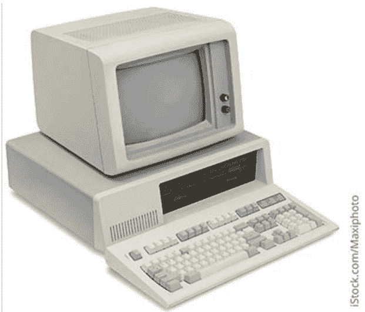

## 详情

8088 计算机包含一个矩形结构，容纳了计算机内部组件，机箱正面带有电源开关和指示灯，扩展槽开口，机箱前面有驱动器槽开口，以及键盘。

iStock.com/Maxiphoho

流行的 Commodore 64 在 1982 年引入了软磁盘驱动器，并在 1985 年生产了第一块硬盘。1987 年，苹果创建了 Mac SE，这是一种带有 60 MB 存储容量外部硬盘的 Macintosh（见图 1-3）。

图 1-3 带有外部硬盘的 Mac SE


## 详情

Mac SE 或 Macintosh SE 是一款紧凑的一体机桌面计算机。它的特点是正方形的米白色外壳，配有一个小型内置黑白显示器。Mac SE 的正面被屏幕占据，周围是黑色边框。屏幕下方有插入软磁盘的槽。外部 Easy Drive 硬盘通过 SCI（小型计算机系统接口）电缆和端口连接到 Mac SE。到 20 世纪 90 年代初，出现了专业的数字取证工具。

国际计算机调查专家协会（IACIS）引入了针对其他领域的培训。

为了数字取证检查，美国国税务局（IRS）创建了搜查令程序。然而，在 ASR Data Expert Witness for Macintosh 出现之前，还没有商用的数字取证 GUI 软件。该软件可以恢复已删除的文件以及删除文件的碎片。ASR Data 的合作伙伴之一后来离开并开发了 EnCase，它已成为一种受欢迎的数字取证工具。

随着计算机技术的不断演进，更多的数字取证软件被开发出来。大硬盘的出现给调查人员带来了新问题。大多数基于 DOS 的软件无法识别大于 8 GB 的磁盘。由于现代计算机的硬盘通常为 500 GB 或更大，因此取证软件需要发生变化。在本文中你将探索检查旧软件和硬件时面临的挑战。

其他工具——例如 iLook（其目前由 IRS 刑事调查处维护，并仅供执法部门使用）——可以分析和读取磁盘副本的特殊文件。AccessData Forensic Toolkit (FTK) 已成为一种流行的商业产品，在执法部门和民用市场执行类似的任务。

随着公司成为数字取证和调查的救星，他们正在生产取证工具以跟上技术的发展。本文描述了若干工具，但绝非所有可用工具。你应该花时间阅读出版物、电子杂志和网站以保持与时同步。

## 注意事项 6

一些与数字取证和调查相关的优秀出版物包括：

- `取证杂志` [forensicmag.com]
- `数字取证杂志` [digitalforensicsmagazine.com]
- `CSO 杂志` [csoonline.com]
- `CIO` [cio.com]
- `银行信息安全` [bankinfosecurity.com]

以下网站虽然看起来可能更侧重于安全安全，但也提供了与数字取证相关的信息和文章：

- `SANS` [sans.org/newsletters]
- `所有信息安全新闻` [allinfosenews.com]
- `美国司法部` [justice.gov/news]
- `取证焦点` [forensicfocus.com]
- `联邦调查局` [fbi.gov/investigate/cyber/news]

## 理解判例

现有的法律和法规无法跟上技术变化的速度，当相关的法律法规不存在时，就会使用判例法。在普通法系国家（如美国），判例法允许法律顾问将先例应用到当前案件中，以解决法律中的歧义。取证人员必须熟悉法院近期关于电子环境中搜查和扣押的裁决，以避免出现犯超出搜查令授权范围的错误。近期涉及政府机构侵犯隐私的事件导致了新法律的政策。技术的发展改变了人们对日常设备的看法。例如，什么应该被视为私密对话？哪些设备受法律保护？

尽管执法人员确实可以没收被捕者携带的任何物品，并记录该设备（如智能手机）在身上，但他们并不一定有权或权力搜索该设备。许多法律以当前技术为基础，在没有搜查令的情况下，执法部门无法从手机提供商处获取信息。此外，大多数用户都有密码，他们没有义务交出。此类行为经常在法庭上受到挑战。保持警惕并跟上判例法的变化对于成为一名高效的数字取证调查员至关重要。

## 开发数字取证资源

要成为一名成功的数字取证调查员，你必须熟悉一个以上的计算平台。除了其他平台——如 DOS、Windows 9x 和 Windows XP——之外，你还应该熟悉 Linux、macOS 以及当前的 Windows 平台，包括用于移动设备的操作系统变体。然而，没有人能成为计算机每个领域的专家。同样，你无法对你正在调查的技术了如指掌。为了补充知识，你应该开发并维护与数字、网络和调查专业人员的联系。公共部门和私有部门的用户组也很有帮助。例如，在太平洋西北地区，计算机调查网络 (CTIN) 会聚会讨论数字取证人员面临的挑战。在国家层面，IACIS 是执法专业人员的一个极佳团体。

## 管理数字调查的准备

数字调查可以有多种分类方式。然而，为了本文的讨论，它们分为两类：公共部门调查和私营部门调查（见图 1-4）。

## 图 1-4 公共部门与私营部门调查


- 政府机构
- 加拿大《权利宪章》第8条
- 美国宪法第四修正案搜索与查押规则
- 私立组织
- 公司政策违规
- 诉讼纠纷

公共部门与私营部门调查的对比包含了实体的照片以及每个部门的三个要点。第一张照片是纽约郡法院，下方列出的要点是政府机构、加拿大《权利宪章》第8条以及美国宪法第四修正案搜索与查押规则。第二张照片是一个私人建筑，下方列出的要点是私立组织、公司政策违规和诉讼纠纷。

iStock.com/RobinsonBecquart;
iStock.com/by-buzbuzzer

通常情况下，公共部门调查涉及负责刑事调查和起诉的政府机构。政府机构范围从市、县、州或警察部门到联邦执法机构。这些组织必须遵守其司法管辖范围内的法律指南，例如加拿大《宪章》第8条和保护搜索与查押的美国宪法第四修正案（见图 1-5）。美国与搜索和查押相关的法律保护人们的权利，包括犯罪犯罪的人。作为数字取证调查员，你必须遵守这些法律。司法部（DOJ）定期更新有关计算机搜索和查押的信息。

## 图 1-5 第四修正案


## 详情

美国宪法中的第四修正案在一个卷轴中进行了解释。该修正案写道：人民的人身、房屋、文书和财物不受不受合理搜索和查押的权利不得被侵犯；除非有合理的理由，并经誓言或确认的支持，且特别指明要搜索的地点以及要查押的人或物，否则不得签发搜查。

私营部门调查更多地关注政策违规，例如未遵守1996年《健康保险流通性与责任法案》（HIPAA）规定。然而，犯罪行为（如企业间谍）也可能发生。因此，尽管私营部门调查通常以民事案件开始，但它们可能会发展为刑事案件；同样，刑事案件也可能导致民事案件的影响。如果你遵循良好的取证程序，你在检查中发现的证据可以实现民事与刑事案件之间的转换。

## 理解公共部门调查

在进行公共部门调查时，你必须了解有关计算机犯罪的法律，包括标准的法律程序、搜索和查押指南以及建立刑事案件所需的步骤。在刑事案件中，嫌疑人被指控犯有入室罪、谋杀、过失杀人或欺诈。为了确定是否存在计算机犯罪，调查员会询问如下问题：使用什么设备实施犯罪？是简单的侵入吗？是盗窃还是破坏行为？犯罪者是否通过网络跟踪或电子邮件骚扰侵犯了某人的权利？

## 注意 7

法律（包括程序规则）因司法管辖区而异。因此，本文指出了在美国法院接受的物品在其他法院可能不被认可的情况。《通用数据保护条例》（GDPR）是欧盟（EU）数据保护和隐私的标准，其内容多于美国隐私法。任何跨国公司在进行调查时都必须考虑 GDPR。即使只有部分客户是欧盟公民，公司也必须考虑这项调查。与国际公司相关的问题在许多国家仍处于定义阶段。在过去的几十年里，有越来越多的公司合并为全球实体。结果是内部调查涉及多个国家的法律。例如，假设一家公司在澳大利亚有一家子公司。一名被怀疑欺诈的员工如果他们在公司财产上实施欺诈并与公司网络同步，那是允许的。但根据澳大利亚法律，你可以这样做。


# 计算机和网络被用作实施犯罪的工具

计算机和网络被用作实施犯罪的工具，在这种情况下，它们等同于用于破入房屋的开锁器。因此，许多州在刑法中通过特定语言定义了涉及计算机的犯罪。某些州（如阿拉巴马州）的法律包含了“无论是否有授权”等字样，并规定了什么构成轻罪或重罪。某些州扩大了盗窃等犯罪的定义，包括未经所有者许可获取计算机中的数据，这使得盗窃与抢劫或汽车盗窃等同。某些州还制定了专门针对计算机犯罪的特定刑法，但通常不将数字图像包含在标准的侵入、盗窃、破坏或入室法中。《联邦欺诈与滥用法案》于1986年通过，但具体的州法律通常在之后制定。例如，加利福尼亚州、内华达州和弗吉尼亚州都颁布了于2020和2021生效的消费者隐私法。

## 注意 8

有关每个州如何定义和处理计算机犯罪的信息，请访问 <https://statelaws.findlaw.com/criminal-laws/computer-crimes.html>。

许多严重犯罪涉及对未成年人的剥削。数字图像存储在硬盘、闪存驱动、移动硬盘和云端，并在互联网上传输。涉及儿童和成人的其他计算机犯罪演变成了失踪人员的信息，这些信息经常在计算机上被发现。毒贩、汽车盗窃团伙和其他犯罪分子经常会在他们的计算机、笔记本电脑、智能手机和其他设备上留存有关交易的信息。

# 遵循法律程序

在对可能违反法律的刑事行为进行调查时，你遵循的法律程序取决于当地习惯、立法法案和证据规则。然而，一个刑事案件遵循三个阶段：起诉、调查和起诉。有人提交诉状，然后由专业人员调查该诉状，案件可能会进入审判。如果证据充分，他将收集证据并建立案件。

调查通常在有人发现证人或非法行为的证据时开始。证人或受害者向警方提出指控，即对犯罪已发生的法律事实指控。警察询问控诉人并写一份关于犯罪的报告。执法机构处理报告，管理层决定开始调查或将信息记录在警务记录（`police blotter`）中，记录提供了关于已犯罪的信息。犯罪分子经常在非法活动中重复行为，这些模式可以通过查看记录来发现。这种历史知识在进行调查时非常有用，特别是在高科技犯罪中。现在的记录现在是电子文件，通常结构化为数据库，因此比纸质记录更容易检索。

## 提示

要查看警务记录的示例，请访问 `blotter.seattle.gov`。

并不是每个警官都是计算机专家。一些是新手；另一些可能接受过训练，以识别他们可以从计算机磁盘中检索到的内容。为了区分警官的培训和经验，`ISO` 标准 `27037` 定义了两类。数字取证响应员（`DEFR`）具备到达事故现场、评估状况并采取预防措施获取和保护证据的技能。数字取证专家（`DES`）具有分析并判断何时应请其他专家协助分析的技能。如果你是分配到案件的检查员，要识别参与案件的警察和其他人员的专业水平。你应该拥有 `DES` 培训以系统检查并管理案件的数字取证方面。如图 1-6 所示，你从评估案件范围开始，包括操作系统、硬件和外围设备。接下来，你确定是否有足够的资源来处理所有证据。例如，你是否有正确的工具来收集和分析证据？在你收集到所需资源后，你的角色是授权、收集和处理证据。然后，判断是否需要请其他专家协助收集和处理与诉状相关的信息。在你建立案件后，信息将交给检察官。作为调查员，你随后必须将收集的证据以及报告提交给政府律师。根据社区和犯罪性质，检察官的头衔在司法管辖区而异。

## 图 1-6 案件的五个步骤


## 详情

取证人员针对案件所采取的五个步骤是：评估、确定所需的资源和专家、收集资源和专家、授权、收集和处理证据，以及以报告的形式提交收集到的证据。

在刑事案件或公共部门案件中，如果警察人员或调查人员有充分理由申请搜查令，检察官可能会指示他们提交一份宣誓书（也称为声明）。这份关于犯罪事实或证据的宣誓支持声明将在查封证据之前提交给法官，并申请搜查令；图 1-7 显示了一个典型的宣誓书。你的责任是编写宣誓书，其中必须包含支持指控以证明搜查令合理的证物（证据），然后你必须对宣誓书进行公证，以证实宣誓书中的信息真实。

### 图 1-7 典型宣誓书语言

根据实际的电子表格、财务记录和发票，计算机取证专家 Joe Smith 知晓计算机设备被用于生成、存储和打印 Jonathon Douglas 逃税计划中使用的文档。有理由相信，目前位于 Jonathon Douglas 场所的计算机系统就是用于制作和存储这些电子表格、财务记录和发票的同一系统，且与 Jonathon Douglas 犯罪企业相关的电子表格、财务记录、发票和其他记录都将存储在 Jonathon Douglas 的计算机上。

来源：《电子调查中的计算机搜查与电子证据获取》，美国司法部，2002年7月。

典型宣誓书语言的示例包含两个部分。上半部分在右上角的日期。下半部分是正文和来源。正文为：“根据对电子表格、财务记录和发票的实际检查，计算机取证专家 Joe Smith 知晓计算机设备被用于生成、存储和打印 Jonathon Douglas 逃税计划中使用的文档。有理由相信，目前位于 Jonathon Douglas 场所的计算机系统就是用于制作和存储这些电子表格、财务记录和发票的同一系统，且这两个电子表……”来源是《电子调查中的计算机搜查与电子证据获取》，美国司法部，2002年7月。

通常情况下，在法官批准并签署搜查令后，该令即可执行，这意味着数字取证与快速响应人员（`DEFR`）可以根据搜查令的定义收集证据。你收集证据，对其进行处理和分析，以确定是否真的发生了犯罪。随后可以在法庭听证或审判中提交证据。法官或行政法官随后做出判决，或由陪审团宣布裁决（之后法官可以做出判决）。

# 理解私营部门调查

私营部门调查涉及私人公司和律师，他们处理公司政策违反和诉讼纠纷（例如不当终止）。在为私营公司进行调查时，请记住业务必须继续进行，受调查干扰要最小。由于企业通常继续关注其日常运营和管理实践，私营环境中的许多人可能认为你的调查和对嫌疑人的控制是为了停止违规行为并最大限度地减少对业务的损害或损失。企业努力减少或消除诉讼，这是处理刑事或民事问题的昂贵方式。私营部门犯罪可能涉及骚扰、性别和年龄歧视以及白领犯罪（由 `FBI` 定义，<https://www.fbi.gov/investigate/white-collar-crime>），例如数据造假、挪用公款和破坏。另一种私营部门计算机犯罪是工业间谍，涉及向竞争对手出售秘密或机密信息。任何访问计算机的人都可以实施此类犯罪。

# 建立公司政策

企业减少诉讼风险的一种方法是发布并维护员工易于阅读和遵循的政策。此外，政策可以使内部调查变得顺畅得多。最重要的政策是那些定义使用公司计算机和网络规则的政策；这种政策被称为“可接受使用政策”。组织应让所有员工签署一份接受协议。发布的公司政策还应为开展内部调查提供权限链，即谁有法律权利启动调查、谁可以占有证据，以及谁可以访问证据。

定义良好的政策赋予了计算机调查人员和取证检查员进行调查的权限，规定了其如何对待员工，并声明组织将对所有调查遵循正当程序。（“正当程序”指的是法律下的公平，旨在保护所有人。）如果没有定义的政策，企业就面临来自现任或离职员工诉讼的风险。负责维护公司政策的人员或委员会还必须跟上适用法律，这些法律可能因城市、州和国家而异。此外，应定期安排对标准和政策的培训和更新，以让员工了解在组织网络上应该做什么和不应该做什么。

# 显示警告横幅

私营或公共组织避免诉讼的另一种方法是在计算机屏幕上显示警告横幅。警告横幅——通常在计算机启动连接公司内网、网络或虚拟专用网络（`VPN`）时出现——告知用户组织保留检查计算机系统和网络流量的权利。（终端用户是指使用计算机执行系统管理之外日常任务的人员。）如果不明确说明，员工在访问公司计算机系统和网络时可能会认为自己拥有隐私权。图 1-8 显示了一个警告横幅示例。


## 使用协议

你正准备访问国土安全部系统。该计算机系统及其数据为美国政府的财产，仅供美国官方信息和使用提供。当你使用此计算机系统时，不享有隐私预期。使用密码或任何其他安全措施都不会建立隐私预期。通过使用此系统，你即同意本通知中列出的条款。你不能在此计算机系统上处理机密安全信息。对本系统的访问仅限于授权用户。未经授权访问、使用或修改本系统或包含其中的数据（或传输至本系统的数据，均可能构成违反《美国法典》第 18 卷第 1030 条及其他刑事法律的行为。任何未经授权访问联邦计算机系统或越权访问，或获取、更改、损坏、破坏或泄露信息，或阻止对计算机信息的授权使用的人，都可能受到处罚、罚款或监禁。此计算机系统和任何相关设备接受监控，用于进行行政监督、刑事调查、对涉嫌不当行为的调查以及确保适用安全功能和程序的正常运行。国土安全部可能在不另行通知的情况下进行监控。

点击“同意”或通过使用此系统，你即同意本通知中列出的条款。


## 详情

使用协议的警告横幅示例。正文为：“你正准备访问国土安全部系统。该计算机系统及其数据为美国政府的财产，仅供美国官方信息和使用提供。当你使用此计算机系统时，不享有隐私预期。使用密码或任何其他安全措施都不会建立隐私预期。通过使用此系统，你即同意本通知中列出的条款。你不能在此计算机系统上处理机密安全信息。对本系统的访问仅限于授权用户。未经授权访问、使用或修改本系统或包含其中的数据（或传输至本系统的数据，均可能构成违反《美国法典》第 18 卷第 1030 条及其他刑事法律的行为。任何未经授权访问联邦计算机系统或越权访问，或获取、更改、损坏、破坏或泄露信息，或阻止对计算机信息的授权使用的人，都可能受到处罚、罚款或监禁。此计算机系统和任何相关设备接受监控，用于进行行政监督、刑事调查、对涉嫌不当行为的调查以及确保适用安全功能和程序的正常运行。国土安全部可能在不另行通知的情况下进行监控。” “同意”标签位于横幅的右下角。

警告横幅告知用户组织进行调查的权利。通过显示简短且措辞良好的横幅，组织不需要搜查令或法院命令（根据宪法第四修正案对搜查的要求）即可查封其计算机设备。在定义良好的公司中，这种检查或搜索权利适用于刑事活动和公司政策违规。然而，请记住，你国家的法律可能有所不同。例如，在某些国家，即使公司有权随时查封计算机，如果员工涉嫌犯罪活动，也必须在查封设备时通知他们。

以下列表包含了建议包含在警告横幅中的短语。在使用这些警告之前，请咨询贵组织的法律部门，以获取你工作区域其他要求的法律通知。

或。根据组织的类型，可以在内部警示中使用以下文本：

- 对本系统和网络的访问受限。
- 本系统和网络的使用仅用于正式业务。
- 所有者可随时对系统和网络进行监控。
- 使用本系统意味着同意所有者的监控。
- 本系统或网络的未经授权或非法用户将受到纪律处分或起诉。
- 本系统的用户同意，他们对在该系统上进行的所有活动不享有隐私预期。

## 提示

> 要查看警示横幅的若干示例，请参阅美国司法部文件：`justice://justice.gov/criminal/cybercrime/docs/ssmanual2009.pdf`。

如果当地社区的成员不是设施的工作人员，组织可以简单声明系统和网络在任何时候都会观察和监控。另一方面，营利性组织可能拥有网络上的专有信息，并可以使用上述列表中建议的所有短语。如果允许客人（如业务合作伙伴的员工）使用系统，在访客尝试登录时显示的文本可能包括以下类似的警告：

- 本系统是 X 公司的财产。
- 本系统仅供授权用户使用；未经授权的访问违反了法律，违者将被起诉。
- 所有活动、软件、网络流量和通信均受监控。

作为私营部门的数字调查员，请确保你工作的组织显示了措辞清晰的横幅。如果没有横幅，你的权限可能会与用户的隐私预期发生冲突，法院可能不得不判定权限问题。州法律对隐私预期的规定各异，但所有州都接受“放弃权利”的概念。此外，欧盟及其成员国对未经个人同意跨越边界的个人信息处以巨额罚款。例如，如果你的公司在位于欧盟的子公司进行调查，你可能在不通知某些相关方或不确保文件到位的情况下无法获取网络驱动器。

有些人可能认为只有政策就足够了。然而，横幅（也称为登录横幅）列出了政策，并在案件诉讼中确认为用户对存储在系统上的信息不享有隐私预期。横幅的额外优势是比政策证物更容易在审判中提交。横幅还要求用户点击“确定”以确认他们已阅读横幅以获得访问权限。政府机构——例如能源部、美国国家航空航天局（`NASA`）、劳伦斯利物伯实验室，甚至是公共图书馆——可能要求在其系统的所有计算机终端上都设置横幅。许多公司也要求将横幅作为登录/启动过程的一部分。登录横幅是路由器和防火墙设置的一部分。

# 指定授权请求者

如前所述，调查必须建立一条权限链。除了使用说明公司所有权的警示横幅外，还建议企业指定一个必须启动调查的授权请求者。执行管理层应定义一项政策，以避免组织内部竞争利益的冲突。在大型组织中，对资金或管理支持的竞争可能变得非常激烈，以至于人们可能会制造不当行为的虚假指控，防止竞争部门提交资金来源提案。

为了避免不当调查，执行管理层还必须定义并限制谁有权请求计算机调查和法证分析。通常，具有计算机调查权限的小组越少越好。私营环境中具有此类权限的小组示例包括：

- 公司安全调查小组
- 公司伦理办公室
- 公司平等就业机会办公室
- 内部审计部门
- 总法律顾问或法律部

所有其他小组应通过公司安全调查小组协调其请求。该政策将调查过程与员工纪律处理过程隔离开。

# 进行安全调查

在私营部门进行数字调查与在公共部门进行调查没有太大区别。在公共调查期间，你寻找证据来支持刑事指控。在私营调查期间，你寻找证据来支持违反公司规则或攻击其资产的指控。私营环境中常见的三类情况：

- 滥用或误用数字资产
- 电子邮件滥用
- 互联网滥用

私营部门的大多数数字调查涉及数字资产的误用。通常，这种误用被称为违反“公司规则”。数字滥用投诉通常发生在员工利用其他数字资源导致的电子邮件和互联网误用上，例如使用公司软件生产产品以获取个人利润。对电子邮件滥用的调查范围很广泛，从过度使用公司电子邮件系统进行个人用途，到通过电子邮件发出威胁或骚扰他人。一些常见的滥用案例涉及威胁性的攻击性信息。此类信息可能会营造**敌对的工作环境**，导致员工对公司提起诉讼，而公司没有采取任何措施来防止或应对（行为），换句话说，就是暗示地纵容了这种滥用。

数字调查员还检查互联网滥用，其范围可以从整天上网到在工作时查看网络上的色情图像。互联网滥用的极端情况是查看违禁（非法）色情图像，例如儿童色情。在大多数管辖区，查看违禁图像是犯罪行为，也违反了执法。通过一致地执行政策，公司可以最大限度地减少其责任风险。数字法证检查的角色是指导管理人员[sic]如何收集和纠正准确的信息，以便他们能够验证并纠正组织中的滥用问题。（在随后的模块中，你将学习进行此类调查的程序。）与滥用相关的行动还可能产生刑事或民事责任。由于任何调查都可能变成刑事调查，你必须以最高的安全和问责标准对待所有证据。在本文，你将学习《联邦证据规则》（确保监管存链的程序）以及如何将其应用于数字调查。

同样，你的私营部门调查可能仅涉及民事，但在你进行调查时，可能也涉及隐私。由于数字设备也可能获取刑事证据，这些规则贯穿始终。

# 管理。维护职业操守


# 维护职业操守

作为一名数字调查员，你的职业操守至关重要；它决定了你的信誉。职业操守包括伦理、道德和行为标准。你必须始终表现出最高水平的专业行为。要做到这一点，你必须在调查期间保持客观性和保密性，不断扩展技术知识，并正直行事。

## 保持客观性

保持客观性意味着你的意见是基于教育、培训、经验以及案件中的证据。在耗尽所有线索并考虑了可用事实之前，避免得出结论。你的最终责任是寻找相关证据。你必须避免偏见或偏袒，以维护你在所有调查中事实查找的完整性。例如，如果你受雇于律师，不要让律师的议程决定你调查的结果。你的声誉取决于对你客观性的维护。

## 维护保密性

你还必须通过保持保密性来维护调查的可信度。仅与需要此信息的人讨论案件，例如案件中的其他调查人员或管理链中的人员。如果你需要来自其他专业人士的建议，只需讨论案件的通用术语和事实，而不提及细节。在被指定为证人或根据律师要求向法院提交报告之前，所有调查都必须保密。

### 私营部门中的保密性

在私营部门环境中，保密性至关重要，特别是在处理被解雇员工时。公司与被解雇员工之间的协议可能规定终止将是裁员或辞职，且不提供负面评价。如果你向他人提供细节和员工姓名，你的公司可能承担违约责任。

### 律师工作产品规则

在某些情况下，民事事务可能会变成刑事案件，而且在案件最终上庭或和解之前可能需要数年。如果调查员与未经授权的人员谈论证据，则“律师工作产品规则”适用于所有通信。你只能与律师或其他与律师合作的团队其他成员讨论案件。向其他人提供的任何关于案件的通信都需要律师的批准。

## 持续教育与专业发展

除了保持客观性和保密性外，你还可以通过继续培训来增强你的职业操守。数字调查和取证领域不断变化。你应该跟上计算机硬件、软件、网络和取证工具的最新技术变化。为了维护职业操守并继续专业培训，你应该参加研讨会、会议和供应商课程。你可能还需要继续或加强你的正式教育。如果你至少拥有计算学士学位或高级学位，考虑在综合领域（如商业法或电子商务）进行研究生水平的学习，将提高你的专业地位。许多学院和大学提供数字取证的学士、硕士、博士学位和证书课程。许多公司愿意协助员工费用，因为员工在所在领域保持领先对他们有利。

在职教育和加入专业组织的身份会增加你的资历。这些组织赞助关于数字取证检查最新技术改进和趋势的培训和出版物。此外，关注数字取证工具和技术的最新出版物。

## 诚实与正直

作为一名数字调查员和取证专业人士，你被要求保持诚实和正直。你在生活的各个方面必须以最高水平的正直行事。任何不谨慎的行为都可能让你感到尴尬，并给对方律师在法庭证词或宣誓词期间诋毁你声誉的机会。

---

## 自测

### 6. 调查期间的职业操守（选择所有适用项。）

- a. 要求保持你的正直性
- b. 包括维护保密性
- c. 引入偏见
- d. 有助于你排除嫌疑人

**答案：** a. 要求保持你的正直性；b. 包括维护保密性

**解释：** 为了表现出最高水平的专业，你必须在调查期间保持客观性和保密性，不断扩展技术知识，并正直行事。

---

# 管理数字取证调查

作为数字取证专业人士，你的角色是从嫌疑人的计算机中收集数据。你只能与律师或其他与律师合作的团队其他成员讨论案件。

---

# 计算机犯罪概述

执法人员在调查犯罪、收集其他证据或进行逮捕时，经常会发现计算机、智能手机和其他设备。这些设备可能包含有助于执法人员确定导致犯罪的事件链的信息，或提供有助于支持定罪的其他证据。

作为一个计算机涉及犯罪案件的案例，警方搜查了一处嫌疑毒贩的家中，在卧室里发现了一台台式电脑、几个 USB 驱动器（也称为闪存盘、优盘或外部存储设备）、一台平板电脑和一部手机（见图 1-10）。该计算机被装袋并贴签，这意味着它被放入证物袋中，并作为搜索和扣押的一部分贴上了标签。

## 图 1-10 犯罪现场


**详情**

犯罪现场的三维表示图。场景内有一个房间，桌子旁边有一个床垫和一个枕头。床垫底部有一个溢出袋子的包。一双靴子、衣服和三张 CD 光盘散落在地上。桌子很乱，包括一台带有一些 CD 光盘和外壳的台式电脑、一台打印机、一台相机和一个计算器。显示器位于地板右下角，连接到桌下的踏板。墙上挂着一架书。

案件的主侦探希望你检查计算机和手机，寻找并整理可能作为犯罪证据的数据，例如包含毒贩联系人名单的文件、短信和照片。取证人员给了你调查人员随计算机一起收集的物品文档，包括其他存储介质（如闪存盘）的列表。取证人员还注意到，该计算机是 `Windows 8` 系统，且该机器在发现时正处于运行状态。在关闭计算机之前，取证人员对桌面上所有打开的窗口进行了拍照（包括文件资源管理器），并将照片给了你。（在关闭计算机之前，还应进行现场取证以捕获 RAM；程序将在模块：*虚拟机取证与现场取证*；*网络取证*中进行讨论）

执法人员在获取证据时遵循了正确的程序，这对于你作为数字取证调查员的工作至关重要。对于数字证据，重要的是意识到关键数据（如最后访问日期）是多么被首先到达现场的经验丰富的调查员轻易更改的。

> **注意 11**
>
> 美国司法部有一份你可以下载的文档，其中审查了获取电子证据的正确流程 [`justice.gov/file/442111/download`]。如果此链接因为网站更新而更改，请使用搜索功能。

在初步评估中，你假设硬盘和存储介质包含完整的文件，例如电子邮件、已删除的文件和隐藏文件。调查中有多种软件可供使用；你的办公室使用 `Sleuth Kit` 提供的 `Autopsy` 工具。

> **注意 12**
>
> 本模块向你介绍了应用于数字取证的原理。在 *调查员实验室与数字取证工具* 模块中，你将学习几个软件软件包的优缺点。

> **提示**
>
> 由于某些案件涉及运行旧版操作系统的计算机，在取证调查中通常必须使用旧版本的工具。例如，`Norton DiskEdit` 工具最后出现在 `Norton System Works 2000` CD 中。

在完成初步评估后，你识别了本案中的潜在挑战。随后，你执行了调查案件所需的步骤，包括确定如何应对风险和障碍。然后，你开始实际的调查和数据检索。

---

# 违反公司政策概述

公司通常会制定计算机使用政策。员工在工作时间内上网、发送个人电子邮件或使用计算机处理个人事务会浪费公司时间。由于流失的时间可能会给公司带来数百万美元的损失，数字取证专家经常被用于调查违反政策的行为。以下示例描述了一个违反公司政策的行为。

最近，经理史夫·比林斯（Steve Billings）收到客户对他的销售代表之一乔治·蒙哥马利（George Montgomery）工作表现的投诉。这是调查员形成假设的步骤。乔治已经在公司工作了多年，过去两天缺席了，但他没有给任何人打电话解释为什么不上班。另一个员工玛莎（Martha）也失踪了，也没有告诉任何人缺席的原因。乔治和玛莎合作紧密，所以……

---

# 采取系统方法

在准备案件时，系统化的方法至关重要。

- **识别风险**：识别本案中的潜在挑战。随后，你执行了调查案件所需的步骤，包括确定如何应对风险和障碍。
- **创建清单**：然后，你开始实际的调查和数据检索。
- **获取并复制证据**：使用正确的工具获取数据。
- **测试设计**：确保过程准确无误。
- **分析并恢复数字证据**：使用软件工具寻找相关信息。
- **调查案件**：整理恢复的数据。
- **完成案件报告**：撰写调查结果的最终总结。
- **评判案件**：审查流程以供未来改进。

---

# 评估案件

如前所述，确定案件需要确定你正在调查的案件类型。这意味着你应该系统地列出案件细节，包括案件的性质、可用证据的类型以及证据的位置。

在这一公司违规案件中，你被分配调查 George Montgomery。Steve Billings 已让 IT 部门没收了 George 的存储介质，这些介质可能包含有关他行踪的信息。在与 George 的同事交谈后，Steve 获知 George 正在使用公司电脑经营私业务。因此，案件的重点已转移到可能滥用公司资源。这可能会证实你的假设。你可以按照以下步骤开始评估此案件：

- **员工滥用资源**。案件性质：员工正在使用公司电脑进行业务。
- **案件细节**：据报道，该员工正在使用公司电脑注册名称并建立网站（ISP）。同事们抱怨该员工在自己的业务上花费了太多时间，没有履行职责。公司政策规定，所有资产均可随时接受检查。员工在操作公司系统时不享有隐私预期。
- **证据类型**：连接到公司电脑的小容量 USB 驱动器。
- **已知格式**：`NTFS`。
- **证据位置**：从员工办公桌上恢复的 USB 驱动器。

根据这些细节，你可以确定案件的要求。你现在知道案件的性质涉及滥用公司资源，你正在寻找员工经营私业务的证据。在从计算机提取的 USB 驱动器上，你正在寻找与网站或域名相关的信息。为了复制 USB 驱动器并找到删除的文件，你需要可靠的数字取证工具。获得的证据可能会证明清白。你必须始终保持客观视角，并且系统且彻底，以产生可靠的结果。

---

# 规划你的调查

现在你已经确定了 Montgomery 案件的要求，可以规划你的调查。你已经确定了所需的证据；现在要确定收集证据、建立监管链和执行分析所需的步骤。这些步骤将成为你调查的基础计划，并指示你应该做什么以及何时做。为了调查此案件，你应该执行以下通用步骤：

- 从 IT 部门获取 USB 驱动器，对其装袋并贴标签。填写证据表并建立监管链。
- 将证据运输到你的数字取证实验室。


- 将证据存放在获批准的安全容器中（见图 1-11）。

### 图 1-11 获批准的安全容器


# 细节

高安全柜由几个隔间组成。隔间带有合链，以便取用。柜子左端的隔间比右端的大。

- 准备你的取证工作站。
- 从安全容器中取出证据。
- 对证据驱动器（在本例中为 `USB` 驱动器）进行取证复制。
- 将证据驱动器归还安全容器。
- 使用你的取证工具处理复制的证据驱动器。

## 提示

你在步骤 4 中需要的获批准的安全容器应该是具有限制访问的防火保险柜或柜子。限制访问意味着只有你和其他授权人员可以打开该容器。

所有调查的第一条规则是保护证据；证据不应被篡改或污染。因为 IT 部门没收了存储介质，你现在需要从他们那里获取证据。IT 部门经理确认，存储介质自从 George 的桌子上取回以来就一直被锁在安全柜中。请记住，尽管这是公司政策，但许多案件因为监管链无法证明或已断裂而被驳回。当这种情况发生时，证据可能已经损坏。

为了记录证据，请记录有关介质的细节，包括谁在何时何地恢复了它。使用证据监管表（也称为证据链表），这可以帮助你记录对原始证据和取证副本所做的操作。根据你是在执法部门还是私营安全部门工作，你可以创建一个适合你环境的证据监管表。此表应易于阅读和使用。它可以包含一件或多件证据的信息。根据你调查的行政需求，考虑创建单证据表（在单独页面上列出每件证据）或多证据表（见图 1-12）。

### 图 1-12 私营部门环境使用的多证据表示例

| 组织 X | | |
| :--- | :--- | :--- |
| 安全调查员 | | |
| 此表用于一至十项证据项目 | | |
| 案件号: | 调查组织: | |
| 案件性质: | | |
| 获取证据的位置: | | |
| 证据描述 | 供应商名称 | 型号/序列号 |
| 项目 #1 | | |
| 项目 #2 | | |
| 项目 #3 | | |
| 项目 #4 | | |
| 项目 #5 | | |
| 项目 #6 | | |
| 项目 #7 | | |
| 项目 #8 | | |
| 项目 #9 | | |
| 项目 #10 | | |
| 证据接收人 | 日期/时间 | |
| 证据存入保险柜 | 日期/时间 | |
| 证据归还人 | 日期/时间 | |

# 细节

用于组织 X、安全调查员的多证据表用于跟踪多达十项物品。案件细节如下。如果你使用此表，它包含以下内容：

- 案件号：调查组织。
- 案件性质：证据的描述。
- 获取证据的位置：确切位置。
- 证据描述：供应商名称、型号数字和序列号。
- 证据接收人：日期和时间。
- 证据存入保险柜：日期和时间。
- 证据归还人：日期和时间。

作为你在调查分析期间所采取的所有操作的参考。

# 图 1-13 单证据表

| 大都会警察局高科技犯罪小组 | 此表单用于单项证据项目 | 每个项目单独填写一份表单 |
| :--- | :--- | :--- |
| 案号： | 部门编号： | |
| 调查员： | | |
| 案件性质： | | |
| 证据获取地点： | | |
| 项目编号 / ID | 证据描述 | 供应商名称 | 型号/序列号 |
| 证据接收人 | | | |
| 存入证据的储物柜的人员 | | 日期 & 时间 | |
| 证据提取调取人 | 日期 / 时间 | 证据归还人 | 日期 / 时间 |

## 详细说明

这是大都会警察局高科技犯罪小组的单证据表样本。初始详细信息包括案号、调查员、部门编号、调查员、案件性质以及证据获取地点。表格列出了项目编号或 ID、证据描述、供应商名称、型号或序列号的信息。下一部分是接收人员以及将证据存入储物柜人员的姓名、日期时间和。最后部分是一个表格，列出了证据调取人及其时间，以及证据归还人及其时间。

你可以在调查中同时使用多证据表和单证据表。通过使用两份表单，你可以将单证据表与证据放在一起，并将多证据表放在你的报告文件中。此外，双份表单提供了冗余性，可以作为证据的质量控制。

# 保护你的证据

数字调查要求你根据案件调整你的程序。例如，如果某个案件的证据包括整个计算机系统以及相关的存储介质（如闪存驱动器和大外部硬盘），在收集这些物品时必须灵活灵活。某些证据足够小，可以放入证据袋。而其他物品——如 `CPU` 机箱、显示器、键盘和打印机——则太大了。

为了保护并记录大型计算机组件中包含的证据，你可以使用从警察供应商或办公商店购买证据袋胶带、标签、标识和其他产品。在收集用于保护计算机证据的产品时，确保它们在计算机组件上使用是安全且有效的。在处理任何计算机时要小心，避免损坏组件或接触到静电，静电会破坏数字数据。因此，在收集计算机证据时，务必使用防静电袋。也要使用带有腕带的防静电垫。这两者都有助于防止计算机证据的损坏。

## 注意 13

本节重点关注保护计算机和相关硬件。智能手机和手机手机等设备将在“移动设备取证”模块中介绍。

务必将计算机证据放在填充良好的容器中。填充物可以防止证据在将其运输到你的安全储物柜、证据室或计算机实验室途中受到损坏。当你或他人获取计算机设备时，请保存损坏的硬盘盒、防静电袋和用于计算机硬件的包装材料。

由于你可能没有保护证据所需的所有物品，你必须不断改进。保护证据通常需要制作容器。如果组件很大且装在自己的外壳中，请使用证据胶带密封机箱上所有的开口。在驱动器槽、电源线和 `USB` 线插槽以及任何其他开口处贴上证据胶带可以确保证据的安全。作为标准做法，你应该在将胶带贴到证据之前在胶带上写上你的姓名缩写。这种做法使得以后在法庭上证明证据没有被篡改成为可能，因为胶带的存在意味着外壳无法被打开，封闭的外壳也无法通过胶带供电。如果胶带被替换过，你的姓名缩写就会出现，这表明被篡改。当你运输计算机时，在磁盘驱动器中放入新磁盘，以减少移动过程中可能的驱动器损坏。计算机组件需要特定的温度湿度范围。如果太冷、太热或太湿，计算机组件和磁介质可能会损坏。将计算机放在后备箱内的双向车载上可能会损坏数字介质。在收集计算机证据时，确保你有一个安全的环境来运输和存储，直到获得安全的证据容器。

## 自测

- 7. 描述计划调查所需的五个步骤。

**答案：** 建立假设；识别可能包含证据的制品；收集并提取证据；分析收集的证据；创建发现结论。参考图 1-9；

**解释：** 在计划调查时，你需要遵循五个基本步骤，包括形成假设或理论、确定哪些物品（如笔记本电脑或手机）可能包含证据、分析证据，然后查看结果是否支持你的理论或指向其他方向。

# 私营高科技调查程序

作为调查员，你需要制定正式程序和非正式检查清单，以涵盖对高科技调查重要的所有问题。这些程序对于确保使用正确的技术是必要的。使用非正式检查清单以确保所有证据都得到了正确的收集和处理。本节列出了数字调查员在私营部门高科技调查中常用的某些示例程序。

# 员工辞退案件

大多数辞退案件的调查工作涉及员工滥用公司资源。造成敌对工作环境的事件（例如在工作中查看色情内容和发送不当邮件）是调查的主要案件类型。以下章节描述了进行可能导致员工辞退调查的关键点。建议咨询你组织的法律总顾问和人力资源部门，获取如何处理此类调查的具体指导。你的组织必须像之前描述的那样建立适当政策。

# 互联网滥用调查

本节信息适用于组织的内部私有网络，而不是公共 `ISP`。在审阅此列表后，咨询你组织的法律总顾问，并根据他们的指示进行更改以建立你的程序。要进行涉及互联网滥用的调查，你需要以下物品：

- 组织的互联网代理服务器日志
- 从组织网络管理员处获得的嫌疑计算机 `IP` 地址
- 嫌疑计算机磁盘驱动器
- 你常用的数字取证分析工具

以下步骤概述了互联网滥用案件的推荐流程：

1. 对磁盘驱动器进行本文描述的标准取证分析技术和程序检查。
2. 搜索并提取所有网页 `URL` 和其他相关信息。
3. 联系网络防火墙管理员，并请求感兴趣日期嫌疑计算机设备名称或 `IP` 地址的代理服务器日志（可用）。咨询你的组织网络管理员以确认这些日志是如何维护的，以及使用动态主机配置协议 (`DHCP`) 分配 `IP` 地址的生存时间 (`TTL`) 设置多久。
4. 将从取证分析恢复的数据与网络服务器日志进行对比，以确认它们匹配。
5. 如果 `URL` 数据与网络服务器日志以及取证磁盘检查匹配，继续分析嫌疑计算机驱动器数据，并收集所有支持指控的相关照片或网页。如果网络服务器日志之间没有匹配，且取证检查显示没有相关证据，则报告指控不成立。

## 邮件滥用调查

邮件调查通常包括垃圾邮件、不当且具有攻击性的消息内容，以及骚扰或威胁。邮件受到的与其他计算机证据数据相同的限制，即组织必须拥有一项前文所述的政策。以下列表是进行涉及邮件滥用调查时所需的材料：

- 从组织邮件服务器管理员处获取的违规邮件电子副本——带有邮件报文头数据
- 如果可用，从组织邮件服务器管理员处获取的邮件服务器日志
- 对于将用户消息存储在中央服务器上的系统，由组织邮件服务器管理员提供的服务器访问权限
- 对于将用户消息存储在计算机文件（如 `Outlook .pst` 或 `.ost` 文件）中的系统，例如，获取对计算机的访问权限，以便你对其进行取证分析
- 你首选的数字取证分析工具

以下步骤概述了邮件调查的推荐程序：

1. 对于基于计算机的邮件数据文件（例如 `Outlook .pst` 或 `.ost` 文件），请使用本文描述的标准的取证分析技术和程序对驱动器进行检查。
2. 对于基于服务器的邮件数据文件，联系邮件服务器管理员，获取嫌疑者和受害者邮件文件夹或数据的电子副本。
3. 对于基于网络的邮件（例如 `Gmail`）的调查，搜索互联网关键词以提取所有相关的邮件地址信息。
4. 检查与调查相关的所有消息的报文头数据。

## 律师-客户特权调查

在为律师在律师-客户特权 (`ACP`) 下进行取证分析时，你必须对所有内容保密。你所工作的律师是调查的最终权威。对于此类调查，律师通常会要求你从驱动器中提取所有数据。服从律师的指示是你的责任。由于驱动器可能包含大量数据，律师将希望了解驱动器上的所有内容。

许多律师喜欢让律师来提取你所拥的数据，但当你记录带有数千页数据的日志文件或可以由专有程序读取的 `CAD`（计算机辅助设计）图纸时，打印输出可能会导致问题。你需要说服并教育许多律师如何以电子方式查看数字证据。此外，还要学习如何教导律师和法务助理筛选文件，以便你能高效地分析取证检查产生的海量数据。

## 注释 14

正如某些领域的 `IT` 专业人员需要学习法律某些方面一样，律师和法官通常需要了解 `IT` 知识，以便理解案件的细节。许多人观看如 `CSI`、`NCIS` 和《犯罪心理》等节目，这些节目并不总是描绘数字取证领域可以做的事情。数字取证调查员可能需要对律师、法官和其他缺乏专业知识或对技术可行性有误解的人员进行教育，以便他们从可用证据中检索信息。

一些教育资源包括以下：

- 电子发现：数字证据导论 <https://www.cengage.com/c/e-discovery-an-introduction-to-digital-evidence-9781113113046/>
- 给法官的数字证据 <https://www.lawyerforum.org/digital-evidence-for-judges.html>
- 计算机取证：律师需要知道的 <https://www.lawyerforum.org/2018/07/23/computer-forensics-what-lawyers-need-to-know/>

如果你发现数据以二进制文件（可能是 `CAD` 图纸）的形式存在，也可能会遇到问题。使用创建这些文件的 `CAD` 程序检查这些文件。此外，工程公司通常拥有专门的绘图程序。对于涉及导致伤害或死亡的产品诉讼，证据发现要求提取计划以供律师和专家证人查看。数字取证调查员负责找到这些设计计划的程序，以便律师和专家证人查看证据文件。

以下列表显示了进行 `ACP` 案件的基本步骤：

1. 请求律师提供一份备忘录以开始调查。备忘录必须说明调查是特权通信，并列出你的名字以及分配到该案件的其他任何同事的姓名。
2. 请求一份与调查感兴趣的关键词列表。
3. 在收到备忘录后，启动调查和分析。你在收到备忘录之前的任何发现都可能被对方律师发现。
4. 对于驱动器检查，对驱动器制作两个位流镜像（在本模块的稍后部分讨论），并为每个镜像使用不同的工具。这种方法是建议的，因为每个工具都有其优缺点……
5. 如果你有足够大的存储设备，请将每个位流镜像设为未压缩格式（参阅模块“调查员实验室与数字取证工具”？），这样即使发生损坏，你仍然可以使用你首选的取证工具检查未损坏的区域。
6. 验证原始磁盘和重建磁盘或其镜像文件上所有文件的哈希值。
7. 有系统地检查驱动器的每个部分（包括分配和未分配的数据区域），并提取所有数据。
8. 在分配和未分配的磁盘空间上运行关键词搜索。跟进搜索以确定结果是否包含支持案件的信息。
9. 召集所有负责调查的人员，并向他们简述计划以及任何特别关注的领域。

# 企业高科技调查

企业高科技调查通常涉及员工滥用公司资源、知识产权盗窃或工业间谍活动。以下步骤概述了企业高科技调查的推荐程序：

1. 建立假设并制定调查计划。
2. 收集进行调查所需的资源。
3. 通过在关键位置放置监控系统（如摄像头和网络监控器）开始调查。
4. 谨慎地收集任何额外证据（例如嫌疑人的计算机驱动器），并制作位流镜像以供后续检查。
5. 从网络和电子邮件服务器收集所有日志数据，并检查其中是否存在可能与调查相关的唯一项目。
6. 定期向管理层和公司律师汇报调查状态和当前发现。
7. 与管理层和公司律师一起审查调查范围，以确定是否需要扩大范围并增加更多资源。

## 高科技调查中的访谈与审讯

成为一名熟练的调查员和审讯员需要多年的经验。私营部门的调查员通常是为调查获取证据的人。许多大型机构拥有全职安全调查员，他们在刑事和民事调查以及访谈技巧方面拥有多年的培训和经验。这些调查员中很少有人具备计算机或网络技能，因此当你对嫌疑人的机器进行取证磁盘分析后，可能会被要求协助审讯或质问嫌疑人。

审讯与访谈是不同的。访谈通常是为了从证人或嫌疑人处收集与调查相关的特定事实信息。而审讯则是试图获取对特定事件或罪行的认供的的过程。调查员在与证人或嫌疑人交谈时，可能会从访谈转变为审讯。调查员在访谈和审讯技巧方面的经验和培训越丰富，就越能判断证人是否可信以及是否可能为嫌疑人。

作为数字调查员，你的角色是指导进行访谈的调查员应该问哪些问题以及答案应该是怎样的。当你与调查员建立合作关系时，他们可能会要求你质问嫌疑人。观察熟练的调查员是一次人际关系技巧的学习体验。如果你被要求协助访谈或审讯，请通过回答以下问题来做好准备：

- 我需要询问嫌疑人什么来获取案件的关键信息？
- 我是否知道自己在谈什么，或者我是否需要研究与调查相关的课题或技术？
- 我是否需要额外的问题来涵盖与调查间接相关的其他问题？

常见的访谈和审讯错误包括对访谈或审讯准备不足，以及没有正确的问题来增加你的知识深度。确保你不会耗尽对话话题；你必须保持对话友好以获得嫌疑人的信任。避免怀疑自己的技能，这可能会向嫌疑人表现出你对自己能力缺乏自信。成功访谈或审讯的要素包括：

- 在整个过程中保持耐心
- 重复或重新表述问题，以从不愿配合的证人或嫌疑人处获取特定事实
- 坚韧不拔

## 自测

8. 在公司中，对于哪些类型的典型情况制定程序是重要的？（选择所有适用项）

- a. 员工滥用/骚扰
- b. 员工解雇
- c. 日常沟通
- d. 网络滥用

**答案：** a. 员工滥用/骚扰；b. 员工解雇；d. 网络滥用。

**解释：** 因为这可能导致潜在的调查或诉讼，公司应该能够提供人们所知的程序。当人员被录用时，他们通常会签署一份计算机使用协议，其中明确规定了他们可以使用什么以及什么构成员工骚扰和网络滥用。公司还应该拥有政策和流程，规定哪些类型的违规行为会导致员工解雇。

# 分析。理解数据恢复工作站和软件

现在你已经知道了获取和记录证据所涉及的内容。在“调查员实验室与数字取证工具”模块中，你将检查一套完整的数字取证实验室，你在那里进行调查，你的大部分设备和软件都位于那里，以确保接触的安全性。请注意，某些公司在进行数字调查的同时，还进行数据恢复、电子发现以及其他相关调查。

记住数据恢复与数字取证之间的区别。在数据恢复中，客户或你的公司通常希望找回数据。另一个关键区别是，在恢复过程中，你清楚想要检索什么。在数字取证中，你可能对正在寻找的内容有一个想法，但并不一定如此。

为了进行调查和分析，你必须有一个特殊配置的笔记本电脑或工作站，称为取证工作站，这是一台加载了额外扩展槽和取证软件的计算机。根据你的需求，取证工作站可能使用以下操作系统：

- 带有 `MS-DOS` 的旧留系统
- `Windows 95, 98, Me`
- `Windows NT, Windows 2000, XP, Vista, 7, 8, 10`
- `Linux`
- `macOS`

> **提示**
>
> “调查员实验室与数字取证工具”模块检查了一套完整的数字取证实验室，你在那里进行调查，你的大部分设备和软件都位于那里，以确保接触的安全性。请注意，某些公司在进行数字调查的同时，还进行数据恢复、电子发现以及其他相关调查。
>
> 记住数据恢复与数字取证之间的区别。在数据恢复中，客户或你的公司通常希望找回数据。另一个关键区别是，在恢复过程中，你清楚想要检索什么。在数字取证中，你可能对正在寻找的内容有一个想法，但并不一定如此。
>
> 为了进行调查和分析，你必须有一个特殊配置的笔记本电脑或工作站，称为取证工作站，这是一台加载了额外扩展槽和取证软件的计算机。根据你的需求，取证工作站可能使用以下操作系统：
>
> - 带有 `MS-DOS` 的旧留系统
> - `Windows 95, 98, Me`
> - `Windows NT, Windows 2000, XP, Vista, 7, 8, 10`
> - `Linux`
> - `macOS`

## 为数字取证设置你的工作站

使用目前的数字取证硬件和软件，将计算机工作站或笔记本电脑配置为取证工作站是非常简单的。只需要具备：

- 一个运行 `Windows 10` 或更高版本的工作站
- 一个写保护器设备
- 数字取证获取工具
- 数字取证分析工具


- 用于接收源或嫌疑人磁盘数据的目标驱动
- 备用 PATA 和 SATA 端口
- USB 端口

额外的实用物品还包括：

- 网卡 (NIC)
- 额外的 USB 端口
- FireWire 400/800 端口
- SCSI 卡
- 磁盘编辑器工具
- 文本编辑器工具
- 图形查看器程序
- 其他专业查看工具

在“调查员实验室与数字取证工具”模块中，你将学习如何设置和配置计算机作为取证工作站。

## 自测

9. 数字取证工作站必须具有 ________。（选择所有适用项）

- a. 数据获取工具
- b. 写保护器
- c. FireWire
- d. 一块 SCSI 卡

答案：a. 数据获取工具；b. 写保护器。

解释：数字取证工作站必须具有数据获取工具，以便能够连接到设备并检索数据。它们还必须具有物理或经过验证的软件写保护器，以确保数据在获取过程中不被篡改。

## 管理。进行调查

现在你已准备好回到 `Montgomery_72022` 案件。你已经制定了调查计划，搭建了取证工作站，并安装了检查证据所需的必要取证分析软件。需要安装的软件类型包括你首选的分析工具，如 `OSForensics`、`Forensic Explorer`、`EnCase`、`FTK`、`Belkasoft` 和 `X-Ways Forensics`；办公套件（如 `LibreOffice`）；以及图形查看器（如 `IrfanView`）。要开始进行调查，你首先需要使用各种方法复制证据。没有哪种方法可以从磁盘中检索所有数据，因此使用多个工具来检索和分析数据是一个好主意。先从收集你在调查计划中确定的资源开始。你需要以下物品：

- 原始存储介质
- 证据保管单
- 用于存储存储介质的证据容器（例如证据袋）
- 位流镜像工具——在本例中，为 `FTK Imager Lite`
- 用于复制和检查证据的取证工作站
- 安全证据柜、柜子或保险箱

## 收集证据

现在你已准备好为 `Montgomery_7022` 案件收集证据，请记住这一步是调查五个步骤中的第 3 步。记住你需要防静电袋和带腕带的防静电垫，以防止静电损坏数字证据。从 IT 部门获取 Montgomery 的存储介质并保护证据，请执行以下步骤：

1. 安排与 IT 经理会面并提取存储介质。
2. 面谈 IT 经理后，填写证据表单，让他们签名，然后你自己签字。
3. 将存储介质存放在证据袋中，然后运输到你的取证设施。
4. 将证据带到安全容器（如储物柜、柜子或保险箱）。
5. 完成证据保管单。如前所述，如果你使用的是多证据表单，可以将表单存放在案件的文件文件夹中。如果你使用的是单证据表单，请将其与证据一起存在安全容器中。通过限制对表单的访问来减少篡改风险。

通过锁定容器来保护证据。

## 理解位流复制

位流复制（Bit-stream copy）是对原始驱动器或存储介质的逐位复制（称为法复制），是一个精确的副本。副本越精确，你从磁盘中检索所需证据的机会就越大。这个过程通常称为获取镜像或制作嫌疑驱动器的镜像。位流复制与简单的磁盘复制不同。备份软件可以复制或压缩存储在文件夹或已知文件类型的文件。备份软件无法复制已删除的文件或恢复碎片。

位流镜像（Bit-stream image）是包含磁盘或磁盘分区上所有数据位复制的文件。为了简单起见，它通常简称为镜像（image）、保存镜像（save image）或 image。要为证据磁盘创建精确的镜像，最好是将镜像复制到与证据磁盘相同的目标磁盘上（图 1-14）。通常情况下，目标磁盘的制造商和型号应与原始磁盘的制造商和型号相同。如果目标磁盘与原始磁盘相同，则两个磁盘的字节数和扇区数也应该是相同的。某些镜像获取工具可以在复制的磁盘上运行仅为 MS-DOS 设计的工具。目前的图形界面（GUI）工具可以同时在磁盘驱动器和复制的数据集上运行。

图 1-14 从原始到镜像再到目标的数据传输

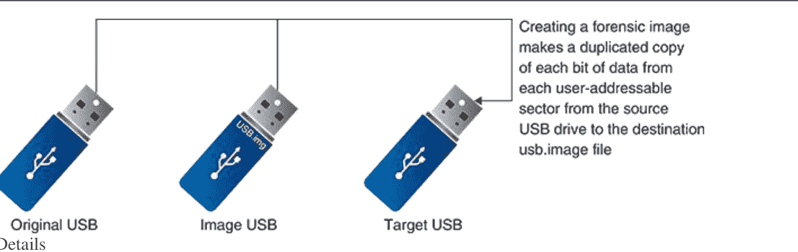

原始、镜像和目标 USB 之间的数据传输是基于创建一个法证镜像，该镜像从源 USB 驱动器中每个用户可访问扇区的每个位数据创建一个复制副本，并将其传输到目标 `usb.image` 文件。

> 提示：偶尔，即使你使用尺寸完全相同但型号不同的磁盘，原始磁盘和目标磁盘上的磁道和扇区映射也可能不匹配。诸如 `Guidance EnCase` 和 `NTI SafeBack` 等工具可以调整目标驱动器的几何结构。其中一种工具 `X-Ways WinHex Special Edition` 可以逐扇区复制大容量或更大的磁盘，而不需要强制更改目标磁盘的几何结构。

## 获取证据介质的镜像

在检索并保护证据后，你已准备复制证据介质并分析数据。数字取证的第一条规则是保护原始证据。然后仅在原始介质镜像的副本上进行分析。多个供应商提供了 Windows 和 Linux 获取工具。然而，在从磁盘和 USB 驱动器获取数据时，这些工具需要写入阻塞设备（在“数据获取”模块中讨论过）；你在此模块中也将学习如何获取法证镜像。

## 分析你的数字证据

当你分析数字证据时，你的工作是恢复数据。如果用户在磁盘上删除或覆盖了文件，则磁盘除现有文件外还包含已删除的文件和碎片。记住，如果文件被删除，它们会占用空闲空间——这意味着这些空间可以用于保存的新文件或随着数据添加而扩展的文件。被删除的文件会一直留在磁盘上，直到新文件保存到相同的物理位置并覆盖原始文件。在此期间，仍然可以检索文件。如 `Autopsy` 等取证工具可以检索已删除的文件作为证据使用。

> 注意 15：在下一次活动之前，你需要从 Sleuth Kit 下载并安装 `Autopsy`。本模块使用的版本是 4.18。详细信息请参阅 `http://autopsy.com/`。

## 活动 1-1

**预计时间：** 30 分钟

**目标：** 配置 `Autopsy` 用于新案件并分析 Montgomery 的镜像文件。

**开始之前：**

- 按照描述下载并安装 `Autopsy`
- 创建文件夹 `C:\Work\Module_01`

要执行分析，请完成以下步骤：

1. 在 `Autopsy` 欢迎窗口中点击 `New Case`（新建案件）按钮。在 `New Case Information`（新案件信息）窗口中，在 `Case Name`（案件名称）框中输入 `Activity_01-1`（见图 1-15），点击 `Base Directory`（基目录）旁边的 `Browse`（浏览）。导航并点击你的 `Work` 文件夹。确保 `Case Type`（案件类型）选择了 `Single-User`（单用户），然后点击 `Next`（下一步）。

图 1-15 新案件信息窗口


### 新案件信息步骤

1. Case Information（案件信息）
2. Optional Information（可选信息）

| Case Name | Activity_01-1 |
|---|---|
| Base Directory | `C:\Work\Module_01` [Browse] |
| Case Type | Single User / Multi User |
| Case data will be stored in the following directory: | `C:\Work\Module_01\Activity_01-1` |

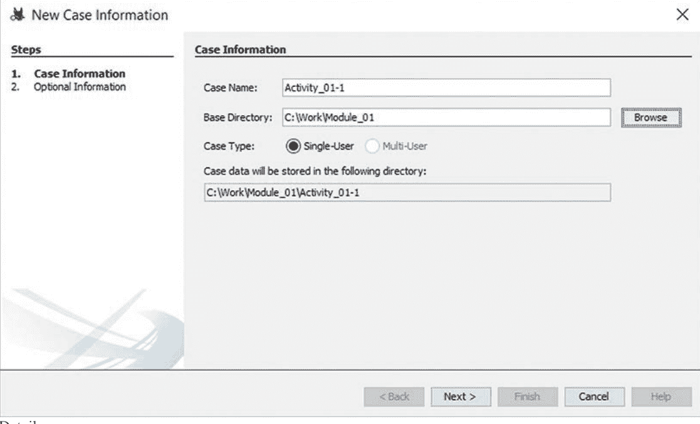

详情

新案件信息窗口的左侧面板列出了案件信息和可选信息的步骤。右侧面板显示案件信息的详情。案件名称为 `Activity_01-1`。基目录为 `C:\Work\Module_01`。案件类型为单用户，案件数据存储目录为 `C:\Work\Module_01\Activity_01-1`。屏幕底部有 `Next`（下一步）和 `Cancel`（取消）选项卡。

在 `Optional Information` 面板中，在 `Case Number`（案件编号）文本框中输入 `Activity_01-1`，并在 `Examiner`（调查员）部分的 `Name`（姓名）文本框中输入你的全名，然后点击 `Finish`（完成）启动添加数据源向导。

### 新案例信息

步骤

- 1. 案例信息
- 2. 可选信息


### 详细信息

新案例信息窗口的左侧面板列出了案例信息和可选信息的步骤。右侧面板列出了可选信息的详细信息。案例名为 `Activity_01`。在检查员部分，分配的电话、电子邮件和备注是空的。对任何特定内容的分析已完成。屏幕右底部有“返回”、“完成”和“取消”选项卡。

在 `Autopsy` 添加数据源区域，点击`磁盘镜像或虚拟机`（见图 1-17），然后点击“下一步”。

图 1-17 Autopsy 添加数据源窗口


### 添加数据源

步骤

- 1. 选择数据源类型
- 2. 选择数据源
- 3. 配置导入模块
- 4. 添加数据源

| 磁盘镜像或虚拟机文件 |
| :--- |
| 本地磁盘 |
| 逻辑文件 |
| 未分配空间镜像文件 |
| Autopsy 逻辑结果 |

选择数据源类型

### 详细信息

添加数据源窗口的左侧面板列出了四个步骤：选择数据源类型、选择数据源、配置导入模块和添加数据源。已选择第一步。右侧面板列出了多个数据源，例如虚拟机镜像文件、本地磁盘、逻辑文件、未分配空间镜像文件、`Autopsy` 逻辑结果和文本导出。磁盘镜像或虚拟机文件。

5. 在选择数据源窗口中，点击“浏览”按钮，导航到工作文件夹，点击 `Activity_01` 文件。
6. 在导入模块窗口中保持默认设置。点击“下一步”。

接下来，完成这些步骤以显示获取的数据：
1. 在树视图中，展开“视图”、“文件类型”、“按扩展名”，点击每个文件夹旁的加号（见图 1-18）。


### 详细信息

`Activity_source_01` 的 `Autopsy` 窗口有两个面板。左侧面板是数据源的目录树。右侧面板列出了名称、修改时间、更改时间、访问时间、创建时间、大小、标志以及从树获取的 `MD5` 哈希值。

在文档下，点击“Office”。在结果查看器（右上面板）中，点击最后一个文件 `Contract with Martha.docx` 以显示其内容（右下面板）。

右键点击 `Contract with Martha.docx`，选择“添加文件标签”，并注释。

在选择标签对话框中，点击“新标签”按钮。在创建标签对话框的新标签部分，在标签名称文本框中输入 `Recovered Documents`（见图 1-19），点击“确定”，再次点击“确定”。

图 1-19 Autopsy 中的创建标签对话框

### 创建标签

| 现有标签名称： | 新标签 |
| :--- | :--- |
| 书签 | 标签名称： |
| CGI/动画 - 子类利用 | `Recovered Documents` |
| 虐待材料 (CAM) | 描述： |
| 子类利用 (非 CAM) 困难 | | |
| 比较图像 | | |
| 后续 | | |
| 不相关 | | |
| 重要项目 | `[ ]` 标签表示项目为重要。 |

### 详细信息

创建标签窗口有两个面板。左侧面板列出了现有标签，例如书签、`CGI/动画 - 子类利用`、虐待材料 (CAM)、子类利用 (非 CAM) 困难、比较图像、后续、不相关和重要项目。右侧面板列出了标签名称 `Recovered Documents`。

再次右键点击 `Contract with Martha.docx`，然后点击“提取文件”。在保存窗口中，点击“保存”，然后点击“确定”。在树查看面板中，点击加号展开“删除文件”文件夹，然后点击“所有”。在结果查看器中，点击 `Presentation.pptx`。在内容查看面板中，记录 George 的姓，然后点击“文件”，关闭 `Autopsy`。打开记事本，输入在内容查看面板中出现的 George 的名和姓。将此文件保存为 `Activity_01_George` 到你的工作文件夹并编辑记事本。启动文件资源管理器并导航到子文件夹 `Activity_01_George`，将 `Contract with Martha.docx` 复制到工作文件夹。

向导师提交以下文件：

- `Activity_01_George.txt`
- `Contract with Martha.docx`

即使确切知道寻找什么，分析可能是最耗时的任务。要找到证据产物，搜索特定的已知数据。数据值可以是唯一的或不可打印字符，例如 `©`（版权）或 `™`（商标）。许多数字取证程序可以搜索字符，例如用于版权的 `0xA9` 或用于商标的 `0xAE`。

> 注意：十六进制值通常以 `0x` 开头以清楚地识别它们代表的内容。通过 `Autopsy`，你可以搜索感兴趣的关键词。

## Autopsy 的附加功能

如果你发现感兴趣的文件，`Autopsy` 中有六种可用选项：`Hex`、元数据、结果、索引和媒体。要查看未分配扇区，点击内容查看器中的 `Hex` 标签，如图 1 所示。


### 详细信息

在 `Autopsy` 中，内容查看器显示文件的十六进制表示。内容查看器由几个部分组成。`Hex` 标签区域十六进制值显示文件。每个字节由两个十六进制数字（0-9, A-F）表示。十六进制值的右侧是相应的 ASCII 字符。偏移量位于最左列。

如果你想导出 Office 文件（例如 Excel 表格），右键点击文件并“在外部查看器中打开”。要使用此选项，你必须在计算机上安装外部查看器软件。要从 `Autopsy` 导出文件，右键点击文件并“提取文件”。在保存窗口中，点击“保存”，然后点击“确定”。在树查看面板中，点击加号展开“删除文件”文件夹，然后点击“所有”。在结果查看器中，点击 `Presentation.pptx`。在内容查看面板中，记录 George 的姓，然后点击“文件”，关闭 `Autopsy`。打开记事本，输入在内容查看面板中出现的 George 的名和姓。将此文件保存为 `Activity_01_George` 到你的工作文件夹并编辑记事本。启动文件资源管理器并导航到子文件夹 `Activity_01_George`，将 `Contract with Martha.docx` 复制到工作文件夹。

在下一个章节中，你将学习如何导出报告文件，可以完成案例。

## 完成案例

在数据源添加数据源的步骤

- 1. 选择数据源类型
- 2. 选择数据源
- 3. 配置导入模块
- 4. 添加数据源

使用报告生成器（Report Generator）功能时，如图 1-21 所示，选择您所需的报告格式。

图 1-21 Autopsy 生成报告窗口

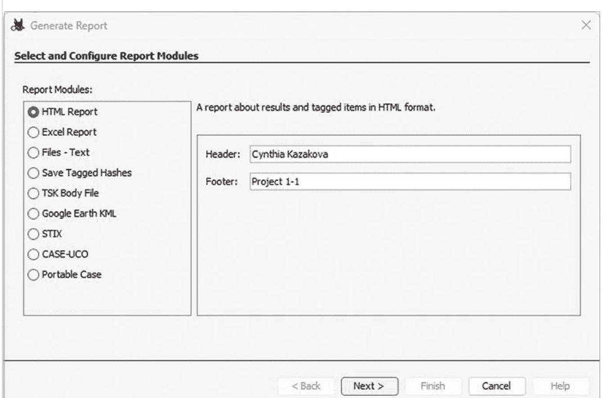

生成报告窗口有两个窗格。左窗格列出了报告模块，例如 `HTML Report`、`Excel Report`、`Files - Tab`、`Save tagged hashes`、`TSK Body File`、`Google Earth KML`、`STIX`、`CASUO` 和 `Portable Case`。右窗格包含页眉和页脚信息。页眉为 `Cynthia Kazakova`，页脚为 `Project 1`。

注意在图 1-21 所示的示例中，选中了 `HTML Report` 选项。对于典型的调查，`HTML Report`、`Excel Report` 和 `Files - Text` 使用最频繁，因为这些格式可以很容易与 `Microsoft Word` 或 `Excel` 等其他生产力工具集成。其他选项用于需要更高级报告功能的情况。关于 `Autopsy` 报告生成器的更多信息，请参阅模块“数字调查中的报告编写与证词”。

## 案件评审

在关闭案件并制作最终报告后，您需要与您的部门或一组调查同事会面，并对案件进行评审，以改进您的工作。请问自己以下评估问题：

- 你如何提高你在案件中的表现？
- 你是否预料到了你发现的结果？案件是否出现了你意料之外的发展？
- 文档记录是否已经尽可能详尽？
- 从请求源收到了哪些反馈？
- 你是否发现了任何新问题？如果是，它们是什么？
- 你在案件期间或研究期间是否使用了新技术？

在日记中为自己记录下在未来调查中可能需要更改或处理的技术或流程。然后，将您的日记存储在安全的地方。

## 自我检查

- 10. 列出在进行企业内部调查时您应该做的三件事。

**答案：** 与请求调查的 IT 经理或授权人员交谈。在填写适当表格并获得相应签名后获取证据。根据行业实践将证据运输并存储在安全位置。

**解释：** 与请求调查的 IT 经理或授权人员交谈是非常重要的，因为这确保检查人员充分了解 IT 经理所知，并可能帮助检查人员更好地理解正在调查的案件类型。适当的证据表格建立了证据的监管链，并记录了在调查期间谁访问过证据。遵循适当的行业运输协议和证据保全方法可以确保证据未被未经授权的用户访问，这是维护证据完整性的关键部分。

## 模块回顾

## 模块总结

- 数字取证将程序应用于数字证据。这一过程涉及系统地收集和分析数字信息，以用于民事、刑事和行政案件。数字取证与网络取证和数据恢复在范围、技术和目标上有所不同。
- 与数字证据相关的首批法律建立于 20 世纪 70 年代。
- 要成为一名成功的数字取证调查员，你必须熟悉多种计算平台和设备类型。为了补充知识，要与计算机、网络和调查专业人士建立并保持联系。
- 调查人员需要专门的工作站来检查数字证据，包括用于证据驱动器的额外插槽、取证软件和写保护器。
- 内部人员是指可能是员工、承包商或其他有访问公司网络或计算机并实施恶意行为或工业间谍活动的人。
- 物联网由任何可以访问互联网的物理设备组成。这些设备在 RAM、存储能力和安全性方面各异。某些设备可能包含数字证据或通向证据。
- 公共部门和私营部门调查，在公共部门调查中，通常在扣收数字证据之前需要搜查令。美国宪法第四修正案以及其他国家的类似法律允许政府进行搜查。


# 公共部门和私营部门调查

在公共部门调查中，通常在扣收数字证据之前需要搜查令。美国宪法第四修正案以及其他国家的类似法律允许政府进行搜查。

# 关键术语

- 证词书（affidavit）
- 指控（allegation）
- 批准的容器
- 律师客户权（ACP）
- 授权的请求者
- 位级拷贝
- 位级镜像
- 监管链
- 计算机技术网络（CTIN）
- 数据恢复
- 数字证据响应者（DEFR）
- 数字证据专家（DES）
- 数字取证
- 数字调查
- 证据袋
- 证据表格
- 证明无罪证据
- 证
- 取证工作站
- 宪法第四修正案
- 敌对环境
- 关联性证据
- 工业间谍
- 内部威胁
- 国际计算机协会（IACS）
- 物联网（IoT）
- 审问
- 询问
- 权限范围
- 多功能证据表格
- 网络入侵检测与响应
- 职业道德
- 可重复的发现
- 搜查与扣收
- 搜查令
- 单功能证据表格
- 判决
- 漏洞评估与风险管理
- 警告幅
- 白领犯罪

# 复习题

1. 数字取证和数据恢复指的是相同的活动。是或否？

2. 美国的诉讼必须遵守以下哪一项？

   - a. 第三修正案
   - b. 第四修正案
   - c. 第一修正案
   - d. 以上均不是

3. 计算安全的三要素包括以下哪一项？

   - a. 检测、响应和监控
   - b. 漏洞评估、检测和监控
   - c. 漏洞评估与风险管理、网络入侵检测与响应以及数字调查
   - d. 漏洞评估、入侵响应和监控

4. 维护取证专家网络的目的是什么？

5. 政策可以针对哪些内容制定规则？

   - a. 你从家里登录计算机网络
   - b. 你可以或不能访问的网站
   - c. 你可以发送的邮件数量
   - d. 以上所有

6. 警告幅应包含哪些信息（可多选）。

   - a. 谁可以使用该站点
   - b. 谁拥有该计算机
   - c. 网站的内容
   - d. 滥用的后果

7. 通常情况下，私营部门调查员被认为是执法部门的代理。是或否？

8. 列出在业务环境中典型的两种类型的数字调查。

9. 什么是职业道德，它为什么重要？

10. 证词的目的是什么？

11. 有哪些方法可以确定调查所需的资源？

12. 列出证据表格上应该包含的三个项目。

13. 为什么你应该进行标准风险评估以准备调查？

14. 在收集计算机组件作为证据时，你应该将其放在防静电袋中。对还是错？

15. 为什么证据媒体应该是写保护的？

16. 列出你的案件报告中应该包含的三个项目。

17. 为什么在案件结束后你应该对该案件进行批判？

18. 你使用哪个术语来指代所有物理接触过证据的人员？

   - a. 职业调查员
   - b. 监管链 (Chain of custody)
   - c. 法律监管 (Legal custody)
   - d. 物理追踪 (Physical tracking)

19. 在律师针对律师-客户特权案件发布备忘录之前收集的数据受机密工作产物规则保护。对还是错？

# 动手操作项目

## 项目 1-1

**预计耗时**：实验 30 分钟；评估和编写报告 30 分钟

**目标**：评估从犯罪现场获得的 USB 驱动器。

### 在开始之前

- 创建工作文件夹 `C:\Work\Module_01\Project_01-1`。
- 根据注释 15 的描述下载并安装 Windows 版 Autopsy。
- 将模块提供的以下文件下载到你的工作文件夹：
  - `Project_01-1001`

### 案件描述

该项目中的案件涉及一起疑似死亡。Joshua Zarkan 在他的公寓内发现了女友的尸体并报告了此消息。第一响应执法人员没收了一个 USB 驱动器。一名精通数据获取的犯罪现场技术人员使用 FTK Imager 对 USB 驱动器进行了镜像，并将其命名为 `Project_01-1001`。获取后，技术人员运输并妥善保存了 USB 驱动器，将其放在警察局的安全保险柜中。你收到了负责此案件的侦探发送的镜像文件。他指示你对其进行评估，并识别与此案件相关的任何证据人工制品。

### 操作步骤

1. 启动 Windows 版 Autopsy，点击“新建案件”（New Case）图标。在新建案件信息窗口中，在 Case Name 框中输入 `Project_01-1`，点击浏览（Browse）并到 Base Directory 框。导航并点击你的工作文件夹，然后点击下一步（Next）。
2. 在 Optional Name 字段中，在 Case Number 文本框中输入 `Project_01-1`，在 Examiner Name 文本框中输入你的名字，然后点击完成（Finish）。
3. 在添加数据源（Add Data Source）窗口，在选择要添加的数据源类型面板中，点击磁盘镜像（Disk Image）或虚拟机文件（VM File）。点击下一步。在选择数据源面板中，点击 Path 文本框旁边的浏览按钮，导航并点击你的工作文件夹、以及 `Project_01-1001` 文件，然后点击打开（Open）。
4. 在导入模块（Ingest Modules）模块中，点击全选（Select All），然后取消勾选中央存储（Central Repository），点击下一步，然后点击完成。（注意：如果勾选了中央存储框，屏幕左下角会出现错误消息。）
5. 当导入模块完成处理后，在树形查看器（Tree Viewer）面板中，点击相关的加号以展开视图（Views）、文件类型（File Types）、按扩展名（By Extension）和文档（Documents）。
6. 从树形查看器面板点击子文件夹 Office。
7. 在结果查看器（Result Viewer）面板中，右键点击 `Sylvias Assets.xls` 文件，并点击提取文件（Extract File(s)）。在保存对话框中，点击保存将文件自动保存到 Autopsy 的子文件夹：`Work\Module_01\Project_01-1\Export`。在弹出的对话框中点击确定。
8. 接下来，在树形查看器面板中，点击子文件夹 Plain Text（纯文本）。
   
   在结果查看器面板中，右键点击 `suicide1.txt` 文件，并点击提取文件。在保存对话框中，点击保存将文件自动保存到 Autopsy 的案件文件夹：`Work\Module_01\Project_01-1\Export`。在弹出的对话框中点击确定。
9. 退出 Autopsy。检查提取的文件。重新阅读案件描述，并写一份不超过三段的短报告，包括你发现的任何事实。报告中包含以下项目：
   - 开头：你作为调查员的时间、案件名称和编号、案件标题以及调查日期。
   - 关于调查信息的介绍。
   - 对你的发现的描述。
   - 根据你的发现得出的结论。
10. 将报告保存为 `Project_01-1_Report.doc` 到你的工作文件夹中。

### 提交文件

- `Project_01-1_Report.doc`
- `suicide1.txt`
- `biasAssets.xls`

## 项目 1-2

**预计耗时**：20 到 30 分钟

**目标**：确定前员工是否实施了工业间谍活动。

### 在开始之前

- 根据 Project-01-2 的描述下载并安装 Windows 版 Autopsy。
- 创建工作文件夹 `C:\Work\Module_01\Project_02`。
- 将模块提供的以下文件下载到你的工作文件夹：
  - `Project_01-2.001`

### 案件描述

在这个项目中，你在大型公司的 IT 安全法医工作。你的职责包括对计算系统进行数字调查和法医检查。

### 操作步骤

1. 启动 Windows 版 Autopsy，点击“新建案件”图标。在新建案件信息窗口中，在 Case Name 框中输入 `Project_01-1`，点击浏览并到 Base Directory 框。导航并点击你的工作文件夹，然后点击下一步。
2. 在 Optional Name 字段中，在 Case Number 文本框中输入 `Project_01-1`，在 Examiner Name 文本框中输入你的名字，然后点击完成。
3. 在添加数据源窗口，在选择要添加的数据源类型面板中，点击磁盘镜像或虚拟机文件。点击下一步。在选择数据源面板中，点击 Path 文本框旁边的浏览按钮，导航并点击你的工作文件夹、`Project_01-1001` 文件，然后点击打开。
4. 在导入模块中，点击全选，然后取消勾选中央存储，点击下一步，然后点击完成。（注意：如果勾选了中央存储框，屏幕左下角会出现错误消息。）
5. 当导入模块完成处理后，在树形查看器面板中，点击相关的加号以展开视图、文件类型、按扩展名和文档。
6. 从树形查看器面板点击子文件夹 Office。
7. 在结果查看器面板中，右键点击 `Sylvias Assets.xls` 文件，并点击提取文件。在保存对话框中，点击保存将文件自动保存到 Autopsy 的子文件夹：`Work\Module_01\Project_01-1\Export`。在弹出的对话框中点击确定。
8. 接下来，在树形查看器面板中，点击子文件夹 Plain Text。
   
   在结果查看器面板中，右键点击 `suicide1.txt` 文件，并点击提取文件。在保存对话框中，点击保存将文件自动保存到 Autopsy 的案件文件夹：`Work\Module_01\Project_01-1\Export`。在弹出的对话框中点击确定。
9. 退出 Autopsy。检查提取的文件。重新阅读案件描述，并写一份不超过三段的短报告，包括你发现的任何事实。报告中包含以下项目：
   - 开头：你作为调查员的时间、案件名称和编号、案件标题以及调查日期。
   - 关于调查信息的介绍。
   - 对你的发现的描述。
   - 根据你的发现得出的结论。
10. 将报告保存为 `Project_01-1_Report.doc` 到你的工作文件夹中。

### 提交文件

- `Project_01-1_Report.doc`
- `suicide1.txt`
- `biasAssets.xls`

## 项目 1-3

**目标**：在范围内查找特定类型并创建带标签的文件。

### 在开始之前

- 创建文件夹 `C:\Work\Module_01\Project_01-3`。
- 将该模块提供的以下文件下载到你的 Work 文件夹中：
  - `Project_01-301` 文件

### 案件描述

你是 Superior Sailmakers 公司的 IT 安全专家，这家公司专门为单桅帆船和双桅帆船制造帆布。公司向许多相互竞争的帆船制造商销售索具和帆布。当人力资源部注意到这一点时，Johanna Corso 发现她收到了一封附有 USB 闪盘的匿名信。信中声称，Sailmakers 的前员工 Ralph Williams 拥有几张从 2021 年到 2022 年期间的照片，这些照片包含了涉及 ACE Sailboats 的秘密。信中还提到 Williams 先生已于 2022 年 10 月结束了在 Sailmakers 的工作；他利用 USB 闪盘中的照片被 ACE Sailboats 的竞争对手 Slip Float Boats 聘用。帆船制造商是 Superior Sailmakers 的客户。


# Project 1-3

Johanna 告诉你，另一位专家已以专家证人格式（扩展名为 `.001`）制作了 USB 闪盘的镜像。她希望你检查其内容是否有照片文件，以确定匿名投诉是否属实。她还要求你确定是否存在创建或访问日期为 2022 年 10 月的照片。

检查完成后，你需要生成一份报告，Johanna 将其发送给法律部，并附上一份总结此次调查和你发现的备忘录。法律部将此判断是否发生了违反商业秘密或知识产权法的行为。

## 步骤

### 1. 启动 Windows 版 Autopsy，点击“New Case”（新建案件）图标

在 New Case Information 窗口中，在 Case Name 框中输入 `Project_01-3`，然后点击 Base directory 框旁边的 Browse（浏览）。导航到你的 Work 文件夹，然后点击 Next（下一步）。

### 2. 在 Optional Information（可选信息）窗口中

在 Case Number 框中输入 `Project_01-3`，在 Examiner Name 框中输入你的名字，然后点击 Finish（完成）。

### 3. 在 Add Data Source（添加数据源）窗口中

转到 Select Type of Data Source to add（选择要添加的数据源类型），点击 Disk Image or VM File（磁盘镜像或虚拟机文件）。点击 Next。在 Select Data Source（选择数据源）面板中，点击路径旁边的 Browse 按钮，导航到你的 Work 文件夹，点击 `Project_01-3.001` 文件，然后点击 Open（打开）。点击 Next。

### 4. 在 Configure Ingest Modules（配置摄取模块）窗口中

点击 Select All（全选），取消勾选 Central Repository（中央库）。点击 Next 然后点击 Finish。

由于你正在寻找在 2022 年 10 月某时候被复制到 USB 闪盘的帆船照片，请执行以下步骤：

### 1. 在 Tree Viewer（树状查看器）面板中

点击相关的加号以展开 Views（视图）、File Types（文件类型）、By Extension（按扩展名）和 Images（图像）。

### 2. 在 Result Viewer（结果查看器）面板中

如有需要向右滚动，直到 Modified Time（修改时间）列可见。通过点击 Modified Time 表头对列进行排序。

### 3. 向下滚动直到找到第一个月份为 2022 年 10 月的文件

然后点击该文件在 Content Viewer（内容查看器）中查看。按键盘上的向下箭头查看所有在 2022 年 10 月创建或修改的文件。

`Ctrl+点击`每一个在 2022 年 10 月拍摄有船只或船局部照片的文件。右键点击选中的项目，指向 Add File Tags（添加文件标签），并点击 Follow Up（后续）。

在 Tree Viewer 面板中，向下滚动并点击相关的加号以展开 Tags（标签）和 Follow Up，然后点击 File Tags（文件标签）文件夹。

在 Result Viewer 面板中，点击 Thumbnail（缩略图）选项卡查看已标记的照片。

### 生成报告

通过点击顶部的 Generate Report（生成报告）创建报告。

1. 在 Generate Report 窗口中，点击 Select and Configure Report Modules（选择并配置报告模块）面板中的 HTML 选项，然后点击 Next。
2. 在 Select data source(s) to include（选择要包含的数据源）面板中，如果 `Project_01-3.001` 未勾选，请勾选它，然后点击 Next。
3. 在 Configure Report（配置报告）面板中，点击 Specific Tagged Results（特定标记结果）。在 Generate Report（生成报告）窗口中，点击 HTML 选项。
4. 在 Select data source(s) to include（选择要包含的数据源）面板中，如果 `Project_01-3.001` 未勾选，请勾选它，然后点击 Next。
5. 在 Configure Report（配置报告）面板中，点击 Specific Tagged Results（特定标记结果）。在 Generate Report 窗口中，点击 Finish。
6. 在 Select data source(s) to include（选择要包含的数据源）面板中，如果 `Project_01-3.001` 未勾选，请勾选它，然后点击 Next。
7. 在 Configure Report（配置报告）面板中，点击 Specific Tagged Results（特定标记结果）。在 Generate Report（生成报告）窗口中，点击 HTML 选项。
8. 在 Select data source(s) to include（选择要包含的数据源）面板中，如果 `Project_01-3.001` 未勾选，请勾选它，然后点击 Next。
9. 在 Configure Report（配置报告）面板中，点击 Specific Tagged Results（特定标记结果）。在 Generate Report（生成报告）窗口中，点击 Autopsy。
10. 在 Select data source(s) to include（选择要包含的数据源）面板中，如果 `Project_01-3.001` 未勾选，请勾选它，然后点击 Next。
11. 在 Configure Report（配置报告）面板中，点击 Specific Tagged Results（特定标记结果）。在 Generate Report（生成报告）窗口中，点击 Close。

使用文字处理程序编写一份总结案件和调查结果的备忘录。

## 提交文件

向导师提交以下文件：

- `Project_01-3_Autopsy_Case_Summary.pdf`
- `Project_01-3_Autopsy_Tagged_Files.pdf`
- `Project_01-3_Autopsy_Tagged_Images.pdf`
- `Project_01-3_Memo.docx`

## Tips

在进行字符串搜索时，检查图像文件，因为图像文件中的是作为图像的一部分，而不是纯文本。

---

# Project 1-4

**预计时间**：15 分钟

**目标**：从磁盘提取现有、未删除的文件。

## 开始之前

- 创建文件夹 `C:\Work\Module_01\Project_01-4`。
- 将该模块提供的以下文件下载到你的 Work 文件夹中：
  - `Project_01-4.001`

有时律师的发现需要数字取证调查员从磁盘恢复仅分配的文件。本项目展示了如何从镜像中提取未删除的文件（即分配的文件）。对于本项目，你需要从数字取证镜像提取分配的文件。

## 完成以下操作

### 1. 启动 Windows 版 Autopsy

点击 New（新建案件）图标。在 New Case Information 窗口中，在 Case Name 框中输入 `Project_01-4`，然后点击 Base directory 框旁的 Browse。导航并点击你的 Work 文件夹，然后点击 Next（下一步）。

### 2. 在 Optional Information（可选信息）窗口中

在 Case Number 框中输入 `Project_01-4`，在 Examiner Name 框中输入你的名字，然后点击 Finish（完成）。

### 3. 在 Add Data Source（添加数据源）窗口中

转到 Select Type of Data Source to add（选择要添加的数据源类型），点击 Disk Image or VM File（磁盘镜像或虚拟机文件）。点击 Next。在 Select Data Source（选择数据源）面板中，点击路径旁边的 Browse 按钮，导航到你的 Work 文件夹，点击 `Project_01-3.001` 文件，然后点击 Open（打开）。

### 4. 在 Configure Ingest Modules（配置摄取模块）窗口中

点击 Select All（全选），取消勾选 Central Repository（中央库）。点击 Next 然后点击 Finish。

### 5. 在 Tree Viewer（树状查看器）面板中

点击相关的加号以展开 Views（视图）、File Types（文件类型）、By Extension（按扩展名）和 Images（图像）。

### 6. 在 Result Viewer（结果查看器）面板中

如有需要向右滚动，直到 Modified Time（修改时间）列可见。通过点击 Modified Time 表头对列进行排序。

### 7. 向下滚动直到找到第一个月份为 2022 年 10 月的文件

然后点击该文件在 Content Viewer（内容查看器）中查看。按键盘上的向下箭头查看所有在 2022 年 10 月创建或修改的文件。

> （目录），标志（元数据），以及已知位置。

## 注意 17

在结果查看器窗格中，已分配（未删除）的文件在文件名左侧有一个纸张图标或图片图标。已删除（未分配）的文件在纸张图标上有一个红色的 X，而被 Autopsy 损坏并恢复的未分配文件显示有一个斜的断横条图标。

### 8. 向左滚动，直到结果查看器窗格中显示“名称”列

如果有已分配的文件，它们将位于列表顶部。按住 `Ctrl` 并点击每个已分配的文件，右键点击高亮的文件，然后点击“提取文件 (Extract File(s))”。

### 9. 在保存对话框中

点击“保存”，将文件自动保存到 Autopsy 的案件子文件夹中：`Work\Module_01\Project_01-4Export`

### 10. 重复步骤 6、7、8 和 9

以提取所有其他已分配的文件。

### 11. 完成后

写一份简短的备忘，列出你导出的所有文件，并将该文件保存为 `Project_01-4_Memo.docx`。

### 12. 保持 Autopsy 运行

以便进行下一个项目。

### 13. 向你的导师提交以下文件

- `Project_01_4_Memo.docx`

---

# 案件项目

## 案件项目 1-1

**预计时间**：60 分钟

**目标**：为该案件决定最佳方法。

### 开始之前

- 创建 Work 文件夹 `C:\Work\Module_01\Case_Project_01`。

一家保险公司要求你的数字取证公司审查一起涉及纵火调查的案件。涉嫌纵火的人员已被被捕，保险公司想确定受害者是否存在间接过失。嫌疑人使用的证据是一台笔记本电脑和平板电脑。你将遵循什么程序？根据本模块中“采取系统方法 (Taking a Systematic Approach)”章节的指南，写一份一两页的备忘录，包括你该案件的方法概述，并将其保存为 `Case_Project_01-1_Memo.docx`。

完成此案件项目后，向导师提交以下文件：

- `Case_Project_01-1_Memo.docx`

## 案件项目 1-2

**预计时间**：60 分钟

**目标**：为案件形成假设，并列出待检查的可能证据清单。

### 开始之前

- 创建 Work 文件夹 `C:\Work\Module_01\Case_Project_02`。

Jonathan Simpson 拥有一家建筑公司。一名分包商打电话给他，说他需要为在 1437 West Maple Avenue 完成的工作重新开具一张支票。Jonathan 在会计程序中查询了该项工作，并同意收取 $12,750 的费用。分包商说该案件的金额仅为 $10,750。Jonathan 在办公室里找找，但找不到公司的支票或账本。另一个人也可以访问该会计程序。Jonathan 打电话请你进行调查。在审查了 Jonathan 提供的事实后，确定确定这是盗窃行为还是笔记录性错误的步骤。你应该如何进行？写一封信，详细说明案件的事实以及 Jonathan 为该检查收集必要证据所需采取的步骤。将报告保存为 `Case_Project_01-2_Letter.docx`。

向导师提交以下文件：

- `Case_Project_01-2_Letter.docx`

## 案件项目 1-3

**预计时间**：60 分钟

**目标**：为律师-客户特权案件做准备。

### 开始之前

- 创建 Work 文件夹 `C:\Work\Module_01\Case_Project_03`。

你是一家大公司的数字取证审查员。你接到来自公司法务部聘请的外部律所律师的电话。该外部律所是 Melbourne & Schaff Law Group，律师的名字是 Nariko Bortletti。

Nariko 通知你，Melbourne & Schaff 将代表你应对针对某些高管的可能的刑事起诉。她指示你检查所有 C 级高管的笔记本电脑，以及部门总裁的电脑。通话结束时，Nariko 提供了她的联系方式：

- 电话：555-0115
- 手机：555-0128
- 电子邮件：`nariko.bortletti@msyers.biz`

由于你第一次听说这个案件，你告知 Nariko 你将向公司的法务部确认此请求，并尽快回复她。你联系了公司法务部的首席诉讼律师并向他解释该请求。诉讼律师告诉你，他在获得更多关于案件的细节后会回给你，他已经和 Nariko Bortletti 说过了。五分钟内，诉讼律师回电并指示你收集电脑。在这样做之前，你需要向 Nariko Bortletti 索要以下信息：

- 要收集的笔记本电脑列表（被告/原告姓名）
- 收集证据时采取的行动（证据保护和处理）
- 案件（律师-客户特权需求）

根据本模块中“律师-客户特权调查 (Attorney-Client Privilege Investigations)”章节的信息，写一封邮件（使用文字处理器）给 Nariko Bortletti，请求一份正式备忘录，该备忘录应提供公司律师所需的信息。向导师提交以下文件：`Case_Project_01-3_Email.docx`。

## 案件项目 1-4

**预计时间**：30 分钟

**目标**：确定启动数字取证检查需要的内容。

### 开始之前

- 创建文件夹 `c:\Module_01\Case_Project_01-4`。

你的主管指示你为组织内的审查员创建一个收集证据时使用的清单。显然，许多审查员在收集证据时没有准备就，导致了案件处理的延迟。

使用“进行调查 (Conducting Investigation)”章节的信息，制定一个在调查开始前收集内容的简单清单。该清单应易于遵循且解释极少。除了列出的项目外，还包括你可能需要的额外信息：

- 案件标题
- 案件编号
- 审查员姓名
- 日期和时间
- 案件描述
- 任务列表列表
- 对每个项目的注释

将清单保存为 `Case_Project_01-4_Checklist.docx`。向导师提交：`Case_Project_01-4_Checklist.docx`

---

# 第二章. 数字调查的报告编写与证言

## 引言

阅读本模块并完成练习后，你将能够：

1. 解释报告和证言的重要性
2. 描述编写报告的指南
3. 描述生成结果和编写数字取证程序
4. 解释作为事实证或专家证的准备工作
5. 描述在法庭和质询中作言的指南

本模块提供了编写数字调查结果报告的指南。你学习了不同类型的报告以及典型报告中应包含的内容，以及在预期作言时如何使用调查工具生成结果。你学习了证言的类型（用于审判和质询）以及事实证与专家证之间的区别。此外，你学习了如何避免与证言相关的常见问题，以及你可以用来增加证言价值的技术。本模块还提供了如何为证言准备取证证据的示例。

## 从作言的角度理解报告的重要性

你写一份报告来传递你的取证证据。取证报告提供了可能支持进一步调查的证据，在某些情况下可在法庭、行政听证会或作为签发搜查令的声明使用。报告还可以为收集更多证据提供理由，并作为大团听证、刑事或民事案件中的证据。此外，如果你正在调查员工不当行为，报告可能是纪律处分的依据。除了事实，报告还可以传递专家意见。你应该将你的报告视为你在案件中的首次作言。你预计将就对其进行询问和交叉质询。对方律师将寻找攻击你的报告或从中提取证言的机会。你需要知道哪些事实影响你的意见，哪些事实不会。

对于涉及数字取证调查的案件，美国地区法院要求专家证提交书面报告。某些州也要求专家证提交报告，如果你是涉及民事案件的数字取证证人，必须编写一份解释你的调查和结果的报告。

FRCP 规则创建于 1938 年，旨在提供“公正、快速且廉价”的解决。在此之前，案件是更正式的程序。FRCP 由 86 条规则组成，于 2006 年更新以包含电子证据。影响数字证据的规则包括：

- FRCP 16. 审前会议；管理
- FRCP 26. 披露义务；发现的一般规定
- FRCP 33. 对当方的询问
- FRCP 34. 提交文件、电子存储信息和有形物品，或进入土地进行检查和其他目的
- FRCP 37. 未履行披露或发现；制裁

注意每个州都有自己的民事诉讼规则，这些规则可能比联邦规则更严格，但绝不会如此。务必确认你符合的是哪个司法管辖区。FRCP 26 要求，如果预期专家证将作言，则专家的书面报告必须包含所有意见、这些意见的依据以及得出这些意见时考虑的信息。报告还必须包含相关的证物，如照片或图表，以及证人在过去 10 年内产生的所有出版物简历。（这些出版物不必与案件相关。）**简历 (CV)** 列出了一个人的教育、培训和专业经验，并用于证明其证言。你可以在本模块中学习更多关于创建简历的内容。此外，简历是数字取证专家的真实（诚实）文件。

此外，法院在动议时要求所有事实证或专家证提供报告。参见 FRCP 26 (a)(2)；联邦证据规则 (FRE) 702、703，以及根据 `Daubert v. Merrell Dow Pharmaceuticals, Inc., 509 U.S. 579` 确立的标准，即证言基于充分的事实或数据，证言是可靠原则和方法的产品，且证人可靠地将这些原则和方法应用于案件事实。该规则在超过一半的州遵循。剩下的州通常遵循 `Frye v. United States, 293 F. 1013 (Cir. 1923)` 中确立的规则，该规则规定：“从公认的科学原理或发现中得出的证言；其推导的基础已充分证实，并在所属的特定领域获得广泛接受。”

## 注意 1

关于《联邦证据规则》(FRE) 第705条的更多信息，请访问 `law.cornell.edu/rules/rule_705`。


除了包含附件外，书面报告必须说明为专家服务支付的费用，并列出专家在过去四年内在审判和质证中提供过证言的所有其他民事或刑事案件。此列表不需要包含专家仅担任咨询专家且未提供专家证言的案件，或者专家作为普通证人就亲自观察到的事实进行证言的案件。

虽然报告中信息的`get`没有具体规定，但你应该保留每份质证通知或传票的副本，以便能够包含以下信息：

- 管辖权范围（例如：美国华盛顿州东部联邦地区法院）
- 案件名称（用于法院正式文件的格式——例如使用如“原告 John Smith 诉被告 Paul Jones”之类的标题）
- 案号
- 质证日期

## 提示

刑事案件可能变成民事案件，反之亦然。请务必同时也审查《联邦刑事诉讼规则》(FRCrP)。

报告中没有要求包含你之前证言的细节，尽管你应该总结你证言的要点以供未来参考，并在可能的情况下保留你之前证言的笔录。

作为专家证人，你应该意识到律师会使用名为“质证库”（图书馆）的服务，这些库存储了专家之前证言的示例。质证是一种正式的审查，证人在宣誓下接受询问，现场只有对方当事人、证人律师和法庭记录员在场。其中某些服务拥有数十万份质证记录，并可能为经常出庭的专家证人准备多份质证。案件解决后，律师会将对方专家证人的质证副本发送到库中存储。在准备审判时，当对方确定了一位专家证人后，律师可能会请求该证人之前证言的副本。律师还可能要求其自己的专家提供之前的证言笔录，以确保他们之前没有证言过相反的立场。协会成员的律师还可能使用电子邮件列表向其他成员索要特定专家证人的质证副本。

## 注意 2

律师在许多法院可以以电子方式提交文件；美国联邦法院和大多数州法院的标准格式是便携文档格式 (PDF)。

# 将报告限制在特定细节

在调查开始时，客户（可能是律师、侦探或调查员）应该定义调查的目标或任务。所有给客户的报告应在开头说明这一任务或目标，该目标通常是寻找有关特定主题的信息、恢复某些重要文件、恢复某些类型的文件或具有特定日期时间的文件。明确定义目标可以减少检查的时间和成本，随着硬盘容量的增加和网络复杂性的提高，这一点尤为重要。

在开始编写之前，识别你的受众和报告的目的，以帮助你专注于细节。记住，如果受众的专业知识匮少，你可能需要将报告和证言的一部分用于向事实发现者普及技术问题。你可以通过准备一套几个通用的段落并留存且定期更新它们来实现这一点。

# 报告类型

作为数字取证鉴定员，你可能被要求创建不同类型的报告，例如向律师提交的初步口头或书面报告，或者由你发现的事实构成的正式书面报告。你可能还需要协助律师准备检查计划。

口头报告通常是书面报告的初步阶段。通常，这发生在律师办公室里，律师要求你提供咨询报告。作为由审判顾问聘请的专家，你将经常使用口头报告。记住，你所服务的律师不能被强制重复你在口头报告中告诉他们的内容。口头报告涉及待完成的调查领域，例如如下：

- 已完成的测试
- 律师可能想向对方当事人提出的询问问题
- 文件提交，包括向当事人的提交请求或向非当事人的传票（非当事人是指拥有信息但不是案件中具名当事人的人）
- 确定谁应该接受质证以及他们的质证计划

在初步报告（无论是口头的还是书面的）中，明确你的事实陈述和意见仍然是暂定的，并将随着更多信息的加入而调整。

书面报告取决于情况，可能是宣誓书或声明。由于此类报告是在宣誓下签署的（并面临伪证罪处罚或类似的虚假陈述法律处罚），它要求注重细节，仔细列出你所写的内容，并对所写内容进行详尽的记录和支持。以下章节包含了书面报告的额外指南。

检查计划是一个作为指南的文件，让你在作证时知道可能会遇到哪些问题（见图 2-1）。你所服务的律师将在你作证期间将检查计划作为指南。在协助律师制定检查计划时，你可能会提议更改以澄清或定义信息，或者包含律师可能遗漏的实质性信息以及预期的交叉询问主题。你对检查计划的贡献将帮助聘用你的律师学习数字取证中使用的术语和功能。


# 检查计划

证人：Joseph Friday  因素：数字取证鉴定员

直接询问：专家证言

# 证言简历

# 学术致谢

- 计算机科学系讲师，2018
- 由审判顾问聘请的专家

# 成员

- 美国安全协会，2020

# 出版物

- 计算机取证，当前

# 经验

- 由审判顾问聘请的专家

# 客户

- 由审判顾问聘请的专家

# 特定检查

- 由审判顾问聘请的专家

# 预期的交叉询问——专家证言

- 由审判顾问聘请的专家

# 细节

显示了一个检查计划。该计划包含了如证人：Joseph Friday、因素：数字取证鉴定员以及直接询问。另一组细节列为：证言简历、学术致谢、成员身份、出版物、经验、客户、特定检查以及预期的交叉询问——专家证言。


答案：a. 所有尚未完成的调查测试；b. 需要向其他当事方提出的询问性问题；c. 请求的文件提交；d. 确定可能需要质证的人员。

**解释：** 本题中提供的所有答案选项都是正确的。口头报告可能会涵盖尚未完成的调查领域，例如：

- 尚未结束的测试
- 律师可能向对方当事方提出的询问性问题
- 文件提交，包括要求提交的文件（给当事人）或传票（给非当事人——即那些拥有信息但不是案件当事人的人员）
- 对谁应该接受质证的确定以及对他们进行质证的计划

## 分析。报告编写指南

法律要求对特定系统或事件没有个人知识的专家通过回答假设性问题来发表意见。因此，专家证人通过回答基于可用事实证据的律师提出的假设性问题来这样做，而不涉及特定的系统或情况。在这方面，法医调查员（专家证人）与普通证人不同。你没有目睹或听取争议性事件；你是在根据专业知识和经验给出意见，即使你可能从未见过该系统、数据或现场。

普通专家通过构建假设性问题来发表意见，确保他们的意见基于证据支持的事实。陈述回答问题所需事实，不要包含任何不必要的事实。然而，你可能需要处理“竞争性”事实（即对方律师可能为了反驳你的意见而提出的事实），但前提是这些事实允许你的意见保持不变。

假设性问题可能会被滥用，变得非常复杂，导致专家可能无法记住足够的问题内容来评估答案。假设性问题的另一种滥用是，它实际上允许律师向陪审团反复背述他们青睐事实——并按照他们想要使用的顺序和强调重点。

如果满足以下基本条件，专家证人可以就意见或结论作证：

- 意见、推理或结论取决于普通证人或陪审员所不具备的特殊知识、技能或培训。
- 证人已被证明是该领域的真正专家（这就是为什么简历非常重要）。
- 证人对其意见、推断或结论给出合理程度的确定（概率）。
- 至少，专家证人了解其意见、推断或结论所依据的相关数据（事实），并准备好针对列出基础证据的假设性问题进行证言。

## 书面初步报告中应包含的内容

记住，你为民事诉讼报告而在检查之外写的任何内容都受对方律师证据程序（discovery）的影响——这意味着你可能提供给对方律师的任何内容。**证据程序**是律师从对方那里寻求信息的过程。因此，初步报告被视为**高风险文件**，因为律师可以对其要求披露。如果初步报告陈述了与你在报告或证言中立场相反或更含糊的立场，你应该预计对方律师会试图利用初步报告损害你的证言信誉。最好没有要提供的书面报告。如果你必须写初步报告，不要使用“初副本”、“草稿”或“工作草稿”作为标题。这些条目为律师提供了诋毁你信誉的机会，并看起来像是你聘请的律师拥有你的。考虑在文档页眉中使用“律师工作成果（Attorney Work Product）”术语，表明该文档是根据聘请律师的指示准备的。此外，如果你写了初步报告，在案件最终解决或任何证据问题解决之前不要销毁它。销毁报告可能被视为销毁或隐藏证据；这被称为“证据灭失（spoliation）”，它可能导致你的客户面临金钱、证据甚至更严重的制裁。如果你已经确定了提供给法院和对方律师的证人名单，那么你对案件的所有工作都可能受到证据程序的影响。

因此，对于初步报告，请包含你在非正式口头报告中提供的相同信息。首先，重新陈述任务以向客户确认你所做的工作重点是否正确。识别你检查的系统、使用的工具以及你看到的内容。陈述你使用的证据保护或保护措施。以下列表显示了报告中要包含的其他项目：

- 截至目前的计费摘要以及完成该工作的预估成本
- 检查员笔记
- 初步结论（而非初步结论）
- 需要进一步调查的领域
- 请求律师对你的检查范围进行确认

| 提示 |
| :--- |
| 在执行数字取证检查时，维护一份通常称为检查员笔记的文档是一个好主意。该文档应根据数字证据检查期间的每项任务进行更新。检查员笔记可以插入最终或初步报告的叙述或附录中。有关检查员笔记的详细信息，请参阅：`http://ojip.gov/pdffiles1/nij/199408.pdf page 29` |

## 报告结构

长或复杂的报告通常包含以下列表所示的部分，尽管顺序取决于组织指南或案件要求：

- 摘要（总结）
- 目录
- 报告正文
- 结论
- 附录
- 词汇表
- 参考文献
- 致谢

每个部分都应该有一个指示你正在讨论内容的标题；确保它传达了核心观点。例如，你的报告正文可以命名为“Superior Bicycle, Inc. 的调查结果：知识产权窃取”。

如果报告长且复杂，你应该包含一个压缩了要点的摘要。每个部分都应该有一个指示你正在讨论内容的标题；确保它传达了核心观点。通常阅读摘要的人比阅读整个报告的人多，因此在报告中包含摘要是重要的。摘要应该是两段，总共 150 到 200 字。信息性摘要不应重复参考文献或表格。摘要描述检查和调查，并以总结的形式呈现报告的主要观点。像任何论文一样，最后写摘要。

## 清晰地编写报告

为了生成清晰、简洁的报告，你应该根据以下标准评估你的写作质量：

- 沟通质量——报告是否易于阅读？考虑你的读者，以及如何让报告对他们具有吸引力且易于理解。
- 观点与组织——信息是否相关且组织清晰？
- 语法和词汇——语言是否简单直白，以确保意思清晰且文本不重复？
- 技术术语——技术术语的使用是否一致？（在涉及技术术语时，目标不是多样化。在讨论技术问题时对同一个事物使用不同的词汇可能会在以后引起疑问。）
- 标点符号和拼写——它们是否准确且一致？

良好的报告与其他类型的写作有许多共同点。写作即思考，因此报告应该按照逻辑顺序安排观点，以便于思考。每一句话都应该衔接上一句，逐层构建论点。将观点和句子分组成段落，将段落分组成章节。创建一个从报告开始到结束的连贯逻辑流。

报告在语法上应当是正确的，拼写准确，且没有写作错误。避免使用术语、俚语或口语化表达。大多数律师、法官和陪审员没有经过技术训练，因此如果必须使用技术术语，请用普通语言对其定义（或参考你的词汇表），并保持一致。定义缩写以及任何未作为标准计量单位的缩写尤为重要；首次使用时要写出全称。如果存在误解缩写的可能性，请使用完整表达式。

## 写作风格

风格指的是你与读者交流时使用的语言语气。在编写报告时，使用自然的语言风格。用第一人称描述自己，而不是第三人称（但请记住，许多包含“我”的句子可能会重复）。自然的语言风格能让读者对你要说的话保持感兴趣。你应该遵循正式的写作指南，注意用词选择、语法和拼写。大多数报告描述的是你的工作，因此应使用过去时，但要根据情况使用现在时或将来时。使用主动语态而非被动语态，以避免编写晦涩的句子。

避免包含过多的细节和个人观察。你唯一的目标应该是发现真相，所以不要认为赢得诉讼是你的工作。不要成为真相和你诚实目标之外的任何事物的辩护者。

关于写作的最后一点：客观性至关重要。你必须在报告中传达冷静、客观的观察，因此要避免过度介入，以便识别你的检查、思维以及任何恢复的数据中存在的缺陷；及早发现缺陷总比让对方律师在关键时刻为你发现要好。

## 加入路标（Signposts）

清晰写作的另一个方面是选择为读者提供路标，让他们知道你正试图传达什么，引起他们注意某一点，并向他们展示流程顺序。路标通过突出要点和信息的逻辑发展，帮助读者快速理解文本。例如，报告的第一个实质性章节应该以“本报告详细说明了序列号为 123456 的计算机取证检查结果”开始。对检查程序的讨论可以用“本次检查的第一步是……”、“本次检查的第二步是……”等来引出。当你得出一个结论时，用“这意味着……”或“结果表明……”来引入该观点。

## 设计报告的布局和呈现

为报告创建有效的布局和呈现需要对许多因素密切关注。清晰的标题、小标题以及图、表、页和章节的编号系统是报告的重要组成部分。图 2-2 突出了报告叙述部分的八个重要元素，每个元素在后续章节中都有更详细的描述。

## 图 2-2 数字取证报告元素

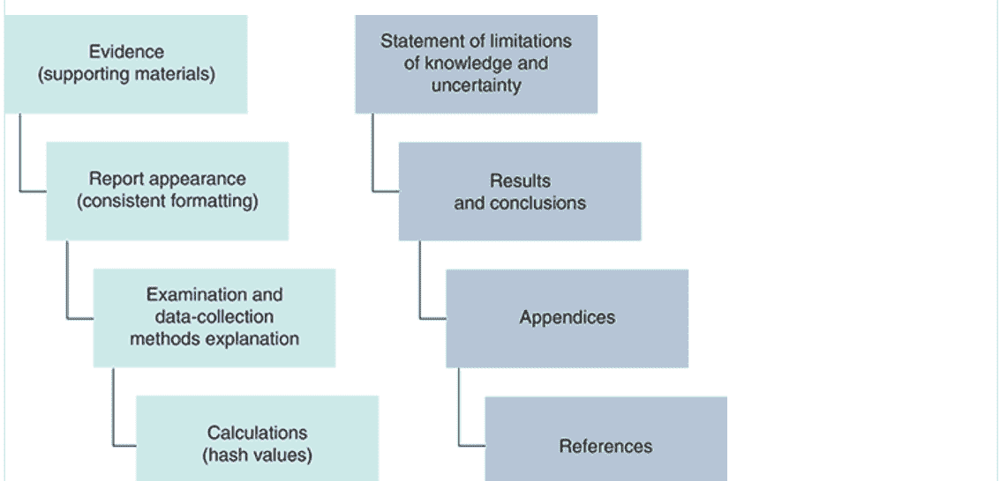

### 详情

该插图描述了数字取证报告元素的两种布局。第一种布局元素从下到上的顺序如下：计算（哈希值）、检查和数据收集方法说明、报告外观（格式一致）和证据（支持性材料）。第二种布局元素从下到上的顺序如下：参考文献、附录、结果与结论，以及知识局限性和不确定性声明。

### 支持性材料

使用图、表、数据和公式等来帮助叙述正在展开的故事。在文中引用这些材料，并将你的观点整合到写作中。按照引入的顺序对图表进行连续编号（例如：图 1、图 2 等，表 1、表 2 等使用另一套序列）。

图注说明应提供描述性信息。在图表中，标记所有轴并包含计量单位。在首次提到该图表的段落之后插入图表，或将所有支持性材料收集在参考文献部分之后（任何附录之前）。

### 报告外观——格式一致

如何格式化文本并不比应用格式的一致性重要。例如，如果你对某些段落进行了缩进，要么全部缩进，要么只缩进紧跟在标题后的段落。全文统一使用相同的字体，并使用一致的标题（例如：主标题加粗且首字母大写，主标题使用斜体等）。对于计量单位，在全文范围内遵循相同的指南；例如，使用“%”或“percent”，但不要两者混用。换句话说，建立一个模板并坚持下去。

### 检查和数据收集方法说明

解释你是如何研究问题的，这在逻辑上符合报告的目的。

### 计算——哈希值

大多数取证工具使用数学公式为数据提供唯一值。数字取证中最常用的哈希算法是消息摘要算法5 (MD5) 和安全哈希算法 1 (SHA1)。

### 结果与结论

解释你的发现，使用小标题将讨论分为逻辑部分。在呈现结果时对其进行评论，讨论你所发现结果的重要性。从细节中抽离出来，综合关于问题已学到（或未学到）的内容以及这些信息的意义。

### 知识局限性和不确定性声明

在数字取证中，许多结果如果陈述保守，可能是绝对真实的，但为了保护你的信誉，必须提供一份局限性和确定性声明。例如，如果你使用 Windows 中的文件时间戳来指示文件创建于特定时间，你需要承认 PC 时钟很容易被重置。

### 理论或数据。参考文献

参考文献可以包括书籍、期刊、报纸、网站、会议论文集、个人通信和访谈。请遵循标准的格式编写参考文献。有许多优秀的风格指南可供选择，拥有一本实体或在线版都是值得的。常用的风格指南包括：

- 《Gregg Reference Manual: A Manual of Style, Grammar, Usage, and Formatting》
- 《The Chicago Manual of Style: The Essential Guide for Writers, Editors, and Publishers》
- 《MLA Style Manual and Guide to Scholarly Publishing from the Modern Language Association》

以下示例展示了不同来源如何在参考文献部分列出，请记住，根据你所遵循的风格指南不同，格式可能会略有差异：

网站：

Law Office of Christopher K. Stiubard stiubardlaw.com/ 2021.

### 单作者文章标题：

O'Herlicky, T. A. “Development of Relationships on the Internet.” Journal of the Advocate 7, 2022, pp. 130–142.

### 多作者文章标题：

Noriki, H. W., C. K. Stiubard, and M. Day. “Investigation of Counterfeiting of Spare Parts—Statistical Analysis.” Frontline of Aviation 8, 2020, pp. 50–152.

### 书籍：

Casey, Eaghan. Digital Evidence and Computer Crime. Academic Press; 3rd edition, 2022.

### 政府或技术报告：

U.S. Department of Justice. “The Examination of Computers.” Report XYZ-001, Washington, DC, 2019.

### 某书籍中的章节：

Pellegrino, A. “Investigation of the Automated Backup Copies of Microsoft Application Files.” In Noriki, H. W. et al., Computer Forensics. Learning Technology, Springfield, 2018.

> **提示**
>
> 无论你是为律师事务所、数字取证公司、研究实验室还是执法机构工作，该机构很可能已经建立了固定的报告格式。在编写报告之前，务必从列表中获取样本或模板。

> **自测**
>
> + 3. 关于书面初步报告，你应该记住以下哪些关注事项？（选择所有适用项。）
>
> a. 初步报告不被视为高风险文件。
>
> b. 书面初步报告的页眉应包含“律师工作成果”（Attorney Work Product）。
>
> c. 书面初步报告可能包含错误或被误解的信息，这些信息可以被对方律师发现。
>
> d. 当口头初步报告转录为书面初步报告时，会发生信息污染（Spilation）。
>
> **答案：** b. 书面初步报告的页眉应包含“律师工作成果”；c. 书面初步报告可能包含错误或被误解的信息，这些信息可以被对方律师发现。


**解释：** 在创建书面初步报告时，考虑在文档页包含“律师工作成果”短语，表明该文件是根据聘请律师的指示准备的。由于初步报告可能不包含调查的最终事实、证据或意见，这些文件应被视为诉讼准备阶段的工作成果。工作成果文件通常是不可发现的。

如果你撰写初步报告，不要使用如“初步副本（Preliminary Copy）”、“草稿副本（Draft Copy）”或“工作草稿（Working Draft）”等标题。这些词汇为对方律师留下了质疑你信誉的机会，并让你看起来聘请你的律师对本应属于你的独立专业判断的内容做了贡献。如果书面初步报告陈述的立场与你在最终报告或证言中的立场相反或更模糊，应该预计对方律师会试图利用该书面报告来质疑你的证言。关于律师工作成果和律师-客户特权的更多信息，请参见 `ned.uscourts.gov/internetDocs/cle/2010-07/AttorneyClientPrivilegeProductDoctrine.pdf`。

## 管理报告结果生成与数字取证报告的编写

许多数字取证工具的自动化报告功能会生成检查期间发现列表。这些自动化报告通常为文本格式，例如文字处理文档、`HTML` 文件或电子表格。这些自动化报告仅提供列表；并不描述证据本身以及它与犯罪或事件的关系。在报告中解释这些发现是数字取证调查员的责任。数字取证报告是技术报告，设计应为非技术读者设计——例如对计算技术和数据科学几乎了解或完全了解的法官或律师。数字取证调查员需要创建易读且易于查阅的报告，以便向非技术读者传达检查结果的性质。

后续章节将讨论与报告写作相关的某些任务，包括创建可在多份报告中使用的资源、确定报告的潜在受众、将数字取证程序生成的报告整合到最终报告中，以及编写解释发现的叙述。

## 构建报告资源

随着你编写的报告越来越多，你会发现某些信息适用于许多不同类型的检查。因此，减少报告写作任务的一种方法是创建通用信息文档，这些文档可以复制到你的报告中，并根据每份报告的要求进行调整。此类文档可能包括：

- 术语表
- 参考文献
- 简历

这些文档应根据需要定期审查和更新。

## 确定谁来阅读报告

根据读者的需求，创建一个涵盖读者人员的读者工作表是一个好主意。如果所需信息可用，该工作表应涵盖读者对信息系统、数字取证和法律程序的了解程度。此外，工作表应列出读者对客户、律师或你可能存在的任何已知偏见。如果关于受众的信息不足，最好对他们对数字取证的理解水平做出合理的推测。图 2-3 是一个读者需求工作表的示例。

## 图 2-3 数字取证报告受众工作表

| 案件信息 | 客户 | 调查员姓名 |
| :--- | :--- | :--- |
| 案件信息： | Montgomery_7222 | Superior, Inc. | John Jones |
| 律师（s）及 | 对方律师（s）及员工 | 其他非法律人员 |
| 读者的姓名？ | Randolph K Smith，法律顾问；Sally Johnson，诉讼律师 | Jeremiah Olson & 助理 | Steve Billings, Manager; Robert Smith, IT |
| 授权接收报告的人员？ | 是 | 是 | Steve Billings, Manager--是；Robert Smith, IT--否 |
| 这是主要还是次要读者？ | 主要 | 主要 | Steve Billings, Manager--次要 |
| 对信息技术的了解程度（高、中、低）？ | 低 | 低 | Steve Billings, Manager--中 |
| 对证据规则的了解（州或联邦）？ | 是 | 是 | 否 |
| 读者喜欢的报告格式？ | 电子 | 纸质 | Steve Billings, Manager--电子 |
| 报告的首选传输方法？ | 带数字签名的电子邮件 | 挂号 | Steve Billings, Manager--带数字签名的电子邮件 |
| 已知偏见 | 预计无偏见 | 预计有偏见 | Steve Billings, Manager--无偏见 |
| 注释 | 报告在法律顾问或诉讼律师批准前发布 | 预计对方律师将试图维护其客户/被告 | Steve Billings, Manager--负面发现可能导致冲突并终止客户/被告 |

## 详情

数字取证报告受众工作表。该工作表列出了案件信息、相关客户、调查员姓名、律师和员工、对方律师以及非法律人员。列出的问题包括：读者的姓名、授权接收人员、是否为主要或次要读者、对信息技术的了解、对证据规则的了解、读者喜欢的报告格式、首选传输方法、已知偏见和注释。

> **提示**
>
> 有关确定读者需求的更多信息，请参考以下资源：
>
> * 《Technical Writing》，John M. Landon 著（1994）：第18-33页提供了如图2-3所示的受众工作表示例
> * 《Technical Writing》，Annemaris-Hamlin, Chris Rubio 和 Michele DeSilva 著（2016）
> * `cocoer.pressbooks.com/chapter/audience-analysis/`
> * "受众分析概览”，普渡大学在线写作实验室
> * `owl.purdue.edu/owl/subject_specific_writing/professional_technical_writing/audience_analysis/index.html`

# 整合数字取证报告

报告编写过程可以分为三个阶段，应按照以下顺序完成：

1. 分析数据并审查调查员笔记。
2. 编写初稿。
3. 修订草稿并创建最终报告。

## 分析数据并审查调查员笔记

正如本单元之前解释的那样，数字取证检查期间创建的任何笔记和其他文档都可能面临对方律师的调取。在执行检查时，从战术上有必要记录笔记，以跟踪发现的内容和采取的精确步骤。记录笔记时，仅记录特定项目，类似于图 2-4 示例所示：

### 图 2-4 调查员笔记示例

#### 调查员笔记

| 调查员姓名: | Giovana Lima Cardoso |
| :--- | :--- |
| 案件名称: | Activity_02-1 |
| 案件编号: | Activity_02-1 |

| 开始时间 | 执行的检查活动 | 时长（十分小时为单位） |
| :--- | :--- | :--- |
| 6/12/2022 2:14 PM | 启动 `Autopsy` 并打开数字镜像 `Activity_2-1.001`。 | |
| 2:15 PM | 针对瑞士银行账户 `A91458` 关键词搜索。 | |
| 2:16 PM | 找到瑞士银行账户 `A91458`，位于标记为 `Evidence_210912_Thumb_01` 的闪存器中的电子文件 `MY_SECONDARY_COUNT.DS`。已标记待后续评估。 | |

图中展示了调查员笔记的示例。调查员姓名、案件名称和案件编号列在上方，随后是包含日期、开始时间以及在该日期时间执行的相应检查活动信息的表格。这里列出了 2022年6月12日 下午 2:14、2:15 和 2:16 执行的活动，且以十分小时为单位计算的时长为空。

调查员笔记的目的是跟踪发现的结果并记录检查期间采取的所有步骤。在编写报告时，你需要参考这些笔记，特别是在案件非常复杂的情况下。它还能提供调查结果的可重复性。调查员笔记本质上是调查的日志。

如果你为律师工作并按小时计费，可以轻松更新笔记以包含检查数字证据花费的时间。时长通常以十分小时为单位，即以六分钟为增量。例如，对于花费 1 小时 42 分完成的检查，你会列出 1.7 小时。如果时间处于中间，请根据判断向上或向下舍入到最近的十分。记住在记录时间时保持一致。

### 注意事项 4

通常，对方律师会让另一位数字取证调查员审查你的报告和数字取证检查结果。这意味着你在从制品中分析和收集证据时所做的一切必须是可重复的。

## 编写初稿

所有数字取证报告应包含本单元[设计报告的布局与展示](#)部分中描述的元素。在编写报告时，还应考虑以下问题：

- 检查的定义目标或任务是什么？
- 读者（受众）对数字取证和案件的了解程度如何？
- 报告的目的是什么？
- 本报告需要什么格式和风格？

### 创建大纲

在你对报告的目标、受众、目的以及要求的格式和风格有清晰了解后，可以创建一个报告大纲，如下：

#### **摘要**（如果报告很长）

- I. 引言
  - 检查目的，陈述请求者提出的目标或任务
- II. 真实性证明 (Bona fides)
  - 列出你作为数字取证调查员资质的声明，或
  - 引用报告附录中的个人简历
- III. 报告正文
  - 关于案件性质的概述讨论
  - 检查过程说明
  - 收集的证据说明，附录中提供证据日志
  - 检查结果（在叙述中使用调查员笔记和取证工具报告生成器）
- IV. 结论
  - 报告目的简要声明
  - 你的检查结果
- V. 附录
  - 个人简历
  - 证据副本
  - 调查员笔记
  - 检查过程中的任何杂项
- VI. 术语表
  - 报告中使用的技术术语列表
- VII. 参考文献
  - 使用的任何资源的书目
- VIII. 致谢
  - 协助完成检查的人员列表

使用完善后的大纲，开始编写主题句。遵循大纲将帮助你扩展每个段落。在完成每个部分时，思考如何过渡到下一部分，以保持报告的流畅和清晰。在修订阶段，你可以改进任何过渡。在写作时记住所有指南将使读者更容易理解案件的复杂性和检查细节。

你对这次检查有什么看法和观察结果？

### 修订草稿并创建最终报告

在完成初稿后，是时候修订报告了。除非有紧急需求，否则永远不要发布报告的初稿。在开始审查时，请提问以下问题：

- 报告的沟通质量如何？
- 观点和发现是否易于遵循和理解？
- 语法和词汇是否正确？
- 标点符号和拼写是否正确？
- 报告是否反映了目标？
- 主要论点和逻辑发展是否组织良好？
- 你是否包含了必要的关于知识局限性和不确定性的声明，以保护你的信誉？
- 报告的各个章节之间过渡是否流畅？

如有必要，重复此过程，以确保报告具有最高质量。根据你组织的要求，报告在发布之前应发送给管理层、客户或你的聘请律师进行批准。一旦获得批准，将报告提交给请求检查的人或组织。所有最终报告都应保存为受密码保护的 `PDF`，以防止任何人对其修改。


### 注意 5

大多数数字取证工具以 `HTML`、电子表格或 `PDF` 格式创建报告。注意，无论使用什么格式，报告都可能被电子发现（`e-discovery`）数据库，这在 `e-discovery` 模块中讨论过。如果你的报告被添加到电子发现数据库，所有文本必须被电子发现应用程序读取。`PDF` 生成器仅产生文本的图形图像。然后，图形将通过 `OCR` 程序转换为电子发现程序可读取的纯文本。这个额外步骤并不总是 100% 准确，报告内容可能会被 `OCR` 程序误读或更改。当对方律师审查转换后的报告进行质证时，误读可能会导致尴尬的局面。为了尽量减少问题，最好在作证之前检查你的报告。如果你在报告中发现任何错误，请立即纠正。

# 活动 2

预计时间：20 分钟

目标：在创建正式报告时，重复对 George Montgomery USB 驱动器的检查，并对分析过程中采取的每一步创建详细笔记。

在开始之前：

- 创建工作文件夹 `C:\Work\Module_02\Activity_02-1`。
- 将模块提供的以下文件下载到工作文件夹：
  - `Activity_02-1_Examiner_Notes.xlsx`
  - `Activity_02-1.001`

对于此活动，你将通过 `Autopsy` 分析 George Montgomery USB 驱动器上的数据并创建取证日志文件，完成创建正式取证报告所需的初始步骤。完成以下步骤：

1. 打开文件 `Activity_02-1_Examiner_Notes.xlsx`。

   

2. 在电子表格的 `C3` 单元中输入你的名字。在 `C4` 和 `C5` 格中输入 `Activity_02-1`。在日期（`Date`）和开始时间（`Start Time`）列中，输入如图 2-5 所示的日期和时间。保存文件并打开它。

### 取证员笔记

| 取证员姓名：学生姓名 |
| :--- |
| 案件名称：Activity_02-1 |
| 案件编号：Activity_02-1 |

| 日期 | 开始时间 | 执行的检查活动 | 持续时间（十小时为单位） |
| :--- | :--- | :--- | :--- |
| | | | |
| | | | |
| | | | |
| | | | |
| | | | |
| | | | |
| | | | |
| | | | |
| | | | |
| | | | |
| | | | |
| | | | |
| | | | |
| | | | |
| | | | |
| | | | |
| | | | |
| | | | |

详情（Details）

图中展示了取证员笔记电子表格的示例。取证员姓名、案件名称和案件编号在上方指定，随后是一个带有四列的表格，其中列头显示为日期、开始时间、执行的检查活动和以十小时为单位的持续时间。

3. 启动 Windows 版的 `Autopsy`。
4. 在 `Autopsy` 的欢迎窗口中，点击“新案件（`New Case`）”按钮。在“新案件信息”窗口的“案件名称（`Case Name`）”文本框中输入 `Activity_02-1`，并点击“基本目录（`Base Directory`）”文本框旁边的“浏览（`Browse`）”。导航并点击你的工作文件夹。确保案件类型选择了“单用户（`Single-User`）”选项按钮，然后点击“下一步（`Next`）”。
5. 在“可选信息”窗口的“案件编号”文本框中输入 `Activity_02-1`，并在“取证员”部分的“姓名（`Name`）”文本框中输入全名。点击“完成（`Finish`）”开始添加数据源。
6. 在“添加数据源”窗口的“选择要添加的数据源类型（`Select Type of Data Source To Add`）”区域，点击 `Autopsy` 窗口，点击“磁盘映像或虚拟机（`Disk Image or VM File`）”按钮，然后点击“下一步”。
7. 在“添加数据源”窗口的“选择数据源（`Select Data Source`）”区域，点击“浏览”，在打开窗口中进入工作文件夹，点击 `Activity_02-1.001` 文件，点击“打开”，然后在“选择添加数据源”窗口中点击“下一步”。
8. 在“添加数据源”窗口的“配置采集（`Configure Ingest`）”区域，点击“选择全部（`Select All`）”并点击“下一步”。
9. 当采集配置完成后，点击“完成”。
10. 在取证员笔记电子表格的 `B8` 单元格中，记录你开始活动的时间，在 `C8` 单元格中添加一条声明指示你启动了 `Autopsy` 并加载了文件 `Activity_02-1.001`。示例条目为：“启动了 Windows 版 Autopsy 并添加了取证文件 Activity_02-1.001，版本 4.18.0。”

接下来，你将找到所有相关文件。按照这些步骤操作，并在取证员笔记电子表格的每个条目中记录每个活动开始的时间：

- 在左侧的树状查看器（`Tree Viewer`）面板中，点击展开视图（`Views`）、“文件类型（`File Types`）”、“按扩展名（`By Extension`）”和“文档（`Documents`）”。
- 在“文档”下，点击“Office”。在结果查看器（`Result Viewer`，右上面板）中，点击文件 `Contract with Martha.docx`，在内容查看器（`Content Viewer`，右下面板）中显示其内容。
- 右键点击 `Contract with Martha.docx`。在下拉菜单中，点击“添加文件标签（`Add File Tag`）”，然后在“标签名称（`Tag Name`）”框中点击“已恢复文档（`Recovered Documents`）”。
- 在取证员笔记电子表格的 `C9` 单元中，输入一条声明指示你检查了文件 `Contract with Martha.docx` 内容，并描述消息内容。

重复步骤 2-4 并检查文件：`George Presentation.pptx`、`~George Presentation.pptx`、`Inventory and sales.xlsx` 和 `Notes.doc`。完成后，更新取证员笔记。

- 在树状查看器面板中，点击并展开“标签（`Tags`）”文件夹和“已恢复文档（`Recovered Documents`）”文件夹。然后在结果查看器面板中，点击 `Contract with Martha.docx` 以高亮显示。按 `Ctrl+A` 高亮所有文件。
- 在结果查看器面板中，右键点击高亮的文件并如图 2-6 所示选择“提取文件（`Extract File(s)`）”。在“保存”对话框中，点击“保存”，然后点击“确定”。

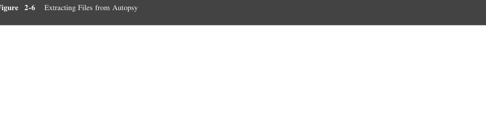

### 详情（Details）

截图显示了通过 `Autopsy` 提取文件。列表窗口显示了表格选项卡，包含名称、修改时间、更改时间、访问时间和创建时间。右键选项包括“提取文件”，标记状态为点击“提取文件”。

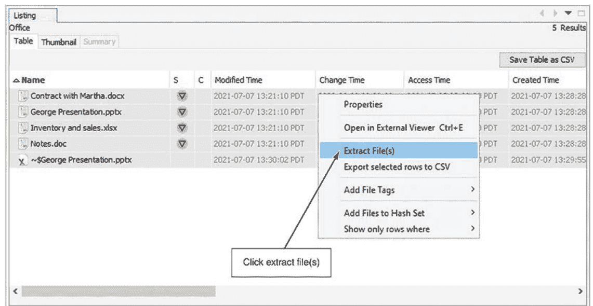

`Autopsy` 将提取的文件存储在工作文件夹案件文件夹下的 `Export`（导出）子文件夹中。该路径示例为：`C:\Work\Module02\Activity_02-Export`。

在 `Autopsy` 主窗口中，点击“工具（`Tools`）”然后“生成报告（`Generate Report`）”。在“生成报告，报告模块”对话框中，点击“`HTML` 报告”，并点击“下一步”。

在“选择包含的数据源（`Select which data source(s) to include`）”对话框中，点击“全选（`Check All`）”，然后点击“下一步”。

在“配置报告（`Configure Report`）”对话框中，点击“所有标记结果（`All Tagged Results`）”，然后点击“完成”。

当报告生成器完成后，点击报告链接在网络浏览器中打开它，然后在“报告生成进度”窗口中点击“关闭”。


- 保存并关闭电子表格文件 `Activity_02-1_Examiner_Notes.xlsx`。在用于 Autopsy 检查提交的 Export 文件夹副本中，向你的导师提交五个也被检索的文件（注意，导出文件可能有不同的前缀数字）。点击 Autopsy。向导师提交以下文件：

* `Activity_02-1_Examiner_Notes.xlsx`
* `12-Contract with Martha.docx`
* `14-George Presentation.pptx`
* `16-Inventory and sales.xlsx`
* `18-Notes.doc`
* `22-~$George Presentation.pptx`

## Note 7

当在 Autopsy 中生成报告时，创建一个文件夹，其中包含 HTML 报告（标题为 `report.html`）以及一个名为 `content` 的文件夹。`content` 子文件夹包含可以从 `report.html` 文件中查看的数据。Autopsy 会自动在报告名称后附加当前日期和时间，并将其保存在创建案件时指定的基目录中。

HTML 报告的文件路径示例为：`C:\Work\Module02\Activity_02-1\Reports\Activity_02-1\HTML Report mm-dd-yyyy-hh-mm-ss\report.html`。你可以通过在文件资源管理器中双击 `report.html` 文件使用浏览器查看该 HTML 报告。

# Self-Check

### 4. 关于取证员笔记，以下陈述中哪些是正确的？（选择所有适用项。）

a. 取证员笔记确保了如果案件受到质疑，在检查中采取的所有步骤都是可重复的。

b. 在检查过程中做笔记有助于取证员跟踪发现，并使报告编写更简单。

c. 取证员笔记仅应在复杂案件中使用。

d. 取证员笔记可以用于对你报告的读者做出最佳猜测。

**答案：** a. 取证员笔记确保了如果案件受到质疑，在检查中采取的所有步骤都是可重复的；b. 在检查过程中做笔记有助于取证员跟踪发现，并使报告编写更简单。

**解释：** 取证员笔记的目的是跟踪发现并记录检查期间采取的所有步骤。这些笔记在编写报告时是必要的，特别是当案件非常复杂时。它还将确保你的发现具有重复性。

# Examine. Preparing for Testimony

当案件进入审判或涉及证词的听证会时，作为法医取证员，你可以扮演两个角色之一：事实证人或专家证人。作为事实证人，你只提供你在调查中发现的事实——任何符合相关性标准且证明力大于偏见性的证据。当你提供技术或科学证词时，你提交这些证据并解释它们是什么以及是如何获取的。你不提供结论，只提供基于这些证据的事实和推论。然而，作为专家证人，你对你发现或观察到的内容持有意见。你根据经验和对调查中发现的事实进行演绎推理来形成这些意见。事实上，是你的意见使你成为了专家证人。

对于每种类型的证词，你都需要充分的准备。尽早与聘请你的律师建立沟通。在开始处理证据之前，尽早了解受害者、原告、对方专家或事实证人以及对方律师。了解争议的基本点。在了解案件时，要记录笔记，但要保持它们以草稿形式存在；只记录事实，将你的意见减少到最低。

## Note 8

你的律师可以在准备案件时为你提供具体的指导。请记住，作为专家证人，你是为律师工作的，而不是为客户（原告或被告）工作，因此如果你发现了负面结果，请尽快与你的律师沟通。

作为准备工作的一部分，你可能希望与其他数字取证专业人员一起审查你的发现。回到你在调查期间记录的笔记进行此类审查。如果你使用电子笔记，请小心存储它们。在分析和报告中，开发并维护一种标准的处理方法，以减少混淆并帮助你日后准备证词。数字取证现在正在发展一种同行评审流程。要获得同行评审，你必须在区域之外寻找。学会利用你的专业网络，并请求同行评审来支持你的发现。你可能还想利用互联网研究对方专家，并寻找他们之前证词中的优缺点。如果可能，查看他们的简历，看看他们是如何介绍自己的。如果不这样做，就等同于在不尝试了解对手的情况下上战场。你的律师可能获得他们在其他案件中提供的证词录副本，通常来自证词库，但也来自已总结并发布在网上的讲座、课程和演示。一些取证调查员维护着邮件列表，你可以通过列表向成员查询其他专家证人。

在准备证词时，回顾以下问题：

- 客户对案件的整体理论是什么？
- 我对案件的描述（与我的证词相关的核心事实）是什么？
- 我可以很有信心地说什么？
- 我的意见如何符合案件理论？
- 案件的范围是什么？
- 我是否过头了？
- 客户对案件的整体理论是否与我的发现一致？

# Documenting and Preparing Evidence

如之前强调的，仔细记录你的步骤以确保可重复性。记录中的疏忽和缺失不会导致证据不可采纳，但可能会影响赋予它的权重。以下指南是有用的：

- 如果你需要清单，就创建一个。
- 在收集证据时，要小心不要获取太少或过多的信息。
- 在某些情况下，收集与案件无关的信息可能会给你的律师带来麻烦。
- 运行工具时，只保留用的输出；不要保留之前的运行，除非是因为必要的设置。
- 在搜索关键词结果时，使用定义良好的关键词和搜索参数重新运行。
- 消除包含假阳性的结果。
- 缩小搜索范围以减少误命中。
- 你应该记录证据的任何疏忽或缺失。
- 在记录你的发现笔记时，保持其简单并针对调查。
- 编写报告时，仅列出与案件相关的证据；不要包含无关的发现。

## 你作为咨询专家或专家证人的角色

根据你律师的需求，你可能需要证明你的意见和技术专业知识，而不是在法庭上作证；这种角色被称为“咨询专家”。然而，如果你的角色从咨询专家变为专家证人，你之前作为咨询专家的工作将面临对方律师的取证。针对这一点，不要记录对话或电话。

当你作为专家证人出现在联邦法庭时，联邦民事诉讼规则 (`FRCP`) 26 (2) (B) 要求你提供以下信息：

- 过去四年中在审判或质证中作为专家作证的其他案件
- 过去十年的任何已出版著作
- 提供证词时收到的之前的报酬

此外，法庭可以任命自己的专家证人。法院指定的专家证人其意见必须保持中立，并且在所属领域具备专业知识。作为由辩方或原告聘请的专家，你需要对法庭专家进行评估。确保向你的律师简报你对法庭专家的发现和意见，以帮助你的律师应对法庭专家证人提供的任何证词。

## Note 9

当被要求提供专家证言时，请先确认你是否是第一个被要求的人。如果不是，请弄清其他专家可能被联系但未被聘用的原因。

## 创建和维护你的简历

你的简历（CV）列出了你的教育背景、培训和职业经验，并用于证明你证言的资质。对于法医鉴定人员来说，保持这份文档的更新和完整对于支持你专家的角色至关重要，并证明你正在通过培训、教学和经验不断提升技能。

你的简历应该描述你执行过的任务、定义具体的成就，以及你的基础和高级技能。你还应该列出你的普通教育、专业教育以及专业培训。如果培训列表非常长，可以使用诸如“参加过的选定培训”之类的标题。确保包括由政府机构或培训政府人员的机构赞助的课程，以及由专业协会（如律师协会）赞助或批准的课程。此外，记录你提供或贡献的任何专业培训。你还必须包含一份证言日志，反映你作为专家给出的每一次证言。

确保你的简历反映了你的职业背景。与求职简历不同，它不应该针对特定的审判。最重要的是，保持简历的实效性并注明日期以便版本控制。如果你的简历超过三个月，你可能需要更新它，以反映你参与的任何新案件和培训。在创建简历时，考虑到谁将阅读它，或者它是否会被自动化简历申请系统读取。

## Note 10

如需数字法医鉴定人员简历示例，请使用你偏好的网络搜索程序搜索“数字法医专家证人简历”。

## Note 11

单独列一份你阅读过的专业领域书籍列表，但不要将此列表包含在简历中，因为这可能暗示你认可这些书中所写的所有内容。

## 准备技术定义

在法庭作证之前，准备好技术概念的定义，以便在被你的律师和对方律师提问时使用。确保使用你自己的话，并记住你正在为非技术背景的观众解释这些概念。你可能想向一个技能有限的人练习解释你的定义和概念，以确认你的陈述是易于理解的。你不需要让陪审团成为该领域的专家，你只是在解释这些术语的一般含义。以下是为你的证言提前准备的定义示例：

- 数字法医或计算机法医
- `CRC-32`、`MD5` 和 `SHA-1` 哈希算法
- 文件空隙（File slack）和未分配（空）空间
- 文件时间戳
- 日志文件
- 文件夹或目录
- 硬件
- 软件
- 操作系统

## 准备应对新闻媒体

某些法律行动会引起新闻媒体的兴趣，但你应该避免与新闻媒体接触，特别是在案件进行期间，原因如下：

- 你的言论可能会损害案件，并产生可能被用来对你不利的记录。
- 你无法控制记者发布的信息的上下文。
- 你不能依靠记者对保密的承诺。记者在获取信息时可能非常激进，他们的利益与你或你客户的利益并不一致。时刻保持警惕，因为你的言论可能被解释为损害你在本案及未来案件中的公正性。即使案件已经解决，也要避免与媒体讨论细节。

如果记者（或其他任何人员）向你索要信息或意见，请克制说任何话，并将他们转交给你的法庭（即聘请你的律师）。如果你无法避免记者，请咨询你的律师并决定如何处理这种情况。计划记录任何尝试的采访，以便你拥有一份关于发生情况的记录。（但注意，不同州对录音许可许可的规定不相同。）如果你被误引或脱离上下文被引用，这段录音可能会很重要。记者可能在寻找煽动性的声音片段或争议性的引言。


### 5. 下列哪项描述了事实证人证言？

a. 描述检查期间恢复的信息的科学或技术证言

b. 执法人员的证言

c. 基于普通证人观察的证言

d. 其他证人的陈述

**答案：** a. 描述检查期间恢复信息的科学或技术证言

**解释：** 描述检查期间恢复信息的科学或技术证言

# 在法庭作证与询问

在法庭作证之前，熟悉在审判和询问中遵循的通常程序。对于审判，你的律师会询问你以证明你作为专家证人或事实证人的能力。对方律师可能会对你的证言进行交叉询问，然后你的律师会对交叉询问中涉及的内容进行重新询问。在你的证言后，你可能会被再次传唤更新你的证词，或者作为反证证人被传唤。询问是审前阶段的一部分。

对于询问，没有法官在场，但双方提问。


# 为你的证词提供资质证明

在证词的资质阶段，你的律师会通过提问来引出使你成为专家证人的资质。这一资质阶段被称为 *voir dire*（源自法语，字面意思是“看，说”）。通常情况下，你的律师会引导你介绍你的简历（CV）。这项审查的详细程度取决于几个因素，但它们都与律师认为你的资质具有多大优势有关。在律师完成这项审查后，他们会请求法庭接受你为数字取证专家。然而，对方律师可能会提出异议并进行交叉质询，通常只在对方律师认为从中可以获益时才会发生。

# 出庭的通用指南

无论你是作为专家证人还是事实证人出庭，在向律师或法庭介绍自己时，都要保持专业和礼貌。在审判之前，尝试了解陪审员、法官和其他律师对计算机的了解程度，以及他们对技术的态度。与律师交流，了解当地陪审团成员的典型类型。通过这些知识，你可以根据听众的教育水平调整你的陈述，并在解释中加入类比。记住，陪审员是受过良好教育的——但并不一定是在数字证据领域。陪审员平均受过约12年的教育，阅读水平相当于八年级。律师可能在该领域拥有深厚的背景，但你才是拥有经验的专家。你可能还会遇到仲裁员或调解员，他们可能没有数字取证的背景。作为证人，你应该准备好两种回答方式。如果被问及无法回答的问题，请回答：“这超出了我的专业范围”或“我没有被要求调查这一点”。这些表述明确了你清楚自己的局限性。由于了解并表达了自己的局限性，并不会看起来不像专家。相反，在面对陪审团时承认自己的局限性，例如说：“可以请您重新表述一下这个问题吗？”这种回答会让律师重新组织问题，是你可以用来控制质询节奏和方向的方法之一。如果问题问得很生硬，或者你不确定意图，请要求律师澄清。

如果对方律师以你认为不准确的方式重新表述你的答案，请通过“不，我不是那样说的”来拒绝他们的重述，然后从“我说的”开始准确地恢复你的立场。保持尊重和愉快，但要坚定。承认局限性的另一个方面是避免过度评价。你提供给陪审团的一部分是一个帮助他们弄清哪些内容超出他们专业范围的人。夸大观点可能会导致陪审团对你产生不信任或怀疑；像一个好老师一样，你应该承认自己的局限性以及结果的局限性。你的表达方式是影响答案对陪审团影响的重要部分。

以下列表提供了一些关于表达和演示的通用指南：

- 始终选择好你要说的话。引导你的证词，使用热情、真诚的语气让陪审团对你说的话感兴趣。当律师或陪审员向你提问时，先面向问题，然后转向陪审团回答。
- 如果现场有麦克风，将其放在距离你6到8英寸的地方，并记得大声、清晰地说话，以便陪审员能听到并理解你的话。
- 使用简单、直接的语言帮助陪审团理解你。例如，使用“测试”（test）而不是“分析”（analyze），如“我运行了我发现的测试”。此外，确保说话时使用具体、清晰的词汇；为了清晰起见，避免使用缩写和俚语，除非你正在引用与案件相关的客观事实。
- 避免幽默。一个人认为搞笑的，另一个人可能不觉得。此外，将你的回答限制在你认为对他人合适的范围内。
- 在此基础上对你的结果进行清晰的解释和描述。
- 作证时使用时间顺序描述事件，并使用手势帮助观众理解你所强调的内容。例如，在说话时指向图表。（本模块的“在证词中使用图表”部分将更详细地讨论图表）。
- 如果使用了技术术语，为陪审团识别并定义这些术语，并适当使用类比和图表。列出任何重要的技术元素，展示你是如何验证和确认每个元素的。
- 在给出观点时，引用该观点所依据的证据来源。然后表达你的观点并解释你的方法论——你是如何得出该观点的。
- 如果椅子是可调节的，确保高度舒适，并将椅子转面向陪审团。
- 为了增强你在陪审团面前的形象，请符合社区商务专业人士着装标准的服装，或者像案件中的律师一样穿。如果你的证词被录像，在人工光下视频录像可能会产生闪烁效应。
- 不要背诵你的证词；你应该努力保持自然、即兴的语调。此外，确保你有办法描述或解释关键因素。
- 对于直接质询，陈述你的观点，识别支持你观点的证据，解释你得出该观点的方法，并重新测试你的观点。

正如前文所述，对于你在证词中使用的任何技术术语，你都应该为非技术听众准备合适的定义和解释。学习如何将你使用的工具描述为你工作的标准流程。确保你了解数字取证的局限性，以便随时应对对方律师的反击。长长的解释对某些陪审团案件可能有用，但对另一些则不然，请咨询律师的意见。

与聘用你的律师一起准备证词。以下是你应该准备的具体问题：

- 数据（或证据）是如何存储在硬盘上的？
- 硬盘的镜像或位流复制是什么？
- 如何从硬盘中恢复被删除的内容？
- 什么是临时文件，它们与数据是什么关系？
- 什么是系统或网络日志？

# 在证词中使用图表

图表和表格等证品有助于说明和澄清你的发现。通常情况下，视觉记忆比听觉材料好得多。因此，配合视觉演示的口头证词是传递信息并帮助记忆的有效方法。你的证品必须清晰易懂。图表应该大而醒目，让陪审员看到。考虑反光和对比度等因素以确保可见性。如有必要，为陪审员制作图表的副本以便他们看到。使用图表的目标是为陪审团提供发现以及证据在案件中的作用。

> **注意**
>
> 不要在此图中包含供应商标志，不要使用他人创建的图（除非你委托他们创建或你拥有书面使用许可，以避免版权问题。自己创建图表的另一个优势是，你可以确保对其中的内容熟悉并能解释其中的材料。

在审判前与律师一起审查图表，并确保你已经练习过，感到自在且自信。在大多数情况下，你需要至少三份图表：一份给律师，一份给对方，一份给法官。然而，将证品接纳为证据是律师的责任。法庭正越来越具有音视频能力，你可能可以使用投影仪系统。如果可用，请与律师讨论。确保你在证词期间能看到你的图表，并看到陪审团。如果你的图表被放在陪审团附近，请法官是否可以移动它们以便他们看得清楚。当你谈论插图特定区域时，使用指示笔引导陪审员的注意力。你也可以用手强调某些信息或引导关注特定点。确保任何手势都在腰部以上，以便陪审员看到。如果律师在你解释时向你提问

当你站在陪审团面前时，请解开外套扣子并保持弯曲手肘，以显示你很自在、自信且从容。

# 避免证言问题

你应当识别出利益冲突问题何时适用于你的案件，并与聘用你的律师讨论任何疑虑，同时你还应该意识到一种被称为`利益冲突排斥`（conflicting out）的做法。这是对方律师试图防止你参与某个重要案件的尝试，在你担任顾问工作时的私营部门中最为常见。对方律师可能会争夺与你讨论案件，然后声称你因为与除聘用你的律师以外的另一位律师讨论案件导致了利益冲突，因此而出具证言。结果，你可能被排除在提供服务之外。此外，除非你签有相关合同，否则请同意审查案件——在未被聘用后，切勿与对方律师进行任何“非记录在案”（off the record）的对话；准备好提供或为对方律师提供案件审查的服务，以保护你自己；此协议可以作为他们没有聘用你的证明。如果你没有被聘用，你将更有可能为你所提供的服务收取费用，且利益冲突不会导致你作为专家被取消资格。

在直接询问阶段，你的律师应该要求询问你关于你已经支付过费用的服务费用；你应该接受证言。如果你已经支付了费用，则取决于案件的解决情况。费用和时间表对于询问是合适的，尽管法官可能会限制这些问题。如果你的律师没有询问你有关支付的问题，对方律师可能会以此贬低你，以试图损害你作为证人的信誉。然而，对方律师知道这种策略可能被专家证人利用，因此他们可能会提到该话题但不会深究，除非你说过已完全付清。当你作证时，不要在法庭上与任何人说话。对方律师看到你与任何人（包括你聘用的律师）交谈，他们可能会再次对你进行交叉询问，并要求你解释和重复。不过，请注意，你的律师可能会在休息期间通知你，请确保在私下环境中进行任何会议。

# 理解检察官不当行为

如果你在刑事案件中为检察官工作，并认为你发现了脱罪证据（能够证明被告无罪或减轻其责任的证据），你有义务确保这些证据不被隐藏。最初，你应该向处理案件的检察官报告这些证据（强调其脱罪性质）。确保记录你向检察官反映的疑虑。如果信息没有在合理时间内披露给辩护律师，你可以向检察官的上级报告。务必记录这段沟通过程，以促成披露、保护你的声誉并避免潜在的利益冲突。如果这些努力没有导致披露，你可以向法官报告未披露的情况。在向法官提出此问题之前，务必记录你曾尝试让检察官注意此事的努力。

# 在直接询问中作证

当你回答聘用你的律师的问题时，你就提供了证言。这种直接询问是审判中证言最重要的部分。如果对方律师试图损害你的信誉，那么交叉询问就没有那么重要了。在准备直接询问的证言时，请记住一些指南和技巧。你应该与律师合作，使用正确的语言来有效地向陪审团传达你的信息。你的律师可能会建议你警惕自己热于助人的本能倾向。这种特质是自然的，但它可能会损害你的证言。你不应该自愿提供任何信息，或对对方律师表现得友好（或敌对）。


# 审阅你的律师准备的询问内容

审阅你的律师准备的询问内容，看看你是否可以提出任何改进建议；该计划旨在确保陪审团看到的内容清晰可见，并提供一个描述你证据收集方法的系统化且易于遵循的计划。配合你的图表练习作证，以便你使用它们时自在。你的律师可能还会帮助你开发一个在陈证言时遵循的主题，但请确保在回答问题时使用自己的话。通常，你的律师在直接询问中可以采取的最佳方法是提出开放式问题，让陪审团听取你的证言。此外，在作证前确保你了解以下术语，你的律师在直接询问期间可能会使用它们：

- **独立实践**——你在未被提示的情况下关于本案及其他案件的信息
- **惯例**——类似案件中传统遵循的程序
- **案件记录**——你维护的书面记录

当你的律师询问你的背景和资质时，你的回答应该显示出你是一个能够提供证言的专家。给出强调你的事实发现和意见的答案。记住根据陪审团的普通教育水平调整语言，并在描述复杂事务时，尝试在技术术语和通俗语言之间取得平衡。

在用词选择上也要避免模糊。例如，不要使用“非常大”或“很长时间”之类的表达。这些词的含义取决于它们比较的对象，而这种比较对于每个陪审团可能都是不同的。使用精确的数字和测量单位，如果相关，请引用数字的统计位置、与平均值的关系，或预期的值或范围。

当你在演示中使用图表时，请记住你正在向陪审团说明你收集证据的方法，因此请遵循教师在教室里使用的一些指南，以确保陪审团理解你的解释。

## 在交叉询问中作证

在回答对方律师的问题时，请记住某些词是基于假设事实的。对方律师可以利用这些问题让你说出与你的证言矛盾的内容。交叉询问中成功的最有效过程是建立基于你的意见、约定以及所有数字取证专家都依赖的标准事实（例如，`1 千字节由 1024 字节组成`）。

由于情况的性质，有时你需要引入另一位鉴定员或机构。在某些情况下，处理民事案件的鉴定员需要将你开发的证据移交给另一家公司的安全小组或政府部门以进一步开发案件。咨询你的主管或聘用你的方是进行该操作的当当程序。有时对方律师会在一个问题中问几个问题；这种做法是复合问题，如果你的律师没有反对，请通过回答“请你将你的上一个问题拆分成几个独立的问题？”

对方律师用来挑战你可信度的方法包括：强加观点于你、根据其需要总结你的证词、制造假设或推测，以及控制你证词的节奏。其他策略还指出细小的不一致导致你做出冲突陈述，并鼓励你主动提供信息。

你对交叉询问策略的回应当让对方律师更加理智，这种回应能很好地赢得陪审团。认真回答问题。在回答时要周全、专业且礼貌。在交叉询问期间，你越耐心就越能应对任何可能的攻击。如果对方律师对你的证言变得咄咄逼人或愤怒，保持冷静和专业会对比增强你的形象。如果一个问题有完全且准确的“是”或“否”的答案，那么回答一个说明限制或资质的问题可能是重要的。你可能需要你的律师在重新询问时扩大这一系列问题，或者使用一个约定的表达来向他示意，例如“这个问题需要更复杂的答案，但答案是是或否。”

除了直接询问和交叉询问，大多数司法管辖区允许法官和陪审员提问。这些问题适用于与其他任何问题相同的证据规则。律师可能会对这些问题提出异议，但通常除非它们严重违反了规则，例如在预审阶段（`in limine`）就被明确排除的问题。回答法官或陪审员的问题应被视为一种机会。作为证人，你必须猜测哪些对法官和陪审团是重要的，以及何时不应该直接回答他们的问题。

许多因素都会增加你作证时的压力，包括法官、律师、陪审团以及失去控制的感觉。不要认为你对结果负责。如果你犯了错误，请纠正它，并回到证词的正轨上。避免以下行为，这些行为会给人你失去了控制的印象：

- 在被对方律师纠缠或对作证感到紧张时表现出争性
- 听力能力差或有防御性肢体语言，如交叉双臂
- 在回答问题时过于话多或说话太快
- 术性太强，让普通陪审团无法理解未知或新信息

作证时永远不要有不切实际的高自我预期；每个人都会犯错。控制证词是律师在直接询问和交叉询问中最重要的工作。成功交叉询问的关键在于继续向陪审团推销自己，无论对方律师如何试图损害你或你的证词。此外，记住对于每位专家证人都有第一次作证的时候。良好的技术资质和相关经验是作证时应对交叉询问预审（`voir dire`）最有效的防御。你测试的次数并不是成为专家证人的条件。

# 准备证言或听证会

证言（`Deposition`）与法庭证词不同，因为没有法官或陪审团。双方律师都在场并向你提问。随着当前技术的发展，“现场”的概念已扩大到虚拟现场。证言的目的是让对方律师审查你的证词。请求证言的律师确定其地点，可能在他们的办公室或你的法医实验室。

证言有两种类型：取证证言和证词保留。取证证言是审判取证程序的一部分。请求证言的对方律师通常会进行等同于直接询问和交叉询问。你的律师通常会所需的问题，以澄清你在证词中可能被误解的点。虽然证言可以录制，但书面转录更为常见，且除了视频录制还需要书面转录。如果证言进行了视频录制，法院规则通常要求比速记记录的证言有更长的通知期来安排。

证词保留证言可能由你的客户在你作证期间请求，以防日程冲突或问题。这些证言通常除了转录外还会录制，你的证词通过向陪审团播放视频记录进入。在某些情况下，你可以将证言设在你的实验室或提供设施，这可以更容易进行演示并提供更好的证词。这种证言遵循法庭证词的模式，你的律师作为证人传唤你并进行直接询问，对方律师进行询问，律师进行重新询问和纠正。法官对异议进行裁决，并根据被采纳的异议决定提交给陪审团的副本中省略哪些证词部分。

## 证言中作证指南

律师在取证阶段往往比在审判（或视频录制证言）期间更具攻击性。因此如此，证言可能比法庭证词更有压力。因此，努力保持冷静和放松，在证言期间保持自信的外表。例如，将手放在桌子上，确保椅子的高度合适，避免坐在低于对方律师视线的位置。保持你的语气、表情或策略。在证言前学习对方律师的名字，并将其纳入你的回答中，以展现你与对方律师之间地位的平等。如果对方律师试图避免眼神交流，请直视他们的眼睛。

记住，在证言期间，对方律师会使用审判时所有的可用技术，因此在回答问题时要记住证词指南，并在回答中要果断。如果你对证言特别担心，请你的律师录制一次练习环节，并评估你的表现。以下是证言期间遵循的一些通用规则：

- 保持专业和礼貌。
- 在描述你的观点时使用事实。
- 理解在取证证言中被质询是不自然的过程；对方律师的目标之一是让你犯错。

如果你准备了一份书面报告，对方律师通常会尝试利用它来对付你，引导你做出与你之前写的相反的证词。如果律师将该报告或你工作的任何其他文件联系起来，请要求查看。

## 听证会作证指南

在听证会上作证通常与在审判中作证相似，因此请遵循你在法庭作证时遵循的通用指南。听证可能在行政机构、立法机构或法院进行（后者通常涉及特定问题）。行政或立法听证通常涉及该机构或委员会的主题，并寻求你在证词中提供关于其正考虑制定规则或法律的某一主题的证据。现场会有主席或委员会主席，提问格式取决于该机构或委员会的规则以及听证的目的。行政或立法听证通常与之前导致诉讼的事件有关。在行政听证中作证不像在质证或审判中那样。

> **注释 13**
>
> | 联邦政府拥有数千个行政机构，各州通常有数百个行政机构。 |
> | :--- |
> | 司法听证在法院举行，用于在审判前确定某些证据的采纳性…… |

司法听证在法院举行，用于在审判前确定某些证据的采纳性。现场没有陪审员，但证据排除听证通常在案件早期举行，以决定刑事案件是继续进行还是被驳回。通常，它们更多地关注你获取和保存证据的程序，而不是证据的实质或你的意见。它们还可以包括你进行检查的依据或权限（搜查令或合理理由）。在大多数刑事案件中，辩护律师会寻求排除任何有可争论拒绝理由的证据。

## 证词规划审查

在审判、听证会或质证中作证时，本模块提供的报告编写要素将帮助你在直接询问或交叉询问期间提供指导。本模块中讨论的要素既适用于客户或律师要求的正式报告，也适用于正式（即口头）报告。在准备作证时，你将需要以下要素：

- 最新的个人简历（`CV`）
- 发现请求中列出的任何项目，例如正式报告（如果曾被要求）、适用于检查和案件的证据、检查员笔记以及计费记录（如果适用）
- 向陪审员和法官解释复杂问题所需的任何图表

在作证时间之前，请审查所有材料并练习你的演讲技巧。

---

### 6. 在你的交叉询问期间，你应该做以下哪项操作？（选择所有适用项）

a. 与陪审员保持眼神交流。
b. 密切你的律师正在反对什么。
c. 帮助律师、法官和陪审员理解案件，即使你必须稍微超出你的专业范围。
d. 注意对方律师的提。
e. 尽可能实际地回答对方律师的问题。

**答案：** a. 与陪审员保持眼神交流；b. 密切你的律师正在反对什么；d. 注意对方律师的提；e. 尽可能简洁地回答对方律师的问题。

**解释：** 在审判期间，与陪审员保持舒适的眼神交流水平。你可能会发现自己正在与对方律师竞争，但要尽力在你的作证期间让陪审员的注意力集中在你身上。当对方律师向你提问时，尽可能避免绝对的“是”或“否”回答；在适当的情况下，在对方律师向你抛出致命性问题之前，添加事实以澄清你的答案。这类问题是基于基本基础事实的变化而伪造的，似乎无法回答或否认。它可能会偏离你的证词和你客户的案件；然而，法官通常会支持你陈述条件或限制。交叉询问成功的最有效过程是建立作为你意见基础的假设性事实。

### 7. 你正在质证中作证，对方律师问了一个极其详细的问题作为？你能给出的最佳答案是什么？（选择所有适用项）

a. 尽你所能回答问题。
b. “我不知道。”
c. 拒绝回答问题。
d. “我不理解这个问题。”

**答案：** b. “我不知道”；d. “我不理解这个问题。”

**解释：** 避免试图教导对方律师，特别是当问题似乎超出了你的专业范围或你被聘请处理的问题范围时。可以随意给出如“我不知道”或“我不理解这个问题”之类的答案。

---

# 模块回顾

## 模块总结

- 所有美国地区法院和州法院都要求专家证人提交书面报告。
- 在美国，《联邦民事诉讼规则》（`FRCP`）第26条要求预计将需要提交书面报告的专家证人提交报告。报告必须包含专家意见以及该意见的依据。
- 律师利用质证来研究专家证人之前的证词，并更多地了解对方律师聘请的专家证人。
- 报告应该回答你被聘请回答的问题，并尽可能减少不支持特定问题的信息。
- 定义良好的报告结构使你的报告包含清晰标记的章节，并一致地遵循编号方案。确保支持材料（如图表）有清晰的编号和标签。

## 关键术语

- 诚信态度 (`bona fides`)
- 冲突排除 (`conflicting out`)
- 个人简历 (`CV`)
- 质证 (`deposition`)
- 质证库 (`deposition bank`)
- 发现 (`discovery`)
- 发现质证 (`discovery deposition`)
- 询问计划 (`examination plan`)
- 专家证人 (`expert witness`)
- 事实证人 (`fact witness`)
- 哈希算法 (`hash algorithm`)
- 高风险文档 (`high-risk document`)
- 普通证人 (`lay witness`)
- 证词保存质证 (`testimony-preservation deposition`)
- 预审 (`voir dire`)

## 复习题

1. 以下哪些规则或法律要求专家准备并提交报告？
   a. `FRCP 26`
   b. `FRE 801`
   c. 均都不是
   d. 都是

2. 假设性问题传统上用于什么目的？
   a. 设定案件框架
   b. 定义案件
   c. 刺激专家证人之间的讨论
   d. 判定案件

3. 以下哪项是书面报告的示例？
   a. 搜查令
   b. 誓书
   c. 预审
   d. 检查员笔记

4. 在最终解决之前销毁证据的术语是什么？（选择所有适用项）。
   a. 预审
   b. 发现
   c. 准入限制 (`motion in limine`)
   d. 证据灭失 (`spoliation`)

5. 专家证人在哪些情况下可以给出意见？（选择所有适用项）。
   a. 意见、推论或结论取决于普通人经验不具备的特殊知识、技能或培训。
   b. 证人已被证明是真正的专家。
   c. 证人对其意见以合理的确定性（概率）进行作证。

6. 向美国联邦法院和大多数州法院提交报告时使用的标准格式是什么？

7. 在编写报告时，格式方面最重要的的一点是什么？
   a. 整洁的外观
   b. 字体大小
   c. 符号和缩写的清晰使用
   d. 一致性

8. 自动化工具帮助你收集和报告证据，但你负责执行哪些操作？（选择所有适用项。）
   a. 解释你的格式选择
   b. 解释证据的意义
   c. 详细解释软件如何工作
   d. 解释适用于结果的任何限制或不确定性

9. 评估书面报告时应考虑哪些标准？（选择所有适用项。）
   a. 报告应该吸引读者。
   b. 信息对读者来说应该是相关的且组织良好的。
   c. 报告语言应该是简单直接的。
   d. 报告应使用多种术语。

10. 描述自动化取证工具在报告编写中的主要优势。

11. 许多数字取证工具的报告生成器提供了哪些优势？（选择所有适用项。）
    a. 数字取证报告生成器创建一个详细的 `HTML` 报告，包括文件最后访问的时间以及检查员识别的文件内容。
    b. 数字取证报告生成器消除了编写叙述性报告的需求。
    c. 数字取证报告生成器自动对证据提供足够的解释。
    d. `HTML` 格式生成的数字报告可以使用许多文字处理器提供的超链接功能轻松地整合到另一个电子文档中。

12. 以下哪些项描述了专家证人证词？（选择所有适用项。）
    a. 旨在帮助陪审团确定超出普通人知识范围事项的证词。
    b. 定义案件问题以供陪审团裁定的证词。
    c. 导致具有科学、技术或其他专业知识或经验的证人表达述意见而产生的证词。
    d. 旨在对事实的真实性或证人的可信力产生怀疑的证词。

13. 在作词时使用图表，以下哪些准则适用？（多选题）
    - a. 确保陪审团能看到你的图表。
    - b. 预练习在法庭作词时使用图表。
    - c. 你的证物必须清晰且易于理解。
    - d. 通过准备额外的图表来解释更复杂或支持性的问题，以做到防有万一的准备。

14. 证人在作词期间提供什么类型的信息？（多选题）
    - a. 们对证据重要性的专业意见。
    - b. 对事实认定者需要裁定的问题的定义。
    - c. 仅提供事实。
    - d. 对其执行的测试结果的观察。

15. 在作词时，对于你不理解的问题，你该如何回答？

16. 如果你意识到自己在询问证（`deposition`）过程中犯了错误或陈述不当，你该怎么办？（多选题）
    - a. 如果询问证尚未结束，请提及该错误并进行纠正。
    - b. 判断错误是否是微道的，如果是，则忽略它。
    - c. 如果询问证已结束，在提供给你签署的副本的修正页上进行修正。
    - d. 拨打对方律师告知你的错误或陈述不当。
    - e. 请求在审判中获得纠正的机会。

17. 以下哪些是询问证的类型？（多选题）
    - a. 证词保存（`Testimony preservation`）。
    - b. 同行证词（`Peer testimony`）。
    - c. 证据发现（`Discovery`）。
    - d. 声望证词（`Prestige testimony`）。

18. 作为法庭上的事实证人或专家证人，关于证词你必须记住：
    - a. 你要对案件的结果负责。
    - b. 你的职责是报告你的技术或科学发现，或提供诚实的意见。
    - c. 避免提及你提供服务获得了多少报酬。
    - d. 在回答律师的提问时，始终面对法官说话。

19. 在作词之前，你应该做以下哪些事？（多选题）
    - a. 与聘请的律师一起制定询问计划。
    - b. 确保你已获得服务报酬以及询问证或审判的预估费用。
    - c. 进行适当的仪表打理。
    - d. 将你在调查期间记录的所有草稿笔记打字。

20. 以下哪项描述了质询（`voir dire`）的目的？（多选题）
    - a. 通过审前动议排除证据。
    - b. 由专家证人制定询问计划。
    - c. 确定证人作为专家的资质。
    - d. 在询问证后对你的证词进行修正。

21. 什么是限制动议（`motion in limine`）？
    - a. 驳回案件的动议。
    - b. 分子随机方式的运动。
    - c. 为排除某些证据的审前动议。
    - d. 修订案件日程的审前动议。

22. 你的简历属于以下哪些项？（多选题）
    - a. 成为专家证人的必要工具。
    - b. 在你作词前通常需要提供的文件。
    - c. 对你的经验、教育和培训的详细记录。
    - d. 对你适用于当前案件的技能的描述。

23. 确保陪审员记住证词的最可靠方法是执行以下哪项？
    - a. 使用带有手势和面部表情的口头证词呈现证据。
    - b. 结合口头证词和支持证词的图表呈现证据。
    - c. 穿亮色的衣服以吸引陪审员的注意。
    - d. 用幽默的轶事强调你的观点。
    - e. 仔细背你的证词。

24. 如果你给出的答案是你认为律师应该跟进的，你该怎么办？
    - a. 改变你的说话语气。
    - b. 与提问的律师争论。
    - c. 使用约定的表达方式来提醒律师跟进该问题。
    - d. 尝试在你的回答中包含尽可能的信息。

25. 在回答关于硬盘大小的问题时，以下哪些回答是合适的？（多选题）
    - a. “这是一个非常大的硬盘。”
    - b. “技术数据表显示这是一个 `3TB` 的硬盘。”
    - c. “这是一个 `3TB` 的硬盘，配置了 `2.78TB` 的可用存储空间。”
    - d. “我无法确定硬盘的大小，因为受损太严重了。”

26. 你的简历中应该包含哪些项目？（多选题）
    - a. 之前的专家证词。
    - b. 教育和培训。
    - c. 工作经验。
    - d. 你开展过的培训和演讲。

27. 当为检察官工作时，如果发现的证据似乎是脱罪证据且未释放给辩方，你该怎么办？
    - a. 将信息保存在案中以备后查。
    - b. 将信息提交给检察官，然后提交给他们的主管，最后提交给[法院]。
    - c. 销毁证据。
    - d. 将证据交给辩方。

---

# 动手实践项目

## 项目 2-1

**预计耗时：** 60 分钟

**目标：** 完成一份清单以帮助组织你的写作。

**开始之前：**

- 完成活动 2-1
- 创建工作文件夹 `C:\Work\Module_02\Project_02-1`
- 下载本模块提供的文件到你的工作文件夹：
  - `Project02-1_Report_Writing_Checklist.xlsx`
- 将你之前的文件下载到工作文件夹：
  - `Activity02-1_Examiner_Notes.xlsx`

在此活动中，你将启动报告写作步骤。你将填写一份清单，以确定报告的读者、目的以及要求的格式和风格。由于这是起草报告的第一步，不需要完成清单的所有部分。对于缺少信息的部分请留空，并使用标题作为稍后完成的提醒。


作为a，本案围绕一名失踪员工 George Montgomery 展开。已知事实如下：

- 本案最初是针对失踪员工去向的调查，已变为对滥用公司资源的调查。
- 该失踪员工似乎在使用公司电脑从事副业。
- 从分配的电脑中恢复了一个容量的 U 盘。
- 请求的经理对信息系统有一定的技术知识。
- 本报告要解决的目标包括：
  - 尝试确定 George Montgomery 的位置。
  - 尝试确定 George Montgomery 和另一名员工 Martha 缺席的原因。
  - 说明哪些资源用于此检查。
  - 说明从此次检查中发现了什么。
  - 对你的发现提供意见。

完成以下步骤：

1. 打开文件 `Project02-1_Report_Writing_Checklist.xlsx`。
2. 打开并查看 `report.html` 文件和 `Activity02-1_Examiner_Notes.xlsx`，以回答 `Project02-1_Report_Writing_Checklist.xlsx` 中第 4 行至第 28 行的问题，部分如图 2-7 所示。

| 图 2-7 报告写作清单示例 |

## 详情

图中所示报告编写清单的示例。该清单包含了报告目的和报告准备问卷。在开始编写报告时需要考虑的问题如下：本次检查的定义目标或任务是什么？读者对数字取证和案件的了解程度如何？报告的目的是什么？此报告要求的格式和样式是什么？下面列出了有助于启动报告编写的问题。

接下来，回答第 30 至 32 行的问题。对于这些问题，请根据你的判断进行回答。

完成电子表格信息输入后，保存并关闭。向你的教师提交以下内容：

- `Project_02-1_Report_Writing_Guide_Checklist.xlsx`

## 项目 2-2

**预计时间：** 60 分钟

**目标：** 使用事实收集问卷来整理你在数字取证检查中发现的发现。

**开始之前：**

- 完成活动 2-1 和项目 2-1
- 创建工作文件夹 `C:\WorkModule_02\Project_02-2`
- 下载你的工作文件夹下载模块提供的数据文件：
  - `Project_02-2_Fact_Collection_Questionnaire.xlsx`
- 下载你的工作文件夹下载你之前创建的文件：
  - `Activity_02-1_Examiner_Notes.xlsx`
  - `Project_02-1_Report_Writing_Guide_Checklist.xlsx`
  - 在活动 2-1 中创建的 Autopsy 报告 (`report.html`)


此项目将用于组织数字取证检查期间发现的事实，以及数字取证调查员的观察和意见。这些信息将用于创建报告的概要。

完成以下步骤：

1. 打开文件 `Project_02-2_Fact_Collection_Questionnaire.xlsx`。
2. 在 B3 格中输入你的姓名作为调查员；在 B4 格中输入 `Use of Company Resources` 作为案件名称；在 B5 格中输入 `Montgomery_72022` 作为案件号。
3. 在 B9 格中输入 `Unauthorized Computing Activity of George Montgomery` 作为报告标题。
4. 在 B10 格（是否需要封面？）中输入 `No`。
5. 使用来自活动 2-1 的 Autopsy `report.html`、`Project_02-1_Report_Writing_Guide_Checklist.xlsx` 文件以及 `Activity_02-1_Examiner_Notes.xlsx` 文件的信息，继续回答 `Preliminary_02-2_Fact_Collection_Questionnaire.xlsx` 第 13 至 38 行的剩余问题。

完成此电子表格信息输入后，保存并关闭。向你的教师提交以下文件：

- `02-2_Fact_Collection_Questionnaire.xlsx`

继续下一个项目。

## 项目 2-3

预计时间：60 分钟

**目标：** 使用问卷构建报告大纲，以整理从取证检查获得的信息。

**开始之前：**

- 完成活动 2-1、项目 2-1 和项目 2-2；
- 创建工作文件夹 `Activity_02_Module_02Project_02-3`。
- 下载你的工作文件夹下载模块提供的数据文件：
  - `Project_02-3_Report_Outline_Checklist.xlsx`
- 下载你的工作文件夹下载你之前创建的文件：
  - `Activity_02-1_Examiner_Notes.xlsx`
  - `Project_02-1_Report_Writing_Guide_Checklist.xlsx`
  - `Project_02-2_Fact_Collection_Questionnaire.xlsx`
  - 从活动 2-1 创建的 Autopsy 报告 (`report.html`)。

在此项目中，你将合并来自活动 2-1 项目 2-1 和项目 2-2 的笔记，并将信息输入到大纲 `Project_02-3_Report_Outline_Checklist.xlsx` 中。此大清单将在项目 2-4 中用于编写报告。

完成此大纲，请执行以下步骤：

1. 打开文件 `Project_02-3_Report_Outline_Checklist.xlsx`。
2. 打开并检查你在以下文件中回答的内容：
   - `Activity_02-1_Examiner_Notes.xlsx`
   - `Project_02-1_Report_Writing_Guide_Checklist.xlsx`
   - `Project_02-2_Fact_Collection_Questionnaire.xlsx`
3. 在检查了步骤 2 中列出的文件的笔记后，进入 `Project_02-3_Report_Outline_Checklist.xlsx` 文件，在 B5 格中输入 `Unauthorized Computing Activity of George Montgomery` 作为标题。在 C7 格中输入 `This will be a short report.`（见图 2-8）

图 2-8 报告大纲清单示例


图中所示了报告大纲清单的示例。该清单包含了根据问卷填充的原始内容以及来自清单的提醒笔记，适用于以下报告章节标题：标题、摘要、引言、真实性证明（bona fides）、报告正文、结论和参考文献。

对于“Native Content from Questionnaire”（问卷原生内容）列的剩余行，请针对第一列出现的问题用完整的句子给出简短回答。在“Reminder Notes from Checklists”（清单提醒笔记）列中，添加任何额外的注释。

完成此电子表格信息输入后，保存并关闭。向你的教师提交以下文件：

- `02-3_Report_Outline_Checklist.xlsx`

## 项目 2-4

预计时间：120 分钟

**目标：** 根据从取证检查获得的信息编写一份非正式报告。

**开始之前：**

- 完成活动 2-1、项目 2-2 和项目 2-3；
- 创建工作文件夹 `C:\WorkModule_02\Project_02-4`。
- 下载你的工作文件夹下载模块提供的数据文件：
  - `Project_02-4_Report_Revision_Checklist.xlsx`
- 下载你的工作文件夹下载你之前创建的文件：
  - `Activity_02-1_Examiner_Notes.xlsx`
  - `Project_02-1_Report_Writing_Guide_Checklist.xlsx`
  - `Project_02-2_Fact_Collection_Questionnaire.xlsx`
  - `Project_02-3_Report_Outline_Checklist.xlsx`
  - 在活动 2-1 中创建的 Autopsy 报告 (`report.html`)

在此项目中，你将使用开发的大纲编写一份非正式报告。完成此报告，请执行以下步骤：

1. 打开文件 `Project_02-4_Informal_Report.docx`。
2. 在报告页眉中，将 `Title of report` 替换为 `Unauthorized Computing Activity of George Montgomery`。在 `Organization` 处输入你的姓名，在 `Date of Report` 处输入当前日期，在 `Case Number` 处输入案件号 `Montgomery_72022`，如图 2-9 所示。

图 2-9 非正式报告

## Unauthorized Computing Activity of George Montgomery

报告作者：[你的姓名]

组织：[你的组织名称]

报告日期：[当前日期]

案件号：Montgomery_72022

## 引言

图中所示了非正式报告的示例。名为名为 Montgomery 的文档列出了报告作者、组织和案件号等细节，随后是引言开始的其他细节。

- 复制 `Project_02-3_Report_Outline_Checklist.xlsx` B9 格的答案并粘贴到 `Project_02-4_Informal_Report.docx` Introduction 标题下方。
- 复制 `Project_02-3_Report_Outline_Checklist.xlsx` B11 格的内容并粘贴到 `Project_02-4_Informal_Report.docx` Bona Fides 标题下方。

### 真实性证明（Bona Fides）

- 复制 `Project_02-3_Report_Outline_Checklist.xlsx` B13、B14 和 B15 格的内容并粘贴到 `Project_02-4_Informal_Report.docx` Case Examination and Findings 标题下方。
- 复制 `Project_02-3_Report_Outline_Checklist.xlsx` B17、B18 和 B19 格的内容并粘贴到 `Project_02-4_Informal_Report.docx` Conclusion 标题下方。
- 检查以下文件以获取可能遗漏的任何信息，并将其适当添加到 `Project_02-4_Informal_Report.docx` 中：
  - `Activity_02-1_Examiner_Notes.xlsx`
  - `Project_02-1_Report_Writing_Guide_Checklist.xlsx`
  - `Project_02-2_Fact_Collection_Questionnaire.xlsx`
- 通读你的报告并修正报告的拼写、语法和流畅度。
- 在 `Project_02-4_Report_Revision_Checklist.xlsx` 文件中回答第 3 至 10 行的问题，并在 `Project_02-4_Informal_Report.docx` 文件中进行任何必要的更新或更正。

在你的 Work 文件夹中，导航到 Autopsy 子文件夹 `Reports\Activity_02-1 HTML Report mm-dd-yyyy-hh-ss`。将 `report.html` 文件和子文件夹内容压缩成一个 zip 压缩，创建 `Activity_02-1 HTML Report mm-dd-yy-hh-ss.zip`。

完成后，保存并关闭所有文件。向你的导师提交以下文件：

- `Project_02-4_Informal_Report.docx`
- `Project_02-4_Report_Revision_Checklist.xlsx`
- `Activity_02-1 HTML Report mm-dd-yy-hh-ss.zip`

# 项目 2-5

**预计时间：** 60分钟

**目标：** 查看你的数字取证报告并准备作词。

**在开始之前：**

* 完成 Activity 2-1 和 Project 2-4；
* 创建 Work 文件夹 `C:\Work_Module_02\Project_02-5`。
* 从你的 Work 文件夹下载随模块提供的以下数据文件：
* `Project_02-5_Testimony_Prep_Checklist.xlsx`
* 从你的 Work 文件夹下载你之前创建的的文件：
* `Project_02-4_Informal_Report_First_Draft.docx`
* 在 Activity 2-1 中创建的 Autopsy 报告 (`report.html`)

在此项目中，你将查看 `Project 02-4_5_Testimony_Prep_Checklist.xlsx` 中的报告以准备作证。为了准备作证，请完成以下步骤：

1. 打开文件 `Project_02-5_Testimony_Prep_Checklist.xlsx`。
2. 查看 `Project_02-4_Informal_Report_First_Draft.docx` 和在 Activity 2-1 中创建的 `report.html` Autopsy 报告。
3. 在 `Project_02-5_Testimony_Prep_Checklist.xlsx` 文件的 C5 中，输入 `Unknown at time`（目前未知），因为 Steve Billings 没有说明任何理论。
4. 在 C6 中，输入 `George Montgomery 和 Martha 正在利用公司的计算资产进行个人营利业务`，如图 2-10 所示：

| 图 2-10 | 完成作证准备清单 |

# 项目 2-5 作证准备清单

## 作证前的初始准备问题

在准备作证时，请查看以下问题：

- 客户对案件的整体理论是什么？
- 案件本身（与我的作证相关的核心事实）是什么？
- 我可以很有信地说出什么？
- 我的意见如何符合案件的理论？
- 案件的范围是什么？我是否走得太过了？
- 我已经确定了客户对我作证的需求；这符合案件的理论吗？

## 确保证据的完整性

以下问题也有助于确保证据的完整性：

- 如果你需要分析证据，请为特定案件创建。创建一个关于你程序的正式清单，并应用于你所有的案例，或者在报告中排除此类清单。如果对方律师通过发现程序获取了此内容，当你偏离事实时，可能会在交叉询问中因你的执行表现不一致而受到质疑。
- 作为标准做法，收集证据并记录表格。

详情：

显示了一个带有作证准备清单的工作表。问题列在两个标题下，一个是作证前的初始准备，另一个是确保证据审查的完整性。提供了一列用于为列出的问题记录笔记。

根据你的已知知识尽可能回答清单中的剩余问题。对于任何你没有答案的问题，输入 `I don't know`。对于不适用的问题，输入 `Not applicable`。

完成后，保存并关闭所有文件。向你的导师提交以下文件：

- `Project_02-5_Testimony_Prep_Checklist.xlsx`

## 案例项目

## 案例项目 2-1

预计时间：60分钟

目标：研究并为简历（Resume）和个人简历（CV）创建大纲。

在此项目中，你将研究如何创建简历和 CV，并为这两种文档制定大纲。根据这些大纲，你将在 Case Projects 2-2/2-3 中编写简历和 CV。请注意，简历通常只有页纸，包含针对特定职位编写的简要信息总结。CV 通常有几页，包含与你的职业生涯相关的背景和经验细节；它应该包含比简历更多的细节。

在开始之前：

- 创建 Work 文件夹 `C:\Work\Module_02\Case_Project_02-1`。

完成以下步骤：

1. 使用你偏好的浏览器搜索引擎搜索“How do I write a resume.”（我如何写简历？）。查看几个网站，包括一些提供简历样本的网站，并记录提供的建议。
2. 接下来，搜索“How do I write a curriculum vitae.”（我如何写个人简历？），并记录几个网站提供的建议，包括一些提供 CV 示例的网站。
3. 根据你的笔记以及你在在线搜索期间找到的简历样本和 CV，为你的简历写一个大纲，为你的 CV 写另一个大纲。将你的简历大纲保存为 `Case_Project_02-1_resume`，将 CV 大纲保存为 `Case_Project_02-1_CV_outline` 到你的 Work 文件夹中。

向你的导师提交以下文件：

- `Case_Project_02-1_resume_outline`
- `Case_Project_02-1_CV_outline`

## 案例项目 2-2

预计时间：90分钟

目标：根据特定的取证职位描述创建一份简历。

在开始之前：

- 案例项目 2-1
- 创建 Work 文件夹 `C:\Work\Module_02\Case_Project_02-6`。
- 从你的 Work 文件夹下载随模块提供的以下数据文件：
- `Case_Project_02-2_Digital_Forensics_Analyst_Job_Description.pdf`
- 从你的 Work 文件夹下载你之前创建的文件：
- `Case_Project_02-1_resume_outline`
- 访问以下项目：
- 来自 Case Project 2-1 的研究信息
- 你的教育和工作经历

使用你在完成 Case Project 2-1 期间收集的信息，根据 `Case_Project_02-2_Digital_Forensics_Analyst_Job_Description.pdf` 中的职位描述创建一个单页简历。由于你可能不具备职位描述中提到的某些所需技能，请包含你的教育和培训。

随着你职业生涯的发展，定期更新你的简历和 CV 以显示增长。许多雇主仅通过申请跟踪系统（ATS）程序接收电子版简历。当收到简历时，ATS 程序将搜索职位公告中的关键词。关键词最多的简历将排在列表顶部，供招聘经理审阅。

为了针对 ATS 优化你的简历，请查看这些网站：


- https://visualogy.com/blog/how-to-beat-the-applicant-tracking-system/
- https://jobscan.com/blog/8-things-you-need-to-know-about-applicant-tracking-systems/

完成以下步骤：

+ 使用你的简历大纲和你收集的研究，为描述的分析师职位创建一个简历。将其转换为 PDF 格式。

只要简历中包含的专业经验应反映职位公告中列出的技能和资质。对于简历上的每份工作，请包含一或两句的职位描述，并识别至少三项说明你解决问题的成就，并附带可量化的指标（例如：实施新的库存流程使损耗减少了 15%）。

使用以下文件名之一保存你的简历，并以 PDF 文件格式在信纸纸或 A4 纸上打印后提交给你的导师：

- `Case_Project_02-2_ATS_version.pdf`
- `Case_Project_02-2_NonATS_version.pdf`

## 案例项目 2-1

- 从你的教育背景和工作经历中搜索信息

完成以下步骤：

1. 你的联系信息
2. 教育背景（从最近的开始，且不低于高中后教育；如果你在撰写本文文档时尚未完成教育，请包含截至目前已完成的任何高中后教育）
3. 职业经历（从最近的开始）
4. 专业认证（从最近的开始）——呈现格式为：供应商名称、证书名称、日期、课程编号和证书 ID，如下例所示：

   CompTIA, Down Grove, Illinois
   Course: Network+, N10-003
   Date: 01/2008

5. 专家证人证词格式为：原告诉被告告。案号。法律报告号。（法院名称，判决日期），如下例所示：

   Greyhound Lines, Inc. v. Robert Ward, et al. No. 06-1875. 485 F.3d 1032. (8th Cir. April 24, 2007)

6. 专业演讲与培训
7. 参加过的课程和研讨会
8. 特定领域的专业经验

2. 将你的简历（CV）保存到你的 `Work` 文件夹，并提交给老师审核。（所有文档必须以 PDF 文件提交或打印在信纸或 A4 尺寸的纸上）。提交简历时，请为该项目使用以下文件名之一：

- `Case_Project_02-3_ATS_CV-your-name.pdf`
- `Case_Project_02-3_NonATS_CV-your-name.pdf`

简历需要不断修改以生成可用的产品。预计要投入 50–80% 的时间来检查你的文档。多次检查你的文档，注意思维的清晰度、逻辑进展以及正确的拼写和语法。如果可能，打印文档并大声读出来，以识别你可能存在的拼写、语法或语法错误。

## 案例项目 2-4

预计时间：60 分钟

目标：为你的报告的引用部分创建一个词汇表。

在开始之前：

- 创建 `Work` 文件夹 `C:\Work\Module_02\Case_Project_02-4`。
- 访问以下项目：
  - 模块 1 和 2 中使用的关键术语以及网络上的参考来源

对于此项目，创建一个包含与数字取证相关的重要术语和定义的词汇表。除了模块 1 末尾找到的关键术语外，你还应该包含你认为对非技术性读者的数字取证报告可能有用的额外词汇。（注意，当你学习本书中剩余模块时，这将是一个作业任务。）

要使用电子表格应用程序创建你的词汇表，请完成以下步骤：

1. 打开新工作表，在 `A1` 单元格中输入 `Key Term`，在 `B1` 单元格中输入 `Definition`。如图 2-11 所示加宽 A 和 B 列：

## 图 2-11 数字取证报告词汇表电子表格

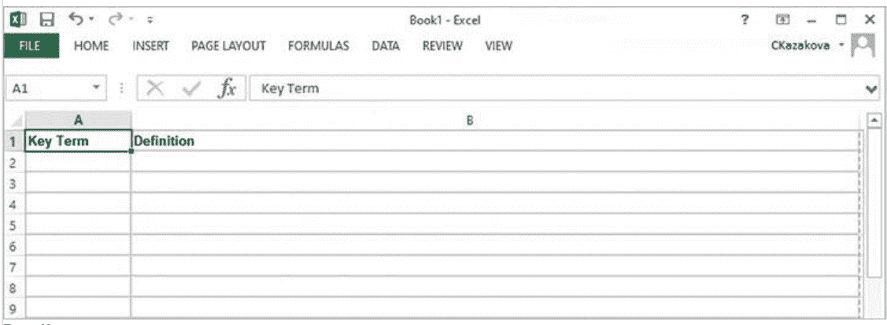

| 关键术语 | 定义 |
| :--- | :--- |
| 关键术语 | |

所示了一个数字取证报告的词汇表电子表格。表格有两列，一列用于关键术语，另一列用于定义。

在为你的报告编写定义时，请记住阅读内容的人通常技术知识很少。提供简洁且易于理解的描述，并在必要时在你的定义中为读者提供示例。

在每一行的 `A` 列中，输入关键词或缩写，后紧跟其在 `B` 列中的定义。通过本模块中的描述、本书的词汇表或通过你偏好的搜索引擎来核实你的定义。

在完成关键术语和定义的输入后，仔细检查你的文件。纠正任何拼写错误，使用拼写检查功能键。

如果可能，打印文档并大声读出来，以识别你可能存在的拼写、语法或语法错误。

在完成关键术语和定义的输入后，仔细检查你的文件。将其保存为 `Case_Project_02-4_Glossary`，并提交给老师：

- `Case_Project_02-4_Glossary.xlsx`

## 案例项目 2-5

预计时间：20 分钟

目标：创建一个与数字取证相关的重要术语和定义的词汇表。

在开始之前：

- 创建 `Work` 文件夹 `C:\Work\Module_02\Case_Project_02-4`。
- 访问以下项目：
  - 模块 1 和 2 中使用的关键术语以及网络上的参考来源

对于此项目，创建一个包含与数字取证相关的重要术语和定义的词汇表。除了模块 1 末尾找到的关键术语外，你还应该包含你认为对非技术性读者的数字取证报告可能有用的额外词汇。（注意，当你学习本书中剩余模块时，这将是一个作业任务。）

要使用电子表格应用程序创建你的词汇表，请完成以下步骤：

1. 打开新工作表，在 `A1` 单元格中输入 `Key Term`，在 `B1` 单元格中输入 `Definition`。如图 2-11 所示加宽 A 和 B 列：

## 图 2-11 数字取证报告词汇表电子表格


| 关键术语 | 定义 |
| :--- | :--- |
| 关键术语 | |

所示了一个数字取证报告的词汇表电子表格。表格有两列，一列用于关键术语，另一列用于定义。

在为你的报告编写定义时，请记住阅读内容的人通常技术知识很少。提供简洁且易于理解的描述，并在必要时在你的定义中为读者提供示例。

在每一行的 `A` 列中，输入关键词或缩写，后紧跟其在 `B` 列中的定义。通过本模块中的描述、本书的词汇表或通过你偏好的搜索引擎来核实你的定义。

在完成关键术语和定义的输入后，仔细检查你的文件。纠正任何拼写错误，使用拼写检查功能键。

如果可能，打印文档并大声读出来，以识别你可能存在的拼写、语法或语法错误。

在完成关键术语和定义的输入后，仔细检查你的文件。将其保存为 `Case_Project_02-4_Glossary`：

- `Case_Project_02-4_Glossary.xlsx`

在完成后，将你的词汇表保存为 `Case_Project_02-4_Glossary` 并在 `Work` 文件夹中，并提交给老师以下文件：

- `Case_Project_02-4_Glossary.xlsx`

## 案例项目 2-5

预计时间：20 分钟

目标：创建一个与数字取证相关的重要术语和定义的词汇表。

在开始之前：

- 创建 `Work` 文件夹 `C:\Work\Module_02\Case_Project_02-4`。
- 访问以下项目：
  - 模块 1 和 2 中使用的关键术语以及网络上的参考来源

对于此项目，创建一个包含与数字取证相关的重要术语和定义的词汇表。

数字取证调查员必须考虑预算。

使用标准参考文献格式，如美国心理协会 (APA) 或现代语言协会 (MLA)，查看以下网站：

- writingcenter.edu/format-
- bibliography.com/mla-

在完成后，将你的词汇表保存为 `Case_Project_02-5_References` 并在 `Work` 文件夹中，并提交给老师以下文件：

- `Case_Project_02-5_References.docx`

## 第 3 章 调查员实验室与数字取证工具

阅读本章并完成练习后，你能够：

1. 描述数字取证实验室的认证要求
2. 列出数字取证的物理要求
3. 解释选择取工作站的标准
4. 描述开发实验室的业务案例
5. 解释如何评估数字取证工具
6. 描述可用软件工具
7. 识别硬件工具的考虑因素
8. 描述验证和测试方法

## 引言

在处理和检查证据之外，数字取证分析师可能还需要执行管理任务，例如设置数字取证实验室和测试工具。本章介绍了设置有效实验室的一些选项，并探索了软件硬件工具。无论你是数字取证的新手还是经验分析师，你的目标都是让办公室和实验室（包括所有软件硬件工具）运行良好。数字取证调查员必须考虑预算以及何时更新以跟上技术。本章为组织、控制安全的实验室提供了基础。没有特定的工具推荐，目标是帮助你根据标准选择工具。工具正在不断开发、更新、补丁、修订和停用。因此，定期检查供应商网站以寻找新功能和改进是重要的。这些改进可能会解决你在调查中遇到的困难问题。在购买任何取证工具之前，请考虑该工具是否可以在调查期间节省时间，以及这是否影响你恢复的数据的可靠性。许多 GUI 工具消耗计算资源，可能需要具有更多内存和更快处理器的计算机。某些工具所需的资源比典型工作站多，因为后台运行着其他应用程序（如杀病毒软件）。这些后台程序会与取证程序竞争。在过载的计算机上，取证程序可能会停止或挂起，导致延迟。最后，在为你的实验室制定计划时，确定新的取证工具是否比你目前使用的工具更好。特别是，评估软件在验证测试中的表现，然后验证工具结果的完整性。

随着软件不断发展和调查员产生新需求，供应商将继续开发和改进满足这些需求的产品。本模块中列出的工具并不代表 Windows、Linux 或 macOS 可用工具的完整列表。

## 管理。理解数字取证实验室认证要求

数字取证实验室是让你进行调查、存储证据并完成大部分工作的地方。你利用实验室来安置仪器、当前和旧版软件以及取证工作站。你需要各种数字取证硬件和软件来完成工作。实验室中的每位数字取证调查员还应该拥有一个私人办公室，以便他们可以在那里管理案件、进行访谈并在交流而不必担心被偷听。

在开始处理任何案件之前，你还需要确保已经定义了政策、流程和程序，以确保分析及其结果的完整性。许多机构已经创建了指南，你可以参考这些制定自己的流程和程序。最重要的是，要遵循自己创建的政策和程序，以确保输出的一致性。检查清单是确保员工操作方法一致的好方法。请记住，要通过正确的监管链流程来维护证据的完整性。

## 警告

在寻求任何认证之前，务必彻底研究认证机构。许多认证由软件供应商提供；另一些是专门针对执法部门的，或由当地专业团体发起。美国国家认证委员会 (ANAB) (`anab.ansi.org`) 是 ANSI（美国国家标准协会）的全资子公司，为全球的犯罪和取证实验室提供认证。该认证包括分析数字证据的取证实验室。作为认证过程的一部分，ANAB 对实验室的任务和功能进行审计，以确保所有案件都有正确且一致的结果。这些审计对订阅成员的取证实验室进行，以确保其工作的质量和完整性。接下来的章节将讨论 ANAB 项目的关键指南，你可以将这些指南应用于管理、配置和审计你的取证实验室。有关 ANAB 如何符合国际标准的更多额外信息，请参阅 `anab.ansi.org/en/forensic-accreditation/iso-iec-17025-forensic-labs`。

## 识别实验室经理和员工的职责

ANAB 规定每个实验室都有由母机构以及实验室主管或经理建立的特定目标。实验室经理建立管理案件的流程并定期进行审查。除了执行一般的管理任务（如：在决策中促进群体共识、维护实验室需求的财务责任，以及执行成员的伦理标准——在“伦理与专业责任”模块中涵盖？）之外，实验室还负责实验室计划，例如新硬件和软件的购买。

实验室经理还建立并推广质量保证流程，例如概述案件到达时的做法、记录证据以及建立提交报告的指南。为了确保实验室的效率，实验室经理还为处理工作设定合理的生产进度。

典型的调查涉及封存硬盘和其他媒体（如 USB 驱动器）、制作它们的取证副本、进行评估并提交报告。例如，对 6 TB 的磁盘进行取证分析可能需要几天甚至几周，通常会在半夜和周末运行软件。这意味着实验室中的一个取证工作站在此期间将被占用。根据经验，实验室经理可以估计每位调查员可以处理多少案件，以及预计何时获得每个案件的初步报告和最终报告。

实验室经理为员工创建并监控实验室政策，并为员工和证据提供安全的工作环境。跟踪如涉及电子邮件滥用、互联网误用和非法活动的案件，可以帮助经理为实验室花费的资金提供合理性证明。

取证实验室的员工应该接受足够的培训来执行他们的任务。必要的技能包括硬件和软件知识（包括操作系统和文件类型）以及演绎推理。实验室员工的工作应由实验室经理及其同伴定期进行审查以确保质量。员工还负责维护他们已完成培训的记录。许多供应商和组织举办年度或季度研讨会提供认证考试。

ANAB 网站总结了管理数字取证实验室、处理和保护证据、执行实验室程序、设定人员要求以及鼓励职业发展的各项。该网站还提供实验室管理指南的打印和在线手册的用户许可。ANAB 强调每个实验室都应该维护其领域最新的资源库。对于数字取证，这些资源包括软件、硬件信息和技术期刊。

## 实验室预算规划

为了进行专业的调查，你需要了解实验室运营的成本。你对这些支出越了解，就越能为每次调查分配资源。实验室成本可以分为每月、季度和年度支出。使用电子表格或记账/会计程序可以帮助跟踪过去的支出，从而推断未来的成本。支出包括硬件和软件、设施空间、差旅费用。

在创建预算时，首先确定实验室预计检查的案件数量，并确定你可能检查的计算机类型，例如 Windows PC、Apple 系统或 Linux 工作站。例如，假设你为一个州警察机构工作，该机构将提供当年及往年的犯罪统计数据来确定。犯罪行为与某些计算系统有关。由于大多数消费者使用 Intel 和 AMD 的 PC，且大多数此类计算机运行 Windows，用于犯罪的计算机很可能也是如此。通过确定每种类型的系统在犯罪中使用的频率来验证这一点。列出涉及 Windows、Linux/UNIX 和 Apple 计算机的犯罪数量。除了估计数字调查所需的资源外，你还需要确定检查移动设备（如智能手机和平板电脑）需要哪些资源。

如果你找不到数字犯罪中使用的计算机类型和操作系统的详细信息，请收集足够的信息以做出合理的推断。你的目标是为犯罪类型建立基准。例如，如果你发现平均有一台 Mac 涉及犯罪，你可能需要两个工具来开展取证分析。

## 统一犯罪报告

| 涉及资产的犯罪 | Windows OS | Linux | macOS | 其他硬件 | 检查数量 |
| :--- | :--- | :--- | :--- | :--- | :--- |
| 火灾 | 53 | | | | 106 |
| 贿赂 | 128 | | | | 256 |
| 入室盗 | 83 | | | | 166 |
| 儿童色情 | 126 | 35 | | | 252 |
| 假与伪造 | 81 | | | | 194 |
| 毒品 | 168 | 56 | | | 336 |
| 勒索与敲诈 | 21 | | | | 89 |
| 诈骗 | 128 | 28 | | | 255 |
| 赌博 | 92 | | | | 352 |
| 杀人 | 0 | | | 9 | 78 |
| 绑架与诱拐 | 3 | | | 1 | 253 |
| 性犯罪 | 22 | 10 | 14 | 1 | 301 |
| 强迫性性犯罪 | 0 | | | 0 | 84 |
| 非强制性跟踪 | 45 | 23 | 9 | 0 | 234 |
| 被盗财产罪、武器 | 150 | 101 | 45 | 45 | 645 |
| **总计** | **1205** | **385** | **286** | **126** | **7** | **3495** |

## 详情

如果你正准备为一家私人公司建立取证实验室，你可以更容易确定需求，因为你是在一个封闭的环境中工作。通过对业务使用的所有已知系统和应用程序进行清单，以及网络配置。例如，一家保险公司拥有由 PC 和专用保险软件的网络，使用数据库进行存储。大型制造公司可能使用 PC、运行计算机辅助设计 (CAD) 系统的 UNIX 工作站、超级计算机和出版设备。出版公司可能拥有 Intel 和 Mac 系统，以及各种文字处理、成像和排版软件包。(SCADA) 系统用于数据和应用。


# 数字取证实验室建设指南

## 硬件与存储规划

配备 6 TB 的设备可以有效分析高达 4 TB 的数据。如果贵公司将计算机升级到 10 TB，则您需要 12 TB 或更多。另一种方案是投资数据中心，以集中管理实验室的服务器需求。其中一种集中化服务器是 Digital Intelligence FREC [digitalintelligence.com/products/fred]，它包含一个可以存储多达 100 TB 的私有云，并提供更多安装的选项。许多企业每 18 个月更换一次桌面电脑以支持更高的速度。您将获得有关计划中的计算机升级和计算环境变化的通知，以便您准备并提交取证资源的预算。

为了充分利用如 FREC 这样的数字取证服务器，您的网络设计应支持更高的速度。网络速度越快，数据在数字取证服务器与工作站之间传输的速度就越快。这种速度的提升缩短了处理数据所需的时间。

数字取证数据存储的替代方案是云存储。其节省的成本远高于购买存储硬件；但是，您需要考虑检索数据的数据吞吐量和水平水平。有关云安全的更多信息，请参阅云联盟 [cloudalliance.org/research/working-groups/security-as-a-service]，它提供了多个平台和实施指南。

与硬件一样，操作系统（OS）经常发生变化。如果您的数字取证工具无法与下一个版本的操作系统或文件系统兼容，它们将无法工作。您将获得有关计划中的计算机升级和计算环境变化的通知，以便您准备并提交取证资源的预算。

## 实验室流程要求

- a. 质量保证流程
- b. 案件活动与调度
- c. 与固定证据相关的流程和程序
- d. 数字取证鉴定员对案件工作的审查

**答案：** 实验室流程的质量保证；b. 案件活动与调度；c. 与固定证据相关的流程和程序；数字取证鉴定员对案件工作的审查。

**解说：** 为了维持实验室的 ANAB 认证，实验室经理需要确保政策、程序和质量流程、案件活动和调度、证据的安全存储以及数字取证鉴定员对案件工作的审查在所有调查中保持一致。

## 确定数字取证实验室的物理要求

作为一名数字取证调查员，你大部分调查工作将在实验室进行。本节讨论了取证实验室的物理要求。满足这些要求可以使实验室更安全、更可靠、更高效。

你的实验室必须在物理上是安全的，以防止证据丢失、损坏或破坏。与硬件和软件成本一样，在确定物理实验室费用时，你必须考虑维护安全可靠环境所需的条件。你必须使用库存控制方法来跟踪你的计算资产，这意味着你应该对实验室中所有主要硬件和软件项目维护一份完整且最新的清单。对于电缆和存储介质等耗品，要维护清单，以便知道何时订购更多用品。

## 访问与安全

所有的数字取证都需要一个封闭的房间，以便设置取证工作站。数字取证不应在开放式隔间内进行，因为这会让未经授权的人员轻易接触到你的证据。应始终保持实验室的安全性，以维护证据以及鉴定员所用硬件和软件的完整性。实验室应该像证物柜或保险箱一样运行和被对待，使其成为一个安全的设施。

以下是对任何规模数字取证实验室的最低要求：

- 一个具有三面通顶墙壁的房间
- 带有锁定机制的门访问权限（限于授权用户，包括清洁人员），这可以是普通钥匙锁、组合锁或能够记录访问人员的电子锁
- 安全容器，例如保险箱或带有高质量挂锁（该锁具可防止抽屉打开）的重型文件柜
- 访客日志，字迹清晰，列出所有访问实验室的人员，并显示其访问日期、进入时间和离开时间

对实验室的访问应仅限于那些确实需要进行检查或协助检查的人员。作为实验室安全政策的一部分，应维护一份名单，列出授权在无随同的情况下进入实验室的人员。不在名单上的任何人都应由授权人员全程陪护。此外，应每年对授权访问实验室的人员进行实验室安全政策的汇报。

当你的实验室开放运营时，授权人员必须对其区域进行持续监控。维护人员（如访问实验室的清洁人员或维修技术人员）应全程陪护和监控，以确保证据和设备免受未经授权的查看。当实验室关闭时，必须采取物理安全措施。这些措施可以是现场安保、警报和监控服务，或两者兼有。

## 高风险调查的安全

高风险调查（例如涉及杀人或国家安全的调查）对安全的要求比最低要求更高。随着技术的进步和信息在计算机攻击者之间的流传，保持调查的安全可能会变得更加困难。例如，检测窃听既困难又昂贵，但外国复杂的犯罪分子和情报机构使用探测网络传输、无线设备、电话通话和计算机设备使用的设备。网上可以找到构建能够非法收集计算机外泄信号嗅探设备的说明，因此任何人都可以获得。这些设备可以拾获任何类型的计算机显示器信号。

大多数电子设备都会发射电磁辐射（EMR）。某些设备可以拦截 EMR，并用于确定设备正在传输或显示的数据。计算机显示器发射的 EMR 在半英里外就能拾获。

在冷战期间，国防承包商被要求对计算系统进行屏蔽，防止对任何计算机发射进行窃听。美国国防部将这种计算机发射屏蔽称为 TEMPEST。

- 有关 TEMPEST 的更多细节，请参考以下资源：
  - 《国家工业安全计划操作手册 (NISPOM)》，DoD 5220.22-M，第11章，“杂项”，第1节，TEMPEST：https://nispom.org/NISPOMwithISLMay2014.pdf
  - SANS 学院，“TEMPEST 简介”https://sans.org/reading-room/whitepapers/privacy/introduction-to-tempest/

为了保护你的调查，你可能会考虑建造一个符合 TEMPEST 标准的实验室，这需要用墙壁、天花板、地板和门衬上特殊接地的金属表面。通常使用铜板以确保其导电。TEMPEST 设施必须包含电源特殊过滤器，加热和通风管道必须有特殊的百叶板以捕捉外泄信号。一个设施通常有两个由死空间隔开的门。在打开内门之前，必须关闭外门。每扇门都有特殊的铜镶条以增强导电性。

由于符合 TEMPEST 标准的实验室昂贵且需要定期的检查和测试，因此它应仅适用于对非法窃听有绝对安全需求的大型区域取证实验室。为了避免这些成本，一些供应商建造了低外泄工作站而不是 TEMPEST 设施。这些工作站比平均工作站贵，但比 TEMPEST 实验室便宜。

在使用数字取证工作站进行检查时，所有数字取证工作站都应与互联网隔离。如果需要访问互联网，[文本中断]

## 证据存储

证据容器（也称为证物柜）必须是安全的。咨询你的检察官或公司律师以确定存储的物品。以下是确保容器安全的建议：

- 容器应位于受限区域。
- 授权打开容器的人数应保持在最低。
- 所有证据容器在未受直接监督时应保持锁定状态。

如果使用组合锁系统，请遵循以下做法：

- 将组合密码存储在另一个安全容器中。
- 设置新密码后销毁任何旧密码。
- 仅允许授权人员更改密码。
- 每六个月更改一次密码，或在授权人员离开组织时，以及发现不安全的容器后立即更改。

如果使用钥匙挂锁，请遵循以下做法：

- 指定一名负责分发钥匙的保管员。
- 在每个钥匙上盖上序列号。
- 维护一份登记，列出哪个钥匙分配给了哪个授权人员。
- 每进行一次审计，确保没有授权人员丢失钥匙。
- 在保管员更换时对所有钥匙进行盘点。
- 将钥匙放在只有实验室经理和指定保管员可以使用的可锁容器中。
- 对钥匙保持与证据容器相同的安全级别。
- 每年更换锁和钥匙；如果钥匙丢失，更换所有相关的锁和钥匙。
- 不要对多个锁使用主锁。

存储容器或文件柜应由钢制成，并配备内部锁或外部挂锁。如果可能，购买保险箱，它可以提供卓越的安全性并保护你的证据免受火灾损坏。对于特殊的保险箱，称为“媒体保险箱”，旨在保护电子介质。媒体保险箱根据火灾损坏发生前的小时数进行评级。等级越高，保险箱保护证据的效果越好。

证物室也很方便，特别是当它是取证实验室的一部分时。证物室的安全必须像普通实验室一样集成安全结构和安全设备。大型数字取证需要一个安全的证物室和一名带有可锁定金属卷帘窗的保管员来控制证据。有了安全的证物室，你可以存储大型计算机组件，如计算机、显示器和其他外设。

## 设施维护

您的实验室应进行清洁和维护，以确保实验室人员的安全与健康。地板、墙壁、天花板或家具的任何损坏都应立即修复。清洁和维修人员进入设施时应有人护同并在工作期间监控。由于静电在处理计算机部件时是一个主要问题，建议在电子工作台和工作站周围放置防静电垫。此外，地板和地毯应至少清洁一次，以帮助减少产生静电的灰尘。

维护两个独立的垃圾桶，一个用于存放与调查无关的物品（如废弃的 CD），另一个用于需要特殊处理以确保其被销毁的敏感材料。使用独立的垃圾桶可以维持刑事调查过程的完整性，并保护私营公司的商业秘密和律师与客户之间的特权通信。几家商业公司专门负责敏感材料，您应该聘请此类公司来帮助维护调查的完整性。

## 审计数字取证实验室

为了确保遵守安全策略和实践，应进行定期检查以审计您的实验室和证据存储容器。审计应包括但不限于以下设施组件和实践：

- 每月至少检查一次实验室的天花板、地板、屋顶和外墙，寻找任何异常或新物品。
- 检查门以确保它们能够正确关闭并锁定。
- 检查锁，查看是否需要更换或更改。
- 检查访客日志，查看其是否被正确使用。
- 检查证据容器的日志表，以确定它们何时打开和关闭。
- 每个工作日结束时，确保任何未在取证工作站上处理的证据都是安全的。

## 数字取证实验室平面图

配置数字取证实验室的方式取决于您的预算、可用面积以及分配给每位计算调查员的计算机数量。对于每月处理两三个案件的小规模运营，一个取证工作站就足以处理工作负载。一个工作站只需要普通办公桌大小的空间。如果您可能同时处理两个或三个调查，则需要一个以上工作站。多个工作站的理想配置是两个取证工作站加一个连接到互联网的取证工作站。

由于每个工作站都需要大量的空间，包含三个工作站的工作大约需要 150 平英尺的空间，因此工作区域应约为 10 英尺乘以 15 英尺。这个空间允许放置两把椅子，以便数字调查员可以向另一位调查员、法律助理或律师简述案件。

小型实验室通常由一个或两个取证工作站、一台连接互联网的研究计算机、一个工作台（如果空间允许）和存储柜组成，如图 3-2 所示：

### 图 3-2 小型或家庭实验室

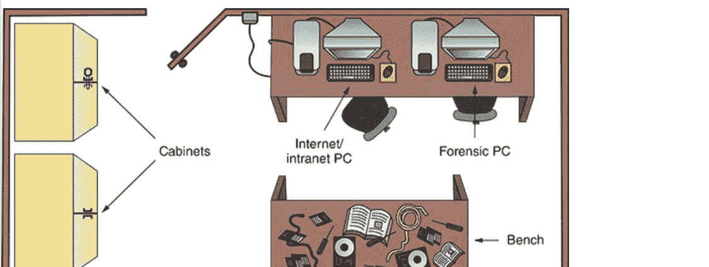

> 详情：描绘了小型或家庭实验室的布局。一个矩形区域在左上角标记有两个柜子，一个柜子旁边有一个有少数设备的实验台，在对面，互联网和内网 PC 以及取证 PC 并排放置。

中型数字取证实验室（如私营企业中的）拥有更多的工作站。出于安全考虑，实验室应至少有两个出口，如图 3-3 所示：如果可能，隔间甚至单独的办公室应作为布局的一部分，以强化“按需告知”策略。这些实验室通常有更大的库空间来存放手册、软件和硬件存储。

### 图 3-3 中型数字取证实验室

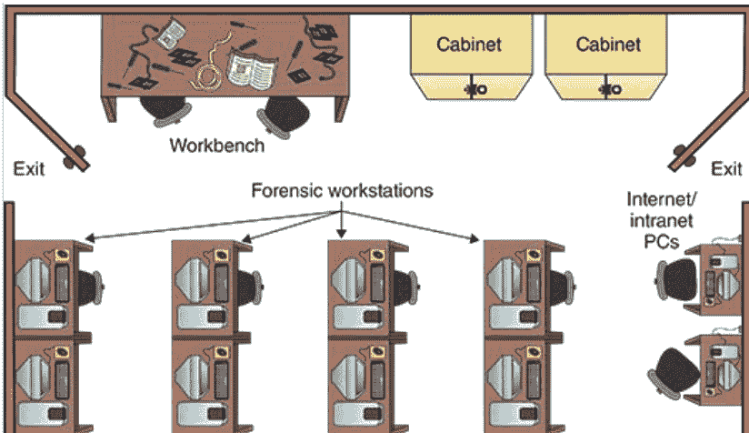

> 详情：描绘了中型数字取证实验室的布局。一个矩形区域在右上角标记有两个柜子，一个工作台在柜子的左侧，左端有出口。在底行，四个取证工作站并排放置，互联网或内网 PC 位于右下角。

州执法部门或 FBI 通常运行大多数大型或区域性数字取证实验室。如图 3-4 所示，这些实验室有一个独立的房间，这在警察调查中很典型，但这个房间限于数字证据。可能会分配一个或多个保管员来管理和控制证据室的进出。如前所述，证据室需要是安全的。实验室应至少有两个受控出口且没有窗户。在这种配置中，主管的独立办公室和调查员的隔间更具实用性。记住，取证工作站应连接到隔离局域网 (LAN)，只有少数几机器连接到组织的内网或互联网。

### 图 3-4 数字取证实验室

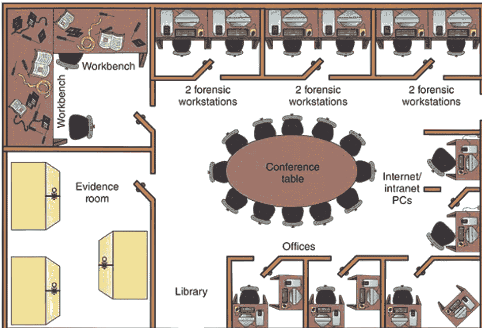

> 描绘了区域性数字取证实验室的布局。一个矩形区域在左上角标记有两个垂直放置的实验台，左下角是一个带有三个柜子的证据室，顶行有三对取证工作站，互联网和内网 PC 位于右角，图书馆和办公室位于底行，会议桌位于中心。

## 自测

- 2. 实验室经理的审计责任是什么？（选择所有适用项。）

a. 检查所有入口和出口以确保它们安全可靠。
b. 检查访客日志以确保它们被使用。
c. 检查实验室的天花板、地板和屋顶。
d. 例如，更改访客日志以确保它们被使用。

**答案：** 检查所有入口和出口以确保它们安全可靠。

**解释：** 检查访客日志以确保它们被使用。

## 选择基础取证工作站

您所使用的工作站取决于您的预算和特定需求。许多设计良好的工作站可以处理大多数调查任务。在获取工作站时，尝试获取可用的最强大的处理器和内存。将工作站用于处理琐碎任务。

## 为实验室选择工作站

大城市的部门通常对数字取证拥有一系列广泛的要求。并非所有用户都拥有最新技术，例如，实验室可能需要运行 CP/M 或 Minix 的遗留系统。然而，对于小型地方性警察局，大多数工作涉及 Windows PC、Mac 和移动设备。小型警察局的数字取证可以限于一个或两个工作站或高端笔记本电脑。

## 备注 4

关于密码集群的白皮书，请参考以下资源：

- blackhat.com/docs/us-15/materials/us-15-Morris-CrackLord-Maximizing-Password-Cracking.wp.pdf
- wordforce.com/learn/how-passwords-work-and-cracking-passwords/
- unix-ninja.com/p/Building_a_Cracking_Rig_for_Hashcat

## 为私营部门实验室选择工作站

对于私营部门，例如进行内部调查的业务或商业性设备公司，其资源通常易于确定。为其他公司提供取证分析的商业公司可以针对特定市场定制其服务。他们可以专门研究一或两个平台，例如运行微软操作系统的英特尔电脑。他们还可以收集各种工具以满足更广泛的市场。他们所需的设备类型取决于他们的专长（如果有的话）。对于通用的数字取证设施，一个多功能取证工作站就足够了。进行自身内部数字调查的私营公司可以根据其所使用的计算机的类型来确定其所需的取证工作站类型。如果一家公司仅使用 Windows PC，内部调查人员就不需要各种专业设备。如果一家公司使用多种计算机，其内部调查人员则需要支持相同类型计算机的系统和设备。通过某些数字取证程序，你可以从 Windows PC 上工作并检查 Windows 和 Mac 磁盘驱动。

## 准备硬件外设

除了工作站和软件外，所有实验室都应该有各种电缆和备用扩展槽卡。考虑为你的取证实验室配备以下外设设备：

- 能够运动录制的数码相机
- 各种防静电袋
- 外部 CD/DVD 驱动器
- 40 针 18 英寸和 36 英寸 IDE 线，均支持 ATA-33 和 ATA-100 或更高速
- 软盘排线
- 额外的 USB 3.0 或更新版本的电缆以及 SATA 卡和相关电缆
- 额外的 SCSI 卡，优选超宽的
- 显卡，包括外围组件互连 (PCI) 和加速图形端口 (AGP)
- 各种火线 (FireWire) 和 USB 适配器
- 各种硬盘和 USB 闪存盘（预算范围内越多越好，种类尽可能多样）
- 至少两个从笔记本 IDE 硬盘（2.5 英寸）转换为标准 IDE/ATA 驱动器、SATA 等适配器
- 计算机工具，如十字螺丝刀和平口螺丝刀、套筒扳手、任何特定厂商的工具、小型手电筒和防静电手环

## 维护操作系统和软件库存

操作系统是你实验室库存中不可或缺的一部分。你应该尽可能维护许多遗留操作系统的授权副本，以处理涉及异常系统的案例。微软操作系统应包括最新的 Windows 操作系统、所有先前的 Windows 操作系统，包括 Windows NT、3.11 和 DOS 6.22。苹果操作系统应包括 macOS 的最新版本以及所有之前的 Mac OS，包括 Mac OS 9.x、8 或更早版本。Linux 操作系统可以包括 Linux Mint、Debian、Fedora、Ubuntu、Slackware 和 Debian。如果可用，其他考虑添加的操作系统还包括 OS/2、BeOS、NeXT、FreeBSD 和 Syllable。

尽管高端数字取证工具可以打开或显示由常用程序创建的数据文件，但它们并不支持所有程序。你的软件库存应该包含以下程序的当前版本和旧版本。如果你处理的是 Windows PC、Mac 系统和 Linux 系统，你应该拥有以下内容：

- Microsoft Office（包括当前版本和旧版本）
- 十六进制编辑器，例如 WinHex 或 Hex Workshop
- 编程语言，例如 Visual Studio、Perl 或 Python
- 特殊图像查看器，例如 ACDSee、ThumbsPlus 或 IrfanView
- WPS Office、WordPerfect 以及第三方或开源办公套件
- 会计应用程序，例如 Quicken 和 QuickBooks

## 使用灾难恢复计划

除了为紧急情况制定计划外，你还需要为灾难制定计划，例如硬盘崩溃、雷击、停电、洪水、地震等。灾难恢复计划确保了在发生灾难性故障时，你可以将工作站和文件服务器恢复到原始状态或类似于实验室的建筑。

灾难恢复计划还规定了在发生严重故障后如何重建取证工作站。在遭受病毒污染后重建取证工作站，灾难恢复计划的核心是对于任何灾难计划工作站的备份数据。使用 Paragon Backup 等工具非常有用的。作为一般预防措施，你应该每周备份一次工作站。从磁盘、USB 驱动器、CD/DVD 或云端恢复工作站数据是困难的。将备份存储在易于访问的地方。在发生多个硬盘重大故障时，这些服务器必须有足够的备份系统。在为 RAID 服务器规划恢复时，考虑恢复数据所需的停机时间是否可以接受。在安全控制之前，通过变更管理或配置管理记录工作站的更新。在实施安全控制之前，变更管理涉及更新工作站的应用程序。一个实用的工具是 [Belarc Advisor](https://belarc.com/free_download.html)，它可以记录工作站的应用程序、硬件和系统配置。灾难恢复计划还可以解决如何恢复你为特定调查配置的工作站。例如，如果你安装了一组应用程序，可能没有足够的磁盘空间进行升级。灾难恢复计划应说明如何卸载软件并删除残留文件，以便将系统恢复到原始配置。使用高端 RAID 服务器或私有云（如 Dell PowerEdge 或 Digital Intelligence FREDC）的实验室。

## 设备升级计划

风险管理涉及评估风险并确定任何过程或操作（例如设备更换）的可接受风险。识别实验室依赖的关键设备，并创建一个在故障前更换这些设备的计划。还要识别故障时可以更换的其他设备。


计算机组件在正常运营的设计寿命为 18 到 36 个月，且新版本的应用程序发布频繁，因此系统需要更多的内存、磁盘空间和处理速度。为了让你的实验室跟上硬件技术更新，每 18 个月更换一次硬件。

## 自测

### 3. 配置管理记录应包含哪些内容（多选）

a. 数字取证软件的更新

b. 来自案件的恢复数字证据

c. 硬件更换和升级，例如为取证工作站增加额外的硬盘或内存

d. 通过互联网从供应商处获取的自动操作系统更新

**答案：** a. 数字取证软件的更新；c. 硬件更换和升级，例如为取证工作站增加额外的硬盘或内存

**解释：** 所有硬件和软件更新都应记录在配置管理文件或数据库中。所有更新应在数字取证之前或之后进行，而不是在期间。数字取证工作站只有在仅通过供应商网站获取更新时才连接到互联网。更新完成后，工作站应断开互联网连接。这适用于数字取证实验室使用的所有有线和无线互联网连接设备。

## 管理：为建立取证实验室制定商业计划书

建立数字取证实验室需要管理层和其他团队成员的支持。为了实现这一点，你需要制定一份商业计划书（`Business Case`），这是一份你可以用于为建立或升级实验室及设备提供理由说明的计划；它可以提交给管理层、潜在客户或领导。在这种情况下，你的任务是为获取更好的工具和资源以调查数字取证案件提供合理性证明。

开发商业计划书的步骤非常简单。如果你是个体经营者，创建商业计划书很容易。如果你能通过购买工具来节省资金，你可以积攒资金购买，或与银行协商贷款。对于警察部门等公共实体，预算可能需要提前一年或更久规划，这会让制定商业计划书的工作变得复杂，因为需求在一年之中可能会发生重大变化。公共机构的部门经理向高层提交他们的预算提案。如果提案获得批准，高层将提供获取预算中列出的资源。某些公共机构还有其他可以立即用于特殊需求的资金。经理可以将这些资金转向紧急或不可预见的需求。

## 注意事项

与私营公司一样，警察部门通常也需要向高层解释支出的合理性。重要的区别在于，警察部门并不总是能为其所需的额外能力和设备提供的功能提供成本回报。

请记住，私营企业（特别是大型公司）的动力源于盈利需求。商业计划书应该证明数字调查如何帮助组织节省资金，并规避可能损害利润和声誉的风险，例如防止涉及公司的诉讼。例如，法院的判决显示，员工在工作场所查看色情图像会为其他员工创造敌对性环境，这与员工骚扰和计算机滥用有关。雇主有责任防止和调查与工作场所相关的员工及非员工的骚扰。如果雇主积极努力通过提供员工培训和调查对计算机滥用的指控来防止敌对性职场，那么该公司也可能承担责任。诉讼对组织来说可能是一项巨大的风险，无论谁获胜，都可能让组织花费数千美元。在你的商业计划书中，请将培训成本和数字调查的成本与诉讼成本进行权衡。

互联网给许多组织带来了巨大的风险，因为它很难为员工提供一个安全可靠的环境。特别是员工可能会滥用免费的网络服务来发送不当的邮件，通常以性骚扰的形式出现。由于此类行为很少发生，雇主需要实施一项调查计划，涉及网络日志（如服务器日志）以及检查计算机磁盘以找到信息证据的痕迹。

你的商业计划书还应该展示数字调查如何提高利润，例如保护知识产权、贸易秘密和未来的业务计划。当员工离开公司加入竞争对手时，他们可能会向新雇主泄露竞争信息。假设一家名为 `Skeleton International (SI)` 的公司投入研发资金开发了一项改进滑板稳定性的新产品。其首要竞争对手是 `Better Skateboard`，该公司通过电子邮件联系了对 `SI` 不满的 `Gwen Smith`，并为她提供了一份工作。当 `Gwen` 离开时，她带走了新产品的计划。几个月后，`Better Skateboard` 推出了一款与滑板类似的产品。`SI` 发现这款新滑板与 `Gwen` 在职期间开发和咨询的产品相似，并查阅了她受雇时签署的非竞业协议。`SI` 认为 `Better Skateboard` 可能从 `Gwen` 那里获得了新产品，并怀疑 `Skateboard` 偷了它的秘密和知识产权。

`SI` 可以起诉 `Better Skateboard` 并要求获取内部文件证据（`Discovery`）。由于 `Gwen` 和 `Better Skateboard` 通过电子邮件往来，为 `SI` 工作的数字调查员可能能够找到与 `Better Skateboard` 招聘和研究工程相关的数据。相反，`Better Skateboard` 可以要求获取 `SI` 的研究记录，以确定产品设计中的任何差异是否可以反驳诉讼。在这个例子中，数字调查可以使一家公司做到……。

## 为取证实验室准备商业计划书

准备商业计划书对于确保你获得设施、用品和培训的必要支持至关重要。由于组织通常都在寻找降低成本的方法，你必须提前计划。接下来的章节描述了创建商业计划书的一些关键要素，这些要素应该每年更新。

## 合理性说明

第一步之一是说明为什么需要实验室。这种合理说明（`Justification`）需要对等问题给出回答：

- 你的组织需要什么类型的调查服务？

- 这些服务的潜在客户是谁——是作为内部运营（例如警察部门或公司）还是外部运营？

- 你将使用什么时间管理技术？

- 初始预算和后续预算将从何处来？

无论你为哪种组织工作——公共机构还是私营企业——运营数字实验室都需要不断努力向过去、现在和未来的客户推销实验室的服务。通过营销吸引客户，你可以为实验室的未来运营预算提供合理依据。

## 预算制定

拟议的实验室预算应包含后续章节描述的所有项目。在确定这些项目的真实成本时，你必须尽可能准确。出错可能会导致延迟，并失去启动或改进实验室的机会。

## 设施成本

对于新实验室来说，启动成本可能占据预算的大部分。取决于实验室的大小，你必须首先确定需要多少空间。在本模块之前提到过，一个经验法是每人 150 平英尺。这个空间看起来可能比需要的要大，但你需要考虑预留多少存储空间来存放用品。请向你组织的设施经理咨询你所在建筑区域的每英尺成本。以下是开始计算设施相关成本的示例问题：

- 你需要多少名数字取证员？

- 你需要一个以上的实验室吗？

- 每个实验室将由多少名数字取证员使用？是否需要临时容纳其他非专家来检查恢复的证据？

- 建造安全实验室的成本是多少？

- 是否有一个可以改造成实验室的合适房间？

- 指定房间是否有足够的电力以及暖、通风和空调（`HVAC`）系统？

- 指定房间是否有电话线和网线？如果没有，安装这些项目需要花费多少费用？

- 房间门是否有足够的锁具？

- 家具成本是多少？

- 你需要安装警报系统吗？

- 是否还有其他设施成本，例如清洁服务和设施维护服务？

在你的取证实验室中将分析的调查类型和数据决定了你需要的硬件设备。例如，如果你的组织正在运行 `Windows 10` 或更高版本的基于 `Intel` 的 `PC`，你的取证工作站也可以是一台基于英特尔的高端 `PC`。对于小型警方部门来说，确定公众使用的计算机类型要困难得多。社区系统的多样性要求警方部门在开展调查所需的工具方面需要具有更强的通用性。在规划时，请考虑以下问题以确定硬件预算需求：

- 实验室将进行哪些类型的调查和数据恢复？

- 预计每个运营月可以进行多少次调查？

- 是否有需要对磁盘数据进行快速分析的时间敏感型调查？

- 支持一项典型调查需要多少个硬盘（多大容量）？

- 你是否需要高速备份系统，例如磁带备份或 `DVD` 刻录机？

- 你将调查的计算机系统主要类型是什么类型？

- 你将使用什么来存储数字证据？需要存储多久？

- 是否需要 `IT` 支持？估计需要多少小时的支持？

## 软件需求

在过去的几年里，出现了许多更多的取证工具。对于私营部门，这些工具的成本可能在 3,000 美元以上。对于公共部门，取证软件供应商提供折扣。然而，当你根据特定需求为数字取证选择硬件时，你必须确定取证软件包将调查何种类型的操作系统和应用程序，并相应购买。请记住，投入越多，你可能获得的功能和灵活性就越高。为了确定软件预算需求，这里有规划中需要考虑的一些问题：

- 将检查哪些类型的操作系统？

- 对于不流行、不常见或较旧的操作系统（如 `Mac OS 9.x`、`OS/2` 和 `CP/M`），需要多久调查一次？

- 取证工具的最低要求是什么？例如，每种工具需要多少份？平均每周每种工具使用多少次？

- 哪些类型的操作系统拥有专门软件，例如 `QuickBooks`、`FreshBooks`、`Xero` 或 `Sage 50cloud`？

- 是否有预算购买多个取证工具？

- 通用数据分析应该选择哪种磁盘编辑工具？

## 杂项预算需求

在预算的这部分，你需要对购买实验室的其他项目、工具和用品进行脑风暴，从通用办公用品到日常运营需求。为了确定杂项预算需求，这里有规划中需要考虑的一些问题：

- 实验室运营和人员是否需要错误遗漏险？

- 你是否需要办公用品的预算？

- 每个检查员每年需要多少培训？估计成本是多少？

## 审批与获取

数字取证实验室的审批和获取是一项管理职能。你的责任是创建一个带有预算的商业计划书（`business case`）并向高层汇报。作为审批流程的一部分，你应该包含一份风险分析，描述实验室将如何降低诉讼风险，这是获得支持的一个有说力的论点。你还需要对预计将进行多少次调查以及平均需要多久做出合理的推断。记住，审批过程需要使用谈判策略来证明商业计划书的合理性。你可能需要修改你的案例以获得批准。

为了确保顺利审批和获取，你的商业计划书应该包含对不同产品的研究，并确定哪种是最好且有效的。联系几家供应商的销售人员和设计工程师，进一步了解每种产品和服务。你还应该研究并为年度维护和支持成本预算，以便在调查过程中遇到问题时能够获得支持。另一个需要研究的项目（可能通过联系行业内的其他人来实现）是供应商的维护历史。其他取证实验室是否使用了相同的产品，并在遇到问题时是否能够获得支持？

另一个考虑因素是供应商的定价结构。产品价格基于与开发、测试、文档支持、运输和未来改进研究相关的成本。此外，供应商是营利性机构；他们有投资者需要付账。请记住，明年继续存在并为你提供产品和服务的供应商需要赚钱的。

## 实施

在审批和获取之后，你需要规划设施和工具的实施。作为商业计划书的一部分，决定你计划如何整合和安装所有已批准的项目。必须包含一个显示预计交付或安装日期以及预计完成日期的时间表。你还应该有一个材料和工具交付日期和时间的协调计划。在进度表中包含设施建设、设备（包括家具和工作台）以及软件工具。确保安排了检查日期，以确保订购物品到达且功能正常。

## 验收测试

在实施调度和检查之后，你需要为数字取证实验室制定一个验收测试计划，以确保一切运行正常。在编写验收测试计划时，请确保包含以下任务：

- 检查设施以是否符合包含和控制数字证据的安全标准。

- 测试所有通信设备（如电话和网络连接），确保它们按预期方式工作。

- 测试所有硬件以验证其运行正常；例如，测试计算机以确保它可以启动到 `Windows`。

- 安装并启动所有软件工具；确保所有软件都能在实验室的计算机和操作系统上运行。

## 验收修正

你对实验室的规划越完善，出现问题的可能性越小。然而，任何实验室运营在启动期间可能会遇到一些挑战。你的商业计划书必须预测可能导致实验室产出延迟的问题。在商业计划书中，包含处理系统或设施故障的应急计划。例如，针对实验室门安装了错误的锁或电力需要额外过滤等问题制定对策。

在完成所有必要的更改后，你的数字取证实验室就可以投入运行。

> **提示**
>
> 关于如何编写商业计划书的更多信息，请参阅 `sba.gov/tools/how-write-business-plan`

## 自测

### 4. 在为实验室制定商业计划书时，你应该回答哪些问题？（选择所有适用）

a. 预计成本是多少？

b. 实验室将进行哪些类型的调查？

c. 谁支付实验室运营费用？

d. 预计从组织获得什么样的支持？

**答案：** b. 实验室将进行哪些类型的调查？ c. 谁支付实验室运营费用？

**解释：** 在确定开销等所需资源之前，必须建立实验室的合理性。作为准备实验室商业计划书的第一步，管理层会想知道为什么需要。

## 评估取证工具

在研究和评估数字取证硬件和软件时，考虑开源工具，这些工具有时包含技术债。目标是尽可能获得具有许多功能的最佳价值。在评估工具时询问以下问题：

- 取证工具运行在什么操作系统上？多个操作系统吗？

- 该工具是否通用？例如，它可以在 `Windows` 和 `Linux` 上运行吗？它可以在 `macOS` 上运行吗？

- 该工具是否可以分析多种文件系统，如 `FAT`、`NTFS` 和 `Ext4`？

- 是否可以使用脚本语言配合该工具实现自动化功能和任务？

- 该工具是否有任何自动化功能可以帮助减少所需的时间？

- 供应商提供产品支持的誉如何？对于开源工具，支持论坛的效果如何？

当你为实验室选择工具时，保持开放心态并比较不同任务的平台和应用程序。尽管许多调查员习惯使用 `Windows` 工具，但请检查其他选项，例如运行在 `Linux` 和 `macOS` 平台上的工具（在“Linux 和 Macintosh：文件系统”模块中涵盖）。

# 数字取证工具类型

数字取证分为两大类：硬件和软件。每个类别在模块的后续部分有更详细的子分类。以下章节概述了大多数数字取证工具所需且预期的基本功能。

> **注 6**
>
> 预计数字取证领域在 2022 年至 2030 年间将以每年 11% 的速度增长 [`futuremarketinsights.com/reports/digital-forensics-market`]。此外，随着物联网（`IoT`）和人工智能的发展，数字取证调查将变得更具挑战性，更专业的工具将变得至关重要。

## 硬件取证工具

硬件取证工具从简单的单一用途组件到完整的计算机系统和服务器不等。例如，`Tableau T35e-R2 SATA/IDE SATA` 桥是一种单一用途组件，它是可以通过一个设备访问 `SATA` 或 `IDE` 硬盘的示例。`Digital Intelligence F.R.E.D.` 系统 [`digitalintelligence.com/products/overview`]、`Forensic Computers` 的取证检查站和便携单元 [`forensic-computers.com`]，以及为故障硬盘数据恢复设计的 `Ace Laboratory` 系统——这一功能在许多情况下非常有用。

## 软件取证工具

软件取证工具可以分为命令行界面（`CLI`）应用程序和图形界面（`GUI`）应用程序。某些基于 `DOS` 的工具示例，请参见 `New Technologies, Inc. (NTI)` 网站 [`forensicsintl.com/tools.html`]。`NTI` 的工具包专门用于通过 `DOS` 命令行获取、解析和搜索数字证据。其他工具设计用于 `GUI` 环境下执行各种任务。例如，`PassMark Software OSForensics`、`X-Ways Forensics`、`OpenText EnCase`、`Magnet Forensics AXIOM`、`Belkaso`、`ProDiscover Computer Forensics`、`Forensic Explorer (FEX)` 和 `AccessData FTK` 是用于执行大多数取证获取和分析功能的 `GUI` 工具。软件取证工具通常用于将数据从嫌疑硬盘复制到镜像文件中。许多 `GUI` 获取工具可以读取镜像文件中的所有结构，就像它是原始硬盘一样，并具有分析镜像文件的能力。在“数据获取”模块中，你将学习如何使用这些工具从嫌疑人的硬盘获取数据。

# 数字取证工具执行的任务

所有数字取证工具（包括硬件和软件）都执行特定的功能。当你测试新工具时，可能会发现遵循美国国家标准技术研究院（`NIST`）计算机取证工具测试（`CFTT`）计划设定的指南会有帮助。`ASTM` 国际（原美国测试与材料协会）的 `E2678` 标准以及计算机证据国际组织提供了相关指南。`ISO 27037` 标准 [`iso.org/standard/44381.html`] 规定，数字证据第一响应人员（`DEFR`）应使用经过验证的工具。

以下功能类别可以作为评估数字取证工具的指南，用于精炼数据分析和恢复的子功能确保数据质量：

- 获取 (`Acquisition`)

- 验证与确认 (`Validation and verification`)

- 提取 (`Extraction`)

- 重建 (`Reconstruction`)

- 报告 (`Reporting`)

`NIST` 的 `CFTT` 和其他小组包含了额外的功能，例如数据获取、从移动设备提取数据、文件重建和字符串搜索，这些未包含未中。在后续章节中，你将学习这些功能和子功能如何应用于数字调查。

## 获取

获取是数字取证调查的第一项任务，涉及制作原始硬盘的副本。正如“数据获取”模块所述，此程序防止原始硬盘损坏，从而确保不会损坏数字证据。获取类别中的子功能包括：

- 物理数据拷贝

- 逻辑数据拷贝

- 数据获取格式

- 命令行获取

- `GUI` 获取

- 远程、实时和内存获取

`ISO 27037` 标准规定，数据获取最重要的因素是 `DEFR` 的能力和对经过验证工具的使用，该标准还包含了在不同情况下如何进行获取的指南，并强调记录做了什么以及为什么这样做。例如，如果你正在获取 `RAM` 数据并侧重于收集设备。你还可以找到关于是获取整个磁盘还是集中于某个分区或文件夹的决策流程图，例如。标准的第 7 节讨论了易失性内存，这是获取的重要部分。影响获取的其他情况包括加密设备或无法关闭的任务关键型系统。某些取证软件工具（如 `AccessData FTK`）具有获取镜像的工具。例如，`Magnet AXIOM` 允许你获取取证镜像并在同一步骤中对其进行处理。然而，一些调查人员选择使用硬件设备获取镜像，例如 `Tableau TD2` 或 `TX1`、`Logiscube Talon`、`VOOM HardCopy 3P` 或来自 `Intelligent Computer Solutions, Inc.` 的 `ImageMASTER Solo-4 G3 PLUS Forensic Enterprise`。这些硬件设备内置了用于数据数据的软件，还将创建包含获取镜像信息的报告，如获取的字节数和其哈希值。制作复制硬盘不需要其他设备或程序；但你仍然需要取证软件来分析数据。

有关这些一些设备的更多信息和规格，请访问以下网站：

- `Logicube Talon`: `logicube.com/shop/talon-ultimate/`

- `Image MASSER Solo-4`: `ics-iq.com/im-solo-4-g3-plus-forensic-enterprise-hard-drive-data-acquisition-expansion-ready/`

- `VOOM HardyCopy 3`: `voomtech.com/`


# 其他获取工具

其他获取工具需要结合硬件设备和软件程序来进行磁盘获取。例如，许多软件工具将硬盘挂载为只读，另一些工具可能需要验证内置软件写保护器以确保证据未被更改。软件中使用两种数据拷贝方法：整个硬盘的物理拷贝和分区的逻辑拷贝。通常情况决定你需要物理还是逻辑获取。选择逻辑获取的一个原因是加密。对硬盘进行物理获取会导致数据不可读，这在“虚拟取证”模块中将进一步讨论。磁盘格式从原始到厂商特定格式，如模块所述，通常使用 `dd` 命令创建，它是磁盘的简单位位拷贝。原始格式工具可以使用任何十六进制编辑器（如 `HxD`）拷贝镜像内容。这些工具允许你查看原始获取的内容。

## 图 3-5 在 HxD 中查看数据

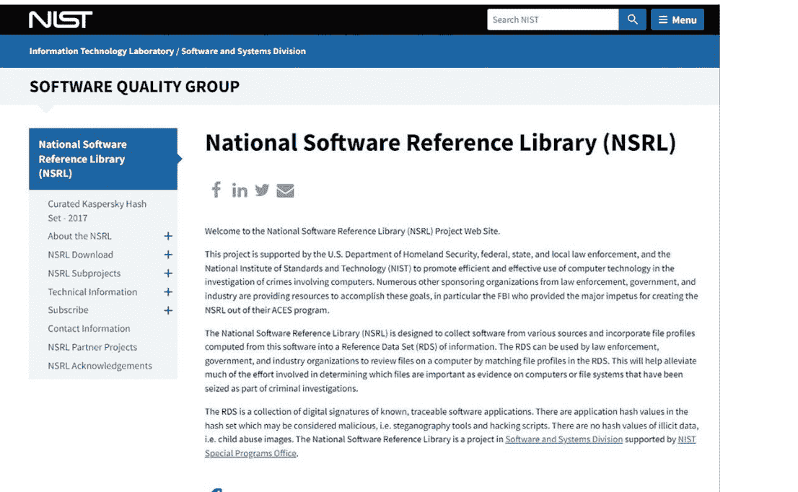

### 详情

截图显示了 `HxD` 中的数据。窗口显示了偏移列表：`00`、`01`、`02`、`03`、`04`、`05`、`06`、`07`、`08`、`09`、`0A`、`0B`、`0C`、`0D`、`0E`、`0F`、`10`、`11`、`12`、`13`、`14`、`15`、`16`、`17`、`18`、`19`、`20`、`21`、`22`、`23`、`24`、`25`、`26`、`27`、`28`、`29`、`3A`、`3B`、`3C`、`3D`、`3E`、`3F`、`40`、`41`、`42`、`43`、`44`、`45`、`46`、`47`、`48`、`49`、`4A`、`4B`、`4C`、`4D`、`4E`、`4F`、`50`、`51`、`52`、`53`、`54`、`55`、`56`、`57`、`58`、`59`、`5A`、`5B`、`5C`、`5D`、`5E`、`5F`、`60`、`61`、`62`、`63`、`64`、`65`、`66`、`67`、`68`、`69`、`6A`、`6B`、`6C`、`6D`、`6E`、`6F`、`70`、`71`、`72`、`73`、`74`、`75`、`76`、`77`、`78`、`79`、`7A`、`7B`、`7C`、`7D`、`7E`、`7F`、`80`、`81`、`82`、`83`、`84`、`85`、`86`、`87`、`88`、`89`、`8A`、`8B`、`8C`、`8D`、`8E`、`8F`、`90`、`91`、`92`、`93`、`94`、`95`、`96`、`97`、`98`、`99`、`9A`、`9B`、`9C`、`9D`、`9E`、`9F`。文件名为 `Activity-02-1001`。右侧面板显示字节序为小端序。

来源：mh-news, mh-news.de/en

---

带有镜像的原始驱动器。例如，`EnCase` 会提示你计算获取数据的 `MD5` 值，而 `FTK` 则在数据采集期间验证 `MD5` 和 `SHA-1` 集合。硬件采集工具（如 `Imager Master Solo-4`）可以在数据采集期间同时执行 `MD5` 和 `CRC-32` 哈希。无论你选择软件还是硬件方案进行采集，请确保该工具具有用于验证的哈希函数。哈希的使用方式取决于调查情况，但对整个驱动器及其所有文件使用哈希算法是标准做法。这种方法会产生一个唯一的十六进制值，以确保数据没有更改，且副本与原始数据或镜像保持一致。

在执行过程中，你会将好数据与可疑数据分离。好数据由已知文件组成，例如操作系统文件、常用应用程序（如 `Microsoft Word`）以及公司日常业务使用的标准文件。你还可以使用哈希值来为新安装的各种操作系统、应用程序以及已知的良好镜像和文档（电子表格、文件等）创建一个“已知良好文件”列表。通过这些信息，调查人员可以识别此已知列表上的所有文件，并关注其他不在列表中的文件。国家软件参考库（`NSRL`）已经编译了各种操作系统（特别是 `iOS` 和 `Android`）以及镜像的索引文件哈希列表，你可以下载（图 3-6）。它还在添加移动端应用程序的哈希值。

在本节中了解更多关于 `NSRL` 的信息：验证和测试取证软件

## 图 3-6 国家软件参考库 (NSRL) 页面

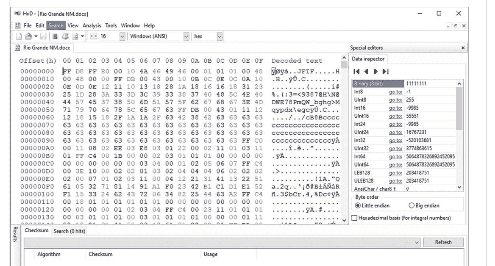

### 详细信息

一张截图显示了国家软件参考库的主页，其界面和左侧导航栏显示了：精选卡巴斯基哈希、`set-2017`、关于 `NSRL`、`NSRL` 下载、`NSRL` 子项目、技术信息、订阅、联系信息、`NSRL` 合作伙伴项目和 `NSRL` 致谢。

来源：`NIST`, nsrl.nist.gov

## 注意 8

诸如失踪与受削儿童国家中心等组织维护着已知受害者照片的哈希集。这些文件被分为“可疑”或“已知坏”类别。某些数字取证工具可以集成良好文件哈希，并将其与驱动器中的文件哈希进行比较以查看是否匹配。通过这一过程，你可以快速消除大量数据，从而专注于证据分析。你也可以开始构建自己的哈希。另一个需要考虑的功能是对数据扇区进行哈希处理和比较。这对于识别位于空隙空间（slack space）和空闲空间中可能被部分覆盖的数据碎片很有用。

过滤数据的另一种方法是分析并验证已知文件类型的头部。每个文件类型都有与文件扩展名关联的文件头值，许多取证工具都包含常用文件头列表。要查看这些文件，请使用十六进制编辑器确认文件扩展名是否与日期不符。重命名文件通常是为了伪装或隐藏数据，如果不检查文件头，可能会漏掉重要数据。图形文件的标准指示是值 `FF D8`，在图 3-7 所示 `Rio Grande NM.doc` 文件输出的第一行中显示（你将在“媒体文件”和“数字取证”部分更详细地检查图形文件）。在练习查看文件头后，你将学会识别常见的头部头值。

## 图 3-7 文件头指示 .jpeg

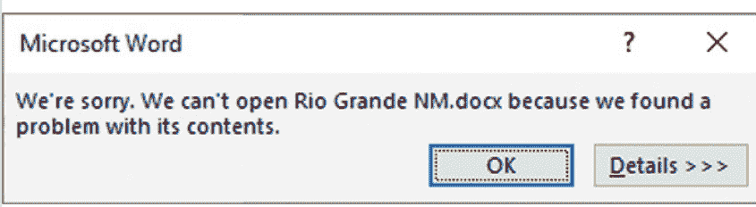

`07`、`08`、`09`、`0A`、`A`、`0B`、`0C`、`0D`、`0E`、`0F` 以及解码后的文本。在这里，文件名为 `Rio Grande NM.docx`。数据检查工具位于右侧导航面板，字节序选择为小端（little endian）。

来源：mh-fd8*, mh-nexus.de/en/

`Rio Grande NM.docx` 头部中的 `FF-D8` 表明它是一个 `jpeg` 图像，而不是 `.docx` 文件。如果你尝试在 `Microsoft Word` 中打开此文件，将看到图 3-8 所示错误消息：

## 图 3-8 在 Word 中尝试打开 .jpeg 文件时显示的错误消息

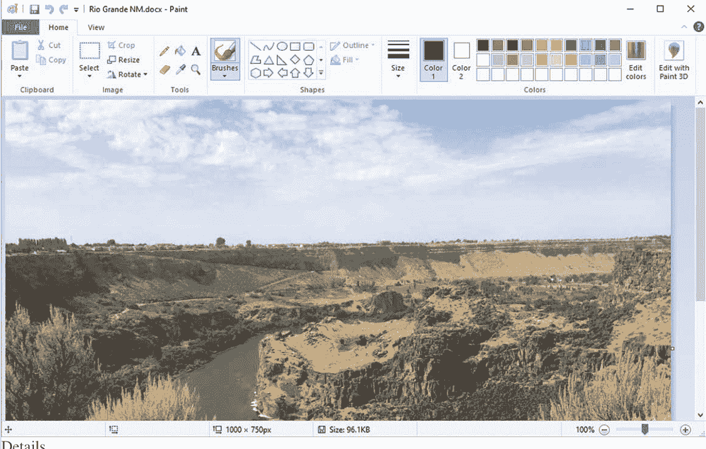

### 详细信息

一张截图显示了 `Microsoft Word` 中的错误消息。消息内容为：“抱歉。无法打开 `Rio Grande NM.docx`，因为我们发现其内容有问题。”两个选项是“确定”和“详细”。如果你使用图像查看器（如 `Microsoft Paint`）打开文件，将看到图 3-9 所示的图像：

## 图 3-9 在画图中打开的 Rio Grande.docx


### 详细信息

一张截图显示了名为 `Rio Grande NM.docx` 文件的画图窗口。图像内容是里大格兰德河的俯视图。

搜索并比较文件头和扩展名可以改进过滤。通过此功能，你可以定位可能被刻意更改的文件。在“移动文件”模块中，你会看到如何使用此功能定位数据。

# 提取

移动设备的提取更为复杂。在“数字取证”模块中，你将学习如何恢复数据。以下是提取的功能：

- 数据查看
- 解压缩
- 数据刻蚀（Carving）
- 解密
- 签签

许多数字取证工具（如 `X-Ways Forensics`、`Windows` 版 `Autopsy` 和 `OSForensics`）允许你对驱动器上的所有单词建立索引。这些功能可以加速关键词搜索，从而加速分析。

## 已删除的文件

| 名称 | 位置 | 修改时间 | 更改时间 | 大小 |
| --- | --- | --- | --- | --- |
| `Unnamed_4I4H4992_0373652` | `C:\Users\...` | `2022-06-10 19:36:52` | `0000-00-00 00:00:00` | `0 B` |
| `$D4WE-1.tmp` | `C:\Users\...` | `2022-06-10 19:31:48` | `0000-00-00 00:00:00` | `0 B` |
| `$0000000` | `C:\Users\...` | `2022-06-10 00:00:00` | `0000-00-00 00:00:00` | `0 B` |
| `Ri1372.dbx` | `C:\Users\...` | `2022-06-10 00:00:00` | `0000-00-00 00:00:00` | `0 B` |
| `l4s333.tmp` | `C:\Users\...` | `2022-06-10 19:34:56` | `0000-00-00 00:00:00` | `0 B` |

关键词搜索 - 2 核酸

列出

摘要：

将表格另存为 CSV

缩略图

名称

位置

修改时间

更改时间

大小

查看

详情

筛选

文件元数据

结果

注释


# 其他出现位置

第 1 页，共 1 页

匹配项：1 个

搜索文本：`核酸`

`00000024.avif`

这些国家的十八岁或以上的公民，其投票权应被剥夺或限制，因为……

## 第 2 条

秘密信息：`2022` 是秘密配方使用的主要成分

## 第 27 条修正案

任何影响参议院成员和众议员补偿的法律，在他们参加的选举之后，均不得生效。

当人类事件的进程变得有必要维护长期以来受到攻击的政治自由时，并且有权改变或分离并建立旧政府中那些根据人民意见需要此类更改的部门时，为了安全起见，我们认为……

我们认为这些真显而易见的，人人生而平等，他们具有造物主赋予的若干不可剥夺的权利，其中包括生命、自由和追求幸福。为了保护这些权利，人与人之间建立了政府，其正当的权力源于被治者的同意。

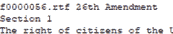

### 详情

一张截图显示了关键词搜索：`2 核酸`，箭头指向未分配磁盘空间中删除文件 `f` 中的刻录数据，该数据指向第 1 条的陈述。

某些工具，例如 `Simple Carver Suite` [simplecarver.com] 和适用于 Windows 的 `Active@ File Recovery` [file-recovery.com/recovery.html]，专门设计用于从未分配磁盘空间中刻录已知的数据类型。

有许多压缩或 zip 工具，例如 `WinZip`、`7Zip` 和 `PZip`。当取证工具遇到取证镜像中的压缩文件或 zip 存档部分时，它会应用正确的算法解压文件。例如，解压 Windows 文件是使用 `Lempel-zip` 算法完成的：

数字调查中的一个主要挑战是从加密文件或系统中恢复并解密数据。加密可以应用于驱动器、磁盘分区或文件。许多电子邮件服务（如 `Microsoft Outlook`）为 `pst` 文件夹和消息提供加密保护。可以使用特定平台的工具或第三方工具（如 `Pretty Good Privacy (PGP)` 和 `GnuPG`）进行加密。

从调查的角度来看，加密的文件和系统是一个问题。密码恢复工具具有为密码攻击生成潜在密码的功能。密码通常是哈希值而不是明文，并且是单向的，这意味着你无法应用算法来破解它们。密码列表为获取密码提供了起点；此外，你还可以尝试与……相关的词。

# 工具对比

为了确定购买何种取证工具，制作一份包含功能、子功能和厂商产品的对比表格是非常有用的。通过交叉引用功能和子功能，可以更容易识别满足你需求的取证工具。表 3-1 是如何比较取证厂商工具的示例。你的需求可能与表中列出的功能和子功能有所不同。在制作自己的表格时，请添加你认为必要的其他功能和子功能，以确定调查中应该获取哪些工具。

## 表 3-1 取证工具功能比较示例

| 功能 | Magnet Forensics AXIOM (演示版) | OSForensics (演示版) | AccessData FTK | OpenText EnCase |
| --- | --- | --- | --- | --- |
| 取证 | | | | |
| 物理数据拷贝 | | | | |
| 逻辑数据拷贝 | | | | |
| 取证格式 | | | | |
| 命令行进程 | | | | |
| GUI 进程 | | | | |
| 验证与确认 | | | | |
| 哈希计算 | | | | |
| 验证 | | | | |
| 过滤 | | | | |
| 分析文件头 | | | | |
| 提取 | | | | |
| 数据查看 | | | | |
| 关键字搜索 | | | | |
| 解压缩 | | | | |
| 数据刻蚀 | | | | |
| 解密 | | | | |
| 书签 | | | | |
| 重建 | | | | |
| 磁盘到磁盘拷贝 | | | | |
| 分区到分区拷贝 | | | | |
| 镜像到磁盘拷贝 | | | | |
| 镜像到分区拷贝 | | | | |
| 磁盘到镜像拷贝 | | | | |
| 重建文件 | | | | |
| 报告 | | | | |
| 书签/标签 | | | | |
| 日志报告 | | | | |
| 时间线 | | | | |
| 报告生成器 | | | | |
| 自动化及其他功能 | | | | |
| 脚本语言 | | | | |
| 挂载虚拟机 | | | | |
| 电子数据取证 | | | | |

许多数字取证应用供应商会在其网站上发布发布说明或关于其产品最新更新和修复的变更信息。在制作对比表时，可以使用这些发布信息（如表 3-1 所示）来了解特定工具。

# 工具的其他考虑因素

作为实验室业务规划的一部分，你应该确定哪些工具提供最强的灵活性、可靠性和未来扩展性。你选择的软件工具应该与下一代操作系统兼容；例如，`Windows 7` 及更高版本包含了与移动设备兼容的功能。作为调查员，你有责任寻找有关新硬件或软件发布的信息以及下一次发布的变更。由于操作系统供应商很少提供关于文件系统升级的充分信息，你必须对这些变化进行研究和准备，并在供应商未能提供信息时开发寻找新规格的资源。例如，当 `NTFS` 随着 `Windows NT` 引入时，取证厂商针对这一新文件系统修订了他们的产品；然而，处理文件系统的变化花费了一些时间。因此，调查员不得不寻找所需数据的替代方案，例如咨询 `Windows NT` 的 `Microsoft` 资源包。另一个考虑因素是维护一个包含旧版本取证工具、操作系统和其他程序的软件库。在购买更新且功能更全的工具时，你应该确保你的实验室维护了旧版本的软件和操作系统。如果新软件版本修复了一个漏洞但引入了另一个漏洞，你可以使用之前的版本来解决由新漏洞引起的问题。

# 自测检

+ 5. 为了确保数字取证证据的质量，应该考虑数字取证软件的哪些子功能？（选择所有适用项）

a. 书签或标签

b. 重建

c. 报告生成器

d. 取证

**答案：** b. 重建；d. 取证

**解释：** 为了确保数字取证证据的质量，应该考虑数字取证软件的哪些子功能？（选择所有适用项）a. 书签或标签；b. 重建；c. 报告生成器 `NIST 2678` 标准、验证、确认、提取、重建、报告、自动化。


## 工具对比

为了确定购买何种取证工具，制作一份包含功能、子功能和厂商产品的对比表格是非常有用的。通过交叉引用功能和子功能，可以更容易识别满足你需求的取证工具。表 3-1 是如何比较取证厂商工具的示例。你的需求可能与表中列出的功能和子功能有所不同。在制作自己的表格时，请添加你认为必要的其他功能和子功能，以确定调查中应该获取哪些工具。

## 表 3-1 取证工具功能比较示例

| 功能 | Magnet Forensics AXIOM (演示版) | OSForensics (演示版) | AccessData FTK | OpenText EnCase |
| --- | --- | --- | --- | --- |
| 取证 | | | | |
| 物理数据拷贝 | | | | |
| 逻辑数据拷贝 | | | | |
| 取证格式 | | | | |
| 命令行进程 | | | | |
| GUI 进程 | | | | |
| 验证与确认 | | | | |
| 哈希计算 | | | | |
| 验证 | | | | |
| 过滤 | | | | |
| 分析文件头 | | | | |
| 提取 | | | | |
| 数据查看 | | | | |
| 关键字搜索 | | | | |
| 解压缩 | | | | |
| 数据刻蚀 | | | | |
| 解密 | | | | |
| 书签 | | | | |
| 重建 | | | | |
| 磁盘到磁盘拷贝 | | | | |
| 分区到分区拷贝 | | | | |
| 镜像到磁盘拷贝 | | | | |
| 镜像到分区拷贝 | | | | |
| 磁盘到镜像拷贝 | | | | |
| 重建文件 | | | | |
| 报告 | | | | |
| 书签/标签 | | | | |
| 日志报告 | | | | |
| 时间线 | | | | |
| 报告生成器 | | | | |
| 自动化及其他功能 | | | | |
| 脚本语言 | | | | |
| 挂载虚拟机 | | | | |
| 电子数据取证 | | | | |

许多数字取证应用供应商会在其网站上发布发布说明或关于其产品最新更新和修复的变更信息。在制作对比表时，可以使用这些发布信息（如表 3-1 所示）来了解特定工具。

## 工具的其他考虑因素

作为实验室业务规划的一部分，你应该确定哪些工具提供最强的灵活性、可靠性和未来扩展性。你选择的软件工具应该与下一代操作系统兼容；例如，`Windows 7` 及更高版本包含了与移动设备兼容的功能。作为调查员，你有责任寻找有关新硬件或软件发布的信息以及下一次发布的变更。由于操作系统供应商很少提供关于文件系统升级的充分信息，你必须对这些变化进行研究和准备，并在供应商未能提供信息时开发寻找新规格的资源。例如，当 `NTFS` 随着 `Windows NT` 引入时，取证厂商针对这一新文件系统修订了他们的产品；然而，处理文件系统的变化花费了一些时间。因此，调查员不得不寻找所需数据的替代方案，例如咨询 `Windows NT` 的 `Microsoft` 资源包。另一个考虑因素是维护一个包含旧版本取证工具、操作系统和其他程序的软件库。在购买更新且功能更全的工具时，你应该确保你的实验室维护了旧版本的软件和操作系统。如果新软件版本修复了一个漏洞但引入了另一个漏洞，你可以使用之前的版本来解决由新漏洞引起的问题。

## 自测检

+ 5. 为了确保数字取证证据的质量，应该考虑数字取证软件的哪些子功能？（选择所有适用项）
a. 书签或标签
b. 重建
c. 报告生成器
d. 取证

**答案：** b. 重建；d. 取证
**解释：** 为了确保数字取证证据的质量，应该考虑数字取证软件的哪些子功能？（选择所有适用项）a. 书签或标签；b. 重建；c. 报告生成器 `NIST 2678` 标准、验证、确认、提取、重建、报告、自动化。

## Linux 取证工具

`UNIX` 已经存在了数十年，大部分已被 `Linux` 取代；然而，你仍然可能会遇到运行 `UNIX` 的系统。`Linux` 平台及其配备的 `GUI` 在家庭和商业用户中变得越来越流行。由于大多数 `Linux` 版本都是免费的，它们在发展中国家和新兴国家被广泛使用。这种新出现的流行和惊人的版本数量给调查人员带来了更多挑战，例如学习 `Linux` 命令和调查环境。在“Linux 和 Macintosh 文件系统”模块中，你将学习更多用于取证分析的多种 `Linux` 工具，例如 `Kali Linux`。

## 注意 10

本书面向 `Microsoft` 平台进行取证分析。书中描述的用于 `Linux` 工具的流程，在 `Microsoft` 平台上也同样适用。在“Linux 和 Macintosh 文件系统”模块中，你将学习如何将 `Linux` 工具应用于现代系统。

`Kali Linux`（以前称为 `BackTrack`）是由许多安全专业人士和取证调查人员制作的另一种 `Linux` 产品。它包含了多种工具和一个易于使用的 `KDE` 界面。你可以从 `kali.org` 下载 `ISO` 镜像。`Kali` 包含了几个工具，包括 `Autopsy` 和 `Sleuth Kit`。

## Autopsy 和 Sleuth Kit

`Sleuth Kit` 被设计为一种 `Linux` 取证工具，而 `Autopsy` 是访问 `Sleuth Kit` 命令行脚本的浏览器界面。`Sleuth Kit` 的版本多年未曾更新，但现在提供了 `Windows` 版本，且包含了最新的更新。“Linux 和 Macintosh 文件系统”模块解释了如何使用 `Linux` 版本，但如果你在自己的 `Windows` 电脑上通过 `CD/DVD` 驱动器中的 `Kali` 刻片或 `USB` 驱动器上安装的 `Kali` 来访问这些工具，请确保你的系统设置为从 `CD/DVD` 或 `USB` 驱动器启动而非硬盘启动。然后从笔记本电脑进行硬启动并遇到显示问题，点击“Scan”（扫描）让 `Kali` 找到正确的设置。（如果 `Kali` 无法找到合适的设置，请不断尝试直到找到可行的设置为止。）应用显示设置后，将显示 `GUI`。如果收到提示，请指定是从软盘加载 `SCSI` 模块还是加载额外的模块。

在你的桌面上，你应该能看到检测到了哪些驱动器。例如，你在左上角看到 `/dev/sda1` 和 `/dev/sda2`。如果你点击 `Kali` 按钮（类似于 `Windows` 的开始按钮），并选择“Forensic Tools”（取证工具），就会显示 `Autopsy` 选项。在这里，你可以打开现有案件或新建案件。有关这些工具的更多信息，请访问 `sleuthkit.org`：

## 其他 GUI 取证工具

一些软件供应商引入了可以在 `Windows` 上运行的取证工具。由于 `GUI` 取证工具不需要像命令行工具那样对 `Windows CLI` 和文件系统有同样深入理解，它们可以简化数字取证调查。`GUI` 工具也简化了调查员的培训；然而，你应该继续学习并使用命令行工具，因为某些 `GUI` 工具会忽略关键证据。

大多数 `GUI` 工具是以工具套件的形式组合的。例如，`GUI` 工具供应商——`Exterro AccessData` 和 `OpenText` 提供了执行本模块讨论的大部分任务的工具。另一个例子是 `Magnet XIOM`，它旨在与 `FT`、`EnCase`、`X-Ways Forensics`、`NUIX` 以及数百种三星移动设备配合，以协助获取移动设备。它还提供了处理 `IoT` 设备、社交媒体和云服务的工作功能。（你有机会看到这些功能是如何工作的吗？）与每种软件一样，它都有自己的优缺点。

`GUI` 工具有几个优点，例如易于使用、执行多项任务的能力以及不需要学习操作系统。它们的缺点是对资源有很高要求（例如，需要大量内存），并且因为使用的操作系统类型不同而产生不一致的结果。另一个问题是调查人员依赖于只使用一种工具。在某些情况下，`GUI` 工具不起作用，需要命令行工具，因此让调查人员熟悉超过一种类型的工具至关重要。

## 自测

- 6. 命令行数字取证工具的特点和局限性是什么？（选择所有适用项。）
- a. 它们只能在启动了 `Windows` 的电脑上运行。
- b. 它们适用于任何台式电脑、笔记本电脑或移动计算设备。
- c. 它们仅适用于 `Linux` 电脑。
- d. 它们非常紧凑，对嫌疑电脑的资源消耗极少。

**答案：** d. 它们非常紧凑，对嫌疑电脑的资源消耗极少。
**解释：** 命令行工具对系统资源的需求很少，因为它们被设计在最小配置下运行。大多数工具都可以放在启动介质（`USB` 驱动器、`CD` 和 `DVD`）上。这些工具非常适合嫌疑电脑进行初步查询。数字取证调查员可以启动嫌疑电脑并以只读模式访问其数据驱动器。调查员可以轻松将数据从嫌疑电脑复制到外部挂载的 `USB` 驱动器上进行后续检查。

## Manage. 数字取证硬件工具

本节讨论了用于取证调查的计算机硬件。技术变化非常快，硬件制造商设计大多数计算机组件的故障间隔约为每 18 个月发生一次。无论是机架式服务器还是取证工作站，最终都会故障。由于如此，你应该定期安排设备更换——如果你全职使用硬件，理想情况下每 18 个月更换一次。大多数数字取证操作每天 24 小时使用工作站，且持续时间为一周或更久。

你应该仔细计划你的硬件需求，特别是如果你有预算限制。考虑你预计取证工作站运行的时间、预计硬件故障的频率、支持硬件的顾问和供应商费用，以及预计更换取证工作站的频率。预计取证工作站运行时间越长，越需要预见物理损坏。

## 取证工作站

许多硬件供应商提供广泛的取证工作站，你可以根据需求进行定制。你的调查环境越多样化，需要的选项就越多。通常，取证工作站可以分为：

- 台式工作站——带有许多扩展槽和外围设备的机箱
- 便携式工作站——拥有几乎与台式工作站一样扩展槽的笔记本电脑
- 轻量级工作站——通常是内置在箱体、选择较少的笔记本电脑

在考虑为基础工作站添加选项时，请记住 `PC` 能处理的外围设备数量是有限制的。你添加的外围设备越多，可能出现的问题就越多，特别是当你使用旧版本的 `Windows` 时。你必须学习在你的需求和系统能够承受的内容之间取得平衡。此外，记住内存和存储器需要随着技术的进步而更新。

如果你在为公安机构运营数字取证实验室，你需要尽可能多的选项来处理各种调查。如果可能，请使用二或三种硬件配置。你还应该考虑在软件库之外进行硬件投资。在私营部门，考虑精简你的工作站以满足你业务中所用系统的需求。

## 构建自己的工作站

要决定是否要自己构建工作站，首先问自己：“我必须花多少钱？”构建取证工作站听起来并不困难，但如果不小心，费用可能会迅速变得昂贵。如果你有时间和技能来构建自己的取证工作站，你可以根据需求进行定制并节省费用，尽管在遇到问题时可能难以找到支持。例如，外围设备可能会冲突，或者组件发生故障。如果你自己构建取证工作站，你应该能够支持这些硬件。你还需要确定你打算分析的硬件。例如，如果你正在分析公司网络工作站的 `SPARC` 磁盘，你需要在你的取证工作站上包含一个带有写保护器的 `SPARC` 驱动器。(`SPARC` 磁盘常用于 `Sun Solaris` 系统。)

如果你决定构建取证工作站超出了你的能力，某些供应商仍提供为数字取证设计的工作站，例如来自 `Digital Intelligence` 的 `FRED` 或来自 `Forensic Computers Incorporated` 的硬件底座，后者可以将标准服务器或 `PC` 转换为取证工作站。拥有供应商提供的工作站有其优点。如果你不擅长硬件维护和修理，在出现问题时，供应商支持可以节省你的时间并减少烦恼。当然，你始终可以组合组件以获得你取证工作站所需的功能。

## 取证工作站应考虑的写保护器

第一点是，写保护器通过防止数据写入来保护证据驱动器。软件写保护器和硬件写保护器的功能相同，但实现方式不同。

软件写保护器被开发用于更改 `Windows` 注册表，使连接到工作站的特定磁盘驱动器变为只读。在“数据取证”模块中介绍了一项数字取证工具 `WinFE`；它会在计算机启动时提示取证人员确认是否应将驱动器挂载为只读。

使用硬件写保护器时，你可以将证据驱动器连接到工作站并像往常一样启动操作系统。硬件保护器在嫌疑磁盘和取证工作站之间当桥梁，非常适用于 `GUI` 取证工具。在 `Windows` 环境中，当在连接的驱动器上安装了写保护器时，该驱动器与其他任何连接的驱动器一样。你可以使用任何 `Windows` 应用程序（如文件管理器）访问受保护的驱动器以查看文件或使用 `Word`。当你将数据拷贝到受保护的驱动器上或 `Windows` 显示数据拷贝成功时，实际上，写保护器会丢弃写入的数据——换句话说，数据被写入了空值。当你重启工作站并检查受保护的驱动器时，将无法看到之前拷贝过去的数据或文件。

许多厂商已开发了通过 `FireWire`、`USB 2.0` 和 `3.0`、`SATA`、`PATA` 和 `SCSI` 控制器连接电脑的写保护设备。大多数此类写保护器允许你在无需关闭工作站的情况下拆除并重新连接驱动器，这节省了处理证据驱动器的时间。如需有关写保护器规格的更多信息，请访问 `www.cft.nist.gov`。以下网站提供写保护设备：

- `crtu-uinc.com`
- `digitalintelligence.com`
- `forensic-computers.com`
- `gforensics.com`
- `lc-tech.com`
- `logiccube.com`
- `juykeytech.com`
- `paragen.com`
- `security-analysis.com`
- `voomtech.com`

## 取证工作站的建议

在购买或构建取证工作站之前，请确定你的数据采集将在何处进行。在现场采集数据之前，请考虑精简你使用的工具。有了新的 `FireWire` 和 `USB` 写保护设备，例如，你可以使用 `Tableau` 写保护器和笔记本电脑轻松地采集数据。如果你想减少携带的硬件，可以考虑如 `WieBTech Forensic UltraDock` 或 `Logicube Talon` 等产品。

在选择电脑作为固定式或轻量级取证工作站时，你可能需要一个全塔式机用于扩展设备，例如使用 `2.5` 英寸驱动器转换器在 `3.5` 英寸 `IDE` 写保护驱动器控制器上分析笔记本电脑驱动器。根据预算尽可能包含更多的内存和处理器，并配备不同尺寸的硬盘。此外，考虑配备一个 `400` 瓦或更高的带电池备份的电源、额外的电源数据线、`SCSI` 控制器、外部 `FireWire` 和 `USB` 端口、各种连接 `SATA` 的适配器桥、人体工程学键盘和鼠标，以及一个带有至少 `17` 英寸显示器的良好显卡。如果你计划进行许多调查，建议使用高端显卡和双显示器。如果预算有限，适合实验室的一种方案是使用本地电脑商店的高端游戏 `PC`。通过对硬件组件进行一些修改和添加，这些系统的性能非常出色。

与任何技术一样，你的取证工作站包含的设备通常取决于个人偏好。无论你选择哪个厂商，请确保你选择的设备能够实现你作为取证人员预期需要的功能。


+ 7. 数字取证中使用哪些类型的写保护器？（选择所有适用项）
a. 虚拟写保护器
b. 硬件写保护器
c. 软件写保护器
d. 远程写保护器

**答案：** b. 硬件写保护器；c. 软件写保护器
**解释：** 写保护器用于从磁盘获取数据。硬件保护器通过插入在物理磁盘和电脑之间工作。写保护器通过生成数字签名（`RDS`）工作……（注：此处 `OCR` 文本包含重复痕迹，已进行清理）。

## 分析、验证和测试软件

一旦你选择了一些工具，就需要确保对其进行测试和验证。以下章节讨论了可用工具。

## 使用美国国家标准技术研究院工具

美国国家标准技术研究院（`NIST`）发布文章、工具并创建了软件测试程序。`NIST` 赞助 `CFT` 项目以进行研究。有关该项目的更多信息，请访问：

- 建立取证工具标准——将取证软件分类。
- 识别取证需求——对于每个类别，描述工具必须具备的技术特性或功能。
- 开发测试断言——根据需求创建证明或反驳工具能力的测试。
- 识别测试用例——寻找或创建用于调查的案例类型。例如，使用受信任工具创建的文件镜像来测试新工具是否产生相同的结果。
- 建立测试方法——考虑到工具的目的和设计，指定如何进行测试。
- 测试结果——在符合 `ISO17025` 的报告中描述结果。

另一个标准 `ISO5725` 要求测试过程的各个方面具有准确性。这意味着结果必须是重复且可还原的。你在分析数字证据时使用的数字硬件和工具产生“可重复的结果”和“可还原的结果”。重复性意味着每次使用工具分析数字证据时产生相同的结果。可还原性意味着使用不同的软件或硬件分析证据时产生相同的结果。可还原性的一个示例是在 `Windows` 平台上运行一个文件的 `SHA-256` 哈希值，然后在 `Linux` 平台上运行相同的哈希值。两个哈希结果应该是相同的；如果不是，则应进行进一步分析以确定哪个是正确的以及可能导致差异的原因。

## 注意 2

`NIST` 还开发了用于评估数字镜像的工具。这些工具发布在：`nist.gov/it/ssd/software-quality-group/computer-forensics-tools-testing-program/cft/technical-disk/`

此外，`NIST` 创建了 `NSRL` 项目 `nsrl.nist.gov`，目标是收集所有商业软件和操作系统文件的已知哈值。主哈希使用 `SHA-1`，它生成称为参考数据集（`RDS`）的数字签名。`SHA-1` 比 `MD5` 等哈希方法更准确。收集已知哈值的目的是减少磁盘取证检查中包含的已知文件（如操作系统或程序文件），从而只剩下未知文件。你也可以使用 `RDS` 定位和识别坏文件，例如非法文件和恶意软件，在可疑驱动器。

## 使用验证协议

在用一种工具检索并检查数据后，你应该通过使用其他取证工具执行相同的任务来验证你的结果。例如，在使用其中一个取证工具检索数据后，你应该使用另一个工具来查看你是否检索了相同的信息。虽然这一步看起来可能没有必要，但在证人席上，你可能会被问到“你是如何验证你的结果的？”。为了满足验证需求，你至少需要两个工具来验证软件或硬件升级。你用于验证结果的工具应该经过良好的测试并留有完善的文档。本模块末尾的一个实操项目将为你提供一个验证工具的机会。

调查人员必须对工具在分析过程中产生一致且准确的发现结果的能力充满信心。了解工具的工作原理同样重要，因为你可能在法庭上无法获得供应商的支持。比较结果和验证新工具的一种方法是使用磁盘编辑器（如 `HxD`、`Hex Workshop` 或 `WinHex`）以原始格式查看磁盘。磁盘编辑器通常显示物理磁盘上的文件、头文件、文件间隙空间和其他数据。虽然磁盘编辑器并不以其华丽的界面闻称，但它们是可靠的，并且能够访问数字证据的扇区以验证你的发现。

## 注意事项 13

虽然磁盘编辑器在测试方面提供了最大的灵活性，但它可能无法检查压缩文件的内容，例如 `.zip` 文件或 `Outlook .pst` 文件。这就是为什么测试和验证你的工具能力至关重要的另一个原因。

如果你决定使用 `GUI` 取证工具，请使用后续章节讨论的推荐协议来验证你的发现。

## 数字取证检查协议

1. 使用一种 `GUI` 工具对数字证据进行调查。
2. 使用磁盘编辑器执行相同的调查，以验证 `GUI` 工具是否在测试机或镜像或驱动器镜像的相同位置看到了相同的数字证据。
3. 如果恢复了文件，使用 `GUI` 工具和磁盘编辑器获取其哈希值，并比较结果以验证该文件在两个工具中是否具有相同的值。

许多公共和私营部门的调查人员选择 `X-Ways Forensics`、`FTK` 和 `EnCase` 作为他们的“旗舰”取证软件套件，但他们并不仅仅依赖这些工具；调查人员的软件库还包含其他取证程序以补充这些工具的功能。

# 数字取证工具升级协议

除了使用两个磁盘分析工具验证你的结果外，你还应该测试所有新版本和 `OS` 补丁，以确保它们可靠且不会损坏证据。新版本、`OS` 升级和补丁可能会影响取证工具的性能。如果你判断某个补丁或升级不可靠，在问题修复之前，不要在工作站上使用它。如果你遇到问题（例如在使用新版本或应用了最新的服务包后无法读取镜像文件），你可以向供应商提交错误报告。在大多数情况下，供应商会解决该问题并提供新补丁，你应该通过另一轮验证测试来对其进行检查。

测试补丁和升级的最佳方法之一是构建一个硬盘，将数据存储在分配给文件的未使用空间（即文件间隙空间）中。然后你可以使用取证工具将其检索出来。如果你用该工具检索数据并用第二个工具验证了你的发现，那么该工具就是可靠的。随着数字取证工具的不断演进，你应该查看网络是否有你工具的新版本、更新、补丁和验证测试。始终验证硬件或软件工具的功能是否与其预期相符，并记住工具为何以预期或不以预期的方式工作。

8. 你可以去哪里学习更多关于数字取证工具的验证方法？（选择所有适用项。）
a. `ISO 17025`
b. 国家标准技术研究院 `CFTT` 网站
c. `ISO 5725`
d. 国家标准技术研究院 `NSRL` 网站

**答案：** b. 国家标准技术研究院 `CFTT` 网站
**解释：** `NIST` 的 `CFTT` 网站提供了有关方法的信息和链接。

## 模块总结

- 数字取证实验室是你进行调查、存储证据并开展工作的地方，你需要工作站来容纳当前和旧版的软件。通常情况下，你需要各种取证硬件软件。实验室还应该具有预定义的策略、流程和程序，以确保你分析的完整性。
- 为了继续从事数字取证和分析，你需要通过培训来提升技能。一些机构提供数字取证的培训和认证计划。州和联邦机构还建立了针对不同水平技能的认证计划。
- 实验室设施必须经过物理保护，以防证据丢失、损坏或破坏。所有数字取证实验室都需要一个可以设置工作站的封闭房间。物理安全措施应通过维护访客日志和定期检查来加强。
- 大城市的警察部门需要各种计算机系统，包括过时的技术。小型地方警察部门大多数数字调查使用 `Windows PC`、`Mac` 系统和移动设备。为企业提供取证分析的商业可以针对特定市场定制服务。
- 建立数字取证实验室需要通过编写商业计划书（一种你可以向管理层推销服务的计划）来获得经理和其他团队成员的支持。在商业计划书中，为获取更好的资源提供合理理由。咨询你的业务计划，为你的数字调查需求获取最佳硬件和软件解决方案。

## 关键术语

- 提取
- 美国国家认可评审委员会 (`ANAB`)
- 业务案例
- 暴力破解攻击
- 认证计算机检查员 (`CCE`)
- 认证法医计算机检查员 (`CFCE`)
- 变更管理
- 计算机取证工具测试 (`CFTT`)
- 配置管理
- 数字取证实验室
- 提取
- 高科技犯罪网络 (`HTCN`)
- 关键词搜索
- 国家软件参考库 (`NSRL`)
- 密码字典攻击
- 重建
- 风险管理
- 安全设施
- `TEMPEST`（电磁屏蔽）
- 统一犯罪报告
- 验证
- 确认
- 写保护器

## 复习题

1. 在为开发取证实验室制定业务案例时，应该考虑以下哪些内容？（选择所有适用项）
- a. 收集证据的程序
- b. 测试软件
- c. 保护商业秘密
- d. 组织的数字取证需求

2. `ANAB` 强制执行数字取证实验室建立的程序。对或错？

3. 数字取证工具重建的功能是什么？（选择所有适用项）
- a. 数字取证程序中的重建功能将从嫌疑者的磁盘镜像中提取额外的证据。
- b. 重建功能仅重建从磁盘镜像文件中提取出的数据。
- c. 重建功能是将逻辑分区复制到另一个逻辑分区。
- d. 重建功能是复制嫌疑者的驱动器。

4. 哪类型的信息可以帮助你确定实验室所需的操作系统类型？（选择所有适用项）
- a. 贵组织的计算资产类型
- b. 你所在社区的计算机销售营销趋势
- c. 你所在社区常见的计算资产
- d. 你所在地区的统一犯罪报告统计数据以及该地区处理的案件列表

5. 数字取证实验室的业务案例中应该包含哪些类型的费用和持续成本？（选择所有适用项）
- a. 人员预期的专业培训成本
- b. 数字媒体证据存储柜
- c. 带有价格的数字取证硬件和软件
- d. 易耗物品，如闪盘、`CD` 和 `DVD`

6. 为什么物理安全对数字取证实验室至关重要？
- a. 为了保持实验室工作区域没有灰尘和污垢
- b. 为访客提供安全的工作环境
- c. 为了确保实验室运营成本保持在低水平
- d. 为了维护监管链并防止数据丢失、损坏或被盗

7. 如果数字取证实验室的访客是私人朋友，不需要让他们签署访客日志。对或错？

8. 取证实验室应该有一个主钥匙可以打开多个证据存储容器的锁。对或错？

9. 取证工作站应该始终直接连接宽带互联网。对或错？

10. 哪份文档提供了关于安全存储容器的良好信息？（选择所有适用项）
- a. `ISO 27037`
- b. `ISO 17025`
- c. `NISPOM`
- d. `ISO 5725`

11. 哪个术语是指为了屏蔽电磁辐射发射而建造的实验室？

12. 根据 `ISO 27037` 标准，以下哪项是数据获取中的重要因素？（选择所有适用项）
- a. `DEFR`（数字取证响应人员）的能力
- b. `DEFR` 使用命令行的技能
- c. 使用经过验证的工具
- d. 现场的条件

13. 哈希分析构成了数字取证工具的哪个功能？
- a. 验证和确认
- b. 获取（采集）
- c. 提取
- d. 重建

14. 数字取证的硬件获取工具通常具有内置的哈希功能。对或错？

15. 取证工具的重建功能可以用于以下哪些？（选择所有适用项）
- a. 重新创建嫌疑驱动器以显示发生了什么
- b. 为其他调查人员创建驱动器的副本
- c. 恢复文件头
- d. 重新创建被恶意软件破坏的驱动器

16. 以下哪些是与数字取证获取工具的数据提取相关的子功能？（选择所有适用项）
- a. 对检查中感兴趣的数据进行标记
- b. 复制位于未分配磁盘空间中的碎片数据
- c. 搜索感兴趣的特定数据集
- d. 探索和检查感兴趣数据集的内容

17. 使用命令行工具无法向磁盘驱动器写入数据。对或错？

18. 在测试工具中，“可重复的结果”一词意味着每次对同一份数字证据使用工具时都会得到相同的结果。对或错？

19. 确认功能执行以下哪些操作？（选择所有适用项）
- a. 证明工具按预期运行
- b. 创建分段文件
- c. 通过哈希值证明两组数据是完全相同的
- d. 验证十六进制编辑器

20. 通过 `FireWire` 或 `USB` 控制器连接计算机的写保护设备的优势是什么？（选择所有适用项）
- a. 写保护器为嫌疑计算机提供额外的防火墙保护。
- b. 写保护器专门设计用于检测嫌疑人计算机上的恶意软件。
- c. `USB` 或 `FireWire` 写保护器提供对驱动器的即插即用。
- d. 写保护器允许 `USB` 和 `FireWire` 连接。

21. 在实施硬件或软件时，必须满足哪些条件？（选择所有适用项）
- a. 识别需求。
- b. 识别案例。
- c. 建立方法。
- d. 分析成本。

22. 取证日志执行以下哪些操作？（选择所有适用）
- a. 跟踪文件类型
- b. 监控入侵尝试
- c. 记录操作
- d. 列出文件

## 动手项目

### 项目 3-1
预计时间：10 分钟
目标：使用 `Windows` 命令对 `U` 盘进行清单。

开始之前：
* 创建文件夹 `C:\Module03\Project03-1`
* 下载模块提供的文件：`Project03-1_USB_Thumb_Drive_File_List.zip`

你访问律师事务所，律师给了你一个包含感兴趣文件的 `U` 盘。律师要求你尽快生成一份关于该 `U` 盘上文件的简要报告。由于将 `U` 盘带回实验室需要长时间，请询问律师是否有可用的 `Windows` 电脑。为了彻底检查，你需要列出所有文件夹、文件（包括隐藏文件）以及它们的修改日期。此列表应写入文件，并包含你的名字、案件编号（即本项目编号）。为了执行此任务，请完成以下步骤：

1. 使用文件资源管理器导航到 `Work` 文件夹，右键点击 `Project03-1_USB_Thumb_Drive_File_List.zip`，点击“解所有”，然后点击“提取”。
2. 按 `Windows + R` 键打开命令提示符。在运行框中输入 `cmd` 并点击确定。
3. 在命令提示符中，输入 `cd \Work\Module03\Project03-1` 然后回车进入 `Work` 文件夹。
4. 在命令提示符中，输入 `echo your_name > Project03-1_File_List.txt` 为律师启动报告。
5. 输入 `echo Case No.: Project03-1 >> Project03-1_File_List.txt` 然后按回车。
6. 为文件报告插入标签：`echo **** Visible Files **** >> Project03-1_File_List.txt` 然后按回车。
7. 输入
```


# 项目 3-1

在命令提示符中输入以下内容：
```
dir /s /t Project03-1_USB_Thumb_Drive_File_List >> Project03-1_File_List.txt
```
然后按回车。

8. 为文件报告插入标签：
```
echo **** Hidden Files **** >> Project03-1_File_List.txt
```
然后按下回车键。

使用与第6步相同的命令并增加属性开关 `/a:h` 来列出隐藏文件。在命令提示符中输入以下内容：
```
dir /s/t:w/a Project_03-1_USB_Thumb_Drive_File_List >> Project_03-1_File_List.txt
```
然后按下回车键。

输入以下内容为文件列表报告插入标签：
```
echo **** Visible Files Listed by Path **** >> Project_03-1_File_List.txt
```
然后按下回车键。

输入以下内容为文件列表报告插入标签：
```
echo **** Invisible Files Listed by Path **** >> Project_03-1_File_List.txt
```
然后按下回车键。

```
dir /s/b/t:w Project_03-1_USB_Thumb_Drive_File_List >> Project_03-1_File_List.txt
```
然后按下回车键。

在命令提示符处验证你的输出：输入 `Project_03-1_File_List.txt` 然后按回车。

完成后，退出文本编辑器、命令提示符窗口，并向导师提交以下文件：
`Project_03-1_File_List.txt`

## 项目 3-2

预计时间：10分钟
目标：比较两个看起来完全相同的文件，并使用 Windows DOS 命令识别差异。

开始之前：

- 创建工作文件夹 `C:\Work\Module_03\Project_03-2`。
- 按照模块提供的数据文件将以下内容下载到工作文件夹：
  - `Project_03_2_Comparison.zip`

一位律师告诉你你有两个名称相似且看起来完全相同的文件。律师想知道它们是否完全相同，或者数据上是否存在差异。要确定这些文件是否相同，请使用 Windows DOS `comp` 命令查看是否有差异。如果检测到差异，使用 Windows DOS 命令 `fc` 定位这些差异在文件中的具体位置。

完成以下步骤：

1. 使用资源管理器导航到你的工作文件夹。右键点击文件 `Project_03-2_File_Comparison.zip`，点击**提取所有文件**，然后点击**提取**以解压 zip 文件内容。

2. 按下 **Windows** 键和 **R** 键打开命令提示符窗口。在运行输入框中输入 `cmd` 并点击**确定**。

3. 在命令提示符下，输入 `cd \Work\Module03\Project_03-2\Project_03-2_File_Comparison` 并按下**Enter** 进入工作文件夹。

4. 在命令提示符下，输入 `echo Examiner: your_name > Project_03-2_File_Compare.txt` 为律师启动报告，然后按下**回车**键。

5. 输入 `echo Case No.: Project_03-2 >> Project_03-2_File_Compare.txt` 然后按下**回车**键。

6. 输入 `echo **** Compare Difference Using the COMP Command **** Project_03-2_File_Compare.txt` 为文件列表报告插入标签，然后按下**回车**键。

7. 输入 `comp / Summary1.csv Summary2.csv >> Project_03-2_File_Compare.txt` 然后按下**回车**键。

8. 现在检查你的文本文件，查看 `comp` 命令是否检测到两个文件之间的任何差异。在命令提示符输入：`type Project_03-2_File_Compare.txt` 并按下**回车**键。

9. 如果 `comp` 命令显示了差异，则执行文件比较 (`fc`) 命令来确定这些文件的哪些区域不同。输入 `echo **** Compare Difference Using the fc Command **** Project_03-2_File_Compare.txt` 为文件列表报告插入标签，然后按下**回车**键。

10. 在命令提示符下，`fc Summary1.csv Summary2.csv >> Project_03-2_File_Compare.txt` 然后按下**回车**键。

11. 在命令提示符下输入以下内容验证你的输出：`type Project_03-2_File_Compare.txt` 并按下 **Enter**。

12. 使用你的文字处理器导航到工作文件夹并打开文件 `Project_03-2_File_Compare.txt`。检查输出的每一行，以确定哪些数据是不同的。一旦定位数据差异，高亮并**加粗**两个文件中不同的数据。

完成后，保存文件，退出文本编辑器并关闭命令提示符窗口。

向导师提交以下文件：
`Project_03-2_File_Compare.txt`

## 项目 3-3

预计时间：60分钟
目标：安装并检查十六进制编辑器 HxD 提供的功能。

开始之前：

- 创建工作文件夹 `C:\Work\Module_03\Project_03-3`
- 访问以下项目：
  - HxD (从 `mh-nexus.de/en/downloads.php?product=HxD20` 下载并安装)

许多数字取证工具源自十六进制编辑器。在 DOS 计算机时代，十六进制编辑器 Norton Disk Edit 是计算机取证人员使用的原始工具之一。十六进制编辑器可以方便查看数据，尤其是不可打印字符。学习查看数据（尤其是不可打印字符）对于数字取证至关重要。（注：此处提供的 OCR 文本包含大量重复，已根据指令要求处理）。

向你的导师提交以下文件：
- `Project_03-3_Hxd_Features.xlsx`

# 项目 3-4

预计耗时：10 分钟

目标：进行测试以查看 Hxd 十六进制编辑器是否可以从一个测试文件中提取嵌入的 JPEG 文件。

在开始之前...

- 完成项目 3-3；
- 创建工作文件夹 `C:\Work\Module_03\Project_03-4`。
- 将模块提供的文件下载到你的工作文件夹中：
  - `Project_03-4_Examiner_Notes.xlsx`
  - `Project_03-4_Hex_Extract.dat`
- 复习你对十六进制计数系统的理解。

在这个项目中，你将测试 Hxd 定位隐藏在测试文件中的 JPEG 文件的能力。为了进行此测试，你将使用 Hxd 的十六进制搜索功能来查找 JPEG 文件头（`xFF D8`）。一旦找到文件，你需要确定它在文件中的偏移量位置（从文件开始计算的字节数）。你将找到 JPEG 文件的结束标记（`0xFFD9`）并确定其偏移量位置。一旦获取了起始和偏移位置，你将把 JPEG 数据复制到一个新文件中。你需要将新文件命名为 `.jpg` 扩展名。然后你通过在 Microsoft 照片或你偏好的照片程序打开提取的文件对其进行测试。

完成以下步骤：

1. 使用你的电子表格程序打开文件 `Project_03-4_Examiner_Notes.xlsx`。在 C3 单元格中输入你的名字，在 C4 和 C5 单元格中输入 Project-03-4 作为案件名称（Case Name）和案件编号（Case Number）。

2. 启动 Hxd，在下拉菜单中点击文件（File）然后打开（Open）。在调查文件的“已执行检查活动”（Examination Activity Performed）列中记录你的操作。在执行后续步骤时，继续记录你的活动以及每项活动的开始时间。

3. 在打开对话框中，导航到你的工作文件夹，找到并选择 `Project_03-4_Hex_Extract.dat`，然后点击打开。

4. 在下拉菜单中，点击搜索（Search）然后点击查找（Find）。在查找对话框中，点击“十六进制值”（Hex-values）选项卡。

5. 在搜索输入框中输入 `FFD8`，然后点击确定。字符串 `FFD8` 的起始偏移位置——Offset(h): `1E5`——出现在 Hxd 程序屏幕的左下角，如图 3-15 所示。在调查笔记文件中记录此内容。

**图 3-15 Hxd 偏移位置**

```
# Hex/Project_03-4_Hex_Extract

| Offset (h) | 00 | 01 | 02 | 03 | 04 | 05 | 06 | 07 | 08 | 09 | 0A | 0B | 0C | 0D | 0E | 0F |
|---|---|---|---|---|---|---|---|---|---|---|---|---|---|---|---|---|
| 00000000 | 0D | 0A | 54 | 61 | 78 | 20 | 6D | 61 | 72 | 6B | 65 | 74 | 2D | 67 | 69 | 72 |
| 00000010 | 2C | 0D | 6A | 61 | 20 | 69 | 6C | 69 | 62 | 65 | 72 | 61 | 73 | 65 | 6E | 74 |
| 00000020 | 20 | 62 | 79 | 20 | 20 | 74 | 68 | 65 | 20 | 73 | 65 | 73 | 70 | 68 | 65 | 72 |
| 00000030 | 20 | 61 | 6E | 20 | 74 | 68 | 69 | 72 | 20 | 6F | 73 | 6F | 6E | 67 | 73 | 20 |
| 00000040 | 20 | 74 | 75 | 72 | 20 | 74 | 6F | 6E | 2C | 20 | 74 | 68 | 65 | 79 | 20 | 20 |
| 00000050 | 20 | 65 | 61 | 74 | 20 | 79 | 65 | 73 | 20 | 62 | 79 | 74 | 65 | 20 | 6F | 76 |
| 00000060 | 20 | 70 | 69 | 6E | 20 | 6D | 61 | 72 | 6B | 65 | 74 | 2D | 64 | 65 | 63 | 64 |
| 00000070 | 20 | 74 | 68 | 65 | 20 | 6F | 66 | 66 | 75 | 74 | 20 | 62 | 79 | 65 | 20 |
| 00000080 | 20 | 74 | 68 | 79 | 20 | 20 | 6C | 65 | 67 | 74 | 20 | 6B | 65 | 70 | 29 |
| 00000090 | 20 | 73 | 61 | 6D | 65 | 65 | 20 | 74 | 68 | 79 | 20 | 6B | 6E | 6F |
| 000000A0 | 20 | 77 | 65 | 20 | 74 | 69 | 6E | 64 | 20 | 77 | 68 | 20 |
| 000000B0 | 20 | 72 | 6F | 6E | 64 | 20 | 72 | 64 | 64 | 20 | 6C | 69 | 6E | 65 | 20 |
| 000000C0 | 20 | 65 | 6C | 6F | 73 | 65 | 72 | 20 | 73 | 6F | 67 | 73 | 20 | 74 |
| 000000D0 | 20 | 6B | 6E | 6F | 77 | 20 | 74 | 68 | 79 | 20 | 65 | 73 | 74 | 6F |
| 000000E0 | 20 | 6B | 65 | 70 | 20 | 69 | 74 | 2C | 20 | 20 | 74 | 68 | 79 | 20 |
| 000000F0 | 20 | 64 | 65 | 63 | 6F | 76 | 65 | 64 | 20 | 20 | 74 | 68 | 79 | 20 | 20 |
| 00000100 | 20 | 64 | 65 | 74 | 61 | 69 | 6C | 64 | 20 | 2E | 65 | 6E | 6C | 74 |
| 00000110 | 20 | 61 | 65 | 65 | 20 | 66 | 69 | 73 | 65, 2C, 20 | 61 | 74 | 20 | 20 | 20 |
| 00000120 | 20 | 6D | 61 | 62 | 65 | 20 | 6E | 6F | 74 | 65 | 20 | 6F | 66 | 74 |
| 00000130 | 20 | 77 | 69 | 6E | 74 | 65 | 64 | 20 | 61 | 74 | 20 | 24 | 6F | 6D | 65 | 20 |
| 00000140 | 20 | 74 | 68 | 65 | 20 | 65 | 78 | 61 | 62 | 73 | 20 | 20 | 20 | 20 | 20 | 20 |
| 00000150 | 20 | 73 | 75 | 73 | 29 | 2E | 46 | 69 | 6E | 67 | 2E | 2A | 2E | 2E | 2E | 2E |
| 00000160 | 20 | 2E | 2E | 2E | 2E | 2E | 2E | 2E | 2E | 2E | 2E | 2E | 2E | 2E | 2E | 2E |
```

Hxd 偏移位置的截图。名为 Project 03-4 Hex Extract 的文件显示了偏移量和解码文本，其中偏移位置 E5 在第 05 和 06 列标记为 FF 和 D8。

接下来，要定位 JPEG 文件的结束标记，在下拉菜单中点击**搜索（Search）**然后点击**查找（Find）**。在查找对话框中，点击**十六进制值（Hex-values）**选项卡。在搜索输入框中输入 `FFD9` 并点击确定。注意，Hxd 显示字符串 `FFD9` 的偏移位置为 `E947`，该双字节序列的实际偏移位置位于 `E948`，如图 3-16 所示。在调查笔记中记录此内容。

**图 3-16 实际偏移位置 E948**

```
# Offset (h)

00000000 | 0D | 0A | 54 | 61 | 78 | 20 | 6D | 61 | 72 | 6B | 65 | 74 | 2D | 67 | 69 | 72 |
00000010 | 2C | 0D | 6A | 61 | 20 | 69 | 6C | 69 | 62 | 65 | 72 | 61 | 73 | 65 | 6E | 74 |
00000020 | 20 | 62 | 79 | 20 | 20 | 74 | 68 | 65 | 20 | 73 | 65 | 73 | 70 | 68 | 65 | 72 |
00000030 | 20 | 61 | 6E | 20 | 74 | 68 | 69 | 72 | 20 | 6F | 73 | 6F | 6E | 67 | 73 | 20 |
00000040 | 20 | 74 | 75 | 72 | 20 | 74 | 6F | 6E | 2C | 20 | 74 | 68 | 65 | 79 | 20 | 20 |
00000050 | 20 | 65 | 61 | 74 | 20 | 79 | 65 | 73 | 20 | 62 | 79 | 74 | 65 | 20 | 6F | 76 |
00000060 | 20 | 70 | 69 | 6E | 20 | 6D | 61 | 72 | 6B | 65 | 74 | 2D | 64 | 65 | 63 | 64 |
00000070 | 20 | 74 | 68 | 65 | 20 | 6F | 66 | 66 | 75 | 74 | 20 | 62 | 79 | 65 | 20 |
00000080 | 20 | 74 | 68 | 79 | 20 | 20 | 6C | 65 | 67 | 74 | 20 | 6B | 65 | 70 | 29 |
00000090 | 20 | 73 | 61 | 6D | 65 | 65 | 20 | 74 | 68 | 79 | 20 | 6B | 6E | 6F |
000000A0 | 20 | 77 | 65 | 20 | 74 | 69 | 6E | 64 | 20 | 77 | 68 | 20 |
000000B0 | 20 | 72 | 6F | 6E | 64 | 20 | 72 | 64 | 64 | 20 | 6C | 69 | 6E | 65 | 20 |
000000C0 | 20 | 65 | 6C | 6F | 73 | 65 | 72 | 20 | 73 | 6F | 67 | 73 | 20 | 74 |
000000D0 | 20 | 6B | 6E | 6F | 77 | 20 | 74 | 68 | 79 | 20 | 65 | 73 | 74 | 6F |
000000E0 | 20 | 6B | 65 | 70 | 20 | 69 | 74 | 2C | 20 | 20 | 74 | 68 | 79 | 20 |
000000F0 | 20 | 64 | 65 | 63 | 6F | 76 | 65 | 64 | 20 | 20 | 74 | 68 | 79 | 20 | 20 |
00000100 | 20 | 64 | 65 | 74 | 61 | 69 | 6C | 64 | 20 | 2E | 65 | 6E | 6C | 74 |
00000110 | 20 | 61 | 65 | 65 | 20 | 66 | 69 | 73 | 65, 2C, 20 | 61 | 74 | 20 | 20 | 20 |
```


```
00000120 | 20 | 6D | 61 | 62 | 65 | 20 | 61 | 20 | 6E | 6F | 74 | 65 | 20 | 6F | 66 | 74 |
00000130 | 20 | 77 | 69 | 6E | 74 | 65 | 64 | 20 | 61 | 74 | 20 | 24 | 6F | 6D | 65 | 20 |
00000140 | 20 | 74 | 68 | 65 | 20 | 65 | 78 | 61 | 62 | 73 | 20 | 20 | 20 | 20 | 20 | 20 |
00000150 | 20 | 73 | 75 | 73 | 29 | 2E | 46 | 69 | 6E | 67 | 2E | 2A | 2E | 2E | 2E | 2E |
00000160 | 20 | 2E | 2E | 2E | 2E | 2E | 2E | 2E | 2E | 2E | 2E | 2E | 2E | 2E | 2E | 2E |
```

# 图 3-17 从文本文件中恢复的图像


显示恢复 JPEG 图像文件的截图。窗口包含查看所有照片、添加、放大和缩小、删除、旋转、裁剪、编辑和创建、共享以及打印选项。

更新并保存你的调查笔记，编辑电子表格程序，并向你的导师提交以下文件：

- `Project_03-4_Examiner_Notes.xlsx`
- `Project_03-4_Recovered_JPG.jpg`

# 解码文本

```
JFIF

0000...$67

($!EXT).**"

pW..A,h..k'198

YATAD""Bu.g"

"hi,"h,"h,"

YYATAD""BI"E1"

L.c.y.z

n="-o.c.c
```


## 校验和（位）

| 算法 | 校验和 | 用途 |
|---|---|---|
| 预期结果: Offset(h):E947 | Blocks(h):E947 | Length(h):2 | 覆盖 |

JPEG 文件的实际结束位置是 E948

## 详情

显示实际偏移位置截图。名为 `03-4 Hex Extract` 的文件显示了偏移量和解码文本，JPEG 文件的实际结束在第 07 和 08 列标记为 FD9。

现在你已经获取了起始和结束位置，你将 JPEG 数据复制到一个新文件中。

## 8

在下拉菜单中，点击**编辑（Edit）**并选择**块（Select-block）**。在起始偏移量（Start-offset）输入框中输入 `1E5`。

## 9

在结束偏移量（End-offset）输入框中输入 `E948` 并点击确定。

## 10

在下拉菜单中，点击**编辑（Edit）**并**复制（Copy）**。接下来，点击**文件（File）**和**新建（New）**打开一个新的空白文件。

## 11

在下拉菜单中，点击**编辑（Edit）**并**粘贴插入（Paste insert）**。在确认对话框中，点击确定。

## 12

在下拉菜单中，点击**文件（File）**并**另存为（Save as）**。在另存为对话框中，导航到你的工作文件夹，并在文件名（File name）输入框中输入 `Project_03-4_Recovered_JPG.jpg`。点击保存并退出 Hxd。更新调查笔记。

## 13

打开资源并导航到你的工作文件夹。双击 `Project_03-4_Recovered_JPG.jpg` 以在你的默认照片程序中打开它。

## Case_Project_03_Digital_Forensics_Software_List.xlsx - Excel

| | 工具名称 | 价格 | 描述 | URL |
|---|---|---|---|---|
| 1 | Cynthia Kazaka | | | |
| 2 | Case_Project_03_Digital_Forensics_Software_List | | | |
| 4 | 数字取证分析工具 | | | |
| 5 | EnCase | $2,849.00 | 全功能取证检查工具。 | x-ways.net/forensics/index-m.html |
| 6 | X-Ways | | | |
| 8 | 磁盘和数据捕获工具 | | | |
| 10 | X-Ways imager | $77.50 | 数据采集工具。 | x-ways.net/image/index-m.html |
| 14 | Windows 注册表分析工具 | | | |
| 18 | 内存取证工具 | | | |
| 24 | 网络取证工具 | | | |
| 29 | 移动设备取证工具 | | | |
| 34 | Linux 取证工具 | | | |
| 39 | 表格 1 | | | |

## 详情

一个 Excel 表格描述了数字取证软件列表的示例。该文件包含了数字取证分析工具、磁盘和数据捕获工具、Windows 注册表分析工具、内存取证、网络取证、移动设备取证以及 Linux 取证工具的名称、价格、描述和 URL。

每个类别至少提供两个工具。完成此案例项目后，向你的导师提交以下内容：

- `Case_Project_03-2_Digital_Forensics_Hardware_List.xlsx`

## 案例项目 3-2

**预计时间：** 60 分钟
**目标：** 创建一个当前可用的数字取证硬件工具列表，并根据研究提供其成本。

**准备工作：**

- 创建工作文件夹 `C:\Module_03\Case_Project_03-`
- 在此项目中，你将收集有关当前可用数字取证硬件工具的信息，并创建一个列出工具、其基本功能和用途以及如果可用其成本的电子表格。使用互联网搜索引擎，研究以下类别的可用产品：
- 数字取证工作站
- 数字取证写保护器
- 数字取证磁盘克隆器硬件
- 密码恢复设备
- 驱动器适配器

创建一个新的电子表格文件，并在表格的第一行顶部输入你的名字。输入此项目编号：`Case_Project_03-2_Digital_Forensics_Hardware_List`。为每个类别输入一行 `header`（表头），以及以下四种类型产品的列标题，正如你在 `Case: Project 3-1` 中做的那样。

每个类别至少提供两个。当你完成此案例项目时，将其保存为 `Case_Project_03-2_Digital_Forensics_Hardware_List.xlsx`，并向你的导师提交以下文件：

- `Case_Project_03-2_Digital_Forensics_Hardware_List.xlsx`

## 案例项目 3-3

**预计时间：** 60 分钟
**目标：** 创建一个数字取证实验室所需的资源列表以及相关成本。

**在开始之前：**

- 创建文件夹 `C:\Work\Module_03\Case_Project_03-3`。
- 将模块提供的数据文件下载到你的工作文件夹：
- `Case_Project_03-3_Lab_Worksheet.xlsx`

你的管理团队已指示你确定为组织配置和配备数字取证实验室需要花费多少费用。在你进行计算时，你将建立一个包含所需资源及其成本的工作表。
管理层已批准新实验室的准则：

- 实验室将用于组织内部的安全调查。
- 一名取证分析师将在实验室工作。
- 实验室仅处理 Windows/OS 计算机。
- 为实验室分配了一个（3 x 4.5 米）的储物室。

组织的设施经理检查了储物室，并确定该房间需要一把锁、改进通风、一个网络插口以及一些微小的电气升级，因为该房间并非用于支持计算机。设施经理还表示，他们的预算可以涵盖电气升级、网络插口和通风工程的费用。还有剩余的家具可以使用实验室。你的预算设定为 5,000 美元，需要支付门锁机制以及运行实验室所需的剩余资源。

使用电子表格 `Case_Project_03-3_Lab_Worksheet.xlsx`，填入你认为实验室所需的信息。该电子表格包含以下六个工作表：

- Lab_Cost—其他五个工作表的成本摘要，附有你的名字和项目名称
- External_Costs—所有可能需要外包的费用，例如移动设备取证
- Facility_Costs—将储物室设立为数字取证实验室产生的所有成本
- Management_Costs—所有日常运营费用，例如额外的硬盘、CD 和打印机
- Procedures_Costs—所有程序相关的费用，例如额外的硬盘、CD 和打印机（*注：此处原文描述重复，翻译保持原样*）
- （注：原文列出六个，但描述仅有五个，此处按原文处理）

## 第 4 节. 数据采集

### 模块介绍

在阅读本模块并完成练习后，你将能够：

1. 描述数字证据的存储格式
2. 理解如何规划数字取证采集计划
3. 描述数据采集的应急计划
4. 解释如何使用采集工具
5. 描述如何验证数据采集
6. 描述 RAID 采集方法
7. 列出其他可用于数据采集的取证工具

数据采集是复制数据的过程。在数字取证中，它是从电子介质中收集数字证据的任务。数据采集有两种类型：静态采集（`static acquisitions`）和现场采集（`live acquisitions`）。当嫌疑驱动器受写保护时，使用静态采集；当嫌疑计算机无法关闭以进行静态采集时，则使用现场采集。在本模块中，你将学习如何从磁硬盘驱动器和现场驱动进行静态采集。移动设备取证章节；……

由于全盘加密的影响，数据采集正向基于新操作系统（OS）的现场采集转变。除了加密考虑因素外，收集嫌疑计算机 RAM 中活跃的任何数据对数字调查更为重要。获取现场磁盘和 RAM 数据以及远程采集的技术将在《虚拟机取证与现场采集；……现场采集取证；……》章节中介绍。

当嫌疑或源驱动器通过硬件或软件写保护器连接到取证员的计算机时，执行静态采集。这是为了防止在采集期间对源驱动器进行任何更改。由于操作系统的动态变化，第二次静态采集将无法收集到任何数据。如果你保留了原始介质，第二次静态采集产生的结果与第一次采集相同且不变。无论执行多少次，原始磁盘上的数据都不会被更改。

对于现场采集，源驱动器未连接写保护器。在现场采集中，文件的元数据（如日期和时间值）或其内容将会更改，因为源计算机或嫌疑计算机的操作系统在采集期间正在对硬盘进行读写。

静态采集采集数据时的目标是保护数字证据。通常，你只有机会使用数据采集工具创建一个可靠的证据副本。虽然这些工具通常是可靠的，但你仍应采取措施确保获取一个可以验证的镜像。此外，失败可能会发生，因此你应该学习如何使用多种采集工具和方法。在本模块中，你将学习三种不同的采集应用：`FTK Imager`、`Guymager` 和 `dc3dd`。

在 Windows、MS-DOS 6.22 和 Linux 下运行的其他数据采集工具将在最后一节简要描述；然而，此供应商和方法列表并非详尽。

> **注意 1**

### 分析。理解数字证据的存储格式

由取证采集工具收集的数据以镜像文件存储，可以是开源格式或专有格式。此外，许多取证分析工具可以读取其他供应商的专有格式以及开源格式。许多采集工具以旧的开源格式（称为 raw，原始格式）创建磁盘到镜像的文件，同时也创建它们自己的专有格式。开源格式高级取证格式（AFF）也正获得取证员的认可。

每种采集格式都有独特的特征以及优缺点。以下章节总结了每种格式，帮助你选择最适合特定情况的格式。

> **注意 2**
> 有关数字证据处理和记录的信息，请参阅 ISO/IEC 27037: 2012 `fiso.org/iso/catalogue_detail?csnumber=44381j` 下载 ISO 文档需要付费，请咨询学院或公共图书馆以免费获取副本。

### 开源镜像格式

原始镜像文件可以使用 Linux 的 `dd`、`dcddfl` 或 `dc3dd` 工具或几种商用工具（如 `FTK Imaging`、`X-Ways Imaging` 和 `OSClone`）创建。在编写时，`FTK Imaging` 还可以创建 AFF 格式的文件。

### 原始格式 (Raw Format)

过去，出于证据保护和检查的目的，复制数据只有一种实用方法。取证员从一个磁盘到另一个相同大小或更大的磁盘执行位对拷贝。作为一种保护数字证据的实用方法，考虑供应商的工具和 Linux 命令（如 `dd` 命令）使得将位流数据写入文件成为可能。这种技术创建了驱动器或数据集的简单顺序文件。

### 管理。取证规划

在启动数字取证取证之前，做好充分准备是关重要的第一步。这样做可以节省时间并减少取证失败的可能。需要考虑的准备工作包括：

- 取证将在何时、何地进行？
- 源驱动器或嫌疑硬盘是否可以访问，或者是否在计算机中？
- 如果硬盘在计算机中，是否可以轻松拆下进行取证？
- 你将能够保留原始源盘或嫌疑硬盘，还是需要将其归还给所有者？
- 你是否拥有有关源盘或嫌疑硬盘的信息，例如硬盘的大小和计算机品牌？
- 如果源盘或嫌疑硬盘无法从计算机中取出，你是否知道如何进入启动菜单以进行静态取证？
- 你是否拥有执行取证所需的资源？

可能无法回答所有这些问题；但是，你对源计算机和磁盘硬盘的了解越多，为取证做的准备工作就越充分。花费时间进行准备还可以让你有机会预判潜在问题和未解决的问题，并为某些问题制定替代方案。

#### 制定取证行动计划

为取证取证创建一个通用的行动计划，并包含以下要素：

- 所需资源（例如连接器和目标介质）
- 显示如何执行取证的大纲
- 证据的保全
- 取证前、期间和之后的证据安全性

这些中的每一项在每项调查中都可能不同。例如，如果从犯罪现场收集了计算机和外部硬盘，你可以在数字取证实验室对它们进行处理。如果你的实验室配备了目标硬盘、写保护器和安全证据存储，那么这项工作在规划上就不需要太多精力。如果需要前往远程执行取证，你将需要更彻底的准备以确保成功。在“处理犯罪和事件现场”模块中，你将学习如何进一步处理此类情况。

在对单个磁盘硬盘或安装在计算机中的硬盘进行取证时，在到达之前查看任何关于其数据存储介质的技术规格是重要的。此外，你还需要制定一套一致的指令步骤供所有取证遵循，以确保不被遗漏或错过。此类步骤在执行取证之前，应记录目标硬盘以及源硬盘的序列号。

除了保护数字证据外，在取证期间维持该区域的安全控制也很重要。数字取证实验室的安全性通常能确保这不是问题。然而，对于无安全的区域，你有责任确保数据收集是安全的。这意味着必须有其他授权人员在场。如果你处理的是非常大的磁盘设备，这可能需要几个小时，在极端情况下需要几天时间才能完成。当你需要休息时，确保有另一位授权人员可以看守取证，以保持对证据的持续控制。为了尽量减少需求，请尽可能移动相关设备。

#### 确定最佳取证方法

如前所述，取证有两种类型：静态取证和现场取证。通常，静态取证是在警察搜查期间没收的计算机上进行的，例如。如果计算机带有加密硬盘，且密码或短语密码可用，则进行现场取证——这意味着计算机处于开启状态。静态取证是收集数字证据的首选方法。然而，它们具有局限性，例如当加密硬盘的分区仅在计算机登录或通过网络访问时才可读时。此外，如果你对加密硬盘进行物理取证，取证工具将绕过解密。有一些像 `Elcomsoft` 这样的解决方案可以帮助解密加密硬盘。

> **注意 4**
> 在“虚拟取证和现场取证”模块中，你将学习如何执行现场取证，包括对加密硬盘和计算系统易失性内存（RAM）的取证。对于静态和现场取证，可以通过四种方法收集数据：
>
> - 创建物理磁盘到镜像文件
> - 创建物理磁盘到磁盘的拷贝
> - 创建分区到分区的拷贝
> - 创建分区到分区的拷贝

确定最佳取证方法取决于调查。创建物理磁盘到镜像文件是比较常见的方法，并提供了灵活性。如前所述，静态取证是收集数字证据的首选方法。然而，它们具有局限性，例如当加密硬盘的分区仅在计算机登录或通过网络访问时才可读时。此外，如果你对加密硬盘进行物理取证，取证工具将绕过解密。有一些像 `Elcomsoft` 这样的解决方案可以帮助解密加密硬盘。

> **注意 5**
> 关于何时执行取证的额外讨论，参见 ISO/IEC 27037:2012（5.4.4 节“取证”和 6.5 节“合理谨慎”）。

为了确定调查使用哪种取证方法，请考虑源（嫌疑）硬盘的大小、你是否可以保留、执行取证的时间以及证据所在地。

如果源硬盘非常大，例如 4 太字节 (TB) 或更多，请确保你的目标磁盘可以存储磁盘到镜像文件。如果没有等大的目标硬盘，请考虑减少大小的替代方案。旧的磁盘压缩工具，如 `DoubleSpace` 或 `DriveSpace`，仅消除文件之间的空隙。其他压缩方法使用算法减小文件大小。流行的归档工具，如 `PKZIP`、`WinZip` 和 `WinRAR` 使用被称为“无损压缩”的算法。某些图形文件的压缩算法使用的是“有损压缩”，这会改变数据。例如，压缩用于 .jpeg 文件以减小大小，并且在文件还原和查看时不会影响图像质量。由于无损压缩会更改原始数据，因此不用于取证。这两种方法在“媒体文件与数字取证”模块中都有更详细的讨论。大多数商业法镜像工具都有使用无损压缩以节省磁盘空间的选项，这意味着主硬盘不需要像源硬盘一样大。例如，对于 3 TB 的串级攻击接口（SATA）硬盘，你可能可以使用无损压缩在 2 TB 的目标硬盘上创建磁盘到镜像文件。文件可以减少原始数据的 50%。但是如果嫌疑硬盘已经包含多个文件，镜像工具无法进一步压缩它们。

有关无损压缩的更多信息，请参考以下资源：

- `https://lawinsiter.com/dictionary/lossless-data-compression/`
- `http://cse.edu/~sahmin/papers/encyclopedia.pdf`
- `tj13.org`

#### 计算获取时间

从一个设备（磁盘或分区）传输到另一个设备（磁盘或分区）上的镜像文件，所需的时间可能有所不同。这种差异取决于以下设备因素：

- 源驱动器的数据传输读取速度
- 控制器接口速度（例如 SATA 和 USB 控制器）
- 目标驱动器的数据传输写入速度

随着现代磁盘速度的提高，控制器接口通常是这些设备中速度慢的。然而，如果您使用的是旧的磁盘介质，源驱动器或目标驱动器的速度可能会比控制器接口慢。

通过将最慢设备的数据传输速率除以源驱动器的大小，可以算出的总获取时间。执行此计算的步骤如下：

1. 将源设备的字节数转换为位（bits）。
2. 通过查看制造商规格获取最慢设备的数据传输速率。
3. 将源驱动器的总比特除以最慢设备的数据传输速率，计算传输所需的秒数。
4. 将传输源驱动器数据所需的秒数除以 60 秒，计算分钟数。

以下是如何进行此类计算的示例：

- 源驱动器：2.0 TB，数据传输率为 6 Gb比特/秒 (Gbps)
- 2.0 TB 为 16,000,000,000,000 位
- 6 Gbps 为 6,000,000,000 位
- 控制器：USB 3.0，最大速度为 4.8 Gbps
- 4.8 Gbps 为 4,800,000,000 位
- 目标驱动器：4.0 TB，传输率为 520 兆字节/秒 (Mbps)
- 4.0 TB 为 32,000,000,000,000 位
- 520,000,000 × 8 = 4,160,000,000 位

2TB 磁盘的示例公式为：
- (2TB × 1000GB × 8 bits) ÷ (480Mbps × 3600 seconds)
- 在电子表格中，公式将显示为：

```
(2*1000*1000*1000*1000*8)/(480*1000*1000*3600)
```


```
= ( 2 * 1000 * 1000 * 8 ) / ( 480 * 3600 )
```


在此公式中，驱动器的大小（总比特数）除以每秒兆比特的传输速率，再乘以一小时的秒数。

影响获取速度的其他变量还包括：

- CPU 速度
- 用于同时向主板传输数据的可用线程数
- 连接设备的电缆质量和可靠性。

有关 USB 设备数据传输速率的更多信息，请参见 `triplite.com/products/usb-connectivity-types-standards`。

## 提示

获取过程中出现的问题通常是由故障电缆和连接器引起的。在执行获取时，考虑准备一些备用（最好是新的）电缆。

## 自检

- 2. 哪种获取方法适用于仅收集未分配数据的片段？
  a. 物理获取 (Physical acquisition)
  b. 逻辑获取 (Logical acquisition)
  c. 稀疏获取 (Sparse acquisition)
  d. 分区获取 (Partition acquisition)

**答案：** c. 稀疏获取
**解释：** 稀疏获取除了收集分配的数据外，还能收集未分配或删除数据的片段。

- 3. 哪种获取方法适用于从 SAN 收集数据？
  a. 物理获取 (Physical acquisition)
  b. 逻辑获取 (Logical acquisition)
  c. 稀疏获取 (Sparse acquisition)
  d. 压缩获取 (Compressed acquisition)

**答案：** b. 逻辑获取
**解释：** 对于 SAN，使用逻辑获取可能是获取证据的唯一方法，因为 SAN 的存储可能超过了数字取证调查员的能力，从而排除了使用物理获取。鉴于 SAN 封装虚拟文件系统的方式，在 SAN 环境中稀疏收集可能并不有效。（对虚拟文件系统和 SAN 的讨论超出了本书的范围。）

# 管理镜像获取的应急预案

由于你处理的是数字证据，因此必须采取措施防止其丢失。如果软件或硬件无法工作或在获取过程中遇到故障，你还应该制定应急计划。保护证据最常见且最耗时的技术是创建磁盘到镜像文件的副本。许多数字调查员不为证据制作副本，因为他们没有足够的时间或资源制作第二份。然而，如果第一份副本运行异常，拥有一个副本是值得投入精力和资源的。务必采取步骤以尽量减少调查中的失败风险。

作为标准做法，对你收集的数字证据至少制作两个副本。如果你有多个镜像工具（例如 `FTK Imager` 和 `X-Ways Imager`），用一个工具制作第一份副本，用另一个工具制作第二份副本。不同的获取工具使用不同的方法复制数据，例如，某个工具可能更适合创建驱动器的空副本。使用多个工具可能有助于确保数据已正确复制。

如果你只有一个工具，那么在关键调查中，考虑使用同一个工具对驱动器制作两个副本是至关重要的。有了许多工具，你可以制作一个不带压缩的副本，并对另一个副本进行压缩。记住，墨菲定律也适用于数字取证，“如果任何事情可能出错，它就一定会出错。”

## 提示

尽管许多数字取证供应商已经改进了他们的获取工具，但某些旧的 Windows 和 Linux 工具（如 `dd`、`dcfldd` 命令）无法从磁盘获取数据。在执行获取时，考虑准备一些备用（最好是新的）电缆。

## 使用 Live CD/DVD 和 USB 发行版

多款 Linux 发行版（如 Ubuntu、openSUSE、Arch Linux、Fedora 和 Slackware）都提供了可以刻录到 CD 或 DVD 的 ISO 镜像。这些发行版还可以使用 `Rufus` 或 `Etcher` 等专用程序写入 USB 驱动器。这些发行版中的大多数用于操作系统恢复，而不是用于数字取证的封存采集与分析。如需查看当前的 Linux Live CD 列表，请访问：

[livecdist.com](http://livecdist.com/)

少数 Linux ISO 镜像是专门为数字取证设计的。这些镜像包含了 Linux 发行版中通常不会安装的额外实用程序。某些镜像还配置为不挂载任何连接的存储介质（例如计算机的内部硬盘和连接的驱动器），或者以只读方式挂载。此功能可以保护介质的完整性，以用于静态采集。要访问并检查介质，你必须向启动的操作系统发出特定指令，将其以只读或读写方式挂载。挂载驱动器可以通过 GUI 工具或 shell 命令提示符完成。当使用 shell 命令挂载驱动器时，在提示符处输入 `--help` 以了解你的 Linux 发行版支持哪些选项。

## Note 7

从 USB 驱动器启动 Linux Live 取证镜像（如 Kali Linux Live）时，USB 驱动器将被挂载为读写模式，允许你向其复制数据。所有其他介质设备将显示在 Kali 桌面上但不会被挂载。右键点击图标会显示下拉菜单，其中包含挂载设备的选项。除非该设备是目标设备，否则请勿点击菜单。

Linux 可以在不挂载设备的情况下从物理设备复制数据。作为常规做法，请勿挂载嫌疑设备，以防止对其进行任何写入。在本节的稍后部分，你将学习如何在不挂载设备的情况下进行取证采集。

以下是用于数字取证和事件响应的知名 Linux 启动 ISO：

- CAINE | [caine-live.net](http://caine-live.net/)
- Kali Linux | [kali.org](https://kali.org/)
- Knopix | [knoper.net/knopix/index-en.html](http://knoper.net/knopix/index-en.html)
- SANS Investigative Forensic Toolkit (SIFT) | [sans.org/tools/sift-workstation/?msckid=9d628c8ce5511acc088be3258]

你可以将这些 ISO 镜像下载到任何计算机上，包括 Windows 系统。在 Windows 上，可以将 ISO 镜像刻录到 CD 或 DVD。还可以使用 `Etcher`、`Rufus` 或 `ISO USB` 等 ISO-to-USB 程序将 Linux ISO 写入 USB 驱动器（通常是闪存盘）。

## Tip

如果你计划将 ISO 镜像刻录到 CD 或 DVD，可以在 [howgeek.com/742810/how-to-burn-an-iso-image-to-disc-windows-10/](https://howgeek.com/742810/how-to-burn-an-iso-image-to-disc-windows-10/) 获取特定指令。

## 在创建 Live CD/DVD 或 USB 驱动器后

由于使用了 RAM，因此当你使用 GUI 工具时，性能可能会受到影响。

## Caution

并非所有的 Linux 启动 CD 和 USB 发行版在启动时都具备取证启动能力。在上述列出的四个 Linux Live 发行版中，只有 CAINE 和 Kali Linux Live 要求在向写入数据之前挂载连接的设备。对于 Kali Linux Live 而言，在启动时会出现一个菜单，允许你选择取证模式。取证模式将防止 Kali 挂载连接的内部或外部连接设备。如果 Kali Linux 取证模式是从 USB 闪存盘而非 CD 或 DVD 启动的，则启动闪存盘将被挂载为读写模式。

对于 CAINE 和 Kali，如果你双击驱动器图标，它将自动挂载设备，这将污染证据。对于静态采集，唯一需要挂载的驱动器将是目标驱动器。

## Tip

在非嫌疑计算机上练习启动你的采集启动媒体是一个好主意。在练习时，学习如何识别哪些驱动器是取证启动媒体（即 CD/DVD 或 USB 驱动器）、目标驱动器以及计算机启动菜单列出的源驱动器。通常，每个存储设备在启动菜单中都会显示制造商名称。

下一节描述了 Mini-WinFE 及其部分功能。

## Mini-WinFE CD 和 USB 驱动器

一种符合取证标准的 Windows 工具是 Mini-WinFE（Windows 取证环境）。Mini-WinFE 是一个内置的 ISO，可以刻录到 CD、DVD 或 USB 驱动器中。Mini-WinFE 修改了 Windows 系统，使得连接的驱动器以只读方式挂载。Mini-WinFE 相比 Linux 发行版的优势是，在检查嫌疑计算机时，它可以访问文件，因为 Mini-WinFE 运行的是自己版本的 Windows。此功能的好处是它允许调查人员调查 Windows 特有的文件，同时保持嫌疑数据的写保护。

在用 Mini-WinFE 启动嫌疑计算机之前，你需要连接你的目标驱动器，即 USB 驱动器。启动 Mini-WinFE 后，它可以以只读方式显示所有连接驱动器列表。此时，你可以将你的目标驱动器更改为读写模式以执行采集。

要创建你自己的 Mini-WinFE CD 或 USB 驱动器，你需要以下物品：

- 经过授权的 Windows 8 或更高版本
- 一个或多个用于执行采集和分析的应用程序，例如 `FTK Imager` 或 `Ways Forensics`
- 使用 ISO-to-USB 程序（如 `Etcher`、`Rufus` 或 `ISO USB`）将 Linux ISO 写入 USB 驱动器（通常是闪存盘）：
  - [Etcher](https://balena.io/etcher/)
  - [Rufus](https://rufus.ie/)
  - [ISO USB](https://www.isousb.com/)

由于使用了 RAM，因此当你使用 GUI 工具时，性能可能会受到影响。

## Caution

并非所有的 Linux 启动 CD 和 USB 发行版在启动时都具备取证启动能力。在上述列出的四个 Linux Live 发行版中，只有 CAINE 和 Kali Linux Live 要求在向写入数据之前挂载连接的设备。对于 Kali Linux Live 而言，在它启动时，会出现一个菜单，允许你选择取证模式 `forensics mode`。取证模式将防止 Kali 挂载连接的内部或外部连接设备。如果 Kali Linux 取证模式是从 USB 闪存盘而非 CD 或 DVD 启动的，则启动闪存盘将被挂载为读写模式。

对于 CAINE 和 Kali，如果你双击驱动器图标，它将自动挂载设备，这将污染证据。对于静态采集，唯一需要挂载的驱动器将是目标驱动器。

## Tip

在非嫌疑计算机上练习启动你的采集媒体是一个好主意。在练习时，学习如何识别哪些驱动器是取证启动媒体（即 CD/DVD 或 USB 驱动器）、目标驱动器以及计算机启动菜单列出的源驱动器。通常，每个存储设备在启动菜单中都会显示制造商名称。

下一节描述了 Mini-WinFE 及其部分功能。

## Mini-WinFE CD 和 USB 驱动器

一种符合取证标准的 Windows 工具是 Mini-WinFE（Windows 取证环境）。Mini-WinFE 是一个内置的 ISO，可以刻录到 CD、DVD 或 USB 驱动器中。Mini-WinFE 修改了 Windows 系统，使得连接的驱动器以只读方式挂载。Mini-WinFE 相比 Linux 发行版的优势是，在检查嫌疑计算机时，它可以访问文件，因为 Mini-WinFE 运行的是自己版本的 Windows。此功能的好处是它允许调查人员调查 Windows 特有的文件，同时保持嫌疑数据的写保护。

在用 Mini-WinFE 启动嫌疑计算机之前，你需要连接你的目标驱动器，即 USB 驱动器。启动 Mini-WinFE 后，它可以以只读方式显示所有连接驱动器列表。此时，你可以将你的目标驱动器更改为读写模式以执行采集。

要创建你自己的 Mini-WinFE CD 或 USB 驱动器，你需要以下物品：

- 经过授权的 Windows 8 或更高版本
- 一个或多个用于执行采集和分析的应用程序，例如 `FTK Imager` 或 `Ways Forensics`
- 使用 ISO-to-USB 程序（如 `Etcher`、`Rufus` 或 `ISO USB`）将 Linux ISO 写入 USB 驱动器（通常是闪存盘）：
  - [Etcher](https://balena.io/etcher/)
  - [Rufus](https://rufus.ie/)
  - [ISO USB](https://www.isousb.com/)

由于使用了 RAM，因此当你使用 GUI 工具时，性能可能会受到影响。

## Caution

并非所有的 Linux 启动 CD 和 USB 发行版在启动时都具备取证启动能力。在上述列出的四个 Linux Live 发行版中，只有 CAINE 和 Kali Linux Live 要求在向写入数据之前挂载连接的设备。对于 Kali Linux Live 而言，在它启动时，会出现一个菜单，允许你选择取证模式 `forensics mode`。取证模式将防止 Kali 挂载连接的内部或外部连接设备。如果 Kali Linux 取证模式是从 USB 闪存盘而非 CD 或 DVD 启动的，则启动闪存盘将被挂载为读写模式。

## Kali Linux 功能

Kali Linux 由 Offensive Security 管理，是一种包含多种配置的发行版，从 856 MB 的轻量级版本到 64 位、ARM、移动、Apple M1 以及虚拟机版本。Kali Linux 设计用于许多渗透测试和取证工具。当 Kali Linux 安装在 CD/DVD 或 USB 驱动器时，它会显示一个包含取证模式选项的菜单，该模式可以防止写入这些设备。由于取证模式启用了软件写保护，不需要硬件写保护器。

- [https://kali.org/docs/introduction/what-is-linux/](https://kali.org/docs/introduction/what-is-linux/)
- [https://kali.org/get-kali/#kali-live](https://kali.org/get-kali/#kali-live)
- [https://kali.org/docs/usb/](https://kali.org/docs/usb/)
- [https://linuxhunt.com/kali/linux_forensics_mode/](https://linuxhunt.com/kali/linux_forensics_mode/)

| Tip |
| :--- |
| 如果 Kali Live 的屏幕保护程序激活，默认用户名是“kali”（不带引号）。 |

## FTK Imager 功能

Exterrro 的 `FTK Imager` 是一种在 Windows 上运行多功能数据采集程序，可以对大多数媒体设备进行逐位采集（物理或逻辑采集）或选定的文件和文件夹（稀疏采集），包括 USB、其他固态媒体设备和光驱器。

`FTK Imager` 在执行采集时会计算原始驱动器的 MD5 和 SHA-1 哈希值，并验证镜像文件以检查它们是否匹配。这些哈希值以及调查人员关于案件的其他注释将保存在采集卷的单独文件中。当 `FTK Imager` 创建专家证人取证镜像时，它还将哈希值保存在 `.e01` 文件的预定义元数据区域。

`FTK Imager` 是一个很小的应用程序，可以轻松放入 CD 或闪存盘。它是一个理想的采集工具，可以集成到 Mini-WinFE 启动 CD 或闪存盘中。`FTK Imager` 需要硬件写保护器或取证 Windows 软件启用启动媒体（如 Mini-WinFE）来执行静态采集。

要获取 `FTK Imager` 副本，请填写表单（将要求你提供电子邮件地址）并接受来自 [https://exterrro.com/ftk-product-downloads/ftk-imager-version-4-7-1](https://exterrro.com/ftk-product-downloads/ftk-imager-version-4-7-1) 的下载。下载完成后，你将收到一封来自 Exterrro 的电子邮件，其中包含用户指南的链接以及发布说明。

## 为法证采集准备目标驱动器

在进行数字取证检查时，最重要的任务是证据的收集和保护。保护工作的第一步是使用可靠且干净的存储驱动器进行所有采集。这些驱动器在用于采集之前，不应向其写入任何数据。对于之前使用过的驱动器，应该删除写入到驱动器的任何数据，并用零或其他字符对驱动器的分区进行擦除。目标驱动器的擦除也适用于新驱动器。这样做是为了确保驱动器没有任何可能误与证据混合的数据。

请按照以下步骤准备目标硬盘驱动器：

1. 仅使用新的或经过重新擦除并格式化的驱动器。
2. 记录驱动器信息、序列号、制造商、字节字节的大小以及分区标签名称。
3. 妥善保护好的目标驱动器，确保其在调查期间保持可用状态。

> **注意**：在使用擦除工具时，务必确认你正在擦除正确的驱动器或分区。驱动器或分区擦除后，将无法恢复之前写入磁盘或其分区的任何数据。了解计算机上的哪个驱动器是操作系统驱动器非常重要，例如 Windows 的 C 盘，或 Linux 中典型的 `/dev/sda`。如果你不小心擦除了操作系统驱动器，将丢失数据以及驱动器上的分区。

> **注意**：在理想情况下，你应该在所有调查中仅使用新磁盘，以确保之前调查的数据不会与新调查数据混合。可能会出现对方律师要求发现包含证据镜像文件的目标驱动器。为了削弱法证镜像作为证据的信誉，对方律师可能会让数字取证员尝试从你的目标驱动器中恢复任何已删除的数据。对方律师可能会尝试利用之前案件数据的混合，在听证会或审判期间削弱或破坏你的工作。为了避免这种情况，最好使用新的或擦除过的磁盘。擦除或购买新驱动器要比向法官或陪审团解释任何恢复的删除数据与案件无关容易得多。

## 擦除和格式化目标驱动器

准备目标驱动器的第一步是将其连接到你的法证工作站并擦除驱动器。根据你使用的擦除工具，有两种 DOS 工具和几种可用的商业工具可以使用。商业工具通常具有提供广泛磁盘管理功能的额外功能。

以下 DOS 命令可以擦除磁盘分区和整个驱动器中的数据：

- 带有 `/p:nth`（开关值需要为 0 或大于）的 `format`
- 带有 `clean all` 的 `diskpart`（这将删除所有分区）

具有擦除功能的商业工具包括：

- Disk Wipe: [diskwipe.org/](http://diskwipe.org/)
- Directory Snoop: [bigisoft.com/dsnoop.htm](http://bigisoft.com/dsnoop.htm)
- HxD: [mh-nexus.com/en/hxd/](https://mh-nexus.com/en/hxd/)
- WinHex: [winhex.com/winhex/](https://winhex.com/winhex/)

在许多情况下，十六进制编辑器具有数据擦除功能。

在对磁盘或分区使用任何擦除操作之前，绝对确定你正在擦除正确的设备。误擦错误的驱动器并不容易，尤其是你的 C 盘时：

### 使用 DOS format 擦除分区

可以使用带有 `/p` 开关的 DOS `format` 命令来擦除分区；然而在 Windows 10 及更高版本的 Windows 中，DOS `format` 命令仅适用于 USB 驱动器。当你尝试擦除大驱动器（例如 2.0 GB 的 USB 驱动器）时，可能会遇到错误消息。

在此示例中，`format /fs:fat32` 可以更改为任何其他文件系统，如 FAT、exFAT、NTFS、UDFS 和 ReFS。通过 `/p:0` 开关，仅对分区执行一次擦除，这对于准备目标驱动器已经足够。关于 `format` 命令可用选项的更多信息，请在 DOS 提示符使用 `format /?`。

### 使用 DOS diskpart 擦除驱动器

`diskpart clean` 函数可擦除带有一个或多个分区的整个磁盘。在使用 `diskpart clean all` 选项之前，请注意完成大磁盘可能需要几个小时或几天。较小的驱动器通常需要几分钟。`diskpart clean all` 将删除驱动器的引导区和分区配置。它还会擦除之前删除的文件，使其变得不可恢复。

使用 `clean` 选项后，你需要重新初始化驱动器的引导区、创建一个新分区并重新格式化驱动器。对于大驱动器，建议将其格式化为 NTFS，除非你正在使用的计算机运行的是无法读写 NTFS 磁盘的旧操作系统。扩展示例显示了如何使用 `diskpart` 工具擦除磁盘驱动器上的所有数据，包括擦除分区和对驱动器进行重新分区。

要运行 `diskpart`，请启动 MS-DOS 窗口并在提示符处输入 `diskpart` 然后按回车。当 `diskpart` 时，它会在终端窗口内创建一个话。在使用 `diskpart` 执行擦除时，确保你正在擦除正确的驱动器。为了帮助识别要擦除哪个驱动器，请使用 Windows 磁盘管理实用。显示如何擦除、重新分区和格式化 DISK 2 的示例：

```
```


diskpart> type:

C:\C Kazakova> diskpart <Enter>

Microsoft DiskPart version 10.0.19041.964

Copyright (C) Microsoft Corporation.

On computer: GTF

```
用于 DOS 擦除驱动器的详细代码。第 1 行。C 冒反斜杠。
```

C:\C Kazakova> diskpart <Enter>

Microsoft DiskPart version 10.0.19041.964

Copyright (C) Microsoft Corporation.

On computer: GTF

```
diskpart> list disk
```

| Disk | Status | Size | Gpt |
|---|---|---|---|
| 0 | Online | 931 GB | |
| 1 | Online | 232 GB | |
| 2 | Online | 121 MB | |

```
diskpart> select disk 2
Disk 2 is now the selected disk.
```

```
diskpart> list disk
```

| Disk | Status | Size | Gpt |
|---|---|---|---|
| 0 | Online | 931 GB | |
| 1 | Online | 232 GB | |
| 2 | Online | 121 MB | |

```
diskpart> clean all <Enter>
DiskPart succeeded in cleaning the disk.
```

```
diskpart> create partition primary
DiskPart succeeded in creating the specified partition.
```

```
diskpart assign letter=k <Enter>
DiskPart 已成功分配驱动器号或挂载点。
```

详情

第 1 行。DiskPart 已成功分配驱动器号或挂载点。第 2 行。退出 DiskPart。

退出 diskpart:

```
diskpart exit <Enter>
```

完成后，您需要在文件资源管理器或 DOS 中重新格式化分区，如示例所示：

```
C:\Users\user1>format: /fs:fat32 /v:target0 <Enter>

为驱动器 K: 插入新磁盘

准备好后按 ENTER...

文件系统类型为 RAW。

新文件系统为 FAT32。

正在验证 121.7 MB

正在初始化文件分配表 (FAT)...

格式完成。

总磁盘空间 117.7 MB。

可用空间 117.7 MB。

每个分配单元 1024 字节。
磁盘上有 120,511 个可用分配单元。

每个 FAT 条目 32 位。
```

详情

第 1 行。完成 DiskPart 后，您需要从文件资源管理器或 DOS 终端重新格式化分区，此处所示。第 2 行。C 列反斜杠 Users 反斜杠 1 右角括号 k 颜色正斜杠 f a t 32 正斜杠 v 颜色 01 左角括号 Enter 右角括号。第 3 行。为 K: 插入新磁盘。第 4 行。准备好后按 ENTER......第 5 行。文件系统类型为 RAW。第 6 行。新文件系统为 FAT32。第 7 行。正在验证 121.7 兆。第 8 行。正在初始化文件分配表 (FAT)......第 9 行。格式完成。第 10 行。总磁盘空间 117.7 兆。第 11 行。可用空间 117.7 兆。第 12 行。空白。第 13 行。每个分配单元 1024 字节。第 14 行。磁盘上有 120,511 个可用分配单元。第 39 行。空白。第 14 行。每个 FAT 条目 32 位。

此示例展示了擦除、分区和重新格式化驱动器的过程。有关 diskpart 的信息，请参阅以下网站：

- https://computer.com/diskpart.html
- https://winamer.com/security-wipe-disk-diskpart-windows-10/

## 目标驱动器的格式考虑

对于小型法医取证，目标驱动器应格式化为 FAT32 或 exFAT。考虑将大容量驱动器格式化为 NTFS，它在存储大量数据方面比旧的 FAT 文件系统更高效。

## 文档媒体信息

在执行法医取证之前，记录计划使用的媒体信息是明智的。适用于以下项目：

- 启动介质（可启动 CD/DVD——如果可用——或闪存盘）
- 源（或嫌疑）驱动器
- 目标驱动器

关于介质的文档应至少包含以下项目：
- 驱动器制造商或标签名称
- 驱动器型号名称或编号
- 驱动器序列号
- 驱动器大小

作为标准程序，验证介质上列出的标签信息是一个好；但对于外部 USB 驱动器，尤其是闪存盘，介质外部可能没有任何信息。随着 PowerShell 引入 Windows，许多新的系统实用程序（称为 cmdlets）其中一种允许您获取驱动器分配的固件序列号。在 Windows 10 或更高版本中，

```bash
get-wmiobject cmdlet from PowerShell (Admin):

get-wmiobject win32_physicalmedia | format-list tag, serialnumber
```

读取一行，获取 get w m i object 32 underscore physical media 管道 format dash tag, serial number。

要获取每个设备的额外卷信息，请运行：

```
get-volume
```

两个 PowerShell cmdlets 都将提供正确识别您的法医媒体设备所需的信息。有关这些内容的额外信息，请参阅以下网页：

https://docs.microsoft.com/en-us/powershell/module/storage/get-disk?view=windowserver2022
https://docs.microsoft.com/en-us/powershell/module/microsoft.powershell.management/get-psdrive?

## 保护与安全：您的法医媒体

在记录了法医媒体信息后，请将介质存储在安全位置，以防止有人误将其用于非法医数据存储。每个介质都应带有描述其用途的粘性标签或标记。粘性标签应足够，以免干扰介质的使用和操作。对于闪存盘，考虑使用带有非导电绳或塑料扎带的标记，以防止静电损坏。

创建一个日志以跟踪有关每个介质设备的以下信息：
- 介质类型（CD/DVD、硬盘 [内部、外部-USB/firewire、闪存盘或其他]）
- 媒体制造商名称
- 媒体型号名称或编号
- 媒体序列号（如果可用）
- 介质大小
- 用途（目标驱动器或法医启动介质）
- 分区数量
- 分区的文件系统格式
- 法医启动介质：
- 法医实用应用程序列表及最后更新时间
- 介质处置；例如，是否已使用并转移到证据存储

每当使用准备好的介质时，更新此日志。此日志应与介质存放在同一处，以便于更新并提醒保持准确记录。

## 理解启动序列

本节解释了台式电脑和笔记本电脑的启动序列。对于 Apple Mac 和 Windows 系统，请参考厂商的产品信息网页。在模块 [移动设备取证](https://www.example.com/forensics/) 中，你将学习如何访问平板电脑和手机。

为了确保你不污染或更改系统上的数据，必须知道如何访问和修改 `CMOS`（互补金属氧化物半导体）、`BIOS`（基本输入输出系统）、`EFI`（可扩展固件接口）和 `UEFI`（统一扩展固件接口）设置。计算机在关闭时会将系统配置和时间存储在 `CMOS` 中。系统 `BIOS`、`EFI` 或 `UEFI` 包含在硬件级别执行输入输出的程序。`BIOS` 为 x86 计算机设计，通常用于带有主引导记录 (`MBR`) 的驱动器，而 `UEFI` 为 x64 计算机设计，使用 GUID 分区表 (`GPT`) 格式的磁盘。有关 Windows 启动过程的更多信息，请参见 [https://www.microsoft.com/en-us/windows/hardware/devtest/boot-options-in-windows-vista-and-later/]。

> **注意**
>
> 以下章节描述了 BIOS 如何工作。有关这些启动工具之间差异的更多信息，请参阅 [people.cs.rutgers.edu/~pske216/notice202-boot.html]。

对于法医静态取证，当计算机启动时，必须确保从法医配置的 CD、DVD 或 USB 驱动器启动，如本方法所示。为了确保在初始化静态取证时不更改嫌疑设备的数据，你需要访问其 `CMOS` 设置。要访问计算机，你需要关于在显示屏幕上何时按下哪些键的信息。按下正确的键将提示计算机 ROM 中的引导程序重定向，以从启动介质加载操作系统。对于法医取证，启动介质可能是 MiniWinFE 或 Kali Linux 启动介质。

## 图 4-1 CMOS 启动菜单

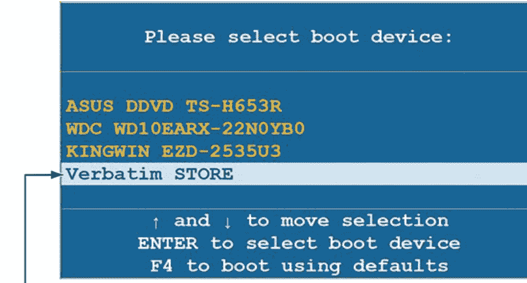

选择了从 USB 闪盘（'Verbatim STORE'）启动的选项

详情
CMOS 启动菜单有四个可选启动设备：ASUSDVTS-H653R、WCDWD10EAR-22N0YB0、KINGWINEZ-2535U3 和 Verbatim Store。已选择从 USB 闪盘（Verbatim STORE）启动的选项。
来源：CMOS 启动菜单

## 使用 xcopy 收集证据

在某些调查中，你可能只需要获取特定文件而不获取其他数据。在这种情况下，没有必要从驱动器的空闲空间收集残余数据。对于这类调查，DOS `xcopy` 命令比 DOS `copy` 命令提供了更多功能。其中一些功能如表 4-1 所示。

| 表 4-1 xcopy 命令功能 |
| --- | --- |
| /a | 复制设置了属性的文件。 |
| /d:date | 仅复制在指定日期及之后最后更新的文件。 |
| /e | 如果遇到错误，将继续复制数据。 |
| /f | 列出文件名及其目标名称。 |
| /h | 复制设置了隐藏属性的文件。 |
| /s | 复制所有包含数据的文件夹并忽略空文件夹。 |
| /u | 从源更新目标中的现有文件。 |

要查看 DOS `xcopy` 命令的完整功能列表，请访问：https://docs.microsoft.com/en-us/troubleshoot/windows-client/deployment/switches-with-xcopy-and-xcopy32-command/

## 活动 4-1

预计耗时：5 分钟
目标：使用 `xcopy` 对文件及其关联子文件夹和文件进行稀疏取证。

- 在开始之前：
- 创建文件夹 `C:\Work\Module_04\Activity-04-1`。
- 按照模块提供的数据文件下载内容到你的文件夹中：
- Activity_04-1_Examiner_Notes.xlsx
- Activity_04-1_xcopy_Data.zip
- 将 `Activity_04-1_xcopy_Data.zip` 文件的内容解压到你的 Work 文件夹中。

在此活动中，你将确定如何使用 `xcopy` 命令复制开启和关闭隐藏属性的文件夹和文件。此活动要求运行两次 `xcopy`，第一次使用 `/s` 开关，第二次使用 `/s /h` 组合。
完成 `xcopy` 命令后，你将使用带有 `/s`、`/b` 和 `/a:h` 开的 `dir` 命令列出哪些复制的文件夹包含隐藏文件。

- 完成以下步骤：
在你的电子表格应用程序中打开 `Activity_04-1_Examiner_Notes.xlsx` 文件。在调查员（Examiner）字段中输入你的姓名，在案件名称（Case Name）和编号（Number）字段中输入 `Activity-04-1`。
按下 Windows 键和 R 键打开命令提示符窗口。在运行框中输入 `cmd` 并点击确定。
从根目录，输入 `cd Work\Module04\Activity-04-1` 并按回车。
输入 `dir` 并按回车查看 `Activity-04-1` 文件夹的内容。

输入 `xcopy /s /i Activity_04-1_xcopy_Data \XCopy_Data-S-switch` 并按回车。

输入 `xcopy /s /i /h Activity_04-1_xcopy_Data \XCopy_Data-S-H-switches` 并按回车。

输入 `dir /s /a:h > Activity_04-1_xcopy_Data-S-switch.txt` 并按回车。

输入 `dir /s /a:h XCopy_Data-S-H-switches > Activity_04-1_xcopy_Data-H-switches.txt` 并按回车。

完成 `xcopy` 和 `dir` 命令后，打开 `Activity_04-1_Examiner_Notes.xlsx` 文件并详细描述你执行的步骤。

- 向你的教师提交以下文件：
- Activity_04-1_Examiner_Notes.xlsx
- Activity_04-1_xcopy_Data-S-switch.txt
- Activity_04-1_xcopy_Data-S-H-switches.txt

## 使用 robocopy 收集证据

与 DOS `xcopy` 命令类似，DOS `robocopy` 命令通常用于电子取证（e-discovery），当仅需要数据文件作为证据时。DOS `robocopy` 命令的某些功能如表 4-2 所示：

## 表 4-2 命令功能

| 特性 | 描述 |
| --- | --- |
| /bytes | 显示复制的字节数 |
| /ia:[RASHCNETO] | 仅复制具有特定属性的文件，例如 r 代表只读文件，或 c 代表压缩文件 |
| /fp | 显示文件的完整路径 |
| /v | 创建详细输出，显示被跳过的文件 |
| /r:n | 如果文件被另一个用户锁定，则将重试 n 次 |
| /tee | 创建一个发送到控制台和日志文件的报告 |
| /w:n | 如果文件被另一个用户锁定，将等待 w 秒后重试；默认为 30 秒 |
| /xa:[RASHCNETO] | 排除具有特定属性的文件，例如 r 代表只读文件，或 c 代表压缩文件 |
| /xc | 排除已更改的文件 |
| /xd <directory> | 排除特定路径 |
| /xf <filename> | 排除特定文件 |

要查看 DOS `robocopy` 命令的完整功能列表，请访问 learn.microsoft.com/en-us/windows-server/administration/robocopy/

有关关于 PowerShell 版 `robocopy` 的更多信息，在 PowerShell 窗口中输入 `robocopy`，或访问 techhelp.com/robocopy-command

> **注意**
>
> `robocopy` 是一个极其强大的工具，可以处理大量数据。`robocopy` 的某些功能将删除源位置的数据，另一些功能将覆盖目标位置的数据。在使用之前，请务必研究并测试 `robocopy`。

## 自检

5. 哪些文件系统可以用于在目标驱动器上存储镜像？
a. FAT32
b. FAT16
c. EXT4
d. NTFS
e. MFS

**答案：** d. NTFS
**解释：** 在目标驱动器上进行取证时，驱动器应格式化为 NTFS。NTFS 用于此类操作。在目标驱动器上进行取证时，驱动器应格式化为 NTFS。NTFS 用于此类操作。在目标驱动器上进行取证时，驱动器应格式化为 NTFS。NTFS 用于此类操作。

## Windows 验证方法

在 PowerShell 2.0 版本之前，Windows 操作系统没有内置哈希算法命令。数字取证人员必须依赖第三方工具来获取文件、分区和整个磁盘驱动器的哈希值。从 PowerShell 2.0 版本开始，`get-hash` 命令行提供了这项服务。

## Windows 内置哈希函数

PowerShell 命令行 `get-hash` 可以生成 MD5、SHA-1、SHA-256、SHA-384 和 SHA-512 哈希值。

要生成一个或一组文件的哈希值，语法如下：

```bash
get-hash file_path_and_name [-md5 | sha-1 | sha-256 | sha-384 | sha-512]
```

详情

一行代码，get dash file hash underscore underscore underscore left square bracket dash element left left square bracket m d 5 pipe sha a dash pipe sha a dash 256 pipe sha a dash 384 pipe sha h 512 right square bracket。

示例：
```powershell
get-hash my_md_file -algorithm sha256

get-hash t.* -algorithm sha384
```

详情

两行。第 1 行。get dash file hash my underscore dot dash hash sha a 256。第 2 行。get dash file t dot asterisk asterisk dash by this cmdlet can be redirected with a > to function

与其他命令一样，此命令行工具产生的输出可以使用 > 重定向到纯文本文件，如示例所示：

```powershell
get-hash t.* -algorithm md5 my_file_md5_hashes.txt
```


一行代码：`get-filehash ** -algorithm md5 > your_file_md5_hashes.txt`。

要生成子文件夹中多个文件的哈希值，语法如下：

```powershell
get-hash -algorithm [md5 | sha-1 | sha-256 | sha-384 | sha-512] -path (get-childitem "file_path.**" -recursive -force) | export-csv file_path_hashes.csv
```

一行代码：`get-filehash -algorithm [md5 | sha-1 | sha-256 | sha-384] -path (get-childitem "file_path**" -recurse -force) | export-csv \work\my_file_md5_hashes.csv`。

示例：

```powershell
get-hash -algorithm md5 -path (get-childitem "c:\work\module04.*.*" -recurse -force) | export-csv c:\work\my_md5_hashes.csv
```

详情

一行代码：`get-filehash -algorithm md5 -path (get-childitem "c:\work\module04.*.*" -recurse -force) | export-csv c:\work\my_md5_hashes.csv`。

此示例将创建一个逗号分隔值 (.csv) 文件，该文件可以在电子表格程序或任何文本编辑器中查看。

## 第三方 Windows 哈希工具

具备哈希功能的工具可以分为两类。第一类包括作为其产品一部分提供哈希功能的工具。这些工具被用于数字取证程序和许多十六进制编辑器实用程序。第二类包括独立的、仅执行哈希计算的工具。大多数独立的哈希程序都是免费软件或共享软件应用程序。

如果你决定使用这些免费或共享软件程序，请务必格外警惕恶意软件或广告软件。

`Hash Tool` 是一款可在 Microsoft Windows 商店获取的免费 GUI 哈希实用程序。你可以在 `apps.microsoft.com/store/detail/hash-9JNBLGH4RRR2?hl=en-us&gl=US` 下载。`Hash Tool` 工具可以为一个或多个文件生成 `MD5`、`SHA-1`、`SHA-256`、`SHA-384`、`SHA-512` 和 `CRC32` 哈希。它还具有允许你将数据复制到输入并计算其哈希的功能。如果你需要文件内片段数据的哈希值，这非常有用。计算出的哈希可以复制到计算机剪贴板，然后粘贴到文本文件中。

数字取证程序（如 `Autopsy`）使用哈希值来验证采集数据，以便快速排序并识别感兴趣的已知文件和恶意文件。在[媒体文件数字取证](Media Files Digital Forensics) 模块中，你将学习更多关于如何排除良好的文件（如操作系统或应用程序，如 `Word`），以及如何检测已知的恶意软件或违禁文件（如通常为图片或电影的 `pornography`）的知识。

哈希用途的另一个示例是在检查磁盘采集文件之前对其进行完整性检查。使用正确的选项，它可以将计算出的哈希值与原始创建镜像时获取的哈希值进行比较。如果哈希值匹配，`Autopsy` 将通知你采集的数据或单个文件不匹配，应进行进一步详细检查。哈希值不匹配并不意味着数字证据被排除；然而，它要求取证人员确定差异何在，以及这些差异可能如何影响案件。

在 `Autopsy` 和许多其他取证工具中，与专家证人格式（Expert Witness format）不同，不包含元数据。如之前提到的，建议在分析时对所有采集进行单独的手动验证。许多采集工具会创建一个独立的验证文本文件。

您的组织应该审查并考虑实施一项政策，概述何时对所有存储在证据中的 SSD 设备禁用 TRIM 功能。在应用此项程序之前，应咨询法律顾问。此外，如果贵组织的政策是禁用 TRIM 功能，请在取证员笔记和任何报告中记录为了保存证据而关闭了该功能。

## 介质故障忧虑

可能会出现原始数据与复制数据之间的哈希值不匹配的情况。通常情况下，如果您拥有原始数据，可以重新制作镜像并比较哈希值以确保其完整性。在某些情况下，复制原始数据时也无法与其之前的副本匹配。这可能表明原始介质存在故障，这种情况在具有铁氧化物盘片的磁性硬盘（HDD）上可能会发生。取决于硬盘的质量和使用的小时，它最终会失去存储数据的能力。正如之前描述的，SSD 也会发生故障。

对于 SSD 而言，一旦 SSD 达到制造商预期的磨损均衡寿命周期，该设备将无法运行。目前，关于使用电气和计算机工程师的高级设备和技能从 SSD 中恢复数据的研究仍在进行。

此外，所有介质存储设备都有所谓的平均无故障时间（MTTF），这通常定义为设备最可能发生故障之前的小时。产品的 MTTF 通常由制造商确定，并基于设备的统计平均值。

另一个故障源是电缆和连接器。特别是连接器，由于其使用频率最高，故障率也高。大多数连接器（以及程度较小的电缆）的设计并不是为了反复插拔设备而设计的；它们是设计用于一次性使用的。您应该通过维护额外的电缆库存并仅使用高质量的电缆和连接器来应对此类故障。在更换电缆时，请使用新电缆。即使旧电缆看起来完好，也应该将其丢弃。

## 使用比较函数验证数据

尽管并不常见，但您可能需要比较文件以确定它们的差异。操作系统（如 Windows 和 Linux）提供了比较文件的 shell 命令。这些从终端窗口运行的命令的输出可以使用重定向（`>`）选项保存到文本文件中。

接下来的章节提供了有关如何使用这些 shell 命令的简要描述和参考。

## 在 Windows 中比较数据

Windows 为 DOS cmd 和 PowerShell 提供了许多 shell 命令。其中一些命令显示在表 4-3 中。

| 表 4-3 DOS 和 PowerShell 比较命令 |
| :--- | :--- |
| DOS 命令 | 比较命令 |
| `fc` | 文件比较命令 |
| PowerShell 命令 | 比较命令（这与 `comp` DOS 命令相同） |
| `fc.exe` | 文件比较命令（这与 `fc` DOS 命令相同。在 PowerShell 中运行此命令需要 `.exe` 扩展名。如果没有扩展名，PowerShell 会其视为 `format-custom` 命令） |
| `compare-object` | 比 `comp` 和 `fc` 命令具有更多数据比较功能。 |

如表 4-3 所示，`comp` 和 `fc` 命令在 Windows CMD shell 中可用。在 PowerShell 中，`comp`、`fc.exe` 和 `compare-object` 命令也是可用的；但在 PowerShell 中，不带 `.exe` 的 `fc` 是 `Format-Custom` 命令的别名。

### DOS comp 命令

DOS `comp` 将比较两个文件，并在 shell 窗口内显示文件差异的信息。

例如，要在 DOS 或 PowerShell 窗口中使用 `comp` 命令，输入 `comp Example1.csv Example2.csv` 然后按回车键。

该命令将显示文件之间每个差异的偏移位置（offset）和十六进制值。它还会以十六进制值显示具体的差异。在比较 `.exe` 文件时，显示十六进制值的功能非常有用，因为二进制数据无法在 shell 窗口或纯文本文件中显示。图 4-2 是比较两个文本文件时 `comp` 命令结果示例。

| 图 4-2 comp 显示文件之间的偏移位置和差异 |

```text
C:\Work\>comp Example1.txt Example2.txt

Comparing Example1.txt and Example2.txt...

Compare error at OFFSET 73<-

file1 = 41

file2 = 43

Compare error at OFFSET 17C<-

file1 = 43

file2 = 44

Compare more files (Y/N) ?
```

详细说明

几行带有偏移位置和行间差异的代码。第 1 行 `C:\Work\> comp Example1.txt Example2.txt`。第 3 行 `Compare error at OFFSET 73<-`。这是十六进制的第一次出现偏移位置。第 4 行 `file1 = 41`。这是 file1 和 file2 之间的十六进制第一个差异。第 5 行 `file2 = 43`。第 6 行 `Compare error at OFFSET 17C`。这是十六进制的第二次出现偏移位置。第 7 行 `file1 = 43`。第 8 行 `file2 = 44`。这是 file1 和 file2 之间的第二个差异。第 9 行 `Compare more files (Y/N) ?`。

图 4-2 显示了文件 `Example1.txt`（定义为 `file1`）和 `Example2.txt`（定义为 `file2`）的比较。第一个差异列为错误，或位于偏移量 `0x73`，即十进制 `115` 处。注意文件从零开始，第一个字节值为 `0x41`，即字母 `A` 的 ASCII 码，`file2` 为 `0x43`，即字母 `C` 的 ASCII 码。文件有两个差异。要显示十进制行号而非偏移位置，请使用 `/l` 选项，如图 4-3 所示：

## 文件第一行的行计数

```text
C:\Work>comp Example1.txt Example2.txt /l

Comparing Example1.txt and Example2.txt...

Compare error at LINE 2<-

file1 = 41

file2 = 43

Compare error at LINE 5<-

file1 = 43

file2 = 44

Compare more files (Y/N) ?
```

## 十六进制值

详细说明

几行带有位置差异的代码。第 1 行 `C:\Work comp Example1.txt Example2.txt`。第 2 行 `Comparing Example1.txt and Example2.txt`。第 3 行 `Compare error at LINE 2<-`。这是文件第一行的行计数。第 4 行 `file1 = 41`。这是十六进制差异值。第 5 行 `file2 = 43`。第 6 行 `Compare error at LINE 5<-`。这是第二次出现的行计数。第 7 行 `file1 = 43`。第 8 行 `file2 = 44`。这是 file1 和 file2 之间的第二个差异。第 9 行 `Compare more files (Y/N) ?`。

### fc 命令

`fc` (file compare) 命令比 `comp` 命令功能更多。要使用 `fc` 命令，输入 `fc Example1.csv Example2.csv` 然后按回车键。此示例创建如图 4-4 所示的输出：

```text
C:\>fc Example1.txt Example2.txt

Comparing files Example1.txt and EXAMPLE.TXT

***** Example1.txt

(Line 1) 0123456789 0123456789

(Line 2) 0123456789 012345678A<-

(Line 3) 0123456789 0123456789

***** EXAMPLE.TXT

(Line 1) 0123456789 0123456789

(Line 2) 0123456789 012345678C---

(Line 3) 0123456789 0123456789

*****

***** Example1.txt

(Line 4) 0123456789 0123456789 0123456789

(Line 5) 0123456789 0123456789 0123456788---

(Line 6) 0123456789 0123456789 0123456789

***** EXAMPLE.TXT

(Line 4) 0123456789 0123456789 0123456789

(Line 5) 0123456789 0123456789 012345678D---

(Line 6) 0123456789 0123456789 0123456789
```


## 文件之间的第一个差异

## 文件之间的第二个差异

### 详细说明

几行带有位置差异的代码。第 1 行 `C:\Work fc Example1.txt Example2.txt`。第 2 行 Comparing Example1.txt and EXAMPLE.TXT。第 3 行。第 4 行。第 5 行。第 6 行。第 7 行。第 8 行。第 9 行。第 10 行。第 11 行。第 12 行。第 13 行。第 14 行。第 15 行。第 16 行。第 17 行。第 18 行。第 19 行。第 20 行。第 21 行。第 22 行。第 23 行。第 24 行。第 25 行。第 26 行。第 27 行。第 28 行。第 29 行。第 30 行。第 31 行。第 32 行。第 33 行。第 34 行。第 35 行。第 36 行。第 37 行。第 38 行。第 39 行。第 40 行。第 41 行。第 42 行。第 43 行。第 44 行。第 45 行。第 46 行。第 47 行。第 48 行。第 49 行。第 50 行。第 51 行。第 52 行。第 53 行。第 54 行。第 55 行。第 56 行。第 57 行。第 58 行。第 59 行。第 60 行。第 61 行。第 62 行。第 63 行。第 64 行。第 65 行。第 66 行。第 67 行。第 68 行。第 69 行。第 70 行。第 71 行。第 72 行。第 73 行。第 74 行。第 75 行。第 76 行。第 77 行。第 78 行。第 79 行。第 80 行。第 81 行。第 82 行。第 83 行。第 84 行。第 85 行。第 86 行。第 87 行。第 88 行。第 89 行。第 90 行。第 91 行。第 92 行。第 93 行。第 94 行。第 95 行。第 96 行。第 97 行。第 98 行。第 99 行。第 100 行。第 101 行。第 102 行。第 103 行。第 104 行。第 105 行。第 106 行。第 107 行。第 108 行。第 109 行。第 110 行。第 111 行。第 112 行。第 113 行。第 114 行。第 115 行。第 116 行。第 117 行。第 118 行。第 119 行。第 120 行。第 121 行。第 122 行。第 123 行。第 124 行。第 125 行。第 126 行。第 127 行。第 128 行。第 129 行。第 130 行。第 131 行。第 132 行。第 133 行。第 134 行。第 135 行。第 136 行。第 137 行。第 138 行。第 139 行。第 140 行。第 141 行。第 142 行。第 143 行。第 144 行。第 145 行。第 146 行。第 147 行。第 148 行。第 149 行。第 150 行。第 151 行。第 152 行。第 153 行。第 154 行。第 155 行。第 156 行。第 157 行。第 158 行。第 159 行。第 160 行。第 161 行。第 162 行。第 163 行。第 164 行。第 165 行。第 166 行。第 167 行。第 168 行。第 169 行。第 170 行。第 171 行。第 172 行。第 173 行。第 174 行。第 175 行。第 176 行。第 177 行。第 178 行。第 179 行。第 180 行。第 181 行。第 182 行。第 183 行。第 184 行。第 185 行。第 186 行。第 187 行。第 188 行。第 189 行。第 190 行。第 191 行。第 192 行。第 193 行。第 194 行。第 195 行。第 196 行。第 197 行。第 198 行。第 199 行。第 200 行。第 201 行。第 202 行。第 203 行。第 204 行。第 205 行。第 206 行。第 207 行。第 208 行。第 209 行。第 210 行。第 211 行。第 212 行。第 213 行。第 214 行。第 215 行。第 216 行。第 217 行。第 218 行。第 219 行。第 220 行。第 221 行。第 222 行。第 223 行。第 224 行。第 225 行。第 226 行。第 227 行。第 228 行。第 229 行。第 230 行。第 231 行。第 232 行。第 233 行。第 234 行。第 235 行。第 236 行。第 237 行。第 238 行。第 239 行。第 240 行。第 241 行。第 242 行。第 243 行。第 244 行。第 245 行。第 246 行。第 247 行。第 248 行。第 249 行。第 250 行。第 251 行。第 252 行。第 253 行。第 254 行。第 255 行。第 256 行。第 257 行。第 258 行。第 259 行。第 260 行。第 261 行。第 262 行。第 263 行。第 264 行。第 265 行。第 266 行。第 267 行。第 268 行。第 269 行。第 270 行。第 271 行。第 272 行。第 273 行。第 274 行。第 275 行。第 276 行。第 277 行。第 278 行。第 279 行。第 280 行。第 281 行。第 282 行。第 283 行。第 284 行。第 285 行。第 286 行。第 287 行。第 288 行。第 289 行。第 290 行。第 291 行。第 292 行。第 293 行。第 294 行。第 295 行。第 296 行。第 297 行。第 298 行。第 299 行。第 300 行。

图 4-5 fc 命令配合 /b 仅显示文件之间的差异

```
C:\Work>fc Example1.txt Example2.txt /b

Comparing files Example1.txt and EXAMPLE2.TXT

000004B: 41 43

00000D6: 42 44
```

### 详情

多个使用 `fc` 命令和 `b` 开关的代码。第 1 行：`C:\Work>fc Example1.txt Example2.txt /b`。第 2 行：Comparing files Example1.txt and EXAMPLE2.TXT。第 3 行：000004B: 41 43。第 4 行：00000D6: 42 44。

有关 `fc` 命令及其可用开关的信息，请参阅 `docs.microsoft.com/en-us/windows-server/administration/windows-commands/fc`：

### 提示

如果你需要在 PowerShell 窗口中比较 `fc` 或任何其他 DOS 命令，你需要将 PowerShell 切换到 DOS 命令会话。要操作，请在 PowerShell 提示符下输入 `cmd` 然后按回车。这会在 PowerShell 窗口内建立一个 DOS 命令会话，提示符将变为 DOS 提示符。从该提示符你可以运行任何 DOS 命令。要返回 PowerShell 窗口，输入 `exit`

## 181 PowerShell compare-object

`compare-object` 命令行结合 `get-content` 可以类似于 `comp` 和 `fc` 的工作方式比较文件。要在 PowerShell 窗口中使用这些命令行，请输入 `compare-object (get-content Example1.csv) (get-content Example2.csv)` 然后按回车。此命令创建图 4-6 所示的输出。注意，此命令仅显示不同的行。


```
PS C:\work compare-object (get-content Example1.txt) (get-content Example2.txt)

InputObject SideIndicator

Record (Line 2) 0123456789 0123456789         =>

Record (Line 5) 0123456789 0123456789         =>

Record (Line 2) 0123456789 012345678A         <<

Record (Line 5) 0123456789 012345678B         <<
```

### 详情

几行代码。第 1 行：`PS C:\work compare-object (get-content Example1.txt) (get-content Example2.txt)`。第 2 行：空。第 3 行：InputObject SideIndicator。第 4 行：空。第 5 行：Record (Line 2) 0123456789 012345678C >=。第 6 行：Record (Line 5) 0123456789 0123456789 >=。第 7 行：Record (Line 2) 0123456789 012345678A <=。第 8 行：Record (Line 5) 0123456789 012345678B <=。

有关 Compare-Object 和 Get-Content 命令行的更多信息，请参阅以下网站：

- `docs.microsoft.com/en-us/powershell/module/microsoft.powershell.utility/compare-object?view=powershell-`
- `docs.microsoft.com/en-us/powershell/module/microsoft.powershell.management/get-content?view=powershell-`

## 在 Linux 中比较数据

在 Linux 解释器中，shell 命令 `diff`（代表 差异）与 DOS 的 `fc` 类似，但具有某些 DOS 和 PowerShell 命令不具备的独特功能。

要在 Linux 中使用 `diff` 命令，请启动终端 shell，输入 `diff path/file-name path/file-name` 然后按回车。关于使用 `diff` 命令比较两个文件（Cities1.txt 和 Cities2.txt）的示例，请参阅图 4-7：


```
kali@kali:/media/kali/GCF$ diff Cities1.txt Cities2.txt -y

9c

---

> Portland, ME

> Portland, OR
```

### 详情

几行代码。第 1 行：`kali@kali:/media/kali/GCF$ diff Cities1.txt Cities2.txt -y 9c`。第 2 行：< Portland, ME。第 3 行：> Portland, OR。

要显示两个文件之间更详细的差异，请使用 `-u` 开关，如图 4-8 所示：


```
kali@kali:/media/GCF diff Cities1.txt Cities2.txt -u

--- Cities1.txt 2022-05-19 15:18:32.0000000 -070

+++ Cities2.txt 2022-05-19 15:18:48.0000000 -070

@@ -6,4 +6,4 @@

Dallas, TX

Salt Lake, UT

Denver, CO

-Portland, ME

+Portland, OR
```

### 详情

几行代码。第 1 行：`kali@kali:/media/kali/GCF$ diff Cities1.txt Cities2.txt -u`。第 2 行：- Cities1.txt 2022-05-19 15:18:32.0000000 -070。第 3 行：+++ Cities2.txt 2022-05-19 15:18:48.0000000 -070。第 4 行：@@ -6,4 +6,4 @@。第 5 行：Dallas, TX。第 6 行：Salt Lake, UT。第 7 行：Denver, CO。第 8 行：- Portland, ME。第 9 行：+ Portland, OR。

要用两列显示两个文件的完整内容并显示它们之间的差异，请使用 `-y` 开关，如图 4-9 所示：


```
kali@kali:/media/kali/GCF$ diff Cities1.txt Cities2.txt -y

9c

---

> Portland, ME

> Portland, OR
```


## 详情

几行代码。第 1 行：`kali@kali:/media/kali/GCF$ diff Cities1.txt Cities2.txt -y 9c`。第 2 行：New York, NY。第 3 行：Cleveland OH。第 4 行：第 5 行：Bakersfield, CA。第 6 行：Santa Fe, NM。第 7 行：Dallas, TX。第 8 行：Salt Lake, UT。第 9 行：Denver, CO。第 10 行：Portland, OR。

有关 Linux `diff` 命令的更多信息，请参阅以下网站：

* https://linuxbook.com/diff/
* https://phoenix.org/pages/diff/

## 自测

6. 哪种 Linux 获取工具被认为是？

- a. dd
- b. md5
- c. dld
- d. dc3

**答案：** a
**解释：** `dd` 被认为是

## 执行 RAID 获取

RAID 驱动器的获取可能具有挑战性，因为取决于 RAID 系统的设计、配置和尺寸。以下章节将回顾常见的 RAID 配置并讨论获取这些存储设备的方法。

## 理解 RAID

冗余独立磁盘阵列（RAID）是一种涉及两个或多个物理磁盘的计算机配置。最初，RAID 是为了在故障时保持系统可用而设计的硬件措施。随着技术的进步，RAID 还提供了更大的存储能力。RAID 级别可以通过软件（称为“软件 RAID”）或专用硬件控制器（称为“硬件 RAID”）来实现。RAID 使用自己的控制器作为处理器和内存。

对于 Windows XP、2000 服务器和工作站，RAID 0 或 1 是常见的。对于高级数据处理环境，RAID 5 是常见的。这些高级 RAID 系统通常带有连接到高级服务器或大型机的集成控制器。这些系统提供了冗余和高速数据访问，并可以将许多小磁盘管理为一个大型驱动。

## 注意

除了 0、1 和 5 之外的 RAID 其他变体取决于特定的厂商或应用程序。RAID 0 提供了快速访问和跨磁盘的存储容量（见图 4-10）。在 RAID 0 中，两个或多个驱动器变成一个大卷，因此计算机将磁盘视为单个磁盘。存储模式的逻辑地址方案使得每个轨道在所有磁盘上都是连续的。如果你将两个磁盘配置为 RAID 0，轨道一从第一个磁盘开始，持续到第二个物理磁盘。从启动的操作系统（如 Windows XP）中查看，这两个磁盘显示为一个大磁盘。RAID 0 的优势是增加了速度和数据容量。其最大的缺点是缺乏冗余；如果一个磁盘故障，数据将无法持续可用。

## 图 4-10 RAID 0：条带

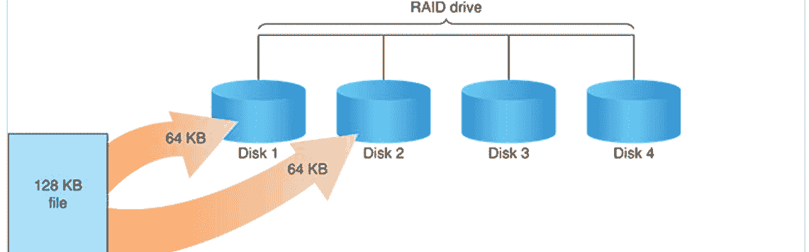

### 详情

图表说明了 RAID 0：条带化的过程。一个 128 字节的文件被分布在两个 RAID 驱动器（磁盘 1 和 2）上。每个磁盘接收 64 字节。磁盘 3 和 4 未使用。

## 图 4-11 RAID 1: 镜像

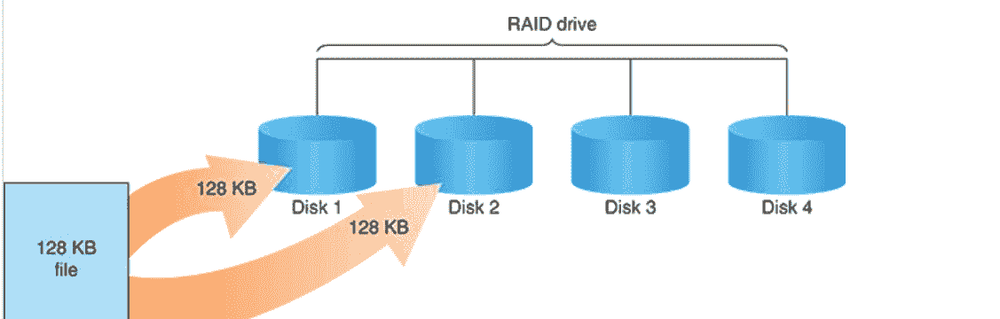

### 详情

该图说明了 RAID 1 镜像的过程。一个 128 KB 的文件被均匀地分布在两个 RAID 驱动器磁盘 1 和 2 上。每个磁盘接收 128 KB。磁盘 3 和 4 不使用。

RAID 1 确保数据不会丢失并有助于防止停机。RAID 1 的主要缺点是每个卷都需要两块磁盘，这使得磁盘存储成本增加了一倍。

RAID 2 也通过将两个或多个磁盘配置为一个大卷来提供快速访问和增加存储容量。与 RAID 2 的区别在于，数据是以位级别写入磁盘的。使用纠错码 (ECC) 来验证写入是否成功。因此，RAID 2 的数据完整性优于 RAID 0。然而，由于位级写入和 ECC 的存在，RAID 2 的速度比 RAID 0 慢。

## 图 4-12 RAID 2: 条带 (位级/Bit Level)

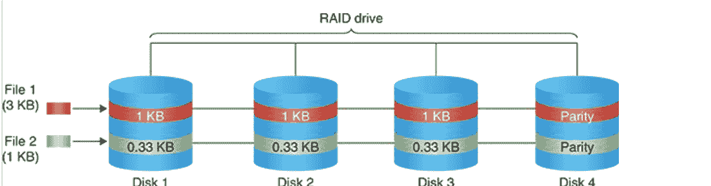

文件 1 (3 KB)
文件 2 (1 KB)

### 详情

该图说明了 RAID 2 条带的过程。文件 1 的大小为 3 KB，它被均匀地分布在三个 RAID 驱动器（磁盘 1、2 和 3）的第一组校验中。每个磁盘接收 1 KB。文件 2 的大小为 1 KB，被均匀地分布在三个 RAID 驱动器（磁盘 1、2 和 3）的第二组校验中。每个磁盘接收 0.33 KB。磁盘 4 不使用。

RAID 3 使用数据条带和专用校验，并且至少需要三块磁盘。与 RAID 0 类似，RAID 3 在组成一个卷的所有磁盘上对轨道进行条带化。RAID 3 还实现了专用校验，以确保在数据损坏时进行恢复。专用校验位于 RAID 3 阵列中的一个磁盘上。与 RAID 3 类似，RAID 4 使用数据条带和专用校验（块写入），只是数据是以块而非字节写入的。

RAID 5 与 RAID 0 和 RAID 3 类似，它分发数据和校验数据，并在 RAID 阵列中的所有磁盘上跨布分布数据轨道（图 4-13）。与 RAID 3 不同，RAID 5 将校验数据放在每块磁盘上。如果 RAID 阵列中的某个磁盘发生数据故障，当更换故障磁盘时，其他磁盘上的校验将自动重建损坏的数据。

## 图 4-13 RAID 5: 带有分布式校验的块级条带


### 详情

该图说明了 RAID 5 带有分布式校验的块级条带的过程。文件 1 的大小为 12 KB，它被均匀地分布在四个 RAID 驱动器（磁盘 1、2、3 和 4）上。每个磁盘接收 4 KB。文件 2 的大小为 16 KB，它被均匀地分布在四个 RAID 驱动器（磁盘 1、2、3 和 4）上。每个磁盘接收 4 KB。

在 RAID 6 中，分布式数据和分布式校验（双重校验）的功能与 RAID 5 相同，只是 RAID 阵列中的每块磁盘都有冗余校验。RAID 6 相比 RAID 5 的优势在于，由于每块磁盘上存储了额外的校验，它可以恢复任何两个故障的磁盘。

RAID 10（或镜像条带，也称为 RAID 1+0）是 RAID 1 和 RAID 0 的组合。它提供了快速的访问和数据存储冗余。RAID 15（或带校验的镜像条带，也称为 RAID 1+5）是 RAID 1 和 RAID 5 的组合。它提供了所有 RAID 配置中最强大的数据恢复能力和访问速度，成本也更高。

## 获取 RAID 磁盘

在获取 RAID 磁盘时，你需要考虑以下因素：

- RAID 配置是什么？
- 需要什么类型的存储？
- 应使用什么工具？
- 如何恢复数据？
- 数据是否经过了加密？

根据 RAID 类型，你可能需要：

- 单独获取每块磁盘。
- 获取整个 RAID 阵列。
- 使用软件重构 RAID。
- 使用硬件重构 RAID。

## ASR SMART

ASR Data SMART 是一款 Linux 数字取证分析工具，可以创建嫌疑驱动器的镜像文件。SMART 可以生成专有格式或原始（raw）格式镜像，并包含以下功能：

- 对硬盘上的坏道进行健壮的数据读取
- 以写保护模式挂载嫌疑驱动器
- 以读写模式挂载目标驱动器（包括 NTFS 驱动器）
- 可选的压缩方案，用于加速获取或减少获取数字取证所需的存储空间

有关 SMART 的更多信息，请参阅 asrdata.com：

## ILookIX IXImager

IXImager 从可启动的 U 盘或 CD/DVD 运行。它是一个独立的、专有格式的获取工具，专为 ILookIX 设计。它可以获取单个硬盘和 RAID 驱动器，并支持 IDE (PATA)、SCSI、USB 和 FireWire 设备。如果使用其他分析工具，IXImager 的专有格式可以转换为原始格式。有关 IXImager 的更多信息，请参阅 ilook-forensics.org/ximager.html。

## PassMark Software OSForensics OSFClone

PassMark Software 提供了一个名为 OSFClone 的可启动 ISO 镜像。OSFClone 是一个可以加载到闪存盘上的免费 ISO。启动 OSFClone 时，会出现一个 Linux 终端壳窗口，可以访问各种获取工具，包括 `dc3dd`。OSFClone 可以创建原始、专家证人（Expert Witness）和 AFF 镜像。有关更多信息和下载说明，请参阅 osforensics.com/tools/create-disk-images.html。

## Runtime Software DiskExplorer

除了 RAID Reconstructor 之外，RuntimeExplorer 还提供了多个紧型共享软件用于数据获取和恢复，包括针对 FAT 的 DiskExplorer 和针对 NTFS 的 DiskExplorer。这些工具允许执行以下操作：

- 创建原始格式镜像文件。
- 为了归档目的对原始格式或压缩镜像进行分割。
- 访问网络计算机的驱动器。

有关 DiskExplorer 的更多信息，请参阅 runtime.org/diskexplorer.htm；Runtime 工具的完整列表请参阅 runtime.org/data-recovery-products.htm：

## ForensicSoft SAFE Boot Disk

ForensicSoft 的 SAFE Boot Disk 是一个可启动的 CD 或 U 盘，可以执行带有其他数据功能的取证获取。启动 SAFE Boot Disk 时，所有连接的驱动器将被写保护。数字取证检查员可以将目标驱动器设置为读写。要获得 SAFE Boot Disk 的所有功能，必须购买加密狗（dongle）。SAFE Boot Disk 也可以在没有加密狗的情况下运行试用模式，允许您查看其功能。要了解更多 SAFE Boot Disk，请访问 forensicsoft.com/help/SAFE_Boot/?msclkid=83076a5ce551ec8ddf7fff80

## X-Ways Imager

XWays Software Technology AG 提供了数字取证应用 XWays Imager。要使用 XWays Imager，必须实施硬件或软件写阻塞以执行静态获取。XWays Imager 的一个显著特性是其从本地连接驱动器或远程网络计算机获取数据的速度。它还具有重建 RAID 系统的功能。XWays Imager 可以创建原始的专家证人镜像文件。有关 XWays Imager 的更多信息，请参阅 xways.net/forensics/imager。

## 自检

以下哪些工具支持重建或重组 RAID 数组？

a. ILookIX IXImager
b. PassMark Software OSForensics OSFClone
c. OSForensics OSFClone
d. ForensicSoft SAFE Boot Disk
e. X-Ways Imager

**答案：** e. X-Ways Imager
**解释：** XWays Imager 支持重建或重组 RAID 存储数组。

## 模块回顾总结

- 在数字取证领域，数据获取是从电子介质中收集数字证据的任务。当驱动器被写保护且无法更改时，使用静态获取；当嫌疑计算机无法关闭时，使用实时获取（live acquisition）。
- 取证获取存储在三种不同的格式中：原始（raw）、AFF 和专有。专家证人（Expert Witness）格式是大多数数字分析工具均可读取的最常用专有镜像格式。AFF 和大多数专有格式在单独的文件中存储有关获取数据的元数据。
- 取证获取数据的四种方法是：物理磁盘到镜像文件、物理磁盘到磁盘、分区到分区以及分区到数据文件。
- 商用获取工具（如 FTK Imager 和 XWays Imager）可以压缩镜像数据以节省硬盘空间。开源工具只能压缩未压缩的镜像。
- 无损压缩对大多数数据的压缩率高达 50%。与糟糕的压缩不同，取证获取的无损压缩在恢复时不会更改数据。如果数据已经过压缩，无损压缩无法节省多少空间。
- 在执行获取之前，应该创建一个行动计划，以确保所有必要步骤都得到正确执行，并确保没有遗漏或错过。行动计划还应该包括完成获取所需的大致时间估计。
- 要对整个硬盘驱动器执行物理获取，获取工具应具备复制驱动器隐藏区域的能力。
- 当镜像被加密时，应首先确定其是否可以解密。如果你无法解密驱动器，则需要登录该驱动器的来源计算机，对驱动器的分区进行实时获取。加密驱动器的物理获取只会复制加密数据；主机计算机只能访问其分区上的数据。
- 如果存在限制或数据过多导致无法获取大硬盘或 RAID 驱动器，可能需要进行逻辑或稀疏获取（sparse acquisition）。咨询您的首席律师或主管，告知他们可能无法收集所有数据。
- 您应该有一个容量计划，以确保取证的完整性。如果一个获取文件损坏，另一个仍可供分析。第一个获取应该是压缩的，第二个应该是未压缩的。
- 在执行获取时，应结合 Windows 和 Linux 的 GUI 工具使用写阻塞设备。检查员应在硬盘上进行练习，而不是在实际证据源或嫌疑硬盘上。这包括使用哈希工具进行练习。
- 始终使用内置工具、十六进制 MD5 或 SHA-256 哈希或 Linux 的 `md5sum` 或 `shasum` 命令来验证获取。
- Linux Live CD、DVD 或 USB 闪盘（如 Kali Linux 和 CAINE）为数字取证提供了许多有用工具。
- `dc3dd` 比 `dc3ld` 有改进，能够将数据错误写入目标文件、发生问题时写入错误日志、擦除磁盘或分区数据、复制数据时验证获取以及将输出重定向到多个驱动器。如果可用，获取时始终使用物理写阻塞器。
- Windows PowerShell 提供了内部哈希功能。
- 当启用 TRIM 功能时，SSD 空闲空间的可恢复删除数据将作为内存单元维护的一部分被自动删除。该功能还会持有数据的哈希值。
- 获取 RAID 磁盘需要确定类型以及使用哪种获取工具。对于固件 RAID，可能需要直接从 RAID 服务器获取数据。

## 关键术语

- 高级取证格式 (AFF)
- 循环冗余校验 (CRC)
- 垃圾收集
- 哈希值
- 主机保护区 (HPA)
- 实时获取 (live acquisition)
- 逻辑获取
- 消息摘要算法 5 (MD5)
- 平均故障时间 (MTTF)
- 原始格式 (raw format)
- 独立磁盘冗余阵列 (RAID)
- 安全哈希算法 1 (SHA-1)
- 安全哈希算法 256 (SHA-256)
- 稀疏获取 (sparse acquisition)
- 静态获取 (static acquisition)
- TRIM
- 磨损均衡
- 全盘加密

## 复习题

1. 下列哪项描述了静态采集的益处？

- a. 保护数字证据
- b. 保护加密证据
- c. 保护动态证据
- d. 保护非线性证据

2. 下列哪些是静态采集中使用原始格式（raw format）的优点？（选择所有适用项）。

- a. 实现更快的数据传输速度
- b. 忽略微小数据错误
- c. 可以被大多数取证工具读取
- d. 存储空间比源数据少
- e. 原生包含原始文件的哈希值

3. 在进行采集时，原始格式的注意事项是哪些？

- a. 实现较低的驱动器速度
- b. 需要更大的目标磁盘空间
- c. 在原始数据文件中包含哈希值
- d. 收集边缘块

4. 下列哪些功能是私有格式采集文件的益处？（选择所有适用项）。

- a. 压缩采集数据的选项
- b. 将采集镜像分段到多个存储介质的选项
- c. 可以被任何取证分析工具读取的能力
- d. 在采集镜像文件外部生成元数据报告的选项

5. 在所有私有格式中，哪一个是事实标准？

- a. Raw
- b. E01
- c. AFF

6. 下列哪些工具具有将硬盘逐扇区复制到更大硬盘上的能力？（选择所有适用项。）

- a. EnCase
- b. FTK
- c. X-Ways Forensics
- d. Autopsy

7. 在逻辑采集期间收集的哪些文件对案件感兴趣？

- a. 有关的文件
- b. 存储设备上的所有文件
- c. 存储设备上的所有文件和删除数据
- d. 整个存储介质上的所有数据，包括主文件表（MFT）未记录的刻意隐藏数据

8. 在关键调查中，对嫌疑驱动器制作两个采集镜像的主要益处是什么？

- a. 它允许多名取证调查员立即开始检查证据。
- b. 它允许数字取证人员练习使用多种工具以获得经验。
- c. 它允许数字取证人员在采集过程中发生任何故障时，至少对取证收集的数据制作一份良好的副本。
- d. 制作两个采集镜像没有实质性益处。

9. 数字取证人员将包含证据的热插拔存储设备（如 USB 驱动器）连接到运行较新 Linux 发行版（如 Kali 2022.2）的计算机时，存在哪些担忧？

- a. 没有担心，调查员可以立即访问存储设备。
- b. 如果文件系统来自 Mac 或 Windows ，将发生文件系统兼容性错误，在 Linux 计算机上无法读取。
- c. 较新的 Linux 发行版会自动挂载 USB 设备，这可能会更改其数据。
- d. 没有担心；Linux 操作系统要求用户在访问之前手动挂载驱动器。

10. 下列哪项解释了哈希工具（hashing tool）？

- a. 它是一个数据破坏工具，旨在使数据无法通过磁显微镜恢复。
- b. 它是一个数据混合工具，旨在将数据同化为一致的数据流以获得更高的分析性能。
- c. 它是一个数据分离工具，旨在根据签名对数据进行列举，以便数字取证调查员分析。
- d. 它是一个数据识别工具，旨在生成代表数据集、文件或整个磁盘唯一性的二进制或十六进制数字。

11. 下列哪项是 FAT32 格式化存储设备上可以存储的最大文件大小？

- a. 2 KB
- b. 2 MB
- c. 2 GB
- d. 2 TB
- e. 2 PB
- f. 2 EB

12. 下列术语不被用于分类采集格式？（选择所有适用项）。

- a. Refined
- b. Raw
- c. Compressed
- d. AFF

13. 如果调查员被指派对利用 RAID 的存储系统进行物理采集，他们应该考虑哪些？（选择所有适用项。）

- a. 调查员是否有足够的存储容量来进行采集？
- b. 调查员是否知道正在使用哪种 RAID 类型？
- c. 调查员是否知道 RAID 是如何实施和管理的？
- d. 调查员是否有能够执行采集的工具？

14. 为什么数字取证调查员在进行取证采集之前应该在目标驱动器上使用擦除工具（wiping tool）？

- a. 擦除目标驱动器可以提高驱动器的性能。
- b. 擦除目标驱动器可以增加写入驱动器数据的准确性。
- c. 擦除目标驱动器是为了报废该驱动器以准备重新销售。
- d. 建议擦除目标驱动器以确保该驱动器上没有存储可能与新证据混合的旧数据。

15. 下列哪项有助于识别访问计算机启动选项的键盘组合？

- a. 让计算机启动。
- b. 仔细观察计算机的。
- c. 按 CTRL+ALT。
- d. 查看键盘。
- e. 在计算机启动时按 CMD+C。

16. 下列哪项是取证中最关键的方面？

- a. 采集 (Acquiring)
- b. 验证 (Validating)
- c. 生成 (Producing)

17. 什么类型的控制器？

- a. 软件
- b. 硬件

18. 调查员应该尝试哪种方法？

- a. 物理
- b. 逻辑

19. 数字取证公司被指派对 22 TB 的数据进行物理采集。该公司的机器可以胜任工作。假设过程中没有发生任何错误，调查员应该分配多少小时？

- a. 9 小时
- b. 18 小时
- c. 27 小时
- d. 36 小时

20. 数字取证公司被指派对 22 TB 的数据进行物理采集。该公司的机器可以胜任工作。假设过程中没有发生任何错误，调查员应该分配多少小时？

- a. 12 小时
- b. 24 小时
- c. 36 小时
- d. 48 小时

## 项目

### 项目 4-1

**预计时间：** 60 分钟
**目标：** 使用 robocopy 进行文件夹采集。

**开始之前：**

- 创建文件夹 `C:\Work\Module_04\Project_04-1`。
- 下载模块中的文件：
  - `Project_04-1_Examiner_Notes.xlsx`
  - `Project_04-1_Robocopy.zip`
- 在 Work 文件夹中解压 `Project_04-1_Robocopy.zip`。

完成以下步骤：

1. 使用电子表格应用程序打开 `Project_04-1_Examiner_Notes.xlsx`。在 Examiner's Name 字段填写你的姓名，在 Case Name 处填写 `Project_04-1`。

2. 按 `Windows` 键和 `R` 键打开命令提示符。在输入框中输入 `PowerShell` 并点击“确定”。

3. 从根目录输入 `cd Work\Module_04\Project_04-1` 并按 `Enter`。

4. 在 PowerShell 提示符下输入 `get-childitem -path *.*` 并按 `Enter` 查看 `Project_04-1` 文件夹的内容。

5. 在命令提示符下输入以下命令（使用 `/e` 切换到包含空文件夹和隐藏文件夹的目录），每条一条按一次 `Enter`：

```bash
```


```
robocopy Project_04-1_Robocopy_Data Project_04-1_Robocopy_Data_S_switch /s /log:Project_04-1_0_Robocopy-with-S-switch.log

robocopy Project_04-1_Robocopy_Data Project_04-1_Robocopy_Data_E_switch /e /log:Project_04-1_0_Robocopy-with-E-switch.log
```


在 PowerShell 中，为了减少为第二个命令需要重新输入的文本量，请使用向上箭头键调用上条命令。然后按左方向键，直到光标位于命令行中需要更改部分内容的右侧。按退格键（Backspace）删除上条命令中使用的特定项目，并输入更改以匹配此步骤的第二个命令行。完成命令行更新后，按回车键（Enter）执行命令。

## 6

输入以下命令（一个用于包含所有文件、包括空文件夹和隐藏文件的列表，另一个仅包含隐藏文件的列表），并在每个命令执行后按回车：

- `get-childitem -path Project_04_0_1_RoboCopy_Data -recurse -force > Project_04_1_1_GetChildItem_Force.txt`
- `get-childitem -path Project_04_0_1_RoboCopy_Data -recurse -hidden > Project_04_1_1_GetChildItem_Hidden.txt`

## 7

要为文件夹 `Project_04_0_1_RoboCopy_Data_S-switch` 创建包含所有文件（包括空文件夹和隐藏文件）的列表以及一个包含隐藏文件的列表，请输入以下命令并在每个命令执行后按回车：

- `get-childitem -path Project_04_0_1_RoboCopy_Data_S-switch -recurse > Project_04_1_2_GetChildItem_Force_S-switch.txt`
- `get-childitem -path Project_04_0_1_RoboCopy_Data_S-switch -recurse -hidden > Project_04_1_2_GetChildItem_Hidden_S-switch.txt`

## 8

要为文件夹 `Project_04_0_1_RoboCopy_Data_E-switch` 创建包含所有文件（包括空文件夹和隐藏文件）的列表以及一个包含隐藏文件的列表，请输入以下命令并在每个命令执行后按回车：

- `get-childitem -path Project_04_0_1_RoboCopy_Data_E-switch -recurse > Project_04_1_3_GetChildItem_Force_E-switch.txt`
- `get-childitem -path Project_04_0_1_RoboCopy_Data_E-switch -recurse > Project_04_1_3_GetChildItem_Hidden_E-switch.txt`

## 9

要完成此任务，请比较 robocopy 创建的两个文件以查看是否存在差异。在 PowerShell 中，输入以下命令：
`compare-object (get-Content Project_04_0_1_RobocCopy-with-S-switch.log) (get-content Project_04_0_1_RobocCopy-with-E-switch.log) > Project_04-1_4_Logfiles_compare.txt`

## 10

在文件 `Project_04_1_Examiner_Notes.xlsx` 中，列出本项目中使用的 cmdlets（常用程序程序）。

## 11

在文件 `Project_04_0_1_Examiner_Notes.xlsx` 中，对以下文件对之间的差异进行记录：

- 比较文件内容：
  - `Project_04-1_0_RoboCopy-with-E-switch.log`
  - `Project_04-1_0_RoboCopy-with-S-switch.log`
- 比较文件内容：
  - `Project_04-1_1_GetChildItem_Force.txt`
  - `Project_04-1-1_Get-ChildItem_Hidden.txt`
- 比较文件内容：
  - `Project_04-1-2_Get-ChildItem_Force_S-switch.txt`
  - `Project_04-1-3_Get-ChildItem_Force_E-switch.txt`
- 比较文件内容：
  - `Project_04-1-2_Get-ChildItem_Hidden_S-switch.txt`
  - `Project_04-1-3_Get-ChildItem_Hidden_E-switch.txt`

在文件 `Project_04-0-1_Examiner_Notes.xlsx` 中，对文件 `Project_04-1_4_Logfiles_compare.txt` 的内容进行记录。

完成后，保存你的审查笔记并退出 PowerShell。向你的导师提交以下文件：

- `Project_04-0-1_Examiner.xlsx`
- `Project_04-1-0_RoboCopy-with-E-switch.log`
- `Project_04-1-0_RoboCopy-with-S-switch.log`
- `Project_04-1-1_Get-ChildItem_Force.txt`
- `Project_04-1-1_Get-ChildItem_Hidden.txt`
- `Project_04-1-2_Get-ChildItem_Force_S-switch.txt`
- `Project_04-1-2_Get-ChildItem_Hidden_S-switch.txt`
- `Project_04-1-3_GetChildItem_Force_E-switch.txt`
- `Project_04-1-3_GetChildItem_Hidden_E-switch.txt`
- `Project_04-1-4_Logfiles_compare.txt`

## 项目 4-2

**预计时间：** 25 分钟

**目标：** 确定存储在各个子文件夹中的所有文件的哈希值。

**开始之前：**

- 创建文件夹 `C:\Work\Module04\Project04-2`。
- 将模块提供的以下数据下载到你的文件夹：
  - `Project_04-2_Hashing_Data.zip`

将文件 `Project_04-2` 的内容解压到 Work 文件夹。在此项目中，你将计算存储在多个子文件夹中的文件的 SHA256 和 SHA512 哈希。完成以下步骤：按下 **Windows** 和 **R** 键打开命令行窗口。输入 `PowerShell` 并点击 **OK**。从根目录输入 `cd Work\Module04\Project04-2`。在 PowerShell 提示符下，输入 `get-childitem -path *` 然后按回车查看 Project04-2 文件夹的内容。列出 Project04-2 文件夹中的所有文件和子文件夹：
`get-childitem -path * -recurse > Project04-2_Hashing_Data_File_List.txt`

输入以下命令列出每个文件的 SHA256 值：
`get-filehash -algorithm sha256 (get-childitem "C:\Work\Module04\Project04-2\Hashing_Data" -recurse -force) | export-csv Project04-2_Hashing_Data_File_SHA256.csv`

输入以下命令列出每个文件的 SHA512 值：
`get-filehash -algorithm sha512 (get-childitem "C:\Work\Module04\Project04-2\Hashing_Data" -recurse -force) | export-csv Project04-2_Hashing_Data_File_SHA512.csv`

输入以下命令将两个哈希值合并到一个文件中：
`get-content -path Project04-2_Hashing_Data_File_SHA256.csv | add-content -path Project04-2_Hashing_Data_File_SHA512.csv`

启动表格并打开文件 `Project04-2_Hashing_Data_Results.csv`，根据需要调整列和行的格式，并将此文件保存为 .xlsx 扩展。退出表格和 PowerShell，向导师提交：
`Project04-2_Hashing_Data_Results.xlsx`

## 项目 4-3

**预计时间：** 45 分钟

**目标：** 创建一个用于执行取证的可启动 Kali U 盘。

**开始之前：**

- 创建文件夹 `C:\Work\Module04\Project04-3`。
- 将模块提供的以下数据下载到你的文件夹：
  - `Project_04-3_Examiner_Notes.xlsx`
- 访问以下项目：
  - U 闪盘（4 GB 或更大）
  - Kali Live ISO（见下方下载）
  - balenaEtcher（见下方下载）

此项目将向如何创建一个 Kali Live 取证 U 盘，分为以下部分：

- 下载 Kali ISO
- 下载并安装 balenaEtcher（一个从互联网创建可启动 U 盘的工具）
- 获取创建操作系统镜像的 U 闪盘序列号
- 使用 balenaEtcher 创建 Kali Live U 盘，并确定序列号是否相同

完成此项目后，你将拥有一个可以对嫌疑磁盘驱动启用写入保护，以及基于 Linux 的命令行和 GUI 获取工具。关于 Kali 可启动驱动的更多信息，请查看 `kali.org/docs/usb`：


以下说明在编写时是正确的；但网站经常更新。步骤提供了执行这些任务的通用描述。请根据厂商更新的判断和知识来执行这些步骤，并在时向导师寻求帮助。

### 下载 Kali Linux ISO

要下载 Kali Linux Live，请完成以下步骤：

使用网络浏览器访问 `kali.org/get-kali#kali-live`：在 Kali Live 页面上，点击 64 位按钮（如果你使用的是旧的 32 位系统，请点击 32 位按钮）。点击推荐的 64 位（对于 32 位系统，点击推荐的 32 位 Kali yyyy.n Point release live 图）；注意 yyyy.n 是该 ISO 最新版本的年份和发布号。文件下载到电脑后，导航到文件夹并点击保存。

在 Live Boot 页面上，点击 Kali-USB Documentation 链接并在 Portable Kali on a USB drive/key stick 下点击在 Windows 上制作 Kali 可启动 U 盘。查看说明以获取有关在 U 盘上安装 Linux Live 的更多信息。

在表格应用程序中打开文件 `Project_04-3_Examiner_Notes.xlsx`。在 Examiner's Name（审查员姓名）字段中输入你的姓名并在 Case Name（案件名称）和 Case Number（案件编号）字段中输入 `Project_04-3`。在文件 `Project_04-3_Examiner_Notes.xlsx` 中输入一条记录，说明你已下载 Kali Linux Live 并包含网站 URL。保持文件 `Project_04-3_Examiner_Notes.xlsx` 打开完成后续步骤。

### 下载并安装 balenaEtcher

要下载并安装 balenaEtcher，请完成以下步骤：

访问网站 `balena.io/etch` 并点击 Download for Windows (x86/64)。注意 x86 是 32 位计算机的原始引用。文件下载到电脑后，导航到 Work 文件夹并点击保存。

使用文件管理器进入 Work 文件夹并双击 `balenaEtcher-Setup-3.9.exe` 开始安装。点击 Agree 按钮完成安装。在文件 `Project_04-3_Examiner_Notes.xlsx` 中输入一条记录，说明你已下载并安装了 balenaEtcher 并包含网站 URL。

### 获取 U 闪盘序列号

要获取 U 闪盘的序列号，请完成以下步骤：

1. 插入将作为 Kali Linux Live 启动盘的 USB 闪盘。
2. 使用资源管理器，记下此 USB 闪盘分配的驱动器号。
3. 启动 PowerShell 窗口，并在根目录下输入 `cd Work\Module04\Project_04-3` 然后按回车。
4. 在 PowerShell 中，输入以下内容并按回车，列出所有连接的网络磁盘和 USB 驱动器并保存到文件：`get-wmiobject win32_physicalmedia | format-list tag, serialnumber > Project_04-3_SN_ISO.txt`
5. 获取连接到电脑的 USB 驱动器列表，然后输入以下内容并按回车，将输出追加到文件 `Project_04-3_SN_ISO.txt`：`get-disk | where-object ($_.bustype -eq "USB") | format-list >> Project_04-3_SN_ISO.txt`
6. 使用记事本检查 `Project_04-3_SN_ISO.txt` 文件，并在 `Project_04-3_Examiner.xlsx` 文件中读取你的 USB 驱动器序列号，然后关闭记事本。
7. 将 USB 闪盘保持连接在电脑上，并为后续步骤保持 PowerShell 窗口打开。

> **注意 12**
>
> 如果你的电脑上连接了多个 USB 驱动器，你首先需要确定使用哪一个作为 Kali Live ISO。要确定正确的 USB 闪盘，请断开除要使用的以外的所有 USB 驱动器。然后重复上述步骤以识别正确驱动器的序列号。

### 创建 Kali Live 启动 USB 闪盘

> **注意**
>
> 在运行 balenaEtcher 之前，识别 Kali Linux USB 驱动器的驱动器号极其重要。如果你将 balenaEtcher 运行到错误的磁盘驱动器号，它将覆盖它——在写入 ISO 镜像时破坏驱动器内容。如果你的驱动器有多个分区，balenaEtcher 将破坏所有分区。

要创建 Kali LiveBoot USB 闪盘，请完成以下步骤：

1. 要启动 balenaEtcher，点击 Windows 开始图标，向下滚动应用程序列表并点击 balenaEtcher。
2. 在 balenaEtcher 窗口中，点击 Flash from file 按钮。在 Open 窗口中，导航到你的 Work 文件夹，点击 `kali-linux-yyyy.n-live-amd64.iso` 文件（例如 `kali-linux-2022.2-live-amd64.iso`），然后点击 Open。
3. 在 balenaEtcher 窗口中，点击 Select target 按钮。在 Select target 窗口中，勾选你的 USB 闪盘，确认所选驱动器的位置是正确的驱动器号，并点击 Select(1)。
4. 在 balenaEtcher 窗口中，点击 Flash 按钮。当 balenaEtcher 完成后，关闭程序。
5. 在 PowerShell 中输入以下内容获取新创建的 Kali Live USB 闪盘的信息：`get-disk | where-object ($_.bustype -eq "USB") >> Project_04-3_SN_ISO.txt` 并回车。
6. 使用记事本检查 `Project_04-3_SN_ISO.txt` 文件，并在 `Project_04-3_Examiner_Notes.xlsx` 文件中记录 USB 闪盘的序列号和制造商。
7. 保存文件 `Project_04-3_Examiner_Notes.xlsx`，然后在记事本中打开它。向你的导师提交以下文件：
   - `Project_04-3_Examiner_Notes.xlsx`
   - `Project_04-3_SN_ISO.txt`

## 项目 4-4

**预计时间：** 30 分钟

**目标：** 为静态取证数据准备目标驱动器。

**开始之前：**

- 创建 Work 文件夹 `C:\Work\Module_04\Project_04-4`
- 下载你的 Work 文件夹下载随模块提供的以下文件：
  - `Project_04-4_Examiner_Notes.xlsx`
- 访问以下项目：
  - 一个 2 GB 或更大的 USB 闪盘

> **注意 13**
>
> 在此项目中，你将使用 USB 闪盘，并假设你的目标驱动器是新的，或者已经使用 `diskpart clean all` 函数或本模块早些描述的可用擦除工具进行过擦除。如果你计划擦除较大的外部硬盘，请注意这可能需要几小时或几天才能完成。

本项目将展示如何为源计算机或嫌疑计算机的静态采集准备目标驱动器，并选择合适的目标驱动器。目标驱动器应该比源或嫌疑磁盘大。然而，如果使用 FTK Imager 等取证工具，驱动器可以更小，只要使用 Expert Witness 格式压缩。

在进行取证数据采集时，知道哪个是源驱动器哪个是目标驱动器极其重要。在连接到源或嫌疑计算机之前，应记录目标驱动器的固件序列号。此外，目标驱动器在使用前应清除任何残留数据。

在此项目中，你将识别目标驱动器并在必要将其格式化为 NTFS。要获取目标信息，请完成以下步骤：

1. 在你的表格中打开文件 `Project_04-4_Examiner_Notes.xlsx`。
2. 右键点击 Windows 开始按钮并点击磁盘管理。
3. 将 USB 连接电脑。如果没有自动添加，点击操作并扫描磁盘。

在磁盘管理中，数字从 Disk 0 开始增加。USB 驱动器号可能与图 4-1 显示的不同。


### 详情

上半部分列出了卷、布局、类型、文件系统、容量和可用空间的数据。下半部分列出了各种标签。Disk 0 是容量为 931.51 GB 的基本磁盘。驱动器为 NTFS，预留了 500 MB。状态正常。Disk 1 是容量为 232.88 GB 的基本磁盘。驱动器为 NTFS，预留了 500 MB。状态正常。Disk 2 是一个容量为 28.91 GB 的可移动磁盘。驱动器为 NTFS，预留了 28.91 MB。状态正常。

## 11

从资源管理器中，如有必要，将目标驱动器重新格式化为 NTFS 格式，标签名称为 `Proj-5_Target_Disk`（此驱动器用于下一个项目）。在文件 `Project_04-4_Examiner_Notes.xlsx` 中，记录序列号并注明该驱动器为卷标为 `Proj-4-5_Target_Disk` 的 NTFS 格式。

## 12

关闭所有打开的程序和文件，并向你的导师提交以下文件：

- `Project_04-4_Drive_Info.txt`
- `Project_04-4_Examiner_Notes.xlsx`

## 项目 4-5

**预计时间：** 90 分钟

**目标：** 使用 Guymager 对 USB 闪盘进行静态数字取证取证。

**在开始之前...**

- 完成项目 4-3 和项目 4-4；
- 创建工作文件夹 `C:\Work\Module_04`
- 在你的工作文件夹中下载模块提供的以下数据文件：
    - `Project_04-5_Data_Disk.zip`
    - `Project_04-5_Evidence_Form_Single_Item.xlsx`
    - `Project_04-5_Examiner_Notes.xlsx`
- 访问以下项目：
    - 项目 04-3 中的 Kali Linux USB 闪盘
    - 项目 04-4 中的文件 `Project_04-4_Drive_Info.txt`
    - 项目 04-4 中标记为 `Proj-4-5_Target_Disk` 的 USB 闪盘
    - 一个带有三个可用 USB 端口的工作站（如果你的电脑只有两个端口，请获取 USB 多端口器）
    - 一个比 `Proj-4-5_Target_Disk` 更小的 USB 闪盘（理想情况下小于 20 GB）。在此项目中，你将使用 Guymager 对小型 USB 闪盘进行物理镜像。为了准备这一工作，你需要创建一个包含 `Proj_04-5_Data_Disk.zip` 文件数据的源驱动器。该源驱动器必须比项目 4-5 中创建的 USB 闪盘（`Proj-4-5_Target_Disk`）小。

> **注意 14**
>
> 当前版本的 Guymager 限于执行物理驱动器镜像。它不提供其他选项（例如逻辑镜像或稀疏镜像），且无法压缩镜像数据。这要求驱动器足够大，以存储来自源驱动器的镜像以及任何额外的信息字段。
> 如果源驱动器的大小与 `Proj-4-5_Target_Disk` USB 闪盘相同或略大，如果没有足够的存储空间，镜像将无法完全完成。

> **注意 15**
>
> 本项目列出的说明适用于未加密磁盘驱动器的静态镜像。对于加密磁盘介质，请参阅模块《虚拟机取证与现场取证》？本项目将展示如何从 USB 闪盘以取证模式启动 Kali Linux，该模式将对所有内容进行写保护。在进入 Kali Linux 后，你将通过分配的卷名和固件序列号（已在项目 4-4 中获取）来识别并验证目标。确认目标驱动器后，你将识别源或源驱动器并记录其序列号。收集源驱动器的序列号后，你将运行 Guymager 执行镜像。
> 镜像完成后，你将填写证据表并更新取证笔记，描述你完成此项目的操作。

### 创建源/嫌疑 USB 闪盘

要创建源/嫌疑 USB 闪盘，请完成以下步骤：

1. 将源 USB 闪盘插入电脑的任一 USB 端口。
2. 使用资源管理器导航到你的工作文件夹，右键点击 `Proj_04-5_Data_Disk.zip` 文件，然后点击“解压所有”。
3. 在“压缩（z）文件夹”窗口中，点击“浏览”并导航到源闪盘。点击“文件夹”然后点击“提取”。
4. 在资源管理器中，右键点击 USB 闪盘并点击“重命名”。输入 `PR45SRC` 并回车。

### 准备镜像

为了准备镜像，请完成以下步骤：

1. 在电子表格中打开 `Proj_04-5_Examiner_Notes.xlsx` 文件。在 Name 字段中输入你的名字，并在 Case 字段中输入 `Project04-5`。
2. 在 `Project04-5_Examiner_Notes.xlsx` 文件中记录用于此次取证的工作站品牌、型号和序列号。
3. 将目标 USB 闪盘连接到电脑。
4. 将 Kali Linux 闪盘连接到电脑。
5. 在 `Project04-5_Examiner_Notes.xlsx` 文件中记录 USB 闪盘的品牌、型号（可用）以及分配给它的卷标。
6. 启动电脑并监控启动期间出现的菜单选项。当启动菜单出现时，按住相应的键直到出现启动菜单或显示正在加载。

> **提示**
>
> 如果你的 Kali Linux 启动盘与目标硬盘品牌型号相同，启动菜单将显示两个相同品牌型号的设备。要确定哪一个是启动盘，请选择第一个。如果出现介质上没有系统的错误信息，重新访问启动菜单并选择另一个。

> **警告**
>
> 在对嫌疑电脑进行静态镜像时，最关键的时间是上电。大多数电脑在自动启动操作系统之前会显示几秒钟菜单。如果在电脑访问内部驱动器之前无法按下启动键，请按住电源按钮 10 秒停止电脑。重复此过程直到成功进入启动菜单。

### 选择 Kali Live 模式

要选择 Kali Live 模式，请完成以下步骤：

1. 当启动菜单启动时，选择 Kali Linux USB 闪盘并回车。启动菜单显示了介质的品牌和型号（如图 4-16 所示）。确保你知道 Kali USB 闪盘的品牌和型号，以便在启动时选择正确的那个。

**详情**

UEFI 启动分为三个部分：Legacy 选项、UEFI 选项和其他选项。从 UEFI 选项选择。当 Kali Linux 启动菜单出现时（如图 4-17 所示），选择 Live system (amd64 mode) 并回车。

### 在 Kali Live 模式下选择并启动

**详情**

Kali Linux 启动菜单列出了 BIOS 模式下的多个选项。

2. 当 Kali Linux 启动菜单出现时...
3. 当 Kali 桌面出现时，验证屏幕右上角的时间。在旧电脑上，Kali Linux 显示 UTC 时间。新电脑通常显示本地时间。验证电脑时间是否对应你的时区或 UTC。如果是 UTC 或本地时间，请将其记录在取证笔记中。
4. 在 Kali 中，点击应用程序图标（位于屏幕左上角），在搜索框中输入 `Terminal`（终端）并回车。
5. 在终端提示符处，输入 `ls` 并回车以验证你所在的目录。然后输入 `cd Documents` 并回车。
6. 将源 USB 闪盘 `PRJ45SRC` 连接到电脑。

输入以下内容并**回车**列出并保存连接到电脑的磁盘介质：

- `sudo blkid -o list | tee Project_04-5_Computer_Info.txt`

从 `blkid` 屏幕输出确定源（卷名：`PRJ45SRC`）和目标（卷名：`Project_04-5_Target_Disk`）的设备路径。在取证笔记中记录两者的分区路径。例如如图 4-18 所示，源驱动器的路径为 `/dev/sdc`，目标为 `/dev/sdi`。

### 图 4-18 显示连接设备的 Linux `blkid` 命令

| 源驱动器 (/dev/sdc) | 源驱动器标签 |
| :--- | :--- |
| `(kali)~/Documents sudo blkid -o list | tee Project_04-5_Computer_Info.txt` | |
| device | ftype | mount point | UUID |
| /dev/sdc | ext4 | PRJ45SRC (not mounted) | FC58-2C76 |
| /dev/sdi | ntfs | iso9660 Kali Live /media/2022-05-05-06-47-35-00 | |
| /dev/sd0 | squashfs | bck2 (not mounted) /run/root/filesystem.squashfs | EE1AC5B31AC5795 |
| /dev/sd9 | ntfs | Proj-4-5_Target_Disk (not mounted) | 02C2CE2633DD7 |
| /dev/sd3 | | | (not mounted) B4C0D9f6-4f39c-af3e-7f6a5a5bd7 |
| /dev/sd1 | | | (not mounted) 8F75-41D0 |
| /dev/sd2 | | | (not mounted) 6273-7307 |

| 目标驱动器 (/dev/sdi) | 目标驱动器标签 |
| :--- | --- |

**详情**

Linux `blkid` 命令显示了源驱动器标签、目标驱动器为 `/dev/sdi`、源驱动器为 `/dev/sd1` 以及目标驱动器标签。

```bash
sudo lsblk -l | tee -a Project_04-5_Computer.Info.txt
```


```
NAME MAJ:MIN SIZE RO MOUNTPOINT
loop0 7:0 36 0 /usr/lib/live/mount/rootfs/filesystem.squashfs
/run/rootfs/filesystem.squashfs
sda 8:0 931.5G 0 disk
sda1 8:1 512M 0 part
sda2 8:2 1K 0 part
sda5 8:5 9216 0 part
sdb 8:16 931.5G 0 disk
sdb1 8:17 121.8M 0 part
sdbc 8:32 121.8M 0 disk
sdc1 8:33 121.7M 0 part
sdd 8:48 1 0 disk
sde 8:64 1 0 disk
sdf 8:80 1 0 disk
sdg 8:96 1 0 disk
dsh 8:112 28.9G 0 disk
dsh1 8:113 3.5G 0 part /usr/lib/live/mount/medium
/run/live/medium
dsh2 8:114 736K 0 part
sdi 8:128 28.9G 0 part
sdi11 8:129 28.9G 0 part /media/kali/Proj-04-5_Target_Disk
sr0 11:0 1024M 0 root
```


| 目标驱动器大小 | 目标驱动器的挂载点 (本地名称) |
| :--- | :--- |

## 详情
这是一个 Linux `lsblk` 命令窗口。第 1 行：`lsblk` 命令信息点 txt。第 2 行：NAME, MAJ, MIN, SIZE, MOUNTPOINT 等列名。
源：Kali Linux

`lsblk` 的输出通过 `MOUNTPOINTS` 列识别出目标驱动器的本地路径名称，并将其记录在取证记录条目中。在图 4-12 中，逻辑路径名称显示为 `/media/kali/Proj-04-5_Target_Disk`。

接下来根据 `lsblk` 输出，通过检查 `SIZE` 列的信息，验证目标硬盘的大小是否足够采集源数据。如果目标硬盘较小，请获取一个更大的硬盘，并在你的条目中注明需要更大的硬盘。

## 提示
如果上述任何一个命令的输出在终端窗口中消失了，请运行 `cat Project_04-5_Info.txt` 来重新显示输出。

## 挂载目标驱动器并拷贝驱动信息
当 Kali Live 启动时，系统会加载。在 `lsblk` 输出中，`MOUNTPOINTS` 列识别出目标驱动器的本地路径名称，并将其记录在取证记录条目中。在图 4-12 中，逻辑路径名称显示为 `/media/kali/Proj-04-5_Target_Disk`。

接下来根据 `lsblk` 输出，通过检查 `SIZE` 列的信息，验证目标硬盘的大小是否足够采集源数据。如果目标硬盘较小，请获取一个更大的硬盘，并在你的条目中注明需要更大的硬盘。

Guymager 屏幕详细截图。选择了专家证人格式，子格式选择了 Guymager 选项。屏幕显示了案件、证据编号、取证员、描述、备注、图像目录和文件名等信息。勾选了计算 MD5 选项卡。

9 当数据采集完成后，退出 Guymager，然后输入以下内容并按回车键卸载目标驱动器：
- `umount /media/kali/Proj-04-5_Target_Drive`

10 输入以下内容并按回车键验证目标驱动器已卸载：
`findmnt -D /media/kali/Proj-4-5_Target_Disk`

如果卸载成功，`findmnt` 将不会显示任何输出。

## 注意 17
如果 `umount` 命令产生错误或 `findmnt` 命令显示驱动器未运行，请使用 -f 选项重新运行 `umount` 命令以强制卸载。

## 注意
在关闭 Kali 之前，正确卸载所有源驱动器和证据驱动器非常重要。如果你在驱动器挂载的情况下关闭 Kali，驱动器上的数据可能会丢失。

11 退出 Guymager，关闭所有应用程序和窗口，并关闭 Kali Linux Live。

12 从工作站中移除标记为 PRJ45SRC 的源驱动器。

## 完成文工作并加固证据
要完成文工作并加固证据，请完成以下步骤：

1 如果目标驱动器已被移除，请将其重新连接到工作站并启动 Windows。

- 从名为 Project_04-5_Target_Disk 的 USB 闪盘中将以下内容复制到你的 Work 文件夹：
- PRJ45SRC.E01
- PRJ45SRC.info
- Project_04-5_Computer_Info.txt

3 打开文件 Project_04-5_Evidence_Form_Single_Item.xlsx 并填写表单。对于 USB 闪盘上不可用的任何信息，请在相应字段中输入 N/A。

4 将源驱动器或嫌疑驱动器以及目标驱动器放在安全容器中。注意，在标准的数字取证操作中，所有证据都应该放在可锁的证据柜或房间内。对于本项目，请将证据放在只有你有权访问的地方。

5 在文件 Project_04-5_Examiner_Notes.xlsx 中，添加所有剩余的步骤详细信息以及任何结果和发现。务必说明你在何处以及如何加固了证据。

6 完成后，向你的导师提交以下文件：
- PRJ45SRC_E01
- PRJ45SRC.info
- Project_04-5_Computer_Info.txt
- Project_04-5_Evidence_Form_Single_Item.xlsx
- Project_04-5_Examiner_Notes.xlsx

7 保存标记为 PRJ45SRC 的优盘；你将在案例项目 4-3 中使用它。

## 案例项目
## 案例项目 4-1
预计时间：60 分钟
目标：创建一个可启动的 CAINE Live USB 闪盘，用于执行取证数据采集。

在开始之前：
- 创建 Work 文件夹 `C:\Work\Module_04\Case_Project_04-1`。
- 按照模块提供的数据文件将以下内容下载到你的 Work 文件夹：
- Case_Project_04-1_Examiner_Notes.xlsx
- 访问以下项目：
- 一个 USB 闪盘（4 GB 或更大）
- 来自 caine-live.net 的 CAINE ISO 文件（在此网页上，查看 DOWNLOAD 链接）
- 使用项目 4-3 中的工具 BalEtcher

对于此项目，你将应用与项目 4-3 中用于 Kali Live USB 闪盘相同的步骤来创建 CAINE USB 闪盘。

在创建 CAINE USB 闪盘后，通过完成以下步骤进行测试以验证其正常工作：
1 如果 CAINE USB 闪盘已从计算机移除，请将其重新连接到 USB 接口。
2 重启工作站并进入启动菜单。
3 在启动菜单中，选择 CAINE 设备以启动。
4 启动 CAINE 后，点击主按钮（位于屏幕左下角），点击工具，然后点击磁盘。
5 在取证员笔记中，列出所有剩余的步骤详细信息以及任何结果和发现。务必说明你在何处以及如何加固了证据。
- AFRO
- APFS-FUSE
- Bitfrsc
- DDRescue-GUI
- ddrescuview
- dvdisaster
- RecoveraBit
- TestDisk
- XHFS
- XMount-GUI

6 完成后，向你的导师提交以下文件：
- PRJ45SRC_E01
- PRJ45SRC.info
- Project_04-5_Computer_Info.txt
- Project_04-5_Evidence_Form_Single_Item.xlsx
- Project_04-5_Examiner_Notes.xlsx

## 案例项目 4-2
预计时间：60 分钟
目标：确定哪些工具在 Kali Linux 中可用。

在开始之前：
- 创建 Work 文件夹 `C:\Work\Module_04\Case_Project_04-1`。
- 按照模块提供的数据文件将以下内容下载到你的 Work 文件夹：
- Case_Project_04-1_Examiner_
- 访问以下项目：
- 一个 USB 闪盘（4 GB 或更大）
- 来自 caine-live.net 的 CAINE ISO 文件（在此网页上，查看 DOWNLOAD 链接）
- 使用项目 4-3 中的工具 BalEtcher

对于此项目，你将应用与项目 4-3 中用于 Kali Live USB 闪盘相同的步骤来创建 CAINE USB 闪盘。

在创建 CAINE USB 闪盘后，通过完成以下步骤进行测试以验证其正常工作：
1 如果 CAINE USB 闪盘已从计算机移除，请将其重新连接到 USB 接口。
2 重启工作站并进入启动菜单。
3 在启动菜单中，选择 CAINE 设备以启动。
4 启动 CAINE 后，点击主按钮（位于屏幕左下角），点击工具，然后点击磁盘。
5 在取证员笔记中，列出所有剩余的步骤详细信息以及任何结果和发现。务必说明你在何处以及如何加固了证据。
- AFRO
- APFS-FUSE
- Bitfrsc
- DDRescue-GUI
- ddrescuview
- dvdisaster
- RecoveraBit
- TestDisk
- XHFS
- XMount-GUI

6 完成后，向你的导师提交以下文件：
- PRJ45SRC_E01
- PRJ45SRC.info
- Project_04-5_Computer_Info.txt
- Project_04-5_Evidence_Form_Single_Item.xlsx
- Project_04-5_Examiner_Notes.xlsx

## 案例项目 4-3
预计时间：30 分钟
目标：使用 Guymager 通过“验证”选项进行采集。

## 第 1 部分：调查员分配—列出调查员（你）

## 第 2 部分：案件信息—列出所有关于证据的可用、获取位置、特殊请求或需求、请求的获取类型、计算机硬件规格、对收集证据的保护计划等。

## 第 3 部分：案件资源—列出你计划使用的获取工具、需要的目标驱动器类型、预计执行获取的日期和时间、要求应用于源驱动器和文件的验证方法、任何物证控制指令等。以下是可能包含的项目列表：
- 所需目标硬盘的大小和数量
- 电源需求
- 使用何种获取工具
- 执行获取的日期和时间
- 用于验证获取结果的哈希算法类型
- 获取期间的物证控制需求
- 将使用的目标驱动器文件格式
- 目标驱动器序列号
- 完成每次获取的预计时间

## 第 4 部分：应急预案—列出应对任何可能的设备故障、支持、电力问题的所需资源。以下是可能包含的项目列表：
- 如果需要更多帮助，支持数据收集的合格备份人员名单
- 如果所在区域发生电力故障，备用电源

## 第 5 部分：获取检查清单程序—根据你从本模块获得的知识和经验以及完成 [Case Project 4-4] 的结果，列出你将采取的获取的具体步骤。以下是可能包含的项目和要采取的步骤：
- 计算机启动菜单键/嫌疑对象
- 源/嫌疑主机的硬盘
- 连接到计算机的目标驱动器
- 连接到计算机的 USB 闪盘
- 以取证模式启动嫌疑的/嫌疑计算机
- 启动后，获取已连接磁盘的序列号列表
- 验证启动器序列号
- 验证源驱动器的序列号
- 验证目标驱动器的序列号
- 验证源/嫌疑硬盘的大小
- 验证目标驱动器空间足够对源驱动器进行获取
- 运行获取工具
- 完成后固定证据驱动器
- 完成证据表
- 完成你的调查员笔记

在创建此表时，请包含一个注释部分，用于记录你在填写每个检查清单项目信息时可能添加的备注。

### 案件信息
此检查清单的案件信息基于以下因素：
- 分配的案件编号：[Case Project 4-4]
- 客户：Superior Industries, Inc.
- 客户请求的任务是从两台计算机中提取电子镜像以满足电子发现需求。
- 获取位置位于 Baltimore, MD, 12101, 333 West Camden Street Superior Industries, Inc. 办公室二楼。
- 客户要求在即将到来的周末进行获取。
- 获取类型：静态获取（Static acquisition）
- 所有证据均位于 HDD 和 SSD 设备上。
- 客户希望维护物证链并在我们的取证实验室的证据存储室中安全保存证据。

计算机不能移出现场，硬盘不能从计算机机箱中取出，以防计算机保修失效。
根据客户的指示，不能保留原始硬盘。
关于计算机的已知信息包括：

### 计算机 1 规格
- HP Envy 台式机
- 一个 1 TB HDD 和一个 512 GB SSD 硬盘
- 外部 USB 端口：
- 4 个 SuperSpeed USB Type-A
- 1 个 SuperSpeed USB Type-B
- 4 个 USB 2.0 Type-A

### 计算机 2 规格
- Dell Inspiron
- 一个 1 TB HDD 和一个 256 GB SSD 硬盘。
- 外部 USB 端口：
- 1 个 USB 3.2 Gen|Type-C
- 3 个 USB 3.2 Gen|Type-A
- 4 个 USB 2.0 Type-A

在表的第 3 部分，计算获取所有计算机硬盘所需的预计时间。
在表的备注部分，列出执行获取时可能需要的特殊指令或观察。

完成表的第 1 至第 4 部分。留空第 5 部分。当你完成检查清单后，向教师提交以下文件：
* Case_Project_04-4_Data_Acquisition_Checklist.docx

# 第 5 章 犯罪现场处理
## 模块介绍
阅读本模块并完成练习后，你将能够：
1. 解释如何识别电子证据
2. 说明如何在私部门事故现场收集证据
3. 解释执法犯罪现场指南
4. 列出准备搜索的步骤
5. 说明如何保护计算机事故或犯罪现场
6. 解释现场扣押电子证据的指南
7. 列出电子证据的运输和存储程序
8. 解释如何获取数字哈希
9. 理解员工合规调查

## 引言
在本模块中，你将学习如何处理数字调查现场。由于本模块关注计算系统和数字设备的调查需求，你应该通过警察科学或美国司法部（DOJ）程序来补充培训，以理解现场证据的任务。如果你在其他国家，请注意与隐私、搜索相关的法律。此外，请咨询当地当局并参考 ISO 27037。

无论是在民事案件还是刑事案件中，证据规则至关重要。正如你所看到的，民事案件可能会迅速变成刑事案件，而刑事案件可能会产生之外的影响。本模块研究了美国的证据规则，但大多数国家也适用类似的程序。本模块还描述了企业（私有实体）与执法机构（公共实体）在需求方面的差异。

## 管理。识别数字证据
数字证据可以是任何以数字形式存储或传输的物品。由于你无法直接看到或触到数字数据，对其进行描述和解释具有一定难度。数字证据是真实的还是虚拟的？磁盘或其他存储介质上的数据在物理上是否存在，还是仅仅代表某种信息？美国法院接受数字证据作为物理证据，这意味着数字数据被视为一种实体对象，类似于与刑事或民事案件相关的武器、纸质文件或可见的伤口。此外，ISO 27037 标准对数字证据应具备的程序提供了指导。请注意，每个国家对可以在法庭上提交或作为证据的内容都有自己的解释。某些国家曾要求所有数字证据必须在法庭上提交，在过去一段时间内，美国许多州确实如此。如数字证据科学工作组（SWGDE）等组织汇集了在数字证据领域工作的各种个人和机构，制定了恢复和检查数字证据的标准。（你可以通过访问其网站 swgde.org 了解更多关于 SWGDE 的信息）

## 注意 1
有关数字证据的更多信息，请参考《电子犯罪调查：第一响应人员指南》，该文档可在 `oip.gov/pdffiles1/nij/187736.pdf?` 获取。该文档由美国司法部发布，为美国执法人员和其他执行电子犯罪搜索、现场调查、收集和保存电子证据的响应人员提供了指南。

以下是调查人员在处理数字证据时执行的通用任务：
- 识别可能包含证据的信息或人工制品。
- 收集、保存和记录证据。
- 分析、识别和组织证据。
- 重建证据或重复现场以验证结果是否可以可靠地重现。

在处理犯罪或事故现场时收集数字证据必须系统地进行。为了最大限度地减少混乱、降低丢失证据的风险并避免损坏证据，在可行的情况下，应只有一个团队在犯罪现场或实验室收集并分类数字证据。如果证据过多或计算机系统太多，导致一个团队无法完成这些任务，则所有检查员必须遵循相同的既定操作程序。应任命一名首席或管理检查员来控制证据的收集和分类。你还应该使用标准表格（在本模块稍后的“记录证据”部分中讨论）来跟踪证据，以确保你以安全、可靠的方式处理证据。

为数字证据建立标准。例如，某些案件涉及警方在多个国家同时进行搜查，并在全球多个地点进行反腐调查。结果是，数百件数字证据（包括驱动器、手机和其他存储设备）可能位于多个地点。如果这些国家的执法部门和民事组织已就适当程序达成一致（通常，所有司法管辖区的证据收集都应适用最高控制标准），则可以信心地任何司法管辖区提交证据。随着移动设备和云存储成为常态，证据收集现在变得更加复杂。

## 理解证据规则
一致的实践有助于验证工作并增强你的信誉，你必须一致地处理所有证据。对于民事诉讼和刑事案件中的证据，应用相同的安全和真实性控制，以符合你所在州的证据规则或《联邦证据规则》(FRE)。此外，请记住，刑事案件中被认可的证据也可能用于民事诉讼，反之亦然。例如，假设某人在刑事审判中被指控并判定无罪，因为陪审团对其有罪的合理怀疑不信服。如果案件中的足够证据显示被告的疏忽导致了死亡，受害者家属可以在民事诉讼中使用这些证据索取赔偿。

## 提示
你可以在 [uscourts.gov/uscourts/rules/rules-evidence.pdf?](https://uscourts.gov/uscourts/rules/rules-evidence.pdf?) 查看《联邦证据规则》。作为职业成长的一部分，请关注有关收集、处理、存储和接纳数字证据的最新裁决和指令。以下章节将讨论数字证据的一些概念。你可以在美国司法部网站 [doj.gov](https://doj.gov) 以及通过互联网上搜索“数字证据”、“最佳证据规则”、“传闻”和其他相关关键词来获取更多信息。咨询你的检诉官、公司总法务或你聘请的律师，以了解更多关于如何管理证据的知识。

在[数据获取？](https://example.com) 模块中，你学习了如何作为收集数字证据过程的一部分对磁盘制作镜像。你从取证检查中发现的数据属于你所在州的证据规则或《联邦证据规则》(FRE)。然而，数字证据与任何物理证据不同，它更容易被更改。检测这些更改的唯一方法是将原始数据与副本进行比较。此外，要区分副本和原始数据具有挑战性，因此数字证据需要特殊的法律考虑。

## 提示
如果你在美国以外的国家工作，你需要核实其针对电子证据的证据规则。参考《国际环境下的数字取证概念调查》[https://scholarworks.alaska.edu/handle/11122/46151]，你可以通过 [example.com](https://example.com) 了解更多各国的数据和隐私法。

处理数字案件时的另一个问题是“传闻”（hearsay）的概念，它是由非事件实际证人的人在作证时所做的陈述。例如，办公室里流传关于某事件的传言，或者朋友向被询问者提到；这两种情况均被视为传闻。在检查文档、短信、电子邮件和其他电子文件的内容时，判断什么是或不是传闻特别具有挑战性。

## 业务记录的例外

## 提示
要查看更多关于传闻规则的例外，请参考 Findlaw.com。
业务记录通过验证其记录是在业务活动中制作的，且是在记录产生时或不久由知情的人制作的来确证。以下是适用于传闻的例外，包括：
- 属于执法机构的公共记录
- 经过认证的报告
- 记录缺失或损坏的证据
- 证人证词（某些情况下）
- 记录是在业务活动过程中制作的，且在制作时对于该活动具有可靠性的记录（FRE 803(6)）

仅包含与案件相关的实。如果你必须证明你在获取、保护和分析过程中的角色，你不需要了解你所用工具的内部原理，但你应该理解它们的用途和操作方法。例如，消息摘要算法（MD5）和安全哈希算法（SHA-256）工具使用了复杂的算法。在交叉质询期间，对方律师可能会要求你描述取证工具是如何工作的。你可以安全地作证说，你不知道 MD5 哈希算法是如何工作的，但你可以描述在特定工具中使用 MD5 函数的步骤，例如。

## 注意
尽管研究发现 MD5 哈希值存在过碰撞（意味着重复值），但它对于取证验证仍然有用。请记住，你无法从其哈希值重建原始源数据。如果有任何怀疑，碰撞影响案件的概率也是微乎其微。如果可以在原始数据集（例如文件）和复制的数据集之间进行逐字节的比较。

当律师对数字证据提出质疑时，他们通常会提出计算机生成的记录在创建后是否被篡改或损坏的问题。在 *American v. Vinhue* 案（902 Cir. B. App. Panel, 2005）中，法官认定美国方面的证据未能证明法庭记录是真实的，并且与发送给 Vinhue 先生的原始文件相同。该公司在上诉中也失败了。律师还可能通过挑战他们创建的程序对计算机生成的记录的真实性提出质疑。例如，FRE 902 提到了自证证据，包括盖章并签名的公文书。它还包括必要的出版物。对 FRE 902 (b) 的拟议修订试图终止基于计算机生成的记录不可靠或曾被篡改的质疑。（欲了解更多信息，请参阅 law.cornell.edu/rules/fre/rule_902）

迄今为止，法院对缺乏支持的数字证据说法持怀疑态度。在没有证据的情况下声称数据已更改，不足以确信数字证据的真实性。大多数联邦法院在评估来自计算机生成的记录的数字证据时，假设这些记录包含传言。然后，联邦法院对与数字证据相关的传言适用“业务记录例外”。

如前所述，需要证明计算机存储的记录是真实的，以证明特定人员创建了这些记录。确定数字证据的归属者可能是困难的，因为从空闲空间（slack space）或未分配磁盘空间中恢复的记录无法识别作者，因为相关的元数据已经丢失。为了确定这些案件中数字证据的真实性，律师可能会使用间接证据，例如嫌疑人拥有与其他系统相同的密码，或者证人在犯罪发生时看到了嫌疑人，或者真实的证据将嫌疑人与案发时的相机联系起来。在一个案件中，律师辩称某个特定相机用于制作嫌疑人的电影、CD 和 DVD，但没有方法证明嫌疑人就是使用相机的人。因此，某些文件可能不包含嫌疑人的作者，或者通过文件元数据识别出一个 Microsoft Word 文档。2005 年，一个自称是 BTK 陌生人的男子使用一张软盘寄给了堪萨斯州威奇托的福克斯新闻（FOX News）。他污染了软盘，并告诉他们他们无法通过该软盘追踪并识别他。对磁盘的取证检查显示了教会的名称以及一个名为 Dennis Raider 的用户。警方没有实物证据将他与犯罪联系起来。他们逮捕了他，他承认在 30 年内杀害了 10 人。他被判处 10 届无期监刑。（欲了解完整故事，请参阅 britannica.com/biography/Dennis-Raider）

以下活动展示了识别文件元数据的简单方法。

## 活动 5-1
预计时间：5 分钟
目标：使用文字处理器文档的元数据识别文件的所有者。

开始之前：
- 创建工作文件夹 `C:\Work\Module05\Activity_05-1`。
- 将模块提供的以下数据下载到你的工作文件夹：
    - Activity_05-1_Examiner_Notes.xlsx
    - Activity_05-1_Metadata_File_Ownership.odt

此活动需要进行初步检查以确定文件的注册所有者。这将向你展示如何使用 Autopsy for Windows 来确定在 LibreOffice Writer 中创建的文档的注册所有者。执行此任务，请完成以下步骤：
1. 在电子表格应用程序中打开 Activity_05-1_Examiner_Notes.xlsx。在“检查员”字段中输入你的名字，并在“案件名称”和“案件编号”字段中输入 Activity_05-1。
2. 启动 Autopsy for Windows。
3. 在 Autopsy 的欢迎窗口中，点击“新案件”按钮。在“新案件信息”窗口中，在“案件名称”文本框输入 Activity_05-1，然后点击“基本目录”旁的浏览。导航并点击你的工作文件夹。确保“案件类型”选择了“单用户”，然后点击“下一步”。
4. 在检查员笔记文件中，在第 8 行的“日期”和“开始时间”列中输入当前日期和时间，并在“执行的检查”列中输入 Started examination 以获取文档 Activity_05-1_Metadata_File_Ownership.odt 的注册所有者。
5. 在 Autopsy 的可选信息窗口，在“案件编号”文本框输入 Activity_05-1，并在“姓名”文本框中输入你的全名。

通过机械、摄影、电子或其他等过程或技术产生的、准确复制“原件”的副本。此外，规则 103 规定，除非对原件的真实性提出质疑，否则可以使用该副本。

探员和检察官有时会意识到，根据最佳证据规则，计算机存储的电子文件的打印件可能被视为原件。在最基本的形式下，原件文件是位（bits）的集合；相比之下，打印件是通过复杂的电子和机械过程处理文件产生的结果（参见《联邦证据规则》FRE，803(6)；参见“刑事调查中计算机的查封与搜索及电子证据获取”，2009）。为了解决关于原件证据的疑虑，《联邦证据规则》（FRE）规定：“[1]如果数据存储在计算机或类似设备中，任何打印件或其他视觉可见的输出，只要证明其准确反映了数据，即为‘原件’。”律师在法庭上不需要提交硬盘，而是提交文件的副本作为证据。在某些国家，甚至美国的一些州，只允许在法庭上提交原件版本，而不是硬盘。

此外，当副本是“通过系统作为印象产生的——通过机械或电子重新录制或其他准确复制原件的技术”时，FRE 允许使用原件的副本。因此，只要数据位流副本被正确创建和维护，这些副本就可以作为可靠的工作副本，但它们不被视为最佳证据。然而，法院理解原件证据可能无法获取。例如，你可能成功制作了一个证据驱动器的副本，但在尝试制作备份镜像时，由于原始驱动器发生头损坏（head crash）而无法访问。你的第一个成功副本将成为次要证据。律师可能向法官解释，检查员无法控制的情况导致了原件证据的丢失；在这种情况下，硬盘已无法进行检查或镜像制作。在证据恢复的所有方面，意外事故是随处常见的；其中大多数是由用户错误造成的。遵循批准的程序可以防止这些意外。

另一个可能涉及网络服务器的实例。从网络中移除服务器以获取证据数据可能会对企业或所有者造成损害，而他们可能是犯罪或民事侵权的无辜旁观者。例如，史蒂夫·杰克逊（Steve Jackson）是某案件中的无辜方，该案件的犯罪活动存储在计算机的电子邮件中。网络管理员向特勤局报告了公司公告板系统（BBS）用户实施犯罪的证据。特勤局探员查封了史蒂夫·杰克逊所有的电脑并强迫公司关闭。史蒂夫·杰克逊起诉特勤局，法院认定其根据《隐私保护法》和《电子通信隐私法》第二条承担损害赔偿责任。更多信息请参阅 Steve Jackson games v. United States Service and United States of America (36 F.3d 457, USCA 5, 1994)（你可以在 jeff.org/cases/steve-jackson-games-v-secret-service-case-archive 阅读相关内容）。此案设定了先例，因此不再使用这种极端措施。在这种情况下，你可能没有权限创建镜像或移除原始驱动器。尽力通过较少侵入性或破坏性的方法获取数字证据。在这种背景下，由于情况特殊，恢复的材料成为了最佳证据。

总之，计算机生成的记录（如系统日志或电子表格中数学公式的结果）不是传闻。然而，个人生成的计算机存储记录受规管传闻规则的约束。要使该证据符合传闻规则的业务记录例外，必须由某人创建计算机存储记录，且这些记录必须是原件。FRE 将数字文件的镜像和打印件视为原件证据。

## 自测
- 1. 下列哪些文件类型被视为计算机生成的记录？（选择所有适用项。）
- a. 包含客户地址的数据库文件
- b. 系统用户登录数据
- c. 使用 Microsoft Office 创建的文件
- d. 互联网代理日志

**答案：** b. 系统用户登录数据；d. 互联网代理日志

**解释：** 任何由操作系统产生并维护的数据文件（如系统日志或代理服务器日志）都是计算机生成的记录。这些类型的文件是计算机过程或算法的输出，通常不是人创建的数据。

# 检查。私营部门现场收集证据
私营组织包括中小型企业、大型集团和非政府组织（NGO），后者可能会获得或其他机构的资助。在美国，NGO 和类似的机构必须遵守信息披露法和信息自由法（FOIA），并将某些文件作为公共记录公开。州级信息披露法定义公共记录为开放且可供检查的。例如，在公共机构（如法院）记录的离婚案件属于公共记录，除非法官下令密封。任何人都可以申请爱达荷州信息披露法的副本。

# 图 5-3 爱达荷州信息披露
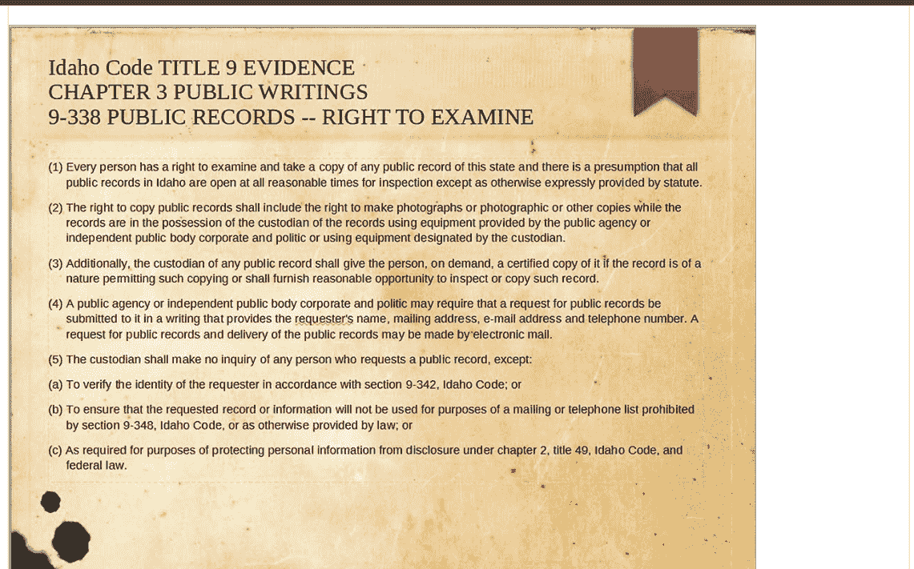
爱达荷州法典，第 9 卷。第 3 章 公共文件。9-338 公共记录，检查权。代码列出了五点：(1) 每个人都有权检查并复制本州的任何公共记录，除非法律另有规定，否则爱达荷州的所有公共记录在所有合理时间内均开放。(2) 复制公共记录的权利包括复制公共记录的权利。(3) 复制公共记录的权利包括复制公共记录的权利。(4) 复制公共记录的权利包括复制公共记录的权利。(5) 复制公共记录的权利包括复制公共记录的权利。

警告横幅和政策声明。例如，如果一起事件升级为刑事起诉，检察官更倾向于向陪审团展示横幅而非政策手册。警告横幅给陪审团留下的印象要深刻得多。此外，警告横幅对于黑客来说类似于“禁止入内”标志，因为登录带有警告横幅的网络表明其有侵犯你隐私的意图。许多司法管辖区将此视为侵入，如果黑客能够被识别，这允许组织对黑客提起刑事起诉。

除了确保有政策声明或警告横幅外，私营部门调查人员还应该了解在什么情况下可以检查员工的电脑。有了政策声明，雇主可以自由地启动任何必要的保护公司或组织的调查。组织还必须有一份定义良好的政策，描述何时可以启动调查。至少，大多数公司政策都要求雇主对法律或政策是否被违反有“合理的怀疑”。如果政策规定员工不能将电脑用于外部业务，而主管注意到行为发生了变化，可能表明员工正在违反该项政策，那么通常这就足以引发调查了。然而，某些国家要求在怀疑员工在工作中有犯罪行为时，必须通知他们正在接受调查。

如果私营部门调查人员发现员工正在或已实施犯罪，雇主可以向警方提起刑事起诉。某些企业（如银行）具有报告犯罪的监管要求。在美国，雇主必须移交所有用于起诉的证据。如果这些证据是由执法人员收集的，则需要搜查令，而在没有充分理由的情况下，搜查令是很难获得的。在本节中，将更多关于政策程序以及它与刑事调查的关系。雇主通常感兴趣的是执行政策，而不是寻找并起诉员工，因此他们通常聘用数字调查人员来识别滥用公司资产的员工。因此，私营部门调查人员关注的是在调查过程中保护犯罪行为的证据，而调查的升级会将案件从内部事务提升为外部刑事起诉。在某些情况下，例如发现儿童色情物品，公司或其代理必须立即通知执法部门。

如果你在公司政策调查期间发现了犯罪证据，你可能需要咨询组织的律师来做出此判断。接下来，将事件告知给管理层；他们可能有其他顾虑，例如保护可能与犯罪证据相关的机密数据，这被称为“混合数据”。在这种情况下，要与组织的律师协调，确定保护混合数据的最佳方式。当你向警方提交包含敏感信息的证据后，它将成为公共记录。公共记录法包括保护敏感公司信息的例外；然而，由法官决定保护哪些内容。

在你发现非法活动并报告犯罪后，请停止调查，以确保你没有违反《宪法》第四修正案中关于获取证据的限制。如果你提供的信息足够具体，符合搜查令的标准，则警方负责获得索取任何证据的搜查令。如果你在报告后，在没有搜查令的情况下按照政策指令收集额外证据，你将面临成为执法部门代理的风险。首先咨询你组织的律师，关于如何回应警方对信息的请求。警方和检察官应对对任何额外证据签发传票，这可以最大限度地减少你承担民事责任的风险。此外，你应该保留调查公司内部政策违规行为所收集的所有证据记录。在本节中，你将学习更多在内部调查中使用证词的内容。

公司政策违规的一个案例是员工看到另一员工访问色情网站。如果你的组织政策要求你判断是否有任何证据支持这一指控，你可以从代理服务器（用于连接公司局域网（互联网））中提取日志文件，并对对象的电脑进行取证检查。假设在检查期间，你发现了成人和儿童色情物品，并且对对象硬盘的进一步检查显示，该员工在工作站硬盘的单独文件夹中收集了儿童色情物品。在美国，持有儿童色情物品根据联邦和州法律是犯罪行为。这些情况并不罕见，并让那些不想在自己的取证工作站上犯有持有违禁物品罪的调查人员变得艰难。

在这个示例中，假设你调查了对象硬盘的剩余内容，发现他是你公司最新高科技自行车团队的首席工程师。他将色情图像放在存储自行车计划的子文件夹中。通过这样做，他将违禁物品与公司的自行车机密设计方案混合在一起。你的发现为处理这些违禁证据带来了两个问题：你必须向公司报告犯罪；所有美国州和大多数国家在涉及儿童证据时都有法律和道德准则。其次，你还必须保护敏感信息。你的第一步是询问组织的律师，如何处理混合的违禁物品和敏感设计方案。当你向警方提交包含敏感信息的证据后，它将成为公共记录。公共记录法包括保护敏感公司信息的例外；然而，由法官决定保护哪些内容。现在假设负责该案件的侦探给你打了电话。在你提交给警方的证据中，侦探注意到大多数违禁物品是邮件附件。检察官需要收集更多证据来确定嫌疑人是否正在涉及儿童色情或其他犯罪。侦探意识到，收集更多证据可能会让你成为执法部门的代理并违反员工的第四修正案权利，因此你为搜查令写了一份证词，以确保对你的任何后续指令都是合法的。在收集任何额外信息之前，等待你或你组织的律师获得传票、搜查令或其他法院命令。

## 自测
2. 作为私营企业数字取证检查员，为了避免成为警方的代理，你应该采取的第一步是什么？
a. 将混合的公司商业秘密数据与所有违禁数据分离。
b. 要求警方给你提供收集证据的具体指令。
c. 询问你组织的律师关于如何处理犯罪的混合数据。
d. 判断你是否有充分理由扣押违禁数据。

**答案：** c. 询问你组织的律师关于如何处理犯罪的混合数据。

**解释：** 在这种情况下，与管理层和组织的律师协调，确定保护混合数据的最佳方式。提交给警方的包含敏感信息的证据将成为公共记录。

## 检查。处理执法现场
要正确处理犯罪现场，你应该熟悉刑事搜查和扣押规则。你还应该理解搜查令的工作原理，以及在执行搜查时该做什么。在美国的所有调查中，第四修正案限制了政府搜查和扣押证据的方式。执法人员只有在有“合理理由”（probable cause）的情况下才能搜查和扣押刑事证据。

**合理理由**是一个标准，规定了基于理性认为犯罪已经发生或即将发生的事实或情况，警察有权进行逮捕、进行个人财产搜查或获得逮捕令。有了合理理由，警察可以从法官处获得搜查令，授权搜查并扣押与刑事起诉相关的特定证据。

第四修正案规定，搜令必须“特别说明要搜查的地方以及要扣押的人或物品”。注意，这段摘录使用了“特别”一词。法院认定这意味着搜令只能授权对特定地点搜索特定物品。如果没有具体的证据和对特定位置的描述，搜令可能会很无力，并在后的起诉过程中产生问题。例如，声称证据位于百老路和主街的某栋房屋内太笼统了，除非只有一栋房屋符合描述。相反，应提供具体信息，例如“榆树大道123号”。然而，大多数法院对数字证据允许更多的表述。例如，你可以声明想要扣押“计算机及所有相关部件”，而不是指定特定的“戴尔 Optiplex GXA”。司法部（DOJ）的文件[刑事调查中的计算机搜查扣押及电子证据获取](justice.gov/criminal/cybercrime/docs/ssimanual2009.pdf)包含了一个在现场进行计算机搜索的搜查令声明示例。

尽管几个法院案例允许在搜查和扣押数字证据时具有灵活性，但使你的搜令尽可能具体以避免辩护律师的挑战是一种良好的做法。通常，由于调查的性质，搜令是仓促编写和签发的。执法人员可能没有时间研究用于描述起诉性质的正确语言以满足合理理由的要求。然而，由于法官可以排除从措辞不当的搜令中获得的证据，在调查案件之前，你应该与当地检察官审查这些问题。

## 理解搜令中使用的概念和术语
你应该熟悉管理可扣押证据类型的令术语。许多数字调查涉及你必须筛选以寻找证据的大量数据；例如，关于此案的更多信息，请参考[安然案](britannica.com/event/Enron-scandal/)，该案涉及数TB的信息。无关信息（被称为无辜信息）通常包含在证据中，例如，当你发现无辜人员的记录或机密商业信息时，法官通常会在搜令中加入限制性短语，允许警察从搜令中分离无辜信息。搜令必须列出所有可以扣押的物品。

在接触或调查犯罪时，你可能会发现不在搜令指定位置的犯罪证据。你可能还会发现无关犯罪的证据。在这种情况下，显然适用于“明目所见原则”（plain view doctrine），该原则规定，有权进入某地点的警察视野范围内的物体无需搜令即可扣押，并可以作为证据引入。

执法人员要扣押该物品，必须有合理理由相信该物品是犯罪证据或违禁品（如非法毒品或色情物品）。此外，警察不允许移动物体以获得更好的视野。在亚利桑那州诉希克斯案中（408 U.S. 321, 1987），该执法人员被发现行为违法，因为他移动了设备以获得搜索序列号的合理理由。明目所见原则已扩展到明目触感（plain feel）、明目微小（plain small）和明目听觉（plain hearing）的子领域。在霍尔顿诉加州州案中（496 U.S. 128, 1990）中，法院消除了明目所见发现证据必须是偶然的的要求。当时要求“有意发现”，这导致了定义上的困难。法院随后决定在发现和收集证据时适用明目所见原则必须满足以下三个条件：

这三个条件被称为霍尔顿测试（Horton test）。

## 注意
明目所见原则并不支持从一个物体到另一个的通用探索性搜查，除非发现了令人犯罪的物品（库利奇诉新罕布什州案，403 U.S. 443, 466, 1971）。只有在观察到违禁品时，明目所见原则才适用于数字证据，例如警察看到色情照片。例如，如果搜令是涉及计算机的非法毒品活动，而在搜令执行员在计算机显示器上观察到儿童色情内容时，只能扣押该特定图像——即从计算机中复制并保存在外部介质上。进一步检查计算机以寻找额外的违禁品照片将需要另一份搜令。警察可以查看并锁定计算机以保存计算机上的所有证据，包括可能的儿童色情图像。任何对证据的进一步检查必须限于原始搜令中的内容。明目所见原则的相同概念也适用于数字取证员，如果他们在寻找其他内容时偶然发现了儿童色情内容。鉴定员必须报告发现的情况，并且在没有新发搜令的情况下不寻找任何额外的儿童色情图像。鉴定员是否能根据原始搜令继续恢复证据，取决于鉴定员所在组织的政策或司法管辖区的裁决。注意，美国上诉法院对明目所见原则给出的意见可能相互存在冲突。例如，美国第九巡回联邦上诉法院直接处理了这一原则，并利用它赋予了广泛的自由度给仅限于对无关证据的首次接触。检查人员若要搜查并收集任何额外的无关证据，则必须根据所发现的无关证据的合理理由获得新的搜查令。

## 搜查准备
为计算机或数字设备的搜查和扣收做好准备可能是数字调查中最重要的步骤。你准备得越充分，调查过程就越顺利。接下来的章节将讨论你在搜查证据之前应该执行的任务。对于这些任务，你可能需要从受害者（投诉人）和线人处获得答案，线人可能是负责案件的警警侦探、执法部门证人，或者是调查人员的经理或同事。调查人员可能是嫌疑人，也可能只是拥有额外知识的人，他们可能提供足够的搜查令或逮捕的合理理由证据。

## 识别案件性质
当你被分配到一个数字调查案件时，你会开始识别案件的性质，包括它是涉及私营部门还是公共部门。例如，私营部门的调查可能涉及员工滥用互联网权限上网，或者涉及提交了平等就业机会（EEO）投诉、电子邮件骚扰或其他伦理投诉的员工。严重案件可能涉及员工滥用公司数字资产来获取或交付违禁品。执法案件的范围从信用卡诈骗团到杀人不等。案件的性质决定了你如何进行以及你在调查中需要哪些资产或资源（在稍后的“确定你需要什么”部分进行详细讨论）。

## 识别操作系统或设备类型
接下来，确定调查涉及的操作系统类型。对于执法部门来说，这一步可能是困难的，因为犯罪现场不受控。你可能不知道使用了什么样的数字设备实施犯罪，也不知道它们在哪里使用的。在这种情况下，你必须依靠你的技能和知识（如“数字取证工具”模块中所讨论的那样）来应对未知情况。

如果你能识别操作系统或设备，请估计计算机存储容量，并确定你在现场需要处理多少设备。还要确定可能涉及哪些硬件，如 PC 或移动设备（包括智能手机、平板电脑和笔记本电脑）。你需要确定操作系统：Windows、Linux、macOS、iOS、Android 等。对于私营部门的调查人员来说，数字取证工具让这一步变得更容易。你还需要考虑变得普及的存储；例如，智能手机会自动备份到云端，人们经常将照片存储在云端。你可能需要传票来访问信息。

## 确定是否可以扣收计算机和数字设备
通常，事故或犯罪现场的理想情况是扣收计算机和数字设备并将其带到你的实验室进行处理。然而，根据位置，执法调查人员需要将计算机从犯罪现场移除并运输到实验室。如果移除计算机会对其造成不可恢复的损坏，则不应将其带离现场。额外的复杂情况涉及存储在现场并通过远程访问的文件。另一个考虑是存储的可用性，那里可能存储了许多其他订阅者的数据。

如果你不允许将计算机和数字设备带到你的实验室，请确定获取数字证据所需的资源以及哪些工具可以加速数据获取。对于大硬盘（如 1TB 或更大），获取时间可能会增加到几个小时。正如“数据获取”模块讨论过的，某些软件在制作取证镜像时会压缩数据。

## 获取位置的详细描述
你对犯罪现场位置的信息越多，就能越高效地从犯罪现场收集证据。环境和安全问题是这一过程中主要关注的问题。在到达事故或犯罪现场之前，请识别对你及他人安全的潜在危害。

某些案件涉及危险环境，例如甲基冰毒实验室的捣击，或使用生物、化学或核污染物的恐怖袭击。对于这类调查，你必须依靠危险材料（hazmat）小组的技能从现场恢复证据。恢复过程可能涉及在可能的情况下对调查所需的数字组件进行去污。如果去污程序可能会破坏电子证据，应由危险材料专家或穿戴危险材料装备的调查人员对嫌疑人的驱动器制作镜像。如果你必须依靠危险材料专家指导你如何连接和运行软件，你必须在指令中表现得专业且清晰。含糊或错误的指令可能会破坏证据。理想情况下，受过处理危险材料环境训练的数字取证调查员应该获取驱动器镜像。

无论是你还是危险材料技术人员获取镜像，都应该记住一些指南。在获取数据之前，危险材料技术人员可能会建议你将目标驱动器放在特殊的危险材料袋中，将数据线和电源线留在袋外，但在电缆周围建立气密密封，以防止任何污染物进入袋内影响目标驱动器。数据获取完成后，关闭电源，然后断开目标驱动器的数据线和电源线。危险材料技术人员可以对袋进行消毒。在处理极端条件（如生物或化学危险污染物）时，你可能需要牺牲设备（如数据线和电源线）来完成任务。在某些情况下（例如甲基冰毒实验室的捣击），污染物可能如此剧毒，至于对他人安全的危害禁止了获取任何数字证据。

此外，如果污染房间的温度高于 80 华氏度，你应该采取措施避免驱动器因过热损坏。在干旱地区，考虑使用冰袋或双层包装的冰袋冷却目标驱动器，以防水分泄漏并损坏驱动器。在极端条件下，请考虑对证据和你的设备造成的风险。你需要脑力激荡解决方案来克服这些问题。将设备转移到受控环境中是理想的；但并非总是可行。

## 确定谁负责
正如“理解数字取证专业与调查”模块中所讨论的，公司需要一条既定的权威链来规定谁可以启动或授权调查。私营部门的调查通常只需要一个人响应事故或犯罪现场。处理证据通常涉及获取嫌疑驱动器的镜像。然而，在执法部门，许多调查需要额外的员工来快速收集所有证据。对于大规模调查，应指定一个犯罪或事故现场负责人。任何被分配到大规模调查现场的人都应该与指定的负责人配合，以确保团队在收集证据时处理所有细节。

# 使用额外的技术专长
在收集证据数据后，确定你是否需要专业帮助来处理事件或犯罪现场。例如，假设你被分配去处理一个运行着 Windows 服务器（带有多个 RAID 驱动器）和高端 Linux 服务器的数据中心的犯罪现场。如果你是这项调查的负责人，你必须识别出处理犯罪现场所需的额外技能，例如聘请处理高端服务器操作系统的专家。其他考虑因素还包括如何从 RAID 驱动器中获取数据，以及可以获取多少数据；RAID 服务器通常处理数 TB 的数据，标准的镜像工具可能无法处理此类庞大的数据集。

在高端计算设施工作时，要识别你怀疑可能正在使用的应用程序，例如 Oracle 数据库。你可能需要招募 Oracle 专家或现场支持人员来帮助提取调查所需的数据。此外，大多数事件和犯罪现场都会发现移动设备（已在“移动设备取证”模块中涵盖），因此手头有熟悉处理这些设备的人至关重要。找到具有必要技术专长的合适人，可能比进行调查本身更具挑战性。

如果你确实需要招募非调查人员的专家，请制定一个培训计划，以使专家掌握调查技术。这一建议也适用于你计划在搜查和扣押任务期间监督的专家。在处理数字证据时，未经培训的专家可能会在无意中破坏证据，无论你在提供指令和监控其活动时是多么小心。

# 确定你需要的工具
在获取了关于事件或犯罪现场尽可能多的信息后，你可以开始列出你在现场需要的物品。有准备总比没有准备要好，特别是当你确定无法将计算机转移到你的实验室进行处理时。

为了管理你的工具，可以考虑创建一个“初始响应现场工具箱”和一个“扩展响应现场工具箱”。使用正确的工具箱会让处理事件或犯罪现场变得容易得多，并最大限度地减少你从现场带到车辆的物品数量。

你的初始响应现场工具箱应该是轻便易于运输的，仅包含在现场执行磁盘采集和初步取证分析所需的最小工具。有了这套工具箱，你可以到达现场，获取所需的数据，并尽快返回实验室。图 5-4 显示了你可能需要的某些物品，表 5-1 列出了你在初始响应现场工具箱中可能需要的工具。

# 图 5-4 初始响应现场工具箱中的物品
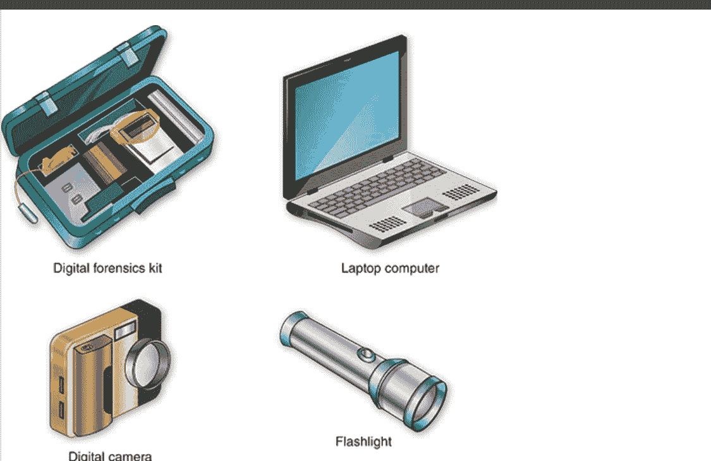
详情
初始响应现场工具箱包括一个数字取证工具包、一台笔记本电脑、一台数字相机和一个手电筒。

| 表 5-1 初始响应现场工具箱中的工具 |
|---|---|
| 数量 | 工具 |
| 1 | 记事本或带笔的笔记本 |
| 20 个或更多 | 证据表格 |
| 1 | 小型计算机工具箱 |
| 1 | 大容量驱动器 |
| 1 | 一套日本工业标准 (JIS) 螺丝刀 |
| 1 | 一套 ANSI 螺丝刀 |
| 1 | 静电手环 |
| 1 | IDE 宽排线 (ATA-33 或 ATA-100) |
| 1 | SATA 线 |
| 1 | 包含采集工具的取证启动介质 |
| 1 | 笔记本 SATA、IDE 40 转 44 针适配器、其他适配器线 |
| 1 | 笔记本或平板电脑 |
| 1 | FireWire 或 USB 双重写保护扩展坞 |
| 1 | 手电筒 |
| 1 | 带有备用电池的数字相机 |
| 1 | 证据日志表 |
| 1 | 用于取证员笔记的笔记本或数字录音笔 |
| 1 | 计算机证据袋（防静电） |
| 1 | 证据标签、胶带和吊牌 |
| 1 | 永久性水记笔 |
| 1 | USB 驱动器（便携硬盘） |

一个**扩展响应工具箱**包含了你负担得起带到现场的所有工具。当你到达现场时，应只提取获取证据所需的物品。这样做可以保护你的设备，并最大限度地减少你必须在现场跟踪的物品数量。[表 5-2] 列出了扩展响应现场工具箱中可能需要的工具，包括外部 USB 驱动器。

| 表 5-2 扩展响应现场工具箱中的工具 |
|---|---|
| 数量 | 工具 |
| 视异 | 各种技术手册，从 OS 参考资料到取证分析指南 |
| 1 | 初始响应现场工具箱 |
| 1 | 带有电缆和连接器的笔记本或平板电脑 |
| 2 | 插线板 |
| 1 | 额外的手动工具，包括钢丝钳、撬棍和手锯 |
| 1 | 皮手套和一次性乳胶手套（各种尺寸） |
| 1 | 手推车和行李推车 |
| 10 | 大垃圾袋和带包装胶带的纸板箱 |
| 1 | 各种尺寸的橡皮筋 |
| 1 | 放大镜 |
| 1 | 一包打印纸 |
| 10 | 用于清理数字设备灰尘的小刷子 |
| 2 | 各种尺寸的额外 USB 驱动器（TB 或更大）并带电源线 |
| 各种 | 外部硬盘和适配适配器 |
| 1 | 卷尺（25 英尺/10 米或更长） |
| 5 | 用于数据采集的额外各种类硬盘 |

在决定初始响应现场工具箱中包含哪些物品时，你应该分析针对你所在地区或组织的特定需求。参考表 5-1 和表 5-2 的指南。

# 准备调查小组
在对事件或犯罪现场启动数字证据的搜查和扣押之前，你必须与组建的小组审查所有可用事实、计划和目标。现场处理的目标是成功收集并保护数字证据。准备得越充分，执行数据采集计划时遇到的问题就越少。记住数字证据是易失的。开发快速评估事实、制定计划、收集资源以及从事件或犯罪现场收集数据的技能。在某些数字调查中，反应缓慢会导致案件重要证据丢失。

## 自测
+   4. 在从发生过有害物质（hazmat）暴露的犯罪或事件现场获取数字证据时，出发之前应该考虑以下哪些事项？（多选）
a. 犯罪或事件现场的环境暴露，如温度和湿度
b. 关注的有害物质的类型以及你和你的设备需要什么样的保护
c. 电源可用性、最近插座的位置以及电源的质量
d. 任何额外的特殊设备、数据存储设备或工具

**答案：** a. 犯罪或事件现场的环境暴露，如温度和湿度；b. 关注的有害物质的类型以及你和你的设备需要什么样的保护；c. 电源可用性、最近插座的位置以及电源的质量。

- a. 仅识别可能包含证据的计算资产。
- b. 限制对犯罪或事件现场直接区域的访问。
- c. 请求其他调查员和检查人员加入你，以便他们获得处理犯罪或事件现场的经验。
- d. 限制并保护犯罪或事件现场周围更大区域的访问。

**答案：** d. 限制并保护犯罪或事件现场周围更大区域的访问。

**解释：** 为了确保犯罪或事件现场的所有潜在证据都是安全的，初始封锁的区域应尽可能大。这样做是为了确保不遗漏任何东西。在区域锁定后，可以对其进行勘查，以确定哪些区域包含潜在证据，哪些区域不包含相关证据。在调查员做出判断后，可以将犯罪或事件现场缩小到较小的区域。

## 管理：在现场扣押数字证据
在适当搜查令的情况下，执法部门可以扣押所有的数字系统和外围。在私营部门调查中，你可能拥有类似的权限；然而，你可能仅有权对硬盘进行镜像。根据公司政策，私营部门调查员很少有权扣押所有计算机和外围。

在刑事调查中扣押数字证据时，请遵循美国数字数据扣押标准（在本模块后面的部分描述或参见 justice.gov/criminal/cybercrime/docs/smanual2009.pdf）。刑事和民事程序的另一个良好来源是 ISO 27001 数字证据识别、收集、获取和保护标准 iso27001security.com/html/27037.html。对于民事调查，你遵循与刑事调查相同的规则。你可能在寻找特定的证据，例如特定的电子邮件或表格。在刑事案件中，调查员扣押整个硬盘以保留尽可能的信息并确保不遗漏任何证据。如果你有任何问题、怀疑或担忧，请咨询你的律师获取额外指导。

## 准备获取数字证据
你在现场获取的证据取决于案件性质以及涉嫌的犯罪或违法行为。对于涉及毒贩计算机的刑事案件，你可能需要带走整个计算机以及该区域的所有外围和媒体，包括智能手机、USB 设备、CD/DVD、打印机、相机和扫描仪。你可能还需要扣押智能电视、游戏系统和其他连接到网络的设备。扣押外围和其他媒体可以确保你没有留存任何系统组件，预测哪些组件对系统运行至关重要可能是困难的。另一方面如果你正在调查员工违规，你可能只需要少数物品。

在收集数字证据之前，请向组织中的主管或高级法医检查员询问以下问题：
- 你是否需要带走计算机以及直接区域的所有外围和媒体？你将如何保护计算机和将其运往实验室的媒体？（此预防措施包括在运输期间阻止设备访问无线网络。）
- 你到达时计算机通电了吗？（这个问题在稍后的“事件或犯罪现场”中会有更详细讨论。）
- 你正在调查的嫌疑人在计算机的直接区域吗？嫌疑人可能损坏或破坏计算机、外围或媒体吗？你是否需要将嫌疑人与计算机分开？例如，假设一名名为 Edward Braun 的员工被怀疑在办公桌使用公司计算机编写软件，你可以将硬盘复制到另一个硬盘上，在计算机中安装复制硬盘，并将原始硬盘带到你的法医实验室进行检查。此程序不会创建位对位的副本；你正在创建一个用于持续业务运行的工作副本，并带走原件进行检查。由于 Edward 的主管不想让他知道他正被调查，你必须在他不在座位且预计不会回来时创建工作副本。由于大多数人会注意到桌子上的东西不正常，你应该拍摄现场照片，测量他椅子的高度，并在移除硬盘之前记录你必须移动的桌子上物品的位置。（下一节有更多关于拍摄照片和记录现场的提示。）在你创建了硬盘镜像并替换了副本后，将 Edward 的个人物品归还到原始位置。

## 处理事件或犯罪现场
以下指南就如何处理事件或犯罪现场提供了建议。随着你自己在执行搜查和扣押方面积累的经验，你可以增加或修改这些指南，以满足特定案件的需求。根据你的判断来决定在处理民事或刑事调查时采取哪些步骤。对于任何困难问题，请寻求法律顾问或其他技术专家。

在笔记本中记日志以记录你的活动。包括你到达现场的日期和时间、遇到的人以及你执行的每项重要任务。在处理现场时更新日志。使用移动设备，你可以轻松记录你正在操作的日志；只需确保谁有权访问你的移动设备即可。你的日志将成为你的检查员笔记。

为了封锁现场，采取切可行的方法确保只有授权人员可以访问该区域。移除所有正在调查现场的人，除非你需要他们处理现场。例如，你公司的网络管理员可能会帮助你连接并恢复数据。如提到的，你应该封锁比必要的更宽的范围。确保该区域内的任何东西（包括数字证据）都不会移动，除非你有时间记录它。对任何旁观者保持专业和礼貌，但不要提供有关事件的信息或回答问题。将记者转交给公共官员或组织的公关经理。

对计算机或数字设备周围的区域拍摄视频和静态录像。从记录整体场景开始，然后通过特写镜头记录细节，包括所有计算机的背面。在记录每台计算机的背面之前，在每根电缆上贴上带有数字或字母的标签，以便在需要在实验室组装组件时识别哪根电缆是连接的。记录计算机周围的区域，包括地板和天花板以及所有访问点，如门和窗。如果区域有吊顶板——假天花板——拆它们并记录。缓慢移动或缩放相机以防止拍摄或记录现场模糊，绘制事件或犯罪现场草图。草图是一份注有物体尺寸和距离的草稿。例如，注释可能写道：“嫌疑人的计算机位于南墙，距离墙角三米。”当你准备报告时，可以根据草图制作清晰详细的图纸，最好使用软件使草图具有电子格式。

由于数据是易失的，请尽快检查现场每台计算机或设备的状态。确定计算机是开启状态还是处于休眠模式。如果是关闭的，请保持关闭状态。如果是开启的，请根据你的专业判断如何处理。标准的数字法医实践是保持计算机电源，以确保数据在法庭证词期间不会损坏。这种程序在 Windows 3.1 和 MS-DOS 系统上是可以接受的，但 Linux 计算机通常应避免意外关机。每个意外过程都有内在风险；为了避免数据丢失，你或你的主管可能需要确定最佳关机程序。

曾有关于在计算机中放置自毁机制（包括硬件和软件设备）的故事。过去，一种常见的技巧是修改 DOS 程序 `command.com`，将 `dir`（目录）命令改为 `deltree`。当调查员在计算机上输入 `dir` 命令时，他们会无意中触发删除，删除所有文件及其内容。更高级的方法已知可以创建删除更改的方法来覆盖硬盘内容。此外，怀疑有人会调查他们的计算机者可能会设置：如果输入正确的密码，计算机将删除硬盘内容。

更多的数字调查围绕网络和互联网相关的案件，这些案件高度依赖日志文件数据。某些文件（如 Windows 中的事件日志和安全日志）如果在没有正常关机的情况下直接断电，将会丢失关键的网络活动记录。

如果你正在进行网络或互联网调查，且计算机处于开启状态，请尽可能保存任何当前应用程序中的数据，并记录所有活动中的窗口或 shell 会话。除非必要，否则不要检查文件夹或网络连接，或按下任何键。对于已开启的系统，请对屏幕拍照。如果窗口已打开，可以安全地将它们最小化以便拍照。

在实机计算机上复制数据时，请在你的日志或调查员笔记中记录你遇到的所有情况。完成内容记录后，将其保存到外部介质。请记住，系统自上次保存以来可能发生了变化。如果另一个屏幕是浏览器，请截图或将网页保存到外部驱动器。如果嫌疑人与具有足够空间的网络服务器有活动连接，你需要管理员的配合引导你进入存储文件的正确文件夹。

如果你无法将应用程序保存到外部介质，使用新文件名可以避免覆盖可能尚未更新的现有文件。这种方法并不理想，应仅在极端情况下使用。你的目标是尽可能保留内容，而不产生可能覆盖已删除数据的风险。

在你保存嫌疑计算机上的所有文件后，关闭所有应用程序。当所有应用程序关闭后，执行有序关机。如果你不熟悉正在检查的系统的关机方法，请咨询具有该领域专业知识的人。要完成现场的处理，请执行以下步骤：
- 1. 如果可能，指派专人收集并记录所有证据。尽可能减少处理其完整性的人员数量。
- 2. 在所有证据上标记当前日期、时间、序列号和收集人员姓名。
- 3. 为了审计目的，保留所收集证据的副本，并验证你收集的所有内容。
- 4. 对证据和案发现场保持持续控制。

如果案件性质不允许你没收数字设备，请按照你在“数据采集”模块中所学习的方法，为硬盘创建镜像。

**注意**
在“网络取证”模块中，你学习了如何使用取证技术获取 RAM。目前已有许多针对“如何系统地分析 RAM”开展了研究，以便从看似随机的数据中找到相关信息。在数据采集或收集证据后后，寻找与调查相关的信息，例如密码、口令、个人身份识别（PIN）和账户号码（财务交易）。

信息可能在显眼处，也可能隐藏在垃圾中。在现场，尽可能收集有关嫌疑人或被害者的个人信息。这包括任何手写笔记。为了完成现场的分析和处理，收集与调查相关的所有文档和介质，包括：
- 硬件，包括移动和外围设备
- 软件，包括操作系统和应用程序
- 所有介质，如 USB 驱动器、备份带和磁盘
- 所有文档、打印件和手写笔记

## 带有 RAID 系统的数据中心处理
数字调查员有时会对装有大型磁盘系统的服务器群（如银行和互联网服务提供商 ISP）进行取证分析。正如你在“数据采集”模块中所学习的，从大型系统中提取证据的一种技术是稀疏采集。该技术仅提取已分配的文件，并最大限度地减少你需要分析的数据量。该技术的缺点是它无法恢复空闲空间或碎片空间（slack space）中的数据。如果你有一个可以访问 RAID 系统未分配空间的数字取证工具，请先在另一个系统上测试该工具，确保它不会损坏 RAID 系统。

## 使用技术顾问
在处理高级技术时，如果可能，请聘请一名技术顾问，他可以帮助你列出处理事件或犯罪现场所需的工具。在大型数据中心，技术顾问是指导你从何处定位数据并帮助你从 RAID 服务器中提取记录或其他证据的人员。在执法案件中，技术顾问可以通过列出你所需的物品来帮助创建搜索证令。在现场，技术顾问可以帮助指导调查员正确收集证据。技术顾问承担以下职责：
- 了解被没收和搜索的系统的各个方面。
- 指导调查员如何处理敏感介质和系统以防止损坏。
- 帮助确保现场安全。
- 帮助记录搜索和没收的计划策略。
- 针对被没收和搜索的技术和组件对调查员进行即时培训。
- 记录搜索和没收期间的活动。
- 协助进行搜索和没收。

## 在实验室中记录证据
在现场收集数字证据后，将其转运到取证实验室，该实验室应该是一个受控环境，以确保数字证据的安全性和完整性。在任何调查工作中，请务必在工作时记录你的活动和发现。为此，你可以维护一份日志（即调查员笔记），记录你在处理证据时所采取的步骤。你的目标是，当你或另一位调查员重复你收集证据的步骤时，能够获得相同的结果。

除了验证你的工作外，日志或调查员笔记还作为一份参考，记录了你处理数字证据时所使用的方法。你和其他人可以使用它作为其他调查的培训和指导。

## 数字证据的处理与处置
在“数据采集”模块中，你学习了如何使用镜像工具，在“理解数字取证专业与调查”模块中，你检查了使用监管链控制保护数字证据的步骤。你使用以下步骤创建镜像文件：
- 1. 将所有镜像文件复制到 TB 级驱动器或存储区域网络。大多数取证实验室都配备了多台安装了磁盘镜像软件的机器以及根据案件需要交换的硬盘。你可以使用这些资源将镜像文件复制到大驱动器。某些设备配备了用于进行案件的大型网络存储设备。
- 2. 启动取证工具访问并打开镜像文件。
- 3. 对镜像文件运行哈希算法（例如 MD5、SHA-1、SHA-256 或 SHA-512）以获取数字哈希值。（在本模块稍后的“获取数字哈希”章节中，你将学习如何使用哈希来确保证据没有发生变化。）
- 4. 完成将镜像文件复制到大驱动器后，将原始介质安全地存放在证据柜中。

## 特殊情况需求
在犯罪或事故现场扣取数字证据时，可能需要在在处理和关机之前保持嫌疑人的计算机通电。任何一种情况都可能是嫌疑人的计算机正在运行全盘加密，而你没有密码短语；或者是包含证据的应用程序正在运行且尚未完成处理。对于这类情况，有一种特殊设备可以让你将计算机电源从电源上断开，并允许其继续运行。

热插拔现场工具箱（参见 wiebetech.com/products/hotplug-field-kit）。该工具箱带有特殊设备，允许你将 HotPlug Kit 采集设备在电源插座和计算机电源插头之间滑动。

除了热插拔现场工具箱外，Wiebetech 还销售鼠标 J Mouse Jiggler MJ-3 设备（wiebetech.com/products/mouse-jiggler-mj-3/1/），它可以防止可能受密码保护的屏幕保护程序启动。

## 自我检查
+ 6. 如果你在犯罪现场遇到嫌疑人的计算机处于开启状态，第一要任务是什么？（选择所有适用项。）
a. 记录笔记，列出正在运行的应用程序以及在 Word 或 Excel 等程序中可能打开的数据文件名称。
b. 立即关闭计算机电源以保留存储在计算机内部驱动器上的现有数据。
c. 将任何打开的数据文件（如 Word 文档）保存到外部驱动器以保留其内容，然后关闭应用程序。
d. 将所有打开的文档以包含案件号或你的姓名缩写的新唯一名称保存到嫌疑人的内部驱动器中。

**答案：** 记录笔记，列出正在运行的应用程序以及在 Word 或 Excel 等程序中可能打开的数据文件名称。
**解释：** 遇到开启状态的嫌疑人计算机时，检查员必须确定打开了哪些程序和相关文件，然后在笔记本中记录这些信息。完成记录后，检查员就可以继续从开启的计算机中收集数字证据。

# 管理。数字证据的归档存储与运输
数字证据的存储和运输对所有调查都至关重要。对于数字证据的存储（即归档），你需要使用现有的最具成本效益、耐用且可靠的介质。将数字证据运输到安全位置与归档同样重要。证据的运输也应符合证据链的要求。数字证据还必须保护免受任何损坏，如破碎、环境危害（例如极端温度）和电磁暴露。

## 数字证据的归档
归档数字证据的最佳介质选择取决于你需要保留它多久。证据需要保留的时间取决于案件，在某些情况下还取决于省、州或联邦法规。作为一种通用做法，存储在硬盘或固态驱动器（SSD）上的数字证据（已知会发生故障）应复制到 CD 或 DVD 等光介质上。光介质的保质期为 5 到 10 年。光介质的优势是成本低，而缺点是存储容量有限。保存一个取证磁盘镜像文件需要几张 CD（每张 700 MB）或 DVD（每张 4.7 GB）。

对于大量数据，磁带是理想选择，因为它们可以存储 TB 级的数据。适用于数字证据的磁带有 4-mm DAT 和 Super DLT 磁带。4-mm DAT 磁带存储 40 到 72 GB 的数据。DLT 磁带的典型寿命超过 50 年，DLT 盒的存储能力范围在 35 到 70 GB 之间，而 Super DLT 磁带可以存储多达 600 GB 数据。

磁带的优势是每个盒可以存储海量数据。虽然磁带的价格比 CD 或 DVD 贵得多，但每 GB 的成本更低。磁带的缺点是顺序读写速度慢。尽管这些驱动器需要 SCSI 接口连接计算机，但较新的驱动器使用了 USB。

## 提示
如果你使用磁带，请通过将数据从驱动器恢复到磁带来记录。

光介质是需要长时间存储的数字证据的选择。光介质的容量范围为 4.7 GB 到 100 GB。制造商称光介质的寿命超过 1000 年。有关光介质的更多信息，请访问 mdisc.com/drive-compatibility。

对于所有数据保护，请确保创建镜像的副本以防止数据丢失。如果可行，请使用不同的工具来创建镜像。

# 证据保留与介质存储
如果你支持执法机构，根据案件类型你可能需要永久保留证据。咨询当地检察官或州法律以确保符合规定。对于私营部门，请咨询组织的法律部门，该部门负责设定保留标准。

## 证据记录
在犯罪现场记录证据时，创建或使用证据表（如数字取证专业领域所述）。由于获取数据的技术和方法的不断变化，请使用处理软件或电子表格创建证据表。如果你有平板电脑或笔记本，也可以使用自定义数据库。证据表具有以下功能：
- 识别证据
- 识别谁处理了证据
- 列出访问的日期和时间

在建立这些信息后，你可以在表中添加其他字段，例如记录 MD5 和 SHA 哈希值或执行的操作部分。考虑包含你可能需要的任何额外信息。检查员笔记中应引用证据表。

商业证据袋通常带有用于记录证据的标签。商业公司提供各种尺寸和风格的纸质塑料证据袋。注意，并非所有商业袋都提供防静电保护。在使用这些或其他类型的袋时，请确保在将证据放入袋之前在袋子上写上证据信息。

## 传输数字证据
在收集数字证据后，是时候将其传输到实验室进行处理和存储了。传输数字证据所需的保护措施与你在收集时采取的预防措施同样重要。由于电子元件脆弱，且容易受到电磁场或极端温度的改变或损坏，你应该准备好适当的包装材料，以防止它们在运输过程中损坏。

在收集数字证据时，你应该准备合适的包装物品，例如：
- 各种尺寸的防静电袋，用于保护外部硬盘、USB 闪盘和 SSD 卡等微小物品
- 充足的泡泡膜，用于在运输过程中保护电子元件不受损坏
- 各种尺寸的箱子或加固容器，用于固定电子元件
- 包装胶带和证据胶带
- 标签和永久性标记笔，用于列出每个证据容器的内容

所有证据妥善固定后，是时候将其传输到实验室了。数字证据在运输过程中的安全性要求其免受未经授权访问。你或指定的证据保管人负责确保在传输到实验室的期间没有人可以接触证据。证据必须始终处于监控之下——由你或指派证据保管人进行。除了证据的物理安全外，还有必要使其免受极端环境的影响，如过热或过冷，或暴露于电磁场。

7. 对于可能需要保留数字证据超过 10 年的案件，你应该考虑以下哪种类型？
- a. 光介质，如 CD 或 DVD
- b. 二级存储介质，如硬盘
- c. 闪存介质，如固态硬盘
- d. 磁带介质，如 DLT 磁带

**答案：** d. 磁带介质，如 DLT
**解释：** 在所有数据存储介质中，磁带（如 DLT）维持数据完整性的时间最长。DLT 磁带的使用寿命超过 50 年，这使其介质成为保存重要案件数据的理想选择。光介质（如 CD 和 DVD）在 5 到 10 年后可能会损坏。大多数制造商为固态硬盘提供 10 年保修；然而，如果硬盘故障，制造商只会更换硬盘而非数据。

## 分析获取数字哈希值
为了验证数据，已经开发了多种获取文件数据唯一标识的方法。其中一种方法是循环冗余校验（CRC），这是一种确定文件内容的数学算法。最新版本是 CRC-32；然而，CRC 不被视为哈希算法。数字取证使用的第一种算法是消息摘要算法5（MD5）。与 CRC 类似，MD5 是一种数学公式，它根据文件或条目的内容生成一个十六进制代码（哈希值）。如果文件的比特位或字节发生变化，就会改变哈希值，该哈希值通常以十六进制值表示，用于验证文件或驱动器已更改或修改。在处理或分析文件之前，你可以使用软件工具计算哈希值。在处理文件后，你会产生另一个数字哈希值。如果它与原始值相同，你就可以通过数学证明文件没有更改，从而验证你的数字证据的完整性。根据来自北京清华大学和山东理工大学的小晓勇的说法，取证哈希有三条规则：
- 你无法预测文件或设备的哈希值。
- 任何哈希值都不可能相同（注意，在研究超级计算机中会遇到碰撞）。
- 如果文件或设备中发生任何变化，哈希值必须发生变化。

另一种哈希算法是安全哈希算法 1（SHA-1），它由美国国家标准技术研究院（NIST）开发，该机构是美国商务部的一个机构，也是负责制定某些美国行业标准的管理机构之一。SHA-1 已取代了 MD5 和 CRC-32，尽管 MD5 仍在在使用。（有关 SHA 的更多信息，请参阅-

在 MD5 和 SHA 中，两个不同的文件具有相同的哈希值。然而，尽管 MD5 和 SHA 存在缺陷，但碰撞现象非常罕见，两者仍被用于验证从文件和存储介质中收集的证据。如果怀疑文件有问题，你可以进行逐字节比较，以验证所有字节与原始文件和复制的文件完全一致。逐字节比较可以使用 MS-DOS 的 `comp` 命令或 Linux/Unix 的 `diff` 命令完成。该领域不断有新进展，通过 NIST 网站和相关期刊来保持最新动态是一个好主意。

预装程序使得对嫌疑人的计算机进行初始隐蔽数据收集变得容易得多。这消除了秘密访问嫌疑人计算机或移动设备的必要。通过减少与嫌疑人及设备的接触，你可以增加成功调查的几率。

除了键盘记录器工具外，许多数字取证软件应用都具有远程访问和数据获取能力。例如，OpenText EnCase Endpoint Investigator [security.opentext.com/encase-endpoint-investigator] 拥有一个带有专用软件的中央服务器，可以在网络上协调调查，实现对嫌疑人计算机的远程连接。在[虚拟机取证与现场获取?](link) 和[网络取证?](link) 模块中，你将学习更多关于远程访问和获取如何实现的知识。

## 自测
- 9. 在部署隐蔽监控设备之前，应该采取哪一步或哪些步骤？
  - a. 测试键盘记录器工具，确定它们是否会触发防火墙安全程序的警报。
  - b. 确定你的组织是否已制定定义执行隐蔽监控参数的政策。
  - c. 在整个组织的所有工作站上部署 servlets。
  - d. 实现并准备好在你的网络上安装一个嗅探工具（如 Wireshark）。

**答案：** b. 确定你的组织是否已制定定义执行隐蔽监控参数的政策。

**解释：** 在考虑隐蔽监控设备或方法之前，最重要的是确定你的组织是否制定了与监控员工相关的政策。你应该阅读这些政策并理解它们的应用意图。如果你对这些政策有任何疑虑或不理解，请联系你的管理层、人力资源部门或法务部门以进一步讨论你的疑虑。

## 模块回顾
## 模块总结
- 数字证据是任何存储在电子或光学介质上或传输的物品。它极其脆弱且容易被篡改。
- 在你确定事故现场或犯罪现场有数字数据或设备后，识别出可以作为证据的信息或痕迹。接下来，对你发现的证据进行目录编制或记录。你的目标是保护完整性，这意味着你不能修改收集到的证据，并对其进行分类记录。应该对现场进行拍照和绘制草图，然后对每件物品进行标记并放入证物袋中。收集、保存、记录、分析、识别和组织证据。然后重建证据或重复情景以验证你每次都能得到相同的结果。在整个调查过程中，应保持证据处理的一致性。
- 对于民事诉讼中的证据，应采用与州或联邦证据规则规定的犯罪现场证据相同的安全和问责控制措施。
- 在私营部门，事故现场通常是工作场所，例如封闭的办公室或制造区域。从用于违反政策的计算机到周围设施的证据都受受控当局（即公司管理层）管管——这意味着调查和控制现场比在犯罪现场要容易。
- 公司应该发布政策，保留随时检查数字资产的权利；否则，员工对隐私的预期将阻止雇主合法地进行侵入性调查或隐蔽监控。一份定义良好的公司政策规定，雇主有权检查或访问任何公司拥有的数字资产。
- 在私营部门调查中必须遵循批准的程序，因为案件可能会变成刑事案件。如果私营案件因刑事活动而移交执法部门，则调查人员必须避免自己成为执法部门的代理。调查人员在就如何回应警方的信息请求时，应始终咨询组织的律师。
- 刑事案件需要书面说明的令状。在美国所有的刑事调查中，第四修正案规定，执法人员只有在根据事实或情况具有合理理由的情况下才能搜索和扣押证据，这些理由应使理性人相信犯罪已经发生或即将发生。
- 明明可见原则（plain view doctrine）规定，落在警察直接视线内的证据物品有权在没有令状的情况下被合法扣押，并可以作为证据引入。
- 准备计算机或数字设备的搜索和扣押可能是数字调查中最重要的一步。
- 涉及危险材料的调查可能要求调查人员具有危险品（hazmat）认证，或由在调查人员指导的其他人员来收集证据。
- 调查人员封锁事故或犯罪现场以保护证据，并对事故或犯罪信息保持保密。
- 在笔记本中记录日志或记录你在处理事故或犯罪现场时的活动，并始终拍照或使用摄像机记录现场。控制并限制进入现场的人员，以防止好奇导致证据污染。
- 存储介质选项包括 CD、DVD、USB 盘、外部固态硬盘、磁带和 DLT。选择存储介质取决于证据必须保存多久。
- 取证哈希值（Forensic hashes）用于验证数据未被更改。最常用的哈希算法是 MD5、SHA-1、SHA-256 和 SHA-512。
- 员工调查要求组织制定相应的政策。

## 关键术语
- 自动指纹识别 (AFIS)
- 计算机生成的
- 计算机存储的
- 隐蔽监控
- 数字证据
- 扩展响应箱
- 危险材料 (hazmat)
- 初响应箱
- 密钥集
- 美国标准与技术研究院 (NIST)
- 利益相关
- 明明可见原则
- 理由
- 职业好奇
- 数字证据科学小组 (SWGDE)
- 嗅探

## 复习题
1. 私营部门调查通常比执法调查更容易是因为：
  - a. 公司对硬件和软件有清单。
  - b. 调查人员不需要获取令状。
  - c. 调查人员必须获取令状。
  - d. 用户可以在机器上加载任何内容。

2. 在美国，如果公司发布了保留随时检查资产的政策，私营部门调查人员可以根据管理指示进行隐蔽监控。对/否？

3. 如果你在调查违反政策的行为时发现了犯罪证据（如儿童色情），案件就变成了刑事案件并应交给执法部门。对/否？

4. 作为私营部门调查人员，如果发生以下情况，你可能会成为执法部门的代理？（多选）
  - a. 在处理民事调查时，警方要求你移交与案件无关的数字证据，以供当地检察官在你正在调查的刑事案件中使用。
  - b. 在处理民事调查时，警方向你签发传唤，要求提供与正在进行的非刑事调查相关的特定数字证据。
  - c. 在处理非刑事数字调查时，警方通过指导你使用一种对你正在处理的民事案件有用的新取证工具来协助你。
  - d. 在处理民事调查时，警方要求你保留与案件无关的其他数字证据，以供当地检察官在你正在调查的刑事案件中使用。

5. 明明可见原则仅适用于犯罪现场的计算机，而不适用于数字证据的检查。对/否？

6. 如果嫌疑人的计算机位于可能含有毒化学品的区域，你必须执行：（多选）
  - a. 与危险品小组协调。
  - b. 确定获取嫌疑人计算机的方法。
  - c. 假设嫌疑人的计算机已被污染。
  - d. 不要独自进入。

7. 取证哈希的三个规则是什么？
- a. 它可以被预测；只有两个文件具有相同的哈希值；且如果文件改变，哈希值就会改变。
- b. 它是不可预测的；只有两个文件具有相同的哈希值；且如果文件改变，哈希值就会改变。
- c. 它可以被预测；只有两个文件具有相同的哈希值；且如果文件改变，哈希值就会改变。
- d. 它是不可预测的；没有两个文件具有相同的哈值；且如果文件改变，哈希值就会改变。

8. 在取证哈希中，何时发生碰撞？（选择所有适用项。）
- a. 仅当同一文件的两个或多个副本具有不同的哈值时
- b. 仅在两个不同文件具有相同哈希值的稀有情况下
- c. 当每次计算未更改文件的新哈希时，其哈希值发生变化时
- d. 当发布新版本的哈希工具时

9. 初始响应现场工具箱应该包含哪些项目？（选择所有适用项。）
- a. 数字相机
- b. 带有镜像驱动器的各种电缆、适配器和连接器
- c. 证据表格和各种标签
- d. 防静电证据袋

10. 在美国法院中，数字证据是如何定义的？（选择所有适用项。）
- a. 数字证据被定义为倾向证据。
- b. 数字证据被定义为物理证据。
- c. 数字证据被定义为佐证证据。
- d. 数字证据被定义为轶事证据。

11. 计算机外围或附件可能包含 DNA 证据。正确或错误？

12. 如果嫌疑计算机正在运行 Windows 10，在最小化改变潜在证据的风险时，你可以安全地执行以下哪些操作？（选择所有适用项。）
- a. 浏览已打开的应用。
- b. 断开电源。
- c. 启动资源管理器。
- d. 连接 USB 外部硬盘。

13. 如果你有智能手机或视频摄像机等录像设备，以下哪些是用于犯罪或事故现场记录计算机和存储媒体等物理证据的最佳技术？（选择所有适用项。）
- a. 从现场的整体视图开始，然后靠近，从左向右平移。
- b. 从现场的近景视图开始，缓慢地从左向右平移，然后缩小以获得整体视图。
- c. 从每个设备和媒体的整体视图开始，然后放大进行特写。
- d. 从每个设备和媒体的特写镜头开始，然后缩小。

14. 哪些哪些技术可能用于隐蔽监控？（选择所有适用项。）
- a. 击键记录
- b. 数据嗅探
- c. 网络日志
- d. 事件日志

15. 当专有或贸易秘密数据与犯罪证据混合时，会发生什么？（选择所有适用项。）
- a. 与数字证据混合的专有或贸易秘密信息将自动免于公开。
- b. 与数字证据混合的专有或贸易秘密信息将被自动限制公开。
- c. 与数字证据混合的专有或贸易秘密信息可以作为针对被告的额外证据。
- d. 与数字证据混合的专有或贸易秘密信息可以获得法院保护，防止在刑事案件中向公众发布。

16. 列出两种常用的用于取证目的哈希算法。（选择所有适用项。）
- a. diff
- b. MD5
- c. SHA-1

以下是存储超过 10 年数字证据的首选媒体是什么？（选择所有适用项。）
- a. CD 或 DVD
- b. SSD
- c. 4-mm DAT
- d. 外部 USB 硬盘

如果公司没有发布允许自由检查计算机（包括电子邮件和网络使用）的政策，员工在使用公司资产时是否有隐私预期？正确或错误？

你被叫到仍在运行的计算机崩溃现场。你应该带哪些主要物品到现场？（选择所有适用项。）
- a. 初始响应工具箱
- b. 急救箱
- c. 个人防护装备
- d. 化学品防护

在犯罪或事故现场的公共区域如果有围观者或记者就你的活动提问，你应该如何回答？（选择所有适用项。）
- a. 根据你的知识回答他们。
- b. 指导他们协助你收集证据。
- c. 告诉他们你无法回答，让他们联系你的机构。
- d. 询问提问者的姓名并告诉他们你稍后联系他们。

## 实验项目
## 项目 5-1
预计时间：5 分钟
**目标：** 使用 HxD 识别文件的 MD5 值。

开始之前：
- 创建工作文件夹 `C:\Work\Module_05\Project-5-1`。
- 将模块提供的数据下载到工作文件夹。

这将向你展示如何使用十六进制编辑器 HxD 获取文件的 MD5 值。为了完成此文件的哈希计算，请执行以下步骤：
- 启动 HxD 并点击 File（文件）。
- 导航到你的工作文件夹，点击 .pdf 文件，然后点击 Open（打开）。
- 点击 Analysis（分析），然后点击 Checksum（校验和）。
- 在 checksum 窗口的可用算法面板中向下滚动找到 MD5，点击 MD5，然后点击 OK。
- 在 HxD 窗口底部的结果中，右键点击 MD5 结果并复制。
- 启动记事本并点击 Edit（编辑），然后粘贴，并将文件保存为 `Project-5-1-Checksum.txt`。

完成后，关闭 HxD 并向教师提交以下文件：
- Project-5-1-Checksum.txt

## 项目 5-2
预计时间：5 分钟
**目标：** 使用 HxD 识别两个文件之间的差异。

开始之前：
- 创建工作文件夹 `C:\Work\Module_05\Project-5-2`。
- 将模块提供的数据下载到工作文件夹：
- Project-5-2_Compare_File-1.docx
- Project-5-2_Compare_File-2.docx
- Project-5-2_Comparison_Results.xlsx

作为数字取证调查的一部分，可能需要确定两个相同的文件之间是否存在差异。项目中，你将使用十六进制编辑器 HxD 查看两个文件的内容以识别差异。

从文件资源管理器双击 `Project-5-2_Comparison_Results.xlsx` 用你的表格程序打开它。在 C3 单元格的 Examiner's Name 字段输入你的姓名。

启动 HxD，点击 Analysis（分析）、Data comparison（数据比较），然后 Compare（比较）。

在 Compare 窗口的布局面板中，点击水平排列按钮，并在 Scope（范围）面板中点击 All（全部）。

在 Compare 窗口中，点击 **1. Data source**（数据源）按钮，在 Open（打开）窗口中导航到你的工作文件夹，点击 `Project-5-2_Compare_File-1.docx`，然后点击 Open（打开）。

在 Compare 窗口中，点击 **2. Data source**（数据源）按钮，在 Open（打开）窗口中导航到你的工作文件夹，点击 `Project-5-2_Compare_File-2.docx`，点击 Open（打开），然后点击 OK。

通过点击 **Analysis, Data comparison** 然后 difference 来检查两个文件之间的差异。对于发现的每个差异，记录偏移字节位置（偏移显示在 HxD 窗口的左下角）以及两个文件之间的字符值，并记录在 `Project-5-2_Comparison_Results.xlsx` 中。

完成后，点击 HxD 向教师提交：
- Project-5-2_Comparison_Results.xlsx

## 项目 5-3
预计时间：10 分钟
**目标：** 计算选择文件的哈希值并定位任何重复文件。

开始之前：
- 创建工作文件夹 `C:\Work\Module_05\Project-5-3`。
- 将模块提供的以下数据下载到工作文件夹：
- Project-5-3_Examiner_Notes.xlsx
- Project-5-3_File_Hashes.xlsx

从犯罪或事故现场收集数字证据后，需要通过计算相关文件的哈希值来验证其完整性。项目中，你将处理一个名为 `Project-5-3_File_Hashes.xlsx` 的自解 zip 文件，它包含许多其他文件。你的任务是使用 Windows 版 Autopsy 计算每个文件的 MD5 和 SHA-256 值。除了生成文件哈希外，你还需要在之后（在案例项目 5-1 中）使用笔记编写描述项目活动的备忘录。在实际案件的验证过程中，你可以使用你的取证笔记，如果受到对方取证人员质疑，必要时重复创建哈希的步骤。执行以下步骤完成此项目：

1. 在文件资源管理器中双击 `Project-5-3_File_Hashes.exe`，在 WinRAR 自解归包窗口中点击 **Extract**（解压）。
2. 从文件资源管理器双击 `Project-5-3_Examiner_Notes.xlsx` 用你的表格程序打开它。在 Examiner's name 字段输入你的姓名，并在 Case Name 和 Case Number 字段中输入 Project 05-3。然后在 A8 和 B8 单元格中输入当前日期和时间。
3. 启动 Autopsy for Windows。
4. 在 Autopsy 欢迎窗口中，点击 **New Case**（新建案件）按钮。在 New Case Information 窗口中，在 Case Name（案件名称）框中输入 Project_05-3，并点击 Browse to the Base Directory（浏览根目录）。导航并点击你的 Work（工作）文件夹。确保 Case Type（案件类型）选择了 Single-User（单用户）选项按钮，然后点击 Next（下一步）。
5. 在 Optional Information（可选信息）窗口中，在 Case Number（案件编号）框中输入 Project_05-3，并在 Examiner（审查员）部分输入你的全名。点击 Finish（完成）添加数据源向导。
6. 在 Add Data Source（添加数据源）窗口的 Select Type of Data Source To Add（选择要添加的数据源类型）区域，点击 Logical Files（逻辑文件）按钮然后点击 Next。
7. 在 Select Data Source（选择数据源）面板中，点击 Add（添加）然后点击 Browse（浏览）。在 Select Local Files or Folders（选择本地文件或文件夹）窗口中，导航到你的 Work 文件夹，点击 Project_05-3_File_Hashes 文件夹，点击 Select（选择），然后在 Select Data Source 格中点击 Next。
8. 在 Add Data Source（添加数据源）窗口的 Configure（配置）区域，如果尚未选中，请点击 Select All（全选）。点击 Next 然后点击 Finish。
9. 在审查员电子表中，C 单元格中的名称表示你已启动 Autopsy 并加载了文件 Project_05-3_File_Hashes。一个示例条目为：“Started Autopsy 并使用 Autopsy for Windows 版本 4.18.0 添加取证镜像文件 Project_05-3_File_Hashes。”
10. 导入完成后，在 Autopsy 的 Tree（树状视图）面板中，点击加/减号展开 Data Sources 和 LogicalFileSet1(1)。然后，点击 Project_05-3_File_Hashes 文件夹。
11. 在 Result View（结果视图）面板中，点击文件 MagnaCarta.odt，然后按 Ctrl+A 选择 Result View 中列出的所有文件。将光标置于高亮文件上，右键点击，然后点击 Export rows to CSV（导出行到 CSV）、Save（保存），然后点击 OK。
12. 使用资源管理器，导航到 Autopsy Export 文件夹，它将位于你的 Work 文件夹/Project_05-03/ProjectExport 下。
13. 双击文件 Project_05-3_File_Hashes yyyymmnnnnnn.csv（这是在第 11 步中创建的），用 Excel 打开它。（注意：Autopsy 使用文件夹名称命名，并在文件名后附加年、月和七位数字的数值。）
14. 在 Project_05-3_File_Hashes 电子表中，向右滚动以显示 K 列（MD5 哈希列）和 L 列（SHA-256 哈希列），如你审查员笔记文件中的图 5-5 所示，记录所有提取出的文件名称。

图 5-5 提取的元数据哈希值

# 匹配 MD5 哈希值的备注

# 匹配 SHA-256 哈希值的备注

| | A | B | C | D | E | F | G | H | I | J | K | L | M | N | O |
|---|---|---|---|---|---|---|---|---|---|---|---|---|---|---|---|
| 1 | Name | | | | | | | | | | | | | | 00000000000000000000000000000000 | | |
| 2 | 61862-0.pdf | 00000000000000000000000000000000 | a4e95688-6884-468-99--77555555675 | application/pdf | |
| 3 | | 00000000000000000000000000000000 | 5533557a-7731-4567-888-777777777777 | | |
| 4 | Letter.dat | 00000000000000000000000000000000 | d7119111-1111-444-999777777777777 | application/dat | |
| 5 | MagnaCarta.doc | 00000000000000000000000000000000 | 78a1b2c3-d4e5-4678-bcde-f1234567890a | application/doc | | |
| 6 | MagnaCarta.docx | 00000000000000000000000000000000 | f1e2d3c4-b5a6-4789-abcd-ef0123456789 | application/vnd.worddocument | | |
| 7 | Pars.exe | 00000000000000000000000000000000 | f2e3d4c5-b6a7-4890-abcd-ef34567890123 | text/x-plain | | |
| 8 | README.txt | 00000000000000000000000000000000 | a3b4c5d6-e7f8-4901-bcde-f567891234 | text/plain | | |
| 9 | USDeposit.docx | 00000000000000000000000000000000 | 17777777-7777-4777-8888-abcdef01235 | application/vnd.worddocument | | |
| 10 | USDeclarationRef.pdf | 00000000000000000000000000000000 | 09d5e6f7-a8b9-4123-bcde-f12345678 | application/pdf | | |
| 11 | USTransferPapers.docx | 00000000000000000000000000000000 | 06d5e2f3-a4b5-4123-bcde-f12345678 | application/vnd.worddocument | | |
| 12 | USNotes.xlsx | 00000000000000000000000000000000 | application/vnd.openxmlformats-officedocument.spreadsheet

## 详情
电子文件 Project_05_3 具有若干列。相邻的两列列出了 MD5 和 SHA-256 哈希值。每列有两个条目显示为匹配。

关闭自动保存并将文件 Project_05_3_File_Hashes yyyymmnnnnnn.csv 保存为名为 Project_05_3_File_MD5_SHA_Hashes.xlsx 的 Excel 文件。

完成后，向你的导师提交：
- Project_05-3_Examiner_Notes.xlsx
- Project_05-3_File_MD5_SHA_Hashes.xlsx

## 项目 5-4
预计时间：60 分钟
目标：解释为什么相同的文件具有不同的哈希值。

开始之前：
- 创建文件夹 `C:\Work\Module_05\Project_05-4`。
- 下载你的工作文件夹下载以下文件：
- Project_05-4.exe
- Project_05-4_Examiner_Notes.xlsx

在此项目中，你收到了两个 LibreOffice 文档。两个文档的内容似乎相同。一个文件名为 Project_05-4_My_Odyssey_Book_Lod，另一个文件名多了一个“s”，名为 Project_05-4_My_Odyssey_Book_Lodts。你的任务是分析并识别这些文件之间的差异。

律师告知你这些文件与其代表公司的内部欺诈调查有关。调查是由审计人员审查应付付款记录发起的，发现了未交付材料的付款。付款负责人是应付付款经理 James Latkovis。这两个文件是 Latkovis 先生给供应商 George Papp 的邮件附件。

对于这次检查，你需要记录所采取的步骤，以确保结果被对方律师质疑时可以重复。这些笔记可能用于向法庭展示你是如何找到并提取潜在犯罪证据的。按照以下步骤继续：

## 1
在资源管理器中，双击文件 Project_05-4.exe，然后在 WinRAR 自解压缩窗口中点击 Extract（提取）。

## 2
在资源管理器中，双击文件 Project_05-4_Examiner_Notes.xlsx 用你的电子表格程序打开它。在 Examiner's name 字段输入你的名字，并在 Case Name 和 Case Number 字段中输入 Project 05-4。在 A8 和 B8 单元格中输入当前日期和时间。

## 3
启动 HxD，点击 File Open。导航到你的 Work 文件夹并点击 Project_05-4_My_Odyssey_Book_Lodt。

## 4
重复步骤 3 打开文件 Project_05-4_My_Odyssey_Book_Lodt。

## 5
在 HxD 主界面上，点击 Project_05-4_My_Odyssey_Book_Lodt 选项卡，然后点击 Analysis and Checksum（分析和校验和）。在 Generate checksum（生成校验和）窗口的 Available algorithms 面板中，滚动到 MD5，然后点击 OK。

## 6
在 HxD Results 面板中，点击 Checksum 选项卡。右键点击 MD5 哈希值，然后在下拉菜单中点击 Copy with details（复制详情）。

## 7
在文件 Project_05-4_Examiner_Notes.xlsx 中，在 C8 单元格中输入 File Project_05-4_My_Odyssey_Book_Lodt，然后从 HxD Results 面粘贴 MD5 哈希。

> 提示
将数据粘贴到 Excel 或 Calc 单元格时，最好粘贴在公式栏输入框中。
[computer2101.wordpress.com/2017/12/09/excel-screen-elements-and-parts-of-the-excel-screen-](https://computer2101.wordpress.com/2017/12/09/excel-screen-elements-and-parts-of-the-excel-screen-)
有关 Microsoft Excel 屏幕元素的描述，请参见 [wiki.documentfoundation.org/images/c0/GS4205-GettingWithCalc.pdf/](https://wiki.documentfoundation.org/images/c0/GS4205-GettingWithCalc.pdf/)

## 8
在 HxD 主界面上，点击 Project_05-4_My_Odyssey_Book_Lodt 选项卡，然后点击 Analysis and Checksum。在 Generate checksum 窗口的 Available algorithms 面板中，滚动到 MD5，然后点击 OK。

## 9
在 HxD Results 面板中，点击 Checksum 选项卡。右键点击 MD5 哈希值，然后在下拉菜单中点击 Copy with details。

## 10
在文件 Project_05-4_Examiner_Notes.xlsx 中，在 C9 单元格中输入 File Project_05-4_My_Odyssey_Book_Lodt，然后从 HxD Results 面板粘贴 MD5 哈希。

## 11
保持 HxD 和你的审查员笔记打开，继续后续部分。

由于哈希值不匹配，下一步是运行 HxD 比较函数以识别两个文件的不同部分。请继续进行本节并完成以下步骤：

在 HxD 中，点击分析数据比较（Analysis Data comparison），然后点击“比较”（Compare）。

在比较窗口的窗口布局中，如果尚未选中，点击“水平平铺”（Tile horizontally）按钮。在范围（Scope）窗格中，点击“全部”（All）。

在比较窗口中，点击 1. 数据源椭圆按钮，在“打开”窗口中导航到 Work 文件夹，点击 Project_05-4_My_Odyssey_Book_Lodet，然后点击确定。

在比较窗口中，点击 2. 数据源椭圆按钮，在“打开”窗口中导航到 Work 文件夹，点击 Project_05-4_My_Odyssey_Book_Iodet，然后点击确定。

通过点击分析（Analysis）、数据比较（Data comparison），然后点击“下一个差异”（Next difference）（或按 F6）来检查两个文件之间的差异，查看是否存在明显的差异。

找到六处或更多差异后，关闭 HxD，并在你的阅卷笔记 C10 中写下注释，用你自己的话说明这些文件之间存在这么多差异，应使用另一种方法来识别它们的差异。

保持你的阅卷笔记开启并继续进入下一节。

既然你已经确认这些文件是不同的，你需要找到一种识别文件之间确切差异的方法。由于这些文件是文字处理文档，内容包含格式代码和可能的压缩数据，更简单的方法是将两个文件都转换为纯文本文件。通过将这些文件转换为纯文本，移除所有非打印数据和格式。然后可以使用 Windows DOS `fc` 或 Linux `diff` 命令来检查这些文件。

要识别差异，请完成以下步骤：

在 Microsoft Word 或 LibreOffice Writer 中打开 Project_05-4_My_Odyssey_Book_Lodet。然后在另一个独立的 Microsoft Word 或 LibreOffice Writer 中打开 Project_05-4_My_Odyssey_Book_Iodet。

在 Microsoft Word 或 LibreOffice Writer 中，注意每个文件列出的字数。字数显示在状态栏中（位于文字处理窗口的左下角，如图 5-6 所示）。在你的阅卷笔记中，在 C11 和 C12 单元格输入每个文件的文件名和字数。

| 5-6 Microsoft Word 中的状态栏位置 |
| :--- |

## 奥德赛
荷马 著
### 亚历山德·波普 译

## 目录

## 第一卷

| 文档中的字数 | 详情 |
|---|---|
| 在 PDF 阅读器中打开荷马史诗《奥德赛》的数字副本。亚历山德·波普翻译了这首诗。 |

> 提示：Word 或 Writer 等文字处理应用程序在查看文档时有时产生不同的结果。在本例中，两个 .odt 文件根据使用的应用程序列出不同的字数：
> - 使用 Microsoft Word 查看时，文件 Project_05-4_My_Odyssey_Book_Iodet 显示的字数比文件 Project_05-4_My_Odyssey_Book_Lodet 多 320 个。
> - 使用 LibreOffice 查看时，文件 Project_05-4_My_Odyssey_Book_Iodet 显示的字数比文件 Project_05-4_My_Odyssey_Book_Lodet 多 321 个。
> - 字数不同是一个重要线索，表明文件 Project_05-4_My_Odyssey_Book_Iodet 中存在隐藏或混淆的数据。

如果你正在使用 Microsoft Word，在 Project_05-4_My_Odyssey_Book_Iodet 中，点击“文件”并“保存”。在“保存”面板中，点击“浏览”并导航到你的 Work 文件夹。

在“保存”窗口中，点击“保存类型”下拉菜单的箭头，点击“纯文本 (*.txt)”，然后点击保存。

在“文件转换”窗口中，点击 MS-DOS ，然后点击确定。在 Microsoft Word 警告窗口中，点击“是”保存新的纯文本文件。

步骤 3 到 5，为文件 Project_05-4_My_Odyssey_Book_Iodet 创建纯文本版本。完成后，关闭 Microsoft Word 并跳转到第 11 。

如果你正在使用 LibreOffice Writer，在 Project_05-4_My_Odyssey_Book_Iodet 窗口中，点击“文件”并“另存为”。在“保存”面板中，点击“浏览”并导航到你的 Work 文件夹。

在“保存”窗口中，点击“保存类型”下拉菜单的箭头，点击“文本 (*.txt)”，然后点击保存。

在 LibreOffice Writer 的“确认格式”窗口中，使用“文本格式”。

重复 7 到 8 和 9，为文件 Project_05-4_My_Odyssey_Book_Iodet 创建纯文本版本。完成后，关闭 LibreOffice Writer。

在你的阅卷笔记 C13 中，写一段简短声明，说明你已将文件 Project_05-4_My_Odyssey_Book_Iodet 和 Project_05-4_My_Odyssey_Book_Lodet 转换为文本文件以便进一步分析。

在本节中你将使用 Microsoft DOS 命令 `fc`（文件比较）和重定向功能创建一个文本文件，显示文件之间的确切文本差异。要确定是否存在差异，请完成以下步骤：

按 Windows 键和 R 键打开命令提示符窗口。在“运行”框中输入 `cmd` 并点击确定。

在命令提示符处，输入 `cd \` 并按回车进入根目录。

从根目录，输入 `cd \Work\Project_05-4` 并按回车。

在 Project_05-4 文件夹下，输入 `dir` 查看文件夹内容。

输入 `fc Project_05-4_My_Odyssey_Book_Lodet Project_05-4_My_Odyssey_Book_Iodet > Project_05-4_FC_My_Odyssey.txt` 然后按回车，如图 5-7 所示。

## 图 5-8 检查 fc 输出的差异
Project_05-4_My_Odyssey_Book_1.txt 中带有反引号 (*) 的非空行

Project_05-4_My_Odyssey_Book_1.txt 中的空行

```


## 图 5-8 检查 fc 输出的差异

`Project_05-4_My_Odyssey_Book_1.txt` 中带有反引号 (`*`) 的非空行

`Project_05-4_My_Odyssey_Book_1.txt` 中的空行

```
*Project_05-4_FC_My_Odyssey_Book.txt - 记事本

文件 编辑 视图

比较文件 Project_05-4_My_Odyssey_Book_1.txt 和 Project_05-4_MY_ODYSSEY_BOOK_1.TXT

*****8-4-My_Odyssey_Book_txt

于次日召开会

这位因智慧的各种艺术而闻名的人，

长期受苦难，奥缪斯，请回答；

***** PROJECT_05-4_MY_ODYSSEY_BOOK_I_TXT

于次日召开会

*****George',我们将使用此文档在彼此之间交流，没有人将我们

这位因智慧的各种艺术而闻名的人，

长期受苦难，奥缪斯，请回答；

*****

Project_05-4_My_Odyssey_Book_1.txt

天上的缪斯并向我们的世界讲述。

希腊人回到他们的故土；

***** PROJECT_05-4_MY_ODYSSEY_BOOK_1.TXT

天上的缪斯并向我们的世界讲述。

*****检测我们的通信。你应该已经收到了指令

希腊人回到他们的故土；

*****

Project_05-4_My_Odyssey_Book_1.txt

被普鲁托派遣，一个被血污染的幽灵。
```


详情
使用 `f` 命令的输出。第 1 行。比较文件 05 dash 4 underscore My Odyssey Odyssey Book i d o c t t 和 PROJECT underscore 05 dash 4 underscore My MY underscore ODYSSEY BOOK underscore i col。第 2 行。星号星号星号星号星号星号 Project underscore 05 dash 4 underscore My Odyssey Odyssey underscore Book i d o c t i x。第 3 行。于次日召开会。第 4 行。空行。第 5 行。这位因智慧的各种闻名的人。第 6 行。长期受苦难，缪斯，感叹号，回答；。第 7 行。星号星号星号星号星号 PROJECT underscore 05 dash 4 underscore My underscore OD5YSSEY BOOK underscore i d o c t i t。第 8 行。于次日召开会。第 9 行。单引号，George，我们将使用此文档在彼此之间交流，没有人将第 10 行。空行。第 11 行。这位因智慧的各种艺术而闻名的人。第 12 行。长期受苦难，奥缪斯，感叹号，回答；。第 13 行。星号星号星号星号星号。第 14 行。空行。第 15 行。星号星号星号星号星号星号 Project underscore 05 dash 4 underscore My Odyssey Odyssey underscore Book i d o c t i t. 16. 天上的缪斯，感叹号，并向我们的世界讲述。第 17 行。空行。第 18 行。现在希腊人回到他们的故土；第 19 行。星号星号星号星号 PROJECT underscore 05 dash 42 Y underscore OD5YSSEY BOOK underscore i d o c t i。第 20 行。天上的缪斯，感叹号，并向我们的世界讲述。第 21 行。单引号，检测我们的通信。你应该已经收到了指令。第 22 行。希腊人回到他们的故土；第 23 行。星号星号星号星号。第 24 行。空行。第 26 行。星号星号星号星号 project underscore 05 dash 4 underscore My underscore Odyssey underscore Book i d o c t i。第 27 行。被普鲁托派遣，一个血-污染的幽灵。

注意文件 `Project_05-4_FC_My_Odyssey_Book_Lodt.txt` 有几行带有反引号 (`*`) 字符的文本。当查看原始文件 `Project_05-4_My_Odyssey_Book_Lodt.txt` 时，这些行的文本

## 图 5-9 隐藏内容改为红色字体

隐藏信息

## 第一卷。

梗要
密涅耳瓦降临伊萨卡。

这首诗开始于尤利西斯回到他的领地后的四十天内。我们已经在卡吕普索岛上留了七年。当他集会会议时，他提议了离开和回到家乡的方法。为此，他立即派遣墨尔库去往卡吕普索，而帕拉斯立即要求前往伊萨卡。她在塔菲乌斯的阴影下与特勒马科霍斯举行会议，后者建议他与父亲尤利西斯同行前往皮洛斯和斯巴达，在那里他再次遇到了内斯托，以及表现出忧虑的梅涅劳斯。帕内涅洛的求婚者们噪音很大，费米乌斯停止了歌曲；他提到了希腊人的回归，然后帕内涅洛和特勒马科霍斯召集于次日召开会。

George，我们将使用此文档在彼此之间交流，没有人将

- 尤利西斯的品质唤起
长期受苦难，奥缪斯，请回答；
当，他的手臂造成了特洛伊的注定失败，并建立了上天的的墙，
从伪装到时间，再也不；
他们留在了那里并状态。

George，我们将使用此文档在彼此之间交流，没有人将

详情
详情
第一卷。梗要。
密涅耳瓦降临伊萨卡。

这首诗开始于尤利西斯回到他的领地后的四十天内。我们已经在卡吕普索岛上留了七年。当他集会会议时，他提议了离开和回到家乡的方法。为此，他立即派遣墨尔库去往卡吕普索，而帕拉斯立即要求前往伊萨卡。她在塔菲乌斯的阴影下与特勒马科霍斯举行会议，后者建议他与父亲尤利西斯同行前往皮洛斯和斯巴达，在那里他再次遇到了内斯托，以及表现出忧虑的梅涅劳斯。帕内涅洛的求婚者们噪音很大，费米乌斯停止了歌曲；他提到了希腊人的回归，然后帕内涅洛和特勒马科霍斯召集于次日召开会。

George，我们将使用此文档在彼此之间交流，没有人将

- 尤利西斯的品质唤起
长期受苦难，奥缪斯，请回答；
当，他的手臂造成了特洛伊的注定失败，并建立了上天的的墙，
从伪装到时间，再也不；
他们留在了那里并状态。

George，我们将使用此文档在彼此之间交流，没有人将

第一卷。梗要。
密涅耳瓦降临伊萨卡。

这首诗开始于尤利西斯回到他的领地后的四十天内。我们已经在卡吕普索岛上留了七年。当他集会会议时，他提议了离开和回到家乡的方法。为此，他立即派遣墨尔库去往卡吕普索，而帕拉斯立即要求前往伊萨卡。她在塔菲乌斯的阴影下与特勒马科霍斯举行会议，后者建议他与父亲尤利西斯同行前往皮洛斯和斯巴达，在那里他再次遇到了内斯托，以及表现出忧虑的梅涅劳斯。帕内涅洛的求婚者们噪音很大，费米乌斯停止了歌曲；他提到了希腊人的回归，然后帕内涅洛和特勒马科霍斯召集于次日召开会。

George，我们将使用此文档在彼此之间交流，没有人将

- 尤利西斯的品质唤起
长期受苦难，奥缪斯，请回答；
当，他的手臂造成了特洛伊的注定失败，并建立了上天的的墙，
从伪装到时间，再也不；
他们留在了那里并状态。
（注：提供的 OCR 文本在后面的页面包含大量的重复和碎片。我根据第一页提供的逻辑流和发现的结构标题清理了主要内容。）

等等，仔细查看提供的文本，似乎有大量的重复和乱码 OCR。我将提供实际内容内容的干净版本。


# 案例项目

## 案例项目 5-1
**预计时间：** 45 分钟

**目标：** 编写一份备忘录，描述你在项目 5-3 中的活动和发现。

**开始前准备：**
- 完成项目 5-3
- 创建工作文件夹 `C:\Work\Module05\Case_Project_05-1`
- 将你之前创建的文件下载到你的工作文件夹：
  - `Project_05-3_Examiner_Notes.xlsx`
  - `Project_05-3_File_MD5_SHA_Hashes.xlsx`

使用你偏好的文字处理程序中的标准备忘录模板，编写一份备忘录，描述你如何使用 MD5 和 SHA-256 哈希值计算你检查的所选文件的 MD5 值。包含一个一到三句的引言以提供项目概述，用一段或多个段落描述你所采取的步骤（包括你如何识别和处理证据），以及你对使用 MD5 合并的任何重复文件的发现，以及相关文件和哈希值的列表。最后，包含一个一句或多个句的结论，总结你的检查和发现，并在必要时提供意见。确保使用正确的语法和拼写，并确保备忘录组织有序且完整。

完成后，将你的备忘录保存为名为 `Case_Project_05-1.docx` 的 Word 文件。向你的导师提交以下文件：
- `Case_Project_05-1.docx`

## 案例项目 5-2
**预计时间：** 60 分钟

**目标：** 编写一份备忘录，描述你在项目 5-4 中的活动和发现。

**开始前准备：**
- 完成项目 5-4
- 创建工作文件夹 `C:\Work\Module05\Case_Project_05-2`
- 将你之前创建的文件下载到你的工作文件夹：
  - `Project_05-4_Examiner_Notes.xlsx`
  - `Project_05-4_Findstr_My_Odyssey.txt`

使用你偏好的文字处理程序中的标准模板，根据你的笔记和文件 `Project_05-4_Examiner_Notes.xlsx` 中包含的信息，编写一份备忘录，描述你在项目 5-4 中的工作。包含一个一到三句的引言以提供项目概述，用一段或多个段落描述你所采取的步骤（包括你如何识别和处理证据）以及你的发现。

备忘录建议的大纲包括以下章节：
- 引言
- 初始步骤
- 详细步骤
- 发现
- 相关证据列表
- 结论

尽管你的备忘录是一份非正式报告，但它应该包含足够的细节，让读者理解 `Project_05-4_My_Odyssey.txt` 文件中嵌入了混淆文本。最后，包含一个总结你的检查和发现的结论，并在必要时提供意见。确保使用正确的语法和拼写，并确保备忘录组织有序且完整。

当你完成备忘录后，将其保存为名为 `Case_Project_05-2.docx` 的 Word 文件。向你的导师提交以下文件：
- `Case_Project_05-2.docx`

## 案例项目 5-3
**预计时间：** 10 分钟

**目标：** 根据收集到的证据照片中显示的信息填写证据表。

**开始前准备：**
- 创建工作文件夹 `C:\Work\Module05\Case_Project_05-3`
- 将本模块提供的以下数据文件下载到你的工作文件夹：
  - `Project_05-3_Digital_Evidence_Photos.exe`
  - `Case_05-3_Evidence_Form_Multiple_Items.xlsx`

**场景：** 你的主管 Abigail Lombardi 给你一个包含证据照片的 USB 驱动器。这些照片是从她给你展示的犯罪现场获取的。Abigail 指导你填写一份证据表，描述照片中显示的信息。要完成此项目，请从 `Project_05-3_Digital_Evidence_Photos.exe` 文件中提取文件，然后检查这些文件并继续完成多项目表 `Case_05-3_Evidence_Form_Multiple_Items.xlsx` 中提供的信息。

使用以下信息填写表单：
- **项目编号：** `Project_05-3`
- **你的组织名称：** 课程名称
- **调查员姓名：** Erika Numminen
- **案件性质：** 欺诈调查
- **证据获取地：** Blueabilia, Suite 11B, Chicago, IL 60613
- **接收时间：** 2022年2月23日下午9:55
- **证据存储位置：** 根据照片收集，2022年2月24日下午3:00

在完成表单后，调整任何格式以使其外观更专业。当你完成证据表单后，向你的导师提交以下文件：
- `Case_05-3_Evidence_Form_Multiple_Items`

## 案例项目 5-4
**预计时间：** 10 分钟

**目标：** 审查现场图，并为非技术调查员提供收集证据的指导。

**开始前准备：**
- 创建工作文件夹 `C:\Work\Module05\Case_Project_05-4`
- 将本模块提供的以下文件下载到你的工作文件夹：
  - `Case_05-4_Email_Request.docx`
  - `Case_05-4_Ship_Cabin.pdf`

一名警方调查员给你发了一封邮件，指出船上的一个现场是涉及挪用案件的数字证据。警方需要尽快行动，因为船将在一小时内离开。调查员试图通过短信向你发送船舱及其内容，但由于未知原因，短信未能发送成功。调查员匆忙创建了船舱的手绘图，认为这是数字证据。他们使用手机拍摄了图片并通过附件发送给你。

船长表示，调查员可以采取任何必要的措施处理案件，并希望你告诉他们哪些物品最重要，以便他们在离开船之前先提取。

根据邮件信息和现场手绘图，回复他们应该提取的列表。使用你偏好的文字处理程序编写邮件回复，并保存为 `Case_Project_05-4_Email_Reply.docx`。

要简洁明了。在船离开之前，务必列出最重要的证据，其次是不重要的证据。这将确保即使他们没有时间收集船舱所有的证据，也能收集关键证据。记住，你正在向非技术调查员传递信息，因此你的指令必须清晰。

当你完成邮件回复后，向你的导师提交以下文件：
- `Case_Project_05-4_Email_Reply.docx`

# 第6章 处理微软文件系统和注册表

阅读本章并完成练习后，你将能够：
1. 说明文件系统的目的和结构
2. 描述微软文件结构
3. 说明 FAT 磁盘结构
4. 说明 NTFS 磁盘结构
5. 描述全盘加密
6. 解释 Windows 注册表的工作原理
7. 识别 Windows 痕迹

## 引言

本章和 Linux 与 Macintosh 文件系统章节提供了数字数据和驱动器的概述。在本章中，你回顾了数据如何在微软操作系统（OS）中存储和管理，包括 Windows 和命令行界面（CLI）操作系统。为了熟练进行数字调查中的数据恢复，你需要了解每种文件系统及其对应的操作系统（例如 MS-DOS、Windows 9x 和 Windows Me）。Linux 和 Macintosh 文件系统将在 Linux 与 Macintosh 文件系统章节中讨论。

作为数字取证鉴定员，有必要理解在使用数字取证工具和十六进制编辑器时数据是如何显示的。在本章中，许多示例都以十六进制格式显示。

## 分析：理解文件系统

为了有效地调查数字证据，你必须了解最常用的操作系统的工作原理以及它们如何存储文件。除了这个关于文件系统的章节外，你还应该阅读有关计算机技术行业协会（CompTIA）A+ 认证的书籍，了解硬件和固件启动任务及操作。

文件系统为操作系统提供了一份磁盘上数据的地图。操作系统使用的文件系统类型决定了数据在磁盘上的存储方式。当你需要访问嫌疑计算机以获取或检查与调查相关的数据时，你应该熟悉计算机的操作系统和文件系统。本模块将检查 Microsoft Windows 和命令行（CLI）操作系统的文件系统。

## 理解磁盘驱动器

你应该熟悉磁盘驱动器以及数据在磁盘上的组织方式，以便能够有效地找到数据。磁盘驱动器由一个或多个涂有磁性材料盘片组成，数据以特定方式存储在盘片上。固态硬盘（SSD）模拟了硬盘（HDD）的配置。

- **几何结构**——几何指的是磁盘盘片、轨道和扇区的逻辑结构。
- **磁头**——磁头是向驱动器读写数据的设备。每个盘片有两个磁头，分别读写顶部和底部。
- **轨道**——轨道是磁盘盘片上数据所在的一个同心圆。
- **柱面**——柱面是两个或多个盘片上轨道的列。通常，每个盘片都有顶部和底部表面。
- **扇区**——扇区是轨道上的一个区段；其范围通常从 512 到 4096 字节不等。

> **表 6-1 磁盘驱动器的组件**
> 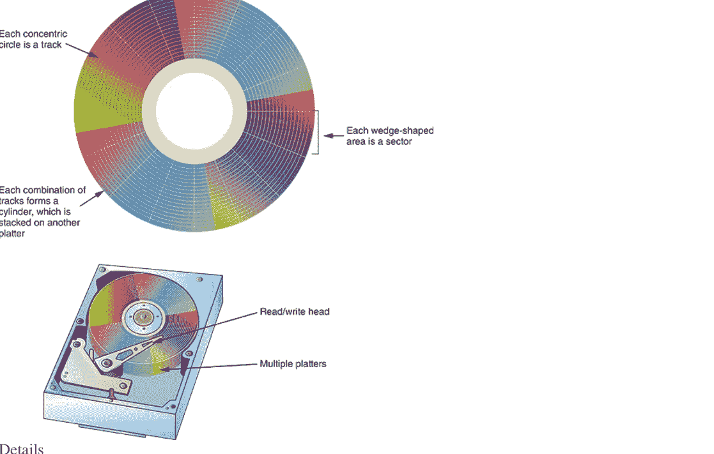
> **详情：** 磁盘驱动器组件的两个示意图。整体结构具有多个用于读写磁头的盘片。多个盘片由若干个单同心圆组成，每个同心圆是一个轨道。轨道的每个组合形成一个堆叠在另一个盘片上的柱面。圆有几个楔形区域，称为扇区。

> 有关磁盘驱动器配置的更多信息，请参见 <http://partitionwizard.com/help/what-is-chs.html> 或 <http://jgsworks.com/lessons/computerbasics/lesson6/lesson-6.htm>。

制造商设计的磁盘驱动器每个轨道具有特定数量的扇区，典型的磁盘驱动器每个扇区存储 512 字节。要确定磁盘上可寻址字节的总数，将柱面数乘以磁头数（轨道），再乘以扇区数（512 或更多字节的组），如图 6-2 所示；磁盘驱动器供应商将此公式称为柱面、磁头和扇区（CHS）计算。轨道也遵循从 0 开始的编号方案，这是计算中的第一个值。如果磁盘列出 79 条轨道，那么从 0 到 79 计数，它实际上有 80 条轨道。

### 图 6-2 CHS 计算
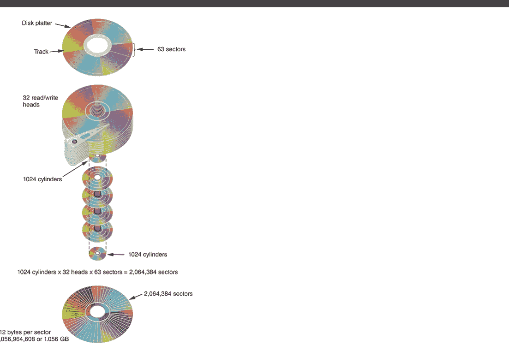

该图显示了计算柱面、磁头和扇区的过程。每个磁盘盘片都有同心圆（轨道），每个楔形区域有 63 个扇区。一个 32-读或写扇区包含 1024 个柱面。计算方法为：1024 个柱面 × 32 个磁头 × 63 个扇区 = 2,064,384。总数为 2,064,384 个扇区，每个扇区有 512 字节，因此 2,064,384 个扇区共有 1,056,964,608 字节或 1.056 吉兆字节。

其他磁盘属性，如分区记录（ZBR）、轨道密度、面积密度以及磁头和柱面偏移，是在驱动器的硬件或固件层面处理的。ZBR 是制造商处理盘片内轨道周长比外轨道小（因此存储数据空间较小）的方法。分区分组确保了所有轨道都能存储相同的数据。

轨道密度是每个轨道之间的空间。与黑胶片一样，轨道之间的空间越小，在磁盘盘片上放置的轨道就越多。

面积密度是每平方英寸内的比特数。这个数字包含了轨道之间的未使用空间。磁头和柱面偏移用于提高磁盘性能。当读写磁头从一个轨道移动到另一个轨道时，起始扇区会偏移以最小化延迟。

随着更大驱动器容量的进步，用于大硬盘寻址扇区的 CHS 造成了限制。使用原始的主引导记录（MBR）分区，磁盘驱动器只能寻址 8 GB。为了处理更大的驱动器，MBR 被重新设计以寻址高达 2.2 TB 的磁盘空间。制造商增加这种寻址能力的方法是将物理扇区大小从 512 字节扩大到 4096 字节或更大。

对于所有驱动器、PC 和 Macintosh 计算机，有两种类型的文件系统程序定义驱动器上的逻辑卷或多个卷。这些文件系统程序是**主引导记录 (MBR)** 和 **GUID 分区表 (GPT)**。这两个文件系统程序都位于磁盘的扇区 0。

对于大于 2.2 TB 的驱动器，MBR 不再足够，使用的是 GPT。GPT 可以寻址高达 9.4 十字节（Zettabytes）。对于较小的驱动器，仍然使用 MBR。MBR 使用逻辑块寻址（LBA）来寻址扇区。LBA 使用 28 位地址，可以寻址高达 2^28 个扇区。如果每个扇区是 512 字节，则等于 137 GB。如果每个扇区是 4096 字节，则等于 1.1 TB。GPT 使用 64 位地址，可以寻址高达 2^64 个扇区。即使是 4096 字节的扇区，这也等于 9.4 十字节。

## 检查：探索微软文件结构

由于大多数 PC 使用微软软件产品，你应该了解微软文件系统，以便知道 Windows 和 DOS 计算机如何存储数据。特别是你需要理解簇、文件分配表（FAT）和 NTFS 文件系统（NTFS）。了解操作系统如何存储数据将帮助你确定去哪里寻找数字证据。

在微软文件结构中，扇区被分组形成一个簇，簇是由一个或多个扇区组成的存储单元。操作系统将一个或多个扇区分组成簇。簇中扇区的默认数量取决于磁盘的大小和操作系统。例如，旧的双面软盘每个簇有一个扇区，而硬盘每个簇有四个或更多扇区。将扇区组合在一起可以减少操作系统向磁盘读写数据的开销。

簇是磁盘逻辑分区上数据存储的表示。簇按顺序编号，NTFS 从 0 开始，FAT 从 2 开始。磁盘的第一个扇区包含系统区域、引导记录和文件结构数据库，称为分区表。操作系统为每个簇分配一个数字，称为逻辑地址，指向相对簇位置；例如在 FAT 文件系统中，簇地址 100 距离簇地址 2 有 98 个簇。然而，每个扇区号被称为物理地址，因为是在硬件或固件层面分配的，并且从地址 0（磁盘上的第一个扇区）到磁盘上的最后一个扇区。簇及其地址特定于逻辑驱动器（即磁盘分区）。


**1. 4 TB 驱动器上每个扇区通常有多少字节？**
a. 256
b. 512
c. 784
d. 4096

**答案：** d. 4096
**解释：** 超过 2 TB 的驱动器通常格式化为 GPT 并每个扇区为 4096 字节。较小的驱动器每个扇区为 512 字节。

## 磁盘分区

现代操作系统拥有一个或多个分区，每个分区都包含一个逻辑驱动器。例如，Windows PC 上的 C 盘就是一个逻辑驱动器。想要在硬盘上隐藏数据的人可以在驱动器上创建隐藏分区。在具有多个分区的驱动器上，分区之间通常会有很小的未使用空间。这种未使用的空间被称为分区间隙，通常为 1,048,575 字节（或 0xFFFF）。可以扩展分区之间的微小空间，并创建一个操作系统无法直接访问的隐藏分区。隐藏分区是指从磁盘分区表中删除了引用的分区。

另一种技术是通过声明比实际驱动器大小更小的字节数，在磁盘末尾隐藏罪证证据。例如，如果你有一个 2 TB 的驱动器，但将其定义为仅 1.5 TB，那么操作系统只能看到 1.5 TB 的定义大小。剩余的 500 GB 数据存储空间对操作系统是未知的。大多数数字取证工具在检查整个驱动器的镜像时，都能帮助识别隐藏分区。

要访问位于磁盘间隙或磁盘末尾部分的隐藏分区，可以使用磁盘编辑器（如 HxD、WinHex 或其他具有管理员权限的工具）通过更新分区表来激活隐藏分区。另一种方法是使用磁盘编辑器直接访问并将数据从隐藏区域复制到其他挂载的介质。这两项任务都涉及分析操作系统用于识别和维护文件系统的十六进制代码，这些代码位于物理驱动器的引导扇区表中。

> **表 6-1 分区表中识别常见文件系统结构的十六进制代码**

| 十六进制代码 | 文件系统 |
| :--- | :--- |
| 01 | DOS 12-位 FAT（软盘） |
| 04 | 适用于小于 32 MB 分区的 DOS 16-位 FAT |
| 05 | 扩展分区 |
| 06 | 适用于大于 32 MB 分区的 DOS 16-位 FAT |
| 07 | NTFS 和 exFAT |
| 08 | AIX 可启动分区 |
| 09 | AIX 数据分区 |
| 0B | DOS 32-位 FAT |
| 0C | 支持中断 1 的 DOS 32-位 FAT |
| 0E | 使用 BIOS INT 13h 扩展的 FAT16 |
| 0F | 带有逻辑块地址的扩展分区 |
| 12 | EISA 分区 |
| 17 | 隐藏 NTFS 分区（XP 及早期版本） |
| 1B | 隐藏 FAT32 分区 |
| 1E | 隐藏 VFAT 分区 |
| 3C | Partition Magic 恢复分区 |
| 66–69 | Novell 分区 |
| 81 | Linux |
| 82 | Linux 交换分区（也可以与 Solaris 分区关联） |
| 83 | Linux 原生文件系统（Ext2, Ext3, Ext4, Reiser, Xiafs） |
| 86 | FAT16 卷/条带集（Windows NT） |
| 87 | 高性能文件系统容错镜像分区或 NTFS 卷/条带集 |
| A5 | FreeBSD 和 BSD/386 |
| A6 | OpenBSD |
| A9 | C7 |
| EB | NetBSD |
| | 损坏 NTFS 卷/条带集典型值 |
| | BeOS |

> **注意 2**
> 如果你不熟悉十六进制，请参阅 Harry Fairhead 在 <https://programmer.info/babbages-bag/478-hexadecimal.html> 写的文章“Hexadecimal”。

> **提示**
> 在对字节应用相对值时，十六进制比十进制数字好得多。十进制数字是 0, 1, 2, 3, 4, 5, 6, 7, 8, 9，而十六进制是 0, 1, 2, 3, 4, 5, 6, 7, 8, 9, A, B, C, D, E, F。
> 十六进制只需要两个数字，而十进制可能需要三个数字。例如，如果一个字节的 8 位设置为 11111111，它在十进制中表示为 255；即 0 到 255 的范围对应 00000000 到 11111111。11111111 的十六进制等效值为 FF，只需要两个字符。要理解二进制、十进制和十六进制之间的关系，请运行微软计算器，并选择将其转换为十六进制、十进制或二进制。
> 在书中，十六进制数字以 0x 开头，例如 45 以十六进制显示为 0x45。

MBR 驱动器的分区表位于扇区 0 的偏移量 0x1BE。对于 GPT 驱动器，其定义的 MBR 位于逻辑块地址 (LBA) 0，随后是其分区信息。

> **注意 3**
> 当你检查安装了多个操作系统的计算机时，启动时可能会显示两个或更多操作系统列表。对于较新的 Windows 系统，使用 GPT 工具更好。

### 检查 MBR 和扩展分区

对于使用 MBR 的磁盘，了解其分区表的配置将有助于检测隐藏或已删除的分区。大多数数字取证工具可以检测隐藏分区，但某些情况可能会使检测失效。本节介绍了如何使用磁盘编辑器查找并重建隐藏分区。

位于磁盘扇区 0 的 MBR 可以列出最多三个主分区并指向扩展分区。MBR 分区表中的分区称为主分区。对于所有 MBR 分区，至少有一个逻辑分区，这在 Windows 计算机上很常见。如果需要额外的分区，分区表中将创建一个第四条目。此额外分区不是逻辑分区；它没有驱动器号，而是磁盘上一个包含逻辑分区的区域。扩展分区从第三分区的最后一个扇区开始，到磁盘的最后一个扇区或其预定义大小结束。

在十六进制编辑器中，你可以在 MBR 的偏移 0x1BE 处找到并查看第一个主分区。如果添加第二个主分区，它从偏移 0x1CE 开始；如果添加第三个分区，它从偏移 0x1DE 开始。如果需要额外的分区，扩展分区将从偏移 0x1EE 开始（见图 6-3 和图 6-4）。额外分区将列在扩展分区第一个扇区的分区表中。

### 图 6-3 从十六进制编辑器查看的磁盘 MBR 扇区


在十六进制编辑器中，当你检查磁盘驱动器的主引导记录 (MBR) 扇区时，应注意分区表，它通常从偏移 0x1BE 开始。该分区表由四个 16 字节的条目组成，每个条目都提供了有关磁盘上主分区或扩展分区的关键信息。

### 图 6-4 MBR 分区表
```
偏移 (h) 00 01 02 03 04 05 06 07 08 09 0A 0B 0C 0D 0E 0F
```


```
00001B0 00 00 00 00 00 00 00 00 0A 0B 0C 0D 00 ...

00001C0 03 00 07 8E 00 82 00 00 00 A0 00 00 00 ...

00001D0 0D 02 E4 11 03 80 00 50 00 00 00 00 ...

00001E0 12 00 86 3F 07 80 00 00 E8 00 00 00 ...

00001F0 00 05 2F 3F 3E 80 01 00 A0 00 00 55 ...
```


# MBR 分区表

| 分区文件系统代码 | 每个分区的起始扇区 | 每个分区分配的扇区数 | 第 1 个分区起始偏移 0x1BE |
|---|---|---|---|
| | | | 第 2 个分区起始偏移 0x1CE |
| | | | 第 3 个分区起始偏移 0x1DE |
| | | | 扩展分区表起始偏移 0x1EE |

## 详情

MBR 的分区表具有偏移 `02` 的分区文件系统代码、从偏移 `06` 到 `09` 的起始偏移、从 `A` 到 `0` 的每个分区分配的扇区数、第一个分区表偏移 `0x1BE`、第二个分区表偏移 `0x1CE`、第三个分区表偏移 `0x1DE` 以及扩展分区表偏移 `0x1EE`。

在 MBR 分区列表中，单个字段提供了有关逻辑分区的信息。表 6-2 列出了 MBR 分区表中每个字段的描述。

## 表 6-2 MBR 分区表字段和内容

| MBR 引导扇区的偏移 | 字段内容 | 大小（字节） |
|---|---|---|
| 0x1BE（第一个分区） | 引导指示（值为 0x00 或 0x80；表示分区激活，即可启动） | 1 |
| 0x1CE（第二个分区） | | |
| 0x1DE（第三个分区） | | |
| 0x1EE（第四个分区） | | |
| 0x1BF（第一个分区） | 起始磁头位置（磁盘磁道、轨道上的磁头位置） | 1 |
| 0x1CF（第二个分区） | | |
| 0x1DF（第三个分区） | | |
| 0x1EF（第四个分区） | | |
| 0x1C0（第一个分区） | 起始轨道位置（磁盘磁道、轨道上的轨道位置） | 1 |
| 0x1D0（第二个分区） | | |
| 0x1E0（第三个分区） | | |
| 0x1F0（第四个分区） | | |
| 0x1C1（第一个分区） | 起始磁道位置（磁盘磁道、轨道上的磁道位置） | 1 |
| 0x1D1（第二个分区） | | |
| 0x1E1（第三个分区） | | |
| 0x1F1（第四个分区） | | |
| 0x1C2（第一个分区） | 结束磁头位置（驱动器磁道上的头位置、磁头和磁道） | 1 |
| 0x1D2（第二个分区） | | |
| 0x1E2（第三个分区） | | |
| 0x1F2（第四个分区） | | |
| 0x1C3（第一个分区） | 结束扇区位置（驱动器磁道上的道位置、磁头和磁道） | 1 |
| 0x1D3（第二个分区） | | |
| 0x1E3（第三个分区） | | |
| 0x1F3（第四个分区） | | |
| 0x1C4（第一个分区） | 结束柱面位置（驱动器磁道上的柱面位置、磁头和磁道） | 1 |
| 0x1D4（第二个分区） | | |
| 0x1E4（第三个分区） | | |
| 0x1F4（第四个分区） | | |
| 0x1C5（第一个分区） | 相对扇区（这是分区卷的起始扇区位置）；注意第四个分区是扩展分区 | 4 |
| 0x1D5（第二个分区） | | |
| 0x1E5（第三个分区） | | |
| 0x1F5（第四个分区） | | |
| 0x1C6（第一个分区） | 总扇区数（分配给分区卷的扇区数量） | 4 |
| 0x1D6（第二个分区） | | |
| 0x1E6（第三个分区） | | |
| 0x1F6（第四个分区） | | |

### 注

- [technet.microsoft.com/en-us/library/cc97686.aspx...]
- [learn.microsoft.com/en-us/previous-versions/windows/it-pro/windows/windows-2000-server/cc977219(v=technet.10)]

有关 MBR 的更多信息，请参阅以下资源：
对于扩展分区而言，相对扇区地址是其扩展分区表所在的位置。
在此分区表中，第一个逻辑分区卷从扇区的偏移量 `1BE` 处列出。
作为 MBR 的主分区表，如果向扩展分区添加额外的分区，则扩展分区表将位于扩展分区的第一个扇区，如图 6-5 所示。

## 图 6-5 扩展分区的第一个扇区


## 扩展分区表

| 偏移量 (h) | 00 | 01 | 02 | 03 | 04 | 05 | 06 | 07 | 08 | 09 | 0A | 0B | 0C | 0D | 0E | 0F | 解码文本 |
|---|---|---|---|---|---|---|---|---|---|---|---|---|---|---|---|---|---|
| 3C10000 | 00 | 00 | 00 | 00 | 00 | 00 | 00 | 00 | 00 | 00 | 00 | 00 | 00 | 00 | 00 | 00 | 扇区 123,008 |
| 3C10010 | 00 | 00 | 00 | 00 | 00 | 00 | 00 | 00 | 00 | 00 | 00 | 00 | 00 | 00 | 00 | 00 | . . . . |
| 3C10020 | 00 | 00 | 00 | 00 | 00 | 00 | 00 | 00 | 00 | 00 | 00 | 00 | 00 | 00 | 00 | 00 | . . . . |
| 3C10030 | 00 | 00 | 00 | 00 | 00 | 00 | 00 | 00 | 00 | 00 | 00 | 00 | 00 | 00 | 00 | 00 | . . . . |
| 3C10040 | 00 | 00 | 00 | 00 | 00 | 00 | 00 | 00 | 00 | 00 | 00 | 00 | 00 | 00 | 00 | 00 | . . . . |
| 3C10050 | 00 | 00 | 00 | 00 | 00 | 00 | 00 | 00 | 00 | 00 | 00 | 00 | 00 | 00 | 00 | 00 | . . . . |
| 3C10060 | 00 | 00 | 00 | 00 | 00 | 00 | 00 | 00 | 00 | 00 | 00 | 00 | 00 | 00 | 00 | 00 | . . . . |
| 3C10070 | 00 | 00 | 00 | 00 | 00 | 00 | 00 | 00 | 00 | 00 | 00 | 00 | 00 | 00 | 00 | 00 | . . . . |
| 3C10080 | 00 | 00 | 00 | 00 | 00 | 00 | 00 | 00 | 00 | 00 | 00 | 00 | 00 | 00 | 00 | 00 | . . . . |
| 3C10090 | 00 | 00 | 00 | 00 | 00 | 00 | 00 | 00 | 00 | 00 | 00 | 00 | 00 | 00 | 00 | 00 | . . . . |
| 3C100A0 | 00 | 00 | 00 | 00 | 00 | 00 | 00 | 00 | 00 | 00 | 00 | 00 | 00 | 00 | 00 | 00 | . . . . |
| 3C100B0 | 00 | 00 | 00 | 00 | 00 | 00 | 00 | 00 | 00 | 00 | 00 | 00 | 00 | 00 | 00 | 00 | . . . . |
| 3C100C0 | 00 | 00 | 00 | 00 | 00 | 00 | 00 | 00 | 00 | 00 | 00 | 00 | 00 | 00 | 00 | 00 | . . . . |
| 3C100D0 | 00 | 00 | 00 | 00 | 00 | 00 | 00 | 00 | 00 | 00 | 00 | 00 | 00 | 00 | 00 | 00 | . . . . |
| 3C100E0 | 00 | 00 | 00 | 00 | 00 | 00 | 00 | 00 | 00 | 00 | 00 | 00 | 00 | 00 | 00 | 00 | . . . . |
| 3C100F0 | 00 | 00 | 00 | 00 | 00 | 00 | 00 | 00 | 00 | 00 | 00 | 00 | 00 | 00 | 00 | 00 | . . . . |
| 3C10100 | 00 | 00 | 00 | 00 | 00 | 00 | 00 | 00 | 00 | 00 | 00 | 00 | 00 | 00 | 00 | 00 | . . . . |
| 3C10110 | 00 | 00 | 00 | 00 | 00 | 00 | 00 | 00 | 00 | 00 | 00 | 00 | 00 | 00 | 00 | 00 | . . . . |
| 3C10120 | 00 | 00 | 00 | 00 | 00 | 00 | 00 | 00 | 00 | 00 | 00 | 00 | 00 | 00 | 00 | 00 | . . . . |
| 3C10130 | 00 | 00 | 00 | 00 | 00 | 00 | 00 | 00 | 00 | 00 | 00 | 00 | 00 | 00 | 00 | 00 | . . . . |
| 3C10140 | 00 | 00 | 00 | 00 | 00 | 00 | 00 | 00 | 00 | 00 | 00 | 00 | 00 | 00 | 00 | 00 | . . . . |
| 3C10150 | 00 | 00 | 00 | 00 | 00 | 00 | 00 | 00 | 00 | 00 | 00 | 00 | 00 | 00 | 00 | 00 | . . . . |
| 3C10160 | 00 | 00 | 00 | 00 | 00 | 00 | 00 | 00 | 00 | 00 | 00 | 00 | 00 | 00 | 00 | 00 | . . . . |
| 3C10170 | 00 | 00 | 00 | 00 | 00 | 00 | 00 | 00 | 00 | 00 | 00 | 00 | 00 | 00 | 00 | 00 | . . . . |
| 3C10180 | 00 | 00 | 00 | 00 | 00 | 00 | 00 | 00 | 00 | 00 | 00 | 00 | 00 | 00 | 00 | 00 | . . . . |
| 3C10190 | 00 | 00 | 00 | 00 | 00 | 00 | 00 | 00 | 00 | 00 | 00 | 00 | 00 | 00 | 00 | 00 | . . . . |
| 3C101A0 | 00 | 00 | 00 | 00 | 00 | 00 | 00 | 00 | 00 | 00 | 00 | 00 | 00 | 00 | 00 | 00 | . . . . |
| 3C101B0 | 00 | 00 | 00 | 00 | 00 | 00 | 00 | 00 | 00 | 00 | 00 | 00 | 00 | 00 | 00 | 00 | . . . . |
| 3C101C0 | 00 | 00 | 00 | 00 | 00 | 00 | 00 | 00 | 00 | 00 | 00 | 00 | 00 | 00 | 00 | 00 | . . . . |
| 3C101D0 | 00 | 00 | 00 | 00 | 00 | 00 | 00 | 00 | 00 | 00 | 00 | 00 | 00 | 00 | 00 | 00 | . . . . |
| 3C101E0 | 00 | 00 | 00 | 00 | 00 | 00 | 00 | 00 | 00 | 00 | 00 | 00 | 00 | 00 | 00 | 00 | . . . . |

### 详情

MBR 的分区表在 `3C10C0` 行和偏移量 `00` 到 `0F` 处仅列出两个分区，如图 6-6 所示。如果需要更多分区，则将在上一个分区的最后一个扇区之后创建一个新的扩展分区表。


| 分区类型代码 | 扩展分起始扇区 | 每个分区分配的扇区数 | 扩展分区的分区表起始偏移量 1BE |
|---|---|---|---|

### 详情

MBR 的分区表具有偏移量 `02` 的分区类型代码、从 `06` 到 `09` 的扩展分区、从 `0A` 到 `0D` 的每个分区分配扇区数，以及扩展分区的分区表起始偏移量 `0x1BE`。

# GUID 分区表

GUID GPT 是为了取代 MBR 而开发的。MBR 最大访问大小为 2 TB。为了克服这一大小限制，GPT 使用 LBA。

## 表 6-3 LBA 结构

| 逻辑块地址 | 块内容 |
|---|---|
| LBA 0 | 保护性 MBR |
| LBA 1 | GPT 头 |
| LBA 2 到 33 | 分区表区域 |
| LBA nth | 分区 2 等 |
| LBA nth | GPT 头的镜像 |

# 文件系统

## FAT32

## NTFS

## 字段描述

| 偏移量 | 数据类型或标签 |
|---|---|
| 0x00 | 引导指令（汇编代码） |
| 0x03 to 00A | Windows 文件系统名称 |
| 0x0B to 00C | 每个簇分配的字节数 |
| 0x0D | 每个簇分配的扇区数 |
| 0x10 to 00F | Microsoft 预留 |
| 0x10 to 014 | 未使用 |
| 0x15 | 媒体描述符 |
| 0x16 to 02F | 未使用 |
| 0x30 to 037 | 分区总扇区 / $MFT 的第一个分配簇 |
| 0x38 to 03F | $MFT 镜像的第一个分配簇 |
| 0x40 | $MFT 文件大小 |
| 0x41 to 043 | 未使用 |
| 0x44 | 索引记录大小 |
| 0x45 to 047 | 未使用 |
| 0x48 to 04F | 分区序列号 |
| 0x50 to 053 | 未使用 |
| 0x54 to 01D | 引导代码 |
| 0x1E to 01FF | 引导扇区结束 |

> 有关分区引导扇区的示例，请参考图 6-7、图 6-8 和图 6-9


| 文件系统类型 | 每个扇区的字节数 | 每个簇扇区数 |
|---|---|---|
| 偏移量(h) | 00 01 02 03 04 05 06 07 08 09 0A 0B 0C 0D 0E 0F | 解码文本 |
| 00000000 | EB 3C 90 4D 53 44 4F 35 2E 30 00 02 01 00 | @<.MSDOS5.0.... 扇区 0 |
| 00000010 | 02 00 02 00 88 E7 00 3F 0F 00 80 00 00 00 | ..å.翶.ÿÿ.. |
| 00000020 | 00 00 00 00 00 29 7F 9D 10 4E 4F 20 4E 41 | ..(..)... NO NA |
| 00000030 | 4D 45 20 20 20 46 41 54 31 16 20 20 20 33 C9 | ME  FAT16 3E |
| 00000040 | 8D DE BC F0 7B 8E D9 00 8E 0000 7C |  | |¤ms. |
| 00000050 | 38 4E 24 7D 24 8C 01 99 8E  2  2  8  3  | |) |Å ..r. |

### 说明

带有 FAT 16 分区引导扇区的 MBR 分区表。文件系统类型为 3，分区总扇区数为 00，每个扇区的字节数为 00，每个簇扇区数为 01，分区名称为 `46 41 54 31 16`。


## 文件系统类型

## 每个扇区的字节数

## 每个簇扇区数

| 偏移量(h) | 00 01 02 03 04 05 06 07 08 09 0A 0B 0C 0D | 解码文本 |
|---|---|---|
| 00000000 | EB 58 90 4D 53 44 45 53 32 30 00 02 08 F19 | @X.MDSS.O..B.. 扇区 0 |
| 00000010 | 02 00 02 00 88 E7 00 3F 0F 00 80 00 00 00 | ..å.翶.ÿÿ.. |
| 00000020 | 00 00 00 00 00 29 7F 9D 10 4E 4F 20 4E 41 | ..(..)... NO NA |
| 00000030 | 4D 45 20 20 20 46 41 54 31 16 20 20 20 33 C9 | ME  FAT16 3E |
| 00000040 | 8D DE BC F0 7B 8E D9 00 8E 0C F0 BD 00 7C | 7Ñÿ,..Ž¤ms. |
| 00000050 | 38 4E 24 7D 24 8C 01 99 8E 3C 82 72 1C 83 3A 3E | ON)ŠÅæ..r.ÿ.. |

### 说明

带有 FAT32 分区引导扇区的 MBR 分区表。文件系统类型为 3，分区总扇区数为 00，每个扇区的字节数为 00，每个簇扇区数为 01，分区大小为 `46 41 54 31 16`。

| 媒体描述符 | 文件系统名称 | 每个扇区的字节数 | 分区总扇区数 |
|---|---|---|---|
| 引导代码 | | | |
| 偏移量(h) | 00 | 02 | 03 | 04 | 06 | 07 | 08 | 09 | 0A | 0B | 0C | 0D | 解码文本 扇区 0 |
| 0000000 | EB 52 90 5E 54 46 53 20 20 21 00 | 00 | @NTFS ..j.y.e... |
| 00000010 | 02 | 00 | 00 | 00 | F8 | 00 | 00 | 53 | 3F | FF | 00 | 80 | 00 | 00 | .. |
| 00000020 | 00 | 08 | 00 | 5F | 03 | 00 | 01 | 00 | 00 | 00 | 02 | 00 | 00 | 00 | 00 | (F1)... |
| 00000030 | 00 | 00 | 00 | 00 | 00 | 00 | 00 | 00 | 00 | 00 | 00 | 00 | 00 | 00 | .. |
| 00000040 | 80 | 00 | 29 | 73 | 67 | 16 | 4E | 0F | 20 | 4E | 41 | 45 | 20 | 25 | 00. |
| 00000050 | 20 | 20 | 46 | 51 | 54 | 33 | 32 | 20 | 33 | C9 | 82 | D1 | C4 | FAT323E48 |
| 00000060 | 00 | 00 | 00 | 00 | 00 | 00 | 00 | 00 | 00 | 00 | 00 | 00 | 00 | .. |
| 00000070 | 54 | 64 | 75 | 14 | 85 | 55 | 6A | 5A | 53 | 00 | 00 | 71 | 02 | 00 | 00 | TFTsAu..r.. |
| 00000080 | 00 | 00 | 00 | 00 | 00 | 00 | 00 | 00 | 00 | 00 | 00 | 00 | 00 | .. (F2)..|..|.. |
| 00000090 | 00 | 00 | 00 | 00 | 00 | 00 | 00 | 00 | 00 | 00 | 00 | 00 | 00 | ..h.e..i.. |
| 000000A0 | 0F | 00 | 02 | 00 | 2E | 0F | 58 | 53 | 39 | 00 | 00 | 00 | 00 | 00 | ..330.+e |
| 000000B0 | 00 | 00 | 00 | 00 | 00 | 00 | 00 | 00 | 00 | 00 | 00 | 00 | 00 | .. |
| 000000C0 | 4B | 00 | 63 | 77 | 78 | 6B | 61 | 6A | 23 | 00 | 00 | 00 | 00 | 00 | 00 | K.e.w..f..s |
| 000000D0 | 0F | 00 | 02 | 00 | 2E | 0F | 58 | 53 | 39 | 00 | 00 | 00 | 00 | 00 | .. |
| 000000E0 | 00 | 00 | 00 | 00 | 00 | 00 | 00 | 00 | 00 | 00 | 00 | 00 | 00 | 00 | 00 | .. |
| 000000F0 | 4B | 00 | 63 | 77 | 78 | 6B | 61 | 6A | 23 | 00 | 00 | 00 | 00 | 00 | 00 | K.e.w..f..s |
| 00000100 | 4B | 00 | 00 | 00 | 00 | 00 | 00 | 00 | 00 | 00 | 00 | 00 | 00 | 00 | 00 | .. |
| 00000110 | 0A | 0B | 66 | 69 | 74 | 00 | 00 | 00 | 00 | 00 | 00 | 00 | 00 | 00 | 00 | ..h.n.s..f..s |
| 00000120 | 00 | 00 | 00 | 00 | 00 | 00 | 00 | 00 | 00 | 00 | 00 | 00 | 00 | 00 | .. |
| 00000130 | 13 | 00 | 63 | 64 | 08 | 00 | 00 | 04 | 31 | 00 | 00 | 00 | 00 | 00 | 00 | ..f.op..b..h..s |
| 00000140 | 00 | 00 | 00 | 00 | 00 | 00 | 00 | 00 | 00 | 00 | 00 | 00 | 00 | 00 | .. |
| 00000150 | 15 | 00 | 60 | 60 | 00 | 00 | 00 | 00 | 00 | 00 | 00 | 00 | 00 | 00 | ..h.n.s..f.. |
| 00000160 | 00 | 00 | 00 | 00 | 00 | 00 | 00 | 00 | 00 | 00 | 00 | 00 | 00 | .. |
| 00000170 | 1E | 00 | 75 | 0C | 00 | 00 | 00 | 00 | 00 | 00 | 00 | 00 | 00 | 00 | ..M.i.A di |
| 00000180 | 00 | 00 | 00 | 00 | 00 | 00 | 00 | 00 | 00 | 00 | 00 | 00 | 00 | 00 |  |0| 0
0 0000 | 90 | 6A | 72 | 02 | 00 | 00 | 00 | 00 | 00 | 00 | 00 | 00 | 00 | 00 | 07 | ..curred..BOOTMER |
| 000001A0 | 00 | 00 | 00 | 00 | 00 | 00 | 00 | 00 | 00 | 00 | 00 | 00 | 00 | 00 | 00 | .. |
| 000001B0 | 63 | 72 | 75 | 00 | 00 | 00 | 00 | 00 | 00 | 00 | 00 | 00 | 00 | 00 | 01 | ..Press.Ctrl+Del |
| 000001C0 | 00 | 00 | 00 | 00 | 00 | 00 | 00 | 00 | 00 | 00 | 00 | 00 | 00 | 00 | 00 | .. |
| 000001D0 | 6A | 74 | 65 | 73 | 00 | 00 | 00 | 00 | 00 | 00 | 00 | 00 | 00 | 00 | 00 | .. |
| 000001E0 | 00 | 00 | 00 | 00 | 00 | 00 | 00 | 00 | 00 | 00 | 00 | 00 | 00 | 00 | 00 | .. |
| 000001F0 | 50 | 4F | 00 | 00 | 00 | 00 | 00 | 00 | 00 | 00 | 00 | 00 | 00 | 00 | 00 | ..S..* |

| $MFT 文件大小 | 引导扇区结束 | 分区序列号 |
|---|---|---|
| $MFT 起始簇 | 引导程序部分 | $MFT 起始簇 |
| 索引记录大小 | | |

### 详情

带有 NTFS 引导扇区的 MBR 分区表。以下部分在十六进制中已标记：媒体描述符、引导代码、文件系统名称、每个簇扇区数、分区总扇区数、`$MFT` 文件大小、`$MFT` 起始簇、索引记录大小、引导扇区结束、分区序列号以及 `$MFT` 起始簇。

有关关于 Windows 分区引导扇区的更多信息，请参考以下内容：

### FAT 引导扇区，0-3 (FAT12/16 和 FAT32)

- jump.com/CIS24/Slides/FAT/F0100_boot_sector_byte.htm
- FAT 引导扇区: avers.trip.com/bootsec.htm
- NTFS、FAT 和 exFAT 的默认簇大小: support.microsoft.com/en-us/topic/default-cluster-size-for-ntfs-and-exfat-9772e661-e31a-00d7-ef18-736195a9f5
- NTFS 引导扇区: c-jump.com/bct257/Week04NTFSReview/W01_0140_ntfs_boot_sector_byte.htm

> **注意** 数字取证工具（如 Autopsy 或 X-Ways Forensics）以及 Hex Workshop 或 WinHex 通常会将分区的引导部分显示为簇 0。HxD 十六进制编辑器只能显示，这需要对簇偏移值进行转换。有关分区引导扇区的示例，请参考图 6-7、图 6-8 和图 6-9。

# 地址定位示例

## 地址 01BE 位于下方 01B0 行

从右侧数 `0xE` 列

| 偏移(h) | 00 01 02 03 04 05 06 07 08 09 0A 0B 0C 0D 0E 0F | 解码文本 | 扇区 0 |
|---|---|---|---|---|---|---|---|---|---|---|---|---|---|---|---|---|---|
| 000000 | FA 8B 10 5E DE 00 01 BC 00 85 0B 8B 00 0D 0E 0F | 01B..ž4“...ËÌ | | | | | |
| 000010 | FB 8E 02 07 8E 06 0F 09 02 F3 A4 21 06 00 | 01B.ÿ“..Ëö | | | |
| 000020 | 00 00 00 00 00 00 00 00 01 0F 07 71 | 01B...“.„..»Ë�. | | | | |
| 000030 | F3 E8 16 7C 82 02 01 00 7C 82 80 74 01 58 | 01B.y...�. | | | | |
| 000040 | 00 00 00 00 00 00 00 00 00 00 00 00 00 00 00 00 | ... | | | | |
| 000050 | 00 00 00 00 00 00 00 00 00 00 00 00 00 00 00 00 | ... | | | | |
| 000060 | 00 00 00 00 00 00 00 00 00 00 00 00 00 00 00 00 | ... | | | | |
| 000070 | 00 00 00 00 00 00 00 00 00 00 00 00 00 00 00 00 | ... | | | | |
| 000080 | 00 00 00 00 00 00 00 00 00 00 00 00 00 00 00 00 | ... | | | | |
| 000090 | 00 00 00 00 00 00 00 00 00 00 00 00 00 00 00 00 | ... | | | | |
| 0000A0 | 00 00 00 00 00 00 00 00 00 00 00 00 00 00 00 00 | ... | | | | |
| 0000B0 | 00 00 00 00 00 00 00 00 00 00 00 00 00 00 00 00 | ... | | | | |
| 0000C0 | 00 00 00 00 00 00 00 00 00 00 00 00 00 00 00 00 | ... | | | | |
| 0000D0 | 00 00 00 00 00 00 00 00 00 00 00 00 00 00 00 00 | ... | | | | |
| 0000E0 | 00 00 00 00 00 00 00 00 00 00 00 00 00 00 00 00 | ... | | | | |
| 000100 | 00 00 00 00 00 00 00 00 00 00 00 00 00 00 00 00 | ... | | | | |
| 000110 | 00 00 00 00 00 00 00 00 00 00 00 00 00 00 00 00 | ... | | | | |
| 000120 | 00 00 00 00 00 00 00 00 00 00 00 00 00 00 00 00 | ... | | | | |
| 000130 | 00 00 00 00 00 00 00 00 00 00 00 00 00 00 00 00 | ... | | | | |
| 000140 | 00 00 00 00 00 00 00 00 00 00 00 00 00 00 00 00 | ... | | | | |
| 000150 | 00 00 00 00 00 00 00 00 00 00 00 00 00 00 00 00 | ... | | | | |
| 000160 | 00 00 00 00 00 00 00 00 00 00 00 00 00 00 00 00 | ... | | | | |
| 000170 | 00 00 00 00 00 00 00 00 00 00 00 00 00 00 00 00 | ... | | | | |
| 000180 | 00 00 00 00 00 00 00 00 00 00 00 00 00 00 00 00 | ... | | | | |
| 000190 | 00 00 00 00 00 00 00 00 00 00 00 00 00 00 00 00 | ... | | | | |
| 0001A0 | 00 00 00 00 00 00 00 00 00 00 00 00 8C 2D 80 02 | 01B...Ë...Ë | | | |
| 0001B0 | 00 00 00 00 00 00 00 00 00 00 00 00 00 00 00 00 | 01B.ÿ...Ë...Ë. | | | | |
| 0001C0 | 03 03 07 02 00 00 00 00 00 00 00 00 00 00 00 00 | 01B.ÿ...Ë...S | | | | |
| 0001D0 | 12 03 07 27 00 80 00 00 00 01 00 00 00 00 00 A7 | 01B.ÿ...Ë...S | | | | |
| 0001E0 | 21 07 05 5F 3E 8E 00 01 00 00 00 00 00 00 55 A7 | 01B.ÿ...Ë...” | | | | |

行 `01B0` 列 `0xE` = 偏移 `01BE`

## 详情

MBR 的分区部分。地址 `0x1E` 位于 `0x1B` 向右第 `0xE`。行 `0x1B` 加上列 `0xE` 等于偏移 `0x1BE` 为 80。

> **提示** 大多数十六进制编辑器以列和行显示数据（十六进制代码）。数据通常用十六进制数字按行列显示。要在 HxD 等十六进制查看器中定位特定字节，请找到地址向前一位数字的行。例如，如果地址是 `01BE`，找到第一行 `01B0`。然后找到最后一位数字的列（在本例中为 `0xE`），并向下滚动到 `01B0` 行和 `0xE` 列交叉的位置，如图 6-10 所示，以确定精确位置。

## 活动

1. 在表 6-1 中查找十六进制值，以确定第一个分区使用的文件系统。在活动 `_06_1_Examiner_Notes.xlsx` 中输入一个条目，指示第一个分区的类型和位置。
2. 对表中的所有剩余分区重复步骤 5 和步骤 6。
3. 完成后，关闭 HxD 并保存自己的笔记。
4. 完成后，向教师提交以下文件：`Activity_06-1_Examiner_Notes.xlsx`

## 自测

2. 在 MBR 的分区表中，偏移量为 `0xC6` 和 `0xCA` 处的数据代表什么？
- a. 系统标识和起始位置
- b. 起始头部和结束位置
- c. 起始磁道和结束位置
- d. 分区的起始扇区和分配给分区的扇区数量

**答案：** 分区的起始扇区和分配给分区的扇区数量。
**解释：** 在 MBR 分区表中，偏移量 `0xC6`、`0xDA`、`0xEA` 和 `0xFA` 是扇区的数量。

# 文件碎片

FAT16 允许大簇的一个无意副作用是，随着簇大小的增加，碎片减少。操作系统会在文件末尾添加额外数据，并允许文件扩展到分配的簇中，直到消耗剩余的 27000 字节。簇大小的增加导致了磁盘空间的使用效率低下。由于这种低效的簇分配方式，微软几乎创建了 FAT32 文件系统。FAT32 比 FAT16 更高效，并释放更多的磁盘空间。

当分配的簇空间不足时，操作系统会为你的文件分配另一个簇。随着文件增长并需要更多磁盘空间，分配的簇会被链在一起。通常，链式簇在磁盘上是连续的，但随着文件的扩展而创建和删除，链可能会断裂或产生碎片。

当操作系统在文件系统中存储数据时，它会开始在表中分配一个簇号，并将数据写入分配的簇中。当该簇空间用尽时，操作系统会将下一个可用簇分配给该文件，并将簇地址添加到表中。如果下一个可用簇与当前最后一个分配的簇不连续，文件就会发生碎片化。

在少数情况下，例如系统故障、破坏或恶意软件，这些簇可能会被断开。如果发生这种情况，数据可能会丢失，因为它们不再与之前的链式簇关联。FAT 文件系统中的分配表仅向前指向下一个分配簇。它没有指向上一个簇的指针。

为了提高旧版机械硬盘（HDD）的读写速度，微软开发了一种碎片整理工具，该工具通过重写文件使其保持连续。碎片整理过程会将文件数据碎片从驱动器的一个区域复制到另一个区域，以创建更大的未分配空间。当有足够的空间存储文件时，碎片整理工具会将碎片化的文件数据复制到较大的连续空间。较小碎片化区域中的碎片化文件将被标记为未分配空间。这些碎片中的数据内容仍然完好并可以恢复。未分配空间中的这些碎片可能包含对调查有用的旧版本证据。

对于较新的驱动器（如 SSD 或新的 HDD），碎片化的概率较低，因为磁盘更大的区域被分配给了文件。此外，对于 SSD 驱动器，由于磨损均衡和对之前使用的内存进行置零，数据不断移动，以保持固态内存的完整性。

> **提示** 许多磁盘取证工具已经自动化了大部分文件重建过程。这些改进功能使得数据恢复变得更加容易。

# 删除 FAT 文件

当使用文件资源管理器或 MS-DOS 删除命令在 FAT 系统中删除文件时，操作系统会在关联目录项中文件名的第一个位置插入一个 HEX `E` (`0xE5`) 值。此值告诉操作系统该文件已不可用，可以向同一个簇位置写入一个新文件，如图 6-12 所示：

## 图 6-12 被删除的 FAT 文件

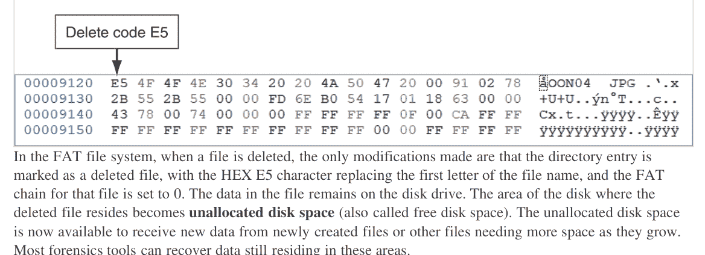


```
00009120 E5 4F 4E 30 34 20 20 4A 50 47 20 20 00 91 02 78
00009130 2B 55 25 55 00 00 FF 6E B0 54 17 01 18 63 00 00
00009140 43 78 00 74 00 00 FF FF FF FF 0F 00 CA FF FF FF Cx-t....yyyy.Eyy
00009150 FF FF FF FF FF FF FF FF 00 00 FF FF FF FF yyyyyyyyyy.yyyy
```


在 FAT 系统中，当文件被删除时，系统会进行修改，将目录项标记为已删除文件，用 `HEX E5` 字符替换文件名的第一个字母，并且该文件的 FAT 链变为未分配磁盘空间（也称为空空间）。被删除文件所在的未分配磁盘空间现在可以接收来自新创建的文件或其他由于文件在增长时需要更多空间的文件的数据。大多数取证工具可以恢复仍存在于这些区域的数据。

- **3 哪种 FAT 文件格式专门设计用于在闪存存储设备上存储数据？**
  a. FAT16
  b. FAT32
  c. exFAT
  d. VFAT

  > **答案：** c. exFAT
  > **解释：** 微软开发 `exFAT` 是为了在闪存设备上存储大文件。`exFAT` 格式用于在数码相机或音频播放器上存储照片和视频以及音频数据。

# 检查。探索 NTFS 磁盘

NT 文件系统 (`NTFS`) 在微软创建 Windows NT 时引入，目前是 Windows 10 和 11 的主要文件系统。自 NT 以来，每一代 Windows 都对 `NTFS` 配置和功能进行了细微调整。`NTFS` 设计部分基于微软对 IBM OS/2 使用的高性能文件系统 (`HPFS`)。当微软创建 Windows NT 时，提供了对 OS/2 的后兼容性。现在这种兼容性已不再可用。有关 `NTFS` 的详细说明，请访问 `ntfs.com/ntfs`。

## 注意 8

- 关于 IBM OS/2 和 `HPFS` 的信息，请参考以下资源：
  * `www.ed2.com/index.php/HPFS`
  * `archive.org/web/20060210151416/http://www.speed.com.au/Products/OS2/Manual/app`

`NTFS` 提供了巨大的改进。它提供了关于文件的更多信息，包括安全功能、所有权和其他属性。通过 `NTFS`，你对文件夹（目录）的控制力比 `FAT` 文件系统更强。

`NTFS` 是微软向日志文件系统的迈进。系统记录文件删除或保存时的事务。这样，在发生断电或其他中断时，系统可以恢复到之前的设置。

在 `NTFS` 中，写入磁盘的所有内容都被视为一个文件。在 `NTFS` 磁盘上，第一个是分区引导区 (`Partition Boot Sector`)，它可以扩展到 16 个扇区。分区引导区之后是主文件表 (`MFT`)。`MFT`（也称为 `$MFT`），与早期的操作系统类似，是分区上的第一个文件。`MFT` 在分区格式化为 `NTFS` 卷时创建。

`NTFS` 相比 `FAT` 的一个优势是它占了磁盘的 12.5% 空间。对比表 6-5 中的簇大小。

## 表 6-5 NTFS 中的簇大小

| 驱动器大小 | 每个簇扇区数 | 每个簇字节数 |
| --- | --- | --- |
| 7 MB | 8 | 4 KB |
| 512 MB | 8 | 4 KB |
| 1 GB | 8 | 4 KB |
| 2 GB | 8 | 4 KB |
| 16 GB | 8 | 4 KB |
| 32 GB | 16 | 8 KB |
| 64 GB | 32 | 16 KB |
| 128 GB | 64 | 32 KB |
| 256 GB | 128 | 64 KB |

## 注意 9

有关 `NTFS` 的更多信息，请访问 `support.microsoft.com/14365`。

## $MFT 系统文件

`NTFS` 磁盘上的一切内容都是一个文件。第一个文件 `$MFT` 包含了关于磁盘上所有文件和文件夹的信息，包括操作系统使用的系统文件。在 `$MFT` 中，前 15 条记录预留给系统文件。`$MFT` 中的记录称为元数据。表 6-7 列出了你在 `$MFT` 中找到的前 16 条记录。

## 表 6-7 $MFT 中的元数据记录

| 文件名 | 系统文件 | 记录位置 | 描述 |
| --- | --- | --- | --- |
| `$Mft` | MFT | 0 | `NTFS` 卷上每个文件夹的基础文件记录；如果需要更多空间，则分配 `$MFT` 中的其他记录位置。 |
| `$MftMir` | MFT 2 | 1 | `$MFT` 的前四条记录保在此位置。如果 `$MFT` 的单个扇区损坏，可以恢复记录，从而恢复 `$MFT`。 |
| `$LogFile` | 日志 | 2 | 存储之前的事务，以便在 `NTFS` 卷发生故障后恢复。 |
| `$Volume` | 卷 | 3 | 存储特定卷的信息，例如标签和版本。 |
| `$AttrDef` | 属性定义 | 4 | 列出属性、编号和定义的表格。 |
| `$` | 文件索引 | 5 | 这是 `NTFS` 卷上的根目录。 |
| `$Bitmap` | 分区引导区 | 6 | `NTFS` 分区的映射显示哪些簇正在使用，哪些是可用的。 |
| `$BadClus` | 错误簇文件 | 8 | 引导过程；如果它是系统的启动驱动器，则在此列出额外的代码。对于具有不可恢复错误的簇，此文件中会记录簇位置的条目。 |
| `$Secure` | 安全文件 | 9 | 此文件中列出了卷的唯一安全描述符。它维护着 `NTFS` 卷上所有文件和文件夹的访问控制列表 (`ACL`)。 |
| `$Upcase` | 大写转换表 | 10 | 将 `NTFS` 卷上的所有小写字符转换为大写 Unicode 字符。 |
| `$Extend` | `NTFS` 扩展文件 | 11 | 此处列出了可选扩展项，例如配额、对象标识符和重解析点数据。 |
| | | 12–15 | 留供以后使用。 |

## NTFS 系统文件

`NTFS` 的数据管理使用了许多系统文件。数字取证人员感兴趣的关键文件是 `$MFT`、`$Usnnl` 以及预取文件。当使用文件资源管理器时，这些文件是不可见的，因为它们被配置为隐藏。要查看或提取这些文件，你可以使用工具，以下是某些访问这些文件的工具：

* `Autopsy`
* `Belkaso`
* `EnCase`
* `FTK` 和 `FTK Imager`
* `Forensics Explorer`
* `HxD`
* `OSForensics`
* `X-Ways File and WinHex`

## $MFT 和文件属性

当微软引入 `NTFS` 时，操作系统在磁盘上存储数据的方式发生了巨大变化。在 `NTFS` 的 `$MFT` 中，所有文件和文件夹都存储在每个 1024 字节的记录中。每个记录都包含有关磁盘分区上文件和文件夹的信息。`$MFT` 记录中的每个字段都被称为属性 ID。

`$MFT` 记录的前 4 个字节通常以单词 `FILE` 开始，它是记录头部信息的一部分。头部包含额外的数据，用于指定第一个属性的起始位置。头部长度通常定义在从记录开始偏移 `0x14` 处。每个属性 ID 都有一个十六进制长度值，定义其以字节为单位的长度。下一个属性 ID 的第一个字节紧接在上一个属性的最后一个字节之后。属性 ID 的长度值位于属性 ID 第一个字节后 4 字节处，如图 6-13 所示。

图 6-13 `$MFT` 记录中的属性 ID 位置


## $MFT 记录头部

### 属性 0x10
起始字节

### 头部大小
(偏移量 0x14)

### 属性 0x10 的长度

```
OFFSET  00 01 02 03 04 05 06 07 08 09 0A 0B 0C 0D 0E 0F
000000  45 4D 46 54 20 72 65 63 6F 72 64 20 00 00 00 00
000010  04 00 00 00 00 00 00 00 00 00 00 00 00 00 00 00
000020  00 00 00 00 00 00 00 00 00 00 00 00 00 00 00 00
000030  00 00 00 00 00 00 00 00 00 00 00 00 00 00 00 00
000040  00 00 00 00 00 00 00 00 00 00 00 00 00 00 00 00
000050  00 00 00 00 00 00 00 00 00 00 00 00 00 00 00 00
000060  00 00 00 00 00 00 00 00 00 00 00 00 00 00 00 00
000070  77 68 74 20 72 65 63 6F 72 64 20 74 69 65 20 00
000080  00 00 00 00 00 00 00 00 00 00 00 00 00 00 00 00
000090  00 00 00 00 00 00 00 00 00 00 00 00 00 00 00 00
0000A0  00 00 00 00 00 00 00 00 00 00 00 00 00 00 00 00
0000B0  00 00 00 00 00 00 00 00 00 00 00 00 00 00 00 00
0000C0  00 00 00 00 00 00 00 00 00 00 00 00 00 00 00 00
0000D0  00 00 00 00 00 00 00 00 00 00 00 00 00 00 00 00
0000E0  00 00 00 00 00 00 00 00 00 00 00 00 00 00 00 00
0000F0  00 00 00 00 00 00 00 00 00 00 00 00 00 00 00 00
000100  00 00 00 00 00 00 00 00 00 00 00 00 00 00 00 00
000110  00 00 00 00 00 00 00 00 00 00 00 00 00 00 00 00
000120  00 00 00 00 00 00 00 00 00 00 00 00 00 00 00 00
000130  00 00 00 00 00 00 00 00 00 00 00 00 00 00 00 00
000140  00 00 00 00 00 00 00 00 00 00 00 00 00 00 00 00
000150  00 00 00 00 00 00 00 00 00 00 00 00 00 00 00 00
000160  00 00 00 00 00 00 00 00 00 00 00 00 00 00 00 00
000170  00 00 00 00 00 00 00 00 00 00 00 00 00 00 00 00
000180  00 00 00 00 00 00 00 00 00 00 00 00 00 00 00 00
000190  00 00 00 00 00 00 00 00 00 00 00 00 00 00 00 00
0001A0  00 00 00 00 00 00 00 00 00 00 00 00 00 00 00 00
0001B0  00 00 00 00 00 00 00 00 00 00 00 00 00 00 00 00
0001C0  00 00 00 00 00 00 00 00 00 00 00 00 00 00 00 00
0001D0  00 00 00 00 00 00 00 00 00 00 00 00 00 00 00 00
0001E0  00 00 00 00 00 00 00 00 00 00 00 00 00 00 00 00
0001F0  00 00 00 00 00 00 00 00 00 00 00 00 00 00 00 00
000200  00 00 00 00 00 00 00 00 00 00 00 00 00 00 00 00
000210  00 00 00 00 00 00 00 00 00 00 00 00 00 00 00 00
000220  00 00 00 00 00 00 00 00 00 00 00 00 00 00 00 00
000230  00 00 00 00 00 00 00 00 00 00 00 00 00 00 00 00
000240  00 00 00 00 00 00 00 00 00 00 00 00 00 00 00 00
000250  00 00 00 00 00 00 00 00 00 00 00 00 00 00 00 00
000260  00 00 00 00 00 00 00 00 00 00 00 00 00 00 00 00
000270  24 65 00 64 69 7C 65 20 61 74 72 00 00 00 00 00
000080  00 00 00 00 00 00 00 00 00 00 00 00 00 00 00 00
000090  00 00 00 00 00 00 00 00 00 00 00 00 00 00 00 00
0000A0  00 00 00 00 00 00 00 00 00 00 00 00 00 00 00 00
0001B0  00 00 00 00 00 00 00 00 00 00 00 00 00 00 00 00
0001C0  00 00 00 00 00 00 00 00 00 00 00 00 00 00 00 00
0001D0  00 00 00 00 00 00 00 00 00 00 00 00 00 00 00 00
0001E0  00 00 00 00 00 00 00 00 00 00 00 00 00 00 00 00
0001F0  00 00 00 00 00 00 00 00 00 00 00 00 00 00 00 00
```

| 属性 ID | 名称 | 描述 |
| --- | --- | --- |
| 0x10 | `$Standard_Information` | 时间戳、文件属性等。 |
| 0x20 | `$Attribute_List` | 当文件属性过多无法放入一个 `$MFT` 记录时使用。 |
| 0x30 | `$File_Name` | 文件的长名和短名包含在此处。长文件名最多支持 255 个 Unicode 字节。对于 `POSIX` 要求，可以列出额外的名称或硬链接。具有短名称的文件只有一个属性 ID `0x30`。在 Windows 操作系统中，`$MFT` 记录中有两个 `0x30`：一个用于短名，另一个用于长名。在 Windows 10 中，只有一个结合了短文件名和长文件名的 `0x30`。 |
| 0x40 | `$ObjectID` (`$Version` 在 Windows NT 中) | 列出了所有者以及谁拥有该文件或文件夹的访问权限。每个 `$MFT` 记录都由一个唯一的 `GUID` 标识。取决于您的 `NTFS` 设置，某些文件记录可能不包含此属性 ID。 |
| 0x50 | `$Security_Descriptor` | 包含文件的访问控制列表 (`ACL`)。 |
| 0x60 | `$Volume_Name` | 列出了卷的唯一标识符。并非所有字段都需要此唯一标识符。 |
| 0x70 | `$Volume_Information` | 此字段验证卷的版本和状态。 |
| 0x80 | `$Data` | 驻留文件的数据，或非驻留文件的数据运行 (`data runs`)。 |
| 0x90 | `$Index_Root` | 用于文件夹和索引实现（这是 `$MFT` 记录内部的）。 |
| 0xA0 | `$Index_Allocation` | 用于文件夹和索引实现（这是 `$MFT` 记录外部的，与 `$130` 关联）。 |
| 0xB0 | `$Bitmap` | 一种指示簇状态的位图，例如哪些簇正在使用，哪些是可用的。 |
| 0xC0 | `$Reparse_Point` | 此字段用于卷挂载点和可安装文件系统 (`IFS`) 过滤程序。对于 `IFS`，它标记了驱动程序使用的特定文件。 |
| 0xD0 | `$SEA_Information` | 用于 OS/2 `HPFS`。 |
| 0xE0 | | 用于 OS/2 `HPFS`。 |
| 0x100 | `$Logged_Utility_Stream` | 此字段由 Windows 2000 及更高版本的加密文件系统使用。 |

磁盘分区上分的文件夹的内容和位置存储在 `$MFT` 的 `$DATA` 记录字段中，该字段也称为属性 `0x80`。`$DATA` 记录字段的内容被称为**数据运行 (`data runs`)**。对于非常小的文件（约 512 字节），数据存储在 `$MFT` 记录内部。这些记录被称为“驻留 (`resident`)”文件，如图 6-14 所示。

**图 6-14** 一个 `$MFT` 驻留文件记录

## 位于扇区边界数据的属性 0x80 存储

| 属性 0x80 的字节数 | OFF | 00 | 01 | 02 | 03 | 04 | 05 | 06 | 07 | 08 | 09 | 0A | 0B | 0C | 0D | 0E | 0F | 解码文本 |
|---|---|---|---|---|---|---|---|---|---|---|---|---|---|---|---|---|---|---|
| 00000 | 00 | 00 | 00 | 00 | 00 | 00 | 00 | 00 | 00 | 00 | 00 | 00 | 00 | 00 | 00 | 00 | 00 | ................. |
| 000010 | 00 | 00 | 00 | 00 | 00 | 00 | 00 | 00 | 00 | 00 | 00 | 00 | 00 | 00 | 00 | 00 | 00 | ................. |
| 000020 | 00 | 00 | 00 | 00 | 00 | 00 | 00 | 00 | 00 | 00 | 00 | 00 | 00 | 00 | 00 | 00 | 00 | ................. |
| 000030 | 00 | 00 | 00 | 00 | 00 | 00 | 00 | 00 | 00 | 00 | 00 | 00 | 00 | 00 | 00 | 00 | 00 | ................. |
| 000040 | 00 | 00 | 00 | 00 | 00 | 00 | 00 | 00 | 00 | 00 | 00 | 00 | 00 | 00 | 00 | 00 | 00 | ................. |
| 000050 | 00 | 00 | 00 | 00 | 00 | 00 | 00 | 00 | 00 | 00 | 00 | 00 | 00 | 00 | 00 | 00 | 00 | ................. |
| 000060 | 00 | 00 | 00 | 00 | 00 | 00 | 00 | 00 | 00 | 00 | 00 | 00 | 00 | 00 | 00 | 00 | 00 | ................. |
| 000070 | 00 | 00 | 00 | 00 | 00 | 00 | 00 | 00 | 00 | 00 | 00 | 00 | 00 | 00 | 00 | 00 | 00 | ................. |
| 000080 | 00 | 00 | 00 | 00 | 00 | 00 | 00 | 00 | 00 | 00 | 00 | 00 | 00 | 00 | 00 | 00 | 00 | ................. |
| 000090 | 00 | 00 | 00 | 00 | 00 | 00 | 00 | 00 | 00 | 00 | 00 | 00 | 00 | 00 | 00 | 00 | 00 | ................. |
| 0000A0 | 00 | 00 | 00 | 00 | 00 | 00 | 00 | 00 | 00 | 00 | 00 | 00 | 00 | 00 | 00 | 00 | 00 | ................. |
| 0000B0 | 00 | 00 | 00 | 00 | 00 | 00 | 00 | 00 | 00 | 00 | 00 | 00 | 00 | 00 | 00 | 00 | 00 | ................. |
| 0000C0 | 00 | 00 | 00 | 00 | 00 | 00 | 00 | 00 | 00 | 00 | 00 | 00 | 00 | 00 | 00 | 00 | 00 | ................. |
| 0000D0 | 00 | 00 | 00 | 00 | 00 | 00 | 00 | 00 | 00 | 00 | 00 | 00 | 00 | 00 | 00 | 00 | 00 | ................. |
| 0000E0 | 00 | 00 | 00 | 00 | 00 | 00 | 00 | 00 | 00 | 00 | 00 | 00 | 00 | 00 | 00 | 00 | 00 | ................. |
| 0000F0 | 00 | 00 | 00 | 00 | 00 | 00 | 00 | 00 | 00 | 00 | 00 | 00 | 00 | 00 | 00 | 00 | 00 | ................. |
| 000100 | 00 | 00 | 00 | 00 | 00 | 00 | 00 | 00 | 00 | 00 | 00 | 00 | 00 | 00 | 00 | 00 | 00 | ................. |
| 000110 | 00 | 00 | 00 | 00 | 00 | 00 | 00 | 00 | 00 | 00 | 00 | 00 | 00 | 00 | 00 | 00 | 00 | ................. |
| 000120 | 00 | 00 | 00 | 00 | 00 | 00 | 00 | 00 | 00 | 00 | 00 | 00 | 00 | 00 | 00 | 00 | 00 | ................. |
| 000130 | 00 | 00 | 00 | 00 | 00 | 00 | 00 | 00 | 00 | 00 | 00 | 00 | 00 | 00 | 00 | 00 | 00 | ................. |
| 000140 | 00 | 00 | 00 | 00 | 00 | 00 | 00 | 00 | 00 | 00 | 00 | 00 | 00 | 00 | 00 | 00 | 00 | ................. |
| 000150 | 00 | 00 | 00 | 00 | 00 | 00 | 00 | 00 | 00 | 00 | 00 | 00 | 00 | 00 | 00 | 00 | 00 | ................. |
| 000160 | 00 | 00 | 00 | 00 | 00 | 00 | 00 | 00 | 00 | 00 | 00 | 00 | 00 | 00 | 00 | 00 | 00 | ................. |
| 000170 | 00 | 00 | 00 | 00 | 00 | 00 | 00 | 00 | 00 | 00 | 00 | 00 | 00 | 00 | 00 | 00 | 00 | ................. |
| 000180 | 00 | 00 | 00 | 00 | 00 | 00 | 00 | 00 | 00 | 00 | 00 | 00 | 00 | 00 | 00 | 00 | 00 | ................. |
| 000190 | 00 | 00 | 00 | 00 | 00 | 00 | 00 | 00 | 00 | 00 | 00 | 00 | 00 | 00 | 00 | 00 | 00 | ................. |
| 0001A0 | 00 | 00 | 00 | 00 | 00 | 00 | 00 | 00 | 00 | 00 | 00 | 00 | 00 | 00 | 00 | 00 | 00 | ................. |
| 0001B0 | 00 | 00 | 00 | 00 | 00 | 00 | 00 | 00 | 00 | 00 | 00 | 00 | 00 | 00 | 00 | 00 | 00 | ................. |
| 0001C0 | 00 | 00 | 00 | 00 | 00 | 00 | 00 | 00 | 00 | 00 | 00 | 00 | 00 | 00 | 00 | 00 | 00 | ................. |
| 0001D0 | 00 | 00 | 00 | 00 | 00 | 00 | 00 | 00 | 00 | 00 | 00 | 00 | 00 | 00 | 00 | 00 | 00 | ................. |
| 0001E0 | 00 | 00 | 00 | 00 | 00 | 00 | 00 | 00 | 00 | 00 | 00 | 00 | 00 | 00 | 00 | 00 | 00 | ................. |
| 0001F0 | 00 | 00 | 00 | 00 | 00 | 00 | 00 | 00 | 00 | 00 | 00 | 00 | 00 | 00 | 00 | 00 | 00 | ................. |

| 数据运行中的字节数 | `$DATA` 的第一个字节 | 驻留标志 "00" | 扇区边界校验和 |
|---|---|---|---|

## 详情

带有 `$MFT` 驻留文件记录的 `MFT` 分区表。十六进制表中的以下部分标记为：属性 `0x80` `$DATA`、位于扇区边界数据的字节数、数据运行字节数、驻留标志“00”、`$DATA` 字节。对于大于 512 字节的文件，`$DATA` 字段指向分区上的簇位置。这些文件被称为“非驻留 (`nonresident`)”记录，如图所示：

图 6-15 非驻留记录

属性 `0x80` `$DATA` 字节数 非驻留标志 "01" 解码文本

```
OFFSET  00 01 02 03 04 05 06 07 08 09 0A 0B
00009B0 4E 46 49 4C 45 30 03 00 27 4F 10 00 00
0000910 00 01 01 30 00 01 81 00 00 04 00 00
0000920 29 00 00 00 00 04 00 00 32 00 00 00
0000930 3C 00 00 00 00 00 10 00 00 00 67 00 00
0000940 53 00 00 00 00 00 00 00 00 00 00 00
0000950 81 42 64 45 66 05 68 01 93 5B 58 79 68 01
0000960 C8 03 1D 7E 24 0E 68 01 6F 01 7C 24 2A 28 01
0000970 20 00 00 00 00 00 00 00 00 00 00 00
0000980 00 00 00 00 00 00 00 00 00 00 00 00 00
0000990 00 00 00 00 00 00 00 00 30 98 00 00 00
00009A0 00 00 00 00 00 00 02 7A 00 18 01 00 00
00009B0 00 00 00 00 00 00 68 01 64 24 2A 28 01
00009C0 81 42 64 45 81 42 64 45 64 24 2A 28 01
00009D0 81 42 64 45 81 42 64 45 64 24 2A 28 01
00009E0 00 0F 47 02 00 00 69 07 69 0E 00 00 00
0000CA0 0F 06 20 50 00 03 53 00 65 03 69 00 00
0000CA10 9F 06 73 2D 00 00 61 00 72 00 00 00 00
0000CA20 00 00 00 00 00 00 00 00 00 00 00 00 00
0000CA30 80 00 00 00 48 00 00 01 00 00 00 00 03
0000CA40 90 00 00 00 00 00 00 00 ED 00 00 00 00
0000CA50 A0 00 00 00 00 00 00 00 00 00 00 00 00
0000CA60 B0 93 2E 08 00 00 00 00 93 0E 00 00 00
```

## 属性 0x80 的字节数

| `0x80$DATA` | 偏移量(I) | 解码文本 | 非驻留标志 "01" |
|---|---|---|---|
| 0001109 | 00 01 02 03 04 05 06 07 08 09 0A 0B 0C 0D 0E 0F | FILE..%... | |
| 000110A | 46 49 4C 45 20 00 00 00 76 00 00 00 00 00 00 00 | ...E... | | |
| 000110B | 53 54 41 54 20 00 00 00 00 00 00 00 00 00 00 00 | ...D-. | | |
| 000010C | 00 00 00 00 00 00 00 00 05 00 00 00 44 00 00 00 | | | | |
| 000110D | 05 00 00 00 00 00 00 00 10 00 00 00 60 00 00 00 | | | | |
| 000110E | 25 00 2C 2F 79 69 00 00 09 0D 24 51 7B 6F 07 01 | ...Eu..$Q(I.. | | | |
| 000110F | 70 61 74 68 20 00 00 00 00 00 00 00 00 00 00 00 | .path..$S.,!E!.. | | | | |
| 0001110 | 20 00 00 00 00 00 00 00 00 00 00 00 00 00 00 00 | VCN(1) | | | | |
| 0001111 | 00 00 00 00 00 00 00 00 00 00 00 00 00 00 00 00 | | | | | |
| 0001112 | 00 00 00 00 00 00 00 00 00 00 00 00 00 00 00 00 | VCN(2) | | | | |
| 0001113 | 00 00 00 00 00 00 00 00 00 00 00 00 00 00 00 00 | | | | | | |
| 0001114 | 00 9D 24 51 7B 6F 07 0D 58 15 69 29 C9 28 01 | ..Q(..$I..y.i.E. | | | | | |
| 0001115 | 37 00 00 00 00 00 00 00 00 00 00 00 00 00 00 00 | | | | | | |
| 0001116 | 6F 5B 00 00 00 00 00 00 02 00 00 00 00 00 00 00 | VCN(3) | | | | | |
| 0001117 | 00 01 61 00 00 00 00 00 61 00 00 00 78 00 79 00 | ..$G.a.x.y.a.. | | | | | | |
| 0001118 | 00 00 00 00 00 00 00 00 00 00 00 00 00 00 00 00 | | | | | | | |
| 0001119 | 00 00 00 00 00 00 00 00 00 00 00 00 00 00 00 00 | | | | | | | |
| 000111A | 00 00 00 00 00 00 00 00 00 00 00 00 00 00 00 00 | | | | | | | | |
| 000111B | 60 00 00 00 60 00 00 00 01 00 00 00 00 00 00 00 | ..E.... | | | | | | | | |
| 000111C | 00 00 00 00 00 00 00 00 00 00 00 00 00 00 00 00 | VCN(4) | | | | | | | |
| 000111D | 00 00 00 00 00 00 00 00 00 00 00 00 00 00 00 00 | | | | | | | | | |
| 000111E | 00 00 00 00 00 00 00 00 00 00 00 00 00 00 00 00 | | | | | | | | | | | |
| 000111F | 01 3E 7F FF 2E 28 13 02 48 01 00 00 00 00 00 | ..y).(!..K....K.. | | | | | | | | | | | |
| 0001120 | 99 FF 7F FF 2E 47 00 00 00 00 00 00 00 00 00 00 | yyyy. | | | | | | | | | | | | |

分区表显示了具有碎片化文件运行的 `$MFT`。这些部分在十六进制表中列出：属性字节数、非驻留“01”、数据运行起始的 `VCN(0)`、`VCN(1)`、`VCN(2)`、`VCN(3)`、`VCN(4)`、`VCN(5)`、`VCN(6)` 以及 `VCN(4)` 的延续。`VCN(1)` 及更高的符号索引表示，如果下一个未用磁盘的簇地址低于之前的 `VCN`，则可以通过简单地向 `VCN` 值加上负数来确定该值。例如，如果上一个 `VCN` 运行簇位于偏移量 300000，而接收数据的可用区域位于簇 290000，则新的 `VCN` 值为 -100000，这使得新的起始位置变为 290000，即 `300000 + (-100000) = 290000`。

后续章节讨论的 `NTFS` 和 `MFT` 的值和功能是全面的，未来的 Windows 更新可能会更改这些配置。这些讨论将作为定位和解释数据的参考。这在尝试从磁盘驱动器上恢复部分覆盖的数据时也有帮助，你那里可能会找到之前 `MFT` 文件的残留碎片。

## 文件数据的 MFT 结构

当你查看带有十六进制标识符的 `MFT` 记录时，数据以小端序（`little-endian`）格式显示，这意味着从左到右读取。例如，十六进制值 `0x0400` 显示为 `00 04`，而数字 `0x40000` 在十六进制中为 `00 00 04`。

`MFT` 记录中的第一个字段是头部，它定义了第一个属性 `$Standard_Information`（属性 `0x10`）的大小和起始位置。在这些特定于文件类型（如应用程序文件或数据文件）的属性之后，目录和系统的 `MFT` 记录具有未出现在文件 `MFT` 记录中的附加属性。后续章节将解释数据文件在 `$MFT` 中是如何配置的。

## $MFT 头部

对于 `$MFT` 头部，感兴趣的字段有：

- 偏移量 `0x00`——`MFT` 记录标识符；字母 `F` 位于偏移量0。
- 偏移量 `0x1C` 到 `0x1F`——`MFT` 记录的大小；默认为 `0x400` (1024) 字节，即两个簇。
- 偏移量 `0x14`——后续属性的长度；通常为 `0x38` 字节。
- 偏移量 `0x2C`——`MFT` 记录数。
- 偏移量 `0x32` 和 `0x33`——序列数组，存储 `MFT` 记录第一个扇区的两个字节；仅当 `$MFT` 数据超过 512 字节时使用。序列数组用于记录校验。图 6-17 显示了 `MFT` 记录中的这些字段及其关系。

| `$MFT` 头部 | `$MFT` 头部字节数 | `$MFT` 记录字节数 |
|---|---|---|
| 偏移量 (h) | 00 01 02 03 04 05 06 07 08 09 0A 0B 0C 0D 0E 0F 00 00 | 解码文本 |
| 00011000 | 04 42 4C 43 55 00 03 00 76 12 00 00 | FILE...v% |
| 00011010 | 04 05 01 01 35 00 01 00 96 00 00 00 24 44 00 00 | ................... |
| 00011030 | 00 00 00 00 00 00 05 00 00 10 00 00 60 00 00 00 | .................... |

带有 `$MFT` 记录数的 `$MFT` 分区表，`$MFT` 头部字节数，`$MFT` 记录字节数以及数组（位于扇区边界的数据）。属性 `0x10`: `$Standard_Information`

文件的 `$MFT` 头部之后是 `$Standard_Information` 属性（`0x10`），它包含以下字段（见图 6-18）：

- `MFT` 记录起始处的偏移量 `0x38`——属性 `0x10` 的开始。
- 属性 `0x10` 起始偏移量 `0x04` 和 `0x05`——属性 `0x10` 的大小（`Win32 Filetime`）。
- 偏移量 `0x20` 到 `0x27`——文件的最后修改时间。
- 偏移量 `0x28` 到 `0x2F`——最后访问时间。
- 偏移量 `0x30` 到 `0x37`——记录访问时间。
- 偏移量 `0x38` 到 `0x3F`——更新时间。

## 属性 0x10 $Standard_Information 的起始字节

## 属性 0x10 的字节数

## 文件创建时间

## 文件修改时间

| 偏移量 | 解码文本 |
|---|---|
| 00011030 | 05 00 20 00 00 00 00 1B 00 20 00 00 00 | .................... |
| 00011040 | AA AA 00 00 00 00 00 00 48 00 00 10 00 00 00 | ......H.. |
| 00011050 | 25 01 6C FC 2A C9 D08 01 00 9D 24 51 78 31 2C C0 07 | .....SQ(I*. |
| 00011060 | F8 9A 26 2E 2C 09 D08 01 03 31 AA 33 2C C0 D9 08 01 | .$AA..ES..1*1.ES. |
| 00011070 | 20 00 00 00 00 00 00 00 00 00 00 00 00 00 00 | .................... |
| 00011090 | 00 00 00 00 00 00 00 00 00 00 00 00 00 00 00 | .................... |

# 文件最后访问时间

# 文件记录更新时间

详情
带有 `$MFT` 属性的 `$MFT` 分区表。以下部分以十六进制形式列出：属性 `0x10` 的起始字节、`$Standard_Information`、文件创建时间、文件修改时间、属性 `0x10` 的字节数、文件最后访问时间以及文件更新时间。

## 属性 0x30: $File_Name

对于文件名为 8 个字符或少的 `NTFS` 文件，`MFT` 记录只有一个 `0x30` 属性。如果文件名超过 8 个字符，则有两个 `0x30` 属性——一个短名，一个长名。新版本的 `NTFS` 现在对文件名只有一个 `0x30` 属性。

> 提示 属性 `0x30` 中的时间值通常与属性 `0x10` 相同。有时，根据数据复制到磁盘的方式以及 Windows 版本，这些值可能会有显著差异。以下是文件名 `0x30` 属性感兴趣的字段：

- 属性 `0x30` 起始偏移量 `0x04` 和 `0x05`——属性 `0x30` 的大小。
- 属性 `0x30` 起始位置偏移 `0x5A`——文件名；注意它是 Unicode 编码。
- 偏移量 `0x20` 到 `0x27`——文件时间；所有日期时间均以 `Win32 Filetime` 格式存储。
- 偏移量 `0x28` 到 `0x2F`——文件的最后修改时间。
- 偏移量 `0x30` 到 `0x37`——记录访问时间。
- 偏移量 `0x38` 到 `0x3F`——更新时间。

## 属性 0x30 的起始字节

## 属性 0x30 的字节数

# 文件创建日期时间

```
000110A0  00 00 00 00 00 00 00 00 30 00 00 00 70 DD 00 00
00010A90  00 00 00 00 00 00 00 00 28 00 00 00 18 00 01 00
00010B90  22 00 00 00 00 00 00 01 25 00 00 00 28 00 01 00
00010C00  9D 24 51 7B C7 07 D8 00 5B 15 69 29 C 09 08 01
00010D00  83 FF 08 69 2B C9 D8 01 00 00 00 00 00 00 00 00
00010E00  79 00 00 00 00 00 00 00 60 00 00 00 00 00 00 00
00010F00  3D 01 00 00 00 00 00 61 61 60 61 01 78 78 79
00011000  2E 2E 07 00 00 00 69 66 40 00 00 00 28 00 00 00
```

# 文件访问日期时间

# 文件记录更新日期时间

# 文件名

# 文件修改日期时间

详情
该分区表适用于具有 `0x30` 属性的 `MBR`。以下部分以十六进制格式标记：属性 `0x30` 的字节数、属性 `0x30` 的起始字节、文件创建日期时间、文件记录更新日期时间、文件修改日期时间、文件名和文件访问日期时间。

## 属性 0x40: $Object_ID

根据 Windows 版本的不同，`0x40` 有时会列在 `$MFT` 中。此属性包含文件所有权访问控制信息，具有以下字段：

- 从属性 `0x40` 起的偏移量 `0x04` 和 `0x05`——属性 `0x40` 的大小
- 偏移量 `0x14`——`GUID` 数据的起始偏移位置
- 偏移量 `0x18` 到 `0x27`——`GUID Object_ID` 数据的起始位置

在此示例中，仅列出了 `GUID Object_ID`。在大型企业系统中，通常会列出额外信息，例如：

- `GUID` 出生卷 ID (`Birth Volume ID`)
- `GUID` 出生对象 ID (`Birth Object ID`)
- `GUID` 出生域 ID (`Birth Domain ID`)

> 图 6-20 显示了这些字段及其在 `$MFT` 记录中的关系。

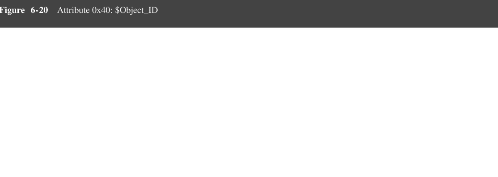

# 属性 0x40 的起始字节 $Object_ID

## 属性 0x40 的字节数

# GUID Object_ID 值的起始偏移位置

| 偏移量 (h) | 00 | 01 | 02 | 03 | 04 | 05 | 06 | 07 | 08 | 09 | 0A | 0B | 0C | 0D | 0E | 0F | 解码文本 |
|---|---|---|---|---|---|---|---|---|---|---|---|---|---|---|---|---|
| 00011100 | 2E | 00 | 67 | 09 | 66 | 64 | 40 | 00 | 00 | 00 | 28 | 00 | 00 | | | .g.f... |
| 00011110 | 00 | 00 | 00 | 00 | 00 | 03 | 40 | 10 | 00 | 00 | 00 | 18 | 00 | | | | |
| 00011120 | F1 | E0 | 97 | EB | A2 | 34 | ED | 11 | 9D | 17 | 70 | 8B | 0D | A0 | 43 | |

# GUID_ID 值

具有 `0x40` 属性的 `MBR` 分区表。以下部分以十六进制标记：属性 `0x40` 的字节数、属性 `0x40` 的起始字节、`GUID Object_ID` 值的起始偏移位置以及 `GUID Object_ID` 值。

## 属性 0x80: 针对驻留文件的 $Data

对于驻留文件的属性 `0x80`，感兴趣的字段如下（见图 6-21）：

- 从属性 `0x80` 起的偏移量 `0x04` 和 `0x05`——属性的大小。
- 偏移量 `0x08`——驻留/非驻留标志；对于驻留数据，其设置为 `0x00`。
- 偏移量 `0x10`——数据运行 (`data run`) 中的字节数。
- 偏移量 `0x18`——驻留运行的起始位置。
- 从 `$MFT` 头起始的偏移量 `0x1E` 和 `0x1F`——校验和值，用于验证 `$MFT` 记录的前 512 字节。第一个扇区和第二个扇区之间的间隔称为扇边界。更新序列数组中 `$MFT` 头位置 `0x32` 和 `0x33` 处的字节存储了这些字节的实际值。

图 6-21 属性 0x80: 针对驻留文件的 $Data

## 属性 0x80 的起始字节

## 属性 0x80 的字节数

## 数据运行的起始字节

# 驻留标志 "00"

| 偏移量 (h) | 00 | 01 | 02 | 03 | 04 | 05 | 06 | 07 | 08 | 09 | 0A | 0B | 0C | 0D | 解码文本 |
|---|---|---|---|---|---|---|---|---|---|---|---|---|---|---|
| 0001530 | 64 | 00 | 00 | 78 | 01 | 00 | 00 | 00 | 01 | 00 | | | X...When th... |
| 0001540 | 59 | 01 | 00 | 18 | 00 | 00 | 22 | 68 | 65 | 20 | 74 | 68 | | | Y...people... |
| 0001550 | 63 | 00 | 02 | 65 | 70 | 65 | 70 | 66 | 72 | 65 | 72 | 66 | | | aid of the power... |
| 0001560 | 63 | 00 | 01 | 00 | 68 | 65 | 20 | 71 | 65 | 72 | 66 | 72 | | | rany. When we... |
| 0001570 | 65 | 64 | 65 | 20 | 74 | 24 | 20 | 73 | 72 | 74 | 79 | | | | the government... |
| 0001580 | 72 | 61 | 65 | 20 | 78 | 79 | 28 | 72 | 75 | 77 | 68 | | | | freedom of the... |
| 0001590 | 63 | 00 | 02 | 64 | 61 | 74 | 7C | 65 | 74 | 69 | 66 | 70 | | | | liberty, that l... |
| 00015A0 | 73 | 00 | 02 | 61 | 6E | 69 | 63 | 65 | 64 | 69 | 66 | 70 | | | | s of the... |
| 00015B0 | 70 | 05 | 68 | 66 | 65 | 20 | 65 | 63 | 20 | 73 | 53 | 69 | | | | people, that l... |
| 00015C0 | 73 | 00 | 04 | 65 | 76 | 65 | 20 | 74 | 68 | 65 | 72 | 70 | | | | Jefferson..."Th... |
| 00015D0 | 63 | 00 | 02 | 61 | 66 | 65 | 20 | 61 | 72 | 72 | 65 | 72 | | | | is no just... |
| 00015E0 | 50 | 00 | 03 | 69 | 64 | 65 | 74 | 69 | 63 | 61 | 74 | 0F | | | | cation for at... |
| 00015F0 | 63 | 00 | 03 | 69 | 64 | 65 | 74 | 69 | 66 | 65 | 72 | 79 | | | | away individu... |
| 0001600 | 65 | 00 | 00 | 61 | 74 | 65 | 74 | 76 | 65 | 72 | 65 | 73 | | | | freedom in the the... |
| 0001610 | 64 | 68 | 65 | 20 | 67 | 75 | 6C | 73 | 69 | 65 | 20 | 79 | | | | guise of pub... |
| 0001620 | 74 | 68 | 65 | 20 | 64 | 61 | 74 | 61 | 20 | 72 | 75 | 6E | | | | lic safety..."... |
| 0001630 | 69 | 64 | 63 | 79 | 63 | 65 | 20 | 64 | 74 | 65 | 73 | 20 | | | | Thomas Jefferson... |
| 0001640 | 53 | 00 | 02 | 66 | 65 | 72 | | | | | | | | | | |

## 数据运行的结束字节

# 扇边界

## 详情
具有 `0x40` 属性的 `MBR` 分区表。以下部分以十六进制标记：属性 `0x40` 的字节数、属性 `0x40` 的起始字节、`GUID Object_ID` 值的起始偏移位置以及 `GUID Object_ID` 值。

## 属性 0x80: 针对驻留文件的 $Data

对于驻留文件的属性 `0x80`，感兴趣的字段如下（见图 6-21）：

- 从属性 `0x80` 起的偏移量 `0x04` 和 `0x05`——属性的大小。
- 偏移量 `0x08`——驻留/非驻留标志；对于驻留数据，其设置为 `0x00`。
- 偏移量 `0x10`——数据运行中的字节数。
- 偏移量 `0x18`——驻留运行的起始位置。
- 从 `$MFT` 头起始的偏移量 `0x1E` 和 `0x1F`——校验和值，用于验证 `$MFT` 记录的前 512 字节。第一个扇区和第二个扇区之间的间隔称为扇边界。更新序列数组中 `$MFT` 头位置 `0x32` 和 `0x33` 处的字节存储了这些字节的实际值。

图 6-22 显示了这些字段及其在 `$MFT` 记录中的关系。

## 解码数据运行

正如模块早早时候讨论的，数据运行是被解释的。本讨论使用一个名为 `Pueblo0.jpg` 的文件作为解释数据运行的示例。数据运行包含三个组件。第一个组件声明了属性字段中有多少字节用于存储第二个组件和第三个组件的值。第二个组件存储分配给数据运行的簇数，第三个组件包含起始簇地址，`VCN(0)`。本讨论使用一个具有两个碎片数据运行的文件。

图 6-23 多个数据运行

| 属性 0x80 | 属性 0x30 | 属性 0x10 | 分配给属性 0x80 的字节数 | 解码文本 |
|---|---|---|---|---|---|---|---|---|---|---|---|---|---|---|---|---|---|---|---|---|
| 0000E810 | 00 | 01 | 02 | 03 | 04 | 05 | 06 | 07 | 08 | 09 | 0A | 0B | 0C | 0D | 0E | 0F | 00 | 00 | 00 | 00 | |
| 0000E810 | 00 | 46 | 4A | 35 | 00 | 03 | 00 | 00 | 0C | 01 | 08 | 00 | 00 | 00 | 00 | 00 | 04 | 00 | 00 | 00 | |
| 0000E820 | 00 | 03 | 01 | 03 | 08 | 00 | 00 | 00 | 00 | 00 | 00 | 05 | 00 | 0A | 00 | 00 | 00 | 00 | 00 | 00 | |
| 0000E830 | 00 | 20 | 00 | 00 | 00 | 00 | 00 | 00 | 00 | 00 | 00 | 00 | 00 | 00 | 00 | 00 | 00 | 00 | 00 | 00 | |
| 0000E840 | 00 | 4F | 6E | 6B | 5C | 05 | 53 | 09 | 00 | 0B | 81 | 34 | 12 | 46 | 49 | 6D | 01 | 00 | 00 | 00 | |
| 0000E850 | 00 | 15 | 3C | 5A | 00 | 00 | 00 | 00 | 00 | 00 | 00 | 00 | 00 | 00 | 00 | 00 | 00 | 00 | 00 | 00 | |
| 0000E860 | 00 | 00 | 00 | 00 | 00 | 00 | 00 | 00 | 00 | 00 | 00 | 00 | 00 | 00 | 00 | 00 | 00 | 00 | 00 | 00 | |
| 0000E870 | 00 | 20 | 00 | 00 | 00 | 00 | 00 | 00 | 00 | 00 | 00 | 00 | 00 | 00 | 00 | 00 | 00 | 00 | 00 | 00 | |
| 0000E880 | 00 | 3A | 00 | 00 | 00 | 00 | 00 | 00 | 01 | 00 | 01 | 00 | 00 | 00 | 01 | 08 | 01 | 00 | 00 | 00 | |
| 0000E890 | 00 | 00 | 00 | 00 | 00 | 00 | 00 | 00 | 00 | 00 | 00 | 00 | 00 | 00 | 00 | 00 | 00 | 00 | 00 | 00 | |
| 0000E8A0 | 00 | 00 | 00 | 00 | 00 | 00 | 00 | 00 | 58 | 00 | 00 | 00 | 00 | 00 | 00 | 01 | 00 | 00 | 00 | 00 | |
| 0000E8B0 | 00 | 4A | 66 | 6B | 5C | 05 | 53 | 09 | 00 | 00 | 00 | 00 | 00 | 00 | 00 | 00 | 00 | 00 | |
| 0000E8C0 | 00 | 0A | 66 | 6B | 5C | 05 | 53 | 09 | 00 | 01 | 00 | 02 | 00 | 66 | 6E | 37 | 32 | 00 | 00 | |
| 0000E8D0 | 00 | 4F | 6C | 5A | 00 | 00 | 00 | 00 | 00 | 00 | 00 | 00 | 00 | 00 | 00 | 00 | |
| 0000E8E0 | 00 | 50 | 00 | 00 | 00 | 00 | 00 | 00 | 00 | 00 | 00 | 00 | 00 | 00 | 00 | 00 | |
| 0000E8F0 | 00 | 50 | 00 | 00 | 00 | 00 | 00 | 00 | 00 | 00 | 00 | 00 | 00 | 00 | 00 | 00 | |
| 0000E900 | 00 | 0A | 00 | 00 | 00 | 00 | 00 | 00 | 00 | 00 | 00 | 00 | 00 | 00 | 00 | 00 | |
| 0000E910 | 00 | 0A | 00 | 00 | 00 | 00 | 00 | 00 | 00 | 00 | 00 | 00 | 00 | 00 | 00 | 00 | |
| 0000E920 | 00 | 20 | 00 | 00 | 00 | 00 | 00 | 80 | 00 | 00 | 00 | 00 | 00 | 00 | 52 | 00 | 00 | |
| 0000E930 | 00 | 70 | 00 | 00 | 00 | 00 | 00 | 00 | 00 | 00 | 00 | 00 | 00 | 00 | 00 | 00 | |
| 0000E940 | 00 | 70 | 00 | 00 | 00 | 00 | 00 | 00 | 00 | 00 | 00 | 00 | 00 | 00 | 00 | 00 | |
| 0000E950 | 00 | 00 | 00 | 00 | 00 | 00 | 00 | 00 | 00 | 00 | 00 | 00 | 00 | 00 | 00 | 00 | |
| 0000E960 | 00 | 00 | 00 | 00 | 00 | 00 | 00 | 00 | 00 | 00 | 00 | 00 | 00 | 00 | 00 | 00 | |
| 0000E970 | 00 | 00 | 00 | 00 | 00 | 00 | 00 | 00 | 00 | 00 | 00 | 00 | 00 | 00 | 00 | 00 | |
| 0000E980 | 00 | 00 | 00 | 00 | 00 | 00 | 00 | 00 | 00 | 00 | 00 | 00 | 00 | 00 | 00 | 00 | |
| 0000E990 | 00 | 69 | 00 | 00 | 00 | 00 | 00 | 00 | 6E | 74 | 00 | 00 | 00 | 00 | 00 | 00 | |
| 0000E9A0 | 00 | 69 | 00 | 00 | 00 | 00 | 00 | 00 | 21 | 91 | 00 | 04 | 00 | 00 | 00 | 00 | 00 | 00 | 00 | 00 | |
| 0000E9B0 | FF | FF | FF | FF | 72 79 11 00 00 00 00 00 00 00 00 00 00 00 00 | |

该分区包含多个运行部分。以下列出了该分区的若干部分。

## $I30 系统文件

为了管理 `NTFS` 格式分区上的文件和文件夹，Windows 将这些信息存储在文件夹的 `MFT` 记录中。由于 `MFT` 记录只有 1024 字节，因此记录能够存储的信息是有限的。如所述，当文件夹中的文件或子文件夹增加时，Windows 会创建一个 `$I30` 文件来存储这些额外信息。对于只有少数文件和文件夹的文件夹，不存在 `$I30` 文件。`$I30` 文件包含了有助于识别的证据。例如，当文件被写入驱动器后被删除时，`$I30` 文件可能包含其名称、大小和时间信息。当文件被删除时，Windows 会重新排列 `$I30` 文件中的文件和文件夹顺序。被删除的文件列表会被移动到 `$I30` 文件的末尾。这些被删除的文件标记为索引碎片（`index slack`）。当向文件夹添加新文件时，Windows 将回收 `$I30` 索引空间并为其分配新文件。这是 Windows 数据管理功能的一个自动过程。

根据调查需要，在文件删除后越早进行取证采集越好……

表 6-9 列出了 `$I30` 记录中的元数据记录。

## 表 6-9 $I30 记录中的元数据记录

| 位于 NTFS 分区根目录的 `$I30` 文件字段 | 起始位置（十六进制） | 字段大小 |
|---|---|---|
| `$I30` 头部信息 | `0x00` | `0x58` 字节 |
| 位于 NTFS 分区子目录的 `$I30` 文件字段 | | |
| 字段名称 | 起始位置（十六进制） | 字段大小 |
|---|---|---|
| `$I30` 头部信息 | `0x00` | `0x40` 字节 |
| 记录字段名称（位于头部信息之后） | 偏移位置 | 字段大小 |

## 根文件夹中 $I30 的标头字段

| `$I30` | 偏移量 (h) | 00 01 02 03 04 05 06 07 08 09 0A 0B 0C 0D 0E 0F | 解码文本 |
|---|---|---|---|---|---|---|---|---|---|---|---|---|---|---|---|---|
| 00000000 | 49 4E 44 58 28 00 09 00 0A 00 01 00 00 00 00 | NDX(....) |
| 00000010 | 00 00 00 00 00 00 00 00 40 00 00 48 07 00 00 | ....H..H.. |
| 00000020 | E8 0F 00 00 00 00 00 00 1E 00 05 00 00 00 D8 01 | .......... |
| 00000030 | 00 00 00 00 00 00 00 00 00 00 00 00 00 00 00 0................ |
| 00000000 | 00 00 00 00 00 00 00 0 0 00 00 00 00 00 04 | h.... | | h| 000000000000 00 00 00 00 00 00 00 00 00 00000000000 000 |0. h h | |
  00000000000000000000 0 0000000000000000000000000000000000000000000000000000000000000000000000000000000000000 | ................. | 
| 00000090 | 00 00 00 00 00 00 00 00 08 03 24 41 00 74 00 | ....$A.at.. |
| 000000A0 | 74 00 72 00 44 00 65 00 66 00 00 00 00 00.. | t.r.D.f.. |
| 000000B0 | 00 00 68 00 69 00 64 00 00 00 00 00.. | ....h.i.... |
| 000000C0 | 05 00 00 00 00 00 05 00 00 00 00 00 | |0 |

 000000D0 | 00 00 00 00 00 00 00 00 0 0 00 00 | .0 |
| 00000000 00 0 2 0 2 0 00 00 00 00000 | |
| 000000E0 | 08 03 24 00 42 00 61 00 64 00 43 00 7C | ..$B.a.d.c.lu |
| 000000F0 | 75 00 00 00 00 00 00 00 | ....s |
| 00000100 | 00 00 00 00 00 00 00 00 | ................. |
| 00000110 | 00 00 00 00 00 00 00 00 00 00 00 00 00 | .....P.... |

非参与文件的 `M` 属性分区段。以下部分在十六进制表中标记：

图 6-28 显示了子文件夹中 `$I30` 标头的额外十六进制视图。


## 子文件夹中的 $I30 头部字段

| `$I30` | 00 | 01 | 02 | 03 | 04 | 05 | 06 | 07 | 08 | 09 | 0A | 0B | 0C | 0D | 0E | 0F | 解码文本 |
|---|---|---|---|---|---|---|---|---|---|---|---|---|---|---|---|---|
| 偏移量(hex) | 49 | 4E | 44 | 58 | 28 | 00 | 00 | 00 | 09 | 2F | 73 | 22 | 00 | 00 | 00 | 00 | INDX(..). |
| 00000010 | 00 | 00 | 00 | 00 | 00 | 00 | 00 | 00 | 28 | 00 | 00 | 00 | 01 | 00 | 00 | ... (..). |
| 00000020 | E8 | 0F | 00 | 00 | 00 | 00 | 00 | 00 | D8 | 0F | 00 | 01 | 00 | 00 | 00 | 00 | .,...... |
| 00000030 | 00 | 00 | 00 | 00 | 00 | 00 | 00 | 00 | 00 | 00 | 00 | 00 | 00 | 00 | 00 | 00 | .......p-| |
| 00000040 | 34 | 00 | 00 | 00 | 00 | 00 | 01 | 00 | 70 | 00 | 5C | 00 | 00 | 00 | 00 | 00 | ) (cW-Y). |
| 00000050 | 29 | 00 | 00 | 00 | 00 | 00 | 01 | 00 | 28 | A2 | 57 | 97 | 9F | 08 | 01 | 00 | @DAOU=b.r|j)._ |
| 00000060 | 25 | 0E | 4A | 77 | 35 | 3D | 08 | 01 | 62 | 3B | 6A | 29 | 5F | 28 | 01 | 00 | %.DAOU......_ |
| 00000070 | 29 | 28 | A2 | 57 | 97 | 9F | 08 | 01 | 20 | 00 | 01 | 00 | 00 | 00 | 00 | 00 | (cW-Y)._ |
| 00000080 | 56 | 15 | 00 | 00 | 00 | 00 | 00 | 20 | 00 | 00 | 00 | 00 | 00 | 00 | ..j.e.f.r.. |
| 00000090 | 6F | 0E | 02 | 2A | 74 | 00 | 75 | 74 | 00 | 00 | 00 | 00 | 00 | o.m.t.t.t.. |
| 000000A0 | 6F | 0E | 02 | 2A | 74 | 00 | 75 | 74 | 00 | 00 | 00 | 00 | 00 | .......T.. |
| 000000B0 | 35 | 00 | 00 | 00 | 00 | 00 | 01 | 00 | 68 | 54 | 00 | 00 | 00 | 00 | 00 | 00 | )_W-Y). |
| 000000C0 | 29 | 00 | 00 | 00 | 00 | 00 | 01 | 00 | 75 | D5 | 57 | 97 | 9F | 08 | 01 | 00 | f.x=au). |
| 000000D0 | 83 | 0F | D7 | 08 | 78 | 3D | 08 | 0F | 61 | 5B | 6A | 29 | 5F | 28 | 01 | 00 | |
| 000000E0 | 75 | D5 | A3 | 57 | 97 | 9F | 08 | 0F | 61 | 00 | 00 | 00 | 00 | 00 | 00 | 00 | T._j.o.n.e.s.t.. |
| 000000F0 | 54 | 06 | 00 | 00 | 06 | 0E | 65 | 00 | 73 | 00 | 2E | 00 | 00 | 00 | 00 | 00 | | |
| 00000100 | 09 | 00 | 4A | 00 | 06 | 0E | 65 | 00 | 73 | 00 | 74 | 00 | 00 | 00 | 00 | 00 | | |
| 00000110 | 78 | 00 | 74 | 00 | 6E | 02 | 47 | 00 | 00 | 00 | 00 | 01 | 01 | 00 | 00 | 00 | x.t.n.G.. |
| 00000120 | 25 | 00 | 46 | 00 | 0E | 00 | 01 | 00 | 00 | 00 | 00 | 00 | 01 | 00 | 00 | 00 | X)._ |
| 00000130 | 60 | CA | D7 | 64 | B2 | 9F | 08 | 0F | 98 | 03 | FF | 4D | 7D | A0 | D8 | 01 | |

带有根 `$I30` 文件标头的 `M` 分区段。以下部分在十六进制表中标记：根文件夹中 `$I30` 文件的头部字段。图 6-29 显示了 `$I30` 文件记录的十六进制视图视觉示例。

## 图 6-29 $I30 子文件夹文件

## $MFT 记录 文件号 序列号 索引记录长度 修改时间 最后访问时间

| 偏移量(h) | 00 | 01 | 02 | 03 | 04 | 05 | 06 | 07 | 08 | 09 | 0A | 0B | 0C | 0D | 0E | 0F | 解码文本 |
|---|---|---|---|---|---|---|---|---|---|---|---|---|---|---|---|---|
| 00000000 | 49 | 42 | 44 | 58 | 28 | 00 | 00 | 00 | 13 | 0B | 12 | 00 | 00 | 00 | 00 | 00 | INDX(....).*... |
| 00000010 | 00 | 00 | 00 | 00 | 00 | 00 | 00 | 28 | 00 | 1B | 00 | 00 | 08 | 01 | 00 | 00 | ....(....) |
| 00000020 | E5 | 78 | 00 | 00 | 00 | 00 | 00 | 1B | 00 | 00 | 00 | 00 | 00 | 00 | 00 | ....... |
| 00000030 | 00 | 00 | 00 | 00 | 00 | 00 | 00 | 00 | 00 | 00 | 00 | 00 | 00 | 00 | 00 | 00 | ....h.t |
| 00000040 | 1E | 5C | 00 | 00 | 00 | 00 | 00 | 00 | 00 | 54 | 54 | 00 | 00 | 00 | 00 | ....0A |ES. |
| 00000050 | 38 | 00 | 00 | 00 | 00 | 01 | 01 | 68 | 00 | 78 | 78 | 00 | 00 | 00 | 00 | 00 | ....I.... |
| 00000060 | 00 | 00 | 10 | F7 | 95 | C5 | D7 | 01 | 97 | 00 | D6 | 0B | 05 | 2A | C6 | D6 | 01 | ..I..U..A*ES. |
| 00000070 | 0C | 42 | 48 | 72 | 59 | C5 | D8 | 01 | 97 | 00 | 01 | 00 | 2A | EA | 05 | 00 | 00 | .BH;Y..ES..*.. |
| 00000080 | 36 | 30 | 2A | 00 | 00 | 00 | 00 | 20 | 00 | 00 | 00 | 00 | 00 | 00 | 00 | 00 | ....60*....... |
| 00000090 | 09 | 00 | 4E | 00 | 01 | 51 | 03 | 41 | 00 | 31 | 00 | 20 | 2E | 00 | 62 | 00 | ..N.A.S.A.1.. |
| 000000A0 | 6D | 00 | 70 | 00 | 00 | 00 | 00 | 40 | 00 | 00 | 00 | 00 | 00 | 01 | 00 | 00 | .P |

带有子文件夹 `$I30` 文件标头的 `M` 分区段。以下部分在十六进制表中标记：子文件夹中 `$I30` 文件的头部字段。图 6-30 显示了 `$I30` 文件末尾两个删除记录的十六进制视图视觉示例。在 `$I30` 中，删除记录列为空闲空间（`slack space`），且第一个字段的十六进制值为“`00 00 00 00 00 00 00 00 10 00 00 02 00 00 00 00`”。


删除文件的标头（继续）

## 删除记录起始位置

## 删除文件的标头（16 字节）$I30$

| 偏移量(h) | 00 | 01 | 02 | 03 | 04 | 05 | 06 | 07 | 08 | 09 | 0A | 0B | 0C | 0D | 0E | 0F | 解码文本 |
|---|---|---|---|---|---|---|---|---|---|---|---|---|---|---|---|---|
| 0000001C | 00 | 0B | 4D | 00 | 61 | 00 | 69 | 73 | 69 | 00 | 00 | 00 | 00 | 00 | 6E | 6E | ..m.a.d.i.s.o.n. |
| 0000001D | 2E | 00 | 4D | 00 | 78 | 74 | 00 | 00 | 00 | 00 | 00 | 00 | 00 | 00 | ..t.x.t.. |
| 0000001E | 00 | 00 | 00 | 00 | 00 | 00 | 00 | 00 | 00 | 00 | 00 | 00 | 00 | 00 | 00 | |
| 0000001F | 59 | 29 | 4B | 57 | 97 | 98 | D8 | 01 | 01 | 93 | C8 | E3 | 76 | 3D | 0D | ..v.....Y. |
| 00000020 | 28 | 10 | 8B | 6A | 29 | 2F | D6 | 01 | 6F | 48 | 57 | 97 | 9F | D8 | 01 | ..j..OkR-Y. |
| 00000021 | 00 | 10 | 00 | 00 | 00 | 00 | 00 | 00 | 12 | 0C | 00 | 00 | 00 | 00 | 00 | |
| 00000022 | 00 | 00 | 00 | 00 | 00 | 00 | 00 | 00 | 00 | 00 | 00 | 00 | 00 | 69 | 00 | |
| 00000023 | 6E | 00 | 65 | 00 | 2E | 00 | 74 | 00 | 78 | 74 | 00 | 6E | 00 | 2E | 00 | n..t.x.n.. |
| 最后访问时间 | 文件名 | 修改时间 |

带有文件夹 `$I30` 文件标头的 `M` 分区段。以下部分在十六进制表中标记：`MFT` 记录号、序列号、索引长度、创建时间、修改时间、最后访问时间、文件名、修改时间、下一个条目、文件分配大小和更改时间。

## $Usnnl 文件

更新序列号 (`$Usnnl`) 提供了文件的操作日志，例如数据何时添加到文件或被删除。`Usnnl` 是一个链接文件，协调文件之间的信息，它位于 `C:\Extend` 文件夹中。`Usnnl` 链接到 `$J`、`$Slack` 和 `$Max` 文件。其中，`$J` 文件通常位于系统驱动器（`C:` 盘）。管理员可以在任何 `NTFS` 分区上使用命令 `C:> fsutil createjournal d: m=15728640 a=3145728` 在 `D` 盘分配并创建一个 15 MB 的 `$Usnnl` 文件。

表 6-10 列出了 `$J` 文件的感兴趣字段。

## 表 6-10 $J 元数据记录

| 字段名称 | 起始字节位置（十六进制） | 字段大小 |
|---|---|---|
| 此日志条记录的大小 | `0x00` | 2 字节 |
| 文件 ID（这也是 `$MFT` 记录） | 父文件号（这是文件夹 `$MFT` 记录） | `0x10` | 8 字节 |
| 更新序列号 (`USN`)（从第一个字节开始的偏移量） | `0x18` | 8 字节 |
| 日期和时间戳 | `0x20` | 8 字节 |
| 原因代码 | `0x28` | 16 字节 |
| 文件名 | `0x3C` | 可变大小 |

`$J` 文件记录的十六进制视图视觉示例如图 6-31 所示。

## 图 6-31 $J 文件的十六进制视图

| 父文件 ID | 记录条目字节数 | 文件 ID | USN |
|---|---|---|---|
| 偏移量(hex) | 00 | 01 | 02 | 03 | 04 | 05 | 06 | 07 | 08 | 09 | 0A | 0B | 0C | 0D | 0E | 0F | 解码文本 |
| 00000000 | 50 | 00 | 00 | 00 | 02 | 00 | 00 | 00 | 27 | 00 | 00 | 00 | 00 | 00 | 01 | 00 | P....... |
| 00000010 | 00 | 00 | 00 | 00 | 00 | 00 | 00 | 28 | 00 | 1B | 00 | 00 | 08 | 01 | 00 | ....(....) |
| 00000020 | E5 | 78 | 00 | 00 | 00 | 00 | 00 | 1B | 00 | 00 | 00 | 00 | 00 | 00 | 00 | ....... |
| 00000030 | 00 | 00 | 00 | 00 | 00 | 00 | 00 | 00 | 00 | 00 | 00 | 00 | 00 | 00 | 00 | 00 | ....h.t |
| 00000040 | 1E | 5C | 00 | 00 | 00 | 00 | 00 | 68 | 00 | 65 | 54 | 00 | 00 | 00 | 00 | 00 | ....(A |ES. |
| 00000050 | 38 | 00 | 00 | 00 | 00 | 01 | 01 | 68 | 00 | 78 | 78 | 00 | 00 | 00 | 00 | 00 | ....I.... |
| 00000060 | 00 | 00 | 10 | F7 | 95 | C5 | D7 | 01 | 97 | 00 | D6 | 0B | 05 | 2A | C6 | D6 | 01 | ..I..U..A*ES. |
| 00000070 | 0C | 42 | 48 | 72 | 59 | C5 | D8 | 01 | 97 | 00 | 01 | 00 | 2A | EA | 05 | 00 | 00 | .BH;Y..ES..*.. |
| 00000080 | 36 | 30 | 2A | 00 | 00 | 00 | 00 | 20 | 00 | 00 | 00 | 00 | 00 | 00 | 00 | 00 | ....60*....... |
| 00000090 | 09 | 00 | 4E | 00 | 01 | 51 | 03 | 41 | 00 | 31 | 00 | 20 | 2E | 00 | 62 | 00 | ..N.A.S.A.1.. |
| 000000A0 | 6D | 00 | 70 | 00 | 00 | 00 | 00 | 40 | 00 | 00 | 00 | 00 | 00 | 01 | 00 | 00 | .P |

在十六进制表中标记为：删除记录的起始位置、删除文件的头部（16字节长）、删除文件的头部（继续）、最后访问时间和、更改时间、创建时间和、修改时间以及文件名。

# Prefetch（预取）

为了缩短 Windows 中加载应用程序到内存的时间，微软实施了 `Prefetch` 功能。在 Windows 中首次运行应用程序时，操作系统会为其创建一个预取文件。下次运行该应用程序时，Windows 将指向其他数据或执行文件的必要链接预加载到计算机内存中——即预取——其他资源减少了加载应用程序的时间。

应用程序的预取文件存储在 `C:\Windows\Prefetch` 文件夹中。每个应用程序的预取文件名是一个 8 字节的十六进制值，文件扩展名为 `.pf`。`Firefox` 的预取文件示例为 `FIREFOX.EXE-A606B53C.pf`。

这个唯一的 8 字节十六进制数是 Windows 在应用程序首次运行时分配的哈希值。如果重新安装相同的应用程序，例如将创建一个具有不同 8 字节十六进制哈希值的新预取文件。

应用程序预取文件的内容可以发现有关应用程序的信息，这些信息可以为案件提供额外的证据：

- 应用程序安装的时间
- 应用程序运行的次数
- 应用程序运行的日期和时间
- 应用程序使用了或访问了哪些其他数据或执行文件
- 预取文件的前 4 字节包含十六进制值 `0x4D 0x41` `0x4D 0x04`。预取文件的内容是压缩的，除非使用十六进制解码器，否则无法读取。

# PCMD.exe 工具

要检查预取文件的内容，请在 `ericzimmerman.github.io/#index.md` 下载 Eric Zimmermann 的工具 `PCMD.exe`。

仔细阅读网站关于运行此工具的说明和要求。`PCMD.exe`（以及 Jim Zimmerman 创建的其他工具）使用 `.Net 4.2` 或 `.Net 6`。向下滚动到 `PCMD.exe`（预取解析器）页面，选择并下载适用于您计算机的正确。

`PCMD.exe` 仅从命令提示符中运行。它可以分析单个预取文件，或位于文件夹中的任何预取文件的内容。在 `C:\Windows\Prefetch` 文件夹上运行 `PCMD.exe` 时，请从具有管理员权限的命令提示符中运行。`PCMD.exe` 将显示有关应用程序的以下信息：

- 源路径
- 源创建、修改和最后访问的日期时间
- 源文件的可执行名称
- 源文件的哈希（这是添加到预取文件文件名中的哈希值）
- 源文件的大小
- 计算机的 Windows 操作系统版本
- 应用程序运行的次数
- 应用程序最后运行的日期时间，随后是之前运行的日期时间
- 卷信息，如卷名、卷序列号以及与应用程序关联的文件和目录名称及位置

在在一个预取文件上运行 `PCMD.exe` 程序时，它将在命令提示符窗口内顺序列出列表项目。使用 `--csv` 和 `--csvf` 切换器创建数据输出文件，可以将其加载到电子表格中以便于检查和分析。

使用 `PCMD.exe` 应用程序，请参考以下示例：

- 显示帮助信息：
  `pcmd.exe --help`
- 显示特定预取文件的内容：
  `pcmd.exe -f "C:\Data_Files\FIREFOX.EXE-A606B53C.pf"`
- 显示并将预取文件的内容重定向到 `.csv` 文件：
  `pecmd.exe -f "C:\Data_Files\FIREFOX.EXE-A606B53C.pf" --csv "C:\Work\"`
- 显示并重定向整个文件夹的内容：
  `pecmd.exe -d "C:\Windows\Prefetch" --csv "C:\Work\" --csvf PF-Folder-Data.csv`

| 备注 12 |
| --- |
| 有关预取的更多详细信息，请参考以下资源： |
| Windows 预取文件 (`PF`) 格式 |
| `github.com/libyal/libscca/blob/main/documentation/Windows%20Prefetch%20File%20(PF)%20format.ascii` |

# NTFS 备替数据流 (Alternate Data Streams)

在检查 `NTFS` 磁盘时，特别感兴趣的是备替数据流（`alternate data streams`），这是一种将数据附加到现有文件中的方法。在您检查磁盘时，请注意备替数据流可能会有意或无意地掩盖证据数据。

在 `NTFS` 中，备替数据流变成额外的文件属性，允许文件与不同的应用程序关联。因此，它保持为一个单元。您也可以在备替数据流中存储有关文件的信息。在其资源文档中指出：“例如，图形程序可以在命名的数据流中存储位图图像。”

> 如果您将带有备替数据流的文件保存到 `FAT` 卷，备替数据流将不会传输。此外，要查看或检查带有备替数据流的可执行代码或图形数据，需要将其提取到新文件中。使用文本编辑器打开文件时，不会显示备替数据流。可以通过检查文件的 `$MFT` 记录判断文件是否具有备替数据流。图 6-32 显示包含备替数据流的文件的 `$MFT` 记录。有两个 `0x80` 属性。

图 6-32 Resident Data Stream


# 属性 0x80

| Offset (偏移量) | 00 | 01 | 02 | 03 | 04 | 05 | 06 | 07 | 08 | 09 | 0A | 0B | 0C | 0D | 0E | 0F |
|---|---|---|---|---|---|---|---|---|---|---|---|---|---|---|---|
| 000040 | 46 | 65 | 53 | 3D | 00 | 00 | 00 | 00 | 00 | 00 | 00 | 00 | 00 | 00 |
| 0000C8 | 69 | 65 | 72 | 20 | 64 | 74 | 20 | 65 | 74 | 20 | 39 | 00 | 00 | 00 | |
| 0000D0 | 00 | 00 | 00 | 00 | 00 | 00 | 00 | 00 | 00 | 00 | 00 | 00 | |
| 0000D4 | 64 | 61 | 74 | 61 | 20 | 20 | 6E | 72 | 79 | 00 | 00 | 00 | 00 | 00 | |
| 0000D8 | 00 | 00 | 00 | 00 | 48 | 00 | 00 | 00 | 00 | 00 | 00 | 00 | 00 | 00 | |
| 0000DE | B3 | 43 | 53 | 2C | 65 | 61 | 74 | 65 | 61 | 20 | 65 | 74 | 20 | 65 | 61 | 74 | 20 |
| 0000E4 | 00 | 00 | 00 | 00 | 00 | 00 | 00 | 00 | 00 | 00 | 00 | 00 | 00 | 00 | |
| 0000E8 | 00 | 00 | 00 | 00 | 00 | 00 | 00 | 00 | 00 | 00 | 00 | 00 | 00 | 00 | |
| 0000EC | 00 | 00 | 00 | 00 | 00 | 00 | 00 | 00 | 00 | 00 | 00 | 00 | 00 | 00 | |
| 0000F0 | 00 | 00 | 00 | 00 | 00 | 00 | 00 | 00 | 00 | 00 | 00 | 00 | 00 | 00 | |
| 0000F4 | 00 | 00 | 00 | 00 | 00 | 00 | 00 | 00 | 00 | 00 | 00 | 00 | 00 | 00 | |
| 0000F8 | 00 | 00 | 00 | 00 | 00 | 00 | 00 | 00 | 00 | 00 | 00 | 00 | 00 | 00 | | |
| 0000FC | 00 | 00 | 00 | 00 | 00 | 00 | 00 | 00 | 00 | 00 | 00 | 00 | 00 | 00 | | | |
| 000100 | 19 | 87 | 13 | 5C | 00 | 00 | 00 | 00 | 00 | 00 | 00 | 00 | 00 | 00 | 00 | 00 |
| 000104 | 00 | 02 | 40 | 66 | 72 | 65 | 65 | 20 | 62 | 60 | 6C | 00 | 00 | 00 | 00 | 00 |
| 000108 | 40 | 00 | 20 | 28 | 00 | 00 | 00 | 00 | 00 | 00 | 00 | 00 | 00 | 00 | 00 | 00 |
| 00010C | 00 | 00 | 00 | 00 | 00 | 00 | 00 | 00 | 00 | 00 | 00 | 00 | 00 | 00 | 00 | 00 |
| 000110 | 75 | 73 | 74 | 20 | 20 | 6E | 74 | 79 | 00 | 00 | 00 | 00 | 00 | 00 | | |
| 000114 | 90 | 17 | 70 | 18 | 80 | 00 | 00 | 00 | 00 | 00 | 00 | 00 | 00 | 00 | | |
| 000118 | 45 | 73 | 74 | 2C | 20 | 6C | 69 | 65 | 20 | 6C | 69 | 73 | 74 | | | |
| 00011C | 60 | 20 | 64 | 74 | 61 | 20 | 20 | 66 | 20 | 20 | 65 | 64 | 74 | | | |
| 000120 | 70 | 20 | 61 | 74 | 72 | 20 | 61 | 74 | 65 | 60 | 60 | 00 | 00 | | | |
| 000124 | 74 | 20 | 61 | 74 | 72 | 20 | 20 | 66 | 74 | 72 | 20 | 20 | 20 | | | |

`$MFT`

解码文本

# 属性 0x80 DATA

| 偏移(h) | 00 01 02 03 04 05 06 07 08 09 0A 0B 0C 0D 0E | 解码文本 |
|---|---|---|---|---|---|---|---|---|---|---|---|---|---|---|---|---||
| 000A000 | 46 49 4C 45 00 00 00 00 00 00 00 00 00 00 00 | FILE..m...ä.. |
| 000A010 | 00 01 00 01 00 00 00 00 00 00 00 00 00 00 00 | ..S....ä.. |
| 000A020 | 00 00 00 00 00 00 00 00 00 00 00 00 00 00 00 | | |
| 000A030 | 00 00 00 00 00 00 00 00 00 00 00 00 00 00 00 | | |
| 000A040 | 0D 13 79 4A E4 24 D8 01 11 33 3B 89 E4 24 D8 01 | ..y*ä§.e.,.ä§. |
| 000A050 | 80 11 33 89 B8 24 E4 24 D8 01 1B 20 14 CA 24 D08 | E..*ä§$....ä§. |
| 000A060 | 00 00 00 00 00 00 00 00 00 00 00 00 00 00 00 | | |
| 000A070 | 00 00 00 00 00 00 00 00 00 00 00 00 00 00 00 | | |
| 000A080 | 00 00 00 00 00 00 00 00 00 00 00 00 00 00 00 | | |
| 000A090 | 00 00 00 00 00 00 00 00 00 00 00 00 00 00 00 | | |
| 000A0A0 | 00 00 00 00 00 00 00 00 00 00 00 00 00 00 00 | | |
| 000A0B0 | 00 00 00 00 00 00 00 00 00 00 00 00 00 00 00 | | |
| 000A0C0 | 00 00 00 00 00 00 00 00 00 00 00 00 00 00 00 | | |
| 000A0D0 | 0D 13 79 4A E4 24 D8 01 11 33 3B 89 E4 24 D8 01 | ..y*ä§.e.,.ä§. |
| 000A0E0 | 00 00 00 04 6A 6E 2E 65 73 2E 74 2E 2E 2E 20 | ..J.n..e.s..t.. |
| 000A0F0 | 00 00 00 00 00 00 00 00 00 00 00 00 00 00 00 | | |
| 000A100 | 00 00 00 00 00 00 00 00 00 00 00 00 00 00 00 | | |
| 000A110 | 00 00 00 00 00 00 00 00 00 00 00 00 00 00 00 | | |
| 000A120 | 27 00 00 00 00 00 20 49 20 68 61 76 65 20 6E | ..'I have n |
| 000A130 | 66 69 67 68 74 2E 20 6A 6F 68 6E 20 50 61 75 | ..fight. John Pau |
| 000A140 | 64 61 74 61 20 73 74 72 65 61 6D 20 2E 2E | ..data stream..J.e.. |
| 000A150 | 00 00 00 00 00 00 00 00 00 00 00 00 00 00 00
 | |
| 000A160 | 00 00 00 0 0 0 00 00 00 00 00 00 00 00 | | |
| 000A170 | 00 00 00 00 00 00 00 00 00 00 00 00 00 00 00 | | |
| 000A180 | 26 64 06 00 00 00 00 73 00 00 61 63 | ..&d..S..p.a.c. |
| 000A190 | 00 00 00 00 00 00 00 00 00 00 00 00 00 00 |00000000000000000000000000000000000000 00000 00 00 00 00 00 00 00 00 | | | | |
| 000A1B0 | FF FF FF 72 49 47 | | | | |

备用数据流 (`Alternate data stream`)
属性 `0x80` `DATA`

填充备用数据流的剩余字节
详情
`NTFS` 分区的以下部分标记为更新序列数组、属性 `$DATA`、分区边界、计数以及备用数据流名称。

## 注意
关于备用数据流的更多信息，请阅读“解析 NTFS 隐藏”。以下命令用于判断文件是否附加了备用数据流以及如何提取其内容：

- `DIR` 命令带有 `/R` 显示所有文件并指示任何文件是否有备用数据流：
```


## 提取备用数据流的内容

```
dir /r
```

`myfile.txt:stream`

## 获取任何备用数据流文件的更多信息

使用 PowerShell 命令：

```powershell
gci -recurse | % { $_.FullName } | where { $_ -ne ':DATA' }
```


## 注意

关于备用数据流和 DOS 命令，请参考以下资源：

- [备用数据流简介](https://malwarebytes.com/news/2015/07/introduction-to-alternate-data-streams)
- [Streams v1.6](https://docs.microsoft.com/en-us/sysinternals/downloads/streams/)
- [备用数据流 (ADS)](https://infosecwrite.com/alternate-data-streams-54b14a8/)

# NTFS 压缩文件

为了提高磁盘存储效率，NTFS 提供了类似于 DriveSpace 的 Windows 98 压缩工具。使用 NTFS，你可以压缩文件、文件夹或整个卷。对于 FAT16，你只能压缩卷。在 Windows NT 或更高系统中，当你在 Windows 资源管理器或 Microsoft Word 等应用程序查看时，压缩数据会正常显示。大多数取证工具可以解压缩并分析使用 Lempel-Ziv-Huffman (LZH) 算法以及 PKZip、WinZip 和 GNU gzip 格式的压缩数据。但可能会遇到困难。如果你识别出第三方压缩数据，你需要使用创建它的工具进行解压缩。

## 注意

关于 NTFS 及其设计的更多信息，请参 [NTFS 文档](https://dubeyko.com/development/FileSystems/NTFS/ntfsdoc.pdf)

# NTFS 文件加密

当微软引入 Windows 2000 时，为 NTFS 添加了内置加密，称为加密文件系统 (EFS)。EFS 使用公钥和私钥方法对文件、文件夹或磁盘卷（分区）进行加密。加密数据的加密可以访问加密文件。所有人持有公钥，而私钥由证书颁发机构、网络服务器或 VerSign 公司持有。

在 Windows 2000 及更高版本中使用 EFS 时，会生成恢复密钥并发送给 Windows 帐户。恢复密钥的目的是当用户的原始私钥出现问题时，提供恢复 EFS 文件的机制。恢复密钥存储在两个位置。当用户启动 EFS 时，恢复密钥发送到本地域帐户。在独立工作站上，恢复密钥发送到本地管理员帐户。

用户可以对本地或远程服务器上的文件应用 EFS。Windows 2000 及更高版本在用户或应用程序复制 EFS 文件、文件夹或磁盘卷时，会自动解密数据。Windows Server 2003 及更高版本中，用户允许其他用户访问 EFS 数据。如果用户将加密的文件复制到未加密的文件夹，则复制的数据将以未加密格式保存。

# EFS 恢复密钥代理

恢复密钥代理实现了管理员帐户中的恢复密钥。

# 删除 NTFS 文件

通常，你使用资源管理器从磁盘上删除文件。在 Windows NT 或更高版本中，操作系统会重命名文件并将其移动到回收站。

# 弹性文件系统概述

随着 Windows Server 2012 的发布，微软创建了一个新的文件系统：弹性文件系统（ReFS）。ReFS 旨在解决极大量数据存储的需求，例如云端存储。以下功能被整合到 ReFS 的设计中：

- 最大化数据可用性
- 提高数据完整性
- 为可扩展性而设计

ReFS 是 NTFS 的产物，旨在提供大规模数据存储访问能力。截至本文编写，它用于数据存储，不能作为启动器。Windows 8/8.1 及更高版本以及 Windows Server 2012 及更高版本是唯一可以访问 ReFS 的 Windows 操作系统。

ReFS 使用与 NTFS 中的 MFT 类似的磁盘结构。其存储引擎使用 B+ 排序方法访问大型数据集。它还使用了一种名为“写时分配”（allocate-on-write）的方法，将数据文件的更新复制到新位置；通过分页影子（shadowing to paging）防止覆盖原始数据文件。将更新写入新位置的目的是确保在磁盘更新发生故障时可以轻松恢复数据。

## 注意 17

有关 ReFS 及其他存储方法的更多信息，请参考以下资源：

- “弹性文件系统”，https://learn.microsoft.com/en-us/windows/w32/cookbook/resilient-file-system-refs/
- “弹性文件系统 (ReFS) 概述”，https://docs.microsoft.com/en-us/windows-server/storage/refs/refs-overview/

## 自检

4. $MFT 记录中的驻留记录（resident record）与 $MFT 文件中的非居民记录（nonresident record）有什么区别？

a. 驻留记录存储在 $MFT 记录内部，非居民记录存储在分配的分区磁盘空间中。
b. 驻留记录和非居民记录存储在磁盘驱动相同位置。
c. 驻留记录表示文件数据存储在磁盘分区分配空间上。
d. 非居民记录表示文件数据存储在 $MFT 记录中。

> 答案：a。驻留记录存储在 $MFT 记录内部，非居民记录存储在分配的分区磁盘空间中。

解释：为了尽力减少 NTFS 分区上的空隙（slack space），极小文件的数据存储在文件的 $MFT 记录中。这些记录被称为驻留 $MFT 记录。驻留记录数据存储在其 $MFT 记录的属性 $DATA (0x80) 字段中。对于需要更多存储空间的较大文件，数据存储在外部，被称为非居民 $MFT 记录。对于非居民 $MFT 记录，属性 $DATA 列出了存储数据所在的磁盘分区上分配的簇。非居民 $DATA 信息被称为数据运行链（data runs）。

## 检查。理解全盘加密

因电脑被盗导致的个人身份信息（PII）和商业秘密泄露已成为日益关注的问题。PII 可能包含员工的全名、出生日期、家庭地址和社交安全号码。有了这些信息，罪犯可以轻松访问员工名下的信用卡账户。商业秘密是指企业为了获得相对于其他公司的竞争优势而保持保密的任何信息。此类信息的无意发布可能会破坏企业的竞争优势。

特别令人关注的是笔记本电脑和手持设备（如智能手机）被盗。如果设备上的数据没有得到正确保护，所有者可能对产生的任何损害负责，例如身份被盗、信用卡欺诈或因向竞争对手泄露商业秘密导致的业务损失。由于与 PII 盗取相关的问题，许多州已制定法律，要求任何个人或企业尽快通知受害者丢失情况。为了防止信息系统丢失，包括微软在内的软件供应商都提供了全盘加密（WDE）；该技术在《数据获取》模块中引入。

全盘加密工具提供了法医鉴定员应注意的以下功能：

- 启动前认证，例如单点登录密码

## 检查 BitLocker

BitLocker 在《数据获取》模块中引入，是微软保护数据的工具。BitLocker 的硬件和软件要求如下：

- 运行 Windows Vista 或更高版本的计算机（家庭版除外）
- 可信平台模块（TPM）版本 1.2
- 符合可信计算组（TCG）标准的 BIOS
- 具有可用空间的 NTFS 分区
- 配置以便 BitLocker 先启动

## 注意 18

有关 BitLocker 的更多信息，请访问 technet.microsoft.com/en-us/library/cc73274.aspx 或在 technet.microsoft.com 搜索“BitLocker”

## 检查第三方磁盘工具

许多供应商提供了第三方 WDE 工具，其功能通常比 BitLocker 多。例如，BitLocker 只加密 NTFS 驱动器。如果你想加密 FAT 驱动器，则需要第三方解决方案。使用第三方工具加密通常与 BitLocker 相同。在使用这些工具之前，请确保调查其功能。可用的第三方 WDE 工具包括：

- Broadcom：https://broadcom.com/products/cyber-security/information-protection
- Endpoint Encryption：https://symantec.com/products/endpoint-security-encryption
- Jetico BestCrypt Volume Encryption：https://jetico.com/products/personal-privacy/bestcrypt-volume-encryption/

## 这些加密的挑战

参见虚拟机法医与现场获取法医

随着加密技术的改进，提取数字证据将变得更加困难。由于这些挑战，你需要了解如何进行现场获取，这在以下模块中讨论：

## 自检

5. 在处理 C 盘上带有 BitLocker 加密的磁盘驱动器时，解密驱动器需要什么？

a. 嫌疑电脑必须运行 Windows Vista 或更高版本的家庭版。
b. 你需要版本 1.0 或更高版本的 TPM 芯片以及符合 TCG 的 BIOS。
c. 需要微软授权的第三方供应商特殊令牌密钥。
d. 电脑的 BIOS 必须配置以便加密的硬盘先启动。

答案：d。电脑的 BIOS 必须配置以便加密的硬盘先启动。
解释：为了让 BitLocker 能够工作，它需要先启动到操作系统驱动器。BitLocker 解密数据还需要磁盘驱动器上的额外空间。此外，BitLocker 需要 1.2 或更高版本的 TPM 芯片。BitLocker 不适用于任何 Windows 家庭版。

# 检查。理解 Windows 注册表

当微软创建 Windows 95 时，它将初始化 (.ini) 文件合并到注册表（Registry）中，这是一个存储硬件和软件配置信息、网络连接、用户偏好（包括用户名和密码）以及设置信息的数据库。注册表已经不断更新，并在 Windows Vista 及更高版本中仍然被使用。

注册表可能包含调查所需的宝贵证据。从静态获取查看注册表文件需要特殊的工具，如 FTK Registry Viewer 或像 Autopsy、X-Ways Forensics 等许多法证分析应用程序。

通常情况下，你可以使用注册表编辑器（Registry Editor）中的“编辑”、“查找”菜单命令来定位可能包含痕迹证据的项，例如识别最后一次登录计算机的用户的信息，这些信息通常存储在用户账户信息中。你还可以利用注册表确定最近访问的文件和外围设备。此外，所有已安装的程序都会在注册表中存储信息，例如访问过的网站、最近的文件，甚至是访问过的聊天室。

作为一名数字取证调查员，你应该探索所有 Windows 系统的注册表。

## 注意事项

在活动系统中，请小心不要更改任何注册表设置，以避免损坏系统并可能导致其无法启动。

## 提示

可以使用几种第三方工具（如 FTK Registry Viewer）来访问注册表。FTK Registry Viewer 和其他几种数字取证工具也可以从法证磁盘映像查看注册表文件。

# 注册表中的数据类型

注册表是一个分级结构化数据库，包含以下数据类型：

- 键（Keys）：类似于磁盘分区上的文件夹
- 子键（Subkeys）：包含类似数据和对文件引用的值……

在键和子键中找到的数据类型如表 6-11 所示：

| 数据类型 | 内容类型 |
|---|---|
| REG_BINARY | 任意长度的二进制数据 |
| REG_DWORD | 32 位二进制数 |
| REG_DWORD_BIG_ENDIAN | 以大端格式显示的二进制数 |
| REG_EXPAND_SZ | Unicode 变长度值 |
| REG_FULL_RESOURCE_DESCRIPTOR | 计算机上可用硬件的额外描述 |
| REG_LINK | 以 Unicode 显示的符号链接 |
| REG_MULTI_SZ | 存储在数组中的空终止字符串 |
| REG_NONE | 不包含任何数据 |
| REG_QWORD | 64 位二进制数据 |
| REG_RESOURCE_LIST | 计算机上可用硬件的描述 |
| REG_RESOURCE_REQUIREMENT_LIST | 操作系统所需的项列表 |
| REG_SZ | Unicode 固定长度值 |

注意 REG_LINK 指向其他键和子键。

# 探索 Windows 注册表的结构

Windows 注册表以特定的方式组织，这种结构随着每个 Windows 新版本的发布略有变化。然而，自 Windows 2000 以来，主要的注册表部分已经合并并发生了一些变化；在 Windows 9x/Me 中它们略有不同。在继续之前，请复阅注册表术语列表：

- 注册表（Registry）：一个包含系统和用户信息的分级数据库。
- 注册表编辑器（Registry Editor）：一种用于查看和修改注册表中数据的 Windows 工具；有两个注册表编辑器：Regedit 和 Regedt32（引入自 Windows 2000）。当前的 Windows 操作系统仅提供 Regedit。
- HKEY：带有 HKEY_ 前缀将注册表分为不同的类别。Windows 9x 系统有 HKEY 分类，Windows 2000 及更高版本有五个。Windows 程序员将“H” 称为键的句柄（handle）。
- 键（Key）：每个 HKEY 包含被称为“键”的文件夹。键可以包含其他文件夹或值。
- 子键（SubKey）：显示在另一个键下的键是子键，类似于 Windows 资源管理器中的子文件夹。
- 分支（Branch）：一个键及其内容（包括子键）构成了注册表中的分支。
- 值（Value）：键中的名称和值。
- 默认（Default）：所有键都有一个默认值，可能不包含数据。
- 配置单元（Hive）：配置单元是 HKEY_USERS 和 HKEY_LOCAL_MACHINE 中的特定分支。

# 探索 Windows 注册表的组织

Windows 注册表以特定的方式组织，这种结构随着每个 Windows 新版本的发布略有变化。然而，自 Windows 2000 以来，主要的注册表部分已经合并并发生了一些变化；在 Windows 9x/Me 中它们略有不同。

## 自检

6. Ntuser.dat 中存储了什么类型的数据？

- a. 账户管理和安全设置
- b. 最近使用的文件列表
- c. 操作系统系统的安全设置
- d. 已安装程序列表及关联的用户账户信息

**答案：** b. 最近使用的文件列表。

**解释：** Ntuser.dat 包含了最近使用的文件列表和桌面配置设置。

## 检查 Windows 取证数字产物

除了 Windows 使用的 $I30、$MFT、$UsnJnl 和 Prefetch 之外，还有其他几个数据文件可能包含数字证据，包括以下文件：

- hiberfil.sys
- 浏览器历史文件
- pagefile.sys
- $Recycle.Bin（回收站桶）

这并不是所有可能包含数字证据的产物文件的完整列表；然而，了解这些文件将为调查人员在决定从哪里寻找与调查相关的线索时提供一个良好的起点。接下来的章节将概述这些 Windows 文件的用途以及可以从中恢复的可能证据。

## hiberfil.sys 文件

hiberfil.sys 文件是 Windows 在挂起或用户将其设置为休眠模式时存储 Windows 易失性数据（RAM）的地方。例如，用户在电脑仍运行时关闭了笔记本电脑盖子。当盖子关闭时，Windows 会挂起处理并将 RAM 中的所有数据写入 hiberfil.sys 文件。当打开笔记本电脑盖子时，Windows 会自动将存储在 hiberfil.sys 中的数据复制回 RAM，允许用户继续活动。这消除了在仅临时挂起计算机操作时将数据保存到磁盘驱动器并关机的需要。

在对嫌疑计算机的 C: 盘进行静态采集时，最近一次休眠的数据将存储在 hiberfil.sys 文件中，之前保存的 RAM 数据将被覆盖。hiberfil.sys 是一个隐藏系统文件，通常位于 C: 盘的根目录下。

由于 hiberfil.sys 文件是 RAM 数据，因此检查其内容需要内存分析技术，这些技术在“虚拟机取证与现场获取取证”模块中有所介绍。

关于 hiberfil.sys 的更多信息，请参阅以下资源：

- "Hiberfil.sys," forensics.wiki/hiberfil.sys
- [如何提取和分析 Windows 休眠文件](https://medium.com/@denizk/how-to-extract-and-analyze-windows-hibernation-file-7b1ec761788)
- [如何通过 Windows 休眠文件 提取取证数据？](https://android.org/2019/05/15/how-windows-hibernation-file-hiberfil.sys-to-extract-forensic-data)
- [休眠文件在 Windows 10 内存取证中的作用](https://user.org/researchpaper/Role-Of-Hibernation-File-In-Memory-Forensics-of-windows-10.pdf)

## 浏览器历史文件

浏览器的设计目的是尽可能地收集有关终端用户及其感兴趣的信息以进行商业开发。具体而言，Web 浏览器的设计旨在收集并传输用户活动以用于数据分析服务。营销人员使用这些数据来理解和预测用户的行为，并向其投放广告。

这种预测行为分析数据对于调查也可能有用。作为数字取证调查员，你可以利用它来更好地了解嫌疑人的动机，并为调查收集事实。从嫌疑人的浏览器历史中可以提取的某些感兴趣的项目包括：

- 自动登录数据
- Cookies 和收藏夹
- 浏览器插件或扩展
- 浏览器保存的表单信息
- 网站缓存数据
- 下载记录
- Web 访问历史
- 浏览器自动补全信息

大多数数字取证工具都可以收集并解释这些项目，然后将其列在报告中。这取决于你如何在报告中提供足够的解释，让外行人士也能理解这些信息与调查之间的关系。

以下网站可以提供关于检查嫌疑计算机 Internet 数据的额外信息：

- 分析嫌疑计算机 Web 活动的概述：
- [网络浏览器活动的高级证据收集与分析](https://scientificdirect.com/science/article/pii/S1742287611000326)
- [浏览器取证](https://nasbench.medium.com/web-browsers-forensics-7e99940c579a)
- 免费工具：
- [使用 Browsing HistoryView 工具查看 Edge 浏览器历史](https://nirsoft.net/articles/view-edge-history.html)
- 商业工具：
- [在取证镜像中检查浏览器历史](https://foxtonforensics.com/blog/post/examining-internet-history-in-forensic-images)
- [In Forensics - 调查中 SQLite 文件的使用](https://acquireforensics.com/services/sqlite-file-forensics.html)
- 数据分析：
- [数据分析](https://investopedia.com/terms/d/data-analytics.asp)

## pagefile.sys 文件

pagefile.sys 与 hiberfil.sys 类似，它们都存储 RAM 数据。这些文件的区别在于 pagefile.sys 用作 RAM 的扩展区域。因为加载到 RAM 中的应用程序和数据可能会超过可用内存量，Windows 会将 RAM 存储扩展到 pagefile.sys。这种到 pagefile.sys 的扩展被称为“交换”（swap）——即当前未处理的内存部分被放在 pagefile.sys 中。

pagefile.sys 是一个隐藏文件，通常安装在 C 盘的根目录下。对于具有多个驱动器的计算机，pagefile.sys 通常位于其所在的磁盘分区。将 pagefile.sys 分在单独磁盘上可以优化其 I/O 访问速度。

由于 pagefile.sys 包含内存数据，分析其内容与分析 hiberfil.sys 和内存数据的过程类似，这些在“虚拟机取证与现场获取取证”模块中有所介绍。

关于 pagefile.sys 的更多信息，请参阅以下资源：

- 如何从 pagefile.sys 提取取证证据?, https://andreafuna.org/2019/04/17/how-to-extract-forensic-artifacts-from-pagefile.sys
- "取证调查：pagefile.sys", hackingarticles.in/forensic-investigation
- "pagefile.sys", forensics.wiki/pagefile.sys
- "pagefile.sys", tech-android.com/pagefile
- "pagefile.sys", security.blogspot.com/pagefile
- "pagefile.sys", ios.org/pagefile
- "pagefile.sys", journals.com/pagefile

## $Recycle.Bin

正常操作，当删除文件或文件夹时，Windows 将数据移动到 $Recycle.Bin。这些文件作为备份，以防用户以后需要撤销删除。然而，存在例外情况，当用户在按下 Shift 键时删除文件，所有对数据的引用将被永久删除。

## $Recycle.Bin 配置

对于 Windows Vista 及更高版本，Windows 在 $Recycle.Bin 中创建一个子文件夹。子文件夹的名称是用户的 SID，如图 6-35 所示。


图 6-35 回收站元数据

## 回收站元数据记录

以下部分在十六进制值中被标记为：Windows 删除的文件或文件夹大小、文件大小、删除日期时间和路径名称。

除了将已删除的文件或文件夹元数据移动到 $Recycle.Bin 之外，Windows 还会更新其 MFT 记录。删除操作会将文件或文件夹重命名为文件名称属性 (0x30) 中 $I 的新名称。Windows 将数据属性 (0x80) 中的所有信息复制到 $R 文件，并在数据属性中写入原始文件或文件夹名称。

**从 $Recycle.Bin 恢复数据**

在使用数字取证工具检查静态获取映像并在 $Recycle.Bin 中发现多个文件时，可以使用 Eric Zimmermann 的 RBCmd.exe 工具记录来自 $I 文件的元数据。RBCmd.exe 工具从提示符运行，并将 $I 文件的元数据格式化显示在屏幕上并导出到 .csv 文件。该工具可以从 ericzimmerman.github.io/#index.md 下载。

要使用 RBCmd.exe，你将使用电脑上的数字取证工具将静态获取文件中的 $Recycle.Bin 导出到工作文件夹中。然后，你需要下载 RBCmd.exe，最好将其保存到保存 $Recycle.Bin 的相同文件夹中，并使用相应的参数、路径以及文件名运行它。

## 注意事项 19

在下载 RBCmd.exe 之前，确保你的电脑已实现 .NET 4.6.2 或 .NET 6。有关更多信息，请查看 Zimmermann 博士下载页面底部的“要求与故障排除”部分。

要运行 RBCmd.exe，以管理员身份启动命令提示符，输入 `rbcmd.exe -d "$Recycle.Bin" --csv "..\rec-metadata"` 并按 **Enter**。

图 6-37 显示此命令的输出示例。

图 6-37 RBCmd.exe 元数据输出

| 源名称 | 文件类型 | 文件名 | 文件大小 | 删除时间 |
|---|---|---|---|---|
| 1 | $Recycle.Bin\$S-1-5-21-290882338-131612215-219200601-1001\$R... | $I | E:\Work\Module02\Activity_02-1\Report 02-2023-16-55-41 | 499872 | 2023/3/1 1:01 |
| 2 | $Recycle.Bin\$S-1-5-21-290882338-131612215-219200601-1001\$R... | $I | E:\Work\Module02\Activity_02-1\Reports\Solution_Activity_02-1 Report mm-dd-yyyy-hh-ss.zip | 97272 | 2023/3/1 1:26 |
| 3 | $Recycle.Bin\$S-1-5-21-290882338-131612215-219200601-1001\$R... | $I | E:\Work\Module02\Activity_02-1\Reports\Solution_Activity_02-1 Report mm-dd-yyyy-hh-ss.zip | 178770 | 2023/3/1 1:19 |
| 4 | ... | ... | ... | ... | ... |

信息存储在 User.dat 中。

- hiberfil.sys 和 pagefile.sys 文件包含 RAM 数据，可以使用内存取证方法进行分析，以搜索易失性证据。
- 网页浏览器包含自动登录数据、浏览器缓存数据、下载信息、网络访问历史和自动完成信息等内容。

## 关键术语

- 交替数据流 (alternate data streams)
- 美国信息交换标准代码 (ASCII)
- 面积密度 (areal density)
- 属性 ID (attribute ID)
- 簇 (cluster)
- 柱面 (cylinder)
- 数据运行 (data runs)
- 驱动器空隙 (drive slack)
- 加密文件系统 (EFS)
- 文件分配表 (FAT)
- 文件空隙 (file slack)
- 文件系统 (file system)
- GUID 分区表 (GPT)
- 几何结构 (geometry)
- 磁头 (head)
- 磁头与柱面偏斜 (head and cylinder skew)
- 高性能文件系统 (HPFS)
- Info2 文件
- 逻辑地址 (logical address)
- 逻辑块地址 (LBA)
- 逻辑簇编号 (LCN)
- 主引导记录 (MBR)
- 主文件表 (MFT)
- 元数据 (metadata)
- NT 文件系统 (NTFS)
- 一次性口令 (one-time passphrase)
- pagefile.sys
- 分区 (partition)
- 分区引导扇区 (Partition Boot Sector)
- 分区间隙 (partition gap)
- 个人身份信息 (PII)
- 物理地址 (physical address)
- 私钥 (private key)
- 公钥 (public key)
- RAM 空隙 (RAM slack)
- 恢复证书 (recovery certificate)
- 注册表 (Registry)
- 弹性文件系统 (ReFS)
- 扇区 (Sector)
- 磁道 (track)
- 磁道密度 (track density)
- 未分配磁盘空间 (unallocated disk space)
- Unicode
- UTF-8 (Unicode 转换格式)
- 虚拟簇编号 (VCN)
- 区位记录 (ZBR)

## 复习题

在复习题和项目中，你将使用十六进制编辑器 HxD 分析数据，使用 FTK Imager 提取数据，并使用程序模式下的 Windows 计算器将十六进制转换为十进制或十六进制值。

1. FAT 格式驱动器的起始簇编号是多少？
   a. 簇 0
   b. 簇 1
   c. 簇 2
   d. 簇 2048

2. Ntuser.dat 文件在 Windows 和旧操作系统中的默认位置在哪里？
   a. C:\Users\<user-account>
   b. C:\Users\<user-account>\AppData\Roaming\Microsoft\Windows
   c. C:\Windows\System32\Config
   d. C:\Windows\System\Config32

3. 默认情况下，在 NTFS 格式的 24 TB 驱动器上，2997 GB 的文件占用多少簇？
   a. 324,832,929
   b. 321,248,915
   c. 314,159,265
   d. 374,625,000

4. 下列哪个头数据值表示 $MFT 文件中新记录条目的开始？
   a. RECORD
   b. FILE
   c. ENTRY
   d. DATA

5. 日志文件系统的好处是什么？
   a. 文件系统在系统执行操作后记录事务。
   b. 文件系统在系统执行操作前记录事务。
   c. 文件系统维护磁盘上所有数据的日志。
   d. 文件系统维护所有用户键盘输入的日志。

6. 在检查某个著名城市地标照片的 $MFT 记录时，调查员注意到 $MFT 记录中有两个 0x80 属性记录。这一发现的意义是什么？
   a. 默认情况下，$MFT 记录中始终有两个 0x80 属性。
   b. 多个 0x80 属性字段用于存储照片的每个元数据属性。
   c. 在第一个数据流之后追加了第二个数据流。
   d. $MFT 记录损坏或被更改，需要修复。

7. 当 Windows 笔记本电脑处于挂起状态时，哪个文件包含 RAM 的内容？
   a. swap.sys
   b. pagefile.sys
   c. suspended.sys
   d. hiberfil.sys

8. 当 Windows 计算机使用所有内存时，哪个文件包含 RAM 的内容？
   a. swap.sys
   b. pagefile.sys
   c. suspended.sys
   d. hiberfil.sys

9. 哪个操作系统对文件名限制八个字符，对扩展名限制三个字符？
   a. DOS 6.22
   b. Windows 95
   c. Windows 98
   d. Windows 97

10. 在 $I 元数据文件中，哪个偏移量表示文件何时被删除？
    a. 0x0
    b. 0x80
    c. 0x10
    d. 0x20

11. 在 FAT 文件系统中，哪个十六进制数会告诉调查员该文件当前被标记为未分配磁盘空间？
    a. 0xD7
    b. 0xF5
    c. 0xG7
    d. 0xE5

12. 在 MBR 格式驱动器的 0 引导扇区中，驱动器主分区表中第一个分区的起始偏移量字节位置是多少？（选择所有适用项）
    a. 偏移量 0x1AE
    b. 偏移量 0x1BE
    c. 偏移量 0x1CE
    d. 偏移量 0x1DE

13. 在 MBR 分区表中，哪个偏移字节列出了驱动器上第一个分区的系统识别码？（选择所有适用项）
    a. 偏移量 0x1BF
    b. 偏移量 0x1C0
    c. 偏移量 0x1C1
    d. 偏移量 0x1C2

14. 对于具有两个分区的 MBR 格式驱动器，第二个分区的起始字节位置在哪里？（选择所有适用项）
    a. 偏移量 0x1C4
    b. 偏移量 0x1E4
    c. 偏移量 0x1D6
    d. 偏移量 0xDA

15. 对于有一个分区的 MBR 格式驱动器，哪个偏移字节存储分配给分区的扇区数？（选择所有适用项）
    a. 偏移量 0x1C3
    b. 偏移量 0x1C4
    c. 偏移量 0x1C6
    d. 偏移量 0xCA

16. 第一个分区的分区表以小端序列出的十六进制值 00 03 00 对应的十进制是多少？（提示：使用程序模式下的 Windows 计算器确定。）
    a. 8192
    b. 8195
    c. 196,640
    d. 204,800

17. 扩展分区的分区表位于扇区 821,248。该分区表中，小端序十六进制值为 00 08 00 00 的该分区的起始扇区号十进制是多少？
    a. 2048
    b. 821,249
    c. 4,096
    d. 823,296

18. $MFT 记录中的非居民文件在属性 0x80 中有两个数据运行。第一个数据运行 VCN(0) 的十六进制值为 21 EA 06，VCN(1) 的十六进制值为 31 20 01 F9。每个 VCN 的 LCN 十进制值以及分配给每个运行的簇是多少？
    a. VCN(0) LCN 为 1770，分配了 23 个簇；VCN(1) LCN 为 65515，分配了 32 个簇。
    b. VCN(0) LCN 为 3352，分配了 40 个簇；VCN(1) LCN 为 17752，分配了 27 个簇。
    c. VCN(0) LCN 为 1770，分配了 17 个簇；VCN(1) LCN 为 65515，分配了 20 个簇。
    d. VCN(0) LCN 为 1721，分配了 23 个簇；VCN(1) LCN 为 3120，分配了 100 个簇。

19. 4 GB FAT16 格式驱动器中一个簇包含多少字节？
    a. 8 KB
    b. 16 KB
    c. 32 KB
    d. 64 KB

20. 对于典型的 MBR 格式驱动器，从偏移量 0x00 到第一个扇区的字节数是多少？
    a. 128 字节
    b. 512 字节
    c. 32,768 字节
    d. 65,536 字节

21. 以下哪些文件包含 $Recycle.Bin 中删除文件的元数据？（选择所有适用项）
    a. $I.txt
    b. $I30 文件
    c. $LogFile
    d. $X.txt

22. $MFT 记录中列出文件记录数的偏移位置是多少？
    a. 偏移量 0x00 到 0x04
    b. 偏移量 0x1C 到 0x1F
    c. 偏移量 0x2C 到 0x2F
    d. 偏移量 0x32 到 0x33

23. NTFS 引导扇区中列出分区 $MFT 文件起始簇的偏移位置是多少？
    a. 偏移量 0x15 到 0x1F
    b. 偏移量 0x30 到 0x37
    c. 偏移量 0x40 到 0x48

24. 在检查嫌疑计算机的互联网活动时，可能会恢复哪种类型的数据？（选择所有适用项）
    a. 磁盘配额，有助于确定嫌疑人的隐藏文件
    b. 嫌疑人以前运行过哪些应用程序的记录
    c. 书签信息，显示嫌疑人对犯罪或投诉特定领域的偏好
    d. 嫌疑人的网络历史活动，可能显示他们为犯罪所做的准备

# 上机项目

## 项目 6-1

预计时间：15 分钟
目标：使用从未分配磁盘空间恢复的数据片段确定名为 rebel.txt 的文件的创建日期和时间。

开始之前：

- 创建工作文件夹 `C:\Work\Module_06\Project-06-1`。
- 将模块提供的以下数据文件下载到你的工作文件夹：
  - Project_06-1_Data_Fragment.dat
  - Project_06-1_Examiner_Notes.xlsx
- 访问以下项目：十六进制编辑器 HxD

在此项目中，你将首先配置 HxD 的数据检查器，以尽量减少其显示的数据，仅包含最常见的数据解释。然后，你将检查一个从未分配磁盘空间恢复的数据片段，该片段似乎来自一个已删除的 MFT 文件。恢复的片段包含文件名 rebel.txt。你将使用 HxD 数据检查器功能确定该文件的创建日期和时间。要配置 HxD，请完成以下步骤：

1. 在你的电子表格应用程序中打开 Project_06-1_Examiner_Notes.xlsx 文件。在“调查员姓名”（Examiner's Name）字段中输入姓名，并在“案件名称和编号”（Case Name and Number）字段中输入 Project-06-1。
2. 打开 HxD，点击“工具”（Tools），然后点击“选项”（Options）。在选项窗口中，点击“数据检查器”（Data inspector）选项卡，取消勾选以下数据类型并点击确定：
   - LEB128
   - ULE128
   - AnsiChar / char8_t
   - WideChar / char16_t
   - UTF-8 代码点
   - 单精度 (float32)
   - 双精度 (float64)
3. 确认你已勾选了以下数据类型：
   - Binary (8 bit)
   - Int8
   - Uint8
   - Int16
   - Uint16
   - Int24
   - Uint24
   - Int32
   - Uint32
   - Int64
   - Uint64
   - FILETIME
   - GUID

> 提示
> HxD 中的数据检查器将整数显示为带符号或无符号整数的十进制或十六进制值。HxD 解释整数的例如：
> - Int8 代表 1 字节，由 8 位组成，可以是正数或负数。
> - Uint24 代表 3 字节（24 位），只能是正数。
> - Int64 代表 8 字节（64 位），可以是正数或负数。
>
> 默认情况下，数据检查器面板中显示的值为十进制值。如需将其更改为十六进制，请点击数据检查器面板底部的“十六进制（用于整数）”复选框。
> 如果由于任何原因 HxD 中的数据检查器面板消失，可以通过点击“查看（View）”然后“检查器（Inspector）”重新找到。

4. 在你的调查笔记中，列出数据检查器面板中显示的字段，并保持 HxD 运行以完成项目的第二部分。

要获取 $MFT fragment 中文件的日期和时间，请完成以下步骤：

1. 在 HxD 中，点击“文件（File）”然后“打开（Open）”。导航到你的工作文件夹，点击 Project_06-1_Fragment.dat，然后点击“打开”。
2. 在十六进制面板中，找到文件名属性 0x30 的起始位置，该偏移量为 0x08。将光标放在偏移量 0x08 处。然后按住鼠标拖动光标，直到选中从属性 0x30 开始的 0x20 个十六进制字节。
3. 点击偏移量 0x28 处的光标。然后在数据检查器面板中，找到日期和时间并将其记录在你的调查笔记文件中。
4. 在你的调查笔记中更新 FILETIME，并关闭 Excel 和 HxD。

完成后，向你的导师提交以下文件：

- Project_06-1_Examiner_Notes.xlsx

## 项目 6-2

预计时间：10 分钟
目标：确定 $MFT 记录中的文件是否是驻留文件（resident file）或非驻留文件（nonresident file），如果是非驻留文件，确定其逻辑簇地址和分配给它的簇数量。

开始之前：

- 创建工作文件夹 `C:\Work\Module_06\Project_06-2`。
- 将模块提供的以下数据下载到你的工作文件夹：
  - Project_06-2_MFT_Examination_Report.xlsx
  - Project_06-2_MFT_File.dat
- 访问以下项目：十六进制编辑器 HxD

在此项目中，你将检查一个 MFT 文件 Project_06-2_MFT_File.dat，并搜索名为 Secrets.dat 的文件。通过记录该文件的位置，你需要确定它是驻留还是非驻留的 MFT 记录。如果是非驻留文件，你需要找到组成该文件 VCN(0) 的三个组件，并将这些信息及其偏移字节位置列在 Project_06-2_MFT_Examination_Report.xlsx 文件中。

完成以下步骤：

1. 在你的表格应用程序中打开文件 Project_06-2_MFT_Examination_Report.xlsx。在调查员姓名（Examiner's Name）字段中输入姓名、报告日期，并在案件编号（Case Number）字段中输入 Project_06-2。
2. 打开 HxD，点击“文件（File）”，然后点击“打开（Open）”。在打开窗口中，导航到你的工作文件夹，点击 Project_06-2_MFT_File.dat 然后点击“打开”。
3. 在 HxD 中，点击“搜索（Search）”并点击“查找（Find）”打开查找对话框。在“搜索（Search for）”输入框中输入 Secrets.dat，选择 Unicode (UTF-16 little endian)，然后点击“确定”。
4. 此搜索结果将列出 Secrets.dat 文件所在的磁盘文件夹。按 F3 键继续搜索该文件的 $MFT 记录。
5. 在 HxD 中，向上滚动主窗口直到第一行显示包含 Secrets.dat 的 $MFT 记录值。
6. 随后，在你的检查报告中记录数据检查器面板（Data inspector pane）列出的偏移字节位置、十六进制值和十进制值。如果是驻留代码（resident code），请跳到第 11 步，并在检查报告中记录你的发现。

> 提示
> 对于本项目，数据运行（data run）从属性 0x80 的起始字节偏移 0x40 字节。此外，数据运行由三个部分组成：
> 1. 用于存储已分配字节值以及该数据运行 LCN 地址的字节数
> 2. 该数据运行的分配簇（clusters）数量
> 3. 存储在磁盘上的文件所在数据运行第一个簇的逻辑地址
>
> 请注意，非碎片化文件将只有一个数据运行，即 VCN(0)。碎片化文件将有两个或多个数据运行，例如 VCN(1)、VCN(2) 等。
>
> 对于 VCN(0) 以外的分配簇，请使用有符号整数值来确定相对于 VCN(0) 的偏移簇计数。1 字节值使用 Int8，2 字节值使用 Int16，3 字节值使用 Int24，4 字节值使用 Int32。

7. 在检查报告中填写信息并保存报告。关闭 Excel 和 HxD。
8. 完成后，请提交以下文件：Project_06-2_Examination_Report.xlsx

## 项目 06-3

预计耗时：30 分钟
目标：在你的工作站上安装 Python。

开始之前：

- 为 Python 脚本应用程序创建文件夹 `C:\Work\Module_06\Project_06-3`。

许多免费的数字取证工具都是用各种脚本语言（如 Python）编写的。Eric Zimmermann 开发了许多 Python 脚本，用于恢复对数字取证调查员有用的独特数据。在项目中，你将首先确定工作站上是否安装了 .NET 4.6.2 或更高版本。.NET 工具用于运行 Zimmermann 先生的 Python 脚本，这些脚本将在后续项目中使用。在确定了是否安装了 .NET 4.6.2 或更高版本后，你将访问 Microsoft Store 安装当前版本的 Python。如果未安装 .NET 4.6.2 或更高版本，你将被重定向到 Microsoft 网站下载此工具。

要在你的工作站上安装 .NET 或验证工作站上已安装的 .NET 版本，请完成以下步骤：

1. 按下 Windows 键和 R 键打开命令窗口，然后在运行输入框中输入 PowerShell 并点击确定。
2. 在 PowerShell 命令提示符处，输入 `cd \Work\Module_06\Project_06-3` 并按回车。
3. 输入以下命令并按回车：
   ```
   (get-itemproperty "HKLM:\SOFTWARE\Microsoft\NET Framework Setup\NDP\v4Full").release -ge 394802 | tee-object -file Project_03_Net_Version.txt
   ```
4. 如果 `get-itemproperty` 命令的输出显示“True”，请跳到第 5 步。如果输出为 False，转到 dotnet.microsoft.com/en-us/download/dotnet-framework/net48 并点击 .NET Framework 4.8 Runtime。在“另存为”窗口中，导航到你的 Work 文件夹并点击保存。然后从文件资源管理器双击文件 `ndp48-web.exe`（或更高版本）以安装当前的 .NET 服务。

## 注意 20

如果有更高版本的 .NET，请检查 Zimmerman 先生的网站以确认其与其当前的脚本兼容。查看 ericzimmerman.github.io/#index.md 上的“Requirements and troubleshooting”页面。

输入以下命令来验证工作站上安装的 .NET 版本：
```


```
gci 'HKLM:\SOFTWARE\Microsoft\NET Framework Setup\NDP' -recurse | gp -name version -ea 0 | where { $_.pschildname -match '^(?!S)\p(L)' } | select pschildname, version | tee -file Project_06-3_Net_Version.txt -append
```


并按回车，如图 6-41 所示。

图 6-41 列出 .Net 版本


## 输出验证 .Net 已安装

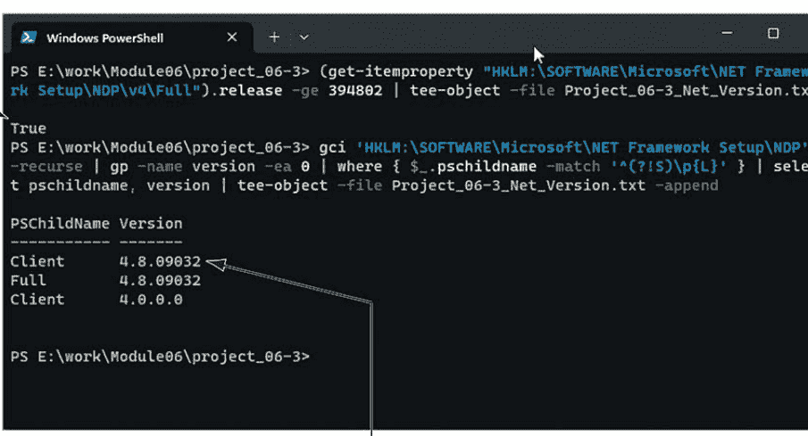

### 详情

Windows Powershell 命令行窗口的截图。验证 dot Net 已安装的输出。真正的 net 版本号为 4.8.0.09932。

如果屏幕上显示的 Client 和 Full 版本号等于或大于 4.8.04084，请继续下一节。否则，请重复本节中的第 4.3 步重新安装 .Net。

接下来，你将通过完成以下步骤确定工作站是否安装了 Python：

1. 在 PowerShell 提示符处，输入 `python --version | tee-object -file Project_06-3_Python_Version.txt` 然后按回车。
2. 如果收到 Python 未安装或安装版本低于 3.10.7 的错误，请跳到下一节。否则，提交以下文件：
   - Project_06-3_Python_Version.txt
   - Project_06-3_Net_Version.txt

## 项目 4

预计耗时：60 分钟
目标：定位并尝试恢复文件 northside06.jpg。

### 开始之前

- 为 Python 脚本创建文件夹 `C:\Work\Module_06\Project_06-3`。
- Project_06-4-C_Drive.E01
- Project_06-4-Examiner_Notes.xlsx

- 打开调查员笔记电子表格，在单元格中添加说明你启动了 Autopsy 并加载了文件 Project_06-4_C_Drive.E01。例如：“使用 Windows 版 4.18.0 启动了 Autopsy 并添加了取证镜像（fore image）。”
- 启动 Autopsy，在欢迎窗口点击 New Case 按钮。在新 Case 窗口中，在 Case Name 输入 Project_06-4，并在 Base Directory 旁点击 Browse。导航到你的 Work 文件夹。确保选择了 Single-User 并点击 Next。
- 在 Optional Information 窗口中，在 Case Number 输入 Project_06-4，在 Examiner 部分的 Name 输入你的全名。点击 Finish 开始添加数据。
- 点击 Disk Image or VM File 按钮然后点击 Next。
- 在 Select Data Source 面中，点击 Add 然后点击 Browse。在 Select Local Folders or Files 窗口中，导航到你的 Work 文件夹，点击 Project_06-4_C_Drive.E01 文件夹，点击 Select，然后在 Select Data Source 中点击 Next。
- 在 Add Data Source 窗口的 Configure Ingest Area，如果尚未选择，点击 Select All。点击 Next 然后点击 Finish。
- 当处理过程完成后，点击 Keyword Search 按钮并在搜索输入框中输入 northside06.JPG。点击 Exact Match 按钮然后 Search。
- 在 Autopsy 的 Tree Viewer 面中，点击加/减号展开 Keyword Hits 和 Single Literal Keyword Search，然后点击 northside06.jpg。
- 在 Results 面中，高亮并右键点击所有列出的文件。点击 Add Result Tags 然后点击 Notable Item (Notable)，如图 6-42 所示。

图 6-42 列出重要项目（Notable Items）


### Project_06-4 - Autopsy

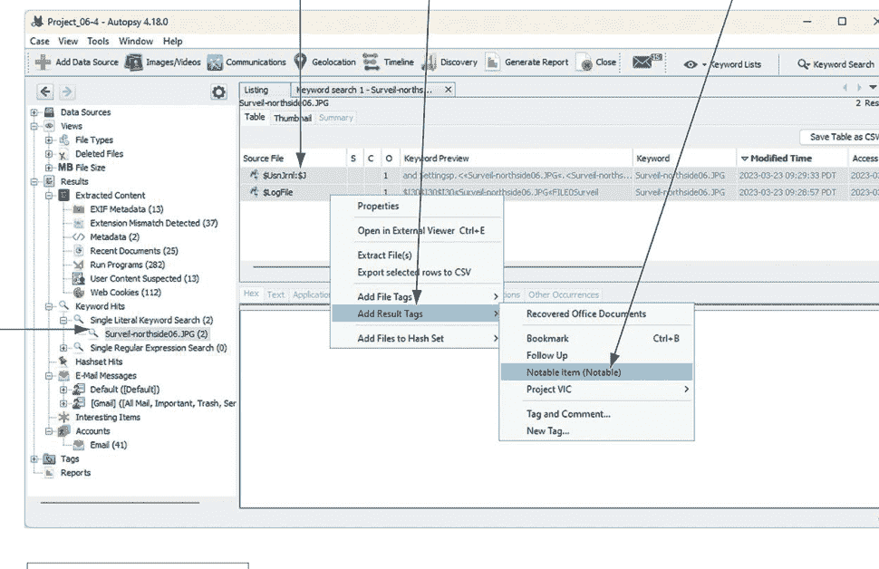

#### 详情

Autopsy 窗口的截图。步骤 1：在关键字列表菜单下点击 `Surve-northside 06.JPG` 文件。步骤 2：右键点击源文件。步骤 3：从右键菜单添加结果标签。步骤 4：点击“标记项目 (Notable)”。

在结果面板中，通过点击 $UsnJrnl:$ 取消选中高亮的文件。然后右键点击 $UsnJrnl:$（如图 6-43 所示）。点击“提取文件 (Extract File(s))”、“保存 (Save)”然后点击“确定 (OK)”以导出文件。

图 6-43 导出 $UsnJrnl:$

# Project_06-4 - Autopsy 4.18

| | | 预览 | 关键字 | 修改时间 | 访问时间 |
|---|---|---|---|---|---|
| 1 | | end123-surveil-northaide_03.JPF6-surveil... | 属性 | | 2013-03-02 |

Autopsy 窗口的截图。步骤 1：右键点击 $UsnJrnl:$。步骤 2：点击“提取文件 (Extract File(s))”以导出 $UsnJrnl:$。

12. 生成报告，并在生成报告窗口的“报告模块”面板中，点击 Excel 按钮然后点击“下一步 (Next)”。
13. 在生成报告窗口的“选择要包含的数据源”面板中，勾选 Project_06-4-C-Drive.E01 的复选框，然后点击“下一步”。
14. 在“配置报告 (Configure Report)”中，点击“所有结果 (All Results)”按钮，然后点击“选择结果类型 (Choose Result Types)”。在结果类型部分，勾选账户 (Accounts)、电子邮件消息 (E-Mail Messages) 和网络 Cookie (Web Cookies)。然后点击“确定”并点击“完成 (Finish)”。
15. 在生成报告中，点击 Excel 报告链接导出并检查 Excel 报告。点击所有工作表页签以验证数据是否已记录在报告中。
16. 在 Excel 中，点击“另存为 (Save As)”，导航到你的工作文件夹。在“另存为”窗口的文件输入框中输入 `Project_06-4_Excel_Report` 并点击“保存”。退出 Excel。
17. 在生成报告窗口中，点击“关闭”，保留 Autopsy 以进行下一个项目。

在你的审查员笔记中，写一条声明表明 `Surve-northside06.JPG` 文件似乎已被删除，并应对 $UsnJrnl:$J$ 文件进行进一步检查。

完成后，向导师提交以下文件：

- Project_06-4_Examiner_Notes.xlsx
- Project_06-4_Excel_Report.xlsx

# Project 6-5

预计时间：30 分钟
目标：确定 Project 6-4 中导出的文件 $UsnJrnl:$J 中是否存在关于文件 `Surve-northside06.jpg` 的信息。

### 开始之前

- 完成项目 6-4；
- 创建工作文件夹 `C:\Work\Module_06Project_06-5`。
- 下载模块中的以下文件到你的工作文件夹：
  - Project_06-5_Examiner_Notes.xlsx
  - Project_06-5_$UsnJrnl_$J（Project 6-4 中导出的文件 $UsnJrnl_$J$ 的副本）
- 访问以下项目：
  - 来自 Eric Zimmerman 网站的工具 (ericzimmerman.github.io/#index.md)
  - MFTECmd
  - TimelineExplorer

### 在上一个项目中

完成以下步骤：

1. 在电子表格中打开文件 `Project_06-5_Examiner_Notes.xlsx`。在“审查员姓名 (Examiner's Name)”字段中输入你的名字，并在“案件编号 (Case Number)”字段中输入 `Project_06-5`。
2. 从 Eric Zimmerman 网站选择你电脑上安装的 Python 版本 (.net 4 | 6)，然后下载并解压以下文件到你的工作文件夹：
   - MFTECmd (MFTECmd.zip)
   - Timeline Explorer (TimelineExplorer.zip)
3. 按下 Windows 键和 R 键打开命令窗口。在运行框中输入 `cmd` 并以管理员身份运行。
4. 在命令提示符窗口中输入 `cd \work\Module06\Project_06-5` 然后按回车。
5. 输入 `mftecmd.exe -f Project_06-5_$UsnJrnl_$J -csv Project_06-5_$UsnJrnl.csv` 并按回车。
6. 在文件管理器中，导航到文件夹 `\Work\Module06\Project_06-5` 并双击 `TimelineExplorer.exe`。
7. 在 Timeline Explorer 中，点击“文件 (File)”和“打开 (Open)”。导航到 `\Work\Module06\Project_06-5\Project_06-5_$UsnJrnl_$J.csv` 并点击“打开”。
8. 在搜索框中输入 `Surve-northside06.JPG` 并点击“查找 (Find)”。注意 Entry 列中该文件的相关数字，如图 6-44 所示。

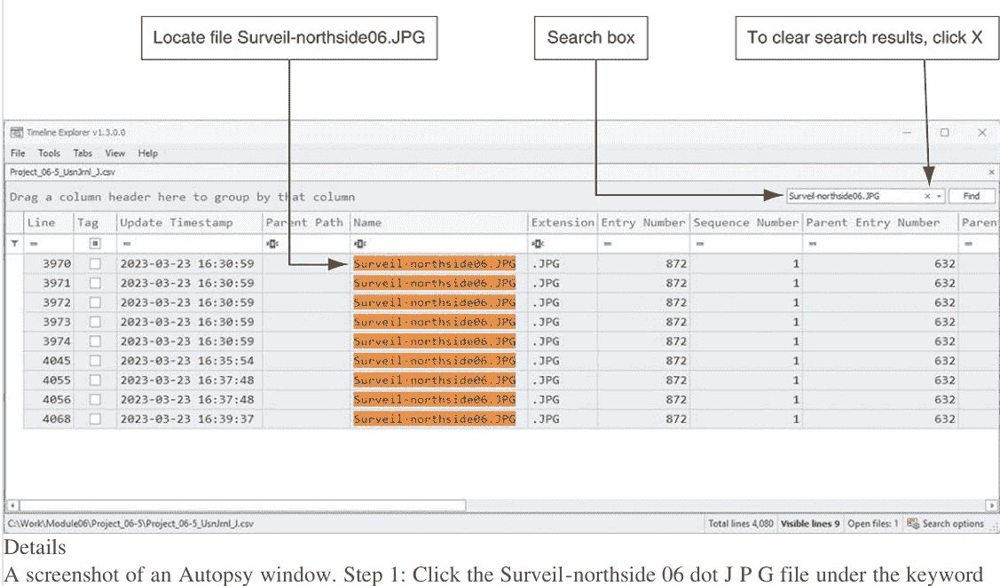

Autopsy 截图。步骤 1：点击关键字列表下的文件。步骤 2：右键点击 $UsnJrnl:$。步骤 3：点击“提取文件 (Extract File(s))”导出 $UsnJrnl:$。

9. 通过点击搜索框中的 X 清结果。在 Entry 列过滤行中，输入文件 `Surve-northside06.jpg` 的条目，如图 6-45 所示。

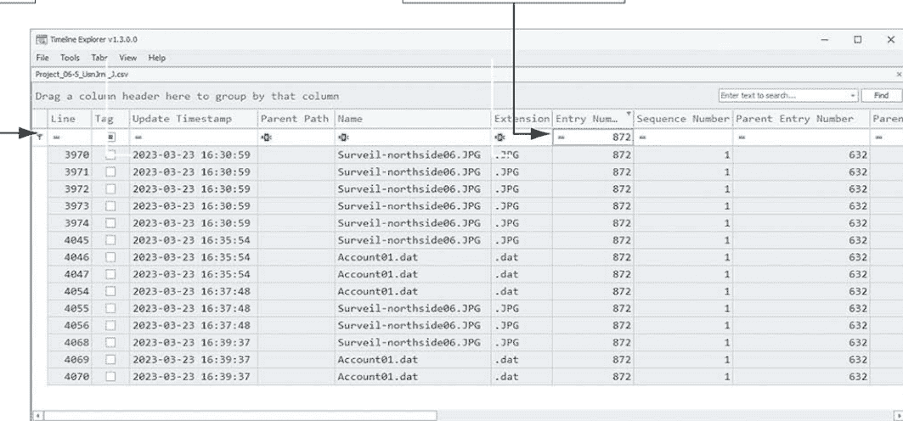

10. 在此处输入 Entry Number。

| 行 | 标签 | 更新时间戳 | 父级路径 | 名称 | 扩展名 | Entry 编号 | 序列号 | 父级 Entry 编号 |
|---|---|---|---|---|---|---|---|---|
| 3970 | | | Surveil-northside00.jpg | .JPG | 872 | 1 | 632 |
| 3971 | | 2023-03-23 16:30:59 | Surveil-northside01.jpg | .JPG | 872 | 1 | 632 |
| 3972 | | 2023-03-23 16:30:59 | Surveil-northside02.jpg | .JPG | 872 | 1 | 632 |
| 3973 | | 2023-03-23 16:30:59 | Surveil-northside03.jpg | .JPG | 872 | 1 | 632 |
| 3974 | | 2023-03-23 16:30:59 | Surveil-northside04.jpg | .JPG | 872 | 1 | 632 |
| 4046 | | 2023-03-23 16:35:44 | Account01.dat | .dat | 872 | 1 | 632 |
| 4047 | | 2023-03-23 16:35:44 | Account01.dat | .dat | 872 | 1 | 632 |
| 4054 | | 2023-03-23 16:35:44 | Account01.dat | .dat | 872 | 1 | 632 |
| 4055 | | 2023-03-23 16:37:48 | Surveil-northside05.jpg | .JPG | 872 | 1 | 632 |
| 4056 | | 2023-03-23 16:37:48 | Surveil-northside06.jpg | .JPG | 872 | 1 | 632 |
| 4068 | | 2023-03-23 16:39:37 | Surveil-northside07.jpg | .JPG | 872 | 1 | 632 |
| 4069 | | 2023-03-23 16:39:37 | Account01.dat | .dat | 872 | 1 | 632 |
| 4070 | | 2023-03-23 16:39:37 | Account01.dat | .dat | 872 | 1 | 632 |

C:\Work\Module_06\Project_06\Project_05_Surveil-northside06_Unit.xlsx

#### 详情

Timeline explorer 窗口的截图。步骤 1：定位到 Surveil-northside06.JPG。步骤 2：输入 Entry Number。

10. 在 Timeline Explorer 中，点击“文件 (File)”和“打开 (Open)”。导航到 `\Work\Module06\Project_06-5\Project_06-5_$UsnJrnl_$J.csv` 并点击“打开”。
11. 在搜索框中输入 `Surve-northside06.JPG` 并点击“查找 (Find)”。注意 Entry 列中该文件的相关数字，如图 6-44。
12. 在结果面板中，右键点击 $UsnJrnl:$。步骤 3：点击“提取文件 (Extract File(s))”、“保存 (Save)”然后点击“确定 (OK)”导出文件。
13. 在生成报告窗口的“选择要包含的数据源”面板中，勾选 Project_06-4-C-Drive.E01 的复选框，然后点击“下一步”。
14. 在“配置报告 (Configure Report)”中，点击“所有结果 (All Results)”按钮，然后点击“选择结果类型 (Choose Result Types)”。在结果类型部分，勾选账户 (Accounts)、电子邮件消息 (E-Mail Messages) 和网络 Cookie (Web Cookies)。然后点击“确定”并点击“完成 (Finish)”。
15. 在生成报告中，点击 Excel 报告链接导出并检查 Excel 报告。点击所有工作表页签以验证数据是否已记录在报告中。
16. 在 Excel 中，点击“另存为 (Save As)”，导航到你的工作文件夹。在“另存为”窗口的文件输入框中输入 `Project_06-4_Excel_Report` 并点击“保存”。退出 Excel。
17. 在生成报告窗口中，点击“关闭”，保留 Autopsy 以进行下一个项目。

在你的审查员笔记中，写一条声明表明 `Surve-northside06.JPG` 文件似乎已被删除，并应对 $UsnJrnl:$J 文件进行进一步检查。

完成后，向导师提交以下文件：

- Project_06-4_Examiner_Notes.xlsx
- Project_06-4_Excel_Report.xlsx

位于分配空间或损坏的文件。对于这些案例项目中的每一个，你将需要参考本模块中包含的表格和图表来获取识别这些数据碎片的信息。

在本项目案例项目中，你将检查一个列出特定名称的数据碎片。该碎片数据是由另一位检查员从一个似乎被部分覆盖的驱动分区恢复的。另一位检查员对名为 `Adam-Smith.txt` 的文件进行了关键词搜索，并在驱动器的未分配空间中发现了该名称的引用。检查员将碎片数据复制到文件 `Case_Project_06-2_Data` 中，并询问你是否可以帮助查看其中是否包含案件所需的任何价值内容。

在检查之后，在 `Case_Project_06-2_Examiner_Notes.xlsx` 文件中记录你的发现详情。在你的检查记录中，列出本模块中与此碎片数据相关的图和表编号。

完成后，向你的导师提交以下内容：
- Case_Project_06-2_Examiner_Notes.xlsx

# 案例项目 6-3

预计时间：40 分钟
目标：通过数据恢复任务，检查来自损坏驱动器的数据碎片，以确定它是哪种系统文件。

### 开始之前

- 在你在案例项目 6-3 中创建的文件夹 `C:\Work\Module_06\Case_Project_06-2-3-4` 中下载本模块提供的以下数据文件：
  - _Project_06-3_Data_Fragment
  - Case_Project_06-3_Examiner_Notes.xlsx
- 访问以下项目：
  - 十六进制编辑器 HxD（参考案例 6-2）

对于你的案例项目，你将检查一个列出特定名称的数据碎片。该碎片数据同样是由另一位检查员从同一个驱动分区恢复的，该分区似乎已被部分覆盖。另一位检查员对名为 `Bismarck.txt` 的文件进行了关键词搜索，该检查员将碎片数据复制到文件 `Case_Project_06-3_Data_Fragment` 中，并询问你是否可以帮助确定其中是否包含检查员案件所需的任何价值内容。

要检查这些数据，请使用 HxD 识别碎片属于哪些系统文件，并使用本模块提供的信息识别你发现的偏移位置（offset），并解释其含义的值，例如日期、时间或其他相关信息。

在检查之后，在 `Case_Project_06-3_Examiner_Notes.xlsx` 中写下发现详情。在你的检查记录中，列出本模块中与此碎片数据相关的图和表编号。

完成后，向你的导师提交以下内容：
- Case_Project_06-3_Examiner_Notes.xlsx

# 案例项目 6-4

预计时间：20 分钟
目标：通过数据恢复任务，检查来自损坏驱动器的数据碎片，以确定它是哪种系统文件。

### 开始之前

- 在你在案例项目 6-3 中创建的文件夹 `C:\Work\Module_06\Case_Project_06-2-3-4` 中下载本模块提供的以下数据文件：
  - Case_Project_06-4_Data_Fragment
  - Case_Project_06-4_Examiner_Notes.xlsx
- 访问以下项目：
  - 十六进制编辑器 HxD

与本中的案例 6-2 和 6-3 一样，你将检查一个列出特定文件名的数据碎片。该碎片数据同样是由另一位检查员从同一个驱动分区恢复的，该分区似乎已被部分覆盖。另一位检查员对名为 `Quotes.txt` 的文件进行了关键词搜索，并在取证镜像的未分配空间中发现了该名称的引用。检查员将数据碎片复制到文件 `Case_Project_06-4_Data_Fragment` 中，并询问你是否可以帮助确定其中是否包含检查员案件所需的任何价值内容。

要检查这些数据，请使用 HxD 识别碎片数据所在的系统文件，并使用本模块提供的信息识别其内容。包含你识别的偏移位置及其含义的值，例如日期、时间或其他相关信息。

在检查之后，在 `Case_Project_06-4_Examiner_Notes.xlsx` 中记录你的发现详情。在你的检查记录中，列出本模块中与此碎片数据相关的图和表编号。

完成后，向你的导师提交文件：
- Case_Project_06-4_Examiner_Notes.xlsx

# 第 7 章 Linux 和 Macintosh 文件系统

## 模块引言

阅读本模块并完成练习后，你将能够：

1. 描述 Linux 文件结构
2. 描述 Macintosh 文件结构
3. 使用 Linux 取证工具

### 引言

在“处理微软文件系统和注册表”模块中，你探索了微软操作系统（OS）和文件系统。由于数字取证人员需要理解不同操作系统如何存储这些数据，本模块通过检查 Linux 和 macOS 文件系统继续这一探索，包括它们与 Windows 文件结构的区别以及信息如何在这些系统中存储。Linux 和 macOS 文件系统不仅限于笔记本电脑等传统计算机；这些文件系统也用于平板电脑和手机等移动设备。移动设备的分析在“移动设备取证”模块中进行了讨论。由于许多免费和共享软件是基于 Linux 的，本模块提供了基础 Linux 命令的概述。理解命令的工作原理对于数字取证人员非常重要。在本模块中，你还探索了硬链接、软链接（也称为符号链接）和密钥。最后，本模块介绍了使用 XWays Forensics 等工具识别 Linux 文件结构的实践方法。

## 检查 Linux 文件结构

UNIX 创建于 20 世纪初，旨在作为一个多线程、安全的操作系统。最广泛使用的版本包括 Ubuntu、CentOS、Mint、Fedora 和 Gentoo。在使用 Linux 时使用“内核（kernel）”一词是因为 Linux 仅仅是操作系统的核心。所有其他工具、图形用户界面（GUI）等都由他人维护。尽管“内核”一词与 Linux 术语相关，但 UNIX 类操作系统也有内核，所有的 Windows 操作系统也是如此。

### 目录结构

- **/usr**: 大多数应用程序和命令位于此目录或其子目录（代表“binary”，即二进制文件），它在启动时包含二进制文件，并包含 sbin 目录（运行其中的二进制文件需要超级用户权限）。
- **/etc**: 大多数系统配置文件都存储在此目录中。
- **/home**: 所有用户的家目录，通常以用户名命名。
- **/root**: root 用户（超级用户）的家目录，与其他用户的家目录隔离开。
- **/dev**: 设备文件，作为其所代表的设备的占位符，正如在“调查员实验室”和“数字取证”模块中描述的那样；例如，dev/sda 是系统上的第一个非 IDE 磁盘驱动器，通常是主驱动器。子目录如 /dev/tty（用于练习）、mailing（存储邮件）和 spool（打印任务排队的地方）。
- **/var**: 

在“数据获取”章节中，我们涵盖了 37 条用于获取镜像的 Linux 命令。在本模块中，你将使用标准命令查找有关你 Linux 系统的信息。在本模块中使用的大多数命令在类 UNIX 操作系统（包括 macOS）中工作原理相同。记住 UNIX 和 Linux 命令是大小写敏感的。正确的大小写可能会导致你的命令错误或被解释为不同的命令。

如果你没有安装 Ubuntu 22.04，请完成活动 7-1 以创建一个用于运行的虚拟机。

## 活动 7-1

预计耗时：30 分钟
目标：在 Oracle VM VirtualBox 管理器上为你安装 Ubuntu 虚拟机 (VM)，供后续练习使用。

### 开始之前

- 创建工作文件夹 C:\Work\Module_07\Activity_07-1。
- 向你的工作文件夹下载模块提供的以下文件：
  - Activity_7-1_Examiner_Notes.xlsx
- 访问以下项目：
  - 下载并安装 Oracle VirtualBox [https://virtualbox.org/wiki/Downloads]
  - 下载 Ubuntu 22.04.x 的 ISO 镜像 [https://ubuntu.com/download/desktop]

### 完成步骤

1. 打开文件 Activity_07-1_Examiner_Notes.xlsx。
2. 在 Examiner's Name（调查员姓名）字段输入你的名字，在 Name（姓名）和 Case Number（案件编号）字段中输入 Activity 7-1。在 Date（日期）和 Date Time（时间）列中输入当前日期和时间。保存文件并保持打开状态，以记录你在整个活动过程中的步骤，并记录观察到的任何意外情况。
3. 启动 Oracle VirtualBox Manager，点击右侧面板左角的“New”（新建）图标开始创建虚拟机向导。
4. 在 Name（名称）和操作系统系统窗口中，输入 Ubuntu 22.04 作为虚拟机名称。接受默认设置并点击 Next（下一步）。
5. 在 Memory size（内存大小）窗口中，检查默认设置为 1024，然后点击 Next。
6. 在 Hard drive（硬盘）窗口中，点击 Create a virtual drive now（现在创建虚拟驱动器），然后点击 Create。在“Hard drive file type”（硬盘文件类型）窗口中，点击 Virtual Machine Disk (VMDK)，然后点击 Next。在“Storage on physical hard drive”（物理硬盘存储）窗口中，点击 Dynamically allocated（动态分配）选项按钮，然后点击 Next。
7. 在 File location and size（文件位置和大小）窗口中，将设置增加到 20 GB 并点击 Create。保持 VirtualBox 开启。在你的调查员笔记中记录你的步骤。
8. 在 Oracle VM VirtualBox Manager 中，点击 Settings（设置）图标。点击左侧面板中的 Storage（存储）。在 Storage 部分，点击 Controller: IDE 下方的 Empty（空）。在右侧的 Attributes（属性）部分，点击 CD 图标（见图 7-1）。点击 Choose/Create Virtual Optical Disk File（选择/创建虚拟光盘文件）。在 Ubuntu 22.04 – Optical Disk Selector 窗口中，点击 Add 按钮指向 ISO 文件所在的文件夹，点击 ISO，然后点击 OK。

图 7-1 选择 ISO 文件的源

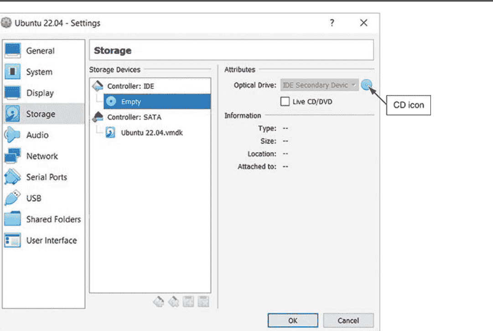

Ubuntu 22.04 设置窗口的截图。左侧面板选择了存储。在 IDE 控制器下选择了 Empty，此处显示了属性和信息设置。属性下标记有 CD 图标。来源：Oracle VirtualBox, www.virtualbox.com

9. 在 Oracle VM VirtualBox Manager 中，点击 Ubuntu 22.04 虚拟机，然后点击 Start（启动）图标。
10. 虚拟机应该执行标准的操作系统安装。接受默认设置。当提示输入用户名时，输入你的名字或名字和姓氏。使机器具有唯一性。对此窗口进行截图，并将其包含在调查员笔记文件中，详细说明你创建虚拟机的步骤。
11. 让虚拟机运行以进行下一个活动。

完成后，向你的导师提交以下内容：
- Activity_07-1_Examiner_Notes.xlsx

## 注意

记住 UNIX 和 Linux 命令是大小写敏感的。正确的大小写可能会导致你的命令错误或被解释为不同的命令。

## 活动 7-2

预计耗时：20 分钟
目标：探索基础 Linux 命令。

### 开始之前

- 完成活动 7-1
- 创建工作文件夹 C:\Work\Module_07\Activity_07-2
- 向你的工作文件夹下载模块提供的以下文件：
  - Activity_07-2_Examiner_Notes.xlsx

### 完成步骤

1. 打开文件 Activity_07-2_Examiner_Notes.xlsx。在 Examiner's Name（调查员姓名）字段输入你的名字，在 Name（姓名）和 Case Number（案件编号）字段中输入 Activity 7-2。在 Date（日期）和 Date Time（时间）列中输入当前日期和时间。在整个活动中，使用你的编辑器记录你的做法，并记录观察到的任何意外情况。
2. 必要时在 VirtualBox 中启动 Ubuntu 22.04。桌面左侧是不同应用程序的图标。你可以使用这些图标选择应用程序，或点击底部的 Show Applications（显示应用程序）图标。在搜索框中，你可以开始输入应用程序名称，系统将提供建议（见图 7-2）。输入 term，然后在显示时点击 Terminal（终端）图标。
3. 要查找计算机名称和 Linux 内核版本号，输入 `uname -a` 并按回车。记录你的计算机名称和任何相关信息。要将结果记录在文件中，输入 `uname -a ~/my.log` 并按回车。终端窗口不会显示任何内容，但在你的用户文件夹中创建名为 my.log 的文件，并将 uname -a 命令的输出重定向到那里。在 Activity_07-2_Examiner_Notes.xlsx 文件中记录你的步骤。
4. 要识别你的当前路径，输入 `pwd`（代表“打印工作目录”）并按回车。在新终端窗口中，打印工作目录是用户的家目录。
5. 查看目录内容列表
6. 
7. 要查看日志文件的更新内容，输入 `cat ~/my.log` 并按 **Enter**。对此进行截图并将其添加到你的阅卷文件（examiner files）。

在当前版本的 Gnome（即 Ubuntu 桌面）中，终端窗口的滚动条不会显示，但你可以将鼠标指针移动到通常放置滚动条的位置来显示它。

8. 输入 `ip addr` 并按 **Enter** 查看你的网络接口：有线、无线、FireWire、lo（环回设备）等。接口显示了它们的 MAC 地址（在 "eth addr" 列中）和当前分配的 IP 地址（在 "inet addr" 列中）。尝试使用 `-a` 运行相同命令并观察输出的差异。将此命令的输出追加到你的日志文件中。
9. 输入 `cd /` 并按 **Enter** 导航到根目录。输入 `pwd` 并按 **Enter** 确认你处于目录树的顶部。在此层级，当你输入 `ls -l` 并按 **Enter** 时，你应该看到如 /etc、/lost+found 和 /home 等文件夹，这表明你处于顶部（见图 7-3）。同样注意文件的所有者是 root。

> 图 7-3 确认你处于目录树的顶部


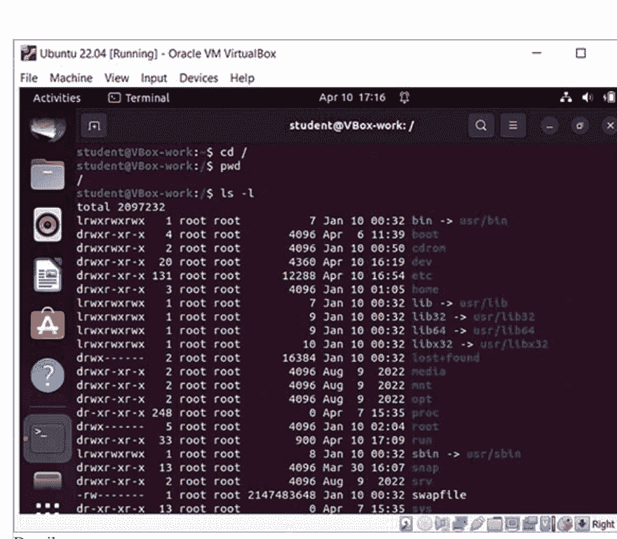

Ubuntu 22.04 运行 Oracle VM Virtual 窗口截图。左侧是不同类别应用程序的图标。在根目录树顶部，输入了 `cd`、`cd` 和 `pwd`。`ls -l` 列出了 lost、found 和 home 文件夹，表明用户处于顶部。来源：Ubuntu

10. 接下来，输入 `clear`，然后输入 `cd` 并按 Enter。输入 `pwd` 并按 Enter，你会发现自己回到了主目录。当你输入 `ls -l` 并按 Enter 时，你会看到你自己的文件，并且所有者是你登录时使用的名称，如图 7-4 所示。

图 7-4 /home/user 目录列表

# Ubuntu 22.04 (运行) - Oracle VM VirtualBox

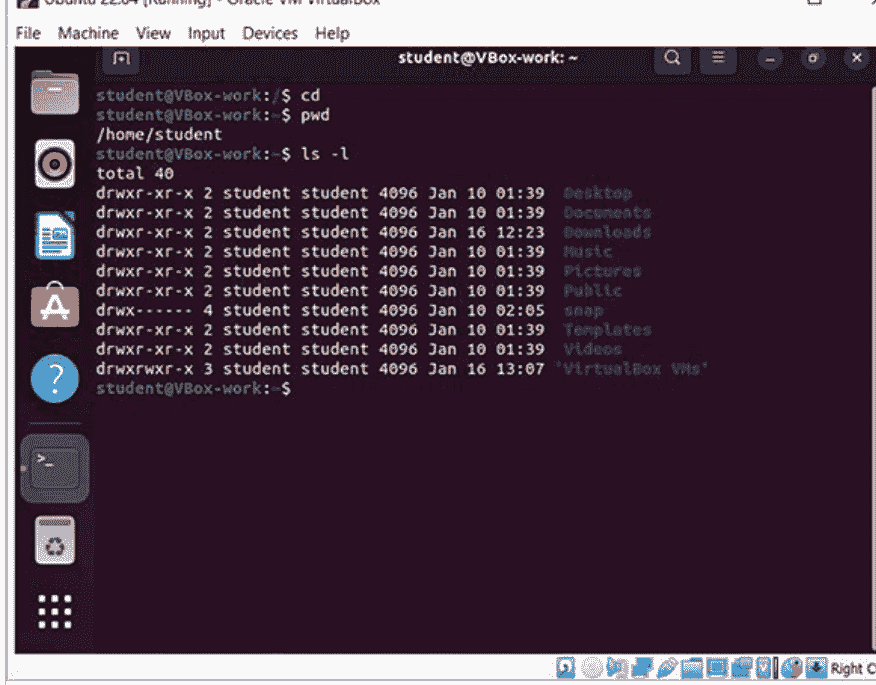

详情
Ubuntu 22.04 运行 Oracle VM Box 窗口截图。左侧是应用程序类别的图标。在根目录树底部，输入了 `cd`、`cd` 和 `pwd`。`ls -l` 列出了文件。来源：Ubuntu

11. 要查看你当前使用的用户名，输入 `whoami` 并按 **Enter**。它应该指示你以 student 登录——或者你在安装系统时使用的任何名称。
12. 要查看系统上配置的所有用户账户列表，输入 `sudo cat /etc/passwd` 并按 **Enter**。输入密码并按 **Enter**。输出显示用户账户配置文件 passwd 的内容。它包含了超级用户账户“root”、你当前使用的普通用户账户，以及用于系统服务的一长系统账户列表，如 ip、sys、daemon 和 sync。对于每个账户，你可以看到用户名、数字用户 ID 和组 ID、可能经过格式化的显示名称、主目录（超级用户为 /root）以及命令 shell（普通用户和 root 用户为 /bin/bash）。
13. 要仅查看你的用户账户信息，输入 `cat /etc/passwd | grep user`（将 user 替换为你自己的用户名）并按 **Enter**。
14. 输入 `cat /etc/passwd >> ~/my.log` 并按 **Enter** 将 `/etc/passwd` 追加到你的文件中。`/etc/passwd` 文件不包含用户密码，尽管在早期的 Linux 版本中它存储了哈希后的密码。因为每个人都能读取此文件，即使是哈希后的密码也被视为安全风险，因此它们被移动到了 /etc/shadow 文件，只有 root 用户可以访问。
15. 要获取 /etc/shadow 文件的详细列表，输入 `ls -l /etc/shadow` 并按 Enter。如果拒绝访问，请在命令前加上 sudo 重试。
16. 输入 `cat /etc/shadow` 并按 Enter。然后输入密码并按 Enter。将显示文件内容，但只有普通账户包含密码哈希。你应该只为你的用户账户看到这些信息。
17. 要将你的用户账户记录追加到日志文件，输入 `sudo cat /etc/shadow | grep user >> ~/my.log`（将 user 替换为你的用户名）并按 Enter。此命令将 cat 的输出重定向到 grep，仅保留包含你用户名的行，并将其追加到日志文件中。你可以在 shell 中使用管道组合命令并只进行一次文件重定向（使用 > 或 >>），因为文件是一个死胡同——在被重定向到文件之后将不会有任何输出。请务必将你所采取的步骤记录在文件 Activity_07-2_Examiner_Notes.xlsx 中。
18. 输入 `exit` 关闭终端窗口。保持 Ubuntu 运行以进行下一个活动。

## Inodes（节点）

inode 包含文件和目录的元数据，并提供了一种链接存储在数据块中的数据的机制。当在 Linux 文件系统中创建文件或目录时，会分配一个包含以下信息的 inode：

- 文件或目录的模式和类型
- 指向文件或目录的链接数
- 文件或目录所有者的 UID 和 GID
- 文件或目录的字节数
- 文件或目录的最后访问时间及修改更改时间
- inode 的文件状态更改时间
- 文件数据的块地址
- 文件数据的间接块、双间接块和三级间接块地址
- inode 的当前使用状态
- 分配给文件的实际块数
- 文件生成编号和版本号
- 连续链接

inode 中唯一**不**包含的元数据部分是文件名和路径。inode 包含修改、访问和创建（MAC）时间，但不包含文件名。一个分配的 inode 拥有 13 个指针，链接到数据块以及存储文件的其他指针。指针 1 到 10 直接链接到磁盘数据块中的存储块，以及指示数据在磁盘上位置的块地址。这些指针是直接的，因为每个指针都分配了一个块的数据。

随着文件的增长，操作系统提供多达三层的间接指针。在文件的 inode 中，前 10 个指针中的每一个都称为**直接指针**。第 11 个指针称为**间接指针**。第 12 个指针称为**双间接指针**。第 13 个指针称为**三级间接指针**。为了扩展存储，操作系统会初始化原始 inode 的第 11 个指针，该指针链接到 128 个指针 inode。每个指针直接链接到位于驱动器数据块中的 128 个块。如果原始 inode 中的所有 10 个指针都被文件数据耗尽，则第 11 个指针将链接到另外 128 个指针。该间接 inode 组中的第一个指针指向第 11 块。这 128 个 inode 中的最后一个块是第 138 块。

> “间接 inode”一词是指原始 inode 中的第 11 个指针，它指向另一组 inode 指针。换句话说，它是间接链接到原始 inode 的。

如果存储更多内容，则会使用原始 inode 的第 12 个指针链接到另外 128 个指针 inode。从这些每一个中又会创建另外 128 个指针。这第二层 inode 指针随后直接链接到驱动器数据块中的块。第一个双间接指针指向第 139 块。如果需要更多存储，第 13 个指针将链接到 128 个指针 inode，每个指针指向另外 128 个指针，且此第二层所示每个指针都指向第三层的 128 个指针。文件数据存储如图 7-5 所示。

**图 7-5** Linux 文件系统中的 Inodes

## inode 指针

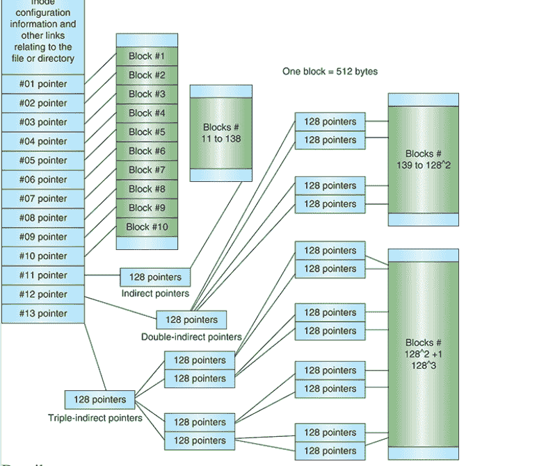

### 详情

该图定义了在 Linux 文件系统中如何从原始 Inode 指针创建额外的指针。Inode 表示由 14 个单元格组成的垂直堆栈。第一个单元格读取 Inode 配置以及指向文件或目录的其他链接。其他单元格标记为 01 到 13 指针。从第十个指针到 1 到 10 的相应块。第 11 个指针到另外 128 个指针，标记为间接指针，链接到块 11 到 138 的块。原始 inode 的第 12 个指针链接到另外 128 个标记为双间接指针的 inode。从这些指针中的每一个，又会创建带有两个块的另外 128 个指针，其中一个块等于 512 字节。这些块中的每个块指向 139 到 128 平方的块。原始 inode 指针的第 13 个链接到 128 个标记为三级间接指针的 inode。每个指针指向另外 128 个块，每个块又指向块 128 平方的 1 和 128 个块。

所有磁盘的存储容量都大于制造商声称的容量。例如，一个 240 GB 的磁盘实际上可能有 240.5 GB 的空闲空间，因为磁盘存在坏道。Windows 不会跟踪坏道，而 Linux 会在一个名为坏块 inode 的 inode 中记录它们。根目录是 inode 2，坏块 inode 是 inode 1。对于某些取证人员来说，忽略 inode 1 会导致无法恢复某些案例的数据。试图误导调查人员的人可以访问坏块 inode，列出其中的列表，并在这些指定的“坏道”中隐藏信息。

要查找 Linux 计算机上的坏块，你可以使用 `badblocks` 命令，你必须以 root 身份登录才能执行。Linux 有两个提供坏块信息的命令：`mke2fs` 和 `e2fsck`。`badblocks` 命令可能会破坏数据，但 `mke2fs` 和 `e2fsck` 包含了防止覆盖重要信息的保护措施。

### 注意 5

关于 inode 以及如何在十六编辑器中查看它们的深入讨论，请参考以下文章：

# Understanding Ext4 (Part 1): Extents: https://sans.org/blog/understanding-ext4-part-1-extents

`stat` 命令假设块大小为 512 字节。在 ext4 中，块大小为 4096 字节（4 KB）。因此，`ls` 和 `stat` 等常用命令可能会产生误导性的结果。如图 7-6 所示，`stat` 命令显示尽管块大小实际上是。如图 7-7 所示，`stat` 命令显示尽管块大小实际上是。当使用 `filefrag` 命令时，它指定一个4096 字节。


Ubuntu 22.04 [运行中] - Oracle VirtualBox

文件 物理机 视图 输入设备

活动 终端

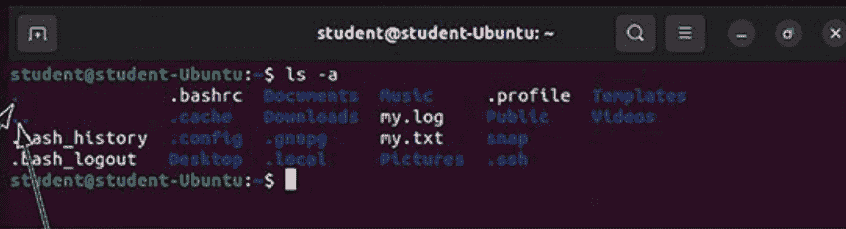

### 点符号法

#### 详情

一张 Ubuntu 22.04 运行状态下的 Oracle VirtualBox 窗口截图。左侧是不同类别应用程序的图标。`ls` 命令显示了目录及其父目录的前两个项目，分别标记为“点符号法”和“点符号法”。来源：Ubuntu

**符号链接**（也称为链接或 symlink）简单来说就是指向另一个文件的指针；符号链接不包含在计数中。与硬链接不同，符号链接可以指向其他驱动器或其他项目或网络上的其他部分；它们只需要另一个路径。符号链接有自己的索引节点（inode），这与其所指向项目的索引节点不同。与硬链接不同，它们依赖于所指向位置的持续存在，并且在运行的 Linux 系统中，它们比硬链接更容易识别。硬链接通过名称指向其目标。如果名称和路径不存在，符号链接将停止工作。你使用 `ln -s` 命令创建符号链接；模块末尾的 `Project 7-1` 将介绍这一过程。

## 自测

1. 对密码值进行加盐（Salting）处理用于完成以下哪项操作？
   a. 增强密码的数字特征。
   b. 在两个或多个人使用相同密码的情况下区分密码。
   c. 防止黑客破解它们。
   d. 增加密码的值。

**答案：** b. 在两个或多个人使用相同密码的情况下区分密码。
**解释：** 从统计学上讲，多个人可能会选择相同的密码。由于系统存储的是密码的哈希值而不是密码本身，因此使用“加盐”让它们变得不同并使每个密码更难以破解。

2. 索引节点（Inodes）包含以下哪些项的内容？
   a. UID 和 GID
   b. 节点号
   c. 文件名及其路径
   d. 访问时间和和修改时间

**答案：** c. 文件名及其路径
**解释：** Linux 文件系统中的索引节点包含大量信息，包括 GID、UID、链接数、访问时间、创建时间、修改时间等信息。唯一不存储在索引中的中的是文件名和路径。

# 检查 Macintosh 文件结构

在编写此时，Apple 笔记本电脑和桌面电脑当前的操作系统是 macOS 12 Monterey。Apple 支持的旧版本包括 macOS 11 Big Sur、10.15 (Catalina) 和 10.4 (Mojave)。1984 年，Apple 引入了第一个操作系统 Apple System 1；1997 年，Apple 引入了 Mac OS 8，随后是 Mac OS 9，然后是 Mac X，后者转向了 Intel 处理器并基于 UNIX。Apple 操作系统的命名习惯变为简单的“OS X”，并在 2016 年变为 macOS。2020 年，Apple 发布了 macOS 11 Big Sur，为 Apple 的原生硅芯片 M1 处理器提供了支持。

## 注意

请参考 Apple 网站查看各种软件（包括 macOS Monterey）的发行说明。你可以在 support.apple.com/en-us/HT21285 找到更新信息；

在 OS X 之前，使用的是分级文件系统 (HFS)；在 HFS 中，文件存储在目录（文件夹）中，目录可以嵌套在其他目录中。通过 Mac OS 8.1，Apple 引入了 Mac OS Extended (HFS+) 文件系统。HFS 和 HFS+ 之间的主要区别在于限于 65535 (2^16-1) 个分配块。因此，HFS+ 在较大的卷上支持更小的块，从而提高了磁盘利用效率。

338 这种空间效率随着磁盘尺寸的增大变得更加明显；由于 HFS 的限制性，在 2 TB 的磁盘上单个分配块可能高达 32 MB。分配块只能存储一个文件，因此如果文件只有 0.1 MB (100 KB)，这实际上浪费了 31.9 MB 的存储空间，这些空间无法供其他文件使用。HFS+ 通过增加文件系统可用分配块的数量解决了这个问题，将分配块大小减小到默认的 4 KB。使用之前的示例，将使用 25 x 4 KB 的分配块来存储该文件，剩余的 31.9 MB 存储空间仍供其他文件使用。从 macOS 10.13 High Sierra 开始，配备固态硬盘 (SSD) 的 Apple 产品上的文件系统在从旧版 macOS 升级或进行全新安装时被格式化为新的 Apple 文件系统 (APFS)。用户仍可以使用 macOS Monterey 挂载 HFS+ 驱动器。Apple 在 macOS Sierra 10.12 中不再提供对 HFS+ 的支持，并在 macOS Catalina 10.15 中删除了对挂载和读取 HFS 设备的支持。

## Mac 文件结构概述

在旧版本的 macOS 中，数据文件是一个包含两个部分的文件结构：数据分支（data fork，存储数据的地方）和资源分支（resource fork，存储文件元数据和应用程序信息的地方）（见图 7-10）。两个分支都包含每个文件的以下基本信息：

- 资源映射
- 每个文件的资源标头信息
- 窗口位置
- 图标

图 7-10 资源分支和数据分支


### 分配块

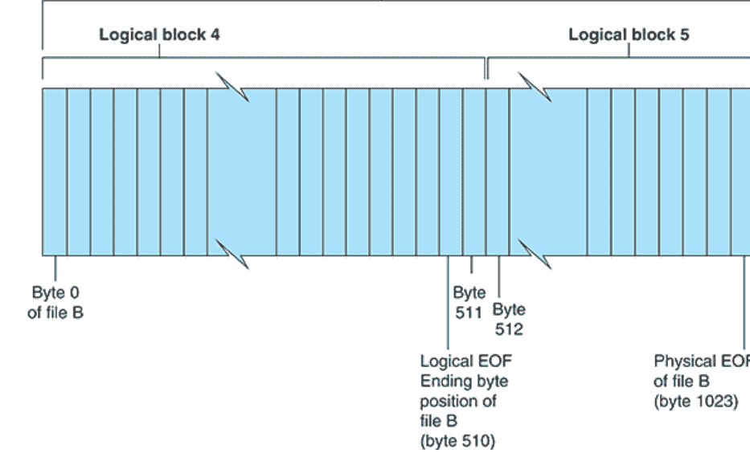

#### 详情

水平堆栈定义了文件结束的两个描述符：逻辑 E O 和 物理 E O。该堆栈标记为文件 B 的分配块 1，它被分为逻辑块 4 和逻辑块 5。逻辑块 4 包含文件 B 的起始字节 0，并以文件结尾的逻辑 E O 结束，其位置为 510，之后是字节 511 和字节 512。逻辑块 5 则以文件 B 在字节 1023 处的物理 E O 结束。

在 macOS 中，通过使用“簇”（clumps）来减少文件碎片化。一个“簇”是一组连续的分配块。随着文件大小的增加，它会占用簇中更多的空间。通过向大文件添加更多簇，可以将卷碎片降至最低。

对于较旧的 HFS 格式驱动器，卷（或磁盘）上的前两个逻辑块 0 和 1 是包含系统启动指令的块。系统文件的可选可执行代码也可以放置在引导循环中。

旧版本的 Mac OS 为 HFS 使用主目录块 (MDB)，即 MDB 是卷信息块 (VIB)。有关卷的所有信息都存储在 MDB 中，并在卷初始化时写入。MDB 的副本也会写入卷上的倒数第二个块中，以支持磁盘工具功能。当操作系统挂载一个卷时，MDB 中的某些信息会被写入卷控制块 (VCB) 并存储在系统内存中。当用户需要该卷并卸载它时，VCB 会被移除。

当事件存储任何关于文件溢出或目录大小增加的信息时，MDB 副本会被更新。扩展溢出文件用于存储卷上的所有文件和目录；它用于维护文件和目录之间的关系。卷位图（Volume Bitmap）是一个系统应用程序，它跟踪卷上的每个块以确定哪些块正在使用，哪些块可以接收数据。它包含有关“块”的信息，但没有关于它们的内容。卷位图的大小取决于卷的分配块数量。

文件映射信息存储在两个位置：溢出文件和文件的目录条目。苹果文件系统（HFS、HFS+ 和 APFS）利用 B 树，这是一种组织目录层次结构和文件映射的数据结构类型。在这个文件系统中，节点（记录或对象）包含文件数据。每个节点为 512 字节。包含实际文件数据的节点称为叶子节点；它们是 B 树的底层。B 树还有以下处理文件信息的节点：

- 头部节点存储有关 B 树的信息。
- 索引节点存储指向上一个节点和下一个节点的链接信息。
- 映射节点存储节点描述符和映射记录。

### 注意 8

B 树（读作 "bee tree"）、B+树（读作 "bee plus tree"）和 B*树（读作 "bee star tree"）是各种形式的数据结构，用于组织和高效检索来自机械存储的信息，机械存储的速度比计算机内存慢几个数量级。计算机文件系统使用 B 树来管理文件系统的目录内容，数字取证鉴定员使用 B 树来确定数据的存储方式，并识别索引节点和映射节点的位置，因为这些节点包含了可以恢复人工物的信息。计算机科学家在各种应用中利用 B 树和 B*树，数据库架构师在编写新的数据库引擎来管理数据库内的数据时，可以使用 B 树和 B*树。

有关通用 B 树的更多信息，请参考以下资源：

- [https://www.geeksforgeeks.org/b-tree-introduction/](https://www.geeksforgeeks.org/b-tree-introduction/)
- [https://www.geeksforgeeks.org/b-tree-set-2/](https://www.geeksforgeeks.org/b-tree-set-2/)
- [https://www.geeksforgeeks.org/b-tree-construction-of-b-tree/](https://www.geeksforgeeks.org/b-tree-construction-of-b-tree/)
- [https://www.geeksforgeeks.org/b-tree-insertion-in-tree/](https://www.geeksforgeeks.org/b-tree-insertion-in-tree/)
- [https://www.geeksforgeeks.org/b-trees-implementation-in-c/](https://www.geeksforgeeks.org/b-trees-implementation-in-c/)
- [https://www.geeksforgeeks.org/introduction-of-b-tree/](https://www.geeksforgeeks.org/introduction-of-b-tree/)
- [https://javatpoint.com/b-plus-tree/](https://javatpoint.com/b-plus-tree/)

为了交互和观察 B 树的操作，请参考以下资源：

- [https://www.geeksforgeeks.org/introduction-of-b-tree/](https://www.geeksforgeeks.org/introduction-of-b-tree/)
- [https://javatpoint.com/b-plus-tree/](https://javatpoint.com/b-plus-tree/)

### 注意 9

有关 HFS 和 HFS+ 的更多信息，请参考以下资源：

- [https://wiki.sleuthkit.org/index.php?title=HFS](https://wiki.sleuthkit.org/index.php?title=HFS)
- [https://wiki.sleuthkit.org/index.php?title=HFS+](https://wiki.sleuthkit.org/index.php?title=HFS+)

## Apple 文件系统

APFS 是 HFS+ 的继者，具有以下特征：

- 使用“快照”（snapshots）来保护数据。
- 具有“克隆”（cloning）功能，无需占用额外空间。
- 空间共享（space sharing），允许多个卷共享可用磁盘空间。
- 针对 SSD 进行了优化。
- 原生支持加密。

## macOS 中的取证程序

macOS 使用了统一日志（unified logging）功能，它包含了可以用于恢复人工物的信息。这些日志存储在 `/var/db/diagnostics` 和 `/var/db/uuidtext`。它创建了三个命令：`log collect`、`log log` 和 `log show`，取证鉴定员可以使用这些命令。

在 macOS 中的文件结构

了解 macOS 的文件结构可以帮助你确定数据的存储位置。例如，统一日志功能可以收集哪些文件。在 macOS 中，`/var/db/diagnostics` 目录包含了日志。

使用 128-bit AES 加密对整个磁盘。
在调查过程中你可能会发现的其他信息包括密码。从 Mac OS 8.6 开始，“钥匙串访问”（Keychain Access）一直被用于管理应用程序、网站和其他系统文件的密码 [fmacworld.com/article/2013756/how-to-manage-passwords-with-keychain-access.html]。你可以在多个地方找到钥匙串文件，包括 /System/Library/Keychains 和 /Library/Keychains，这些文件对于显示哪些应用程序和文件需要密码有用。你可以使用 Mac 应用程序“钥匙串访问”或“系统设置/密码”来恢复密码。
在大多数调查中，你还需要定位已删除的文件，在 macOS 中，这些文件位于“垃圾桶”（Trash）文件夹中。然而，如果通过命令行删除删除文件，它将不会出现在垃圾箱中，这类似于 Windows 中的回收桶。

### 注意 10

与 Windows 不同，macOS 文件在垃圾箱中会保留文件名。此外，当你在 Windows 中复制文件时，时间戳会被重置；但在 macOS 中，会复制创建时间，因此时间戳更加准确。

Cellbrite Digital Collector（原 BlackBag Technologies MacQuestion）是一款用于对 macOS 文件系统进行原生采集和取证的信誉产品 [cellbrite.com/en/digital-collector]。以下产品也增加了分析 macOS 文件系统的功能：

- PassMark Software OSForensics: [osforensics.com/faqs-and-tutorials/mac-linux-drives.html]
- GetData Forensics Forensic Explorer: [getdataforensics.com/product/forensic-explorer-forex]
- Autopsy: [github.com/sleuthkit/autopsy/releases]

## macOS 中的数据采集方法

要检查正在运行的 macOS，你应该了解“数据采集”模块中描述的技术，以及由 Apple 设计和工程引起的异常。某些 Apple 产品具有专有方案，需要特殊的驱动程序位来移动它们，而另一些 Apple 产品的设计为供用户服务，并有官方的 Apple 文档支持。Apple 产品可能使用非标准或焊接组件进行存储，并且数据可能通过 Apple 的 T2 安全芯片或安全隔区平台（Secure Enclave Platform）进行加密。这些设备可能会损坏计算机或对存储设备造成不可修复的损坏。在获取任何 Mac 之前，请确定此过程是否必要，如果是的话，请在开始前参考官方文档。务必考虑其他可能的来源，例如外部硬盘上的 Apple Time Machine 备份，或对 Mac 进行逻辑采集或实机采集。

你需要一个与 macOS 兼容的取证启动盘来制作取证镜像，然后必须将镜像写入外部驱动器或 USB 驱动器。较大的 macOS 系统像桌面级 PC 一样构建，因此无需拆卸存储设备。

在尝试采集 Apple 产品之前，请务必收集保管人的姓名、用户名和作为系统管理员的用户名密码。根据计算机的配置，可能需要用户名和密码才能进入 macOS 恢复模式，以将计算机设置为从取证启动盘启动（如果 Mac 支持），并启用允许取证软件读取 APFS 加密卷的访问权限。在运行 macOS 恢复模式时，你可以禁用安全启动或启动到外部设备以进行采集。如果你需要安装 Rosetta 2，可能还需要系统管理员凭据，这将允许你在新的 Apple 硅 M1 处理器上使用基于 Intel 的工具。如果你无法获取计算机密码，请咨询你的主管或负责人以了解应采取的行动。

完成采集后，下一步是使用取证工具检查镜像文件。你使用的工具取决于镜像文件格式。例如，如果你使用了 EnCase、FTK 或 Autopsy，必须使用以下工具之一来分析镜像（如果你制作了原始镜像）：

- Cellebrite Digital Collector
- GetData Forensics Forensic Explorer
- PassMark Software OSForensics
- Cellebrite Digital Collector （原 BlackBag Technologies MacQuestion）
- Cellebrite Digital Collector （原 BlackBag Technologies Blacklight）
- Cellebrite Digital Collector （原 Guidance Software FTK）
- Cellebrite Digital Collector [cellbrite.com/en/digital-collector]

在连接加密设备时，参考官方的 Apple 文档（https://developer.apple.com/library/archive/DriversHardware/Introduction.html）。

## 自测

3. 哪些技术给取证调查带来了挑战？
   a. T2
   b. 安全隔区
   c. Air5
   d. Air3

**答案：** b. 安全隔区
**解释：** 在进行采集时，安全隔区是一项挑战。

4. macOS 需要处于哪种模式？
   a. 救援模式
   b. 恢复模式
   c. 重生模式
   d. 还原模式

**答案：** b. 恢复模式
**解释：** 在进行调查时，可能需要进入恢复模式。

# 使用取证工具

当 Windows 工具不可用时，了解如何使用取证工具非常有用。某些商业工具——如 OSForensics、X-Ways Forensics、Guidance Software Encase 和 AccessData FTK——可以分析 Ext2、Ext3、Ext4、ReFS 和 Reiser4。免费工具包括 Sleuth Kit ([sleuthkit.org/)，Sleuth Kit（部分称为 TSK）基于 Daniel Carrier 和 Wiese。Autopsy 是一款流行的工具。The 开发了另一种名为 Forest ([foremost.sourceforge.org/) 的专用工具。Forest 是一种可以读取许多文件格式的工具。它有一个配置文件 forest.conf，列出了常见的头部。如果格式不在该文件中，可以使用十六进制编辑器定义新格式的头部，并使用文本编辑器更新该文件。tarball 是包含一个或多个文件的压缩数据文件，类似于 Windows 的 zip 工具。该工具已多年未更新，但可能仍然有用。Kali Linux 是一种流行的发行版，除了取证工具外，还提供渗透测试、密码破解和网络安全功能。作为取证调查员，你可以在工具箱中获得多种工具，例如 Kali Linux ([kali.org/tools/)。

另一个基于 Linux 的产品 Paladin Edge 是基于 Ubuntu 的并加载了多种工具 ([sumori.com/product/paladin-edge-64-bit/)。这是一个可启动发行版，允许你以合理的方式进行调查。尽管它是免费的，但公司接受捐赠。在下一个活动中，通过安装 Kali 和 Paladin 为模块结束项目做准备。

## 活动 7-3

预计时间：40 分钟
目标：为模块结束练习创建 Kali 和 Paladin VM。

### 开始之前

- 完成活动 7-1
- 创建工作文件夹 CA/Module_07/Activity_07-3。
- 将模块中的以下文件下载到工作文件夹：
  - Activity_07_Example_Notes.xlsx
- 访问以下项目：
  - Kali 虚拟机镜像 [kali.org/get-kali-virtual-machines]
  - Paladin Edge ISO [sumori.com/product/paladin-edge-64-bit]
  - 在你的 Windows 机器上安装 7Zip [7-zip.org/download.html]，它是免费的。

1. 打开 `Activity_07-3_Examiner_Notes.xlsx` 文件，并在相应字段中输入你的姓名和 Activity 7-3。在后续活动过程中，请使用你的取证笔记（examiner notes）记录你的操作，并记录观察到的任何意外情况。
2. 使用 7Zip 提取 Kali 镜像。
3. 打开 VirtualBox，点击左上角的 **Tools**（工具）。点击右侧的 Add（添加）按钮。
4. 导航到提取出的 Kali 镜像位置并点击 **Open**（打开）。VirtualBox Manager 现在应该显示 Kali 虚拟机。点击 **Start**（启动）按钮验证其运行正常。默认用户名和密码均为 kali。
5. 打开后，通过菜单验证其运行正常。在 `Activity_07-3_Examiner_Notes.xlsx` 文件中记录你完成安装的步骤以及遇到的任何问题。
6. 关闭虚拟机。

### 笔记 12

有关使用 Paladin 的更多详情，请访问 sumuri.com/resources/

要创建 Paladin 虚拟机，点击 **New**（新建）按钮。

在出现的窗口中，输入名称 **Paladin, Operating System Linux** 并点击 **Next**（下一步）。

对于硬盘类型，选择 **VMDK**。将磁盘大小增加到 **20 GB**，接受其余默认设置，然后点击 **Create**（创建）。

虚拟机创建后，点击 **Settings**（设置）然后点击 **Storage**（存储）。像你在活动 7-1 中执行 Operations，点击 IDE 图并导航到存储 Paladin ISO 的位置。

选择镜像后，点击 **Okay**（确定）。然后使用默认设置安装操作系统。

安装完成后，退出 VirtualBox。

完成后，用有关 Paladin 安装的信息更新你的取证笔记，并向教师提交以下文件：
- Activity_07-3_Examiner_Notes.xlsx

# 使用 dd 命令

在“数据获取（Data Acquisition）”模块中，你学习了 `dd` 命令，它是获取磁盘镜像最常用的命令行方法。模块中还讨论了 `dd_` 工具，它是一个具有许多数据获取功能的命令行应用程序，相比 `dd` 和 `dcfldd` 命令提供了多项改进。`dd `` 工具需要在 Linux 发行版中安装。例如，若要在 Kali 发行版中安装 `dd`，请在 Kali 中启动终端窗口，执行以下命令并按回车：

```


# dd 命令使用指南

## 安装 dd

执行 `dd --help` 命令。

此命令将返回一条消息指示 `dd` 未安装，并询问你是否想要安装，此时你可以输入内容启动安装，如图所示。

**图 7-13 dd 安装**

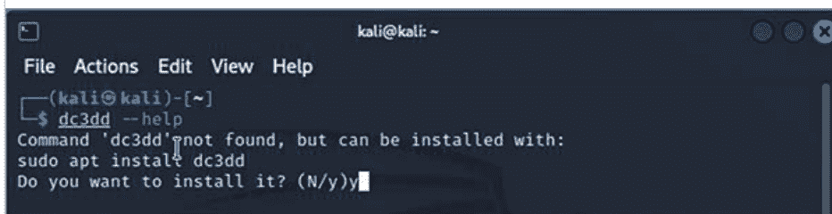

**详情：**
Kali Linux 发行版中终端窗口的截图。该命令返回一条消息显示未找到 `dd`，但可以通过 `sudo apt install dd` 安装，并询问你是否想要安装，此时输入 `y` 启动安装。

安装好 `dd` 后，你可以输入 `dd --help` 命令显示其帮助手册并使用...查看其选项。

## dd 获取示例

在具有超级用户权限的 Linux 终端 shell 中运行的 `dd` 命令获取示例将包含以下命令和选项：

```
dd if=/dev/sdb2 hash-md5 log=case007.log ofsz=3M hash=case007.111 log=case7-hash-total.log
```

该命令将示例对连接的源驱动分区（`/dev/sdb2`）进行逻辑获取，使用选项（`if`，输入文件），并创建每个 3 MB 的分段卷。在此示例中，`dd` 将对整个源分区进行哈希处理并准备到保存的镜像卷中（`ofs`，输出文件集）。它还将对每个分段卷进行哈希并与驱动器上的相关扇区进行比较作为进一步验证。每个卷从第一个卷开始将分别命名为 `case001`，然后是 `case002`，依此类推，直到获取所有数据。注意，数字从 `.001` 开始，每创建一个分段卷增加一个。

**图 7-14 显示了 `dd` 命令的屏幕输出。**

**图 7-14 dd 获取**

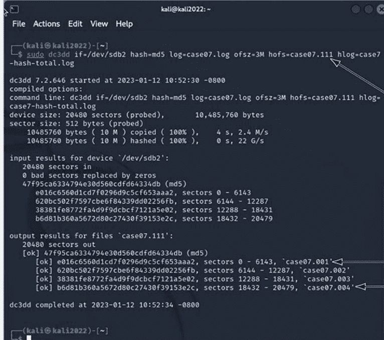

```
@kali@kali2022:~$ sudo dd dc30d if=/dev/sddb hash-md5 log=case07.log offsz=3m hofs=case07.1 hlog=case7-total.log

dc30d 7.2.6446 started at 2023-01-12 10:52:30 -0000

complex [1=]

line: dc30d if=/dev/sddb hash-md5 log=case07.log offsz=3m hofs=case07.1 hlog=case7-total.log

20480 sectors (probed) 10,485,706 bytes

sector size: 512 bytes (probed)

20480 sectors copied (100 %) 4 s, 2.4 M/s

10485706 bytes (10 M) hashed (100 %) 0 s, 2.2 G/s

input results for device /dev/sddb:

20480 sectors in

0 erased by zeros

47f95c63c94a30bd0dcf43db (md) sectors 0 - 613

e01e650b1d0c296f53a2, sectors 1144 - 2287

62b0c6d3c2b7759f8b3d, sectors 1144 - 1207, case07.002

383181f7e7a4ffddf7212a5e2, sectors 2008 - 18431, case07.003

b6d06eee65ff22111c, sectors 1843 -22049

output results for files case07.111:

20488 sectors in [ok] 47f95c63c94a30bd0dcf43db (md) sectors 0 - 613, case07.001

[ok] 62b0c6d3c2b7759f8b3d, sectors 1144 - 1207, case07.002

[ok] 383181f7e7a4ffddf7212a5e2, sectors 2008 - 18431, case07.003

[ok] b6d06e5e65ff22111c, sectors 1843 - 22049

dc30d completed at 2023-01-12 10:52:34 -0000
```


Kali Linux 发行版中终端 shell 的截图显示了 `dd` 命令的输出。哈希输出集（hof）是 `case07.011`。它创建三个分段卷。文件的输出结果为 `case07.011`，从 `.001` 开始每个卷增加一个。

# 笔记 13

关于 `dd` 的更多信息，请参以下资源：
- https://man.arch.org/man/dd
- http://ojp.org/pdffiles/dd23625.pdf

## 注意事项

在使用 `dd`、`dcdd` 或 `dc3dd` 命令时，要小心不要将源（if-source）设备与目标（of-target 和 hofs-target）设备或文件交换。如果你错误地交换了源和目标，目标设备将覆盖源设备，这将破坏证据。

# 使用 Kali Linux 取证工具

要在 Kali Linux 中访问取证工具，启动 Kali VM 后，点击左上角的 Kali 镜像，并在左面板中选择“11 – Forensics”，如图 7-15 所示：

## 图 7-15 Kali Linux 取证工具

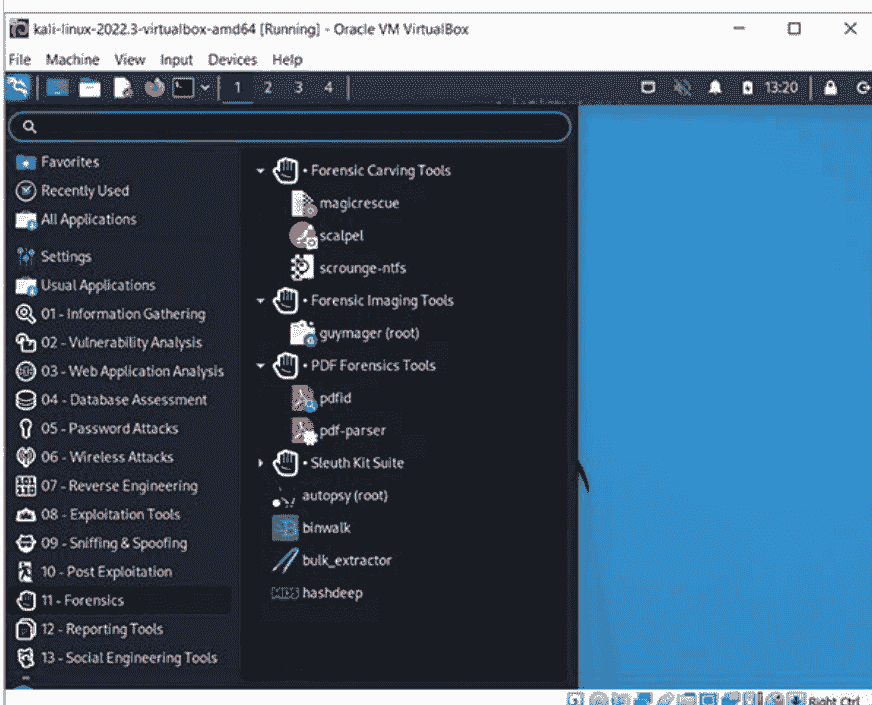

**详情**  
Kali-Linux-2022.3-virtual-box-a 64 Oracle VM Virtual Box 窗口截图。左面板选择了 11-Forensics。它显示了取证恢复工具、取证镜像工具、PDF 取证工具和 Sleuth kit suite。

注意可用工具的多样性，包括取证恢复工具、取证镜像工具、PDF 取证工具、Sleuth Kit Suite、Autopsy、binwalk、bulk_extractor 和 hasdepth。注意这些工具大部分是命令行工具。要精通该领域，你必须熟悉命令行。

取证恢复工具包括 magiccrew、scalpel 和 scrounge-ntfs。每个工具对于寻找损坏或删除的文件都有用处。`scalpel` 工具寻找特定的文件类型，而 `scrounge-ntfs` 搜索 NTFS 分区。

取证镜像工具是 `guymager`。使用它时，你必须输入 Kali 密码。它会自动访问你机器的硬盘。PDF 取证工具包括 `PDF-parser` 和一个查找 PDF 文件中链接和 JavaScript 的工具。

> **笔记 14**
>
> 你可以通过访问 kali.org/tools 找到 Sleuth Kit Suite 中许多工具的深入描述。鼓励你自己探索这些工具。

# 探索 Sleuth Kit

图 7-16 所示的 Sleuth Kit 包含 20 个工具，包括 Autopsy，可用于检查设备和网络。每个工具都执行特定任务以帮助取证调查员。

## 图 7-16 Kali Sleuth Kit Suite

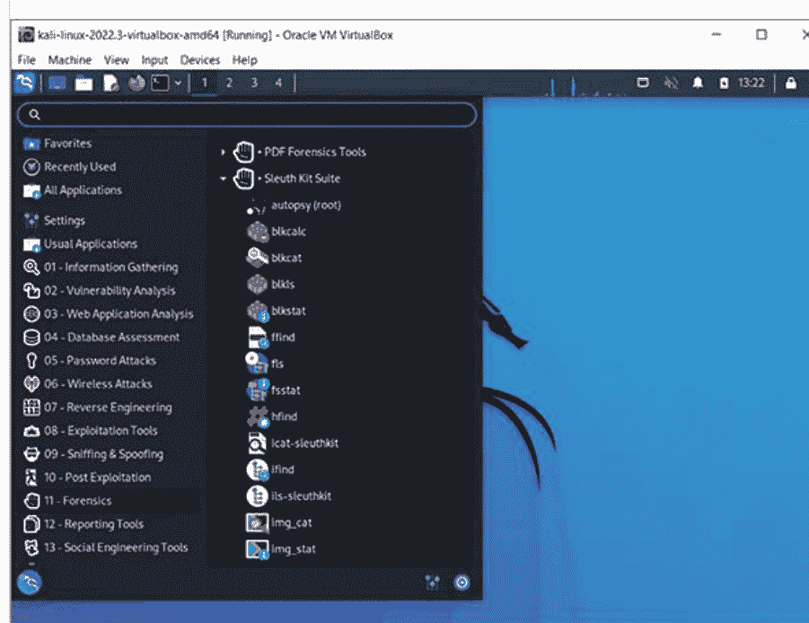

Kali-Linux-2022.3-virtual-box-a 64 Oracle VM Virtual Box 窗口截图。左面板选择了 Autopsy。它显示了 Sleuth kit suite 的扩展视图。

在“调查员实验室和数字取证工具”模块中，为 Windows 安装了 Autopsy。版本 2 可以安装在 Linux 或 macOS 上。你可以在 sleuthkit.org 找到 Sleuth Kit 和 Autopsy Browser 的当前和过去版本，在旧软件版本中找到不再支持的功能是常见现象。

Linux 版本的 Sleuth Kit 是一个命令行工具箱或工具集合。它在命令行执行 GUI 工具自动完成的操作。在某些情况下，特定的工具可能会大派用场。类别包括用于检查卷（包括已分配和未分配空间）的镜像工具。它还包括元数据、媒体格式、数据层等。Sleuth Kit 同样适用于网络取证，你将在“网络取证”模块中看到。

# 笔记 15

旧版本的 Sleuth Kit 和 Autopsy 可以在 Sleuth Kit 主页列出的网站上找到。RPM 包管理器工具使得在 Red Hat 和 Fedora Linux 中安装这些工具变得容易得多。其他 Linux 发行版也有安装 RPM 包的工具。查看它们的文档了解如何操作处理 RPM 包。

## 自我检查

5. `dd` 命令被以下哪个命令取代了？

+ a. `dd3`
+ b. `cp`
+ c. `dc3dd`
+ d. `dc5`

**答案：** c. `dc3dd`

**解析：** 在获取数据时，`dc3dd` 比 `dd` 命令具有更多选项。

## 模块回顾

# 总结

- UNIX 的创建是为了成为一个多用户、多线程、安全的操作系统。开放小组（The Open Group）的成立是作为一个中立的财团，该财团负责确定并认证操作系统何时满足 UNIX 要求。
- Linux 内核通常与其他软件组件（如 GUI 和应用程序）打包在一起。使用最广泛的发行版包括 Ubuntu、Mint、Fedora、CentOS 和 Gentoo。
- Linux 支持广泛的文件系统。最新的是 ext4，它增加了对大于 16 TB 分区的支持，改进了对大文件的管理，并为文件系统特性提供了更灵活的方法。
- UNIX 和 Linux 有四个组件定义文件系统：启动块（boot block）、超级块（superblock）、inode 块（inode block）和数据块（data block）。此外，每个文件分配单元都被分配一个 inode，包含文件和目录的元数据（文件名和路径除外），提供了链接存储在块中的数据的机制。
- 在 Linux 系统中，硬链接是一个指针，允许用户通过不同的文件名访问同一个文件，这些文件名指向设备上的相同名称和物理位置。符号链接是指向其他文件的指针；它们可以指向其他设备或网络的其他部分，并且不会影响链接计数。
- 在 macOS 之前，Apple 使用 HFS 和 HFS+ 文件系统。HFS 和 HFS+ 的区别在于 HFS+ 支持更大的分配块，每个分配块的默认大小为 4 KB。因此，随着存储设备的不断增长，HFS+ 在存储数据方面更高效。
- 从 macOS 10.13 High Sierra 开始，引入了苹果文件系统 (APFS)，为用户提供了许多改进，包括数据加密、文件系统快照，以及通过在写入之前使用冗余副本来保护元数据。数字取证专家可以利用这些改进来构建 Mac 上发生过什么事件的时间线。
- 在 macOS 文件系统中，文件是一个包含两个部分的文件结构：数据分叉（data fork，存储数据的地方）和资源分叉（resource fork，存储文件元数据和应用程序信息的地方）。
- 在 macOS 中，卷（volume）是用于存储文件的存储媒介。卷具有分配块和逻辑块。当你保存文件时，它会被分配给一个分配块，这是一组连续的逻辑块。macOS 使用簇（clumps，即连续分配块的组）来减少文件碎片。
- Plist 文件是运行 macOS 的系统上已安装应用程序的偏好设置，可以作为取证调查的有用信息来源。
- 在 macOS 中，增加了统一日志（unified logging）用于记录日志文件，并为取证检查员提供了新的实用。
- 从 macOS 获取镜像最大的挑战是对比驱动器的物理访问。对于许多 macOS 设备，需要特殊的工具和培训来执行采集工作。
- Linux 取证工具通常是免费的，因此取证调查人员可以使用它们来降低成本。Autopsy 等工具被常用。
- `dc3dd` 是一个命令行数据采集应用程序，具有许多获取数据的功能，相比 `dd` 和 `dcfldd` 命令提供了若干改进。它具有解析早期命令中未找到的信息的功能。
- Kali 是一个包含超过 300 个工具的渗透测试发行版。有些用于网络取证，其他用于设备取证、密码破解、信息收集、社会工程以及各种其他应用。

## 关键术语

- 分配块 (allocation block)
- 苹果文件系统 (APFS)
- B-树
- 坏块 (bad block)
- 块 (block)
- 启动块 (boot block)
- 目录 (catalog)
- 簇 (clump)
- 数据块 (data block)
- 数据分叉 (data fork)
- 双间接指针 (double-indirect pointer)
- 范围 (extents)
- 范围溢出 (extents overflow)
- 灵活组块 (flexible group blocks)
- 第四文件系统 (ext4)
- 硬链接 (hard link)
- 索引节点 (inode)
- 逻辑块 (logical block)
- 符号链接 (symbolic link)
- 卷 (volume)

## 复习题

1. 在 macOS 文件结构中，哪部分是存储数据的地方？
+ a. 数据分叉 (data fork)
+ b. 资源分叉 (resource fork)
+ c. 索引节点 (inode)
+ d. 系统分叉 (system fork)

2. macOS 文件结构中的哪部分存储文件元数据（文件名和路径除外）？
+ a. 数据分叉 (data fork)
+ b. 资源分叉 (resource fork)
+ c. 索引节点 (inode)
+ d. 系统分叉 (system fork)

3. 为了恢复 macOS，你使用哪个工具？
+ a. Finder
+ b. Keychain
+ c. Spotlight
+ d. 

4. ext4 文件系统的主要改进有哪些？

5. macOS 如何减少碎片？

6. 关于硬链接，以下哪些项是正确的？（选择所有项）
+ a. 文件受到保护。
+ b. 具有相同 inode 的文件可以共享。
+ c. 文件可以被不同的用户更新。
+ d. 文件只能被一个用户删除。

7. Linux 中的哪些位置包含密码？
+ a. `/var/log/dmesg`
+ b. `/etc/passwd`
+ c. `/var/log`

8. 超级块（superblock）的功能是什么？（选择所有项）
+ a. 存储启动代码
+ b. 指定磁盘几何结构和可用空间
+ c. 管理文件系统，包含信息
+ d. 使用索引表

9. macOS 使用什么功能进行加密？

10. 在 Linux 中，以下哪个是超级用户的家目录？
+ a. `/home`
+ b. `/root`
+ c. `/super`
+ d. 

11. 以下哪些组织认证了 UNIX 要求？
+ a. IEEE
+ b. 用户组
+ c. 开放小组 (The Open Group)
+ d. SUSE

12. 在大多数 Linux 系统中，当前用户登录信息位于哪个位置？
+ a. `/var/log/dmesg`
+ b. `/var/log/wtmp`
+ c. `/var/log`
+ d. 

13. 以下哪些项描述 plist 文件？（选择所有项）
+ a. 你需要特殊的编辑器来查看。
+ b. 它们仅位于 Linux 文件系统中。
+ c. 它们是偏好文件。
+ d. 它们需要安装。

14. 数据块直接包含文件。错误

15. 在尝试采集加密的 APFS macOS 设备之前，数字取证检查员应该收集哪些项目？（选择所有项）
+ a. 托管人的用户名
+ b. 托管人的密码
+ c. 系统管理员的用户名
+ d. 系统管理员的密码
+ e. 托管人的母亲姓氏
+ f. 托管人的母亲出生日期
+ g. 系统管理员的出生地
+ h. 系统管理员喜欢的颜色

# 实践

## 项目 7-1

**预计时间：** 20 分钟  
**目标：** 创建硬链接和符号链接。

### 在开始之前：

- 完成活动 7-1：
- 创建文件夹 `C:\Work\Module_07\Project7-1`。
- 下载模块提供的工作数据：
- `Project_07-1_Examiner_Notes.xlsx`
- 访问以下项目：
- Ubuntu 22.04 VM

查看硬链接如何工作，请完成以下步骤：

1. 打开文件 `Project_07-1_Examiner_Notes.xlsx`。在相应字段输入你的姓名和项目编号。在项目的剩余部分，使用你的取证笔记记录你的操作，并记录你观察到的任何异常。
2. 如果必要，启动 Ubuntu 22.04 虚拟机并打开终端窗口。输入 `ls -1` 并按回车。
3. 在输出中，第二列显示每个目录或文件的硬链接计数。注意图 7-17 中 Music 目录的硬链接数量。

### 图 7-17

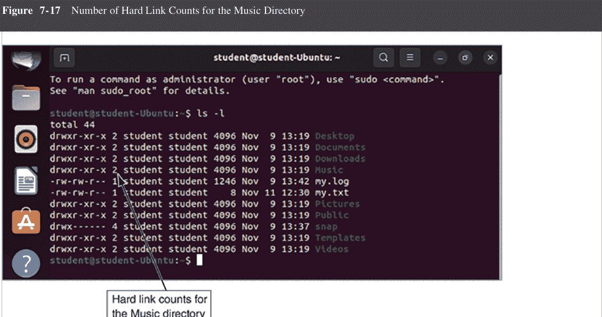

**来源：** Ubuntu  
终端 shell 窗口的截图。`ls -d` 命令显示的输出中，第二列的数字是每个音乐目录或文件的硬链接计数。

4. 进入 Music 目录并按回车。输入 `mkdir PopTunes` 并按回车创建一个名为 `PopTunes` 的子目录。
5. 输入 `cd` 并按回车返回主目录。接下来，输入 `ls -1` 并按回车；注意 `Music` 目录的链接数增加了。
6. 要练习硬链接，输入 `touch originalfile` 并按回车创建一个新文件。输入 `mkdir /tmp/Module07` 并按回车在 `/tmp` 目录下创建一个子目录。
7. 如有必要，再次回到主目录，输入 `ln originalfile /tmp/Module07/newfile` 并按回车。
8. 输入 `ls -i` 并按回车查看原始文件的 inode 号。切换到 `/tmp/Module07` 目录并重复该命令。`newfile` 应该具有 `originalfile` 相同的 inode 号（见图 7-18）。

### 图 7-18

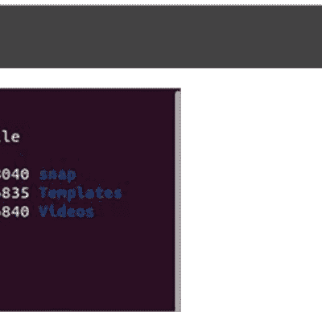


```
student@ubuntu-Ubuntu: $ touch originalfile
student@ubuntu-Ubuntu: $ mkdir /tmp/Module07
student@ubuntu-Ubuntu: $ ln originalfile /tmp/Module07/newfile
student@ubuntu-Ubuntu: $ ls -i
116833 Desktop 116838 Music 787073 originalfile 548040 snap
116837 Documents 798838 my.log 116835 Pictures 116835 Templates
116834 Downloads 798849 my.txt 116836 Public 116840 Videos
student@ubuntu-Ubuntu: $ cd /tmp/Module07
student@ubuntu-Ubuntu: $ ls -l
student@ubuntu-Ubuntu: $ newfile
```


| Inode 号 | newfile 的 inode 号 | originalfile 的 inode 号 |
| :--- | :--- | :--- |
| 787073 | 787073 | 787073 |

详情：目录窗口的截图。命令 `ls -i` 显示原始文件的 inode 号，该数字与新文件的 inode 号相同。原始文件的 inode 号为 787073，新文件的 inode 号为 787073。

来源：Ubuntu

## 9

要创建符号链接，切换到 `/tmp` 目录，输入 `mkdir testsym` 并按回车创建一个新子目录。切换到该目录并输入 `touch test2` 按回车创建两个文件。如有必要，输入 `cd -` 并按回车返回 `/tmp` 目录。最后，输入 `ln -s /tmp/testsym mysym` 并按回车创建符号链接。使用 `ln` 配合 `s` 表示指定符号链接而非硬链接。注意，你通常使用完整路径名，因为符号链接可以存在于其他系统上。你将在下一步看到一个与文件一起创建的的文件夹。

## 10

输入 `ls -1 mysym`（连字符后用的是数字 1，而不是小写的 L）并按回车。你在 `testsym` 目录中创建的文件也会出现在 `mysym` 中。最后，输入 `ls -l mysym`（连字符后用的是字母 l）并按回车。有一个箭头从 `mysym` 指向 `testsym` 目录，如图 7-19 所示，这表示符号链接。

# 图 7-19 显示符号链接

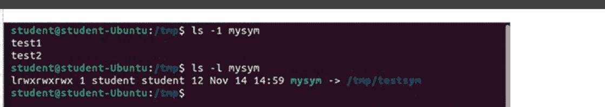

详情：目录窗口的截图。命令 `ls -i mysym` 显示了 `testsym` 目录中创建的文件，命令 `ls -l mysym` 显示了从 `mysym` 指向 `testsym` 的箭头，表示符号链接。

来源：Ubuntu

- 完成后，更新你的实验笔记并将文件提交给老师：`Project_07-1.xlsx`

# 项目 7-2

**预计时间：** 45 分钟（取决于更新情况）
**目标：** 在 Kali Linux 中使用取证工具。开始之前：

- 活动 7-3...
- 在 `Work` 文件夹中创建 `C:\Work\Module07\Project07-2`。
- 下载提供的以下文件：
- `Project_07-2_Notes.xlsx`
- `GCFX-LX`
- 访问以下项目：Kali Linux

完成步骤：
打开 `Project07-2_Notes.xlsx`。输入你的名字。在整个项目过程中，使用你的实验笔记记录你的操作以及任何异常。打开 VirtualBox 并启动 Kali Linux。为了在主机上访问取证文件，你需要执行一些操作。确保所有应用程序已关闭。打开终端。输入 `sudo apt-get update` 并按回车。如果提示，输入密码。`apt-get update` 命令获取最新的列表。接下来，输入 `sudo apt-get upgrade` 并按回车。根据 `apt-get update` 的列表，`apt-get upgrade` 会下载并安装所需的项。升级可能需要 20 分钟，取决于镜像版本。需要时重启虚拟机。在菜单中，点击设备并插入增强功能 CD（注意会弹出一个窗口）。设备挂载后，你将看到内容。在终端窗口中输入 `findmnt` 并按回车。在底部你应该看到 CD 的挂载点。选择挂载点，右键点击，然后复制。输入 `sudo`，右键粘贴你复制的路径。然后输入斜杠和文件名（`VirtualBoxAdditions.run`），所示：

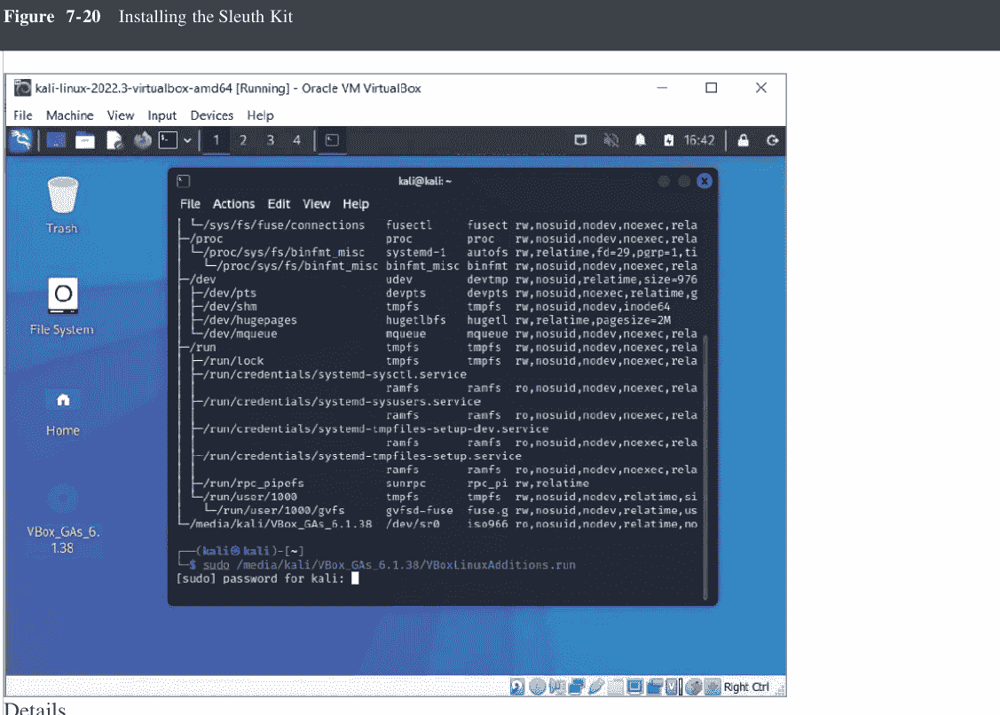

详情：kali-linux-2022.3-virtualbox-amd64 Oracle VM 的截图。左侧面板选择了标记为 6.1.3 的磁盘。终端窗口底部列出了最新的文件列表，输入了 `sudo` 以及选择路径和文件名。提示时输入密码并按回车。Kali OS 现在已安装。

在你的 `Work` 文件夹中创建一个名为 `Evidence` 的子目录。你把必要的文件复制到主机上的该子目录。接下来，你需要创建一个共享文件夹。在菜单上，点击设备，然后共享文件夹，共享文件夹设置……在打开的窗口右侧，点击添加。在添加共享窗口中，点击文件夹路径的下拉箭头。导航到你的 `Evidence` 文件夹并选择它。输入文件夹名称和挂载点，并选择选项，使你的对话框与图 7-21 所示一致；双击 OK。

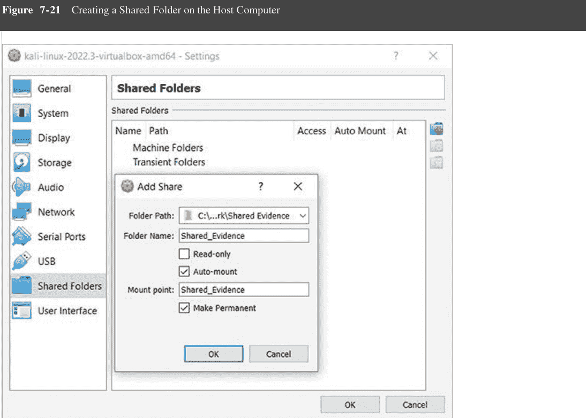

Kali-Linux-2022.3-virtualbox-64 窗口截图。左侧面板选择了共享文件夹。添加共享框覆盖了共享文件夹。文件夹路径上选择了共享 evidence。文件夹名称和挂载点给出 shared evidence，并点击 OK 按钮。将 `GCFX-LX.exe` 文件复制到主机上的 Shared Evidence 文件夹。提取文件。

Kali Linux 包含了编译好的 Linux Autopsy/Sleuth Kit。很多时候你必须评估旧系统的证据。该项目的剩余步骤将引导你使用旧工具和旧镜像。点击窗口左上角的 Kali Linux 图标。在左侧面板点击 11 – Forensics，然后在右侧点击 autopsy (root)，如图 7-22 所示。

# 图 7-22 在 Kali Linux 中启动 Autopsy/Sleuthkit

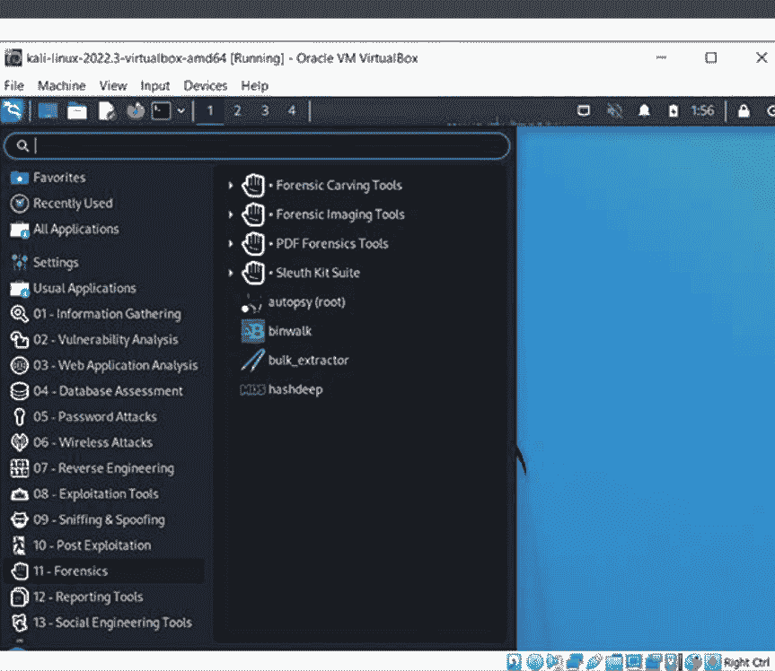

Kali-Linux-2022.3-virtualbox-64 Oracle Virtual Box 窗口截图。左侧面板选择了选项 11 Forensics。Kali 取证工具的 Sleuth kit 下选择了 autopsy (root)。打开了一个终端窗口，请求你的密码并指示你保持开启并启动地址为 `http://localhost:9999/autopsy` 的浏览器。

如图 7-23 所示，点击 New Case（新建案件）按钮。

# 图 7-23 启动 Autopsy

# kali-linux-2022.3-virtualbox-amd64 [Running] - Oracle VM VirtualBox

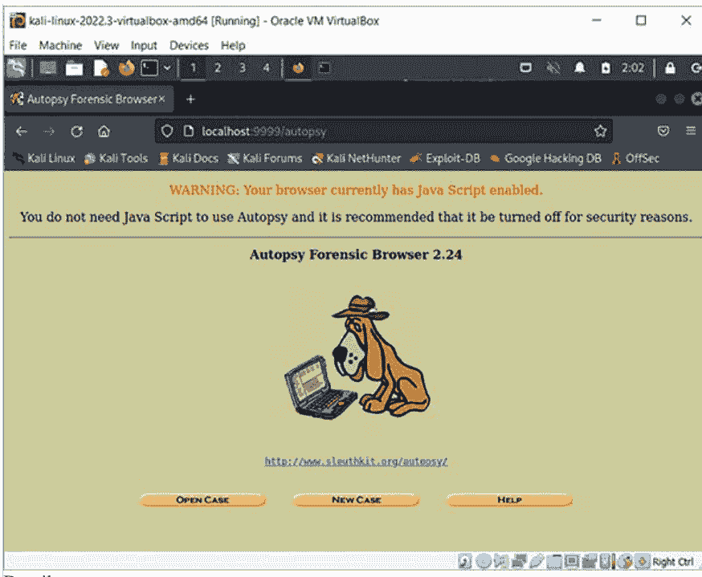

详情：kali-linux-2022.3-virtual-box-64 Oracle VM Virtual Box 窗口截图。它启动了 autopsy 取证浏览器 2.24，地址为 `http://localhost:9999/autopsy`。

开始对调查感兴趣的关键词进行搜索。

在“已分配与未分配空间”（Allocated and Unallocated space）的关键字搜索页面，在文本框中输入 martha 并点击搜索。

搜索完成后，Autopsy 显示搜索结果的摘要。要查看详细搜索结果，请点击左上面板中的链接。

通过滚动左侧面板来检查搜索结果，然后点击 Fragment 236019 "Ascii"链接查看搜索详情，如图 7-24 所示：

# 图 7-24 查看 Fragment 236019 "Ascii" 链接

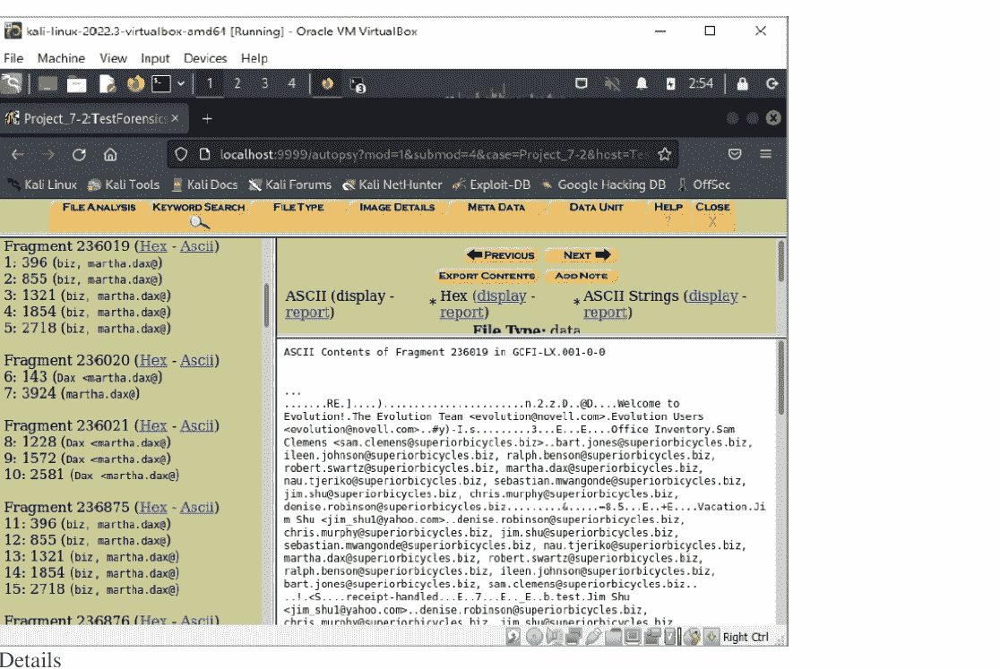

详情
Kali-Linux-2022.3-virtual-box-m 64 Oracle VM Virtual Box 启动的截图。它启动了带有两个面板的项目 7.2 取证页面。左侧面板显示碎片链接，其中选中了 Fragment 236019。右面板显示了 Fragment 236019 ASCII 内容下的目录，并带有上一个、下一个、导出内容和添加备注按钮。

通过点击其他命中项的 ASCII 和 Hex 链接重复此操作。检查完命中项后，点击“正在搜索 ASCII”和“正在搜索 Unicode”对话框以返回“选择要分析的卷或添加新图像文件”对话框。退出 Autopsy 并关闭 Ubuntu。

完成后，检查你的取证笔记，并向教师提交以下文件：

`Project_07-2_Examiner_Notes.xlsx`

# 项目 7-3

预计耗时：20 分钟

目标：探索 Paladin 取证工具。

开始之前：

- 完成活动 7-3...
- 创建工作文件夹 `C:\Work\Module_07\Project07-3`。
- 将与模块一起的以下数据文件下载到你的工作文件夹：
- `Project_07-3_Examiner_Notes.xlsx`
- 访问以下项目：
- Paladin Edge VM

完成以下步骤：

1. 启动 Paladin Edge VM，如图 7-25 所示

> 图 7-25 Paladin Edge 界面

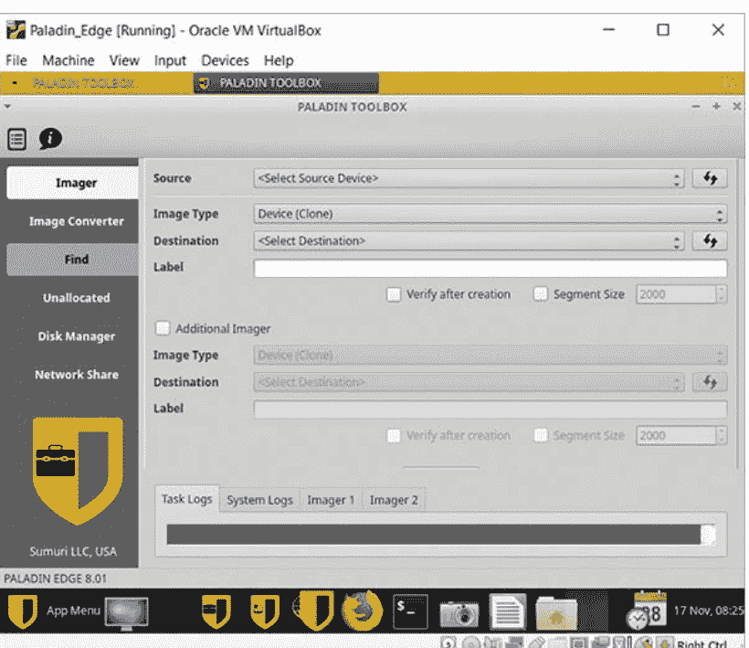

详情 Paladin Edge-Oracle VM Virtual Box 的截图，显示了 Paladin 工具箱下的选项。左面板中选了 Imager。右面板显示了源、图像类型、目标和标签设置。

源：Paladin Edge

2. 打开文件 `Project_07-3_Examiner_Notes.xlsx`。输入你的姓名和项目编号。在项目的剩余过程中，请使用你的取证笔记记录你的所有操作，并记录你观察到的任何意外情况。

3. 点击左下角的 **App Menu**（应用程序菜单）按钮。在出现的菜单中选择 **Paladin Toolbox**。

4. 探索提供的各种工具。对可能产生结果的工具进行记录。请注意，要使用这些工具，你需要连接到实际设备进行评估和分析。

5. 完成后，向教师提交以下文件：

- `Project_07-3_Examiner_Notes.xlsx`

# 案例项目 7-1

预计耗时：60 分钟

目标：比较可以评估 macOS 设备的取证工具。

开始之前：

- 创建工作文件夹 `C:\Module_07\Case_Project_07-1`。
研究并比较可以检查 macOS 设备的取证工具。创建一个表格列出至少三个工具，包括它们的价格、共同特征、功能和价格。打开你的文字处理应用程序，创建一个新文档并将其保存为工作文件夹中的 `Case_Project_07-1-Report`。写一份一到两页的报告，说明如果你是一家小公司的调查员，你会选择哪种工具并解释原因。在论文中包含你的总结表格。完成后，向教师提交以下文件：
`Case_Project_07-1-Report`

# 案例项目 7-2

预计耗时：60 分钟

目标：确定 Windows 计算机无法启动时使用哪些工具。

开始之前：

- 创建工作文件夹 `C:\Module_07\Case_Project_07-2`。
本模块探索了 Linux 版 Autopsy 以及 Paladin Edge。当 Windows 无法启动时，使用 Linux 工具可能特别有用。打开你的文字处理应用程序，创建一个新文档并将其保存为工作文件夹中的 `Case_Project_07-2_Report`。写一份一到两页的备忘录，根据你对博客、用户组和用户手册的研究，描述可能使用的工具。作为一名取证调查员，你还需要做哪些额外准备？完成后，向教师提交以下文件：
`Case_Project_07-2-Report`

# 第 8 章 媒体文件与数字取证
模块介绍

在阅读本模块并完成练习后，你将能够：

1. 识别媒体类型
2. 总结数据压缩和隐藏
3. 定义数据隐藏技术
4. 解释如何定位和恢复媒体文件
5. 解释数字取证
6. 解释数据计划

介绍

数字取证经常涉及媒体文件和格式。本模块从媒体文件开始讨论，由于智能手机的增加，其他媒体变得常见。Exif 格式存储数据，用于。由于媒体文件有多种格式，包括照片、位图、矢量图、音频和视频。

在本模块中，你还学习了如何根据文件头定位和恢复媒体文件，分析文件头并修复损坏的文件头。

本模块继续了其他模块中引入的主题。在数据采集过程中，验证文件加密。数字调查员可能会遇到加密的媒体文件。

在本模块中，你还学习了如何使用加密算法进行数字分析。在数据采集模块中，你学习了 Windows 和 Linux 文件系统的加密算法。在事件场景模块中，你接触了加密算法。调查员实验室和数字取证工具讨论了如何验证数据。在本模块中，你学习了更多关于使用加密算法进行数字分析的知识。

由于 Exif 格式收集元数据，调查员可以获得更多关于数字设备类型和拍摄环境的信息。Exif 文件的元数据需要特殊的程序，如 Exif Viewer、Phil Harvey 的 Exiftool 或 Magnet Forensics Axiom（其内置 Exif 查看器）。在图 8-1 的相似照片中，左侧的是 Exif JPEG，右侧的是标准 JPEG。

注意

- 关于 RAW 的更多信息
- 图像分析


# Exif 图片文件

# JPEG 图片文件

两张带有巨大建筑位置的照片。左侧是一张现有的图片文件，背景中有几棵树围绕着一座建筑。右侧是一个 JPEG 图片文件，背景同样有树围绕着一座建筑。

图 8-2 显示了相同文件与其头部之间的差异。左侧的文件是 Exif 文件，右侧是标准的 JPEG 文件。两个文件都显示了前 160 个字节（十六进制 0x9F）。

**图 8-2** Exif 和 JPEG文件头头信息的差异

| Exif 指示符 | Exif 标签类型 |
|---|---|
| 0x03 处的偏移量 | |

| JPEG-Exif,JPEG | 0 1 2 3 4 5 6 7 8 9 A B C D E F | ANSI ASCII |
|---|---|---|---|---|---|---|---|---|---|---|---|---|---|---|---|---|---|
| 偏移量 | FF D8 FF E1 00 00 4A 46 49 66 00 00 00 00 | pÿExif * |
| 00000000 | 00 48 00 66 74 69 66 20 00 00 00 00 01 00 | | | |
| 00000010 | 00 00 02 01 00 00 00 00 00 00 00 00 00 00 | | | |
| 00000020 | 00 92 01 10 02 00 00 00 00 00 00 00 01 12 | | | |
| 00000030 | 00 00 00 00 00 00 00 00 00 00 00 00 00 00 | | | |
| 00000040 | 00 94 01 01 00 00 00 00 41 42 00 00 01 18 | | | |
| 00000050 | 00 00 00 00 00 00 00 00 00 00 00 00 00 00 | | | |
| 00000060 | 02 00 00 00 00 00 00 43 32 00 02 00 00 | | | |
| 00000070 | 00 14 00 00 00 41 49 33 00 00 00 00 01 6B | | | |
| 00000080 | 00 00 00 00 00 00 00 00 00 00 00 00 00 00 | | | |
| 00000090 | 00 39 00 00 00 00 00 00 66 61 00 00 68 74 | | | |
| 000000A0 | 00 04 00 00 00 00 00 00 00 00 00 00 00 00 | | | |
| 000000B0 | 00 00 00 00 00 00 00 00 00 00 00 00 00 00 | | | |
| 000000C0 | 6E 20 03 06 65 74 65 72 20 74 69 70 65 29 | | | |
| 000000D0 | 00 00 00 00 00 00 48 00 00 00 00 00 00 00 | | | |

| JPEG 接口 | JPEG 标签类型 |
|---|---|
| 0x03 处的格式 | JPEG,JFIF | 0 1 2 3 4 5 6 7 8 9 A B C D E F | ANSI ASCII |
|---|---|---|---|---|---|---|---|---|---|---|---|---|---|---|---|---|---|---|
| 偏移量 | FF D8 FF E0 00 00 4A 46 49 66 00 00 00 00 | JFIF |
| 00000000 | 00 48 00 66 74 69 66 20 00 00 00 00 01 00 | HExif * |
| 00000010 | 00 00 02 01 00 00 00 00 00 00 00 00 00 00 | | | |
| 00000020 | 00 92 01 10 02 00 00 00 00 00 00 00 01 12 | | | |
| 00000030 | 00 00 00 00 00 00 00 00 00 00 00 00 00 00 | | | |
| 00000040 | 00 94 01 01 00 00 00 00 41 42 00 00 01 18 | | | |
| 00000050 | 00 00 00 00 00 00 00 00 00 00 00 00 00 00 | | | |
| 00000060 | 02 00 00 00 00 00 00 43 32 00 02 00 00 | | | |
| 00000070 | 00 14 00 00 00 41 49 33 00 00 00 00 01 6B | | | |
| 00000080 | 00 00 00 00 00 00 00 00 00 00 00 00 00 00 | | | |
| 00000090 | 00 39 00 00 00 00 00 00 66 61 00 00 68 74 | | | |
| 000000A0 | 00 04 00 00 00 00 00 00 00 00 00 00 00 00 | | | |
| 000000B0 | 00 00 00 00 00 00 00 00 00 00 00 00 00 00 | | | |
| 000000C0 | 6E 20 03 06 65 74 65 72 20 74 69 70 65 29 | | | |
| 000000D0 | 00 00 00 00 00 00 48 00 00 00 00 00  0 00 | | | |

详情
两个现有文件和 JPEG 文件。每个文件具有相同的十六进制格式头部。上方是 JPEG 输出文件，包含一个 18 列偏移量表格（0, 1, 2, 3, 4, 5, 6, 7, 8, 9, A, B, C, D, E, F 和 N ANSI ASCII）及其对应数据。第 5 列的 E 由箭头指向并标记为 JPEG 类型。下方是交换格式的 JPEG 文件，包含一个 18 列偏移量表格（0, 1, 2, 3, 4, 5, 6, 7, 8, 9, A, B, C, D, E, F 和 N ANSI ASCII）及其对应数据。第 5 列的 E 由箭头指向，第 1 行的 JPEG 代码由箭头指向。

## JPEG 配置

正如之前在《调查实验室》和《取证工具》中所描述的，所有 JPEG 文件都从偏移量 0 开始（第一个字节 0xFFD8）。对于普通的 JPEG 信息格式文件 (JFIF) 也是如此。


详情
交换格式 JPEG 文件的截图，包含一个 18 列偏移量表格（0, 1, 2, 3, 4, 5, 6, 7, 8, 9, A, B, C, D, E, F 和 N ANSI ASCII）及其对应数据。第 15 和 16 列的 F 和 D 由箭头指向并标记为 JPEG 图像结束标记。

使用 Autopsy、Exif Reader 和 Fast Image Viewer 等工具，可以提取出作为你案件元数据的图片（例如，见图 8-4）。Fast Image Viewer 拍摄于 PDT 时间 2017 年 7 月 10 日下午 5:50。

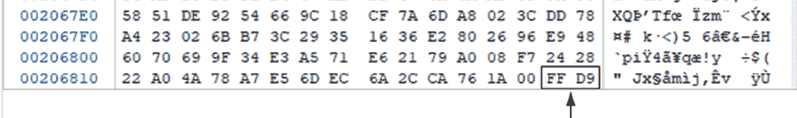

## 注意事项

在移动设备取证模块中，你将学习更多关于智能手机如何利用蜂网络记录日期和时间的知识。

例如，图 8-1 中的照片拍摄于 2013 年 9 月 10 日的纽墨西哥州圣塔菲。相机的日期和时间被设置为 UTC，你需要将其调整为当地时间。圣塔菲的当地时间是山地夏令时间（MDT），比 UTC 时间慢 6 小时，因此实际时间必须是 MDT 下晚上 7:09。由于 MDT 下晚上 7:09 是傍晚，你应该使用像 Time and Date](https://timeanddate.com/worldclock/usa.html) 或 SunriseSunset](https://sunrisesunset.com/sunrise) 等在线工具判断该日期是否发生了日落。Time and Date 显示日落发生在晚上 7:18。如果当地时间被设置为晚上 7:09，那么你假设阳光投射了长阴影。图像中的阴影看起来很短，这可能表明记录的日期和时间是不准确的。此外，如果 Exif 文件中有经纬度值，你可以根据阴影的长度和相对于太阳的角度来估算一天的时间。当然，这种计算仅适用于晴天在室外拍摄的照片。

## Exif 查看器

某些取证工具在其应用程序中集成了 Exif 查看器。在准备检查 Exif 之前，你需要确定一个外部 Exif 查看器，该器需要具备读取可能嵌入其中的地理数据的能力。
此外，还有许多类型的 Exif 查看器，包括免费和商业出售的。一些免费查看器包括：

- Exif Data Viewer: <https://exifdataviewer.com>
- FastStone Image Viewer: <https://faststone.org/FSViewerDetail.html>（注：如果文件元数据存在 GPS，则会显示，并提供到 Google Maps 和 Open Street Map 的链接。）
- HMK Exif Viewer: <https://softmedia.com/get/Multimedia/Graphic/Graphic-Others/HMK-Exif-Viewer.html>
- WildBit Viewer: <https://wildbit-soft.it/index.html>

网上还有提供数字照片在线地理定位的服务，但某些服务限制了上传大小。提供数字化照片中地理位置信息的网站包括：

- EXIF Data Viewer Online—Photo Location Viewer: <https://lineagdata.com/exif-reader>
- GeoPhoto—Geotag your photos: <https://apps.microsoft.com/store/detail/geophoto-geotag-your-photos/9WDZNCRFJ0F2?hl=en-us&gl=us>
- Pic2Map: <https://pic2map.com>

## 理解位图光栅图像

位图（Bitmap image）将信息以像素网格的形式存储，像素是“picture元素”元素。光栅图像（Raster image）也是像素的集合，但这些像素存储在行中以便于打印。在大多数情况下，打印图像（光栅化）是逐行将图像转换为像素，而不是处理整个像素集合。

位图图像质量由分辨率监控，分辨率决定了显示的细节程度。分辨率与屏幕上的像素密度有关，取决于硬件和软件的结合。显示器可以显示范围内的分辨率；分辨率越高，图像越清晰。计算机还使用带有一定内存的显卡来显示图像。显卡的电子设备越先进、内存越大，能够接受的详细指令就越多，从而产生高质量的图像。

例如，Windows 计算机上的显示器和显卡可能支持 4096 × 2160 分辨率，这意味着水平显示 4096 个像素，垂直显示 2160 个像素。由于位图图像是由像素大小定义的，因此高分辨率图像使用的像素比低分辨率图像更小。

软件也影响图像质量。软件包括驱动程序（即显卡驱动程序参数化处理的编码指令）以及用于创建、修改和查看图像的程序。使用某些程序（如 Irfanview.com），你可以查看许多类型的图像；使用其他程序，或仅与它们创建的图形文件一起。然而，数字图形专业人员使用支持高分辨率的程序，但在放大图像时通常会损失画质。

另一个影响图像质量的设置是显示器显示的颜色数量。图形文件每个像素可以不同数量的颜色，但每个文件必须支持具有位空间的颜色。以下列表显示了彩色像素的比特数：

- 1 bit = 2 种颜色
- 4 bits = 16 种颜色
- 8 bits = 256 种颜色
- 16 bits = 65,536 种颜色
- 24 bits = 16,777,216 种颜色
- 32 bits = 4,294,967,296 种颜色

位图和光栅文件尽可能使用颜色调色板。然而，当你保存位图或光栅文件时，分辨率和颜色可能会发生，取决于原始文件中的颜色以及文件格式是否支持这些。

## 理解矢量图形

矢量图形与位图或光栅图像不同，它使用线条而不是点来组成图像。矢量文件仅存储绘制线条和形状的计算；图形程序将这些计算转换为图像。由于矢量文件存储的是计算而非图像，因此它们通常比位图文件小，从而节省了磁盘空间。你还可以放大矢量图形而不影响图像质量——要使图像大一倍，矢量图形程序（如 CorelDRAW 和 Adobe Illustrator）通过数学方法计算图像。

关于矢量图形的更多信息，请参考以下资源：

- 矢量图形: <https://techtarget.com/vector-graphics>
- 什么是矢量图像?: <https://techtarget.com/vector-image>

## 理解元文件图形

元文件图形结合了光栅和矢量，可以具有两者的特征。例如，如果你扫描一张照片（光栅）然后添加文本（矢量），你就创建了一个元文件。

关于元文件的更多信息，请参考以下资源：

- 用于技术插图的计算机图形元文件 (scm) 格式: <https://www.microsoft.com/technical/scm>
- 图像、位图和元文件: <https://learn.microsoft.com/en-us/dotnet/winforms/advanced/images-bitmaps-and-metafiles>
- GDI+ 中的元文件: <https://learn.microsoft.com/en-us/dotnet/winforms/advanced/metafiles-in-gdi+>

## 图形文件格式

图形可以在图形编辑器中创建并保存，例如 Microsoft Paint、Freeway MX、Adobe Photoshop 或 Gnome GIMP。某些图形编辑器（如 Freeway MX）支持矢量图形，而某些程序（如 Photoshop）支持多种文件格式。

大多数图形编辑器允许你以一种或多种标准文件格式创建和保存文件。

标准文件格式包括：

- 位图文件格式：
    - 可移植网络图形 (.png)
    - 图形交换格式 (.gif)
    - 联合图像专家小组 (.jpg 或 jpeg)
    - 标记图像格式 (.tif 或 .tiff)
    - Windows 位图 (.bmp)
- 矢量文件格式：
    - 惠普图形语言 (.hpgl)
    - AutoCAD (.dxf)

较不常见的非标准格式包括：

- Paintbrush (.pcx)
- 光栅传输语言 (.rtl)
- 私有格式：
    - Photoshop (.psd)
    - Illustrator (.ai)
    - Freehand (.fh11)
    - 可缩矢量图形 (.svg)
    - Targa (.tga)

# 音频和视频文件格式

音频和视频文件有许多格式；种格式都有由不同制造商开发的特定用途。以下是目前常用的音频和视频文件格式：

- Apple QuickTime 电影 (.mov) 文件可以存储音频、视频和文本数据。此格式使用 QuickTime 文件格式 (QTFF)。该格式的其他已知扩展名还有 .qt、.movie 和 .mov。更多信息，请参阅 <https://lifelike.com/what-is-an-mov-file-2622779>；
- 音频视频信息 (Audio Video Information) 使用资源交换文件格式 (RIFF)。更多信息，请参阅 <https://lifelike.com/avi-file-2619737>；
- 运动专家组 (MPEG) 有多种扩展名，包括 .mp3 和 .mp4。更多信息，请参阅 <https://lifelike.com/mpeg-file-2622031> 和 <https://electronics.howstuffworks.com/question118.htm>。

# 查看和检查媒体文件

在本模块，你将学习如何查看和检查不同的媒体文件格式。随着经验的增加，你将学习更多查看和检查此类文件的其他工具和技术。本节提供了某些工具的概述，并讨论了缩略图文件、设备上的数字相机图像 (DCIM) 文件夹以及识别未知媒体文件类型的介绍。

# 查看媒体的工具

有数百应用程序和实用程序可以读取各种媒体文件格式，尽管没有一个查看程序可以读取所有文件格式。因此，在调查中拥有许多查看程序是最好的。大多数媒体文件使用压缩技术。

许多实用程序是免费软件或共享软件，可用于查看广泛的格式。大多数取证工作使用仅显示常见图像格式的查看器，尤其是 GIF 和 JPEG，这些通常出现在与互联网相关的调查中。对于常见文件格式（如 PCX），查看器通常简单地将数据识别为文件，或者根本无法识别这些数据。无法查看所有格式可能会阻止你发现案件的关键证据。请务必分析、识别并检查驱动器上的每一个未知文件。

除了 Windows 照片之外，其他媒体查看程序还包括以下程序：

- FastPictureViewer <https://fastpicture.com/>
- FastStone <https://faststone.org/>
- IrfanView Graphic Viewer <https://irfanview.com/>
- VLC Media Player <https://videolan.org/>

# 查看缩略图文件

缩略图文件是原始媒体文件的较小复制版本。它们存在于许多操作系统 (OS) 中，包括 Windows、macOS、Linux 以及数字相机。对于 Windows 操作系统，如果缩略图存储在名为 `thumbs.db` 的数据库文件中，`thumbs.db` 文件位于与存储图像和视频文件的相同文件夹中。当使用文件资源管理器查看文件夹内容时，将显示原始媒体文件的小型图标版本，以帮助用户识别文件。

在 Windows 操作系统上工作时，数字取证可以通过检查 `thumbs.db` 文件的内容发现额外证据。例如，在某些情况下，如果嫌疑人从 Windows 计算机上删除了图像或视频文件，被删除的文件可能仍然存在于 `thumbs.db` 文件中。删除文件的缩略图的存在提供了痕迹证据，证明原始文件曾指向过特定文件夹或嫌疑人的计算机。许多数字取证工具使用 `thumbs.db`，允许取证人员检查此数据库文件的内容。然而，由于缺乏显示任何细节的像素，将缩略图内容与原始文件匹配和识别存在局限性。关于缩略图的更多信息，请参阅：

- 从缩略图进行数字图像认证，<https://farid.berkeley.edu/publications/spie10a.pdf>
- 取证问题中的 DB 文件，<https://repo.zen/security.com/Techniques%20.attacks%20%20%20%20Fails/THUMBS%20DB%20FILES%20FORENSIC%3C%20ISSUES.pdf>

# 查看数字相机图像文件夹的内容

在数字相机上，以及在经过适当采集后，DCIM 文件夹的内容通常可以从设备复制到数字取证工作站进行额外分析。DCIM 是相机格式设计规则 (DCF) 的一部分，JEITA 标准规范 CP-3461。

DCF 文件夹和文件结构建议如下：

- 子文件夹名称为三个数字后跟五个字母，例如 582DEGH。
- 图像文件名为具有三个数字后跟四个字母的文件类型，例如 IMG0002.jpg。

关于 DCIM 的更多信息，请参阅以下资源：

- [关于：相机文件系统设计规则](https://en.wikipedia.org/wiki/Design_rule_for_Camera_File_system)
- [相机文件设计规则](https://en.wikipedia.org/wiki/Design_rule_for_Camera_File)
- [为什么照片存储在 DCIM 文件夹中？](https://lifewire.com/forum/digital-photography/discussion-2620570/)
- [为什么每台相机都把照片放在 DCIM 文件夹中？](https://howgeek.com/204228/why-does-every-camera-put-photos-in-a-dcim-folder/)

# 图形文件头部

许多数字取证工具会读取每个文件的头部并将其值与其扩展名进行比较。如果头部不匹配，工具将标记该文件不匹配。如果文件的头部和扩展名被更改过，数字取证工具将不会标记文件为不匹配，因为它假设它是未知的。更改文件的头部和扩展名是隐藏违禁内容（如色情）的简单方法。当你遇到 HIF 扩展的文件时，你需要许多取证工具中的十六进制查看器来检查其内容。这种格式很旧，关于它的信息不多。如果你需要寻找删除的文件，你需要一个十六进制编辑器，如 HxD 或 WinHex。要查看 TIFF 和 HIF 之间的差异，可以比较头部值。所有 TIFF 文件都从偏移量 0 处的十六进制 49 49 2A 开始。这些十六进制值转换为字母“II”。图 8 显示了一个 TIFF 文件：img/d5e8792b37b6f0538ed6c2bc9c7b59

| Offset | 0 | 1 | 2 | 3 | 4 | 5 | 6 | 7 | 8 | 9 | A | B | C | D | E | F |
|---|---|---|---|---|---|---|---|---|---|---|---|---|---|---|---|---|
| 0000000 | 49 | 49 | 2A | 00 | 66 | E5 | 00 | 00 | 80 | 8B | 42 | 2A | 07 | 08 | 06 | 0C |
| 0000001 | 00 | 84 | 20 | 00 | 65 | 10 | 03 | 10 | 85 | 8A | 42 | 52 | 62 | 50 | 88 | 0C |
| 0000002 | 00 | 2F | 12 | 87 | 00 | 00 | 0C | 52 | 42 | 52 | 63 | 50 | 83 | 31 | | |
| 0000003 | 00 | 47 | 7C | 4E | 24 | 2D | 44 | 28 | 45 | 44 | F2 | 59 | 5C | 1A | 39 | 98 |
| 0000004 | 00 | 26 | 39 | 93 | 4A | 4B | 65 | 35 | 9A | 6C | 63 | 19 | 13 | 7E | 0C | |
| 0000005 | 00 | 9B | 6C | 27 | 21 | 27 | 01 | 0C | 55 | 6B | 8F | 87 | 0D | 08 | 0C | |
| 0000006 | 00 | FF | 01 | 00 | 30 | 31 | 00 | 00 | 56 | 3F | 85 | 06 | 8E | 86 | 09 | 0A |
| 0000007 | 00 | 48 | 2D | 00 | 00 | 61 | 00 | 00 | 6A | 2D | 65 | 91 | 58 | 02 | 04 | AA |
| 0000008 | 00 | 51 | 10 | 06 | 34 | 07 | D3 | 40 | 46 | 36 | 8B | 00 | 05 | 59 | 83 | 4A |
| 0000009 | 00 | D2 | 61 | 8F | E10 | 14 | 86 | 04 | 85 | 43 | 29 | 8B | 55 | F4 | 2E | C1 |
| 000000A | 00 | 4B | 81 | 05 | 64 | 61 | 00 | 04 | F4 | F4 | 02 | 00 | 0A | 70 | 73 | C0 |
| 000000B | 00 | E6 | 03 | 57 | 48 | 24 | 48 | 51 | 00 | 04 | 86 | 29 | 22 | 01 | 61 | 80 |

详情
TIF 文件的截图具有 18 列偏移量，0, 1, 2, 3, 4, 5, 6, 7, 8, 9, A, B, C, D, E, F 和 II，以及其对应的数据。文件从偏移量 0 开始，十六进制为 49, 49, 2A, 00, 66, E5, 00, 00, 80, 8B, 42, 2A, 07, 08, 06, 0C，且 18 被矩形边界框高亮，并标记为十六进制 49, 49, 2A, 2 的 TIFF 文件头部，这些值相当于 ASCII II I 星号。

# X-Ways AG, www.x-ways.net

XIF 文件的前 3 个字节与 TIFF 文件相同，随后是区分 XIF 文件与 TIFF 文件的十六进制值（见图 8-6）。如你所见，XIF 头部同样在偏移 0 处以十六进制 49 49 2A 02 开头，在偏移 4 处的值为 5C 01 00 02 00 20 65 58 74 65 6E 64 64 00 00 00。通过这些信息，你可以配置你的取证工具来检测 XIF 文件头部。

图 8-6 在十六进制编辑器中查看的 XIF 文件

| 偏移 | 0 | 1 | 2 | 3 | 4 | 5 | 6 | 7 | 8 | 9 | A | B | C | D | E | F |
|---|---|---|---|---|---|---|---|---|---|---|---|---|---|---|---|---|
| 00000000 | 49 | 49 | 2A | 02 | 5C | 01 | 00 | 02 | 00 | 20 | 65 | 58 | 74 | 65 | 64 | 64 | 00 | |
| 00000010 | 62 | 49 | 23 | 05 | 00 | 00 | 01 | 00 | 34 | 00 | 00 | 00 | 02 | 00 | 00 | 00 | |
| 00000020 | 00 | 00 | 03 | 00 | 00 | 00 | 00 | 00 | 00 | 00 | 00 | 04 | 00 | 00 | 00 | 31 | |
| 00000030 | 00 | 00 | 00 | 01 | 00 | 20 | 00 | 01 | 84 | 00 | 58 | 72 | 74 | 65 | 68 | 00 | |
| 00000040 | 6F | 00 | 41 | 75 | 74 | 68 | 72 | 65 | 6F | 00 | 58 | 62 | 72 | 65 | 68 | 00 | |
| 00000050 | 65 | 78 | 74 | 65 | 6E | 64 | 64 | 00 | 00 | 00 | 00 | 01 | 00 | 00 | 72 | 74 | |
| 00000060 | 00 | 00 | 20 | 31 | 39 | 39 | 30 | 39 | 43 | 6F | 72 | 69 | 67 | 69 | 68 | 00 | |
| 00000070 | 43 | 6F | 70 | 02 | 79 | 67 | 68 | 00 | 74 | 00 | 28 | 39 | 00 | 29 | 31 | 39 | |
| 00000080 | 39 | 43 | 35 | 21 | 39 | 30 | 39 | 43 | 65 | 96 | 15 | 78 | 65 | 72 | 63 | 6F | |
| 00000090 | 72 | 70 | 6F | 72 | 70 | 61 | 74 | 69 | 65 | 6C | 2E | 20 | 41 | 6C | 20 | 52 | |
| 000000A0 | 69 | 67 | 68 | 64 | 74 | 73 | 00 | 73 | 75 | 72 | 76 | 65 | 64 | 00 | 00 | 00 | |
| 000000B0 | 00 | 00 | 00 | 00 | 00 | 00 | 00 | 00 | 00 | 00 | 00 | 00 | 00 | 00 | 00 | 00 | |

详情
XIF 文件的截图包含一个带有 18 列偏移量（0, 1, 2, 3, 4, 5, 6, 7, 8, 9, A, B, C, D, E, F）和 N SII ASCII 的表格，及其对应数据。文件从偏移 0 处以十六进制形式开始，第 1 行十六进制值为 49, 49, 2A, 02, 5C, 01, 00, 02, 00, 20, 65, 58, 74, 65, 64, 64, 00, 62, 49, 23, 05, 00, 00, 01, 00, 34, 00, 00, 00, 02, 00, 00, 00, 00, 00, 03, 00, 00, 00, 00, 00, 00, 00, 00, 04, 00, 00, 00, 31, 00, 00, 01, 00, 20, 00, 01, 84, 00, 58, 72, 74, 65, 68, 00, 6F, 00, 41, 75, 74, 68, 72, 65, 6F, 00, 58, 62, 72, 65, 68, 00, 65, 78, 74, 65, 6E, 64, 64, 00, 00, 00, 00, 01, 00, 00, 72, 74, 00, 00, 20, 31, 39, 39, 30, 39, 43, 6F, 72, 69, 67, 69, 68, 00, 43, 6F, 70, 02, 79, 67, 68, 00, 74, 00, 28, 39, 00, 29, 31, 39, 39, 43, 35, 21, 39, 30, 39, 43, 65, 96, 15, 78, 65, 72, 63, 6F, 72, 70, 6F, 72, 70, 61, 74, 69, 65, 6C, 2E, 20, 41, 6C, 20, 52, 69, 67, 68, 64, 74, 73, 00, 73, 75, 72, 76, 65, 64, 00, 00, 00, 00, 00, 00, 00, 00, 00, 00, 00, 00, 00, 00, 00, 00。XIF 头部由一个矩形框突出显示。X-Ways AG, www.x-ways.net

注意
关于 XIF 的更多信息，请参考以下资源：
- 媒体类型 <http://fileformat.info/mimetype/xif/index.html>
- XIF 文件扩展名 <http://file-extension.info/format/xif>

1. 矢量数据在文件中如何存储？
- 位图 (Bitmap)
- 散点图像 (Raster image)
- Lempel-Ziv-Welch (LZW) 压缩
- 线条 (Line drawing)
答案：d. 线条
解释：矢量数据使用线条图实现了比其他压缩方法更高的压缩率。

## 数据压缩与混淆

数据被故意更改有两个主要原因。第一是为了节省存储空间或减少通过网络传输的数据量。第二是通过混淆或加密数据来防止其被轻易检查。为了在调查中有效地检查数字痕迹，你需要了解数据压缩和数据隐藏技术。了解如何保护数据也很重要。

### 理解数据压缩

大多数图形格式 GIF 和 JPEG 以低效压缩数据来节省空间。其他格式（如 BMP）很少这样压缩数据。数据压缩是将数据从大格式编码为小格式的过程。图形文件和大多数格式使用两种压缩方案之一：无损（Lossless）或有损（Lossy）。你需要了解压缩的工作原理，以便知道图像更改时会发生什么。

#### 无损压缩

无损压缩技术在不删除数据的情况下缩小文件大小。当你解压缩使用无损压缩的文件时会恢复所有信息。GIF 和便携网络图（PNG）格式使用无损压缩缩小尺寸，通过数学公式表示文件中的数据来节省空间。

#### 有损压缩

有损压缩不同，因为它通过丢弃文件的位来压缩数据。某些丢弃的位是冗余的，但另一些不是。当你解压缩使用有损压缩的图形文件时，你会丢失信息，尽管大多数人并没有注意到，除非他们在高分辨率打印机上打印图像或大幅增加图像大小。无论何种情况，删除的信息位都会降低图像质量。JPEG 格式是使用有损压缩的一种。例如，如果你在图形程序中打开 JPEG 文件并将其另存为不同的 JPEG 文件，会自动重新应用有损压缩，这将删除更多数据位，从而降低图像质量。然而，如果你只是通过文件资源管理器或命令行重命名文件，文件就不会丢失更多数据。

有损压缩的另一种形式——矢量量化（VQ），使用复杂的算法根据图形文件中的矢量来决定要丢弃哪些数据。简单来说，VQ 丢弃位与舍入小数非常相似。

X-Ways AG, www.x-ways.net

计算机取证书籍使用了隐形术。“计算机取证与调查”页面顶部有一个包含编辑、查看、历史、工具和帮助的标题栏。它包含一个浏览器字段，其路径显示为：第08章 - 文本内容为“计算机取证书籍使用了隐形术”。来源：Mozilla 公司（Mozilla Corporation），www.mozilla.org

### 图 8：HTML 代码揭示隐藏文本

```html
```


<<html>

<head>

<title>Computer Forensics and Investigations</title>

</head>

<input type="hidden" name="message" value="This is an example of how you could communicate using web pages">

<body>

The computer forensics book is using steganography.

</body>

</html>


一个记事本，包含一组行内容：第 1 行：左角括号、右角括号。第 2 行：左角括号、右角括号。第 3 行：左角括号、右角括号、Computer Forensics and Investigations、左角括号、title、右角括号。第 4 行：左角括号、右角括号。第 5 行：左角括号、input type 连字符、左双引号、双引号、name 连字符、左双引号、message、右双引号、连字符、左双引号。This is an example of how you can communicate using web pages、右角括号、右角括号。第 6 行：左角括号、右角括号。第 7 行：左角括号、右角括号。The computer forensics uses steganography、左角括号、右角括号。第 8 行：左角括号、body、右角括号。第 9 行：左角括号、右角括号。来源：Mozilla 公司，www.mozilla.org

第二种隐形术是替换法，用秘密消息中的其他位替换宿主文件的位。如 .bmp 等图形文件是存储隐形消息的理想选择。例如一个格式化为以 8 位字节存储像素的图形文件。隐形术将每个字母的位存储在单独的字节中。如果秘密消息包含字母 A，其 ASCII 二进制配置为 01000001。隐形工具将提取前 2 位（01）并覆盖像素字节中的最后 2 位。在本例中，字母的第一位是最高位（MSB），而像素字节的最右侧一位，因为 2 位将被分配给像素字节，这种操作将会发生。表 8-1 展示了隐形工具如何在图形文件的 24 个像素中存储内容为“ATTACK”的秘密消息。被修改的像素必须是连续的，以保持每个消息字母的正确二进制值。每个像素的颜色可以不同；在本例中，使用的像素是浅蓝色。

## 表 8-1 秘密消息分解

| 像素 | 原始（8位）浅蓝色 | 字母 A (01000100) 分段为 2 位 | 修改后的像素 |
|---|---|---|---|
| 像素 1 | 1110100 | 01 | 1110101 |
| 像素 2 | 1110100 | 01 | 1110101 |
| 像素 3 | 1110100 | 00 | 1110101 |
| 像素 4 | 1110100 | 01 | 1110101 |
| 像素 | 原始（8位）浅蓝色 | 字母 T (01010100) 分段为 2 位 | 修改后的像素 |
| 像素 5 | 1110100 | 01 | 1110101 |
| 像素 6 | 1110100 | 01 | 1110101 |
| 像素 7 | 1110100 | 01 | 1110101 |
| 像素 8 | 1110100 | 00 | 1110101 |
| 像素 | 原始（8位）浅蓝色 | 字母 T (01010100) 分段为 2 位 | 修改后的像素 |
| 像素 9 | 1110100 | 01 | 1110101 |
| 像素 10 | 1110100 | 01 | 1110101 |
| 像素 11 | 1110100 | 00 | 1110101 |
| 像素 12 | 1110100 | 00 | 1110101 |
| 像素 | 原始（8位）浅蓝色 | 字母 A (01000100) 分段为 2 位 | 修改后的像素 |
| 像素 13 | 1110100 | 01 | 1110101 |
| 像素 14 | 1110100 | 00 | 1110101 |
| 像素 15 | 1110100 | 00 | 1110101 |
| 像素 16 | 1110100 | 01 | 1110101 |
| 像素 | 原始（8位）浅蓝色 | 字母 C (01000011) 分段为 2 位 | 修改后的像素 |
| --- | --- | --- | --- |
| 像素 17 | 1110100 | 01 | 1110101 |
| 像素 18 | 1110100 | 01 | 1110100 |
| 像素 19 | 1110100 | 00 | 1110100 |
| 像素 20 | 1110100 | 11 | 1110111 |
| 像素 | 原始（8位）浅蓝色 | 字母 K (01001011) 分段为 2 位 | 修改后的像素 |
| 像素 21 | 1110100 | 01 | 1110101 |
| 像素 22 | 1110100 | 00 | 1110100 |
| 像素 23 | 1110100 | 10 | 1110110 |
| 像素 24 | 1110100 | 11 | 1110111 |

这种替换无法通过肉眼察觉，人类只能看到 6 位颜色：图 8-9 显示了原始图像和修改后的图像。修改后的图像包含了图 8-9 所示的隐藏消息。

## 图 8-9 原始与修改后的图像
 左侧是原始图像，包含花和翠鸟。右侧是修改后的图像文件，同样包含盛开的花和翠鸟。它突出了高分辨率图像的纹理。

## 图 8-10 修改后图像中的隐藏消息

我的秘密账户：

| 银行 | 账号 | 密码 | 货币金额 |
|---|---|---|---|
| Swiss National SA | 26845622 | Y1115Q | 120万瑞士法 |
| Caribbean International Bank Ltd. | 5859999 | SAMM24 | 820万开曼元 |
| Valletta Nat. Bank Limited | 5789165 | 55BF58 | 230万欧元 |
| Chan Bank Wang | AS6559 | 6650888 | 890万港币 |
| Rand Bank of Cape Town | 6982543 | AAF8 | 53万兰 |

## 详情
页面上有我的秘密账户。它有银行、账号、密码和货币金额五列。第一行：Swiss, Swiss National SA 26845622, Y1115Q, 120万瑞士法。第二行：Cayman Island, Caribbean International Bank,5859999, SAMMM24, 820万开曼元。第三行：Malta, Valletta National Bank,5789165, 558T55, 230万欧元。第四行：Hong Kong, Chan Bank Wang,ASAS59, 6650888, 890万港币。第五行：South Africa, Rand Bank of Cape Town,6982543, AAF8, 53万兰。

无论是使用插入还是替换，你都应该检查文件中是否存在隐形术的证据，特别是当你的嫌疑人精通技术或使用了隐形术时。要寻找的线索包括哈希值不同的重复文件或嫌疑驱动器上安装的隐形程序。

## 提示
隐形术可以用于图形文件以外的格式，例如 MPEG 和 AVI 文件。

## 隐形方法
Neil F. Johnson 和 Suresh Jajodia 在白皮书《使用当前隐形软件创建的图像》（1998）http://jitc.com/ihws98/jepmu.html 中描述了这些通常被称为“攻击”方法：

- 隐形攻击（Stego-attack）——当只有包含可能隐形内容的文件供分析时使用；类似于网络攻击。这种攻击执行起来最困难，因为你必须分析整个疑似隐形文件。
- 已知覆盖攻击（Known cover attack）——当覆盖介（无隐藏消息的原始文件）和隐形介（存储隐藏消息的转换后覆盖介）均可供分析时使用；通过分析原始和隐形文件，你可以进行进一步比较以识别共同模式。
- 已知消息攻击（Known message attack）——当隐藏消息后来揭露时使用，允许对消息进一步分析；类似于已知覆盖攻击，这种方法使用对比分析来解密。由于消息已知，解密工作量较小。
- 选择隐形攻击（Chosen stgo attack）——当使用隐形工具和隐形介隐藏消息内容时使用；这种方法使用已知隐形工具，分析师采用密码或短语恢复技术来解密。
- 选择消息攻击（Chosen message attack）——用于识别隐形介中对应的模式；这种技术创建隐形介并对其分析，以确定数据在文件中是如何配置的。分析师随后使用这些已知配置模式与疑似隐形介进行比较，以确定消息是什么。

欲了解更多关于信息水印工具如何处理不同的文件格式，请参考以下资源：

- MarPea: [github.com/tbnmr/Matroschka](https://github.com/tbnmr/Matroschka)
- OpenPuff: [embeddedsww/OpenPuff_Steganography_Home.html](https://embeddedsww/OpenPuff_Steganography_Home.html)
- OpenStego: [openstego.com/](http://openstego.com/)
- S-tools: [stools112.com/](http://stools112.com/)
- silenteye: [github.com/steghorin/silenteye](https://github.com/steghorin/silenteye)
- StegoHide: [github.com/ray411/StegoHide-StegoLeg.com](https://github.com/ray411/StegoHide-StegoLeg.com)
- Stegic: [domain.org/stegic/](http://domain.org/stegic/)

## 使用隐写分析工具

你可以使用几种隐写分析工具（也称为“隐写工具”）来检测、解码和恢复隐藏数据，即使在数据被重命名以保护其内容的情况下也可以。隐写分析工具还可以检测图像的变体。如果图形文件被重命名，隐写分析工具可以从文件头识别格式，并指示该文件是否包含图像。尽管隐写分析工具可以帮助识别隐藏数据，但隐写术通常很难检测。事实上，如果隐写操作得当，在大多数情况下，除非将修改后的文件与原始文件进行对比，否则无法检测到隐藏数据。如果文件大小、图像质量或文件扩展名发生了变化，你可能遇到了隐写术。如果有人使用 PGP 等加密程序嵌入了一个文本文件，并将加密文本插入到隐写文件中，破解该加密信息将极其困难。

关于检测隐写术之难度的更多信息，请参考以下资源：

- “检测隐写术”：[infosecurity.com/detecting-steganography/](https://infosociety.com/detecting-stegan/)
- “隐写分析：利用计算机取证分析隐藏信息”，[sans.org.com/di/UQW0GJP/](https://sans.org.com/di/UQW0GJP/)

隐写术和隐写分析工具的变化某些操作系统一样快速。目前的工具包括 Outguess、StegDetect 和 Suite。要获取其他工具列表，请在互联网上搜索“steganography”、“steganalysis”或“blind steganography”。要获取关于其中一些工具的更多信息，请参考以下内容：

- stegbreak: [linux-die.net/man/1/stegbreak](https://linux-die.net/man/1/stegbreak)
- StegCracker: [github.com/Paradox/StegCracker](https://github.com/Paradox/StegCracker)
- stegdetect: [github.com/v002/stegdetect/](https://github.com/v002/stegdetect/)
- stegtextract: [github.com/unknown/stegtextract/](https://github.com/unknown/stegtextract/)
- stegseek: [github.com/unknown/stegseek/](https://github.com/unknown/stegseek/)
- stegoVeritas: [github.com/harlow7/stegoVeritas/](https://github.com/harlow7/stegoVeritas/)
- zstep: [github.com/zed0xf3/zstep/](https://github.com/zed0xf3/zstep/)

注意：欲关于隐写术的更多信息，请阅读 [garykessler.net/library/steganography.html](https://garykessler.net/library/steganography.html) 中的“隐写术：数据中隐藏数据”。

## 理解图形的版权问题

隐写术也通过在文件中插入数字水印来保护受版权保护的。在处理图形文件时，数字调查人员需要注意版权法，特别是在他们工作的企业环境中，通常与法律部门紧密合作以防止版权侵权行为。调查人员可能还需要确定照片是否来自已知来源。美国版权局网站定义了版权法如何适用于图形（请访问 [copyright.gov](https://www.copyright.gov/) 获取有关 1976 年版权法的信息）。版权法也适用于互联网，但并不总是明确。例如，另一个国家的服务器可能托管一个网站，这意味着它可能受该国家的版权法监管。每个国家都有自己的版权法；执法可能很困难。

与某些人的认为相反，并没有适用于所有国家的国际版权法，但国家之间确实存在国际版权条约。通常，执行国际版权需要在侵权发生地国采取法律行动。欲了解更多信息，请参见 [mondag.com/unitedstates/copyright-protection-how-does-work](https://mondag.com/unitedstates/copyright-protection-how-does-work) 或 [rightdirect.com/international-binding](https://rightdirect.com/international-binding)。

美国版权局 [copyright.gov/circ001.pdf](https://www.copyright.gov/circ001.pdf)) 识别了哪些内容受版权法保护。版权法保护固定在固定形式中的“原创作品”，包括以下类别：

1. 文学作品；
2. 音乐作品；
3. 戏剧作品；
4. 摄影、图形和雕塑作品；
5. 电影和其他其他视听作品；
6. 录音；
7. 建筑作品。

数字水印可以是可见的或不可见的，存在于照片等媒体中。可见水印通常是叠加在照片上的版权符号或公司标志。不可见数字水印不会改变文件的外观或声音。不可见水印的方法涉及将文件的 LSB 修改为独特的模式。欲关于不可见水印的更多信息，请参考以下资源：

- [数字水印使用的 6 个示例](blog.imagac.com/6-examples-of-uses-of-digital-)
- “数字水印](gauss.ec.edu/Courses/6056/PDF/watermarking.pdf)”
- [用于信息安全任务的隐形水印](mdpi.com/2227-7390/9/1/2374)
- [不可见图像水印方案](https://mers.media.edu/records/3109/file_details/INCEPTIBLE%20IMAGE%20SCHEME

另一个考虑因素是合理使用。新闻报道或评论的短直接引用被认为是合理使用，且材料不需要付费。用于非商业和教育目的的也符合合理使用原则。然而，这些区别可能会变得复杂。例如，教师在课堂环境中复制书籍的小部分作为分发材料可能属于合理使用的范围。另一方面，如果教师指示学生复制并支付打印费用，则发生了版权侵权，因为支付了商业打印机复制书籍，即使这些副本用于教育目的。

## 自测

2. 哪种压缩格式在解压时会产生原始数据的修改版本？
a. 无损
b. 有损或量化
c. LZMA2
d. LZ77

**答案:** b. 有损或量化

**解释:** 使用有损压缩的文件是原始数据的模拟。这些数学值只是原始数据的模拟。虽然功能与无损压缩相似，但有损和量化压缩对于图形文件（如 JPEG 文件）提供了比无损压缩更好的压缩率。由于解压后的数据与原始数据不相同，因此有损和量化对数字取证没有价值。

# 分析。进阶数据隐藏技术

嫌疑人可以通过多种方式对数据进行掩码、隐藏或更改。理解并掌握解释数字证据以及如何最好恢复证据的技能，将增加你找到支持调查证据的几率。

数据隐藏涉及更改或操纵文件以隐盖信息。数据隐藏技术包括隐藏整个分区、更改文件扩展名、将文件属性设置为隐藏、位移、使用加密，以及对文件或文件夹设置密码保护。接下来的章节将讨论这些其中的一些技术。

## 位移

另一种相关且广为人知的数据隐藏技术是通过移动位模式来更改数据的字节值。
位移是将二进制数中的一个或多个数字向左或向右移动以产生不同值的过程，它将数据从可读代码变为类似于二进制可执行代码的数据。
目前，某些商用的十六进制编辑器（如 WinHex 和 Hex Workshop）包含了通过位移位来更改整个文件或指定数据的字节模式的功能。

通过 WinHex 或 Hex Workshop 中的位移函数，你可以检查潜在的恶意代码，并反转或更改位模式以查看是否可以使其变得可见。此外，为了识别恶意软件，某些杀毒工具会对可疑文件运行哈希计算，但某些高级恶意软件使用位移来隐藏其恶意代码。

当需要分析可能涉及位移的数据时，考虑接受汇编语言以及高级编程语言（如 Visual Basic、Visual C++、Perl 和 Python）训练。

## 加密文件

加密文件是为了防止未经授权的访问。要解码加密文件，用户需要提供密码或短语。没有密码，恢复加密文件的内容是非常的。许多商业加密程序使用名为“密钥托管”（key escrow）的技术，其设计旨在用户忘记短语或系统故障后用户密钥过期时恢复数据。法医检查人员可以使用密钥托管来尝试恢复加密数据。某些供应商开发了恢复工具，而破解加密方案所需的资源通常是中小型组织所拥有的。如果你在调查中遇到加密数据，请尝试说服嫌疑人透露短语。

某些加密方案非常复杂，破解它们的时间可以以天、周、年甚至十年来计算。128 到 4096 位的密钥长度使得在当前技术下通过暴力攻击破解它们几乎是不可能的。尽管量子计算正在进步并使许多加密方案过时，但目前仍有一些加密方案是无法用商用软件破解的。

有许多加密程序，其中一些是免费软件，许多是商业销售的。这些加密工具还将集成到电子邮件中以保护消息内容，这在“电子邮件和社交媒体调查”模块中讨论过。其他加密程序专门设计用于保护云数据库中的数据。虽然你可能会遇到单个文件加密或全磁盘加密的情况（在“数据获取”模块中讨论），但在数字取证检查中，你更有可能遇到嫌疑人计算机上加密的文件。

文件和文件夹加密程序分为两类：

- 1. 专门为加密数据设计的程序以及
- 2. 具有密码或短语功能的压缩压缩程序。

- 关于专门设计用于保护数据的程序示例，请参考以下资源：
* AS-File Crypt: https://www.software.com/program/as-file-crypt.php
* FileEncryption: https://file-encryption.net/file-encryption.php
* GophersSoft File Encryption: https://www.gophersoft.com/file-encryption.html
* ICE Encryption: https://download.net.com/ICE-Encrypt/3000-2092-4-75179226.html
* OpenPGP: https://www.openpgp.org/
* PGP Free: https://www.pgpfree.com/WhatsNewWin.html
* VeraCrypt: https://www.veracrypt.fr/home.html
* 7-Zip: https://www.7-zip.org/
* PeaZip: https://www.peazip.com/index.php
* PowerArchiver: https://www.powerarchiver.com/en-us/
* WinRAR: https://www.winrar.com/
* WinZip: https://www.winzip.com/

对于具有密码或短语安全功能的压缩压缩程序，请参考以下资源：

## 注意

如果你计划使用任何加密或压缩应用程序，请先学习如何使用它，然后测试其是否能成功加密和解密数据。

## 隐藏数据

隐藏数据的早期之一是更改文件扩展名。例如，想要隐藏包含定罪证据的 Excel 表格的嫌疑人可以将其扩展名从 .xlsx 更改为 .jpg。试图在 Microsoft 照片 等查看程序中打开文件的检查人员将收到一条显示文件无法打开的错误消息。然而，高级数字取证工具会检查文件头并检查文件扩展名以验证它们。如果存在差异，工具会将该文件标记为可能被更改的文件，需要更多分析。

另一种隐藏技术是在文件的属性对话框中选择“隐藏”属性。试图在文件资源管理器中查看文件的调查人员应选择隐藏文件、文件夹和驱动器的选项。数字取证工具也可以为调查人员识别隐藏文件。

## 隐藏分区

正如[使用 Microsoft 文件系统和 Windows 注册表]模块所述的，可以使用 Windows 磁盘分区工具 disk 隐藏整个分区。通过在 PowerShell 中使用 `disk remove letter` 命令，你可以取消分区，从而从文件资源管理器中隐藏它。要取消隐藏……

（注：提供的 OCR 文本在源代码中截断或重复；我已对提供的段落进行了逻辑流处理。）

# WinHex - [可移动媒体 3]

MBR 分区表

| 名称 | 扩展 | 大小 | 创建 | 修改 | 记录更改 | 起始扇区 |
|---|---|---|---|---|---|---|
| 起始扇区 | | | | | | 0 |
| 分区 (0) | NTFS | 10.0 MB | | | | 2048 |
| 分区 (1) | NTFS | 10.0 MB | | | | 22528 |
| 分区 (2) | FAT32 | 10.0 MB | | | | 43008 |
| 分区 (3) | FAT16 | 10.0 MB | | | | 53248 |
| 分区间隙 | | 3.7 MB | | | | 79872 |
| 分区 (4) | NTFS | 3.9 MB | | | | 78864 |
| 分区 (5) | NTFS | 3.9 MB | | | | 86068 |
| 未分配空间 | | 3.7 MB | | | | 602145 |


可移动媒体 3

版本 NDE G

序列号：2022315511464

固件版本：-

USB

默认编辑模式

原始

底层级：
原始

卸载层级：
0

总容量：
28.9 GB
31,037,849,000

每扇区字节：
512

偏移量处的扇区：
7555

分区 2

相对编号：
2

模式
十六进制

偏移量

每页字节：
216x338

详情

WinHex 窗口列出了可移动媒体 3 下的选项，其中一个具有八列的表格，标题为扩展、大小、创建、修改、记录更改、属性和起始扇区，以及其对应的文件。分区 2 被高亮显示并标记为“分区 2 缺少驱动器号”。页面底部有一个十六进制文件。它包含一个 18 列的表格，标题为偏移量、0, 1, 2, 3, 4, 5, 6, 7, 8, 9, A, B, C, D, E, F 和 ANSI ASCII，以及对应的数据。文件以 0 hex 开始。页面右侧包含模型名称、固件、带有状态的默认编辑模式、撤销和反转、总容量、分区、模式和每页字节。

Section 22 磁盘顶部 462000 偏移量 800000 25% 块

图 8-13 显示 Autopsy 显示了与图 8-12 中 WinHex 显示的驱动器相同的取证镜像。在左侧窗格中，Autopsy 将所有分区显示为卷，包括启动分区和未分配卷。WinHex 中的隐藏分区（分区 2）在 Autopsy 中显示为 vol3（未分配：22528-43007）。在 Autopsy 中，只有在查看取证磁盘镜像或工具以管理员身份在实时模式运行时，才能看到隐藏分区。

图 8-13 在分区 2 中查看分区

# 模块 08 隐藏分区 - Autopsy 4.19.3

添加数据源 | 镜像/文件夹 | 通信 | 最近 | 时间线 | 发现 | 生成报告 | 关闭案例 | + 关键词 | 关键字搜索

+ 数据源
- 未分配 (22528-43007)
- 卷 1 (0-22527)
- 卷 2 (22528-43007)
- 卷 3 (43008-63495)
- 卷 4 (63496-83991)
- 文件系统信息
- 文件类型
- 删除的文件
- 孤立文件
- 提取的内容
- 元数据
- 事件
- 关键字
- 文件类型
- 删除的文件
- 孤立文件
- 提取的内容
- 元数据
- 事件
- 关键字
- 支持的搜索
- 正则表达式搜索
- 历史
- 电子邮件消息
- 时间线
- 账户
- 报告

未分配或隐藏分区

| 名称 | S | C | O | 修改 | 更改时间 | 访问时间 | 创建时间 |
|---|---|---|---|---|---|---|---|
| $MFT | | | | 0000000000000000 | 0000-01-01 00:00:00 | 0000-01-01 00:00:00 | 0000-01-01 00:00:00 |
| $MFTMirror | | | | 0000000000000000 | 0000-01-01 00:00:00 | 0000-01-01 00:00:00 | 0000-01-01 00:00:00 |
| $LogFile | | | | 0000000000000000 | 0000-01-01 00:00:00 | 0000-01-01 00:00:00 | 0000-01-01 00:00:00 |
| $VolumeFile | | | | 0000000000000000 | 0000-01-01 00:00:00 | 0000-01-01 00:00:00 | 0000-01-01 00:00:00 |
| $Bitmap | | | | 0000000000000000 | 0000-01-01 00:00:00 | 0000-01-01 00:00:00 | 0000-01-01 00:00:00 |
| $I30 | | | | 0000000000000000 | 0000-01-01 00:00:00 | 0000-01-01 00:00:00 | 0000-01-01 00:00:00 |
| $AttrList | | | | 0000000000000000 | 0000-01-01 00:00:00 | 0000-01-01 00:00:00 | 0000-01-01 00:00:00 |
| $SecureFile | | | | 0000000000000000 | 0000-01-01 00:00:00 | 0000-01-01 00:00:00 | 0000-01-01 00:00:00 |
| $UsnJr | | | | 0000000000000000 | 0000-01-01 00:00:00 | 0000-01-01 00:00:00 | 0000-01-01 00:00:00 |
| $SystemFile | | | | 0000000000000000 | 0000-01-01 00:00:00 | 0000-01-01 00:00:00 | 0000-01-01 00:00:00 |
| System Volume | | | | 2022-09-24 13:29:54 | 2022-09-24 13:29:54 | 2022-09-26 12:06:57 | 2022-09-24 13:29:54 |
| Portfolio Backup | | | | 2022-09-23 22:33:29 | 2022-09-23 22:33:29 | 2022-09-26 12:06:57 | 2022-09-23 22:33:29 |
| Desktop.ini | | | | 2022-09-02 09:14:58 | 2022-09-02 09:14:58 | 2022-09-04 14:10:27 | 2022-09-02 09:14:58 |
| IMG_0015.jpg | | | | 2022-11-07 21:17:23 | 2022-11-07 21:17:23 | 2022-11-26 12:06:57 | 2022-11-07 21:17:23 |
| IMG_0016.jpg | | | | 2022-11-07 21:17:23 | 2022-11-07 21:17:23 | 2022-11-26 12:06:57 | 2022-11-07 21:17:23 |
| IMG_0017.jpg | | | | 2022-11-07 21:17:23 | 2022-11-07 21:17:23 | 2022-11-26 12:06:57 | 2022-11-07 21:17:23 |

列表列表 | 缩略图


详情

一个模块 08 自动支付窗口。它列出了卷 4 下的选项，包括名称、B、C、D、时间、更改、访问时间和创建时间，以及它们对应的数据。图像 1 的 JP 文件被高亮显示，页面底部有一张日落景观的照片，那里有一座跨越水的桥，天空多云。

# 注意 5

除了列出驱动器上的卷外，Autopsy 树形查看窗格在数据源分支下列出了每个示例的起始和结束扇区。图 8-13 中的示例 vol3（未分配：22528-43007）中，22528 是隐藏或删除分区的起始扇区，而 43007 是其结束扇区。注意图 8-12 中的 WinHex 起始扇区显示分区 2 也从 22528 开始。

# 在 FAT 中标记坏簇

在 FAT 文件系统中另一种数据隐藏技术是将敏感或犯罪数据放置在磁盘分区簇的空闲或碎片空间中。这种技术虽然常见，但涉及如 Norton DiskEdit 等工具，该工具是作为 Norton 工具包开发的。在 Norton DiskEdit 中，你可以将好簇标记为坏簇。操作系统将认为这些簇是不可用的。只有通过磁盘编辑器才能从操作系统访问它们。在 Norton DiskEdit 中将好簇标记为坏簇的方法是在相应的簇条目中输入字母 B，从而有效地隐藏了它。

什么是加盐密码和密码哈希？https://okta.com/blog/2019/03/what-are-salted-passwords-and-password-hashing

需要注意的是，密码加密的复杂程度从简单到复杂不等。在尝试破解密码时，请研究应用程序或操作系统使用的加密方法。你可能会识别出已知的漏洞，这些漏洞可能有助于确定密码。

## Note 7

某些彩虹表（Rainbow tables）可能在非西方密码或加密数据文件上无效，因为它们分配的十六进制值在西方标准的键盘上并不存在。

## 自检

+ 3. 将可读代码转换为二进制代码的过程的术语是什么？
a. 移位 (Shifty bits)
b. 修剪位 (Trim bits)
c. 位移 (Bit-shifting)
d. 位修剪 (Bit-trimming)

**答案：** c. 位移 (Bit-shifting)
**解释：** 位移是一种数据混淆方法，当通过 WinHex 或 HexWorkshop 等十六进制分析工具查看时，它可以使可读代码显示为二进制可执行文件。

# 检查。定位和恢复媒体文件

在涉及媒体文件的数字取证调查中，你需要定位并恢复嫌疑人磁盘上的所有媒体文件，并确定哪些文件与你的案件有关。由于图像和视频并非存储在标准的媒体文件格式中，你应该检查法取证工具找到的所有文件，即使它们没有被识别为媒体文件。

某些操作系统内置了用于恢复媒体文件的工具，但使用这些工具通常非常耗时，且结果难以验证。相反，你可以使用专门用于分析媒体文件的数字取证工具。在使用这些工具和操作系统内置工具时，为你的组织制定标准程序并不断完善它们，以便其他调查员能够从你的经验中受益。你还应该遵循每个案件的标准程序，以确保你的分析是详尽的。

如前所述，你可以使用数字取证工具根据媒体文件中的信息分析图像。每个媒体文件都包含一个头部，其中包含显示图像的指令；该头部可以帮助你识别文件格式。然而，头部非常复杂且难以记忆；如果你发现一个怀疑是 JPEG 文件的图像但无法用位图图形程序显示它（例如），你可以将已知的文件头部与可疑文件进行比较。将你的文件头部与已知的 JPEG 文件头部进行比较，以确定头部是否被篡改。然后你可以使用已知 JPEG 文件头部中的信息来提供显示图像的指令。换句话之，你可以检查已知的 JPEG 头部信息来创建一个基准分析。

在检查图形文件头部之前，通常需要重构碎片化的文件。要做到这一点，你需要识别媒体文件使用的数据模式。如果文件头部的部分被其他数据覆盖，你可能还需要修复受损的头部。通过重建文件头部，你随后就可以对该文件进行取证分析。

# 识别媒体文件碎片

如果媒体文件碎片在磁盘的不同区域，你必须在重新创建文件之前恢复所有碎片。恢复任何类型的文件碎片被称为“数据刻取”（carving），在北美以外也称为“救援”（salvaging）。为了从文件空隙（file slack space）和空闲空间刻取文件数据，你应该熟悉已知媒体文件的各种头部。然而，许多数字取证程序（如 X-Ways Forensics、OSForensics、EnCase 和 FTK）可以识别这些数据模式，并自动从空隙和空闲空间刻取媒体文件。当你恢复媒体文件的碎片后，将其还原以继续你的检查。你可以使用本节稍后讨论的 Autopsy 和 HxD，从恢复的文件中复制已知的数据模式，然后还原这些信息以查看文件。

# 确定未知文件格式

随着技术和数字媒体的不断变化，你最终会遇到不熟悉的非标准媒体文件格式。此外，嫌疑人可能会使用旧系统，这些程序会创建罕用或过时格式的文件。因此，作为调查的一部分，你可能需要研究旧和新的文件类型，以更好地理解每个格式的用途及其如何存储数据。

互联网是学习更多文件格式及其扩展名的最佳来源。你可以使用搜索引擎对“file type”或“file format”进行常规搜索，以查找带有范围扩展名的当前信息的网站。在搜索引擎中配合“file format”一词，例如“XIF file format”。此类搜索将列出多个结果，其中一个可能是：

- file format
- XIF file format
- file type
- file format

# 修复头部

当媒体文件碎片在磁盘的不同区域时，你必须在重新创建文件之前恢复所有碎片。恢复任何类型的文件碎片被称为“数据刻取”（carving），在北美以外也称为“救援”（salvaging）。为了从文件空隙和空闲空间刻取文件数据，你应该熟悉已知媒体文件的各种头部。然而，许多数字取证程序（如 X-Ways Forensics、OSForensics、EnCase 和 FTK）可以识别这些数据模式，并自动从空隙和空闲空间刻取媒体文件。当你恢复媒体文件的碎片后，将其还原以继续你的检查。你可以使用本节稍后讨论的 Autopsy 和 HxD，从恢复的文件中复制已知的数据模式，然后还原这些信息以查看文件。

# 搜索数据提取数据

“数字调查中的报告编写与证词”模块讨论了如何使用 HxD 手动提取 JPEG 文件。在接下来的部分中，你将学习如何从磁盘分区的未分配区域提取数据，以便恢复可能无法通过数字取证工具恢复的数据。

# 从未分配空间搜索数据提取数据

继续上一节介绍的示例，随着调查的进行，你必须考虑在电子邮件和邮件记录中需要寻找什么。你可能需要根据可用信息提出一些问题并做出假设，以便继续你的信息搜索。

来自 t_sader@yahoo.com 的消息收件人是 b_asen@aol.com，这与承包商的名字 Bob Aspen 相匹配。接下来查看此条消息的日期和时间戳。日期和时间是 2017 年 7 月 10 日下午 3:32，下方是来自 Terry Sadler 的头信息，日期时间为 2017 年 7 月 10 日下午 3:28。似乎是 Jim Shu 将原件发送到了 t_sader@yahoo.com 账户。现在检查第二封邮件，它包含以下信息：

- Jim Shu 有一个新皮划艇的玩具。
- 其他方可能对制造皮划艇感兴趣。
- Shu 使用十六进制编辑器对其修改过的 JPEG 照片进行了模糊处理，使其不会被任何网络或电子邮件过滤器检测。
- Shu 提供了如何重新读取数字照片以及可以使用 .jpg 扩展名查看的说明。

根据这些收集到的事实和对 JPEG 文件结构的知识，你可以使用后续章节介绍的步骤来确定这些指控是否属。

# 搜索或恢复数字照片证据

在本节中，你将学习如何使用 Windows 版 Autopsy 从 USB 驱动器中搜索并提取（恢复）可能的 JPEG 文件证据。检查中使用的搜索字符串是“JFIF”。由于它是 JFIF 格式名称的一部分，如果 USB 盘中包含其他 JPEG 文件，你可能会有多次误报。任何误报（称为假阳性）都必须经过检查，以验证它是否是你正在寻找的。。在活动 8-1 中，你会看到 Autopsy 是一个 exif 解析器。

预计时间：60 分钟

目标：搜索带有头信息的 JPEG 文件并提取它们，以便后续的检查和重建。

在开始之前：

- 创建工作文件夹 C:\Work\Module_08\Activity_08-1。
- 将模块提供的文件下载到你的工作文件夹：
- Activity_08-1_Examiner_Notes.xlsx
- Activity_08-1.0001

对于此活动，你将被引导定位之前在图 8-15 的 Tom Johnson 邮件中提到的可能图形，并使用 Autopsy 提取它们。完成以下步骤：

在你的电子表格应用程序中打开文件 Activity_08_1_Examiner_Notes.xlsx。在“调查员姓名”（Examiner’s name）字段中输入你的名字，并在“案件编号”（Case Number）字段中输入 activity_08-1。

启动 Windows 版 Autopsy。如果出现 UAC 窗口，点击“是”和“创建新案件”（Create New Case）按钮。在“新案件信息”窗口，为案件输入 Activity_08-1，并点击“浏览目录”（Browse to the Directory）框。导航并点击你的工作文件夹，点击“下一步”。在“附加信息”（Additional Information）窗口中，为案件号输入 Activity_08-1，在调查员处输入你的名字，然后点击“完成”（Finish）。

在“数据源”窗口中，将“数据源类型”（Type of Data Source）中的默认选择**磁盘映像或 VM 文件**(Disk Image or VM file），然后点击**下一步**。

在“选择数据源”窗口中，点击**浏览**(Browse）按钮，导航到你的工作文件夹，点击**Activity_08-1.0001**，并点击**打开**(Open）。然后点击“下一步”。

在“配置模块”（Configure Module）窗口中，点击**全选**(Select All），并取消选择（或取消勾选）**PhotoRec Carver**参见图 8-16）。点击“下一步”，然后点击“完成”。

图 8-16 Autopsy 配置摄取模块


一个带有四个步骤的“添加数据源”窗口。“配置摄取模块”步骤被高亮显示，它列出了所有文件和目录下的选项，其中高亮显示了未勾选的 PhotoRec Carver。photo rec 设置专注于某些文件类型，并带有一个完整的类型列表和一个已选按钮。

如有必要，点击**提取内容**(Extracted Content)，然后在树形查看器（Tree Viewer）窗格中点击**EXIF 元数据**(EXIF Metadata)。

在结果查看器（Result Viewer）窗格中点击第一个文件 **Odessey11.txt**。然后在内容查看器（Content Viewer）窗格中，点击 **Hex** 选项卡，如图 8-17 所示。

图 8-17 EXIF 元数据文件结果

# EXIF 元数据摘要

| 源文件 | S | C | O | 创建日期 | 设备型号 | 设备制造商 | 数据源 | 大小 | 路径 |
|---|---|---|---|---|---|---|---|---|---|
| Odyssey11.txt | 2 | 0 | 0 | 2000-08-01 11:05:49 PDT | Envage 2300 | Minolta, Co. | Activity-DB_0.001 | 31402 | Img_QA_DB_0.001/Homework/Odyssey/ |
| M3_124.jpg | 2 | 0 | 0 | 2009-04-05 18:39:04 PDT | PowerShot SD660 | | Activity-DB_0.001 | 29177 | |
| R2B945.jpg | 2 | 0 | 0 | 2009-04-05 18:39:04 PDT | PowerShot SD660 | | Activity-DB_0.001 | 29177 | $RECYCLE_BIN/ |
| R2W292.txt | 0 | 0 | 0 | 2000-08-01 11:50:49 PDT | Envage 2300 | Minolta, Co. | Activity-DB_0.001 | 31402 | $RECYCLE_BIN/ |

详情（Details）
一个结果窗口包含一个表格。它有 10 列：源文件、S、C、O、创建日期、设备型号、设备制造商、数据源、大小和路径。页面底部包含带有偏移量的十六进制结果。偏移量从 0 开始，十六进制为 F D 8 等，带有相应的 ASCII 代码。

- 对结果查看器中列出的其余文件重复步骤 7，并检查每个文件的内容以确定其头信息是否已加载。在调查员文件中记录你的观察结果。

- 点击位于 Autopsy 窗口右上角的关键字搜索（Keyword）按钮，在关键字输入框中输入 FIF（全大写）。点击精确匹配（Exact Match）按钮然后点击搜索。注意没有命中结果。
- 再次点击关键字搜索以精炼搜索，并在关键字输入框中删除之前的 FIF（全大写）。点击子字符串（Substring）按钮（如图 8-18 所示），然后点击搜索。

图 8-18 关键字搜索窗口


# 备注 8

在选了子字符串搜索选项后，Autopsy 将找到更多搜索结果。这需要额外的时间来确定这些搜索结果是否与检查相关。

点击结果查看器中的“名称”（Name）列标签以按升序排列文件。然后点击结果查看器中列出的每个文件，并在内容查看器中检查每个文件的内容以确定其头信息是否被更改。

在检查每个文件时，注意文件 _1.XLS 在内容查看器窗中包含值 zFIF，如图 8-19 所示。


## 关键字搜索

## 22 条结果

| 名称 | 关键字搜索 | 位置 | 修改时间 | 更改时间 |
| :--- | :--- | :--- | :--- | :--- |
| All | 所有的终结的 W. | Jsq_Obj_08_01_001\Accounts\GENERATD... | 2007-02-01 12:51:52 PST | 00:00:00 |
| 安东尼与克莉帕拉 | 百百五十二 | Jsq_Obj_08_01_001\Accounts\DATAJ... | 2007-02-01 12:51:52 PST | 00:00:00 |
| 你喜欢我好 | 百百五十二 | Jsq_Obj_08_01_001\Accounts\DATAJ_Ye... | 2007-02-01 13:38:10 PST | 00:00:00 |
| 奥德修斯 | 百百五十二 | Jsq_Obj_08_01_001\MockObjects\Odysseus05 | 2007-02-01 13:23:44 PST | 00:00:00 |
| 汉姆雷 | 百百五十二 | Jsq_Obj_08_01_001\MockObjects\Hamlet | 2007-02-01 13:23:27 PST | 00:00:00 |
| 奥德赛诗12 | 羊，每只都有头 | Jsq_Obj_08_01_001\MockObjects\Odyssey12 | 2007-02-01 13:09:18 PST | 00:00:00 |
| 奥德修斯16 | 羊，每只都有头 | Jsq_Obj_08_01_001\MockObjects\Odysseus16 | 2007-02-01 11:10:50 PST | 00:00:00 |
| 威尼斯商人 | 百百五十二 | Jsq_Obj_08_01_001\MockObjects\Merchantof... | 2007-02-01 13:54:59 PST | 00:00:00 |
| 罗密欧与朱丽叶 | 男人们群 | Jsq_Obj_08_01_001\GENERATD_DATA_5_JLS | 2007-02-01 13:33:28 PST | 00:00:00 |
| 夏伊洛克 | 男人们群 | Jsq_Obj_08_01_001\Accounts\DATAJ_51_JLS | 2007-02-01 13:34:06 PST | 00:00:00 |
| 驯服李王 | 男人们群 | Jsq_Obj_08_01_001\Accounts\DATAJ_52_JLS | 2007-02-01 13:34:06 PST | 00:00:00 |
| 暴风雨 | 男人们群 | Jsq_Obj_08_01_001\OrcharFiles\NTON_1.TXT | 2007-02-01 19:51:50 PST | 00:00:00 |
| 冬季的故事 | 男人们群 | Jsq_Obj_08_01_001\RECYCLE.BIN\$R369L.TXT | 2007-02-01 13:54:54 PST | 00:00:00 |
- _5_NLS
- _51_JLS
- _52_JLS
- _NTON_1.TXT
- _R369L.TXT

文件 查看 编辑文本 元数据 内容 结果 标注 字符串 索引文本

第 1 页，共 1 页 匹配：1 项](img/d5e98792b370b6f05389ed6c2bc97b_629_0.png)

Minikola 有限. 图片 230


0210

0219

d863aad:00:01:07 11:59:49

2001:00:07 11:59:49

ff

ba'456789:CDEFGHIQRSTXYZdefghijurnovay230


该 JPEG 的头部第一个字节关键字搜索窗口截图包含一个结果查看器和一个内容查看面板。结果查看器显示了关键字搜索标签下的文件列表表格，其中选中了文件 1。内容查看器显示了 `hex` 标签下的组目录。点击 `hex` 标签显示数据的十六进制值。第一行标记为该文件头部的第一个字节。由于该文件的第一个字节是小写字母，你可以假定来自 Robinson 邮件的可能还有其他以“zzz”开头的图形。为了减少误报命中次数，请对字母 zzz 再次搜索。再次点击关键字搜索，在关键字搜索输入中删除之前的 zzz 输入，然后搜索。现在在结果查看器面板中，列出的每个文件及其关联数据显示在内容查看器面板中。检查内容查看器面板中的数据时，在 `Hex`、`文件元数据` 和 `结果` 之间切换以识别日期。为每个文件记录观察结果。当文件包含 4 个字节的 zzz 时，点击查看器面板并点击前 4 个字节（字节 0 到 3），查看器面板中的第 6 个字节值为 `0x7A`（小写），如图 8-20 所示。

## 图 8-20 关键字搜索

| 名称 | 关键字 | 修改时间 | 更改大小 |
| :--- | :--- | :--- | :--- |
| 所有的终结的 | 没有 ref-with thousand | `img_Job_1_001\Accounts\DATA/AK` | 2007-02-01 12:41:52 | 00:00:00 |
| 安东尼与克莉帕拉 | 凯撒中有 | `img_Job_1_001\Accounts\DATA/AK` | 2007-02-01 12:51:52 | 00:00:00 |
| 你喜欢我好 | 凯撒中有 | `img_Job_1_002\Homework/Odessey7` | 2007-02-01 13:03:44 | 00:00:00 |
| 奥德修斯 | 凯撒中有 | `img_Job_1_003\Homework/Odessey7` | 2007-02-01 13:34:44 | 00:00:00 |
| 奥德修斯 | 那么，然后 y | `img_Job_1_004\Homework/Odessey7` | 2007-02-01 13:51:50 | 00:00:00 |
| 奥德修斯 | 那么，然后 y | `img_Job_1_005\Homework/Odessey7` | 2007-02-01 14:34:44 | 00:00:00 |
| 奥德修斯 | 那里有……的群 | `img_Job_1_006\Homework/Odessey7` | 2007-02-01 13:51:54 | 00:00:00 |
| 奥德修斯 | 那里有……的群 | `img_Job_1_007\Homework/Odessey07` | | |
| _SLS_ | 羊皮，每只都有头。 | `img_Job_1_008\Accounts\DATA\SA_5_JLS` | 2007-02-01 13:38:28 | 00:00:00 |
| _SLS_ | | `img_Job_1_009\Accounts\DATA\SA_5_JLS` | 2007-02-01 13:34:06 | 00:00:00 |
| _SLS_ | | `img_Job_1_010\Accounts\DATA\SA_5_JLS` | 2007-02-01 13:34:06 | 00:00:00 |
| _NONY_TLT | 有一百，因此-wi | `img_Job_1_011\Homework\Orphan\NTFW` | 2007-02-01 19:51:50 | 00:00:00 |
| _NONY_TLT | 那里有……的群 ee | `img_Job_1_012\Homework\Orphan\NTFW` | 2007-02-01 13:51:54 | 00:00:00 |
| _RSZ_NTLT | | `img_Job_1_013\Homework\CYCLONE_BIN2_RSZ_NTLT` | | |
... .txt...Exif ...

点击 `hex` 标签显示数据的十六进制值。

## 详情

关键字搜索窗口截图包含一个结果查看器面板和一个内容查看器面板。结果查看器显示了关键字搜索标签下的文件列表表格，其中选中了文件 1。内容查看器显示了 `hex` 标签下的组目录。点击 `hex` 标签显示数据的十六进制值。第一行标记为该文件头部的第一个字节。由于该文件的第一个字节是小写字母，你可以假设来自 Robinson 邮件的可能还有其他以“zzz”开头的图形。为了减少误报命中次数，请对字母 zzz 再次搜索。再次点击关键字搜索，在关键字搜索输入中删除之前的 zzz 输入，然后搜索。现在在结果查看器面板中，列出的每个文件及其关联数据显示在内容查看器面板中。检查内容查看器面板中的数据时，在 `Hex`、`文件元数据` 和 `结果` 之间切换以识别日期。为每个文件记录观察结果。当文件包含 4 个字节的 zzz 时，点击查看器面板并点击前 4 个字节（字节 0 到 3），查看器面板中的第 6 个字节值为 `0x7A`（小写），如图 8-20 所示。

## 重建文件头

重建文件头的过程需要了解特定格式所需的十六进制值。在活动 8-1 中，你从图像文件 Activity 8-1001 中恢复了五个文件。这五个文件的文件头都被修改过，它们最可能是 JPEG 文件，因为每个文件在偏移量 `0x07` 处都有 EOI（结束标记）。

重建文件头的第一步是确定特定格式的预期十六进制值。由于我们非常确定文件是 JPEG，我们可以验证 Tom Johnson 邮件中的十六进制值信息。在 Johnson 先生的邮件中，指出在 `0x00` 处，四个字节 `0x7A`、`0x7A` 和 `0x7A` 应该改为 `0xFF`、`0xD8` 和 `0xE0`；在偏移量 `0x06` 处，该值应从 `0x7A` 更改 `0x4A`；图 8-22 显示了未修改的 JPEG 文件头；图 8-23 显示了文件头被修改后的恢复文件 `_1_XLS`。


| 注意：这是 JPEG 文件的正确头 |

| 偏移量(h) | 00 | 01 | 02 | 03 | 04 | 05 | 06 | 07 | 08 | 09 | AA | OB | OC | 0D | 0E | 0F | 解码文本 |
|---|---|---|---|---|---|---|---|---|---|---|---|---|---|---|---|---|---|
| 00000000 | FF | D8 | FF | E1 | 08 | 04 | 45 | 78 | 69 | 66 | 00 | 04 | 4D | 0D | EE | 2A | yÿÿ.ÆExif..MM..* |
| 00000010 | 00 | 00 | 00 | 00 | 08 | 00 | 0D | 00 | 08 | 01 | 02 | 00 | 00 | 06 | 00 | 00 | * |
| 00000020 | AA | 01 | 10 | 02 | 00 | 00 | 0D | 00 | 1B | 00 | 00 | 00 | 0B | 01 | 12 | |

详情
未修改的 JPEG 具有一个 18 列的表格，标题为 00, 01, 02, 03, 04, 05, 06, 07, 08, 09, A, B, C, D, E, F 和解码文本，带有对应的数据。第 1 行：00000000, FF, D8, FF, E1, 08, 04, 45, 78, 69, 66, 00, 04, 4D, 0D, EE, 2A；第 2 行：00000010, 00, 00, 00, 00, 08, 00, 0D, 00, 08, 01, 02, 00, 00, 06, 00, 00；第 3 行：00000020, AA, 01, 10, 02, 00, 00, 0D, 00, 1B, 00, 00, 00, 0B, 01, 12；FF 由箭头指示并说明这是 JPEG 文件的正确头。


| 注意头字节为十六进制 7A |

| 偏移量(h) | 00 | 01 | 02 | 03 | 04 | 05 | 06 | 07 | 08 | 09 | 46 | 69 | 66 | 01 | 01 | 0D | 0E | 解码文本 |
|---|---|---|---|---|---|---|---|---|---|---|---|---|---|---|---|---|---|
| 00000000 | 7A | 7A | 7A | 10 | 7A | 46 | 69 | 66 | 01 | 01 | 0D | 0E | 78 | zzz..zIF...x |
| 00000010 | 00 | 00 | 77 | 00 | 00 | 01 | 3C | 75 | 69 | 66 | 00 | 04 | 49 | 49 | x..ÿ.Exif.. II |
| 00000020 | 2A | 00 | 00 | 00 | 00 | 00 | 08 | 00 | 01 | 02 | 0A | 00 | 00 | |

详情
修改过的 JPEG 具有一个 18 列的表格，标题为 00, 01, 02, 03, 04, 05, 06, 07, 08, 09, A, B, C, D, E, F 和解码文本，带有其对应的数据。第 1 行：00000000, 7A, A, 7A, A, 7A, A, 10, 7A, 46, 69, 66, 00, 01, 01, 01, 78；第 2 行：00000010, 00, 00, 77, 00, 00, 01, 3C, 75, 69, 66, 00, 04, 49, 49；第 3 行：00000020, 2A, 00, 00, 00, 00, 00, 08, 00, 01, 02, 0A, 00, 00, 00；7A 由箭头指示并说明修改字节为十六进制 7A。要恢复此 JPEG 文件，你需要将修改头更新为正确值并保存文件。接下来的活动将展示如何在新文件中修正修改头，以便保留原始文件。然后，你需要打开文件查看恢复是否成功。

## 活动 8-2

预计时间：30 分钟

目标：通过正确值重建头创建一个可见的 JPEG 文件。

开始之前：活动 8-1

- 创建文件夹 `C:\Work\Module_08`
- 将以下文件下载到你的 Work 文件夹：
- `Activity 08-2-gametour.exe`
- `Activity 08-2_Examiner_Notes.xlsx`
- 访问以下项目：HxD

完成此任务，请执行以下步骤：

- 在电子表格应用程序中打开文件 `Activity 08-2_Examiner_Notes.xlsx`。在 Examiner's Name 字段输入你的名字，在 Case Number 字段输入 `Activity_08-2`。
- 启动 HxD。如果出现 U，点击 File 然后点击 Open。在 Open 窗口中，导航到你的 Work 文件夹并选择 `Activity_08-2-gametour.exe` 点击 Open。在 HxD 的主界面，将光标放在偏移量 `0x0000000`。从偏移量 `0x0000000` 开始，输入 `FF D8 FF E0`，如图 8-24 所示。

## 图 8-24 正确的头

| 偏移量(h) | 00 | 01 | 02 | 03 | 04 | 05 | 06 | 07 | 08 | 09 | 0A | 0B | 0C | 0D | 0E | 0F | 解码文本 |
|---|---|---|---|---|---|---|---|---|---|---|---|---|---|---|---|---|---|
| 00000000 | FF | D8 | FF | E0 | 00 | 7A | 46 | 49 | 46 | 00 | 01 | 01 | 00 | 78 | ÿÿ.ZIF..x |
| 00000010 | 00 | 78 | 00 | FF | E1 | 03 | 1C | 45 | 78 | 69 | 66 | 00 | 00 | 49 | 49 | ÿ..Exif.. II |
| 00000020 | 2A | 00 | 08 | 00 | 08 | 00 | 00 | 0E | 01 | 02 | 00 | 00 | 00 | ÿÿÿÿÿÿÿ |

详情
修正后的头文件具有一个 18 列的表格，标题为 00, 01, 02, 03, 04, 05, 06, 07, 08, 09, 0A, 0B, 0C, 0D, 0E, 0F, C, D, E, F 和对应的解码文本。第 1 行：00000000, FF, D8, FF, E0, 00, 7A, 46, 49, 46, 00, 01, 01, 00, 78；第 2 行：00000010, 00, 78, 00, FF, E1, 03, 1C, 45, 78, 69, 66, 00, 00, 49, 49；第 3 行：00000020, 2A, 00, 08, 00, 08, 00, 00, 0E, 01, 02, 00, 00, 00；D 由箭头指示，此处十六进制代码。将光标置到 `0x0000000` 并输入 `4A`。现在点击 File 然后点击 Save As。在 Save 窗口的文件名框中输入 `Activity_08-2-Recovered-gametour.jpg`，导航到你的 Work 文件夹并点击 Save。接下来，使用 File Explorer 导航到你的 Work 文件夹并双击 `Activity_08-2-Recovered-gametour.jpg` 以验证恢复，然后关闭查看器。

注意
修复文件头后，可以使用图像查看器（如 Windows Photo Viewer、IrfanView、ThumbsPlus、QuickView 和 ACDSee）打开更新的文件进行测试。如果显示图像（如图 8-25），说明你正确执行了恢复。

## 图 8-25 恢复的文件


详情
一张草地结构的照片。

7
更新并保存文件 `Activity_08-2_Examiner_Notes.xlsx` 并退出此程序和 HxD。

8
完成后，将以下文件提交给你的导师：

- `Activity_08-2-Recovered-gametour.jpg`
- `Activity_08-2_Examiner_Notes.xlsx`

提示
上一步中的每个十六进制值都相当于一个字符。例如，大写 A 的值为 41，小写 a 的值为 61。

## 图 8-26 十六进制的 ASCII 等效转换表

| | 00 | 01 | 02 | 03 | 04 | 05 | 06 | 07 | 08 | 09 | A | B | C | D | E | F |
|---|---|---|---|---|---|---|---|---|---|---|---|---|---|---|---|
| 00 | NUL | SOH | STX | ETX | ENQ | ACK | BEL | BS | HT | LF | VT | CR | SO | SI | |
| 01 | DLE | DC1 | DC2 | DC3 | DC4 | NAK | STY | ETB | CAN | EM | FS | GS | RS | US | |
| 02 | SB | | | | # | $ | % | & | ( | ) | * | ' | | | |
| 03 | 0 | 1 | 2 | 3 | 4 | 5 | 6 | 7 | 8 | 9 | : | ; | < | > | ? | |
| 04 | A | B | C | D | E | F | G | H | I | J | K | L | M | N | | |
| 05 | P | Q | R | S | T | U | V | W | X | Y | Z | { | \ | } | | |
| 06 | a | b | c | d | e | f | g | h | i | j | k | l | m | n | o | | |
| 07 | q | r | s | t | u | v | w | x | y | z | ( | ) | ~ | | | |

394 修复文件头的过程不仅限于 JPEG 文件。你可以将相同的技术应用于任何你可以确定其头值的文件，包括其他图像格式和在旧版本 Microsoft Office 办公件创建的文档。然而，重建新办公文档的头可能是困难的，因为许多此类文档是压缩的。

# 重构文件碎片

你偶尔可能会损坏数据，导致你无法使用如 Autopsy 等数字取证工具恢复文件。无论数据损坏是无意还是有意的，你都需要知道如何检查嫌疑驱动器并手动提取可能的数据碎片，以为了证据之目的重构文件。本节讨论了如何在 NTFS 格式的驱动器中定位具有非连续簇的文件数据。目前的数字取证工具可以找到 FAT 和 NTFS 文件系统中簇之间的链接；但在某些情况下，数字取证工具可能无法恢复数据。例如，当嫌疑磁盘驱动器在突击搜收前刚刚被部分覆盖或格式化时就会出现这种情况。

在“使用微软文件系统和 Windows 注册表”模块中，标题为“非驻留文件的属性 0x80”和“解释数据运行（Interpreting Data Runs）”的章节涵盖了 MFT 如何在磁盘分区上存储数据。如果原始的 MFT 文件碎片仍然存在于损坏的驱动器上，则可以使用该模块的信息进行手动数据刻刻（data carving）。你将利用对微软文件系统设计的知识来恢复损坏磁盘分区的部分。

以下是关于如何可能从嫌疑驱动器中恢复碎片化图形文件的概述。要执行此数据刻刻任务，你需要定位起始和结束簇，并将每个碎片化数据运行转换为实际的字节偏移位置。通过这些信息，你将能够手动复制碎片化数据运行并将它们合并到一个文件中以恢复。
此过程的步骤如下：

- 1. 定位并导出碎片化文件的所有扇区。
- 2. 确定每个碎片化簇组的起始和结束簇号。
- 3. 如果使用 HxD，将起始和结束簇地址转换为偏移位置。
- 4. 按正确顺序将每个碎片化数据运行复制到恢复文件中。
- 5. 为恢复的文件添加正确的扩展名。
- 6. 如必要，重构文件头以使文件可读。
- 7. 测试恢复的文件以查看重构是否成功。

> 自检

- 4. 你可以使用什么应用程序来重构文件头损坏的 JPEG 文件？
  a. 微软画图或 Photo
  b. HxD
  c. Irfan View
  d. FastStone 图片查看器

**答案：b. HxD** 重构 JPEG 文件损坏文件头最简单的方法是使用十六进制编辑器

**解释：** 即使用 HxD 将良好文件的文件头复制到损坏文件中。通常，所有 JPEG 文件的文件头信息彼此非常相似。JPEG Exif 文件和 JPEG 文件交换格式（File Interchange Format）文件之间的差异都是微小的，因为唯一的区别在于偏移量 `0x03`，Exif 版本为 EI，文件交换格式版本为 E0。其他差异取决于文件的特定图像数据。

# 检查。数字证据的验证与区分

数字取证最关键的方面之一是验证数字证据，因为确保数据的完整性对于在法庭上呈现证据至关重要。“处理犯罪和现场”模块引入了取证哈希算法的主题，在本节中，你将更多关于如何在分析图像之前对其进行验证。

395 大多数取证工具提供图像文件哈希功能。然而，数字取证工具在执行哈希方面存在局限性，因此需要使用高级十六进制编辑器来确保数据完整性。这些工具通常为图像文件生成 MD5 和 SHA-1 哈希值。例如，提供了对所有数据进行哈希的额外选项。当你使用专家证 (.E01) 或 SMART (.S01) 格式时，FTK Imager 会将报告插入到 .E01 或 .S01 文件中，列出 MD5 和 SHA-1 哈希值。Autopsy 具有名为 E01 的类似功能，用于验证专家镜像。

当图像加载到取证工具中时，会对复制的数据运行另一个 MD5 或 SHA-1 哈希，然后与原始哈希值进行比较，以验证图像是否正确。如果哈希不匹配，取证工具会产生错误消息，指示数字已损坏。在这种情况下，数字取证人员需要为原始数据创建新的取证镜像。如果原始驱动器不可用或者图像来自内存磁盘或系统转储，取证人员应在报告中列出不匹配的哈希值，说明结果可能不准确，因为哈希值不匹配。

由于原始数据

# 使用哈希值进行区分

（注：由于提供的文本存在大量重复和 OCR 错误，此处已根据逻辑流进行了清理并提供了连贯的文档内容。）

# 取证准备工作

所有数字取证检查的首要任务是保护所有证据。在开始对数据进行任何分析之前，保护所有固态设备（如固态硬盘 SSD 和闪存驱动）上的数据至关重要。正如在“数据（Data）”模块中所讨论的，这是由于底层均衡（leveling）、垃圾收集以及所有固态硬盘使用的 TRIM 函数导致的。下一步是写下取证目标。目标应该明确需要检查的内容，以及哪些证据将支持或反驳诉求。这些初始信息将来自请求取证的调查员、律师或原告人。

目标应反映请求者或原告人的要求。例如，如果请求或诉求要求定位并恢复一个名为 `Surve-parkinglot08.jpg` 的特定文件，你的目标可能如下：

取证目标：检查闪存盘 Store N0 USB Device（序列号：WX8AC3V1306）的内容，并在存在的情况下恢复文件 `Surve-parkinglot08.jpg`。

在记录证据后，你可以确定获取闪存盘数据所需的资源，并决定使用哪些工具来搜索或恢复证据。在这种情况下，由于首要任务是保护闪存盘上的所有数据，重要的资源包括以下内容：

- *数字取证工具：* 一个基于 Windows 的采集应用程序，如 FT Imager、X-Ways Image，或基于 Linux 的应用程序，如 Kali Forensics Mode 或通过 Guymager 使用的 Caine
- 如果使用 Windows 应用程序，需要物理写保护器，如 Tableau 或 WiebeTech；执行分析的取证工具：在保护数据后，你可以使用 Autopsy、Belkasoft、FTK、Forensic Explorer (FEX)、X-Ways Forensics、OSForensics、EnCase 或 ProDiscover。

# 取证流程

> 有关基本流程以及设置取证工作站的建议和指南的更多信息，请参考“调查员实验室（The Investigator's Laboratory）与数字取证工具（Digital Forensics Tools）”模块。作为标准做法，你应该对所有数字取证检查遵循这些基本步骤：

1. 针对目标，你最近收到了一个经过格式化并进行病毒扫描的介质。在案件之前，至少应检查介质并清除任何可能的恶意软件。对于可以访问网络存储的高级取证工具，请应用标准的网络实践，如访问限制（访问控制列表）、安全配置路由器和防火墙。对于磁盘到磁盘的复制，原始格式将目标转换为……配置。有关擦除硬盘的更多信息，请参阅“数据采集（Data Acquisitions）”模块中的“为取证准备硬盘（Preparing a Drive for a Forensic Acquisition）”和“擦除并格式化目标硬盘（Wiping and Formatting the Target Drive）”章节。
2. 清点嫌疑计算机上的硬件以及提取时的计算机状态。使用调查员笔记和证据表在采集过程中记录所有物理硬件组件。
3. 对于静态采集，如果可行，将原始硬盘从计算机中取出，然后通过现场 CD 或 USB OS（如 Kali）检查嫌疑计算机 CMOS 中的日期时间值。
4. 记录你是如何从嫌疑硬盘获取数据的——例如，记录你创建了位流镜像（bit-stream image）并识别你使用的工具。该工具还应该创建一个 MD5 或 SHA-256 哈希值来验证镜像。如果你的采集没有在数据采集文件（如 .E01 或 .S01 文件）中保存哈希值，请在调查员笔记中记录哈希值。
5. 在检查驱动器内容的镜像时，要系统化、逻辑化的处理数据。从根文件夹和所有子文件夹中的文件开始。
6. 列出镜像或硬盘上的所有文件和文件夹。例如，Autopsy 和其他取证工具可以用 Excel、HTML 和其他数据格式生成所有文件和文件夹的列表。在调查员笔记中记录发现特定证据的位置以及其与调查的关系。
7. 如果可能，检查文件夹中所有数据文件的内容，从卷分区的根目录开始。例外是对于搜查令或证据发现要求中规定了工作范围的案件。对于这些情况，你只需寻找搜查令或证据发现要求中列出的特定项目。
8. 对于所有可能与调查相关的密码保护文件，请尽力恢复其内容。你可以使用密码恢复工具，如 OSForensics Password Recovery and Decryption、AccessData Password Recovery Toolkit (PRTK) 或 Passware Kit Forensic。
9. 识别每一个与哈希值不匹配的可执行文件（二进制文件或 .exe 文件）的功能。并记录任何系统文件或文件夹，例如 Windows System32 文件夹或其内容。如果你无法通过磁盘编辑器找到可执行文件的信息，请检查该文件以查看其功能和工作原理。大多数网络搜索引擎是查询未知 Windows 系统文件的良好来源。
10. 通过限制仅限授权人员访问，来维护证据和你工作区域的安全性。

# 规划取证

检查和分析数字证据的流程取决于调查的性质和要处理的数据量。刑事调查局限于寻找搜查令中的数据，而民事调查通常受到法院证据发现命令的限制。私营部门的调查员可能在寻找某些只需要检查特定项目（如电子邮件）的公司政策。因此，调查通常涉及定位和恢复少数特定项目，这简化并加速了案件的处理。

398 在私营部门环境中，特别是当涉及或预期将发生诉讼时，公司律师通常指示调查员尽可能获取所有信息。满足这一需求可能成为一项耗费数小时的大工程。

范围蔓延（scope creep）变得越来越常见的原因是，刑事调查越来越需要在审判前对证据进行更详细的检查，以帮助检察官抵御攻击。因为辩护律师通常有权对针对他们的数字证据进行完全发现，因此可能会发现新证据。然而，这些新证据通常不会向控方披露；相反，辩方利用它来辩护被告。请注意，辩方对完全发现的要求仅适用于刑事案件。

# 执行取证

作为标准做法，你应该完成所有数字取证检查的以下步骤。这些步骤分为三个阶段：准备、执行和报告。这些步骤应根据取证要求进行相应修改。

## 第 1 阶段：准备工作

- 定义案件目标，包括要寻找的内容（如关键词）和要恢复的内容。
- 创建关于事件或犯罪如何发生的假设。
- 根据你的假设，对所有可能的证据来源进行脑风暴，例如计算机内部硬盘、其他外围媒体存储设备、包括云存储在内的外部服务器以及可用日志文件数据。
- 开发要在取证镜像文件中搜索的关键词列表。
- 收集数字证据和所有相关的周边介质（如果允许），这些可能包含案件感兴趣的痕迹。
- 在收集证据的同时更新所有文档，如证据表和调查员笔记。
- 如果尚未完成，为介质证据创建数字取证镜像。

## 第 2 阶段：执行检查

- 获取调查案件号。
- 启动数字取证工具。
- 将数字取证镜像文件加载到工具中。
- 启动数字取证工具的解析功能，例如文本数据的索引以进行快速搜索、图形恢复、所有文件或仅针对感兴趣文件的哈希处理以及其他过程。
- 完成解析（digesting）后，调查数字图像的内容，注意文件结构和可能感兴趣的数据。
- 执行与调查相关的任何关键词搜索，并对任何数据或文件进行标记以便进行后续分析。
- 提取任何感兴趣的额外数据集或文件以供后续检查。
- 审查你的发现结果，并确定是否需要额外的证据来完成检查。如果有需要，请执行第 1 阶段并重复此阶段。
- 完成所有分析后，使用数字取证工具生成器创建一个报告。
- 妥固证据。

## 第 3 阶段：报告检查发现的结果

- 如有必要，对检查中提取的数据或文件进行进一步分析。
- 审查数字取证工具生成的报告并总结你的发现结果。
- 根据要求，撰写一份报告或备忘录，并提交给主管审批。
- 将报告或备忘录的副本以及案件中的其他相关人工制品放入安全柜中。

## 自我检查

+ 6. 在规划数字取证检查时，要完成的第一项任务是什么？
a. 确定检查的目标是什么。
b. 识别需要收集的证据并在已知介质设备上保存数据。
c. 准备将存储数据采集的目标媒体驱动器。
d. 确定存储证据需要哪些容器。

> **答案：** 识别需要收集的证据并在已知介质设备上保存数据。
> **解释：** 当被分配执行数字取证检查时，你的首要任务是快速识别哪些数字设备与案件相关，并确保所有数字介质都得到妥善保护。这对于易失介质（如固态设备）尤为重要，因为这些设备中可能无法恢复之前删除的数据。

## 模块回顾

## 总结

+ 媒体文件可以包括数字照片、位图和栅化图像、元文件图形、音频和视频文件，以及由文本以外的一种或多种类型组成的多媒体文件。

+ 用数字相机、智能手机和其他数字设备拍摄的照片通常以原始（raw）或 Exif JPEG 格式绘制。原始格式是设备制造商的专用格式。Exif 格式不同于标准的 JFIF JPEG 格式，因为它包含了有关图片的元数据，例如快门速度、日期和时间，取决于设备以及拍摄照片时的地理位置。

+ 图形程序创建并保存三种类型的图形之一：位图、矢量和元数据。位图图像是按名称命名的数据（或像素）集合。矢量图形是定义线条、曲线和几何形状的数学指令。元数据图形是位图和矢量图像的结合。

+ 大多数编辑器允许你创建一种或多种标准图形格式的文件，例如图形接口格式 (.gif)、联合图像专家小组 (.jpg 或 .jpeg)、Windows 位图 (.bmp) 和标记图像文件 (.tif 或 .tiff)。非标准图形格式包括较不常见的格式，如 Targa (.tga) 和栅格化传输语言 (.rtl)；专用格式，如 Photoshop (.psd)；较新的格式，如可缩矢量图形 (.svg)；或过时的格式，如画笔 (Paintbrush) (.pcx)。

+ 大多数图形文件头（包括 GIF 和 JPEG）都会压缩数据以节省磁盘空间并缩短传输时间。其他格式（如 BMP）很少压缩数据，或者压缩效率低下。你可以使用压缩工具解压缩数据并节省空间。有损压缩通过丢弃文件中的信息位来节省空间。

+ 隐写术是一种使用宿主文件覆盖秘密消息内容来隐藏数据的方法。两种主要技术是插入和替换。插入将秘密文件中的数据放入宿主文件中。当你用关联程序查看该文件时，插入的数据会被隐藏，直到你分析数据结构。替换是用其他数据位替换宿主文件的某些比特位。用于检测和分析隐写文件的方法是隐写分析（steganalysis）。

+ 数据隐藏涉及更改或修改文件以隐藏信息。数据隐藏技术包括更改文件扩展名、将文件属性设为隐藏、隐藏分区、位移、使用隐写术以及使用加密和密码。

+ 恢复密码有三种方法：字典攻击、暴力破解和彩虹表。彩虹表是最快的方法，包含了所有已知密码的预定义哈希值。然而，如果密码经过加盐（salted），恢复它们可能需要更长的时间，有些可能完全无法恢复。

+ 如果你没有在图像查看器中打开图形文件，下一步是检查文件头，看它是否与已知良好文件中的头匹配。如果头与文件的头不匹配，该文件可能已损坏。

+ 当你正在检查图形文件时，下一步是检查文件头，看它是否与已知良好文件中的头匹配。如果头与文件的头不匹配，该文件可能已损坏。

+ 数字取证最关键的方面之一是验证数据

- 数字取证最关键的方面之一是验证数据。隐藏涉及更改或修改文件以隐藏信息。

+ 如果你没有在图像查看器中打开图形文件，下一步是检查文件头，看它是否与已知良好文件中的头匹配。如果头与文件的头不匹配，该文件可能已损坏。

+ 当你正在检查图形文件时，下一步是检查文件头，看它是否与已知良好文件中的头匹配。如果头与文件的头不匹配，该文件可能已损坏。

- 数字取证最关键的方面之一是验证数据

- 数字取证最关键的方面之一是验证数据。隐藏涉及更改或修改文件以隐藏信息。

数据隐藏技术包括更改文件扩展名、将文件属性设为隐藏、隐藏分区、位移、使用隐写术以及使用加密和密码。

+ 恢复密码有三种方法：字典攻击、暴力破解和彩虹表。彩虹表是最快的方法，包含了所有已知密码的预定义哈希值。如果密码经过加盐，恢复它们可能需要更长的时间，有些可能完全无法恢复。

+ 如果你没有在图像查看器中打开图形文件，下一步是检查文件头，看它是否与已知良好文件中的头匹配。如果头与文件的头不匹配，该文件可能已损坏。

+ 当你正在检查图形文件时，下一步是检查文件头，看它是否与已知良好文件中的头匹配。如果头与文件的头不匹配，该文件可能已损坏。

- 数字取证最关键的方面之一是验证数据

- 数字取证最关键的方面之一是验证数据。隐藏涉及更改或修改文件以隐藏信息。

数据隐藏技术包括更改文件扩展名、将文件属性设为隐藏、隐藏分区、位移、使用隐写术以及使用加密和密码。

+ 恢复密码有三种方法：字典攻击、暴力破解和彩虹表。彩虹表是最快的方法，包含了所有已知密码的预定义哈希值。如果密码经过加盐，恢复它们可能需要更长的时间，有些可能完全无法恢复。

+ 如果你没有在图像查看器中打开图形文件，下一步是检查文件头，看它是否与已知良好文件中的头匹配。如果头与文件的头不匹配，该文件可能已损坏。

+ 当你正在检查图形文件时，下一步是检查文件头，看它是否与已知良好文件中的头匹配。如果头与文件的头不匹配，该文件可能已损坏。

- 数字取证最关键的方面之一是验证数据

- 数字取证最关键的方面之一是验证数据。隐藏涉及更改或修改文件以隐藏信息。

数据隐藏技术包括更改文件扩展名、将文件属性设为隐藏、隐藏分区、位移、使用隐写术以及使用加密和密码。

+ 恢复密码有三种方法：字典攻击、暴力破解和彩虹表。彩虹表是最快的方法，包含了所有已知密码的预定义哈希值。如果密码经过加盐，恢复它们可能需要更长的时间，有些可能完全无法恢复。

+ 如果你没有在图像查看器中打开图形文件，下一步是检查文件头，看它是否与已知良好文件中的头匹配。如果头与文件的头不匹配，该文件可能已损坏。

+ 当你正在检查图形文件时，下一步是检查文件头，看它是否与已知良好文件中的头匹配。如果头与文件的头不匹配，该文件可能已损坏。

- 数字取证最关键的方面之一是验证数据

- 数字取证最关键的方面之一是验证数据。隐藏涉及更改或修改文件以隐藏信息。

数据隐藏技术包括更改文件扩展名、将文件属性设为隐藏、隐藏分区、位移、使用隐写术以及使用加密和密码。

+ 恢复密码有三种方法：字典攻击、暴力破解和彩虹表。彩虹表是最快的方法，包含了所有已知密码的预定义哈希值。如果密码经过加盐，恢复它们可能需要更长的时间，有些可能完全无法恢复。

+ 如果你没有在图像查看器中打开图形文件，下一步是检查文件头，看它是否与已知良好文件中的头匹配。如果头与文件的头不匹配，该文件可能已损坏。

+ 当你正在检查图形文件时，下一步是检查文件头，看它是否与已知良好文件中的头匹配。如果头与文件的头不匹配，该文件可能已损坏。

- 数字取证最关键的方面之一是验证数据

- 数字取证最关键的方面之一是验证数据。隐藏涉及更改或修改文件以隐藏信息。

数据隐藏技术包括更改文件扩展名、将文件属性设为隐藏、隐藏分区、位移、使用隐写术以及使用加密和密码。

+ 恢复密码有三种方法：字典攻击、暴力破解和彩虹表。彩虹表是最快的方法，包含了所有已知密码的预定义哈希值。如果密码经过加盐，恢复它们可能需要更长的时间，有些可能完全无法恢复。

+ 如果你没有在图像查看器中打开图形文件，下一步是检查文件头，看它是否与已知良好文件中的头匹配。如果头与文件的头不匹配，该文件可能已损坏。

+ 当你正在检查图形文件时，下一步是检查文件头，看它是否与已知良好文件中的头匹配。如果头与文件的头不匹配，该文件可能已损坏。

- 数字取证最关键的方面之一是验证数据

- 数字取证最关键的方面之一是验证数据。隐藏涉及更改或修改文件以隐藏信息。


c. 无无；这就是你预期会看到的内容。

d. 驱动器格式化错误。

+ 11. 如果应用程序在创建密码时使用了加盐（salting），取证调查员在尝试恢复密码时应该考虑哪些因素？（选择所有适用项）

a. 不需要担心，因为加盐不影响密码的消耗。

b. 加盐可以使密码恢复变得极其困难且耗时。

c. 加盐仅适用于操作系统的启动密码，因此对调查员来说没有严重问题。

d. 对计算机 CMOS 时钟的影响可能会改变日期和时间值。

+ 12. 在尝试访问计算机上发现的受密码保护的文件，以下哪种方法可能最成功？（选择所有适用项）

a. 向嫌疑人索要密码。

b. 对受密码保护的文件进行暴力攻击。

c. 对受密码保护的文件进行字典攻击。

d. 使用工具构建嫌疑人的密码配置，以攻击受密码保护的文件。

+ 13. 彩虹表（Rainbow tables）在数字取证检查中起什么作用？（选择所有适用项）

a. 包含可能密码的计算哈希值，某些密码恢复程序可以使用它们来破解密码

b. 补充 NIST NSRL 哈希表库

c. 增强许多数字取证检查工具的搜索能力

d. 为可能的搜索词提供评分系统

+ 14. 对于数字取证分析工具无法识别的未知图形文件格式，哪种资源最合适？（选择所有适用项）

a. 资深数字取证调查员

b. NSRL

c. 内内网

d. 互联网

+ 15. 当你刻画（carve）一个图形文件时，恢复图像取决于以下哪种技能？（选择所有适用项）

+ a. 从磁带备份中恢复图像

+ b. 识别数据内容的模式

+ c. 识别文件头内容的模式

+ d. 识别损坏文件的模式

+ 16. 下列哪些十六进制数是 JPEG 文件的文件头值？（选择所有适用项）

+ a. 0x89, 0x50, 0x4E, 0x47

+ b. 0xFF, 0xD8, 0xFF, 0xE1

+ c. 0xFF, 0xD8, 0xFF, 0xE1

+ d. 0x00, 0x00, 0x00, 0x14

+ 17. 下列哪些项代表可以从调查中排除的已知文件？（选择所有适用项）

+ a. 任何图形文件

+ b. 与应用程序关联的文件

+ c. 操作系统使用的系统文件

+ d. 任何与公司相关的文件

+ 18. Extero 的 AccessData 已知文件过滤器（KFF）数据库可以用于以下哪些用途？（选择所有适用项）

+ a. 过滤掉已知程序文件使其不显示。

+ b. 计算图像文件的哈希值。

+ c. 将已知文件的哈希值与证据文件进行比较。

+ d. 过滤掉与你的调查无关的证据。

+ 19. 国家软件参考库（NSRL）为数字取证调查员提供什么类型的资源？（选择所有适用项）

 a. 一个让检查更简单的数字取证工具列表

+ b. 所有已知操作系统和应用程序的 MD5 和 SHA1 哈希值列表

+ c. 数字取证的参考书籍和材料

+ d. 软件供应商注册其开发的应用程序的仓库

20. 分块哈希（Block-wise hashing）对取证调查员有以下哪些优点？（选择所有适用项）

+ a. 允许验证已知文件之间的扇区比较

+ b. 提供一种更快的数据块或扇区位移的方法

+ c. 验证操作系统文件的质量

+ d. 提供一种对已知良好文件扇区进行哈希的方法，可用于在嫌疑硬盘上搜索数据遗留

21. 启动数字取证检查的第一步是什么？（选择所有适用项）

+ a. 识别检查需求。

+ b. 选择合适的采集工具。

+ c. 清除目标驱动器以便采集。

+ d. 妥善保护证据。

## 动手项目

### 项目 8-1

预计时间：45 分钟

目标：从已删除的分区中恢复 JPEG 文件。

在开始之前：

- 创建工作文件夹 `C:\Work\Module_08\Project_08-1`。
- 按照模块提供的数据文件下载你的工作文件夹：
- `Project_08-1_Examiner_Notes.xlsx`
- `Project_08-1_Partition_Recovery.E01`
- 访问以下项目：
- Autopsy for Windows

你的经理已指示你检查名为 `Project_08-1_Partition_Recovery.E01` 的数字取证镜像，查看你否恢复一个名为 `Surveparklot08.jpg` 的文件。如果你找到了该文件，你需要尽可能获取其元数据。在进行检查时，请在 `Project_08-1_Examiner_Notes.xlsx` 文件中记录你采取的步骤以及有关文件元数据的信息。

在 Excel 中，点击“文件”（File），“另存为”（Save As），然后点击“浏览”（Browse）并导航到你的工作文件夹（Work）。在“文件名”输入框中，输入 `Project_08-01_Excel_Report` 并点击保存。

在 Autopsy 中，在“报告生成进度”窗口中点击“关闭”（Close），然后在 Autopsy 的工具栏中点击“案例”（Case），然后点击“退出”（Exit）关闭 Autopsy。

在调查员文件中更新该项目的笔记，并关闭所有 Excel 文件。

- 完成后，向导师提交以下文件：
- `Project_08-1_Examiner_Notes.xlsx`
- `Project_08-1_Excel_Report.xlsx`

### 项目 8-2

预计耗时：10 分钟
目标：从物理磁盘文件中提取删除分区并将其保存为分区镜像。

开始之前：

- 创建工作文件夹 `C:\Work\Module_08\Project_08-2`。
- 将模块提供的以下文件下载到你的工作文件夹：
- `Project_08-2_Examiner_Notes.xlsx`
- `Project_08-2_Partition_Recovery.E01`
- 访问以下项目：
- FTK Imager

此项目将向你演示如何从驱动器创建删除分区的镜像。完成以下步骤：

1. 在表格应用程序中打开 `Project_08-2_Examiner_Notes.xlsx`。在“调查员文件名”中输入你的名字，在“案例名称”和“案例编号”字段中输入 `Project_08-2`。
2. 启动 FTK Imager。如果出现 UAC 窗口，点击“是”。
3. 在 FTK Imager 中，点击“文件”（File）并“添加证据”（Add Evidence Item）。在“选择源”窗口中，点击“镜像文件”（Image File）并点击“下一步”（Next）。
4. 在“选择文件”窗口中，点击“浏览”（Browse）并导航到你的工作文件夹。在“打开”窗口中，点击 `Project_08-2_Partition_Recovery.E01`。点击“打开”并点击“完成”。
5. 在 FTK Imager 的证据窗格中，点击 `Project_08-1_Partition_Recovery.001` 旁边的加号，然后高亮 [已恢复] 分区 1 [10MB]。
6. 点击“文件”（File）和“导出磁盘镜像”（Export Disk Image），然后在“创建镜像”窗口中点击“添加”。在“选择类型”窗口中，点击 `Raw (dd)` 并点击“下一步”。

在“证据项信息”窗口中，在相应的输入框输入以下信息：

| 案例编号 | Project_08-2-Recovered-Deleted-Part.001 |
| 证据编号 | Project_08-2-Recovered-Deleted-Part.001 |
| 唯一描述 | 删除分区恢复 |
| 调查员 | 你的名字 |
| 备注 | 从镜像文件 Project_08-2_Partition_Recovery.E01 创建删除分区镜像 |

完成证据信息的输入后，点击“浏览”（Browse）并导航到你的工作文件夹。点击“下一步”（Next）。

在“选择目标”窗口中，点击“浏览”（Browse）并导航到你的工作文件夹。在“镜像文件名（不含扩展名）”输入框中，输入 `Project_08-2-Recovered-Deleted-Part` 并点击“完成”。

在“创建镜像”窗口中，勾选“创建后验证镜像”复框。点击“启动”，然后在“驱动器/镜像验证结果”窗口中点击“关闭”。在“创建镜像”窗口中再次点击“关闭”。

退出 FTK Imager并在调查员文件中更新该项目的笔记。

- 完成后，向你的导师提交以下文件：
- `Project_08-2_Examiner_Notes.xls`
- `Project_08-2_Recovered-Deleted-Part.001`
- `Project_08-2_Recovered-Deleted-Part.001.txt`

### 项目 8-3

预计耗时：30 分钟
目标：安装最新版本的 NSRL 数据库，并将项目的已知哈希值导入 Autopsy。

开始之前：

- 创建工作文件夹 `C:\Work\Module_08\Project_08-3`。
- 将模块提供的以下文件下载到你的工作文件夹：
- `Project_08-3_Examiner_Notes.xls`
- `Project_08-3_Known-Project-Hashes.csv`
- 访问以下项目：
- `NSRL-enter-autopsy.zip`（将最新版本下载到你的工作文件夹：sourceforge.org/projects/autopsy/files/NSRL）
- Autopsy for Windows

（注：8-3 的 OCR 文本非常碎片。我将根据可用碎片提供清理后的版本。）

### 项目 8-5

预计耗时：60 分钟
目标：使用 WinHex 修复位移数据。

开始之前：

- 创建工作文件夹 `C:\Work\Module_08\Project_08-5`。
- 将模块提供的以下文件下载到你的工作文件夹：
- `Project_08-5_Examiner_Notes.xlsx`
- `Project_08-5_Bitshift_Data.001`
- 访问以下项目：
- OSFMount
- WinHex

在电子表格应用程序中打开 `Project_08-5_Examiner_Notes.xlsx`。在“检查员姓名”（Examiner's Name）字段中，以及“案件名称”（Case Name）和“案件编号”（Case Number）字段中输入 `Project_08-5`。

以管理员身份运行 OSFMount。如果出现 UAC 窗口，点击“是”。点击“挂载新建”（Mount New），在挂载虚拟磁盘（Mount Virtual Disk）窗口的 4 步中的第一步中，点击磁盘镜像文件 (.img,.dd,.vmdk, E01,..)，然后点击省略号按钮。

导航到工作文件夹，点击 `Project_08-5_Bitshift_Data.001`，在选择镜像文件窗口中点击“打开”，勾选“作为内存驱动器挂载”（Mount as RAM drive）复框，然后点击“下一步”，如图 8-34 所示：

图 8-34 OSFMount 虚拟磁盘第 1 步，共 4 步


OSFMount-驱动器对话框的截图。它显示了 4 步中的第 1 步，磁盘镜像文件名为 Project 08-5 Bit Shift Data 001。“作为内存驱动器挂载”选项已勾选。“下一步”按钮位于右下角。

在挂载虚拟磁盘窗口的 4 步中的第 2 步中，点击“将整个镜像挂载为虚拟磁盘”（Mount entire image as virtual disk）按钮，然后点击“下一步”，如图 8-35 所示：

图 8-35 OSFMount 虚拟磁盘第 2 步，共 4 步


详情

OSFMount-挂载驱动对话框的截图。它显示了 4 步中的第 2 步，勾选了“将整个镜像挂载为虚拟磁盘”按钮。“上一步”按钮位于左下，“下一步”按钮位于右下角。

+ 5

在第 3 步中，勾选“初始化分区表”（Initialize Partition Table）复框，点击“MBR（主引导记录）”按钮，然后点击“下一步”，如图 8-36 所示。

> 图 8-36 OSFMount 挂载虚拟磁盘第 3 步，共 4 步


详情

OSFMount-挂载驱动对话框的截图。它显示了 4 步中的第 3 步，在“初始化分区表”下勾选了“MBR（主引导记录）”选项。“上一步”按钮位于左下，“下一步”按钮位于右下角。

6

在第 4 步中，勾选“只读驱动器”（Read-only drive）复框，点击“驱动器仿真”（Drive emulation）下拉箭头，然后点击“逻辑驱动器仿真”（Logical Drive Emulation）。点击“挂载”（Mount），如图 8-37 所示

> 图 8-37 OSFMount 挂载虚拟磁盘第 4 步，共 4 步

# OSFMount - 挂载驱动


详情

OSFMount-挂载驱动对话框的截图。它显示了 4 步中的第 4 步，勾选了“只读驱动器”选项，驱动器仿真为“逻辑驱动器仿真”，“驱动器类型为“自动”，“驱动器号为“自动”。上一步”按钮位于左下，“挂载”按钮位于右下。

当“已挂载的虚拟磁盘”屏幕出现时，确定虚拟驱动器的分配字母，如图 8-38 所示

图 8-38 OSFMount 显示已挂载的驱动器

# 已挂载的虚拟磁盘


详情
Pass Mark OSFMount 窗口的截图。它显示了已挂载虚拟磁盘下的一个文件。K 盘文件上的注释显示为：“在此处分配驱动器字母”。

以管理员身份运行 WinHex。如果出现 UAC 窗口，点击“是”，当评估对话框打开时，点击“确定”。如果没有“案件数据”（Case Data）面板，点击“视图”（View）、“显示”（Show）和“案件数据”，如图 8-39 所示。

图 8-39 带有数据面板的 WinHex

# 案件数据面板


详情
带有两个面板的 WinHex 窗口截图。案件数据面板在左侧。“文件”（File）选项卡下列出一个菜单，其中选中了“显示”（show）选项，进一步列出了选择“案件数据”（where case data）。案件数据上的注释显示为：“点击此处激活案件数据面板”。

在案件数据面板中，点击“文件”和“新建案件”（New Case），在对话框中点击“确定”。在新案件窗口的“案件标题/编号”框中输入 `Project_08-5-WinHex`，然后点击省略号按钮导航到你的工作文件夹。在选择窗口中点击“确定”，在新案件窗口中再次点击“确定”。见图 8-40。

# 新建案件

案件标题：
编号：
目录：E:\WinHex\Project_08-5
描述：


新建案件对话框的截图。案件标题上的注释显示为：“在此输入案件名称”。目录上的注释显示为：“在此选择工作文件夹”。

关于 WinHex 的更多信息，请访问 x-ways.net。

在案件数据面板中，点击“文件”和“添加案件”，在对话框中点击“确定”驱动器，如图 8-41 所示（以管理员身份运行 WinHex 已完成）。

图 8-41 带有数据面板的 WinHex


详情

带有两个面板的 WinHex 窗口截图。案件数据面板在左侧。“文件”选项卡下列出一个菜单，其中选中了“显示”（show）选项，进一步列出了选择“案件数据”。案件数据上的注释显示为：“点击此处激活案件数据面板”。

在案件数据面板中，点击“文件”和“添加案件”，在对话框中点击“确定”驱动器（以管理员身份运行 WinHex 已完成）。

在案件数据面板中，点击+号展开逻辑驱动器。在案件数据面板中查看已挂载的逻辑驱动器，如图 8-42 所示。

图 8-42 带有数据面板的 WinHex


|  own | 大小 | 创建 | 更改 | 1 记录 |
|---|---|---|---|---|
| Bit-Data.txt | | 2022/06/12 | 2022/06/12 | |
| Quotes.txt | | 2022/06/12 | 2022/06/12 | |
| Bitmark-Data.txt | | 2022/06/12 | 2022/06/12 | |
| Quotes.txt | | 2022/06/12 | 2022/06/12 | |

数据内容面板 信息面板

详情
WinHex 主屏幕的截图，左侧是案件数据面板，右侧是主面板。案件数据面板上的注释显示为“案件菜单”。主面板列出一组文件，注释显示为“数据浏览器”。右侧注释显示为“信息面板”。

+ 12 当你成功挂载虚拟驱动器后，进入：

## 第二节：探索 WinHex 位移功能

在本节中，你将首先确定 Bitmark.txt 文件中的数据是向左还是向右移动。你的任务是将所有位移回原始设置，并检查文件内容以验证所有数据已正确移动。由于 WinHex 演示版功能有限，你需要为此文件完成以下步骤：

- 1 使用文件资源管理器，导航到虚拟驱动器 `K:\Bitshift-Data\Quotes`。右键点击 Bitmark.txt 文件，然后点击“复制”。导航到你的工作文件夹并点击“粘贴”。
- 2 在 WinHex 中，点击菜单中的“选项”和“编辑模式”，如有必要点击“默认编辑模式（可编辑）”，然后点击“确定”。
- 3 点击“文件”和“打开”。导航到你的工作文件夹并点击 Bitmark.txt。

从主菜单中，点击“编辑”和“全选”，在数据内容面板中突出此文件的数据，如图 8-43 所示：


详情

WinHex-Bitmark 数据 txt 的两个面板截图，左侧列出案件数据菜单，其中选中了“引用”选项。右侧的数据面板显示一组数据，所有数据已被选中，注释显示为：“高亮了：”

点击“编辑”然后“修改数据”。在“修改块数据”对话框中，点击“向右移动 1 位”按钮，如图 8-44 所示，然后点击“确定”。

图 8-44 WinHex 修改块数据窗口


## 修改块数据


详情

“修改块数据”窗口的截图。勾选了“右移 1 位”选项。确定、取消和帮助按钮位于底部。

- 6 如果位移已恢复（如图 8-45 所示），请检查“检视数据内容”页面。

> **图 8-45** 恢复后的位移文件 Bismark。

| 磁盘: Bismark | 0 | 1 | 2 | 3 | 4 | 5 | 6 | 7 | 8 | 9 | A | B | C | D | E | F | ANSI ASCII |
||---|---|---|---|---|---|---|---|---|---|---|---|---|---|---|---|---|---|---|
| 偏移量 | 00 | 70 | 65 | 63 | 6F | 20 | 64 | 74 | 69 | 20 | 42 | 65 | 69 | 72 | 69 | 74 | 6B | ... |
| 0000000 | 00 | 70 | 65 | 63 | 6F | 20 | 64 | 74 | 69 | 20 | 42 | 65 | 69 | 72 | 69 | 74 | 6B | ... |
| 0000010 | 10 | 70 | 65 | 63 | 6F | 20 | 64 | 74 | 69 | 20 | 42 | 65 | 69 | 72 | 69 | 74 | 6B | ... |
| 0000020 | 20 | 34 | 32 | 64 | 20 | 66 | 65 | 63 | 74 | 20 | 42 | 65 | 69 | 72 | 69 | 74 | 6B | ... |
| 0000030 | 30 | 61 | 73 | 68 | 20 | 66 | 65 | 63 | 74 | 20 | 42 | 65 | 69 | 72 | 69 | 74 | 6B | ... |
| 0000040 | 40 | 69 | 74 | 73 | 20 | 64 | 61 | 74 | 61 | 20 | 42 | 65 | 69 | 72 | 69 | 74 | 6B | ... |
| 0000050 | 50 | 76 | 69 | 6E | 67 | 65 | 73 | 73 | 20 | 42 | 65 | 69 | 72 | 69 | 74 | 6B | ... |
| 0000060 | 60 | 68 | 65 | 73 | 74 | 6F | 72 | 64 | 20 | 42 | 65 | 69 | 72 | 69 | 74 | 6B | ... |
| 0000070 | 70 | 62 | 65 | 73 | 74 | 6F | 72 | 64 | 20 | 42 | 65 | 69 | 72 | 69 | 74 | 6B | ... |
| 0000080 | 80 | 74 | 69 | 73 | 20 | 64 | 61 | 74 | 61 | 20 | 42 | 65 | 69 | 72 | 69 | 74 | 6B | ... |
| 0000090 | 90 | 64 | 65 | 64 | 20 | 62 | 69 | 74 | 20 | 42 | 65 | 69 | 72 | 69 | 74 | 6B | ... |
| 00000A0 | A0 | 66 | 72 | 65 | 20 | 64 | 69 | 62 | 20 | 42 | 65 | 69 | 72 | 69 | 74 | 6B | ... |
| 00000B0 | B0 | 69 | 74 | 73 | 20 | 64 | 61 | 74 | 61 | 20 | 42 | 65 | 69 | 72 | 69 | 74 | 6B | ... |
| 00000C0 | C0 | 6F | 72 | 65 | 20 | 64 | 61 | 74 | 61 | 20 | 42 | 65 | 69 | 72 | 69 | 74 | 6B | ... |
| 00000D0 | D0 | 66 | 76 | 65 | 20 | 64 | 69 | 72 | 20 | 42 | 65 | 69 | 72 | 69 | 74 | 6B | ... |
| 00000E0 | E0 | 65 | 74 | 73 | 20 | 64 | 61 | 74 | 61 | 20 | 42 | 65 | 69 | 72 | 69 | 74 | 6B | ... |
| 00000F0 | F0 | 74 | 68 | 65 | 20 | 64 | 61 | 74 | 61 | 20 | 42 | 65 | 69 | 72 | 69 | 74 | 6B | ... |

详情

WinHex 窗口的截图，包含两个面板。内容面板显示已选择的数据并读取头部。从主菜单点击文件。从文件资源管理器导航到工作文件夹并双击 .txt 文件以查看其已恢复，如图 8-46 所示。

图 8-46 经过位移的验证文件.txt


详情
记事本窗口的截图。显示了已验证的文件：https://www.google.com/author/1426-otto_bismark。将 Bismarck.txt 保存为 `Project_08-5_Bismark-Recovered.txt` 到你的工作文件夹。关闭所有已打开的窗口。在 WinHex 中点击忽略并确定。在 WinHex 的主菜单中点击文件并退出。完成后，将以下内容提交给老师：
- `Project_08-5_Bismark-Recovered.txt`
- `Project_08-5_Examiner_Notes.xlsx`

### 项目 8-6

预计时间：20 分钟
目标：创建并添加哈希以快速识别恶意文件。

开始之前：
- 完成项目 8-3 和项目 8-4。
- 创建文件夹 `C:\Work\Module\08\Project-08-6`。
- 将数据下载到工作文件夹：
    - `Project_08-6_Examiner_Notes.xlsx`
    - `Project_08-6_Image_Hash_Search.E01`
- 使用 Autopsy for Windows 访问：
    在此项目中，你将使用之前添加到项目 8-4 的已知哈希，这些哈希包含数字镜像 `Project_08-6-Image_Hash_Search.E01` 中。在此，你将使用 Autopsy for Windows 进行分析。这将对所有文件进行哈希处理，同时 Autopsy 会对比之前的恶意文件哈希。

在确定文件是否存在之后，你需要生成一份 Autopsy 报告，显示你完成检查的步骤。

1. 在电子表格应用程序中打开 `Project_08-6_Examiner_Notes.xlsx`。在“检检员姓名”字段中输入你的名字，并在“案例编号”字段输入 `Project_08-6`。
2. 启动 Autopsy for Windows。在欢迎窗口中点击“新建案例”（New Case），在“案例信息”面板的“案例名称”输入框输入 `Project_08-6-Image_Hash_Search`。点击“浏览”（Browse）导航到你的工作文件夹并点击“下一步”（Next）。
3. 在“可选信息”面板中，输入 `Project_08-6-Image_Hash_Search` 作为案例编号，并将你的信息添加到检视员姓名框。
4. 在“添加数据源”面板中，点击“磁盘镜像”（Disk Image）或“VM 文件”（VM File）并点击“下一步”。
5. 在“选择数据源”面板中，点击“浏览”导航到你的工作文件夹。点击 `Project_08-6-Image_Hash_Search.E01`，然后在“选择数据源”窗口中点击“下一步”。
6. 在“配置模块”中，取消全选，然后点击“哈希查找”（Hash Lookup），在“要使用的哈希集”面板中：
    - 取消勾选 NSRFile-mmm-computer.text-md5 (Known)。
    - 勾选 Known-Pseudo-Project-Hashes.csv (Known) 和 `Project_08-4_Known-Bad-MD5.csv`，即使没有选择哈希，也勾选“计算 MD5”，如图 8-47 所示。

## 8-47 选择已知哈希数据库


# 添加数据源

步骤

1. 选择添加数据源类型
2. 选择数据源
3. 配置模块
4. 添加数据源

## 配置模块

运行模块：
要使用的哈希集：


详情

“添加数据源”窗口的截图，包含两个面板。左面板列出了步骤。右面板显示“配置模块”。模块下选择了“哈希查找”。哈希集选择了 Known Pseudo Project Hashes,csv (Known) 和 Project 08–4 Known Bad MD 5,csv (Notable)。点击了“下一步”按钮。

## 7

在“运行模块”面板中，勾选**文件类型识别**File Type Identification）和**扩展名不匹配器**Extension Mismatch Detector）。

## 8

在“扩展名不匹配器”的选项面板中，点击**检查所有类型**(Check all types）按钮，然后勾选**跳过无扩展的文件**(Skip files without extensions）和**跳过已知文件**(Skip known files）框，如图 8–48 所示。

图 8–48 选择“检查所有类型”选项


详情
“配置模块”框的截图。选项面板下选择了“扩展名不匹配器”。点击“检查所有类型”按钮以及跳过无扩展的文件和跳过已知文件。

在“运行模块”面板中，点击以下模块：
- 图片分析（Picture Analyzer）
- 关键字搜索（Keyword Search）
- 有趣文件识别（Interesting Files Identifier）
- PhotoRec Carver

完成后，你的屏幕看起来应该像图 8-49 所示。

> **图 8-49** 选择剩余的模块选项


“运行模块开启”对话框的截图。选择了以下模块：图片分析、关键字搜索、有趣文件识别和 Photo Rec Carver。

10. 在“添加数据源”窗口中，点击“下一步”然后点击“完成”。
11. 当 Autopsy 完成文件分析时，在“树查看器”面板中，点击“结果”（Results）+ 号，然后点击“哈希集命中”（Hashset Hits）+ 号，最后点击 `Project_08-4_Known-Bad-MD5.csv`。
12. 在“结果”面板中，点击第一个文件 `Crypto-20220523.ods`，按 Ctrl+A 选择所有文件，如图 8-50 所示。

图 8-50 标记恶意文件的搜索结果


# Project_08-4_Known-Bad-MD5.csv

| 源文件 | S | C | O | MD5 哈希 | 注释 | 文件路径 |
|---|---|---|---|---|---|---|
| Crypto-20220523.ods | 1 | | | a59faa1b8c5d643cb9b072e3d1e6 | Project_08-4_Known-Bad-Files.001BADMASHES[FAT12]... | Img_Project_08-6-Image_Hash |
| IMG_0039.JPG | 1 | | | 15e774a6c7f0affd7f1a2ac4db876 | Project_08-4_Known-Bad-Files.001BADMASHES[FAT12]... | Img_Project_08-6-Image_Hash |
| 150164.xlsx | 1 | | | 15e774a6c7f0affd7f1a2ac4db876 | Project_08-4_Known-Bad-Files.001BADMASHES[FAT12]... | Img_Project_08-6-Image_Hash |
| IMG_0045.JPG | 1 | | | 05b2b198c2b00812dd64b3bf2976 | Project_08-4_Known-Bad-Files.001BADMASHES[FAT12]... | Img_Project_08-6-Image_Hash |
| IMG_0079.JPG | 1 | | | 11eb51d5c6e04385bc734678deebf | Project_08-4_Known-Bad-Files.001BADMASHES[FAT12]... | Img_Project_08-6-Image_Hash |
| IMG_0082.JPG | 1 | | | 05b2b198c2b00812dd64b3bf2976 | Project_08-4_Known-Bad-Files.001BADMASHES[FAT12]... | Img_Project_08-6-Image_Hash |

详情

结果查看器面板的截图。它列出了表格下的所有文件组，其中所有文件均已选中。

13

在结果查看器面板中，右键点击选中的文件，然后点击**Add Results Tags**（添加结果标签），然后点击**Notable Items (Notable)**（显著项目）。再次右键点击选中的文件，点击**Export File(s)**（导出文件），然后在保存窗口中点击保存并确定。

14

点击**Generate Report**（生成报告），并在选择和配置报告模块的报告面板面板，点击**Excel Report**（Excel报告）按钮然后点击下一步。在“包含哪些数据源”窗口中，点击**Check All**（全选），然后点击下一步。

15

在配置报告窗口中，如果尚未选择，请选择**All Results**（所有结果）按钮然后点击**Finish**（完成）。

16

当报告生成进度窗口显示报告已完成时，点击 Excel 报告超链接查看报告。

17

将 Excel 报告保存为 **Project_08-6-Found-Known-Bad-Files.xlsx** 并存入你的工作文件夹。

18

在 Autopsy 中，点击报告生成进度窗口中的**Close**（关闭），然后点击 Autopsy。

19

更新你的取证笔记以反映你完成项目所采取的步骤，然后保存文件和 Excel 表格。

20

+ 完成后，向导师提交以下文件：
- `Project_08-6_Examiner_Notes.xlsx`
- `Project_08-6-Found-Known-Bad-Files.xlsx`

# 案例项目 8-1

案例项目时长：60 分钟

目标：创建一个包含本模块中讨论项的调查计划表。

开始之前：

- 创建工作文件夹：`C:\Work\Module_08\Case_Project_08-1`。
- 在此项目中，你将创建一个用于计划和准备未来调查的表单。要创建此表单，请根据你学的内容结合以下清单项目和考虑因素：
- 案件性质
- 陈述指控内容或案件性质
- 所需资源
- 识别目标介质、其制造商、型号、序列号以及擦除日期；检查病毒
- 获取方法和格式
- 识别获取类型（原始或私有格式），并确定是否需要压缩
- 哈希方法
- 指明将在数字证据上使用的哈希方法
- 定义需要检查介质的某大部分（部分或全部）
- 指定报告中是需要所有文件的完整列表还是仅特定文件
- 特殊考虑因素
- 确定进行调查时是否需要密码恢复
- 指明是否需要识别无意的可执行文件
- 调查目标
- 定义调查目标
- 确定本次调查中要寻找的证据
- 陈述案件假设
- 识别调查中将使用的搜索关键词
- 介质收集
- 列出从调查中收集的证据
- 列出需要包含的任何外部介质
- 更新本次调查的支持文档
- 为本次调查提供案件号
- 选择要使用的获取工具
- 选择用于调查的数字取证工具
- 需要采取的调查步骤
- 对待待调查的介质进行数字取证获取
- 启动数字取证应用并打开数字取证文件
- 启动数据处理，例如对镜像中的数据进行导入和哈希处理
- 调查介质内容
- 为案件执行关键词搜索
- 提取支持或反驳案件指控的证据
- 确定是否需要重新检查以完成分析
- 确定是否需要额外证据以完成调查
- 调查报告
- 从数字取证应用生成报告
- 更新取证笔记
- 编写正式或非正式报告
安全所有证据并根据需要更新证据表。如果你在文字处理程序中创建计划，请将其保存为 `Case_Project_08-1_Examination_Plan.docx`；如果你在电子表格应用程序中创建，请将其保存为 `Case_Project_08-1_Examination_Plan.xlsx`。完成后，向导师提交以下文件：
- `Case_Project_08-1_Examination_Plan.docx`
- `Case_Project_08-1_Examination_Plan.xlsx`

# 案例项目 8-2

预估用时：60 分钟

目标：确定未知文件的文件类型。

开始之前：

- 创建工作文件夹：`C:\Work\Module_08\Case_Project_08-2`。
- 向你的工作文件夹下载模块中提供的数据文件：
- `Case_Project_08-2_Examiner_Notes.xlsx`
- `Case_Project_08-2_Unknown_File_Types.zip`
- 使用以下项访问项目：十六进制编辑器（HxD、WinHex 或其他编辑器）
`Case_Project_08-2_Unknown_File_Types.zip` 文件包含四个恢复的文件，命名为 `File1.dat` 到 `File4.dat`。你的任务是识别每个文件的文件头，并使用搜索引擎识别其正确的类型，例如 .jpg、.png 或其他文件类型。使用互联网和你心仪的搜索引擎来识别这些文件头格式。可以考虑的一个来源是 Garyaryessler.net/library/file_sigs.html：识别出来后，将每个文件的扩展名重命名为正确的值。然后测试文件以查看是否可以打开。在你的取证笔记中报告你的发现。然后将所有恢复的文件归档到一个命名为 `Case_Project_08-2_Unknown_File_Types.zip` 的 zip 文件中。完成后，向导师提交以下文件：
- `Case_Project_08-2_Examiner_Notes.xlsx`
- `Case_Project_08-2_Unknown_File_Types.zip`

# 案例项目 8-3

预估用时：60 分钟

目标：为第三方视频播放器创建指南。

开始之前：

- 创建工作文件夹：`C:\Work\Module_08\Case_Project_08-3`。
- 向你的工作文件夹下载模块中提供的数据文件：
- `Case_Project_08-3_Reference_Guide`

在进行调查时，数字取证人员可能会遇到不熟悉的视频格式。本项目的目的是熟悉许多不同的视频播放器及其可以播放的视频格式。
在该项目中，你需要为每个视频播放器创建一个指南。该指南应包含有关每个播放器的以下信息：
- 应用名称
- 它可以播放的所有视频格式列表
- 它可以运行的操作系统 (OS)
- 视频播放器的费用
- 下载视频播放器的网页链接

完成此项目时，使用 `Case_Project_08-3_Video_Reference_Guide.xlsx`。列出三个以上的应用程序（不是操作系统内置的应用程序），并仅列出视频格式。完成后，向导师提交以下文件：
- `Case_Project_08-3_Video_Reference_Guide.xlsx`

# 案例项目 8-4

预估用时：60 分钟

**目标：**确定十六进制头部值的文件格式。

**开始之前：**

- 向你的工作文件夹下载模块中提供的数据文件：
- `Case_Project_08-4-Media-File_Header_Reference.docx`

在此案例项目中，你将获得已知媒体文件的十六进制头部值列表。你的任务是通过列出每个头部值对应的文件格式扩展名以及对该文件类型的简要描述来完成表格。

要识别头部值，请参考以下网站之一：

- [File Signatures Table](https://sceweb.cse.ucl.edu/abeysekera/file3831/FILE%20SIGNATURES%20TABLE.pdf)
- [GCK's File Signatures Table](http://garykessler.net/library/file_sigs.html)
- [List of file signatures](https://profilbaru.com/article/List_of_file_signatures)

完成后，向导师提交以下文件：
- `Case_Project_08-4-Media-File_Header_Reference.docx`

# 第 9 模块：虚拟机取证与现场获取取证

## 模块介绍

在阅读完本模块并完成练习后，你将能够：

- 1. 描述虚拟机和虚拟机取证
- 2. 解释现场获取是如何执行的
- 3. 描述用于远程获取的工具
- 4. 解释如何使用微软文件系统工具命令（File System Utility Command）

## 引言

本模块探讨了虚拟机取证、现场获取和远程获取的程序。你将学习虚拟化技术、虚拟机组件、如何检测主机计算机上是否安装了虚拟机，以及如何获取虚拟机镜像。现场获取（Live acquisitions）是在机器在本地计算机上运行时捕镜像，这在许多情况下是必要的，例如当你担心关闭系统会导致数据丢失时。对于这些程序，你还需要理解如何分析随机访问内存（RAM）和网络流量。远程获取与通过有线或无线网络进行的现场获取类似。

# 分析。虚拟机取证概述

虚拟机（VMs）现在在个人和商业领域都非常常见，因此数字取证调查员需要知道如何分析和使用它们来分析包含恶意软件的嫌疑驱动器和系统。正如你所学的，虚拟机可以为公司降低硬件成本；在许多公司中，整个网络都是虚拟的，这大大降低了成本。当你想要在计算机上运行其他软件的同时运行旧或不常用的操作系统（OS）和软件时，虚拟机非常方便。运行虚拟机的软件称为虚拟机监控程序（hypervisor）。虚拟机监控程序有两种类型：第1 型和第2 型。第1 型虚拟机监控程序运行在“裸机”（bare metal）上，这意味着它加载在物理硬件上，不需要单独的操作系统，尽管许多第1 型虚拟机监控程序在本模块的[调查第1 型虚拟机监控程序？]中整合了基于 Linux 的操作系统。请注意，裸机也可以指不包含操作系统的网络硬件。单台第1 型虚拟机监控程序可以托管数千个虚拟机，而在这些主机的集群上可以托管更多。第2 型虚拟机监控程序运行在现有的操作系统（如 Windows、Linux 或 macOS）之上。第2 型虚拟机监控程序通常是在嫌疑机器上发现的。

图 9-1 第1 型和第2 型虚拟机监控程序


细节
一张图表说明了第1 型和第2 型虚拟机监控程序之间的区别。第1 型虚拟机监控程序作为裸机物理硬件与虚拟机集群及多个虚拟机之间的接口。第2 型虚拟机监控程序作为多个虚拟机与操作系统以及裸机物理硬件之间的接口。

随着硬件和软件成本的增加，公司必须留心为其 IT 基础设施做出最佳投资。新版本的软件需要内存、硬盘空间、资源，而每年两或三次重新部署新版本的操作系统和应用程序是不符合成本效益的。虚拟机的出现使得一台服务器支持整个部门或整个公司成为可能。在运行虚拟机的情况下，一台配置良好或价格合理的服务器就可以满足一家小公司的所有需求。出于各种原因，虚拟网络现在已成为业务的标准部分。大公司可能会增加机架服务器[云取证与万物物联网？]，你将看到虚拟机在云取证中带来的挑战。

有关虚拟机监控程序的更多信息，请参阅：

- 虚拟化 101：什么是虚拟机监控程序？https://pluralsight.com/blog/it-ops/what-is-hypervisor
- 什么是虚拟机监视器？https://howtogegeek.com/66734/htg-explains-what-is-a-hypervisor

# 调查虚拟机监控程序系统

虚拟机是运行在计算机现有操作系统内部的备操作系统。也就是说，在一台 Windows 或 Linux 计算机上安装 VMware 或 VirtualBox 等虚拟机程序后，可以在该虚拟机内安装并运行其他操作系统。不同版本的 Windows 或 Linux 可以在同一台计算机上运行，同时保留原始操作系统，用户可以在计算机的原始操作系统与一个或多个虚拟机操作系统之间切换而无需重启计算机。

# 调查第1 型虚拟机监控程序

本节并非对第1 型虚拟机监控程序和虚拟网络的全面介绍；而是旨在提供可用产品的概述，并帮助你理解虚拟机监控程序对取证调查的影响。在这些调查中，与网络管理员和首席技术人员建立良好的关系可能非常有帮助，特别是如果你是执法人员或为外部公司工作时。

第1 型虚拟机监控程序直接安装在硬件上，为了测试目的，你可以将它们安装在虚拟机中。有些是免费的，有些是专有的且相当昂贵。第1 型虚拟机监控程序的容量仅限于可用内存、存储和吞吐量。大多数第1 型虚拟机监控程序可以处理不同级别，如免费版、标准版等。例如，企业级虚拟机监控程序在其集群上可能有 100 TB 的内存。每个第1 型虚拟机监控程序每个主机可以托管一个到几个虚拟机，而 IBM 监控程序每天可以托管数千个虚拟机。以下是一些常见的虚拟机监控程序类型：

- VMware vSphere(vmware.com/products/vphere.html)
- Microsoft Hyper-V Server 提供标准版、企业版和运营管理企业版(microsoft.com/en-us/evaluate/hyper-v)
- Citrix XenServer(citrix.com/xenserver)
- Red Hat Linux(docs.redhat.com/documentation/en-us)
- IBM PowerVM(ibm.com/products/powervm)
- Parallels Desktop for Mac(parallels.com/products)

# 调查第2 型虚拟机监控程序

从表面上看，涉及虚拟机的调查与标准调查没有太大区别。通过获取主机计算机（运行虚拟机的物理机）的取证镜像以及网络日志。通过将虚拟机的 IP 地址与日志关联，你可能确定哪些虚拟机被访问了（假设它与主机使用不同的 IP）。在获取主机的取证镜像后，导出的虚拟机文件（如表 9-1 中列出的）

| 文件扩展名 | 说明 |
|---|---|
| .ova 或 .ovf | 用于创建虚拟机的预配置文件；用于“开放虚拟化格式”的 OVF 文件 |

- 存储配置文件
- 包含信息日志，例如虚拟机何时关机、添加了哪些虚拟设备等
- 跟踪虚拟机基本输入/输出系统（BIOS）的状态
- 存储虚拟硬盘的内容
- 存储虚拟机分页文件，其作用等于内存（RAM）
- 包含有关快照的信息

安装 VMware Workstation Player 后，会打开图 9-2 所示的窗口。从这里，你可以创建虚拟机、打开现有的虚拟机或升级到 VMware Workstation Pro。

图 9-2 VMware Workstation Player 的启动界面


细节
虚拟机 17 播放器窗口的截图。左侧面板选中了“首页”。右侧面板显示了创建和打开新虚拟机以及通过帮助选项升级到虚拟机 Pro 的选项。

来源：VirtualBox, www.vmware.com

# VirtualBox

Oracle VirtualBox 支持所有 Windows 和 Linux 操作系统，以及 Macintosh 和 Solaris。此共享软件可以在 Windows 和 Linux 主机系统上下载并安装。表 9-2 显示了与 VirtualBox 关联的文件类型


- 磁盘镜像文件
- 默认库
- 虚拟硬盘的保存设置
- 插件
- 虚拟机（VMs）的备份
- XML 设置的备份
- 包含此类信息的日志文件，例如虚拟机何时开启或关闭、是否处于休眠模式、添加了哪些虚拟应用程序等

与大多数其他类型-2 虚拟机管理器一样，在创建 VirtualBox 虚拟机时，你可以选择不同的虚拟硬盘类型（图 9-3）。在专家模式（Expert Mode）下，VirtualBox 允许你选择与其它应用程序关联的硬盘类型，例如 VMware VMDK 类型或 Parallels HDD 类型。请记住，用一种类型的虚拟机管理器创建的虚拟机可能无法被另一种类型的虚拟机管理器读取。例如，VMware 不读取 Parallels 格式。

图 9-3 VirtualBox 虚拟机中的虚拟硬盘类型


“创建虚拟硬盘”对话框的截图。已为创建的 VirtualBox 虚拟机创建了文件位置。在硬盘文件类型下列出了 VDI（Virtual Box 磁盘镜像）、VHD（虚拟硬盘）、VMDK（虚拟机磁盘）、HDK（Parallels 硬盘）、COW（QEMU 写时复制）和 QED（QEMU 增强），其中选择了 VDI（Virtual Box 磁盘镜像），并在物理硬盘的存储下选择了“动态分配”选项。选中了“创建”按钮。

来源：Oracle VirtualBox, virtualbox.org

Autopsy、FTK Imager 和 OS Forensics 等取证工具只能读取 .vmdk 和 .vhd 镜像文件。如果你遇到 .vdi（VirtualBox 镜像文件），VirtualBox 可以将其转换为 .vmdk、vhd 或原始（raw）文件。

用于此类转换的 VirtualBox 命令是 `vboxmanage`，它存储在 `\Program Files\VirtualBox`。


The `vboxmanage` command:

```
vboxmanage clonemedium path-of-vdi-file path-filename-of-new-cloned-file --format=[vdi | vmdk | vhd | raw]
```


例如，在 Windows 中将 `.vdi` 文件转换为 `.vmdk` 文件，请执行以下步骤：

1. 在计算机上安装 Oracle VirtualBox；如果尚未安装，访问 `virtualbox.org/wiki/Downloads`。
2. 以管理员权限打开命令提示符。
3. 在命令提示符处，将目录更改为 VirtualBox 安装目录，例如，输入 `c:\program files\oracle\virtualbox` 然后按回车。
4. 输入 `vboxmanage clonemedium "\users\ckakova\virtualbox vms\ubuntu 23.04\ubuntu 23.0.vdi" c:\work\ubuntu --format=vmdk` 然后按回车。

对于 Linux 版 VirtualBox（Linux 对大小写敏感，使用与 Windows 示例相同的参数）。在 Linux 中，VirtualBox 通常安装在 `/lib/virtualbox`。不同类型的虚拟机管理器也带有针对不同操作系统的模板。例如，如果虚拟机的名称包含“Ubuntu”字样，虚拟机管理器会假设它正在运行 64 位 Linux 操作系统。虚拟机创建后，会有多个文件与其关联，如表 9 所示，图 9-4 显示了与运行 Ubuntu Linux 的 VirtualBox 虚拟机关联的文件。`.vbox` 文件存储虚拟硬盘的设置，`.vmdk` 文件包含虚拟机的备份，而 `.vmdk` 文件包含虚拟机的虚拟硬盘。还有一个用于日志文件的文件夹。

### 图 9-4 VirtualBox 中的虚拟机文件

| 名称 | 修改日期 | 类型 | 大小 |
| --- | --- | --- | --- |
| Logs (日志) | | 2017/8/30 下午 12:18 | 文件文件夹 | |
| GCFI Jim Shu.vbox | 2017/8/30 下午 12:59 | VirtualBox Mach... | 6 KB |
| GCFI Jim Shu.vbox-prev | 2017/8/30 下午 12:59 | VMDK-Pref | 6 KB |
| GCFI Jim Shu-disk001.vmdk | 2017/8/30 下午 12:59 | VMDK File | 19,300,224 |

运行 Ubuntu Linux 的 VirtualBox 虚拟机关联文件的截图。它包括文件夹 `GCFI Jim Shu.vbox`、`GCFI Jim Shu.vbox-prev` 和 `GCFI Jim Shu-disk001.vmdk`。

对于数字调查员来说，在主机计算机上检测虚拟机可能是挑战性的。在 Windows 主机上，你通常在“文档”文件夹中找到这些文件。在 Linux 主机上，文件可能位于 `/home`。与虚拟机关联的文件（如日志文件）应当提取出来，以便检查案件的时间线并寻找相关信息，例如虚拟机的 IP 地址，其中可能包含渗透测试软件。图 9-5 显示了日志文件的一部分，包括虚拟机关闭及其他活动的条目。

### 图 9-5 虚拟机日志文件


### 日志文件的一部分

下一步是检查主机的注册表，寻找已安装或卸载虚拟机的线索。例如，`HKEY_CLASSES_ROOT` 键包含文件扩展名的关联。如果你看到表 9-1 中列出的文件之一，你就知道要搜索虚拟机。已安装虚拟机的另一个线索是存在虚拟网络适配器，可以通过右键点击“设置”并进入“网络和 Internet”来打开。点击“适配器选项”会显示可用的网络连接（见图 9-7）。


设置窗口截图显示了 Windows 10 计算机上的以太连接。左侧面板列出了状态、Wi-Fi、拨号、飞行模式、移动热点和代理。右侧面板显示状态选项下的高级网络设置。

### 图 9-7 查看网络连接

| 蓝牙网络连接 | 本地局域网 |
|---|---|
| 未连接 | 网线未拔出 |
| 蓝牙设备（个人区域...） | TAP-Windows 适配器 |
| OpenVPN Wintun | VirtualBox 仅主机网络 |
| 网线未拔出 | 启用 |
| Wintun | VirtualBox 仅主机以太 |
| VMware 适配器 | 启用 |
| Wi-Fi | |
| Intel(R) Wi-Fi 160MHz | |

控制面板窗口截图显示了“网络和 Internet”下的以太连接。它列出了蓝牙网络连接、OpenVPN Wintun、VMware 适配器、Wi-Fi、局域网、VirtualBox 仅主机网络和 VMware 适配器（7 项）。

要查看系统上的所有网络适配器，可以使用 Windows 的 `ipconfig` 或 Linux 的 `ifconfig` 命令。在 PowerShell 中，你还可以使用 `Get-VM` 命令并将输出传递给 `Get-NetworkAdapter` 命令；`get-vm | get-networkadapter`。运行 `get-vm` 需要在计算机上实现 Hyper-V。有关以下更多信息：

- [Get-VM](https://learn.microsoft.com/en-us/powershell/module/hyperv/get-vm?view=windowsserver2022)
- [PowerShell Get-VM Details Hyper-V](https://learn.microsoft.com/en-us/get-details-hyper-v)

VirtualBox 提供六种类型的网络适配器，包括 AMD 和 Intel Pro。请参考虚拟机管理器软件的用户文档以查找虚拟适配器的名称。确定 USB 驱动器是否连接到主机，因为它们可能是文件并在未在主机上安装任何东西的情况下断开。虚拟机也可以嵌套在主机的其他虚拟机或 USB 驱动器中（见图 9-8）。某些 Windows 系统会记录 USB 驱动器的连接，但还有其他方法可以判断这种情况是否发生。对驱动进行镜像后，搜索 Windows 注册表或系统日志文件。

进行虚拟机取证分析时遵循一致的程序至关重要。以下是过程的概述：

1. 镜像主机。
2. 使用已学习的文件扩展名信息定位虚拟机软件和虚拟机。
3. 从主机导出与虚拟机关联的文件，包括日志文件、虚拟适配器和快照。
4. 记录这些关联文件的哈希值。通常取证软件可以在导出功能的一部分执行此任务。
5. 使用取证软件以镜像文件打开虚拟机并创建取证镜像，或将虚拟机挂载为驱动器并进行实时搜索。

虚拟机的现场获取通常是必要的，因为它包含了所有快照。快照只是记录了虚拟机在特定时刻的状态。然而，快照只是状态变化的记录；它不是一个完整的备份。许多网络管理员在处理虚拟机（VM）时依赖快照，以防更新或软件安装失败。当你获取 VM 文件时，取决于你所使用的软件，可能不会包含快照。在这种情况下，你只拥有原始的 VM，它可能不包含你在创建它之前所做的任何更改。因此，对虚拟机进行现场获取（live acquisitions）非常重要，以确保快照被包含在内。

## 活动 9-1

**预计时间：** 30 分钟

**目标：** 安装 VMware Workstation Player 并使用 OSForensics 检测虚拟机。

**开始之前：**

- 创建工作文件夹 `C:\WorkModule_09\Activity_09-1`。
- 向你的工作文件夹下载模块提供的提供的数据文件：
- **Activity_09-1_Examiner_Notes.xlsx**
- 访问以下项目：
    - OSForensics 免费试用版（下载并安装 [https://osforensics.com/download.html](https://osforensics.com/download.html)）
    - VMware Workstation Player（下载并安装 [https://www.vmware.com/content/vmware-published-sites/pdf/products/workstation-player/workstation-player-evaluation.html](https://www.vmware.com/content/vmware-published-sites/pdf/products/workstation-player/workstation-player-evaluation.html)）

在此活动中，你将检查系统是否存在虚拟机的证据。完成以下步骤：

1. 在电子表格应用程序中打开文件 `Activity_09-1_Examiner_Notes.xlsx`。在“Examiner's Name”（调查员姓名）字段输入你的名字，在“Case Name”（案件名称）和“Case Number”（案件编号）字段中输入 `Activity_09-1`。
2. 启动 OSForensics 并点击 **Create New Case**（新建案件）图标。在新窗口中，在 Basic Case Data（基本案件数据）选项卡上，为案件名称输入 **Activity_09-01**。输入你的名字作为调查员并点击 **OK**。
3. 在 Workflow（工作流）窗格中，点击 **Registry Viewer**（注册表查看器），选择 `C:\Windows\System32\Config\SOFTWARE` 作为要打开的注册表单元，然后点击 **Open**。
4. 在 Registry Viewer 窗口的左侧树视图中，向下滚动确定 SOFTWARE 注册表文件中是否列出了 VMware。如果存在注册项 **VMware, Inc.**，则展开它并点击 **VMware Drivers**。注意 VMware Player 的条目数量。在调查员笔记中记录你发现的内容。


### Registry Viewer（注册表查看器）


详情
Registry Viewer 窗口的截图。左侧展开文件夹，选择了 VMware Drivers。右侧显示了 VMware Player 存在的条目。

在 Registry Viewer 窗口的右侧中，右键点击 VMware Drivers 并点击 Export Key to Disk（导出项到磁盘）。在 Export List 窗口中，导航到你的工作文件夹，然后在 File name 输入框中输入 `Activity_09-1_VMWare_Reg_Data`，点击 CSV Files (.csv)，然后点击 Save。

退出 OSForensics 并更新你的调查员笔记，以反映你在活动中完成的步骤。

- `Activity_09-1_Examiner_Notes.xlsx`
- `Activity_09-1_VMWare_Reg_Data.csv`

在确定主机上安装了虚拟机后，下一步是找到它。在 VMware 中，你寻找具有 `.mdk`、`.vmdk` 或 `.vmx` 扩展的文件，以及 `nvram`（虚拟内存）文件。接下来，你需要获取虚拟机的镜像，你将在模块末的实操项目 9-4 中完成此操作。

## 其他虚拟机检查方法

与 Linux 系统挂载操作系统或外围设备的方式相同，工具可以将虚拟机挂载为外部驱动器。FTK Image、Magnet AXIOM 和 OSForensics 等都具有此功能。通过将虚拟机挂载为驱动器，你可以使其像物理计算机一样运行，这意味着你可以对静态硬盘使用标准程序。主机允许你检索和检查日志文件以及存档的虚拟机（例如 `.vbox-prev` 文件或 `.vmdk` 文件），以确定虚拟机的用途。

另一种检查虚拟机的方法是在其运行时创建其取证镜像的副本——换句话说，将其作为现场虚拟机启动。现场或静态获取可以加载到虚拟机中，允许进行实时检查。从取证角度来看，这种方法会更改证据，因此可能被认为是不标准的方法。然而，这种方法允许在镜像上运行取证软件以寻找线索，例如恶意软件和渗透测试工具。例如，普通用户没有安装 Metasploit、WAF、PortSwigger、Cain Abel 或 Wireshark。这些工具可以监控网络流量、对密码进行破解攻击、执行 SQL 注入等。这种方法的基本步骤是：

1. 获取虚拟机镜像并创建副本。
2. 验证副本的哈希值（如你在数据获取章节中学到的），然后启动虚拟机。

## 执行现场获取

调查员在现场获取时面临的挑战是数据易失顺序（OOV），它决定了信息的持续时间。如 RAM 和运行进程等数据仅持续几毫秒；硬盘上的其他数据可持续多年。以下步骤显示了通用程序：

- 创建可引导的取证 CD 或 USB 盘并进行测试。
- 如果嫌疑系统在你的网络上且你可以远程访问，请将必要的工具添加到你的工作站。如果不是，将可引导的取证 CD/USB 盘插入嫌疑系统。
- 网络驱动器是发送你收集信息的理想位置。如果没有，将外部驱动器连接到嫌疑系统以收集数据。确保在调查员笔记中记录此步骤。
- 接下来，复制物理内存（RAM）。Magnet AXIOM、OSForensics、FTK Imager 和类似工具可以为你处理 RAM。
- 下一步骤取决于你正在调查的事件。例如，对于入侵事件，你可能想使用 Malwarebytes Anti-Rootkit (`malwarebytes.com/solutions/rootkit-scanner`) 等工具查看是否存在 rootkit。你还可以访问系统的固件查看其是否已更改，通过网络创建磁盘镜像，或稍后关闭系统进行静态获取。
- 确保在现场获取期间恢复的所有文件获取取证上可靠的数字哈希值，以确保它们未被更改。

远程获取（通常在公司网络上进行）是跨越大量距离进行监控、镜像和远程访问/镜像设备的过程。例如，如果怀疑承包商或员工从事企业间谍活动，通常会监控其设备、对其磁盘进行镜像，并在必要时关闭设备。

执行远程获取时，必须考虑的其他项目包括：

1. 被调查人员（及其设备）位于哪个国家？根据该国的法律，进行远程取证是否合法？
2. 你在寻找什么？
3. 网络上有什么类型的设备？是笔记本电脑、台式机、智能手机等？
4. 远程计算机的操作系统是什么？
5. 机器目前开着吗？

在进行远程取证之前，首先要确定谁有权执行此操作。然后，你需要确保是由获得授权的人要求或指示执行此操作的。获取 IP 地址或其他网络信息。你还需要决定将使用哪种工具。在掌握这些信息并获取必要的资源后，你就可以进行远程取证。这些用于远程取证的特定工具被称为远程取证工具（RAFT）。有关 RAFT 应用程序的更多信息，请参阅[通过安全数据传输和验证实现数字取证证据的远程取证](https://arxiv.org/pdf/1712.02529.pdf)。

## 在 Windows 中执行实时内存 RAM 取证

RAM 是实时取证的关键部分。在 RAM 中，你可能会发现密码、登录名、网站、数据、指令以及部分写入的项目。任何未保存的内容都可能在此处找到。这对于解决案件至关重要。

有多种工具可用于捕捉 RAM，包括 FTK Imager 和 Mandiant Memory（`https://fireeye.market/apps/?query=Mandiant%20Memory`），后者列出了所有打开的网络套接，包括隐藏套接。它适用于 32 位和 64 位系统。Belksoft RamCapturer（`https://belksoft.com/ram-capturer/`）提供 32 位和 64 位版本，并可以从 USB 驱动器运行。

另一个资源是 Kali Linux，它在“数据获取”模块中介绍，包含超过 300 个工具。Kali Linux 包含密码破解器、网络嗅探器和免费取证工具。更多详情，请访问 `http://kali.org/docs/`。

获取 RAM 数据方面存在局限性，因为许多在线游戏和其他工具具有受保护的 RAM 区域。这些区域无法访问，限制了可以收集的内容。如果你在 RAM 取证的某些遇到空数据，这可能表明该区域受保护。

图形用户界面（GUI）工具易于使用，但请记住，它们通常需要大量的系统资源。此外，某些 GUI 工具在 Windows 操作系统中可能会产生错误读数。命令行工具通常能提供更多控制权。由于这些原因，你应该熟悉一些命令行取证工具，例如在“Linux 和 Macintosh 文件系统”模块中介绍的 Sleuth Kit。涵盖超过 300 种可用的命令行工具超出了本书的范围，但强烈建议你自己对它们进行研究。

## 在 Linux 中执行实时取证

Linux 中的实时取证与 Windows 中的实时取证不同，因为 Linux 涉及许多不同的版本和内核。通常用于 Linux 实时取证的两种工具是 LiME 和 Volatility。使用的最佳工具将取决于所使用的内核。与任何实时取证一样，RAM 是首要考虑的——其后是日志、网络流量，然后是实际磁盘。

一些关于 Linux 实时取证更多信息的良好资源包括：

- “Linux 系统上的实时内存获取”，`https://www.linuxbook.com/linux-memory-acquisition-on-linux-systems`
- “使用此开源工具进行 Linux 内存取证”，`https://opensource.com/article/214/linux-memory-forensics`
- “针对 Linux 版本的实时内存获取——DFIR”，`https://medium.com/@sivasundaram18/live-memory-acquisition-for-linux-flavors-dfir-65fde6175c6c`

## 选择性文件实时取证

由于各种原因，调查需要仅获取某些文件而不是磁盘上的所有数据。在证据认为位于云端的案件中，限制收集的证据将使案件更易于管理。选择性取证非常常见，将进一步讨论。第一种方法是本地计算机，第二种方法是网络连接。在执行远程取证时，如果终端进入睡眠模式，取证可能会终止且不完整。FTK Imager 或 X-Ways 等工具将在下一节讨论。

### 自测

2. 在其他国家进行数据获取时，你应该执行的第一件事是什么？

- a. 确定远程计算机的网络配置。
- b. 识别远程计算机的操作系统。
- c. 确认终端电源。
- d. 确定访问设备所在地的法律限制。

**答案：** d. 确定访问设备所在地的法律限制。

**解释：** 在处理其他国家的数据时，首要任务是确保你的行为不违反当地法律。

## 远程取证工具管理

许多供应商现在提供了远程取证功能。大多数工具价格昂贵，且对操作有特殊要求，例如管理员权限和网络配置知识。本节概述了一些流行的数字远程取证工具。

列表中未包含为大型网络提供应急响应和电子数据收集的网络工具。然而，这些高级网络工具包含了磁盘和内存获取能力。

### Belkasoft 远程取证

Belkasoft 远程取证（也称为 R）可以对以下内容执行远程取证：

- 计算机内部和外部连接的驱动器（Mac 和 Windows）
- 远程计算机的内存（Mac 和 Windows）
- 移动设备（Android 和 iOS）

在 Belkasoft R 安装于取证分析计算机（称为服务器）后，它可以部署应用程序到远程源计算机（称为终端）进行取证。

部署代理需要服务器的本地 IP 地址以及如果终端计算机在局域网之外的外部 IP 地址，以及这两个 IP 地址的空闲 TCP 端口。如果需要，服务器和终端计算机可以设置加密 Windows 系统通信的安全套接层（SSL）证书。

在 Belkasoft R 中输入服务器的 IP 和端口后，即可将代理部署到终端计算机。要部署代理，请输入终端计算机的 IP 地址及其管理员密码。当代理部署后，选择要执行的取证类型。

### F-Response Collect

F-Response 提供了多种网络管理工具。F-Response Collect 设计用于执行各种远程数据采集任务，包括电子取证（e-discovery）、创建原始且通用的数字取证镜像、创建 RAM 镜像以及收集自定义文件。F-Response Collect 提供的脚本可以从云服务器和单个文件获取数据，并从网络存储设备（NAS）以及远程 Windows、Linux 和 Apple 服务器进行远程文件共享采集。

> 注意 3
> 关于 F-Response Collect 的更多信息，请访问 `f-response.com/software/collect/`

### Magnet AXIOM Cyber – 远程采集

Magnet AXIOM Cyber – Remote Acquisition 工具具有广泛的远程数据采集能力。除了从远程 Windows 获取磁盘和内存外，它可以访问 AWS S3 桶和 EC2 实例等各种云服务。

> 注意 4
> 有关 Magnet AXIOM Cyber – Remote Acquisition 的更多信息，请访问 `magnetforensics.com/resources/magnet-axiom-cyber-remote-acquisition`

### 自测

3. 当使用如 Belkasoft R 等远程采集工具时，以下哪个术语指的是远程计算机？

- a. 端点 (Endpoint)
- b. 服务器 (Server)
- c. 终端 (Terminal)
- d. 主机 (Host)

**答案：** a. Endpoint
**解释：** Belkasoft R 和某些其他远程采集工具将远程计算机称为端点计算机。取证工作站通常被称为服务器计算机。

# 分析。使用 Microsoft 文件系统实用命令

对于与恶意软件相关的调查，可能需要分析驱动器的文件活动。在某些情况下，恶意软件程序会更改名称并删除自身，以隐藏其在受害者计算机上的踪迹。为了检查受害者计算机上可能的恶意软件活动，可以使用 Windows `fsutil` 命令对 `UsJrnl` 文件进行检查。在“处理 Microsoft 文件系统和 Windows 注册表”模块中，你学习了 Eric Zimmermann 的 `MFTECmd` 工具如何从 `$UsJrnl:$j` 文件中提取数据。如果需要立即从受害者计算机的 DOS 提示符收集数据，运行 `fsutil` 命令需要系统管理员权限。如果无法使用 `MFTECmd`，你可以运行 DOS 版本的 `fsutil`，这同样需要系统管理员权限。

对于运行中的系统，可以在管理员命令提示符中输入以下 Windows 命令来轻松提取 `$UsJrnl:$j` 文件：

```
```


`fsutil usjournal c > f:victim-usjrnl-j-data.txt`

```
fsutil 命令创建的输出示例如图 9-10 所示。感兴趣的文件是 `Quotes.txt`。

# 图 9-10 fsutil 命令的输出

| 字段 | 值 |
| :--- | :--- |
| USH Journal ID | 0x018a1e6e2c9be2 |
| First USN | 1184 |
| Next USN | 0 |
| Start USN | 0 |
| Min major version | Supported=2, requested=2 |
| Max major version | Supported=4, requested=4 |
| Usn | 0 |
| File name | Quotes.txt |
| File name length | 20 |
| Reason | 0x00000100: File create |
| Time stamp | 7/27/2022 11:27:03 |
| File attributes | 0x00000020: Archive |
| File ID | 00000000000000001000000000000027 |
| Parent file ID | 00000000000000000000000005000000005 |
| Sources info | 0x00000000: *NONE* |
| Security ID | 0 |
| Major version | 3 |
| Minor version | 0 |
| Record length | 96 |
| Usn | 80 |
| File name | Quotes.txt |
| File name length | 20 |
| Reason | 0x00000100: File create. Close |
| Time stamp | 7/27/2022 11:27:03 |
| File attributes | 0x00000020: Archive |
| File ID | 000000000000000010000000000000027 |
| Parent file ID | 00000000000000000000000005000000005 |
| Sources info | 0x00000000: *NONE* |
| Security ID | 0 |
| Major version | 3 |
| Minor version | 0 |
| Record length | 96 |

命令提示符窗口的截图显示了 `fsutil` 命令生成的输出。它列出了一个信息头块，随后是记录项。输出中的第一条目显示名为 `Quotes.txt` 的文件创建日期为 7/27/2022 11:27:03，第二条目显示文件在同一时间创建。图 9-10 中 `fsutil` 生成的输出包含一个头信息，随后是显示活动的记录项（位于 `Reason` 字段）。在此示例中，第一条目显示名为 `Quotes.txt` 的文件于 7/27/2022 11:27:03 创建，第二条目显示在同一时间创建。如图 9-11 所示，向下滚动列表会添加 `Quotes.txt` 的额外记录——显示在 7/27/2022 11:27:04 的“Data extend”和“File create”状态码，以及另一个在同一时间创建的文件。“Data extend”状态码表示额外数据已写入 `Quotes.txt`。

# 图 9-11 fsutil 输出文件的创建时间

| 字段 | 值 |
| :--- | :--- |
| Usn | 304 |
| | |
| File name | Quotes.txt |
| File length | 20 |
| Reason | 0x00000100: Data extend create |
| Time stamp | 7/27/2022 11:27:04 |
| File attributes | 0x00000020: Archive |
| File ID | 00000000000000000000000000000027 |
| Parent file ID | 00000000000000000000000005000000005 |
| Sources info | 0x00000000: *NONE* |
| Security ID | 0 |
| Major version | 3 |
| Minor version | 0 |
| Record length | 96 |
| Usn | 304 |
| | |
| File name | Quotes.txt |
| File length | 20 |
| Reason | 0x00000102: Data extend created |
| Time stamp | 7/27/2022 11:27:04 |
| File attributes | 0x00000020: Archive |
| File ID | 00000000000000000000000000000027 |
| Parent file ID | 00000000000000000000000005000000005 |
| Sources info | 0x00000000: *NONE* |
| Security ID | 0 |
| Major version | 3 |
| Minor version | 0 |
| Record length | 96 |
| Usn | 464 |
| | |
| File name | Quotes.txt |
| File length | 20 |
| Reason | 0x00000102: Data extend Close |
| Time stamp | 7/27/2022 11:27:04 |
| File attributes | 0x00000020: Archive |
| File ID | 00000000000000000000000000000027 |
| Parent file ID | 00000000000000000000000005000000005 |
| Sources info | 0x00000000: *NONE* |
| Security ID | 0 |
| Major version | 3 |
| Minor version | 0 |
| Record length | 96 |

详情
命令提示符的截图显示了 `fsutil` 命令生成的输出。它列出了 `Quotes.txt` 文件的额外条目。第一和第二条目显示在 7/27/2022 11:27:04 的 data extend 和文件创建状态码，第三条目显示该文件在同一时间关闭。data extend 状态码表示额外数据已写入 `Quotes.txt`。

继续向下滚动到 `Quotes.txt` 的一个带有“Rename: old name”状态码的额外条目。下一个条目显示一个名为 `MyQuotes.txt` 的文件，其状态码为“Rename: new name”，且 `File ID` 与之前 `Quotes.txt` 文件的条目相同，如图 9-12 所示：

# 图 9-12 fsutil 输出文件的重命名

| 字段 | 值 |
| :--- | :--- |
| Usn | 864 |
| File name | Quotes.txt |
| File name length | 20 |
| Reason | 0000001000: Rename: old name |
| Time stamp | 7/27/2022 11:32:26 |
| File attributes | 0x00000020: Archive |
| File ID | 00000000000000000000000000000027 |
| Parent file ID | 00000000000000000000000005000000005 |
| Sources info | 0x00000000: *NONE* |
| Security ID | 0 |
| Major version | 3 |
| Minor version | 0 |
| Record length | 96 |
| Usn | 944 |
| File name | MyQuotes.txt |
| File name length | 24 |
| Reason | 0000002000: Rename: new name |
| Time stamp | 7/27/2022 11:32:26 |
| File attributes | 0x00000020: Archive |
| File ID | 00000000000000000000000000000027 |
| Parent file ID | 00000000000000000000000005000000005 |
| Sources info | 0x00000000: *NONE* |
| Security ID | 0 |
| Major version | 3 |
| Minor version | 0 |
| Record length | 104 |

答案：c. `fsutil usn readjournal c:`

解释：如果在 NTFS 驱动器上创建了 `$UsnJrnl:$J` 日志文件（例如启动盘 `C:` 驱动器），则所有文件活动（如数据内容更改或文件重命名）都将记录在此日志文件中。

## 模块回顾

## 模块总结

- 虚拟机在组织中被广泛使用，是取证调查的常见部分。调查人员必须熟悉指示虚拟机存在的文件扩展名。
- 运行虚拟机有两种类型的虚拟机监控程序（`hypervisors`）。1型虚拟机监控程序包含自己的操作系统，并直接加载在物理硬件上。2型虚拟机监控程序是安装在操作系统之上的应用程序。
- 1型虚拟机监控程序可能是免费的，但某些是专有的且非常昂贵的。1型虚拟机监控程序的能力仅受限于可用 RAM、存储空间和吞吐量。
- 虚拟机的取证程序始于创建主机的镜像并导出与虚拟机关联的文件。接下来，创建虚拟机的镜像。可以使用取证软件工具、将虚拟机挂载为驱动器或进行现场采集对虚拟机进行镜像。
- 调查人员可以使用虚拟机作为工具对 USB 驱动器运行取证工具。能够获取系统镜像是非常方便的。
- 将计算机启动盘的静态采集加载到虚拟机中，允许检查人员实时分析恶意软件的行为。
- 现场采集对于检索易失性项目（如 RAM 和运行进程）是必要的。在离线系统会对业务产生不利影响的情况下，现场采集也有用。调查人员必须关注易失顺序（`order of volatility`），它决定了信息在 RAM 中保留多长时间。RAM 是现场采集的关键部分。
- 快照用于存储虚拟机中的最近更改；但它们不是虚拟机的完整备份。
- 远程采集通常在国家或全球性公司中，以确定员工或承包商是否从事工业间谍活动。进行远程采集首先需要根据调查人员（及其设备）所在国家的法律确保这样做是合法的，然后确认调查人员具有执行采集的必要权限和授权。
- 远程采集取证工具通过网络远程获取磁盘和 RAM 数据。
- Linux 中的现场采集与 Windows 中的现场采集不同，因为 Linux 涉及许多不同的版本和内核。现场采集常用的两种工具是 `LiME` 和 `Volatility`。
- 出于各种原因，许多调查需要获取某些文件而不是磁盘上的数据。对计算机进行选择性文件采集只需要访问计算机、用户账户和密码，以及如果可用，计算机的管理员密码。
- 若要检查计算机上的文件是否被重命名，可以使用 Windows DOS 命令 `fsutil` 从 `$UsnJrnl:$J` 文件提取日志数据。

## 关键术语

- 虚拟机监控程序 (`hypervisor`)
- 易失顺序 (`OOV`)
- 远程采集 (`remote acquisition`)
- 1型虚拟机监控程序 (`type 1 hypervisor`)
- 2型虚拟机监控程序 (`type 2 hypervisor`)

## 复习题

- 1. 你预计在什么种类型的设备上找到 1型虚拟机监控程序？（选择所有项）
  a. 桌面电脑
  b. 智能手机
  c. 裸机
  d. 网络服务器

- 2. 1型虚拟机监控程序每个主机支持的虚拟机数量通常由以下哪项决定？（选择所有项）
  a. RAM
  b. 存储空间
  c. 网络连接
  d. 操作系统

- 3. 下列哪些文件扩展名都与 VMware 虚拟机相关？
  a. `.vmx`, `.log`, 和 `.nvram`
  b. `.vdi`, `.ova`, 和 `.r0`
  c. `.vmx`, `.r0`, 和 `.xml-prev`
  d. `.vbox`, `.vdi`, 和 `.log`

- 4. 哪些 VMware 文件存储了虚拟硬盘的内容？
  a. `.ova` 扩展名的文件
  b. `.vmx` 扩展名的文件
  c. `.vmdk` 扩展名的文件
  d. `.vmsd` 扩展名的文件

- 5. 为了确定虚拟机访问了哪些网站，以下哪个必须正确？
  a. 虚拟机位于 NAT 上。
  b. 虚拟机是桥接的。
  c. 虚拟机有自己的虚拟路由器。
  d. 虚拟机有自己的虚拟交换机。

- 6. 在 VirtualBox 中，(n) 文件包含虚拟硬盘的设置。
  a. `.vbox-prev`
  b. `.ovf`
  c. `.vbox`
  d. `.log`

- 7. 要检查 `.vdi` 虚拟镜像文件，使用 Autopsy 或 FTK Imager 访问它需要什么？
  a. Autopsy 和 FTK Imager 可以像处理 `.E01` 或原始文件一样自动挂载并访问 `.vdi` 镜像文件。
  b. FTK Imager 有一个转换器，可以将 `.vdi` 文件转换为原始 `.001` 文件格式。
  c. Autopsy 仅能通过远程网络连接打开 `.vdi` 文件。
  d. `.vdi` 文件必须使用 VirtualBox 实用程序转换为 `.vmdk`、`.vhd` 或原始文件格式。

- 8. 下列哪些注册表项可能包含指示虚拟机安装在计算机上的信息？
  a. `HKEY_CLASSES_ROOT`
  b. `HKEY_CLASSES_ROOT`
  c. `HKEY_FILE_EXTENSIONS`
  d. `HKEY_CLASSES_FILE`

- 9. 下列哪项是虚拟机已安装在主机系统上的一个线索？
  a. 网络日志
  b. 虚拟网络适配器
  c. 虚拟化软件
  d. USB 驱动器

- 10. 虚拟机快照包含以下哪些内容？
  a. 整个虚拟机
  b. 自上次更新以来的更改
  c. 自初始安装以来的所有更改
  d. 仅为虚拟机的当前状态

- 11. 现场采集的关键部分是捕获以下哪些？
  a. 硬盘
  b. RAM
  c. BIOS
  d. 网络日志

- 12. 出于以下原因，你可能需要对计算机进行现场采集？（选择所有项）
  a. 正在进行的已知网络入侵
  b. 在 RAM 数据可能丢失之前捕获
  c. 对关键任务型计算机进行采集，该计算机无法关机进行静态采集
  d. 采集活动系统上的未分配空间

- 13. 哪些工具可以用于选择性文件采集？（选择所有项）
  a. DOS `xcopy` 命令
  b. DOS `robocopy` 命令
  c. `FTK Imager`
  d. `X-Ways`

- 14. X-Ways 指：
  a. 服务器 (`Server`)
  b. 代理 (`Agent`)
  c. 终端 (`Endpoint`)
  d. 主机 (`Master`)

- 15. 对于远程采集，最低要求是什么？（选择所有项）
  a. 服务器的本地 IP 地址
  b. 服务器的外部 IP 地址
  c. 本地和外部 IP 地址的端口号
  d. 源和目的的 SSL 证书

- 16. 哪个 NTFS 系统文件记录更改？
  a. `$Extend`
  b. `$I30`
  c. `$Secure`
  d. `$UsnJrnl:$J`

- 17. `fsutil` 命令需要什么种类型的权限？
  a. 标准登录
  b. 访客登录
  c. 系统管理员
  d. 超用户 (`Superuser`)

# 实践项目

## 项目 9-1
预计时间：实际工作 10 分钟，镜像制作过程需要数小时
目标：将 `.vdi` 转换为原始文件。

开始之前：
- 创建工作文件夹 `C:\Work\Module_09\Project_09-1`。
- 将模块提供的以下数据下载到工作文件夹：
  - `Project_09-1_Examiner_Notes.xlsx`
  - `Project_09-1_VDI_file.zip`（解压缩此文件并将内容提取到工作文件夹）
- 访问以下项目：
  - Windows 版 `Autopsy`
  - Oracle `VirtualBox`（从 `virtualbox.org` 下载安装）
  - Ubuntu 22.04 VM

完成以下步骤：
在你的表格应用程序中打开 `Project_09-1_Examiner_Notes.xlsx`。在检查人员姓名字段输入你的名字，在案件名称和编号字段中输入 `Project_09-1`。

使用 `Manager` 确定 Oracle `VirtualBox` 的完整路径（例如 `C:\Program Files\Oracle\VirtualBox`）。

在 Windows 开始菜单搜索区域输入 `command`。以管理员身份运行并进入 `VirtualBox` 文件夹。

输入

```
vboxmanage clonemedium c:\Work\Module_09\Project_09-1\Project_09-1_VDI_file.vdi c:\work\Module_09\Project_09-1\Project_09-1_Rawformat.0 --format=vmdk
```


并按回车。

文件转换完成后，启动 Windows 版 Autopsy。创建一个新案件并打开文件。

更新你的检查人员笔记，反映你完成项目采取的步骤，包括完成这些步骤所需的时间。保存并关闭检查人员笔记文件。

完成后，向教师提交以下文件：
- `Project_09-1_Examiner_Notes.xlsx`

## 项目 9-2
预计时间：实际工作 20 分钟，镜像制作过程需要数小时
目标：使用 Autopsy 创建虚拟机取证镜像。

开始之前：
- 创建工作文件夹 `C:\Work\Module_09\Project_09-2`。
- 将模块提供的以下数据下载到工作文件夹：
  - `Project_09-2_Examiner_Notes.xlsx`

## 1

在你的电子表格应用程序中打开 `Project_09_2_Examiner_Notes.xlsx` 文件。在 Examiner's Name（取证员姓名）字段中输入你的名字，并在 Case Name（案件名称）字段中输入 `Project_09-2`。

## 2

启动 Windows 版 Autopsy 并点击 Create New case（创建新案件）按钮。在 New Case Information（新案件信息）窗口中，在 Case Name 框中输入今天的日期，并点击 Base Directory（基础目录）框旁边的 Browse（浏览）。导航并点击你的工作文件夹，然后点击 Select（选择）。

## 3

在 Additional Information（附加信息）窗口中，在 Case Number（案件编号）框中输入今天的日期，在 Examiner（取证员）框中输入你的姓名，然后点击 Finish（完成）。

## 4

在 Select Source（选择源）窗口中，点击 "Browse for an image file"（浏览镜像文件）框旁边的 Browse（浏览），导航到 `users/username/VirtualBox VMs/Ubuntu22.04`（或你 Ubuntu VM 存储的位置），点击 `Ubuntu 22.04.vmdk` 文件，然后点击 Open（打开）。点击 Next（下一步），在 Configure In Modules（模块配置）窗口中保留默认设置，并再次点击 Next（下一步）。

## 5

Autopsy 可能需要几小时来导入镜像，因此请保持机器运行。

## 6

一旦进程完成，更新你的取证笔记文件，记录你采取的步骤和结果。向你的导师提交以下文件：

- `Project_09_2_Examiner_Notes.xlsx`

# 项目 9-3
预计耗时：120 分钟

目标：创建并测试嵌套虚拟机（VM）。

开始之前：

- 创建文件夹 `C:\Work\Module_Project_09`
- 将带有该模块的数据文件下载到你的工作文件夹：
- `Project_09_3_Examiner_Notes.xlsx`
- 访问以下项目：
- 具有 8 GB 内存和 50 GB 存储空间的 Ubuntu 22.04 VM（命名为 "Ubuntu 22.04"）

在这个项目中，你将创建一个嵌套在另一个虚拟机内部的虚拟机。请记住，你所依赖的虚拟机数量取决于宿主机的内存和存储。例如，如果你有 32 GB 内存，你可以为初始虚拟机中的第一个虚拟机分配 16 GB，为第二个虚拟机分配 8 GB 内存，为第三个虚拟机分配 4 GB 内存。如果虚拟机嵌套得深，调查人员将很难确定攻击源自哪里。

这个项目在教室环境中进行非常有趣，因为那里有供此类练习使用的机器。这只需要一台具有 16 GB 内存的机器，大多数笔记本电脑都具备。

## 1

要在 VirtualBox 中创建嵌套虚拟机，你需要更改设置。在 VirtualBox 窗口中，选择你创建的 Ubuntu 虚拟机。然后点击 Settings（设置）图标，并点击 System（系统）。在 System 窗口中，点击 Processor（处理器）并将 CPU 数量增加到 2。勾选 Enabled VT-x/AMD-V（启用嵌套 VT-x/AMD-V）复选框，如图 9-13 所示。点击 OK（确定）。

# 图 9-13 已启用嵌套 VT-x/AMD-V


详情：
Ubuntu 22.04 设置窗口的截图。左侧面板选择了 system（系统）。右侧面板显示系统 processor（处理器）选项卡上的选项。在 processors 下将 CPUs 数量增加到 2。将执行限制增加到 100%。在 extended features（扩展功能）下选择了 Enable Nested VT-x/AMD-V 选项，并点击了 OK 按钮。

# 注意 6

Ubuntu 22.04 需要 2–4 GB 内存和 25 GB 存储空间；学生在某些机器上完成此项目可能会遇到问题。另一个潜在问题是 Ubuntu 22.04 需要 2 个 CPU，这会给宿主机带来压力。

另一种方法是使用 Ubuntu 作为嵌套虚拟机，因为它消耗的资源较少。有关这种方法的更多信息，请访问 howtopgeek.com/718012/how-to-choose-between-ubuntu-kubuntu-ubuntu-and-ubuntu/

启动 Ubuntu 22.04 虚拟机并打开 Firefox。下载 Ubuntu 22.04 的 iso 文件。

在 Ubuntu 上安装 VirtualBox 最直接的方法是通过命令行界面。启动终端窗口。输入 `sudo apt-get update`。如果提示提示，输入你为操作系统创建的密码。接下来，输入 `sudo apt-get install virtualbox`。输入 `sudo apt-get install virtualbox-ext-pack` 安装 VirtualBox 扩展包（Extension Pack）。接受仅供个人使用的协议。有关更多详细信息，请访问 phoenixlinux.com/kb/install-virtualbox-on-ubuntu。安装完成后，你将看到一条指示扩展包已正确安装的消息。

要启动 VirtualBox，调出终端窗口并在搜索中输入 `virtual`。VirtualBox 的图标将会出现。创建一个新的虚拟机 `Ubuntu-Nested`。在 Create Virtual Machine（创建虚拟机）窗口中，继续该虚拟机。在硬盘类型上点击 VMDK（虚拟机磁盘）选项按钮，并在其余窗口中保留默认设置。

在虚拟机关闭状态下，点击 Settings（设置）图标并点击 System（系统）。确保将 RAM 调整为约为宿主虚拟机的一半，并确认这台机器上至少有 20 GB 的存储空间。启动 Ubuntu-Nested 虚拟机并安装 Ubuntu 22.04。确保使用不同的用户名。按照图 9-14 所示拍摄 Ubuntu-Nested 的截图。

# 图 9-14 Ubuntu-Nested


详情：
Ubuntu 22.04 设置窗口的截图。左侧面板选择了 system（系统）。右侧面板显示系统 processor（处理器）选项卡上的选项。在 processors 下将 CPUs 数量增加到 2。将执行限制增加到 100%。在 extended features（扩展功能）下选择了 Enable Nested VT-x/AMD-V 选项，并点击了 OK 按钮。

# 图 9-15 Ubuntu-Nested


详情：
Ubuntu 22.04 设置窗口的截图。左侧面板选择了 system（系统）。右侧面板显示系统 processor（处理器）选项卡上的选项。在 processors 下将 CPUs 数量增加到 2。将执行限制增加到 100%。在 extended features（扩展功能）下选择了 Enable Nested VT-x/AMD-V 选项，并点击了 OK 按钮。

# 项目 9-4
预计耗时：30 分钟

目标：创建并测试嵌套虚拟机。

开始之前：

- 创建文件夹 `C:\Work\Module_Project_09`
- 将带有该模块的数据文件下载到你的工作文件夹：
- `Project_09_4_Examiner_Notes.xlsx`
- 访问以下项目：
- 具有 8 GB 内存和 50 GB 存储空间的 Ubuntu 22.04 VM（命名为 "Ubuntu 22.04"）
- `Project_09_4_Virtual_Drive.zip`（解压此文件）

你的经理指示你检查一个取证镜像，以寻找 Nosipho Zondo（邮箱：nosiphoz@gmail.com）给 Roberto Ramirez（ramirez7@gmail.com）的任何信件。你的经理特别想了解这两个人是否交换过文件。除了验证这两个人之间的任何通信外，你还需要提取任何消息以及任何文件。

完成以下步骤：

1. 在你的电子表格应用程序中打开 `Project_09_4_Examiner_Notes.xlsx` 文件。在 Examiner's Name 字段中输入你的名字，并在 Case Name 字段中输入 `Project_09-4`。

2. 启动 Windows 版 Autopsy 并点击 Create New case（创建新案件）按钮。在 New Case Information（新案件信息）窗口中，在 Case Name 框中输入今天的日期，并点击 Base Directory（基础目录）框旁边的 Browse（浏览）。导航并点击你的工作文件夹，然后点击 Select（选择）。

3. 在 Additional Information（附加信息）窗口中，在 Case Number（案件编号）框中输入今天的日期，在 Examiner（取证员）框中输入你的姓名，然后点击 Finish（完成）。

4. 在 Select Source（选择源）窗口中，点击 "Browse for an image file"（浏览镜像文件）框旁边的 Browse（浏览），导航到你解压文件的文件夹，点击 `Project_09_4_Virtual_Drive.E01` 文件，然后点击 Open（打开）。点击 Next（下一步），在 Configure In Modules（模块配置）窗口中保留默认设置，并再次点击 Next（下一步）。

5. 等待 Autopsy 导入镜像。

6. 一旦进程完成，更新你的取证笔记文件，记录你采取的步骤和结果。向你的导师提交以下文件：

- `Project_09_4_Examiner_Notes.xlsx`

（默认），然后是 Default 文件夹。

## 9

在结果视图（Result View）面板中，点击“邮件发件人”（E-Mail From）头部按升序排序发送电子邮件地址。向下滚动直到找到 ramirez@gmx.com 向 nosiphoz@gmx.com 发送的第一条消息，如图 9-16 所示。

### 图 9-16 Robert Ramirez 给 Nosiphoz Zondo 的邮件


**详情**
Project 09-4 虚拟驱动 Autopsy 4.18.0 窗口截图。在左侧面板中，打开了电子邮件（E-mail messages）选项，并选择了默认（44）。右侧面板显示表格（table）选项卡下的选项。项目列表中选中了从 Robert Ramirez 到 Nosiphoz Zondo 的邮件。消息显示在结果视图面板的 HTML 选项卡下。

## 10

在内容视图（Content View）面板中，点击“附件”（Attachment (3)）选项卡，并在表格（Table）面板中，使用“位置”（Location）列显示每个附件文件的路径和名称。点击选择所有三个文件，然后右键点击高亮的文件。点击“提取文件”（Extract File(s)），如保存（Save）窗口所示，然后点击确定。

### 图 9-17 邮件中附件的文件

## Autopsy 4.4_虚拟驱动 - Autopsy 4.18.0

文件 编辑 添加 图像/视频 通信 通用时间线 发现 生成报告 关闭 视图 + 关键字搜索 关键字搜索

- 来源 (Sources)
- 数据源 (Data Source)
- 类型 (Types)
- 已删除文件 (Deleted Files)
- 提取的内容 (Extracted Content)
- 单关键字搜索 (Single Keyword Search)
- 通用关键字搜索 (Generic Keyword Search)
- 哈希值 (Hash Values)
- 关键字 (Keywords)
- 时间线 (Timeline)
- 报告 (Reports)
- 账户 (Accounts)

| 源文件 | 邮件头部 | 发件人 | 收件人 | 主题 | 接收日期 |
| --- | --- | --- | --- | --- | --- |
| s0_e_mail_001.eml | roberto@example.com | james@example.com | PI-AS 29 主管的新的潜在示例 | 2023-07-12 09:46:19 |
| s0_e_mail_002.eml | roberto@example.com | james@example.com | 银行账户 | 2023-07-12 13:46:20 |
| s0_e_mail_003.eml | roberto@example.com | james@example.com | 回: 顶部报告 | 2023-07-13 11:23:27 |
| s0_e_mail_004.eml | roberto@example.com | james@example.com | 回:  管理报告 | 2023-07-14 09:15:25 |
| s0_e_mail_005.eml | roberto@example.com | james@example.com | 内部威胁 | 2023-07-14 14:53:33 |
| s0_e_mail_006.eml | roberto@example.com | james@example.com | 项目更新 | 2023-07-15 10:14:22 |


**详情**
Project 09-4 虚拟驱动 Autopsy 4.18.0 截图。在左侧面板中，展开了电子邮件（E-mail messages）选项，并选择了默认（44）。右侧面板显示表格（table）选项卡下的选项。它列出了邮件项目，选中了从 Roberto Ramirez 到 Nosifo Zondo 的邮件。文件列在结果查看器面板表格选项卡下的位置下方。三个文件被选中并被下拉菜单覆盖，在其中选中了提取文件（extract files）选项。

关闭 Autopsy，并在调查员文件（examiner's file）中更新并完成该项目的操作笔记。

启动资源管理器，从 Autopsy 的提取（Extract）文件夹复制三个附件文件到你的工作（Work）文件夹。
将每个文件重命名为你的操作名称：

- `Project_09_4_nnnnnn-Crypto-20220523.ods`
- `Project_09_4_nnnnnn-6856884-Horse-Bookie.dbf`
- `Project_09_4_nnnnnn-6856886-Superior-Industries-Accounts.odbc`

完成后，向导师提交以下文件：

- `Project_09_4_Examiner_Notes.xlsx`
- `Project_09_4_nnnnnn-Crypto-20220523.ods`
- `Project_09_4_nnnnnn-Horse-Bookie.dbf`
- `Project_09_4_nnnnnn-Superior-Industries-Accounts.odbc`

在导出文件时，Autopsy 将为文件名分配一个唯一的前缀数字，以与其他同名文件或文件夹区分来。

## 案例项目

### 案例项目 9-1

预计时间：60 分钟

目标：通过独立研究，比较和对比至少三种用于远程获取的工具。
开始之前：

- 创建 Work 文件夹 `C:\Project_09-1`

本模块探讨的主题之一是远程获取。你介绍了 Beloff R，它是为远程获取设计的。请在表格中比较至少用于远程获取的工具。哪些工具可用？完成后，向导师提交以下文件：
- `Project_09-1.docx`
- `Project_09-1.xlsx`

### 案例项目 9-2

预计时间：60 分钟

目标：创建一个对嫌疑驱动进行取证的程序。
开始之前：

- 创建 Work 文件夹 `C:\Project_09-2`

完成取证后，假设你有一个嫌疑。在文档中写下你将遵循的步骤。在电子表中记录你使用的工具的功能以及你更倾向于哪一个。完成后，向导师提交以下文件：
- `Project_09-2.docx`
- `Project_09-2.xlsx`

# 第 10 章 网络取证

## 引言

阅读本模块后，你将能够：

- 说明网络取证
- 解释网络取证的过程
- 使用网络工具
- 说明网络取证

### 概述

网络取证是从网络中收集和分析数据以确定攻击产生的原因的过程。由于攻击很常见，对取证专家的需求日益增加。例如，当发生攻击时，取证可以帮助识别来源。网络取证调查可以揭示网络管理员需要评估并快速恢复另一个攻击的问题。

无论组织规模大小，都需要意识到其网络上存在什么内容。组织还必须决定存储多少数据以及存储多久。这一决策将对任何未来的网络取证调查产生影响，并且在决策时应考虑到这一点。由于网络可能会接触到私人医疗信息和其他个人身份信息（PII）等数据，作为网络取证调查员，你还必须了解存储在网络上的任何 PII 的法律管辖区，以及与你正在收集和分析的信息相关的适用法律。

## 自我检查

1. 下列哪项不是可能被误认为是网络攻击的内容？
   a. 未经测试的开源程序
   b. 未测试的补丁
   c. 自定义程序
   d. 加密的 PII（个人身份信息）

**答案：** d. 加密的 PII
**解释：** 未经测试的开源程序、未测试的补丁和自定义软件都存在可能导致异常，从而产生虚假的网络安全警报。

## 网络取证标准操作程序

网络审查员必须建立在攻击或入侵事件后获取数据的标准程序。过去，网络管理员优先考虑的是找到受感染的机器、将其下线并尽快恢复，以尽力减少攻击后的停机时间。然而，遵循标准程序对于确保所有受感染系统都已识别，以及确定攻击中使用的方法以防止类似事件发生至关重要。拥有事件响应团队至关重要，数字取证与事件响应（DFIR）这一不断发展的领域既关注调查也关注响应活动。这通常由一个由信息技术（IT）和数字取证专家组成的安全小组完成，并有组织内人力资源和法律部门的代表参与。程序必须基于组织的需求并补充网络基础设施。网络犯罪的增加促使许多小组开始编写在发生网络入侵时应遵循的程序和协议。网络管理员需要学习如何阻止入侵者并确定他们是如何进入的；他们复制、修改或删除了什么；以及他们是否仍在网络中。结合了数字取证原则的事件响应是解决这些需求的关键，因此在2006年，美国国家标准与技术研究所创建了《将取证技术集成到事件响应的指南》[cscrc.nist.gov/publications/nipsubs/800-86/sp800-86.pdf]。此外，论文《识别关键网络取证：调查视角》[https://arxiv.org/pdf/1210.0310.1645.pdf]从军事、执法和工业的视角探讨了网络调查。印度也提出了一个网络取证的通用框架[https://academia.edu/journal/number/1155311/download/pdf]。这些方法在《开发网络取证的程序和模型》中进行了更详细的讨论。

## 加固网络

网络取证技术用于确定安全漏洞是如何发生的；然而，在安全漏洞发生之前，必须采取措施加固网络，特别是考虑到近期网络攻击、病毒和其他安全事件的增加。加固网络包括一系列任务，从应用最新的补丁到使用分层网络防御策略[ibm.com/docs/en/7.3/topic-layered-defense-approach]，该策略通过设置多层保护来在网络最深处隐藏最有价值的数据。这种方法确保了攻击者进入网络越越深，访问就越困难，遇到的安全措施也越多。美国国家安全局（NSA）开发了一种类似的方法，称为“深度防御”（DiD）策略。DiD 有三种保护模式：

- 人员
- 技术
- 运营

如果一种保护措施失效，可以使用其他措施来阻止攻击。依靠人员作为保护模式意味着组织必须聘佣高素质的人才并良好对待他们，这样他们就没有理由寻求外援。此外，组织应确保员工接受了充分的安全程序培训，并熟悉组织的安全策略。物理和人员措施包含在此种保护模式中。

技术模式包括选择强大的网络架构并使用经过测试的工具，例如入侵检测系统（IDS）和防火墙。定期的渗透测试结合风险评估也有助于提高网络安全。在安全漏洞发生时，能够进行快速彻底分析的系统设置也是技术保护模式的一部分。

最后，运营模式处理日常操作。及时更新新发布的安全补丁、杀病毒软件和操作系统（OS）属于这一类，评估和监控程序以及灾难恢复计划也是如此。

## 提示

> 如果你对 DiD 的更多信息感兴趣，请访问 tutorialpoint.com/what-is-defense-in-depth-process-significance-use-cases-security-products-used。

测试网络与测试服务器一样重要。网络管理员和数字取证调查员需要了解入侵者渗透网络的最新方法，以及员工可能从内部破坏网络的方法。在20世纪90年代初和中期，约70%的网络攻击是由员工造成的。合同工通常拥有与全职员工同等水平的网络权限。

此外，员工少于10人的小规模公司通常不认为针对内部威胁的安全预防措施是必要的，因此他们更容易受到由于员工向竞争对手泄露专利信息而引起的问题的影响。然而，互联网使用的增加也导致了外部威胁的剧增，因此目前内部和外部威胁的比例大约各50%。

## 开发网络取证的程序和模型

如你所见，日志文件通常会与从设备收集的取证镜像文件一起接受检查。为了获取这些文件，你需要与网络管理员和技术人员建立良好的合作。网络取证可能是一个漫长且枯燥的过程，不幸的是，线索可能会中断。网络取证中常用的标准程序如下：

1. 为网络系统使用标准安装镜像。该镜像不是位流镜像，而是包含所有标准应用的镜像。你还应该拥有所有应用程序操作系统文件的 MD5 和 SHA-1 或更高哈希值。

2. 当发生入侵事件时，尽快修复漏洞，以防止其他攻击利用该漏洞。

3. 在关闭系统之前，通过现场采集尝试检索所有易失数据（如内存和运行中的进程）。

4. 获取受感染的驱动器并对其制作取证镜像。

5. 将镜像上的文件与原始安装镜像进行比较。比较常用文件（如 Win.exe 和标准链接库）的哈希值，并确定它们是否发生了变化。

在数字取证中，你可以通过镜像找到大多数被删除或隐藏的文件和分区。有时会将镜像还原到物理设备以便在驱动器上运行程序。在网络取证中，你必须恢复驱动器以查看攻击者安装在系统上的恶意软件是如何工作的。例如，入侵者可能传输一个木马程序以获得对系统的访问权限，然后安装根kit，根kit 是一种可以执行网络侦察任务（例如使用 `ls`、`netstat` 命令收集信息）、键盘记录和其他操作的工具集。

## 高效读取网络日志

网络日志记录了网络内部和外部的活动。网络服务器、路由器、防火墙和其他设备记录了通过它们的设备的活动和事件。检查网络流量的一种常用方法是运行 `tcpdump` 命令行程序 [tcpdump.org](http://tcpdump.org)，它可以产生成百或数千行的记录。这里显示了一个示例输出：

```
```


# 网络日志分析

## 日志样本

```
Fri Dec 15 15:06:15:33 to 2017-12-16:15:06:34.

Fri Dec 15 15:06:33 2017; eth0; 1296 bytes; from
204.146.114.10:1916 to 56.26.62.201

Fri Dec 15 15:06:33 2017; eth0; 625 bytes; from
192.168.114.30:289 to 188.226.173.122:13

Fri Dec 15 15:06:33 2017; eth0; 2401 bytes; from
192.168.5.4129 to 188.226.173.122:31

Fri Dec 15 15:06:33 2017; eth0; 1296 bytes; from
206.199.79:28:120 to 10.253.170.210:168;first packet
```

输出的第一行是报头。其余行遵循此格式：`协议`；`接口`；`大小`；`源地址`和`目的地址`。参考上上一行的第二行：

```
Fri Dec 15 15:06:33 2017; eth0; 1296 bytes; from
204.146.114.10:1916 to 56.26.62.201
```

此行显示数据是在 2017 年 12 月 16 日星期六 15:06:33 传输的。这是一个通过以太网 0 接口发送的 1296 字节 TCP 数据包。数据包从 `204.146.114.10:1916` 发送到 `56.26.62.201`。在这些网络协议 (IP) 地址中，冒号后面的数字代表端口号。

## 日志分析技巧

查看日志时，检查信息可以为你的调查提供后续线索。例如，你可能会注意到某个特定的 IP 地址经常通过一个不寻常端口进入。例如，高于 1024 的接收端口应该引起警惕。你可以查看互联网分配数字网站 [fiana.org/assignments/port-numbers](https://fiana.org/assignments/port-numbers) 获取已分配端口的列表。

使用诸如 `Wireshark` 等网络分析工具（你将在本模块稍后部分中使用它），你可以生成一份你访问的网络中前 10 名用户的列表。如下输出所示，传输的字节数列在第一，随后是站点的 IP 地址：

```
Top 10 External Sites Visited:

4897 188.226.62.201
2592 56.26.62.201
4897 110.150.70.190
4897 132.100.65.172
4897 192.22.192.204
4897 83.141.167.38
1296 167.253.170.210
1296 183.74.83.174
625 6.234.186.83
789 89.40.199.255
```

你也可以生成一份前 10 名内部用户的列表，如下：

```
Top 10 Internal Users:

4897 192.168.5.119
4897 192.168.5.41
4897 192.168.5.44
4897 192.168.5.55
2401 204.146.114.50
1296 192.168.5.95
1296 204.146.114.10
1296 204.146.114.14
1296 206.199.79.28
625 192.168.5.72
```


这些日志可以显示模式，例如员工频繁地向特定地址发送或从特定地址接收数据。对 IP 的进一步调查可能会显示该员工在非工作时间访问网站。

注意：诸如 `Tripwire` 等自动化软件软件包可以告诉你在何时发生了可疑活动。在所有调查中，请务必保留证据。在这些情况下，最佳行动方案是向联邦当局报告事件。

## 自测

2. 深度防御使用了除以下各项以外的所有项作为保护？
a. 人员
b. 操作
c. 策略
d. 技术

**答案：** c
**解释：** 深度防御策略使用了人员、操作技术。

## 探索常用的网络取证工具

网络管理员可以使用多种工具来执行关机、监控使用等。本章涵盖的工具是免费软件和企业软件的结合；某些带有演示版本。诸如 `Splunk.com`、`Spiceworks.com`、`Nagios.org` 和 `Cacti` 等工具可以帮助网络管理员高效监控网络，并提供可以作为取证一部分的证据。虽然这些工具对网络管理员很有帮助，但想象一下如果攻击者（甚至是内部用户）获得了网络管理权限并开始使用它们会发生什么。例如，在网络课程中，学生必须安装自己的服务器并加固他们的系统。一个学生能够登录服务器并进行系统加固。

## 包分析工具

网络管理员有多种工具可用，执行关机、监控使用等。本章涵盖的工具是免费软件和企业软件的结合；某些带有演示版本。诸如 `Splunk.com`、`Spiceworks.com`、`Nagios.org` 和 `Cacti` 等工具可以帮助网络管理员高效监控网络，并提供可以作为取证一部分的证据。虽然这些工具对网络管理员很有帮助，但想象一下如果攻击者（甚至是内部用户）获得了网络管理权限并开始使用它们会发生什么。例如，在网络课程中，学生必须安装自己的服务器并加固他们的系统。一个学生能够登录服务器并进行系统加固。

### 包分析器

包分析器是一种设备或软件，用于监控网络。为了完全理解网络发生了什么，需要查看数据包。最常见的协议是传输控制协议 (`TCP`) 和互联网协议 (`IP`)。许多工具可以捕获并分析数据，Windows 有许多工具。(`Libcap` 是 Linux 的版本，`Wincap` 是 Windows 的版本。)诸如 `tcpdump` 和 `Wireshark` 等程序使用 `pcap` 格式。作为取证专家，你必须选择适合目的的工具。例如，如果你的网络正遭受 SYN 洪水（TCP 握手的同步部分）攻击，攻击者不断请求你的服务器建立连接。虽然你的服务器可以处理数个连接，但数量有限。通过这些数据包，`tcpdump` 和 `ethereal`（一种网络分析工具）可以程序化地检查报头以发现 SYN 标志；图 10-1 显示了一个 TCP 报头；标志区域包含多个标志，包括标记为 S 的 SYN 标志。

**图 10-1 TCP 头**

| 16 位 | 32 位 |
| :--- | :--- |
| 源端口 | 目的端口 |
| 序列号 | |
| 确认号 (ACK) | |
| 标志偏移 U A P R S F | |
| 校验和 | 紧急指针 |
| 选项和填充 | |

`Tcpdump` 是从大型 `libcap` 文件中提取信息的良好工具；只需指定你想要的过滤器即可。`tcpreplay` 可用于重放以 `libcap` 格式记录的网络流量；你可以利用这些信息检测网络设备，如 `IDS`、交换机和路由器。`Etherape` 是一种可视化查看网络流量的工具。另一个图形界面工具 `Netude` 设计用于易于使用的接口以检查分析 `tcpdump` 文件（有时达几个 GB）。`Argus` 是一个会话数据探测、采集和分析器。这个实时流监控器可安全、计费和网络管理。

`Wireshark` 可用于实时环境中打开从数据包捕获保存的轨迹。一个重要功能是回溯会话的能力。要使用此功能，右键点击 `Wireshark` 窗口上方窗格中的帧，然后选择“跟踪 TCP 流”。`Wireshark` 随后会跟踪与漏洞相关的包。要使用此功能：

在 Windows 下载并在工作站上安装它。然后按照以下步骤操作：

1. 启动 `Wireshark`，注意观察有流量的网络列表（见图 10-2）。

**图 10-2 Wireshark 打开界面**


#### 详情

`Wireshark` 的启动界面提供了一个用于分析网络流量的接口。用户可以通过顶部的菜单栏导航各种选项。中间的数据包列表显示了捕获的数据包，并包含时间、地址和协议等详细信息，提供了网络流量的概述。下方的过滤器栏允许用户根据特定标准精炼视图。

来源：Wireshark Foundation, www.wireshark.org

2. 双击一个显示有活动的网络。（如果你不在活动网络上，可以 ping 另一位学生或你自己，访问网站并下载文件以生成流量）。
3. 在捕获几帧后，你点击“停止”。
4. 加载完成后，向下滚动上方窗格直到看到一个 UDP 帧或 SSOP 帧。右键点击该帧，鼠标指向“跟踪”，然后点击“UDP 流”。你将看到一个与图 10-3 类似的窗口：

**图 10-3 在 Wireshark 中跟踪 UDP 流**


一张显示 `Wireshark` 中 UDP 流的截图。第 101 行，星号，HTTP，斜杠 1.1。第 2 行，Host col 239 255.255.4251900。第 3 行，Cache-Control col max-age eq 4。第 4 行，Location col 192 168 175.57797。第 5 行，N uid col 450664 A d B 607 4 A E C 9676-D C 10 A E B E A 5 F col alone。第 6 行，NTs col sdp col alive。第 7 行，SERVER col windows\6.2 Intel USB over IP col, forward/slash 1。第 8 行，USN col uid col 450664 A d B 607 4 A E C 9676-D C 10 A E B E A 5 F col Intel USB IP col，第 9 行，空白。第 10 行，NOTIFY，星号，HTTP，斜杠 1.1。第 11 行，Host。Host col 239 255.255.4250 1900。第 12 行，Cache-Control col max-age eq 4。第 13 行，Location col 192 168 175.57797。第 14 行，N uid col col 450664 A d B 607 4 A E C 9676-D C 10 A E B E A 5 F col alone。第 15 行，NTs col sdp col alive。第 16 行，SERVER col windows\6.2 Intel USB over IP col, forward/slash 1。第 17 行，USN col uid col 450664 A d B 607 4 A E C 9676-D C 10 A E B E A 5 F col Intel USB IP col，第 18 行，空白。第 19 行，NOTIFY，星号，HTTP，斜杠 1.1。第 20 行。Host col col 239 255.255.4250 1900。第 21 行，Cache-Control col max-age eq 4。第 22 行，Location col 192 168 175.57797。第 23 行，N uid col col 450664 A d B 607 4 A E C 9676-D C 10 A E B E A 5 F col alone。第 24 行，NTs col sdp col alive。第 25 行。SERVER col windows\6.2 Intel USB over IP: forward, slash, 1。第 26 行 USN col uid: 24E 550664 a B 607 E C B-9676-8 D C 10 A B E A 5 F col: USB over IP: 1。第 27 行。空白。第 28 行。NOTIFY, HTTP, forward/slash 1.1。第 29 行。Host col uid: 239 255.2542 100。第 30 行。Cache-Control col max-age equals 4。第 31 行。Location node 120 168 175.1 5797。第 32 行。Nt uid: 24E 550664 a B 607 E C B-9676-8 D C 10 A B E A 5 F col: 33。第 33 行。NT col sdp on: alive。第 34 行。SERVER col windows, 62 Intel USB over IP col, 1。第 35 行 USN col uid: 24E 550664 a B 607 E C B-9676-8 D C 10 A B E A 5 F col: 33。

（注：此处部分 dump 文本描述未强制翻译，以符合技术文档习惯，仅翻译了描述性性文字）

`Wireshark` 是用于分析网络流量的工具。上述步骤展示了如何通过 `Wireshark` 捕获并查看 UDP 会话。

打开 `Activity_10-2_Examiner_Notes.xlsx` 文件，并填写你的姓名和日期。在你的审查员笔记中记录此活动中的步骤。

启动 Kali Linux 虚拟机并打开终端窗口。

在命令提示符中输入 `sudo apt install tcpdump` 来验证 `tcpdump` 是否已安装。你应该能看到一个响应，指示 `tcpdump` 的最新版本已安装，如图 10-6 所示；截取此窗口的屏幕并放入你的审查员笔记中。

**图 10-6 验证 Kali 上已安装 tcpdump**


请注意，如果你尝试在 `eth0` 上运行 `tcpdump`，将得到一个错误，指示你作为客机没有权限。

要将 pcap 文件下载到虚拟机，打开浏览器并访问 `wiki.wireshark.org/SampleCaptures`；在搜索栏中输入 `udp_lite`。点击 `udp_lite_normal_coverage_8-20.pcap`。将其保存到你的家目录。

在终端中，使用 `tcpdump -r udp_lite_normal_coverage_8-20.pcap`。截取输出的屏幕，其内容应该类似于图 10-7 所示；

**图 10-7 使用 tcpdump 读取 pcap 文件**

#### 详情

覆盖在 Kali Linux 系统上的命令提示符，具有 tcpdump 功能，用于获取 pcap 文件。

来源：Kali Linux LLC, www.kali.org

更新你的审查员笔记以反映你在该活动中采取的步骤，并将屏幕截图添加到你的笔记中。完成后，向你的导师提交以下文件：

- `Activity_10-2_Examiner_Notes.xlsx`


# 入侵检测与入侵防御工具

`Snort` 是行业内较强大的网络工具之一。除了作为入侵防御系统 (`IPS`) 和入侵检测系统 (`IDS`) 外，`Snort` 还可以用于网络取证。根据某些估计，熟练使用 `Snort` 需要大约几个月的练习，而需要 2 到 3 年才能精通。`Snort` 带有有助于检测威胁的规则，并提供广泛的社区支持和视频来帮助你上手。它是基于 Linux 的开源软件。有免费版和付费版。

作为 `IPS/IDS`，`Snort` 会检查传入的数据包并将其与设定的规则进行比较。它还会寻找恶意软件、网络检测和端口扫描器。`Snort` 有三种模式：嗅探、数据包日志记录和网络入侵检测。由于该软件非常受欢迎，第三方已经开发了仪表板和管理插件。

你可以在本模块提到的许多网站上找到有关其他网络取证工具的信息。

## 自测

- 3. 数据包分析器通常用于 OSI 模型的以下哪一层？
  a. 第 1 层
  b. 第 5 层
  c. 第 7 层
  d. 第 2 层

**答案：** d. 第 2 层
**解释：** 数据包分析器工作在 OSI 模型的第 2 层（以及第 3 层）。

# 管理虚拟网络

《网络安全杂志》中的一篇文章解释了如何修改应用于物理网络的调查方法，并将其应用于虚拟或逻辑网络。虚拟交换机与物理交换机略有不同，在于虚拟交换机之间没有生成树。例如，如果 24 名学生在 1 型虚拟机管理程序上使用 `192.168.x.x` 网络创建一个虚拟网络，每个人都有自己的虚拟交换机。这些编号对于他们的网络来说不是唯一的，但网络之间不会重叠，且不共享相同的物理适配器。如果有物理适配器，学生将必须担心子网，这可能会导致问题，例如学生 A 网络上的服务器 IP 地址与学生 B 网络上的服务器相同。虚拟交换机的这一特性允许我们即使在虚拟机与其他网络位于同一个物理机架服务器上时，也能在本地节点上设置多个虚拟机 (`VM`)。另一个复杂性是，虚拟机管理器可以为虚拟设备分配 MAC 地址，而设备可以具有相同的 IP 地址和相同的 MAC 地址（与学生 B 网络和学生 C 网络上的适配器相同）。由于虚拟交换机，每个独立的学生网络都无法检测到其他学生网络，虚拟交换机使每个交换机能够创建独立于其他学生的大型网络，仅受限于分配的 RAM 和学生的登录详情。在此设置中，你可以拥有 24 个具有相同 IP 地址和 MAC 地址但位于不同网络的 `NIC`。要更上一层楼，云服务提供商为数百家公司托管网络。正如《网络安全杂志》文章开头所述，云中的网络取证受限于其极具吸引力的特质——扩展性和灵活性。如果需要（且服务水平协议允许），新服务器可以上线以处理负载均衡。

### 自测

- 蜜罐的设计目的是什么？
  a. 诱导攻击者进入网络
  b. 表现为网络的一部分
  c. 使网络崩溃
  d. a 和 b

**答案：** d. a 和 b
**解释：** 蜜罐的设计目的是诱导攻击者进入网络，并表现为网络的一部分。这允许网络管理员查看攻击者是如何访问网络的，并获取有关如何提高网络安全性所需更改的见解。

## 模块回顾

### 模块总结

- 网络取证是收集和分析原始网络数据，并系统地跟踪网络流量的过程，以确定攻击是如何实施的或事件如何在网络上发生的。由于现在网络攻击已成常态，该领域受到了更多关注，对熟练技术人员的需求日益增加。
- 网络取证检查员必须建立标准程序，以便在攻击或入侵事件后获取数据。程序必须基于组织的需求，并与网络基础设施相辅。
- 组织可能使用防御策略，如分层网络防御或深度防御策略来保护其网络。
- 拥有安装和调查的标准程序可以帮助网络管理员和取证调查员更快速地追踪入侵和恶意软件。
- 虚拟网络由于多个用户具有相同的 IP 地址，可能会给调查员带来挑战。
- 蜜网项目已存在多年，现在是一个全球非营利组织，负责研究并创建用于检测恶意软件和入侵的工具。

### 关键术语

- 深度防御 (`DiD`)
- 分布式拒绝服务 (`DDoS`) 攻击
- 蜜罐
- 分层网络防御策略
- 网络取证
- 包分析器
- 零日攻击
- 僵尸网络 (`Zombie`)

### 复习题

1. 分层网络防御策略将最有价值的数据放在哪里？
   a. 在非军事化层
   b. 在最外层
   c. 在最内层
   d. 以上选项都不对

2. 零日攻击何时发生？（选择所有适用项。）
   a. 在应用程序或操作系统发布的当天
   b. 在补丁可用之前
   c. 在供应商意识到该漏洞之前
   d. 在创建补丁的当天

3. 数据包包含哪些类型的信息？
   a. 目的
   b. 源
   c. 协议
   d. 以上所有选项

4. 蜜罐是以下哪项？（选择所有适用项。）
   a. 用于欺骗网络合法用户的计算机
   b. 收集有关攻击者数据的计算机
   c. 看起来像网络合法组成部分的计算机
   d. 重定向流量的计算机

5. `tcpdump` 收集什么类型的信息？
   a. 源和目的
   b. 数据的时间和大小
   c. 连接速度
   d. 仅数据

6. 配置错误的服务器可能是以下哪项的结果？
   a. 未经测试的补丁
   b. 端口 1295 开启
   c. 端口 80 开启
   d. 端口 23 开启

7. 网络管理员和数字取证调查员需要考虑关于网络上数据的以下哪些方面？（选择所有适用项。）
   a. 数据应该保存多久
   b. 谁可以查看数据
   c. 数据的内容
   d. 规范网络上任何 PII（个人身份信息）的管辖权

8. 网络加固涉及以下哪些内容？（选择所有适用项。）
   a. 应用最新的补丁
   b. 将最有价值的信息放在网络的最内部分
   c. 在网络上放置诱饵
   d. 确保路由器已开启

9. 小型公司在与其网络方面必须处理以下哪些问题？（选择所有适用项。）
   a. 内部威胁
   b. 外部威胁
   c. 缺乏资金
   d. 拥有小型网络

10. 为了最小化入侵后的响应时间，组织应该采取哪些操作？（选择所有适用项。）
    a. 破坏所有数据。
    b. 为网络系统准备标准的安装镜像。
    c. 建立应急响应小组。
    d. 立即重新安装操作系统。

11. 网络取证工具允许你执行哪些操作？（选择所有适用项。）
    a. 远程关闭设备
    b. 传输数据
    c. 加固系统
    d. 远程镜像

12. 网络日志可用于识别以下哪些？（选择所有适用项。）
    a. 哪些端口被访问过
    b. 访问特定端口的人员
    c. 访问端口的时间
    d. 目的 IP 地址

13. 僵尸网络用于什么类型的攻击？
    a. 零日攻击
    b. 恶意软件
    c. DDoS
    d. 病毒式

14. `Docker` 允许开发者执行以下哪些操作？
    a. 创建新程序
    b. 将应用程序组合在一个易于移动的容器中
    c. 绕过安全协议
    d. 创建子程序

15. 网络管理员和数字取证调查员需要考虑关于网络上数据的以下哪些方面？（选择所有适用项。）对网络管理员有用的工具也可以被黑客使用。对还是错？

16. 颜色的变化可以指示以下哪些？
    a. 有新人进入
    b. 安装了新应用程序
    c. 网络
    d. 以上选项都不对

## 实践项目

### 项目 10-1

**预计耗时：** 20 分钟
**目标：** 检查网络特征

**开始之前：**
- 完成活动 10-1
- 创建文件夹 `C:\Work\Module_10`
- 将模块中提供的以下文件下载到你的文件夹：
  - `Project_10-1_Examiner.xlsx`
  - `telnet-pcap`

虽然 `Wireshark` 在设置中使用时非常强大，但你可以通过以下步骤了解你发现发现多少内容：

1. 打开 `Project_10-1_Examiner.xlsx`。输入你的名字和项目编号。记录你的操作以及观察到的任何意外情况。
2. 右键点击 `Wireshark` 图标并以管理员身份运行。
3. 点击文件并打开。如图 10-8 所示，选择 `telnet-pcap`。

**图 10-8 读取文件**

#### 详情

`Wireshark` 的窗口结构有助于分析捕获的流量。顶部包含菜单栏，工具栏提供了快速访问。窗口中间部分由包列表占据，提供了包编号、时间、源和目的地址的摘要。

4. 在菜单中，点击统计 和导出文件属性。查看信息后关闭对话框。接下来点击统计、TCP 流、时间序列。将其记录在笔记中。
5. `Wireshark` 使用颜色方案使标记和发现更容易。点击查看 和颜色规则。窗口显示每个协议的默认颜色。用户可以根据需要修改这些颜色。例如，如果是红色的，可以更改颜色。
6. 你还可以应用过滤器。在菜单中，点击分析 和显示过滤器。这显示了常用的过滤器。更新你的笔记以反映你采取的步骤，并将截图添加到笔记中。完成后，向教师提交以下文件：
   - `Project-10-1_Examiner.xlsx`

### 项目 10-2

**预计耗时：** 20 分钟
**目标：** 检查实时流

**开始之前：**
- 完成活动 10-2
- 创建文件夹 `C:\Work\Module_10`
- 将模块中提供的以下文件下载到你的文件夹：
  - `Project_10-2_Examiner.xlsx`
  - `telnet-pcap`

完成以下步骤：

1. 打开 `Project_10-2_Examiner.xlsx`。输入你的名字和项目编号。记录你的操作以及观察到的任何意外情况。
2. 在打开的窗口，查看哪些网络有活动。选择一个并点击 `Wireshark` 捕获按钮。
3. 几分钟后，点击停止按钮。
4. 检查数据并看看你是否确定捕获了什么。例如，在图 10-9 中，你可以看到第 7 行有一个标准查询显示 `doh.xfinity.com`？它出现在上方窗格和右下方窗格中。

**图 10-9 读取实时捕获**

#### Wi-Fi

文件 编辑 查看 捕获 分析 电话 无线 工具 帮助

| 编号 | 源 | 目的 | 长度 | 线路上的帧 | 信息 |
|---|---|---|---|---|---|
| 1 | 00000000 | 2067:f8d2:a360:1663 | 2067:f8d2:a360:80bc | 525 | 1514 | 应用数据 |
| 2 | 00000018 | 2067:f8d2:a360:1663 | 2067:f8d2:a360:80bc | 1514 | 57657 + 443 [ACK] Res=452 Win=1 |
| 3 | 00000018 | 2067:f8d2:a360:1663 | 2067:f8d2:a360:80bc | 644 | 130 | 应用数据 |
| 4 | 00000511 | 2067:f8d2:a360:1663 | 2067:f8d2:a360:80bc | 130 | 233 | 应用数据 |
| 5 | 00000511 | 2900:b8e5:feed:1 | 2067:f8d2:a360:80bc | 235 | 95 | 标准查询 AAAA de.finity.com |
| 6 | 00009114 | 2900:b8e5:feed:1 | 2067:f8d2:a360:80bc | 95 | 标准查询 A de.finity.com |
| 7 | 00007219 | 2900:b8e5:feed:1 | 2067:f8d2:a360:80bc | 130 | 230 | 应用数据 |
| 8 | 00008056 | 2067:f8d2:a360:80bc | 2900:b8e5:feed:1 | 230 | 233 | 应用数据 |
| 9 | 00008594 | 2900:b8e5:feed:1 | 2067:f8d2:a360:80bc | 233 | 130 | 应用数据 |
| 10 | 000589d4 | 2900:b8e5:feed:1 | 2067:f8d2:a360:80bc | 233 | 233 | 应用数据 |


> 接口 Ethernet II 上的 Wi-Fi 帧（700 位，捕获到 95 字节）
> 目的: Wireshark_Src; 源: Wireshark_Dst
> 协议: IPv4 (0x0800)
> 用户协议版本 0, 源端口: 53, 域名: query

#### 详情

`Wireshark` 的主窗口结构设计便于分析捕获的网络流量。顶部包含菜单栏，下方的工具栏提供了对常用任务的快速访问。窗口中间部分由数据包列表占据，显示了捕获数据包的简要摘要，包括包号、时间、源和目的地址。下方的数据包详情部分提供了对所选数据包内容的更全面分析，将其拆分为各个协议层。来源：Wireshark，www.wireshark.org

**图 10-10 显示加密数据。找到你的捕获并记录在笔记中。加密数据**

#### Wi-Fi

文件 编辑 查看 捕获 统计 无线 帮助 🔍

| 编号 | 时间 | 源 | 目的 | 长度 | 线路上的帧 | 信息 |
|---|---|---|---|---|---|---|
| 1 | 0.000000 | 0002:a816:3363:2607 | 0000:b0d4:000a:06e | TLSv1.2 | 525 | 525 | 应用数据 |
| 2 | 0.000018 | 0002:a816:3363:2607 | 0000:b0d4:000a:06e | TCP | 1514 | 1514 | 57605+643 [ACK] Seq=452 Ack=65535 |
| 3 | 0.000018 | 0002:a816:3363:2607 | 0000:b0d4:000a:06e | TLSv1.2 | 444 | 444 | 应用数据 |
| 4 | 0.000026 | 0002:a816:3363:2607 | 0000:b0d4:000a:06e | 130 | 130 | 应用数据 |
| 5 | 0.005115 | 0000:b0d4:000a:06e | 0002:a816:3363:2607 | TCP | 233 | 233 | 应用数据 |
| 6 | 0.006158 | 0002:a816:3363:2607 | 0000:b0d4:000a:06e | DNS | 95 | 95 | 标准查询 0x2ae02 aaa.wiresh.com |
| 7 | 0.007126 | 0000:b0d4:000a:06e | 0002:a816:3363:2607 | 130 | 130 | 标准回复 0x2ae02 aaa.wiresh.com |
| 8 | 0.084057 | 0002:a816:3363:2607 | 0000:b0d4:000a:06e | 130 | 130 | |
| 9 | 0.105094 | 0000:b0d4:000a:06e | 0002:a816:3363:2607 | TCP | 230 | 230 | 应用数据 |
| 10 | 0.118094 | 0002:a816:3363:2607 | 0000:b0d4:000a:06e | TCP | 233 | 233 | 应用数据 |
| 11 | 0.125113 | 0000:b0d4:000a:06e | 0002:a816:3363:2607 | 130 | 130 | |

> 帧 138: 1600 字节，在 eth0 上捕获到 130 字节
> Ethernet II, 源: 00:02:a816:3363, 目的: 00:00:b0d4:000a
> 网协议版本 4, 源: 0000:b0d4:000a, 目的: 00:02:a816:3363
> 传输控制协议, 端口: 5715, 目的: 443, Seq: 1, Ack: 0
> TLSv1.2 记录层: 应用数据文本传输
> 内容: TLS 应用数据 (23)
> 版本: TLSv1.2
> 长度: 51
> 加密数据: 0dc7e518bb41159256ea33c4f5929649


`Wireshark` 的主窗口结构设计便于分析捕获的网络流量。顶部包含菜单栏，下方的工具栏提供了对常用任务的快速访问。窗口中间部分由数据包列表占据，显示了捕获数据包的简要摘要，包括包号、时间、源和目的地址。下方的数据包详情部分提供了对所选数据包内容的更全面分析，将其拆分为各个协议层。来源：Wireshark，www.wireshark.org

7. 在流量中找到至少两个感兴趣的项，并将它们记录在笔记中。加密数据

8. 捕捉你的屏幕。更新笔记以反映你在活动中所做的工作，并将截图添加到笔记中。完成后，请指示你的导师遵循以下：
   - `Project_10-2_Examiner.xlsx`

## 案例项目 10-1

**案例项目时间：** 60 分钟

**目标：** 为小型企业研究并制定事件响应计划。

**开始之前：**

* 创建文件夹 `C:\Work\Module_10\Case_Project_10`

Real Estate 有两台 Windows 服务器、一台 Linux 服务器和 10 台工作站，并有一支精简的 IT 团队。共有 30 名经纪人每天进出办公室使用工作站。使用你的文档处理器创建一个文档并将其保存为 `Case_Project_10-1_Report.docx`。在线研究事件响应计划和网络入侵策略并在报告中为 Real Estate 起草一份基础计划。你的计划应有一两页。它应该涉及所有员工所需的培训，以及 IT 团队在事件发生前应该采取哪些措施来保护机器和网络。它还应该 IT 团队在发生网络事件时应该采取的详细步骤。

完成后，向你的导师提交文件：`CaseProject_10-1_Report.docx`

## 案例项目 10-2

**预计时间：** 60 分钟

**目标：** 对比至少四种网络入侵检测和防御系统。

**开始之前：**

* 创建文件夹 `C:\Work\Module_10\Case_Project_10-2`

市场上有很多网络 `IDS` 和 `IPS` 软件包，包括共享软件和商业软件。某些产品放置在服务器上，另一些放在实际网络中。在模块中，你介绍了 `Snort`，这是最强大的工具之一。各种规模的公司和组织都需要考虑成本和功能，并决定哪种最适合它们。使用你的文档处理器创建一个文档并将其保存为 `Case_Project_10-2_Report.docx`。研究至少四种 `IDS/IPS`，并在报告中创建一个表格比较它们的功能。在报告中写一个短段落，解释你将选择哪一个以及为什么。

完成后，向你的导师提交文件：`CaseProject_10-2_Report.docx`

---

## 管理：云计算概述

20世纪20年代初，商业化云计算的发展为个人和组织提供了管理数据和访问云资源的新方法。例如，云服务允许公司将电子邮件服务迁移到云端，供全球任何地方的员工访问；个人可以使用这些服务同步其设备并将个人数据备份到云端。云计算为个人和组织带来了许多益处，同时也为数字取证调查带来了一些独特的挑战。本节将为你介绍有关云计算的背景知识，包括简要历史、云服务级别和部署方法、云供应商以及云取证的基本概念。你还将了解正在开发的新标准，旨在改进云环境中的安全实践和事件响应。

### 云的历史

云计算的理念源于几位个人。马萨诸塞理工学院（`MIT`）的约翰·马卡锡（`John McCarthy`）教授和美国国防部高级研究计划局（`ARPA`）局长 J. C. 利克德（`J. C. Licklider`）博士通常被认为是这一概念的发者。1961年，马卡锡建议将计算资源（如数据处理）和软件作为公共事业，类似于自来水、下水道和电力一样向公众提供。这一想法是基于在大型机上托管服务和软件的。1963年4月，利克德博士撰写了一份名为《星际计算机网络成员和附属机构》的备忘录，其中他提出了互联程序和数据来共享资源。1968年，`ARPA` 计划723号“资源共享计算机网络”形成了项目代理局网络，即 `ARPANET`，它后来变成了互联网。

1999年，`Salesforce.com` 开发了一种客户关系管理（`CRM`）网络服务，将数字营销应用于业务订阅者，以便他们能够进行市场分析；这项服务最终引领了云的发展。亚马逊在2002年创建了 `Amazon Mechanical Turk`，提供存储、计算和人类智能服务；2006年，它启动了弹性计算云（`EC2`），这是一种支持小微企业的网络服务。`EC2` 让个人和小微企业能够从中心化服务租赁处理时间来运行自己的应用程序。逐渐，其他供应商也开始提供自己的云服务，如 `Google Apps`、`Apple iCloud`、`Microsoft OneDrive` 等。

### 云服务级别和部署方法

美国国立标准与技术研究院（`NIST`）在其文档《NIST 特别出版物800-145：云计算的定义》中将云计算定义为一种为多个用户提供按需网络访问的计算存储系统，并为用户分配存储以适应其需求变化。在本文中，`NIST` 概述了云计算的三种基本服务级别：

- **软件即服务 (`SaaS`)**：是通过互联网交付应用程序的云计算模型。一个熟悉的例子是 `Google Docs`，它类似于 `Microsoft Office` 或 `LibreOffice` 等办公套件。数据存储在云端，并可以与他人访问和共享。
- **平台即服务 (`PaaS`)**：是一种云计算模型，在云服务器上安装操作系统（`OS`）。用户可以在云环境中安装自己的应用程序、设置和工具。云提供商维护硬件，并负责系统管理和应用支持。
- **基础设施即服务 (`IaaS`)**：是一种云计算模型，客户可以租赁硬件（如服务器和工作站），并在无法购买硬件或支付他人维护费用但负担得起租赁费用时，安装任何需要的操作系统和应用程序。此外，该服务允许人们在业务高峰期（如纳税季或年底结算周期）方便地添加硬件，并在淡季不需要时减少硬件。

> **注意 1**
> `NIST` 文档 800-145 仅包含了前述列表描述的三类云服务。`NIST` 文档 `SP 500-322` 于2018年2月正式发布，包含了75多种服务，例如备份即服务、安全即服务和 `Drupal` 即服务。

云部署方法有公有云、私有云、社区云和混合云。公有云任何人都可以访问，通常唯一的标识是电子邮件地址。由于广告商数量、规模和专门的安全人员，私有云目前认为是最安全的云。其次是私有云，只有具有必要凭据（如用户名和密码）的人才能访问；有时也会使用位置限制访问。大多数公司都有私有云。社区云是将人们聚集在一起实现特定目的的方法。例如，一个城市希望所有小微企业都能访问相同的文档和模板。通过创建社区云，该市可以使这些文件供拥有当前营业执照的人访问。混合云允许公司保留某些私有信息并将其他文件指定为公共或社区信息。

### 云供应商

云服务提供商（`CSP`）为共享资源池提供按需网络访问。`CSP` 使用多种方法和系统来构建其云系统，例如使用分布式方法和数据中心的服务器，或作为虚拟机（`VM`）运行操作系统的平台。以下是一些 `CSP` 和云应用：

- `Salesforce` —— 提供多种云服务
- `IBM` —— 提供多种方法
- `Cisco` —— 提供云解决方案
- `Amazon Web Services` —— 提供云服务
- `AT&T` —— 提供存储
- `Google Cloud` —— 提供存储
- `惠普企业 (HPE)` —— 提供存储
- `Microsoft Azure` —— 提供存储
- `Citrix Hypervisor` —— 支持
- `Atlantic.Net` —— 提供存储
- `DigitalOcean` —— 提供存储
- `Rackspace` —— 提供平台
- `Oracle Cloud` —— 提供应用

### 云取证的基本概念

云取证程序适用于许多情况，例如网络犯罪攻击云、云中的违反行为、可疑活动报告、欺诈和数据泄露。云取证的组织维度涉及云的结构，例如数据的位置。法律维度涉及协议和其他司法问题，因为云的数据存储可以在全球任何地方跨国界。技术维度涉及执行取证恢复和分析的程序和专用应用程序。取证工具应处理以下情况的能力：

- **数据采集**——工具必须能够识别、标记、记录和获取云数据。
- **弹性、静态和实时取证**——为了满足云的弹性，工具必须根据服务需求扩展和收缩数据存储容量。
- **证据隔离**——许多云采用多租户，这意味着许多不同的业务和用户共享相同的应用程序和存储空间，因此取证工具必须能够分离客户的数据。
- **虚拟化环境中的调查**——由于云操作通常在虚拟环境中运行，取证工具应具有检查虚拟系统的能力。虽然大多数云架构由虚拟机组成，但实际的云要复杂得多。当虚拟机故障时，故障转移能力是必要的，还有虚拟化交换机和路由器，以及异构和多云环境。在 `vSphere` 等平台上成为精通的云管理员需要维护这些系统的经验。

## 自测

1. 要访问私有云，通常以下哪项是正确的？
   a. 你是公司的员工。
   b. 你有足够的登录凭据。
   c. a 和 b
   d. 以上选择都不对

> **答案：** c. a 和 b
> **解释：** 私有云由公司拥有。因此，使用它的人通常是公司的员工。任何访问它的人都需要足够的登录凭据。

---

## 管理。云取证中的法律挑战

由于云计算是一项快速变化的技术，法律尚未跟上将文件和数据存储在物理上无法接触的位置所产生的影响。因此，当你在调查云系统时，需要考虑涉及云服务提供商（`CSP`）与云用户之间关系的许多因素。本节解释了 `CSP` 对其云用户的合同义务，以及搜查令（`warrants`）和传票（`subpoenas`）如何应用于 `CSP` 和用户。理解这些法律问题可以帮助你更有效地准备调查。

### 服务水平协议

云服务协议（`CSA`），也称为主服务协议或服务水平协议（`SLA`），是云提供商与云客户之间的合同。`CSA` 描述了提供哪些服务以及处于什么水平。它还应该指定支持选项、未提供服务的罚措施、给定的系统性能（例如停机时间和正常运行时间）、费用、提供的软件和硬件等。云标准委员会 出版了指南，帮助客户通过《云服务协议实用指南》了解其权利和责任。`CSA` 详细定义服务范围以及客户责任是非常关键的。`CSA` 应涵盖以下项目：

- 服务时间
- 适用于 `CSP` 的限制
- 云对客户的可用性
- 为客户提供的级别
- 数据传输的响应时间
- 吞吐量限制
- 事件响应的应急预案
- 业务连续性与灾难恢复计划
- 云订阅费及可能发生的额外服务费用
- 安全措施
- 云系统和应用程序的术语

数字取证调查员应关注适用于客户的限制和安全措施。这些 `CSA` 组件必须说明谁有权访问数据，以及在进行调查审计时的局限性是什么。由于许多云供应商将数据存储分散在多个国家，`CSA` 还应该处理任何多司法管辖区的问题，并定义如何解决不同国家法律之间的冲突。

> **警告**
> 即使云平台划分了数据访问和获取数据的流程，国家的法律也可能扩大、限制甚至拒绝合同条款中规定的权利。

### CSP 的策略、标准和指南

`CSP` 对其日常运营有策略、标准和指南，数字取证调查员在准备云调查计划时应仔细审查。本节总结了 `SANS` 组织 对这些策略、标准和指南的建议。

策略详细说明 `CSP` 的内部运营，通常包括人员职责、管理结构、授权权限、签约权限、保护数据的预期以及发布信息的授权。标准为员工的特殊操作、硬件和软件提供指导，并描述了他们在日常操作和 `CSP` 环境安全方面的义务。虽然指南不是强制性的，但它们描述了云流程的最佳实践，并为员工提供了他们在工作中应努力实现的目标示例。

> **注意**
> 关于策略、标准和指南的更多信息，请参阅 `cloudsecurityalliance.org/`

### CSP 流程和程序

流程和程序是定义 `CSP` 员工工作流和分步骤说明的详细文档。它们通常包括硬件配置图、网络拓扑图和应用程序流程图。数字取证调查员利用这些文档来理解 `CSP` 及其客户是如何存储、操纵、保护、备份、恢复和访问数据的。

其他值得关注的文档是 `CSP` 的业务连续性与灾难恢复计划，这对于调查中的数据恢复和分析非常有帮助。如果你有大量数据需要收集和检查但没有足够的存储空间，这些文档特别有用。如果 `CSP` 在其业务连续性计划中指定了备份站点，你可能可以使用它来存储收集的数字证据并分析极大型数据集。

注意，从云备份和复制可能出现的一个问题是元数据不再可用。好消息是，许多大型 `CSP` 在其基础设施中内置了协助调查的工具。这些工具还可以产生以后使用的日志文件。

### 司法管辖权问题

尽管云取证不断修订，但许多跨司法管辖区的法律问题尚未解决。没有法律能确保代码的统一访问或规定的处理程序，因此涉及多个司法管辖区的案件给调查员带来了各种担忧，例如与调查无关的其他客户的数据。

律师 David White 在其论文《云取证的法律问题》中得出结论，客户需要为独立调查做好准备，并了解其 `CSA` 的细节。如果该国家尚未制定相关的政府法规和协议，调查员在处理外国司法管辖区的案件调查时，可能会受到限制。在他们的《云取证问题与机遇》论文中，Aminzadeh 等人得出结论，云安全和云取证的全球标准是必要的，以确保数据可以跨边界移动并在法庭接受。

通常，仅仅是法律如何控制云端数据就是一项挑战。尽管 `CSA` 或相关的去标识化是一个挑战。

`Liquid Motors` 是一家为汽车经销商提供库存管理服务的公司，它在关闭业务的同一天向 `FBI` 申请了临时限制令（`TRO`）以取回其数据。尽管该申请被拒绝了，但 `FBI` 在随后的一周内对数据进行了镜像备份并交给了 `Liquid Motors`。搜查令在描述物理功能时，对搜查物品位置的描述非常直接，但在处理通常跨越州或国界的在线服务器时，情况就不那么明确了。资源的即时配置和撤销在云取证中面临严峻的法律挑战。除非关闭物理机或虚拟机，否则执行执行令不太可能影响所有者数据。然而，权衡是，如果宣布搜查，证据损坏（未能保护证据）的风险就会增加。`FBI` 在 `Liquid Motors` 案中发现了这种情况，这就是为什么硬件与数据一起被没收的原因。

搜查令必须规定其执行方式。联邦搜查令中的保护措施包括具体的日期和时间，以最大限度地减少对人员和业务运营的干扰。

### 传票与法院命令

- **政府传票**——《美国法典》第18条规定，不得在知情的情况下将通信和记录披露给一方或实体，尽管法律允许针对政府机构的例外。此类传票用于在认为存在死亡或严重人身伤害危险时获取信息，或为失踪及受剥削儿童中心获取信息。美国联邦法院将其解释为：《存储通信法》（`SCA`）禁止在民事取证中披露，除非命令来自政府：“除非 § 2702(b) 中列出的例外不包括民事传票，否则传票可能无法强制执行。”大多数法院已发现，不能强制要求第三方在民事取证中披露电子通信。`SCA` 包含针对民事取证传票的例外。有关该法规的更多信息，请访问 `https://law.cornell.edu/uscode/text/18/2702`。

- **非政府和民事诉讼传票**——这些传票用于在诉讼从私方获取信息。例如，它们如何应用于云服务供应商（`CSP`），可以参考 `Flagg v. City of Detroit`。在该案中，一份民事传票要求提供云端的电子存储信息（`ESI`），包括由 `SkyTel` 提供的移动设备的员工发送或接收的短信。尽管法院认定这些数据可以根据《联邦民事诉讼规则》进行取证，但它拒绝了该传票，因为向客户提交 `ESI` 请求可以更容易地获得这些证据。

- **法院命令**——法官发布的命令用于强制某人做或不做某事，例如要求 `CSP` 提供用户登录活动。在美国联邦法院中，这被解释为：只有当政府“提供了特定且可阐述的事实，证明有理由相信电讯或电子通信的内容，或寻求的记录或信息与正在进行的调查具有重大相关性”时，才能由“任何具有管辖权的法院”发布命令。当涉及州机构时，如果州法律禁止，则无法发布法院命令。更多信息请参阅 `law.cornell.edu/uscode/text/18/2703`。

获取法院命令的证明责任（合理理由）低于获取搜查令所需的合理理由（`Probable cause`）。

## 自检

- 2. 在以下哪种情况下需要搜查令？
    a. 进行内部调查时
    b. 进行刑事调查时
    c. 进行民事调查时
    d. b 和 c

    **答案：** b. 进行刑事调查时
    **解释：** 搜查令由执法人员颁发，仅用于刑事调查。传票可同时用于刑事案件和民事案件。

- 3. 在 `SaaS` 服务级别下，可以通过何种方式访问证据？
    a. 仅在 `CSP` 处
    b. 在智能手机等设备上
    c. 仅在笔记本电脑上
    d. 以上选项均不是

    **答案：** b. 在智能手机等设备上
    **解释：** 在 `SaaS` 服务级别协议下，电子邮件、文档和其他证据可能位于智能手机等设备上——以及笔记本电脑、平板电脑和其他设备。在 `SaaS` 服务级别协议下，实际数据和软件存储在服务提供者的基础设施上。

---

## 分析。云取证中的技术挑战

云取证结合了许多计算和网络任务，如数据恢复、检测入侵的网络分析、数据库管理与安全、软件安全以及国际关系。在接下来的章节中，你将学习在执行云取证（包括采集）时会遇到的一些技术问题。

云安全联盟（`Cloud Security Alliance`）开发了云取证能力模型，该模型探讨了事件期间双方的需求、流程和责任。对于许多事件，客户可能只需通知虚拟机运行不正常。像 `AWS` 这样的 `CSP` 拥有自己的应急响应团队，并与客户协作获取快照等。最重要的是双方都要准备好资源来处理这些情况。

`NIST` 云取证科学小组 开发了以下云取证挑战列表。其中某些挑战将在随后的章节中进行详细讨论：

- 架构
- 数据采集
- 云数据分析
- 反取证
- 应急响应人员
- 角色管理
- 法律问题
- 标准与培训

> **注意 5**
> `NIST` 为云取证创建了标准和程序。最新信息请参阅 `https://csrc.nist.gov/projects/cloud-forensics`。
> 欲了解更多关于云取证挑战的信息，请阅读位于 `https://doi.org/10.6028/NIST.IR.8006` 的 `NIST` 报告。

### 架构

云架构异，没有两个 `CSP` 的配置完全相同。根据云架构类型和服务水平协议（`SLA`），客户的数据可能会混合在一起，这使得筛选与调查相关的数据变得困难。识别数据存储位置也是一个问题，因为大多数 `CSP` 出于安全考虑会对这些位置保密。此外，记录程序或日志记录的差异可能导致难以确定数据来源，增加调查证据链的复杂性。

### 反取证

销毁可能作为证据的电子证据信息（`ESI`）被称为“反取证”。反取证策略被广泛用于云环境以及其他网络环境。黑客可能会通过更改文件扩展名等简单技术来混淆文件或隐藏文件。用于对抗证据收集的特殊恶意软件可能会增加调查时间，并导致宝贵证据的丢失。反取证的其他方法还包括：在其他文件中插入恶意程序、使用加密来混淆通过其他恶意程序激活的恶意程序，以及使用将恶意程序附加到现有文件中的数据隐藏实用程序。其他技术通过更改修改和最后访问时间来影响文件元数据。更改文件时间戳会使制定黑客活动时间线变得困难。计算文件的哈希值并将结果与已知良好文件的哈希值进行比较，有助于识别可能被篡改的文件。

### 事件现场响应人员

通常，云服务提供商（`CSP`）拥有受过网络事件响应培训的人员，例如法律顾问以及处理云正常支持服务的系统和网络管理员。当发生网络入侵时，他们就成为事件的首次响应人员。为了实现预期结果，必须理解法律限制以及涉及的网络和系统的复杂性。

如果 `CSP` 没有内部的首次响应团队，取证员应组织 `CSP` 员工来处理这些任务。需要包括以下问题：

- `CSP` 的操作是否配合并遵循指示？管理层是否会发布指令以明确你是调查的负责人？
- 你是否需要向员工简述操作安全？例如，你可能需要解释他们应该只与对事件和调查活动有需要的人交流。
- 哪个司法管辖区涵盖该事件？这将如何影响必须遵循的程序？
- 你是否需要对员工进行证据收集程序培训，包括监管链？

### 角色管理

云中的角色管理涵盖数据所有者、身份保护、用户、访问控制（每个用户的访问权限和限制列表）等。作为调查人员，你需要收集这些信息，以便识别额外的受害者或嫌疑人。例如，身份保护意味着你需要确定敏感个人身份信息（`PII`）是否被泄露，这会扩大调查范围。你可能还需要确定 `PII` 泄露是故意的还是无意的，了解云用户的访问权限有助于完成这项工作。

> **注意 6**
> `AWS` 使用 `CloudWatch` 日志监控 `PII`。日志可以跟踪各种 `PII` 模式并帮助客户掩盖此类信息。更多信息，请参考：`docs.aws.amazon.com/AmazonCloudWatch/latest/logs/sensitive-log-data-types-pii.html`

### 云标准与培训

既然云已成为个人和公司广泛使用，操作程序、互操作性、测试、验证等的云架构标准化已变得更加完善。云安全联盟（`cloudsecurityalliance.org`）是为 `CSP` 及其员工开发资源资源的组织之一。它为隐私协议、安全措施、问卷等提供了指导。

云安全和云取证的培训持续发展。云调查人员除了具备基础数字和网络取证技能外，还应该理解云架构。云取证培训资源包括：

- `(ISC)²` 注册信息系统安全专业人员认证
- `INFOSEC Institute`
- `SANS`（要下载概述如何处理云取证的海报，请访问 `sans.org/posters/enterprise-cloud-forensics-incident-response-poster`）
- 国家司法部数字取证培训（仅限执法部门）
- 都柏林大学网络安全与网络犯罪调查中心

### 云端取证

云调查中收集证据的方法取决于案件的性质。例如，涉及通过 `CSP` 防火墙的网络渗透事件，需要通过服务器日志来分析攻击者活动，并确保公司数据库未被访问或损坏。另一方面，对未经授权的数据库访问调查也侧重于事务日志。

对于需要收集特定文件和恢复已删除事物的电子发现和调查，必须使用其他模块中使用的标准获取方法，无论是静态获取还是远程获取。从云存储中恢复被删除的数据可能限于 `CSP` 使用的系统类型。例如，如果 `CSP` 使用 `Microsoft NTFS RAID` 系统，你可能可以恢复被删除的数据。如果提供者使用 `Linux`、`UNIX` 或任何其他系统，此任务可能会更加困难。

远程获取通常更困难，因为你处理的是大量数据，并且受到网络速度的限制。你可能需要与律师和 `CSP` 协商，将收集范围限制在特定文件中以防止范围蔓延。对于需要外部网络连接的数字取证专家和首次响应人员，请确保他们通过防火墙受到保护和监控。

由于云系统运行在虚拟环境中，快照可以提供每次快照之前、期间和之后的价值信息，并可以访问日期和访问权限以查看发生了变化。通过这些信息，取证员可以确定哪些文件被篡改过、篡改的时间范围，然后决定哪些文件需要检查。

> **注意 7**
> 了解更多关于这种技术，“Forensic Acquisition and VMware Hard Disk”。

增加云调查复杂性的因素还包括：物理服务器能够托管通过同一个物理路由器的虚拟网络。与物理交换机不同，虚拟交换机之间是可以“看到”对方的。因此，虚拟机（`VM`）在每个公司拥有的虚拟网络上可能具有相同的 IP 地址和 MAC 地址。这些还包括虚拟机的备份和快照，以及显示何时使用虚拟机故障转移、创建快照等的日志。`CSP` 团队必须了解如何隔离适用于你调查的事件的数据。

### 云加密

许多 `CSP` 和第三方为云用户提供加密服务作为一种安全措施，因此你在云调查中可能会遇到加密文件。了解加密在云计算中的用法有助于规划调查和数据获取。在云中捕获加密数据与获取任何加密数字证据的方法相同。你需要数据所有者（云用户）或 `CSP` 的协助来使用正确的加密密钥进行解密。

云中的加密数据处于两种状态：静态数据（已写入磁盘的数据）和传输中数据（在网络上传输的数据）。某些系统还对使用中数据（内存中的数据）进行加密。

> **注意 8**
> 一些公共云服务提供商（`CSP`），例如 `Google Cloud Storage` 和 `Microsoft OneDrive` 为存储在云端的数据提供加密，并在访问数据时自动解密。访问这些服务器上加密的数据可能需要获取许可。

当你遇到加密数据时，你需要从 `CSP` 处找出使用了何种加密类型以及谁知道如何解密。一些提供云数据加密服务的供应商如下：

- `optagents` 的 `Volume` 提供开箱即管理和数据层加密，可以加密虚拟磁盘、数据库、文件等。
- `趋势 Trend Cloud` 根据组织的安全策略提供加密。
- `Sophos SafeGuard Encryption` 和 `Sophos Mobile Control` 为用户上传和下载的数据提供自动加密和解密。这些服务使用的某些公共服务包括 `Dropbox` 和 `OneDrive`。

`IBM` 加密研究员 Craig G 发明了一种名为“全同态加密”的加密方法。同态加密使用“理想格”数学公式对数据进行加密。该公式利用抽象代数的环论来使加密更难破解。关于理想格及其用途的解释，请参阅《On Ideal Lattices and Learning with Errors over Rings》。`IBM` 于 2013 年获取了同态加密的专利。


4. 事件首要响应人员应该执行以下哪项？

- a. 询问员工。
- b. 向员工简述程序。
- c. 确定管辖权。
- d. b 和 c

**答案：** d. b 和 c

**解释：** 首要响应人员应向员工简述程序，以便他们理解应该做什么或不做什么。事件首要响应人员必须确定哪个管辖权涵盖该事件，以便他们了解应该遵循哪些程序。

5. 为了解密数据，你需要以下哪项内容？

- a. 用于加密数据的方法
- b. 加密日期
- c. 加密密钥
- d. a 和 c

**答案：** d. a 和 c

**解释：** 解密数据需要知道所使用的加密类型并拥有加密密钥。

---

## 分析。进行云调查

在本书中，你已经学习了如何采用系统化的方法进行数字取证检查，在调查云事件时，你也应该使用相同的方法。事件的类型决定了如何进行调查计划。例如，如果某个 `CSP` 是网络攻击的受害者，则调查应遵循网络取证技术。如果调查涉及从云存储或云客户处搜索并恢复数据，请参阅“数据获取”模块和“调查者的实验室与数字取证工具”章节。

### 调查 CSP

如所述，`AWS`、`Microsoft Azure` 和 `Google` 等 `CSP` 通常拥有经过训练的事件响应团队，用于处理网络攻击和响应电子发现需求等事件。他们为取证调查人员提供的支持受到公司与其客户之间 `CSA`（云服务协议）的影响。如果一个较小的 `CSP` 没有团队或人员有限来处理这些任务，调查人员应采取系统方法并询问以下问题以了解 `CSP` 的设置：

- 调查人员是否有权使用云员工和资源进行调查？
- 从远程云存储中收集数字证据是否有任何限制？
- 对于针对多租户云系统的电子发现需求，要收集的数据与其他客户无关的数据是否混合？是否有方法分离数据以防止违反隐私权或保密协议？
- 调查范围是局部的还是远程的？如果是远程位置，`CSP` 能否提供一个符合取证要求的连接？

关于云调查的额外指导，请参考《NIST 计算取证科学挑战》文档；你也可以参考云安全联盟关于估计这些调查可能花费的时间以及与 `CSP` 合作时应提问题的指南。例如，如果 `CSP` 向你提供数字证据，关键词通常需要多长时间？需要分配多少人员来满足事件的要求？

### 调查云客户

云客户通过电脑和移动设备（如平板电脑和智能手机）访问 `CSP`，他们可以通过网站、`App` 或其他方法进行。`iCloud`、`Samsung Cloud` 等云服务可能会自动激活，除非用户在智能设备上将它们关闭。如果云客户没有安装 `CSP` 的应用程序，你可能会在网络浏览器的缓存文件中找到相关证据。如果安装了 `CSP` 应用程序，你可以在应用程序文件夹中找到文件传输的证据，通常位于用户帐户文件夹下，例如 `C:\Users\username`。（如果你正在检查移动设备，位置则不同）。你可以在用户电脑的 Windows Prefetch 文件夹（`C:\Windows\Prefetch`）中找到更多关于云应用程序活动的信息。正如下一节将提到的，当应用程序与设备同步时，Prefetch 文件是非常重要的。

#### 理解 Prefetch 文件

为了减少应用程序启动时间，Windows 创建了 Prefetch 文件，包含了应用程序所需的库文件。Prefetch 文件包含元数据，例如应用程序的启动时间。`OS` 读取带有 `.pf` 扩展名的文件来处理任务。Prefetch 文件中的元数据包含了同态加密方法，计数器记录应用程序的运行次数。

**图 11-1 显示 Dropbox.exe 的计数和日期**

| 创建日期 (偏移 0x80) | 修改日期 (偏移 0x88) |
| :--- | :--- |


截图显示了 `WinHex` 窗口。它列出了案例下的选项，表格包含 17 列（偏移 0, 1, 2, 3, 4, 5, 6, 7, 8, A, B, C, D, E, F 和 ANSI），以及对应的数据。文件从偏移 0 开始为十六进制，行 1 的十六进制为 `1A, 00, 00, 05, 00, 53, 43, 11, 00, 00, 00, 4, A9, 01, 0`。行 9 和 10 被高亮，因此行 9 的值 `68` 代表创建日期，`9D` 代表修改日期。行 10 的值 `CD` 代表最后访问日期，`7 F` 代表记录日期。

你可以使用磁盘编辑器或取证工具收集 Prefetch 产物。`GitHub` 上有许多工具，例如 `Eric Zimmerman` 的 `Windows Prefetch Parser`，它可以解析 Prefetch 文件以获取调查人员可能正在搜索的信息。Prefetch 文件有一个图形界面工具 `WinPrefetchView`，它可以与安装它的磁盘一起运行。`Nirsoft` 提供了一个。

正如我们所知，这些在调查中非常重要。来自 `CQure` 的 `CQPrefetchParser.exe` 会查看 `.dlls`。它还会查看操作的路径。Prefetch 程序可以搜索被删除的项目、恶意软件、从 `USB` 运行的程序以及被擦除文件的痕迹。

要查看 Prefetch 场景的演示，请访问 `n6shetty.com/How-Windows-Artifact-Prefetch-Can-Help-in-Digital-Forensics-Investigations-in-Windows-11-Machine/`

### 在 PC 上检查云数据

几家供应商向公众提供云存储服务。三个被广泛使用的服务是 `Dropbox`、`Google Drive` 和 `OneDrive`。这些云存储服务提供不同容量的免费空间。如果需要，用户可以通过支付月订阅费用获取更多空间。

当 `Dropbox`、`OneDrive` 或 `Google Drive` 安装在计算机上时，文件资源管理器会将云服务显示为一个独立的文件夹，并可以从中复制数据。Windows 已预装 `OneDrive`，当用户激活其 `OneDrive` 账户时，它会作为一个文件夹显示在文件资源管理器中。安装后，这些服务在用户的计算机上拥有存储空间，当用户计算机离线时可以使用。如果 Internet 连接恢复，它们将根据用户存储的文件更新云存储的文件。如果用户通过同一台电脑或不同电脑通过 Web 访问云服务，当 Internet 重新建立时，会对原始副本进行更新。注意，`OneDrive` 还会与用户的手机同步。

`Dropbox`、`Google Drive` 和 `OneDrive` 等云服务具有注册表项，即使你卸载了应用程序，也可以轻松找到信息来显示之前安装过哪些内容。以下章节描述了在 Windows 10 和 11 系统中应查找哪些数据来揭示与这些云服务的关联。这些数据的位置在较旧的 Windows 版本中可能会有所不同。对于其他操作系统（如 `Linux` 和 `macOS`），你可能需要更多研究以找到云服务如何与它们交互。例如，`Dropbox` 应该位于 `Linux` 中的 `~Dropbox` 文件夹中。

由于安全是云存储中非常重要的问题，用户必须保持对账户访问的控制。破解用户云密码的无良之徒可以通过 Web 上传非法内容或破坏用户的云端。当毫无防备的用户下次连接到云端时，这些数据将自动下载到其计算机的同步文件夹中。要确定是否发生了这种情况，你可以查看 `CSP`（云服务提供商）的连接登录记录，并与怀疑文件的时间和值进行比较。

#### Dropbox

除了提供安全的在线数据存储外，`Dropbox` 还提供第三方应用程序，例如电子邮件、`Cisco WebEx` 和其他协作工具。使用 `Dropbox` 的文件通常位于 Windows 10 或 11 的以下位置：

- `C:\Users\username\AppData\Roaming\DropboxOEM` (包含也存储在 `Dropbox` 云端中的文件夹和文件)

自 2012 年以来，`Dropbox` 使用 base-64 格式存储这些文件的内容，需要专门的软件来读取和解释 `Dropbox.db` file，该文件存储了与 `Dropbox` 用户账户关联的共享目录信息，以及 `Dropbox` 与客户端系统之间的文件传输信息。

- `Dropbox` 前缀的文件还会创建以下：
- `C:\Windows\Prefetch\DROBOXDECRYPTOR-nnnnnnnnnn.pf`
- `C:\Windows\Prefetch\DROBOX.EXE-nnnnnnnnnn.pf`
- `C:\Windows\Prefetch\DROBOXDECRYPTORvnnnSETUP.TMP-nnnnnnnnnn.pf`

#### Google Drive

`Gmail` 用户可以访问 `Google Drive` 进行云数据存储，诸如 `Google Docs`（文字处理程序）、`Google Drawings`（图形程序）、`Google Forms`（在线表单和调查工具）、`Google Sheets`（电子表格）和 `Google Slides`（幻灯片演示）等可以使用任何连接 Internet 的运行 Windows Vista 或更高版本、`macOS` 以及 `Android` 或 `iOS` 智能手机和其他移动设备上的 `Gmail` 和 `Google Drive`。

`Google Drive` 安装在 `C:\Program Files (x86)\GoogleDrive`。每个用户都有一个名为“用户配置”的配置文件，存储在 `C:\Users\username\AppData\Local\Google\Drive` 中。如果安装了 `Google Drive`，它会在路径 `C:\Users\username\GoogleDrive` 中创建一个文件夹。该文件夹包含用于 `Google Drive` 云存储的内容。

`C:\Users\username\AppData\Local\Google\Drive\user_default` 包含同步文件 `sync_config.db`，这是一个 `SQL` 数据库文件，包含 `Google Drive` 升级信息、最高应用程序版本号、本地同步根路径和其他参数。要查看此文件，请将其从磁盘提取到工作文件夹，并使用 `SQL` 查看器程序，例如来自 `Source` 的免费 `SQLite Browser`。

`Google Drive` 还在 `C:\Users\username\AppData\Local\Google\Drive\user_default` 文件夹中创建一个快照数据库，列出有关本地云条目的信息。`snapshot.db` 文件包含有关每个访问的文件的信息、URL 名称、UNIX 时间戳格式的修改和创建日期，以及文件的 `MD5` 值和大小。此文件可以使用 `SQL` 查看器（如 `SQLite Database Browser`）读取。要解码 UNIX 时间，请查看文件被删除的时间，`Google Drive` 会从 `snapshot.db` 中删除所有这些信息。

位于 `C:\Users\username\AppData\Local\Google\Drive\user_default` 的 `Google Drive sync_log.log` 详细列出了你的交易记录。你可以用任何文本编辑器编辑此文件。文件中的创建、修改和删除日期具有特殊参考价值。时间和日期格式为 UNIX 时间戳。要找到这些信息，请搜索这些字符串：`RawEvent:CREATE`、`RawEvent:MODIFY` 和 `RawEvent:DELETE`。

如果 `Google Drive` 已卸载，调查人员应搜索浏览器的缓存和历史记录、影卷还原点、`Pagefile.sys`、`Hiberfile.sys`、prefetch、最近文件活动的注册表项以及快捷文件（扩展名为 `.lnk` 的）。

#### OneDrive

微软创建了 `Sky` 服务变为 `https://microsoft.com/en-us/microsoft-365/onedrive/online-cloud-storage`；它在 Windows 8 及更高版本可用。`OneDrive` 越来越受欢迎，其功能与 `Dropbox` 和 `Google Drive` 类似。`OneDrive` 为用户自动处理许多云存储任务。它包含在 `Microsoft` 订阅中（如 `Microsoft 365`），并与其链接。`OneDrive` 在账户路径中存储用户配置文件数据，日志和同步文件存储在：

- Windows 10 日志文件：`C:\Users\username\AppData\Local\Microsoft\OneDrive`
- Windows 11 日志文件：`C:\Users\username\OneDrive\Desktop`

> **提示：** 在查找之前的文件时，可能会发现 `OneDrive` 文件夹和文件列为 `SkyDrive`。`SkyDrive` 文件夹通常位于旧系统中（如 Windows 7 和 8）。此外，某些名称可能随 Windows 版本而异。查找 `OneDrive` 日志时，搜索所有文件夹是最佳做法。

Windows 10 和 11 的某些感兴趣的注册表项为：

- `SOFTWARE\Microsoft\Windows\CurrentVersion\Explorer\FolderDescriptions\nnnnnn-nnnn-nnnn-nnnnnn`
- `SOFTWARE\Microsoft\Windows\CurrentVersion\Explorer\SyncRootManager\SkyDrive`
- `SOFTWARE\Microsoft\Windows\CurrentVersion\Explorer\SyncRootManager\SkyDriveSyncRoots`
- `SOFTWARE\Microsoft\Windows\CurrentVersion\LiveOneDrive`
- `SOFTWARE\Microsoft\Windows\CurrentVersion\PushNotifications\Applications\MoSkyFileSync`
- `SOFTWARE\Microsoft\Windows\CurrentVersion\Setting\Windows\SettingsHandlers\SkyDrive`
- `SOFTWARE\Microsoft\Windows NT\CurrentVersion\Schedule\TaskCache\Tasks\nnnnnnn-nnnnnnn-nnnn-nnnnnnnnn`
- `SOFTWARE\Microsoft\Windows\FileClientConfigs\nnnnnnn-nnnnnnn-nnnn-nnnnnnnnn-nnnnnnnnn`
- `NTUSER\Software\Microsoft\Windows NT\CurrentVersion\SkyDrive`
- `NTUSER\Software\Microsoft\Windows\CurrentVersion\Winlogon`

`OneDrive` 默认安装在 Windows 10 的路径 `C:\Users\username\AppData\Local\Microsoft\OneDrive`，在 Windows 11 中如上所述。“logs”文件夹包含默认的 Business、Common 和 Personal 子文件夹，每个子文件夹包含以下文件：

- `SyncEngine-yyyy-mm-dd.nnnn.nnnn.n.odl`：也管理 `OneDrive` 与用户计算机之间的同步；包含发生活动的时间戳
- `telemetryCache.otc.session`：跟踪位置和活动
- `TraceCurrent.nnnn.nnnn.etl`：处理同步

### 使用取证工具

在云发展的早期，很少有专门为云取证设计的工具。因此，许多数字、网络和电子取证工具被用于处理和分析来自云端的数据。最终，许多产品相继问世。一些提供适用于云取证的集成工具的供应商包括：

- `OpenText EnCase Endpoint Security`
- `Extro Incident and Relief Management`

#### Open-Stack 中的取证程序

取证 Open-Stack 工具 (`FROS`) 于 2013 年发布，用于 `IaaS` 云环境中的 `OpenStack`，并为为云服务提供商（`CSP`）提供取证响应能力。有关 `FROST` 的更多信息，请参阅“Design and Implementation of FROST: Digital Forensics for the OpenStack Cloud Platform”。

`OpenStack` 是一种用于公共云和私有云服务的开源计算平台，`FROST` 是已知第一个作为安全和监控功能的一部分提供取证响应过程的工具。更多细节，请访问 `docs.openstack.org/security-guide/monitoring-logging/forensics-and-incident-response.html`。

#### 用于云的 F-Response

`F-Response` 是一种远程工具，使用 USB 转发技术访问非远程云取证工具（例如 `X-Ways Forensics`），以访问远程服务器及其数据存储。这些工具的演进使取证人员能够对企业网络中的其他设备进行仅现场远程访问，使其能够查看云资源和网络共享。

#### Magnet AXIOM Cloud

`Magnet AXIOM` 提供了一个云模块以访问取证，该模块使得现在大多数调查都需要从云以及计算机、文件和移动设备中收集信息。`Magnet AXIOM Cloud` 可以从 `Facebook Messenger`、`Skype`、`Instagram`、`iCloud` 以及许多其他云应用程序检索信息。然而，要访问这些信息，你仍然需要用户名和密码，你可能从受害者或嫌疑者处获得这些信息。


- 6. 在调查 `CSP` 时，你应该采取以下哪项操作？
  a. 提取硬件。
  b. 采取系统的方法。
  c. 与所有者交谈。
  d. 移除加密。

> **答案：** 采取系统的方法。
> **解释：** 通过采取系统的方法，遗漏某些东西的概率会降低。

- 7. 大多数取证工具都可以在云中使用。是正确还是错误？
  a. 正确
  b. 错误

> **答案：** 错误
> **解释：** 在云发展的早期，很少有专门为云取证设计的工具。大多数取证工具是为本地使用设计的；因此，在进行云取证调查时，需要其他方法。

---

## 物联网、万物互联与万物智联的概述

物联网 (`IoT`) 是通过嵌入式传感器和软件连接到互联网的设备网络，这些设备可以轻松地发送和接收数据。1999 年，麻省理工学院的 `Kevin Ashton` 在为宝华公司做的演示中引入这一术语；人们根本没有时间监控一切，而计算机可以用来减轻采集数据的负担，同时提高这些数据的准确性。那时，`Ashton` 主要指的是跟踪货运物品，而这现在仅代表 `IoT` 能力的一小部分。

从那时起，`IoT` 呈指数级增长。2022 年的一项研究显示，有 143 亿 `IoT` 设备，并估计到 2023 年底，这一数字将增长到 167 亿。目前，地球上的人口略超过 80 亿，这意味着地球上每人平均已经有两个 `IoT` 设备了。

万物互联 (`IoA`) 通过超越设备及其利用数据的能力，将 `IoT` 推向了另一个水平——涵盖了所有已经或将通过各种通信协议连接到互联网的万物。`IoA` 可能包括物理设备，还包括无形或虚拟的云服务、软件模型和虚拟现实环境。

万物智联 (`IoE`) 与 `IoT` 和 `IoA` 的不同在于，它指的是一个大型的、互连的智能网络。该术语由思科系统（`Cisco Systems`）创造，包含了人、物、数据和过程。`IoE` 增强了人和设备做出更好、更智能决策的能力。在 `IoE` 中，许多设备产生的原始数据可以在中心或去中心化的位置进行处理，然后馈入网络。人工智能 (`AI`) 允许更快速地处理。`IoE` 考虑了人与人 (`P2P`)、机器与人 (`M2P`) 以及机器与机器 (`M2M`) 的连接。在 `IoE` 的背景下，设备可以相互通信。

### 支持物联网增长的技术

无线射频识别 (`RFID`) 使用无线电波连接设备，最初是为了帮助组织跟踪库存，它是物联网的一个早期示例。随着时间的推移，物联网技术变得日益复杂和多样。根据 `IoT Analytics` 的数据，连接分为三类：`Wi-Fi` 31%，蓝牙 27%，蜂窝网络 20%。卫星作为一种手段也变得日益流行。


- 8. `RFID` 最初开发是为了完成哪项？
  a. 方便访问无线电站。
  b. 跟踪野生动物。
  c. 跟踪库存。
  d. 跟踪员工。

**答案：** c. 跟踪库存。
**解释：** `RFID` 在商业环境中的引入允许公司通过无线电波连接设备来跟踪库存。

### 万物互联的分类

随着新类型设备的不断引入，物联网的不同类别随时间的发展。在本模块中，物联网技术被分为五类：

- **消费者物联网 (`CIoT`)**：这一领域包括为消费者市场创建的应用和设备，如智能手表和可穿戴设备、智能音箱、智能家电器和智能家居。
- **商业物联网**：物联网的这部分与业务相关的应用和设备涉及商业、办公、大型住宅、医疗和旅游。
- **工业物联网 (`IIoT`)**：该类别包括农业、能源、制造业和供应链物流等领域。
- **基础设施物联网**：这一部分涵盖了提高农村地区和智慧城市效率的物联网技术，应用包括交通控制、能源、水务管理和公共安全。
- **军事物联网 (`IoMT`)**：该类别涵盖了物联网技术的应用，如军事无人机和执法记录仪。

每个类别都使用相似的技术；但设备各不相同——取决于所需的存储量、隐私问题以及安全的类型和程度等因素。例如，儿童使用的无人机在尺寸、飞行范围和导航能力上与军事无人机不同。当我们开始研究每个 `IoT` 类别时，考虑每个类别内特定应用在设备多样性、如何连接互联网以及数据存储方面给取证调查人员带来的挑战。我们将在模块末尾的“万物互联取证”章节中进一步讨论这些问题。

---

## 消费级物联网

消费级物联网（`CIoT`）由为个人使用设计的应用程序和设备组成，重点关注人们生活在哪里、如何生活、穿什么以及驾驶什么。该领域的产品通常通过增强用户体验、便利性和效率，侧重于用户的日常生活。该领域的技术正在持续快速变化。接入互联网的设备多如牛毛，无法一一列举，但我们将介绍一些常见的。让我们从智能家电和智能家居开始，它们涵盖了广泛的连接设备和系统。例如，2016年，三星与万事达（`MasterCard`）合作推出了一款预装在三星冰箱型号中的应用程序，允许用户通过冰箱轻松地订购杂货。当你看向冰箱的透明门时，你现在可以打开冰箱门，将物品放入购物车，然后完成并下订单。

其他可以从手机连接或监控的家电现在也让家务变得更轻松，包括洗碗机、烘干机、洗衣机等。另一种智能家居设备是温控器，它允许你使用应用程序远程控制温控器——这让你在旅行时回家前可以让家里变暖或变凉，变得更容易。某些智能温控器可以随着时间的推移学习你的偏好并调节家中温度，在提高舒适性的同时提高能源效率。

智能车辆已经存在多年，现在它们不仅仅能记录内容和通过互联网提供流媒体服务。它们可以集成到智能家居系统中，作为控制其他智能家居设备的枢纽。智能烟雾报警器、智能吸尘器和咖啡机也可以成为智能系统的一部分。连接到智能家居的婴儿监视器可以监控、录音并分析婴儿的睡眠状况。另一种常见的智能家居设备是 `LED` 灯泡，它可以通过你的智能手机激活或触发，允许你在房子的其他部分或远程关闭它。

通过连接的车库门，你可以远程打开车库门，如果你需要为维修人员或忘记钥匙的家人打开，这将非常方便。这些智能车库门还允许你确认已关下车库门。无钥匙锁也可以通过 `Wi-Fi` 或智能手机访问。有些在停电时也可以访问，可能是包含连接摄像头的大型智能家居安全系统的一部分。

电动汽车（如特斯拉）具有 `IoT` 特性，取决于你的观点，这些特性可能是积极的也可能是消极的。例如，特斯拉车辆会记录你的汽车事故情况并拍摄你周围的环境。在对最近一起交通事故死亡案的调查中，执法部门试图利用这些功能，要求任何曾在该附近的特斯拉车主允许其访问车辆记录。在这种情况下，`IoT` 特性对执法部门可能是有利的，但对某些驱动员来说可能是一个缺点。例如，通过公司购买汽车保险的特斯拉驱动员可以根据汽车对其驾驶行为的分析查看其保险费率。

可穿戴计算机是另一种允许人员连接到互联网的 `IoT` 设备。早期最臭名昭著的可穿戴设备之一是鞋里的智能电脑，它允许佩戴者在轮盘赌中作弊。随后的可穿戴设备包括安装在眼镜上的摄像头、计算器手表以及健康和健身追踪器。`DARPA`、波音、`MIT` 媒体实验室等机构在几十年里对这一概念进行了各种演变。从现场人员可以穿戴的所有智能设备，到更关注消费者的设备（如 `Fitbit` 和 `Apple Watch` 等智能手表），这些都是近年来变得非常流行的个人健康相关可穿戴设备。专注于特定健康和健身问题的可穿戴设备也以飞快的速度进入市场。例如，美国许多人被诊断患有睡眠呼吸暂停，这是一种睡眠时可能停止呼吸的状况。这种状况会导致严重的健康问题，因此被开具持续正气道压力（`CPAP`）机的患者（如图 11-2 所示）

**图 11-2 现代 CPAP 机器**


这些机器的新版本直接连接到云端，记录人的睡眠情况、面罩情况、晚上取下几次以及睡了几个小时。大多数通过 `AT&T` 和 `T-Mobile` 等手机运营商使用蜂窝技术。

**图 11-3 医院中的移动设备**


糖尿病是另一个健康问题，现在有许多健康相关设备可以连接到移动设备和互联网。连续血糖监测（`CGM`）设备允许人员检查血糖并在设备检测到血糖过高或过低时接收警报。这些设备还会将信息发送到云端。

起搏器是另一种个人健康相关的可穿戴 `IoT` 设备。虽然起搏器的数据是在医生办公室测量的，但另一些具有类似于 `CPAP` 机器的家庭监控功能。起搏器可以连接到智能设备并将数据存储在云端。该设备提供了 `IoT` 设备生成的必须保护的个人健康数据的良好示例。在这种情况下，起搏器的数据通过互联网发送到医生办公室时应进行加密。

`Alexa` 和 `Siri` 等工具是虚拟助手。两者都很常见。

### 商业物联网

商业物联网包括用于医疗保健和医疗机构的应用程序和设备。（注意，医疗保健行业侧重于预防疾病，而医疗护理处理当前的疾病和受伤。）医疗和医疗环境中 `IoT` 的连接设备和系统列表不断增加。例如，`IoT` 机器人可以部署在某些医院以清理污染区域。医生、护士和其他医疗提供者使用各种 `IoT` 设备监控患者的生命体征，并更快速、更准确地诊断症状。这些设备的 `IoT` 传感器设备还可以检测这些设备何时需要维护，以确保其运行正常并延长机器寿命。

### 工业物联网

工业物联网（`IIoT`）涵盖农业、能源、制造业和供应链物流等领域。在这些领域的许多环境中，运营技术（`OT`）——用于识别、监控和管理物理设备及流程的软硬件——集成了物联网技术。`OT` 和物联网的目标都是优化流程和自动化。例如，对资产和基础设施进行远程监控允许组织在机器显示运行异常时获得尽早通知。预测性维护有助于公司减少仓库和制造设施中的设备停机时间，这些设施通常依赖连接物联网的机器和机器人。

物联网与现有的数据采集与监控（`SCADA`）系统不同，后者是 `OT` 的子集。`SCADA` 系统已使用了几十年，是用于监控过程和机器（如阀门、泵）实时数据的自动化控制系统。`SCADA` 将数据输入 `IoT`，有助于优化可用信息以提高性能。许多 `SCADA` 系统使用人机界面（`HMI`），允许操作人员监控并与系统交互以进行更新。

在现代工业中，追踪车辆、机械设备和工具等高价值资产的轨迹至关重要。这些资产可能配备了 `IoT` 传感器，允许公司跟踪它们在设施内和作业现场的位置。传感器帮助公司快速跟踪资产的位置，在某些情况下还包括资产的状态。

供应链是物联网在各行业中经常发挥作用的另一个领域。例如，在食品行业（包括生产、运输、储存和销售食品的公司），物联网系统被用于跟踪货物位置以进行库存控制，并监控易腐产品的状态。传感器还可用于跟踪食品在全国及全球范围移动。

#### 零售领域

从更广泛的范围内来看，随着全球供应链的持续增长，物流和运输公司变得更加复杂。该领域的物联网系统包括连接在通过集装箱船运输的拖车上的箱，允许它们在陆地上海上被跟踪。对于海上的船舶，卫星跟踪可以检测船舶何时偏离了正常航道，这可能表明发生了劫持或其他紧急情况。此类系统可用于通知公司和海岸警卫队船舶的位置。

在农业领域，物联网技术有时用于跟踪牲畜的位置和健康。支持物联网的牲畜管理工具使用传感器或芯片跟踪它们的位置。其他物联网传感器则跟踪牲畜的生命体征，如温度、血压和心率。将 `AI` 与监控设备相结合可以帮助所有者更轻松、快速地跟踪单只动物的健康。例如，如果 `IoT` 监测到动物跛行或生病，可以通知所有者或管理员。所有者还可以使用物联网技术（如 `mOOMovement` 农场管理）来确定动物喜爱的牧草地点。另一个应用 `MooCoo` 产犊传感器会在母牛准备分产时提醒农民。

由于这项技术允许实时监控，它缩短了农民检查待产牲畜所需的时间，并减少了因难产而导致的牲畜损失。

同样，其他物联网应用允许对农作物灌溉和生长进行远程监控，让农民能够更轻松地判断何时是收获作物的时候。`AI` 在许多此类物联网系统中也发挥着作用。

降低能源消耗和生产力最大化是当今所有行业面临的挑战——而且可能需要优先考虑推进。通过使用智能能源设备，许多公司可以在降低成本同时提高生产力。通过对能源使用和成本进行实时监控，公司可以计划生产，在低成本时段运行制造设备以降低能耗。

### 基础设施物联网

基础设施物联网包括管理农村地区和智能城市基础设施的技术，应用如交通控制、能源、水和废物管理。基础设施物联网的主要目标是提高安全性。

许多智能城市使用智能传感器进行双向通信（包括监控）。`AMI` 系统通常通过低功耗广域网络（`LPWAN`）如网络解决方案 `LoRaWAN` 传输数据。`LoRaWAN` 是市场上提供的多种技术之一，可提供传感器数据的端到端加密。

边缘计算允许在靠近源头的地方处理数据。数据不再传输到云端，而是经过分析后发送到中心中心，从而减少了延迟。高级抄表基础设施（`AMI`）用于智能抄表，帮助地方政府降低运营成本并管理用水。`AMI` 使用智能传感器允许双向通信，包括用量监控、检检以及在检测到用水时向客户发出警报。

通过对交通进行物联网监控，城市使用智能灯以确保紧急车辆移动得更安全、更快速。新加坡是首批使用这项技术的智能城市之一。当紧急车辆通过某个交叉口时，物联网技术可以将其路线上的所有信号灯变为绿灯，同时将交叉路口的灯变为红灯。

公路的一项新应用是车联网（`V2V`）通信，它允许车辆交换有关位置、方向和速度的信息。`V2V` 通信可以允许公交和火车等公共交通工具更好地通信到达和离发时间。例如，`V2V` 通信可以告知路线上正在运行或禁用的下一辆巴士或列车。

能源基础设施在当今世界至关重要，许多地区和城市拥有智能电网。基础设施物联网从更高层次观察能源消耗，并通过 `M2M` 通信建议电网管理者进行调整或请求。通过物联网技术，在许多大都市，居民可以收到报告停电的短信通知，并收到预计恢复时间。`IoT` 设备还可以尽早远程恢复电源或关闭可能发生故障的设备。

废物和水务管理基础设施是许多城市和农村地区物联网连接基础设施的另一个关键部分。例如，智能城市的管理物联网设备可以检测垃圾桶是否已空，从而避免城市垃圾收集产生不停靠。通过对水质和水位的进行物联网监控，水务机构还可以减少排水和水相关的健康问题。

无论是社区还是城市，居民都可能迅速被发布沸水通知。
在物联网（`IoT`）传感器领域，公共安全尤为重要。例如，海啸警报传感器被放置在浮于世界各地岸外海的浮标上，包括夏威夷和美国太平洋西北地区，如图 11-4 所示：由这些传感器触发的海啸警报可以帮助人们向高处移动，对于应急管理人员来说至关重要。

**图 11-4 带有传感器的海啸浮标**


虽然没有人能预测地震，但各种地震仪、地震波计和相关的物联网传感器被用于在地震发生的时间和地点警报科学家。这些信息可以帮助科学家预测余震，甚至可能在短期内预测额外的地震。
随着全球范围内火灾增加，空气质量已成为另一个公共健康关注问题，通过远程物联网传感器进行严密监测，允许官员在空气质量达到不安全水平时向当地居民警报。这让有健康状况的人知道何时留在室内或在室外佩戴口罩。
基础设施物联网用于提高许多层面的安全性和效率。它也带来了挑战，我们将在后的章节中探讨这些挑战。

### 军事物联网

军事物联网（`IoMT`）涵盖了用于军事应用的物联网技术，例如军事无人机和体载执法机。军事是一个由人员、机器、车辆和传感器组成的庞大网络，而 `IoMT` 的巨大规模是一个普通公民可能没有考虑过的。必须追踪的数据量和物品数量让人们坐下来思考其潜在的后果。在全球范围内传输的情报和数据规模超过了大多数城市，军方必须拥有可靠且安全的设备。物联网计算设备便派上了用场。正如我们在智能城市中看到的，当你处理成千上万具有有限或无处理及数据存储能力的传感器时，需要在源附近进行处理和分析。一旦处理了需要立即关注的物品，处理后的数据就会发送到安全的云端或安全的中央处理设施。物流和供应链管理对军事的影响程度相当于必要的安全水平。人员、机器和武器的移动至关重要，并受到 `IoMT` 的监测。

无人机是军事获取的一种设备。例如，无人机经常被用于获取敌方部队和装备位置的信息。无人机配备了传感器，可以传输其位置以及它们正在观察的数据。这些传感器允许无人机在远程投放负载的同时进行远程控制。某些无人机装备了武器（图 11-5），而许多其他的没有。水下无人机被广泛用于确定水下状况和水质。在早期使用中，无人机更多用于追踪进入美国的毒品。使用传输的军事无人机面临被外国势力追踪和拦截的更高风险。

**图 11-5 武装军事无人机**


构成 `IoMT` 的物品数量无法可靠判断，因为许多物品从安全角度来看是敏感的，或者处于开发阶段；然而，智能基地是军事的一个关注领域。在军事基地进出移动和追踪军事人员、食品、物资和其他重要物品的物流至关重要且复杂。军事基地周边界的安全是另一个需要监测的关键项目，验证人员进入基地的身份是维持必要安全水平的重要部分。`IoMT` 设备和系统帮助为所有这些军事技术过程增加了安全性和效率。

战场物联网（`IoBT`）指的是用于战场的物联网连接机器、人员、物资和武器。士兵的生物识别作为 `IoBT` 的一部分，可以提供实时显示士兵位置及其当前体征的数据，这有助于做出决策。在军事语境下，相关的体征数据可以自动传输到最近的基地，以便人员、设备和药物在到达时立即可用。就像追踪机器一样，连接车辆和机器可以在战场上被监测以防止故障并保持部队移动。物联网允许军事方追踪船舶和潜艇。正如之前提到的，水下无人机可用于监测水温和其他船只，并在某些情况下发动攻击。数据量处于艾字节级，`AI` 将越来越多用于分析。

## 自测

9. 智能建筑可以做以下哪些点？
   a. 改变温度
   b. 限制访问
   c. a 和 b
   d. 无
**答案：** c
**解释：** 建筑可以根据人员数量调整温度，也可以根据编程参数限制访问。

10. 运行性技术用于做以下哪些点？
    a. 控制网络中的设备
    b. 追踪资产
    c. 确保仓库不超载
    d. 监测设备和过程
**答案：** d
**解释：** 运行性技术已存在多年，是用于识别、监测和管理各行业设备的。物联网利用这些信息通过优化业务流程提高性能。

11. 基础设施物联网的主要目标之一是以下哪些点？
    a. 监测物品
    b. 提高整体效率
    c. 创建新连接
    d. 追踪网络上有多少传感器
**答案：** b
**解释：** 构成基础设施物联网的设备管理农村地区以及交通、能源和废物管理。基础设施物联网通过检查来自各种传感器的设备提高了整体效率。

12. 军事物联网：
    a. 传输大量数据
    b. 保持安全
    c. a 和 b
    d. 公开
**答案：** c
**解释：** `IoMT` 必须能够传输大量数据并保持安全，以保护士兵和公民的健康。

---

## 分析。任何物联网的取证

解决任何物联网的取证挑战需要回到取证的基础。记住，所有类型取证的主要目的是获取相关数据并保留证链。在处理物联网的多个源时，迫切需要建立数字证链（`DoC`），即数字证据从调查开始到案件关闭或上庭的路径。`NIST` 建议采用以下框架定义证链：识别、保护、检测和恢复。`DoC` 应包含如何获取数据——无论是来自传感器、中央处理区域还是完成了某些处理的物联网设备。

除了建立 `DoC` 之外，取证人员还必须处理涉及应用和设备的许多其他因素。例如，在处理可能涉及任何案件的大量物联网传感器时，调查可能会跨越管辖区，不仅在州之间，而且在国家之间。必须解决这些管辖问题。在模块之前，你看到了 `CPAP` 机、`CGM` 设备和其他医疗设备如何将数据上传到云端。涉及此类设备的调查必须考虑 `HIPAA` 要求。在调查开始时，相关数据可能已被覆盖。此外，许多需要调查的物联网设备可能被加密。确定调查所需的数据类型各不相同。确定加密类型和获取密钥是许多案件调查人员面临的挑战。当安全和取证是独立领域时，会给数据泄露和黑客带来挑战；它们是紧密相关的。由于许多物联网传感器和设备很小，它们没有存储、安全，或在某些情况下范围有限。因此，网络安全是所有物联网类别的一个重要关注领域，与这些设备和网络的取证可能具有挑战性。2020 年，国会建立了物联网顾问委员会和连接到 `NIST` 的物联网联邦工作组以协助行业。

成立的一个小组在考虑与物联网设备相关的取证问题时也提出了三种方法：你控制的物品、你边界的物品以及你控制之外的硬件和软件。注意的是，在考虑与可能感知或或物联网设备的 `M2M` 交互时，有很多我们无法控制的东西，许多嵌入式传感器和位置标签根本无法持续监测。

取证准备包括组织为了在需要调查时收集或获取可能的数据而采取的步骤。取证准备计划确保响应团队知道数据存储在何处、此类数据的法律方面是什么。在创建这些框架时，应考虑三个可能的证据源：云取证、网络取证和设备级取证。虽然商业、工业和基础设施物联网可以建立取证准备框架，但这并不是人们在消费者物联网中预期的。

它们的设计初衷是为了方便，在许多情况下，并没有考虑安全性。从法医学调查的角度来看，可能没有或很少数据可供收集。

例如，就像我们的家庭连接到 `IoT` 设备一样，食品和农业部门也包含许多组件，美国国土安全部将其视为一个关键性基础设施部门。由于该领域使用的许多 `IoT` 设备并非为了防止网络攻击而设计，食品供应链面临着来自 `IoT` 攻击者针对处理器和分销商的风险。例如，由于肉类加工公司 `JBS` 在 2021 年遭受勒索软件攻击，该公司被迫支付了 1100 万美元以恢复对计算机的控制权并恢复运营。

在消费级 `IoT` 领域，许多使用智能灯泡的人知道它们何时开启或关闭。如果这处于一个不安全的无线网络上，连接到网络的人就可以推断出用户的日常习惯、家居布局，以及他们离开家几天或几周的情况。虽然最近的文章显示 `Signify` 现在拥有飞利浦照明，但其产品的安全性取决于用户在使用这些产品时确保完整性。此外，`App` 会将数据发送给制造商。如果是原始数据，它可能会将房屋中房间的位置与每个灯泡联系起来。

由于健身追踪器在线并通过智能手机连接，人的生活变得更加脆弱。他们的位置可以被追踪。虽然公司使用这些数据进行营销，但黑客可能会利用它们。在取证方面，智能设备有时被称为“隐形证人”，可以提供证据。例如，在调查房屋时，如果烟雾报警器和一氧化碳检测器的数据存储在云端，就可以此确定火源。无论如何，数字取证正变得越来越普遍。

在涉及 `IoT` 设备的调查中，关键点是传感器的类型、它们如何连接到互联网以及存储了什么数据。在各种背景下进行调查要求调查人员获取数据（这可能是可能的）、保护数据以便在法庭上提交，然后对其进行分析。由于数据在云端，验证一个人的位置变得更容易了。

# Self-Check

13. 调查 IoT 案件是因为以下哪个因素而变得复杂的？
- a. 传感器和设备的数量
- b. 设备的类型
- c. 通信类型
- d. 所有选项

**Answer:** d. 所有选项
**Explanation:** 调查 IoT 案件之所以复杂，是因为设备、传感器以及这些设备之间通信的数量和多样性。这些复杂系统意味着并不总是清楚相关数据位于什么位置。

## Module Review

### 模块总结

- 云端提供三种基本服务级别：软件即服务 (`SaaS`)、平台即服务 (`PaaS`) 和基础设施即服务 (`IaaS`)。这些服务可以部署为公有云、私有云、社区云或混合云。`NIST` 文档 `SP 500-292` 列出了 75 多种云，例如备份即服务、安全即服务和灾难备服务。
- 云服务提供商 (`CSP`) 为共享资源池提供按需网络访问。他们使用分布式网络或大型机上的服务器，为客户提供资源的弹性。
- 云调查是涉及网络攻击、违反政策、数据恢复和欺诈投诉等情况的案件。
- 云服务协议 (`CSA`) 描述了正在提供哪些服务以及什么水平。在启动云调查之前，您应该审查 `CSP` 以识别任何可能限制收集和分析数据的限制。您还应该审查 `CSP` 的策略，并意识到 `CSP` 与云客户之间的合同义务。某些 `CSP` 的客户共享的资源可能会跨越国际边界，这对于数字取证调查员来说是一个问题。
- 在进行与跨国云相关的调查之前，请寻求法律建议，以确保您没有违反另一个国家的隐私法，并识别所有存储数据的司法分区。在所有调查中都应考虑 `GDPR`，因为它影响欧盟公民在其他国家（包括美国）的权利。
- 根据 `ECPA`，使用五种机制收集数字证据：搜查令、传票、预先通知订阅者或客户的传票、法院命令，以及预先通知订阅者或客户的法院命令。
- 法律执法部门在刑事案件中使用搜查令获取证据。只有当有理由认为犯罪已经发生且可以在特定地点找到证据时，执法部门才能使用搜查令。
- 对于民事案件，使用传票和法院命令收集证据。传票有三种：政府机构、政府和民事诉讼以及法院命令。
- 云调查中的技术挑战涉及云架构、数据收集、取证数据分析、反取证、事件初步报告、角色管理、法律问题以及标准和培训。
- `CSP` 处的客户数据可能是混合的，这使得涉及特定客户的调查变得困难。数据也可能存储在调查所在地之外的地理位置，导致收集证据变得困难并引发隐私法冲突。
- 反取证涉及更改日志记录以及重要系统文件的时间值的努力，并安装恶意软件以掩盖黑客的活动。
- 角色管理定义了 `CSP` 员工和客户的职责，例如谁拥有数据、谁负责身份保护以及谁允许用户访问 `CSP`。数字取证调查员需要这些信息来确定数据存储在哪里，以及对 `CSP` 和客户造成了什么。
- 云安全联盟 (`Cloud Security Alliance`) 开发了资源，指导 `CSP` 在隐私协议和安全措施方面的工作。云的安全和数字取证培训由 `SANS`、`ISC²`、`INFOSEC Institute` 和美国司法研究所等组织赞助。
- 获取云证据的程序包括检查网络和防火墙日志、对云系统的操作系统进行磁盘分析以及检查存储设备。云中的数据可以处于两种加密状态：静态加密和传输中加密。当你遇到数据时，你需要从 `CSP` 处了解使用了哪种加密以及如何恢复这些数据。
- 在云调查中收集证据的方法取决于案件的性质。通常设有由系统管理员、网络管理员和法律顾问组成的事件响应小组。
- Windows 预取文件（`prefetch files`）有助于加速应用程序的启动，包含关于应用程序最后运行的日期和时间的元数据，以及自那以后安装的次数。解释这些元数据需要使用头文件或法医取证工具。
- 当安装在用户计算机上时，像 `Dropbox`、`Google Drive` 和 `Microsoft OneDrive` 这样的云服务包含关于用户的数据，这些数据可以揭示哪些文件被复制或访问，以及被访问的日期和时间。
- 供应商提供的工具可以结合起来进行云取证。针对云的特定取证工具包括用于 `OpenStack IaaS` 平台的 `FROST`、`F-Response` 的云服务器实用程序，以及 `Magnet AXIOM` 的模块。
- 物联网（`IoT`）是指通过连接到嵌入式传感器和软件的物理设备网络，这些网络允许设备发送和接收数据。
- 分析物联网（`IoA`）通过移动设备及其收集和利用数据的能力，将物联网提升到了另一个水平——涵盖了所有可以通过通信协议连接或连接到互联网的万物。`IoA` 可能包括物理设备，还包括无形或虚拟组件，例如基于云的服务、软件模型和虚拟现实环境。
- 万物互联（`IoE`）与 `IoT` 和 `IoA` 的区别在于它指的是一个巨大的、互联的智能网络。
- 物联网有五大类：消费物联网（`CIoT`）、商业物联网、工业物联网（`IIoT`）、基础设施物联网和军事物联网（`IoMT`）。
- 应对 `IoA` 取证的挑战需要人们回到取证的基础。在处理 `IoA` 中的多个数据源时，迫切需要建立数字监管链（`digital chain of custody`，简称 `DCoC`），即数字证据从调查人员获取它到案件结案或上法庭期间所经过的路径。
- 虽然安全和取证是不同的领域，但在涉及数据泄露和黑客攻击时，它们是紧密相关的。
- 取证准备包括组织为收集或获取可能需要的数据而采取的步骤，以防发生调查。
- 在涉及 `IoT` 设备的取证调查中，需要考虑的关键点是设备中的传感器类型、它们如何连接到互联网，以及数据存储在哪里。设备中的数据可能或无法无法采集。在某些情况下（如智能家居、智能手机和水系统），数据是易于获取的。其他项目包括部署在智能城市中的传感器，面临着更大的挑战。

### 关键术语

- 高级仪表计量基础设施 (`AMI`)
- Amazon Key for Business
- 云服务协议 (`CSA`)
- 云服务提供商 (`CSP`)
- 商业物联网
- 社区云
- 消费物联网 (`CIoT`)
- 注销配置 (`deprovisioning`)
- 数字监管链 (`DCoC`)
- 人机界面 (`HMI`)
- 混合云
- 工业物联网 (`IIoT`)
- 基础设施即服务 (`IaaS`)
- 基础设施物联网
- 分析物联网 (`IoA`)
- 战场物联网 (`IoBT`)
- 万物互联 (`IoE`)
- 军事物联网 (`IoMT`)
- 物联网 (`IoT`)
- `IoT` 边缘设备
- 机对机 (`M2M`)
- 机对人 (`M2P`)
- 多租户
- 运营技术 (`OT`)
- 人人对 (`P2P`)
- 平台即服务 (`PaaS`)
- 私有云
- 配置 (`provisioning`)
- 公有云
- 无线射频识别 (`RFID`)
- 软件即服务 (`SaaS`)
- 证据灭毁 (`spoliation`)
- 数据控制与数据采集系统 (`SCADA`)
- 车车通信 (`V2V`)

### 复习题

1. Amazon 是早期的提供商。
2. `NIST` 定义了哪三类云服务？
   - a. `SaaS`, `IaaS`
   - b. `IoA`, `IoT`
   - c. `SaaS`, `PaaS`
3. 在涉及 `IoT` 设备的取证调查中，需要考虑的关键点是？（选择所有项）
   - a. 设备中的传感器类型
   - b. 设备如何连接到互联网
   - c. 数据存储的位置
   - d. 设备本身是否可采集
4. 取证准备包括组织采取的步骤。
5. 在哪些情况下，数据是容易获取的（选择所有项）
   - a. 智能家居
   - b. 智能手机
   - c. 水务系统
   - d. 部署在智能城市中的传感器
6. 应对 `IoA` 取证的挑战需要人们？
   - a. 回到取证的基础
   - b. 建立数字监管链 (`DCoC`)
   - c. 以上两者
7. 虽然安全和取证是不同的领域，但在涉及数据泄露和黑客攻击时，它们是紧密相关的。
8. 物联网的五大类包括（选择所有项）
   - a. 消费物联网
   - b. 商业物联网
   - c. 工业物联网
   - d. 基础设施物联网
9. 万物互联 (`IoE`) 与 `IoT` 和 `IoA` 的区别在于？
10. 物联网（`IoT`）是指？
    - a. 连接到嵌入式传感器和软件的物理网络
    - b. 一个巨大的、互联的智能网络
    - c. 移动设备的网络
    - d. 包含所有物理设备
11. 数字监管链（`DCoC`）是数字证据从调查人员获取它到案件结案或上法庭期间的路径。
12. 对于云取证，可以结合哪些工具？（选择所有项）
    - a. 用于 `OpenStack IaaS` 平台的 `FROST`
    - b. `F-Response` 的云服务器实用程序
    - c. `Magnet AXIOM` 的模块
    - d. 以上所有
13. 当安装在用户计算机上时，像 `Dropbox`、`Google Drive` 和 `Microsoft OneDrive` 这样的云服务包含关于用户的数据，可以？
    - a. 用户密码
    - b. 揭示哪些文件被复制或访问
    - c. 访问日期和时间
    - d. 系统日志
14. 分析物联网 (`IoA`) 可能包括（选择所有项）
    - a. 物理设备
    - b. 云服务和软件模型
    - c. 虚拟现实环境
    - d. 仅硬件传感器
15. 军事物联网 (`IoMT`) 是？
16. 事件响应小组通常包括
    - a. 系统管理员
    - b. 网络管理员
    - c. 法律顾问
    - d. 以上所有
17. 工业物联网 (`IIoT`) 是哪一类？
    - a. 消费物联网
    - b. 商业物联网
    - c. 基础设施物联网
    - d. 军事物联网
18. 基础设施物联网涵盖？
    - a. 交通控制
    - b. 能源管理
    - c. 水务和废物处理
    - d. 以上所有
19. 消费物联网 (`CIoT`) 是？
    - a. 面向用户的设备
    - b. 商业级设备
    - c. 工业级设备
    - d. 军事设备
20. 万物互联 (`IoE`) 的区别在于？
    - a. 它是一个巨大的、互联的智能网络
    - b. 它只关注物理设备
    - c. 它只关注虚拟组件
    - d. 它不包含 `IoT`

---

## 动手操作项目

### 项目 11-1

**预计时间：** 20 分钟
**目标：** 定位上传到 Dropbox 的文件。

**开始之前：**

- 创建工作文件夹 `C:\Work\Module_11\Project11-1`
- 下载模块提供的以下文件：
  - `Project_11-1_Notes.xlsx`
  - `Project_11-1.zip`
- 访问以下程序：`FTK Imager`

你被要求识别从 Denise 的旧电脑上传到云端的任何文件。要确定文件是否已同步，你必须找到存放它们的 Dropbox 文件夹。完成以下步骤：

1. 打开 `Project_11-1_Notes.xlsx` 文件并将其保存到你的工作文件夹中。填写你的姓名和其他相关信息。
2. 双击 `Project_11-1.zip` 文件以解出 `Project_11-1.img`。
3. 启动 `FTK Imager`，点击 **File** 然后 **Add Evidence**。
4. 在弹出的 Select Source 对话框中，点击 **Image File** 按钮，然后点击 **Next**。
5. 在 Select File 对话框中，点击 **Browse** 并进入你的工作文件夹。选择 `Project11-1.img` 并点击 **Finish**。
6. 在 Evidence 树中，展开 `Project11-1.img` 然后点击 **root**。你应该能看到 `Users` 文件夹，如图 11-6 所示。截图并将其添加到笔记中。

**图 11-6 访问 Users 文件夹**


#### 访问 FTK Imager 4.5.0 文件查看帮助

### 证据 (Evidence)
- Project-14.img
- [hidden]
- [hidden]
- BitClone
- Secure
- ProgramData
- System Volume
- unallocated space (未分配空间)

| way | 大小 | 类型 | 修改日期 |
| :--- | :--- | :--- | :--- |
| Project-14.img | 1.7 GB | 文件 | 01/01/2023 12:00 |

### 自定义源 (Custom Sources)
证据: FileSystem\Path\file


#### 详情 (Details)
`FTK Imager` 窗口截图。它显示了高亮 project-14 的证据树。右侧的文件列表包含一个标题为名称、大小、类型和修改日期的四列表格。左侧是自定义源，包含证据系统、路径和选项。右下角包含带有相应十六进制值的偏移值。

7. 展开 `Users` 文件夹并找到 Denise 的账户名。接下来，展开她的文件夹并找到 `Dropbox` 文件夹，如图 11-7 所示。截图并将其添加到笔记中。

**图 11-7 显示 Denise 的 Dropbox 文件夹**


### 文件列表 (File List)
| 名称 | 大小 | 类型 | 修改日期 |
| :--- | :--- | :--- | :--- |
| dropbox | 1 | 目录 | 8/25/2014 |
| Program Files | Regular | 8/25/2014 14:53 |
| System Volume Information | Regular | 8/25/2014 14:07 |
| Admin | Regular | 8/25/2014 08:46 |
| Default User | 127,502 | Regular | 8/25/2014 23:58 |
| AppData | | | |
| Desktop | | | |
| Documents | | | |
| Downloads | | | |
| Favorites | | | |
| Games | | | |
| Leeks | | | |
| Getting Started.pdf | 13 | Regular | 8/25/2014 16:29 |

### 自定义源 证据: 文件系统/路径/文件 选项
`FTK Imager` 窗口截图。它显示了高亮 Dropbox 文件夹的证据树。右侧的文件列表包含一个标题为名称、大小、类型和修改日期的四列表格，以及其数据。左侧是自定义源，包含证据文件系统、路径和选项。右下角包含带有相应十六进制值的偏移值。

8. 点击 `Dropbox` 文件夹。你应该会在右侧的 File List 面板中看到它的内容。右键点击 `Getting Started.pdf` 文件并 **Export Files**。将文件保存到你的工作文件夹。对 `Dropbox.zip` 文件执行相同操作。
9. 退出 `FTK Imager`。
10. 解压 `Dropbox.zip` 文件并检查 Dropbox 文件夹的内容。更新你的取证员笔记，说明你发现了哪些文件。完成后，向导师提交以下文件：
    - `Project_11-1_Examiner_Notes.xlsx`

### 项目 11-2

**预计时间：** 20 分钟
**目标：** 使用 `sync.log` 检查 Google Drive 访问信息。

**开始之前：**

- 完成项目 11-1
- 创建工作文件夹 `C:\Work\Module_11\Project11-2`。
- 将模块提供的以下数据文件下载到你的工作文件夹：`Project_11-2_Examiner_Notes.xlsx`
- 访问以下程序：`FTK Imager`

负责案件的律师想知道 Denise 使用哪个电子邮箱访问 Google Drive。为了确定这一点，你需要检查 Google Drive 文件 `sync_log.log`。完成以下步骤：

1. 打开 `Project_11-2_Examiner_Notes.xlsx` 文件并将其保存到你的工作文件夹中。填写你的信息。
2. 启动 `FTK Imager` 并返回 Denise 的用户文件夹。
3. 在此练习中，你需要找到 Google drive 数据。在 Denise 的用户文件夹中，导航到 `AppData\Local\Google\Drive`。
4. `sync_log.log` 应出现在 File List 面板中，如图 11-8 所示：


---

## 案例项目 11-3

**预计时间：** 60 分钟
**目标：** 研究云取证工具并创建比较报告。

**开始之前：**

* 创建文件夹 `C:\Work\Module_11\Case_Project_11-3`

使用你的文档处理器创建一个文档并将其保存为 `Case_Project_11-3_Report.docx`。研究至少三种云取证工具，并在报告中创建一个表格比较它们的功能。在报告中写一个短段落，解释你将选择哪一个以及为什么。

完成后，向你的导师提交文件：`Case_Project_11-3_Report.docx`

---

# 第 12 模块，移动设备取证

## 模块介绍

在阅读本模块并完成练习后，你将能够：

1. 描述移动设备和蜂窝网络的组成部分
2. 解释移动证据来源
3. 描述移动设备的安全功能
4. 解释移动设备的获取过程
5. 描述如何提取和分析移动设备证据
6. 描述移动设备取证工具

## 引言

移动设备取证领域在检索信息方面面临着挑战，并且变化非常迅速。本模块将解释如何从手机、智能手机、平板电脑和其他移动设备中检索信息。与电视节目中看到的不同，你不会通过滚动联系人列表或最近通话记录来开始调查。与所有数字调查一样，在检查和获取移动设备的证据时，必须遵循适当的取证程序。

# 管理。理解移动设备和蜂窝网络

人们在手机和智能手机上存储了信息，丢失手机以及其中存储的信息是一个令人生畏的愿景。尽管有这种担心，但某些人并没有采取必要的步骤来保护手机，尽管他们经常锁定并保护笔记本电脑或桌面电脑。根据你的手机型号，手机可能存储以下内容：

- 呼入、呼出和未接来电
- 多媒体消息服务 (`MMS`；短信) 和短消息服务 (`SMS`)
- 即时消息 (`IM`)
- 电子邮件
- 网页和浏览器历史
- 照片、视频和音乐文件
- 日历和通讯录
- 社交媒体账户信息
- `GPS` 数据
- 语音记录和语音邮件
- 银行账户日志
- 允许访问手机和家电的功能

许多人在智能手机和平板电脑上存储的信息比几年前多得多，很容易看出智能手机具有与桌面式电脑相同的计算能力。当存储的信息量足以拼凑案件中的事实时，一些高端智能手机与目前的中端电脑相当。在许多国家，手机被用于登录账户、存款以及在不同设备之间转移资金，这为调查提供了更多潜在证据。这些设备在提供调查线索方面的有用性，调查智能手机和其他移动设备是数字取证中一项具有挑战性的任务。

> **注意 1**
> 使用智能手机进行非法活动——如身份盗窃、儿童色情和银行欺诈——已变得普遍。因为移动设备通常在逮捕时被没收，警察以前经常作为例行事务查看手机。然而，俄勒冈州和俄亥俄州的最高法院裁定，由于这些设备可能包含的所有信息，检查它们需要搜查令。2014年，美国最高法院在 `Riley v. California` 中一致裁定，警察在开始检查手机内容之前需要搜查令。此外，由于手机通常包含私密或敏感信息，任何与案件无关的信息必须从公共记录中删除。

## 移动设备类型

移动设备包括手机、平板电脑、无人机、可穿戴设备和个人数字助理 (`PDA`) 设备。所有这些设备都具有网络通信能力和摄像头等基本功能。使它们不同的是其他功能，如近场通信 (`NFC`) 和蜂窝网络通信。

### 手机

所有的手机都具有蜂窝网络通信能力。旧式的翻盖手机通常有一个地址录、一个可以记录静态照片和其他音视频数据的摄像头，以及依赖字母数字键盘的短信功能，该键盘允许用户通过滚动字母表来选择消息的相应字母。例如，在手机的短信模式下选择字母 B，用户需要按两次 2 键。要选择字母 C，用户需要按第三次 2 键。智能手机是一种更先进的手机，其功能与非常小的笔记本电脑相似。由于智能手机通常具有先进的摄像头、电子邮件客户端、网页浏览器、日历、联系人管理软件、即时消息程序，以及下载和运行各种智能手机应用程序的能力。

### 平板电脑

有多种平板电脑，它们通常都具有蓝牙、`NFC` 和 `Wi-Fi` 功能，允许它们连接到网络和键盘等配件。更贵的平板电脑通常具有与手机类似的蜂窝网络能力。

### 无人机

无人机本质上是遥控飞行手机。随着无人机在个人、商业和军事应用中变得普通，用于犯罪也日益普遍。无人机可能用于的犯罪类型包括：

- 将违禁品进入监狱或国际边境等限制区域
- 在 `ATM` 机拍摄某人的 `PIN` 码
- 实施盗窃

无人机控制通常使用基站、智能手机或平板电脑进行无线通信。更先进的无人机可以通过蜂窝网络通信。

### 可穿戴设备

可穿戴技术包括智能手表、衣服、心率监测、眼镜（`Apple Vision Pro`）和虚拟现实。所有可穿戴设备记录、存储并传输关于佩戴者的数据。一些诸如智能手表之类的可穿戴设备通常使用蓝牙、蜂窝网络或 `Wi-Fi` 与云账户进行双向通信。

### 个人数字助理

在智能手机和平板电脑之前，个人数字助理 (`PDA`) 设备被用于存储日历、地址录、费用记录和备忘录。`PDA` 设备也被称为手持设备。主要的 `PDA` 由 `PalmPilot` 和 `Microsoft` 制造。`PalmPilot` 使用 `Palm OS`，`Microsoft PDA` 使用 `Windows Mobile OS`。原始 `PDA` 的许多功能现在集成到智能手机和平板电脑中。

近年来，`PDA` 被开发以执行手持移动设备无法执行特定任务。这些新的 `PDA` 使用 `Android OS`，并具有条码扫描器、无线通信能力以及蜂窝服务。这些较新的 `PDA` 示例包括：

- “一体机”手持式 `POS` 终端
- `Android 8.1 POS` 收银机
- `Android QR` 扫描器、`PDA`

## 蜂窝网络

蜂窝网络是允许移动设备在全球进行无线通信的技术，分为“代”，指示特定的蜂窝网络类型。每一代都引入了更大的速度和容量，为用户带来了新的收益。移动技术在过去的几十年中迅速发展，已经超越了发明者的想象。以下是每一代收益的简要摘要：

- 第一代技术允许手机进行模拟语音通信。
- 第二代技术允许手机进行数字通信，提高了音质和设备间的短信消息。
- 第三代 (`3G`) 技术允许用户在移动设备移动时进行浏览、低分辨率图片共享和视频流。
- 第四代 (`4G`) 技术在全球广泛使用，更新后的蜂窝网络改进了通话能力，并允许游戏和高清视频流。
- 第五代 (`5G`) 技术是蜂窝网络中最新的，提供了更快的速度以及机器间通信的基础设施。
- 第六代 (`6G`) 技术预计在 2030 年后可用，正处于初步设计阶段，并提供了对 `5G` 的可靠性改进。

手机行业使用了许多数字网络，表 12-1 列出了主要的网络。该表的大部分取自美国国家标准技术研究院 (`NIST`) 文档《移动设备取证指南》（特别出版物 [`SP`] 800-101，修订 1，2014 年5 月）。

**表 12-1 数字网络**

| 数字网络 | 描述 |
|---|---|
| 码分多址 (`CDMA`) | 开发于二战期间，该技术在战后获得 `Qualcomm` 专利。作为常用的数字网络技术之一，`CDMA` 使用整个无线频谱来定义通道。在美国，例如 `U.S. Cellular`、`Verizon` 和 `Twigy` 使用 `CDMA` 网络。 |
| 全球移动通信 (`GSM`) | 二代蜂窝网络标准，是目前世界上最常用的蜂窝网络。它在美国被 `AT&T`、`T-Mobile` 和 `Mint Mobile` 使用，并在欧洲和亚洲作为标准。 |
| 时分多址 (`TDMA`) | 这种数字网络使用将无线频率划分为时隙的技术；`TDMA` 也指由国际标准 (`IS`) 136 覆盖的蜂窝网络标准。 |
| 集成数字增强网络 (`iDEN`) | 摩托罗拉协议将包括数据传输在内的服务合并到一个网络中。 |
| 数字高级移动服务 (`D-AMPS`) | 该网络是手机原始模拟标准的数字版本。 |
| 增强数据 GSM 环境 (`EDGE`) | 这种网络是 `GSM` 的快速版本，旨在传输数据。 |
| 正交频分复用 (`OFDM`) | 这种 `4G` 网络技术比 `3G` 网络更高效，且更具抗干扰能力。 |

`GSM` 运营商根据定义，必须接受任何 `GSM` 手机。相反，`CDMA` 运营商则锁定手机，并且不需要接受任何非订阅用户的设备。直到最近，频繁往于美国、非洲、欧洲和亚洲部分地区旅行的用户需要为每个地方准备单独的手机。使用 `GSM` 手机，你只需为当前所在的国家插入一张 `SIM` 卡即可。

大多数 `CDMA` 网络符合由电信行业协会（`TIA`）创建的 `IS-95` 标准，`TIA` 是一家美国贸易协会，代表了数百家电信公司，这些公司致力于建立和维护电信标准。这些标准被称为 `CDMAone`，当它们进入 `3G` 时代时，就变成了 `CDMA2000`。

`GSM` 使用时分多址（`TDMA`）技术，当多个手机以轮询的方式共享一个信道时。如表 12-1 所示，`TDMA` 也指 `IS-136` 标准，该标准引入了睡眠模式以延长电池寿命。`TDMA` 可以在小区频段（800 到 1000 MHz）或个人移动业务频段（1900 MHz）上运行，因此它可以与多个手机网络兼容。

`3G` 标准由联合国机构国际电信联盟（`ITU`）开发，与 `CDMA`、`GSM` 和 `TDMA` 兼容。`EDGE` 标准是专为 `3G` 开发的。

`4G` 网络引入的用于提高速度和准确性的特定技术包括：

- 正交频分复用（`OFDM`）——使用多个并行载波而非单一载波，且较不易干扰影响。
- 移动 `WiMAX`——使用 `IEEE 802.16e` 标准和正交频分多址（`OFDMA`），并支持 12 Mbps 的传输速度。
- 超移动宽带（`UMB`）——也称为 `CDMA2000-DO`，用于 `CDMA` 网络提供商切换到 `4G`，它支持下行 275 Mbps 和上行 75 Mbps 的传输速度。它已被 `LTE`（本文后文描述）取代。
- 多输入多输出（`MIMO`）——由 `Airgo` 开发并被高通收购，支持 312 Mbps 的传输速度，用于 `4G`、`WiMAX` 和其他技术。
- 长期演进（`LTE`）——为 `GSM` 和通用移动通信系统（`UMTS`）技术设计，支持 44 到 144 Mbps 的速度。通常被称为“`4G LTE`”。

> **提示**
> 作为调查员，你应该研究移动设备和蜂窝网络技术，以保持与时同步。

## 手机基塔通信

尽管蜂窝网络使用不同的技术，但它们的基本原理与数字网络相同。在蜂窝网络中，地理区域被划分为类似于蜂窝的小区。正如 `NIST SP 800-101` 所述，与这些小区通信主要使用三个组件：

- **基站收发站 (`BTS`)**——由无线收发设备组成的组件，用于定义小区并与手机连接；它有时被称为“基塔”，尽管塔架只是设备的一部分。
- **基站控制器 (`BSC`)**——硬件和软件的结合，通过连接到移动交换中心来管理 `BTS` 并分配信道。
- **移动交换中心 (`MSC`)**——通过路由网络数字数据包进行连接的组件，并依赖数据库来支持用户。这个中央数据库包含账户数据、位置数据以及调查期间所需的其他信息。如果你必须从运营商的中央数据库中检索信息，通常需要授权或传票。

当手机开机时，它的首要任务是连接到最近的可用基塔。一旦连接，它就在蜂窝网络中注册。通过这种注册，蜂窝网络知道使用哪座基塔来为手机接收和发送通话或短信。当手机在移动时（例如，开车穿过一个基塔的覆盖区域到达另一个基塔），手机将注册到蜂窝网络中的下一个可用基塔。每座基塔在同时可连接的用户数量以及它可以处理的单个手机连接方面都有限制。例如，如果基塔当时只能连接 200 个手机用户，那么任何想要连接到此基塔的额外手机都将被忽略。这些其他手机将搜索另一个基塔以与蜂窝网络建立连接。由于另一个基塔较远，手机需要增加发射强度，这将导致手机电池消耗更快，直到另一个信号更强的基塔可用。然而，如果手机切换到飞行模式或手机关机，它将失去与基塔的连接。

### 小区天线

基塔通常有三个天线，提供 360 度的覆盖。然而，天线的数量取决于蜂窝塔制造商以及是否存在需要更多天线来优化小区覆盖的障碍物。

所有手机及其相关基塔都在基塔与手机之间发送和接收数据，而另一个频率从手机向基塔发送数据。蜂窝供应商使用 `CDMA` 或 `GSM` 协议通过这些数据包发送数据。每个数据包类似于无线电中的一个单词，进入其分配的小区。通过将数据划分在多个手机之间，可以在频率上进行发送和接收。蜂窝运营商如 `AT&T` 和 `T-Mobile` 使用 `GSM` 和 `Verizon CDMA`。

基塔上的每根天线将指向三个方向之一。大多数基塔将配置第一个天线（称为 A 或 alpha 天线）指向北方。第二根天线（称为 B 或 beta 天线）指向南方。第三根天线（称为 C 或 gamma 天线）指向西南方。

### IMSI 捕获器与基站模拟器

在手机和基站之间传输的数据被称为 `IMSI` 捕获器（`IMSI catcher`）。其主动模式被称为基站模拟器，它产生的信号比基站更强，导致该区域内的所有手机都连接到它。

`IMSI` 捕获器的一些可能使用方式包括：

- 收集特定基站或几部手机的 `IMSI` 码。
- 收集相关的元数据，例如数据或短信的电话号码。
- 收集短信、电子邮件、附件或访问过的网站内容。
- 实时跟踪手机的移动轨迹。

基站模拟器具有与 `IMSI` 捕获器相同的能力，并在调查中执行以下操作：

- 使用呼叫功能实时确定基站的精确位置。
- 将通话和短信重定向到其他电话号码。
- 编辑和伪造信息。
- 将浏览器连接重定向到伪造网站。
- 实时解密低级加密的消息。

`IMSI` 捕获器和基站模拟器可以放置在车辆或飞机上，提供广泛的覆盖范围。

> **注意 4**
> 有关 `IMSI` 捕获器和基站模拟器的更多信息，请参考以下内容：
> - “基站模拟器/IMSI 捕获器”，`eff.org/pages/cell-site-simulatorssimsi-catchers/`
> - “罐头如何秘密地追踪你的手机”，`theintercept.com/2020/07/31/protests-surveillance-stingrays-dirtboxes-phone-tracking/`

## 手机数据日志

移动运营商可以向调查人员提供三种类型的手机日志：通话记录（`CDR`）日志、基站位置信息（`CSLI`）日志和手机寻呼报告（`pinging report`）。

### CDR 日志

`CDR` 日志是拨入或拨出特定手机的所有通话列表。不同移动运营商的 `CDR` 列出的信息类型略有不同；但它们都包含以下基本信息：

- 日期和时间，通常以 `UTC` 显示
- 拨通电话花费的秒数
- 通话者电话号码
- 通话时长
- 手机识别码
- 通话是由手机接听还是发起的
- 通话时使用的基站位置

### CSLI 日志

`CSLI` 日志包含通过特定手机基站注册的一个或多个手机号码列表。`CSLI` 日志也被称为基站转储（`cell tower dump`）。与 `CDR` 日志类似，`CSLI` 包含更多信息，例如用于将手机注册到移动网络的手机天线信息。

`CSLI` 日志有两种类型。第一种针对特定的手机。该日志列出了手机连接的每个基站、手机连接的该基站上的天线，以及连接基站的日期和时间。调查人员可以使用这些信息跟踪嫌疑人手机通过特定地理区域的大致路径和时间。通过这些信息，调查人员可以确定嫌疑人是否在特定地点停留了长时间。随后，调查人员可以将嫌疑人与在该发生的特定犯罪联系起来。

第二种 `CSLI` 日志列出了所有连接到特定基站的手机。对于城市地区，一份 `CSLI` 日志可以在 24 小时内生成数百个手机用户。虽然处理这种基站转储数据可能很繁琐，但已有许多刑事调查人员成功识别嫌疑人和证人的案例。请注意，`CDR` 和 `CSLI` 的保留时间因每个移动运营商而异。

### 手机寻呼报告

与 `CDR` 日志类似，这是手机寻呼报告。移动运营商可以通过寻呼（`pinging`）实时跟踪手机用户的位置。移动运营商可以每几分钟执行一次寻呼，以记录手机的精确纬度和经度。

手机数据日志可用于绘制带有日期和时间的大致区域，显示嫌疑人的手机位置。诸如 `Google Earth Pro` 桌面版和其他商业服务的地图服务可以接受卫星地图上的多个纬经度位置，显示嫌疑人在特定一天可能所在的地方。

## 移动设备存储

如前所述，内存存储在手机和 `SIM` 卡中（如果设备配备了 `SIM` 卡）。`SIM` 卡的文件系统是一个分级结构（参见图 12-1）。该结构从系统根目录（`MF`）开始。下一层是目录文件（`DF`），在它们之下是基本数据文件（`EF`）。在图中，`GSM` 和 `DCS1800 DF` 下的 `EF` 包含不同工作频段的网络数据。`Telecom DF` 下的 `EF` 包含服务相关数据。

**图 12-1 SIM 文件结构**


#### 详细信息
一个分级树从系统根目录（`MF`）出发，分支指向目录文件 `DGSM`、`DCS1800`、`DF Telecom` 以及基本数据文件 `EF`。每个目录文件包含两个基本数据文件。

> **注意 6**
> 旧款 `CDMA` 手机不 `SIM` 卡；它们将卡片的功能整合到手机固件中。然而，北美较新的 `TDMA` 手机确实使用 `SIM` 卡，它们是密封的，因此用户在更换手机或服务商时必须联系服务提供商。除了 `SIM` 卡外，现在还有嵌入式用户识别模块（`eSIM`）卡。`eSIM` 设计用于在手机智能手机上提供多个移动配置和多个电话号码。

### 板载存储与可拆卸存储

大多数设备具有板载（焊接）内存存储，许多设备还具有用户可移除的内存存储。对于用户可移除的内存存储，可以使用大多数 `SD` 卡，例如 `Mini SD` 和 `Micro SD`。对于数字取证人员来说，确定移动设备使用的是焊接存储还是用户可移除的内存卡至关重要。如果移动设备使用用户可移除存储，取证人员应核实已提取与移动设备使用的任何内存卡。

## 移动数据设备

所有智能手机和平板电脑都依赖于移动运营商提供的云服务或连接到网络服务的特定应用程序。云和基于网络的移动设备连接均被视为外部存储。访问这些服务通过移动运营商的网络或 `Wi-Fi` 服务。移动设备上可访问的大部分数据存储在其关联云服务中。为了提供更好的服务，小部分数据也存储在移动设备中，当移动设备超出基站或 `Wi-Fi` 网络范围时，这可以为用户提供最新数据。访问嫌疑人或被告移动设备的云存储数据需要搜查令或授权证。

以下章节简要描述了一些最常见的移动设备数据类型，其中大部分数据通常存储在云端。

### 电子邮件消息

虽然移动设备上可以存储大量的电子邮件消息，但访问存储在服务器或云端的任何电子邮件消息需要访问智能手机的电子邮件帐户。智能手机和平板的消息可以存储在自托管的电子邮件服务器（如 `Microsoft Exchange Server`）上，或云服务提供商处（如 `Gmail`）。

### 社交媒体数据账户

对于 `Facebook`、`LinkedIn` 或 `Instagram` 等社交媒体账户，数据存储在云端。直接存储在移动设备上的数据包括用户的登录凭据以及可能存在的账户偏好设置。出于调查目的，请注意可以使用基于 Web 的工具进行社交媒体取证，这些在“电子邮件与社交媒体调查”模块中进行了讨论。

### 协作式即时消息服务数据

移动设备经常使用 `Salesforce Slack`、`Microsoft Teams`、`Zoom Chat` 或 `Discord` 等协作即时消息服务。取决于所使用的消息服务，移动设备可能只保留最近访问的消息或文件。检索旧消息需要访问用户的消息服务云账户。由于每个服务都有自己的数据保留策略，从云端恢复数据也可能受到限制。也就是说，如果服务所有者拥有删除超过三天消息的策略（以最大限度地减少电子发现的风险），将无法恢复旧消息。有关保留策略的更多信息，请参见“电子发现”模块。

### Apple 消息与照片

根据 `iPhone` 或 `iPad` 的设置，消息和照片数据可能存储在用户的 `iCloud` 帐户中或其个人电脑上。如果用户在其个人电脑上实现了 `Apple` 的 `Time Machine` 备份服务，数据可能存储在其本地内部或外部存储中，包括网络存储服务器。

### Apple 高级数据保护

`Apple` 高级数据保护是一项通过端到端加密保护用户 `iCloud` 数据的服务，数据在传输和存储在磁盘时都是加密的。数据托管在 `Apple` 数据中心时也是加密存储的。要了解更多有关 `Apple` 数据中心的信息，请访问 `iCloud 高级数据保护`。

如果启用了此功能，只有用户可以解密数据。然而，密钥可以通过以下方法恢复：

- 用户的受信任 `Apple` 设备（`iPhone`、`iPad`、`Mac` 电脑）
- 用户的受信任“恢复联系人” `iPhone` 或 `iPad`
- 输入初始设置高级数据保护时给用户的 28 位字母数字密钥

### SQLite 数据库

移动设备使用 `SQLite` 作为数据库来存储数据，例如短信、照片和系统配置数据。

---

## 移动设备安全功能

移动设备具有多种安全功能，旨在保护用户数据和隐私。了解这些功能对于取证调查至关重要。

### 移动设备管理 (`MDM`)

移动设备管理（`MDM`）允许组织远程管理和保护移动设备。`MDM` 解决方案可以强制执行密码策略、加密要求、远程擦除功能以及应用程序控制。在取证调查中，`MDM` 可能会阻止对设备的访问或触发远程擦除。检查 Android 设备上的“保持唤醒”选项或 `iOS` 设备上的“自动锁定”设置有助于确定是否安装了 `MDM`。如果 `iOS` 设备上的“自动锁定”选项设置为“永不”，那么很可能没有安装 `MDM`。

**图 12-2 Android 显示设置中的“保持唤醒”选项**


#### 详情
一个覆盖层列出了 Android 显示设置中“保持唤醒”选项的屏幕超时间隔。该列表包含以下间隔：15 秒、30 秒、1 分钟、2 分钟、5 分钟、10 分钟和 30 分钟。选了 5 分钟选项。

来源：Android

**图 12-3 检查 Apple 移动设备的自动锁定：永不**


#### 自动锁定
| 30 秒 |
| 1 分钟 |
| 2 分钟 |
| 3 分钟 |
| 4 分钟 |
| 5 分钟 |
| 永不 |

#### 详情
Apple 设备中自动锁定间隔的列表。列出的间隔为 30 秒、1 分钟、2 分钟、3 分钟、4 分钟、5 分钟和永不。选了“永不”选项。

来源：Android

在处理已启用 `MDM` 的设备时，最好与 `MDM` 管理员合作，确定是否可以在不丢失数据的情况下禁用此功能，以便对设备进行取证分析。如果无法禁用 `MDM`，请研究并咨询其他专家，寻求如何在设备上进行取证提取的替代方案。

### Apple 丢失模式

`Apple` 丢失模式是某些 `Apple` 产品可用的功能，可以帮助用户找回丢失的设备。丢失模式通过用户的 `iCloud` 账户或公司的 `MDM` 控制远程启动。一旦启动的丢失模式接收到信号，就会锁定设备并将地理位置返回给启动丢失模式的人。当 `Apple` 设备处于丢失模式时，设备被锁定，只有在输入密码后才能访问。移动设备处于丢失模式时，无法禁用丢失模式、关闭设备或禁用 `Wi-Fi` 或移动网络。在此状态下，移动设备可以接收删除信号，这将删除移动设备上的所有内容。作为数字取证人员，在没收 `Apple` 移动设备时，请注意数据可能会被 `Apple` 丢失模式服务破坏。有关此功能的更多信息，请参阅 `support.apple.com/en-us/HT210515` 上的“使用查找查找丢失的设备或物品”。

### 文件系统加密

广义上的加密分为两类：传输中数据和静态数据。在网络上传输的数据称为传输中数据。存储在磁盘上的数据称为静态数据。加密静态和传输中数据的方法称为端到端加密。移动设备上的加密数据将属于其中一类或两类。`iPhone` 的 `iOS 8` 一旦创建密码，数据就会自动加密。对于 `Android` 设备，用户必须采取额外步骤来加密数据。

某些加密供应商提供用于数据恢复目的的备份工具。如果完全可用后门，执法部门可以执行搜查令，利用此恢复加密数据以身份。目前，`Apple` 和 `Google` 尚未为其加密应用程序提供后门。关于手机加密的概述讨论，请参考以下资源：

- *智能手机加密：你需要知道的*
- *全盘加密*，`source.android.com/docs/security/features/encryption/full-disk/`

### Apple 消息加密

除了短信外，`iPhone` 还使用 `iMessage`。当启用“`iCloud` 存储信息”功能时，`iMessage` 将加密发送者和接收者之间的所有消息。这些加密消息存储在 `iCloud` 中，并在 `iPhone` 上需要密码才能解密。如果 `iPhone` 用户未启用“`iCloud` 存储信息”功能，消息在手机上将不加密。`iPhone` 系统非常安全，这可能使得恢复数据变得非常困难。如果可能，请获取用户的密码以从 `iPhone` 中恢复数据。

有关 `iMessage` 的更多信息，请参阅以下：

- *Apple 中删除短信/iMessage 数据的备选位置*
- *2022年5月 Apple 安全策略*
- *你如何读取你的加密消息*
- *iMessage 有多安全？泄露的 FBI 文件揭示了真相*

### Google 消息加密

`Google` 在其 `Messages` 应用中引入富通信服务（`RCS`）的端到端加密。目前，当设备上启用此功能时，`RCS` 加密在两个设备之间生效。更多信息，请参阅以下：

- *消息中的端到端加密*，`support.google.com/answer/9061733`
- *Google Messages：端到端加密*，`messages.android.com/blog/Google-Messages-End-to-End-Encryption`
- *如何使用 RCS*，`support.google.com/answer/9360373`

## 自检

3. `Google` 使用什么服务引入了端到端加密？
   a. `SMS`
   b. `RCS`
   c. `MMS`
   d. `WhatsApp`

**答案：** b. `RCS`
**解释：** `Google` 在其 `Messages` 应用中使用富通信服务（`RCS`）引入了端到端加密。

---

## 分析。移动设备的提取与取证

作为标准做法，在启动提取和研究之前，应尽可能先研究特定移动设备的特性。尽可能多地了解它，以识别你正在处理的特定设备。大多数用户不会对设备设置警告，但会移除某些序列号并更改显示以显示误导性数据。在尝试识别手机时，你可以利用多个在线资源，例如 `Phone Scoop` 网站。

> **注意**
> `Android` 和 `Apple` 移动设备在启动出厂重置之前允许 10 次登录失败，这将清除设备上所有非操作系统的数据。如果你遇到登录失败尝试，请停止并在尝试第 10 次登录之前等待。清除失败登录尝试的时间在 `Android` 和 `iPhone` 之间有所不同。更多信息，请参阅以下资源：
> - 针对 `Android` 设备——如何在不进行出厂重置的情况下解锁多次图案后手机
> - 针对 `Apple` 设备——`iPhone` 需要多少次尝试才能达到预期？

确保你为移动设备准备了充电器并将其连接到手机，以确保获取不会因为电池失败。大多数手机现在都有 `USB` 和电源线的组合，且许多是通用的。某些供应商带有任何你可以使用的电缆配件包。连接设备后，启动取证软件并开始获取以收集所有相关信息。如果你的取证软件不支持你调查的设备，你可能需要进一步研究以找出其他哪些工具可能有效。

从移动设备中检索信息的最佳方法是使用取证镜像，这可能允许你恢复已删除的短信和类似的数据。对于 `Android` 设备，该过程可以简单地使用 `AccessData FTK Imager` 执行合法取证，它使用非侵入性的标准接口来检索数据。`iPhone` 的获取程序也类似，有多种工具可用，包括 `MacLockPicker 3.0`。

检查移动设备的另一种方法是通过文件资源管理器通过 `USB` 访问将其连接到带有 `USB` 端口的计算机上。对于 `Android` 和 `Apple` 移动设备，连接到计算机的移动设备将提示你请求权限以允许连接。这当然要求移动设备处于登录状态，你需要使用其密码。

**图 12-4 使用 Linux Nemo 文件管理器查看 Android 文件**

`Linux Nemo` 文件管理器分为两个窗格并显示 `Galaxy Tab E` 的目录。左侧窗格列出了“我的电脑”、“设备”和“网络”的定位目录。从“网络”下拉菜单选择了“Samsung”目录。右侧窗格是 `Android` 设置的文件系统。“卡”下拉菜单列出了连接到 `Android` 的 `SD` 卡中的数据。“平板”下拉菜单是平板电脑的根文件夹。系统列出了文件夹的名称、大小、类型和修改日期。

### 准备获取

移动设备获取与现场获取更为相似，因为它们要求在获取时设备处于电源开启且已登录状态。通常，你还需要将移动设备设置为调试模式，以便与它通信。本模块“获取”章节中描述的标准获取方法不再适用；无法进行静态类型的获取。如前所述，设备内置的安全功能将限制对内存存储未分配区域（如操作系统）的访问。在大多数情况下，你只能执行逻辑获取。

以下章节提供了你在准备从移动设备提取数字证据时应采取的步骤概述。作为准备的一部分，花时间查看设备的特性和局限性。某些移动设备在制造商发布后，可能存在可以利用的硬件或软件漏洞，允许你绕过固件安全功能。这些方法允许从设备的受限内存存储区域进行物理提取。

以下网站提供了有关各种移动设备的信息：

- `grena.com`
- `imei.info`
- `phonesscoop.com`

### 配置可疑 Android 移动设备

在处理嫌疑人的 `Android` 设备时，请执行以下步骤以防止远程擦除或数据更改：

1. 将设备置于飞行模式。
2. 禁用 `Wi-Fi` 和蓝牙。
3. 禁用位置服务。
4. 关闭屏幕超时（设置为“永不”或最长时间）。
5. 启用 `USB` 调试模式（在开发者选项中）。

### 配置可疑 Apple 移动设备

在处理嫌疑人的 `Apple` 设备时，请执行以下步骤：

1. 将设备置于飞行模式。
2. 验证 `Wi-Fi`、蓝牙、蜂窝网络和个人热点均已关闭。
3. 为了防止 `Apple` 移动设备的屏幕关闭，请执行以下步骤：
   1. 从设备主屏幕，点击“设置”图标。
   2. 从设置菜单，点击“显示与亮度”菜单选项。
   3. 点击“自动锁定”菜单选项，然后点击“永不”。

### 移动设备存储需求

为了存储提取的数据，可以使用磁介质或闪存介质，如 `USB` 闪盘。在使用 `USB` 闪盘时（特别是在现场工作时），务必使用“高性能、高耐用性”的 `USB` 闪盘。使用质量低劣的产品（例如在当地杂货店或便利店购买的）可能会导致处理提取的时间显著增加。

> **注意 8**
> 对于 `USB` 驱动，请参考制造商的硬件数据表，以验证 `USB` 存储设备（`NAND`）是否使用了来自知名制造商的至少 `MLC`（2 位）或 `TLC`（或 3 位）内存芯片，并（可选地）配备了充裕的数据缓存（例如 1 GB）。虽然 `QLC`（4 位）内存芯片正变得流行，但这些设备的耐用性不如 `TLC` 或 `MLC` 内存芯片，增加容量的代价是内存单元耐用性的降低，这可能会导致对所提取数据完整性的潜在担忧。

### 执行提取

进行移动设备提取的通用步骤如下：

1. 将移动设备连接到取证工作站。移动设备上通常会显示“始终信任”提示。如果出现该提示，请响应提示确认连接已授权并输入设备密码。
2. 根据调查所需的数据类型执行采集。
3. 监控提取过程以确保其正在进行，并纠正遇到的任何错误。
4. 在提取过程中，尽量确保没有任何物体触碰移动设备的屏幕（除非提取工具指示），因为这可能会干扰提取并导致失败。

> **注意 9**
> 对于无法将屏幕设置为永不锁定的移动设备，请考虑使用电容笔定期仔细地触摸屏幕，以确保屏幕不会锁定。

5. 提取完成后，按照章节中的描述恢复设备的原始设置。
6. 进程完成后，关闭设备并放回设备锁。

### 从 SIM 卡获取证据

获取移动设备的内部数据后，下一步是从 `SIM` 卡或 `SD` 卡获取任何现有数据。要对 `SIM` 卡进行提取，你需要一个 `SIM` 卡读取器，这是一种硬件和软件结合设备。在使用 `SIM` 卡读取器之前，你应该熟悉敏感电子设备并遵循行业规范，以尽可能减少静电可能造成的损害。

如果设备被锁定，你需要 `PIN` 或 `PUK` 代码来访问新文件。通常，在现场收集证据时，请使用分配给 `SIM` 卡的原始 `PIN`，寻找用户手册或任何可以帮助你访问 `SIM` 卡的文档。对于大多数 `SIM` 卡，在设备锁定之前你有三次输入访问代码的机会，这需要致电服务提供商获取个人解锁密钥（`PUK`），并在等待一段时间后再次尝试。常用的代码为 `1-1-1-1` 或 `2-3-4`。

某些 `SIM` 卡带有指纹识别器，如果用户或嫌疑人不配合，可能会出现问题。如果是这样，你可能需要将此事提交法律顾问，让法官命令其提供。对于 `SIM` 卡位于拆卸电池下的移动设备，请按照以下步骤操作：

- 取下设备背板。
- 取出电池。
- 从槽中取出 `SIM` 卡。
- 将 `SIM` 卡插入读取器。
- 将 `SIM` 卡读取器连接到取证工作站的 `USB` 端口。

### Apple iOS 加密备份

在对 `iOS` 设备（如 `iPhone` 或 `iPad`）进行提取时，提取工具可能会提示要求输入用户密码。`iOS` 加密备份包含比未加密备份更多的额外信息。这些信息可能与调查有关。

在 `iOS` 加密备份中发现的信息类型可能包括：

- 其他账户的保存密码
- `Wi-Fi` 设置
- 浏览器历史
- 健康数据
- 通话记录

要了解更多关于 `iOS` 加密备份的知识，请参阅“关于您的 `iPhone`、`iPad` 或 `iPod Touch` 上的加密备份”。如果用户忘记了其加密备份密码，或其他不配合，可以将密码重置为新密码。

### 常见提取方法

以下章节描述了获取移动设备最常用的提取方法类型。

#### 手动提取

在 21 世纪初，执法人员经常不得不开发自己的工具和程序来处理移动设备数据的采集或提取。这可能涉及编写他们自己的软件工具，或者简单地使用相机对设备上发现的每个人工制品进行拍照。今天，大多数执法人员和取证检查员依赖商用工具来处理移动设备数据的提取。这些工具的制造商雇佣了许多专门开发提取工具的软件工程师。在无法使用自动化方法的情况下，手动提取仍然在使用，且极其耗费劳力。例如，20 世纪 20 年代初的一个案件要求检查员在民事案件中花费超过 120 小时从移动设备中提取 80,000 条短信。由于此过程完全是人工，因此存在人为错误的可能性，例如误删证据。

#### 逻辑提取

逻辑提取利用移动设备的应用程序编程接口（`API`）工具与移动设备通信，并将数据提取（或收集）到取证工作站。数据可以通过有线或无线连接从移动设备提取到取证工作站。这些 `API` 也用于用户创建其移动设备的备份。由取证检查员验证从移动设备中提取的数据，并确保设备上没有发生任何更改。注意，逻辑提取只会恢复数据库自动清理（`autovacuum`）之前的已删除 `SQLite` 数据。

#### 选择性逻辑提取

选择性逻辑提取与逻辑提取相似，它获取特定的数据文件，例如 `SQLite` 数据库。提取单个数据库将允许进行后续分析，而无需检查整个移动设备。与逻辑提取一样，选择性逻辑提取不恢复已删除的数据。

#### 物理提取

物理提取类似于普通计算机的物理采集，这在“数据采集”模块中已有介绍。这种提取类型本质上是移动设备整个数据存储的物理取证镜像，并允许取证检查员从移动设备中恢复已删除的数据。由于现代移动设备具有使这种方法成为额外防御的安全功能，这种提取方法今天已很少见。

### 高级提取方法

数字设备在被收集或扣收之前发生损坏的情况并不常见。移动设备，尤其是智能手机，特别容易受到损坏，无论是有意的还是无意的。你可能会被要求检查是否能从受损的智能手机中恢复证据。如果你无法从受损的移动设备中提取数据，请考虑将其发送至数据恢复服务。

在使用以下方法之前，请确保已经尝试了无破坏性方法。只有在案件极其重要且没有其他替代方案可以安全获取证据的情况下，才考虑其他方法。

#### 十六进制转储 (`Hex Dumping`)

十六进制转储涉及使用引导加载程序访问 `RAM`，并从移动设备的处理器、闪存内存和其他组件中读取每份十六进制转储提取的数据。十六进制转储过程具有侵入性，并可能会损坏设备。

#### JTAG 提取

联合测试小组（`JTAG`）是一个为印刷电路板的设计和诊断制定了行业标准的团体。具有电子工程技能的数字取证调查员可以将电气引线连接到移动设备主板上的特定接口，称为测试访问端口（`TAP`），以便向移动设备发送和接收数据。当设备可以运行但无法通过常用的提取方法访问时，就会使用这种提取方法。使用 `TAP` 的示例是接口端口损坏时。

> 有关 `JTAG` 和 `TAP` 的更多信息，请参阅“JTAG 和测试访问端口（`TAP`）简介”。

#### 芯片拆解 (`Chip-Off Extraction`)

芯片拆解是通过从移动设备电路板上焊下内存芯片，然后将芯片放入内存读取器或另一个移动设备中来实现。这种提取方法需要专业的硬件工程技能。从内存芯片中提取的数据与物理提取中提取的数据并不相同，因为内存芯片中的数据存储在其内存制造商专有的特定软件工具中。因此，通过芯片拆解提取的数据需要使用特定的内存工具进行解释。这种方法用于移动设备电路板严重受损但内存芯片完好的情况。

#### 微读提取 (`Micro-Read Extraction`)

在微读提取期间，调查员使用电子显微镜手动读取内存单元的逻辑门，以从内存芯片中提取每一位数据。这种方法非常耗时，通常用于涉及国家安全的案件，且所有其他提取方法均已失败。

### 工作流记录与验证

在提取过程中，你必须确保过程不会被中断，并对其进行监控以维护证据的完整性和监管链。提取所需的时间可能差异很大；每 128 GB 数据至少计划留两到三小时。由于移动设备具有更大的内存存储容量，对于旧设备，每次提取所需的时间会长得多。

特别是移动设备提取，由于各种原因经常失败而闻名。作为数字取证调查员，你需要具备熟练的故障排除技能以识别问题，并能够采取替代措施成功获取移动设备证据。

### 验证提取结果

提取完成后，你将需要验证其内容。要验证数据，请在移动取证分析工具中打开获取的取证镜像，并进行粗略检查，以确认它包含如短信、消息线程、移动应用程序数据或多媒体数据等。

### 解码与分析

从移动设备恢复的数据将包括二进制文件和可执行文件。大多数移动设备取证工具专门为解码而设计，即使数据对人类可读。这一解码步骤可能需要大量时间，在计划调查时应考虑这一因素。

## 自检

5. 在配置嫌疑移动设备时，你应该采取的第一步是什么？
   a. 确保所有通信通道都已关闭。
   b. 关闭设备的屏幕超时功能。
   c. 配置设备使其处于调试模式。
   d. 移除任何外部存储介质。

**答案：** a. 确保所有通信通道都已关闭。
**解释：** 在尝试处理移动设备之前，确保无法与手机网络、`Wi-Fi` 或蓝牙设备通信。在确认移动设备的外部通信已关闭后，你可以转向关闭设备的屏幕保护程序、将设备设置为调试模式，然后移除任何外部介质。

---

## 分析。移动设备取证工具

没有单一工具可以为每种移动设备执行每一个取证调查功能。鉴于移动设备的多样性，必须至少精通两种工具，以防仅凭一种工具不足以成功提取或分析来自移动设备的数据。每个程序都有其特性，因此要注意你所用工具的缺点，并记录你在调查期间采取的每一步操作。

在后续章节中讨论的工具中，只有 `Andriller CE` 是开源免费软件。`Andriller` 设计用于获取和检查来自 `Android` 设备的数据。这里列出的其他工具都是非常昂贵的商业工具。

### Andriller CE

`Andriller CE` 是一个免费的 `Python` 脚本，用于 `Android` 手机和平板的取证获取和分析。因为它是一个 `Python` 脚本，`Andriller CE` 可以在 `Windows` 和 `Linux` 上运行。你需要在工作站上安装 `Python 3` 或更高版本。对于旧移动设备，请注意许多商业工具自带一套电缆将设备连接到账户或工作站。注意新的安卓设备使用 `USB` 转 `micro-USB` 线。`Apple` 设备使用 `USB` 转 `Lightning` 线。

### 安装 Andriller CE

在活动 12-1 中，你将学习如何在 `Windows` 上下载并安装 `Andriller CE`。对于 `Linux` 和 `Mac` 系统，请参考以下资源：

- `Andriller`，`dxl.github.io/phone/Andriller`
- 在 `Mac` 上安装应用程序：你需要的一切

#### 活动 12-1

**预计时间：** 30 分钟
**目标：** 在 `Windows` 上安装并探索 `Android` 取证工具 `Andriller CE`。

**开始之前：**

- 创建文件夹 `C:\Work\Module_12\Activity_12-1`。
- 将模块提供的以下数据下载到 `Work` 文件夹：
  - `Activity_12-1_Examiner_Notes.xlsx`
- 访问以下项目：
  - `Andriller`（从 `github.com/den4uk/andriller` 下载 zip 文件到你的 `Work` 文件夹；点击绿色 **Code** 按钮，点击 **Download ZIP**，并将 `andriller-master.zip` 解压到 `Work` 文件夹）。
  - `Python 3`（如果电脑尚未安装，请前往 `Microsoft Store` 下载并安装最新版本的 `Python 3`。）

按照以下步骤在 `Windows` 上安装 `Andriller CE`：

1. 打开文件 `Activity_12_1_Examiner_Notes.xlsx`。在电子表格的 `C3` 单元格中输入你的名字。在 `C4` 和 `C5` 单元格中输入 `Activity12-1`。在日期和开始时间列输入当前日期时间。保存文件并记录。
2. 要启动 `Andriller CE`，从文件资源管理器导航到 `Work\Module12\Activity_12-1\andriller-master\andriller`。在 `andriller-master` 文件夹中，双击 **andriller-gui.py**。`Andriller CE` 将打开一个终端窗口并显示 `Andriller CE GUI` 窗口。
3. 在 `Andriller CE` 中，点击 **Output**，如图 12-5 所示。然后，在选择文件夹窗口中导航到你的 `Work` 文件夹并点击 **Select Folder**.

**图 12-5 Andriller CE 输出设置**

```


# 日志信息

```
INFO:andriller.gui.core:started Android CE 3.6.3
INFO:andriller.gui.core:time settings/Format: y-m-d H:M:S: 2
INFO:andriller.gui.core:detected/PC: 2023-06-25 16:27:01 UTC
INFO:andriller.gui.core:universal time: 2023-06-25 16:27:01 UTC
INFO:andriller.gui.core:time in reports: 2023-06-25 16:27:01 UTC <-
```

# 全局输出位置

> 解码器 / 提取 / 解析

# 功能模块

- 提取（USB）
- 解析（文件夹）
- 解析（TAR）
- 解析（AB）

# 操作选项

- 检查
- 提取
- 提取共享存储

# 共享存储详情

| 项目 | 值 |
| :--- | :--- |
| 共享版本 | 3.2.3 |
| 时间设置/格式 | y-m-d H:M:S: 2 |
| 检测时间 | 2023-06-25 16:27:01 UTC |
| 通用时间 | 2023-06-25 16:27:01 UTC |
| 报告中的时间 | 2023-06-25 16:27:01 UTC <- |


# 清除日志与保存日志

## Andriller 启动界面详情

Andriller 启动界面在 Python 窗口上方弹出。输出按钮为提取出的数据分配一个文件夹并设置全局输出位置（解码器或提取或解析）。输出按钮下方的“提取”选项卡有“检查”和“提取”按钮。“使用 AB 方法（忽略根目录）”和“提取共享存储”框未勾选。日志空间：第 1 行：开始

来源：Andriller

- 点击以下下拉菜单，并在你的审查笔记中为每个菜单的用途编写通用描述：
  - 解码器
  - 应用程序工具
  - 锁屏
  - 工具
  - ADB

点击保存日志，并在“另存为”窗口中，导航到你的工作文件夹。在文件名输入框中输入 `Activity_12-1_Andriller.log`，然后点击保存。

完成后，关闭 Andriller CE 并保存并关闭你的审查笔记。向你的导师提交以下文件：

- `Activity_12-1_Andriller.log`
- `Activity_12-1_Examiner_Notes.xlsx`

# 应用 Andriller CE

以下信息是关于使用 Andriller CE 从三星 Galaxy 平板进行提取的示例。本节目的是让你熟悉如何使用 Andriller CE。你可以将此程序中的步骤应用于任何你有权审查的 Android 移动设备。

## 警告

在没有所有者同意或没有法院指令的情况下，切勿对移动设备进行审查。这样做可能会让你承担刑事民事责任。

## 提取步骤

要从 Android 移动设备获取数据，请执行以下步骤：

1. 获取 Android 登录所需的密码、口令或滑动图案。
2. 在开始提取之前，确保移动设备的电量至少剩余 80% 以上。
3. 按照 Activity 12-1 中的描述启动 Andriller CE。点击“输出”，导航到你的工作文件夹并点击“选择文件夹”。如果显示了之前的日志数据且不属于本次审查的一部分，请点击“清除日志”。
4. 登录 Android 并按照“配置可疑 Android 移动设备”章节中的描述进行准备。点击“调试模式”并将“USB 调试模式”设置为“开启”。
5. 在 Andriller 中，点击“检查”按钮。如果连接成功，Andriller 将显示设备的序列 ID，如图 12-6 所示。如果“检查”按钮旁边出现错误消息，通常是因为电缆损坏或设备未处于调试模式或 USB 调试模式。

## 图 12-6 使用 Andriller 将 Android 设备连接到工作站


## Andriller 界面详情

Andriller 启动。窗口有一个全局输出位置（解码器 / 提取 / 解析）输出按钮。输出按钮为提取的数据分配一个文件夹。输出分配到 `C:\Work\Module12\Activity_12-1`。输出按钮下方的“提取”选项卡有“检查”和“提取”按钮。序列 ID 读取为 `d9ca61b90`。“使用 AB 方法（忽略根目录）”和“提取共享存储”框未勾选。日志空间：
- 第 1 行：开始，Andriller CE 2023.6
- 第 2 行：时间设置/格式: y-m-d H:M:S
- 第 3 行：检测/PC 时间: 2023-06-06 10:24:33
- 第 4 行：通用时间: 2023-06-06 17:24:33
- 第 5 行：报告中的时间: 2023-06-06 17:24:33 <-
屏幕底部的消息是“就绪。”

来源：Andriller

点击“使用 AB 方法（忽略根目录）”和“提取共享存储”复选框。

要开始提取，点击“提取”。在提取窗口中，在工作站上点击“确定”。在 Android 上，点击“备份数据”启动提取。Andriller 将在窗口左下角显示正在读取以及获取的字节数。

提取完成后，窗口左下角将出现“完成”。图 12-7 点击保存并导航到你的工作文件夹。将文件名更新为你的案件名称，扩展名为 `.log` 或 `.txt`，然后点击保存。

## 图 12-7 完成的 Android 分析


## Andriller 提取完成通知详情

Andriller 启动界面。窗口有一个全局输出位置（解码器或提取或解析）输出按钮。输出按钮为提取的数据分配一个文件夹。输出分配到 `C:\Work\Module12\activity_12-1`。输出按钮下方的“提取”选项卡有“检查”和“提取”。序列 ID 为 `d9dcca90`。“使用 AB 方法（忽略根目录）”和“提取共享存储”已勾选。日志空间：
- 第 1 行：开始，Android CE 2023.6.
- 第 2 行：时间设置/格式: y-m-d H:M:S
- 第 3 行：检测/PC 时间: 2023-03-06 10:24:25 30:33 UTC
- 第 4 行：通用时间: 2023-03-06 17:18:24:33 UTC
- 第 5 行：报告中的时间: 2023-03-06 05:15:24:33 UTC
- 第 6 行：读取信息，...
- 第 7 行：从源获取数据，...
- 第 8 行：从备份提取，...
- 第 9 行：解包备份，...
- 第 10 行：提取数据，...
- 第 11 行：解码共享文件系统，...
- 第 12 行：使用 Android 日历解码器解码提取的数据，... `Android.android.providers.providers.calendar`
- 第 15 行：生成 XLSX 报告，...
- 第 16 行：完成
屏幕底部的消息显示“完成。”这是 Andriller 的提取完成通知。

来源：Andriller

10. 在 Andriller 中，点击“文件”并“退出”关闭此程序。
11. Android 移动设备，将开发者选项切换为关闭并将设备锁回证据。

当 Andriller 完成后，它将在你的默认网络浏览器中自动打开 HTML 提取报告。报告列出了有关 Android 设备的信息，并提供了一个或多个指向包含提取数据的其他网页的网络链接，如图 12-8 所示：

## 图 12-8 完成的 Andriller HTML 报告


## 详情

Andriller HTML 报告包含类型：应用程序，数据：Android 日历 (74)。Android 日历数据文件是一个显示提取内容的超链接。

# Belkasoft

Belkasoft Evidence X 是一款商业销售的合位一体数字取证解决方案 [belkasoft.com](https://belkasoft.com)。它包含了调查人员所需的从传统计算设备、云源、移动设备进行取证和分析的所有工具。Belkasoft 是进行 iCloud 获取时最易用的工具之一。该套件可以解码各种用户痕迹，包括聊天信息、浏览器行为以及多媒体痕迹。

# Cellebrite

Cellebrite 是一款商业销售的产品，包含用于笔记本电脑或桌面式电脑的现场提取工具和分析软件 [cellebrite.com](https://cellebrite.com)。现场提取工具被称为 UFED（通用取证设备），是一种用于捕获大多数移动设备的计算机。该套件为非技术用户设计，配备了适用于各种移动设备的适配器。

使用 Cellebrite 时，移动设备连接到 UFED 的一侧，USB 存储设备连接到另一侧。UFED 屏幕显示指导用户通过步骤识别移动设备类型以及应用于从设备提取数据的电缆类型。

Cellebrite UFED 4PC 是一个桌面提取应用程序，可以安装在笔记本电脑或桌面式电脑上。其提取工作流与 UFED 相同。该公司提供的另一个工具 Cellebrite Physical Analyzer 是一种取证工具，用于解码和分析提取的数据。

# CellHawk

Hawk Analytics（注：文本中为 "Hawk Analytics"，可能是 "CellHawk" 的 OCR 错误）。CellHawk 是一个基于 Web 的服务平台，用于分析 CDR [cellhawk.com](https://cellhawk.com)。这些数据可以在几分钟内由 CellHawk 自动处理（假设 CellHawk 支持运营商），而不是由调查人员手动处理，手动处理可能需要几天，取决于 CDR 中的记录数量。

通过 CellHawk 处理 CDR 数据允许调查人员识别调查中的许多有用痕迹，包括：

- 移动设备连接过的基站
- 移动设备随时间的位置和移动
- 移动设备通信最多的号码
- 移动设备本身或潜在协作者的行为分析

# DataPilot

DataPilot 是一款商业销售的产品，可以从 Android、Apple 和 KaiOS 移动设备提取数据 [datapilot.com](https://datapilot.com)。除了数据提取工具，DataPilot 还包括案件管理和案件分析分检功能，以及执行搜索和报告人员与设备之间链接的能力。

# FQLite

FQLite 是一个免费的 Java 脚本，用于定位和恢复 SQLite 数据库中的已删除记录。该程序需要 Java Runtime 环境 (JRE) 1.8 或更高版本。要了解更多关于 FQLite 以及如何应用它，请参考以下链接：

- SQLite 数据恢复工具，[github.com/pawlaszyk/fqlite](https://github.com/pawlaszyk/fqlite)
- FQLite 教程，[youtube.com/watch?v=8Jt1B2HCQ](https://youtube.com/watch?v=8Jt1B2HCQ)

# Magnet Forensics

Magnet 是一款商业销售的产品，拥有三个工具处理数字取证调查 [magnetforensics.com](https://magnetforensics.com)。Magnet Acquire 用于从传统计算机、移动设备和云源获取数据。Magnet Process 用于将提取的数据转换为可读格式。Magnet Examine 用于对恢复的证据进行检查和分析。Magnet Process 值得注意的一点是，它为处理的所有证据创建一个数据库。

# Micro Systemation AB

Micro Systemation AB [msab.com](https://msab.com) 是一款商业销售的产品，拥有一系列移动取证工具，包括：

- XRY 是一种用于对移动设备进行物理和逻辑检查，并从移动设备使用的云服务获取数据的工具。
- XAMN 用于分析从 XRY 中提取的移动设备。访问 [msab.com/product/analysis/xam-viewer/](https://msab.com/product/analysis/xam-viewer/) 查看 XAMN Viewer 的演示版本。
- XEC 是一种用于管理提取亭机部署的工具，允许经理为下一个可用的检查人员排队等待提取的数据。XEC 还用于自动将内容导出为不同格式，允许数据供多方使用。

# MOBILedit Forensic

MOBILedit Forensic 是一款专为移动取证设计的商业销售产品 [mobileit.com](https://mobileit.com)。它内置了写保护器，可以通过蓝牙或电缆直接连接手机，还可以通过 SIM 卡读取器读取 SIM 卡。

# Oxygen Forensics

Oxygen Forensics 是一款商业销售的产品，带一个用于平板电脑的现场获取套件 [oxygenforensics.com](https://oxygenforensics.com)。该套件还带有支持许多移动设备的电缆。Oxygen Forensics 支持从移动设备和云源进行数据分析。

# Paraben Software

Paraben Software 是一款商业销售的产品，拥有多种数字取证工具，名为 E3:DS，它检查物联网设备，具有移动设备的引导加载程序，并可以执行数据解析和数据捕获。Paraben 为各种用途提供了软件包。

# Self-Check

## 6. 以下哪种移动取证产品是专门为处理 CDR 数据设计的？

- a. Andriller
- b. Belkasoft
- c. CellHawk
- d. Paraben Software

**答案：** c. CellHawk

**解释：** CellHawk 是一个基于 Web 的服务平台，用于分析 CDR 数据。

# Module Summary

- 移动运营商提供给调查人员的三种手机日志文件：案件详细记录 (CDR) 日志、小区位置信息 (CLSI) 日志和手机频率报告。
- 移动设备利用微处理器、RAM、ROM、数字处理器、无线模块、麦克风以及键盘、摄像头和 GPS 的硬件接口。此外，许多设备具有可移动介质，如 SD 卡或 SIM 卡。
- 用户身份模块 (SIM) 卡在分级文件结构中存储数据，其中包含持有目录文件和存储元素的根。
- 移动设备在 SQLite 数据库中存储消息、照片和系统配置等数据。OS 工具 `vacuum` 可以移除顺序的删除记录，从而减小数据库体积。
- 大多数移动设备提供加密功能，允许用户保护其数据。
- 组织可以部署移动设备管理 (MDM) 系统来执行策略、安装安全更新并在移动设备丢失时擦除数据。
- 国际用户识别 (IMSI) 每个手机设备都是唯一的，手机运营商用它与其通信。
- 由 Harris 公司开发的 Stingray 可用于拦截手机通信。在被动模式下，该设备被称为 IMSI 捕获器，它只是记录手机与基站之间传输的数据。在主动模式下，该设备被称为基站模拟器。它产生的信号比基站强，导致区域内的所有手机连接到它。
- 通过 CellHawk 处理 CDR 数据允许调查人员识别调查中的许多有用痕迹，包括：
  - 移动设备连接过的基站
  - 移动设备随时间的位置和移动
  - 移动设备通信最多的电话号码
  - 移动设备本身或潜在协作者的行为分析
- 移动设备上使用的加密取决于制造商。某些厂商仅提供静态数据加密（`data-at-rest encryption`），而另一些还提供传输中数据加密（`data-in-motion encryption`）。
- 像计算机一样，对移动设备必须遵循正确的搜索和搜查程序。特别是，调查人员必须小心确保移动设备保持连接电源，以防丢失易失性内存中的数据。此外，应尽快将嫌疑设备与电脑断开连接，以防止任何可能覆盖设备上数据的同步操作。
- 为了将移动设备与所有信道隔离开，你可以将其设置为飞行模式、关闭设备，或将其放入法拉第证物袋中。
- 获取移动设备最常用的提取方法是手动提取、逻辑提取、选择性逻辑提取和物理提取。
- 高级提取方法，如十六进制转储（`hex dumping`）、JTAG 提取、芯片拆卸提取（`chip-off extraction`）和微读提取（`micro-read extraction`），应在由于移动设备连接端口损坏无法恢复证据，或屏幕无法操作时才使用。
- 有许多软件工具可读取存储在移动设备上的数据。通常，这些工具通过无线（通过蓝牙或红外线 irDA）或电缆连接手机。每个程序都有其特殊之处，因此注意你所用工具的缺点，并记录你在调查期间采取的每一步。

# 关键术语

- 应用程序接口 (API)
- 详细通话记录 (CDR)
- CDMA2000
- CDMAOne
- 手机信令报告 (cell phone ping report)
- 基站数据转储 (cell tower dump)
- 小区位置信息 (CSLI)
- 小区基站模拟器 (cell-site simulator)
- 分码多址 (CDMA)
- 静态数据 (data-at-rest)
- 传输中数据 (data-in-motion)
- 电子可擦除可只读存储器 (EEPROM)
- 静态加密 (encrypted-at-rest)
- 端到端加密 (end-to-end encryption)
- 增强型 GSM 环境 (EDGE)
- 法拉第袋 (Faraday bag)
- 五代 (5G)
- 四代 (4G)
- 全球移动通信 (GSM)
- IMSI 捕获器 (IMSI catcher)
- 国际移动用户识别 (IMSI)
- 国际电信联盟 (ITU)
- 联合测试动作小组 (JTAG)
- 正交频分复用 (OFDM)
- 个人解锁码 (PUK)
- 六代 (6G)
- 智能手机
- 用户身份识别模块 (SIM) 卡
- 电信行业协会 (TIA)
- 测试访问端口 (TAP)
- 三代 (3G)
- 分时多址 (TDMA)

# 复习题

## 54. 在以下哪情况下，美国最高法院要求持有搜令才能检查移动设备的内容？

- a. Miles v. North Dakota
- b. Smith v. Oregon
- c. Riley v. California
- d. Dearborn v. Ohio

## 2. 全球移动通信 (GSM) 被哪家蜂窝运营商使用？

- a. U.S. Cellular
- b. AT&T
- c. Verizon
- d. Twigby

## 3. 哪个组织管理分码多址 (CDMA) 网络？

- a. 国际电信联盟
- b. 美国国家标准与技术研究院
- c. 美国联邦通信委员会
- d. 电信行业协会

## 4. 移动设备的操作系统存储在何种类型的内存存储中？

- a. 只读存储器
- b. 紧型闪存
- c. 多媒体卡
- d. 数字存储卡 (SD卡)

## 5. 以下哪些部分成了 GSM 移动设备？

- a. 用户身份识别模块 (SIM) 卡和移动设备
- b. 微 SIM 卡和纳米 SIM 卡
- c. 用户的识别信息和相关服务信息
- d. 移动站和备份存储

## 6. 手机与基站之间的双向通信使用了多少种无线频率？

- a. 使用一个频率在基站和手机之间传输语音和数据。
- b. 使用两个频率。
- c. 使用两个频率传输语音和数据，一个用于语音，另一个用于数据。
- d. 使用四个频率传输语音和数据，一个用于语音，另一个用于数据，第三个用于语音，第四个用于数据。

## 7. 法拉第袋位于哪个哪个方向？

- a. 北
- b. 东方
- c. 西南
- d. 南

## 8. 静态加密的范围是多少？

- a. 22 英里
- b. 35 英里
- c. 10 英里
- d. 64 英里

## 9. 手机通过以下哪种模式进行追踪？（选择所有项）

- a. 蓝牙
- b. 基站
- c. GPS
- d. Wi-Fi

## 10. E911 如何验证呼者的准确位置？

- a. 通过手机应用程序
- b. 通过访问手机
- c. 要求呼者发送短信
- d. 通过蜂窝网络

## 11. 分时多址 (TDMA) 指的是以下哪项？（选择所有项）

- a. 一种让多个用户共享频率的技术
- b. 由摩托罗拉开发的协议
- c. 蜂窝网络标准
- d. GSM 技术

## 12. 蜂窝网络如何识别移动设备？

- a. 正交频分复用
- b. SIM 卡
- c. 国际移动用户识别 (IMSI)
- d. 分时接入

## 13. 鱼叉 (Stingray) 与什么有关？

- a. 一种用于蜂窝网络的维护设备
- b. 执法部门使用的设备
- c. 用于紧急通信的便携基站
- d. 时间

## 14. 你会使用哪种类型的蜂窝日志来搜索可能位于该地区的嫌疑人？

- a. 详细通话记录
- b. 小区位置信息
- c. 基站模拟器
- d. 手机信令报告

## 15. 在移动设备的两种存储类别中，哪类被认为是内部存储？

- a. SIM 卡
- b. SD 卡
- c. 云存储
- d. Wi-Fi 网络

## 16. 手机中 `autovacuum` 的目的是什么？

- a. `autovacuum` 功能是删除短信的按清理工具。
- b. 为了过滤垃圾电话，`autovacuum` 将阻止接收电话。
- c. `autovacuum` 功能将删除手机空白区域的数据。
- d. `autovacuum` 功能是清理 SQLite 数据库删除记录的实用。

## 17. 以下哪些是移动设备管理 (MDM) 系统的功能？（选择所有项）

- a. 保护组织存储在移动设备上的机密和商业秘密。
- b. 为组织提供远程更新移动设备的服务。
- c. 组织的政策和程序。
- d. 为配备移动设备的员工提供个人安全。

## 18. 在调查现场获取移动设备时，你应该将其连接到笔记本电脑或平板电脑，以便观察同步过程。对或错误？

## 19. 在扣押开启状态的移动设备时，为了确保证据丢失丢失你的第一步应该是什么？

- a. 关闭移动设备。
- b. 将手机设置为飞行模式。
- c. 在关闭手机前快速确定正在运行哪些应用程序。
- d. 立即将手机放入法拉第袋。

## 20. SIM 卡包含什么类型的信息？（选择所有项）

- a. 通话数据
- b. 短信数据
- c. 位置数据
- d. 其他移动设备的 IMSI

## 以下哪些是移动设备取证提取方法？（选择所有适用项。）

- a. 逻辑提取 (Logical extraction)
- b. 双向读取 (Bilateral read)
- c. 物理提取 (Physical extraction)
- d. 十进制转储 (Hex dumping)

## 移动设备的以下哪些数据提取方法对设备是无破坏的？（选择所有适用项。）

- a. 手动提取 (Manual extraction)
- b. 逻辑提取 (Logical extraction)
- c. 物理提取 (Physical extraction)
- d. 拆芯片提取 (Chip-off extraction)

## 在开始采集移动设备之前，最少需要的电量是多少？

- a. 95%
- b. 90%
- c. 80%
- d. 5%

## 何时在移动设备上实施测试访问端口（TAP）数据提取方法？

- a. 当移动设备掉入水中时
- b. 如果手动提取失败
- c. 当需要直接从移动设备的芯片中提取数据时
- d. 如果移动设备的端口损坏时

# 实践项目

## 项目 12-1

**预计时间：** 45 分钟
**目标：** 报告平板电脑 SD 卡镜像的 result。

**开始之前：**

- 完成 Activity_12-1。
- 创建文件夹 `C:\Work\Module_12\Project_12-1`。
- 将模块提供的以下文件下载到你的 Work 文件夹：
  - `Project_12-1_Examiner_Notes.xlsx`
  - `Project_12-1_SD_Card.E01`
- 访问以下项目：
  - Windows 版 Autopsy

**步骤：**

1. 在你的表格应用程序中打开文件 `Project_12-1_Examiner_Notes.xlsx`。在调查员姓名（Examiner's name）处输入你的名字，并在案件名称（Case Name）和案件编号（Case Number）字段中输入 `Project-12-1`。
2. 启动 Windows 版 Autopsy。点击 New Case（新建案件），在案件信息面板（Case Information pane）的 Case Name 输入框中输入 `Project-12-1-SD_Card_Exam`。点击 Browse（浏览），导航到你的 Work 文件夹，然后点击 Next（下一步）。
3. 在可选信息面板（Optional Information pane）中，为 Case Number 输入 `Project-12-1-SD_Card_Exam`，并在调查员姓名（Examiner's Name）和电子邮件（Email）输入框中添加你的信息。点击 Finish（完成）。
4. 在选择要添加的数据源类型（Select Type of Data Source To Add）面板中，点击 Disk Image（镜像）或 VM File（虚拟机文件），然后点击 Next。
5. 在选择数据源（Select Data Source）面板中，点击 Browse 并导航到你的 Work 文件夹。点击 `Project-12-1-SD_Card.E01`，然后点击 Open（打开）。在选择添加数据源（Select Add Data Source）窗口中点击 Next。
6. 在配置采集模块（Configure Ingest Modules）面板中，点击 Deselect All（取消全选），勾选以下采集模块的框，然后点击 Next：
   - Picture Analyzer（图片分析）
   - Encryption Detection（加密检测）
   - PhotoRec Carver（PhotoRec 刻隆）
   - Android Analyzer（Android 分析）
7. 在添加数据源（Add Data Source）窗口中，点击 Finish。
8. 从树形查看器（Tree Viewer）面板中，点击并展开 Views（视图）和 By MIME Type（按 MIME 类型）下的所有子文件夹。
9. 对于包含文件的子文件夹，右键点击每个文件，点击 Add File Tag（添加文件标签），然后点击 Notable Items（重要项目）。
10. 在树形查看器面板中，向下滚动并点击展开 Tags（标签），然后点击 File Tags（文件标签）文件夹。
11. 在结果查看器（Result Viewer）面板中，突出显示所有媒体类型文件（文档、电子表格和图形文件），然后右键点击这些选的文件。点击 Add File Tags 然后点击 Tag and Comment（标签和注释）。
12. 在选择标签（Select Tag）窗口中，点击 Tag 输入框的箭头，点击 Recovered Office Documents（恢复的 Office 文档），然后点击 OK。
13. 从菜单栏点击 Generate Report（生成报告）。在选择和配置报告模块（Select and Configure Report Module）的 Report Modules 中，点击 Excel Report（Excel 报告）按钮，然后点击 Next。
14. 如果源文件 `Project_12-1_SD_Card.E01` 未勾选，在选择要包含的数据源（Select which data source(s) to include）窗口中点击 Check All（全选），然后点击 Next。
15. 点击 All Results（所有结果）按钮，然后在配置报告（Configure Report）窗口中点击 Finish。
16. 当报告生成进度（Report Generator Progress）窗口显示报告已完成，点击 Excel Report 链接并将报告保存到你的 Work 文件夹，命名为 `Project_12-1_SD_Card.xlsx`。
17. 更新你的调查员记录以反映你完成项目完成的步骤。保存文件，退出并关闭 Autopsy。

**完成后，向你的教师提交以下文件：**

- `Project_12-1_Examiner_Notes.xlsx`
- `Project_12-1_SD_Card_Contents.xlsx`

## 项目 12-2

**预计时间：** 10 分钟
**目标：** 确定 Android .tar 文件是否包含可恢复的数据。

**开始之前：**

- 完成 Activity_12-1。
- 创建 Work 文件夹 `C:\Work\Module_12\Project_12-2`。
- 将模块提供的以下数据下载到你的 Work 文件夹：
  - `Project_12-2_Examiner_Notes.xlsx`
  - `Project_12-2_Android_Acquisition.tar`
- 访问以下项目：
  - Andriller CE

**步骤：**

1. 在你的表格应用程序中打开文件 `Project_12-2_Examiner_Notes.xlsx`。在调查员姓名（Examiner's Name）字段中输入你的名字，并在案件名称（Case Name）和案件编号（Case Number）字段中输入 `Project-12-1`。
2. 启动 Windows 版 Autopsy。点击 New Case，在案件信息面板（Case Information pane）的 Case Name 输入框中输入 `Project-12-1-SD_Card_Exam`。点击 Browse，导航到你的 Work 文件夹，然后点击 Next。
3. 在可选信息面板（Optional Information pane）中，为 Case Number 输入 `Project-12-1-SD_Card_Exam`，并在调查员姓名（Examiner's Name）和电子邮件（Email）输入框中添加你的信息。点击 Finish。
4. 在选择要添加的数据源类型（Select Type of Data Source To Add）面板中，点击 Disk Image 或 VM File，然后点击 Next。
5. 在选择数据源（Select Data Source）面板中，点击 Browse 并导航到你的 Work 文件夹。点击 `Project-12-1-SD_Card.E01`，然后点击 Open。在选择添加数据源（Select Add Data Source）窗口中点击 Next。
6. 在配置采集模块（Configure Ingest Modules）面板中，点击 Deselect All，勾选以下采集模块的框，然后点击 Next：
   - Picture Analyzer
   - Encryption Detection
   - PhotoRec Carver
   - Android Analyzer
7. 在添加数据源（Add Data Source）窗口中，点击 Finish。
8. 从树形查看器（Tree Viewer）面板中，点击并展开 Views 和 By MIME Type 下的所有子文件夹。
9. 对于包含文件的子文件夹，右键点击每个文件，点击 Add File Tag，然后点击 Notable Items。
10. 在树形查看器面板中，向下滚动并点击展开 Tags，然后点击 File Tags 文件夹。
11. 在结果查看器（Result Viewer）面板中，突出显示所有媒体类型文件（文档、电子表格和图形文件），然后右键点击这些选的文件。点击 Add File Tags 然后点击 Tag and Comment。
12. 在选择标签（Select Tag）窗口中，点击 Tag 输入框的箭头，点击 Recovered Office Documents，然后点击 OK。
13. 从菜单栏点击 Generate Report。在选择和配置报告模块（Select and Configure Report Module）的 Report Modules 中，点击 Excel Report 按钮，然后点击 Next。
14. 如果源文件 `Project_12-1_SD_Card.E01` 未勾选，在选择要包含的数据源（Select which data source(s) to include）窗口中点击 Check All，然后点击 Next。
15. 点击 All Results 按钮，然后在配置报告（Configure Report）窗口中点击 Finish。
16. 当报告生成进度（Report Generator Progress）窗口显示报告已完成，点击 Excel Report 链接并将报告保存到你的 Work 文件夹，命名为 `Project_12-1_SD_Card.xlsx`。
17. 更新你的调查员记录以反映你完成项目的步骤。保存文件，退出并关闭 Autopsy。

**完成后，向你的教师提交以下文件：**

- `Project_12-1_Examiner_Notes.xlsx`
- `Project_12-1_SD_Card_Contents.xlsx`

## 项目 12-3

**预计时间：** 10 分钟
**目标：** 确定 Android .ab 是否包含可恢复的数据。

**开始之前：**

- 完成 Activity_12-1。
- 创建 Work 文件夹 `C:\Work\Module_12\Project_12-2`。
- 将模块提供的以下数据下载到你的 Work 文件夹：
  - `Project_12-2_Examiner_Notes.xlsx`
  - `Project_12-2_Android_Acquisition.tar`
- 访问以下项目：
  - Andriller CE

**步骤：**

1. 在你的表格应用程序中打开文件 `Project_12-2_Examiner_Notes.xlsx`。在调查员姓名（Examiner's Name）字段中输入你的名字，并在案件名称（Case Name）和案件编号（Case Number）字段中输入 `Project-12-1`。
2. 启动 Windows 版 Autopsy。点击 New Case，在案件信息面板（Case Information pane）的 Case Name 输入框中输入 `Project-12-1-SD_Card_Exam`。点击 Browse，导航到你的 Work 文件夹，然后点击 Next。
3. 在可选信息面板（Optional Information pane）中，为 Case Number 输入 `Project-12-1-SD_Card_Exam`，并在调查员姓名（Examiner's Name）和电子邮件（Email）输入框中添加你的信息。点击 Finish。
4. 在选择要添加的数据源类型（Select Type of Data Source To Add）面板中，点击 Disk Image 或 VM File，然后点击 Next。
5. 在选择数据源（Select Data Source）面板中，点击 Browse 并导航到你的 Work 文件夹。点击 `Project-12-1-SD_Card.E01`，然后点击 Open。在选择添加数据源（Select Add Data Source）窗口中点击 Next。
6. 在配置采集模块（Configure Ingest Modules）面板中，点击 Deselect All，勾选以下采集模块的框，然后点击 Next：
   - Picture Analyzer
   - Encryption Detection
   - PhotoRec Carver
   - Android Analyzer
7. 在添加数据源（Add Data Source）窗口中，点击 Finish。
8. 从树形查看器（Tree Viewer）面板中，点击并展开 Views 和 By MIME Type 下的所有子文件夹。
9. 对于包含文件的子文件夹，右键点击每个文件，点击 Add File Tag，然后点击 Notable Items。
10. 在树形查看器面板中，向下滚动并点击展开 Tags，然后点击 File Tags 文件夹。
11. 在结果查看器（Result Viewer）面板中，突出显示所有媒体类型文件（文档、电子表格和图形文件），然后右键点击这些选的文件。点击 Add File Tags 然后点击 Tag and Comment。
12. 在选择标签（Select Tag）窗口中，点击 Tag 输入框的箭头，点击 Recovered Office Documents，然后点击 OK。
13. 从菜单栏点击 Generate Report。在选择和配置报告模块（Select and Configure Report Module）的 Report Modules 中，点击 Excel Report 按钮，然后点击 Next。
14. 如果源文件 `Project_12-1_SD_Card.E01` 未勾选，在选择要包含的数据源（Select which data source(s) to include）窗口中点击 Check All，然后点击 Next。
15. 点击 All Results 按钮，然后在配置报告（Configure Report）窗口中点击 Finish。
16. 当报告生成进度（Report Generator Progress）窗口显示报告已完成，点击 Excel Report 链接并将报告保存到你的 Work 文件夹，命名为 `Project_12-1_SD_Card.xlsx`。
17. 更新你的调查员记录以反映你完成项目的步骤。保存文件，退出并关闭 Autopsy。

## 项目 12-4

将此数据库转换为 .csv 文件，以便与其他非数据库文件进行内容比较。请完成以下步骤：

1. 在电子表格应用程序中打开 `Project_12-4_Examiner_Notes.xlsx` 文件。在 Examiner's Name（审查员姓名）字段中输入你的名字，并在 Case Name（案件名称）和 Case Number（案件编号）字段中输入 `Project_12-4`。
2. 从文件资源管理器中，导航到你的 Work 文件夹，并双击文件 `fqlite_vn.n.jar`。
3. 在 FQLite Carving Tool 中，点击 File（文件）并然后点击 Open Database（打开数据库）。在数据库窗口中，导航到你的 Work 文件夹，点击 `Project_12-4_Report.sqlite`，然后点击 Open（打开）。
4. 在 FQLite Carving Tool 的左窗格中，点击 `Project_12-4_Report.sqlite`。检查数据库的元数据，并在你的审查员笔记中记录右侧 Property（属性）和 Value（值）列中的以下信息：
   - Path（路径）
   - File Size (in Bytes)（文件大小（字节））
   - Number of Pages（页数）
   - Page Size（页大小）
   - Page number of the first freelist trunk page（第一个空闲列表躯页的页码）
   - Total number of freelist pages（空闲列表页总数）
   - Auto-Vacuum（自动清理）
   - Database Encoding（数据库编码）
   - SQLITE_VERSION_NUMBER
5. 在左窗格中，点击并展开 `Project_12-4_Report.sqlite`，然后点击 `Horse-Bookie`。
6. 点击 File（文件）并然后 Export Database（导出数据库）。在导出记录到文件的窗口中，导航到你的 Work 文件夹。在 Name（名称）输入框中，输入 `Project_12-4_Horse_Bookie.txt`，点击 Save（保存），然后点击 OK。
7. 启动 Excel 并点击 File（文件）、Open（打开）、Browse（浏览）。导航到你的 Work 文件夹并点击 `Project_12-4_Horse_Bookie.txt`。
8. 在 Text Import Wizard – Step 1 of 3（文本导入向导 – 3 步中的第 1 步）窗口中，点击 Delimited（分隔符号）并点击 Next（下一步）。
9. 在 Text Import Wizard – Step 2 of 3（文本导入向导 – 3 步中的第 2 步）窗口中，点击 Semicolon（分号）复选框并点击 Next（下一步）。
10. 在 Text Import Wizard – Step 1 of 3（文本导入向导 – 3 步中的第 1 步）窗口中，点击 Finished（完成）。在 Excel 中，将此文件保存为 `Project_12-4_Horse_Bookie.csv`。
11. 更新你的审查员笔记，反映你完成项目所需的步骤。保存文件，退出 Excel 并退出 FQLite。
12. 完成后，向导师提交以下文件：
    - `Project_12-4_Examiner_Notes.xlsx`
    - `Project_12-4_Horse_Bookie.csv`

# Case Projects

## Case Project 12-1

**预计时间：** 30 分钟
**目标：** 识别销售法拉第帐篷（Faraday tents）的供应商，用于对移动设备进行取证提取。

**开始之前：**

- 创建 Work 文件夹 `C:\Work\Module_12\Case_Project_12-1`。
- 向你的 Work 文件夹下载随模块提供的以下数据文件：
  - `Case_Project_12-1_Faraday_Memo.docx`

**任务：** 在此项目中，研究并识别至少两个销售法拉第帐篷的供应商，这些帐篷可以为移动设备供电并为工作站和笔记本提供电池。使用你喜欢的网络搜索引擎查找可用产品。在备忘录（memo）中，列出供应商名称和产品名称、网页链接，以及如果有，两个或多个供应商的法拉第帐篷费用。完成后，向导师提交以下文件：
- `Case_Project_12-1_Faraday_Memo.docx`

## Case Project 12-2

**预计时间：** 45 分钟
**目标：** 识别销售 SIM 卡读器设备的供应商。

**开始之前：**

- 创建 Work 文件夹 `C:\Work\Module_12\Case_Project_12-2`。
- 向你的 Work 文件夹下载随模块提供的以下数据文件：
  - `Case_Project_12-2_SIM_Card_Reader_Memo.docx`

**任务：** 在此项目中，研究并识别至少两个销售 USB 兼容 SIM 卡读器的供应商。使用你喜欢的网络搜索引擎查找这些产品。在备忘录中，列出供应商名称和产品名称、网页链接，以及如果有，两个或多个供应商的每个 SIM 卡读器的费用。完成后，向导师提交以下文件：
- `Case_Project_12-2_SIM_Card_Reader_Memo.docx`

# Module 13, 电子邮件和社交媒体调查

## Module Introduction（模块介绍）

阅读模块并完成练习后，你将能够：

1. 解释电子邮件和社交媒体在调查中的作用
2. 描述电子邮件中客户端和服务器的角色
3. 描述调查电子邮件犯罪和违规行为的任务
4. 解释电子邮件服务器日志的使用
5. 描述一些专业的电子邮件取证工具
6. 解释如何应用数字取证方法调查社交媒体通信和基于渠道的聊天工具

## Introduction（引言）

本模块介绍了如何通过专门用于调查电子邮件的取证工具以及通用工具（如磁盘编辑器）来追踪、恢复和分析电子邮件消息。电子邮件是主要的通信手段，不同的电子邮件程序在存储和跟踪电子邮件的方式和位置有所不同。有些是与操作系统（OS）独立安装的，需要在本地计算机上拥有自己的目录和信息文件。另一些则利用现有软件（如网络浏览器），并在客户端计算机上不安装额外的软件。在本模块中，你将看到服务器上的电子邮件程序与客户端的电子邮件程序交互，反之亦然。你还学习了如何从客户端计算机恢复删除的电子邮件，无论使用什么电子邮件程序。

## Exploring the Role of Email in Investigations（探索调查中电子邮件的作用）

电子邮件证据是任何调查的重要部分，因此调查员知道如何处理电子邮件。作为一名数字取证调查员，你可能会遇到看似正确的钓鱼邮件。为了确定其是否真实，你需要查看邮件源代码。在本模块中，你将学习有关查找电子邮件的资源。

## Note（注释）

最著名的电子邮件诈骗之一是 419，即尼日利亚诈骗，它始于 20 世纪 70 年代尼日利亚的链式邮件，后来转变为传真机和电子邮件。诈犯现在利用互联网招骗受害者，节省了国际邮件和电话的费用。与更复杂的钓鱼相比，419 消息具有某些特征属性。例如，诈骗要求获取你的银行账户权限以便他们转账。更现代的版本是一个女性说她去世并留下了巨款，但语法糟糕。另一种常见的诈骗是发送者发送消息声称你中了奖并要求你汇款。

有关钓鱼的更多信息，请访问 [phishing.org/what-is-phishing](https://phishing.org/what-is-phishing)。

一起涉及伪造电子邮件的诉讼发生在 2001 年 2 月的马萨诸塞州最高法院：Munshi v. Signal Lake Fund, LP。伪造涉及发送修改了标头信息的电子邮件消息，使其源点看起来来自不同的发送者。在此案中，Munshi 收到来自 Signal Lake Fund CEO 的邮件，指令其购买总价值 2500 万美元的期权（金融证书）。Signal Lake Fund 调查了其电子邮件服务器，并没有找到 Munshi 声称收到的那封邮件。

## Self-Check

### 1. 钓鱼邮件试图执行以下哪项操作？

- a. 将接收者引导至钓鱼的地点。
- b. 将接收者引导至一个可能包含恶意软件的网站。
- c. 试图从接收者处获取个人信息。
- d. 在接收者的机器上安装键盘记录器

**答案：** c. 试图从接收者处获取个人信息。

**解析：** 钓鱼邮件诈骗试图通过虚假信息以及奖励或其他承诺来诱导人们，以获取接收者的个人信息，这些信息可被用于访问银行和信用卡账户等账户。

## 探索电子邮件中的客户端和服务器角色

你可以在两种环境中发送和接收电子邮件：互联网或局域网（内部网络）。即使是用于发送电子邮件的移动设备也是通过信号路由的基塔连接到互联网的。在这两种环境中，消息从中央服务器分发到许多连接的客户端计算机，这种配置被称为客户端/服务器架构。服务器运行电子邮件程序（例如 Microsoft Exchange Server）来提供电子邮件服务。客户端计算机使用电子邮件程序（也称为电子邮件客户端，例如 Microsoft Outlook）与电子邮件服务器联系并发送和检索电子邮件消息（见图 13-1）。

## 图 13-1 客户端/服务器架构中的电子邮件


## 详情

架构模型展示了客户端和服务器之间的电子邮件环境，电子邮件客户端运行 Microsoft Outlook 和 Evolution 等程序，而电子邮件服务器运行 Exchange Server 和 SendMail 等程序。客户端向服务器发送邮件请求消息，服务器向客户端返回确认。

无论操作系统或程序用户如何，用户都根据电子邮件服务器管理员授予的权限访问其电子邮件。这些权限防止用户访问他人的电子邮件。要从电子邮件服务器上检索消息，用户需要向服务器识别自己的身份，就像登录网络一样。然后电子邮件就会投递到他们的计算机上。

电子邮件服务在运行于局域网或通过互联网运行时，使用客户端/服务器架构，但在客户端账户的分配、使用和管理以及用户访问电子邮件的方式有所不同。总的来说，局域网电子邮件系统供网络用户私用使用，而互联网电子邮件系统供公用使用。在局域网上，电子邮件服务器通常是本地网络的一部分，由管理员管理服务器及其服务。大多数情况下，局域网电子邮件系统针对特定公司，仅供其员工使用，并受其业务实践的约束，这些通常包括严格且可接受的使用政策。例如，网络用户无法创建自己的电子邮件账户，用户名倾向于遵循电子邮件管理员确定的命名规范。例如，对于某公司的 John Smith，`jsmith` 是用户名，后面跟着公司的域名 `somecompany.com`，从而创建电子邮件地址 `jsmith@somecompany.com`。

## 注意事项

在电子邮件地址中，`@` 符号之后的所有内容都代表域名。当你调查某个域名的联系点时，你需要了解该域名的信息，并且需要域管理员的协助来收集证据。

与此相反，提供公共电子邮件服务的公司（如 Gmail、iCloud 或 Yahoo）拥有电子邮件服务器，并为每个注册服务的人分配用户名和密码。电子邮件公司提供自己的用户和管理员。用户注册后，可以从任何连接到互联网的计算机访问其电子邮件。在大多数情况下，电子邮件用户不需要遵循标准的用户名命名规范。他们可以选择自己的用户名（但不能是域名），只要该用户名未被使用即可。

对于数字取证人员来说，跟踪局域网电子邮件更容易，因为账户使用的是管理员建立的标准名称。例如，`jane.smith@my.com` 很容易被识别为员工 Jane Smith 的电子邮件地址。大多数公司使用组合来创建用户名，如名字+姓、名字首字母+姓或名字+首字母。跟踪电子邮件用户更为困难，因为这些账户不使用标准的命名方案，电子邮件管理员也不熟悉服务器上的所有用户账户。例如，识别像 `it_kitty@gmail.com` 这样的电子邮件账户所有者并不容易。

随着云服务提供者的扩展，许多公司正在将其电子邮件服务迁移到云端。这种设置非常方便，因为员工可以从世界任何地方轻松访问其电子邮件，但根据与云提供者的服务水平协议，增加了调查的复杂性（有关云提供者的更多信息，请参见“云取证与万物互”模块）。

## Self-Check

### 2. 在公司电子邮件账户上，用户名通常是以下哪种格式？

- a. 名字的首字母和姓
- b. 名字和姓的首字母
- c. 名字.点姓
- d. 以上所有选项

**答案：** d. 以上所有选项

**解析：** 大多数组织使用标准方法分配用户名以保持一致性并跟踪用户身份，但格式可能随组织而异。

## 检查。调查电子邮件犯罪和违规行为

调查涉及电子邮件的犯罪或政策违规行为与调查其他类型的计算机滥用和犯罪相似。你的目标是发现犯罪或政策违规行为背后的黑手，收集证据并提交你的发现，以建立惩罚、起诉或仲裁的案件。作为数字取证人员，了解你所在司法管辖区的适用隐私法律至关重要；例如，在美国，《电子通信隐私法》(ECPA) 和《存储通信法》(SCA) 适用于电子邮件。

电子邮件犯罪和违规行为取决于语境和犯罪的性质。作为数字取证人员，了解你所在司法管辖区的适用隐私法律至关重要；例如，在美国，《电子通信隐私法》(ECPA) 和《存储通信法》(SCA) 适用于电子邮件。

## 检查邮件消息

在确定发生了涉及电子邮件的公司违规行为或犯罪后，你需要访问受害者的计算机或移动设备以恢复其中的证据。使用受害者的电子邮件客户端，查找并复制任何潜在证据。你可能需要登录电子邮件服务并访问受保护或加密的文件或文件夹。在进行公司调查时，会有相关政策来支持此类操作。对于刑事调查，你需要搜令来获取服务器上文件的副本。如果你无法实际坐在受害者的电脑前，你可能需要在电话中指导受害者并打印违规消息的副本。邮件头包含标识符，例如发送邮件的服务器的互联网协议（IP）地址。这些信息帮助你将邮件追踪到嫌疑人。

在本模块之前的部分，你可能已经知道，一封邮件由头部、正文和结尾组成。邮件头部包含日期和时间、发送者、收件人、主题行以及邮件通过服务器的路由信息。在 Munanshi 案件中，调查人员确定嫌疑邮件是伪造的，因为其 ESMTP ID 与另一封邮件的 ID 相同（这是基于发送时的精确日期和时间），而没有两个 ESMTP ID 是相同的。调查人员可以使用邮件头以及邮件开头和结尾的编码来追踪通过服务器的路由。他们还可以利用这些信息来确定是谁发送了邮件，或者至少确定位发送者的位置，这在涉及威胁的情况下特别为有用。如需对邮件头进行更深入的检查，请参阅《安全专家邮件取证调查指南》。另一种策略是使用反向查询来查找有关邮件的信息（[dallasnews.com/branded-content/2023/06/21/5-best-reverse-email-lookup-tools-free-paid](https://dallasnews.com/branded-content/2023/06/21/5-best-reverse-email-lookup-tools-free-paid)）。

## 提示

在电话中与受害者配合工作之前，请根据你所属的州、县或公司的法律或政策，创建书面操作程序，以便使用各种电子邮件程序打开并打印邮件头和消息文本。这些步骤可以帮助你提供一致的指令，并在培训新调查人员时非常有用。

## 复制邮件消息

作为邮件调查的一部分，你需要复制涉及犯罪或违反政策的邮件。根据你所在机构的指南，你可能还想将消息作为附件转发到另一个电子邮件地址。本节将介绍使用不同电子邮件程序时需要的操作程序。你可能无法访问所有程序，但这些程序可以作为你在调查中遇到它们时的指南。

以下步骤显示了如何使用带有 Microsoft Office 的 Outlook 将邮件消息复制到 USB 驱动器。（注意：根据 Outlook 版本的不同，步骤可能会有所不同。）在其他电子邮件程序中复制消息也使用类似的程序。如果计算机上安装了 Outlook 或 Outlook Express，请按照以下步骤操作：

1. 将 USB 驱动器插入 USB 端口。
2. 打开文件资源管理器，导航到 USB 驱动器，并保持文件资源管理器窗口打开。
3. 进入开始屏幕，输入 `Outlook` 并按回车启动 Outlook。
4. 在“邮件文件夹”窗格中，点击包含你想复制的消息的文件夹。例如，点击“收箱”文件夹。中间窗格会显示该文件夹中的消息列表。点击你想复制的消息。
5. 调整 Outlook 窗口的大小，以便看到你想复制的消息以及文件资源管理器窗口中的 USB 驱动器图标。
6. 将消息从 Outlook 窗口拖动到文件资源管理器中的 USB 驱动器图标。
7. 点击“文件”选项卡，然后点击“打印”打开打印面板。打印邮件以获得一份可包含在最终报告中的副本后，退出 Outlook。

> **提示**：与其拖拽，你可以点击收箱中的消息，点击“文件”选项卡，并点击“另存为”。在保存对话框中，导航到你想复制消息的地方，如果你想制作副本，请确保选择“Outlook 邮件”格式。（“仅文本”格式会删除消息内容以外的所有内容，包括格式和附件。）最后，点击“保存”按钮。

对于许多图形用户界面（GUI）类电子邮件程序，你可以通过将其拖动到 USB 驱动器等存储介质或将其保存到不同的位置来复制邮件。对于从命令行运行的电子邮件程序（如 Linux `mail` 命令），打开消息并使用屏幕底部的复制选项进行复制。复制消息后，请仅对原始版本进行操作，以避免意外更改原始文件。

## 查看头部

复制消息后，你可以使用创建它的电子邮件程序找到邮件头。然后，在打开邮件头后，你可以将其复制并粘贴到文本编辑器中，如 Windows 记事本、Vim 或 macOS Text。无论你是在取证实验室还是其他地方，熟悉多种电子邮件程序都是有利的。如今大多数计算机上都安装了多个电子邮件程序。任何连接互联网的设备都可以用来发送和接收邮件，这使得追踪变得困难。要在 Gmail 中查看邮件头，请遵循以下步骤：

1. 启动网络浏览器并登录 Gmail 账户。
2. 打开一封邮件，点击“更多”图标。
3. 浏览器中打开一个新标签页，顶部显示基本信息。向下滚动查看头部详情。点击“原始邮件”链接。
4. 登录 Yahoo 账户查看收件箱。
5. 在消息上方，点击三个点省略号 (...)以访问更多选项并查看“原始邮件”。

```
To: Mon, 17 Sep 2017 17:24:24 +0000
Return-Path: <reply@aever.com> received from 204.194.223.25
SPF: pass=domain=aever.com received from 204.194.223.25
X-Mail-ID: <3644>
```

## 检查标头

下一步是检查电子邮件标头，以收集有关该邮件的信息，并尽可能追踪邮件的源地位置。你正在寻找的主要信息是源邮件的域名地址或 IP 地址。其他有用信息包括消息发送的日期和时间、任何附件的文件名，以及如果提供了话，还有唯一编号。

> 注意 3
> 图 13-3 显示了从 Outlook 邮件中复制的消息标头。（电子邮件地址并非真实地址。为了参考已添加了行号。）

```text
```


# Outlook header.txt - Notepad

**File Edit Format View Help**

1. **Return-Path:** `<r-superior@outlook.com>`

2. **Received:** From=`NAM04-C01-outbe.outbound.outlook.com.outbound.outlook.com` (`mail-o01-0040092j100080.outbound.outlook.com`)
   - (Using `TLSv12` with cipher `AES-256-SHA` (256/256 bits))
   - (No client certificate requested)
   - from `mtwaw-a0d5@outlook.com` (Internet Header) with `SMTPS` on `70E837000008c`
   - **Date:** Mon, 10 Jul 2017 18:33:12 -0400 (EDT)

3. **DKIM-Signature:** `v=1; h=sha256; c=relaxed; d=outlook.com; slector=s; h=From;Date;Content-Type;MIME-Version; b=1-2h0U1sZ66kY2k8Y4B955A=b5gKYmXGEF6KPI11P99YSA+Uv0m462gy666MonXhXW1tltXgdplokfKBMsUTJYJRx4q26nzY0eF0B01q7th3Q0gy`

4. **Received:** From=`SHINANHTM4754-e3-nap404.protection.outlook.com` (10.152.88.54) by `SHINANHTM332-e3-nap404.protection.outlook.com` (10.152.88.67) with Microsoft SMTP Server (version=`TLS1.2`, ncipher=`TLS_ECDHE_RSA_WITH_AES_256_SHA256`) on 15.1.1240.9 via Fronted Transport; Mon, 10 Jul 2017 22:33:04 +0000

5. **Received:** From=`DM3PR01AM0B0033.nap403.protection.outlook.com` (10.152.88.60) with Microsoft SMTP Server (version=`TLS1.2`, ncipher=`TLS_ECDHE_RSA_WITH_AES_128_CBC_SHA256`) on 15.1.1240.9 via Fronted Transport; Mon, 10 Jul 2017 23:23:03 +0000

6. **Received:** From=`((106.166.159.17))` by `DM3PR01AM0B0033.nap401.protection.outlook.com` ((106.166.159.17)) with mapi id1 15.01.1240.020; Mon, 10 Jul 2017 22:33:03 +0000


## 图 13-3 添加了行号的邮件标头

网络视图显示了邮件标头。你正在寻找的主要信息是源邮件的域名地址或 IP 地址。其他有用信息包括消息发送的日期和时间、任何附件的文件名，以及如果提供了，还有唯一编号。

```
,,313。Mon, 10 Jul 2017 22:33:03 +0000
```

网络视图显示了邮件标头。你正在寻找的主要信息是源邮件的域名地址或 IP 地址。其他有用信息包括消息发送的日期和时间、任何附件的文件名，以及如果提供了，还有唯一编号。

```
, of the message passed through.
, of the message passed through.
, of the message passed through.
, of the message passed through.
,, the, of the email.
, of the email.
, of the email.
, of the email.
, of the email.
, of the email.
, of the email.
, of the email.
, of the email.
, of the email.
, of the email.
, of the email.
, of the email.
, of the email.
, of the email.
, of the email.
, of the email.
, of the email.
, of the email.
, of the email.
, of the email.
, of the email.
, of the email.
, of the email.
, of the email.
, of the email.
, of the email.
, of the email.
, of the email.
, of the email.
, of the email.
, of the email.
, of the email.
, of the email.
, of the email.
, of the message passed through.
, of the message passed through.
, of the message passed through.
, of the message passed through.
, of the message passed through.
, of the message passed through.
, of the message passed through.
, of the message passed through.
, of the message passed through.
, of the message passed through.
, of the message passed through.
, of the message passed through.
, of the message passed through.
, of the message passed through.
, of the message passed through.
, of the message passed through.
, of the message passed through.
, of the message passed through.
, of the message passed through.
, of the message passed through.
, of the message passed through.
, of the message passed through.
, of the message passed through.
, of the message passed through.
, of the message passed through.
```

Using one of these websites, you should be able to find the suspect's full address, such as `jim.shu@superioricycles.biz`. Keep in mind that the suspect might have posted false information, so verify your findings by checking network logs against email addresses, as described in the next section.

## Using Firewall Logs

Network administrators also maintain logs for firewalls that filter Internet traffic. These track traffic destined for other networks or that the firewall is protecting can help verify any message passed through the firewall. When a network administrator provides logs, you can open them in a text editor, such as `Notepad` in Windows or `vim` in Linux. (Some firewalls, however, require special programs to read their log files. Figure 13-4 shows a typical firewall log.)

### Figure 13-4 A Firewall Logs

**Details**
A Windows Firewall with Advanced Security. It lists the options of the firewall under monitoring. The monitoring field consists of seven columns titled name, profile, action, override, direction, program, and location. The action listed is found with a highlighted firewall rule.

## Tracing an Email Message

As part of investigating an email, you may need to trace its origin. To do this, you should examine the email header for the originating IP address. Once you have the IP address, you can use a geolocation tool to find the physical location. This can give you a hint about where the sender might be.

You can also use a `traceroute` tool to see the path that the email took. This can help you identify the servers that handled the email and may also provide more information about the sender's network.

## Using Network Logs

Network administrators maintain logs of the inbound and outbound traffic that routers handle. Routers allow or deny traffic based on source or destination IP address. In most cases, a router is set up to track all traffic through its ports. Using these logs, you can determine the path a transmitted email has taken. The administrator who manages routers can supply the log files you need. Review the logs to find the victim (recipient's) email and look for the unique ID number.

- `arin.net`: Use the American Registry for Internet Numbers to map IP address
- `internic.com`: As with `arin.net`, use this site to find domain
- `whois.net`: This site allows you to look up when a site was registered, who the registered contact is, and IP address

Using one of these websites, you should be able to find the suspect's full address, such as `jim.shu@superioricycles.biz`. Keep in mind that the suspect might have posted false information, so verify your findings by checking network logs against email addresses, as described in the next section.

## 答案：c. .ost

**解释：** `.pst` 文件存储在云端服务器上；因此，设备上只会有 `.ost` 文件。

## 管理、理解电子邮件服务器和服务器日志

电子邮件服务器包含其服务的电子邮件协议，并维护着你可以在调查中查阅的日志。作为一名数字取证调查员，你可以了解有关电子邮件服务器的所有信息。你的重点不是学习特定的电子邮件服务器是如何运行的，而是为了调查而检索邮件信息。通常，你必须与网络管理员或电子邮件管理员紧密合作，他们通常愿意帮助你查找数据，甚至可能建议寻找这些信息的新方法。

如果你调查电子邮件滥用问题，你应该了解电子邮件服务器是如何记录和处理电子邮件的。某些电子邮件服务器使用数据库存储用户的邮件，而另一些则使用平坦文件系统。所有服务器都可以维护一份已处理邮件日志。某些电子邮件服务器默认设置为记录电子邮件事务日志；另一些则必须进行配置以实现这一点。大多数电子邮件管理员会将操作和消息流量记录到：

- 以便在发生灾难时恢复邮件。
- 确保服务器和电子邮件文件运行正常。
- 执行公司策略。

然而，电子邮件管理员可以禁用日志或使用循环日志（也称为日志轮转），当日志文件达到指定大小或指定时间段结束时覆盖该日志文件。这种方法类似于文件服务器使用的标准备份轮转。循环日志节省了宝贵的服务器空间，但在日志被覆盖后你无法将其恢复。例如，周一，电子邮件服务器在 `Mon.log` 文件中记录接下来六天的流量，电子邮件服务器每天使用一个日志，如 `Tues.log`、`Wed.log` 等。在周日午夜，电子邮件服务器开始在 `Mon.log` 中记录流量，覆盖掉上周一记录的信息。访问日志信息的唯一方法是从备份文件中获取，许多电子邮件管理员在日志文件被覆盖之前会创建这些备份文件。

电子邮件日志通常会识别账户接收的消息、发送这些消息的 IP 地址、电子邮件服务器接收它们的时间和日期、客户端访问邮件的时间和日期、邮件内容、系统信息以及电子邮件管理员想要跟踪的任何其他信息。这些电子邮件日志通常以纯文本格式化，可以使用基础文本编辑器（如 `Notepad` 或 `Vim`）读取。

管理员通常将电子邮件服务器设置为连续记录日志。他们可以在同一个文件中记录所有邮件信息，或者使用一个日志来记录每项内容，例如：日期和时间、邮件大小和 IP 地址。当你有一个带有日期时间戳和 IP 地址的邮件头时，由于你可以过滤或排序日志文件以缩小搜索范围，这些单独的日志文件将非常有用。

在你确定了邮件来源后，请尽快联系嫌疑者网络的网络或电子邮件管理员。电子邮件提供商（尤其是互联网电子邮件提供商）保留日志的时间通常不超过 30 天（有些保留时间更短），而且它们的日志可能包含你调查的关键信息。

除了记录流量外，电子邮件服务器还会维护客户端邮件的副本，使用户已经从收件箱中删除了消息。某些电子邮件服务器在系统备份之前不会完全删除消息。某些电子邮件管理员可以在不还原的情况下恢复整个电子邮件服务器。此过程类似于在硬盘上删除文件；如果文件被标记为删除，在向相同位置写入另一条数据之前，它并不是真正无法恢复的。电子邮件服务器会一直写入覆盖空间，直到服务器完成备份。如果你有该邮件的日期和时间，即使邮件已不在服务器上，电子邮件管理员应该能够从备份介质中恢复它。

## 检查 UNIX/Linux 电子邮件日志

有十多个 UNIX/Linux 服务器程序可用，并且产生的大多数日志文件与之前讨论的类似。`Postfix` 和 `Sendmail` 是两种常见的 UNIX 电子邮件服务器。`Sendmail` 是 FreeBSD 操作系统（如 CentOS）的默认选择。请注意，对于许多应用程序，这些将在旧系统中找到。

日志文件和配置文件可以提供有用的信息。`Sendmail` 的配置文件位于 `/etc/sendmail.cf`，它可以帮助你确定日志文件的存储位置。`Sendmail` 引用 `sendmail.cf` 文件来确定在接收邮件后对邮件做什么。例如，如果服务器接收到来自未经验请求站点的邮件，`sendmail.cf` 文件中的一行可以告诉 `Sendmail` 丢弃它。

> **提示**
>
> 请记住，斜杠（`/`）用于 UNIX/Linux 文件路径，而反斜杠（`\`）用于 Windows 文件路径。

## 检查 Microsoft 电子邮件日志

`Exchange` 服务器，通常称为 `Exchange`，是微软的电子邮件服务器。`Exchange` 使用数据库并基于扩展存储引擎（`ESE`），它使用多种文件提供电子邮件。对于调查最有用的文件是 `.edb` 数据库文件、检查文件和临时文件。

在旧版本的 `Exchange` 中，`edb` 文件是你需要的数据库文件。`ADB` 文件负责消息应用程序接口（`MAPI`），这是一个允许电子邮件应用程序运行的系统。作为数据库服务器，`Exchange` 将数据更改记录在事务日志中。为了防止最近备份的数据丢失，日志文件中会插入检查文件或标记，以标记最后写入数据库的位置。通过这些文件，电子邮件管理员可以在灾难发生时恢复。

与 Unix 服务器不同，`Exchange` 维护跟踪邮件的日志。检索它们，可以使用以下 Windows PowerShell 脚本：

```
```


# Get-TransactionLogStats.ps1


该脚本从 [https://github.com/Apoc70/Get-TransactionLogStats/blob/master/Get-TransactionLogStats.ps1] 下载，你可以在 [https://techcommunity.microsoft.com/t5/exchange-team-blog/analyzing-exchange-transaction-log-generation/statistics-ba-960639] 了解更多信息。

Exchange 服务器还可以维护跟踪邮件的消息跟踪日志。如果启用了邮件跟踪功能并且管理员选择了详细（verbose）日志，你可以看到时间戳、发送计算机的 IP 地址以及邮件的内容或正文。除了特殊的取证工具外，详细模式下的消息跟踪日志提供了关于 Exchange 中发送和接收的消息的信息。

另一种用于故障排除和调查 Exchange 环境的日志是故障排除日志。你可以使用管理工具中的 Windows 事件查看器（如图 13-5 所示）来读取此日志，该日志也称为“诊断日志”。记录的每个事件都有一个 ID 编号和一个级别。

**图 13-5** 在事件查看器中查看日志

# 事件查看器

# 严重程度

# 事件 ID

文件 操作 查看 帮助


| ID | 日期和时间 | 来源 | 事件 ID | 任务类别 |
|---|---|---|---|---|
| 1 | 2017/9/11 下午 4:11:37 | 安全 | 16384 | 无 |
| 2 | 2017/9/11 下午 4:11:41 | 安全 | 1003 | 无 |
| 3 | 2017/9/11 下午 4:11:41 | 安全 | 1003 | 无 |
| 4 | 2017/9/11 下午 4:11:45 | 安全 | 16384 | 无 |
| 5 | 2017/9/11 下午 4:11:46 | Outlook | 1003 | 无 |
| 6 | 2017/9/11 下午 4:11:50 | Outlook | 30 | 无 |
| 7 | 2017/9/11 下午 4:11:52 | Outlook | 32 | 无 |
| 8 | 2017/9/11 下午 4:11:54 | Outlook | 45 | 无 |
| 9 | 2017/9/11 下午 4:11:54 | Outlook | 16384 | 无 |


## 详情

这是一个事件查看器窗口。它列出了 Windows 日志下应用程序的选项。应用程序字段五列，标题分别为级别、日期和时间、来源、事件 ID 和任务。级别字段及其对应的事件和安全 ID 由箭头高亮显示。操作字段位于右侧，高亮了应用程序和事件 16384 安全 SP。常规字段位于窗口底部，包含日志名称、来源和记录者。

要检查电子邮件事件的详细信息，双击事件打开其“事件属性”对话框。此对话框显示了可能用的日期和时间信息，例如，你可以看到被篡改以更改其内容的电子邮件服务器。

## 自检

+ 4. 电子邮件服务器跟踪以下哪些信息？
   a. 发送消息的计算机的 IP 地址
   b. 时间戳
   c. a 和 b
   d. 以上均不是

**答案：** c. a 和 b
**解释：** 电子邮件服务器跟踪通过它们的数据。这包括 IP 地址和时间戳。

# 检查：专门的电子邮件取证工具

在许多调查中，你可以依赖电子邮件消息文件、电子邮件头文件和服务器日志文件。然而，如果你找不到愿意或能够协助调查的电子邮件管理员，或者你遇到高度定制的电子邮件环境，你可以使用专门为恢复文件设计的数据恢复工具和取证工具。

随着电子邮件和其他服务的技术的进步，用于从驱动器中恢复丢失或删除信息的工具也随之进步。在之前的模块中，你查看了许多数据恢复工具，例如 `Autopsy` 和 `OSForensics`。你也可以使用这些工具来调查和恢复文件。其他工具（如下列表所示工具）是专门为电子邮件恢复创建的，包括从硬盘中恢复附件：

- 用于 Outlook 和 Outlook Express 的 DataNum: datumen.com/products/
- 用于 Outlook Express 和 Eudora 的 FINALMAIL: finalmail.findmysoft.com/
- 用于日志分析的 Sailmill-Novell Group: sawmill.net/groupwise_post_office_agent.html
  目前，如果此网站已托管，将导致通信不安全。请勿在此网站上输入任何银行或信用卡信息。下载该工具不需要输入任何电子邮件或信用卡信息。
- 用于多种电子邮件格式和大数据集的 MailXamer: mailxer.com/
- 用于 Outlook、Thunderbird 和 Eudora 的 Fooks AidMail 和 MailAssistant: fooks.com/
- 用于多种电子邮件格式的 Paraben Email Utility: paraben.com/email-forensics/
- 用于 Outlook 和 Outlook Express 的 FTK: extero.com/trackdatarecovery/data/recovery/
- 用于 Outlook 和 Outlook Express 的 R-Tools Mail: r-tools.com/mail_recovery/
- 用于 Outlook、Outlook Express、Exchange Server 和 IBM Notes 的 OfficeRecovery: officecovery.com/
- 用于解码电子邮件头文件的 MXToolBox: mxtoolbox.com/EmailHeaders.aspx
- 用于 Outlook Live、Thunderbird 和其他服务器的 FreeViewer: freeviewer.org/email-forensics/tools.html

当你使用第三方工具搜索证据时，例如，你可以找到管理员存储文件的位置；它们可能在服务器上，也可能在远程位置。要找到日志文件，请使用搜索标准。取证工具允许你找到基于数据的文件、离线存储文件，以及至少两个与访问电子邮件的账户相关的日志。使用某些工具，你可以使用特殊的查看器查看消息和其他文件；其他工具则使用文本编辑器来比较时间戳、域和消息内容等信息，以确定在受害者计算机上发现了什么。使用数据恢复工具的优势是你不需要知道（细节）。

## 提示

当你使用数据恢复工具时，你不需要知道（细节）。在收集邮件时，请遵循之前模块中的说明。避免在网络上传输。

使用十六进制编辑器来提取邮件。对于 Microsoft Outlook 或 Evolution 的邮件系统，由于多用途邮件扩展 (MIME) 格式使用文本编辑器读取可能很困难。

# 使用十六进制编辑器来提取邮件

所有 mbox 格式的消息都以“From”单词开头，后跟一个空格（`0x20` 字符）。在本节中，你将学习使用十六进制编辑器查看 `.evolution` 目录。

要从 `.evolution` 文件中提取电子邮件，请遵循以下步骤：

+ 1. 启动 Linux 并打开终端窗口。
+ 2. 将 USB 驱动器连接到计算机并挂载它，如果没有自动挂载。
+ 3. 导航到用户主目录。例如，输入 `cd /home/martha` 并回车。
+ 4. 确定此位置是否存在 `.evolution` 目录，输入 `ls -a` 并回车。检查输出。如果主目录中没有看到 `.evolution` 目录，输入 `ls -aR` 列出所有子目录。找到 `.evolution` 目录后，使用 `cd` 命令导航到父目录，以便复制 `.evolution` 目录。
+ 5. 输入 `tar cf filename .evolution` 并回车。如果收到权限不足的错误，请在命令前加 `sudo` 重复。在提示时，输入你的密码。
+ 6. 使用管理器或其他 GUI 工具，将 `evolution.tar` 复制到 USB 驱动器。
+ 7. 输入 `exit` 并回车，然后注销你的 Linux 计算机。

将模块提供的以下数据文件下载到你的文件夹中：

- `Activity_13-1_Examiner_Notes.xlsx`
- `martha-evolution.tar`
- 访问以下项目：
  - 十六进制编辑器 HxD

完成以下步骤：

打开文件 **Activity_13-1_Examiner_Notes.xlsx** 并填入你的姓名和日期。在你的取证笔记中记录你所采取的步骤。

启动 HxD，点击 **File**（文件），然后点击 **Open**（打开）。导航到你的工作文件夹并选择 **martha-evolution.tar**。当文件在 HxD 中打开时，它的看起来应该与图 13-6 所示。在此处截图。

**图 13-6** 在 HxD 中查看进化文件


编辑器文件的 HxD 窗口。它包含了 Martha 进化数据 tar 包，以及一组偏移量 00, 01, 02, 03, 04, 05, 06, 07, 08, 09, 0A, 0B, 0C, 0D, 0E 和 0F，以及解码后的文本。页面的右侧有特殊效果，带有高亮横幅，窗口底部是校验和字段，包含算法、校验和和用法。

你将搜索一封来自 Terry Sandler 的邮件。在特殊编辑器面板（Special Editor pane）中，确保选中了 ANSIChar。在窗口顶部菜单栏的 Help（帮助）下方也显示着 Windows (ANSI)。点击 **Search**（搜索）然后点击 **Find.**（查找.）。

在打开的对话框中，输入 **terrysadler** 并点击 **Search All**（全搜索）。结果应该与图 13-7 所示的类似。

**图 13-7** 带有偏移量的邮件

## mattha-evolution

| | 16 00 01 02 03 04 05 06 07 08 09 0A 0B 0C 0D 0E 0F | 解码文本 |
|---|---|---|---|---|---|---|---|---|---|---|---|---|---|---|---|---|---||
| 000100 | 64 65 63 6F 64 65 64 20 74 68 77.swartz | |
| 000100 | 3A 20 2E 72 6F 62 65 72 74 3B | :robert; |
| 000100 | 74 65 72 79 61 74 69 6F 6E 2C 20 6D 61 73 74 | Evolution,mast |
| 000100 | 73 65 72 74 65 72 74 69 62 2C 62 62 69 65 74 65 6E 74 20 | s,bert;Went |
| 000100 | 68 65 70 20 72 72 61 74 69 6F 6E 2C 20 34 2C 20 | 14, 2007 4 | |
| 000100 | 3A 20 21 20 30 20 31 20 32 20 33 20 34 20 35 20 | :Chris.; |
| 000100 | 20 74 68 65 20 74 65 78 74 20 2E 2E 2E 20 2E 20 | "the, Chris" |
| 000100 | 73 65 72 74 69 6E 67 2C 20 6D 65 74 | meeting,Can you |
| 000100 | 74 6F 20 70 65 70 61 72 65 20 66 6F 72 | to prepare for |
| 000100 | 74 68 20 73 6F 6D 65 73 70 65 63 74 | with some spec |
| 000100 | 70 72 6F 6A 65 63 74 20 2E 2E 2E 20 2E | project.. |
| 000100 | 67 6F 65 77 79 . 63 6D 2C 20 73 61 74 | gouwy.com,Sat |
| 000100 | 62 6C 75 65 62 72 79 2C 20 20 6A 61 6E | Blueberry, Jan 2 |
| 000100 | 64 65 63 6F 64 65 64 20 74 68 65 20 76 61 69 6C | decoded the value |
| 000100 | 44 20 20 6D 73 6D 70 71 2E 67 65 77 79 71 | m-smpq.gouwy v1 |
| 000100 | 20 20 20 6D 73 6D 70 71 2E 67 65 77 79 | m.smtp.gouwy.com |
| 000100 | 39 39 2C 20 28 39 39 2C 34 39 29 | (99,249, |
| 000100 | 64 65 63 6F 64 65 64 20 74 68 65 20 76 61 69 6C | decoded the value |
| 000100 | 63 6F 75 6E 74 2C 20 77 69 74 68 20 69 20 68 69 | count,with Hi |
| 000100 | 6F 66 73 65 74 2C 2C 37 39 30 2E 38 30 | 6,379.1830; |
| 000100 | 20 20 20 28 2D 32 38 35 31 35 2D 36 34 29 | (-128515-640) |
| 000100 | 6D 73 70 71 2E 67 6F 65 77 79 23 6F | msmtp.gouwy.com |
| 000100 | 20 20 20 6D 73 6D 70 71 2E 67 65 77 79 23 6F | .smpq.gouwy.com |
| 000100 | 74 68 65 20 74 65 78 74 20 2E 2E 2E 20 2E 20 20 | the text ... . |


| 偏移量 (十六进制) | 偏移量 (十进制) |
|---|---|
| 715F | 74 68 65 20 74 65 78 74 20 2E 2E 2E 20 2E 20 20 |
| 715E | 73 65 72 74 69 6E 67 2C 20 6D 65 74 |
| 715D | 74 6F 20 70 65 70 61 72 65 20 66 6F 72 |
| 715C | 62 6C 75 65 62 72 79 2C 20 20 6A 61 6E |
| 715B | 67 6F 65 77 79 .63 6D 2C 20 73 61 74 |
| 715A | 64 65 63 6F 64 65 64 20 74 68 65 20 76 61 69 6C |
| 7159 | 44 20 20 6D 73 6D 70 71 2E 67 65 77 79 |
| 7158 | 20 20 20 6D 73 6D 70 71 2E 67 65 77 79 |

# 电子邮件案例研究

涉及企业电子邮件的一个重大且广为人知的案例是安恩（Enron）案。在发现过程中，检索了数千封电子邮件，当时很少有信息收集政策。当电子发现参考模型（EDRM）小组获得出于研究目的存储和分发这些电子邮件的权利时，他们发现了这些邮件中包含了大量的个人身份信息。另一家公司与 EDRM 合作，通过删除个人信息修正了这一问题。最终，收集了超过 10,000 封电子邮件。以下显示了这些电子邮件中包含个人信息的大致：

- 60 封包含信用卡号
- 572 封包含数千个社会安全号码或其他身份标识
- 292 封包含出生日期
- 532 封包含高度私性的信息，例如医疗或法律事务

作为业务开展的常规部分，安恩的员工会发送包含电子表格附件的内部邮件，其中包含有关员工和客户的个人信息。现在，电子表格通常受密码保护或加密，但这些文档没有任何任何形式的保护。在模块结束时的实操项目中，你将下载安恩员工的一些 `.pst` 文件，并使用本模块讨论的工具对其进行检查，以了解企业电子邮件中可以发现哪些类型的信息。

## 自测

### 5. 为什么了解你所在管辖区的法律很重要？
a. 在发生犯罪案件时
b. 确保证据可以在法庭上提交
c. 了解可以收集哪些证据
d. b 和 c

> **答案：** b. 确保证据可以在法庭上提交
> **解释：** 在数字取证领域，确保证据在法庭上站得住脚至关重要。正如此，你需要了解司法管辖区的法律。

# 检查。将数字取证方法应用于社交媒体通信和基于通道的消息工具

社交媒体平台是一种提供虚拟环境的在线服务，人们可以在那里创建和分享文本、图片和视频。然而，Facebook、Instagram、LinkedIn、Snapchat、TikTok 和 YouTube 等社交媒体平台不仅仅是与朋友和家人交流的方式。这些网站还用于开展业务、进行犯罪活动、筹资金和授课。你还可以利用社交媒体为潜在客户、业务伙伴、谋杀审判中的嫌疑人等建立档案。

在社交媒体上可以找到的信息类型示例包括：

- 网络欺凌和干预证词的证据
- 公司对某一问题的立场
- 知识产权是否被侵犯
- 谁在何时发布了

近年来，涉及社交媒体的案件数量持续增长，社交媒体证据经常被用来证实一方的主张。例如，在某个涉及社交媒体的早期知识产权案件中，从一名员工 LinkedIn 个人资料公开侧收集的证据显示，她在从笔记本电脑复制了数条记录到 USB 驱动器上，并在辞职之前就开始在竞争性公司工作。[房间里的大象：民事和刑事案件中的社交媒体案例；Mark Lanterman](blog.xswift-and-criminalcases.com/2014/06/10/elephant-in-the-room-case-studies-of-social-media-forensics/) [http://mashmedia.com/2012/02/3/social-media-forensics/)。Todd Piet 指出，88% 的执法小组将社交媒体作为事实核查、纠正数据、验证盟友以及寻找证人的工具。在某个案件中，一名 19 岁的青少年被指控犯罪，但警方能够利用他的 Facebook 帖子作为他当时在犯罪地的证明 [edition.cnn.com/2009/CRIME/11/12/facebook_alibi/index.html]。

# Note 6

在一个早期的案件中，警方能够逮捕一名帮派成员，因为他的朋友在他的 MySpace 页面上吹嘘了一场谋杀 ["警方将社交媒体作为打击犯罪工具，”](https://www.cnn.com/2008/08/30/tech/social-media/fighting-crime-social-media/) 2012。

在法庭上使用社交媒体数据的挑战是信息的真实性。在这个充斥着“假新闻”指控的时代，调查人员必须小心验证他们的数据。在《社交媒体证据的认证：两个必须的案例》[law360.com/articles/897947/authentication-of-social-media-evidence-2-cases-to-know/]中，Rose 通过研究 U.S. v. Brown 案，探讨了什么是“可发现的”与“可采纳的”，在该案中，检察官提交了间接证据证明 Facebook 聊天是由被告撰写的。这些声称的聊天并未经过认证。然而，Facebook 可以认证这些聊天确实发生过，并作为正常的业务记录提供真实性证明。此外，案件中的其他相关人员（证人）可以对聊天内容作证，并声明他们曾亲面见过被告。五次聊天中有四次在法庭上是可采纳的。过去十年里情况没有发生太大变化，尽管出现了一个较新的问题是在各种社交媒体平台上的记录时间和发布记录。现在，执法记录可以监控社交媒体网站以寻找信息。挑战在于，尽管 YouTube 和 Facebook 的内容是公开的，但数据分布在许多服务器、提供商和用户手中。到 2023 年初，光 Facebook 就有20 亿月用户。社交媒体网站上的数据量惊人——每天有超过 70 亿条帖子和 5 亿次查看。信息如此巨大，分析这些信息需要被称为“大数据”的技术，即对大量不同类型的数据进行研究。

许多类型的案件都涉及社交媒体。例如，一家销售非法仿制品的公司可能会利用它来销售商品。作为调查人员，你需要全局视角来确定哪些证据可能适用于案件，以及去哪里寻找信息。随着社交媒体的出现和云存储使用的日益增加，需要检查证据的地点不再局限于手机和笔记本电脑等物理设备。

# 移动设备上的社交媒体取证

2023年，Facebook在全球范围内拥有29.3亿用户。其中，几乎100%是移动端用户 [demand.com/facebook-statistics]。尽管X只有3.539亿月活跃用户，但其中80%是移动端用户 [statista.com/statistics/30681/twitter-users-worldwide]。为了在移动设备上访问社交媒体应用的内容，通常需要进行“越狱”（jailbreaking）。越狱是指绕过供应商限制的过程。越狱后，移动设备上的社交媒体内容将不再受保护，取证人员可以进行访问。关于越狱及其取证影响的更多信息，请查看以下博客文章：blog.elcomsoft.com/2019/06/forensic-implications-of-os-jailbreaking。

在2012年的一项研究中，人员发现证据随社交媒体渠道和设备而异 [sciencedirect.com/science/article/piisS1742287612003221]。例如，在iPhone上发现了Facebook的SQLite数据库，列出了好友、其ID编号和电话号码，以及跟踪所有上传文件的记录。Twitter在当时也发现了类似的数据库。在安卓设备上，在联系列表中发现了Facebook好友，因为这些设备与Facebook进行了同步。取证分析还显示，iPhone和安卓设备产生的信息最多，且大部分数据都存储在SQLite数据库中。遵循标准程序——先进行逻辑采集，再进行物理采集——可以获得稳固的证据，特别是对于未锁定的设备。

# 社交媒体调查的取证工具

用于社交媒体取证的软件仍在开发中，但可用的工具并不多。许多以前免费或廉价的社交媒体工具现在已整合到取证套件中，例如 `FTK Social Analyzer`。此外，对于这些工具收集的信息将如何在法庭或仲裁中使用，还存在许多疑。取证调查人员经常遇到发现与案件无关信息的问题，有时他们必须在没有搜令或传票的情况下停止调查，例如在调查欺诈案件时发现了间谍活动证据的案件。使用社交媒体取证软件可能还需要被调查对象人员的许可。许多社交媒体应用（如Facebook）使用网络爬虫来寻找数据，但它们耗时太长，无法实现高效。不过，也有几个软件包可用。例如，`X1 Discovery` [xi.com/products/x1-social-discovery] 可以在两种模式下使用：受授权账户（需要被调查人员的用户名和密码）和公开账户（用于检查个人或小组的公开访问帖子）。如果没有这些，它也有针对X和YouTube的工具。此外，研究人员创建了一个针对Facebook账户的开源工具（Hubert et al., “Snapshots: Digital Forensics for Online Networks,” Proceedings of the 27th Annual Computer Security Applications Conference, December 2011 [research.org/publications/social_snapshots_preprint.pdf](research.org/publications/social_snapshots_preprint.pdf)）。

与任何调查一样，你都需要搜令或传票来要求社交媒体网站提供记录。然而，你也可以采取其他方法。如果你正在配合你的调查，他们可能会提供其社交媒体账号的用户名和密码。如果没有，你只能访问他们的公开个人资料，或成为他们其中之一的好友，这可能会给你提供有限的信息。对于这种方法，你需要采取以下步骤：

- 从一个不包含任何你个人信息的工作站开始，或者创建一个带有桥接网络的虚拟机（这意味着它与主机计算机有不同的IP地址）。

- 许多人将手机号关联到他们的Facebook账户，因此尝试在Facebook中查找嫌疑人的手机号。如果搜索成功，你应该能找到该人的用户名，这非常有帮助，因为人们在所有社交媒体平台（包括Instagram、LinkedIn、TikTok、X等）上使用相同的用户名。

- 接下来，你应该对你的用户名进行Google搜索，确保使用你的调查工作站。禁用Google的“安全搜索”功能和Google用于猜想你搜索内容的“即时结果”功能。最后，**不要**关闭基于位置的搜索，以免Google使用你的位置来过滤搜索结果。例如，如果你正在搜索披萨餐厅而你位于纽约，Google将不会返回迈阿密或其他任何城市的搜索结果。

- 在Google上收集尽可能的信息，并利用它寻找嫌疑人的好友，然后尝试找到这些人。在某些某些社交媒体工具时，你需要创建一个诱饵账户。记住，将他人的肖像作为自己的社交媒体账号是违法的，在任何调查中在法律范围内至关重要。

# 调查基于通道的聊天工具

即时通讯（IM）工具和直接消息应用自20世纪90年代末以来一直存在，自2013年引入Slack以来，基于通道的聊天工具变得日益流行。Slack最初被开发为一家已倒闭公司的通信工具，但该应用存活了下来。它允许小组和公司建立私有和公共讨论通道。例如，一家公司的信息技术（IT）部门可以为所有员工设置一个通道，并为主管或首席信息安全官设置一个单独的通道。Slack也被组织之外的个人和团队使用。如果你是为你的公司进行调查，过程非常简单：你只需要该人的用户名。然而，如果你正在进行广泛调查，可能需要搜令。

近年来人气增长的另一个社交聊天平台是Discord。与Slack一样，Discord可以设置私有或公共通道。最近一起涉及国民卫队使用Discord分发机密的案件证明了通过Discord等平台发送信息是多容易 [fbi.gov/newswire/politics/billing-records-from-discord-server-helped-fbi-identify-in-military-docs]。

其他为团队设计的平台还包括Webex、Microsoft Teams等，大多数都可以安装在笔记本电脑、桌面或移动设备上。调查人员可以使用Magnet Axiom等工具对这些平台（包括Microsoft Teams和Slack）进行取证 [magnetforensics.com/resources/using-axiom-cloud-for-slack-acquisitions]。其他工具也在用于针对安装了Discord的设备进行取证调查 [github.com/altuanzano/discorder-investigator]。这些许多工具（如DiscFor）只能在客户端执行 [github.com/MichalMotylinski/Disc-Discord-Artefact-Extraction-Tool]。由于这是一个不断发展的领域，未来会有更多工具可用。注意，与社交平台一样，从供应商处获取项目可能需要搜令。


## 6. 在iPhone上，Facebook好友的信息存储在以下

- a. 文本文件
- b. Word文档
- c. .csv数据库
- d. SQLite数据库

**答案：d. SQLite数据库

**解释：** 在iPhone上，SQLite数据库列出了好友、其ID编号和电话号码，以及跟踪所有上传文件（包括图片）的记录。

## 模块回顾
模块总结

- 电子邮件诈骗者使用钓鱼（phishing）、钓鱼攻击（pharming）和欺骗（spoofing）等技术试图诈骗收件者。钓鱼邮件通常诱导用户访问网站或获取敏感信息。钓鱼攻击将用户重定向到看起来像合法企业或政府网站的网站，并向受害者索要个人身份信息。欺骗涉及通过修改邮件头来传输邮件信息，使其来源看起来来自不同的发送者。

- 在互联网邮件和局域网邮件中，邮件从一个中央服务器分发到连接的客户端计算机，这种配置被称为客户端/服务器架构（client/server architecture）。服务器使用服务器邮件软件提供电子邮件服务。客户端计算机使用电子邮件程序（也称为邮件客户端）来联系邮件服务器并检索邮件。

- 调查犯罪或违反政策的电子邮件与调查其他类型的计算机滥用和犯罪相似。你的目标是找到罪行背后的黑手，收集证据并建立案件。

- 司法鉴定法学是一个法律与调查交叉的领域，通过调查人员确定文本、消息和其他在线通信的作者；它涵盖了民事案件、刑事案件、网络恐怖主义案件和其他法律程序。司法鉴定法学现在已被全球许多国家接受。例如，司法鉴定法学可以确定某人是否真的写了某封邮件、他们可能来自哪里，在某些情况下甚至是他们的原始语言或方言。人工智能在各种商业应用中的引入使得这一领域更具挑战性。

- 在确定发生了公司违规或犯罪邮件后，在可能的情况下访问受害者的计算机并使用电子邮件程序找到收到的邮件。接下来，复制并打印邮件。根据你组织的指南，你可能还会将消息转发到另一个电子邮件地址。

- 调查人员使用邮件头来跟踪邮件经过的路由。他们可以使用此找到真实发送邮件的人，或确定发送者的位置。

- 为了查找邮件地址，邮件头提供了支持证据，并可以通过查找域名或 IP 地址帮助追踪嫌疑人到邮件的源地。消息发送的日期和时间、附件的文件以及如果提供了唯一 ID 也有帮助。通过源地邮件地址，调查人员可以通过反向查询追踪消息到嫌疑人。

- 要调查电子邮件滥用，你应该了解邮件服务器如何记录和处理它。某些电子邮件数据库存储用户的邮件；或使用扁平文件系统。邮件服务器还维护（默认或通过配置设置）所有处理过的邮件的日志。

- 对于许多邮件调查，你可以在邮件、文件头和邮件服务器日志文件上运行。然而，如果邮件管理员不愿意交出记录和文件，或者你需要一个高度定制的环境，你可以使用数据恢复工具和法证工具来恢复邮件。

- 对于其他应用程序，你可以使用 mbox 格式，使用十六进制编辑器手动提取消息。这种技术需要耐心，因为既枯燥又耗时。

- 社交媒体可以在刑事和民事案件中提供证据。由于社交媒体调查涉及的数据由于种类多样且数量巨大，通常需要大数据分析技术。

- 参与社交媒体通信的大多数人使用移动设备。移动设备使用 SQLite 在数据库中存储数据，但证据制品取决于社交媒体渠道和设备。

- 社交媒体取证不断进化，许多取证工具现在已内置了社交媒体工具。这些工具设计用于访问 Facebook、X 和其他社交媒体用户账户，并检查图片、帖子、视频、朋友列表等。这些工具可以用来发现与谁联系过、何时以及频率如何。

## 关键术语

- 人工智能 (AI)
- 客户端/服务器架构 (client/server architecture)
- 电子通信隐私法 (ECPA)
- 增强/扩展简单邮件传输协议 (ESMTP)
- 司法鉴定法学 (forensic linguistics)
- 互联网消息访问协议 4 (IMAP4)
- mbox
- 消息应用程序编程接口 (MAPI)
- 多用途互联网邮件扩展 (MIME)
- 钓鱼攻击 (pharming)
- 钓鱼 (phishing)
- 邮局协议版本 3 (POP3)
- 简单邮件传输协议 (SMTP)
- 社交媒体平台
- 欺骗 (spoofing)
- 存储通信法 (SCA)

## 复习题

- 1. 邮件头包含以下哪些信息？（选择选择所有适用项。）
  a. 发送者和收件人电子邮件地址
  b. ESMTP 编号或引用号
  c. 消息经过的邮件服务器
  d. 接收服务器的 IP 地址
  e. 以上所有

- 2. 在邮件中你应该寻找的第一条信息是什么？
  a. 发送者和收件人电子邮件地址
  b. 源地地址
  c. 主题行
  d. 消息内容

- 3. 在 Outlook 中，邮件通常存储在以下哪些？
  a. .pst 和 .ost 文件
  b. .log
  c. .db
  d. .file

- 4. 在计算机上搜索犯罪犯罪时，以下哪些提供了信息？（选择所有适用项。）
  a. 邮件头
  b. 用户名
  c. 防火墙日志
  d. 密抄 (Blind copies)

- 5. 钓鱼执行以下哪些操作？
  a. 使用 DNS
  b. 诱导收件者访问假网站
  c. 使用投毒
  d. 以上

- 6. 以下哪项是目前的格式标准？
  a. SMTP
  b. MIME
  c. Outlook
  d. HTML

- 7. 在检查邮件头找到邮件来源后，调查人员使用查找（lookup）。对或错？

- 8. 当你访问邮件时，你使用的是哪种架构？
  a. 主机和微型计算机
  b. 域名
  c. 客户端/服务器
  d. 以上都不是

- 9. 为了追踪 IP 地址，你可以使用什么类型的服务？
  a. 目录
  b. 在线搜索
  c. 域名查询，如 ARIN 或 WHOIS
  d. 搜索引擎

- 10. 路由器日志可以用于验证哪些类型的数据？
  a. 消息内容
  b. 附件
  c. 流
  d. 密抄

- 11. 邮件服务器上的日志选项可以是（选择所有适用项）。
  a. 由用户禁用
  b. 设置为循环日志
  c. 在覆盖前配置大小
  d. 设置为周期性日志

- 12. 在 Unix 类系统中，哪个文件指定了保存不同类型邮件日志的位置？
  a. maillog
  b. /var/spool/log
  c. syslog.conf
  d. log

- 13. 邮件头中从不包含哪些信息？
  a. 密抄 (bcc) 地址
  b. 互联网地址
  c. 域名
  d. 消息内容
  e. 用于发送邮件的服务器类型

- 14. 以下哪些类型的文件可以在检查邮件服务器时提供有用信息？
  a. .dbf 文件
  b. .emx 文件
  c. .log 文件
  d. .slf 文件

- 15. 使用浏览器访问的邮件会在临时文件夹中留下文件。对或错？

- 16. 当面临不再包含调查所需的日期信息的邮件服务器，且客户端已删除了邮件时，你应该做什么？（选择所有适用项。）
  a. 在可用日志文件中搜索任何已转发的消息。
  b. 从备份恢复邮件服务器。
  c. 检查当前数据库文件是否存在邮件副本。
  d. 什么都不做，因为文件被删除后无法再次恢复。

- 17. 你可以在所有常用的邮件客户端中使用记事本查看邮件头。对或错？

- 18. 分析证据，调查人员必须了解邮件服务器的内部操作。对或错？

19. Sendmail 使用哪个文件作为处理邮件信息的指令？

- a. sendmail.cf
- b. syslogd.conf
- c. mese.ese
- d. mapi.log

20. 取证语言学家可能通过分析聊天日志和社交媒体交流，确定同一封邮件是否由同一个人编写。正确或错误？

## 动手项目
### 项目 13-1

预计耗时：20 分钟
目标：探索 Wayback Machine（时光机），以确定它在调查中如何发挥作用。
在开始之前：

- 创建文件夹 `C:\Work\Module_13Project13-1`。
- 将模块提供的以下数据文件下载到你的工作目录：
- `Project_13_1_Examiner_Notes.xlsx`

在某个时刻，你可能会参与一项调查，需要确定某个人是否拥有（或曾拥有）某个网站。作为调查的一部分，你可以使用互联网等资源查找有关该人员的信息，包括他们可能拥有或曾拥有过的网站。然后，你可以使用由非利组织 Internet Archive 运行的 Wayback Machine 来查看网站在过去不同时间点的状态。在本次练习中，你将使用 Wayback Machine 来观察此工具在调查中可能如何有用。

完成以下步骤：

1
打开文件 `Project_13_1_Examiner_Notes.xlsx`。输入你的名字和练习编号。记录你的操作内容以及观察到的任何意外情况。

2
打开浏览器并访问 ...web.archive.org；

> 图 13-9 Wayback Machine 首页


详情
一个邮件输入页面的辅助。它包含了 Wayback Machine 的搜索字段，可以探索超过 890 亿个网页。它有不同网页的截图。页面底部有工具、订阅服务、收藏搜索和保存页面选项。

3
在 Wayback Machine 首页上，在页面顶搜索框中输入 cbs.com，然后按回车。

搜索结果显示了 cbs.com 网站的时间轴。滚动到最左侧，注意时间轴从 1996 年开始持续到今年。截取时间轴并将其添加到你的取证笔记中。

在时间轴上，点击 1996 框。在时间轴下方出现的日历中，点击任何被蓝色或绿色圆圈标记的日期。截取弹出的页面并将其添加到你的取证笔记中。

再选择两个日期并对每个日期截图。注意你可以选择想要查看的精确日期，并记录此工具如何用于调查。

如需获得加分，请选择一家本地企业或你的学院/大学，看看他们的网站在过去几年发生了多大变化。例如，你可能看到学校是否曾提供过某门课程或计划，然后又将其删除了。

完成后，向你的导师提交以下文件：
`Project_13-1_Examiner_Notes.xlsx`

## 项目 13-2

预计耗时：20 分钟
目标：使用 Windows 版 Autopsy 检查安然（Enron）案件中的电子邮件账户。
在开始之前：

- 创建文件夹 `C:\Work\Module_13Project13-2`。
- 将模块提供的以下数据文件下载到工作文件夹：
- `Project_13-2_Examiner_Notes.xlsx`
- `keneth_lay_1.pst`
- `keneth_lay_2.pst`

在本模块中，我们讨论了安然案件。丑闻爆发时，Kenneth Lay 是该公司的首席执行官兼董事长。此项目允许你检查他的电子邮件，这些邮件是作为安然调查的一部分发布的。
完成以下步骤：

打开文件 `Project_13-2_Examiner_Notes.xlsx`。输入你的名字和练习编号。记录你的操作和观察到的情况。

启动 Windows 版 Autopsy 并点击“创建新案件”（Create New Case）按钮。在“新案件信息”（New Case Information）窗口中，在 Case 框中输入 Enron，并点击基础目录（Base Directory）框旁的“浏览”（Browse）。导航并点击你的工作文件夹，然后点击“下一步”（Next）。在“额外信息”（Additional Information）窗口中，在 Case Number 框中输入今天的日期，在 Examiner 框中输入你的名字，然后点击“下一步”（Next）。

## 管理。电子发现、规则与策略概述

在计算机和其他数字技术被广泛使用之前，大多数取证（discovery）工作涉及文档、照片、录像带、测试样品和其他物理实体。随着计算机变得越来越普遍，电子发现（e-discovery，最初被称为“电子发现”）流程运运生，以处理日益大量的数字数据。虽然电子信息在 20 世纪 80 年就开始被使用，但电子发现大约在 1997 年开始出现在《纽约时报》（nytimes.com/1997/08/31/business/electronic-discovery-proves-an-effective-legal-weapon.html）和法律期刊上。

在电子发现的语境下，数字数据通常被称为电子存储信息（ESI），指任何以电子方式创建或存储的信息。ESI 包括文档和其他文件、短信、照片以及视频音频录音。在电子发现的早期，许多此类 ESI 存储在硬盘上。逐渐地，电子发现开始包含来自其他来源的 ESI，包括 DVD、CD、笔记本电脑、手机、其他电子设备和云端。当两家公司各自拥有海量 ESI 时，会出现重大的发现挑战。案件涉及需要的 PB（拍字节）级信息。管理此类数据的一种方法是使用反向漏斗法，从狭窄的调查范围开始，根据需要进行扩大。例如，你的调查可能从三个员工的电子邮件开始，如果数据或通信记录证明有，则扩大到其他员工。使用反向漏斗方法有助于限制处理的数据量。

考虑到特定调查中可能包含的 ESI 数量，思考组织在何存储信息是有帮助的。所有公司都有责任将其数据以易于访问的格式保存。他们还应该制定数据留存策略，以规定当数据（无论是物理形式还是 ESI）被销毁时如何处理。

请注意，ESI 可以包含数据和元数据。“数据”一词通常是指存储在数字设备上并通过电子方式传输的信息，如文档、电子表格、图表和电子邮件。“元数据”一词是指关于数据的数据。在之前的模块中，你已经看到如何使用元数据来确定数据何时被创建、访问、修改或删除。

ESI（包括相关数据及其元数据）必须是易检索的。因此，由数字图书馆协会使用并由国会图书馆维护的元数据编码传输标准（METS）可以成为组织的很有用工具（e-Discovery: Introduction to Digital Evidence, Cengage Publishing, 2014）。METS 概述了与数字文档相关的五类元数据及其存储和检索方式：描述性元数据、管理元数据、文件组、结构和行为。

大多数组织现在扫描并将某些文档保存为 PDF 格式。

字符识别（OCR）是一种用于将手写或打印文本转换为可搜索字符的文本识别技术。OCR 技术允许程序转换并索引 PDF 文档中包含的数据。最新版本的 Adobe Acrobat 允许嵌入索引，但对于旧文件则需要使用 OCR。调查人员必须记住，当文档从原始格式（如 Microsoft Word）转换为 PDF 时，某些元数据可能会丢失。

## 电子发现与数字取证的关系

电子发现与数字取证的一个不同点是，参与诉讼电子发现过程的双方会要求对方提供与诉讼主题特别相关的数据。相反，在取证分析中，调查人员通常在寻找与刑事案件、企业间谍活动或民事诉讼相关的信息。例如，调查人员可能知道寻找与合同纠纷、知识产权、产品缺陷或虚假财务信息相关的信息。

电子发现专家将数字取证视为其流程的一部分，而数字取证专家通常认为这两个领域是重叠的，如图 14-1 所示。在一个典型的电子发现团队中，至少有四种视角，即法律人员的 IT 技术人员、电子发现人员、数字取证人员和信息技术（IT）人员。可能还涉及业务或管理人员参与。

### 图 14-1 电子发现与数字取证的关系


该插图展示了电子发现与数字取证的关系。左侧是电子发现视角的偏心圆。电子发现包含了数字取证。右侧是数字取证视角的重叠圆。它包含了电子发现与数字取证之间高亮的重叠部分。

电子发现流程可以作为公司诉讼的一部分，也可以是民事、刑事和破产案件的一部分。其中最臭名的案件之一安恩案（Enron case）将在本模块稍后部分进行。请注意，虽然技术已经远远超过了 2000 年初（安恩案发生时）的水平，但其原则保持不变。

## 影响电子发现的规则、法律和法规

广泛的规则、法律和法规影响着州和联邦层面的电子发现过程。其中一些更广泛地涉及数字数据和计算机犯罪，而另一些侧重于证据，包括数字证据、监管链以及发现和电子发现流程。正如你将在本模块的“判例法对电子发现的影响”章节中所学到的，在美国等某些国家，判例法的变化也会影响电子发现。图 14-2 强调了与电子发现的一些关键细节：


1946年至2007年间与电子发现相关的法律时间线：

| 年份 | 发展/法律 |
| :--- | :--- |
| 1946 | 联邦刑事诉规则 |
| 1975 | 联邦证据规则 |
| 1986 | 计算机欺诈和滥用法 |
| 2001 | 美国爱国法案 |
| 2002 | 萨班斯-奥克斯法案 |
| 2005 | EDM |
| 2006 | 联邦民事诉讼规则的更新 |
| 2007 | Sedona 原则 |

如今，许多公司不仅在不同的州设有办公室，而且在不同的国家。因此，在电子发现过程中识别和保护数据时，必须了解相关的法律。例如，电子邮件通常是电子发现的重要组成部分，许多人使用业务邮箱进行个人通信。在美国，雇主的常见做法是要求员工承认公司有权监控电子邮件账户。这在所有国家并非如此，引发了关于某些案件中哪些电子邮件可以纳入电子发现的问题。跨国公司在检索数据之前应调查其运营国家的法律。大多数公司在每个运营国家设有法律团队以解决此类问题。

## 联邦规则

三部联邦规则对数字取证和电子发现必须遵循的流程有重大影响：联邦刑事诉讼规则、联邦证据规则和联邦民事诉讼规则。

有关联邦规则的深入讨论，请参以下网站：usourts.gov/rules-policies/current-rules-practice-procedure：

联邦刑事诉讼规则（FRCP）由最高法院于 1944 年制定并于 1946 年生效，旨在规范所有州刑事诉讼中使用的方法。根据法律，每个州必须至少联邦规则的最低要求。在刑事案件中使用数字证据方面，美国司法部于 2002 年创建的《刑事调查中电子证据的扣押、保护和获取》文件涵盖了如何搜索搜查令以及如何随时间进行提取，特别是电子证据。

《联邦民事诉讼规则》（FRCP）第41条名为“搜查与扣押”，规定了在民事调查中如何获取证据（参见《电子发现：数字证据导论》，Cengage Publishing, 2014）。

## 联邦证据规则

《联邦证据规则》（FRE）于1975年生效，以确保联邦民事和刑事案件联邦程序的一致性。以下 FRE 条款和规则适用于电子发现：

- 第一章，第103条规则：关于证据的裁定
- 第一章，第105条规则：有限的可采纳性
- 第一章，第106条规则：剩余书面或记录陈述的剩余部分
- 第四章：相关性及其限制——本章讨论了证据的相关性，并有助于限制纳入电子发现中的数据量。
- 第七章：意见和专家证言——本章讨论了提取数据和元数据的技术专家。
- 第八章：传闻——本章讨论了与电子邮件、语音消息、播客和其他录音相关的问题。
- 第十章：书面、阅读材料和照片的内容——本章讨论了多样性。

## 联邦民事诉讼规则

《联邦民事诉讼规则》（FRCP）由86条规则组成，创建于1938年（并随时间修订），旨在实现“公正、快速且廉价”的案件解决 [uscourts.gov/rules/policies/current-rules-practice-procedure/federal-rules-procedure/]。FRCP 第34条于1970年引入，将电子存储信息（ESI）作为可发现材料的一部分；2006年，FRCP进行了更新，包含了与 ESI 相关的额外问题。关键的影像案例是 Zubake v. UBS Hamburg [cloudmine.com/escovery/case-law/escovery-history-a-look-back-at-zubake]。该案重点处理了检索数据过于不当、检索成本高昂以及保护证据的要求等问题。Laura Zubake 起诉其雇主 UBS Hamburg 性别歧视，并能够出具证据证明 UBS Hamburg 未提供与案件相关的所有可访问数据。被告辩称，数据检索的成本将过高，并将成为原告的财务负担。案件法官裁定 UBS Hamburg 在确定数据位置和保护数据方面未尽到职责。该案中的几条规则影响了对第34条的预期。

FRCP 第26条规则于2006年进行了更新，以确保在发现早期就考虑到 ESI，以便为复杂的发现过程留出足够的时间。第16(b)条规则增加了条款：“关于电子存储信息的披露或……发现的规定” [burgessford.com/federal-rules-of-procedure-and-esi]。

FRCP 第26条规则涉及披露义务。虽然 ESI 可以很容易获得，但某些存储在远程或其他其他日期的数据可能无法获取。第26条规则规定了当一方试图隐瞒时会发生什么情况。通常，在初始会议期间，双方可以约定提供哪些信息。此外，当特权信息或敏感信息在不意中提供给对方时，协议中通常会包含一项撤回条款（clawback provision）。

第33条规定应当提交 ESI，而第34条将 ESI 命名为某种自文件的一种内容。它还包含了一项允许对数据（如备份带）进行抽样的规定，如果发现任何可能相关的内容。

第37条涉及“安全港 de”。案件中的一方如果破坏了或导致案件相关数据被破坏，可能会被指控为破坏证据（spoliation）；然而，如果数据是在不知情或作为正常业务的一部分被破坏，则不适用制裁。

由于技术和判例法，2016年对 FRCP 进行更新。例如，第26(f)(3)条要求双方说明他们将如何保护 ESI。双方还可以请求法院就根据 FRE 502 讨论中可能产生的任何语言下达命令，该规则涉及数据的无意披露，例如律师与客户之间的特权 | americanbar.org/groups/business_law/resources/business-law-today/2016-february/new-amendments-to-the-federal-rules-of-civil-procedure/。

最后，修订后的第37条规定了当 ESI 被删除或破坏时法院可以做什么，即一种基于成本和能力的分级方法。2023年8月，对第16条和第26条提出了新的修订案。新的第34条要求反对必须是具体的。

## 计算机欺诈与滥用法

随着计算机的使用的发展，需要新的法律来解决利用计算机和网络实施的一些新类型犯罪。1984年的《反伪造访问设备及滥用法》通过，旨在针对使用伪造访问设备进行的金融欺诈和身份盗窃。1986年，《计算机欺诈与滥用法》（CFAA）通过，扩大了联邦法律涵盖的计算机犯罪范围，包括与未经授权访问网络和计算机相关的犯罪，这随着黑客变得越来越活跃而变得重要。电子发现 CFAA案件中很常见 casetext.com/analysis/e-discovery-under-cfaa。例如，在 Ameritext Industries Inc. v. Liberman 案中，原告声称被告通过将敏感信息从公司服务器传输到自己的电子邮件来盗取。该案应用了发现程序以及 FRCP 的第26条和第34条。

## 美国爱国者法案

《美国爱国者法案》于2001年10月26日通过法律，是当年9月11日恐怖袭击的结果。该法案第二部分扩大了证据收集的方式，并直接影响电子发现。它扩大了可以扣押的内容，包括初始元数据记录。该法案的章节，包括第213节和第215节进入了“日落”期并在2005年终止。这些章节允许执法部门执行搜查令、扣押财产和个人身份信息（PII）（包括元数据记录），并在不通知他们的情况下进行调查。调查对象不必参与恐怖主义。第二部分还扩大了窃听法，该法律可以应用于语音信箱，涵盖刑事犯罪和计算机犯罪。窃听可以使用一年，并允许在嫌疑人每次获得新点时更新一次搜查令。这使得入入电话变得像互联网流量一样常见。第二部分的第213节、第216节和第219节仍然有效 achlu.org/documents/patriot-act-sunsets。这些章节保留了关于缺乏通知的某些规定，并继续提供全国性的搜查令。

## 萨班斯-奥克斯利法案

《萨班斯-奥克斯利法案》于2002年通过，是因为 Enron 和 WorldCom 等公司的会计丑闻导致员工失去了养老金。例如，Enron 的虚假会计做法用于夸大公司利润并隐藏债务，从而推高股价，并让几位高管及其关系网从欺诈中个人受益。WorldCom 也发生了类似的财务记录造假行为。萨班斯-奥克斯利法案涉及文件和数据保留，这是该法律通过后 EIS 关注的主要类型，它还涵盖了记录篡改和文件保留。注意，萨班斯法案仅适用于上市公司。上市公司必须保留数据和记录，以符合诉讼的影响 tripwire.com/state-of-security-sarbanes-oxley-compliance-primer/。该法案还建立了公共会计监督委员会（PCAOB），这是一个非营利组织，并赋予其以下四项职责 sarbanes-oxley-act.com：

- 注册公司的会计事务所。
- 对注册会计事务所进行检查。
- 制定审计、道德和控制质量的标准。
- 对违反规定的的注册会计事务所进行调查和惩处。

## 与电子发现相关的国际法律和法规

影响发现过程的其他法律和法规还包括联合国示范法 https://unctral.un.org/en/texts/ecommerce/modelaw/electronic_commerce 旨在针对跨国电子商务调查。它涉及民事程序（参见《电子发现简介：E-Discovery: An Introduction to Digital Evidence》，Cengage Publishing, 2014）。2014年，加拿大在2011年制定了电子发现的最佳实践，并随着时间的推移不断更新这些实践 https://justice.ca/en/rg-pr/cp/pdf/aud-2018/edispi.html。欧盟制定了《通用数据保护条例》（GDPR），该条例于2018年生效，旨在保护其公民在国外居住时的个人身份信息（PII）。这项冗长的法规还涉及了与电子发现相关的若干问题。

## 塞德纳原则

塞德纳原则（The Sedona Principles）——由非营利组织塞德纳会议（Sedona Conference）于2007年发布——为电子发现管理提供了建议，包含14项对应《联邦民事诉讼规则》（FRCP）的原则。虽然这些原则没有法律约束力，但它们为开展电子发现提供了一套受认可的指南和最佳实践。

第一条原则要求组织保留与待决或预期的诉讼相关的电子存储信息（ESI）（《电子发现简介：E-Discovery: An Introduction to Digital Evidence》，Cengage Publishing, 2014）。首次塞德纳会议的召开是为了解决发现问题，包括文件保留要求、与安然（Enron）崩溃以及安达·安森（Arthur Andersen）会计师相关的案件（该公司被指控妨碍司法和其他大规模文件制作案件）。塞德纳会议继续创建和更新原则以跟上不断的技术 https://sedonaconference.org/。其工作已扩展到国际诉讼资源、小案件电子发现以及跨国案件电子发现等主题。

| 注释 2 |
|---|---|
| 有关塞德纳会议出版出版物列表，请参见 https://sedonaconference.org/publications/ |
| 自测 |
| 1. 创建塞德纳原则是为了解决以下哪项问题？<br>a. 组织内部财务腐败<br>b. 如何处理公司调查<br>c. 员工 PII 的保护<br>d. 纠纷期间产生 ESI 的方法 | **答案：** d. 纠纷期间产生 ESI 的方法 |
| **解释：** 塞德纳原则于安然及类似公司崩溃后的2007年发布。对应《联邦民事诉讼规则》的14项原则为维护和交换 ESI 以及与电子发现相关的其他问题提供了建议。 |

## 管理。判例对电子发现的影响

由先前的司法裁决针对特定法律问题建立的法律体系被称为判例（case law）。在普通法系中，演变的判例可以建立先例，可能会改变现有法律和实践。美国和全球约40%的国家使用普通法——无论是英国法、荷兰法还是美国普通法。另一方面，在民法国家，如果不存在专门针对争议问题的法律，则案件无法进行审判。

## 美国的判例

普通法国家（如美国）中判例产生影响的两个例子是奥姆斯泰德诉美国案（Olmstead v. United States）和卡茨诉美国案（Katz v. United States），这是两起相隔40多年的案件。在1924年禁酒令期间的奥姆斯泰德诉美国案中，执法部门在没有许可证的情况下对奥姆斯泰德进行了窃听。最终，美国最高法院裁定，通过在无许可的情况下窃听获取证据并未违反被告的宪法权利。这一结果维持了无证窃听的合法性，尽管对“窃听”的含义多年来一直存在争议，直到1967年卡茨诉美国案提交最高法院。该案提出了两个重要问题：

1. 是否存在隐私预期
2. 这种预期是否合理？

最高法院裁定，卡茨在使用封闭的公共电话亭时具有合理的隐私预期，并认定联邦调查局（FBI）违反了他的宪法权利，因为他们在录音其通话之前没有获得许可证。该案推翻了奥姆斯泰德案，并为解释《宪法第四修正案》下的隐私建立了新的先例。这两个案件分别成为了美国法律的重要组成部分，并影响了其他针对类似问题进行起诉和审判的案件。

在研究影响美国判例的联邦法法院案件时，理解联邦法院系统的结构以及其如何影响上诉过程至关重要。美国有94个联邦地区法院，这些法院的上诉由12个巡回或上诉法院之一审理，如图14-3所示。巡回法院的裁决可以上诉至美国最高法院。

## 图 14-3 美国联邦法院系统的地理边界


一张美国地图追踪了联邦法院系统的分布。缅因州、纽约州、宾夕法尼亚州、北卡罗来纳州、弗吉尼亚州、路易斯那州、伊利诺伊州、南达科他州、内布拉斯加州、加州、内华达州、新墨西哥州、科罗拉州和佐治亚州拥有联邦法院，是华盛顿特区。

## 法律检索工具

由于判例在美国的重要性，法律领域早在19世纪就意识到需要一种寻找法律信息的方法。法律档案保管和出版者已存在多年。随着时间的推移，其中一些公司被收购并合并——最终导致了名为LexisNexus的公司。LexisNexus在20世纪70年代创建了数据库。1997年，LexisNexus启动了在线检索。大多数教授法务助理和职业律师的大学可以使用West。

注：判例变化迅速，目前最大的判例数据库是LexisNexus (lexisnext.com/en/)。West（thomsonreuters.com/en/westlaw.com）是一个普通人可以研究法院裁定的网站。该网站为注册用户提供案件新闻和资源。

## FIRAC 方法

电子发现调查的所有人员了解如何处理案件至关重要。因此，以理解新规则如何影响与数字取证和个人案件相关的判例为目标是非常重要的。FIRAC（事实、问题、规则和参考、分析和结论）方法是一种法律分析方法，如图14-4所示。FIRAC方法是评估案件并确定其与你所面临的特定问题的有用工具。

## 图 14-4 FIRAC 方法

| 事实 (Facts) | 确定案件中的实际事实。回答谁、什么、何地以及如何。 |
|---|---|
| 问题 (Issues) | 产生了哪些问题？需要考虑什么？ |
| 规则和参考 (Rules and References) | 应用了哪些规则到案件？使用了哪些其他案件或事件？ |
| 分析 (Analysis) | 对呈现的事实、问题和规则应用了什么分析？ |
| 结论 (Conclusions) | 得出了什么结论？为什么？ |

一张插图展示了FIRAC方法。F代表确定案件事实并回答谁、什么、何地以及如何的事实。I代表产生的问题


根据案例以及需要考虑的因素。R代表带有条件读取的规则和参考，其条件内容为：哪些规则适用于该案例，以及使用了哪些其他案例或事件。A代表分析，其条件内容为：对呈现的事实、问题和规则应用了哪些分析。C代表结论，其条件内容为：得出了什么结论以及为什么？

## 安隆公司电子取证（Enron eDiscovery）

安隆公司（Enron Corporation）由肯尼思·莱（Kenneth Lay）于1985年创立，在2001年12月崩溃之前，它似乎是一家非常成功且具有创新性的能源公司。然而，几个因素，包括能源交易行业的去监管化以及市场公价值会计法的使用（这种方法更容易被操纵和处理），使得安隆的所有高管能够隐盖公司巨额且持续的亏损，使公司看起来比实际利润高得多。在大型项目中报告利润而非实际利润，以及将亏损转移到任何账外账户，只是高管用来欺骗股东的几种手段之一[摘要](https://investopedia.com/updates/enron-scandal/)。由于这些欺诈行为，许多高管获得了数千万美元的薪水和奖金。

当公司崩溃时，超过20,000人失去了工作。安隆的员工和退休人员也损失了[streetfeeds.com/enron-the-most-scandal-in-history/)。肯尼思·莱、杰夫·斯基林格（Jeff Skilling，安隆的首席运营官兼首席执行官）、安德鲁·法斯托（Andrew Fastow，首席财务官）以及其他8名安隆高管被控包括共谋、内幕交易、洗钱、证券欺诈和电信欺诈在内的一系列犯罪。该丑闻还导致了公众公司安达森森（Arthur Andersen）的解散，因为它参与了欺诈并在欺诈公开后采取了行动。

尽管距离安隆崩溃已经二十年，但该案遵循的电子取证过程包含了许多可能出现问题的示例。例如，在安隆取证过程中产生的许多文档和电子邮件中包含了个人身份信息（PII），但并未保护。在调查结束时，这些电子邮件以及取证期间收集的其他信息被视为公有领域的一部分，供公众可以使用——而PII仍然完整无损。当电子邮件被发布时，其目的是让公众了解丑闻中发生了什么事情。正如你在[电子邮件和社交媒体调查]中所学的，PII是如何包含在电子邮件中的已变得清晰可见[eddrm.net/2013/05/nixd-and-republish-enron-data-cleaned-of-more-than-1000-items-containing-private-and-financial-information/)。安隆电子邮件数据库向公众开放了多年，直到它被清理并重新发布[technologyreview.com/2013/07/02/177506/the-immortal-life-of-an-email/)。这些个人信息的披露导致了许多诉讼，并使人们对作为电子取证项目必须考虑的某些敏感问题有了更高水平的认识。

注 4

如需了解有关安隆丑闻更详细的解释，请访问[摘要](https://investopedia.com/updates/enron-scandal/)。

注 5

安隆案例的一个侧面是公司与百视达视频（Blockbuster Video）连锁店合作的失败。2000年，安隆和百视达视频宣布建立合作伙伴提供点播视频服务，这在当时是一项尖端提议。当时，安隆开始对能源行业之外的宽带、流视频和类似技术进行大量投资[latimes.com/archives/la-x-2000-jun-20-5569-story.html/)。另一方面，百视达正试图确定这些技术如何影响其现有业务。安隆为该合作伙伴关系投入了数百万美元，预计未来几年将有数百万额外的人在线。然而，与此同时，许多其他公司也在关注这一领域。

# 导航窗

# 导航菜单

| 州/省 | 联邦或国家规则 | 联邦规则章节和子表 | 判例 | 常用搜索标准 | 规则类型 |
|---|---|---|---|---|---|---|
| 州-省 | | | | | | | |
| 州 | | | | | | | |
| 联邦规则 | | | | | | | |
| 国家规则 | | | | | | | |
| 规则 | | | | | | | |
| 判例 | | | | | | | |
| 联邦规则 | | | | | | | |
| 规则类型 | | | | | | | |
| 导航菜单 | | | | | | | |

| 州 ID | 州或省名称 | 州或省代码 | 民事 URL | 州/省刑事规则 | 刑事 URL | 州/省证据规则 | 规则 ID | 州规则标识符 | 联邦 ID | 州法规 |
|---|---|---|---|---|---|---|---|---|---|---|
n| US-AK | 阿拉斯加 | 美国 | 阿拉斯加民事诉讼规则 | http://www.courts.gov/alaska/civ | 阿拉斯加刑事程序规则 | http://www.courts.gov/alaska/crpro.html | 阿拉斯加证据规则 | http://www.courts.gov/alaska/ev | | | |
| | | | | | | | 民事规则 1600(a) | FRCP 36 | | | |
| | | | | | | | 民事规则 2602(b)(2) | FRCP 26 | | | |
| | | | | | | | 民事规则 2602(d) | FRCP 26 | | | |
| | | | | | | | 民事规则 3301 | FRCP 33 | | | |
| | | | | | | | 民事规则 37 (e) | FRCP 37 | | | |
| | | | | | | | 民事规则 45 | | | | |

当前正在查看第 50 条记录中的第 1 条

新建（空白）记录按钮

## 详情

所有显示标题的快照。它包含了州、省、联邦或国家规则、规则章节和子表、判例、常用搜索标准以及规则类型。它列出了州/省下的选项，包括 ID、州或省名称、国家代码、州/省民事、民事 URL、州/省规则、刑事 URL 和证据 UR。它包含一个具有五列的表格：规则 ID、州规则、州规则标识符、联邦规则 I 和州规则 D，以及对应的数据。箭头表示当前正在查看第 50 条记录中的第 1 条以及新建记录按钮。

Amelia Phillips, 2013

在美国，各州可以有自己的证据规则或民事/刑事程序规则，规定这些规则的严格程度不能低于联邦规则。在“州-省”部分，列出了相关网站，但请注意某些 URL 可能已经过期。如果你搜索“佛罗里达州民事诉讼规则”，你会注意到它们在 2024 年更新过。

在窗口底部的图 14-7 中，注意你正在查看第 50 条记录中的第 1 条。使用右箭头点击按字母字母顺序查看其他州。某些州没有自己的规则，而是完全依赖 FRE、FRCP 和 FRCPr。对于没有自己规则的州，进行截图并将其添加到取证员笔记中。

点击“联邦或国家规则”选项卡。如图 14-8 所示，某些规则（例如 FRCP 规则 41）具有子章节。你可以看到这些子章节涵盖的主题描述，例如何时需要搜查或请求归还财产。

图 14-8 联邦或国家规则选项卡


# # 导航菜单

| 国家 | 州-省 | 联邦或国家规则 | 联邦规则章节和子章节 | 判例 | 常用搜索标准 | 规则类型 |
| --- | --- | --- | --- | --- | --- | --- |

# # 联邦或国家规则


详情
导航菜单窗口的截图。它包含了国家、州/省、联邦或国家规则、联邦规则章节和子章节、判例、常用搜索标准和规则类型。它列出了联邦或国家规则下的选项，包括规则编号 I、规则描述、国家代码、搜索标准以及联邦规则章节和子章节。它包含一个具有五列的表格，标题为 I、联邦规则 D、章节或子章节编号以及章节描述，以及对应的数据。

© Amelia Phillips, 2013

点击“判例”选项卡。如图 14-9 示例所示，此选项卡显示了案件名称、年份和国家，以及关于案件的任何重要事实。与其他选项卡一样，你可以滚动滚动查看更多案件。如果你知道自己要找哪一个案件，可以在底部的搜索框中输入名称。例如，如果你输入 'Reyes'，它将调出 *United States v. Reyes* 案。

图 14-9 判例选项卡

# # 导航菜单

| 国家 | 州-省 | 联邦或国家规则 | 联邦规则章节和子章节子表 | 判例 | 常用搜索标准 | 规则类型 |
|---|---|---|---|---|---|---|

# # 判例表

| 案件跟踪 ID: | 19 |
| 案件名称: | United States v. Reyes |
| 索引或目录引用: | 922 F.Supp., 818, 822-33 |
| 案件日期: | 1996 | 国家: | 美国 |
| 联邦或国家规则: | 第四修正案 |
| 州或地方规则: | |
| 搜索标准 | 隐私预期 |
| 注释: | S.D.N.Y., 对页面上数据的合理隐私预期 |


# ## 详情

导航菜单窗口的截图。它包含了国家、州省、联邦或国家规则、规则章节子表、判例、常用搜索标准和规则类型。它列出了判例下的选项，包括案件跟踪 ID、案件名称、索引或目录引用、案件日期、年份、联邦或国家规则、州或地方规则、搜索标准以及对应的数据。

> Amelia Phillips, 2013

点击“判例”选项卡。如图 14-9 示例所示，此选项卡显示了案件名称、年份和国家，以及关于案件的任何重要事实。与其他选项卡一样，你可以滚动查看更多案件。如果你知道自己要找哪一个案件，可以在底部的搜索框中输入名称。例如，如果你输入 'Reyes'，它将调出 *United States v. Reyes* 案。

箭头表示当前正在查看第 50 条记录中的第 1 条以及新建记录按钮。

常用搜索标准：S.D.N.Y., 对页面上数据的合理隐私预期

常用搜索标准：表格

这些术语列表如图 14-10 所示。这尚未完全填充；但可以这样使用。进行截图并加入到你的报告中。


# 所有主题

- 州/省
- 联邦或国家规则
- 州规则
- 判例
- 联邦规则章节和...
- 规则法
- 表格
- 联邦规则章节和...
- 规则类型

详情

所有窗口的快照。它包含了州、省、联邦或国家规则、规则章节和子章节、判例和常用搜索。它列出了常用搜索标准下的选项，其中包括若干终止语。它们是：搜查和扣押的范围和定义、谁可以签发搜查、何时可以签发搜查、何时可以扣押物品、被逮捕者的搜查、出于国家安全利益进入、反抗搜查、执行权限、归还财产或非法搜查或窃听、隐私通信、无证件搜查、隐私预期符合 Katz 要求、特殊用途、个人电脑中的隐私预期、第三方搜查、超出搜查范围、电子邮件、明文原则、自证罪、获得快速审判的权利、反抗搜查、国家安全预期以及自证罪。

> © Amelia Phillips, 2013

点击 X 关闭常用搜索标准表格并返回导航菜单。规则章节和子章节，你会看到对应的常用搜索标准。这尚未完全填充；但可以这样使用。点击规则类型。目前它只有几条目。由于技术不断变化且法律仍在制定中，可以根据需要向数据库添加更多规则。

关闭数据库。

更新你的取证员笔记以反映你在该活动中所采取的步骤，并将截图添加到你的


完成后，请将以下文件提交给教师：
`Activity_14-1_Examiner_Notes.xlsx`

## 自测

+ 2. 判例法适用于以下哪种国家？
a. 民法系国家
b. 宗教法国家
c. 普通法系国家
d. 以上选项都不是

**答案：** c. 普通法系国家
**解释：** 普通法系国家使用判例法，判例法是指通过以往对特定法律问题的之前的司法裁决所创建的法律体系。在民法系国家，如果针对特定犯罪没有专门针对其争议问题的法律，则该案件无法进行审判。

## 管理。EDRM 与电子取证流程

电子取证参考模型（EDRM）是由 Tom Gelmann 和 George Socha 于 2005 年创建的一个概念框架，旨在解决法律诉讼或调查中如何处理电子存证信息（ESI）。当前模型如图 14-11 所示；它是专门为电子取证创建的，并有一个大型国际小组维护该模型，且设有工作小组 [edrm.net/about-us/edrm-advisory-council]。EDRM 的开发是为了增强民事和刑事案件中 ESI 向法庭提交的方式。在刑事案件中，取证过程（包括电子取证）也会受到刑事法的影响，刑事法对取证的要求通常更为严格。例如，源自布拉迪诉马里兰案的布拉迪原则要求控方即使在没有明确要求的情况下也必须向辩护团队提供所有无罪证据。还有其他可能导致刑事案件被驳回的原则。

图 14-11 电子取证参考模型 (EDRM)


## 详情
流程图展示了电子取证参考模型。它包含了信息治理参考模型的轮盘图及其流程和策略。参考模型的输出被传输到识别、保护、收集、处理、审查、分析和生成，并考虑数量和相关性。
来源 https://edrm.net/edrm-model/current/

EDRM 并不是严格线性的；这意味着步骤的执行顺序可能与图 14-11 中所示的不同，且在某些情况下，并不需要所有步骤。此外，该模型显示了一个迭代过程，意味着单个步骤可能会执行多次以获得更精确的结果。同样，可能需要“返回早期的步骤，随着对数据的更深入理解或案件性质的改变，不断完善方法” [edrm.net/wiki/edrm-model]。

## 信息治理参考模型

信息治理参考模型（IGRM）为 EDRM 的步骤提供支持，它是于 2012 年开发的一个框架和一套指南，旨在帮助公司管理其信息资源。它涵盖了影响信息治理的因素，包括用户、安全、隐私、法律和风险，如图 14-12 所示。

图 14-12 信息治理参考模型 (IGRM)


## 详情
信息治理参考模型的轮盘图。它具有统一的治理功能，涵盖以下策略：安全、隐私、风险、法律、RIM（记录和信息管理）、业务和 IT。流程包括创建、保护、保留、传输和分发。

来源：https://edrm.net/resources/frameworks-and-standards/information-governance-reference-model/

995 信息治理是指组织管理其信息资源的框架和指南。根据 Gartner 的说法，信息治理包括流程、角色和政策以及标准，以确保信息的有效高效利用，使组织实现其目标。gartner.com/en/information/technology/glossary/information-governance 信息治理确保了 ESI 的可用性，并确保数据的完整性和安全性。

IGRM 帮助企业创建符合任何监管和法律要求的的信息管理流程，并确保用户能够访问所需的信息。IGRM 的中心显示了信息产生的地方。一侧，信息被创建或接收；另一侧，数据被处置。同时，数据被使用、保护、保留和传输。模型的外圈显示了参与信息治理的利益相关者——无论是处理电子取证还是仅仅处理持续的业务流程。从业务开始，这些是信息的用户。信息对他们来说必须可用。IT 负责数据存储基础设施，他们也必须有效地管理这些数据。这与安全和隐私紧密相关。下一个区域是风险。风险在部分取决于公司所处的行业。例如，食品行业的风险将与医疗保健行业不同。两个关键领域是法律和 RIM（记录和信息管理）。法律部门关注公司所属行业的法律，而 RIM 关注影响项目必须保留多久甚至可能存储在何处的法规。通过有效管理 ESI，公司可以更容易地进入电子取证阶段并处理数据量。

## EDRM 的阶段

如你看到的图 14-1 所示，EDRM 有八个阶段：识别、保护、收集、处理、审查、分析、生成和生成。

包含英语、中文、西班牙语以及任何其他语言的文档。针对这些问题的电子监测（EM）指南已非常完善。加密、编码和损坏的文件需要被识别并留存以备日后检查。某些文档可能包含在纸上书写并扫描的信息；另一些可能是被扫描的图片。单个案件产生的文档数据量可能达到拍字节（petabytes）。

包含受律师-客户特权保护的内容或属于律师工作成果的文档必须移除，除非客户许可包含这些内容。此时涉及律师与客户之间通信的《联邦证据规则》（FRE）第502条。你可以在 EDRM 网站上找到许多可以执行这些功能的工具。电子取证团队还必须寻找包含秘密、软件代码、配方和其他知识产权的文档，以确定它们是否具有相关性以及是否应阻止其提交。

597 必须保留一份日志，列出从提供给对方的文件集中保留的文档。《美国联邦民事诉讼规则》（FRCP）26(b)(5)“主张特权或保护审判准备材料”规定如下：

- (A) 保留信息。当一方因主张信息具有特权或受审判准备材料保护保护而保留了本应可发现的信息时，该方必须：
    i. 明确提出该主张；
    ii. 描述未提供的文档、通信或物品的性质——并以不泄露特权或受保护信息的方式，使其他能够对该主张进行评估。

随着团队进入制作阶段，审查和分析过程持续进行，这涉及按照案件开始时商定并确认的方式生成电子存储信息（ESI）。注意，ESI 可能是原生格式（如 Microsoft Word），或者是其他便于查看人员获取更多信息的格式。

EDRM 模式的最后一个阶段是展示阶段。展示可能发生在证词或听证会、调解或有陪审团在场的审判中。

## 自检

- 3. 作为诉讼保全（litigation hold）的一部分必须发生什么？
    a. A 公司的员工不能与 B 公司的员工交流。
    b. 所有数字工作必须停止。
    c. 某些常规流程（如覆盖备份）必须停止。
    d. 对方律师不能互相交谈。

答案：某些常规流程（如覆盖备份）必须停止。
解释：当发布诉讼保全指令时，员工必须停止覆盖备份、删除文件以及执行其他可能破坏与预期诉讼相关证据的任务。

- 4. 在 EDRM 中，“保全”（preservation）一词是指以下哪种含义？
    a. 防止 ESI 可能被删除
    b. 防止 ESI 受到损坏
    c. a 和 b
    d. 以上选项均不是

答案：防止 ESI 可能被删除；防止 ESI 受到损坏
解释：在 EDRM 背景下，保全意味着确保文件不被损坏、被删除，且数据不被更改。

## 分析。常见的电子取证工具

电子取证领域是专业化的，与其相关的软件被称为“垂直市场”，这意味着只有特定类型的客户会使用这些软件。因此，对于企业级来说，这些软件可能非常昂贵。法医软件可以用于某些电子取证案件；然而，预期的结果并不总是相同的。使用电子取证软件（如数字法医软件）的结果必须在法庭上提交，这类软件都必须能够验证监管链。数字法医软件获取数据、搜索已删除的数据、使用哈希值验证数据并维护完整性。另一方面，由于决定文件何时需要销毁的规则和法规，电子取证通常不查找已删除的文件。

在 2014 年，可用的电子取证套件少于 30 个。现在有 100 多套针对法律团队、IT 人员、公司及其他对象的软件（capterra.com/electronic-discovery-software/）。在研究软件时，请注意公司网站关注的重点以及软件功能因行业或调查类型而异。

## 提示

在使用电子取证软件进行调查时，请记住民事案件可能变为刑事案件，反之亦然。在审查选项时，人们开始看到电子取证领域不断变化的技术带来的挑战。例如，某些电子取证软件以 SaaS 模式提供，而另一些则作为独立软件提供。某些应用程序将 Slack 作为团队通信工具，某些则使用 Google Workspace 进行存储。在决定适用于特定案件的软件时，你还需要了解相关公司正在使用或曾使用哪些应用程序。对于数字法医工具，许多电子取证工具随着时间的推移发生了合并或收购，这可能导致软件功能的变更。

让我们查看可用的一些热门工具。

Logik 采用传统方法进行电子取证；它包含了更新的技术（logik.com/demo）。该软件对账单级别和个人身份信息（PII）进行脱敏处理。与其他许多电子取证工具一样，它可以连接 Box、Google Drive、Slack 和云服务。该软件搜索密钥、名称、电子邮件和其他特定项目。

Digital WarRoom 提供免费试用版和免费版本，但在访问之前需要注册（digitalwarroom.com）。该软件面向律师事务所，负责跟踪文档、脱敏信息以及律师经常需要的其他功能。

Nextpoint 是供法律团队和律师使用的云端软件，用于展示之前的所有项目（nextpoint.com）。该软件利用分析功能帮助数据搜索和检索。

- c. 删除的邮件
- d. 以上均不是
**答案：** a. 与特定主题相关的邮件
**解释：** 电子取证（e-Discovery）工具会寻找应当保留的文件，例如与特定主题相关的邮件。

## 模块回顾

## 模块总结

- 由于大部分数据存储在服务器、桌面或存储在云端的移动设备上，电子取证现在是诉讼双方在诉讼中获取数据最常用的方法。

- 在电子取证的背景下，数字数据通常被称为电子存储信息（ESI），它指的是任何创建或以电子形式存储的信息。

- 广泛的规则、法律和法规影响着州级和联邦级的电子取证过程。其中一些规则涵盖了更通用的数字数据和计算机犯罪，而另一些则侧重于证据，包括数字证据、监管链（chain of custody）以及证据发现和电子取证程序。

- 联邦刑事诉讼规则（FRCP）由最高法院于 1946 年建立。其目的是统一所有州刑事诉讼中使用的程序。根据法律规定，每个州必须至少满足联邦规则的最低要求。

- 联邦证据规则（FRE）于 1975 年实施，以确保联邦民事和刑事案件程序的一致性。它们包含若干条关于证据可采纳性以及何时可以进行查封的条款。

- 联邦民事诉讼规则（FRCP）由 86 条规则组成，于 1938 年创建（随时间推移进行修订，以为联邦案件提供“公正、快速且廉价”的解决结果）。

- 《塞德纳原则》（Sedona Principles）为管理电子取证提供了建议，包含 14 个对应联邦民事诉讼规则（FRCP）的原则。

- 由之前的司法判决针对特定法律问题创建的法律被称为判例（case law）。在普通法体系中，不断发展的判例可以建立先例，从而改变法律和实践。

- 在普通法国家，电子取证案件可能会发生快速变化。此外，在不同司法管辖区开展业务的公司需要了解每个地区所需的适当程序。

- 电子取证参考模型（EDRM）是一个概念框架，旨在解决如何在法律案件或调查中处理 ESI 的问题。EDRM 有八个阶段：识别、保存、收集、处理、审查、分析、制作和展示。该框架涵盖了数据、个人身份信息和公司机密数据的保护问题。

- 信息治理参考模型（Information Governance Reference Model）为 EDRM 的步骤支持，它是 2012 年开发的一个框架和指南集，旨在帮助公司管理其信息资源。

- “信息治理”（information governance）一术是指组织管理信息资源的框架和指南。

- 当组织意识到自己可能涉及诉讼时，组织的法律团队应当发布“诉讼保全”（litigation hold），这是一种通知，告知员工他们必须停止覆盖备份、删除文件以及执行其他可能破坏与预期诉讼相关证据的任务。

- 可用的电子取证工具总计 100 多种。每个工具都侧重于电子取证的不同方面。公司需要仔细检查各种软件产品，以确定哪些能满足其需求。

## 关键术语

- 计算机欺诈与滥用法 (CFAA)
- 数据 (data)
- 去重 (deduplication)
- 电子取证参考模型 (EDRM)
- 电子存储信息 (ESI)
- 联邦民事诉讼规则 (FRCP)
- 联邦刑事诉讼规则 (FRCP)
- 联邦证据规则 (FRE)
- 信息治理 (information governance)
- 信息治理参考模型 (IGRM)
- 法律可辩的 (legally defensible)
- 诉讼保全 (litigation hold)
- 光学字符识别 (OCR)
- 公共公司会计监督委员会 (PCAOB)
- 联邦民事诉讼规则第41条
- 萨班斯-奥克斯利法 (Sarbanes-Oxley Act)

## 复习题

1. 在电子取证的背景下，数字数据通常被称为 ____________。
2. 美国公司通常有权查看以下哪些？（选择所有适用）。
   - a. 使用公司邮箱账户发送的与相关的邮件
   - b. 使用公司邮箱账户发送的个人邮件
   - c. 使用公司邮箱账户发送的法律邮件
   - d. 使用员工个人账户发送的邮件
3. 以下哪个将专门影响涉及欧盟公民的调查？
   a. CFAA
   b. GDPR（通用数据保护条例）
   c. 爱国者法案
   d. 以上均不是
4. “会面与协商”（meet and confer）原则是哪份程序文件的一部分？
   a. FRCRP
   b. FRCP
   c. FRE
   d. 以上均不适用
5. 创建计算机欺诈与滥用法（CFAA）的目的是以下哪个？
   a. 防止财务欺诈
   b. 通过伪造访问设备针对身份盗
   c. 扩大联邦法律涵盖的计算机犯罪范围，包括未经授权的访问
   d. 处理滥用类犯罪
6. 《美国爱国者法案》第二部分执行了以下哪项？
   a. 允许查封医疗记录
   b. 授予调查人员在不通知调查目标人员的情况下查封个人身份信息的权利
   c. 扩大了窃听法
   d. 以上所有选项
7. 《萨班斯-奥克斯利法》创建了 ________，以注册、监督和调查上市公司使用的会计师事务所。
8. 在 Katz 诉美国案中，最高法院根据以下哪个理由裁定用于记录查尔斯·卡茨电话通话的窃听是非法的？
   a. 调查人员没有告知 Katz 他正在被调查。
   b. 正在调查的犯罪不是重罪。
   c. Katz 具有隐私预期，且调查人员没有搜查令。
   d. 没有合理理由。
9. FIRAC 方法是一种法律分析方法
   b. 一种读取搜查令的方法
   c. 一种读取传票的方法
   d. 以上均不是
10. EDRM 是一个严格的线型模型。对或错？IGRM 通过以下方式帮助公司准备诉讼：
    a. 定义利益相关者
    b. 提供一个组织信息的框架
    c. a 和 b
12. 一旦诉讼保全到位，公司仍然可以像常一样删除文件。对或错？
13. 调查人员在选择哪种电子取证软件时必须考虑以下哪些？
    a. 诉讼公司正在或使用过的应用程序
    b. 使用云端还是独立版本
    c. 谁控制数据以及数据存储在哪里
    d. 以上所有

## 实验项目
## 实验 14-1

预计耗时：20 分钟
目标：使用 AidMail Converter 工具进行电子取证
开始之前：
- 创建文件夹 `C:\Work\Module_14\Project_14-1`。
- 下载模块提供的以下数据文件到工作文件夹：
  - `Project_14-1_Examiner.xlsx`
  - `eric_saibi.zip`
- 使用 7-Zip 或类似工具解压 `eric_saibi.zip` 并提取到文件夹。

电子取证涉及处理电子邮件数据库。一种常见的数据库格式是 Microsoft Outlook 存储表（PST）文件。PST 文件由 Outlook 存储在计算机上，并包含和接收邮件。AidMail Converter 是一个免费使用的工具（无限试用），可以将 PST 文件转换为其他格式。转换后，PST 文件可以使用其他程序（例如电子表格程序）查看。在此项目中，你将使用 AidMail Converter 将 PST 转换为 CSV（逗号分隔文件），以便使用电子表格程序（在本课程中为 Excel）查看内容。完成以下步骤：

打开浏览器并访问 aid4mail.com/download-free/，如图 14-13 所示，下载并安装 AidMail。

图 14-13 Aid4Mail 下载页面

| AidMail | 产品 解决方案 立即购买 免费试用 支持 关于我们 英语 |
|---|---|---|---|---|---|---|
| 下载 | 点击下载按钮获取 AidMail 免费试用版（查看新功能）。[立即下载] | |
| 试用限制 | | |
| 系统要求 | | |
| 如何卸载 | | |
| 详情 |
相关下载（PDF 格式）：
* 用户许可协议
* AidMail 5 功能对比
* 版本 5 与版本 4 的对比
* AidMail 5 用户指南


启动 Aid4Mail。当你首次启动 Aid4Mail 时，你需要选择你想要使用的试用许可证（Trial License）。对于本项目，请选择调查员试用许可证（Investigator Trial License）选项。

## 3

点击 Investigator Trial License 选项后，打开 Aid4Mail Investigator Trial 窗口，其中准备了一个 Session-001 转换任务供你指定要转换的源和目标格式。参见图 14-1：

14-14 Aid4Mail Investigator Trial 窗口


详情
项目 002 Aid mail investigator 试用窗口的快照。它包含 session-001，并列出了设置下的选项，包括会话名称、带格式的源、带格式的目标以及筛选器字段，底部有显示会话列表和缩放按钮。
Aid4Mail

## 4

在源（Source）区域的格式（Format）框中，选择 PST 文件作为格式。点击 PST 文件框，然后导航并选择 Work 文件夹中的 `eric_saibi.pst` 文件。

## 5

在目标（Target）区域的格式（Format）框中，选择 CSV 作为格式。

## 6

点击位置（Location:）框旁的 Select（选择）链接，然后点击 Project_14-1 文件夹。对于文件名，输入 `eric_saibi.csv`。参见图 14-15：

## 图 14-15 Aid4Mail 中的源到目标窗口


## 详情

项目 Enron mail investigator 试用窗口的快照。它包含 session-001 并列出了设置下的选项，包括会话名称、带格式的 PST 源、带格式的目标、位置以及列配置，底部有显示会话列表和缩放按钮。
Aid4Mail

点击 Filter（筛选）旁边的加号展开筛选选项。保留“Process all”（处理所有）的默认设置，但请注意你也可以从源 PST 中选择特定文件夹进行处理。

保持所有默认设置不变，点击左侧列中的 Run（运行）按钮。

转换过程开始，打开 Progress（进度）选项卡，在窗口顶部的绿色条中显示百分比进度。当完成 100% 时，窗口底部 Target 标签下方将出现转换后文件的链接。参见图 14-16；

## 图 14-16 Aid4Mail 进度完成

## Session-001

总进度：
1,328 / 1,328 项

状态：成功

| 项目概览: | 文件夹概览: | 时间/速度: |
| --- | --- | --- |
| 已完成: 1,328 | 已处理: 26 | 处理中: 39s |
| 跳过: 0 | 跳过: 0 | 2.89 MB/s |
| 错误: 0 | 错误: 0 | 33.78 项/s |

| 跳过的项目: | 跳过的文件夹: | 错误: |
| --- | --- | --- |
| 筛选: 0 | 筛选: 0 | 源: 0 |
| 增量: 0 | 增量: 0 | 目标: 0 |
| 无效: 0 | 未处理: 0 | 其他: 0 |
| 未处理: 0 | | |

打开目标:
E:\Work\Module\14\eric_saibi

显示会话列表 F1 获取上下文相关帮助

详情
项目 Enron Aid mail investigator 试用窗口的截图。它包含 session-001 并列出了进度下的选项，包括总进度的列、状态、项目概览、文件夹概览、时间或速度、跳过的项目、跳过的文件夹、错误以及打开目标。底部有显示会话列表和缩放按钮。
Aid4Mail

点击链接打开 `eric_saibi.csv` 文件，并双击该文件使用 Excel 或你的默认电子表格应用程序打开它。

展开列标题以便查看信息。注意图 14-17 中的 Source.Folder 列表示文件包含已删除（Deleted）和收件箱（Inbox）项目。如果你向下滚动，将找到发送（Sent）和已保存（Saved）的项目。

## 图 14-17 包含感兴趣的 CSV 行

| 源 (Feeder) | 日期 (Date) | 主题 (Header Subject) | 发件人地址 (Email-Sender-Name Address) | 附件 (Header-Attacher) |
|---|---|---|---|---|
| saiba-erfc_SJS_Jan2023_Delivered | 11/21/2023 12:11:46 | Fitting the bill 账单 | ERCOT Daily Data for Ca@afirect.com-adryan.willson@erron.com | 200112-AYW- |
| saiba-erfc_SJS_Jan2023_Delivered | 11/22/2023 7:21:00 | ERCOT Daily Data for Ca@afirect.com-adryan.willson@erron.com | 200112-EOMD |
| saiba-erfc_SJS_Jan2023_Delivered | 11/22/2023 7:30:00 | ERCOT Daily Data for Ca@afirect.com-adryan.willson@erron.com | 200112-EGCOE |
| saiba-erfc_SJS_Jan2023_Delivered | 11/22/2023 7:30:00 | ERCOT Daily Data for Ca@afirect.com-adryan.willson@erron.com | 200112-EGCOT |
| saiba-erfc_SJS_Jan2023_Delivered | 11/22/2023 7:30:00 | ERCOT Daily Data for Ca@afirect.com-adryan.willson@erron.com | 200112-EOMH |
| saiba-erfc_SJS_Jan2023_Delivered | 11/22/2023 7:45 | 17.45 Shedding light on CR Insight | Jay Ricketts' custom-mail-erron-members-mini-test-read | 3-BHM-H4 |
| saiba-erfc_SJS_Jan2023_Delivered | 11/22/2023 7:30:00 | ERCOT Daily Data for Ca@afirect.com-adryan.willson@erron.com | 5-DENK-G4H1 |
| saiba-erfc_SJS_Jan2023_Delivered | 11/22/2023 7:30:00 | ERCOT Daily Data for Ca@afirect.com-adryan.willson@erron.com | 1-OUTAGE-06M |
| saiba-erfc_SJS_Jan2023_Delivered | 11/22/2023 7:30:00 | ERCOT Daily Data for Ca@afirect.com-adryan.willson@erron.com | 2-QOTK |
| saiba-erfc_SJS_Jan2023_Delivered | 11/22/2023 7:30:00 | ERCOT Daily Data for Ca@afirect.com-adryan.willson@erron.com | 2-20TMK |
| saiba-erfc_SJS_Jan2023_Delivered | 11/22/2023 11:40:06 | 110.40 Metro Pass an* Eron General Aerial-mail-di-all_error_hounston_read | 200112-FFAN |
| saiba-erfc_SJS_Jan2023_Delivered | 11/22/2023 7:30:00 | ERCOT Daily Data for Ca@afirect.com-adryan.willson@erron.com | 200112-BSF AN |
| saiba-erfc_SJS_Jan2023_Delivered | 11/22/2023 7:30:00 | ERCOT Daily Data for Ca@afirect.com-adryan.willson@erron.com | 200112-GMEK |
| saiba-erfc_SJS_Jan2023_Delivered | 11/22/2023 7:30:00 | ERCOT Daily Data for Ca@afirect.com-adryan.willson@erron.com | 200112- |

## Accessibility


详情
项目 Enron Aid mail investigator 试用窗口的截图。它包含 session-001 并列出了进度下的选项，包括总进度的列、状态、项目概览、文件夹概览、时间或速度、跳过的项目、跳过的文件夹、错误以及打开目标。底部有显示会话列表和缩放按钮。
Aid4Mail

点击链接打开 `eric_saibi.csv` 文件，并双击该文件使用 Excel 或你的默认电子表格应用程序打开它。

展开列标题以便查看信息。注意图 14-17 中的 Source.Folder 列表示文件包含已删除（Deleted）和收件箱（Inbox）项目。如果你向下滚动，将找到发送（Sent）和已保存（Saved）的项目。

## 12

退出 AidMail。该软件没有时间限制，因此你可以继续导出到

## 13

更新你的笔记以反映你在此处使用的步骤，并截取屏幕到

-- `Project-14-1_Examiner_Notes.xlsx`
- `eric_sahi_your_name.csv`

## Project 14-2

**预计时间：** 30 分钟

**目标：** 应用 GoldFynchDiscovery 工具的功能。

-- 创建文件夹 `C:\Work\Module_14\Project14-2`。
- 将文件下载到数据文件文件夹，包含以下：
- `Project-14_2_Examiner_Notes.xlsx`
- `lay-key.zip`

许多电子发现应用程序用于数据收集、分析、标记和制作等任务。大多数工具都需要购买软件，且没有免费试用版。云端应用程序 GoldFyncheDiscovery 是例外。如果你需要的存储空间少于 52 GB，目前可以免费使用。在本项目中，你将从安恩案（Enron case）并尝试 GoldFynch 的电子发现功能。完成以下步骤：

打开 `Project_14-2_Examiner_Notes.xlsx` 文件。输入你的姓名和项目编号。使用你的审查笔记记录你在该项目中采取的步骤并添加截图。

第一步是在 GoldFynch 注册，以便访问你的云端应用程序。访问 goldfynch.com 并点击“Sign Up for Free in Seconds”（几秒内免费注册）链接开始注册过程。见图 14-18。

图 14-18 GoldFynch 注册链接


GoldFynch 窗口截图。其特点是价格优惠的发现功能，启选的复选框支持原生文档、PST、MBOX、载入文件导出、无需额外费用的自动处理、按需随付和按比例定价、无限协作以及无用户费用。它包含高亮显示的 GoldFynch 注册按钮和“see-how-it-works”（查看原理）按钮。

填写注册表并点击“Sign up for free”（免费注册）按钮。

你将收到封来自 accounts@goldfynch.com 的邮件。点击邮件中的“Confirm E-Mail Address”（确认电子邮件地址）按钮继续创建账户。

点击“Setup my account”（设置我的账户）按钮。你会被要求选择密码，你需要输入两次。

在第二次输入密码后按回车键，GoldFynch 云端界面将在浏览器中打开，准备好创建案件，如图 14-19 所示：

# 图 14-19 GoldFynch 云端界面


详情
GoldFynch 窗口截图。显示文本为“你还没有任何案件，创建一个新案件以开始”，并有高亮的“create a new case”（创建新案件）按钮，以及“read documentation”（阅读文档）、“learn what GoldFynch offers”（了解 GoldFynch 提供的服务）和“get help”（获取帮助）选项。

GoldFynch

点击 +Create New Case（创建新案件）按钮。打开新案件表单。在案件名称输入 Enter，并将滑动条向左移动选择 50/MO 成本 512MB 存储选项，这样你就可以免费使用 GoldFynch。点击“Create Case”（创建案件）按钮。

打开“Start here”（从这里开始），提供了访问各种 GoldFynch 功能的选项，例如上传文件。将 Work Folder 中的 `lay-k.zip` 文件拖入窗口的“Drop files to upload”（拖入文件上传）区域，如图 14-20 所示：

# 图 14-20 拖入此处上传

# GoldFynch

goldfynch.com/x/655078399967d7d1e81/overview/start-here

更新

- 从这里开始摘要- 分析 BIA 活动附加服务

这是你的案件，但它还没有任何数据。

快速开始的资源：

- **GoldFynch hi!**: 引导你开始的逐步指南。GoldFynch 基础。
- **GoldFynch documentation**: 你需要了解 GoldFynch 的一切信息。
- **Request e-mail import**: 使用 GoldFynch 存档请求电子邮件帐户等服务。
- **Get help**: 直接与我们联系并回答你的问题。
- **Drop files here to upload**: 文件将自动上传到你的主目录。

我们的建议：

- 导出数据库
- PST 和 MBOX
- 50-100 个松散文件
- >100 个松散文件
- 文件夹

压缩并上传
直接上传
压缩并上传
压缩并上传

详情
GoldFynch 窗口截图。它列出了“start here”（从这里开始）下的选项，包括“drop files to upload”（拖入文件上传），建议包括导出数据库、PST 和 MBOX、50-100 个松散文件、大于 100 个松散文件以及文件夹。右侧是 GoldFynch 101、GoldFynch 文档、邮件导入和获取帮助选项。

GoldFynch

拖入文件上传后，打开 Files（文件）窗口，询问 Custodian（保管人）和 Source（来源）。你正在上传的文件保管人是你的姓名，来源是 Library of Congress（美国国会图书馆）。点击 Upload（上传）按钮。上传可能需要一分钟。点击窗口左侧的 Files 图标进入文件窗口。你最终会在该位置看到上传的文件，显示已处理。文件完全处理后，窗口应显示图 14-21。

图 14-21 Files 中的 lay-k.zip 文件

goldfynch.com/app/case/65007833996f7d6781ea6/files/

| 名称 | 类型 | 文件数 | 页数 | 大小 |
| :--- | :--- | :--- | :--- | :--- |
| lay-k.zip | 文件夹 | 5937 | 0 | 14.8 MB |


GoldFynch 窗口截图。包含一个带有名称、类型、日期、文件、页面和对应的表格。左侧有多个图标，箭头指向右上角高亮的文件夹和上传按钮。点击 lay-k zip 文件，然后点击打开的 lay-k。这将显示文件的内容，如图 14-22 所示。

图 14-22 lay-k zip 文件的内容

goldfynch.com/app/case/65007833996f7d6781ea6/files/lay-k-zip

| 名称 | 类型 | 文件数 | 页数 | 大小 |
| :--- | :--- | :--- | :--- | :--- |
| lay-k.zip > lay-k | 261 | 389 | 657.1 KB |
| _sent | 文件夹 | 1127 | 1587 | 3.0 MB |
| _all_documents | 文件夹 | 2 | 2 | 3.0 KB |
| _business | 文件夹 | 8 | 8 | 5.0 KB |
| _calendar | 文件夹 | 1 | 1 | 2.1 KB |
| _compaq | 文件夹 | 1266 | 1299 | 2.0 MB |
| _deleted_items | 文件夹 | 910 | 1252 | 2.4 MB |
| _discussion_threads | 文件夹 | 35 | 42 | 65.9 KB |
| _elizabeth | 文件夹 | 5 | 5 | 14.1 KB |
| _enron | 文件夹 | 8 | 8 | 14.1 KB |
| _family | 文件夹 | 1373 | 1784 | 3.7 MB |
| _inbox | 文件夹 | 799 | 1121 | 2.2 MB |
| _notes_inbox | 文件夹 | 3 | 3 | 4.2 KB |
| _sec_panel | 文件夹 | 266 | 394 | 163.2 KB |
| _sent_items | 文件夹 | 13 | 21 | 144.6 KB |

GoldFynch 窗口截图。它列出了 lay-k zip 文件下的选项，包含一个具有名称、类型、日期、文件、页面和大小六列的表格。左侧有多个图标。lay-k 文件夹有多个子文件夹，包括一个 inbox 文件夹。点击 inbox 文件夹。文件夹打开，显示从 1 到 100 的数字列表。点击 email 1。邮件打开，显示其头部信息（发件人和收件人）以及邮件内容。你可以通过点击左侧列表中的邮件数字导航到其他邮件。你可能需要增大浏览器尺寸或缩小以查看所有信息。见图 14-23。

图 14-23 查看邮件


GoldFynch 窗口截图。它列出了 lay-k zip 文件下的选项，包含一封来自 Winstead.com 的 Martine2 寄给 Enron.com 的 Kenneth 的邮件。左侧有几个项目。邮件是关于请求会议的，内容是向美国奥林匹委员会发表的演讲。GoldFynch 文件、文件类型、下载、文档名称、保管人和脱敏选项。

你可以通过在窗口顶部搜索栏输入关键词或搜索对所有上传的文件进行关键字搜索。点击“New Search for”（新搜索）并输入以下文本：`trading stocks money`。搜索将指示有多少文档包含所有关键词（作为单个短语）或单独包含关键词。

点击“All of:”（全部）行，显示有 19 个结果，在左侧窗格中显示所有结果。滚动列表查看邮件。见图 14-24。

# 图 14-24 19 个搜索结果


# GoldFynch

周一交易股票错误

打开审查集...

导航

未命名 #

从查询正文 CONTAINS trade and body
且 body CONTAINS 2024CONTAINS stocks

| | 计数 |
|---|---|
| 224 |
| 105 |
| 201 |
| 982 |
| 748 |
| 1699 |
| 5628 |
| 670 |
| 449 |
| 834 |
| 973 |
| 739 |

标签

GoldFynch ID
301

重要 相关未回复

上一个文档

5/19

下一个文档

已删除内容

301 隐藏元数据

SBSC 周报更新

主题：SBS 周报更新

发件人：Klarus@sbsc.org

收件人：Klarus@sbsc.org

已删除原生内容

第 1 页共 3 页

# SBSC 周报更新

发件人：Klarus@sbsc.org
收件人：Klarus@sbsc.org

2021年10月23日 下午4:50 (EDT-04:00)

2021年10月

目录

- 1. SBSC 主席就经济和小企业政策向...听证
- 2. 州小企业促进与发展局
- 3. 呼吁国会扩大对小企业的支持
- 4. SBSC：主席呼吁小微市场恢复
- 5. SBSC：小企业新闻与更新
- 6. SBSC 组织反对参议院立法中的“单向”指令
- 7. 立法：《小企业发展法案》

## 1. SBSC 主席就经济和小企业政策向...听证

文件类型 类别 电子邮件
类型 Q
Mime message/rfc2222
下载
原始 PDF

文档备注
在此处输入您的笔记

保管人/搜索
遮盖
绘制并编辑遮盖
在文档所在位置。
遮盖将应用到
在查看器上使用“创建遮盖”工具 [ ] 创建
添加页面范围

当前遮盖：
未识别到任何遮盖。

## 详情

GoldFynch 窗口截图。它列出了 lay-jk zip 压缩文件的选项，该文件包含一封来自 Klarus@sbsc.org 并发送至 Klarus@sbsc.org 的邮件。左侧有几个图标，箭头指示标签。邮件内容关于 SBSC 周报更新，文件类型、下载、文档名称、保管人以及遮盖选项位于右侧。

# GoldFynch

# 19

点击窗口左侧窗格中的 **IMPORTANT**（重要）标签（如图 14-25 所示）以打开窗口并查看标签的查看次数。有五个文件被标记为 **IMPORTANT**。

# 20

双击浏览器箭头返回文档或主页。由于 GoldFynch 是在浏览器中运行的，你也可以点击向后箭头返回上一页，或点击向后箭头向前导航。

# 21

GoldFynch 可用于遮盖文档（在提供文档出具副本时，遮掉你不希望被阅读的文本）。可以在任何使用遮盖工具渲染文件的地方进行此操作。

# 23

点击遮盖工具，在显示邮件内容的中间窗格中，使用绘制工具在单词 **CONTENTS**（目录）所在的列表周围画一个框。被遮盖文本上方会出现一个灰色条纹框，如图 14-26 所示。虽然你现在仍然可以阅读文本，但当此文档经过出具处理时，灰色显示的文本将被涂黑处理（遮盖）且无法恢复。

# 图 14-24 使用遮盖工具


详情
GoldFynch 窗口截图。它列出了 lay-jk zip 压缩文件的选项，包括一封来自 Klarus@sbsc.org 并发送至 Klarus@sbsc.org 的邮件。左侧绘制了几个图标。邮件内容关于 SBSC 周报更新及其遮盖内容。GoldFynch ID、类型、文档、名称、保管人和遮盖位于右侧。箭头指示绘图工具。

# GoldFynch

正如你在模块中学习的，去重（deduplication）是从集合中移除多个文件副本的过程，以减少集合中的文件数量。窗口左窗格中的双箭头图标导航到去重功能。你处理的每个集合都没有重复项，因此不需要去重。较大的文件集可能包含重复项，包括 Word 文档、PDF、图像以及视频文件等。图 14-27 显示了上传文件的去重。

# 图 14-27 运行去重工具的结果

# GoldFynch


 详情
GoldFynch 窗口截图。它列出了 DE-DUPE 的选项，包括去重范围、基于哈希的去重策略、统计数据、目标项以及类似邮件的项目。目标文件类型包括一个深色圆形。左侧有几个图标，箭头指示去重视图和审查集。

# GoldFynch

审查集是上传文件的集合。审查集包含的文件通常比整个集合少，然后分发给其他方以审查这些特定文件。要在 GoldFynch 中创建审查集，点击左侧窗格中的 **Review sets**（审查集）图标，然后点击 **Create review set**（创建审查集）按钮。

在创建审查集的窗口中，选择 **By tag**（按标签）选项并从列表中选择 **IMPORTANT** 标签。勾选 **Yes, expand families**（是，扩展族）复选框。在窗口底部“为您的审查集命名”框中，输入 **Important email review set**，如图 14-28 所示。

** 图 14-28 创建审查集

# 创建审查集

选择如何构建此集。

- 按标签：IMPORTANT
- 排除审查集项目。
- 是，扩展族：状态是否转移到审查集？
- 否，扩展族：此集中的文件如何排序？
- 按字母顺序：审查集的最大值应该是？
- 仅限 PDF：出具类型。
- 每个文档一个 PDF：文件应如何出具。
- 最终：遮盖模式。


## 详情

GoldFynch 窗口截图。它列出了 lay-jk zip 压缩文件的选项，包括一封来自 Klarus@sbsc.org 并发送至 Klarus@sbsc.org 的邮件。左侧绘制了几个图标。邮件内容关于 SBSC 周报更新及其遮盖内容。GoldFynch ID、类型、文档、名称、保管人和遮盖位于右侧。箭头指示绘图工具。

# GoldFynch

点击窗口左侧窗格中的 **IMPORTANT** 标签（如图 14-25 所示）打开窗口并查看标签的查看次数。有五个文件被标记为 **IMPORTANT**。

双击浏览器箭头返回文档或主页。由于 GoldFynch 是在浏览器中运行的，你也可以点击向后箭头返回上一页，或点击点击箭头向前导航。

GoldFynch 可用于遮盖文档（在提供文档出具副本时，遮掉你不希望被阅读的文本）。可以在任何使用遮盖工具渲染文件的地方进行此操作。

点击遮盖工具，在显示邮件内容的中间窗格中，使用绘制工具在单词 **CONTENTS**（目录）所在的列表周围画一个框。被遮盖文本上方会出现一个灰色条纹框，如图 14-26 所示。虽然你现在仍然可以阅读文本，但当此文档经过出具处理时，灰色显示的文本将被涂黑处理（遮盖）且无法恢复。

# 图 14-24 使用遮盖工具

# GoldFynch

点击 **Create**（创建）按钮。审查集将被创建并列在审查页面。

点击左侧窗格中的 **Productions**（出具）按钮打开出具窗口。出具是创建原始文档副本以交付给第三方的过程。这些副本以只读格式渲染，并将包含你已应用的遮盖内容。

# 图 14-24 使用遮盖工具

# GoldFynch

交易股票钱

| 出具向导 | 请求的出具 | 控制参数 |
|---|---|---|
| 分步的出具向导将引导你完成出具过程。 | 该用例使用的是免费计划，免费计划的出具包含“GoldFynch”水印。 | 如果你想去掉此水印，可以将您的用例升级到付费计划。 |

现在升级您的用例

开始出具向导

如果你有任何自定义出具需求，GoldFynch 团队成员可以提供帮助。

请求帮助

# 进行中的出具向导

没有保存的出具向导。


## 详情

GoldFynch 窗口截图。它列出了出具向导下的选项，文字为“分步的出具向导将引导你完成出具过程”，并高亮了“现在升级您的用例”和“开始出具向导”按钮。左侧有几个图标，箭头指示出具图标。


第 8 步：点击确定接受默认的 Bates 编号选项。

第 9 步：在文件命名选项中选择以 Bates 编号为缀的原文件名。

第 10 步：检查生成选项并点击生成（Produce）按钮开始生成过程。

生成过程完成后，点击请求的生成（REQUESTED PRODUCTIONS）选项卡查看完成生成详情。当进度达到 100% 时，你就可以查看创建的文件。

点击生成详情右侧的更多（省略号）按钮（如图 14-30 所示），从下拉菜单中选择下载生成文件（Download Production）。一个包含生成 PDF 的 zip 文件将开始下载到你的计算机。

## 图 14-30 导出 Zip 文件


Gold Fynch 窗口详情。它具有交易股票资金的功能，其中包含一个有六列的表格，标题为名称（name）、提交（submitted）、完成（completed）、进度（progress）、范围（ranges）和大小（size），以及其对应的数据。箭头指示一个带有多个选项的省略号按钮。左侧有几个图标。

GoldFynch

打开下载的 zip 文件并查看生成文件。注意文件包含包含你指定的涂盖内容。见图 14-31。

## 图 14-31 显示涂盖的生成文件


详情
一个下载页面的截图。它包含五份 PDF 文档，其中显示了 29-301.pdf 文件。预览页面显示了 SBSC 每周更新及其相应信息。

退出 GoldFynch 或通过执行其他搜索、标记、涂盖和生成来继续实验。

- 向你的导师提交以下内容：
- `Project-14-22_Examiner_Notes.xlsx`

## 案例项目 14-1

### 案例项目 14-1
预计耗时：60 分钟

目标：研究可能影响数字取证调查的其他国家的法律、法规和规则。

开始之前：

- 活动 14-1
- 创建工作文件夹 `C:\Work\Module_14\Case_Project14-1`。
- 在你的工作文件夹中下载随模块提供的以下文件：
- `Case_Project_14_1_Examiner_Notes.xlsx`

在研究可能影响跨国诉讼的法律时，你需要考虑所有涉及国家可能相关的证据规则、隐私法规以及民法和刑法。你还必须确保使用可靠的来源，例如该国家的政府网站。在此项目中，你将使用你在活动 14-1 中使用的数据库来研究澳大利亚的证据规则、隐私法规和其他规则。该数据库包含一个“州/省”（State-Province）选项卡。澳大利亚有省份，因此你需要输入它们并确定它们的联合国缩写。你需要查找到有关澳大利亚隐私法规的信息，以及该国的证据规则、民事诉讼规则和刑事诉讼规则。

完成以下操作：

1. 打开 `Case_Project_14_1_Examiner_Notes.xlsx`。输入你的姓名并使用你的取证笔记记录你的发现以及对数据库进行的任何必要更新。

2. 你在活动 14-1 中使用的 `e-Discovery_Database.accdb` 文件。

3. 在导航菜单中，选择国家（Country）选项卡。在底部，点击新建（空白）记录按钮，并将澳大利亚作为国家添加以及其缩写。

4. 从 https://libguides.anu.edu.au/php?g=759049&p=5446610 等地方开始搜索。

5. 务必考虑数据库中当前的内容以及可能需要作为标准或字段添加的内容。澳大利亚有六州和两个领地（australia.com/en/facts-and-planning/about-australia/cities-states-and-territories.html）。将这些每一个都输入数据库。拍摄你添加的内容截图。

6. 有 13 条澳大利亚隐私原则（oaic.gov.au/australian-privacy-principles/）。拍摄你添加的内容截图。

7. 完成研究后，向你的导师提交以下内容：
- `Project-14-22_Examiner_Notes.xlsx`

"祸剧：病理学家在德克萨斯州谋杀案中因伪证被起”（Geoffrey A. Campbell，《美国法律杂志》，1995年11月）描述了一个广为人知的案例，一名在刑事审判中伪造审计的前病理学家。关于专家证人伦理的性讨论，请参阅 [http://lawnet.fordham.com/cgi/viewcontent.cgi?article=4332&content=fir]。

在美国，没有针对数字取证鉴定员的州或国家许可机构。某些州对私家侦探有许可要求，并将鉴定员归类为私家侦探，但私家侦探通常的工作与鉴定员的工作几乎没有相似之处。因此，你伦理标准的来源是你的内在价值观（道德）、你所属专业协会的准则、授予你认证的机构的准则以及你雇主的职业行为规则。大多数鉴定员依靠这些标准和准则结合来构建自己的职业伦理规范。

为专家证人制定通用伦理规范的努力正在进行。至少有一个建议包含了保密性、费用、单方沟通（[专家在证据发现阶段或法庭过程中只能与陪审员或对方进行沟通](https://law.cornell.edu/wex/ex-parte)；参见“ex *ex parte*”））、利益冲突和专业性。通常，这些建议主张的立场反映了其他专业组织的经验、法院判决和法院规则，同时也试图将这些分散的资源整合成一个法典化的系统。更多信息请参阅“是否应该有专家证人伦理准则？”[https://findlaw.com/legalblogs/strategist/should-there-be-an-expert-witness-code-of-ethics]。

## 鉴定员在作证中的角色

623 正如你在“数字调查的报告撰写与作证”模块中学到的那样；鉴定员在测试和作证中承担两个角色：对证据恢复过程中发现的事实进行作证（事实证人），以及根据教育、培训和经验提供意见（专家证人）。

作为专家证人，如果你在事件发生时不在场，或者没有亲自处理数据存储设备，你也可以进行作证。由于专家在诉讼中起着重要作用，律师经常寻找能够支持其案件的专家，而专家的费用可能只是次要考虑。法律界对专家证人的批评非常普遍，因为可以找到并聘佣专家就任何主题的几乎任何意见进行作证。因此，专家证词的公正性和潜在的不当行为已成为关注的焦点。

如果你打算作为专家证人拥有一份长期且富有成的职业，请警惕那些“挑选意见”的律师。律师可能愿意以你的职业为风险来增加案件胜诉的机会——即便聘请你服务的律师会提供足够的案件材料供你进行评估——他们也可以在下一个案件中找到另一个专家。防止挑选意见的最有效方法是要求聘请你服务的律师。然而，要区分“挑选意见”与通过制造冲突来试图排除专家的过程可能是困难的。

相反，律师应该警惕那些会定制意见的专家证人。如果证人会为你定制意见，他们可能也曾为别人定制过意见。当一个专家证人的信誉受损时，也会影响律师的信誉。

## 资格的考虑因素

违反法院规则或法律的潜在影响之一是被取消资格，这是将专家证人排除在证据之外的过程。这通常不是惩罚性的，但对专业人士以及你聘请的律师来说可能是尴尬的。基于伦理失范的资格取消可能实际上终结你作为专家证人的职业生涯，因为你可以预期在你参与的任何案件中都可能发生。

对方律师可能会根据你在此前案件中给出的意见的任何偏差来尝试取消你的资格。你在审判或质证中提供的任何证词对律师来说都是可记录的。（正如“数字身份识别的报告撰写与作证”中提到的，律师会在质证记录文件中搜索有关专家证人的信息。）如果你对某点的立场发生了变化，请务必解释导致你改变的原因，因为技术的最新发展、具有新功能的工具都可能会受到质询，你必须能够解释看似矛盾的意见，否则你会被视为为了迎合客户需求而定制意见。

一些律师认为这是一种取消他们资格或防止对方律师聘用他们的策略；正如“数字身份识别的报告撰写与作证”中所解释的那样，这种做法被称为“冲突排除（conflicting out）”。虽然寻求专家可能是为了获取信息，但你应该意识到潜在的冲突。

所有情况需考虑的因素

专家证人在工作中应保持谨慎和专业，在处理每个案件时，他们都应该仔细考虑以下因素：

- 律师的动机与调查者的职责之间存在哪些差异，这些差异可能会影响调查者作为专家证人的行为方式或预期行为？
- 专家的功能是否与调查者的职业责任准则存在冲突？
- 作为专家证人，你应当预见到对方律师会查阅你所属组织的职业责任准则。
- 风险代理金（即报酬取决于专家证言内容或案件结果的付款）在某些特定的限制的情况下是不被允许的。
- 例如，顾问不能就寻找可证言专家或调查线索而收取风险代理金。然而，专家活动所提供的线索不能按风险比例支付报酬。即使是基于风险比例提供证言的表象也是危险的。因此，专家应获得所有之前工作以及预期的证言所需时间的全额支付。

在某些情况下，你可能会决定要求聘用的律师向法院提交申请，请求对取消资格做出裁决。这一过程可以保护你免受未来的法律责任或伦理投诉。如果律师不愿意遵循这一程序，请考虑退出雇佣关系。

此外，请遵循以下指南以避免显明显的伦理错误：

- 不要修改数据或呈交虚假数据。
- 不要报告未完成的工作。
- 不要忽略可以避免的矛盾数据。
- 不要超出你的专业知识或能力范围工作。
- 不要让聘用你的律师以未经授权的方式影响你的观点。（记住，存在获得授权的影响点，例如律师为你构建假设性问题，或要求你回答特定问题。）
- 如果无法在允许的时间内合理完成，则不要接受任务。
- 在进行完全研究之前不要得出结论。
- 不要报告可能存在的利益冲突。

## 确定证据的可采性

虽然在法庭上不再要求提出假设性问题，但这些问题可以为你提供支持和辩护你观点的完整结构。你有义务让客户对你观点相关的实有充分理解，并且你可以要求他们证实支持你观点所依据的事实确实存在。

尽管专家意见可以在不陈述底层事实基础的情况下提交，但如果意见不充分或没有足够的证据来陈述合理的意见，该证言将是不可采的。在确定可采性时，会考虑《联邦证据规则》FRE 702（专家是否合格以及专家意见是否有所帮助）和 FRE 703（证言的基础是否充分）。如果根据 FRE 702 或 703 出现问题的可采性问题，法院可能会要求提供底层事实或数据，以决定是否以及在何种程度上允许该专家作证。显然，对方律师在交叉询问中有机会探索并挑战底层事实和数据。然而，能够解释其如何得出结论的专家对法官或陪审团来说更具说服力。

## 自检

1. 专家证人在何时要求律师索要预付金是合适的？
a. 仅当律师要求专家证人签署保密协议时
b. 在回答任何关于可能新案件的具体问题之前——避免专家证人潜在的利益冲突
c. 仅当风险代理金是专家处理案件服务报酬的一部分时
d. 任何时候：b. 在回答任何关于假设问题的具体问题之前

**答案：** 在回答任何关于可能新案件的具体问题之前——避免专家证人潜在的利益冲突
**解释：** 为了避免因律师可能的新案件产生利益冲突，最好的办法总是请求预付金。支付预付金将表明咨询的律师在获取你的服务方面是诚恳的。如果他们拒绝支付预付金，可能表明他们正试图通过与另一个可能需要你服务的律师制造利益冲突来排除你。

## 管理具有伦理准则的组织

没有任何单一来源能为专家证人提供确定的伦理准则，因此你必须借鉴其他组织的标准来形成自己的伦理标准。本节讨论了其他组织的伦理指南对专家证言产生的影响。许多专业组织都有规则，指导其成员在与患者和客户互动、客观性、社会角色、费用、招揽、独立性等领域的行为。伦理规则越严格、越具体，它们对专家证言的影响就越大。

## 国际法医检验协会

国际法医检验协会（ISFCE）的伦理准则和职业责任为成员提供了关于如何履行职责的指南。例如，ISFCE 伦理准则包含了关于成员必须执行的具体指令：

- 在所有法医鉴定中保持最高水平的客观性并准确呈现结果。
- 根据已建立、经过验证的原则进行鉴定。
- 在所有事项中诚实作证。
- 避免任何会导致利益冲突的行动。
- 绝不虚报培训、资质或协会成员身份。
- 绝不透露鉴定过程中获的任何机密事项。

此外，成员应通过向 ISFCE 报告违反准则的其他成员来维护其自身的诚信。

ISFCE 提供注册计算机检验员（CCE）认证，并为持有该认证的检验员包含了伦理标准。有关 ISFCE 伦理准则和职业责任的更多信息，请参见 [ISFCE 伦理准则和职业责任](https://isfce.com/policies/)。

## 国际高科技犯罪调查协会

国际高科技犯罪调查协会（HTCIA）在其章程中为其成员提供了详细的专业行为伦理准则。HTCIA 的核心价值观包括以下与作证相关的要求：

- HTCIA 重视数字信息中揭示的真相以及用于发现真相的有效技术，以确保无人被误判。
- HTCIA 重视成员的诚信以及他们通过常见的调查和数字取证最佳实践所发现的证据。
- 关于 HTCIA 伦理准则的更多信息，请参阅 http://alt-htcia.org/chapter-information/mission-and-ethics/

## 国际计算机调查专家协会

国际计算机调查专家协会（IACS）提供了一个定义明确、简单的指南，描述了法医鉴定员的预期行为。这些标准遵循其他专业组织对调查和证言定义的原则。适用于 IACS 成员作证的标准包括：

- 在所有法医鉴定中保持最高水平的客观性并准确呈现涉及的事实。
- 彻底检查和分析案件中的证据。
- 根据已建立、经过验证的原则进行鉴定。
- 给出具有证明合理性的意见。
- 不隐瞒任何会导致案件事实被歪曲或扭曲的发现（无论不利还是无罪）。

## 美国律师协会

作为法医鉴定员，你将与律师进行互动和工作，因此你应该了解他们必须遵守的职业行为基本准则。美国律师协会（ABA）并非执业机构，但 ABA 的《职业责任模型准则》（Model Code）及其继任者《职业行为模型规则》（Model Rules）是各州许可机构准则的基础。在美国，律师由各州颁发执。

这些准则非常详尽；如需阅读全文，请参阅《职业行为模型规则》（[americanbar.org/groups/professional_responsibility/publications/model_rules_of_professional_conduct/）。

ABA 曾表示，专家证人与律师不同，他们对客户不负忠实义务。然而，这并不能免除他们对其观察事实或所发表意见的真实诚实义务。

## 美国心理协会

对于心理学家而言，规范其作为专家行为的广泛接受的指南是美国心理协会（APA）的《伦理原则与行为准则》（通常称为“伦理准则”）。这些指南提供了全面的规定，其中一个章节专门负责法医鉴定活动。《伦理准则》[apa.org/ethics/code/index] 由适用于心理学家行为的可强制规则标准组成，且仅适用于心理学家在心理学性质的科学和专业功能中的活动。

## 自测

+ 2. IACS 标准和 ISFCA 伦理与职业行为规范中定义了哪些共同要求？
a. 对客户保持完全忠诚。
b. 在鉴定中仅报告有罪的发现。
c. 在你的工作和意见中保持客观性。
d. 在鉴定中给出会排除无罪证据的意见。
**答案：** c. 在你的工作和意见中保持客观性。
**解释：** IACS 标准和 ISFCA 伦理规范的首要要求都是客观且不偏倚的。

## 分析。应对伦理挑战

尽管上一节描述了少数指南，但专家证言问题仍然存在。律师的目标与科学家或技术人员（专家）的目标之间存在内在冲突。律师在对立体系中工作，寻求通过口才最佳、最易理解的专家来来说动法官或陪审团，而这种专家通常是最说服力的专家，而非最好的专家。相比之下，科学要求专家专注于证据，不受他人目标的影响。

结果，专家有时会被要求在完全中立和负责任的辩护之间做出选择。专家可以以中立教育者的身份出现，其目的是帮助法官或陪审团理解某个事实或问题。根据 *Daubert v. Merrell Dow Pharmaceuticals, Inc.* 案中建立的标准（如模块 [数字调查的证人报告与证言] 中所述），为了提供可靠有效的证言，专家有“伦理责任就与案件相关的研究提供完整且不偏倚的证明”。在对立体系下，由于聘请律师的压力以及对所工作一方的认同倾向，辩护是困难的。专家应该接受他们所处的位置，并作为负责任的辩护者。

当专家决定为一方辩护时，伦理问题就会出现，因为他们必须考虑利用研究来划分问题某一侧与误导研究之间的界限。Daubert 案警告说，如果专家在辩护自己的立场时伪造、扭曲或歪曲事实，他们的意见证言将不被视为可靠或有效。

执行任何专业组织的伦理指南都是困难的。这些原则只能对该组织的成员执行；如果专家选择退出该组织，就没有有效的机制来执行这些指南，除非该组织是执照机构。这意味着一个组织（以同行压力和同行间声誉的形式）对作为专家证人进行法医鉴定的影响是有限的。此外，如果没有特定的组织来监督和评判当前的专家证言标准或违规行为，很难识别和调查违规行为，或对组织成员的可接受方法和标准进行认可。

628 结果，即使是最具体的指南，例如 APA《伦理准则》第 7 节，也很难以执行 AMA 建立的广泛限制。

# 标准取证工具与你创建的工具

你用于恢复、控制和追踪证据的工具将接受对方的审查。如果法庭认为这些工具不可靠，那么你通过这些工具恢复的证据可能无法被采纳，或者在受到限制条件的情况下被采纳。如果你使用标准工具——即常用的工具或市售的工具——将简化验证这些工具的过程。

你创建的工具，如果它们是为特定目的设计的，并且经过了充分测试以验证其在该目的下的准确性，可能具有你可以向法官展示的优势，而法官最终决定证据是否可采纳。例如，你创建的工具可能比其他同类工具更紧凑或运行效率更高。然而，你仍然需要对这些个人工具进行验证，并可能需要分享其源代码以供分析。请记住，在未说明或未支付版税的情况下，“借用”其他产品的代码或将其他工具整合到自己的工具中，可能违反版权法并被视为盗窃。此外，这可能会导致你极度尴尬，可能产生严重的刑事和民事责任，并可能对聘请你的律师产生不利影响。（有关使用你自己的工具的可采纳性的意见，你可以在 law.cornell.edu 上阅读 Daubert v. Merrell Dow Pharmaceuticals, Inc. 的案例：law.cornell.edu/supst/html/92-102_zs.html）

数字取证调查员使用其组织或个人授权的软件应用程序。为了辩护客户，对方律师可能会要求你验证使用的数字取证工具已获得你组织的授权。如果你使用借来的工具或获取不当的工具，你的声誉和诚信将受到损害。你的任何工作或意见都将受到怀疑。你可能发现的证据可能会被法官排除。

# 使用接单表

对于在私营部门工作的取证调查员来说，考虑为所有请求的检查创建一个接单表（Intake Form）是明智的。接单表有几个用途，包括确定检查的性质、记录执行检查所需的硬件和软件的技术信息，以及识别可能的利益冲突。每当你就案件与人取得联系时，你都应该在讨论案件细节之前填写接单表并收取定金。

然而，作为初步程序，只要在完成接单表并收到定金之前没有提到特定的个人、组织、事件或犯罪，你可以向潜在客户或律师谈论一个假设性案件。

接单表的内容可以从几个简单的直接问题到非常复杂的问题不等。在开发接单表时，请记住其主要目的，即识别在被要求服务或被一个你不了解的人要求时可能发生的利益冲突。

接单表的次要目的是获取有关案件和需要检查的关联数据的足够信息，以确保你理解检查需求、接收者的目标以及可能遇到的挑战。

# 接单参考

数字取证的接单表可以参考私家侦探和律师使用的表格。通过这两种类型的表格，你可以定制出一种专门用于数字取证的接单表。有关接单表和利益冲突的更多信息和示例，请参考以下资源：

- “A Rated Investigation: Client Intake Form, https://aratinvestigation.com/wp-content/uploads/2021/03/intake-form.pdf”
- “Conflict of Interest Disclosure Form, https://hrusa.gov/sites/default/files/hrusa/advisory-committees/heritable-disorders/conflict-intake-form.pdf”
- “Free Client Intake Templates and Forms, https://smartsheet.com/content/client-intake-form-template/
- “Penn State: Graduate Student Instructional Assistant (GSIA) Conflict of Interest (COI) Disclosure Form, https://gradschool.psu.edu/forms-and-documents/to-be-sorted/gsia-conflict-of-interest-disclosure/
- “H.V. Investigations: New Client Intake Form, https://hvinvestigations.com/uploads/forms/Client-Intake-Form.pdf”
- “Legal Templates and How to Use, https://www.blot.com/resources/legal-document-templates/legal-client-form-template/
- “Client Intake Form Is & What It Should Look Like [Template], https://blog.hubspot.com/sales/client-intake-form/

# 数字取证接单表内容

在开发接单表时，将其分为若干章节，并为每个章节开发可以帮助你收集尽可能信息的问题。表单可以分为以下章节：

- 通用信息
- 案件信息
- 数字证据信息
- 检查说明
- 关于审查案件的定金声明

对于定金声明，列出你对案件初步审查所需获得补偿的最少小时数。例如，你每小时收费 200 美元，初步检查将持续两个小时。客户需要支付 400 美元对案件进行审查。

在接单表中添加一条声明，说明支付定金并不意味着你将接受该案件。随后附带声明，表明如果接受了案件，在开始案件的任何工作之前必须支付预定金额。

## 活动 15-1

预计耗时：60 分钟

目标：创建一个数字取证接单表。

在开始之前：

- 创建表 `C:\Work\Module_15\Activity_15-1`。

在此活动中，你将使用你的文字处理程序创建一个数字取证接单表。将表单保存为 `Activity_15-1_Digital_Forensics_Intake_Form.docx` 并存放在你的文件夹中。在创建之前，查看模块提供的链接——私家侦探接单表——获取帮助你完成此活动的示例和想法。表单应为非技术人员设计，以确保潜在客户提供最准确的信息。使用以下大纲作为你的表单指南：

1. 数字取证调查员姓名和组织
2. 通用信息
   a. 客户或律师联系的日期和时间
   b. 客户及其律师姓名（如有）
   c. 律师或客户组织的名称、地址、电话和电子邮件
   d. 案件的主要和次联系人
3. 案件信息
   na. 以前用过数字取证调查员的服务吗？
   ni. 如果用，是谁、何时，检查性质是什么？
   b. 案件描述
   c. 该案件目前是否处于诉讼中？
   ni. 如果是，案号是多少？
   ii. 如果是，原告或检察官是谁？
   iii. 如果是，被告是谁？
4. 数字取证据信息
   a. 列出要检查的数字证据。
   nb. 数字取证调查员需要现场收集证据吗？
   ni. 如果需要，地点在哪里？
   ii. 释放证据的联系人？
   iii. 数字证据在哪里？
   iv. 收集证据的最佳日期和？
   v. 如果数字证据将交付给数字取证调查员，是谁以及何时交付？
   c. 谁有权释放数字证据进行检查？
   d. 谁有权接收报告结果？
   e. 要检查的是什么类型的数据或设备？
5. 检查说明
   na. 需要此次检查的哪些信息？
   nb. 你需要多快完成这项检查？

在表末尾，确保你的费用要求已满足，并且在开始检查之前必须支付费用。

完成后，向你的导师提交以下内容：
`Activity_15-1_Digital_Forensics_Intake_Form.docx`

+ 3. 根据道伯特标准，专家证人应该做以下哪项？
a. 仅提供对其分析的偏见意见。
b. 仅遵循其专业协会的伦理政策。
c. 提供可靠且有效的证词。
d. 根据之前的证词提供意见。

**答案：** c. 提供可靠且有效的证词。
**解析：** 作为专家证人证的一部分，专家在提供信息、证据或意见时必须承担伦理责任。专家的证词必须是可靠且有效的。

## 分析. 对数字取证案件进行同行评审

作为一名数字取证鉴定员，你可能会被要求对其他鉴定员的案件进行同行评审。
同行评审请求可能来自另一位想要改进其工作成果的鉴定员，也可能来自希望为自己的客户、对方律师或对方客户寻求第二意见的律师。在执行数字取证同行评审时，你的义务是在审查案件时尽可能做到详尽且公正。如有必要，你可能需要重新检查数字证据，以确认、验证或反驳鉴定员的发现。虽然并非专门针对[数字取证同行评审](https://scribbr.com/methodology/peer-review/)，但 Tegan George 的文章《什么是同行评审？类型与示例》列出了学术论文的以下五种同行评审类型，这些也适用于数字取证：

- 单盲评审——评审员对报告创建者的身份未知。
- 双盲评审——创建者和评审员彼此身份。
- 三盲评审——创建者、评审员和编辑之间相互匿名。
- 协作评审——评审员在进行同行评审时与创建者进行互动。
- 开放评审——创建者通常会在论坛发布以获取评审员的反馈。

单盲、双盲和三盲同行评审的目的是消除或减少评审员的偏见。协作评审过程允许创建者与评审员之间进行沟通，以减少困惑和误解或改进报告。开放评审过程旨在从他人（专家和非专家）那里尽可能获得意见。

针对数字取证，鉴定员很可能被要求为同事进行协作评审，并为律师进行单盲或双盲评审。

## 如何对案件进行同行评审

进行同行评审时，你的首要责任是对创建者报告中的错误提供诚实且建设性的反馈。对于单盲和双盲同行评审，要识别可能对你的律师案件有用的任何缺陷和错误。对于协作和开放同行评审，任何批评都应该是具有建设性的以改进报告。在审查报告或一般案件时，请记住以下事项：

- 识别报告或案件的目标。
- 确定案件的范围。
- 识别报告中提出的主要和次要论点。
- 列出优点。
- 列出缺点。
- 解释报告中应该包含更多还是更少的信息。
- 确定阅读报告的目标受众。
- 确定写作质量是否正确符合读者的理解水平。
- 识别并说明你可能与案件相关的任何个人偏见。
- 验证报告中列出的所有来源的准确性。
- 确定并在报告中说明你是否需要进行自己的测试或检查以验证报告的发现。

对于案件报告中列出的每一点，你都应该提供一个反方论点。这应该包括你的意见，该意见可能与创建者在案件报告中提出的任何观点或反驳相反。随着你作为数字取证鉴定员经验增加，你进行公正评审的技巧将会提高。

## 撰写同行评审

同行评审可以写成简单的备忘录（如非正式报告），也可以写成正式报告。
无论你使用或被要求使用什么格式，同行评审都应包含：

- 同行评审作者
- 案件报告标题和作者
- 总结同行评审的摘要
- 报告范围和案件性质
- 你对报告的总体印象
- 已检查证据的列表和描述
- 案件报告中陈述的论点列表
- 主要论点点
- 主要反驳论点
- 次要论点点
- 次要反驳论点
- 结论
- 主要关注问题
- 次要关注问题
- 应当检查的其他可能的证据列表
- 其他未列出的关注问题
- 建议

关于如何撰写同行评审的额外讨论和指导


+ 4. 一位同事就他们写的一份报告寻求帮助，并希望在撰写最终稿之前听取你的意见。你应该写哪种类型的同行评审？
a. 双盲同行评审
b. 协作同行评审
c. 开放同行评审
d. 单盲同行评审

**答案：b. 协作同行评审**
**解析：** 单盲和双盲评审通常保护报告作者不受评审员的影响。单盲和双盲评审的目的通常是作者提出的，以确定报告是否存在可以用于交叉质询的缺陷。开放同行评审旨在作为一个开放论坛（例如博客），任何人都可以为报告做出贡献。协作同行评审专门用于向报告撰写者提供建设性反馈以改进报告。

## 模块回顾

## 模块总结

- 你规范化并用于衡量自己表现的伦理（内部标准）或标准…… 
（注：原文中此部分存在大量重复和OCR错误，已根据要求进行处理）

- 数字取证鉴定员应该开发并使用接纳表（intake form）。接纳表有几项用途，包括确定鉴定的性质、确保收集了有关案件的充分信息、记录进行鉴定和支持案件所需的技能、资源和信息，并识别鉴定员可能存在的任何利益冲突。

- 数字取证鉴定员可能被要求对报告进行同行评审，以验证发现，或识别另一位鉴定员工作中的优缺点。同行评审报告应该是客观的，并包含支持或反驳另一位鉴定员发现的证据。

## 关键术语

- 职业行为准则或责任
- 风险收费（或约定费用）
- 取消资格
- 伦理

## 复习题

1. 下列哪项描述了伦理标准的类型？（选择所有项。）

- a. 其他人应用于你身上，或你受外部力量（如许可机构）迫使必须遵守的标准
- b. 你用来衡量自己表现的内部规则
- c. 法庭诉讼标准
- d. 律师为你提供的伦理标准

2. 伦理义务是你仅对他人的负有责任。对还是错？

3. 下列哪些组织拥有与数字取证调查员相关的伦理守或行为准则？（选择所有适用项。）

- a. ISFCE
- b. IACIS
- c. ABA
- d. DFIR

4. 在美国，没有哪个州或国家许可机构专门对数字取证鉴定员进行许可。对还是错？

5. 当你与律师开始讨论特定案件的对话时，你应该采取下列哪项操作？

- a. 请求与律师面谈。
- b. 尽可能详细地回答他们的问题。
- c. 询问案件中的当事人是谁。
- d. 在聘金协议回传之前拒绝讨论细节。

6. 来自许可机构的外部强制性伦理规则，伴随着可以限制专业人员执业的制裁，更准确的描述是下列哪项？

- a. 法律
- b. 目标
- c. 崇高的号召
- d. 以上所有选项

7. 在个人和法律层面通过伦理方式保护自己的有效方法是什么？

- a. 确保你无隐瞒。
- b. 在所有事务中保持你的客观性。
- c. 识别你的偏见。
- d. 以上所有选项

8. 伦理是能够帮助你识别自身偏见的工具。对还是错？

9. 数字取证伦理标准的来源有哪些？（选择所有适用项。）

- a. 鉴定员的个人伦理
- b. 职业组织的入会要求
- c. 授予鉴定员认证的认证机构
- d. 雇主的规则和政策

10. 专家证证人即使在事件发生时不在场，或未处理过证据，也可以对证据进行作证。对还是错？

11. 下列哪项是数字取证鉴定员防止客户或律师“挑选意见（opinion shopping）”的最有效方法？（选择所有适用项。）

- a. 只接受你以前合作过的律师的案件。
- b. 在开始付费程序前要求支付聘金。
- c. 要求获得足够的案件信息以进行适当评估。
- d. 在与律师谈话前要求推荐人。

12. 下列哪种情况会为数字取证鉴定员造成“不伦理的情境”？

- a. 未报告证明无罪的证据
- b. 超越律师指示的范围对案件进行鉴定
- c. 在案件进入审判前使用更新的数字取证工具重新鉴定案件，并发现更多定罪证据
- d. 以上所有选项

13. 当一名律师声称你目前的证词意见与之前的案件不同并质疑你时，你会如何应对？

- a. 拒绝回答问题。
- b. 请求休息，以便你查看案件之间的具体差异。
- c. 详细解释为什么你对当前案件的意见不同。

14. 在聘金协议回传之前，为了防止利益冲突，数字取证鉴定员应该采取下列哪项操作？（选择所有适用项。）

- a. 只接受你以前合作过的律师的案件。
- b. 在开始付费程序前要求支付聘金。
- c. 要求获得足够的案件信息以进行适当评估。
- d. 在与律师谈话前要求推荐人。

15. 下列哪种情况会为数字取证鉴定员造成“不伦理的情境”？

- a. 未报告证明无罪的证据
- b. 超越律师指示的范围对案件进行鉴定
- c. 在案件进入审判前使用更新的数字取证工具重新鉴定案件，并发现更多定罪证据
- d. 以上所有选项

16. 法院通常使用哪些因素来取消专家的资格？

- a. 专家与律师之间的沟通性
- b. 专家是否签署了保密协议
- c. 律师提供案件信息的频率
- d. 以上所有选项

17. 数字取证鉴定员何时可以接受风险收费？

- a. 在所有民事诉讼中
- b. 仅为非刑事案件提供证言
- c. 资金不足时
- d. 在提供证言时无例外

18. 为了避免伦理错误，数字取证鉴定员应该遵循下列哪些指南？（选择所有适用项。）

- a. 绝不报告虚假事实。
- b. 绝不让律师改变你的意见。
- c. 绝不在完成鉴定前得出结论。
- d. 绝不超出能力范围工作。

19. 伯特标准如何适用于数字取证鉴定员？（选择所有适用项。）

- a. 如果专家扭曲、伪造或误导事实，其意见将被认为是不可靠的。
- b. 如果专家扭曲、伪造或误导事实，所有证据将被视为无效。
- c. 伯特定义专家有“伦理责任”提供完整且客观的说明。
- d. 伯特最小化了专家证人在提供意见时的责任。

20. 接纳表的用途是什么？（选择所有适用项。）

- a. 接纳表的主要目的是帮助确定在律师咨询案件时是否可能存在利益冲突。
- b. 接纳表的次要目的是获取足够的案件信息，以确定你是否能够成功处理案件并在法庭上作证。
- c. 接纳表的主要目的是获取足够的案件信息以确定你是否能够成功处理案件并在法庭上作证。
- d. 接纳表的次要目的是帮助确定在律师咨询案件时是否可能存在利益冲突。

21. 一位律师希望你对另一位律师提交的一份民事案件鉴定报告进行同行评审。该报告中列出了另一鉴定员的名字。你应该编写并向律师提交哪种类型的同行评审？

- a. 单盲同行评审
- b. 双盲同行评审
- c. 协作同行评审
- d. 开放同行评审

22. 数字取证报告同行评审应提供哪些内容？（选择所有适用项。）

- a. 仅指出报告中错误的批评
- b. 关于另一鉴定员所执行工作的反馈
- c. 改进报告发现和分析的建议
- d. 你对报告中案件信息的个人意见

23. 在撰写同行评审时，你的主要责任是什么？（多选题）

- a. 仅为协作式同行评审提供建设性反馈。
- b. 仅为单盲式同行评审提供建设性反馈。
- c. 仅为三盲同行评审提供建设性反馈。
- d. 为所有同行评审提供建设性反馈。

24. 在撰写同行评审时，你绝不列出或描述你的个人偏见。正确或错误？

## 案例项目

### 案例项目 15-1

预计时间：45 分钟

目标：使用接纳表识别利益冲突。

开始之前：

- 创建工作文件夹 `C:\Work\Module_15\Case_Project_15-1`。
- 将模块提供的数据文件下载到你的工作文件夹：
- `Case_Project_15-1_Intake_Form.pdf`

该项目是一项执行数字取证检查的请求。你需要审查文件 `Case_Project_15-1_Intake_Form.pdf`，以确定是否存在可能阻止你进行数字取证检查的利益冲突。一旦确定了是否存在利益冲突，请写下你是否愿意接受该案件。

如果你接受了案件，请在信中说明你已注意到由于利益冲突你无法处理该案件，并简要解释产生冲突的原因。信件请使用商务格式（该格式通常作为文字处理应用程序的模板提供），并将其保存为工作文件夹中的 `Case_Project_15-1_Letter.docx`。

完成后，向你的导师提交以下文件：
- `Case_Project_15-1_Letter.docx`

### 案例项目 15-2

预计时间：45 分钟

目标：完成案件报告的同行评审检查表。

开始之前：

- 创建工作文件夹 `C:\Work\Module_15\Case_Project_15-2`。
- 将模块提供的数据文件下载到你的工作文件夹：
- `Case_Project_15-2_Missing_Files_Case_Report.pdf`
- `Case_Project_15-2_Peer-Review_Checklist.docx`

对于此项目，请对文件 `Case_Project_15-2_Missing_Files_Case_Report.pdf` 进行审查，并填写检查表单 `Case_Project_15-2_Peer-Review-Checklist.docx`，作为准备同行评审的初步步骤。

完成后，向你的导师提交以下文件：
- `Case_Project_15-2_Peer-Review-Checklist.docx`

### 案例项目 15-3

预计时间：60 分钟

目标：为律师创建之前案件的同行评审备忘录。

开始之前：

- 创建工作文件夹 `C:\Work\Module_15\Case_Project_15-3`。
- 将模块提供的数据文件下载到你的工作文件夹：
- `Case_Project_15-3_Report_to_Peer_Review.pdf`
- `Case_Project_15-3_Peer-Review_Checklist.docx`
- `Case_Project_15-3_Peer-Review_Memorandum.docx`

对于此项目，你将审查文件 `Case_Project_15-3_Report_to_Peer_Review.pdf`，并根据你的发现和意见创建备忘录。要完成此案例项目，首先填写文件 `Case_Project_15-3_Peer-Review-Memorandum.docx`，然后将该信息传输到文件 `Case_Project_15-3_Peer-Review_Memorandum.docx` 中。在检查文件 `Case_Project_15-3_Report_to_Peer_Review.pdf` 时，注意可能在备忘录叙述中发现的重大或微小错误。

完成后，向你的导师提交以下文件：

- `Case_Project_15-3_Peer-Review_Checklist.docx`
- `Case_Project_15-3_Peer-Review_Memorandum.docx`

### 案例 15-4

预计时间：45 分钟

目标：使用简历确定数字取证人员的资质。

开始之前：

- 创建文件夹 `C:\Work\Module_15\Case_Project_15-4`。
- 将模块提供的文件下载到你的工作文件夹：
- `Case_Project_15-4_CynthiaKazakova_CV.pdf`
- `Case_Project_15-4_Memorandum.docx`

对于此项目，你被要求审查数字取证简历（CV），以确定其具有对渔船计算机进行检查的能力。该渔船计算机连接到船舶监控系统。此任务所需的技能包括：

- 通用数据恢复技术
- 数字证据保护
- 全球定位卫星技术
- 云操作与取证
- 法庭证词经验

审查文件 `Case_Project_15-4_CynthiaKazakova_CV.pdf` 并识别简历中列出的技能。然后，在 `Case_Project_15-4_Memorandum.docx` 中编写一份备忘录详细说明你的发现。在备忘录中，添加你认为可能适用于此案例项目的意见。完成后，向你的导师提交：

- `Case_Project_15-4_Memorandum.docx`

## 附录 A 认证参考

本附录概述了美国标准与技术研究院（NIST）的认证测试。

### NIST 数字取证测试

NIST 提供了有关数字取证的资源。以下 NIST 链接对取证人员很有意义：

## 数字取证认证类型

若干公共和私立机构都开发了数字取证的认证计划。某些机构专注于特定领域，而另一些则采用通用方法；但所有机构都为调查人员在调查方面的精通程度提供了基准。

- 数字取证认证组织分为三类：
- 专业认证机构
- 厂商认证公司
- 数字取证公共及私立培训机构

## 专业认证机构

这些机构通常是非营利或非商业组织，具有提供指南和培训的特定使命。

## IACIS 认证

国际计算机调查专家协会（IACIS）是一个旨在促进专业标准并认证人员的非营利组织。通过 IACIS，你可以成为认证取证专家（CFCE）。要参加 CFCE 考试，你必须是执法人员或具有成为 IACIS 成员的其他资质。有关资质要求的更多信息，请访问 iacis.com。IACIS 提供了广泛的培训和测试计划，以验证执行计算机调查的能力。申请人在进入认证计划之前会经过筛选，且 IACIS 是唯一的所有申请人的决策者。申请该认证需要填写申请表并支付相关费用。有关费用的最新信息，请访问 members.iacis.com/certification/；如果您因任何原因被拒绝，您的费用将退还。如果您被计划录取，将有一位导师（IACIS CFCE 成员）指导您完成测试。

## ISF 认证

与 IACIS 类似，国际法医计算机检查员（ISFCE）为其其认证计算机检查员（CCE）认证提供了培训指南。您可以在 iascef.com/ 找到有关 ISFCE 的当前信息，并在 iascef.com/certification.html 获取有关 CCE 认证的信息；目前，几所大学和学院为该认证提供学分和非学分的数字取证课程。

## GIAC 认证

系统管理、审计、网络、安全（SANS.org）学院提供计算机安全各个方面（包括取证）的广泛培训。SANS 认证计划被称为全球信息保证认证（GIAC），它有多个培训方向（访问 giac.org/get-certified/msc-main/）。

其中一个方向是全球认证取证分析师（GCFA），它为计算机媒体的网络入侵响应提供了独特的培训。用于 GCFA 培训的工具是开源的，并且需要对 UNIX 和 Linux 有深入知识。有关该计划的更多信息，请访问 giac.org/certifications/certified-forensic-

## 厂商认证公司

几款数字取证应用程序都开发了自己的认证计划。这些计划遵循所有数字取证调查和检查实践的标准指南。此外，特定厂商的考试确保获得这些认证的人员熟练使用取证工具。两个久誉的厂商认证计划是 Guidance Software 的 EnCase 认证工程师（ACE）和 Extro 的 AccessData 认证检查员（ACE）。

## EnCE 认证

要进入 EnCE 认证计划，您必须满足在 opentext.com/learning-services/learning-paths-pence-certifications 定义的若干先决条件之一。

## Extro ACE 认证

要进入 Extro ACE 认证计划，您必须满足 training.extro.com/catalog?querytags=%3A%22Certification%22 定义的若干先决条件之一。

## 数字取证公立与私立培训小组

若干机构开发了课程证书，以表彰成功完成课程。这些计划可能由学术机构、联邦资助机构或私立培训公司提供。课程范围从一天到几个月的教室课程不等。大多数学术机构为其课程提供学分，而私立培训公司通常提供继续教育学分。更多信息请参考以下章节列出的网站。要查找其他机构，请搜索“数字取证认证”。

## 学术机构

以下是一些提供数字取证证书的机构。

- 不列颠哥伦比亚技术大学 bct.ca/programs/forensics-investigation-digital-forensics-and-cybersecurity-option-batch-of-technology-full-time-path-847bbtch
- 世纪学院 online.edu/programs/cybersecurity-forensics-and-information-assurance-
- 查姆普兰斯学院 online.edu/degrees/bachelors-computer-forensics-digital-investigations-
- 佛罗里达大学 ucf.edu/online/degrees/digital-forensics-ms-
- 马里兰大学 umd.edu/online-degrees/bachelors/cybersecurity-technology-
- 罗德岛大学 duri.edu/academics-City Colleges of Chicago; ccc.edu/colleges/wright/programs/Pages/Computer-Security-and-Forensic-Investigation-Certificate.asp

要查找其他获得认证的学校，请在网上搜索“提供数字取证学位的学院”。

## 美国政府培训资源

美国政府为政府和私营部门员工提供许多数字取证职业路径资源和培训：

- 国家计算机取证学院 nfi.usss.gov/nfi/index.html?dswid=778
- 国家网络安全教育倡议 nice.cisa.gov/education/training/catalogue/mile2/certified-digital-forensics-examiner

以下列表显示了一些提供数字取证认证的私立培训公司：

- EC-Council; ecouncil.org/digital-forensics-career-path
- 计算机取证培训中心 cftco.com
- NW3C; nw3c.org/UI/Index.html

附录 B. 数字取证参考

本书介绍了数字取证调查。为了掌握数字取证的所有水平，您应该熟悉对该领域做出重大贡献的其他作家。本附录列出了国际标准、数字取证书籍、操作系统书籍以及法律参考文献，您可以利用这些扩展您的数字调查技能。此外，您还将找到有用的网站链接、电子邮件列表和专业期刊。

## 国际标准 27000

国际组织（ISO）是一个发布制造项目指南的组织。ISO 27000 系列文档与数字取证有关：

- ISO/IEC 27037:2012 – 信息技术 – 安全技术 – 数字证据识别、收集和保护指南
- ISO/IEC 27038:2014 – 信息技术 – 安全技术 – 数字证据删改规范
- ISO/IEC 27039:2019 – 信息技术 – 安全技术 – 入侵检测系统的选择、部署和运行
- ISO/IEC 27040:2015 – 信息技术 – 安全技术 – 存储安全
- ISO/IEC 27041:2015 – 信息技术 – 安全技术 – 确保调查方法充分性的指南
- ISO/IEC 27042:2015 – 信息技术 – 安全技术 – 数字证据分析和解释指南
- ISO/IEC 27043:2015 – 信息技术 – 安全技术 – 事故原理和过程
- ISO/IEC 27050:2015 – 信息技术 – 安全技术 – 电子发现
- ISO/IEC 27102:2019 – 信息技术 – 安全技术 – 网络安全
- ISO/IEC 27103 – 信息技术 – 安全技术 – ISO 标准 提示：更多信息请参阅 iso.org/standard/27001.html。

## 数字取证参考书

多年年来出版许多数字取证书籍。以下章节列出了可以扩展您的数字调查技能和理解的书籍。某些书籍可能已无法通过 Amazon 和 Barnes & Noble 等网站购买。对于绝书，请查看 Abebooks.com 或 Thriftbooks.com。

- Brown, Christopher L. 计算机证据：收集与保护, 2009 (ISBN 158450697).
- Bunting, Brian. 文件系统分析. Addison-Wesley, 2005 (ISBN 032168172).
- Carvey, Harlan. Windows 取证分析, 第2版, 2009 (ISBN 15974422).
- Casey, Eogan, ed. 计算机调查、工具与技术. Academic Press, 1997 (ISBN 012163103).
- Casey, Eogan. 数字取证与调查, 2009 (ISBN 012347266).
- Casey, Eogan, ed. 数字取证与计算机犯罪. Academic Press, 2011 (ISBN 012347284).
- Clark, Franklin and Ken Delberto. 调查计算机犯罪. CRC Press, 1996 (ISBN 084931854).
- Fowler, Kevvie. SQL Server 分析. Addison-Wesley Publishing, 2008 (ISBN 032154366).
- Garrison, Clint P. 网络、互联网和云计算数字取证：移动目标和数据的取证证据指南. Springer, 2010 (ISBN 159749537).
- Hayes, Darren R. 计算机调查实用指南. Pearson IT Curriculum, 2014 (ISBN 078947115).
- Seeger, and William Von Stor. 计算机取证：犯罪斗者手册. O'Reilly & Associates, 1995 (ISBN 156659084).
- Jones, Keith., Richard Beighth, and Curtis W. 真实数字取证：计算机安全与事故响应. Addison-Wesley Publishing, 2005 (ISBN 032124069).
- Kruse, W., Warren G., and Jay G. Heiser. 计算机调查：事故响应. Pearson Education, 2001 (ISBN 01707195).
- Kubasian, Ryan, Sean Morrissey, and Jesse Vassalone (ed.). Mac OS X, iPod 和 iPhone 取证分析 DVD 工具包. Springer, 2008 (ISBN 159749297).
- Ligh, Michael Hale, Jamie Levy, and Aron Walters. 内存取证艺术：检测 Windows、Linux 和 Mac 中的恶意软件和威胁. Wiley, 2014 (ISBN 11182509).
- Malin, Cameron H., James M. Aquila, and Eogan Casey. 恶意软件取证：调查和分析恶意代码. Springer, 2008.

Stephen, Peter. Investigating Computer-Related Crime. CRC Press, 2000 (ISBN 0849322189).
Tiepolo, Gianluca, iOS Forensics for Investigators: Take Mobile Forensics to the Next Level by Analyzing, Extracting, and Reporting Sensitive Evidence. Packt, 2022 (ISBN 18032340883).

## MS-DOS 和 PowerShell 参考书籍

以下书籍是关于如何使用 MS-DOS 和 PowerShell 以及如何创建自己的脚本文件的良好参考。其中一些书籍可能已经绝版。如果您在当地书店找不到它们，可以在 Ebay 或 http://www.bookfinder.com 上搜索：

- Cooper, Jim. Special Edition Using MS-DOS 6.2, 3rd ed. Que, 2002 (ISBN 0789725738).
- Gookin, Dan. DOS for Dummies, 3rd ed. Wiley, 1999 (ISBN 0764053618).
- Homes, Lee. Windows PowerShell Cookbook: The Complete Guide to Scripting Microsoft’s Command Shell, 3rd ed. O'Reilly Media, 2013 (ISBN 1494206686).
- Menee, Craig and Nick Ansel. Harnessing DOS 6.0, Batch File and Command Macro Power. Bantam Computer Books, 1993 (ISBN 0553551885).
- Wilson, Edward. Windows PowerShell Step by Step, 3rd ed. Microsoft Press, 2015 (ISBN 100375365112).

## Windows 参考书籍

你对多个版本的 Windows 操作系统的越了解，就越能理解你正在寻找和恢复的内容。有关 Windows 操作系统和应用程序书籍的当前列表，请访问 Microsoft Press 网站 [microsoftpressstore.com]。此外，您可以在您喜爱的零售商网站上搜索最新的 Windows 书籍。

## Linux 参考书籍

Linux 在用户和数字取证专家中受欢迎。你越了解和理解 Linux，就越容易使用。它使得对进程进行动态控制成为可能，这对数字取证专家有利。

- Helme, Matthew. Ubuntu Unleashed. Sham Publishing, 2014 (ISBN 0672336936).
- Hutchinson, Craig. Kali Linux: Unlocking Secrets of Ethical Hacking and Digital Forensics. 2023 (ISBN 979-8856460598).
- Rankin, Kyle. Knoppacks Hacks: 100 Industrial-Strength Tips and Tools. O'Reilly Media, 2004 (ISBN 059060876).
- Siever, Ellen, et al. Linux in a Nutshell: A Desktop Quick Reference. O'Reilly Media, 2000 (ISBN 0590600251).
- Singh, Glen D. The Ultimate Kali Linux Book: Perform Advanced Penetration Testing Using Nmap, Metasploit, Airrack-ng, and Empire. Packt, 2022 (ISBN 1801818932)
- Sob, Mark G. A Practical Guide to Linux Commands, Editors, and Shell Programming, 3rd ed.
- Tyler, Chris. Fedora Linux: A Complete Guide to Red’s Community Distribution. O'Reilly Media, 2006 (ISBN 0596562822).

## 法律参考书籍

以下书籍是专家证言的指南。
- Babitsky, Steven and James J Mangravri. How to Become a Dangerous Expert Witness: Advanced Techniques and Strategies. SEAK, 2005 (ISBN 1892094276).
- Babitsky, Steven, James J Mangravri., and Christopher J Todd. The Comprehensive Forensic Services: The Essential Resources for All Experts. SEAK, 2000 (ISBN 1892094071).
- Babitsky, Steven, James J Mangravri., and Christopher J Todd. The Comprehensive Forensic Services: The Essential Resources for All Experts. SEAK, 2002 (ISBN 189209425).
- Smith, Fred Chris and Rebecca Gurney Base. A Guide to Forensic Testimony: The Art and Practice of Presenting Testimony as an Expert Witness. Addison-Wesley Publishing, 2002 (ISBN 020175274).

## 网站

- Association of Certified Fraud Examiners acfe.com
- CERIAS cer.purdue.edu/site/research/forensics/
- CERT cert.org
- Champlain College, Computer & Digital Forensics champlain.edu/computer-and-digital-forensics/
- Computer Crime Center crime-research.org
- Computer Technology Network actin.org
- Digital Forensic Research Workshop dryws.org
- FBI's Forensic Science Communications archives.fbi.gov/archives/us/lab/forensic-science/
- Forensic Focus forensicfocus.com
- Forensic magazine forensiccm.com
- High Tech Crime Consortium hctia.org
- International Foundation for Information Processing ifip.org
- Journal of Digital Forensics, Security and Law commons.erau.edu/idfsj
- SANS sans.org
- Sleuth Kit sleuthkit.org
- Source for Digital Forensics Tool Testing dft.sourceforce.net
- US-

## 信息分析参考

以下有助于了解更多关于信息分析的方法：

- "JPEG Steganography Detection with Ben's Law" (Panagiotis Andriots, George Oikonomou, and Theo Tryfon sciencedirect.com/science/article/abs/pii/S1742287613000066) 2013
- "Multi-class Blind Steganalysis for JPEG Images" (Tommas Pevny and Jessica Fridrich, Neil F. Johnson and Sushil Jajodia, dede.edu/tomas/pdfs/pev06-spie.pdf) 2010
- "Steganalysis of Images Created Using Steganography Software" (Neil F. Johnson and Sushil Jajodia, jitec.com/hws98/ijrma.html) 1998

## 专业期刊

- Digital Forensics Magazine digitalforensicsmagazine.com
- Digital Investigation scienceirect.com/journal/digital-investigation
- International Journal of Cyber Criminology cyberjournal.com
- International Journal of Cyber-Security and Digital Forensics foaj.net/journal-detail.html?number=5411
- International Journal of Electronic Security and Digital Forensics inferscience.com/jhome.php?jcode=ijesdf
- International Journal of Forensic Computer Science sciencegate.app/source/138185
- Journal of Digital Forensics, Security and Law commons.erau.edu/idfsj

## 附录 C. 数字取证实验室考虑

在“调查员实验室与数字取证工具”模块中，你学习了建立数字取证实验室的一些物理要求。本附录讨论了规划和运营实验室的一些额外考虑。

## 国际认证

美国犯罪实验室协会（ASCLD ascd.org）和国际标准组织（ISO）都对跨边界的标准流程有要求。任何组织只要拥有集成流程以确保一致地满足产品服务的需求，就可以获得 ISO 认证。数字取证人员特别感兴趣的是以下适用于实验室操作的 ISO 标准：

- ISO 9000: 生产环境中的质量管理体系
- ISO 9001: 质量管理
- ISO 9069: 软件质量模型
- ISO 9241: 显示器工作的人体工程要求
- ISO 17025: 检测和校准实验室能力的通用要求
- ISO 27001: 信息技术 – 安全技术 – 信息安全系统

注1 1

有关 ISO 标准的更多信息，请参考以下资源：
- iso.org
- ansi.org/standards/activities/iso_programs/overview?menuid=3
- isor.com/iso25

## 办公人体工程学考虑

由于数字调查员经常久坐，你的工作空间应该越舒适越好，以防止重复性运动损伤。人体工程学是研究设计满足人类舒适需求的同时提高生产力的设备，包括心理学和生理学。理解心理学有助于设计人员创建人们易于理解的内容。人体工程设计还确保设备适合使用者。生理学有助于确定使用者必须投入多少努力或能量。为了确保符合人体工程的工作空间，在安排工作空间和选择家具时请检查以下内容：

- 桌子或工作站：桌子高度是否合适？你是否需要一个比正常低或高的椅子，以便桌面既方便又舒适？坐着时手腕舒服吗？你的姿势舒服吗？你对桌面施加压力过大吗？你需要键盘或鼠标垫吗？
- 椅子：椅子的高度可以调节吗？椅背是长还是短？座垫对你的肩膀来说太长还是太短？座椅和椅背的填充是否足够舒适舒适？查看显示器时你可以坐直吗？工作时你的姿势舒服吗？在工作站坐着工作时肩膀感觉如何？你的头面对显示器吗，还是因为无法将椅子停在显示器前而必须转头？
- 工作台：你实验室的工作台在你站面前时，高度合适吗？你是否不需要站在板凳上就能够到工作台后部？除了家具，你还应该考虑键盘和鼠标的人体工程学。这两件物品的设计是为了中度使用而非大量使用，因此比任何其他设备更容易引起重复性运动损伤。一次使用键盘几个小时可能会导致疼痛并导致物理问题。在使用键盘或鼠标时，请确保你的手腕保持平直，即使这些设备符合人体工程学设计。如果你长时间保持同一个姿势工作，你会受伤。无论家具、键盘或鼠标的设计有多完美，请务必经常休息，伸展并放松身体。

## 考虑环境条件

实验室的通风状况和温度也会影响你的舒适度和工作效率。虽然典型的台式电脑使用标准电力，但电脑在运行时会产生热。除非你为取证工作站投资水冷机箱，否则标准的台式电脑会产生热。运行的工作站越多，实验室就越热，因此需要充足的空调和通风。咨询大楼设施协调员，确定房间是否可以升级以满足你当前和预测的需求。

在规划数字取证实验室时，请使用以下暖通空调系统问题检查清单：

- 房间有多大？每分钟空气流通量是多少？
- 房间能否处理工作站产生的热量？
- 房间内将放置多少个工作站？房间最多能容纳多少个工作站？
- 房间能否处理小型 RAID（独立磁盘冗余阵列）服务器产生的热量？

## 照明

照明通常是数字取证实验室中一个被忽视的环境问题。大多数办公室的灯光过多且光照不当，会导致头痛和眼睛疲劳。一些供应商提供自然光或全光谱照明，它们比白炽灯或荧光灯更不易疲劳，尽管它们并没有额外的好处。

> 提示
> 1986年，美国食品药品管理局 (FDA) 发布了一份健康欺诈通知，针对灯泡和灯制造商对全光谱照明功效的“虚假和误导性”声明以及“严重欺骗”（FDA 执行报告：健康欺诈通知，1986, WL 59812）。

如果你遇到实验室问题，请咨询设施管理部门并寻找符合你需求的产品。有关人体工程学和缓解眼睛疲劳的更多信息，请访问 support.apple.com/en-us/HT205653

## 考虑结构设计因素

数字取证实验室的物理结构是需要考虑的另一个因素。你的实验室应该是一个安全、且可锁的房间。处理数据或创建镜像可能需要几小时到几天或几周不等。当你离开无人无人时，你需要一个安全的地方——一个未经授权的物理人员无法进入的房间。

> 提示
> 《国家工业安全操作手册》(NISPOM) 第 5 章第 8 节第 1 页“建筑要求”概述了如何建立安全实验室。详情请参阅 nispom.org/NISPOMWithISLMay2014.pdf。

为了确保物理安全，检查设施的墙壁、天花板、地板和窗户。确保施工过程中仅使用了重型建筑材料。所有硬件（如实验室外侧的门）都应钉死、焊接或点焊以防拆卸。墙壁必须由石灰、石膏板、金属板、木材、胶合板、玻璃、金属丝网、膨胀金属或其他提供阻力并能留下未经授权进入证据的材料建造。如果你使用嵌入嵌板，你需要安装无法留下任何尝试进入痕迹的材料。

天花板像墙壁一样，可以用石灰、石膏板、声学天花板板、硬纸板、木材、胶合板、天花板瓦或其他提供某种阻力并在尝试进入时可能被检测到的材料建造。如果墙上的吊顶由于悬挂天花板瓦未延伸到真正的天花板，则必须用网格或 18 号膨胀金属进行加固，并从假墙顶部延伸到真正的天花板。这种材料必须与相邻墙重叠并提供阻力，以便检测到尝试进入的行为。

如果你有架空地板（这在数据中心很常见），请对周边墙的大开口进行处理。如果你发现任何开口，请使用与描述天花板相同类型的材料，以确保地板提供阻力并在有人尝试进入时留下证据。

避免在外墙上设置窗户。如果你进入的是带窗户的房间，请安装额外的材料（如内部网格）以提高安全性。如果你的实验室必须位于外墙，请请求安排在高楼而不是一楼。此外，确保显示器背对窗户，以防止未经授权的人看到你正在工作的内容。

门可以用（实心）金属制成且不应有窗户。如果门上有窗户，玻璃上应安装网格，以便检测到尝试进入的行为。门锁装置应配备重型内置密码锁装置或高质量的钥匙锁门把。如果你使用钥匙锁门把，只有授权人员才能持有钥匙副本。

## 注意

根据实验室的所在地，你可能需要安装入侵检测系统和火灾报警器。请咨询并签约担保报警公司。

## 确定电力需求

你需要足够的电力来运行工作站和其他设备；电源座优先选择 15 安培和 20 安培服务。此外，实验室应到处布置插座以便方便使用，消除对延长线或电源板的需求，这些是潜在的火灾危险。如果你的运行电力充足，电压波动通常不是问题，除非你处于电力供应不良的地区。大多数电脑对电压波动有一定的耐忍度，尽管这会导致电脑组件损坏。然而，所有电器最终都会失效，特别是由于积累的电压尖峰。如果你的实验室出现不明故障，请咨询设施经理检查你的。

# 附录 D. 遗留系统

作为法医鉴定员，你可能会遇到需要从旧计算机恢复数据的情况。本附录简要概述了旧版文件系统，包括微软文件分配表 12 (FAT12) 以及 MacFS 和 HFS+。它还包含了在线参考的链接，提供了有关过时文件系统的额外信息。本附录的最后部分对十六进制数以及如何用二进制读取它们进行了简短讨论。

# FAT 结构概述

在创建 MS-DOS 操作系统时，数据存储在软磁盘上。软磁盘容量有限，因此与现代硬盘相比，其可寻址存储空间很小。所有用于微软操作系统的软磁盘都使用 FAT12 文件系统。有关文件系统的详细说明，请参阅[使用微软文件系统和 Windows 注册表](Working with Microsoft File Systems and the Windows Registry)。由于旧式电脑的内存和空间有限，微软设计 FAT12 时，目录名称只能有八个字符。文件名最多八个字符，文件扩展名最多三个字符。这种命名方案通常被称为“8.3 命名约定”。文件扩展名中的字符标识文件类型，例如 Word 文档的 .doc 或 Excel 电子表格的 .xls。当开发出更大的驱动器时，微软重新引入了 FAT16，允许分区拥有高达 2 GB 的可寻址存储。随着技术的进一步进步，微软创建了 FAT32，它可以访问高达 2 TB 或更大的存储空间。在 MS-DOS 6.22 中，FAT12 的相同目录和文件名约定被继承到 FAT16。最新版本的 FAT 现在可以拥有比八个字符更名称和超过三个字符的扩展名。当微软实现 Unicode 时，开发了虚拟 FAT (VFAT) 文件系统。当时，FAT 为每个文件提供两个文件名：一个是 16 位 Unicode 格式的长文件名，它在每个字符之间显示为十六进制单元 (00) 值；另一个是使用八字符十六进制扩展名的短文件名。拥有这两个文件的目的是为了确保兼容性。较新版本的 Windows 现在只使用长文件名。

FAT 目录包含有关存储在其中的文件的特定信息。所有 FAT 目录都以十六进制 E2 开头，后面跟着几个十六进制 20 值。十六进制 E2 转换为句号（period）的 ASCII 值，十六进制 20 代表空格。（有关十六进制数的解释，请参见本附录稍后的“十六进制计数概述”。）列出了目录中所有文件的以下信息：

- Windows 95 或更晚版本 FAT 磁盘的长文件名
- 短文件名（8.3 命名约定）
- 分配给文件的属性
- 毫秒级的大小和创建时间
- 文件的创建时间
- 文件的创建日期
- 文件的最后访问日期
- FAT32 文件系统的起始高字
- 修改时间戳
- 修改日期
- 文件的起始簇（当所有指向文件的链接都存在时由 FAT 分配）
- 文件大小

当 FAT 目录中的文件被删除时，会插入十六进制 E5 作为文件名的第一个字符。如果文件被重命名，会创建一个带有新文件名的条目，旧文件被用 E5 值标记为已删除，就像文件被删除一样。这些条目不会被目录使用。

使用 Briggs 的 Snoop 工具：图 D-1 显示了 FAT12 磁盘目录中一个被删除的文件和一个被重命名的文件。注意，名为 File2.TXT 和 File3.TXT 的文件被 Del 列中的红色 "x" 标记为已删除。

# 图 D-1 FAT12 删除和重命名的文件

| 删除文件列 | MAC 日期和时间列 | 每个文件的起始簇列 |
| --- | --- | --- |
|  | | |

来源：所示标记和箭头。

File2.TXT 似乎是 File2-new-file.TXT 的删除版本。对于 File2.TXT 文件，Size、Modified（日期和时间）、Accessed（日期）、Created（时间）的所有值与 File2-new-file.TXT 相同。File2.TXT 和 File2-new-file.TXT 的簇地址均为339，表示 File2.TXT 被重命名为 File2-new-file.TXT。File3.TXT 在簇 395 表示此文件被删除并重命名为一个新文件。有关 FAT12 的更多信息，请参以下资源：

- [FAT12 概述](http://www.eit.at/file.php/count/ein50/Literature/fat12.description)
- [从 FAT12 分区读取文件](https://samslicky.wordpress.com/2023/03/reading-files-a-fat12-partition/)
- [FAT12 文件系统回顾](https://samslicky.wordpress.com/2023/03/08/a-look-back-at-fat12-file-system/)

# 遗留 Mac 文件系统

[Linux 和 Macintosh 文件系统]模块讨论了 HFS 和 HFS+ 文件系统。[D-1 和 D-2 表]分别显示了 HFS 和 HFS+ 文件系统的字节偏移量。

| 表 D-1 HFS 系统文件 | | |
| --- | --- | --- |
| HFS 偏移位置 | HFS 结构 | 结构目的 |
| 0 和 1 | 启动块 包含启动指令和 Finder 信息的卷。 |
| 主目录块 (MDB) | 包含其他文件的创建日期和时间。 |
| 卷位图 | 此文件的副本 Alternate MDB，位于卷的倒数第二个块。其目的是为系统实用程序提供信息。 |
| 目录 | 列出卷上的所有文件和目录。 |
| 簇溢出 | 扩展到文件分配的 B*树。 |

| 表 D-2 HFS+ 系统文件 | | |
| --- | --- | --- |
| HFS+ 字节偏移（固定位置） | HFS+ 结构 | 结构目的 |
| 1024 | 启动块 无自 HFS 的变化。 |
| 卷信息块 (VIB) | 取代 HFS 中使用的 MDB。跟踪卷上的空块。 |
| 簇溢出 | 对于超过八个条目的文件，通过此 B*树记录额外的簇。 |
| 目录 类似于 HFS 目录，此改进版本允许每个分支最多条目。 |
| 属性文件 | 存储 HFS 中没有的新信息。 |
| 启动文件 | HFS+ 卷特有。 |
| 替代 VIB (512 字节) | 与 HFS Alternate MDB 相同。制造期间使用。 |

# 过时文件系统

以下列表包含了在线资源，你可以在这些地方找到 20 世纪 70 代计算机的一些常用文件系统的额外信息，这些系统现在已经过时：

- Amiga 文件系统 (AFS); wiki.osdev.org/FS_Amiga
- Amiga 文件系统概述; docs.kernel.org/filesystems.html
- Atari 文件系统；硬盘指南; coach.fr/atari/documents/mydoc/atari_File_Guide.pdf
- 磁盘操作系统；atariarchives.org/derep/chat09.php
- Commodore 文件系统；filemates.archivate.org/wiki/CMFS Afterlife; c64os.com/c64os/afterlifide/part_ii
- CP/M 文件系统; deramp.com/downloads/digital_research/Manuals/CPM_File_System.pdf
- CP/M (5) Linux 手页; linux.die.net/man5/cpmn
- 高性能系统 (HPFS); cm2.com/0410/hpfs.html
- FAT、NTFS 和 NTFS 文件系统概述; microsoft.com/en-us/troubleshoot/windows-
- TI-99/4A 和 TI-99/4A 文件系统；TI-99/4AA 软磁盘驱动和格式；arcadeshopper.com/wi-99-4a-floppy-disk-drives-and-formats
- TR-80 系统 80 磁盘和其他谜团 1980 Harvard C. Pennington.text.pdf

# 十六进制计数概述

要理解十六进制，你需要存储二进制数据。在计算机中，它以称为“位”（bits）的二进制数字存储。就像灯开关一样，位要么开启要么关闭。位被设置为值 0 或设置为值 1。位的开启或关闭取决于程序分配给它们的值。ASCII 建立了一组带有字母、数字和其他符号的位模式。这些位被分组为字节（bytes），由八个连续的位组成。计算机只以二进制格式进行存储和通信：0 和 1。当你查看二进制数据时，很难解释 0 和 1 在何处开始和结束。为了让二进制更易查看，计算机科学家使用 16 进制系统。你使用 10 进制计数，其中数字表示为 0, 1, 2, 3, 4, 5, 6, 7, 8, 和 9，下一个是 16 进制的 9（也称为“十六进制”或简单的“hex”），符号为 0, 1, 2, 3, 4, 5, 6, 7, 8, 9, A, B, C, D, E, 和 F，而 F 之后的下一个定义为 0。

在 16 进制计数中计算位比在 10 进制计数中容易得多。在数字前面添加“0x”以表示它是十六进制值。最近，程序在数值后面放置字母 h，以表示这是一个十六进制数。因此，例如，十六进制数字 9 写为 009，而字母 B 写为 0xB，或 Bh。

| 二进制数 | 0 | 1 | 1 | 0 | 0 | 0 | 1 |
|---|---|---|---|---|---|---|---|---|
| 十进制数 | 128 | 64 | 32 | 16 | 8 | 4 | 2 | 1 |

将表 D-3 中的十进制值从右到左相加得到 $1 + 64 = 65$。对于十六进制值，为 $0 \times 01 + 0 \times 40 = 0 \times 41$。对于小写字母 $a$，从右到左相表 D-4 中的十进制值：$1 + 32 + 64 = 97$。对于十六进制值，为 $0 \times 01 + 0 \times 20 + 0 \times 40 = 0 \times 61$。

关于位（bits）、字节（bytes）和十六进制计法的更多信息，请参考以下网站：

- [十六进制代码](http://theproblems.com/codes/hex.asp)
- [十六进制](https://mathisfun.com/hexadecimal.html)
- [十六进制定义](https://what.techtarget.com/definition/hexadecimal)
- [二进制信息与表示：位、字节、位节、八字节和字符](https://tcpipguide.com/free/BinaryInformationAndRepresentationBitsBytesNibbles-2.htm)

# 附录 E NICE 框架与 CAE 知识单元

美国标准与技术研究院 (NIST) 管理国家网络安全与教育学院 (NICE)，这是一个政府、学术界和私营部门之间的合作伙伴。NICE 的使命是促进和协调“网络安全教育、培训和劳动力开发的集成生态系统 [nist.gov/itl/applied-cybersecurity/nice/about]”。

为了实施培训，由国家科学基金会资助的网络安全培训与教育中心 (NCyTe) 开发了预期技能的详细描述，适用于学术卓越中心 (CAE) 框架下的网络安全教育。CAE 是高等教育院校用于满足学生网络安全培训需求的一项计划。

接下来的章节描述了本书涵盖的 NICE 和 CAE 知识单元。

# NICE 框架

NICE 将培训组织为以下四个部分：

- 知识 (Knowledge)
- 技能 (Skills)
- 能力 (Ability)
- 任务 (Tasks)

这些部分被分为特定的知识单元 (KUs)。每个 KU 都有独特的描述，用于识别执行某些网络安全任务 (T) 所需的知识 (K)、技能 (S) 或能力 (A)。这些 KU 的示例包括：

专门针对数字取证，NICE 定义了三个职业技能名称：

- 网络犯罪调查员：cyberindustry.org/workrole/job?workroleid=50
- 网络防御分析师：cyberindustry.org/workrole/job?workroleid=52
- 执法执法/反情报取证分析师：cyberindustry.org/workrole/job?workroleid=51

**注 1**

更多信息请参阅以下资源：
- “NICE 框架资源中心”，nist.gov/itl/applied-cybersecurity/nice-framework-resource-center。
- “NICE 框架与 CAE 知识单元 (KUs)”，国家网络安全培训与教育中心，nist.gov/faculty-resources/nice-framework-and-cae-knowledge-units-kus/folder-34/

本书中涵盖的所有 NICE KU 都展示了它们如何映射到网络犯罪调查员、网络防御分析师和执法执法/反情报取证分析师这三个技能名称。“模块 (Module)”列表列出了讨论特定 KU 的模块。有关 NICE KU 的最新版本，请参阅注 1 所示的网站。

## 表 E-1 NICE 框架 KU

| 模块 | KSA-T 描述 | 网络犯罪调查员 | 网络防御取证 | 执法执法/反情报取证分析师 |
| --- | --- | --- | --- | --- |
| K0003 | 与网络安全和隐私相关的法律、法规、政策和伦理知识。 | X | X | X |
| K0004 | 网络安全基础及原理知识。 | X | X | X |
| K0017 | 处理数字数据的概念和实践知识。 | | | X |
| K0018 | 加密算法知识。 | | X | |
| K0021 | 数据备份与恢复知识。 | | X | X |
| K0060 | 操作系统知识。 | | X | X |
| K0077 | 服务器和客户端系统知识。 | | | X |
| K0107 | 内部威胁调查、报告、调查工具及法律/法规知识。 | X | | X |
| K0109 | 物理组件和架构知识，包括各种组件和外围的功能（例如 CPU、网络接口卡、数据存储）。 | | X | X |
| K0114 | 电子设备知识（例如：计算机系统/组件、访问控制设备、数字相机、数字扫描仪、硬盘、内存卡、调制调器、网络组件、网络化设备、可移动存储设备、电话、复印机、传真机等）。 | X | X | |
| K0117 | 文件系统实现知识（例如：技术系统 [NTFS]、文件分配表 [FAT]、文件扩展 [EXT]）。 | | X | |
| K0118 | 提取和保存数字证据的程序知识。 | X | | X |
| K0122 | 硬件和网络技术在调查中的意义。 | | X | X |
| K0123 | 与可采性相关的法律治理知识（例如：证据规则）。 | X | X | X |
| K0125 | 在维护监管链的同时，收集、封装和存储电子证据的程序知识。 | | X | X |
| K0131 | 邮箱收集、搜索/分析技术及工具知识。 | | X | X |
| K0132 | 哪些系统文件（例如：日志文件、注册表文件、配置文件）包含相关信息以及在哪里找到文件的知识。 | | X | X |
| K0133 | 数字取证的类型以及如何识别它们。 | | X | X |
| K0134 | 可部署取证的知识。 | | X | X |
| K0155 | 电子证据法知识。 | X | X | X |
| K0156 | 证据法律规则和法庭程序知识。 | X | X | X |
| K0182 | 数据恢复工具和技术知识（例如：Foremost）。 | | X | |
| K0185 | 取证设计与支持应用知识。 | | X | X |
| K0024 | Unix/Linux、Android 和 Windows 操作系统的系统管理概念。 | X | | |
| K0025 | 司法程序知识，包括事实陈述。 | X | | |
| K0025 | 二进制分析知识。 | | X | |
| K0034 | 处理数字取证概念和实践。 | | | X |
| K0035 | 数据隐藏（例如：加密算法、隐写）。 | | | X |
| S0047 | 根据标准程序或标准维护证据完整性的技能。 | X | X | X |
| S0062 | 分析内存转储以提取信息的技能。 | | X | X |
| S0065 | 在各种介质中识别和提取感兴趣数据的技能（即：介质取证）。 | | X | X |
| S0068 | 收集、封装、运输和存储电子证据以避免更改、丢失、物理损坏或破坏数据的技能。 | X | X | X |
| S0069 | 设置取证工作站的技能。 | | X | X |
| S0071 | 使用取证工具（例如：EnCase, Sleuthkit, FTX）的技能。 | | X | X |
| S0072 | 使用科学规则和方法解决问题的技能。 | X | | |
| S0075 | 在多种操作系统环境（例如：移动设备系统）中进行取证分析的技能。 | | | X |
| S0086 | 评估供应商或产品可靠性的技能。 | X | | |
| S0088 | 使用二进制分析工具（例如：HexEdit、command xxd、hexdump）的技能。 | | X | |
| S0099 | 单向哈希函数（例如：安全哈希算法 [SHA]、消息摘要算法 [MD5]）。 | | X | |
| S0091 | 分析现场数据的技能。 | X | X |
| S0092 | 识别混淆技术的技能。 | X | X |
| S0132 | 进行位级分析的技能。 | | | |
| S0133 | 处理电子证据的技能，包括保护和制作法律效力的副本。 | X | | |
| A0043 | 在 Windows 和 Unix/Linux 环境中进行取证分析的能力。 | X | | |
| T0175 | 在多个操作系统平台上检查数字介质的能力。 | | X | |

| | | | | |
|---|---|---|---|---|
| T0059 | GPS 以及所有磁带格式。制定计划，利用计算机和互联网调查涉嫌犯罪、违规行为或可疑活动。 | X | X |
| T0075 | 按照既定的报告程序提供调查结果的技术总结。 | X | | |
| T0087 | 确保根据《联邦证据规则》对获取的所有数字介质遵循监管链规定。 | X | | |
| T0103 | 检查恢复的数据，寻找与当前问题相关的信息。 | X | X |
| T0113 | 识别可供检查和分析的数字证据，以避免无意修改。 | X | X |
| T0114 | 识别犯罪的证明要素。 | X | | |
| T0120 | 识别、收集并扣收书面证据或物理证据，包括与网络入侵事件、调查和操作相关的数字介质和日志。 | | | |
| T0165 | 执行动态分析以启动驱动器镜像（不一定需要原始驱动器），以便在原生环境中看到用户可能看到的入侵情况。 | X | | |
| T0167 | 执行文件签名分析。 | X | | |
| T0168 | 与既有数据库进行哈希值比对。 | X | | |
| T0172 | 执行实时取证分析（例如使用 Helix In）。 | X | | |
| T0175 | 执行实时网络防御事件处理任务（例如取证采集、入侵关联与跟踪、威胁分析和直接系统修复），以支持可部署的事件响应小组 (IRTs)。 | X | | |
| T0179 | 执行静态介质分析。 | | X | | |
| T0190 | 通过确保数据完整性为数字介质的成像做准备（例如根据标准操作程序使用写保护器）。 | | X | | |
| T0193 | 处理犯罪现场。 | X | | | |
| T0212 | 向相关人员提供有关数字证据事务的技术援助。 | | X | | |
| T0216 | 识别并准确执行指示特定操作系统的取证产物分析。 | X | | | |
| T0225 | 保护电子设备或信息源。 | X | | | |
| T0238 | 使用数据恢复技术提取数据（例如 Forensic Tool Kit [FTK]、Foremost 等）。 | | X | | |
| T0240 | 使用网络监控工具捕获并分析与恶意活动相关的网络流量。 | | X | | |
| T0253 | 进行粗略二进制分析。 | | X | | |
| T0279 | 担任执法人员的技术专家和联系人，根据需要解释事件细节。 | | X | | |
| T0286 | 执行文件系统取证分析。 | | X | | |
| T0287 | 执行静态分析以挂载驱动器“镜像”（不一定需要原始驱动器）。在司法过程中为控诉律师提供刑事调查支持。 | | X | | |
| T0396 | 根据分析师的目标使用适当工具处理镜像。 | | X | | | | | |
| T0397 | 执行 Windows 注册表分析。 | | X | | | | |
| T0430 | 收集并保护用于起诉计算机犯罪的证据。 | X | | | | | |
| T0471 | 记录数字和或相关证据的原始状态（例如通过数字照片、书面报告、哈希检查）。 | X | | | | | |
| T0523 | 按照法律标准和要求准备报告以记录调查。 | | | | | | |
| T0532 | 审查取证和其他数据源（例如易失性数据）以恢复潜在的相关信息。 | | X | | | | |

# CAE 框架

CAE 框架的网络安全教学要求基于 NICE KU（知识单元）。CAE 框架也组织为 NICE KU，但针对特定的学术领域。

## 注意 2

- 有关 CAE 及其相关 KU 的更多信息，请参考以下资源：
- CAE-CD Resources：ncyte.net/institutions/centers-of-academic-excellence/cae-cd-resources/
- 如需 CAE KU 列表，请点击 CAE-CD 网页上的 CAE-CD KU 对齐矩阵项，下载包含课程最新更新的电子表格。
- 表格 E-2 列出了书中涵盖的所有框架 KU。

# 表格 E-2 CAE 框架

| 模块 | CAE 知识单元 | 本书涵盖的主题 |
|---|---|---|
| 云计算 (CCO) | 虚拟化平台、云服务、安全、存储、法律/隐私问题 | |
| 网络犯罪 (CCR) | 网络犯罪类型 | |
| 网络安全伦理 (CSE) | 伦理规范与框架、伦理与网络空间 | |
| 数据结构 (DST) | 数值、字符串、链表 | |
| 设备取证 (DVT) | 移动设备分析、嵌入式系统、物联网设备、相关的实践活动 | |
| 数字取证 (DFS) | 法律合规、出庭、监管链、数字调查、电子取证、证据真实验证、监管链程序、元数据、使用虚拟机进行分析 | |
| 主机取证 (HOF) | 文件系统和文件系统 | |
| 介质取证 (MEF) | 法律合规、出庭、监管链、数字调查、电子取证、证据真实性、监管链程序、元数据、使用虚拟机进行分析 | |
| 网络取证 (NFT) | 文件系统和文件系统 | |
| 移动取证 (MFT) | 移动设备分析、嵌入式系统、物联网设备、相关的实践活动 | |
| 政策 (PLE) | 法律合规、出庭、监管链、数字调查、电子取证、证据真实性、监管链程序、元数据、使用虚拟机进行分析 | |
| 隐私 (PRI) | 文件系统和文件系统 | |
| 虚拟化技术 (VTT) | 移动设备分析、嵌入式系统、物联网设备、相关的实践活动 | |

# 命令历史

### 比较两个文件
- get-history
- compare-object
- Get-history
- compare-object (get-content zst1.gz) (get-content zst2.gz)

### 计算机组信息
- get-local-group
- get-local-group tee -a file-output.txt

### 计算机组成员信息
- get-localgroupmember
- get-localgroupmember admin tee -a file-output.txt

### 计算机信息
- get-computerinfo
- get-computerinfo tee -a file-output.txt

### 计算机进程信息
- get-process
- get-process where -eq id_no_value select-object name,path,starttime modules tee -a file-output.txt

### 计算机进程信息
- get-process
- get-process tee -a file-output.txt

### 计算机服务
- get-service
- get-service tee -a file-output.txt

### 计算机启动信息
- wmic
- wmic startup list tee -a file-output.txt

### 计算机系统信息
- systeminfo
- systeminfo tee -a file-output.txt

### 计算机任务列表信息
- tasklist
- tasklist /v fo list tee -a file-output.txt

### 合并文件
- get-content
- get-content -path \file1.csv,file2.csv | set-content -path \file-3.csv

### 复制文件夹
- get-childitem
- get-childitem -path datafile -recurse

### 目录列表
- get-childitem
- get-childitem -.*

### 目录列表
- get-disk

### 磁盘完整信息
- get-disk
- Get-Disk

### 磁盘信息
- fsutil
- fsutil us createjournal d: m=31572640-a-31457280

### 创建磁盘日志
- fsutil
- fsutil usnjournal get c: | tee -file Project_6-5_UsnJrnl.txt

### 磁盘读取
- get-wmiobject
- get-wmiobject win32_physicalmedia | format-list tag, serialnumber

### 驱动器物理信息
- get-psdrive
- get-psdrive

### PowerShell 信息
- get-psdrive
- get-psdrive -provisider filesystem

### 驱动器程序信息
- get-wmiobject
- get-wmiobject win32_physicalmedia | format-list tag, serialnumber

### 驱动器序列号
- select-string
- select-string -pattern "string-to-search-and-match" -context 6 7 usjrnl.txt | tee -file file-output.txt

### 从文件中提取数据
- get-localuser
- get-localuser -name user-name-here tee -a file-output.txt

### 本地用户信息
- get-localuser
- get-localuser tee -a file-output.txt

### MD5 哈希计算
- get-filehash
- get-filehash *. -algorithm md5 > ztest.txt

### 网络主机名
- hostname

### 网络 ipconfig
- ipconfig
- ipconfig /all tee -a file-output.txt

### netstat 信息
- netstat -naob

### 网络信息

### 注册表信息
- get-itemproperty
- get-itemproperty hlm:\software\ | tee -a file-output.txt

### SHA1 哈希计算
- get-filehash
- get-filehash t*. -algorithm sha > ztest.txt

### SHA256 哈希计算
- get-filehash
- get-filehash t*. -algorithm sha256 > ztest.txt

### SHA385 哈希计算
- get-filehash
- get-filehash t*. -algorithm sha384 > ztest.txt

### SHA512 哈希计算
- get-filehash
- get-filehash t*. -algorithm sha512 > ztest.txt

### 系统日期
- get-date
- get-date

### 系统时区
- get-timezone
- get-timezone | tee -a file-output.txt
- gwmi -namespace root\cim2 -class win32_volume | fl -property driverletter, device

### 卷 ID gwmi

### 卷信息
- get-volume
- get-volume

### Windows 注册表 USB
- get-itemproperty
- get-itemproperty -path hlm:\system\currentcontrolset\enum\usb\**

# Linux Shell 命令

Linux Shell 命令可用于获取磁盘和分区信息，这些信息在数字取证调查中可能有用。关于 Shell 命令以及如何应用它们的更多信息，请参阅以下资源：

- 《Linux 命令手册》，Falio Copes [https://github.com/linux/devops/linux-commands-handbook.pdf]

- [Linux Command Line for You and Me: Documentation](https://media.readthedocs.org/projects/linuxcommand/latest/linux)，Kashal Da,

- Linux 命令速查表，phoenixmap.com/kb/linux-commands-cheat-sheet/，该资源包含了（示例）。

- 表 F-3 包含了一些可应用于数字取证的实用 Shell 命令及其选项。

| 表 F-3 Linux Shell 命令 | |
| 目的 | 命令名称 | 命令用法 |
| --- | --- | --- |
| 创建分区 | parted | sudo parted -l |
| 显示文件系统上的空间量 | df | df -h |
| 显示块设备 | blkid | sudo blkid -o list |
| 显示块设备 | lsblk | sudo lsblk -l |
| 列出连接的设备 | fdisk | fdisk -l |
