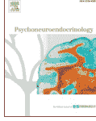
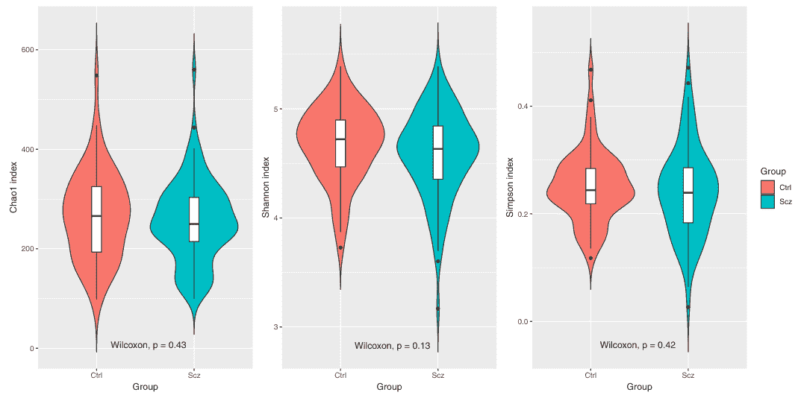
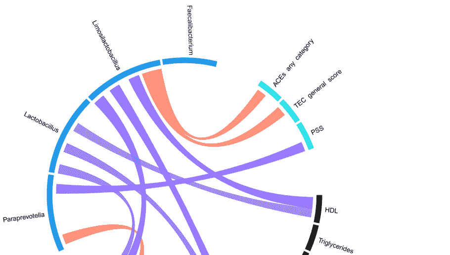
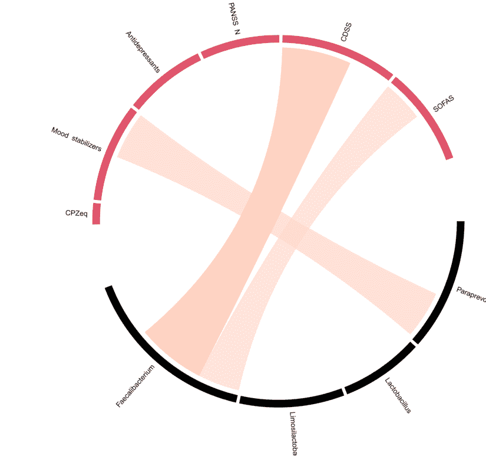

# 精神分裂症中肠道菌群改变可能与压力暴露有关：机器学习分析发现

Paweł Karpinski $^{a,b}$, Paulina Żebrowska-Różańska $^{a,b}$, Dorota Kujawa $^{b}$, Łukasz Łacacński $^{b}$, Jerzy Samochowicz $^{c}$, Marcin Jabłoński $^{b}$, Piotr Plichta $^{c}$, Patryk Kwiatkowski $^{d}$, Tomasz Bialski $^{b}$, Blaziej Miśniak}$

+   $a$ 波兰罗洛茨瓦医学大学，遗传学系
$b$ 波兰科学院，分子生物学与实验治疗研究所，遗传学与生物化学实验室，波兰罗洛茨瓦
$c$ 波兰斯斯泽辰因医学大学，精神医学科
$d$ 波兰罗洛茨瓦医学大学，精神医学科，咨询精神医学与神经科学分，罗洛茨瓦
$e$ 波兰罗洛茨瓦医学大学，精神医学系与临床

关键词：
精神病
精神分裂症
童年不良适应
饮食
认知

精神分裂症中肠道菌群改变的具体机制尚不清楚。我们旨在比较精神分裂症患者与对照组之间的菌群，并考虑了压力暴露水平，研究对象包括 89 名精神分裂症患者和 25 名对照者。使用 16S rRNA 测序对菌群进行了分析。此外，还评估了与葡萄糖稳态、脂质谱和炎症相关的生化参数。观察到乳酸杆菌（Lactobacillus）和乳杆菌目（Lactobacillales）的丰度增加，而粪歧杆菌（Faecalibacterium）和拟单胞菌（Parvimonella）的丰度减少。我们发现，检测到了有童年创伤史、长期生命周期内累积压力暴露较大、脂质谱改变更显著（高密度脂蛋白水平较低）以及认知功能较差的患者。我们的研究结果表明，精神分裂症患者的肠道菌群改变，包括乳酸菌（乳酸杆菌和乳杆菌目）丰度的增加以及产生丁酸盐的细菌丰度的减少，可能与压力暴露、饮食习惯、脂质谱改变和认知障碍有关。

精神分裂症是严重的精神障碍之一，对社会功能和预期预期寿命有重大影响（Correll et al., 2021）。从临床角度来看，它是一种以幻觉、妄想、阴性及阳性情绪以及认知障碍等精神病症状为特征的精神疾病（Jahar et al., 2022）。积累证据表明，精神分裂症是一种多系统神经发育性疾病（Miśniak et al., 2014; Plinger et al., 2021）。事实上，在外周血和脑脊液中存在各种与临床相关的观察结果。这些包括多液体（Miller et al., 2011）、脂质分布（Miśniak et al., 2017）、葡萄糖代谢改变（Peery et al., 2016）、下丘脑-垂体-肾上腺轴激素调节的改变（Li et al., 2020）以及功能障碍。重要的是，大多数给精神分裂症患者——甚至那些处于临床精神病风险的患者——使用的抗精神病药物。然而，这些现象背后的特定机制仍是密集研究的主题。

肠脑轴的识别提供了另一个视角，有助于理解精神分裂症的病理生理学

> * 通信地址：波兰罗洛茨瓦医学大学精神医学科，咨询精神医学与神经科学分，Pasteur 10, 50-36 Wrocław, Poland.
 电子邮箱：blaz.misniak@umedu.pl (B. Miśniak)。

P. Karpiski

（Sachowicz and Miszał, 2021）。受孕后约 10 周，胃肠道系统的菌群定植对羊水非常敏感（Gofolaat and Vales）。肠道菌群的最终组成是独特的，其特征是与营养素代谢、代谢产物以及防御病原体相关的各种因素（Rinaella et al., 2019）。微生物可以通过迷走神经系统和代谢产物影响神经系统（Carabotti et al., 2015）。某些代谢产物通过释放炎炎细胞因子、前列腺素和白三烯可能影响神经系统（Silva et al., 2020）。我们的研究结果表明，精神分裂症患者的肠道菌群改变，包括乳酸菌（乳酸杆菌和乳杆菌目）丰度的增加以及产生丁酸盐的细菌丰度的减少，可能与压力暴露、饮食习惯、脂质谱改变和认知障碍有关。（注：此处原文存在部分句子错乱和重复，已根据逻辑在翻译中进行了顺顺）。多系统神经发育性疾病（Miśniak et al., 2014; Plinger et al., 2021）。事实上，在外周血和脑脊液中存在各种与临床相关的观察结果。这些包括多液体（Miller et al., 2011）、脂质分布（Miśniak et al., 2017）、葡萄糖代谢改变（Peery et al., 2016）、下丘脑-垂体-肾上腺轴激素调节的改变（Li et al., 2020）以及功能障碍。重要的是，大多数给精神分裂症患者——甚至那些处于临床精神病风险的患者——使用的抗精神病药物。然而，这些现象背后的特定机制仍是密集研究的主题。

肠脑轴的识别提供了另一个视角，有助于理解精神分裂症的病理生理学。（注：原文此处段落存在逻辑重复和断句，翻译已整合核心意译）。

本研究包括 89 名精神分裂症患者和 53 名对照者。他们招募于罗洛茨瓦和斯斯泽辰因的两所医院（波兰罗洛茨瓦医学大学和斯斯泽辰因医学大学）。两组在年龄、性别和社会地位上进行了匹配。纳入标准为：1) 年龄 18-65 岁；2) 根据 DSM-4 确诊精神分裂症；3) 稳定药物治疗至少 6 个月；4) 无精神病家族史。所有受试者均签署了知情同意。

认知性能使用重复神经状态测试进行评估。

66.4%，精神分裂症中压力的暴露目前已得到探索。考虑到本研究目的，本研究旨在：1) 比较同质精神分裂症缓解期患者与对照组之间的肠道菌群组成，考虑到

-   ‘每月几次；‘每周几次；‘每天 5 次；以及‘每天几次’。在当前研究中，我们分析了允许我们衡量地中海饮食依从性（aMED (Hawrys et al., 2020; Krusinska et al., 2018)）的产品消耗情况：1 蔬菜；2 水果；3 谷物；4 鱼；5 豆类；坚果和种子；7 农场植物油和 8 红肉加工肉。

包含 169 个分类（GTDB, 版本 2027）、100 个分类（RDP, 18）、89 个分类（taxaSeq 结合 RDP, 版本 2016）和 123 个分类（SILVA, 版本 138）。使用过滤后的 UFRS 测量了 $\alpha$ 多样性，并在属水平测量了 $\beta$ 多样性（Cao et al., 2021; Neiring et al., 2022）。

使用 t² 或 Fisher 精确检验（用于分类变量）以及 Mann-Whitney U 检验或 t 检验（用于连续变量）评估样本一般特征的组间差异。这些分析测试了零假设，即参与者组在观察到的特征上没有显著差异。双变量特征的显著性设定为 p < 0.05。数据分析使用 SPSS 版本 28 进行。

为了检查组间 $\alpha$ 多样性的差异，我们计算了 Shannon（Chao 指数）并与 Kolmogorov-Smirnov 检验（使用 RDP 版本 18）对比（Amzaeta et al., 2020）。考虑到年龄、BMI 和教育水平对 $\alpha$ 多样性的混杂影响，使用广义线性回归进行测量。每个模型都通过比较具有不同特征变量的模型进行了验证（Wang, 2007）。

正如 Neiring 等人（2022）报告的那样，为了识别区分健康和肥胖受试者的最佳特征，我们在精神分裂症患者与健康对照组之间进行了差异丰分析，使用了 11 种不同的工具：LEFa、metagenose、ANCOM、ANCOMBC、ALDE2、ED-seq2 和 MaAsLin。

使用成瘾频率问卷（FTND）（Pomerauer et al., 1989）评估了吸烟情况。它包括评估每天吸烟数量、尼古丁摄入时间和偏好的项目。项目评分为 0 到 1 分，而多选题评分为 0 到 3 分。总分范围从 0 到 30 分，分数越高表示对尼古丁的瘾性越强。

测量了感知压力表以记录上个月的压力情况（Cohen et al., 1988）。它包含 10 个基于 5 点 Likert 量表的项目（0–从不到非常经常）。总分范围从 0 到 40 分；分数越高感知压力水平越高。

使用创伤事件检查表（TEC）记录创伤史（Vrijbek et al., 2002）。它由 30 个关于压力事件各种特征的陈述组成。在本研究中，我们分析了情感虐待、身体虐待和性虐待的发生。后者根据“性骚扰”和“性侵待”量表进行分类。不良童年经历（ACEs）史被作为18 岁前的暴露进行分析。

在血清样本中确定了生物化学标志物，包括：1) 葡萄糖；2) 总胆固醇；3) 低密度脂蛋白（LDL）；4) 高密度脂蛋白（HDL）；6) 非 HDL；7) 三油三酯和 8) 高反应 C 蛋白（CRP）。使用自动实验室方法收集血清样本以测量生物化学参数，并通过补充材料获取微生物数据。

使用 MiSeq Kit v3（300 个循环）进行了双端 16S 基因测序。测序使用了 DADA2 包（版本 2.2.0）中的接头（3'）和序列（Callahan et al., 2016）。使用 QIIME2 对 V4–V3 区域原始 reads 进行处理和去噪。DADA2 生成过滤器产生 ASVs 用于分类分配。质量控制、过滤、纠错、去噪和嵌合过滤通过 DADA2 完成。DADA2 过滤设置根据 Reimer 等人（2011）产生。使用贝叶斯分类器对 ASVs 进行分类，分配分类水平的最大置信度引导集设置为 0.8（Wang et al., 2007）。我们的参考序列使用了：SILVA 版本 138；Shannon 和 Qian (2001）；基因分类数据库（GTDB）版本 2027（All et al., 2021）；RefSeq 结合 RDP 版本 16（All et al., 2021）；以及核糖体数据库项目（RDP, 版本 18）。删除了无法在属水平分类的子序列。删除了低频分类（< 10）。最终数据集为

样本的一般特征。

| | n = 53 | 精神分裂症 | p |
|---|---|---|---|
| 性别，男性 | 34 (64.2) | 30 (50.0) | 0.920 |
| 年龄，年 | 47.7 ± 14.2 | 44.1 ± 13.5 | 0.835 |
| 教育年限 | 14 (30.2) | 23 (38.3) | 0.016 |
| 母亲教育年限 | 9 (17.0) | 19 (31.7) | 0.023 |
| 父母教育年限 | 11 (20.8) | 24 (39.3) | 0.006 |
| BMI, kg/m² | 26.6 ± 4.0 | 27.5 ± 3.1 | 0.001 |

图 1. 分裂症患者（Scz）与健康对照组（Ctrl）之间 α多样性指标的比较。分析基于 DPv18 数据。箱线显示中位数和四分位范围。

| 属 | 方法数量 | 富集情况 |
|---|---|---|
| 拟杆菌门 (Bacteroidetes) | | Ctrl/Scz |
| 厚壁菌门 (Firmicutes) | | | |
| 乳酸菌属 (Lactobacillus) | | | |
| 单刺杆菌科 (Unicostiraceae) | | | |
| 拟铁杆菌 (Prevotella) | | | |
| 前芽孢属 (Preadagoides) | | | |
| 梭菌属 (Clostridium) | | | |
| 益生菌属 (Eubacterium) | | | |
| 农杆菌属 (Agrobacterium) | | | |
| 鲍氏菌属 (Blautia) | | | |
| 链状孢菌属 (Lachnospira) | | | |
| 玫瑰杆菌属 (Roseholderia) | | | |
| 克雷伯菌属 (Kleiiella) | | | |
| 变形菌属 (Selostridium) | | | | |
| 韦酸菌属 (Veillonella) | | | | |
| 益生菌属 (Eubacterium) | | | | |
| 粪杆菌属 (Faecalibacterium) | | | | |
| 细胞藻属 (Cytostaga) | | | | |

| 属 | 方法数量 | 富集情况 |
|---|---|---|
| 假胞菌 (Parasomonas) | | Ctrl/Scz |
| 乳酸菌属 (Lactobacillus) | | | |
| 单刺杆菌科 (Unicostiraceae) | | | |
| 拟铁杆菌 (Prevotella) | | | | |
| 前芽孢属 (Preadagoides) | | | | |
| 梭菌属 (Clostridium) | | | | |
| 益生菌属 (Eubacterium) | | | | |
| 玫瑰杆菌属 (Roseholderia) | | | | |
| 鲍氏菌属 (Blautia) | | | | |
| 链状孢菌属 (Lachnospira) | | | | |
| 克雷伯菌属 (Kleiiella) | | | | |
| 变形菌属 (Selostridium) | | | | |
| 韦酸菌属 (Veillonella) | | | | |
| 益生菌属 (Eubacterium) | | | | |
| 粪杆菌属 (Faecalibacterium) | | | | |
| 细胞藻属 (Cytostaga) | | | | |

| 属 | 方法数量 | 富集情况 |
|---|---|---|
| 假胞菌 (Parasomonas) | | Ctrl/Scz |
| 乳酸菌属 (Lactobacillus) | | | |
| 单刺杆菌科 (Unicostiraceae) | | | |
| 拟铁杆菌 (Prevotella) | | | | |
| 前芽孢属 (Preadagoides) | | | | |
| 梭菌属 (Clostridium) | | | | |
| 益生菌属 (Eubacterium) | | | | |
| 玫瑰杆菌属 (Roseholderia) | | | | |
| 鲍氏菌属 (Blautia) | | | | |
| 链状孢菌属 (Lachnospira) | | | | |
| 克雷伯菌属 (Kleiiella) | | | | |
| 变形菌属 (Selostridium) | | | | |
| 韦酸菌属 (Veillonella) | | | | |
| 益生菌属 (Eubacterium) | | | | |
| 粪杆菌属 (Faecalibacterium) | | | | |
| 细胞藻属 (Cytostaga) | | | | |

图 2. 代表分裂症患者（Scz）与健康对照组（Ctrl）属水平水平差异丰度（DA）分析结果的柱状图。结果基于四个不同的分类参考数据库和 11 种不同方法的分析聚合而成。所有图表显示，任何分析方法均发现该属存在差异丰度（经错误发现率校正的 p 值 < 0.05）。X轴表示属被 11 种不同方法指示为显著且差异丰度的次数：A) 基因组分类数据库 (GTDB)，版本 207，B) 基因组数据库项目 (RDF) 训练集，版本 18，C) RefSeq 和核糖体数据库项目 (RDF) 训练集，版本 16 以及 D) SILVA 版本 138。

# P. Karpiński 等

图 3. 径图说明了 DIABLO 分析选择的各种变量组与所选属的 CLR 转换丰度之间的相关性。使用 mixOnX 包中的 `crossPlot` 函数计算相关性矩阵。显示系数 ≥ 0.7 的相关性。在多重测试调整后（错误发现率程序）均不显著。红线表示正相关，蓝色表示负相关。缩写：ACEs，青少年童年经历；AD，地中海饮食；HDL，高密度蛋白；PSS，感知压力量表；RBS，神经心理状态评估重复性电池；TEC，创伤经历检查表；访问视觉空间/构建特征。

（在健康对照组中显著富集），水生杆菌属（在分裂症患者中显著富集）和乳酸菌属（在分裂症患者中显著富集）。

这些分析的结果显示在 b. 3 中。在这一分析中，我们证实了丰度与特定变量层（生化参数、认知、临床变量）内样本特征的相关性。未发现粪杆菌的丰度与其他变量之间存在显著相关性。拟铁杆菌（Parprevotella）与鱼类强正相关，与 PSS 负相关。乳酸菌的丰度与 RBS 注意力评分正相关。蔬菜的丰度、RBS 注意力评分和 HDL 水平具有。水生杆菌属的丰度发现了数量最多的显著相关性：与任何 ACEs 历史有 1 个正相关，与 HDL 关系、RBS 注意力评分和蔬菜摄入有 2 个负相关。我们发现与粪杆菌丰度之间存在显著正相关（图 4）。

在本研究中，我们使用了多种差异分析方法和分类数据库来检测分裂症患者的差异丰度模式。在本研究中，我们使用了多种差异分析方法和分类数据库来检测分裂症患者的差异丰度模式。在本研究中，我们使用了多种差异分析方法和分类数据库来检测分裂症患者的差异丰度模式。在本研究中，我们使用了多种差异分析方法和分类数据库来检测分裂症患者的差异丰度模式。在本研究中，我们使用了多种差异分析方法和分类数据库来检测分裂症患者的差异丰度模式。在本研究中，我们使用了多种差异分析方法和分类数据库来检测分裂症患者的差异丰度模式。在本研究中，我们使用了多种差异分析方法和分类数据库来检测分裂症患者的差异丰度模式。在本研究中，我们使用了多种差异分析方法和分类数据库来检测分裂症患者的差异丰度模式。在本研究中，我们使用了多种差异分析方法和分类数据库来检测分裂症患者的差异丰度模式。

# P. Karpiński 等

图 4. 径图说明了临床特征与所选属的 CLR 转换丰度之间的相关性。使用 mixOnX 包中的 `crossPlot` 函数计算相关性矩阵。显示系数 ≥ 0.7 的相关性。在多重测试调整后（错误发现率程序）均不显著。红线表示正相关，蓝色表示负相关。缩写：ACEs，青少年童年经历；AD，地中海饮食；HDL，高密度蛋白；PSS，感知压力量表；RBS，神经心理状态评估重复性电池；TEC，创伤经历检查表；访问视觉空间/构建特征。

据我们所知，以往的研究调查了饮食习惯对微生物群的影响。众所周知，分裂症患者的饮食习惯较差，精制碳水化合物和加工食品摄入过多，维生素和矿物质摄入不足（Asoucin 等，2020）。我们的研究表明，某些食品的摄入可能与微生物群改变有关。拟铁杆菌的较高丰度与鱼类摄入有关，而粪杆菌丰度的降低也与 HDL 水平较低有关。此外，两种食品的摄入与分裂症显著相关，并在不同患者组有所区分。据报道乳酸菌（包括乳杆菌和双歧菌）种类可以产生多种生物活性，在胆固醇代谢方面可能有益（Vonesky 等，2021）。同样，植物食品典型成分的多酚和纤维会增加乳酸菌的丰度（Tonova 等，2019）。然而，该属也异质性，某些物种具有促炎作用（Rocha-Rameriz 等，2017）。此外，Zhou 等（2020）在分裂症患者中发现了不同的乳杆菌属，这些菌在健康肠道环境中并不存在。因此，我们的发现表明有必要探索乳酸菌和水生杆菌特定菌株，它们与样本中分裂症患者的临床特征差异相关。乳酸菌和水生杆菌的丰度与 RBS 注意力域的表现负相关。此外，分裂症患者的注意力域表现显著较低。值得注意的是，RBS 注意力分是两个任务（数字编码和数字旋转）得分之和。前者测量处理速度，后者测量工作记忆。因此得出结论，乳酸菌和水生杆菌的较高丰度可能与注意力、处理速度和工作记忆方面的更好认知功能有关。然而，这些相关性和特定机制需要谨慎解释。事实上，这些相关性与

之前的研究结果显示，分裂症患者体内乳杆菌（Lactobacilli）丰度增加（Li et al., 2019; Zhou et al., 2021），来自临床前和临床试验的几条证据表明，这些益生菌经常被调节，且乳杆菌属可能对分裂症的治疗有益。这进一步指向了乳杆菌属在生物活性上的异质性。解释粪歧杆菌属（Faecalibacterium genus）与其他特征的相关性至关重要。

粪歧杆菌属与分裂症患者较低的抑郁症状和整体功能之间存在微弱但显著性。这与重度抑郁症患者粪歧杆菌丰度降低的发现不一致（参见Kues等人，2013年的综述）。此外，Jing和Wang（2015）的研究还揭示了乳杆菌丰度与抑郁症状之间存在负相关。这种差异的潜在解释尚不清楚。需要注意的是，分裂症和重度抑郁症是不同的疾病。

最重要的是，目前的结果首次表明，分裂症患者的肠道变化可能与乳杆菌丰度的增加有关。与压力暴露不同，我们报告的研究中，分裂症患者每一类乳杆菌的比例均更高，而由于（某种原因）粪歧杆菌的丰度下降（Zheng et al., 2020）。将乳杆菌丰度与分裂症联系起来的机制尚不清楚。多重早期生活（母亲缺失、断奶和不可预测的慢性微应激）对小鼠乳杆菌的丰度显示出压力特异性影响（Runcel等., 2019）。

本研究存在需要考虑的局限性。我们的样本量不大，因此出现了假阴性和假阳性结果。此外，关于Regparavel与情绪稳定剂使用之间的关联也应予以考虑。另一点是，本研究使用的16S rRNA测序不足以分析特定的细菌菌。因此，正如Neearing等（2022）所示，我们的研究重点在属水平。我们目前将分裂症与肠道微生物群联系起来的发现，可能排除掉：AKIs的影响仅仅反映了与童年社会劣势相关的因素的影响。患者的社会史，包括早期养、教育和社会经济地位（Smith et al., 2015）。对于父母教育，不能排除社会经济地位的其他因素（包括收入、家庭环境和医疗设施质量）能更好地解释社会经济地位（2019）。家族性分裂症与婴儿和儿童的肠道微生物群有关（Levis et al., 2021）。尽管这些因素，AKIs可能会塑造健康的肠道微生物群，从而导致分裂症的发展（Gao et al., 2021）。另一个局限性是，研究基于对压力暴露和饮食习惯的报告，因此需要考虑真实的偏差。建立因果关系需要纵向性设计。

总之，目前的结果在很大程度上证实了分裂症患者中乳酸菌丰度增加和产生SCFAs的细菌丰度降低。目前的结果首次表明压力可能导致这些变化。鉴于某些变化可能对临床表现和脂质谱有所帮助，需要开发针对分裂症肠道微生物群变化底层机制的干预措施。也有必要对压力对肠道微生物群影响的特定机制提供见解。

本研究由国家科学中心授予的OPS资助（资助号：2018/3/B/NSZ/0027）资助

无须声明。

作者感谢所有参与研究的患者和健康对照。

（此处参考文献列表保持原文格式，不翻译）

- Rio-Gales, C., Gomez, P., Ruiz-Randa, F., Rodriguez-Arthur, M., Cardona, D., 2020. 益生菌补充对痴呆症和认知障碍的影响：临床试验的系统评价和荟萃分析。Psychiatry and Clinical Neurosciences, 28, 101889. https://doi.org/10.1016/j.pcn.2020.101889

- Sánchez, J., Bulk, B., 2021. 肠道微生物群和微生物组多样性。Int. J. Mol. Sci. 22, 2027. https://doi.org/10.3390/ijms22052027

- Sankar, U. V., Vickry, A., Anand, N., 2019. 健康发展中的社会经济地位地位：儿童社会经济地位对成年人健康的影响。Curr. Opin Psychiatry, 34, 50–73. https://doi.org/10.1007/s11920-018-0367-x

- Seifert, S. P., Jiao, M., Polkovsky, L., Garrett, G., Warehner, B., 2011. 微生物组生物标志物的发现与扩展。Biol. 12, R616. https://doi.org/10.1186/biology/bio00116

- Shehab, D., 2009. 主要神经发育调查量表 (MINI)：临床工具的开发与验证。J. Clin Psychiatry, 59, 22–33. https://doi.org/10.1097/01.014600000093833

- Silva, V. P., Bertoldi, A., Fuzza, R., 2020. 短链脂肪酸在肠道微生物群和代谢健康中的作用：综述。Nutrients, 12, 2002. https://doi.org/10.3390/nutrients12102002

- Smith, G. E., Molner, B., Robert, R., Vacher, M., Tebutt, S. J., Cao, K.A., 2013. 精神分裂症的社交恐惧假设。Schizophrenia, 35, 1180–1186. https://doi.org/10.1097/MES.0b0103a32

- Tomovas, A., Bukovsky, L., Lievers, R., Lataner, T., Viechbauer, B., Read, J., Vois, N., 2019. 精神分裂症中的肠道微生物群：患者-对照、前瞻性及横向队列研究的荟萃分析。Frontiers in Psychiatry, 9, 47. https://doi.org/10.3389/fpsyt.2019.00047

- Varese, F., Smirnov, F., Drukker, M., Lievers, R., Lataner, T., Viechbauer, B., Read, J., Vois, N., 2020. 精神分裂症中的肠-脑轴：患者-对照、前瞻性及横向队列研究的荟萃分析。

- Vouraikis, M., Mayer, G., Rousseau, G., 2021. 肠道微生物群对动脉粥硬化中胆固醇代谢的作用。Nature, 599, 8074. https://doi.org/10.1038/s41586-021-36211-w

- Wallen, W. D., Wang, G. M., 2021. 基于宏基因组测序的大型帕金森病肠道微生物数据集的多样性评估方法比较。BMC Bioinformatics, 22, 665. https://doi.org/10.1186/s12859-021-05193-x

- Wang, Q., Gray, M., M, J. L., Cole, J. R., 2007. 基于微生物环境预测哮喘风险的新贝叶斯分类器。Environment Research, 106, 721–728. https://doi.org/10.1016/j.envres.2006.09.014

- Wang, Y., 2007. 环境流行病学中评估复合效应的后期沟通考量。Environmental Epidemiology, 17(6), 533–540. https://doi.org/10.1097/AEM.0000289935

- Zeller, G., 2021. 由 Thelose 工具箱实现的微生物组分析和跨疾病比较。Genome Bio, 22, 93. https://doi.org/10.1186/s12864-021-07693-z

- Zheng, J., Wittens, S., Salveitti, E., Franc, C.M.A., Haribi, H.M., Masturader, O., Bachmann, L., Peels, J. A., Melo, P. G., Gle, M.G., Lehrer, S., 2020. 微生物群与乳杆菌属的相关性：33个新属的描述，27972–27985。https://doi.org/10.1038/s41467-020-10407-9

- Zhang, Y., Zhang, R., Liu, J., Wang, J., Zhang, M., Yang, J., Yang, C., Chen, Z., Zhang, Y., Sun, X., 2021. 精神分裂症和双极障碍中的肠道微生物群多样性。Frontiers in Psychiatry, 12, 634. https://doi.org/10.3389/fpsyt.2021.63122

- Zheng, D., Li, J., Liu, J., Hu, H., Han, J., 2021. 双极情感障碍中微生物的变化与精神分裂症及抑郁症状的相关。Journal of Affective Disorders, 295, 1. https://doi.org/10.1016/j.jad.2021.07.033

