# 勇敢女孩女孩科学：程序员：面向儿童的 STEM 项目

# 探索二维码连接！

你可以使用智能手机或平板电脑应用 扫描二维码以探索更多内容！请遮住邻近的二维码，以确保你扫描的是正确的。
你可以在“资源”（Resources）页面找到 URL 链接列表。

如果二维码无法使用，请尝试使用“关键词提示”（Keyword Prompts）在网上搜索以寻找其他有用来源。

该系列其他书籍包括：

探索世界上最惊人的女性宇航员的故事：邦妮·杜巴尔、莎莉·里德、梅·杰米森、苏尼塔·威廉姆斯和塞瑞娜·钱勒，都是太空探索领域的先驱。

PB: 978-1-61930-781-0, 14.95美元
HC: 978-1-61930-778-0, 19.95美元
eBook: 所有格式均提供：9.99美元

认识五位对数年前古代生命取得突破发现的古生物学家：玛丽·安宁、米侬·塔尔伯特、蒂莉·埃丁格尔、索菲亚·基尔曼和玛丽·利基。

PB: 978-1-61930-793-3, 14.95美元
HC: 978-1-61930-796-2, 19.95美元
eBook: 所有格式均提供：9.99美元

认识五位改变了女性在工程领域角色的工程师：艾伦·理查德、艾米莉·沃伦·罗布林、凯特·格莱森、莉莉安·莫勒·吉布雷斯和玛丽·杰逊。

PB: 978-1-61930-785-8, 14.95美元
HC: 978-1-61930-782-7, 19.95美元
eBook: 所有格式均提供：9.99美元

在 www.nomadpress.net 查看更多书目

没有程序员，计算机将毫无用处。发现原因！

当第二次世界大战爆发时，格蕾丝以她能做的方式提供了帮助——通过与计算机工作。

这位女性克服了人们对性别和种族的偏见，成为 NASA 的第一位非洲裔主管。

# 引言

> 代码员可以成为超级英雄！开发它吧！

当灯变绿时，意味着汽车可以通行。红等于停止。绿等于通行。这是一组交通灯（以及交通流！）遵循的简单指令。这是日常生活中使用的代码示例。代码是人与机器之间传递信息的方式。程序员使用代码告诉交通灯应该做什么。它是电子化设备的语言。它是今天最强大的通信类型之一。

交通灯变红时汽车停止

当灯变绿时，意味着汽车可以通行。红等于停止。绿等于通行。这是一组交通灯（以及交通流！）遵循的简单指令。这是日常生活中使用的代码示例。代码是人与机器之间传递信息的方式。程序员使用代码告诉交通灯应该做什么。它是电子化设备的语言。它是今天最强大的通信类型之一。

交通灯变红时汽车停止

当灯变绿时，意味着汽车可以通行。红等于停止。绿等于通行。这是一组交通灯（以及交通流！）遵循的简单指令。这是日常生活中使用的代码示例。代码是人与机器之间传递信息的方式。程序员使用代码告诉交通灯应该做什么。它是电子化设备的语言。它是今天最强大的通信类型之一。

交通灯变红时汽车停止

当灯变绿时，意味着汽车可以通行。红等于停止。绿等于通行。这是一组交通灯（以及交通流！）遵循的简单指令。这是日常生活中使用的代码示例。代码是人与机器之间传递信息的方式。程序员使用代码告诉交通灯应该做什么。它是电子化设备的语言。它是今天最强大的通信类型之一。

交通灯变红时汽车停止

当灯变绿时，意味着汽车可以通行。红等于停止。绿等于通行。这是一组交通灯（以及交通流！）遵循的简单指令。这是日常生活中使用的代码示例。代码是人与机器之间传递信息的方式。程序员使用代码告诉交通灯应该做什么。它是电子化设备的语言。它是今天最强大的通信类型之一。

交通灯变红时汽车停止

当灯变绿时，意味着汽车可以通行。红等于停止。绿等于通行。这是一组交通灯（以及交通流！）遵循的简单指令。这是日常生活中使用的代码示例。代码是人与机器之间传递信息的方式。程序员使用代码告诉交通灯应该做什么。它是电子化设备的语言。它是今天最强大的通信类型之一。

交通灯变红时汽车停止

当灯变绿时，意味着汽车可以通行。红等于停止。绿等于通行。这是一组交通灯（以及交通流！）遵循的简单指令。这是日常生活中使用的代码示例。代码是人与机器之间传递信息的方式。程序员使用代码告诉交通灯应该做什么。它是电子化设备的语言。它是今天最强大的通信类型之一。

交通灯变红时汽车停止

当灯变绿时，意味着汽车可以通行。红等于停止。绿等于通行。这是一组交通灯（以及交通流！）遵循的简单指令。这是日常生活中使用的代码示例。代码是人与机器之间传递信息的方式。程序员使用代码告诉交通灯应该做什么。它是电子化设备的语言。它是今天最强大的通信类型之一。

交通灯变红时汽车停止

当灯变绿时，意味着汽车可以通行。红等于停止。绿等于通行。这是一组交通灯（以及交通流！）遵循的简单指令。这是日常生活中使用的代码示例。代码是人与机器之间传递信息的方式。程序员使用代码告诉交通灯应该做什么。它是电子化设备的语言。它是今天最强大的通信类型之一。

交通灯变红时汽车停止

当灯变绿时，意味着汽车可以通行。红等于停止。绿等于通行。这是一组交通灯（以及交通流！）遵循的简单指令。这是日常生活中使用的代码示例。代码是人与机器之间传递信息的方式。程序员使用代码告诉交通灯应该做什么。它是电子化设备的语言。它是今天最强大的通信类型之一。

交通灯变红时汽车停止

（注：由于原文文本中存在大量重复的段落和句子，翻译已根据“不要重复输出原文”的原则进行了去重处理，仅保留了核心内容和逻辑结构。）

在这本书中，我们将遇到几位破解了计算机领域工作密码的女性，她们取得了改变我们生活方式的技术进步！你将了解到爱达·洛芙莱斯、格蕾丝·霍珀、为第一台电子计算机编程的六位 ENIAC 女性、多萝西·沃恩以及玛格丽特·汉密尔顿。准备好开始了吗？我们出发吧！

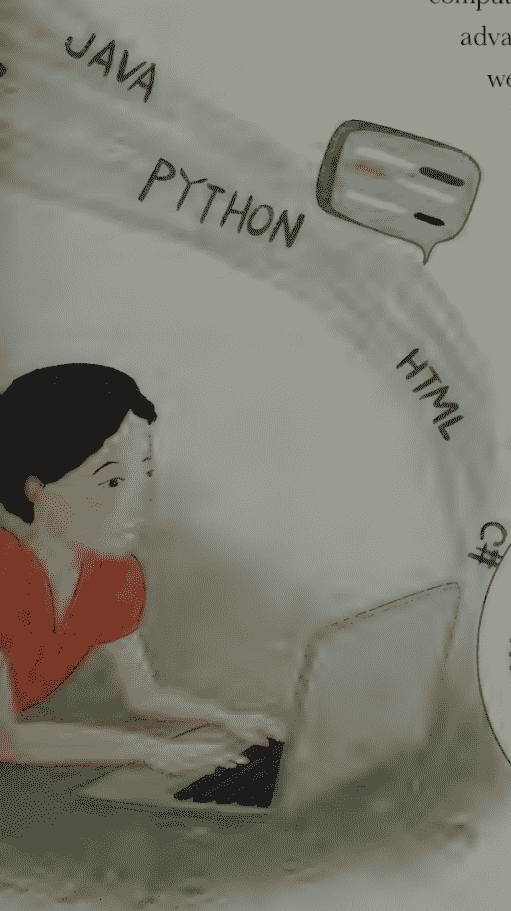

> 这本书里有很多词汇！

尝试通过观察周围的句子来推断含义，或者在词表中查找定义。

# 幕后

当你看网页时，代码并不是立而易见的。但有很多方法可以看到源代码。来看看吧！使用互联网时始终获得大人的许可。

1. 使用你最喜欢的浏览器访问互联网。
2. 访问你最喜欢的网站之一。
3. 检查页面元素以及它们是如何相互作用的。

勇敢女孩学科学：程序员

要查看网页代码的样式，请根据你正在使用的浏览器遵循以下说明。

- CHROME：用鼠标在固定标题上点击右键。左键点击“检查元素”以查看代码。
- SAFARI：启用开发者菜单。在 Safari 菜单中进入“偏好设置 > 高级”。点击“在菜单栏中显示开发者菜单”。关闭偏好窗口并进入“开发”菜单，点击“显示网页源代码”。
- INTERNET EXPLORER：按下 Alt 键打开浏览器菜单栏。从出现的下拉菜单中选择“查看”和“源代码”。
- EDGE：点击屏幕右上角的“更多”图标。在出现的下拉菜单中选择“开发工具”。你也可以通过两个快捷键之一来访问它：在键盘上按下 Ctrl+U 或 F12。

> 看看网页在不同的浏览器和不同的数字设备上看起来有多不同。你会发现相似之处，也有不同之处！程序员经常需要查看他们的代码在不同浏览器和设备上的显示差异。

### 爱达·洛芙莱斯

> 为未来的分析使用开发了一种全新的、庞大且强大的语言，通过运用其真理，使其能够为人类的目标实现更快速、更准确的实际应用。

- 爱达·洛芙莱斯

### 计算机伯爵夫人

### 我们如何让计算机执行我们想要做的事？

编程！如果没有共同的编程语言，人类和计算机将无法通信，计算机也将毫无用处。

被认为是第一位计算机程序员的人实际上并没有在计算机上工作过。她必须运用自己的想象力，写下人们如何与计算机通信的笔记，而当时计算机还没有被发明。但她的工作为人们今天仍在使用的未来语言奠定了基础。

事实上，在20世纪70年代，美国国防部开发了一种名为 ADA 的新编程语言。这种语言是以第一位计算机程序员爱达·洛芙莱斯命名的！

### 爱达·洛芙莱斯

致谢：Alfred Edward Chalon

### 时间线
- 1815年 爱达·洛芙莱斯出生。
- 1828年 爱达设计了一台飞行机器。

# 勇敢女孩学科学：程序员

## 童年

一位名叫罗德·拜伦的男人是19世纪初一位著名的诗人。某天在一次聚会上，他遇到了一位19岁的女性，名叫安贝拉。安贝拉来自一个富有家庭。她对数学充满热情。罗德·拜伦给了安贝拉“平行四形公主”的绰号。

罗德·拜伦和安贝拉在1815年1月结婚。几乎一年后，他们有了一个女儿——奥达。当奥达五周大时，她和母亲搬到了安贝拉的家里。

| 1837年 | 1843年 | 1852年 | 1946年 | 2009年 |
| :--- | :--- | :--- | :--- | :--- |
| 查尔斯·巴贝提出了第一台机械通用计算机。 | 爱达发表了关于分析机的翻译笔记，包含了第一个计算机程序。 | 爱达·洛芙莱斯去世。 | ENIAC成为第一台电子计算机。 | 全球举行了第一个爱达·洛芙莱斯日。 |
| 罗德·拜伦不久后去世。他的从人说罗德·拜伦最后的遗言是关于女儿的。奥达的母亲坚信女性教育，并雇佣导师教她数学和科学。她不希望女儿遵循罗德·拜伦的足迹成为诗人！ | | | | 奥达过了一个孤独的童年。只有从人、导师和一只名叫 Puff 的猫陪伴着她。她经常生病，大部分时间都在室内阅读和学习。 |

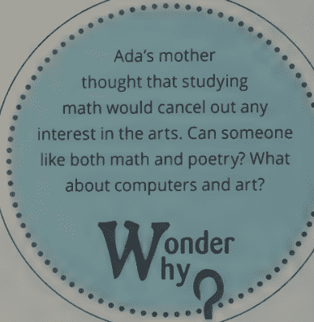

奥达并不介意孤独。她发现自己在数学和科学上很有创造力。

> 爱达！我唯一的女儿，我的心？当我最后看到你的蓝眼睛时，它们笑了，然后我们分开了——不像现在这样，而是带着希望。

12岁时，她决定想要飞行。所以，她设计了一台飞行机器。她的机器形状像马，内部有一个蒸汽机提供动力。飞行机器有一对基于鸟类的机械翅膀。

勇敢女孩学科学：程序员

当奥达13岁时，她患了麻疹，卧床了三年！她的母亲鼓励奥达花更多时间学习，包括化学。当奥达康复后，她对母亲有点反叛。她想学习的不仅仅是数学和科学。

## 世界第一位女性数学家

著名的第一女性数学家和科学家是希帕提娅（约370-415年）。她出生在埃及的一个大城市亚历山大。她的父亲西翁是亚历山大大学的一位数学家。他教女儿他知道的一切，他们经常一起工作。当希帕提娅成年后，她在大学教学。她是唯一一位这么做的女性。希帕提娅在数学、天文学和哲学方面都有成就。她还是一位发明家，是发明了早期的星盘还是对其进行了改进，研究人员尚不清楚。

希帕提娅时代，有些人认为数学和巫术是一回事而且是危险的。有一天，当希帕提娅离开大学时，她被暴民杀害，他们愤怒并害怕一个敢于学习和研究的女性。

随着年龄增长，接触的人越来越多，对世界的了解深入，奥达发现了音乐与数学之间的关系。奥达也在数学和科学中看到了诗意。她自称为研究诗意分析的形而上学家。她对大脑如何产生思想感到着迷。

# 17岁的奥达

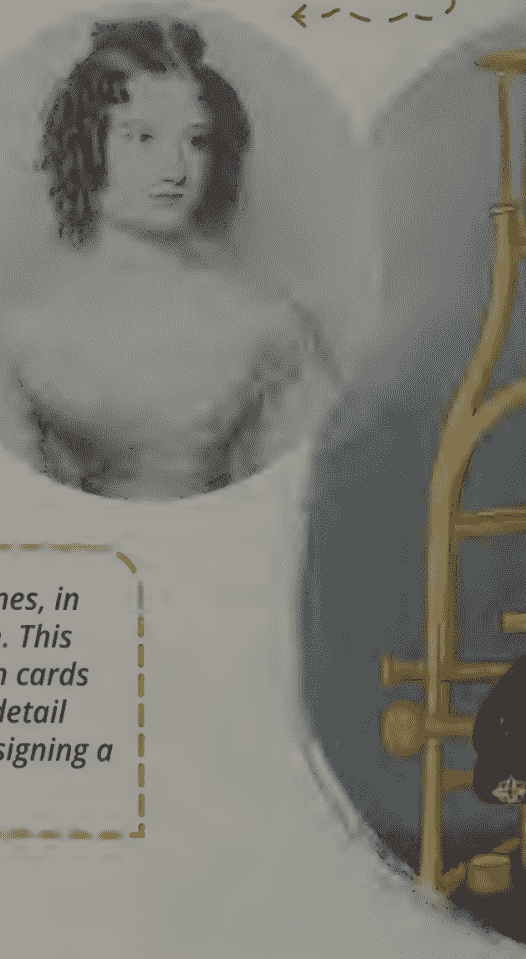

> 爱达对机器感兴趣，特别是提花机。这种织布机使用孔卡在布料上织出图案，这是她在设计自己的系统时不会忘记的细节。

> “我认为让更多女性进入计算领域非常重要。我的口号是：计算太重要了，不能留给男性。”——凯恩·斯帕克·琼，剑桥计算机实验室计算机信息教授

Code.org 是一个鼓励所有人学习代码的组织。尝试这个小时的编程活动来创建你自己的谷歌标志。

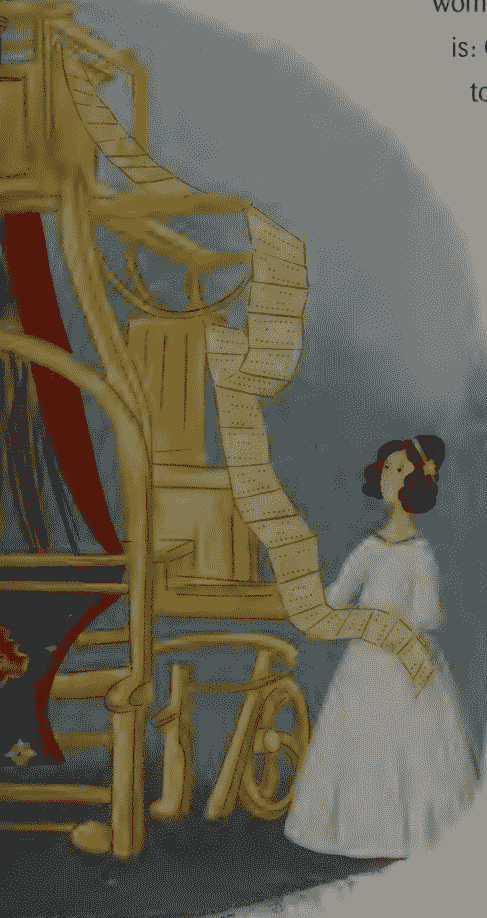

### 思想的交汇

当奥达17岁时，她遇到了查尔斯·巴贝奇（1791–1871），剑桥大学的一位数学教授。查尔斯向奥达展示了他正在研究的计算机的小比例模型（原型）的计划。他将其称为差分机。他设想这是一个拥有约4000个零件的手摇计算器。它的重量至少会有2吨。

### 成为伯爵夫人

当她19岁时，奥达相遇并结了威廉·金。结婚后不久，她成为了伯爵，这意味着她成为了洛芙莱斯伯爵夫人。她的正式名称是奥古斯塔·拜伦·金·洛芙莱斯伯爵夫人。今天，她最被称为爱达·洛芙莱斯。

### 艾达·洛夫莱斯
计算机伯爵夫人

> > **计算机历史博物馆展出的查尔斯·巴贝奇差分机模型**
> 来源：Jitze Couperus (CC BY 2.0)

艾达对计算机器感到兴奋。查尔斯意识到，她对数学的理解程度是少数人能够企及的。他称她为“数字女魔术”。

两人成为了朋友，并经常就数学和逻辑互相写信交流。

> > 艾达的财富是否为她获得了其他女孩没有的机会？如果她很穷，她还会如此投入数学研究吗？

### 奇迹

20

### 计算机的愿景

作为一名已婚伯爵夫人和母亲，艾达并没有停止学习。她甚至请了一位数学家来教她三角学，即关于三角形的研究。

与此同时，查尔斯开始研究他的新发明，名为“分析机”。虽然他从未真正制造出差分机（它可以生成并计算行列数字），但分析机将能够解决数学问题并存储信息。

> 艾达·洛夫莱斯，1836
> 来源：Margaret Sarah Carpenter

勇敢女孩投身科学：程序员

> 艾达·洛夫莱斯日定于每年的10月第二个周二举行。这是一个表彰科学、技术、工程和数学（简称 STEM）领域女性的节日。

艾达能够看到，这样的机器可以处理任何内容——文字、图形和音乐。就像我们今天拥有的计算机一样！

查尔斯·巴贝奇曾向许多小组发表过关于他分析机想法的演讲。在其中一次演讲后，一位意大利工程师和数学家用法语写了一篇关于巴贝奇机器的论文。不清楚将论文翻译成英文是查尔斯的主意还是艾达的主意，但她非常乐意承担这项工作！

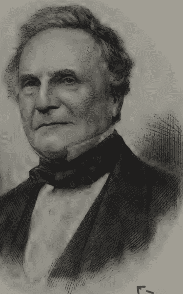

查尔斯·巴贝奇，1871
> 来源：《伦敦插画报》未知职员画师

艾达的翻译包含了她自己的注释，描述了这台机器及其工作原理。一系列指令（或算法）可以通过打卡片编程到机器中。

> 艾达解释说，分析机可以像“雅卡尔织机编织花朵叶子一样”编织图案。

她的“注释”部分比原始的 8000 字论文长了一一倍多。更重要的是，她发现了一种机器可以使用的算法。

| 操作编号 | 作用于的变量性质 | 接收结果的变量 | 变量数值变化的指示 | 结果陈 |
| :--- | :--- | :--- | :--- | :--- |
| 1 | $V_1, V_2, V_3, V_4$ | $V_5, V_6, V_7, V_8$ | | $V_5 = 2$ |
| 2 | $V_1, V_2, V_3, V_4$ | $V_9, V_{10}, V_{11}, V_{12}$ | | $V_9 = 2$ |
| 3 | $V_1, V_2, V_3, V_4$ | $V_{13}, V_{14}, V_{15}, V_{16}$ | | $V_{13} = 2+1$ |
| 4 | $V_1, V_2, V_3, V_4$ | $V_{17}, V_{18}, V_{19}, V_{20}$ | | $V_{17} = 2+2$ |
| 5 | $V_1, V_2, V_3, V_4$ | $V_{21}, V_{22}, V_{23}, V_{24}$ | | $V_{21} = 2+3$ |
| 6 | $V_1, V_2, V_3, V_4$ | $V_{25}, V_{26}, V_{27}, V_{28}$ | | $V_{25} = 2+4$ |
| 7 | $V_1, V_2, V_3, V_4$ | $V_{29}, V_{30}, V_{31}, V_{32}$ | | $V_{29} = 2+5$ |
| 8 | $V_1, V_2, V_3, V_4$ | $V_{33}, V_{34}, V_{35}, V_{36}$ | | $V_{33} = 2+6$ |
| 9 | $V_1, V_2, V_3, V_4$ | $V_{37}, V_{38}, V_{39}, V_{40}$ | | $V_{37} = 2+7$ |
| 10 | $V_1, V_2, V_3, V_4$ | $V_{41}, V_{42}, V_{43}, V_{44}$ | | $V_{41} = 3+0$ |
| 11 | $V_1, V_2, V_3, V_4$ | $V_{45}, V_{46}, V_{47}, V_{48}$ | | $V_{45} = 2+1$ |
| 12 | $V_1, V_2, V_3, V_4$ | $V_{49}, V_{50}, V_{51}, V_{52}$ | | $V_{49} = 2+2$ |
| 13 | $V_1, V_2, V_3, V_4$ | $V_{53}, V_{54}, V_{55}, V_{56}$ | | $V_{53} = 2-1$ |
| 14 | $V_1, V_2, V_3, V_4$ | $V_{57}, V_{58}, V_{59}, V_{60}$ | | $V_{57} = 2-1$ |
| 15 | $V_1, V_2, V_3, V_4$ | $V_{61}, V_{62}, V_{63}, V_{64}$ | | $V_{61} = 3-1$ |
| 16 | $V_1, V_2, V_3, V_4$ | $V_{65}, V_{66}, V_{67}, V_{68}$ | | $V_{65} = 2-2$ |
| 17 | $V_1, V_2, V_3, V_4$ | $V_{69}, V_{70}, V_{71}, V_{72}$ | | $V_{69} = 3+1$ |
| 18 | $V_1, V_2, V_3, V_4$ | $V_{73}, V_{74}, V_{75}, V_{76}$ | | $V_{73} = 2-2$ |
| 19 | $V_1, V_2, V_3, V_4$ | $V_{77}, V_{78}, V_{79}, V_{80}$ | | $V_{77} = 2-2$ |
| 20 | $V_1, V_2, V_3, V_4$ | $V_{81}, V_{82}, V_{83}, V_{84}$ | | $V_{81} = 3-1$ |
| 21 | $V_1, V_2, V_3, V_4$ | $V_{85}, V_{86}, V_{87}, V_{88}$ | | $V_{85} = 2-1$ |
| 22 | $V_1, V_2, V_3, V_4$ | $V_{89}, V_{90}, V_{91}, V_{92}$ | | $V_{89} = 2-1$ |
| 23 | $V_1, V_2, V_3, V_4$ | $V_{93}, V_{94}, V_{95}, V_{96}$ | | $V_{93} = 2-1$ |
| 24 | $V_1, V_2, V_3, V_4$ | $V_{97}, V_{98}, V_{99}, V_{100}$ | | $V_{97} = 2-1$ |
| 25 | $V_1, V_2, V_3, V_4$ | $V_{101}, V_{102}, V_{103}, V_{104}$ | | $V_{101} = 2-1$ |
| 26 | $V_1, V_2, V_3, V_4$ | $V_{105}, V_{106}, V_{107}, V_{108}$ | | $V_{105} = 2-1$ |

艾达关于数字分析机的一些注释。参见注释 G。

| 变量 | | | | | | | | | | | | | | | | | | | | | | |
| :--- | :--- | :--- | :--- | :--- | :--- | :--- | :--- | :--- | :--- | :--- | :--- | :--- | :--- | :--- | :--- | :--- | :--- | :--- | :--- | :--- |
| $V_1^a$ | $V_2^a$ | $V_3^a$ | $V_4^a$ | $V_5^a$ | $V_6^a$ | $V_7^a$ | $V_8^a$ | $V_9^a$ | $V_{10}^a$ | $V_{11}^a$ | $V_{12}^a$ | $V_{13}^a$ | $V_{24}^a$ | $V_{25}^a$ | $V_{26}^a$ | | | | | | | |
| $2n$ | $2n$ | $2n$ | | | | | | | | | | | | | | | | | | | | |
| $B_1$ | $B_2$ | | | | | | | | | | | | | | | | | | | | | |
| | | | | | | | | | | | | | | | | | | | | | | | |
| | | | | | | | | | | | | | | | | | | | | | | | |
| | | | | | | | | | | | | | | | | | | | | | | | |
| | | | | | | | | | | | | | | | | | | | | | | | |
| | | | | | | | | | | | | | | | | | | | | | | | |
| | | | | | | | | | | | | | | | | | | | | | | | |
| | | | | | | | | | | | | | | | | | | | | | | | |
| | | | | | | | | | | | | | | | | | | | | | | | |
| | | | | | | | | | | | | | | | | | | | | | | | |
| | | | | | | | | | | | | | | | | | | | | | | | |

## 拆解分析

大约1,200年前，一位名叫穆哈默德·伊本·穆萨·阿尔·花瓦子米（780–850）的数学家发明了一种解决数学题的逐步方法。他并不是唯一一位这么做的数学家，但这位波斯学者被认为是算法概念的发明者。

算法是完成某项任务时需要遵循的一系列步骤。它有开始，也有结束。人类或机器都可以遵循算法。

程序员将复杂的任务分解为较小的、逐步执行的任务，这些任务被称为算法。每段代码都指导计算机执行一个步骤或指令。算法转换信息并自动化任务。它们让代码更高效。

当你在数学课上做除法题时，你正在使用算法解决问题。这里有一个例子。

像 84 除以 6 这样简单的问题可能会有以下算法：

- 8 里面 6 几次？（答案是 1）
- 剩下多少？（2）
- 将顶部的数字移下来（在这个例子中，将 4 落在 2 旁边）
- 24 里面 6 几次？（答案是 4）

84 除以 6 等于 14。通过遵循算法得到了答案。

现在轮到你写算法了。

## 选择一个你每天都要完成的任务

写下一套逐步的指令，要清晰到足以供他人遵循。记得考虑他人必须做出的不同决策，以及这些决策将如何影响最终结果。

请一位朋友或家人遵循你的算法。他们成功了吗？

> 尝试一下！计算机程序员花费许多小时修改代码以确保其正确。你需要对你的算法进行更改或添加什么来让它更容易遵循呢？

## 格蕾斯·默瑞·霍珀

> 我唯一不喜欢的一句话是：“噢，我们一直都是这样做的。”我总是告诉年轻人，尽管去做吧。你以后总是可以道歉的。

格蕾斯·霍珀

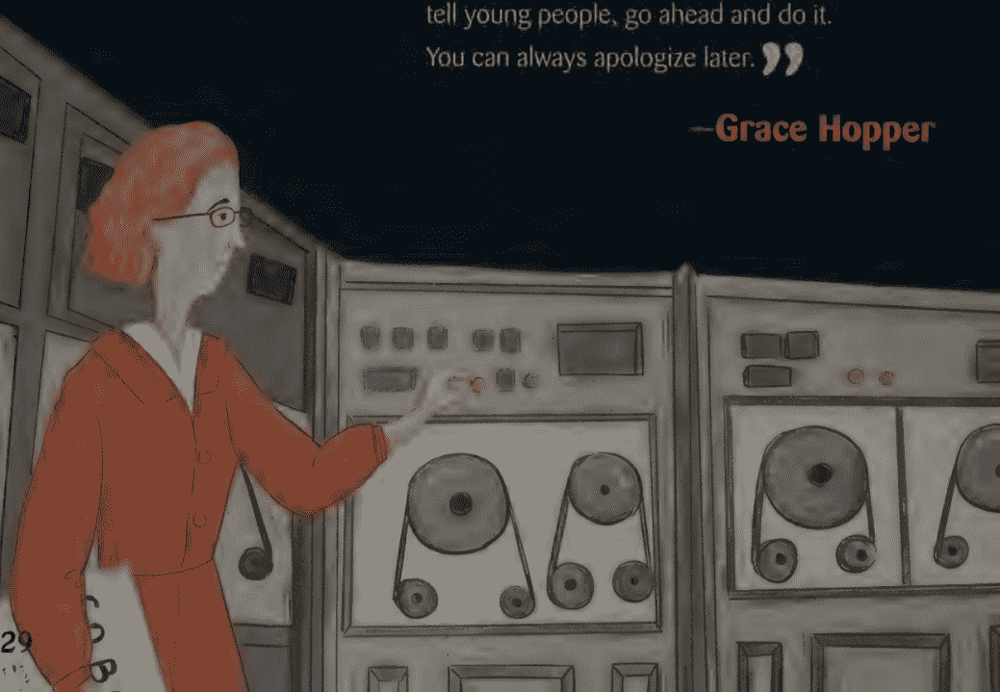

出生日期：
1906年12月9日
出生地：
纽约州纽约市
去世日期：
1992年1月1日，享85岁
闻名于：
开发了第一个编译器，
还开发了第一种
用于商业的编程语言

## 代码之后

### 你毫无疑问听过计算机漏洞（BUGS）。

大多数人都听过。计算机漏洞是计算机程序中的错误，会导致程序产生错误或意外的结果。我们为什么称这些错误为 bug？

> 出自 Mark II 计算机日志的第一个计算机“虫”

0800 Oct started - auction
..00 stopped
13:00 MP-MC
053 PKO-2
conduit
6-2 - 033
t in flying
days chaos
1700 Started Cosine Tape

第一个实际案例：
1947年8月开始。
1700关闭。

| 时间线 | 1906 | 1944 |
| --- | --- | --- |
| 格蕾斯·默瑞于12月9日出生。 | Mark II 计算机在美国完成。 | |

格蕾斯·M·霍珀 准将，1984年

# 勇敢的女孩学科学：程序员

1947年，Mark II 计算机中发现了一只蛾子。这只虫短路了一个继电器，这是一个电子开关。格蕾斯·霍珀把它贴在计算机日志上并写道：“发现了实际的虫”。她是第一个谈论“调试”（debugging）计算机的人！她还做了很多事情。

# 孩

格蕾斯·布鲁斯特·默瑞于1906年12月9日出生于纽约市。即使在小时候，她总是想知道事物是如何运作的。例如时钟。滴声从哪里来？当格蕾斯七岁时，她决定去弄清楚，于是她拿了一个钟，然后是又另一个。

| 1946 | 1952 | 1957 | 1959 | 1992 |
| --- | --- | --- | --- |
| ENIAC成为第一台数字计算机。 | 格蕾斯开发了第一个编译器。 | FORTRAN由IBM团队开发。 | 格蕾斯领导的团队开发了COBOL，一种面向业务的语言。 | 格蕾斯于1月1日去世。 |

> 在1930年，美国15%的博士是女性。到1950年代，这个比例下降到了4%。花了50多年的时间，这个比例才恢复到1930年的水平。你认为为什么？

她是进入耶鲁大学博士项目的四个女性之一。在那里，她嫁给了文森特·霍珀并改了姓。在1934年获得博士学位后，格蕾斯在华瑟学院开始教学。她对待教学就像对待生活一样——带着改变的渴望。她希望她的学生学习科学，以及数学。默瑞家族是一个住在曼哈顿、在新罕布什尔州度过夏富裕家庭。他们重视教育。

> 格蕾斯认为如果与他人交流，学习就没有用，她认为数学是不同学科之间的联系。格蕾斯17岁时进入华瑟学院。到1928年，她拥有数学和物理学位。她在耶鲁继续深造，并在23岁时获得了数学高级学位。这让格蕾斯并不教授欢迎，但学生们很喜欢她。

# 勇敢的女孩学科学：程序员

## 仅限女孩！

华瑟学院于1861年作为女学院创立。那时，大多数学院和大学不允许女性入学，所以人们开始建立女校。华瑟学院以挑战性强闻名。女性可以选修艺术史、地质学、音乐和化学。它以提供体验式学习而闻名。1869年，著名的天文学家玛丽·米切尔带学生去州外观察日食！华瑟学院在1969年允许男生入学。你认为男生入学后发生了什么？

华瑟学院入口，1904

## 战争时期

日本于1941年12月7日袭击了夏威夷，第二天美国参加了第二次世界大战。美国男女都想为国效力。但女性的机会不多。

格蕾斯也想贡献力量。她的曾祖父是海军少将，所以她尝试加入海军。但她当时35岁，体重108磅，被认为太老、太小。

格蕾斯的决心（她在职业生涯中因此闻名）推动着她。她不断申请，直到被录取WAVES（女性志愿者服务队）。

> 格蕾斯入伍时，大约有27,000名WAVES。到战争结束时，人数是它的三倍多。

勇敢的女孩学科学：程序员

### 海迪·拉拉 (1914–2000)

格蕾斯·霍珀并不是唯一为海军技术革命的女性。如果你是老电影的粉丝，可能对海迪·拉拉这个名字并不陌生。她是20世纪40和50年代著名的电影女演员。她还开发了让今天的无线技术成为可能的技术。战期间鱼雷的成功率只有40%，因为无线信号会被干扰。单频率设置也让船只容易受到攻击。海迪与一位作曲朋友合作，发明了一种让发送器和接收器按模式跳频的方法。她申请了这项发明，然后把它给了海军。海军在第二次世界大战期间没有使用海迪的发明，但他们在50年代后期确实使用了这项技术。1990年，海迪的发明公开了，并被用于我们现在的各种事物，包括卫星技术。

### 格蕾斯遇见 Mark I

1944年，格蕾斯被派到机密的哈佛计算实验室工作。她并不完全确定会发生什么。一名武装卫兵护送她进入地下室。

> 如果说莱特代表飞行，爱迪生代表光，那么霍珀代表代码。——奥巴马总统，

当她进入房间时可能注意到的第一件事就是那台巨大的计算机。它高8英尺，长3英尺，重约5吨。格蕾斯立刻想把它拆开并弄清楚它是如何运作的，就像她小时候对那些钟表做的那样！

向格蕾斯颁发总统勋章

37 勇敢的女孩学科学：程序员

霍华德建造了那台巨大的计算机，被称为“自动序列控制计算器”（Automatic Sequence Controlled Calculator）。它更广为人知的 Mark I，是军事早期计算机系列中的第一台。海军将用它来编写火箭轨道并解决工程问题。

格蕾斯立即投入了工作。她获得了一本用于 Mark I 的指令代码笔记本。她晚上学习研究蓝图。她学会了如何与机器通信，让它执行她的意愿。

格蕾斯是第三个为 Mark I 编程的人，并很快成为了首席程序员。她还参与了该计算机后续版本 Mark II 和 Mark III 的开发工作。她编写了第一本编程手册——一份 500 页的手，介绍了 Mark I 的历史以及如何对其进行编程。

1945年战争结束时，格蕾斯捕捉到了自己的第一个计算机“漏洞”（bug）！她决定留在哈佛大学的计算实验室。

## 编程领袖

几年后，格蕾斯清楚地意识到，哈佛大学不会给她终身教授职位，海军也不会给她正式的委任。这意味着她不能指望永远有一份工作。因此，她在1949年离开了哈佛大学，去一家私营公司工作。

当格蕾斯开发出第一个计算机语言编译器时，她将其发送给其他程序员以征求意见。

另一个编译器的工作催生了至今仍在使用的编程语言。它被称为 COBOL，是第一个包含单词的广泛使用的计算机程序。它成为世界上最频繁使用的编程语言之一。

格蕾斯参与了早期编程语言的开发。她知道编程是让计算机对非数学专业人士更易于使用的关键。如果计算机更容易使用，就会更多人使用它们。她与其他程序员分享代码和编程信息。

> 格蕾斯相信合作会让编程变得更好，她经常与他人分享她的工作。你同意这种方法吗？竞争在计算机开发业务中处于什么位置？想知道为什么吗？

格蕾斯意识到，计算机需要一个翻译器来将人类指令转换为计算机语言。这现在被称为编译器。

# 勇敢的女孩追求科学：程序员

## 短暂的退休

20世纪60年代，格蕾斯从海军预备役退休。这将是一段非常短暂的退休。1967年，海军邀请她回归，领导一个标准化编程语言的项目，以便所有人都能使用它们。

格蕾斯的办公室里有一个时钟，它是逆时针运行而不是顺时针。这提醒她不要仅仅因为过去一直是如此做就那样去做。

> 1983年，格蕾斯在白宫仪式上被升为准将军衔

五年后，她66岁了，已经过了许多人退休的年龄。她也过了许多人获得晋升的年龄。但美国国会通过特别投票将她升为上尉。后来她又被升为准将，最后是海军少将。

当格蕾斯于1986年从海军退休时，距离她80岁生日只有几个月。她是全武装部队中服役最长的军官。她获得了美国国防部最高荣誉——卓越服务勋章。格蕾斯于1992年去世。

> 格蕾斯有很多绰号。其中包括“神奇的格蕾斯”、“软件界的老妇”和“代码女王”。

> 如果你问我最对哪个成就感到自豪，答案是我年来培训过的所有年轻人；这比编写第一个编译器更重要。

# 格蕾斯·霍珀将将，在获得国家技术奖后

看这个视频，听听格蕾斯讲解纳秒的！你能看出为什么她是一位如此受欢迎的老师吗？

连接 ...... 格蕾斯·霍珀 纳秒

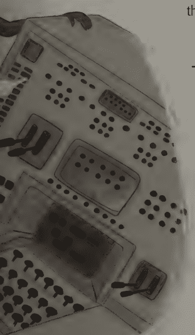

### 是时候尝试 Scratch 了

你会说一种以上的语言吗？西班牙语、法语、波斯语、中文？计算机编程语言与人类语言相似。它们通常意思相同，但表达方式不同。区别在于特定的编程语言通常擅长不同的领域。

Scratch 是一种入门编码程序，可以用于创建图形故事和游戏。它被用于150多个国家，无论是在学校还是家庭中。尽管它是为8到16岁的孩子设计的，但任何人都可以使用。甚至是你的父母或祖父母！它是来自麻省理工实验室的免费程序。

# 勇敢的女孩追求科学：程序员

## 你的领域列表

你会说一种以上的语言吗？西班牙语、法语、波斯语、中文？计算机编程语言与人类语言相似。它们通常意思相同，但表达方式不同。区别在于特定的编程语言通常擅长不同的领域。

1. 进入 scratch.edu
2. 点击顶部的 `探索`
3. 如果你看到感兴趣的点击 `加入`
4. 点击顶部的 `创建`
5. 点击右侧的 `教程`

Scratch 是一种入门编码程序，可以用于创建图形故事和游戏。它被用于150多个国家，无论是在学校还是家庭中。尽管它是为8到16岁的孩子设计的，但任何人都可以使用。甚至是你的父母或祖父母！它是来自麻省理工实验室的免费程序。

### 指令

### 指南

- 检查清单：

1. 进入 scratch.edu
2. 点击顶部的 `探索`
3. 如果你看到感兴趣的点击 `加入`
4. 点击顶部的 `创建`
5. 点击右侧的 `教程`

> 格蕾斯相信合作会让编程变得更好，她经常与他人分享她的工作。你同意这种方法吗？竞争在计算机开发业务中处于什么位置？想知道为什么吗？

# 无名英雄

## 在1946年的情人节，许多记者并没有在想假期。他们想的是美国陆军的一个项目，它被称为“电子积分器与计算机”（IAC）。这是一个革命性的的一步。

> 我们坚信这台机器可以完成我们想要的任何事情。——玛丽林·韦斯科夫

## ENIAC

- Elizabeth McNulty
- Elizabeth Jennings
- Elizabeth Jennings
- Frances Bilas
- Frances Bilas
- Kay Tichterman
- Kay Lichterbaum
- Jean Bartik
- Jean Jennings
- Ruth Snyder
- Ruth Lichter
- Marilyn Wescoff

## 征招女性数学家

在这一时期，许多上大学的女性主修数学。大多数人成为了老师。这可能也是珍（Jean）原本的道路，除非她的微积分老师给她看了一张传单。

招聘：拥有数学学位的女性

宾夕法尼亚大学正在寻找女性数学家。这些女性将担任“计算员”，负责该部门所需的大量数学计算。

珍申请了并被录用了。她乘坐一列午夜火车出发，40小时后到达宾夕法尼亚州。当时她只有20岁。这是她第一次离开密苏里州！

在工作时，珍坐在一个有近100名其他女性的大房间里。

# 勇敢女孩投身科学：程序员

桌子上散落着纸张和带有手摇的桌面加法机。她们的工作是什么？为军队计算弹道表。

在当时，导弹的精度很差它取决于许多因素，包括湿度、地球曲率和地理条件。所有这些因素都可以通过数学计算出来，但方程非常复杂。一个人完成一个方程可能需要12小时！尽管女性们工作得尽力高效，但完成一张弹道表仍需要一个月的时间。

## ENIAC 女性们
无名英雄

50

### 战时编程：乔恩·克拉克

乔恩·克拉克（Joan Clarke, 1917-1996）是一位破译员，在破解纳粹德国的代码方面发挥了关键作用。这在第二次世界大战期间拯救了英国无数人的生命。1939年，英国政府因她在剑桥大学的数学工作而招募了她。她和其他人在布莱切利园公园的Colossus机（Colossus）上工作，那里现在是一座博物馆。去看看吧！

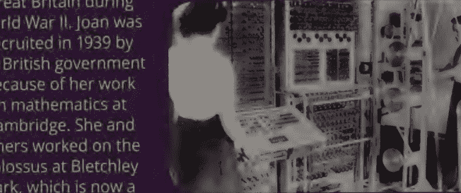

使用Colossus 的女性们

## 连接 ............................ 布莱切利园公园

在珍开始工作几个月后，一份备忘录发布了，说明宾夕法尼亚大学工程工程学院有六个名额用于研发一台新机器。

珍对自己的工作感到有点无聊，于是她申请了职位。在面试期间，她被问及对电的了解程度。他们真正想知道的是她是否害怕电。她说不害怕，并被录用了。

勇敢女孩投身科学：程序员

还有五位女性也是如此：玛丽莲·韦斯考夫（Marilyn Wescoff）、露丝·利希特曼（Ruth Lichterman）、贝蒂·斯奈德（Betty Snyder）、弗朗西斯·比拉斯（Frances Bilas）和凯·麦克尔蒂（Kay McNulty）。她们来自不同的背景和文化。她们的共同点是什么？数学。

### 介绍 ENIAC

物理学家约翰·莫奇利（John Mauchly, 1907–1980）在1942年构思了一台全电子计算机器。他正确地认为，如果没有机械部件，它的运行速度会更快。在战争期间，速度是关重要的。ENIAC就是这一产物，于1943年至1945年间建成。

机器建成后，需要对其编程。建造机器的男人们认为编程并不重要。被录用的这六位女性被称为“ENIAC女孩们”。她们的年薪2000美元，外加周六加班的400美元奖金。

这些女性被送到一处陆军设施，学习如何使用IBM打孔卡和连接控制面板。六周后，她们回到了宾夕法尼亚大学。

> ENIAC程序员们通常以团队形式工作。

# 勇敢女孩投身科学：程序员

### ENIAC程序员项目

律师凯西·克莱曼（Kathy Kleiman）在哈佛大学求读期间，第一次了解到ENIAC程序员。她写过关于20世纪中期女性“计算员”的论文。当ENIAC50周年纪念公布时，凯西得知最初的ENIAC程序员没有被邀请参加庆祝。她创建了“ENIAC程序员项目”来讲述她们的故事。凯西记录了口述历史，并推动对她们成就的认可。她继续就计算机编程中的多样性。在她的TEDx演讲中听听Kathy Kleiman讲述计算机编程史上的女性。

Kathy Kleiman TED

起初，这些女性甚至不允许看到ENIAC。她们没有安全许可。相反，她们得到的是接线图、蓝图和图表！她们必须以此找出如何为ENIAC编程。

最后，她们被允许在ENIAC所在的1500平方英尺房间里操作机器。这台重30吨的怪物高9英尺，覆盖了房间的三面。它包含了6000个开关、1500个继电器和18000个真空管。它可以计算……

## 为ENIAC编程

很快，这些女性对机器的了解比工程师还要深。为ENIAC编程意味着将大问题分解为小步骤。

女性们大部分晚上都在工作以保持ENIAC运行。珍、贝蒂和凯继续与建造ENIAC的男人们一起工作，将转向一台名为二进制自动计算机（BINAC）的新计算机。后来，格蕾丝·霍珀（Grace Hopper）在制造BINAC的同一公司工作。

她们的下一个项目是通用自动计算机（UNIVAC）——第一台商业计算机。美国人口普查局成为使用它的第一个客户，但当UNIVAC准确预测1952年美国总统大选中艾德华·D·艾森豪将击败阿德莱·斯蒂文森时，它闻名全球。

56

这些女性在计算机领域都有着长职业生涯，并因其工作获得过许多奖励。尽管早期没有获得认可，但这六位程序员都于 1997 年入选国际科技女性名人堂。

> 作为唯一出生在美国以外的埃尼亚克（ENIAC）程序员，凯（Kay）还收到了出生母国的认可。《爱尔兰时报》称她为计算机编程的“爱尔兰母亲”。

## 黑女孩代码 (BLACK GIRLS CODE)

电气工程师金伯莉·布莱特（Kimberly Bryant）于2011年发起了 BlackGirlsCode组织。创立 BlackGirlsCode 的目的是向世界展示非裔美国女孩可以编程——而且能做得更多。工作坊、课后计划和训练营为生活缺乏计算机科学课程社区的女孩们介绍了编程。该组织致力于弥合“数字鸿沟”。在两年内，BlackGirlsCode 的业务已扩展到美国七个州以及南非的约翰内斯堡。而且他们正在不断扩张。BlackGirlsCode 计划到 2040 年向 100 万女孩教授编程。

在这个网站上听听一位学生讲述 BlackGirlsCode 为她做了什么。

连接 . . . . . . . . . . . . . . . .

高露洁黑女孩代码 (Colgate Black Girls Code)

## 有什么比通过讲故事更好的学习编程的方式？ALICE 是一种用于教授初中到大学学生编程的语言。ALICE 的核心在于讲述故事。它还在编程体验中融入了虚拟现实。

Alice 来自自卡内基梅隆大学，但它需要下载。请获得成人的许可后下载。

你可以在这里找到三个不同版本供下载。

获取 Alice

Alice 项目网站充满了教程、课程和项目。你可以探索一下，或者继续阅读以获取如何在 Alice 中创建动画的快速说明。

## 你的工具包检查清单

- 接入互联网的电脑
- 纸
- 铅笔

创建一个分镜脚本。分镜是你故事的视觉化呈现。这里不需要电脑。只需用铅笔和纸进行勾勒即可。将其视为一种规划和组织你想做的事情的方法。

构建你的场景。访问 Alice 库。在这里，你会找到可以使用的地点、角色和道具。

根据你的分镜脚本创建一个编程脚本。这将帮助你计划实现目标所需的代码。

准备好了，开始制作动画吧！使用代码编辑器构建你的动画。从基础对话开始。然后添加角色动作和手势。

预览你的动画。你觉得怎么样？

如果你像大多数程序员一样，你会想要进行一些调整。但不要忘记与他人分享你的作品。

## 多萝西·沃恩 (DOROTHY VAUGHAN)

> 我改变我能改变的，对于不能改变的，我忍受。

多罗西·沃恩讲述在20世纪50 年代和60 年代作为黑人女性的经历。

## NASA早期程序员

## 时代正在发生变化

多罗西·沃恩能预见到这一点。她工作了 15 年的国家航空咨询委员会（NACA）正在转变为国家航空和航天局（NASA）。传言说隔离可能也将结束，白人和黑人共同工作。

多罗西被一台她在室内见过最大的机器之一吸引了注意力。那是一台计算机，一台可能取代她工作的机器。但多罗西并没有纠结于此。她看到了学习新知识的机会。似乎很少有人知道如何编程和操作这种机器。为什么不是她呢？

多罗西·沃恩
来源：NASA

> 看看更多海德行星馆和科学中心对多罗西·沃恩的评价。

连接 . . . . . . . . . . Morehead 多罗西·沃恩

| 时间线 | 1910 | 1943 | 1949 | 1954 | 1958 |
|---|---|---|---|---|---|
| | 多罗西·约翰逊（Dorothy Johnson）于9月20日出生。 | 多罗西开始在 NASA 工作，那是一个隔离的公司。 | 多罗西被任命为西计算部的主管。 | 美国最高法院在对“堪萨斯州托皮卡区诉教育委员会案”的裁决中，宣布学校隔离违宪。 | NACA 变为 NASA。 |

## 勇敢的女孩投身科学：程序员

## 孩童

多罗西·约翰逊于1910年9月20日出生于密苏里州堪萨斯市，当她七岁时，家人搬到了西弗吉尼亚州的摩根敦。

学校对多罗西来说很容易。她在15岁时就高中毕业并直接进入大学。她就读于俄亥俄州的威尔伯大学（Wilber University），这是第一所由非裔美国拥有并运营的美国大学。

当多罗西20岁时，她已经有两个学位——一个数学学位，另一个法语学位。

## 分开但……平等？

1896年，美国最高法院裁定，不同种族实行“隔离但平等”的学校是合。然而，隔离并不是平等的。

- 1964年：《民权法案》通过。
- 1971年：多罗西从 NASA 退休。
- 1983年：吉恩·布鲁福德（Guion Bluford）成为首位非裔美国宇航员。
- 1992年：梅·杰米森博士（Mae Jemison）成为首位进入太空的非裔女性。
- 2008年：多罗西去世。

## 新工作

大学毕业后，多罗西担任教师。她在1932年与霍华德·沃恩结婚。他们有六个孩子。

虽然法律规定雇佣非裔美国人，但对工作条件没有任何规定。多罗西被分配到西计算部——只有非裔女性在该部门工作。西计算部有独立的办公区、用餐区和洗手间。东计算部完全由白人女性组成。

多萝西与其他的非洲裔女性一起工作，为工程师的实验进行计算。工程师团队通过在巨大的风洞中测试飞行的飞机模型来测试它们的耐用性。

1949年，多萝西成为 NASA（美国航空航天局）首位担任西区计算组的非洲裔主管。之前的两位主管都是白人女性。她的职责意味着将这些女性分配到不同的项目中。她也继续从事特殊项目。和其他计算主管一起，她编写了一本计算机手册。

多萝西的工作不仅限于计算和监督。她还为女性计算员争取权益，无论她们的种族如何。如果有人应该晋升或加薪，她会挺身而出。

## 变革正在到来

1947年，NACA（美国航空咨询委员会）从贝尔实验室购买了一台电子计算器。这台电子计算器使用打孔带作为输入。它生成答案的速度比人类快16倍。而且在运行时，整栋楼都会震动！

尽管大多数计算仍然是手工完成，但多萝西意识到，她的电子同事有一天会接替她的工作。她也知道整合就在家门口——非洲裔和白人将共同工作并竞争同一份工作。技能最出色的人将获胜。

《隐藏的数字》（Hidden Figures）的作者马戈特·李·谢特利（Margot Lee Shelterly）写道：“处于整合的最前沿并非胆小者所能。”多萝西是如何证明这一点的？

## 为什么？

多萝西开始在下班和周末上计算课程。她鼓励其他的西区计算员也这样做。

> 多萝西·范恩位于这张人类计算员合照的最左侧。

只要有机会，多萝西就会去地下冰冷的房间看 IBM 704 计算机。那里的温度设得很低，以防止真空管过热。

## 从 NACA 到 NASA

国会通过了1958年《空间法案》，引导 NACA 成为 NASA。1958年5月5日发出一份备忘录。西区计算单元不复存在了。隔离设施将成为过去。

多萝西加入了新的分析与计算学部（ACD）。该小组由来自不同种族的男女组成，他们都在计算机上工作。计算机不仅可以进行计算，还能进行模拟。

多萝西学习了一种新的编程语言——公式翻译器，即广为人知的 FORTRAN。

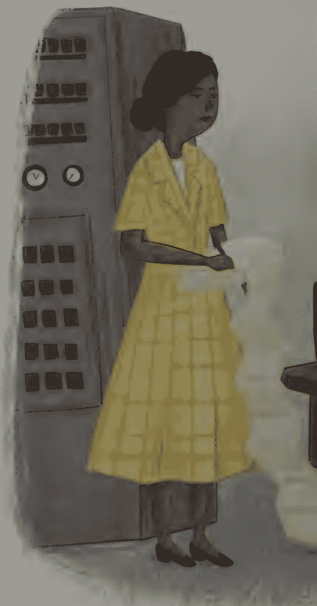

FORTRAN 是第一个让数学家以外的人们也能进行编程的语言。IBM 开发 FORTRAN 的 10 人团队中包括一名女性，洛伊斯·海伯特（Lois Haibt, 1934-）。

多萝西重新定义了她的职业，成为一名专家 FORTRAN 程序员。由于她的编程技能，她参与了重要项目，例如一个开发可靠发射火箭的程序，使得卫星发射和载人航天成为可能。

NASA 仍然在使用某个版本的 FORTRAN。人们仍然对旅行者1号和2号等旧项目使用较旧版本的 FORTRAN。1977年发射的两艘旅行者号航天器仍在向我们发送关于太阳系及以外的数据。

## 多萝西·范恩的影响

多萝西于1971年从 NASA 退休。她在计算机编程和 NASA 的贡献一直是一个鲜为人知的事实，直到马戈特·李·谢特利在2017年出版了《隐藏的数字》，这件事才广为人知。《隐藏的数字》讲述了 NACA 和 NASA 早期非洲裔女性的故事。该书还被改编成了电影。

多萝西在退休后活跃于教会和音乐节目，并从事志愿者工作。她于2008年11月10日去世，享寿98岁。她没能看到自己在计算机编程和整合航天工业方面获得的认可。

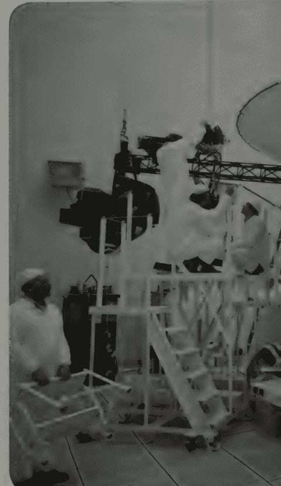

NASA 旅行者2号测试
图片来源：NASA/JPL

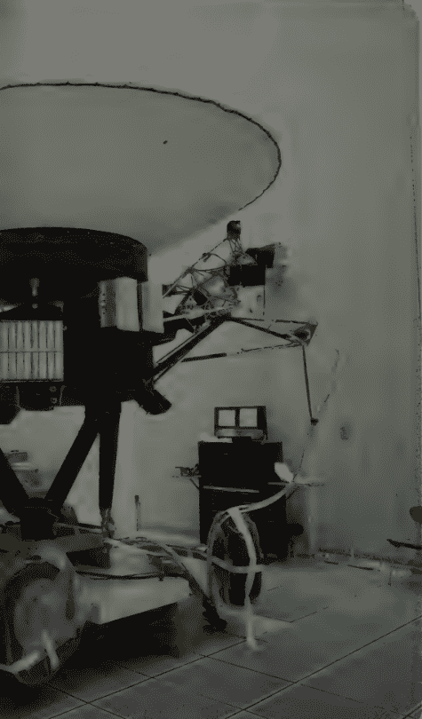

虽然多萝西的编程技能对美国航天计划至关重要，她也证明了非洲裔女性在航天工业和计算机编程领域都能取得成功。

> NASA 员工对《隐藏的数字》中人物的影响有何评价？请访问此网站查看。

## 多萝西·范恩：早期 NASA 程序员

连接 . . . .

76

## 尝试一下！HTML

（注：此处后续为原文重复的 HTML 示例内容，根据指令不翻译代码块，仅保留格式）

出生日期：1936年8月17日

出生地：印第安纳州，波奥利

去世日期：她还世着！

成名：开发了阿波罗任务的飞行软件

## 为月球进程序

1969年7月20日，全球6亿人聚集在电视机前，见证了一个历史性的时刻。

他们见证了航天员尼尔·阿姆斯特朗成为第一个在月球上漫步的人类。

很少有人知道，20世纪最伟大的成就之一几乎没有发生！

就在“鹰号”登月舱准备降落在月球表面前几分钟，警报响了。在如此关键的时刻，任务控制中心可能会停止任务。然而，得亏计算机科学家玛格丽特·哈密尔顿（Margaret Hamilton）完成的计算机编程，尼尔·阿姆斯特朗仍然迈出了那历史的一步。

> 在玛格丽特·哈密尔特的帮助下，“鹰号”降落在月球。
> 来源：美国航空航天局 (NASA)

| 时间线 | 1936 | 1958 |
| :--- | :--- | :--- |
| 玛格丽特·哈密尔顿于8月17日出生。 | 美国航空航天局（NASA）成立。 |

# 勇敢的女孩投身科学：程序员

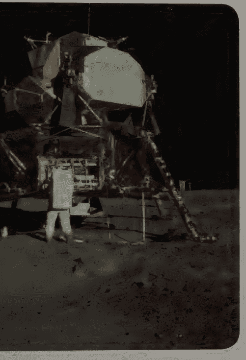

> 我们的航天员时间不多，但幸运的是他们有玛格丽特·哈密尔顿。玛格丽特带领团队创建了车载飞行软件，让“鹰号”安全着陆。
> ——巴拉克·奥巴马总统

| 1959 | 1961 | 1963 | 1969 | 1976 | 1983 |
| :--- | :--- | :--- | :--- | :--- | :--- |
| 玛格丽特开始在麻理工学院从事代码工作。 | 约翰·肯尼迪总统宣布，美国将在本世纪结束前送人类登上月球。 | 麻理工学院实验室与 NASA 签署合同。玛格丽特被聘用编写程序。 | 7月20日，阿波罗11号任务将航天器降落在月球。航天员在月球上行走。 | 玛格丽特离开麻理工学院和 NASA 进入私营行业。她创立了 Higher Order Software 公司。 | 萨莉·里德成为第一位进入太空的美国女性。 |

## 童年

玛格丽特·哈密尔顿于1936年8月17日出生于印第安纳州的波奥利。她将父亲描述为一位哲学家和诗人，经常和她谈论宇宙。玛格丽特意识到，在思考宇宙时，数学是非常有用的。她喜欢诗歌和哲学，但在解决问题时，她求助于数学，包括代数、几何学和微积分。

而且玛格丽特喜欢解决问题。她对很多事情感到好奇，比如为什么男孩和女孩没有被同等待待。为什么没有更多的女棒球运动员和科学家？她在成长过程中通过打棒球贡献了自己的力量。并继续学习数学。

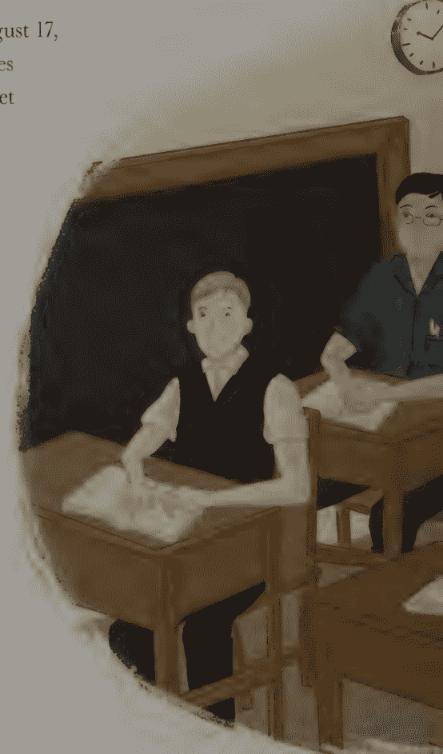

## 玛格丽特·哈密尔顿

> 多样性在学校和职场中有多重要？为什么？

她在大学学习数学似乎是理所当然的。她经常是数学和物理课上唯一的女孩。她的目标是成为一名数学教授。

埃尔哈姆学院（Earlham）的女性数学教授弗洛伦斯·龙（Florence Long）是玛格丽特的榜样。

## 为月球进程序

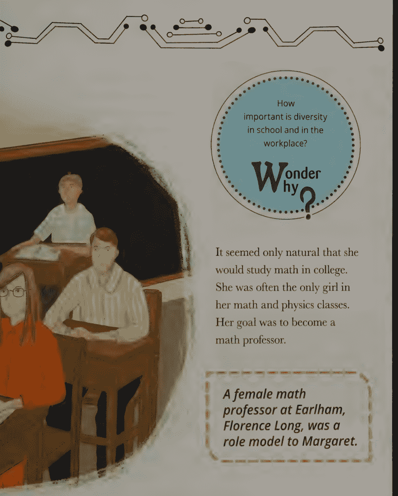

## 第一位软件工程师

大学期间，玛格丽特相遇并结婚了丈夫，改名为玛格丽特·哈密尔顿。毕业后，她成为了一名高中数学老师。她和丈夫决定轮流工作和攻读高级学位。当丈夫在上学时，玛格丽特在1959年开始在麻理工学院的新林肯实验室（Lincoln Laboratory）工作。

玛格丽特很快意识到，计算机可以帮助回答关于宇宙的问题。她开始编写代码，即计算机的指令。起初，这些程序是用来预测天气的。

玛格丽特搬到了麻理工的另一个实验室——仪器实验室（Instrumentation Laboratory）。该实验室为 NASA 提供航空技术。她所参与的项目的代码变得越来越复杂！玛格丽特编写了识别敌方飞机的程序软件。

> 听约翰·F·肯尼迪总统在他著名的演讲中表达他对太空探索未来的愿景。你想出最近有哪些哪些演讲引发了同样的灵感和努力工作吗？

> 玛格丽特经常是计算机实验室里唯一的女性，但她全心投入工作，以至于很少注意到。

她成为了系统编程专家。当时还没有一个职位名称可以准确描述她在做什么，于是她发明了一个——软件工程师。

## 月球

20世纪50年代，美国和苏联正在进行竞争。这是一场太空竞赛，苏联处于领先地位。

约翰·F·肯尼迪总统在1961年5月25日向国会发表演讲。他说是时候让人类登上月球了，美国将在本世纪结束前实现这一目标。

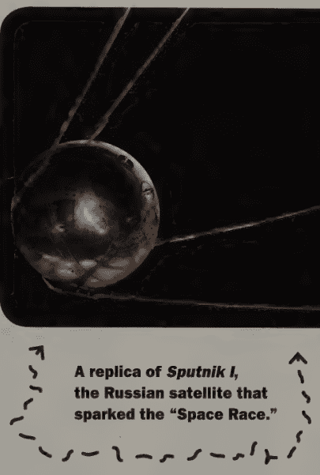

> 我们选择登上月球……完成其他事情，不是因为它们容易，而是因为它们困难；因为这个目标将有助于组织和衡量我们最好的能量和技能，因为这个挑战是我们愿意接受的，是我们不愿推迟的，也是我们想要赢得，而其他的挑战也是如此。
> ——约翰·F·肯尼迪总统，1961年

当玛格丽特考虑回到学校学习时，这段公告浮现在她的脑海中。她本打算去附近的布兰代斯大学（Brandeis University）获得高级数学学位，但她听到麻理工学院将与 NASA 合作开发将人类送到月球的软件。那是一个她必须参与的项目！

航天器必须发明两台便携式计算机。一个用于指令舱，另一个用于登月舱。玛格丽特负责车载飞行软件。事实上，她的女儿对此帮了忙。在玩航天员时，当模拟器处于“飞行”状态时，她的女儿选择了发射前程序。程序崩溃了。

当航天员在太空中时，不能出任何错误。玛格丽特必须考虑到可能发生的任何问题——如人为错误、电源丢失或偏航——并准备好解决方案。

1966年10月14日，土星五号火箭前往39号发射场，准备开启月球之旅。玛格丽特的团队分析了任何错误。到1968年，约有40人在致力于阿波罗软件。一个开关被拨动以改变计算机的优先级系统。玛格丽特现在是一位母亲了。有很多晚上和周末，她的女儿会来工作。玛格丽特在同一天接受采访。工作始于1963年。

> 玛格丽特讲述她是如何成为阿波罗项目的程序员的。

# 勇敢的女孩投身科学：程序员

> 月球上的巴兹·奥尔德林
> 来源：美国航空航天局 (NASA)

## 登月成功后的任务控制
>来源：美国航空航天局 (NASA)

当数百万人在电视上看阿波罗11号任务时，玛格丽特在任务控制中心观察。在降落在月球前几分钟，错误信息开始响起。随后响起了1202警报。这意味着计算机被过多的任务淹没了。

基于玛格丽特程序的软件覆盖。引导计算机需要丢弃不重要的任务，专注于最高优先的任务——引导和登月舱着陆。程序运行正常，让尼尔·阿姆斯特朗和巴兹·奥尔德林安全地降落在月球上。

> 阿波罗号制导软件从未被发现过错误，该软件也被用于其他阿波罗任务。

该软件还被改装用于宇天飞机以及飞机上的首批飞行电推系统。飞行电推技术催生了计算机化导航系统，这些系统现在已应用于所有商用和军用飞机。

玛格丽特曾担任仪器实验室的软件工程部门主管，直到该实验室成为一个独立的机构。

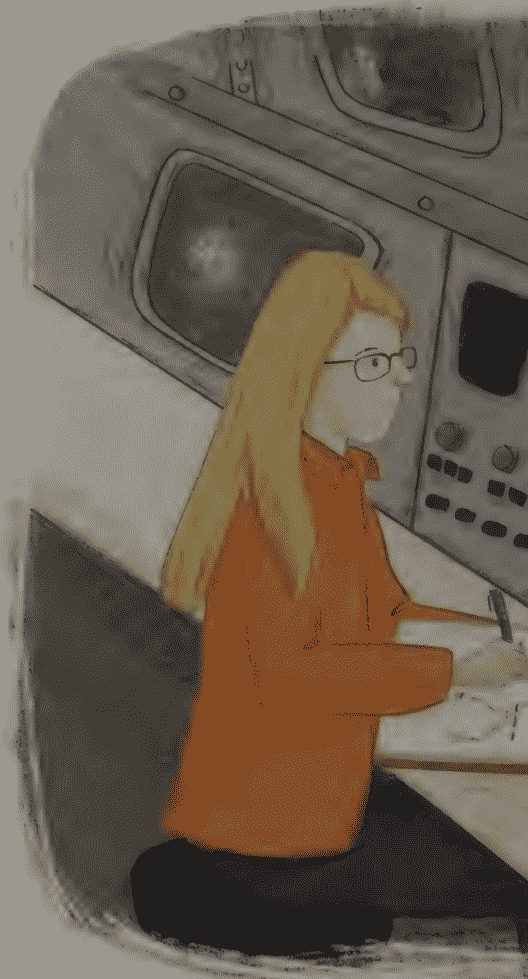

# 勇敢的女孩投身科学：程序员

> 人不应该害怕说“我不知道”或“我不明白”，也不应该问愚蠢的问题，因为没有什么是愚蠢的问题……不要害怕格格独行或与众不同；也不要害怕犯或犯错并承认错误，因为只有那些胆于巨大失败的人才能取得伟大的成就。

—玛格丽特·哈密尔顿

玛格丽特关于胆于失败的这段名言对你意味着什么？你能回想起自己胆于失败的时刻吗？你能回想起那些因为恐惧而没有抓住机会的瞬间吗？

## 为什么？

## 私营行业

玛格丽特在20世纪70年代中期离开麻省理工学院经营自己的业务。她在1976年共同创立了Higher Order Software，并担任了八年的CEO。1986年，她创立了Hamilton Technologies公司。这两家公司都专注于编程和软件。

## 科技女性

拉丁裔女性在美国计算机科学和编程领域是一个代表性极不足的群体。2016年，只有2%的拉丁裔女性从事计算领域。由女性与信息技术国家中心（NCWIT）开发的“科技”计划旨在提高拉丁裔女孩及其家庭对科技职业的认知。该计划的重要部分是介绍目前从事计算机技术工作或在学校学习计算机科学的拉丁裔女性。这个轮换计算机科学导师小组通过线下和在线的方式向她们讲述自己的故事。你可以在这个网站向她们学习。

科技女性

玛格丽特认为，软件工程能帮助人们更有创造力，成为更好的问题解决者。它还教会了从错误中学习并将其转化为积极结果的重要性。

2016年11月22日，巴拉克·奥巴马总统授予玛格丽特·哈密尔顿总统自由勋，感谢她在阿波罗11号编程方面的贡献。总统自由勋是平民可以获得的最高荣誉。

## 试试看！HTML

你有智能手机或平板电脑吗？如果有，你就对App有一定的经验！移动App的使用率处于历史高位。各年龄段的人（包括孩子）对App都有很好的主意。App可以娱乐、教育并简化我们的生活。

你呢？你有一个App的好主意吗？那么，让我们开始这个代码小时”项目吧。使用Javascript制作App。

获得成人的许可来使用本项目中的技术。

想出一个主意。如果你已经有了主意，请跳到第2步。如果没有，请进行头脑风暴。你是否使用一些可以改进的App？

## 你的工具箱清单

- 移动设备（iPhone、安卓、iPad）
- 代码小时网站

2 查看一个应用商店。也许有两个不同的App可以合并成一个App？这个想法的不是复制别人的工作，而是观察哪些有效、哪些不起作用，以及哪些可以做得更好。

3 想想什么会让你的生活变得更简单或更愉快。也许有相应的App呢？

4 访问 https://hourofcode.com/codehsjsapp。观看视频获取介绍。

从应用商店、教程中的二维码或代码小时网站下载Expo应用。Expo应用提供了使用JavaScript和React Native进行创建的开发者工具。Expo的一个主要优点是它能同时兼容安卓和iOS设备。

项目继续见下一页

继续进行代码小时教程，或探索Expo网站获取示例、示例项目和工具。不知道从哪里开始？请留在教程中，或前往“开始使用Expo”获取分步说明。

创建一个免费账户。

点击“Project（项目）”，选择“New Project（新项目）”，选择“Tab Navigation（标签导航）”。为你的项目命名，然后点击“Create（创建）”。正在下载基础模板和工具。完成后，你将在XDE日志中看到“React packager ready（React打包器已就绪）”。

开启XDE之旅。这非常有帮助。

找到开发者菜单并开始创建。Expo网站有常见问题、操作文档和其他资源可以提供帮助。

## 10 在你的设备上打开“Expo Client”来预览你的App。使用它扫描“Export Start（导出启动）”打印的二维码。在项目首次打包和加载时，你可能需要等待一分钟。

## 11 你表现得如何？你的App运行符合你的预期吗？你可以做什么来改进它？

在编程世界，杰德·雷蒙德（Jade Raymond）是一个摇星。人们非常激动见到她，以至于排队向她签名。那是因为杰德开发了热门的视频和在线游戏，如《模拟人生》（SIMS）和《刺客信条条》（Assassin's Creed）。

杰德喜欢玩《模拟人生》这样的视频游戏。在青少年时期，她就喜欢玩游戏。是因为杰德开发了热门的视频和在线游戏，如《模拟人生》和《刺客信条条》。

杰德喜欢玩《模拟人生》这样的视频游戏。在青少年时期，她就喜欢玩游戏。是因为杰德开发了热门的视频和在线游戏，如《模拟人生》和《刺客信条条》。

杰德喜欢玩《模拟人生》这样的视频游戏。在青少年时期，她就喜欢玩游戏。是因为杰德开发了热门的视频和在线游戏，如《模拟人生》和《刺客信条条》。

## 杰德·雷蒙德

ADAPT：使……适应用途。

ADVOCATE：为……发声。

AERONAUTICS：设计和制造飞机的科学。

ALGEBRA：用字母表示数字的数学分支。

算法：解决问题的步骤。

分析：对事物的详细检查。

App：为手机或平板设计的软件。

ASTROLABE：用于测量恒星高度的古代仪器。

BALLISTICS：物体运动的研究。

BINARY：使用0和1的数字系统。

BRAINST：通过讨论产生想法。

ENIAC：电子数值积分计算机；世界上第一台通用计算机。

ENLIST：加入军队。

EXPERENTIAL：基于或源自经验的。

FACTORY：制造场所。

FLY-BY-WIRE：计算机化的飞机飞行控制系统。

FORTRAN：用于科学计算的高级语言。

FREQUENCY：每秒通过特定点的无线波数量。

GENDER：男性或女性，以及社会定义的角色。

GEOGRAPHY：对地球及其特征的研究。

GEOMETRY：处理点、线和形状的数学分支。

GPS：代表全球定位系统，寻找你位置的卫星网络。

HUMIDITY：空气中的水分。

氢氢弹：力量来自氢原子结合的极其强大的爆炸。

INTEGRATE：将不同种族的人团结在一起。

JACARD LOOM：使用冲孔卡的自动织布机。

LOGIC：基于数学的、事物应有序运行的原则。

LUNAR MODULE：阿波罗号中降落在月面的登月舱。

# 词汇表

机器码 (MACHINE CODE)：由二进制指令组成的编程语言，计算机可以直接对其做出响应。

优先级 (PRIORITY)：比其他事物更重要的。

大型机 (MAINFRAME)：一种大型且强大的计算机。

程序员 (PROGRAMMER)：编写计算机程序的人。也称为代码编写员。

手册 (MANUAL)：一本说明书。

编程语言 (PROGRAMMING LANGUAGE)：一种发明用于向计算机传递指令的语言。

手动地 (MANUALLY)：通过手工。

晋升 (PROMOTE)：将某人提升更高的职位或等级。

数学 (MATHEMATICS)：对与数字相关的思想的研究。数学家研究数学。

繁荣的 (PROSPEROUS)：财务上成功的，富有的。

麻疹 (MEASLES)：一种会导致发热和皮疹的传染性。

原型 (PROTOTYPE)：工程师用于测试其解决方案的运行模型或模型。

形而上学哲学家 (METAPHYSICIAN)：研究现实基本性质的哲学分支的专家。

打孔卡 (PUNCH CARD)：一种打有孔的卡片，用于向机器或计算机提供指令。

任务控制中心 (MISSION CONTROL)：地球上的一个指挥中心，帮助宇航员执行任务。

种族 (RACE)：一群具有独特物理特征（如肤色）的人。

美国国家航空和空间天局 (NASA)：美国国家航空和空间天局，负责太空探索的美国机构。

反叛的 (REBELLIOUS)：反抗权威或掌权者。

平行四边形 (PARALLELOGRAM)：一种对边平行的四边形。

招募 (RECRUIT)：使某人加入；最近加入武装部队或其他团体的人。

专利 (PATENT)：政府颁发的许可，赋予发明者或创造者制造和销售某种产品或发明的独家权利。

继电器 (RELAY)：一种根据其他变化而使电子电路发生变化的设备。

哲学家 (PHILOSOPHER)：研究真理、智慧、知识和现实本质的人。

资源 (RESOURCES)：你可以寻求帮助或支持的东西；也可以是指对某个地方或人有用或有价值的东西。

物理学 (PHYSICS)：研究物质和能量如何共同工作的科学。物理学家研究物理学。

卫星 (SATELLITE)：送入的航天器；也可以是指绕较大天体运行运行的月球。

学者 (SCHOLAR)：在某一领域受过高等教育的人。

脚本 (SCRIPT)：在计算机编程中，脚本是一个由另一个程序解释或执行的程序或指令序列。

安全许可 (SECURITY CLEARANCE)：仅授予经批准查看机密的人的特殊许可。

隔离 (SEGREGATION)：将不同种族、性别或宗教的人隔离开来的做法。

短路 (SHORT CIRCUIT)：电流通过电阻最小的路径的情况。它可能导致电击。

模拟 (SIMULATION)：在实际行动之前对某事物的复制或模仿。

软件工程师 (SOFTWARE ENGINEER)：以系统方法开发软件的人。

源代码 (SOURCE CODE)：指令的文本列表，可被编译或汇编成可执行的计算机程序。

太空竞赛 (SPACE RACE)：美国和苏联之间为了在太空探索领域取得最大成就而进行的竞争。

标准化 (STANDARDIZE)：让一切都变得一致。

故事分镜 (STORYBOARD)：故事的视觉化表示，可以包括图画、方向和对话。

开关 (SWITCH)：在计算机中，一种开启或中断电路中电流流的设备。

技术 (TECHNOLOGY)：用于解决问题或工作的工具、方法和系统。

终身制 (TENURE)：保证性的永久就业，通常适用于大学级别的教授。

轨迹 (TRAJECTORY)：物体在力作用下运动的路径。

三角学 (TRIGONOMETRY)：研究三角形性质及其函数的数学分支。

家教 (TUTOR)：给学生提供私人课程的人。

教程 (TUTORIAL)：允许人们使用软件进行自学的常规程序。

UNIVAC：通用自动计算机；美国生产的第一台商业计算机。

真空管 (VACUUM TUBE)：一种像灯泡的电子元件。它曾被用作早期计算机和其他电器的开/开关。

侍从 (VALET)：照看男性衣服的私人随从；也可以是高端酒店的员工。

虚拟现实 (VIRTUAL REALITY)：通过计算机设备看起来是三维的交互式环境。

波士妇女 (WAVES)：志愿者应急服务接受的女性，美国海军的女性志愿者。

风洞 (WIND TUNNEL)：建造的隧道，以便飞机可以在风力中进行安全测试。

# 书籍

- Bodden, Valerie. 编程先驱 Ada Lovelace (STEM Trailblazer Bios). Learner Publications, 2016.
- Python 编程项目. 新纽约: DK Publishing, 2017.
- Gonzales, Andrea, and Sophie Houser. 女孩代码：游戏、病毒式传播与完成. Harper Collins, 2017.
- Hutt, Sarah. 编写吧！创造吧！编程的创意与灵感（女孩版）。
- Robbins, Dean. 玛格丽特·罗宾斯与月球. 2017.
- Saujani, Reshma. 代码学. Viking, 2017.

# 网站

- [Alice](https://alice.org/)
- [Girls with Code](https://www.girlswithcode.com/)
- [Hour of Code](https://www.hourofcode.com/)
- [Code.org](https://code.org/)

# QR 词汇表

- [Alice](https://alice.org/) 
- [Girls with Code](https://www.girlswithcode.com/)：女孩与代码 
- [Hour of Code](https://www.hourofcode.com/)：代码小时 
- [Code.org](https://code.org/)：代码.org 

- [Alice](https://alice.org/)：Alice 
- [Girls with Code](https://www.girlswithcode.com/)：女孩与代码：项目 
- [Hour of Code](https://www.hourofcode.com/)：代码小时：活动 
- [Code.org](https://code.org/)：代码.org：简介

- [Alice](https://alice.org/)：Alice 
- [Girls with Code](https://www.girlswithcode.com/)：女孩与代码：博客 
- [Hour of Code](https://www.hourofcode.com/)：代码小时：视频 
- [Code.org](https://code.org/)：代码.org：关于

- [Alice](https://alice.org/)：Alice 
- [Girls with Code](https://www.girlswithcode.com/)：女孩与代码：现代演变 
- [Hour of Code](https://www.hourofcode.com/)：代码小时：关于故事 
- [Code.org](https://code.org/)：代码.org：变革

- [Alice](https://alice.org/)：Alice 
- [Girls with Code](https://www.girlswithcode.com/)：女孩与代码：关于 
- [Hour of Code](https://www.hourofcode.com/)：代码小时：关于 
- [Code.org](https://code.org/)：代码.org：科学

- [Alice](https://alice.org/)：Alice 
- [Girls with Code](https://www.girlswithcode.com/)：女孩与代码：资源 
- [Hour of Code](https://www.hourofcode.com/)：代码小时：参与 
- [Code.org](https://code.org/)：代码.org：计算机

- [Alice](https://alice.org/)：Alice 
- [Girls with Code](https://www.girlswithcode.com/)：女孩与代码：社区 
- [Hour of Code](https://www.hourofcode.com/)：代码小时：参与计划 
- [Code.org](https://code.org/)：代码.org：教育

- [Alice](https://alice.org/)：Alice 
- [Girls with Code](https://www.girlswithcode.com/)：女孩与代码：联系 
- [Hour of Code](https://www.hourofcode.com/)：代码小时：计划 
- [Code.org](https://code.org/)：代码.org：学生

- [Alice](https://alice.org/)：Alice 
- [Girls with Code](https://www.girlswithcode.com/)：女孩与代码：关于我们 
- [Hour of Code](https://www.hourofcode.com/)：代码小时：资源 
- [Code.org](https://code.org/)：代码.org：教师

- [Alice](https://alice.org/)：Alice 
- [Girls with Code](https://www.girlswithcode.com/)：女孩与代码：博客 
- [Hour of Code](https://www.hourofcode.com/)：代码小时：资源 
- [Code.org](https://code.org/)：代码.org：职业

- [Alice](https://alice.org/)：Alice 
- [Girls with Code](https://www.girlswithcode.com/)：女孩与代码：关于我们 
- [Hour of Code](https://www.hourofcode.com/)：代码小时：计划 
- [Code.org](https://code.org/)：代码.org：大学

- [Alice](https://alice.org/)：Alice 
- [Girls with Code](https://www.girlswithcode.com/)：女孩与代码：关于 
- [Hour of Code](https://www.hourofcode.com/)：代码小时：关于 
- [Code.org](https://code.org/)：代码.org：课程

- [Alice](https://alice.org/)：Alice 
- [Girls with Code](https://www.girlswithcode.com/)：女孩与代码：关于 
- [Hour of Code](https://www.hourofcode.com/)：代码小时：关于计划 
- [Code.org](https://code.org/)：代码.org：计算

- [Alice](https://alice.org/)：Alice 
- [Girls with Code](https://www.girlswithcode.com/)：女孩与代码：关于 
- [Hour of Code](https://www.hourofcode.com/)：代码小时：关于 
- [Code.org](https://code.org/)：代码.org：计算机

- [Alice](https://alice.org/)：Alice 
- [Girls with Code](https://www.girlswithcode.com/)：女孩与代码：关于 
- [Hour of Code](https://www.hourofcode.com/)：代码小时：关于计划 
- [Code.org](https://code.org/)：代码.org：科学

- [Alice](https://alice.org/)：Alice 
- [Girls with Code](https://www.girlswithcode.com/)：女孩与代码：关于 
- [Hour of Code](https://www.hourofcode.com/)：代码小时：关于 
- [Code.org](https://code.org/)：代码.org：计算

- [Alice](https://alice.org/)：Alice 
- [Girls with Code](https://www.girlswithcode.com/)：女孩与代码：关于 
- [Hour of Code](https://www.hourofcode.com/)：代码小时：关于 
- [Code.org](https://code.org/)：代码.org：计算机

- [Alice](https://alice.org/)：Alice 
- [Girls with Code](https://www.girlswithcode.com/)：女孩与代码：关于 
- [Hour of Code](https://www.hourofcode.com/)：代码小时：关于计划 
- [Code.org](https://code.org/)：代码.org：科学

- [Alice](https://alice.org/)：Alice 
- [Girls with Code](https://www.girlswithcode.com/)：女孩与代码：关于 
- [Hour of Code](https://www.hourofcode.com/)：代码小时：关于 
- [Code.org](https://code.org/)：代码.org：计算

- [Alice](https://alice.org/)：Alice 
- [Girls with Code](https://www.girlswithcode.com/)：女孩与代码：关于 
- [Hour of Code](https://www.hourofcode.com/)：代码小时：关于 
- [Code.org](https://code.org/)：代码.org：计算机

- [Alice](https://alice.org/)：Alice 
- [Girls with Code](https://www.girlswithcode.com/)：女孩与代码：关于 
- [Hour of Code](https://www.hourofcode.com/)：代码小时：关于计划 
- [Code.org](https://code.org/)：代码.org：科学

- [Alice](https://alice.org/)：Alice 
- [Girls with Code](https://www.girlswithcode.com/)：女孩与代码：关于 
- [Hour of Code](https://www.hourofcode.com/)：代码小时：关于 
- [Code.org](https://code.org/)：代码.org：计算

- [Alice](https://alice.org/)：Alice 
- [Girls with Code](https://www.girlswithcode.com/)：女孩与代码：关于 
- [Hour of Code](https://www.hourofcode.com/)：代码小时：关于 
- [Code.org](https://code.org/)：代码.org：计算机

- [Alice](https://alice.org/)：Alice 
- [Girls with Code](https://www.girlswithcode.com/)：女孩与代码：关于 
- [Hour of Code](https://www.hourofcode.com/)：代码小时：关于计划 
- [Code.org](https://code.org/)：代码.org：科学

- [Alice](https://alice.org/)：Alice 
- [Girls with Code](https://www.girlswithcode.com/)：女孩与代码：关于 
- [Hour of Code](https://www.hourofcode.com/)：代码小时：关于 
- [Code.org](https://code.org/)：代码.org：计算

- [Alice](https://alice.org/)：Alice 
- [Girls with Code](https://www.girlswithcode.com/)：女孩与代码：关于 
- [Hour of Code](https://www.hourofcode.com/)：代码小时：关于 
- [Code.org](https://code.org/)：代码.org：计算机

- [Alice](https://alice.org/)：Alice 
- [Girls with Code](https://www.girlswithcode.com/)：女孩与代码：关于 
- [Hour of Code](https://www.hourofcode.com/)：代码小时：关于计划 
- [Code.org](https://code.org/)：代码.org：科学

- [Alice](https://alice.org/)：Alice 
- [Girls with Code](https://www.girlswithcode.com/)：女孩与代码：关于 
- [Hour of Code](https://www.hourofcode.com/)：代码小时：关于 
- [Code.org](https://code.org/)：代码.org：计算

- [Alice](https://alice.org/)：Alice 
- [Girls with Code](https://www.girlswithcode.com/)：女孩与代码：关于 
- [Hour of Code](https://www.hourofcode.com/)：代码小时：关于 
- [Code.org](https://code.org/)：代码.org：计算机

- [Alice](https://alice.org/)：Alice 
- [Girls with Code](https://www.girlswithcode.com/)：女孩与代码：关于 
- [Hour of Code](https://www.hourofcode.com/)：代码小时：关于计划 
- [Code.org](https://code.org/)：代码.org：科学

- [Alice](https://alice.org/)：Alice 
- [Girls with Code](https://www.girlswithcode.com/)：女孩与代码：关于 
- [Hour of Code](https://www.hourofcode.com/)：代码小时：关于 
- [Code.org](https://code.org/)：代码.org：计算

- [Alice](https://alice.org/)：Alice 
- [Girls with Code](https://www.girlswithcode.com/)：女孩与代码：关于 
- [Hour of Code](https://www.hourofcode.com/)：代码小时：关于 
- [Code.org](https://code.org/)：代码.org：计算机

- [Alice](https://alice.org/)：Alice 
- [Girls with Code](https://www.girlswithcode.com/)：女孩与代码：关于 
- [Hour of Code](https://www.hourofcode.com/)：代码小时：关于计划 
- [Code.org](https://code.org/)：代码.org：科学

- [Alice](https://alice.org/)：Alice 
- [Girls with Code](https://www.girlswithcode.com/)：女孩与代码：关于 
- [Hour of Code](https://www.hourofcode.com/)：代码小时：关于 
- [Code.org](https://code.org/)：代码.org：计算

- [Alice](https://alice.org/)：Alice 
- [Girls with Code](https://www.girlswithcode.com/)：女孩与代码：关于 
- [Hour of Code](https://www.hourofcode.com/)：代码小时：关于 
- [Code.org](https://code.org/)：代码.org：计算机

- [Alice](https://alice.org/)：Alice 
- [Girls with Code](https://www.girlswithcode.com/)：女孩与代码：关于 
- [Hour of Code](https://www.hourofcode.com/)：代码小时：关于计划 
- [Code.org](https://code.org/)：代码.org：科学

- [Alice](https://alice.org/)：Alice 
- [Girls with Code](https://www.girlswithcode.com/)：女孩与代码：关于 
- [Hour of Code](https://www.hourofcode.com/)：代码小时：关于 
- [Code.org](https://code.org/)：代码.org：计算

- [Alice](https://alice.org/)：Alice 
- [Girls with Code](https://www.girlswithcode.com/)：女孩与代码：关于 
- [Hour of Code](https://www.hourofcode.com/)：代码小时：关于 
- [Code.org](https://code.org/)：代码.org：计算机

- [Alice](https://alice.org/)：Alice 
- [Girls with Code](https://www.girlswithcode.com/)：女孩与代码：关于 
- [Hour of Code](https://www.hourofcode.com/)：代码小时：关于计划 
- [Code.org](https://code.org/)：代码.org：科学

- [Alice](https://alice.org/)：Alice 
- [Girls with Code](https://www.girlswithcode.com/)：女孩与代码：关于 
- [Hour of Code](https://www.hourofcode.com/)：代码小时：关于 
- [Code.org](https://code.org/)：代码.org：计算

- [Alice](https://alice.org/)：Alice 
- [Girls with Code](https://www.girlswithcode.com/)：女孩与代码：关于 
- [Hour of Code](https://www.hourofcode.com/)：代码小时：关于 
- [Code.org](https://code.org/)：代码.org：计算机

- [Alice](https://alice.org/)：Alice 
- [Girls with Code](https://www.girlswithcode.com/)：女孩与代码：关于 
- [Hour of Code](https://www.hourofcode.com/)：代码小时：关于计划 
- [Code.org](https://code.org/)：代码.org：科学

- [Alice](https://alice.org/)：Alice 
- [Girls with Code](https://www.girlswithcode.com/)：女孩与代码：关于 
- [Hour of Code](https://www.hourofcode.com/)：代码小时：关于 
- [Code.org](https://code.org/)：代码.org：计算

- [Alice](https://alice.org/)：Alice 
- [Girls with Code](https://www.girlswithcode.com/)：女孩与代码：关于 
- [Hour of Code](https://www.hourofcode.com/)：代码小时：关于 
- [Code.org](https://code.org/)：代码.org：计算机

- [Alice](https://alice.org/)：Alice 
- [Girls with Code](https://www.girlswithcode.com/)：女孩与代码：关于 
- [Hour of Code](https://www.hourofcode.com/)：代码小时：关于计划 
- [Code.org](https://code.org/)：代码.org：科学

- [Alice](https://alice.org/)：Alice 
- [Girls with Code](https://www.girlswithcode.com/)：女孩与代码：关于 
- [Hour of Code](https://www.hourofcode.com/)：代码小时：关于 
- [Code.org](https://code.org/)：代码.org：计算

- [Alice](https://alice.org/)：Alice 
- [Girls with Code](https://www.girlswithcode.com/)：女孩与代码：关于 
- [Hour of Code](https://www.hourofcode.com/)：代码小时：关于 
- [Code.org](https://code.org/)：代码.org：计算机

- [Alice](https://alice.org/)：Alice 
- [Girls with Code](https://www.girlswithcode.com/)：女孩与代码：关于 
- [Hour of Code](https://www.hourofcode.com/)：代码小时：关于计划 
- [Code.org](https://code.org/)：代码.org：科学

- [Alice](https://alice.org/)：Alice 
- [Girls with Code](https://www.girlswithcode.com/)：女孩与代码：关于 
- [Hour of Code](https://www.hourofcode.com/)：代码小时：关于 
- [Code.org](https://code.org/)：代码.org：计算

- [Alice](https://alice.org/)：Alice 
- [Girls with Code](https://www.girlswithcode.com/)：女孩与代码：关于 
- [Hour of Code](https://www.hourofcode.com/)：代码小时：关于 
- [Code.org](https://code.org/)：代码.org：计算机

- [Alice](https://alice.org/)：Alice 
- [Girls with Code](https://www.girlswithcode.com/)：女孩与代码：关于 
- [Hour of Code](https://www.hourofcode.com/)：代码小时：关于计划 
- [Code.org](https://code.org/)：代码.org：科学

- [Alice](https://alice.org/)：Alice 
- [Girls with Code](https://www.girlswithcode.com/)：女孩与代码：关于 
- [Hour of Code](https://www.hourofcode.com/)：代码小时：关于 
- [Code.org](https://code.org/)：代码.org：计算

- [Alice](https://alice.org/)：Alice 
- [Girls with Code](https://www.girlswithcode.com/)：女孩与代码：关于 
- [Hour of Code](https://www.hourofcode.com/)：代码小时：关于 
- [Code.org](https://code.org/)：代码.org：计算机

- [Alice](https://alice.org/)：Alice 
- [Girls with Code](https://www.girlswithcode.com/)：女孩与代码：关于 
- [Hour of Code](https://www.hourofcode.com/)：代码小时：关于计划 
- [Code.org](https://code.org/)：代码.org：科学

- [Alice](https://alice.org/)：Alice 
- [Girls with Code](https://www.girlswithcode.com/)：女孩与代码：关于 
- [Hour of Code](https://www.hourofcode.com/)：代码小时：关于 
- [Code.org](https://code.org/)：代码.org：计算

- [Alice](https://alice.org/)：Alice 
- [Girls with Code](https://www.girlswithcode.com/)：女孩与代码：关于 
- [Hour of Code](https://www.hourofcode.com/)：代码小时：关于 
- [Code.org](https://code.org/)：代码.org：计算机

- [Alice](https://alice.org/)：Alice 
- [Girls with Code](https://www.girlswithcode.com/)：女孩与代码：关于 
- [Hour of Code](https://www.hourofcode.com/)：代码小时：关于计划 
- [Code.org](https://code.org/)：代码.org：科学

- [Alice](https://alice.org/)：Alice 
- [Girls with Code](https://www.girlswithcode.com/)：女孩与代码：关于 
- [Hour of Code](https://www.hourofcode.com/)：代码小时：关于 
- [Code.org](https://code.org/)：代码.org：计算

- [Alice](https://alice.org/)：Alice 
- [Girls with Code](https://www.girlswithcode.com/)：女孩与代码：关于 
- [Hour of Code](https://www.hourofcode.com/)：代码小时：关于 
- [Code.org](https://code.org/)：代码.org：计算机

- [Alice](https://alice.org/)：Alice 
- [Girls with Code](https://www.girlswithcode.com/)：女孩与代码：关于 
- [Hour of Code](https://www.hourofcode.com/)：代码小时：关于计划 
- [Code.org](https://code.org/)：代码.org：科学

- [Alice](https://alice.org/)：Alice 
- [Girls with Code](https://www.girlswithcode.com/)：女孩与代码：关于 
- [Hour of Code](https://www.hourofcode.com/)：代码小时：关于 
- [Code.org](https://code.org/)：代码.org：计算

- [Alice](https://alice.org/)：Alice 
- [Girls with Code](https://www.girlswithcode.com/)：女孩与代码：关于 
- [Hour of Code](https://www.hourofcode.com/)：代码小时：关于 
- [Code.org](https://code.org/)：代码.org：计算机

- [Alice](https://alice.org/)：Alice 
- [Girls with Code](https://www.girlswithcode.com/)：女孩与代码：关于 
- [Hour of Code](https://www.hourofcode.com/)：代码小时：关于计划 
- [Code.org](https://code.org/)：..org：org

- [Alice](-://..org.：. 
- [Girls with Code](https://........：..... 
- [Hour..](.://..
........：..
- [...](.://...........- [.](.://...... 
- [. with Code](https://............：： 
- [Hour of Code](https://............：： 
- [Code.org](https://...............：： 

- [Alice](https://alice.org/)：Alice 
- [Girls with Code](https://www.girlswithcode.com/)：女孩与代码：关于 
- [Hour of Code](https://www.hourofcode.com/)：代码小时：关于计划 
- [Code.org](https://code.org/)：代码.org：科学

- [Alice](https://alice.org/)：Alice 
- [Girls with Code](https://www.girlswithcode.com/)：女孩与代码：关于 
- [Hour of Code](https://www.hourofcode.com/)：代码小时：关于 
- [Code.org](https://code.org/)：代码.org：计算

- [Alice](https://alice.org/)：Alice 
- [Girls with Code](https://www.girlswithcode.com/)：女孩与代码：关于 
- [Hour of Code](https://www.hourofcode.com/)：代码小时：关于 
- [Code.org](https://code.org/)：代码.org：计算机

- [Alice](https://alice.org/)：Alice 
- [Girls with Code](https://www.girlswithcode.com/)：女孩与代码：关于 
- [Hour of Code](https://www.hourofcode.com/)：代码小时：关于计划 
- [Code.org](https://code.org/)：代码.org：科学

- [Alice](https://alice.org/)：Alice 
- [Girls with Code](https://www.girlswithcode.com/)：女孩与代码：关于 
- [Hour of Code](https://www.hourofcode.com/)：代码小时：关于 
- [Code.org](https://code.org/)：代码.org：计算

- [Alice](https://alice.org/)：Alice 
- [Girls with Code](https://www.girlswithcode.com/)：女孩与代码：关于 
- [Hour of Code](https://www.hourofcode.com/)：代码小时：关于 
- [Code.org](https://code.org/)：代码.org：计算机

- [Alice](https://alice.org/)：Alice 
- [Girls with Code](https://www.girlswithcode.com/)：女孩与代码：关于 
- [Hour of Code](https://www.hourofcode.com/)：代码小时：关于计划 
- [Code.org](https://code.org/)：代码.org：科学

- [Alice](https://alice.org/)：Alice 
- [Girls with Code](https://www.girlswithcode.com/)：女孩与代码：关于 
- [Hour of Code](https://www.hourofcode.com/)：代码小时：关于 
- [Code.org](https://code.org/)：代码.org：计算

- [Alice](https://alice.org/)：Alice 
- [Girls with Code](https://www.girlswithcode.com/)：女孩与代码：关于 
- [Hour of Code](https://www.hourofcode.com/)：代码小时：关于 
- [Code.org](https://code.org/)：代码.org：计算机

- [Alice](https://alice.org/)：Alice 
- [Girls with Code](https://www.girlswithcode.com/)：女孩与代码：关于 
- [Hour of Code](https://www.hourofcode.com/)：代码小时：关于计划 
- [Code.org](https://code.org/)：代码.org：科学

- [Alice](https://alice.org/)：Alice 
- [Girls with Code](https://www.girlswithcode.com/)：女孩与代码：关于 
- [Hour of Code](https://www.hourofcode.com/)：代码小时：关于 
- [Code.org](https://code.org/)：代码.org：计算

- [Alice](https://alice.org/)：Alice 
- [Girls with Code](https://www.girlswithcode.com/)：女孩与代码：关于 
- [Hour of Code](https://www.hourofcode.com/)：代码小时：关于 
- [Code.org](https://code.org/)：代码.org：计算机

- [Alice](https://alice.org/)：Alice 
- [Girls with Code](https://www.girlswithcode.com/)：女孩与代码：关于 
- [Hour of Code](https://www.hourofcode.com/)：代码小时：关于计划 
- [Code.org](https://code.org/)：代码.org：科学

- [Alice](https://alice.org/)：Alice 
- [Girls with Code](https://www.girlswithcode.com/)：女孩与代码：关于 
- [Hour of Code](https://www.hourofcode.com/)：代码小时：关于 
- [Code.org](https://code.org/)：代码.org：计算

- [Alice](https://alice.org/)：Alice 
- [Girls with Code](https://www.girlswithcode.com/)：女孩与代码：关于 
- [Hour of Code](https://www.hourofcode.com/)：代码小时：关于 
- [Code.org](https://code.org/)：代码.org：计算机

- [Alice](https://alice.org/)：Alice 
- [Girls with Code](https://www.girlswithcode.com/)：女孩与代码：关于 
- [Hour of Code](https://www.hourofcode.com/)：代码小时：关于计划 
- [Code.org](https://code.org/)：代码.org：科学

- [Alice](https://alice.org/)：Alice 
- [Girls with Code](https://www.girlswithcode.com/)：女孩与代码：关于 
- [Hour of Code](https://www.hourofcode.com/)：代码小时：关于 
- [Code.org](https://code.org/)：代码.org：计算

- [Alice](https://alice.org/)：Alice 
- [Girls with Code](https://www.girlswithcode.com/)：女孩与代码：关于 
- [Hour of Code](https://www.hourofcode.com/)：代码小时：关于 
- [Code.org](https://code.org/)：代码.org：计算机

- [Alice](https://alice.org/)：Alice 
- [Girls with Code](https://www.girlswithcode.com/)：女孩与代码：关于 
- [Hour of Code](https://www.hourofcode.com/)：代码小时：关于计划 
- [Code.org](https://code.org/)：代码.org：科学

- [Alice](https://alice.org/)：Alice 
- [Girls with Code](https://www.girlswithcode.com/)：女孩与代码：关于 
- [Hour of Code](https://www.hourofcode.com/)：代码小时：关于 
- [Code.org](https://code.org/)：代码.org：计算

- [Alice](https://alice.org/)：Alice 
- [Girls with Code](https://www.girlswithcode.com/)：女孩与.：. 
- [Hour of Code](https://..hourofcode.com/)：.小时：. 
- [Code.org](https://code.org/)：..org：计算机

- [Alice](https://..org/)：Alice 
- [Girls with Code](https://...swith..com/)....：. 
- [Hour of Code](https://www..ofcode.com/)：..：.. 
- [Code.org](https://code.org/)：..org：计算

- [Alice](https://alice.org/)：Alice 
- [Girls with Code](https://www.girlswithcode.com/)：女孩与代码：关于 
- [Hour of Code](https://www.hourofcode.com/)：代码小时：关于计划 
- [Code.org](https://code.org/)：代码.org：科学

- [Alice](https://alice.org/)：Alice 
- [Girls with Code](https://www.girlswithcode.com/)：女孩与代码：关于 
- [Hour of Code](https://www.hourofcode.com/)：代码小时：关于 
- [Code.org](https://code.org/)：代码.org：计算

- [Alice](https://alice.org/)：Alice 
- [Girls with Code](https://www.girlswithcode.com/)：女孩与代码：关于 
- [Hour of Code](https://www.hourofcode.com/)：代码小时：关于 
- [Code.org](https://code.org/)：代码.org：计算机

- [Alice](https://alice.org/)：Alice 
- [Girls with Code](https://www.girlswithcode.com/)：女孩与代码：关于 
- [Hour of Code](https://www.hourofcode.com/)：代码小时：关于计划 
- [Code.org](https://code.org/)：代码.org：科学

- [Alice](https://alice.org/)：Alice 
- [Girls with Code](https://www.girlswithcode.com/)：女孩与代码：关于 
- [Hour of Code](https://www.hourofcode.com/)：代码小时：关于 
- [Code.org](https://code.org/)：代码.org：计算

- [Alice](https://alice.org/)：Alice 
- [Girls with Code](https://www.girlswithcode.com/)：女孩与代码：关于 
- [Hour of Code](https://www.hourofcode.com/)：代码小时：关于 
- [Code.org](https://code.org/)：代码.org：计算机

- [Alice](https://alice.org/)：Alice 
- [Girls with Code](https://www.girlswithcode.com/)：女孩与代码：关于 
- [Hour of Code](https://www.hourofcode.com/)：代码小时：关于计划 
- [Code.org](https://code.org/)：代码.org：科学

- [Alice](https://alice.org/)：Alice 
- [Girls with Code](https://www.girlswithcode.com/)：女孩与代码：关于 
- [Hour of Code](https://www.hourofcode.com/)：代码小时：关于 
- [Code.org](https://code.org/)：代码.org：计算

- [Alice](https://alice.org/)：Alice 
- [Girls with Code](https://www.girlswithcode.com/)：女孩与代码：关于 
- [Hour of Code](https://www.hourofcode.com/)：代码小时：关于 
- [Code.org](https://code.org/)：代码.org：计算机

- [Alice](https://alice.org/)：Alice 
- [Girls with Code](https://www.girlswithcode.com/)：女孩与代码：关于 
- [Hour of Code](https://www.hourofcode.com/)：代码小时：关于计划 
- [Code.org](https://code.org/)：代码.org：科学

- [Alice](https://alice.org/)：Alice 
- [Girls with Code](https://www.girlswithcode.com/)：女孩与代码：关于 
- [Hour of Code](https://www.hourofcode.com/)：代码小时：关于 
- [Code.org](https://code.org/)：代码.org：计算

- [Alice](https://alice.org/)：Alice 
- [Girls with Code](https://www.girlswithcode.com/)：女孩与代码：关于 
- [Hour of Code](https://www.hourofcode.com/)：代码小时：关于 
- [Code.org](https://code.org/)：代码.org：计算机

- [Alice](https://alice.org/)：Alice 
- [Girls with Code](https://www.girlswithcode.com/)：女孩与代码：关于 
- [Hour of Code](https://www.hourofcode.com/)：代码小时：关于计划 
- [Code.org](https://code.org/)：代码.org：科学

- [Alice](https://alice.org/)：Alice 
- [Girls with Code](https://www.girlswithcode.com/)：女孩与代码：关于 
- [Hour of Code](https://www.hourofcode.com/)：代码小时：关于 
- [Code.org](https://code.org/)：代码.org：计算

- [Alice](https://alice.org/)：Alice 
- [Girls with Code](https://www.girlswithcode.com/)：女孩与代码：关于 
- [Hour of Code](https://www.hourofcode.com/)：代码小时：关于 
- [Code.org](https://code.org/)：代码.org：计算机

- [Alice](https://alice.org/)：Alice 
- [Girls with Code](https://www.girlswithcode.com/)：女孩与代码：关于 
- [Hour of Code](https://www.hourofcode.com/)：代码小时：关于计划 
- [Code.org](https://code.org/)：代码.org：科学

- [Alice](https://alice.org/)：Alice 
- [Girls with Code](https://www.girlswithcode.com/)：女孩与代码：关于 
- [Hour of Code](https://www.hourofcode.com/)：代码小时：关于 
- [Code.org](https://code.org/)：代码.org：计算

- [Alice](https://alice.org/)：Alice 
- [Girls with Code](https://www.girlswithcode.com/)：女孩与代码：关于 
- [Hour of Code](https://www.hourofcode.com/)：代码小时：关于 
- [Code.org](https://code.org/)：代码.org：计算机

- [Alice](https://alice.org/)：Alice 
- [Girls with Code](https://www.girlswithcode.com/)：女孩与代码：关于 
- [Hour of Code](https://www.hourofcode.com/)：代码小时：关于计划 
- [Code.org](https://code.org/)：代码.org：科学

- [Alice](https://alice.org/)：Alice 
- [Girls with Code](https://www.girlswithcode.com/)：女孩与代码：关于 
- [Hour of Code](https://www.hourofcode.com/)：代码小时：关于 
- [Code.org](https://code.org/)：代码.org：计算

- [Alice](https://alice.org/)：Alice 
- [Girls with Code](https://www.girlswithcode.com/)：女孩与代码：关于 
- [Hour of Code](https://www.hourofcode.com/)：代码小时：关于 
- [Code.org](https://code.org/)：代码.org：计算机

- [Alice](https://alice.org/)：Alice 
- [Girls with Code](https://www.girlswithcode.com/)：女孩与代码：关于 
- [Hour of Code](https://www.hourofcode.com/)：代码小时：关于计划 
- [Code.org](https://code.org/)：代码.org：科学

- [Alice](https://alice.org/)：Alice 
- [Girls with Code](https://www.girlswithcode.com/)：女孩与代码：关于 
- [Hour of Code](https://www.hourofcode.com/)：代码小时：关于 
- [Code.org](https://code.org/)：代码.org：计算

- [Alice](https://alice.org/)：Alice 
- [Girls with Code](https://www.girlswithcode.com/)：女孩与代码：关于 
- [Hour of Code](https://www.hourofcode.com/)：代码小时：关于 
- [Code.org](https://code.org/)：代码.org：计算机

- [Alice](https://alice.org/)：Alice 
- [Girls with Code](https://www.girlswithcode.com/)：女孩与代码：关于 
- [Hour of Code](https://www.hourofcode.com/)：代码小时：关于计划 
- [Code.org](https://code.org/)：代码.org：科学

- [Alice](https://alice.org/)：Alice 
- [Girls with Code](https://www.girlswithcode.com/)：女孩与代码：关于 
- [Hour of Code](https://www.hourofcode.com/)：代码小时：关于 
- [Code.org](https://code.org/)：代码.org：计算

- [Alice](https://alice.org/)：Alice 
- [Girls with Code](https://www.girlswithcode.com/)：女孩与代码：关于 
- [Hour of Code](https://www.hourofcode.com/)：代码小时：关于 
- [Code.org](https://code.org/)：代码.org：计算机

- [Alice](https://alice.org/)：Alice 
- [Girls with Code](https://www.girlswithcode.com/)：女孩与代码：关于 
- [Hour of Code](https://www.hourofcode.com/)：代码小时：关于计划 
- [Code.org](https://code.org/)：代码.org：科学

- [Alice](https://alice.org/)：Alice 
- [Girls with Code](https://www.girlswithcode.com/)：女孩与代码：关于 
- [Hour of Code](https://www.hourofcode.com/)：代码小时：关于 
- [Code.org](https://code.org/)：代码.org：计算

- [Alice](https://alice.org/)：Alice 
- [Girls with Code](https://www.girlswithcode.com/)：女孩与代码：关于 
- [Hour of Code](https://www.hourofcode.com/)：代码小时：关于 
- [Code.org](https://code.org/)：代码.org：计算机

- [Alice](https://alice.org/)：Alice 
- [Girls with Code](https://www.girlswithcode.com/)：女孩与代码：关于 
- [Hour of Code](https://www.hourofcode.com/)：代码小时：关于计划 
- [Code.org](https://code.org/)：代码.org：科学

- [Alice](https://alice.org/)：Alice 
- [Girls with Code](https://www.girlswithcode.com/)：女孩与代码：关于 
- [Hour of Code](https://www.hourofcode.com/)：代码小时：关于 
- [Code.org](https://code.org/)：代码.org：计算

- [Alice](https://alice.org/)：Alice 
- [Girls with Code](https://www.girlswithcode.com/)：女孩与代码：关于 
- [Hour of Code](https://www.hourofcode.com/)：代码小时：关于 
- [Code.org](https://code.org/)：代码.org：计算机

- [Alice](https://alice.org/)：Alice 
- [Girls with Code](https://www.girlswithcode.com/)：女孩与代码：关于 
- [Hour of Code](https://www.hourofcode.com/)：代码小时：关于计划 
- [Code.org](https://code.org/)：代码.org：科学

- [Alice](https://alice.org/)：Alice 
- [Girls with Code](https://www.girlswithcode.com/)：女孩与代码：关于 
- [Hour of Code](https://www.hourofcode.com/)：代码小时：关于 
- [Code.org](https://code.org/)：代码.org：计算

- [Alice](https://alice.org/)：Alice 
- [Girls with Code](https://www.girlswithcode.com/)：女孩与代码：关于 
- [Hour of Code](https://www.hourofcode.com/)：代码小时：关于 
- [Code.org](https://code.org/)：代码.org：计算机

- [Alice](https://alice.org/)：Alice 
- [Girls with Code](https://www.girlswithcode.com/)：女孩与代码：关于 
- [Hour of Code](https://www.hourofcode.com/)：代码小时：关于计划 
- [Code.org](https://code.org/)：代码.org：科学

- [Alice](https://alice.org/)：Alice 
- [Girls with Code](https://www.girlswithcode.com/)：女孩与代码：关于 
- [Hour of Code](https://www.hourofcode.com/)：代码小时：关于 
- [Code.org](https://code.org/)：代码.org：计算

- [Alice](https://alice.org/)：Alice 
- [Girls with Code](https://www.girlswithcode.com/)：女孩与代码：关于 
- [Hour of Code](https://www.hourofcode.com/)：代码小时：关于 
- [Code.org](https://code.org/)：代码.org：计算机

# 青少年非虚构类 ·传记
年龄：8-11岁 • 引导阅读分：R

# 你知道如何让计算机理解人类的需求吗？那就是编程！

在《勇敢的女孩科学之旅：程序员》一书中，8 到 11 岁的读者将结识五位女性程序员，她们做出了具有革命性的发现和发明，改变了人们使用技术的方式。阿达·洛夫莱斯、格蕾丝·霍珀、ENIAC 女子们、多萝西·沃恩和玛格丽特·汉密尔顿突破了性别和种族的障碍，在她们热爱的领域取得了成功。

尝试这些动手实践的 STEM 项目吧！

- 使用 Scratch 编程
- 用 HTML 编写程序
- 构建一个应用程序

《程序员》是《勇敢的女孩科学之旅》系列四本书中的一本，旨在为年轻科学家探索职业联系。欢迎查看该系列中的其他书目！

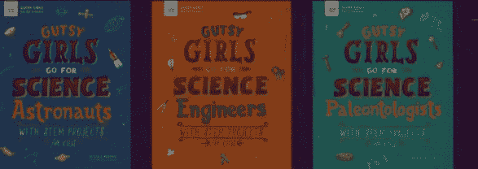

> 《科学中的女孩》系列对《技术：编程的酷女孩们》的好评：

> “这些 STEM 领域成功女性的励志故事，是年轻读者了解技术职业和贡献的完美介绍……对于我们时代，这本书非常这本书，能让年轻读者从 STEM 领域的优秀女性身上获得启发。”

> ——《书籍与电影》(Science Books & Films)

