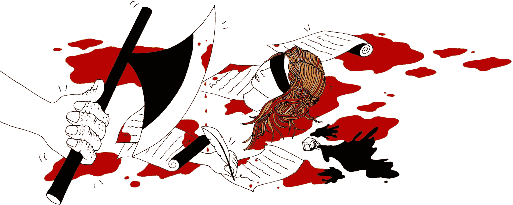
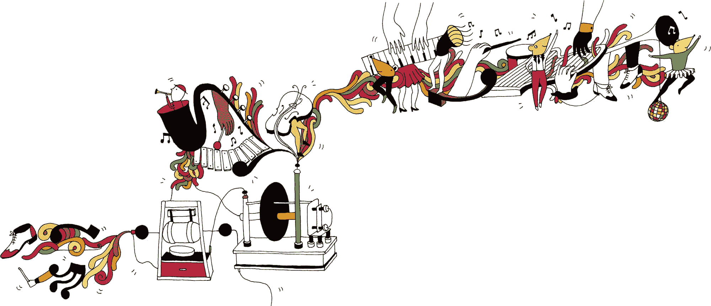
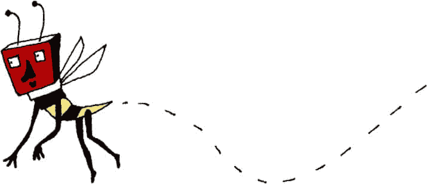
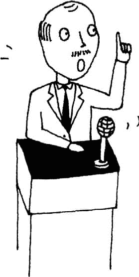
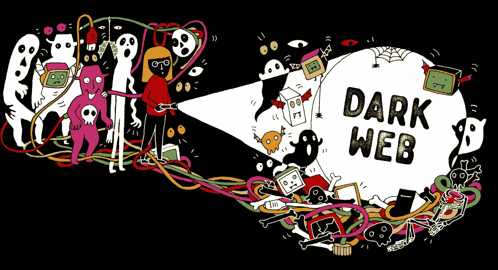

# 黑客：运作机理

选举干预 - 身份窃取 - 行动主义

权利义务 - 言论自由

虚假新闻 - 点击诱饵（问题在哪里？）

# 作者的话

## 什么是黑客？

你认识黑客吗？你也是黑客吗？（这是一个秘密吗？）黑客是一个引人入胜的话题，但它是什么？电影和电视里的黑客躲在房间里快速打字，他们通常是古怪的人，很少是故事的主角。在现实生活中，那些关于秘密或金钱被盗的新闻报道中充斥着黑客的面孔。所以，黑客总是古怪、胆怯或狡诈吗？让我们来寻找答案。

## 命名

## 那么，黑客有什么问题吗？

黑客和网络世界正在扩张到我们生活的各个领域；艺术、金钱、政治以及我们交流的方式。这听起来是你需要了解的。我很抱歉无法给你任何简单的答案，但这本书将为你解释情况，尽管如此，黑客的对错并不总是清晰的。

## 你怎么想？

你的朋友怎么想？

你的父母怎么想？

老师怎么想？

每个人都有观点，但并非所有人都有明智的观点。通过这本书，你将拥有支持自己论点的知识。

## 那么，黑客有什么问题吗？

“Hack”意味着粗略地切割。它在 1955 年首次用于现代意义，不是针对计算机，而是模型铁路。马州理工学院（MIT）技术模型铁路俱乐部的成员正在设法为轨道提供更多电力，并在火车运行时不断快速且粗略地修改——往往会导致电路过载。这被称为黑客，而这些模型火车爱好者就是第一批黑客。“黑客”一词指的是为了研究技术看看它能否运行得或以其他方式工作的人——但在此过程中可能会破坏它。

## 定义

到 1975 年，计算机科学家们发明了一套全新的语言，他们将其记录在《术语表》（Jargon File）中：一份技术俚语列表。《术语表》对“黑客”有多种定义。以下是主要的定义：

**喜欢探索编程系统细节并扩展其功能的人**，而不是大多数只想学习最少知识的用户。

一个喜欢花费精力和精力解决没有显而性价值的问题，并乐于挑战限制和规则的挑战的人。

任何领域的专家或狂爱好者。

一个试图通过窥探来发现敏感信息的恶意干涉者——也被称为**破解者**（cracker）。

## 前景展望

因此，黑客既有创意又聪明，他们弯曲规则并想出处理问题的新方法。黑客并不局限于计算机和通信——人们在破解基因、破解工程，甚至破解生命本身。黑客也不非得是坏人。今天许多顶尖的技术开发者起初都是黑客。然而，我们的注意力通常集中在破解者身上——即那些有害的黑客。如果我们掉以轻心，早晚他们会找上门来。我们需要更多地了解这一点。

## 守护秘密

黑客的兴起与数字技术的发展并肩而行。这项技术的便利对我们的生活方式产生了巨大影响。我们只需点击几次即可买卖任何想要的东西，并且像在同一个房间里一样与爱的人分享生活。然而，要做到这一点，我们需要守护秘密。秘密的密码和信息确保了我们数字生活的隐私与安全。我们如何防止这些秘密落入坏人之手？

### 秘密编写

好了，每个人都有秘密。每个秘密都是一个需要解决的问题：保留它是对的，还是应该分享？这是人们一生都在挣扎的问题。然而，数字秘密带来了一个完全不同的问题。我们必须与他人分享它们才能使用在线服务，但要确保不参与交易的人无法监视。幸运的是，人类长期使用“密码学”（cryptography）的系统进行秘密通信，它的意思是“秘密编写”。密码学是防御黑客的第一道防线。

### 代码

最简单的加密类型是**代码**（code）——简单在于它易于设置，但不一定易于破解。“代码”一词通常被指代任何隐藏信息真实含义的方法，但更准确地说，代码是一个通过改变整个单词来隐藏含义的系统。这里有一条代码信息：“这个橙子是蓝色的！”它可能代表任何意思。你只有使用列有代码词及其真实含义的密码本才能确定。在这段代码中，“橙子”意味着“书”，“蓝色”意味着“惊人的”——一旦你知道就显而易见！

### 密码

严肃的密码学（即军队、间谍和在线服务使用的类型）使用被称为**密码**（cipher）的系统。代码通过转换单词来隐藏含义，而密码则通过转换单个字母来实现。原始消息称为明文（plaintext），加密后的版本称为密文（ciphertext）。将明文转换为密文需要一组称为**密钥**（key）的指令。解密消息使用相同的密钥，但反向应用。密钥最好被组织为数学过程的列表。这样就不可能搞混。正如我们将看到的，这些指令可以非常简单，但也复杂到超级计算机在十亿年内都无法破解它们（或者它们可以吗……？）。

### 凯撒密码

最简单的密码之一被罗马的战争独裁者尤利叶·凯撒使用。它是一种替换密码：字母表中的每个字母都被沿字母表向后移动固定位置的另一个字母取代。因此，如果密码密钥是`+1`，明文“ABCD”将被加密为“BCDE”——HFU JU？负数密钥意味着向另一个方向移动。字母表形成一个连续循环，所以一旦到达 Z，就会从 A 开始。要解密，只需切换密钥的正负号，例如`+ 1`变成`- 1`：“HFU JU?”读作“GET IT?”

### 公共与私有

密钥比密码本更容易保密，但它仍然需要交换。这是过程中中最薄弱的环节。密钥每传递给一个新的人，被发现的机会就会增加一次。为了安全起见，你必须面面并将密钥吹进他们耳朵里。现代通信允许我们与从未见过的人交谈。这是第一个高速电信系统——它也是第一个被破解的系统（参见此处）。

## 电信

在过去，如果你想和朋友交谈，你得寄信。现在我们使用电信技术，它允许我们进行远距离对话。这不仅意味着电话和计算机——电信比这些要老得多！随着它的演变，黑客也在演变，继续着数百年来为了信息安全而战斗。

### 书面文字

第一种远距离通信形式是信件。电报：一对通过数英里电线连接的开关。如果你关闭电线一端的开关，另一端的开关也会之关闭，发出嗡嗡声或点击声。塞缪尔·摩尔斯发明了著名的长短点击代码来发送电报信息。

### 更快的速度

信件非常慢：现在的邮政需要几天，但在过去可能需要几个月。视觉通信（如烟雾信号）要快得多。它们带有简单的含义，如“攻击！”或“胜利！”由此开发了基于旗帜的信号系统，称为信号（semaphore），通过旗帜的位置表示字母。在 1790 年代，法国建立了一个旗帜信号塔网络。在天气良好时，它们传输短信息的速度可达每小时 300 英里。

### 有线通信

19 世纪出现了沿带电电线发送信息的系统。电话是较后的发明，它将声波转换为相应的电波以便沿电线传输。电报意味着“距离写作”，电话意味着“距离交谈”。

## 破译者

破译者在历史上扮演过许多关键角色，既开启了战争也结束了战争。以下是一些创造历史的破译者。

### 致命女王

16 世纪 60 年代，英国女王伊丽莎白一世囚禁了她的天主教表妹——苏格兰女王玛丽一世，因为她担心对方可能篡夺英国王位。当玛丽给阴谋者的信件被发现时，伊丽莎白的密码专家托马斯·菲利普斯（Thomas Phelippes）破解了这些信件，揭露了她的计划。玛丽使用的是一种同音密码，一个明文字母由几个可能的密文符号表示。这是一种命名系统（nomenator），经常使用的名称——如伊丽莎白、玛丽、西班牙——都有自己的符号。这使得频率分析变得困难。菲利普斯花了几个月才破译，但他通过识别常见的英语短语实现的。例如，信件通常以相同的方式开头和结尾：“Dear……”和“Yours…”，于是他从这里入手，并发现玛丽希望西班牙国王腓利普入侵英国并杀死伊丽莎白。一旦代码被破解，玛丽便被处决了。

# 电报黑客

1917 年，美国正在考虑作为法国和英国的盟友加入第一次世界大战（1914–18 年）。德国外交部长向墨西哥发送了一电报（通过电报发送的信件），要求他们入侵美国以阻止美军前往欧洲。作为回报，墨西哥将收回美国夺取的德州或其他地区。德国人无法向墨西哥发送信息（所有电报电缆都经过英国），但他们可以向美国发送几个加密信号。这些加密信息本应用于和平谈判，但德国人欺骗了一位美国官员发送了墨西哥电报，而该电报仍然隐藏在代码中。如今的黑客使用一种类似于“特洛伊木马”的技术，将恶意行为隐藏在看似有用的任务中（更多请参见此处）。墨西哥人拒绝加入德国的一方。无论如何，英国间谍很快破译了信息并警告了美国人。然而，他们必须编造一个关于他们如何获取信息的理由，以免让美国人意识到英国人也在监视美国的电报！

# 这算得通吗？

艾兰·图灵（Alan Turing）被认为是一位帮助赢得第二次世界大战并拯救无数生命的破译者。这已经是一项巨大的成就，直到你意识到图灵所做的还有发明了数字计算机。没有图灵，黑客可能根本不存在！

## 虚拟机

图灵在计算机方面的工作有点像意外。作为一名数学家，他正在寻找一个复杂问题的答案。某些算法总是产生最终答案（那并不重要），而有些算法则一直运行。图灵想知道是否有一种方法可以在不尝试它们的情况下区分它们。为了研究，他使用了一台想象中的、或称为“虚拟”机器，这台机器可以遵循任何算法并记住结果。这台虚拟机听起来熟悉吗？技术花了几年时间才跟上，但第一批数字计算机的设计是基于图灵的。

## 计算机先驱

在图灵之前的很久，计算机就已经存在了。“Computer”（计算机）是指那些工作是进行复杂数学计算的人。几个人曾尝试建造能够执行人类工作的机械计算器。最成功的是查尔斯·巴别奇（Charles Babbage）。1837 年，巴别奇设计了分析机，这是一种具有可编程处理器（称为`Mill`）和内存（称为`Store`）的机械设备，它可以存储千千位数字！如果巴别奇能负担得起制造所有 25,000 个独立零件的费用，它将是第一个通用计算机！

## 逻辑电路

计算机使用一种称为布尔代数的数学，使用`1`和`0`，并具有奇怪的规则，例如`1+1=1`。计算机的电路遵循这些规则，因此它可以用于执行逻辑操作，或做出简单的决定，例如是或否、真或假、开或关，每秒数十亿次。美国数学家克劳德·香农（Claude Shannon）在图灵构想他的机器的同一时期，设计了基于布尔代数的电气系统。第一台同时拥有图灵系统（处理器、程序）和香农逻辑电路的计算机是`Baby`，于 1948 年建造于曼彻斯特。

# 第一批黑客

远距离通信能力改变了社会，也改变了我们欺骗和偷窃的方式。第一个高速电信系统是 19 世纪初在全欧洲建立的信号灯塔网络——它也被用于第一次黑客攻击。让我们简要回顾一下黑客历史以跟上时代。

## 1834 年信号灯攻击

弗朗索·布（Francois Blanc）和约瑟夫·布（Joseph Blanc）开发了一种在信号灯中隐藏秘密信息的方法。这对兄弟带领一个一小黑客团队从巴黎到波尔尔多传输敏感的股市信息，以便他们能比其他人早知道价格变化——这个骗局持续了两年，直到有人告发，但没有人人进监狱，因为黑入通信系统并不违法。

## 1903 年科学流氓

1903 年，马尔尼（Marconi）进行了一次演示，证明他的无线电设备可以精调，只有设置在相同频率的接收机才能接收信号。马尔尼拥有无线电专利，因此没有人可以使用该技术。在马尔尼的演示期间，内维尔·马斯克尼（Nevil Maskelyne）一位利用无线电的魔术师通过更强的信号接管了频率，敲出了摩斯电码。马尔尼将这种攻击称为“科学流氓”。

## 1956 年拨号（Phreaking）

绰号为“泡泡”（Bubbles）的约瑟夫拥有完美的绝对音感，这意味着他不需要乐器就能吹出任何音符。20 世纪 50 年代后期，在还是个孩子时，泡泡发现他可以用哨子控制电话网络。拨号系统将数字转换为声调，命令交换机引导通话。泡泡成为了第一个“拨号黑客”（phreaker），一种利用哨子控制电话系统的黑客。（现在已经无效了。）

## 1967 年 IBM 内部

1967 年，IBM 向芝加哥附近的一所高中捐赠了四个计算机终端。每个终端都连接到 IBM 办公室的主机。IBM 在主机上为学生们留了一些空间，将其与其他用户隔离开。学生们很快学会了如何进入私有区域。IBM 最终感谢了这些孩子，因为他们的攻击帮助 IBM 使系统变得更加安全。

## 1971 年脆队长（Captain Crunch）

约翰·德莱珀（John Draper），也被称为脆队长，发现他在脆脆麦片盒中作为免费赠品得到的玩具哨子可以产生正确的音调，从而免费拨打长途电话。德莱珀被威胁如果不停止黑客就要入监狱。他后来遇到了史蒂夫·乔布斯（Steve Jobs）和史蒂夫·沃兹尼亚克（Steve Wozniak），这两个制造并销售拨号设备的学生后来创立了苹果公司。

## 1981 年闪电队长（Captain Zap）

伊恩·墨菲（Ian Murphy），广为人知的闪电队长，自称执行了最大的攻击。他黑入了美国最大的电信供应商，并更改了系统的内部时钟，使得在白天高峰期使用电话的人按便宜的夜间费率计费。

## 1984 年混沌通信大会

第一届“黑客大会”（hackercon）于 1984 年在德国汉堡举行，从此以后每年举行一次。它由混沌计算机俱乐部（Chaos Computer Club）运营，这是一个拥有 7000 多成员的德语黑客协会。

罗伯特·莫里斯（Robert Morris）传播了一种病毒，导致了当时被称为互联网的网络 10%瘫痪。在那个时代，这意味着仅仅攻击了 6,000 台计算机。尽管如此，莫里斯的鲁莽行为仍造成了 1500 万美元的损失，并让他丢掉了康奈尔大学的工作。作为回应，美国政府建立了`CERT`（计算机应急响应小组）以防止类似的计算机攻击。

# 你好，互联网

互联网是一个计算机网络。更准确地说，它是一个连接了许多独立计算机网络的“网际互联”（internetwork）。在互联网存在的 50 年里，它的确切含义已经变得模糊。互联网连接着数以十计的设备——地球上每人平均对应好几台——不仅仅是电脑、手机和平板电脑，还有电视、汽车、气象站、路灯、冰箱和烤箱。而且所有这些设备都可能被黑客。

## 军事项目

互联网起源于一个军事防御项目。到 20 世纪 60 年代，军事指挥官正在开发依赖计算机和电信来控制其部队的系统。军方意识到，如果敌人能够切断这些通信，他们将获得巨大的优势——而做到这一点他们只需要切断一根电缆。`ARPANET`（高级研究计划机构网络）的建立是为了即使在遭受最恶的攻击时也能保持通信安全。

## 数据包交换

`ARPANET` 使用了一种名为“数据包交换”的系统，其中信息被拆分成碎片或“数据包”。每个数据包都有一个头部代码，说明它源于哪里、去往哪里，以及如何与其他数据包组合。每个数据包通过网络找到通往目的地的方法。接收计算机组装这些数据包，并发送回信息，请求重发任何丢失的数据包。这就是今天从视频到短信信息的所有内容如何通过互联网发送的。

## 开启

`ARPANET` 于 1969 年开启。起初，它只连接了四所美国大学，大部分位于加利福尼亚州，但它稳步扩张，到 1973 年，其他国家也接入了。20 世纪 80 年代，军方建立了一个独立的系统，`ARPANET` 连接到了公众使用的电话网络。到 80 年代后期，它已被称为互联网。

## 网页

在早期，互联网完全是关于文件传输协议的，即`FTP`，它用于快速安全地发送和接收计算机文件。然而，1989 年，在`CERN`（欧洲核子研究组织）工作的英国计算机科学家蒂姆·伯纳斯-李（Tim Berners-Lee）发现这个系统很难用。他提出了一个信息网——万维网（world-wide web）的想法，用户可以在连接互联网的计算机上查看公开的文件。

## 所见即所得 GUI

网页的兴起与`GUI`（goo-ee）——“图形用户界面”并肩。用户现在不再面对黑色屏幕上闪烁的绿色文字，而是拥有了一个虚拟桌面，可以打开和移动文件及文档。用户过去通过输入代码来控制计算机，但现在他们使用鼠标点击屏幕上的图形。`GUI` 让计算变得`WYSIWYG`（wiz-ee-wig），即“所见即所得”。因此，输入的文档在屏幕上显示为带有打印文本和图片的白色页面——就像实物一样。

## 超链接

伯纳斯-李的万维网信息可以通过可点击的“超链接”将一个网页链接到下一个。带有超链接的文档用`HTML`（超文本标记语言）编写，这同样由伯纳斯-李开发。

# 恶意软件概述

入侵你系统最隐蔽的方法是添加恶意软件（malicious software）。恶意软件可能会自动损坏你的文件，也可能会创建一个“后门”，黑客可以通过这个后门秘密地控制计算机。最熟悉的恶意软件是病毒，用户在不不知情的情况下将其安装在设备上，病毒会从一台电脑传播到另一台电脑，且通常以电子邮件附件的形式存在。当另一个用户打开附件时——病毒就找到了一个新的受害者。

### 特洛伊马

就像神话中希腊士兵躲在巨大的木马中绕过特洛伊城外的守卫一样，黑客会使用软件“特洛伊马”来安装恶意软件。它看起来像是一个无害的应用程序或附件，但一旦启动，特洛伊马就会安装秘密恶意软件。保持软件软件更新是防御恶意软件的最佳手段，因为它可以阻止黑客利用代码中的漏洞。

### 社会工程学

入侵计算机的另一种方式被称为“社会工程学”。以下是可能发生的情况：电话响了，一个声音说：“你好，我是 IT 部门的，你的电脑出了问题。我需要你的密码，以便我从这里登录并修复它。”听起来很合理，但不要被骗了。黑客使用各种花招说服我们交出秘密或授予他们访问我们设备的权限。

### 钓鱼攻击

这种危险的社会工程学攻击通过发送一条似乎来自你正在使用的服务（如银行）的消息来钓鱼你。该消息要求你登录账户，但提供的链接会带你进入一个伪网页。你输入了安全详细信息，然后收到一条错误消息提示你稍后重试。但黑客现在已经拥有了登录你账户所需的所有安全详细信息！

### 点击劫持

“点击劫持”攻击欺骗用户点击隐藏的网页链接。黑客通过建立一个极具吸引力的网站来实现，例如一个提供盗版电影下载的网站。然而，屏幕上的链接是虚假的，当用户点击其中一个链接时，他们实际上选择了另一个不可见的链接。黑客可以使用这种技巧窃取网络浏览器保存的密码和其他细节。

### 僵尸网络与僵尸网络

一旦黑客找到了进入你计算机的方法，他或她就可以将其变成“僵尸”。然后黑客会让僵尸的处理器和内存（秘密中工作。用户对此没有任何迹象，只是偶尔觉得设备运行缓慢。黑客将僵尸计算机汇聚成“僵尸网络”。通过共同工作，由成千上万个僵尸组成的僵尸网络威力相当于超级计算机。

### 根内核工具 (Rootkit)

可能是最糟糕的攻击是“根内核工具”。这种恶意软件将自己插入计算机最基础的软件——操作系统中，操作系统管理所有组件如何协同工作。根内核工具的工作是隐藏其他恶意软件。任何旨在搜索和清理恶意软件的安全软件都依赖于操作系统。然而，由于根内核工具隐藏在里面，它可以将恶意软件伪装成合法的软件部分。

### 蜜罐程序

好人也可以很狡猾。“蜜罐程序”是一个网络安全术语，指一台被设置成看起来像大型网络中弱点的计算机。当黑客试图通过蜜罐程序进入时，真实的网络是完全安全的，而坏人会被当场抓获。

## 黑客文化

黑客听起来像是一些可怕的人；他们的技能让他们攻击并接管你的设备，窃取他们想要的任何东西，而无需离开家。黑客通常是反社会的。他们更倾向于与计算机相处而不是与其他人相处，但他们并不是都是坏人。让我们仔细观察一下。

### 破解者 (Cracker)

黑客听起来像是一些可怕的人；他们的技能让他们攻击并接管你的设备，窃取他们想要的任何东西，而无需离开家。黑客通常是反社会的。他们更倾向于与计算机相处而不是与其他人相处，但他们并不是都是坏人。让我们仔细观察一下。

### 脚本小子 (Script Kiddie)

一个缺乏技巧、只会使用脚本的黑客，他们使用他人编写的脚本来制造麻烦。

### 电话黑客 (Phreaker)

一个攻击电话系统的专家。

### 密码学黑客 (Cypher)

一个对加密非常感兴趣的人。

### 盗版黑客 (Wares)

一个非法复制并分发版权软件的黑客。

一个制造主板、内存的电子工程师。

### 潜入黑客 (Sneaker)

一个受公司或组织雇佣测试防御的黑客。

### 极客 (Geek)

一个让其他成员向其寻求帮助的经验丰富的黑客。

### 破坏者 (Chomper)

一个专注于黑客的黑客。

### 代码磨练者 (Code Grinder)

一个对黑客没有兴趣的 IT 专业人士。

### 小子 (Jock)

一个使用暴力破解技术的黑客。

### 顶级黑客 (Sandender)

一个对社区产生影响的黑客。

### 爬虫 (Leech)

一个下载共享文件但不提供给其他人的用户。

### 自酿电脑俱乐部 (Homebrew Computer Club)

如今的黑客文化很大程度上源于 20 世纪 70 年代在硅谷成立的这样的小小组。由于来自硅谷，他们接触到了技术的最新发展。许多成员在计算领域拥有辉煌的职业生涯：`Adam Osborne` 设计了第一台便携式电脑；`Steve Wozniak` 是苹果公司的创始人之一；`Dan Werimer` 建立了 `SETI`；`Jerry Lawson` 开创了家用游戏机。

### 黑帽与白帽

在线世界有时被比作美国的旧西部时代，牛仔和和枪手在那里随心所欲，很少受到制裁。在 20 世纪 50 年代和 60 年代的经典西部片中，判断好坏很容易，因为好人总是戴白帽，而坏人则戴黑帽。黑客经常被这样描述。

### 黑帽

正如你预期的那样，“黑帽”是出于恶意目的突破安全的犯罪破解者。一些臭名的黑帽包括：

`David Smith`（美国）在 1999 年释放了 `Melissa` 病毒，该病毒感染了全球的电子邮件应用程序，估计损失达 8000 万美元。

`Jeanson Ancheta`（美国）在 2006 年被发现控制着由超过 10 万台僵尸计算机组成的僵尸网络后，被处监禁 5 年。

`Hamza Bendelladj`（阿尔及利亚）感染了 5000 万台计算机的病毒，并从银行中盗了 4 亿美元（并将其捐给了慈善机构）。`Bendelladj` 被判处监禁 15 年。

### 白帽

“白帽”黑客掌握破解网络安全的所有技巧和技术，但不会将它们用于犯罪目的。组织会雇佣白帽来帮助他们改进安全性，并将黑帽挡之门。白帽通常充当“渗透者”（`sneaker`）的角色，即被许可进入组织网络——或至少尝试进入——的人员，但组织内很少有人预先知道自己即将受到攻击。

## 黑客主义 (HACKTIVISM)

黑客可以被用作变革的力量。当黑客也是政治`活动家`时，他们变成了“黑客活动者”（`hacktivists`）。黑客活动者利用他们的技术技能通过通过在线抗议来施加政治压力。正如你可以想象的，黑客主义是一个道德上非常困难的领域，一些自认为受政治动机驱动的自由战士的人，被其他人视为间谍，甚至是恐怖分子。

### 死牛之教 (CULT OF THE DEAD COW)

黑客主义的故事始于 1984 年德克萨斯州卢布克的一间废弃的屠宰场。在这里，三个朋友建立了“死牛之教”（简称 `cDc`），通过公告板（一种 `Web` 出现之前的消息系统——参见此处）协调更广泛的黑客团队。20 世纪 90 年代后期，`cDc` 发起了 `Hacktivismo` 小组，反对网络审查，并为全球政治异人士创建了工具。

### 匿名组织 (ANONYMOUS)

最著名的黑客活动组织是匿名组织。它没有领袖，由来自世界各地的人组成，他们通过在线论坛使用用户名或“代号”（`handles`）进行交流。一旦匿名组织的成员（`Anons`）达成目标，他们就会单独或以小小组形式工作，他们的行动会汇聚成一次协同攻击。匿名组织通常会阻止目标的通信，并尝试访问秘密信息，以突出匿名组织成员认为是不当的行为。

### LULZSEC

`LulzSec` 的名字在黑客术语中意思是“嘲笑安全”，他们对金钱并不感兴趣，而是寻求对他们认为需要受到教训的公司进行报复。他们的目标涵盖了媒体公司、政党，甚至是网络安全公司。他们最有效的恶作剧之一是将敌人的客服电话线路重定向到不同的公司。`LulzSec` 的七个头目（他们从未互相见过）在 2012 年被捕。其中最年轻的仅 16 岁。

### 维泄客 (WIKILEAKS)

最臭名昭著的黑客活动组织是维泄客。它由拥有丰富黑客背景的澳大利亚人朱利安·阿桑（`Julian Assange`）于 2006 年创立。维泄客把自己定位为新型媒体平台。它从举报人（即揭露政府或组织秘密以突出他们认为的不当行为的人）那里接收信息。维泄客随后发布这些信息——至少是部分信息——通常与世界各地的报纸合作。

### 通缉犯

2010 年，朱利安·阿桑被要求前往瑞典接受有关性侵犯的调查。他拒绝了，并在 2012 年进入伦敦的厄瓜多尔大使馆。他获得了厄瓜多尔国籍，这意味着只要他留在里面就不会被逮捕。2019 年，厄瓜多尔取消了他的国籍，英国警方随后逮捕了他并送往监狱。阿桑在瑞典仍被通缉，美国也指控他黑入了他们的机密。

## 文化干扰 (CULTURE JAMMING)

这里有一个想法：将政治家旧的社交媒体帖子打印在巨大的海报上，贴在广告牌上，然后在社交媒体上发布这些照片。每个人都会更加关注政治家说的话。这被称为“文化干扰”，也被称为“现实黑客”或“游击通信”，它是黑客技术与现实世界交汇的地方。

### 闪现 (FLASHMOB)

当一群陌生人突然变成一群开始做同样事情的人——跳舞、唱歌或完全静止——那就是“闪现”。闪现活动像开始时一样突然结束，参与者也消失在人群中。第一次“闪现”活动发生在 2003 年的纽约市，当时有 130 人进入一家百货商店，并突然要求同时购买同一块地毯！

### 共享迷因 (SHARING MEMES)

迷因（`meme`）最初的概念是生物学家理查德·道金斯的一个思想实验。他想探索简单的想法（他称之为迷因）是如何通过类似于生物演化的过程传播的，在人之间移动，并在过程中改变或突变。互联网让分享想法变得非常容易，因此“迷因”一词现在通常指代通过网络传播的有趣事物。

## 间谍活动与监控 (ESPIONAGE AND SURVEILLANCE)

黑客什么时候变成间谍，间谍什么时候变成黑客？一个坚定的黑客可能会潜入高安全区域，安装恶意软件以获取目标信息。一个间谍可能会做完全相同的事情。唯一真正的区别是，黑客通常是犯罪犯，而间谍是由政府或组织雇佣执行这些工作的。让我们探索间谍活动诡异的世界。

### 信息来源 (SOURCES OF INFORMATION)

在间谍语言中，任何有助于你更好地了解目标的信息都被称为“情报”。收集情报最明显的方法是来自外国势力或敌对组织的成员发生变节（`defects` 是间谍术语）并告诉他们所知的一切。除了这种人为情报外，世界上的间谍日益依赖信号情报——拦截消息并破解其含义。这听起来像是黑客的工作。

### 侧信道攻击 (SIDE-CHANNEL ATTACKS)

美国和英国都使用一种名为 `TEMPEST` 的“侧信道攻击”系统来获取从目标处泄露的信号。这种方法不是通过收集加密数据本身，而是通过观察计算机及其用户的行为来实现。信息本身是隐藏的，但计算机发出的声音、震动、无线波和其他电回声可能会泄露秘密。

### 监控 (SURVEILLANCE)

监控不等同于间谍，它是对一般活动的观察。警方可能会利用它监控犯罪并追踪通缉犯。摄像头（有时被称为 `CCTV`）是一个主要工具，许多摄像头可以通过 `ANPR`（自动车牌识别系统）读取车牌。然而，`CCTV` 的质量往往不足以通过人脸识别追踪目标。

### 批量拦截 (BULK INTERCEPTION)

间谍想要尽可能了解他们的目标，这意味着寻找隐藏在公众中的敌方特工。为了这一点，间谍机构日益开始监控所有人，寻找坏人所在的线索。这并不意味着研究街道上的监控，而是收集所有人的通信并对其进行过滤，以揭示犯罪犯、恐怖分子和敌方间谍发送的秘密。

### 端到端加密 (END-TO-END ENCRYPTION)

如果没有正当理由，间谍无法读取消息，但他们可以看到发送者和接收者、位置、发送时间和文件类型，并记录存档。为了防止他人阅读你的消息，可以使用端到端加密应用程序。你所有的聊天线程都会从你的设备到接收者进行加密。即使是应用提供商也无法读取。

监控摄像头并不能看到一切，其录像可能会对某次事件产生错误的误导。一些私人公民随身携带摄像头来记录更准确的状况。例如，骑行者会佩戴头盔摄像头，以防发生事故。这就是“下视”（`sousveillance`）。它的意思是从下方观察（`sous`意为“下方”）。

## 吹哨者

2013 年 6 月，美国情报官员爱德华·斯诺登（`Edward Snowden`）向世界揭露了他国家以及其他国家间谍机构所做的事情。作为一名计算机专家，斯诺登了解情报机构用于黑入外国通信系统并窃听世界上几乎任何对话的许多技术。为了躲避在美国被捕捕，他搬到了俄罗斯莫斯科，并一直住在那那里。

### 他为什么要这么做？

爱德华·斯诺登说他是一个美国爱国者。他之所以“吹哨”，是因为他认为美国情报部门的权力太大。即使目前的情报系统是为了更大的利益在运行，斯诺登也质疑如果未来发生变化，间谍工具被用来对普通人将会发生什么。他决定需要告诉大家正在发生的情况，以便他们能够做出自己的决定。

## 数据是谁的？

我们的数据不仅面临来自黑客的风险，政府也在收集它们——尽管他们几乎肯定没有阅读它们。然而，还有其他机构对我们的数据非常感兴趣。我们一直在提供关于自己的信息，关于我们在哪里、和谁在一起、我们把钱花在什么上以及我们在思考。对于互联网巨头来说，这类信息非常有价值。

### 免费的代价

我们在互联网上使用的许多服务都是免费的。使用 `Google` 搜索网页、在 `Instagram` 上与朋友联系以及在 `YouTube` 上看视频都不需要一分钱。然而，拥有这些网站的公司是世界上利润最高的公司之一。你支付这些服务的费用不是金钱，而是你的信息。但你已经知道了，不是吗？你在注册时绝对已经同意了这一点。

### 定向广告

`Facebook`、`Google` 和其他互联网巨头通过销售广告获利。当你看电视节目时，节目是免费观看的，但电视公司从向你展示产品广告的公司那里获得资金。但在网页上，广告商使用数据将广告专门地投放给可能对他们的产品感兴趣的人。因此，电视公司一次只获得一家广告主的付费，而网络公司则同时从成千上万客户那里获得收入。

### 健康应用

在现代世界过健康的生活需要努力。健身追踪器和健康应用可以衡量我们的活动程度，在数据正确的情况下，应用可以为我们的健康评分并创建健身计划。听起来不错，但还有谁拥有这些信息？这对雇主或健康保险公司来说将非常有意思。健康信息受到严格隐私法的保护，只有你可以允许他人访问。你这样做过吗？

### Web 1.0

在早期，`Web` 是用户可以通过`search engines`访问的`pages`集合。

### Web 2.0

在 21 世纪初，`Web`发生了变化，因为`social media`允许用户创建和分享自己的`content`，例如`video`、`games`和`messages`。

### COOKIES

网站使用`cookies`来跟踪用户并收集信息。然而，像《通用数据保护条例》（`GDPR`）这样的新法律意味着网站必须征求许可使用它们。

## 中立

`Internet`的最初计划是使用变成所谓的“哑管道”。这种想法是`Internet`连接就像水管一样——数据根据其容量流动，而不是根据数据的类型。现在可以拥有对数据进行优先排序“智能管道”。提供`Internet`接入的公司被称为“互联网服务提供商”或`ISP`。在大多数国家，`ISP`必须允许客户获得相同的访问，无论他们在使用什么。

人类在八卦，或传播他人的消息上投入了精力。名人是每个人都认识的人，尽管我们从未真正见过他们。我们之所以喜欢名人，是因为我们可以对他们进行八卦，即使面对完全陌生的人也是如此。社交媒体产生了一种新型名人，被称为“影响者（`influencer`）”，他们通过分享生活细节来吸引我们的注意力。他们通过报酬向我们讲述自己的故事。

## 社交媒体泡泡

我们的在线社交群体由我们喜欢和认同的人组成——就像现实世界中一样。你的社交媒体服务会向你展示它们知道你已经喜欢的内容，并过滤掉你过去的点击记录显示出你不喜欢的内容。结果，社交媒体创造了一个“泡泡”或“回声室”，在那个地方，你的观点不受挑战，而你与周围的许多人断了联系。

## 屏幕成瘾

社交媒体的创新之一是“点赞”按钮。对于注意力经济来说，这是一项非常有价值的信息。我们收到的每一个点赞都让我们感到快乐。于是我们再次查看设备，也许点赞并分享几个东西，并检查我们的帖子是否收到了更多点赞。这可能会变成一种本能：我们在没有察觉的情况下这样做，这意味着我们对周围的人的人的注意力减少了。

## 注意力公民！

中国政府使用社会信用体系来鼓励良好的公民行为。按时缴交账单和以正确的方式处理垃圾可以获得社会信用，这些信用在社交媒体上可见，并在某些村庄的公共区域公示。欠债或与警察发生冲突会导致你的信用减少。社会信用分低的人被禁止从事某些工作，并且无法乘坐飞机或高铁等服务。

## 点对点网络（PEER-TO-PEER）

互联网的建立是为了在计算机之间共享软件和数据库等数据。今天，数据的范围已经从表情符号多样化到直播视频流。然而，其设定与 50 年前一样，一些人对其他人对他们在线共享数据的控制程度并不满意。如果网上的每个人都是同伴或平等者，且共享是 `P2P` 或点对点的，没有任何人控制，那会怎样？

### 客户端计算机

互联网的传统模型是让设备（如你的手机或笔记本电脑）成为“客户端计算机”。客户端连接到中央服务器，服务器充当指向网络上其他客户端的网关。服务器由互联网服务提供商（`ISP`）拥有，它们控制着什么能进入你的电脑。在 `P2P` 网络中，每个设备都具有相同的访问权限。没有服务器对数据流向何处拥有更大的控制权。

### NAPSTER

1999 年，`P2P` 技术被允许连接 `Web` 的客户端表现得像在 `P2P` 网络上一样，并在不受 `ISP` 控制的情况下共享文件。第一个 `P2P` 文件共享软件是 `Napster`，它处理音乐文件。你搜索一首喜欢的歌曲，`Napster` 应用程序将你连接到一台拥有这首歌的计算机，然后你复制了文件——免费的！录音行业并不高兴，`Napster` 被关闭了。

### 流媒体杀死了盗版

十年前，超过一半的互联网流量来自 `P2P` 文件共享。共享盗版音乐、电影和软件让创作者损失了大量资金。今天，`P2P` 文件共享的数字大约为 3%。那么发生了什么呢？大多数文件共享者乐意付费收听和观看，但他们无法在线这样做。像 `Spotify` 和 `Netflix` 这样的流媒体服务让娱乐变得可用，从而减少了对盗版内容的需求。

## 身份犯罪

文学中充满了角色冒用他人身份的故事。有些非常幽默，而另一些则紧张且可怕。但实际上没有人能真正偷走你的身份，对吧？在现实生活中，冒用某人的身份很棘手，但在在线空间里，犯罪分子伪装成你很容易。在网上，你对自己行为的责任与在现实世界中一样，那么你的身份是如何受到保护的？

### 你的身份是什么？

你其实并不代表什么。只是你的名字、出生地、生日和地址。为了证明你是谁，你需要一张带有你地址的账单或护照或其他照片身份证。然后要访问你的东西，你需要密码、电子邮件地址或电话号码。其实就这些了！

### 生物识别

人类可以在几分之一秒内将你与你的照片匹配。“生物识别”是对脸部或其他身体部位的测量，以便计算机可以执行同样的工作。在 12 岁左右，某些身体特征之间的关系就变得固定了，例如眼睛、鼻子和嘴的形状和相对位置，因此即使随着年龄增长，你的生物识别特征保持不变。

## 假新闻

近年来，我们越来越意识到，我们在新闻中看到或读到的所有内容并不总是真实的。它可能是一个错误、一个骗局或开玩笑的尝试，也可能是蓄意的误导。这哪种重要吗？到目前，我们已经如此困惑，以至于不知道什么是真实的，什么是假新闻。

### 好消息还是坏消息？

人们从报纸、网站或反映他们自身观点的电视节目获取新闻。读者和观众的竞争是激烈的，所以新闻提供者必须吸引受众，并以他们想要的方式讲述新闻。但这些真的都是新闻吗？

### 假新闻网站

为什么有人会制作像新闻提供者的网站呢？这些网站中的许多是讽刺性的，用幽默嘲笑真实事件。然而，有些网站故意编造虚假故事来影响人们的思维。在 2016 年总统选举期间，关于 `Donald Trump` 和他的对手 `Hillary Clinton` 的假故事比真实的更被广泛阅读。奇怪的是，结果真实新闻媒体开始报道所有的假新闻！

## 网络战

战争的胜利需要决定性的武器或策略。古代，军事领袖会攻击城堡或其他堡垒并破坏物资供应。近期，重点转向桥梁、工厂和供应路线。今天，战争已进入网络领域。在线获胜的一方将在战场上获胜。黑客技术可能拯救一个国家免失败。

### 网络攻击

互联网本身诞生于一个军事项目，旨在开发一种即使电缆和路由器损坏也能运行的通信网络。现在，敌方士兵利用黑客技术从内部击垮网络。他们不再需要针对硬件（如电缆）。他们释放病毒和蠕虫来阻塞通信系统，使军事指挥获取信息、处理数据和发送命令变得困难。这与切断线路一样有效。

### 电磁脉冲武器

# 电磁脉冲武器

`EMP`（电磁脉冲）武器释放强力辐射脉冲，会使区域内所有低压电子设备过载失效。核爆炸会释放 `EMP`（并造成更大的破坏）！一种策略是在高空爆炸核弹以关闭电子设备，同时最大限度地减少其他损害。“电弹”，即非核 `EMP` 武器，可以产生可定向的波束来瘫痪军事设施。

## 干涉

网络战争并不一定是致命的。事实上，有些人会认为，世界大国即使在和平时期也处于近乎持续的网络斗争中。这场秘密冲突的显性方面是使用虚假新闻等技术来动破坏竞争国家的社会凝聚力。例如，社交媒体可以被用来煽动一个国家的内部分歧，提升另一个国家的良好形象，或者影响选民对特定政治人物的看法。

## 震网病毒 (STUXNET)

2010 年，一种名为 `Stuxnet` 的计算机病毒被发现，当时它感染了伊朗核设施的网络。据推测，`Stuxnet` 感染了 200,000 台设备，并控制了敏感机器，导致它们自毁。目前尚未有人声称对 `Stuxnet` 攻击负责。一些国家曾受到怀疑，包括以色列和美国，他们怀疑伊朗开发核燃料的意图。但我们无法断此定论。

## 爱斯坦尼亚遭受攻击

最早广为人知的网络攻击之一于 2007 年 4 月发生在爱斯坦尼亚。俄罗斯黑客发起了拒绝服务攻击，导致政府部门、广播机构和银行瘫痪。在两天时间里，该国陷入了混乱，机场和火车站关闭，ATM 机无法使用，电力供应波动。新闻和政治网站被贴上了反爱斯坦尼亚的口号和图片进行篡改。爱斯坦尼亚及其盟友认为，这种复杂的攻击一定有官方军队的控制。

## 泰坦雨 (TITAN RAIN)

记录以来最大的网络攻击代号为 `Titan Rain`。在 15 多年的时间里，美国政府机构和为他们服务的高科技国防公司多次遭到攻击。你可能没有听说过这场网络战争行动，因为它的设计目标是不被察觉，通过隐静的间谍活动从美国军方和美国国家航空航天局（NASA）窃取秘密。据推 `Titan Rain` 攻击来自中国，但没有直接证据。

## 蠕索加密 (WANNACRY)

2017 年，一场名为 `WannaCry` 的勒索软件攻击引发了全球恐慌。该病毒在大量未定期更新计算机的组织中影响最严重。受害者包括英国的国家医疗服务体系（NHS）、法国的雷诺工厂以及俄罗斯的内政部。数千台计算机被锁定，除非支付赎金。该病毒被追溯到朝鲜，可能是为了筹钱，也可能只是为了造成混乱。

# 加密货币 (CRYPTOCURRENCIES)

黑客行为的核心在于寻找完成某事的新方法，或者以新方式利用旧技术。正如我们所看到的，这已经超计算领域延伸生活的许多领域。最大的成就之一是对货币本身的“破解”。结果就是 `bitcoin`，一种没有管理者的货币形式，始终在公开范围内以完全公平的方式交易，尽管没有人知道它的所有者是谁。

## 加密货币 (CRYPTOCURRENCY)

`Bitcoin` 是加密货币的领先范。根据它的名字，你可能认为加密货币是供那些想要规避检测的人秘密使用的。`Bitcoin` 确实允许这一点，但加密货币的名称真正源于强力加密技术，这些技术用于确保新币的发布、验证交易并维护一个绝对真实的记录，以便每个人都能信任这一过程。

## 比特币挖矿 (MINING FOR BITCOIN)

为了让 `Bitcoins` 存在，必须通过计算机解决一个复杂的密码学难题来对其“挖矿”。这个过程是一个尝试错误，因此矿工获得 `bitcoins` 的速度取决于他们投入到任务中的处理器数量。随着矿工数量的增加，谜题变得越来越困难，从而使 `bitcoins` 以固定的速率释放。今天，`bitcoin` 矿工必须使用超级计算机，并且必须对每个谜题进行 200 万亿次的尝试。

## 区块链 (BLOCKCHAIN)

使用 `bitcoin` 进行的每笔交易都记录在一个名为 `blockchain` 的公共记录中。这并不是存储在单一中央服务器上，而是分布在 `bitcoin` 矿工的点对网络中。大约每隔十分钟，矿工所完成的处理工作就会创建一个新区块，记录那十分钟内发生的所有交易。该加密区块在网络上共享，因此全世界都知道每个 `bitcoin` 是何时被交易的。

## 比特币泡沫？(BITCOIN BUBBLE?)

`Bitcoin` 的成功是一个投机泡沫的例子。`Speculators` 购买 `bitcoin` 不是为了使用，而是因为他们相信它的价值会增加。如果有其他人购买 `bitcoin` 的需求，那么价格将会上涨。但如果唯一想要 `bitcoin` 的人是投机者会怎样？需求最终消失。结果可能是 `bitcoins` 根本一文不值。

## 暗网 (THE DARK WEB)

“暗网”这个名字对你意味着什么？它听起来是有趣还是可怕？暗网是互联网中故意对公众隐形的部分。要进入它需要特殊的软件和知识。一旦进入，用户是匿名的，且其活动更难追踪。

## 深网 (DEEP WEB)

暗网只是深网的一小部分——它是所有包含在具有 Web 功能的服务器上但未被搜索引擎索引的内容。深网主要由无害的内容组成，如电子邮件信息、在线服务，以及位于付费墙（paywall）之后的内容，这意味着你需要付费才能访问。

## 暗网 (DARKNETS)

## 物联网 (INTERNET OF THINGS)

早期互联网是计算机之间传输数据的“互联网络”。后来出现了 Web——互联网的核心是连接人们，交换新闻、观点和猫视频。下一步在哪里？2003 年，99%的连接是由人类完成的。今天，一半以上的连接是由设备自动生成的。在 2020 年代，机器的数量将是我们的六倍。欢迎来到物联网。

## 嵌入式技术 (EMBEDDED TECHNOLOGY)

曾经计算机是连接键盘和显示器的米色盒子，现在它们被嵌入在家庭各个地方、建筑环境以及整个自然界。它们是控制器、记录器和传感器，与互联网收发信号。有一天，我们周围的机器将能够利用数据独立执行任务。

## 居家技术 (HOME TECHNOLOGY)

随着我们将家连接到互联网，技术已经开始影响我们的家庭生活。现在我们可以在出门时远程控制家居设置，调节温度、烹饪食物，甚至应门。当我们回到家时，有些房子知道每个人在哪里，根据我们的个人设置调整每个房间的光线、温度和声音。

## 智能城市 (SMART CITIES)

在未来的物联网时代，万物都将相互连接，这种共享的共享将对我们的生活方式产生巨大影响。商店将对你的出现做出反应，为你提供量身定制的优惠。汽车将接收交通状况的实时数据，并自动重新规划以避免拥堵。供水系统将利用来自世界各地——乃至太空——传感器的长期天气预报，以确保全年的用水的可持续性。

## 人工智能

物联网的预期效益很大程度上依赖于人工智能（AI）。人工智能有两种看待方式。弱人工智能（Narrow AI）学习如何非常出色地完成某件事，通常比人类做得更好，但无法学习程序范围之外的内容。相比之下，强人工智能（Strong AI）知道自己不知道什么，并能推算出为了实现目标需要学习什么。通过这种方式，强人工智能（仅存在于科幻中）就像人类的 EI（进化智能）。

# 计算未来

计算面临着一个问题。在整个历史过程中，计算机的速度和力量一直在增长。曾经仅用于尖端设施的快速处理器现在已进入我们所有的设备中。今天，口袋大小的设备就能让我们与地球上任何地方的任何人连接——甚至是在轨道上！然而，我们对更多处理能力的无法无法永远得到。我们必须找到一种新的计算方式。

## 摩尔定律

1965 年，英特尔微芯片公司的格尔登·摩尔预测，微芯片上的元件数量，因此计算机处理的数据量，每 18 个月就会翻倍。到目前为止，摩尔定律被证明在很大范围内是正确的。如果没有限制，到 2050 年代，计算机芯片的处理能力将相当于地球上所有人类大脑共同工作的总量。目前，摩尔定律预计将在 2025 年前被打破。

## 量子计算

硅晶体管通过开启（1）或关闭（0）来保存信息。量子计算将放弃硅，利用原子或分子的量子属性——它们的自旋方向、磁性和电荷——来记录信息。粒子的量子属性很难确定，因此最好通过概率来理解。例如，自旋方向为“向上”的概率可能是 0.7，那么“向下”的概率就是 0.3。硅片上的开关只能存储一个信息单元或“比特”，即 1 或 0。而量子比特（或“qubit”）同时持有两份信息（0.7 和 0.3）。一台 32 位的计算机一次处理 32 位比特的信息，但一台 32 位的量子计算机一次持有 4,294,967,296 位比特。你可以看到量子计算未来如何制造出非常强大的处理器。

# 基因黑客

黑客始于模型铁路，并产生了世界上最大的计算机和软件公司。黑客影响了从新闻到艺术的许多领域，甚至是金钱的运作方式。然而，未来最重大的黑客可能会针对我们自己的身体。现在的技术已经可以黑进 DNA 来修复问题或赋予你的身体新能力——并改变后世后代将继承的基因。但我们应该黑进基因吗？这正确吗？

## CRISPR

主要的基因黑客技术被称为`CRISPR Cas9`。它利用细菌用于切割病毒 DNA 的防御系统。`CRISPR`系统已被黑客破解，可以被重新编程以在非常精确的位置切割任何 DNA，包括人类 DNA。可以添加一段新的 DNA 来重新连接断裂的末端，加入新的遗传信息，从而黑入基因使其以不同的方式运行。

## 克隆

`Cloning` 是一种通用的黑客手段，创建一个与其单一亲本完全相同的婴儿动物。最著名的克隆动物是 1996 年出生的多利羊。克隆人类是违法的——甚至可能是不可能的——这在很大是因为大多数克隆尝试都以严重的发育问题告终。多利是 277 次产生克隆的尝试中唯一的幸存者。

## 干细胞疗法

体内的每个细胞都是专门的——例如，我们有血细胞、骨细胞和肌肉细胞。它们都源于一种强大的起始细胞，即干细胞，但一旦特化，细胞就无法变成另一种形式。医生已经发现了如何黑进某些身体细胞并将它们变回这些干细胞。干细胞随后可以用于生长新器官、愈合神经并修复目前无法治愈的其他损伤。

# 优缺点

现在我们已经游览了计算机技术和黑客的世界，你对大数据、量子计算和人工智能所承诺的未来感到兴奋吗？你想了解更多关于加密货币、区块链和物联网的信息吗？或者你对黑客攻击的风险感到恐惧，并被假新闻所困扰？有很多内容需要吸收和权衡。思考我们理解道德和伦理的不同方式（即我们用来区分好坏的系统）可能会帮助。

## 结果

一种伦理学派可以用一句话“结局皆好”来总结。这种理解好坏的方法关注的是某人行为的结果。想象一对双胞胎。一个发生了车祸并伤了行人，而另一个无无无事地停车。这位驾驶员犯的错比他的双胞胎兄弟多吗？

## 德性

这种理解好坏的古老方法可以追溯到古希腊。良好的行为取决于一个人拥有良好的品质，例如慷慨、善良和耐心。糟糕的行为使用糟糕的品质并导致不快乐。但德性伦理允许人们将让他们感到快乐的事视为应该做的事。

## 义务

道德意味着即使遭受痛苦，也要做正确的事。好坏取决于你做了什么，而不是这样做之后发生了什么。良好的行为源于显而易见的义务，例如帮助痛苦中的人们。什么让你感到快乐的事。

## 相对主义

这组观点告诉我们，好坏随着社会的改变以及对世界及其如何有效控制世界的了解增加而改变。只要对整个社会有利，任何行为都是可以接受的。如果你可以进行某种行为而不受社会的谴责，那么这种行为就是良好的行为。这意味着过去犯罪的行为在今天可能是被允许的，在一个国家可能是正常的行为在另一个国家可能不是。

`algorithm` 算法，一组旨在将起点转换为终点的指令。

`anonymous` 匿名，没有名称或可识别特征。

`bit` 位，信息的最小单位，通常由计算机记录为 1 或 0。

`blockchain` 区块链，公开且不可更改或篡改的在线交易记录。

`browser` 浏览器，用于访问和查看网上可用内容的软件应用程序。

`byte` 字节，内存单位，由八个位组成。

`CCTV`（闭路电视），安全监控摄像头的统称，可以在屏幕上查看某个区域——例如商店或街道。

`cloning` 克隆，一种使生物体产生遗传复制的系统。克隆体与原体具有相同的 DNA，但并非完全相同的复制。

`copyright` 版权，规定文本、图片或任何其他创意产品属于其制作者所有，未经许可不得复制。

`currency` 货币，用于买卖物品的交换系统。

`data` 数据，通常以数字形式记录的与特定事物相关的信息。

`encryption` 加密，使用代码和密码隐藏信息含义的过程。

`ethics` 伦理，指导决策的一系列原则。

`hardware` 硬件，计算机的物理部分，包括显示器或屏幕、键盘、处理器、内存和电源。

`infrastructure` 基础设施，如道路、桥梁和隧道、电力和水供应以及通信设施，允许人们在公共空间移动并过正常生活。

`input` 输入，计算机程序的起点。这可以是键盘的点击或手指的滑动。随后程序将把该输入转换为输出。

`intelligence` 情报，在此语境下，指收集有关对手、敌人或竞争者的信息。间谍或侦查的目的是收集情报并理解其含义。

`LED` 发光二极管的缩写，一种通电时会发出亮光的电子设备。LED 用于平板显示器（以及许多其他地方）。

`life hack` 生活小技巧，一种让日常生活部分变得更简单的技巧，通常是利用完全不同用途设计的物品。

`neutrality` 中立，不偏袒，在一种观点和另一种意见之间保持平衡。

`output` 输出，计算机算法的最终结果，可能是扬声器发出的声音，也可能是屏幕上出现的像素。

`poll` 民意调查，向一组人就当前议题征求意见，并利用结果估计更大群体（甚至是整个国家）的意见。

`processor` 处理器，计算机的微芯片“大脑”，包含程序的算法并利用这些算法将输入转换为输出。

`protocol` 协议，一组控制计算机如何通信和交换信息的严格规则。

`quantum` 量子，某种事物的微小数据包。在量子物理学中，这涉及到物质和能量由不可分割或不可增加的小包构成的方式。

`software` 软件，控制计算机硬件的程序。

`speculator` 投机者，根据他们对物品未来价值变化的变化的判断来买卖物品的人。

`surveillance` 监控，对个人进行的严密观察，记录他们所的一切。

`The Pentagon` 五角大楼，美国军部总部，之所以如此命名是因为位于华盛顿特区附近一座巨大的五边形建筑内。

# 了解更多

现在轮到你了。利用这些资源继续你对万物、编码和计算的探索。计算机博物馆将向你展示所有技术从何而来，而游戏是成为破解者的良好起点。祝你好运！

## 书籍

有很多关于黑客主题的书，有些是黑客本人编写的。这些是很好的入门书籍。Kevin Beaver 著《Hacking For Dummies》，John Wiley & Sons 出版。Kevin Mitnick 著《Ghost in the Wires: My Adventures as the World’s Wanted Hacker》，Little and Company 出版。Clive Gifford 著《The Science of Computers (Get Ahead in Computing)》，Wayland 出版。

## 网站与在线

哪里比你的电脑更学计算机？什么是黑客？`www.bbc.co.uk/news/3989632`。白帽代码，`www.rootz.org`。15 岁以下网络安全后之星 `projects.csmonitor.com/hackerkids`。所有网页地址在印刷时均为正确。出版商和作者对书中提及网站的内容不负责。

## 游戏

你可以通过这些游戏学习更多关于黑客的知识并亲自尝试这些技能。CIA 破解游戏 `www.cia.gov/kids-page/games/break-the-code`。黑客，桌游 `www.thinkfun.com/products/hacker`。

## 博物馆

博物馆是极佳的地方，可以以互动的方式发现并学习更多关于计算机的知识。马里兰国家密码博物馆 `www.cryptologicfoundation.org`。加州计算机历史博物馆 `www.computerhistory.org`。

## 研讨会与黑客活动

如果你受到这本书的启发，可以通过这些活动和研讨会来尝试黑客。内华达州黑客 `www.rootz.org`。伊利诺伊州黑客 `www.hackz.com`。

## APP

通过这些 App 随地了解更多。Android / iOS。一个充满谜题的游戏，会让你痴迷。你可以黑掉它吗？

# 索引

广告 54, 56

算法 10, 11, 16, 49

匿名 43

App 55, 60

ARPANET 22

人工智能 (AI) 83

注意力经济 60

大数据 83

生物识别 66, 67

比特币 74, 78

黑帽与白帽 40

黑房间 53

区块链 76, 77, 78

蓝牙 29

布尔代数 17

僵尸网络 34, 40

暴力破解攻击 11, 33, 37

密码 10, 14, 15

点击劫持 33

克隆 86

代码破解者 14

代码 8

计算机 16, 19, 20, 23, 26, 84

Cookies 57

- `ethics` 38, 88
- `fake news` 68, 71
- `firewalls` 28, 73
- `FOMO` 61
- `gene hacking` 86
- `hackers`
- `hacker ethics` 38
- `meaning of` 6, 7
- `types of` 36
- `hardware` 26
- `identity crime` 66
- `intelligence gathering` 48
- `Internet of Things` 80
- `jailbreaking` 65
- `life hacks` 39
- `malware` 30, 31, 33, 34, 49
- `Moore’s Law` 84, 85
- `overclocking` 84
- `Panopticon` 51
- `phishing` 32
- `psychographics` 57
- `radio technology` 18, 19
- `rootkit` 34
- `semaphore` 12, 18
- `shopping online` 29, 55
- `skimmers` 35
- `smart pipes` 59
- `social engineering` 32

- `social media` 55, 56, 61, 62, 68, 71
- `spam` 60
- `spyware` 49
- `stem cell therapy` 87
- `streaming` 65
- `subvertising` 47
- `surveillance` 49, 51, 52, 53
- `telecommunications` 12, 18
- `Trojan Horses` 15, 31
- `trolls` 61
- `viruses` 30, 31, 40, 70
- `voice activation` 67
- `VPNs` 29
- `war dialing` 20
- `webcams` 49
- `whistleblowers` 44, 52
- `WiFi` 28
- `Wikileaks` 44
- `wireless technology` 28
- `World Wide Web` 24, 56, 60, 64
- `worms` 21, 30, 31, 70, 72, 73
- `zero-day flaws` 72
- `zombies` 34, 40

# 版权信息

© 2019 Quarto Publishing

首次出版于 2019 年，由 QEB Publishing（Quarto Group 的旗下出版品牌）出版。

6 Orchard Road, Suite 100, Lake Forest, CA 92630.

T +1 949 380 7510

F +1 949 380 7575

[www.QuartoKnows.com](http://www.QuartoKnows.com)

保留所有权利。未经出版者许可，本书的任何部分不得复制、存储在检索系统中，或以任何形式（电子、机械、复印、录音或其他方式）传输，亦不得以出版时的装订或封面形式进行任何形式传播，除非对后续购买者施加同样的限制。

本书已获得美国会图书馆编目数据（CIP）记录。

# 版本

- 数字版：978-0-71124-844-1
- 平装版：978-0-71124-458-0

# 致谢名单

- 作者：Tom Jackson
- 插画：Cristina Guitian
- 设计：Tracy Killick 和 Mike Henson
- 编辑：Claire Watts 和 Ellie Brough
- 编辑总监：Laura Knowles
- 创意总监：Malena Stojic
- 出版：Maxime Boucknooghe

