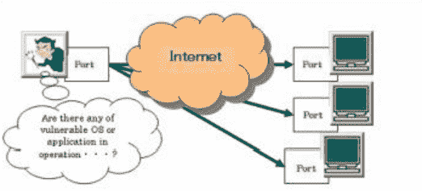
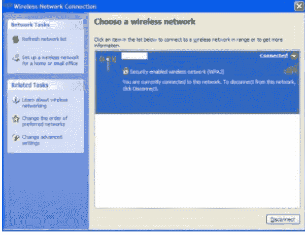

# 黑客之道：黑客大师。面向计算机黑客初者的专业级代码指南（傻瓜学黑客、计算机黑客、黑客入门、计算机编程... 渗透测试、基础安全）

# 序言

首先，我想感谢并祝贺你下载这本书——*黑客大师》（Hacking Mastery）。

本书包含了如何成为黑客的经过证明的步骤和策略，以及你可以运用新黑客技能的许多方法。

一个不可回避的事实是，你可以将你的黑客技能用于善恶。然而，不建议你入侵任何系统。这是严重的违法行为！

在没有管理员许可的情况下，你绝对不要入侵系统。任何在没有系统管理员明确许可的情况下进行的黑客行为都是严格违法的，虽然你可能不会被立即发现，但你可能会面临入狱或支付巨额罚款。任何非法黑客行为都可能让你面临长达二十年的联邦监狱刑。

书中的任何信息仅供教育之用！

再次感谢你下载本书，希望你喜欢它！

# 第一章：黑客思维

黑客在进行黑客活动时，每个黑客都应该考虑黑客思维五个五个原则。如果你正准备进入黑客领域，你也应该考虑这些。

- 1. 世界充满了等待待解决的迷人问题：

作为一名黑客，你可以获得很多乐趣（只要你是在合规操作）。成为黑客也需要大量的努力。而这种努力需要巨大的动力。作为黑客，你的动力将来自解决问题、运用你的智力，甚至在每一次成功的黑客行动中磨练你的技能。

如果你天生不是这种特质，你将在学习黑客之道的过程中变得这种这种。如果你不具备，你的能量将会被许多不同的干扰因素所消磨，例如金钱甚至社会认可。

你还需要能够对你自己的学习能力培养出某种信念。这种信念将让你知道，你可以学习如何破解你需要的任何东西，但你并不是无所不知。如果你能够处理一个问题并学会如何解决其中的某一部分，你就已经学会了，并准备好继续学习下一个问题。

这就是你对自己有信心，能够一个碎片碎片地解决谜题。

- 2. 任何问题都不应该被解决两次：你的创造力大脑既是宝贵的也是有限的资源（因为你是独一无二的）。就像你没有在重复发明轮上浪费时间一样，当有许多其他有趣的问题待解决时，你不应该回去解决一个已经解决的问题。

为了表现得像个黑客，你需要相信你的时间是宝贵的。认为分享你解决问题时获得的任何信息是你的道德义务，因为在解决任何问题之前你就直接给出解决方案。这将帮助其他黑客解决任何问题，而不是解决那些你可能已经答案的问题。

记住，仅仅因为一个问题被解决了，并不意味着你不应该尝试回去寻找一个可能让解决变得更容易的新方案。对于任何给问题，绝不仅仅有一种解决方案。

通常，我们通过研究问题的第一个解决方案，从以前未知的问题中学习到很多。你可以认为自己做得更好，然而，使用人为的技术、法律或制度性屏障来防止良好的解决方案被重复使用，从而导致他人不得不重复发明轮子。

你不需要觉得有义务交出你的任何创意产品。你可能想记住，作为一名黑客，尊重某些帮助你的权威是完全没有问题的。

- 3. 无聊和枯燥是邪恶的：由于黑客天生具有创造力；你永远不应该在重复性的工作中感到无聊。无聊和枯燥不仅令人愉快，而且实际上是邪恶的。

为了表现得像个黑客，你需要相信这一点，以确保你不会陷入无聊。你还需要能够识别自己何时碰了墙，这样你就能为自己和他人找到离开墙的方法。

就像大多数事情一样，这条规则也有预期：作为一名黑客，你所做的事情在观察者看来可能是重复甚至是无聊的。这些是作为清脑的练习，或者为了让你获得你没有经验的技能，或者在某个领域磨练你的技能。

这种类型的“无聊”是完全没问题的，因为它是出于选择。你永远不应该被迫进入一种让你感到无聊并扼杀创造力的境地。

- 4. 自由是好的：作为一名黑客，你最有可能是反权威的（这并不意味着你不尊重任何权威，但对于某些黑客来说，这会达到这种程度）。

当有人给你一个命令阻止你解决一个你深感兴趣的问题时，这通常会让你更努力地解决这个问题。

正如大多数权威可能认为的那样，他们会找到某种理由说明你试图解决这个问题是愚蠢的。因此，尝试并反抗这种心态非常重要，以免你被窒息。

记住，这并不意味着你在对抗所有的权威。作为一名黑客，你需要接受某些权威以获得你想要的东西。这并不意味着你允许权威窒息你并阻止你进行黑客活动。

- 5. 态度不能取代能力：如果你想成为一名黑客，你需要具备这些态度中的一些。然而，仅仅摆出态度不会让你变成黑客，就像站在车库里不会让你变成汽车一样。

要成为一名黑客，你需要投入练习、奉献、努力工作和智力。

正因为如此，你将学会怀疑任何给予给你的态度，并尊重每种人的能力。黑客不会让某些黑客浪费他们的时间，然而，他们会崇拜能力。特别是在黑客技术方面的能力，但实际上，任何方面的能力都是备受重视的。

能力要求掌握极少数人才能学会的技能，这尤为宝贵；而掌握涉及智力技巧、专注力和敏锐度的挑战性技能的能力，则是最好的。

如果你能够崇敬能力，你将会享受在自己身上开发这种能力。努力和奉献将变成一种激烈的乐趣，而非枯燥的工作。这种态度对于你成为一名黑客至关重要。

# 第二章：如何像黑客一样思考

为了进入黑客思维，你首先需要知道如何发现系统中的安全漏洞并利用它们——要么是为了好以展示漏洞在哪里，要么是为了利用这些漏洞获取你所有的敏感数据并从本质上摧毁你的整个生活。

- 1. 首先，你需要能够识别他们的漏洞以及任何其他帮助你创建足迹分析的信息。这基本上是你从客户那里尽可能获取信息信息。你需要考虑目标的大小，以及你可以用以进入网络的任何潜在入口，以及已有的任何安全措施。作为一名黑客，你需要考虑公司名称及其子公司、电话号码、域名，甚至是 IP 地址。

- 2. 注意后门入口点：这将是你寻找像那些处于起步阶段、最可能拥有脆弱安全系统的初创公司。这在最近被大公司收购的公司中也很常见。当你黑入这些较小的公司时，他们可能为你提供私有网络的信息，引导你进入一家更大公司的网络，作为你的下一个目标。

- 3. 连接到监听的 UDP 和 TCP 端口：当你连接时，你可以发送随机数据，以确定公司使用的是何种版本的文件传输协议、邮件服务器甚至 Web 服务器。有许多 TCP 和 UDP 服务器会发送数据，作为对发送的随机数据的响应来识别任何运行的应用程序。通过这种方式，你将能够交叉引用你在 SecurityFocus 等漏洞数据库中发现的任何数据找到漏洞。

- 4. 思考你将如何获得访问权限：你需要一个密码和一个用户账户来访问网络：确保你已经做好了准备。拥有用户名和密码后，你就可以对网络发起奇袭。一旦你进入网络，你就可以从他们的网站获取信息，并能够通过电话直接联系员工。在执行此操作，你可以假装成帮助台人员甚至是 IT 部门的技术人员。大多数时候，员工会完全毫无防备，并给你寻求的任何信息，因为他们诚实地认为你来自他们的部门。只需确保它听起来真实即可。

- 5. 获取用户名和密码并对系统进行“木马化”：现在你已经有了公司内部真实工作的用户名和密码，你就可以在不引起怀疑的情况下潜入公司网站，就像希腊人使用特洛伊木马一样。你现在可以将像记事本这样的软件替换为一段木马代码。这将允许你成为系统的管理员，因此你将在日后的日期登录。你还会被自动添加到管理员组，并可以立即访问任何“仅限管理员”的信息。

# 第三章：如何黑入计算机系统

当黑客被大众关注且并非全是坏事时，它被用于出于 IT 目的获取有关系统的信息。现在，由于那些利用技能获取个人利益同时伤害他人的人，黑客已经有了更阴暗的含义。

当你看向黑客光谱的积极端时，有多许多价值数百万的公司在其 IT 部门雇佣黑客，以测试其系统的强度，以便他们知道自己最脆弱的地方，并加强安全措施以保持系统安全。由于受雇于大公司，黑客只会在允许进入的系统范围内进行攻击，然后帮助公司修复他们发现的漏洞。这就是他们获得公司支付的高昂薪水以保护其信息的原因。

也有在公司外工作的黑客，他们做同样的事情，只是他们与安全咨询公司合作，这些数百万的公司聘佣他们来寻找其安全系统中的漏洞。

在开始黑客之前，你需要遵循一些步骤，以确保你对尝试黑入一个系统时将获得的黑客体验做好了准备。我们在之前的章节中讨论过这些步骤，但它们值得再次回顾，以确保在进入你被授权访问的系统时你已完全就绪。

第一步：编程语言对于黑客来说是必不可少的。正如我们之前讨论过的，有许多不同的编程语言可以学习，最好学习所有的语言，这样你对编程语言就有了全面的了解。了解程序如何交流以及它如何与其运行的操作系统协同工作至关重要。你了解得越多，访问网络就越容易。

Unix 使用 C 语言语言，它教导了内存如何工作，而了解这种工作原理对于学习如何黑入任何系统至关重要。

Python 和 Ruby 都是非常强大的编程语言，用于自动化各种任务。

PHP 和 Perl 用于 Web 应用程序，对于黑客领域的人来说，这是一个非常合理的选择。

如果你要编写脚本，你应该使用 Bash。这个程序可以轻松操纵 Unix 和 Linux 系统，因此会为你完成大部分工作。

汇编是你的处理器能够理解的最基础语言。所有程序都可以并且将会解释汇编，因为它是任何计算机拥有的最基础语言。如果你对汇编没有良好的了解，那么你永远无法真正利用一个程序。

第二步：你需要了解你的目标。对于你计划黑入的目标收集尽可能多的信息至关重要。在获取这些信息时，你需要能够发现他们系统中的弱点。你可能需要不同的方法来获取系统，你可能会发现你的初始方法不是可行的路。你对目标了解得越多，在黑入系统时发现意外的概率就越小。当你收集目标信息时，这被称为枚举（enumeration）。

# 黑客操作：

第一步：你将使用终端执行黑客时将使用的所有命令。Cygwin 是一个让 Windows 用户实际上模拟 Unix 的良好程序。如果你没有访问 Cygwin 的权限，那么你就使用 Nmap，它在你没有使用 Cygwin 的情况下可以在 Windows 上运行（通过 WinPcap ）。然而，Nmap 的缺点是它在 Windows 操作系统上运行不佳，因为缺少套接。

当你实际进行黑客时，你可能想考虑使用 BSD 或 Linux，因为这两个系统无论你使用什么类型的系统都是灵活的。但重要的是，Linux 将拥有更多预装的工具，并且最终在你的黑客活动中会更有用。

第二步：确保你用于黑客的机器实际上是安全的。在黑入任何人的系统之前，你需要确保自己受到了保护。如果你不安全，那么你可能会被追踪到，他们将能够先于你一步并对你提起诉讼，因为他们现在知道你在哪里。

如果你正在破解属于朋友、家庭成员或公司的系统，请确保在没有获得系统所有者许可的情况下不要这样做。该许可最终需要以书面形式呈现，以免产生任何可能反作用在你身上的后果。

如果你觉得攻击他人的系统让你不安，你总是可以选择攻击自己的系统来寻找自己的安全漏洞。为了做到这一点，你需要搭建一个虚拟实验室来进行黑客攻击。

归结底，无论你尝试破解什么，如果你没有获得管理员的许可，都是违法的，并且你会陷入麻烦。

第三步：你将确保你能够到达正尝试攻击的系统。你可以使用 `ping` 工具来测试并查看目标是否处于活动状态；但结果并不总是可信的。如果你使用 `ping` 工具，你会发现最大的缺陷是系统管理员实际上可以关闭他们的系统，从而导致你丢失目标。

第四步：你将使用 Nmap 对你尝试攻击的系统进行扫描，以检查并查看机器上哪些端口是开启的。除了告诉你哪些端口是开启的，你还能看到正在使用什么类型的防火墙以及哪种路由器。

了解这类信息将帮助你规划攻击系统的行动方案。为了使用 Nmap 激活操作系统检测，你需要使用 `-O` 选项。

第五步：如使用 HTTP 或 FTP 的端口通常是受保护端口，只有在它们被利用时才会变得不安全并可被发现。

TCP 和 UDP 等这种为局域网游戏开启的端口经常被忽略，就像 Telnet 端口一样。

任何开启的端口通常都是目标机器上运行的 SSH（安全外壳服务）的证据。有时这些端口可以通过暴力破解被强制打开，以便你访问它们。

第六步：在获得大多数系统的访问权限之前，你必须破解一个密码。你可以使用暴力破解来破解密码，这是你尝试进入系统的方法之一。当你使用暴力破解时，你尝试预定义字典中包含每一个可能的密码的工作会被投入到一个软件程序中并用于尝试破解密码。

由于任何网站或系统的用户都受到极力不要使用弱且易破解密码，有时使用暴力破解破解密码需要花费时间。然而，暴力破解技术已经有了重大改进，以缩短破解密码的时间。

你还可以通过使用破解算法来提高破解速度。许多哈希算法可能是脆弱的，因此它们的弱点会被利用，从而轻松访问你正尝试攻击的系统。

例如，如果你有一个 MD5 算法并将其切分为 1/4，那么你破解密码的速度将得到巨大的提升。

显卡现在也被用作另一种你可以访问的处理器。访问显卡的速度比破解密码或使用算法攻击系统要快一千倍。

强烈建议你在尝试远程访问机器时不要尝试每种可能的密码选项。如果你由于系统日志的污染而更有可能被发现，那么完成整个过程将需要多年时间。

当你使用 IP 地址访问代理时，你需要一个已 root 权限的平板，并安装一个名为 `TCP scan` 的程序。TCP 将有一个信号，它会上传并允许你访问正尝试攻击的安全站点。

最后，从这个角度来看，获取任何系统访问的最简单的方法是找到一种不需要破解密码的方法。

第七步：如果目标是一台 *ix machine*，你将需要尝试获取 root 权限。当你尝试访问 Windows 系统时，你需要获取管理员权限。

如果你想查看系统上的所有文件，你需要超级用户（super-user）权限。拥有超级用户权限允许你拥有一个账户，可以在 Linux 或 BSD 系统中以 root 用户身份访问。

即使你只想访问计算机上最基本的文件，你需要某种允许你查看文件的权限。所以，无论如何，如果你想查看计算机上的任何内容，你就需要某种允许你看到网络上内容的权限。这些权限将来自系统管理员。

使用路由器的系统允许你通过管理员账户访问系统。你无法访问的唯一原因是路由器密码已被路由器管理员更改。如果你使用的是 Windows 操作系统，那么你必须访问管理员账户。

记住，如果你获得了操作系统的访问权限，并不意味着你将访问该操作系统上的所有内容。为了访问一切，你需要一个 root 账户、超级用户账户或管理员账户。

第八步：有方法创建缓冲区溢出，然后利用它来赋予自己用户状态。缓冲区溢出允许内存转储，从而让你能够注入代码或执行比你授权权限更高的任务。

存有 bug 的软件在 unix 系统中通常有一个设置位。该系统允许程序以不同用户的身份执行任务。

再次，在开始攻击他们操作系统上的不安全程序之前，获得管理员的书面许可是至关重要的。

第九步：你费力进入系统后，你将希望确保在退出时不要花费太多时间。一旦访问了作为 SSH 服务器的系统，你就可以创建一个所谓的“后门”，这样你就可以随时重新访问系统，而不需要像第一次那样花费大量时间。经验丰富的黑客更有可能拥有后门，以便使用编译后的软件进入。

第十步：至关重要的一点是，不要让系统管理员知道你进入了他们的系统并且系统已被破解。

网络拥有直接与域绑定的独立密码。这意味着黑客将无法破解无线网络，也无法破解域。

场景 8：公司正在使用 WPA/WPA2，并配有每天更换的强密码。WPS 已禁用，管理员的计算机保持最新更新。

但是，路由器自安装以来一直未进行过更新，它包含了当今的未知漏洞，这些漏洞允许黑客进行 CSRF 攻击。这是通过持续性威胁实现的，并可能发生以下情况：

- 路由器将会被攻破
- 黑客能够在系统管理员系统内发送针对性的电子邮件，使其看起来像是从路由器供应商发送的。这还会提示系统管理员登录路由器供应商网站，并在登录后点击邮件中的链接检查邮件。
- 链接将管理员重定向到一个页面，该页面将更改路由器设置或直接窃取密码。

黑客也可能因为员工无意中向黑客分享了系统密码而进入系统，导致系统被破坏。这种情况也可能故意发生。

或者，如果员工的手机或电脑被攻破，那么无线网络密码也会被泄露。

你应该从无线网络到任何有线分段设置严格的 ACL（访问控制列表）。对于任何存储敏感信息的服务器，也应该设置严格的 ACL。

# 第 5 章：如何破解密码

密码将进入他人计算机最简单的方法。然而，尽管你必须具备高水平的技术才能第一次猜对密码。

但是，还有其他方法可以利用他们的密码来入侵他人的系统。这些技术并不总是有效的，有些根本根本不起作用。

不要把所有的希望都寄于此。从开放端口接收的数据就是黑客进入你服务器的邀请。

# 第 6 章：如何保护自己免受黑客侵害

有些人会利用他们的黑客技术获取信息，并利用这些信息伤害他人。被获取的信息是你的个人信息，如社会安全号码、地址或信用卡号。不需要大量信息就能获取你的整个身份。只要他们拥有几项关键信息，他们就可以冒充你，并最终毁掉你的生活。做这些事情的黑客以牺牲任何受害者的代价来为了自己。只要这些信息足够帮助他们进步，让他们能够继续入侵下一个人的生活。

然而，通过做一些大多数人在考虑保护自己身份时不会想到的的小事，你可以避免此类情况的发生。以下是其中的一些步骤，可以帮助你更好地防范那些想要伤害你和家人的黑客。

当你设置家庭 WiFi 时，需要为它设置密码。许多路由器在箱子侧面附有一个贴纸，上面提供了访问该网络的信息。请务必更改它！不要使用默认密码，因为它太容易被破解，导致他人获取你的网络访问权限。

此外，当机器询问你想要使用哪种加密方式时，最好选择 WPA-2。

尝试并避免 WEP 和 WPA 是明智的。这些加密方式实际上存在缺陷，可以在几秒钟内泄露你的网络密码。

在你设置家庭路由器时，它会询问你是否想要隐藏 SSID。当你点击“是”时，你的 WiFi 将对其他人隐藏，但它会强制你的设备不断搜索它们正在连接的网络。你的设备虽然会连接，但在搜索网络的过程中，会让你的设备暴露在连接奇怪网络的风险之中。

如今已经有了如智能冰箱、烤箱甚至洗衣机和烘干机之类的设备。这些设备连接到互联网，并为你提供了原始设计中不具备的不同选择。

但是，推出这些设备的公司仍在解决它们中的缺陷。

当科技公司急于给一切事物都贴上 WI-FI 连接时，他们忽略了设备隐私和安全等重要事项。

一个重要的例子是，黑客曾劫持了一个婴儿监视器，并在设备中说了一些非常难听的话。

黑客 Stanislav 表示，尽管你被告知你的设备是安全的，但它们可能并非如此。

归结底，设备安全取决于你自己，以便保护你自己和你的所爱的人。

保护自己的其他方法是保持防火墙开启。防火墙可以帮助防止黑客进入你的计算机。某些操作系统自带了你可以使用的防火墙，或者你也可以购买带有防火墙的程序。

始终更新你的防毒软件。防毒程序旨在防止恶意软件嵌入你的计算机，有助于保护你的计算机。在任何时候，当程序检测到病毒或蠕虫时，它会消除威胁。病毒可以通过黑客将其放置在你的计算机中来获取你的访问权限。

间谍软件技术也需要保持更新。正如其名，间谍软件允许某人看到计算机上进行的所有活动。某些间谍软件实际上会在未经你许可的情况下收集数据，然后在你的网页浏览器中产生不想要的弹出广告。

过时的操作系统实际上会让黑客更容易进入你的计算机。随着每次新的更新，由于在更新之间发现并修复了漏洞，计算机的安全性会稍微提高一点。让你的系统不进行这些更新可能会让黑客访问你的机器。

黑客还可以通过你的电子邮件进入系统。永远不要打开来自你不认识的人的邮件。这些邮件可能包含来自黑客的恶意代码，他们试图访问多台机器以获取他们想要的信息。

不使用计算机时请关闭它。虽然让计算机一直开启以便于访问更简单，但间谍软件和病毒仍然可以访问你的计算机，并让让黑客在不知情的情况下进入。

# 第七章：黑客使用的技术

到目前为止，你已经学习了如何破解不同的系统，以及如何进入黑客的心态。然而，就像世界上其他任何事情一样，你可以使用一些技术来成为一个更高效的黑客。

- **匿名性**：黑客不希望让你知道他们进入了你的系统。为了做到这一点，他们会尽一切努力不留痕迹。在此过程中，他们将使用：
  - 代理或安全隧道
  - 隐藏 IP 地址的软件
  - 使用他人的用户名和密码而不使用自己的
  - 用 C 语言编写的程序
  - 或者可以隐藏其身份和任务执行的 telnet。

- **离开**：任何黑客都会确保不在你的计算机上留下的任何痕迹，这样你就永远不知道他们曾来过那里。在离开的过程中，黑客会放过你所有的文件，但他会留一个“后门”，以便在日后能够重新进入你的计算机。

- **收集目标信息**：在破解某人时，尽可能多地获取他们的信息是非常重要的。在此过程中，你可能想要获得如下信息：
  - 他们的 IP 地址
  - 使用 Telnet 或 Tracert 查看某人在使用计算机时的 ping 值
  - 并善于利用。尽可能多地获取你目标的信息。

- **记录击键**：作为黑客，你可以使用程序来查看某人在计算机上输入的每一个按键，仅此一项就能揭示一个人的身份。

- **5. 破解密码**：在尝试破解密码时，最好尝试使用创建字母、符号和数字组合的简单算法。你需要做出明智的推测并使用字典攻击，以便生成密码的所有可能组合。

- **6. 留下病毒**：这是重新进入计算机的简单方法。通过向任何潜在受害者发送电子邮件或即时消息即可留下病毒。

- **7. 通过后门进入**：这与破解密码非常相似。许多黑客开发了代码和程序，寻找网络中毫无防御的路径，作为一种无需使用密码即可进入网络的方法。

- **8. 监控邮件**：这是一种可以用于中断和读取邮件的程序。

- **9. 制作僵尸计算机**：这是黑客利用计算机来发动 DDoS 攻击并发送垃圾邮件。如果一个无辜的用户点击了你发送的链接，将在你的计算机和他的计算机之间建立一个连接。

- **10. 确保你有一个防火墙**，以便限制对可能传出计算机的任何个人信息的访问。

- **11. 使用代理服务器**：当你决定使用计算机时，确保你的目标是代理服务器。

- **13. 使用搜索引擎**：这将帮助你找到破解系统所需的工具。从这里开始，你可以下载针对特定计算机所需的工具。

- **14. 在计算机上留下一两个文件**：这将允许你在日后重新访问计算机。你可以留下诸如 Netcat 等文件以再次访问。

# 第八章：追求伦理黑客职业

并不是所有的黑客都是那种通过破解系统来获取你个人信息的黑客。事实上，历史上出现了几个非常著名的黑客，他们为我们提供了现在拥有的技术。想到的三个是史蒂夫·沃兹尼亚克（Steve Wozniak）、史蒂夫·乔布斯（Steve Jobs）和酸饼船长（Captain Crunch）。

这些非常有名的男性从破解开始职业，然后为我们提供了我们今天所知并享受的技术。他们所做的只是将他们拥有的知识应用于技术，并找到创造事物的新方法。

为了开启你的伦理黑客职业，明智的做法是拥有某种计算机科学学位以便于。许多大公司正在招聘黑客来寻找他们系统的漏洞，以便保护他们的公司秘密。

你还可以利用你的黑客技能像沃兹尼亚克和乔布斯一样创造自己的东西。你可以创建程序、计算机或任何你想创建的东西，以帮助人们免受黑客侵害。

如果你想去一家公司为他们工作，那么你需要找到那些正在招聘 IT 团队人员的公司。你所做的将不仅是寻找系统中的安全漏洞，但这将让你朝着正确的方向迈出一步。

让你记住，黑客是违法的，除非是以伦理的方式进行的。以下是黑客在被发现后受到惩罚的一些方式。

在印度，如果你被发现篡改计算机源文档，这包括破坏、隐藏甚至更改文档源代码，将导致黑客被处至少三年的监禁或处以 20,000 卢比的罚款。

在印度，如果你只是破解了一个网站或其他各种来源，你将被监禁最高三年，并可能处以 50,000 卢比的罚款。

荷兰将破解定义为具有违法意图的自动化工作或其部分。入侵被认为破解了任何安全措施、虚假信号或虚假加密密钥、使用窃取的用户名或密码。其中任何一种都可能导致你至少一年的监禁，以及第四类罚款。

美国禁止对受保护的计算机进行任何未经授权的使用或破坏。受保护的计算机是指金融机构或美国政府使用的计算机。

该计算机也可用于影响州际或外国贸易，甚至是通信。如果计算机用于任何类型的州际或外国贸易，则它不需要位于美国。

最高刑期可是在联邦监狱监禁一年，或处以不超过5,000美元的罚金。

# 第九章：沃兹尼克与乔布斯

正如上一章提到的，沃兹尼克和乔布斯利用黑客技术来帮助改进技术。在本章中，你将学习他们是如何做到的。

与之前的章节一样，乔布斯和沃兹尼克使用了一种流行的黑客方法来进入不同的计算机。

尽管他们使用黑客技术是为了善，但他们所做的仍然是非法的！

在60年代，“黑客”一词曾被用来描述精通编程的人。随着时间的推移，越来越多的人进入黑客领域，获取系统访问的人群也从“完全无辜”的人变成了那些在计算机上进行非法活动的人。无论你如何看待，那些利用技能编写程序并改进它的人，以及那些利用技能获取他人私人信息的人，都是高技能的人才。科技领域一些最著名的人物在计算机早期都是从“黑客”起家的。

在加州的计算机历史博物馆，展出了一个名为“蓝盒”（Blue Box）的设备。它被用于中断电话信号，由两位今天非常出名的黑客发明——斯蒂夫·乔布斯和斯蒂夫·沃兹尼克。

如所述，蓝盒被用于中断电话信号。这是一种“电话欺骗”（phone freaking）的黑客活动。

今天，电话通话是一系列连接，将你引导至你想要通话的人。最初，这是由人工操作员完成的，他们可以帮助接通你想找的人。随着自动交换机的出现，你通过相互通信将通话路由到目的地。自动交换机使用一系列被称为“信令”的音频音调，这在60和70年代出现。

电话使用的音调被证明是黑客利用的弱点。

蓝盒模拟了电话交换使用的信令音调。当这些音调通过连接到电话筒的扬声器播放时，自动交换机会被欺骗，认为它们正在接收信号。一旦黑客理解了所有使用的信令音调，一切都变得可能。

黑客可以弄清楚计费公司如何路由通话，绕过电话公司设置的阻止限制。这可以帮助他们克服障碍。20世纪70年代初，这就是乔布斯和沃兹尼克设计并开始销售的产品。使用假名（Berkeley Blue和Oaf Tob），乔布斯和沃兹尼克进入了电话欺骗的非法世界。

沃兹尼克和乔布斯开始从事电话欺骗是因为他们对这带来的挑战感兴趣——拆解并弄清其工作原理，然后找到绕过它的方法。他们弄明白时，也发现可以从中赚钱，他们就开始了销售作品的非法行为。现在，受到技术进步带来的新技术挑战的激励，沃兹尼克和乔布斯放弃了犯罪生活，转向了不同的挑战。在对乔布斯的一次采访中，他声称，如果没有他和沃兹尼克实验过的蓝盒，苹果公司今天就不会存在。

当电话公司开始采用一种带外信号时（这种信号会分离并专门用于交换任何通信的连接），蓝盒就消亡了。

按照今天的定义，沃兹尼克和乔布斯会被视为黑客。但是，他们真的是黑客，还是只是熟练的程序员？在判断他们属于哪一方时，界限非常模糊。他们确实知道自己正在利用蓝盒从事非法活动。他们没有被视为黑客的唯一理由是因为他们因为创立苹果公司而成为了家喻户晓吗？

另一方面，沃兹尼克和乔布斯的结果可能会完全不同。由于如今政府内部发生的所有黑客事件，由于人们对隐私和通信更加敏感，他们的蓝盒和其他黑客行径将不太可能仅仅被斥为无害的反叛。事实上，如果沃兹尼克和乔布斯继续他们的非法活动，他们很可能会入狱。

但是，由于他们使用蓝盒并学到了很多东西。如果没有涉足黑客的黑暗面面，沃兹尼克和乔布斯永远不会创造出我们今天所认识和享受的全球性公司。

# 结论

再次感谢下载本书！我们不胜感激。

希望这本书能够帮助你获得关于什么是黑客的知识，以及你如何黑入无线网络和计算机。不仅如此，还有你如何破解密码以进入不同的系统。

下一步是进一步增加你的知识，并尝试黑入计算机系统或无线网络。

请记住，黑客行为是非法的，不应该这样做！如果你打算尝试黑入任何系统，在开始制定如何暴露他们漏洞的计划之前，请获得系统管理员的许可。

最后，如果你喜欢这本书，我想请你帮个忙，你可以在亚马逊上给这本书留个评论吗？我们将不胜感激！

点击此处在亚马逊上为这本书留评！

感谢并祝你提升黑客技能顺利！

# 查看我的其他书籍

祝贺你学习了一门新的编程语言。现在的下一步继续练习你的新技能，我强烈建议你学习其他编程语言，这样你就能成为一名顶尖程序员。

我还有属于“A Code Like a Pro”系列的书籍可以下载。
——以下是我其他书籍的链接：——

A CODE LIKE A PRO BOOK SERIES

- PYTHON MASTERY – A CODE LIKE A PRO GUIDE FOR PYTHON BEGINNERS
- ANGULARJS – A CODE LIKE A PRO GUIDE

OTHER BOOKS

- WINDOWS 10 MASTERY – THE ULTIMATE WINDOWS 10 MASTERY GUIDE (Wait, WINDOWS 10 MASTERY – THE ULTIMATE WINDOWS 10 MASTERY GUIDE)
- LINUX MASTERY – THE ULTIMATE LINUX OPERATING SYSTEM AND COMMAND LINE MASTERY GUIDE

如果由于某种原因链接无效，你可以在亚马逊网站上搜索这些标题来找到它们。

