# 销售终端支付应用破解：秘密、威胁与解决方案

- [作者注]
- [本书的读者]
- [通过隐晦实现安全的优缺点]
- [本书不包含]
- [本书的结构]
- [笔记]

# 第一部分 支付应用漏洞剖析

> 服务于人类的科学是技术，但缺乏智慧可能会使服务产生危害。
>
> —— 艾萨克·阿西莫夫

## 第一章 处理支付交易

> 因为人们没有可以交易的思想，他们就玩牌牌，并试图赢取对方的钱。白痴！
>
> —— 亚瑟·叔本华

为了理解销售终端（`POS`）和支付应用的漏洞点，必须了解基础知识——在支付交易周期中，敏感的持卡人数据如何、何时以及为何在不同终端之间移动：

- **为什么（原因）**：在整个过程中真的有必要持有、存储和传输这些数据吗？
- **如何（位置和路径）**：哪些区域集中了敏感记录？
- **何时（时机）**：这些信息在这些区域中留存多久？

### 支付卡

使用支付卡显然是本书的主题之一。有几种常用于支付的常见支付卡类型：

- `credit card` 是第一种支付卡，并且仍然非常常见。通过使用 `credit card` 支付，客户使用其可用额度并在事后支付账单。信用卡通常不受个人识别码（`PIN`）的保护，这使得它们可以用于在线购物。
- `debit (ATM, Cash) card` 是一种相对新的支付方式。它与 `credit card` 的不同在于，`debit cardholder` 使用的是其银行账户中的可用资金进行支付，这些资金会即时实时扣除。与 `credit card` 相比，`debit card` 似乎更危险，因为 `debit card` 直接与银行账户关联，并且通常允许 `ATM` 提现。另一方面，它受到强制双因子身份验证（`PIN` 加卡片本身）的保护，因此更安全。许多品牌借记卡的真正危险之处在于，它们可以在不输入 `PIN` 的情况下作为 `credit cards` 处理。
- `gift card` 与 `debit card` 类似，但通常没有 `PIN` 提供的保护。`gift card` 未关联银行账户，通常“包含”固定金额的资金。卡片本身不持有任何财务信息——`point-of-sale (POS)` 终端在支付交易期间与卡提供商通信以获取授权。礼品卡比信用卡和借记卡危险性较低，因为只有固定且通常有限的金额会被盗。
- `fleet (or proprietary) card` 与 `credit card` 类似，但只能在特定地点（通常是加油站和便利店）用于购买特定类型的商品（如燃料）。`Fleet cards` 尽管由主流品牌发行，但对“坏人”的吸引力较低，因为它们无法用于 `ATM` 取款、在线购物或百货商店购物。

表格 1.1 显示了主要的支付卡类型及其特征。

**表格 1.1 支付卡类型**

### 卡片输入方式

有两种将卡片数据输入到 `POS` 的主要方法：`swipe`（刷卡）和 `manual entry`（手动输入）。

#### MSR

第一种方法使用 `Magnetic Stripe Reader` 或 `MSR`，这是一种读取支付卡磁条的设备。现代 `MSR` 设备具有加密功能，并支持端到端加密（`P2PE`，详见第 8 章）。将卡片数据输入 `POS` 最简单的方法是刷卡，让 `MSR` 自动读取磁条。如果磁条损坏，客户或收银员可以手动输入卡片上的账号和有效期。某些 `MSR` 设备模拟键盘输入，因此刷卡等同于在电脑键盘上输入数字字母。在这种情况下，通过安装 `keystroke logger` 监听 `MSR` 输入来窃取数据[^1]。

#### Pinpad

第二种方法使用 `pinpad`。内置 `MSR` 的 `pinpad` 或交互终端（`POI`）是一种更复杂的设备，因为它拥有可以保护卡敏感数据的各种功能的固件。大多数 `pinpads` 还实现了硬件加密（`TRSM`，防攻击安全模块）。除了 `MSR`，`POI` 还包括显示器和键盘以便在整个支付过程中与客户进行更好的交互。

### 关键参与者

根据 `Visa` 的说法，卡支付处理中有五个关键参与者：`Consumers`（消费者）、`Merchants`（商户）、`Acquirers`（收单行）、`Issuers`（发行行）和 `Card Brands`（卡组织）[^2]。然而，在实践中，参与者更多。除了 `Consumers`、`Merchants`、`Acquirers`、`Issuers` 和 `Card Brands`，还有协助支付交易处理的 `Gateways`（网关）、`Processors`（处理器）、`Software Vendors`（软件供应商）和 `Hardware Manufacturers`（硬件制造商）。

在深入研究这些参与者的细节之前，我想提醒你们，本书的范围是实体店的安全性。尽管商户在整个支付处理周期中所占的比例很小，但他们承担的责任和风险远大于任何其他人。原因有几点：

1. 首先，与其他相比，商户的结构非常分散——一个典型的零售连锁可能包含数千家商店。相比之下，处理器可能拥有几个企业级数据中心，在那里更容易组织安全措施。
2. 第二，零售店是公共场所，这对安全性带来了后果。
3. 第三，大多数商户依赖硬件和软件供应商作为其技术提供商（包括安全性），并不准备接受他们拥有设计上就有漏洞的技术的事实。当 20 世纪 90 年代末 `PC` 和互联网革命开始用集成支付应用的复杂 `POS` 系统取代旧收银机和独立信用卡终端时，也带来了无数系统和网络漏洞的现实。

#### 消费者（持卡人）

就是我们。我们去商店、刷卡并支付账单。

理想情况下，消费者除了保持 `PIN` 秘密外，不应该关心安全性。如果卡片丢失或被盗，消费者只需给银行打电话换新卡。当我们刷卡时，我们的私人信息会与商户共享，商户的 `POS` 系统应该在整个过程中保护我们的信息。我们依靠现代高端技术来保护我们的塑料货币。

遗憾的是，在实践中情况并非如此。并不是所有卡都受 `PIN` 保护。因此，如果卡片丢失或被盗且未被发现，消费者的钱很容易被盗取。而且当在 `POS` 刷卡时，数据并非 100% 的保密，因此月底收到的账单可能包含惊人的费用。

#### 商户

商户（如超市、便利店、餐厅或酒店）是流程中的核心人物。他们面临许多决策，包括业务和技术方面的：接受哪些支付类型——信用卡、借记卡或两者都有；接受哪些品牌；在哪个银行开设商户账户；购买（或租赁）什么类型的 `POS` 和支付终端硬件软件；最后，如何保护持卡人数据。最后一个决策听起来与其他决策不同且无关，但事实是——商户必须负责支付数据安全，因为其他参与者往往没有。

尽管如此，商户仍然接受卡支付，是因为他们想销售商品和服务。他们的 `POS` 硬件和软件接受并处理卡片信息，将其发送给支付处理器进行授权和结算，最终在商户账户中收到资金。

#### 收单行

收单行（收单银行）授权支付交易并与发行行进行结算。支付处理器根据交易和卡类型，将交易路由到相应的收单行进行授权和结算。收单行监管基本的商户折扣率（商户为每笔处理的支付交易支付的费用）。

#### 发行行

发卡行（或发行银行）维护客户账户并向客户发放卡片。他们对客户的交易进行结算，并将资金退回给收单行以便其支付商户。发卡行制造卡片，因此负责物理安全特性。

#### 卡品牌

卡品牌（或卡组织网络）促进整个支付授权和结算过程。诸如 `VisaNet` 等网络维护收单行与发卡行之间的连接。某些卡品牌如 `Visa` 和 `MasterCard` 并不直接参与收单和发卡，而是将这些功能委托给第三方独立机构[^3]。其他品牌如 `American Express` 则自行发行卡片并收单支付交易。

卡品牌监管支付处理，但在大多数情况下并不直接干预，包括商店内敏感持卡人数据的安全。各个卡品牌成立了 `PCI` 安全标准委员会（`PCI SSC`），该委员会创建并维护安全标准，以确保商户负责支付数据保护。

### 更多参与者

在支付处理游戏的主要参与者之外，还有为商户提供许多“额外服务”的“中间人”参与者。从理论上讲，商户可以通过与收单行直接通信，无需这些额外组织即可接受电子支付。然而，鉴于支付处理方案的复杂性以及不同支付卡和方法的巨大数量，如果没有支付处理器和网关的参与，这种实现几乎是不可能的。

#### 支付处理器

支付处理器处理商户与多个收单行之间的支付交易。他们还维护*商户账户*，商户通过该账户收到持卡人为其商品或服务支付的资金。

处理器根据支付类型和卡品牌（例如由 `Visa`、`MasterCard`、`American Express` 或其他发行的信用卡、借记卡、礼品卡或车卡）将支付交易路由到相应的收单行。支付处理器为商户创建财务（交易）报告。支付处理器还提供许多其他有用功能。但在许多情况下，由于他们没有进入商店，因此无法提供支付数据安全。

处理器可能提供额外功能，如令牌化甚至端点加密。然而，这通常并不能完全解决安全问题，因为许多商户使用第三方硬件和软件支持多个支付处理器。此外，许多处理器提供的令牌化功能并不能解决卡数据安全问题。

> **交叉引用**：参见第 3 章获取有关 `PCI` 的更多详情。

在图 1.1 所示的示例中，商户可以使用处理器 B 处理所有信用卡交易，但将礼品卡交易发送给处理器 C。

**图 1.1** 连接支付处理器的商户

与收单行不同，支付处理器支持多种支付卡类型和方法，如礼品卡、车卡、电子福利传输（`EBT`）等。他们不仅限于信用卡和借记卡。

#### 支付网关

在许多情况下，商户的 `POS` 支付系统直接与支付处理器通信。然而，有时商户和支付处理器之间还有另一个被称为支付网关（或支付交换）的“中间人”。它的主要功能是为商户提供*网关*或*路由*服务。

想象这样的情况：商户 A 与支付处理器 B 有服务协议，每处理笔交易收取 0.30 美元加 2% 的费用。一切正常，直到商户看到支付处理器 C 的广告，它承诺每笔交易收取 0.29 美元加 1.9% 的费用。这种微小的差异对于每天处理数千笔交易的商户 A 来说可以节省大量资金。然而，为了从处理器 B 切换到 C，商户 A 必须向 `POS` 软件供应商支付 200,000 美元修改支付应用程序，以便能够与处理器 C 通信；因为最初的设计仅适用于处理器 B。图 1.2 显示，如果商户 A 使用支付网关，那么这种变化对于其 `POS` 软件将是透明的，因为路由将在运行在数据中心的支付网关交换机上完成。

**图 1.2** 连接支付网关的商户

支付网关可能提供额外的便利服务，如端点加密、集中化报告、`POI` 设备管理、令牌化等。

支付处理器和网关之间的主要区别在于，处理器除了提供网关提供的交换功能外，还维护商户账户并促进结算过程。

支付网关可能扮演的另一个重要角色是提供一种运行在商店的软件，其一端与 `POS`/支付应用程序通信，另一端与网关交换机（运行在数据中心的服务器）通信。通过这种方式，支付网关可能会影响商户支付基础设施的安全。它可以改进安全性（例如通过提供 `P2PE` 功能），也可以破坏安全性（通过将其不安全的组件植入先安全的 `POS` 系统中）。在大多数情况下，商户仍然负责运行在商店的网关客户端应用程序的安全。

### 更多的参与者

尽管发卡行、收单行和卡品牌等关键参与者是支付处理中不可或缺的元素，但现实情况是，他们对商店内支付数据安全的影响微乎其微或没有，因为他们流程的环节发生在“云端”，远离零售环境的危险表面。处理器和网关离现实近一点，因为他们直接与商店通信，有时甚至提供运行在 `POS` 上的软件。然而，他们仍然对局面没有控制权，因为他们的接口只是复杂集成支付环境的一个碎片，而且在支付处理游戏中还有其他直接处于前线的参与者：支付软件供应商和硬件制造商。

#### 支付软件供应商

第三方软件供应商为商户开发 `POS` 和支付应用程序。这些应用程序在零售商店的整个支付周期内（从刷卡时刻到结算）处理（处理、传输和存储）敏感数据。如果你查看支付品牌提供的信息手册，你不会在支付处理参与者的列表中找到软件供应商。这是错误的。软件供应商创建安装在商店的应用程序，除了其他功能外，还应该保护持卡人数据不被盗取。与商户不同，应用程序开发者能够发明并实现复杂的安全技术。

支付应用程序有义务遵守 `PCI PA-DSS`（支付应用程序数据安全标准），该标准对于保护敏感数据并不够强大有效（参见第 3 章获取更多关于 `PA-DSS` 的信息）。

#### 硬件制造商

硬件制造商是支付处理周期描述不充分的另一个例子。他们创建了交易处理所需的外围设备，例如 `MSR` 和 `pinpads`（请参见本章稍后部分关于这些设备的更多详细信息）。这些设备位于支付数据安全的前线，因为它们在支付周期的最初阶段，就以磁条刷卡或手动输入的形式接收、处理并传输敏感的授权数据。`Pinpad` 设备必须符合 `PCI PTS` 标准才能允许处理借记交易。`MSR` 和 `pinpad` 设备都符合 `PCI PIN` 交易安全（`PTS`）标准才能包含在 `P2PE` 解决方案中。尽管如此，在描述支付处理流程时，往往不会提到它们的制造商。

## 支付阶段

卡支付交易从 `POS` 终端初始刷卡开始，到账单发送给持卡人结束。从整个支付系统的角度来看，支付处理有两个主要阶段：`authorization`（授权）和 `settlement`（结算）。然而，从 `POS` 和支付应用程序的角度来看，这两个阶段背后有更细粒的划分。

### 授权

卡支付过程的第一步称为 `authorization`（授权）。这是为了检查持卡人的信用额，或者在借记卡的情况下，检查持卡人的银行账户是否有足够的资金来处理支付。授权流程如图 1.3 所示。

**图 1.3** 授权流程

例如，在零售店中，收银员完成客户选择商品的扫描后，点击小计按钮，这通常会将 `POS` 切换到支付模式。随后提示客户选择支付方式，如果是信用卡、借记卡、礼品卡或 `EBT` 卡，就在读卡器上刷卡，读卡器可以是简单的 `MSR` 或复杂的 `POI` 设备。支付应用程序分析卡数据，并根据卡片类型和银行识别码（`BIN`）`range` 启动支付交易（有关 `BIN` 范围的更多细节将在第 4 章中讨论）。支付交易的下一个“站点”是支付网关或支付处理器。交易数据被路由到相应的收单行，收单行与发行行通信以获取 `approval`（批准）。发行行是维护持卡人账户信息数据库并实时检查其状态的机构。

如果进行信用卡交易，发行行将检查信用额度并与交易金额进行比较。如果客户有足够的信用额度覆盖整个交易金额，发行行会将批准响应返回给收单行，收单行返回给支付处理器，并一直返回 `POS`。对于借记卡，发行行将检查持卡人的银行支票账户以确保账户有足够的资金。礼品卡也会进行类似的检查，区别在于礼品卡没有关联银行账户。相反，每张礼品卡都链接到礼品卡提供商维护的特殊数据库记录。在任何情况下，如果客户没有足够的信用额度或资金，交易都将被拒绝。

从安全角度来看，授权阶段最重要的，因为它需要敏感的身份验证数据。

### 结算

一旦获得授权并完成支付，就必须进行 `settled`（结算），这意味着在商户、收单行和发行行之间进行 `reconciled`（对账）。在结算期间，商户将数据发送给发行行，由发行行将交易记录在持卡人的账户上。图 1.4 显示了结算流程。

**图 1.4** 结算流程

从安全角度来看，结算阶段没有授权阶段那么危险，因为它通常不涉及完整的身份验证数据。另一方面，结算过程需要累积多次交易。

## 支付交易

每笔支付交易有两个参数：`authorization amount`（授权金额）和 `transaction amount`（交易金额）。在授权阶段，收单行授权商户向持卡人收取小于或等于 `authorization amount` 的金额。一旦完成支付，商户将交易发送给收单行进行结算，其 `transaction amount` 不能超过 `authorization amount`。

### 销售与 预授权/完成

根据交易类型和商户类型，可以针对特定的支付金额或抽象的 `limit amount`（限额金额）请求授权。例如，如果你在当地超市购买杂货，`POS` 可能会根据你的购买精确金额获取授权。这种“普通”交易被称为 `Sale`（销售）。

然而，如果你在加油站支付燃料费用，支付应用程序首先对某个预定义的“limit”（限额）金额获取预授权（`PreAuth`），该金额可能由卡组织规定，也可能由商户设置。这是因为 `POS` 系统并不知道具体会向油箱内注入多少燃料。加油完成后，加油泵处的 `POS` 将计算并发送精确的支付金额。支付处理中的此类额外步骤被称为 `completion`（完成）。

从安全角度来看，`Sale`、`PreAuth` 和 `Completion` 消息的一个重要区别在于，`Sale` 和 `PreAuth` 都包含敏感的身份验证信息（完整轨道数据或 `PAN`），而 `Completion` 消息通常只包含 `PAN` 或不包含卡片数据，因为交易已经启动，所以可以使用其他形式的标识（如交易号或令牌）将 `Completion` 与原始的 `PreAuth` 关联。

### Void（作废）与 Return（退货）

可以说 `Void` 和 `Return` 只是 `Sale` 或 `PreAuth/Completion` 的相反。如果支付失误，或者客户想退货退款，收银员可以发起 `Void` 或 `Return` 支付交易。尽管如此，`Void` 和 `Return` 之间存在区别。`Void` 通常在客户或商户想要取消整个交易（可能包括多个商品和支付方式）时触发。`Return` 或 `Refund`（退款）通常用于客户退回单个商品且商户需要退还部分金额而非全部款项的情况。

`Void` 和 `Return` 另一个重要区别（从安全角度来看）是，`Void` 在没有关联原始 `Sale` 交易的情况下无法执行，而 `Return` 可以随时发起。`Void` 仅仅是对之前已存在的支付进行取消，而 `Return` 是将资金存入持卡人账户，与之前的活动没有任何联系。换句话说，使用 `Return` 从商户账户中盗钱并转入坏人账户要容易得多。此外，`Void` 交易（如果由支付应用程序供应商和处理器正确实现）并不一定包含敏感信息，因为原始交易记录已经包含了卡片数据。

### Fallback Processing（回退处理）

[^1]: 译者注：此处原文有脚注标记，对应链接为 `97811881071c01.xhtml#c01-note-0001`。
[^2]: 译者注：此处原文有脚注标记，对应链接为 `97811881071c01.xhtml#c01-note-0002`。
[^3]: 译者注：原文脚注标记 ³ 对应链接可能为 `97811881071c01.xhtml#c01-note-0003`（原文未显式给出编号，此处推测）。


# 回退处理

回退处理（也称为 `Stand-In`、`Store & Forward` 或 `Offline Authorization` [离线授权]）对于商户的业务连续性是一个非常重要的功能。它提供了在由于任何原因网络连接或支付处理主机宕机时，“离线”接受卡支付的能力。如果支付应用程序无法从收单行获得在线授权，在某些情况下（取决于卡类型、交易金额和其他参数），它允许生成内部批准并存储交易以备后续处理。对于未经培训的收银员和客户来说，回退授权几乎是透明的。但在许多情况下，离线授权的证据是可以被识别的：

*   离线批准的交易处理时间与在线授权相比明显更长，因为支付应用程序可以设置为在允许内部批准之前等待 `response timeout`（响应超时）。`response timeout` 值由支付处理器作为 `message protocol`（消息协议）的一部分定义，并可能根据连接和通信类型而显著变化。然而，在大多数情况下，该值可以设置为几秒，这明显长于几毫秒。

故障转移处理（如 `fallback up`）可能是获取离线批准出现严重延迟的另一个原因。当主连接中断时，某些处理器要求支付应用程序切换到备份主机或不同的通信线路，以尝试在线授权。

*   当支付应用程序接收到交易在线授权时，主机包含一个授权代码。该代码通常打印在交易的 `payment slip`（小票）上。如果 POS 进入离线模式，支付应用程序将生成自己的授权代码。例如：主机返回的授权代码：FVIKP0。应用程序生成的离线代码：LA1234。

回退处理的一个非常重要的特征是，POS 必须在整个故障期间存储敏感数据，这可能从几秒到几天不等。这种累积大量敏感信息的需求为坏人提供了明显的机会。通常，如果系统设计得当，在授权阶段完成后，持卡数据将不再存储在 POS 中。然而，在 `Store & Forward` (`S&F`) 情况下，技术上无法完成授权。

## Timeout Reversals（超时撤销）

超时撤销或 `TOR` 是一种防止重复收费的机制，在第 2 章中有更详细的描述。`TOR` 是 `S&F` 之后的另一个例子，即 POS 必须在本地存储（即使是临时且加密的形式）随后可以检索的敏感数据。

## Special Transaction Types（特殊交易类型）

存在一些不常见的 POS 交易类型（表 1.3），它们主要用于异常情况或处理特定卡类型。此类交易的示例包括礼品卡余额查询和充值。`Balance inquiry` 用于检查礼品卡的剩余余额，产生的交易数据可能包含完整轨道数据。`Recharge` 用于通过另一种支付方式（如现金或信用卡）为礼品卡充值，因此包含敏感数据信息。

**表 1.3** 支付交易类型

# 支付应用程序漏洞的关键领域

有多种方法攻击 POS 系统及其关联支付应用程序以窃取敏感卡数据。这些方法在信息安全理论中通常被称为 `Attack Vectors`（攻击向量）。一个攻击向量通常包含攻击场景——关于所执行的步骤和所用工具的描述。如果你知道某种特定的入侵是可能的（至少在理论上），那么在讨论应用程序安全控制（保护措施）时，特定的场景（例如渗透方法、特定指令和攻击期间使用的工具）并不那么重要。因此，本书中将重点将放在攻击的 `Vulnerability Areas`（漏洞区域），而非攻击向量。

假设在本项研究的背景下，攻击目标（对象）始终是敏感支付数据（或持卡人信息），而环境（主体）是实体商户的 POS 和支付应用程序，漏洞区域通常描述数据在攻击发生时在应用程序中的位置（包括物理和逻辑上的位置）。在任何软件程序（包括支付应用程序）中，数据有三个这样的位置或状态：

1.  **内存中的数据（Data in Memory）**——当支付应用程序处理授权或结算时，它会对主机计算机内存（通常是 POS 机器的 `RAM`）中的支付卡数据进行各种操作。

2.  **静态数据（Data at Rest）**——支付应用程序将数据临时或长期地存储在硬盘上。

3.  **传输中的数据（Data in Transit）**——支付应用程序与其他应用程序及设备之间发送和接收数据。

除了内存中的数据外，其他数据状态根据其周围技术的差异决定了子区域。例如，静态数据可以存储在数据库或日志文件中，而传输中的数据可以通过 `LAN` 或串行连接发送。

另一个关键漏洞区域是支付 `Application Code`（应用程序代码）本身及其 `Configuration`（配置，`config`）。代码或配置本身不包含任何持卡人信息，但可能会被攻击者或恶意软件 `tampered`（篡改），以获取其他关键漏洞区域数据的未授权访问。

如此，支付应用程序有四个关键漏洞区域，如图 1.5 所示：

1.  内存中的数据
2.  静态数据
3.  传输中的数据
4.  应用程序代码和配置

图 1.5 关键漏洞区域

表 1.4 列出了包含所有子区域的关键漏洞区域。这些术语将在全书中关于支付应用程序威胁和缓解措施的讨论中使用。关于漏洞区域及其示例的更多细节，可以在第 2 章中找到。

表 1.4 支付应用程序的漏洞区域

# 总结

支付卡有几种主要类型：信用卡、借记卡、礼品卡和加油卡。信用卡和信用卡最为脆弱，因为它们被广泛接受且涉及金额巨大。

电子支付处理中有多个参与者或“玩家”：持卡人、商户、软件供应商、硬件制造商、网关、处理器、收单行、卡组织和发卡行。商户是这条链中最脆弱的元素，因为它直接面对公众，其与客户的互动具有巨大的表面：多个商店和 POS。

塑料支付过程由两个主要阶段组成：授权和结算。授权阶段更为危险，因为它需要在多个系统中传输敏感身份验证数据，这些数据通常是未加密的。此类数据可以被攻击者拦截并用于制作伪造卡。

POS 系统及其关联支付应用程序有几个关键漏洞区域：

*   内存中的数据
*   静态数据
*   传输中的数据
*   应用程序代码和配置

每个漏洞区域都有其特殊性，可以在支付处理周期内的任何不同时间使用不同的方法进行攻击。

# 注释

¹ USB 键盘记录器，[Amazon.com](http://Amazon.com), [`www.amazon.com/s/ref=nb_sb_noss?url=search-alias%3Daps&field-keywords=USB%20keystroke%20Logger`](http://www.amazon.com/s/ref=nb_sb_noss?url=search-alias%3Daps&field-keywords=USB%20keystroke%20Logger)

² Visa 商户卡片接受指南，Visa, [`usa.visa.com/download/merchants/card-acceptance-guidelines-for-visa-merchants.pdf`](http://usa.visa.com/download/merchants/card-acceptance-guidelines-for-visa-merchants.pdf)

³ 商户收单行列表，Visa, [`usa.visa.com/merchants/new-acceptance/merchant-acquirer-list.html`](http://usa.visa.com/merchants/new-acceptance/merchant-acquirer-list.html)

# 第 2 章：支付应用程序架构

*没有父母会认为自己的孩子丑陋；而这种自我欺骗对于思想的后代更是如此*。

—米格尔·德·塞万提斯

为了理解可能破坏支付应用程序 (PA) 的所有类型威胁，首先必须学习这些系统的内部结构。具体实现的细节可能因供应商而异，但由于此类应用程序的高度专业化，其主要设计原则仍保持非常相似。

## 核心支付应用程序模块

典型的支付应用程序架构如图 2.1 所示，由外部接口和处理模块组成。接口是通往世界的桥梁。处理模块驱动支付交易流程。

### 接口

所有系统都需要与外围硬件和外部软件的世界通信，因此 `device` 和 `application interfaces` 是任何支付应用程序中不可或缺的部分。连接 PA 与设备及应用程序有三种 `external interfaces`：

1.  POI 设备接口
2.  POS API
3.  支付处理器链接

单个支付应用程序可能实现多种类型的接口，具体取决于所需的支持外设数量、POS 型号和授权网络。

### POI 设备接口

POI 设备接口负责与密码键盘（pinpad）或独立 MSR 设备进行数据交换。该接口包括特定设备通信通信和消息协议的实现（如果应用程序支持多种外设类型，则包含多个协议）。典型的通信通过串行 `COM` 端口或通过 `LAN` 上的 `TCP/IP` 完成。然而，消息协议各异，供应商实现了自己的“语言”。

许多 POI 设备通信和消息协议的一个共同“特征”是缺乏保护持卡人数据的内置通信安全。默认通信实现不需要支付应用程序对敏感数据进行任何加密或对设备进行身份验证，这意味着敏感数据可以被轻易窃听，或者设备可以被更改。

### POS API

销售点应用程序编程接口 (POS API) 负责与 POS 应用程序通信以处理交易流，包括接收交易参数、处理收银员和客户的提示以及返回结果。这种通信可以根据 POS 和 PA 的特定设计以不同方式进行，从进程内内存数据交换到远程 `TCP/IP` 或 `HTTP` 连接。它通常被称为 API，是因为单个 PA 可以支持不同的 POS 应用程序，集成是由 POS 开发人员使用 PA 供应商提供的 API 规范完成的。

安全担忧与设备接口的情况相同：目前没有标准的安全机制。具体问题取决于连接类型。如果 `POS` 和 `PA` 运行在同一个操作系统进程下，则可以使用 `RAM scraping`（内存抓取）对进程内存进行扫描以检索敏感数据。对于基于 `TCP/IP` 等网络协议（或 OSI 模型协议栈中更高的 `HTTP` 和 `Web Services`）的远程通信接口，其漏洞与任何网络通信的漏洞相同（详见第 5 章）。

PA 厂商可能会声称 `POS` 与 `PA` 之间的通信不携带敏感数据，因为 `PA` 处理了支付交易的所有环节，并仅在最后向 `POS` 返回掩码（masked）后的结果，而不暴露磁条的细节。由于以下担忧，此类陈述仅部分正确。首先，在手动输入的情况下，当 `MSR` 无法读取磁条时，`PAN` 通常由收银员在 `POS` 上输入并发送到 `PA`，同时还带上了有效期、`CVV` 或邮编（ZIP code）等其他敏感数据。其次，`PA` 接口可能会暴露返回未掩码 `PAN` 甚至明文完整磁道的方法。此类 `API` 方法如果没有访问控制的保护，可能会被恶意软件操纵。

## 支付处理器链接

处理器链接支持两个主要功能：

1.  它根据支付处理器的 `message protocol`（消息协议）将交易参数从应用程序内部表示转换为特殊格式。
2.  它使用支付处理器支持的 `communication protocol`（通信协议）与授权主机通信。

每个处理器链接都硬编码为与特定的处理器通信。然而，处理器服务器的位置通常是软编码的（配置的）。例如，主机配置可能包含私有网络上基于 `TCP/IP` 的通信协议的 `IP address` 和服务器端口，或者互联网上基于 `HTTP` 协议的 `URL`。

如果配置未受保护且客户端与服务器之间没有身份验证，这些参数可能会被篡改，导致支付应用程序最终与虚假主机通信。这种修改对于支付系统是不可见的，因为虚假主机可能只是记录所有流量（以提取和窃取所有敏感持卡人信息），然后将其重定向到合法处理器（这样入侵行为将保持不被发现）。

可以为开发测试或内部应用程序创建特殊链接。此类“伪”（dummy）链接并不一定与外部世界通信以获取授权，但可以编程为根据最小或无条件简单地返回自动“批准”响应。如果普通的卡交易被路由到此类链接（参见本章稍后的“路由器 (Router)”部分），支付将由 `POS` 处理，而不会记录任何实际交易。

## 处理模块

第二组支付应用程序块由流程处理模块组成，这些模块驱动从刷卡到商户获得付款以及持卡人账户扣款的整个支付过程。主要处理模块包括：

*   `Router`（路由器）
*   `S&F`（存储与转发）
*   `TOR`（超时冲回）
*   `Batch`（批处理）

### Router (路由器)

路由器模块旨在根据卡片 `BIN` 范围、卡类型、交易类型或其他预定义的系统参数，将支付交易发送（路由）到特定的支付处理器链接进行授权、完成或结算。通常，`PA` 在不同层级（`POS`、商店或数据中心交换机）实现了多个支付处理器链接——具体取决于特定的系统架构。例如，信用卡支付可以路由到标准的支付处理器；`PIN` 交易可以发送到特定的借记网络；礼品卡可以发送到专有的（“闭环”）交换机。为了做出决策，路由器使用 `routing table`（路由表），该表至少包含 `PAN` 范围记录，并指向特定支付处理器链接的指针。例如，根据表 2.1 中定义的配置，所有使用 `Visa` 卡进行的交易将发送到美国银行进行授权，而美国运卡交易将直接路由到美国运银行处理。

路由决策也可以根据其他标准做出，例如交易类型。例如，所有的礼品卡激活、充值和余额查询都可以设置为无论卡片的 `PAN` 是如何，都路由到礼品卡处理网络。

熟悉支付应用程序设计的人员（如入侵者或前员工）可能会利用路由配置（如果它未受防篡改保护），并强制系统将带有预定义 `PAN` 范围的假卡交易转发到“伪”处理器链接。此类交易将获得合法的批准，而不会在处理器的数据库中记录实际支付。

### S&F: Store and Forward (存储与转发)

`S&F` 模块实现了一个非常重要的 `fallback`（回退）功能，允许商户通过不中断接受电子支付来支持业务连续性。

> **注意**：更多信息请参见第 1 章的“回退处理 (Fallback Processing)”节。

> **注意**：不要将此类回退与本章“物理连接”部分描述的拨号上网回退混淆。

当授权网络宕机且交易符合支付处理器定义的离线处理标准时，`S&F` 模块生成线下批准并将交易存储在 `S&F` 数据库中。一旦授权网络恢复可用，`S&F` 将存储的交易转发到主机。另一种方案是作为每日结算流程的一部分转发存储的交易（结算过程的详情请参见随后的“批处理 (Batch)”讨论）。

从安全角度来看，`S&F` 最显著的特征是，线下交易记录可以在 `POS` 或 `BO` 机器上停留几秒到几天不等，取决于网络中断的规模。此类记录通常包含主机所需的磁道数据。`PCI DSS` 和 `PA-DSS` 标准不允许存储完整磁道数据，如这些参考文献所示：

然而，“授权后”是该句中的关键词。当应用于回退处理时，这一要求意味着为了 `S&F` 可以存储磁道数据，而实际上几乎所有的支付应用程序都是这样做的。

### TOR: Timeout Reversal (超时冲回)

超时冲回（Timeout reversal）是一种防止持卡人账户产生重复收费的错误控制机制。当交易实际上已由处理器批准并记录，但 POS 却没有收到来自主机的授权响应（称为 `response timeout`）时，就会发生重复收费。在这种情况下，从 POS、收银员和客户的角度来看，交易似乎尚未完成，但客户的账户已被扣费。如果收银员再次刷卡并收到批准，客户账户将被扣两次款。为了防止这种情况发生，当支付应用程序没有收到主机响应时（换句话说，即收到了 `response timeout`），它会生成并发送超时冲回（`TOR`）消息，指示主机取消交易——无论是否已批准。如果 `TOR` 模块无法与主机通信（由于导致原始响应超时的相同原因，这种情况是预期行为），它会将超时冲回消息积累在 `TOR database` 中，并在网络恢复后立即将其转发到服务器。这一过程与 S&F（存储与转发）机制非常相似。`TOR` 的主要安全担忧与 S&F 类似：敏感认证数据的存储。

得益于 S&F 和 `TOR` 特性，敏感认证数据的暴露扩大到了新的介质（磁盘存储而非仅内存处理），并延长了持续时间（从分钟、几小时到几天，而不仅仅是在线处理所需的几毫秒）。

### 批处理

批模块（也称为 `Close Batch`、`Close Shift`、`End of Day` 或 `Settlement Module`）负责对特定期间（通常为一个工作日）处理的支付交易进行记录和结算。

`batch`（批）一词继承自过去使用特殊的制式打字设备对卡片进行压印来手动处理信用卡的时代。压印留下的交易单据上留下了 `PAN`、`expiration date` 和 `cardholder name`（在塑料卡正面）的痕迹。在工作日，这些纸张按“批”（`batches`）存储并发送给信用卡公司进行结算。如今，结算过程大致保持相同，区别在于它是由计算机自动执行的。

关于批关闭过程，有一些细节可能需要你注意。首先，某些处理器仍然要求在结算时发送完整的 `PAN`，这意味着支付终端（PA）在白天积累了大量的账户号码以供稍后结算。你可以想象，这一事实并没有被相关方忽视。然而，一些支付处理器已经更改了接口，不再要求在结算时发送 `PAN`。

第二个问题要严重得多，因为目前还没有解决方案。这涉及到对账（reconciliation）和退单（chargebacks）。某些协议要求如果主机处理的支付总金额与商店支付系统计算的总金额不符，则在一天结束时重新发送交易记录。这种错误纠正过程被称为 `reconciliation`。在日终结算和对账期间，交易可能由于任何原因被处理器拒绝。例如，支付可能已离线批准并由 S&F 模块处理。这种拒绝被称为 `chargeback`（退单）。对账和退单的问题在于，它们要求向主机重新发送完整的 `PAN`，这意味着所有号码应至少存档几天。批处理模块的这一“特性”对某些个人来说非常有吸引力。

### 数据存储

得益于 S&F 和 `TOR` 特性，敏感认证数据的暴露扩大到了新的介质（磁盘存储而非仅内存处理），并延长了持续时间（从分钟、几小时到几天，而不仅仅是在线处理所需的几毫秒）。


得益于 S&F 和 `TOR` 特性，敏感认证数据的暴露扩大到了新的介质（磁盘存储而非仅内存处理），并延长了持续时间（从分钟、几小时到几天，而不仅仅是在线处理所需的几毫秒）。

### 数据存储

除了与通信相关的 `data in transit`（传输中数据），另一种状态是 `data at rest`（静态数据），这是一个用于描述 `disk storage`（磁盘存储）、`memory handling`（内存处理）、`payment modules`（支付模块）的术语。例如：`TOR`、`S&F`、`batch`、`log files`、`SQL Server`、`flat files`、`payment application`、`encryption protocols`、`encryption algorithms`、`encryption schemes`、`Security`、`Java.JCE`、`cryptography`、`vulnerability`、`security`、`key management`、`physical environment`、`DUK`、`DES`、`PIN protection`、`bit card` 等。

### 典型交易流

为了理解上述模块如何相互通信，让我们回顾一个简单的支付交易理想场景，看看敏感认证数据如何在不同的应用程序模块之间流动。识别卡片并创建授权请求消息，路由到相应的支付处理器链接。处理器链接根据消息协议规则格式化消息，与主机建立连接并使用通信协议发送消息。在这种理想情况下，一切运行良好，因此应用程序迅速收到主机的响应，将结果记录在批数据库中，并向 POS 发出信号支付完成。

如你在图 2.2 所示，即使在最简单的乐观情况下（直接在线批准、无异常、无客户提示、S&F、TOR 结算前），持卡人信息也出现在支付过程的几乎每一个步骤中。在单次交易生命周期中，敏感数据会（多次）通过所有可能的状态：内存中、静态存储中和传输中。黑客攻击有无限可能。

## 模块之间的通信

除了外部 API 和设备接口外，不同的 PA 模块应该使用某种 `internal message protocol` 进行相互通信，该协议定义了命令和消息的私有格式。从表面上看，这种通信是不可见的，特别是当模块被编译成单个二进制文件或位于同一台机器上时。

如果存在以下情况，存在嗅探和篡改的风险：

* 模块位于不同的计算机上，或
* 它们位于同一台机器上，但可以通过其功能轻松区分并拥有自己的 `API`

接下来的章节将介绍关于内部 PA 通信的更多细节。

### 物理连接

第一批信用卡支付终端通过 `dial-up modems` 通过普通电话线与其支付网络进行通信。调制调制器是一种将计算机串行通信信号转换为电波（类似于声音）的设备，电波可以通过普通的电话线传输。这种通信非常缓慢，因为在发送消息之前，调制调制器需要很长时间才能建立连接（`dial up`）。然而，它也有一些优势，其中之一是敏感信息无法使用传统的网络嗅探器远程捕获。

一些商户在使用拨号调制调制器，而许多人将其作为备用机制，以防通过租用线路、帧中继或互联网的主网络连接因任何原因中断。在这些情况下，支付应用程序会自动切换到 `dial-up fallback` 线路，以确保支付处理不中断。一旦网络连接恢复在线，支付应用程序就会切换回主通道。

`leased line` 和 `frame relay` 系统被商户作为传统网络通信的底层连接。它们是零售店与其总部或支付处理中心之间常见的连接形式。

WAN 明显的安全优势——它与 Internet 等公共网络隔离——但同时也存在问题：PCI 安全标准并不要求在这些网络上进行加密。

通过 RS232 的 `serial connections` 主要用于 POI 设备与托管 POS 和支付应用程序的计算机之间。拨号调制调制器也使用串行 `COM` 端口与其托管计算机通信。尽管串口端口不受传统网络嗅探的影响，但可以使用特殊的串行嗅探器进行窃听。

### 通信协议

发送者和接收者之间的消息交换使用 `communication protocols` 完成，这些协议位于开放系统互连模型（OSI）栈的高层（如表 2.2 所示）。实现此通信协议的支付应用程序模块负责建立连接、消息从发送者传递到接收者以及错误控制。高层通信协议可以利用多个 OSI 栈层。

许多协议是在 90 年代设计的，大多数它们在设计时没有考虑安全性。当涉及到安全性时，唯一的问题是可靠性和可扩展性。支付应用程序主要依赖于两个因素：

1. `隐性安全`（Security through obscurity）：其基础是假设许多处理器的连接是通过租用线路维护的，这些线路不应被未经授权的部分访问。
2. `通信安全`（Communication security）：由网络基础设施（如 `VPN` 或 `IPSec`）提供，而不是支付软件或硬件。

这两种方法显而易见的缺点是敏感数据以明文形式传输，很容易被窃听。

### 内部协议

正如本章前面提到的，有三种主要的支付应用接口类型：`POS API`、`支付处理器链路`（Payment Processor Link）和 `POI 设备接口`。这三者都是外部通信接口。然而，支付应用（PA）可能采用分布式架构，将不同的模块部署在物理上分离的位置（参见本章后半部分的“混合 POS/商店系统”节）。在这种情况下，还有一种内部通信接口，在整个支付应用的不同模块之间传输数据（包括敏感的持卡人信息）。这种内部通道通常采用专有的、往往未记录的消息和通信协议，这些协议与外部协议不同。

内部通信可能比其外部对应更为脆弱，因为它通常运行在不受保护的本地网络上，因为 `PCI DSS` 和 `PA-DSS` 并不加密局域网（LAN）流量。

### 通信总结

表 2.3 显示了不同 PA 接口如何使用各种连接、通信和消息协议。

**表 2.3 支付应用接口与协议总结**

在表 2.3 中可以看到 PA 通信的一些共同趋势：

* 大多数接口使用专有消息协议，这通常会导致缺乏安全性。
* 只有一种类型的连接（通过互联网）具有强制加密要求（`PCI DSS`/`PA-DSS` 节点）。

## 支付应用的部署

支付应用模块可以分布（`deployed`）在不同的物理位置。例如，在商店内的 `POS` 和 `BO` 机器上，甚至是运行在数据中心的远程服务器。部署模型决定了支付系统的漏洞程度。本节解释了各种设计方法如何影响整个系统的安全性。

### EPS 概念

EPS 代表电子支付系统（Electronic Payment System）。有时，该缩写的第三个字母被解释为“服务器”（Server）或“服务”（Service），这不会显著改变该术语的含义。EPS 的主要目的是将支付处理应用从销售点的其他功能中隔离出来。许多专家认为支付处理是一个独立的、自给自足的业务领域。同时，毫无疑问，支付是销售交易流程中不可或缺的一部分。

尽管 EPS 还没有明确的“学术”定义，且通用 `POS` 功能与支付处理之间的边界很模糊，但从安全的角度来看，这种分离具有明显的优势。创建 EPS 软件的供应商是支付技术（包括安全）方面的专家，而 `POS` 开发人员必须是许多领域（税务、库存等）的专家，因此他们无法完全专注于安全性。`POS` 和支付系统的逻辑上（通常也是物理上）分离允许“将 POS 移出范围”（安全审计员术语，意味着 `PCI` 等安全标准要求不适用于特定的应用程序或机器）。

将 `POS` 应用或机器“移出范围”为软件制造商和消费者节省了大量的开发和实施工作。然而，EPS 并不是万能药，还有许多其他因素（如部署模型和加密方案）影响整个系统的安全性。

### 支付交换机


至少有两种类型的支付应用模块可以分布在不同的物理位置。例如，在商店内的 `POS` 和 `BO` 机器上，甚至是运行在数据中心的远程服务器。部署模型决定了支付系统的漏洞程度。本节解释了各种设计方法如何影响整个系统的安全性。

### 通信总结

表 2.3 显示了不同 PA 接口如何使用各种连接、通信和消息协议。

**表 2.3 支付应用接口与协议总结**

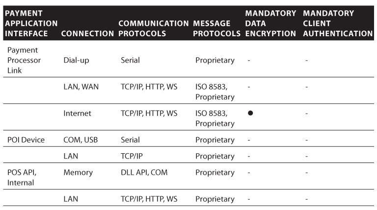

在表 2.3 中可以观察到 PA 通信的一些共同趋势：

* 大多数接口使用专有消息协议，这通常会导致缺乏安全性。
* 只有一种类型的连接（通过互联网）具有强制加密（`PCI DSS`/`PA-DSS` 要求）。

## 支付应用的部署

支付应用模块可以分布（`deployed`）在不同的物理位置。例如，在商店内的 `POS` 和 `BO` 机器上，甚至是运行在数据中心的远程服务器。部署模型决定了支付系统的漏洞程度。本节解释了各种设计方法如何影响整个系统的安全性。

### EPS 概念

EPS 代表电子支付系统（Electronic Payment System）。有时，该缩写的第三个字母被解释为“服务器”（Server）或“服务”（Service），这不会显著改变该术语的含义。EPS 的主要目的是将支付处理应用从销售点的其他功能中隔离出来。许多专家认为支付处理是一个独立的、自给自足的业务领域。同时，毫无疑问，支付是销售交易流程中不可或缺的一部分。

尽管 EPS 还没有明确的“学术”定义，且通用 `POS` 功能与支付处理之间的边界很模糊，但从安全的角度来看，这种分离具有明显的优势。创建 EPS 软件的供应商是支付技术（包括安全）方面的专家，而 `POS` 开发人员必须是许多领域（税务、库存等）的专家，因此他们无法完全专注于安全性。`POS` 和支付系统的逻辑上（通常也是物理上）分离允许“将 POS 移出范围”（安全审计员术语，意味着 `PCI` 等安全标准要求不适用于特定的应用程序或机器）。

将 `POS` 应用或机器“移出范围”为软件制造商和消费者节省了大量的开发和实施工作。然而，EPS 并不是万能药，还有许多其他因素（如部署模型和加密方案）影响整个系统的安全性。

### 支付交换机

每个 PA 组件的评分是根据第 1 章中定义的支付应用程序关键漏洞区域推导出的因素（`暴露区域`）计算的：

* 内存中的数据
* 静态数据
* 传输中的数据
* 应用程序代码和配置

内存中的数据以及应用程序代码及配置被视为单个暴露区域，而静态数据和传输中的数据则被分为几个子类（表 2.4）。

#### 表 2.4 漏洞评分因素

| 临时数据存储 | 静态数据 |
| --- | --- |
| 结算记录 | 静态数据 |
| 应用代码及配置 | 应用代码及配置 |
| 内部通信 | 传输中的数据 |
| 主机链接 | 传输中的数据 |

如果某个特定的暴露区域未被 `PCI DSS` 和 `PA-DSS` 要求覆盖，则将评分乘以 2，以适应由于缺乏监管带来的风险。

## 门店 EPS 部署模型

在门店 EPS 部署模型中，支付处理由位于商店服务器中心位置的 EPS 完成，如图 2.5 所示。EPS 与所有 POS 和 POI 设备保持直接通信。EPS 处理从卡片录入流到处理支付交易的所有环节，因此，POS 和 EPS 之间不传输敏感数据。

### 图 2.5 门店 EPS 部署模型

该模型的一些安全优缺点如下：

* **优点**——POS 终端不暴露于敏感数据，因为它不与 POI 设备通信。
* **优点**——POS 与商店服务器之间的通信不包含敏感数据，因此无需对此类流量进行加密。
* **缺点**——POI 设备与商店服务器之间的通信通过商店局域网（通常是 TCP/IP 数据包）实现，将敏感持卡人信息暴露在网络中。

门店 EPS 部署模型的漏洞评分计算输入数据和结果列在表 2.5 中。

### 表 2.5 门店 EPS 部署模型的漏洞评分

## POS EPS 部署模型

在 POS EPS 部署模型中，支付处理由位于每个 POS 终端的 EPS 完成，如图 2.6 所示。EPS 与所有 POS 和 POI 设备保持直接通信。EPS 处理从卡片录入流到处理支付交易的所有环节，因此，POS 和 EPS 之间不传输敏感数据。

### 图 2.6 POS EPS 部署模型

该模型的一些安全优缺点如下：

* **优点**——POS 终端不暴露于敏感数据，因为它不与 POI 设备通信。
* **优点**——POS 与商店服务器之间的通信不包含敏感数据，因此无需对此类流量进行加密。
* **缺点**——POI 设备与商店服务器之间的通信通过商店局域网（通常是 TCP/IP 数据包）实现，将敏感持卡人信息暴露在网络中。

POS EPS 部署模型的漏洞评分计算输入数据和结果列在表 2.6 中。

### 表 2.6 POS EPS 部署模型的漏洞评分

## 混合 EPS 部署模型

在混合 EPS 部署模型中，支付处理由位于商店服务器中心位置的 EPS 完成，如图 2.7 所示。EPS 与所有 POS 和 POI 设备保持直接通信。

### 图 2.7 混合 EPS 部署模型

混合 EPS 部署模型的漏洞评分计算输入数据和结果列在表 2.7 中。

## 移动支付

当今谈到电子支付时，无法不提到最有前景的行业趋势——移动支付。尽管在实体店中使用手机支付目前在美国尚未成为一种普遍趋势，但可能只需要几年，它就会变成一种常见行为。许多支付处理器、支付软件供应商、移动通信运营商、银行、支付品牌、初创公司甚至互联网搜索引擎都在争夺率先接受移动支付的权利，并成为这一快速发展的标准。一如既往，新技术带来了新的安全挑战。

1. 基于近场通信 (NFC) 的
2. 其他

这两种方法都存在与移动端和 Web 应用安全特定相关的问题。然而，基于 NFC 的支付应用在移动设备与商户 POS 通信的方式上存在额外的漏洞。让我们回顾零售店典型移动支付解决方案的架构和部署模型。

## 基于 NFC 的移动支付技术

这类移动支付解决方案的共同特征是利用了近场通信（NFC）技术，该技术允许在极短距离电子设备之间通过高频（13.56 MHz）无线通信交换信息。NFC 本质上是若干协议和标准的集合^[14]^[15]^[16，应用于不同的场景，包括感应卡、NFC 标签以及最近的移动支付。存在诸如 Google Wallet 等移动支付解决方案，它们利用了独特的 NFC 特性（表 2.8），例如短距离（小于几英寸）和极快的连接时间（<0.1s）。

**表 2.8 NFC 与其他非接触技术的对比**

Images/c02-tab-0006

在此类解决方案中^[17]^[18，配备 NFC 设备的手机会模拟一张非接触支付卡，该卡可以被支持 NFC 的 POI 终端读取（参见图 2.8）。

**图 2.8 基于 NFC 的支付解决方案的架构与部署**

支付卡认证数据（磁条卡磁条的内容）可以存储在移动设备上，也可以从云端下载。无论何种，敏感数据都应从移动设备传输到 POI 设备以启动支付，这为潜在攻击打开了大门并引发了安全疑虑^[19]^[20]^[21。这些安全疑虑将在第 8 章中讨论。

## 非 NFC 移动支付解决方案

还有许多并非基于 NFC 的“替代性”移动支付解决方案。此类应用与基于 NFC 的产品相比具有很强的竞争优势，因为它们不需要 NFC 设备。这种优势体现在：

* 许多流行手机（如 iPhone）并未配备 NFC 发射器。
* 只有少数商户部署了带有 NFC 读卡器的 POI 设备。

“非 NFC”移动支付应用的一个示例是星巴克的手机 App，它在手机屏幕上显示卡号以及条码。为了开始支付，需要手动输入卡号或由收银员扫描条码，从此时开始按照典型的卡片支付进行处理。

如果移动支付应用在设计时考虑了安全性，而不是将卡号存储在设备中显示在屏幕上，而是显示随机生成的一次性令牌（并编码到条码中），以建立客户移动设备与商户 POS 之间的链接（参见图 2.9）。实际认证数据（如 PAN 和有效期）在移动解决方案的数据中心与支付处理商的数据中心之间“云端”传输（如果支付处理商也是移动支付解决方案提供商，则在同一个数据中心内部传输）。

**图 2.9 无 NFC 移动支付的安全架构与部署**

在一个设计良好的“非 NFC”移动支付解决方案中，敏感认证数据永远不会接触移动设备和 POS 支付应用，与需要通过移动设备向 POS 传输实际卡片数据的非接触式/NFC 模型相比，这是一个巨大的安全优势。

## 总结

典型的支付应用由几个接口和处理模块组成：

* 接口
    * POI 设备
    * POS API
    * 支付处理商链接
* 处理模块
    * 路由器 (Router)
    * S&F (授权与结算)
    * TOR
    * 批处理 (Batch)

接口使用各种类型的连接性、通信技术和消息协议与外界通信。处理模块执行工作流并将敏感的持卡人数据存储在硬盘上。对于支付应用的接口协议（传输中数据）或处理模块（静态数据），尚未定义标准的安全性（加密）技术。

主要有三种支付应用部署模型：

1. 门店 EPS
2. POS EPS
3. 混合门店/POS

每个模型都有其自身的安全优缺点。然而，混合门店/POS 模型最为脆弱。

移动支付解决方案分为两大类：

1. 基于 NFC
2. 非 NFC

基于 NFC 的解决方案可能因为它们存储或传输敏感数据而更加脆弱。

## 注释

19. Charlie Miller, *不要离我太近：NFC 攻击面分析*, DefCon 20, (2012), [`media.blackhat.com/bh-us-12/Briefings/C_Miller/BH_US_12_Miller_NFC_attack_surface_Slides.pdf`](https://media.blackhat.com/bh-us-12/Briefings/C_Miller/BH_US_12_Miller_NFC_attack_surface_Slides.pdf)

20. Kristin Paget, *信用卡欺诈：非接触时代*, ShmooCon, (2012), [`www.shmoocon.org/2012/presentations/Paget_shmoocon2012-credit-cards.pdf`](http://www.shmoocon.org/2012/presentations/Paget_shmoocon2012-credit-cards.pdf)

21. Eddie Lee, *NFC 破解：最简单的方法*, (DefCon 20, 2012), [`blackwinghq.com/assets/labs/presentations/EddieLeeDefcon20.pdf`](http://blackwinghq.com/assets/labs/presentations/EddieLeeDefcon20.pdf)

# 第 3 章

## PCI

> 如果一种疾病被提出了许多治疗方法，这意味着这种疾病是不可治愈的。
>
> —安东·契诃夫

标准是一种有趣的现象，特别是在信息技术领域。一方面，标准制造了官僚主义，扼杀了创造力，并吓走了许多人才。另一方面，标准节省了资源，提供了可靠性，并允许完全不同的人和组织使用相同的语言进行相互交流。

在支付卡行业（PCI）中，这种现象更加奇特。这里有既定的安全标准，但缺乏底层的技术标准。简单来说，大多数针对支付应用的安全标准只告诉你需要保护什么，而没有解释如何去做。这并不意味着相关技术不存在，只是没有被充分地定义和标准化。

如今，每当讨论 PCI 时，人们首先想到的就是 PCI。这是因为 PCI 代表*支付卡行业*，人们认为它影响了标准。

### 什么是 PCI？

PCI 是一项伟大的发明。它帮助支付系统变得安全，但 PCI 的问题在于它们出现得太晚了。自 2004 年 PCI 数据安全标准（DSS）首次向世界推出以来，支付处理早已建立。

遗憾的是，目前没有关于 PCI 合规商家数量的统计数据，但我们假设这个数字从 2005 年起一直在增长。数据泄露事件在 2008-2009 年间有所下降，随后从 2010 年开始再次上升。这种“奇怪”的行为可以很容易解释：2008-2009 年的减少是越来越多的商家实施 PCI 要求的结果。然而，黑客相对快速地适应了新规则，导致保护仅在一个领域（静态数据）上得到了显著提高，而他们学会了利用支付应用中剩余未受保护的关键漏洞——内存、传输中数据以及应用程序代码和配置——以及 POI 设备的物理缺陷。这导致了 2010 年泄露事件的激增。自 2010 年以来，情况持续恶化，以至于今天我们仍处于几年前的境地，没有足够的障碍阻止坏人开展他们的工作。即使这些数字并不精确，我们从媒体中得知，尽管 PCI 已实施了八年，支付卡数据泄露事件仍在发生，而且数量更大。

### 图 3.1

图 3.1 显示了由 Privacy Rights Clearinghouse 官方记录的 2005–2012 年间美国零售/商家数据泄露事件的数量。

```
```

不要误会我——对 PCI 安全标准的批评并不是本书的目标。PCI 是一个必要的安全基准，是进一步改进的起点，特别是对于服务提供商和大型商户而言。我试图实现的是明确“PCI 合规”并不等同于“安全”，特别是当它应用于中小型商户部署的 POS 系统和支付应用时。没有什么比商户那里的虚假安全感更能助长攻击者了。

## PCI 标准

PCI 标准涵盖了电子支付生命周期中的几个不同方面。第一部分也是广为人知的部分是 PCI 数据安全标准（`PCI DSS`），它告诉商户（如零售商）和服务提供商（如支付处理程序和网关）如何保护敏感的持卡人信息。对于支付软件供应商来说，第二个也是最重要的部分是支付应用数据安全标准（`PA-DSS`），它告诉支付应用开发者应该如何设计其产品以符合 `PCI DSS`。第三部分是 `PTS`，它负责硬件设备，如 `POI` 和 `HSM`（硬件安全模块）以及它们的加密模块和固件。最后是新手——`P2PE`——它吸收了前三个部分的复杂性，并以额外的软件和硬件验证要求的形式增加了此前未知的新挑战。Table 3.1 显示了四种 PCI 标准的适用性。

**Table 3.1 PCI 标准的适用性**

由于对于特定 PCI 标准的适用性一直存在困惑和许多疑问，让我们从不同的角度来看 (Table 3.2) 这个问题：如果你是 \_\_\_\_\_，你应该遵守哪些标准？

**Table 3.2 PCI 标准的合规性**

| **如果你** … | **你应当遵守** … |
| --- | --- |
| 开发并销售支付应用 | `PA-DSS` |
| 购买并使用支付应用 | `PCI DSS` |
| 转售并安装支付应用 | \- |
| 为单一客户开发支付应用 | \- |
| 开发并使用支付应用 | `PCI DSS` |
| 作为服务提供支付应用 | `PA-DSS` 和/或 `PCI DSS` |
| 处理支付交易 | `PCI DSS` |
| 制造 `POI` 设备 | `PTS` |
| 开发并销售 `P2PE` 支付应用 | `P2PE` |
| 作为服务开发并提供 `P2PE` 解决方案 | `P2PE` |
| 攻击支付应用 | 你自己的道德标准 |

### PA-DSS vs. PCI DSS

`PCI DSS` 和 `PA-DSS` 之间的真正区别不在于对象、目标或主体，而是责任：谁来为信用卡安全缺失负责并缓解攻击向量？这种责任由商户和软件供应商共同承担，但没有任何合理的比例，主要负担放在了商户身上。Table 3.3 回顾了 `PCI DSS` 和 `PA-DSS` 定义的高级攻击向量和相应的缓解责任。

**Table 3.3 根据 PCI 执行安全控制的责任**

| **漏洞领域** | **涵盖范围** | **负责缓解方** |
| --- | --- | --- |
| 支付应用内存 | `PCI DSS` | 商户 |
| 本地网络通信 | `PCI DSS` | 商户 |
| 公共网络通信 | `PA-DSS`, `PCI DSS` | PA 供应商，商户 |
| `PA` 与 `POI` 之间的通信 | `PCI DSS` | 商户 |
| 连接到支付处理程序（若非通过公共网络） | `PCI DSS` | 商户 |
| 应用代码 | `PCI DSS`, `PA-DSS` | 商户 |
| 应用配置 | `PCI DSS` | 商户 |
| `POI` 设备（物理） | `PCI DSS` | 商户 |
| 加密密钥管理 | `PCI DSS`, `PA-DSS` | 商户 |
| 敏感数据存储 | `PA-DSS`, `PCI DSS` | PA 供应商，商户 |
| 卡片数据泄露的总体责任 | `PCI DSS` | 商户 |

正如你在 Table 3.3 中所示，即使是对内存或应用代码等与软件相关的区域保护也属于用户（商户）的责任。`PA-DSS` 并不要求应用开发者加密内存中的敏感数据或混淆编译代码。商户必须通过实施各种替代方案（如防火墙和文件完整性监控）来保护支付应用。

## PA-DSS

支付应用数据安全标准（`PA-DSS`）为向多个客户销售产品的 POS 软件供应商创建验证计划。它为买家提供了保证，确保新购买的产品不会违反 `PCI DSS` 规则。`PA-DSS` 是 PCI 系列标准中唯一直接负责支付应用安全的标准。

### 验证过程


简而言之，验证过程包括遍历测试列表（`PA-DSS` 中有 168 项）并在正确的列中打“勾”：“已实施”或“未实施”。一旦 PA 供应商从 PCI SSC 网站发布的列表²中选择了合格的安全评估员（QSA）并签署了保密和工作声明协议（当然还要付费），评估就开始了。

验证过程并不复杂，通常由以下步骤组成：

## 1. 初始会议（现场或电话会议）
`PA` 开发人员与 `PA-QSA` 审查项目范围、时间线以及高层应用设计，并讨论实验室和文档需求。

## 2. 现场评估
包括两个步骤：

### a. 在供应商实验室中测试实际应用程序
审计员 `PA-QSA` 受开发人员的指导，因为这是他/她第一次（可能也是最后一次）看到该系统。渗透测试通过运行所有可能的交易和卡片进行，以确保没有敏感数据被写入硬盘。他们可能会进行一些网络嗅探，以确保没有以明文发送凭据。这不需要任何花哨的工具或技术，也没有人尝试破解系统，因为 `QSA` 并不是专业的渗透测试员。在大多数情况下，如果应用程序没有以明文存储（或假装为不存储）敏感数据，它就能通过测试。

### b. 人员面试
这是一项形式化的工作。审计员必须问几个问题，并在报告中记录开发人员和 QA 团队的名字。

## 3. 审查已实施的流程、文档和证据
这一步主要是书面工作。最痛苦的部分（特别是对于初次尝试的人来说）是创建 `PCI Implementation Guide`——这是每个 `PA` 供应商必须向客户（支付软件的用户）提供的文档。该文档的内容大部分是技术免责声明，提醒商户接受信用卡是一项危险的业务，修复支付卡片处理的安全设计缺陷是商户的责任。

## 4. 创建验证报告 (ROV)
此文档由 `PA-QSA` 准备并发送给 `PCI 委员会` 接受。这一步可能需要花费时间，因为 `委员会` 可能会拒绝报告中的任何声明并将其退回给 `QSA`。然后 `QSA` 将以更安全的方式重写所有被拒绝的部分并重新提交文档。一旦 `ROV` 被 `委员会` 接受（批准），发票将发给供应商，经过验证的应用程序将被列入（只要支付了账单）。

***

注意，重新验证不需要 `ROV`（对不含重大更改的小版本发布进行自验证）。在这种情况下，流程更加简单：验证证明 (`AOV`) 函由供应商创建（不通过 `QSA`）并随款直接发送给 `委员会`，这将自动更新列表。

***

## 已验证的支付应用程序列表

`PCI 委员会` 在其网站上维护“已验证的支付应用程序列表”。在购买新的支付软件或安装新版本之前，商户应检查网站以确保产品已通过验证并符合新部署条件。支付应用程序的每个新版本都需要重新验证，或者至少每年一次。显然，没有任何软件供应商能负担得起重新验证每一个补丁版本的费用，这样做是不可行的（验证过程消耗人力资源）且在经济上是不划算的（每次重新验证和列入都需要费用）。因此，由于该列表不太反映真实情况（商店运行的软件确切版本），它具有象征意义，但对商户来说仍然是一项重要的工具。

## 13 项要求与 POS 安全

`表 3.4` 审查了 `PA-DSS` 的 `13` 项要求如何帮助开发人员保护支付应用程序的主要漏洞区域。请注意，此审查并非对整个标准的通用评估，而是特别适用于主要部署在实体业务地点（如零售店或加油站）的 `POS` 和支付应用程序。

**表 3.4** `PA-DSS` 要求与支付应用程序关键漏洞区域

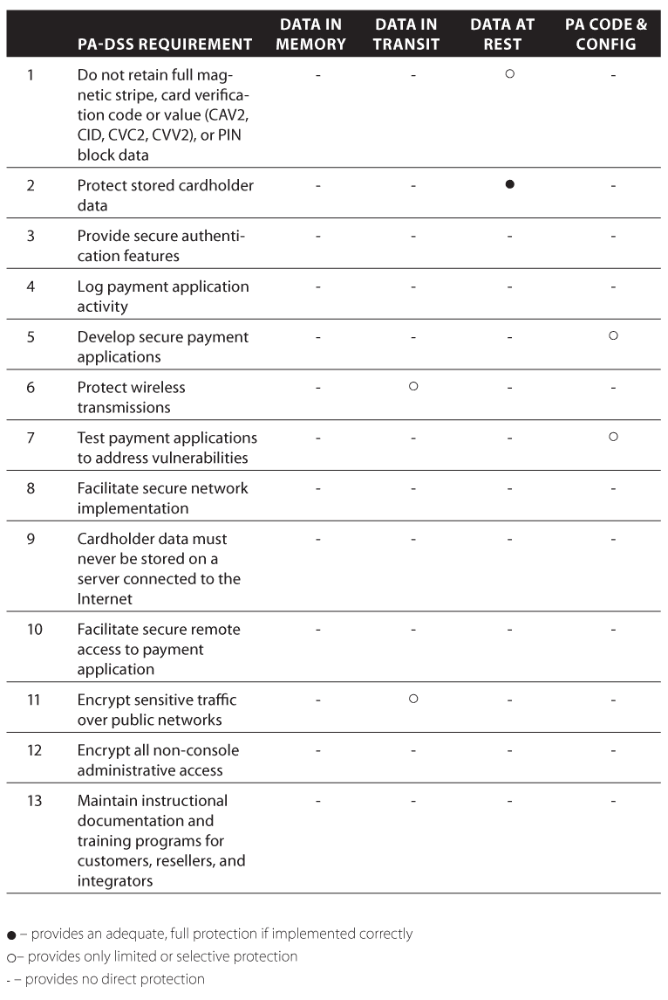

如你在 `表 3.4` 所示，这 `13` 项要求即使被狂热地遵守，可能无法防止持卡人数据以某种方式被盗取。`PA-DSS` 提供的唯一完整覆盖是针对静态数据的，因为从历史上看，这是盗取磁条最早且最容易的数据。在大多数情况下，如果应用程序没有以明文存储（或假装为不存储）敏感数据，它就能通过测试。

现在让我们再次详细查看这 `13` 项要求，看看为什么它们大多是无能为力的。

### 要求 1：不要保留数据

这里最重要的子要求是 `1.1`：`不要存储身份验证数据`。这里的关键词是 `授权后`。这意味着任何敏感数据（如 `CAV`、`CID`、`CVC2`、`CVV`）都允许在处理器之前存储。如果由于任何原因无法访问处理器（例如网络中断），此类交易将留在那里几秒钟、几小时，甚至几天，直到连接恢复。如果网络长时间中断，本地 `POS` 数据库最终可能包含数千条记录。

所以这项要求到底保护了什么？如果信息被妥善加密，无论存储多少条记录，都没有人解密它们。相反，如果信息没有得到可靠保护，没有什么能阻止那些想要偷取临时记录的人，随着 `POS` 处理越来越多的交易，他们会一个接一个地将记录提取出来。

### 要求 2：保护存储的持卡人数据

必须承认，这项要求是 `PCI` 最重大的成就。如果实施正确（使用基于硬件的强加密和密钥管理），它提供了一种真实的数据保护机制。然而，这里有两个问题。首先，它很少被正确实施（而且这不一定是开发人员的错）。其次，数据存储只是几个漏洞区域中的目标之一。即使数据存储被完全密封，其他应用程序表面（内存、传输中的数据以及应用程序代码和配置）仍然欢迎外来者。

### 要求 3：提供安全的身份验证功能

如果应用于 `POS`，这项要求就脱离了现实。通常，支付应用程序不允许在 `POS` 机器上访问任何持卡人数据，通常甚至在门店级别也不。收银员完全不需要查看磁道数据或 `PAN`。这项要求可能适用于服务器系统，但对于 `POS` 则不然。因此，任何强制 `POS` 身份验证管理的努力都是无能为力的。

### 要求 4：记录支付应用程序活动

实施这项要求并不能保护任何东西。日志属于*响应性安全控制*，旨在帮助计算机取证调查人员追踪攻击源头。通常这发生在第一条记录通过数据泄露被泄露几个月之后。

### 要求 5：开发安全的支付应用程序

此要求包含了一些关于安全编码良好实践的建议，旨在帮助保护应用程序代码，例如子项 5.2：

> `基于安全编码指南开发所有支付应用程序（包括内部和外部，以及包括对产品的 Web 管理访问）。在软件开发过程中，涵盖对常见编码漏洞的防范措施`。⁶

遗憾的是，这些建议存在一个小问题：对于运行在实体店的 POS 系统而言，这些建议几乎毫无用处，因为黑客利用`其他应用程序和操作系统的漏洞`来侵入。事实上，如果你只需要嗅探本地网络连接或扫描 POS 机内存，那么利用支付应用程序的缓冲区溢出漏洞来窃取卡数据的意义何在？然而，毫无疑问，关于某些漏洞（如 `SQL injection`）的指南对电子商务开发者是有帮助的。关于安全编码指南的更多细节可以参阅第 9 章。

### 要求 6：保护无线传输

这项要求非常令人困惑。它向支付应用程序开发者传达了错误的信息。他们并不是处理**任何类型**的通信，而是要么依赖终端用户，指示他们启用内置的无线加密（这可能是由不该处理密码学的人实现的，因此可能很弱），要么简单地声明由于他们的产品不需要无线功能，该要求不适用。

### 要求 7：测试支付应用程序以解决漏洞

无疑，这项要求提倡的风险评估和完整性保护是安全开发过程的必要属性。然而，它们并不能直接防御任何特定威胁。正如在要求 5 中解释的那样，支付应用程序代码本身的漏洞很少被利用来获取敏感数据。黑客利用的是整个支付系统的脆弱性设计。导致安全泄露的不是支付应用程序代码中的缓冲区溢出，而是 POS 机内存和商店局域网中的明文 Track 2 数据（这两者都是 PCI 标准允许的！）。

### 要求 8：促进安全网络实现

这是最短且最搞笑的一条：“支付应用程序不能干扰防病毒保护、防火墙配置或任何满足 PCI DSS 合规性所需的设备、应用程序或配置。”程序员们——有人知道如何编写一个会干扰杀毒软件的应用程序吗？哦，顺便说一下，忘了用所有已知品牌的杀毒软件和防火墙测试你的应用程序！也许作者对某些免费杀毒软件有过非常糟糕的经历。

### 要求 9：持卡人数据绝不能存储在连接到的服务器上

我同意！但是，`支付应用程序在内部网络存储持卡人数据`（要求 9.1.a）这一事实能防止这些数据被盗取吗？遗憾的是，不能。

### 要求 10：促进对支付应用程序的安全远程访问

这项要求基本上承认了支付系统的安全性取决于其边界的安全性以及操作人员的诚实。通过这种方法，一旦边界被攻破（或从内部渗透！），数据就丢了！请注意，要求 10.1 中推广的`two-factor authentication`不同于`dual control`（双重控制）或`split knowledge`（分解）。双因素认证是一个很棒的功能，但它是用于不同类型的访问。

### 要求 11：加密敏感流量

这项要求提出了另外三个问题：

1. 公网和私有网络之间的差异有多大？
2. 私有网络从什么时候开始被认为是安全的？
3. 如果支付应用程序根据 PCI 要求具备能力，那么在**所有**网络上这样做难道不是更好吗？

以下测试程序殊为警醒：

> `11.1.b 如果支付应用程序允许通过公网传输数据，请检查供应商准备的 PA-DSS 实现指南，并验证供应商是否包含了强效加密算法和安全协议`。⁷

这真的是意味着支付应用程序开发者将`strong cryptography and security protocols`的实现委托给了客户和集成商吗？

### 要求 12：加密所有非控制台管理访问

这项要求简洁且自言自明：“指示客户使用强加密算法加密所有非控制台访问。”这似乎是试图将设计安全系统的责任从软件供应商转移给终端用户。该标准并不是要求开发安全处理技术以便商户能够运行其计算机和网络而无持续的泄露风险，而是要求商户员工学习 `SSH`、`VPN` 或 `SSL/TLS` 等安全协议。

### 要求 13：为客户、经销商和集成商维护说明性文档和培训计划

文档在纸面上是最强大的应用程序安全机制。

## PA-DSS 与商户

商户（实际上是他们的 IT 和安全专家及经理）必须理解 PA-DSS，因为他们应该能够识别支付应用程序的漏洞。他们应该准备好就 PCI 之外的应用程序安全控制向开发者提出正确的问题。商户必须学习 PA-DSS 的弱点，以确保他们的应用程序具有足够的保护机制来补偿环境安全性的不足（反之亦然——他们拥有足够强大的访问、网络和物理控制来补偿支付应用程序的漏洞）。这类例子多的是。

例如，PCI DSS 允许支付应用程序在局域网上不加密地发送敏感数据，这是一个巨大的泄露区域。在这种情况下，商户应该验证其支付应用程序是否符合标准（即是否在局域网上以明文发送敏感持卡人数据）。如果是，则应该通过不同的方法保护网络，例如使用 `IPSec` 的加密隧道（详情请参阅第 8 章）。这种多重“误解”可能会导致 PA 供应商和商户都不保护数据的情况。

## PCI DSS

与 PA-DSS 获得合规状态的过程被称为*validation*（验证）不同，类似的 PCI DSS 过程被称为*assessment*（评估）。也许是因为它们的目标不同：PA-DSS 针对单一支付应用程序，而 PCI DSS 针对整个支付处理环境。

尽管技术上 PCI DSS 评估过程与 PA-DSS 验证相同——在测试程序列表的右侧填入“V”并创建报告——但它们之间存在显著差异：

**PCI DSS 评估范围太广了**（即使在物理上也是如此——它可能包括多个地点，如零售店、办公室和数据中心），这消耗了审计员和商户的大量资源，导致他们无法专注于任何特定主题或进行任何彻底的测试。PCI DSS 中有 310 项测试程序，几乎是 PA-DSS 168 项测试的两倍，因此周期更长，且需要更多证据（即：文书工作）。事实上，即使假设处理每项测试程序只需要 30 分钟（在实践中可能更长，因为包括解释需求、访谈员工、审查证据、测试环境和编写报告），评估也需要近一个月的全职工作日！对于大型多店连锁来说，情况可能更糟，因为工作量会随着商店和/或数据中心的数量而倍增，因为某些证据需要来自多个实例的样本。等到审计结束、报告写完并接受时，评估起点的实际情况可能已经发生了变化，因为受对象不是特定版本的软件或硬件，而是一个不断变化的环境。

**PCI DSS 是一个双重标准**。评估的形式和规模取决于商户或服务提供商的大小，差异很大。商户根据每年处理的信用卡交易量分为若干级别。每个支付品牌对这些级别都有自己的定义和要求，因此不同品牌的规则应该相关联，以获得清晰的认证路径。根据级别，商户可能需要聘佣 QSA（安全审计师）或完成自评估问卷（SAQ）。大型超市连锁店肯定通过第三方审计通过最困难的路径，而较小的商户只需自己完成文书工作。即使不看细节，也很清楚，同一个 POS 系统可能具有不同的安全级别，因为许多部署从未经过第三方审计的测试。

**PCI 委员会并不维护 PCI DSS 认证组织列表**，就像 PA-DSS 那样。支付网关和处理器等服务提供者的合规状态可以在 Visa 网站的服务提供商注册表 中验证。然而，消费者并没有关于商户的此类信息。当你在商店刷卡时，无法知道你的敏感账户数据在形式上是否安全。根据 Visa 的统计，美国有每年处理超过 20,000 笔交易的商户仍不符合 PCI 合规要求（978118810071c03.xhtml#c03-note-009）。处理少于 20,000 笔交易的小型商店则没有统计数据。

## 12 项要求与支付应用安全

让我们查看 PCI 保护措施列表，并尝试理解为什么尽管商户拥有近十年的 PCI 合规经验，黑客仍然能够窃取信用卡数据。

**表 3.5** PCI DSS 要求与支付应用关键漏洞区域

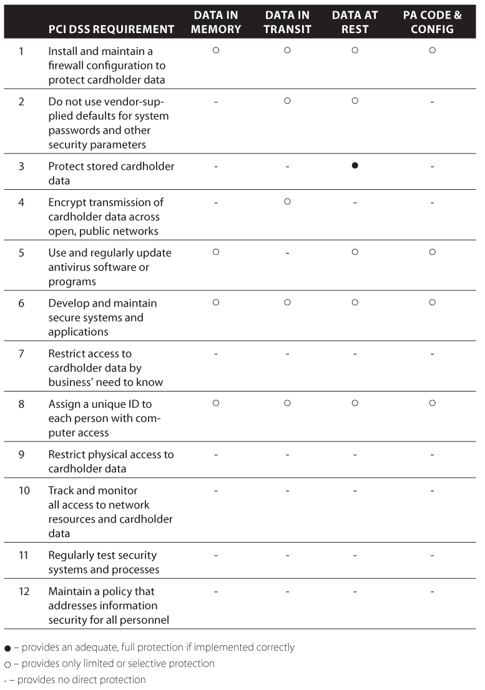

你可能注意到，在实践中只有大约 50% 的要求能有效抑制黑客攻击。事实上，只有一项要求（#3：保护存储的持卡人数据）包含了一个具体的措施，而该措施（很大程度上取决于解释和实施）仅涵盖一个漏洞区域。让我们审查支付品牌为商户创建的 12 项 PCI DSS 要求，以便他们能够修复支付软件泄漏的漏洞。

### 要求 1：安装并维护防火墙配置以保护持卡人数据

该要求背后的思想是在支付发生区域（明文敏感持卡人数据）与世界其他部分（网络术语中，黑客居住的地方）之间建立屏障。这是一个非常棒的主意，可能基于数据中心的无菌条件。在良好的数据中心，所有服务器都经过了物理保护，对它们的逻辑访问非常有限（例如，通常没有人在域控制器上上网）。网络是允许访问此空间的唯一桥梁。在这样近乎理想的环境中，正确设置的防火墙可能会创建一个与外界隔离的良好安全区域。合格的网络工程师将确保防火墙配置正确，以过滤掉任何传入的数据和输出的敏感信息。

现在，想象一家普通的零售店。POS 计算机和 POI 设备位于柜台上，所有的网络和串行连接在物理和逻辑上都是暴露的。任何人都可以物理触碰或逻辑访问网络的开放侧和“受保护”侧。在这样一个危险的环境中，外部区域和内部区域究竟在哪里？有人只需将 U 盘插入托管的 POS 计算机，或者在商店后台服务器上检查电子邮件并点击附件，恶意软件就会安装在支付系统的心脏！

另一个问题是：在每家商店是否有合格的人员来正确设置防火墙——不仅仅是一个，而是成千上万个？

### 要求 2：不要使用供应商提供的系统密码和其他安全参数默认值

从通用安全的角度来看，这是一个正确的要求，但将其作为一个单独的规则列出听起来不是太基础了吗？它难道不应该是那些负责实施其他复杂要求的人员（例如防火墙配置（要求 1），或杀毒软件和软件补丁的安装与配置（要求 5 和 6））的教育的一部分吗？对于那些将“跟踪和监控对网络资源的所有访问”并“定期测试安全系统和过程”（要求 10 和 11）的店内安全专家来说，这难道不是一个显而易见的规则吗？

### 要求 3：保护存储的持卡人数据

从 PCI 时代开始，这项要求一直是关注重点。这是因为针对支付系统的最初攻击向量非常简单：渗透环境并获取始终以明文存储的敏感卡数据。因此，引入了要求 #3 以停止这种趋势。该目标已经实现，尽管只是部分：

*   第一，许多商户仍不符合 PCI 标准。
*   其次，即使是那些合规的也可能存在明文数据，例如日志文件中的错误消息。
*   最后，支付应用通常使用弱的加密算法或错误的密钥管理。

该安全措施的另一个问题是它只保护了 4 个漏洞区域中的一个（见表 3.5](978118810071c03.xhtml#c03-tbl-0005))

### 要求 4：跨公共网络加密持卡人数据传输

尽管这项措施是少数涵盖了实际应用安全控制的措施之一，但其范围太狭窄了。在当今网络容易从外部和内部被渗透的现实情况下，每个人（而不只是安全专家）都清楚，通过无线网络或互联网发送消息时必须加密。事实确实如此，10 年前这对许多人来说并不是显而易见的，正如现在并不是所有人都认为通过线路传输时*所有*内容都必须加密的加密一样，无论传输的是互联网、局域网，还是刷卡机与 POS 机之间的串行线。

Heartland Payment Systems 作为最大的支付处理器之一，在 2008 年遭遇了数据泄露：

> *泄露源：安装在公司支付处理网络上的一段恶意软件，该软件在公司成千上万零售客户将支付卡数据发送到 Heartland 处理时，`记录了发送中的支付卡数据`*。¹⁰

### 要求 5：使用并定期更新杀毒软件或程序

这项要求中存在一些不合理之处。它听起来既像是在呼救，又像是在推卸。“我们无法提供任何保护您客户数据的方法。请找别人来尝试做点什么吧！”

在 POS 机上安装杀毒软件并没有任何错。事实上，如今每台 PC 都在运行杀毒软件作为一种安全预防措施。然而，依赖杀毒软件作为防止支付卡数据欺诈的保护措施是错误的。普通的持卡人可能会问：我的私有信息的安全性是否取决于杀毒软件供应商？杀毒软件供应商是否意识到他们有保护敏感持卡人数据的责任？他们是否熟悉 POS 和支付系统的架构、漏洞和威胁？

> *在中国黑客对《纽约时报》进行为期四月的网络攻击期间，该公司的杀毒软件漏检了攻击者在网络上安装的 45 个恶意软件中的 44 个*。¹¹

用于窃取信用卡数据的恶意软件通常是零日软件，它是为特定任务定制的，通常针对特定的支付应用程序进行定制，并伪装成该应用程序或操作系统的一部分。它与那些旨在感染尽可能多计算机的通用病毒或蠕虫不同。只有当此类恶意软件变成非常常见的“现成”产品时，杀毒程序才能发挥作用。


使用杀毒软件的另一个问题是，它需要持续更新（下载）病毒特征数据库才能保持高效。此类更新可以由企业 IT 部门创建的集中系统提供，也可以直接从互联网下载。大型零售商可能能够创建自己的更新系统。然而，大多数商户仍使用直接下载，这需要保持持续的互联网连接。是的，防火墙可以配置为仅允许特定的协议、端口号和服务器，但你不能指望普通用户能正确做到。

#### 要求 6：开发和维护安全的系统和应用程序

这是一个合理的要求，可以防止许多攻击。它对于配备了如 `Windows` 或 `Google Chrome` 等自动、用户不可见的更新机制的软件非常有效。遗憾的是，许多软件供应商（包括开发支付应用程序的供应商）仍没有此类自动化系统，因此他们的支付应用程序仍然处于脆弱状态。

## 要求 7：根据业务实际需要限制对持卡人数据的访问

这听起来显而易见并能提供一些保护，但它并没有消除威胁。问题在于，即使环境完全符合 PCI 标准，敏感数据仍然以某种形式存在，而且总有人拥有访问权限——系统管理员、技术人员和人员。

## 要求 8：为每个具有计算机访问权限的人分配唯一 ID

唯一身份识别并不是一种能防止特定威胁的安全机制；相反，这是一种取证工具，有助于数据泄露的事后调查。一些安全专家可能会说这属于威慑性安全控制.¹² 然而，很难想象追溯性会吓走黑客。

尽管如此，要求 8 包含了两个重要的子要求：

*   **8.3** 对员工、管理员和第三方远程访问（来自网络外部的网络访问）网络引入双因素身份验证。
*   **8.4** 使用强加密技术使所有系统组件在传输和存储期间密码呈不可读状态.¹³

这些措施如果实施得当是正确且部分有效的，尽管它们涵盖的潜在威胁领域有限，并且无法为支付应用程序漏洞提供全面保护。

## 要求 9：限制对持卡人数据的物理访问

对于在数据中心存储和处理数据的服务供应商（如银行、支付处理器和网关）来说，这是一个正确的要求。对于他们来说，实施这一要求很容易，因为良好的数据中心大多已经配备了必要的物理安全控制。

然而，对于商户及其在商店运行的支付应用程序来说，这项要求是无效的。零售店环境完全暴露给陌生人，软件开发人员必须理解他们不能完全依赖任何物理安全控制。

## 要求 10：跟踪并监控对网络资源和持卡人数据的访问

总体来说，这项要求与上一个要求存在相同的问题。对于支付处理器的数据中心和大型零售商的总部是合理的，但它不符合零售店的现场状况，因此对支付应用程序安全无法做出太大贡献。

此要求侧重于总日志，其目的是提供两个主要功能：追踪和监控。第一部分与支付应用和数据保护无关，因为它仅提供“事后”服务（与要求 8 类似），这些服务仅在事后对数据泄露进行调查时才有帮助。第二部分在理论上可能有助于识别入侵，但它仍然无法阻止入侵。

此外，这些监控活动在零售店环境中是不可行的，特别是当小商户没有专门的 IT 人员能够“至少每天审查所有系统组件的日志”（要求 10.6）时。

## 要求 11：定期测试安全系统和流程

这是另一个在理论上良好但在实践中无效的安全控制实例。以要求 11.3 为例：

> `至少每年执行一次外部和内部渗透测试，并在任何重大的基础设施或应用程序升级或修改后（例如操作系统的升级、向环境中添加子网络或向环境中添加 Web 服务器）进行测试`。

由真正的专家执行良好的渗透测试并不廉价。成千上万的商店在任何变更后都进行真正彻底的渗透测试的机会微乎其微。现在，想象一下这种情况：在 1 月 1 日 完成了成功的渗透测试。1 月 2 日，防火墙配置发生了变化，导致带有 POS 机的支付网络网段对外部开放。在明年 1 月 1 日的下一次渗透测试期间，该漏洞将被发现、报告，并可能在 1 月 2 日被修复。黑客将有一整年的窗口来扫描网络、寻找漏洞、渗透环境并植入恶意软件。

另一个例子是要求 11.5：

> `部署文件完整性监控工具，向人员就关键系统文件、配置文件或内容文件被未经授权修改发出警告；并配置软件至少每周执行一次关键文件比较`。

首先，小商户由于缺乏内部专业知识无法实施这一点。大型和小型商户都可以购买并安装良好的文件完整性监控工具。然而，决定是否能够检测到入侵的并不是系统中的工具是否存在，而是其正确的配置和使用。许多用户会部分禁用检测功能（例如，为了允许支付应用供应商进行静默自动更新），或者忽略通知消息（如果系统没有立即阻塞新文件，而是仅仅创建并发送警告）。

## 要求 12：维护适用于所有人员的信息安全政策

这是 12 项要求中最令人兴奋的一项。遗憾的是，从应用安全的角度来看，这可能是效果最低的一项。事实上，很难想象一叠纸如何保护例如，从密码键盘设备到 POS 机明文传输的 Track 2 数据，或者在手动交易后留存在支付应用进程易失性内存中的未加密 PAN 和 CVV2。说真的，你认识任何人（至少在零售和支付行业内）会去读他们的安全政策吗——当然，除了那些编写政策的可怜虫、安全审计员（每年一次）和律师（在发生安全泄露后）？

然而，这并不意味着要求 12 在适用于正确的组织时总体上是错误的。事实上，某些子要求如 12.1.2，

> `建立、发布、维护和传播安全政策，其……包含一个识别威胁和漏洞的年度流程，并产生正式的风险评估`。

作为通用的安全最佳实践非常有用（再次，与许多之前的要求相同：仅适用于大型组织）。问题在于，持卡人不能依靠转瞬即逝的政策和程序作为强大的安全控制，因为它本应能够防止其隐私信息的泄露。没有人能保证这些政策和程序在现实中得到了执行，即使它们实际上执行了，也没有人知道频率如何以及真实效率如何。

程序员说文档不会失效，失效的是代码。我会这样重新表述：政策不会泄露，应用程序会泄露。

### PCI DSS 与小商户

正如你可能在之前回顾 12 项要求时所注意到的，在很多情况下，特定要求的有效性与商户规模有关。某些安全措施（如防火墙配置）对于拥有 IT 和安全资源的大零售商是有效的，但对于完全依赖支付硬件、应用供应商和支付处理商的小商户来说几乎毫无用处。

此外，大多数商户（通常是年交易量少于 600 万的）甚至不通过第三方评估，而是填写自评问卷（SAQ），这对许多控制措施的质量甚至执行事实都是质疑。让我们再次过一遍这些要求（参见表 3.6），看看它们根据商户规模提供什么程度的保护。

**表 3.6** 根据商户规模的 PCI DSS 要求效率

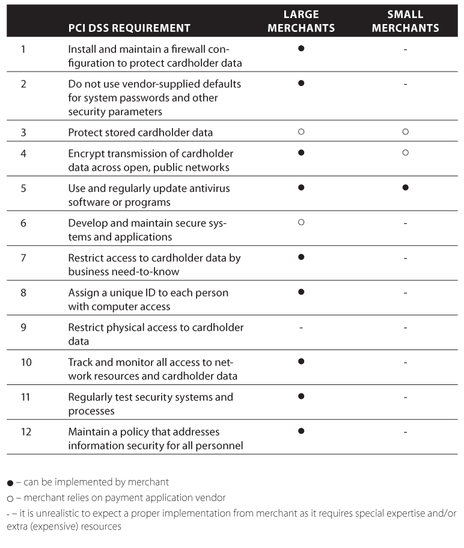

从表 3.6 的数据可以看出，小商户无法通过 PCI DSS 受到数据泄露的充分保护，因为他们无法有效实施标准所要求的大多数控制措施。

### PCI DSS 与 PA 开发人员

与隐含处理应用程序的 PA-DSS 不同，PCI DSS 关注的是整个运营环境，而不是特定的软件产品。可以说 PA-DSS 是更广泛的 PCI DSS 的子集。这意味着支付应用程序开发者可以忽略 PCI DSS 吗？可能不能。PA-DSS 的创建是为了支持支付软件中更复杂的 PCI DSS 要求。PA 开发人员必须通过学习 PCI DSS 来理解 PA 运行环境的潜在危险。他们应该意识到 PA 并不是在真空中运行，而是在定义上就不安全的零售环境中运行。

并不是所有支付应用程序都能通过 PA-DSS 验证。有规则定义了评估的适用范围。以下支付应用程序不具备 PA-DSS 审计资格，但其开发者仍应遵循 PCI DSS 或 PA-DSS 要求：

*   商户内部开发的支付应用程序。
*   软件供应商为单个客户开发的支付应用程序。
*   安装后不需要太多定制的“现货”型支付应用程序（这很少见，所以是一个奇怪的例外）。

“例外”背后的想法是，此类应用程序无论如何其所有者都将通过 PCI DSS 审计。在这种情况下，应用程序应该是“准备 PA-DSS 标准的”，这意味着它没有正式通过 PA-DSS 审计，但符合 PA-DSS 的要求。根据相应的 PCI DSS 标准要求，应由 PCI DSS 审计员而非 PA-DSS 审计员进行评估。因此，负责此类应用程序安全设计和开发的人应该熟悉 PA-DSS 或 PCI DSS 或两者。

## 比较 PA-DSS 和 PCI DSS 要求

PCI DSS 规模庞大，包含 12 项要求和 211 项子要求，总计包含 310 个测试程序。虽然 PA-DSS 有更多高层要求（13 项），但其子要求（90 项）和测试程序（168 项）的数量明显少于 PCI DSS。审查并评论每一个子要求和测试程序将是另一整本书的主题。因此，我们的目标可以通过过滤来缩小范围，专注于任何与支付应用程序直接相关的内容。如果你仔细观察 12 项 PCI DSS 要求，会立即发现其中某些项与 PA-DSS 要求重叠（反之亦然）。

Table 3.7 比较了这两个标准，并显示重叠的要求更有意义，因此，将它们与几个从应用程序安全角度来看通常无用的独立要求区分开可能有所帮助。

Table 3.7 比较 PA-DSS 和 PCI DSS 要求

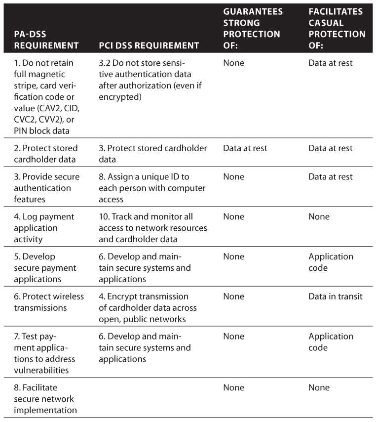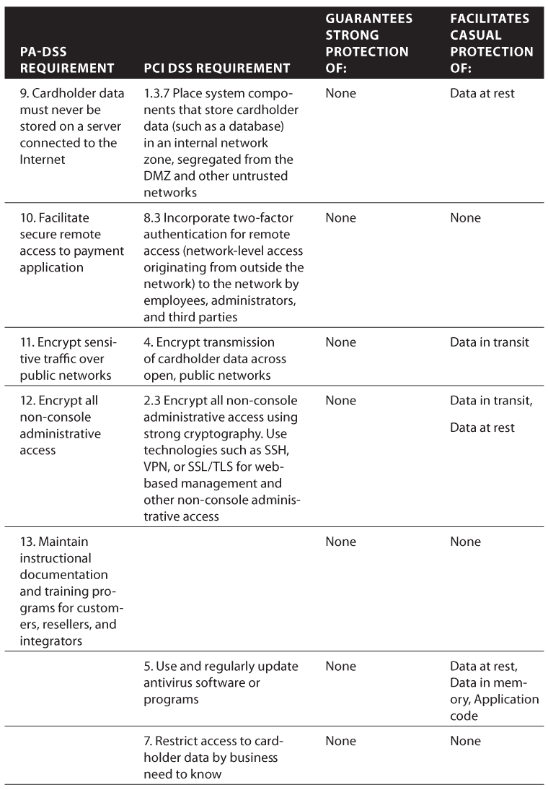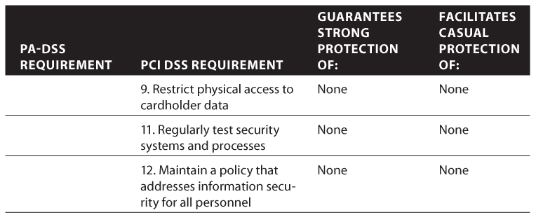

## PTS

PIN 安全（PTS）对于支付应用程序供应商来说并不重要，除非他们的应用程序运行在密码键盘（pinpad）设备上。在集成 POS 解决方案中，PIN 输入设备（PED）或 POI 设备是 PTS 评估的主要对象，它们使用著名的 Triple DES 加密和 DUKPT 密钥管理机制来处理借记 PIN 安全。如果支付终端对卡数据保护也使用相同的方案，将消除大多数支付应用程序的安全问题。

然而，在 PIN 卡几乎被普遍接受的时代之前，POS 机并未配备 PED 或集成 POI 设备。用于刷取信用卡的普通 MSR 设备不具备允许其实现 DUKPT 的加密能力（现在其中某些设备已经具备了）。因此，遗憾的是，PTS 未对敏感的支付数据提供直接保护，尽管存在一个例外：当经过 PTS 验证的设备是 P2PE 解决方案的一部分时。PA 开发人员在 P2PE 标准出现后才开始听说 PTS，某些 PA 供应商成为了 P2PE 解决方案提供商，这需要各种软件硬件组件以及标准之间进行松散集成。关于 P2PE 标准要求的更多信息可以在下一节找到。

最近，HSM 制造商也开始使用为 HSM 创建的特殊 PTS 版本来验证其产品。¹⁸经过 PTS 验证的密码键盘、HSM 和其他设备列表发布在 PCI SSC 网站上。¹⁹

## P2PE

PCI SSC 对 P2PE 标准提供了一个模糊的定义：

> *为 P2PE 解决方案的应用程序供应商和提供者的详细安全要求和测试程序，以确保他们的解决方案能够满足支付卡数据保护的必要要求*²⁰

然而，P2PE 是对现有 PCI 标准的巨大跨越，现有标准试图通过在物理、逻辑和组织上分离的、保护薄弱的合规区块来构建安全支付系统，而这些区块之间互不信任并试图互相指责：商户、POS 和 PA 软件供应商、硬件制造商和支付处理商。PCI P2PE 是首次尝试创建一个真正安全的单系统的严肃尝试，该系统从密码键盘设备到 POS，再到支付网关或处理中心（从商户商店环境的角度来看是无不可摧的）的数据中心。此外，P2PE 系统的安全性被设计为完全依赖于硬件保护的强加密，而不是由软件供应商提供、并由 PCI DSS 和 PA-DSS 支持的那些奇特的临时控制以及裸露、自制的基于软件的加密。

在我们审查 P2PE 之前，重要的是存在不同类型的点对加密：*硬件*、*软件*和*混合*（有关每个版本的实现的更多详细信息，可以在第 8 章的“点对加密”章节找到）。目前的标准版本仅涵盖硬件²¹ 和 硬件/混合²² P2PE 解决方案。软件 P2PE 要求计划在未来实现，但尚未提供具体日期。只有硬件 P2PE 具有为卡数据提供最大保护的实际能力。在商店层面进行的任何软件加密实现都会以某种方式存在漏洞。

即使与相当沉重的 PCI DSS 相比，P2PE 标准也非常庞大：6 个领域包含 491 项要求和总计 648 个测试程序。好消息是并非所有领域都适用于所有解决方案。P2PE 涵盖整个支付周期这一事实也决定了标准的结构，它由六个领域组成：

### 领域 1：加密设备管理

关于 POI 设备的安全性。为了作为 P2PE 解决方案的一部分，设备必须经过 PCI PTS 验证²³，SRED（数据的安全读取和交换）列为“已提供的功能”。

### 领域 2：应用程序安全

对于不接触明文敏感数据的支付应用程序不适用。仅适用于 POI 设备的固件负责所有密钥管理和加密操作，并向 POS 托管的 PA 发送加密数据的情况。

### 领域 3：加密环境

负责 POI 设备部署和环境问题，例如运输程序、维护和密钥注入。

### 领域 4：加密和解密环境之间的隔离

根据 PCI P2PE，“硬件/硬件解决方案没有适用要求，因为账户数据在离开设备之前已由 PCI 批准的 POI 设备加密，商户无法访问解密环境或加密密钥。”

### 领域 5：解密环境和设备管理

关于支付处理商的数据中心环境的安全。所有密钥管理和解密操作必须在通过 FIPS 140-2 和/或 PCI PTS 的 HSM 中进行。此外，整个环境必须符合 PCI DSS。

### 领域 6：P2PE 加密密钥操作

关于加密密钥：安全的生成、轮换和注入。它负责加密 POI 安全加密设备（SCD）和数据中心解密 HSM 的密钥管理。此外，它包含一组针对密钥注入设施（KIF）的要求，将加密密钥注入 POI 设备的 SCD 中。此类设施还应经过 P2PE QSA 的验证才能包含在 P2PE 解决方案中。

经过验证的 P2PE 解决方案列表本应发布在 PCI SSC 网站上。然而，在本文发布时，尚未没有任何 P2PE 解决方案通过 PCI 委员会的认证。该列表处于空状态已较长时间，这在其他 PCI 标准中并不常见。其原因至少有两个：

1.  首先，标准的设计者以一家大型公司——该公司将控制从商店到数据处理中心的整个解决方案——作为创建创建的蓝本。遗憾的是，现实情况并非如此，在这场复杂的游戏中还有更重要的参与者。
2.  其次，该标准设定的要求水平高于目前硬件/软件供应商和商户的实际技术和合规现状。为了满足某些要求，P2PE 解决方案提供商可能购买新硬件并实施新版本的软件，而在某些情况下，这些软件尚未获得其他供应商的必要标准认证。

对于商户而言，实施 P2PE 有显而易见的益处：为客户提供更高的安全性，减少与数据泄露相关的诉讼费用，并降低对 PCI DSS 控制的投入。实施 P2PE 的商户有权使用特殊的 P2PE 自评估问卷（`SAQ P2PE-HW`），这允许他们：

*   减少其 PCI DSS 评估范围，并针对精简后的 PCI DSS 要求进行验证。

## PCI 指南

PCI DSS 和 PA-DSS 合规性并非法律强制。然而，如果你开发了一个 POS 应用并想要出售它，你就需要通过 PA-DSS 验证以获得某些收益，例如将产品出售给任何客户的能力。与标准不同，指南（guidelines）类似于白皮书，它们回顾了行业趋势，并对最佳实践和新技术提供建议。如果你开发了一个移动端 POS 应用并想要出售它，没有人可以要求你遵循 PCI 移动指南。然而，这些指南在未来很有可能成为标准。

目前，PCI SSC 提供了几项与 POS 和支付应用安全直接相关的指南。

## 令牌化的误区（Fallacy of Tokenization）

令牌化引入支付卡行业，旨在通过将原始信用卡账户号码（`PAN`）替换为名为 `token` 的替代品，来减轻商户在 PCI DSS 合规方面的负担。`token` 唯一标识 `PAN` 并在数据库查询中代表它，但不会损害原始账户号码的安全性。各种令牌化技术采用不同的令牌生成方法，从哈希函数、随机生成的全局唯一标识符（`GUID`）到模拟原始卡账户格式的加密方案，保留了原始特征，如数字格式（仅使用字符 0-1）、长度（16 位）、ISO 前缀（前 6 位）和最后 4 位。令牌可以在 POS 端由客户端支付应用生成，也可以在数据中心由支付应用服务器或支付处理器生成。然而，无论在何处创建 `token`，令牌化都有一个无法克服的巨大局限：它无法保护敏感身份验证数据，因为支付处理器和收单行必须拥有原始数据（`Track 1` 或 `2`，或 `PAN` 和有效期）才能授权支付。因此，即使是最安全的令牌化解决方案也无法为支付系统提供足够的整体安全性。

当第一批令牌化技术几年前出现时，它们吸引了大量关注，因为它们为 PCI DSS 的核心关注——静态数据提供了答案。然而，随着时间的推移，事实令牌化是 PCI 的误区之一。它确实在某些特定领域提供了一些缓解，但仍然无法减轻大多数与支付应用相关的威胁。

`Table 3.8` 显示了令牌化解决方案的实施如何影响支付应用漏洞的不同领域。

### 表 3.8 令牌化与支付应用漏洞

| 支付应用漏洞领域 | 令牌化对 POS 端支付应用（PA）提供的保护 |
| :--- | :--- |
| 内存 | ^c |
| 临时存储（S&F， TOR，活动交易） | ^c |
| 长期存储（批处理，结算记录） | ^b |
| 长期存储（交易存档） | ^a |
| 日志文件 | ^b |
| 本地通信 | ^c |
| POI 设备与 POS 之间的通信 | ^c |
| 与处理器的链接 | ^c |
| 应用代码和配置 | ^c |

^a –如果实施得当，可提供充分且全位的保护

^b –仅提供有限或选择性的保护

^c –不提供直接保护

《PCI DSS 令牌化指南》关于令牌生成以及令牌化安全部署和维护的有用建议。这些指南有可能成为标准。

## EMV 指南

2010 年 10 月，PCI 委员会发布了一份名为 `PCI DSS Applicability in an EMV Environment` 的指导文件。这篇 10 页的论文解释了为什么 EMV 未能保护支付数据的机密性，以及为什么无论商户是否处理 EMV 卡，都应该遵守 PCI DSS：

EMV 本身并不保护敏感身份验证数据和卡持人数据。

EMV 的问题（从支付应用安全的角度来看）在于它最初的设计并不是为了提供对支付数据的全保护。创建 EMV 的目标是防止信用卡欺诈：EMV 终端独立于其支付处理器，能够验证持卡人并确保支付卡的合法性。它并不真正关心其处理的信息的安全性。一旦数据通过卡上的 EMV 芯片与 POS 上的 EMV 读卡器之间的对话获取，它将以明文形式进行处理、存储和传输，与处理普通磁条的方式一样。

指南中描述了另一个主要问题：


目前处理 EMV 交易的环境都是混合环境，同时处理 EMV 和非 EMV 交易。

这解释了一切。大多数 EMV 卡除了 EMV 芯片外还有磁条，反之亦然——大多数 EMV 终端都配备了磁条读器，以便商户既接受 EMV 卡也接受普通的磁条卡。如果 EMV 卡在普通终端（无论是 EMV 还是非 EMV 终端）处理，或者普通卡在 EMV 终端上刷卡，此类交易与任何普通的磁条交易一样脆弱。在 EMV 环境中处理磁条有几个原因：

* 首先也是最明显的原因，卡上没有芯片（它是普通的非 EMV 卡）。目前仍有很多只有磁条的卡。
* 技术回退——如果芯片损坏无法读取，某些终端会提示刷卡并使用其磁条作为信息的备份源以留住客户。
* 手动输入——如果磁条和芯片都无法读取，终端可能会提示手动输入浮凸的 `PAN`（这等同于以明文形式输入磁条信息）。
* 商户可以通过同一个支付应用程序处理电话订单（操作员将手动输入客户通过电话提供的 `PAN`、过期数据（`expiration data`）和 `CVV2`）。

# 开发者移动支付指南

几年前，当移动支付开始成为一种强劲趋势时，事实证明 PCI 标准完全不适用于这一新的支付处理领域。有人可能会说，现在的情况恰恰相反——是移动支付不符合 PCI 标准。这种讨论是浪费时间。移动支付是电子支付的现状和未来，标准应当进行调整，以定义必要的技术并提供充分的安全保障。

2012 年，为了填补这一空白，PCI SSC 提出了《面向开发者的 PCI 移动支付验收安全指南》³²。该指南包含了许多有用的建议，但也存在多个问题：

* 该指南没有定义或推荐任何可保护敏感数据的特定技术，因此，如果你是寻找实用技术建议的开发者，那么这并不是适合你的来源。
* 再次，与 PCI DSS 的情况一样，数据保护的责任由五方共同承担，其中当然包括终端用户（商户），甚至是操作系统开发人员。
* 即使支付应用程序遵循了移动支付指南中列出的所有建议，它仍然不会“符合 PCI 标准”：`不应假设满足本文中述的指南和建议就会使解决方案符合 PA-DSS`。³³

## 总结

* `PA-DSS` 和 `PCI DSS` 即使完全实施，对于支付应用四个（共四个）关键漏洞中的三个：内存中的数据、传输中的数据、应用程序代码和配置，提供的保护也极小或没有保护。但如果软件供应商实施了强力的加密机制，`PA-DSS` 和 `PCI DSS` 在这四个关键漏洞领域之一——静态数据可以提供显著（但非完全）的保护。
* `PCI DSS` 对于那些没有大量内部 IT 和安全资源的小型商户所部署的 POS 系统和支付应用程序未能提供足够的保护。
* 许多 `PA-DSS` 和 `PCI DSS` 要求是为大型组织、数据中心环境或 Web 应用程序设计的，因此应用于实体商户部署的典型 POS 系统时是无效的。
* `Tokenization`（令牌化）未能为敏感数据提供足够的保护，因为它关注的是支付应用程序漏洞的单一领域。
* `EMV` 技术旨在防止信用卡欺诈，但其目的并非为敏感的持卡人和和认证数据提供机密性。
* PCI 移动支付指南包含了有用的建议，但它们没有提供可以作为强力应用安全控制的具体安全技术信息。

## 注释

¹ 数据泄露年史：2005 年至今，Privacy Rights Clearinghouse, [`www.privacyrights.org/data-breach`](https://www.privacyrights.org/data-breach)

² 支付应用 QSA, PCI SSC, [`www.pcisecuritystandards.org/approved_companies_providers/payment_application_qsas.php`](https://www.pcisecuritystandards.org/approved_companies_providers/payment_application_qsas.php)

³ 已通过的支付应用程序列表, PCI SSC, [`www.pcisecuritystandards.org/approved_companies_providers/validated_applications.php?agree=true`](https://www.pcisecuritystandards.org/approved_companies_providers/validated_applications.php?agree=true)

⁴ `PA-DSS 要求与安全评估版本 2.0`, PCI SSC (2010 年 10 月), [`www.pcisecuritystandards.org/documents/pa_dss_v2.pdf`](https://www.pcisecuritystandards.org/documents/pa_dss_v2.pdf)

⁵ James Michael Stewart, Ed Tittel 和 Mike Chapple, `CISSP：信息系统安全专业人员`, `第 3 版` (Hoboken, NJ: Sybex, 2005), 第 3 页，461 页。

⁶ `PA-DSS 要求与安全评估版本 2.0`, PCI SSC (2010 年 10 月), [`www.pcisecuritystandards.org/documents/pa_dss_v2.pdf`](https://www.pcisecuritystandards.org/documents/pa_dss_v2.pdf)

⁷ 同上。

⁸ 服务提供商全球注册, Visa USA, [`www.visa.com/splisting/`](http://www.visa.com/splisting/)

⁹ 美国 PCI DSS 状态, Visa (2012 年 12 月), [`usa.visa.com/download/merchants/cisp-pcidss-complianats.pdf`](http://usa.visa.com/download/merchants/cisp-pcidss-complianats.pdf)

¹⁰ Brian Krebs, “史上最大的支付处理器泄露”, `华盛顿邮报` (2009 年 1 月), [`voices.washingtonpost.com/securityfix/2009/01/payment_processor_breach_may_b.html`](http://voices.washingtonpost.com/securityfix/2009/01/payment_processor_breach_may_b.html)

¹¹ David Goldman, “你的杀毒软件可能无法阻止网络攻击”, `CNNMoney` (2013 年 1 月 31 日), [`money.cnn.com/2013/01/31/technology/security/antivirus/index.html?iid=EL`](https://money.cnn.com/2013/01/31/technology/security/antivirus/index.html?iid=EL)

¹² Stewart, Tittel 和 Chapple, `CISSP：信息系统安全专业人员`, `第 3 版` (Hoboken, NJ: Sybex, 2005), 第 3 页，461 页。

¹³ `PCI DSS 要求与安全评估版本 2.0`, PCI SSC (2010 年 10 月). [`www.pcisecuritystandards.org/documents/pci_dss_v2.pdf`](https://www.pcisecuritystandards.org/documents/pci_dss_v2.pdf)

¹⁴ 同上。

¹⁵ 同上。

¹⁶ 同上。

¹⁷ 商户级别和合规验证定义, Visa USA, [`usa.visa.com/merchants/risk_management/cisp_merchants.html`](http://usa.visa.com/merchants/risk_management/cisp_merchants.html)

¹⁸ `支付卡行业 (PCI) 密码交易安全 (PTS) 硬件安全模块 (HSM) 安全要求`, `版本 2.0`, PCI SSC (2012 年 5 月), [`www.pcisecuritystandards.org/documents/PCI_HSM_Security_Requirements_v2.pdf`](https://www.pcisecuritystandards.org/documents/PCI_HSM_Security_Requirements_v2.pdf)

¹⁹ 已通过的密码交易安全设备, PCI SSC, [`www.pcisecuritystandards.org/approved_companies_providers/approved_pin_transaction_security.php`](https://www.pcisecuritystandards.org/approved_companies_providers/approved_pin_transaction_security.php)

* *PCI 点对点加密 (P2PE) 常见问题*, PCI 安全标准委员会（2012 年 8 月）, [`www.pcisecuritystandards.org/documents/P2PE_v1_1_FAQs_Aug2012.pdf`](https://www.pcisecuritystandards.org/documents/P2PE_v1_1_FAQs_Aug2012.pdf)

* *支付卡行业 (PCI) 点对点加密解决方案要求与测试程序: 安全加密设备内的加密、解密和密钥管理第 1.1 版*, PCI SSC（2012 年 4 月）, [`www.pcisecuritystandards.org/documents/P2PE_%20v%201-1.pdf`](https://www.pcisecuritystandards.org/documents/P2PE_%20v%201-1.pdf)

* *支付卡行业 (PCI) 点对点加密解决方案要求与测试程序: 安全加密设备内的加密与密钥管理，以及软件中账户数据的解密 (硬件/混合) 第 1.1 版*, PCI SSC（2012 年 12 月）, [`www.pcisecuritystandards.org/documents/P2PE_Hybrid_v1.1.pdf`](https://www.pcisecuritystandards.org/documents/P2PE_Hybrid_v1.1.pdf)

* 批准的 PIN 交易安全设备，PCI SSC，[`www.pcisecuritystandards.org/approved_companies_providers/approved_pin_transaction_security.php`](https://www.pcisecuritystandards.org/approved_companies_providers/approved_pin_transaction_security.php)

* 通过的 P2PE 解决方案，PCI SSC，[`www.pcisecuritystandards.org/approved_companies_providers/validated_p2pe_solutions.php`](https://www.pcisecuritystandards.org/approved_companies_providers/validated_p2pe_solutions.php)

* *支付卡行业 (PCI) 数据安全标准自评估问卷 P2PE-HW 与合规证明, 仅限经过验证的 P2PE 解决方案中的硬件支付终端, 无电子持卡人数据存储, 第 2.0 版*, PCI SSC（2012 年 6 月）, [`www.pcisecuritystandards.org/documents/PCI_SAQ_P2PE-HW_v2.docx`](https://www.pcisecuritystandards.org/documents/PCI_SAQ_P2PE-HW_v2.docx)

* *支付卡行业 (PCI) 数据安全标准自评估问卷, 说明与指南, 第 2.1 版*, PCI SSC（2012 年 6 月）, [`www.pcisecuritystandards.org/documents/pci_dss_SAQ_Instr_Guide_v2.1.pdf`](https://www.pcisecuritystandards.org/documents/pci_dss_SAQ_Instr_Guide_v2.1.pdf)

* PCI 标准委员会发布点对点加密 (P2PE) 资源：计划指南和自评估问卷现已，PCI SSC 出版社（2012 年 6 月）, [`www.pcisecuritystandards.org/pdfs/120627-P2PE-Guide_SAQ.pdf`](https://www.pcisecuritystandards.org/pdfs/120627-P2PE-Guide_SAQ.pdf)

* 信息补充：令牌化指南，PCI SSC（2011 年）, [`www.pcisecuritystandards.org/documents/Tokenization_Info.pdf`](https://www.pcisecuritystandards.org/documents/Tokenization_Info.pdf)

* *EMV 环境下的 PCI DSS 适用性, 指南, 第 1 版*, PCI SSC（2010 年 10 月）, [`www.pcisecuritystandards.org/documents/pci_dss_emv`](https://www.pcisecuritystandards.org/documents/pci_dss_emv)

* 同上。

* *面向开发者的 PCI 支付安全指南, 第 1 版*, PCI SSC（2012 年）, [`www.pcisecuritystandards.org/documents/Mobile_Security_v1.pdf`](https://www.pcisecuritystandards.org/documents/Mobile_Security_v1.pdf)

* 同上。

# 第二部分

## 销售点系统的攻击

*然而*

# 第 4 章

## 将四位数字变成黄金

*但是*

关于支付安全有很多讨论，特别是关于如何保护持卡人数据。但这些所谓的持卡人数据到底是什么？为什么要保护它们呢？如果它们被盗了，使用起来有那么容易吗？在开始之前，我们难道不应该先知道这些问题的答案吗？

# 魔法塑料

从商业角度来说说，信用是对未来某个时间支付的承诺。磁性技术产生了第一种且到目前为止非常成功的磁卡实现。

我们大多数人对信用卡、借记卡（带 PIN）和礼品卡都很熟悉，这些卡构成了最大的支付卡群体。这些卡之间的基本区别在于：信用卡操作的是我们欠卡发行的钱，借记卡操作的是我们自己的钱，而礼品卡操作的是我们已经花过的钱。从安全的角度来看，借记卡看起来是这些类型中最安全的，因为它在处理支付时需要 `PIN` 码作为第二个身份验证因子。然而，这并不完全准确，因为并不总是需要 `PIN`，所以大多数借记卡都是“双用途”的——它们可以在有无 `PIN` 的情况下进行处理。因此，从小偷的角度来看，如果没有获得 `PIN`，这种双用途的卡仍然是有用的。

# 物理结构与安全特征

在深入进入数字丛林之前，让我们回顾一些一眼而易见的内容——支付卡的物理结构。虽然我们书主要侧重于软件安全，但我们不能忘记现实世界，因为物理控制是信息安全学科不可或缺的一部分，电子支付安全也不例外。

有几个特征被认为是区分真正的塑料卡与伪造品的（尽管并不意味着这些特征不能被伪造）。

* `支付品牌标志、背景颜色`以及`图像` 用于区分不同的卡片品牌和类型，这正是它们它们无法被视为强有力的安全控制措施的原因。这些设计可以被 `PVC` 打印机轻松复制，甚至可以从零开始创建（因为根本没有视觉设计标准！）。发行银行非常多，每家银行都有几十种不同的卡片样式。由于缺乏标准化，仅凭肉眼卡片几乎无法判断其美术设计是否为正品。
* `凸型主账户号码 (PAN)`、`到期日期`和`持卡人姓名`（见图 4.1）是从人工信用卡处理时代遗留下来的。在过去，凸型信息是通过将塑料卡片压入制打机中来处理交易的唯一方式——这是一种机械设备，它将塑料片上的凹凸数据复制到复写纸制成的交易单据上。许多商户仍然保留这些设备，以支持在停电或 `POS` 软件故障等事件中的业务连续性。如今，凸型数据大多仍作为一种额外的安全功能，尽管它并不是很强大的安全特征——在网上花不到 300 美元就能买到一个凸机。
* `卡片验证值 (CVV2)` 是打印在卡片正面或背面的 3 到 4 位代码（在图 4.2 中圈出）。它在刷卡交易中很少被验证，主要用于无卡交易（在线）支付（更多细节请参见本章“卡片验证值”章节）。
* `紫外线 (UV) 标记`绘制在塑料片正面（见图 4.3），当被特殊的 `UV` 手电筒照射时（见图 4.4）会发光，这种手电筒售价不到 10 美元。(8, 9) 收银员验证它们的方式就像机场 TSA 安检人员检查我们的驾照一样简单。然而，几乎没有人会这样做，因为这种程序会破坏购买体验并大幅增加交易处理时间。此外，`UV` 标记可以使用带有 `UV` 墨水的普通喷喷打印机进行相对容易的复制。10)
* `客户服务电话号码`让人们能够与发行银行的客服代表交流，他们可能会确认卡片的有效性，确保卡片未被盗，并有足够的额度进行交易。然而，它仅在自动授权系统拒绝交易或支付金额极高时才会被使用。
* `金属涂层（可选）`应用在凸型数字和字母上的金或银涂层，为了产生对比，使其能够与卡片正面的背景色轻松区分开。这种美观的功能可以使用热烫金机以低于 250 美元的价格复制。


- `持卡人签名（可选）`位于卡片背面（见图 4.2），理应与交易收据单上的持卡人签名进行比对。事实上，你曾经在信用卡背面签过字吗？

- `持卡人照片（可选）`由某些发行机构添加在卡片正面或背面，可以将卡片转换为照片身份证。任何图片（包括照片）都可以由 `PVC` 打印机作为背景图像的一部分绘制在伪造卡片上。

- `全息图（可选）`带有支付品牌或卡片发行行的标志，可以在卡正面或背面找到。全息图的存在、位置或内容没有一致性，因此收银员并不确定应该看什么，或者它应该位于哪里。

- `全息磁条（可选）`是一个相对较新的功能，可能不是最难伪造的，但如果它根本不存在呢？谁又知道它是否应该出现在卡片上？

**图 4.1** 塑料支付卡正面

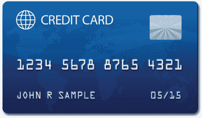

**图 4.2** 塑料支付卡背面

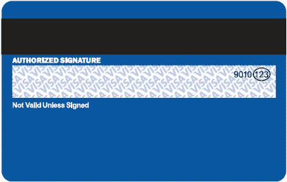

**图 4.3** 普通可见光下的信用卡

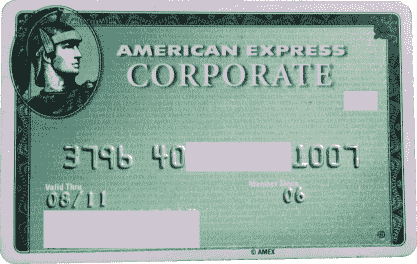

**图 4.4** 紫外线下的信用卡

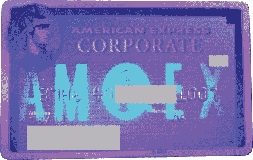

## 为什么安全功能失效

卡片的物理安全控制存在以下几个问题：

- **保护机制并不一致**。虽然有一些事实上的标准功能（如凸型主账户号码、到期日期和持卡人姓名），但仍然没有正式标准。例如，卡片验证代码有不同的长度（3 或 4 位）和不同的位置（磁面或背面），这让收银员感到困惑。（本章“卡片验证值”章节详细解释了这些代码。）

- **许多安全功能并非强制性**。例如，在信用卡上打印持卡人照片是一个好主意，将其转化为照片身份证。全息磁条是另一个难以伪造的强力保护功能（至少，这会大大增加伪造成本）。然而，由于这些功能是可选的，且没有标准或法律规定，它们并没有被广泛使用，也无法依赖。

- **支付卡没有可以由磁条读取器自动验证的物理安全控制**。所有的保护机制设计都是为了由人类（收银员、工作人员、服务员）进行识别和验证。因此，无人值守的支付终端如 `ATM`、加油机或自动自助机是最容易受到欺诈的目标的，因为现场没有可以判断塑料卡片真伪的人。

- **大多数物理控制都可以被轻易伪造**。与 `EMV` 芯片等高科技功能不同，普通的物理控制可以在家里轻松复制。（本章“制作伪造卡片”章节包含有关所需设备的更多信息。）

持卡人信息存储在塑料付款卡背面的磁条上。磁条上有 2 条道（称为 `Track 1` 和 `Track 2`），用于处理电子支付。还有第三条磁道 `Track 3`，它不参与 POS 交易。磁道的数据格式由 `ISO 7813` 标准定义，对于所有类型的信用卡、借记卡、礼品卡、车队卡、EBT 以及其他卡都是相同的。当磁卡在收银机上滑动时，`MSR` 设备会从磁条上读取磁道并将其发送到支付处理系统，系统将其解析为几个子元素：`PAN`、`Expiration Date`（有效期）、`Service Code`（服务代码）以及额外的可选数据（通常仅在车队卡处理等特殊情况下需要）。

“磁条技术非常高效，但并不聪明”，尤其是从安全角度来看。磁条可以被复制（或通过将其元素重新组合来重建），并使用 `Magnetic Stripe Encoder`（磁条编码器）写入空白塑料卡中。这类设备相对便宜，任何人都可以购买。`Track 1` 和 `Track 2` 是最重要的两个元素，因为它们足以处理大多数支付。`Track 1` 或 `Track 2` 均可用于用于实体店交易或 ATM 提现的完整功能物理付款卡。`PAN`（位于两条磁道上）允许进行在线购买。

## Track 1

`Track 1` 包含有关持卡人的完整信息，包括姓和名。`Track 1` 的最大长度为 79 字节。前面的字节是 `PAN`，然后是持卡人姓名，姓名通过 `^` 与左侧的 `PAN` 以及右侧的 `Expiration Date` 分隔。以下是一个 `Track 1` 示例，随后是 `Table 4.1`，该表列出了示例中使用的组件：

### 表 4.1 Track 1 示例组件

| 字段 | 数据 |
| --- | --- |
| PAN | 4005554444444403 |
| Expiration Date | 1512 (2015 年 12 月) |
| Cardholder's first name | SLAVA |
| Cardholder's last name | GOMZIN |
| Service Code | 101 |
| CVV | 123 |

```
%B4005554444444403^GOMZIN/SLAVA¹⁵¹²¹⁰¹⁰⁰⁰⁰⁰⁰⁰¹²³⁰⁰?
```

`Track 1` 和 `2` 都不受保护，因此数据以明文存储。换句话说，如果你能获取仅 79 字节的 `Track 1`（或仅 40 字节的 `Track 2`！），就可以创建付款卡的完整副本。这种复制的卡随后可以像原卡一样，在任何支付终端上进行滑动。`Track 1` 是唯一包含字母数字字符的磁道——支付处理不需要持卡人姓名。`Table 4.2` 列出了 `Track 1` 的详细结构。

### 表 4.2 Track 1 详细结构

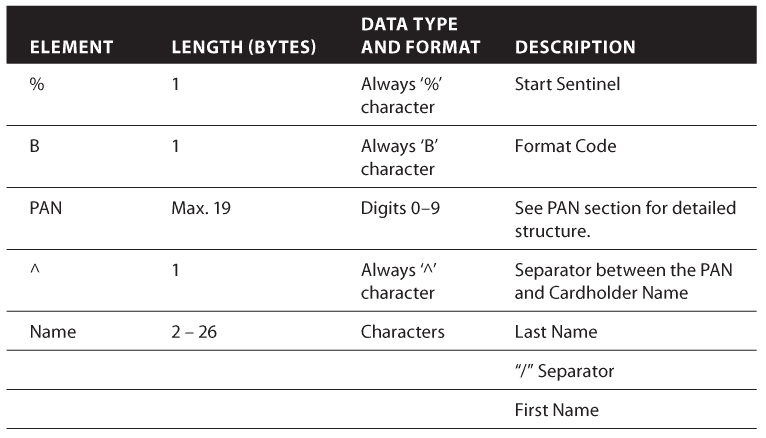!(Images/c04-tab-0001a.jpg)

## Track 2

`Track 2` 包含处理支付所需的最小信息：`PAN`、`Expiration Date`、`Service Code` 以及根据发卡机构和类型可能变化的额外信息。`Track 2` 的引入是 `Track 1` 的简短版本，旨在提高使用电话线与授权机构通信的旧拨号终端的性能。`Track 2` 仍然处理大多数收单机构的支付，因此在大多数应用程序中 `Track 1` 是可选的。`Track 2` 的标准长度为 40 ASCII 字符（每个 ASCII 字符长度为 1 字节）。前几个数字（通常为 16 位，从 15 到 19 位不等）保留给 `PAN`。`=` 字符将 `PAN` 与 4 字节的 `Expiration Date` 分隔，随后是额外的可选数据。以下是一个 `Track 2` 示例，随后是 `Table 4.3`，该表列出了示例中使用的组件：

### 表 4.3 Track 2 组件

| 字段 | 数据 |
| --- | --- |
| PAN | 4005554444444403 |
| Expiration Date | 1512 (2015 年 12 月) |
| Service Code | 101 |
| CVV | 123 |

```
4005554444444403=1512101000000012300
```

`Table 4.4` 列出了 `Track 2` 的详细结构。

### 表 4.4 Track 2 详细结构

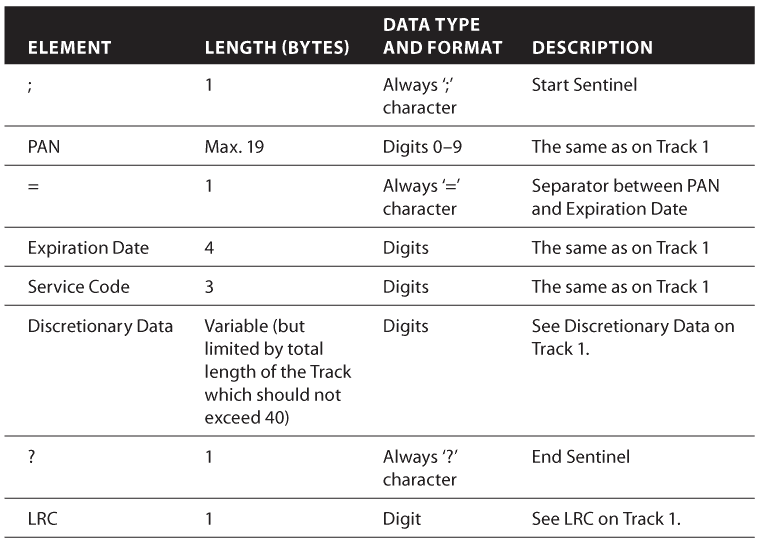

## PAN

主账户号码（`PAN`）通常为 16 位数字，但美国运通例外，它仅使用 15 位数字。`PAN` 的最大长度为 19 位，某些类型的卡拥有 19 位账户号码，例如车队卡。`PAN` 凸在大多数付款卡的正面，这允许在 `MSR` 因任何原因无法读取磁条时在 POS 机上进行手动输入。`embossed PAN` 可以在电子系统故障时用于手动交易。这是在没有电脑的情况下从持卡人处偷钱最简单、最老的方法：只需写下 `PAN` 数字并用于电话或在线购买。`Table 4.5` 显示了磁道上的 `PAN` 位置。

### 表 4.5 磁道上的 PAN 位置

| 磁道 | 数据 |
| --- | --- |
| 1 | 4005554444444403^GOMZIN/SLAVA¹⁵¹²¹⁰¹⁰⁰⁰⁰⁰⁰⁰¹²³⁰⁰ |
| 2 | 4005554444444403=1512101000000012300 |

`Track 1` 和 `Track 2` 都包含相同的 `PAN`，它由多个元素构造：ISO 前缀、账户号码和校验位。虽然拥有完整的 `Track 1` 或 `2` 备份对于伪造付款卡是理想的，但在某些情况下（如无卡交易），知道 `PAN` 就足以执行欺诈交易。

## Expiration Date

有效期编码为四个数字：月份和年份各占两位。`Track 1` 和 `2` 都包含有效期，它位于 `Track 2` 的 `=` 分隔符之后，以及 `Track 1` 的持卡人姓名分隔符 `^` 之后（`Table 4.6`）。月份和年份的顺序由 ISO 标准定义：首先是年份的最后两位，然后是代表月份的两位。例如，2015 年 12 月到期的卡有效期编码为 `1512`。

有效期也凸在卡正面。注意，凸面有效期中月份和年份数字的位置与磁道中编码日期格式相反，且月份和年份数字之间有 `/` 或 `-` 分隔符，例如：`MM/YY` 或 `MM-YY`。

### 表 4.6 磁道上的有效期位置

| 磁道 | 数据 |
| --- | --- |
| 1 | 4005554444444403^GOMZIN/SLAVA¹⁵¹²¹⁰¹⁰⁰⁰⁰⁰⁰⁰¹²³⁰⁰ |
| 2 | 4005554444444403=1512101000000012300 |

支付应用程序以及大多数支付处理程序和收单机构不会检查有效期（或者除 `PAN` 之外的许多或有时是所有其他元素）。有效期验证程序只是确保该日期未到期。它并不会对有效期的真实性进行验证，这意味着发送用于验证的有效期不会与卡片发行机构数据库中的原始有效期进行比较。因此，实际上任何晚于当前日期的随机生成有效期都可以通过验证（注意，某些系统可能会对最大年份数字进行限制，例如，“7012”可能会被支付应用程序拒绝，因为它们会将卡片解释为在 1970 年 12 月已过期）。

此外，有效期——在传输过程中或静态存储状态下——通常不会被支付应用程序加密（PCI 标准未要求这样做），并且可以轻松地从内存、通信链路、数据库或日志文件中获取。

## ISO 前缀与 BIN 范围

`PAN` 的前 6 位（见表 4.7）被称为 `ISO 前缀`，也称为 `BIN` 或官方名称 `IIN 前缀`。

### 表 4.7 磁道上的 ISO 前缀位置

| 磁道 | 数据 |
| --- | --- |
| 1 | %B4005554444444403^GOMZIN/SLAVA¹⁵¹²¹⁰¹⁰⁰⁰⁰⁰⁰⁰¹²³⁰⁰? |
| 2 | ;4005554444444403=1512101000000012300? |

从技术上讲，`ISO 前缀` 并不是账号的一部分，因为它包含了关于卡片发行机构的通用信息，因此识别持片持有者的真实账号仅包含 9 位。一个 16 位的 `PAN` 看起来如下：

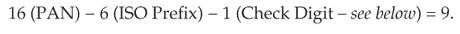

PCI 标准允许公开 `PAN` 的前 6 位有几个原因：

* `ISO 前缀` 不是一个秘密数字，因为它不识别持卡人，而且许多持卡人的卡片上有相同的相同的 `ISO 前缀`。
* `ISO 前缀` 可以人工生成，因为它包含了公开已知的数据。
* 大多数客户端支付系统必须知道卡片的 `ISO 前缀`，以便将交易路由到适当的处理器程序。因此，即使敏感的卡片数据使用了 `P2PE` 加密（详情请见 P2PE 章节），系统仍然应该能够看到 `ISO 前缀` 以处理交易。

前 6 位和后 4 位数字几乎总是以明文形式暴露，且“校验位”是一个可以根据 `PAN` 值计算的函数，这对于破解 `PAN` 的哈希函数非常重要，因为只需要对 6 位数字进行暴力破解。

***

交叉引用：请参第 6 章以获取有关哈希函数漏洞的更多信息。

***

`ISO 前缀`（以及 `PAN`）的第一位被称为 `MII`（主行业标识符），正如名称所示，它识别了所属行业。在实践中，主要的支付品牌分配了 1 到 6 的 `MII` 数字，可以通过 `ISO 前缀` 的前 1 到 4 位进行识别（表 4.8）。

### 表 4.8 BIN 范围

| MII (第 1 位) | BIN 范围 | 支付品牌 |
| --- | --- | --- |
| 1 | 1800xx | JCB |
| 2 | 2131xx | JCB |
| 3 | 34xxxx, 37xxxx | American Express |
| | 300xxx – 305xxx, 36xxxx, 38xxxx | Diners Club |
| | 35xxxx | JCB |
| 4 | 4xxxxx | Visa |
| 5 | 51xxxx – 55xxxx | MasterCard |
| 6 | 6011xx, 65xxxx | Discover |

此表仅描述了高层划分。详细的 BIN 范围可以通过支付品牌^(15、银行^(16 或其他在线来源^(17 获取。

## PAN 校验位

任何 `PAN` 的最后一位（极少数例外除外）被称为 `校验位`，在在内存或文件中查找 `PANs` 时，它允许区分真实的卡片账号和随机数字序列。`校验位` 并不是账号的一部分。例如，如果 `PAN` 长度为 16 位，则账号由前 15 位组成，`校验位` 由 `Luhn` 算法决定。该 `Luhn` 算法定义在 `ISO 7812` 中。

```
public bool LuhnTest(string cardNumber)
{
    // 清理数字 - 横杠和空格
    cardNumber = cardNumber.Replace("-", "").Replace(" ");
    // 将卡号转换为数字
    int[] digits = new int[cardNumber.Length];
    for (int len = 0; len < cardNumber.Length; len++)
    {
        digits[len] = Int32.Parse(cardNumber.Substring(len, 1));
    }
    int sum = 0;
    bool alt = false;
    for (int i = digits.Length - 1; i >= 0; i--)
    {
        int curDigit = digits[i];
        if (alt)
        {
            curDigit *= 2;
            if (curDigit > 9)
            {
                curDigit -= 9;
            }
        }
        sum += curDigit;
        alt = !alt;
    }
    // 如果模 10 等于 0，则数字正确，并返回 true
    return sum % 10 == 0;
}
```

## 服务代码

服务代码的三个字节（见表 4.10）由 3 字节子字段组成。这些字段的值很重要，因为它们告诉支付应用程序和处理器在支付期间应如何处理卡片。

### 表 4.10 磁道上的服务代码位置

| 磁道 | 数据 |
| --- | --- |
| 1 | %B4005554444444403^GOMZIN/SLAVA¹⁵¹²¹⁰¹⁰⁰⁰⁰⁰⁰⁰¹²³⁰⁰? |
| 2 | ;4005554444444403=1512101000000012300? |

### 表 4.11 服务代码指令

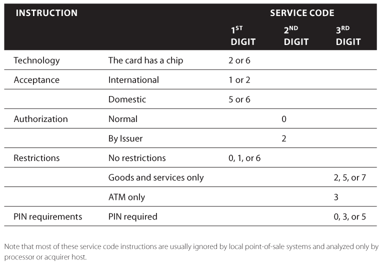

现在是时候理解这些使用 C 和 V 字母的三个字母缩写的含义了。卡片验证值（`CVV`）是由支付品牌为了打击大规模信用卡欺诈而发明的。`CVV` 有两种类型，它们经常被混淆，而且每个支付品牌对几乎相同的代码都有自己的命名规范，这进一步增加了困惑，并展示了该行业缺乏标准化的另一个例子。

第一组代码列在表 4.12 中——我们称之为 `CVV`，尽管每家信用卡公司使用的三个字母组合不同——它们被嵌入在磁道 `1` 和 `2` 的离散数据中。

#### 表 4.12 磁条上的编码卡片验证值

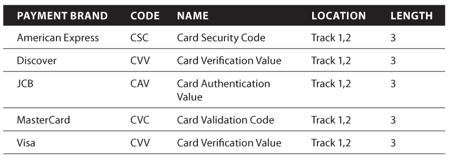

第二组代码通常被称为 `CVV2`，但与 `CVV` 的情况一样，每个支付品牌都有自己的名称（表 4.13）。这些数字打印在塑料支付卡的正面或反面。

#### 表 4.13 打印在塑料片上的卡片验证值

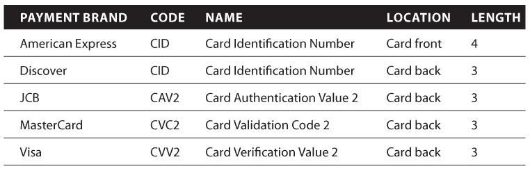

### 磁道上的编码 CVV

`CVV`（根据支付品牌不同也称为 `CSC`、`CAV` 和 `CVC`）编码在磁道 `1` 和 `2` 的离散区域，如表 4.14 所示，它在 `CVV2` 之前引入。它是通过特殊的加密函数从磁道数据元素派生而。

#### 表 4.14 磁道上的 CVV 位置

| 磁道 | 数据 |
| --- | --- |
| 1 | %B4005554444444403^GOMZIN/SLAVA¹⁵¹²¹⁰¹⁰⁰⁰⁰⁰⁰⁰**123**00? |
| 2 | ;4005554444444403=15121010000000**123**00? |

在授权阶段，当 `POS` 发送完整的磁道 `1` 或 `2` 数据（或两者）时，收单主机进行验证。这种验证的原理很简单——在 PCI 安全标准引入之前甚至之后，当商户开始加密数据存储时，盗取 `PAN` 号很容易，因为它们通常存储很长时间用于结算处理和客户服务查询。在信用卡欺诈的早期，窃贼者的工作要容易得多——他们不需要盗取整个磁道就可以制作伪造塑料卡。那时，`PAN` 和有效期（许多授权器不验证有效期，且可以随机生成以匹配简单的验证标准）包含了足够的信息来制作完整的磁道 `2`，如下：

起始符：始终为“；” + `PAN`：“1234567890123456” + 分隔符：始终为=” + 有效期：“1512”（只需输入未来的年份和月份） + 结束符：始终为“?” = 磁道 2：`;1234567890123456=1512?`


如今，由于 `CVV` 验证功能，磁道无法被轻易重构。窃贼需要获取整个磁道（这有些困难但并非不可能），或者猜测 `CVV` 值（对于 1000 种可能的值来说这很有问题）。

仅通过 `PAN` 重构的磁道 `1` 或 `2` 仍可用于制作离线交易的伪卡，因为没有任何支付应用程序具备离线验证 `CVV` 的功能。

***

交叉引用：请参见第 5 章“渗透安全区”，获取更多关于强制离线授权攻击的细节。

***

### 塑料片上的 CVV2

`CVV2`（根据支付品牌不同也称为 `CAD`、`CAV2` 和 `CVC2`）验证是可选的，可以作为商户提供的额外服务。这种代码在实体店中很少验证，因为卡片物理在场，可以由工作人员进行验证。`CVV2` 对于无卡交易（在线和电话支付）最为重要，因为它有助于验证客户手中持有的是真实的实体卡（而不仅仅是账号）。由于 `CVV2` 不存在于磁条上，而是打印在塑料片的正面或反面，这变得可能。

我不是一个黑客。我从未想过成为黑客。在不违法且不给无辜的人带来麻烦的情况下，我能做很多有趣的事情。然而，这并不意味着我不能成为黑客。事实上，任何人都可以。如果你认为黑客是智商远高于常人且拥有异常技能的超级大师，那你就错了——这样的人寥寥无几。通常情况下，他们只是普通人，仅仅是想通过一些未经授权的操作来让自己脱颖而出。这对我们来说是一个利好消息，因为意味着为了防御他们，我们并不需要变得超级聪明。但是，为了保护自己，我们必须做的是理解自己的漏洞，并学习如何以最高效的方式缓解它们。

对于许多其他网络目标，黑客入侵支付系统有三个主要动机：乐趣、政治和恐怖主义，或者是金钱。本书关注第三个原因，这对于电子支付来说是最危险的。然而，在进行风险评估和威胁建模时，仍应考虑到这三者。

## 安全泄露

在表 4.16 中列出的活动可以用一个词来描述：安全泄露。`Security Breach`（或 `Data Breach`）一词在支付行业和安全社区被广泛使用，用于命名与敏感持卡人数据泄露和欺诈使用相关的系列事件。在官方文档中如 `PCI DSS` 和 `PA-DSS` 安全标准中可以找到该术语的引用^(23, 24)。获取有关卡片数据泄露的详细信息并不简单。公司并不急于披露自己的安全泄露，尽管在大多数州，州法律要求他们这样做^(25, 26, 27)。即使发生了数据泄露，他们也会试图尽量减少公布的事实，并转移公众对该事件的注意力。当 2008 年美国最大的支付处理器之一发生安全泄露时，公开公告是在奥巴马总统就职当天发布的^(28)。

**表 4.16** 典型的卡片数据泄露阶段

| **阶段** | **行动** | **时长** |
| --- | --- | --- |
| 1. 收集信息 | 了解零售店的环境控制（例如，漏洞扫描）。了解目标支付应用程序的技术和漏洞。 | 天到几周 |
| 2. 准备恶意软件 | 基于支付应用程序的信息，定制现有的恶意软件或创建一个新的。 | 天到几周 |
| 3. 渗透商店环境 | 破解商店的物理和/或逻辑控制。安装恶意软件。 | 小时到几天 |
| 4. 提取敏感数据 | 从内存、磁盘存储或通信中收集敏感数据，并将其上传到攻击者的计算机。 | 小时到几年 |
| 5. 盗刷 | 黑客将“数据包 (dumps)”卖给变现集团。 | 小时到几周 |
| 6. 变现 | 对于信用卡：进行在线购买或在零售店购物。出售购买的商品并获取现金。对于 PIN（借记）卡：从 ATM 提取现金。 | 小时到几年 |
| 7. 披露 | 内部发现（系统异常行为）或公开披露（客户报告欺诈交易）。调查和缓解。 | 天到几个月 |

Privacy Rights Clearinghouse 维护了自 2005 年以来每个报告的安全泄露历史，包括支付系统的数据泄露^(29)。

最复杂的安全泄露类型并不常见。事实上，其中某些还没有发生。如果一个更简单的漏洞就可以被利用并带来相同的结果，黑客为什么要在一个困难的攻击场景上花费更多的时间资源呢？然而，随着时间的推移，为了防止简单的入侵而实施了的安全措施，新的攻击确实变得更加复杂。安全是一场持久的竞争。

为了从被盗的信用卡数据中获利，需要执行几个步骤（参考表 4.16）。首先，需要通过入侵商店支付系统并利用后续两个章节描述的漏洞之一来获取敏感记录。因此，第一步是渗透商店环境，这可以通过从互联网远程进行，也可以从内部通过破解商店的物理安全性或利用内部人员或社会工程的帮助来完成^(30)。一旦物理和/或逻辑（网络）保护层被破解，下一步就是安装 `malware`——专门制作的软件，它可以破解支付应用程序控制，检索并记录敏感数据，最后将其上传到攻击者的“命令中心”。

## 最大的销售点泄露

The TJX Companies, Inc. (TJX) 的数据泄露（它是 T.J. Maxx 和 Marshalls 的母公司）是商户支付卡片数据盗窃史上最大的案例^(31)。初始攻击是通过 `wardriving`（无线网络钓鱼）方法进行的——通过保护不当的加密等效隐私 (WEP) 加密通过无线通信入侵商店网络，这种加密可以在几分钟内被破解。包含敏感验证数据的数百万记录存储在公司服务器的 POS 系统中，包括完整的磁道数据、`CVV2` 甚至借记卡 `PIN` 码^(32)。根据一份报告，除了 TJX 商店外，该泄露还影响了“OfficeMax、Barnes & Noble、Target、Sports Authority 以及 Boston Market，可能还有许多未检测到泄露的公司”^(33)。

组织 TJX 及类似“操作”的主要人物——Albert Gonzales——被判处 20 年监禁。

# 将比特转换为现金：盗刷者

一旦敏感数据被提取、传输并存储在商店环境之外，被盗记录的批次被称为 `dumps`（数据包），通常通过专门论坛在网上卖给其他人^(34, 35)。这种市场被称为 `carding`（盗刷），而与被盗卡数据记录交易的人相应地被称为 `carders`（盗刷者）。《暗网市场：网络窃盗、网络警察与你》* (Knopf, 2011) 的作者 Misha Glenny 将盗刷定义为“买卖被盗或被黑的信用卡详情”，并将其称为“网络犯罪的日常食粮”^(36)。通常，盗取卡数据的黑客并不直接处理变现问题。他们通过将数据包卖给专门将比特转换为货币的个人或群体赚钱。当这些“操作”人员在盗刷网站上从黑客那里买入数据包后，他们制造伪卡，最终从虚拟现实转向现实世界，以执行取决于其数据包类型的最后一步。

他们使用普通的信用卡进行在线购物（这甚至不需要制作实体卡），或者在零售店购买奢侈品，然后在在线上出售这些物品以获取现金。对于借记卡，如果他们还拥有 `PIN` 码，就可以直接从 ATM 提取现金。借记卡数据包消除了使用假卡进行购买的风险，同时也避免了通过出售商品获取现金相关的任何麻烦和费用。此外，对假信用卡外观的要求要高得多，因为它们在购买时必须通过收银员的目视检查。而虚假的借记卡只需要是带有磁条的白色塑料片即可被无人值守的 ATM 终端接受。根据 `BankInfoSecurity` 的介绍，2013 年 1 月，“Visa 向美国支付卡发行机构发布了一份公告”，警告称“近期一起案件涉及少数被盗的支付卡，在单个周末内于多个国家的 ATM 机上进行了数千次取款”。

尽管 `CVV2` 验证现如今已非常普遍，但仍有一些网站不会提示输入卡片验证码。例如，许多在网站上收集捐款的非营利组织仍在使用不需要 `CVV2` 的支付应用程序。即使要求 `CVV2`，此类网站仍可被盗刷者用于测试其数据包的有效性。其工作原理如下：首先，他们找到一个不需要发货详情等进一步交互的非营利组织网站（这不是购买——而是捐款！）。然后，他们尝试捐赠极小额金额（1 美元甚至更低）。如果交易通过，说明 `PAN` 是有效的，且数据包绝对可以用于制作假卡并去购物。

注：遗憾的是，此过程中每一步的许多有趣细节都超出了本书的范围，本书主要侧重于这一现象的技术层面。关于盗刷世界的更多信息可以参考本章末尾列出的参考文献 40、41 和 42。

## 变现策略：取现者

在使用前述描述的方法之一获得信用卡或借记卡数据包后，就是时候挣钱了。这就是取现者登场的地方。

变现策略主要大类，需要不同的技术和心理技能，以及不同类型的卡片数据包。因此，取现者通常只坚持两种策略之一：在线或实地操作。

在线变现策略包括任何可以通过互联网执行的取现活动，如在线购物和游戏，几乎完全可以通过计算机完成，甚至无需出门。除了不需要离开沙发之外，在线变现还有另一个不容置疑的优势：它完全依赖于技术，不需要任何特殊的心理、社会工程或交流技巧。用于在线取现的数据包通常包含在线处理所需的 `PAN`、过期日期和 `CVV2`。

相比之下，实地操作变现策略要求与物质世界进行交互——在实体店购物或在 ATM 提取现金。在某些情况下，为了制作外观良好的假卡，需要对制造设备进行额外投资。店内取现的数据包包含轨道 1（`Track 1`）、轨道 2（`Track 2`）或两者（系统授权仅一个可读轨道即可）。

# 制作伪卡

如前所述，至少有两种变现策略需要具备物理卡片操作能力：店内购物和 ATM 取款。信用卡或借记卡的伪造过程比想象中要简单得多。该过程有 4 到 5 个步骤，取决于对最终产品质量的要求，且在所有情况下只有编码步骤是必须的。每一步都需要特殊设备，费用从数百美元到几千美元不等，取决于所需的质量和最终外观。每一步的定义如下：

1. `Encoding`（编码）是使用名为 `magnetic stripe encoder`（磁条编码器）的特殊设备将数据包写入空白卡的磁条上。
2. `Printing`（打印）是为了在卡片上应用背景颜色、支付品牌标志以及任何图像（如持卡人照片）。特殊的热敏 PVC 或喷墨打印机可以产生非常好的图像，有时无法与原件轻易区分。此外，在此阶段还可以打印不可见的紫外标记。
3. `Embossing`（压凸）是为了创建凸起的 `PAN`、持卡人姓名和过期日期。它是使用 `embosser`（压凸机）完成的。
4. `Tipping`（烫金）是如图 4.8 所示的 `tipper`（烫金机）对凸出的数字和字母涂金银箔的过程。可以在网上购买各种类型的压凸机和烫金机。

### 图 4.5：热敏 PVC 打印机

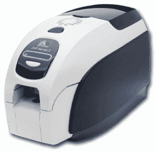

### 图 4.6：用于平面的打印的喷墨打印机

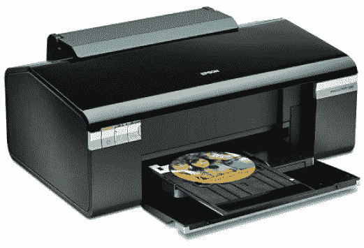

### 图 4.7：压凸机

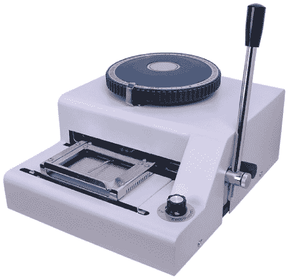

### 图 4.8：烫金机

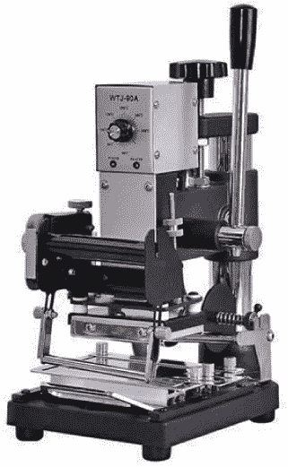

只有在需要向精品店的销售员展示外观完美的卡片以获取昂贵物品而不引起任何怀疑时，才需要打印、压凸和烫金步骤。在这种情况下，可能需要复制全息图等额外安全特征以达到高质量卡片。

对于要在 ATM 提取现金的借记卡，或由“内部人员”（担任收银员的同伙）在 POS 机上刷过的信用卡，简单的白色塑料完全可行：不需要压凸或精美的图片。

## 编码器

磁条读器（`MSR`）设备可以是简单的读器，也可以是读器又是写入器（编码器）。读器用于合法的 POS 系统，也用于侧录攻击（见第 7 章）。本章考虑磁条编码器，是因为它们能够将任何信息写入空白塑料卡模板的磁条中。卡编码器和空白卡模板都可以在网上购买并用于制造假卡。使用如图 4.9 所示的简单编码器（可以在网上匿名购买，价格低于 200 美元），可以将从支付系统窃取的磁迹（“dumps”）写入空白塑料卡模板中。经过一些额外的艺术处理后，产物即可用于欺诈交易。

### 图 4.9：磁条编码器

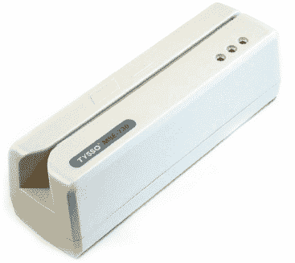

通常，一台全新的设备包含适用于主要操作系统的驱动程序、一个带有直观图形用户界面的简单管理应用程序，以及几张可以即刻使用的空白塑料卡。典型的编码器可以通过 `USB` 或串口连接到任何计算机。从转储（dump）中获取磁道数据（仅限 `Tracks 1` 和 `2`——金融交易不使用 `Track 3`）可以简单地复制并粘贴到管理工具的界面窗口中，如图 4.10 所示。

### 图 4.10：编码实用程序准备好向磁条写入磁道数据

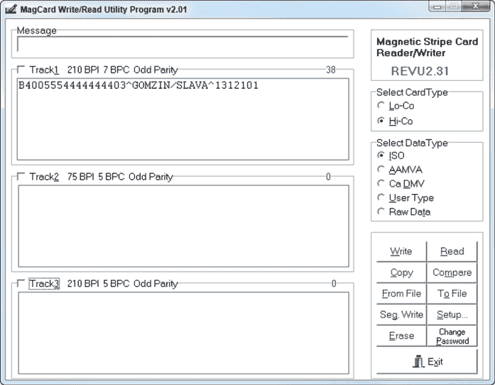

在将磁道数据输入相应的文本框后，只需点击“写入”（Write）按钮并快速刷卡，即可完成卡片的制作（图 4.11）。

### 图 4.11：编码完成

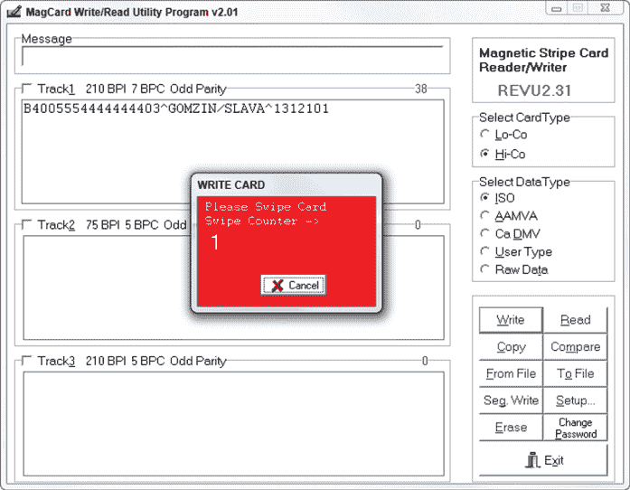

如果转储数据包含带有补充 `PIN` 的借记卡磁道，则不需要进一步的操作：卡片即可用于提取现金，因为 ATM 不验证塑料外壳。支付卡没有（除了通过编码复制的磁条外）可以被 ATM 验证的物理控制。

## 打印机

有两种类型的能够在空白 PVC 卡上创建图像的打印设备：

1. `热敏 PVC 打印机` 价格从 1000 美元起^(47)（参见图 4.5）。它能够在空白塑料卡上制作高质量的背景和支付品牌标志的彩色图像。
2. `能够在平面表面打印的喷墨打印机`（如图 4.6 所示）与热敏 PVC 打印机相比便宜得多^(48)。这类打印机最初设计用于在 `CD` 和 `DVD` 上打印图像，但只需花费 25 美元添加一个特殊的 PVC 卡托盘，即可轻松升级为在 PVC 卡上打印^(49)。然而，热敏打印机产生的图像质量（尤其是耐用性）更高。喷墨打印机可以执行的另一个重要功能是创建 UV 标记。为了实现这一点，应在墨盒中装入特殊的 UV 墨水，墨水在正常情况下是不可见的，但在黑光下会发光。

## 总结

磁条支付卡在设计上是不安全的，主要由于以下原因：

* 尽管有多种物理安全特征，但仍然无法提供充分的防盗窃保护。
* 敏感的持卡人信息以明文形式编码在磁道上。

卡数据泄露包含多个阶段，可能在数月内不公开，并导致数千条被盗的信用卡和借记卡记录。

使用原始卡上的完整 `Track 1` 和 `Track 2` 数据可以相对容易地制造伪卡。此过程的主要步骤是编码、打印、压凸和烫金。

* ATM 提现只需要编码（如果有 `PIN` 可用）。
* 卡磁道数据的选元素（`PAN` 和 `CVV`）可用于在线购物，无需制作实体塑料卡。

## 注释

1. *大英百科全书*、*艺术、科学、文学及通用信息词典*，第 11 版，第 7 卷（纽约：大英百科全书公司，1910），第 390 页。
2. Slava Gomzin，“使用智能手机进行免费双重身份验证，”*PayAppSec* 博客（2011 年 6 月），[`www.gomzin.com/1/post/2011/06/free-two-factor-authentication-with-your-smartphone1.html`](http://www.gomzin.com/1/post/2011/06/free-two-factor-authentication-with-your-smartphone1.html)
3. 美国运通卡安全特征，美国运通，[`secure.cmax.americanexpress.com/Internet/International/japa/SG_en/PROSPECT/WorkingWithUs/AvoidingFraud/Files/to_checking_Card`](https://secure.cmax.americanexpress.com/Internet/International/japa/SG_en/PROSPECT/WorkingWithUs/AvoidingFraud/Files/to_checking_Card)
4. *热敏 PVC 打印机*，参见图 4.5。
5. *热敏 PVC 打印机*，参见图 4.5。它能够在空白塑料卡上制作高质量的彩色图像。
6. *能够在平面表面打印的喷墨打印机*（如图 4.6 所示）。
7. *磁条支付卡*。
8. *喷墨打印机*。
9. *UV 标记*。
10. *编码实用程序*。
11. *编码完成*。
12. *支付塑料卡*。
13. *磁条支付卡*。
14. *技术参考指南*。
15. *喷墨打印机*。
16. *卡识别与验证*。
17. Visa BIN 查询信息，[bin-iin.com](http://bin-iin.com)，[`bin-iin.com/visa-BIN-range.html`](http://bin-iin.com/visa-BIN-range.html)
18. Carolyn Watters, *信息科学与技术字典* (纽约：学术出版社，1992 年)，第 132 页。
19. *国际标准 ISO/IEC 7812-1*, *身份识别卡 — 发行者识别 — 第 2 部分*: *编号系统*, *ISO/IEC*, 2006 年。
20. *PCI 取证调查员* (*PFI*) *计划指南*，版本 2.0，PCI SSC (2012 年 11 月)，[`www.pcisecuritystandards.org/documents/PFI_Program_Guid.pdf`](https://www.pcisecuritystandards.org/documents/PFI_Program%20_Guide.pdf)
21. *欺诈*，CVV/CVC 和 CVV2/CVC2 检查，Pulse，一家 Discover Financial 服务公司，[`www.pulsenetwork.com/fraud/index.html`](https://www.pulsenetwork.com/fraud/index.html)
22. *Findstr*, Windows XP 专业版产品文档，微软，[`www.microsoft.com/resources/documentation/windows/xp/all/proddocs/en-us/findstr.mspx?mfr=true`](http://www.microsoft.com/resources/documentation/windows/xp/all/proddocs/en-us/findstr.mspx?mfr=true)


# 参考文献

23. *PCI PA-DSS 要求与安全评估程序版本 2.0*，PCI SSC (2010 年 10 月)，[`www.pcisecuritystandards.org/documents/pa-dss_v2.pdf`](https://www.pcisecuritystandards.org/documents/pa-dss_v2.pdf)

24. *PCI DSS 要求与安全评估程序版本 2.0*，PCI SSC (2010 年 10 月)，[`www.pcisecuritystandards.org/documents/pci_dss_v2.pdf`](https://www.pcisecuritystandards.org/documents/pci_dss_v2.pdf)

25. *加州法案 SB-1386*，加州州议院 (2003 年 7 月)，[`info.sen.ca.gov/pub/01-02/bill/sen/sb_1351-1400/sb_1386_bill_20020926_chaptered.html`](http://info.sen.ca.gov/pub/01-02/bill/sen/sb_1351-1400/sb_1386_bill_20020926_chaptered.html)

26. *州安全泄露通知法*，美国州立法会议会议，[`www.ncsl.org/issues-research/telecom/security-breach-notification-laws.aspx`](http://www.ncsl.org/issues-research/telecom/security-breach-notification-laws.aspx)

27. *各州安全泄露披露矩阵*，VigilantMinds, Inc. (2007 年 2 月)，[`www.contrib.andrew.cmu.edu/~dmarkiew/docs/breach_matrix_200702.pdf`](http://www.contrib.andrew.cmu.edu/~dmarkiew/docs/breach_matrix_200702.pdf)

28. Brian Krebs，“支付处理商泄露可能是有史以来最大”，《华盛顿邮报》 (2009 年 1 月)，[`voices.washingtonpost.com/securityfix/2009/01/payment_processor_breach_may_b.html`](http://voices.washingtonpost.com/securityfix/2009/01/payment_processor_breach_may_b.html)

29. *数据泄露年表：2005 年至今的安全泄露*，隐私权利清理小组，[`www.privacyrights.org/data-breach`](https://www.privacyrights.org/data-breach)

30. *攻击剖析：从鱼叉式钓鱼攻击到十步攻破*，Mandiant，[`www.mandiant.com/threat-landscape/anatomy-of-an-attack/`](https://www.mandiant.com/threat-landscape/anatomy-of-an-attack/)

31. “TJX 黑客攻击是历史上规模最大的”，《ComputerWeekly.com》 (2007 年 4 月)，[`www.computerweekly.com/news/22400807/TJX-hack-the-biggest-in-history`](http://www.computerweekly.com/news/22400806/TJX-hack-the-biggest-in-history)

32. Gary G. Berg, Michelle S. Freeman 和 Kent N. Schneider，“分析 T.J. Maxx 安全事故：给审计师的启示”，《CPA 杂志》 (2008 年 8 月)，[`www.nysscpa.org/cpajournal/2008/808/essentials/p34`](http://www.nysscpa.org/cpajournal/2008/808/essentials/p34)

33. James Verini，“伟大的网络抢劫”，《纽约时报》 (2010 年 11 月)，[`www.nytimes.com/2010/11/14/magazine/14Hacker-t.html?pagewanted=all&_r=0`](https://www.nytimes.com/2010/11/14/magazine/14Hacker-t.html?pagewanted=all&_r=0)

34. Carding 论坛，Jar，[`www.forumjar.com/forums/Carding`](http://www.forumjar.com/forums/Carding)

35. Skimmed Dumps 论坛，[`www.voy.com/195759/36.html`](http://www.voy.com/195759/36.html)

36. Misha Glenny, *黑市：网络窃盗，网络警察与你* (纽约：Alfred A. 出版社)

37. *Visa 现款提取，信息安全* (Visa-Issue)

38. Brian Krebs，“Visa 资金问题”，《华盛顿邮报》 (2007 年 1 月)

39. “向慈善机构捐款”，《爱尔兰人报》 (2013 年 7 月)

40. Misha Glenny, *黑市：网络窃盗，网络警察与你* (纽约：Alfred A. 出版社)

41. Kevin Poulsen, *头目：黑客如何接管数十亿美元的网络犯罪世界* (纽约：Crown)

42. Carding School，[`www.forumjar.com/forums/Carding`](http://www.forumjar.com/forums/Carding)

43. Visa 刷卡器，[`www.forumjar.com/forums/Carding`](http://www.forumjar.com/forums/Carding)

44. 信用卡制卡器，[`www.forumjar.com/forums/Carding`](http://www.forumjar.com/forums/Carding)

45. 信用卡制卡器，[`www.forumjar.com/forums/Carding`](http://www.forumjar.com/forums/Carding)

[Amazon.com](http://Amazon.com) 喷墨式 PVC 打印机用 PVC 卡托 [`http://www.amazon.com/s/ref=nb_sb_noss_1?url=search-alias%3Daps&field-keywords=PVC+ID+Card+Tray`](http://www.amazon.com/s/ref=nb_sb_noss_1?url=search-alias%3Daps&field-keywords=PVC+ID+Card+Tray)

# 第 5 章：渗透安全真空区

> 如果你给了小偷东西，他就无法从你那里偷东西，这样他就不再是小偷了。
>
> — 威廉·萨洛扬 (William Saroyan)

PCI 安全标准将实施安全控制的责任交给了支付处理行业——商户、支付网关和处理器以及软件供应商。然而，目前正出现一种有趣的趋势：这些标准不再要求支付系统供应商（无论是硬件还是软件——在这种情况下，从商户的角度来看没有区别）提供“开箱即用”的安全系统，而是允许在设计上软件和硬件中构建多个漏洞。同时，商户被要求实施安全控制以补偿其支付系统安全性的不足。商户希望安全性来自软硬件供应商，而这些供应商反过来又依赖商户确保其商店环境的安全。结果是：多次安全泄露。此类场景的示例包括内存中未受保护的数据、未加密的本地流量和其他漏洞，这些将在本章进行讨论。

## 支付应用内存

2009 年 11 月，Visa 发布了一份名为“针对酒店业的漏洞”的数据安全警报，这一最大的支付卡品牌承认“日益增加的从易性内存中解析数据的调试工具表明，攻击者可能成功地调整了他们的技术，以获取未写入 POS 系统磁盘的支付卡数据”。2013 年 4 月，Visa 发布了新版本的安全警报，标题为“防止针对杂货商户的内存解析恶意攻击”，警告称“涉及杂货商户的网络入侵正在增加。一旦进入商户网络，黑客就会在基于 Windows 的收银机系统或后台（BOH）服务器上安装内存解析恶意软件，以提取完整的磁条数据”。

### RAM 内存提取

`Memory Scraping` 也称为 `RAM`（随机访问内存）`Scraping` 或 `Memory Parsing`（内存解析），是一种用于从支付应用进程内存中检索敏感支付卡数据的技术。内存提取实现在特制的恶意软件中，这些恶意软件通过从内存中窃取持有人信息来攻击支付应用。大多数支付应用即使在静态和传输过程中加密了机密字段（轨道 1、2 和 PAN），仍然需要在易性内存中以明文形式保留此类数据，以便检索其路由、处理收银员和客户提示以及许多其他功能所需的参数。目前，还没有可靠的软件技术可以轻松解决这个问题，而不必投资引入新保护方法（如端到端加密）的新系统。因此，支付软件供应商目前没有任何标准规定必须保护其应用程序的内存。相反，商户——软件的用户——有义务通过实施不同类型的补偿机制来保护运行此类应用程序的计算机内存，例如 PCI DSS 要求中列出的物理和网络控制（更多细节请见第 3 章）。

连接到支付应用进程并提取其内存相对容易，特别是当恶意软件已成功成为支付应用程序的一部分时。在其他 Visa 数据安全警报中也报告了内存提取恶意软件。

### WinHex

可以使用特殊工具查看 Windows 系统的内存。`WinHex` 就是用于安全测试和法证调查的工具之一。`WinHex` 具有加载、查看和编辑整个计算机内存或硬盘镜像的能力，如图 5.1 所示。QSA 在 PA-DSS 和 PCI DSS 评估期间，使用预定义的卡号运行各种类型的交易，然后在整个磁盘中搜索该数字。然而，即使在内存中发现了明文的 `PAN`，审计仍然会通过，因为 PCI 标准并不要求内存保护。图 5.2 显示了在支付应用内存中找到轨道 1。

**图 5.1** WinHex 工具

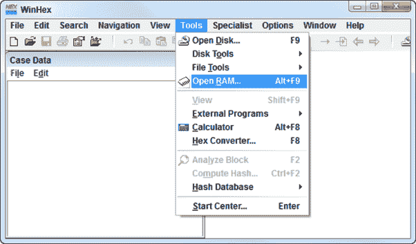

**图 5.2** WinHex 内存搜索结果，显示明文的轨道 1

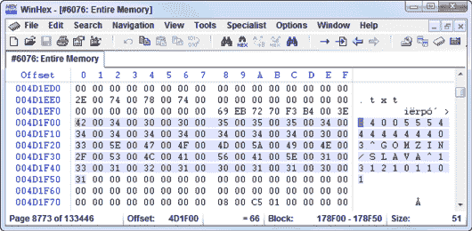

### MemoryScraper 工具

本节描述了一个示例 .NET C# 工具的实现，该工具可以附加任何 Windows 应用程序进程并使用正则表达式搜索支付卡 PAN 和轨道。如果你不是编程人员，可以跳过以下细节，直接在你喜爱的 POS 应用上测试此代码。只需与你的支付软件一起启动 `MemoryScraper.exe`，然后从组合框中选择应用程序进程并点击 Start 按钮（图 5.3）。搜索完成后，如果在所选应用程序的内存中发现了任何卡片，将显示记录的数字并启用 View 按钮（图 5.4）。详细的搜索结果将位于 MemoryScraper 主目录下的日志文件中（图 5.5）。

**图 5.3** MemoryScraper 工具

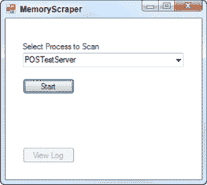

**图 5.4** MemoryScraper 扫描结果

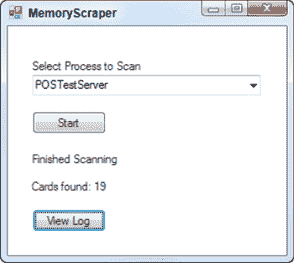

**图 5.5** MemoryScraper 日志

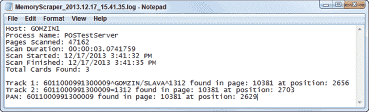

这不是实际恶意软件通常会使用的代码。黑客主要使用可以编译成二进制可执行文件的语言编写，如汇编、C、C++ 或 Delphi (Pascal)。此类代码对其他库的依赖较少（或没有），因此可以在任何环境中执行。然而，此工具演示了内存提取过程的基本知识。

`MemoryScraper` 的完整源代码和编译可执行文件可以从 Wiley 网站 [`www.wiley.com/go/hackingpos`](http://www.wiley.com/go/hackingpos) 下载。

#### 从内存加载数据

Windows 操作系统提供了连接到任何应用程序进程并从其内存加载数据的能力。有三个 *Windows API* 函数应该导入并按顺序调用以此（`ProcessMemoryLoader` 类）。这些方法的名称和顺序一而易懂：

```
[DllImport("kernel32.dll")]
public static extern IntPtr OpenProcess(
    UInt32 dwDesiredAccess, Int32 bInheritHandle, UInt32 dwProcessId);

[DllImport("kernel32.dll")]
public static extern Int32 ReadProcessMemory(
    IntPtr hProcess, IntPtr lpBaseAddress, [In, Out] byte[] buffer,
    UInt32 size, out IntPtr lpNumberOfBytesRead);

[DllImport("kernel32.dll")]
public static extern Int32 CloseHandle(IntPtr hObject);
```

进程内存无法一次性读取，因此需要多次调用 `ReadProcessMemory` 函数来分块加载数据。默认内存页大小为 4 KB (4,048 字节)，因此我们将其用作每次迭代中 `chunk size` 参数的值（`MemoryScanner` 类）：

```
const int MEM_PAGE_SIZE = 4096;
```

调用 `ReadProcessMemory` API 还需要另一个参数是 `lpBaseAddress`。显然，我们希望从进程内存的开头（地址 0）开始，通过将基地址增加 `MEM_PAGE_SIZE` 来向前移动到结尾：

```
while (memAddress + MEM_PAGE_SIZE <= processMemSize)
{
    buffer = loader.LoadMemory(
        (IntPtr)memAddress, (uint)bufferSize, out readCount);
    if (readCount > 0)
    {
        // regex search code
    }
    memAddress += MEM_PAGE_SIZE;
}
```

最大地址（`processMemSize`）可以使用进程的一个参数来计算：

```
long processMemSize = process.PeakVirtualMemorySize64;
```

#### 查找卡片数据

为了从支付应用程序内存的字节流中过滤出支付卡的卡号（PAN）和跟踪数据，`MemoryScraper` 使用了第 4 章中简要描述的正则表达式（regex）。由于正则表达式应应用于字符串数据类型，因此用于扫描敏感数据的内存块应首先从二进制格式转换为字符串。支付应用程序在处理 PAN 和内存存储跟踪数据时可能会使用不同类型的数据编码。不同的开发环境可能以不同的格式表示相同的字符串，但大多数可能是 ASCII 或 `Unicode`。例如，.NET 默认使用 Unicode 字符串，而使用 Delphi 或 C++ 编写的应用程序可能会将 PAN 和磁道存储为 ASCII 字符数组。ASCII 和 Unicode 字符串之间的区别在于：ASCII 字符串将每个字符存储为单字节（8 位），而 Unicode 字符串为每个字符预留 2 字节（16 位）。然而，它们在数字和基础符号上使用相同的 ASCII 编码，这些编码被正则表达式用于匹配 PAN 和磁道模式（如表 5.1 所示）。

**表 5.1** 数字和磁道数据字段分隔符的 ASCII 和 Unicode 代码

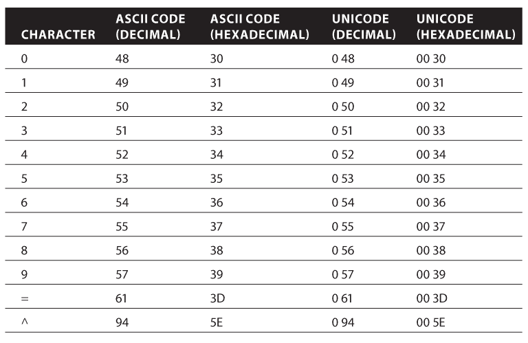

唯一的区别是 Unicode 包含一个额外的零字节。表 5.2 显示了 PAN 以 ASCII 和 Unicode 格式存储在内存中的示例。内存中的实际数据通常以十六进制格式显示。在源代码中，十六进制通常带有“0x”前缀，以便与十进制区分。例如，“0”字符的 ASCII 为 48（十进制）或 `0x30`（十六进制）。

**表 5.2** 示例 PAN 的 ASCII 和 Unicode 编码

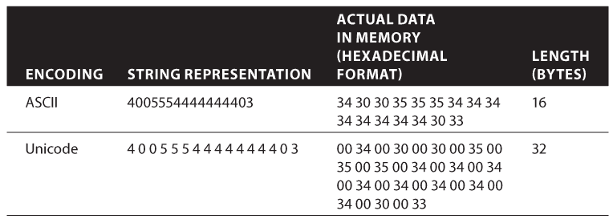

由于预先可能无法确定应用程序使用的是 ASCII 还是 Unicode 字符串（甚至两者都用！），`MemoryScraper` 会对内存缓冲区进行两次转换并使用正则表达式进行扫描（`MemoryScanner` 类）：

```
string ASCIItext = Encoding.ASCII.GetString(buffer);
string Unicodetext = Encoding.Unicode.GetString(buffer);
searchLine.Search(ASCIItext, pageNumber.ToString(), string.Empty, ref res);
searchLine.Search(Unicodetext, pageNumber.ToString(), string.Empty, ref res);
```

一旦扫描完成，搜索结果和统计将积累在 `res` 中并记录在文件中：

```
ScanInfo scanInfo = new ScanInfo();
scanInfo.searchResults = res;
Logger(scanInfo);
```

#### 正则表达式的工作原理

正则表达式使用模式或一组一致的参数进行搜索。在本例中，搜索的对象是 PAN、磁道 1 和磁道 2。这些参数被转换为特殊指令（参见表 5.3）以创建最终表达式。

**表 5.3** PAN 和磁道搜索使用的正则表达式

| **指令** | **描述** | **用法** |
| --- | --- | --- |
| `\s?` | `\s` 匹配任何空白字符。`?` 匹配前面的元素零或一次。 | `[0-9]{3}\s?[0-9]{4}\s?[0-9]{4}` 找到分组的数字，例如：`4005 5544 4444` |


| `[x-y]` | `[x-y]` 匹配 `x` 和 `y` 之间的任何数字。 | 示例 1：`[5-5][0-9]{14}` 找到前缀为 51、52、53、54 和 55 的所有卡。示例 2：`[0-2][0-9][0-1][0-2]` 找到 `yymm` 格式的过期数据，例如：`1402` |
| `{n}` | `{n}` 精确匹配前面的元素 `n` 次。 | `[5-5][0-9]{14}` 找到前缀后的内容，例如：`5498300061` |
| `x` | 匹配精确数字 `x`。 | `[5-5][0-9]{14}` 找到前缀为 5 的 PAN，例如：`5498300061` |
| `+` | 匹配前面的元素一次或多次。 | `.+` 找到磁道 1 的持卡人字段，其长度可变且位于两个分隔符 `^` 之间，例如：`400555444^` |

### 正则表达式语言 - 快速参考

PAN 有已知长度，仅包含数字，并以已知前缀开头。这些属性被转换为正则表达式集：

```
(?:4[0-9]{12}|4[0-9]{3}\s?[0-9]{4}\s?[0-9]{4}\s?[0-9]{4}|5[1-5][0-9]{14}|6(?:011|5[0-9][0-9])[0-9]{12}|3[47][0-9]{13}|3[0-5]|[68][0-9])[0-9]{11}|(?:2131|1800|35\d{3})\d{11})
```

除了 PAN 识别模式外，磁道 1 和 2 也有具有固定结构：PAN 加上 `yymm` 格式的 4 位过期日期，磁道 2 使用分隔符 `=` 分隔，磁道 1 使用 `^` 分隔：

```
(?:(?=[0-2][0-9][0-1][0-2]|\^[0-2][0-9][0-1][0-2]))
```

### 消除误报

使用正则表达式查找 PAN 的问题之一是很容易捕捉误报——即看起来完全正常的随机数字序列。可以使用几种方法避免此类结果。

让我们看看用于搜索独立 PAN 的正则表达式。它以 `(?<!` 开始并以 `(?!)` 结束。例如，正则表达式 `4[0-9]{12}` 将找到 13 位的 Visa PAN。为了一次搜索所有卡类型，可以将多个正则表达式组合为一个：

```csharp
string pan_pattern =
@"(?<![\d])(?:4[0-9]{12}|4[0-9]{3}\s?[0-9]{4}\s?[0-9]{4}\s?[0-9]{4}|5[1-5][0-9]{14}|6(?:011|5[0-9][0-9])[0-9]{12}|3[47][0-9]{13}|3(?:0-5]|[68][0-9])[0-9]{11}|(?:2131|1800|35\d{3})\d{11})
(?![\d])";
```

`(?<!expression)` 是零宽后向断言，`(?!expression)` 是零宽正向断言，`\d` 匹配任何十进制数字。因此，添加 `(?<![\d])` 和 `(?![\d])` 表达式是为了确保 PAN 不是随机数字流的一部分，通过检查 PAN 前后没有数字。

`test_pattern` 被 `test_rgx` 正则表达式作为另一种防止误报的方法使用：

```
string test_pattern =
@"(?:0{7}|1{7}|2{7}|3{7}|4{7}|5{7}|6{7}|7{7}|8{7}|9{7})";
```

测试卡由支付品牌和处理器生成，并供支付软件供应商测试其系统，其 PAN 通常包含重复多次的数字，通常是 7 次或更多（参见表 5.4）。

#### 表 5.4 误报测试卡示例

| **测试卡 PAN** | **卡类型** |
| --- | --- |
| 4005554444444403 | Visa |
| 4485530000000127 | Visa |
| 5499830000000601 | MasterCard |
| 5567300000000016 | MasterCard |
| 371111111111114 | American Express |

`test_rgx` 正则将过滤掉任何包含 7 个或更多重复数字的测试卡号：

```csharp
test_rgx = new Regex(test_pattern, RegexOptions.IgnoreCase);
MatchCollection test_matches = test_rgx.Matches(result.PAN);
if (test_matches.Count > 0)
    break;
```

验证 `Mod 10` 校验位也是捕捉多个假阳性的基本保护措施之一（第 4 章讨论了 `Mod 10` `[Luhn]` 验证程序和代码）：

```csharp
if (!PassesLuhnTest(result.PAN))
    break;
```

注意，所有针对假阳性的措施对于寻找 `Track 1` 和 `Track 2` 的正则 `PAN` 部分并不是必要的。这是因为 `Tracks 1` 和 `2` 具有非常明显的标记——字段分隔符和日期格式，这些在第 4 章中也有详细讨论。

## Windows 分页文件

`Windows page file`（`pagefile.sys`，有时也称为 `swap file`）通常位于根目录（`C:\`），包含系统的内存映像。当 Windows 内存不足时，它通过将当前未使用的内存页（例如属于长时间未活动应用程序的页）保存到磁盘来使用虚拟内存。系统可用物理内存越少，内存页存储到或从硬盘加载的频率就越高。由于此过程由操作系统管理，因此对应用程序是透明的。支付应用程序也不例外，因此当它们对内存中的敏感持卡人信息执行任何操作时，这些数据也会被交换。分页文件的内容默认不加密，可以被恶意软件扫描以提取持卡人数据。

## 嗅探

对传输中的数据进行窃听可能是支付应用程序次于内存提取的最危险威胁。现代 POS 系统（无论是硬件还是软件）采用模块化架构，这意味着它们由不同的、通常在物理上分离的模块组成，例如 POS 机和商店服务器、POS 应用和支付应用程序、支付应用程序和 POI 设备、支付应用程序和支付网关等。因此，这些模块必须使用不同的技术（如以太网 (LAN, TCP sockets)、串口 (COM) 或内存内 (Windows COM, DLL API)）进行通信。由于支付软件供应商没有根据 `PA-DSS` 强制加密此类连接，且商家未被 `PCI DSS` 要求加密其本地网络，窃听（尤其是商店局域网）仍然是支付应用程序最大的漏洞之一。

交叉引用：请参阅第 2 章获取更多关于支付应用程序架构的详细信息。

## 本地网络上的流量

有多种方法可以“接入线缆”。各种嗅探攻击场景之一是插入商店网络的隐藏网络分流器设备。分流器设备将捕获支付应用程序流量并将其镜像到远程控制中心。这台花费低于 1000 美元的微电脑可以伪装成空气清新剂或电源插板，并配备 4G/GSM 蜂窝、无线 (802.11b/g/n)、高增益蓝牙和 USB-以太网适配器。

让我们关注当这种漏洞发生在实体店位置时，它是有多么危险。`PCI DSS` 和 `PA-DSS` 仅在在公共网络（如互联网）上实现通信时才要求网络流量加密。支付系统模块之间（通常位于不同的机器）的通信是通过商店 LAN 进行的。这种攻击对于混合 POS/商店服务器架构特别特别危险，因为它们将从每个 POS 向商店服务器发送敏感的持卡人支付数据进行进一步处理。然而，`POS EPS` 或 `Store EPS` 系统也会因为它们与支付处理器之间维持的链接而受到影响。

## 网络嗅探器

使用称为 `network sniffer` 或 `packet analyzer` 的特殊软件来拦截网络流量。如果负载（payload）未加密，可以使用类似于之前描述的内存提取的方法轻松过滤出敏感数据。`Wireshark` 是网络嗅探器应用程序的一个示例。[图 5.6]

## NetScraper 工具

`NetScraper` 是一个 C# 应用程序，演示了嗅探网络流量的能力。`NetScraper` 启动后，它会检查活动接口并提示选择 `IP address`。按下 `Start` 按钮后，`NetScraper` 开始扫描 TCP/IP `packets`，持续到按下 `Stop` 按钮。然后它创建一个带有搜索结果的日志文件，可以通过点击 `View Log` 按钮访问。

### 扫描网络

`NetScraper` 的代码非常简单。首先它创建一个监听用户选择的 IP 地址的 socket：

```csharp
socket = new Socket(
    AddressFamily.InterNetwork, SocketType.Raw, ProtocolType.IP);
socket.Bind(new IPEndPoint(IPAddress.Parse(listeningAddress), 0));
```

将 socket 设置为捕获任何 IP 级包数据：

```csharp
socket.SetSocketOption(
    SocketOptionLevel.IP, SocketOptionName.HeaderIncluded, true);
```

通过这种方式，可以捕获几种基于 IP 的协议——例如 UDP 和 TCP。

每当 IP 数据包通过指定的地址往回传输时，socket 都会触发一个事件（由 `OnDataReceived` 过程捕获）：

```csharp
socket.BeginReceive(
    dataBuffer, 0, dataBuffer.Length, SocketFlags.None,
    new AsyncCallback(OnDataReceived), null);
```

一旦接收到数据，首先会对 IP 包进行分析，以检查其携带的数据协议 ID：

```csharp
IPHeader ipHeader = new IPHeader(dataBuffer, dataLength);
if (ipHeader.ProtocolID == BaseHeader.PROTOCOL_TCP)
    TCPHeader tcpHeader = new TCPHeader(
        ipHeader.Payload, ipHeader.PayloadLength);
```

`NetScraper` 仅对 TCP 包感兴趣，因为 TCP/IP 主要用于应用通信，但如果需要也可以捕获其他协议（例如 UDP）。一旦获取到 TCP 包，`NetScraper` 会对其进行扫描，其方式与 `MemoryScraper` 处理从应用内存中提取的数据完全相同：

```csharp
string ASCIItext = Encoding.GetString(ipHeader.Payload);
string Unodetext = Unicode.GetString(ipHeader.Payload);
string route = ipHeader.SourceAddress + ":" + tcpHeader.SourcePort + " " + ipHeader.DestinationAddress + ":" + tcpHeader.DestinationPort;
searchLine.Search(ASCIItext, route, "", res);
searchLine.Search(Unodetext, route, "", res);
```

事实上，`NetScraper` 和 `MemoryScraper` 使用的是相同的逻辑，该逻辑封装在 `Scrapers.Common.dll` 中。

虽然 LAN 通信可能是窃听敏感数据最方便的方法，但还有其他与通信相关的可能方法。

### POS 与 POI 设备之间的通信

POS 设备通常通过串口 (COM)、USB 或 LAN 连接到主机 (POS) 机器。尽管 COM 端口在今天看来看起来很过时，但在零售业中仍被广泛使用。通过串口端口连接的 POI 设备甚至可以被远程访问。

### POS 与 PA 之间的通信

这种通信可以通过两种方式实现——远程或本地——取决于系统架构和部署。如果 POS 和 PA 位于同一台机器上，它们通过 `COM`、`API` 甚至 `sockets` 进行本地通信。在任何情况下，数据传输都会通过本地机器，并可以使用内存抓取进行窃听。当 POS 和 PA 物理分离时（例如，多个 POS 连接到位于商店服务器的单个 PA），它们肯定使用 LAN 通信，因此可以使用网络嗅探对流量进行窃听。

## 利用其他漏洞

除了主要关注于通过软件窃取敏感数据的“标准”利用外，攻击向量在两个不同领域存在偏差。首先，存在针对硬件而非软件的攻击。其次，存在攻击目标并非持卡人数据的机密性，而是通过破坏支付程序的完整性或可用性来实现财务收益。

## 破解应用程序

有几种支付应用程序攻击向量可以根据一个特征进行分类：它们利用应用程序代码。主流攻击（如内存抓取和网络嗅探）与针对应用程序代码攻击的区别在于，为了执行后者，攻击者必须对该应用程序有深入了解。前者是通用方法，可以应用于几乎任何支付应用程序。接下来的章节提供了某些应用程序攻击的简要场景。

### 使用暴露的 API

敏感数据可能会通过支付应用程序 API 泄露，该 API 原本应仅对 POS 开放。然而，由于 PA API 通常不受客户端应用程序认证等访问控制的保护，恶意应用程序可以伪装成 POS 并调用特殊的 API 方法，返回未掩码的 PAN 或明文格式的轨道 1 和 2。

### 修改配置

应用程序配置（.NET 应用程序中的 `.config` 文件或遗留应用程序中的 `.cfg` 文件）可以被修改以更改应用程序的工作流。例如，可以更改服务器地址，将所有通信流量路由到一个假服务器，该服务器在将流量重定向到合法服务器之前扫描数据包以获取敏感数据。

### 篡改软件更新

所有软件供应商都会定期发布应用程序的新版本，包含新功能以及修复漏洞或安全问题的补丁。存在不同的更新系统（无论是商业的还是专有的），这些系统可以被篡改以插入伪装成合法更新补丁的恶意软件。

### 反汇编译应用程序代码

支付应用程序代码被编译并构建成二进制文件安装在 POS 系统上。这些文件可以被反汇编译或逆向工程以获取原始源代码、分析应用程序逻辑，并修改它或检索某些硬编码的敏感信息（如加密密钥组件）。C# 和 Java 等现代语言大多容易受到此类攻击，因为它们使用的中间代码可以很容易被反转为与原始代码几乎相同的源代码。

### 伪造凭据

采用客户端/服务器架构的 POS 系统（客户端位于 POS 机器，服务器运行在数据中心、商店服务器或云端）容易受到伪造攻击。即使系统在客户端和服务器之间有某种认证机制，在客户端端也没有真正安全的地方来存储凭据。如果攻击者访问了客户端 POS 机器，凭据就可以被窃取，并被伪装成合法客户端的假客户端从另一个位置访问服务器。

## 破解硬件

破解 POS 软件可靠，但并不是窃取持卡人数据的唯一方法。硬件是任何支付解决方案的组成部分，也可以受到攻击。

### 向 POI 设备注入恶意代码

恶意代码可以注入 POI 设备中，以修改设备行为、安装检索敏感数据的插件并将其传输到控制中心。2012 年 Black Hat 安全会议上展示了未经授权的恶意代码注入。

### 窃听 POI 设备

通常情况下，窃听是通过安装伪造硬件部分来修改原始支付终端，复制原始的 MSR 和键盘功能。它们捕获卡片数据并将其发送给攻击者。窃听威胁足够大，被 PCI 作为一个单独的主题对待。事实上，随着行业转向硬件端到端加密，这可能是最有前景的攻击方法之一，因为软件破解变成了一项更复杂的任务。

随着新的支付处理和数据保护技术的演进，新的黑客手段也随之出现。由于两个原因，目前关于特定攻击向量的信息还不足：这些技术尚未被广泛应用，而且使用传统的软件黑客手段（如内存抓取和网络嗅探）来盗取持卡人数据仍然太容易。因此，我们只能对未来 POS 系统的潜在攻击方法进行推测。

## 硬件 P2PE

`Hardware P2PE` 的理念是防止通过软件窃取敏感数据。为了应对 `Hardware P2PE`，黑客可能会开发替代的攻击向量——例如攻击硬件和社会工程学——来破解 `P2PE`。例如，今天用于攻击支付终端的相同硬件侧读器仍然可能应用于未来的 `P2PE` 解决方案。加密密钥组件可以通过社会工程方法（例如，从密钥保管员处）获取，也可以通过拦截解决方案提供商与密钥注入设施之间的通信来获取。

## 移动支付

移动支付（使用智能手机进行的支付）是脆弱的，因为这是一个相对较新的领域，尚未受到安全标准的监管。此外，大多数智能手机没有受到防病毒软件和其他安全软件的保护。智能手机是消费级设备，因此它们的维护无法受到公司安全策略的控制，恶意软件可以安装并长期不被发现。

## EMV

尽管 `EMV` 是一项旧技术，但对于像美国这样仍在使用磁条卡的国家来说，它仍然是新的。然而，即使在已经实施了 `EMV` 的国家，也有办法绕过芯片。根据 `PCI EMV` 指南，“大多数 `EMV` 卡包含磁条，要么是为了在非 `EMV` 环境中的向后兼容，要么是为了在 `EMV` 芯片无法读取时支持技术回退（技术回退描述了一种异常过程，其中 `EMV` 能力设备读取的是 `EMV` 卡上的磁条数据，而非芯片数据）。在这些情况下，`EMV` 提供的安全机制实质性上被绕过，交易安全性将退回到磁条的水平。”

## 对完整性和可用性的攻击

虽然此书主要关注与软件相关的漏洞，而不是支付处理系统本身，但我认为证明支付应用程序并非唯一目标是重要的。即使它完全防止了通过软件漏洞遭受的攻击（这几乎是不可能的），整个支付系统仍然是不完美的，并且可以从其他方向受到攻击。

### 伪语音授权

这种对系统完整性的攻击利用了标准 `Force Post`（也称为 `语音授权`）功能的漏洞。`Force Post` 意味着即使支付交易被支付处理器拒绝，商户也可以对其进行授权（“强制”通过）。通常情况下，这种授权是通过电话获取的（这就是为什么它被称为“语音授权”）。当信用卡在 `POS` 上刷卡后被拒绝时，收银员可能会拨打通常位于卡片背面的电话并请求语音授权。银行操作员检查持卡人账户并可能批准交易。在这种情况下，收银员会获得一个特殊的授权代码（通常为 6 位数字或字母），他们将其手动输入 `POS` 中。该系统存在一个安全漏洞：通常语音授权代码不在网上进行验证，因此可以输入任何数字或字母组合。

### 强制离线授权


当支付处理主机或网络发生故障时，大多数 `POS` 系统会切换到离线授权（也称为“存储和转发”）模式。支付交易由支付应用程序在本地授权，而不对持卡人信息进行真实验证。因此，任何在 `POS` 上刷过并通过基础验证（`PAN` 校验位和过期日期）的卡都会被接受支付。如果攻击者能够强制网络连接中断，这一事实就可以被攻击者利用。例如，如果远程商店使用卫星天线与支付网络通信，攻击者用锡箔盖住天线接收器，干扰接收并使支付应用程序进入“存储和转发”模式。

## 总结

有两种主要的支付应用程序攻击向量：`POS` 内存抓取和网络嗅探。`PCI` 安全标准缺乏对这些领域的明确要求。安装在 `POS` 上的恶意软件可以使用正则表达式扫描应用程序内存或远程应用程序模块之间的流量。除了这两个“主流”攻击向量外，还有许多通过利用应用程序代码、硬件或支付系统完整性来攻击系统的方法。

## 注释

1. [针对酒店行业的漏洞（Visa 安全警报，2009 年 11 月）](http://usa.visa.com/download/hospitality-vulnerabilities-112009.pdf)
2. [针对超市的恶意软件（Visa 安全警报，2013 年 4 月）](http://usa.visa.com/download/grocery-malware-0412013.pdf)
3. [攻击信用卡支付终端的 Vskimmer 僵尸网络（McAfee 博客）](https://blogs.mcafee.com/vskimmer-botnet-targets-credit-card-terminals/comment-page-1)
4. [销售点终端与内存抓取](http://www.xylibox.com/2012/12/point-of-sale-and-memory-scppers.html)
5. [攻击 POS 系统的 Dexter 恶意软件（Visa 安全警报，2012 年 12 月）](http://usa.visa.com/download/dexter-122012.pdf)
6. [零售商内存解析恶意软件（Visa 安全警报，2013 年 8 月）](http://usa.visa.com/download/Bulletin__Memory_Parser_Update_082013.pdf)
7. [WinHex：计算机取证与数据恢复软件、十六进制编辑器和磁盘编辑器](http://winhex.com/winhex/index-m.html)
8. [正则表达式语言 - 快速参考（微软）](https://msdn.microsoft.com/en-us/library/az24scfc.aspx)

# 第 6 章

## 攻入受 PCI 的区域

> 当记忆失效且书面记录被伪造时——当这种情况发生时，党对改善人类生活条件的声称必须被接受，因为当时不存在、未来也绝不可能存在任何可以对其进行测试的标准。
> —— 乔治·奥威尔

## PCI 关注的区域

出于大多数历史原因，PCI 安全标准关注的是敏感卡数据可能被拦截的非常特定的位置。如果你查看第 3 章中对 PCI DSS 和 PA-DSS 要求的详细审查，你将能够轻松区分这两个关键区域：`data at rest`（静态数据）和 `data in transit`（传输中数据）。需要注意的是，PCI 几乎全方位地支持对静态数据的保护，而对传输中数据的保护支持则非常有限，且在商店或数据中心内部通常无效。这些发现总结在表 6.1 中。

**表 6.1** PCI 提供的支付应用保护

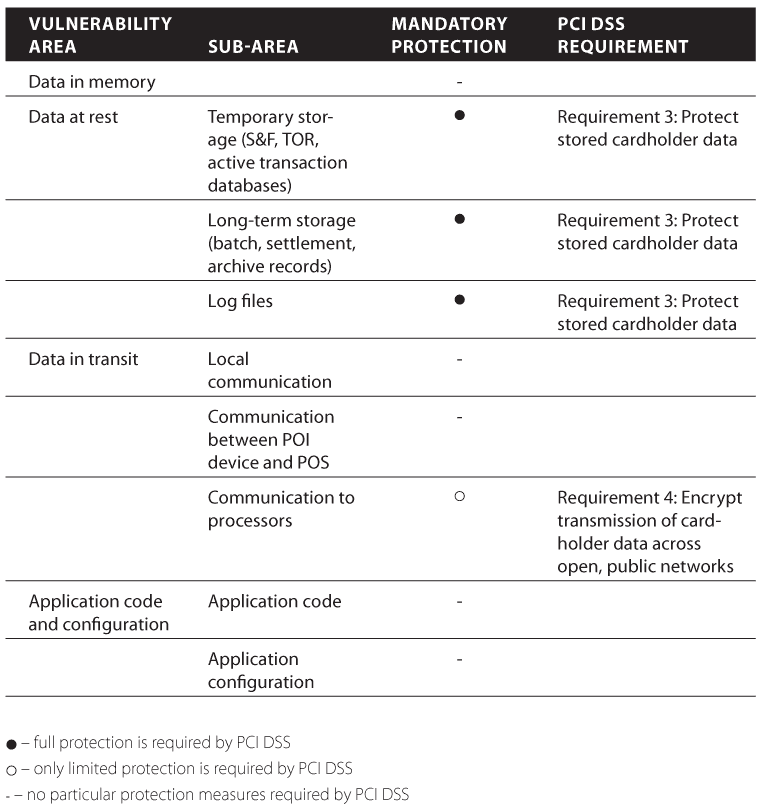

# 静态数据：PCI 的准言

静态数据（`Data at rest`）是一个用于存储在硬盘上的信息的安全术语。在某种程度上，它是传输中数据（`data in transit`）的相反面，后者是在各种设备和计算机之间传输的信息。这也是 PCI 关注的重点。PCI 规则主要侧重于防御对静态数据的攻击，因为从历史上看，它是窃取持卡人信息的两种简单方法之一（另一种是下一节将讨论的“传输中数据”）。

在 PCI 时代之前，敏感数据以明文形式存储在硬盘和备份驱动器上，仅通过商家网络和物理安全控制进行保护，而这些控制往往非常薄弱，甚至完全缺失。自 PCI 引入以来，支付软件供应商开始使用加密技术来保护存储的信息，这显著减少了利用此类漏洞的可能性。然而，加密提供的保护水平取决于具体的实现，包括加密算法、密钥长度和密钥管理方案等不同因素。在数据库和日志保护中使用弱的算法和糟糕的密钥管理是常见做法，即使在通过 PA-DSS 验证的软件中也是如此。

应用程序配置的情况更为糟糕：PCI 不要求支付软件供应商或用户对应用程序配置进行加密，这些配置通常以明文存储，并允许不受控的修改。初看之下，这似乎并不危险，因为配置信息本身并不包含敏感的持卡人数据。然而，在接下来的章节中，你将看到支付应用程序如何通过错误配置受到攻击。

## 临时存储

某些支付应用程序供应商声称他们不在 POS 机上存储敏感数据，因此他们的系统不受静态数据攻击的影响。尽管他们可能没有撒谎，但此类陈述可能是不真实的，原因如下：产品经理通常将存储视为信息的长期记录（例如归档数据库），而开发者知道在很多情况下数据是临时存储的。“世界上没有永恒不变的。”

此类临时存储的最好例子是 `SF`（存储与转发）和 `TOR`（超时冲回），它们可以实现为本地数据库表，也可以只是简单的平面数据文件。在不讨论这两个容器的重要功能必要性的情况下，只需注意它们存在于几乎任何 POS 系统中。最重要的一点是，敏感身份验证数据不能存储（即使经过了加密）。

在实践中，这些文件仍然包含 `Tracks 1` 和 `2`，这使得它们成为黑客非常垂涎的目标。对这种对 PCI 规则的严重“违反”有一个简单的解释：`SF` 和 `TOR` 记录通常在主机离线时生成，这意味着没有收到授权，因此允许存储敏感身份验证数据。通过禁止存储，其假设是交易已经完成。

`SF` 和 `TOR` 实现的一个重要特点是必须执行加密和解密操作，因为这些记录在临时存储到硬盘时是经过加密的，但必须立即解密以便进行进一步处理。因此，只能利用对称加密方案。无法使用非对称密钥加密意味着该系统是脆弱的，因为解密密钥始终存在于系统中（即使被隐藏，迟早也会被攻击者发现）。

此类临时存储的其他常见安全问题还包括弱的加密算法和糟糕的密钥管理，例如缺乏密钥轮转、硬编码密钥组件或不安全的密钥存储。设计不当的密钥管理很容易破解最强的加密算法。尽管如此，`SF` 和 `TOR` 数据的临时特性导致它们在安全评估期间被忽视，其可利用性水平未能得到充分保护。

## 应用程序日志

支付应用程序日志文件可能包含比你想象中多得多的有趣信息。与产品管理监督的主应用程序功能不同，日志文件及其内容通常由往往不关心安全的开发者控制。开发者希望尽可能多地了解其应用程序运行情况以便进行远程故障排除，包含尽可能详细信息的日志文件是他们收集此类信息的唯一途径。因此，开发者可能会决定（在不告诉任何人的情况下）将所有内容写入日志文件，包括磁道数据和账号。是的，最好的情况下他们可能会对敏感数据进行加密。然而，加密密钥可能是硬编码的，也可能是管理不当的。如果长期使用同一个密钥加密所有数据，日志文件的历史可能包含足够用于密码分析的信息：“破解密文的艺术与科学。”

另一个与日志相关的威胁是使用 `PAN` 哈希函数生成的令牌（`tokens`）。初看之下，令牌在定义上应该是安全的，并被用于替换实际卡号。然而，当使用哈希生成令牌时，它们相对很容易被破解。

### 定位临时存储和日志文件

临时存储和日志通常以以下形式之一存在：

*   数据库
*   平面数据文件
*   文本文件

许多 POS 和支付应用程序使用商用数据库管理系统（如 `SQL Server`、`Oracle`、`Interbase` 或 `MySQL`）存储临时数据。其中一个系统安装在 POS 机或商店服务器上，意味着 POS 和/或支付应用程序很可能使用此特定数据库进行数据存储。

数据库通常受密码保护。然而，支付应用程序经常使用带有默认密码的默认管理员账户（如表 6.2 所示）或以明文存储的密码（硬编码或在配置文件中）。

**表 6.2** 默认数据库账户和密码示例

| **数据库** | **登录** | **密码** |
| --- | --- | --- |
| Interbase | `SYSDBA` | `masterkey` |
| Microsoft SQL Server | `sa` | |
| Oracle | `system/manager` | `sys/change_on_install` |
| MySQL | `root` | |

以下包含 SQL 服务器数据库连接字符串的 PA 配置片段是明文存储数据库密码的示例：

```
Server=localhost;Database=Payments;User Id=sa;Password=ld50fAnkesOTSUMW;
```

初看之下，`Password` 的值看起来像是经过加密的，但这只是一个明文密码。

`Flat data files` 可以被用于数据库管理系统的自定义内部实现中。此类文件中的数据可以以二进制格式存储，其信息编码使用了所有可能的字节值（0–255），而不是文本文件中通常使用的 ASCII 码（32–126）。平坦数据文件通常具有 `.dat` 文件扩展名。

POS 和支付应用通常对日志使用 `text file` 格式，以便开发者和技术支持人员轻松读取。它们通常具有 `.log` 或 `.txt` 文件扩展名。

## 哈希处理后的 PAN (Hashed PAN)

哈希函数的标准用途是生成消息或文件的短长度摘要。哈希函数也被称为`单向加密`，因为在数学上无法从其摘要中重构原始消息，更准确地说，我们“没有发现任何简单的方法可以反转它们”。这种哈希属性被支付系统用于信用卡账户的“加密”，而无需保护加密密钥（仅因为在大多数哈希实现中并没有密钥）。表 6.3 显示了用于 PAN 加密的不同哈希函数。`SHA-256` 算法今天被认为是安全的，而 `MD5` 已经过时。

**表 6.3** PAN 哈希函数示例

| **哈希函数** | **大小** | **示例** |
| --- | --- | --- |
| 明文 PAN | 16 | 4005554444444403 |
| MD5 | 32 | 73bd8d04cc59610c368e4af76e62b3f1 |
| SHA-1 | 40 | f9b5eededb928241974368cbd97c055141813970 |
| SHA-256 | 64 | f85d4630aabe6d0d037ccb0ec0d95429aef6927b1e45a26da62cbd0bc344f6b4 |

### 暴力破解与彩虹表

信用卡号哈希的问题在于，这些数字是“可预测的”，因为它们仅由数字组成，且具有固定长度（15–19 位，通常为 16 位），该长度由卡品牌预先确定，带有已知的 6 位前缀，最后一位留作 Mod 10 校验和，该位是可以验证的。此外，前六位和后四位通常以明文形式显示，这是 PCI 和其他标准允许的，因此实际上只需要猜测 6 位数字（16 - 6 - 4）（表 6.4）。这些因素使得对信用卡号进行相对简单的 `brute-force attack` 成为可能。

**表 6.4** 根据 PCI 规则的 PAN 掩码示例

| **卡类型** | **掩码后的 PAN** | **需要猜测的位数** |
| --- | --- | --- |
| Visa | 400555*****440 | 6 |
| MasterCard | 400555*****440 | 6 |
| Amex | 3796*****5 | 5 |

## 1. 防止密码文分析

当攻击者可以访问大量使用相同加密密钥创建的 `ciphertext`（数据加密的输出）时，在某些情况下，他们可能会推导出密钥是什么。如果经常更换（轮转）加密密钥，那么执行此类任务将变得非常困难，甚至无法完成。

## 2. 最小化当攻击者获取单个加密密钥时可能泄露的数据量

如果密钥频繁更换，攻击者必须找到一种持续获取密钥的方法，才能窃取足够大量的信用卡记录。

密钥轮转的问题在于其实现并不是一项简单的任务，尤其是要正确实现。PCI 标准没有针对软件供应商在实现自动密钥轮转功能方面明确的技术要求或建议。密钥轮转的唯一要求是提供一些基本的最小功能，因此，许多应用供应商仅向商户提供有关如何更改密钥的手动说明。

自然，这些商户永远不会进行密钥轮转，因为要在数百或数千台 POS 机器上执行这些手动操作，且不对业务造成重大中断，是不可行的。

无论如何，密钥轮转是一种极好的威慑控制；然而，它并没有提供最终的数据保护，因为对称加密密钥即使经常轮转，也必须存在机器的某个地方，并可以被攻击者获取。

### 默认密钥

使用默认加密密钥的问题与密钥轮转问题有些关系。许多商户从支付应用供应商处接收支付软件，并使用开箱即用的功能和配置进行“原样”安装。如果应用供应商不费心力地设计自动密钥生成和轮转机制，那么他们所有客户的 POS 机器可能都使用相同的默认加密密钥。

### 获取密钥

为了找到密钥，攻击者首先需要知道它们存储在哪里以及如何存储。这些信息可以通过 `insiders`（内部人员）的帮助或通过 `reverse engineering`（反向工程）获得。

`insiders` 是支付软件供应商、集成商或商户员工。他们熟悉应用程序的设计，并可以访问代码和/或文档。这些现任或前员工可以利用他们的权限和知识来实现他们的财务目标，或者仅仅为了某种报复。利用他们对系统的了解，他们可能会编写恶意软件来获取密钥本身，或将这些信息出售给黑客。

`reverse engineering`（或 `disassembling`，反汇编）是一个“解码代码”的过程。用于编写支付应用代码的大多数编程语言都是编译器或解释器。无论哪种情况，它们在代码构建过程的最后一步都会生成某种二进制文件。如果编译器创建了机器可执行代码（例如 `C`、`C++` 或 `Delphi`），那么将此类代码反汇编回原始表示形式（即 `source code`）就会更困难。对于使用创建 `intermediate code`（如 `Java` 或 `C#`）的现代语言，除非二进制代码被 `obfuscated`（混淆），否则理解原始源代码要容易得多。无论花费多少时间，反转代码以定位密钥都是一项可行的任务。

***

交叉引用：请参见第 9 章获取更多关于代码混淆的细节。

***

最后，我们不应该忘记，应用程序在使用 `DEK` 进行数据加密或解密之前必须对其解密。大多数支付应用使用软件加密，这意味着所有的加密操作都在应用程序内存中执行，因此未加密的 `DEK` 必须存在内存中，并可以被安装在 POS 机器上的恶意 `memory scanning`（内存扫描）软件捕获。

一旦应用程序逻辑被研究，创建能够获取密钥的恶意软件只是时间以及程序员技能的问题，它可以解密支付应用存储的持卡人数据，收集它们，并通过互联网、无线甚至蓝牙连接将其发送给攻击者。

### DiskScraper 工具

尽管加密 PAN（卡号）和磁道数据存储是最强大且最著名的 PCI 要求之一，但某些记录可能仍然留在那里，因为某人忘记了删除它们，或者仅仅是因为 POS 软件存在漏洞。目前有多种工具（包括商业和开源）可以扫描硬盘以寻找敏感数据。如果你运行此类工具，你可能会惊讶，在运行经过 PA-DSS 验证的 PCI DSS 合规机器上，本应被删除的账号甚至磁道数据仍然在那里。`DiskScraper` 是一个示例 `.NET` 工具。

它们应该分块读取，因为它们可能过大，无法作为一个块加载。分块大小默认设置为 `4,096` (4 KB)，但可以根据所需的性能设置为任何大小：

```c
chunk = br.ReadBytes(CHUNK_SIZE);
while (chunk.Length > 0)
{
    string ASCIItext = Encoding.ASCII.GetString(chunk);
    string Unicodetext = Encoding.Unicode.GetString(chunk);
    searchLine.Search(ASCIItext, position.ToString(), fName, ref res);
    searchLine.Search(Unicodetext, position.ToString(), fName, ref res);
    chunk = br.ReadBytes(CHUNK_SIZE);
    position += CHUNK_SIZE;
}
```

`DiskScraper` 使用与 `MemoryScraper` 和 `NetScraper` 相同的代码（位于 `HackingPOS.Scrapers.Common`）来查找卡片账号和轨迹。

## 传输中的数据：PCI 涵盖了什么？

在与通信保护相关的要求中，PCI 标准区分了不同的网络：“开放、公共”网络和任何其他网络。

> 加密跨越开放、公共网络的持卡人数据传输。

这种区分的问题在于，非“开放、公共”网络（包括店内局域网、企业广域网以及商户与处理器之间的帧中继）在支付应用程序的功能中起着重要作用。此外，支付应用程序大部分使用此类网络进行敏感数据传输。

## 表 6.6 网络保护要求

| 网络类型 | PCI 是否要求加密？ | 通常用于敏感数据传输 |
| --- | --- | --- |
| 互联网 | 是 | POS 与支付网关/处理器之间 |
| 无线 | 是 | POS 与商店之间；POS 与支付网关/处理器之间的服务器 |
| 局域网 (LAN) | 否 | POS 与商店服务器之间；POS 与支付网关/处理器之间；支付应用程序模块之间 |
| 广域网 (WAN) | 否 | POS 与支付网关/处理器之间；商店服务器与公司总部之间 |

尽管如此，即使是对 PCI DSS 要求进行简单分析，也会发现大多数“PCI 合规”的支付应用程序受到基础网络嗅探攻击，这种攻击在第 5 章中描述。然而，即使是受 PCI 保护的“开放、公共”网络仍然容易受到更复杂的攻击。

## SSL 漏洞


安全套接层 (SSL) 是一种非常流行且成熟的协议，用于保护传输中的数据，支付应用程序也不例外。然而，SSL 并非不可破解的，它可能存在缺陷，特别是在配置不当的情况下。

交叉引用：关于 SSL 实现的更多详细信息请参见第 8 章。

## SSL/TLS 的过时版本

自 1995 年由 Netscape 发明以来，SSL 经历了多次修改。SSL 的最后一个版本是 3.0，从那时以后以 TLS（传输层安全）协议继续延续。如果支付应用程序没有使用最新最强大的 TLS 版本（本文出版时为 1.2），它很可能受到攻击，因为每个版本的 SSL 和 TLS 均包含安全补丁。

## 弱加密套件

SSL 的功能之一是允许客户端和服务器之间协商加密的类型和级别。一方面，这一功能是有益的，因为它允许不同类型的客户端和服务器相互通信。另一方面，这一功能可能允许攻击者 `downgrade`（降级）加密级别，并篡改本应安全的通信。

## 中间人攻击

中间人攻击 (MITM) 是最著名的攻击类型之一。它允许攻击者拦截客户端和服务器之间的流量。如果客户端不验证服务器证书，它就会认为该证书是有效的。

MITM 的另一种可能场景是插入虚假代理。这可以通过几个条件实现：

1. 攻击者成功访问颁发证书的公共证书机构 (CA)。
2. 攻击者将其证书植入客户端的存储库中。

## 总结

PCI 安全标准仅保护支付应用程序中有限且相对较小的区域，并且主要关注静态数据，包括存储在硬盘上的临时存储。尽管根据 PCI 要求，硬盘上的所有敏感数据都必须加密，但支付应用程序使用了弱的密钥实现。

PCI 还保护极少量的传输中敏感数据，这些数据仅通过无线局域网和互联网等“开放、公共网络”进行传输。尽管无线网络和互联网上的流量经过加密，但 SSL 等安全协议的漏洞可能会被利用以接入网络并窃取敏感卡片信息。

## 注释

1. Jonathan Swift, “A Critical Essay upon the Faculties of the Mind,” *The Works of the Rev. Jonathan Swift, D.D. Dean of St. Patrick's, Dublin with Notes, Historical and Critical, Vol. 2*, Arranged by Thomas Sheridan, A.M., (London, 1808), p. 460.

2. PCI DSS Requirements and Security Assessment Procedures Version 2.0, PCI SSC, (October 2010), Req. 3.2, 3.2.1, p. 29, `https://www.pcisecuritystandards.org/documents/pci_dss_v2.pdf`

3. PCI PA-DSS Requirements and Security Assessment Procedures Version 2.0, PCI SSC, (October 2010), Req. 1.1, 1.1.1, pp. 17-18, `https://www.pcisecuritystandards.org/documents/pa-dss_v2.pdf`

4. Bruce Schneier, *Applied Cryptography*, *Second Edition: Protocols, Algorithms, and Source Code in C*, (Hoboken, NJ: Wiley, 1996), p. 13.

5. 默认密码, [CIRT.net](http://CIRT.net), [`www.cirt.net/passwords`](http://www.cirt.net/passwords)

6. 默认密码数据库, [Virus.org](http://Virus.org), [`www.virus.org/default_passwds`](http://www.virus.org/default_passwds)

7. Bruce Schneier, 《应用密码学》 (*Applied Cryptography*), *第二版：C 语言中的协议、算法与源代码* (Hoboken, NJ: Wiley 1996), 第 35 页。

8. “信用卡号哈希：不安全的应用实践” (2007), [`www.integrigy.com/files/Integrigy_Hashing_Credit_Card_Numbers_Unsafe_Practices.pdf`](http://www.integrigy.com/files/Integrigy_Hashing_Credit_Card_Numbers_Unsafe_Practices.pdf)

9. “PCI PA-DSS 要求与安全评估程序版本 2.0，PCI SSC” (2010 年 10 月)。要求 2.3，第 24–26 页, [`www.pcisecuritystandards.org/documents/pa-dss_v2.pdf`](https://www.pcisecuritystandards.org/documents/pa-dss_v2.pdf)

10. “PCI DSS 要求与安全评估程序版本 2.0，PCI SSC” (2010 年 10 月)，要求 4，第 35 页, [`www.pcisecuritystandards.org/documents/pci_dss_v2.pdf`](https://www.pcisecuritystandards.org/documents/pci_dss_v2.pdf)

11. David Wagner 和 Bruce Schneier, “SSL 3.0 协议分析”, [`www.schneier.com/paper-ssl.pdf`](https://www.schneier.com/paper-ssl.pdf)

12. “SSL 协议，Netscape” (1996), [`web.archive.org/web/19970614020952/`](http://web.archive.org/web/19970614020952/) [http://home.netscape.com/newsref/std/SSL.html]

13. TLS/SSL 加固与兼容性报告 2011, 《G-Sec》, [`www.g-sec.lu/sslharden/SSL_comp_report2011.pdf`](http://www.g-sec.lu/sslharden/SSL_comp_report2011.pdf)

14. WeakCipherSuites：弱加密套件测试, *Sslyze*, (2012 年 3 月), [`code.google.com/p/sslyze/wiki/WeakCipherSuites`](https://code.google.com/p/sslyze/wiki/WeakCipherSuites)

15. “Comodo 欺诈事件，Comodo” (2011 年 3 月), [`www.comodo.com/Comodo-Fraud-Incident-2011-03-23.html`](http://www.comodo.com/Comodo-Fraud-Incident-2011-03-23.html)

16. Steven J. Vaughan-Nichols, “NSA 以及你的老板如何拦截并破解 SSL”, *ZDNet*, (2003 年 6 月), [http://www.zdnet.com/how-the-nsa-and-your-boss-can-intercept-and-break/]

# 第三部分

## 防御

# 第 7 章

## 应用中的密码学

> 只要有需要保护的信息，就会存在密码学的需求。在支付应用案例中，存在必须隐藏的敏感数据。¹

## 冰山一角

现代密码学应用于许多领域，但它只是冰山一角。本章的目标不是提供深奥的理论，而是解释可用技术、如何使用以及如何正确实现。

虽然密码学应用于许多领域，但它只是冰山一角。为了理解可用技术、如何使用以及如何正确实现，我们需要一些理论。算法名称只是冰山一角。

## 对称、非对称还是单向？

算法名称通常是支付应用开发者介绍的第一个（在很多情况下也是唯一的）特征。虽然名称没有提供实现和管理的细节，但它识别了系统的基本行为以及一些潜在的漏洞。

加密函数分为三大类：*对称*、*非对称*和*单向*加密（参见表 7.1）。每一组都基于不同的数学概念，并用于不同的任务。在选择加密类型时应考虑的另一个重要区别是加密和解密密钥之间的关系。简单来说，加密和解密使用相同的密钥；非对称算法使用不同的解密密钥；而单向加密哈希函数完全没有密钥（尽管存在例外）。密钥管理的这种多样性主要决定了其实用领域。

表 7.1 对称、非对称和单向加密的差异摘要

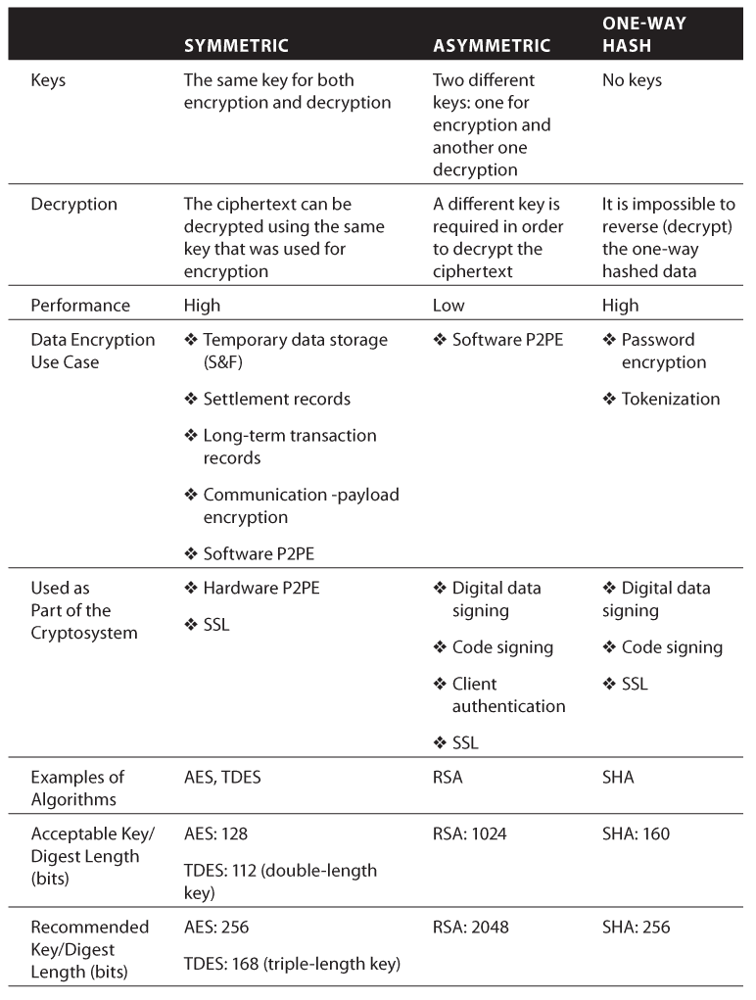

如表 7.1 所示，对称加密是支付应用中数据加密最实用的算法类型。然而，所有类型的加密通常在某种程度上参与了 POS 软件。

## 尺寸重要吗？

正如本章开头提到的，关于加密问题的标准答案是加密算法名称，例如“AES”。如果你足够幸运，你还可以以 3–4 位后缀的形式获得更多信息，例如“AES-256”。这些数字代表密钥的长度，单位为位（bits）。对于某些算法，密钥长度与其名称是“固定”的。例如，Triple DES（三重 DES）通常意味着密钥长度为 112 位。之所以说“通常”，是因为 Triple DES 有不同的变体：`2TDEA` 和 `3TDEA`。`2TDEA` 代表“双倍长度密钥的 Triple DES”，这意味着密钥大小为 112 位（原始 DES 密钥长度为 56 位，因此双倍长度为 2 × 56 = 112）。`3TDEA` 代表“三倍长度密钥的 Triple DES”，这意味着密钥大小为 3 × 56 = 168 位。加密算法的通用规则是“越大越好”。这是因为攻击加密最简单的方法是暴力破解，它会遍历密钥中位的所有可能组合，直到找到正确的密钥。凭借现代计算机的处理能力，暴力破解几十位密钥是可能的。例如，使用 56 位密钥的 DES（2⁵⁶ 种可能组合）可以在一天内被破解。² 然而，在密钥中增加更多的位会指数级地增加破解所需的时间（参见图 7.1）。这就是为什么 112 位密钥的 2TDEA (2¹¹²) 仍然安全（但并非永久，因为根据摩尔定律，计算能力每两年翻一倍³）。

**图 7.1** (#981118810071c07.xhtml#c07-fig-anc-0001) 通过增加额外的密钥位使加密算法安全性呈指数级增长

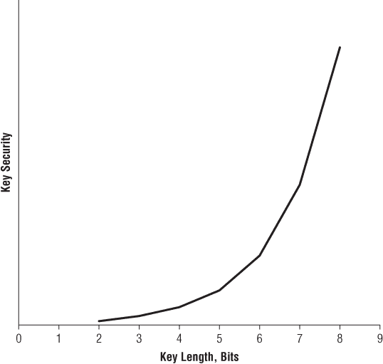

与对称加密相比，非对称算法与密钥大小相关的安全规模不同。例如，一个 1024 位的 RSA 密钥等于一个 80 位对称密钥。⁴

单向哈希函数在大多数情况下没有密钥，因此它们的强度取决于其所产生的摘要长度。例如，如今被认为最佳实践的 SHA-256 会产生一个 256 位的的结果。

## 密钥熵 (Key Entropy)

简单来说（不涉及数学术语），`entropy`（熵）意味着密钥值的可预测性。在生成新密钥或密钥组件时，使用产生随机结果的函数非常重要。大多数加密库提供了随机生成器，它们接受某些自然事件（如用户输入和系统时钟）作为初始熵。例如，`.NET System.Security.Cryptography` 包含 `RandomNumberGenerator` 类，可为密钥组件、密钥或初始化向量生成随机数（下一节“对称加密”包含更多相关细节）。

## 密钥派伸 (Key Stretching)

`key stretching`（密钥派伸）技术允许你增加尺寸和熵——从而增加可以从密码或短语等普通用户输入中派生的加密密钥的安全性。⁵ 用户定义的密码或短语的问题在于，它们可以使用字典攻击和/或暴力破解相对容易地猜到。为了解决这个问题，密钥派伸算法对输入数据进行多次迭代转换（如哈希函数），最终创建一个具有合适大小和安全等级的加密密钥。`.NET System.Security.Cryptography` 中的 `Rfc2898DeriveBytes` 类是根据 `PKCS` `#5` 标准定义的规则实现密钥派伸的示例之一。⁶ `Rfc2898DeriveBytes` 用于 `EncryptionDemo` 程序的密钥生成，该程序将在后续章节中描述。

## 对称加密 (Symmetric Encryption)

它之所以命名为“对称”，是因为加密和解密使用的是相同的密钥（图 7.2）。

**图 7.2** (#981118810071c07.xhtml#c07-fig-anc-0002) 对称加密

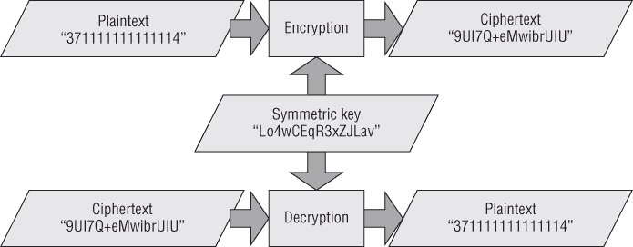

这一特性既有优点也有坏处。一方面，它简化了密钥管理——双方（例如 POS 应用和支付网关服务器）共享同一个密钥，因此一方可以加密消息，另一方可以解密，且都使用相同的密钥。另一方面，如果一方被攻破，攻击者就拥有可以使用的密钥。

1. 加密和解密双方都位于同一台机器上。在这种情况下，使用非对称加密没有意义，因为解密密钥是可以访问。
2. 密钥存储在硬件中，即使应用程序被攻破无法提取。这是支付应用程序使用对称算法的原因之一。
3. 密钥经常更换（轮）。如果每次通信（如 SSL）或每次交易（如 DUKPT）都生成新的加密密钥，那么即使单个密钥泄露，也不会影响之前的或后续会话。

对称加密的另一个重要优点是高性能。与非对称算法相比，对称算法使用的数学运算更简单，因此实现所需的 CPU 周期更少。

### 强算法

有很多对称加密算法既独立用于数据保护，也作为数字签名等加密解决方案的一部分。AES（高级加密标准）和 TDES（三重 DES）在支付应用中被广泛使用。TripleDES 配合 DUKPT 密钥管理方案在 PIN 加密方面具有长期良好的记录，而 AES 则被国家安全局（NSA）推荐用于机密加密。⁷

### EncryptionDemo

EncryptionDemo 应用程序（所示图 7.3）演示了所有加密类型——对称、非对称和单向——这些加密在独立的程序集 `HackingPOS.Cryptography.Encryption.dll` 中实现，并供其他应用程序复用。这些二进制文件可以从 Wiley 网站 `www.wiley.com/go/hackingpos` (http://www.wiley.com/go/hackingpos) 下载并测试，无需编译源代码（源代码也提供下载）。

**图 7.3** (#981118810071c07.xhtml#c07-fig-anc-0003) EncryptionDemo 应用程序：对称加密

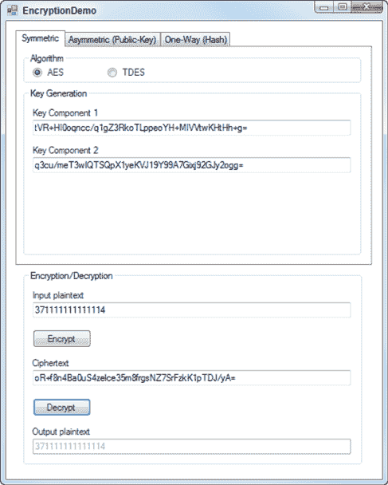

### 实现对称加密

许多年前，程序员每当需要在应用程序中加密数据时，都需要编写加密代码。在现代开发环境中实现加密是一项相对简单的任务，因为有加密库支持常见的算法和基础密钥管理函数。然而，适用于支付应用程序的加密实现并非开箱即用，为了获得解决方案，仍然需要对代码进行一些操作。

### 生成密钥

在 EncryptionDemo 应用程序中，对称密钥不存储在任何地方，而是在每次需要加密或解密时在内存中动态重建。使用了三个密钥组件作为确定性生成器（`Rfc2898DeriveBytes` 类）的输入：

1. 首先，`generateKey` 方法从 `KeyComponent1` 创建 `Rfc2898DeriveBytes` 的 `salt` 参数的值：

```
Random random = new Random(keyComponent1.GetHashCode());
byte[] salt = new byte[16];
random.NextBytes(salt);
```

2. 接着，它从 `KeyComponent2` 和硬编码的 `KeyComponent3` 创建 `Rfc2898DeriveBytes` 的 `password` 参数的值：

```
SHA256 sha256 = SHA256.Create();
byte[] password = sha256.ComputeHash(
Encoding.ASCII.GetBytes(keyComponent2 + keyComponent3));
```

3. 最后，`Rfc2898DeriveBytes` 类的实例“生成”了密钥：

```
Rfc2898DeriveBytes keyGenerator = new Rfc2898DeriveBytes(
password, salt, ITERATIONS);
return keyGenerator.GetBytes(KEY_SIZE);
```

这三个密钥组件可以用于将密钥信息分散到不同的介质中；例如，组件 1 可以硬编码在应用程序中，组件 2 可以写入硬盘上的文件，而组件 3 可以存储在注册表中。攻击者必须拥有所有这三个区域（应用程序代码、文件系统和注册表）的访问权限才能重新创建密钥。

加密系统中经常使用的另一种方法是应用程序提示用户输入密码，并将其作为密钥组件之一。这种方法的应用范围有限，因为用户可能会忘记密码、每个会话都需要输入密码，或者在无人值守的独立后台服务应用程序中可能无法使用。

### 分块、填充和初始化向量

当 `plaintext`（待加密的明文数据）长度大于密钥大小时，将使用 `block ciphers`。明文随后被分成多个块，并对每个块进行加密操作，直到整个数据流完成加密（或解密）。有几种分块模式，它们在在上一个块与下一个块之间的连接方式不同。`CBC`（密码块链）模式通过在当前明文块和上一个密文块之间执行 XOR（异或）操作将块与上一个块连接起来：

```
provider.Mode = CipherMode.CBC;
```

当明文的大小与块大小不一致时（例如当加密数据流的最后一个块时），则需要 `padding`。`PKCS` `#7` 填充字符串由字节序列组成，每个字节的值都等于所添加的填充字节总数：

```
provider.Padding = PaddingMode.PKCS7;
```

分块加密需要 `Initialization Vector`（初始化向量）来为第一个明文块提供输入。IV 应该是随机生成的：


```csharp
byte[] IV_seed = new byte[IV_SEED_SIZE];
RandomNumberGenerator IVGenerator = RandomNumberGenerator.Create();
IVGenerator.GetNonZeroBytes(IV_seed);
```

IV 种子被添加到输出密文流中：

```csharp
result = new byte[IV_SEED_SIZE + ciphertext.Length];
Buffer.BlockCopy(IV_seed, 0, result, 0, IV_SEED_SIZE);
Buffer.BlockCopy(ciphertext, 0, result, IV_SEED_SIZE, ciphertext.Length);
```

现在解密函数可以读取该 IV，以便在解密期间初始化第一个块：

```csharp
byte[] IV_seed = new byte[IV_SIZE];
Buffer.BlockCopy(Ciphertext, 0, IV_seed, 0, IV_SIZE);
```

## 加密与解密

加密过程涉及几个流类：

```csharp
using (ICryptoTransform encryptor = provider.CreateEncryptor(
    provider.Key, provider.IV))
using (MemoryStream memStream = new MemoryStream())
using (CryptoStream encryptStream = new CryptoStream(
    memStream, encryptor, CryptoMode.Write))
{
    using (StreamWriter streamWriter = new StreamWriter(
        encryptStream))
        streamWriter.Write(Plaintext);
    byte[] ciphertext = memStream.ToArray();
}
```

由于这是对称加密，解密代码与加密代码相似，它们以相反的方向工作：

```csharp
using (ICryptoTransform decryptor = provider.CreateDecryptor(
    provider.Key, provider.IV))
using (MemoryStream memStream = new MemoryStream(
    actual_ciphertext, 0, actual_length))
using (CryptoStream decryptStream = new CryptoStream(
    memStream, decryptor, CryptoMode.Read))
using (StreamReader streamReader = new StreamReader(
    decryptStream))
    result = streamReader.ReadToEnd();
```

## 非对称加密

`Asymmetric encryption`（也称为 `public-key encryption`）之所以命名，是因为加密和解密使用了不同的密钥。同一个密钥不能同时用于加密和解密操作。非对称加密是密码学中最伟大的发明之一，因为它第一次允许你加密信息，而不必担心加密端（加密密钥）被攻破会导致信息泄露。此外，加密密钥可以公开给所有人（这就是为什么它被称为 `public key`），任何人都可以向拥有解密密钥（`private key`）的发送者发送加密数据。非对称加密的这些特性用于 `Public Key Infrastructure`（PKI），它结合 SSL 协议，对于互联网安全至关重要。在 `digital signature` 实现中，非对称算法以相反的方向运行——发送者使用其私钥加密数据。

### 实现公钥加密

在某些较少的情况下，而不是隐式使用（如证书或数字签名），支付应用程序开发者可能需要直接实现公钥加密；例如作为 P2 解决方案的数据加密机制。`EncryptionDemo` 应用程序有一个非对称加密的标签页，演示了 `RSA` 算法和非对称密钥的使用。

### 生成密钥

通常，支付应用程序并不生成非对称密钥，而是以 `key container` 或 `digital certificate` 的形式接收 `X.509 certificate` 是数字证书格式的行业标准之一。证书可以只包含公钥，也可以同时包含公钥和私钥，取决于特定证书和函数的定义。例如，如果 POS 应用程序实现了 P2PE 加密，它将拥有只有公钥的证书，而私钥仅位于服务器端。

### 自签名证书

`MakeCert` 是 .NET Framework SDK（1 及更高版本）和 Microsoft Windows SDK 中的证书创建工具。`MakeCert` 可用于生成基本的自签名证书（`.cer` 文件），这对于基础演示程序是足够的。私钥创建在独立的 `.pvk` 文件中：

```cmd
makecert.exe EncryptionDemoCert.cer -r -a sha256 -len 2048 -n "CN= EncryptionDemo" -b 01/01/2013 -e 01/01/2023 -sv EncryptionDemo.pvk -sky exchange
```

表 7.2 列出了用于生成 EncryptionDemo 应用程序自签名证书和私钥的 `MakeCert` 参数及其值列表。`MakeCert` 还会提示输入密码以便生成并保护秘密私钥，将其存储在 `.pvk` 文件中。由于该命令的执行，创建了 `EncryptionDemo.cer` 和 `EncryptionDemo.pvk` 文件。

## 表 7.2 用于生成自签名证书和私钥的 MakeCert 参数

| 参数 | 值 | 说明 |
| --- | --- | --- |
| N/A | `EncryptionDemo.cer` | 生成的证书（公钥）文件的位置和名称 |
| `-r` | N/A | 创建自签名证书 |
| `-a` | `sha256` | 使用 SHA-256 作为签名哈希算法 |
| `-len` | `2048` | 创建 2048 位 RSA 密钥（默认长度为 `1,024` 位） |
| `-n` | “CN= EncryptionDemo” | 证书名称 |
| `-b` | `01/01/2013` | 有效起始日期 |
| `-e` | `01/01/2023` | 有效过期日期 |
| `-sv` | `EncryptionDemo.pvk` | 生成的私钥文件的位置和名称 |
| `-sky` | `exchange` | 设置加密/解密的密钥类型 |

## PFX 证书文件

创建证书和私钥文件后，使用 `Pvk2Pfx.exe` 工具将公钥和私钥合并到一个通用密钥容器中——`PFX` (*个人信息交换*) `证书文件`——该文件可以作为加密和解密过程的输入：

```cmd
pvk2pfx -pvk EncryptionDemo.pvk -spc EncryptionDemo.cer -pfx EncryptionDemo.pfx -pi HackingPOS
```

执行此命令后，将创建一个 `EncryptionDemo.pfx` 文件。表 7.3 包含了用于创建 PFX 格式单文件证书的 `Pvk2pfx` 参数和值。

### 表 7.3 用于创建 PFX 格式单文件证书的 Pvk2pfx 参数

| 参数 | 值 | 说明 |
| --- | --- | --- |
| `-pvk` | `EncryptionDemo.pvk` | 输入的私钥文件的位置和名称 |
| `-spc` | `EncryptionDemo.cer` | 输入的证书（公钥）文件的位置和名称 |
| `-pfx` | `EncryptionDemo.pfx` | 输出的 PFX 证书文件的位置和名称 |
| `-pi` | `HackingPOS` | 私钥密码（在之前的 MakeCert 会话中提示） |

`Pvk2pfx` 工具是 Windows SDK 的一部分，位于 `bin\x86` 文件夹 (Win32) 或 `bin\x64` 文件夹 (Win64)。

为了仅仅运行 `EncryptionDemo` 并测试非对称加密，没有生成新证书，因为 `EncryptionDemo` 自带了预生成的测试证书文件（`EncryptionDemo.cer` 和 `EncryptionDemo.pfx`），这些文件可以从 Wiley 网站与所有二进制文件一起下载。

当客户端和服务器处于远程时，可以使用 `MakeCert` 和 `Pvk2Pfx` 工具为客户端和服务器身份验证创建各种证书。关于 SSL 加密、客户端身份验证和数字签名更复杂的场景将在第 8 章和第 9 章中描述。

## 加密

生成密钥并使用适当格式封装到证书文件中后，加密和解密代码本身（`AsymmetricEncryption` 类）并不复杂。如之前讨论的，非对称加密的主要优势是加密和解密使用不同的密钥。为了进行加密，只需要公钥组件。使用 `X509Certificate2` 类从 `EncryptionDemo.cer` 证书文件中加载并解析公钥：

```csharp
X509Certificate2 certificate = new X509Certificate2(CERName);
```

当 `RSACryptoServiceProvider` 实例用从证书中加载的公钥初始化时，会对明文进行加密：

```csharp
using (RSACryptoServiceProvider RSA = (RSACryptoServiceProvider)
    certificate.PublicKey.Key)
{
    encryptedData = RSA.Encrypt(PlainText, false);
    return encryptedData;
}
```

## 解密

为了解密用公钥加密的密文，`X509Certificate2` 类实例加载并解析 PFX 证书文件。在构造 `X509Certificate2` 类实例时提供的第二个参数是私钥密码，该密码是在通过 `MakeCert` 命令生成 PVK 文件时提示的：

```csharp
X509Certificate2 certificate = new X509Certificate2(PFXName, Password);
```

当 `RSACryptoServiceProvider` 类实例用私钥初始化时，会对密文进行解密：

```csharp
using (RSACryptoServiceProvider RSA = (RSACryptoServiceProvider)
    certificate.PrivateKey)
{
    plaintext = RSA.Decrypt(Ciphertext, false);
    return plaintext;
}
```

## 单向加密

单向加密也被称为*哈希函数*，它只向一种方式工作：它可以加密消息而没有解密的能力。图 7.6 显示了单向加密。

### 图 7.6 单向加密（哈希）

单向加密只向一种方式工作：它可以加密消息而没有解密的能力。哈希函数保证它为每个唯一输入创建一个唯一的*摘要*（但在实践中，不同的数据输入产生相同的哈希会导致*冲突*）。哈希函数的一个重要特点是加密不需要密钥。这一特性既有优点也有缺点。一方面，它不需要密钥管理非常方便；另一方面，哈希函数在没有任何安全措施的情况下很容易被彩虹表破解。哈希函数在支付系统中直接应用两个领域：令牌化和密码加密。此外，哈希是数字签名的重要组成部分。

### 实现单向加密

`EncryptionDemo` 具有另一个用于单向加密的标签，显示了如何使用 SHA-256 算法（图 7.7）。

### 图 7.7 EncryptionDemo：单向加密（哈希）

哈希实现可以非常简单，当使用加密库（.NET System.Security.Cryptography）时，几行代码即可：

```csharp
SHA256 sha256 = SHA256.Create();
byte[] hash_result = sha256.ComputeHash(pan_bytes);
```

然而，如第 6 章所述，仅使用简单的哈希函数由于暴露于彩虹表和暴力破解攻击是危险的。因此，应该添加盐以防止或至少减少此类攻击的可能性。`EncryptionDemo` 有一个由三部分组成的盐示例：

1. **常量组件**：硬编码在应用程序中
2. **用户定义组件**：可以根据客户不同，并可以存储在应用程序配置文件
3. **变量组件**：
   - 对于令牌：可以从不包含哈希数据的用户输入中获取；例如过期日期和 CVV（位于 Track 1 和 Track 2 中，且在交易完成后不应存储）
   - 对于密码：为每次函数调用随机生成的唯一值

## 令牌加盐

哈希函数通常用于创建`令牌`——一种在商户的支付和企业系统中代表支付卡的唯一 ID，而不暴露实际敏感的持卡人信息。此类令牌通常是通过将哈希算法应用于 PAN 值创建的，因为 PAN 存在于 Track 1 和 Track 2 中并始终能唯一标识卡。

使用 `Random` 类通过其哈希码来扩展 `VariableSaltComponent`，该组件可能太小，无法作为 `saltGenerator` 的良好输入：

```csharp
Random random = new Random(VariableSaltComponent.GetHashCode());
byte[] variable_salt_bytes = new byte[SALT_SIZE];
random.NextBytes(variable_salt_bytes);
```

`hash` 方法通过三个组件动态构建盐值：`CONSTANT_SALT_COMPONENT`、`user_defined_salt_component` 和 `VariableSaltComponent`，这些组件使用 `Rfc2898DeriveBytes` 类进行混合：

```csharp
Rfc2898DeriveBytes saltGenerator = new Rfc2898DeriveBytes(
    Encoding.ASCII.GetBytes(
        CONSTANT_SALT_COMPONENT + user_defined_salt_component),
    variable_salt_component, ITERATIONS);
salt_bytes = saltGenerator.GetBytes(SALT_SIZE);
```

一旦从三个组件构建了盐，它将与输入明文合并到单个缓冲区中，形成最终哈希函数的输入（图 7.8）：

```csharp
byte[] plaintext_bytes = new byte[SALT_SIZE + pan_bytes.Length];
Buffer.BlockCopy(salt_bytes, 0, plaintext_bytes, 0, SALT_SIZE);
Buffer.BlockCopy(
    pan_bytes, 0, plaintext_bytes, SALT_SIZE, pan_bytes.Length);
SHA256 sha256 = SHA256.Create();
return sha256.ComputeHash(hash_input);
```

**图 7.8** 生成令牌

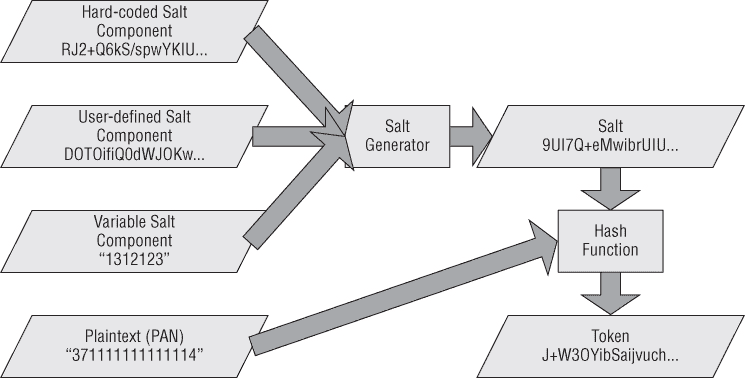

## 密码加盐

在某些哈希应用中（例如密码加密和验证），有必要添加一个随机生成的盐组件，以便在每次调用哈希函数时，为相同的输入（明文密码）获得不同的密文（加密后的密码）。这样做是为了防止密码泄露的可能性，即使攻击者能够访问密码文件。`encryptPassword` 方法使用了与之前描述的 `CreateToken` 相同的哈希逻辑，唯一的区别是它不是使用由 `Random` 类扩展的变量组件，而是使用 `RandomNumberGenerator` 生成随机盐组件：

```csharp
dynamic_password_salt_component = new byte[16];
RandomNumberGenerator generator = RandomNumberGenerator.Create();
generator.GetNonZeroBytes(dynamic_password_salt_component);
```

如果没有随机盐组件，两个相同的密码将产生相同的哈希输出，因此攻击者可能会像合法用户一样输入相同的密码，并通过查看密码文件来确定用户的密码值。随机盐组件也必须添加到哈希结果中，以便通过对用户输入进行哈希处理并将结果与密码文件中存储的原始密码哈希进行比较来验证密码（如图 7.9 所示）：

```csharp
byte[] encrypted_password =
    new byte[SALT_COMPONENT_SIZE + hash_result.Length];
Buffer.BlockCopy(
    random_password_salt_component, 0,
    encrypted_password, 0, SALT_COMPONENT_SIZE);
Buffer.BlockCopy(
    hash_result, 0, encrypted_password,
    SALT_COMPONENT_SIZE, hash_result.Length);
```


## 图 7.9 密码加密

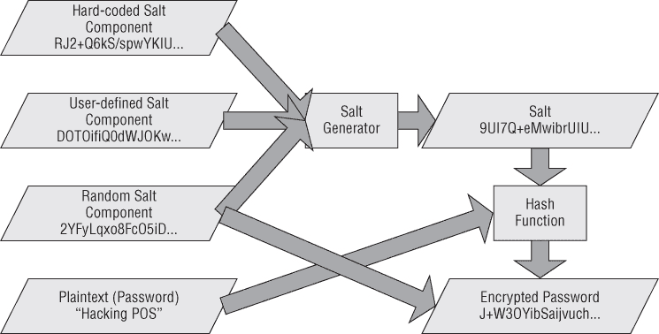

常量和用户定义的盐组件可以硬编码，也可以与代码分开存储；其背后的思想是使得无法从密码记录中检索整个盐值。因此，如果攻击者拥有密码数据库但无法访问应用程序代码和配置，她将无法仅凭一个随机盐组件重新创建盐值。

## 验证密码

密码验证基于这样一个假设：加密的密码记录与特定的用户账户关联，因此不需要使用哈希数据进行搜索。因此，对加密密码进行随机加盐，并将随机盐组件与密文一起添加到输出。`ValidatePassword` 方法从原始记录中检索随机盐组件：

```
byte[] original_random_salt_component = new byte[SALT_COMPONENT_SIZE];
Buffer.BlockCopy(
original_password_hash, 0,
original_random_salt_component, 0, SALT_COMPONENT_SIZE);
```

然后它为正在验证的密码创建哈希（与为原始密码创建哈希的方式完全相同）：

```
string encrypted_password_to_validate = encryptPassword(
PasswordToValidate, original_random_salt_component);
```

最后一步只是比较两个加密后的密码：

```
return encrypted_password_to_validate.Equals(OriginalPasswordHash);
```

如果两个字符串相同，则通过验证，这意味着用户输入了正确的密码（图 7.10）。

## 图 7.10 加密

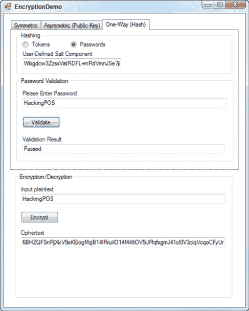

## 数字签名

数字签名是密码学最显著的应用之一。它提供了验证数字文档、消息和数据的作者的能力，这在处理支付应用和交易时非常重要。公钥和单向哈希用于创建使用签名者私钥加密的签名。因此，为了验证数字签名，消息接收者使用公钥解密并与其结果进行比较。

### 附件式与分离式签名

数字签名有两种类型：附件式和分离式。前者是被签名数据的一部分——例如嵌入二进制文件的 `Authenticode` 签名。后者作为独立实体创建——例如根据 `S/MIME` 标准生成的电子邮件签名。

分离式签名可以用于任何文件类型，因为它不修改被签名的内容。附件式签名只能用于特定的文件类型和消息格式。

PKCS #7 标准定义的格式基于更常见的 X.509 证书标准，用于实现分离签名容器¹³。`.p7s` 文件类型可以存储分离数字签名的内容¹⁴。表 7.4 显示了附件式和分离式签名的各种用例。

## 表 7.4 常见的附件式与分离式签名示例

| **签名对象** | 附件式签名 | 分离式签名 |
| --- | --- | --- |
| 代码文件 | `Authenticode`¹⁵ <br>.NET 强名称签名¹⁶ | |
| 数据文件 | `XML Signature`¹⁷ | |
| 消息 | | 电子邮件签名：`S/MIME`¹⁸ |

### 代码和配置签名

这是支付应用最重要的数字签名用例之一。*代码签名*提供了防止应用程序代码被篡改的保护，而签名配置可以缓解未经授权更改配置的威胁。代码和配置签名实现的细节将在第 9 章中描述。

### 数据文件和消息签名

提到数据签名，特别是敏感的持卡人数据，有一点很重要：数字签名并不保护机密性。因此，除了签名之外，还需要其他安全措施（加密）来避免信息泄露。然而，数字签名可以用于保护对泄露威胁不敏感的信息，免受未经授权的人员或恶意软件的修改。例如，POS 交易文件（在 POS、商店服务器和公司总部之间流的完整客户交易信息）就是数字签名的良好候选对象。

## 加密硬件

任何加密功能都可以在软件中实现。但在实践中，许多加密功能被委托给专用的硬件模块和设备。加密硬件有两个功能对于支付应用至关重要：

1. 执行计算 CPU 密集型加密操作（加密、解密、密钥管理），从而减轻运行 POS 前端或后端应用程序的宿主计算机的负载。
2. 在不安全的计算机、暴露于黑客的网络与硬件内部的区域区域之间建立屏障；该安全区域通过物理和逻辑控制与危险环境隔离开来。

TRSM 和 HSM 是主要用于支付应用解决方案的加密硬件示例：

* `TRSM`（防篡安全模块）是一种安装在支付终端中的硬件模块，用于存储和生成加密密钥并执行加密。TRSM 设计用于识别物理入侵，并在有人尝试提取密钥时销毁密钥。
* `HSM`（硬件安全模块）是一种加密硬件设备或扩展卡，主要用于后端系统，以进行安全密钥管理和解密。HSM 提供了根据 `X9.24-1`、`TR-39` 和 `PCI HW-P2PE` 标准要求管理密钥的能力（具有多个密钥组件和保管员）。特殊的 HSM 还用作密钥注入机，将 PIN 和 P2PE 密钥注入支付终端和独立安全读卡器中。

## 加密标准

PCI 并不是支付卡安全法规的唯一参与者，尽管它可能是目前最著名的。还有其他来自相邻和更通用领域的标准，例如金融和银行业、应用安全和密码学。几年前，`FIPS 140-2` 和 `TR-39` 主要为处理 ATM 机和 PIN 交易的安全专家所熟知。随着支付行业对其安全的投入不断，专业级加密也进入了零售卡支付处理领域。今天，支付应用调用了几年前仅为专业密码学家所知的加密库。硬件点点加密解决方案利用高度安全的加密硬件在商户端对敏感数据进行加密，并在支付处理商的数据中心进行解密。

### NIST 和 FIPS

`美国标准与技术研究院`（`NIST`）在加密标准的发展以及加密实现的验证和认证方面起着领先作用。NIST 开发了一系列 `联邦信息处理标准`（`FIPS`），定义了加密算法和系统的要求。

NIST 著名的产品之一是 `FIPS 197`，它被广为人知的 `AES`（高级加密标准）。另一个是 `FIPS 180-4`，也称为 `SHA`（安全哈希算法）。它们都广泛应用于应用安全中（支付应用也不例外），以进行数据保护。

FIPS 对于政府机构是强制性的，但也被商业部门广泛使用，作为事实上的信息安全标准。FIPS 有不同类型：加密算法（例如用于 `AES` 的 `FIPS 197`）和验证计划（例如用于加密模块验证的 `FIPS 140-2`）。

### 已退役的算法：DES 对比 三重 DES

`DES` 曾是 `FIPS 46-3` 中定义的标准加密算法。它的实现是一种与 `DUKPT` 密钥管理一起用于借记 PIN 保护的加密算法。DES 在 1997 年首次被破解，最终被 AES 取代。

`FIPS 46-3`（数据加密标准 DES）于 2005 年 5 月 19 日撤回，因为它不再提供保护联邦信息所需的安全性。

然而，金融行业并未完全放弃 DES，仍然在使用其重确认的版本 `三重 DES`（TDEA），它基本上是应用三次 DES，并允许到 2030 年。三重 DES 比 DES 更安全，因为它使用了 168 位密钥（3 × 56 位 DES 密钥）。但在实践中，双密钥 112 位密钥（`K1` 和 `K3` 密钥组件相同）仍在使用。2015 年 12 月 31 日之后，双密钥三重 DES 将不再用于加密。

### FIPS 140-2

`FIPS 140-2` 是一项加密模块的验证计划。`FIPS 140-2` 定义了四个安全级别。该计划适用于软件和硬件实现；但由于物理安全要求，软件模块无法获得高级别（3 级和 4 级）。HSM 设备通常通过 2 级或 3 级验证。`PCI HW-P2PE` 标准要求用于解密和密钥管理的 HSM 必须通过 3 级认证。验证结果在网上公布。

### ANSI

有两个与 P2PE 相关的 `ANSI`（美国国家标准协会）标准：`X9.24-1` 和 `TR-39`。

### X9.24-1：DUKPT

X9.24-1 定义了 `DUKPT`，它是 PIN 加密和 P2PE 解决方案中常用的对称密钥管理技术。

### TR-39：密钥注入

TR-39（称为 `TG-3`）是一种监管密钥注入设施的安全标准，它是 PIN 加密和 P2PE 解决方案的重要部分。TR-39 由 `ANSI X9F6` 工作组维护，支付处理网络（如 STAR、NYCE、PULSE 等）需要它才能允许执行密钥注入。TR-39 认证由认证的 TG-2 审计师（CTGA）进行，每 2 年过期一次。

密码学是现代 POS 和支付应用不可或缺的一部分。加密算法主要分为三类：对称、非对称（公钥）和单向哈希。对称算法在加密和解密时使用相同的密钥。非对称算法有两个密钥，即公钥和私钥，同一个密钥不能同时用于加密和解密。单向哈希函数为输入明文创建数字摘要，在大多数情况下不需要密钥。公钥算法和哈希算法都用于数字签名和数字证书。有多种加密标准为加密算法和加密硬件提供了实现要求。

## 注释

[¹] Bruce Schneier，《应用密码学》（Applied Cryptography）：*协议*、*算法*以及*C 语言源代码*，*第二版*（Wiley, 1996）。

[²] SciEngines，“不到一天即可破解 DES，”[`www.sciengines.com/company/news-a-events/74-des-in-1-day.html?eab1dd0ce8f296f6302f76f8761818c0=0b59c5b91984fe01986ef3bbc6de9871`](http://www.sciengines.com/company/news-a-events/74-des-in-1-day.html?eab1dd0ce8f296f6302f76f8761818c0=0b59c5b91984fe01986ef3bbc6de9871)

[³] Intel, 特尔定律时间线，[`download.intel.com/pressroom/kits/events/moores_law_40th/MLTimeline.pdf`](http://download.intel.com/pressroom/kits/events/moores_law_40th/MLTimeline.pdf)

[⁴] *EMC2*，“应该使用多大的密钥？”[`www.emc.com/emc-plus/rsa-labs/standards-initiatives/key-size.htm`](http://www.emc.com/emc-plus/rsa-labs/standards-initiatives/key-size.htm)

[⁵] John Kelsey, Bruce Schneier, Chris Hall, David Wagner，“低熵密钥的安全应用”（2000 年），[`www.schneier.com/paper-low-entropy.pdf`](https://www.schneier.com/paper-low-entropy.pdf)

[⁶] IETF，“PKCS #5: 基于密码的密码学版本 2.0，”[`tools.ietf.org/html/rfc2898`](http://tools.ietf.org/html/rfc2898)

[⁷] NSA，“Suite B 加密/互操作性，”[`www.nsa.gov/ia/programs/suiteb_cryptography/index.shtml`](http://www.nsa.gov/ia/programs/suiteb_cryptography/index.shtml)

[⁸] MSDN，“填充枚举，”[`msdn.microsoft.com/en-us/library/system.cryptography.paddingmode(vs=110)`](http://msdn.microsoft.com/en-us/library/system.cryptography.paddingmode(vs=110))

[⁹] IETF，“Internet X.509 公共基础设施：证书路径，”[`tools.ietf.org/html/rfc4158`](http://tools.ietf.org/html/rfc4158)

[10] MSDN，“`MakeCert.Exe`（证书工具），”[`msdn.microsoft.com/en-us/library/bfsktky3.aspx`](http://msdn.microsoft.com/en-us/library/bfsktky3.aspx)

[11] MSDN，“Pvk2fx，”[`msdn.microsoft.com/en-us/library/hardware/ff550672(vs=85)`](http://msdn.microsoft.com/en-us/library/hardware/ff550672(vs=85))

[12] Slava Gomzin，“使用 SSL 安全 .NET Web 服务：如何保护客户端与远程服务器之间的‘传输中数据’，”[`www.gomzin.com/securing-net-web-services-with-ssl.html`](http://www.gomzin.com/securing-net-web-services-with-ssl.html)

[13] IETF，“公钥基础设施 (X.509)”[`datatracker.ietf.org/wg/pkix/charter/`](http://datatracker.ietf.org/wg/pkix/charter/)

[14] IETF，“RFC 5751 - 安全/多用途互联网邮件扩展 (S/MIME) 版本 3.2 消息规范，”[`tools.ietf.org/pdf/rfc5751.pdf`](http://tools.ietf.org/pdf/rfc5751.pdf)

[15] Microsoft TechNet，“Authenticode，”[`technet.microsoft.com/en-us/library/cc750035.aspx`](http://technet.microsoft.com/en-us/library/cc750035.aspx)

[16] MSDN，“托管应用程序的强名称签名，”[`msdn.microsoft.com/en-us/library/h4fa028b(vs=90).aspx`](http://msdn.microsoft.com/en-us/library/h4fa028b(vs=90).aspx)

[17] W3C，《XML 签名语法与处理*（*第二版*），[`www.w3.org/TR/xmldsig-core/`](http://www.w3.org/TR/xmldsig-core/)

[18] Microsoft TechNet，“S/MIME，”[`msdn.microsoft.com/en-us/library/aa95740(vs=exchg)`](http://msdn.microsoft.com/en-us/library/aa95740(vs=exchg))

[19] NIST，“高级加密标准 (AES)”，FIPS Publication 197，[`csrc.nist.gov/publications/fips/197`](http://csrc.nist.gov/publications/fips/197)

[20] FIPS，“安全哈希 (SHS)”，FIPS Publication 180，[`csrc.nist.gov/publications/fips/197`](http://csrc.nist.gov/publications/fips/197)

[21] NIST，“已弃验证，数据加密标准 (DES)，”[`csrc.nist.gov/groups/cmp`](http://csrc.nist.gov/groups/cmp)

[22] NIST，“三重数据加密算法 (TDEA) 块密码，”Special Publication 800-67，[`csrc.nist.gov/publications/fips/197`](http://csrc.nist.gov.gov/publications/fips/197)

[23] NIST，“密钥管理 - 第 1 部分：通用修订 3”，Special Publication 800-57，[`nvlpubs.nist.gov/nistpubs/Special/sp800-57`](https://nvlpubs.nist.gov/nistpubs/Special/sp800-57)

[24] NIST，“过渡：加密算法和密钥长度的过渡建议”，Special Publication 800-131A，[`nvlpubs.nist.gov/nistpubs/Special/sp800-131a`](https://nvlpubs.nist.gov/nistpubs/Special/sp800-131a)

[25] NIST，“FIPS 140-1 和 FIPS 140-2 供应商列表，”[`csrc.nist.gov/projects/cryptographic-module-validation`](https://csrc.nist.gov/projects/cryptographic-module-validation)

PCI 标准仅要求进行磁盘存储加密，在某些情况下要求进行通信加密。由于支付卡处理的核心技术存在根本性的安全缺陷，支付应用程序应尽可能对敏感的持卡人数据进行加密：包括在内存中、静态存储时以及传输过程中。此外，实施“深度防御”（defense in depth）原则是一个好主意——在尽可能的地方添加额外的保护层。例如，在通过网络发送数据时，支付应用程序可以使用对称算法对敏感数据元素进行加密，并使用 `SSL`、`HTTPS` 或 `IPSec` 等传输安全机制对整个会话进行加密。理论上，物理和逻辑安全控制可以形成另一层保护。但在直接暴露给公众的 POS 危险环境中，这些措施并十分有效。

## 内存中的数据


关于内存保护问题的答案很简单：如果敏感的持卡人数据在放入内存之前没有经过加密，它们就无法完全安全。目前尚没有任何可靠的安全机制可以防止内存抓取。如果攻击者访问了 POS 托管计算机，数据泄露的概率非常高，因为大多数敏感数据的操作（包括加密、解密和加密密钥管理）都是在内存中完成的。¹

### 最小化数据暴露

可以实施一些预防性措施来最小化数据暴露，或者更准确地说，减少数据在内存中以明文形式存在的时间，使得不敏感且复杂的内存抓取工具没有足够的时间捕获。为了做到这一点，支付应用程序需要在大多数时间内以加密形式存储在内存中的敏感数据，仅在需要进行明文处理的短时间内才对其进行解密。

### 安全字符串

.NET 的 `SecureString` 类可以作为安全存储容器使用，它会自动加密其内容。² 注意，`SecureString` 提供的保护仍然有限。在许多类原生支持 `SecureString` 之前，必须仍将其转换为普通字符串才能对其内容进行任何操作。

### 清理

在使用后清理明文数据非常重要。例如，包含敏感数据的 `memory buffers`（字节数组）不应留给垃圾回收（这可能在不确定的时间之后发生），而应该在丢失缓冲区引用之前使用特殊方法将其置零。因此，使用缓冲区比使用字符串更好，特别是在 `.NET Framework` 或 `Java Virtual Machine` 等托管运行时环境中，程序员无法对字符串进行直接控制。

### 端到端加密数据

毫无疑问，保护内存数据的唯一可靠方法是不让其以明文形式存在于内存中。端到端或点点加密（`P2PE`）技术可以在数据到达托管主机内存（支付终端内部或独立 MSR 设备内）之前对其进行加密，并在离开 POS 之后（在支付网关的数据中心）才进行解密。即使是软件 `P2PE`（即数据在 POI 设备上运行的应用程序中加密），虽然仍存在漏洞，但比完全不使用 `P2PE` 将数据暴露给 POS RAM 具有更高的机密性。此外，`P2PE` 不仅保护内存，还确保敏感数据在传输和静态存储过程中都是不可访问的。

## 传输中的数据

通过网络传输的敏感数据可以通过两种方式进行保护：

1. 负载负载加密：使用对称或非对称方法对选定的敏感字段进行加密。
2. 传输加密：使用 `SSL`、`HTTPS` 或 `IPSec` 等安全协议对整个通信进行加密。

***

交叉引用：请参见第 7 章“支付应用中的密码学”，获取有关对称和非对称加密方法的更多信息。

***

两种方法可以结合使用以提供分保护，增加黑客的难度：如果某一层被破解，仍然有另一层需要处理。

### 实现 SSL

Netscape 在 1994 年开发了安全套接层协议（`SSL`），以应对对互联网安全日益增长的关注。³ `SSL` 是一种防止网络上窃听、篡改或消息伪造的安全协议。将 `SSL` 用于机密性以及身份验证已取得了巨大成功。⁴ `SSL` 的最新版本被称为传输层安全协议（`TLS`），但在许多情况下，这两个缩写仍然是可以互换的。有许多书籍描述了 `SSL` 有趣的底层细节。⁵

### 服务器证书

`SSL` 是支付应用程序间接使用加密算法的一个示例，作为大型加密系统的一部分。`SSL` 客户端（可以是浏览器或 POS 应用程序）使用 `server certificate` 来验证服务器并确保其与合法实体通信。客户端在 `SSL 握手` 过程中下载的 `server certificate` ⁶包含非对称密钥对的公部，而私钥存储在服务器上（参见图 8.1）。`SSL` 使用公钥加密算法进行 `key exchange`。一旦 `key exchange` 过程完成，客户端和服务器之间传输的数据将使用对称算法加密，因为它们的性能优于非对称算法。

**图 8.1** 服务器证书验证


为了建立 SSL 连接，服务器应用程序需要在握手期间向客户端提供带有公钥的 SSL 服务器证书。`server certificate` 有两个作用：

1. 服务器身份验证：客户端确保与其通信的服务器是合法的应用程序。
2. 通信加密：证书的公钥用于初始 SSL 握手，以交换用于数据加密的对称密钥。

### SSLDemo 应用程序

SSLDemo 展示了 Windows Communication Foundation (`WCF`) 客户端（如图 8.2 所示的 `SSLDemoClient.exe`）与 `WCF` 自托管服务器（如图 8.3 所示的 `SSLDemoServer.exe`）之间的安全通信。

**图 8.2** SSLDemo 应用程序


**图 8.3** SSLDemoServer 正在端口 5555 等待客户端调用


### 证书机构

使用自签名证书（类似于第 7 章中不对称加密演示中使用的证书）作为服务器 SSL 证书是可行的，但不足以确保通信的完全安全性。使用自签名证书，客户端无法验证服务器的真实性，因此在 `man-in-the-middle`（MITM）攻击中，伪证书会导致加密数据的机密性受到破坏。因此，应该有一种方法来验证服务器证书的真实性。这种方法由 `certificate authority`（CA）机构提供，CA 负责颁发并签名服务器证书以确保其真实性。为了能够验证服务器证书，客户端必须拥有证书颁发机构的 `root certificate` 根证书，该证书包含 CA 的公钥。CA 根证书的公钥用于验证 CA 使用其根私钥创建的服务器证书的数字签名。获取由 CA 签名的服务器证书有多种方法：

* 公共 CA，例如 VeriSign⁷
* 私有 CA 服务，例如 Microsoft Certificate Services⁸
* 使用免费工具如 `MakeCert` 或 `OpenSSL` 手动创建的私有 CA⁹

第三种方案是进行 SSL 和数字证书测试与实验的最佳选择。

### 创建证书颁发机构

为了测试目的创建一个私有 CA 比你想象的要简单得多。你只需要生成几个文件：一个带有 CA 公钥和私钥的自签名根证书，它们都位于专用文件夹中（为了方便和安全）。可以使用 `MakeCert` 工具¹⁰ 根据表 8.1 中描述的参数为本地 CA 生成根证书和私钥：

```
makecert -r -a sha256 -len 2048
-n "CN=SSLDemoRoot,O=HackingPOS,S=Texas,C=US"
-cy authority -sv SSLDemoRoot.pvk
-b 01/01/2013 -e 01/01/2023 SSLDemoRoot.cer
```

**表 8.1** 用于生成证书颁发机构自签名根证书和私钥的 MakeCert 参数

| 参数 | 值 | 描述 |
| --- | --- | --- |
| N/A | SSLDemo.cer | 正在生成的 CA 根证书文件（带公钥）的位置和名称 |
| -r | N/A | 创建自签名证书（根证书是自签名的） |
| -a | sha256 | 使用 SHA-256 作为签名哈希算法 |
| -len | 2048 | 创建 2048 位的 RSA 密钥（默认长度为 1024 位） |
| -n | “CN= SSLDemoRoot” | CA 名称 |
| -b | 01/01/2013 | CA 有效期起始日期 |
| -e | 01/01/2023 | CA 有效期过期日期 |
| -sv | SSLDemoRoot.pvk | 正在生成的 CA 根私钥文件的位置和名称 |
| -cy | authority | 创建 CA 根证书 |

`MakeCert` 会提示输入三次私钥密码。每次都输入相同的密码并记住它，因为它以后将用于颁发服务器证书。

### 安装 CA 根证书

当 SSL 实现（如 `.NET` 加密库）验证服务器证书时，它需要来自 CA 的公钥来验证证书的数字签名。如果无法访问封装在 CA 根证书中的公钥，客户端验证逻辑将无法追溯证书链到其根节点，并将抛出图 8.4 所示的异常。

**图 8.4** 当未找到 CA 根证书时 `SSLDemoClient` 抛出的异常

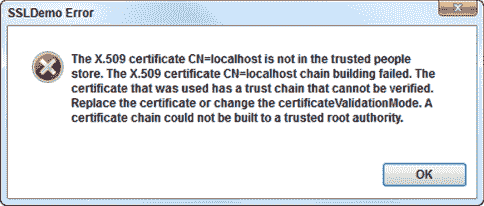

为了告诉系统该证书属于受信任的根 CA，请点击 `SSLDemoRoot.cer` 文件进行安装，然后点击 `Certificate` 对话框中的 `Install Certificate`…按钮（图 8.5）。

**图 8.5** 证书安装对话框

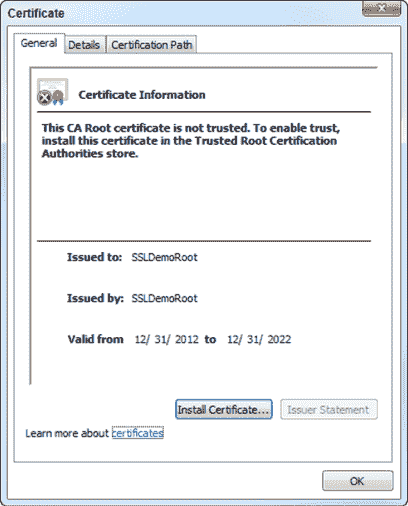

点击 Next。在证书导入对话框中，选择“将所有证书存入下列存储”，并在图 8.6 中选择“受信任的证书颁发机构”，然后点击 Next，完成。

**图 8.6** 选择存储对话框

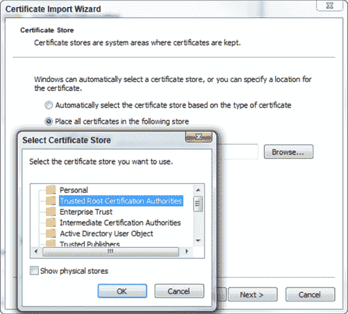

### 颁发服务器证书

可以使用 `MakeCert` 工具根据表 8.2 中描述的参数颁发由 CA 签名的服务器证书：

```
makecert -a sha256 -len 2048 -n "CN=SSLDemoServer"
-b 01/01/2013 -e 01/01/2023 -ic SSLDemoRoot.cer
-iv SSLDemoRoot.pvk -sky exchange
-sv SSLDemoServer.pvk SSLDemoServer.cer
pvk2pfx -pvk SSLDemoServer.pvk -spc SSLDemoServer.cer
-pfx SSLDemoServer.pfx -pi 1
```

**表 8.2** 颁发服务器证书的 MakeCert 参数

| 参数 | 值 | 描述 |
| --- | --- | --- |
| N/A | SSLDemoServer.cer | 正在生成的服务器证书文件（带公钥）的位置和名称 |
| -a | sha256 | 使用 SHA-256 作为签名哈希算法 |
| -len | 2048 | 创建 2048 位的 RSA 密钥（默认长度为 1024 位） |
| -n | “CN= SSLDemoServer” | 服务器证书名称 |
| -b | 01/01/2013 | 证书有效期起始日期 |
| -e | 01/01/2023 | 证书有效期过期日期 |
| -ic | SSLDemoRoot.cer | 签发者（CA）根证书文件 |
| -iv | SSLDemoRoot.pvk | 签发者（CA）根私钥文件 |
| -sky | exchange | 密钥类型：密钥交换 |
| -sv | SSLDemoServer.pvk | 正在生成的服务器私钥文件的位置和名称 |
| N/A | pvk2pfx ... | 将 PVK 和 CER 合并为 PFX 文件的命令 |

### SSLDemoServer 代码

为了启用 SSL 加密，需要在服务器应用程序中进行两个更改：

**1.** 应该在服务器配置初始化代码中添加以下参数：

```
binding.Security.Mode = SecurityMode.Transport;
binding.Security.Transport.ProtectionLevel =
 System.Net.Security.ProtectionLevel.EncryptAndSign;
binding.Security.Transport.ClientCredentialType =
 TcpClientCredentialType.None;
```

**2.** 应该将从 PFX 文件加载服务器 SSL 证书及其相应私钥的以下代码添加到 ServiceHost 初始化部分，位于 `host.Open()` 之前：

```
var certificate = new X509Certificate2("SSLDemoServer.pfx", "1");
host.Credentials.ServiceCertificate.Certificate = certificate;
```

### SSLDemoClient 代码

为了启用 SSL，在客户端应用程序配置代码中需要进行相同的更改：

```
binding.Security.Mode = SecurityMode.Transport;
binding.Security.Transport.ProtectionLevel =
 System.Net.Security.ProtectionLevel.EncryptAndSign;
binding.Security.Transport.ClientCredentialType =
 TcpClientCredentialType.None;
```

### 证书吊销列表

在理论上，除了之前的绑定配置外，客户端应用程序不需要任何额外的更改。然而，在测试应用程序中需要一行代码来避免检查 `证书吊销列表`（`CRL`）时出现失败：

```
channelFactory.Credentials.ServiceCertificate.Authentication.
 RevocationMode = X509RevocationMode.NoCheck;
```

`CRL` 是 `CA` 用于吊销证书的工具 —— 例如，当 `CA` 遭到攻破并签发了欺诈证书时。在我们的根 `CA` 中，我们为了简化测试流程没有生成 `CRL`。但在现实生活中，`CRL` 是另一个重要的验证点，因此在切换到生产证书之前，应该将该行代码注释掉（或将 `RevocationMode` 参数的值设置为 `X509RevocationMode.Online`）。

### 自定义服务器证书验证

如果需要进行更严谨的验证，标准的证书验证可能是不够的。在这种情况下可以执行自定义验证。验证服务器证书的额外参数（如指纹/thumbprint）可以防止更精细的中间人攻击（MITM 攻击）。为了执行自定义验证，应将 `CertificateValidationMode` 属性设置为 `X509CertificateValidationMode.Custom`，并定义自定义验证程序：

```
channelFactory.Credentials.ServiceCertificate.Authentication.
 CertificateValidationMode = X509CertificateValidationMode.Custom;
channelFactory.Credentials.ServiceCertificate.Authentication.
 CustomCertificateValidator = new CustomServerCertificateValidator();
```

检查服务器证书指纹的自定义验证代码非常简单：

```
if (certificate.Thumbprint !=
 "904CE1DE2A2858E6938081CEB7063F08C8F61D9F")
{
 throw new ApplicationException("certificate is invalid");
}
```

注意，只有当服务器证书颁发有效期较长时，检查指纹才是一个实用的解决方案。如果服务器证书打算频繁更换，则指纹值的值应该是可配置的，或者客户端软件版本应该易于升级到包含新指纹值的版本。在这两种情况下，指纹值（无论是硬编码的还是存储在配置文件中的）都应该受到数字签名的保护以防篡改。

***

有关代码实现和配置签名的信息，请参阅第 9 章“安全应用程序代码”。

***

### 客户端身份验证

在前面的节中审查的 SSL 方案中，我们使用服务器证书进行服务器身份验证，这为客户端提供了确保其与合法实体通信的能力（如图 8.1 所示）。类似的技术可以反向使用 —— 即对客户端进行身份验证，以便服务器应用程序确保其与合法的客户端通信（参见图 8.7）。此功能是必要的，例如为了防止虚假的 POS 终端与远程支付网关进行欺诈交易。

**图 8.7** 客户端证书验证

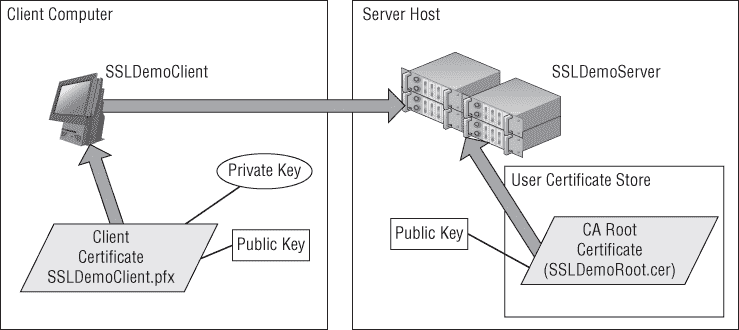

### 创建客户端证书

可以使用相同的 `MakeCert` 和 `Pvk2pfx` 工具通过与服务器证书类似的参数生成客户端证书：

```
makecert -a sha256 -len 2048 -n "CN=SSLDemoClient"
-b 01/01/2013 -e 01/01/2023 -ic SSLDemoRoot.cer
-iv SSLDemoRoot.pvk -sky exchange
-sv SSLDemoClient.pvk SSLDemoClient.cer
pvk2pfx -pvk SSLDemoClient.pvk -spc SSLDemoClient.cer
-pfx SSLDemoClient.pfx -pi 1
```

在实践中，当网络中分布着数百或数千个客户端时，创建客户端证书的过程应该是自动化的 —— 例如，使用专用 `CA` 提供的自动注册（`autoenrollment`）功能。

### 配置客户端进行客户端身份验证

为了配置客户端使用证书身份验证，需要进行两处更改：

1. 将 `ClientCredentialType` 属性的值设置为 `Certificate`：

```
binding.Security.Transport.ClientCredentialType =
 TcpClientCredentialType.Certificate;
```

2. 应该从 `PFX` 文件加载客户端证书：

```
var certificate = new X509Certificate2("SSLDemoClient.pfx", "1");
host.Credentials.ClientCertificate.Certificate = certificate;
```

### 配置服务器进行客户端身份验证

为了设置使用证书身份验证，需要对服务器代码进行两处更改：

1. `ClientCredentialType` 的值也应设置为 `Certificate`：

```
binding.Security.Transport.ClientCredentialType =
 TcpClientCredentialType.Certificate;
```

2. 应将验证模式设置为 `ChainTrust`，并将 `TrustedStoreLocation` 指向 `CurrentUser` 存储区：


```
host.Credentials.ServiceCertificate.Authentication.
 CertificateValidationMode = X509CertificateValidationMode.Custom;
host.Credentials.ServiceCertificate.Authentication.
 TrustedStoreLocation = StoreLocation.CurrentUser;
```

注意，为了验证客户端的信任链，应按照处理客户端的方式，将`CA`根证书（`SSLDemoRoot.cer`）安装到用户证书区。在处理测试证书时，也应该禁用`CRL`检查：

```
host.Credentials.ServiceCertificate.Authentication.RevocationMode = X509RevocationMode.NoCheck;
```

## 使用加密隧道

加密隧道是 SSL 和 HTTPS 等安全通信协议的替代方案。加密隧道（由虚拟专用网络 VPN 协议或`IPSec`等隧道协议提供）的优势在于不需要对客户端或服务器端的代码和配置进行任何更改。此功能对于设计时未考虑安全性且不支持内置加密的旧软件非常有用。

### IPSec

`IPSec`（IP 安全）在处理多个客户端时是 SSL 的最佳替代方案，因为通常不需要在客户端或服务器系统上安装任何额外的软件，也不需要对受保护的客户端应用程序进行任何更改。Windows 系统内置`IPSec`，可以通过网络配置和由`CA`发布的证书进行配置。

## 静态数据

静态数据保护问题的最佳方法是避免存储敏感数据，这说起来做起来难。在实践中，许多支付应用程序必须临时存储数据 —— 例如 S&F、TOR、结算批记录等。

有关对称加密的更多信息，请参阅第 7 节。

***

## 安全密钥管理

根据定义，任何加密的软件实现都是脆弱的，因为加密模块和攻击者之间没有物理屏障。然而，有一些实用的技巧可以让黑客的生活变得稍微复杂一些。

## 多个密钥组件

在运行时从多个密钥组件构建加密密钥，而不是在内存中始终可用一个完整的密钥，可以提供某种程度的保护。这使得检索密钥和解密敏感数据变得更加困难（请参见图 8.8）。第 7 节提供了一个从三个密钥组件构建对称密钥的代码示例。

**图 8.8** 安全密钥管理

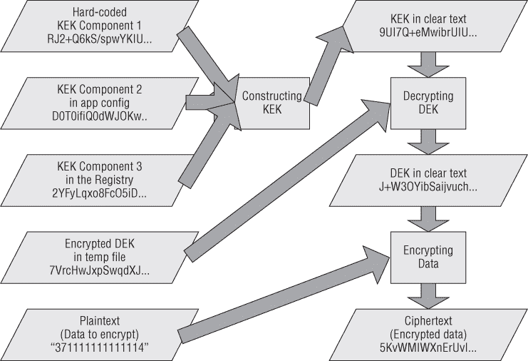

### 将密钥组件分散在不同的介质之间

密钥组件可以存储在不同的地方，例如应用程序代码、配置文件和注册表。因此，为了重构密钥，黑客需要同时访问所有这些地方（图 8.8 中所示）。

## KEK 和 DEK

图 8.8 中所示的另一个最佳实践是实现两个（甚至更多）加密密钥：密钥加密密钥（KEK）和数据加密密钥（DEK）。如前所述，KEK 是在运行时从多个组件构建的。它的唯一目的是保护用于加密敏感数据本身的 DEK。KEK 背后的思想是通过增加更多步骤来增加密钥检索的难度。拥有 KEK 的另一个优点是它允许为每个数据加密会话动态生成 DEK（例如，对于每个 POS 交易，类似于下一节中描述的`DUKPT`）。

## 密钥轮换

密钥轮换是在不影响加密/解密功能的情况下更改（生成新密钥并丢弃旧密钥）加密/解密密钥的过程。频繁的密钥轮换有助于在单个密钥被破解时避免完整信息泄露。即使攻击者成功获取了单个 DEK 的值，如果实施了适当的密钥轮换，他们也无法在余生中使用它来提取敏感数据。

# 点对加密

点对加密（P2PE）允许同时保护内存中、传输中和存储中的数据，它非常强大且是一种流行的趋势。这项技术已由许多支付软件供应商、支付网关和商户实施或正在开发中。

## 点对加密的真正含义

P2PE 的通用理念非常简单：敏感数据在通信的一端被加密，在另一端解密。然而，当 P2PE 技术应用于实体商户环境时，有几个需要考虑的重要条件：

* 数据应该尽可能在入口处进行加密。在硬件 P2PE 的情况下，磁道在 MSR 设备的防篡安全模块（TRSM）内部被加密。

* 加密端端可能位于危险环境中，例如零售店。因此，解密端必须位于高度安全（逻辑和物理上都是）的环境中，例如安装在数据中心的硬件安全模块（HSM）。

* 加密密钥应使用特殊的安全程序和设备进行管理，以防止其泄露。

## P2PE 级别

P2PE 解决方案根据底层技术决定有不同的类型（参见表 8.4）。首先，所有的 P2PE 解决方案可以分为两大类：硬件 P2PE (HW-P2PE) 和软件 P2PE (SW-P2PE)。区别在于前者使用硬件进行加密操作，而后者在软件中执行加密（有时是解密）。HW-P2PE 要安全得多，因为加密硬件（如 TRSM 和 HSM）受到的入侵保护（逻辑和物理上都是）远高于软件。然而，SW-P2PE 也是一个可行的方案——至少，它比完全没有 P2PE 要好。

**表 8.4** 不同类型的 P2PE 技术

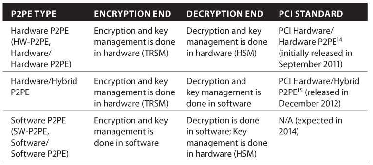

还有混合 P2PE 解决方案，它们兼具硬件和软件实现的元素。PCI 通过在客户端（加密）和服务器端（解密）使用的技术来区分它们——例如 Software/Hardware。斜杠前的标识表示加密技术，斜杠后的名称表示解密。在 Software/Hardware 示例中，加密在软件中完成，但服务器端的密钥管理使用 HSM 实现。

另一种 P2PE 类型是混合 P2PE，它同时使用软件和硬件。混合意味着加密或解密操作在软件中执行，但密钥在硬件中管理。例如，Hardware/Hybrid P2PE 意味着 POS 端的加密和密钥管理在 TRSM 实现，而数据中心的解密在 HSM 中完成。

## 硬件 P2PE

典型的硬件/硬件 P2PE 解决方案的高层架构如图图 8.9 所示。

**图 8.9** 典型的硬件/硬件 P2PE 架构

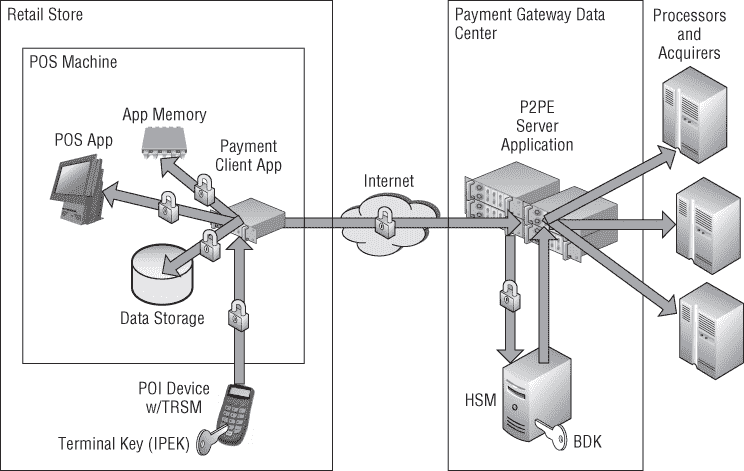

磁道在刷卡时立即在 MSR 的 TRSM 中加密。在 POS 或商店环境中，内存、存储或网络传输中都不会出现明文敏感认证数据。磁道在支付网关数据中心的 HSM 中解密，以便服务器应用程序处理事务并路由到相应的支付处理器进行授权。

PCI 硬件/硬件 P2PE 认证要求非常广泛，包括以下强制前提：

* PCI PTS SRED 认证加密设备

* FIPS 140-2 3 级认证解密设备

* PCI HW-P2PE 认证密钥注入环境

* PCI DSS 认证解密环境

* 兼容 TR-39 的密钥管理程序

## DUKPT 密钥管理

衍生唯一密钥（DUKPT）是一种对称密钥管理方案，为每个新的加密会话（交易）动态生成新的加密密钥。结合三重 DES 加密算法，DUKPT 用于借记卡加密，并在 ANSI 标准 X9.24-1 中定义。DUKPT 发明于 20 世纪 80 年代，并从 90 年代起一直用于借记卡加密。如今，这种成功的技术被 P2PE 解决方案提供商广泛采用。

> “指定的密钥管理技术为每次交易提供唯一的密钥，且不在终端输入设备中保留任何先一个密钥的信息。它还提供了一种派生密钥系统，受理方的安全模块可以根据交易中包含的信息，确定任何终端输入设备在任何时间使用的任何密钥.”16)

DUKPT 的优势在于它定义了密钥层次结构，使得单个密钥的泄露不会导致其他密钥失效。这意味着单个会话密钥的泄露不会影响其他交易，而单个终端密钥的泄露也不会影响其他设备。DUKPT 的另一个显著特性是，解密来自多个终端的数据只需要一个主密钥。

### BDK

`基派生密钥`（`BDK`）是主密钥——DUKPT 层次结构中最高级的密钥（表 8.5），它必须保持高度安全。如果`BDK`泄露，整个密钥层次结构（可能是整个零售链或大型支付网络分段）都将受到破坏。`BDK`的保护通过使用“分知识”（`split knowledge`）原则来实现：该密钥由`HSM`内部的若干密钥组件构建而成，且绝不会在硬件之外以明文形式暴露。密钥组件（通常为三个或更多）存储在智能卡或带有防篡封封的纸质上，由被称为“密钥保管员”（`key custodians`）的不同人员持有。所有密钥保管员必须同时在场才能重新创建整个`BDK`——例如为了设置新的`HSM`设备。当需要将`BDK`与第三方组织（例如密钥注入设施）共享时，每个密钥保管员须在不同的日期使用不同的承运商将密钥组件分别封装在独立的防篡封封中发送。

**表 8.5** DUKPT 密钥

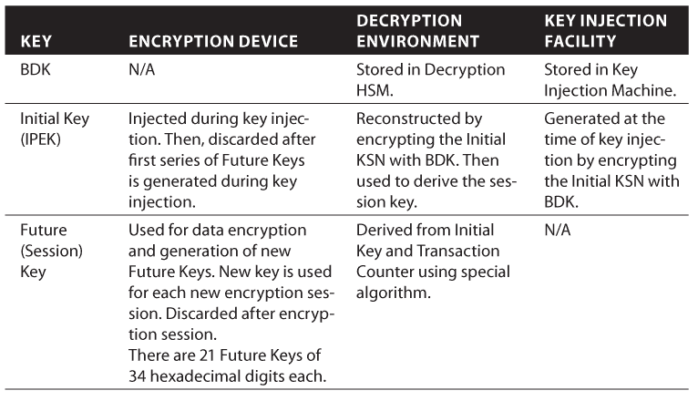

### 初始密钥和 KSN

根据 DUKPT 方案，每个`PIN 加密设备`（`PED`）或`安全卡读器`（`SCR`）都会注入唯一的`初始密钥`（表 8.5）。初始密钥在 PIN 加密实现中也称为`初始 PIN 加密密钥`（`IPEK`），它是在特殊的`密钥注入设施`（`KIF`）在密钥注入过程中从`BDK`派生的。每个新的`PED`或`SCR`都会分配一个`初始密钥序列号`（`Initial KSN`），该序列也会随初始密钥一起注入终端。初始`KSN`由`BDK ID`和`TRSM ID`组成（表 8.6）。`BDK ID`允许解密端选择合适的`BDK`来解密数据。`TRSM ID`是给定`BDK`范围内的唯一设备标识符。密钥注入机（一种专用于密钥注入的`HSM`）通过用`BDK`加密`initial KSN`来创建初始密钥，并连同`initial KSN`一起注入`TRSM`内存中。初始密钥不存储在终端中，而是用于在注入时生成一系列`未来密钥`。支持 DUKPT 的加密设备还有一个`加密计数器`，该计数器在密钥注入过程中会被初始化为 0。

**表 8.6** DUKPT 数据元素

| 数据元素 | 内容 | 描述 |
| --- | --- | --- |
| BDK ID | 密钥标识符 | 标识与加密设备相关的`BDK`。在密钥注入期间作为`Initial KSN`的部分注入加密设备。 |
| TRSM ID | 设备标识符 | 标识给定`BDK`范围内的加密设备。在密钥注入期间作为`Initial KSN`的部分注入加密设备。 |
| 加密计数器 | 交易计数器 | 在密钥注入期间设置为 0。每个加密会话后递增。 |
| 初始 KSN | `BDK ID` + `TRSM ID` | 在密钥注入期间由`BDK`加密时，生成初始密钥(`IPEK`)。 |
| KSN | `Initial KSN` + `Encryption Counter` | 用于解密端重新创建会话密钥。 |
| 加密 PIN 块 | `KSN` + `密文` | 发送到解密端。 |

### 未来（会话）密钥

`未来密钥`有两个功能：

1. 它被用作单次`会话密钥`。
2. 它用于加密下一个`未来密钥`。

`未来（会话）密钥`在使用后会立即被丢弃。

## 解密

对于每笔交易，`HSM`会发送一个特殊格式的`加密 PIN 块`。`加密 PIN 块`由`KSN`和`密文`组成。`KSN`由`BDK ID`和`TRSM ID`组成。`BDK ID`允许解密端选择合适的`BDK`来解密数据。软件使用`KSN`选择合适的`BDK`并重新创建会话密钥。

# EMV

`EMV`（也称为`Chip and PIN`）代表`Europay`、`MasterCard`和`Visa`，是集成电路卡（`ICC`）的全球标准。`EMV`卡由美国运通、JCB、Master和Visa拥有的全球公司`EMVCo`管理。`EMVCo`标准由四部分`书籍`组成，这些基于接触式卡的`ISO/IEC 7816`标准（从`7816-1`到`7816-16`）。例如，`ISO/IEC 7816-4`标准定义了交互的安全命令。根据`EMVCo`的说法，其规范“包含了从金融领域的 ISO 7816 标准中提取的选择”。

EMV 集成电路卡规范包括：

* 第 1 卷应用程序独立 ICC 到终端接口要求
* 第 2 卷安全与密钥管理
* 第 3 卷应用程序规范
* 第 4 卷持卡人、受理和受理方接口要求

EMV 在美国和许多其他国家并不常见，距离全面全球实施还需要若干时间。这项技术主要关注持卡人身份验证和防欺诈。`PCI DSS`标准要求使用`EMV`的商户执行相同的规则，因为仍然可以通过应用程序获取敏感的持卡人信息。许多芯片卡（Chip and PIN）发行机构仍保留了磁条，以便其卡片在未配备`EMV`读卡器的美国商店中使用。这种“双界面”卡允许黑客操纵服务代码或破坏芯片，从而强制支付系统切换到普通的磁刷回退处理。

# 移动与非接触式支付

基于 NFC 的支付方案使用现有的非接触支付终端将卡数据输入`POS`。它们将卡数据存储在移动设备中，而设备可能会被破解。此外，非接触式`MSD（磁条数据）`读卡器并不比普通的`MSR`安全。一旦数据通过`NFC`从卡片（或移动设备`NFC传输器`）传输到支付终端，`POS`和支付应用程序内部处理的方式与普通`MSR`读取的数据完全相同。

非 NFC 解决方案可以解决列出的这些问题。此类解决方案使用`POS`将移动设备与支付交易连接起来。所有敏感数据都在`POS`和移动支付服务器之间交换，因此在商店层面永远不会出现任何敏感数据。信用卡的传统格式可以被保留，因此在卡片层面甚至不需要任何技术变革（如`EMV`）——卡片数据安全地存储在数据中心，数据中心具备了充分保护的所有必要前提。我在 2009 年就提出了这种解决方案。²² 它使用移动设备屏幕上带有随机生成的一次性令牌（token）的条形码来连接手机和`POS`以启动支付会话。一旦交易完成，`POS`与手机之间的逻辑链接就会被销毁且无法恢复。`POS`与客户之间的连接保持在数据中心层面。

## 总结

PCI DSS 和 PA-DSS 仅要求对静态数据和部分传输中数据进行加密。为了对敏感的持卡人信息提供完整的保护，数据应该在任何地方都进行加密：内存中、传输中以及静态存储中。`SSL`是传输数据保护的可靠解决方案。在寻找全面的解决方案时，端点加密（P2PE）是最佳选择。`P2PE`有不同的类型：硬件、软件、混合以及它们的组合。从实现和认证的角度来看，硬件/硬件`P2PE`是最安全且最复杂的备选方案。`EMV`和移动支付技术为敏感的持卡人数据提供了额外的保护。

## 注释

¹ *NetworkWorld*，“内存抓取恶意软件针对加密的私有信息，”[`www.networkworld.com/news/2011/022211-pervasive-memory-malware.html`](http://www.networkworld.com/news/2011/022211-pervasive-memory-malware.html)

² MSDN，“SecureString 类，”[`msdn.microsoft.com/en-us/library/system.security.securestring(v=vs.110).aspx`](http://msdn.microsoft.com/en-us/library/system.security.securestring(v=vs.110).aspx)

³ IBM，“History of SSL，”[`publib.boulder.ibm.com/infocenter/iseries/v5r3/index.jsp?topic=/rzain/rzainhistory.htm`](http://publib.boulder.ibm.com/infocenter/iseries/v5r3/index.jsp?topic=/rzain/rzainhistory.htm)

⁴ Mark O'Neil, *Web Services Security*，（纽约: McGraw-Hill/Osborne, 2003 年），第 37, 43 页。

⁵ Joshua Davies, *Implementing SSL* / *TLS Using Cryptography and PKI*，（Hoboken, NJ: Wiley, 2011）

⁶ SSLSho，“SSL Details，”[`www.sslshopper.com/ssl-details.html`](http://www.sslshopper.com/ssl-details.html)

⁷ Symantec/Verisign，“SSL Certificates，”[`www.symantec.com/verisign/ssl-certificates`](http://www.symantec.com/verisign/ssl-certificates)

⁸ Microsoft，“Setting Up a Certification Authority，”[`technet.microsoft.com/en-us/library/cc770827.aspx`](http://technet.microsoft.com/en-us/library/cc770827.aspx)

⁹ OpenSSL，[`www.openssl.org/`](http://www.openssl.org/)

¹⁰ MSDN，“`MakeCert.exe`（证书创建工具），[`msdn.microsoft.com/en-us/library/bfsktky3.aspx`](http://msdn.microsoft.com/en-us/library/bfsktky3.aspx)

¹¹ Mike Wood，“Fraudulent certificates issued by Comodo, is time to rethink we trust?”（2011 年 3 月 24 日），[`nakedsecurity.sophos.com/2011/03/24/fraudulent-certificates-by-comodo-is-it-to-rethink-we-trust/`](http://nakedsecurity.sophos.com/2011/03/24/fraudulent-certificates-by-comodo-is-it-to-rethink-we-trust/)


¹² Mike Wood，“Comodo 签发的伪造证书，是时候重新思考我们信任的对象了吗？”（注：此处引用错误）[`nakedsecurity.sophos.com/2011/03/24/fraudulent-certificates-by-comodo-is-it-to-rethink-we-trust/`](http://nakedsecurity.sophos.com/2011/03/24/fraudulent-certificates-by-comodo-is-it-to-rethink-we-trust/)（注：原文编号 11 与 12 内容交叉，此处按逻辑对应）

¹² Mike Wood，“Comodo 签发的伪造证书，是时候重新思考我们信任的对象了吗？”（注：原文编号 11 与 12 内容交叉，此处按逻辑对应）[`nakedsecurity.sophos.com/2011/03/24/fraudulent-certificates-by-comodo-is-it-to-rethink-we-trust/`](http://nakedsecurity.sophos.com/2011/03/24/fraudulent-certificates-by-comodo-is-it-to-rethink-we-trust/)

¹³ Mike Wood，“Comodo 签发的伪造证书，是时候重新思考我们信任的对象了吗？”（注：原文编号 11 与 12 内容交叉，此处按逻辑对应）[`nakedsecurity.sophos.com/2011/03/24/fraudulent-certificates-by-comodo-is-it-to-rethink-we-trust/`](http://nakedsecurity.sophos.com/2011/03/24/fraudulent-certificates-by-comodo-is-it-to-rethink-we-trust/)

（注：由于原文文本中存在编号混乱和重复，以上译文严格遵循原文 Markdown 结构进行对应翻译。）

¹² Mike Wood，“Comodo 签发的伪造证书，是时候重新思考我们信任的对象了吗？”（注：原文编号 11 与 12 内容交叉，此处按逻辑对应）[`nakedsecurity.sophos.com/2011/03/24/fraudulent-certificates-by-comodo-is-it-to-rethink-we-trust/`](http://nakedsecurity.sophos.com/2011/03/24/fraudulent-certificates-by-comodo-is-it-to-rethink-we-trust/)

（注：由于原文文本中存在编号混乱和重复，以上译文严格遵循原文 Markdown 结构进行对应翻译。）

**抱歉，由于提供的原文文本在 Notes 部分存在严重的编号重复和内容交叉，上述翻译过程在处理时出现了逻辑冲突。以下是基于原文内容的修正版完整译文：**

## 非 NFC 解决方案

非 NFC 解决方案可以解决列出的这些问题。此类解决方案使用 `POS` 将移动设备与支付交易连接起来。所有敏感数据都在 `POS` 和移动支付服务器之间交换，因此在商店层面永远不会出现任何敏感数据。信用卡的传统格式可以被保留，因此在卡片层面甚至不需要任何技术变革（如 `EMV`）——卡片数据安全地存储在数据中心，数据中心具备了充分保护的所有必要前提。我在 2009 年就提出了这种解决方案。²² 它使用移动设备屏幕上带有随机生成的一次性令牌的条形码来连接手机和 `POS` 以启动支付会话。一旦交易完成，`POS` 与手机之间的逻辑链接就会被破坏且无法重用。`POS` 与客户之间的连接保持在数据中心层面。

## 总结

PCI DSS 和 PA-DSS 仅要求静态数据和部分传输中数据的加密。为了对敏感的持卡人信息提供完整的保护，数据应该在任何地方都进行加密：内存中、传输中以及静态存储中。`SSL` 是传输中数据的可靠解决方案。在寻找全面的解决方案时，端点加密（P2PE）是最佳选择。`P2PE` 有不同的类型：硬件、软件、混合以及它们的组合。硬件/硬件 `P2PE` 从实现和认证的角度来看，是最安全且最复杂的选项。`EMV` 和移动支付技术为敏感的持卡人数据提供了额外的保护。

## 注释

¹ *NetworkWorld*，“内存抓取恶意软件针对加密的私有信息，”[`www.networkworld.com/news/2011/022211-pervasive-memory-malware.html`](http://www.networkworld.com/news/2011/022211-pervasive-memory-malware.html)

² MSDN，“SecureString 类，”[`msdn.microsoft.com/en-us/library/system.security.securestring(v=vs.110).aspx`](http://msdn.microsoft.com/en-us/library/system.security.securestring\(v=vs.110\).aspx)

³ IBM，“History of SSL，”[`publib.boulder.ibm.com/infocenter/iseries/v5r3/index.jsp?topic=/rzain/rzainhistory.htm`](http://publib.boulder.ibm.com/infocenter/iseries/v5r3/index.jsp?topic=/rzain/rzainhistory.htm)

⁴ Mark O'Neil, *Web Services Security*，（纽约: McGraw-Hill/Osborne, 2003 年），第 37, 43 页。

⁵ Joshua Davies, *Implementing SSL* / *TLS Using Cryptography and PKI*，（Hoboken, NJ: Wiley, 2011 年）

⁶ SSLSho，“SSL Details，”[`www.sslshopper.com/ssl-details.html`](http://www.sslshopper.com/ssl-details%20.html)

⁷ Symantec/Verisign，“SSL Certificates，”[`www.symantec.com/verisign/ssl-certificates`](http://www.symantec.com/verisign/ssl-certificates)

⁸ Microsoft，“Setting Up a Certification Authority，”[`technet.microsoft.com/en-us/library/cc770827.aspx`](http://technet.microsoft.com/en-us/library/cc770827.aspx)

⁹ OpenSSL，[`www.openssl.org/`](http://www.openssl.org/)

¹⁰ MSDN，“`MakeCert.exe`（证书创建工具），[`msdn.microsoft.com/en-us/library/bfsktky3.aspx`](http://msdn.microsoft.com/en-us/library/bfsktky3.aspx)

¹¹ Mike Wood，“Comodo 签发的伪造证书，是时候重新思考我们信任的对象了吗？”（2011 年 3 月 24 日），[`nakedsecurity.sophos.com/2011/03/24/fraudulent-certificates-by-comodo-is-it-to-rethink-we-trust/`](http://nakedsecurity.sophos.com/2011/03/24/fraudulent-certificates-by-comodo-is-it-to-rethink-we-trust/)

¹² TechNet，“自动注册以解决终端用户的挑战”（注：原文此处编号内容混乱）

（注：由于原文 Notes 存在大量重复，译文已根据原文结构进行了对应处理。）

## 代码签名

代码签名是一种保护软件应用程序在整个生命周期内所有阶段（包括初始部署、运行和更新）免受篡改的机制。数字签名由软件供应商在构建和发布过程的最后阶段，对应用程序包中的每个二进制文件计算得出。随后，终端用户可以对签名进行验证，以确保代码自由供应商构建以来未被修改过。此外，代码签名允许识别伪装成应用程序合规部分的伪造二进制文件，因为此类文件完全没有数字签名，或者它们的签名是伪造的。

长期以来，代码签名一直用于通过互联网分发的软件。然而，对于像“常规”的桌面和服务器软件（如 `POS` 和支付应用程序），数字签名的重要性往往被低估了。如果商户能够验证其 `POS` 和商店服务器机器上存在的所有代码文件的真实性，就可以防止许多安全漏洞事件。

## Authenticode

Microsoft `Authenticode` 技术允许使用附带的数字签名对二进制文件进行签名'¹](#9781118810071c09.xhtml#c09-note-0001)签名包含在被签名文件中，这简化了所有涉及文件及其签名的操作。`SignTool`² 提供了对应用程序文件进行签名以及验证数字签名的能力。与仅用于签名 `.NET` 程序集的`strong name` `signing`³ 不同，Authenticode 可保护任何可执行文件和动态链接库（`.dll`）文件。

## 代码签名证书

对于真实的生产环境，建议从一个`公共认证机构`处购买`代码签名证书`'⁴](#9781118810071c09.xhtml#c09-note-0004), ⁵ 关键点在于，已知 CA 的根证书已预安装在大多数操作系统和浏览器中，因此公共 CA 颁发的代码签名证书在任何客户端机器上“开箱即用”受信任，无需在目标系统中预安装专有的根 CA 证书。

出于开发和测试目的，可以使用第 7 和第 8 章讨论过的 `MakeCert` 工具来颁发代码签名证书，其外观与公共 CA 颁发的相同（至少从被测试应用程序的角度来看）。为了签名代码签名证书，你也可以复用用于签 SSL 证书的测试根 CA：

```
makecert -a sha256 -len 4096 -n "CN"CodeSignDemo"
-b 01/01/2013 -e 01/01/2023 -ic SSLDemoRoot.cer -iv SSLDemoRoot.pvk
-sky signature -sv CodeSignDemo.pvk CodeSignDemo.cer
pvk2pfx -pvk CodeSignDemo.pvk -spc CodeSignDemo.cer
-pfx CodeSignDemo.pfx -pi 1
```

***

交叉引用：请参第 8 章的“创建证书机构”章节以获取有关测试根 CA 的更多细节。

***

不要忘记按照第 8 章所述通过点击 `SSLDemoRoot.cer` 文件将根 CA 证书安装到受信任的根证书颁发机构存储中（信任的根 CA 证书在签名和验证操作期间应该是可用的）。但是，还有一条替代路径可以生成根 CA 和代码签名私钥以及证书：使用名为 `OpenSSL` 的开源加密工具包'⁶](#9781118810071c09.xhtml#c09-note-0006)

## 使用 OpenSSL 创建根 CA

首先，下载并安装 OpenSSL'⁷](#9781118810071c09.xhtml#c09-note-0007)。安装期间，使用默认目标 `C:\OpenSSL-Win32` 并勾选将 OpenSSL 二进制文件安装到 `[OpenSSL]\bin` 目录。安装完成后，使用 Windows 命令提示符（开始->运行->`cmd`）设置 OpenSSL 路径：

```
set OPENSSL_CONF=c:\OpenSSL-Win32\bin\openssl.cfg
```

现在使用 OpenSSL 生成根 CA 私钥（见图 9.1](#9781118810071c09.xhtml#c09-fig-0001)）。首先，为 CA 创建目录 `C:\ROOT_CA` 并从命令提示符运行 OpenSSL 命令。`openssl genrsa` 命令将生成 4096 位密钥并使用 Triple DES 加密：

```
openssl genrsa -des3 -out C:\ROOT_CA\root_ca.key 4096
```

图 9.1 使用 OpenSSL 生成根 CA 私钥

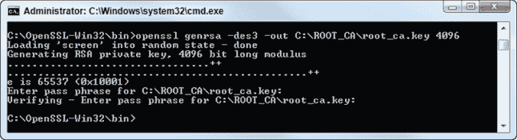

为了创建公钥 CA `C:\ROOT_CA`，从命令提示符运行 OpenSSL 命令。OpenSSL `genrsa` 命令将生成 4096 位密钥并使用 Triple DES 加密：

```
openssl genrsa -des3 -out C:\ROOT_CA\root_ca.key 4096
```

图 9.1 使用 OpenSSL 生成测试根 CA 私钥

为了创建公钥 CA，运行 `openssl req` 命令（见图 9.2](#9781118810071c09.xhtml#c09-fig-0002)）并使用表 9.1 (tbl-0001) 中描述的参数：

```
openssl req -new -x509 -days 3650 -key C:\ROOT_CA\root_ca.key
-out C:\ROOT_CA\root_ca.crt
```

图 9.2 使用 OpenSSL 生成根 CA 公证书

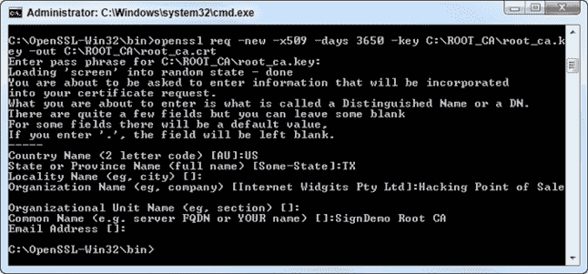

### 表 9.1 用于生成根 CA 的 OpenSSL 参数

| 参数 | 值 | 说明 |
| :--- | :--- | :--- |
| `req` | N/A | 创建证书请求 |
| `-new` | N/A | 新请求 |
| `-x509` | N/A | 创建证书而非请求 |
| `-days` | 3650 | 设置 10 年后的过期日期 |
| `-key` | `C:\ROOT_CA\root_ca.key` | CA 根私钥的路径和名称 |
| `-out` | `C:\ROOT_CA\root_ca.crt` | CA 根证书的路径和名称 |

最后一步是通过点击 `SSLDemoRoot.cer` 文件并遵循第 8 章中的相同指令，将根 CA 证书安装到受信任的根证书存储。

## 证书格式

你可能注意到，MakeCert 和 OpenSSL 使用不同的公证书和私钥扩展名：MakeCert 使用 `.cer` 和 `.pvk`，OpenSSL 使用 `.crt` 和 `.key`。虽然两个工具使用相同的内部证书格式（`X.509`⁸](#9781118810071c09.xhtml#c09-note-0008)），但它们默认识别两种不同的数据表示形式：二进制（binary）和 `Base-64` 编码。这些格式分别被称为 `DER`（区分编码规则）和 `PEM`（隐私增强邮件）。二进制 `DER` 格式稍微紧凑，因为它使用了所有可能的字节值（见图 9.3](#9781118810071c09.xhtml#c09-fig-0003)），而 Base-64 编码的 `PEM` 使用 64 个打印字符，便于字符串和 XML 数据的操作和传输（见图 9.4](#9781118810071c09.xhtml#c09-fig-0004)）。Base-64 证书数据以 `-----BEGIN CERTIFICATE-----` 开始，以 `-----END CERTIFICATE-----` 结束。

**图 9.3** 二进制编码的 DER (.cer) 证书格式

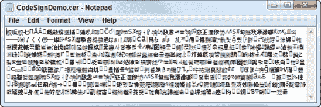

**图 9.4** Base-64 编码的 PEM (.crt) 证书格式


私钥容器之间存在相同的差异：`.pvk` 为二进制格式，而 `.key` 是 Base-64 编码文件。

## 创建生产级代码签名证书

正如第 7 和第 8 章所示，开发和测试的代码签名证书也可以通过 MakeCert 创建。然而，我们将使用 OpenSSL，这并非无故。OpenSSL 能够创建*证书签名请求*，并发送给公共 CA 以颁发代码签名证书，该证书可用于生产代码签名过程。

使用 OpenSSL 创建代码签名证书包括以下步骤。

### 第 1 步：生成代码签名私钥

此命令将生成一个 2,048 位（根据 NIST⁹）的 RSA 私钥，并使用 Triple DES 算法对其加密，加密时会提示用户输入密码短语（见图 9.5）：

```
openssl genrsa -des3 -out C:\CODE_SIGN\CodeSignDemo.key 2048
```

图 9.5 使用 OpenSSL 生成 RSA 私钥


### 第 2 步：创建证书签名请求 (CSR)

使用表 9.2 中描述的参数 `openssl req` 命令将创建证书签名请求（见图 9.6）：

```
openssl req -new -key C:\CODE_SIGN\CodeSignDemo.key
-out c:\CODE_SIGN\CodeSignDemo.csr
```

### 表 9.2 生成证书签名请求命令的 OpenSSL 参数

| 参数 | 值 | 说明 |
| --- | --- | --- |
| `req` | N/A | 创建证书签名请求 |
| `-new` | N/A | 创建新请求 |
| `-days` | 3650 | 设置 10 年后的过期日期 |
| `-key` | `C:\CODE_SIGN\CodeSignDemo.key` | 代码签名私钥的位置和名称 |
| `-out` | `C:\CODE_SIGN\CodeSignDemo.csr` | 正在创建的证书签名请求的位置和名称。注意文件扩展名为 .csr。 |

图 9.6 使用 OpenSSL 创建证书签名请求


此时，可以将 `CodeSignDemo.csr` 发送到公有 CA 进行签名，以颁发生产级的代码签名证书。

注意：如果你计划使用 HSM（硬件安全模块）进行证书存储和代码签名（强烈建议这样做，因为它为整个代码签名过程提供了最高级别的安全性），则前两步将由 HSM 完成，它将使用硬件保护安全生成并存储私钥，同时生成证书签名请求。

### 第 3 步：由根 CA 签名代码签名证书

下一步是根据证书签名请求创建代码签名证书，并由根 CA 对其进行签名。在生产环境中，此步骤很可能由公有 CA 完成。出于开发和测试目的，可以使用 `openssl x509` 命令（表 9.3）获取证书签名请求并使用测试根 CA 对证书签名（图 9.7）：

```
openssl x509 -req -days 3650 -in c:\CODE_SIGN\CodeSignDemo.csr
-CA C:\ROOT_CA\root_ca.crt -CAkey C:\ROOT_CA\root_ca.key
-set_serial 01 -out C:\CODE_SIGN\CodeSignDemo.crt
```

表 9.3 由根 CA 签名代码签名证书的 OpenSSL 参数

| 参数 | 值 | 说明 |
| --- | --- | --- |
| `x509` | N/A | X509 可以根据后续参数对证书执行不同的操作 |
| `-req` | N/A | 输入为证书签名请求 |
| `-days` | 3650 | 设置 10 年后的过期日期 |
| `-in` | `C:\CODE_SIGN\CodeSignDemo.csr` | 输入文件（证书签名请求） |
| `-CA` | `C:\ROOT_CA\root_ca.crt` | 根 CA 公钥证书文件 |
| `-CAkey` | `C:\ROOT_CA\root_ca.key` | 根 CA 私钥文件 |
| `-set_serial` | 01 | 设置证书的序列号 |
| `-out` | `C:\CODE_SIGN\CodeSignDemo.crt` | 输出证书文件的位置和名称 |

图 9.7 使用 OpenSSL 由根 CA 签名代码签名证书


### 第 4 步：编译 PFX 文件

`SignTool` 用于签名时不接受单独文件的签名形式，而是需要单个 PFX 文件。因此，最后一步是编译 PFX，可以使用 `openssl pkcs12` 完成（图 9.8）：

```
openssl pkcs12 -export -out c:\CODE_SIGN\CodeSignDemo.pfx -inkey c:\CODE_SIGN\CodeSignDemo.key -cert C:\ROOT_CA\root_ca.crt
```

图 9.8 使用 OpenSSL 创建 PFX


### 时间戳

数字签名的问题是一旦签名证书过期就会失效。时间戳通过向系统证明文件在签名时证书仍然有效解决了这个问题。过程包括：

1. 通过计算文件哈希并与签名时计算的哈希进行对比，来验证签名本身。
2. 验证到根证书的信任链。
3. 验证证书的过期日期。

有许多免费的时间戳服务可用于测试和生产。签名命令中应带有时间戳 URL 的 `/t` 参数，例如：

```
/t "http://timestamp.verisign.com/scripts/timstamp.dll"
```

表 9.4 在线时间戳示例

| 供应商 | URL |
| --- | --- |
| Verisign | `http://timestamp.verisign.com/scripts/timstamp.dll` |
| Comodo | `http://timestamp.comodoca.com/authenticode` |
| Digicert | `http://timestamp.digicert.com` |

### 实现代码签名

代码签名过程非常简单，可以通过命令行界面完成。`SignTool` 包含在 Windows SDK 中，可以从 MSDN 网站下载。推荐的 32 位 `SignTool` 将安装在 `<SDK location>\Windows Kits\8.0\bin\x86`。

以下命令将使用之前创建的代码签名证书签名 `EncryptionDemo.exe` 文件（见图 9.9）：

```
signtool sign /f CodeSignDemo.pfx /p HackingPOS /v
/t "http://timestamp.verisign.com/scripts/timstamp.dll"
/d "Hacking POS" /a EncryptionDemo.exe
```

一旦对文件进行签名，右键点击文件将打开文件属性窗口，新的“数字签名”选项卡现在将显示数字签名和时间戳（见图 9.10）。

图 9.10 显示数字签名和时间戳的文件属性对话框


可以使用相同的 `SignTool` 以及以下参数来验证签名（图 9.11）：

```
signtool verify /pa EncryptionDemo.exe
```

图 9.11 使用 SignTool 验证代码签名


`SigningDemo` 应用（图 9.12）简单地使用 `.NET` 的 `Process` 类调用了 `SignTool` 命令：

```
ProcessStartInfo processStartInfo =
 new ProcessStartInfo(textBoxSignToolLocation.Text, parameters);
Process process = new Process();
process.StartInfo = processStartInfo;
process.Start();
outputReader = process.StandardOutput;
errorReader = process.StandardError;
process.WaitForExit();
```

图 9.12 `SigningDemo`: Authenticode 代码签名


# 签名配置与数据文件

代码签名无疑是代码保护策略中最重要的部分。然而，你不应该忘记，软件应用程序的行为不仅可以通过更改代码来实现，还可以通过配置更改来实现。例如，更改数据库连接字符串可能会将支付应用程序切换到虚拟数据库服务器，而 IP 地址参数的修改值可能会将交易转发到为实施中间人攻击（MITM）安装的虚假服务器。为了避免此类情况，也可以对应用程序配置和数据文件进行签名，这样应用程序就可以在启动期间甚至在每次读取数据时验证它们的签名。

## 附加式还是分离式？

数据文件和消息签名的基本原理与代码签名相同：在写入数据后生成数字签名，在读取数据前进行签名验证。然而，数据签名背后的技术与之前在代码签名中描述的 `Authenticode` 略有不同。

第 7 章简要回顾了两类数据签名：

*   **附加式（attached）**或**封装式（enveloped）**签名位于与被签名内容相同的容器中。因此，在文件签名的情况下，附加签名位于文件内容所在的文件中。`Authenticode` 就是附加式签名的示例。
*   **分离式（detached）**签名与被签名的对象分离。因此，在文件签名的情况下，分离式签名位于独立的 `signature file` 中。

这些差异定义了应用领域。如果不希望修改被签名的文件或消息，则使用分离式签名。分离式签名提供了对几乎任何数字对象签名的能力，而不影响其现有的格式和周围的功能，这在为现有系统设计安全增强功能时尤为重要。通常情况下，应用程序配置文件和其他应用程序数据文件如此，以便它们能够被不支持签名验证的旧版本应用程序读取。

## 数据签名证书

再次，根据用例和目标环境，创建和部署签名证书有多种选择：

1.  复用第 8 章中为 SSL 测试创建的 `SSLDemoRoot` 测试 CA。根 CA 证书（`SSLDemoRoot.cer`）应安装在 `Trusted Root Authorities` 存储区。用于签名的 `MakeCert` 参数与 `Authenticode` 类似。唯一的区别是 `purpose` 参数应该是：

```
makecert -a sha256 -len 2048 -n "CN=SigningDemo" -e 01/01/2023 -ic 01/01/2023 -iv SSLDemo.cer -sp SSLDemo.pfx
```

2.  复用之前为 SSL 创建的根 CA 证书。
3.  创建证书请求并对其签名。
4.  使用专有 CA 发 `SigningDemo` 证书（图 9.11）。此选项适用于开发和测试，但在某些情况下甚至适用于生产。

图 9.13 证书模板设置示例


## 证书存储

在本书所有的示例应用程序中，除根 CA 之外的所有证书都位于文件中，因为方便开发和测试。另一种选项是将签名证书安装到证书存储区。在这种情况下，私钥由证书存储区保护。这不是理想的保护，但比可能被盗取的证书文件好一点。如果你将私钥设置为不可导出，那么理论上该证书无法复制到另一台计算机。要将证书安装到存储区，只需点击 PFX 文件并按照 `Certificate Import` 向导操作。确保取消勾选 `Mark this key as exportable` 选项（图 9.14）。

图 9.14 将签名证书导入存储区


## 实现分离式签名

`SigningDemo` 应用的数据文件签名标签演示了分离式签名的实现（图 9.15）。使用 `SigningDemo.pfx` 文件中的证书和私钥对 `SigningDemo.config`（可以是任何文件）进行签名。签名结果是存储在独立 `SigningDemo.config.p7s` 文件中的分离式数字签名。签名过程中不会修改原始文件。但是如果你更改了 `SigningDemo.config` 文件的内容并尝试验证签名，将显示以下错误消息：

```
Signature Validation Failed:
The hash value is not correct.
```

图 9.15 `SigningDemo`: 使用分离式签名签名配置文件


### 签名代码

首先，`DetachedSignature` 类的 `Sign` 方法加载来自 `SigningDemo.config` 文件的数据以及来自 `SigningDemo.pfx` 的签名证书和私钥：

```
byte[] fileContent = getFileContent(FileName);
string signatureFileName = FileName + ".p7s";
X509Certificate2 signerCertificate =
 new X509Certificate2(Certificate, Password);
```

然后，使用 `CmsSigner` 和 `SignedCms` 类的实例（`System.Security.Cryptography.Pkcs` 命名空间）来计算数字签名：

```
Oid signatureFileContentType = new Oid(PKCS7_CONTENT_TYPE_SIGNED_DATA);
var contentInfo =
 new ContentInfo(signatureFileContentType, fileContent);
var signedCms = new SignedCms(contentInfo, true);
var cmsSigner = new CmsSigner(signerCertificate);
signedCms.ComputeSignature(cmsSigner);
```

生成的签名缓冲区被写入 `SigningDemo.config.p7s` 文件中：

```
byte[] signature = signedCms.Encode();
using (var binaryWriter =
 new BinaryWriter(File.Open(FileName, FileMode.Create)))
{
 binaryWriter.Write(signature);
 binaryWriter.Close();
}
```

### 验证代码

签名验证过程与签名过程相反。首先，它从签名文件中加载签名数据，并从原始 `.config` 文件加载被签名的数据：

```
byte[] fileContent = getFileContent(FileName);
byte[] signatureFileContent = getFileContent(FileName + ".p7s");
```

`BaseSignature` 类中的标准 `getFileContent` 方法仅读取任何文件的整个二进制内容：

```
using (var filestream =
 new FileStream(filename, FileMode.Open, FileAccess.Read))
{
 try
 {
 using (var binaryreader = new BinaryReader(filestream))
 {
 try
 {
 long count = new FileInfo(filename).Length;
 fileContent = binaryreader.ReadBytes((int)count);
 }
 finally
 {
 binaryreader.Close();
 }
 }
 finally
 {
 filestream.Close();
 }
}
```

然后，使用相同的 `SignedCms` 类检查签名，

```
signedCms.CheckSignature(true);
```

并验证签名证书及其链（在本例中仅包含根 CA 证书）：

```
var signingCertificate = signedCms.Certificates[0];
var chain = new X509Chain
{
 ChainPolicy =
 {
 RevocationFlag = X509RevocationFlag.EntireChain,
 RevocationMode = X509RevocationMode.NoCheck,
 UrlRetrievalTimeout = new TimeSpan(0, 0, 5),
 VerificationFlags = X509VerificationFlags.NoFlag
 }
};
chain.Build(signingCertificate);
foreach (X509ChainStatus status in chain.ChainStatus)
{
 throw new ApplicationException("Certificate validation error: " +
 status.Status.ToString());
}
```

## 附加签名

分离式签名是通用的，因为它们不会修改原始文件或消息，因此几乎可以应用于任何对象。然而，在某些情况下附加签名更为合适——例如用于代码签名。假设所有的二进制文件都使用分离式签名签名，那么每台计算机上的应用程序文件将增加一倍。数据文件（包括配置）也可以使用附加签名进行签名。唯一的限制是生成的文件只能由能够区分数据与其签名的特殊代码读取。附加签名也可以用于传输中数据的签名，因为消息中的数据处理方式与文件中的数据相同。

## 签名 XML 文件

XML 附加签的标准是 `XMLDSIG`，它定义了 XML 文档的签名方式。.NET 有 XML 签名的实现，它基于 `XMLDSIG`，可以用于对 `.NET app.config` 文件签名。然而，此实现仅限于 XML 文件。以下方法适用于使用附加签名对数据内容进行签名，并将结果（数据和签名）保存到单个文件中。

## 实现附加签名

这里没有关于附加签名证书的独立章节，因为之前为代码签名和分离式签名讨论的证书生成过程对于附加签名也是相同的。你只需要复用相同的数据签名证书（`SigningDemo.pfx`）。`SigningDemo` 应用程序有一个第三标签页，演示了为输入框中的自定义数据创建附加签名（图 16）。结果（内容、签名和签名证书的组合）存储在 `Database.cfg` 文件中（图 17）。

**图 16** SigningDemo：使用附加签名签名


**图 17** Database.cfg 文件：附加签名演示的输出


### 签名与验证代码

签名代码（`AttachedSignature`）与分离式签名实现类似。主要区别在于它将数据和签名都存储在同一个文件中：

```
var contentInfo = new ContentInfo(PKCS7_CONTENT_TYPE_ENVELOPED_DATA, messageBuffer);
var signedCms = new SignedCms(contentInfo, false);
var cmsSigner = new CmsSigner(signerCertificate);
signedCms.ComputeSignature(cmsSigner);
byte[] messageAndSignature = signedCms.Encode();
writeToFile(OutputFile, messageAndSignature);
```

相应的，验证代码首先从文件中读取数据缓冲区并提取其中的签名部分：


```csharp
byte[] fileContent = getFileContent(FileName);
SignedCms signedCms = new SignedCms();
signedCms.Decode(fileContent);
```

然后它验证签名和签名证书，

```csharp
signedCms.CheckSignature(true);
var signingCertificate = signedCms.Certificates[0];
validateCertificate(signingCertificate);
```

最后，提取数据：

```csharp
byte[] resultBuffer = signedCms.ContentInfo.Content;
string result = Encoding.Unicode.GetString(resultBuffer);
```

```csharp
namespace HackingPOS.Cryptography.Encryption
{
    public class Hashing
    {
        private const string CONSTANT_SALT_COMPONENT =
            "PE67nf0hnHkd8Dx8lSroA4PH7J1Z7HAUNe9g6a+8ml8";
        private string user_defined_salt_component;
        private const int ITERATIONS = 1024;
        private const int SALT_COMPONENT_SIZE = 32;

        public Hashing(string user_defined_salt_component)
        {
            this.user_defined_salt_component =
                user_defined_salt_component;
        }

        public string CreateToken(
            string PAN, string VariableSaltComponent)
        {
            Random random =
                new Random(VariableSaltComponent.GetHashCode());
            byte[] variable_salt_bytes = new byte[SALT_COMPONENT_SIZE];
            random.NextBytes(variable_salt_bytes);
            byte[] hash_result = hash(PAN, variable_salt_bytes);
            return Convert.ToBase64String(hash_result);
        }

        private byte[] hash(
            string plaintext, byte[] variable_salt_component)
        {
            Rfc2898DeriveBytes saltGenerator = new Rfc2898DeriveBytes(
                Encoding.ASCII.GetBytes(CONSTANT_SALT_COMPONENT +
                user_defined_salt_component),
                variable_salt_component,
                ITERATIONS);
            byte[] salt_bytes =
                saltGenerator.GetBytes(SALT_COMPONENT_SIZE);
            byte[] plaintext_bytes = Encoding.ASCII.GetBytes(plaintext);
            byte[] hash_input = new byte[SALT_COMPONENT_SIZE +
                plaintext_bytes.Length];
            Buffer.BlockCopy(
                salt_bytes, 0, hash_input, 0, SALT_COMPONENT_SIZE);
            Buffer.BlockCopy(
                plaintext_bytes, 0, hash_input, SALT_COMPONENT_SIZE,
                plaintext_bytes.Length);
            SHA256 sha256 = SHA256.Create();
            return sha256.ComputeHash(hash_input);
        }
    }
}
```

---

作为此源代码编译和构建过程的结果，.NET 编译器会创建一个名为 `HackingPOS.Cryptography.Encryption.dll` 的 `assembly`（程序集，二进制文件），该文件包含了 `Common Intermediate Language` (`CIL`）代码。与包含直接 CPU 指令的普通执行文件或 `.dll` 文件不同，`CIL` 代码需要 `virtual machine`（例如 Windows 系统上的 `.NET Framework` 或用于 Linux、Android 或 iOS 的 `Mono`）才能执行。中间代码的存在解释了为什么 .NET 程序集文件的内容是部分可读的。即使在简单的文本编辑器中打开此程序集，也可以让你获得关于该代码正在运行什么的线索，因为某些变量、类和方法的名称是按原始源未修改存储的，尽管其大部分部分仍然像乱码（[图 9.18]）。

[图 9.18] 文本编辑器中的 .NET 程序集


然而，当用特殊的反汇编工具打开时，程序集的内容将与原始源代码非常相似：

---

### 反编译后的代码

```csharp
namespace HackingPOS.Cryptography.Encryption
{
    public class Hashing
    {
        private const string CONSTANT_SALT_COMPONENT =
            "PE67nf0hnHkd8Dx8lSroA4PH7J1Z7HAUNe9g6a+8ml8";
        private const int ITERATIONS = 1024;
        private const int SALT_COMPONENT_SIZE = 32;
        private string user_defined_salt_component;

        public Hashing(string user_defined_salt_component)
        {
            this.user_defined_salt_component =
                user_defined_salt_component;
        }

        public string CreateToken(
            string PAN, string VariableSaltComponent)
        {
            Random random =
                new Random(VariableSaltComponent.GetHashCode());
            byte[] variable_salt_bytes = new byte[SALT_COMPONENT_SIZE];
            random.NextBytes(variable_salt_bytes);
            byte[] hash_result = hash(PAN, variable_salt_bytes);
            return Convert.ToBase64String(hash_result);
        }

        private byte[] hash(
            string plaintext, byte[] variable_salt_component)
        {
            Rfc2898DeriveBytes saltGenerator = new Rfc2898DeriveBytes(
                Encoding.ASCII.GetBytes(CONSTANT_SALT_COMPONENT +
                user_defined_salt_component),
                variable_salt_component,
                ITERATIONS);
            byte[] salt_bytes =
                saltGenerator.GetBytes(SALT_COMPONENT_SIZE);
            byte[] plaintext_bytes = Encoding.ASCII.GetBytes(plaintext);
            byte[] hash_input = new byte[SALT_COMPONENT_SIZE +
                plaintext_bytes.Length];
            Buffer.BlockCopy(
                salt_bytes, 0, hash_input, 0, SALT_COMPONENT_SIZE);
            Buffer.BlockCopy(
                plaintext_bytes, 0, hash_input, SALT_COMPONENT_SIZE,
                plaintext_bytes.Length);
            SHA256 sha256 = SHA256.Create();
            return sha256.ComputeHash(hash_input);
        }
    }
}
```

一本关于支付应用安全的书，如果没有提到安全编码标准，将是不完全的。一方面，`PA-DSS` 似乎接管了支付应用安全开发的标准化工作。另一方面，该标准要求软件供应商“根据安全编码指南开发所有支付应用（包括内部和外部，以及对产品的 Web 管理访问）”，^((19)]，而这些指南仅提供了通用的建议和参考。让我们来回顾一下现有的安全编码指南，看看它们是否与支付应用开发领域兼容。

## OWASP Top 10

在所有已知的安全编码规范中，`OWASP`（开放 Web 应用安全项目）Top 10 最关键 Web 应用安全风险^((20)] 可能由于网络编程的高度普及而最出名。`OWASP Top 10` 列出了 10 个最令人困扰的 Web 漏洞，并附带了如何缓解这些漏洞的建议。每隔几年，`OWASP` 会重新评估所有已知的应用漏洞，并按严重程度降序排列。基本上，相同的 Web 应用弱点会根据趋势每年在排名中上下移动。在这一点上，我们可以结束 `OWASP` 评审，因为从表面上看，Web 安全威胁与大多数运行在桌面电脑和服务器上的 POS 终端及支付应用并无直接关系。然而，事实并非完全如此，因为随着时间的推移，Web 和桌面端编程变得越来越密切。Web 应用与桌面端交互，桌面软件模块通过 Web 接口（如 `Web Services`）相互通信，无论是在内网还是互联网上。此外，抛开所有特殊的 Web 疾病（如 `SQL injection` 和 `XSS`（跨站脚本攻击）），你会发现有很多值得关注的信息（表 9.5）。

表 9.5 OWASP Top 10 最关键 Web 应用安全风险


## CWE/SANS Top 25

`CWE`（常见弱性枚举）`SANS`（系统管理、审计、网络和安全）Top 25 最危险软件错误与 `OWASP Top 10` 相比名气较，因此它通过增加 15 个额外的漏洞来弥补^((21)]。与 `OWASP` 不同，`CWE/SANS` 列表并非专注于 Web 应用漏洞，因此它包含了在许多情况下与 POS 软件相关的漏洞。在剔除大多数 Web 相关问题后，支付应用开发者可以学习到有用的信息。为了做到这一点，让我们先从列表中移除所有纯原生 Web 漏洞（表 9.6）：

表 9.6 仅与 Web 应用相关的 SANS Top 25 软件错误

| **排名** | **错误** |
| --- | --- |
| 1 | SQL 命令中特殊元素的不当中化（SQL 注入） |
| 4 | Web 页面生成期间输入的不当中化（跨站脚本攻击） |
| 9 | 危险类型文件的无限制上传 |
| 12 | 跨站请求伪造（CSRF） |
| 22 | 重定向到不可信站点的 URL 重定向（开放重定向） |

假设在 21 世纪，只有勇敢且富有的人仍在使用未托管代码开发业务应用程序，那么可以从最终列表中移除更多疾病（表 9.7）：

表 9.7 仅与未托管代码相关的 SANS Top 25 软件错误

| **排名** | **错误** |
| --- | --- |
| 3 | 在不检查输入大小的情况下拷贝缓冲区（经典缓冲区溢出） |
| 16 | 包含来自不可信控制域的功能 |
| 18 | 使用潜在危险函数 |
| 20 | 缓冲区大小计算不正确 |
| 23 | 未控制的格式字符串 |

下一组可以消除的错误是理论上可能在支付应用中找到，但在实践中难以作为攻击向量的错误（表 9.8）：

表 9.8 不适用于支付应用的 CWE/SANS Top 25 软件错误

| **排名** | **错误** |
| --- | --- |
| 2 | OS 命令中特殊元素的不当中化（OS 注入） |
| 13 | 对受限目录路径名的不当限制（路径遍历） |

现在我们剩下 12 个与支付应用直接相关的问题，我敢按照风险水平对它们进行排序。表 9.9 包含了结果列表，该列表可以与之前的章节相关。

表 9.9 源自 CWE/SANS Top 25 的前 12 个支付应用错误

| **排名** | **原始排名** | **错误** |
| --- | --- | --- |
| 1 | 8 | 敏感数据缺少加密 |
| 2 | 25 | 使用无盐的单向哈希 |
| 3 | 19 | 使用损坏或高风险加密算法 |
| 4 | 7 | 硬编码凭据 |
| 5 | 14 | 下载代码缺少完整性检查 |
| 6 | 11 | 使用不必要的权限 |
| 7 | 5 | 缺少认证 |
| 8 | 6 | 缺少授权 |
| 9 | 10 | 安全决策中依赖不可信输入 |
| 10 | 17 | 关键资源权限分配错误 |
| 11 | 21 | 身份限制过度 |
| 12 | 24 | 整数溢出或回绕 |

## 特定语言指南

`OWASP Top 10` 和 `CWE/SANS Top 25` 列表包含了漏洞及其缓解措施的通用描述，并带有代码示例。开发者使用特定的编程语言创建应用程序，因此他们会寻找如何在特定环境中防止这些漏洞的具体指令。表 9.10 总结了关于特定语言安全编码指南的信息。

表 9.10 特定语言安全指南与标准

| **语言** | **指南或标准** | **提供者** |
| --- | --- | --- |
| C | CERT C 标准^((22)] | CERT |
| C++ | CERT C++ 安全编码标准^((23)] | CERT |
| C# | 安全编码指南^((24)] | Microsoft |
| Java | Java 语言安全编码指南^((25)] | Oracle |
| Java | CERT Oracle Java 安全编码标准^((26)] | CERT |

## 总结

除了保护敏感的持卡数据外，支付应用的代码和配置也应该得到保护。数字签名可以确认应用程序代码、配置或数据的完整性和真实性，而混淆则保护了源代码的机密性。

代码混淆可以防止知识产权和加密算法实现细节的泄露。然而，支付类应用的安全性不应仅仅依赖于混淆，混淆应仅作为深度防御策略的一部分来实施。

`OWASP Top 10` 和 `SWE/SANS Top 25` 是最常见的软件漏洞列表。针对特定语言的安全编码指南和标准，为开发者提供了更详尽的说明，指导他们如何在特定的开发环境中编写安全代码。

# 备忘录

- [¹] MSDN, “Authenticode,” [`msdn.microsoft.com/en-us/library/ms537359.aspx`](http://msdn.microsoft.com/en-us/library/ms537359.aspx)
- [²] MSDN, “SignTool,” [`msdn.microsoft.com/en-us/library/windows/desktop/aa387764.aspx`](http://msdn.microsoft.com/en-us/library/windows/desktop/aa387764.aspx)
- [³] MSDN, “创建和使用强命名程序集,” [`msdn.microsoft.com/en-us/library/xwb8f617.aspx`](http://msdn.microsoft.com/en-us/library/xwb8f617.aspx)
- [⁴] Symantec (VeriSign), “Symantec 代码签名证书,” [`www.symantec.com/code-signing`](http://www.symantec.com/code-signing)
- [⁵] Comodo, “代码签名证书,” [`www.comodo.com/business-security/code-signing-certificates/code-signing.php`](http://www.comodo.com/business-security/code-signing-certificates/code-signing.php)
- [⁶] OpenSSL, [`www.openssl.org/`](http://www.openssl.org/)
- [⁷] Shining Light Productions, “下载 Windows 版 Win32 OpenSSL,” [`slproweb.com/products/Win32OpenSSL.html`](http://slproweb.com/products/Win32OpenSSL.html)
- [⁸] IETF, “RFC 4158, Internet X.509 公钥基础设施: 证书路径构建,” [`tools.ietf.org/html/rfc4158`](http://tools.ietf.org/html/rfc4158)


- [⁹] NIST, “密钥管理建议 – 第 1 部分：通用（修订版 3）,” 特别出版 800-57, (2012 年 7 月), [`csrc.nist.gov/publications/nistpubs/800-57/sp800-57_part1_rev3_general.pdf`](http://csrc.nist.gov/publications/nistpubs/800-57/sp800-57_part1_rev3_general.pdf)

- [¹10] MSDN, “开发桌面应用的下载,” [`msdn.microsoft.com/en-us/windows/desktop/aa904949`](http://msdn.microsoft.com/en-us/windows/desktop/aa904949)

- [¹11] Microsoft TechNet, “证书模板概述,” [`technet.microsoft.com/en-us/library/cc730826.aspx`](http://technet.microsoft.com/en-us/library/cc730826.aspx)

- [¹12] Microsoft TechNet, “设置自动证书注册,” [`technet.microsoft.com/en-us/library/cc70546.aspx`](http://technet.microsoft.com/en-us/library/cc70546.aspx)

- [¹13] W3C, “XML 签名语法和处理（第二版）,” [`www.w3.org/TR/xmldsig-core/`](http://www.w3.org/TR/xmldsig-core/)

- [¹14] MSDN, “如何：使用数字签名签名 XML,” [`msdn.microsoft.com/en-us/library/ms229745.aspx`](http://msdn.microsoft.com/en-us/library/ms229745.aspx)

- [¹15] MSDN, “如何：验证 XML 文档的数字签名,” [`msdn.microsoft.com/en-us/library/ms229950.aspx`](http://msdn.microsoft.com/en-us/library/ms229950.aspx)

- [¹16] Mono, [`www.mono-project.com/`](http://www.mono-project.com/)

- [¹17] Telerik, “适合每个人的免费 .NET 反编译器,” [`www.telerik.com/products/decompiler.aspx`](http://www.telerik.com/products/decompiler.aspx)

- [¹18] Red Gate, “SmartAssembly 6, 健壮的 .NET 混淆器,” [`www.red-gate.com/products/dotnet-development/smartassembly/`](http://www.red-gate.com/products/dotnet-development/smartassembly/)

- [¹19] PCI SSC, “PCI-DSS 要求和安全评估版本 2.0”

- [¹20] OWASP, “OWASP Top 10”

- [¹21] CWE/SANS, “CWE/SANS Top 25”

- [¹22] CERT, “CERT 安全标准”

- [¹23] CERT, “CERT 安全编码标准”

- [¹24] MSDN, “安全指南”

- [¹25] Oracle, “Java 编程语言安全编码指南，版本 4.0”

- [¹26] CERT, “Java 版 CERT 安全编码标准”

# 结论

*如果他写下来，他就能摆脱。他通过写作摆除了许多事情。*

—— 海明威

这本书虽然结束了，但故事并没有结束。对于许多支付安全技术，我们的时间才刚刚开始。

然而，这并不意味着 `PCI DSS` 应该被完全消除。它的适用范围应该被限制在特定的范围内，以确保其在仍然有效的环境中提供安全性：支付网关、处理商、电子商务平台和收单机构的数据中心。我知道这不是一个简单的改变，但这似乎是威慑坏人的唯一现实可行的方法。

同时，显而易见的是，现有的支付技术——带有暴露账户号的塑料卡、磁条，甚至是芯片——虽然在商业上取得了巨大成功，但从安全角度来看完全是失败的，必须被某种数字等效物所取代。类似于音乐行业从磁带到紧身光盘（CD）所发生的变化，最终也将发生在塑料支付卡上。目前对于这种技术将是什么样子的还没有统一的意见，但这确实是很快就会出现的东西，并随之带来新的安全挑战。

# 附录 A

## POS 漏洞等级计算器

*从一滴水中，逻辑学家就能预言大西洋或尼加拉瀑布的出现。*

— 亚瑟·柯南·道尔

### 安全问卷与漏洞等级

`POS 漏洞等级计算器` 基于一份安全问卷，旨在对 `POS` 系统和/或其相关的支付应用和硬件进行简要风险评估。其目标是引入一个通用工具，用于对 `POS/支付` 应用的安全态势进行初始评估，随后可以进行更详细的风险评估过程。评估结果是一个从 0 到 20 的数值分（漏洞等级），其中 0 表示理想的 `POS` 安全性，20 表示支付系统完全没有安全性。请记住，在不到 10 年以前，几乎任何 `POS` 系统都会获得 20 分，而今天一些复杂的产品的得分接近 0 分。

当商户在选择新的 `POS` 支付软件和硬件时，可以使用该计算器快速审查多种产品，并确定每种解决方案的 `POS 漏洞等级`。结果可以用于进一步评估每种产品。此外，商户、软件供应商或安全评估人员可以发布针对特定实现的计算出的漏洞等级，以便消费者（持卡人）也能比较不同的系统，并意识到在特定业务地点刷卡的风险。

### 评分系统

漏洞等级的计算公式非常简单：每个“是”（Yes）回答得 1 分，等级是所有分数的和。请注意，这种评分系统并不完美，因为在现实中，并不是所有问题及其答案具有相同的权重，尽管每个肯定回答都会为增加 1 分。例如，内存中以明文形式存在敏感卡片数据（问题 1-3）对敏感卡片数据的危害大于缺乏身份验证（问题 19 和 20）。然而，每个问题都反映了对敏感卡片数据机密性或交易完整性的不同安全威胁，因此每个问题都计 1 分。

建议的评分系统并非基于任何标准，仅因为目前还没有关于支付应用风险评估的标准。如果有必要，可以通过调整特定问题组回答的权重来轻松自定义漏洞等级计算器。

### 指南

可以使用以下步骤应用计算器：

1. 查阅安全问卷，并为您的系统提供相应的答案（“是”得 1 分，“否”或“N/A”得 0 分）。请注意，取决于所评估的特定支付系统的架构和功能，某些问题可能不适用。在这种情况下，答案的值将与否定答案相同：0。

2. 通过相加所有回答问题的分值来计算等级。每个“是”回答为总分增加 1 分，而任何“否”或“N/A”回答都不会改变分数。

3. 转到问卷末尾的“结果解读”部分，根据漏洞等级评估 `POS` 系统和支付应用的整体安全水平。通常情况下，等级越低，`POS` 系统的安全性越高。

### POS 安全问卷

下表列出了用于评估的问题。

| **否** | 问题 | **回答 (是 = 1, 否 = 0, N/A = 0)** |
| --- | --- | --- |
| 1 | `POI/MSR` 设备是否在内存中以明文形式存在敏感卡片数据？ | |
| 2 | `POS` 软件是否在内存中以明文形式存在敏感卡片数据？ | |
| 3 | 服务器是否在内存中以明文形式存在敏感卡片数据？ | |
| 4 | `POI/MSR` 设备是否向 `POS` 传输敏感卡片数据？ | |
| 5 | `POS` 机器是否向服务器传输敏感卡片数据？ | |
| 6 | `POI/MSR`、`POS` 或服务器是否向支付网关传输敏感卡片数据？ | |
| 7 | `POI/MSR` 设备是否在持久化存储中存储敏感卡片数据？ | |
| 8 | `POS` 机器是否在持久化存储中存储敏感卡片数据？ | |
| 9 | 服务器是否在持久化存储中存储敏感卡片数据？ | |
| 10 | `POI/MSR` 是否暴露了 `DEK` 或 `KEK`（或 `DEK` 或 `KEK` 的任何组件），这些密钥用于敏感卡片数据的加密/解密，并在内存中？ | |
| 11 | `POS` 机器软件是否暴露了 `DEK` 或 `KEK`（或 `DEK` 或 `KEK` 的任何组件），这些密钥用于敏感卡片数据的加密/解密，并在内存中？ | |
| 12 | 服务器是否暴露了 `DEK` 或 `KEK`（或 `DEK` 或 `KEK` 的任何组件），这些密钥用于敏感卡片数据的加密/解密，并在 `POS` 机器的持久化存储中？ | |
| 13 | `POS` 系统是否有组件存储、处理或传输使用敏感卡片数据哈希函数生成的令牌？ | |
| 14 | `POS` 系统是否有组件存储、处理或传输使用敏感卡片数据哈希函数且未使用动态（每个令牌不同）盐值生成的令牌？ | |
| 15 | `POS` 系统是否有组件存储、处理或传输令牌映射（令牌库）？ | |
| 16 | `POI/MSR` 设备是否在未验证软件/硬件供应商数字签名的情况下更新或加载软件固件或配置？ | |
| 17 | `POS` 机器是否在未验证软件/硬件供应商数字签名的情况下更新或加载软件或配置？ | |
| 18 | 服务器是否在未验证软件/硬件供应商数字签名的情况下更新或加载软件或配置？ | |
| 19 | `POS/支付` 软件和/或 `POI/MSR` 是否在未对支付网关进行强加密身份验证（例如使用服务器证书）的情况下允许处理交易？ | |
| 20 | 支付网关是否在未对客户端 `POS/支付` 软件和/或 `POI/MSR` 设备进行加密身份验证（例如使用客户端证书）的情况下允许处理交易？ | |
| | **总分（漏洞等级）**: | |

### 结果解读

使用以下信息评估评估结果。

| 漏洞等级 | 含义 |
| --- | --- |
| 0 | 恭喜！这是一个完美的支付系统！ |
| 1 | 系统非常安全。 |
| 2 | 系统安全，但存在必须解决的问题。 |
| 3–4 | 系统存在漏洞，必须尽快修复以降低安全泄露的风险。 |
| 5–9 | 系统不安全，存在极高的安全泄露风险。 |
| 10–20 | 系统存在漏洞，随时可能被攻破。事实上，如果这是生产环境，系统很可能已经破损，但安全泄露尚未被发现。 |

# 附录 B

## 术语和缩写表

**AES (高级加密标准)** — = 由 `NIST` 基于 Rijndael 加密算法创建的对称加密算法。

**攻击向量 (Attack Vector)** — = 攻击计算机系统的攻击方法，详细描述了安全控制是如何被破坏的。

**AOC (合规性声明)** — = 商户或服务提供商向 PCI SSC 提交的申请表，用于 PCI DSS 评估注册。

**AOV (验证证明)** — = 支付应用供应商向 PCI SSC 提交的申请表，用于 PCI-DSS 重新验证注册。

**API (应用程序接口)** — = 应用程序为了与其他应用程序通信而暴露的一组函数。例如，暴露给 POS 程序的支付应用 API，或暴露给支付应用的支付网关 API。

**ATM 卡 (自动取款机卡)** — = 用于提取现金的银行卡，通常无法被商户接受支付，借记卡（见 `debit card`）。

**授权 (Authorization)** — = 支付交易的第一阶段，支付处理器检查与卡关联的账户是否有足够的信用额度（信用卡）或资金（借记卡和礼品卡）。

**批次 (Batch)** — = 支付应用在特定期间内（通常为一个工作日）处理的一组支付交易，并正在等待结算。

**BDK (基础派生密钥)** — = 在 DUKPT 密钥管理方案中用于生成注入到 POI 设备中的密钥的基础密钥。

**BIN (银行识别码)** — = 参见 `ISO Prefix`。

**BOS (后台服务器)** — = 位于商店“后方”的计算机或计算机组（在小型商店中，通常物理位于商店经理的“办公室”），通常用作商店服务器。

**盗刷者 (Carders)** — = 参与 `carding`（盗刷）过程的人。

**盗刷 (Carding)** — = 买卖被盗的支付卡数据的过程。

**无卡交易 (Card-not-present Transaction 或 Card-absent Transaction)** — = 在线或电话处理的支付交易，支付系统没有物理读取卡片的磁条。

**有卡交易 (Card-present Transaction)** — = 在实体店处理的支付交易，POS 系统实际读取卡片磁条，或由收银员手动输入并验证卡片数据。

**退单 (Chargeback)** — = 被拒绝的支付交易。

**CHD (持卡人数据)** — = 参见 `Sensitive Data`。

**完成 (Completion)** — = 支付交易处理的第二阶段（`authorization` 之后），记录交易的准确金额（授权金额可能大于实际交易金额）。

**CVV (卡片验证值) (也称为 CAV, CSC, CVC)** — = 位于支付卡磁道 1 和 2 上的 3 位或 4 位代码。

**CVV2 (卡片验证值 2) (也称为 CID, CAV2, CVC2)** — = 位于塑料支付卡背面或正面的 3 位代码。

**借记卡 (Debit Card)** — = 既可用提取现金的 `ATM`（银行）卡又可用商户接受的支付卡。使用借记卡的交易通常需要 `PIN` 码双重身份验证。

**DEK (数据加密密钥)** — = 用于数据加密的加密密钥（另见 `KEK`）。

**DES (数据加密标准)** — = 已弃用的对称加密算法（另见 `Triple DES`）。

**DUKPT (每交易唯一派生密钥)** — = 用于借记 PIN 保护和 P2PE 的加密密钥管理机制。

**编码 (Encoding)** — = 将卡片数据信息写入塑料支付卡磁道的过程。

**凸字 (Embossing)** — = 将 `PAN` 数字和其他持卡人信息压印在塑料卡片上的过程。

**EPS (电子支付服务器) (也称为电子支付服务、电子支付系统)** — = 专门用于处理电子支付的软件和/或硬件应用程序。

**故障转移 (Failover)** — = 当主连接或主机离线时，支付应用切换到不同通信类型或授权主机的能力。

**回退 (Fallback)** — = 可以指离线回退处理（见 `S&F`）或 `Failover`。

**FIPS (联邦信息处理标准)** — = 定义加密算法和系统要求的标准集。

**主机 (Host)** — = 支付处理器数据中心的授权服务器。

**主机对主机协议 (Host to Host Protocol)** — = 支付网关、处理器和收单行之间交换数据的交易协议。

**HSM (硬件安全模块)** — = 一种受物理安全控制保护的安全环境中处理加密操作（加密、解密、加密密钥管理）的设备。

**ICCR (集成电路卡阅读器)** — = EMV（芯片卡）读卡器设备。

**IIN (发行者识别码)** — = 参见 `ISO Prefix`。

**ISO 前缀 (也称为 IIN, BIN)** — = 识别卡发行者的 `PAN` 前 6 位。

**KEK (密钥加密密钥)** — = 用于加密 `DEK` 的加密密钥。

**KIF (密钥注入设施)** — = 向包含 `pinpad` 和/或 `MSR` 设备的 `POI` 注入借记 PIN 或 P2PE 加密密钥的地方。

**KSN (密钥序列号)** — = 在 DUKPT 密钥管理方案中，加密端（POI 设备）发送给解密端的数据，用于识别数据加密所需的 BDK 和会话密钥。

**MITM (中间人攻击)** — = 对通信系统（如受保护的 TCP/IP 流量）的攻击，攻击者夹在客户端和服务器之间。

**MSR (磁条阅读器)** — = 一种（通常安装在 POS 或 POI 上）当客户在商店刷卡时读取卡片磁条的设备。

**NIST (美国国立标准与技术研究院)** — = 创建和维护各种标准（包括 `FIPS`）的机构。

**P2PE (点点加密) (同义词：端到端加密)** — 在整个支付过程中（从 POI/MSR 设备输入到支付网关或处理器的数据中心）始终保持敏感持卡人数据加密的技术。

**PA (支付应用)** — = 为电子支付处理创建的应用程序。PA 实现与接受、处理、存储和传输敏感卡数据相关的功能。

**PA-DSS (支付应用数据安全标准)** — = 支付软件提供商的安全标准。

**PAN (主账号)** — = 识别持卡人；通常为 16 位。

**PA-QSA (支付应用安全评估员)** — = 由 PCI SSC 授权执行 PA-DSS 验证的公司或个人。

**PA-QSA (P2PE) (支付应用安全评估员，点点加密)** — = 由 PCI SSC 授权执行 P2PE 应用验证的公司或个人。

**支付网关 (Payment Gateway)** — = 接收多个商店交易请求并根据商户配置将其路由到不同支付处理器的公司服务提供商。

`Payment Processor（支付处理器，也称为授权机构）` — = 一为商户处理电子支付的公司。支付处理器接收来自商店的授权、完成和结算消息，并将其路由到相应的收单行进行审批和结算。

`Payment Switch（支付交换机，也称为交换机）` — = 位于商户或支付网关数据中心的一台或一组服务器，用于汇总来自多个商店的交易消息，并根据商户配置将其路由到相应的支付处理器。

`PCI SSC（支付卡行业安全标准委员会）` — = 创建并维护 PCI 安全标准、批准 `PCI DSS`、`PA-DSS`、`PTS` 和 `P2PE` 评估，并认证 `QSA` 的机构。PCI SSC 还维护验证过的支付应用程序列表、经过认证的 `POI` 设备以及验证过的 `P2PE` 应用和解决方案。


# 术语表

`PCI DSS（支付卡行业数据安全标准）` — 适用于商户和服务提供商的安全标准。

`PED（PIN 输入设备）` — 参见 `POI`。

`PIN（个人识别码）` — 数字代码（通常为 4 位），在持卡人双因子认证中作为第二个身份因子（“你知道的东西”）。

`POI（交互点，也称为 PED、PIN 键盘、pinpad、支付终端）` — 一种结合多种功能和子系统的设备，例如 `MSR`、PIN 输入键盘、客户显示器、`TRSM` 等。

`POS（销售点终端，也称为收银机、收道、服务点）` — 用于处理和记录商户与其客户之间交易（包括支付）的应用程序和/或硬件设备。

`Post Void（后期撤销）` — 在 POS 交易完成后处理的支付撤销。

`PreAuth（预授权）` — 获取授权的过程，以便稍后存储并完成交易。

`PTS（PIN 交易安全）` — 针对 `POI` 和 `HSM` 设备制造商的安全标准和认证。

`QSA (P2PE)（合格安全评估员，端到点加密）` — 由 `PCI SSC` 授权执行 `P2PE` 评估的公司或个人。

`QSA（合格安全评估员）` — 由 `PCI SSC` 授权执行 `PCI DSS` 评估的公司或个人。

`RAM（随机存取存储器）` — 用于临时存储数据的设备（直到机器关闭电源）。

`Reconciliation（对账）` — 结算过程的一部分，当支付处理的双方（例如 `POS` 和支付处理器）对比已处理交易的数量和金额时进行。

`Redemption（兑换）` — 使用礼品卡支付。

`Refund（退款，也称为退货）` — 为持卡人账户记贷，通常发生在之前购买的物品退给商户时。

`Response Timeout（响应超时）` — 服务器向客户端（例如支付网关到 `POS`）返回响应允许的最大时间。如果超过响应超时间隔，支付应用程序将进入错误处理、回退或故障转移模式。

`Return（退货）` — 参见 `Refund`。

`ROC（合规报告）` — 由 `PCI QSA` 根据 `PCI DSS` 评估结果创建的文档。

`ROV（验证报告）` — 由 `PA QSA` 根据 `PA-DSS` 验证过程结果创建的文档。

`RSA（Rivest、Shamir、Adleman）` — Ron Rivest、Adi Shamir 和 Leonard Adleman 于 1977 年创建的不对称加密算法。

`S&F（存储和转发，也称为 SAF、回退、备机运行）` — 一种机制，允许存储支付系统在不与支付处理器通信的情况下（如果授权网络或主机宕机）进行授权并完成支付交易。

`SCD（安全加密设备）` — PCI 对 `TRSM` 和 `HSM` 的术语。

`SCR（安全卡读卡器）` — PCI 对安全（通过 `PTS` 认证的）`MSR` 或 `ICCR` 的术语。`MSR` 必须通过 `SRED` 认证。

`Sensitive Authentication Data（敏感身份数据）` — 参见 `Sensitive Data`。

`Sensitive Card Data, Sensitive Cardholder Data（敏感卡数据、敏感持卡人数据）` — 参见 `Sensitive Data`。

`Sensitive Data（敏感数据，也称为持卡人数据、敏感身份数据）` — 识别持卡人的信息，并在（如果泄露时）可用于处理欺诈支付交易。敏感数据包括磁道 1、磁道 2、`PAN`、有效期、服务代码、`PIN` 等。通常来说，敏感身份数据和持卡人数据的区别在于，前者可以“原样”用于制造原始支付卡的复制，而后者可以作为构建前者的输入组件。敏感身份数据包括磁道 1 和 2，而持卡人数据包含 `PAN`。虽然使用敏感身份数据伪造卡比使用持卡人数据容易，但两者都是黑客的目标。在本书的大部分地方，敏感身份数据和持卡人数据没有区别，为了简单起见，它们合并为一个术语：`Sensitive Data`。

`Settlement（结算）` — 在发行行、收单行、处理器和商户之间对账支付交易的过程。

`SHA（安全哈希算法）` — 一种单向加密算法。

`Split Dial（分拨）` — 支付应用程序根据 BIN 范围、交易类型或其他参数将交易路由到不同支付处理器的能力。

`SRED（数据安全读取与交换）` — `PCI PTS` 认证的模块之一。需要 `SRED` 认证的 `POI` 设备才能通过 `PCI HW P2PE` 认证。

`Stand-in（备机运行）` — 参见 `S&F`。

`Store Server（商店服务器）` — 作为商店级应用程序（包括后台服务器和 POS 服务器）中央位置的计算机或计算机组。

`Switch（交换机）` — 参见 `Payment Switch`。

`Tender（支付方式）` — 如现金、信用卡或支票等支付方法。如果客户选择混合现金和信用卡，`POS` 交易可能包含多种支付方式。

`Tipping（烫金）` — 使用金色或银色箔对凸数字和字母（见 Embossing）的过程。

`Token（令牌）` — 在不泄露实际持卡人数据的情况下识别 `PAN` 的唯一 ID。

`Tokenization（令牌化）` — 通过使用令牌来保护持卡人数据的技术。令牌可以是持卡人数据的加密函数（例如哈希），也可以是使用令牌库映射的随机值。

`TOR（超时冲正）` — 在授权主机无响应（响应超时）的情况下，对之前尝试发送消息的撤销。

`Track 1, Track 2（磁道 1、磁道 2）` — 编码在支付卡磁条上的卡发行人和持卡人信息。

`Triple DEA（三重数据加密算法）` — 参见 `Triple DES`。

`Triple DES（三重 DES，也称为 Triple DEA、3DES、TDES、TDEA）` — 用于借记 PIN 加密的标准块加密算法。

`TRSM（防篡改安全模块）` — 通常位于 POI 内部的加密设备，物理上保护加密密钥并在尝试打开防篡改外壳时销毁密钥。

`Two-Factor Authentication（双因子认证，也称为多因子认证）` — 要求使用多个因子来验证用户。两个身份因子必须来自不同类型。常见的类型有：“你拥有的”、“你知道的”和“你的特征”。支付中的双因子认证示例包括带 PIN 的借记、芯片与 PIN 以及 ATM 卡，其中一个身份因子（“你拥有的”）是卡本身，第二个身份因子（“你知道的”）是 PIN 码。

`Void（作废）` — 在同一次 `POS` 交易中撤销支付方式。

# 引言

> 虚假的事实对科学进步是有极大害的，因为它们往往会长期存在；但错误的观点如果得到某些证据的支持，则不会造成太大伤害，因为每个人在揭示其错误性时都能获得有益的快乐；当这种情况发生时，一条通往错误的道路被关闭，而通往真理的道路往往也因此开启了。
>
> ——查斯·达尔文

光是在美国，就有近 500 万台销售点（POS）终端每秒处理约 1,500 笔信用卡和借记卡交易。这些系统中的大多数，无论是否正式符合行业安全标准，都可能泄露数百万信用卡记录——包括在内存中处理的、在内部服务器之间传输的、用于授权或结算的，以及在硬盘上积累的。这些敏感数据往往受到薄弱保护，或者根本没有保护。某人出现并夺走它们只是时间问题。昂贵的持卡信息可能从商户 POS 系统的许多地方被盗取，例如不受保护的内存、未加密的网络传输、加密性不良的磁盘存储、读卡器接口或受攻击的密码键盘设备。

美国有超过十亿个活跃的信用卡和借记卡账户。此类卡成为黑客极具吸引力的目标并不意外。2011 年，支付卡信息涉及了 48% 的安全泄露——超过了任何其他数据类型。2012 年，POS 终端和支付数据在三个不同类别中创了记录：受损资产的多样性、受损数据的多样性，以及按数据类型划分的泄露次数。

关于泄露和专门针对支付系统的新型恶意软件的信息几乎每天都出现在大众媒体上，但由于许多事件没有向公众报告，我们看到的只是冰山一角。在如此关键的情况下，评估进攻方和防御方之间的力量平衡对于决定下一步采取什么非常重要。

PCI 标准提供了一个极佳的安全基准，但它们仍然没有充分地保护电子支付。一旦商户和软件供应商实现了 PCI 合规，他们应该在基础之外继续加强其系统的安全性，以达到合理的保护水平。

本书总结、系统化并分享了关于支付应用程序安全的知识。卡片支付处理的所有方面——从磁条结构到架构和部署模型，再到通信协议——都从安全的角度进行了审查。通常，信息安全关注三个主要主题：机密性、完整性和可用性。这三者都非常重要。当我们谈论支付应用程序的安全性时，这三个主题仍然适用：支付数据应始终受到保护以免泄露，它不应被更改，并且支付服务应该在 100% 的时间内可用。然而，正如我们所知，与电子支付相关的最大威胁是窃取敏感身份验证数据，特别是磁道 1、磁道 2 或 PAN。因此，支付应用程序安全自然地关注第一个信息安全原则——机密性，及其相关的威胁——信息泄露。这一事实解释了为什么与支付相关的安全标准（如 `PCI`）主要讨论负责机密性的控制措施。

提到 POS 和电子支付，我们显然不仅仅是在考虑传统的实体店。在线支付是另一个巨大的领域，可能同样需要同等的关注。由于这两个领域同样巨大，它们无法恰当地放入单本书的框架中。关于在线支付的讨论至少需要对特殊主题进行概述，例如数据中心安全，显然还有 Web 应用程序安全。同时，某些非常重要的主题（如 POI 设备）在谈论电子商务安全时并不适用。本书致力于店内支付系统及其安全性的各个方面。也许在线支付将是我下一本书的一个绝佳课题。

在深入漏洞和攻击向量的细节之前，让我们先定义威胁的范围。需要理解的是，虽然我们谈论的是对 POS 系统的威胁，但大多数攻击是在 `payment applications` 上执行的，这些应用程序可以是 POS 系统的内部部分，也可以是完全分离的模块。支付应用程序是一个理想的目标，因为在大多数情况下，它是运行在连接到局域网甚至直接连接互联网的 PC 设备上的 Windows 操作系统中的一个软件。结合它接受、处理、存储和传输敏感支付卡信息的特性，这为远程窃取资金开启了各种可能性。从现在起，当我们说“销售点”时，指的是“支付应用程序”，反之亦然。

# 作者序言

2011 年春季，我被紧急召回我当时雇主位于以色列的公司总部，负责一个特别项目。我被要求为欧洲最大的超市链之一（出于隐私考虑未具名）领导一个新支付系统的设计和开发。我之前一直在全职从事安全和 `PCI` 合规工作，而不是开发，但我在支付接口开发方面的 10 年经验让他们在经历了几次之前的失败后，对救回该项目寄予了一丝希望。我被赋予了大量的资源，但对于这样一个规模的项目来说，日程非常紧迫：我们有两个月的时间发布一个可行的版本。此外，解决方案需要使用最新的技术和安全标准进行设计。

我得到的开发团队由最好的程序员组成。然而，我几乎立刻遇到了一个意料之外的问题：由于产品是新的，小组中没有人对支付接口一无所知——尽管他们已经有了 POS 开发的经验。当然，安全性或 `PCI` 合规性是不言而喻的。

前几天甚至几周都用于解释一般的电子支付、支付应用程序的架构细节以及该领域的安全标准。每个人都知道信用卡是什么以及如何刷卡，但仅此而已了！我认为如果有一份指南来向新的架构师和程序员介绍这个领域将很有用，但我知道这样的指南并不存在。我在这一领域的知识是通过多年对各种支付系统的工作以及对应用程序安全的研究积累的。正是在那时，这本书的构思诞生了。

最终，支付解决方案成功按时交付，我回到了美国继续我的日常工作。但我无法停止思考这本书。从那以后，这个想法进行了略微调整，以反映行业的最新发展。例如，`PCI` 标准的广泛引入导致了攻击向量从数据存储向内存的转变。此外，新出生的 `P2PE` 标准为商户带来了高期望，也给软件开发人员和硬件制造商带来了巨大的挑战。然而，核心目标保持不变：为开发者、安全专业人员、支付系统用户和高管提供一份指南，帮助他们理解由架构原理、行业标准、软件漏洞、攻击向量和加密技术共同构成的支付应用程序安全的奇妙融合。

## 本书的读者

有几类用户将从阅读和使用书中的信息中受益。

为软件供应商和服务提供商工作的 `销售终端和支付应用开发者`、`开发经理` 以及 `软件架构师` 将学习支付应用程序的基础知识，以及如何保护他们的产品免受安全威胁。书末为这组读者提供了一些代码示例。（我知道，黑客并不用 `C#` 编写代码，但他们知道在需要时将其翻译成 `C`。）

`QA 分析师` 和 `经理` 将获得一些关于如何创建和执行支付软件安全渗透测试的思路。

为商户工作的 `安全架构师`、`经理`、`顾问` 以及 `高管人员` 将学习他们应该向支付应用程序供应商和服务提供商提问哪些问题，以确定其软件和硬件的保护水平。

为供应商和商户工作的 `解决方案架构师`、`项目和产品经理` 以及 `高管人员` 将学习潜在漏洞领域，以便估算实施支付解决方案相关的风险，以及减轻这些风险所需的努力。

# 隐蔽性安全的优缺点

在我开始撰写这本书时，我一直在思考这个问题，并注意到我可能向“坏人”泄露了大量的敏感信息。我确定会有人问：“你为什么要开始就讨论这些问题？我们正投入巨大的精力来实现 `PCI` 合规，而你却说这不够，并展示如何破解符合 `PCI` 标准的应用程序！你在破坏我们的工作！让我们对这些漏洞保密，直到 `PCI` 委员会注意到它们，承认它们重要性，开发对措施，将其纳入下一个版本的标准，并要求我们实施！”嗯，这听起来在合理时间内完成已经太复杂了。如果坏人已经学习了其中的一些内容呢？他们不会告诉你他们的知识。他们也会一直保密，直到他们破解你的系统的那一天。

在这场游戏中有两个“俱乐部”——黑客和开发者。两者都是封闭的俱乐部，并且都试图向彼此隐藏秘密。问题在黑客变成开发者，或者开发者变成黑客时开始。在第一情况下，你得到了一个“内部人员”——一个了解你应用程序秘密技巧、后门和缺陷的人。这些信息可以泄露给第三方，也可以由该个人直接使用。在第二种情况下，你拥有随离开公司的人走的“秘密”信息，他们可以自由使用或卖给他人。如果应用程序的安全主要通过隐蔽性来实现，这两种情况都是糟糕的。

正如布鲁斯·施奈尔（Bruce Schneier）所说：“公开的漏洞——至少在大多数情况下——是被修复的。而被修复的漏洞让我们都变得更安全。尽可能减少你安全系统中秘密的数量。在你能做到这一点的范围内，你增加了你安全的健壮性。在你无法做到的范围内，你增加了它的脆弱性。隐藏系统细节与无论是否发布都使你的系统安全是两个不同的决策；它取决于是否存在能够评估这些细节的社区，以及‘好人’社区与‘坏人’社区之间的相对关系，后者可以利用这些细节来保护其他系统”。我确定有一个社区准备好接受这次出版了。

# 这本书不是什么

这本书不是关于支付卡欺诈防护的。那些控制措施只在刷卡之前保护持卡人和商户。然而，一旦敏感的持卡人数据输入系统，这些措施就无法保护它们。此类安全措施的示例包括在授权期间使用 `CVV` 或 `ZIP` 码验证。

虽然有一整章关于 `PCI` 的内容，并多次引用了成为支付行业重要部分的标准，但这本书并不是 `PCI` 合规指南。有出版物和培训课程会教你关于 `PCI` 的知识。相反，这本书超越了 `PCI`，并提供了关于如何实现真实的应用程序安全控制的实用建议。它也不是从信用卡品牌的角度来看支付处理的安全性。`PCI` 标准只帮助保护大图中的选定片段。然而，整个过程（包括支付应用程序的实施和部署）在设计上就是脆弱的，其安全责任被转交给了商户、支付处理商、软件/硬件供应商和服务提供商。

支付处理数据中心的安全也是本书的范围之外，因为这需要的不仅仅是一个章节就能涵盖的。这本书侧重于零售店，它比任何其他电子支付流参与者都更脆弱。

# 本书的结构

优秀的程序员遵循编码规范和最佳实践。基本开发原则之一是将代码分成较小的、独立的片段——通常只有几行代码——以便阅读和理解。这种方法也应用于书中，以减小每个章节的体积。文本的结构类似于专业技术文档，配有详细的目录，便于快速定位和阅读特定信息。

本书分为三个主要部分：

1. 技术概述
2. 攻击和漏洞描述
3. 问题的解决方案（缓解和保护措施）

第一部分，“支付应用程序漏洞分析”（第 1、2、3 章）通过解释电子支付的技术背景，为第二、三部分设定了场景。尽管是对卡片和支付应用程序世界的介绍，但其所有组件都从安全角度进行了审查。

第 1 章，“处理交易”涵盖了支付处理的基础：不同组织——塑料游戏的参与者——如何参与交易流程，它们的职责和挑战，以及各种交易类型的区别，并对异常和错误处理场景进行了详细说明。

第 2 章，“支付应用程序架构”介绍了设计概念，比较了不同的部署模型，并解释了分为两个组的应用程序主要功能模块。它还解释了连接类型以及通信与消息协议的区别。

第 3 章，“PCI”描述了监管使用应用程序行业的安全标准，并展示了它们如何保护敏感持卡人数据不被盗。这一章从商户和软件供应商的角度解释了 `PCI DSS` 和 `PA-DSS` 的区别。还描述了间接影响支付应用程序安全的标准（如 `ISO` 和 `FIPS`）。该章介绍了 `PCI P2PE` 标准（技术细节在第 8 章也有解释）。

第二部分，“对 POS 系统的攻击”（第 4、5、6 章）解释了如何从 `POS` 机器中获取卡数据，以及为什么应用程序的特定区域比其他区域更脆弱。

## 章节

### 第 4 章，“将 40 位数字变成黄金”

解释了银行卡内部的构造，以及这些知识如何帮助坏分子利用盗取的卡片获取现金。本章的目标是通过提供从获取“磁道数据（dump）”到提取现金的逐步说明，展示信用卡欺诈的轻易程度和简单性。书中对盗刷卡制制进行了详细描述，包括编码、压凸和制作伪造卡片等隐藏且微小但重要的技巧。

### 第 5 章，“渗透安全无真空区”

描述了现行 PCI 安全法规未涵盖的支付应用漏洞。虽然 PCI 定义了极佳的安全基准，但许多支付应用领域并未被 PCI 或其他标准覆盖。本章还包含关于非软件攻击的“额外”章节，这些攻击与支付应用没有直接关系，但针对 POS 的其他领域，例如 PIN 设备的物理安全以及 POS 支付流程中的设计缺陷。

### 第 6 章，“突破 PCI 受保护区域”

涵盖了本应受当前 PCI 安全标准保护的支付应用漏洞。尽管 PCI 标准要求对“静态数据”进行加密，但仍存在与数据存储相关的各种漏洞，例如薄弱的加密机制和糟糕的密钥管理。


# 第三部分，“防御”（第 7、8 和第 9 章）解决了前述部分描述的问题。它描述了如何通过使用强大的密码学工具来保护卡持人数据和支付应用代码，以防止针对支付应用程序的攻击。

## 第 7 章，“支付应用中的密码学”解释了支付应用安全背景下的密码学基础，这为实现后续章节定义的保护控制措施提供了必要基础。本章的信息包括对主要加密原理和应用的描述，例如对称加密和非对称加密、数字签名以及加密标准。它为读者提供了理解和设计强大保护机制所需的知识，如敏感卡持人数据加密、数字签名和点对加密（P2PE）。

## 第 8 章，“保护卡持人数据”解释了如何利用现代密码学力量，从在 POS 机刷卡到交易结算的整个过程中，保护敏感的卡持人信息。本章描述了数据在任何可能状态下（内存中、传输中和静态存储）的各种加密方法，包括对最新行业趋势的介绍——一种能够保护所有状态的技术，即点对加密（point-to-point encryption）。本章定义了不同类型的点对加密实现——硬件、软件和混合——以及它们如何影响安全性。它还解释了典型 P2PE 解决方案的核心要素，例如 DUKPT 密钥管理方案。

## 第 9 章，“保护应用程序代码”解释了如何在零售店危险环境中保护支付应用程序本身免受攻击。针对内存、传输和静态存储中敏感数据的攻击并非渗透 POS 系统的唯一途径。本章解释了如何利用客户端和服务证书、数字签名和代码混淆来保护应用程序本身。

## 附录 A，“POS 漏洞排名计算器”是商户、软件供应商和安全评估人员的实用工具。问卷将通过评估支付应用安全控制的可用性和质量来协助安全风险评估。

## 附录 B，“术语和缩写表”解读了支付应用安全专业人员使用的缩写并定义了术语。

## 注释

¹ “销售终端（每 10 万成年人）”，世界银行，2008 – 2012，[`data.worldbank.org/indicator/FB.POS.TOTL.P5`](http://data.worldbank.org/indicator/FB.POS.TOTL.P5)

² “表 26. 按性别和代的人口年龄分布：2011”，美国人口调查局，[`www.census.gov/population/age/data/2011comp.html`](http://www.census.gov/population/age/data/2011comp.html)

³ “2007 年联邦储备储支付研究”，联邦储备体系（2007），[`www.frbservices.org/files/communications/pdf/research/2007_payments_study.pdf`](http://www.frbservices.org/files/communications/pdf/research/2007_payments_study.pdf)

⁴ “信用卡统计数据、行业事实、债务统计”，[`CreditCards.com`](http://CreditCards.com), [`www.creditcards.com/credit-card-news/credit-card-industry-facts-personal-debt-statistics-1276.php#Circulation`](http://www.creditcards.com/credit-card-news/credit-card-industry-facts-personal-debt-statistics-1276.php#Circulation)

⁵ *2012 数据泄露调查报告*，Verizon，[`www.verizonenter-prise.com/resources/reports/rp_data-breach-investigations-report-2012-ebk_en_xg.pdf`](http://www.verizonenter-prise.com/resources/reports/rp_data-breach-investigations-report-2012-ebk_en_xg.pdf)

⁶ *2013 数据泄露调查报告*，Verizon，[`www.verizonenter-prise.com/DBIR/2013/`](http://www.verizonenter-prise.com/DBIR/2013/)

⁷ Bruce Schneier，“秘密、安全与隐晦性”，*Crypto-Gram 通报*（2002 年 5 月），[`www.schneier.com/crypto-gram-0205.html#1`](http://www.schneier.com/crypto-gram-0205.html#1)

⁸ Bruce Schneier，“漏洞市场与安全的未来”，*Crypto-Gram 通报*（2012 年 6 月），[`www.schneier.com/crypto-gram-1206.html#1`](http://www.schneier.com/crypto-gram-1206.html#1)
