# 医疗健康领域AI模型手册：方法、理论与应用

医疗保健部门的进展是增量的，因为它通过应用合适的 `big data` 和 `物联网` 框架和模式，随着时间的推移从数据之间的关联中学习。许多医疗服务提供商正在采用物联网启用的设备来监测患者的医疗保健，但其诊断和处方仅限于特定实例。然而，这些物联网启用的医疗保健设备正在产生大量数据（`Big-IoT Data`），可以对其进行分析以获得更准确的诊断和处方。上述领域中的一个主要挑战是通过应用精确算法对非结构化临床数据进行有效和准确的学习。导致错误输出和假阳性的错误输入数据在医疗保健中是不可容忍的，因为患者的生命处于危险之中。本新书系列解决了智能医疗保健如何用于检测和分析疾病、其底层方法以及相关安全问题等各个方面。医疗保健是一个多学科领域，涉及影响个人、家庭、机构、组织和人群所接受的医疗保健的多种因素，如金融系统、社会因素、健康技术和组织结构。医疗服务目标包括患者安全、及时性、有效性、效率和公平性。智能医疗保健包括移动医疗、电子医疗、电子资源管理、智能和智能家居服务以及医疗设备。物联网（`IoT`）是一个系统，由通过网络技术相互交互和通信的现实世界事物组成。物联网的潜在应用范围广泛，包括医疗服务。物联网启用的医疗保健技术适用于远程健康监测，包括康复、辅助环境生活等。反过来，医疗保健分析可以应用于从不同领域收集的数据，以最低的费用改善医疗保健。

本新书系列旨在成为大学图书馆、学术机构、研究与开发中心、信息技术中心以及任何对使用、设计、建模和分析智能医疗保健服务感兴趣的机构的首选参考。在当前情况下，成功应用深度学习框架以实现有意义、经济高效的个性化医疗保健服务是医疗保健行业的主要目标。然而，实现这一目标需要有效理解、应用和融合物联网、大数据和多种其他计算技术以有效部署此类系统。本系列将有助于澄清实现此类系统所需的一些关键机制和技术的理解。

## 使用颠覆性技术和健康信息学设计智能医疗保健系统、产品和服务

Teena Bagga, Kamal Upreti, Nishant Kumar, Amirul Hasan Ansari, and Danish Nadeem

## 使用软计算技术的新一代医疗保健系统

D.Rekh Ram Janghel, Rohit Raja, and Korhan Cengiz

## 医疗保健中的沉浸式虚拟和增强现实：物联网和区块链视角

Rajendra Kumar, Vishal Jain, Garry Han, and Abderezak Touzene

## 增强远程医疗服务的手册：使用人工智能

编辑 Sonali Vyas, Sunil Gupta, Monit Kapoor, and Samiya Khan

## 医疗保健和安全中的机器学习：进展、障碍和解决方案

编辑 Prashant Pranav, Archana Patel, and Sarika Jain

## 前言

人工智能（`AI`）、机器学习（`ML`）和深度学习（`DL`）以其开创性的系统方法推动了医疗保健领域的发展，这些方法准确且与各类任务相关。情况在最近的 COVID-19 大流行中进一步发生了转变。在疫情灾难期间，我们见证了巨大的数字化转型，各领域都接受了颠覆性技术，医疗保健就是其中之一。因此，人们现在不惜成本将健康置于最高优先级，使得健康产业更加突出。故而，医疗保健领域的关注点在于改善人们的健康状况，降低健康检查和护理的价格，并改善患者体验。

在这种背景下，人工智能逐步帮助发现临床决策中的隐藏见解，将个人与智能设备连接以实现自我管理，从遥远且非结构化的数据资产中提取意义，远程治疗患者，并应用于药物发现。机器学习在医学影像领域得到广泛应用，并促进了计算机辅助分析、X 射线、计算机断层扫描（`CT`）扫描、磁共振成像（`MRI`）等多种服务，以及其他图像引导治疗。深度学习基于数学模型，使医疗保健领域能够以卓越的速度和高精度分析数据。它继续在该行业中不断渗透。这些技术相互关联，为行业提供不同价值，并改变医疗专业人员管理其角色和患者护理的方式。

本书通过涵盖创新进展、概念和持续挑战，为新兴技术如人工智能、机器学习和深度学习在医疗保健和医学中的应用提供了高层次的理解。此外，本书还提供了潜在用例，说明人工智能、机器学习和深度学习如何帮助解决恶性医疗并发症。

第1章探讨了医疗保健中边缘计算的使用。该章节探讨了如何使用边缘计算技术在本地或接近护理点处理由医疗设备、电子健康记录和其他来源产生的大量数据，以减少将数据传输到远程服务器或数据中心相关的延迟。

第2章审视了人工智能在当前医学课程中的现状，并努力理解它如何影响当前医疗保健和未来医学实践。

第3章提供了人工智能驱动药物发现当前趋势的更深入视角，以及可解释人工智能如何强化此类机器智能概念的结果。引入人工智能到药物发现实践中时所感知的可能挑战及其处理方式也包含在内。

第4章对肝硬化数据集进行了详细研究。通过可视化检测异常值和缺失值，并通过统计插补进行处理。此外，还使用了无监督特征选择算法 `Extra Trees` 分类器和递归特征消除，以及机器学习模型逻辑回归、决策树、多层感知器、`AdaBoost`、随机森林和 `XGBoost`。

第5章旨在聚焦于计算机断层扫描的成像技术和原理、其主要缺点以及深度学习基于三维重建的动机。涵盖了从二维 X 射线图像进行体绘制重建的三种技术的细节，并以结论结束。

第6章讨论了 X 射线成像是如何成为最受欢迎的诊断成像技术之一，在诊断和治疗过程中发挥关键作用。提出了 `GAN-MLC`，一种用于 X 射线图像多标签分类的 `CNN-LSTM` 描述生成模型。此外，所提出的 `GAN-MLC` 将改善特征学习以捕捉疾病特异性发现。

第7章和第10章展示了各种基于机器学习和深度学习的糖尿病视网膜病变（`DR`）检测模型的精选集合。第7章综述包括二元和多阶段 `DR` 分类模型，以及四种主要病变——即微动脉瘤、出血、棉絮斑和硬性渗出——的检测和分割。这些 `DR-CAD` 系统可以实现 `DR` 的早期自动检测，从而控制对视网膜的进行性损伤。另一方面，第10章提供了一种创新且有效的用于分割的深度学习架构，以 `U-Net` 为主要模块，并提出了 `RetinalAlexU-Net`。

第8章说明了从多模态图像——即乳房X光摄影、组织病理学、磁共振成像和超声——中识别和分类乳腺癌的深度学习方法。包含三个不同深度学习网络——即 `VGG-16`、`ResNet-50` 和 `Inception V3`——的集成模型经过训练和测试，其性能被研究。此外，开发并训练的集成模型使用 `PYNQ` 硬件加速器进行加速，以实现最佳诊断性能。

第9章讨论了阿尔茨海默病（`AD`）是如何最普遍且无法治愈的神经退行性疾病，对大脑记忆造成破坏。随着患 `AD` 的人数不断增加，依赖传统观念来识别该疾病在经济上可能不可持续。因此，正在开发计算机辅助方法来缓解这些问题。

第10章讨论了深度学习的近期激增如何支撑了一系列具有惊人潜力的算法，用于解读图像中包含的信息。在这些算法中，卷积神经网络（`CNNs`）和视觉变换器（`ViTs`）分别演变为捕捉局部和全局图像特征的当代架构。

第11章首先从脑电图（`EEG`）信号中提取特征，然后使用提出的生成对抗网络从这些特征生成图像。该工作专注于数字和字符数据集。

第12章展示并分析了 `EEG` 脑电波及其域分析、预处理、分类准确率以及各种精神健康障碍的因果关系。此外，它还研究了 `EEG` 分析的机器学习模型和用于提高准确性的分类技术。

第13章介绍了用于解读心电图（`ECG`）信号的各种基于机器学习（`ML`）的检测方法。本章还介绍了一种基于低振幅波动（称为心室晚电位（`VLPs`））的心电图异常预测的机器学习方法。与人工检测方法相比，这些基于机器学习的算法已被证明能够提供显著更令人满意的发现和早期预测。

第14章讨论了心脏病——心血管疾病（`CVD`）严重性的主要原因，以及因心脏病导致的死亡率上升。本章提出了一种新颖的方法——“心脏护理辅助系统”（`Heartcare Assistance System`），使用随机森林分类器来预测心脏风险，并使用智能聊天机器人系统`Kommunikate`来帮助患者针对各种心脏相关问题寻求补救措施。

第15章旨在通过在实验室环境中设计的神经刺激器，记录来自给定受试者的多组实时神经信号，并对其进行处理和提取诊断标记。随后，通过分析记录的信号，开发了一个基于微控制器的决策平台。

第16章分析了各种实用的应用程序，如`Mayo Clinic Symptom Checker`、`WebMD Symptom Checker`、`Symptomate`、`Your.MD`、`Ada`等。这些应用程序使用用户基于文本的输入，并根据问卷预测可能的诊断。本章讨论了工作算法和诊断标准。基于最普遍的医疗状况创建了患者档案，并对不同应用的工作流程进行了比较分析。此外，还阐明了在医疗保健行业中使用此类应用相关的挑战和问题。

第17章提出了一种基于强化学习的急性炎症反应最优治疗方法，并伴随药物剂量调节，其中炎症反应的数学模型是一个著名的通用模型。在治疗中，考虑了外部干扰和无效剂量情况，以通过考虑炎症反应的脓毒性和无菌性动态来增强免疫系统，防止可能的损伤。

第18章介绍了组织病理学这一科学分支，它用于识别病变组织细胞中的疾病特征。

第19章强调了制定治疗方法和预防措施以保护公众免受传染病广泛致病性侵害的必要性。病原体的高度变异性及其影响使得尽快提供治疗手段成为必要。本章主要关注这些表位如何在体内引发反应，以及如何利用这些知识来选择最佳的表位和疫苗配方组合。选择最合适的抗原、连接子和佐剂是这一过程的重要组成部分。

第20章介绍了一种用于药物-靶点相互作用（`DTI`）的深度学习技术，该技术最近已成为一个创新研究领域。在这一过程中应用深度学习算法，以产生有可能有效搜索广泛分子的新型候选药物。本章提出了一种两步方法，用于识别对抗COVID-19及其变体的潜在药物分子：首先，利用强化技术诱导生成对抗网络（`GAN`）生成新型分子；然后，为了确定潜在化合物与目标蛋白酶序列之间的结合亲和力，提出了一种基于深度学习的独特药物-靶点相互作用（`DTI`）模型。最后，使用所提出的`DTI`模型预测所生成分子与`3CLPro`主蛋白酶的结合亲和力。

第21章解释了聊天机器人在医疗保健中的重要性。本章讨论了各种深度学习算法在训练和测试X射线及扫描报告模型中的作用，并与医疗聊天机器人集成，以提供丰富的答案、适当的补救护理以及对报告的准确诊断，从而根据患者的查询开具药物或给出预防措施。本章还探讨了未来的挑战、局限性、监管标准问题、伦理问题、安全漏洞以及深度学习聊天机器人领域的研究范围。

最后，第22章概述了由机器学习模型和深度学习模型创建的人工智能辅助工具的类型和有效性，这些工具用于解决患有各种神经发育障碍（`NDDs`）儿童的学习问题。本章总结了相关研究，展示了人工智能工具如何增强社交联系和支持性教学。

我们衷心感谢所有作者的贡献。同时，我们也非常感谢参与提交稿件审阅和录用过程的众多匿名审稿人。没有审稿人的贡献，就不可能达到本出版物的质量。编辑们衷心感谢丛书编辑Vishal Jain教授和Jyotir Chatterjee教授，感谢他们提供了建设性的意见，并给予编辑这本重要著作的机会。作为编辑，我们希望这本书能够推动医学图像处理、理论和应用领域的进一步研究，并应用于实际的临床环境中。特别感谢我们的出版商`CRC Press/Taylor & Francis Group`。我们希望这本书能够呈现有前景的想法和杰出的研究成果。

Bhanu Chander

印度喀拉拉邦IIIT Kottayam计算机科学与工程系

Koppala Guravaiah

印度喀拉拉邦IIIT Kottayam计算机科学与工程系

Kumarvelan Gopalakrishnan

印度本地治里大学计算机科学与工程系

B. Anoop

美国德克萨斯州圣安东尼奥市德克萨斯大学健康科学中心博士后

## 编者简介

**Bhanu Chander博士**，任职于印度喀拉拉邦帕拉的印度信息技术学院（`IIIT-K`）助理教授，毕业于印度安得拉邦的阿查里雅纳加朱纳大学，并在拉贾斯坦邦中央大学获得研究生学位。`Bhanu`博士于2022年在印度本地治里大学获得无线传感器网络中传感器数据分类的机器学习博士学位。`Bhanu`博士的主要研究兴趣集中在无线传感器网络、机器学习和物联网安全领域。众所周知，计算机科学作为一个领域，主要关注与发达国家相关的问题。互联网和万维网在很大程度上仍然是城市现象，这意味着发展中世界的很大一部分，特别是农村和不发达地区，仍然与世界其他地区脱节。`Bhanu`博士是`IEEE`、`ACM`和`Springer`认可的学术审稿人，曾为16种不同的科学期刊和会议审阅了超过50篇文章。他担任过众多国际会议和研讨会的分会主席和会议主席，并在`IEEE`、`Springer`和`ACM`组织的多个国际会议中担任技术程序委员会（`TPC`）成员。

他对用于节能6G网络的机器学习技术、用于物联网和无线通信安全的区块链技术、密码协议的分析与验证，以及卫星图像分析中新特征或误分类特征的识别感兴趣。他在同行评审期刊上发表了八篇文章，参加了五次国际会议，并撰写了八个书籍章节（`Elsevier`、`Wiley`、`CRC`和`Springer`）。目前，他的主要研究领域包括无线传感器网络（`WSN`）、物联网与医疗保健、密码学、机器学习和深度学习。

**Anoop博士**，任职于美国德克萨斯大学健康科学中心格伦·比格斯阿尔茨海默病和神经退行性疾病研究所博士后研究员，于2021年在印度苏拉特卡尔国立技术学院获得视网膜光学相干断层扫描图像分析自动化方法开发博士学位，并于2013年在印度卡利卡特国立技术学院获得信号处理硕士学位。他因题为“用于视网膜光学相干断层扫描图像中液体分割的注意力辅助分块`CNN`”的工作，在2021年12月于印度统计研究所（`ISI`）加尔各答机器智能单元举办的第九届国际模式识别与机器智能会议（`PReMI 2021`）上获得最佳论文奖。他参加了第43届`IEEE`工程与医学生物学学会国际会议（`EMBC21`）。2017年5月至2020年3月，他担任题为“使用图像处理技术从低信噪比光学相干断层扫描中识别和量化视网膜囊肿”的项目研究员（资助机构：`DST-SERB`）。他拥有

是 `IEEE`、`IEEE` 信号处理学会、医学与生物学工程学会以及互联网学会等专业学会的会员。

他在同行评审期刊上发表了六篇文章和两篇书籍章节。目前，他的主要研究兴趣包括医学图像处理、深度学习、生成对抗网络（`GAN`）和自编码器。

**Koppala Guravaiah 博士**，现任印度喀拉拉邦帕拉印度信息技术学院（`IIIT-K`）助理教授，在印度蒂鲁奇拉帕利国立理工学院获得博士学位，论文题目为《基于河流形成动力学的无线传感器网络路由协议性能》。他的研究兴趣包括物联网（`IoT`）、无线传感器网络、移动自组网（`MANETs`）、物联网/`WSN`/`MANET` 中的应用与安全方面，以及自然语言处理。他是各类国际和国家会议上的活跃演讲者，曾担任众多国际会议和研讨会的分会主席和会议主席，并担任多个国际会议的技术程序委员会委员。他在五本期刊和八个会议上发表了论文，并在上述领域贡献了两篇书籍章节。他是 `IEEE`、`ACM` 等多家专业研究机构的会员。

**G. Kumaravelan 博士**，现任印度本地治里大学卡拉卡尔校区工程技术学院计算机科学系副教授。他分别于 2009 年和 2013 年在印度特里奇巴拉蒂达桑大学获得高级信息技术硕士和计算机科学博士学位。他在被 `Scopus` 和 `SCI` 收录的国际知名期刊以及 `IEEE`、`SPRINGER`、`ACM` 等会议上发表了 25 余篇研究论文，并在印度理工学院（`IITs`）组织的国际会议上获得两项最佳论文奖。过去六年（2013–14、2014–15、2015–16、2016–17、2017–18 和 2018–19）中，他基于学生评价获得了本地治里大学颁发的“最佳教师奖”。他拥有 17 年丰富的教学和研究经验，是多个国际会议和同行评审期刊的活跃审稿人，已审稿超过 200 篇。他曾在各类教师发展计划（`FDP`）、会议和高等教育机构研讨会中担任资源人员。他曾担任众多国际会议和研讨会的主席和分会主席，并担任多个国际会议的技术程序委员会委员。他的研究兴趣包括物联网、云计算、大数据分析、无线通信和网络。

## 贡献者

**A. Sathya Vani**

计算机科学与工程系，

`VIT-AP` 大学，

印度安得拉邦

**Navya Aggarwal**

阿米提大学生物技术研究所计算生物学与生物信息学中心，

印度诺伊达

**Santhosh Amilpur**

印度信息技术学院斯里城分校，

安得拉邦奇图尔

**R. Babu**

`SRM` 科学技术学院计算智能系，

印度金奈

**Hina Bansal**

阿米提大学生物技术研究所计算生物学与生物信息学中心，

印度北方邦

**Bibal Benifa**

印度信息技术学院科塔亚姆分校计算机科学与工程系，

印度喀拉拉邦

**Selami Beyhan**

伊兹密尔民主大学电子与电气工程系，

土耳其伊兹密尔

**Manabendra Bhuyan**

泰兹普尔大学电子与通信工程系，

印度阿萨姆邦

**E. Chandra Blessie**

哥印拜陀技术学院，

印度泰米尔纳德邦哥印拜陀

**C. Manjunath**

`REVA` 大学机械工程学院，

印度班加罗尔

**Meriç Çetin**

帕穆卡莱大学计算机工程系，

土耳其代尼兹利

**Kunal Chaudhari**

`COEP` 科技大学（`COEP Tech`）计算机工程与信息技术系，

印度浦那

**D. Sumathi**

`VIT-AP` 大学计算机科学与工程系，

印度安得拉邦

**Dipali Dakhole**

总统大学计算机科学与工程系，

印度班加罗尔

**Chandra Mohan Dasari**

助理教授，印度信息技术学院斯里城分校，

印度安得拉邦

**Nitu Dogra**

`Research Boulevard Technologies`，

印度北方邦

**Lachit Dutta**

古瓦哈提大学电子与通信工程系，

印度阿萨姆邦

**A. Kannammal**

哥印拜陀技术学院，

印度泰米尔纳德邦

**Poonguzhali Elangovan**

印度本地治里国立理工学院，

印度卡拉卡尔

**Geostat**

`INRIA` 波尔多西南研究中心，老塔街，

法国塔朗斯 Cedex

**Qazi Amanur Rahman Hashmi**

阿米提大学生物技术研究所计算生物学与生物信息学中心，

印度诺伊达

**Anil Hazarika**

棉花大学物理系，

印度阿萨姆邦

**Ketaki Jadhav**


COEP 科技大学（COEP Tech）计算机工程与信息技术系，

印度浦那

**K. Jayashree**

帕尼马拉工程学院人工智能与机器学习系，

印度金奈

**Chinju John**

印度信息技术学院科塔亚姆分校计算机科学与工程系，

印度喀拉拉邦

**Amit Joshi**

COEP 科技大学（COEP Tech）计算机工程与信息技术系，

印度浦那

**A. Maria Jossy**

SRM 科学技术学院，

印度泰米尔纳德邦

**K. Karthik**

印度卡纳塔克邦国立理工学院信息技术系医疗分析与语言工程（HALE）实验室

**Deepshikha Pande Kataré**

阿米提大学生物技术研究所医学中心蛋白质组学与转化研究实验室，

印度诺伊达

**R. Kayalvizhi**

SRM 科学技术学院，

印度泰米尔纳德邦

**Manish Kumar**

印度理工学院巴特那分校计算机科学与工程系，

印度比哈尔邦

**Rahul Kumar**

印度卡纳塔克邦国立理工学院信息技术系医疗分析与语言工程（HALE）实验室

**R. Mahalakshmi**

总统大学计算机科学与工程系生物智能实验室，

印度班加罗尔

**Suman Kumar Maji**

印度理工学院巴特那分校计算机科学与工程系，

印度比哈尔邦

**S. Malarvizhi**

SRM 科学技术学院，

印度泰米尔纳德邦

**Meenakshi Malhotra**

达亚南达·萨加尔大学，

印度班加罗尔

**Ruchi Jakhmola Mani**

阿米提大学生物技术研究所医学中心蛋白质组学与转化研究实验室，

印度诺伊达

**H. Heartlin Maria**

SRM 科学技术学院，

印度泰米尔纳德邦

**Tauheed Khan Mohd**

奥古斯塔纳学院，罗克岛，

美国伊利诺伊州

**K.N. Praveena**

总统大学计算机科学与工程系，

印度班加罗尔

**Ritik Naik**

COEP 科技大学（COEP Tech）计算机工程与信息技术系，

印度浦那

**Akarsh K. Nair**

印度信息技术学院计算机科学与工程系，

印度喀拉拉邦

**Malaya Kumar Nath**

印度本地治里国立理工学院，

印度卡拉卡尔

**P. Kanishk**

哥印拜陀技术学院，

印度泰米尔纳德邦

**Shatanu Patil**

SRM 科学技术学院，

印度泰米尔纳德邦

**Anabel Pineda-Briseno**

墨西哥国家技术学院，

墨西哥

**Angamba Meetei Potshangbam**

曼尼普尔大学生物技术系，

印度因帕尔

**R. Jayaparvathy**

斯里·苏布拉马尼亚·纳达尔工程学院，

印度金奈

**Shalini Ramanathan**

蒂鲁奇拉帕利国立理工学院，

印度泰米尔纳德邦

**Mohan Ramasundaram**

蒂鲁奇拉帕利国立理工学院，

印度泰米尔纳德邦

**S. Barath Vignesh**

哥印拜陀技术学院，

印度泰米尔纳德邦

**S. Daphin Lilda**

斯里·苏布拉马尼亚·纳达尔工程学院，

印度金奈

**S. Sowmya Kamath**

圣约瑟夫工程学院智能计算与商业系统（ICBS）系，

印度门格洛尔

**Jayakrishna Sahoo**

印度信息技术学院计算机科学与工程系，

印度喀拉拉邦

**Poonam Saini**

旁遮普工程学院计算机科学与工程系，

印度昌迪加尔

**Akshita Sakshia**

传统技术学院，

印度加尔各答

**Nitigya Sambyal**

塔帕尔工程技术学院计算机科学与工程系，

印度帕蒂亚拉

**Ankur Saxena**

阿米提大学生物技术研究所计算生物学与生物信息学中心，

印度诺伊达

**P. Antony Seba**

库马拉古鲁技术学院，

印度哥印拜陀

**Amarprit Singh**

泰兹普尔大学电子与通信工程系，

印度阿萨姆邦

**Rishita Singh**

阿米提大学生物技术研究所计算生物学与生物信息学中心，

印度诺伊达

**Tumul Vikram Singh**

阿米提大学生物技术研究所计算生物学与生物信息学中心，

印度诺伊达

**Rupali Syal**

旁遮普工程学院计算机科学与工程系，

印度昌迪加尔

**Champak Talukdar**

泰兹普尔大学电子与通信工程系，

印度阿萨姆邦

**Revathi Venkatraman**

SRM 科学技术学院，

印度泰米尔纳德邦

**Priya Vijay**

拉贾拉克什米工程学院信息技术系，

印度金奈

**K. Vijay**

计算机科学系，拉贾拉克什米工程学院，

钦奈，印度

**Kiran Waghmare**

先进计算发展中心，

孟买，印度

**Ravina Yadav**

蛋白质组学与转化研究实验室，医学生物技术中心，安米生物技术学院，安米大学，

诺伊达，印度

**Hussain Yahia**

Geostat，INRIA 波尔多西南部，

塞德克斯，法国

## 关于本书

编辑书籍《Handbook of AI-Based Models in Healthcare and Medicine: Approaches, Theories, and Applications》旨在通过物联网（IoT）、人工智能（AI）、机器学习（ML）和深度学习（DL）讨论下一代技术在医疗保健应用中的演进。本卷的主要重点是所有相关技术，如 IoT、AI、ML 和 DL，应用于医疗保健，以单一平台轻松解决健康相关问题，以便本科生和研究生、研究人员、学者和业界人士能够轻松理解 IoT 启用技术中用于医疗保健应用的人工智能、机器学习、深度学习算法和学习分析。

AI 和 ML 在医学成像中得到高度应用，并提供计算机辅助分析、X 射线、CT 扫描、MRI 和其他图像引导治疗等服务。DL 建立在数学模型之上，使医疗保健部门能够以卓越的速度和高精度分析数据。它继续在行业中取得进展。这些技术相互连接，为行业提供不同之处，并改变医疗专业人员管理其角色和患者护理的方式。本书通过发现创新进展、概念和持续挑战，对新兴技术（如 AI、ML 和 DL）在医疗保健和医学应用中提供了高层次的理解。此外，本书还提供了潜在的用例，其中 AI、ML 和 DL 可以帮助解决恶意的医疗保健并发症。

本书将帮助研究人员和从业者通过 IoT 了解使用 AI、ML 和 DL 算法解决医疗保健不同问题的设计架构。


## 1 医疗保健中的边缘计算

概念、工具、

技术与用例

*Shalini Ramanathan, Anabel Pineda-Briseno, Tauheed Khan Mohd, and Mohan Ramasundaram*

### 1.1 概述

边缘计算是一种将数据存储和计算更靠近使用点的方法，以提高响应速度并降低带宽消耗。图 1.1 显示了边缘计算的基本架构。医疗保健提供者可以利用边缘计算和分析将数据转化为新发现，从而帮助改善患者结果，同时提供商业和功能价值。在医疗保健中，边缘计算是指在网络边缘处理和分析数据，该位置更靠近数据来源而不是集中位置。这种方法涉及在网络中心部署计算资源，例如服务器和存储设备，如医院、诊所和医疗设备中 [1]。医疗保健中的边缘计算有可能通过实现实时监测、更快更准确的医学成像和个性化医疗来彻底改变患者护理。它还可以通过为远程咨询提供低延迟和高带宽连接以及在护理点更快更高效的数据处理来支持远程医疗、远程患者监测和电子健康记录（EHR）。

医疗保健中的边缘计算有可能改善患者结果、节省资金并提高医疗机构的有效性和安全性。例如，边缘计算可以实现实时患者监测，使医疗保健提供者能够快速高效地应对紧急情况。它还可以减少将大图像文件发送到集中服务器相关的延迟，从而实现更快更准确的医学成像。边缘计算与物联网（IoT）设备、自动驾驶汽车和医疗监测工具一起使用 [2]。在医疗保健领域利用边缘计算提供了许多好处，如移动性、农村地区可及性和劳动力减少。医疗保健在多个领域取得了若干最新进展，包括医疗设备、

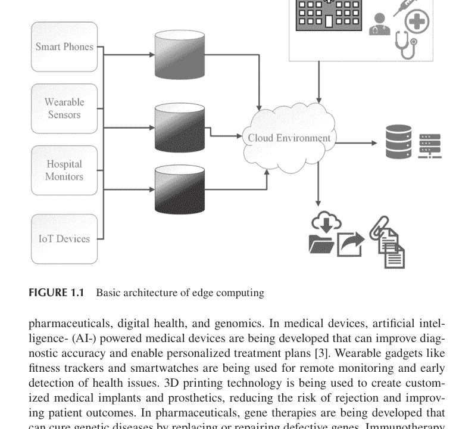

### 图 1.1 边缘计算的基本架构

制药、数字健康和基因组学。在医疗设备中，正在开发人工智能（AI）驱动的医疗设备，可以提高诊断准确性并实现个性化治疗计划 [3]。可穿戴设备如健身追踪器和智能手表正被用于远程监测和早期发现健康问题。3D 打印技术正被用于创建定制的医疗植入物和假肢，减少排斥风险并改善患者结果。在制药领域，正在开发基因疗法，通过替换或修复缺陷基因来治愈遗传病。免疫疗法药物正被用于治疗癌症，通过增强免疫系统对抗癌细胞。个性化医疗变得越来越普遍，使用基因检测根据患者独特的遗传特征定制治疗计划。在数字健康中，远程医疗和远程患者监测技术正在实现虚拟护理和患者与医疗专业人员之间的远程咨询。电子健康记录系统被广泛采用，以提高医疗服务的精确性和效率。大数据正被用于识别患者数据中的模式和趋势，改善诊断准确性和治疗结果。在基因组学中，基因测序的成本正在迅速下降，使其对患者和医疗保健提供者更易于获取和负担得起。基因因子编辑知识的进步，例如成簇规律间隔短回文重复序列（CRISPR），正在实现对遗传物质的精确修改，为疾病治疗和预防提供新的可能性。遗传咨询和检测变得越来越普遍，使患者能够根据其遗传信息对健康和治疗选择做出明智决策。这些是医疗保健近期进展的几个例子。医疗保健行业不断发展，定期开发新技术和治疗方法。这些进展正在改善患者结果，增加医疗保健的可及性，并提高医疗保健交付的效率和有效性。

## 在医疗保健领域使用边缘计算的优势：

- 实时处理：边缘计算能够实现即时数据分析和处理，使医疗专业人员能够更快地做出更明智的患者护理决策。

- 改善患者结果：边缘计算可以通过实现实时监测、个性化医疗以及更快更准确的医学成像来改善患者结果。

- 降低延迟：边缘计算减少了将数据发送到集中服务器相关的延迟，从而在护理点实现更快更有效的数据处理。

- 增强安全性：边缘计算可以通过在本地处理和存储数据来增强患者数据的安全性，减少数据泄露和网络攻击的风险。

- 成本效益：边缘计算比过时的计算模型更具盈利性，因为它减少了对昂贵硬件和基础设施的需求。

## 在医疗保健领域使用边缘计算的劣势：

- 有限的处理能力：边缘计算设备与集中服务器相比通常具有有限的处理能力和存储容量，这可能限制其处理和分析大量数据能力。

- 维护和管理：边缘计算设备需要定期维护和管理，这对资源有限的医疗机构来说可能具有挑战性。

- 数据集成挑战：在边缘计算环境中集成来自多个来源的数据可能具有挑战性，这可能导致数据孤岛和数据碎片化。

- 对网络连接的依赖：边缘计算设备依赖网络连接与其他设备和系统通信，这在某些环境中可能不可靠。

- 数据隐私问题：边缘计算设备可能在本地存储敏感患者数据，这可能引发数据隐私和安全问题。

总之，医疗保健中的边缘计算是一种有前途的方法，通过在护理点提供更快、更高效、更安全的数据处理来改变医疗保健行业，最终改善患者结果并提高护理质量 [4]。边缘计算为医疗保健提供了多项益处，但同时也带来了一些挑战，需要加以解决以确保成功实施和采用。医疗机构在实施该技术前，应仔细权衡使用边缘计算的优缺点，并评估自身的具体需求和要求。

### 1.2 边缘计算智能

人工智能在边缘计算中发挥着越来越重要的作用[5]。它涉及在更靠近数据源的位置进行本地数据处理，而不是将数据分发到集中式信息中心或云端进行处理。这样可以实现更快的数据处理、更低的延迟和更高的效率。人工智能正被用于边缘计算中，以实现智能决策。例如，在自动驾驶车辆中，AI算法被用于实时检查物联网设备信息，使车辆无需将数据发送到集中式服务器处理即可做出即时决策。同样，在工业自动化和机器人技术中，AI算法被用于分析传感器数据，以实时做出决策并执行操作。AI利用边缘计算来提高数据处理效率。通过在边缘端使用AI算法分析数据，只将相关信息发送到服务器进行进一步检查，从而限制了需要分析的数据量，进而最大限度地减少了带宽需求和存储成本。此外，AI还被用于边缘计算以增强安全性[6]。AI算法可以在边缘端检测数据中的异常，从而能够在潜在安全威胁变得更为严重之前即时做出响应。总体而言，AI通过实现实时决策、提高效率和增强安全性，在边缘计算中发挥着关键作用。图1.2总结了各种边缘计算智能。机器学习（ML）是AI的一个分支，包括训练程序以学习模式并根据数据做出预测[7]。它在边缘计算中发挥着重要作用，在边缘计算中，数据处理和分析在计算网络的边缘进行，更靠近数据源。以下是机器学习与边缘计算结合使用的一些示例：

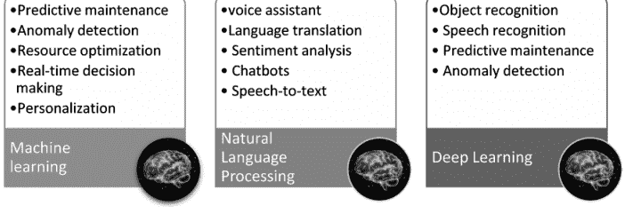

图1.2 边缘计算的各种智能

- **预测性维护：**在许多行业中，ML被用于预测设备可能发生故障的时间，以便在设备损坏之前完成主动维护。通过在计算网络边缘处理传感器信息，ML算法可以实时做出预测，从而减少停机时间和维护成本。

- **异常检测：**ML算法可用于检测传感器数据中的异常行为，例如温度或压力的突然升高或下降。这些异常可能表明存在潜在问题，从而可以立即采取措施以防止损坏或故障。

- **资源优化：**在边缘计算环境中，存储和处理能力等资源是有限的。ML算法可用于通过预测何时需要某些资源以及何时可以释放这些资源来优化资源使用。

- **实时决策：**ML算法可用于实时分析传感器数据，并根据这些数据做出决策。例如，在自动驾驶车辆中，ML算法可以分析传感器数据，以在无需人工干预的情况下做出转向、制动和加速决策。

- **个性化：**ML算法可通过分析用户行为和偏好数据来为用户个性化体验。在边缘计算环境中，可以实时执行此分析，从而立即提供个性化体验。

自然语言处理（NLP）是AI的一个明确子领域，涉及人与计算机之间使用自然语言进行的通信。NLP在边缘计算中发挥着重要作用，在边缘计算中，数据处理和分析在系统边缘进行，更靠近信息源。一些示例包括语音助手、语言翻译、情感分析、聊天机器人和语音转文本。Siri、Alexa和Google Assistant等语音助手在边缘计算环境中越来越受欢迎[8]。NLP算法被用于解释用户的语音命令并实时提供响应。边缘计算环境中的语言翻译服务需要跨语言障碍进行相互通信，而NLP算法可用于实时进行语言之间的翻译。情感分析使用NLP算法实时分析社交媒体数据，以确定所分享内容的情感。这些信息可用于为实时决策提供依据，或识别需要立即关注的潜在问题。聊天机器人在需要人工交互的边缘计算环境中越来越受欢迎。NLP算法被用于解释用户的消息并实时提供适当的响应。边缘计算服务中的语音转文本需要实时将语音转换为文本，而NLP算法可用于实时转录语音，从而实现更快、更准确的通信。

深度学习是用于训练人工神经网络以识别数据模式的过程[9]。它在处理和分���数据方面也为整个系统发挥着至关重要的作用。以下是深度学习在边缘计算中的一些关键作用：

- **物体识别：**深度学习算法被用于实时识别图像或视频流中的物体。这在监控、机器人和自动驾驶车辆等应用中尤为有用。

- **语音识别：**深度学习算法可实时识别和转录语音，从而实现人与机器之间更自然、更高效的通信。

- **预测性维护：**在使用传感器监控设备的边缘计算环境中，深度学习算法可用于预测设备何时需要维护，避免设备发生故障。

- **异常检测：**深度学习算法可用于检测传感器数据中的异常行为，例如温度或压力的突然升高或下降。这些异常可能表明存在潜在问题，从而可以立即采取措施以防止损坏或故障。

NLP通过支持语音助手、语言翻译、情感分析、聊天机器人和语音转文本功能，在边缘计算中发挥着关键作用，所有这些功能都有助于在边缘计算环境中实现更高效、更有效的通信。ML实现了预测性维护、异常检测、资源优化、实时决策和个性化[10]。通过处理数据，深度学习算法可实现更高效、更有效的决策，从而带来性能提升、停机时间减少和用户体验增强。

### 1.3 基于AI赋能的医疗边缘计算

边缘计算有潜力通过提供更快、更有组织且更安全的医护点信息处理来变革医疗保健[11]。以下是边缘计算在医疗保健中的一些应用：

- **实时患者监测：**它支持实时患者监测，使医疗服务提供者能够持续监测患者并及时响应紧急情况。

- **远程医疗：**边缘计算可通过为远程会诊提供低延迟和高带宽连接来支持远程医疗，使医疗专业人员能够为偏远地区的患者提供实时虚拟护理。

- **可穿戴设备：**健身追踪器和智能手表等可穿戴设备会产生大量数据，这些数据将在边缘端进行处理。

- **边缘计算可以实时提供患者健康见解，使医疗服务提供者能够就患者护理做出更明智的决策。**

- **医学影像：**边缘计算可通过在本地处理数据来加快医学影像处理速度并提高准确性，减少将大体积图像文件发送到集中式服务器所带来的延迟。

-   **医疗警报系统：** 这些为患者在紧急情况下（如跌倒或突发疾病）呼叫帮助提供了一种方式。

-   **医疗计费应用程序：** 用于管理医疗保健的财务方面，例如向患者开具账单、管理保险索赔和处理付款。

-   **临床决策支持系统：** 为医疗专业人员提供实时临床信息以辅助决策，例如开具药物处方或订购检查。

-   **个性化医疗：** 边缘计算可以通过本地处理患者数据并提供患者健康的实时洞察来支持个性化医疗，使医疗服务提供者能够根据个人患者需求定制治疗方案。

-   **电子健康记录：** 边缘计算可以通过在护理点实现更快的数据处理来支持电子健康记录，提高治疗标准并降低医疗错误风险。

-   **医疗成像设备：** 这包括用于产生人体内部图像的 X 射线机、磁共振成像（MRI）扫描仪、计算机断层扫描（CT）扫描仪和超声波机。

-   **健康信息交换平台：** 这些平台使医疗机构之间能够共享患者信息，从而实现协调护理和改善患者预后。

### 1.4 边缘计算学习系统


它是一种分布式计算范式，将计算和存储带到所需的位置，而非依赖于集中的云计算资源。在边缘计算中，计算是在更接近数据源的设备上执行的，例如传感器、移动设备和物联网设备。边缘计算的优势在于减少与将数据传输到集中式计算资源相关的延迟和带宽限制，以及当敏感数据通过网络传输时可能出现的安全和隐私问题。通过在结构计算边缘执行计算，可以提高系统性能、减少网络拥塞并增强数据保密性和安全性。边缘计算涉及计算基础设施的部署，例如服务器、存储设备和网络设备。这些设备可以放置在各种各样的位置，从工业场所和制造设施到偏远地区和智慧城市环境。边缘计算生态系统包括各种各样的设备，例如智能手机、平板电脑、可穿戴设备和物联网设备，以及边缘服务器和其他网络基础设施。此外，边缘计算涉及使用前沿技术，例如人工智能、机器学习和自然语言处理，以实现在网络边缘对数据进行即时处理和分析。它代表了分布式计算中的一种新范式，将计算和数据存储带到所需的位置附近，为从智慧城市到工业自动化等广泛的用例提供更高效的计算解决方案。它依赖于一系列技术来实现在网络边缘部分对信息进行即时处理。一些主要技术用于边缘计算列于下文。物联网设备，例如传感器和连接设备，是基于边缘的计算的关键要素。这些设备产生大量数据，可以通过基于边缘的网络进行处理和分析。微服务架构用于开发和部署边缘网络应用程序 [12]。这种方法涉及将任务分解为更小、自治的组件，这些组件可以单独安排和安装。容器用于打包和部署边缘计算应用程序。容器提供了一种便携且轻量级的方式在不同环境中部署应用程序。虚拟化用于创建可用于运行边缘计算应用程序的虚拟机。这种方法提供了一种灵活且可扩展的方式在不同环境中部署应用程序 [13]。人工智能和机器学习技术用于实现基于边缘网络的数据实时处理和分析。这些技术可以执行各种任务，例如图像识别、自然语言处理、图像分割、对象识别和预测分析。5G 和边缘计算网络正被用于实现边缘计算设备之间更快、更可靠的连接。该技术为计算设备提供了低延迟和高带宽需求。

### 1.5 对医疗保健的影响

基于边缘的计算系统在通过边缘计算系统实现医疗数据的实时处理方面，在改变医疗保健方面发挥着重要作用。以下是边缘计算可能对医疗保健产生重大影响的几种方式：

- **实时监测：** 它用于使用可穿戴设备和其他连接设备实时监测患者。这可以帮助医疗专业人员及早发现健康问题并提供及时干预。
- **更快诊断：** 边缘计算可以通过在护理点实时处理和分析医学图像和其他诊断数据来实现更快、更准确的健康问题诊断 [14]。
- **远程患者监测：** 边缘计算可以实现远程患者监测，使医疗专业人员能够从远程位置实时监测患者。这对于需要定期监测和干预的慢性病患者尤其有用。
- **预测分析：** 边缘计算可用于对医疗数据进行预测分析，帮助医疗专业人员识别可能表明潜在健康问题的模式和趋势。这可以实现主动干预和更好的医疗保健结果。
- **数据隐私和安全：** 边缘计算可以通过本地处理和存储数据，而不是将其传输到集中的云计算资源，来帮助解决与医疗数据相关的隐私和安全问题 [15]。

通过利用边缘计算，医疗专业人员可以提供更高效、更有效和个性化的医疗保健服务，改善患者预后并降低医疗保健成本。它通过实现医疗信息的实时处理和分析，具有改变医疗保健的巨大潜力。推动边缘计算在医疗保健中采用的几个驱动因素正在发挥作用。以下是一些关键因素：(i) 医疗数据增加：随着连接设备、可穿戴设备和其他医疗技术的使用日益增长，产生的医疗数据量显著增加。边缘系统可以实现数据的实时处理以改善医疗保健结果。(ii) 即时监测需求：在许多医疗环境中，例如急诊室和重症监护单元，患者的实时监测至关重要。边缘计算可以利用连接设备实现患者的实时监测，帮助医疗专业人员及早发现健康问题并提供及时干预。(iii) 远程患者监测：远程患者监测在医疗保健中变得越来越重要，特别是对于需要定期监测和干预的慢性病患者。边缘计算可以实现远程患者监测，使医疗专业人员能够从远程位置实时监测患者。(iv) 更快诊断需求：更快、更准确的健康问题诊断在医疗保健中至关重要。在护理点对医学图像和诊断数据进行分析有助于医疗专业人员做出更快、更准确的诊断。

### 改善患者预后：

最终，医疗保健的目标是改善患者预后。边缘计算可以通过实现更高效、更有效和个性化的医疗保健服务来帮助实现这一目标，改善患者预后并降低医疗保健成本。因此，对实时监测、更快诊断和改善患者预后的需求正在推动边缘计算在医疗保健中的采用。通过利用边缘计算，医疗专业人员可以提供更高效、更具成本效益的医疗保健服务。与传统的云计算架构相比，实时云计算与边缘计算相结合可以在速度和效率方面提供显著益处 [16]。云计算资源用于实时处理和分析数据，而边缘计算则用于在网络边缘、更接近数据源的地方进行数据的本地监测和检查 [17]。

通过结合这两种技术，实时云计算与边缘计算可以提供多种性能优势，如图 1.3 所示。

通过基于边缘网络对数据进行本地监测和检查，边缘计算可以显著降低延迟，即数据生成与处理之间的延迟。这可以实现对关键事件（如紧急医疗情况）的实时响应，改善患者的预后。边缘计算可以通过进行本地处理和分析来减少需要通过网络传输的数据量

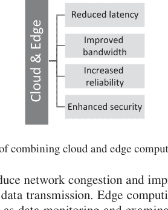

## 图 1.3 结合云计算和边缘计算的优势

数据。这有助于减少网络拥塞并提高带宽，从而实现更快、更高效的数据传输。边缘计算可以提供更高的可靠性和弹性，因为即使网络连接丢失，数据监控和检查也能继续进行。这在医疗保健领域尤为重要，因为实时监测和干预可能是至关重要的。边缘计算通过基于边缘的计算网络在本地处理和存储数据，而不是将其传输到集中的云计算资源，从而可以为医疗保健数据提供增强的安全性和隐私性[18]。

5G有望将延迟降低到不到一毫秒，这对于需要实时处理和决策的应用至关重要[19]。通过使用边缘计算网络处理数据，边缘计算可以进一步降低延迟，从而支持自动驾驶汽车、增强现实和远程手术等新的应用场景。与前几代蜂窝网络技术相比，5G提供了更高的带宽，这对于快速传输大量数据至关重要。它可以通过边缘计算网络处理并监控这些数据，从而减少将大量数据传输到集中式云端的需要。这样可以减轻中心云的负载，提高可扩展性并降低成本。边缘计算可以通过在本地处理敏感数据来提高安全性，而不是通过网络将其传输到中心云。这降低了数据泄露的风险，并改善了数据隐私。边缘计算可以部署在多种位置，例如网络边缘、设备内部或数据中心内。这种灵活性使组织能够根据其具体的用例和需求，将边缘计算部署在最合理的地方。

边缘计算可用于车载网络，实时处理车辆和其他联网设备产生的数据，提供即时反馈，以提高安全性、效率和用户体验。虚拟现实（VR）是一种让用户沉浸于模拟环境的技术，而边缘计算是一种将处理和存储推向数据源的计算模型。这些技术结合起来，有望通过改善患者治疗效果、降低成本和提升患者体验来变革医疗保健行业。以下是VR和边缘计算在医疗保健领域的一些关键特性和优势：通过使用边缘计算网络处理数据，边缘计算可以降低延迟并为VR应用提供实时反馈。这对于实时监测和反馈至关重要的医疗应用（如外科手术和物理治疗）来说非常关键。VR和边缘计算通过为患者提供沉浸式和个性化的体验，可以改善患者的治疗效果。例如，VR可用于为接受化疗或牙科治疗等疼痛性手术的患者提供虚拟环境，以分散他们对疼痛和不适的注意力。边缘计算可以减少对昂贵的中心云基础设施的需求，从而降低成本并提高可扩展性。这可以使VR应用对医疗服务提供者和患者来说更经济实惠、更易获得。VR可用于医疗培训和教育，使医疗专业人员能够在安全且受控的环境中练习手术和技术。边缘计算可以提供实时反馈和分析，提高培训和教育的有效性。边缘计算可以通过在本地处理敏感数据来改善数据隐私和安全性，而不是通过网络将其传输到中心云。这降低了数据泄露的风险并改善了数据隐私。因此，VR和边缘计算的结合可以改善患者的治疗效果。通过使用边缘计算网络处理数据，边缘计算可以降低延迟并改善实时处理，使VR应用对医疗服务提供者和患者更加有效和可及。

### 1.6 结合技术实现智能计算

云计算与边缘计算相结合，平衡了两种可以协同工作以提供更高效计算环境的技术[20]。云环境与基于边缘的计算系统相结合的任务是提供一个可扩展、安全且高效的计算环境，充分利用这两种技术的优势。通过协同工作，云计算和边缘计算可以为从智慧城市到工业自动化的各种任务提供更有效的解决方案。以下是一些任务，例如信息处理与打包、可扩展性、安全性和负载。边缘计算可用于在本地对数据进行预处理，然后再将其分发给云环境进行进一步处理。这有助于减少需要发送到云端的大量数据，从而降低延迟并提高整体系统性能。边缘计算设备可以在本地存储经常访问的数据，从而减少从云端访问数据的需要。这有助于减少网络拥塞并提高整体系统性能。云计算可以提供可扩展的计算资源来支持边缘计算设备。例如，当边缘设备需求激增时，可以从云端调配额外的计算资源来支持增加的工作负载。云计算可以提供安全服务，例如身份和访问管理、数据加密和威胁检测，以保护边缘计算设备免受安全威胁[21]。云计算可以提供高级分析能力来处理从边缘计算设备收集的数据。这有助于识别模式、趋势和异常，从而实现更有效的决策。

### 1.7 基于边缘计算的用例

在各个行业中，有许多基于边缘计算的用例，包括医疗保健、制造业、交通运输、零售等。以下是一些示例：

- **医疗保健：** 边缘计算可以利用联网设备实现患者的实时监测，使医疗专业人员能够及早发现健康问题并及时干预。边缘计算还可以实现远程患者监测，使医疗专业人员能够从远程位置实时监测患者。可穿戴传感器和医疗监护仪等物联网设备可用于收集患者生命体征的实时数据，并将其传输到云计算服务进行分析。这可以帮助医疗服务提供者远程监测患者，并在潜在健康问题变得严重之前发现它们。机器人技术被用于医疗保健领域，执行手术和患者监测等任务。边缘计算可用于实时监控这些机器人的性能，提供即时反馈以改善其性能并降低错误风险。
- **交通运输：** 边缘计算可以实现对车辆、驾驶员和乘客的实时监测，提供有关安全性、性能和路线优化的洞察。这有助于减少事故、提高效率，并增加乘客的整体了解[22]。
- **零售：** 边缘计算可用于通过实时分析客户的行为和偏好来个性化客户的购物体验。这可能有助于提高客户满意度和增加销售额。可以利用一些物联网传感器来收集有关消费者行为的数据。它们可以通过边缘计算网络处理大量数据，为零售商提供即时反馈，以优化库存管理并改善客户体验。
- **智慧城市：** 边缘计算可用于筛选和审查部署在整个城市的物联网传感器数据，提供有关交通流量、空气质量和其他重要因素的洞察。这些数据可以传输到云计算服务进行分析，使城市规划者能够就基础设施、交通和公共安全做出数据驱动的决策。这有助于提高城市居民的安全性、效率和生活质量。
- **智能家居：** 恒温器、安全摄像头和智能音箱等支持物联网的设备可以连接到云计算服务，云计算服务可以存储和分析这些设备产生的数据。这可以使房主远程控制设备并自动执行日常任务，例如开灯或调节温度。
- **工业自动化：** 支持物联网的传感器可用于监控和控制工业流程，例如制造和物流。通过将这些传感器连接到云计算服务，制造商可以优化其运营、减少停机时间并提高整体效率。机器人技术在物流中用于自动化拣选、包装和运输等任务。边缘计算可用于实时监控这些机器人的性能，识别可能出现的问题或故障。数据随后可在网络边缘进行分析，提供即时反馈，可用于改进机器人的运行并最大限度地减少中断 [23]。
- **Agriculture:** 物联网传感器可以追踪土壤湿度、温度以及影响作物生长的各种其他环境变量。这些数据可以传输到云计算服务进行分析，使农民能够就灌溉、施肥以及作物管理的其他方面做出数据驱动的决策。机器人技术在农业中日益用于自动化种植、收获和作物监测等任务。基于边缘的计算结构可用于实时处理来自机器人传感器的數據，提供有关土壤湿度、作物健康以及影响产量增长的生态问题的即时反馈。这些数据可用于优化资源使用并提高作物产量 [24]。
- **Smart manufacturing:** 边缘计算可用于监控和分析工厂车间传感器和设备的数据，实现实时质量控制和预测性维护。这可用于减少停机时间并提高效率。物联网传感器可用于实时监控和控制生产过程。边缘计算可通过基于边缘计算的网络处理和分析数据，向机器和设备提供即时反馈以优化其性能并减少停机时间。机器人在制造过程中通常用于执行重复性任务。边缘计算可用于实时监控这些机器人的性能，识别可能出现的问题或故障。数据随后可通过基于边缘计算的网络进行分析，提供即时反馈以优化机器人的性能并减少停机时间。
- **Energy management:** 物联网传感器可用于收集有关能源使用和生产的数据。基于边缘的计算系统将处理这些数据，向能源管理人员提供即时反馈以优化能源使用并降低成本。

这些边缘计算的用例在效率、有效性和可靠性方面为广泛的行业和应用提供了 considerable 优势。通过网络的边缘计算处理详细的本地数据将有助于做出决策，从而改善企业及其客户的结果。

### 1.8 开发医疗健康技术的软件和硬件公司

图 1.4 说明了一些用于医疗保健和医学的边缘计算工具：

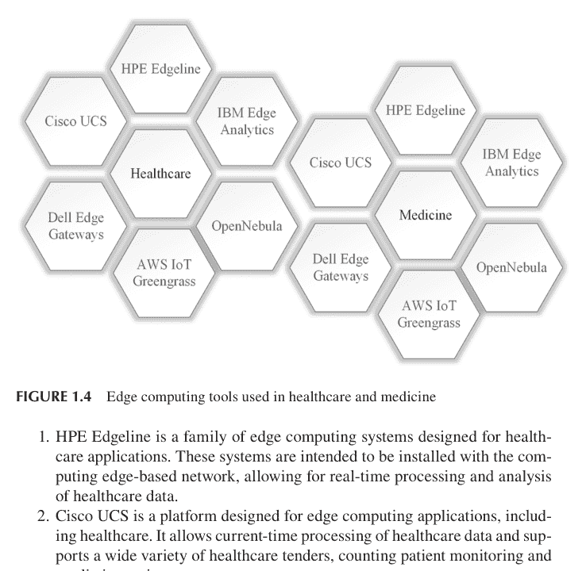

### 图 1.4 用于医疗保健和医学的边缘计算工具

- 1. HPE Edgeline 是一系列专为医疗保健应用设计的边缘计算系统。这些系统旨在与基于边缘计算的网络一起安装，以实现医疗保健数据的实时处理和分析。
- 2. Cisco UCS 是一个专为边缘计算应用设计的平台，包括医疗保健。它允许医疗保健数据的实时处理并支持多种医疗保健应用，包括患者监测和预测性维护。
- 3. Dell Edge Gateways 是专为包括医疗保健在内的多种应用设计的边缘计算设备。这些设备能够对医疗保健数据进行实时处理和分析，可用于支持医学影像和患者监测等应用。
- 4. Amazon Web Services (AWS) IoT Greengrass 是一个边缘计算平台，可实现医疗保健数据的实时处理和分析。它支持远程患者监测和预测性维护等各种医疗保健设备。
- 5. IBM Edge Analytics 是一个专为包括医疗保健在内的边缘计算应用设计的平台。它利用各种医疗保健数据用于医学影像和患者监测等医疗应用。
- 6. OpenNebula 是一个开源云计算平台，可用于医疗保健中的边缘计算应用。
- 7. NVIDIA Clara AGX 是一个专为医疗保健设计的人工智能的边缘计算平台。它能够对医学影像数据进行实时处理并支持放射学、病理学和医学研究等多种医疗应用。
- 8. 来自 Intel 的 Developer Kit – Edge AI 是一个专为在边缘开发和部署 AI 模型而设计的平台。它在医学影像应用中特别有用，可实现对大型数据集的实时分析和处理。
- 9. 来自 Microsoft 的 Azure IoT Edge 是一个基于云的边缘计算平台，可实现医疗数据的实时处理。它支持远程患者监测、预测性维护和药物发现等多种医疗应用。
- 10. IoT Edge with Google Cloud 是一个基于云的边缘计算平台，可实现医疗数据的实时处理。它支持疾病诊断、药物发现和个性化医疗等多种医疗应用。
- 11. OpenVINO 是来自 Intel 的边缘计算工具包，使开发人员能够为边缘设备优化 AI 模型。它支持医学影像、疾病诊断和药物发现等多种医疗应用。
- 12. Arm Cortex-M 系列是一系列专为边缘计算应用设计的微控制器。它们在需要低功耗和低成本解决方案的医疗应用中特别有用，例如医疗传感器和可穿戴设备。

这些技术用于实现医疗数据的实时处理和分析。

### 1.9 医疗保健实施工具

EdgeCloudSim 是一个模拟器，可用于模拟、建模和评估边缘计算结构。它是 CloudSim 模拟器的扩展，CloudSim 广泛用于演示和模拟云计算环境。EdgeCloudSim 提供了一个灵活的仿真系统，使研究人员和从业人员能够研究边缘计算的各个方面，例如工作负载分配、资源管理和能源效率。EmuFog 是一个用于雾计算环境的开源仿真框架。它旨在模拟大规模雾计算网络的行为，并提供一套全面的工具用于建模、模拟和分析雾计算系统。EmuFog 使研究人员和从业人员能够研究雾计算的各个方面，例如资源管理、工作负载分配和能源效率。EmStar 是一个用于研究边缘计算系统效率和性能的分布式开源仿真框架。它旨在模拟大规模边缘计算网络，并提供一套全面的工具用于建模、模拟和分析边缘计算系统。EmStar 使研究人员和从业人员能够研究边缘计算的各个方面，例如资源管理、工作负载分配和能源效率。EmStar 是研究人员和从业人员研究和优化边缘计算系统的重要工具。它提供了一个灵活且可扩展的仿真框架，允许探索各种场景和配置，有助于提高基于边缘计算系统的性能、能源生产率和成本效益。FogTorchII 是一个开源仿真框架，旨在评估雾计算环境中资源分配策略的性能。它允许研究人员和从业人员模拟大规模雾计算网络的行为并模拟各种场景，以评估不同资源分配策略的有效性。它提供了雾节点的详细模型，包括其计算能力、内存、存储和能源消耗。IOTSim 是一个开源模拟器，旨在模拟大规模物联网系统的行为。它是一个灵活且可扩展的仿真框架，允许研究人员和从业人员在各种条件下对物联网系统的性能进行建模、模拟和分析。这使研究人员能够在各种工作负载和资源分配方案下研究雾节点的性能和能源效率。PureEdgeSim 提供了边缘设备生成的工作负载模型，包括计算类型、数据大小和到达率。这使研究人员能够研究工作负载特征对边缘计算性能的影响。

## 参考文献

- 1. Kauffmann, Jacob, Malte Esders, Lukas Ruff, Grégoire Montavon, Wojciech Samek, and Klaus-Robert Müller. “通过神经网络从聚类到聚类解释。” *IEEE 神经网络与学习系统汇刊* (2022)。
- 2. Patil, Shishir G., Paras Jain, Prabal Dutta, Ion Stoica, and Joseph Gonzalez. “POET：在集成重物化和分页的小型设备上训练神经网络。” *国际机器学习会议* 162 (2022): 17573–17583. PMLR.


- 3. Ismail, Leila, and Rajkumar Buyya. “智能城市数字生态系统的自学习 6G 网络的人工智能应用：分类、挑战与未来方向。” *传感器* 22, no. 15 (2022): 5750.
- 4. Gupta, Ishu, Ashutosh Kumar Singh, Chung-Nan Lee, and Rajkumar Buyya. “云环境中数据保护的安全数据存储和共享技术：系统综述、分析与未来方向。” *IEEE Access* 10 (2022): 71247–71277.
- 5. Zhu, Shiqiang, Yu Ting, Tao Xu, Hongyang Chen, Schahram Dustdar, Sylvain Gigan, Deniz Gunduz et al. “智能计算：最新进展、挑战与未来。” *智能计算* 2 (2023): 0006.
- 6. Chang, Michael Alan, Aurojit Panda, Hantao Wang, Yuancheng Tsai, Rahul Balakrishnan, and Scott Shenker. “AutoTune：提高微服务应用的端到端性能和资源效率。” *arXiv 预印本 ArXiv:2106.10334* (2021).
- 7. Zhong, Zhiheng, Minxian Xu, Maria Alejandra Rodriguez, Chengzhong Xu, and Rajkumar Buyya. “基于机器学习的容器编排：分类与未来方向。” *ACM 计算调查 (CSUR)* 54, no. 10s (2022): 1–35.
- 8. Wang, Xiaojie, Jiameng Li, Zhaolong Ning, Qingyang Song, Lei Guo, Song Guo, and Mohammad S. Obaidat. “无线供电移动边缘计算网络：综述。” *ACM 计算调查* 55 (2023): 1–37.
- 9. Hénaff, Olivier J.、Skanda Koppula、Evan Shelhamer、Zoran Daniel、Andrew Jaegle、Andrew Zisserman、João Carreira 和 Relja Arandjelović。“物体发现与表示网络。”见：Computer Vision–ECCV 2022：第17届欧洲会议，以色列特拉维夫，2022年10月23–27日，会议录，第XXVII部分，第123–143页。Springer Nature Switzerland，2022年。
- 10. Sudharsan, Bharath、John G. Breslin、Mehreen Tahir、Muhammad Intizar Ali、Omer Rana、Schahram Dustdar 和 Rajiv Ranjan。“OTA-TinyML：通过空中部署TinyML模型并在物联网设备上执行。”IEEE《互联网计算》26卷第3期（2022）：69–78。
- 11. Goudarzi, Mohammad、Huaming Wu、Marimuthu Palaniswami 和 Rajkumar Buyya。“边缘和雾计算环境中并发物联网应用的应用放置技术。”IEEE《移动计算汇刊》20卷第4期（2020）：1298–1311。
- 12. Deb, Debayan、Xiaoming Liu 和 Anil K. Jain。“Faceguard：一种针对对抗性人脸图像的自监督防御方法。”见：2023年IEEE第17届自动人脸与手势识别国际会议（FG），第1–8页。IEEE，2023年。
- 13. Gunasekaran, Hemalatha、K. Ramalakshmi、Shalini Ramanathan 和 R. Venkatesan。“一种用于基因组序列分类的深度学习CNN模型。”《用于COVID-19的智能计算应用》（2021）：169–185。https://www.taylorfrancis.com/chapters/edit/10.1201/9781003141105-9/deep-learning-cnn-model-genome-sequence-classification-hemalatha-gunasekaran-ramalakshmi-shalini-ramanathan-venkatesan
- 14. Ramanathan, Shalini 和 Mohan Ramasundaram。“基于鲸鱼优化与核支持向量机的脑磁共振图像中阿尔茨海默病形状检测模型。”《电气工程与技术杂志》18卷（2022）：1–10。
- 15. Ramanathan, Shalini、Savita Goel 和 Subramanian Alagumalai。“云数据库比较：亚马逊SimpleDB与谷歌Bigtable。”见：2011年信息系统近期趋势国际会议，第165–168页。IEEE，2011年。
- 16. Ghosh, Shreya、Anwesha Mukherjee、Soumya K. Ghosh 和 Rajkumar Buyya。“STOPPAGE：用于疫情监测和管理的时空数据驱动的云-雾-边缘计算框架。”《软件：实践与经验》52卷第12期（2022）：2700–2726。
- 17. Calheiros, Rodrigo N.、Rajiv Ranjan、Anton Beloglazov、César A.F. De Rose 和 Rajkumar Buyya。“CloudSim：用于云计算环境建模与仿真以及资源供应算法评估的工具包。”《软件：实践与经验》41卷第1期（2011）：23–50。
- 18. Goudarzi, Mohammad、Marimuthu Palaniswami 和 Rajkumar Buyya。“边缘和雾计算环境中的物联网应用调度：分类法与未来方向。”ACM《计算调查》55卷第7期（2022）：1–41。
- 19. Wang, Zhiyu、Mohammad Goudarzi、Jagannath Aryal 和 Rajkumar Buyya。“面向实时物联网应用的边缘和雾计算环境中的容器编排。”《计算智能与数据分析：ICCIDA 2022会议录》（2022）：1–21。
- 20. Barbato, Vincenzo、Claudio Savaglio、Min Chen 和 Giancarlo Fortino。“揭示边缘智能：一项系统性元调查。”《大数据与认知计算》7卷第1期（2023）：44。
- 21. Pham, Truong An、Junjue Wang、Roger Iyengar、Yu Xiao、Padmanabhan Pillai、Roberta Klatzky 和 Mahadev Satyanarayanan。“Ajalon：简化可穿戴认知助手的创作。”《软件：实践与经验》51卷第8期（2021）：1773–1797。
- 22. Tong, Alexander、Nikolay Malkin、Guillaume Huguet、Yanlei Zhang、Jarrid Rector-Brooks、Kilian Fatras、Guy Wolf 和 Yoshua Bengio。“条件流匹配：无模拟动态最优传输。”*arXiv预印本 arXiv:2302.00482*（2023）。
- 23. Abirami, S. 和 Shalini Ramanathan。“云环境中资源分配的线性调度策略。”*《国际云计算：服务与架构杂志》（IJCCSA）*2卷第1期（2012）：9–17。
- 24. Iftikhar, Sundas、Sukhpal Singh Gill、Chenghao Song、Minxian Xu、Mohammad Sadegh Aslanpour、Adel N. Toosi、Junhui Du 等。“基于人工智能的雾计算与边缘计算：系统综述、分类法与未来方向”*《物联网》*21卷（2022）：100674。

# 2 人工智能在医疗保健和医学中的历史与作用

Dipali Dakhole 和 K.N. Praveena

## 2.1 引言

人工智能（AI）是一个随机器人的发明而兴起的计算机科学领域。作家卡雷尔·恰佩克在他1921年的戏剧《医疗研究》中首次使用了“机器人”一词。自机器人发明以来，它们已在工厂中取代了人类劳动。中国机械工程师偃师利用皮革、木材和人造器官，创造了第一个类人构造物。列奥纳多·达·芬奇在文艺复兴时期创造了一个骑士机器人。人们利用他一丝不苟的草图制作了这个机器人。它能站起来、四处移动并挥手。他那具有启发性的工作也影响了医疗行业，一家美国企业创造了达·芬奇手术系统，该系统后来更名为“直觉外科”系统。心脏瓣膜置换、前列腺切除术和妇科手术等复杂外科手术可以使用达·芬奇手术设备完成[1]。威廉·格雷·沃尔特于1948年创造了第一台电子自主机器人Machina Speculatrix，用以说明大脑的工作方式。约翰·麦卡锡于1955年创造了“人工智能”一词，并把它描述为“制造智能机器的科学与工程”[2]。在会议上，他讨论了催生“人工智能”这一跨学科领域的话题。它为可能包含计算机科学的应用提供了理论基础[3]。如今，计算机能够解决任何复杂的数学问题，这有助于大规模解决医疗相关应用中的问题；人工智能正式成为计算机工程的一个子领域，因为它采用新颖的思想和创造性的方法来解决具有挑战性的计算问题。现代控制论对人工智能的发展做出了重要贡献。控制论利用技术来调节、组织并约束任何系统。

人工智能将增强并改变医疗保健和医疗系统的未来；人工智能包括由计算机执行的模拟人类智能的任务。人工智能最初由一组简单的“如果，那么”规则组成，但随着时间的推移，它已经发展到能够处理通常只有人脑才能解决的问题。人工智能有多个子领域，包括机器学习（ML）、深度学习（DL）和计算机视觉。机器学习的目标是利用算法或模型发现数据中隐藏的模式，这些模式可用于评估问题和寻找解决方案。机器学习算法或模型并非用静态解决方案来处理这些问题，而是被用于各种临床决策场景，以实现个体化患者治疗。医疗保健中许多基于机器学习和机器人的应用都凸显了人工智能的潜力。现在，它被称为深度学习（DL），并被广泛使用。在深度学习中，机器可以通过算法构建一个功能类似于人脑的人工神经网络（ANN），从而自行做出决策。在计算机视觉中，计算机从一组静态照片或动态影像中学习。在放射学等医学领域，需要更精确的基于图像的诊断和问题解读。医学教育的一个关键部分是学习如何解读放射影像。人工智能技术正在应对这些临床程序和服务。此外，它还在推动放射学教育和基于图像的学习的未来转型[4]。近年来，人工智能已被用于改进收集感官输入并将其转化为有用模型的方法，这些模型的表现甚至优于人脑功能。例如，目前正在进行乳腺X线摄影筛查中乳腺癌诊断、机器人手术有效性以及使用自主机器人系统的新兴手术研究。

人工智能系统的技术发展至关重要，但要负责任、有效地采用它，还必须解决伦理和法律方面的关切。在所有诊断程序和治疗的医患互动系统中，其组成部分包括伦理考量和患者同意。只有公众参与，新的、有前景的技术所面临的实际问题才能得到解决。此外，存在族群不平等问题的群体在统计上并没有显著关联，这表明族群差异不仅仅是训练数据中某些患者群体的反映。在类似研究中，许多研究人员声称，人工智能系统能够识别大量患者的人口统计学特征。一项研究表明，利用人工智能可以从胸部X光片中区分患者并判断一个人的性别。与此同时，其他研究发现，人工智能模型可以通过对各种医学图像进行测试来准确预测患者的实际年龄。在眼科学中，视网膜扫描已被用于结合高血压和吸烟状况来预测性别、年龄和心脏指标。这些发现证实了一个多世纪以来临床和流行病学研究已知的关于变量重要性和可能混杂因素的信息。它们表明，与疾病结局高度相关的种族身份、年龄和其他人口统计学特征，也与医学影像要素高度相关，并可能导致模型结果出现偏差。

实际上，许多已发表的人工智能模型都很直接，但只对属性进行双变量评估，并且倾向于预测医疗结果。尽管先进的人工智能模型开始考虑其他风险因素，这在理论上带来了具有多特征的模型。临床和流行病学研究在很大程度上忽略了重要的人口统计学多重特征（如年龄、性别和族群个体性）。深度学习模型中的族群识别可能会被混淆，这一观点提出了人工智能模型导致族群不平等的一个潜在机制：人工智能模型能够从X光片中快速确定患者的种族。然而，这一假设受到的关注不如年龄和性别等其他人口统计学因素。

## 表 2.1

医学科学中的各种子领域及其应用

| 医学科学中的 AI 应用领域 | 应用描述 |
|---|---|
| 风险预测和干预 | 基于 EHR 数据，AI 可以计算患者的健康风险。 |
| 人群健康管理 | 基于 AI 的半自动化系统可以联系患者以识别并缩小护理差距。 |
| 医疗建议和分诊 | AI 可以对患者投诉进行分诊，并为更合适的护理腾出初级医疗访问渠道。 |
| 风险调整后的组管理和资源配置 | AI 通过根据复杂程度调整患者组规模，确保临床医生有足够的时间处理每位患者的问题。 |
| 远程患者监测 | AI 整理智能设备收集的大量数据，以提供可操作的临床洞察。 |
| 数字健康教练 | AI 为患者提供慢性病自我管理工具。 |
| 诊断 | AI 驱动的 PCP 服务可以帮助缺乏专科护理的地区。 |
| 临床决策 | 内置 EHR 平台的 AI 为医生提供循证临床建议。 |
| 实践管理 | AI 可以自动化重复的行政任务。 |

并且放射科医生普遍持有一种默示的信念，即使用医学影像数据几乎不可能查出患者的种族，并且大多数影像工作从根本上是种族中立的，考虑到该任务不受患者种族的影响 [5]。

医学领域还有更多应用，如表 2.1 所列。这些应用已利用 AI 改变了医疗保健系统 [6]。所有这些都分为两类：AI 的虚拟分支和 AI 的物理分支，如下一节所述。

### 2.1.1 人工智能的虚拟分支

医学中 AI 的虚拟分支有两个主要子领域：ML 和 DL，如图 2.1 所示。

## 图 2.1 医学中虚拟分支 AI 的类型

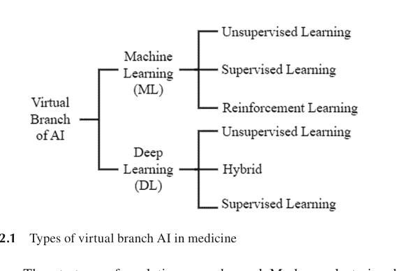

使用 DL 通过经验增强学习的数学技术充当虚拟组件。ML 算法可分为三类：（1）无监督（检测模式的能力），（2）监督（基于先前数据的分类和预测算法），以及（3）强化学习（使用特定问题空间作为使用一系列激励和惩罚的方法的基础）。首先，AI 通过提供 ML 算法和知识管理，加速并继续加快基因和分子医学发现。AI 导致医学进步的一个例子是由于无监督的蛋白质-蛋白质相互作用算法而发现新的治疗靶点。进化增强马尔可夫聚类策略将灵活的革命性算法和更具前瞻性的聚类方法结合在一起，这些方法更真实且过拟合问题减少。它们已被开发用于发现 DNA 适应和 RNA 适应以预测遗传疾病或行为 [7]。可以预测超过 5,000 个蛋白质复合体，其中至少有一个基因本体功能项富集了超过 70% 的数据集。如果模型的参数多于观测值，则会出现过拟合问题。除了基因应用外，它在其他医疗保健系统中也被广泛使用。

今天，医疗保健系统除了患者和医生之间的常规联系外，还包括更大规模的组织。医疗保健系统还必须始终努力通过吸取教训和实施新程序来改进自身。位于共享环境中的一组代理在多智能体系统（MAS）中相互交互。此程序涉及创建或加入一个利用 AI 取得重大进步的组织。例如，在公共系统中代替关注医疗费用而为慢性精神疾病治疗创建不必要复杂的生态系统。在医疗组织中，MAS 技术建议在大型生态系统中研究患者的用药行为后果。全球医疗保健平台通过已证实的药物反应增加、支出减少和更有效的治疗，实现实践映射、简化标准和更好的决策支持。卫生系统管理者能够实施它；可以检查社会、医疗和刑事司法系统的组成部分的变化，以及系统绩效的动态。使用某些算法识别患有遗传疾病或患持续性疾病风险更高的人的电子病历是 AI 的虚拟用途之一。允许员工收集和分享他们的理解以实时做出理想决策。为了达到期望的质量，医疗保健流程和电子病历的管理至关重要。目前使用的维护不一致的患者记录中的信息必须数字化，并以个人数据和汇总格式提供用于流行病学规划和研究。为了实现目标疗效并降低成本，学术界和信息技术行业必须做出重大努力。对于医疗保健系统和知识获取而言，目前大多数医疗记录都存在于无法访问的孤岛中，其中包含无意义的信息。实验室和诊所之间的合作对于加快电子健康记录的使用是必要的。组织应协助开发能够理解数据的系统，并鼓励收集实时数据。医生和科学家必须能够免费访问汇总数据，并且必须在服务点随时提供。医学科学发现的新趋势必须通过免费来源传播。每项发现都必须对其临床应用以及数据集的简易性、可读性和临床实用性进行审查。为了提升其医疗价值并降低医疗成本，医疗器械或记录是个性化用药、早期识别和重点预防的关键参数。

### 2.1.2 人工智能的物理分支

医学 AI 的第二种用途涵盖了涉及护理业务的设备、医疗机械和机器人，被称为“护理机器人”。它涉及机器人助手的部署，例如为认知受损或行动受限的老年人提供机器人护理员。护理机器人是日本的发明，是这种机械的最高尖端例子。在手术中，机器人可以协助人类医生甚至单独操作。机器人实用性的最惊人展示之一是它们与自闭症儿童互动和指导的能力。在当前医疗环境中以及在许多可能受益于机器人辅助的其他情况下使用 AI 机器人之前，必须回答重要的伦理问题 [8]。这一新兴医疗领域的根本困难是不同心理和生理状况的程序要求、其分配结果以及伦理问题。除了 AI 的虚拟和物理分支外，还有其他应用，用于寻找医学应用中使用的治疗方法的效率。

## 2.2 机器人对治疗效率观察的应用

在康复等情况下，机器人也可以用于确定人类表现如何演变。AI 还可用于跟踪药物如何专门针对特定恶性肿瘤、组织或器官进行给药。例如，值得阅读关于纳米机器人最近的进展，这些纳米机器人被修改以解决输送问题，这是由于治疗剂扩散到感兴趣区域的挑战而产生的。当医生试图专注于肿瘤的核心时会出现这个问题，肿瘤核心通常血管化不足且缺氧，但仍活跃。作者们试图使用天然物质代替“智能”纳米颗粒，以绕过机械-放射性机器人的局限性 [9]。他们正在研究一种名为 Magnetococcus marinus 的特定海洋细菌，因为它自然


移动至低氧环境。外部磁源提供初始引导，随后由纳米机器人的固有能力接管。这些纳米机器人与具有治疗特性的纳米脂质体之间可能形成共价键。根据初步数据，所需药物进入缺氧区域的梯度显著增加。这些AI在医学中的潜在应用大多还需要更多研究，尤其是在人机交互领域。1970年，森政弘提出了“恐怖谷”一词，主要强调人机交互（HRI）学科。该研究评估了人形机器人的超自然和不可预测特性，将其视为决定人们是否害怕或接受机器人的因素。

在各种临床任务中，自我报告的种族被用于对众多医疗应用中的AI性能进行分层，例如黑色素瘤检测、死亡率预测以及帮助预测医疗资源使用的算法。此外，群体归属与种族差异之间没有实质性关联。这表明种族不平等并不仅仅源于这些患者的训练数据。在类似研究中，一些研究人员声称AI系统能够识别众多患者的人口统计学特征。这些研究表明，从胸部X光片中，AI模型能够合理预测患者的实际年龄，还能预测性别并区分成人和儿童患者。眼科学中已利用视网膜扫描来预测性别、年龄和心脏状态。这些结果支持了医学和流行病学检查已知的结论。它们表明，与疾病结局高度相关的人口统计学变量（如年龄、性别和种族）也与医学影像高度相关，并可能导致模型结果出现偏差。从概念上讲，许多已发表的AI模型仅仅是简单的双变量分析（即视觉特征预测临床结局的潜力）。医学领域的大多数深度学习研究主要忽略了重要的人口统计学因素，包括年龄、性别和种族身份。尽管更现代的AI模型开始纳入额外风险因素，但临床和流行病学研究的概念基础仍然是多变量建模。这些发现凸显了种族身份混淆深度学习模型的可能性，指出了AI模型导致种族差异的一种潜在机制——AI模型能够公然从医学照片中识别患者的背景信息。所有放射技师都认为医学图像处理本质上种族中立[10]。这与其他人口统计学信息（如性别）形成对比，因为从医学图像中确定患者性别是可能的。了解种族如何影响医学影像模型极为重要，因为美国食品药品监督管理局和其他监管机构正在批准许多以医学图像为主要输入的基于AI的模型。这种理解之所以重要，是因为在医疗系统中，一个被认为是种族中立的关键环节存在偏差风险。在这项工作中，我们研究了自我报告的种族群体如何影响AI系统在医学影像中识别患者种族的准确性。为了测试AI模型能否在各种影像模式、数据集和临床活动中准确预测一个人的种族，我们试图分析大量公开和私有的医学影像数据集。

利用私人和公共数据集，深度学习模型能够准确预测，即无论患者来自哪个地区，都可以将患者数据用于各种临床环境、医学图像格式和人群[11]。这一结论令人震惊，因为人们通常认为只有高技能的人类才能完成这项任务。精心剔除编码相关参数的特征（使AI模型“色盲”）是经常被建议用来减少已知AI模型性能差异的一种技术。该研究表明，在医学图像处理中，这种技术可能无法实现，因为种族识别数据似乎极难分离，尽管这一策略已被批评在某些情况下无效甚至有害。任何分辨率上的逻辑损失、引入噪声、频率分布或基于块的掩蔽，都没有削弱识别种族的能力。即使我们暂不考虑这些策略是否有用，也可以想象这些技术解决方案不太可能成功；而检测种族偏见的方法，与专门设计用于平衡种族结果的模型相结合，应被视为在这种情况下最大化AI安全性的默认策略。尽管监管环境正在变化，但尚未制定强有力的程序来防止意外的种族检测，无论是识别模型中的这些能力，还是减轻可能产生的影响。

此外，调查的限制因素是种族身份标签以及各类别患者数量不足。此外，由于不同数据集中对该群体的记录方式存在差异，西班牙裔患者群体也被排除在外。此外，无法确定照片上是否残留任何骨骼组织，因为我们为消除骨密度影响所做的研究仅评估了平均身体组织像素和60%水平的亮度裁剪。未来的研究可以在图像重建之前检查信号隔离。

最后，我们应该提到，本研究并未发现AI模型性能中存在任何全新的种族差异。相反，先前已发表的研究（这些研究在我们考察的某些任务中发现了差异）构成了本研究的基础。研究结果与已报道的不平等现象共同表明，模型在医学影像中识别种族的强大能力可能会导致患者受到伤害。换句话说，AI模型似乎利用其从医学照片中预测患者种族的能力，为不同种族群体提供不同的健康结果。

该研究最后证明了，将医学AI系统识别自我报告种族身份的能力与医学影像隔离开来是多么困难。我们发现，仅凭医学图像数据就能轻易推断出患者的种族身份，而且这种推断能力可以适用于外部环境和其他影像模式。我们强烈建议，所有参与医学图像分析深度学习模型的开发、监管和使用的人员都要极其谨慎，因为此类数据可能被滥用，从而维持或加剧医学科学中已被充分报道的种族不平等。本研究建议，在未来的AI医学图像处理中，应强调基于种族身份、性别和年龄的明确模型性能审计，并且医学数据集或许应该包含患者的自我报告种族。

AI被广泛定义为使用计算机来执行通常需要人类智能的操作，并已迅速成为医学研究的关键组成部分。按照时代精神，医疗行业即将迎来全面改革，包括患者管理、诊断和治疗。医疗流程和决策预计将因基于AI的创新而改变，这些创新还有望带来直接面向消费者的医疗服务，甚至机器人辅助医疗[11–14]。然而，AI框架存在许多挑战。许多医学专业人士观察到，这正是AI发展如此缓慢的原因。此时的怀疑是可以理解的。目前，几乎没有程序员真正担任医生。尽管这些言论写于30多年前，但仍然具有现实意义和针对性。在讨论AI革命的同时，医院大多还在“照常营业”。计算机无疑彻底改变了医疗行业，但大多数情况下，它们取代的是纸张，而不是人类的知识和技能。患者到医疗机构就诊时，实际上仍然几乎总是在没有AI辅助的情况下接受评估、诊断和治疗。

医学AI能否兑现其承诺？也许能，也许不能，如果当前的研究重点保持不变的话。早期医学AI是借助领域专业知识开发的，而现代机器学习算法往往甚至不需要这些。新模型虽然有效，但通常具有固有的不透明性；它们达不到医生和患者最终用户设定的透明度标准。由于这种固有的不透明性，临床医生和患者对模型的运作方式一无所知，这被归因于处理过程与人类解释和思考期望之间的差异。由于专有秘密的存在，缺乏透明度使得医生或患者无法理解算法。

### 2.3 黑盒AI的影响

黑盒AI模型缺乏质量保证，无法在组织中建立信任，并限制了医生与患者之间的沟通。为了提高医学AI的可靠性，医疗行业应在框架构建和评估方面要求清晰性。

#### 2.3.1 AI往昔的幽灵

1943年，具有统计技能的假设性人工神经元系统催生了AI领域。随着能够证明几何定理或使用形式逻辑解决代数应用题的新程序员出现，这一学科与计算机一同发展了多年。第一次AI热潮始于20世纪60年代，当时标准从逻辑演绎转向基于知识的系统。

知识型系统通过“如果、那么”语句的阶梯，利用领域专家知识创建了一种定制化的“菜谱”。人工智能首次开始解决“实际问题”，而推理的加入通过展示推理轨迹为模型带来了一定的清晰度，这在医疗保健行业尤其引发了大量关注。在1980年致《JAMA》编辑的一封信中，MYCIN系统是首次对医疗物流进行模仿的重要尝试，该系统开发于20世纪70年代初。然而，知识型系统在面对足够困难的问题时很快显示出其局限性。当詹姆斯·莱特希尔发表了一份付费报告，指责研究人员夸大人工智能的能力时，人工智能的炒作意外结束，导致资金大幅减少。因此，人工智能热潮以令人失望的结局收场，“第一次人工智能寒冬”诞生。当领域知识在20世纪80年代为数字设备公司带来显著经济优势，并在1986年时每年为公司节省估计4000万美元时，第二次人工智能热潮开始了。在其他具有显著财务激励的企业帮助下，专家系统市场在不到十年的时间里从几百万美元增长到二十亿美元。INTERNIST-1系统与MYCIN同期首次开发，在此期间已趋于成熟。该系统旨在通过诊断排序算法开发和评估医学理论，但也无法在现实世界环境中应用。早期人们对医学人工智能持怀疑态度，但很快这种怀疑也蔓延到其他领域。随着新研究停止进入商业，专家系统市场在20世纪80年代后期开始崩溃。人工智能趋势再次以失望告终，这引发了被称为“第二次人工智能寒冬”的现象。自那以后，机器学习——一种新的人工智能方法——在很大程度上取代了知识型系统。它旨在利用从现有数据中立即训练的复杂非线性函数将因素与响应联系起来，而无需专家建议。随着深度人工神经网络（ANN）在20世纪90年代和2000年代获得突出地位，机器学习研究继续推进。尽管在20世纪90年代初制作了几种早期的ANN决策支持系统，但它们的准确性低于传统的回归模型。我们目前正经历第三波人工智能热潮，由技术进步推动，使我们能够在空间和时间上识别信号。它需要超快的计算机和庞大的数据来训练深度神经网络，继续在医学领域的研究。

#### 2.3.2 人工智能现在的幽灵

通过解决众多具有挑战性的问题，尤其是在语言和图像处理领域，深度学习重新激发了人们对人工智能的兴趣。然而，人工智能在医疗保健行业中未能发挥作用的方式有多种。完美的模型可能由于法律责任和数据短缺等外部问题而未被使用。此外，人工智能缺乏清晰度可能是一个根本性问题，如果不加以解决，可能导致医疗保健领域出现另一种人工智能寒冬。当代机器学习的大部分是为互联网推广等应用而构建的，在这些应用中，模型效率比其复杂性更重要。尽管深度学习模型有效，但它们经常缺乏清晰度，使得难以了解和理解模型为何能很好地预测。这部分归因于极其复杂的“神经”连接以及这些连接产生的数学抽象（如图像中像素组合的表示）。这导致了深度神经网络等技术，其中内部工作对观察者隐藏，如“黑箱”[12]。由于缺乏透明度和可理解性，其在高风险决策中的实用性受到限制。值得注意的是，黑箱方法（1）缺乏质量保证，（2）不培养信任，（3）限制临床医生和患者之间的沟通。

有人声称，黑箱机器学习模型与机制未知的药物干预之间没有区别。毕竟，每一种都可能被彻底检查、试验并对其效果进行研究。然而，在医疗保健生态系统的背景下，这两种技术表现截然不同。首先，关于质量控制的说明：医学系统中的人工智能，即使是隐藏的人工智能（称为黑箱人工智能），也可能在模型中内置有害偏好。药物的机制是一种自然现象，不能被视为天生有偏见。其次，如果医学人工智能不够透明，患者可能不会信任它。换句话说，即使他们不想要关于例如药理学过程的解释，患者仍可能期望黑箱模型提供解释。虽然除缺乏开放性之外的其他因素也可能导致信心下降，但这并不意味着它不能也是如此。患者对黑箱模型的缺乏信心可能会削弱他们对该模型的信任，即使他们的缺乏信心在事实上是不正确的，因为信任取决于主观因素和客观因素。相反，患者可能对了解药物如何起作用不感兴趣；在这种情况下，保密这一信息不会损害患者对治疗的信心。显然，随着人工智能变得更加普遍，这可能会改变。然而，患者对医学人工智能的信念将取决于当前的一定程度的清晰度，尤其是在人工智能相关争议和灾难在多个领域被曝光的背景下。第三，就医患对话而言，能够有效做出治疗价值判断的黑箱算法可能会凌驾于患者自主权之上。与实际服用阿司匹林不同的是被建议这样做。虽然通常只有一个正确的诊断，但可能存在多种可行的疗法。每位患者的需求和自由意志决定了“正确”的治疗方案。即使患者不了解治疗如何起作用，他们通常也需要解释为什么它是可接受的替代方案（基于疗效、副作用等），以便选择最佳方案。如果没有提供此类解释，医患关系可能会受损，因为这对患者的自主权不尊重。第四，就验证而言，多阶段临床试验用于临床验证药物疗法。试验是开放且严格控制的。它们也跨越很长一段时间，需要数年的测试后才能被授权供人们使用。深度模型经常缺乏足够的验证，并且尚未经过长期验证。

## 参考文献列表

1. Hamet, P, J Tremblay, 医学中的人工智能。 *代谢：临床与实验*, 69S, 2017 年 4 月, S36–S40. https://doi.org/10.1016/j.metabol.2017.01.011. Epub 2017 年 1 月 11 日. PMID: 28126242.
2. Kaul, V, S Enslin, SA Gross, 医学人工智能史。 *胃肠内镜*, 92(4), 2020 年 10 月, 807–812. https://doi.org/10.1016/j.gie.2020.06.040. Epub 2020 年 6 月 18 日. PMID: 32565184.
3. Kulikowski, CA, 人工智能医学第一代的开篇章节：第一次罗格斯 AIM 研讨会，1975 年 6 月。 *医学信息学年鉴*, 10(1), 2015 年 8 月, 227–233. https://doi.org/10.15265/IY-2015-016. Epub 2015 年 6 月 30 日. PMID: 26123911. PMCID: PMC4587035.
4. Quinn, Thomas P, Stephan Jacobs, Manisha Senadeera, Vuong Le, Simon Coghlan, 医学人工智能的三个幽灵：黑箱现在能否兑现？ *医学人工智能*, 124, 2022, 102158, ISSN 0933-3657. https://doi.org/10.1016/j.artmed.2021.102158.
5. Gichoya, Judy Wawira, Imon Banerjee, Ananth Reddy Bhimireddy, John L Burns, Leo Anthony Celi, Li-Ching Chen, Ramon Correa, Natalie Dullerud, Marzyeh Ghassemi, Shih-Cheng Huang, Po-Chih Kuo, Matthew P Lungren, Lyle J Palmer, Brandon J Price, Saptarshi Purkayasttha, Ayis T Pyrros, Lauren Oakden-Rayner, Chima Okechukwu, Laleh Seyyed-Kalantari, Hari Trivedi, Ryan Wang, Zachary Zaiman, Haoran Zhang, 医学影像中人工智能对患者种族的识别：建模研究。 *数字健康*, 4(6月), 2022.
6. Lin, S, 临床医生的人工智能（AI）指南：为什么以及如何让初级保健引领医疗保健人工智能革命。 *美国家庭医学委员会杂志*, 35(1), 2022 年 1–2 月, 175–184. https://doi.org/10.3122/jabfm.2022.01.210226. PMID: 35039425.
7. Bakkar, N, T Kovalik, I Lorenzini et al, 神经退行性疾病研究中的人工智能：使用 IBM Watson 识别肌萎缩侧索硬化症中改变的额外 RNA 结合蛋白。 *神经病理学学报*, 135(2), 2018, 227–247. https://doi.org/10.1007/s00401-017-1785-8.
8. Chakraborty, Chinmay, MM Kamruzzaman, Ibrahim Alrashdi, Ali Alqazzaz, 智能城市医疗物联网中连接医疗的边缘人工智能的新机遇、挑战和应用。 *医疗保健工程杂志*, 2022, 2040–2295. https://doi.org/10.1155/2022/2950699.
9. Yakar, Derya, Yfke P Ongena, Thomas C Kwee, Marieke Haan, 人们更喜欢人工智能而不是医生吗？普通人群的一项调查及其对医学人工智能的看法。 *健康价值*, 25(3), 2022, 374–381, ISSN 1098-3015. https://doi.org/10.1016/j.jval.2021.09.004.
10. Fischetti, Chanel, Param Bhatter, Emily Frisch, Amreet Sidhu, Mohammad Helmy, Matt Lungren, Erik Duhaime, 人工智能和放射学在医学受训者教育中的不断演变的重要性。 *学术放射学*, 29(Suppl 5), 2022, S70–S75. doi: 10.1016/j.acra.2021.03.023. PMID: 34020872.
11. Kulikowski, Casimir A, 医学人工智能（AIM）的开端：计算人工制品辅助科学 inquiry 和临床艺术——对当前 AIM 挑战的反思。 *医学信息学年鉴*, 13, 2019, 68–84.
12. Yang, Guang, Ye Qinghao, Jun Xia, 通过多模态和多中心数据融合为医学可解释人工智能拆箱黑箱：迷你综述、两个案例展示及展望。 *信息融合*, 77, 2022, 29–52. ISSN 1566-2535. https://doi.org/10.1016/j.inffus.2021.07.016.
13. Haristiani, Nuria, 人工智能（AI）聊天机器人作为语言学习媒介：探究。 *《物理学：会议系列》*, IOP Publishing, 2019. https://doi.org/10.1088/1742-6596/1387/1/012020.
14. Neelakandan, S, Maria V Vasileiou, Ilias G Maglogiannis, 远程医疗中的健康聊天机器人：远程支持的智能对话系统。 *《医疗保健工程期刊》*, Hindawi. https://doi.org/10.1155/2022/4876512.

## 3 利用可解释人工智能方法的药物发现

### 当前情况

Chinju John, Akarsh K. Nair, and Jayakrushna Sahoo

药物发现由许多过程组成，从疾病识别、病因鉴定、先导分子创建及其改进、拟议药物的测试，最后将其投放至目标实体，并由知名行政机构进行上市后效应研究。随着这些步骤在传统流程中的整个生命周期可能长达15至20年，在不影响效率的情况下加速整个行动过程将是对这一时代的巨大福音，尤其是在病毒以令人困惑的方式变异时。人工智能（AI）在药物发现领域中的最新干预有助于缩短达到最终目标或“治愈”的时间。


机器学习（ML）和深度学习（DL）中存在性能良好且高度准确的基于人工智能的模型，它们在药物发现范式中树立了里程碑，但无法解释它们所取得的结果或达到结果所遵循的方法 [1]。由于传统的湿实验室或计算机模拟方法都是人为干预的程序，此类实验的结果往往更可靠，至少与临床测试同等可靠。深度学习引导模型的可靠性需要得到证实，因为输出的后续阶段可能会危及人类生命。出于这一事实，科学界正在致力于开发具有高准确性和可靠性的可解释人工智能模型。制药研究的海量数据分析可利用现代深度学习技术进行，并更深入地挖掘毒性预测以及基因组和蛋白质的组学 [2]。

“可解释人工智能”（XAI）一词涉及人工智能模型如何根据终端用户的问题解释其决策。这些解释可根据其维度深度分为“局部”或“全局”解释。它被认为“第三波人工智能系统”的不可或缺的一部分。交互式机器学习模型（iMLs）是其一种变体，由向用户传达程序并在需要更改时进行修正的算法组成 [3]。与药物发现相关的深度学习模型的解释性并非“易如反掌”，因为这里涉及的人工智能模型决定了从药物候选物中保留的内容、特征和化学特征解释（例如，药效团、官能团和物理化学实体） [2]。

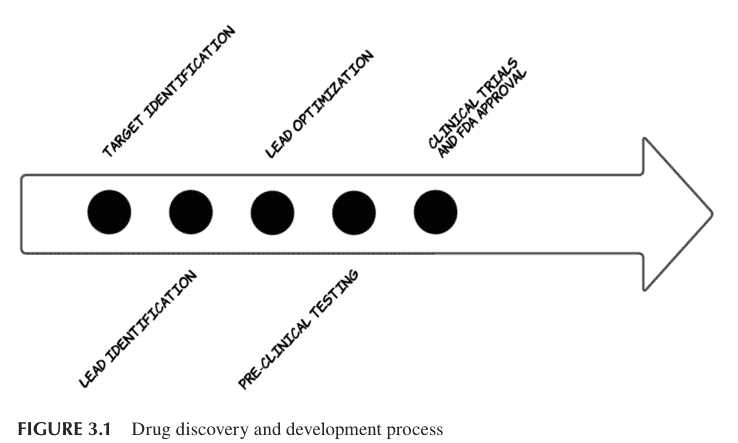

图 3.1 药物发现与开发流程

### 3.1.1 药物发现阶段

整个药物发现过程（图 3.1）可分为两个阶段，包括药物发现、其测试和批准。计算机辅助药物发现（CADD）方法已通过蛋白质或配体结构为基础的方法和分子对接研究等里程碑铺平了道路，以挑选出具有成为新型药物潜力的先导化合物。过去几年为这些领域贡献了重大创新，从传统到现代方面的变化已详细讨论。

本章的后续部分将重点关注 XAI 影响的方法如何为药物发现阶段提供面貌焕新，以及哪些最新趋势正在复兴这些阶段。

### 3.2 药物靶点识别

根据《生物化学牛津词典》的定义，药物靶点是“与特定化合物相互作用且其活性受该化合物调节的生物实体”。药物特异于其靶点，靶点分为受体、离子通道、酶和载体分子。利用深度学习和机器学习方法可以识别可被药物操纵的潜在治疗靶点，这些方法足够灵活，可以利用化合物生物、化学和拓扑性质得出的信息来从大规模库中筛选出靶点 [4]。在靶点识别中，建立靶点与疾病之间的因果联系是起点。基因表达是识别导致疾病的基因最常用的方法之一。借助微阵列和核糖核酸测序（RNA-Seq）技术，如今有大量序列数据可用，存储在公开可访问的数据库中，例如美国国家生物技术信息中心（NCBI）的基因表达综合数据库（GEO）、ArrayExpress、癌症基因组图谱（TCGA）、基因表达数据库（GXD）。使用名为 `DEcode` 的深度学习模型预测基因差异表达，为组织间基因差异表达、差异转录本使用和全基因组基因表达提供了新的见解 [5]。

监督式机器学习模型，如 `ElasticNet`、`k-最近邻`、`随机森林` 和 `前馈神经网络`，被优先用于识别组织特异性药物靶点 [6]。深度神经网络（`DNN`）被用于研究基因型-组织表达（`GTEx`）数据，以揭示与软组织肉瘤相关的差异表达并区分亚型，由于 `DNN` 模型无法执行相同操作，因此使用了随机森林机器学习模型 [7]。

对于抗癌药物靶点的识别，如今使用的是基于网络的机器学习算法，这些算法以网络特征作为输入。决策树在癌症靶点研究中占有重要地位，但过拟合可能会限制其性能，为克服这一问题，采用了降维和剪枝策略 [8]。用于癌症药物靶点识别和其他疾病靶点的深度学习模型列于表 3.1。一旦通常为蛋白质的药物靶点被识别，就有必要识别其成药性特征。这是一种假设，考虑药物附着于蛋白质以改变其功能作用的可能性。药物与其靶点的相互作用类似于锁钥机制，药物作用于蛋白质口袋，如钥匙进入钥匙孔。因此，研究蛋白质口袋的物理化学性质可以揭示蛋白质的成药性。

某些蛋白质/靶点结构可能无法在公开可访问的数据资源中获得，例如蛋白质数据库（`https://www.rcsb.org/`），这是由于分子结晶困难，或分子仍在研究中。在这种情况下，深度学习方法如今可作为传统同源建模技术的替代方案。在同源建模中，未知蛋白质的 `FASTA` 格式序列将与具有超过 30% 序列同一性的已知蛋白质的 3D 结构一起提供，以预测未知蛋白质的 3D 结构。即使模板蛋白质结构不可用，像 `CNN`、`RNN`、`变分自编码器`（`VAEs`）和生成对抗网络（`GAN`）等深度学习算法也能够预测有前景的靶点结构 [14]。

结构预测关键评估（`CASP`）使用全局距离测试（`GDT`）评估预测结构，`DeepMind Technologies` 基于深度神经网络的 `AlphaFold2` 对其预测结构得分 92.4 [15]。预测的

### 表 3.1

用于药物靶点识别的深度学习模型

| 所用深度学习算法 | 所用输入数据 | 目标疾病类型 | 局限性 | 参考文献 |
|---|---|---|---|---|
| 深度神经网络 | 来自 GEO 的 mRNA 表达谱数据集 | 肺腺癌 | 数据异质性可能导致产出偏差 | [9] |
| DeepWalk 图嵌入算法 | 与癌症类型相关的 miRNA 特征 | 乳腺癌、肺癌、前列腺癌 | 数据可用性有限；需要对结果进行实验验证 | [10] |
| 卷积神经网络、循环神经网络 | 来自 DrugBank 和治疗靶点数据库的精选可成药蛋白 | 通用 | 缺乏大规模训练和验证；需要付出额外努力来微调模型参数以克服局限性 | [11] |
| XGBoost | 与癌症相关的长链非编码 RNA | 癌症 | 数据不平衡，在处理此类数据时应考虑额外措施。 | [12] |
| 深度置信网络 | 长链非编码 RNA | 癌症 | 所用数据集具有较少保守的生物学特性；特征由网络本身提取。 | [13] |

`AlphaFold2` 预测的蛋白质结构已通过欧洲分子生物学实验室的欧洲生物信息学研究所（`EMBL-EBI`）共享，并且包含了几乎 98.5% 的人类蛋白质组（`https://alphafold.ebi.ac.uk/`）。尽管该系统存在局限性，但 `CASP` 的结果确保了 `AlphaFold2` 解析 3D 蛋白质结构的能力，从而推动生物学研究的发展。

我们的文献资源富含与疾病及相关蛋白质或其他生物分子有关的信息；因此，它们是此类研究的首要参考。已有自然语言处理（NLP）人工智能模型被创建，用于从相关期刊出版物中提取疾病与其负责生物分子（如蛋白质或基因）之间的关联。`BeFree` 是一种有监督的基于 NLP 核的方法，依赖于由科学家注释的欧盟不良药物反应数据库 [16]，而 `DigSee` 则从 PubMed 摘要中收集文本，从句子中识别导致疾病的基因及相关功能障碍，并使用贝叶斯模型计算句子的排名 [17]。名为 `TargetDB` 的工具可以汇总给定靶点的通用可用信息——例如致病途径、安全性、3D 结构、配体可及性等——并将其作为输出呈现，以便用户最佳理解 [18]。一个丰富的基因及相关疾病变异数据库可以在 `DisGeNET`（`https://www.disgenet.org/`）中找到，其工作基于文本挖掘原理 [19]。

### 3.3 先导化合物识别

美国国家癌症研究所（NCI）将先导化合物定义为“一种具有作用于疾病靶点潜力并可被开发为新药的化学化合物”。识别先导化合物如同大海捞针。用于先导化合物识别的传统计算机辅助策略包括虚拟筛选（基于靶点结构和基于配体结构）、从头药物设计（DNDD）以及分子对接研究。基于结构的虚拟筛选利用有前景的靶点蛋白质结构，这些蛋白质的结合口袋识别可以帮助选择配体分子。如果某种疾病的配体或药物已为人所知，则可以进行基于配体的虚拟筛选。药效团是药物的蓝图，可以识别具有相似理化性质的分子。定量构效关系（QSAR）研究是基于配体药物设计的子类别，其中可以确定类药分子的生物活性与其理化性质之间的关系。所有这些方法都可用于识别潜在的先导分子并对大量潜在化合物库进行虚拟筛选 [20]。详细说明见图 3.2。

虚拟筛选过滤包含数百万具有类药特征的化学化合物的数据库。DNDD 的替代方法能够利用成功药物发现的组分设计全新的化合物。人工智能已开始在 DNDD 中发挥关键作用。`MolAICal`（`https://molaical.github.io/`）由 Bai 等人设计并实现，能够以 3D 表示的蛋白质口袋为支架设计新型 3D 格式药物 [21]。该工具具有两个使其发挥功能的组件；主要组件使用 DL 和遗传

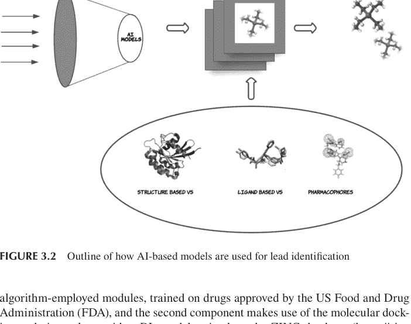

FIGURE 3.2 AI 模型用于先导化合物识别的概述

虚拟筛选过滤包含数百万具有类药特征的化学化合物的数据库。DNDD 的替代方法能够利用成功药物发现的组分设计全新的化合物。人工智能已开始在 DNDD 中发挥关键作用。`MolAICal`（`https://molaical.github.io/`）由 Bai 等人设计并实现，能够以 3D 表示的蛋白质口袋为支架设计新型 3D 格式药物 [21]。该工具具有两个使其发挥功能的组件；主要组件使用 DL 和遗传算法驱动模块训练于美国食品药品监督管理局（FDA）批准的药物上，而第二个组件则利用分子对接技术以及在 ZINC 数据库（`https://zinc.docking.org/`）上训练的 DL 模型。基于深度强化学习（DRL）算法的 `ReLeaSE` 将两个 `DNN` 结合用于与从头设计相关的生成部分和预测部分。由其中一个 `DNN` 模块控制的生成部分负责新型化合物的产生，而由第二个 `DNN` 实现的预测部分则执行生成化合物的特征预测。

Stokes 等人设计并开发了一种深度神经网络模型，以取代庞大化学文库的虚拟筛选，后者成本高、耗时且可能无法覆盖庞大的化学空间 [23]。他们考虑了该性质的分子表征，即抑制大肠杆菌的生长。该模型使用抑制剂分子进行训练，然后应用于多个化学文库以识别潜在的先导化合物。

使用 `DNN` 识别了可用于对抗 SARS-CoV-2 病毒的治疗性肽，并计算了这些肽的理化性质以表征所提供的输入，并指导神经网络识别有前景的抗病毒肽 [23]。

为了解释所识别肽的意义，他们对氨基酸进行了组成分析，这揭示了对其靶蛋白的亲和力测定。被称为简化分子输入行输入系统（SMILES）字符串的化学序列是药物再利用中普遍存在的实体 [24]。SMILES 可与氨基酸（AA）序列、有前景分子的 3D 结构以及靶向蛋白相结合，以获取 DL 模型决策的有前景特征。最近的研究产生了用于通过发现治疗性抗体来对抗 SARS-CoV-2 病毒的 DL 模型。

通过机器学习模型可以设计具有所需特征的先导分子，诸如变分自编码器（VAE）和循环神经网络（RNN）变体等各种算法已显示出令人印象深刻的结果。这些模型以 SMILES 字符串作为输入，并在生成新分子时考虑这些输入的语法。生成模型还结合了不同的预测模型，以在设计未来可能的药物时计算各种吸收、分布、代谢、排泄和毒性（ADMET）特征。分子图是此问题的替代方案；然而，在计算机上处理它们相对困难。一种名为 `MERMAID` [25] 的 DL 模型基于 RNN 和蒙特卡洛树搜索（MCTS），可以以特定分子作为优化的起点。`MERMAID` 的作者提出了单模型和多模型，专注于优化药物相似性定量估计（QED）评分，他们声称模型生成的分子是独特的、领先的、数量众多且分子量相似。

分子动力学模拟（MDS）可以揭示分子在原子水平上的行为。蛋白质-配体相互作用和结合稳定性可使用 MD 模拟进行测量，但这些模拟存在局限性，因为它们耗时且非常繁琐。人工智能可以通过克服其局限性将这些模拟提升到下一个水平。3D CNN 与空间图 CNN 的组合是在从环己烷转移到水的过程中从 15,000 个小分子计算出的自由能上训练的。其他原子特征也在训练目的中被考虑，结果令人鼓舞，其自由能预测准确度评分与 MD 模拟相似 [26]。

### 3.4 先导化合物优化

先导分子是原始形式的药物，需要进行微调才能成为有效的真实药物。这些分子被用作详细化学修饰的起点，以进一步提高其靶点特异性、选择性、药代动力学活性和安全性，同时保持先导化合物的有利性质。先导优化涉及设计-制造-测试-分析（DMTA）步骤的递归。如果靶点结构可用，通过进行药物-靶点相互作用（DTI）研究，我们可以合理化药物设计过程。

DTI 研究可用的计算方法可分为：

- a) 基于配体的方法

这里，利用基于结构或序列同一性的相似靶点蛋白来预测与药物化学结构的相互作用，并辅以 QSAR 支持。如果靶点的可用活性分子数量较少，则构建的 QSAR 模型的质量不可观。QSAR 模型的性能有限，因为它们仅考虑一个靶点来预测相关活性。

### b) 基于对接的方法

如果靶蛋白的三维结构已知，对蛋白与先导分子之间分子对接的研究可以揭示相互作用，并且分子动力学模拟可以通过模拟细胞环境来衡量此类相互作用的耐久性和稳定性。该方法的局限性在于它受限于蛋白结构的可获得性，而描绘这些结构所涉及的湿实验室程序繁琐。

### c) 化学生物组学方法

这里，数据集具有标记为阳性和阴性的二元类别，由化学结构和药物靶点的生物序列组成。这用于训练模型分类器（算法），之后用于检测未知相互作用 [27]。

常规方法正被 AI 模型取代；基于图的神经网络可以学习药物结构和药物-靶点相互作用信息，而非将其作为字符串处理，因为字符串可能无法存储结构信息 [28]。对于基于图的 DL 模型，输入是药物-靶点对，输出是对应于该对亲和力的数值。在图形表示中，每个节点都是多维二元特征向量，包含原子符号信息，如相邻原子计数、原子的隐式值、相邻氢的数量以及原子的芳香特征。`DeepPurpose` 被引入用于定制 DTI 预测 [29]。它为化合物和蛋白分子提出单独的编码器。编码器生成的嵌入将被输入到神经网络解码器以生成预测。该库能够提供连续的结合评分，例如抑制浓度（IC50）和表示蛋白是否与化合物相互作用的二元输出。参与 DTI 研究的其他 DL 模型列于表 3.2。

名为 `DeepFrag` 的软件被开发用于提高先导分子的结合亲和力并可预测优化因素 [30]。`DeepFrag` 使用蛋白的晶体结构进行训练，在移除共结晶配体后。模型预测的指纹与被移除的配体片段密切匹配。该基于 Python 的软件作为浏览器应用提供（`http://durrantlab.com/deepfrag`）。`DeepFrag` 预测的结果通过实验鉴定的配体进行了验证，并且推荐的建议被实施以检查它们是否提供了分子的优化 [31]。

分子可以通过添加原子以及移除或添加键等方法进行修饰。深度强化学习（DRL）模型可以通过上述步骤使用马尔可夫决策过程来修饰分子。提出的模型 `MolDQN` 与最先进的模型进行了比较：`junction tree variational autoencoder`（`JT-VAE`），这是一种深度生成模型，以及 `objective-reinforced generative adversarial networks`（`ORGAN`），一种使用 SMILES 并遵循 DRL 的分子生成算法。

药物候选物应具有最佳的药代动力学和药效学活性，以治愈疾病而不损害

## 表 3.2

### 用于药物-靶点相互作用研究的 DL 模型

| 使用的 DL 算法 | 使用的输入数据 | 参考文献 |
|---|---|---|
| 深度信念网络 | 分子描述符（MDs）和分子指纹（MFs），用于验证的实验药物-靶点对（EDTPs） | [32] |
| 堆叠自编码器 | 如位置特异性评分矩阵（PSSM）等蛋白序列，以及以分子指纹形式表示的药物分子 | [33] |
| 具有两个独立 CNN 块且每个块包含三个连续 1D 卷积层的基于卷积神经网络的模型 | 来自 PubChem 的药物-靶点化合物 SMILES | [34] |
| 架构类似于 LeNet5 的卷积神经网络 | 化学分子的化学描述符由 PaDEL-Descriptor 工具计算。对于蛋白，每个特征均使用 13 维大小的向量表示。 | [35] |
| 具有 dropout 层和自适应估计的定制卷积神经网络 | 蛋白的 FASTA 序列和特征使用 PROFIT 网络服务器生成，药物的 SMILES 来自 Drug Bank 收集。 | [27] |

靶标生物体的健康组织。为了防止潜在药物分子在临床阶段的流失，引入了若干预防措施，例如 Lipinski 的五规则和用于评估疗效的 ADMET 检测。用于体外 ADMET 筛选的软件可以设计和识别新型或现有药物候选物，在临床测试中具有良好的表现，并可限制需要合成和表征的化合物数量。存在采用贝叶斯神经网络（BNNs）、随机森林算法和支持向量机（SVMs）的基于 ML 的预测模型 [36]。一种基于 DL 的方法，采用 DNN、梯度提升机（GBM）和高斯过程（GP）回归方法的混合架构，能够从默克提供的数据集中预测 18 种不同的 ADMET 终点 [37]。Tox21 挑战旨在帮助科学家了解所研究化学品和化合物的潜力，展示了基于 DL 的方法优于浅层基于 ML 的方法 [38]。

基于 XAI 的方法使用 GNN 模型集成的梯度，用于预测血浆蛋白结合、hERG 通道抑制和细胞色素 P450 抑制，可参见 [39]。该方法揭示了与已知药效团基序相关的分子特征和结构元素。并且揭示了隐藏的配体-靶点相互作用。

## 表 3.3

### 临床研究中用于药物剂量确定的 AI 模型

| AI 平台 | 目的 | 参考文献 |
|---|---|---|
| comboFM (`https://github.com/aalto-ics-kepaco/comboFM`) | 在临床前测试中对淋巴瘤细胞系进行药物组合和剂量确定 | [42] |
| 基于 ML 的相关向量机 | 华法林剂量的确定（用于预防血栓） | [43] |
| 深度强化学习模型 | 用于寻找抗凝剂肝素的理想剂量 | [44] |
| ANN<br>贝叶斯加性回归树<br>多元自适应回归样条 | 免疫抑制剂他克莫司药物的最佳剂量确定 | [45] |
| 分类与回归树<br>多层感知器网络 | 计算心脏药物地高辛初始剂量的安全值 | [46] |

在治疗期间。用于药物剂量识别的更多基于 ML 和 DL 的模型在表 3.3 中讨论。

### 3.6 临床试验

当临床前研究完成后，获胜的药物候选物将在真实人类中使用临床试验进行测试。临床测试分为三个阶段：

- **第一阶段：** 对小规模人群中拟议药物的安全性测试。这些测试旨在确定药物的安全性和耐受性；如果可能，还会评估药代动力学和药效学。


- **第二阶段：** 在此，药物在患有特定疾病的小组人类受试者身上进行测试。第二阶段临床研究为人口更多的第三阶段研究确定治疗剂量。通常持续 12 至 16 周。

- **第三阶段：** 在此阶段，对更大数量的患者进行研究。第三阶段试验在大量患者群体（100 名患者或以上）中研究新药，持续六至十二个月或更长时间，通过提供临床环境生活并每日评估药物的疗效和安全性。

临床试验随后由 FDA 审查以批准和商业化药物。图 3.3 描绘了化合物如何随时间被筛选以获得单一药物并获得 FDA 批准。临床试验可能并不总是带来最佳结果，由于潜在的陷阱，例如队列（人群）的选择和

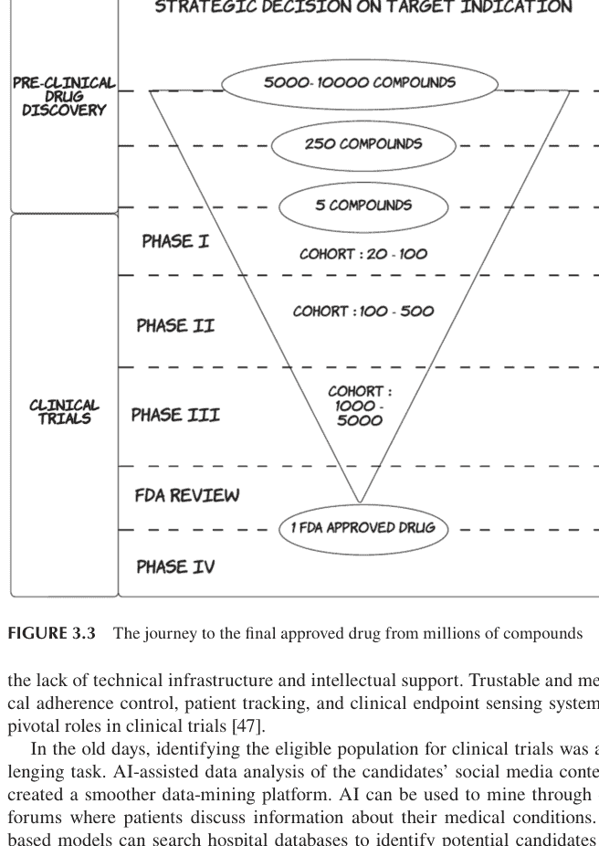

图 3.3 从数百万种化合物到最终获批药物的历程

缺乏技术基础设施和智力支持。可信赖且系统化的依从性控制、患者追踪以及临床终点感知系统在临床试验中发挥着关键作用 [47]。

在过去，识别临床试验的合格人群是一项具有挑战性的任务。候选者社交媒体内容的 AI 辅助数据分析创造了一个更顺畅的数据挖掘平台。AI 可用于挖掘患者在其中讨论其医疗状况的在线论坛。基于 NLP 的模型可以搜索医院数据库，根据纳入标准识别潜在候选者。

作为队列招募的患者应遵守临床试验的方案，并在整个过程中收集数据点以监测所用药物的影响。AI 和 ML 模型配合可穿戴设备可用于可靠高效的患者监测。此类模型生成疾病日记——尤其是 DL 模型，其足够灵活，可在循环训练过程中更新测量——可以提供以患者为中心的疾病表达详细分析 [48]。

如果短期测试中观察到的药物获益无法转化为长期终点，后续阶段的结果有时会有所分歧。某些药物可能在第二期以一致的终点通过，但在第三期失败。DL 模型被用于从第二期汇总的个体治疗效应中提取的特征来预测第三期的结果 [49]。此处使用了两种 DL 模型：第一个是个体谷浓度药代动力学浓度（`Ctrough`）模型，可预测第三期使用的药物浓度；第二个模型用于检测患者特征、`Ctrough` 与试验阶段输出之间的关系。这种方法可提供事后结果预测，并可帮助临床试验协调员避免第三期的不良结果。AI 模型的应用在图 3.4 中表示。

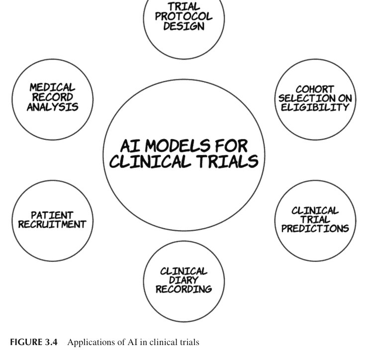

图 3.4 AI 在临床试验中的应用

在第四期临床试验中，主管当局会监测市场上已获批并被全球人群使用的药物是否存在副作用。这些试验旨在寻找在早期试验中未出现的副作用，也可能在较长时间内研究新疗法的效果。它也被称为上市后监测试验 [50]。物联网（IoT）、AI 以及 AI 与医疗保健领域的合作是当今新兴趋势；可穿戴设备以及相关数据的实时检索和存储对上市后监测研究具有前景。

当 AI 组件用于临床试验评估时，需要遵循某些指南，这些指南由 2020 年发布的《试验报告统一标准-人工智能》（CONSORT-AI）推荐。根据该提案，研究人员有义务提交明确的描述，说明 AI 将如何用于输入和输出处理、控制 AI 组件所需的指令和技能，以及 AI 将如何与人类进行分析交互，尤其是在处理错误发生的情况时 [51]。

### 3.7 利用可解释 AI 模型进行药物再利用

药物再利用或药物再定位是指重新使用已获批的药物用于常见或罕见疾病的方法。这可以通过跳过药物开发中的临床前发现阶段来解决等待新药的漫长等待。药物再定位方法已有许多成功案例，因为多种疾病与多个靶点相关 [52]。药物再利用方法可以是药物为中心、疾病为中心，或两者的组合。

- **疾病为中心再定位：** 在这里，为一种疾病开发的药物基于该疾病的表型相似性和分子特征而推荐用于另一种疾病。

- **药物为中心再定位：** 在这里，研究药物以比较其分子活性的相似性，如果特性相似且疗效良好，则这些药物将被推荐用于临床试验和市场上市。

当 COVID-19 大流行需要快速治愈时，基于 AI 的药物再利用及时提供帮助：使用基于网络的方法鉴定出 16 种潜在的抗 HCoV 再利用药物 [53]，而多模态 DL 方法揭示了 12 个有前景的药物靶点 [54]。Taie 等人开发并实施了一种用于药物再定位发现的可解释计算数据分析方法，用于精准医疗，通过一种新颖的患者分组分层方法 [55]。他们使用了收集的表型和基因型特征的患者数据；亚群使用异构网络确定，然后对每个亚组计算药物相似性评分并分配排名以推荐再定位。该方法可用于临床试验，因为它可以关联药物的分子特征和亚群人群，从而进行精确试验。

### 3.8 药物发现中可解释模型面临的挑战与局限性

在生物医学应用场景中，整合 AI 模型时面临的主要挑战之一是问题解决机制的可解释性。不仅在医疗领域，在任何应用中，AI 系统不仅应确保具有高准确度的良好系统性能，还应为终端用户提供高水平的解释性和可解释性。这意味着终端用户应能够解释选择特定方法生成解决方案而非其他方法的理由。尽管 AI 模型的可解释性在医疗保健场景中一直存在，但迄今为止在生成可靠解决方案方面仍未取得显著进展。

在某些与生物信息学相关的医疗保健场景中，如基因标记，AI 模型和诊断应用的适用性仍无法提供可行的解释。当我们深入研究与药物开发及其相关领域相关的任务时，会使用多个数据集来识别元素、模式和其他标记。在这种情况下，即使针对相同数据集，不同方法的应用也可能产生完全不同的结果。尽管某些研究人员声称某些任务的复杂性和组学数据的非线性特性是问题的主要原因，另一个主要原因是用于该任务的 AI 模型不可解释，使得整个系统高度不透明，如同黑箱。因此，迫切需要开发可解释 AI 模型，以确保用户和从业者均具有高水平的

例如药物开发、药物-药物相互作用等等。将此类现有方法迁移到生物医学应用时，实现可解释性是一项非常繁琐的任务。因此，AI 技术应首先进行定制，否则应为单个用例和数据集开发新的技术，以更好的系统性能和可解释性作为主要标准。然而，实现这种程度的模型定制是一项繁琐的任务，并且需要相当长的时间来开发，因为 AI 模型缺乏执行此类程序的理论支持和指导。此外，各个系统和用例所需的可解释性水平可能差异很大。

- 其次，药物开发及相关任务所涉及的数据类型差异极大。它们通常本质上高度复杂，数据量巨大，从顺序数据到复杂的组学数据，再到普通文本数据，甚至时空和基于图像的数据不等。因此，数据的体积、非线性和复杂性，加上应用领域的复杂性，迫使 AI 模型在实现高性能和实现可解释性之间做出权衡。通常，对于任何生物医学任务来说，实现高性能都很困难。考虑到在与药物开发相关应用中工作的任务的敏感性，系统的优先级会自动与获得更好的性能而不是可解释性保持一致。即使某些 AI 模型提供高水平的可解释性和平均系统性能，由于系统性能未能超过特定阈值，它们也不是生物医学应用的理想选择。

- 所有这些模型都依赖于它们所训练和测试的数据，而这些数据是从真实患者的记录和医学调查报告中收集的，其中包含高度敏感和私密的信息。在处理此类数据时需要极其谨慎，并且应防止未规范化的分布以避免导致有偏的决策。

- 训练模型产生的学习偏差也是生物医学应用中的一个主要障碍，因为这些偏差会阻止系统提供可行的解释。术语偏差是指 AI 系统倾向于特定结果或生成错误结果 [56]。这种学习偏差可能由各种问题引起，例如所采用的方法与所使用的数据类型之间不匹配的交互、错误参数的初始化或有缺陷的参数调优、训练数据集中不平衡等等。这些问题高度复杂，使得生物医学科学家难以理解和调试这些问题。与学习偏差相关的问题也被称为学习安全问题，并由于模型中的问题而导致无法证实的結果。

- 新的可解释 AI 方法通常是在系统处于理想条件下的假设下生成的，这意味着此类技术有能力生成完整的高性能结果，并且不会受到任何安全问题的影响。然而，几种广泛采用的 AI 方法，例如基于核的学习、集成学习、深度学习，甚至联邦学习，都有倾向或可能倾向于展示与所使用训练数据相关的学习偏差。对于与药物开发相关的某些应用，修复这些安全问题比获得系统的可解释性更重要，仅仅由于用例的敏感性 [57]。

在当前情况下，可解释 AI 已被广泛研究，并且各种方法，例如基于规则的学习、过程可视化、知识表示、人本计算等等，已被集成到系统中以实现可解释性 [58]。即使将此类技术集成已被证明在生成可解释 AI 系统方面是有用的，尤其是在生物医学应用中，克服与新型可解释算法开发相关的一定挑战需要比仅仅集成尝试多得多的努力。完全有可能可解释 AI 方法可以提高系统效率并为传统 AI 方法带来一定程度的安全性和信任，但这种可解释性只应引入到已满足与性能效率和系统安全相关的主要考虑的系统中。尤其是在使用 AI 模型时，必须按照推荐的指南进行临床试验并遵守伦理标准 [59]。

此外，还应使用不同的指标来实现 AI 模型的可解释性，以满足生物医学用例的要求。可解释 AI 应使系统能够以可解释的方式提供高性能和无偏结果，以提高系统透明度和可信度。与传统学习方法一样，只有模型性能足够好并产生良好的系统性能时，安全问题才能得到有效解决。同样，就可解释性而言，我们只能在技术能够自行解决此类问题并在高度复杂的领域如药物开发和其他生物医学应用中找到稳定适用性时，才期望其被认为成熟。

### 3.9 结论

COVID-19 大流行暴露了传统药物发现概念的局限性和限制，并加速了开发新型 AI 参与的对抗病毒方法的进程。从仅使用湿实验室伴随程序到使用机器智能进行药物发现的飞跃是惊人的，但 AI 是否能够说服人类智能仍然是一个讨论的问题。AI 在我们生活中的无处不在的作用是不可避免的，随着 XAI 的先进版本，所产生的解释应该是非平凡的、非人为的，并且知识应该可供各自的科学界共享。为了解决与 XAI 相关的药物发现，需要来自深度学习专家、化学信息学家、化学家、生物学家和该领域专家的合作努力。

## 参考文献

- 1. E. B. Lenselink et al., “超越炒作：深度神经网络使用 ChEMBL 生物活性基准集优于既定方法,” J. Cheminform., vol. 9, no. 1, pp. 1–14, 2017, doi: 10.1186/s13321-017-0232-0.

- 2. E. Gawehn, J. A. Hiss, and G. Schneider, “药物发现中的深度学习,” Mol. Inform., vol. 35, no. 1, pp. 3–14, 2016, doi: 10.1002/minf.201501008.

- 3. A. Holzinger et al., “交互式机器学习：算法循环中人类作用的实验证据：蚁群优化案例研究,” Appl. Intell., vol. 49, no. 7, pp. 2401–2414, 2019, doi: 10.1007/s10489-018-1361-5.

- 4. J. Vamathevan et al., “机器学习在药物发现和开发中的应用,” Nat. Rev. Drug Discov., vol. 18, no. 6, pp. 463–477, 2019, doi:10.1038/s41573-019-0024-5.

- 5. S. Tasaki, C. Gaiteri, S. Mostafavi, and Y. Wang, “差异基因表达,” Nat. Mach. Intell., doi: 10.1038/s42256-020-0201-6.

- 6. P. Mamoshina, M. Volosnikova, I. V. Ozerov, and E. Putin, “基于人类肌肉转录组数据的机器学习用于生物标志物发现和组织特异性药物靶点识别,” vol. 9, no. July, pp. 1–10, 2018, doi: 10.3389/fgene.2018.00242.

- 7. D. G. P. van IJzendoorn, K. Szuhai, I. H. Briare-de Bruijn, M. Kostine, M. L. Kuijjer, J. V. M. G. Bovée, “基因表达数据的机器学习分析揭示了软组织肉瘤的新诊断和预后生物标志物并鉴定了治疗靶点,” PLoS Comput. Biol., vol. 15, no. 2, pp. 1–19, 2019, doi:10.1371/journal.pcbi.1006826.

- 8. Y. You et al., “人工智能在癌症靶点识别和药物发现中的应用,” Signal Transduct. Target. Ther., vol. 7, no. 1, pp. 1–24, 2022, doi: 10.1038/s41392-022-00994-0.

- 9. G. Selvaraj et al., “利用基因表达荟萃分析、网络分析和神经网络算法鉴定靶基因并对肺腺癌进行预后评估,” J. Biomed. Inform., vol. 86, no. May, pp. 120–134, 2018, doi: 10.1016/j.jbi.2018.09.004.

- 10. G. Li, J. Luo, Q. Xiao, C. Liang, P. Ding, and B. Cao, “基于 DeepWalk 的网络拓扑相似性预测 microRNA-疾病关联,” IEEE Access, vol. 5, pp. 24032–24039, 2017, doi: 10.1109/ACCESS.2017.2766758.

- 11. L. Yu, L. Xue, F. Liu, Y. Li, R. Jing, and J. Luo, “深度学习算法在体外可成药蛋白识别中的应用,” J. Adv. Res., vol. 41, pp. 219–231, 2022, doi: 10.1016/j.jare.2022.01.009.

- 12. X. Zhang, T. Li, J. Wang, J. Li, L. Chen, and C. Liu, “使用高精度 XGboost 鉴定与癌症相关的长链非编码 RNA,” Front. Genet., vol. 10, no. July, pp. 1–14, 2019, doi: 10.3389/fgene.2019.00735.

- 13. M. Madhavan and G. Gopakumar, “DBNLDA：基于深度置信网络的 lncRNA-疾病关联预测表示学习,” Appl. Intell., vol. 52, no. 5, pp. 5342–5352, 2022, doi: 10.1007/s10489-021-02675-x.

- 14. B. Kuhlman and P. Bradley, “蛋白质结构预测与设计的进展,” Nat. Rev. Mol. Cell Biol., doi: 10.1038/s41580-019-0163-x.

- 15. O. Ronneberger et al., “AlphaFold 实现高度准确的蛋白质结构预测,” Nature, vol. 596, no. August, 2021, doi: 10.1038/s41586-021-03819-2.

- 16. À. Bravo, J. Piñero, N. Queralt-Rosinach, M. Rautschka, and L. I. Furlong, “从文本和大规模数据分析中提取基因与疾病之间的关系：对转化研究的意义,” BMC Bioinformatics, vol. 16, no. 1, pp. 1–17, 2015, doi: 10.1186/s12859-015-0472-9.

- 17. J. Kim, J. J. Kim和H. Lee，“基于DigSee对Medline摘要中疾病-基因关系的分析，”《科学报告》，第7卷，1月期，第1–12页，2017年，doi: 10.1038/srep40154.

- 18. S. de Cesco, J. B. Davis和P. E. Brennan，“TargetDB：靶标信息聚合工具与可追踪性预测器，”PLOS ONE，第15卷，第9期（9月），第1–12页，2020年，doi: 10.1371/journal.pone.0232644.

- 19. J. Piñero, À. Bravo, N. Queralt-Rosinach, A. Gutiérrez-Sacristán, J. Deu-Pons, E. Centeno, J. García-García, F. Sanz, L. I. Furlong，“DisGeNET：整合人类疾病相关基因与变异信息的综合平台，”《核酸研究》，第45卷，2016年10月期，第833–839页，2017年，doi: 10.1093/nar/gkw943.

- 20. A. Talevi，“计算机辅助药物设计：概述，”《分子生物学方法》，第1762卷，第5期，第1–19页，2018年，doi: 10.1007/978-1-4939-7756-7_1.

- 21. Q. Bai, S. Tan, T. Xu, H. Liu，“MolAICal：基于人工智能与经典算法的蛋白质靶标三维药物设计软件工具，”第22卷，2020年4月期，第1–12页，2021年，doi: 10.1093/bib/bbaa161.

- 22. M. Popova, O. Isayev和A. Tropsha，“用于从头药物设计的深度强化学习，”《科学进展》，第4卷，第7期，第1–15页，2018年，doi:10.1126/sciadv.aap7885.

- 23. J. M. Stokes等人，“一种深度学习方法，”《细胞》，第180卷，第4期，第688-702.e13页，2020年，doi: 10.1016/j.cell.2020.01.021.

- 24. Y. Zhang, T. Ye, H. Xi, M. Juhas和J. Li，“深度学习驱动的药物发现：应对严重急性呼吸综合征冠状病毒2，”第12卷，10月期，第1–8页，2021年，doi: 10.3389/fmicb.2021.739684.

- 25. D. Erikawa, N. Yasuo和M. Sekijima，“MERMAID：基于深度强化学习的开源自动化命中到先导化合物方法，”《化学信息学杂志》，第13卷，第1期，第1–10页，2021年，doi: 10.1186/s13321-021-00572-6.


## 26. W. F. D. Bennett等人，“结合分子动力学模拟与深度学习预测小分子转移自由能，”2020年，doi: 10.1021/acs.jcim.0c00318.

## 27. S. M. Hasan Mahmud, W. Chen, H. Jahan, B. Dai, S. U. Din和A. M. Dzisoo，“DeepACTION：一种基于深度学习的新药物-靶点相互作用预测方法，”《分析生物化学》，第610卷，9月期，第113978页，2020年，doi: 10.1016/j.ab.2020.113978.

## 28. T. Nguyen, H. Le, T. P. Quinn, T. Nguyen, T. D. Le和S. Venkatesh，“GraphDTA：利用图神经网络预测药物-靶点结合亲和力，”《生物信息学》，第37卷，第8期，第1140–1147页，2021年，doi: 10.1093/bioinformatics/btaa921.

## 29. K. Huang, T. Fu, L. M. Glass, M. Zitnik, C. Xiao和J. Sun，“DeepPurpose：用于药物-靶点相互作用预测的深度学习库，”《生物信息学》，第36卷，第22–23期，第5545–5547页，2020年，doi: 10.1093/bioinformatics/btaa1005.

## 30. H. Green和J. D. Durrant，“DeepFrag：用于深度学习先导化合物优化的开源浏览器应用，”《化学信息与建模杂志》，第61卷，第6期，第2523–2529页，2021年，doi: 10.1021/acs.jcim.lc00103.

## 31. Z. Zhou, S. Kearnes, L. Li, R. N. Zare和P. Riley，“通过深度强化学习优化分子，”《科学报告》，第9卷，第1期，第1–10页，2019年，doi: 10.1038/s41598-019-47148-x.

## 32. M. Wen等人，“基于深度学习的药物-靶点相互作用预测，”《蛋白质组研究杂志》，第16卷，第4期，第1401–1409页，2017年，doi: 10.1021/acs.jproteome.6b00618.

## 33. L. Wang等人，“一种利用堆叠自编码器深度神经网络预测药物-靶点相互作用的计算方法，”《计算生物学杂志》，第25卷，第3期，第361–373页，2018年，doi: 10.1089/cmb.2017.0135.

## 34. H. Öztürk, A. Özgür和E. Ozkirimli，“DeepDTA：深度药物-靶点结合亲和力预测，”《生物信息学》，第34卷，第17期，第i821–i829页，2018年，doi: 10.1093/bioinformatics/bty593.

## 35. S. Hu, D. Xia, B. Su, P. Chen, B. Wang和J. Li，“一个用于区分药物-靶点相互作用的卷积神经网络系统，”《IEEE ACM计算生物学与生物信息学汇刊》，第18卷，第4期，第1315–1324页，2019年，doi: 10.1109/tcbb.2019.2940187.

## 36. J. A. Keith等人，“结合机器学习和计算化学获得对化学系统的预测性见解，”2021年，doi: 10.1021/acs.chemrev.1c00107.

## 37. J. Ma, R. P. Sheridan, A. Liaw, G. E. Dahl和V. Svetnik，“深度神经网络作为定量构效关系的一种方法，”2015年，doi: 10.1021/ci500747n.

## 38. G. B. Goh，“深度学习在计算化学中的应用，”第1–17页，2017年，doi: 10.1002/jcc.24764.

## 39. M. Skalic, N. Weskamp和G. Schneider，“利用可解释人工智能为分子着色以评估临床前相关性，”2021年，doi: 10.1021/acs.jcim.0c01344.

## 40. Y. Shen等人，“利用人工智能优化HIV-1感染初治成人患者的长期维持给药方案，”《高级治疗学》，第3卷，第4期，第190014页，2020年，doi: 10.1002/adtp.201900114.

## 41. A. J. Pantuck等人，“利用人工智能平台CURATE.AI调节转移性前列腺癌患者中BET溴结构域抑制剂ZEN-3694与恩扎卢胺的联合给药剂量，”《高级治疗学》，第1卷，第6期，第1–9页，2018年，doi: 10.1002/adtp.201800104.

## 42. H. Julkunen等人，“利用多路相互作用系统预测临床前药物联合效应，”《自然通讯》，第11卷，第1期，2020年，doi: 10.1038/s41467-020-19950-z.

## 43. A. Sharabiani, A. Bress, E. Douzali和H. Darabi，“利用机器学习技术重新审视华法林给药剂量，”《计算机与数学方法在医学中的应用》，第2015卷，2015年，doi: 10.1155/2015/560108.

## 44. S. Nemati, M. M. Ghassemi和G. D. Clifford，“从次优临床示例中实现最佳用药剂量：一种深度强化学习方法，”2016年第38届IEEE工程与生物医学学会年会（EMBC），美国佛罗里达州奥兰多，2016年，第2978–2981页，2016年，doi: 10.1109/EMBC.2016.7591355.

## 45. Y. H. Hu, C. T. Tai, C. F. Tsai和M. W. Huang，“优化地高辛适当剂量：机器学习方法的应用，”《医疗工程杂志》，第2018卷，2018年，doi: 10.1155/2018/3948245.

## 46. S. Imai, Y. Takekuma, T. Miyai和M. Sugawara，“一种利用机器学习优化万古霉素初始剂量设定的新算法，”《生物与药学通报》，第43卷，第1期，第188–193页，2020年，doi: 10.1248/bpb.b19-00729.

## 47. S. Harrer, P. Shah, B. Antony和J. Hu，“临床试验设计中的人工智能，”《药理学趋势》，第40卷，第8期，第577–591页，2019年，doi: 10.1016/j.tips.2019.05.005.

## 48. V. T. Tran, C. Riveros和P. Ravaud，“患者对可穿戴设备和医疗人工智能的看法：来自比较电子队列的研究结果，”《npj数字医学》，第2卷，第1期，第1–8页，2019年，doi: 10.1038/s41746-019-0132-y.

## 49. Y. Qi和Q. Tang，“利用深度学习对II期临床试验受试者级数据进行建模以预测III期临床试验结果，”《机器学习研究会议录》，第106卷，第288–303页，2019年.

## 50. F. Cascini, F. Beccia, F. A. Causio, A. Melnyk, A. Zaino和W. Ricciardi，“临床试验中基于人工智能的应用现状范围综述，”《公共卫生前沿》，第10卷，2022年，doi: 10.3389/fpubh.2022.949377.

## 51. S. Francisco等人，HHS公共访问，第2卷，第10期，第1–25页，2021年，doi: 10.1016/S2589-7500(20)30218-1.

## 52. R. Gupta, D. Srivastava, M. Sahu, S. Tiwari, R. K. Ambasta和P. Kumar，《从人工智能到深度学习：药物发现的机器智能方法》，第25卷，第3期，施普林格国际出版公司，2021年.

## 53. Y. Zhou, Y. Hou, J. Shen, Y. Huang, W. Martin和F. Cheng，“基于网络的新冠病毒2019-nCoV/SARS-CoV-2药物再利用，”*《细胞发现》*，第6卷，第1期，2020年，doi: 10.1038/s41421-020-0153-3.

## 54. S. A. Hooshmand, M. Zarei Ghobadi, S. E. Hooshmand, S. Azimzadeh Jamalkandi, S. M. Alavi和A. Masoudi-Nejad，“一种基于多模态深度学习的COVID-19治疗药物再利用方法，”*《分子多样性》*，第25卷，第3期，第1717–1730页，2021年，doi: 10.1007/s11030-020-10144-9.

## 55. Z. Al-Taie等人，“高内涵药物重定位中的可解释人工智能用于具有干预潜力的亚组分层，”*《生物医学信息学杂志》*，第118卷，第103792页，2021年，doi: 10.1016/j.jbi.2021.103792.

## 56. H. Han，“转化生物信息学中的诊断偏倚，”*《BMC医学基因组学》*，第8卷，第1期，第1–17页，2015年，doi: 10.1186/s12920-015-0116-y.

## 57. H. Han和X. Jiang，“克服支持向量机诊断过拟合，”*《癌症信息学》*，第13卷，第s1期，第CIN.S13875页，2014年，doi: 10.4137/cin.s13875.

## 58. G. Vilone和L. Longo，“可解释人工智能：系统综述，”*《决策分析杂志》*，第7卷，第100230页，2023年，doi:10.1016/j.dajour.2023.100230.

## 59. A. K. Nair, E. D. Raj和J. Sahoo，“人工智能在先进医疗系统中的概述，”*《数字健康转型：区块链与人工智能》*，第1卷，第141–160页，2022年.

# 4 用于诊断肝硬化严重程度的监督学习模型

Akshita Sakshi, J.V. Bibal Benifa, and P. Antony Seba

## 4.1 引言

许多研究人员和医疗专业人员一直在使用各种人工智能技术来帮助医疗保健行业。肝脏是人体第二大且重要的器官。最致命的肝病之一是肝硬化。肝硬化是一种肝脏逐渐纤维化且无法正常发挥功能的病症。它是由长期酒精滥用、病毒性肝炎、脂肪肝病或某些药物对肝脏造成的损害引起的[1–4]。肝硬化也可能由影响胆管并导致胆汁生成问题的其他疾病引起。如果不治疗，它会造成肝脏功能永久性损害，并最终导致死亡。肝硬化已在全球造成超过1.32百万例死亡[5]。本研究重点是通过应用机器学习（`ML`）算法来预测肝硬化疾病。由于该问题属于监督学习，本研究对肝硬化数据集进行了详细研究，并使用决策树[6, 7]、逻辑回归、[8, 9]多层感知器、随机森林、AdaBoost [10]和`XGBoost`算法来预测肝硬化的分期。

异常值通过可视化检测，并剔除异常值的数据实例[11]。缺失值通过统计方法进行插补，考虑变量的偏度。对定性变量应用了适当的特征编码，并以分层的方式将数据集划分为训练集和测试集。特征选择是构建机器学习模型的重要方面[12–17]。数据集中的特征使用Pearson相关性和独立性卡方检验来检查冗余性[18, 19]。监督特征选择算法——Extra Trees分类器（`ETC`）和递归特征消除（`RFE`）——被应用于识别相关属性。本研究中进行了探索性数据分析[20]，以准备数据用于模型构建，然后预测肝硬化的分期[21–27]。

## 4.2 文献综述

数据预处理和特征选择是在构建预测模型之前必须完成的任务。数据集中存在的特征可能相关也可能冗余，特征选择方法可能是参数化或非参数化的，但能最好解释结果的特征被识别出来以提高模型的性能。肝病预测方面已开展了大量研究工作，并使用不同的数据集和各种学习算法对疾病进行预测。

为了预测患者的肝病，Ketan等人研究了多种`ML`模型，包括逻辑回归、决策树、`K`最近邻算法、随机森林、梯度提升和`XGBoosting` [22]。使用了来自加州大学（`UCI`）机器学习库的印度肝病患者数据集（`ILPD`），其中包括583名印度肝病患者，并用中位数填充缺失值，删除重复值，并使用重采样来提高性能。随机森林是采用的特征选择技术，发现随机森林（63%）、Light Gradient Boosting Machine（Light GBM）（63%）和AdaBoost（62%）与其它算法相比提供了更高的准确率。因此，确定Light Gradient Boosting Machine（Light GBM）是最有效的算法。

Rakshith等人使用了`UCI` `ILPD`数据集，其中包括以下十个变量：年龄、性别、总胆红素、直接胆红素、总蛋白、白蛋白、白蛋白/球蛋白（A/G比值）、血清谷丙转氨酶（`SGPT`）、血清谷草转氨酶（`SGOT`）和碱性磷酸酶[23]。它包含的415条记录中有167人没有肝病。这项研究的目的是使肝病预测更容易，减少肝病造成的死亡人数，并提高医生对肝病的识别能力。数据集经过数据预处理，并使用了`K`最近邻（`KNN`）、支持向量机（`SVM`）、人工神经网络（`ANN`）和朴素贝叶斯分类方法。发现`SVM`和`ANN`提供了最高准确率，分别为100%和99.9%。

Nazmun等人使用了印度肝病患者数据集（`ILPD`），该数据集可通过`UCI`机器学习资源库获取[24]。该集合共有583条记录，其中416条为肝病患者，167条为非肝病患者。男性记录为441条，女性记录为142条。该研究使用开源的`Weka`工具集进行。重点主要放在集成学习技术（装袋、提升和堆叠）上，并使用了AdaBoost和LogitBoost等提升算法。LogitBoost算法在所有方法中准确率最高，为71.53%。

Yang等人比较了使用基于深度学习的算法创建的分类模型与传统非深度学习算法`ANN`（人工神经网络）、`MLR`（多项逻辑回归）、`SVM`（支持向量机）和`RF`（随机森林）的性能。他们重点关注使用基于深度学习的算法创建的用于评分肝纤维化的分类模型的性能（随机森林）。基于迁移学习和AlexNet卷积网络的深度学习网络实现了自动特征分类和纤维化评分[25]。

Shivala Vishnu Murty和Kiran Kumar使用了从印度安得拉邦斯里卡库拉姆Amrutha医院集团收集的肝脏数据集[26]。该数据集包含11个属性，其中前10个属性被视为输入或独立属性，第11个属性为目标属性，表示患者类别为0（未患病）或1（患病）。数据集共包含882个实例，其中类0为403个，类1为479个。作者比较了多种模型的性能，包括多层前馈深度神经网络（`MLFFDNN`）准确率为98%、朴素贝叶斯（`NB`）准确率为71%、`C4.5`决策树准确率为97%、替代决策（`AD`）树准确率为92%、径向基函数（`RBF`）网络准确率为83%、支持向量机准确率为73%以及`XGBoost`准确率为99%。该研究的重点是提升技术，作者首先为`XGBoost`模型调整了多个超参数，如L2正则化、逻辑损失函数、学习率和估计器数量。

Bihter Das评估了统计分析系统（`SAS`）软件包提供的多种疾病检测技术的功效，包括神经网络、自动神经网络、高性能（`HP`）、`SVM`、`HP`森林、`HP`树（决策树）和`HP`神经网络节点[27]。评估使用印度肝病患者数据集（`ILPD`）进行。发现训练阶段`HP` Forest产生最高准确率，而验证阶段神经网络产生最高准确率。数据集随机分为训练集（80%）和验证集（20%）后，使用`HP`变量选择节点识别较不重要的特征，完成训练。

Saima等人在其研究工作中使用了来自`UCI`机器学习资源库的数据集来预测肝病[17]。最初对数据进行预处理以消除噪声数据，并使用`LASSO`（最小绝对收缩和选择算子）特征提取方法选择最重要的特征。然后，他们实现了逻辑回归、决策树、随机森林、AdaBoost、`SVM`、`KNN`、`LDA`和梯度提升等分类算法来构建模型。模型使用十折交叉验证技术进行评估。发现决策树算法的准确率最高，为94.28%。

Muktevi等人评估了五种用于肝病识别的分类器：朴素贝叶斯、逻辑回归、支持向量机、随机森林和`k`最近邻[28]。研究的目的是使用多种机器学习算法识别肝感染。使用`Kaggle`的583个示例数据集创建数据集。结果显示逻辑回归表现更优。

尽管在预测肝病及其分期方面已开展了大量研究工作[22–31]，但人们认为可以识别出有助于预测的重要临床属性来构建预测模型。在本工作中，应用了各种特征选择方法来识别重要特征，并构建了预测模型以预测肝硬化的分期。


图 4.1 肝硬化严重程度分类架构

## 4.3 方法论

探索性数据分析应用于肝硬化数据集，以了解数据集中每个变量的特征并处理缺失值和异常值，并采用各种特征选择方法来识别相关和冗余特征。机器学习管道架构的每个阶段都被可视化以进行观察并获得洞察。已构建了多个机器学习模型并对其性能进行了评估。用于肝硬化严重程度分类的完整机器学习管道架构如图 4.1 所示。

### 4.3.1 数据集

数据集来自 `Kaggle`，这是一个面向数据科学家和机器学习爱好者的网站 [32]。该数据集同时具有定量和定性特征。总共包含 19 个变量和 418 个数据实例。其描述和属性见表 4.1。

### 4.3.2 数据预处理

通过数据可视化 [33] 研究了数据集中变量的分布，并将数据集置于机器学习管道架构中以分析数据、做出观察并得出洞察。

## 表 4.1

### 数据集描述

| 序号 | 属性 | 描述 |
|---|---|---|
| 1. | `N_Days` | 注册与死亡、移植或研究分析日期（1986年7月）两者中较早者之间的天数 |
| 2. | `Status` | 患者的状况（C 为“删失”，CL 为“因肝移植而删失”，D 为“死亡”） |
| 3. | `Drug` | 药物类型（D-青霉胺，安慰剂） |
| 4. | `Age` | 年龄（单位：天） |
| 5. | `Sex` | 性别：M 为“男性”，F 为“女性” |
| 6. | `Ascites` | 腹水存在情况（N：“无”，Y：“有”） |
| 7. | `Hepatomegaly` | 肝肿大存在情况（N：“无”，Y：“有”） |
| 8. | `Spiders` | 蜘蛛痣存在情况（N：“无”，Y：“有”） |


| 9. | Edema | 水肿存在情况（N：“无水肿且未进行利尿治疗”，S：“未使用利尿剂即有水肿或经利尿剂治疗后水肿消退”，Y：“尽管使用利尿剂仍有水肿”） |
| 10. | Bilirubin | 血清胆红素（mg/dL） |
| 11. | Cholesterol | 血清胆固醇（mg/dL） |
| 12. | Albumin | 白蛋白（g/dL） |
| 13. | Copper | 尿铜（µg/天） |
| 14. | Alk-Phos | 碱性磷酸酶（U/升） |
| 15. | SGOT | SGOT（U/mL） |
| 16. | Triglycerides | 甘油三酯（mg/dL） |
| 17. | Platelets | 血小板（mL/1000） |
| 18. | Prothrombin | 凝血酶原时间（秒） |
| 19. | Stage | 疾病组织学分期（1、2、3 或 4） |

### 4.3.3 异常值检测

异常值是与数据集中其他值差异很大的数据值。异常值由于数据收集过程中出现的人为错误和仪器错误而产生。数据中的异常值可能会影响模型拟合。异常值可以通过可视化检测，使用箱线图考虑四分位距来计算下限和上限围栏，这些围栏距离四分位距（IQR）为 1.5 倍，如公式 4.1 和 4.2 所示。

Lower Fence = Q1 − (IQR × 1.5)  (4.1)

Upper Fence = Q3 + (IQR × 1.5)  (4.2)

其中 `Q1` 为第 25 百分位数据，`Q3` 为第 75 百分位数据。

### 4.3.4 缺失值插补

数据集中缺失值会导致模型性能的不可靠度量。含有缺失值的数据实例可以被删除或插补。在本研究中，定性和定量属性通过均值、中位数和众数等统计量进行插补。

### 4.3.5 特征编码

特征编码是监督学习中结构化数据集的重要预处理步骤。由于机器学习算法无法理解分类属性，因此必须对属性进行编码。名义属性是指不遵循任何顺序的属性，例如一个人的性别。序数属性是指顺序至关重要的属性，例如一个人的收入或学生的成绩。几乎所有属性均为名义属性并应用标签编码。只有一种属性为序数属性并应用序数编码。

### 4.3.6 特征缩放

特征缩放是将属性标准化到固定范围的过程。特征缩放主要通过归一化或标准化完成。此处使用 `StandardScaler` 对特征进行标准化。这将每个属性的值转换为均值为零、标准差为一。之所以使用 `StandardScaler`，是因为大多数属性遵循正态分布。

### 4.3.7 数据集划分

数据集以分层方式划分为训练集（80%）和测试集（20%），用于构建和验证模型。数据集以分层方式划分以克服数据不平衡问题。训练数据集用于模型构建，测试数据集用于验证模型。

### 4.3.8 特征选择

特征选择有助于识别模型构建的重要属性。肝硬化数据集包含 19 个独立变量。独立变量之间的关系使用皮尔逊相关系数（r）进行检查，如公式 4.3 所示。非参数统计检验也用于识别属性关系。

$$r = \frac{\sum (x_i - \bar{x})(y_i - \bar{y})}{\sqrt{\sum (x_i - \bar{x})^2 \sum (y_i - \bar{y})^2}} \tag{4.3}$$

`x_i` 和 `y_i` 为变量样本，`r` 的取值范围为 -1 至 +1，其中零表示两个变量之间没有关系。如果值大于零，则表示两个变量之间存在正相关；如果值小于零，则表示两个变量之间存在负相关。本研究使用公式 4.4 进行独立性卡方检验，以识别分类属性之间的关系。将检验统计量与临界值进行比较以接受或拒绝原假设。

$X_c^2 = \frac{\sum (O_i - E_i)^2}{E_i}$ (4.4)

其中 `$c$` 为自由度，`$O_i$` 为观测值，`$E_i$` 为期望值。斯皮尔曼相关使用秩来寻找相关值；因此，该相关适用于序数数据。斯皮尔曼相关的公式如公式 4.5 所示。

$\rho = 1 - \frac{6 \sum d_i^2}{n (n^2 - 1)}$ (4.5)

斯皮尔曼相关系数 `$\rho$` 的取值范围在 +1 和 -1 之间。+1 表示存在完全的秩关联，`$\rho = 0$` 表示秩之间无关联，`$\rho = -1$` 表示存在完全的负秩关联。如果 `$\rho$` 更接近零，则关联较弱。相关性在 `$p$` 值为 0.05 下进行。所有 `$p$` 值更接近零的十个特征均被考虑。

极端随机树分类器或额外树分类器（ETC）是一种集成学习方法，用于从肝硬化数据集中选择重要特征。随机样本用于构建每个决策，并将特征集中的 k 个特征分配给每棵树的每个测试节点。基于基尼指数，每棵决策树选择最优特征来分割数据。为了完成特征选择，每个特征按其基尼重要性以降序排列，前 k 个特征被视为最优特征。

递归特征消除（RFE）通过拟合模型用于特征消除。一旦确定相关特征，它将在每次迭代中一次移除一个不相关特征。它接受两个参数：第一个是算法，第二个是特征数量。例如，如果选择决策树作为算法，RFE 将对数据应用决策树并确定基本特征。关键特征会因模型而异；第二个参数取所需的重要特征数量。RFE 的主要缺点是必须提前选择特征数量以避免使用递归特征消除交叉验证（RFECV）。RFECV 将对数据执行交叉验证并预测数据集的 n 个基本特征。在本研究中，使用了 RFECV 进行特征选择。

### 4.3.9 模型构建

基于熵、集成和感知机技术的机器学习模型已构建用于分类肝硬化疾病的严重程度。由于本研究中使用的数据集规模较小，因此优先采用集成技术。

#### 4.3.9.1 逻辑回归

逻辑回归是一种用于分类的有监督算法。首先，通过公式4.6计算独立特征的加权和，然后将结果输入公式4.7中的sigmoid函数，该函数将给出一个介于0和1之间的值。该值越接近1，“是”结果的概率越高（即该人患有肝硬化）。

```
y' = w^T x + b
```

其中 b 是偏置，w^T 是权重。

```
σ(z) = 1 / (1 + e^{-z})
```

#### 4.3.9.2 决策树

决策树是监督学习中常用的算法。它是一个具有三种节点的树模型：决策节点、根节点和叶节点。首先，在开始分裂之前必须选择最佳属性。为此，需要通过公式4.8计算每个属性的信息增益和熵。信息增益最高的属性将作为决策节点。熵是数据的不确定性，因此应优先考虑熵较低的属性。信息增益是属性分裂前后值的差异，由公式4.9计算。然后以递归过程执行此计算，直到达到用户指定的 max_depth。

```
E = -∑_{i=1}^N p_i log_2 p_i
```

其中 p_i 是从类别 i 中随机选择一个输入的概率。

```
information gain = 1 - entropy
```

#### 4.3.9.3 随机森林

随机森林分类器使用集成学习技术来构建分类和回归模型。决策树的主要缺点是过拟合；随机森林分类器解决了这一问题，即使用装袋（bagging）技术最小化数据的高方差。由于这是一个分类问题，装袋技术对训练数据进行重采样，并为每个子集进行预测。然后，多数预测被视为该模型的最终预测。

#### 4.3.9.4 AdaBoost

AdaBoost 是一种提升（boosting）算法。它是一个顺序学习过程，即如果实现多个模型，则每个模型将依赖于其他模型。首先，它为每条记录分配权重，其中 weight = 1 / (记录数)，然后创建一个“树桩”（stump），这是一种树状结构，具有一个根节点和一个深度为1的叶节点；对于每个独立特征，按顺序创建一个树桩。在计算每个树桩的熵之后，选择熵最低的树桩作为第一个基模型。然后，在计算出总误差（即所有错误分类数据点的样本权重之和）之后进行预测。之后，使用公式4.10计算树桩的性能。如果发生错误分类，则增加这些记录的权重，同时减少其他记录的权重。错误和正确分类记录的权重（分别为 W_ic 和 W_c）使用公式4.11和4.12更新。接下来，AdaBoost 通过将更新后的权重除以更新后权重的总和来计算归一化权重。之后，再次使用归一化权重创建新数据集。每次迭代中生成的决策树都会有一个预测，多数投票的预测被视为最终预测。

树桩性能 = 1/2 log_e ((1 - TE)/TE) 其中 TE = 总误差 (4.10)

W_ic = 旧权重 * e^{树桩性能} (4.11)

W_c = 旧权重 * e^{-树桩性能} (4.12)

#### 4.3.9.5 XGBoost

集成学习通常有两种类型的算法：装袋（bagging）和提升（boosting）。XGBoost，也称为极端梯度提升（extreme gradient boost），是 boosting 算法之一。在本研究中，XGBoost 被用于对肝硬化疾病的严重程度进行分类。XGBoost 具有非常高的速度，因为它支持并行化和缓存优化；它在性能方面也表现出色，因为它提供了自动剪枝和正则化，这有助于使模型健壮并防止模型过拟合。可扩展性、缺失值处理和非线性是 XGBoost 的进一步优势。计算残差（即输出分数减去概率分数概率），然后构建用于分类的树。左右节点和根节点的相似性分数通过公式4.13计算。为了决定属性的顺序，计算树的信息增益，如公式4.14所示。具有最高增益的属性将被优先考虑进行分裂。

相似性分数 = Σ(残差)^2 / Σ(概率(1 - 概率) + λ) (4.13)

其中 λ 是正则化参数。

信息增益 = 1 – 熵 (4.14)

#### 4.3.9.6 多层感知器

多层感知器（MLP）是一种前馈人工神经网络。它由输入层、输出层和隐藏层组成。MLP 中的第一个过程是前向传播，数据从输入层传播到输出层。第一步是计算输入和权重的乘积，如公式4.15所示，然后将乘积 Z1 传递给激活函数。

```
$$Z_1 = x_1 * w_1 + x_2 * w_2 + b$$
```

在本肝硬化严重程度预测中，使用 ReLU 激活函数进行正则化。ReLU 的主要优点是它解决了梯度消失问题。ReLU 激活函数的范围是从零到无穷大。应用激活函数后获得的值随后传递给隐藏层，然后传递给输出层。同样，目标变量 Y1 也使用公式4.16计算。

```
$$Y_1 = Z_1 * w_1 + Z_2 * w_2 + b$$
```

前向传播之后，在此过程中进行反向传播。我们首先尝试通过损失函数最小化误差，然后更新权重和偏置。新的权重和偏置由公式4.17和4.18给出。

```
$$W_{new} = W_{old} - \eta \frac{\partial L}{\partial W_{old}}$$
```

```
$$B_{new} = B_{old} - \eta \frac{\partial L}{\partial B_{old}}$$
```

其中 η = 学习率，η ∂L/∂W_old , η ∂L/∂B_old 可以使用偏微分的链式法则计算。

## 4.4 结果与讨论

对所有属性进行单变量分析，发现特征 Triglycerides、Copper、Cholesterol 和 Bilirubin 存在大量离群值，但由于移除它们可能导致信息丢失，因此没有移除；因此，这些离群值使用每个特定特征的均值或中位数进行插补。变量的箱线图可视化如图 4.2 所示。

数值特征（Cholesterol、Copper、Alk-Phos、SGOT、Triglycerides、Platelets 和 Prothrombin）存在缺失值，通过插补每个特征的均值来处理。类别特征如 Status、Ascites、Hepatomegaly 和 Spiders 存在缺失值，通过插补每个特定特征的众数来处理。对类别特征（Sex、Ascites、Spiders、Hepatomegaly、Drug）应用标签编码。在 Sex 特征中，女性编码为 1，男性

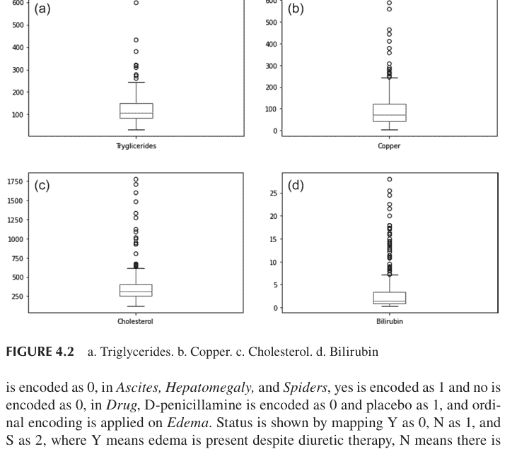

# 图 4.2 a. 甘油三酯。b. 铜。c. 胆固醇。d. 胆红素

编码为 0；在 Ascites、Hepatomegaly 和 Spiders 中，是编码为 1，否编码为 0；在 Drug 中，D-penicillamine 编码为 0，安慰剂编码为 1；对 Edema 应用序数编码。Status 通过映射 Y 为 0、N 为 1、S 为 2 来表示，其中 Y 表示尽管采用了利尿治疗但水肿仍然存在，N 表示没有水肿且没有针对水肿的利尿治疗，S 表示没有使用利尿剂时水肿存在，或者水肿已通过利尿剂消退。对于属性 Status，D（死亡）编码为 0，C（删失）编码为 1，CL（因肝移植而删失）编码为 2。属性的双变量分析解释了属性之间的成对关系，如图 4.3 所示。

从配对图中观察到，变量之间没有线性关系。使用 StandardScaler 进一步缩放属性，然后进行特征选择。应用不同的特征选择方法，在每种方法中，选择十个最佳必要特征。首先，Pearson 相关方法，选择十个最佳必要特征。首先，对肝硬化数据集应用 Pearson 相关分析，并使用热图进行可视化，如图 4.4 所示。

已确定没有高度相关的特征。进行了 Spearman 相关分析，特征及其相应的 p 值见表 4.2。

应用卡方检验，选择十个最佳特征（Sex、Drug、Alk-Phos、SGOT、Albumin、Prothrombin、Triglycerides、Bilirubin、Copper、Hepatomegaly）。应用了一种有监督的特征选择算法，即具有十个估计器和熵准则的极端树分类器，所选特征为：Age、Bilirubin、Albumin、Cholesterol、Triglycerides、SGOT、Platelets、Prothrombin,

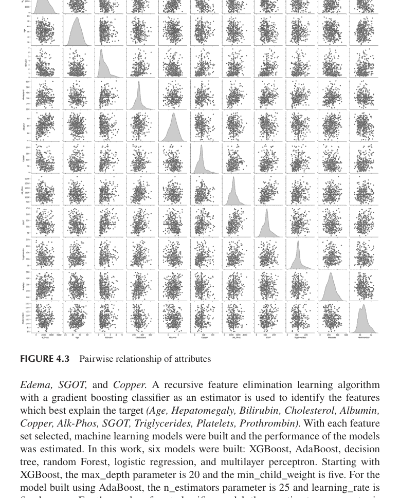

### 图 4.3：属性两两关系（水肿、SGOT 和铜）

采用以梯度提升分类器作为估计器的递归特征消除学习算法，来确定最能解释目标变量的特征（年龄、肝肿大、胆红素、胆固醇、白蛋白、铜、碱性磷酸酶、SGOT、甘油三酯、血小板、凝血酶原）。针对每一个选定的特征集，建立机器学习模型并评估模型性能。本研究构建了六种模型：XGBoost、AdaBoost、决策树、随机森林、逻辑回归和多层感知器。对于 XGBoost，max_depth 参数为 20，min_child_weight 为 5。对于使用 AdaBoost 构建的模型，n_estimators 参数为 25，learning_rate 固定为 1。对于随机森林分类器模型，n_estimators 参数设置为 100，用于寻找最佳属性的准则为熵。对于决策树分类器，max_depth 参数设置为 20。各模型的性能指标见表 4.3。

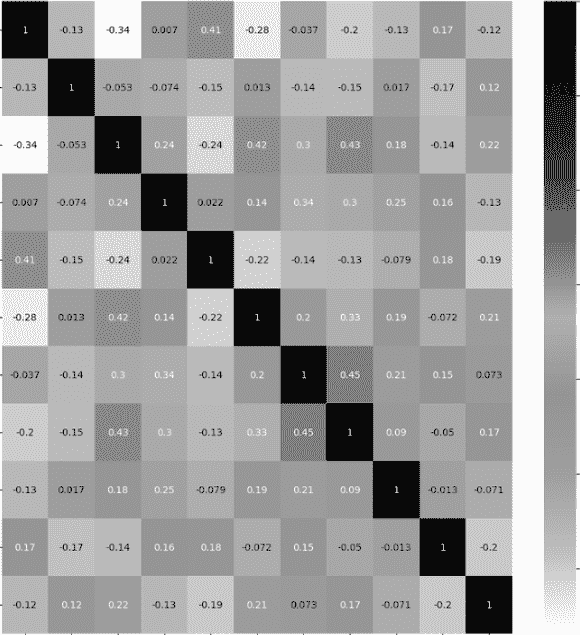

### 图 4.4：肝硬化数据集的热图

### 表 4.2：Spearman 相关性的 P 值

| P 值 | 特征 |
|---:|---|
| 0.000001 | 水肿 |
| 0.000022 | 腹水 |
| 0.000116 | 胆红素 |
| 0.000414 | 血小板 |
| 0.000519 | 铜 |
| 0.020488 | 蜘蛛痣 |
| 0.021125 | SGOT |
| 0.021886 | 肝肿大 |
| 0.026497 | 胆固醇 |
| 0.0266 | 白蛋白 |
| 0.048024 | 性别 |

### 表 4.3：性能指标

| 指标 | 特征选择方法 | XGBoost | AdaBoost | 随机森林 | 决策树 | 逻辑回归 | 多层感知器 |
|---|---|---|---|---|---|---|---|
| 准确率 | 卡方检验 | 43.19 | 53.17 | 46.59 | 40.47 | 38.09 | 23.00 |
| 准确率 | ETC | 42.83 | 49.20 | 44.13 | 39.68 | 40.47 | 39.70 |
| 准确率 | Spearman 相关 | 44.55 | 42.85 | 39.00 | 38.88 | 43.65 | 43.70 |
| 准确率 | RFE | 44.55 | 46.82 | 46.89 | 39.68 | 38.09 | 27.80 |
| 精确率 | 卡方检验 | 45 | 48 | 38 | 40 | 35 | 19 |
| 精确率 | ETC | 48 | 50 | 41 | 40 | 39 | 42 |
| 精确率 | Spearman 相关 | 44 | 39 | 38 | 38 | 41 | 41 |
| 精确率 | RFE | 46 | 45 | 43 | 40 | 36 | 53 |
| 召回率 | 卡方检验 | 46 | 53 | 42 | 40 | 38 | 23 |
| 召回率 | ETC | 48 | 49 | 44 | 40 | 40 | 40 |
| 召回率 | Spearman 相关 | 46 | 43 | 40 | 39 | 44 | 44 |
| 召回率 | RFE | 47 | 47 | 48 | 40 | 38 | 28 |
| F1 分数 | 卡方检验 | 44 | 50 | 43 | 40 | 33 | 13 |
| F1 分数 | ETC | 47 | 48 | 44 | 40 | 40 | 40 |
| F1 分数 | Spearman 相关 | 45 | 40 | 39 | 38 | 41 | 41 |
| F1 分数 | RFE | 46 | 46 | 45 | 40 | 37 | 23 |
| 特异度 | 卡方检验 | 61 | 57 | 60 | 50 | 44 | 72 |
| 特异度 | ETC | 57 | 61 | 62 | 48 | 56 | 62 |
| 特异度 | Spearman 相关 | 56 | 53 | 55 | 49 | 59 | 60 |
| 特异度 | RFE | 57 | 49 | 61 | 49 | 59 | 56 |

与通过其他特征选择方法确定的最佳特征集相比，使用 ETC 所选特征构建的模型性能更优。在使用 AdaBoost 构建的肝硬化分期分类模型中，卡方检验方法取得了最高的准确率。

## 4.5 结论


预测分析模型在预测肝硬化（一种慢性肝病）风险方面已展现出良好前景。这些模型利用统计和机器学习技术分析大量患者信息数据集，并识别疾病进展的模式和预测因子。多项研究已证明预测分析模型在预测肝硬化风险和识别可能受益于早期干预的高危患者方面的有效性。这些模型可用于辅助临床决策，并将资源优先用于预防措施，如生活方式调整、药物治疗和肝移植。然而，必须注意，预测分析模型并非万无一失，也可能存在局限性。这些模型在很大程度上依赖于用于训练它们的数据的质量和完整性，并且可能无法考虑某些可能影响疾病进展的因素。此外，在临床实践中解释和实施这些模型需要仔细考虑伦理、法律和社会影响。

为了研究变量和数据实例，进行了单变量、双变量和多变量分析。本研究考虑了特征在预测肝硬化分期中的重要性，以识别用于建模的相关特征。所选特征被用于构建最先进的机器学习模型，并以准确率作为性能指标进行评估。`AdaBoost`模型的表现优于其他模型，其使用卡方检验方法选择的特征，模型准确率达到`53.17%`。

## 参考文献

- 1. Ashley Spann, Angeline Yasodhara, Justin Kang, Kymberly Watt, Bo Wang, Anna Goldenberg, Mamatha Bhat，《机器学习在肝病与移植中的应用：综述》，*Hepatology*，第 71 卷，第 3 期，第 1093–1105 页，DOI: 10.1002/hep.31103，2020 年 3 月。

- 2. Tsehay Admassu Assegie, Rajkumar Subhashni, Napa Komal Kumar, Jijendira Prasath Manivannan, Pradeep Duraisamy, Minychil Fentahun Engidaye，《基于随机森林和支持向量机的混合肝病检测》，*Bulletin of Electrical Engineering and Informatics*，第 11 卷，第 3 期，第 1650–1656 页，DOI: 10.11591/eei.v11i3.3787，2022 年 6 月。

- 3. Xieyi Pei, Qingqing Deng, Zhuo Liu, Xiang Yan, Weiping Sun，《用于预测脂肪肝的机器学习算法》，*Annals of Nutrition and Metabolism*，第 77 卷，第 1 期，第 38–45 页，DOI: 10.1159/000513655，2021 年 6 月。

- 4. Hye Won Lee, Joseph J. Y. Sung, Sang Hoon Ahn，《人工智能在肝病中的应用》，*Journal of Gastroenterology and Hepatology*，第 36 卷，第 3 期，第 539–542 页，DOI: 10.1111/jgh.15409，2021 年 3 月。

- 5. https://www.ncbi.nlm.nih.gov/pmc/articles/PMC8177826/.

- 6. Harsh H. Patel, Purvi Prajapati，《基于决策树的分类算法的研究与分析》，*International Journal of Computer Sciences and Engineering*，第 6 卷，第 10 期，第 74–78 页，DOI: 10.26438/ijcse/v6i10.7478，2018 年 10 月。

- 7. Nazmun Nahar, Ferdous Ara，《使用不同决策树技术进行肝病预测》，*International Journal of Data Mining & Knowledge Management Process*，第 8 卷，第 2 期，第 01–09 页，DOI: 10.5121/ijdkp.2018.8201，2018 年 3 月。

- 8. Maher Maalouf，《数据分析中的逻辑回归：概述》，*International Journal of Data Analysis Techniques and Strategies*，第 3 卷，第 3 期，第 281 页，DOI: 10.1504/ijdat.2011.041335，2011 年 7 月。

- 9. Ahmad Shaker Abdalrada, Omar Hashim Yahya, Abdul Hadi M. Alaidi, Nasser Ali Hussein, Haider T. H. Alrikabi, Tahsien Al-Quraishi，《基于逻辑回归算法的肝病进展预测模型》，*Periodicals of Engineering and Natural Sciences (PEN)*，第 7 卷，第 3 期，第 1255 页，DOI: 10.21533/pen.v7i3.667，2019 年 9 月。

- 10. Anjna Jayant Deen, Manasi Gyanchandani，《在膜蛋白预测中使用自适应提升算法改进机器学习》，*International Journal of Innovative Technology and Exploring Engineering*，第 8 卷，第 12 期，第 3131–3137 页，DOI: 10.35940/ijitee.k2207.1081219，2019 年 10 月。

- 11. Egawati Panjei, Le Gruenwald, Eleazar Leal, Christopher Nguyen, Shejuti Silvia，《离群点解释综述》，*The VLDB Journal*，第 31 卷，第 5 期，第 977–1008 页，DOI: 10.1007/s00778-021-00721-1，2022 年 9 月。

- 12. Mehmet Akif Hasioglu, Ayse Kunduraci，《一项关于识别四年级学生环境态度与行为之间相关性的研究》，*International Education Studies*，第 11 卷，第 6 期，第 60 页，DOI: 10.5539/ies.v11n6p60，2018 年 5 月。

- 13. K. Vaneja 博士, Ramesh Kumar，《分类中特征选择算法的分析：综述》，*International Journal of Computer Applications*，第 96 卷，第 17 期，第 29–35 页，DOI: 10.5120/16888-6910，2014 年 6 月。

- 14. Pradnya Kumbhar, Manisha Pravin Mali，《面向高效文本分类的特征选择技术与分类算法综述》，*International Journal of Science and Research (IJSR)*，第 5 卷，第 5 期，第 1267–1275 页，DOI: 10.21275/v5i5.nov163675，2016 年 5 月。

- 15. Samreen Naeem, Aqib Ali, Salman Qadri, Wali Khan Mashwani, Nasser Tairan, Habib Shah, Muhammad Fayaz, Farrukh Jamal, Christophe Chesneau, Sania Anam，《基于机器学习的混合特征分析用于使用融合（MR 和 CT）图像进行肝癌分类》，*Applied Sciences*，第 10 卷，第 9 期，第 3134 页，DOI: 10.3390/app10093134，2020 年 4 月。

- 16. Abhishek Aravind, Avinash G. Bahirwani, Ronald Quiambao, Teresa Gonzalo，《用于评估肝纤维化、炎症活动和脂肪变性的机器学习技术（LIVERFAST™）》，*Journal of Intelligent Learning Systems and Applications*，第 12 卷，第 2 期，第 31–49 页，DOI: 10.4236/jilsa.2020.122003，2020 年 5 月。

- 17. Saima Afrin, F. M. Javed Mehedi Shamrat, Tafsirul Islam Nibir, Mst. Fahmida Muntasim, Md. Shakil Moharram, M. M. Imran, Md. Abdulla，《基于 LASSO 特征选择的监督机器学习肝病预测方法》，*Bulletin of Electrical Engineering and Informatics*，第 10 卷，第 6 期，第 3369–3376 页，DOI: 10.11591/eei.v10i6.3242，2021 年 12 月。

- 18. Richa Singhal, Rakesh Rana，《卡方检验及其在假设检验中的应用》，*Journal of the Practice of Cardiovascular Sciences*，第 1 卷，第 1 期，第 69 页，DOI: 10.4103/2395-5414.157577，2015 年 1 月。

- 19. Nihan Sözpınar Turhan，《卡尔·皮尔逊卡方检验》，*Educational Research and Reviews*，第 15 卷，第 9 期，第 575–581 页，DOI: 10.5897/ERR2019.3817，2020 年 5 月。

20. Kabita Sahoo, Abhaya Kumar Samal, Jitendra Pramanik, Subhendu Kumar Pani, “使用 Python 进行探索性数据分析,” 国际创新技术与探索工程期刊, Vol. 8, No. 12, pp. 4727–4735, DOI: 10.35940/ijitee.13591.1081219, 2019年10月.

21. Ming Huang, Fuzhen Zhuang, Xiao Zhang, Xiang Ao, Zhengyu Niu, Min-Ling Zhang, Qing He, “用于多标签分类的监督表示学习,” 机器学习, Vol. 108, No. 5, pp. 747–763, DOI: 10.1007/s10994-019-05783-5, 2019年5月.

22. Ketan Gupta, Nasmin Jiwani, Neda Afreen, Divyarani D, “使用机器学习分类技术进行肝病预测,” 收录于 2022 IEEE 第11届通信系统与网络技术国际会议 (CSNT), pp. 221–226. IEEE, 2022.

23. D. B. Rakshith, Mrigank Srivastava, Ashwani Kumar, S. P. Gururaj, “使用机器学习技术进行肝病预测系统,” 国际工程研究与技术期刊 (IJERT), Vol. 10, No. 6, pp. 949–951, 2021.

24. Nazmun Nahar, Vicky Barua, Ferdous Ara, Mohammad Shahadat Hossain, Md. Arif, Md. Arif Istiek Neloy, Karl Andersson. “肝病预测集成方法比较分析,” DOI: 10.1109/ICIET48527.2019.9290507, 2019.

25. Yu Yang, Jiahao Wang, Chan Way Ng, Yukun Ma, Shupei Mo, Eliza Li Shan Fong, Jiangwa Xing, Ziwei Song, Yufei Xie, Ke Si, Aileen Wee, Roy E. Welsch, P. T. C. So, H. Yu, “深度学习实现肝纤维化分期自动评分,” Sci Rep, Vol. 8, p. 16016, DOI: 10.1038/s41598-018-34300-2, 2018.

26. Sivala Vishnu Murty, R. Kiran Kumar, “基于极限梯度提升的准确肝病预测,” 国际工程与先进技术期刊, Vol. 8, No. 6, pp. 2288–2295, 2019.

27. Bitter Das. “关于分类算法性能的比较研究，用于肝病有效诊断，萨卡里亚大学,” 计算机与信息科学期刊, Vol. 3, No. 3, pp. 366–375, 2020.

28. Muktevi Srivenkatesh, “用于肝病预测的不同机器学习算法性能评估,” 国际创新技术与探索工程期刊, Vol. 9, No. 2, pp. 1115–1122, 2019.

29. Moloud Abdar, Mariam Zomorodi-Moghadam, Resul Das, I-Hsien Ting, “分类算法在肝病早期检测中的性能分析,” 应用专家系统, Vol. 67, pp. 239–251, DOI: 10.1016/j.eswa.2016.08.065, 2017.

30. Moloud Abdar, Neil Yuwen Yen, Hung Jason Chi-Shun, “使用多层感知器神经网络和提升决策树改善肝病诊断,” 医学与生物工程期刊, Vol. 38, No. 6, pp. 953–965, DOI: 10.1007/s40846-017-0360-z, 2018.

31. Rong-Ho Lin, “肝病诊断的智能模型,” 医学人工智能, Vol. 47, No. 1, pp. 53–62, 2009.

32. https://www.kaggle.com/datasets/fedesoriano/cirrhosis-prediction-dataset (于2022年6月16日访问).

33. P. Antony Seba, J. V. Bibal Benifa, “通过概念可视化对慢性肾病数据进行感知分析,” 收录于 Das, A.K., Nayak, J., Naik, B., Vimal, S., Pelusi, D. (eds) 计算智能模式识别. CIPR 2022. 网络与系统讲义, Vol. 480. Springer, Singapore. https://doi.org/10.1007/978-981-19-3089-8_11.

## 5 从二维 X 射线重建三维容积计算机断层扫描：深度学习视角

Manish Kumar, Suman Kumar Maji, and Hussein Yahia

计算机断层扫描（CT）是一种用于捕获人体详细信息的成像技术。词 tomography 源自希腊语 tomos，意为“切片或切口的部分”，以及 graphein，意为“书写或记录”。因此，计算机断层扫描是一种计算切片记录的方法。这些切片是通过使用一种特殊设备创建的，即扫描仪，或 CT 扫描仪 [1]。

CT 扫描仪是用于扫描身体部位并创建扫描部位的图像或图片的电子机器。通过扫描身体部位创建的图片也称为“切片”。切片是二维（2D）图像。它捕获扫描身体部位的细节并以二维形式呈现。创建图像的一个切片后，通过移动扫描仪在身体上创建下一个切片。这样，CT 扫描仪会创建扫描身体部位的多个切片 [1, 2]。然后，这些切片像切片面包一样一层层叠放在一起形成三维（3D）图像，这被称为计算机断层扫描或计算机化断层扫描。因此，CT 图像是三维的，由一层层叠加的 X 射线图像的二维切片创建。早期的 CT 扫描仪以串行方式产生切片，一个接一个。但现代 CT 扫描仪通过以螺旋或螺旋方式移动扫描仪来产生连续的图片切片。这就是为什么它们被称为螺旋或螺旋 CT 扫描仪。这些扫描仪比普通扫描仪更具优势，例如，这些扫描仪比普通 CT 扫描仪更快。这些扫描仪还产生更好的质量图片并捕获扫描身体部位的深入细节。此外，这些扫描仪比早期的 CT 扫描仪更好地捕获身体中的微小异常 [1, 3]。

CT 扫描仪用于医学领域诊断癌症、循环系统疾病如冠状动脉疾病、血栓和血管动脉瘤，以及脊柱疾病、脓肿、肾结石和胆结石、炎症性疾病如溃疡性结肠炎、头部损伤以及骨骼系统和内脏损伤。CT 扫描仪还用于诊断大脑异常和其他认知障碍疾病如阿尔茨海默病 [1]。

### 表 5.1 缩写列表

| 全称 | 缩写 |
|---|---|
| 计算机断层扫描 | CT |
| 数字重建射线照片 | DRR |
| 卷积神经网络 | CNN |
| 生成对抗网络 | GAN |
| 深度神经网络 | DNN |

图 5.1 显示了计算机断层扫描机的框图。CT 机的主要部件是：

- **探测器：** 探测器由一个装满氙气的电离室组成，两端密封，并由两个构成电容器的导体夹持。

- **直流电压供给：** 高直流电压供给施加于 X 射线管。

- **X 射线管：** X 射线管发射允许穿过患者的 X 射线。

- **计算机：** 它捕获穿过患者的射线并应用一些数学公式生成图像切片。

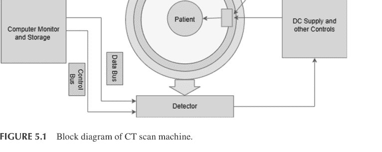

图 5.1 CT 扫描机的框图。

- **控制总线：** 它控制要通过患者的辐射数量，也控制计算机的操作。

- **数据总线：** 它将数据从探测器传输到计算机系统以处理并生成图像 [4]。

### 5.2 使用 CT 扫描仪进行图像采集

常规 X 射线扫描仪包含固定的 X 射线管，但 CT 扫描仪包含电动 X 射线管。电动 X 射线管围绕着称为孔的圆形开口侧旋转，孔具有甜甜圈状结构。患者被要求躺在孔内，围绕孔旋转的 X 射线管通过患者的身体发射一束窄 X 射线束。数字探测器放置在孔内 X 射线管的正对面，捕获穿过患者身体的射线，形成图像。微型计算机控制 X 射线管和探测器，然后将图像传递给计算机机器，在应用一些数学公式后生成图像切片。此切片的厚度范围在 1 至 10 毫米之间。创建一个切片后，电动床在孔内移动以生成下一个切片。重复相同的程序以生成另一个图像切片，此过程一直持续到收集所需数量的切片为止 [4]。

生成的切片是二维的，可以由计算机堆叠在一起生成三维 CT 图像。3D CT 图像以深度方式捕获扫描身体部位的细节，这有助于医生检查骨骼、骨架、器官和组织中的异常 [2]。


### 5.3 CT 扫描仪的缺点

CT 扫描有助于以便捷的方式捕获身体的内部结构。它有助于诊断最致命的疾病，如癌症。但 CT 扫描使用 X 射线，对身体有害。需要注意的是，美国普通人每天接触的电离辐射约为每年三毫西弗（`mSv`），这是由于外太空自然存在的电离辐射或天然放射性元素如氡造成的。一次低剂量胸部 CT 扫描包含 1.5 `mSv` 的电离辐射，约相当于每天自然电离辐射暴露六个月的量，而一次常规胸部 CT 扫描包含 7 `mSv` 的电离辐射，相当于约两年自然背景辐射的暴露量 [2]。

所有这些限制在一定程度上对患者健康构成风险，削弱了 CT 扫描的广泛益处。在人工智能时代，深度学习已显示出在从捕获的二维切片重建 CT 图像的三维容积方面表现出色。此外，基于深度学习的方法已被证明能够从单张 CT 图像生成二维切片。这些因素有助于减少 CT 扫描仪的暴露时间，从而减轻其有害影响。在本章中，我们将讨论这些现有的计算和基于深度学习的方法 [5]。

### 5.4 三维 CT 重建：问题表述

利用二维 X 射线图像切片，三维 CT 重建生成三维 CT 图像。二维 X 射线图像无法详细捕捉真实世界物体的行为。因此，有必要重建三维 CT 扫描，这可以帮助我们可视化体积物体。在 X 射线成像中丢失了大量关于真实世界物体的信息，这些信息在医学领域可能极有帮助。身体的内部形状被投影到平坦的二维图像上，这本质上是一个有损过程，而重新生成原始的三维结构是一个艰巨的过程；因此，非常有必要开发一种技术，利用 X 射线图像生成三维物体 [3, 5]。

3D CT 重建问题可以表述为一系列二维投影 `X1, X2, ..., XN`，其中 `Xi ∈ ℝ^{H_2D × W_2D}` 且 `N` 为投影数量，使得 `1 < i < N`。目标是从这些二维投影生成三维体数据 `Y`。预测输出由 `Y_pred ∈ ℝ^{C_3D × H_3D × W_3D}` 给出，而真实值是 `Y_truth ∈ ℝ^{C_3D × H_3D × W_3D}`，使得 `Y_pred` 和 `Y_truth` 尺寸相同。`Y_truth` 和 `Y_pred` 中的每个值均为体素强度。该问题通过使用映射函数 `F` 来解决，该函数将二维投影映射到三维体图像。该函数 `F` 的输入为 `X1, X2, ..., XN`，`Y_pred` 可在方程 5.1 中表示为输出，

`F (X1, X2, ..., XN) = Y_pred` (5.1)

二维投影序列 `X1, X2, ..., XN` (`Xi ∈ ℝ^{H_2D × W_2D}`) 被堆叠形成三维张量 `Z ∈ ℝ^{N × H_2D × W_2D}`，该张量作为函数 `F` 的输入提供 [6]。

### 5.5 三维 CT 重建的动机

计算和深度学习技术在医学领域得到了广泛应用，尤其是 `MRIs` [7, 8]、显微镜 [9, 10]、超声、X 射线 [11, 12] 等。设计计算和基于深度学习的方法从二维切片生成三维体图像有多重原因。首先，X 射线图像无法捕捉被扫描身体部位的所有细节。X 射线图像本质上是二维的，在扫描身体部位时会丢失信息，因为身体部位本质上是三维的。因此，需要对二维 X 射线图像进行三维重建以恢复所有丢失的信息。

其次，CT 成像过程使患者暴露于较高水平的电离辐射，这对身体有害——尤其是孕妇和儿童——并可能导致癌症等致命疾病。基于深度学习和计算的方法可减少暴露时间并限制不良影响。

此外，三维 CT 扫描仪成本高昂且并非在任何地方都可行。因此，非常需要开发一种计算解决方案，该方案能够从二维 X 射线图像有效提供身体的三维视图。此外，在 CT 扫描期间，患者必须躺在 CT 扫描机上，这对于诊断腰椎间盘突出和颈椎病等脊柱相关问题并不是一个理想的体位。在脊柱相关诊断期间，扫描时要求患者保持直立站立。

### 5.6 三维 CT 重建的传统计算技术

3D CT 重建是一种数学技术，其中 CT 图像由在患者周围不同角度拍摄的二维 X 射线图像生成。以下是三维 CT 重建的一些方法：

#### 分析方法

三维 CT 重建有各种类型的分析方法。其中，最常用的是滤波反投影（`FBP`）类型。在这种技术中，一维滤波器用于投影数据，然后将投影数据投影到图像空间。该方法计算高效且稳定。`FBP` 方法自 1970 年代以来就已使用 [6, 11, 13]。直到 1980 年，二维平行和扇形束很流行。然后，在 1980 年代后期出现了多层螺旋扫描和窄探测器 [14]。在 2000 年代，具有宽范围探测器的多层螺旋扫描和螺旋扫描变得流行，探测器范围可达 320 个探测器，宽 16 厘米 [15, 16]。三维滤波反投影方法用于具有超过 16 个探测器的 CT 扫描仪。CT 扫描仪用户对重建方法的内部工作原理知之甚少；他们主要局限于调整 CT 扫描仪的参数以提高图像标准。重建规范，也被称为“`kernel`”或“`procedure`” by some users，是帮助提高图像标准的最主要条件。每种核在噪声和空间清晰度之间存在权衡。更平滑的核有助于减少图像中的干扰，但会降低图像的空间分辨率 [8, 10]。另一方面，更尖锐的核有助于提高空间分辨率，但会导致图像噪声增加。因此，核的选择应基于 CT 扫描仪的应用 [7, 9]。例如，用于脑部检查的扫描仪需要低噪声和低空间分辨率，而用于骨骼检查的扫描仪需要更尖锐的核，以牺牲噪声换取高空间分辨率。另一个重要参数是切片厚度，用于控制纵向方向的分辨率，影响噪声、辐射剂量和空间分辨率之间的权衡 [2]。

#### 迭代方法

在迭代方法中，优化包括正则化和数据精度。优化过程包括图像空间和投影空间之间投影的前向和后向迭代。迭代方法优于分析方法，因为，与分析方法的焦点相比，X 射线束光谱、探测器几何形状、光子散射和几何形状可以轻松地纳入迭代方法中，从而导致图像噪声更低和光谱分辨率更高。它还减少了风车效应、金属伪影和束硬化 [17]。由于数据处理方法不同，分析方法和迭代方法的图像不同。`IR` 方法中的空间分辨率取决于周围结构的噪声和对比度，因为优化过程中存在诸如正则化等因素 [18, 19]。对不同方法的实验显示了噪声依赖性和对比度对空间分辨率的影响。由于这种依赖性，`IR` 方法中的辐射剂量取决于诊断任务。低对比度检测任务允许使用较小的辐射剂量。在这些方法投入常规实践使用之前，需要进行适当的临床评估和参数优化 [2]。

神经网络（`NNs`）的出现极大地促进了医疗保健监测，三维 CT 重建是受益最大的领域之一。在下一节中，我们将简要概述神经网络。

### 5.7 深度神经网络

深度神经网络（`DNNs`）是一种人工神经网络（`ANN`），其隐藏层数量远多于其他 `ANN`。`ANN` 是浅层网络，常用于机器学习任务以解决简单任务。然而，深度神经网络包含数千个隐藏层，可以解决更复杂的实时问题。深度神经网络由接收网络输入的输入层、包含相互连接的神经元的若干隐藏层组成，这些隐藏层处理输入并从中提取重要信息，以及在隐藏层处理后给出结果的输出层组成。下图 5.2 显示了浅层神经网络和深度神经网络（`DNN`）。网络的数据为 `A1`、`A2` 和 `A3`。网络的输出为 `B1`、`B2` 和 `B3`。每个网络的隐藏层数量不同 [20]。深度神经网络包含的隐藏层数量比浅层网络多，有助于从输入数据中提取更多信息，进而有助于提供比浅层神经网络更好的结果。`Y1`、`Y2`、`Y3` 和 `Y4` 是隐藏层中的神经元，它们相互连接并有助于从输入中提取有意义的信息。随着数据值从输入到输出逐层传递，权重和偏差会发生变化。这被称为前向传播。前向传播后，输出层的输出值与真实值相等。误差向后传播到输入，这被称为反向传播。反向传播有助于最小化误差并提高模型的准确性 [5]。

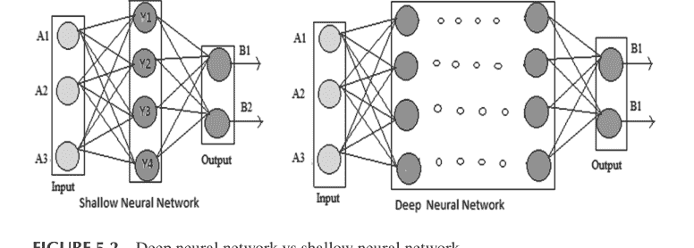

图 5.2 深度神经网络与浅层神经网络。

由于可获取的数据非常丰富，深度学习在生活的各个领域迅速发展。它正在取代那些具有预定义知识的基于知识的应用。使用大量数据训练深度神经网络正在产生前沿成果。早期，由于缺乏大量数据以及`GPU`（图形处理单元）和`TPU`（张量处理单元）等处理单元，神经网络并没有多大用处[20]。

如今，深度学习被用于各个领域，以解决那些原本不可行或需要大量资源（如数据、`GPU`等处理单元以及时间）的问题。这些网络之所以被称为深度神经网络，是因为它们包含具有数百万变量的神经网络。对这些变量的调整被称为网络的学习。这种调整通过提供大量数据来完成，使网络能够学习真实值与输入变量之间的关系。起初，模型会给出随机结果，但随着训练的进行，模型会变得更好并给出良好结果。训练准确率和训练损失被用作衡量神经网络训练性能的指标。训练完成后，模型在一个未见过的数据集（称为测试数据集）上进行评估[21]。这种评估告诉我们模型的真实性能质量。深度学习模型在训练过程中提取训练图像中的重要特征，然后基于训练学习到的特征预测未见过测试图像的输出。因此，模型需要大量数据，以便学习图像中的所有重要特征。当数据较少时，模型会记住训练数据，而在未见过的数据上表现不佳，这时就会发生过拟合。

### 5.8 卷积神经网络

一类被称为卷积神经网络（也称为`ConvNets`或`CNN`）的神经网络用于处理图像、视频、信号等数据。数字图像由存储在网格状结构中的一系列像素值组成。这些像素值表示图像像素的颜色和亮度。

与人类大脑类似，卷积神经网络帮助计算机处理图像数据。人脑通过由神经元组成的大型复杂结构处理信息。类似地，卷积神经网络由深层隐藏层组成，这些隐藏层可以从输入图像中获取线条、边缘等简单特征，以及人脸和物体等复杂特征。因此，它就像计算机的眼睛[3]。`CNN`通常由三种层组成：

- 1. 卷积层
- 2. 池化层
- 3. 全连接层

**卷积层：** 这是从输入层获取各种特征的主要层。核（也称滤波器）在输入图像上运行，并从给定图像中获取重要属性。每次核在图像上运行时，都会与输入图像像素值执行点积运算，并生成一个二维输出，称为激活图[22]。核滑动的步长称为步幅。考虑一个大小为`W × W × D`像素的图像，其中`D`是通道数。当`D_out`个核（每个大小为`F × F`，步幅为`S`，填充为`P`）应用于图像时，得到`W_out`，如下面的公式5.2所示：

`W_out = (W − F +2P)/S + 1`  (5.2)

输出体积的大小为`W_out × W_out × D_out`。

### 池化层

该层通过保留最重要的特征来降低计算成本和特征图的维度。池化层有多种类型，最常用的是最大池化层和平均池化层。在最大池化中，从图像区域中选择最大的像素值；在平均池化中，对该区域内的所有像素值取平均，以生成输出特征图[22]。考虑某个阶段的`W × W × D`像素的激活图，其中`D`是通道数，滤波器大小为`F × F`，步幅为`S`，则得到`W_out`，如下面的公式5.3所示：

`W_out = (W − F) / S + 1`  (5.3)

输出体积的大小为`W_out × W_out × D`。

### 全连接层

在全连接层中，一层的神经元与下一层的每个神经元相连。因此，这就在每一层与下一层之间形成了全连接。最后的层位于网络末端全连接层之前[3]。

以`CIFAR-10`数据集为例：该数据集中有10个不同类别，共60,000张图像。这些类别分别是卡车、船舶、马、青蛙、飞机、汽车、猫、狗、鸟和鹿，分别标记为0到9。在60,000张图像中，50,000张用于训练`CNN`架构，10,000张用于测试训练好的网络。卷积、最大池化和全连接是构成一个简单`CNN`架构的三层。50,000张图像用于训练网络，网络从训练图像中学习重要特征。网络训练完成后，用测试数据验证训练模型的准确率[22]。

图5.3展示了`CNN`架构。它有两个最大池化层和两个卷积层。网络接收大小为32 × 32 × 3像素的输入图像（3个通道，长和宽为32），并通过`Conv1`层处理，生成大小为32 × 32 × 32像素的输出图像（使用32个通道）。之后，送入最大池化层，该层提取有用特征以减小特征图。因此，图像尺寸减小到16 × 16 × 32像素。然后，将其传递到`Conv2`层，再经过最大池化层，输出图像大小为8 × 8 × 64像素，使用的通道数为64。最后，全连接层连接所有前后神经元，并将特征映射到输出标签[3]。

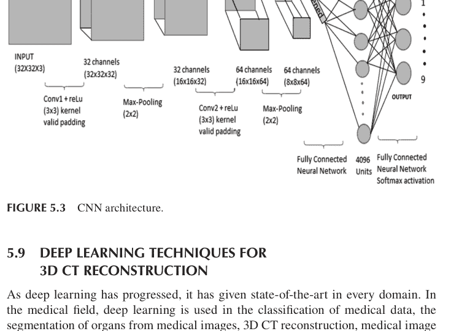

图5.3 `CNN`架构。

### 5.9 用于3D CT重建的深度学习技术

随着深度学习的发展，它在各个领域都取得了最先进的成果。在医学领域，深度学习被用于医学数据分类、从医学图像中分割器官、3D CT重建、医学图像去噪以及其他许多领域[17, 23]。它被用于判断图像中是否存在疾病。此外，在分割方面，例如从CT扫描图像生成器官的3D图像。通过深度卷积网络去除X射线和计算机断层扫描图像中的背景噪声，有助于更好地理解体内的疾病。利用深度学习的医学影像研究一直在进行，并通过提供最先进的技术帮助很大。但仍有一些领域，如3D CT重建，需要大量探索[24]。

在这里，我们将重点介绍基于深度神经网络的方法，这些方法在3D CT重建中相比传统方法取得了显著成果。由于可用数据的丰富，基于深度学习的方法已显著发展。基于`CNN`的方法、基于`GAN`（生成对抗网络）的方法（如循环`GAN`），以及最近基于`Transformer`的方法，都已显示出比传统基于统计建模的方法更好的结果。所有这些方法都提供了基于二维X射线图像的最先进三维重建[20]。

使用基于深度学习的策略从二维X射线图像进行CT重建可分为三种方法，如图5.4所示。第一种方法中，利用单张X射线图像，深度学习模型可以估计多个CT图像

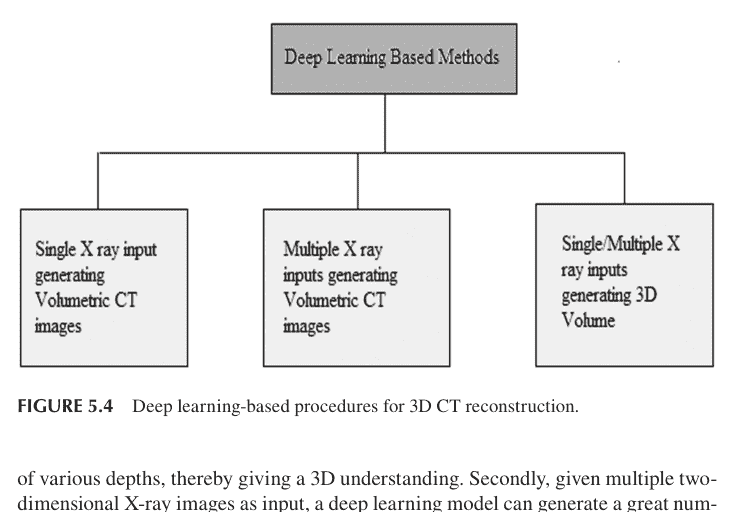

图5.4 基于深度学习的3D CT重建流程。

不同深度的图像，从而提供3D理解。其次，给定多张二维X射线图像作为输入，深度学习模型可以生成大量CT图像，从而提供更深入的洞察。第三，利用单张X射线图像，深度学习模型可以生成被扫描身体部位的3D结构[22]。在下面的小节中，我们将讨论这三类下的各种深度学习模型。

#### 5.9.1 单张X射线输入生成体积CT图像

从二维X射线图像进行CT恢复在很长一段时间内都未被观察到；直到近几年它才发展起来。Shen等人[6]开发了一种基于深度`CNN`的编码器-解码器架构，包含三个模块——表示网络、变换网络和生成网络——用于重建体积CT图像。实验使用不同的输入投影（一张、两张、五张和十张）进行，这些投影堆叠在一起。实验针对三种不同情况：肺、上腹部以及头颈部。实验结果令人鼓舞。Zhiqiang Tan等人[11]开发了`XctNet`，利用单张X射线图像重建三维CT图像。它利用X射线图像的先验知识，有助于CT图像的重建。所提出的方法基于`U-Net`，包含自注意力模块和多尺度特征融合模块。Almeida等人[13]通过针对下肢的新颖深度卷积编码器-解码器架构，从单张X射线图像重建三维CT图像。该架构给出了有前景的结果。Jiang等人[15]开发了一种基于`GAN`的架构，用于从肺和上腹部的单张X射线图像进行CT恢复。Peng等人[16]开发了一种两阶段的深度`CNN`网络，用于从单张2D X射线输入恢复3D CT体积。用于训练该架构的图像来自`LIDC/IDRI`（肺图像数据库联盟/ `LIDC/IDRI`（肺部影像数据库联盟和影像数据库资源计划）集合是一个公开可用的数据集。从 1018 个胸部 CT 体积分中，选择了 780 个最佳 CT 体积分。其中，70 个用于测试，700 个用于训练，10 个用于模型的验证。这是放射图合成方面的首要工作。Yu 等人 [25] 开发了一种基于深度神经网络的架构，使用一种称为滤波反投影（`FBP`）的算法，用于从单输入二维 X 射线图像恢复三维 CT 体积分。它包含投影生成阶段、`FBP` 层和 CT 微调阶段。该网络超越了最先进的技术。Estelle Loyen 等人 [14] 开发了一种基于深度 `CNN` 的网络，用于从单张 2D X 射线输入图像恢复三维 CT 体积分。该网络经过训练以定位大脑中肿瘤的位置。标准化均方根误差用于计算真实 CT 图像与预测体积分图像之间的误差。Hisaichi 等人 [26] 开发了一种名为 `X2CT-FLOW` 的基于 `CNN` 的网络，该网络使用单张二维输入 X 射线图像重建体积分胸部图像。`PSNR`（峰值信噪比）与 `SSIM`（结构相似性指数）值用于计算预测 CT 图像的标准，而 `MAE`（平均绝对误差）、`RMSE`（均方根误差）则用于计算真实重建图像与输出胸部 CT 图像之间的误差。本文讨论的所有论文的摘要列于表 5.2 中。

## 表 5.2 第一类论文摘要

| 作者 | 贡献 |
|---|---|
| Liyue Shen 等人 [6] | 基于编码器-解码器的模型，使用单张或多张投影视图生成三维体积分图像。 |
| Zhiqiang Tan 等人 [11] | 一种类似 InceptionNet 的基于深度学习的模型，用于从单张 X 射线图像创建三维体积分 CT 图像。 |
| Diogo F. Almeida 等人 [13] | 作为数据增强技术，采用具有跳跃连接和多维高斯测量的编码器-解码器模型，使用单张 X 射线图像生成三维医学图像体积分。 |
| Ling Jiang 等人 [15] | 开发了一种基于 `GAN` 的架构，用于使用单张 X 射线图像进行肺部和上腹部 CT 重建。 |
| Cheng Peng 等人 [16] | 使用单张 2D X 射线输入，两阶段深度 `CNN` 网络可以重建三维 CT 体积分。该模型使用公开可用的 `LIDC/IDRI` 数据集进行训练。 |
| Jianqiao Yu 等人 [25] | 基于 `FBP`（滤波反投影）的深度 `CNN` 网络用于使用单输入 2D X 射线图像重建三维 CT 体积分。它具有投影生成阶段、`FBP` 层和 CT 微调阶段。 |
| Estelle Loyen 等人 [14] | 一种基于 `CNN` 的网络，用于将单张二维 X 射线输入图像重建为三维 CT 体积分。该网络已训练用于识别脑肿瘤的位置。 |
| Hisaichi Shibata 等人 [26] | 基于深度 `CNN` 的网络名为 `X2CT-FLOW`，使用单张 2D 输入 X 射线图像重建体积分胸部图像。 |

#### 5.9.2 使用多张 X 射线输入生成体积分 CT 图像


Ying 等人 [18] 提出了一种基于 GAN 的架构，用于使用两张 X 射线图像进行三维 CT 重建。该架构为每张输入 X 射线图像使用单独的编码器，导致架构复杂且需要大量计算资源。Ratul 等人 [19] 开发了一种基于 GAN 和深度 CNN 的架构，用于从双平面 X 射线图像恢复体积分图像并超越了最先进的技术。Shen 等人 [27] 使用几何图像先验从多张二维 X 射线图像进行三维 CT 恢复，从而增强 CT 重建过程。Ge 等人 [28] 开发了一种基于深度学习的创新架构，包含两个独立模块，用于颈椎的 3D CT 重建和分割。该架构使用前后位（AP）和侧位（LAT）两个投影作为输入并生成物体的三维体积分。Afshar 等人 [29] 开发了名为 CARISI 的框架，该框架利用层间插值方法从多张二维 X 射线图像切片恢复三维 CT 体积分。用于重建脑肿瘤形状的编码器-解码器架构是该架构的基础。该模型在包含 3064 张分割脑肿瘤图像的实时数据集上进行评估。Santarelli 等人 [30] 提出了一种基于深度 CNN 的层间插值方法，用于从多张 X 射线图像重建三维体积分图像。该方法通过使用几何图像先验和层间插值方法提高了图像质量和重建速度。PSNR 和 SSIM 值用于比较真实图像与重建图像。MSE 和 RMSE 值用于计算真实图像与重建图像之间的误差。上述论文总结于下表 5.3 中。

## 表 5.3 第二类论文摘要

| 作者 | 贡献 |
|---|---|
| Xingde Ying 等人 [18] | 使用 GAN 从两张正交 X 射线重建三维 CT 体积分。 |
| Md Aminur 等人 [19] | 提出了一种基于 GAN 和深度 CNN 的架构，使用正交 X 射线图像重新组装体积分 CT 图像。 |
| Liyue Shen 等人 [27] | 使用几何图像先验从多张 X 射线图像进行三维 CT 恢复，从而增强 CT 重建过程。 |
| Rongjun Ge 等人 [28] | 提出了一种基于深度学习的创新架构，包含两个独立模块，用于颈椎的 3D CT 重建和分割。该架构使用两个投影 AP 和 LAT 作为输入并生成物体的三维体积分。 |
| Parnian Afshar 等人 [29] | 基于层间插值方法，名为 CARISI 的框架可以从多张 X 射线图像切片恢复三维 CT 体积分。用于重建脑肿瘤形状的编码器-解码器架构是该模型的基础。 |
| Chiara Santarelli 等人 [30] | 基于 CNN 的层间插值技术用于将多张 X 射线图像重建为三维体积分图像。使用几何图像先验和层间插值方法，该方法提高了图像质量并加快了重建速度。 |

### 5.9.3 使用单张/多张 X 射线输入生成三维体积分

从二维 X 射线图像进行三维重建会产生 CT 体积分图像，可以估计以获得扫描身体部位的体积分视图。据我们所知，Henzler 等人 [31] 是第一个使用单张 2D X 射线图像恢复三维颅骨体积分的人。他们使用具有跳跃连接和残差学习的基于深度 CNN 的架构。该模型使用二维 X 射线图像和 175 个不同哺乳动物类别的对应三维 CT 图像进行训练。Shiode 等人 [32] 设计了一种基于 GAN 的模型，使用统计形状模型（SSM）和基于 CNN 的神经网络，从骨骼的二维 X 射线图像恢复三维体积分，以从二维 X 射线图像获取体积分。Bayat 等人 [33] 从两张正交视图 X 射线图像重建脊柱姿势。架构 Transvert 基于编码器-解码器深度 CNN 模型，包含三个结构：矢状面编码器、冠状面编码器和三维解码器。这三个结构通过映射和融合模块集成。Hangkee Kim 等人 [34] 开发了一种 CNN 模型，用于从二维 X 射线图像恢复腿部骨骼，使用边界框提取特征并使用统计形状模型（SSM）参数微调模型。在边界框无法提取特征的情况下，使用特征椭圆和特征点。Jana Cavojska 等人 [12] 开发了一种基于深度神经网络的架构，使用一对二维 X 射线图像估计骨骼的三维结构。迁移学习和三元损失函数与 KNN（K 近邻）分类器结合使用以区分骨骼。该方法与另外八种方法进行了比较，表明该方法优于其他方法。Yifan Wang 等人 [35] 开发了一种名为 DeepOrganNet 的基于深度神经网络的模型，使用单张 X 射线投影视图重建器官的多个三维网格。该模型使用平滑变形场提取特征并利用从二维 X 射线图像中提取的潜在描述符。MobileNet 用于重建器官的多视图网格。Catherine Namayega 等人 [36] 使用基于深度 CNN 的网络 U-Net，利用双平面 X 射线图像重建肩胛骨的三维体积分。然而，该模型在实时数据集上拟合不佳。Weinan Song 等人 [37] 开发了一种两阶段基于深度神经网络的模型，使用单张全景 X 射线图像重建口腔的三维体积分。第一阶段使用基于 GAN 的架构将二维特征投影到三维空间，第二阶段从二维输入图像重建三维体积分。该模型使用实时数据集进行评估并取得了惊人的结果。Yoni Kasten 等人 [38] 开发了一种基于 GAN 的深度神经网络，用于从单张二维 X 射线图像重建滑膜关节的三维体积分。本类别讨论的论文总结于下表 5.4 中。

## 表 5.4

第三类论文摘要

| 作者 | 贡献 |
|---|---|
| Philipp Henzler et al. [31] | 基于编码器-解码器、跳跃连接和融合步骤的模型可将单张 X 射线图像转换为三维体数据。 |
| Ryoya Shiode et al. [32] | 基于 GAN 的模型可从二维 X 射线图像中获取体数据，该模型利用统计形状模型（SSM）和基于 CNN 的网络从骨骼的二维 X 射线图像重建 3D 体数据。 |
| Amirhossein Bayat et al. [33] | 从两张正交视角 X 射线图像重建脊柱姿势。所提出的架构“Transvert”基于编码器-解码器深度 CNN 模型。 |
| Hangkee Kim et al. [34] | CNN 模型使用边界框提取特征，并利用统计形状模型（SSM）参数对模型进行微调，以从二维 X 射线图像中恢复腿部骨骼。 |
| Jana Cavojska et al. [12] | 基于深度神经网络的架构使用一对二维 X 射线图像来估计骨骼的 3D 形状。迁移学习和三元组损失函数与 kNN 分类器结合使用以区分骨骼。 |
| Yifan Wang et al. [35] | DeepOrganNet 可重建多个 3D 网格。该模型使用平滑变形场提取特征，并利用从 X 射线图像中提取的潜在描述符。MobileNet 用于重建器官的多视角网格。 |
| Catherine Namayega et al. [36] | 使用双平面 X 射线图像，基于深度 CNN 的网络可以重建肩胛骨的 3D 体积。然而，该模型难以应用于实时数据集。 |
| Weinan Song et al. [37] | 提出了一种两阶段基于 CNN 的模型，使用单张全景 X 射线图像重建口腔体积。第一阶段使用基于 GAN 的模型将二维特征投影到 3D 空间，第二阶段从 3D 输入图像重建 3D 体积。 |
| Yoni Kasten et al. [38] | 设计了一种深度卷积神经网络，从膝关节和髋关节骨骼的两张正交平面 X 射线输入图像中恢复 3D 体积。 |

### 5.10 结果分析

本节回顾了属于 3D CT 重建三种不同类别的一些重要深度学习模型的性能和结果。

#### 5.10.1 第一类：单 X 射线输入生成体 CT 图像

本类使用单 X 射线输入生成多个 CT 体积图像。用于理解使用单 X 射线输入图像进行 CT 切片生成的操作的代表性概念图如图 5.5 所示。本类中一个重要的方法由 Liyue Shen et al. [6] 提出。在这项工作中，一个

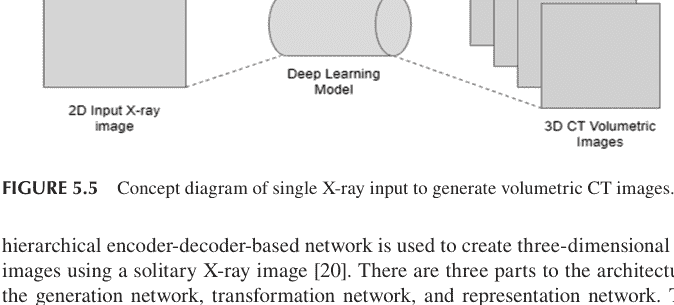

图 5.5 单 X 射线输入生成体 CT 图像的概念图。

基于层次化编码器-解码器的网络用于使用单张 X 射线图像创建三维 CT 图像 [20]。该架构分为三个部分：生成网络、变换网络和表示网络。生成模块基于表示网络学习到的特征生成相应的 3D CT 图像，表示网络从给定的 X 射线图像中提取重要特征。通过卷积和反卷积操作，变换网络在生成网络和表示网络之间充当桥梁，促进二维特征向三维特征的映射。该模型使用从斯坦福医院患者收集的肺部和腹部数据集进行训练（由于患者隐私原因未公开）。由于训练模型时缺乏 CT 和 X 射线配对数据，因此通过锥束方法 [11] 生成 CT-DRR 配对。应用平移和旋转等数据增强技术来增加数据集。数据集包含 720 个用于训练的 DRR 和 120 个用于验证的 DRR。600 个未见过的 DRR 用于测试。Adam 优化器用于通过反向传播调整网络参数并最小化损失函数。肺部 CT 重建结果，输入二维 X 射线和真实值如图 5.6 所示。预测的 CT 切片几乎与真实值相同，真实值与预测值之间的差异表明预测的 CT 图像几乎与真实 CT 图像相同。对单个样本进行 3D CT 重建测试大约需要 0.5 秒。

本类中另一个重要的方法由 Zhiqiang Tan et al. [11] 提出，他们开发了一种基于深度 CNN 的架构，使用单张 X 射线输入图像重建 CT 体积图像。编码器-解码器框架作为该架构的基础，其中包括用于自适应优化特征的自注意力技术、用于生成提取特征细节的 3D 分支生成模块以及用于提高 CT 重建精度的多尺度特征融合。该模型使用公开可用的 LIDC-IDRI 数据集 [6] 进行训练。LIDC-IDRI 数据集包含 1024 张胸部 CT 图像，通过数字重建放射图算法处理得到等效于二维 X 射线的 DRR 图像。该模型使用二维 DRR 图像和 3D CT 体积图像进行训练。训练好的模型在测试数据集上进行评估。重建的体积图像非常接近真实图像。


图 5.7 多 X 射线输入生成更多体 CT 图像的概念图。

在本类中，我们将讨论的第一个方法由 Xingde Ying et al. [18] 提出。作者提出了一种 GAN 框架，使用两张正交双平面输入图像重建 3D CT 体积 [6, 11]。这是第一个使用两张双平面输入图像重建 CT 体积图像的架构。该架构使用由三个编码器-解码器模块组成的生成器。两个并行工作的编码器-解码器模块用于处理两个输入图像，即前-后位和侧位。第三个编码器-解码器模块放置在这两个编码器-解码器框架之间，以融合这两个模块的信息，有助于重建更好的体积 CT。

网络使用标准流程进行训练，其中判别器和生成器分别训练。网络使用 Adam 优化器进行学习，初始学习率为 2e-4，50 个 epoch 后学习率线性下降。网络在训练至 100 个 epoch 后表现良好。模型使用可公开访问的 LIDC-IDRI 数据集进行学习。数据集包含 1018 个胸部 CT 扫描 [6]。我们使用这些 CT 扫描和数字重建放射图，因为带有对应 CT 体积的 X 射线胸部数据集不可用。网络可以用这些数据进行训练，对应的 CT 体积可作为真实 CT 体积。预处理后，916 个 CT 扫描用于网络训练，102 个 CT 扫描可用于测试网络。

3D CT 重建结果由两张正交输入 X 射线图像和实际 CT 图像生成。结果几乎与实际 CT 图像相同。使用方法 X2CT-GAN+B 时，其中 +B 表示双平面二维 X 射线输入图像，与单 X 射线输入图像方法 X2CT-GAN+S 相比，结果提高了四个百分点。这归因于双平面输入图像的互补特征。与单输入 X 射线模型相比，X2CT-GAN+B 产生的 CT 重建图像具有更清晰的边界，覆盖器官更精细的细节，而单输入 X 射线模型输出模糊；该方法重建的图像质量不佳。对训练好的模型也使用真实世界 X 射线数据进行评估。结果具有显著的合理性。

本类中的下一个方法由 Aminur et al. [19] 提出。作者提出了一种类条件网络，用于从两张正交

X射线图像。作者提出了三个模块：深度特征变换（DFT），用于通过仿射变换在空间上调制二维特征并沿第三轴提升它；自适应特征融合（AFF），用于从无限制数据中消除重建问题；以及深度感知连接（DAC），用于去除不必要的特征并桥接2D和3D特征图[13, 16]。该网络基于X2CT-GAN，包含两个并行的编码器-解码器模块来处理输入的双平面X射线图像，以及一个名为fuse的第三模块，位于这两个模块中间，用于合并来自两个模块的信息。

该网络在公开可用的LIDC-IDRI数据集上进行训练。LIDC-IDRI数据集包含1024张胸部CT图像，这些图像通过数字重建放射摄影算法[6]处理得到等效于二维X射线的DRR图像。模型使用二维DRR图像和3D CT体数据进行学习。模型使用916张图像进行训练，其余图像用于测试模型。Adam优化器用于在学习率为2e-3的情况下训练网络，最多100个epoch。学习率在50个epoch后降低30%。网络采用两种不同方法进行训练：首先，融合逐像素和逐体素L1损失，称为CCX-rayNet；其次基于GAN，称为CCX-rayGAN。所提出的CCX-rayGAN+B的结果，其中B用于双平面输入图像，与最先进的X2CTGAN+B进行了比较，从CCX-rayGAN+B的结果来看，我们可以得出结论，所提出的结果远优于X2CTGAN+B，因为重建CT图像的视觉质量得到了显著改善。

#### 5.10.3 第三类：使用单张/多张X射线输入生成3D体数据

本类使用单张/多张X射线输入生成CT体数据。用于理解使用单张/多张X射线输入图像生成3D CT体数据的操作原理的代表性概念图如图5.8所示。在本类中，我们将讨论的第一个方法是Philipp Henzler等人[31]提出的。该方法称为单图像层析成像（SIT），用于从单张二维X射线图像恢复三维体数据。


图5.8 单张/多张X射线输入生成CT体数据的概念图。

本文描述了一种基于深度CNN的方法，用于从单张X射线图像恢复三维CT体数据。编码器-解码器框架是该架构的基础。架构的数据为单张大小为256×256像素的二维X射线图像，网络的输出为由128×128×128密度体组成的3D CT扫描的三维体数据。编码器部分提取特征信息，降低分辨率，并通过垂直减小尺寸并增加通道数来生成更复杂的特征，这导致网络水平尺寸增加。解码器部分（蓝色模块）在不减少通道数的情况下再次提高分辨率。此分辨率通过使用反卷积或上采样来提高。从网络的编码器部分到解码器部分的跳跃互连有助于将诸如边缘等精细细节从二维图像传递到高分辨率3D体数据[20]。

网络的训练数据包含175种不同哺乳动物物种的五十万张二维X射线图像。数据集中包含大量二维X射线图像及其三维体数据。网络的训练在四块Nvidia Tesla K80 GPU加速卡上完成，将训练时间缩短至一天。由于这是一个回归问题，损失函数为L2范数（欧几里得）损失[3, 24]。网络的评估既在由3D CT体数据生成的合成X射线组成的验证数据集上进行，也在没有真实图像的真实X射线上进行。结果来自真实X射线图像。从结果来看，我们可以得出结论，尽管真实CT体数据不可用且模型在人工X射线图像上训练，模型仍能有效地从二维真实未见X射线图像中恢复三维体数据。输出的三维体数据与实际体数据完全匹配，模型能够有效地从单张二维X射线输入生成三维体数据。

本类中的下一个方法是由Amirhossein Bayat等人[33]提出的，他们提出了一种基于深度神经网络的架构Transvert，该架构使用两张正交输入X射线图像重建脊柱姿势的3D结构。Transvert中有三个模块：3D解码器、矢状面编码器和冠状面编码器。一个名为map&fuse的模块将这三个模块结合起来。map&fuse模块用于将冠状面和矢状面视图的二维信息转换为三维中的中间潜在信息。使用通道级整合，该潜在信息随后合并为单一的三维表示并解码为3D体素表示。

两个公开可用的肺结节数据集用于训练网络：一个由800张CT图像组成的肺结节数据集用于生成DRR图像，以及公司数据集中154个CT扫描。训练数据集和验证数据集通过以五比一的比例将总数据集分成两半来创建。预测和实际椎骨CT掩膜之间的Hausdorff距离和Dice系数用于评估模型的性能[25]。用于三维重建形状的所提出架构包含编码器的自注意力层和对抗训练增强性能，导致Dice值为95.52%，Hausdorff距离小于5.11 mm。通过将预测的三维椎骨放在各自的质心位置上，可以恢复脊柱的3D体数据。

本类中的另一种方法是由Yoni Kasten等人[38]提出的。作者提出了本文中提出的一种端到端基于深度CNN的方法，用于从两张正交二维X射线图像重建膝关节骨骼的三维体数据。该架构基于V-Net，包含3D卷积层，滤波器大小为(3 × 3 × 3)，并且编码和解码层之间具有跳跃连接。最后一个(1 × 1 × 1)卷积层输出五个通道，表示五个类别，其后为SoftMax层。类别零到四代表膝关节骨骼的解剖分区。网络使用由DRR技术从CT扫描生成的合成X射线图像进行训练，并在无监督和有监督损失上进行训练。使用初始学习率为10⁻²的Adam优化器训练网络，每10个epoch学习率降低十倍。训练和测试数据集分别由18,810和20个扫描组成，通过旋转增强生成[14]。

训练好的网络在20张测试图像上通过Dice和Chamfer指标进行评估。Marching Cube算法用于从预测标签重建3D网格。Dice值越大且Chamfer值越小，结果越好[39]。

### 5.11 结论

CT扫描使用X射线，这对人体有害——尤其是儿童和孕妇——并且暴露于这些有害射线可能导致癌症等致命疾病[1]。此外，二维X射线图像无法捕捉扫描身体部位的体视视图或详细信息[2]。早期使用传统和计算方法，如迭代和解析方法，但这些方法需要数百个投影视图和完整的身体旋转扫描，使患者面临更大的辐射暴露风险。因此，在此，我们讨论了基于深度学习的方法，这些方法使用单张/多张二维X射线图像重建CT体数据，并有助于使用体视视图诊断身体中存在的异常[1, 4, 6]。


从CT扫描的介绍和CT扫描的框图解释开始，我们随后讨论了CT扫描的缺点和本工作的动机。传统重建CT图像的方法在此简要说明。但由于人工智能的进步，如今使用基于深度CNN的方法从二维X射线图像恢复CT图像[2, 4]。基于文献综述，深度学习方法分为三类。实验工作使用来自三个深度学习程序类别中每类的一些论文进行，并且这些方法的结果表明，基于深度学习的方法优于传统方法并给出更优的结果。

## 参考文献

- 1. https://www.nibib.nih.gov/science-education/science-topics/computed-tomography-ct.
- 2. https://www.imagewisely.org/Imaging-Modalities/Computed-Tomography/Image-Reconstruction-Techniques.
- 3. https://medium.com/@draj0718/convolutional-neural-networks-cnn-architectures-explained-716fbl97b243.
- 4. https://www.daenotes.com/electronics/industrial-electronics/ct-scanner.
- 5. https://www.tutorialspoint.com/python_deep_learning/python_deep_learning_deep_neural_networks.htm.
- 6. Shen, L., Zhao, W., & Xing, L. (2019). 通过深度学习从单投影视图重建患者特异性体积分层计算机断层扫描图像. Nature Biomedical Engineering, 3(11), 880–888.
- 7. Aetesam, H., & Maji, S. K. (2021). 磁共振图像中深度并行集成去噪的噪声依赖训练. Biomedical Signal Processing and Control, 66, 102405.
- 8. Aetesam, H., & Maji, S. K. (2022). 基于注意力的噪声先验网络用于磁共振图像去噪. IEEE International Symposium on Biomedical Imaging ISBI 2022, Kolkata, India.
- 9. Maji, S. K., & Yahia, H. (2019). 基于特征的重建模型用于荧光显微镜图像去噪. Scientific Reports. Nature Publishing Group, 9(1), 7725.
- 10. Maji, S. K., & Boulanger, J. (2021). 泊松高斯联合去噪解卷积的变分模型. IEEE International Symposium on Biomedical Imaging ISBI 2021, Nice, France.
- 11. Tan, Z., Li, J., Tao, H., Li, S., & Hu, Y. (2022). XctNet：从单张X射线图像重建体积分层图像的重建网络. Computerized Medical Imaging and Graphics, 98, 102067.
- 12. Čavojská, J., Petrasch, J., Mattern, D., Lehmann, N. J., Voisard, A., & Böttcher, P. (2020). 利用X射线（2D）图像上的神经网络估计和抽象猫骨骼的三维结构. Communications Biology, 3(1), 1–13.
- 13. Almeida, D. F., Astudillo, P., & Vandermeulen, D. (2021). 从二维数字重建放射照片获得三维图像体积分层：下肢CT扫描的深度学习方法. Medical Physics, 48(5), 2448–2457.
- 14. Loyen, E., Dasnoy-Sumell, D., & Macq, B. (2022, October). 使用卷积神经网络从单张X射线投影重建3DCT. In 2022 IEEE International Conference on Image Processing (ICIP) (pp. 1111–1115). IEEE.
- 15. Jiang, L., Zhang, M., Wei, R., Liu, B., Bai, X., & Zhou, F. (2021, November). 使用CVAE-GAN从单张X射线投影视图重建3D CT. In 2021 IEEE International Conference on Medical Imaging Physics and Engineering (ICMIPE) (pp. 1–6). IEEE.
- 16. Peng, C., Liao, H., Wong, G., Luo, J., Zhou, S. K., & Chellappa, R. (2021, May). Xraysyn：通过CT先验从单张放射照片进行逼真视图合成. In Proceedings of the AAAI Conference on Artificial Intelligence (Vol. 35, No. 1, pp. 436–444).
- 17. Sidky, E. Y., & Pan, X. (2008). 通过约束总变分最小化在圆形锥束计算机断层扫描中进行图像重建. Physics in Medicine and Biology, 53(17), 4777.
- 18. Ying, X., Guo, H., Ma, K., Wu, J., Weng, Z., & Zheng, Y. (2019). X2CT-GAN：利用生成对抗网络从双平面X射线重建CT. In: Proceedings of the IEEE/CVF Conference on Computer Vision and Pattern Recognition (pp. 10619–10628).
- 19. Ratul, M. A. R., Yuan, K., & Lee, W. (2021, April). CCX-rayNet：用于双平面X射线到CT体积分层的类条件卷积神经网络. In: 2021 IEEE 18th International Symposium on Biomedical Imaging (ISBI) (pp. 1655–1659). IEEE.
- 20. https://towardsdatascience.com/a-comprehensive-guide-to-convolutional-neural-networks-the-eli5-way-3bd2b1164a53.
- 21. Ge, R., He, Y., Xia, C., Xu, C., Sun, W., Yang, G., ... Zhu, Y. (2022). X-CTRSNet：直接从二维X射线图像进行三维颈椎CT重建和分割. Knowledge-Based Systems, 236, 107680.
- 22. https://towardsdatascience.com/convolutional-neural-networks-explained-9cc5188c4939.
- 23. Shen, L., Zhao, W., Capaldi, D., Pauly, J., & Xing, L. (2022). 用于超稀疏三维层析成像重建的几何信息深度学习框架. Computers in Biology and Medicine, 148, 105710.
- 24. Shamanth Hampali. (2021). 使用深度学习从低辐射X射线图像重建膝骨三维形状. UWSpace.
- 25. Yu, J., Liang, H., & Sun, Y. (2022, October). 由FBP算法引导的深度学习单视图计算机断层扫描. In 2022 12th International Conference on Information Science and Technology (ICIST) (pp. 237–247). IEEE.
- 26. Shibata, H., Hanaoka, S., Nomura, Y., Nakao, T., Takenaga, T., Hayashi, N., & Abe, O. (2021). X2CT-FLOW：用于超低剂量方案中超稀疏视图计算机断层扫描的基于渐进流的深度生成模型的最大后验重建. arXiv Preprint arXiv:2104.04179.
- 27. Shen, L., Zhao, W., Capaldi, D., Pauly, J., & Xing, L. (2022). 用于超稀疏三维层析成像重建的几何信息深度学习框架. Computers in Biology and Medicine, 148, 105710.
- 28. Ge, R., He, Y., Xia, C., Xu, C., Sun, W., Yang, G., ... Zhu, Y. (2022). X-CTRSNet：直接从二维X射线图像进行三维颈椎CT重建和分割. Knowledge-Based Systems, 236, 107680.
- 29. Afshar, P., Shahroudnejad, A., Mohammadi, A., & Plataniotis, K. N. (2018, October). CARISI：基于卷积自编码器的脑肿瘤体积分层图像层间插值. In: 2018 25th IEEE International Conference on Image Processing (ICIP) (pp. 1458–1462). IEEE.
- 30. Santarelli, C., Argenti, F., Uccheddu, F., Alparone, L., & Carfagni, M. (2020). 层析序列的体积分层插值用于解剖部位的精确三维重建. Computer Methods and Programs in Biomedicine, 194, 105525.
- 31. Henzler, P., Rasche, V., Ropinski, T., & Ritschel, T. (2018, May). 单图像层析成像：从二维颅骨X射线获得三维体积分层. In Computer Graphics Forum (Vol. 37, No. 2, pp. 377–388).
- 32. Shiode, R., Kabashima, M., Hiasa, Y., Oka, K., Murase, T., Sato, Y., & Otake, Y. (2021). 使用卷积神经网络从实际腕部X射线图像重建远端前臂骨骼的二维-三维重建. Scientific Reports, 11(1), 1–12.
- 33. Bayat, A., Sekuboyina, A., Paetzold, J. C., Payer, C., Stern, D., Urschler, M., ... Menze, B. H. (2020, October). 从二维放射照片推断三维站立脊柱姿势. In International Conference on Medical Image Computing and Computer-Assisted Intervention (pp. 775–784). Springer.
- 34. Wu, D., Kim, K., El Fakhri, G., & Li, Q. (2017). 使用人工神经网络训练的先验的迭代低剂量CT重建. IEEE Transactions on Medical Imaging, 36(12), 2479–2486.
- 35. Wang, Y., Zhong, Z., & Hua, J. (2019). DeepOrganNet：通过深度变形网络从单视图投影实时重建和可视化三维/四维肺模型. IEEE Transactions on Visualization and Computer Graphics, 26(1), 960–970.
- 36. Namayega, C., Malila, B., Douglas, T. S., & Mutsvangwa, T. E. (2020, October). 肩胛骨合成双平面X射线图像中的轮廓检测：利用深度学习改进三维重建. In 2020 20th International Conference on Bioinformatics and Bioengineering (BIBE) (pp. 303–307). IEEE.
- 37. Song, W., Liang, Y., Yang, J., Wang, K., & He, L. (2021, May). Oral-3D：从全景X射线重建口腔的三维结构. In Proceedings of the AAAI Conference on Artificial Intelligence (Vol. 35, No. 1, pp. 566–573).
- 38. Kasten, Y., Doktofsky, D., & Kovler, I. (2020). 用于从双平面X射线图像重建膝骨三维结构的端到端卷积神经网络. In Machine Learning for Medical Image Reconstruction: Third International Workshop, MLMIR 2020, Held in Conjunction with MICCAI 2020, Lima, Peru, October 8, 2020, Proceedings 3 (pp. 123–133). Springer International Publishing.
- 39. Sohan, K., & Yousuf, M. A. (2020, November). 使用MED生成对抗网络从二维X射线图像重建三维骨骼形状. In 2020 2nd International Conference on Advanced Information and Communication Technology (ICAICT) (pp. 53–58). IEEE.

## 6 基于 GAN 的编码器-解码器模型用于多标签诊断扫描分类和自动放射学报告生成

Rahul Kumar, K. Karthik, and S. Sowmya Kamath

### 6.1 引言

放射科医生每天分析患者的诊断医学影像以得出诊断。然而，此类分析、解读以及为每次扫描创建文本诊断报告的过程需要诸如广泛的解剖学知识、体现疾病特异性解读的视觉症状，以及与病理学等其他诊断结果相关性的知识等技能。创建诊断报告即使对经验丰富的放射科医生来说也是一个具有挑战性的过程，往往因每天重复手动分析数百张不同的放射影像而产生的认知疲劳而加剧。据报道，平均诊断错误率在三到五 percent 之间，这相当于每年全球超过 4000 万例病例，对患者福祉造成显著的不利影响 [1]。可能导致此类不可避免失误的真正因素通常包括训练有素的放射科人员的严重短缺、繁忙医院环境中每天进行的大量诊断扫描、需要快速分析、认知偏差和人类疲劳等 [2]。

让计算机自动理解图像中的上下文内容并提供合理的自然语言描述现在是一项至关重要的任务，这主要是由于可用数据的巨大体量，进一步加剧了其流式特性。在临床实践中，医学专家和研究人员通常撰写诊断报告以记录图像中的显微发现，因此医学图像的自动标注将为医疗保健提供者提供有价值的见解，并在整体临床工作流程中减轻其负担。医学图像标注挑战 [3] 旨在推进将医学图像的视觉信息映射到凝练文本描述的方法学发展。标注任务可以被视为医学图像分类任务 [4, 5] 的一部分，并且可以成为医疗保健信息管理系统（HIMS）软件的重要补充。

基于图像处理和计算机视觉（CV）的技术已被应用于设计手术和影像干预的应用程序。此类系统通过自动化与诊断相关的某些任务，或通过预测多种异常和放射学报告的严重程度来扩展医疗专业人员的临床决策能力 [6, 7]。将人工智能（AI）纳入这些系统以支持学习行为至关重要，以便系统能够在各种诊断媒介中尽早发现疾病发作时的异常，如放射学、计算机断层扫描（CT）扫描、磁共振成像（MRI）等。放射科医生可以利用这些见解来实现和优化诊断质量。

放射影像的医学报告程序包括放射科医生扫描患者的靶向身体部位并记录通过扫描显现的各种发现和观察。有时，单张图像中可以观察到有关其他身体部位的相关或不相关发现。这些发现和其他观察随后导致对患者的进一步综合总体诊断报告，即所谓的印象。扫描图像还被分配适当的标签以用于未来的分类和记录目的。自动多标签扫描分类被视为管理诊断扫描和解决诸如扫描图像分析、疾病检测等问题的一种潜在解决方案。图像标注概念可以解决识别给定图像的主要内容和对象并基于存在的内容和对象、对象之间的关系以及图像中其他次要对象的上下文生成自然语言描述的组合问题。因此，需要文本描述（给定图像的标题）来满足目标语言的句法和语义要求。

学习图像特征表示可以为描述生成任务提供基础，但在医学图像的情况下，由于数据集非常有限，也可能成为瓶颈。生成对抗网络（GAN）将两个网络在对抗性设置中一起训练，具有互补的目标。GAN-多标签分类（MLC）模型的生成器部分从噪声样本生成新图像，试图欺骗判别器，而判别器则训练将给定图像分类为来自数据集的真实图像或由同一模型的生成器部分生成的伪造图像。这种对抗训练导致判别器学习给定图像的更好特征表示，在区分真实与伪造图像方面变得更好，而生成器则更接近生成数据集中从未出现过的逼真图像。在这项工作中，我们调整 GAN 以在对抗训练设置中实现更好的特征学习，从而改进各种疾病的分类以及诊断扫描描述生成的标签预测。


这里的主要贡献是引入了经过调整以在对抗训练设置中提高特征学习性能的 GAN，用于多疾病分类任务。图像表示和编码方法基于卷积神经网络（`CNN`）-`MLC` 和用于描述生成的标签预测，并在标准数据集上进行了实验验证和基准测试。建议的方法可以作为支持系统部署，供病理学家更快地分析 X 射线图像以实现高效诊断。本章其余部分组织如下：第 6.2 节讨论感兴趣领域的现有工作。第 6.3 节介绍了使用 GAN 进行医学图像描述的所提方法的具体内容。实现细节和实验结果在第 6.4 节中介绍，其后是包含未来工作讨论的结论。

## 6.2 相关工作

在计算机视觉领域探索图像建模新方法的最新研究对图像分类领域的发展做出了重大贡献。长短期记忆网络（`LSTMs`）在自然语言翻译任务中的成功使得改进基于 `CNN` 和循环神经网络（`RNN`）的图像标注解决方案成为可能。迁移学习技术使预训练于海量数据集的模型能够被利用并随后适配于特定领域任务。受跨语言翻译模型的启发，Vinyals 等人 [8] 提出了一种 show-and-tell 图像标注模型。所提方法是一种基于编码器-解码器的模型，具有基于 `CNN` 的编码器和基于 `RNN` 的解码器，利用 `CNN` 模型将图像特征表示为固定长度向量的能力。在此方法之前，许多研究人员通过将图像与文本在同一向量空间中共嵌入，并对查询图像的最接近描述进行排序和检索来解决图像标注问题 [9–11]。Karpathy 等人 [12] 使用神经网络将给定图像和描述在同一向量空间中共嵌入。然而，这些方法中生成的自然语言描述质量有限的问题仍未得到解决。

从诊断图像中检测各种疾病的异常和视觉症状是一个研究充分的问题，通常被视为二元或多标签分类问题。当作为多类分类处理时，不同标签的组合被视为一个单独的类别，X 射线根据数据集中出现的标签组合进行分类。这种方法虽然为数据集中出现的组合提供了稳健的解决方案，但在未见过的组合上会失败，而这些组合在实际应用中经常出现。此外，经典的训练方法因数据集稀缺而受到限制。基础 `GAN` 专注于生成新数据，并在许多最新研究中成功扩展用于生成人脸的新颖图像和风格迁移技术 [13, 14]。Yu 等人 [13] 提出了深度卷积生成对抗网络（`DCGAN`），并采用了许多改进 `GAN` 训练的技术，判别器部分学习到的特征表示进一步用于分类任务。

`CatGAN` [15] 在判别器训练中利用可用的真实标签与图像作为 K 类分类器，同时确保所有生成图像中的 K 类。Odena 等人 [16] 提出了一种 K+1 类判别器，用于训练图像生成的 `GAN` 以及多类图像分类。Salehinejad 等人 [17] 提出了一种方法，利用 `GAN` 生成新图像来克服不平衡数据集，即常见医疗问题过度代表而罕见病数据匮乏，随后这些图像被用于改进基于深度卷积神经网络（`DCNN`）的五种疾病分类器。

Li 等人 [18] 提出了用于基于知识和信息检索导向的医学报告生成的知识驱动编码、检索、改写（Knowledge-driven Encode, Retrieve, Paraphrase, `KERP`）模型。他们使用图学习和自然语言建模将视觉观察与可用的医学领域知识对齐。Yuan 等人 [19] 使用句子级注意力机制将多视图视觉特征编码为句子表示，以实现肺部 X 光图像的报告生成。Chen 等人 [20] 设计了一种记忆驱动的 Transformer 架构，用于记录与图像视觉方面相关的关键信息。Endo 等人 [21] 提出了一种基于信息检索的语言生成模型，利用自监督对比学习生成自由文本临床报告。他们报告称其模型在报告准确性上更高且泛化能力更好。Jing 等人 [22] 提出了一种用于标签预测和报告生成的多任务学习框架，并将 `CNN` 与 `LSTM` 相结合。该模型不仅能够生成高层次的印象，还能够生成详细的描述性发现。Xue 等人 [23] 在端到端的 `CNN-RNN` 架构中使用了集成多级注意力模型 的文本-图像嵌入网络，用于学习独特的图像和文本表示 [24]。这些模型迄今已显示出有希望的结果。PadChest 由 [25] 发起的一项计划涉及受过训练的医生手动标注统一医学语言系统概念唯一标识符（Unified Medical Language System Concept Unique Identifiers, `UMLS-CUI`）数据集样本的 27%。随后他们使用 `RNN` 注意力方法对剩余图像进行标注，并提出了一种分层分类法来对放射学发现进行分类。

基于对现有工作的详细回顾，做出了一定的关键观察。大多数工作使用预训练的多类分类器作为特征提取器，其中神经网络并未使用各种各样的图像进行训练以学习特征。还观察到，多类目标 K+1 类（K 为真实图像，外加一个假图像）被用于图像生成，而最大池化层可能导致空间信息丢失。对于每个临床任务（例如多标签分类和报告生成）都使用单独的分类器，而不是设计端到端框架。一些关键现有工作的总结见表 6.1。计算机视觉领域中探索图像建模新方法的最新工作对图像分类领域的发展做出了重大贡献。`LSTM` 在自然语言翻译任务中的近期成功使得探索改进基于 `CNN-RNN` 的图像描述任务的新方法成为可能。迁移学习技术可以采用以利用在海量数据集上预训练的模型，而生成对抗网络正被探索用于各种任务，例如数据集增强以提高神经模型训练性能。

## 表 6.1

关键现有工作的总结

| 作者 | 方法 | 优点 | 限制 |
|---|---|---|---|
| Vinyals et al. [8] | 使用 `LSTM` 和 `CNN` 为图像生成标题 | 端到端可训练框架 | 使用预训练的多类分类器作为特征提取器 |
| Springenberg et al. [15] | 使用 `GAN` 的无监督和半监督学习 | 多类分类器作为 `GAN` 判别器 | 多类目标 K 类图像生成导向 |
| Odena et al. [16] | 使用 `GAN` 的半监督学习 | 多类分类器作为 `GAN` 判别器 | 多类目标 K+1 类（K 个真实 + 1 个假） |
| Yu et al. [13] | 使用无池化的全深度卷积网的 `GAN` | 稳定训练，判别器可作为分类器 | 用于图像生成 |
| Salehinejad et al. [17] | 使用 `GAN` 增强数据集以建模新的 X 光片 | 新生成的图像提高分类器效率 | 单独分类器 无端到端框架 |

### 6.3 拟议方法

拟议的方法是一种基于 `GAN` 的多标签分类器（`GAN-MLC`），如图 6.1 所示。在 `GAN-MLC` 中，生成器的目标与基本 `GAN` 相同，即学习生成能够欺骗判别器将图像分类为真实的图像，但对于判别器而言，将图像分类为真实或假的目标在真实和假的隐式定义方式上有所不同。在标准 `GAN` 中，判别器在学习区分真实和假的方式上不受限制。判别器只需检测真实图像中存在但尚未被生成器模型建模的特征，至少尚未正确建模。在 `GAN-MLC` 中，总体损失是真实图像和生成器生成的图像上判别器损失的总和。在 `NIH` 胸部 X 光数据集 [26] 的情况下，提供了 14 个不同的标签。来自真实数据集的图像连同相应的标签一起用于训练网络，而网络 `G` 生成的图像则连同与数据集中的类别无关的标签一起提供给判别器 `D`。因此，与图像一起提供的类别标签用于转换图像的“真实”和“假”信息。这种转换消除了单独提供真实/假信息的必要性，并使判别器能够被训练以对图像进行真实与假以及底层类别的分类。

算法 1 说明了 `GAN-MLC` 模型的训练过程。在训练过程中，判别器和生成器以交替的方式联合训练

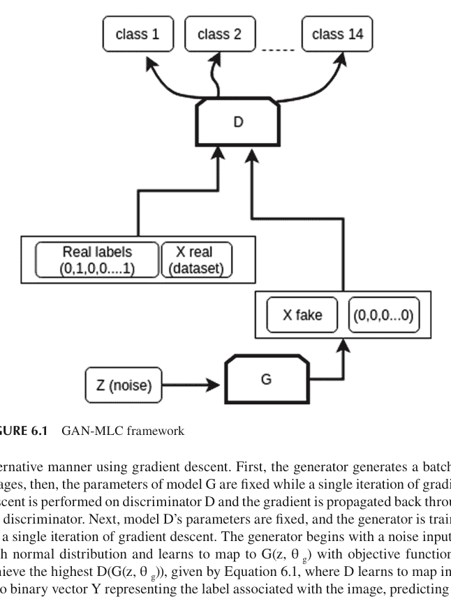

## 图 6.1 GAN-MLC 框架

使用梯度下降。首先，生成器生成一批图像，然后固定模型 `G` 的参数，同时对判别器 `D` 执行一次梯度下降迭代，并将梯度通过判别器向后传播。接下来，固定模型 `D` 的参数，并对生成器进行一次梯度下降迭代训练。生成器以正态分布的噪声输入（`z`）开始，并学习映射到 `G(z, θ_g)`，其目标函数为实现最高的 `D(G(z, θ_g))`，由公式 6.1 给出，其中 `D` 学习将输入 `X` 映射到表示与图像相关标签的二进制向量 `Y`，预测给定示例 `X` 属于各个类别的概率，其目标函数为。`GAN-MLC` 的总体目标函数，也称为零和的极小极大博弈，其中生成器试图最小化 `V` 而判别器试图最大化它，给出为：

```
min_G max_D V(D,G) = E_{X~P_data(x)}[log D(x)] + E_{z~P_z(z)}[log(1 - D(G(z)))] (6.1)
min_G V(G) = E_{z~P_z(z)}[log(1 - D(G(z)))] (6.2)
max V(D) = E_{X~P_data(x)}[log D(x)] + E_{z~P_z(z)}[log(1 - D(G(z)))] (6.3)
```

为了在训练 `GAN-MLC` 时保持稳定，使用了许多技术，包括在判别器中用可学习的空间下采样函数替换确定性空间池化函数层并使用带步幅的卷积层。生成器中还使用分数步幅卷积层以实现上采样函数的学习。批归一化用于所有中间层的输入，使其具有零均值和单位方差，除了生成器的最后一层和判别器的输入层。

## 算法 1：GAN-MLC 训练过程

- 1. 对每次迭代执行
- 2. 生成器从噪声先验 `p_g(z)` 中抽取 `M` 个噪声样本 `{(z^1, y_g), ..., (z^M, y_g)}`，其中 `y_g = [0, ..., 0_classes]`；
- 3. 从数据生成分布 `P_d(x)` 中抽取 `m` 个示例 `{(x^1, y^1), ..., (x^m, y^m)}`；
- 4. 根据小批量上 `D` 的负似然对 `D` 的参数执行梯度下降；
- 5. 生成器从噪声先验 `p_g(z)` 中抽取 `M` 个噪声样本 `{(z^1, y_g), ..., (z^M, y_g)}`，其中 `y_g = [0, ..., 0_classes]`；
- 6. 根据噪声样本小批量上 `G` 的负似然对 `G` 的参数执行梯度下降；

#### 6.3.1 诊断报告生成

描述生成模型由 `CNN` 后接 `RNN` 模型组成，被建模为编码器-解码器网络。在训练期间，总体目标是最大化训练嵌入图像提供的标签的似然。`LSTM` 层进一步接收编码输入序列并学习将其解码为一个词接一个词的序列。图 6.2 描述了为 X 光图像生成描述而设计的架构。

描述生成器的总体目标由公式 6.4 给出，以最大化正确描述的概率，其中 `I` 是编码的图像，`S` 是目标描述句子。由于 `S` 是一个句子，最大长度为 `N` 的序列将被扩展为 `S_0, S_1, ... S_{N-1}`，目标函数如公式 6.5 所示。

```
θ* = arg max_θ Σ log p(S|I, θ) (6.4)
log p(S|I, .) = Σ_{T=0}^{N} log p(S_T | I, S_0, S_1, ..., S_T - 1) (6.5)
```

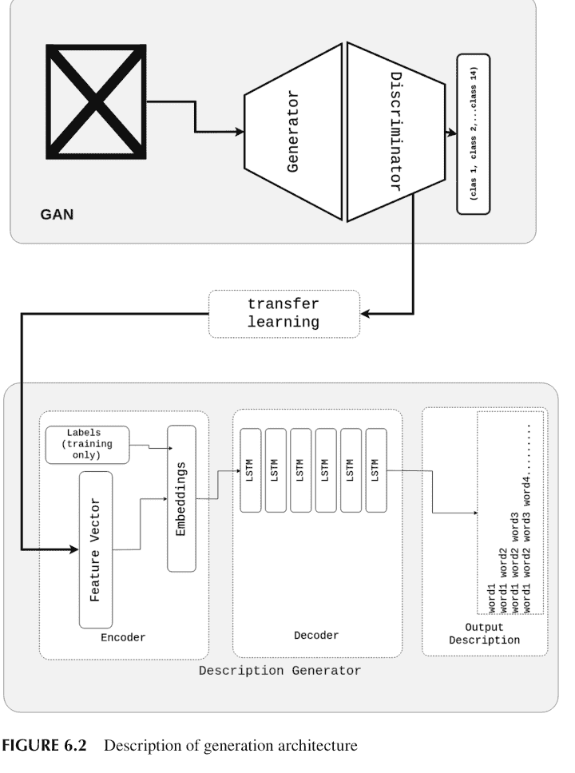

## 图 6.2 生成架构描述

在循环神经网络中，可变长度序列的预测直到前一状态（`T − 1`）可以被固定大小的单元状态（`hT −1`）记住，这使得 `RNN` 成为序列建模的自然选择。在描述生成任务中，在训练期间，编码器网络接收输入图像，从图像中提取特征，并将其与使用在整个词汇表上学习到的词嵌入编码的描述相结合。使用迁移学习对给定图像进行特征向量编码，使用从 `GAN-MLC` 保存的判别器模型，并在移除分类器（全连接）层后使用。`GAN-MLC` 判别器中最后卷积层的输出是输入图像在固定长度向量中的表示。用于训练图像的描述被处理成词汇表，即在移除停用词后所有唯一 token 的集合。作为解码器的输入，每个 token 都由词汇表大小长度的独热编码表示。这可以通过为给定词汇表学习嵌入然后使用嵌入大小向量来表示输入/输出 token 而进一步优化。解码器接收编码器的输出并预测给定输入图像的描述。对于给定的图像批次，编码器提取的特征与使用批次描述生成的序列相结合。解码器是一个基于 `LSTM` 的循环神经网络，它将图像特征和之前预测的词作为输入并预测句子的下一个词。真实描述中的词被编码为长度为 256 的嵌入，而特征提取器输出图像被编码为长度为 1024 的向量。在阶段 `T` 的输入，在已经预测了 `T-1` 个词之后，按公式 6.6 计算，其中 `I` 是由编码器编码为特征向量的图像。

```
X_T = (I|X_1, X_2, ... X_{T-1}) (6.6)
```

生成器 `G` 是一个七层模型，输入形状为（批量大小，100），使用 `Keras` 层中的 `Conv2DTranspose` 层实现的转置卷积将其上采样到输出形状（224，224，1）。`BatchNormalization` 层在 `G` 的输出层之外所有 `Conv2DTranspose` 层之后堆叠，以确保输入到每一层的均值为零且方差为单位，其中生成器 `G` 使用的激活函数为整流线性单元（`ReLU`）。`Reshape`、`BatchNormalization` 和 `ReLU` [27] 也使用 `Keras` 层实现。图 6.3 显示了生成器模型的分层架构。如 图 6.4 所示，判别器模型实现为六个卷积层堆叠加上两个全连接层。对于空间下采样，使用步幅为二的步幅卷积。除了输入层外，所有卷积层都使用批归一化，并配有 dropout 层，dropout 率为 0.3，`LeakyReLU` 作为所有卷积层的激活函数，alpha 为 0.2。所有卷积层（`CN`）层的滤波器大小为 5×5。特征提取器部分接收尺寸为（224，224，1）的输入图像并输出维度为 1024 的特征向量。分类器层由两个全连接层组成，使用 sigmoid 激活函数，具有 14 个输出，用于不同标签的概率。使用 `Keras` 中的 `LeakyReLU`、`Conv2D`、`BatchNormalization`、`Dropout`、`Flatten` 和 `Dense` 类来实现此模型。图像编码器使用保存的多标签分类器实现，输入图像维度为（224，224，1），输出从最后的卷积层收集并与嵌入层堆叠，得到长度为 256 的嵌入向量，然后接一个 dropout 层。此输入特征向量随后与词嵌入结合并输入到两个各有 256 个单元的 `LSTM` 层。使用 `CUDA` 深度神经网络长短期记忆（`CuDNNLSTM`）层来实现 `LSTM` 层，而不是标准 `LSTM` 层，因为在 Compute Unified Device Architecture（`CUDA`）启用 GPU 上训练时所需时间更少。所进行的各种实验和观察到的结果在第 6.4 节中详细阐述。

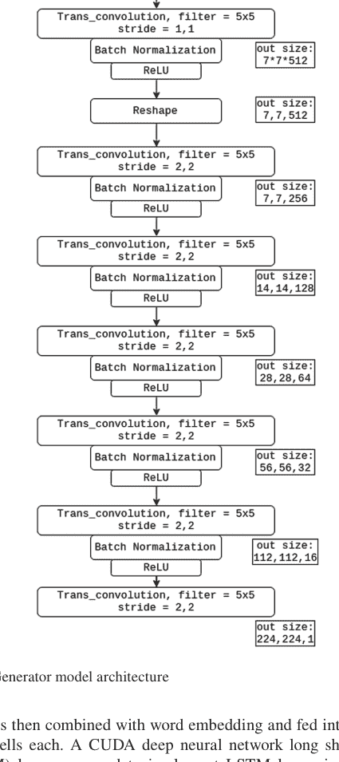

## 图 6.3 生成器模型架构

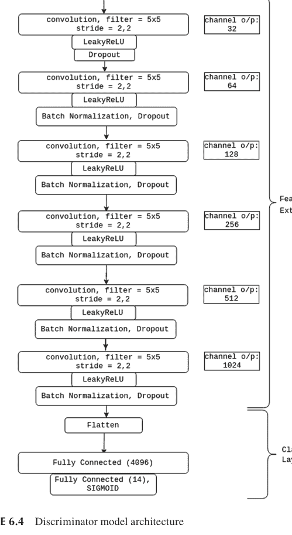

## 图 6.4 判别器模型架构

### 6.4 实验评估与结果

为对所提模型进行实验验证，我们使用了两个不同的数据集：`NIH` 胸部 X 光数据集和 `IU` X 光数据集。`NIH` 胸部 X 光数据集包含 112,000 张尺寸为 1024 × 1024 像素的图像。为训练 `GAN-MLC` 和 `CNN-MLC`，移除了 60,241 张标记为“无发现”的图像，并将所得数据集调整为 224 × 224 像素，仅有一个通道，以在不损失太多分辨率的情况下减少计算资源消耗。训练集包含 50,048 张图像，而验证集包含 1,711 张属于 14 个类别的图像。输入图像也被归一化，使像素值介于负一和正一之间，然后输入 `GAN-MLC` 模型。`G` 和 `D` 均使用 `Adam` 优化器训练，学习率为 1e-5，动量项为 0.5，共 80 个 epoch。每个 epoch 中 `G` 训练两次。所有模型均使用 `Tensorflow` 作为后端在 `Keras` 中实现。

对于描述生成器，使用 `IU` X 光数据集的 7,470 张图像及其描述。图像被调整为 224 × 224 像素且为单通道。在 `NIH` 胸部 X 光数据集上预训练的 `MLC-GAN` 判别器和 `CNN-MLC` 用于特征提取。为进一步节省计算资源，提取一次的特征被保存并重复使用以比较模型。描述数据通过将所有 token 转换为小写进行预处理，并通过移除非字母数字字符创建了包含 2057 个唯一词的词汇表。对于解码器网络，使用 `Adam` 优化器，学习率为 0.000001，衰减为 0.0000001。使用标准评估指标如双语评估替代分数（`BLEU`）[28]和接收器操作特征曲线下面积（`AUC`）来评估性能。`AUC` 用于通过可分离程度评估多标签分类模型。分类器区分类别的能力在零到一的范围内衡量；在本文中，目标是对 X 光片进行疾病存在与否的分类。`BLEU` 通过将生成的描述句子与参考描述进行比较来评估生成的描述句子，并通过可分离程度评估多标签分类模型。`BLEU` 检查候选报告与一组参考报告之间的相似性，并返回根据公式 6.7 计算的分数，其中 `C(i)` 是候选报告中元组的数量。在我们的工作中，如果 `C` 等于“无急性心肺异常”，则 `C(1) = 4`，`C(2) = 3`，… 且 `C(4) = 1`。

```
BLEU − (i) = Matched(i) / C(i) (6.7)
```

`GAN-MLC` 在 `NIH` 胸部 X 光数据集上使用 51,750 张图像进行训练，批量大小为每批 128 张图像。由于各类别图像数量不平衡，训练 `GAN-MLC` 时移除了无发现的图像。进一步对输入 X 光图像从 128 × 128 尺寸调整到 224 × 224 的实验结果表明，在上述架构上生成改进的图像所需时间更少。在不同 epoch 生成的最终图像结果如图 6.5 和 6.6 所示。

对于多标签疾病分类任务，不同实验模型的观察结果汇总如表 6.2 所示。很明显，与其他模型相比，在 ImageNet 图像上预训练的 `VGG-19` 模型取得了最佳 `AUC` 值。对于报告的文本描述，所提出的 `GAN-MLC` 相比在同一数据集上训练的独立模型显示出改进，其结果如表 6.3 所示。

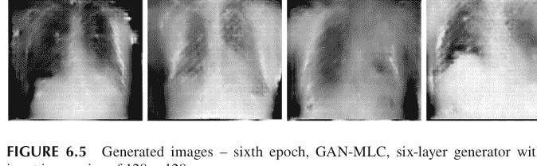

图6.5 生成的图像——第六轮，`GAN-MLC`，六层生成器，输入图像大小为128 × 128

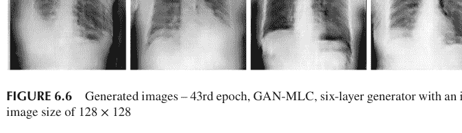

图6.6 生成的图像——第四十三轮，`GAN-MLC`，六层生成器，输入图像大小为128 × 128

## 表6.2

### 多标签分类结果总结

| 方法 | 架构 | AUC（%） |
|---|---|---|


| 独立CNN模型6l | 6l-BN-relu，步进卷积 | 72 |
| GAN-MLC-model6l作为判别器 | 6l-BN-relu，步进卷积 | 78 |
| VGG-19，独立 | 在ImageNet上预训练 | 83 |
| GAN-MLC，VGG-19作为判别器 | 6l-BN-relu，步进卷积 | 61（不稳定的GAN） |

为了计算BLEU分数，训练数据集中的每一份报告都被考虑，DL模型为每个测试图像生成的报告被视为视角来源。独立计算出为每个测试集图像生成的独特句子数量。然后，在不同候选集上对参考句子进行评估。最后，记录达到最高BLEU-4分数的模型，并将结果列于表6.3。总体来看，当观察训练结果时，预训练的VGG-19模型在GAN设置中训练时，对于为保留学习而冻结的卷积层没有表现出改进。此外，VGG使用最大池化作为子采样技术，导致训练过程中的GAN不稳定。

## 表6.3

### 描述生成结果总结

| 编码器 | BLEU1 | BLEU2 | BLEU3 | BLEU4 |
|---|---|---|---|---|
| 独立CNN模型 | 0.126 | 0.0917 | 0.0803 | 0.056 |
| 独立VGG-19 | 0.202 | 0.134 | 0.097 | 0.079 |
| GAN-MLC模型 | 0.247 | 0.178 | 0.134 | 0.092 |

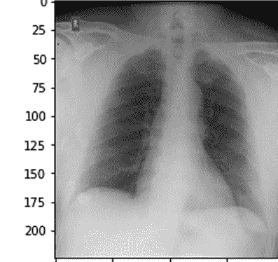

图6.7 测试X射线图像，其生成的描述为“没有急性心肺异常，双肺清晰，特别没有局灶性实变、气胸或胸腔积液的证据，心脏纵隔轮廓无异常，可见的胸部骨结构无急性异常”

### 6.5 结论与未来工作

在本章中，开发了一种对抗训练方法，以对抗方式使用生成网络训练多标签分类器。以多标签分类为目标的CNN模型在NIH胸部X射线数据集上训练，有和没有生成网络在对抗设置中训练以尝试生成新的X射线。通过将MLC用作CNN-RNN描述生成框架中的特征提取器，进一步测试了两种训练方法。在多标签分类（标签生成）方面，与以标准（独立）方式训练的基于CNN的MLC相比，基于CNN的MLC在与生成器G进行对抗训练时学习效果更好，AUC提升了六个百分点。此外，CNN-LSTM描述生成器在使用GAN-MLC时也表现出改进，用于

- 7. K. Karthik 和 S. S. Kamath，“面向自动化多任务诊断扫描管理的深度神经模型——质量增强、视图分类和报告生成”，*生物医学物理与工程快报*，第8卷，第1期，2021年，第015011页。
- 8. O. Vinyals、A. Toshev、S. Bengio 和 D. Erhan，“展示与讲述：一种神经图像标题生成器”，载于*IEEE计算机视觉与模式识别会议论文集*，2015年，第3156–3164页。
- 9. M. Hodosh、P. Young 和 J. Hockenmaier，“将图像描述构建为排序任务：数据、模型和评估指标”，*人工智能研究杂志*，第47卷，2013年，第853–899页。
- 10. Y. Gong、L. Wang、M. Hodosh、J. Hockenmaier 和 S. Lazebnik，“利用大规模弱标注照片集改进图像-句子嵌入”，载于*欧洲计算机视觉会议*，Springer，2014年，第529–545页。
- 11. V. Ordonez、G. Kulkarni 和 T. L. Berg，“Im2text：使用100万张带标题照片描述图像”，载于*神经信息处理系统进展*，2011年，第1143–1151页。
- 12. A. Karpathy、A. Joulin 和 L. F. Fei-Fei，“用于双向图像-句子映射的深度片段嵌入”，载于*神经信息处理系统进展*，2014年，第1889–1897页。
- 13. Y. Yu、Z. Gong、P. Zhong 和 J. Shan，“基于深度卷积神经网络的遥感图像无监督表示学习”，载于*国际图像与图形会议*，Springer，2017年，第97–108页。
- 14. J.-Y. Zhu、T. Park、P. Isola 和 A. A. Efros，“使用循环一致性对抗网络进行非配对图像到图像转换”，载于*IEEE国际计算机视觉会议论文集*，2017年，第2223–2232页。
- 15. J. T. Springenberg，“基于类别生成对抗网络的无监督和半监督学习”，arXiv预印本，arXiv:1511.06390，2015年。
- 16. A. Odena，“基于生成对抗网络的半监督学习”，arXiv预印本，arXiv:1606.01583，2016年。
- 17. H. Salehinejad、S. Valaee、T. Dowdell、E. Colak 和 J. Barfett，“使用生成对抗网络实现X射线胸部病理分类的深度神经网络泛化”，载于*2018年IEEE国际声学、语音与信号处理会议（ICASSP）*，IEEE，2018年，第990–994页。
- 18. C. Y. Li、X. Liang、Z. Hu 和 E. P. Xing，“知识驱动的编码、检索与转述用于医学图像报告生成”，载于*AAAI人工智能会议论文集*，第33卷，第1期，2019年，第6666–6673页。
- 19. J. Yuan、H. Liao、R. Luo 和 J. Luo，“基于多视角图像融合和医学概念增强的自动放射学报告生成”，载于*医学图像计算与计算机辅助介入国际会议*，Springer，2019年，第721–729页。
- 20. Z. Chen、Y. Song、T.-H. Chang 和 X. Wan，“通过记忆驱动的Transformer生成放射学报告”，arXiv预印本，arXiv:2010.16056，2020年。
- 21. M. Endo、R. Krishnan、V. Krishna、A. Y. Ng 和 P. Rajpurkar，“使用预训练的对比语言-图像模型进行基于检索的胸部X射线报告生成”，载于*面向健康的机器学习*，PMLR，2021年，第209–219页。
- 22. B. Jing、P. Xie 和 E. Xing，“论医学影像报告的自动生成”，arXiv预印本，arXiv:1711.08195，2017年。
- 23. Y. Xue、T. Xu、L. R. Long、Z. Xue、S. Antani、G. R. Thoma 和 X. Huang，“具有注意力机制的多模态循环模型用于自动化放射学报告生成”，载于*医学图像计算与计算机辅助介入国际会议*，Springer，2018年，第457–466页。
- 24. X. Wang、Y. Peng、L. Lu、Z. Lu 和 R. M. Summers，“Tienet：用于胸部X射线常见胸部疾病分类和报告的文本-图像嵌入网络”，载于*IEEE计算机视觉与模式识别会议论文集*，2018年，第9049–9058页。
- 25. A. Bustos、A. Pertusa、J.-M. Salinas 和 M. de la Iglesia-Vaya，“Padchest：一个带有标签标注报告的大规模胸部X射线图像数据集”，*医学图像分析*，第66卷，2020年，第101797页。
- 26. X. Wang、Y. Peng、L. Lu、Z. Lu、M. Bagheri 和 R. M. Summers，“Chestx-ray8：医院规模的胸部X射线数据库以及常见胸部疾病弱监督分类和定位的基准”，载于*IEEE计算机视觉与模式识别会议论文集*，2017年，第2097–2106页。
- 27. V. Nair 和 G. E. Hinton，“修正线性单元改进受限玻尔兹曼机”，载于*第27届国际机器学习会议（ICML-10）论文集*，2010年，第807–814页。
- 28. K. Papineni、S. Roukos、T. Ward 和 W.-J. Zhu，“BLEU：一种机器翻译自动评估方法”，载于*第40届计算语言学协会年会论文集*，计算语言学协会，2002年，第311–318页。

# 7 基于机器学习和深度学习的糖尿病视网膜病变筛查技术综述

Nitika Sambyal, Poonam Saini, and Rupali Syal

## 7.1 引言

糖尿病视网膜病变（DR）是一种与糖尿病相关的眼科疾病，也被视为全球视力损害的主要原因之一 [1]。世界卫生组织（WHO）预测，到2030年，DR患者的总体比例预计将增至4.4% [2]。根据一项近期研究，DR也被认定为中度严重视力损害（MSVI）的第五大常见原因 [3]。糖尿病视网膜病变（DR）是视网膜的进行性损伤，可能导致视力模糊，严重时甚至造成不可逆的失明 [4]。DR的主要危险因素包括血糖水平过高、高血压、胰岛素依赖、营养和遗传因素等。

### 7.1.1 视网膜

视网膜是位于眼球后部内表面的一层薄（0.5毫米）组织。视网膜的任何损伤都会阻碍光的接收和处理，进而阻止大脑接收视觉信息，最终导致失明。图7.1显示了通过检眼镜观察到的视网膜简要概览。

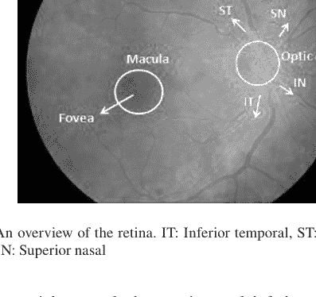

图7.1 视网膜概览。IT：颞下，ST：颞上，IN：鼻下，SN：鼻上。

视网膜的主要组成部分包括视盘（神经）、血管、中央凹和黄斑 [5]。视盘（视神经乳头）是位于视网膜中心的圆形或白色区域，用于将视觉信息从视网膜传递到大脑。血管是维持视网膜功能的广泛血管结构网络。视网膜中央动脉（CRA）在视盘处进入眼球，并在此处分为两个主要分支。这些分支进一步细分为小动脉，即鼻上、颞下、颞上和鼻下小动脉。黄斑是视网膜的中央部分，直径约5毫米。中央凹是位于黄斑中心的一个无血管的微红色斑点，提供敏锐的中心视力。

### 7.1.2 糖尿病视网膜病变

高血糖的严重程度和持续时间、遗传易感性以及代谢控制是导致DR的主要因素 [6]。传统上，眼科医生通过检查患者的眼底照片来判断是否存在与DR相关的线索。常见的DR相关视网膜病变包括出血、微动脉瘤、软性渗出和硬性渗出 [7, 8]，如图7.2所示。出血（也称为红色病变）呈点状、斑片状和火焰状，可能出现在视网膜的较深层或较浅层 [2]。微动脉瘤呈圆形，大小约为100–120微米 [9]。棉絮状斑是边缘光滑的小型白色蓬松斑块 [10]。硬性渗出被识别为视网膜上脂肪和蛋白质渗漏引起的亮黄色斑点 [11]。根据DR严重程度的不同，眼底图像可分为多个阶段，从健康、轻度、重度到极重度 [12]。

眼底摄影使用带有显微镜的专业眼底相机拍摄眼睛的后部，即眼底。眼底图像便于即时查看、图像放大、增强和处理。这使DR进展的监测和控制变得轻松。眼科医生使用眼底相机手动检查眼底图像非常繁琐、耗时，且容易发生人为错误 [13]。为了克服这些限制，并进行准确的群体筛查，糖尿病视网膜病变计算机辅助诊断（DR-CAD）系统变得不可或缺 [14]。此类自动化系统有助于早期诊断，进而控制视力恶化，从而减少并可能预防糖尿病患者失明的风险 [15]。使用机器学习（ML）和深度学习（DL）算法开发的CAD系统能够快速解读医学影像发现，无需熟练的专业人员 [16, 17]。ML算法——即人工神经网络（ANN）、决策树、k近邻（KNN）、随机森林和支持向量机（SVM）——基于专家知识，需要手动提取特征，并花费大量时间调优特征。相比之下，深度学习算法，如卷积神经网络（CNN）、生成对抗网络（GAN）和循环神经网络（RNN）等，更快、更准确，因为它们通过多层次抽象学习，自动从图像中提取所需特征 [18–20]。

本章对迄今为止提出的包括DR分类和视网膜病变检测模型在内的各种DR-CAD系统进行了批判性综述。

本章共分为七个部分。7.2节重点介绍DR-CAD系统的基本结构和组成部分。7.3节概述了所综述的研究论文。7.4节概述了与DR二分类和多阶段分类相关的文献。7.5节综述了用于眼底图像中视网膜异常检测和分割的各种模型。7.6节提出了一种自动检测DR的方法。7.7节给出了综述的发现以及未来展望。

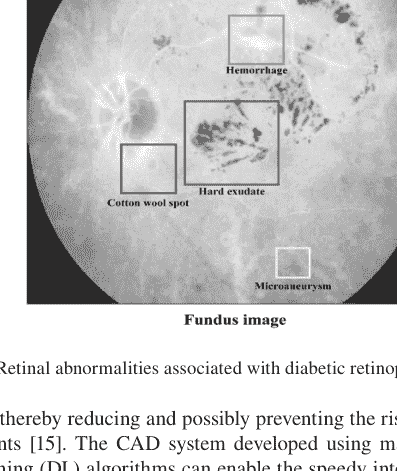

眼底图像

图7.2 与糖尿病视网膜病变相关的视网膜异常

## 7.2 DR-CAD系统

一个完整的DR-CAD系统有助于识别DR，同时检测和分割视网膜病变，以进行更好的严重程度分析。然而，也可能有一些系统仅侧重于眼底图像中的DR分类或视网膜病变检测。图7.3展示了基本DR-CAD系统的完整结构，该系统由五个主要部分组成：预处理、感兴趣区域（ROI）分割、特征提取与选择、分类以及视网膜病变检测。

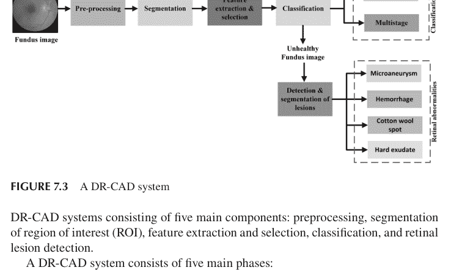

图7.3 DR-CAD系统

一个DR-CAD系统包含五个主要阶段：

- 1. **预处理：**该阶段通过抑制失真或噪声、图像亮度归一化以及增强重要特征来改善图像质量，以便更好地处理。在DR-CAD系统中，它有助于抑制血管和视盘等解剖区域，从而清晰显示视网膜异常。
- 2. **分割：**在该阶段，对解剖结构进行分割，以便获取感兴趣区域进行后续处理。从眼底图像中分割血管、视盘等其他解剖结构，以更好地显示候选病变区域。
- 3. **特征提取与选择：**该阶段有助于从分割后的图像中提取重要特征。首先，从候选视网膜病变中提取像素级或区域级特征。然后选择性能最佳的特征构成特征向量。
- 4. **分类：**上述步骤提取的特征随后用于将视网膜图像分类为不同的类别。根据从预处理、分割后的眼底图像中提取的特征，将其分类为健康或不健康。对于多阶段分类，不健康的眼底图像可根据疾病严重程度进一步分类。
- 5. **视网膜病变的检测与分割：**为了更好地进行DR严重程度筛查，还可以检测和分割来自不健康眼底图像的视网膜病变。这有助于确定病变的数量、大小和位置，从而进一步帮助医生更好地评估疾病严重程度。

由于手动特征提取过程，传统的机器学习和图像处理方法在糖尿病视网膜病变图像的检测和分类中被发现是不够充分的。因此，我们的研究重点现已转向使用基于深度学习的方法，这些方法不仅需要最少的图像处理，而且通过多级抽象自动学习还能确保提高准确性 [21]。

## 7.3 文献综述分类

本节根据用于 DR 筛查执行的任务提供了所综述文献的大纲。文献整体最初根据执行的两个主要任务进行分类：分类和分割。这两项任务均已由机器学习和基于深度学习的技术完成 [22]。本文遵循的综述结构概述在图 7.4 中清晰地示出。

在此，分类旨在通过对眼底图像的分析识别 DR 的严重程度分期。一些研究人员将工作重点放在眼底图像的二元分类上，即健康 vs. 不健康。同时，其他人对检测到的不健康图像进行了多阶段分类。病变检测和分割涉及在眼底图像中识别和分类各种视网膜病变，如出血、微动脉瘤、棉絮斑和硬性渗出。近年来，这两项任务均已由机器学习和深度学习技术有效完成 [23, 24]。

机器学习技术涉及从眼底图像中手动提取和选择特征，然后使用 ANN、SVM、KNN 等分类器对异常进行分类 [25, 26]。另一方面，像 DNN、CNN、自动编码器等深度学习模型使用自动特征提取和分类模型进行准确的疾病预测 [18, 27, 28]。这两种技术都有助于 DR 的检测，从而实现更好的疾病管理。

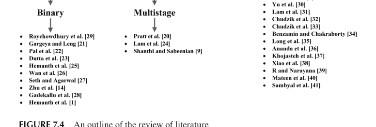

FIGURE 7.4 文献综述大纲

## 7.4 分类

本节总结了用于 DR 分类所采用的各种基于 ML 和 DL 的技术。Roychowdhury et al. [29] 于 2014 年提出了一种通过眼底图像分析生成 DR 严重程度分级的 CAD 系统。作者使用了机器学习分类器 – SVM、Gaussian mixture model（GMM）、KNN 和 AdaBoost 来区分病变和非病变区域。该模型分别在 DIARETDB1 和 MESSIDOR 数据集上进行训练和测试。包含视盘和血管的背景区域使用最小强度最大致密算法从眼底图像中分割出来。此后，AdaBoost 算法被用于选择眼底图像分类的前 30 个特征。前景区域被分类为候选亮病变和红病变。硬性渗出和棉絮斑被识别为亮病变，而出血和微动脉瘤则被归类为红病变。GMM 在亮病变分类中获得了最佳结果，而 KNN 则更适用于红病变分类。总体而言，DREAM 模型实现了 100% 的敏感性，特异性为 53.16%，受试者工作特征曲线下面积（AUC）为 0.904。

Pratt et al. [30] 使用具有高斯初始化和分类交叉熵损失函数的 CNN 对 Kaggle 眼底图像集进行了五阶段 DR 分类。该模型使用带 Nesterov 动量的随机梯度下降进行训练，获得了 95% 的特异性、75% 的准确率和 30% 的敏感性。

Gargeya and Leng [31] 使用 CNN 开发了一种稳健的 DR 筛查模型。所提出的模型包含五个残差块，分别有四、六、八、十和六层，并在末端有一个具有 1024 个滤波器的卷积可视化层。平均池化后接 softmax 层为准确的二元分类提供了类别概率。该模型在 EyePACS 数据集上训练，并在 MESSIDOR-2 和 e-Ophtha 数据集上测试。在 MESSIDOR-2 数据集上，该模型实现了 93% 的敏感性、87% 的特异性和 0.94 的 AUC，而在 e-Ophtha 数据集上则获得了 90% 的敏感性、94% 的特异性和 0.95 的 AUC。

Pal et al. [32] 研究了各种 ML 分类器的性能，以确定视网膜图像眼底扫描中的 DR 迹象。研究中使用的数据集取自加州大学欧文分校（UCI）机器学习库，包含 1151 个实例和 19 个数值特征，模型在 Python 和 Weka 工具上均进行了评估。具有线性核的 SVM 的性能超过了其他分类器，在 Python 上获得了 74.65% 的准确率，在 Weka 上获得了 67.87% 的准确率。

Dutta et al. [33] 使用 Kaggle 眼底图像集评估了 ANN、DNN 和 CNN 在 DR 分类中的性能。在去除噪声并分割亮背景后，从图像中提取了标准差、平均值、中位数等统计特征。在这些统计特征上训练时，DNN 优于 NN，测试准确率为 82.3%。然而，在图像数据上训练时，CNN 获得了最高的测试准确率 78.3%。


为了更好地评估疾病的严重程度，Lam et al. [34] 提出了 DR 严重程度分期的分类。作者在对图像使用对比度受限自适应直方图均衡化（`CLAHE`）技术进行预处理后，使用预训练的 `GoogLeNet` 模型进行 DR 检测。所提出的 `GoogLeNet` 分类模型在使用 Kaggle 和 `MESSIDOR-1` 数据集时，在 2 元、3 元和 4 元分类上分别实现了 74.5%、68.8% 和 57.2% 的验证准确率。

Hemanth et al. [35] 使用来自印度 Lotus Eye Care Hospital 收集的眼底图像提出了用于 DR 分类 的改进 Hopfield 神经网络（`MHNN`）模型。在图像预处理后，`MHNN` 使用从图像集中提取的六个纹理特征进行训练。该模型对健康图像和 DR 图像的检测准确率为 99.25%。

Wan et al. [36] 比较了最先进的 ImageNet 模型——即 `AlexNet`、`GoogLeNet`、`VGGNet` 和 `ResNet`——用于识别健康或不健康的眼底图像。这些 ImageNet 模型在超参数调优和迁移学习下的性能在 Kaggle 眼底图像集上进行了分析。各模型的准确率详情如图 7.5 所示。观察发现，超参数调优后整体分类结果有所改善，其中 `VGGNet-s` 提供了出色的 95.68% 准确率。

Seth and Agarwal [37] 使用 `VGGNet` 作为特征提取器和 `SVM` 作为分类器对眼底图像进行 DR 筛查。模型超参数使用网格搜索技术进行调优，在 `EyePACS` 数据集上获得了 0.93 的敏感性和 0.83 的特异性。

Shanthi and Sabeenian [12] 还提出了使用改进 `AlexNet` 架构的多阶段 DR 分类。该模型在 `MESSIDOR` 数据集上进行了验证

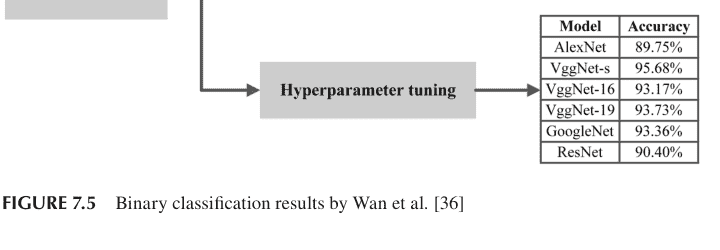

| 模型 | 精度 |
|---|---|
| AlexNet | 73.04% |
| VggNet-s | 73.66% |
| VggNet-16 | 48.13% |
| VggNet-19 | 82.17% |
| GoogleNet | 86.35% |
| ResNet | 78.68% |
| 模型 | 精度 |
|---|---|
| AlexNet | 89.75% |
| VggNet-s | 95.68% |
| VggNet-16 | 93.17% |
| VggNet-19 | 93.73% |
| GoogleNet | 93.36% |
| ResNet | 90.40% |

FIGURE 7.5 Wan 等 [36] 的二元分类结果

TABLE 7.1 所选糖尿病视网膜病变分类研究的方法、数据集、分类、分类器、结果和未来工作

| 方法，年份 | 数据集 | 分类 | 分类器 | 结果 | 未来工作 |
|---|---|---|---|---|---|
| Roychowdhury et al. [39], 2014 | DIARETDB1 and MESSIDOR | 二分类 | GMM + KNN + AdaBoost | 敏感性 = 100%，特异性 = 53.16%，AUC = 0.904 | 成本敏感 SVM 和 AdaBoost 在病变分类中的效果可以进行分析<br>可进行新生血管、血管出血和玻璃膜疣的检测 |
| Pratt et al. [30], 2016 | Kaggle | 五阶段 | CNN | 敏感性 = 30%，特异性 = 95%，准确率 = 75% | 结果必须在更多数据集上进行验证 |
| Gargeya and Leng [31], 2017 | EyePACS, MESSIDOR-2 and e-Ophtha | 二分类 | CNN | On MESSIDOR-2: 敏感性 = 93%，特异性 = 87%，AUC = 0.94<br>On e-Ophtha: 敏感性 = 90%，特异性 = 94% 和 AUC = 0.95 | 可使用训练集和测试集中的地理变异进行评估<br>可纳入患者的人口统计信息以提高性能 |
| Pal et al. [32], 2017 | UCI | 二分类 | SVM, naive Bayes, KNN and decision tree | SVM with linear kernel achieved best classification accuracy<br>Python: 准确率 = 74.65%<br>Weka: 准确率 = 67.87% | 可探索深度神经网络以提高准确性 |

*(Continued)*

## 表7.1（续）

| 方法, 年份 | 数据集 | 分类类型 | 分类器 | 结果 | 未来工作 |
|---|---|---|---|---|---|
| Dutta等 [2018], 2018 | Kaggle | 二分类 | NN、DNN、CNN（VGG-16） | - 使用统计数据训练时，DNN获得了最佳准确率82.3% | - 统计数据和图像数据可以结合起来开发一个独立应用程序<br>- 现有模型可以扩展到NPDR分类 |
| Lam等 [34], 2018 | Kaggle和MESSIDOR-1 | 多阶段 | GoogLeNet | - 使用图像数据训练时，CNN获得了最佳准确率78.3%<br>- 二分类准确率 = 74.5%<br>- 三分类准确率 = 68.8%<br>- 四分类准确率 = 57.2% | - 可以通过探索残差网络来提高四分类准确率 |
| Hemanth等 [35], 2018 | 来自印度Lotus眼科医院的眼底图像集 | 二分类 | MHNN | - 健康图像检测：敏感度 = 99%，特异性 = 99%，准确率 = 99.25% | - 可以研究附加特征和组合特征以实现更好的分类 |
| Wan等 [36], 2018 | Kaggle | 二分类 | AlexNet、VGGNet、GoogLeNet和ResNet | - DR图像检测：敏感度 = 99%，特异性 = 99%，准确率 = 99.25%<br>- 经超参数调优的VGGNet-s性能最佳<br>- 敏感度 = 86.47%，特异性 = 97.43%，准确率 = 95.66%，AUC = 0.97 | - 应修改模型以实现DR的多阶段分类 |
| Seth和Agarwal [37], 2018 | EyePACS | 二分类 | 线性核SVM | - 敏感度 = 93%，特异性 = 83% | - 应考虑更多数据集以确保泛化能力<br>- 应在更多数据集上验证模型 |
| Shanthi和Sabeenian [12], 2019 | MESSIDOR | 多阶段 | 改进的AlexNet | 健康视网膜：敏感度 = 95.3%，特异性 = 97.3%，准确率 = 96.6%，精确率 = 95.3%<br>DR 1期：敏感度 = 88%，特异性 = 98.3%，准确率 = 96.2%<br>DR 2期：敏感度 = 90.1%，特异性 = 97.6%，准确率 = 95.6%<br>DR 3期：敏感度 = 96%，特异性 = 96.6%，准确率 = 96.6% | 该算法应在具有更多实例的数据集上进行测试 |
| Zhu等 [25], 2019 | Lariboisière和MESSIDOR | 二分类 | SVM | 在Lariboisière上AUC = 0.908<br>在MESSIDOR上AUC = 0.832 | 应提出改进的病变精确分割模型，以实现准确的DR分级 |
| Gadekallu等 [38], 2020 | UCI糖尿病视网膜病变Debrecen数据集 | 二分类 | DNN | 敏感度 = 91%，特异性 = 97%，准确率 = 97%，精确率 = 96.5%，召回率 = 91% | 该模型可以在具有更多实例和更高维度图像的数据集上进行验证 |
| Hemanth等 [1], 2020 | MESSIDOR | 二分类 | CNN | 敏感度 = 98%，特异性 = 97%，准确率 = 94%，精确率 = 94%，召回率 = 94%，F分数 = 94%，G均值 = 95.9% | 应使用更多数据集来评估该模型 |

从输入视网膜图像中分割出来。此后，在预分类任务中使用了一个由模糊自组织层组成的模糊神经网络，并通过多层感知器（`MLP`）进行亮病变和暗病变检测。所提出的模型在`DRIVE`和`STARE`数据库上取得了暗病变（HE和MA）检测准确率95.97%，对亮病变（EX和CWS）的总体准确率为94.7%。

Yu等 [41] 使用`e-Ophtha-EX`数据集进行了基于`CNN`的渗出物像素级检测。从眼底图像中移除视盘和血管后，使用大小为64 × 64的图像块对`CNN`进行了150个时期的训练。该模型在测试集上报告的逐像素准确率、敏感度和特异性分别为91.92%、88.85%和96%。

Lam等 [42] 使用`GoogLeNet`模型进行了视网膜病变分割。该模型训练了600个时期，学习率为0.001，最后一个全连接层dropout为0.5，在从Kaggle测试集随机选择的图像块上获得了95%的五分类准确率和98%的二分类准确率。

Chudzik等 [43] 提出使用`CNN`检测MA，批量大小为128，初始学习率为0.0001。在噪声去除和图像大小调整后，通过旋转、水平和垂直反射等人工变换对数据集进行增强，以更好地训练`CNN`。该模型在`ROC`数据集上显示了最高平均FROC分数0.355，在`DIARETDB1`数据集上为0.392。

Chudzik等 [44] 还使用`e-Ophtha`数据集进行了基于全卷积神经网络（`FCNN`）的渗出物分割。通过利用每个训练块经`FCNN`传播而形成的辅助码本来改进`CNN`的性能，但仅针对选定的中间卷积层收集输出。两个模型的输出被合并以获得最终的分割结果。该模型在`e-Ophtha-MA`上训练并在`e-Ophtha-EX`上测试，获得了99.98%的特异性、86.66%的敏感度和0.982的AUC。

Benzamin和Chakraborty [45] 使用`IDRiD`数据集，在32 × 32的图像块上训练了一个八层`CNN`，以从眼底图像中检测渗出物。该模型训练了1500个时期，实现了98.29%的敏感度、41.35%的特异性和96.6%的准确率。

Long等 [46] 提出了一种由模糊C均值（`FCM`）聚类和`SVM`组成的方法，用于EX的检测和分类。在视盘分割之后，使用`FCM`获得30 × 40图像块的局部动态阈值以分割EX。此后，使用八个特征——即绿色通道平均强度、灰度强度、平均色调、平均饱和度、HSV颜色模型中视网膜图像的平均值、能量、标准差和平均梯度幅度——训练具有径向基函数（`RBF`）核的`SVM`进行EX分类。该模型在`e-Ophtha`上获得了76.5%的平均敏感度，在`DIARETDB1`数据集上为97.5%。

Ananda等 [47] 提出了一种改进的U-Net模型，用于多类病变分割。在原始U-Net模型中，将ReLU替换为leaky ReLU，并在每个池化操作之前添加批量归一化层，以获得改进的U-Net模型。该模型使用二元交叉熵损失函数，并计算了Dice分数。该模型使用`IDRiD`数据集进行训练，并在`MESSIDOR`数据集上进行测试，获得了优于原始U-Net和SegNet模型的病变分割结果。该模型在测试集上对EX、SE、HE和MA分别获得了0.7082、0.7125、0.7793和0.6920的Dice系数。

Khojasteh等 [48] 比较了各种分类器在EX检测中的性能：`CNN`、`ResNet-50 + SVM`、`ResNet-50 + 最优路径森林`、`ResNet-50 + KNN`和判别受限玻尔兹曼机（`DRBM`）。使用来自`DIARETDB1`和`e-Ophtha`数据集的25 × 25渗出物和非渗出物块对模型进行训练。注意到`ResNet-50 + SVM`超过了研究中的其他分类器，准确率分别为98.2%和97.6%。

Xiao等 [49] 提出使用整体嵌套边缘检测网络（`HEDNet`）结合标准PatchGAN判别器的条件生成对抗网络（`cGan`），从眼底图像中进行视网膜病变的像素级分割。`HEDNet`基于`VGGNet`构建，生成具有语义意义的边缘图以识别对象轮廓。`cGan`用作判别器，因为它学习输入与条件于输出的分割图的联合分布。所提出的模型最小化分割损失并最大化判别器分类损失，对MA、SE、EX和HE分别获得了43.92%、48.39%、84.05%和48.12%的平均精度（AP）。

Deepa和Narayana [50] 使用阈值化和形态学操作提取候选MA区域。此后，将候选区域数量以及红色和绿色平面的平均强度作为特征来训练前馈神经网络。该模型在`DIARETDB1`数据集上获得了100%的敏感度、100%的特异性、98.89%的准确率和98.83%的精确率。

Mateen等 [51] 通过合并从`Inception V3`、`ResNet-50`和`VGGNet-19`提取的特征进行EX检测。最初，使用`GMM`定位眼底图像中的EX区域，然后将来自不同网络的特征连接到全连接层，通过softmax层对非渗出物和渗出物进行分类。该模型在`e-Ophtha`和`DIARETDB1`数据集上分别达到了98.43%和98.91%的准确率。

Sambyal等 [52] 提出了一种改进的U-Net架构，用于从视网膜图像中逐像素分割MA和EX（图7.6）。该架构由作为编码器的预训练`ResNet-34`、中间卷积层以及作为解码器和合并层的U-Net块组成。编码器的中间输出也作为对应解码器中U-Net块的输入，以实现准确的病变分割。在`IDRiD`数据集上，该模型对MA和EX语义分割均达到了99.95%的准确率。该模型在`e-Ophtha`上训练并在`IDRiD`数据集上测试时，对MA和EX均达到了99.89%的准确率。

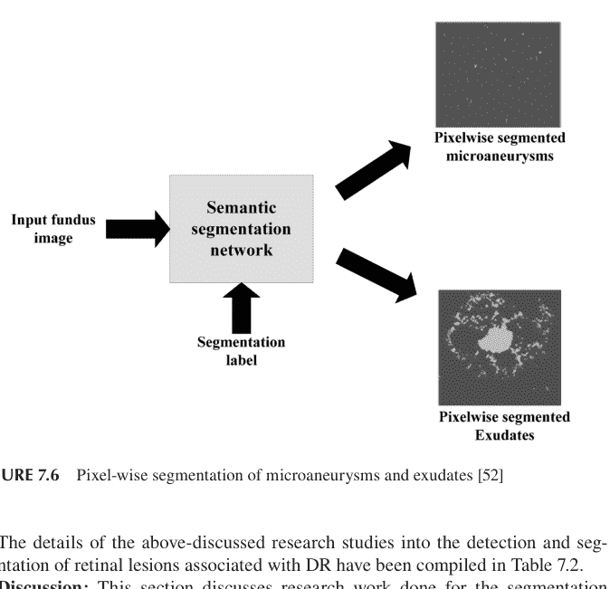

图7.6 微动脉瘤和渗出物的逐像素分割 [52]

上述关于DR相关视网膜病变检测与分割的研究细节已汇总于表7.2中。

讨论：本节讨论了与DR相关的各类视网膜病变分割的研究工作。大多数作者采用深度学习模型，因为它们更适合对不同大小、形状和颜色的视网膜病变进行精确检测和分类。作者报告了以`e-Ophtha`作为训练集、`IDRiD`作为测试集时，渗出物的Dice分数高达0.9999，微动脉瘤的Dice分数高达0.99998 [52]。Ananda等人 [47] 以`IDRiD`为训练集、`MESSIDOR`为测试集，报道了SE的最高Dice分数0.7125和HE的最高Dice分数0.7793。总体而言，针对出血和棉絮斑检测的研究工作较少。此外，可以探索集成模型来改进现有的视网膜病变分割方法。

### 7.6 提出的方法

计算机辅助诊断（CAD）是一种基于计算机的系统，可帮助医生更快地评估和分析异常，从而实现早期准确检测疾病。本节提出了一种用于检测DR的混合深度学习模型。所提出的DR-CAD解决方案能够从不健康的眼底图像中自动分类和分割视网膜病变。图7.7显示了所提出的DR-CAD的示意图。

## 表7.2

用于DR相关视网膜病变检测与分割的所选研究的方法、数据集、病灶、模型、结果和未来工作

| 方法，年份 | 数据集 | 病灶检测 | 分类器 | 结果 | 未来工作 |
|---|---|---|---|---|---|
| Akram 等人 [10]，2012 | DRIVE、STARE、DIARETDB0 和 DIARETDB1 | MA、HE、CWS 和 EX | 混合模糊分类器 | DRIVE：暗病灶准确率 = 96.14%，亮病灶准确率 = 96.23%<br>STARE：暗病灶准确率 = 95.98%，亮病灶准确率 = 95.71%<br>DIARETDB0：暗病灶准确率 = 91.26%，亮病灶准确率 = 93.89%<br>DIARETDB1：暗病灶准确率 = 91.60%，亮病灶准确率 = 93.10% | 可以探索基于DNN的模型以提高病灶检测准确率 |
| Yu 等人 [41]，2017 | e-Ophtha-EX | EX | CNN | 敏感性 = 88.85%，特异性 = 96%，准确率 = 91.92%，F值 = 92.61% | 应使用更多基准数据集进行模型验证 |
| Lam 等人 [42]，2018 | e-Ophtha 和 Kaggle | MA、HE、EX 和 CWS | GoogLeNet | 五类准确率 = 95%<br>二分类准确率 = 98% | 可以修改模型以检测新生血管 |
| Chudzik 等人 [43]，2018 | ROC 和 DIARETDB1 | MA | CNN | ROC：FROC分数 = 0.355<br>DIARETDB1：FROC分数 = 0.392 | 前向传播步骤可以在多个设备上并行以缩短时间 |

## 表7.2（续）

| 方法，年份 | 数据集 | 病灶检测 | 分类器 | 结果 | 未来工作 |
|---|---|---|---|---|---|
| Chudzik 等人 [44]，2018 | e-Ophtha-MA 和 e-Ophtha-EX | EX | CNN | - 敏感性 = 86.66%，特异性 = 99.98%，AUC = 0.982 | - 可通过修改模型来分割红色病灶 |
| Benzamin 和 Chakraborty [45]，2018 | IDRID | EX | CNN | - 敏感性 = 98.29%，特异性 = 41.35%，准确率 = 96.6% | - 可以研究图像块大小对渗出物检测的影响 |
| Long 等人 [46]，2019 | e-Ophtha-EX 和 DIARETDB1 | EX | 具有RBF核的SVM | - e-Ophtha-Ex：敏感性 = 76.5%，PPV = 82.7%，F值 = 76.7%<br>- DIARETDB1：敏感性 = 97.5%，特异性 = 97.8%，准确率 = 97.7% | - 应在更多数据集上验证结果<br>- 渗出物的检测因其与背景之间对比度差而受到影响 |


| Ananda 等人 [47]，2019 | IDRID 和 MESSIDOR | EX、SE、HE 和 MA | 改进的U-Net | - EX的Dice = 0.7082<br>- SE的Dice = 0.7125<br>- HE的Dice = 0.7793<br>- MA的Dice = 0.6920 | - 整体准确率在很大程度上依赖于视盘和血管检测结果<br>- 可以研究集成模型以提高Dice分数 |

## 表7.2（续）

| 方法，年份 | 数据集 | 病灶检测 | 分类器 | 结果 | 未来工作 |
|---|---|---|---|---|---|
| Sambyal 等人 [52]，2020 | e-Ophtha、IDRiD | MA、EX | 改进的U-Net | - 在IDRiD上：敏感性 = 99.85%，特异性 = 99.95%，准确率 = 99.88%，MA和EX的Dice = 0.9998<br>- 在e-Ophtha上训练并在IDRiD上测试：MA的敏感性 = 99.88%，特异性 = 99.88%，准确率 = 99.98%，Dice = 0.9998<br>- 在e-Ophtha上训练并在IDRiD上测试：EX的敏感性 = 99.88%，特异性 = 99.98%，准确率 = 99.98%，Dice = 0.9999 | - 模型可扩展以检测HE和CWS<br>- 模型可在临床获得的数据集上进行验证 |

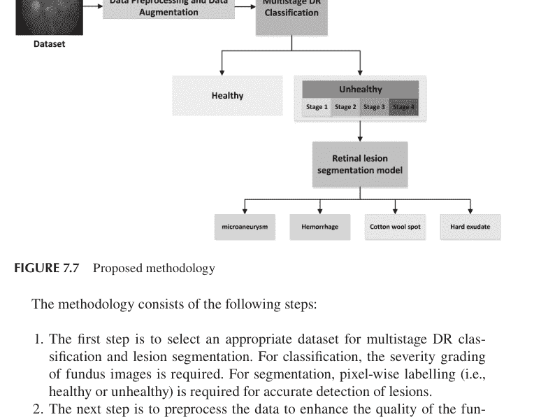

## 图7.7 提出的方法

所提出的方法包括以下步骤：

- 1. 第一步是为多阶段DR分类和病灶分割选择合适的数据集。对于分类，需要对眼底图像进行严重程度分级。对于分割，需要像素级标注（即健康或不健康），以便准确检测病灶。

- 2. 下一步是对数据进行预处理，以提高眼底图像的质量。这包括去除噪声、调整图像大小以及数据增强（如翻转、旋转、缩放、尺度变换等）。最后，将预处理后的眼底图像划分为训练集和测试集两个部分。

- 3. 第三步是根据严重程度对图像进行分类，从健康阶段到最严重阶段。为此，可以使用各种CNN，如第7.4节所述。

- 4. 下一步是从不健康的眼底图像中检测各种视网膜病变。为此，可以使用各种深度学习模型，如第7.5节所述。可以观察到，与其他技术相比，基于U-Net的深度学习模型在准确率和Dice分数方面提供了更好的结果。

- 5. 最后阶段是通过与金标准进行比较，以各种性能参数来评估模型。这有助于确定模型在评估疾病严重程度时的可靠性。

因此，所提出的综合DR-CAD系统将能更好地分析疾病的严重程度。

### 7.7 结论

本章详细介绍了用于DR分类及其相关视网膜病变检测与分割的各种基于AI的模型。使用CAD系统筛查DR包括五个主要任务：预处理、解剖结构分割、特征提取与选择、视网膜病变的检测与分割。预处理阶段通过对比度调整和噪声去除来提升眼底图像质量。随后是分割阶段，该阶段剔除不太重要的解剖结构。从生成的眼底图像中选择显著特征，然后用于训练分类和病变检测模型。机器学习模型依赖于手工特征提取和选择，而深度学习模型通过网络中的多个隐藏层自动提取显著特征。多位作者提出了使用SVM、CNN、DNN等分类器对眼底图像进行二分类和多阶段（从健康阶段到最严重阶段）分类的方法。据观察，迄今为止的大多数近期文献更关注二分类，即将眼底图像分类为健康或不健康。因此，必须提出新的技术和模型，将现有研究扩展到DR的多阶段分类。微动脉瘤、棉絮斑、硬性渗出物和出血等视网膜病变的检测与分割有助于确定问题区域的位置和大小。这反过来又帮助医生准确评估DR的严重程度。DR-CAD系统可以消除人为错误的可能性，并能够快速、准确地对眼底图像进行大规模筛查。这不仅能够实现DR的早期检测，还能控制相关的不可逆视力丧失。未来，可以开发各种基于深度学习的混合技术，以实现更准确的DR检测。此外，还可以探索先进的自动超参数调整方法，以实现更快、更好的网络收敛。此外，还可以开发具有扩展功能的自动化系统，例如检测青光眼、黄斑水肿和异常血管生长等其他视网膜异常。

## 参考文献

- 1. Hemanth DJ, Deperlioglu O, Kose U. 一种使用深度卷积神经网络的增强糖尿病视网膜病变检测与分类方法。*Neural Comput Appl* 2020;32(3):707–21. https://doi.org/10.1007/s00521-018-03974-0.

- 2. Mumtaz R, Hussain M, Sarwar S, Khan K, Mumtaz S, Mumtaz M. 利用图像处理技术自动检测视网膜出血，用于筛查糖尿病患者的视网膜疾病。*Int J Diabetes Dev Ciries* 2018;38(1):1–8. https://doi.org/10.1007/s13410-017-0561-6.

- 3. Thomas RL, Halim S, Gurudas S, Sivaprasad S, Owens DR. IDF糖尿病地图集：2015年至2018年间利用视网膜摄影评估糖尿病相关视网膜病变全球患病率的研究综述。*Diabetes Res Clin Pract* 2019;157:1–13. https://doi.org/10.1016/j.diabres.2019.107840.

- 4. Huang X, Wang H, She C, Feng J, Liu X, Hu X, 等. 人工智能促进糖尿病视网膜病变的诊断与筛查.《内分泌学前沿（洛桑）》2022；13:1–12. https://doi.org/10.3389/fendo.2022.946915.

- 5. Kolb H. 视网膜的简单解剖.《Webvision：视网膜与视觉系统器官》1995：– .

- 6. Saleh E, Błaszczyński J, Moreno A, Valls A, Romero-Aroca P, de la Riva-Fernández S, Słowiński R. 学习集成分类器用于糖尿病视网膜病变评估.《人工智能医学》2018；85:50–63. https://doi.org/10.1016/j.artmed.2017.09.006.

- 7. Devaraj D, R S, Prasanna Kumar SC. 用于糖尿病视网膜病变早期检测的渗出物和微动脉瘤分割综述.《今日材料·会议论文集》，Elsevier Ltd；2018. 第10845–50页. https://doi.org/10.1016/j.matpr.2017.12.372.

- 8. Kaur J, Mittal D. 一种从病理视网膜眼底图像中分割渗出物的通用方法.《生物控制论与生物医学工程》2018；38(1):27–53. https://doi.org/10.1016/j.bbe.2017.10.003.

- 9. Shankar K, Sait ARW, Gupta D, Lakshmanaprabhu SK, Khanna A, Pandey HM. 使用协同深度学习模型自动检测和分类眼底糖尿病视网膜病变图像.《模式识别快报》2020；133:210–6. https://doi.org/10.1016/j.patrec.2020.02.026.

- 10. Akram UM, Khan SA. 视网膜图像中暗亮病变的自动检测用于糖尿病视网膜病变的早期检测.《医学系统杂志》2012；36(5):3151–62. https://doi.org/10.1007/s10916-011-9802-2.

- 11. Imani E, Pourreza H. 使用信号分离算法的视网膜渗出物分割新方法.《生物医学中的计算机方法与程序》2016；133:195–205. https://doi.org/10.1016/j.cmpb.2016.05.016.

- 12. Shanthi T, Sabeenian RS. 用于糖尿病视网膜病变图像分类的修改版AlexNet架构.《计算机与电气工程》2019；76:56–64. https://doi.org/10.1016/j.compeleceng.2019.03.004.

- 13. Szolovits P. 医疗计算的可能性.《计算机科学与技术杂志》2011；26(4):625–31. https://doi.org/10.1007/s11390-011-1162-3.

- 14. Anwar SM, Majid M, Qayyum A, Awais M, Alnowami M, Khan MK. 使用卷积神经网络的医学图像分析：综述.《医学系统杂志》2018；42(11):1–13. https://doi.org/10.1007/s10916-018-1088-1.

- 15. Faust O, Acharya UR, Ng EYK, Ng KH, Suri JS. 使用数字眼底图像自动检测糖尿病视网膜病变的算法：综述.《医学系统杂志》2012；36:145–57. https://doi.org/10.1007/s10916-010-9454-7.

- 16. Shweta, EA, Saha S, Bhattacharyya P. 用于临床记录中患者数据去标识化的深度学习架构.《临床自然语言处理研讨会论文集》2016：32–41.

- 17. Santosh KC, Roy PP. 使用序列分类器检测生物医学图像中的箭头.《国际机器学习与控制论杂志》2018；9(6):993–1006. https://doi.org/10.1007/s13042-016-0623-y.

- 18. Razzak MI, Naz S, Zaib A. 医学图像处理中的深度学习：概述、挑战与未来.《生物应用分类》2018：323–50. https://doi.org/10.1007/978-3-319-65981-7_12.

- 19. Kaushik P, Gupta A, Roy PP, Dogra DP. 基于EEG的深度BLSTM-LSTM网络模型用于年龄和性别预测.《IEEE传感器杂志》2019；19(7):2634–41. https://doi.org/10.1109/JSEN.2018.2885582.

- 20. Lahmar C, Idri A. 论深度学习在诊断糖尿病视网膜病变中的价值.《健康技术（柏林）》2022；12(1):89–105. https://doi.org/10.1007/s12553-021-00606-x.

- 21. Srinivas M, Roy D, Mohan CK. 使用深度卷积神经网络从X射线图像中提取判别性特征. 2016年IEEE声学、语音与信号处理国际会议（ICASSP），2016：917–21.

- 22. Lahmar C, Idri A. 用于糖尿病视网膜病变分类的深度混合架构.《生物力学与生物医学工程中的计算机方法：成像与可视化》2022；1–19. https://doi.org/10.1080/21681163.2022.2060864.

- 23. Deepa V, Kumar CS, Cherian T. 使用图像块的集成多阶段深度卷积神经网络用于糖尿病视网膜病变自动分级.《沙特国王大学学报：计算机与信息科学》2021. https://doi.org/10.1016/j.jksuci.2021.05.009.

- 24. Ayala A, Ortiz Figueroa T, Fernandes B, Cruz F. 使用深度学习的糖尿病视网膜病变改进检测.《应用科学》2021；11(24). https://doi.org/10.3390/app112411970.

- 25. Zhu CZ, Hu R, Zou BJ, Zhao RC, Chen CL, Xiao YL. 基于图像级与病变级特征融合的级联框架自动筛查糖尿病视网膜病变.《计算机科学与技术杂志》2019；34(6):1307–18. https://doi.org/10.1007/s11390-019-1977-x.

- 26. Zhao JJ, Pan L, Zhao PF, Tang XX. 基于语义特征和监督哈希图像检索的肺结节医学征象识别.《计算机科学与技术杂志》2017；32(3):457–69. https://doi.org/10.1007/s11390-017-1736-9.

- 27. Zhang W, Zhong J, Yang S, Gao Z, Hu J, Chen Y, Yi Z. 使用深度神经网络的糖尿病视网膜病变自动识别和分级系统.《基于知识的系统》2019；175:12–25. https://doi.org/10.1016/j.knosys.2019.03.016.

- 28. Krizhevsky, Alex, Ilya Sutskever, Geoffrey E. Hinton. 使用深度卷积神经网络的ImageNet分类.《神经信息处理系统进展》2012；2012:1097–105. https://doi.org/10.1201/9781420010749.

- 29. Roychowdhury S, Koozekanani DD, Parhi KK. DREAM：使用机器学习进行糖尿病视网膜病变分析.《IEEE生物医学与健康信息学杂志》2014；18(5):1717–28. https://doi.org/10.1109/JBHI.2013.2294635.

- 30. Pratt H, Coenen F, Broadbent DM, Harding SP, Zheng Y. 用于糖尿病视网膜病变的卷积神经网络.《Procedia计算机科学》2016；90:200–5. https://doi.org/10.1016/j.procs.2016.07.014.

- 31. Gargeya R, Leng T. 使用深度学习自动识别糖尿病视网膜病变.《美国眼科学杂志》2017；124(7):962–9. https://doi.org/10.1016/j.ophtha.2017.02.008.

- 32. Pal R, Poray J, Sen M. 机器学习算法在糖尿病视网膜病变中的应用. 2017年第二届IEEE电子、信息与通信技术最新趋势国际会议（RTEICT），2017，第2046–51页.

- 33. Dutta S, Manideep BC, Basha SM, Caytiles RD, Iyengar NCSN. 使用深度学习模型对糖尿病视网膜病变图像进行分类.《国际网格与分布式计算杂志》2018；11(1):99–106. https://doi.org/10.14257/ijgdc.2018.11.1.09.

- 34. Lam C, Yi D, Guo M, Lindsey T. 使用深度学习自动检测糖尿病视网膜病变.《AMIA转化科学联合峰会论文集》2018；124:147–55. https://doi.org/10.1016/j.ophtha.2017.02.008.

- 35. Hemant DJ, Anitha J, Indumathy A. 使用Hopfield神经网络在视网膜图像中诊断糖尿病视网膜病变.《医学系统杂志》2018；62:893–900. https://doi.org/10.1080/03772063.2016.1221745.

- 36. Wan S, Liang Y, Zhang Y. 通过图像分类检测糖尿病视网膜病变的深度卷积神经网络.《计算机与电气工程》2018；72:274–82. https://doi.org/10.1016/j.compeleceng.2018.07.042.

- 37. Seth S, Agarwal B. 一种用于检测糖尿病视网膜病变的混合深度学习模型.《统计与管理系统杂志》2018；21(4):569–74. https://doi.org/10.1080/09720510.2018.1466965.

- 38. Gadekallu TR, Khare N, Bhattacharya S, Singh S, Maddikunta PKR, Srivastava G. 深度神经网络预测糖尿病视网膜病变.《环境智能与人文化计算杂志》2020；1–14. https://doi.org/10.1007/s12652-020-01963-7.

- 39. Roychowdhury S, Koozekanani DD, Parhi KK. DREAM：使用机器学习进行糖尿病视网膜病变分析.《IEEE生物医学与健康信息学杂志》2014；18(5):1717–28. https://doi.org/10.1109/JBHI.2013.2294635.

- 40. Soni A, Rai A. 一种使用机器学习早期识别糖尿病视网膜病变的新方法. 2021年计算机通信与信息学国际会议（ICCCI），2021. https://doi.org/10.1109/ICCCI50826.2021.9402566.

- 41. Yu S, Xiao D, Kanagasingam Y. 使用卷积神经网络检测糖尿病视网膜病变的渗出物. 第39届IEEE医学与生物学工程学会年会. IEEE，2017，第1744–7页. https://doi.org/10.1109/EMBC.2017.8037180.

- 42. Lam C, Yu C, Huang L, Rubin D. 使用图像块和深度学习进行视网膜病变检测.《眼科与视觉科学研究》2018；59(1):590–6.

- 43. Chudzik P, Majumdar S, Calivá F, Al-Diri B, Hunter A. 使用全卷积神经网络检测微动脉瘤.《生物医学中的计算机方法与程序》2018；158:185–92. https://doi.org/10.1016/j.cmpb.2018.02.016.

- 44. Chudzik P, Al-Diri B, Caliva F, Ometto G, Hunter A. 使用全卷积神经网络和辅助码本的渗出物分割. IEEE医学与生物学工程学会年会EMBS，2018，第770–3页. https://doi.org/10.1109/EMBC.2018.8512354.


- 45. Benzamin A, Chakraborty C. 使用深度学习检测视网膜眼底图像中的硬性渗出物. 第二届成像、视觉与模式识别国际会议，2018，第465–9页. https://doi.org/10.1109/ICSCAN.2018.8541246.

- 46. Long S, Huang X, Chen Z, Pardhan S, Zheng D. 使用动态阈值和SVM分类自动检测彩色视网膜图像中的硬性渗出物：算法开发与评估.《国际生物医学研究》2019：1–13.

- 47. Ananda S, Kitahara D, Hirabayashi A, Udaya Kumar Reddy KR. 使用多个改进的U-Net和SegNet自动分割眼底图像用于糖尿病视网膜病变诊断. 亚太信号与信息处理协会年度峰会与会议APSIPA ASC. IEEE，2019，第1582–8页. https://doi.org/10.1109/APSIPAASC47483.2019.9023290.

- 48. Khojasteh P, Passos Júnior LA, Carvalho T, Rezende E, Aliahmad B, Papa JP, Kumar DK. 使用深度可学习特征检测眼底图像中的渗出物.《计算机生物学与医学》2019；104:62–9. https://doi.org/10.1016/j.compbiomed.2018.10.031.

- 49. Xiao Q, Zou J, Yang M, Gaudio A, Eltani K, Smailagic A, 等. 使用对抗学习改进糖尿病视网膜病变的病变分割. 图像分析与识别国际会议，计算机科学讲义. Springer International Publishing，2019，第333–44页. https://doi.org/10.1007/978-3-030-27272-2.

- 50. Deepa R, Narayanan NK. 使用机器学习方法检测视网膜图像中的微动脉瘤. 信息技术创新趋势国际会议，2020，第1–5页. https://doi.org/10.1109/icitii49094.2020.9071522.

- 51. Mateen M, Wen J, Nasrullah N, Sun S, Hayat S. 使用预训练卷积神经网络检测糖尿病视网膜病变的渗出物.《复杂性》2020；2020:1–11. https://doi.org/10.1155/2020/5801870.

- 52. Sambyal N, Saini P, Syal R, Gupta V. 改进的U-Net架构用于糖尿病视网膜病变图像的语义分割.《生物控制论与生物医学工程》2020；40(3):1094–1109. https://doi.org/10.1016/j.bbbe.2020.05.006.

# 8 用于恶性乳腺肿瘤检测深度学习模型实时实现的嵌入式解决方案

S. Malarvizhi, R. Kayalvizhi, H. Heartlin Maria, Revathi Venkatraman, Shatanu Patil, and A. Maria Jossy

## 8.1 乳腺癌概述

乳腺癌，又称乳腺癌或乳腺恶性肿瘤，是一种由于乳腺区域细胞不受控制地增殖而产生的疾病。存在多种类型的乳腺癌，每种类型均由其细胞来源确定。乳腺由几个主要组成部分构成，例如小叶、导管和结缔组织，癌症可能起源于这些成分中的任何一种。小叶通常被认为是负责产生乳汁的腺体。输送产生的乳汁的管道被称为导管。结缔组织围绕小叶和导管并将它们保持在一起。大多数乳腺恶性肿瘤可起源于导管和小叶。乳腺癌有通过血液和淋巴动脉在乳腺外生长的能力。乳腺癌影响所有年龄段的女性，尽管在50岁以上的人群中更为常见。男性也可能受乳腺癌影响，但较为罕见 [1–3]。

2018年，全球预计有208万名女性被诊断为乳腺癌。此外，乳腺癌约占女性所有恶性肿瘤的24.2%。乳腺癌约占女性所有癌症的四分之一。2008年，乳腺癌被报道为女性第二常见的恶性肿瘤，病例数为115,251例。2018年，乳腺癌仍是女性最常见的恶性肿瘤，有162,468名女性首次被诊断。

### 8.1.1 乳腺癌的危险因素

根据各种研究结果，有多种危险因素会增加乳腺癌的几率。以下是一些示例 [4]：

- (i) **年龄：** 55岁以上的女性患乳腺癌的几率很高。
- (ii) **性别：** 与男性相比，女性受乳腺癌影响的风险更高。
- (iii) **遗传史：** 如果父母或近亲有乳腺癌病史，则患病风险更高。
- (iv) **吸烟：** 烟草使用与多种癌症有关，包括乳腺癌。
- (v) **饮酒：** 根据研究，饮酒可能会增加患某些类型乳腺癌的风险。
- (vi) **肥胖：** 肥胖可能会增加患乳腺癌及其复发的概率。
- (vii) **辐射暴露：** 如果以前接受过放射治疗，尤其是头部、颈部或胸部，则更有可能患乳腺癌。
- (viii) **激素替代：** 接受过激素替代疗法（HRT）的人通常更容易患乳腺癌。

### 8.1.2 乳腺癌的治疗和预后

乳腺癌可以通过多种方式治疗 [1]。治疗取决于乳腺癌的类型及其扩散程度。乳腺癌患者通常会接受不止一种类型的治疗。

- (i) **手术：** 这是一种切除恶性组织的医疗程序。
- (ii) **化疗：** 使用某些药物缩小或杀死癌细胞。治疗可能是患者服用的药片、静脉注射或两者兼有。
- (iii) **激素替代：** 这种治疗可防止恶性细胞获得生长所需的激素。
- (iv) **生物治疗：** 这种治疗有助于身体免疫系统攻击癌细胞或减少其他癌症治疗的不良影响。
- (v) **放射治疗：** 在此过程中，使用高能辐射来消除癌细胞。

### 8.1.3 问题陈述

使用计算机协助放射科医生捕获、管理和保存医学图像以及进行诊断已得到广泛确立。最近，已创建并获准在临床实践中使用的计算机算法可帮助放射科医生检测诊断放射扫描中的可能异常。

然而，现有的计算机辅助设计（CAD）诊断系统侧重于对其中一种可用影像模态的分析。但每种模态都非常重要。因此，从观察到的差距来看，设想是开发一种DL模型，该模型既可以分析也可以诊断多模态乳腺图像。

### 8.1.4 本研究的突出贡献

- 已开发并训练了一种人工智能（AI）解决方案，用于预测多模态图像中的乳腺癌。
- 现场可编程门阵列（FPGA）加速硬件平台的开发与实现，用于乳腺癌实时诊断。
- 提高乳腺癌医学诊断的性能准确性。
- 降低功耗和时间消耗以优化诊断过程。
- 帮助放射科医生、肿瘤科医生和妇科医生进行快速高效的决策，这是癌症研究当下的迫切需求。

## 8.2 乳腺癌诊断中的人工智能

人工智能在完成人类所做的事情方面变得越来越复杂，但效率更高、速度更快、成本更低。近来，人工智能在医疗保健领域的诊断用途潜力日益巨大。

### 8.2.1 领域的最新研究

根据发表的一项重要新研究 [5]，人工智能是乳腺摄影筛查中检测乳腺恶性肿瘤的可行工具。通过人群为基础的乳腺癌筛查项目收集的乳腺摄影图像大大增加了放射科医生的工作量。人工智能已被建议作为乳腺摄影分析的自动二级专家，这可能有助于减轻这种压力。尽管该技术在癌症检测中显示出令人鼓舞的结果，但其在真实筛查条件下的实用性证据有限。

挪威研究人员开展了迄今为止同类最大规模的研究，将一种广泛可行的AI系统的结果与真实情况进行比较。该研究纳入了作为BreastScreen Norway筛查项目一部分，在四个不同机构对47,000多名女性进行的约123,000次检查的数据。

该数据集包括筛查期间发现的752例癌症和筛查轮次之间发现的205例肿瘤。AI程序按1到10的等级计算癌症可能性，1为风险最低，10代表最高危险。87.6%的筛查检出肿瘤和44.9%的间隔性恶性肿瘤获得了10分的AI评分。

研究人员制定了三个标准来评估AI模型作为诊断工具的性能。通过采用与放射科医生平均诊断率相对应的标准，未被AI系统发现的胶片上可见肿瘤的比例低于20%。虽然AI模型表现良好，但调查依赖于观察性数据表明需要进一步研究。

### 8.2.2 用于乳腺癌检测的深度学习模型相关工作

深度学习（DL）是人工智能的一个子类，它模仿人类学习特定类型信息的方式。深度学习是数据科学的关键组成部分，与统计学和预测建模并列。对于必须收集、分析和解释大量数据的科学家而言，深度学习尤其有价值；深度学习加快并简化了这一过程。已针对不同影像模态使用深度学习开展了多项乳腺癌诊断研究。本节介绍该领域使用基于DL的CAD系统诊断的最新文献，并按诊断首选的筛查模态进行分类。

Shallu Sharma 等人 [6] 提出了两种机器学习算法，用于从组织病理学数据集中自动分类乳腺癌筛查的恶性程度。第一种方法依赖于从Hu矩、颜色直方图和纹理中提取的手工特征。这些特征用于训练传统分类器，而后者系统则依赖于迁移学习并采用预训练网络，如VGG和ResNet。在此情况下，结合线性SVM的VGG-16网络产生了很高的准确率。

Ashwaq Qasem 等人 [7] 设计了蜜蜂算法的改进形式，采用选择性最佳步初始化，以提供最佳集成修剪解决方案。此外，以相等权重集成模型会降低群体的有效性。除了随机星最佳（RSB）步初始化外，还建议采用加权局部多数投票方法来解决此问题。使用吉隆坡一家医院提供的乳腺摄影影像数据集，对提出的克服集成剪切和模糊问题的技术进行了评估。使用多个评估标准，结果表明所提出的技术优于该领域之前的技术。

Ahmet 等人 [8] 提出了一种基于DL方法的乳腺MRI分类器。磁共振成像（MRI）最近被用于识别乳腺癌以减少不必要的活检。MRI是识别和监测乳腺癌肿瘤以及解释病变区域的标准。另一方面，卷积神经网络（CNN）在图像分类中优于基于特征的方法，并在医学成像中显示出有希望的结果。使用CNN将MRI扫描用于将病变分类为恶性或良性肿瘤。使用仅像素信息创建了具有在线数据增强的多层CNN架构。CNN架构随后被训练和评估。该网络的准确率为98.33%。

He Ma 等人 [9] 提出了Fuz2Net，这是一种开创性的深度学习网络，以提高识别癌性和非癌性乳腺超声肿瘤图像的性能，实现快速乳腺肿瘤筛查。一个包含100例癌性和非癌性病例的乳腺肿瘤扫描的第二数据集（未用于网络训练）被用于评估分类模型。This

基于模糊的 DL 网络在对良性和恶性病例进行分类时达到了 92% 的准确率。

### 8.2.3 用于深度学习的 FPGA 加速

现场可编程门阵列（FPGA）是一种可重编程逻辑门硬件电路。通过覆盖芯片的设置，用户可以在芯片部署到现场时（而不仅仅是在设计或制造过程中）开发专用电路。FPGA 芯片在机器学习和深度学习中非常有益。例如，使用 FPGA 进行深度学习，可以提高吞吐量并调整处理器以适应各种深度学习架构的特定需求。即使深度学习在医疗保健中的使用因多种应用而不断增加，深度学习模型的加速仍然是一个未被探索的领域。FPGA 是深度学习模型网络的优秀加速器。研究人员正逐步在医疗保健行业引入 DL 的 FPGA 加速。下面描述了此类工作的一些例子。

Siyu Xiong 等人 [10] 提出了一种基于深度学习的脑肿瘤分割 CAD 系统，该系统利用 FPGA 加速。与标准计算机系统相比，所提出的 FPGA 加速器提供更高的性能和更低的功耗。在 BraTS 数据集上，依赖 FPGA 的脑肿瘤分割加速器分别比图形处理单元（GPU）和中央处理单元（CPU）快 5.21 倍和 44.47 倍。此外，与 GPU 和 CPU 相比，该架构实现了 11.22 倍和 82.33 倍的能效。

Omiya Hassan 等人 [11] 提出了一种用于检测睡眠呼吸暂停的数字硬件方法，该方法使用基于 FPGA 的前馈模型。该网络使用从优化方法生成的超参数进行训练和评估，该方法保证了在低功耗小型化互补金属氧化物半导体（CMOS）电路中简洁的概念框架。使用 Adam Optimizer 训练的网络准确率约为 88%。研究结果可以集成到片上系统（SoC）平台中，以创建人工智能驱动的睡眠呼吸暂停检测设备。

考虑到这些进步和最先进的技术，我们提出了用于各种成像技术的乳腺癌诊断的 FPGA 加速集成深度学习模型。

## 8.3 所提流程的方法论和架构细节

所提出的方法是一个集成模型，由三个深度学习网络组成，用于诊断多种乳腺癌影像模式，如乳房X光检查、超声、MRI 和组织病理学。开发的集成模型使用 Python 生产力工具 for ZYNQ（PYNQ）FPGA 硬件板加速以优化性能。用于输出各种影像模式良性或恶性诊断的乳腺癌二分类器的拟议流程如图 8.1 所示。

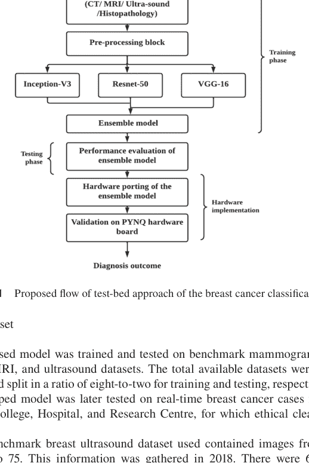

FIGURE 8.1 乳腺癌分类模型的测试床方法拟议流程

### (i) 数据集

所提出的模型在基准乳房X光、组织病理学、MRI 和超声数据集上进行了训练和测试。所有可用数据集均衡平衡，并按八比二的比例分别用于训练和测试。此外，所开发的模型后来在 SRM 医学院、医院和研究中心获得伦理许可的实时乳腺癌病例上进行了测试。

使用的基准乳腺超声数据集包含 25 至 75 岁女性的图像。这些信息于 2018 年收集。总共有 600 名女性患者。数据集包含 780 张照片，每张大小为 500 × 500 像素。图像使用 PNG 文件。原始照片与真实图像一起显示 [12]。

使用的基准 MIAS 乳房X光数据库被降低到 200 微米的像素边缘并裁剪和填充，使每张图片为 1024 × 1024 像素 [13]。使用的基准组织病理学数据集包含大量需要分类的小型病理图片。每个文件都被分配了一个图像标识符。训练标签以逗号分隔值（CSV）文件格式存在，是 train 文件夹中数据集的真实来源 [14]。在使用的基准 MRI 数据集中，年龄被分类为健康（良性）或患病（恶性）。两个类别均包含 700 张健康和患病人员的 MRI 扫描图片用于训练目的。两个类别均包含 40 张健康和患病个体的 MRI 扫描图片用于验证 [15]。

### (ii) 预处理

由于用于训练的数据集是基准数据集且无仪器噪声，因此未对训练数据集应用去噪。然而，由于基准数据集来自不同来源，每个数据集的尺寸不同，因此在处理前将图像调整为 150 × 150 像素。

### (iii) 迁移学习

在机器学习中，将先前学习过的模型应用于新问题称为迁移学习。在迁移学习中，计算机利用先前任务的技能来提高对新任务的泛化能力。不是从零开始，我们开始使用通过完成类似活动发现的模式。例如，在计算机视觉中，神经网络通常用于在第一层识别边缘，在中间层识别形状，在后层识别任务特定属性。在迁移学习中，使用早期和中间层，但仅重新训练后层。这有助于使用其所训练的第一个项目中的标记数据。

### (iv) 集成模型

预处理后，数据集随后被送入集成模型进行训练。集成建模是一种方法，其中开发了许多不同的模型来预测结果，要么使用多种单独的建模技术，要么使用建模算法的组合。然后集成模型将每个模型的估计值组合起来，为未见数据产生单一的最终预测。数据集由癌性和非癌性乳腺肿瘤和肿块的图像组成，以便训练集成模型对良性和恶性病例进行分类。

Inception V3 是一种基于卷积神经网络的用于图片分类的深度学习模型。Inception V3 是 Inception V1 的升级版，Inception V1 于 2014 年作为 GoogLeNet 发布。顾名思义，它是由 Google 团队设计的。

VGG-16 是一个 16 层的深度卷积神经网络。该网络的预训练版本是在 ImageNet 集合的超过一百万张图片上训练的。预训练网络可以将数据分类为 1000 个不同的项目类别。

ResNet 有许多变体遵循相同的思想但具有不同的层数。名称 ResNet-50 指的是一个可以使用 50 层神经网络的变体。该网络的预训练版本也在 ImageNet 集合的超过一百万张照片上训练。预训练网络可以将输入分类为 1000 个独特的项目类别。

### (v) 硬件板实现

实现的集成模型使用 PYNQ-Z2 板加速。PYNQ-Z2 是基于 ZYNQ XC7Z020 FPGA 的 FPGA 开发板，经过严格构建以支持 PYNQ，这是一个新的开源框架，允许嵌入式程序员探索 Xilinx ZYNQ SoC 的功能，而无需创建编程逻辑电路。

集成模型中每个深度学习网络的权重以分层文件格式（H5）保存，这些 H5 文件被导入到 PYNQ 板。然后使用 PYNQ API 上可用的 Python Jupyter 平台执行保存模型的权重文件。根据 DL 模型要求，所需的 Python 库如 OpenCV、Keras、TensorFlow 等也被安装在 PYNQ 板上。测试图像被上传到 PYNQ 板的 secure digital（SD）卡进行测试，每个病例预测所需的时间在 PYNQ 板上进行监控，并观察到比 CPU 和 GPU 系统上每次预测所花费的时间快得多。

在软件和硬件上进行的仿真和比较分析的主观结果在以下章节中详细提供。

## 8.4 模型及其模态的软件性能分析

在本节中，讨论了三种 DL 网络——即 VGG-16、ResNet-50 和 Inception V3——针对每个模态的软件仿真结果以及集成模型。

模型使用 25 个 epoch 进行训练，并采用提前停止条件以避免过拟合问题。提前停止是一种优化方法，可在保持模型正确性的同时减少过拟合。提前停止的基本目标是在模型过拟合之前终止训练。此过程使用的优化器是学习率为 0.0001 的 Adam。学习率控制模型适应新情况的速度。由于每次更新时权重变化较小，较小的学习率需要更多的训练 epoch，而较高的学习率会产生更快的变化并需要更少的训练 epoch。

### (i) 磁共振成像

从图 8.2 的准确率和损失图可以看出，VGG-16 在 MRI 数据分类的验证方面优于另外两个网络。图 8.3 中的混淆矩阵用于提取表 8.1 中的性能指标。从表 8.1 可以看出，集成模型比其他单个网络取得了更好的性能。精度是衡量模型做出多少正向预测的指标。对于 MRI 数据集，VGG-16 的精度仅次于集成模型。

### (i) 超声

从图8.5的准确率和损失曲线可以看出，ResNet-50在超声数据分类的验证中明显优于其他两个网络。图8.4中的混淆矩阵用于提取表8.2中的性能指标。从表8.2可以看出，集成模型比其他单个网络表现更好。对于超声数据集，ResNet-50的精确率仅次于集成模型。


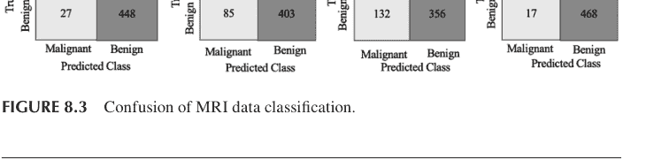

### 图8.3 MRI数据分类的混淆矩阵。

### 表8.1 MRI数据分类的性能指标。

| 模型 | 类别 | 准确率 | 精确率 | 召回率 | F1分数 |
|---|---|---|---|---|---|
| VGG-16 | 恶性 | 91.6 | 0.94 | 0.89 | 0.91 |
|  | 良性 |  | 0.90 | 0.94 | 0.92 |
| ResNet-50 | 恶性 | 80.6 | 0.80 | 0.79 | 0.79 |
|  | 良性 |  | 0.81 | 0.82 | 0.81 |
| Inception V3 | 恶性 | 78.2 | 0.73 | 0.84 | 0.78 |
|  | 良性 |  | 0.84 | 0.73 | 0.77 |
| 集成模型 | 恶性 | 95.9 | 0.96 | 0.95 | 0.95 |
|  | 良性 |  | 0.95 | 0.96 | 0.95 |

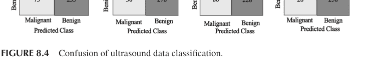

### 图8.4 超声数据分类的混淆矩阵。

ResNet-50

VGG-16

Inception V3

图8.5 超声数据分类的损失和准确率曲线。

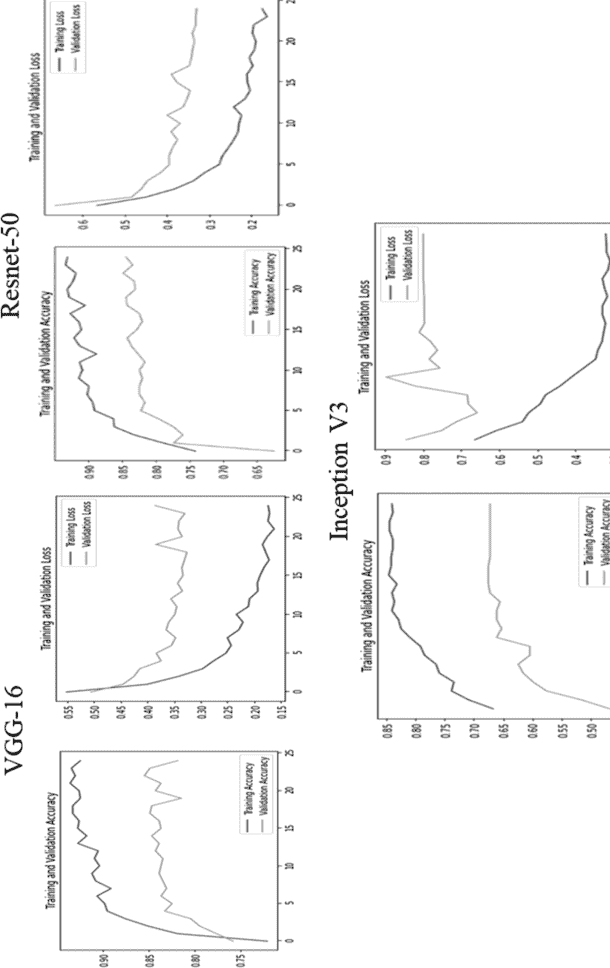

### 表8.2 超声数据分类的性能指标

| 模型 | 类别 | 准确率 | 精确率 | 召回率 | F1分数 |
|---|---|---|---|---|---|
| VGG-16 | 恶性 | 81.2 | 0.70 | 0.89 | 0.78 |
|  | 良性 |  | 0.92 | 0.76 | 0.83 |
| ResNet-50 | 恶性 | 84.8 | 0.83 | 0.76 | 0.79 |
|  | 良性 |  | 0.86 | 0.90 | 0.88 |
| Inception V3 | 恶性 | 67.8 | 0.57 | 0.57 | 0.56 |
|  | 良性 |  | 0.74 | 0.74 | 0.73 |
| 集成模型 | 恶性 | 91.9 | 0.88 | 0.94 | 0.91 |
|  | 良性 |  | 0.96 | 0.90 | 0.93 |

### (ii) 组织病理学

从图8.6的准确率和损失曲线可以看出，VGG-16在组织病理学数据分类的验证中明显优于其他两个网络。图8.7中的混淆矩阵用于提取表8.3中的性能指标。从表8.3可以看出，集成模型比其他单个网络表现更好。对于组织病理学数据集，VGG-16的精确率仅次于集成模型。

### (iii) 乳腺X线影像

从图8.8的准确率和损失曲线可以看出，ResNet-50在乳腺X线影像数据分类的验证中明显优于其他两个网络。图8.9中的混淆矩阵用于提取表8.4中的性能指标。从表8.4可以看出，集成模型比其他单个网络表现更好。对于乳腺X线影像数据集，ResNet-50的精确率仅次于集成模型。

### 8.5 实时测试结果

本节提供了硬件测试的直观结果。硬件设置使用基准数据集和实时数据集进行了测试。实时测试的流程如图8.10所示。

### (i) 磁共振成像

图8.11清晰地展示了16个MRI数据集的连续硬件部署结果，其中“实际”标签代表真实值，“预测”标签代表硬件提供的分类结果。用于MRI数据分类的PYNQ板硬件设置如图8.12所示，每次预测所需时间观测为10.62毫秒。此外，使用功率计测量该设置的功耗，测得为3.4瓦。

VGG-16

ResNet-50

Inception V3

图8.6 组织病理学数据分类的损失和准确率曲线。

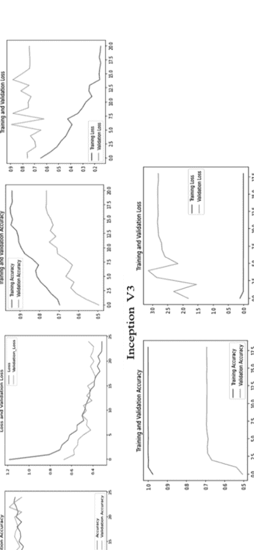

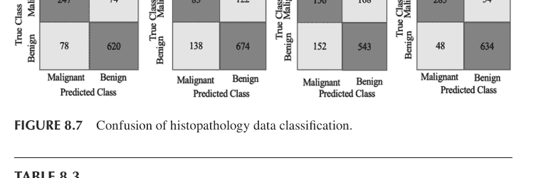

### 图8.7 组织病理学数据分类的混淆矩阵。

### 表8.3 组织病理学数据分类的性能指标

| 模型 | 类别 | 准确率 | 精确率 | 召回率 | F1分数 |
|---|---|---|---|---|---|
| VGG-16 | 恶性 | 85.0 | 0.76 | 0.77 | 0.76 |
|  | 良性 |  | 0.89 | 0.88 | 0.89 |
| ResNet-50 | 恶性 | 74.5 | 0.38 | 0.41 | 0.40 |
|  | 良性 |  | 0.55 | 0.83 | 0.54 |
| Inception V3 | 恶性 | 68.59 | 0.51 | 0.48 | 0.48 |
|  | 良性 |  | 0.76 | 0.78 | 0.77 |
| 集成模型 | 恶性 | 89.9 | 0.85 | 0.84 | 0.85 |
|  | 良性 |  | 0.92 | 0.93 | 0.92 |

### (ii) 超声

图8.13清晰地展示了16个超声数据集的连续硬件部署结果，其中“实际”标签代表真实值，“预测”标签代表硬件提供的分类结果。用于超声数据分类的PYNQ板硬件设置如图8.14所示，每次预测所需时间观测为10.14毫秒。此外，使用功率计测量该设置的功耗，测得为3.2瓦。

### (iii) 组织病理学

图8.15清晰地展示了16个组织病理学数据集的连续硬件部署结果，其中“实际”标签代表真实值，“预测”标签代表硬件提供的分类结果。用于组织病理学数据分类的PYNQ板硬件设置如图8.16所示，每次预测所需时间观测为10.46毫秒。此外，使用功率计测量该设置的功耗，测得为3.4瓦。

ResNet-50

VGG-16

Inception V3

图8.8 乳腺X线影像数据分类的损失和准确率曲线。

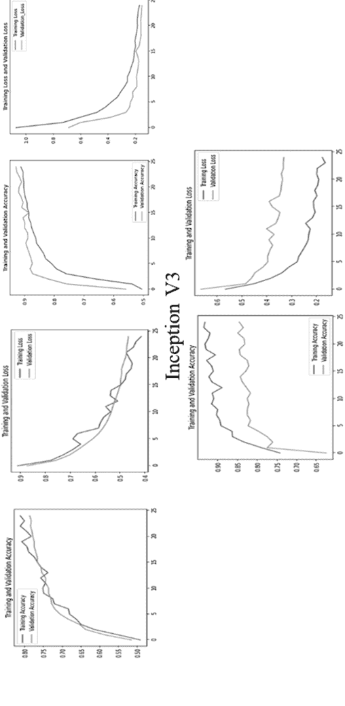

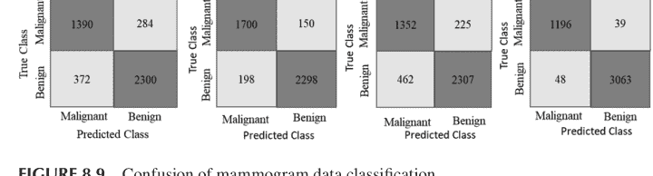

### 图8.9 乳腺X线影像数据分类的混淆矩阵。

### 表8.4 乳腺X线影像数据分类的性能指标

| 模型 | 类别 | 准确率 | 精确率 | 召回率 | F1分数 |
|---|---|---|---|---|---|
| VGG-16 | 恶性 | 84.9 | 0.78 | 0.83 | 0.80 |
|  | 良性 |  | 0.89 | 0.86 | 0.86 |
| ResNet-50 | 恶性 | 91.9 | 0.89 | 0.92 | 0.89 |
|  | 良性 |  | 0.94 | 0.92 | 0.93 |
| Inception V3 | 恶性 | 84.1 | 0.75 | 0.86 | 0.80 |
|  | 良性 |  | 0.92 | 0.83 | 0.87 |
| 集成模型 | 恶性 | 97.9 | 0.96 | 0.97 | 0.96 |
|  | 良性 |  | 0.98 | 0.98 | 0.98 |

### (iv) 乳腺X线影像

图8.17清晰地展示了16个乳腺X线影像数据集的连续硬件部署结果，其中“实际”标签代表真实值，“预测”标签代表硬件提供的分类结果。用于乳腺X线影像数据分类的PYNQ板硬件设置如图8.18所示，每次预测所需时间观测为10.12毫秒。此外，使用功率计测量该设置的功耗，测得为3.6瓦。

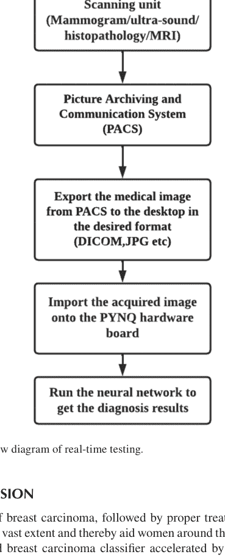

图8.10 实时测试流程图。

### 8.6 结论

早期发现乳腺癌并进行适当治疗，可以在很大程度上降低死亡率，从而帮助全球女性。这种基于人工智能、由PYNQ硬件板加速的乳腺癌分类器，是一种高效且重要的方法，有助于乳腺癌的诊断。该方法是一个基于多个深度学习网络构建的集成模型，这些网络在多模态乳腺影像上训练，使其适用于多种诊断目的，如早期检测、定位、癌症扩散等。仿真结果表明，借助FPGA加速，该模型可以在毫秒级内预测诊断结果。集成模型诊断一张图像的平均时间为10.40毫秒，该原型所需的平均功耗低于3.4瓦。这种快速的诊断预测可以作为乳腺癌诊断中二次确认的手段，帮助放射科医生、肿瘤科医生和医疗专业人员。未来，我们希望进一步关注乳腺癌的亚分类及其分期，以在该领域为医生提供更多帮助。

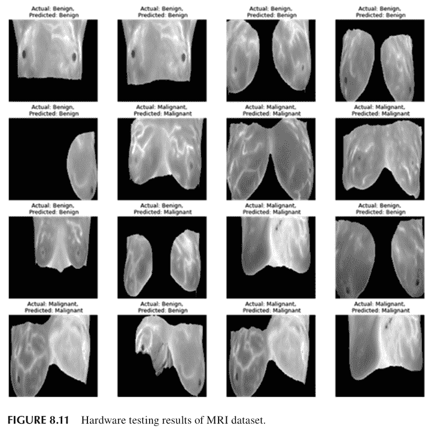

图8.11 MRI数据集的硬件测试结果。

## 致谢

作者感谢Xilinx为本研究使用的硬件板卡提供赞助。

## 基金资助

本研究由Xilinx 2021年秋季科技女性基金资助。

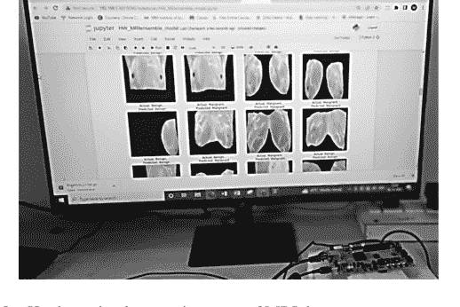

图 8.12 MRI 数据集的硬件实现设置。

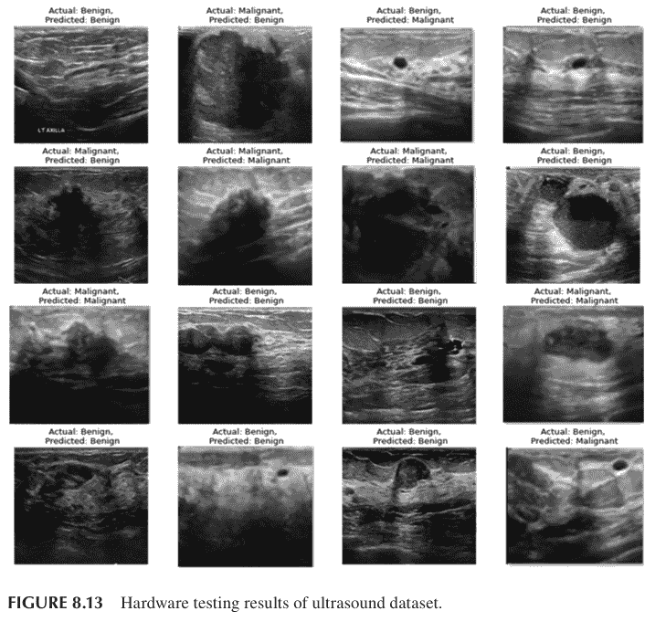

图 8.13 超声数据集的硬件测试结果。

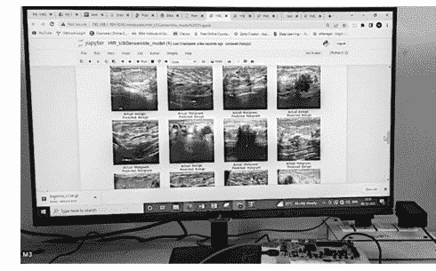

图 8.14 超声数据集的硬件实现设置。

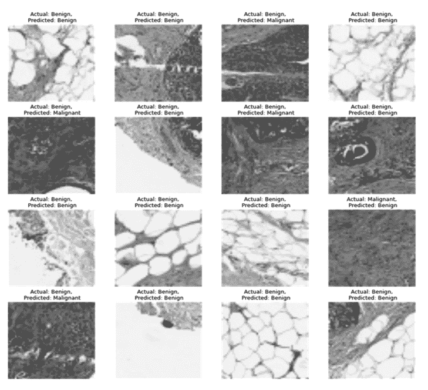

图 8.15 病理学数据集的硬件测试结果。

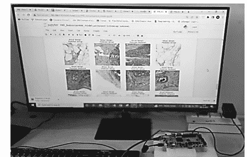

图 8.16 病理学数据集的硬件实现设置。

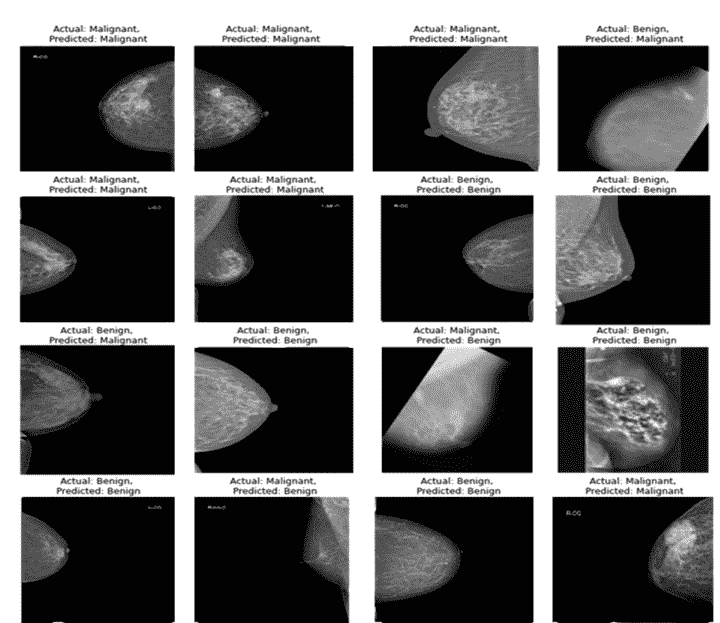

图 8.17 乳房X光摄影数据集的硬件测试结果。

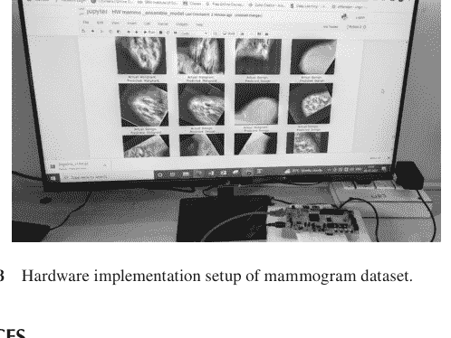

图 8.18 乳房X光摄影数据集的硬件实现设置。

## 参考文献

- 1. Centers for Disease Control and Prevention. (2020) Breast cancer: Things you should know. Retrieved from https://www.cdc.gov/cancer/breast/basic_info/what-is-breast-cancer.html.
- 2. https://my.clevelandclinic.org/health/diseases/3986-breast-cancer.
- 3. https://www.uicc.org/news/globocan-2020-new-global-cancer-data# Manage with L (2022) Breast cancer, 1–20.
- 4. https://www.mayoclinic.org/diseases-conditions/breast-cancer/symptoms-causes/syc-20352470.
- 5. https://www.radiologyinfo.org/en/info/screening-breast.
- 6. Sharma S, Mehra R (2020) Conventional machine learning and deep learning approach for multi-classification of breast cancer histopathology images—A comparative insight. J Digit Imaging 33(3):632–654. https://doi.org/10.1007/s10278-019-00307-y.
- 7. Qasem A, Sheikh Abdullah SNH, Sahran S, et al. (2022) An improved ensemble pruning for mammogram classification using modified Bees algorithm. Neural Comput Appl 34(12):10093–10116. https://doi.org/10.1007/s00521-022-06995-y.
- 8. Yurttakal AH, Erbay H, İkizceli T, Karaçavuş S (2020) Detection of breast cancer via deep convolution neural networks using MRI images. Multimed Tool Appl 79(21–22):15555–15573. https://doi.org/10.1007/s11042-019-7479-6.
- 9. Ma H, Tian R, Li H, et al. (2021) Fus2Net: A novel Convolutional Neural Network for classification of benign and malignant breast tumor in ultrasound images. Biomed Eng Online 20(1):1–15. https://doi.org/10.1186/s12938-021-00950-z.
- 10. Xiong S, Wu G, Fan X, et al. (2021) MRI-based brain tumor segmentation using FPGA-accelerated neural network. BMC Bioinformatics 22(1):1–15. https://doi.org/10.1186/s12859-021-04347-6.
- 11. Hassan O, Paul T, Shuvo MMH, et al. (2022) Energy efficient deep learning inference embedded on FPGA for sleep apnea detection. J Signal Process Syst 94(6):609–619. https://doi.org/10.1007/s11265-021-01722-7.
- 12. Al-Dhabyani W, Gomaa M, Khaled H, Fahmy A (2020) Dataset of breast ultrasound images. Data Brief 28:104863. https://doi.org/10.1016/j.dib.2019.104863.
- 13. Moreira IC, Amaral I, Domingues I, et al. (2012) INbreast: Toward a full-field digital mammographic database. *Acad Radiol* 19(2):236–248. https://doi.org/10.1016/j.acra.2011.09.014.
- 14. https://www.kaggle.com/code/abhinand05/histopathologic-cancer-detection-using-cnns/data.
- 15. https://www.kaggle.com/datasets/uzairkhan45/breast-cancer-patients-mris.

## 9 利用卷积神经网络和视觉变换器集成框架实现阿尔茨海默病的稳健诊断

*Poonguzhali Elangovan and Malaya Kumar Nath*

### 9.1 引言

大脑是人体最复杂的器官。它负责大多数身体活动，例如处理、整合和协调来自各种感觉器官的感官信息。因此，大脑的正常和活跃功能对于实现日常活动至关重要。一些疾病，如阿尔茨海默病（AD）、精神分裂症（SZ）、帕金森病（PD）、痴呆和脑肿瘤，会损害大脑功能。在发达国家，AD 的患病率估计影响 65 岁以上人群的 5%，以及令人震惊的 85 岁以上人群的 30% [1]。到 2050 年，预计将有 0.64 亿人受到这种疾病的影响 [2]。AD 主要影响负责记忆的大脑部分。它会导致脑细胞退化，因此 AD 患者在早期阶段会出现记忆丧失。随着疾病的进展，AD 患者会失去对周围环境的反应能力。他们经常弄错时间，并可能将家庭成员误认为是陌生人。因此，他们可能会变得具有攻击性或容易走出家门。在晚期，AD 最终会导致死亡，因为它破坏了负责呼吸和心脏功能的脑部区域。因此，及时筛查 AD 至关重要。此外，早期诊断可以使患者免受不必要的药物治疗及其副作用。阿尔茨海默病是一种灾难性的神经功能障碍，会损害记忆和认知能力。AD 的临床表现是过度产生 β-淀粉样蛋白 [1]。随着海马体缩小，细胞丢失和损伤发生 [3]。由于此原因，神经元无法通过突触做出反应。这会影响记忆和思维能力 [1]。由于 AD 尚无治愈方法，减缓认知衰退的唯一方法是从大脑中清除淀粉样蛋白 [3]。然而，由于 AD 进展缓慢，早期诊断相当具有挑战性。AD 的筛查很麻烦，因为症状出现在最后阶段。因此，有效诊断 AD 至关重要。需要进行身体和神经生物学检查以及患者的详细病史来正确评估 AD。此外，成像在 AD 诊断中起主导作用。神经科医生已使用磁共振成像（MRI）来可视化大脑的结构和功能。他们确定 AD 迹象并进行各种检查以诊断 AD。通过这些检查可以实现准确的诊断。可以根据 AD 的阶段（例如中度、轻度和非常轻度）推荐适当的药物。AD 相关的病理可以在 MRI 图像中检测到。这使 MRI 模式成为 AD 诊断中显著的模式。

AD 的临床诊断需要训练有素的专家，并且由于涉及众多控制参数，可能容易出现术者间/术者内误差。此外，所使用的成像仪器昂贵且笨重。虽然病理特征在 MRI 图像中很明显，但临床检查是一个繁琐的过程。因此，利用计算机辅助检测（CAD）技术进行 AD 诊断是必要的。随着技术的进步，机器学习（ML）和深度学习（DL）正逐步部署以从脑成像数据中提取相关特征。本研究旨在利用深度学习技术提高 AD 分类结果。以下为本工作的主要目标：


- 调查 `EfficientNet-B0` 和视觉变换器对 MRI 图像中 AD 阶段分类的性能。

- 说明 `KNN`、`softmax`、`Bi-LSTM` 和 `SVM` 等分类器对 AD 分类任务的有效性。

- 探索小波变换和主成分分析（`PCA`）等特征选择技术的有效性。

- 提出一种基于堆叠技术的新型集成模型以提高整体性能。

论文的后续部分结构如下。第 9.2 节提供了现有工作的快速概述。数据库和建议的方法在第 9.3 节中解释。第 9.4 节和第 9.5 节分别讨论结果和结论。

### 9.2 相关工作

深度 CNN 以分层方式学习有效属性。因此，这些网络是图像分类任务的绝佳选择，例如青光眼分类 [4, 5]、疟疾寄生虫检测 [6]、乳腺癌检测 [7] 和皮肤癌检测 [8]。近年来已开发出多种算法用于

AD 分类使用 CNN。作者采用了多种模型进行有效的特征提取和分类。现有工作中采用 2D CNN 或 3D CNN。在部分研究 [9–16] 中，采用预训练模型或自建 CNN，而其他研究 [17–19] 则涉及视觉 Transformer（ViTs）。

Payan 等 [10] 描述了一种使用稀疏自编码器和 3D CNN 的方法。使用了 75 岁以上患者的 MRI 图像。该方法使用 3D-CNN 捕获特征。作者报告了在轻度认知障碍（MCI）、正常和 AD 之间令人满意的分类结果，准确率为 89.5%。Sarraf 和 Tofighi [20] 中采用了两阶段流程对老年人进行健康和 AD 分类。第一阶段进行了显著的预处理以去除数据中的失真。随后实现了使用 LeNet 和 GoogLeNet 的 CNN 模型。作者使用结构功能磁共振成像（fMRI）和结构 MRI 数据分别获得了 99.9% 和 98.84% 的总体准确率。

Maysam 等 [21] 引入了条件深度三元组网络以克服机器学习问题中的数据稀缺问题。Siamese 网络和三元组网络被用于 AD 分类任务。特征使用 VGG-16 作为基础模型从 MRI 图像中提取。模型使用来自 OASIS 数据库的 87 张极轻度痴呆图像、167 张正常图像、105 张轻度痴呆图像和 23 张中度痴呆图像进行测试。作者得出结论，条件三元组模型表现更优，总体分类准确率为 99.41%。

Farooq 等 [12] 对 ResNet 和 GoogLeNet 在多类分类中的应用进行了研究。特征提取前进行了适当的预处理。根据获得的概率分数，输入图像被归类为 AD、正常、MCI 和晚期轻度认知障碍（LMCI）类别。作者在四类和三类分类任务中分别报告了 98.8% 和 97.9% 的准确率。Spasov 等提出了一种参数高效的 3D CNN 以克服过拟合问题 [11]。使用 3D 可分离和分组卷积从结构 MRI 图像中提取详细的相关特征。在阿尔茨海默病神经影像学计划（ADNI）数据库的一个子集（192 例 AD、409 例 MCI 和 184 名健康对照（HC））中报告了 86% 的总体分类准确率。

Luo 等提出了用于二元分类的紧凑 3D CNN 模型 [22]。评估使用从 ADNI 数据库获得的 MRI 扫描（34 名正常和 47 名 AD 患者）进行。其工作声称召回率为 100%，特异性为 93%。Korolev 等通过二元分类研究了普通 CNN 和残差 CNN 在多分类任务中的有效性 [13]。预训练的 VGG 模型被修改以开发 VoxCNN。模型的有效性使用从 ADNI 数据库子集获得的 MRI 扫描进行评估，该子集包括 50 例 AD、43 例 LMCI、77 例早期轻度认知障碍（EMCI）和 61 例正常队列（NC）。作者得出结论，使用 VoxCNN 和 ResNet 对 AD 和 NC 进行分类的结果更好，准确率分别为 79% 和 80%。

Hon 等对 VGG-16、VGG-19 和 Inception V4 进行了研究 [14]。二元分类采用了朴素学习和迁移学习技术。模型使用从 OASIS 数据库随机选择的 200 名受试者进行评估。作者考虑了 6400 张图像，AD 和非痴呆病例数量相等。他们得出结论，迁移学习的 Inception V4 优于其他模型，准确率为 96.12%。Ramzan 等探讨了 ResNet-18 模型在 AD 分类中的有效性 [15]。迁移学习用于六类分类任务。作者从 ADNI 数据库考虑了 138 名受试者（25 名认知正常（CN）、25 名 LMCI、25 名 AD、25 名 EMCI、25 名主观记忆抱怨（SMC）和 13 名 MCI）。朴素模型和迁移学习模型的准确率分别为 97.92% 和 97.88%。Geneedy 等研究了 14 层浅层 CNN 在使用 MRI 扫描进行 AD 全局和局部分类中的性能 [23]。该模型使用从 OASIS-3 数据库获得的 6400 张照片进行评估。报告准确率为 99.68%。Islam 等开发了基于深度 CNN 的管道用于 AD 分类 [24]。采用了三种不同的深度 CNN，每种结构略有修改。作者使用来自 OASIS 数据库的结构 MRI 图像验证模型，并报告准确率为 93.18%。

最近，基于 Vision Transformer 的模型在 AD 分类任务中显示出巨大潜力。这些模型需要更多数据才能获得更好的性能。由于获取大量医学数据的实际困难，采用了跨域迁移学习。Wang 等提出了一种独特的模型：用于 AD 检测的 IGnet [17]。其工作整合了 3D CNN 和 Transformer 编码器的有效性。紧凑的 3D CNN 包含相等数量的卷积层和最大池化层。通过这一系列十层，从 MRI 扫描中提取相关特征。双层 Transformer 编码器被开发用于从遗传序列中提取相关信息。来自 3D CNN 的图像嵌入和来自 Transformer 编码器的遗传嵌入被整合。然后由多层感知机（MLP）和全连接层组成的系列层进行处理。最后，`softmax` 层生成的类别概率用于将输入分类为“正常”和“患病”类别。作者使用 ADNI 数据库测试了模型，并报告总体准确率为 83.78%。

在 Zhang 等提出的方法中，AD 检测由修改后的 ViT 和浅层 3D CNN 执行 [18]。独特的卷积补丁嵌入（CPE）模块和位置编码方法被整合到原始 ViT 中，以开发卷积体素视觉 Transformer（CVVT）。所提出的 CVVT 利用整个 MRI 扫描中所有体素之间的相互关联。紧凑的 3D CNN（S3DCNN）包括四个块。每个块包含层（如 3D 卷积、3D 批归一化、3D 最大池化、3D leaky ReLU 和 3D dropout）。从层中提取的相关特征进一步由全连接层处理。然后跟随 `softmax` 和分类层进行分类。两种模型均使用来自 ADNI 数据库的 MRI 扫描进行评估。结果显示 CVVT 和 S3DCNN 的总体准确率分别为 84% 和 98%。

现有研究大多集中于使用预训练模型进行 AD 分类。此外，许多研究中仅调查了图像子集。使用 ViT 进行 AD 分类的工作很少。这促使我们设计一种使用深度 CNN 和 ViT 对 AD 阶段进行分类的新方法。

### 9.3 方法

从 MRI 图像对 AD 的相关阶段进行分类可能有助于为有症状的个体提供可靠的医疗护理。本研究有效结合了 CNN 和 ViT 的优势，将 MRI 图像分类为“极轻度痴呆”（VMD）、“中度痴呆”（MOD）、“非痴呆”（ND）和“轻度痴呆”（MD）。

#### 9.3.1 数据库

本工作考虑了开放获取影像研究系列（OASIS-3）数据库的第三版 [25]。该数据集包括 6400 张图像，根据 AD 严重程度分为 4 类。图像为 JPG 格式，尺寸为 176 × 208 像素。样本数量如图 9.1 所示。数据库由 14% 的 MD 样本、1% 的 MOD 样本、50% 的 ND 样本和 35% 的 VMD 样本组成。样本扫描如图 9.2 所示。

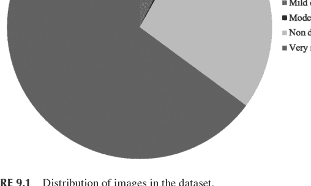

图 9.1 数据集中图像的分布。

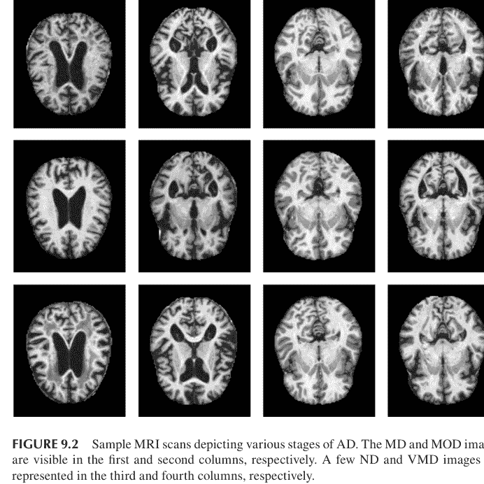

图 9.2 显示阿尔茨海默病不同阶段的样本 MRI 扫描。MD 和 MOD 图像分别可见于第一列和第二列。ND 和 VMD 图像分别在第三列和第四列中表示。

#### 9.3.2 建议框架

建议方法的典型工作流程如图 9.3 所示。它有三个主要模块：预处理、特征提取和分类，以及集成学习。过采样数据级技术和图像尺寸调整在预处理期间进行。特征提取和分类模块提取相关属性，并使用自定义 `EfficientNet-B0` 和自定义 `ViT` 模型对其进行分类。从 CNN 和 ViT 中挑选最佳配置以进行进一步处理。为提高整体性能，在最后阶段采用集成学习。该阶段涉及集成选择、概率平均和分类。

### 预处理

通常，深度 CNN 在大量数据下能取得更好的结果。数据分布证实存在类别不平衡问题。为解决此问题，采用了过采样数据级技术。使用旋转增强技术扩大训练集图像，以获得平衡的数据集。表 9.1 显示了增强方法的相关参数详情。


图 9.3 用于 AD 分类建议方法的流程。

### 表 9.1

增强技术详情

| 原始数据集中图像数量 | 步长 | 旋转角度 | 生成数据集中图像数量 |
|---|---|---|---|
| MD: 717 | 1 | 0 and 6 | MD: 5019 |
| MOD: 52 | 0.1 | 1 and 10 | MOD: 5200 |
| ND: 2560 | 1 | 0 and 1 | ND: 5120 |
| VMD: 1792 | 1 | 0 and 2 | VMD: 5376 |

使用自定义 `EfficientNet-B0` 进行分类：`EfficientNet-B0` 使用 ImageNet 数据库中的大量样本进行训练。由于此原因，模型能有效学习描述性图像特征。因此，微调模型简化了学习过程。通过调整最后几层来修改模型。图 9.4 说明了使用 `EfficientNet-B0` 模型进行属性提取。

### 特征提取

Tan 等人提出的 `EfficientNet` 模型因包含复合缩放技术 [26] 而引起了 considerable interest。它使用一组参数均匀缩放分辨率、深度和宽度，表示为以下方程：

depth: d = δ^θ

(9.1)

width: w = φ^θ  (9.2)

resolution: r = ζ^θ  (9.3)

其中 θ 是复合参数，δ、φ 和 ζ 是各个维度的缩放参数。采用网格搜索技术通过验证约束 δ φ² ζ² ≈ 2 且 δ ≥ 1, φ ≥ 1, ζ ≥ 1 来选择系数的最佳值。模型的层在表 9.2 中概述。


图 9.4 使用修改后的 `EfficientNet-B0` CNN 进行相关属性提取。

### 表 9.2

`EfficientNet-B0` 模型详情

| 阶段 | 操作符 | 分辨率 | 通道数 | 层数 |
|---|---|---|---|---|
| 1 | Conv k3 | 224×224 | 32 | 1 |
| 2 | MIBConv1, k3 | 112×112 | 16 | 1 |
| 3 | MIBConv6, k3 | 112×112 | 24 | 2 |
| 4 | MIBConv6, k5 | 56×56 | 40 | 2 |
| 5 | MIBConv6, k3 | 28×28 | 80 | 3 |
| 6 | MIBConv6, k5 | 14×14 | 112 | 3 |
| 7 | MIBConv6, k5 | 14×14 | 192 | 4 |
| 8 | MIBConv6, k3 | 7×7 | 320 | 1 |
| 9 | Conv k1/pooling/FC | 7×7 | 1280 | 1 |

k3: 3×3, k5: 5×5, 且 k1: 1×1

### 特征选择

选择稳健的特征可能有助于有效分类 AD 阶段。采用 Haar 小波变换和 `PCA` 来实现。首先，使用 Haar 小波对提取的特征进行分解。分解提供了近似带和细节带。显然，近似带对 AD 特征的影响更大。因此，仅探索低频带可能会大幅减少分类所需的属性数量 [27]。其次，使用 `PCA` 从频带中获得有效属性。通过将细节带的参数置零并保持近似带的参数不变来进行属性重建。然后，使用 `PCA` 生成用于分类的相关属性。

### 分类

分类器的适当选择可能会显著改善 AD 分类结果。使用 `Bi-LSTM` 网络 [28] 将稳健特征分类为四个类别。这是一组两个 LSTM，其中一个从头到尾接收输入序列，另一个以相反顺序接收输入序列。

### 使用自定义 ViT 进行分类

本工作采用自定义 `ViT` 进行 AD 分类。这是通过迁移学习方法实现的。用于自然图像任务的 `ViT` 模型已针对 AD 分类阶段进行微调。自定义 `ViT` 的基本表示如图 9.5 所示。Transformer 编码器是 `ViT` 的关键组件。它包含若干等效层的组。每层由多头注意力和 MLP 组成。MLP 中包含两个高斯误差线性单元 (`GELU`) 非线性层。在层归一化之后，在每个子层 (`Lnorm`) 周围使用残差连接。Transformer 接受 N 个嵌入补丁 (`L_p^i`) 的序列和一个特殊标记 (`L_{sp}`)。每个补丁嵌入附加可学习的位置嵌入，数学上由以下方程表示：


图 9.5 使用自定义 `ViT` 提取相关特征。

`X_o = [L_{sp}; L_p^1; L_p^2; ...; L_p^N] + L_{pos}`  (9.4)

`X_l^* = MSA(Lnorm(X_{l-1}) + X_{l-1})`  (9.5)

`X_l = MLP(Lnorm(X_l^*) + X_l^*)`  (9.6)

`Y = Lnorm(X_0)`  (9.7)

### 集成学习

集成学习主要用于提高性能以及提高鲁棒性。在本工作中，采用堆叠集成技术 [29]。选择 `EfficientNet-B0` 模型的最佳配置和最佳 `ViT` 模型。选择过程中考虑分类准确率指标。所选模型的似然分数使用以下方法进行平均：

`P_{Final}(B_k) = \left( \sum_{i=1}^{N} P_{s(i)}(B_k) \right) / N`  (9.8)

其中 `P_{Final}(B_k)` 表示 `B_k` 的最终似然分数，`k` 是类别指示符，`P_s(B_k)` 表示似然分数，`N` 表示集成中使用的总模型数。最终预测使用 `SVM` 分类器执行。

### 9.4 实验结果

在整个训练过程中，模型的初步层被保留，而末层则针对四类任务进行定制。图 9.6 显示了未增强和生成数据库中的样本数量。模型使用 5019 张 MD 图像、5200 张 MOD 图像、5120 张 ND 图像和 5376 张 VMD 图像进行训练。由于 `Adam` 优化器 [30] 在大多数图像分类任务 [31] 中表现良好，因此以 0.0001 的学习率使用它。实验以 20 个 epoch 和 32 的批大小进行。可训练变量被修改以减轻由以下指定的交叉熵损失

`loss = - \sum_{i=1}^{S} \sum_{j=1}^{C} t_{ij} ln(p_{ij})`  (9.9)

其中 `S` 是样本长度，`C` 是总类别数，`t_{ij}` 表示目标输出，`p_{ij}` 表示预测输出。模型在不同设置下使用 1279 张图像（179 张 MD、12 张 MOD、640 张 ND 和 448 张 VMD）进行评估，具体如下所述。


图 9.6 数据集中图像的分布。该数据集包括 896 张 MD、64 张 MOD、3200 张 ND 和 2240 张 VMD 图像。

- S1：使用 `softmax` 函数获得的似然分数用于将图像分类到不同类别。

- S2 和 S3：在设置 S2 和 S3 中分别使用 `SVM` 和 `KNN` 分类器对提取的特征进行分类。属性从全局平均池化层获取。

- S4：在此设置中使用 `Bi-LSTM` 网络。模型使用相关属性进行评估。分类基于通过 `softmax` 函数获得的似然分数进行。

- S5、S6 和 S7：这些设置探索使用 Haar 小波变换进行特征选择的有效性。在 S5、S6 和 S7 设置中分别使用 `SVM`、`KNN` 和 `Bi-LSTM` 对变换后的属性进行分类。

- S8、S9 和 S10：在这些设置中分析稳健特征对 AD 分类的重要性。`PCA` 用于选择稳健特征。在设置 S8、S9 和 S10 中分别使用 `SVM`、`KNN` 和 `Bi-LSTM` 对稳健特征进行分类。

以下指标用于评估各种设置的有效性：

### 精确率 (ACC)

这表示模型正确预测的总样本数。定义为

$$ACC = \frac{TPM + TPMO + TPVM + TPN}{N} \qquad (9.10)$$

其中，`TPM`、`TPMO`、`TPVM` 和 `TPN` 分别表示被正确分类的“轻度痴呆”样本、“中度痴呆”图像样本、“中度痴呆”样本被正确分类?? 实际上应为“被正确分类的‘中度痴呆’图像样本”、“被正确分类的‘极轻度痴呆’样本”和“被正确分类的‘非痴呆’样本”。`N` 表示样本总数。

## 召回率

`SEN_M`、`SEN_MO`、`SEN_VM` 和 `SEN_N` 分别表示模型正确预测的“轻度痴呆”样本、“中度痴呆”样本、“极轻度痴呆”图像样本和“非痴呆”样本所占的比例。其计算公式如下：

$$SEN_M = \frac{TPM}{TPM + FNM}\tag{9.11}$$ $$SEN_{MO} = \frac{TPMO}{TPMO + FNMO}\tag{9.12}$$ $$SEN_{VM} = \frac{TPVM}{TPVM + FNVM}\tag{9.13}$$ $$SEN_N = \frac{TPN}{TPN + FNN}\tag{9.14}$$


实验使用原始数据库和增强数据库进行。原始样本的分类准确率为 71%。由于各类别之间存在数据差异，模型无法捕获相关属性。因此，需要采用数据级过采样方法。在 softmax 分类器中，采用 `softmax` 函数计算得到的似然分数用于 AD 分类。此设置（S1）正确预测了 121 个 MD 样本、4 个 MOD 样本、531 个 ND 样本和 330 个 VMD 样本。表 9.3 展示了不同设置所得的性能指标。

在设置（如 S2、S5 和 S8）中使用了带线性核的 SVM 分类器，而在 S3、S6 和 S9 等设置中则使用了带欧几里得核（K 值为 5）的 KNN 分类器。SVM 和 KNN 模型分别在 S2 和 S3 设置中使用提取的 1280 个特征进行评估。实验结果表明，SVM 分类器优于 KNN，准确率达到 74.2%。在 S4、S7 和 S10 等设置中采用了 Bi-LSTM 网络。该模型预测 MD 图像的准确率为 77%，MOD 图像为 41.6%，ND 图像为 84.3%，VMD 图像为 75.8%。

引入特征选择技术可以显著提高分类器的性能。利用小波变换来选择有用的属性。使用单级 Haar 小波将属性分解为近似系数和细节系数。由于近似频带包含重要信息，因此仅考虑这些特征。最终共选取了 640 个特征。在 S5 和 S6 设置中，分别使用这些特征对 SVM 和 KNN 分类器进行评估。S5 和 S6 设置分别获得了 79.5% 和 78.3% 的准确率。在 S7 设置中，使用 640 个特征对 Bi-LSTM 网络进行评估。该网络对 MD 图像的分类准确率为 78.7%，MOD 图像为 50%，ND 图像为 87.5%，VMD 图像为 80.3%。

## 表 9.3

不同配置下获得的性能指标

| 分类器 | ACC | SEN_M | SEN_MO | SEN_VM | SEN_N |
|---|---|---|---|---|---|
| S1 (Softmax) | 77.1 | 67.6 | 33.3 | 83 | 73.7 |
| S2 (SVM) | 74.2 | 44.7 | 50 | 72 | 89.7 |
| S3 (KNN) | 73.7 | 55.3 | 83.3 | 70.9 | 84.6 |
| S4 (Bi-LSTM) | 79.9 | 77 | 41.6 | 84.3 | 75.8 |
| S5 (Haar + SVM) | 79.5 | 78.2 | 33.3 | 83.5 | 75.4 |
| S6 (Haar + KNN) | 78.3 | 77.4 | 41.6 | 85.2 | 74.6 |
| S7 (Haar + Bi-LSTM) | 83.4 | 78.7 | 50 | 87.5 | 80.3 |
| S8 (Haar + PCA + SVM) | 82.4 | 77 | 50 | 92.1 | 71.4 |
| S9 (Haar + PCA + KNN) | 81.3 | 78.7 | 33.3 | 89 | 72.5 |
| S10 (Haar + PCA + Bi-LSTM) | 87.4 | 83.7 | 50 | 90.6 | 85.3 |

设置 S8、S9 和 S10 证明了小波变换和 PCA 的功效。提取的特征数量从 640 个减少到 254 个。使用这些属性对 SVM 和 KNN 分类器进行评估，在 S8 和 S9 设置中分别达到了 82.4% 和 81.3% 的准确率。显然，S8 和 S9 设置的计算复杂度低于 S2 和 S3 设置。

使用 254 个特征对 Bi-LSTM 模型进行实验评估，达到了 87.41% 的准确率。此设置（S10）预测 MD 图像的准确率为 83.7%，MOD 图像为 50%，ND 图像为 90.6%，VMD 图像为 85.3%。根据研究结果，当使用有用属性而非原始属性对分类器进行评估时，模型准确率有所提高。

对于定制的 ViT 模型，进行了微调。训练方式是针对四类分类问题定制 patch 嵌入层和分类器。另一方面，transformer 编码器的参数保持不变。本工作实现了三种不同模型尺寸的同构 ViT（例如，tiny [ViTT]、small [ViTS] 和 base [ViTB]）。表 9.4 展示了不同 ViT 获得的指标。可以推断，小型 ViT 模型以 88.6% 的总体准确率表现最佳。该模型正确分类了 154 个 MD 图像、6 个 MOD 图像、585 个 ND 图像和 388 个 VMD 图像。

## 表 9.4

不同 ViT 获得的性能指标

| 分类器 | ACC | SEN_M | SEN_MO | SEN_VM | SEN_N |
|---|---|---|---|---|---|
| ViTT | 87.4 | 82.1 | 41.6 | 89.6 | 84.2 |
| ViTS | 88.6 | 86 | 50 | 91.4 | 86.6 |
| ViTB | 86.8 | 83.7 | 50 | 89.5 | 85.2 |

将 S10 配置和 ViTS 模型获得的分数进行集成，准确率达到 90.38%。最终的 SVM 分类器正确预测 MD 图像的准确率为 87.1%，MOD 图像为 41.6%，ND 图像为 92.9%，VMD 图像为 89.2%。

## 与先前工作的比较

考虑将 Hon 等人 [14]、Farooq 等人 [12]、Ramzan 等人 [15]、Geneedy 等人 [23] 和 Islam 等人 [24] 提出的工作进行比较。预训练模型使用以下超参数实现：

- 批量大小：32
- 学习率：0.0001
- 最大轮数：100
- Adam 优化器

表 9.5 显示了不同模型获得的指标。Geneedy 等人提出的模型正确预测了 1279 张图像中的 1065 张，准确率为 83.3%。Islam 等人提到的对 DenseNet-121、DenseNet-161 和 DenseNet-169 的实验研究表明，DenseNet-161 模型的准确率最高，达到 85.6%。从研究结果可以推断，使用多数投票集成技术聚合三个模型的结果可将准确率提高 2%。最终的集成模型正确分类了 143 个 MD、9 个 MOD、571 个 ND 和 401 个 VMD 图像。这导致准确率达到 87.8%。Farooq 等人提出的研究三种深度 CNN（GoogLeNet、ResNet-18 和 ResNet-152）性能的实验表明，ResNet-152 模型的预测效果更好。在 1279 张图像中，有 1085 张图像被正确预测，准确率达到 84.8%。Ramzan 等人研究了 ResNet-18 中残差连接在从 MRI 图像预测 AD 疾病方面的有效性。结果表明，该模型正确预测了 1279 张图像中的 1070 张，准确率达到 83.6%。Hon 等人提到的对 VGG-16 和 Inception V4 的实验研究，其各自的模型总体准确率分别达到了 82.64% 和 84.6%。

## 表 9.5

各种模型与所提出模型的性能对比分析

| 作者 | ACC | SEN_M | SEN_MO | SEN_VM | SEN_N |
|---|---|---|---|---|---|
| Farooq 等人 [2017] | 84.8 | 71.5 | 83.3 | 86.1 | 87.6 |
| Hon 等人 [2017] | 84.6 | 74.3 | 83.3 | 85.9 | 86.7 |
| Islam 等人 [2018] | 87.8 | 79.8 | 75 | 89.5 | 89.2 |
| Ramzan 等人 [2019] | 83.6 | 70.9 | 75 | 86.2 | 86.2 |
| Geneedy 等人 [2023] | 83.3 | 70.9 | 91.7 | 85.0 | 85.9 |
| 所提模型 | 90.4 | 97.1 | 41.6 | 89.2 | 92.9 |

Inception V4 的架构改进使得 1279 张图像中有 1083 张被正确预测。

研究结果表明，所提出的模型优于其他现有方法。由于 MOD 图像的分布与其他三个类别不同，所提出的模型可能无法捕获 MOD 图像的独特特征。因此，MOD 图像的灵敏度远低于现有方法。然而，与其他模型相比，所提出的模型有效地捕获了 MD、ND 和 VMD 图像的特征，从而降低了误分类率。

### 9.5 结论

本文提出了一种利用 CNN 和 ViT 对 AD 阶段进行分类的有效框架。在不同的设置中使用不同的分类器对定制 CNN 获得的属性进行分类。每个设置的有效性在一个包含 21,994 张 MRI 图像（5198 张 MD、5212 张 MOD、5760 张 ND 和 5824 张 VMD 照片）的数据集上进行了评估。结果表明，使用 PCA 和小波变换获得的有用属性在使用 Bi-LSTM 网络进行分类时能显著提高性能。结论是，结合 CNN 和 Bi-LSTM 显著改善了 AD 分类任务的整体结果。微调定制的小型 ViT 模型实现了 88.6% 的总体准确率。通过使用堆叠集成方法整合最佳配置的 EfficientNet-B0 和最佳 ViT 模型的性能，观察到准确率的提高。在 1279 张图像中，所提出的方法正确预测了 1156 张图像。因此，所提出的方法可能有助于神经科医生对 AD 阶段进行分类。

## 参考文献

- 1. “World Alzheimer report 2018—The state of the art of dementia research: New frontiers.” Alzheimer’s Disease International, vol. 48, pp. 1–48, 2018.
- 2. R. Brookmeyer, E. Johnson, K. Ziegler Graham, and H. M. Arrighi, “Forecasting the global burden of Alzheimer’s disease.” Alzheimer’s and Dementia: The Journal of the Alzheimer’s Association, vol. 3, no. 3, pp. 186–191, Jul 2007.
- 3. S. S. Khan and G. S. Bloom, “Tau: The center of a signaling nexus in Alzheimer’s disease.” Frontiers in Neuroscience, vol. 10, pp. 1–5, Feb 2016.
- 4. P. Elangovan and M. K. Nath, “Glaucoma assessment from color fundus images using convolutional neural network.” International Journal of Imaging Systems and Technology, vol. 31, no. 2, pp. 955–971, June 2021.
- 5. P. Elangovan, D. Vijayalakshmi, and M. K. Nath, “Detection of glaucoma from fundus images using pre-trained densenet201 model.” Indian Journal of Radio and Space Physics, vol. 50, no. 1, pp. 33–39, March 2021.
- 6. P. Elangovan and M. K. Nath, “A novel shallow ConvNet-18 for malaria parasite detection in thin blood smear images.” SN Computer Science, vol. 2, no. 5, pp. 1–11, Jul 2021.
- 7. S. Majumdar, P. Pramanik, and R. Sarkar, “Gamma function based ensemble of CNN models for breast cancer detection in histopathology images.” Expert Systems with Applications, vol. 213, pp. 119022, Mar 2023.
- 8. V. Venugopal, J. Joseph, M. V. Das, and M. K. Nath, “基于 EfficientNet 的改进 `sigmoid` 变换用于增强黑色素瘤和痣皮肤病变的大体皮肤图像。” 《计算机方法和生物医学程序》, vol. 222, pp. 106935, Jul 2022.
- 9. D. AlSaeed and S. F. Omar, “使用基于 CNN 的特征提取和机器学习的阿尔茨海默病诊断脑 MRI 分析。” 《传感器》, vol. 22, no. 8, pp. 1–14, 2022.
- 10. A. Payan and G. Montana, “预测阿尔茨海默病：使用 3D 卷积神经网络的神经影像学研究。” CoRR, vol. abs/1502.02506, pp. 1–9, Feb 2015.
- 11. S. Spasov, L. Passamonti, A. Duggento, P. Lio, N. Toschi, “一种参数高效的深度学习方法用于预测从轻度认知障碍到阿尔茨海默病的转化。” 《神经影像》, vol. 189, pp. 276–287, Apr 2019.
- 12. A. Farooq, S. Anwar, M. Awais, and S. Rehman, “基于深度 CNN 的使用 MRI 的阿尔茨海默病多类分类。” 在 2017 年 IEEE 成像系统与技术国际会议 (IST) 上，Beijing, IEEE, pp. 1–6, Oct 2017.
- 13. S. Korolev, A. Safiullin, Y. Dodonova, and M. Belyaev, “用于 3D 脑 MRI 分类的残差和普通卷积神经网络。” 2017 IEEE 14th International Symposium on Biomedical Imaging (ISBI 2017), Melbourne, VIC, Australia, pp. 835–838, Jan 2017. doi: 10.1109/ISBI.2017.7950647.
- 14. M. Hon and N. M.Khan, “通过迁移学习实现阿尔茨海默病分类。” 在 2017 IEEE International conference on bioinformatics and biomedicine (BIBM), pp. 1166–1169, 2017. doi: 10.1109/BIBM.2017.8217822.
- 15. F. Ramzan, M. U. G. Khan, A. Rehmat, S. Iqbal, T. Saba, A. Rehman, and Z. Mehmood, “一种深度学习方法用于使用静息态 fMRI 和残差神经网络自动诊断和多类分类阿尔茨海默病分期。” 《医学系统杂志》, vol. 44, no. 2, pp. 1–16, Nov 2019.
- 16. H. A. Helaly, M. Badawy, and A. Y. Haikal, “用于早期检测阿尔茨海默病的深度学习方法。” 《认知计算》, vol. 14, no. 2, pp. 1711–1727, 2022.
- 17. J. X. Wang, Y. Li, X. Li, and Z. H. Lu, “通过 IGnet 对影像遗传数据进行阿尔茨海默病分类。” 《神经科学前沿》, vol. 16, no. 846638, pp. 1–8, Mar 2022.
- 18. Z. Zhang and F. Khalvati, “引入视觉 Transformer 用于具有 3D 输入的阿尔茨海默病分类任务。” arXiv, pp. 1–21, 2022.
- 19. Y. Lyu, X. Yu, D. Zhu, and L. Zhang, “通过视觉 Transformer 对阿尔茨海默病的分类。” 在 The 15th International Conference on Pervasive Technologies Related to Assistive Environments (PETRA), Greece, ACM, pp. 463–468, Jun 2022.
- 20. S. Sarraf and G. Tofighi, “通过深度学习卷积神经网络对阿尔茨海默病结构 MRI 数据进行分类。” CoRR, vol. abs/1607.06583, pp.1–14, 2016.
- 21. M. Orouskhani, C. Zhu, S. Rostamian, F. S. Zadeh, M. Shafiei, Y. Orouskhani, and U. R. Acharya, “使用条件深度三元组网络从结构 MRI 检测阿尔茨海默病。” 《神经科学信息学》, vol. 2, no. 4, pp. 100066, 2022.
- 22. S. Luo, X. Li, and J. Li, “使用深度学习方法从 MRI 数据自动识别阿尔茨海默病。” 《应用数学和物理学报》, vol. 5, no. 9, pp. 1892–1898, Sep 2017.
- 23. M. Geneedy, H. Moustafa, F. Khalifa, H. Khater, E. AbdElhalim, L. Saunders, M. Suh, and K. Hasenstab, “一种基于 MRI 的深度学习方法用于准确检测阿尔茨海默病。” 《亚历山大工程学报》, vol. 63, pp. 211–221, Feb 2023.
- 24. J. Islam and Y. Zhang, “使用深度卷积神经网络集成系统进行阿尔茨海默病诊断的脑 MRI 分析” *脑信息学*, vol. 5, no. 2, pp. 1–14, 2018.


- 25. A. Chincarini, P. Bosco, P. Calvini, G. Gemme, M. Esposito, C. Olivieri, L. Rei, S. Squarcia, G. Rodriguez, R. Bellotti, “局部 MRI 分析方法在早期和前驱阿尔茨海默病诊断中的应用。” *神经影像*, vol. 58, pp. 469–480, 2011.

- 26. M. Tan and Q. V. Le, “EfficientNet：重新思考卷积神经网络的模型缩放。” *临床骨科与相关研究*, vol. abs/1905.11946, 2019.

- 27. M. K. Gar, G. Ravichandran, P. Elangovan, and M. K. Nath, “使用多尺度小波分解从眼底图像分析诊断特征。” *ICIC 快报：B 部分应用*, vol. 10, no. 2, pp. 175–184, Feb 2019.

- 28. M. Schuster and K. K. Paliwal, “双向循环神经网络。” *IEEE 信号处理汇刊*, vol. 45, no. 11, pp. 2673–2681, 1997.

- 29. P. Elangovan and M. K. Nath, “En-ConvNet：使用深度卷积神经网络集成从彩色眼底图像检测青光眼的新方法。” *国际成像系统与技术杂志*, vol. 32, no. 6, pp. 2034–2048, Nov 2022.

- 30. D. P. Kingma and J. Ba, “Adam：一种随机优化方法。” CoRR, vol. abs/1412.6980, 2015, pp. 1–13.

- 31. P. Elangovan and M. K. Nath, “使用迁移学习从眼底图像进行青光眼诊断的优化器性能分析。” 在 *电气工程讲义笔记*, Singapore, Springer, vol. 749, pp. 507–518, May 2021.

# 10 RetinalAlexU-Net

视网膜血管网络分割用于糖尿病视网膜病变诊断

A. Sathya Vani and D. Sumathi

## 10.1 引言

根据国际糖尿病联合会（IDF）的数据，2019 年有 4.63 亿人患有糖尿病（DM），预计到 2045 年这一数字将上升至 7 亿（About Diabetes, 2022）。导致劳动年龄人群视力受损的最常见因素之一是糖尿病视网膜病变。糖尿病可导致多种异常，最常见的是糖尿病视网膜病变、糖尿病肾病和糖尿病神经病变（Saini et al., 2021）。当糖尿病影响视网膜时就会发生糖尿病视网膜病变，而当糖尿病影响肾脏时就会发生糖尿病肾病和糖尿病神经病变，如图 10.1 所示。这些疾病是与视网膜相关的视力受损和失明的根本原因。在视力出现任何明显变化之前，通过筛查视网膜是最早发现糖尿病视网膜病变的方法。

### 10.1.1 糖尿病视网膜病变的介绍与分类

糖尿病视网膜病变，有时称为 DR，其特征是微动脉瘤、出血，或在更严重的情况下，损害至少一只眼睛的病变，如图 10.2 所示。

糖尿病患者患 DR 的风险显著更高，使其成为最常发生的继发性后果。如果未及时诊断或未提供治疗干预，可能会导致视力受损、部分失明和其他眼部问题。因此，如果希望确保对该疾病的准确诊断、评估和治疗，掌握 DR 中发挥作用的机制非常重要（Wang and Lo, 2018）。非增殖性糖尿病视网膜病变（NPDR）和增殖性糖尿病视网膜病变


糖尿病

并发症

图 10.1 糖尿病的主要并发症。

(PDR) 是可以用来对糖尿病视网膜病变进行分类的两个主要类别（Riaz et al., 2020）。这些类别由微血管动脉瘤、视网膜前血管化、视网膜出血、视网膜内微血管异常和其他临床模式的病理生理学决定。PDR 的特征是视网膜外层纤维结缔组织的异常形成，而 NPDR 是由于水肿、出血、血管微动脉瘤和/或毛细血管阻塞导致视网膜毛细血管内形成的病变所致。这两种情况都可能导致受影响眼睛的视力丧失。

### DR 的分类

非增殖性糖尿病视网膜病变和增殖性糖尿病视网膜病变是可用于对糖尿病视网膜病变进行分类的两个广泛分类，如表 10.1 所示。

- 1. **非增殖性糖尿病视网膜病变 [NPDR]：** 疾病的早期阶段 NPDR 症状极小。NPDR 患者的视网膜血管脆弱，会产生微小膨出（Riaz et al., 2020）。液体可能会流入视网膜，导致其肿胀或出血。这也称为背景视网膜病变。非增殖性视网膜病变有三个阶段：

- a. **轻度 NPDR：** 在疾病早期，小的视网膜血管会生长。这些人至少有一个微动脉瘤（MA）但

## 图10.2 基于年时间线的糖尿病视网膜病变分类及异常表现

| 基于年的时间线 | DR分期 | 视网膜发现 |
|---|---|---|
| 0 | 正常视网膜 | 无糖尿病视网膜病变 |
| 3至5年 | 1期轻度非增殖性DR | 微动脉瘤；出血；血管有小凸起 |
| 5至10年 | 2期中度非增殖性DR | 渗出物；棉絮斑；新生血管生长 |
| 10至15年 | 3期重度非增殖性DR | 血管阻塞；静脉出血；多处出血 |
| 超过15年 | 增殖性DR | 视网膜出血；视力模糊；完全失明 |


## 表10.1 糖尿病视网膜病变的临床检查结果

| 糖尿病视网膜病变 | 临床检查结果 |
|---|---|
| 无明显DR | 无异常。 |
| 轻度非增殖性DR | 此处仅考虑微动脉瘤。 |
| 中度非增殖性DR | 微动脉瘤包含进一步体征（包括出血、棉絮斑和硬性渗出）。 |
| 重度（高风险）非增殖性DR | 中度非增殖性DR合并以下任一情况：<br>- 四个象限中每个象限有超过20处视网膜内出血。<br>- 四个象限中至少两个象限静脉明显串珠样改变。<br>- 一个象限出现视网膜内微血管异常（IRMA）。<br>- 无增殖性视网膜病变证据。 |
| 增殖性DR | 符合重度非增殖性DR，并可能出现以下症状：<br>- 视盘新生血管（NVD）和/或他处新生血管（NVE）。<br>- 玻璃体或覆盖视网膜的膜出血。 |

无其他症状。非糖尿病患者眼内出现一个或多个MA（微动脉瘤），应就诊于初级保健医生以进一步检查。因此，报告细微观察结果并注明其位置将有助于医生追踪疾病进展。

- b. **中度NPDR：** 随着病情进展，视网膜静脉扩张扭曲，损害视网膜健康。由于血管堵塞，视网膜缺氧和缺乏营养。黄斑肿胀可能损害视力。这些患者在一至三个视网膜象限内有出血或黄斑裂孔，并伴有棉絮斑、硬性渗出或一条或多条静脉的静脉串珠。中度NPDR患者应每六至八个月就诊一次。他们在接下来一年内发展为PDR的概率为12%–27%。

- c. **重度NPDR：** 第三阶段有多条血管被阻塞。视网膜无法从这些血管获得血液。某些视网膜区域产生生长因子。由于这些刺激，视网膜长出新生血管。至少两个象限的视网膜内出血（Riaz等，2020）不得伴有新生血管，否则提示PDR。

**增殖性糖尿病视网膜病变 [PDR]：** PDR出现在这种眼病的晚期。PDR使视网膜缺血，并在视神经或玻璃体（视网膜与晶状体之间的透明胶状物）上或附近生长脆弱、异常的血管，可能导致视力模糊和丧失。部分人从NPDR发展为PDR，并出现玻璃体或视网膜前出血，或视盘或其他部位新生血管。这些患者必须立即转诊至视网膜专科医生进行进一步检查和治疗，并且必须定期随访，直至病情稳定。

本研究提出了一种基于深度学习的新型模型，即RetinalAlexU-Net。本分析的主要贡献如下：

- 所提出的RetinalAlexU-Net能高效诊断糖尿病视网膜病变并提取视网膜血管。该方法显著降低了时间复杂度并提高了准确性。
- 与现有工作相比，RetinalAlexU-Net足够稳健，能够执行视网膜血管分割。

本章其余部分结构如下：10.2节详细介绍了相关文献工作，并简要描述了现有算法。10.3节介绍了所提算法的方法。10.4节给出了算法的结果和实验设置。10.5节总结了本文工作并展望了未来可能性。

## 10.2 文献综述

我们将DR检测任务根据其临床相关性分为三类：（i）分割视网膜血管（Soomro等，2019）；（ii）定位和分割视盘（Kumar等，2020）；（iii）检测和分类病变（Erciyas和Barışçı，2021）。在接下来的章节中，我们考察基于深度学习的方法在这些任务中可能应用的最新进展。

### 10.2.1 视网膜血管分割

视网膜血管改变的早期诊断对于预防病理性视网膜损伤导致的视力损害至关重要。视网膜血管对比度低、在噪声背景下形态多样，加之黄斑变性和遗传性黄斑血管生成等疾病，使得血管分割具有挑战性。表10.2展示了不同的基于CNN的血管分割方法。

Gao J.等人（2020）使用随机游走算法，创建了一种基于血管中心线的自动分割模型。基于Hessian矩阵的多尺度血管增强以最大强度投影结构血管。利用归一化梯度向量场的散度和随机游走分割，根据形态差异为种子组分配标签，并发现健康区域和病变区域的血管以提取中心线。

为了自动检测和区分血管，Siva Sundhara Raja和Vasuki（2015）建议从视网膜中去除视盘（OD）（Ting等，2020）。使用各向异性扩散滤波器对OD区域进行分割后，采用数值双重语义功能定位血管。在视网膜血管化之前，裁剪掉视盘以进行血管提取，从而提高分割精度。

Atteia等人（2021）提出了一种方法，将堆叠自编码器在特征提取和分类方面的有效性与预先训练用于提取特征的卷积神经网络相结合。ResNet-50、SqueezeNet、Inception V3和GoogLeNet这四个著名的预训练深度网络可以从较小的输入数据集中提取许多属性（GoogLeNet，2020）。然后，堆叠自编码器神经网络选择最具信息量的特征。

### 10.2.2 视盘的定位与分割

由于视盘（OD）清晰可见，其定位可以提高DR的识别和分类。OD检测的第一步是定位，第二步是OD分割。借助一些深度学习模型确定OD的位置和边界，如表10.2所示。

Shaikha和Sallow（2019）使用二值掩膜对视盘感兴趣区域（ROI）进行分割。该方法通常使用OD中心和OD ROI矩形尺寸。直方图模板匹配找到OD中心，OD ROI矩形的投影尺寸（N×N）确定OD直径。数据库大小决定矩形尺寸。随后，OD中心和ROI矩形尺寸确定用于分割OD的二值掩膜。

Bengani等人（2021）提出了一种用于视网膜眼底图像中视盘自动分割的半监督和迁移学习深度学习模型。训练卷积自编码器（CAE）从大量未标记的眼底照片中学习属性。自编码器（AE）通过重建输入图像来从未标记照片中学习特征。之后，对预训练的自编码器网络进行分割。

Jadhav等人（2020）开发了一种基于血管、视盘和视网膜异常的三级DR检测方法。预处理后，使用开闭流域变换分割视盘，使用灰度阈值分割血管，并通过顶帽变换和Gabor滤波同时分析三个特征来分割异常，并将图像分类为正常、轻度、中度或重度。

### 10.2.3 微动脉瘤（ME）和出血（HE）的临床表现

Long等人（2020）开发了一种使用定向局部对比度（DLC）进行早期DR诊断的机器学习微动脉瘤检测方法。在研究Hessian矩阵特征值后，采用更好的增强函数来改善和分割血管。消除血管后，通过形状和成分识别微动脉瘤区域。该模型将图像分割成补丁，从每个补丁收集属性以评估其是否为微动脉瘤，然后对每个补丁进行分类。

Revathy等人（2020）开发了一种混合分类器，使用支持向量机、k近邻、随机森林、逻辑回归和多层感知器用于对渗出物、出血点和微动脉瘤进行分类的网络。绿色通道提取、掩蔽、平滑和按位与操作改进了渗出物的估计。出血点和微动脉瘤通过形态学方法（如开运算）找到。这里涉及膨胀和腐蚀。微动脉瘤、出血点和渗出物决定了糖尿病视网膜病变。

## 10.3 方法与材料

### 10.3.1 糖尿病视网膜病变检测方法

在本研究中，所提出的方法被命名为 RetinalAlexU-Net，这是一种基于深度学习的血管分割方法，以 U-Net 作为其核心架构。2015年，Ronneberger 等人提出了 U-Net，一种用于生物医学分割的收缩和扩张路径网络，主要由卷积层组成，使模型能够自动且自适应地识别信息。U-Net 被用作基础架构，因为它在像素级分割挑战中表现出色，尤其是在医学图像分析领域。图 10.3 展示了我们的 RetinalAlexU-Net。它分为三个部分：编码、桥接和解码。

**RetinalAlexU-Net：** 修改后的模型力求保留原始 U-Net 设计的大部分显著特征和架构组件。然而，对标准模型进行了一些改进，以提高模型的效率，同时提升模型的速度和简洁性，并减少其时间消耗。RetinalAlexU-Net 是一种编码-解码网络架构，依赖于由 AlexNet 桥接连接的一组编码器和解码器块。

**编码器：** 左侧的流程被称为收缩路径，与右侧的扩展路径形成对比。收缩路径是典型的卷积网络架构，由重复三次的 3 × 3 卷积组成。卷积过程产生的特征图随后被送入整流线性激活函数（ReLU）层，如下面的公式所示，接着是 2 × 2 最大池化操作，以减小特征图的整体尺寸。每次最大池化完成后，进行下采样，同时特征通道数加倍。

```
R(x) = max (0, x) 
(10.1)
```

因此，如果 x < 0，则 R(x) = 0；如果 x ≥ 0，则 R(x) = x，其中 x 为正值。

### AlexNet 互连性：


图 10.3 所提出的 RetinalAlexU-Net 架构。

U-Net 模型的桥接由一个简单的 AlexNet 卷积神经网络组成 (Alom 等人，2018)。该网络共有五个卷积层，其中一些层后接最大池化层，最后是三个与 softmax 层结合的全连接层。AlexNet 的连接要求模型通过编码器的下采样通道获取输入数据。网络中的五个卷积层由一组特征图和卷积核组成，用于提取边缘、角和其他角度特征等特征信息。“卷积运算”一词指的是将卷积核滑过并覆盖整个图像的过程。在 AlexNet 中，ReLU 层被插入到网络卷积部分的每个全连接（FC）层之后。该网络通过在每个 FC 层后插入 dropout 层来缓解过拟合问题。

**解码器：** 解码器流程是编码器流程（使用下采样）的对应部分，包括特征图上采样阶段，然后进行卷积核大小为 2 × 2 的卷积过程。与编码器对应部分相比，卷积导致特征通道减少两个通道。在每个卷积层阶段的末尾都使用 ReLU 激活函数。所提出的范式降低了网络的计算负担，使其使用简单有效。这改善了网络训练，同时将密集特征转换为稀疏特征，从而有效地使特征更加鲁棒。

此外，该模型利用随机梯度下降（SGD）。这是一种用于训练神经网络模型的优化方法。为了推导模型变量的更新值，该方法必须为每个变量计算如式（10.2）所示的梯度，并对每个训练样本 x^(i) 和标签 y^(i) 执行参数更新。

```
θ = θ - η Δ, J(θ; x^(i); y^(i)) (10.2)
```

其中：

- `θ` = 模型参数。
- `η` = 学习率，即我们为达到（局部）最小值所采取步长的大小。
- `Δ, J(θ)` = 参数的目标函数。

整个训练过程中，我们使用了公式（10.3）所表示的二元交叉熵损失函数，因为我们使用了范围在 0 到 1 之间的 sigmoid 函数。

```
Cross Entropy = 1 / Σ_{T=1..M_y,or} log(p_o,t) (10.3)
```

为了降低损失（即损失函数所取的值），在初始阶段，Adam 优化器的学习率设置为 0.0005。最后，我们使用交并比（IoU）来评估 RetinalAlexU-Net 分割结果与真实值之间的性能。准确率随着 Dice 系数的值增加而提高。


图 10.4 基于深度神经网络的糖尿病视网膜病变分类。

最后，使用所提出的 RetinalAlexU-Net 通过视网膜血管网络对糖尿病视网膜病变进行分类，如图 10.4 所示。

### 10.3.2 数据集和各项性能指标

视网膜眼底图像：在此，我们总结了 DR 研究中最常用的性能指标和标准数据集。为了训练和评估用于不同 DR 检测任务的算法框架，已经创建了许多包含视网膜眼底图像的数据集。下面列出几个公开可用的基准数据集，我们将简要讨论：Kaggle（Kaggle 数据集，2022）、MESSIDOR（Messidor 数据集，2022）、高分辨率眼底（HRF）、DRIVE（DRIVE 数据集，2022）。

KAGGLE：该数据由 EyePACS 诊所提供，包含在不同光照条件下拍摄的多张高分辨率视网膜图片。眼科专家对每张图片进行了像素级标注，并为每幅图像分配了 0 到 4 之间的 DR 等级。

MESSIDOR：法国研究与国防部支持创建该数据集，作为 MESSIDOR 研究计划的一部分。这些数据由三个不同的眼科诊所使用 Topcon 非散瞳视网膜摄影仪和 45° 视场（FOV）彩色视频 3CCD 相机获取。眼科医生提供了 DR 等级和黄斑水肿风险的图像级标注。


### HRF
HRF 数据库包含 45 张高分辨率眼底图像，尺寸为 `3504 × 2336` 像素。这些照片由从事视网膜图像处理领域的专业人员以及参与研究的眼科诊所临床医生进行了分割。更明确地说，该数据集可分为 15 张健康患者照片、15 张糖尿病视网膜病变患者图像和 15 张青光眼患者图像。每张图片都有一个相应的真实值图像以及一个具有确定视场的掩膜。在本研究中，我们随机选择 41 张照片用于训练，其余 4 张图像用于测试，以分割视网膜血管。

### DRIVE
为了便于对使用非散瞳佳能相机拍摄的视网膜图像中的血管分割进行比较分析。使用了随机选择的 40 张眼底照片：其中 33 张未表现出任何 DR 症状，而 7 张显示出轻度到重度的早期 DR。

#### 10.3.3 性能度量

下面定义了用于评估 DR 检测技术的指标。准确率、灵敏度（召回率）、特异度、精确率、F-score、受试者工作特征（ROC）曲线、IoU 和 Dice 相似系数都是用于评估分类算法效率的常用指标。

**准确率：** 该指标衡量的是正确分类的样本数占总样本数的比例。其精确定义如式（10.4）所示：

`Acc = (TP + TN) / (TP + TN + FP + FN)  (10.4)`

**灵敏度（SE）：** 如式（10.5）所示，该统计量有时被称为“真正例率”或“召回率”，衡量正确标记的正样本百分比。

`Recall(SE) = TP / (TP + FN)  (10.5)`

**特异度（SP）：** 该指标通常被称为真负例率，它是正确识别的负例所占的比例，如式（10.6）所定义。

`SP = TN / (TN + FP)  (10.6)`

**精确率（P）：** 通常称为 PPV（阳性预测值），这是用于确定正样本被识别准确度的指标，如式（10.7）所示。

`P = TP / (TP + FP)  (10.7)`

其中：

- `TP`（真正例）指正样本的总量。
- `TN`（真负例）是负样本的总数。
- `FP`（假正例）和 `FN`（假负例）是正样本和负样本的数量。

**F-score（F）：** 这是精确率和召回率两个度量的组合，如式（10.8）所示：`F = 2 * Precision * Recall / (Precision + Recall)  (10.8)`

**交并比（IoU）：** 交并比度量由交集面积与预测面积和真实值面积之和的比值构成。其估计如下（式（10.9）），其中 `TP`、`FP` 和 `FN` 仅表示面积或像素数。

`IoU = TP / (TP + FP + FN) (10.9)`

### 10.4 实验结果

本节提供了所提出的视网膜血管算法在公开可访问数据集（DRIVE、Kaggle、HRF 和 MESSIDOR）上的结果性能评估（Performance Analysis, 2022）。

该数据集由称为“金标准图像”（ground truth images）的手动标注血管照片组成。为了评估新近开发的血管分割算法在糖尿病视网膜病变诊断中的有效性，使用了金标准照片。


图 10.5 使用 RetinalAlexU-Net 架构对分割后的视网膜进行分类，并与金标准图像进行比较。

尽管如此，RetinalAlexU-Net 网络表现良好，所取得的结果令人满意。为了提供更精确的评估，我们现在将使用多个不同的评估图像来审视所提出的流程。糖尿病视网膜病变检测的结果如图 10.5 所示，该图包含三个部分，分别显示原始数据、金标准图像和预测的分割结果；图 10.6 显示了 RetinalAlexU-Net 预测的患有 DR 和未患有 DR 的视网膜。

为了准确评估视网膜血管分割和结构相似性，我们采用了另一项指标——IoU（交并比），它已被视为多个语义分割挑战中评估分割性能的金标准。实验结果表明，所提出的方法在自定义 KDH F 数据集上取得了 0.97 的 IoU，如图 10.7 所示。

为了分析所提出技术的优势，将 RetinalAlexU-Net 与先前的方法进行了比较。图 10.8 在研究中使用的所有指标上，比较了 RetinalAlexU-Net 与现有模型的分割结果。如图 10.8 所示，对于使用血管分割的糖尿病视网膜病变预测，


图 10.6 使用分割血管系统进行糖尿病视网膜病变和非糖尿病血管病变识别。


图 10.7 所提出的 RetinalAlexU-Net 的 IoU 评估结果。


图 10.8 所提出模型与现有模型的性能比较。

我们最终提出的模型 RetinalAlexU-Net 在多项指标（包括 ACC（准确率）、SP（特异度）和 SE（敏感度））上取得了最佳性能。表 10.3 显示 RetinalAlexU-Net 与其他模型相比取得了出色的结果。

最后，图 10.8 中的实验结果表明，视网膜血管分割显著改善了糖尿病视网膜病变的分类结果。

## 表 10.3

### RetinalAlexU-Net 性能结果

| 指标 | 百分比 (%) |
|---|---|
| 交并比 (IoU) | 0.971 |
| 准确率 (Accuracy) | 0.966 |
| F1 分数 | 0.967 |
| 精确率 (Precision) | 0.979 |
| 特异度 (Specificity) | 0.979 |
| 敏感度 (Sensitivity) | 0.954 |

### 10.5 结论

在本研究中，一种视网膜血管自动化诊断方法基于分割过程。DR 严重程度的分类和诊断在很大程度上依赖于血管的准确分割。使用所提出的 RetinalAlexU-Net 架构实现了视网膜血管的自动分割和检测。所提出的方法在其对应的金标准图像的自定义数据集中实现了 0.96 的准确率（ACC）和 0.97 的 IoU。所提出的模型表现出优于先前研究的性能。然而，当前使用的方法存在一定限制，并且不能为所有类型的数据集提供最佳结果。未来，研究人员可以扩展框架以提高在广泛数据集上的准确性，使用视网膜眼底图像，并针对其他眼部疾病（如青光眼和白内障）的早期诊断。

## 参考文献

About diabetes., 2022, October. https://idf.org/aboutdiabetes/what-is-diabetes/facts-figures.html,12.

Adarsh, R., Amarnageswarao, G., Pandeeswari, R. and Deivalakshmi, S., 2020, March. Dense residual convolutional auto encoder for retinal blood vessels segmentation. In 2020 6th International Conference on Advanced Computing and Communication Systems (ICACCS) (pp. 280–284). IEEE.

Alom, M.Z., Taha, T.M., Yakopcic, C., Westberg, S., Sidike, P., Nasrin, M.S., Van Essen, B.C., Awwal, A.A.S. and Asari, V.K., 2018. The History Began from Alexnet: A Comprehensive Survey on Deep Learning Approaches. arXiv Preprint arXiv:1803.01164.

Atteia, G., Abdel Samee, N. and Zohair Hassan, H., 2021. DFTSA-net: Deep feature transfer-based stacked autoencoder network for DME diagnosis. Entropy, 23(10), p. 1251.

Bengani, S., 2021. Automatic segmentation of optic disc in retinal fundus images using semi-supervised deep learning. Multimedia Tools and Applications, 80(3), pp. 3443–3468.

Diabetic retinopathy: An historical assessment, 2022, December 8. https://drkalantzis.gr/files/pdf/DiabeticRetinopathy.pdf.

DRIVE dataset, 2022, November 13. https://paperswithcode.com/dataset/drive.

# 11 使用 GAN 解码脑电信号生成图像

Ritik Naik, Kunal Chaudhari, Ketaki Jadhav, and Amit Joshi

### 11.1 引言

人类一直对理解大脑内部发生的想象充满好奇。随着人工智能（AI）技术和脑成像技术的出现，人们已经能够构建计算模型来捕捉人脑的想象。数百万个神经元处理所感知的视觉刺激，构成了脑信号。这些脑信号通常通过磁共振成像（MRI）和功能磁共振成像（fMRI）等脑成像技术记录。脑磁图（MEG）和脑电图（EEG）等一些非侵入性技术也用于同样的目的。每种方法都有其优缺点。EEG 信号记录使用大脑的头皮表面区域。EEG 信号根据对应不同视觉刺激的信号频率进行分类。这些脑信号可以通过深度学习方法来解码，并进一步用于生成受试者所看到的物体图像。

深度学习领域的最新发展使医疗健康领域的操作变得快速而高效。卷积神经网络（CNN）、长短期记忆网络（LSTM）、自编码器等各种深度学习技术被用于从编码后的脑信号中提取特征。这些提取的特征被生成对抗网络（GAN）用来生成逼真的图像。这项技术可以帮助残疾患者和瘫痪患者。借助这项技术，患者将能够更好地表达自己的想法和情绪。这也有助于医疗从业者改进诊断。

近年来，从脑电（EEG）信号中重建和生成图像已成为热门话题之一。传统方法无法直接转换 EEG 信号和图像。各种深度学习架构从原始 EEG 信号中解码特征，随后将其输入 GAN 进行图像重建 [1]。从脑信号进行图像重建主要通过 fMRI 和 EEG 数据完成。早期的一些工作包括用于学习潜在空间的深度卷积生成对抗网络（DCGAN）。Seeliger 等人将该 DCGAN 与自己设计的复杂损失函数结合用于预测模型 [2]。由于脑机接口（BCI）用于记录 EEG 信号，详细了解 BCI 系统至关重要。Almabrok Essa 和 Hari Kotte 讨论了在一段时间内获取和处理脑信号的不同方式以及所使用的分类方法。其结论是，当使用时域参数时，从 EEG 信号中提取的特征是精确的 [3]。一些方法尝试使用神经自适应技术来“读心”，包括用相应的脑信号对用户的思维状态进行建模。为此，Kangassalo 等人提出了一种将神经自适应脑接口与生成神经网络相结合的新型建模方法 [4]。如何根据所引发的刺激来区分不同视觉词汇一直是一个长期挑战。很少有方法分析如何使用 EEG 信号来解码和重构视觉词汇 [5]。早期基于 GAN 的方法无法实现良好的保真度和自然度。Qiao 等人提出了一种基于 GAN 的贝叶斯视觉重建方法，该方法使用预训练 BigGAN 模型的生成器来提高生成图像的质量 [6]。然而，这一研究课题不仅限于人类实验。Hayashi、Ryusuke 和 Hayaki Kawata 尝试利用猴子的神经活动，通过脑机接口进行图像重建 [7]。一些方法还尝试使用统计技术进行 EEG 特征提取，并取得了良好的准确性。Chaurasiya 等人修改了结合 GAN 和变分自编码器（VAE）优势的对抗自编码器，并将其与统计技术一起用于特征提取 [8]。人们已经尝试使用一种新颖的基于条件 GAN 的方法对 EEG 信号进行图像重建，生成目标图像和非目标图像，并以 EEG、EEG 和噪声作为条件 GAN 模型的输入进行了分析 [9]。有时在记录 EEG 信号时会引入不必要的噪声。根据信号的变化点，引入了一种有限幅度频率变换方法。在不使用任何预处理技术的情况下，这项工作成功分类了不同类型的生物医学信号 [10]。通常，EEG 信号会受到心跳、眼球运动和头部肌肉运动等不可预见噪声的影响。因此，An 等人提出了一种基于 GAN 的多通道 EEG 信号去噪方法，该方法试图限制 EEG 信号范围以检测异常 EEG 信号 [11]。随着该领域的巨大进步，对各种图像重建方法的概述对研究人员很有帮助。Rakhmberdina 等人的研究基于评估指标、架构设计和基准数据集对各种方法进行了分析，为研究人员提供了详细全面的分析 [12]。尽管该领域取得了相当大的进展，但重建图像的多样性仍然很少。需要通过扩大 GAN 的规模并在多个类别上进行训练，来解决生成图像保真度与多样性之间的差距。Brock 等人的工作发现了大规模 GAN 的一些不稳定性，并对其进行了实证分析 [13]。已经观察到，在 GAN 的潜在空间中添加更多结构并配合专门的代价函数可以提高图像质量。Odena 等人引入了辅助条件生成对抗网络（AC-GAN）已能生成更多样且全局一致的图像 [14]。有一种技术尝试通过使用感知任务和想象任务期间记录的脑电信号来提高脑电数据分类的准确性。借助注意力模块和 Sinc-EEGNet，它试图增强神经网络的可理解性 [15]。迁移学习是将先前学到的知识和能力应用于解决密切相关的问题案例。深度神经网络（DNN）算法、域适应、子空间学习和改进的公共空间模式（CSP）算法是迁移学习中用于分析脑电信号的四种常用方法。在 Wan 等人提出的综述中，讨论了上述迁移学习技术的优势、劣势、应用和挑战 [16]。用于脑电信号特征提取的深度学习方法有助于检测脑疾病和不同的精神神经障碍。这些方法有助于更好地理解人类情绪。Praveena 等人的综述提供了关于循环神经网络（RNN）、CNN、自编码器等深度学习架构在信号分析中应用的广泛视角 [17]。

本工作尝试使用深度学习方法从脑电信号中可视化人类想象力。为了生成图像，首先需要从脑电信号中提取特征。提取的特征被输入到 GAN 的生成器中。这些特征作为生成器的条件，用于生成对应的图像。

本工作旨在改进以下方面的实现：

- 1. 脑电信号的特征提取器。
- 2. 图像分类器。
- 3. 用于生成数字和字符图像的 GAN。

本章其余部分按不同章节组织。第 11.2 节详细讨论了文献综述，随后在第 11.3 节中介绍了提出的方法论。第 11.4 节分析了所提方法的结果和讨论。最后，第 11.5 节讨论了所提方法的结论。

## 11.2 文献综述

脑信号分析和特征提取是生物医学研究领域中引人注目的主题。将它们与深度学习领域的最新发展（如 CNN 和 GAN）相结合，现在可以利用从脑信号中提取的特征生成逼真的图像。

Tirupattur 等人使用深度学习架构对脑电信号进行编码，并将其作为条件来生成图像。他们在三个不同的输入域（即数字、字符和物体）上进行了实验，并证明他们的 GAN 架构可以基于脑电模式生成特定类别的图像 [18]。Shen 等人证明，结合多个 DNN 层可以增强生成图像的质量和泛化能力。他们还利用深度生成网络（DGN）重建了人工形状和自然图像 [19]。Jiao 等人提出了一种两阶段解码框架，包括视觉引导的脑电分类阶段和视觉引导的图像生成阶段。他们通过利用计算机视觉领域中深度学习模型获取的视觉表示，获得了更好的解码结果 [20]。Fu 等人提出了一种 AC-GAN，利用相应脑电信号中的情绪信息生成面部表情 [21]。Mishra 等人通过使用带有三元组损失的孪生网络进行距离度量学习，提高了脑电分类准确性。他们还证明了通过基于相关性的通道选择策略来减少通道数量的好处 [22]。St-Yves 等人观察到，重建图像的质量取决于体素的去噪，而重建变异性取决于编码模型的准确性。他们得出结论，活动模式可用于去噪和压缩原始脑电信号 [23]。Strohm 等人使用受试者的眼睛注视点来重建面部图像。他们将图像重建设计为神经注意力图与人类眼睛注视点之间的相似性评分任务 [24]。Gaziv 等人引入了一种自监督方法，在大规模 fMRI 数据语义分类中取得了更好的结果。通过在大量数据上进行自监督训练，他们提高了重建图像的质量和分类准确性 [25]。Shen 等人通过使用三个损失函数训练其图像重建模型，取得了最佳性能。感知损失和对抗损失对其图像重建模型都很重要 [26]。Li 等人提出了一种跨模态半监督图像生成方法，通过从非图像模态中学习语义特征来解决模态差距问题 [27]。一些研究人员尝试从脑信号生成实时图像。Rashkov 等人提出了一种闭环 BCI 系统，该系统有可能从脑电特征生成实时图像 [28]。有时，皮层脑电图（ECoG）信号也与脑电信号一起使用。Date 等人尝试使用 ECoG 信号重建图像，并强调了 ECoG 信号时间动态的重要性 [29]。

通常，CNN 用于解码脑信号。然而，一些方法尝试对同一任务使用 LSTM 模型。Kavasidis 等人提出了一种深度学习框架，由用于脑电信号分类的 LSTM 编码器和将这些特征映射到图像的解码器组成。他们测试了两种解码器方法，即 GAN 和 VAE，并得出结论：GAN 在生成逼真图像方面优于 VAE，但缺乏细节 [30]。Palazzo 等人使用 LSTM 层对原始脑电信号进行预处理和解码。然后使用这些解码后的信号通过条件 GAN 生成逼真且多样的图像 [31]。Khare 等人提出了一种条件渐进生成对抗网络（cProGAN）来重建感知图像。与其他方法相比，他们的模型在初始分数（IS）上有所提高，并且能够生成不错的图像 [32]。Jolly 等人为不同任务开发了一个通用编码器，以便提取表面不同任务的特征。他们使用 CNN、自编码器和门控循环单元（GRU）进行了实验 [33]。

特征。本工作旨在为从脑电信号中提取特征提供更好的方法，并使用提取的特征生成想象图像。

## 11.3 提出的方法论


本工作使用 `GAN` 从脑电信号生成图像。它专注于从对应于数字和字符的脑电数据生成图像。首先对脑电数据的特征进行编码。这样做是为了只使用从数据中提取的特征，而不是使用通常包含大量噪声的原始脑电数据。然后将这些提取的特征连同噪声一同输入到 `GAN` 的生成器中。生成器的输出被提供给判别器和图像分类器。判别器学习区分真实样本和伪造样本，分类器预测生成图像的类别。这确保了生成器学会生成既像真实图像又属于正确类别的图像。图 11.1 描述了所提方法的完整流程。

该方法分为三个阶段，即特征编码、图像分类和图像生成。下面详细讨论这些阶段。

### 11.3.1 特征编码

为了创建对脑电数据特征的稳健编码，本工作使用了 `CNN`。`CNN` 可以从数据中捕获上下文信息。`CNN` 还通过参数共享实现从不同通道学习特征。训练了不同的脑电数据分类模型，最有前景的架构如图 11.2 所示。`CNN` 编码器模型的架构由多个 `Conv2D` 和 `Conv1D` 层组成，并伴有最大池化和批归一化，随后是三个全连接（`FC`）层。沿时间轴和通道轴进行卷积，以使模型能够在整个时间步以及不同通道之间学习特征。各层使用的激活函数是带泄漏修正线性单元（`LeakyReLU`）。最后一个全连接层有十个神经元，使用 `softmax` 激活函数对数据进行分类。使用学习率为 `1e-4`、动量为 `0.92` 的随机梯度下降优化器训练该模型 `200` 个 `epoch`，批大小为 `128`。


图 11.1 所提方法的完整流程


图 11.2 EEG 分类器的架构

在分类任务上训练模型后，最后一个批归一化层的输出被用作 EEG 信号的编码特征。这些特征作为 `GAN` 模型的输入。

## 11.3.2 图像分类

在图像分类中，为了预测输入图像的类别，模型必须学习权重。这对人类来说似乎是一项简单的任务，但对计算机而言可能并不容易。然而深度学习的进步使其成为可能。`CNN` 凭借其卷积操作在学习输入图像的空间依赖性方面表现出色。为了执行图像分类，设计了一个深度卷积神经网络。该模型的架构如图 11.3 所示。它包含二维卷积层以及最大池化和丢弃层。每个卷积层的滤波器大小为 `3 × 3`，滤波器数量分别为 `16`、`32`、`64`、`128`、`256` 和 `512`。丢弃层作为正则化器，关闭


图 11.3 图像分类器的架构

模型中的一些神经元以实现更好的学习。对于两个数据集，使用相同的架构，因为这项工作仅关注数字和字符，而它们在本质上似乎是相似的。本工作考虑了数字和字符各十个类别。对于激活函数，模型的所有层均使用修正线性单元（`ReLU`），最后一层使用 `softmax` 作为激活函数。该模型使用 `Adam` 优化器在两个数据集上训练了 `100` 个周期，批量大小为 `32`。

这些训练好的数字和字符分类器被保存下来，随后与判别器一起用于训练 `GAN` 模型。

## 11.3.3 图像生成

`GAN` 用于从编码的 EEG 特征生成图像。`GAN` 包含两个模型：生成器和判别器。两者相互对抗，学习捕捉数据集中的特征和变化。生成器 `G(z;θg)` 学习一个分布（`pg`），使用参数 `θg` 将输入噪声（`z`）从空间（`pz`）映射到目标空间（`pdata`）。输入 `x` 通过判别器 `D(x;θd)` 被分类为真实或伪造。`D(x)` 表示 `x` 来自 `pdata` 而非 `pg` 的概率。以下公式表示整个 `GAN` 模型的目标函数 [43]。

```
min max V(D,G)=Ex~pdata[log D(x)]+Ez~pz[log(1−D(G(z)))] (11.1)
```

本工作提出了两个 `GAN` 架构，分别用于数字和字符。数字 `GAN` 包含一个数字生成器和一个数字判别器。数字生成器将 EEG 编码和噪声作为输入，学习生成逼真的图像。数字判别器以生成的图像和真实图像作为输入，将生成的图像分类为真实或伪造。上一小节讨论的图像分类器在此阶段与判别器一起使用，预测生成的图像属于哪个类别。这有助于训练生成器生成属于正确类别的真实图像。数字生成器架构包含全连接层以及批归一化、二维卷积和上采样。所有层均使用 `LeakyReLU` 激活函数。数字判别器架构包含二维卷积层，随后是最大池化层和一个全连接层。图 11.4 和图 11.5 展示了数字生成器和数字判别器的架构。使用学习率为 `5e-5` 的 `Adam` 优化器训练数字 `GAN` 模型 `120` 个周期，批量大小为 `100`。

字符 `GAN` 的工作方式与数字 `GAN` 类似。字符生成器将 EEG 特征编码和噪声作为输入，生成字符图像。字符判别器将生成的图像和真实图像作为输入，然后将生成的图像分类为真实或伪造。字符生成器的架构包含全连接层，随后是批归一化、卷积和二维转置卷积。使用的激活函数是

图 11.4 数字生成器的架构


图 11.5 数字判别器的架构


`LeakyReLU`。字符判别器架构包含二维卷积层，随后是最大池化层和高斯噪声层。向判别器添加高斯噪声有助于稳定训练，并使 `GAN` 能够生成更清晰的图像。图 11.6 和图 11.7 展示了字符生成器和字符判别器的架构。使用学习率为 `5e-5` 的 `Adam` 优化器训练字符 `GAN` 模型 `200` 个周期，批量大小为 `100`。该方法的总结算法如下。

```
算法：
对于每个周期执行
对于每个小批量执行
- 从数据集中采样包含 b 个 EEG 信号的小批量 {s^(1), s^(2), ..., s^(b)}
- 将这些采样的信号通过 EEG 特征编码器，分别得到它们的编码 {e^(1), e^(2), ..., e^(b)}
- 采样包含 b 个噪声样本的小批量 {n^(1), n^(2), ..., n^(b)}
- 将采样的噪声和编码传递给生成器
```


图 11.6 字符生成器的架构


图 11.7 字符判别器的架构

- 生成器将噪声与编码拼接，得到 {n^(1)e^(1), n^(2)e^(2), ..., n^(b)e^(b)}，并使用它生成包含 b 个伪造图像的小批量 {f^(1), f^(2), ..., f^(b)}

- 从目标分布 `p_data(x)` 中采样包含 b 个对应真实图像示例的小批量 {x^(1), x^(2), ..., x^(b)}

- 基于真实图像和伪造图像，通过优化器更新判别器

- 通过优化器更新生成器

结束循环

结束循环

## 11.4 结果与讨论

本节讨论了实验设置、用于评估上述模型的性能参数以及取得的成果。

### 11.4.1 实验设置

本工作使用了一个可公开访问的数据集。Kumar 等人 [49] 最初制作了该数据集，Tirupattur 等人 [18] 对其进行了预处理。Kumar 等人


图 11.8 包含十个类别的数据集图像——(a) MNIST数据集 (b) Char74K数据集

对 23 名年龄在 15 至 40 岁之间的志愿者进行了一项实验。总共向志愿者展示了 30 张图像，其中每个数字、字符和对象各 10 张。每张图像显示 10 秒，连续记录之间间隔 20 秒。然后，志愿者被要求想象这些图像。他们的想象被 `Emotiv EPOC+` 传感器记录为 EEG 信号，该传感器包含 14 个通道，频率为 128 Hz。Tirupattur 等人通过应用重叠为 8、窗口大小为 32 的滑动窗口对这些 EEG 记录进行了预处理。

本工作使用 Tirupattur 等人上述数据集中的数字和字符 EEG 信号数据集，未进行任何预处理。数字和字符的原始图像来自改进版国家标准与技术研究所数据集（`MNIST`）[51] 和 `Char74K` [52]，如图 11.8 所示。

有关数据集、硬件和软件配置的详细信息如表 11.1 所示。

### 11.4.2 性能参数

本节分析了所提出模型在不同参数上的性能。

#### 11.4.2.1 模型准确率

分类模型使用准确率指标进行评估。该指标表示分类模型执行正确预测的百分比。

#### 11.4.2.2 初始分数（IS）

初始分数是一种客观衡量标准，有助于判断使用 `GAN` 生成的图像质量。`IS` 根据两个参数评估生成的图像：质量

**表 11.1**

**实验设置**

| 系统配置 |  |  |

|---|---|---|

|  | GPU | NVIDIA Tesla V100 GPU |

|  | 系统内存 | 256 GB |

|  | 框架 | TensorFlow (TF) |

|  | 数字 | 字符 |

| 数据集 | `MNIST` [51] | `Char74K` [52] |

| 类别数 | 10 | 10 |

| 图像尺寸（像素） | 28 × 28 | 64 × 64（重塑后） |

和多样性。为了检查使用所提出 `GAN` 模型生成的图像质量，使用 `TensorFlow-GAN` (`TF-GAN`) 库计算 `IS`。

以下是除 inception 分数之外用于评估 `GAN` 生成图像的最有效指标之一。本文采用了 Müller 等人 [50] 给出的以下三个参数的实现。

#### 11.4.2.3 峰值信噪比 (PSNR)

该比率表示生成的图像与原始图像相比的质量。它是原始图像的最大像素功率与原始图像和生成图像之间噪声的比率。

#### 11.4.2.4 结构相似性指数度量 (SSIM)

`SSIM` 是一种评估指标，用于计算两幅图像之间的相似度。它基于亮度、对比度和结构这三个关键特征来比较图像。

#### 11.4.2.5 均方根误差 (RMSE)

`RMSE` 显示观测数据点与模型预测值之间的接近程度。它基于值之间的偏差进行评估。

### 11.4.3 结果

在数字和字符数据集上对上述架构进行训练和测试后，获得了以下结果。

#### 11.4.3.1 特征编码

数字和字符数据集的 EEG 信号特征使用 `CNN` 进行编码，如第 11.3.1 节所述。训练好的 EEG 分类器在数字和字符的测试数据集上进行了测试。本工作实现了数字的 EEG 分类准确率为 `75.06%`，字符数据集为 `73.09%`。

本工作将数字和字符数据集的 EEG 分类准确率与 Kumar 等人 [49] 和 Tirupattur 等人 [18] 模型的 EEG 分类准确率进行了比较。如表 11.2 所示，所提出的 EEG 分类器在准确率上有所提升。

## 表 11.2

### EEG 分类准确率比较

| 数据集 | Kumar et al. [49] | Tirupattur et al. [18] | 拟议方法 |

|---|---|---|---|

| 数字 | 68.45 | 72.88 | 75.06 |

| 字符 | 66.91 | 71.18 | 73.09 |

## 表 11.3

### 不同数据集的图像分类准确率

| 数据集 | 精度 (%) |

|---|---|

| 数字 | 99.44 |

| 字符 | 99.46 |

#### 11.4.3.2 图像分类

图像分类器使用深度卷积神经网络进行训练，如第 11.3.2 节所述，并实现了数字数据集的图像分类准确率为 `99.44%`，而字符数据集的准确率为 `99.46%`，如表 11.3 所述。

#### 11.4.3.3 图像生成

第 11.3.2 节中训练的图像分类器与 `GAN` 的判别器一起使用。通过利用此训练好的 `GAN`，从其 EEG 信号为数字和字符数据集生成图像。所提出 `GAN` 的输出图像如图 11.9 所示。


图 11.9 由拟议 `GAN` 生成的 EEG 信号图像 – (a) 数字 (b) 字符

对于数字数据集，使用 `TF-GAN` 库使用额外评估指标——即 `IS`——对生成的数字图像进行评估，得到的值为 `9.88`。生成的图像使用第 11.4.2 节中讨论的不同评估指标进行评估。数字和字符数据集的这些指标所得值见表 11.4。

本工作使用从相应 EEG 记录中提取的特征生成了数字和字符的图像。EEG 特征编码器使用 `CNN` 架构开发以对 EEG 信号进行分类。该 EEG 特征编码器实现了更高的分类准确率，有助于从 EEG 信号中捕获更好的特征。之后，深度卷积神经网络被训练并用于对图像进行分类。判别器使用此图像分类器以实现更好的学习。所提出的 `GAN` 生成了数字和字符的逼真图像。然而，本工作仅限于数字和字符类别。

## 表 11.4

### 拟议 GAN 的不同评估指标

| 数据集 | PSNR | SSIM | RMSE |

|---|---|---|---|

| 数字 | 34.41 | 0.6481 | 0.0194 |

| 字符 | 32.66 | 0.7266 | 0.0237 |

## 11.5 结论与未来工作

本工作提出了一种从脑信号生成逼真图像的方法。在该方法中，从 EEG 信号中提取特征以获取重要信息，这些提取的特征和原始图像被用作训练 `GAN` 的输入。训练好的 `GAN` 模型使用 EEG 信号作为输入生成逼真图像，从而正确地解释人类思想。EEG 编码器的准确性在生成逼真图像方面发挥了重要作用。所提出的模型在数字和字符数据集上分别实现了 `75.06%` 和 `73.09%` 的 EEG 分类准确率。该模型在 EEG 分类准确率方面取得了成功。

本工作尝试生成数字和字符的逼真图像。它可以进一步改进以可视化整个单词或句子，而不仅仅是单个字符。通过尝试可以更准确地对 EEG 信号进行分类的不同模型，仍有进一步改进的空间。也可以尝试改进生成图像的质量。本工作可以进一步扩展以使用其相应的 EEG 信号生成各种物体的逼真图像以及场景。

## 致谢

我们感谢计算机工程与信息技术系，COEP Tech 为实施本工作提供 GPU 服务器设施。该设施是在 TEQIP-III（世界银行项目）下建立的。

## 参考文献

- 1. Yang, Delong, et al. “基于深度学习的 EEG 信号图像生成综述。” 收录于 2021 International Symposium on Biomedical Engineering and Computational Biology, 2021.

- 2. Seeliger, Katja, et al. “用于从脑活动重建自然图像的生成对抗网络。” NeuroImage 181 (2018): 775–785.

- 3. Essa, Almabrok, and Hari Kotte. “基于脑信号分析的深度学习方法：非侵入性脑信号研究最新进展。” arXiv preprint arXiv:2201.04229 (2021).

- 4. Kangassalo, Lauri, Michiel Spapé, and Tuukka Ruotsalo. “用于生成匹配感知类别图像的神经自适应建模。” Scientific Reports 10(1) (2020): 14719.

- 5. Ling, Shouyu, et al. “视觉词是如何表示的？基于 EEG 的视觉词解码、特征推导和图像重建的见解。” Human Brain Mapping 40(17) (2019): 5056–5068.

- 6. Qiao, Kai, et al. “基于 BigGAN 的人类脑活动自然图像贝叶斯重建。” Neuroscience 444 (2020): 92–105.

- 7. Hayashi, Ryusuke, and Hayaki Kawata “使用生成对抗网络从猕猴下颞皮层记录的神经活动重建图像。” 收录于 2018 IEEE International Conference on Systems, Man, and Cybernetics (SMC). IEEE, 2018.

- 8. Chaurasiya, R. K., S. K. Arvind, and Saket Garg. “用于从标准 EEG 特征生成图像的对抗自编码器。” 收录于 2020 First International Conference on Power, Control and Computing Technologies (ICPC2T). IEEE, 2020.

- 9. Lee, Yonggun, and Yufei Huang. “通过条件生成对抗网络从脑信号生成 RSVP 实验的目标/非目标图像。” 收录于 2018 IEEE EMBS international conference on Biomedical & Health Informatics (BHI). IEEE, 2018.

- 10. Hatipoglu, Bahar, Cagatay Murat Yilmaz, and Cemal Kose. “一种用于 EEG 和 MEG 信号分类的信号到图像转换方法。” Signal, Image and Video Processing 13(3) (2019): 483–490.

- 11. An, Yang, Hak Keung Lam, and Sai Ho Ling. “使用生成对抗网络对 EEG 信号进行自动去噪。” Sensors 22(5) (2022): 1750.

- 12. Rakhimberdina, Zarina, et al. “使用深度学习从 fMRI 重建自然图像：综述。” Frontiers in Neuroscience 15 (2021): 795488.

- 13. Brock, Andrew, Jeff Donahue, and Karen Simonyan. “用于高保真自然图像合成的大规模 GAN 训练。” arXiv preprint arXiv:1809.11096 (2018).


- 14. Odena, Augustus, Christopher Olah, and Jonathon Shlens. “使用辅助分类器 GAN 的条件图像合成。” 收录于 International Conference on Machine Learning. PMLR, 2017.
- 15. Shimizu, Hirokatsu, and Ramesh Srinivasan. “改进从 EEG 信号想象图像的分类和重建。” PLOS ONE 17(9) (2022): e0274847.
- 16. Wan, Zitong, et al. “EEG 信号分析中迁移学习的综述。” Neurocomputing 421 (2021): 1–14.
- 17. Merlin Praveena, D., D. Angelin Sarah, and S. Thomas George. “EEG 信号应用的深度学习技术综述。” IETE Journal of Research 68(4) (2022): 3030–3037.
- 18. Tirupattur, Praveen, et al. “Thoughtviz: Visualizing human thoughts using generative adversarial network.” Proceedings of the 26th ACM international conference on Multimedia, 2018.
- 19. Shen, Guohua, et al. “Deep image reconstruction from human brain activity.” PLOS Computational Biology 15(1) (2019): e1006633.
- 20. Jiao, Zhicheng, et al. “Decoding EEG by visual-guided deep neural networks.” IJCAI (2019).
- 21. Fu, Boxun, et al. “Conditional generative adversarial network for EEG-based emotion fine-grained estimation and visualization” Journal of Visual Communication and Image Representation 74 (2021): 102982.
- 22. Mishra, Rahul, and Arnav Bhavsar. “EEG classification for visual brain decoding via metric learning.” Bioimaging (2021).
- 23. St-Yves, Ghislain, and Thomas Naselaris. “Generative adversarial networks conditioned on brain activity reconstruct seen images.” In 2018 IEEE International Conference on Systems, Man, and Cybernetics (SMC). IEEE, 2018.
- 24. Strohm, Florian, et al. “Neural Photofit: Gaze-based mental image reconstruction.” In Proceedings of the IEEE/CVF International Conference on Computer Vision, 2021.
- 25. Gaziv, Guy, et al. “Self-supervised natural image reconstruction and large-scale semantic classification from brain activity.” NeuroImage 254 (2022): 119121.
- 26. Shen, Guohua, et al. “End-to-end deep image reconstruction from human brain activity.” Frontiers in Computational Neuroscience (2019): 21.
- 27. Li, Dan, Changde Du, and Huiguang He. “Semi-supervised cross-modal image generation with generative adversarial networks.” Pattern Recognition 100 (2020): 107085.
- 28. Rashkov, Grigory, et al. “Natural image reconstruction from brain waves: A novel visual BCI system with native feedback.” bioRxiv (2019): 787101.
- 29. Date, Hiroto, et al. “Deep learning for natural image reconstruction from electrocorticography signals.” In 2019 IEEE International Conference on Bioinformatics and Biomedicine (BIBM). IEEE, 2019.
- 30. Kavasidis, Isaak, et al. “Brain2image: Converting brain signals into images.” In Proceedings of the 25th ACM International Conference on Multimedia, 2017.
- 31. Palazzo, Simone, et al. “Generative adversarial networks conditioned by brain signals.” In Proceedings of the IEEE International Conference on Computer Vision, 2017.
- 32. Khare, Sanchita, et al. “NeuroVision: Perceived image regeneration using cProGAN.” Neural Computing and Applications 34(8) (2022): 5979–5991.
- 33. Jolly, Baani Leen Kaur, et al. “Universal EEG encoder for learning diverse intelligent tasks.” In 2019 IEEE Fifth International Conference on Multimedia Big Data (BigMM). IEEE, 2019.
- 34. Qiao, Kai, et al. “Reconstructing natural images from human fMRI by alternating encoding and decoding with shared autoencoder regularization.” Biomedical Signal Processing and Control 73 (2022): 103397.
- 35. Bethge, David, et al. “EEG2Vec: Learning affective EEG representations via variational autoencoders.” arXiv preprint arXiv:2207.08002 (2022).
- 36. Ren, Ziqi, et al. “Reconstructing seen image from brain activity by visually-guided cognitive representation and adversarial learning.” NeuroImage 228 (2021): 117602.
- 37. Du, Changde, et al. “Reconstructing perceived images from human brain activities with Bayesian deep multiview learning.” IEEE Transactions on Neural Networks and Learning Systems 30(8) (2018): 2310–2323.
- 38. Mishra, Rahul, Krishan Sharma, and Arnav Bhavsar. “Visual brain decoding for short duration EEG signals.” In 2021 29th European Signal Processing Conference (EUSIPCO). IEEE, 2021.
- 39. Yilmaz, Bahar Hatipoglu, Cagatay Murat Yilmaz et al. “Diversity in a signal-to-image transformation approach for EEG-based motor imagery task classification.” Medical and Biological Engineering and Computing 58(2) (2020): 443–459.
- 40. Yao, Yue, Jo Plested, and Tom Gedeon. “A feature filter for EEG using Cycle-GAN structure.” In International Conference on Neural Information Processing. Springer, 2018.
- 41. Yao, Yue, Josephine Plested, and Tom Gedeon. “Information-preserving feature filter for short-term EEG signals.” Neurocomputing 408 (2020): 91–99.
- 42. George, Olawunmi, et al. “Data augmentation strategies for EEG-based motor imagery decoding.” Heliyon 8(8) (2022): e10240.
- 43. Goodfellow, Ian, et al. “Generative adversarial networks.” Communications of the ACM 63(11) (2020): 139–144.
- 44. Radford, Alec, Luke Metz, and Soumith Chintala. “Unsupervised representation learning with deep convolutional generative adversarial networks.” arXiv preprint arXiv:1511.06434 (2015).
- 45. Mirza, Mehdi, and Simon Osindero. “Conditional generative adversarial nets.” arXiv preprint arXiv:1411.1784 (2014).
- 46. Arjovsky, Martin, Soumith Chintala, and Léon Bottou. “Wasserstein generative adversarial networks.” International Conference on Machine Learning. PMLR, 2017.
- 47. Salimans, Tim, et al. “Improved techniques for training gans.” Advances in Neural Information Processing Systems 29 (2016).
- 48. Zhang, Han, et al. “Stackgan: Text to photo-realistic image synthesis with stacked generative adversarial networks.” In Proceedings of the IEEE International Conference on Computer Vision, 2017.
- 49. Kumar, Pradeep, et al. “Envisioned speech recognition using EEG sensors.” Personal and Ubiquitous Computing 22(1) (2018): 185–199.
- 50. Müller, Markus U., et al. “Super-resolution of multispectral satellite images using convolutional neural networks.” arXiv preprint arXiv:2002.00580 (2020).
- 51. LeCun, Yann, et al. “Gradient-based learning applied to document recognition.” Proceedings of the IEEE 86(11) (1998): 2278–2324.
- 52. De Campos, Teófilo Emídio, Bodla Rakesh Babu, and Manik Varma. Character recognition in natural images VISAPP (2) 7.2 (2009).

## 12 利用计算模型通过脑电图分析精神健康障碍

Kiran Waghmare and Meenakshi Malhotra

### 12.1 引言

世界卫生组织（WHO）于2019年宣布了一项精神健康特别倡议——精神健康全民健康覆盖（Universal Health Coverage for Mental Health）（Agudelo-Toro and Neef, 2013），其任务是在未来十年内为12个优先国家的1亿人提供优质且负担得起的精神卫生保健（Soufineyestani et al., 2020）。WHO将健康定义为身体、心理和社会的完全健康状态（Soufineyestani et al., 2020）。Ramadan指出，“健康是一种身体、心理和社会的完全安康状态，而不仅仅是没有疾病或虚弱”。WHO报告指出，全球约有4.5亿人患有至少一种心理障碍或精神健康障碍（MHD），并且每四个人中就有一个人在其生命中的某个阶段出现过一种或多种症状（Titchkosky, 2015）。WHO统计数据显示，全球有23亿人患有抑郁症，6000万人患有双相情感障碍，2300万人患有精神分裂症（Newson et al., 2017）。据估计，每160人中有1人患有自闭症谱系障碍，5%–7%的青少年患有注意力缺陷多动障碍（ADHD）（Waghmare et al., 2018），60岁以上的成年人中有15%患有精神疾病（Newson and Thiagarajan, 2019）。

传统的MHD遵循ICD-11诊断分类系统（Organization, 1997）。医疗从业者通过基于自我报告症状的经典访谈来调查MHD。每种精神疾病都有其独特的症状集合，包括身体、情感、认知和行为表现（Newson and Thiagarajan, 2019）。然而，主观评估容易导致患者的回忆偏差和反应偏差。

研究人员一直在寻求开发新的方法，以成功实现MHD的临床诊断和治疗。其中一种方法是非侵入性的脑电图（EEG）技术，该技术用于解读和外推结果，从而识别心理和神经方面的MHD，并与脑机接口（BCI）结合使用。基于BCI的计算机算法可以检测心理活动模式，并通过外部设备对其进行操控。EEG是成像技术之一，人工智能（AI）可用于机器学习技术（Liv, 2021）中，以对基于EEG的BCI进行分类（Shruti et al., 2016）。

本章结构如下：12.2节讨论EEG信号的类型及其相关频带。12.3节解释信号采集技术及其时频域分析。12.4节概述了用于EEG信号的预处理和分类技术。12.5节回顾了精神健康障碍的计算建模挑战。12.6节展示了多篇综述文章的结果，并给出了我们的结论和未来工作方向。

### 12.2 材料与方法

BCI技术使用户能够仅凭想法控制计算机应用（Liv, 2021）。BCI一词的提出是为了代表一种利用计算机的新方式，其中命令直接来自用户的大脑，而不是通过神经和肌肉或身体的其它部分（如神经系统）（Waghmare et al., 2018b）。它需要实时信号处理来分析EEG脑电波。因此，BCI是一种能够检测大脑信号模式的人工智能系统（Nicolas-Alonso and Gomez-Gil, 2012; Akilandeswari and Nasira, n.d.）。这样的系统将提高患有严重身体和精神障碍者的生活质量，同时降低重症监护的成本（Hramov et al., 2021; Al-Qazzaz et al., 2014; Shoka et al., 2019）。


在BCI技术中，使用特殊设备来捕获大脑神经元信号（Waghmare et al., 2018b）。信号采集有三种不同的方法，如图12.1所示：侵入式BCI信号采集、非侵入式BCI信号采集和部分侵入式BCI信号采集（Newson et al., 2017）。大脑神经元传递离子电流，并在神经元集群内部和之间提供电流流动。细胞内电流是细胞中的主要电流。次级电流环绕主要电流，并与细胞外电流交换电荷（Agudelo-Toro and Neef, 2013; Newson et al., 2017）。在空间分辨率为十毫米、时间分辨率约等于零的情况下，EEG电测量（Newson et al., 2017; Jeong et al., 2020）、磁测量（Mills, 2005）和代谢测量（Agudelo-Toro and Neef, 2013; Mills, 2005; Newson et al., 2017）发挥着关键作用。在EEG信号采集过程中，非侵入式脑电波信号的EEG电测量是可便携的，但MEG和fMRI是不可便携的（Agudelo-Toro and Neef, 2013; Mills, 2005; Newson et al., 2017; Agarwal et al., 2020）。

以下章节将重点介绍一种非侵入式EEG技术以及EEG的不同频谱。


图12.1 用于信号采集的BCI类型。

## 12.2.1 脑电图频谱

汉斯·贝格尔于1924年成功记录了第一例人类脑电图后，创造了“EEG”一词（Reaves等人，2021）。脑电波活动是通过观察大脑正常活动产生的频率来测量的。此外，脑电图可用于诊断神经系统疾病，如癫痫、肿瘤、睡眠障碍和脑部炎症。神经科学研究的进步推动了BCI的发展（Agarwal等人，2020；Roohi-Azizi等人，2017）。大多数脑电图数据是以精确频率的形式获取的。通过增加电极，可以定位大脑信号（Titchkosky，2015）。电极系统通常分为10-10或10-20系统，其中电极按特定距离放置。神经元电活动使用微小的金属板（即头皮内的电极，称为脑电图电极）进行非侵入性记录。电压范围在微伏（µV）量级，必须精心记录并数字化，然后才能保存在计算机上进行检查（Akilandeswari和Nasira，无日期）。电极、放大器、模数转换器和记录设备构成了脑电图记录系统。为了让模数转换器更准确地数字化脑电图信号，放大器在电极从头皮采集信号后处理模拟信号（Liv，2021）。脑电图由基于频率和基于时间的信号组成。这一频率范围被称为δ（delta）、θ（theta）、α（alpha）、β（beta）和γ（gamma）波。表12.1总结了这些脑电波的特征（Teplan，2002；Mills，2005）。脑电波的细节及其相关的脑电波障碍可以与其大脑活动及其影响相关联。

## 表12.1（续）

| 名称 | 脑电波 | 频率范围 | 涉及大脑的活动 | 效果 | MHD检测 |
|---|---|---|---|---|---|
| δ波 | 脑电波地形图，色标0.0 – 0.0 μV/Hz | <4 Hz | 深度无梦睡眠期间身体意识丧失 | 进入潜意识，缓解疼痛，无梦非快速眼动睡眠，身体意识丧失 | 睡眠异常、失眠、睡眠障碍、注意力缺陷多动障碍（ADHD）、脑损伤 |
| μ波 |  | 8–12 Hz | 感觉运动节律，μ节律，感觉运动节律 | 大量同步电活动神经元，很可能是锥体细胞类型 | 自闭症 |


信号。电极帽由14、16、32或64个电极组成，用于多家医院的患者。10-20系统的电极命名为Fp1、Fp2、F7、F3、Fz、F4、F8、A1、T3、C3、Cz、C4、T4、A2、T5、P3、Pz、P4、T6、O1和O2（Nicolas-Alonso和Gomez-Gil，2012），位于额叶、颞叶、枕叶和顶叶（Agudelo-Toro和Neef，2013；Soufineyestani等人，2020；Alotaiby等人，2015）。脑电图数据信号处理必须在脑电图信号采集完成后立即开始。

## 12.4 数据处理与特征选择

数据预处理涉及将数据从原始形式转换为更适合分析和用户理解的格式。为了使脑电图数据更接近真实的大脑脉冲，预处理通常包括去除数据中的噪声。预处理步骤需要减少脑电信号中的噪声以获得更好的结果。在这一步中，确定由大量电极产生的脑电图中的频率和通道也很重要（Waghmare等人，2018）。脑电图用于捕捉大脑中的电活动，这代表了大脑活动。生理性和非生理性伪迹是两类非大脑来源的记录活动。外部来源提供了额外的生理性伪迹（Shoka等人，2019）。各种算法基于时频域有效地用于预处理和分类，如表12.2所示。

### 12.4.1 时频域

在时频分析中，创建控制器和反馈设备的一个有价值工具是时频分析，它考虑了脑电图数据的非平稳性，并通过时间特征提供各种异常的时间指示（Collazos-Huertas等人，2020；Newson和Thiagarajan，2019；Titchkosky，2015）。在脑电图数据处理中，一个关键但困难的阶段是去除伪迹（Zotev等人，2014）。不到一半的研究涉及伪迹去除，其中超过80%集中于手动去除，因为他们对问题有深入理解（Alotaiby等人，2015）。最流行的伪迹去除方法包括ICA和离散小波变换（DWT）。然而，其中一些研究非常强调使用时频分析，通过在时域和频域同时分析输入信号，更好地解析信号，从而最大限度地减少伪迹（Titchkosky，2015）。它经常被用于利用脑电图数据和小波变换（WT）更有效地处理本质上非平稳的信号（Collazos-Huertas等人，2020）。在Kaur和Kaur等人的研究中，脑电图基于记录为事件相关电位（ERP）的大脑各处电活动。这些信号通常是非平稳且时变的。各种信号处理技术，例如使用分数线性预测（FLP）技术的脑电图分类计算机辅助方法，可以用于以最大精度分析脑电图数据。与使用整数阶导数的典型模型不同，分数导数被有效地用于模拟许多物理过程。对单参数分数阶线性预测的关注表明，所提出的模型只是传统一阶线性预测的一个特定实例。分数阶微分算子由公式12.1给出：

```
${}_{a}D_{t}^{\alpha}x(t)=\lim_{h\to0}\frac{1}{h^{\alpha}}\sum_{j=0}^{K=\left[\frac{t-a}{h}\right]}(-1)^{j}\binom{\alpha}{j}x(t-jh)\qquad(12.1)$
```

其中：
- K = 分数 (t−a)/h 的整数部分
- a 和 t = 微分的上下限，
- α ∈ R = 分数阶导数的任意实数阶，
- h = 步长，
- t, a = 时间点。

## 表12.2

域分析与特征提取

| 特征域 | 特征提取方法 | 优势 | 劣势 | 提取脑电信号特征的方法 |
|---|---|---|---|---|
| 时间（D'Sa等人，2016） | 线性预测（LP） | 高空间分辨率 | 低采样率，光子损失较大 | 事件相关电位（ERP） |
| 时间（Newson等人，2017）（Olias等人，2019）（Newson等人，2017） | 独立成分分析（ICA） | 高穿透深度 | 工具较大 | 信号强度信息（均值、标准差、一阶差分、二阶差分、熵、方差分析） |
|  |  | 吸收和散射分离最准确 | 需要稳定/编码 | Hjorth特征（活动性、移动性、复杂性） |
|  |  |  | 最精密的系统更昂贵 | 分形维数（FD） |
| 频率（Newson等人，2017）（Tungarbaeva，2021）（Aubiroux等人，2020） | 快速傅里叶变换（FFT） | 高采样率 | 可能容易受到噪声影响 | 高阶过零（HOC） |
|  | 短时傅里叶变换（STFT） | 吸收和散射分离相对准确 | 中等穿透深度 | 频带功率 |
|  | 频谱图 |  | 光子敏感损失 | 高阶谱（HOS） |
|  | 自回归方法（ARM） |  |  |  |
|  | 特征向量 |  |  | （续） |
| 特征域 | 特征提取方法 | 优势 | 劣势 | 提取脑电信号特征的方法 |
|---|---|---|---|---|
| **时频**（Ahuja等人，2017）（Newson等人，2017）（Aubiroux等人，2020） | Wigner-Ville分布 | 能够检查脑电信号的很大连续片段 | 主要处理平稳性概念，因此预处理模块需要加窗过程 | 时频特征的组合 |
|  | 尺度图 | 分析干净信号以获得良好结果 | 由于梯度上升计算，速度稍慢 |  |
|  | Hilbert-Huang谱 |  |  |  |
|  | 离散小波变换（DWT） |  |  |  |
|  | 小波包分解（WPD） |  |  |  |
| **空间-时频**（Shruti等人，2016）（Aubiroux等人，2020） | 在多电极分析中，空间维度由电极的几何位置计算 | 在分析小数据段时，基于AR模型的空间分析是有益的 | 提取的特征 | 可能相互依赖 |

导数被有效地用于模拟许多物理过程。对单参数分数阶线性预测的关注表明，所提出的模型只是传统一阶线性预测的一个特定实例。分数阶微分算子由公式12.1给出。

### 12.4.2 独立成分分析

Hérault、Jutten和Ans在20世纪80年代首次提出独立成分分析（ICA）时，提出了一种迭代实时算法。ICA的目标是从数据中提取相关信息或源信号（一组测量到的混合信号）。图像、股票或音频格式都可能作为此类数据。因此，ICA已被应用于许多不同场景中提取源信号。如果ICA能够消除或保留单一源，它也被视为一种降维方法。这一过程也被称为滤波，可以去除或过滤某些信号（Collazos-Huertas等，2020）。

### 12.4.3 主成分分析

主成分分析（PCA）常用于减小大型数据集的规模，以便将其分解为包含大部分信息的较小变量。当数据集的变量减少时，准确性会受到影响，但降低维度的诀窍是用一些准确性换取简单性。数据集越容易检查和可视化，机器学习算法分析数据的速度就越快、越容易（EMOTIV），并且处理无关因素的需求也就越小。

### 12.4.4 差分窗口

差分窗口（DW）用于轻松区分癫痫发作与电信号。DW被添加到脑电图（EEG）记录中，以产生更可听见的信号（Kaur等，2018）。来自EEG的信号通过截止频率为60赫兹的巴特沃斯滤波器（Waghmare和Reeja，2019），该滤波器消除噪声和所有其他失真。使用时频正交WFB将信号组合在一起（Kumar等，2020；Hamad等，2017）。

### 12.4.5 离散小波变换

在对EEG信号进行预处理后，采用不同的方法来提取EEG脑电波的各个方面，然后对EEG数据进行预处理。最常用的方法基于DWT非线性特征，如样本熵和估计熵。峰值电压、上升和下降电压、斜率以及线段长度是形态特征。非线性能量算子（NLEO）可用于检测癫痫活动（Sharmila和Geethanjali，2016）。通过基于离散小波变换的特征提取，从EEG信号中收集熵、最小值、最大值、均值、中位数、标准差、方差、偏度、能量和相对熵这十个特征，以帮助分类器准确检测癫痫（Gaikwad和Kshirsagar，2014；Shoka等，2019；Sharmila和Geethanjali，2016；Reeja等，2021）。特征是理解大脑神经活动并帮助诊断异常的特殊函数（Auboirux等，2020；Olias等，2019；Kotov等，2017）。此外，已经开发了多种算法，利用从EEG重建的图像来可视化大脑活动。每个领域都有其优势和问题，每种方法的最佳选择取决于要提取的信息。时间分析可以区分EEG信号中正常和异常的波形轮廓，有助于识别脑节律的存在与否。在某些情况下，时间方法无法提供重要功能。这时，频谱分析提供了额外的信息，以解析EEG信号中的主要频率。在这种情况下，使用的方法包括快速傅里叶变换（FFT）、短时傅里叶变换（STFT）、频谱图和自回归（AR模型），提取的主要特征是频带功率和高频（Auboirux等，2020）。STFT或神经信号的频谱图通常提供更好的结果，因为通过将数据划分为更小的时间间隔来使用短时窗口。对于非周期信号，时频转换通常用于信号分解，并提供大量重要信息。空间参考方法增强局部活动，滤除不同电极测量的噪声，并有助于估计EEG信息的方差。需要从EEG信号中提取一组特征来识别和检测EEG信号（Akilandeswari和Nasira，无日期）。因此，脑波特征规范、频带模式和噪声去除技术需要与高维降维相结合。通常，使用PCA或ICA进行降维（Liv，2021）。讨论了各种EEG波分类体系，并由（Waghmare和Reeja，2019）对各种算法进行了比较精度分析。

## 12.5 心理健康障碍计算建模的挑战

作为医疗保健实践的标准，心理健康障碍（MHD）诊断的发展得到了现象学研究的有力支持（Roohi-Azizi等，2017）。根据《国际疾病分类》（ICD-10），临床医生评估明显和显著的体征和症状，并根据症状所属类别提供分类诊断（Ravan等，2023；Organization, 1997）。这种描述性分类法简化了沟通，但受限于可能缺乏公正性，因为它依赖于临床医生的观察和/或患者或信息提供者所呈现的担忧（Waghmare和Reeja，2019）。此外，当前方法排除了精神病理学，因为同一疾病类别内的症状变异以及疾病之间的同质性很常见。随着用于检查神经和分子通路的数据驱动方法（如美国国家心理健康研究所的研究领域标准倡议）最近被用作诊断辅助工具，人们发现以症状为中心的诊断将治疗重点限制在仅缓解症状上（Roohi-Azizi等，2017；Kaur等，2018；Surya等，2017；Ravan，2015）。机器学习（ML）使用样本外估计来提供个性化信息，并有可能实现高临床转化效果。它通过利用先前未见过的数据（测试数据）来实现这一点，这些数据不属于使用初始数据集（训练数据）进行模型训练过程的一部分。这种方法不同于传统的统计方法，如零假设检验（例如G检验、方差分析），因为它不提供单独的解释，而是追溯性地专注于估计和识别样本内的组间差异。Olbert和Gala在2015年的研究中采用了这种方法。

该研究涵盖了各种心理健康障碍，包括焦虑症、双相情感障碍、强迫症（OCD）、抑郁症、焦虑障碍、惊恐障碍、恐惧症、癫痫等。这项研究讨论了这一广泛的障碍范围（Teplan，2002）。

Bell等人、Chawla等人、D’Sa等人以及Hiremath和Wale对应激（Bell等，2008）、情绪波动（Newson等，2017）和成瘾（D’Sa等，2016）进行了研究，指出患者承受恐惧、愤怒和仇恨，并且从未从这些不良症状中恢复（Hiremath和Wale，2017）。这会引发患者的过度思考、应激、成瘾和消极态度。Kodakandla等人提到，76%的病例患有精神疾病，其中31%是心理问题且未接受任何治疗。大多数病例中普遍存在焦虑症状（Kodakandla等，2016）。Nebhinani等人和Ram等人提到，在年轻一代中观察到伴有自杀倾向的抑郁症（Nebhinani等，2017）。在患者中，15%被负面地贴上心理健康障碍（MHD）标签，23%表现出寻求注意的自杀行为，其余患者固执且容易改变主意（Ram等，2017）。Kalra

Gulati等人提到，29–65%的MHD患者（Kalra，2012）可以通过其行为和社会反应轻松识别（Gulati等人，2014）。

Bell等人、Joshi等人和Surekha等人提到，癫痫疾病在年轻一代中最为常见，这表明癫痫患者存在低智商水平、焦虑和抑郁（Joshi等人，2012）。约36%的人不知道癫痫是一种脑部疾病，也是精神疾病的病因。其他病因如出生缺陷、血液疾病和家族史也不为研究对象所知。有必要提高这类患者对癫痫治疗和心理影响的认识（Agudelo-Toro和Neef，2013）。Abraham等人以及Thakur和Olive提到年轻一代的无手机恐惧症或恐惧因素，这会导致惊恐发作或自杀倾向。大约37%的人会出现这些症状（Nebhinani等人，2017），而他们对这种MHD缺乏认知和可用的治疗，这可能导致生命损失。

## 12.6 结果与讨论

分类算法可分为线性分类器、神经网络分类器、非线性贝叶斯分类器和最近邻分类器（Waghmare和Reeja，2019；Mumtaz等人，2018）。最常用的人工神经网络（Agudelo-Toro和Neef，2013）用于人类情绪识别。Shahabi和Moghimi等人（2016）使用支持向量机（SVM）算法检查情绪商数，其准确率、敏感性和特异性分别为93.7%、80.43%和83.04%。在Handojoseno等人对EEG信号的空间、频谱和时间特征的综合讨论中（Handojoseno等人，2013），小波系数被用作多层感知器和K近邻分类器的输入（Shi等人，2007），敏感性为87%，准确率为73%，如图12.2所示。

图12.2中提到了针对各种神经性心理健康障碍的分类算法研究。这可以提高诊断的准确性，并改善生活质量。此外，分类算法在特征选择中起着重要作用。MHD症状和MHD最易受影响的年龄组在预测分析中都起着至关重要的作用。早期预测可以为MHD的触发原因提供补救方案。针对特定年龄组中具有触发症状的MHD检测的研究如下：

Etzersdorfer、Chawla、Gulati和Agarwal等人讨论了年轻患者处理精神科MHD患者的研究。研究指出，最常涉及的年龄组约为20岁。这些患者会经历各种症状，如恐惧因素、情绪波动、强迫观念和成瘾。D'Sa等人的研究是关于精神疾病中的成瘾，涉及年龄为20±2岁的受试者。此外，Kodakandla、Ahuja、Hiremath和Wale的研究观察了焦虑及神经系统疾病，如癫痫、抑郁、适应问题等。涉及的年龄组约为20岁，如图12.3所示。


图12.2 各种神经性心理健康障碍分类算法的研究。图12.2.a 使用MPP、KNN和LDA的帕金森病的准确率、敏感性和特异性分布。图12.2.b 使用SVM和LDA的自闭症。图12.2.c 使用SVM、LR和NB的抑郁症。图12.2.d 使用LDA的痴呆症。图12.2.e 使用DT、RF和SVM的ADHD。图12.2.f 使用SVM、多项NB、RF和XGBoost的精神分裂症。

## 12.7 结论

本研究讨论了EEG脑电波的类型、不同波的EEG频谱、信号采集、预处理以及用于各种MHD的分类技术。脑电波设备的选择主要基于便携性、通道、电极和增强的信号质量。文献综述的主要重点是识别各种MHD的触发症状及其使用EEG波计算建模的分类准确率。大多数案例研究包括年轻一代，既有正常人也有患有MHD的人。研究表明，先进的预处理滤波和后处理分类器可用于得出关于MHD存在和症状的准确结论。未来针对MHD计算建模的研究，利用准确的算法和方法学进展，可以提高疾病诊断的准确性。使用改进的算法对多种MHD进行准确分类诊断，将有助于改善患者的生活质量。

### 心理健康障碍的年龄组分布


| 参考文献 | 心理健康障碍 | 年龄 |
|---|---|---|
| Charvi等人，2012年（90） | 情绪波动 | 20 |
| Gulati等人，2014年（79） | 心理MHD | 20 |
| Aggarwal等人，2016年（92） | 神经性MHD | 20 |
| D'Sa等人，2016年 | 成瘾 | 18 |
| Kodakandla等人，2016年（81） | 焦虑 | 22 |
| Sureka等人，2016年 | 癫痫 | 20 |
| Abhij等人，2017年 | 抑郁 | 20 |
| Hiranth和Wale，2017年（74） | 适应问题 | 24 |
| Graziosi等人，2023年（99） | ADHD | 23 |
| Bose等人，2022年（79） | 精神分裂症 | 24 |

### 图12.3 针对触发参数的MHD症状和年龄组的预测研究。

作者贡献：所有作者都对研究和手稿准备工作做出了实质性贡献。

资助：本研究未获得外部资助。

利益冲突：作者未报告潜在的利益冲突。

## 参考文献

- Agarwal, M., Venkateswaran, S. K., and Sivakumar, R. (2020). Human-in-the-loop RL with an EEG wearable headset: On effective use of brainwaves to accelerate learning. WearSys 2020 - Proceedings of the 6th ACM Workshop on Wearable Systems and Applications, Part of MobiSys 2020, 25–30. https://doi.org/10.1145/3396870.3400014

- Agudelo-Toro, A., and Neef, A. (2013). Computationally efficient simulation of electrical activity at cell membranes interacting with self-generated and externally imposed electric fields. Journal of Neural Engineering, 10(2). https://doi.org/10.1088/1741-2560/10/2/026019

- Ahuja, K. K., Dhillon, M., Juneja, A., and Sharma, B. (2017). Psychosocial Intervention mental illness stigma among Indian college students. Psychosocial Intervention, 26(2), 103–109. http://doi.org/10.1016/j.psi.2016.11.003

- Akilandeswari, K., and Nasira, G. M. (n.d.). Swarm optimized feature selection of EEG signals for brain-computer interface. International Journal of Computational Intelligence and Informatics, 4(1), 44–53.

- Akilandeswari, K., and Nasira, G. M. (2014). Bagging of EEG signals for brain computer interface. Proceedings - 2014 World Congress on Computing and Communication Technologies, WCCCT 2014, 71–75. https://doi.org/10.1109/WCCCT.2014.42

- Al-Qazzaz, N. K., Ali, S. H. B. M., Ahmad, S. A., Chellappan, K., Islam, M. S., and Escudero, J. (2014). Role of EEG as biomarker in the early detection and classification of dementia. Scientific World Journal, 2014. https://doi.org/10.1155/2014/906038

- Alotaiby, T., El-Samie, F. E. A., Alshebeili, S. A., and Ahmad, I. (2015). A review of channel selection algorithms for EEG signal processing. EURASIP Journal on Advances in Signal Processing, 2015(1). https://doi.org/10.1186/s13634-015-0251-9

- Auboirux, V., Larzabal, C., Langar, L., Rohu, V., and Mishchenko, A. (2020). Space – time – frequency multi-sensor analysis for motor cortex localization using magnetoencephalography. Sensors (Basel), 20(9), 2706.

- Bell, C. J., Shenoy, P., Chalodhorn, R., and Rao, R. P. N. (2008). Control of a humanoid robot by a noninvasive brain-computer interface in humans. Journal of Neural Engineering, 5(2), 214–220. https://doi.org/10.1088/1741-2560/5/2/012

- Collazos-Huertas, D. F., Álvarez-Meza, A. M., Acosta-Medina, C. D., Castaño-Duque, G. A., and Castellanos-Dominguez, G. (2020). CNN-based framework using spatial dropping for enhanced interpretation of neural activity in motor imagery classification. Brain Informatics, 7(1). https://doi.org/10.1186/s40708-020-00110-4

- D'SA, J. R., Shetty, S., V., S., Sahu, S., Prabhakar, S., Kundapur, R., and Kiran, K. G. (2016). Awareness of alcohol among adolescents and young adults of Mangalore. Journal of Health and Allied Sciences NU, 06(01), 042–044. https://doi.org/10.1055/s-0040-1708615

- Gaikwad, S. R., and Kshirsagar, S. S. (2014). A review: Analysis of EEG Signal based brain-computer Interface. International Journal of Science and Research. www.ijsr.net

Mills, K. R.（2005年）。肌电图基础。《神经病学实践》，76(2)，32–35。https://doi.org/10.1136/jnnp.2005.069211

Mumtaz, W.、Ali, S. S. A.、Yasin, M. A. M.和Malik, A. S.（2018年）。基于脑电（EEG）功能连接诊断重度抑郁症（MDD）的机器学习框架。《医学生物工程与计算》，56(2)，233–246。https://doi.org/10.1007/s11517-017-1685-z

Nebhinani, N.、Jagtiani, A.、Chahal, S.、Nebhinani, M.和Gupta, R.（2017年）。医学生对自杀预防的态度：来自印度北部的一项探索性研究。《D.Y.帕蒂尔大学医学杂志》，10(3)，277–280。https://doi.org/10.4103/MJDRDYPU.MJDRDYPU_277_16

Newson, J. J.和Thiagarajan, T. C.（2019年）。精神疾病中的脑电频段：静息态研究综述。《人类神经科学前沿》，12（1月），1–24。https://doi.org/10.3389/fnhum.2018.00521

Newson, J. J.、Thiagarajan, T. C.、Walter, M.、Surya, M.、Jaff, D.、Stilwell, B.、Schubert, J.、Tit, T.、Aubrecht, K.、Liu, N.、Nicolas-Alonso, L. F.、Gomez-Gil, J.、Keerthi Kumar, M.、Parameshachari, B. D.、Prabu, S.、Ullo, S. L.、Hassanien, A. E.、Azar, A. T.、Agudelo-Toro, A.和Networks, A. N.（2017年）。医学生对自杀预防的态度：来自印度北部的一项探索性研究。《印度精神病学杂志》，10(1)，277–280。https://doi.org/10.1109/TNSRE.2019.2905894

Nicolas-Alonso, L. F.和Gomez-Gil, J.（2012年）。脑机接口：综述。《传感器》，12(2)，1211–1279。https://doi.org/10.3390/s120201211

Olbert, C. M.和Gala, G. J.（2015年）。随附性与精神病学：精神障碍是脑部疾病吗？《理论与哲学心理学杂志》，35(4)，203–219。https://doi.org/10.1037/teo0000023

Olias, J.、Martin-Clemente, R.、Sarmiento-Vega, M. A.和Cruces, S.（2019年）。使用改进协方差矩阵估计器的mi-BCI应用中的脑电信号处理。《IEEE神经系统与康复工程汇刊》，27(5)，895–904。https://doi.org/10.1109/TNSRE.2019.2905894

Ram, D.、Chandran, S.和H. B.（2017年）。南印度三级医疗中心卫生专业学生的自杀与抑郁素养。《情绪障碍杂志》，5，1。https://doi.org/10.5455/jmood.20170830064910

Ravan, M.、Norooz i, A.、Sanchez, M. M.、Borden, L.、Alam, N.、Flor-Henry, P.和Hasey, G.（2023年）。利用机器学习方法和静息态脑电数据区分双相情感障碍与重度抑郁症。《临床神经生理学》，146，30–39。

Reaves, J.、Flavin, T.、Mitra, B.和Mahantesh, K.（2021年）。脑电图的评估与应用：文献综述。《应用评估与脑电图应用杂志：文献综述》。文献综述。8月。

Reeja, S. R.、Cherian, R.、Waghmare, K.和Jothimani（2021年）。基于脑电信号并使用人工神经网络进行人体情绪识别。载于《神经系统疾病决策支持系统手册》，107–124。https://doi.org/10.1016/B978-0-12-822271-3.00007-4

Roohi-Azizi, M.、Azimi, L.、Heysieattalab, S.和Aamidfar, M.（2017年）。大脑生物电活动在认知、意识及某些精神障碍中的变化。《伊朗伊斯兰共和国医学杂志》，31(1)，307–312。https://doi.org/10.14196/mjiri.31.53

Shahabi, H.和Moghimi, S.（2016年）。通过分析脑电有效连接自动检测大脑对情绪音乐的反应。《计算机与人类行为》，58，231–239。

Sharmila, A.和Geethanjali, P.（2016年）。基于DWT并使用朴素贝叶斯和k-NN分类器从脑电信号中检测癫痫发作。《IEEE Access》，4，7716–7727。https://doi.org/10.1109/ACCESS.2016.2585661

Shi, Y.、Ruiz, N.、Taib, R.、Choi, E.和Chen, F.（2007年）。皮电反应（GSR）作为认知负荷的指标。《计算机系统人因会议论文集》，2651–2656。https://doi.org/10.1145/1240866.1241057

Shoka, A.、Dessouky, M.、El-Sherbeny, A.和El-Sayed, A.（2019年）。脑电预处理、特征提取与分类技术综述。《梅努菲亚电子工程研究杂志》，28(1)，292–299。https://doi.org/10.21608/mjeer.2019.64927

Shruti, A.、Singh, S.和Kataria, D.（2016年）。印度年轻大学生对精神疾病的知识、态度与社会距离实践：一项比较分析。《亚洲精神病学杂志》，23，64–69。https://doi.org/10.1016/J.AJP.2016.07.012

Soufeynestani, M.、Dowling, D.和Khan, A.（2020年）。脑电图（EEG）技术应用与可用设备。《应用科学（瑞士）》，10(21)，1–23。https://doi.org/10.3390/app10217453

Sureka, R. K.、Saxena, S.、Rijhwani, P.、Chaturvedi, S.和Charan, A.（2016年）。拉贾斯坦邦本科医学与护理学生对癫痫的知识、态度和实践。《医学与牙科科学发展杂志》，5(98)，7166–7169。https://doi.org/10.14260/jemds/2016/1622

Surya, M.、Jaff, D.、Stilwell, B.和Schubert, J.（2017年）。复杂紧急情况下卫生专业人员心理健康的重要性：是时候认真对待了。《全球健康科学与实践》，5(2)，188–196。https://doi.org/10.9745/GHSP-D-17-00017

Teplan, M.（2002年）。脑电测量基础。《测量科学评论》，2(2)，1–11。

Titchkosky, T.（2015年）。与死隐喻共存：社会正义实践中的损伤修辞。《文学与文化残疾研究杂志》，9(1)，1–18。

Waghmare, K. J.、Professor, A.和Bosco, D.（2018a年）。使用脑机接口的脑电神经反馈分析，SWAYAM-2018，会议论文集，23–26。

Waghmare, K. J.和Reeja, S. R.（2019年）。一种具有人机界面学习的计算智能范式。《国际创新技术与探索工程杂志》，9(2S)，384–389。https://doi.org/10.35940/ijitee.b1032.1292s19

世界卫生组织。（1997年）。国际疾病及相关健康问题统计分类第十次修订版（ICD-10）的实施。《流行病学公报》，18(1)，1–4。

## 13 医学应用中心电（ECG）数据分析的机器学习技术

*S. Daphin Lilda 和 R. Jayaparvathy*

### 13.1 引言

医疗保健是重点关注的领域，需要考虑的因素有很多，其中准确和早期预测是最重要的因素。由心血管疾病（CVDs）导致的全球死亡率高于由脑部疾病导致的死亡率[1]。心血管疾病包括中风、缺血性心脏病、心肌梗死，以及多种由心脏状况异常或功能障碍引起的其他疾病，这些疾病导致了较高的全球死亡率[2]。早期检测心血管疾病可以降低死亡率，因为受影响的患者可以获得咨询和药物治疗方面的帮助。


心电图（ECG）是一种快速、无痛且无创的检查方法，用于记录心脏的电活动[3]。心电图可与其他检查结合使用，以跟踪和识别各种心脏疾病。要从心电信号中判读心脏衰竭，了解心搏的来源至关重要。一段心电图（即一次心跳）包含一个PQRST波段。窦房结（SA）被视为心脏的起搏点，负责产生P波；房室结（AV）产生QRS波。心电波段中的P波、QRS波群和T波分别代表心房去极化、心室去极化和心室复极化。例如，如果P波缺失，则不存在心房去极化，这种情况称为心房静止。P波融合在QRS波群中则提示交界性心动过速或室性心动过速[4, 5]。通过仔细检查这些心电信号并识别细微差异，即可识别各种心脏问题。

如今，人工智能（AI）和机器学习（ML）技术几乎应用于所有现实场景，营造出一个无处不在的自动化环境。在医疗领域，机器学习让医疗专业人员不必将时间花在信息搜索和录入上，而是能够专注于患者的治疗与护理。

本章介绍了目前用于从心电图信号预测心脏病的各种机器学习技术和算法。本章讨论了心室晚电位（VLP）在心电图数据上出现时可用于预测心脏疾病的方法。医疗保健中基于机器学习的预测系统的主要目标之一是开发可用于预测健康的模型。这有助于减轻疾病严重程度，从而降低死亡率。基于机器学习的医疗保健管理系统的总体流程图见图 13.1。机器学习管道中的主要步骤是收集用于训练 ML 模型的数据。预测的准确性取决于用于训练模型的数据规模和特征。采用各种去噪方法消除数据中的噪声，然后进行特征提取和特征选择，其中从提取的特征中选择最优特征。为了预测疾病，这些选定的特征被输入到各种分类算法中。观察预期值，并根据严重程度决定是否寻求即时医疗监督或继续服用推荐的常规药物。

以心电图信号作为输入的系统的预测技术涉及从心电图发生的偏差中预测异常。每个的


图 13.1 基于机器学习的医疗保健管理系统的流程图


图 13.2 一般心电图心跳 – PQRST 段

PQRST 段中的每个元素在心动周期中具有特定的意义，任何偏差都可能导致某种类型的异常。仔细检查这些偏差是预测特定心血管疾病的重要因素。手动定位偏差可能无法给出准确的结果，而使用 ML 技术自动预测系统可产生更可靠的结果。由 PQRST 段组成的心电图信号段见图 13.2。

通过对心电图信号的细致分析，可以实现早期心血管疾病预测和治疗，从而降低死亡率。然而，由于心电图数据的非平稳特性，在手动破译信号以识别各种心血管疾病时会出现一些错误。因此，为了分析心电图是否存在各种心血管疾病并规避手动解释心电图信号的局限性，自动检测方法至关重要。

## 13.2 心电图分析中机器学习的必要性

心电图分析中机器学习的主要目标是：

- 最大化从全面心电图信号中提取的信息量。通过使用连续监测系统，可以从患者那里获得大量用于 ML 模型的数据，从而能够识别心电图信号中发生的细微变化或异常。
- 根据提取的信息预测疾病类型。每种心血管疾病都与提取的心电图信号中的细微变化有关。基于 ML 的系统有助于识别疾病类型。
- 确定疾病的严重程度。发生的异常的严重程度与使用预训练 ML 模型的心电图信号上的偏差量直接相关。
- 基于 ML 的系统能够实现疾病的早期预测，从而能够根据严重程度给予即时治疗，从而降低死亡率。

## 13.3 基于机器学习的心电图分类所涉及的过程

下面讨论了基于 ML 的心电图分类所涉及的步骤。

### 13.3.1 去噪

提取的原始心电图信号存在大量干扰，伴有多重噪声信号。需要适当的去噪技术从这些有噪声的信号中提取原始心电图信号。为了准确可靠地分析信号以预测各种疾病，无噪声的信号是必不可少的。心电图信号中最重要的噪声是肌电图（EMG）/肌肉伪影 [6, 7]、基线漂移（BW） [8, 9] 和工频干扰（PLI） [10]。采用多种去噪技术去除心电图信号中上述讨论的噪声。传统使用的去噪技术是自适应滤波方法 [11]、主成分和独立成分分析 [12]，以及模糊小波去噪 [13]。离散小波变换（DWT）和经验模态分解（EMD）被发现是最有效的去噪技术，并将详细讨论。

- **离散小波变换 (DWT)：** 在 DWT 中，为特定心电图信号定义最佳函数很重要 [14]。例如，Ho 等人利用小波能量计算必要的小波系数，然后应用子带平滑滤波器进一步降低噪声 [15]。小波分解层的数量会影响去噪效果。母小波积和小波系数线性组合以表示 DWT 中的信号。WT 的基本原理是将信号分解为多个频率级系数。可以使用在各种频率带和尺度上分析信号的基本能力来确定信号在各种频率范围内的行为。使用 DWT 将信号分解为特定信息，使得能够在各种频率带和分辨率下分析信号 [16, 17]。去噪过程的精度取决于一些因素，包括 DWT 的小波函数、阈值方法的选择和 DWT 分解层级。连续小波变换（CWT）的数学表示如下：

$$CWT(a,b;x(t),\psi(t))=\int_{-\infty}^{\infty}x(t)\frac{1}{a}\psi^*\left(\frac{t-b}{a}\right)dt \tag{13.1}$$

和频率。SFE 方法在某些情况下提供所提供医疗数据的均值、标准差、方差、峰度度量和偏度测量。通过这些测量，医疗专业人员可以分析信号，并根据他们的建议提取信号的特征。

### 13.3.3 特征选择

医疗记录量的大小使得处理整个记录具有挑战性且耗时。在医疗领域，挽救患者的生命取决于速度。在这里，选择使用哪些特征是必要的努力。根据患者测试结果模式或医疗记录模式，可以使用各种特征选择技术 [20]。

- **滤波方法：** 滤波方法计算特征的重要性，这表明特征进行类别区分的能力。根据确定的相关性值消除排名较低的特征。特征区分各个组的能力由其重要性表示。使用排名方法的一些滤波方法包括欧氏距离、单向方差分析（ANOVA）检验、T 检验、卡方检验（χ²）、基于相关性的特征选择（CFS）、ReliefF 方法、信息增益方法和最小冗余最大相关性（MRMR）方法。
- **包装器方法：** 该方法选择最佳特征，而不是最相关的特征集合。该技术考虑了各种特征组合。在分析这些组合并与其它特征组合进行对比后，选择最佳特征子集。特征子集以贪婪的方式基于向后消除过程进行选择，从而保持特征与特征子集之间的依赖关系。最常用的基于包装器的方法是递归特征消除（RFE）、向后和向前消除以及顺序向前选择（SFS）。
- **嵌入方法：** 上述列出的基于滤波的方法和基于包装器的方法的优点在嵌入方法中结合在一起。具有内置特征选择策略的算法将这些方法付诸实践。这些方法的最佳已知示例之一是回归技术，如 LASSO 和 RIDGE，它们具有内置的惩罚程序以减少过拟合。

### 13.3.4 分类器和预测器

从心电图信号对各种疾病的分类以及对病情严重程度的预测基于自动检测方法，分类基于许多机器学习（ML）技术。用于的 ML 方法


图 13.3 用于心血管疾病预测的各种机器学习方法

计算机化心电图分析和诊断在图 13.3 中给出，并在下面讨论。

- **模糊集理论：** 基于模糊的方法使用隶属函数和平滑变量进行心电图分析和异常预测 [21]。对模糊算法进行了修改，并引入了不同的方法，例如模糊聚类神经网络算法 [22] 和基于模糊的决策树 [23]，以获得更好的性能。
- **隐马尔可夫模型 (HMM)：** HMM 常用于需要从心电图信号片段获取知识的应用中。Andreao 等人利用 HMM 在心跳检测和分割方面的能力对心电图信号进行分类 [24]。该方法在正常心跳和病变心跳分类中的最大灵敏度为 99.79%，已被证明效果良好。
- **人工神经网络：** 由于分析心电图信号模式进行诊断需要大量时间和精力，因此采用自动化方法精确识别心脏问题至关重要。神经网络 (NNs) 是一种特定的机器学习算法，由许多层分组且相互连接的处理节点（称为神经元）和可变加权连接组成，旨在复制神经功能系统。它们的目的是在整体聚合神经元内部处理特定的分类问题。NNs 有效的原因是它们可以在没有专家帮助的情况下提取数据结构并识别模式。Sao 等人提出了一种利用人工神经网络分类器诊断心律失常的方法 [25]。Anuradha 等人提出的基于 ANN 的分类器结合小波基反向传播算法用于异常和正常心电图信号的分类 [26]。在论文《基于人工神经网络模型的心电图信号数据心律失常疾病诊断》中，ANN 与静态反向传播技术和动量学习规则相结合 [27]。在《使用机器学习技术对心律失常心电图数据进行分类》和《使用数据挖掘和人工神经网络进行心电图信号分析和分类》中，对 ANN 进行了其他修改，以有效分类心电图信号 [28, 29]。
- **K-最近邻 (KNN) 方法：** K-最近邻是一种搜索算法，其推理基于从训练数据和针对心脏不同疾病的预定义采样值进行的比较 [30]。通过考虑包含输入值的数据集与一组参考值之间的最小距离来进行分类。为了获得更好的性能，使用 KNN 和各种改进的 KNN 算法对心电图信号进行各种异常分类 [31–33]。
- **支持向量机 (SVM)：** 基于统计学习理论的 SVM 分类器是用于心电图信号分类的最广泛使用的机器学习方法之一。在 [34] 中，SVM 用于分类心跳时间序列。据研究人员称，用于检测信噪比较低的心电图数据的 SVM 分类器比基于神经网络的分类器具有更优越的功能。为了获得更好的分类性能，对 SVM 分类器进行了大量修改，并广泛用于不同类型心血管疾病的分类 [35–38]。
- **集成学习方法：** 对上述讨论的机器学习算法的各个分类器的输出进行评估以创建最终预测，因此建议使用分类器集成通过集成多个分类器来提高预测准确性。各种集成分类器，如装袋、提升、梯度提升和极限梯度提升，用于各种心血管疾病的分类。Miao 等人 [39] 提出了自适应提升算法，该算法被发现能够精确分类和预测冠心病。堆叠集成分类器 [40] 以及许多可靠且准确的心血管疾病分类是使用各种集成方法完成的 [41–45]。

## 表 13.1

混淆矩阵

| 样本 | 正常心电图信号（预测值） | 异常心电图信号（预测值） |
|---|---|---|
| 正常心电图信号（实际值） | 真阳性 (TP) | 假阴性 (FN) |
| 异常心电图信号（实际值） | 假阳性 (FP) | 真阴性 (TN) |

- **深度学习方法：** 深度学习 (DL) 是从数据中提取信息、生成预测、做出明智决策的研究，或者换句话说，是从一组训练数据中识别复杂模式。深度学习方法用于自动心电图分类以提高效率。通过修改 DL 系统中使用的层或增加用于训练模型的样本，可以轻松提高系统的性能效率。用于心电图信号分类的常用 DL 方法有深度置信网络 (DBN)、卷积神经网络 (CNN)、门控循环单元 (GRU)、受限玻尔兹曼机 (RBM) 和长短期记忆 (LSTM) [46–55]。

## 13.3.5 性能评估

性能评估用于衡量系统的效率 [56]。对于二元分类，分类期间评估的最佳解决方案由混淆矩阵定义。机器学习模型使用混淆矩阵比较实际值和预测值。二元心血管疾病分类的混淆矩阵见表 13.1。用于分析模型性能的评估指标以及评估重点列于表 13.2。

## 13.4 使用机器学习技术进行室性晚电位 (VLP) 检测

室性晚电位可见于 ST 段开始和 QRS 波群末端。由于其振幅很小，室性晚电位是难以在心电图上发现的高频信号。研究已证明 VLP 发生率与心律失常之间存在直接相关性，心律失常可能导致心脏骤停死亡。VLP 是在 QRS 波群末端可见的高频信号，有时延伸到 ST 段。其频率范围为 40 至 250 Hz，电压范围为 1 至 20 µV。信号平均心电图 (SA-ECG) 信号上晚电位的以下要求 [57]。

- 经滤波的 QRS 时限必须大于 114 毫秒。
- 末端 QRS (RMS) 电压应小于 20 微伏。
- 振幅小于 40 微伏的低幅信号应持续时间大于 38 毫秒。

## 表 13.2

评估指标

| 评估指标 | 公式 | 评估重点 |
|---|---|---|
| 精确度 (ACC) | $(TP + TN)/(TP + FN + FP + TN)$ | 准确率是指所做精确预测的百分比。 |
| 灵敏度 (SN) | $TP/(TP + FN)$ | 灵敏度是指正确分类的阳性样本的百分比。 |
| 特异性 (SP) | $TN/(FP + TN)$ | 特异性是指正确分类的阴性样本的百分比。 |
| 精确率 (P) | $TP/(TP + FP)$ | 精确率是阳性类别中被准确预测的阳性模式的比例。 |
| 召回率 (R) | $TP/(TP + FN)$ | 召回率是指正确分类的阳性样本的百分比。 |
| F 分数 | $2 * p * r / (p + r)$ | F 分数表示召回率和精确率值的调和平均值。 |

VLP 可被视为预防心血管疾病的梗死后患者的重要预测因素。VLP 已通过小波基分解技术 [58, 59]、各种时频表示 (TFR)（包括 Wigner-Ville (WV)、短时傅里叶变换 (STFT) 和 Choi-Williams (CW) 分布 [60]）以及蚁群优化 (ACO) 技术 [61] 进行检测。尽管 VLP 对心律失常的预防至关重要，但其检测尚未得到广泛应用。可以使用 EMD 识别 VLP。信号由 EMD 分解为多个振荡函数，称为本征模态函数 (IMFs)。VLP 有时会被心脏信号的噪声或 QRS 波群所掩盖。由于基于 EMD 的技术能够检索形态完整的信息，这些隐藏的 VLP 变得清晰可见。本节介绍了论文《一种高效的基于机器学习的室性晚电位检测和分类技术用于心脏医疗保健》中描述的利用 EMD 检测 VLP 的方法 [62]。

使用 EMD 检测 VLP 的过程见图 13.4。VLP 可从信号平均心电图 (SAECG) 信号中轻松检测 [63]。对 N 个心跳进行信号平均以获得 SAECG 信号。在对用于分析的来自 PhysioNet 开放获取数据库的心电图信号进行平均之前，它们会经过滤波处理 [64]。正常心电图信号和基于 VLP 的信号分别来自 Fantasia 数据库和 MIT 心律失常数据库。为了最小化噪声，使用非线性滤波器对信号进行预处理。带通巴特沃斯滤波器用于此目的。滤波后的信号会经过匹配滤波器以对齐心电图信号的心跳 [65]。


### 图 13.4 使用 EMD 检测 VLP

SAECG 信号是通过计算使用匹配滤波器获得的对齐心跳的平均值得到的。公式 13.2 表示由包含 N 个心跳的 ECG 信号得到的 SAECG 信号。

$$SAECG = \frac{1}{N} \sum_{i=1}^{N} s_i \tag{13.2}$$

其中 $s_i$ 是任意 ECG 信号的第 i$^{th}$ 个心跳。这显示了通过对匹配滤波器输出信号的连续心跳进行平均而获得的输出。

PhysioNet 数据库用于获取 ECG 信号。MIT 心律失常数据库用于获取具有 VLP 的 ECG 信号，而 Fantasia 数据库用于提供正常的 ECG 信号。来自 MIT 心律失常数据库的原始 ECG 信号显示在图 13.5 中。图 13.6 显示了在 ECG 信号经过滤波并对齐心跳后产生的 SAECG 信号。

对获取的 SAECG 信号应用 EMD 后，得到 IMFs 和残差。由异常 ECG 信号得到的 SAECG 信号的 EMD 显示在图 13.7 中。VLP 的存在由 QRS 波群末端的残差信号中的低幅信号指示。VLP 信号出现的必要性由振幅小于 20 微伏且在 QRS 波群末端出现并持续超过 38 毫秒的信号的存在指示。因此，图 13.7 显示所得残差包含 VLP。在图 13.8 中，通过对正常 ECG 信号分解得到的 IMFs 在没有连续低幅信号存在的情况下表明不存在 VLP。


### 图 13.7 EMD 应用于异常 ECG 信号

绘制所得 IMFs 的功率谱，并提取三个特征，即均值、谱熵和峰值幅度。

基于一种排序方法、单因素方差分析检验 [66] 对提取的特征进行了特征选择。使用 Fisher 判别指数 (F) 和概率 (p) 来确定特征的判别潜力，并且基于 F 和 p 的值，特征分别按降序和升序排序。不同分类器一次接收一个排名特征作为输入。与当前和现有工作的结果比较显示在表 13.3 中。观察到建议的策略产生更优的结果。


### 图 13.8 EMD 应用于正常 ECG 信号

因此，所提出的方法分析 ECG 波形，使用 EMD 方法提取这些低幅信号，并基于 bagging 和 boosting 分类器对正常和异常信号进行分类。

## 表 13.3 性能评估比较

| 使用技术 | 指标 | 值 |
|---|---|---|
| 小波变换和 ANN [59] | ACC | 78 |
|  | SP | 77 |
|  | SP | 80 |
| Wigner-Ville 分布 [60] | SP | 86.31 |
|  | SN | 83.1 |
| 小波变换和 ACO [61] | SP | 95.24 |
|  | SN | 94.12 |
| 小波分解和 SVM [67] | ACC | 98.82 |
|  | SP | 94.04 |
|  | SN | 99.71 |
| 小波分解和 SVM [68] | ACC | 98.35 |
|  | SP | 98.36 |
|  | SN | 98.33 |
| 小波分解和二次判别 [69] | ACC | 98 |
| 经验模态分解结合 bagging 和 AdaBoost [62] | ACC | 98.93 |
|  | SP | 98.62 |
|  | SN | 99.84 |


## 13.5 基于机器学习的 ECG 分析中的挑战

- 1. 由于缺乏对患者的直接监测，护理强度降低。医疗专家对患者的直接个人护理减少，这可能会增加患者的风险。由于对患者的持续监测就诊次数可能会减少，但这可能会掩盖已发生的副作用，因为监测仅针对特定疾病进行。
- 2. 在长期监测期间可能发生误诊，原因是需要长期连续监测以及所需的大量数据，这要求患者在相当长的时间内佩戴设备。患者任何粗心的行为都可能导致数据丢失或做出错误预测。有时数据可能出现不规律，这可能会掩盖患者已出现的关键症状。
- 3. 通过对患者持续监测获取的数据是在信任数据保密性将被维护的前提下提供的。但现实是，仅依靠医疗专家来维护数据保密是不可能的。患者的病史会被多人知晓，扰乱患者的个人空间。
- 4. 从患者收集了大量数据。在紧急情况下，需要将关键数据与正常数据区分开来。但这种庞大的数据量有时会使提取过程变得非常缓慢。
- 5. 用于预测疾病的机器学习算法有时会在医疗专家用于预测疾病的分析方面，在医疗专家与研究人员之间产生很多冲突。
- 6. 由于持续监测，ECG 中引入的外部噪声以及由于各种参数（如压力和焦虑）引起的伪影，这些伪影未被去噪技术过滤，有时会被误解为 CVD，导致做出错误预测。

## 13.6 结论

基于机器学习的 ECG 分析能够实现患者的持续监测，帮助医疗专家定位 ECG 中的任何异常，从而预测特定 CVD 的存在。根据检测到的异常的严重程度，医疗专家会立即对患者进行治疗，这可以在很大程度上降低死亡率。使用基于机器学习的技术减少了从 ECG 手动预测疾病（这耗时）的工作。基于机器学习的 ECG 分析方法将是对 CVD 后患者的有效方法。这些系统使用现有数据进行训练，使接受检查的医疗专家和患者变得更容易、压力更小。

本章讨论了使用基于机器学习的系统检测室性晚电位（VLP）的方法。VLP 信号被认为是检测 CVD 的重要参数。在心梗后患者中，VLP 可用于注意 ECG 信号中的因素以避免猝死。尽管 VLP 在 CVD 表征过程中发挥重要作用，但检测过程并不广泛。在本工作中，提出了一种基于 EMD 的 VLP 检测方法。该方法连同自动检测阶段可用于临床应用。使用机器学习方法创建自动 ECG 分析系统将帮助医生更有效地诊断疾病并在早期提出适当的治疗方案，从而改善治疗效果并降低死亡率。

## 参考文献

- 1. Carroll, W. M. (2019). 神经系统疾病的全球负担。 *柳叶刀神经病学*, 18(5), 418–419. https://doi.org/10.1016/S1474-4422(19)30029-8
- 2. Kyu, H. H., Abate, D., Abate, K. H., Abay, S. M., Abbafati, C., Abbasi, N., & Breitborde, N. J. (2018). 359 种疾病和伤害的全球、区域和国家伤残调整生命年（DALYs）以及 195 个国家和地区 1990–2017 年的健康预期寿命（HALE）：2017 年全球疾病负担研究的一项系统分析。 *柳叶刀*, 392(10159), 1859–1922. https://doi.org/10.1016/S0140-6736(18)32335-3
- 3. World Health Organization (2000). 全球健康估计：按死因、年龄、性别和国家划分的死亡人数，2012 年，2014 年。
- 4. Acharya, U. R., Bhat, P. S., & Niranjan, U. C. (2002). 使用心电图全面可视化心脏健康。 *生物学与医学中的计算机*, 32(1), 49–54. https://doi.org/10.1016/S0010-4825(01)00029-4
- 5. Richardson, J., Haywood, L. J., Murthy, V. K., & Harvey, G. (1971). ECG 波形和功率谱的数学模型。 *数学生物科学*, 12(3–4), 321–328. https://doi.org/10.1016/0025-5564(71)90026-5
- 6. Clifford, G. D., Azuaje, F., & Mcsharry, P. (2006). ECG 统计、噪声、伪影和缺失数据。 *ECG 数据分析的高级方法与工具*, 6(1), 18.
- 7. Friesen, G. M., Jannett, T. C., Jadallah, M. A., Yates, S. L., Quint, S. R., & Nagle, H. T. (1990). 九种 QRS 检测算法噪声敏感性的比较。 *IEEE 生物医学工程汇刊*, 37(1), 85–98. https://doi.org/10.1109/10.43620
- 8. Van Alste, J. A., & Schilder, T. S. (1985). 通过具有减少抽头的有效 FIR 滤波器从 ECG 中去除基线漂移和工频干扰。 *IEEE 生物医学工程汇刊*, 12(12), 1052–1060. https://doi.org/10.1109/TBME.1985.325514
- 9. Levkov, C., Mihov, G., Ivanov, R., Daskalov, I., Christov, I., & Dotsinsky, I. (2005). 从 ECG 中去除工频干扰：减法程序综述。 *生物医学工程在线*, 4(1), 1–18.
- 10. Frölich, L., & Dowding, I. (2018). EEG 信号中肌肉伪影的去除：线性分解方法比较。 *脑信息学*, 5(1), 13–22.
- 11. Martens, S. M., Mischi, M., Oei, S. G., & Bergmans, J. W. (2006). 用于心电图的改进自适应工频干扰消除器。 *IEEE 生物医学工程汇刊*, 53(11), 2220–2231. https://doi.org/10.1109/TBME.2006.883631
- 12. Łęski, J. M., & Henzel, N. (2005). 使用非线性滤波器组降低 ECG 基线漂移和工频干扰。 *信号处理*, 85(4), 781–793. https://doi.org/10.1016/j.sigpro.2004.12.001
- 13. Romero, I., Geng, D., & Berset, T. (2012, September). ECG 去噪中的自适应滤波：比较研究。 In *计算心脏病学*. IEEE, pp. 45–48.
- 14. Chawla, M. P. S. (2009). 心电图主成分和独立成分技术的比较分析。 *神经计算与应用*, 18(6), 539–556.
- 15. Ho, C. Y. F., Ling, B. W. K., Wong, T. P. L., Chan, A. Y. P., & Tam, P. K. S. (2003). ECG 信号的模糊多小波去噪。 *电子通信快报*, 39(16), 1163–1164. https://doi.org/10.1049/el:20030757
- 16. Aqil, M., Jbari, A., & Bourouhou, A. (2017). 离散小波变换的 ECG 信号去噪。 *国际在线工程期刊*, 13(9), 51–68.
- 17. Singh, B. N., & Tiwari, A. K. (2006). 应用于 ECG 信号去噪的小波基函数的优化选择。 *数字信号处理*, 16(3), 275–287. https://doi.org/10.1016/j.dsp.2005.12.003
- 18. Huang, N. E., Shen, Z., Long, S. R., Wu, M. C., Shih, H. H., Zheng, Q., & Liu, H. H. (1998). 非线性与非平稳时间序列分析的经验模态分解与希尔伯特谱。 *伦敦皇家学会会刊 A 系列：数学、物理和工程科学*, 454(1971), 903–995. https://doi.org/10.1098/rspa.1998.0193
- 19. Oweis, R. J., & Al-Tabbaa, B. O. (2014). QRS 检测和心率变异性分析：综述。 *生物医学科学与工程*, 2(1), 13–34.
- 20. Jović, A., Brkić, K., & Bogunović, N. (2015年5月). 特征选择方法及其应用综述. 见2015年第38届国际信息通信技术、电子与微电子大会（MIPRO）(第1200–1205页). https://doi.org/10.1109/MIPRO.2015.7160458
- 21. Lei, W. K., Li, B. N., Dong, M. C., & Vai, M. I. (2007). AFC-ECG：一种自适应模糊心电图分类器. 见《工业应用中的软计算：最新趋势》(第189–199页). Springer Berlin Heidelberg.
- 22. Ceylan, R., Özbay, Y., & Karlik, B. (2009). 一种用于心电图心律失常分类的新方法：2型模糊聚类神经网络. 《专家系统及其应用》，36(3), 6721–6726. https://doi.org/10.1016/j.eswa.2008.08.028
- 23. Chen, Y. L., Wang, T., Wang, B. S., & Li, Z. J. (2009). 模糊决策树分类器综述. 《模糊信息与工程》，1(2), 149–159. https://doi.org/10.1007/s12543-009-0012-2
- 24. Andreao, R. V., Dorizzi, B., & Boudy, J. (2006). 基于隐马尔可夫模型的心电图信号分析. 《IEEE生物医学工程汇刊》，53(8), 1541–1549. https://doi.org/10.1109/TBME.2006.877103
- 25. Sao, P., Hegadi, R., & Karmakar, S. (2015年4月). 使用人工神经网络的心电图信号分析. 见《国际科学与研究杂志》，全国知识、技术创新与工程会议 (第82–86页).
- 26. Anuradha, B., & Reddy, V. V. (2008). 用于心脏心律失常分类的人工神经网络. 《ARPN工程与应用科学杂志》，3(3), 1–6.
- 27. Jadhav, S. M., Nalbalwar, S. L., & Ghatol, A. A. (2012). 基于人工神经网络模型的心电图信号数据心脏心律失常疾病诊断. 《国际计算机与应用杂志》，44(15), 8–13.
- 28. Vishwa, A., Lal, M. K., Dixit, S., & Vardwaj, P. (2011). 使用机器学习技术的心律失常心电图数据分类. 《IJIMAI》，1(4), 67–70.
- 29. Gupta, K. O., & Chatur, P. N. (2012). 使用数据挖掘和人工神经网络的心电图信号分析与分类. 《国际新兴技术与先进工程杂志》，2(1), 56–60.
- 30. Jayalalith, S., Susan, D., Kumari, S., & Archana, B. (2014). 分析心电图信号的K近邻方法（用于发现与心脏相关的不同疾病）. 《应用科学杂志》，14(14), 1628–1632. https://ui.adsabs.harvard.edu/link_gateway/2014JApSc.14.1628J/doi:10.3923/jas.2014.1628.1632
- 31. Saini, I., Singh, D., & Khosla, A. (2013). 使用K近邻算法（KNN）进行QRS检测并在标准心电图数据库上评估. 《高级研究杂志》，4(4), 331–344. https://doi.org/10.1016/j.jare.2012.05.007
- 32. Yang, F., Du, J., Lang, J., Lu, W., Liu, L., Jin, C., & Kang, Q. (2020). 使用改进的核差分加权KNN算法进行心律失常分类的缺失值估计方法研究. 《BioMed国际研究》，2020. https://doi.org/10.1155/2020/7141725
- 33. Venkatesan, C., Karthigaikumar, P., & Varatharajan, R. J. M. T. (2018). 一种用于心电图信号预处理和基于KNN分类器的异常检测的新型LMS算法. 《多媒体工具与应用》，77(8), 10365–10374. https://doi.org/10.1007/s11042-018-5762-6
- 34. Kampouraki, A., Manis, G., & Nikou, C. (2008). 基于支持向量机的心跳时间序列分类. 《IEEE生物医学信息技术汇刊：IEEE医学与生物学工程学会出版物》，13(4), 512–518. https://doi.org/10.1109/TITB.2008.2003323
- 35. Dohare, A. K., Kumar, V., & Kumar, R. (2018). 使用支持向量机检测12导联心电图中的心肌梗死. 《应用软计算》，64, 138–147. https://doi.org/10.1016/j.asoc.2017.12.001
- 36. Ge, Z., Zhu, Z., Feng, P., Zhang, S., Wang, J., & Zhou, B. (2019年10月). 使用多特征SVM的心电信号分类. 见2019年第8届下一代电子国际研讨会（ISNE）(第1–3页). IEEE. https://doi.org/10.1109/ISNE.2019.8896430
- 37. Thilagavathy, R., Srivatsan, R., Sreekarun, S., Sudeshna, D., Priya, P. L., & Venkatramani, B. (2020年2月). 使用支持向量机的实时心电图信号特征提取与分类. 见2020年当代计算与应用国际会议（IC3A）(第44–48页). IEEE. https://doi.org/10.1109/IC3A48958.2020.233266
- 38. Raj, S., & Ray, K. C. (2017). 使用基于DCT的DOST和PSO优化SVM的心电信号分析. 《IEEE仪器与测量汇刊》，66(3), 470–478. https://doi.org/10.1109/TIM.2016.2642758
- 39. Miao, K. H., Miao, J. H., & Miao, G. J. (2016). 使用集成机器学习诊断冠心病. 《国际高级计算机科学与应用杂志》，7(10), 30–39.
- 40. Yakut, Ö., & Bolat, E. D. (2022). 使用集成学习方法和基于PSD的特征提取方法的高性能心律失常心跳分类. 《生物控制论与生物医学工程》，42(2), 667–680. https://doi.org/10.1016/j.bbe.2022.05.004
- 41. Peimankar, A., Jajroodi, M. J., & Puthusserypady, S. (2019年10月). 使用集成学习自动检测心脏心律失常. 见TENCON 2019-2019 IEEE第10区会议（TENCON）(第383–388页). IEEE. https://doi.org/10.1109/TENCON.2019.8929348
- 42. Dalal, F., & Ingale, V. V. (2021年10月). 使用集成学习和卷积神经网络的心律失常识别与分类. 见2021年第二届全球技术进步会议（GCAT）(第1–8页). IEEE. https://doi.org/10.1109/GCAT52182.2021.9587596
- 43. Puvar, P., Patel, N., Shah, A., Solanki, R., & Rana, D. (2021). 使用集成学习方法的心脏病检测. 《国际工程与技术研究杂志》（IRJET），8, 2395–0072.
- 44. Shi, H., Wang, H., Huang, Y., Zhao, L., Qin, C., & Liu, C. (2019). 基于加权极端梯度提升的心电心跳分类分层方法. 《生物医学中的计算机方法与程序》，171, 1–10. https://doi.org/10.1016/j.cmpb.2019.02.005
- 45. Wong, A. W., Sun, W., Kalmady, S. V., Kaul, P., & Hindle, A. (2020年9月). 使用梯度提升树集成的多标签12导联心电图分类. 见2020年心脏病学计算会议 (第1–4页). https://doi.org/10.22489/CinC.2020.128
- 46. Al-Huseiny, M. S., Abbas, N. K., & Sajit, A. S. (2020). 基于CNN的心电图分析诊断心律失常. 《电气工程与信息学通报》，9(3), 988–995. https://doi.org/10.11591/eei.v9i3.2172
- 47. Bürger, A., Qian, C., Schiele, G., & Helms, D. (2020). 用于设备端心电图分析的嵌入式CNN实现. 见2020年IEEE普适计算与通信国际会议研讨会（PerCom研讨会）(第1–6页). IEEE. https://doi.org/10.1109/PerComWorkshops48775.2020.9156260


- 48. Wasimuddin, M., Elleithy, K., Abuzneid, A., Faezipour, M., & Abuzaghlah, O. (2021). 使用基于全局平均的二维卷积神经网络建模的多类别心电图信号分析. 《电子学》，10(2), 170. https://doi.org/10.3390/electronics10020170

- 49. Avanzato, R., & Beritelli, F. (2020). 使用卷积神经网络的自动心电图诊断. 《电子学》，9(6), 951. https://doi.org/10.3390/electronics9060951

- 50. Sayantan, G., Kien, P. T., & Kadambari, K. V. (2018). 使用深度信念网络和主动学习的心电搏动分类. 《医学与生物工程与计算》，56(10), 1887–1898. https://doi.org/10.1007/s11517-018-1815-2

- 51. Pandey, S. K., Janghel, R. R., Dev, A. V., & Mishra, P. K. (2021). 使用堆叠受限玻尔兹曼机模型从心电图信号自动检测心律失常. 《SN应用科学》，3(6), 624. https://doi.org/10.1007/s42452-021-04621-5

- 52. Polanía, L. F., & Plaza, R. I. (2018). 使用受限玻尔兹曼机的压缩感知心电图. 《生物医学信号处理与控制》，45, 237–245. https://doi.org/10.1016/j.bspc.2018.05.022

- 53. Hou, B., Yang, J., Wang, P., & Yan, R. (2019). 基于LSTM的自编码器模型用于心电图心律失常分类. 《IEEE仪器与测量汇刊》，69(4), 1232–1240. https://doi.org/10.1109/TIM.2019.2910342

- 54. Çınar, A., & Tuncer, S. A. (2021). 使用LSTM和混合CNN-SVM深度神经网络对正常窦性心律、异常心律失常和充血性心力衰竭心电图信号进行分类. 《生物力学与生物医学工程中的计算机方法》，24(2), 203–214. https://doi.org/10.1080/10255842.2020.1821192

- 55. Lynn, H. M., Pan, S. B., & Kim, P. (2019). 基于循环神经网络的深度双向GRU网络模型用于生物特征心电图分类. 《IEEE Access》，7, 145395–145405. https://doi.org/10.1109/ACCESS.2019.2939947

- 56. Hossin, M., & Sulaiman, N. M. (2015). 数据分类评估指标综述. 《国际数据挖掘与知识管理过程杂志》，5(2), 1.

- 57. Xue, Q., & Reddy, B. S. (1997). 基于人工神经网络的晚电位识别. 《IEEE生物医学工程汇刊》，44(2), 132–143. https://doi.org/10.1109/10.552243

- 58. Wu, S., Qian, Y., Gao, Z., & Lin, J. (2001). 一种逐搏检测心室晚电位的新方法. 《IEEE生物医学工程汇刊》，48(8), 931–935. https://doi.org/10.1109/10.936369

- 59. Zandi, A. S., & Moradi, M. H. (2006). 基于小波的方法在心室晚电位检测中的定量评估. 《模式识别》，39(7), 1369–1379. https://doi.org/10.1016/j.patcog.2006.01.012

- 60. Orosco, L. L., & Laciar, E. (2009). 用时频表示分析高分辨率心电图记录中的心室晚电位. 《拉丁美洲应用研究》，39(3), 255–260.

- 61. Subramanian, A. S., Gurusamy, G., & Selvakumar, G. (2012). 一种使用蚁群优化的新心室晚电位分类系统. 《计算机科学杂志》，8(2), 259.

- 62. Daphin Lilda, S., Jayaparvathy, R., & Balaji, A. (2022). 一种用于心脏医疗保健的高效基于机器学习的心室晚电位检测与分类技术. 《并发与计算：实践与经验》，34(26), e7279. https://doi.org/10.1002/cpe.7279

- 63. Gatzoulis, K. A., Arsenos, P., Trachanas, K., Dilaveris, P., Antoniou, C., Tsiachris, D., & Tousoulis, D. (2018). 信号平均心电图：过去、现在与未来. 《心律失常杂志》，34(3), 222–229. https://doi.org/10.1002/joa3.12062

- 64. Goldberger, A. L., Amaral, L. A., Glass, L., Hausdorff, J. M., Ivanov, P. C., Mark, R. G., & Stanley, H. E. (2000). PhysioBank、PhysioToolkit和PhysioNet：复杂生理信号新研究资源的组成部分. 《循环》，101(23), e215–e220. https://doi.org/10.1161/01.CIR.101.23.e215

65. Da Poian, G., Rozell, C. J., Bernardini, R., Rinaldo, R., & Clifford, G. D. (2017). 压缩感知心电图测量中的心率估计匹配滤波。 *IEEE Transactions on Bio-Medical Engineering*, 65(6), 1349–1358. https://doi.org/10.1109/TBME.2017.2752422

66. Gamage, J., & Weerahandi, S. (1998). 单向方差分析中某些检验的尺寸性能。 *Communications in Statistics – Simulation and Computation*, 27(3), 625–640. https://doi.org/10.1080/03610919808813500

67. Guaragnella, C., Rizzi, M., & Giorgio, A. (2019). 用于心室晚电位搏动间检测的心电图信号边缘成分分析。 *Electronics*, 8(9), 1000. https://doi.org/10.3390/electronics8091000

68. Giorgio, A., Rizzi, M., & Guaragnella, C. (2019). 基于小波去噪和 SVM 分类的心电图信号心室晚电位高效检测。 *Information*, 10(11), 328. https://doi.org/10.3390/info10110328

69. Fagan, X., Ivanko, K., & Ivanushkina, N. (2021). 使用机器学习检测心电图中的心室晚电位。 In *Advances in Computer Science for Engineering and Education III* 3 (pp. 487–497). Springer International Publishing. https://doi.org/10.1007/978-3-030-55506-1_44

# 14 心脏护理辅助系统

基于机器学习的 心血管风险监测工具（`CRMT`）

A. Kannammal, E. Chandra Blessie,

S. Barath Vignesh, and P. Kanishk

### 14.1 引言

在各种危及生命的疾病中，心脏病在医学研究中受到了广泛关注。诊断心脏病是一项具有挑战性的任务，可以提供患者心脏状况的自动化预测，以便进一步治疗能够有效。心脏病的诊断通常基于患者的体征、症状和体格检查。医院和医疗中心等医疗机构面临的主要挑战是在可承受的成本下提供优质服务。促进阻塞的因素称为风险因素。这些风险因素可分为不可控风险因素和可控风险因素。一些重要因素包括年龄、性别和遗传。

心脏预测的数据集同时包含数值型和分类型数据。在进一步处理之前，对这些数据进行清洗和过滤，以从数据库中过滤掉无关数据。数据挖掘用于自动获取诊断规范并支持医学专家，使诊断过程更可靠。数据挖掘中进行预测的原因是为了发现患者数据的趋势，从而改善其医疗保健。

随机森林是一种集成分类器，结合了自助聚合和随机特征选择。随机森林算法包含众多决策树，其结果是一个类别，即各个树类别的众数 [1]。与其他分类器相比，它是少数几个提供高精度的分类器之一。它对众多数据集提供了非常准确的分类，特别是对于心血管疾病数据集 [2]。

该应用程序可以从心脏病历史数据库中确定确切的隐含知识，即与心脏病相关的模式和关系 [3]。它还可以通过聊天机器人帮助回答复杂查询以便快速采取补救措施；因此，它可能有助于为有健康风险的患者做出智能临床决策 [4]。

### 14.2 问题陈述

心脏病是全球人口中发病率和死亡率最高的病因之一。数据挖掘方法是从大量可用数据中提取重要且隐藏信息的一种手段。健康数据库通常包含不准确的信息。因此，使用不准确数据进行决策变得复杂且具有挑战性。在医学领域，机器学习可用于诊断、检测和预测各种疾病。ML 在揭示隐藏的离散模式并因此分析给定数据方面发挥着非常重要的作用。在分析数据集后，ML 方法有助于心血管风险预测和早期诊断。心血管风险监测工具（`CRMT`）的主要目标是为患者提供一种工具，用于通过聊天机器人进行心脏风险的早期检测和纠正措施。

### 14.3 文献综述

UpToDate [5] 是一种基于证据的智能手机临床工具，提供最新的临床证据，并包括超过 9000 个医生主题、5000 个药物主题、实践变更更新等。该应用程序在床旁循证医学（EBM）实践中非常有用，并且非常有助于将检验结果与临床信息整合 [6, 7]。在一家社区医院，内科住院医师报告 UpToDate 是他们使用最频繁的循证资源。Phua 和 Lim [5] 对新加坡一家拥有 UpToDate 机构订阅的三级护理医院住院医师使用循证资源的情况进行了调查。大多数用户（93.4%）认为它有用并会向同事推荐 UpToDate，并且对于其中约五分之三的人来说，使用 UpToDate 导致了患者管理决策的改变。

如 Richardson 和 Burdette [8] 在其关于住院期间循证医学实践中使用 Epocrates [8] 的示例所示，基于智能手机的药物参考应用程序可以在护理点成为有用的循证资源。对执业护士个人数字助理（PDA）使用情况的调查报告称，药物参考应用程序是最有用的应用程序，并且受访的 92% 的 PDA 用户使用 Epocrates。

智能手机也可以通过软件应用程序用于诊断和治疗过程。面向眼科专业人士的简单智能手机应用程序是视力测试。例如，EyeChart [1] 是一款 iPhone 应用程序，包含用于测量视力的 Snellen [9] 眼表。类似的应用程序是 EyePhone，它包括距离测试、近视力测试、色觉测试、阿姆斯勒方格和瞳孔测量测试。DizzyFIX 应用程序 [10] 指导医生进行 Epley 操作，这是一系列精确的头部和身体位置，是良性阵发性位置性眩晕的主要治疗方法。


**图 14.1** 心脏风险分类器架构

### 14.4.3.2 用于数据分析的可视化

从图 14.2 可以看出，50 至 60 岁人群的胆固醇特征达到最大值。此外，胆固醇特征与年龄特征成正比 [17]。从图 14.3 清楚地看出，`ST_Slope`、`ExerciseAngina`、`ChestPainType` 和 `Oldpeak` 等列是一些与心脏病预测显示直接关系的重要特征。


图 14.2 胆固醇与年龄的条形图


图 14.3 所有特征的相关性图


图 14.4 表示基于年龄的记录频率的直方图

从图 14.4 可以明显看出，心脏病患者人数在 55 至 65 岁年龄段达到峰值，且老年人患心脏病的几率更高。从图 14.5，我们可以检测 `MaxHR` 列中的异常值并将其删除。

### 14.4.4 AdaBoost

AdaBoost 是一种统计分类元算法，与许多其他类型的机器学习算法结合使用以提高性能。输出的


图 14.5 `MaxHR` 的箱线图用于检测和删除异常值

其他学习算法（“弱学习器”）被合并为加权和，表示增强分类器的最终输出。通常，AdaBoost 用于双标签分类，尽管它可以推广到多个类别或实数线上的有界区间。每个学习算法往往更适合某些类型的问题，通常具有许多不同的参数和配置，需要在数据集上达到最佳性能之前进行调整。

### 14.4.5 梯度提升

梯度提升是机器学习中的一种高效算法。已知机器学习算法中的错误通常分为两类：偏差误差和方差误差。由于梯度提升是提升算法之一，因此它用于最小化模型的偏差误差。梯度提升算法的基本估计器是固定的，即决策桩。梯度提升算法不仅可以预测连续目标变量（作为回归器），还可以预测分类目标变量（作为分类器）。

### 14.4.6 随机森林

随机森林（`RF`）算法是最广泛使用的分类方法之一。`RF` 算法用于识别和概率计算。`RF` 由众多决策树组成。每棵决策树提供一个投票，表示对标签类别的决策。`RF` 方法结合了自助聚合和随机特征选择。

随机森林中有三个重要的调优参数。它们是树的总数（`n tree`）、最小节点大小的值以及用于分割每个节点的特征总数。

随机化用于选择最佳分割节点，这有助于构建随机森林中的单棵树。

### 14.5 工具与技术

### 14.5.1 应用程序开发

#### 14.5.1.1 Flutter

`Flutter` 是 Google 的开源框架，用于从单一代码库构建创新且结构良好的跨平台应用程序。`Flutter` 是一个软件开发工具包（SDK）和可移植用户界面（UI），用于从单一代码库构建外观吸引人的、原生编译的移动、Web 和桌面应用程序。`Flutter` 可与现有代码配合使用，被世界各地的开发人员和机构使用，并且是免费的开源软件。`Flutter` 为营销人员和开发人员提供了大量优势。

#### 14.5.1.2 Dart

`Dart` 是一种面向消费者开发的编程语言，例如 Web 和移动应用程序。它由 Google 开发，甚至可用于创建服务器和桌面应用程序。具有类似 JavaScript 的语法，`Dart` 也是一种注重前端开发的类型化面向对象编程语言。

#### 14.5.1.3 Kommunicate

`Kommunicate` 是一个用于创建自定义聊天机器人的聊天机器人构建器。它是一个简单、直观且易于使用的界面，围绕强大的对话式人工智能（AI）构建。我们可以在无需任何代码的情况下创建基于自然语言处理（NLP）的支持机器人和对话工作流。`Kommunicate` 提供 `buildConversation` 函数，可直接创建并启动聊天，省去身份验证、创建、初始化和启动的额外步骤。为了构建 iOS 和 Android 的原生界面，`CRMT` 使用 `Flutter`（Google SDK）作为框架，并以 `Dart` 作为主要编程语言，以便在任何平台上开发快速应用。

### 14.5.2 后端开发

#### 14.5.2.1 Mongo DB

`MongoDB Atlas` 是一款完全托管的云数据库，可处理在您选择的云服务提供商（AWS、Azure 和 GCP）上部署、管理和修复部署的全部复杂性。`MongoDB Atlas` 是部署、运行和扩展 MongoDB 的最有效方式。

#### 14.5.2.2 FastAPI

`FastAPI` 是一个 Python 框架和工具包，允许开发人员使用 REST 接口调用常用函数来实现应用程序。它可通过 REST API 访问，以调用应用程序的通用构建块。`FastAPI` 是与 Go 和 Node.js 相比最快的 Python 框架。ASGI 使 `FastAPI` 能够支持并发和异步代码。

### 14.5.3 服务器部署

#### 14.5.3.1 Heroku Server

`Heroku` 是一个容器云平台即服务（PaaS）。开发人员建议使用 `Heroku` 部署、管理和扩展现代应用程序，因为它优雅、灵活且易于使用，`Heroku` 为开发人员提供了将应用推向市场的最简单方式。`Heroku` 还提供定制构建的软件包，开发人员可以在其中使用任何其他编程语言部署应用程序。运行在 `Heroku` 上的应用程序通常具有唯一的域名，用于将 HTTP 请求路由到正确的容器。

## 14.6 CRMT 系统流程

### 14.6.1 数据信息

#### 14.6.1.1 数据源 – 心脏预测模型


用于开发检测模型的 `CRMT` 数据集取自加州大学欧文分校（`UCI`）存储库 [18]，并已转换为逗号分隔文件。在该数据集中，五个心脏数据集合并了超过 11 个共同特征，使其成为迄今为止可用于研究目的的最大心脏病数据库。用于创建它的五个不同地区的数据集分别是克利夫兰的 305 个观察值、匈牙利的 296 个观察值、瑞士的 133 个观察值、弗吉尼亚州长滩的 203 个观察值，以及 Stalog（心脏）数据集的 269 个观察值。使用的属性为 `Age`，表示患者的年龄；`Sex`，表示患者的性别（M：男性，F：女性）；`ChestPainType`，识别用户经历的胸痛类型；`RestingBP`，表示用户休息时的血压；`Cholesterol`，表示用户的胆固醇水平；`FastingBS`，表示用户的血糖水平；`RestingECG`，表示用户休息时的心电图；`MaxHR`，查找用户达到的最大心率；`ExerciseAngina`，也称为运动诱发性心绞痛，并对用户是否诱发心绞痛进行分类；`Oldpeak`，查找患者达到的最老峰值；`ST_Slope`，表示用户在 ST 段峰值运动时；以及 `HeartDisease`，即输出类别，有助于判断某人是否具有心脏风险 [4]。

## 14.6.1.2 身份验证数据库

`CRMT` 系统有两个表用于注册和医疗记录。这有助于存储用户的个人和医疗信息，并允许用户获取信息以执行程序登录。它建立在基于 `MongoDB` 的 No-SQL 框架上。数据库中两个表的示意定义在下图 14.6 中给出。

## 14.6.1.3 模块描述

程序模块是一个代表业务应用程序的类。具体来说，它包含与任务相关的数据模型以及执行任务的具体代码。该程序由六个核心模块组成，有助于患者跟踪医疗记录并识别心脏风险因素和治疗方案。

图 14.7 显示了应用程序中存在的五个主要模块，列举如下：

- 身份验证模块
- 风险预测
- 心率 BPM 估计器
- 仪表板
- 聊天机器人

医疗记录

| 字段 | 类型 |
|---|---|
| Object_Id | int |
| Age | int |
| RestingBP | int |
| Cholesterol | int |
| FastingBS | int |
| MaxHR | int |
| Oldpeak | int |
| Gender | string |
| ChestPainType | string |
| restingECG | string |
| exerciseAngina | string |
| st_slope | string |
| heartDisease | int |
| User_ID | int |
| created_at | timestamp |

用户

| 字段 | 类型 |
|---|---|
| Object_Id | int |
| Username | string |
| Email | string |
| Password | string |
| Phone | int |
| User_ID | int |
| created_at | timestamp |

图 14.6 架构图


图 14.7 CRMT 流程

### 14.6.1.3.1 身份验证模块

该应用程序借助注册和登录页面使用户能够创建个人账户。身份验证模块将位于应用程序的开始处。一旦用户进入应用程序，他们必须在给定的注册表单中注册详细信息。`MongoDB` 存储注册详细信息并帮助用户使用登录表单登录应用程序。`FastAPI` 作为验证器，检查给定的登录详细信息是否与现有数据库匹配。

图 14.8 和 14.9 显示了登录页和注册页的格式。


图 14.8 登录页


图 14.9 注册页

### 14.6.1.3.2 风险预测

将训练数据输入模型并为每个样本构建决策树，可从每个决策树获取预测结果。然后，将模型转换为 `pickle` 模型，允许我们保存模型并最大限度地减少冗长的重新训练。该模型在 `Flutter` 中使用，通过输入年龄、血压、胆固醇、血糖等来预测个人的心脏病风险，如图 14.10 和 14.11 所示。一旦用户创建了账户，系统会要求用户在应用程序中填写上述值。填写完值后，ML 模型预测用户的当前状态，并将记录存储在应用程序中以供视觉辅助。


图 14.10 添加医疗记录


图 14.11 添加医疗记录

### 14.6.1.3.3 心率 BPM 估计器

该应用程序借助名为 `heart_bpm` 的 `Flutter` 插件帮助用户获取其实时心率 BPM。如图 14.12 和 14.13 所示，心率 BPM 通过智能手机中的摄像头和闪光灯捕获。心率 BPM 作为预测用户心脏风险的特征之一 [19]。为了完成医疗记录，应用程序要求用户将食指放在手电筒灯上 15 到 20 秒以计算 BPM。计算出的值用于预测和可视化目的。

### 14.6.1.3.4 仪表板

仪表板报告是实时结果的一页图像以及它们如何与关键指标对比。它们为决策者提供快速易懂的信息和实时分析，有助于改善决策。该应用程序的


## 图 14.12 BPM 估算器

仪表板由表示按日计算的 BPM 的条形图组成，用于了解 BPM 日与日之间的变化情况，以及医疗历史记录，可全面了解用户的健康状况。它还使用户能够编辑和更新之前的医疗记录，以保持数据完整性。

图 14.14 是 BPM 条形图，显示每日心跳。图 14.15 和 14.16 显示医疗历史记录列表。

## 14.6.1.3.5 聊天机器人

聊天机器人充当补救措施或解决方案的提供者，供有较高心脏病发作风险的用户使用，如图 14.17 和 14.18 所示。一旦预测模块预测出用户存在心脏风险，应用程序就会将用户重定向到聊天机器人模块。聊天机器人使用 `Kommunicate` 开发，可在咨询医疗专家或医院之前提供即时补救措施。


## 图 14.13 BPM 估算器

## 14.7 实验分析

### 14.7.1 对比研究

对比研究有助于建立应用法律推理的分析和综合方法。本研究有助于找到部署应用程序的最佳方法。对 `AdaBoost`、`梯度下降` 和 `随机森林` 等各种分类算法进行了分析。表 14.1 明显显示，随机森林分类器优于其他分类算法，最大准确率为 96.5%，因此被采用进行进一步评估。

### 14.7.2 结果与讨论

#### 14.7.2.1 使用 GridSearchCV 进行超参数调优

`GridSearchCV` 是一种超参数调优过程，用于确定给定模型的最佳值。模型的性能高度依赖于超参数的值。请注意，超参数的最佳值无法事先得知；我们必须尝试所有可能的值以找到最佳值。`GridSearchCV` 用于自动化超参数调优。`GridSearchCV` 是 `scikit-learn`（或 `SK-learn`）`model_selection` 包中包含的一个函数。`GridSearchCV` 中使用的一些参数有 `estimator`、`params_grid`、`signature`、`cv`、`expression` 和 `n_jobs`。对全部三个算法进行超参数调优后，随机森林分类器模型的测试数据准确率优于另外两个算法，因此该模型被采用进行下一步评估。


## 图 14.14 BPM 条形图

### 14.7.3 性能指标

#### 14.7.3.1 精确率

精确率定义为被正确分类为正样本（真阳性）的样本数与正样本总数（正确或错误）之比。精确率有助于可视化机器学习模型将模型分类为正类的可靠性。


## 图 14.15 医疗历史记录列表

#### 14.7.3.2 召回率

召回率计算为被分类为正样本的正样本数与正样本总数之比。召回率衡量模型检测正样本的能力。召回率越高，找到的正样本越多。精确率不依赖于负样本分类的数量。此外，如果模型将所有正样本都分类为正样本，则召回率为一。

在本模型中，重要的是记住没有错误（100% 召回率），因为它有助于以更高的准确度预测用户的心脏风险。召回率为 93.4%，这意味着用户有 6.6% 的机会面临心力衰竭风险。系统还可以调整性能评估标准以降低错误率并提高召回率。


## 图 14.16 医疗历史

#### 14.7.3.3 精确率与召回率权衡

精确率与召回率权衡用于在更改阈值以确定类别为正类还是负类时。请记住增加或减少以调整准确率。

从图 14.19 可以明显看出，当召回率增加时，精确率会下降。将召回率提高到一时，精确率值下降到 0.7。因此，通过设置合适的阈值来提高召回率。

#### 14.7.3.4 设置阈值

为了提高召回率值，需要调整阈值。模型的当前阈值为 0.2。从图 14.20 可以明显看出，阈值应为 0.3 以将值提高回一。模型基于新的阈值进行评估。


## 图 14.17 聊天机器人主页

## 14.8 评估指标和结果

### 14.8.1 混淆矩阵

混淆矩阵是用于描述分类算法性能的表格。混淆矩阵可视化并简化分类算法。也称为错误矩阵，摘要表用于评估分类模型的性能。

从图 14.21 可知，假阴性（FN）的存在为零，并且召回率也达到一。因此，该模型无错误运行，并能高效地适用于所有心脏风险患者。


## 图 14.18 心脏查询聊天机器人

## 表 14.1

## 对比图表

|  | 精确率（%） | 召回率（%） | 准确率（%） |
|---|---|---|---|
| AdaBoost | 93.3 | 90.1 | 88.5 |
| Gradient Descent | 91.7 | 87.4 | 92.9 |
| Random Forest | 94.1 | 92.7 | 96.5 |


## 图 14.19 精确率与召回率权衡

### 14.8.2 曲线下面积 - 接收器操作特性（AUC-ROC）曲线

`AUC-ROC` 曲线是用于通过调整阈值在分类问题中进行性能测量的图表。`ROC` 也被称为概率曲线，`AUC` 描述了可分离性的程度或度量。`AUC` 越高，模型在二元分类方面的表现越好。类比而言，`AUC` 越高，模型区分有心脏风险和无心脏风险用户的能力越好。

从图 14.22 和 `AUC` 分数可以看出，该模型非常优秀，`AUC` 接近一，这意味着它具有良好的可分离性度量。

### 14.8.3 CRMT 系统结果

`CRMT` 系统利用聊天机器人功能为用户提供有价值的解决方案。聊天机器人（对话式 AI）是一种通过短信、语音聊天或两者生成人类对话的自动化程序。专家预测，到 2023 年，医疗保健聊天机器人的成本节省将达到全球 110 亿美元。它基于大量输入和自然语言处理（`NLP`）学习此操作，以提供更好的用户体验。通常被称为虚拟代理或智能虚拟助手，这些 `NLP` 聊天机器人通过接管来帮助人工代理


## 图 14.20 精确率与召回率曲线


## 图 14.21 混淆矩阵


## 图 14.22 ROC 曲线和 AUC 分数


## 图 14.23 风险预测


## 图 14.24 心脏查询聊天机器人

重复且耗时的通信。`CRMT` 系统使用 `Kommunicate` 开发，可在咨询医疗专家或医院之前提供即时补救措施。

一旦患者填写了所需详细信息，`CRMT` 系统就会预测用户的存在心脏风险，并将用户重定向到聊天机器人以快速补救。

图 14.23 显示了 `CRMT` 系统对心脏风险的预测，图 14.24 为我们提供了针对已诊断为心脏风险的用户简单查询的聊天机器人的移动界面和工作方式。

用户也可以在未被诊断为风险患者的情况下访问聊天机器人界面 [20]。查询窗口或聊天机器人界面开始询问基本问题，并会向用户建议一些日常保持健康的技巧

图 14.25 显示了未被诊断为存在心脏风险的用户的聊天机器人窗口。聊天机器人可以利用反馈做出更明智的决策并改进其实践。


图 14.25 心脏查询聊天机器人 – 示例查询

### 14.9 结论

在本文中，我们开发了一种使用随机森林预测心脏病的高效方法。数据挖掘在心脏病预测中发挥着重要作用。与其他算法相比，应用随机森林提高了心脏病预测的准确性。我们提出的方案在心脏数据集上达到了 96.5% 的准确率。聊天机器人的引入作为在寻求医疗帮助之前进行即时解决方案的重要且快速的决策工具。此应用程序主要作为心脏病患者每日追踪其医疗状况的最佳解决方案，也可供医生通过应用程序本身监控之前的医疗记录。机器学习与聊天机器人相结合，为预测风险和在很大程度上提供补救措施提供了最佳组合。

### 14.10 进一步改进

- 在医学专家的协助下，聊天机器人可以进一步开发，以便在到达医院之前建议用药。
- 提供医生的联系方式以便预约。
- 提供路线图以到达医院，并提供可用的医疗中心建议。
- 使 `CRMT` 系统成为医生友好的应用程序，以便追踪患者的医疗记录，帮助提供准确的药物并改善患者的健康状况。

### 参考文献

1. Pope L, Silva P, Almeyda R. 现代耳鼻喉科医生的 iPhone 应用. *Clinical Otolaryngology.* 2010;35(4):350–4. DOI: 10.1111/j.1749-4486.2010.02170.x.
2. Conroy RM, Pyorala K, Fitzgerald AP, et al. 欧洲致命心血管疾病十年风险的估计：SCORE 项目. *European Heart Journal.* 2003;24(11):987–1003.
3. Cushman M, Arnold AM, Psaty BM, et al. C 反应蛋白与老年人和妇女冠心病 10 年发病率：心血管健康研究. *Circulation.* 2005;112(1):25–31.
4. [NCEP-ATPIII]. 国家胆固醇教育计划 – 成人治疗小组 III. 成人高胆固醇血症检测、评估和治疗专家组. 国家胆固醇教育计划 (NCEP) 成人高胆固醇血症检测、评估和治疗专家组第三次报告的执行摘要 (成人治疗小组 III). *JAMA.* 2001;285:2486–97.
5. Phua J, Lim TK. 住院医师和实习医生如何利用和感知个人数字助理和 UpToDate. *BMC Medical Education.* 2008;8:39. DOI: 10.1186/1472-6920-8-39.
6. D'Agostino RB, Sr, Grundy S, Sullivan LM, et al. Framingham 冠心病预测评分的验证：多族群研究的成果. *JAMA.* 2001;286(2):180–7.
7. Deepa R, Sandeep S, Mohan V. 腹部肥胖、内脏脂肪和 2 型糖尿病 – 亚洲印度表型. In: Mohan V, Rao GHR, editors. *Type 2 Diabetes in South Asians: Epidemiology, Risk Factors and Prevention.* New Delhi: Jaypee Brothers Medical Publishers (P) Ltd, 2006, pp. 138–52.
8. Richardson WS, Burdette SD. 实践角：手握证据. *Evidence-Based Medicine.* 2003;8:4. DOI: 10.1136/ebm.8.1.4.
9. Brindle PM, McConnachie A, Upton MN, et al. 不同社会经济群体中 Framingham 风险评分的准确性：一项前瞻性研究. *British Journal of General Practice.* 2005;55(520):838–45.
10. Cappuccio FP, Oakeshott P, Strazzullo P, et al. 将 Framingham 风险估计应用于英国的少数族裔及其对全科实践中心脏病一级预防的影响：横断面人群研究. *BMJ.* 2002;325:1271. Erratum in: *BMJ.* 2003;327(7420):919.


11. Hauser SE, Demner-Fushman D, Ford G, Thoma GR. 即时 PubMed：发现向手持计算机在线信息传递的设计原则. *Studies in Health Technology and Informatics.* 2004;107:1430–1433.

12. Anooj PK. 临床决策支持系统：使用加权模糊规则预测心脏病风险等级. *Journal of King Saud University, CIS.* 2012;24:27–40.

13. Chow CK, Naidu S, Raju K, et al. 来自安得拉邦农村发展地区 4535 名印度人的显著脂质、肥胖和代谢异常. Atherosclerosis. 2007. Epub ahead of print.

14. Enas E, Senthilkumar A. 亚洲印度人的冠状动脉疾病：更新与综述, The Internet Journal of Cardiology. 2001;1(2).

15. Greenland P, Smith SC, Grundy SM. 改善无症状人群冠心病风险评估：传统危险因素和非侵入性心血管检查的作用. Circulation. 2001;104(15):1863–7.

16. Cobb FR, Kraus WE, Root M, et al. 评估冠心病风险：超越 Framingham. American Heart Journal. 2003;146(4):572–80.

17. Detrano R, Janosi A, Steinbrunn W, et al. 新概率算法在 CAD 诊断中的国际应用. The American Journal of Cardiology. 1989;64(5):304–10.

18. `https://archive.ics.uci.edu/ml/datasets/Heart+Disease`.

19. Enas EA, Garg A, Davidson MA, et al. 移民到美国的第一代亚洲印度移民的冠心病及其危险因素. Indian Heart Journal. 1996;48(4):343–53.

20. Deepa M, Farooq S, Datta M, et al. 使用 WHO、ATPIII 和 IDF 定义的亚洲印度人代谢综合征患病率：金奈城市农村流行病学研究 (`CURES-34`). Diabetes/Metabolism Research and Reviews. 2007;23(2):127–34.

# 15 使用设计的神经刺激器获取的实时 NCS 信号的参数估计，以开发基于微控制器的医疗支持系统

Amarprit Singh, Lachit Dutta, Anil Hazarika, Champak Talukdar, and Manabendra Bhuyan

## 15.1 引言

与癌症、心血管疾病和糖尿病 mellitus (`DM`) 等长期非传染性疾病相关的健康事件增加和成本是当今最突出的医疗保健挑战 [1–3]。全球人口以非常快速的速度增长是显而易见的事实 [4]。因此，预计到 2030 年全球糖尿病相关并发症的数量将上升至 3.66 亿 [1]，因此大约 90–95% 的全球人口将患上 2 型糖尿病 [5]。`DM` 主要影响外周神经系统，导致多达 50% 的患者出现外周神经紊乱 [6]。然而，长期 `DM` 会导致糖尿病神经病变 (`DN`)，其可引起细纤维严重受损、感觉丧失、肌肉无力和自主神经损伤，导致肝脏、肾脏、胃等末端器官的功能丧失 [7]。相反，感觉性多发性神经病是一种长度依赖性疾病，常在与感觉神经相关的神经肌肉辅助中显现 [8]。早期感觉症状是脚趾的麻木和感觉异常，随着时间的推移逐渐变得更加严重，并在后期阶段经常出现在指尖。一些患者随着更先进的感觉表现的出现会出现远端无力以及足部和腿部疼痛 [9]。因此，通过正确获取神经传导研究 (`NCS`) 信号并在疾病初始阶段估计神经参数以检测异常特征来诊断 `DN`，对于预防足部溃疡和肢体丧失等严重并发症至关重要。

`DN` 的诊断需要从 underlying 神经正确获取、预处理和后处理 `NCS` 信号，并分析信号中包含的后续特征以进行必要的评估 [10, 11] (图 15.1)。具有适当设计设置的神经刺激器用于向检查中的神经传递电脉冲，以恢复受损神经的功能丧失。从具有诊断神经重要信息的记录部位捕获相关的 `NCS` 信号 [12]。运动性 `DN` 使用多种神经测量进行诊断，包括运动神经传导速度 (`MNCV`)、近端潜伏期 (`PML`)、远端潜伏期 (`DML`) 和复合肌肉动作电位 (`CMAP`) [13–16]。在该背景下用于神经肌肉诊断应用的众多决策支持系统集成了模糊、支持向量机、线性判别分析和神经网络 [15–19]。例如，Singh 等人，将一种最佳神经网络方法实现在外围接口控制器 (`PIC`) 微控制器中，用于在线神经参数估计和诊断，该方法源自利用神经诊断数据集的 `MATLAB` 仿真。Meesad 等人 [17]，当语言数据转换为模糊变量时，使用“if, then”规则来检测疾病，这提出了一种基于混合模糊神经网络的决策支持系统。Kazemi 等人在 [18] 中使用患者的人口统计信息和临床因素开发了多类别支持向量机 (`MSVM`) 来预测糖尿病外周神经病变的严重程度，然后将其分为四个类别。之后，使用径向基函数 (`RBF`)、线性 和 多项式 三种核函数，利用 `MSVM` 的一对所有和一对一方法来预测疾病类别。此外，Fioretti 等人在 [19] 中进行的一项研究侧重于借助线性判别分析在无症状受试者中检测神经病变，该方法可嵌入到用户友好的界面中以


图 15.1 `NCS` 信号记录嵌入式设置的框图，具有 `PC` 接口和记录的 `NCS` 信号典型特征曲线。 这里，`MNCV` 表示运动神经传导速度，`d` 是远端和近端刺激部位之间的距离，`DML` 和 `PML` 表示远端和近端潜伏期。

临床应用。然而，在这些方法中，神经网络和支持向量机被发现在嵌入式设计平台中特别有用，因为它们对噪声具有很好的适应性、更高的准确性、可重复性和可测试性，以及兼容性 [15, 20–22]。因此，此类设备在无需临床医生介入的情况下管理智能诊断的效用和依赖性，体现在健康监测设备中所包含的高效信号处理技术、可靠的数据采集模块和可行的机器学习算法上。

多年来，使用典型诊断技术对神经疾病患者进行适当管理和治疗所面临的挑战，凸显了为患者提供医疗保健的新颖创新方法的必要性 [23–25]。传统的疾病诊断临床方法是在经过培训的人员监督下，借助复杂的实验室设备进行的。这些方法价格昂贵、耗时，并给患者带来高成本的负担 [26–28]。此外，检测、诊断和预防疾病需要症状的完全发展，以便神经生理学家能够注意到反应的变化并进行必要的评估。这种诊断延迟严重影响了患者的健康，并降低了预期寿命。此外，通过早期检测和诊断关键健康变化来预防疾病，每年可以节省数百万美元 [29, 30]。在此背景下，先进的信息和通信技术开发了个性化、低成本且用户友好的医疗保健解决方案，以解决上述问题 [31–34]。此外，集成了先进电子电路的下一代廉价、坚固且不显眼的生物嵌入式医疗保健设备的出现，已经潜在地实现了对关键健康变化的早期自动检测，以进行必要的疾病预防 [35, 36]。这些设备配备了数据采集模块，用于获取身体的反应，并具备学习个体生理参数与预期基线偏差的能力。此外，除了嵌入高性能信号处理算法以自主探索疾病的严重程度外，此类设备还提供健康警报，随后通知医生寻求医疗援助 [36]。此外，在过去几年中，技术进步见证了低功耗微电子、制造方法和紧凑封装技术的持续改进，以实现设备的小型化 [37–40]。因此，微纳米制造、紧凑便携设备设计以及用于持续疾病管理的先进机器学习算法的发展，推动了具有用户友好界面的智能健康监测设备（`IHMD`）的发展，该设备可持续监测生理标志物以进行疾病的早期诊断。

集成先进传感器的`IHMD`采用了基于传统医学知识、能够进行疾病自我评估的高性能机器学习算法，在当今医疗保健场景中正受到极大关注 [41–44]。此类设备成本低、功耗低、便携、易于操作，并提供高可扩展性，以最大限度地减少实时域中记录、处理和估计生理参数的主要限制 [45]。`IHMD` 的核心是基于微控制器（`µC`）的数据采集模块，该模块通过有线链路从传感器收集生物医学信号，然后估计生理标志物以进行必要的诊断。一些突出的具体系统示例包括 LiveNet [46]，这是一个基于实时数据处理、流传输和上下文分类的长期健康监测分布式移动平台。实时无线生理数据采集与监测系统 `RTWPMS` [47] 使用无线通信信道和有线局域网来跟踪老年患者的体温、血压和心率。`RTWPMS` 使护理中心的医疗团队更容易实时跟踪患者的生理变化。一种基于微控制器（`µC`）的可穿戴多参数动态生理监测系统 Life Guard [48] 被报道用于太空和地面应用。它使用两个标准导联连续记录心电图信号，并测量呼吸率、血红蛋白氧饱和度、体温、三轴加速度和血压。Chien 等人 [49] 开发了一种用于测量生理信号的便携式无线系统。该系统利用蓝牙技术和个人数字助理记录心音图、心电图和体温。Tura 等人 [50] 展示了一种用于管理脑损伤儿童（如夜间呼吸暂停）家庭护理活动的可穿戴设备。它采用多媒体卡存储测量信息，并集成蓝牙无线通信技术，用于在指定时间将记录的数据（如血氧饱和度、心率、呼吸率和患者活动量）传输到个人计算机（`PC`）。这些医疗保健支持系统采用高性能微电子系统与先进传感技术融合，在真实场景中进行健康监测 [51]。支持上述观点，我们由此产生动机，对神经传导研究信号进行全面研究和分析，以提取、处理和估计神经参数。这项工作的另一个动机是嵌入一个基于学习的模型（如神经网络），该模型使用预先诊断的数据集进行训练，以提供更好、更可靠的神经病变决策。本研究的主要贡献如下：

- 1. 设计和开发一个电压控制神经刺激器模块，为受诊断神经提供刺激，以正确生成 `NCS` 信号。
- 2. 使用由前置放大器、高/低通滤波器和后置放大器等多个设计阶段组成的信号调理模块处理 `NCS` 信号。
- 3. 通过利用合成信号和实时 `NCS` 信号的快速傅里叶变换（`FFT`）研究所设计的滤波器级在去除噪声伪影方面的效率，对信号调理模块进行性能分析。
- 4. 使用 `PIC` 微控制器对所获取的 `NCS` 信号进行参数估计，并对受检神经的状态进行实时决策。该微控制器加载了在 `MATLAB` 中使用预先诊断数据集训练的最优神经网络算法，以提高诊断结果的准确性。

我们认为所提出框架的新颖性在于其能够记录和处理 `NCS` 信号，通过一个经济、可靠且高效设计的电子平台，该平台包含一个基于微控制器的决策模块，能够提供实时神经诊断决策。在此过程中，我们更加强调信号处理阶段，该阶段包含滤波器，以在最小噪声干扰下正确采集神经信号。准确地说，我们测量健康受试者的信号参数，以验证所设计框架的性能，从而证明其在实时场景中使用的有效性。特别地，所提出的框架能够提供即时诊断，并且任何非专业人士都可以使用它来进行潜在正中神经的自我评估。

## 15.2 框架

图 15.2 显示了所提出设计设置的框架，包括 (a) 用于神经刺激的神经刺激器（模块 A），(b) 用于信号放大和处理的信号调理电路（模块 B），(c) 从预先诊断数据集中获得的最优神经网络，该网络将嵌入 `µC` 中以激发疾病诊断的决策能力，以及 (d) 基于 `µC` 的神经参数估计和决策模块。在以下章节中，将详细阐述所提出框架的每个模块。

### 15.2.1 神经刺激器模块

神经诊断需要对相关神经进行适当刺激，以便提取显著特征来确保神经的正常功能。电压控制神经刺激器（`VCN`）充当刺激平台，通过使用银-氯化银（`Ag-AgCl`）表面盘状电极从患者的诊断神经部位获取生理神经冲动。`VCN` 旨在


图 15.2 所提出设计设置的框图。模块 A 和模块 B 分别代表 `VCN` 和信号调理模块。显示面板指示了所检查特定受试者的估计 `NCS` 参数和诊断决策。这里，`(Nor)` 表示受检神经的正常状态。

produce stimulating pulses of a definite duration that are applied to the nerve under examination for depolarization of the nerve membrane. It results in the generation of `CMAP` due to the propagation of action potential along the nerve length [52–54]. The pulse voltage that the `VCN` generates could be incremented or decremented for a particular subject to obtain a proper undistorted `NCS` waveform to study various nerve parameters. Such stimulation pulse for proper `NCS` signal acquisition has voltage or current intensity that significantly excites all the muscle fibres along the nerve. The technique is referred to as supramaximal stimulation (`SS`), and the corresponding `NCS` signal recorded is termed the supramaximal response (`SR`). Unlike conventional stimulators used for nerve diagnosis that employ bulky equipment and operate on a 220-volt mains AC supply, the proposed `VCN` is compact and portable and can be designed to operate on a battery-based DC source. Moreover, it is affordable, consumes less power, and can function using two nine-volt lithium-ion (`Li-ion`) batteries for approximately 12 hours without any performance degradation. Figure 15.2, Block (A) represents the proposed `VCN`.


The design framework of VCN consists of a Wien bridge oscillator circuit which acts as a core of the VCN. It generates a proper sinusoidal signal when tuned at the resonant frequency. Moreover, the Wien bridge circuit offers excellent features, such as easy-to-tune, low distortion, and good stability at resonant frequency (`fc = 1/2πRC`) [55]. Furthermore, the circuit produces a phase shift of zero degrees at the resonant frequency to satisfy the Barkhausen criterion. The oscillator's output is supplied to the voltage multiplication stage, which boosts the voltage level to achieve SR. The voltage multiplier is a cascading stage consisting of diodes and capacitors that convert the oscillator's sinusoidal voltage to a constant DC voltage and raise the voltage level, depending upon the cascaded blocks added [15]. In the next stage, a monostable multivibrator is designed using a `555` timer integrated circuit (`IC`). The purpose of the monostable multivibrator is to control and keep the stimulating pulse duration within the safety limit of 50–1000 milliseconds [56], to avoid any skin irritation or skin burn caused by the application of overvoltage for a longer duration. A potentiometer is employed to control the intensity of the generated voltage while delivering stimulating pulses to the nerve under investigation. Finally, the switching circuit consisting of a transistorized circuit in a common emitter configuration is the last stage of the VCN, which acts as an ON-OFF switch in conveying the controlled voltage pulses for nerve diagnosis, as shown in Figure 15.2. Taking into account the safety guidelines for nerve testing, the developed VCN generates 5 milliamperes of output current and a voltage of 0–70 volts [56].

## 15.2.2 信号调理模块

大多数用于医疗保健应用的生物医学电路需要通过传感器探头从身体拾取的生物信号的适当采集和传输。这对传感方法以及生物信号的可靠稳健处理提出了很强的要求，以提供所采集信号的高可读性。在这种情况下，模拟域中最突出的任务是信号预处理和噪声伪影的滤波。NCS信号通常幅度很低（毫伏或微伏），并受到电磁（EM）和工频干扰（PLI）干扰的污染，这会导致不需要的频率与信号频率重合，使得提取有用信号信息变得困难。因此，信号调理模块在通过各种设计阶段处理记录信号方面发挥着至关重要的作用。用于记录NCS信号的三个电极，即有源电极、参考电极和接地电极：接地电极和有源电极放置在信号记录部位，而参考电极放置在腕部以最小化信号采集失真[15]。图15.2，模块（B）显示了信号调理模块，其中包括前置放大器、高通和低通滤波器以及后置放大器级。

### 15.2.2.1 前置放大器

通常，使用表面盘电极采集的NCS信号幅度很低（毫伏或微伏）。因此，将前置放大级作为信号调理模块的基本构建块纳入，以进行必要的放大，使信号适用于进一步处理。通常用作生物医学电路中前置放大器的基本放大器是仪表放大器（IA），其可用于将从身体差分提取的信号电平进行提升。IA是一种高端差分放大器，其特点是具有高共模抑制比、高输入阻抗、低漂移、低噪声和高开环增益[55]。此类放大器是生物医学信号测量的基础，例如记录心脏（ECG、PCG、EKG等）、肌肉（EMG）以及大脑（EEG）的电活动。所有这些信号幅度都很低、共模噪声很高且输出阻抗相对较高[56]，因此需要高增益IA以获得良好的可读性。可以使用以下方程调整仪表放大器的增益：

$G = 1 + \frac{50k}{R_g}$ (15.1)

其中，`R_g` 为增益调整电阻。最常见的是，IA以单片IC封装的形式提供。几个例子是Analog Devices的`ADXXX`系列IA和Texas Instruments的`INAXXX`系列IA。这些是基于FET的IA，以表面贴装器件（SMD）或双列直插封装（DIP）的形式提供，坚固、通用且易于使用，适用于多样化的生物医学应用[57]。

### 15.2.2.2 滤波器和后置放大器

如前所述，从身体采集的生物医学信号通常与来自各种外部源的不需要频率重叠。因此，在检索有关身体生理状态的有意义信息方面，滤除与所需信号内容相关的不需要频谱范围是首要任务。滤波器是一种电气电路，可去除不需要的频率分量以改善信号的频谱组成。此外，滤波器通常用于改善特定频段的信号功率，从而提高信噪比（S/N）。滤波器通常由以特定方式连接的无源电路元件组成，用于在特定频率范围内滤除噪声。它作为信号采集管道的重要组成部分，可在信号处理阶段的任何点使用，以增强有意义的信号信息并抑制噪声伪影。鉴于滤波器需要去除高频或低频噪声而不失真或衰减原始信号频率的要求，许多滤波器设计满足通带或阻带标准。一阶巴特沃斯滤波器电路如图15.3a所示。它由并联连接的单个R和C元件组成。该滤波器电路可进一步扩展以创建具有更陡滚降的高阶滤波器，如图15.3b所示。然而，在这样做时，在RC级之间加入缓冲放大器以防止前一级的负载效应。第一阶和四阶巴特沃斯滤波器的性能已被很好地理解，其能够从信号中去除噪声。这是通过将受LabVIEW产生的噪声污染的20赫兹正弦信号（图15.4a）应用于图15.3a和15.3b的滤波器电路来实现的。


图15.3 （a）一阶和（b）四阶巴特沃斯带通滤波器。

从图15.4b和15.4c可以观察到，随着采用更高阶滤波器，可实现相当大的噪声降低。这可通过第一阶和四阶滤波正弦信号的快速傅里叶变换（FFT）频谱进一步证实。这表明更高阶滤波器的噪声功率谱密度相应降低，如图15.4e和15.4f所示。

除了CMAP波形对高频滤波器变化具有抗性的有趣事实外，必须注意的是，CMAP的有意义频率内容在两赫兹至十千赫兹之间[56]。此外，已通过实验证明，提高低通滤波器的截止频率会导致NCS信号减弱[15, 56]。因此，高通和低通滤波器的截止频率分别调整为两赫兹和三千赫兹，以实现最小衰减，使用以下方程：

$f_c = \frac{1}{2\pi\sqrt{R_1 R_2 C_1 C_2}}$ (15.2)

在单位增益模式下，一阶高通和低通滤波器的滚降系数为每倍频±六分贝。因此，使用具有每倍频±24分贝的增加滚降系数的四阶巴特沃斯滤波器，以更平滑、噪声更少的方式获取NCS信号。此外，第一阶和四阶巴特沃斯滤波器的性能已得到分析


图15.4 （a）带有LabVIEW产生噪声的20赫兹（Hz）正弦信号，（b）一阶滤波正弦输出，（c）四阶滤波正弦输出，（d）（a）的FFT频谱，（e）（b）的FFT频谱，以及（f）（c）的FFT频谱。


**图 15.5** (a) 噪声 NCS 信号，(b) 一阶滤波 NCS 信号，(c) 四阶滤波 NCS 信号，(d) (a) 的 FFT 谱，(e) (b) 的 FFT 谱，以及 (f) (c) 的 FFT 谱。

通过考虑图 15.5a 所示的噪声 NCS 信号，可以从图 15.5b 和 15.5c 清楚地看出，随着滤波器阶数的增加，可观察到明显的噪声降低，信噪比分别为 90.2% 和 94.6%。此外，NCS 信号的 FFT 谱（图 15.5d–f）进一步证明了所设计滤波器的降噪能力。

NCS 参数的测量需要 `µC` 基于模块的适当信号采集，以便对 NCS 信号参数进行准确评估。然而，已注意到偶尔前置放大阶段不足以将信号强度提高到 `µC` 能够检测到的程度，使得无法估计近端运动延迟 [15]。因此，为克服这一设计缺陷，加入了后置放大阶段。后置放大阶段是信号调理模块的最后阶段，通常由非反相直流耦合高增益放大器组成，可增加信号增益，以便 `µC` 能够轻松读取 NCS 信号。

## 15.2.3 基于人工神经网络的分类

人工神经网络（ANNs），有时也称为神经网络（NNs），是松散基于人类大脑神经网络的计算数学系统或模型 [58]。人工神经元，也称为节点，是 NN 结构中的常见组成部分。这些节点彼此紧密连接，共同执行大规模并行数据处理计算并创建基于知识的表示 [59]。

能够表示非线性过程、对数据处理中的噪声具有免疫力、能够学习和适应新数据以及能够处理不精确的模糊信息的能力，只是 NN 相对于其他多维分析系统表现更优的几种方式之一 [60]。图 15.6 中描绘了一个简单的 NN 结构，由输入层、隐藏层和输出层组成。输入层的神经元数量通常等于所用特征的数量，而输出层的节点数量取决于需要识别的类别数量。为了获得最佳的 NN 模型性能，隐藏层应由多层神经元或单层任意数量的神经元组成。


**图 15.6** 具有输入特征和层数的 NN 模型表示。

NNs 根据架构或神经元的互连方式分为前馈（FF）和递归/反馈网络。同样，FF 网络是没有环路的网络，而递归网络由于反馈连接而存在环路。


**图 15.7** FF 和递归/反馈神经网络架构的分类。

图 15.7 显示了 FF 和递归网络的 NN 分类学的完整概述。

本研究使用具有反向传播（BP）算法的三层 FF 网络，每层与前一层逐层连接。由于其简单性和所示性能，使用具有前馈结构的三层反向传播神经网络（BPNN）在输出层和隐藏层采用线性激活函数和 sigmoid 激活函数时可实现高准确度 [20]。这为 `µC` 基于设计提供了极佳的兼容性。以下方程用于使用 BP 算法训练网络：

$$U_k(t)=\sum_{j=1}^{n} w_{j,k}(t) x_j(t)+b_{o,k}(t)\tag{15.3}$$

$$Y_k(t)=\phi(U_k(t))\tag{15.4}$$

其中 `x_j(t)` 是时间 `t` 时的第 `j` 个输入值，`w_{j,k}(t)` 是第 `k` 个神经元在时间 `t` 时分配给第 `j` 个输入值的权重，`b_{o,k}(t)` 是时间 `t` 时第 `k` 个神经元的偏置，`Y_k(t)` 是时间 `t` 时第 `k` 个神经元的输出。

使用自适应学习率梯度下降反向传播（GDA）来训练 NN。使用可调学习率，该学习函数根据梯度下降改变权重和偏置矩阵 [61]。自适应学习率负责在保持较大学习步长的情况下保持稳定的学习过程。

此外，学习率影响局部误差表面的复杂程度。首先使用 NN 的输出和误差计算新的权重和偏置，然后使用当前学习率再次计算。修改后的权重随后用于估计新的输出和误差。如果估计的新误差比之前的误差大一个预定比例（通常为 1.04），则在过程中会拒绝新的权重和偏置。此外，通过乘以 0.7 降低学习率，以防止保留额外的权重和偏置。如果旧误差大于新误差，则学习率再次提高 1.05 倍。在此操作过程中，学习率会提高到一定水平，以便网络能够学习而不会出现显著的误差增加。最后，实现了对即时地形的近乎理想的学习率。当更高的学习率导致稳定学习时，学习率会提高。此外，当学习率足够高以确保学习率下降时，学习率会下降，直到保持稳定学习。

用于迭代 GDA 方法中减少网络期望输出与实际输出之间误差 `e_k` 的权重调整或学习过程表示为：

$$e_k = (y_k - v_k) y_k (1 - y_k)\tag{15.5}$$

$$w_{j,k}(t+1) = w_{j,k}(t) - \mu(t) \frac{\partial e_k}{\partial w_{j,k}}\tag{15.6}$$

其中 `(y_k - \hat{y}_k)` 给出了期望输出与实际输出的偏差。

## 15.2.4 NN 在疾病诊断中的意义

NN 的分类、检测和预测能力在疾病诊断中十分突出。NN 的决策能力必须在独立数据集上进行测试，以判断 NN 算法预测准确结果的有效性。五个单独的参数通常决定 NN 在医疗应用中的预测能力：

- **敏感性**：`S_n = P_C / P_T` (15.7)

- **特异性**：`S_p = N_C / N_T` (15.8)

- **准确率**：`A_c = (P_C + N_C) / (P_T + N_T)` (15.9)

- **阳性预测值**：`PPV = P_C / (P_C + N_I)` (15.10)

- **阴性预测值**：`NPV = N_C / (N_C + P_I)` (15.11)

其中度量描述如下：

- `P_C` = 正确预测为患病的受试者

- `P_I` = 错误预测的受试者（为健康）

- `P_T` = 病患个体总数

- `N_T` = 健康个体总数

- `N_C` = 正确预测的健康受试者

- `N_I` = 错误预测的健康受试者（为患病）

NN 分类的统计性能矩阵由方程 15.7 和 15.8 定义，用于量化敏感性和特异性。敏感性分析正确分类的真正阳性病例的可能性或百分比，而特异性评估正确识别的真实阴性病例的可能性或百分比。PPV 是在预测疾病时患者被识别为患病的可能性，NPV 是在阴性检测结果情况下患者被识别为阴性的可能性。准确率衡量正确病例（正确阳性和正确阴性）被正确分类的概率或百分比。

## 15.2.5 数据集描述

从古瓦哈提神经研究中心（GNRC）医院收集了一个名为 `NCS_GNRC` 的临床数据集，用于训练、测试和验证 NN 算法。上述数据集由 350 名参与者（正常：200 人，异常：150 人，年龄组：20–65 岁，平均值：40 ± 4.87）的信号参数组成，被考虑用于创建适当的学习模型。此外，机构审查委员会批准了该数据集在诊断研究中的使用。接下来，通过将 `NCS_GNRC` 数据集划分为三个子数据集，使得 `NCS_GNRC` 数据集的 40%、30% 和 30% 分别选为训练集、测试集和验证集。归一化参数被调整为介于零和一之间。

## 15.2.6 NN 在 µC 中的实现

记录和处理生理特征依赖于适当的 NCS 采集和标准医学评估，以开发满足终端用户在真实场景中需求的便携式 NCS 系统。从 NCS 信号中提取的每个特征特征具有不同的置信水平。因此，每个特征组合成单个个体特征矩阵，以便使用机器学习彻底评估疾病诊断。为了使用 MATLAB R2015a 创建适当的学习模型，获取并分类 `NCS_GNRC` 数据集，如前所述。考虑由三层组成的 FFBP 网络，具有如第 15.2.3 节所述的激活函数，以及用于评估矩阵的 GDA 技术。根据从 NCS 信号中提取的输入特征数量，输入层配置为五个神经元。根据正常和异常类别进行决策，输出层分配一个神经元。另一方面，隐藏层分配三个和四个神经元。

神经元以找到最佳模型。通过重复迭代方法，确定基于均方误差（MSE）收敛性提供最佳权重和偏置的网络结构。使用三个和四个隐藏神经元生成的神经网络模型的分类准确率分别为94.32%和97.65%。因此，考虑在`µC`中实现具有四个隐藏神经元的神经网络模型，以在NCS诊断决策中实现最大准确率。为确保预后系统改进的诊断矩阵，还评估了`Sₑ`、`Sₚ`、`PPV`和`NPV`等生物医学性能指标[14]。虽然`PPV`和`NPV`是与`Sₑ`和`Sₚ`相关的相对因子，但`Sₑ`和`Sₚ`分别决定了异常（患有疾病的受试者）和正常（健康）受试者的比例。FFBP模型对`Sₑ`、`Sₚ`、`PPV`和`NPV`的近似值分别为97.43%、97.66%、0.93和0.98，证实了所构建的神经网络模型的强大性能。从神经网络模型得出的效率指标显示在表15.1中，而构建神经网络模型所经历的阶段数如图15.8所示。然后，将从MATLAB获得的最佳神经网络模型集成到PIC微控制器中，用于实时NCS参数估计。该程序是使用`MikroC Pro for PIC C`编译器（版本6.4.0）在`µC`中创建的。该应用程序具有与MATLAB相同的浮点精度，大小为9.84千字节，占用45%的RAM和57%的ROM。NCS数据的采样率为1千赫兹。分类器预测的诊断结果显示在LCD面板上（图15.2）。

**表15.1** 所建模的神经网络结构的性能参数比较。

| 神经网络/层数 | 周期 [迭代] | 计算时间 [秒] | MSE [× 10⁻¹⁰] | 激活函数 | 学习模型 |
|---|---|---|---|---|---|


| `BPNN/3` | 87 | 6.19 | 1.988 | `Logsigmoid` | `GDA` |
| `BPNN/4` | 112 | 7.12 | 1.107 | `Logsigmoid` | `GDA` |

**NCS数据集**

- 患者数量：350（正常：200；异常：150）
- NCS参数：5个（DML、PML、Lat、CMAP、NCV）
- 神经：正中神经

**输入特征矩阵**

$$
\begin{bmatrix}
a_{11}, a_{12}, a_{13}, \dots, a_{1n} \\
a_{21}, a_{22}, a_{23}, \dots, a_{2n} \\
\vdots \quad \vdots \quad \vdots \quad \vdots \\
a_{m1}, a_{m2}, a_{m3}, \dots, a_{mn}
\end{bmatrix}
$$

**预处理**

- 优化权重和偏置

$$
W = \begin{bmatrix} w_1 \\ w_2 \\ \vdots \\ w_n \end{bmatrix}
\qquad
B = \begin{bmatrix} b_1 \\ b_2 \\ \vdots \\ b_n \end{bmatrix}
$$

- 将NCS特征归一化到[0 1]

**神经生理学家决策：** 正常和神经病变

**为神经网络生成目标矩阵**

- [0 1] = 正常（Nor）
- [1 0] = 异常（Ab）

**分类、灵敏度和特异度**（正常和异常）


**图15.8** 寻找优化神经网络模型所涉及的不同步骤。

### 15.2.7 基于μC的NCS参数估计与决策模块

对NCS参数（即DML、PML、Lat、CMAP和MNCV）的准确分析在诊断DN中起着至关重要的作用[62–64]。为此，采用了一个基于μC的NCS参数估计与决策平台，该平台能够对从受检神经提取的信号进行自动诊断，构成了嵌入式设计平台的核心。因此，创建一个具有即时决策能力的高性能基于μC的平台，需要集成一种理想的直观算法。

在这方面，许多嵌入式设计系统认为神经网络因其兼容性和可靠性而成为适合实时应用且有效使用的算法[65]。然而，神经网络的复杂性在很大程度上取决于神经元排列、层数和神经元数量[20, 65]。为了在非线性问题场景中获得最佳性能，使用离线`NCS_GNRC`数据集通过MATLAB仿真推导出三层前馈反向传播网络，并如前所述得出网络性能参数。随后，该技术在μC模块中开发，用于实时NCS估计和检测，最终将为高效诊断提供疾病严重程度等级的推断。图15.9展示了基于μC的NCS参数估计与决策方案的逐步流程。表15.2提供了正中神经的NCS参数参考范围。

进行了一系列实验室实验以保证所提出的设计平台的完善性。此外，还特别注意确保实验室环境的适当设置。所有读数均在室温、相对湿度约60%的条件下获取。共有10名参与者参加实验：6名男性（S1–S6）和4名女性（S7–S10），年龄范围25至40岁（平均：29.2 ± 1.6岁），身高范围5.1至5.11英尺（平均：5.4 ± 0.14英尺），体重范围51至90公斤（平均：68.4 ± 10.4公斤）。所有参与者均被征得同意，并被告知NCS记录技术，以确保必要的合作和有效收集NCS信号。此外，在实验前，受试者被告知必要的电刺激可能会引起轻微不适。受试者的皮肤用酒精清洁以去除附着污垢，然后涂抹电极凝胶，以在皮肤-电极界面实现最小电阻率，从而正确记录NCS信号。信号采集过程首先对受检神经施加非常低的刺激电压，然后逐渐增加，直到刺激强度（SS）达到超强反应（SR）。SR的出现进一步通过LabVIEW软件面板确认，该面板与数据采集卡集成，能够直观检查不同刺激电压下记录的NCS信号形态，以便更好地分析。神经刺激器对不同受试者施加的电压范围在35–60伏之间。重要的是，有趣的是，信号形状在超过SS时开始变形，此时获得最佳CMAP，即SR。此外，在决定如何评估有神经问题的参与者时，考虑了所有SS因素。


**图15.9** 基于μC的参数估计与诊断决策算法的逐步示意图。

表15.3显示了十名患者（S1–S10）在SS下的五个实时记录的NCS测量值，以及相应的DN诊断。表15.4从各种特征方面对所报道的设计方法与所提出的设计设置进行了比较。

**表 15.2** 正中运动神经的电生理NCS参数（特征）参考范围[73]。

| NCS参数 | 正常范围（Nor） | 异常范围（Ab） |
|---|---|---|
| DML（毫秒） | 1.5 ≤ DML < 3.2 | 3.2 < DML ≤ 13.88 |
| PML（毫秒） | 6.25 ≤ PML ≤ 9.0 | 3.2 < PML ≤ 13.88 |
| CMAP（毫伏） | 6.25 ≤ CMAP ≤ 9.0 | 0.5 < CMAP ≤ 12.60 |
| NCV（米/秒） | 56.7 < MNCV ≤ 84.94 | 23.33 < MNCV ≤ 56.7 |

## 15.3 NCS测量的意义

NCS测量的意义在于评估NCS数据，并从受检神经中提取有意义的特征，以确定患者的生理健康状态。然而，NCS的临床解释取决于将个体数据与从健康受试者中提取的各种NCS参数的参考范围进行比较[73]（表15.2）。这些参考范围用于确定NCS参数的正常范围，高于或低于该范围，给定的神经参数即被视为异常，并提示DN。NCS参考范围通常取决于数据采集系统的设置；因此，不同实验室具有不同的NCS参数参考范围。此外，电极的放置也会影响NCS记录，并可能改变参数值[73]。

所提出的基于μC的IHMD获得和估计的各种NCS参数具有重要的生理学定义和解释。因此，记录的CMAP表示电刺激区域中受刺激神经元集体产生的动作电位[74]。这可以进一步解释为有效神经肌肉传递的度量，以及所记录肌肉集体产生的综合动作电位。通过刺激远端和近端刺激部位记录的潜伏期，即DML和PML，是NCS的重要组成部分之一。这两个潜伏期测量信号从刺激部位传播到记录部位所经过的时间[75]。神经的传导速度（即MNCV）是通过PML和DML确定的总延迟计算的，位于神经节段上的两个刺激点之间（图15.1）。值得注意的是，轴突损伤导致CMAP振幅降低[73, 74]。另一方面，神经膜脱髓鞘导致NCS信号传播延迟延长，其结果是DML、PML延长和传导速度（MNCV）减慢[76]。

## 15.4 结论与讨论

本研究展示了基于μC的数据采集系统嵌入先进神经网络算法在评估DN方面的潜在应用。该

**表 15.3** 10 名受试者的 NCS 参数估计及其在所提出的 μC 基设计设置下对 DN 的相应诊断决策 [男性和女性受试者的 d = 240 毫米]。

| 受试者 | DML (ms) | 平均 DML (ms) | PML (ms) | 平均 PML | Lat (PML-DML) (ms) | 平均 Lat (ms) | CMAP (mV) | 平均 CMAP (mV) | MNCV (m/s) | 平均 MNCV (m/s) | 诊断情况 |
|---|---|---|---|---|---|---|---|---|---|---|---|
| S1 | 3.20 | 3.24 | 7.20 | 7.22 | 4.00 | 3.98 | 21.05 | 21.05 | 60.00 | 60.30 | 正常 |
|  | 3.25 |  | 7.22 |  | 3.97 |  | 21.07 |  | 60.45 |  |  |
|  | 3.26 |  | 7.23 |  | 3.97 |  | 21.04 |  | 60.45 |  |  |
| S2 | 3.08 | 3.07 | 6.52 | 6.52 | 3.44 | 3.44 | 26.77 | 26.76 | 69.76 | 69.62 | 正常 |
|  | 3.07 |  | 6.53 |  | 3.46 |  | 26.76 |  | 69.26 |  |  |
|  | 3.06 |  | 6.50 |  | 3.44 |  | 26.75 |  | 69.76 |  |  |
| S3 | 3.10 | 3.10 | 6.21 | 6.20 | 3.11 | 3.11 | 28.25 | 28.23 | 77.17 | 77.25 | 正常 |
|  | 3.09 |  | 6.20 |  | 3.11 |  | 28.24 |  | 77.17 |  |  |
|  | 3.10 |  | 6.20 |  | 3.10 |  | 28.23 |  | 77.17 |  |  |
| S4 | 2.88 | 2.87 | 6.65 | 6.65 | 3.77 | 3.78 | 24.77 | 24.76 | 63.66 | 63.54 | 正常 |
|  | 2.87 |  | 6.65 |  | 3.78 |  | 24.75 |  | 63.49 |  |  |
|  | 2.86 |  | 6.64 |  | 3.78 |  | 24.77 |  | 63.49 |  |  |
| S5 | 3.27 | 3.26 | 6.92 | 6.92 | 3.65 | 3.65 | 25.56 | 25.56 | 65.75 | 65.69 | 正常 |
|  | 3.26 |  | 6.92 |  | 3.66 |  | 25.54 |  | 65.57 |  |  |
|  | 3.26 |  | 6.91 |  | 3.65 |  | 25.56 |  | 65.75 |  |  |
| S6 | 2.65 | 2.65 | 6.38 | 6.38 | 3.73 | 3.73 | 19.87 | 19.86 | 64.34 | 64.34 | 正常 |
|  | 2.64 |  | 6.37 |  | 3.73 |  | 19.86 |  | 64.34 |  |  |
|  | 2.65 |  | 6.38 |  | 3.73 |  | 19.86 |  | 64.34 |  |  |
| S7 | 2.25 | 2.25 | 6.10 | 6.10 | 3.85 | 3.85 | 23.12 | 23.12 | 62.37 | 62.34 | 正常 |
|  | 2.26 |  | 6.09 |  | 3.83 |  | 23.12 |  | 62.66 |  |  |
|  | 2.24 |  | 6.11 |  | 3.87 |  | 23.12 |  | 62.01 |  |  |

**表 15.3（续）**

| 受试者 | DML (ms) | 平均 DML (ms) | PML (ms) | 平均 PML | Lat (PML-DML) (ms) | 平均 Lat (ms) | CMAP (mV) | 平均 CMAP (mV) | MNCV (m/s) | 平均 MNCV (m/s) | 诊断情况 |
|---|---|---|---|---|---|---|---|---|---|---|---|
| S8 | 2.12 | 2.10 | 6.19 | 6.19 | 4.07 | 4.07 | 21.78 | 21.78 | 58.96 | 58.81 | 正常 |
|  | 2.10 |  | 6.19 |  | 4.09 |  | 21.77 |  | 58.67 |  |  |
|  | 2.10 |  | 6.18 |  | 4.08 |  | 21.78 |  | 58.82 |  |  |
| S9 | 2.97 | 2.97 | 6.75 | 6.74 | 3.78 | 3.77 | 24.47 | 24.47 | 63.49 | 63.65 | 正常 |
|  | 2.97 |  | 6.74 |  | 3.77 |  | 24.46 |  | 63.66 |  |  |
|  | 2.97 |  | 6.74 |  | 3.77 |  | 24.47 |  | 63.82 |  |  |
| S10 | 2.42 | 2.42 | 6.44 | 6.44 | 4.02 | 4.02 | 29.91 | 29.91 | 59.70 | 59.70 | 正常 |
|  | 2.41 |  | 6.43 |  | 4.02 |  | 29.92 |  | 59.70 |  |  |
|  | 2.42 |  | 6.44 |  | 4.02 |  | 29.91 |  | 59.70 |  |  |

**表 15.4** 与所提出设计设置相比，已报道设计方法学在各种特征方面的比较分析。这里，SP：专业人员，SE：表面电极，MP：单相。

| 特征 | [66] | [67] | [68] | [69] | [70] | [71] | [72] | 所提出工作 |
|---|---|---|---|---|---|---|---|---|
| 工作 | 需要 SP | 不需 SP | 不需 SP | -- | -- | 不需 SP | -- | 不需 |
| 神经 | 隐神经 | 正中 | 正中, 尺神经 | 正中, 尺神经 | 正中 | 尺神经 | 坐骨神经 | 正中运动 |
| 传感器 | SE₃ | SE | 垫/环 | SE | SE | SE | 套管 | SP |
| 传感器位置 | 固定 | 固定 | 固定 | 固定 | -- | 固定 | 固定 | Ag/AgCl 圆盘 SE |
| 刺激持续时间 | [50-100] µs | < 1 ms | 0.2 ms | -- | < 1 ms | 1 ms | [50-200] µs | 可调 |
| 神经病变诊断 | 非即时 | 即时 | 非即时 | 非即时 | 非即时 | -- | -- | ~ 62 ms |
| 触发脉冲 | -- | -- | -- | -- | -- | MP | MP | 即时 |

NN 的效率已通过研究各种性能指标得到验证，这些指标表明 NN 是研究 DN 早期和可靠诊断决策可能性的最佳方法。

提出了一种基于 μC 的数据采集系统，用于在线 NCS 参数估计并提供 DN 的诊断决策。该系统包括一个设计的电压控制神经刺激器，用于刺激检查中的神经以记录用于疾病诊断的 NCS 信号。所提出的设置基于电池供电系统，使用两个九伏锂离子电池，可连续工作长达 12 小时。信号调理模块采用巴特沃斯滤波器（四阶），滚降系数为 ± 24 分贝每倍频程，以采集和处理记录的 NCS 信号。信号调理模块使用实时 NCS 信号进行测试，信噪比达到 95.7%。接下来，使用离线 `NCS_GNRC` 数据集，采用三重交叉验证方案开发了最优 NN 算法。NN 模型的实现已被验证为检测 DN 的最佳方法之一，从而为 DN 的诊断提供早期和可靠的决策。输出处使用的截止值的选择是评估 ANNs 判别能力的一个关键组成部分。在 DN 预测的情况下，NN 在诊断敏感性方面具有优势，因为它产生的假不健康病例数量相对较少且没有假健康病例；因此，诊断特异性会下降。此外，NN 算法可以通过输出节点的硬限幅函数自动决定截止值，该函数可以将输出驱动到零或一，即异常（Ab）或正常（Nor）。因此，所推导的 NN 算法被实现在 μC 中，用于实时 NCS 参数估计和神经疾病的决策。通过对健康受试者进行实时实验室测试所获得的所提出系统的实验证据确保了该设置在实验室内外对 DN 患者进行早期诊断的关键检查的可靠性和适用性。

## 竞争利益

作者均无任何竞争利益需要报告。

## 资助信息

本研究工作由印度政府科学技术部资助（资金批准令号 `DST/INSPIRE Fellowship/2018/ IF180845`）。

## 致谢

作者谨此感谢印度阿萨姆邦古瓦哈提神经研究中心（GNRC）神经生理学系为开展本研究工作提供了神经诊断数据集。

## 参考文献

1. Wild, S.; Roglic, G.; Green, A.; Sicree, R.; King, H. 糖尿病的全球患病率：2000 年的估计和 2030 年的预测. *Diabetes Care* 2004, 27(5), 1047–1053.
2. Roglic, G. 世界卫生组织糖尿病全球报告摘要. *Int. J. Noncomm Dis.* 2016, 1(1), 3.
3. Centers for Disease Control and Prevention. 国家糖尿病统计报告：2014 年美国糖尿病及其负担的估计. *US Department of Health and Human Services*, 2014.
4. Beets, G. 欧盟人口统计：寿命延长、生育减少. *Pharm. Policy Law* 2007, 9(1/2), 29–40.
5. You, Y.; Liu, Z.; Chen, Y.; Xu, Y.; Qin, J.; Guo, S.; Huang, J.; Tao, J. 2 型糖尿病患者轻度认知障碍的患病率：系统综述和荟萃分析. *Acta Diabetol.* 2021, 58(6), 671–685.
6. Abbott, C.A.; Malik, R.A.; Van Ross, E.R.; Kulkarni, J.; Boulton, A.J. 英国大型社区糖尿病人群中疼痛性糖尿病神经病变的患病率和特征. *Diabetes Care* 2011, 34(10), 2220–2224.
7. Callaghan, B.C.; Cheng, H.T.; Stables, C.L.; Smith, A.L.; Feldman, E.L. 糖尿病神经病变：临床表现和当前治疗方法. *Lancet Neurol.* 2012, 11(6), 521–534.


- 8. Dyck, P.J.; Kratz, K.M.; Karnes, J.L.; Litchy, W.J.; Klein, R.; Pach, J.M.; Wilson, D.M.; O'Brien, P.C.; Melton, L. 基于人群队列中不同类型糖尿病神经病变、视网膜病变和肾病变按分期严重程度的患病率：罗切斯特糖尿病神经病变研究. *Neurology* 1993, 43(4), 817–817.

- 9. Partanen, J.; Niskanen, L.; Lehtinen, J.; Mervaala, E.; Siitonen, O.; Uusitupa, M. 非胰岛素依赖型糖尿病患者周围神经病变的自然史. *N. Engl. J. Med.* 1995, 333(2), 89–94.

- 10. Kong, X.; Schoenfeld, D.A.; Lesser, E.A.; Gozani, S.N. 神经传导研究参考范围计算统计框架的实现与评估. *Comput. Methods Programs Biomed.* 2010, 97(1), 1–10.

- 11. Talukdar, C.; Hazarika, A.; Singh, A.; Das, N.; Bhuyan, M. 用于正确 NCS 信号采集和测量的基于生物反馈的自动控制神经刺激器设计. *Int. J. Eng. Adv. Technol. (IJEAT)* 2020, 9(3), 2249–8958.

- 12. Peckham, P.H.; Knutson, J.S. 用于神经肌肉应用的功能性电刺激. *Annu. Rev. Biomed. Eng.* 2005, 7, 327–360.

- 13. Kong, X.; Lesser, E.A.; Gozani, S.N. 神经传导研究：临床挑战与工程解决方案. *IEEE Eng. Med. Biol. Mag.* 2010, 29(2), 26–36.

- 14. Barthakur, M.; Hazarika, A.; Bhuyan, M. 基于 NCS 数据的周围运动神经病变（PMN）诊断的基于规则的模糊方法. In *International Conference on Recent Advances and Innovations in Engineering (ICRAIE-2014)*, Jaipur, India, May 2014, 1–9. IEEE.

- 15. Singh, A.; Hazarika, A.; Talukdar, C.; Bhuyan, M.; Dutta, L.; Barthakur, M.; Chakraborty, K. 使用电压控制神经刺激器采集的实时神经传导研究信号对健康受试者进行诊断的基于微控制器的在线神经参数估计. *IEEE Trans. Industr. Inform.* 2021, 17(11), 7546–7553.

- 16. Talukdar, C.; Hazarika, A.; Singh, A.; Barthakur, M.; Bhuyan, M. 用于神经传导研究的电压控制刺激器. In *2019 2nd International Conference on Innovations in Electronics, Signal Processing and Communication (IESC)*, Shillong, India, March 2019, 13–17. IEEE.

- 17. 米萨德, P.; 严, G.G. 数值与语言知识相结合的知识表示及其在医学诊断中的应用. *IEEE系统、人与控制论学报（A辑：系统与人类）* 2003, 33(2), 206–222.

- 18. 卡泽米, M.; 莫金贝吉, A.; 基亚尼, J.; 马赫朱布, H.; 法拉马尔齐, J. 基于多类别支持向量机模型的糖尿病周围神经病变类别预测：一项横断面研究. *流行病学与健康* 2016, 38, 1–7.

- 19. 菲奥雷蒂, S.; 斯科科, M.; 拉迪斯劳, L.; 盖蒂, G.; 拉比尼, R.A. 通过静态姿势图和线性判别分析识别2型糖尿病患者的周围神经病变. *步态与姿势* 2010, 32(3), 317–320.

- 20. 杜塔, L.; 塔卢克达尔, C.; 哈扎里卡, A.; 布扬, M. 一种新型低成本手持式茶味评估系统. *IEEE工业电子学学报* 2017, 65(6), 4983–4990.

- 21. 舒埃布, A.; 卡尔森, D.; 潘肯, E.; 丹尼森, T. 一种基于微功耗支持向量机的嵌入式医疗设备癫痫发作检测架构. 载于 *2009年IEEE医学与生物学工程学会国际年会*, 美国明尼阿波利斯, 2009年9月, 402–405. IEEE.

- 22. 崔, S.; 王, D.; 王, Y.; 于, P.W.; 金, Y. 一种改进的基于支持向量机的糖尿病患者再入院预测. *生物医学中的计算机方法与程序* 2018, 166, 123–135.

- 23. 海曼, A.D.; 阿祖里, J.; 科基亚, E.; 莫尼克恩丹, S.M.; 夏皮罗, M.; 沙莱夫, G. 系统创新思维：医学管理中复杂问题分析的新工具. *以色列医学协会杂志* 2004, 6(2), 67–69.

- 24. 科斯罗-普尔, M., 主编. *技术集成与信息资源管理的创新方法*. IGI Global, 2014.

- 25. 梁, J.; 约尔特, L.; 崔, J.H.J. 超越人类世界的数据追踪的创新方法. 载于 *劳特利奇移动媒体艺术指南*, Routledge, 2020, 259–269.

- 26. 奥克兰德, A.L.; 诺拉诺, M. 小纤维多发性神经病的科学进展与临床方法：综述. *美国医学会杂志·神经病学* 2019, 76(10), 1240–1251.

- 27. 汉森, P. 神经病理性疼痛：临床特征与诊断检查. *欧洲疼痛杂志* 2002, 6, 47–50.

- 28. 特勒曼, J.A.; 赫拉茨, I.J.; 赫迪, H.S.; 范阿塞登克, J.T.; 维瑟, L.H. 超声扫描在周围神经病诊断中的应用. *实践神经病学* 2021, 21(3), 186–195.

- 29. 潘泰洛普洛斯, A.; 布尔巴基斯, N.G. 预后——面向高风险人群的可穿戴健康监测系统：方法与建模. *IEEE生物医学信息技术学报* 2010, 14(3), 613–621.

- 30. 布尔巴基斯, N.; 加拉格尔, J. 面向残疾人和老年人的健康诊断系统协同合作框架：案例研究. 载于 *第12届WSEAS国际计算机会议论文集*, 希腊伊拉克里翁, 2008年7月, 730–735.

- 31. 范莱贝赫, W. *2008年世界卫生报告：初级卫生保健：现在比以往任何时候都更重要*. 世界卫生组织, 2008.

- 32. 程, B.; 吴, P. 利用废弃口香糖制成的再生离子电子器件用于个性化健康监测和智能信息加密. *ACS应用材料与界面* 2021, 13(5), 6731–6738.

- 33. 金, N.; 魏, J.L.J.; 应, J.; 张, H.; 文, S.K.; 崔, J. 一种为医护人员定制的智能医用口罩. 载于 *2020年IEEE工业工程与工程管理国际会议*, 新加坡, 2020年12月, 581–585. IEEE.

- 34. 穆斯塔法, T.; 瓦罗尔, A. 物联网在健康监测中的应用综述. 载于 2020年第八届国际数字取证与安全研讨会（ISDFS）, 美国查塔努加, 2020年6月, 1–6. IEEE.

- 35. 林贝里斯, A.; 迪特马尔, A. 先进的可穿戴健康系统与应用——欧盟的研发工作. IEEE医学与生物学工程杂志 2007, 26(3), 29–33.

- 36. 加祖利斯, L.; 亚科维迪斯, I. 可穿戴和便携式电子健康系统. IEEE医学与生物学工程杂志 2007, 26(5), 51–56.

- 37. 安德鲁·佩雷斯, J.; 莱夫, D.R.; 叶, H.M.; 杨, G.Z. 从可穿戴传感器到智能植入物——迈向普及化和个性化的医疗保健. IEEE生物医学工程学报 2015, 62(12), 2750–2762.

- 38. 拉纳根, J.; 考尔菲尔德, B.; 斯米顿, A.F. 利用可穿戴和环境传感器识别居家步态表现的情境, 爱尔兰都柏林, 2011年6月.

- 39. 蔡, T.H.; 蔡, H.C.; 吴, T.K. 一种具有集成读出电路和工艺偏差补偿功能的CMOS微加工电容式触觉传感器. IEEE生物医学电路与系统学报 2014, 8(5), 608–616.

- 40. 罗梅罗, L.E.; 查特吉, P.; 阿门塔诺, R.L. 一种物联网方法，用于整合计算智能和可穿戴传感器以实现帕金森病的诊断与监测. 健康技术 2016, 6(3), 167–172.

- 41. 纳亚尔, A.; 普里, V.; 阮, N.G. BioSenHealth 1.0：一种基于医疗物联网（IoMT）的新型患者健康监测系统. 载于 创新计算与通信国际会议：ICICC 2018论文集, 2019, 1, 155–164. Springer新加坡.

- 42. 杨, S.; 周, P.; 段, K.; 侯赛因, M.S.; 阿尔哈米德, M.F. emHealth：通过抑郁预测和智能健康推荐系统实现情感健康. 移动网络与应用 2018, 23(2), 216–226.

- 43. 埃洛尼, J.; 埃卢齐, H.; 勒蒂菲, H.; 阿耶德, M.B. 基于机器学习和智能体技术的智能健康监测系统建模. 多智能体与网格系统 2020, 16(2), 207–226.

- 44. 塔米尔塞尔维, V.; 斯里巴拉吉, S.; 维涅什瓦兰, P.; 维努, P.; 吉塔拉马尼, J. 基于物联网的健康监测系统. 载于 2020年第六届国际先进计算与通信系统会议（ICACCS）, 2020年3月, 386–389.

- 45. 加洛特, S.; 雷迪, S.R.N.; 库马尔, D. 智能健康监测方法综述：调查分析与框架建议. IEEE物联网杂志 2018, 6(2), 2116–2127.

- 46. 宋, M.; 马尔奇, C.; 彭特兰, A. 用于康复的可穿戴反馈系统. 神经工程与康复杂志 2005, 2, 1–12.

- 47. 林, B.S.; 周, N.K.; 庄, F.C.; 陈, S.J. RTWPMS：一种实时无线生理监测系统. IEEE生物医学信息技术学报 2006, 10(4), 647–656.

- 48. 蒙德特, C.W.; 蒙哥马利, K.N.; 尤多, U.E.; 巴克, V.N.; 托尼尔, G.C.; 泰利尔, A.M.; 里克斯, R.D.; 达林, R.B.; 卡格尔, Y.D.; 卡布罗尔, N.A.; 鲁奥斯, S.J. 一种用于太空和地面应用的多参数可穿戴生理监测系统. IEEE生物医学信息技术学报 2005, 9(3), 382–391.

- 49. 简, J.R.C.; 戴, C.C. 一种使用PDA和蓝牙技术的无线式生理信号测量新系统. 生物医学工程：应用与基础通讯 2005, 17(05), 229–235.

- 50. 图拉, A.; 巴达奈, M.; 隆戈, D.; 夸雷尼, L. 一种基于蓝牙无线数据传输的医疗可穿戴设备. 测量科学评论 2003, 3(2), 1–4.

- 51. 潘泰洛普洛斯, A.; 布尔巴基斯, N.G. 基于可穿戴传感器的健康监测与预后系统综述. IEEE系统、人与控制论学报 2009, 40(1), 1–12.

- 52. 惠兰, R.; 苏斯, R.J. 植入式神经刺激治疗睡眠呼吸暂停：现状与未来. 北美耳鼻咽喉科临床 2020, 53(3), 445–457.

- 53. 斯特兰德, N.H.; 德索萨, R.; 韦, C.; 科文顿, S.; 迈塔, M.; 弗里曼, J.; 马洛尼, J. 周围神经刺激的作用机制. 当前疼痛与头痛报告 2021, 25(7), 1–9.

- 54. 奥尔德罗伊德, P.; 马利亚拉斯, G.G. 实现神经刺激用薄膜电极的长期稳定性. 生物材料学报 2022, 139, 65–81.

- 55. 加亚克瓦德, R.A. 运算放大器与线性集成电路技术. 普伦蒂斯·霍尔, 1983.

- 56. 米斯拉, U.K.; 卡利塔, J. 临床神经生理学：神经传导、肌电图、诱发电位. 爱思唯尔健康科学, 2019.

- 57. 沃德, T.E. 生物医学仪器的传感器信号调理, 泰勒与弗朗西斯集团有限责任公司, 2016.

- 58. 阿贝拉特纳, U.R.; 木内, Y.; 冲, H.; 冈田, J.; 七条, F.; 松本, K. 用于人脑源定位的人工神经网络. 脑地形图 1991, 4(1), 3–21.

- 59. 巴希尔, I.A.; 哈吉米尔, M. 人工神经网络：基础、计算、设计与应用. 微生物学方法杂志 2000, 43(1), 3–31.

- 60. 贾恩, A.K.; 毛, J.; 莫希丁, K.M. 人工神经网络：教程. 计算机 1996, 29(3), 31–44.

- 61. 于, C.C.; 刘, B.D. 一种具有自适应学习率和动量系数的反向传播算法. 载于 2002年国际神经网络联合会议论文集. IJCNN'02（目录号：02CH37290）, 2002年5月, 2, 1218–1223.

- 62. 张, Y.; 李, J.; 王, T.; 王, J. 早期糖尿病周围神经病变中感觉神经动作电位的振幅：500例分析. 神经再生研究 2014, 9(14), 1389.

- 63. 泰塞特哈瓦特库尔, P.; 洛吉吉安, E.L.; 赫尔曼, D.N. 远端复合肌肉动作电位的离散度作为慢性炎症性脱髓鞘性多发性神经病的诊断标准. 神经病学 2002, 59(10), 1526–1532.

- 64. 赫尔曼, D.N.; 弗格森, M.L.; 洛吉吉安, E.L. 糖尿病远端多发性神经病的传导减慢. 肌肉与神经 2002, 26(2), 232–237.

- 65. 哈扎里卡, A.; 巴曼, P.; 塔卢克达尔, C.; 杜塔, L.; 苏巴西, A.; 布扬, M. 利用固有可用的大规模传感器数据实时实现多域特征融合模型. IEEE工业信息学学报 2019, 15(12), 6231–6239.

- 66. 伯彻, B.; 克赖恩, M.; 戈扎尼, S.N.; 赫布, G.; 孔, X.; 威廉姆斯, M.; 芬德罗克, C.; NeuroMetrix公司. 自动测量腓肠神经传导速度和幅度的设备与方法. 2015年美国专利第9,173,581号.

- 67. 戈扎尼, S.N.; NeuroMetrix公司. 用于评估神经肌肉功能的设备与方法. 1998年美国专利第5,851,191号.

- 68. 托洛宁, U.; 卡利奥, M.; 吕哈宁, J.; 拉蒂凯宁, T.; 洪卡拉, V.; 莱索宁, V.; 研究小组. 腕管综合征中的手持式神经传导测量设备. 斯堪的纳维亚神经病学学报 2007, 115(6), 390–397.

- 69. 阿姆斯特朗, T.N.; 戴尔, A.M.; 阿尔-洛齐, M.T.; 弗兰茨布劳, A.; 埃瓦诺夫, B.A. 腕部正中神经和尺神经传导研究：NC-stat自动设备的标准效度. 职业与环境医学杂志 2008, 50(7), 758–764.

- 70. 罗西亚尼, R.N. 数字电子神经测量仪. 1989年美国专利号4807643.

- 71. 科苏尔, S.; 雷托雷·安德烈斯, F.; 法弗雷托, M.A.; 德卡斯特罗·安东尼奥·朱尼尔, A.; 马克斯, J.L.B. 基于微控制器的便携式电刺激系统用于神经传导研究. IET科学与测量技术 2020, 14(6), 695–703.

- 72. Hernandez-Reynoso, A.G.; Nandam, S.; O'Brien, J.M.; Kanneganti, A.; Cogan, S.F.; Freeman, D.K.; Romero-Ortega, M.I. 用于无线外周神经调制的微型电粒子袖带. *J. Neural Eng.* 2019, 16(4), 046002.

- 73. Barthakur, M.; Hazarika, A.; Bhuyan, M. 利用基于 ANN 的神经传导研究（NCS）方案的外周神经病变分类. *Int. J. Commun. Syst.* 2014, 5(1), 31.

- 74. Isose, S.; Kuwabara, S.; Kokubun, N.; Sato, Y.; Mori, M.; Shibuya, K.; Sekiguchi, Y.; Nasu, S.; Fujimaki, Y.; Noto, Y.; Sawai, S. 远端复合肌肉动作电位持续时间在脱髓鞘性神经病变诊断中的效用. *J. Peripher. Nerv. Syst.* 2009, 14(3), 151–158.

- 75. Cohn, T.G.; Wertsch, J.J.; Pasupuleti, D.V.; Lofsgaarden, J.D. 神经传导研究：正向与逆向潜伏期. *Arch. Phys. Med. Rehabil.* 1990, 71(8), 579–582.

- 76. Barthakur, M.; Hazarika, A.; Bhuyan, M. 利用人工神经网络早期检测外周神经病变的神经传导研究的计算机辅助技术. *Int. J. Electron. Commun. Eng. Tech.* 2013, 4(5), 47–65.

## 16 当前医疗保健疾病诊断应用的批判性分析：*陷阱与未来*

Tumul Vikram Singh, Qazi Amanur Rahman Hashmi, Nitu Dogra, Ankur Saxena, Deepshikha Pande Katare, and Ruchi Jakhmola Mani

### 16.1 引言


数字健康是一个总称，涵盖了 mHealth 以及其他新兴的技术主题。通过智能手机技术提供健康服务和与医疗保健相关的信息被称为“移动健康”，也称为 mHealth，是电子健康（eHealth）的一个子集（World Health Organisation, 2019）。eHealth一词用于描述在医学领域（例如医疗服务和健康监测）中安全且具有成本效益的信息和通信技术的使用。数字健康是 eHealth 的进一步子集。尽管数字健康是 eHealth 的子集，但其应用比单独的 eHealth 多样且变化更大（Wang et al., 2021）。数字健康通过在医疗保健行业实施数字化转型并调整软件、硬件和服务以满足特定需求，将 eHealth 的概念推向更智能、互联的设备，服务于数字消费者（Bernstein, 2021）。包括物联网和人工智能（AI）在内的多种数字技术在医疗保健行业得到广泛应用。远程护理、远程医疗、远程医学、mHealth、数字健康和 eHealth 服务是技术赋能护理的例子，它结合了医疗技术、数字媒体和移动通信（Deserno & Jakob, 2020）。它以公民为中心，从用户收集健康数据并实时追踪其社交互动，然后进行复杂的分析以从数据中学习，以便尽可能多地建模和改进社会和经济活动（Lupton, 2014）。

2019年，世界卫生组织（WHO）将医学信息技术、移动健康、数字医疗和移动医学等类似术语合并为“数字健康”一词（Bernstein, 2021）。数字医疗保健领域的利益相关者包括患者、医疗专业人员、研究人员、应用开发者、医疗器械制造商和分销商。当今的医疗保健系统越来越依赖数字技术。

人工智能（AI）、物联网（IoT）、大数据分析和云计算等分布式计算服务对数字健康的发展至关重要。在准备和实施过程中，这些技术被整合并协同使用。物联网是通过各种信息检测设备连接所有能够执行自主任务的简单物体的网络。医疗行业在物联网应用方面具有很大的潜力（Gharote et al., 2015）。物联网可由医院用于收集和分发有关开给患者的正在进行的药物和药物的医疗数据，以及实施适应性和智能化管理系统（Ahmadi et al., 2019）。通过利用新颖的物联网方法实施的药物识别系统，有潜力减少人为用药错误，同时提高医务人员生产力（Gutierrez et al., 2017）。通过实施人工智能，人类智能可以得到增强和改善，它将有助于利用机器学习模拟人类决策和推理过程（Haenlein & Kaplan, 2019）。AI 利用认知科学、神经生理学、数学和信息论等多个学科，并将其与专家系统、机器学习、自然语言处理、自主规划、图像处理等计算技术相结合（Nadarzynski et al., 2019）。AI 可以利用海量数据自动学习、获得专业知识并做出正确预测。通过提供辅助诊断和治疗，AI 可以减少医疗专业人员所需的工作量，提高其工作生产力和护理质量（Liu et al., 2020）。

云计算是一种提供计算资源和分发计算技术的媒介的模式。它通过整合多个服务器、进程和应用程序、数据及其他资源，将计算机资源虚拟化并作为服务在网络上提供。云计算服务使用户能够随时随地访问主框架并处理信息（Kuo, 2011）。云计算对医学研究有用，可以改善医疗服务（Narayan et al., 2010）。大数据一词用于描述数据集合，其规模极其庞大，由于其规模和可变性，无法在短时间内使用传统的人类方法进行分析。医疗保健是大数据应用潜力最大的商业领域之一（Priya et al., 2020）。自大数据时代以来，临床数据呈指数级增长，显示出医疗数据量的持续增加（Moharana et al., 2020）。大数据技术有效地规范医院管理，从而改善医院医疗质量。此外，大数据处理技术所涉及的技术可以为医疗专业人员提供精确且具有科学意义的信息，以帮助诊断和治疗，同时降低误诊率。

数字健康全球市场预计在2022年的价值为2110亿美元，在2023年至2030年期间的复合年增长率（CAGR）为18.6%。智能手机采用率上升、4G和5G技术推广带来的互联网连接改善、医疗保健基础设施的进步、对控制医疗成本需求的增加、慢性病患病率的上升以及虚拟护理可及性的提高是推动市场增长的一些关键因素。此外，主要公司正在强调提供尖端应用程序以改善用户体验，例如微软与 Teladoc Health 合作的 Solo 平台。该平台的目标是改善虚拟医疗保健领域中临床医生和患者的获取途径（Bernstein et al., 2021）。

## 16.2 什么是 mHealth？

由世界卫生组织发起的 eHealth 全球观察站（GOe）将 mHealth 定义为在医学和公共卫生实践中使用移动设备（Kay et al., 2011）。截至2022年12月，全球有25亿人拥有手机，这为 mHealth 提供了提供无与伦比的专业临床诊断和治疗建议获取机会的重大机遇。预计到2025年底，全球智能手机用户数量将达到70亿。此外，许多用户拥有多台设备，导致移动设备数量超过用户数量。预计到2025年底，全球使用的移动设备将超过182亿台（Bernstein, 2021）。

根据最近的一项系统综述，交互式症状检查器是最常研究的诊断软件类型，全球估计有5000万基于应用的自我分诊用户。然而，只有34%的非急诊患者获得了充分的分诊帮助，诊断准确率仅为55%。用于诊断特定症状（如手部或膝盖疼痛）的应用程序已被证明经常提供不正确的建议。根据研究，症状检查应用程序经常采取规避风险的方法，这可能导致非紧急情况下不必要的就诊（Millenson et al., 2018）。

另一大类诊断应用程序使用算法检查智能手机中集成传感器的图像或数据。2017年发表的一项系统综述发现了30篇出版物，涉及35个应用程序，其中大多数旨在通过图像筛查黑色素瘤或使用运动分析识别震颤（Buechi et al., 2017）。然而，现有数据不支持照片筛查应用程序可作为临床咨询的观点（The Lancet Oncology, 2018）。

根据最近“全球 mHealth 开发者调查”的受访者中63%的人表示，智能手机的采用是 mHealth 的主要驱动力，而 mHealth 最大的障碍是缺乏标准化（50%）、法规（49%）和市场透明度（49%）。远程信息传输、数据收集和疾病疫情监测、诊断治疗与援助、药物依从性和远程监测是移动健康在全球发展中的四个不同用途（Blynn等，2021）。

在COVID-19疫情之后，移动健康应用的潜力在公共和私营部门都引起了巨大关注。截至2022年12月，平均新增病例数仍超过50万（Bernstein，2021）。疫情爆发之初，人们对易于获取的医疗服务的迫切需求显而易见。人们害怕违反封锁限制去医院就诊。大量病例的涌入也加重了医疗机构的负担（Karan & Wadhera，2021）。全球范围内分诊药物和口罩严重短缺。需求的不断增长给医疗部门带来了巨大的经济负担。2020年欧洲GDP平均下降了7.4%（Conte等，2020）。这种对全球经济的影响也反映在医疗预算的短缺上。许多患者因医疗系统在处理COVID病例时已经超负荷而无法去医院治疗并发症。移动健康服务可以使医疗专业人员远程检测和监测轻微疾病，而无需进行物理干预和接触。

## 16.3 医疗应用

本章探讨了不同的医疗应用（症状检查应用）。症状检查应用利用众多人工智能和机器学习算法，如自然语言处理（NLP）、贝叶斯网络、决策树、基于规则的系统和深度学习等来生成结果。这些算法的确切集成和工作方式并未在公共领域公开，可能是为了保护知识产权。尽管如此，自然语言处理通常用于识别用户输入中的模式和关系。用户将症状输入应用程序，通常以选择预设选项的形式进行。这些应用通常使用NLP算法来分析用户的文本，并识别相关的关键词和短语。然后，应用利用这些关键词和短语生成与用户症状匹配的潜在医疗状况列表。它们还可能会询问用户额外的问题，以收集更多关于症状或病史的信息，这有助于细化潜在状况列表。最后，用户会获得有关潜在状况的信息，包括症状、原因和治疗选项。如果用户的症状严重或持续，一些应用还可能建议寻求医疗帮助。症状检查应用还可以利用贝叶斯网络为用户提供更准确和可靠的诊断。贝叶斯网络是一种概率图模型，使用有向无环图表示一组变量及其条件依赖关系。贝叶斯网络用于构建表示症状与医疗状况之间关系的概率网络，这些网络用于计算不同医疗状况的概率。贝叶斯网络在医疗应用中特别有用，因为它们允许将先验知识和数据整合到诊断过程中。这有助于应对医疗状况的复杂性和不确定性，并能为用户提供更准确、个性化的诊断。这些应用拥有包含医疗数据的知识库。系统识别用户输入的具体关键词，并利用知识库生成结果。然而，如上所述，这些应用内部工作机制和算法的具体细节受版权和许可保护，不供公众使用。

这项工作的目标是阐明所有医疗应用是否同步工作，即它们是否能够针对同一患者档案预测相似的疾病/失调。在分析应用之前，分析了多个涉及多种症状的档案，后来意识到，为了在不同应用之间保持共同的基线，必须选择最简单的症状。每个应用的医学知识库及其工作算法各不相同，这导致了所提问题与推荐诊断的无数种不同组合。因此，创建了两个具有最小症状的虚拟档案，即高血压、糖尿病和头痛（图16.1）。


- 规格：
    - 男性
    - 40岁
    - 高血压
    - 糖尿病
    - 头痛


- 规格：
    - 男性
    - 40岁
    - 头痛

图16.1 展示了为两患者试验策略创建的假设患者档案，该策略用于所有应用。选择相同的档案以限制不同应用在工作流程和诊断上的变异性。

连同比较分析一起提供。不同应用针对相同症状的结果差异被凸显出来。最后，还讨论了这些应用未来可能的改进和修改方向。

### 16.3.1 Ada

Ada是一家总部位于柏林的健康公司，开发并管理着一款基于用户自我评估的网页工具。它由Claire Novorol、Daniel Nathrath和Martin Hirsch开发。该应用最初是面向医生的工具，2016年经过修改，以患者能够理解的方式呈现医疗信息。该应用将用户描述的症状与类似年龄和性别的个体的症状进行比较，然后计算患者患有某种疾病的可能性。Ada应用目前支持英语、德语、西班牙语、葡萄牙语、斯瓦希里语、罗马尼亚语和法语。截至2020年9月，Ada应用已被下载一千万次，并完成了两千万次症状评估。

ADA是CE（欧洲符合性）Class 1医疗设备，符合HIPAA（健康保险携带和责任法案）和GDPR（通用数据保护条例）要求。该应用的CE Class 2a认证流程目前正在进行中。Ada Health的医学知识库涵盖约30,000个ICD-10代码，这些是医生用来表示不同诊断的字母数字代码。它是市场上此类系统中最多样化、最大的知识库之一。Ada Health除了将症状评估应用交到患者手中外，还提供一套企业解决方案，合作伙伴付费将其分诊技术嵌入并全面集成到他们的网站和数字服务中。这意味着企业可以利用它为客户提供入口点，将客户引导至适当的服务，并通过在预约前为医生提供患者通过Ada界面提交的健康信息（以及AI自身的评估）来提供行政协助。

在一项进行的研究中，发现约97.8%的参与者表示使用Ada“非常或相当容易”，约88%的参与者同意他们会再次使用Ada，85%的人会将其推荐给他人（图16.2）。

#### 16.3.1.1 工作原理

该应用从基本信息开始工作，并启动诊断问卷。应用界面简洁明了，问题易于理解（图16.3）。为了降低复杂性并在所有应用中保持相同的诊断标准，我们选择了导致向个人提问数量最少的答案。

参照应用的工作流程（图16.4），Ada将吸烟、高血压和糖尿病作为基本诊断标志物优先考虑。然后，系统会要求我们输入最困扰我们的症状。任何此类输入都会提供多个预定义症状供选择，这有助于澄清任何对用户可能患有的病症所产生的疑虑。它还提供了所选症状的简要定义，这在进行选择时极有帮助。


FIGURE 16.2 展示 Ada 使用的描述性统计，即 (A) 易用性、(B) 用户留存率 和 (C) 用户向他人推荐的情况。


FIGURE 16.3 (A) 显示 Ada 应用的界面 (B) 显示应用简洁明了的界面和易于理解的问题。

输入症状后，应用会进一步提问以更准确地预测病症。它首先询问个体经历的疼痛位置、持续时间和类型。疼痛类型极其重要，因为它是一个主要的生物学标记。例如，偏头痛通常表现为伴有恶心的搏动性、脉冲样头痛，而紧张性头痛则被描述为压迫性头痛。


FIGURE 16.4 显示 Ada 应用的工作流程。代表了对患者 1 和患者 2 提出的问题之间的区分。患者 1（位于左侧）被问及关于某些病症的更具体问题（以蓝色突出显示），可能由于存在既往病史。红色框表示常见症状的输入，而绿色框表示结果。

应用随后再次询问个体经历的其他症状。如上所述，我们选择仅选择一种困扰性病症来创建最基础的诊断试验。在回答“是否有其他病症”这个问题时输入“否”后，诊断问题变得更具体。应用进一步询问是否对声音或光线有超敏反应或伴有恶心，以排除潜在的医学并发症。它还询问个体在头痛发作时是否注意到瞳孔大小有差异，这是在紧张性或偏头痛头痛中的典型表现。应用随后询问一般性问题，例如近期头部或颈部创伤、发热、咳嗽、全身肌肉无力等。提出的一个引人注目的问题是该个体在过去三周内是否接种了 COVID-19 疫苗。疫苗接种后出现的延迟性头痛可能是疫苗诱导的脑血管血栓形成的指标（Hanse et al., 2022）。

应用提出最后一个问题是症状是否随时间逐渐恶化、好转或保持不变。然后，应用会呈现关于个体可能患有的不同病症的详细报告，以及它们发生的可能性。提出的问题和给出的答案显示在表 16.1 中。结果也已提供用于比较研究。

在测试中，该应用被发现极其用户友好。界面干净流畅，不会因过多的医学信息而使用户感到不知所措。提出的问题表述极易理解，所提供的选项足以涵盖大多数可能的答案。提供诊断的平均时间为五分钟，然而，具体时间会因用户对其病症的理解和认识而有所不同。

Ada 拥有最通用和最具适应性的算法之一，并以最具描述性的方式呈现结果（图 16.5）。

### 16.3.2 MEDIKTOR

Mediktor 是最先进、最准确的基于人工智能的分诊、预诊断和决策辅助解决方案。与用户的接触始于让他们在开放式文本框中使用自己的语言记录症状或描述感受。从那里出发，考虑到性别、年龄、危险因素和生命体征等数据，Mediktor 采用人工智能和直觉来对用户可能经历的情况生成假设。它随后迭代以选择适当的提问来确认或否定各种假设。患者可能会被问及各种问题。当问题难以理解时，会使用图像来演示并增强理解。

Mediktor 遵守欧盟和欧洲经济区《通用数据保护条例》（GDPR）来保护用户数据。在美国，Mediktor 符合《健康保险流通与责任法案》（HIPAA）。

### TABLE 16.1

描述本研究中评估的不同应用的工作差异和相似之处。可以观察到不同应用之间提问数量和诊断所需时间存在明显差异。

| 应用 | 平台可用性 | 初始问题 | 提问数量 | 使用所需时间 | 诊断表示方式 | 链接 |
|---|---|---|---|---|---|---|
| Ada | iOS、Android 和基于网页的工具 | 性别 • 年龄 • 吸烟 • 高血压 | 约 25 个 | 约五分钟 | 基于患者病史的概率 | https://ada.com/store/apps/details?id=com.adn.ada.app&hl=en_IN&gl=US |
| Mediktor | iOS、Android 和基于网页的工具 | 糖尿病 • 性别 • 年龄 | 约 30 个 | 约五分钟 | 基于症状的循证 | https://www.mediktor.com/en-us https://play.google.com/store/apps/details?id=com.reckelm... |
| Symptomate | iOS、Android 和基于网页的工具 | 年龄 • 性别 • 体重 • 高血压 • 吸烟 - 损伤 • 胆固醇 | 约 30 个 | 约五分钟 | 基于症状的循证 | https://symptomate.com https://play.google.com/store/apps/details?id=com.symptomate.mob... |
| MayaMD | iOS 和 Android | 年龄 • 性别 | 约十个 | 约两分钟 | 基于症状的循证 | https://www.mayamd.com https://play.google.com/store/apps/details?id=... |
| WebMD | iOS、Android 和基于网页的工具 | 性别 • 年龄 • 药物 | 约五个 | 少于一分钟 | 直接症状匹配 | https://www.webmd.com https://play.google.com/store/apps/details?id=com.webmd... |


FIGURE 16.5 显示了 Ada 应用的结果。(A) 患者 1 的结果具体针对与既往病史相关的头痛病症，而 (B) 显示了患者 2 的结果，其中包括可能导致头痛的常见病症。

#### 16.3.2.1 Working

该应用像聊天室窗口一样运行，通过询问最令人衰弱的病症（图 16.6）。之后，应用会询问进行评估的人的一般问题。随后，应用会询问患者的位置。然后，应用向患者展示进一步的症状列表，这些症状会根据所选选项而增加。症状列表会根据所选症状组合而变化。

该应用的一个显著特点是，没有关于患者既往病史或合并症的问题。这进一步简化了应用的使用，但诊断可能不如其他应用准确。如观察所示，我们无法通过不同的既往病史来区分结果。该应用具有最简单、最易理解的工作流程之一（图 16.7）。可选择的分支路径不多，用户不应在输入详细信息和症状并获得诊断时遇到任何困难。


该应用首先询问最令人衰弱的症状。随后会询问用户的年龄、性别和地理位置。位置用于与该地区流行的当地疾病或地方病相关联。此外，应用会要求用户输入有关症状的附加信息，例如症状的发作、持续时间、感知的疼痛类型，以及诸如对光和声音的敏感性、头晕等具体问题。应用试图涵盖与疾病相关的所有诊断问题。然后以基于症状的循证方式呈现诊断（图 16.8）。

## 16.3.3 SYMPTOMATE

Symptomate 于 2012 年开发为症状检查的智能工具。他们采用与详尽医学知识数据库相连的基于人工智能的引擎。全球有超过一千万人在使用它，并且提供 20 种语言。Symptomate


图 16.6 展示 Mediktor 应用的界面。(A) 该应用以相当简单且易于理解的方式运行。(B) 附加症状以是否选项提供。

它是 Infermedica 的一部分。他们基于其优秀专家团队应用的最佳实践开发了它，这些专家希望提高每个人获得初级医疗服务的机会。世界各地的领先医疗机构都采用 Infermedica 的早期症状评估和数字分诊解决方案。

Symptomate 以其精确的结果和用户友好的用户界面 (UI) 而闻名（图 16.9）。除了拥有 iOS 和 Google Play 的移动应用外，Symptomate 现在还为 PC 用户创建了一个网站。它已被下载超过 100,000 次，在 Google Play 上的评分为 4.2 星。据开发者称，它可以在三分钟内评估超过 740 种病症，网上发布的评论显示消费者反复发现它是正确的。Symptomate 在健康和健身类别中的全球排名超过 1500（根据 Google Apps 统计），包括加拿大、英国、德国、法国等。最近的统计数据显示，过去几个月该应用的评级急剧下降。Symptomate 的大部分流量来自 Google Play 商店的个人用户搜索和应用推荐。


图 16.7 展示 Mediktor 应用的工作流程。工作流程相当简单，没有太多分歧路径。红色方框表示用户受困症状的输入，而绿色方框表示结果。如我们所见，患者 1 和患者 2 的工作流程之间没有区别，因为 Mediktor 在询问最紧迫症状之前不考虑既有病症。

### 16.3.3.1 工作

Symptomate 易于使用（图 16.10）。患者分享困扰他们的症状。然后，像真正的医生一样，他们会回答一系列问题以更好地了解自己的状况。在每次检查结束时，会向患者提供最可能的病症列表，以及解释、描述和关于最合适的护理水平的建议。如上所述，我们已预先确定了两名假设患者作为诊断试验的对象。在我们测试的所有应用中都将考虑相同的患者，以便保持标准，并在之后比较每个应用的结果。我们的诊断基础症状是头痛。

#### 紧急程度

低紧急

#### 疾病

- 偏头痛 - 偏头痛头痛

General Practice, Neurology, General internal medicine

- 丛集性头痛

Neurology

- 常见头痛

General Practice

- 蛛网膜下腔出血

Neurology, Neurosurgery, Critical care medicine, Emergency Medicine

#### 相关症状

- 剧烈、局限性头痛

- 头痛

图 16.8 显示了 Mediktor 应用的结果。如观察到的那样，Mediktor 不考虑既有病症，这使我们免于采用双患者试验策略。

在输入一般问题（如姓名、年龄和性别）后，症状检查器的问卷开始。随附了针对两名患者的应用程序中问题的流程图（图 16.9）。

问卷首先询问患者体重、是否患有高血压、吸烟习惯和胆固醇含量。在这些一般问题之后，Symptomate 会询问导致患者最困扰的主要症状。头痛是患者 1 和患者 2 的基础症状。对于患者 1，我们还将糖尿病作为症状添加。添加糖尿病和头痛后，它询问了患者 1 的血糖水平，并继续询问地理位置，这对两名患者都是共同的。

此外，它询问患者头痛发生的频率、头痛发生的时间、持续时间以及头痛的强度。就像医生会询问与主要症状无关的其他问题一样，Ada 询问患者是否喉咙痛、是否听力有问题、是否流鼻涕或是否磨牙。所有这些问题都与根本问题头痛有关。磨牙表明患者可能有磨牙症，流鼻涕和喉咙痛都是普通感冒的一般症状，而普通感冒也可能引起头痛。

此外，它询问头痛的具体位置，这是识别根本问题的一个非常重要的问题。通常，后脑勺和太阳穴附近的头痛是紧张性头痛，眼后和额头的头痛是偏头痛，一只眼睛后方的头痛是丛集性头痛，耳后方的头痛可能是耳部感染引起的。对于患者 1，它询问了他们的血压 (BP) 数值，然后回到共同问题，即患者的下颌是否僵硬，以及他们是否眼后疼痛。僵硬的


图 16.9 展示 Symptomate 应用的界面。(A) 用于指定症状的强度。(B) 附加症状列表。

下颌伴随头痛是颞下颌关节功能障碍或 TMJ 综合征的指标。对于患者 1，这是最后一个也是最终的问题，它开始处理结果，这些结果将在本章的结果部分进行比较。

然而，对于患者 2，还有一个问题剩余。它询问头痛是否在早上加重、头痛是否在患者压力大时发生、是否在体力活动期间发生，以及弯腰时头痛的强度是否增加。此后，患者 2 的结果被处理。

Symptomate 的结果已附上（图 16.11），在以下诊断部分。

## 16.3.4 MayaMD

MayaMD 是一家成立于 2019 年的创新 AI 医疗初创公司，已开发出一个先进的患者互动平台，使患者和医生都受益。


图 16.10 展示 Symptomate 应用的工作流程。它结合用户的地理位置和既有病症来推荐诊断。蓝色方框描绘了专门针对患者 1 提出的问题。红色方框表示症状（头痛）的输入，而绿色方框表示结果。


图 16.11 Symptomate 应用的两名患者结果显示。(A) 患者 1 的结果。如我们所见，结果集中在既有病症上。(B) 患者 2 的结果极其多样，涵盖了头痛的所有常见原因。

它们旨在改善医生和患者之间的协作和沟通，从而实现最佳的患者体验。它们为远程医疗平台、远程患者监测、临床决策支持工具以及 AI 患者参与或症状检查器提供服务。它们寻求通过引导患者选择成本较低的护理方案来降低护理成本，提供患者教育工具以提高健康素养，增加患者满意度，使用对话界面以获得更好的参与度，减少再入院和医疗错误，并提供即时医疗答案。

MayaMD 是一款强大的症状检查器和虚拟健康助手，利用 AI 提供无与伦比的医疗信息和知识访问（图 16.12）。MayaMD 可以处理任何数量和组合的症状、身体指标、实验室结果、药物和既往病史，以生成临床医生级别的患者记录。MayaMD 利用 AI 和顶尖医生的批判性思维技术，在 90 秒内提供有见地的资讯。它是市场上最快、最强大的健康助手之一。MayaMD 可在 iOS 和 Google Play 上使用。拥有 170 条评论和超过 100,000 次下载，其在 Google Play 上的评分为 4.2 星（满分 5 星）。MayaMD 声称能够评估超过 10,000 种症状和疾病，分诊准确率为 94%，耗时不到 90 秒。根据官方网站（https://www.mayamd.ai/），该应用已在 170 多个国家/地区下载超过 400,000 次。虽然 MayaMD 的详细统计数据尚未可得，但可以从最近的趋势推断，该应用的受欢迎程度在近年有所上升。MayaMD


图 16.12 说明 WebMD 应用的界面。 (A) 询问头痛发作时间的提问。 (B) 询问头痛性质的提问。

目前在美国的健康与健身领域排名约为 7000（根据 Google Apps 统计数据）。

### 16.3.4.1 Working

工作流程

MayaMD 中的提问流程很直接。回答完一般性问题（如姓名、年龄和性别）后，症状检查器的问卷开始（图 16.13）。

你输入一个症状，它会询问与该症状相关的问题，然后继续询问下一个症状。此过程重复进行，直到患者在“其他症状？”问题中输入“否”，之后它会生成结果。我们对所有这些应用的研究基础症状是头痛，该症状是在应用程序询问性别和年龄等基本信息后输入的。输入“头痛”后，应用程序询问头痛发生的时间，以及头痛的描述，是否新发或不寻常，头痛是否频繁，以及大脑的哪个部位受头痛影响最大。由于这是患者 2 的唯一症状，因此为其生成了结果。


图 16.13 描述 MayaMD 应用的工作流程。它的工作流程相对不太复杂，应用程序仅关注即时症状和既往病史。

由于患者 1 有糖尿病等更多既往并发症，应用程序询问患者患糖尿病的时间，并同样询问高血压的情况。之后，它为患者 1 生成了结果，该结果将与所有应用程序中两名患者的结果进行比较。该应用程序的界面相当基础，问卷非常直接，并且在 90 秒内提供结果。

MayaMD 的结果已附在诊断部分（图 16.14）。

### 16.3.5 WebMD

WebMD 应用具有许多集成功能。它为用户提供多种服务，例如症状检查器、药物提醒、药物相互作用数据库、过敏追踪器和药品识别器。它还包括有关医学领域最新创新的最新文章。在选择症状检查器选项后，我们会看到一个相当简单的界面，询问用户的年龄和性别（图 16.15）。之后，它提供了一个身体地图，以便于输入症状。然后在下一步显示结果。它具有最简单的流程之一，其分析不需要图示说明。


图 16.15 说明 WebMD 应用的界面。 (A) 输入用户年龄和性别的窗口。 (B) 输入困扰用户的症状的窗口。还提供了一个图示，用户可以在上面选择受影响的身体部位，这将为他们提供多种可选择的症状选项。

### 16.3.5.1 Working

工作流程

WebMD 具有最直接的程序和结果界面。它显示结果的强度及其可能性。由于 WebMD 在处理即时症状时不考虑既往病史，因此使用两名患者试验策略来了解该应用程序的功能在这里不可行。仅选择一名患有头痛症状的患者进行试验（图 16.16）。

## 16.4 COMPARISON OF OUTPUTS FROM HEALTHCARE APPS

本节以累积方式描述了所评估的不同应用程序的结果。每个应用程序显示结果的方式差异很大。每个应用程序提供的解释和统计数据程度各不相同。作为共同主题，可能的诊断以患者患有该疾病的概率形式显示。表 16.1 中给出了应用程序的基本比较。应用程序工作流程的差异可以通过其初始问题的差异、所问问题的数量以及推荐诊断的表示方式来阐明。如同共识工作流程（图 16.17）所示，每个应用程序大致遵循共同的路径。目标是根据包含困扰症状和既往病史的输入来确定用户的诊断特征。

### Possible Conditions

可能病症

- 成人偏头痛

- 丛集性头痛

- 急性鼻窦炎

- 紧张性头痛

- 慢性鼻窦炎

- 药物过度使用性头痛

- 小脑出血

- 新冠病毒

- 麻疹

- 肺炎球菌性脑膜炎

- 病毒性肺炎

> 图 16.16 显示了 WebMD 的结果。由于缺乏既往病史的输入，诊断范围极其广泛，从常见疾病开始。


图 16.17 描述了共识工作流程。应用程序的工作流程相似度很高。即时症状连同既往病史一起输入，以创建患者的症状特征。红色框表示最严重症状的输入，而绿色框表示结果。

## 16.5 CONCLUSION

结论

数字健康是一个总称，涵盖了许多电子健康方面。mHealth 是数字健康的一个子集，指利用移动设备改善公共健康。mHealth 以及远程医疗、远程医学、数字健康等各个领域共同构成了技术赋能的医疗护理。它被定义为将技术手段整合到医疗保健中以满足人们需求。

任何疾病的诊断都涉及个体识别症状、对个体进行临床检查、验证个体所患疾病、开具药物和治疗方案，并监测未来任何变化。然而，由于最近的封锁和医疗领域的人员短缺，人们去医院接受疾病治疗变得极其困难。将数字医疗保健整合到医学领域可以帮助解决这一问题。医疗专业人员可以通过利用数字健康设备来增强其诊断。一个人可以在家中利用 mHealth 应用程序对自己的症状进行诊断测试，而无需拜访诊断医生，并限制其接触医院中存在的污染物。然而，数字健康行业需要克服许多挑战。

高质量数据的需求是创建由人工智能驱动的医疗保健应用程序的主要技术障碍之一。训练人工智能算法需要大量高质量数据。这些信息必须代表各种患者群体，并包括有关各种疾病、症状和治疗的信息。然而，由于医疗数据经常分散、孤立且难以获取，因此创建准确且包容的人工智能算法可能很困难。

使算法透明且可理解的要求提出了另一个技术挑战。了解人工智能算法如何得出特定诊断或治疗建议对于医疗行业至关重要。这对于确保算法值得信赖和安全至关重要，同时也有助于在患者、医疗专业人员和人工智能医疗保健应用的创建者之间建立信任。可解释人工智能是一个仍在研究的课题，但它是一个困难的课题，需要进一步发展。

在创建由人工智能驱动的医疗保健应用程序时，对隐私和安全的要求提出了另一个技术挑战。这些应用程序经常处理私密的患者信息，需要防止未经授权的访问。这需要创建有效的数据安全和加密措施，并遵守 HIPAA 和 GDPR 等法律。

另一个需要关注的技术问题是互操作性。由于存在各种数据标准和通信协议，医疗系统经常复杂且分散。为了有效，基于人工智能的医疗保健应用程序必须能够与医疗服务提供者有效沟通，并能够与现有的医疗系统兼容。

最后但并非最不重要的一点是，创建基于人工智能的医疗保健应用程序需要一个跨学科的策略，涉及医学、数据科学、计算机科学和工程领域的专家。不同团队之间有效协作和沟通可能很困难，但这是必要的。

由于可能受 COVID-19 大流行的影响，人们生产和使用医疗保健应用程序的数量激增。大量可用的应用程序使人们在为自己的需求选择应用程序时感到困惑。正如上面各节所示，每个应用程序的工作流程和结果差异很大。我们可以创建一个共识工作流程以便于分析和解释。所有症状检查应用程序的基础都是处理用户提供的文本数据。应用程序将文本数据与应用程序中存在的医学知识库相关联。这导致结果出现巨大差异，如上所述。

应用提出的提问在获取医疗数据方面框架差异极大，这种提问的模糊性导致对病情理解的差异。

在当前工作中，观察到 Ada 是最复杂且用户友好的应用之一。它提供了最多的诊断结果，并拥有支持该应用的最多样化的医学知识库之一。Symptomate 和 Mediktor 的附加优势在于要求用户输入其地理位置以考虑区域性疾病和地方病。WebMD 具有最快的计算时间和最不复杂的流程。然而，通过将临床检验值作为输入进行同化，并将更详细的患者病史整合到医疗保健应用算法中，该领域仍有可能进一步发展。

## 16.6 讨论

在当前工作中，不同症状检查应用的功能被分析和记录。应用提供的诊断存在高度变异性，这显而易见是由于其功能和知识库的差异所致。所选应用在患者档案上报告了不同的结果，这将使用户感到困惑。应用利用用户输入的基于文本的数据，结合其门户上可用的预定义选项。用户以问题的形式从移动应用界面提供的选项中进行选择。该问卷基于应用的知识库及其运行中使用的算法。这些应用可以通过同化新功能而更进一步，例如接受用户提供的临床值，即其生物测定参考值（LFTs、KFTs 等），并将其添加到现有算法中，以进一步针对个体病例进行优化。这些值将有助于为用户提供的症状选择更具体、更准确的诊断。向用户提供包含多个值范围的选项，而不是询问确切的临床值，也将是有益的。

此外，这些应用数据库的集中化将有助于提高其可用性和实用性。例如，可以创建一个名为‘Health-locker’的功能，帮助用户将临床检验报告和医院就诊处方保存在一个地方。Ayushman Bharat Digital India 发起了一个类似的倡议，这是一个在 Ayushman Bharat 计划下推出的数字健康倡议，与 DigiLocker 共同推出。作为整合 Ayushman Bharat 和 DigiLocker 倡议的第二阶段的一部分，接种记录、医生处方、实验室结果、医院出院摘要和其他健康记录现在可以存储并通过 DigiLocker 的安全云存储平台访问。

此类存储库的实用性在于为用户创建健康记录和定制的症状检查器。这将有助于跟踪用户的合并症，并有助于避免诸如 Long COVID 综合征（Raveendran et al., 2021）、慢性糖尿病、高血压等情况。

此外，可以通过制定保护用户隐私和使用数据的伦理性的指南，对这些数据进行研究和开发。这将有助于为研究界提供详细且具体的诊断数据，可用于未来的临床研究。

## 参考文献

- Ahmadi, H., Arji, G., Shahmoradi, L., Safdari, R., Nilashi, M., & Alizadeh, M. (2019). 物联网在医疗保健中的应用：系统文献综述与分类。 *Universal Access in the Information Society*, 18(4), 837–869.

- Bernstein, C. (2021, March 11). *数字健康（数字医疗保健）是什么以及为什么重要？* Health IT. Retrieved December 15, 2022, from https://www.techtarget.com/searchhealthit/definition/digital-health-digital-healthcare.

- Blynn, E., & Aubuchon, J. (2009). *试点 mHealth：研究扫描*。 Knowledge Exchange Management Sciences for Health.


- Buechi, R., Faes, L., Bachmann, L. M., Thiel, M. A., Bodmer, N. S., Schmid, M. K., Job, O., & Lienhard, K. R. (2017). 评估医疗智能手机应用诊断性能的证据：系统综述和探索性荟萃分析。 *BMJ Open*, 7(12), e018280.

- Conte, A., Lecca, P., Sakkas, S., & Salotti, S. (2020). *COVID-19 在欧盟的领土经济影响：RHOMOLO 分析* (No. JRC121261). Joint Research Centre (Seville site).

- Deserno, T. M., & Jakob, R. (2020, October). 事故与急诊信息学：数字健康早期救援链需要术语和标准。 In *2020 IEEE 信息与通信技术应用第 14 次国际会议（AICT）* (pp. 1–5). IEEE.

- Esteban-Cartelle, H., Gutierrez, R. V., & Fernández-Ferreiro, A. (2017). 医院药房中的技术和远程医疗，它已经到来并将继续存在。

- García-Azorín, D., Do, T. P., Gantenbein, A. R., Hansen, J. M., Souza, M. N. P., Obermann, M., Pohl, H., Schankin, C. J., Schytz, H. W., Sinclair, A., Schoonman, G. G., & Kristoffersen, E. S. (2021). COVID-19 疫苗接种后延迟性头痛：疫苗诱导脑静脉血栓形成的危险信号。 *The Journal of Headache and Pain*, 22(1), 1–5.

- Gharote, M. S., Sodani, A., Palshikar, G. K., Tibrewala, P. A., Sapruo, K., & Bendre, A. (2015). *使用物联网进行高效疫苗分发规划*。 TATA Consultancy Services.

- Haenlein, M., & Kaplan, A. (2019). 人工智能简史：人工智能的过去、现在和未来。 *California Management Review*, 61(4), 5–14.

- Karan, A., & Wadhera, R. K. (2021). Covid-19 导致医疗系统压力：规避不断演变的危机。 *Journal of Hospital Medicine*, 16(2), 127. https://doi.org/10.12788/jhm.3583.

- Kay, M., Santos, J., & Takane, M. (2011). mHealth：通过移动技术实现健康的新的视野。 *World Health Organization*, 64(7), 66–71.

- Kuo, M. H. (2011). 云计算改善医疗服务提供的机遇与挑战。 *Journal of Medical Internet Research*, 13(3), e1867.

- Liu, R., Rong, Y., & Peng, Z. (2020). 医疗人工智能综述。 *Global Health Journal*, 4(2), 42–45.

- Lupton, D. (2014). 数字健康技术批判性视角。 *Sociology Compass*, 8(12), 1344–1359.

- Millenson, M. L., Baldwin, J. L., Zipperer, L., & Singh, H. (2018). 超越 dr. Google：面向消费者的诊断数字工具的证据。 *Diagnosis*, 5(3), 95–105.

- Moharana, M., Pandey, M., & Routaray, S. S. (2020). 为什么是大数据，它是什么：医疗行业从基础到高级的大数据之旅。 In Edited by Valentina Emilia Balas, *生物医学工程数据科学方法手册* (pp. 221–249). Academic Press.

- Nadarzynski, T., Miles, O., Cowie, A., & Ridge, D. (2019). 医疗保健中人工智能（AI）驱动聊天机器人服务的接受度：混合方法研究。 *Digital Health*, 5, 2055207619871808.

- Narayan, S., Gagné, M., & Safavi-Naini, R. (2010, October). 使用基于属性的基础设施的隐私保护电子健康记录系统。 In Proceedings of the 2010 ACM workshop on cloud computing security workshop (pp. 47–52).

- Raveendran, A. V., Jayadevan, R., & Sashidharan, S. (2021). Long COVID：概述。 Diabetes and Metabolic Syndrome: Clinical Research and Reviews, 15(3), 869–875.

- Stovner, L. J., Hagen, K., Linde, M., & Steiner, T. J. (2022). 头痛的全球患病率：更新，并分析方法学因素对患病率估计的影响。 The Journal of Headache and Pain, 23(1), 1–17.

- The Lancet Oncology. (2018). 数字肿瘤学应用：革命还是演进？ The Lancet Oncology, 19(8), 999. https://doi.org/10.1016/S1470-2045(18)30542-4.

- Vidhyalakshmi, A., & Priya, C. (2020). 电子健康护理中的医疗大数据挖掘与处理。 In Edited by Min Chen, *制药行业增长的工业物联网方法* (pp. 1–30). Academic Press.

- Wang, Q., Su, M., Zhang, M., & Li, R. (2021). 整合数字技术和公共卫生以抗击 Covid-19 大流行：数字医疗的关键技术、应用、挑战和展望。 International Journal of Environmental Research and Public Health, 18(11), 6053.

- World Health Organization. (2019). WHO 指南：数字干预措施加强卫生系统：网络补充 2：结果概要和 GRADE 表格 (No. WHO/RHR/19.7). World Health Organization.

# 17 基于机器学习的决策支持系统，用于特定患者条件下急性炎症反应的最佳治疗

Selami Beyhan and Meriç Çetin

## 17.1 引言

数学建模最近已被应用于具有非线性时变动力学和多平衡点的许多疾病。这些疾病的数学模型可用于预测疾病的未来动态以及设计基于模型的控制器。因此，控制理论方法最近已被应用于严重疾病的药物剂量调节，以实现包括糖尿病、结核病、HIV、COVID-19 等在内的预期治疗期 [1]。

众所周知，炎症是许多疾病的病理原因 [2, 3]。致病性细菌感染的原因是入侵细菌和分泌的炎症介质 [4]。诸如 COVID-19、自免疫疾病、关节炎、慢性呼吸系统疾病、炎症性肠病、银屑病、冠心病、心理障碍、神经系统疾病或癌症等严重疾病，均以炎症为基础进行检查和治疗 [5, 6]。免疫系统对这种致病性感染的反应表现为炎症 [7, 8]。炎症控制变得更加重要 [9]，尤其是在危重疾病中，因为炎症会损害受感染组织。根据自免疫系统的反应，损害组织的炎症可以通过抗炎药物的输注来消除 [10]。延迟治疗可能会降低患者的生存机会 [11]。因此，有必要对危重状况的治疗进行优化。基于药物输注的抗炎控制在提供成本更低、更有效的药物治疗方面很重要 [12]。文献中已有若干关于炎症控制问题解决方案的研究。

Day 等人设计了一种非线性模型预测控制器 [4]，用于为患有炎症性疾病的体内模拟患者指定适当的治疗方案。Bara 等人提出了一种用于抗炎治疗的最优控制器 [13]。Rigatos 等人使用粒子滤波为非线性急性炎症模型开发了状态估计 [14]。Hogg 等人提出了一种用于急性炎症的非线性控制器 [12]，该控制器描述了对细菌感染的反应。

强化学习是一种机器学习方法，它在无需系统信息的情况下构建类人决策者，因此动作、奖励和状态足以构建强化智能体 [15]。它通过不同的学习机制解决动态规划问题，其动作设计基于环境反应，在与环境交互以执行学习过程时接收奖励值，并找到最佳行为以最大化奖励 [16]。由于其复杂的学习机制，基于强化学习的策略已被用于疾病的精确治疗。此外，治疗过程可针对不同的目标进行规划，例如最小化药物总量以减少严重副作用造成的损害，或有效增加健康细胞的数量。Martín-Guerrero 等人使用强化学习方法 [17] 进行慢性肾功能衰竭的个性化贫血管理。文献 [18] 中解决了患者特异性麻醉问题，并为一型糖尿病血糖控制提出了最佳胰岛素注射策略 [19]。Liu 等人提出了检测肺癌的深度学习模型 [20]。最近，关于强化学习在糖尿病控制和贫血治疗方面的综合综述已在 [21] 中发表。基于强化学习的智能系统可为需要在家中进行治疗过程监测的患者提供自动辅助，已在 [22] 中提出。

在此基础上，本章的主要目标是通过实验设计和特定奖励函数来提高强化智能体的学习能力，以稳定败血性和无菌性情况下的 AIR。强化智能体基于恢复的组织进行奖励，使其学会在炎症动力学限制下产生药物剂量。设计了动态 Q 学习和基于径向基函数的价值近似智能体，以学习并应对一些重要的患者特异性情况。首先，强化智能体使用不同的状态初始值进行学习，学习阶段中部分参数随机分配，并添加扰动以产生不确定性。其次，假设部分治疗剂量为零，以视为随机遗忘的治疗时间或无效的药物剂量。这两种设计方案涵盖了炎症反应的许多不同治疗条件。通过这样做，旨在使强化智能体能够在恶劣条件下以一般意义上稳健地学习治疗行为。为了提高智能体的学习能力，在未知扰动和无效治疗期下提出了新的奖励值函数以实现最佳治疗。药物剂量水平以离散水平生成，以便在医学上实际应用。在计算结果中，展示了无菌性和败血性死亡病例的治疗结果，其中提出的奖励值函数在状态稳定、施用药物剂量和状态最大值方面的均方根性能方面进行了比较，以评估智能体的有效性。

## 17.2 急性炎症反应的数学建模

急性炎症反应 AIR [8] 的数学模型——由各种致病因素引起的炎症——如下。

```
\dot{P} = k_{pg} P \left(1 - \frac{P}{P_{\infty}}\right) - \frac{k_{pm} s_m P}{\mu_m + k_{mp} P} - k_{pm} f(N^*) P,
```

```
\dot{N}^* = \frac{s_{nr} R}{\mu_{nr} + R} - \mu_n N^* + u_p(t), \tag{17.1}
```

```
\dot{D} = k_{dn} \frac{f^6(N^*)}{x_{dn}^6 + f^6(N^*)} - \mu_d D,
```

```
\dot{C}_A = s_c + k_{cn} \frac{f(N^* + k_{cnd} D)}{1 + f(N^* + k_{cnd} D)} - \mu_c C_A + u_a(t), \tag{17.2}
```

with

```
R = f(k_{np} P + k_{nn} N^* + k_{nd} D), \tag{17.3}
```

and

```
f(x) = \frac{x}{1 + \left(\frac{C_A}{c_{\infty}}\right)^2} \tag{17.4}
```

其中 `P` 代表引起炎症的病原体种群，`N*` 与管理炎症的活化吞噬细胞以及 `N*` 产生的早期促炎介质相关，`D` 象征组织损伤，而 `C_A` 代表抗炎介质（如皮质醇和白细胞介素-10）[23]。抗炎介质的产生通过防止严重炎症引起的过度组织损伤直接缓解炎症。输入值 `u_a` 和 `u_p` 分别用于抗炎和促炎治疗。式 (4) 中的项 `f(x)` 表示活化吞噬细胞对受损组织发展的影响。AIR 模型的参数见 [8]。AIR 模型中有三个稳定平衡点：健康情况、无菌情况和败血情况 [23]。在健康情况下，`P`、`N*`、`D` 等于零，`C_A` 处于背景水平。在无菌情况下，`N*`、`C_A`、`D` 介质升高且病原体 `P` 已被消除。在败血情况下，所有介质 (`N^*`, `C_A`, `D`) 与病原体 `P` 均处于高水平。

## 17.3 基于强化学习的治疗

强化学习是动态规划问题的近似解。动态规划关注在决定任何状态的下一个决策之前预测过程中会发生什么。在这些变化中，决策不能独立评估，并考虑当前成本与总成本之间的平衡。对于旨在通过牺牲短期性能来改善长期性能的随机问题，智能体的决策机制由马尔可夫决策过程 `MDP` 建模 [16]。在 RL 中，智能体根据环境反应设计其动作。环境通常被建模为由一系列状态、动作、转移概率和期望值定义的 `MDP`。策略函数基于相应动作的环境奖励学习动态。经过足够的试验和学习后，智能体选择最佳动作以最大化奖励，实现最优决策。根据这些定义，有限 `MDP` 表示为一组数学项 (`S`, `A`, `P`, `R`)，如下所示。

- 1. 状态集合：`S = s_1, s_2, ..., s_N` 其中 `s ∈ S`
- 2. 动作集合：`A = a_1, a_2, ..., a_n` 其中 `a ∈ A`
- 3. 状态转移概率（在 `s` 状态下采取的动作）：`P_{sa}(.)` 其中 `P : S × A × S → [0,1]`，折扣因子：`γ ∈ [0,1)`
- 4. 奖励函数（受绝对 `r_{max}` 限制）：其中 `R : S × A → ℝ`。

`MDP` 的主要元素是策略、奖励函数、价值函数和环境模型 [16]。图 17.1 中描绘了 `MDP` 的一般示意表示。

在 `MDP` 中，智能体基于其中一个状态 (`s_t ∈ S`) 在每个 `t` 离散时间采取其中一个动作 (`a_t ∈ A`) 。由于所选动作 `a_t` 而转换到 `s_{t+1}` 的环境以 `r_t` 奖励智能体。

```
r_t = r(s_t, a_t),
s_{t+1} = δ(s_t, a_t).
```

(17.5)

可以假设函数 `r(.)` 和 `δ(.)` 最初是确定性的并且是环境的一部分。智能体不需要知道这些函数。`MDP` 的解或智能体应实现其过程相关策略 `π : S → A`。策略由查找表或函数表示，可以是随机或确定性的 [16]。该策略的任务是确保根据当前观察到的状态选择下一个最合适的动作，即 `π(s_t) = a_t`。最重要的问题是如何让智能体学习这一计划。其中一个


图 17.1 `MDP` 的通用框图。

在 `MDP` 中，决策问题的解是选择构成最大累积奖励的策略。系统从 `s_t` 开始以 `π` 获得的累积奖励值定义为 `G(s_t)=r_t+γr_{t+1}+γ²r_{t+2}+...`, 其中 `0≤γ≤1` 为折扣因子。价值函数计算智能体在每个状态下的表现好坏。两个函数——状态价值 (`V^π(s)`) 和动作价值 (`Q^π(s,a)`)——用于预测未来奖励。根据 [16]，当拥有环境/系统模型知识时，优先使用状态价值函数；当为无模型概念时，优先使用动作价值函数。`V^π(s)` 在策略 `π` 下定义为

```
V^π(s_t)=∑_{i=0}^∞ γ^i r_{t+i}. (17.6)
```

通过学习必须获得的最优策略 (`π*`) 是使累积奖励最大化的策略。最优状态价值函数 `V*(s)` 可表示为

```
V*(s)= max_π V^π(s), ∀s∈S. (17.7)
```

此外，最优动作价值函数为

```
Q*(s,a)= max_π Q^π(s,a), ∀s∈S, ∀a∈A. (17.8)
```

无论初始状态和决策如何，根据动态规划中的 Bellman 最优性准则，所有决策都必须是最佳策略。Bellman 最优性方程表示为

```
V^*(s) = \max_{\pi} \big( r(s_t, a_t) + \gamma V^*\big(\delta(s_t, a_t)\big) \big). \tag{17.9}
```

当马尔可夫决策过程被精确建模，即转移可能性和奖励已知时，Bellman 最优性方法预计会产生通用解。在实时应用中，由于 `MDP` 并未被精确建模，该解不可适用。相反，在试错随机在线进行的同时，通过策略迭代和价值迭代开发方法更为可取。`Q-learning` 是一种离策略时序差分 (`TD`) 学习方法 [24]。`TD` 通过从 episode 中获得的经验优化控制，在 episode 中智能体通过随机决策从初始状态移动到目标状态。在 RL 中，当状态、动作和转移的数量已知时，则对于一定数量的 episode，奖励函数被假定能够从起点通过随机试验几乎遍历整个空间。结果，这些试验根据获得的经验创建了一个包含应遵循的最优计划的查找表或价值函数。

表格强化学习技术专为状态和动作数量有限的场景设计，允许价值函数表示为查找表，其中每个状态对应一个输入。`TD(λ)` 的价值更新规则写为

```
V(s_t) ← V(s_t) + α ∑_{k=t}^{∞} λ^{k-t} [ r_{t+1} + γ V(s_{t+1}) - V(s_t) ],
λ < 1, 0 < α < 1. \tag{17.10}
```


# 用于治疗急性炎症反应的机器学习决策支持系统

`α` 为学习率，项 `r_{t+1} + γ V(s_{t+1}) - V(s_t)` 为时序差分误差。在 TD(λ) 学习中，奖励更新使用公式 17.10 进行，而动作选择随机推进，是直接近似方法的基础。然后，通过改进策略更新提出了 Q-learning。

$$Q(s_t, a_t) \leftarrow Q(s_t, a_t) + \alpha \Big[ r_{t+1} + \gamma \max_{a_{t+1}} Q(s_{t+1}, a_{t+1}) - Q(s_t, a_t) \Big]. \tag{17.11}$$

Q-learning 通过最大算子贪婪地根据动作值发展策略，且智能体无需知道 MDP 的任何 `δ` 或 `r` 函数。当存在无限状态或动作时，基于函数近似的方法用于解决维度灾难。基于连续状态的离散动作 RL 最适合 AIR 的治疗。基于 TD 学习，基于径向函数的价值近似为十个剂量水平设计。在依赖价值近似的 RL 中，经验用于细化一个提供最优策略近似评估的价值函数 [25]。表格方法可能无法泛化涉及非常大状态和/或动作的问题，而基于价值近似的 RL 可优先用于需要快速收敛的问题。价值函数通常近似为一组基函数：

$$\phi(s_t)=\begin{bmatrix}\phi_1(s_t) & \phi_2(s_t)\dots & \phi_n(s_t)\end{bmatrix}\tag{17.12}$$

其中 $\phi_i : S \to \mathbb{R}$ 为基函数。在径向基函数表示中，$\phi_i(s)=e^{-\frac{|c_i - s|^2}{2\sigma^2}}$。$c_i$ 和 $\sigma$ 分别为径向基函数的中心和宽度。径向基函数适合表示可能存在不连续性的价值函数，因为它们局部泛化 [26]。使用特征的线性组合，价值函数近似为

$$\hat{V}(s_t,w)=\phi^T(s_t)w=\sum_{j=1}^n\phi_j(s)w_j\tag{17.13}$$

其中 $w=[w_1\ w_2\dots w_m]$ 被称为函数近似器的可调权重，通过优化技术更新。函数近似中使用诸如梯度下降的更新规则。为了最小化目标函数，梯度向量 $\left(J(w)=\begin{bmatrix}\frac{\partial F(w)}{\partial w_1}&\frac{\partial F(w)}{\partial w_2}\dots\frac{\partial F(w)}{\partial w_n}\end{bmatrix}\right)$ 的负方向被选为搜索方向。更新步计算为 $w=-\frac12\alpha J(w)$。函数近似器可用于状态-动作值，使得 $\hat{Q}(s_t,a_t,w)\approx Q(s_t,a_t)$。然后，使用 $\hat{Q}(s_t,a_t,w)$ 进行策略评估。目标函数定义为

$$F(w)=\mathbb{E}\left[Q(s_t,a_t)-\hat{Q}(s_t,a_t,w)^2\right]\tag{17.14}$$

最后，目标由最大 TD 目标公式化为

$$w=\alpha\left[r_{t+1}+\gamma\max_{a_{t+1}}\hat{Q}(s_{t+1},a_{t+1},w)-\hat{Q}(s_t,a_t,w)\right]\nabla_w\hat{Q}(s_t,a_t,w)\tag{17.15}$$

### 17.3.1 建议的奖励价值函数

请记住，当大的状态-动作空间和高数量的未知因素使找到 MDP 的精确解变得不可能时，强化学习通过假设相等的转移概率和特别选择的奖励值来使用。在文献中，使用不同的常数值来奖励强化模型；然而，对于治疗管理没有详细的讨论和比较。

已知奖励值直接影响强化模型的学习行为。通常，奖励值被定义为规划和策略应用的零和一的离散对。对于连续问题，奖励

## 17.4 计算结果

在本节中，分别研究了有无扰动条件下的治疗结果，针对败血性和无菌性死亡病例。选择一小时采样时间以具有临床可行性，且初始条件和参数变化，对应败血性和无菌性病例。`k_pg` 使传统控制方法管理败血性情况变得困难。然而，此处提出的控制器即使在扰动和无效治疗期间也能有效控制这两种情况。无效治疗样本和扰动也被考虑在内，以表示无效和遗忘的药物摄取，使治疗计划与图 17.3 所示的临床数据相兼容。

对于强化学习模型，`α = 0.9`，`γ = 1`，`ε = 0.3`，仿真周期为 240 小时，episode 数量选为 1000。表格强化模型的 state vector 定义为二维向量 `[N⁺, C_A]`，其中离散状态空间在 [0,2] 中线性间隔构造，共有十个离散水平。动作向量，即药物剂量水平，在 [0,1] 中线性间隔定义，共有五个离散水平。在所有仿真中，抗炎药物在第 50 小时左右结束，因为病原体已最小化，因此炎症被留给自主形式。此外，在强化学习模型中，当此限制被超过时，状态的限制被认为是 [0,2]，并且激活特定的奖励价值函数。这意味着它们不是未来应被选择的良好动作。对于基于价值近似的强化学习模型，选择了十个动作的 RBF 函数，其中心在 [0,1] 中线性间隔。

AIR 动力学中的病原体生长率（`k_pg`）是炎症控制的重要参数。`k_pg` 的较小值对应于 AIR 中的无菌病例，而 `k_pg` 的较大值代表败血性病例。在败血性病例中，病原体水平超过阈值时，炎症控制变得困难，需要具有强促炎成分的治疗以防止


(a) 随机扰动。

(b) 无效或遗忘的用药时间。

图 17.3 用于无菌性和败血性死亡病例的随机扰动和无效治疗样本。

败血症后果。因此，本章设计了针对无菌病例的动态 Q 学习和针对败血症病例的基于值近似的强化学习。

### 17.4.1 无菌死亡病例：基于动态 Q 学习的处理

在 AIR 模型的仿真中，测量的输出状态和施加的控制剂量被假设为离散水平。如果炎症动力学超过其极限，使用最佳治疗将患者恢复到健康状态至关重要，否则免疫系统将无法对抗增加的病原体攻击。这些变量的初始条件分别取为 `P = 1.5`、`N* = 0`、`D = 0`、`C_A = 0.125` 和 `k_pg = 0.3`。与无扰动和无效治疗样本的无菌病例的基于动态 Q 学习炎症控制相关的数值已在图 17.4 中示出。图 17.4a 和图 17.4b 显示了无菌情况下 AIR 的稳定变量。无扰动下获得的 `u_a` 和 `u_p` 治疗信号显示在图 17.4c 中。存在扰动和无效治疗样本的无菌病例的稳定结果已在图 17.5 中示出。AIR 的稳定动力学分别在图 17.5a 和图 17.5b 中给出。药物剂量输入在图 17.5c 中示出。无菌死亡病例的总奖励值分别在图 17.4d 和图 17.5d 中给出。


(a) 病原体和组织损伤。


(b) 活化的吞噬细胞和抗炎介质。


(c) 药物剂量。


(d) 总奖励。

图 17.4 无扰动和无效治疗样本的无菌死亡病例：动态 Q 学习控制。


(a) 病原体和组织损伤。

(b) 活化的吞噬细胞和抗炎介质。

(c) 药物剂量。

(d) 总奖励。

图 17.5 存在扰动和无效治疗样本的无菌死亡病例：动态 Q 学习控制。

### 17.4.2 败血症死亡病例：基于 RBF 值近似的处理

当存在连续时间系统的无限状态时，基于值近似的 RL 是首选。当败血症情况下的炎症动力学超过其极限时，基于值近似的 RL 旨在通过使用最低药物剂量来最小化 `P` 和 `D` 水平。初始条件选择为 `P = 1`、`N* = 0`、`D = 0`、`C_A = 0.125`、`k_pg = 0.6` 作为 AIR 模型败血症情景参数。败血症的基于值近似的强化学习炎症控制结果

无扰动和无效治疗样本的情况已在图 17.6 中示出。对于败血症病例，获得的 AIR 动力学分别在图 17.6a 和图 17.6b 中示出。基于值近似控制中无扰动下获得的 `u_a` 和 `u_p` 治疗信号显示在图 17.6c 中。与表格化强化学习方法类似，在基于值近似的强化学习控制中考虑了扰动，以制定与临床数据相容的治疗方案。存在扰动和无效治疗样本的败血症病例的仿真结果已在图 17.7 中示出。AIR 的动力学分别在图 17.7a 和图 17.7b 中给出。抗炎和促炎治疗信号显示在图 17.7c 中。此处的目标是通过这些疗法确保 `P` 和 `D` 尽快消失。败血症死亡病例的总奖励值在图 17.6d 和图 17.7d 中给出。

- (a) 病原体和组织损伤。

- (b) 活化的吞噬细胞和抗炎介质。

- (c) 药物剂量。

- (d) 总奖励。

图 17.6 无扰动和无效治疗样本的败血症死亡病例：RBF 值近似控制。


(a) 病原体和组织损伤。


(b) 活化的吞噬细胞和抗炎介质。


(c) 药物剂量。


(d) 总奖励。

图 17.7 存在扰动和无效治疗样本的败血症死亡病例：RBF 值近似控制。

## 17.5 讨论与比较

病原体感染或创伤的免疫反应既试图消除入侵的病原体威胁，又促进组织修复。对于急性炎症等快速进展的医疗状况，规划个体化治疗非常重要，因为使用广谱药物治疗而不是特异性治疗时，死亡率可能会增加。在本章中，对外部扰动和无效治疗下急性炎症状况的基于强化学习的治疗进行了研究，以计算最佳药物剂量和治疗时机，这将增强免疫系统以防止组织可能受损并使患者恢复健康。对于健康患者，促炎介质和抗炎介质的参考点被假设为接近零。计算结果可评估如下：观察到较大的 `N*` 值通过引起组织损伤更快地破坏病原体水平。这一结果在降低 $N^*$ 值时激活抗炎反应 ($C_A$) 。抗炎介质通过防止炎症产生的组织损伤直接减轻炎症。在此过程中，抗炎治疗信号 ($u_a$) 可以增加 $C_A$ 值并最小化组织损伤，同时导致病原体生长。另一方面，如果促炎治疗信号 ($u_p$) 快速降低病原体同时增加 $N^*$ 值，则可能对器官造成不可修复的风险。

请记住，奖励函数是基于所设计强化学习模型的稳定误差的负幂构造的。在学习期间，奖励值的最大化意味着炎症状态或稳定误差的最小化。如果从稳定速度比较强化学习模型，则发现值近似模型比表格化强化学习模型快得多，即使败血症动力学已稳定。当扰动和无效治疗期分别添加到受损状态和抗炎药物剂量时，两个强化学习模型的总奖励会振荡，因为对应于扰动状态流形会意外变化并且新的状态-动作对被奖励，这意味着强化学习模型可以扫掠更大的状态-动作空间，以便在未来患者的大空间中做出更好的决策。

在稳定动力学中，药物 ($u_a$ 和 $u_p$) 施加于 $N^*$ 和 $C_A$ 状态以补偿 $P$ 和 $D$ 动力学。因此，可以保证 $N^*$ 和 $C_A$ 收敛于零，但这并不意味着 $N^*$ 和 $C_A$ 已稳定；必须选择真正的控制剂量。在结果中，$P$ 和 $D$ 状态被特别检查稳定性。根据表 17.1，奖励值函数针对 AIR 模型的最大状态值进行了比较。多项式和高斯奖励函数提供了较小的 $P$ 和 $D$ 值，这对敏感患者很重要。对于治疗的平均回报值，状态和控制剂量的均方根值在表 17.2 中示出。

对于较低的药物剂量，抛物线奖励值适合治疗。三角形奖励值对于较小的稳定误差更可取。请注意，这些结果是为了强调在应用不同剂量时以及从敏感患者获得的后果的细节。从一般意义上讲，它

**表 17.1**

状态的最大值

| 奖励值函数 | `P` | `N*` | `D` | `C_A` |
|---|---|---|---|---|
| 抛物线 | 1.6853 | 0.5097 | 3.9420 | 0.7533 |
| 多项式 | 1.8529 | 0.8896 | 5.7766 | 0.8034 |
| 障碍 Lyapunov | 1.6853 | 0.3470 | 5.3475 | 0.6613 |
| 高斯 | 1.6853 | 0.4357 | 3.7150 | 0.7523 |
| 三角形 | 1.6853 | 0.4561 | 3.9830 | 0.7533 |

**表 17.2**

稳定化的均方根值

| 奖励值函数 | `N*` | `C_A` | `u_a` | `u_p` |
|---|---|---|---|---|
| 抛物线 | 0.1059 | 0.6120 | 0.0018 | 0.0220 |
| 多项式 | 0.1106 | 0.5558 | 0.0028 | 0.0202 |
| 障碍 Lyapunov | 0.1220 | 0.6460 | 0.0044 | 0.0283 |
| 高斯 | 0.1612 | 0.6236 | 0.0074 | 0.0281 |
| 三角形 | 0.1095 | 0.5555 | 0.0027 | 0.0202 |


图 17.8 500 次实验的平均回报值。

可以看出，基于三角形和抛物线奖励值函数的强化学习模型的收敛速度快且更稳健，与其他强化学习智能体相比。图 17.8 显示了对应于 500 个回合平均值的处理的平均总回报值。这意味着每个学习阶段由 500 个回合组成，然后在每个学习阶段后记录结果。表中的平均回报值是在 100 个 epoch 后给出的。为了公平比较，表中的结果是在相同的随机扰动和随机无效治疗下获得的。

## 17.6 结论

在特定条件下设计了具有新颖奖励函数的强化模型，以稳定炎症反应动力学。基于所提出治疗模型的计算结果为未来的可能应用提供了令人满意的稳定性能。所设计的奖励值函数导致了不同的稳定结果，这些结果对特定患者的状况很重要。未来，可以设计具有深度神经网络近似的 actor-critic 强化模型，用于策略和价值近似，以为患者的特定状况提供改进的治疗。

## 参考文献列表

- 1. Cherrault Y. 生物医学中的数学建模：生物医学系统的最优控制（第 23 卷）. Berlin: Springer Science and Business Media, 2012.

- 2. Kumar R, Gilles C, Yoram V, Carson CC. “急性炎症的动力学”. 《理论生物学杂志》, 230(2), 145–155, 2004.

- 3. Parker RS, Gilles C. “系统工程医学：工程化对感染性和创伤性挑战的炎症反应”. 《皇家学会杂志. 接口 / 皇家学会》, 7(48), 989–1013, 2010.

- 4. Day J, Jonathan R, Gilles C. “使用非线性模型预测控制寻找调节炎症的最佳治疗策略”. 《数学生物科学和工程》, 7(4), 739, 2010.

- 5. Huang Z, Shuang L, Li-li L, Jiao-yang C, Fen L, Wen-cheng Q, Da-ming S, Hans G. “基于 k-Means 聚类的多重局部加权线性回归模型预测慢性阻塞性肺疾病的发病率”. 《国际医学信息学杂志》, 139, 104141, 2020.

- 6. Araujo DC, Adriano AV, Karina BGB, Maria GC. “通过基于机器学习的常规血检预测 COVID-19 死亡风险：巴西的一项回顾性研究”. 《国际医学信息学杂志》, 165, 104835, 2022.

- 7. Day J, Chase C, Rami N, Ruben Z, Gary A, Yoram V. “炎症与疾病：建模和调节炎症反应以缓解危重疾病”. 《系统生物学当前观点》, 12, 22–29, 2018.

- 8. Reynolds A, Jonathan R, Gilles C, Judy D, Yoram V, Bard E. “急性炎症反应的简化数学模型：I. 模型推导与抗炎分析”. 《理论生物学杂志》, 242(1), 220–236, 2006.

- 9. Bara O, Djouadi SM, Day J, Lenhart S. “使用具有 L1 和 L2 类型目标的最优控制的免疫治疗策略”. 《数学生物科学》, 290, 9–21, 2017.

- 10. Ramirez-Zuniga I, Jonathan ER, David S, Gilles C. “急性炎症反应中能量消耗的数学建模”. 《理论生物学杂志》, 460, 101–114, 2019.

- 11. Radosavljević V, Kosta R, Zoran O. “急性炎症治疗优化的数据挖掘方法”. IEEE 国际生物信息学与生物医学会议, Philadelphia, October 4–7, 2012.

- 12. Rigatos G, Krishna B, Abbaszadeh M. “急性炎症反应的非线性最优控制”. 《生物医学信号处理与控制》, 55, 101631, 2020.


- 13. Bara O, Day J, Djouadi SM. “炎症免疫反应模型的最优控制”. 第 54 届 IEEE 决策与控制会议, Osaka, December 15–18, 2015.

- 14. Hogg JS, Gilles C, Robert SP. “通过粒子滤波状态估计和 mpc 进行急性炎症治疗”. 《IFAC 会议论文集》, 43(5), 272–277, 2010.

- 15. Funk N, Dominik B, Vincent B, Sebastian T. “通过联合优化从数据中学习事件触发控制”. *IFAC 系统与控制杂志*, 16, 100144, 2021.

- 16. Sutton RS, Andrew GB. *强化学习：导论*. London: MIT Press, 1998.

- 17. Martín-Guerrero JD, Faustino G, Emilio SO, Jürgen S, Mónica CM, Víctor JT. “个体化血液透析患者促红细胞生成素剂量的强化学习方法”. *应用专家系统*, 36(6), 9737–9742, 2009.

- 18. Moore BL, Larry DP, Vivekanand K, Periklis P, Kevin P, Anthony GD. “闭环丙泊酚麻醉的强化学习：人体志愿者研究”. *机器学习研究杂志*, 15(1), 655–696, 2014.

- 19. Ngo PD, Susan W, Anna H, Jan M, Fred G. “1 型糖尿病的强化学习最优控制”. *IEEE EMBS 生物医学与健康信息学国际会议*, Las Vegas, Nevada, March 4–7, 2018.

- 20. Liu Z, Chenhui Y, Hang Y, Taihua W. “深度强化学习及其在医疗物联网肺癌检测中的应用”. *未来一代计算机系统*, 97, 1–9, 2019.

- 21. Tejedor M, Ashenafi ZW, Fred G. “强化学习在糖尿病血糖控制中的应用：系统综述”. *医学人工智能*, 104, 101836, 2020.

- 22. Naeem M, Giovanni P, Antonio C. “基于强化学习和深度学习的智能系统，用于支持居家治疗的受损患者”. *应用专家系统*, 168, 114285, 2020.

- 23. Bara O, Michel F, Cédric J, Judy D, Seddik MD. “迈向治疗急性炎症的无模型反馈控制综合”. *理论生物学杂志*, 448, 26–37, 2018.

- 24. Watkins CJCH. “从延迟奖励中学习”. 博士论文, King's College, Cambridge, 1989.

- 25. Hasselt HV. “连续状态和动作空间中的强化学习”. 在 *强化学习* 中, 207–51, Berlin, Heidelberg: Springer, 2012.

- 26. Konidaris G, Sarah O, Philip T. “使用傅里叶基的强化学习中的值函数近似”. *第二十五届 AAAI 人工智能会议*, San Francisco, August 7–11, 2011.

# 18 数字病理学

*通过图像分析预测疾病诊断的未来方向*

Rishita Singh, Nitu Dogra, Ravina Yadav, Angamba Meetei Potshangbam, Deepshikha Pande Katare, and Ruchi Jakhmola Mani

## 18.1 引言

人类健康是一个持续数十年研究的概念，旨在了解疾病在细胞层面的影响或效应，以及它如何影响身体及其免疫力。如今，疾病是一个常用词，指的是一种异常状况，它会负面影响正常细胞的结构或功能，并最终影响整个生物体。它在身体的特定结构和功能水平上表现出来，并有已知的病因，该病因源于遗传或环境暴露。根据某些特征，疾病可分为急性，即疾病开始突然，持续时间短，或慢性，即患者可能经历数月或数年的疾病相关症状（Tizard and Musser, 2022）。

病理学是一门基础医学学科，主要关注病变组织和细胞的可视化。它是研究疾病在细胞层面的原因和效应的领域，这对疾病诊断至关重要。从一开始，这类病理切片的检查就始于取样，即在手术或尸检期间采集样本，之后在显微镜下观察组织。随着对更多计算方法分析病理切片的需求，生物成像中数字扫描技术的引入一直在发展，因为细胞的显微镜评估仍然是分类的金标准方法，尤其是在肿瘤病理学中。组织病理学中的自动图像分析和决策是一个具有挑战性但前景广阔的研究领域（Adiga and Chaudhuri, 2000; Meijering, Meijering, 2020）。病理学现在正朝着数字化发展，这使得基于计算机的图像分析工具更易于使用，并且能够产生客观、定量的切片评估。数字病理学（DP）是一种新兴的领域技术，用于处理病理切片的放大图像（Ibrahim et al., 2020）。组织病理学是对病变细胞的研究，它能预示该阶段之后可能出现的症状，从而与疾病相关联。随着影像技术的快速发展，对染色组织切片进行评估的需求日益增长。数字病理学使这一过程成为可能，它包括自动采集图像（扫描切片），并借助软件解释和可视化标记物（Kuczkiewicz-Siemion et al., 2022）。人工智能（AI）和机器学习（ML）概念已广泛用于病理图像分析，为医学研究和临床实践提供了重要支持。数字病理学是一系列通过信息技术（IT）辅助分析图像数据来增加诊断价值的流程（van der Laak et al., 2021; Jahn et al., 2020）。

本章讨论了组织病理学在细胞水平疾病诊断中的重要性。通过使用高分辨率扫描仪对完整的组织病理学全切片图像（WSIs）进行数字化，可以获得数字图像。ImageJ、Fiji、QuPath、Orbit 等不同的图像分析软件使我们能够快速、准确地进行分析，本章将详细讨论这些软件。用于特征提取和分割的机器学习算法以及基于图像的卷积神经网络（CNN）通常用于最新软件中的图像分析。理解图像数据在软件之间交换的重要性以及软件之间互操作的必要性，有助于病理学家和临床医生交换患者数据，这也是本章将要讨论的内容。

## 18.2 组织病理学对临床医生的意义

组织学是生物学的一个重要分支，研究生物体细胞解剖的微观结构，这对诊断至关重要。另一方面，组织病理学是对病变细胞的研究，其中记录了导致疾病的某些变化或物理、功能上的变异。组织学和组织病理学图像在诊断中至关重要，因为它们可用于评估特定生物结构的状况，支持癌症等疾病的诊断，或检查细胞和组织的解剖结构。这些图像是决定细胞状态的重要来源（Arevalo and Cruz-Roa, 2014）。根据报告，可以通过研究一小块组织（称为活检样本）来进行诊断，该样本可来自肝脏、皮肤或其他器官。这一研究领域至关重要，因为它使组织病理学家能够在分子水平上理解疾病。他们负责细胞诊断，提供包含细胞所有描述的报告，如形状、大小以及关于细胞或组织的发现。对临床医生来说，解读这些信息并做出治疗决策具有挑战性，但却是必不可少的。

因此，组织病理学家与临床医生之间的合作有助于做出明确的诊断并确定疾病的严重程度。对生物样本的组织学研究通常会导致结构与功能关系的建立。理解各种组织的正常结构和功能对于解读疾病期间发生的变化至关重要。例如，细胞或组织会发生某些变化，如膜、细胞质或任何细胞器的某个区域缩小或扩大。细胞结构的变化表明细胞功能不正常，因此将导致疾病。这些组织学图像帮助临床医生指导治疗方式。

随着显微镜的发展，病理学家可以在各种放大倍数下分析和分类标本，使他们能够看到肉眼无法看到的细节。在现代医疗保健生物医学成像中，“没有成像的世界是不可想象的”（Meijering, 2020）。分析技术和自动图像表示正成功应用于医学成像领域。例如，一些计算技术利用了不断增长的、可开放获取的大型生物图像数据库。将组织病理切片利用全切片扫描仪转换为数字图像，然后分析这些图像的过程，称为数字病理学（DP）。生物图像信息学和数字病理学等新兴研究领域正在逐步发展（Arevalo and Cruz-Roa, 2014; Jahn et al., 2020）。

## 18.3 疾病生物学

当外部刺激改变细胞环境，使细胞无法维持稳态时，就会发生疾病。在某些情况下，疾病代表细胞增殖或自然功能能力的自发变化。每种疾病都有某些特有的症状，通过这些症状我们可以识别疾病的类型。对细胞或组织的异常状态，且对生物体的结构或功能产生负面影响，称为疾病。

为什么理解疾病是什么很重要？现代医学拥有前所未有的能力。新的伦理责任伴随着对人们健康进行有效、成功干预的潜力。了解疾病的相关信息有助于医生诊断和治疗疾病。例如，如果我们想确保有限的医疗资源得到高效分配，我们首先需要清楚了解什么是疾病，其次哪些疾病最值得花费时间和金钱去治疗（Scully, 2004）。

### 18.3.1 疾病在细胞水平的表现

细胞是由膜包围的结构和功能单位。细胞是疾病起源的最小有生命单位（Peterson, 2021）。任何变化或干扰都可能导致细胞水平的功能变异，从而导致结构改变。例如，参见图 18.1，正常细胞具有大的细胞质、单个核仁和球形细胞核形状，而癌细胞具有小的细胞质、多个核仁和不规则的细胞核形状。

有些疾病是由于细胞增殖和正常功能能力的自发变化引起的，而另一些疾病则是由外部刺激引起的，这些刺激导致细胞环境发生变化，并使细胞无法维持稳态。细胞需要适应这种新的环境。增生（即细胞数量增加）、肥大（即细胞体积增大）、萎缩（即细胞体积减小）或化生（即一种细胞类型转变为另一种细胞类型）就是此类适应的实例，根据刺激是正常还是异常，这些适应可能是生理性的或病理性的。细胞可以调整到一定限度，但如果刺激超过该限度，细胞和器官可能会衰竭。如果它们无法适应病理刺激，则可能导致死亡（Kemp et al., 2008）。

## 正常细胞与癌细胞


**图 18.1** 正常细胞与病变细胞的形态差异

红细胞通常呈圆形盘状。在镰状细胞性贫血中，一些红细胞变形并呈现镰刀状。这种疾病的名称正是来源于这些异常形成的细胞。某些细胞变化可能导致细胞死亡，这可能是由于过度的化学环境或外部力量（如极端压力、温度等）造成的意外死亡，导致坏死或凋亡，这可从细胞质随后因细胞核凝缩而收缩中识别（DeBardinis and Thompson, 2012）。

### 18.3.2 疾病诊断

确定疾病或病症的原因被视为诊断。诊断就是找到疾病的病因以确立诊断，并供健康从业者采用组合治疗方法。治疗疾病需要观察能力和对人体解剖学和生理学的理解。医学诊断通过观察患者的症状和检查患者关注区域来评估（Wexler, 2013）。它对患者护理和研究具有重要意义。它被认为是一个由医学界归类以指定特定状况的过程。如果诊断准确且及时，患者就有最大机会获得最佳治疗，从而带来身体的积极变化（Balogh et al., 2015）。

### 18.3.3 诊断过程

通过评估症状、体格检查、病史或报告来确定疾病原因以识别疾病的过程被称为诊断。诊断过程是指医疗专业人员通过探究患者的症状来识别疾病的方式。疾病期间出现的早期征兆通常缺乏特异性，这使得医生难以做出准确的诊断。

首要步骤是获取患者的病史。这涉及临床医生获取患者健康状况的既往医疗记录，并收集有关任何过去或当前的体征和症状、疾病家族史或所服药物的信息。卫生从业人员通常认为患者的病史是诊断的关键。例如，病史中包括对生理症状的回顾，如心血管疾病、胃肠道（GI）消化系统疾病和神经系统疾病，通过这些疾病体验到疾病的症状。体格检查是对患者体温、血压、体重和身高的全面观察，并进一步检查皮肤或其他身体部位的任何标记或皮疹。体格检查可以帮助临床医生了解诊断下一步应采取的措施并防止任何不必要的检查（Wexler, 2013; Balogh et al., 2015）。

### 18.3.4 诊断测试

在进行病史采集和体格检查后，有必要进行诊断测试以确认诊断，即了解疾病的主要原因。测试可以识别或分类肉眼可见的病症。进行何种测试完全取决于症状和假设的诊断。例如，冠状动脉疾病（CAD）是一种可以通过影像学检查识别的疾病，通过研究动脉阻塞，即使没有症状也能识别。有一些程序可以帮助医生识别疾病的起源，从而帮助他们进一步了解疾病和治疗方法。

### 18.3.5 血液检查

血液检查是对血液样本进行的实验室检查。它是作为常规检查最常用的测试。可以进行多种测试，例如糖尿病中血糖水平的测试，以及疟疾、登革热和伤寒的测试。血液检查提供完整的血细胞计数，包括白细胞（WBCs）、嗜碱性粒细胞、单核细胞、血浆含量和血清含量。

### 18.3.6 超声

使用高频声波捕获内脏器官的图像，也称为超声检查。这用于诊断肿瘤和检查胆囊疾病，还可以提供子宫和肾脏的影像。例如，如果患者出现疼痛或肿胀，需要对器官进行内部观察，医生会建议进行超声检查。超声产生的图像不如磁共振成像（MRI）和计算机断层扫描（CT）等方法获得的图像精确。

### 18.3.7 MRI

磁共振成像（MRI）是一种无创成像技术，可提供三维详细的解剖图像。MRI扫描仪具有产生磁场的“发射”线圈和“接收”线圈，后者获取电流并将其传输到计算机以生成图像，该图像由信号的位置和强度创建（Bulas and Egloff, 2013）。MRI技术在生物医学研究和临床诊断中发挥着日益重要的作用。主要对大脑、脊柱和肌肉骨骼系统进行MRI扫描。它是研究身体功能和功能障碍的诊断工具（Dong et al., 2015; van Beek et al., 2019）。

### 18.3.8 CT扫描

计算机断层扫描（CT）使诊断决策变得更加精确。与其他方法相比，它具有许多优势，因为可以在几分钟内完成，并且被医生广泛用于确认或排除诊断。CT扫描常用于检查循环系统疾病并诊断癌症、炎症性疾病以及头部或内脏器官损伤（Balogh et al., 2015）。CT扫描的快速使用引发了人们对扫描过程中释放的电离辐射导致实体器官癌和白血病发生的证据的担忧。由于其先进的3D分辨率和更短的扫描时间，它正成为一种更具吸引力的成像模式（Power et al., 2016）。

医学影像在几乎所有医学领域中普遍使用，并在形成诊断中发挥关键作用。对于各种不同的病症，影像技术的发展提高了临床医生识别和确定治疗方案的能力，并使患者能够避免更具侵入性的操作。开发能够准确反映诊断影像提供的数据的测量系统是诊断影像系统当前面临的挑战。上述提到的无创影像检查被广泛认为导致了侵入性检查的显著减少。医学影像与其他类型的诊断检查一样存在局限性（Balogh et al., 2015）。在决定是否进行诊断检查时，会考虑诊断检查的可靠性、有效性和特异性，同时也会考虑检查的持续时间、财务费用以及对患者的任何潜在风险（Wexler, 2013）。

### 18.3.9 诊断中组织病理学的作用

从不同角度看待诊断，不仅可以告诉我们组织层面的变化，还可以了解组织的实际状况。病理学在为患者提供优质护理治疗方面发挥着至关重要的作用，但并未得到应有的认可（Fischer et al., 2021）。组织病理学提供了对疾病的理解或知识，从而实现有效治疗。此外，在组织病理学中发现的新感染已指向新的诊断问题和挑战。组织病理学诊断的标准化和可靠性稳步提高，很大程度上归功于审计、外部质量保证、报告和专业化程度的提高。20世纪后期出现的新感染，如HIV、艾滋病和冠状病毒等，也对组织病理学产生了影响（Underwood, 2017）。人们主要不知道通过活检、筛查测试和手术切除取出的样本是由病理学家分析的（Fischer et al., 2021）。在显微镜上添加数码相机是近年来病理学中最重大的变化之一。组织学图像最初以显微视野的静态图像或影片形式以数字方式捕获。

### 18.3.10 组织病理学实践

过去十年，组织病理学领域经历了快速发展，随着数字病理学（DP）的进步以及分子诊断的成熟发展（Rakovíc et al., 2022）。与临床和放射学印象相冲突的病理诊断的组织学发现，部分可以由病理学家解释（Fischer et al., 2021）。随着数字化，图像分析也取得了进展。

术语“组织病理学”指的是使用显微镜研究制备组织。组织病理学的基本技术首次出现在19世纪，至今基本保持不变。它们侧重于使用光学显微镜检查经福尔马林固定和石蜡包埋的染色组织切片（Rakovíc et al., 2022）。长时间以来，组织病理学家使用标准的苏木精-伊红（H&E）和特染切片来检查其关于组织生长形式和细胞形态的病理诊断报告。最常用的是伊红染料，它是一种酸性着色物质，可染色细胞质等碱性、带负电的组织。细胞核呈酸性，其颜色来自另一种伴随色素碱性苏木精。即使特殊组织染色不再使用，即使可用，结果也不合适。只有少数私营部门声称制造高质量切片，但技术仍需标准化。如果切片按照发达国家标准使用制作，就有一批技术熟练的人员可供使用并能准确解读切片（Horai et al., 2019）。必须配备现代化的设施和工具，以及能够采集样本、制备、染色并阅读切片的合格人员。随着信息技术领域的改进，医学影像和图像处理也取得了巨大改进（Sikandar, 2018）。该方法还包括组织的适当采集和处理，以及与临床病理学的比较和评估（Elmore, 2012）。

随着人工智能方法的实施，至关重要的是要理解公众希望了解这些发展的详细程度、它们在诊断程序中的作用、公众接受这些变化的可能性，以及我们如何传达这些发展。过去十年中 DP 的实施带来了更多进展。与使用显微镜不同，DP 扫描玻璃载玻片并在计算机屏幕上以数字方式检查完整的载玻片图像（Rakovic et al., 2022）。

## 18.4 图像分析：数字图像技术


组织切片由病理学家在多个放大阶段下进行显微镜检查，例如 10×、20×、40× 等，以便观察各种细胞、细胞核和腺体，并检测正常切片与疾病切片结构之间的相似性。当疾病被检测到时，会进行分类程序来处理感染细胞在组织切片上的扩散。每个患者的预测和后续治疗进一步根据疾病的分级或程度进行规划。对这些图像进行可测量的评估对于公平的诊断至关重要。当深度学习技术被整合到多功能工具包中时，像 Fiji 或 QuPath 这样众所周知的界面可用于各种任务（Meijering, 2020）。此外，数字扫描仪的进步现在为计算机辅助图像分析提供了数字图像信息或数据，使用数字图像处理算法进行病理图像采集。因此，它成为研究的重要课题，主要在组织病理学成像中，除诊断外，还可使用众多图像处理技术对图像进行疾病分析（诊断）和预测。组织学为医学研究、教育或实践提供了临床基础（Belsare and Mushraf, 2012）。此外，通过组织病理学图像进行的诊断或检测是识别或诊断各种疾病的“金标准”，包括几乎所有类型的癌症。与此同时，图像的结构提供了大量信息，这又为自动化或计算机化图像分析带来了新的挑战（Gurcan et al., 2009）。

由于手动检查显微图像耗时且依赖人类专家，因此已开发出众多自动图像分析和分类方法（Nedzved et al., 2007）。

DP 图像通过特征提取、分割和分类算法进行分析，这些算法输入图像并将细胞核分割成小区域，见图 18.2。诸如边缘、区域和基于结构的技术被用于分割细胞核（Rani and Amsini, 2018）。

- **1. Segmentation:**

    组织病理学图像的疾病诊断涉及对组织学特征如细胞核、腺体等的识别。此类结构的形态学存在（即大小、形状和颜色强度）是疾病的重要指标。为了检查这些指标，组织病理学图像必须首先被分离或分割。分割方法有不同的放大倍数；细胞核分离的放大倍数为 40×，细胞识别为 20×。

    

    图 18.2 描述数字组织病理学应用中图像分析常见流程的流程图

    组织学图像使用不同比例进行染色，这对于消除变异的影响至关重要。图像分割是在预处理后基于显微图像的自动医学诊断中的重要步骤。它区分感兴趣的对象和背景（Belsare and Mushraf, 2012）。大多数组织病理学癌症图像用于研究领域。它们用于疾病分析以寻找癌细胞的存在。各种计算机化算法用于检测细胞核。病理学家分析有价值的信息并形成显微镜彩色图像（Rani and Amsini, 2018）。

- **2. Feature Extraction:**

    在分割和随后的划分之后，从图像中提取特征，并在细胞水平上观察特征以评估异常的形态学特征或对各种疾病进行图像分类。细胞水平特征专注于计算单个细胞的特征而不考虑其空间依赖性。结构、纹理或基于强度的特征可以从单个细胞中检索。细胞核的大小和形状构成了诸如对象级等特征的基础（Belsare and Mushraf, 2012; Rani and Amsini, 2018）。

- **3. Classification:**

    在特征提取和分割之后，图像通过分类器技术进行分类。这些用于对大量数据集进行分类。病理学图像通过 ML 算法进行分类，例如神经网络、贝叶斯分类器、支持向量机（SVM）等。分类器的选择对于处理组织病理学图像的庞大密集数据集至关重要。各种分类器用于在分割和特征提取后对图像进行分类以诊断图像中的异常。例如，一个细胞被分配到一个类别中，然后根据恶性程度进行分类，如肿瘤。许多 ML 算法用于组织病理学图像分类，例如逻辑回归、k 近邻、神经网络等。它们用于区分图像中受癌症影响的细胞和其他细胞并识别特定位置（Belsare and Mushraf, 2012; Rani and Amsini, 2018）。

然而，组织病理学图像的维度分析最近已成为大多数计算机化组织病理学图像分析实践的支柱，导致数字组织病理学（DH）的出现。尽管迄今已取得进展，但由于成像技术和疾病特异性特征的范围，该领域仍有许多研究需要进行（Gurcan et al., 2009）。

## 18.5 图像分析所用软件

图像分析算法已用于对象分类（如细胞类型）、对象计数（如细胞核计数）、区域分割（如肿瘤描绘）或图像质量控制，被称为图像分析软件包（例如伪影检测）。所有这些大多建立在 `Tensorflow`、`OpenSlide`、`Keras`、`PyTorch` 或 `scikit-learn` 等基础库之上，用于深度学习（DL）和计算机视觉 `OpenCV`（Marée, 2019）。图像分割和图像分类是 DH 图像分析的一般步骤。在此分类任务中，算法将整个组织病理学图像切片作为输入，并将输入图像的标签作为输出（Xu et al., 2017）。当代病理学的流程变得日益数字化，最终使用计算机屏幕查看扫描的组织学切片（Aeffner et al., 2019）。

传统上，生物图像软件框架大多用 C/C++ 或 Java 创建，但在过去十年中，Python 在科学界迅速流行。C/C++ 仍然是计算机图形的首选语言，因为它可以提供良好的性能。DL 中的 CNN 是 CellProfiler 和 HistoClean 等图像分析软件中最常用的算法。一些应用程序，如 Fiji 和 QuPath，用 Java 编写，这使它们易于移植且跨平台，意味着它们可以在 Windows、Mac 和 Linux 上运行（Levet et al., 2021）。有某些软件或应用程序用于组织病理学图像分析，例如 ImageJ/Fiji、QuPath、CellProfiler、Icy 和 Cytomine，其中一些在此进行了解释。

### 18.5.1 ImageJ/Fiji

ImageJ (https://imagej.nih.gov/ij/) 是用 Java 构建的图像分析软件，在生物科学和其他领域广泛使用。它是一个功能强大的开源图像处理平台，由美国国家卫生研究院（NIH）的 Wayne Rasband 创建。自 1997 年首次发布以来，ImageJ 在各种科学事业和项目中表现出色，尤其是在生命科学领域。ImageJ 的发展方向目前倾向于解决与生物成像相关的问题。然而，大多数图像处理过程或算法通常是有用的（Rueden et al., 2017）。

ImageJ 的功能涵盖从简单任务（如打开不同格式的图像、注释或标记、图像处理以及在图像上运行基本工作流）到高级项目（如通过应用机器学习算法可视化和分析大量图像数据）。通过添加插件，可以使用全切片图像（WSI）。ImageJ 可以通过宏和脚本进行扩展和定制。ImageJ 允许用户进行切片或分割、跟踪粒子以及记录数据集。分割，也称为对象描绘，允许生物学家通过计算方式分割或分离图像中的特定区域（Schroeder 等，2021）。

图像数据集已变得非常庞大，通常跨越数 GB，且经常超过 TB。这类数据使用 ImageJ 常规的图像屏幕或窗口打开具有挑战性，查看、标记或量化也很困难。Fiji (https://fiji.sc/) 能够实现比 ImageJ 更深入、更广泛的生物图像分析。它支持图像原型方法的快速处理。它涉及当前的软件工程实践，将强大的软件库与各种脚本语言相结合。ImageJ 是一种长期使用的工具，一直是生物图像分析的开源选择。它为用户所知的是可以切片或分割、跟踪粒子以及记录数据集，这在图像预处理中很有用。ImageJ 以及 Fiji（一个包含插件的发行版）用于深入的图像研究，并且特别适合单图像处理。ImageJ 的设计核心理念是保持简单，尤其是在界面上，其界面极简且至今仍保留原始设计。在软件构建的背后，隐藏着可扩展性和真正的实力。与集中式开发范式不同，它由开发者社区轻松扩展。插件是更复杂、模块化的软件组件，可提高产品能力。

在 Fiji 中，通过单击“文件(File)”选项打开图像，可以通过更改图像类型（8 位、16 位等）来调整图像，也可以进行裁剪。调整亮度、颜色对比度和减去背景是执行的一些步骤。通过使用“Image>Adjust>Threshold”，可以自动或手动设置图像的阈值，用于细胞和单图像分析的图像预处理。

图 18.3 显示了两种细胞的 Fiji 图像分析：一种肝细胞样本和一种脑细胞样本，取自实验室工作（Jakhmola-Mani 等，2020）。分析结果见表 18.1。

Fiji 使得将新算法应用到 ImageJ 插件变得容易，这些插件可以通过更新与最终用户共享。它提供了强大而可靠的发布系统，保证新算法能提供给庞大的用户群。由于 ImageJ 的广泛使用、大量实现和可扩展的插件架构，来自许多不同领域的科学家都喜欢使用这个工具。然而，ImageJ 主要是由生物学家为其他生物学家创建的，因此其开发和架构并不遵循当代软件工程的原则。因此，使用该平台交付新解决方案的吸引力降低。为了解决 ImageJ 的这一局限性，一个全新的开源软件项目 Fiji 诞生了。Fiji 改进了 ImageJ 的基本架构，同时让研究人员专注于创造新的、前沿的生物图像分析方法。Fiji 在保持 ImageJ 兼容性的同时，增加了新的核心功能（Schindelin 等，2012）。图 18.4 显示了在“文件(File)”选项卡中将 RGB 转换为 8 位或 16 位后，使用“分析粒子(Analyze Particles)”选项识别细胞数量的阈值图像。摘要显示了图像的详细信息，如总数、面积、平均值等，并且可以可视化面积相对于细胞计数平均值的绘图。


## 图 18.3 Fiji 对大脑（下丘脑区域）和肝脏切片的分析

## 表 18.1

## 使用 Fiji 软件对图像的分析结果

|  | 细胞计数 | 总面积 | 平均尺寸 | 面积（%） |
|---|---|---|---|---|
| 对照样本的大脑（下丘脑区域） | 3968 | 93908 | 23.666 | 31.166 |
| 对照样本的肝脏切片 | 1175 | 155025 | 131.936 | 49.841 |
| 60 天模型的大脑（下丘脑区域） | 2049 | 120469 | 58.792 | 43.177 |
| 60 天模型的肝脏切片 | 949 | 88441 | 93.194 | 30.405 |


## 图 18.4 Fiji 软件（A）阈值图像，（B）测量摘要或详细信息，（C）面积平均值绘图

## 18.5.2 CLIJ

CLIJ 是 ImageJ/Fiji 中的图形处理单元（GPU）加速图像处理库。大多数常规图像处理活动都可以通过仅使用 ImageJ 和 Fiji 等工具中的基本操作来创建灵活的工作流来完成。然而，这些程序大多是在 GPU 通用处理还不是非常普及的时代开发的。

因此，由基本 ImageJ 功能组成的常规工作流并未利用 GPU。为了解决这个问题，CLIJ 被创建为 Fiji 中一个适应性强、可复用的 GPU 加速框架。它还添加了基本 ImageJ 操作的修改版本，这些操作利用了在 GPU 上运行的开放计算机语言（OpenCL）框架，在其中实现了各种图像处理功能（Haase 等，2019）。由于拥有更多的处理核心和更快的内存，它可以更快地执行各种操作。它还附带各种操作，包括过滤、二值化、过滤、图像数学运算和变换（https://github.com/clij/clij2）。

它可以安装在不同的软件中。要在 Fiji/ImageJ 中安装它，我们可以按照以下步骤操作：单击“帮助(Help) > 更新(Update)”，单击“管理更新站点(Manage Update Sites)”，然后选择 CLIJ/CLIJ2 更新站点。更新后重启软件，如果更新成功，它将显示在工具栏中（见图 18.5）。


## 图 18.5 在 Fiji 中安装 CliJ

## 18.5.3 QuPath

一个名为 QuPath 的开源生物图像分析程序（https://qupath.github.io/）是为了响应人们对可扩展、易用且开源的数字病理学（DP）和全切片图像（WSI）解决方案日益增长的需求而构建的。QuPath 是一个创新的跨平台 Java 程序，用于定量病理学和生物图像分析。用户界面使用 JavaFX 创建，底层软件使用 Java 8 开发。QuPath 为研究人员提供了广泛的高通量肿瘤识别和生物标志物评估工具，以及强大的批处理和脚本编写能力，并拥有一个可扩展的平台，用于创建和交换用于分析复杂组织图像的新算法。

新的 QuPath 软件升级通过允许在任意形状和大小的区域上运行图像分析，提高了病理学家的诊断能力，而早期软件版本中的分析区域仅限于整个视野或方形选区。其分层的、基于对象的数据架构是 QuPath 功能的关键组成部分，也是 QuPath 与其他生物成像分析应用程序之间的重要技术区别。图像的结构或区域在这里被称为“对象”，可以使用交互式绘图工具（例如用于标记特定感兴趣区域（ROI）的工具）或自动分离指令（例如“识别特定细胞/细胞核”）来生成或修改。该对象可以具有多种类型，例如检测或注释，并能够处理分类和测量。此外，它指定 ROI，同时还具有“细胞检测(cell detection)”功能。最后，QuPath 允许开发人员实现扩展以解决他们的新问题和新应用，并与 ImageJ 和 MATLAB 等其他程序共享数据，否则这些程序只能处理部分切片。在 QuPath 中，对象起着至关重要的作用；细胞、动脉、腺体、肿瘤区域或活检样本都可以被视为图像中的对象。该对象捕获形状及其部分特征（Bankhead 等，2017）。

它通常允许对图像进行定量分析，包括检测细胞或识别细胞、基于标记物对细胞进行分类，以及测量不同特征，如大小、形状、距离或面积。如果内置功能不足以进行分析，还可以选择与 QuPath 和 Fiji（其中有大量插件可用）无缝交换数据，这意味着软件之间可以轻松交换数据，从而提高分析的质量和准确性，满足生物图像分析中的广泛需求，见图 18.6（Dobson 等，2021）。

QuPath 软件中有一个“工作流(Workflow)”选项卡，可以查看对图像运行的所有命令。通常，第一个命令是“设置图像类型(Set image type)”命令，可以在其中设置图像类型，例如“明场或荧光(Brightfield or Fluorescence)”或“明场(H&E)”。要自动化此步骤，请单击“运行(Run)”菜单。将出现一个新对话框，允许选择图像。最后，按“确定(OK)”，这将应用


FIGURE 18.6 QuPath 与 ImageJ 之间的数据交换显示了互操作性功能（在此，来自 QuPath 的阳性细胞计数被发送到 ImageJ）

将脚本应用于所选图像。QuPath 中的复杂工作流程可以用少量脚本完成。QuPath 拥有自己的脚本编辑器，可在 Automate 选项卡中选择（Burri, 2022）。

组织或细胞切片的组织学研究对病理学家来说具有挑战性，因为所需时间较长，同时存在部分解释的风险（Aeffner et al., 2019）。但该软件能够进行全切片图像分析，有助于节省时间。核/细胞面积比是肿瘤细胞识别的特别有用的参数。因为肿瘤细胞核通常比非肿瘤细胞核更大且更紧密排列，所以该值在肿瘤细胞中通常更高。这两种特性都包含在核/细胞面积比测量中。该测量结果有些“嘈杂”，这导致了核/细胞面积比使用受限（Bankhead et al., 2017）。在此，如图 18.7 所示，核/细胞比为 0.082。如观察所示，细胞间存在显著差异，但总体而言，肿瘤细胞表现出更高值（即肿瘤区域中黄色/白色颜色更多）。

## 18.5.4 CellProfiler

CellProfiler (https://cellprofiler.org/releases) 是一款免费且开源的软件，旨在帮助没有计算机视觉或编程经验的生物学家自动从数百张图像中计算特征。先进的图像分析技术和算法作为独立模块提供，可以依次连接以创建管道。“pipeline”用于识别和量化图像中的生物对象和特征。CellProfiler 生物图像分析工具被广泛用于收集有关屏幕上细胞和生物体的全面形态、结构和纹理信息。


FIGURE 18.7 QuPath（A）在 QuPath 中显示细胞核和细胞壁的细胞检测，（B）显示所有检测的测量结果，（C）显示细胞数量较高的区域的密度图

此外，它还具有时间推移测试的链接或灵活的细胞追踪能力，如线性分配问题（LAP）方法，通过连接连续开口并捕捉对象合并和分裂来提供可靠的追踪（Bray and Carpenter, 2015）。最初在 MATLAB 中创建，CellProfiler 于 2010 年改写为 Python 2，于 2020 年达到官方生命周期结束。为响应生物学家的评论，对 CellProfiler 用户界面进行了多项更改，旨在使应用程序更易于接近和使用。


现在，一个功能更丰富的 3D 查看器已取代了 CellProfiler 3.0 中首次提供的简单 3D 查看器，该查看器允许用户分析体积中的任意平面，并且还改进了多个先前的模块。阈值模型完全重新设计，以实现对所有先前开发的阈值算法的自适应使用，为背景显著变化的图像提供更多选项。`MeasureObjectSizeShape`可以为每个项目记录多达 60 个新的形状测量值，包括边界框位置、图像矩和惯性张量，这些现在在 `scikit-image` 中可用。组织分割分析作为可能的发展领域脱颖而出。由于系统内存通常不足以一次加载完整图像，组织标本相关的大文件大小给图像分析带来了困难。CellProfiler 评估了广泛的属性，包括面积、强度、形状和纹理，识别图像中的细胞和亚细胞部分。它具有管道，可在其中应用各种图像分析模块。

它可以回答各种生物学问题，例如细胞大小、形状或 DNA 的亚细胞模式。此外，它还具有先进的图像分析算法，可正确区分拥挤细胞和非哺乳动物细胞。

它针对二维（2D）图像分析进行了优化，因为该软件采用模块化管道概念运行。软件中的每个模块都专门为图像处理而设计，有助于创建结构化管道。该管道促进了各种图像分析模块的应用，用于评估细胞特性等任务，包括大小、形状和亚细胞模式。每个模块都设计为按特定顺序放置于图像中，有助于形成导致图像处理的管道，见图 18.8。目前，可使用超过 50 个模块。测量结果可使用其内置查看器以及数据绘图工具获得。它可在 Microsoft Excel（作为 CSV）或 OpenOffice Calc 中访问（Carpenter et al., 2006）。

在 CellProfiler 中，`IdentifyPrimaryObjects`模块有助于识别诸如细胞核之类的对象。与 Fiji 类似，此过程涉及多个步骤，包括高斯模糊、阈值处理、填充孔洞，以及使用 Watershed 对对象进行去粘连，然后进行 Analyze Particles。该序列突出了软件的互操作性。在 Fiji 中，该过程涉及多个步骤，而在 CellProfiler 中，这些相同的步骤被封装在一个模块中，便于分析。它具有构建管道的功能：首先，可以通过打开或拖放加载图像，然后选择图像类型（RGB、Gray），然后在左侧双击窗口以添加模块，如 `ColourToGray` > `IdentifyPrimaryObjects` > `IdentifySecondaryObjects`（见图 18.8）。结果可以导出为 CSV 文件（Ward et al., 2022）。

作为开源平台，CellProfiler 用于图像分析。它用于创建可重复的分析管道，模块化适用于大规模研究。软件中存在的模块可以根据图像分析的特定需求以不同顺序排列形成管道（Flach et al., 2022）。它是用于大规模图像分析管道的软件中更好的选择（见图 18.9）。

## 18.5.5 Icy

Icy 是免费的、开源的，可在 `http://icy.bioimageanalysis.org/` 获取。Icy 是一个协作生物图像信息学平台，结合了软件与高端视觉编程框架，用于顺畅创建复杂的成像工作流程，以及一个用于共享工具和资源的社区网站。通过促进和支持算法和协议的可重用性、模块化、标准化和管理，Icy 扩展了可重复研究的原则。Icy 由 Institut Pasteur 的 BioImage Analysis Lab 于 2011 年开发。它旨在解决最广泛的生物学应用，促进对尖端图像分析方法的简单访问，并促进可重复性研究（de Chaumont et al., 2012）。Icy 提供了一个平台，用于共享和发布协作算法开发，鼓励代码共享和可重用性以加快新算法的创建，并通过社区网站简化用户反馈和支持（de Chaumont et al., 2013）。

Icy 是一款基于 Java 的桌面应用程序，并辅以一个网站，该网站作为贡献和交换协议、脚本和插件的中心位置。界面具有类似功能区的工具栏，非常类似于 Microsoft Office Suite 中找到的工具，使其极易使用。Icy 还结合了 `bio-formats` 以读取用于加载 WSIs 的图像，但它无法支持多分辨率金字塔的组织，这在读取非常高分辨率图像时造成了内存管理问题。Icy 可以与 Cytomine 结合作为名为 Icytomine 的插件。为了在 WSIs 中使用 Icy 分析工具，该插件在两个应用程序之间创建了桥梁（Gonzalez Obando et al., 2019）。

Icy 具有某些功能，如点检测、特征提取和最佳阈值，选择最佳自动阈值技术。它还具有 Active Cells 插件，实现了用于图像分割的快速主动轮廓（见图 18.10）。Icy 具有“protocols”，指的是生物图像分析工作流程和使用图形编程语言构建的自动化多图像（批处理）处理。协议可以直接在 Icy 网站上共享或重用。


FIGURE 18.8 CellProfiler 软件（A）向管道添加模块，（B）阈值化图像（ConvertImageToObject），（C）对象测量


FIGURE 18.9 显示模块化管道，即从左侧选项卡向图像添加模块并显示图像中的变化


图18.10 Icy软件（A）特征检测器，（B）最佳阈值（最大熵），（C）使用斑点检测器的检测数量

## 18.5.6 HALO

HALO（v2.2.1870.17，Indica Labs，美国新墨西哥州阿尔伯克基）是一款图像分析软件。它允许使用 AI 进行组织分割研究。与 ImageJ 和 Fiji 不同，它是商业软件。它可以量化各种可用的组织病理学图像。它简化了发现发生的变化。随着信息技术的发展，数字病理学（DP）也在不断发展。使用机器学习和 AI 来分析和诊断病理组织的热潮已经兴起。在 HALO 软件中，组织病理学特征被分析和量化。有一个组织分类器模块，使用随机森林算法，这是机器学习中的一种方法。随机森林是一种分类算法，由多个分类器组成以解决复杂问题并提高模型性能。它包含许多决策树，这些决策树计算平均值以提高预测准确性。组织分类器模块经过训练以学习形态学特征，将其分为不同类别，并对感兴趣区域进行量化。分离后，每个细胞由其他模块（如液泡或细胞核模块）进行详细分析。此外，多个模块的组合也可以分析其他发现或特征。在图像中使用更详细的特征是困难的，而通过使用带有 CNN 的深度学习，有可能识别详细组织结构（包括单细胞死亡或炎症细胞）的形态学特征。HALO 的参数设置简单，这使得那些缺乏图像分析经验的人也能轻松使用。

## 18.5.7 Cytomine

Cytomine 应用（`http://www.cytomine.be/`）由 ULiege Cytomine 研究团队（`https://uliege.cytomine.org`）开发，用于检测感兴趣区域（ROIs）中的细胞/细胞核，并封装了 Stardist Python 代码（`https://github.com/stardist/stardist`）。

数字组织学（DH）已在研究和临床领域中被更频繁地使用。同样，现代组织/细胞成像技术，如成像质谱，被认为是改善分子或细胞病理诊断的一个非常有前途的途径。由于缺乏用于共享多模态分析（即同时检查和整合来自多种模式或成像类型的数据）相关数据的协作软件，新的数据源仍然经常未被充分利用。Cytomine 软件遵循开放科学范式运行，并得到专为增强多模态分析而开发的新功能的支持（见图 18.11）。新版本的 Cytomine 是一个网页优先的免费工具，使得通过分子成像或传统组织学共享数据成为可能。它通过丰富的 web 环境实现了对多十亿像素成像数据的高度协作分析。开发人员在创建此工具时考虑了以下目标：提供远程和协作工作的指导方针，依赖简化成像数据集的标准化、组织和语义注释的数据模型，以及有效支持多十亿像素高分辨率图像（Rubens et al., 2019; Marée et al., 2016）。


图18.11 Cytomine主页

## 18.5.8 HistoClean

HistoClean 是一款开源软件，可从 GitHub（`https://github.com/HistoCleanQUB/HistoClean`）下载。它是用于数字病理学（DP）中深度学习项目的预处理程序/应用程序。它是一个 GUI，将许多图像处理组件组合成一个用户友好的工具集。HistoClean 使用 Python 3.8 和 Anaconda3 开发。GUI 使用 Tkinter 工具箱（v8.6）创建。HistoClean 的目标是通过提供一种无需任何编程经验即可使用的清晰明了的预处理和增强方法，弥合生物医学科学家、病理学家和计算机科学家之间的知识鸿沟。我们使用 HistoClean 通过为用于识别基质生长的简单 CNN 预处理图像，提高了模型在 tile、ROI 和患者层面的准确性（McCombe et al., 2021），表明 HistoClean 可通过常规图像增强和预处理方法用于增强典型的深度学习系统。这些软件框架通过使用来自预定特征的机器学习，促进了数字图像分析（DIA）算法的进步。这使得作为顾问的组织病理学家和生物图像分析人员能够应对人体组织中的挑战性研究问题。它旨在完善数字病理学框架和用于生物图像分析的其他开源工具的生态系统。根据组织学图像预处理中常用的计算方法，HistoClean 是一个图像处理工具包，分为五个功能模块：图像分块、图像归一化、空白阈值化、数据集平衡和增强（见图 18.12）。

计算机科学家、生物医学专家和病理学家都在合作开发组织病理学分析中的深度学习模型。为了训练基本的 CNN 来预测基质成熟度，HistoClean 可以优化输入图像。我们评估这些模型以展示一个非常简单的 CNN 基础的价值。HistoClean 是一款能够轻松实现和评估组织病理学图像预处理和增强程序的软件。CNN 是一种专门为图像和视频设计的深度学习算法。它以图像作为输入，提取特征，然后对其进行分类。它的灵感来自人脑视觉皮层的工作方式。它有各种不同的层，每一层都有自己的功能。它使我们能够从数据中学习局部图像特征的分层表示（Abbas et al., 2020）。CNN 有各种过滤器，每个过滤器提取一些信息，然后通过组合所有特征来识别图像。


图18.12 HistoClean的用户界面

## 18.5.9 ORBIT

Orbit（`http://www.orbit.bio/`）是一款可免费使用的全切片图像分析程序（图 18.13）。它使用 Java 编写，可在 Linux、Mac 和 Windows 操作系统上运行。其用户界面使用 Swing 实现，但也可以从命令行以无头模式运行。利用基于瓦片的 MapReduce 实现框架，Orbit 灵活的瓦片处理引擎可以执行由 Orbit 和其他平台提供的各种分析算法。Orbit 可以连接 OMERO 图像服务器，也可以作为独立应用程序在本地运行。它允许使用 Bio-Formats 读取 WSI。它强调像素和对象分类以及对象分离。它使用 SVM 等机器学习工具。可以使用 Groovy 脚本编辑器或外部软件等插件添加新算法。它可以在协作环境中工作（Stritt et al., 2020; Allan et al., 2012）。


图18.13 Orbit图像分析的Orbit软件界面

## 18.5.10 互操作性和许可

由于数字成像，生物图像分析已成为将数据科学方法融入生命科学的关键步骤。为现有软件构建扩展或插件是一种折中方案。诸如 Fiji、CellProfiler、ImageJ 等软件的可扩展性对其成功至关重要，导致了许多尖端算法作为这些系统的插件而开发。以 CLIJ 库为例，你可以添加几个作为 Fiji 和 Icy 等软件插件实现的高级图像处理算法。“互操作性”一词指的是几个软件以协调的方式或工作流协同工作的能力，或者它们相互替代的能力。互操作性可能通过两种方法实现：（i）外部互操作性，通过使用通用文件库和格式；以及（ii）通过插件机制实现内部互操作性。

这是一个需要解决的关键问题，因为它将允许软件包通过交换数据和算法的能力无缝、高效地协同工作。为了实现生物图像软件之间的互操作性，需要标准化数据格式或协议。许多软件工具使用不同的格式，如 JPEG、JPG、PNG、TIFF 和 OME-TIFF，这允许用户在不同平台之间交换图像数据。在图 18.6 中，显示了 ImageJ 和 QuPath 之间的图像数据交换。此外，已经发起了几项促进生物图像软件之间互操作性的举措，例如 Bio-Formats 库，它为读取和写入各种格式的图像数据提供了通用接口。如果软件以标准文件格式（如 CSV、TXT 或常见图片文件格式）存储处理数据，则可以视为与处理类似数据的其他应用程序可互操作。提供用于处理数据的独特、闭源文件格式的软件与其他程序不兼容，并构成障碍。例如，在 CellProfiler 中，完成图像分析流程后，可以使用 `ExportToSpreadsheet` 模块将输出数据导出为 CSV 格式。该模块允许用户选择要导出的测量值及其格式，包括 CSV。导出的 CSV 文件可以很容易地在其他软件工具（如 Microsoft Excel 或 R）中打开和分析。除了标准化的文件格式，还可以通过使用通用编程语言和应用程序编程接口（API）来实现互操作性。生物图像软件之间的互操作性对于高效和有效地分析大型复杂图像数据集至关重要。

同样，在 QuPath 中，可以使用“导出测量值”命令将分析结果导出为 CSV 格式，该命令以表格形式导出所选对象的测量值。用户可以选择在输出文件中包含哪些测量值，以及如何组织列。通过插件方法可以在更高层次上实现内部互操作性，这使得来自不同来源的模块能够在给定的软件程序内相互交互。在图像数据科学领域，ImageJ/Fiji、Icy 或 CellProfiler 等程序是众所周知的平台，可以通过插件架构进行扩展。

尽管许可具有重要意义，但作为开源软件的一个特性，它有时会被开发者忽视。许可证应该从一开始就明确指定；然而，源代码发布后并非总是如此。由于许可证规定了他人在特定项目中如何使用源代码，因此许可至关重要。OpenSource.org 是开放源代码促进会（OSI），也是一个有用的资源，它跟踪记录用于选择许可证的公认开源许可证。大多数情况下，软件是免费提供的，并不总是需要访问许可证。例如，QuPath 是开源的且免费提供，采用 GNU 通用公共许可证 v3.0 授权。

像 Cytomine 这样的平台支持远程协作，使不同地点的专家可以同时处理同一张切片。与其他平台相比，QuPath 为组织微阵列研究提供了广泛的工具（Escobar Díaz Guerrero et al., 2022）。

每个软件都有自己的特点，例如，在 Fiji 中，自动阈值目前仅在 RGB 模式下支持 8 到 16 位图像大小。此外，可以添加注释以根据细胞的强度对细胞进行分类。同样，QuPath 中的分类可以很容易地完成，因为有分层细胞检测、阳性细胞检测和组织微阵列分析（TMA）。如果感兴趣的区域较小，它可以提供更好的结果；但如果区域较大，图像计算可能会受到影响。Fiji 作为一个开源图像处理软件，开发者会不断为其添加新功能和改进，例如 Fiji 2.0 中的插件系统，它允许用户轻松安装和使用新插件，这些插件可以添加图像处理算法、数据可视化、三维（3D）图像分析等新功能。另一个例子是在 Fiji 中添加了 Bio-Formats 图像读取器。Bio-Formats 是一个库，允许 Fiji 读取生物学研究中常用的各种图像格式。在 QuPath 中，对象（例如细胞）的分类可以比在 ImageJ/Fiji 中更容易地注释为肿瘤细胞、阳性细胞或阴性细胞（Escobar Díaz Guerrero et al., 2022）。软件之间的比较如表 18.2 和表 18.3 所示。

CellProfiler 有一个流水线，可以根据需求添加模块。它拥有机器学习（ML）工具，而 ImageJ 通过插件提供 ML 工具。HistoClean 的 GUI 简单，并且在图像分析文档方面确实比 QuPath 提供了更多所需信息。Cytomine 具有集成协作工具，而 QuPath 具有部分协作工具，Orbit 则没有。

## 表 18.3

基于细胞特征的软件比较（细胞检测数量、细胞平均面积、细胞平均周长）

| 工具/软件 | 细胞检测数量 | 细胞平均面积（平均大小）（px²） | 细胞平均周长（px） |
|---|---|---|---|
| Fiji | 285 | 935.33 | 38.14 |
| QuPath | 258 | 428.51 | 76.6 |
| Icy | 220 | 提供单个面积大小（µm²） | 提供单个周长（µm） |
| CellProfiler | 278 | 715.11 | 151.16 |

因此，当前的工作强调了这些应用在细胞水平预测疾病诊断方面的效力和实用性。

## 18.6 结论


由于玻璃切片的数字化化和专门软件工具的出现，病理学家现在可以对组织切片进行数字图像分析，这些工具如今能够识别和量化以前通过显微镜观察到的现象。本章以软件的主要优势和缺点为重点，旨在全面介绍计算机科学家和病理学家可以使用的计算工具。本章还讨论了数字病理学（`DP`）中可能出现的各种困难。其中一个困难是读取全切片图像（`WSI`），因为其格式多样且复杂。尽管其中许多格式可以使用 `OpenSlide` 或 `Bio-Formats` 等库读取，但目前没有任何库支持市场上所有可用的格式。将它们作为一个整体组合起来被证明是一种可行且更可取的解决方案。其他常见的生物成像软件通过使用额外的插件和外部软件来提高性能。然而，与使用标准的生物成像工具相比，使用专为 `DP` 创建的平台更容易理解 `WSI`。软件的使用因用户不同的分析需求而异：有些需要单图像处理，`Fiji/ImageJ` 被认为是更好的选择；有些需要多图像进行批量处理和构建流水线，`CellProfiler` 和 `QuPath` 是可用的工具。

当我们研究不同的组织病理学图像分析软件时，我们会了解它们的不同特性，例如检测图像中的对象、计算细胞面积和周长、处理全切片图像（`WSI`）和 `Bio-Format` 图像，以及提供所有必需信息的能力。软件之间的无缝协作，无论是通过图像数据传输，还是通过将不同图像分析工具集成到单个工作流程中的协议，都能使软件之间的互操作性对大型图像数据有效。当我们获得图像结果时，不同软件在各自的检测中表现出一定差异，这可以从图 18.3 到图 18.10 中看出。为了实现比较场景，多个软件用于同一图像，显示出不同的结果。疾病的发生会使细胞经历各种变化，临床医生需要观察和理解这些变化以做出诊断；但如果可以通过数字方式完成，将会更容易，因为这样可以节省时间并提供快速有效的结果。与传统方法相比，生物成像工具使用 `ML` 和数字病理学（`DP`）算法，有助于准确分析诊断结果。我们的目标是拥有更直观的软件，为数字健康（`DH`）开辟新途径：软件应简单、用户友好且稳健，并且专家能够理解其中的注释或检测结果。然而，目前还没有可以完全依赖的完美软件或工具，我们必须根据不同的用户需求在现有软件中进行选择。

数字病理学（`DP`）软件中使用了不同的算法，如机器学习（`ML`）。数字图像分析在观察或检测中非常重要；通常使用 `k` 近邻、神经网络等。人工智能（`AI`）和机器学习（`ML`）算法正在被开发用于通过软件图像处理来诊断疾病，这在医疗保健领域前景广阔。生物图像软件正在努力整合 `AI` 和 `ML`，以改进和自动化医学影像实践和定量图像分析。

### 18.7 讨论

随着技术的进步，医学领域或医疗保健行业正在快速发展。医学诊断需要进步，例如成像技术。`AI` 或 `ML` 工具对疾病的诊断和治疗具有重大影响。病理学家通过获取数字健康（`DH`）来进行图像分析，以帮助他们诊断癌症亚型和肿瘤，同时减少工作量。临床医生表示，`ML` 和 `DL` 可以帮助追踪肿瘤和病灶。用于这种分析的软件是一种可以改进并有效使用的工具。在组织病理学中，研究病变细胞时，识别和正确预测非常重要。常见的传统方法已被发现是耗时且耗费资源的。互操作性之所以重要，是因为它使研究人员和医疗保健提供者能够使用最适合其需求的工具，并在不同系统之间轻松交换数据和结果。这可以提高效率并增强生物图像分析的准确性（Levet et al., 2021）。在特定的研究和诊断领域，`DH` 被广泛用于在短时间内快速获得结果并准确预测疾病。

根据对某些工具和软件的研究结果，我们观察到，这些工具的组合（包含多种 `ML` 和 `DL` 技术）提高了分析的计算能力和准确性。例如，细胞检测可以与检测细胞中发生的变化相结合，显示细胞每个阶段的变化，这对临床医生可能很有帮助。这些工具应该具有更友好的用户界面或 `GUI`，并且文档应该为最终用户或初学者做好充分说明，因为如果对执行图像分析的步骤没有任何适当说明，就很难理解软件的正确用法（也就是说，它应该不那么复杂）。稳健而有效的算法用于……

应包含组织分析和诊断，并改进其诊断方法的描述（即应不断添加新更新，采用不同的算法用于细胞检测或病变细胞预测）。病理学家、组织病理学家和临床医生的联合反馈对于改进软件以支持疾病的及时诊断非常重要。此外，协作工具可以改进，以便轻松交换数据或图像，从而提高结果质量（Escobar Díaz Guerrero 等，2022）。不同软件程序协同工作、交换数据并使用相同标准和协议的能力使软件具有互操作性，这在生物图像分析领域非常重要。

## 参考文献

Abbas, A., Abdelsamea, M. M., and Gaber, M. M. (2020). DeTrac: Transfer learning of class decomposed medical images in convolutional neural networks. IEEE Access, 8, 74901–74913. https://doi.org/10.1109/access.2020.2989273

Adiga, P. U., and Chaudhuri, B. B. (2000). Region based techniques for segmentation of volumetric histo-pathological images. Computer Methods and Programs in Biomedicine, 61(1), 23–47. https://doi.org/10.1016/S0169-2607(99)00026-7

Aeffner, F., Zarella, M. D., Buchbinder, N., Bui, M. M., Goodman, M. R., Hartman, D. J., Lujan, G. M., Molani, M. A., Parwani, A. V., Lillard, K., Turner, O. C., Vemuri, V. N. P., Yuil-Valdes, A. G., and Bowman, D. (2019). Introduction to digital image analysis in whole-slide imaging: A white paper from the digital pathology association. Journal of Pathology Informatics, 10(1), 9. https://doi.org/10.4103/jpi.jpi_82_18

Allan, C., Burel, J. M., Moore, J., Blackburn, C., Linkert, M., Loynton, S., Macdonald, D., Moore, W. J., Neves, C., Patterson, A., Porter, M., Tarkowska, A., Loranger, B., Avondo, J., Lagerstedt, I., Lianas, L., Leo, S., Hands, K., Hay, R. T., Patwardhan, A., Best, C., Kleywegt, G. J., Zanetti, G., and Swedlow, J. R. (2012). OMERO: Flexible, model-driven data management for experimental biology. Nature Methods, 9(3), 245–253. https://doi.org/10.1038/nmeth.1896

Arevalo, J., and Cruz-Roa, A. (2014). Histopathology image representation for automatic analysis: A state-of-the-art review. Revista de Medicina, 22(2), 79–91.

Balogh, E., Miller, B. T., and Ball, J. (2015). Improving Diagnosis in Health Care. The National Academies Press.

Bankhead, P., Loughrey, M. B., Fernández, J. A., Dombrowski, Y., McArt, D. G., Dunne, P. D., McQuaid, S., Gray, R. T., Murray, L. J., Coleman, H. G., James, J. A., Salto-Tellez, M., and Hamilton, P. W. (2017). QuPath: Open source software for digital pathology image analysis. Scientific Reports, 7(1), 1–7. https://doi.org/10.1038/s41598-017-17204-5

Belsare, A. D., and Mushrif, M. M. (2012). Histopathological image analysis using image processing techniques: An overview. Signal and Image Processing, 3(4), 23. https://doi.org/10.5121/sipij.2012.3403

Bray, M. A., and Carpenter, A. E. (2015). CellProfiler Tracer: Exploring and validating high-throughput, time-lapse microscopy image data. BMC Bioinformatics, 16(1), 1–7. https://doi.org/10.1186/s12859-015-0759-x

Bulas, D., and Egloff, A. (2013). Benefits and risks of MRI in pregnancy. Seminars in Perinatology, 37(5), 301–304. https://doi.org/10.1053/j.semperi.2013.06.005

Burri, O. (2022, October 17). QuPath: Taking full control through workflows, scripting, and extensions. Retrieved February 10, 2023, from https://analyticalscience.wiley.com/do/10.1002/was.0004000312

Carpenter, A. E., Jones, T. R., Lamprecht, M. R., Clarke, C., Kang, I. H., Friman, O., Guertin, D. A., Chang, J. H., Lindquist, R. A., Moffat, J., Golland, P., and Sabatini, D. M. (2006). CellProfiler: Image analysis software for identifying and quantifying cell phenotypes. Genome Biology, 7(10), 1–11. https://doi.org/10.1186/gb-2006-7-10-r100

De Chaumont, F., Dallongeville, S., Chenouard, N., Hervé, N., Pop, S., Provoost, T., Meas-Yedid, V., Pankajakshan, P., Lecomte, T., Le Montagner, Y., Lagache, T., Dufour, A., and Olivo-Marin, J. C. (2012). Icy: An open BioImage informatics platform for extended reproducible research. Nature Methods, 9(7), 690–696. https://doi.org/10.1038/nmeth.2075

De Chaumont, F., Dallongeville, S., Provoost, T., Lecomte, T., Dufour, A., and Olivo-Marin, J. C. (2013, September). Icy: A user-friendly environment for algorithm development and deployment. In 21st European Signal Processing Conference (EUSIPCO 2013) (pp. 1–5). IEEE.

DeBerardinis, R. J., and Thompson, C. B. (2012). Cellular metabolism and disease: What do metabolic outliers teach us? Cell, 148(6), 1132–1144. https://doi.org/10.1016/j.cell.2012.02.032

Dobson, E. T. A., Cimini, B., Klemm, A. H., Wählby, C., Carpenter, A. E., and Eliceiri, K. W. (2021). ImageJ and CellProfiler: Complements in open-source BioImage analysis. Current Protocols, 1(5), e89. https://doi.org/10.1002/cpz1.89

Dong, Z., Andrews, T., Xie, C., and Yokoo, T. (2015). Advances in MRI techniques and applications. BioMed Research International, 2015, 1–2. https://doi.org/10.1155/2015/139043

Elmore, S. A. (2012). Enhanced histopathology of the immune system: A review and update. Toxicologic Pathology, 40(2), 148–156. https://doi.org/10.1177/0192623311427571

Escobar Díaz Guerrero, R., Carvalho, L., Bocklitz, T., Popp, J., and Oliveira, J. L. (2022). Software tools and platforms in Digital Pathology: A review for clinicians and computer scientists. Journal of Pathology Informatics, 13, 100103. https://doi.org/10.1016/j.jpi.2022.100103

Fischer, G., Anderson, L., Ranson, M., Sellen, D., and McArthur, E. (2021). Public perceptions on pathology: A fundamental change is required. Journal of Clinical Pathology, 74(12), 812–815. https://doi.org/10.1136/jclinpath-2020-206873

Flach, R. N., Franssen, N. L., Sonnen, A. F. P., Nguyen, T. Q., Breimer, G. E., Veta, M., Stathionikos, N., van Dooijewaard, C., and van Diest, P. J. (2022). Implementation of artificial intelligence in diagnostic practice as a next step after going digital: The UMC Utrecht perspective. Diagnostics (Basel, Switzerland), 12(5), 1042. https://doi.org/10.3390/diagnostics12051042

Gonzalez Obando, D. F., Mandache, D., Olivo-Marin, J. C., and Meas-Yedid, V. (2019, April). Icytomine: A user-friendly tool for integrating workflows on whole slide images. In European Congress on Digital Pathology (pp. 181–189). Cham: Springer. https://doi.org/10.1007/978-3-030-23937-4_21

Gurcan, M. N., Boucheron, L. E., Can, A., Madabhushi, A., Rajpoot, N. M., and Yener, B. (2009). Histopathological image analysis: A review. IEEE Reviews in Biomedical Engineering, 2, 147–171. https://doi.org/10.1109/RBME.2009.2034865


Haase, R., Royer, L. A., Steinbach, P., Schmidt, D., Dibrov, A., Schmidt, U., Weigert, M., Maghelli, N., Tomancak, P., Jug, F., and Myers, E. W. (2019). Clij: GPU-accelerated image processing for everyone. Nature Methods, 17(1), 5–6. https://doi.org/10.1038/s41592-019-0650-1

Horai, Y., Mizukawa, M., Nishina, H., Nishikawa, S., Ono, Y., Takemoto, K., and Baba, N. (2019). Quantification of histopathological findings using a novel image analysis platform. Journal of Toxicologic Pathology, 32(4), 319–327. https://doi.org/10.1293/tox.2019-0022

Ibrahim, A., Gamble, P., Jaroensri, R., Abdelsamea, M. M., Mermel, C. H., Chen, P. C., and Rakha, E. A. (2020). Artificial intelligence in digital breast pathology: Techniques and applications. *Breast (Edinburgh, Scotland)*, 49, 267–273. https://doi.org/10.1016/j.breast.2019.12.007

Jahn, S. W., Plass, M., and Moinfar, F. (2020). Digital pathology: Advantages, limitations and emerging perspectives. *Journal of Clinical Medicine*, 9(11), 3697. https://doi.org/10.3390/jcm9113697

Jakhmola-Mani, R., Mittal, K., and Pande Katare, D. (2020). Alarm test: A novel chemical-free behavioural assessment tool for zebrafish. *Zebrafish in Biomedical Research*. https://doi.org/10.5772/intechopen.91181

Kemp, W. L., Burns, D. K., and Brown, T. G. (Eds.). (2008). Chapter 1. Cellular pathology. *Pathology: The Big Picture*. McGraw Hill. https://accessmedicine.mhmedical.com/content.aspx?bookid=499&sectionid=41568284

Kuczkiewicz-Siemion, O., Sokół, K., Puton, B., Borkowska, A., and Szumera-Cieśkiewicz, A. (2022). The role of pathology-based methods in qualitative and quantitative approaches to cancer immunotherapy. *Cancers*, 14(15), 3833. https://doi.org/10.3390/cancers14153833

Levet, F., Carpenter, A. E., Eliceiri, K. W., Kreshuk, A., Bankhead, P., and Haase, R. (2021). Developing open-source software for bioimage analysis: Opportunities and challenges. *F1000Research*, 10, 302. https://doi.org/10.12688/f1000research.52531.1

Marée, R. (2019). Open practices and resources for collaborative digital pathology. *Frontiers in Medicine*, 6, 255. https://doi.org/10.3389/fmed.2019.00255

Marée, R., Rollus, L., Stévens, B., Hoyoux, R., Louppe, G., Vandaele, R., Begon, J. M., Kainz, P., Geurts, P., and Wehenkel, L. (2016). Collaborative analysis of multi-gigapixel imaging data using Cytomine. *Bioinformatics*, 32(9), 1395–1401. https://doi.org/10.1093/bioinformatics/btw013

McCombe, K. D., Craig, S. G., Pulsawatdi, A. V., Quezada-Marín, J. I., Hagan, M., Rajendran, S., Humphries, M. P., Bingham, V., Salto-Tellez, M., Gault, R., and James, J. A. (2021). HistoClean: Open-source software for histological image preprocessing and augmentation to improve development of robust convolutional neural networks. *Computational and Structural Biotechnology Journal*, 19, 4840–4853. https://doi.org/10.1016/j.csbj.2021.08.033

Meijering, E. (2020). A bird's-eye view of deep learning in BioImage analysis. *Computational and Structural Biotechnology Journal*, 18, 2312–2325. https://doi.org/10.1016/j.csbj.2020.08.003

Nedzved, A., Belotserkovsky, A., Lehmann, T. M., and Ablameyko, S. (2007, February). Morphometrical feature extraction on colour histological images for oncological diagnostics. In *5th International Conference on Biomedical Engineering*, ACTA Press, 379 - 384).

Power, S. P., Moloney, F., Twomey, M., James, K., O'Connor, O. J., and Maher, M. M. (2016). Computed tomography and patient risk: Facts, perceptions and uncertainties. *World Journal of Radiology*, 8(12), 902–915. https://doi.org/10.4329/wjr.v8.i12.902

Rakovic, K., Colling, R., Browning, L., Dolton, M., Horton, M. R., Protheroe, A., Lamb, A. D., Bryant, R. J., Scheffer, R., Crofts, J., Stanislaus, E., and Verrill, C. (2022). The use of digital pathology and artificial intelligence in histopathological diagnostic assessment of prostate cancer: A survey of Prostate Cancer UK supporters. *Diagnostics*, 12(5), 1225. https://doi.org/10.3390/diagnostics12051225

Rani, U., and Amsini, A. (2018). Image processing techniques used in digital pathology imaging: An overview. *International Journal of Engineering Research in Computer Science and Engineering (IJERCSE)*, 5(1)

Rubens, U., Hoyoux, R., Vanosmael, L., Ouras, M., Tasset, M., Hamilton, C., Longuespée, R., 和 Marée, R. (2019). Cytomine：迈向一个开放且协作的数字病理学软件平台，并桥接分子研究。Proteomics: Clinical and Translational Applications, 13(1), e1800057. https://doi.org/10.1002/prca.201800057

Rueden, C. T., Schindelin, J., Hiner, M. C., DeZonia, B. E., Walter, A. E., Arena, E. T., 和 Eliceiri, K. W. (2017). ImageJ2：面向下一代科学图像数据的ImageJ。BMC Bioinformatics, 18(1), 1–26. https://doi.org/10.1186/s12859-017-1934-z

Schindelin, J., Arganda-Carreras, I., Frise, E., Kaynig, V., Longair, M., Pietzsch, T., Preibisch, S., Rueden, C., Saalfeld, S., Schmid, B., Tinevez, J. Y., White, D. J., Hartenstein, V., Eliceiri, K., Tomancak, P., 和 Cardona, A. (2012). Fiji：一个用于生物图像分析的开源平台。Nature Methods, 9(7), 676–682. https://doi.org/10.1038/nmeth.2019

Schroeder, A. B., Dobson, E. T., Rueden, C. T., Tomancak, P., Jug, F., 和 Eliceiri, K. W. (2021). ImageJ生态系统：用于图像可视化、处理和分析的开源软件。Protein Science, 30(1), 234–249. https://doi.org/10.1002/pro.3993

Scully, J. L. (2004). 什么是疾病？EMBO Reports, 5(7), 650–653. https://doi.org/10.1038/sj.embor.7400195

Sikandar, A. (2018). 组织病理学：现代科学中一项古老但重要的技术。载于《组织病理学——更新》。IntechOpen. https://doi.org/10.5772/intechopen.76908

Stritt, M., Stalder, A. K., 和 Vezzali, E. (2020). Orbit图像分析：一个开源的整张切片图像分析工具。PLOS Computational Biology, 16(2), e1007313. https://doi.org/10.1371/journal.pcbi.1007313

Tizard, I. R., 和 Musser, J. M. B. (2022). 传染病及其病因。Great American Diseases, 1–19. https://doi.org/10.1016/b978-0-323-98925-1.00005-2

Underwood, J. C. (2017). 超越所见：组织病理学变化的面貌。Histopathology, 70(1), 4–9. https://doi.org/10.1111/his.13047

van Beek, E. J., Kuhl, C., Anzai, Y., Desmond, P., Ehman, R. L., Gong, Q., Gold, G., Gulani, V., Hall-Craggs, M., Leiner, T., Lim, C. C. T., Pipe, J. G., Reeder, S., Reinhold, C., Smits, M., Sodickson, D. K., Tempany, C., Vargas, H. A., 和 Wang, M. (2019). MRI在医学中的价值：不仅仅又是一项检查？Journal of Magnetic Resonance Imaging, 49(7), e14–e25. https://doi.org/10.1002/jmri.26211

van der Laak, J., Litjens, G., 和 Ciompi, F. (2021). 组织病理学中的深度学习：通往临床之路。Nature Medicine, 27(5), 775–784. https://doi.org/10.1038/s41591-021-01343-4

Ward, A. O., Janbandhu, V., Chapman, G., Dunwoodie, S. L., 和 Harvey, R. P. (2022). 使用CellProfiler进行缺血后心脏参数自动量化的图像分析协议。Star Protocols, 3(1), 101097. https://doi.org/10.1016/j.xpro.2021.101097

Wexler, B. (2013). 健康与保健：美国人的疾病。Gale, Cengage Learning.

Xu, Y., Jia, Z., Wang, L. B., Ai, Y., Zhang, F., Lai, M., 和 Chang, E. I. (2017). 基于深度卷积激活特征的大规模组织病理学图像分类、分割与可视化。BMC Bioinformatics, 18(1), 1–17. https://doi.org/10.1186/s12859-017-1685-x

# 19 设计针对新兴病原体的表位定位疫苗和诊断试剂的人工智能技术

*Hina Bansal 和 Navya Aggarwal*

## 19.1 引言

自首批疫苗问世以来，医疗体系已适当发展出一种技术，能够通过针对特定病原体启动我们的先天免疫，来调节我们的身体以对抗病原体。这些疫苗常规上使用整个活病原体或减毒病原体，或使用其亚单位制备。这些物质被我们的身体识别为外来物，因此受到细胞免疫和体液免疫的攻击。然而，在当今情况下，这些传统疫苗存在一些主要缺陷。传统疫苗制造方法可能需要长达15年的时间，且耗资巨大（Parvizpour 等，2020）。这些疫苗也存在风险，因为它们可能产生不良反应并诱发疾病、紊乱，甚至疾病本身，在极端情况下还可能导致死亡（Soria-Guerra 等，2015）。如此漫长且昂贵的过程，无论对产业界还是对普通民众的健康都是不可取的。这促使人们利用基因组学和蛋白质组学领域的免疫信息学技术来开发表位疫苗。这些疫苗具有预防和治疗双重影响。计算方法不仅可负担，而且能引发集中、持久的免疫应答，最重要的是节省时间。这些疫苗也被认为更安全，因为不存在病原体复活的风险。表位疫苗背后的基本理念是，适应性免疫由淋巴细胞（B细胞和T细胞）调节。这些细胞不能完整地识别病原体，但通过允许抗体细胞表面结构（互补位）与抗原表面表位之间契合，来检测称为抗原的分子成分。这种识别发生在细胞表面。这些抗原具有一组确定的氨基酸，称为表位，它们能够激活受体（Raoufi 等，2020）。这些区域在环中可能跨越600至1000埃的面积，长度为15–25个残基（Potocnakova 等，2016）。多表位设计预计具有更好的抗原性和免疫应答，因为一种近乎完美的疫苗必须是一种能够充分激发大多数人群B细胞和T细胞应答（多靶点）的单一分子，同时缺少非保护性表位，并靶向可变突变病原体中保守的表位序列，因此应具有高效果和高效率（Gershoni 等，2007；Almeida 等，2012；Iurescia 等，2012）。


表位疫苗开发的主要步骤早期是在`体内`进行的，然而，鉴于它们既昂贵又耗时，人们开发了`计算机模拟`工具。这些工具涉及创建用于分析潜在B细胞表位和T细胞表位的算法。另一个主要目标是测定潜在肽与抗体的结合亲和力。这些方法涉及多种依赖人工智能技术的工具。人工智能是一种技术，更确切地说是计算科学的一个子领域，它在处理稳健数据集上的问题求解时，模拟决策能力，并以类似人脑的方式学习和解读模式与答案（Mohammad，2020；Kundu 和 Mondal，2022）。在本章中，我们将阐述用于表位预测的不同人工智能工具，并重点关注这些工具中使用的各种技术。人工智能（AI）和机器学习（ML）为寻找能够刺激特定免疫应答的疫苗表位提供了近乎完美的替代方案。这些疫苗是蛋白质小序列（肽）的制剂，与通常含有死亡或减毒病原体的传统疫苗形成对照。AI和ML技术有助于数据分析和预测。实质上，它们帮助分析多个基因组、肽、结构及其各种特性，然后筛选出能产生最佳应答、最安全且人群覆盖最广的表位。

### 19.2 淋巴细胞（B细胞和T细胞）

淋巴细胞是一种白细胞，负责为机体提供识别和对抗特定病原体或外来物质（例如抗原表位）的唯一手段，因此负责抗原特异性免疫。人体中存在两类淋巴细胞：B细胞，负责提供体液免疫；T细胞，与细胞介导免疫相关（Cano 和 Lopera，2013；Calder 等，2022）。

### 19.2.1 B细胞

它们是Y形蛋白质，能够通过其受体识别暴露于溶剂中的抗原（图19.1（a，b））。这些B细胞受体蛋白由膜结合免疫球蛋白组成。受刺激后，这些细胞分裂并分泌抗体（称为免疫球蛋白的特化蛋白）。B细胞可因抗原不同而产生不同的影响，例如中和毒素和病原体，或标记它们以诱导凋亡（Wild，2013）。


图 19.1 (a) B 细胞淋巴细胞 (b) 抗原-抗体复合物

### 19.2.2 T 细胞

T 细胞主要有两种类型：辅助 T 细胞，通过产生细胞因子激活 B 细胞；以及杀伤 T 细胞，通过使用毒素杀死被感染的细胞（Duru et al., 2022）。它们在表面具有特定的受体，可识别抗原，这些抗原显示在抗原呈递细胞上并与主要组织相容性复合体（MHC）分子结合。T 细胞可表示为 I 类 MHC 分子，由 CD8 T 细胞亚群识别，以及 II 类 MHC 分子，由 CD4 T 细胞亚群识别。因此存在两种类型的 T 细胞表位（图 19.2）。

CD8 T 细胞被标记为细胞毒性 T 淋巴细胞（CTL），而 CD4 T 细胞则被视为调节性（Treg）或辅助性（Th）T 细胞 [12]。T 辅助细胞放大免疫系统的反应，存在三种类型：Th1 通过巨噬细胞和细胞毒性杀伤 T 细胞介导细胞免疫应答；Th2 通过触发抗体提供体液免疫应答；Th17 通过在适应性免疫和先天性免疫之间建立联系，导致病毒和其他病原体的凋亡并增加炎症反应（Gagliani and Huber, 2017; Sagu et al., 2022）。


图 19.2 人类 T 淋巴细胞的类型和亚型

## 19.3 人工智能技术

以下是在表位预测中可应用的一些最常见的人工智能技术。

### 19.3.1 机器学习

机器学习方法最近备受关注，因为其技术可在估计蛋白质-配体相互作用时防止出现易出错的计算。这通常以熵变和配体溶剂化方面进行研究（Raza et al., 2020）。执行学习过程主要有两种方法：无监督学习和监督学习。监督学习技术由标记数据组成，旨在根据提供的输入预测结果，而无监督学习则具有未标记的输入，其中机器本身会在提供的输入和输出数据集中找到隐藏模式（Love, 2002; Napolitano et al., 2013）。大多数药物发现、表位预测和化学信息学工具都基于监督方法。

### 19.3.2 人工神经网络

该方法用于以非线性方式参数化定量结构-活性关系（QSAR）模型。该模型受人类大脑启发，因此由类似生物神经元连接的节点层组成。生物神经元具有树突（接收信息）、细胞体（用于处理）和轴突（将处理后的信息向外传输）。人工神经网络（ANN）模型模仿了这一点，力求像人类大脑一样从有限的提供数据中得出结论（Dobchev and Karelson, 2016）。它有三个主要层：输入信息层、隐藏层和输出生成层。这里隐藏层数量众多，并通过加权关系连接，该关系由反向传播估计（Buciński et al., 2009; Brusic and Flower, 2004）。ANN 有多个优点，例如能够识别输入数据中的线性和非线性模式，能够自我改进，能够处理错误数据，并且基于能够解析数据集中复杂关系的高阶模型。它们需要在呈现之前进行预处理数据，例如肽对齐（Brusic and Flower, 2004）。

## 19.4 深度学习

深度神经网络（DNNs）基于深度学习技术，是人工神经网络的扩展。它们广泛应用于机器视觉（涉及依赖模式和推理进行数据分析的学习）（Coley et al., 2018）和自然语言处理（一种计算机像人类一样进行语音识别的技术）（Najafabadi et al., 2015; Chowdhary, 2020）等非结构化高维学习的处理。DNN 已被观察到在特定制药领域优于其他机器学习方法，例如预测生物活性、毒性以及吸收、分布、代谢、排泄和毒性（ADMET）性质。DNN 由多层神经元组成，以实现数据的高水平抽象。其目标是减少过拟合问题。为解决特征和维度的数据提取问题，还加入了降维机制。卷积神经网络（CNNs）用于通过应用 3D-CNN 方法确定蛋白质-配体相互作用的评分，其中蛋白质被可视化为 3D 图像（Najafabadi et al., 2015; Schneider et al., 2019; Raza et al., 2020）。循环神经网络（RNNs）也用于预测。蛋白质结构预测也是 DNN 的主要用途之一。

### 19.4.1 基于自编码器的方法

自编码器是一种神经网络模型，用于从无监督方法中提取特征。它是一个前馈网络，其中输入和输出相同。它由三个组成部分构成：编码器、解码器和距离函数（代码）。编码器接收高维输入并将其压缩为低维代码，大小小几个数量级，然后注入机器，而解码器通过学习重建原始输入（Blaschke et al., 2017; Jordan, 2018; Michelucci, 2022）。提供瓶颈以使网络学习而不是仅仅记忆输入值（Dertat, 2017）。距离函数衡量处理后的输出与原始输入之间的偏差和差异。该方法用于在输出层和输入层创建相同的特征。它有助于将原始数据转换为用于分类和识别目的的内部特征。

### 19.4.2 文本挖掘

文本挖掘，也称为文本分析，是一种以人工智能为中心的方法，利用自然语言处理将数据库和文档提供的非结构化和无组织文本数据转换为更合适且可管理的结构化数据，然后可用于进一步分析，用于机器学习算法，或用于进一步预测工作（Linguamatics, 2019）。现存于大量生物医学和制药文献和作品中的数据以及我们可用的详细和多样的 datasets 是关于药物、疾病、蛋白质、表位、抗原、毒性、遗传数据、病原体及其特征的信息库的潜在来源（Dash et al., 2019; Raza et al., 2020）。

### 19.4.3 隐马尔可夫模型

隐马尔可夫模型是一种统计高阶方法，用于能够识别数据中复杂关系的人工智能算法。这些算法在训练前不需要对蛋白质进行预处理（Brusic and Flower, 2004）。它们允许从一组已知和观测变量中预测未识别变量的序列。该模型可以确定任何随机过程的概率特征（Roy and Hasan, 2021）。它被发现最适合预测 MHC 分子的肽并表征具有固有结构排列的基序（Raoufi et al., 2020）。该模型被报道为预测肽与 MHC 分子结合的高精度预测因子（Mamitsuka, 1998）。

### 19.4.4 支持向量机

支持向量机属于监督学习算法类，旨在创建将 n 维空间（其中 n 表示特征数量）划分为不同类别的最佳线，以便新数据点可以添加到正确的类别中（Suthaharan, 2016）。最佳决策的边界也称为超平面。称为支持向量的极值点被选用来构成超平面（Wang, 2022）。该方法主要有助于训练数据的分类，同时具有能够在小型肽数据集上训练的优势（Brusic and Flower, 2004）。

### 19.4.5 定量结构-活性关系

这是一种数学计算方法，描述分子化学结构性质与生物活性（例如代谢、毒性、吸收和排泄）之间的关系（Kwon et al., 2019）。不同的性质导致肽的不同生物活性。使用统计方法，它将分子相对于生物反应的测量活性与其理化结构联系起来。最常见的方法是随机森林。输入数据通常是分子描述符，由此预测分子性质（Ivanciuc, 2009）。

## 19.5 体外疫苗设计

目前，只有少数传染病有疫苗，因此迫切需要为许多致命和新兴病原体快速设计疫苗。已有若干报告发表，强调了体内外技术在疫苗设计中的重要性，并概述了可用于疫苗设计和药物评估的人工智能和计算技术步骤（Bhakta et al., 2021; Thomas et al., 2022）。基于人工智能的模型可以全面地在广泛的分子空间中设计新型疫苗候选物。人工智能采用算法结构来探索和发现传入数据的特征，并生成自主决策以实现特定目标。此外，它可以快速检查药物靶点，找到先导化合物和候选化合物，并优化药物结构设计（Lv et al., 2021）。

基于人工智能的方法减少了对大量数据进行排序所需的时间，从而提供了最相关信息。所涉及的步骤


**图 19.3** 生物数据提取步骤

生物数据提取是指信息检索（IR），随后是生物信息提取（BIE）、生物知识发现（BKD），最后是生物命名实体识别（BNER）（图 19.3）。

Malone 等人在 2020 年采用了一种人工智能技术来概述针对 SARS-CoV-2 的疫苗设计过程，该疫苗具有足够广泛的 T 细胞表位，能够在全球范围内使用。他们利用 IEDB Immune Profiler 套件生成表位图。然后，使用蒙特卡洛模拟模型来检查表位图的显著性水平。他们探索了约 3400 条病毒序列，以寻找一种模式，表明病毒感染不太可能由感染的宿主细胞呈现并随后被宿主免疫系统识别。之后，通过序列保守性研究消除了出现在病毒蛋白组较不保守部分中的表位热点，最后，使用数字孪生模拟模型模拟各种热点组合（Malone et al., 2020）。

Mazzocco 等人在 2021 年应用机器学习模型来研究表位的免疫原性。来自病毒表位实验 T 细胞免疫原性的数据用于训练模型。他们使用了公开可用的冠状病毒免疫原性数据进行模型验证。此外，他们还对不同毒株之间的表位保守性以及免疫毒性危害进行了分析（Mazzocco et al., 2021）。

Yang 等人在 2021 年提出了 DeepVacPred，这是一种用于多表位疫苗设计的尖端 AI 工具。他们使用深度神经网络算法进行模型预测和验证。模型确定输入肽序列是否具有作为疫苗候选物的效力。首先，模型允许将潜在疫苗亚基的数量初步减少到约 30 个，然后进行额外评估和疫苗设计（Yang et al., 2021）。


图 19.4 机器学习流程中的七个阶段

此外，分子对接是药物和疫苗发现项目中最广泛应用的方法之一。它可以识别分子之间的结合取向，并有助于推断药物-蛋白相互作用，如表位-副抗原相互作用（Raza et al., 2020）。该方法使用两个主要组成部分——搜索算法和评分函数来量化配体与受体的结合亲和力和强度（Meng et al., 2011）。配体在其受体活性位点中的所有可能构象和取向以及所涉及的自由能都会被预测。蒙特卡洛、系统搜索、遗传算法、模拟退火以及各种其他算法用于该搜索算法的开发。这通过评分方法转换为数学函数。评分可以基于配体和受体相互作用的物理、经验（实验）或基于知识的信息（Sliwoski et al., 2013）。

机器学习在药物设计中的流程包括七个阶段：数据收集、数据准备、选择模型、训练模型、评估模型、参数调优，最后进行预测（Brzić et al., 2022）。该方法中使用的众多算法有随机森林（RF）、深度神经网络（DNN）、深度学习（DL）和支持向量机（SVM）（图 19.4）。模型的准确性取决于用于训练算法的数据的质量和数量，以及对准备好模型的验证过程。

## 19.6 表位数据库

对于计算研究过程和表位预测研究，需要训练人工智能的数据。这些数据可由数据库提供，这些数据库经过多年的整理，以提供有关免疫肽及其理化性质所需的所有信息。淋巴细胞表位的主要数据库名称和链接列于表 19.1。

## 表 19.1

(续)

| 数据库名称 | 描述 | 类型 | 参考文献 |
|---|---|---|---|
| AntigenDB | 关于 T 细胞表位、MHC 结合肽、其特征、基因表达和翻译后修饰（PTMs）的数据。提供指向其他数据库的外部链接，还包括 MHC 蛋白的结合亲和力、TAP 结合物、与 PTMs 相连的切割位点和 T 细胞表位。 | T 细胞 | Napolitano et al. (2013) |
| Cancer Immunity Peptide Database | 包含实验收集的用于癌症免疫的肿瘤 T 细胞抗原。 | 两者 | Parvizpour et al. (2020) |
| CrossTope | CrossTope 包含 MHC I 复合物的三维结构。这些免疫原性肽是从实验和文献中获得的。这些复合物称为 pMHC-I。 | T 细胞 | Peters et al. (2005) |
| HIV Molecular Immunology Database | 它包含关于实验发现的 B 细胞和 T 细胞表位的信息。也包含诸如逃逸突变、表位中重叠的功能域和交叉反应性等信息。 | 两者 | Ponomarenko et al. (2010) |
| SEDB | 关于 T 细胞表位、MHC 结合肽、其特征、基因表达和翻译后修饰（PTMs）的数据。提供指向其他数据库的外部链接，还包括 MHC 蛋白的结合亲和力、TAP 结合物、与 PTMs 相连的切割位点和 T 细胞表位。 | 两者 | Potocnakova et al. (2016) |
| IEDB binding | 使用带 SMM-align 算法的神经网络。它是一个全面且多用途的数据库，拥有最大的人类免疫表位集合。它包含指向其他数据库的超链接，并包括从文献和实验数据收集的 T 细胞检测和 MHC 结合检测。它还提供三维数据库（IEDB 3D）以及用于预测 TAP 结合、MHC 结合和蛋白酶体切割的工具。 | T 细胞 | Raoufi et al. (2020), Raza et al. (2020) |
| IMGT/3Dstructure-DB | 它包含 TCR–肽–MHC 和肽–MHC 复合物的信息和三维构象，并使用包括结构域信息在内的 IMGT-ONTOLOGY 分类概念进行注释。非肽表位和预先计算的接触残基也可用。 | T 细胞 | Reynisson et al. (2021) |

## 表 19.2

(续)

| 类型 | 名称 | 描述 | 参考文献 |
|---|---|---|---|
| 支持两种 B 细胞类型的预测工具 | BayesB | 方法：带贝叶斯特征提取的支持向量机。 | Soria-Guerra et al. (2015) |
|  | COBEpro | 方法：具有高斯核的支持向量机，溶剂可及性由 ACCpro 预测，二级结构由 SSpro 预测。备注：COBEpro 一次只能预测单个肽。COBEpro 的另一个局限是它只能用于预测小于 1,500 个残基的肽链。 | Suthaharan (2016) |
|  | BEST | 方法：基于支持向量机的工具，作用于氨基酸序列衍生的链。备注：BEST 的表现优于几种现代基于序列的 B 细胞表位预测工具，如 ABCPred、COBEpro、BCPred 和 CBTOPE。它使用一个评分系统，包括序列保守性、二级结构预测、相对溶剂可及性以及与实验获得的 B 细胞表位的相似性。 | Sweredoski and Baldi (2008) |

## 表 19.3

T 细胞 MHC-I 型预测工具

| 类型 | 名称 | 描述 | 参考文献 |
|---|---|---|---|
| T 细胞 MHC-II 型预测工具 | IL4pred | 方法：使用支持向量机分类器。备注：以氨基酸组成、氨基酸倾向、二肽组成和理化性质作为特征工作。 | Thomas et al. (2022) |
|  | MHC2Pred | 方法：使用支持向量机算法。备注：它可用于疫苗设计、免疫治疗、免疫系统诊断以及细胞免疫学中的预测。 | Tieri et al. (2007) |
|  | NetMHCII | 方法：人工神经网络。备注：预测 MHC-II 类超型。 | Tong et al. (2007) |
|  | NetMHCIIpan | 方法：人工神经网络。备注：预测 MHC-II 类超型。 | Tong et al. (2007) |
| TAP 结合和 CTL 预测工具 | TAP Pred | 方法：使用支持向量机来预测结合肽亲和力。备注：它对于识别受限性质的 MHC-I T 细胞表位是必不可少的。 | Vahedi et al. (2022) |
|  | CTLPred | 方法：CTLPred 是一种预测方法，使用 ANN、SVM 和定量矩阵来预测 CTL 表位。备注：它提供选择联合方法或三种方法共识的选项，且 MHC 等位基因可根据用户需要固定和更改。 | Wang et al. (2011) |

(续)

## 表 19.3

(续)

| 类型 | 名称 | 描述 | 参考文献 |
|---|---|---|---|
| T细胞 MHC-I 类型预测工具 | NetCTL | 方法：人工神经网络（ANN）带回归。备注：它能够预测包括人类在内的六种脊椎动物的 MHC-I 复合物、超型、TAP 结合效率以及 C 端的蛋白酶体切割。 | Wang (2022) |


| 工具 | 说明 | 参考文献 |
|---|---|---|
| `IEDB binding` | 方法：使用人工神经网络与 `SMM – align` 算法。备注：`IEDB – AR` 提供 TAP 结合、MHC 结合和蛋白酶体切割的预测工具，以帮助更好地预测 T 细胞。 | Raoufi et al. (2020), Raza et al. (2020) |
| `KISS` | 方法：基于核的等位基因间肽结合预测系统（或 `KISS`），运行于多任务核为基础的 `SVM`（支持向量机）算法。 | Almeida et al. (2012) |
| `NetMHC` | 方法：基于人工神经网络的工具。备注：它预测对不同 HLA（`HLA-A2` 和 `H-2Kk`）等位基因的结合亲和力。 | Wee et al. (2010) |
| `NetMHCpan` | 方法：预测结合亲和力的人工神经网络模型。备注：预测 MHC-I 类肽的相互作用，以及人类甚至猪、小鼠、黑猩猩、大猩猩、牛和猕猴的 `HLA-A` 以及 `HLA-B` 超型。 | Wild (2013) |
| `nHLA pred` | 方法：带定量矩阵技术的人工神经网络。备注：蛋白酶体切割的预测。它还提供 `Compred` 和 `ANNPred` 之间的选择，其中 `Compred` 是一种混合式预测。 | Yang et al. (2021) |
| `WAPP` | 方法：应用带回归的支持向量机。备注：应用于 MHC-I 抗原结合途径的 TAP 运输、蛋白酶体切割和 MHC-肽结合的组合。`PCM`（蛋白酶体切割矩阵）、`SVMTAP`（用于 TAP 运输）和 `SVMHC`（MHC 结合）一起使用以获得最优预测。 | Yao et al. (2012) |

## 19.8 摘要与结论

传统疫苗开发利用大量资源且过程繁琐。通过使用人工智能技术预测能够产生免疫反应的两种淋巴细胞类型的表位，可以节省这些资源。这些技术为较小的实验室实验提供了接近完美的替代方案，且价格实惠。疫苗中可以避免添加减毒或死亡病原体，人工智能技术还提供了关于 Ag-Ab 复合物如何形成、生物识别以及表位 mapping 的见解。算法随着可用于工作的

- Kim, Y., Ponomarenko, J., Zhu, Z., Tamang, D., Wang, P., Greenbaum, J., Lundegaard, C., Sette, A., Lund, O., Bourne, P.E., Nielsen, M., 和 Peters, B., 2012. 免疫表位数据库分析资源. 核酸研究, 40(W1), W525–W530.

- Kundu, S. 和 Mondal, P., 2022. 虚拟参考服务同时时间估计的概念模型. 互联网参考服务季刊, 26(1), 31–55.

- Kwon, S., Bae, H., Jo, J., 和 Yoon, S., 2019. 药物发现中QSAR预测的综合集成. BMC生物信息学, 20(1), 1–12.

- Larsen, J.E.P., Lund, O., 和 Nielsen, M., 2006. 预测线性B细胞表位的改进方法. 免疫组研究, 2, 2.

- Larsen, M.V., Lundegaard, C., Lamberth, K., Buus, S., Brunak, S., Lund, O., 和 Nielsen, M., 2005. CTL表位预测的综合方法：整合MHC I类结合、TAP转运效率和蛋白酶体切割预测的联合算法. 欧洲免疫学杂志, 35(8), 2295–2303.

- Lata, S., Bhasin, M., 和 Raghava, G.P.S., 2009. `MHCBN 4.0`：MHC/TAP结合肽和T细胞表位数据库. BMC研究笔记, 2(1), 61.

- Love, B.C., 2002. 有监督与无监督类别学习比较. 心理计量学通报与评论, 9(4), 829–835.

- Lundegaard, C., Lamberth, K., Harndahl, M., Buus, S., Lund, O., 和 Nielsen, M., 2008. `NetMHC-3.0`：精确的web可访问预测人、小鼠和猴MHC I类对8–11长度肽的亲和力. 核酸研究, 36(增刊2), W509–W512.

- Lv, H., Shi, L., Berkenpas, J.W., Dao, F.Y., Zulfiqar, H., Ding, H., Zhang, Y., Yang, L., 和 Cao, R., 2021. 人工智能和机器学习在COVID-19药物发现和疫苗设计中的应用. 生物信息学简报, 22(6), bbab320.

- Malone, B., Simovski, B., Moliné, C., Cheng, J., Gheorghe, M., Fontenelle, H., Vardaxis, I., Tennøe, S., Malmberg, J.A., Stratford, R., 和 Clancy, T., 2020. 人工智能预测SARS-CoV-2的免疫原性图景，为疫苗设计提供通用蓝图. 科学报告, 10(1), 22375.

- Mamitsuka, H., 1998. 使用隐马尔可夫模型的监督学习预测与MHC分子结合的肽. 蛋白质：结构、功能与遗传学, 33(4), 460–474.

- Mazzocco, G., Niemiec, I., Myronov, A., Skoczylas, P., Kaczmarczyk, J., Sanecka-Duin, A., Gruba, K., Król, P., Drwal, M., Szczepanik, M., Pyrc, K., 和 Stępniak, P., 2021. AI辅助设计基于表位的疫苗以诱导针对SARS-CoV-2的细胞免疫应答. 遗传学前沿, 12, 602196.

- McSparron, H., Blythe, M.J., Zygouri, C., Doytchinova, I.A., 和 Flower, D.R., 2003. `JenPep`：面向免疫生物学和疫苗学的新型计算信息资源. 化学信息与计算机科学杂志, 43(4), 1276–1287.

- Meng, X.-Y., Zhang, H.-X., Mezei, M., 和 Cui, M., 2011. 分子对接：基于结构的药物发现的强大方法. 当前计算机辅助药物设计, 7(2), 146–157.

- Michelucci, U., 2022. 自编码器. 见《使用`TensorFlow 2`的应用深度学习》, 257–283, 伯克利, 加利福尼亚州: Apress.

- Mixter, P.F., 1999. W.E. Paul 编辑的《基础免疫学》（第4版）. 今日免疫学, 20(12), 589.

- Mohammad, S.M., 2020. 信息技术中的人工智能. SSRN电子期刊. 可从SSRN 3625444获取.

- Najafabadi, M.M., Villanustre, F., Khoshgoftaar, T.M., Seliya, N., Wald, R., 和 Muharemagic, E., 2015. 深度学习在大数据分析中的应用与挑战. 大数据杂志, 2(1), 1–21.

- Napolitano, F., Zhao, Y., Moreira, V.M., Tagliaferri, R., Kere, J., D'Amato, M., 和 Greco, D., 2013. 药物重定位：通过数据整合的机器学习方法. *化学信息学杂志*, 5(1), 1–9.

- Parvizpour, S., Pourseif, M.M., Razmara, J., Rafi, M.A., 和 Omidi, Y., 2020. 基于表位的疫苗设计：生物信息学方法综合概述. *今日药物发现*, 25(6), 1034–1042.

- Peters, B., Sidney, J., Bourne, P., Bui, H.-H., Buus, S., Doh, G., Fleri, W., Kronenberg, M., Kubo, R., Lund, O., Nemazee, D., Ponomarenko, J.V., Sathiamurthy, M., Schoenberger, S., Stewart, S., Surko, P., Way, S., Wilson, S., 和 Sette, A., 2005. 免疫表位数据库与分析资源：从愿景到蓝图. *公共科学图书馆·生物学*, 3(3), e91.

- Ponomarenko, J., Papangelopoulos, N., Zajonc, D.M., Peters, B., Sette, A., 和 Bourne, P.E., 2010. `IEDB-3D`：免疫表位数据库中的结构数据. *核酸研究*, 39(数据库), D1164–D1170.

- Potocnakova, L., Bhide, M., 和 Pulzova, L.B., 2016. B细胞表位作图和计算机表位预测导论. *免疫学研究杂志*.

- Raoufi, E., Hemmati, M., Eftekhari, S., Khaksaran, K., Mahmodi, Z., Farajollahi, M.M., 和 Mohsenzadegan, M., 2020. 新型免疫信息学方法进行表位预测：最新综述. *国际肽研究与治疗杂志*, 26(2), 1155–1163.

- Raza, K., Maryam, 和 Qazi, S., 2020. COVID-19中计算智能导论：监测、预防、预测与诊断. 见*计算智能研究*. 斯普林格新加坡, 3–18.

- Reynisson, B., Alvarez, B., Paul, S., Peters, B., 和 Nielsen, M., 2021. `NetMHCpan-4.1`和`NetMHCIIpan-4.0`：通过并行基序去卷积和整合MS MHC洗脱配体数据改进MHC抗原呈递预测. *核酸研究*, 48(W1), W449–W454.

- Roy, K.C. 和 Hasan, S., 2021. 基于Twitter数据的飓风疏散决策动态建模：输入输出隐马尔可夫建模方法. *交通研究部分C：新兴技术*, 123, 102976.

- Rubinstein, N.D., Mayrose, I., Martz, E., 和 Pupko, T., 2009. `Epitopia`：用于预测B细胞表位的网络服务器. *BMC生物信息学*, 10(1), 1–6.

- Sagu, A., Gill, N.S., Gulia, P., Chatterjee, J.M., 和 Priyadarshini, I., 2022. 一种具有自我改进优化算法的混合深度学习模型，用于物联网环境中的安全攻击检测. *未来互联网*, 14(10), 301.

- Saha, S., Bhasin, M., 和 Raghava, G.P.S., 2005. `BCIPEP`：B细胞表位数据库. *BMC基因组学*, 6(1), 1–7.

- Saha, S. 和 Raghava, G.P.S., 2006. 使用递归神经网络预测抗原中的连续B细胞表位. *蛋白质：结构、功能与生物信息学*, 65(1), 40–48.

- Sanchez-Trincado, J.L., Gomez-Perosanz, M., 和 Reche, P.A., 2017. T细胞和B细胞表位预测的基本原理与方法. *免疫学研究杂志*, 2017, 1–14.

- Schlessinger, A., Ofran, Y., Yachdav, G., 和 Rost, B., 2006. `Epitome`：结构推断抗原表位数据库. *核酸研究*, 34(数据库专刊), D777–D780.

- Schneider, P., Walters, W.P., Plowright, A.T., Sieroka, N., Listgarten, J., Goodnow, R.A., Fisher, J., Jansen, J.M., Duca, J.S., Rush, T.S., Zentgraf, M., Hill, J.E., Krutoholow, E., Kohler, M., Blaney, J., Funatsu, K., Luebkemann, C., 和 Schneider, G., 2019. 人工智能时代重新思考药物设计. *自然综述药物发现*, 19(5), 353–364.

- Sela-Culang, I., Ashkenazi, S., Peters, B., 和 Ofran, Y., 2014. `PEASE`：利用抗体序列预测B细胞表位. *生物信息学*, 31(8), 1313–1315.

- Serdari, D., Kostaki, E.G., Paraskevis, D., Stamatakis, A., 和 Kapli, P., 2019. 基于系统发育的乙肝病毒HBV和HCV基因型自动化界定. PeerJ, 2019(10), e7754.

- Sharma, O.P., Das, A.A., Rani, K., Kumar, M.S., 和 Mathur, P.P., 2012. 结构表位数据库（`SEDB`）：一个基于网络的表位及其分子间相互作用和三级结构信息的数据库. 蛋白质组学与生物信息学杂志, 5(3), 84–89.

- Singh, H., Ansari, H.R., 和 Raghava, G.P.S., 2013. 利用抗原一级序列预测线性B细胞表位的改进方法. PLOS ONE, 8(5), e62216.

- Singh, H. 和 Raghava, G.P.S., 2001. `ProPred`：`HLA-DR`结合位点预测. 生物信息学, 17(12), 1236–1237.

- Sinigaglia, M., Antunes, D.A., Rigo, M.M., Chies, J.A.B., 和 Vieira, G.F., 2013. `CrossTope`：免疫原性肽-MHC复合物3D结构的精选存储库. 数据库, 2013.

- Sliwoski, G., Kothiwale, S., Meiler, J., 和 Lowe, E.W., 2013. 药物发现中的计算方法. 药理学评论, 66(1), 334–395.

- Soria-Guerra, R.E., Nieto-Gomez, R., Govea-Alonso, D.O., 和 Rosales-Mendoza, S., 2015. 表位预测生物信息学工具概述：对疫苗开发的影响. 生物医学信息学杂志, 53, 405–414.

- Suthaharan, S., 2016. 支持向量机. 见《大数据分类的机器学习模型与算法》. 斯普林格美国, 207–235.

- Sweredoski, M.J. 和 Baldi, P., 2008. `COBEpro`：预测连续B细胞表位的新系统. 蛋白质工程、设计与选择, 22(3), 113–120.

- Thomas, S., Abraham, A., Baldwin, J., Piplani, S., 和 Petrovsky, N., 2022. 人工智能在疫苗和药物设计中的应用. 分子生物学方法, 2410, 131–146.

- Tieri, P., Castellani, G.C., Remondini, D., Valensin, S., Loroni, J., Salvioli, S., 和 Franceschi, C., 2007. 捕捉免疫系统中的简并性. 计算机免疫学, 第109–118页.

- Tong, J.C., Tan, T.W., 和 Ranganathan, S., 2007. 免疫原性表位预测的方法与协议. 生物信息学简报, 8(2), 96–108.

- Vahedi, F., Ghasemi, Y., Atapour, A., Zomorodian, K., Ranjbar, M., Monabati, A., Nezafat, N., 和 Savardashtaki, A., 2022. 来自白色念珠菌八种抗原的B细胞表位作图以设计新型诊断试剂盒：一种免疫信息学方法. 国际肽研究与治疗杂志, 28(4), 110.

- Wang, H.-W., Lin, Y.-C., Pai, T.-W., 和 Chang, H.-T., 2011. 结合支持向量机分类和氨基酸倾向性识别预测B细胞线性表位. 生物医学与生物技术杂志, 2011, 1–12.

- Wang, Q., 2022. 机器学习中的支持向量机算法. 见2022年IEEE人工智能与计算机应用国际会议（ICAICA）, 第750–756页. IEEE.

- Wee, L.J.K., Simarmata, D., Kam, Y.-W., Ng, L.F.P., 和 Tong, J.C., 2010. 基于`SVM`并使用贝叶斯特征提取的线性B细胞表位预测. BMC基因组学, 11(S4), 1–9.

- Wild, D., 2013. 《免疫测定手册》. 见《配体结合、ELISA及相关技术的理论与应用》, Newnes.

- Yang, Z., Bogdan, P., 和 Nazarian, S., 2021. 一种用于多表位疫苗设计的计算机深度学习方法：SARS-CoV-2案例研究. 科学报告, 11(1), 3238.

- Yao, B., Zhang, L., Liang, S., 和 Zhang, C., 2012. `SVMTriP`：使用支持向量机整合三肽相似性和倾向性来预测抗原表位的方法. PLOS ONE, 7(9), e45152.

和用于勃起功能障碍的西地那非枸橼酸盐。对付像 COVID-19 这样新发疾病的一种强有力补救措施是药物再利用技术。


在化学信息学领域，创建生成模型以生产用于*从头*药物设计的准确且逼真的化合物的需求日益增长。简化分子线性输入规范（SMILES）[47] 字符串由分子图形成，通常在此领域用于表示化合物。巨大的搜索空间在药物设计过程中寻找合适的治疗化合物时构成了重大障碍。据估计，合成可用的药物样化合物多于 10⁶⁰ 种。从这一化合物集合中，研究专家挑选并研究那些牢固结合生物靶点并模仿细菌和病毒抑制机制的分子。

虚拟筛选方法检查大量现有分子，以便使用基于相似性的度量找到合适的药物样化合物，这相当于量化分子之间的关系。另一方面，在*从头*药物设计中，所创建的独特化合物与生物靶点结合。基于深度学习的生成模型已成功为各种问题提供最先进的解决方案，包括文本生成、图像生成等。这为提供大量潜在候选分子打开了大门，每种分子都具有针对疾病所需的（药物样）特性。

由于 COVID-19 爆发，新疾病出现的可能性增加。随着疾病病理和代谢的研究，可以创建新药物来治疗长期存在但以前无法治愈的疾病。此外，由于代谢差异，治疗相似疾病可能需要不同的药物。现有治疗方法过度使用导致药物抗性出现，是寻找新药的主要原因之一。为了保持健康的生活方式，必须创建并测试新药物。深度学习和分子对接是两种备受关注的药物开发计算机方法。分子对接通过采用 3D 模拟工作，其中药物分子（配体）在靶点（蛋白质）位点内定位其位置。分子对接分析药物分子与生物靶点连接的效率。然而，该方法有两个重大缺点：首先，很难获得靶蛋白的 3D 结构；其次，运行大规模模拟需要花费大量时间和金钱。为了找到针对特定靶点具有活性的潜在候选化合物，计算*从头*药物设计方法有助于在整个药物的巨大化学空间中导航。深度学习技术可自动化具有特定期望特征的潜在化合物的设计和选择。

我们提出 `Deep-DTI` 模型用于*从头*药物开发，该模型符合分子层面生成的深度学习模型的约束。我们使用卷积神经网络（CNN）进行判别方法，并使用基于长短期记忆（LSTM）网络的生成对抗网络（GAN）来完成此任务。该模型使用大量分子集合进行严格训练。在此方法中，我们使用强化学习，通过根据采样分子的有效性改进生成器来充当奖励系统，以更新生成模型的参数。结果，由生成器和判别器组成的对抗网络已掌握了广义化合物的分布知识，使其能够创建与病毒蛋白直接生理相互作用的新化合物。

## 20.2 文献综述

深度生成神经网络近年来作为一个高度实用的领域获得了显著关注，照亮了自主分子生产和优化的潜在新途径。这些表示的最佳选择是循环神经网络（RNNs）；因此，基于 one-hot 编码的 RNN 生成被广泛使用。在基于神经网络的分子图领域，直接在视觉表示上训练这些模型已成为一种可行的选择。

### 20.2.1 用于分子设计的生成神经网络架构

RNN、变分自编码器（VAE）、生成对抗网络（GAN）和对抗自编码器（AAE）是创建分子的典型生成架构的例子。GAN 的两个组成部分是生成模型（`G`），它学习从先验数据分布映射以采样新数据点，以及判别模型（`D`），它学习区分来自真实数据分布的样本和来自`G`的样本。这两个模型使用随机梯度下降作为深度神经网络开发。`G`和`D`可以被视为具有不同目标的最小最大博弈中的两个参与者。AAE 被提出为一种常规自编码器（AE-）正则化技术，作为 Kullback-Leibler（KL）散度 [38] 的替代方案，借鉴了 VAE 和 GAN 的灵感。虽然在 VAE 中，先验分布通常使用 KL 正则化施加在潜在编码上，但在 AAE 中，后验分布使用 KL 正则化与先验分布匹配。

对于深度生成模型，分子输入通常有两种不同形式：2D 无向分子图和 SMILES [47] 中的线性表示。SMILES 字符串是采样药物化合物的生成模型中首选的分子表示方式。Segler 等人 [42] 最初创建了用于*从头*分子创建的 RNN 生成模型。模型架构使用三层 LSTM 层构建。一个广泛的生成模型在 ChEMBL 数据库 [16] 中近 150 万个分子上进行了训练。他们基于迁移学习（TL）理论改进了针对特定生物靶点开发新形成物的通用范式。Bjerrum 等人 [7] 提出，类似的 LSTM 模型与采样温度结合使用，以重新缩放输出序列的概率分布。他们在从 ZINC 数据库 [19] 获取的近 270 万个分子上进行了训练。在创建的分子和训练的分子之间，比较了许多分子特征的分布，包括摩尔质量、预测`logP`、氢键数量、可旋转键数量和其他化学特征。所有估计属性的分布都匹配良好，这表明模型仅生成接近训练集的分子。Gupta 等人 [18] 构建了另一个具有各种应用的类似 LSTM-based RNN 模型。考虑到 TL，预训练模型使用三个不同的配体子集进行调整：过氧化物酶体增殖物激活受体（PPAR）抑制剂；胰蛋白酶抑制剂；以及五种结构不同的 TRPM8 阻断剂。

强化学习（RL）在解决动态决策问题时通常很有效。通过理解强制性 episodic 似然，同时考虑过去概率和指定的奖励函数，基于策略的 RL 生成技术试图校准预训练的 RNN 生成器以产生期望的化合物。Olivecrona 等人 [30] 使用增强 episodic 概率 RL 创建了`REINVENT`，用于构建新型分子。为了校准基于 RNN 的智能体以生成具有指定期望特征的分子，他们开发了基于策略的 RL。Popova 等人 [34] 开发了`ReLeaSE`，一种基于 RL 的 RNN 模型，用于生成具有期望特征的新化学化合物。与`REINVENT`不同，`ReLeaSE`整合了两个深度神经网络：一个是生成器，另一个是预测网络。

深度学习算法有潜力改变几种药物发现程序 [41]。在新型冠状病毒药物开发中利用深度学习主要关注候选药物化合物的治疗再利用。然而，寻找和预测 COVID-19 的新化合物是一个困难的挑战。与这一努力相配合，Gordon 等人 [32] 发现了超过 60 种与 COVID-19 相关的人类蛋白。Li 等人 [28] 基于对冠状病毒主要病毒家族基因组序列的检查发现了 30 种重新配方的药物。Beck 等人 [5] 基于使用 RNN 和 CNN 创建了一个深度学习模型，以预测目前可用的商业抗病毒药物对 COVID-19 的有效性。

## 20.3 方法

金属原子的描绘使用方括号中的符号表示，以及单键、双键和三键分别用符号`-`、`=`和`#`表示。通过深度学习技术记录了识别每个序列内部特征所至关重要的抽象特征和模式。基于这些特征，生成模型能够理解 SMILES 语言的基本生成规则并产生符合这些规则的合法分子。

### 20.3.2 Datasets Collection

生成模型的分子 SMILES 数据集是通过融合两个数据库即 ChEMBL [16] 和 ZINC [43] 组合而成。这些数据库总共包含近两百万条 SMILES。数据准备使用了名为`RDKit` [26] 的化学信息学工具。它通过对官能团应用归一化变换并中和离子化的酸和碱来帮助清理数据。仅使用长度在 32 到 128 个字符之间的 SMILES 来训练生成模型。预处理后，筛选出 130 万条 SMILES 并提供给生成模型进行训练。建议的 DTI 模型使用 BindingDB [29] 数据集进行训练。BindingDB 是一个可自由获取的数据集，包含蛋白质-类药物分子相互作用的结合亲和力。药物-靶点对是根据解离常数 (`Kd`) 从可用的多个测试中挑选出来的。该数据集包含 52,000 个 DTI 配对及其对应的 `Kd` 分数。为了保持稳定的训练过程，`Kd` 分数被转换为对数尺度 (`P_kd`)，如公式 20.1 所示。

$$P_{kd} = \log\left[\frac{K_d}{1e9}\right] \qquad (20.1)$$

### 20.3.3 Novel Molecules through the Generative Approach

#### 20.3.3.1 GANs

称为生成对抗网络 [11] 的模型会产生与真实数据非常相似的合成数据。能够处理序列数据的 RNN 网络包括 LSTMs 和 GRUs。通过查看先前生成的 token，这些网络旨在优化预测给定序列中下一个 token 的对数似然。该方法存在曝光偏差，这意味着如果某个中间 token 有误，从该时间步生成的整个序列都会受到影响。已有研究表明 GANs 有助于减轻曝光偏差问题 [9]。已证明该模型在生成序列的任务中超越了所有竞争对手。

对抗方法旨在减少生成模型产生的合成数据与提供的真实数据之间的差异。GANs 网络由判别器 (`D`) 和生成器 (`G`) 组成。基本概念是 `G` 从随机分布 (`Pr`) 中采样合成数据 (`S`)，包括在实际数据初始分布 (`Pt`) 给定的随机噪声。`Pt` 和 `Pr` 产生的样本都用于训练 `D`。`G` 尝试选择越来越逼真的数据，使得 `D` 无法区分创建的数据 (`S ~ Pr`) 和实际数据 (`S ~ Pt`)，依据是 `D` 在对真实和虚假数据进行分类方面的表现。

因此，判别器的性能被用来优化生成器的性能。因此，无监督问题，即我们只有真实数据，被改变为有监督问题，其中我们使用判别器来区分两类数据。整个设置现在已变为一个最小-最大问题，其中真实样本必须具有从真实分布中抽取的高可能性，这意味着判别器的预测必须很高。因此，我们希望提高真实样本为真实的可能性。类似地，判别器试图以最低的预测概率将虚假样本分类为假。其表述为交叉熵损失，如公式 20.2 所示。

$$\min_G \max_D E_{S \sim P_t} \log[D(S)] + E_{S \sim P_r}[\log(1 - D(G(S)))] \qquad (20.2)$$

生成器架构由两个堆叠的 LSTM 层创建，可用于生成序列。`θ` 作为生成参数。判别器模型由两个卷积层堆叠创建，这些层接收来自 `Pt` 和 `G(S ~ P_r)` 的输入并由 `φ` 参数化。这些层随后连接到一个稠密层，交叉熵提供优化函数。

#### 20.3.3.2 Reinforcement Approach for Updating the Generator's Weights

自其构思以来，GAN 模型在应用于序列数据时表现不佳。这是由于生成器网络无法控制离散输出的创建。我们使用强化学习方法将离散 token 的创建视为随机策略 [39]，以绕过生成器微分的问题。以下可用于表示 GAN 方法生成的 SMILES 序列。SMILES 序列由 `C = {C_1, C_2, ..., C_N}` 给出，由 `θ` 参数化的生成器 `G_θ` 产生（在强化设置中作为智能体运行），其中 `C_i` 对应于 SMILES 词汇表相关的字符。如果以 RL 设置理解概念，则时间步 `t` 时的当前状态 (`K`) 是序列到时间 `t-1` 为止已创建的 SMILES 字符总数，即 `K = {C_1, C_2, ..., C_{t-1}}`。因此，`G_θ(C_t | C_{1:t-1})` 是随机策略模型的公式。确定性行为决定序列中的下一个字符。`D_φ` 表示 `φ` 参数化的判别器。序列由 `D_φ` 检查以确定它们是来自生成器（合成样本）还是来自真实分布，`D_φ` 用于增强生成器 `G_θ` 产生的发现。生成器的序列被视为负样本，而数据集中的原始序列被视为正样本。因此，该问题已被转化为有监督问题，其中判别器被训练以区分正负输入。动作值 [44] 用 `Q[K, C]` 表示，表示通过应用策略 `G_θ` 在状态 `K` 下创建 SMILES 字符的预期奖励，由公式 20.3 给出，其中 `R_t(C)` 表示已创建的整个字符序列的总奖励。

$$Q(K, C_i)=Q\left(K = C_{1:(i-1)}, C_i\right)=R_i(C)\tag{20.3}$$

为了确定中间阶段的最佳动作，或最大化预测的长期奖励，我们必须考虑整个序列创建时的总预期收益。有效性函数 `R_t(C)` 根据生成的 SMILES 对生成器进行奖励，当生成完整的 SMILES 序列时。公式 20.4 给出了随机策略的预测长期奖励（值函数）。

$$J(\theta)=E\left[R_t|K,\theta\right]=\sum_{C_i\in C} G_\theta(C_i|K)\cdot Q(K, C_i)\tag{20.4}$$

我们在计算奖励函数之前采用蒙特卡洛搜索 [49] 来获取完整序列。对于给定的部分序列，这会在中间阶段创建后续字符集。代表未来状态的字符是从状态`[k + 1]`到`N`随机采样，以完成提供的序列。后续动作集（为获得更大奖励而选择最佳字符）由每个步骤应用的未来奖励决定。图 20.1 描述了整个生成架构。对于我们的研究，有效性指标 `V(C)`（使用 `RDKit` 库）以及判别器的分类被用作总奖励，以在第一次生成器训练期间更新生成器的权重


图 20.1 (a) 寻找新药的过程，其中奖励由生成序列的正确性以及判别器的预测决定。(b) Tanimoto 相似性度量的奖励用于微调过程，该过程任意从数据集中选择一个序列并创建分子以计算可比属性。

procedure. 公式 20.5 说明了动作值的总奖励 `R(C)`，其为有效性分数和判别器预测之和。

```
R(C) = 1/2 D_θ(C) + 1/2 (V(C)) (20.5)
```

我们在生成器采样到越来越多的有效化合物后，对选定的分子进行微调。目标是将生产合法化合物的专业知识转移到开发特别与新型冠状病毒主要蛋白酶（3CLpro）结合的分子领域。然后开发了 DTI 模型以确定所生产化合物与主要蛋白酶的结合亲和力评分。

### 20.3.4 DTI Model

图 20.2 描述了结合亲和力预测的建议框架。原始蛋白质序列和 SMILES 格式的匹配药物化合物被输入到该架构中。首先，序列中每个 SMILES 字符都被编码为一个数字 `{A: 1, B:2, ... }`。然后将编码后的序列作为输入发送到所提出的深度学习管道。由于它们最适合序列数据的分析，因此使用序列、1D 卷积和 LSTM 网络 [10] 作为输入。

#### 20.3.4.1 1D Convolutional Neural Network

卷积所涉及的全部只是乘法和加法。在用于序列的 1D 卷积中，我们将滤波器通过编码序列移动。滤波器首先用随机值填充。我们在每个卷积层指定滤波器的大小，这决定了要进行卷积的序列值的数量。卷积根据滤波器修改输入序列；因此，滤波器的值也可以被学习。这些滤波器接收输入序列并提取各种模式。池化层接收卷积层的输出并对输入进行下采样。减小特征图的大小，进而减少可学习参数的总数，有助于输入编码序列的紧凑表示并加快学习速度。

#### 20.3.4.2 Long Short-Term Memory (LSTM) Network

称为 LSTM 的一种 RNN 可以在不出现梯度消失问题的情况下处理长期依赖关系。LSTM 单元通过添加新的门，例如输入门和遗忘门，扩展了传统 RNN 单元的功能，从而解决了这个问题。LSTM 中的自循环记忆单元使梯度能够在长序列上流动。记忆单元负责管理数据在单元之间的移动方式。LSTM 将特定短语的输入标记作为连续值存储在分布式表示中。细胞状态 `C_t` 和隐藏状态 `h_t` 是可在 LSTM 单元中发现的附加状态。记忆单元由三个单元组成：遗忘单元 `F_t`、输入单元 `I_t` 和输出单元 `O_t`，以及分配给每个单元的权重。这些组件限制了信息流的数量，同时仍允许 LSTM 单元将数据从一个时间步传递到下一个时间步。

蛋白质序列与对应药物分子的嵌入向量一起传递。在第一个堆叠卷积层中，特征映射的总数量为 128。第一个最大池化层中的池化大小为四。结果，输入嵌入蛋白质序列的维度从 1024×32 变为 256×128。第二个最大层级的池大小为二。通过进一步将蛋白质表示的维度从 256×128 减少到 128×128，输入蛋白质序列获得了紧凑形式。LSTM 层的隐藏单元总数设置为 128。输入药物分子的维度从 128×32 变为 128×128。这些维度允许堆叠卷积层和 LSTM 层的输出进行拼接。为了从蛋白质序列中提取底层特征，使用了堆叠的 1D 卷积层，而 LSTM 层用于从药理化合物中提取特征。

然后通过拼接层传递从蛋白质序列和药物化合物的堆叠卷积层派生的特征。拼接层将两种相同形式的向量表示合并为单个向量表示。我们将此拼接表示同时输入到卷积层和 LSTM 中，两者具有相同数量的特征映射和隐藏单元，从而形成多视图学习范式 [52]。该方法允许 LSTM 和卷积层提取底层信息并发挥两者之长。我们通过拼接这些层的输出并将拼接表示传递给 LSTM 和卷积层来重复此方法。最终的拼接版本以简化的方式反映了蛋白质及其相关分子表示的组合。然后进一步处理该表示以创建扁平层，然后是密集层。预测解离常数 (`Kd`)，它代表蛋白质与配体之间的相互作用，被视为回归问题。

#### 20.3.4.4 Implementation Details

使用 Python 的 `TensorFlow` 库作为后端，训练了药物创建和相互作用预测模型 [v3.7]。模型已在 Tesla P100 GPU 上训练。使用名为 `RDKit` [26] 的化学信息学分子建模工具包，完成 SMILES 字符串验证、清理和计算理化特性所需的所有预处理程序。

## 20.4 RESULTS AND DISCUSSION


在本工作中，我们关注三个不同的问题。第一个是通过对抗训练生成大量分子集合。第二个是将生产可靠化合物的专业知识传递并完善生成器，利用现有抑制剂之间的 Tanimoto 相似性作为强化技术，筛选阻断 COVID-19 3CLpro 蛋白酶的强效药理分子。最终目标是使用创建的 `DTI` 预测模型来确定合成化合物的结合亲和力。

### 20.4.1 Generator Quality Metrics

训练模型后，我们抽取了约 10,000 个化合物的样本并评估了其质量，这对药物设计很重要。有效性、唯一性和新颖性是用于评估所创建化合物的三个质量标准。以下是这些质量指标的描述。设 `S` 表示从生成器采样的药物分子总数，`V` 表示化学上合理的分子总数，`N` 表示训练样本总数。

- (1) Validity [`QM_Valid`]: 这衡量所有生成分子中有效分子的总数，如公式 20.6 所示。

$$QM_{Valid} = \frac{|V|}{S} \tag{20.6}$$

对于通过 `RL` 模型计算生成序列的奖励，使用有效性指标。

- (2) Uniqueness [`QM_Unique`]: 这列出所有有效分子中唯一分子的总数。唯一性的方程在公式 20.7 中如下所示。

$$QM_{Unique} = \frac{set(V)}{|V|} \tag{20.7}$$

- (3) Novelty [`QM_Novel`]: 这表示未出现在训练集中的生成分子总数，如公式 20.8 所示。

$$QM_{Novel} = 1 - \frac{|set(V) \cap N|}{|set(V)|} \tag{20.8}$$

### 20.4.2 Evaluation Metrics for Drug-Target Interaction

我们使用了两种评估措施来评估 `DTI` 模型的有效性：一致性指数 [`CI`] 和均方根误差 [`RMSE`]。设 `y_i` 表示第 `i` 个样本的实际结果，`ŷ_i` 表示第 `i` 个样本的预测结果，`N` 表示样本总数。然后 `RMSE` 值按公式 20.9 所示确定。`RMSE` 计算预期值与实际值之间的差异。

$$RMSE(y_i, \hat{y}_i) = \sqrt{\frac{1}{N} \sum_{i=1}^{N} (y_i - \hat{y}_i)^2} \tag{20.9}$$

设 `b_i` 表示较大亲和力 `δ_i` 的预测值，`b_j` 表示较小亲和力 `δ_j` 的预测值，则一致性指数由公式 20.10 给出。

$$CI = \frac{1}{Z} \sum_{\delta_i > \delta_j} h(b_i - b_j)\tag{20.10}$$

其中 `Z` 是归一化常数，`h[x]` 表示阶跃函数：

$$h(x)=\begin{cases}1, & \text{if } x>0\\0.5, & \text{if } x=0\\0, & \text{if } x<0\end{cases}\tag{20.11}$$

该统计量将两个随机选择的药物-靶标配对的预期结合亲和力与其实际亲和力按相同顺序进行比较。

### 20.4.3 Novel Molecule Generation

由于生成器样本的有效性未改善，早停机制在训练生成器 15 个 epoch 后结束了训练过程。训练后，我们从生成器中抽取了约 10,000 个分子进行采样。该模型能够以 93.12% 的比率创建有效 SMILES；这些合法生成的序列中，94.23% 是唯一的，分子新颖性为 100%。此外，作为建议策略的基线，我们训练了一个基于 `LSTM` 的生成模型。该模型由三个堆叠的 `LSTM` 层组成，连接到一个具有 128 个单元且使用 `softmax` 激活的单个全连接层。根据超参数调整，每个层的隐藏单元数量设置为 256。基于 `LSTM` 的生成器以 72.15% 的比率创建有效 SMILES，且这些有效生成序列中 97.38% 是唯一的，分子新颖性为 90.12%。我们将生成器的度量从有效性修改为 Tanimoto 相似性，以采样特别结合 3CL 蛋白酶的化合物 [4]。然后该模型在新的广泛可行的抗病毒药物和一些 HIV 抑制剂数据集上再次运行。图 20.3 显示了建议生成器模型中的几个代表性分子及其 ID。

如表 20.1 所示，我们还纳入了一些现有模型，并根据多种不同因素对所提出的生成模型和基线模型进行了区分。尽管有几种生成模型用于生成独特分子，但每个模型都针对不同的目标进行了调整。例如，`ReLeaSE` 为抑制 JAK2 激酶的目标制定了类似的强化学习策略，而 Bjerrum 等人则为创建基团的逆合成路径任务开发了他们的模型，如表 20.1 所示。所提出的模型已调整为针对主要冠状病毒蛋白酶工作，并已产生令人满意的结果，如下一小节所述。鉴于表 20.1 所示的结果，我们认为所提出的模型为新治疗化合物的鉴定提供了潜在途径。


图 20.3 与新型冠状病毒 3CLpro 结合的潜在采样分子及其分子 ID。

### 20.4.4 用于采样针对 COVID-19 3CLpro 蛋白酶活性药物分子的生成器额外训练

在现有数据库训练后，生成器产生了合法化合物，并且模型在开发独特且可接受的、与训练集不同的类药分子方面十分熟练。我们的研究目标是转移生成真实分子的知识并调整模型，以开发可特异性结合冠状病毒主要蛋白酶的真实治疗分子。为此，我们收集了一些当前抗病毒药物、HIV 抑制剂和对 SARS-CoV 有效的处方药，以创建新的训练集。然后使用 Tanimoto 相似性指数作为奖励函数对该集合进行生成器训练。如果所创建分子与训练集的 Tanimoto 相似性在 0.5 到 0.7 之间，策略会产生正奖励，从而修改生成器的权重，以开发接近现有抑制剂、可能阻断 3CL 蛋白酶的分子。我们从训练好的模型中选择了 10,000 个分子，其中 96.17% 为可接受的 SMILES 序列。在真实生成的化合物中，86.23% 和 99.12% 分别为独特和新颖分子。我们还创建了 `DTI` 模型，并利用它确定了所产生化合物对抗 SARS-CoV-2 蛋白酶的平衡解离常数 `Kd`。

**表 20.1 提出生成模型与其它基线架构的生成器质量指标比较**

| 架构类型 | 模型名称 | 使用的数据集 | 分子大小 | 训练分子数 | 生成分子数 | 生成器质量指标 | 任务 |

|---|---|---|---|---|---|---|---|

| 基于 `RNN` 和 `AE` 的架构 | `Grammar VAE` [25] | ZINC | < 39 个重原子 | 250,000 | 100,000 | 7.2% (`V`) | 罚分 `logP` |

|  | `SD VAE` [13] | ZINC | < 39 个重原子 | 250,000 | 100,000 | 43.5% (`V`) | 罚分 `logP` |

|  | `AAE` [8] | ChEMBL | < 121 个字符 | 1.3 million | 无数据 | 77.4% (`V`) | 药物类似物生成 |

| 基于 `RNN` 的架构 | `ECAAE` [34] | ZINC | < 58 个字符 | 1.8 million | 10,000 | 无数据 | 结构类似物 |

|  | `REINVENT` [30] | ChEMBL | 10-50 个重原子 | 1.5 million | 12,800 | 94% (`V`), 90% (`N`) | 药物类似物生成 |

| 结合 `RL` | `ReLeaSE` [35] | ChEMBL | 无数据 | 1.5 million | 1 million | 95% (`V`), 95.3% (`N`) | JAK2 抑制剂 |

| 基于 `RNN` 的架构 | `ChemTS` [48] | ZINC | 无数据 | 250,000 | 无数据 | 无数据 | 罚分 `logP` |

|  | Segler et al. [42] | ChEMBL | 无数据 | 1.4 million | 976,327 | 91.7% (`V`), 89.4% (`N`) | Plasmodium, HT2A |

|  | Bjerrum et al. [7] | ZINC | 无数据 | 1,611,889 | 50,000 | 98% (`V`), 63% (`N`) | falciparum,5 - HT2A 逆合成路线 |

|  | Gupta et al. [18] | ChEMBL | 34-74 个重原子 | 541,555 | 30,107 | 93% (`V`), 92% (`N`) | PPARs, Trypsin |

|  | Amijipur et al. [2] | ChEMBL, ZINC | 34-128 个字符 | 290,000 | 10,000 | 70.5% (`V`), 98.99% (`N`), 99, 98.83% (`U`) | 3CLpro 蛋白酶 |

|  |  |  |  |  |  |  |  | (续) |

**表 20.1 提出生成模型与其它基线架构的生成器质量指标比较（续）**

| 架构类型 | 模型名称 | 使用的数据集 | 分子大小 | 训练分子数 | 生成分子数 | 生成器质量指标 | 任务 |

| --- | --- | --- | --- | --- | --- | --- | --- |

| 基于 `GNN` 和 `RNN` 的架构 | `ATNC` [37] | ChemDiv | < 91 个字符 | 15000 | 157,986 | 72%(`V`), 77%(`N`) | 唯一杂环数 |

| 基于 `RNN` 的架构 | `RANC` [36] | ChemDiv | < 91 个字符 | 15000 | 896,000 | 58%(`V`), 48%(`N`) | 唯一杂环数 |

| `Deep-DTI` | ChEMBL, ZINC | ChEMBL, ZINC | 48–132 个字符 | 2.9 million | 10,000 | 93.12%(`V`) | COVID-19 的 3CL-pro 主蛋白酶 |

`QM_valid`、`QM_unique`、`QM_Score` 分别用 `V`、`U`、`N` 表示。

### 20.4.5 评估结合 3CL 蛋白酶的新创建化合物

由于其在病毒复制过程中的作用，新型冠状病毒的主要蛋白酶或胰凝乳蛋白酶样蛋白酶 3CLpro 被研究为药物相互作用的关键靶点。由于该蛋白酶参与非结构蛋白 Nsp 的产生，而 Nsp 对复制过程至关重要，我们选择 3CLpro 作为药理靶点。我们收集了 3CL 蛋白酶的 FASTA 格式并将其编码为整数序列。训练抗病毒抑制剂后创建的所有独特化合物均用于对抗该蛋白酶进行预测。为了使 `DTI` 模型预测 3CL 蛋白酶的 `K_d`，这些产生分子被编码为整数形式。我们创建了基于深度学习的 `DTI` 模型，因为它比分子对接技术产生更准确的结果。此类技术的主要缺点是它们过度依赖评分算法来预测精确的结合能。这是因为在预测分子间相互作用项时存在缺陷，例如熵变 [50] 和溶剂化影响，以及仅包含少数可能重要的分子间相互作用。此外，配体 X 射线晶体结构在对接技术中的使用会导致在识别作为结合分子与配体之间桥梁的水分子时出现错误。由于这些缺点，我们建议一种基于深度学习的解决方案，该方案不仅克服了上述问题，而且在快速处理数百万种化合物时表现更好。

#### 20.4.5.1 提出模型与其他基线模型的比较

由于大多数基线模型已证明其确定由 `Ki` 表示的过程抑制程度的能力。我们最初以 `Ki` 为目标值训练模型，以证明与其他当前模型的有效比较。各种模型在 BindingDB 数据集上预测亲和力方面的 `RMSE` 和一致性指数 `CI` 性能如表 20.2 所述。`GanDTI` [46] 在基线模型中报告了最佳 `RMSE`，为 0.721，其中药物和蛋白质均表示为嵌入序列，这等同于我们的技术。与所述基线模型相比，所提出的药物靶点相互作用模型具有更低的 `RMSE`。所提出的 `DTI` 的总体 `RMSE` 得分为约 0.698。就 `CI` 衡量而言，所提出的模型报告的 `CI` 得分为约 0.852，这比 Ozturk 等 [31] 提出的两个先前模型有所提高，其 `CI` 得分为约 0.812，以及 Abbas 等 [1] 的 `CI` 得分为约 0.822。此外，我们通过移除中间拼接层而仅保留最终拼接层来实验，以评估合并 `CNN` 和 `LSTM` 网络生成的特征所获得的性能增益。在不使用中间拼接层的情况下，我们获得了 0.718 的 `RMSE` 得分和约 0.812 的 `CI` 得分。虽然 `Ki` 也显示解离常数，但其重点主要在于抑制剂与酶的结合。因此，由于 `Ki` 更广且计算解离组分与配体-蛋白复合物之间的平衡，我们利用它来描述新创建治疗化合物对抗新型冠状病毒 3CLpro 的结合亲和力。

#### 20.4.5.2 对前十个产生潜在药物分子结合亲和力的评估

我们使用生成模型的药物化合物测试了所提出的 `DTI` 模型对抗 COVID-19 主要蛋白酶。除了所创建的化合物外，我们还包含了几种类药的抗病毒药物 [5]，以规范 SMILES 样式取自 PubChem。表 20.3 显示了所创建分子和现有药物的结合亲和力。我们按结合亲和力升序列出所有生成分子，前十个分子命名为 `M001`...`M010`。`M001` 以预测的 15.37 纳摩尔 nM 的结合亲和力脱颖而出，远高于 Remdesivir 的 1557.35 nM，如模型所预测，是其他产生化合物中的领先竞争者。Abacavir 和 Atazanavir 分别具有 43.51 nM 和 48.68 nM 的结合亲和力评分，在 HIV 药物中显示出最佳结果。与目前用于治疗 SARS-CoV-2 的潜在抗病毒药物相比，分子 ID `M001` 至 `M003` 显示出最佳结果。根据这些发现，潜在药物现在可以在体外和体内进行检查。

## 20.5 结论

在本研究中，我们提出了一种基于生成对抗网络的强化学习技术，使用分子指标作为目标。模型精通分子语法并产生了合法化合物。我们进一步调整模型以产生选择性结合主要冠状病毒蛋白酶的物质。我们提出了一种基于深度学习的尖端药物靶点相互作用模型，以说明所创建化合物的结合亲和力。在 BindingDB 数据集上，所提出的 `DTI` 模型在预测平衡常数 [`Ki`] 值方面优于其他现有模型。然后我们训练模型预测解离常数 `Kd` 分数。我们预计所产生药物的效果

**表 20.3 `ReGen-DTI` 预测的生成药物与现有药物的结合亲和力得分比较**

| ID | SMILES | Kd (nM) |

|---|---|---|

| M001 | CNC(=O)c1ccc(OCCN2CCC(O)C2)ccl | 15.37 |

| M002 | COc1cc(C(=O)NCC2c3cc2c1c1ccccc1) | 33.13 |

| M003 | CC1cc(C(=O)NCC2c3cc2c1c1ccccc1) | 40.92 |

| M004 | CC(C)C(=O)Nc1ccc(OCCN2CCC(O)C2)ccl | 46.52 |

| M005 | CC(C)C(=O)Nc1ccc(OCCN2CCC(O)C2)ccl | 50.78 |

| M006 | Cc1ccc(OCCN2CCC(O)C2)ccl | 75.73 |

| M007 | COC1cc(C(=O)NCC2c3cc2c1c1ccccc1) | 78.01 |

| M008 | O=C(O)c1ccc(OCCN2CCC(O)C2)ccl | 102.08 |

| M009 | CC(C)C(=O)Nc1ccc(OCCN2CCC(O)C2)ccl | 168.75 |

| M010 | CC(C)C(=O)Nc1ccc(OCCN2CCC(O)C2)ccl | 225.46 |

| 多替拉韦 | CC1=NN(C(=O)C2=CC=CC=C2)C(=O)N1C1=CC=CC=C1 | 245.33 |

| 利托那韦* | CC(C)C1... | 224.77 |

| 恩替卡韦 | C1C... | 221.50 |

| 瑞德西韦 | C1C... | 1557.04 |

| 依法韦仑 | C1C... | 1557.35 |

| 阿扎那韦* | C1C... | 1507.03 |

| 阿巴卡韦* | C1C... | 48.68 |

|  |  | 43.51 |

*表示HIV药物。

基于此，冠状病毒3CLpro主要蛋白酶上的化合物。与已知抗病毒药物（如瑞德西韦）相比，生成的药物分子以最低的结合亲和力与主要蛋白酶良好结合。

## 参考文献

- 1. Karim Abbasi、Parvin Razzaghi、Antti Poso、Massoud Amanlou、Jahan B Ghasemi 和 Ali Masoudi-Nejad。`Deepcda`：通过`LSTM`和卷积神经网络进行深度跨域化合物-蛋白质亲和力预测。生物信息学，36(17):4633–4642，2020。

- 2. Santhosh Amilpur 和 Raju Bhukya。使用生成式深度神经网络预测针对COVID-19的新型候选药物。分子图形与建模杂志，110:108045，2022。

- 3. Heba Askr、Enas Elgeldawi、Heba Aboul Ella、Yaseen AMM Elshaier、Mamdouh M Gomaa 和 Aboul Ella Hassanien。药物发现中的深度学习：综合回顾与未来挑战。人工智能 56：综述：1–63，2022。

- 4. Dávid Bajusz、Anita Rácz 和 Károly Héberger。为什么Tanimoto指数是基于指纹的相似性计算的合适选择？化学信息学杂志，7(1):1–13，2015。

- 5. Bo Ram Beck、Bonggun Shin、Yoonjung Choi、Sungsoo Park 和 Keunsoo Kang。通过药物-靶点相互作用深度学习模型预测可能作用于新型冠状病毒[SARS-COV-2]的市售抗病毒药物。计算与结构生物技术杂志，18:784–790，2020。

- 6. John H Beigel、Kay M Tomashek 和 Lori E Dodd。瑞德西韦治疗COVID-19初步报告回复。新英格兰医学杂志，383(10):994–994，2020。


- 7. Esben Jannik Bjerrum 和 Richard Threlfall。基于循环神经网络[RNNS]的分子生成。arXiv预印本 ArXiv:1705.04612，2017。

- 8. Thomas Blaschke、Marcus Olivecrona、Ola Engkvist、Jürgen Bajorath 和 Hongming Chen。生成式自编码器在从头分子设计中的应用。分子信息学，37(1–2):1700123，2018。

- 9. Tong Che、Yanran Li、Ruixiang Zhang、R Devon Hjelm、Wenjie Li、Yangqiu Song 和 Yoshua Bengio。最大似然增强离散生成对抗网络。arXiv预印本 ArXiv:1702.07983，2017。

- 10. Francois Chollet。Python深度学习。Simon and Schuster，2021。

- 11. Antonia Creswell、Tom White、Vincent Dumoulin、Kai Arulkumaran、Biswa Sengupta 和 Anil A. Bharath。生成对抗网络：综述。IEEE信号处理杂志，35(1):53–65，2018。

- 12. David Cyranoski。杀手的画像：驱动冠状病毒大流行的复杂生物学。自然，581(7806):22–27，2020。

- 13. Hanjun Dai、Yingtao Tian、Bo Dai、Steven Skiena 和 Le Song。面向结构化数据的语法引导变分自编码器。arXiv预印本 ArXiv:1802.08786，2018。

- 14. Chandra Mohan Dasari、Santhosh Amilpur 和 Raju Bhukya。通过可解释深度神经网络探索用于预测结合位点的变长特征[motifs]。人工智能的工程应用，106:104485，2021。

- 15. Ahmed Elgammal、Bingchen Liu、Mohamed Elhoseiny 和 Marian Mazzone。Can：创造性对抗网络，通过学习风格并偏离风格规范来生成“艺术”。arXiv预印本 ArXiv:1706.07068，2017。

- 16. Anna Gaulton、Louisa J Bellis、A Patricia Bento、Jon Chambers、Mark Davies、Anne Hersey、Yvonne Light、Shaun McGlinchey、David Michalovich、Bissan Al-Lazikani、John P Overington。ChEMBL：用于药物发现的大规模生物活性数据库。核酸研究，40(D1):D1100–D1107，2012。

- 17. Rafael Gómez-Bombarelli、Jennifer N Wei、David Duvenaud、José Miguel Hernández-Lobato、Benjamín Sánchez-Lengeling、Dennis Sheberla、Jorge Aguilera-Iparraguirre、Timothy D Hirzel、Ryan P Adams 和 Alán Aspuru-Guzik。使用数据驱动的连续分子表示进行自动化学设计。ACS中央科学，4(2):268–276，2018。

- 18. Anvita Gupta、Alex T Müller、Berend JH Huisman、Jens A Fuchs、Petra Schneider 和 Gisbert Schneider。用于从头药物设计的生成式循环网络。分子信息学，37(1–2):1700111，2018。

- 19. John J Irwin、Teague Sterling、Michael M Mysinger、Erin S Bolstad 和 Ryan G Coleman。Zinc：用于发现生物学化学的免费工具。化学信息与建模杂志，52(7):1757–1768，2012。

- 20. Natasha Jaques、Shixiang Gu、Dzmitry Bahdanau、José Miguel Hernández-Lobato、Richard E Turner 和 Douglas Eck。序列导师：使用RL控制对序列生成模型进行保守微调。载于国际机器学习大会，1645–1654。PMLR，2017。

- 21. Artur Kadurin、Alexander Aliper、Andrey Kazennov、Polina Mamoshina、Quentin Van-haelen、Kuzma Khrabrov 和 Alex Zhavoronkov。有意义先导物的丰饶角：应用深度对抗自编码器进行肿瘤学新分子开发。肿瘤靶点，8(7):10883，2017。

- 22. Mostafa Karimi、Zhangyang Wang、Di Wu、Yang Shen。Deepaffinity：通过统一循环和卷积神经网络对化合物-蛋白质亲和力进行可解释深度学习。生物信息学，35(18):3329–3338，2019。

- 23. Aman Chandra Kaushik 和 Utkarsh Raj。AI驱动的药物发现：对抗COVID-19的福音？AI开放，1:1–4，2020。

- 24. Joel Kowalewski 和 Anandanskar Ray。利用机器学习从超过1000万化学空间中预测SARS-COV-2的新药。赫利昂，6(8):e04639，2020。

- 25. Matt J Kusner、Brooks Paige 和 José Miguel Hernández-Lobato。语法变分自编码器。载于国际机器学习大会，1945–1954。PMLR，2017。

- 26. Greg Landrum。RDKit：用于化学信息学、计算化学和预测建模的软件套件。Greg Landrum，8，2013。

- 27. Shuya Li、Fangping Wan、Hantao Shu、Tao Jiang、Dan Zhao 和 Jianyang Zeng。Monn：用于预测化合物-蛋白质相互作用和亲和力的多目标神经网络。细胞系统，10(4):308–322，2020。

- 28. Xu Li、Yu Jinchao、Zhiming Zhang、Jing Ren、Alex E Peluffo、Wen Zhang、Yujie Zhao、Jiawei Wu、Kaijing Yan、Daniel Cohen、W Wang。网络生物信息学分析为COVID-19药物再利用提供了见解。药物发现中的医学，10:100090，2021。

- 29. Tiqing Liu、Yuhmei Lin、Xin Wen、Robert N Jorissen 和 Michael K Gilson。Bindingdb：一个可在线访问的实验测定蛋白质-配体结合亲和力数据库。核酸研究，35(suppl 1):D198–D201，2007。

- 30. Thomas Marcus Olivecrona、Ola Engkvist 和 Hongming Chen。通过深度强化学习进行分子从头设计。化学信息学杂志，9(1):1–14，2017。

- 31. Hakime Öztürk、Arzucan Özgür 和 Elif Özkirimli。Deeppta：深度药物-靶点结合亲和力预测。生物信息学，34(17):i821–i829，2018。

- 48. Xiufeng Yang、Jinzhe Zhang、Kazuki Yoshizoe、Kei Terayama 和 Koji Tsuda。Chemts：一个高效的从头分子生成Python库。先进材料科学与技术，18(1):972–976，2017。

- 49. Lantao Yu、Weinan Zhang、Jun Wang 和 Yong Yu。SeqGAN：带策略梯度的序列生成对抗网络。载于AAAI人工智能会议论文集，第31卷(1)，2017。

- 50. Elizabeth Yuriev、Mark Agostino 和 Paul A Ramsland。计算对接的挑战与进展：2009年回顾。分子识别杂志，24(2):149–164，2011。

- 51. Haiping Zhang、Konda Mani Saravanan、Yang Yang、MD Hossain、Junxin Li、Xiaohu Ren、Yi Pan 和 Yanjie Wei。基于深度学习的新型冠状病毒2019-nCov药物筛选。跨学科科学：计算生命科学，12(3):368–376，2020。

- 52. Jing Zhao、Xijiong Xie、Xin Xu 和 Shiliang Sun。多视图学习综述：最新进展与新挑战。信息融合，38:43–54，2017。

- 53. A Zhavoronkov、V Aladinskiy、A Zhebrak 等。使用生成式深度学习方法设计的潜在COVID-2019 3c样蛋白酶抑制剂，第2卷，2020。

- 54. Yadi Zhou、Fei Wang、Jian Tang、Ruth Nussinov 和 Feixiong Cheng。人工智能在COVID-19药物再利用中的应用。柳叶刀数字健康，2(12):e667–e676，2020。


## 图 21.1 聊天机器人系统架构

管理（DM）以确定用户的意图，并使用 NLG 生成自然语言响应。

聊天机器人的主要目标是语言识别，因为它需要理解用户在网页或移动图形用户界面（GUI）上提出的问题（Karri, 2020）。语言识别的基础是自然语言处理。用户收到的非结构化文本通过使用 NLU 算法从用户内容中提取相关术语和模式，转换为结构化格式。NLU 系统需要理解句子的每个单词，以便整体理解句子。第一个目标是将短语分解为其组成单词，这就是它的含义。算法然后必须掌握句子的语法才能理解单词。这是通过理解句子中每个单词的词性来实现的。

聊天机器人引擎的“大脑”是其知识库（Chuan and Morgan, 2020），通常包含关键短语及其相关的响应。知识库是聊天机器人在对话管理阶段生成响应的数据源。现存的大多数聊天机器人现在使用结构化文本构建其知识库，因为它们提供了聊天机器人引擎可以存储的标记的言语-响应（或 Q-R）对。知识库可能是开放域或封闭域（受限域）。对话代理，即具有开放域知识库的聊天机器人，可以回复各种用户输入。

对话管理阶段对查询类型进行分类，并选择聊天机器人可以使用的相关响应类别。聊天机器人选择响应后，对话管理器（DM）必须决定各种沟通技巧，采用语言技巧使其看起来像人类，然后传递消息。用户、系统或两者都可能负责对话，具体取决于在 DM 系统创建期间选择的交互方法。当使用用户主导式主动性时，用户开启对话，系统做出响应。这种策略的问题在于用户可能会提供模糊的输入，系统可能不知道如何反应。当使用系统主导式主动性时，系统控制对话，用户对问题做出回应。这大大减少了用户模糊响应的数量，但也降低了系统的灵活性和限制了用户的行为。在不同的情况下，混合主动性技术使用户和系统能够在对话中主导。第二步是选择错误处理和确认机制。

NLG 执行 NLU 的逆向任务。它是将系统的输出转换为用户可理解的自然语言表示的过程。NLG 是从系统生成的模式创建文本/语音的过程。系统以结构化的方式生成结果，以便快速处理和理解。系统知识库由 NLG 以自然或对话语言表示呈现，用户可以轻松理解。

### 21.1.2 聊天机器人的类型

可以使用多种标准对聊天机器人进行分类（Bhattad and Atkar, 2021; Adamopoulou and Moussiades, 2020），包括知识领域、提供的服务、目标、输入和响应方法、人工协助以及构建方法。聊天机器人的类型如图 21.2 所示。

基于知识领域的分类考虑了聊天机器人可以访问的知识或其接受教育的数据量。开放域聊天机器人可以讨论一般主题并正确响应，但封闭域聊天机器人集中于单一知识领域，可能无法回答其他用户的问题。

根据提供的服务对聊天机器人进行分类时，会考虑聊天机器人与用户之间的情感亲近度、亲密连接的程度以及聊天机器人执行的功能。交互式聊天机器人属于通信类别。它们不陪伴用户，但会收集信息并提供给他们。内省式聊天机器人存在于用户的个人领域中。它们是用户的伴侣，并以人类的方式理解用户。当所有聊天机器人都需要某种聊天机器人间通信能力时，代理间聊天机器人变得无处不在。代理间通信已经需要协议。

基于目标的分类考虑了聊天机器人试图实现的主要目标。信息型聊天机器人（如 FAQ 聊天机器人）的目标是让用户能够访问预先存储的信息或从固定来源 readily 可获得的信息。基于聊天或对话式聊天机器人的目标是以类人方式与用户交谈，正确回答提供给它们的陈述。基于任务的聊天机器人执行单一活动，例如预订航班或提供帮助。这些聊天机器人在请求信息和理解用户输入方面很复杂。


## 图 21.2 聊天机器人的分类

基于输入处理和响应生成方法进行分类时，会考虑处理输入和生成回复的方式。采用三种模型来生成可接受的响应：生成模型、基于规则的模型和基于检索的模型。大多数初始聊天机器人，包括许多互联网聊天机器人，都是使用基于规则的模型架构构建的。它们根据输入文本的词汇分析，根据一组固定的既定规则选择系统的响应，而不产生任何新的文本响应。基于检索的范式与基于规则的模型仅略有不同，因为它使用应用程序编程接口（API）来查询和评估可用资源，从而提供额外的灵活性。在使用匹配方法选择响应之前，基于检索的聊天机器人会从索引中检索一些响应候选。生成模型基于最近和过去的用户消息，比其他模型更有效地生成回复。这些聊天机器人使用深度学习和机器学习技术使其更像人类。

生成式、对话式、代理间和开放域聊天机器人最适合医疗保健行业的深度学习聊天机器人的开发，因为这些类型的聊天机器人必须能够分析报告和照片并具有广泛的领域知识。

## 21.2 用于医疗保健的深度学习聊天机器人

医疗聊天机器人（Fadhil and Schiavo, 2019）可以分为三种类型，即信息型聊天机器人、对话型聊天机器人和处方型聊天机器人。信息型聊天机器人提供了最不具侵入性的方法，逐步将患者引入医学知识世界。这些聊天机器人使用最基本的 AI 算法通过预编程响应传播信息。对话型聊天机器人可以回答特定查询，使其更能处理患者的问题。然而，它们的智能程度可能不同：有些只能回答清晰简洁提出的问题，而另一些可以识别模式并推断更广泛的含义。NLP 是复杂对话机器人使用的机器学习的一个子类型。它们必须在发布前接受培训，以便有效地处理语音。处方型聊天机器人除了回应患者询问外，还根据用户提供的信息提供实际的医疗建议。处方型聊天机器人使用深度学习算法以及 NLP 技术。

称为深度学习的 technology 使聊天机器人能够从零开始完全学习。在此阶段，使用机器学习算法构建聊天机器人。具有深度学习能力的聊天机器人从数据和与真实人类的交互中学习一切。在对聊天机器人系统进行建模和训练时，除了先前在聊天机器人开发和其他简单机器学习方法中使用的经典基于规则的方法外，还采用了 NLP 方法和深度神经网络（DNNs）和深度强化学习（DRL）等深度学习技术等先进思想和技术。机器学习算法可以根据所学知识做出明智的决策，但它们需要结构化数据来学习。人工神经


**图 21.3** 使用深度学习技术的聊天机器人架构

使用深度学习构建算法的分层方式创建了一个能够自主学习并做出明智判断的网络。深度学习网络的架构以及聊天机器人架构如下图所示 图 21.3

## 21.3 用于分析扫描报告的自然语言处理

基于三个特征——交互、对话和架构——Montenegro 等人提出了健康领域聊天机器人的分类法。健康目标（帮助、诊断、教育等）、健康背景（患者、医生、学生）和健康领域（皮肤病学、医院、治疗、心血管、正念等）被进一步分为三组。对话属性中还包括三个类别：通信模型（多模态、语音、文本）、代理类型（咨询、教练）和对话类型（对话生成、规划器、引擎和管理）。聊天机器人通过其在系统和技术方面的架构来区分，例如强化学习、卷积神经网络和模式匹配

### 21.3.1 自然语言理解

为了使系统能够解释它，用户话语必须由 NLU 单元根据系统的规范转换为指定的语义框架（Vamsi et al., 2020; Adamopoulou and Moussiades, 2020）。意图检测和槽填充是其中包含的任务。意图检测和槽填充被视为序列标记问题。该过程可以使用长短期记忆（LSTM）实现。LSTM 架构忽略了从右到左的序列，仅在从左到右读取时使用右侧上下文训练数据集。网络可以使用双向 LSTM（Bi-LSTM）架构训练以利用两个序列，然后可以将两个独立的输出组合成一个最终结果。因此，NLU 组件通常实现为 LSTM 为基础的循环神经网络之上的条件随机场（CRF）层。所描述的模型是一个序列到序列模型，它采用双向 LSTM 网络，同时填充槽并预测意图。

使用两种不同的序列训练提供的输入：正常序列和反向序列。用 x 表示输入，用 h 表示序列的特征向量，其中包括当前词的上下文和之前的词。由于算法具有双向性，词向量可以从正常序列 h^ 和另一个反向序列 h^ 中获得。通过使用 sigmoid 函数激活隐藏状态，我们实现了所需的结果。公式如下所示。

```
h = [h^,h^]
y = δ(h)
```

### 21.3.2 自然语言生成器


从意义表示创建自然语言文本被称为自然语言生成（NLG）（Ayanouz et al., 2020）。文本摘要、机器翻译和对话系统都严重依赖 NLG 系统。在 NLG 中，系统的响应被映射回语义框架中的可理解自然语言句子。可训练的 NLG 系统可以以多种方式生成候选话语，例如统计或使用规则库，使用统计模型对其进行评分。统计模型使用文本数据进行训练，为每句话给出一个分数。这些系统中的大多数使用二元和三元语言模型生成话语。然而，基于语义控制的 LSTM 循环网络的 NLG 可以从未对齐的输入中学习，通过使用简单的交叉熵训练标准联合优化其表面实现和句子规划组件，而无需任何启发式，并且仅通过随机采样网络输出即可获得良好的语言多样性。

### 21.3.2.1 序列到序列模型

序列到序列模型的概念化方式是一个解码器节点给出与一个编码器节点相对应的输出（Bhagwat et al., 2019; Fadhi, 2019）。该概念很容易用于机器翻译，因为解码器只需一次查看输入语言的一个词即可生成目标语言的等效词。序列到序列（Seq2Seq）模型的架构如下图所示 图 21.4


**图 21.4**  序列到序列模型的编码器和解码器架构

Seq2Seq 模型非常适合输入大小和序列容量彼此不同的基于序列的问题。Seq2Seq 模型由编码器、中间向量和解码器三个部分组成。编码器是循环单元的堆栈，每个单元接受单个输入序列元素并将该元素的信息向前传播。在涉及回答问题的任务中，问题的所有词的集合用作输入序列。解码器是循环单元的堆栈，每个单元预测时间步`t`时输出的值`y(t)`。该模型的优点是它可以将不同长度的序列相互映射。

### 21.3.2.2 对话管理

DM 可以链接到外部知识库（KB）或数据库（DB）以生成更有见地的响应。对话管理器由两个部分组成：对话状态跟踪器（DST）和策略学习，即强化学习（RL）代理。鉴于整个历史直到该轮，对话状态跟踪器（DST）是一个复杂且至关重要的组件，应准确推断对话状态的信念。策略学习负责选择最佳行动，即系统对用户话语的反应，这应该以最少的对话轮次使用户更接近所需的结果。

大多数强大的检索系统使用深度神经网络（DNN）来学习表示（Wu and Yan 2022）。DNN 是高度自动化的学习工具，可以通过研究各种非线性变换层自动从数据中提取底层抽象特征。卷积神经网络（CNN）和循环神经网络（RNN）是用于建模句子的主要 DNN。


**图 21.5**  响应系统的架构

短文本对话可以使用多种技术进行匹配，用于基于检索的系统。从本质上讲，这些技术通过使用卷积或循环网络对话语建模来构建抽象表示。下面显示了具有深度学习层的答案检索系统的架构 图 21.5。

## 21.4 用于分析扫描和 X 射线图像的深度学习算法

临床技术（Shen et al., 2017）用于众多医学问题的早期检测、监测、诊断和治疗评估，仅举几例，说明了医学成像在这些临床应用中的重要作用。理解计算机视觉中的医学图像分析需要了解人工神经网络和深度学习的基本概念和应用。医疗保健系统内对医学影像服务的需求大幅增加，例如放射摄影、内窥镜检查、计算机断层扫描（CT）、乳房X光摄影图像（MG）、超声图像、磁共振成像（MRI）、磁共振血管造影（MRA）、核医学成像、正电子发射断层扫描（PET）和病理诊断。此外，放射科医生的缺乏使得检查医学图像经常困难且耗时。监督式 DL 技术示例包括循环神经网络（RNN）和卷积神经网络。无监督学习技术，例如深度置信网络（DBNs）、受限玻尔兹曼机（RBM）、自动编码器和生成对抗网络（GAN），也在医学图像分析的背景下进行了研究。深度学习加速器（DLA）通常用于识别异常并对特定疾病类型进行分类。当 DLA 应用于医学图像时，卷积神经网络非常适合分类、分割、目标识别、配准和其他任务。

### 21.4.1 构建聊天机器人的步骤

使用深度学习技术构建聊天机器人可以遵循以下步骤：

- 创建意图（intents）。
- 使用分词（tokenization）和停用词移除技术进行数据预处理。
- 准备并重塑数据。
- 对意图进行分类并识别实体。如果文本使用 NLP 识别实体，且给定图像，则使用深度学习技术。
- 创建词袋或词向量。
- 使用神经网络训练模型。
- 预测输入类别并回答用户查询。

## 21.5 医疗聊天机器人的监管标准

已经获得监管批准的医疗软件即医疗设备（SaMD）应用为未来发展提供了预览（Heinz-Uwe 和 Dirk，2021）。SaMD 的有效性正在多个医学专业领域得到研究，包括皮肤病学、放射学、外科学、疾病诊断、药学，甚至精神病学，在这些领域中，聊天机器人被设计用于自动识别疾病。为了填补监管空白并为人工智能提供首个立法框架，欧盟委员会（EC）于 2021 年 4 月提出了《人工智能法案》。这将把欧洲转变成为委员会所称的“全球可信赖人工智能中心”。

该提案将人工智能的危险等级分为四级：不可接受风险、高风险、受限风险和最低风险。医疗人工智能应用通常属于高风险类别，其监管审批必须满足以下要求（Udit，2022）：

- 具备充分的评估和降低风险的系统。
- 为系统提供数据的数据集质量高，能降低风险和歧视性影响。
- 记录活动以确保结果可追溯。
- 提供完整文档，使当局能够获得评估系统合规性所需的所有详细信息。
- 向用户提供充分且清晰的信息。
- 采用适当的人工监督程序以降低风险。
- 具备高水平的准确性、安全性和鲁棒性。

尽管通用数据保护条例（GDPR）（Sağlam 和 Nurse，2020）及其影响已在云计算、物联网和区块链技术等许多技术领域得到广泛讨论，但值得注意的是，在聊天机器人环境中，潜在的设计和实施问题受到的关注相对有限。首先，缺乏算法透明性是聊天机器人在遵守 GDPR 方面的一大障碍。虽然已有一些举措旨在提高用户对个人信息处理方式的认识，但其范围相当有限。透明性对于银行业和健康行业中提供处理敏感或个人可识别信息的定制化聊天机器人的组织至关重要。另一个相关权利——访问权，也引发了重大难题，因为目前尚不清楚智能体应如何或能够如何授予用户访问其所持有的个人信息的权限。智能体处理交互的准确性将决定这一条件是否得到满足。聊天机器人的交互性和对话性特征给数据最小化原则带来了困难。聊天机器人最终可能会处理到它未预期（或未请求）的多条敏感个人信息。例如，用户可能自愿或无意中透露其种族，以回应智能体关于其压力程度的问题。为聊天机器人找到一种既能向用户提供真实回应，又能恰当维护其隐私的合适方法可能颇具挑战性，尤其是在处理特殊类别的个人数据（如种族或性取向）时。创建和开发聊天机器人需要用户的个人数据，但同时考虑道德标准、法律依据以及 GDPR 等法律规定的合法权利也至关重要。显然，随着我们的社会在智能体的益处与隐私需求及相关数据保护规则和法规之间寻求平衡，这一领域还需要进一步研究。

## 21.6 安全与伦理问题

一份新的意见论文（Hasal 等人，2021）支持在医疗保健中使用人工智能驱动的对话智能体之前必须考虑的 12 个临床、法律和伦理问题，该论文发表在《美国医学会杂志》（JAMA）上。作者概述了从业者应考虑的 12 个类别，包括患者安全、范围、信任与透明度、内容决策、数据使用、隐私与整合、偏见与健康公平、第三方参与、网络安全、法律与许可、研发问题、治理、测试与评估、支持创新及相关主题。聊天机器人使用的算法主要依赖数据。数据的正确性、安全性、隐私性和完整性至关重要。否则，人们不会将敏感的医疗信息提供给健康聊天机器人。

聊天机器人经过训练，可以对问题给出预设答案，或者在许多情况下，基于先前分析过的正常人类反应模式来建议采取行动（Abhinav 等人，2021）。当人类从决策环节中抽离时，可能需要在那些使用这些人工智能应用的人群中进一步确立人工智能指示和回复的可信度，以支持其符合伦理的使用。

在设计任何组件时，都必须考虑隐私和安全性。安全带来的威胁和漏洞可以被视为企业关注的问题，因为存在系统被黑客攻击的可能性。在使用聊天机器人时，尤其是在医疗保健行业，保护用户数据至关重要，因为系统需要处理用户数据才能运行。我们的系统综述受到两个研究问题的影响。首先，聊天机器人在医疗保健行业中扮演什么角色？其次，目前医疗保健聊天机器人采用了哪些安全和隐私保护措施？

### 21.6.1 身份验证和授权

聊天机器人使用的两个关键安全程序是身份验证和授权。通过身份验证，聊天机器人可以确认用户身份，并通过授权允许用户访问数据或功能。并非总是需要进行用户身份验证。当用户请求个人身份识别方面的帮助时，身份验证和授权就成为强制性要求。身份验证可以通过两种方式进行，要么使用生物识别身份验证，要么使用双因素身份验证方法。双因素身份验证能在更大程度上确保用户数据和通信受到保护。例如，用户可能被要求通过电子邮件和短信确认其账户凭据。没有额外的安全措施，个人数据无法安全存储或在线共享。生物识别扫描的安全层将通过机器人验证用户的确认信息。

### 21.6.2 端到端加密

端到端加密（E2EE）是另一项备受关注的重要技术选择。通过端到端加密，消息只能由预期的发送方和接收方访问。

消息只能被合法人员查看，这强化了加密效果。Hasal 等人建议使用类似于 RSA 算法的加密算法。该方法的用户将生成一个公钥和一个私钥，公钥用于加密，私钥用于解密。借助只有用户自己知道的私钥，该技术确保用户能够进行交互。大多数不处理个人数据的聊天机器人不使用 E2EE。一些聊天机器人只在某个网站上使用。HTTPS（超文本传输协议）对连接进行加密，并使用安全套接字层（SSL）或传输层安全性（TLS）发送数据。与端到端加密不同，HTTPS 使用点对点加密。使用 HTTPS 时，用户到负载均衡器的连接是安全的，但此后数据会被解密并恢复为明文。因此，负载均衡器之后的所有服务都可以访问这些数据。只有 E2EE 才能保证此类各方之间数据的安全交换。

### 21.6.3 隐私保护对话

聊天机器人存在五个与隐私相关的问题，具体如下：

- 交互目标的差异。
- 轮流发言促进了人类与聊天机器人之间的相互联系。
- 身份管理活动。
- 聊天机器人的对话预期。
- 处理意外且经常敏感的信息。

### 21.6.4 基于实体的隐私保护

提供“实体”对于个性化聊天机器人至关重要，同时还有“意图”和“话语”。实体对应于特定领域中使用的术语。在客户端/应用端，一个名为隐私保护聊天模块（`PPCM`）的模块实现了基于实体的方法。理解原始聊天机器人材料以及聊天机器人平台所采用的底层 NLP 策略对于 `PPCM` 设计是必要的。为了解决用户的聊天隐私问题，采用了基于过滤和转换的隐私保护方法的组合。`PPCM` 使用的文本提取方法与聊天机器人的 NLP 引擎相同。然后查询会被过滤或删除，以使其不会提交到后端 NLP 引擎，然后用户会收到适当的通知。为了使聊天机器人 NLP 引擎将转换后问题的用户情感分类为“中性”，`PPCM` 必须将原始用户查询修改为语义相同但更“中性”的响应。

### 21.6.5 可搜索加密

使用一种称为可搜索加密（SE）的方法，可以在允许服务器端搜索（云）的同时保护敏感数据（Jayati, 2022）。服务器可以使用 SE 在不泄露任何明文数据的情况下搜索加密数据。可搜索对称加密（SSE）和带关键字搜索的公钥加密（PEKS）是 SE 的两个主要子领域。SE 由以下多项式时间随机算法组成，如图 21.6 所示。

深度学习医疗聊天机器人的架构以及安全性如下所示，见图 21.7。

```
KGEN(1^k) 输出一对公私钥：(A_pub, A_priv)。

SENC(A_pub, w, m) 在实体 w 和公钥 A_pub 下输出聊天消息 m 的可搜索加密 s_w。

DOOR(A_priv, w) 输出允许按实体 w 搜索的陷门 t_w。

TEST(A_pub, s_w, t_w') 如果 w = w' 则输出消息 m。
```

图 21.6 SE 的多项式随机算法


图 21.7 具有安全性的深度学习聊天机器人框架

## 21.7 问题与未来研究趋势

每项技术都有优点和缺点。聊天机器人也是如此。它们并不总是完美运行。以下是它们带来的危险列表。

### 21.7.1 部分检查与评估

许多医疗专业人士认为聊天机器人可以帮助自我诊断轻微疾病。该技术尚未先进到足以完全取代医生就诊。它们无法判断一个人是更随意还是更严肃地说话。此外，它们在每次互动中保持相同的语气方面存在困难。

### 21.7.2 不可靠的解释

如果 AI 聊天机器人无法理解确切情况，患者可能会遭受严重伤害甚至死亡。选择错误药物的后果可能十分灾难性。即使 AI 聊天机器人服务的使用并不常见，患者也经常因医疗保健系统的缺陷而受苦。

### 21.7.3 数据泄露与用户隐私

并非所有终端用户都觉得向机器人提供其私人信息是安全的。AI 也需要训练，这涉及随着新场景出现而获取新数据。此类数据可能被黑客攻击，导致隐私泄露。这目前是手头最重要的一个问题之一。

### 21.7.4 缺乏人际互动

无论自动化速度有多快，人际互动的沉浸式乐趣始终优于机器人对话。一个人总能参与多个信息线程，提供最终更有益于患者的切题评论。

### 21.7.5 缺乏真诚情感与责任

同理心是沟通中至关重要的一部分，对于担心自己健康的人来说经常是必要的。当护理人员在医疗保健系统中表现出同理心时，患者会感觉更好，并且更愿意配合治疗。目前医疗保健中 AI 采用的是基于原则的方法，然而，支撑医患关系的基础信任的缺失仍然存在。

## 21.8 研究范围

现有的监管模式是为固定的医疗保健解决方案设计的，而 AI 则灵活且随时间演变。该领域的远见立法无疑会给法律团队带来更大的合规压力，但它也会带来急需的清晰度，降低合规企业的法律诉讼风险，并为 SaMD 制造商提供他们开发和充分利用医疗保健行业 AI 所需的保障。

未来的研究在三个关键领域尤其有帮助：诊断、医院外的患者参与以及心理健康。旨在不仅主动吸引而且吸引其护理中患者的聊天机器人提出了技术是否能进一步吸引患者以改善结果的问题。寻求心理健康咨询的人可以使用医疗保健对话聊天机器人作为讨论其情绪的论坛。如果患者的需要得到满足并且可以自动化，则可以避免医疗专家介入接管。

开发医疗保险聊天机器人可以产生巨大影响。没有人愿意处理保险公司、索赔或医疗费用。值得庆幸的是，医疗保健 AI 聊天机器人可以帮助完成这些任务。医疗保健聊天机器人能够验证当前保障范围、协助索赔申请并监控索赔进度。医疗 AI 系统还可以帮助医生处理计费问题和预授权程序。

## 参考文献

Abhinav, V., Krisstina, R., Vivek, E., & Yukti, S. (July 2021). Regulating AI in public health: Systems challenges and perspectives, ORF. Occasional Paper, 261.

Adamopoulou, E., & Moussiades, L. (2020a). An overview of chatbot technology. In Maglogiannis, I., Iliadis, L., Pimenidis, E. (Eds.), Artificial Intelligence Applications and Innovations. AIAI 2020. IFIP Advances in Information and Communication Technology, Vol. 584. Springer, Cham. doi: 10.1007/978-3-030-49186-4_31.

Adamopoulou, E., & Moussiades, L. (2020b). Chatbots: History, technology, and applications. Machine Learning with Applications, 2, 100006.

Ahmad, N. A., Che, M. H., Zainal, A., Abd Rauf, M. F., & Adnan, Z. (2018). Review of chatbots design techniques. International Journal of Computer and Applications, 181(8), 7–10.

Athota, L., Shukla, V. K., Pandey, N., & Rana, A. (2020). Chatbot for healthcare system using artificial intelligence. In 8th International Conference on Reliability, Infocom Technologies and Optimization (Trends and Future Directions) (ICRITO), 2020, pp. 619–622. doi: 10.1109/ICRITO48877.2020.9197833.

Ayanouz, S., Abdelhakim, B. A., & Benhmed, M. (2020, March). A smart chatbot architecture based NLP and machine learning for health care assistance. In Proceedings of the 3rd International Conference on Networking Information Systems & Security, 756, pp. 1–6.

Bagwan, F., Phalnikar, R., & Desai, S. (2021). Artificially intelligent health chatbot using deep learning. In 2nd International Conference for Emerging Technology (INCET), 2021, pp. 1–5. doi: 10.1109/INCET51464.2021.9456195.


- Bhagwat, S., Bhagwat, V. A., & Gaikwad, V. (2019). Deep learning for chatbots, scholar works, link: “Deep learning for chatbots” by Vyas Ajay Bhagwat (sjsu.edu).

- Bhattad, H., & Atkar, M. G. (2021). Review on different types of Chatbots. International Research Journal of Modernization in Engineering Technology and Science (IRJMETS), 3(5), 1347–1349.

- Bhirud, N., Tataale, S., Randive, S., & Nahar, S. (2019). A literature review on chatbots in healthcare domain. International Journal of Scientific and Technology Research, 8(7), 225–231.

- Cahn, J. (2017). Chatbot: Architecture, design and development, Senior Thesis, Department of Computer and Information Science, University of Pennsylvania.

- Chopde, A., & Agrawal, M. (2022, June 19). Chatbot using deep learning. Available at SSRN: doi: 10.2139/ssrn.4140506.

- Chuan, C. H., & Morgan, S. (2020). Creating and evaluating chatbots as eligibility assistants for clinical trials: An active deep learning approach towards user-centered classification. ACM Transactions on Computing for Healthcare, 2(1), 1–19.

- Csaky, R. (2019). Deep learning based chatbot models. arXiv Preprint ArXiv:1908.08835.

- Davenport, T., & Kalakota, R. (2019, June). The potential for artificial intelligence in healthcare. Future Healthcare Journal, 6(2), 94–98. doi: 10.7861/futurehosp.6-2-94; PMID: 31363513; PMCID: PMC6616181.

- Dolianiti, F., Tsoupouroglou, I., Antoniou, P., Konstantinidis, S., Anastasiades, S., & Bamidis, P. (2020, October). Chatbots in healthcare curricula: The case of a conversational virtual patient. In International Conference on Brain Function Assessment in Learning. Springer, Cham, pp. 137–147.

- Fadhil, A., & Schiavo, G. (2019). Designing for health chatbots. arXiv Preprint ArXiv:1902.09022.

- Hasal, M., Nowaková, J., Ahmed Saghair, K., Abdulla, H., Snášel, V., & Ogiela, L. (2021). Chatbots: Security, privacy, data protection, and social aspects. Concurrency and Computation: Practice and Experience, 33(19), e6426.

- Heinz-Uwe, D., & Dirk, T.W. (2021, November). Artificial Intelligence is forcing healthcare regulators to catch up and reimagine the regulation rule book. <https://www.ey.com/en_lv/law/how-the-challenge-of-regulating-ai-in-healthcare-is-escalating>.

- Jayati, D. (2022). 隐私保护的对话界面，论文，印第安纳大学研究生院。

- Jiang, F., Jiang, Y., Zhi, H., et al. (2017). 医疗保健中的人工智能：过去、现在和未来。 Stroke and Vascular Neurology, 2(4). doi: 10.1136/svn-2017-000101.

- Karri, S. P. R., & Kumar, B. S. (2020 年 1 月). 用于聊天机器人实现的深度学习技术。在 International Conference on Computer Communication and Informatics (ICCCI), 2020。IEEE，第 1–5 页。

- Khalid, H., Hussain, M., Al Ghamdi, M. A., Khalid, T., Khalid, K., Khan, M. A., Fatima, K., Masood, K., Almotiri, S. H., Farooq, M. S., Ahmed, A. (2020). 使用深度学习和机器学习方法对 MRI、X 射线和 CT 扫描的膝骨报告进行比较系统文献综述。 Diagnostics, 10(8), 518.

- Kurup, G., & Shetty, S. D. (2022). 使用自然语言处理和深度学习的初级医疗保健诊断 AI 对话聊天机器人。在 Das, A. K., Nayak, J., Naik, B., Dutta, S., Pelusi, D. (编)，模式识别中的计算智能：智能系统与计算进展，第 1349 卷。Springer，新加坡。doi: 10.1007/978-981-16-2543-5_22.

- May, R., & Denecke, K. (2022). 安全、隐私和医疗相关对话代理：范围综述。 Informatics for Health and Social Care, 47(2), 194–210.

- Nikhila, P., Jyothi, G. P., Mounika, K., Reddy, M. C. (2019). 使用人工智能的聊天机器人。 Journal of Applied Computer Science, 6(2), 103–115.

- Reis, L., Maier, C., Mattke, J., & Weitzel, T. (2020). 医疗保健中的聊天机器人：现状、医患应用场景及未来方向。 ECIS. 2020 研究论文，163。 <https://aisel.aisnet.org/ecis2020_rp/163>.

- Sağlam, R. B., & Nurse, J. R. (2020 年 7 月). 你的聊天机器人符合 GDPR 吗？代理设计中的开放问题。在 Proceedings of the 2nd Conference on Conversational User Interfaces，1032，第 1–3 页。

- Shen, D., Wu, G., & Suk, H. I. (2017 年 6 月 21 日). 医学图像分析中的深度学习。 Annual Review of Biomedical Engineering, 19, 221–248. doi: 10.1146/annurev-bioeng-071516-044442. Epub 2017 年 3 月 9 日。PMID: 28301734; PMCID: PMC5479722.

- Siddique, S., & Chow, J. C. (2021). 医疗保健沟通中的机器学习。 Encyclopedia, 1(1), 220–239.

- Surani, A., & Das, S. (2022). 理解医疗保健聊天机器人的隐私和安全态势。 Chi, 22, 1–7.

- Suta, P., Lan, X., Wu, B., Mongkolnam, P., & Chan, J. H. (2020). 聊天机器人中机器学习的概述。 International Journal of Mechanical Engineering and Robotics, 9(4), 502–510.

- Udit, H. (2022 年 10 月). 聊天机器人在医疗保健行业中的作用和风险，Cynotek，聊天机器人在医疗保健行业中的作用和风险 - Cynoteck.

- Vamsi, G. K., Rasool, A., & Hajela, G. (2020 年 7 月). 聊天机器人：基于深度神经网络的人机对话模型。在 2020 年第 11 届计算、通信和网络技术国际会议 (ICCCNT)。IEEE，第 1–7 页.

- Wang, L., Wang, D., Tian, F., Peng, Z., Fan, X., Zhang, Z., & Wang, H. (2021). Cass: 构建在线健康社区社会支持聊天机器人。 Proceedings of the ACM on Human-Computer Interaction, 5(CSCW1), 1–31.

- Wang, W., & Siau, K. (2018). 对健康聊天机器人的信任。在第三十九届国际信息系统会议论文集，旧金山，CA：信息系统协会。

- Wu, W., & Yan, R. (2018). Deep chit-chat：聊天机器人的深度学习。在 2018 年经验自然语言处理会议论文集：教程摘要，墨尔本，澳大利亚。计算语言学协会，第 696 卷，第 354–368 页.

- Wilson, L., & Marasoiu, M. (2022). 公共卫生中聊天机器人的开发与使用：范围综述。 JMIR Human Factors, 9(4), e35882.

- Wu, W., & Yan, R. (2019 年 7 月). Deep chit-chat：聊天机器人的深度学习。在第 42 届国际 ACM SIGIR 信息检索研究与开发会议论文集，753，第 1413–1414 页.

- Yan, R., Li, J., & Yu, Z. (2022). 对话系统的深度学习：闲聊及更远。 Foundations and Trends in Information Retrieval, 15(5), 417–588. doi: 10.1561/1500000083.

- Ye, W., & Li, Q. (2020). 个人助理时代的聊天机器人安全与隐私。在 2020 IEEE/ACM 边缘计算研讨会 (SEC)，2020，第 388–393 页. doi: 10.1109/SEC50012.2020.00057.

# 22 自闭症、ADHD 和阅读障碍共病

*通过人工智能驱动的个性化辅助工具对儿童教育进行增强研究*

K.N. Praveena, R. Mahalakshmi, C. Manjunath, and Dipali K. Dakhole

## 22.1 引言

### 22.1.1 精神障碍

根据《精神障碍诊断与统计手册》（DSM-5），发作于婴儿期或青春期的精神障碍包括神经发育障碍（NDDs），如智力障碍，以及特定学习障碍，如阅读障碍、注意缺陷多动障碍（ADHD）和自闭症谱系障碍（ASD）。全球发病率达 10–20%，婴儿期开始的精神疾病变得越来越普遍。此外，先前提到的行为、精神病、压力、抑郁和焦虑相关障碍可能会产生自杀意念。此外，NDDs 和 MHDs 经常重叠。当 NDDs 和 MHDs 共存时，复杂的共病网络会加剧儿童的学习障碍并降低其生活质量 [1]。由于这种复杂的共病，对特定儿童调整治疗的影响包括更差的长期预后 [2]。儿童精神障碍的发展受遗传和环境的影响。家庭的经济状况可能会影响年轻人的神经能力和情绪健康。此外，父母的个人健康问题、心理疾病、社会孤独或缺乏住房会使他们更难以促进成长和发展并防止精神健康问题的方式抚养孩子 [3]。因此，了解识别和治疗早期发作 MDs 的最有效方法至关重要，尤其是 NDDs。这些障碍对经历它们的人、他们的亲属和世界产生重大影响。本系统研究有两个目标。首先，为了帮助患有严重 NDDs 的儿童，有必要概述人工智能（AI）技术的使用情况。其次，我们希望引起人们对当前可用 AI 工具的不足的关注，以便为 AI 发展的未来方向提出建议并进一步个性化这些学生的教学。

#### 22.1.1.1 ADHD

NDD ADHD 的发病率在 9% 至 40% 之间 [4, 5]，病因多样，环境和遗传因素的组合导致其病因及其不同的症状 [6]。脑损伤、早产、分娩期间父母饮酒以及接触特定环境因素均被认为是非遗传风险因素。符合 ADHD 诊断标准的儿童经常还伴有其他共病状况和特定的学习困难。患有 ADHD 的儿童难以长时间保持注意力，并且可能还会多动、坐立不安且无法等待轮到自己 [7]。早期研究表明，患有 ADHD 的儿童与神经典型儿童相比大脑大小不同，其中额叶和顶叶皮层尤其受影响。

#### 22.1.1.2 Dyslexia

一种常见的学习障碍，即 NDD 阅读障碍，影响了 3% 至 15% 的在校儿童 [8]。患有阅读障碍的人特别难以发展其高级阅读能力。拼写和解码技能差，以及缺乏单词识别，都是阅读障碍的症状 [9]。与非阅读障碍者相比，阅读障碍者表现出功能性脑成像的变化，例如维持动机的神经变化减少。阅读障碍儿童还可能经历额外的特定学习障碍 [9]，以及自尊心降低、焦虑和悲伤。

#### 22.1.1.3 Autism Spectrum Disorder

自闭症谱系障碍通常在生命最初三年出现，在富裕国家所述患病率约为 2%。ASDs 的特征是与他人互动困难、言语困难、语言延迟、回避眼神接触、无法适应环境变化、重复行为的表现以及学习能力的差异。ASDs 儿童和成人中焦虑和悲伤的患病率很高。据自闭症谱系障碍病理生理学研究，自闭症谱系障碍儿童与典型发育儿童具有不同的神经生物学特征。据认为，脑发育期间错误神经连接修剪减少是这些过度连接的主要原因。

与典型神经发育儿童不同[11]。因此，个别化教育方法已被用于满足自闭症谱系障碍（ASD）儿童的各种需求。

### 22.3.4 在学校实施个别化学习方法的困难

尽管有证据表明，个别化课程能够有效帮助儿童克服学习问题[12]，但教师在实现个别化学习目标方面仍会遇到许多困难。教师需要花费大量时间进行差异化教学，确保儿童已经掌握所学内容，并实现为每名学生设定的目标[12]。许多学校缺乏适当的学习资源。因此，一种能够根据每个儿童的独特需求和学习障碍进行定制的学习辅助工具，将对教师极有帮助，并能极大地帮助学生达成各自的独特目标。掌握一种新工具并教孩子使用它可能需要付出一些努力，但利用此类技术促进定制化教育、改善整体医疗和教育效果，其优势是显而易见的。

### 22.3.5 人工智能在精神障碍儿童治疗与共情教学中的应用

#### 22.3.5.1 人工智能与机器学习模型

人工智能包括机器学习（ML），机器学习模型无需人工干预即可完成任务。传统机器学习模型通过输入数据进行训练，因此能够非常准确地预测结果。在机器学习的深度学习分支中，利用大量数据训练模型，同样能够实现高度准确的结果预测。在诊断某些神经系统疾病时，这两种模型都具有很高的准确性。为了诊断神经系统疾病，模型输入的数据可以是脑电图（EEG）信号或图像。图22.1展示了用于诊断疾病的机器学习模型的开发过程。


图22.1 训练机器学习模型所涉及的步骤

#### 22.3.5.2 基于人工智能的深度学习方法

如图22.3至图22.5所示，卷积神经网络（CNN）、长短期记忆模型（LSTM）和自编码器是几种常用的深度学习模型[1]。在CNN模型中，卷积层接收输入数据。后续每一层都会生成一个新的特征图，并从中提取更可靠的特征用于预测。数据集的分类在最后的全连接层完成。构成LSTM的记忆单元有三个主要模块：输入门、遗忘门和输出门，它们负责在接收信息时管理单元中读取、写入和存储的信息。LSTM的主要工作机制是保留先前状态中的关键数据，并在此基础上继续构建。更深的自编码器模型由编码器排列而成。自编码器的工作原理是对未标记数据进行编码，然后准确地重建数据。


图22.2 卷积模型示例


图22.3 LSTM模型

#### 22.3.5.3 治疗与共情教学：人工智能的作用

在人工智能的帮助下，自闭症谱系障碍儿童接受了识别和回应社交线索的训练。Belpaeme等人[6]使用一种机器学习技术来检查ASD的行为方式和治疗参与阶段。结果显示，该模型在预测影响和参与度方面的表现优于非个性化机器学习解决方案，与人类专家的预测水平相比，准确率约为60%。在另一项训练中，研究人员利用人工智能和语音识别技术构建了一种用于体育教学的综合教学工具，以创建一个语音激活的交互式教育机器人。研究结果显示，该机器人能够以超过90%的准确率回应学习者的提问。因此，上述研究结果证实，人工智能是增强有心理问题儿童的社交互动和共情教学的一种潜在途径。图22.2展示了一个CNN模型示例。图22.3和图22.4分别展示了LSTM模型和自编码器模型。


图22.4 自编码器模型


图22.5 相关文章收集的PRISMA流程图

## 22.4 相关工作

### 22.4.1 使用人工智能工具的文章综述

表22.1、表22.2和表22.3总结了讨论使用机器学习技术和人工智能工具教授有学习困难儿童的相关论文。

## 22.5 材料与方法

本系统综述分析了利用机器学习算法解决教育能力障碍的辅助工具中最为相关的研究。检索时间范围为2011年至2021年。使用电气与电子工程师学会（IEEE）、Google Scholar、PubMed、Science Direct和Springer Link等学术数据库检索相关期刊文章。根据PRISMA标准中的三种主要方法，从多个数据库中筛选出相关文献进行分析。最终选出了26篇被认为最相关的文章。图22.5展示了利用PRISMA标准检索相关文章所涉及流程的流程图。

### 22.5.1 人工智能在提供个别化教育方面的有效性

如表22.3所示，大多数人工智能学习技术都报告了成功的结果。一名难以集中注意力完成任务的注意缺陷多动障碍（ADHD）学生可能会受益于人工智能工具的使用。该应用还帮助用户提高了参与度，并对其表现出更高的行为使用意向。一项研究采用FaceSay游戏帮助自闭症儿童，结果显示，低功能和高功能自闭症个体在社交互动、情绪识别和面部识别方面都有所提高。为ADHD儿童开发软件游戏在改善其情绪方面具有积极作用，并能增强他们与他人的沟通。研究已经证明，使用机器人和其他沟通工具可以帮助ASD儿童学习数学、社交技能以及如何集中注意力。因此，上述发现证明了人工智能工具在个别化学习中的实用性。

## 22.6 人工智能工具用于个性化教育的局限性

关于患有特定神经发育障碍（NDDs）儿童的公共数据库很少，因为很难从这些往往难以保持安静的儿童那里获取信息。从父母那里收集这些障碍的相关信息也很匮乏。许多儿童伴有复杂的合并症，这使得为他们构建个性化人工智能工具变得困难。

**表22.1 基于人工智能的ADHD学生辅助工具综述**

| 年份 | 人工智能工具 | 训练模型 | 所用技术 | 针对的学习领域 | 效果 |
|------|--------------|----------|----------|----------------|------|
| 2014 | KAR机器人 | - | 辅助技术 | 通过讲故事提升社交能力 | 增强儿童的智力能力 |
| 2015 | 儿童动作感知与训练工具 | 机器学习模型 | 可穿戴技术 | 帮助学生保持注意力 | 帮助工作时容易分心的ADHD儿童 |
| 2018 | WatchFinder振动手表 | 使用传感器和定制算法 | 辅助工具 | 提醒学习者专注于当前任务 | 配备声音或振动提醒功能后，该手表已被证明是ADHD儿童非常基础的记忆辅助工具[5] |
| 2018 | 语音识别软件 | 音频数据、深度学习模型 | 辅助技术 | 用语音替代书写 | 帮助ADHD学生在写作、阅读和拼写方面取得进步 |
| 2018 | 语音计算器 | 内置语音识别 | 辅助技术 | 辅助听力和数学运算 | 学生能够更快地完成作业 |

**表22.2** 基于人工智能的阅读障碍学生辅助工具综述

| 年份 | 人工智能工具 | 训练模型 | 使用技能 | 涉及的学习领域 | 效果 |
|---|---|---|---|---|---|
| 2013 | Dyslexia AI system | 机器学习模型 | 辅助技术 | 帮助儿童获得字母和字母表知识 | 提高读写能力 |
| 2014 | Adaptive reading system | 机器学习模型 | 辅助技术 | 帮助学生阅读希腊语 | 阅读技能得到提高 |
| 2015 | Learning model using computer | 机器学习模型 | - | 使用机器学习方法辅助学习过程 | - |
| 2017 | Dyslexia Quest | 音频数据、深度学习模型 | 数字应用 | 读写能力 | 有声读物，对学习很有用 |
| 2018 | DIMMAND、CapturaTalk 应用 | 聊天机器人 | 数字使用 | 用于提高读写能力 | - |

**表22.3** 基于人工智能的自闭症学生辅助工具综述

| 年份 | 人工智能工具 | 训练模型 | 使用技能 | 涉及的学习领域 | 效果 |
|---|---|---|---|---|---|
| 2011 | LifeisGame | 通过网络摄像头捕获面部特征 | 数字应用 | 帮助教导学生识别面部情绪 | - |
| 2017 [17, 18] | ENABLE Me 应用 | 情感感知、谷歌智能眼镜 | 可穿戴技术 | 增强学生与教师之间的社交沟通 | 学生可以提高沟通能力 |
| 2018 [20, 21] | KASPAR 自动机 | 传感器信息、强化学习 | 辅助技术 | 增强学生与教师之间的社交沟通 | 学生可以提高沟通能力 |
| 2018 | 闪卡、自闭症情绪等 | 深度学习/机器学习 | 数字应用 | 增强学生与教师之间的社交沟通 | 学生可以提高沟通能力 |
| 2019 | Emotify 游戏 | 音频数据、随机森林分类器 | 数字应用 | 以精确的方法帮助学龄儿童 | 该应用程序让学生更加投入和参与 |

## 22.7 讨论

表22.1、22.2和22.3展示了用于帮助ASD、ADHD和阅读障碍学生学习的AI工具。本研究表明，这些工具中的大多数是为辅助自闭症学生接受教育而创建的，而基于应用程序的工具是用于辅助ADHD、阅读障碍和ASD学生教育的最常见的工具类型。通过这一分析，我们还清楚地看到，与ADHD和阅读障碍儿童相比，ASD儿童在学习方面获得了机器人和基于应用程序的技术的最多支持。我们综述的结论也支持这样一种观点：一些AI工具已经产生了有益效果，并在特定教育情境中证明有效。表22.3显示，大多数基于应用程序的工具是为了在许多学习环境中帮助ASD儿童而创建的。此外，与其他学习障碍相比，显然有更多类型的技术被用于ASD，从而开发出更多辅助ASD儿童的AI工具。这可能是ASD患者在学习和社交沟通及玩耍能力方面存在困难的结果。由于ASD的高度异质性，从综述中也可以清楚看出，AI工具可以被用于ASD儿童，以帮助他们与社会交流（表22.1、22.2和22.3）。这些技术具有独特的能力，使每个学习者都能获得个性化指导。为了ADHD儿童的利益，可穿戴技术、机器人和基于应用程序的辅助工具都已被开发。表22.1、22.2和22.3展示了我们综述中的发现：并非所有已产生的工具都具备实现个性化的独特特性。学生的学习需求因所患疾病的严重程度和具体情况而异。因此，我们得出结论，为了满足每个学生独特的学习需求，必须将允许个性化的具体特性与基于AI的支持技术的改进结合起来。尽管AI有其益处，但利用AI创建此类工具存在若干局限性，下文将予以讨论。

### 22.7.1 现有用于教育ASD、ADHD和阅读障碍儿童的AI工具的缺陷

公共数据库很少，因为很难从患有特定神经发育障碍（NDDs）的儿童那里收集信息，他们往往难以保持静止。关于此类疾病严重程度的信息也很匮乏。为这样的学生创建个性化的AI解决方案可能很困难，因为许多儿童患有复杂的合并症。

## 22.8 未来AI工具的建议

深度学习技术被用于创建一种特殊的基于云端的模型或基于应用程序的工具，该工具支持个性化，并作为帮助学生学习辅导教师的辅助工具。为了创建个性化模型，需要利用大量包含输入特征的数据，如面部外观、图片、语音信号、医疗信息、年龄、性别、遗传史等。训练好的深度学习模型存储在云服务器上，将接收从每个单独用户收集的数据。然后，该模型将能够准确估计个人的教育需求，并提供量身定制的训练以满足个人目标。此外，区域化和客户保密技术将与建议的工具相结合。图22.6展示了所提出的用于个性化教育的AI工具。


**图22.6** 拟议的个性化学习AI工具

## 22.9 结论

尽管仍处于起步阶段，已经提供了支持工具来满足患有ADHD、阅读障碍和ASD等常见神经发育障碍儿童的教育需求。之前发表的关于AI应用的研究中讨论的热门工具都是以ASD为中心的。对于患有各种神经发育障碍的儿童，显然需要付出额外的努力来创建和评估辅助设备。根据迄今为止的研究，AI辅助工具对学生的学习有积极影响，适用于教育工作者、家长、特殊教育教师和精神分析师，并且可以很容易地在这些环境中使用。据报道，AI技术借助AI工具帮助有学习障碍的儿童实现其独特的学习目标。如前所述，我们的综述发现，当前的AI支持工具有若干局限性。例如，本文所描述的AI技术并非基于云端，这限制了它们提供实时定制学习建议的能力。基于AI技术的数字应用可能在向受NDD影响的人群提供实时个性化专业指导和学习方面实现巨大飞跃。

## 参考文献

- 1. Leitner, Y. (2014年4月29日). 儿童自闭症与注意缺陷多动障碍的共病——我们知道什么？*人类神经科学前沿*, 8, 268. doi: 10.3389/fnhum.2014.00268. PMID: 24808851. PMCID: PMC4010758.
- 2. Fucà, E., 等. (2023). 高功能自闭症谱系障碍儿童和青少年的精神合并症：一项针对意大利样本的患病率、分布和临床特征研究. *临床医学杂志*, 12(2), 677.
- 3. Praveena, K. N., & Mahalakshmi, R. (2022). 使用监督机器学习方法早期预测自闭症谱系障碍的综述. *HWWE 2020：技术赋能的工效学设计*. 设计科学与创新. Springer, 新加坡.
- 4. Dinu, L. 等. (2023). 不同运动方式对成人注意缺陷多动障碍的影响：一项随机对照试验. *行为科学*, 13(2), 129.
- 5. Nouri, A., & Tabanfar, Z. (2023). 使用层级相关性传播和卷积神经网络检测儿童ADHD：一项EEG分析. *生物医学技术前沿*, 10(4).
- 6. Cook, J. L., & Robinson, G. E. (2023). 比较基因组学与人类行为的根源. *认知科学趋势*, 27(3), 230–232. ISSN 1364-6613. https://doi.org/10.1016/j.tics.2022.12.012.
- 7. Alothaim, S. S. (2023). 自闭症谱系障碍（ASD）儿童入学过渡的有效性：一项系统综述. 12(3).
- 8. Jamolovna, A. A. (2023). 为英语学习者开发智能算法和软件工具（人工智能）. *Nexus：工程科学进展研究杂志*, 2(3), 22–24.
- 9. Barletta, V. S., Caruso, F., Di Mascio, T., & Piccinno, A. (2023). 基于沉浸式虚拟现实的自闭症严肃游戏：对方法论和技术挑战的审视. 载于 *国际技术增强学习方法论与智能系统会议* (第181–195页). Springer, Cham.
- 10. Mutini, L. A., & Bakar, N. A.（2023）。包容性学校在培养特殊需要儿童（自闭症）社交互动中的作用。*Jurnal Pendidikan dan Konseling（JPDK）*，5(1)，2522–2529。
- 11. Quinn, A.（2023）。通过社交机器人扩展自闭症治疗：临床治疗的前瞻性解决方案（博士论文，阿苏萨太平洋大学）。
- 12. Zhanatkyzy, A., Telisheva, Z., Amirova, A., Rakhymbayeva, N., & Sandygulova, A.（2023年3月）。机器人辅助自闭症治疗的多用途活动：什么最有利于儿童的社交结果？*Academic Medicine/IEEE International Conference on Human-Robot Interaction*，2023，34–43。


## 索引

2D、3D，72，78

3CLpro，405，413–414

3D 打印技术，2

5G，10

5G 与边缘计算网络，8

吸收、分布、代谢、排泄和毒性（ADMET），38，40，382

急性炎症反应（AIR），331–332，339–341

Ada，306–311

AdaBoost，54，64，252

Adam 优化器，137

自适应阅读系统，445

对抗自编码器（AAE），399

对抗网络（DCGAN），95

农业，13

AI 工具，443，447–448

AlphaFold2，35

替代决策（AD）树，55

阿尔茨海默病（AD），156–158，164

阿尔茨海默病神经影像学倡议（ADNI），158

贫血，350

异常检测，6

方差分析（ANOVA），231

蚁群优化（ACO），235

抗炎，330，338

抗炎介质，332

焦虑症，218

应用程序编程接口（API），423

Arm Cortex-M 系列，15

ArrayExpress，34

动脉，351

人工智能（AI），2，8，19，20，135，190，208，226，304

人工神经网络（ANN），20，27，42，54，75，233

辅助技术，444–446

辅助工具，444

房室结（AV），226

萎缩，349

注意力缺陷多动障碍（ADHD），207，437–439，443，447–448

AUC-ROC（ROC 曲线下面积），268

音频数据，446

自闭症谱系障碍（ASD），437–439，441，443，447–448

自主机器人系统，20

尸检，347

微软 Azure IoT Edge，15

反向传播（BP），286

反向传播神经网络（BPNN），286

障碍李雅普诺夫函数，337

基线漂移（BW），229

嗜碱性粒细胞，351

贝叶斯网络，306

定制算法，444

双向长短期记忆网络（Bi-LSTM），425

双语评估替补分数（BLEU），104，105

Bi-LSTM（双向长短期记忆网络），157，164，166，167

Binding DB，402，413

生物化学，33

生物成像，347

生物信息抽取（BIE），384

生物知识发现（BKD），384

生物命名实体识别（BNER），384

玻尔兹曼机（RBM），427

BPM（每分钟搏动次数），260–261

脑机接口（BCI），191，208，209

脑肿瘤，156，157

BraTS 数据集，137

乳腺癌，20

乳腺癌诊断，135

癌症，275

癌症基因组图谱，34

Captura Talk 应用程序，445

心血管疾病（CVDs），226，227，275

心血管风险监测工具（CRMT），248，268

Cat GAN，95，96

CCX-rayNet，87

CD4 T 细胞，380

CD8 T 细胞，380

集中式服务器，1

视网膜中央动脉（CRA），110

特征曲线（AUC），104

聊天机器人，5，261，445

ChEMBL 数据库，399，402

化学变分自编码器（Chemical VAE），400

胸痛类型（ChestPainType），255

Choi-Williams，235

胆固醇，250，255

思科 UCS，14

CLIJ，358

云计算，7–9，304

成簇规律间隔 CNN，34，38，40

卷积神经网络（CNN），35，40，190，195–196，234

色盲，25

comboFM，42

共空间模式（CSP），192

合并症，437

互补金属氧化物半导体（CMOS），137

复合年增长率（CAGR），305

复合肌肉动作电位（CMAP），276，283

计算机断层扫描（CT），7，70，84，87，94，352

计算机辅助设计（CAD），135，137，157

计算机视觉（CV），94

一致性指数，408，413

条件随机场（CRF），425

上下文无关文法（CFG），400

连续小波变换（CWT），229

对话智能体，421

对话式聊天机器人，422–423

二维卷积（Convolutional2D），195，196，198

卷积自编码器（CAE），179

卷积神经网络（CNN），71，76，79，80，89，95，96，112，117，136，158，177

卷积神经网络（CNN）-MLC，95，103，104，106

冠状动脉疾病（CAD），351

基于相关性的特征选择（CFS），231

COVID-19，397，400

cProGAN，193

交叉验证（RFECV），59

支持 CUDA 的 GPU，102

定制 ViT（Customized ViT），162，164，165

细胞毒性 T 淋巴细胞（CTL），380

Dart，254

深度信念网络（DBNs），427

深度信念网络（DBN），35，40，234

深度卷积神经网络，157

深度卷积生成对抗网络（DCGAN），191

Deep-DTI，398，401

更深层自编码器，441

深度生成模型，397

深度生成网络（DGN），192

深度学习，5，6，19，33–35，73，111，157，190，234

深度学习加速器（DLA），427

深度学习模型，444–445

深度神经网络（DNN），34–35，37，71，75，115，192，423，426

深度强化学习（DRL），423

戴尔边缘网关，14

痴呆，156，157

从头药物设计，36–37

抑郁症，218

英特尔 Developer Kit–Edge AI，15

DGMM，194

糖尿病（DM），173，275

糖尿病神经病变（DN），275，276

糖尿病视网膜病变（DR），110–112，117，128，129，173，176，179


糖尿病视网膜病变计算机辅助诊断（DR-CAD）系统，111，112，126，127

精神障碍诊断与统计手册（DSM-V），437

对话管理（DM），420

对话状态跟踪器（DST），426

DIARETDB1 和 MESSIDOR 数据集，115，117

差分窗（DW），216

数字应用，446

数字健康，303

数字组织病理学（DH），356

数字图像，348

数字重建放射影像（DRR），71

数字病理学（DP），348

DIMMAND，445

离散小波变换（DWT），213，229

判别模型，399

解离常数（Kd），402，407

远端潜伏期（DML），276

DizzyFIX，248

基于深度学习的计算机辅助诊断（DL-based CAD），136

DNA（脱氧核糖核酸），362

DNA 和 RNA，22

DRIVE（DRIVE 数据集，2022），178，183，185

药物发现，32–34，41

药物分子，398，406

药物再利用，397

药物靶点，32–35，38–41

药物靶点相互作用，38–40

双列直插封装（DIP），281

动态规划，333

动态 Q 学习，331，339

阅读障碍，438，447

阅读障碍 AI 系统，445

Dyslexia Quest，445

EdgeCloudSim，15

边缘计算，1–8

边缘计算智能，4

边缘计算工具，14

EfficientNet-B0，157，161，162，165

EHR 系统，2

心电图（ECG），226，227

皮层脑电图（ECoG），193

脑电图（EEG），190–196，202，207，208，212–220

肌电（EMG），229

电子健康（eHealth），303

电子健康记录（EHR），1

Emotify 游戏，446

EMOTIV，212

经验模态分解（EMD），229，230

EmStar，15

EmuFog，15

ENABLE Me 应用，446

端到端加密（E2EE），430

能源管理，13

集成学习，140，144，146，148

纠缠条件对抗自编码器（ECAAE），400

癫痫，218

表位疫苗，378，379，385

直方图均衡化（CLAHE），116

事件相关电位（ERP），213

循证医学（EBM），248

探索性数据分析（EDA），249

极端随机树分类器（ETC），53，59

EyeChart，248

EyePACS 数据集，115

EyePhone，248

面部特征，446

FASTA，34，40

FastAPI，254，257

空腹血糖（FastingBS），255

感受欣赏，446

现场可编程门阵列（FPGA），135，137

滤波反投影（FBP），80

闪卡，446

Flutter，253

FogTorchII，16

分数线性预测（FLP），216

全卷积神经网络（FCNN），121

功能性磁共振成像（fMRI），158

Fuz2Net，136

模糊，232

GanDTI，413

GAN-多标签分类（MLC），94，97，101，103–105

胃肠道（GI），351

门控循环单元（GRU），193，234，402

高斯误差线性单元（GELU），164

高斯函数，337

高斯混合模型（GMM），115

基因表达，34

基因表达数据库，34

基因表达综合数据库，34

通用数据保护条例（GDPR），428

生成对抗网络（GAN），71，81，82，86，94，95，112，190–192，194，196，198，202，427

生成模型，423

基因型组织表达，34

全球电子健康观测站（GOe），305

GNN（图神经网络），40

GoogLeNet 分类模型，116，139，169，179

谷歌智能眼镜，446

GPU（图形处理器），76，137，407

梯度提升，253

图形用户界面（GUI），421

GridSearchCV（网格搜索交叉验证），262–263

HALO，365

医疗保健信息管理，353

健康保险携带与责任法案（HIPAA），308

苏木精-伊红染色（H&E），353

Heroku，254

隐马尔可夫模型（HMM），232，382

高分辨率眼底（HRF），183，185

HistoClean，367

组织学的，353

组织学，349

组织病理学，347，348，353

稳态，349

慧与（HPE）Edgeline，14

人机交互（HRI），24

氢键，399

超平面，383

超文本传输协议（HTTPS），430

肥大，349

IBM 边缘分析，14

ICD-11（国际疾病分类第十一版），207

Icy，363

Icytomine，364

图像分类器，202

ImageNet 模型，116，121，122

图像处理与 ImageJ，348，357

免疫信息学，378

免疫球蛋白，379

Inception Score（初始分数），200

Inception V3，140，144，146，148

独立成分分析（ICA），216

印度肝病患者数据集（ILPD），54

炎症，330–331，338

信息增益方法，231

信息型聊天机器人，422–423

仪表放大器（IA），281

智能健康监测设备（IHMD），277

智能体间聊天机器人，422

国际糖尿病联盟（IDF），173

-   物联网 (IoT), 304
-   INTERNIST-1, 27
-   人际聊天机器人, 422
-   四分位距 (IQR), 57
-   内在模态函数 (IMFs), 230
-   物联网设备, 1, 7
-   IoT Edge 与 Google Cloud, 15
-   IoT Greengrass, 14
-   IOTSim, 16
-   Kaggle (Kaggle 数据集, 2022), 183, 185
-   KAR 机器人, 444
-   Kasper 自动机, 446
-   儿童动作感知与训练工具, 444
-   K 近邻 (KNN), 54, 64, 82, 115, 117, 157, 166, 167, 233
-   知识库, 421
-   基于知识的系统, 26, 27
-   知识领域, 422
-   基于知识的编码、检索、通信, 254
-   LabVIEW, 282
-   语言翻译, 5
-   晚期轻度认知障碍 (LMCI), 158, 159
-   先导分子, 32, 37, 39
-   先导优化, 33, 38
-   LeakyReLU, 101, 169
-   LeakyReLU, 198
-   计算机学习模型, 445
-   最小绝对收缩和选择算子 (LASSO), 55, 231
-   LIDC/IDRI, 79, 84, 86
-   Life is Game, 446
-   配体, 398
-   轻量级梯度提升机 (Light GBM), 54
-   线性指派问题 (LAP), 362
-   线性 SVM, 136
-   语言技巧, 421
-   LiveNet, 278
-   长短期记忆 (LSTM), 95, 99, 101, 106, 190, 234, 398, 405, 407, 409, 414, 425, 442
-   机器学习 (ML), 5, 8, 19, 32–34, 111, 157, 226, 227, 248, 444–445
-   磁共振血管造影 (MRA), 427
-   磁共振成像 (MRI), 7, 73, 94, 136, 157, 158
-   Magnetococcus marinus, 23
-   磁脑图 (MEG), 190
-   主要组织相容性复合体 (MHC), 380, 383
-   乳房X光检查筛查, 135, 144
-   乳房X光摄影图像 (MG), 135, 427
-   马尔可夫决策过程 (MDP), 333
-   MayaMD, 317–320
-   分子动力学模拟, 38
-   平均绝对误差 (MAE), 80
-   医疗聊天机器人, 423
-   医疗设备, 1
-   医学图像处理, 24
-   医学影像, 1
-   Mediktor, 311
-   精神健康障碍 (MHD), 207, 437, 439
-   MESSIDOR (Messidor 数据集, 2022), 183, 185
-   mHealth, 303, 305
-   MIAS 数据库, 138
-   微库仑, 277
-   轻度认知障碍 (MCI), 158
-   毫西弗 (mSv), 72
-   最小冗余最大相关性 (MRMR), 231
-   混合主动技术, 422
-   MLR (多项逻辑回归), 54, 64
-   中度严重视力损伤 (MSVI), 110
-   中度非增殖性糖尿病视网膜病变, 176
-   修改的 Hopfield 神经网络 (MHNN) 模型, 116
-   摩尔质量, 399
-   分子对接, 385, 398
-   分子动力学模拟, 38–39
-   MongoDB, 254, 257
-   蒙特卡洛模拟, 384
-   蒙特卡洛树搜索, 38
-   形态特征提取, 230
-   运动神经传导速度 (MNCV), 276
-   多智能体系统 (MAS), 22
-   多类别支持向量机 (MSVM), 276
-   多表位, 384
-   多层感知机 (MLP), 62, 64, 121, 159
-   多平衡点, 330
-   MYCIN, 27
-   朴素贝叶斯 (NB), 55
-   国家电气规范 (NEC), 384
-   自然语言生成 (NLG), 420, 422
-   自然语言处理 (NLP), 5, 6, 29, 306, 420, 423
-   自然语言理解 (NLU), 420–422
-   NDD, 437–439, 443, 447–448
-   神经传导研究 (NCS), 276, 278, 280–293
-   神经网络 (MLFFDNN), 55
-   NIH 胸部 X 光数据集, 97
-   非传染性疾病, 275
-   非线性时变动力学, 330
-   非增殖性糖尿病视网膜病变 (NPDR), 173, 174, 176
-   非结构蛋白 (Nsp), 413
-   核医学影像, 427
-   NVIDIA Clara AGX, 14
-   OASIS 数据库, 158–160
-   目标识别, 6
-   强迫症 (OCD), 218
-   Oldpeak, 255
-   OpenNebula, 14
-   OpenVINO, 15
-   惊恐障碍, 218
-   抛物线函数, 337
-   改写 (KERP), 96
-   帕金森病 (PD), 156, 157
-   过氧化物酶体增殖物激活受体 (PPAR), 400
-   个人数字助理 (PDA), 248
-   个性化医疗, 1
-   恐惧症, 218
-   平台即服务 (PaaS), 254
-   多项式函数, 337
-   正电子发射断层扫描 (PET), 427
-   电力线干扰 (PLI), 229
-   PQRST 段, 226, 227
-   精确率, 263
-   预测分析, 8
-   预测性维护, 6
-   指导性聊天机器人, 423
-   主成分分析 (PCA), 157, 164, 216
-   PRISMA, 442–443
-   隐私保护聊天模块 (PPCM), 431
-   预后, 437
-   投影 logP, 399
-   增殖性糖尿病视网膜病变 (PDR), 173, 176
-   蛋白质结构预测, 34
-   近端潜伏期 (PML), 276
-   修剪, 438
-   峰值信噪比 (PSNR), 80, 201
-   PureEdgeSim, 16
-   P 波, 226
-   PYNQ-Z2 板, 140
-   Q 学习, 335
-   Q-R, 421
-   QRS 波, 226
-   药物相似性定量估计, 38
-   定量构效关系 (QSAR), 36, 38, 381
-   QuPath, 348, 354, 359, 360
-   径向基函数 (RBF), 276
-   放射学图像, 20
-   随机分布, 402
-   随机森林, 54, 64, 253, 365, 446
-   Random Star Best (RSB), 136
-   RDKit, 402, 404
-   召回率, 264
-   矫正线性单元 (ReLU), 101, 180, 182
-   循环神经网络, 35, 38, 95, 96, 112, 192, 399, 400, 405, 426
-   递归特征消除 (RFE), 53, 59, 231
-   强化学习, 21, 37, 42, 331, 400, 424
-   REINVENT, 400
-   ReLeaSE, 400
-   ReliefF 方法, 231
-   瑞德西韦, 397
-   远程咨询, 1
-   远程患者监测, 1, 8
-   ResNet, 136, 139, 140, 144, 146, 148, 158
-   ResNet-18, 169
-   ResNet-50, 179
-   ResNet-152, 169
-   RestingBP, 255
-   RestingECG, 255
-   受限玻尔兹曼机 (RBM), 234
-   受限域, 421
-   RetinalAlexU-Net, 177, 180, 186, 187
-   基于检索的模型, 423
-   信息检索 (IR), 384
-   RIDGE, 231
-   RNA依赖性RNA聚合酶 (RdRp), 401
-   机器人手术, 20
-   均方根误差 (RMSE), 80, 201, 408, 413–414
-   可旋转键, 399
-   RSA 算法, 430
-   RTWPMS, 278
-   基于规则的模型, 423
-   合成样本数据, 402
-   精神分裂症 (SZ), 156, 157
-   可搜索加密 (SE), 431
-   可搜索对称加密 (SSE), 431
-   安全套接层 (SSL), 430
-   分割, 354
-   传感器信息, 446
-   情感分析, 5
-   Seq2Seq, 426
-   顺序前向选择 (SFS), 231
-   重度非增殖性糖尿病视网膜病变, 176
-   短回文重复序列 (CRISPR), 2
-   短期记忆 (CuDNNLSTM), 102
-   短时傅里叶变换 (STFT), 235
-   信号平均心电图 (SAECG), 235–236
-   银-氯化银, 279
-   简化分子线性输入规范 (SMILES), 37–40
-   单图像层析成像 (SIT), 87
-   窦房结 (SA), 226
-   智慧城市, 12
-   智能家居, 12
-   智能制造, 13
-   Snellen, 248
-   社交媒体, 5
-   Softmax, 157
-   作为医疗器械的软件 (SaMD), 428
-   规范 (SMILES), 397, 400, 402–405, 409
-   语音识别, 6
-   语音识别软件, 444
-   SqueezeNet, 179
-   ST_Slope, 255
-   统计分析系统 (SAS), 55
-   统计特征提取, 230
-   统计结构模型 (SSM), 81
-   随机梯度下降 (SGD), 182
-   结构相似性指数 (SSIM), 80, 201
-   监督学习, 21
-   支持向量机 (SVM), 54, 112, 115, 117, 166, 167, 233, 383, 385
-   表面贴装器件, 281
-   Symptamate, 313–317
-   症状检查器, 305, 306
-   语法导向 VAE (SDVAE), 400
-   系统导向, 421
-   片上系统 (SoC), 137
-   系统 (HIMS), 94
-   语音计算器, 444
-   靶点识别, 34
-   T 细胞, 378, 379
-   远程医疗, 1
-   时序差分 (TD), 335
-   颞下颌关节功能障碍, 317
-   TensorFlow, 407
-   TensorFlow-GAN, 201
-   张量处理单元 (TPU), 76
-   时频分析, 213
-   时频表示 (TFR), 235
-   迁移学习 (TL), 399
-   传输层安全 (TLS), 430
-   三角函数, 337
-   TRPM8 阻断剂, 400
-   胰蛋白酶抑制剂, 400
-   T 波, 226
-   UCI ILPD 数据集变量, 54, 63, 64
-   不协调谷, 24
-   加州大学欧文分校 (UCI) 机器学习, 115
-   无监督学习, 21
-   UpToDate, 248
-   用户导向, 421
-   美国食品药品监督管理局 (FDA), 37, 42
-   语句-响应, 421
-   变分自编码器, 34–35, 39, 191, 399
-   心室晚电位 (VLP), 227
-   VGG-16, 136, 139, 140, 144, 146, 148, 158, 169


# 索引

- `VGG-19` 模型, 104, 105, 116, 158
- `振动手表`, 444
- `虚拟现实 (VR)`, 10
- `虚拟筛选`, 36–37
- `语音助手`, 5
- `电压控制神经刺激器 (VCN)`, 279, 280
- `VoxCNN`, 158
- `WatchMinder`, 444
- `小波变换 (WT)`, 213
- `可穿戴设备`, 2, 5
- `可穿戴技术`, 446
- `WebMD`, 322–323
- `Wigner-Ville (WV)`, 235
- `世界卫生组织 (WHO)`, 110
- `X2CT-FLOW`, 80
- `X2CT-GAN+B`, 86, 87
- `X2CT-GAN+S`, 86, 87
- `XAI`, 32–33, 40, 48
- `XGBoost` 模型, 55, 64
- `X 射线数据集`, 103, 106
- `ZINC` 数据库, 37, 399
- `ZYNQ (PYNQ) FPGA 硬件`, 137, 140
