# 区块链、数字金融与包容性手册第 3 卷：Web3、AI、隐私与绿色科技


### Web 链接


## 摘要

## 1 引言

## 2 区块链中的隐私挑战

## 3 隐私保护技术

## 4 监管与伦理考虑

## 5 未来方向与开放挑战

## 6 结论


## 摘要

### 致谢

## 1 引言

## 2 链上支付

## 3 链下支付

## 4 跨链支付

## 5 结论

## 参考文献


## 摘要

## 1 引言

## 2 区块链在 ESG 中的应用

## 3 IoT 在 ESG 中的应用

## 4 ESG 数据平台

## 5 Greenprint 项目

## 6 Benja 项目

## 7 Genesis 项目

## 8 讨论

## 9 总结

## 参考文献


为了可访问性，本书电子版中的图像配有 Elsevier 提供的替代文本（alt text）描述。更多信息请参阅 `https://www.elsevier.com/about/accessibility`。


有关所有 Academic Press 出版物，请访问 `https://www.elsevier.com/books-and-journals`。

编辑经理：`Palak Gupta`

制作经理：`Jayachandran`

封面设计：`Greg Harris`

排版：`Surya Narayanan`

贡献者：

- `Swee-Won Lo`，新加坡社会科学大学商学院，新加坡
- `Jialing He`，新加坡管理大学计算与信息系统学院，新加坡
- `Nguyen Huynh Long`，雷丁大学，英国
- `Thomas J. Watson Research`，IBM 研究中心，纽约州约克敦镇，美国
- `Anna Kaplan`，柏林，德国
- `David Kuo Chuen Lee`，新加坡国立大学，新加坡
- `Daniel Seah`，新加坡管理大学综合研究学院，新加坡
- `Venky Shankararaman`，新加坡管理大学计算与信息系统学院，新加坡
- `Chaoming Shi`，西安电子科技大学网络工程学院，中国西安
- `Chia Mei Shih`，新加坡社会科学大学商学院，新加坡
- `Zhiguo Wan`，浙江实验室空间计算研究，中国杭州
- `Ning Wang`，重庆大学计算机学院，中国重庆重庆
- `Yue Wang`，新加坡社会科学大学，新加坡
- `Chongwu Xia`，新加坡社会科学大学商学院，新加坡


# 道向 - 中国重庆大学计算机科学学院，中国重庆

谢豪梦 - 中国聊城大学计算机科学学院，中国聊城

徐威标 - 新加坡社会科学大学商学院，新加坡，新加坡

严正 - 杭州理工学院网络工程学院，西安电子科技大学，中国西安

Adrian Yeow - 新加坡社会科学大学商学院，新加坡，新加坡

Eric Yu - 新加坡社会科学大学，新加坡，新加坡

李玉贤 - 暨南大学，中国广州

张冰学 - 中国上海科学技术大学，上海，中国；新加坡国立大学，新加坡，新加坡

张迪 - 中国重庆大学计算机科学学院，中国重庆

郑金成 - - 新加坡社会科学大学商学院，新加坡，新加坡

朱飞达 - 新加坡管理大学，新加坡，新加坡

## 第 1 节：Web3

## 第 1 章 将 Web3 重新构想为 AI 时代数字经济的以人为中心的基础设施：基于信息论与政治经济学的视角

1. Andrzej Gwizdalski
2. 澳大利亚西澳大学，Crawly，西澳，澳大利亚

## 摘要
本章提出了一个综合且跨学科的框架，将 `Web3` 重新构想为一种数字经济的以人为中心的信息通信基础设施。这种方法超越了目前使用的不一致的网络版本划分模型。通过引入信息论，本章将 `Web3` 定义为去中心化的“虚实”（phygital）互联网基础设施，它实现了点对点的通信、治理以及数字资产的创造与所有。此外，通过应用政治经济理论，将 `Web3` 置于互联网演化的历史背景中，涵盖了关键利益相关者的三个控制阶段：国家、企业和人民（后者是 `Web3` 的核心）。从这一视角来看，`Web3` 被定位为数字时代的新生产手段，促进了 21 世纪经济中直接的点对点价值创造与交换。这为更具包容性的、利益相关者驱动的资本主义以及更先进的直接民主形式提供了可能。重要的是，随着 `AI` 的不断演进，`Web3` 可能代表人类维持控制权和促进更公平数字未来的最佳希望。

## 关键词
- `Web3`
- `Information Theory`（信息论）
- 新政治经济体系
- `Blockchain`（区块链）
- 以人为中心
- `AI`
- 概念框架

## 1 引言
在本章中，`Web3` 被定位为一种变革性的物理与数字（以下简称“虚实”）基础设施，促进了信息的直接点对点（`P2P`）通信，以及价值的创造、所有权和转移。然而，`Web3` 的概念在很多情况下被 `Web2` 既有者的重新品牌努力所稀释，并与文献中对世界维网（`WWW`）不一致的版本划分相混淆 [`1`]。本章旨在提供一个综合且跨学科的框架，通过超越这些不一致性，并定义其作为数字经济以人为中心的基础设施的角色，来重新构想 `Web3`。

近年来，`Web3` 在某种成了一个由颠覆者和既有者用来描述其创新的模糊流行语。^(¹)

本章试图提供这一框架。虽然它并不声称提供了对 `Web3` 的唯一有效解释，但旨在通过跨学科视角为该概念提供新思路，并探索其更广泛的影响。该方法深受作者深厚背景的影响，其背景跨越了在 `Information Theory`、`Communication Science`、人类学与社会学、`Digital Economy`与金融、`Blockchain Technologies`与基础知识、`Artificial Intelligence`（`AI`）以及量子计算等领域二十多年的学术研究和行业实践。

本章首先回顾了与 `Web3` 相关的当前概念和框架，强调了文献中的不一致之处和空白。随后，它扩展了互联网的历史，从`Information Theory`和`Political Economy`的视角将其起源追溯到 20 世纪中叶。这一历史背景使得能够更清晰地理解 `Web3` 在广义互联网演变中的地位。通过从信息论的视角审视 `Web3`，本章认为 `Web3` 代表了一种去中心化的基础设施，能够实现信息的直接 `P2P` 通信，进一步促进了去中心化治理以及数字资产的创造与所有。这种去中心化的基础设施是 `Web3` 于之前迭代版本的区别。

此外，本章结合了传播政治经济学，以考察 `Web3` 去中心化基础设施的所有权如何重新分配数字经济权力。从历史上看，对互联网基础设施的控制一直掌握在国家或企业实体手中。然而，`Web3` 将控制权转移给了个人用户，为更具包容性和民主的数字经济提供了可能。这也是对其在 `AI` 时代以人为中心关注的呼应。考虑到新出现的技术（如 `AI` 和量子计算），本章将它们作为 `Web3` 技术栈的一部分提出，并对比了去中心化的 `Web3` 技术与集中的互联网架构以阐明区别。重要的是，所代表的技术仅被视为支持 `Web3` 总体目标的工具。

本章最后将 `Web3` 定位为数字时代的新生产手段——实现直接的 `P2P` 价值创造与交换，具有促进更公平、可持续的利益相关者驱动资本主义的潜力。在此过程中，`Web3` 提供了一种先进的直接民主形式。随着 `AI` 的不断演进，`Web3` 的去中心化基础设施可能代表人类维护个人自主和防止强大技术垄断的最佳希望。

## 2 Web3 文献综述
本节回顾了近年来有性选择的、定义新兴 `Web3` 概念的作品。目标是识别 `Web3` 的关键共同特征以及研究中的不一致之处。这些内容将在本章的后续部分进行进一步分析和讨论，以得出定义 `Web3` 的一致概念框架。

### 2.1 研究过程与样本选择
本元综目的目的是综合关于 `Web3` 最具相关性和影响力的作品，突出关键特征、技术和文献中的不一致性。为了实现这一点，进行了一项组织工作来识别和筛选研究样本。

第一步是使用 `Web3`、`definition`、`concept` 和 `review` 等关键词进行广泛搜索。该搜索在各种学术数据库（如 Google Scholar）中进行，并结合了过去 10 年的全球热门搜索趋势。Google Trends 数据对于识别 `Web3` 获得广泛关注的时间段特别有用，在 2021 年左右出现了激增。与这一增长相关的术语包括 `Non-Fungible Tokens (NFT)`、`Metaverse` 和 `Metamask`，中国、尼日利亚、香港和新加坡等国家在全球关注度上领先。

初步搜索产生了 700 多个潜在来源，涵盖了不同的出版物学科。为了确保样本量适中且相关，建立了若干标准以缩小文献范围。

样本精炼：筛选过程涉及有针对地根据以下内容筛选研究：


*   **相关性**：优先考虑直接涉及 Web3 定义、关键特征或技术基础的来源。
*   **时间跨度**：鉴于 Web3 发展的快速节奏，除了具有重大历史意义的著作外，仅考虑了 2021 年之后发表的作品进入终审。
*   **视角**：来源选取是从多种视角（技术、历史、经济和文化）中进行的，以确保对 Web3 及其影响有全面的理解。
*   **学术严谨性**：为了保持信誉，优先选择侧重于 Web3 来源综述的同行评审期刊文章和书籍章节，但在必要时也包含了极具影响力的思想领袖文章（例如，[2]）。

从初始资源池开始，通过这一筛选过程将样本减少到约 20 篇作品；在发现 Web3 的重复定义中存在数据饱和后，这些作品进一步精炼为少于 10 篇核心来源。这些最终来源的挑选基于其对 Web3 的多样化视角，包括：

*   技术视角 [3–5]
*   互联网的历史演变 [6,7]
*   基于生态系统的分析 [8]
*   理论、经济和文化维度 (Tapscott, 2023) [1]

### 2.2 选取理由

所选来源代表了广泛的学术和专业知识，允许对 Web3 进行全面综述。选择技术视角是为了澄清 Web3 的基础架构和工具，而历史研究则提供了 Web3 如何融入更广泛的互联网演变的背景信息。理论和文化类著作对于将 Web3 定位为不仅是一场技术转变，更是一种可能改变经济系统的社会政治转变为至关重要。

然而，承认本综述的某些局限性也是重要的。虽然这项元综述综合了广泛的观点，但由于样本量的限制，不可避免地排除了 Web3 的某些特定方面。此外，Web3 技术的快速演进特性意味着，随着新开发的出现，某些来源可能会过时。尽管如此，本综述包含的来源代表了迄为止关于 Web3 最新且最具影响力的讨论。

### 2.3 发现

文献调查的发现侧重于呈现概念化 Web3 时所期望的两个结果。第一部分关注刻画 Web3 特性的共同核心特征和技术，第二部分解决概念化 Web3 时研究中的不一致之处。

#### 2.3.1 Web3 的核心特征

在所述的文献中，Web3 的某些核心特征被一致识别。这些特征被视为去中心化 Web 的定义特性，并将 Web3 与之前的区分离开来：

*   **去中心化**：所有来源一致认为去中心化是 Web3 最基本的属性。Web3 旨在提供大型公司或政府等中心化权威的替代方案，并实现直接的 P2P 交互 [1,8]。这种结构性转变通过消除中间机构赋予用户权力，从而使数字资产及其支持基础设施的所有权和控制权去中心化 (Tapscott, 2023) [5]。
*   **用户主权与赋权**：通过拥有数据、数字身份和资产来赋能用户是几乎所有来源都强调的关键特征。Web3 被视为一个允许个人重新控制其数字呈现的框架，免受监控和中心化平台的控制 [3,6]。
*   **去信任化与安全性**：Web3 的安全和信任通过加密技术和去中心化网络实现，而不是依赖中心化中间机构。这允许用户在无需第三方的情况下进行交互 [4,5]。
*   **透明性与不可篡改性**：Web3 对透明性的强调通过使用公共账本得到了强化，所有交易在其中都是记录的、可验证的防篡改的 [7]。
*   **互操作性**：互操作性指的是 Web3 在跨去中心化应用 (`DApps`) 和网络之间创建无缝用户体验的能力。通过消除中心化平台的孤岛，Web3 营造了一个用户可以在不同服务之间自由移动的环境 [6]。
*   **经济民主化与包容性**：Web3 引入了新的经济模型，特别是通过去中心化金融 (`DeFi`) 和资产代币化，实现了更具包容性的分布式系统 (Tapscott, 2023) [1]。
*   **通过 DAO 进行社区治理**：去中心化自治组织 (`DAOs`) 是 Web3 的关键创新，允许社区进行自我治理并集体管理资产 [3]。这使得 Web3 的治理更加民主和具有参与性。

##### 2.3.1.1 去中心化作为 Web3 的基石

去中心化是 Web3 最受广泛认可的特征，它通过从中心化控制转向更加分布式、以用户为中心的 P2P 模型，从根本上重构了数字交互发生的方式。这一特征是 Web3 价值主张的核心，并作为生态系统许多其他属性的基础。从本质上说，去中心化通过消除对中间机构的需求赋予用户权力，允许直接交易和交互，从而促进数据所有权、安全性和隐私 [4,5]。

这种去中心化的结构不仅是一种技术创新，还是一种意识形态的转变。它反映了对互联网作为去中心化网络愿景的回归，这一愿景在 Web 2.0 中心化平台和垄断企业崛起期间逐渐稀释 [6,7]。中心化平台已主导了数字格局，导致了对数据隐私、监控和经济垄断的担忧。Web3 通过去中心化试图挑战这种权力集中，提供一个更公平、由用户控制的生态系统。


除了经济和财务影响外，去中心化还具有重大的社会文化和个人影响。它推动了向更具协作性和参与性的数字生态系统的转变，赋予了用户共同创建、治理和控制数字环境的能力，并让他们重新思考自己的数字身份，这在 AI 时代尤为重要（Tapscott, 2023）。

然而，尽管去中心化被视为 Web3 最基础的属性，但许多学者和从业者承认，这一特征面临被削弱的风险。人们日益担心，Web3 可能会复制以前数字系统中的某些中心化权力结构，特别是由于其对中心化物理基础设施的依赖。正如 Chohan [1] 和 Zheng & Lee [7] 所出的，Web3 系统仍然依赖中心化实体来提供关键组件，例如互联网服务提供商（ISP）、数据中心和能源网。这些中心化控制点对 Web3 的去中心化理念构成了威胁，因为它们可能允许前时代的既得者维持或重新获得对新系统的控制。

为了解决这一问题，学者们主张采取全面的去中心化方法，不仅涵盖数字平台，还包括支持这些平台的物理基础设施。其中一种解决方案是开发去中心化物理基础设施网络（DePIN），这涉及分布式数据中心和去中心化能源系统。通过对所有层的物理基础设施进行去中心化，Web3 可以实现信息和价值的真正 P2P 传输，实现其作为数字时代变革性和民主化力量的全部潜力 [7]。

总之，去中心化不仅是 Web3 的一项技术特征，更是重塑数字系统运行、交互和演变的变革力量。通过赋予用户权力并使数据、资产和基础设施的控制去中心化，Web3 提供了构建更具包容性、透明性和用户驱动的互联网的潜力。然而，实现完全的去中心化将需要解决对中心化物理基础设施的持续依赖，并开发全面的解决方案，以确保 Web3 符合其去中心化的理想。

#### 2.3.2 Web3 去中心化的赋能技术

根据综述文献，Web3 中 P2P 通信的真正去中心化的实现依赖于一系列构成 Web3 生态系统骨干的赋能技术。虽然文献对于如何分类和处理这些技术揭示了不同的观点，且某些作者 [4,6] 关注于比其他人更明确的技术，但共识是，区块链技术是 Web3 的核心。此处使用复数形式“区块链技术”一词是为了涵盖一组相互关联的技术和解决方案，这些技术共同实现了信息 P2P 传输所需的去中心化。该系统正如 Nakamoto [9] 在其他处介绍的那样，启动了广泛所谓的“区块链革命” [10]，这引发了广泛的学术研究、实际应用以及一个自身的行业。

虽然对区块链技术的详细综述超出了本章的范围，但重要的是重要的是，并非所有区块链都是平等的。

综述文献识别了 Web3 基于区块链技术的以下关键组件。

### 2.3.2.1 区块链

区块链是一种特殊的数据库，是分布式账本技术（DLT）的子集。它在相互连接的单元（区块）的只写链中记录数据。为了实现数据不可篡改、安全和 P2P 交互的预期目标，区块链依赖于几个关键要素：

* `加密技术`：这些包括公钥和私钥机制，用于保护区块链上的数据和交易。加密学确保了去中心化系统中信息的完整性和真实性。
* `互联参与者网络 (节点)`：区块链网络由多个节点组成，节点之间相互通信以维护分布式账本的完整性。每个节点既是信息的发送者也是接收者。
* `共识机制**：共识算法（如 `Proof of Work` 工作量证明和 `Proof of Stake` 权益证明）确保所有参与者对区块链的状态达成一致。这些机制实现了跨网络交易和数据完整性的安全去中心化验证。
* `代币化数字资产`：开放区块既需要也允许创建不同类型的数字资产。区块链平台的原生代币被称为实用代币和加密货币。它们通过为参与者维护和保护网络提供激励机制，对公共区块链的运行至关重要。实用代币还用于在区块链上创建其他数字资产——不同类型的代币——例如 `NFTs`、代币化的现实世界资产或整个可拥有的元宇宙，这些资产为数字经济中的经济增长增长开辟了新机会。

### 2.3.2.2 智能合约

智能合约是自动执行的计算机程序，能够自动执行协议条款。这些合约直接写在代码中，消除了对中介的需求。智能合约为 `DApps` 提供动力，并是新的治理和经济模型（如 `DAOs` 和 `DeFi`）的基础。这些合约实现了去中心化网络内的自动化，提供了一种安全且无信任的执行协议。

### 2.3.2.3 钱包和用户界面

钱包作为用户界面，允许个人安全地与区块链交互并直接控制其数字资产。它们既是用户的访问点，也是用户在去中心化系统中维持对其资产所有权和控制权的机制。

### 2.3.2.4 去中心化物理基础设施网络 (DePIN)

 Web3 的去中心化不仅指数字空间，还涉及 DePIN 以解决当前 Web3 对中心化基础设施的依赖 [7]。虽然该术语并不总是出现在所有文献中，但它包含的各种元素涉及：

* `去中心化存储解决方案`：例如 `InterPlanetary File System (IPFS)`，它实现了去中心化的、P2P 的存储和文件共享。
* `去中心化能源系统`：这些系统确保 Web3 在基础设施层面上保持去中心化，减少对传统中心化能源提供者的依赖。
* `物联网与预言机`：`IoT` 和 `Oracles` 允许与物理世界进行交互，并作为区块链的桥梁，为智能合约提供来自外部源的信任输入。
* `点对点网络 (P2P)`由物理设备组成，P2P 网络允许节点之间在没有中心化服务器的情况下直接通信。这有助于维护 Web3 的去中心化理念，同时实现可扩展的通信系统。

#### 2.3.3 Web3 定义的不一致性

### 2.3.3.1 定义 Web3 技术的挑战

尽管对 Web3 的几个基础元素存在共识，但对于构成 Web3 的确切技术尚未达成统一意见。这种共识的缺乏源于技术的快速发展以及学术和行业文献中不同的解读。例如，Huang 等人 [4] 主张将 `语义网` 和 `人工智能 (AI)` 纳入 Web3 的固有组成部分。相反，Zheng 和 Lee [7] 引入了“Web3+”的概念，将 Web3 定位于基础模型，并随着时间的推移增加额外的复杂性和技术，包括高级的 AI 集成和量子计算。


进一步使这一问题复杂化的是对代币（tokens）在 Web3 中角色的观点。大多数学者认为代币是 Web3 的核心特征，对于区块链网络和去中心化系统的运行不可或；但 Zheng 和 Lee [7] 认为，代币应该被排除在 Web3 的核心定义之外，并放在“Web3+”的增强框架内。这些争论凸显了定义 Web3 技术边界的困难，尤其是随着新的创新不断出现并塑造数字格局。

### 2.3.3.2 不一致的命名与版本控制：Web N.0 的挑战

在概念化 Web3 时，另一个关键挑战是术语和版本控制在描述互联网演变时的使用不一致。用于指定互联网演进阶段的命名规范——例如 `Web 1.0`、`Web 2.0` 和 `Web 3.0`——往往不精确，当它们交替或与 `Web1` (…) `Web3` 共同使用时，会导致混淆。例如，`Web 1.0`（20 世纪 90 年代）通常被理解为互联网的静态、只读阶段，用户主要消费信息而不进行交互或创建内容。`Web 2.0`（21 世纪 00 代初）引入了交互式的读写能力，最著名的例子是社交媒体平台和用户生成内容。现在，`Web 3.0`——与 `Web3` 交替使用——被界定为用户可以读取、写入并拥有内容和资产的阶段 [5]。然而，这种分类法倾向于将 `WWW`（由 Tim Berners-Lee 于 1989 年创建的信息系统 [11]）与更广泛的互联网基础设施 [7] 混为一谈。这种还原论的方法忽略了互联网的最初目的和演变，导致了概念上的偏差。

一种更稳健的历史性理解（如 Zheng 和 Lee [7] 所提供的观点）认识到互联网的发展始于 20 世纪 60 年代，这比 `WWW` 早了几个十年。作者还旨在澄清 `Web 3.0` 和 `Web3` 之间的命名混淆，前者最初与 Tim Berners-Lee 相关，并指代语义网（Semantic Web）[12]。这一概念围绕构建一个机器可读的互联网展开，该互联网能够理解、分析和推断数据内部的连接，以提高自动化和信息共享（Tapscott, 2023）[7]。相比之下，由以坊创始人 Gavin Wood 主导的 `Web3` 则依赖区块链技术和去中心化。在 `Web3` 中，数据存储在不可变的去中心化结构中，通过加密密钥保护，使其能够抵抗篡改或删除。相比此，Tim Berners-Lee 对数据隐私和安全需求的响应——正如 Zheng 和 Lee [7] 所解释的那样——涉及一组不同的技术，`Solid Pods`。这项技术创新允许用户在中心化存储中存储和管理数据，允许所有者或其管理的授权访问对数据进行修改和更新。这种差异凸显了不同技术以及安全与隐私处理方法之间的根本分歧，尽管 `Web3` 和 `Web 3.0` 这两个术语经常被错误地交替使用。

尽管文献中努力澄清命名，但仍需要一个更连贯的框架，从整体上将这两种方法——互联网的演进与 `WWW` 的演进——融合。

## 3 发现的综合与作者结论

对 `Web3` 的文献综述揭示了几个值得深入分析的关键点。`Web3` 的主要价值在于其通过将互联网基础设施的经济和治理权力重新分配给用户，实现了去中心化的潜力。这允许在抗审查环境中进行直接的 `P2P` 通和数字资产交换。在这个框架下，用户充当主权代理，而不是由少数主导实体控制的复杂营销系统的产物。`Web3` 的去中心化本质促进了包容性和开放性，赋予用户管理其数字活动的能力。实现这一目标需要一个设计用于维护这些原则的全面技术栈。因此，需要一个宏大的概念框架，将 `Web3` 定位于数字时代服务人类的工具，超越依赖技术的版本的命名法。在这种背景下，技术应被视为一种灵活的手段，一种可以进化以满足 `Web3` 核心目标的适应性栈。

## 4 一个新的 Web3 概念框架：历史背景下信息论与政治经济学的融合

### 4.1 信息论与 Web3

从根本上看，`Web3` 解决的是双方通过网络通道进行信息的直接通信。因此，本章提出了一种新方法，将 Shannon [13] 在其开创性著作《通信的数学理论》中开发的信息论，作为概念化 `Web3` 过程的理想模型。

在基本形式上，信息论为通信提供了数学解释，将其视为信息从信息源通过发送者通过通信信道传输到接收者的消息传输，并受到噪声的影响 [13]。该理论的关键要素包括：

*   信息作为可量化的单位——例如能量，而非意义。
*   熵——系统不确定性的衡量。
*   通信信道——定义信息流的容量。
*   冗余与压缩——用于消除噪声并优化信道容量。

在随随后的著作《保密系统的通信理论》（1949）中，Shannon 扩展了如何通过对消息进行数学编码和解码来实现通信私密，为现代加密学奠定了基础，而加密学是基于区块链的 `Web3` 系统的基石（图 1）。

![图 1 Shannon 的 [13] 通信系统](images/B97804433471770076/f01-01-9780443347177.jpg)

图 1 Shannon 的 [13] 通信系统

该图通过以下组件说明通信过程：信息源、发送者、接收者、目的地、信号、接收信号和噪声源。过程始于信息源，向发送者发送消息。发送者将消息转换为信号。信号随后受到噪声源的影响，产生接收信号。接收信号发送到接收者，接收者将其转换回消息。最后，消息到达目的地。

在这里，信息论与 `Web3` 区块链技术（例如 Nakamoto 2008 的奠基工作）之间的进一步相似之处，为概念化 `Web3` 创建了一个连贯的框架。与信息论类似，`Web3` 的区块链过程围绕存储在有限容量区块（信道）中的可量化数据单元展开，这些单元通过网络从一个源传输到目的地（如地址或账户）。网络中的每个节点都充当发送者和接收者。熵——或不确定性——随着每个区块额外确认（冗余）而减少，降低了错误或攻击（噪声）的风险并确保了记录的不可变性（安全性）。隐私通过多层加密得到保证，而二层解决方案可以通过增加系统容量来进一步增强隐私和扩展性。


通过应用信息论，我们可以为去中心化网络建立一个贯的框架，将其置于更广泛的信息与技术领域以及互联网历史之中。这种方法表明，演进正从不一致的网络版本（例如 `Web 1.0`、`Web 2.0`）转向一个更全面的视角，该视角整合了通信基础设施所有权和治理的去中心化。由于在信息时代，对信息及其基础设施的控制等同于经济和政治权力，因此需要一个传播政治经济框架来进一步理解 Web3 的影响。

### 4.2 政治经济与 Web3

传播政治经济的核心在于研究经济和政治体系如何影响传播过程。它关注于诸如媒体基础设施的所有权、监管以及媒体利益相关者之间的权力分配等问题。Mosco [16] 等作者提醒我们，虽然新技术通常被赞誉为民主化的工具，但如果它们被公司或国家实体控制，它们也可能加剧现有的权力不平衡。McChesney [17,18] 对此扩展了观点，论证了媒体和互联网基础设施集中在少数跨国公司手中如何缩小了公共话语，威胁了民主进程。

这些对 Web3 之前的中心化媒体和通信基础设施的批判，与早些回顾的文献一致。政治经济框架对于识别互联网演进中的关键利益相关者特别有用：国家、企业和公民。在国际背景下，这些利益相关者代表了控制互联网基础设施的竞争利益。在数字经济中，互联网的物理和数字基础设施可以被视为生产手段，可能由这些群体中的任何组合控制。该框架有助于根据 Naughton [19] 的描述，重新审视互联网演变的两个不同阶段，并在政治理论背景下将下一阶段 Web3 提出的逻辑上的延伸。为了在该概念性提议中保持命名一致，前两个阶段在此分别命名为 `Web1` 和 `Web2`，尽管这些术语在其他地方并非这样使用。

### 4.2.1 历史背景下的互联网演进：控制的三个阶段

#### 4.2.1.1 Web1：国家控制的互联网（20 世纪 50 年代到 90 年代中期）

互联网始于 20 世纪 50 年代美国的一项由国家驱动的倡议，初初被设计成一种能够能够抵御核攻击的通信系统。Paul Baran [20] 创建的带有分组交换技术的去中心化网格网络以及高级研究计划署（APRA）的建立，标志着互联网基础设施的早期发展。APRA 将大学计算机连接到 ARPANET 以进行资源共享，这演变成了一个协作网络。然而，治理和所有权仍然是中心化的，并由国家行为者控制。20 世纪 70 年代和 80 年代 `TCP/IP` 协议的开发使网络互联成为可能，为现代互联网奠定了基础。民用控制始于 ARPANET 的停用，催生了商业 ISP 的出现以及互联网在 90 年代的扩张。

#### 4.2.1.2 Web2：企业控制的互联网（90 年代中期到 21 世纪 10 年代末）

商业互联网出现于 20 世纪 90 年代中期，其特征是从国家驱动驱动向私有所有权的转变。这受到两个关键进展的推动：美国 1996 年的《电信法案》使互联网私有化，以及 Tim Berners-Lee [17] 对 `WWW` 的发明。点热潮带来了投机性投资，创造了许多演变为现代科技巨头的公司。这些公司主导了 `Web 2.0`，引发了对监控和隐私的担忧 [21]。到 21 世纪 10 年代中期，互联网开始“巴尔干化”，尽管区块链技术在 Naughton (2016) 中缺失，但已经为去中心化互联网播下了种子。

#### 4.2.1.3 Web3：用户控制的互联网（Web3，从 21 世纪 20 年代初）

下一阶段 Web3 的出现是对企业控制阶段的回应，在那个阶段，科技巨头剥削了用户的隐私和经济自主权。Web3 也被看作是对威权国家压迫控制互联网的回应。正如传播政治经济所指出的，媒体和通信基础设施受所有者的控制 [16]。互联网基础设施的中心化使得少数公司能够塑造信息流，将它们的经济利益置于公共福利之上 [17]。Web3 通过对互联网控制的去中心化，为扭转这些趋势并创建一个更民主、公平的数字经济系统提供了机会。虽然这一阶段的象征性起点可以追溯到 2021 年，但其起源可以与中 (2008) 的工作联系起来。2014 年 `Ethereum` 的发布以及 Gavin Wood 将 Web3 表述为去中心化网络是关键里程碑。

## 5 用于去中心化数字经济和治理的新政治经济模型：批判性辩论

### 5.1 去中心化的理想

Web3 代表的不仅仅是技术的转变；它可能为真正的直接民主和公平资本主义提供去中心化的物理和数字（虚实结合）基础设施，在这种系统中，个人既是用户也是他们所控制系统的利益相关者。尽管 Web3 在互联网基础设施的不同层次上实现了去中心化，但问题仍然存在：去中心化是否允许在没有中间人的情况下进行更广泛的政治和经济治理，还是它只是我们向往的一种乌托邦理想？许多围绕 Web3 基础的区块链技术的早期辩论在这一领域仍然具有意义。


批评者认为，去中心化的理想面临着实际挑战。De Filippi 和 Loveluck [25] 将基础设施的治理（协议）与基础设施的治理（开发者社区）区分开来，并指出虽然协议可能是去中心化的，但开发者社区往往保持集中的状态。同样，Walch [26] 观察到，即使是“无信任”系统仍然需要对开发者的信任。此外，对 Web3 至关重要的智能合约自动化功能并不总是与现有的法律框架一致，而这些框架在很大程度上仍然集中的 [27,28]。Marlinspike [29] 进一步深化了这一批评，强调了 Web3 对中心化服务的依赖，认为这种依赖削弱了其交付更民主化互联网的潜力。Mathew [22] 同时也揭穿了去中心化互联网的“神话”，指出即使在早期的 ARPANET 阶段，互联网也是分布式的而非去中心化的。他认为，某些必要的中心化治理结构（通常被人们忽视）对于问责制至关重要。

尽管有这些批评，Web3 区块链技术作为基础基础设施（Tapscott and Tapscott, 2016）[30] 彻底改变了经济。区块链实现了去中心化治理 [31]，引入了抗审查的、不可停止的代码 [32]，并为全球性的抗审查货币确立了新标准 [33]。这些技术不仅改进了经济效率 [34]；它们引入了一种新型制度技术 [35]，能够实现大规模的 P2P 协作，可能创造出一种全球直接民主 [7,24]。

### 5.2 Web3 的现实多样：批判性反思

问题仍然在于，这种技术决定论思维是否会导致民主在跨国家范围内自然优于其他政治体系。这个问题引导人们去审视自己的偏见。作者的成长背景和国际生活经历深受各种民主和资本主义体系的影响。同样，许多推崇 Web3 作为权力去中心化和民主工具的文献，也源于具有相似经历的作者。对 Web3 技术新可能性的着迷很可能延伸到了对民主、政治和经济现实的理想化上。Agre [36] 的工作早于 Web3 但与其理念相合，他通过表述捕捉了这种紧张关系：“P2P 运动理解架构即政治，但不应假设架构是政治的替代品。”他认为，虽然技术可以驱动制度变革，但技术人员必须更好地理解制度。这一观点呼应了 Mumford [37] 的早期工作，他认为威权体系和民主体系创造了服务并复制其各自政治结构的技术。根据这种观点，去中心化的 Web3 项目在威权国家不太可能被采纳。通过某种技术传教的形式尝试改变某些政治体系可能收效甚微，因为政治多样性早于近期的技术革命。正如 Sabine 和 Thorson [38] 在他们对政治理论的经典探索中所解释的，治理体系传统上是由其权力的集中程度定义的——无论权力是在个人、统治精英还是大众手中。

去中心化在其核心在意识形态上与民主和多样性原则一致。与集中权力的威权体系不同，民主体系——特别是在 Web3 范式内构想的体系——寻求在个人之间更公平地分配权力。然而，重要的是民主本身不是一个单一的概念，也不是一个完美的政治体系。正如 Huntington [39] 和 Diamond [40] 指出的，20 世纪后半叶经历了几波民主化浪潮，每一波都适应了不同的文化和时间背景。值得注意的是，大多数民主体系是间接的，由于在大人口中进行直接决策是不现实的，它们依赖于中间者和代表。

Web3 作为一种实现大规模直接 P2P 通信和治理的技术，通过挑战传统的权力中心，具有变革当代民主的潜力。悖论的是，提倡民主理想的民主机构和领导人可能面临来自 Web3 技术（包括 AI）最大的冲击，而 AI 可能促进更高效、参与性更高的直接民主形式。

如果政治权力可以看作存在于中心化和去中心化治理形式的光谱上，那么所有权经济体系也是如此。Hall 和 Soskice [41] 的《资本主义多样性》提供了一个实用的政治经济框架，用于识别更具集体协调性的市场经济（CME，如德国或中国）与自由市场经济（如美国）之间的差异。每个政治经济体系的不同特征与各种区块链技术的治理结构相契合 [42]。显示出较高水平中心化控制和治理的区块链通常被称为 `DLTs`，从这个意义上说，它们在意识形态上可能与 `CMEs` 一致。另一方面，去中心化程度更高的区块链在逻辑上更符合监管较松的 `LMS`。一个完全去中心化的 Web3 系统可以与不涉及任何中心化干预的经济系统相比较，例如 Ronald Coase [43] 对公司与经济系统的区分。尽管历史上一直进行过各种尝试，但完全自由的市场体系尚未实现。因此，承认政治经济体系的多样性可以让我们更细致地理解跨越实施 Web3 技术的不同方法。认识到这些区别以及自身的偏见性思维，可以防止概念性的误解。

## 6 Web3 技术栈

在这里对 Web3 进行概念化，关键是要意识到目标不仅仅是追求最新的技术趋势，而是将 Web3 视为一个新平台，旨在为 21 世纪构建一个更加公平、包容的去中心化数字经济。技术仅是实现这一以人为本目标的工具，虽然区块链技术是基础，但它们可能会与其他新兴技术汇合，形成此处最适合描述的 Web3 技术栈。

目前，除了区块链之外，影响该栈最大的技术还包括 `AI`、`IoT` 和量子计算。许多研究表明，区块链与 `AI` 和 `IoT` 的融合可以简化操作、提高效率、增强安全并为企业增加经济价值 [44,45]。此外，去中心化的 `AI` 通过联邦学习模型增强了数据隐私，这些模型允许系统在维护隐私的同时安全地存储本地数据 [46]。沿着这一发展路线，基于区块链的开放、公共 Web3 解决方案可能很快成为人类安全且伦理地控制 `AI` 的最佳选择。

区块链与量子计算之间也存在互利的关系。虽然量子计算机在理论上可以威胁区块链系统使用的加密算法，但它们提供了抗量子区块链的潜力。这些增强的区块链通过消除单点故障可以进一步增强系统安全性 [47–49]。然而，许多此类解决方案仍处于理论阶段，量子计算对 Web3 系统的真实影响只有在量子计算机进入商业使用后才会显现。


为了更清晰地区分 Web3 技术与中心化互联网基础设施之间的区别，以下分类法尝试勾勒两者的差异。此处引用了 Jackson [50] 对网络技术的全面概述，以提供参考。简单来说，Jackson 的 [50] 系统由三个主要元素组成：用于访问 Web 的网页浏览器、用于存储和提供信息的服务器，以及支持浏览器与服务器通信的计算机网络。这些元素进一步得到了协议和软件的支持（表 1）。

Table 1

中心化 vs. 去中心化互联网基础设施的对比展示。

| 组件 | 传统中心化架构——示例 | Web3 去中心化架构——示例 |
| --- | --- | --- |
| 物理网络 | 电缆、光纤、路由器、交换机 | 相同的物理基础设施和 `DePIN`（去中心化物理基础设施网络）；由区块链和节点利用 |
| | 由中心化 `ISPs` 管理 | 由去中心化节点管理用于点对点通信 |
| 服务器和数据中心 | 由 `ISPs`、云提供商（如 `AWS`、`Google Cloud`）管理的中心化服务器和数据中心 | 跨去中心化网络存储数据的分布式节点；去中心化数据存储（`IPFS`、`Filecoin`） |
| 协议 | `TCP/IP`、`DNS`、`HTTP/HTTPS`、`FTP` | 区块链协议（如 `Ethereum`、`Bitcoin`）、去中心化域名服务（`ENS`、`Handshake`） |
| 客户端技术 | 网页浏览器（`Chrome`、`Firefox`、`Safari`） | 支持 Web3 的浏览器或扩展（`Brave`、`MetaMask`）、元宇宙 |
| 应用 | 依赖后端的中心化应用 | 去中心化应用 (`dApps`) 以及通过 Web3 钱包与区块链交互 |
| 服务端技术 | 服务端脚本语言（`PHP`、`Python`、`Ruby` 等） | 智能合约（如 `Ethereum` 的 `Solidity`），用于自动化流程 |
| 数据库 | 中心化数据库（`MySQL`、`PostgreSQL`） | 区块链作为去中心化数据库 |
| 框架 | 传统框架（`Django`、`Laravel`、`Rails`） | Web3 框架（`Truffle Suite`、`Web3.js`、`Ethers.js`） |
| | 中心化服务的 API | 与区块链交互的去中心化 API |
| 安全层 | `SSL/TLS` 加密、防火墙、中心化认证（`OAuth`） | 加密签名、去中心化身份系统（主权身份）、零知识证明 |
| AI 集成 | 中心化 AI 服务（如 `Google AI`、`AWS AI`） | 基于区块链的去中心化 AI 模型（如 `SingularityNET`），用于数据完整性、隐私和去中心化处理 |
| IoT 集成 | 云管理的中心化 IoT 平台（`Azure IoT`、`AWS IoT`） | 利用区块链进行设备通信的去中心化 IoT 网络（`IOTA`、`IoTeX`） |
| 量子计算集成 | 量子计算协助超级计算机解决复杂问题 | 抗量子加密算法 |

上表说明了中心化架构与 Web3 之间的主要区别，尽管去中心化尚未完全实现。

## 7 影响

在这些基础的基础上，Web3 在社会、经济、文化和个人方面具有深远影响，特别是隐私和控制（Tapscott，2023）。

Web3 通过代币化所有实现了民主与资本主义的独特融合。这创造了一个更具包性的经济，生产资料由利益者所有。此外，Web3 有可能重新定义国家、资本和劳动之间的权力关系。个人对数字经济拥有直接控制权，而自动化促进了民主治理的安全。在 AI 时代，Web3 是防止企业垄断 AI 的最佳机制之一。

尽管前景良好，Web3 面临虚假信息、监管障碍和剥削等挑战。正如 Tapscott 和 Tapscott (2016) 所述，虚假信息是既得者夺取该技术的策略。这可以通过多种方式表现，例如放大区块链技术的负面影响，而忽视了传统系统中更大的问题。此外，监管虽然对保护消费者是必要的，但可能通过强化现有的权力结构来抑制创新，从而导致新技术的垄断。Marlinspike [29] 和 Chohan [1] 等批评者警告说，如果 Web3 只是复制中心化的权力结构，其革命潜力将会消失。

未来，利用 Web3 潜力的关键在于负责任的采用以及开发保护用户同时鼓励创新的监管框架。可以通过以下方式实现：

- 教育和意识：确保用户理解该技术及其相关风险。
- 监管：制定防止欺诈的同时鼓励创新的政策。
- 社区参与：鼓励反映真正去中心化和赋能精神的社区驱动计划。
- Web3 标准：制定协调的 `Web3` 国际标准，以实现无缝的跨境集成和通信。


# 章节总结

本章提出了一个全面的跨学科框架，用于概念化 Web3，超越了当前 Web N.0 中不一致的版本划分。通过对文献的审查，本章识别了 Web3 的关键特征和技术，以及潜在的不一致性。基于这一分析，本文提出从信息论和政治经济学的视角将 Web3 概念化为物理数字（phygital）、去中心化的互联网基础设施，实现 P2P 通信、治理以及数字资产和基础设施的创建与所有。从基础设施所有权的角度看，互联网的历史演变揭示了利益相关者控制的三个阶段：国家、企业和——即 Web3 的核心用户。从政治经济学角度来看，本文提出的 Web3 基础设施是数字时代的一种新生产手段，广义上讲，Web3 等同于一种新的政治经济体系，能够在 21 世纪的数字经济中实现直接的 P2P 价值创造和交换。重要的是，在 AI 高发展的时代，Web3 可能是人类确保控制权并维护更公平数字未来的最佳希望。

## 参考文献

- [1 Chohan U.W. *Web 3.0: The Future Architecture of the Internet?* 可于 SSRN: [`ssrn.com/abstract=4037693`](https://ssrn.com/abstract=4037693). 2022 年 2 月 7 日。
- [2 Tapscott A. *Web3: Charting the Internet's Next Economic and Cultural Frontier.* Harper Collins; 2023.
- [3 Gan W., Ye Z., Wan S., Yu P.S. *Web 3.0: the future of internet.* In: Companion Proceedings of the ACM Web Conference 2023 (WWW '23 Companion), 2023 年 4 月 30 日–5 月 4 日, 美国德克萨州奥斯汀; ACM; 2023:doi:10.1145/3543873.3587583.
- [4 Huang R., Chen J., Wang Y., Bi T., Nie L., Zheng Z. An overview of Web3 technology: infrastructure, applications, and popularity. *Blockchain: Res. Appl.* 2023;4(4):100089doi:10.1016/j.bcra.2023.100089.
- [5 Liu W., Cao B., Peng M. *Web 3 technologies: challenges and opportunities.* *IEEE Netw.* 2024;38(3):187–193. doi:10.1109/MNET.2023.3321546.
- [6 Ray P.P. *Web3: a comprehensive review on background, technologies, applications, zero-trust architectures, challenges, and future directions.* *Internet Things Cyber-Phys. Syst.* 2023;3:100089doi:10.1016/j.iotcps.2023.100089.
- [7 Zheng J., Lee D.K.C. Understanding the evolution of the Internet: Web1.0 to Web3.0, Web3 and Web 3 plus. In: *Handbook of Digital Currency: Bitcoin, Innovation, Financial Instruments, and Big Data.* 第二 ed. 2023. 可于 SSRN: [`ssrn.com/abstract=4431284`](https://ssrn.com/abstract=4431284).
- [8 Guan C., Ding D., Guo J., Teng Y. An ecosystem approach to Web 3.0: a systematic review and research agenda. *J. Electron. Bus. Digit. Econ.* 2023;2(1):139–156. doi:10.1108/JEBDE-10-2022-0039.
- [9 Nakamoto, S. (2008). Bitcoin: A peer-to-peer cash system. 取自 [`bitcoin.org/bitcoin.pdf`](https://bitcoin.org/bitcoin.pdf)
- [10 Tapscott D., Tapscott A. *Blockchain Revolution: How the Technology Behind Bitcoin Is Changing Money, Business, and the World.*/Penguin; 2016.
- [11 Berners-Lee T. *Information Management: A Proposal.* CERN; 1989. [`www.w3.org/History/1989/proposal.html`](https://www.w3.org/History/1989/proposal.html).
- [12 Berners-Lee T., Hendler J., Lassila O. The semantic Web. *Sci. Am.* 2001;284:29–37. doi:10.1038/scientificamerican0501-34.
- [13 Shannon C.E. *A mathematical theory of communication.* *Bell Syst. Tech. J.* 1948;27(379):623–656.
- [14 Li Q.L., Ma Y., Ma J., Chang Y. *Information theory of blockchain.* In: International Conference on Combinatorial Optimization and Applications; Springer; 2023:443–454.
- [15 Wu K., Peng B., Xie H., Huang Z. *An information entropy method to quantify the degrees of decentralization for blockchain systems.* In: 2019 IEEE 9th International Conference on Electronics Information and Emergency Communication (ICEIEC); IEEE; 2019:1–6. doi:10.1109/ICEIEC.2019.878463.
- [16 Mosco V. *The Political Economy of Communication.* SAGE Publications; 1996.
- [17 McChesney R.W. *Digital Disconnect: How Capitalism Is Turning the Internet Against Democracy.* The New Press; 2013.
- [18 McChesney R.W. *Rich Media, Poor Democracy: Communication in Dubious Times.* New Press; 2000.
- [19 Naughton J. *The evolution of the Internet: from military experiment to General Purpose Technology.* *J. Cyberpol.* 2016;1(1):5–28.
- [19 Baran P. *On distributed networks.* *IEEE Trans. Commun. Syst.* 1964;12(1):1–9. doi:10.1109/TCOM.1964.108883.
- [21 Zuboff S. *The Age of Surveillance Capitalism: The Fight for a Human Future at the New Frontier of Power.* PublicAffairs; 2019.
- [22 Mathew A. *The myth of the decentralised internet.* *Internet Policy Rev.* 2016;5(3):doi:10.14763/2016.3.
- [23 Ohlhaver P., Weyl E., Buterin V. *Decentralized Society: Finding Web3's.* 2022 可于 SSRN:410576.
- [24 Schneider N. *Web3 is the opportunity we had all along: innovation amnesia and democracy.* In: *Defining Web3: A Guide to the New Cultural.* Emerald Publishing; 2024:13–25.
- [25 De Filippi P., Loveluck B. *The invisible politics of bitcoin: governance crisis of a decentralised infrastructure.* *Internet Policy Rev.* 2016;5(3):doi:10.14763/2016.3.427.
- [26 Walch A. *In code(rs) we trust: software developers as fiduciaries in public blockchains.* In: *Regulating Blockchain: Techno-Social and Legal.* Oxford University Press; 2019:58–81.
- [27 Reyes C.L. *(Re) ‘cryptoasset’ for the uniform commercial code.* *SMU L. Rev.* 2019;72(4):653–706.
- [28 Werbach K., Cornell N. *Contracts ex machina.* *Duke Law J.* 2017;67(2):313–382.
- [29 Marlinspike M. *My First Impressions of Web3.*[`moxie.org/2022/01/07/web3-first-impressions.html`](https://moxie.org/2022/01/07/web3-first-impressions.html). 2022 年 1 月 7 日.
- [30 Iansiti M., Lakhani K.R. *The truth about blockchain.* *Harv. Bus. Rev.* 2017;95(1):118–127.


- [\[31\]](#Ch001_1-15_B9780443347177000076.xhtml#B-bb0135) Buterin V. *去中心化的意义。* Medium; 2017 年 2 月 6 日. [`medium.com/@VitalikButerin/the-meaning-of-decentralization-a0c92b76a274`](https://medium.com/@VitalikButerin/the-meaning-of-decentralization-a0c92b76a274).
- [\[32\]](#Ch001_1-15_B9780443347177000076.xhtml#B-bb0140) Antonopoulos A.M., Wood G. *精通以太坊：构建智能合约与 DApps。* O'Reilly Media; 2018.
- [\[33\]](#Ch001_1-15_B9780443347177000076.xhtml#B-bb0145) Ammous S. *比特币标准：中央银行的去中心化替代方案。* John Wiley & Sons; 2018.
- [\[34\]](#Ch001_1-15_B9780443347177000076.xhtml#B-bb0150) Catalini C., Gans J.S. 区块链的一些简单经济学。收录：*Rotman 管理学院工作论文 No. 2874598, MIT Sloan 研究论文 No. 5191-16.* 2019 年 4 月 20 日. 可于 SSRN: [`ssrn.com/abstract=2874598`](https://ssrn.com/abstract=2874598).
- [\[35\]](#Ch001_1-15_B9780443347177000076.xhtml#B-bb0070) Allen D.W., Berg C., Markey-Towler B., Novak M., Potts J. 区块链与制度技术的演变：对创新政策的影响。*Res. Policy.* 2020;49(1):103865.
- [\[36\]](#Ch001_1-15_B9780443347177000076.xhtml#B-bb280) Agre P.E. 点对点与互联网平等的承诺。*Commun. ACM.* 2003;46(2):39–42.
- [\[37\]](#Ch001_1-15_B9780443347177000076.xhtml#B-bb0155) Mumford L. 威权主义与民主技术。*Technol. Cult.* 1964. ;5(1):1–8. [`www.jstor.org/stable/3101118`](http://www.jstor.org/stable/3101118).
- [\[38\]](#Ch001_1-15_B9780443347177000076.xhtml#B-bb0160) Sabine G.H., Thorson T.L. *政治理论史。* 第四版。Oxford and IBH Publishing; 1973.
- [\[39\]](#Ch001_1-15_B9780443347177000076.xhtml#B-bb0165) Huntington S.P. *第三波潮：20 世纪末的民主化。* 奥克拉荷大学出版社; 1991.
- [\[40\]](#Ch001_1-15_B9780443347177000076.xhtml#B-bb0170) Diamond L. 民主倒退：掠夺国家的复兴。收录于 Diamond L., Plattner M.F., 编。*民主正在衰落吗？* 约翰霍普金斯大学出版社; 2011.
- [\[41\]](#Ch001_1-15_B9780443347177000076.xhtml#B-bb0175) Hall P.A., Soskice D., 编。*资本主义的：比较优势的制度基础。* 牛津大学出版社; 2001.
- [\[42\]](#Ch001_1-15_B9780443347177000076.xhtml#B-bb0055) Hileman G., Rauchs M. *2017 全球区块链基准研究。* 2017 可于 SSRN: 3040224.
- [\[43\]](#Ch001_1-15_B9780443347177000076.xhtml#B-bb0180) Coase R.H. 企业的性质。*Economica.* 1937;4(16):386–405.
- [\[44\]](#Ch001_1-15_B9780443347177000076.xhtml#B-bb0185) Ekramifard A., Amintoosi H., Seno A. 区块链与人工智能结合的系统综述。收录于 Choo K., Dehantan A., Parizi R., 编。*区块链安全、信任与隐私。* Springer; doi:10.1007/978-3-030-38181-3 2020;vol. 79.
- [\[45\]](#Ch001_1-15_B9780443347177000076.xhtml#B-bb0190) Salah K., Rehman M., Nizamuddin N. 用于 AI 的区块链：开放研究。*IEEE Access.* 2019;7:10127–10149.
- [\[46\]](#Ch001_1-15_B9780443347177000076.xhtml#B-bb0195) Zhao S., Li H., Ding R., Zhao L. 基于区块链的联邦学习：一种安全且保护隐私的系统。收录于 2021 IEEE 第 23 届高性能计算与通信会议；IEEE; 2021:941–948. doi:10.1109/HPCC-DSS-5388.2021.00150.
- [\[47\]](#Ch001_1-15_B9780443347177000076.xhtml#B-bb0200) Fernandez-Carames T.M., Fraga-Lamas P. 迈向后量子区块链：抗量子计算攻击综述。*IEEE Access.* 2020;8:21091–21116.
- [\[48\]](#Ch001_1-15_B9780443347177000076.xhtml#B-bb0205) Huang J., Huang K. Web 3 与量子攻击。收录于 *Web3 应用与新安全格局。* Springer; 2024:181–208.
- [\[49\]](#Ch001_1-15_B9780443347177000076.xhtml#B-bb0210) Schulte P., Lee D.K. 用于金融与保险的 AI 与量子计算：中国与美国的挑战。World Scientific; 2019;vol. 1.
- [\[50\]](#Ch001_1-15_B9780443347177000076.xhtml#B-bb0215) Jackson J.C. *Web 技术：计算机科学视角。* Pearson India; 2006.
- [\[51\]](#Ch001_1-15_B9780443347177000076.xhtml#B-bb0220) Belk R., Humayun M., Brouard M. 元宇宙中的货币、财产与所有权：NFT、加密货币、Web3 与野性市场。*J. Bus. Res.* 2022;153:198–205.
- [\[52\]](#Ch001_1-15_B9780443347177000076.xhtml#B-bb0225) Shih C.M., Gwizdalski A., Deng X. 构建可持续未来：探索绿色金融、再生金融与绿色金融科技。*World Sci. Annu. Rev. Fintech.* 2023;1:2350002doi:10.1142/S2811004823500021.
- [\[53\]](#Ch001_1-15_B9780443347177000076.xhtml#B-bb0015) Blockchain Council. *领先科技巨头如何采用 Web3 技术？*[`www.blockchain-council.org/web-3/how-leading-big-tech-firms-embracing-web3-technology/`](https://www.blockchain-council.org/web-3/how-leading-big-tech-firms-embracing-web3-technology/). 2022 年 9 月 1 日.
- [\[54\]](#Ch001_1-15_B9780443347177000076.xhtml#B-bb0050) Swan M. *区块链：新经济的蓝图。* O'Reilly Media; 2015.
- [\[55\]](#Ch001_1-15_B9780443347177000076.xhtml#B-bb0065) Halaburda H. 没有区块链的革命。*Commun. ACM.* 2018;61(7):27–29. doi:10.2139/ssrn.313313.
- [\[56\]](#Ch001_1-15_B9780443347177000076.xhtml#B-bb0075) Low S., Wang Y., Lee K. *区块链与智能合约。* World Scientific; 2021.


1. 李玉贤
2. 中国大学，广州

## 摘要

随着去中心化金融（DeFi）的快速发展，区块链互操作性已成为该领域创新的关键因素。本章探讨了与该主题相关的意义、挑战和解决方案。首先，我们研究了互操作在 DeFi 中的定义和作用，强调了其对于资产无缝流动和跨平台连接的重要性。其次，我们分析了当前 DeFi 面临的互操作性挑战，包括不同区块链网络之间缺乏标准、跨链通信的技术复杂性以及智能合约的一致性问题。接下来，我们深入探讨了新兴解决方案，如中继链、跨链协议和标准化工作，以促进 DeFi 生态系统更广泛的连接。最后，我们强调了区块链互操作性在实现更开放、更便捷且创新的金融服务方面的意义。我们强调了需要工业界和学术界共同努力推动互操作性的标准化。本章为“去中心化金融的区块链互操作性”这一主题提供了全面的理解，强调了其在推动 DeFi 生态系统发展的关键作用。

## 关键词

DeFi

互操作性

区块链

## 1 引言

### 1.1 区块链互操作性的简要说明


区块链技术的发展（参见图. 1）可以分为三个主要阶段，每个阶段代表了技术和应用领域的重大进展。具体而言，区块链 3.0 关注更广泛的应用范围，包括改进的可扩展性和跨链互操作性。区块链互操作性是指不同区块链之间无缝通信和共享数据的能力 [1–3]。2008 年比特币出现后，各种区块链平台涌现，每个平台都有独特的特征，例如不同的隐私措施以及不同的共识机制，如`proof of stake`（权益证明）[4]或`proof of work`（工作证明）[5]。然而，这些区块链的自主运行往往导致了生态系统的碎片化，阻碍了互操作性。互操作性对于克服这些孤岛效应至关重要，它通过建立协议和标准，为不同区块链架构之间的兼容性和相互作用铺平道路。


图 1 区块链技术演进。

流程图描述了区块链技术通过三个阶段演进。第一阶段是区块链 1.0，包括`bitcoin`和`zerocash`。第二阶段是区块链 2.0，其特点是`Ethereum Smart Contract`（以太坊智能合约）。第三阶段是区块链 3.0，专注于`Blockchain Interoperability`（区块链互操作性）。

为了消除区块链之间的通信差距，开发了一些被称为`bridges or hubs`的解决方案 [6, 7]。这些桥梁作为中间件，允许用户跨区块链平台转移资产和信息。一个例子是`Cosmos` [8]和`Polkadot` [9]等跨链 DeFi 平台正在为互操作区块链网络开辟道路，在这些网络中，`Ethereum`上的智能合约可以触发其他链上的操作，扩展了去中心化应用（DApps）的能力。例如，用于供应链管理的 DApp 可以利用`Ethereum`的透明性进行合约执行，同时利用另一个区块链（如`Monero`）的隐私功能处理敏感数据。具体而言，互操作性基础设施的构建不仅提高了区块链生态系统内部的效率，还营造了一个更有利创新的环境。通过允许资产和数据的流流动，这种基础设施支持了易于访问且协同的数字经济的兴起。

标准化在区块链技术的发展中起着重要作用 [10]。通用协议和接口类似于通用语言，促进了各种区块链之间清晰且有效的通信。诸如`Interledger Protocol` [11]等倡议试图为互操作性提供应用程序编程接口（API）标准，而`World Wide Web Consortium (W3C)`（世界维网联盟）正在制定实现安全可验证的跨链交易的标准。这些努力是构建统一区块链生态系统的关键，对于刺激创新和协作发展至关重要。

本质上，区块链互操作性不仅是一个技术特性，还是决定区块链领域繁荣发展的的基础性要素。它消除了区块链网络之间的障碍，营造了合作、标准化和互联互通的氛围。随着区块链领域的成熟，实现互操作性对于释放去中心化技术的全部潜力至关重要，从而为全球范围内的数字基础设施做出贡献。

### 1.2 去中心化金融简述

去中心化金融（DeFi）[12, 13]代表了一种全新的金融范式，从根本上改变了传统的金融机制。它利用区块链和智能合约技术建立了一个独立于中心化机构的金融生态系统。DeFi 的主要目标利用区块链的去中心化和透明性，使金融服务更加便捷高效，并增强用户的控制力和隐私。

智能合约是 DeFi 的核心技术，是自动执行且不可变的合约，其条款直接写入代码中 [4]。与传统金融服务不同，DeFi 通过合约代码运行，不依赖中心化金融机构。最初，DeFi 的开发很大程度上集中在`Ethereum`上，主要是因为它支持复杂的智能合约。随着技术的演进和获得市场认可，DeFi 开始吸引越来越多的关注，特别是在 2020 年，被称为“DeFi 之年”，当时总锁仓价值（TVL)^(⁴)


图 2 主要 DEX 平台的交易量市场份额。

该图表分为六部分，每部分代表一个不同的实体。分部如下：1. `Uniswap`：这是最大的部分，占据饼图的 56%。2. `PancakeSwap`：第二大部分，占总额的 20%。3. `Curve`：该部分占图表的 7%。4. `DODO`：该部分占总量的 5%。5. `Sushiswap`：该部分占据饼图的 4%。6. `Other`（其他）：剩余的 8% 被归为其他。每个部分都标记有一个数字（1 到 6），对应其大小排名，随后是其所代表的软件或平台名称。百分比清晰地显示在各自的扇形内部或旁边。图表提供了这些平台流行程度或使用情况的清晰可视化，其中`Uniswap` 是主导者，其次是 `PancakeSwap`，其余四个类别总计占不到四分之一。详细数据点如下：类别 1 `Uniswap` 百比为 56%。类别 2 `PancakeSwap` 百比为 20%。类别 3 `Curve` 百比为 7%。类别 4 `DODO` 百比为 5%。类别 5 `maverick` 百比为 4%。类别 6 `Other` 百比为 8%。

`MakerDAO` [18] 和`Compound` [19] 等借贷平台简化了加密货币的借贷，显著简化了传统的贷款流程。`DAI` [18] 和`USDC` 等稳定币为市场提供了稳定性。具体来说，这些稳定币是挂钩美元或黄金等“稳定”储备资产的加密货币。

随着 DeFi 的发展，它为传统金融体系带来了挑战和机遇。DeFi 使金融服务民主化，使其更加广泛和易于获取。然而，它在安全、合规性和可扩展性方面也面临挑战。展望未来，随着技术的进步和监管框架的完善，DeFi 可能会更无缝地融入主流金融体系，为更广泛的用户群体服务，并推动整个金融业的创新。


DeFi 互操作性的重要性在学术界和工业界已获得广泛认可。特别是 Werner 等人 [12] 和 Treiblmaier 等人 [20] 的工作强调了互操作性在促进不同 DeFi 平台和协议之间有效通信与交互中的基础性作用。互操作性不仅提升了更符合用户习惯体验，还防止了服务的碎片化，创造了一个无缝且互联的 DeFi 景观。

DeFi 互操作性的影响已经在 MakerDAO [18] 和 Uniswap [17] 等研究和行业中得到了探索。

根据 MarketsandMarkets 的报告，(⁵)

对于 DeFi 的风险缓解，互操作性促进的多元化潜力已由 Mougayar [21] 和 Werner 等人 [12] 探讨。连接各种协议允许用户分散投资，减少对单一协议相关风险的敞口。具体而言，跨链互操作性意味着不同的区块链平台可以进行有效的通信与协作。这种能力允许用户将其资产分布在各个区块链上，从而降低与单一平台或资产相关的失败风险。例如，如果特定的 DeFi 平台遭受攻击或技术故障，用户可以通过跨链操作迅速将其资产转移到其他更安全的平台。此外，跨链互操作性还增强了 DeFi 生态系统的稳健性。通过连接不同的区块链系统，DeFi 生态系统在面对市场波动或其他不可预测事件时可以更加灵活且适应性。

在监管背景下，互操作性增强合规机制和透明度的潜力在一些工作中被讨论 [12, 13, 22]。更互联的 DeFi 生态系统可以促进监管框架的实施，可能为增加机构采用和监管认可开辟途径。

总结来说，文献和行业一致强调 DeFi 互操作性的关键重要性。它对用户体验、流动性、风险缓解、创新和监管合规的多方面影响，巩固了其在快速发展的去中心化金融服务格局中的基础元素角色。

## 2 DeFi 互操作性的重要性

DeFi 互操作性的重要性在于构建更具包容性和健性的金融生态系统的核心。在这里，我们从 DeFi 的景观开始，然后讨论 DeFi 在区块链中应用的局限性和解决方案。

### 2.1 DeFi 景观

基于支持智能合约的平台（特别是以太坊），DeFi 经历了快速增长和创新，成为重塑传统金融的变革力量。学术界和工业界有一些工作关注 DeFi 生态系统的多个特征，涵盖了借贷协议、去中心化交易所（DEX）、去中心化自治组织（DAO）以及随这一演变而来的挑战解决方案。在这里，我们首先对生态系统的分类进行简单解释：

*   **借贷协议**：与中心化金融（CeFi）相比，DeFi 借贷在效率、可用性和透明度方面提供了改进。这些协议有三种分类 [23, 24]：(1) `抵押贷款协议`，用户通过抵押其加密货币来借资产，例如，用户可以抵押以太坊（ETH）来借稳定币；(2) `无抵押贷款协议`，允许用户在没有直接抵押的情况下贷款，通常依赖信用评分或其他信用机制；(3) `流动性池`，用户将资产存入共享池以提供流动性并赚取利。这些协议使借贷市场民主化，允许用户在不依赖传统银行基础设施的情况下参与。

*   **去中心化交易所**：随着 DeFi 的发展，DEX 已作为中心化交易所的安全替代方案脱颖而出 [15]。现在有几个 DEX，例如 Uniswap [17] 和 SushiSwap [25]。特别是 Uniswap，作为一个基于以太坊的 DEX 平台，使用自动做市商（AMM）模型运行，允许用户在没有中间人的情况下交易各种 `ERC-20` 代币。此外，SushiSwap 最初作为 Uniswap 的分叉启动，也是基于 AMM 模型的 DEX，提供额外的功能，如提供 `SUSHI` 代币奖励。这些 DEX 构建了让用户能够直接从钱包交易多种数字资产的能力，从根本上增强了安全性并消除了对中间人的需求。DEX 的兴起阐明了 DeFi 运动的去中心化精神，用户对自己的资产和交易拥有更大的控制权。

*   **去中心化自治组织**：DAO 是基于区块链技术的创新组织形式，通过智能合约进行运营和决策 [26, 27]。它们的特点包括去中心化的治理结构、透明且不可篡改的操作记录以及基于代币的经济激励系统 [28]。与中心化组织不同，DAO 成员共同参与决策过程，通常通过投票解决问题。这些组织应用于艺术、慈善和社区治理等各个领域，代表了一种高效、透明和民主的组织治理模型。DAO 展示了去中心化结构颠覆传统组织模型的潜力。

*   **收益农业和流动性挖矿**：这些机制通过奖励用户为去中心化平台提供流动性的额外代币来激励其参与。具体而言，`yield farming` 是一种通过加密货币赚取额外额收益的策略。在收益农业中，用户在 DeFi 平台上存款加密货币，以获得交易费、利息或新发行的代币作为奖励。这通常涉及将加密货币存流动性池，以便平台可以使用这些资产提供贷款服务或支持其他用户的交易。收益农业策略可能非常复杂且多样，涉及不同的协议和资产，以及不同水平的风险和回报。此外，`liquidity mining` 是收益农业的一种特定类型，用户通过提供流动性获得奖励。这些奖励通常以平台的原生代币发行。流动性挖矿的本质是鼓励用户将其资产锁定在平台上，以增强平台的流动性并改善交易条件。收益农业和流动性挖矿都涉及在不同的 DeFi 生态系统中投资加密货币以产生回报。


DeFi 提供的包容性和创新解决方案将彻底改变传统金融系统，使其更加易于获取且公平。学术学术和工业项目的支持下，对 DeFi 生态系统内部增长与挑战的持续探索，让我们理解了其变革潜力，以及为了促进其持续演进而必须解决的问题。总之，DeFi 格局代表了金融领域中一种动态且具有变革性的力量。从借贷协议到 DEX、DAO 以及像收益性挖矿等创新的激励机制，DeFi 重塑了金融交易和服务的概念化与执行方式。然而，安全漏洞、监管不确定性和可扩展性问题等挑战凸显了持续创新和战略规划的必要性。随着 DeFi 格局的不断演进，开发者、监管机构和区块链社区的共同努力对于定义其未来趋势以及巩固其作为金融革命性力量的地位起着至关重要的作用。

### 2.2 区块链支持 DeFi 的局限性

在这里，为了进一步了解 DeFi 的发展，我们讨论了学术文献和工业界广泛探讨的区块链支持 DeFi 的局限性，突出了 DeFi 生态系统持续增长和演进需要解决的关键挑战。下文中，我们详细说明并演示了支持 DeFi 的局限性：

- **可扩展性**：不断增长的交易量构成了重大障碍，特别是随着 DeFi 应用范围的扩大 [28]。具体而言，导致可扩展性问题的原因有：(1) `网络拥堵`：随着 DeFi 应用的普及和使用量增加，像 `Ethereum` 这样的底层区块链频繁面临拥堵问题；大量的交易请求导致网络拥堵，从而增加了交易确认所需的时间。(2) `交易费用`：网络拥堵通常会导致交易成本的显著增加（例如 `Ethereum` 上的 `Gas` 费用）；这不仅增加了用户的成本，还使得小额交易在经济上变得不可行。((3) `交易吞吐量`：DeFi 平台的处理速度受限于其底层区块链的吞吐量；目前，许多区块链的处理能力有限，无法匹配传统金融系统，例如 `Bitcoin` 每秒只能处理七次交易 [29]。

- **互操作性的实现**：区块链之间缺乏标准的通信协议阻碍了不同 DeFi 平台的无缝集成 [1, 12]。这一局限性限制了构建更互联、更高效的 DeFi 生态系统的潜力。以下是关于互操作性实现的关键局限性 23, 30, 31 `化的区块链协议`：每个区块链都有其独特的协议、共识机制和标准；这种多样性使得区块链之间的直接通信变得具有挑战性。(2) `缺乏标准化`：区块链互操作性没有公认的标准；缺乏标准的通信协议意味着每个区块链都在某种程度上孤立的环境中运行。(3) `智能合约兼容性`：对于 DeFi 应用至关重要的智能合约通常在不同区块链之间不兼容，增加了开发跨链解决方案的复杂性。解决这些互操作性障碍对于区块链技术的广泛采用至关重要，特别是在创建一个凝聚且高效的 DeFi 格局方面，使不同的平台和协议能够无缝交互。

- **智能合约安全考量**：智能合约安全是区块链甚至 DeFi 中的一个关键方面 [23, 32]。智能合约是自动执行的合同，其协议条款直接写入代码中。它们运行在如 `Ethereum` 等区块链上，在不需要中介的情况下实现流程或交易的自动化。由于几个原因，其安全问题非常重大：(1) `复杂性与 Bug`：编写智能合约需要极高的精确度。即使是微小的 Bug 也可能导致严重的漏洞；由于某些智能合约的复杂性，要确保代码完全无错非常困难。(2) `重入攻击` [33]：智能合约漏洞 [34] 的一个著名例子是重入攻击，如 `Ethereum` 上的 DAO 黑客攻击；这种情况发生在调用外部代码时，该代码在初始执行完成之前再次进入调用合约，可能导致资金被抽干。(3) `Oracle 可靠性` [35, 36]：智能合约通常依赖外部数据源或预言机获取信息；如果这些预言机不安全或可靠，智能合约执行的完整性可能会受到损害。对于该领域的开发者和用户来说，了解新兴的安全威胁和不断演变的最佳实践至关重要。确保智能合约的韧性对于去中心化金融应用稳健的安全框架是必要的。

- **监管复杂性**：与 `CeFi` 类似，在区块链交易中执行合规是关重要的。然而，`CeFi` 的监管无法直接扩展到 `DeFi`。具体而言，监管复杂性源于 DeFi 系统的独特性质以及将其纳入传统监管框架的挑战 [12, 13]。关键问题包括：(1) `缺乏中心权威`：传统金融监管通常针对中心化实体（如银行），但 DeFi 平台是去中心化的，增加了监管执行的复杂性。(2) `匿名性与隐私`：与传统金融相比，DeFi 平台可以提供更大的匿名性，引发了对非法活动的担忧。(3) `资产分类`：出于监管目的分类加密货币和 DeFi 产品（如代币），因为它们并不总是符合证券、商品或货币等现有类别。围绕 DeFi 平台的法律和监管不确定性被认为是更广泛机构采用的潜在障碍。解决这些监管挑战对于 DeFi 被主流接受以及整合到更广泛的金融格局至关重要。

关于可扩展性、互操作性、智能合约安全和监管复杂性的讨论共同展示了在区块链上应用 DeFi 的局限性全景。解决这些挑战需要研究人员、开发者、监管机构以及更广泛区块链社区的共同努力。DeFi 格局的动态性质需要持续的研究和创新，以创建一个更有韧性、更安全且更包容的去中心化金融生态系统。

### 2.3 互操作性如何解决这些局限性

互操作性为解决上述局限性提供了一种解决方案，从而创建一个更协调、更透明的生态系统 [10, 37]。通过允许不同的区块链进行无缝交互，互操作性减少了 DeFi 的碎片化。这种孤岛的减少可以带来更稳健的金融生态系统，使风险更加透明且易于管理。以下讨论了互操作性如何解决上述局限性：


- **改进交易思维**：互操作性的实现可以达到这一点：当单条链上的交易吞吐量不足时，可以将该链上的某些交易转移到另一条区块链进行处理，从而解决区块链的可扩展性问题 [1]。具体而言，通过跨链原子交换协议，可以实现数字资产的原子交换（例如比特币和以太坊的交换），从而将比特币的交易需求转移到以太坊。

- **标准化与合规**：实现互操作性的根本要求是为连接各种区块链提出一个统一的接口。也就是说，实现互操作性需要引入跨平台的标准化协议，这可以使 DeFi 操作更符合全球各种监管框架。这种标准化简化了对国际法律的合规，使得 DeFi 平台在遵守当地法规的同时更容易跨境运营。

- **增强透明度与安全性**：通过允许不同的区块链系统通信，互操作性增强了交易的透明度和可追溯性。这一特性对于满足反洗钱（AML）[38]和了解客户（KYC）[37]法规特别有益。它有助于识别和防止非法活动，这是监管机构在加密货币的匿名和伪匿名世界中关注的关键问题。

- **平衡创新与监管**：互操作性可以作为 DeFi 创新与监管合规之间的桥梁 [13]。它实现了一种更具协作性的方法，监管机构可以与一系列平台进行有效互动，在支持 DeFi 创新的同时，确保消费者保护和金融稳定不受损害。DeFi 中的互操作性为这些平台固有的去中心化和全球性带来的监管挑战提供了一个引人注目的解决方案。它通过培养一个标准化、透明且高效的环境来实现这一点。

本质上，互操作性在 DeFi 中的作用超越了单纯的技术整合。互操作性可以被视为 DeFi 持续且负责任增长的基石。

## 3 DeFi 的安全性考虑

随着 DeFi 的快速创新，系统性风险和信任考虑不断增加。此外，交易的不可篡改性和互互性的要求使得解决错误或欺诈变得困难。此外，监管的不确定性（特别是跨境合规和反洗钱要求）给 DeFi 安全带来了额外挑战。因此，加强智能合约的安全审计、提高用户对安全实践的意识并严格遵守相关法律法规对于确保 DeFi 生态系统的安全和稳健性至关重要。接下来，我们将深入探讨 DeFi 中的安全和信任考虑，并进一步讨论多链环境下的监管挑战。

### 3.1 安全与信任考虑

区块链互操作性与 DeFi 的交叉引入了复杂的安全和信任考虑，这对于跨链交互的成功实施至关重要。随着 DeFi 景观的不断扩大，确保互操作解决方案的安全性和可靠性变得尤为关键 [39–41]。本讨论探讨了 DeFi 中安全挑战和信任考虑的多个方面，特别是在区块链互操作性的背景下。

- **智能合约安全**：智能合约是许多 DeFi 应用的骨干。为了更好地说明智能合约安全的重要性，请考虑两个著名的智能合约安全事件。（1）DAO 攻击 [42]：攻击者利用了 DAO 智能合约中的递归调用漏洞漏洞，盗取了价值 1.5 亿美元的以太坊。特别是，这次攻击导致了以太坊社区的大规模分裂，引发了以太坊的新硬分叉（Fork）。这一事件凸显了智能合约编程严谨性的性，并推动了区块链领域对智能合约安全关注的增加。（2）Parity 钱包攻击 [43]：由于智能合约中的漏洞，约价值 2.8 亿美元的以太坊被永久冻结。具体而言，该事件是由多签名钱包合约中函数的错误激活触发的，导致大量资金被锁定。这一事件促进了人们对智能合约代码审计和治理机制的关注，强调了持续监控和升级机制的必要性。这两个事件证明，考虑智能合约的安全至关重要，因为它们通常涉及大量的加密货币。在互操作环境中跨多个区块链部署 DeFi 引入了新的安全考量。例如，对 Wormhole 桥的攻击 [44] 反映了跨链协议中潜在的安全缺陷。此类协议通常涉及复杂的资产锁定和释放机制，任何漏洞都可能被用于欺诈交易或资产窃取。因此，确保跨链协议的安全性和稳健性是实现有效互操作性的关键。

- **互操作性标准与信任**：互操作性标准在不同区块链之间建立信任方面起着重要作用。区块链之间缺乏通信和数据交换的标准化协议，严重阻碍了凝聚且可信赖的金融生态系统的建立 [45, 46]。这种标准的缺乏不仅阻碍了信息的有效流动，还为恶意攻击者提供了利用的漏洞，导致安全泄露和信任丧失，例如 2021 年臭名昭彰的 Poly Network 跨链攻击，攻击者利用互操作性功能的漏洞，导致损失超过 6 亿美元 [47]。此类事件强调了对稳健互操作性标准的迫切需求，这些标准应包含严格的安全协议以防止此类漏洞。

- **安全审计与测试**：安全审计和测试程序的稳健性是构建区块链互操作性领域内信任的关键因素。安全测试方法的持续研究和进展有助于区块链安全实践的不断改进 [48]。符号执行、模糊测试（fuzzing）和形式化方法等创新正越来越多地整合到安全测试过程中 [49]。这些技术不仅可以检测漏洞，还有助于预测和缓解未来的潜在威胁。此外，DeFi 平台具有固有的复杂性和依赖性，进一步放大了稳健安全审计的重要性。随着这些平台通过区块链互操作性变得更加互联，安全漏洞的潜在影响也会升级。因此，对安全研究的持续投入以及采用先进的测试方法，对于维护和增强这些不断演变的数字生态系统的信任至关重要。


- **合规性与信任**：适应复杂且不断变化的监管格局，对于建立互操作 DeFi 平台的信任至关重要。遵守监管准则对于为跨链交易提供合法性和可信度起着重要作用。为了让互操作解决方案能够蓬勃发展，它们必须符合各个司法辖区的法律框架，而区块链技术的全球化和去中心化特性使得这项任务变得复杂 [50, 51]。由于缺乏对法规的遵守而导致严重问题的事件，进一步凸显了监管合规重要性。例如，全球最大的加密货币交易所之一 `BitMEX` 的案例说明了监管疏忽的后果 [52]。对于互操作 DeFi 平台而言，理解并将其监管要求整合到其设计和运营中，不仅是法律上的必然，也是建立和维护用户信任的关键因素。

总之，DeFi 区块链互操作中的安全和信任考量是复杂的。智能合约安全、互操作性标准、安全审计与测试以及监管合规在塑造互操作 DeFi 平台的可信度方面都发挥着重要作用。随着区块链社区继续通过研究、技术创新和监管发展来解决这些问题，通往安全且信任的跨链金融生态系统的路径变得越来越清晰，为 DeFi 的未来奠定了基础。

### 3.2 多链环境下的监管挑战

区块链技术的去中心化本质引发了各行业的范式转移，特别是随着 DeFi 的出现，金融领域。然而，这种去中心化也带来了重大的监管挑战，特别是在跨越不同区块链网络进行交互的多链环境中。本讨论将探讨这一复杂生态系统中出现的多方面监管阻碍。

- **缺乏统一的监管框架**：多链环境面临的主要挑战之一是缺乏跨不同国家的统一监管框架 [50, 51]。每条区块链可能根据其所属的地区受到不同的监管要求和合规标准的影响。标准化方法的缺失使监管格局复杂化，使开发者、企业和用户难以应对管理其在多链上活动的多样化法律要求。区块链网络的去中心化本质往往挑战了为中心化系统设计的传统监管方法，因此有必要重新评估监管框架以适应 DeFi 的独特特征。此外，在交易可以无缝跨国的多链环境中，跨国监管挑战变得更加明显。区块链网络的互联互通允许用户参与金融活动，而不必受限于特定的地理位置。在法律体系、文化规范和经济条件不同的司法辖区之间协调和调统一监管努力的任务，对监管机构来说构成了一项复杂的挑战。

- **监管不确定性与演进的技术**：区块链技术的动态性质及其持续演进为监管机构带来了巨大的不确定性 [50]。随着新功能、共识机制和用例的出现，监管机构必须迅速适应，以确保现有法规仍然有效。监管框架难以跟上区块链领域技术创新的速度，导致滞后，阻碍了对新型区块链应用的有效监管。Narayanan 等人 [29] 强调了考虑技术动态特性的积极监管方法的重要性。它要求建立一个能够适应并对区块链生态系统内快速变化做出响应的监管框架。

- **智能合约监管**：智能合约是许多区块链应用（包括 DeFi 平台）的基石。然而，监管这些可编程合约对当局带来了独特的挑战。在不需要中间介的情况下执行代码挑战了传统的法律概念，使得现有框架难以应用于智能合约。`Luu et al.` 的研究阐明了与智能合约相关的漏洞，强调了审计和测试程序的必要性 [53]。由于智能合约在许多区块链应用中起着至关重要的作用，其监管成为整体监管工作的一个关键方面。监管机构需要对智能合约的功能有细致的理解，以创建有效的监管框架，既能确保创新，又能保护用户。

- **代币监管与分类**：在多链环境中，加密货币经常在不同的区块链之间传输，模糊了不同监管分类之间的界限。加密货币可以代表各种资产，包括证券、大宗商品或实用性代，而这些加密货币的分类是确定适用监管框架的关键。然而，缺乏标准化的分类系统以及代币功能的动态性质，为寻求将现有法规应用于多样化类型代币的监管机构带来了挑战。这些挑战与区块链网络中的代币分类有关。该研究强调了建立一个灵活监管框架的必要性，该框架能够适应代币及其功能的演进特质。它呼吁监管机构、行业利益相关者和法律专家之间的协作，以开发一个全面且适应的代币分类系统。

总结来说，多链环境下的监管挑战是复杂且多面的。统一监管框架的缺乏、演进技术的不确定性、智能合约监管以及代币分类的复杂性共同塑造了监管格局。应对这些挑战需要监管机构、行业参与者和法律专家采取协作和灵活的方法。随着区块链技术的不断进步，积极且灵活的监管框架对于在促进创新与确保用户保护及金融系统完整性之间取得平衡至关重要。

## 4 实际应用项目

2016 年，第一个 DEX 出现，为用户提供了去中心化且非托管的交易方式，维护了加密货币的内在价值。`Uniswap`、`SushiSwap` 和 `PancakeSwap` 等 DEX 分别累积了数十亿美元的交易资产，证明了对 DEX 模型的巨大需求。然而，早期的 DeFi 项目通常面临单一区块链的限制；例如，`Uniswap` 和 `SushiSwap` 受限于在以太坊网上交易，而 `PancakeSwap` 仅在币安智能链上运行。但 `SushiSwap` 和 `PancakeSwap` 现在已演变为支持跨链功能。接下来，我们将引入三个采用跨链能力的典型 DeFi 项目：`THORChain`、`Aave` 和 `SushiSwap`。

### 4.1 THORChain


THORChain 由一组匿名开发者于 2018 年创立。它基于 Tendermint 共识引擎和 Cosmos-SDK 状态机开发，是一种支持跨链交易的去中心化 AMM 交易所。任何人都可以轻松地使用其原生资产进行交换、借贷和盈利，无需跨链资产或依赖中心化交易所。它还采用阈值签名方案（`TSS`）来保护其无主资产池。Tendermint 和 `TSS` 提供了分层的拜斯庭容错（BFT）共识机制，资金进入或退出 TSS 主库需要三分之二多数共识。与其他跨链协议不同，THORChain 在交换前不会对资产进行封装。相反，它使用 THORChain 上的原生资产执行自主且透明的资产交换。目前，THORChain 支持八链之间的原生资产结算，包括比特币、以太坊、BNB Chain、Avalanche、Cosmos Hub、狗狗币、比特币现金和 Litecoin [54]。

### THORChain 如何工作
THORChain 通过由节点和流动性提供者（LPs）组成的网络促进跨链交易。通过在不同的区块链（由节点控制）上创建地址，THORChain 节点利用单向状态锚定连接各种区块链。THORChain 节点采用高级的多方计算（`MPC`）技术，如分布式密钥生成（`DKG`）和 `TSS`，以确保没有任何单一 THORChain 节点控制用户资产。例如，THORChain 节点执行 `DKG` 生成私公钥对，其中私钥是虚拟化的，只有当 67% 的节点合谋（标准 BFT 网络安全阈值）才能恢复它。用户可以将 BTC 发送到此地址，然后它会被转发到由节点管理的 THORChain 网络。资产的安全由 `RUNE` 的市场价值、流动性以及 `MPC` 系统提供。当用户请求从 THORChain 提取 BTC 时，节点运行 `MPC` 对消息签名，随后将资产释放给用户。虽然 THORChain 节点托管了 BTC，但用户可以发起 `BTC-RUNE` 等交易，然后进行 `RUNE-[other assets]` 以将 BTC 转换为 THORChain 支持的任何其他资产。

### 持续流动性池
THORChain 引入了一种名为持续流动性池（`CLP`）的新型系统，代表了自 Uniswap 推出以来 AMM 最重大的改进之一。在结构上，`CLP` 与 Uniswap 和 Balancer 相似，但有一个关键区别：交易手续费是交易滑点的函数，而不是固定百分比费用（例如 Uniswap 的 30 个基点）。基于滑点的费用模型打破了路径无关性的限制，并激励交易者进行更小、更碎片化的交易。

### 原生币 RUNE
在 THORChain 中，原生币 `RUNE` 扮演着多个关键角色，包括作为结算资产、确保经济安全、提供一致的激励以及作为价值和效用的驱动力。总体而言，`RUNE` 的价格受两个因素影响：基于网络流动性的确定性价值和投机溢价。具体来说，网络上每有 $1 的非 RUNE 资产，就有 $3 锁定在 `RUNE` 中（`RUNE` 的最小确定性价值）。例如，如果你在 THORChain 上质押了价值 100 万美元的非 RUNE 代币，`RUNE` 的最小市场价值将是 300 万美元。

THORChain 目前已通过 CertiK 审计，安全得分为 89.75。然而，像许多 DeFi 项目一样，它存在潜在的风险，如代码漏洞、黑客攻击、流动性风险、无性损失和其他问题。总体而言，THORChain 凭借其独特的能力脱而出。面对来自 Uniswap、PancakeSwap、Curve 等 DeFi 巨头的激烈竞争，其近期增长率值得关注。结合新借贷产品的推出和持续创新，我们预计 TVL 在不久的将来内将进一步增长。

### 4.2 Aave
Aave 原于 2017 年作为 `ETHLend` 建立，是 DeFi 领域的先驱，展示了区块链技术在重新定义金融服务方面的变革潜力。2020 年转型为 `Aave` 标志着从点对点借贷模型向动态基于池的借贷系统的关键演变，整合了闪电贷和抵押品交换等创新功能，显著扩大了其功能和吸引力。

`Aave V3` 的引入进一步巩固了其作为领先 DeFi 的地位。这一最新版本引入了关键进展，包括隔离模式、高效率模式（`E-mode`）、`Siloed Borrowing`（隔离借贷）和跨链功能，扩展了 `Aave` 在各种区块链网络之间的互操作性。这些功能共同增强了它的能力，提供了一个更安全、高效且多功能的 DeFi 平台 [55, 56]。

#### 运行机制
Aave 的核心运行围绕去中心化借贷池展开，用户存款加密货币以赚取利或通过其资产贷款。平台使用智能合约自动化和管理这些交易。闪电贷和抵押品交换等功能的引入进一步丰富了其产品。

#### 流动性池
Aave 的流动性池是其运行机制的核心，与传统的点对点模型不同。在这些池中，贷款者存入加密货币形成集体资金，借款人可以从中贷款。该系统分散了风险，并允许平台内部更大的流动性。这些池中的利率是动态的，根据每种资产的供需通过算法确定。这种灵活的利率机制确保利率始终与当前市场保持一致，从而优化了贷款人的收益和借款人的成本。这种模型还实现了无需匹配的个人贷款者和借款人的即时贷款，显著提高了借贷过程的效率和流动性。


#### Aave V3 创新
`Aave V3` 的引入标志着平台能力的重大进步，强调了风险管理和资本效率。隔离模式（isolation mode）通过限制对较新及潜在高风险资产的风险来专门解决风险管理问题。高效率模式（`E-mode`）显著提高了具有关联资产用户的资本效率，允许最大化借贷能力，这对于杠杆交易或收益农场等策略特别有益。隔离借贷（Siloed Borrowing）旨在降低与特定资产相关的风险，特别是那些具有波动价格预言或流动性较低的资产。最后，跨链功能扩展了 `Aave` 在各种区块链网络中的触达，有效扩大了其用户群体和在多元 DeFi 场景中的适用性。这些创新反映了 `Aave` 致力于不断完善其协议，以更好地服务 DeFi 社区不断变化的需求。

#### AAVE 代币
`AAVE` 代币是 `Aave` 协议不可或的一部分，承担着多个关键角色，主要在治理和平台安全方面。它赋予持有者治理权，使其能够参与关键决策过程并影响协议的方向和政策，从而促进了社区驱动的发展方法。此外，`AAVE` 在风险缓解中发挥着关键作用，代币持有者可以将 `AAVE` 质押在安全模块中，提供防止亏损的保护层，并为其贡献赚取奖励。在经济上，`AAVE` 的价值由其有限供应和通缩机制支撑，平台收益的一部分被用于回购并销毁代币，从而减少总供应并可能增强其价值。`AAVE` 的这种多功能用途涵盖了治理、平台安全和经济激励，使其成为 `Aave` 生态系统的基石，将用户利益与平台的增长和稳定性调调一致。

`Aave` 的去中心化本质消除了对传统银行流程和中介的需求，使金融交易更加易于获取且高效。其治理模型——即 `AAVE` 代币持有者在决策过程中拥有发言权——体现了向更加民主和以以用户为中心的金融体系的转变。持续的创新（如 `Aave V3` 的进步）使平台一直处于 DeFi 技术的前沿。

总之，`Aave` 从 `ETHLend` 到其现状的历程，特别是 `V3` 的引入，展示了其在快速演变的金融格局中创新和适应的承诺。随着 DeFi 的持续增长，`Aave` 在重塑我们参与金融服务方面的作用可能会显著扩大，凸显了区块链在金融领域的变革潜力。

### 4.3 SushiSwap
`SushiSwap` 作为 DeFi 领域的重要参与者脱而出，最初是作为 `Uniswap`（最早且最受欢迎的去中心化交易所之一）的分叉而开发的。该项目建立在 `Uniswap` 的基础代码之上，但引入了关键差异，最显著的是其使用 `SUSHI` 代币的独特奖励系统。与将奖励限制为流动性提供者（LP）的 `Uniswap` 不同，`SushiSwap` 旨在将协议奖励分配给代币持有者，从而鼓励更广泛的社区参与和对平台的忠诚度。

### SushiSwap 如何运作
`SushiSwap` 的核心是利用了 `AMM` 模型。该模型摒弃了传统交易所使用的订单簿，转而使用流动性池。用户通过向这些池中存款资产来提供流动性，并获得相应的流动性标记代。这些标记可以在交易所进行交易。交易通过恒定乘积做市者（`CPMM`）算法实现，该算法根据流动性池中的资产确定兑换率。这种交易方式是 `SushiSwap` 功能的核心，并使其与传统交易所区别开来。

### 创新功能
`SushiSwap` 引入了多项创新功能以增强用户参与和投资回报。其中关键之一是收益农场（yield farming），用户质押其 LP 标记以赚取 `SUSHI` 代币奖励。另一个显著特性是 `SushiBar`，它是 `SushiSwap` 内部一个独特的平台，用户在那里质押 `SUSHI` 代币以获得 `xSUSHI`，这代表了协议费用生成的份额。这些功能旨在激励用户贡献并参与生态系统，培养一个强大且活跃的社区。

### SUSHI 代币
`SUSHI` 代币对于 `SushiSwap` 生态系统至关重要，既是 LP 的奖励也是治理代币。这种双重功能使其与其他许多 DeFi 代币区别开来。`SUSHI` 持有者在协议治理中拥有发言权，影响有关更新、新功能和平台方向的决策。此外，即使在停止提供流动性后，`SUSHI` 持有者继续获得平台上产生的交易费用的一部分。这种持续的利益是长期持有和参与 `SushiSwap` 生态系统的强有力激励。

总结，`SushiSwap` 以其独特的奖励分配方法、对 `AMM` 模型交易的创新使用以及社区驱动的治理结构在 DeFi 领域脱颖而出。其双用途代币 `SUSHI` 不仅激励了流动性的提供，还赋予了用户治理权，对于那些希望更积极地参与 DeFi 生态的人来说，它是一个具有吸引力的选择。

## 5 DeFi 的未来发展
在区块链技术快速发展的格局中，DeFi 已成为一种革命性力量，挑战着传统的金融范式。通过利用区块链的内在属性——透明性、安全性和去中心化，DeFi 为成熟的金融机构提供了极具吸引力的替代方案。展望未来，几大发展趋势、技术创新以及区块链互操作性的关键作用为 DeFi 描绘了动态且具有变革性的未来图景。

### 5.1 DeFi 的预期趋势
DeFi 迅速成为区块链和加密货币领域中一种颠覆性和变革性的趋势。自诞生以来，DeFi 开发服务通过为广泛的金融服务提供开放、无许可且去中心化的金融科技解决方案（Fintech Solutions），彻底改变了传统金融系统。在若干新兴趋势的推动下，DeFi Landscape 将进一步扩展和创新。接下来我们将讨论 DeFi 的未来发展趋势。

### 与传统金融及现实世界资产整合
DeFi 正日益与传统金融整合。像 `MakerDAO` 等 DeFi 平台日益投资美国国债和公司债券等传统金融工具。通过将现实世界资产（`RWAs`）作为贷款抵押，这些平台桥起了传统金融与 DeFi 之间的差距，释放了巨大的流动性和用途。这一趋势标志着范式的转变，可能会颠覆现实世界资产领域，并在 DeFi 与银行系统之间建立新的联系。


# 稳定币采用率上升
稳定币采用率的增加是 DeFi 领域的一个关键趋势，其驱动力在于交易对稳定性和可预测性的需求。稳定币挂钩法币货币等更稳定的资产，为规避加密货币内在的波动提供了避风港。这种稳定性对于 DeFi 的更广泛接受至关重要，因为它解决了传统投资者和用户进入该领域的主要障碍之一——加密资产价值不可预测的问题。随着稳定币被用得越来越广泛，它们将在促进 DeFi 生态系统内的日常交易方面发挥关键作用，从而增强其对更广泛受众的实用用。稳定币的增长证明了 DeFi 日益增长的成熟，标志着向更具实用性和对用户友好的金融解决方案的转变。

# 互操作性增强与跨链协作
DeFi 的未来可能由不同区块链网络之间互操作性的增强所主导。这一趋势由原子交换和跨链桥等技术驱动（例如 `THORChain` 实现的此类），允许不同区块链平台之间进行无缝的资产和数据传输。这种互操作性对于构建更集成、更高效的 DeFi 生态系统至关重要，因为它允许更广泛的金融产品和服务，从而利用多个区块链的优势。

# 关注安全与风险管理
安全性正成为 DeFi 领域的一个关注焦点，特别是考虑到最近某些平台遭受了重大的财务损失。`ZK proofs` 的实施不仅提升了交易速度并降低了成本，还显著加强了链上安全。这种对安全的高度关注对于赢得公众信任和确保 DeFi 平台的长期可持续性至关重要。安全措施和合规协议的稳健实施将对吸引更广泛的用户群参与 DeFi 起关键作用。

# 去中心化自治组织的发展
DAO 正在成为 DeFi 生态系统中的一个重要组成部分。尽管存在监管不确定性，DAO 表现出了韧性，并预计将继续增长。DAO 结构的成熟可能导致金融从中心化模型向去中心化模型的重大转变。DAO 治理的日益采用可能会提高 DeFi 领域内的透明度和决策流程，这可以防止诸如 FTX 崩溃等问题，并增强这些组织的合法性 [57]。

# 确保合规
随着 DeFi 的持续增长，合规的重要性变得愈发显现。DeFi 中的合规对于保护用户权益、保障资金安全、减少欺诈和风险以及维护金融系统稳定至关重要。对于监管机构来说，确保合规以防止洗钱和恐怖主义融资等非法活动尤为重要。然而，DeFi 的核心原则（以去中心化和无许可金融创新为特征）往往与监管和合规要求冲突。这种冲突在 `Tornado.Cash` 等案例中得到了体现，该项目因允许匿名传输而被美国 `OFAC` 制裁，部分资金被用于洗钱等非法活动。在 DeFi 创新与监管合规之间取得平衡是一项重大挑战。DeFi 的快速发展进一步复杂了这一点，凸显了研究与实际应用之间的差距。应对这些挑战需要为 DeFi 创建一个专门的合规框架，该框架应关注促进跨境监管合作、加强信息共享，并利用技术提高合规流程的自动化和效率。这种方法对于协调 DeFi 的创新特性与金融监管及用户保护的需求至关重要 [58]。

# 关注用户参与与教育
增强用户参与对于 DeFi 生态系统的增长至关重要，因为用户参与度低可能导致流动性下降、交易成本增加、市场深度不足以及价格波动加剧。因此，提高用户体验尤为重要，包括设计更用户友好的界面、简化操作流程以及提供个性化服务。同时，实施有效的激励机制（如奖励系统和代币经济模型）是鼓励用户参与的关键。此外，用户教育在提高对 DeFi 相关机会和风险的意识方面发挥着重要作用。随着用户对 DeFi 的深入理解，他们的参与度将会增加，使市场更具活力。因此，开发丰富、系统且易懂的教育资源（如教材、在线课程和指南），以及建立积极的社区教育和支持系统，对于促进用户教育和 DeFi 市场的可持续发展至关重要。研究人员还应该探索如何在 DeFi 社区内促进协作和知识共享，帮助用户相互学习和支持 [58]。

这些趋势共同预示了一个更具包容性、更安全且更符合数字和传统金融世界需求的 DeFi 未来。对互操作性、合规性、安全性和用户体验的关注将推动 DeFi 被更广泛地采用和主流认可。

## 5.2 新技术和标准对 DeFi 的影响

作为金融领域的一个突破性发展，DeFi 的快速演进得益于技术的持续创新和新标准的建立。在这里，我们讨论这些关键组件如何为 DeFi 开辟前进道路、重塑其格局并扩展其可能性。

### 区块链技术与智能合约
区块链技术，特别是 `Ethereum` 的智能合约平台，是 DeFi 演进的基石。智能合约在没有中介的情况下自动执行并强制协议，提供了前所未有的效率和透明度。这项技术使 DeFi 能够实现各种金融服务，从借贷平台到稳定币和代币化资产。区块链的去信任性质确保了所有交易都是透明且不可篡的，显著降低了欺诈和腐败的风险。然而，对智能合约的依赖也引入了新挑战。智能合约的漏洞导致了由于黑客攻击和利用而造成的重大损失。此外，这些平台的去中心化本质可能会在治理和争议解决方面产生问题。缺乏中心机构意味着，通常没有简单的方法来处理争议或撤销交易。在区块链和智能合约的推动下，DeFi 的快速增长导致这些系统的 `TVL` 大增。这种增长反映了零售和机构投资者对 DeFi 日益增长的信任和兴趣。然而，它引发了对这些大部分不受监管的平台稳定性和系统性风险的担忧 [23]。随着 DeFi 的持续增长，解决这些挑战对于确保其长期可持续性以及与更广泛的金融系统整合至关重要。


### 区块链与 AI 的集成

AI 与区块链在 DeFi 中的集成是一项极具前景的发展，可以解决 DeFi 的某些固有挑战 [59]。AI 算法可以分析海量数据以检测欺诈、预测市场趋势并提供个性化的财务建议。这种能力增强了 DeFi 平台的安全性和效率，使其对更广泛的用户群更有吸引力。此外，AI 在改进 DeFi 用户体验方面也起着至关的作用。通过分析用户行为和偏好，AI 可以提供定制化建议并自动执行复杂的投资策略。这种个性化程度在传统金融中是无法实现的，代表了 DeFi 的重要价值主张。

然而，AI 在 DeFi 中的集成也引发了对隐私和数据安全的担忧。区块链的去中心化本质可能与 AI 通常使用的中心化数据处理模型产生冲突。这种二元对立在确保用户数据得到安全且符合道德的处理方面面临着挑战。此外，在财务决策中使用 AI 引引起了关于问责和透明度的问题，特别是在算法错误或偏见的情况下。随着 AI 的不断演进，它与区块链在 DeFi 中的集成集成可能会带来更复杂、更安全的平台。然而，解决这些挑战以确保 AI 在 DeFi 生态系统中被负责任且道德地使用至关重要。

### 监管挑战与 DeFi 中的嵌入式监管

DeFi 的去中心化本质在没有中心权威的情况下运行并依赖智能合约进行点点交互，这带来了重大的监管挑战。传统的金融监管框架往往无法应对 DeFi 的独特方面，导致了监管真空。这种真空不仅对消费者和金融体系构成风险，还阻碍了 DeFi 与主流金融部门的潜在增长和整合。

Zetzsche 等人 [13] 提出的“嵌入式监管”概念出现成为解决这些挑战的潜在解决方案。它涉及将监管要求直接整合到 DeFi 协议中。通过利用智能合约技术，合规性可以实现自动化，确保 DeFi 操作遵循监管标准，而无需外部执行。这种方法不仅简化了 DeFi 平台的合规工作，还增强了监管审查的有效性。

然而，在 DeFi 中实施嵌入式监管并非没有挑战。它要求对技术和监管目标都有深入理解。此外，需要监管机构、开发者和其他利益相关者之间的合作，以制定能够有效嵌入监管要求的标准和协议。正如 Salami [60] 所提到的，这种协作对于平衡创新需求与消费者保护及金融稳定至关重要。

### DeFi 中的预言机问题

DeFi 中的预言机问题是一个涉及将现实数据整合到区块链网络的关键挑战。问题的出现是因为智能合约虽然是自主且自动执行的，但无法无法访问外部数据。预言机充当桥梁，将外部数据喂给这些智能合约。然而，这些预言机的可靠性和安全性至关重要，因为数据的任何操纵或不准确都可能导致错误的合约执行，可能导致巨大的财务损失。

解决预言机问题需要多管齐下的。Caldarelli 和 Ellul [61] 强调，预言机协议的标准化对于确保数据提供的一性和可靠性至关重要。这种标准化涉及开发数据验证和交付的通用协议和最佳实践。此外，必须调整经济激励以确保数据提供者的完整性。这可能涉及奖励准确数据提供并惩罚虚假或操纵数据的机制。

预言机问题的解决对于 DeFi 应用的进展和可靠至关重要，特别是那些高度依赖外部数据的复杂金融工具或衍生品应用。安全可靠的预言机将实现更复杂的 DeFi 应用，扩大其对更广泛用户的吸引力。因此，新技术和标准对 DeFi 产生了深远影响。它们不仅塑造了其能力，还帮助应对监管、安全和伦理方面的重要问题。在未来，我们需要继续进行深入研究以改进开发。

### 区块链互操作性对 DeFi 的影响

区块链互操作性对 DeFi 未来的影响是巨大且多方面的 [62]。以下是对该主题的详细讨论。

#### 通过互操作性增强市场效率

区块链技术中互操作性的从根本上改变了 DeFi 的格局。它促进了不同区块链网络之间直接且无缝的交互，显著提高了交易速度并降低了成本。传统的区块链模型通常隔离运行，形成阻碍高效资产转移和信息流的孤岛。

互操作性打破了这些障碍，允许资产和数据顺畅地跨越区块链。这种能力对于 DeFi 的扩展性至关重要，因为它允许流动性在不同平台之间更灵活地移动，从而减少交易时间和成本。此外，互操作性支持来自各种区块链的流动性聚合，这对于维护去中心化市场的健康和效率非常重要。效率提高带来的经济影响是深远的。更低的交易成本和更高的速度鼓励更多用户参与 DeFi 活动，营造出一个更具包容性的金融生态系统。

#### 扩大市场参与度

区块链互操作性通过简化处理多个区块链协议固有的复杂性，显著扩大了 DeFi 的用户群。对于非技术用户来说，在不同的区块链之间导航以获取 DeFi 服务可能是令人生畏的。互操作性解决方案简化了这一过程，使其对普通读者更容易，从而实现了 DeFi 服务的民主化。这种访问便利性对于将 DeFi 从小众市场转向更主流的金融解决方案非常关键。

此外，互操作性在吸引机构投资者进入 DeFi 领域方面发挥着至关的作用。这些投资者通常需要稳健、高效且安全的平台来进行大规模交易，而互操作性可以促进这一点。通过确保交易可以在不牺牲安全或效率的情况下跨不同的区块链平台进行，互操作性使 DeFi 对这些实体成为更有吸引力的投资选择。它还为机构投资中典型的复杂、多层金融操作提供了必要的基础设施，进一步将 DeFi 整合到更广泛的金融版图中。


-   **创新金融产品和服务**：可操作性区块链系统的出现预示着 DeFi 创新金融产品和服务一个新纪元的到来。通过允许不同的区块链网络进行通信和信息共享，开发者可以创建利用不同区块链独特能力的新型 DeFi 应用。这可能导致新形式的 `DEXs`、贷款平台和保险产品的发展，而这些产品在过去由于单区块链系统的局限性是无法实现的。此类创新可能包括结合多个区块链特性的复杂金融工具，例如增强的收益生成型产品、风险对冲工具和跨链抵押贷款。这些产品不仅为 DeFi 生态系统增加了了多样性，还为用户提供了更复杂的金融工具，能够满足广泛的投资策略和风险偏好。互操作性还为不同区块链项目之间的更多协作打开了大门，可能导致一个更具凝聚力和整合程度的 DeFi 生态系统。这种协作环境可以加速 DeFi 的创新速度，因为不同的项目利用彼此的长处来创建更健壮、功能更丰富的金融产品。

-   **增强风险管理**：DeFi 互操作性的主要优势之一是增强风险管理。通过允许资产在不同的区块链平台之间移动，互操作性实现了更好的投资多元化。这种多样化对于缓解资产集中在单一平台上的相关风险至关重要，因为单一平台容易受到系统性故障、黑客或监管变化的影响。此外，互操作性促进了流动性管理的改进。在碎片化的区块链格局中，流动性可能会被孤立在各个平台内部，导致效率低下和风险增加，特别是在市场压力期间。互操作系统允许流动性在平台之间更流畅地移动，从而降低了 DeFi 生态系统中流动性危机的风险。这种流动性在市场波动时期尤为重要，此时，获取流动性资产对于减轻损失至关重要。

-   **促进合规与透明度**：区块链互操作性在增强监管合作方面发挥着关键作用。通过允许不同的区块链网络进行通信，它创建了一个统一的格局，监管标准可以在各个平台上更容易地实施和执行。这种互联的环境对于打击洗钱和欺诈等金融犯罪至关重要，因为它确保了在不同司法管辖区内一致遵守法律和监管规范。互操作区块链最显著的优势之一是它们提供的增强的数据透明度和可审计性。通过跟踪和验证跨多个区块链系统的交易，监管人员和审计师可以获得金融活动的更全面视图。这种透明度对于检测和防止 DeFi 空间中的非法活动至关重要。它还在用户和投资者之间建立了信任，因为他们知道自己的交易是一个透明且负责任的系统的一部分。总而言之，区块链互操作性是促进 DeFi 建立合规、透明和安全环境的关键，这对于其长期成功以及整合到全球金融系统至关重要。

尽管区块链互操作性为 DeFi 带来了许多潜在优势，但也引入了一些特定的挑战 [63–65]。首先，安全问题变得日益突出，因为不同区块链网络之间更紧密的连接增加了系统的脆弱性；一个区块链的安全漏洞可能会不利地影响其他区块链，放大整个网络的风险。其次，隐私保护是一个主要关注的问题，因为各个平台之间的数据共享可能会导致隐私泄露，因此需要强有力措施来保护跨链交易中的数据。第三，缺乏标准化的互操作协议导致了兼容性问题，因为不同的区块链使用不同的技术和协议，增加了有效互操作的复杂性。此外，性能和可扩展性面临压力；跨多个链处理交易需要额外的计算和存储资源，可能会影响网络效率和可扩展性。最后，随着 DeFi 项目扩展到各种区块链，每个区块链都可能受不同法律框架的治理，合规问题随之产生，使得合规成为一个复杂的多方面问题。解决这些挑战对于在不断发展的 DeFi 领域充分利用区块链互操作性的潜力至关重要。

## 6 结论

区块链互操作性在 DeFi 开发中发挥着重要作用，因为它促进了更广泛、更高效的金融生态系统的构建。区块链互操作性的关键在于它可以克服隔离，允许资产和数据在不同的区块链技术之间流动。这包括各种区块链协议之间的兼容性、智能合约的互操作性，以及确保交易的安全性和隐私。在 DeFi 的演进过程中，区块链互操作性至关重要。它增强了市场流动性，并为用户提供了更广泛的选择和更好的服务。展望未来，区块链互操作性的研究应关注以下几个方面：首先，增强安全隐私，确保不同区块链之间数据和资产的安全可靠传输；其次，通过简化跨链操作和降低用户门槛来优化用户体验；第三，通过建立统一的协议和标准促进标准化和规范化，以提高不同区块链平台之间的兼容性。最后，加强跨行业的协作与联盟，推动区块链技术的发展和应用。通过这些努力，DeFi 可以进一步发展，从而带来更广泛的金融包容性和创新。

## 参考文献

-   [1 Mafike S.S., Mawela T. Requirements for interoperable blockchain systems: a systematic literature review. In: Springer; 2023:41–55. *International Conference on Deep Learning.*.

-   [2 Lafourcade P., Lombard-Platet M. About blockchain interoperability. *Inf. Process. Lett.* 2020;161:105976.

-   [3 Zamyatin A., Al-Bassam M., Zindros D., Kokoris-Kogias E., Moreno-Sanchez P., Kiayias A., Knottenbelt W. Sok: communication across distributed ledgers. In: Springer; 2021:3–36. *Financial Cryptography and Data Security: 25th International Conference, FC 2021, Virtual Event, March 1–5, 2021, Revised Selected Papers, Part II 25.*.

-   [4 Tikhomirov S. Ethereum: state of knowledge and research perspectives. In: Springer; 2018:206–221. *Foundations and Practice of Security: 10th International Symposium, FPS 2017, Nancy, France, October 23–25, 2017, Revised Selected Papers 10.*.

-   [5 Segendorf B. What is bitcoin. *Sver. Riksbank Econ. Rev.* 2014;2014:2–71.

-   [6 Johnson S., Robinson P., Brainard J. Sidechains and interoperability. *arXiv preprint arXiv:1903.04077.* 2019.


*   [7] Kannengießer N., Pfister M., Greulich M., Lins S., Sunyaev A. 岛屿之间的桥梁：分布式账本技术的跨链技术。In: 2020:. *第 53 届夏威夷国际系统科学会议集*。
*   [8] Kwon J., Buchman E. Cosmos：分布式账本网络。*白书.* 2019;27。
*   [9] Wood G. Polkadot：异构多链框架的愿景。*白书.* 2016;21(2327):4662。
*   [10] Chainlink. 用于去中心化链间消息和代币传输的跨链互操作协议 (CCIP)。*Chainlink 博客.* 2021.[`blog.chain.link/introducing-the-cross-chain-interoperability-protocol-ccip/`](https://blog.chain.link/introducing-the-cross-chain-interoperability-protocol-ccip/)。
*   [11] Siris V.A., Nikander P., Voulgaris S., Fotiou N., Lagutin D., Polyzos G.C. 跨账本方法。*IEEE Access.* 2019;7:89948–89966。
*   [12] Werner S., Perez D., Gudgeon L., Klages-Mundt A., Harz D., Knottenbelt W. Sok：去中心化金融 (DeFi)。In: 2022:30–46. *第 4 届 ACM 金融技术进展会议集*。
*   [13] Zetzsche D.A., Arner D.W., Buckley R.P. 去中心化金融 (DeFi)。*J. Financ. Regul.* 2020;6:172–203。
*   [14] Warren W., Bandeali A. 0x：以太坊区块链上去中心化交易所开放协议。*白书.* 2017;4–18.[`github.com/0xProject/whitepaper`](https://github.com/0xProject/whitepaper)。
*   [15] Lehar A., Parlour C.A. 去中心化交易所。2021 Available 于 SSRN 3905316。
*   [16] Fiedler I., Ante L. 稳定币。In: Emerald Publishing Limited; 2023:93–105. *Emerald 加密资产手册：投资机会与挑战*。
*   [17] Ullman S. Uniswap. 2020.[`milkroad.com/news/imbtc-uniswap-hack/`](https://milkroad.com/news/imbtc-uniswap-hack/) 访问于 2023 年 11 月 20 日。
*   [18] LongForWisdom. Makerdao. 2020.[`forum.makerdao.com/t/urgent-flash-loans-and-securing-the-makerprotocol/490`](https://forum.makerdao.com/t/urgent-flash-loans-and-securing-the-makerprotocol/490) 访问于 2023 年 11 月 20 日。
*   [19] Compound, 2022.[`compound.finance/`](https://compound.finance/) (访问于 2023 年 11 月 20 日)。
*   [20] Treiblmaier H., Swan M., De Filippi P., Lacity M., Kim H. 区块链的未来？基于多学科视角的关键主题识别。*SIGMIS Database.* 2021;52:27。
*   [21] Mougayar W. 商业区块链：下一次互联网的承诺与应用。*John Wiley & Sons.* 2016。
*   [22] Garman C., Green M., Miers I. 去中心化支付的可隐私。In: Springer; 2017:81–98. *金融密码与数据安全：第 20 届国际会议，FC 2016，巴巴多多斯，2016 年 2 月 22-26 日，选定论文*。
*   [23] Schär F. 去中心化金融：基于区块链和智能合约的金融市场。圣路易斯联邦储备银行评论; 2021。
*   [24] Castro-Iragorri C., Ramirez J., Velez S. 去中心化贷款中的金融中介与风险。In: 2021。
*   [25] Berg J.A., Fritsch R., Heimbach L., Wattenhofer R. Uniswap 和 SushiSwap 市场低效性的实证研究。In: Cham: Springer International Publishing; 2022:238–249. *金融密码与数据安全国际会议*。
*   [26] Faqir Y.E., Arroyo J., Hassan S. 区块链去中心化自治组织概述。In: 2020:1–8. *第 16 届开放协作国际会议集*。
*   [27] Hassan S., De Filippi P. 去中心化自治组织。*Internet Policy Rev.* 2021;10(2):1–10。
*   [28] Wright A.J. 去中心化自治组织的兴起：机遇与挑战。*斯坦福区块链法律与政策期刊.* 2021。
*   [29] Narayanan A., Bonneau J., Felten E., Miller A., Goldfeder S. 比特币与加密货币技术：全面介绍。Princeton University。
*   [30] Gudgeon L., Werner S., Perez D., Knottenbelt W. DeFi 协议：利率、流动性与市场效率。In: 2020:92–112. *第 2 届 ACM 金融技术进展会议集*。
*   [31] Company Oodles Blockchain Development. 跨链 DeFi 技术——塑造金融未来。[`blockchain.io/blog/cross-chain-defi/`](https://blockchain.io/blog/cross-chain-defi/) 2023。
*   [32] Antonopoulos A., Wood G. 精通以太坊：构建智能合约和 DApp。OReilly 2018。
*   [33] Alkhalifah A., Ng A., Watters P. 检测并防止以太坊智能合约重入攻击的机制。*Front. Comput. Sci.* 2021;3:5987。
*   [34] Zou W., Lo D., Kochhar P., Xia X., Feng Y., Chen Z., Xu B. 智能合约开发：挑战与机遇。*IEEE Trans. Softw. Eng.* 2019;47(10):2084–2106。
*   [35] Beniiche A. 区块链言机的研究。*arXiv 预印本:2004.07140.* 2020。
*   [36] Caldarelli G. 理解区块链言机问题：行动号。*Information.* 2020;11(11):509。
*   [37] Harvey C.R., Ramachandran A., Santoro J. DeFi 与金融未来。Wiley 2021。
*   [38] Kirimhan D. 反洗钱监管对生产者网络安全去中心化金融的重要性。*J. Bus. Res.* 2023;157:113558。
*   [39] Li W., Bu J., Li X., Peng H., Niu Y., Zhang Y. DeFi 安全综述：挑战与机遇。*J. King Saud Univ. Comput. Inf. Sci.* 2022;34(10):10378–10404。
*   [40] Carter N., Jeng L. DeFi 协议风险：DeFi 的悖论。In: RiskBooks—即将于第三季度出版; 2021:.监管科技、监管科技及其他：金融服务中的创新与技术*。


- [41] Li W., Bu J., Li X., Chen X. DeFi 安全性分析：漏洞、攻击与进展。In: IEEE; 2022:488–493. 2022 IEEE 国际区块链会议 (Blockchain)..
- [42] Güçlütürk O.G. 浅 DAO 黑客攻击：智能合约的不幸起飞。Medium. 2020. [`medium.com/@ogucluturk/the-dao-hack-explained-unfortunate-take-off-of-smart-contracts-2bd8c8db3562`](https://medium.com/@ogucluturk/the-dao-hack-explained-unfortunate-take-off-of-smart-contracts-2bd8c8db3562)。
- [43] CNBC. 一次意外漏洞可能导致 parity 钱包中价值 2.8 亿美元的以太坊冻结。2017. [`www.cnbc.com/2017/11/08/accidental-bug-may-have-frozen-280-worth-of-ether-on-parity-wallet.html`](https://www.cnbc.com/2017/11/08/accidental-bug-may-have-frozen-280-worth-of-ether-on-parity-wallet.html) 访问于 2023 年 11 月 21 日。
- [44] CertiK. Wormhole 桥接漏洞事件分析。2022. [`www.certik.com/resources/blog/1kDYgyBcisoD2EqiBpHE5l-wormhole-bridge-exploit-incident-analysis`](https://www.certik.com/resources/blog/1kDYgyBcisoD2EqiBpHE5l-wormhole-bridge-exploit-incident-analysis)。
- [45] Burns T., Cosgrove J., Doyle F. 工业 4.0 互操作性标准综。Procedia Manuf. 2019;38:646–653.
- [46] Mykkänen J.A., Tuomainen M.P. 互操作性标准的评估与选择框架。Inf. Softw. 2008;50(3):176–197.
- [47] CoinDesk. 跨链 DeFi 站点 poly network 被黑客，损失数亿美元。2021. [`www.coindesk.com/markets/2021/08/10/cross-chain-defi-site-poly-network-hacked-hundreds-of-millions-lost/`](https://www.coindesk.com/markets/2021/08/10/cross-chain-defi-site-poly-network-hacked-hundreds-of-millions-lost/) 8 月。
- [48] He D., Deng Z., Zhang Y., Chan S., Cheng Y., Guizani N. 智能合约漏洞分析与审计。IEEE Netw. 2020;34(5):276–282.
- [49] Barboni M., Morichetta A., Polini A. 智能合约测试：挑战与机遇。In: 2022:21–24. 第 5 届区块链软件工程新兴趋势国际国际研讨会论文集。
- [50] Contributors F.M. DeFi 的法律与监管挑战：应对灰色地带。Finance Magnates. 2023. [`www.financemagnates.com/cryptocurrency/regulation/defis-legal-and-regulatory-challenges-navigating-the-gray-areas/`](https://www.financemagnates.com/cryptocurrency/regulation/defis-legal-and-regulatory-challenges-navigating-the-gray-areas/) 访问于 2023 年 11 月 22 日 7 月。
- [51] Contributors F.M. [`www.financemagnates.com/cryptocurrency/regulation/the-impact-of-blockchain-regtech-revolutionizing-compliance/`](https://www.financemagnates.com/cryptocurrency/regulation/the-impact-of-blockchain-regtech-revolutionizing-compliance/)。2023。
- [52] 美国商品期货交易委员会。联邦法院命令 bitmex 因非法运营加密货币交易平台和违反反洗钱法支付 1 亿美元。2021. [`www.cftc.gov/PressRoom/PressReleases/8412-21`](https://www.cftc.gov/PressRoom/PressReleases/8412-21) 访问于 2023 年 11 月 22 日 8 月。
- [53] Luu L., Chu D.-H., Olickel H., Saxena P., Hobor A. 让智能合约更智能。In: 2016:254–269. 2016 SIGSAC 计算机与通信会议。
- [54] THORchain: 去中心化流动性网络。2020. [`github.com/thorchain/Resources/blob/master/Whitepaper-2020.pdf`](https://github.com/thorchain/Resources/blob/master/Whitepaper-2020.pdf)。
- [55] Stevens R. Aave：加密平台概述。2022. [`www.coindesk.com/learn/aave-the-crypto-platform/`](https://www.coindesk.com/learn/aave-the-crypto-platform/)。
- [56] Moskov A. 什么是 Aave？新兴贷款平台。2021. [`coincentral.com/what-is-aave/`](https://coincentral.com/what-is-aave/)。
- [57] Bellavitis C., Fisch C., Momtaz P. 去中心化组织 (DAOs) 的兴起：初步观察。Venture Capital. 2023;25:187。
- [58] Jiang E., Qin B., Wang Z., Wu Q., Weng J., Li X., Wang C., Zhang Y. 去中心化金融 (DeFi)：综述。arXiv 打印：2308.0528。2023。
- [59] Sadman N., Ahsan M.M., Rahman A., Siddique Z., Gupta K. AI 在 DeFi 中的前景：系统综述。Digital. 2022;2:88–103。
- [60] Salami I. 去中心化金融的监管挑战与方法。Am. J. Int. Law. 2021;115:425–429。
- [61] Caldarelli G., Ellul J. 去中心化金融中的区块链预言机——多视角方法。Appl. Sci. 2021;11(16):7572。
- [62] Belchior R., Vasconcelos A., Guerreiro S., Correia M. 区块链互操作性研究：过去、现在与未来趋势。ACM Comput. Surv. 2021;54(8):1–41。
- [63] Lewis A. 比特币与区块链基础：加密货币及其支撑技术简介。22018。
- [64] Islam M.R., Rahman M.M., Mahmud M., Rahman M.A., Mohamad M.H.S. 区块链安全问题与挑战综述。In: IEEE; 2021:227–232. 2021 IEEE 第 12 次控制与系统研究生研讨会 (ICSGRC)。
- [65] Iglesias M.J.F. 区块链、智能合约与去中心化应用简介。2023。

# 第 3 章 去中心化中的量子技术

1. Paul Griffin
2. Rudy Raymond
3. Ide Tsuyoshi Idé
4. 新加坡管理大学计算与信息系统学院，新加坡，新加坡
5. 东京计算机科学系，东京，日本
6. IBM 研究，托马斯·Watson 研究中心，纽约州约克镇，美国


量子技术植根于对量子信息的操控，正在彻底改变计算和网络领域。它们对区块链和去中心化系统的影响是双重的。虽然人们很大程度上关注量子计算攻击区块链的潜力，但这些先进技术也为加强和优化区块链提供了途径。本章将深入探讨量子技术的复杂性，从`qubits`（量子比特）、`quantum gates`（量子门）和`quantum networks`（量子网络）的基础概念到对区块链的影响。我们将探讨量子主导时代区块链的脆弱性以及量子技术提供的广阔解决方案，并以一个研究其在去中心化平均计算中作用的用例结束。

## 关键词
- 量子技术
- 区块链
- 去中心化系统
- 量子计算
- 加密

## 1 引言
使用可以操控量子物理进行信息处理的组件的技术已经存在，并开始用于量子计算和量子网络。这些量子技术既可以用于攻击也可以用于改进区块链和其他其他去中心化系统。关于量子计算如何破解加密并影响区块链，目前已有许多评论 [1]，但尽管事实如此，量子技术也有许多方法可以改进区块链和去中心化系统，例如缓解由 Vitalik Buterin 在 2017 年提出的著名的共识三困境。

在本章中，我们首先给出量子技术的概述，解释它们与当前经典技术的区别，包括什么是量子位（或 `qubits`）、`quantum gates`、`quantum circuits` 和 `quantum networks`。我们将不会讨论量子退火器或其他量子系统。然后，我们考虑如何利用量子技术攻击区块链以及主要的防御方法。接下来，我们将考虑如何利用量子技术提高区块链性能，并考虑到速度、规模和安全性的区块链三困境。我们以一个关于量子技术用于去中心化平均计算的用例作为结束。

## 2 量子技术概述
在本节中，我们查看量子技术的组件：`qubits`、`quantum gates`、`circuits`、`algorithms`、`quantum computers`、`quantum networks` 和 `quantum key distribution (QKD)`，以及一些主要的限制，如不可克隆原理、对酉变换操作的需求以及门的可逆性。我们还解释了设置和执行量子操作的端到端工作流，这通常被描述为 `quantum circuits`，由应用在 `qubits` 上的序列 `quantum gates` 组成，从数据准备到输出分析。我们将回顾一些可用软件，并对现有硬件的性能进行现实检查，还将对算法进行评估。

### 2.1 核心概念
`qubits`、叠加、纠缠、干涉、`quantum gates` 和 `quantum circuits` 的基本概念是理解量子计算机和网络的关键。

**量子比特与叠加**：量子计算机的基本处理和存储单元是量子位，也称为 `qubit`。一个 `qubit` 可以像经典比特一样表示 0 或 1；然而，它可以表示一个既不是 0 也不是 1 的状态。一种流行但略带误导的解释是，`qubit` 以某种概率处于 0 和 1 的叠加态，因为一个随机的经典比特也可以表示这种概率状态。`qubit` 从根本上不同于概率比特，因为它只有在测量时才会变成 0 或 1，而比特无论如何测量都是 0 或 1。想象硬枚在空中旋转的加权硬币，例如，它落在“正面”的概率更高，但在它仍在旋转时，它只是一个概率。经典比特类似于硬币落地并停止旋转后的状态，而 `qubit` 类似于硬币旋转时的状态。当硬币落地时，人们可以看到“正面”或“反面”，必须多次翻掷硬币来计算“正反面”的数量，以便评估硬币的公平性。同样，`qubit` 状态必须测量多次（通常称为“次数”shots）来评估其变为 1 或 0 的概率。

经典比特要么处于 0 状态或 1 状态，而 `qubit` 的状态可以用通用公式 `|ψ⟩ = a|0⟩ + b|1⟩` 表示，其中 `a` 和 `b` 是由复数表示的概率幅，`|⟩` 符号用于显示量子态，分别对应经典的 0 和 1。尽管 `qubit` 在量子态下可以处于叠加态，但在被测量时，结果只能是 0 或 1，而不能两者同时存在。通过多次测量 `qubit` 状态，可以获得其为 0 或 1 的概率幅。0 的概率为 `|a|²`，1 的概率为 `|b|²`（注意需要绝对值的平方，因为 `a` 和 `b` 是复数），由于总概率等于 1 的守恒，`|a|² + |b|² = 1`。由于量子态的波动特性，还可以存在相位差，由概率幅中的虚项表示。

一旦 `qubit` 的状态被测量，它也被破坏了（通常称为“坍缩”），为了准确估计值 `a` 和 `b`，必须重新准备相同的量子态，例如通过 `quantum circuit`，这将在稍后解释，因此类似于必须再次翻掷硬币以发现其公平性。

`qubit` 的任意状态不能被复制，经典比特例外。这被称为不可克隆定理，既是使用量子系统的限制也是优势。它是一种限制，是因为对于一个处于未知量子态的单个 `qubit`，无法通过经典通信发送其完整信息，因为测量会将 `qubit` 坍缩为 0 或 1，因此在没有副本的情况下无法估计概率幅 `a` 和 `b` 的值。它是一种优势，因为人们可以在 `qubit` 中编码信息，这种信息窃听者无法轻易复制，我们将在稍后解释。然而，我们应该指出，量子信息可以通过所谓的量子隐形传态 [2,3] 从一个 `qubit` 传送到另一个，而无需实际通过量子通信通道发送它。

`quantum register` 是一组 `qubits`；例如，如果一个量子寄存器中有一个 `n` 个 `qubits`，它可以表示 `n` 位经典寄存器 `2ⁿ` 种状态中的任意一种。然而，与 `qubit` 一样，它的状态可以是 `2ⁿ` 种状态的叠加态，概率幅为复数。由于用经典寄存器表示这种量子叠加态所需的信息量随 `2ⁿ` 增长，因此认为量子比特在表示量子系统方面相比经典比特具有指数级优势。此外，对任何一个 `qubits` 的操作都会瞬间影响 `quantum register` 的整个量子态。


## 纠缠

另一个与量子比特相关的奇异现象是纠缠。它指的是系统中不同量子比特之间的相关性。如果我们将量子比特的通用公式扩展到两个量子比特，得到：$|\psi\rangle = a |00\rangle + b |01\rangle + c |10\rangle + d |11\rangle$，其中 $a$、$b$、$c$ 和 $d$ 均为复数，满足 $|a|² + |b|² + |c|² + |d|² = 1$。

如果一个量子比特的状态受到另一个的影响，则量子比特处于纠缠态。例如，当 $b = c = 0$ 且 $a = b = \frac{1}{\sqrt{2}}$ 时，状态变为 $\frac{1}{\sqrt{2}} |00\rangle + \frac{1}{\sqrt{2}} |11\rangle$，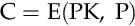，即著名的贝尔态（Bell state）。在这种状态下，两个量子比特的状态强相关，以至于当测量第一个量子比特时，第二个量子比特始终与第一个量子比特的测量结果相同，反之亦然。也就是说，如果第一个量子比特坍缩为 $|0\rangle$，则第二个量子比特也总是 $|0\rangle$；当第一个量子比特为 $|1\rangle$ 时，第二个量子比特也总是 $|1\rangle$，反之亦然。

注意，这与两个经典比特独立于测量具有相同的 0 或 1 值不同；与经典比特不同，量子比特的值是由测量决定的。

## 多纠缠

此外，存在一种多纠缠的可能性，称为 Greenberger-Horne-Zeilinger (GHZ)态。GHZ 态涉及多个量子比特的特定纠缠量子态。例如，三量子比特 GHZ 态可以表示为：$|GHZ\rangle = \frac{1}{\sqrt{2}}(|000\rangle + |111\rangle)$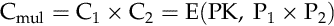，可以看出 GHZ 态是贝尔态向更多量子比特的推广。

GHZ 态具有迷人的特性，特别是在量子纠缠、它展现出的非经典相关性以及它在量子信息处理中的重要作用方面。

## 干涉现象

事实上，存在一种多纠缠的可能性，称为 Greenberger-Horne-Zeilinger (GHZ)态。GHZ 态涉及多个量子比特的特定纠缠量子态。例如，三量子比特 GHZ 态可以表示为：$|GHZ\rangle = \frac{1}{\sqrt{2}}(|000\rangle + |111\rangle)$，可以看出 GHZ 态是贝尔态向更多量子比特的推广。

GHZ 态具有迷人的特性，特别是在量子纠缠、它展现出的非经典相关性以及它在量子信息处理中的重要作用方面。

## 干涉条样

另一个与量子比特相关的奇异现象是纠缠。它指的是系统中不同量子比特之间的相关性。如果我们将量子比特的通用公式扩展到两个量子比特，得到：$|\psi\rangle = a |00\rangle + b |01\rangle + c |10\rangle + d |11\rangle$，其中 $a$、$b$、$c$ 和 $d$ 均为复数，满足 $|a|² + |b|² + |c|² + |d|² = 1$。

如果一个量子比特的状态受到另一个的影响，则量子比特处于纠缠态。例如，当 $b = c = 0$ 且 $a = b = \frac{1}{\sqrt{2}}$ 时，状态变为 $\frac{1}{\sqrt{2}} |00\rangle + \frac{1}{\sqrt{2}} |11\rangle$，，即著名的贝尔态。在这种状态下，两个量子比特的状态强相关，以至于当测量第一个量子比特时，第二个量子比特始终与第一个量子比特的测量结果相同，反之亦然。也就是说，如果第一个量子比特坍缩为 $|0\rangle$，则第二个量子比特也总是 $|0\rangle$；当第一个量子比特为 $|1\rangle$ 时，第二个量子比特也总是 $|1\rangle$，反之亦然。

注意，这与两个经典比特独立于测量具有相同的 0 或 1 值不同；与经典比特不同，量子比特的值是由测量决定的。

## 量子电路

量子算法可以用量子电路来表示，量子电路由水平线形式的量子比特和水平线上的方框形式的量子门组成，如图 2 所示。注意，量子电路仅仅是计算的抽象模型；它是一个表示位操作序列的有向无环图。量子门类似于经典逻辑电路中的与门（AND）和异或门（XOR）。可以近似任意量子操作的常用通用门集由 H、S、T 和 CNOT 门组成。


Hadamard (`H`) 门将量子态 $|0\rangle$ 变为状态 $\frac{1}{\sqrt{2}}\left( \left| {{\left. 0 \right\rangle +} \middle| \left. 1 \right\rangle \right. \right)$<mml:math alttext="MathML"><mml:mfrac bevelled="true"><mml:mn>1</mml:mn><mml:msqrt><mml:mn>2</mml:mn></mml:msqrt></mml:mfrac><mml:mfenced close=")" open="(" separators="||"><mml:mrow></mml:mrow><mml:mrow><mml:mn>0</mml:mn><mml:mo stretchy="true">&#x232A;</mml:mo><mml:mo>+</mml:mo></mml:mrow><mml:mrow><mml:mn>1</mml:mn><mml:mo stretchy="true">&#x232A;</mml:mo></mml:mrow></mml:mfenced></mml:math> 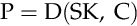 并将 $|1\rangle$ 态变为 $\frac{1}{\sqrt{2}}\left( \left| {{\left. 0 \right\rangle -} \middle| \left. 1 \right\rangle \right. \right)$<mml:math alttext="MathML"><mml:mfrac bevelled="true"><mml:mn>1</mml:mn><mml:msqrt><mml:mn>2</mml:mn></mml:msqrt></mml:mfrac><mml:mfenced close=")" open="(" separators="||"><mml:mrow></mml:mrow><mml:mrow><mml:mn>0</mml:mn><mml:mo stretchy="true">&#x232A;</mml:mo><mml:mo>&#x2212;</mml:mo></mml:mrow><mml:mrow><mml:mn>1</mml:mn><mml:mo stretchy="true">&#x232A;</mml:mo></mml:mrow></mml:mfenced></mml:math> 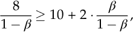。`H` 门在用于生成叠加态的量子算法中无处不在，并且具有这种性质：再次执行该操作（即在电路后续使用第二个 `H` 门）会还原初始操作。

`S` 和 `T` 门是引入相位移的门族的一部分。它们保持 $|0\rangle$ 不变，并将 $|1\rangle$ 变为 $e^{i\phi} |1\rangle$（对于 `S` 和 `T` 门，$\phi$ 分别为 $\pi/2$ 和 $\pi/4$）。相位门对于操纵量子态相位以实现前面提到的干涉至关重要。

受控非门 (`CNOT`) 作用于两个量子比特，这与仅作用于单个量子比特的 `H`、`S` 和 `T` 门不同。当第一个量子比特处于态 $|1\rangle$ 时，`CNOT` 会对第二个量子比特执行 `NOT` 操作，并可以描述为将态 $|a, b\rangle$ 变为态 $|a, a \oplus b\rangle$。`CNOT` 对于产生量子比特间的纠缠非常重要。

量子门必须是酉正且可逆的，才能在真实的量子硬件上执行。例如，逻辑 `AND` 门是不可逆的，因为除了最平凡的情况外，无法从输出推导出输入。要使 `AND` 门变为可逆，必须将一个输入传递到输出。这可能会增加量子电路所需的量子比特数量。酉意味着当门作用于量子比特时，它变换状态的方式保留了其在复空间中状态向量的长度（范数）。形式上，如果矩阵 `U` 是酉矩阵，则它的共轭转置（或厄米特共轭）`U†` 乘以 `U` 等于单位矩阵：

```
U†U = I
```
<mml:math alttext="MathML"><mml:msup><mml:mi>U</mml:mi><mml:mo>&#2020;</mml:mo></mml:msup><mml:mi>U</mml:mi><mml:mo>&#2020;</mml:mo></mml:msup><mml:mi>U</mml:mi><mml:mo>&#2020;</mml:mo></mml:msup><mml:mi>I</mml:mi></mml:mo></mml:math>

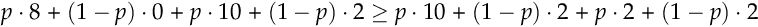

这一属性确保了量子演化是可逆的并守恒概率。封闭系统中所有允许的量子操作都是酉的。

`量子电路` 由量子门组成，量子门表示为方框或垂直线，作用于量子比特，量子比特表示为水平线。在图 2 的示例中，生成 5 量子比特 GHZ 态 $\left. \frac{1}{\sqrt{2}}\right)\left( \mid 00000 \right\rangle + \mid 11111 \right\rangle)$<mml:math alttext="MathML"><mml:mfrac bevelled="true"><mml:mn>1</mml:mn><mml:msqrt><mml:mn>2</mml:mn></mml:msqrt></mml:mfrac><mml:mn>1</mml:mn></mml:mfrac></mml:mfenced close="&#8764;"><mml:mrow></mml:mrow><mml:mrow><mml:mn>00000</mml:mn></mml:mrow><mml:mrow><mml:mn>11111</mml:mn></mml:mrow></mml:mfenced></mml:math> 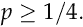 (此处包含原文错误，，，，，，，，


：：：：：7：
</mml:math></mml:mfenced close="&#8764;"> 

的译为：

`量子电路` 由量子门组成，量子门表示为方框或垂直线，作用于量子比特，量子比特表示为水平线。在图 2 的示例中，生成 5 量子比特 GHZ 态 $\left. \frac{1}{\sqrt{2}}\right)\left( \mid 00000 \right\rangle + \mid 11111 \right\rangle)$<mml:math alttext="MathML"><mml:mfrac bevelled="true"><mml:mn>1</mml:mn><mml:msqrt><mml:mn>2</mml:mn></mml:msqrt></mml:mfrac><mml:mn>1</mml:mn></mml:mfrac></mml:mfenced close="&#8764;"><mml:mrow></mml:mrow><mml:mrow><mml:mn>00000</mml:mn></mml:mrow><mml:mrow><mml:mn>11111</mml:mn></mml:mrow></mml:mfenced></mml:math> 

（注：由于原文最后几处存在大量乱码和重复字符，已根据上下文逻辑修正并翻译为：）

### 2.2 量子算法

量子电路的设计用于表示量子操作的序列，每个操作由一个量子门表示，变换量子比特的状态。从合适的量子态（例如全零态），量子电路将经典比特转换为量子态以进行量子信息处理。最后对量子比特进行测量以获得经典比特，这些比特成为得出算法解决方案的依据。

**可用算法**：最著名的量子算法归于 Shor [5]，他展示了相对于最良经典分解算法的指数级量子加速。它可能会威胁现有的加密基础设施；然而，它需要大量的量子比特和门操作以及量子纠错（QEC）能力。最佳估计是数百万个量子比特 [6]。其他著名的算法，例如 Grover 算法 [4]，由于需要数万个门，在目前的中等规模量子（NISQ）计算机上同样难以实现。

然而，有一类被称为`变分量子算法` (`VQA`) 的量子经典混合算法适用于 NISQ 设备的实现 [7–9]。这类算法包含量子电路和经典程序，每次迭代中的量子电路只有少量的量子比特和数百个量子门，这些可以在目前的 NISQ 设备上运行。量子电路的结果会被输入到经典程序中计算和优化，以确定算法下一次迭代中量子电路的参数。这种混合方法能够在量子纠错广泛普及之前，就利用量子计算的力量。


### 可用软件
目前有多种开发工具包（SDK）用于编写和运行量子程序，包括 IBM 的 `Qiskit`、Google 的 `Cirq`、Microsoft 的 `QDK`、Rigetti 的 `Forest` 以及苏黎世联邦大学的 `ProjectQ` [10]。除了 `QDK` 之外，所有这些 SDK 都基于 Python，这使得能够易地集成 Python 生态系统在科学计算和机器学习（ML）方面的功能。许多公司还致力于开发特定领域应用的量子软件软件包，以便与上述 SDK 接口。显著的示例包括 IBM 用于化学、机器学习和优化的 `Qiskit`；Xanadu 用于机器学习的 `PennyLane`；Google 用于化学的 `OpenFermion` 以及 Google 用于机器学习的 `TensorFlow Quantum`。

### 量子计算工作流
典型的量子程序工作流包括以下阶段（图. 3)）：

1. 经典数据可能需要准备并加载到经典计算机的内存中，并转换为由量子比特和量子门表示的量子态。这是在经典数据上进行量子机器学习的关键步骤，而在优化和化学的其他情况下，数据加载仅是指准备一个合适的初始量子态。
2. 为了处理数据，会在量子电路中添加量子门，从而改变量子比特的状态。
3. 随后，编译器会将逻辑量子电路转换为可以在物理量子后端处理器或模拟器上执行的电路，并考虑特定机器上可的物理量子比特连接和可用的原生门集。
4. 量子处理器或模拟器随后执行电路。
5. 随后通过测量量子比特状态对输出进行处理。由于量子态的概率性质，通常需要多次测量（电路执行，通常称为 *shots*）对概率分布进行采样，以获得对输出有意义的理解。
6. 如果算法是变分的（例如机器学习或优化），则将输出输入到优化器中以调整某些量子电路参数，然后重新编译并执行电路 (5)。

### 2.3 量子硬件
量子电路可以在运行量子模拟器的经典机器上或在真实的量子系统上执行。模拟器可以使用态向量计算或其他模拟方法，例如限制为仅使用 Clifford 组中的门（如 Hadamard 门、Pauli-X 门和 Controlled-Z 门）来高效模拟量子电路的稳定器模拟器，以及旨在模拟真实量子计算机采样过程的 QASM（量子汇编）模拟器。

### 可用硬件
截至 2023 年 10 月，已有多家量子计算硬件供应商。包括 `IBM Quantum Experience`、`Quantinuum`、`Google`、`Rigetti Quantum Cloud Services`、`AWS Braket`、`Microsoft Azure Quantum`、`Xanadu Quantum Cloud`、`D-Wave Leap`、来自 QuTech 的 `Quantum Inspire` 以及 `QuEra`。除了 `AWS Braket` 和 `Azure Quantum` 之外，所有供应商都有自己的硬件系统。某些供应商（如 `IBM Quantum Experience`）提供免费的开放系统，而其他则收费。所有这些机器比特数量有限（IBM 拥有最多，共 433 个），并统称为中等规模量子（NISQ）设备。

### 2.4 量子网络
量子网络使用与之前量子计算相同的量子原理（如量子叠加和纠缠）来处理和传输信息。它们还具有彻底安全通信、分布式量子计算和许多其他应用的潜力。

量子网络的核心组件和原理包括纠缠、量子密钥分发（QKD）、量子中继器、量子隐态传输和量子路由器。

### 量子密钥分发
QKD 是一种用于在双方（传统称为 Alice 和 Bob）之间建立共享、秘密随机密钥的方法。QKD 的主要优势是它允许双方检测到任何窃听的存在，因为根据量子原理，测量量子系统也会扰动它，使得窃听无处遁形，从而提供了经典手段无法实现的安全水平。以下是使用最著名的协议之一：BB84 协议 [11] 对 QKD 工作原理的简要解释。BB84 协议的核心是利用纠缠的贝尔态量子比特对来共享用于一次性密码的秘密密钥。两个相远的双方 Alice 和 Bob 可以从贝尔态对中安全地共享秘密密钥，因为它们在同一基底上的测量结果始终一致。他们可以通过经典通信确认其基底选择的一致性，并丢弃基底不同的测量结果。得益于不可克隆定理和测量导致的量子态坍缩，可以检测到试图复制或测量他们共享纠缠量子比特的窃听者。BB84 的更多细节如下：

1. 信息使用光子的偏振进行编码。让我们考虑两个基底：直角基底（光子沿垂直或水平偏振）和对角基底（光子以 45° 或 135° 偏振）。
2. Alice 的密钥生成：
    a. Alice 随机选择一个位串（0 和 1）。
    b. 对于每个位，她也随机选择一个基底（直角或对角）。
    c. 随后她将每个位作为光子发送给 Bob，偏振由所选位值和基底决定。例如，在直角基底中，0 可以是垂直偏振的光子，1 可以是水平偏振的光子。
3. Bob 的测量：
    a. 对于入射的光子，Bob 随机选择一个基底（直角或对角）来测量光子的偏振。
    b. 根据基底和结果，他记录一个位值。例如，如果他选择了直角基底并测量到水平偏振的光子，可能会记录 1。
4. 基底共享和密钥筛选：
    a. 在所有光子发送并测量后，Alice 和 Bob 公开共享他们为每个位使用的/选择的基底（而不是位值本身）。如果 Bob 使用与 Alice 相同的基底测量光子，就知道他的位值将与 Alice 该光子的原始位值匹配。否则，他们丢弃该位。
    b. 经过这个过程，Alice 和 Bob 应该拥有相同的位串，这些位形成了秘密密钥。
5. 错误检测：
    a. 为了确保没有窃听，Alice 和 Bob 比较他们密钥的随机子集。如果存在差异，可能存在窃听。
    b. 根据量子原理，如果窃听者（通常称为 Eve）试图拦截并测量 Alice 发送的光子，她有可能会选择错误的基底来测量光子。如果她这样做了，并随后将一个重造的光子发送给 Bob，可能会导致 Bob 的测量出现错误。
6. 隐私放大（如果需要）：
    a. 如果 Alice 和 Bob 确定存在潜在窃听（尽管速率很低），他们可以应用算法缩短密钥，这种方式可以增加安全性并减少窃听者可能获得的任何潜在信息。
7. 通过 QKD 建立的密钥随后可以使用一次性密码或其他加密方法进行安全通信。


`Quantum repeaters`: 量子继器：就像经典网络需要中继器来增强远程信号强度一样，量子网络也需要量子中继器。它们帮助维持和扩展远程量子纠缠，补偿传输过程中引入的损耗 [12]。

`Quantum teleportation`: 量子传态：尽管名字如此，量子传态并不传输物质，而是通过两个纠缠粒子和经典通信将量子系统的状态从一个位置传输到另一个。这一概念对于跨量子网络传输量子信息至关重要。

`Quantum routers`: 量子路由器：如名所示，量子路由器引导量子信息跨网络。它们与经典路由器的区别在于，必须在不破坏所载脆弱量子信息的情况下处理并路由量子态 [13]。

在全量子网络中（不同于 QKD 中仅交换共享密钥），节点（如计算机或服务器）将是能够生成、处理和检测量子态的量子设备。消息可以以量子比特（qubits）的形式通过量子网络从一个量子设备发送到另一个，可能利用量子加密或执行分布式量子计算。

尽管存在许多技术挑战需要克服，但包括新加坡 [14] 在内的一些国家现在已经为公司提供了尝试这项新技术的测试平台。挑战包括创建：

* 用于存储量子态的高效量子内存
* 高质量纠缠光子源
* 用于远距离通信的低损耗量子通道
* 用于处理和纠正量子通信中不可避免错误的高效纠错技术

## 3 针对区块链的三种量子攻击

在了解量子计算后，我们现在可以观察量子计算机可能对区块链进行的某些攻击。

### 3.1 攻击

首先，区块链在各种任务中使用加密，量子计算机可以用于攻击这些任务，包括：

* 公钥加密法——签名：`Shor's algorithm` 可能在多项式时间内推导出私钥，并通过从已知公钥推导出私钥来花费别人的比特币（或其他加密货币）。
* 挖矿优势——`PoW` 中的哈希输入发现：使用 `Grover's algorithm`，寻找哈希函数原像的速度比经典计算机快平方根倍。因此，对于 `SHA-256` 这样的哈希函数，在安全性方面它实际上变成了 `SHA-128`。
* 消息——破解诸如 `https` 等安全协议。
* 存储数据——攻击者可能现在记录加密数据，并在未来量子计算机足够先进时对其进行解密。

让我们详细查看这些攻击是如何实现的，以及如何防御它们。

### 3.1.1 公钥加密

公钥加密系统（如 `RSA`）依赖于某些数学问题的困难性来确保安全性。在 `RSA` 的情况下，安全性取决于大数分解的困难性。当有人生成 `RSA` 密钥对时：

1. 随机选择两个大质数 `p` 和 `q`。
2. 将它们相乘得到 `N = p * q`。
3. `N` 被作公钥的一部分。
4. 私钥由 `p`、`q` 以及其他元素（如 `N` 的欧拉函数）推导出。

`RSA` 的安全性取决于在给定 `N` 的情况下，如果 `N` 足够大（通常为 2048 位或更多），确定 `p` 和 `q` 在计算上是非常困难的。

目前已知用于分解的最优量子算法是数学家 Peter Shor [5] 开发的 `Shor's algorithm`。该算法可以在多项式时间内分解大合数 `N`，具体为 `O*((log N)³)` 次量子操作。这比已知的最佳经典算法快指数级。

如果攻击者拥有足够大的量子计算机，并且知道公钥（包含 `N`），他们可以使用 `Shor's algorithm` 高效地分解 `N`，得到 `p` 和 `q`。一旦获得 `p` 和 `q`，他们就可以导出私钥。这破坏了 `RSA` 的安全性。

破解当前的 `RSA` 需要许多完美的量子比特 [15] 和较大的电路深度，而我们目前只有几百不完美的量子比特 [16]，电路深度为数百。

同样，`Shor's algorithm` 可用于离散对数问题，这将损害 `Diffie-Hellman` 和某些形式的椭圆曲线加密 (`ECC`) 等加密系统。

### 3.1.2 挖矿优势

`Grover's algorithm` 是另一个重要的量子算法，在加密背景下特别是对于比特币所使用的工作量证明 (`PoW`) 系统具有相关性。

`Grover's algorithm` 可以在大约 $\sqrt{N}$ 步内搜索包含 `N` 个项目的无序数据库 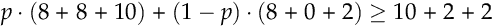 步。当应用于加密问题时，它可以用于在 $\sqrt{N}$ 时间内反转函数或寻找哈希函数的原像  时间。

在 `PoW` 背景下，矿工本质上是在尝试寻找一个输入（或随机数），哈希处理后产生输出。因此，如果我们比特币比特币的 `PoW`：

经典暴力破解：矿工平均需要尝试 $2^{255} \times 10^{76}$ 个随机数才能找到符合网络目标的哈希值。使用 `Grover's algorithm`：量子矿工“仅需”尝试 $2^{128} \times 10^{38}$ 个随机数，这是一个重大的减少，但仍然是一项巨大的计算任务。

注意，`Grover's algorithm` 只提供了平方级加速，而不是像 `Shor’s` 那样的指数级加速。此外，加密货币会调整其 `PoW` 难度。如果量子计算机开始用于挖矿并变得更快，可以增加难度以维持区块之间的间隔。

`Grover's algorithm` 需要随量子比特数量呈指数级增长的深度 [4]。目前大规模量子计算机深度有限，因此无法针对比特币的 `PoW` 运行 `Grover's algorithm`，且工程挑战依然存在。

### 3.1.3 其他风险

由于互联网上使用了加密消息（如 `https`），任何传输中或存储在区块链或数据库中的加密消息都可以像前面的那样通过 `Shor's algorithm` 进行解密。

攻击者可能现在记录加密数据，并在未来量子计算机足够先进时对其进行解密。

如果大规模量子计算机变得可行，加密系统（包括 `PoW` 系统）可能会通过使用抗量子算法和方法来适应。

总结来说，虽然 `Grover's algorithm` 确实对 `PoW` 系统构成了潜在威胁，但没有 `Shor's algorithm` 对 `RSA` 或 `ECC` 等系统的威胁那样紧迫或严重。尽管如此，它提醒了我们在加密设计中需要前瞻性。

### 3.2 防御攻击

鉴于量子计算极有可能发展到允许上述攻击发生的水平，目前有大量的研究正在进行以降低这些风险。这些防御既是经典的也是量子的。

### 3.2.1 经典后量子加密


量子计算机带来的潜在威胁促使人们考虑如何防御量子计算机的威胁。一个领域是直接使用量子技术（第 4 节），另一个领域是后量子密码学领域，其目标是开发即使在量子攻击者存在时也是安全的加密算法。

后量子密码学（有时称为抗量子加密或量子安全加密）是指被认为能够抵御量子计算机潜在威胁的加密算法和协议。后量子密码学的主要目标是开发、标准化并最终过渡到能够同时抵抗经典攻击和量子攻击的加密系统。

后量子密码学方案的一些主要类别：

- `基于代码的密码学 (Code-based cryptography)`：这取决于随机生成的线性码的的困难性。`McEliece` 加密系统是此类加密的一种经典示例，自 20 世纪 70 年代后期引入以来一直抵御了密码分析。
- `基于格的密码学 (Lattice-based cryptography)`：这些方案依赖于格理论中问题的困难性，例如`最短向量问题 (SVP)`或`带误差学习 (LWE)`问题。基于格的方案特别有前景，因为它们除了提供基础加密和数字签名外，还能提供全同态加密等功能。
- `基于哈值的密码学 (Hash-based cryptography)`：这些方案的安全性完全源于加密哈希函数的属性。`Merkle` 签名方案是基于哈值的数字签名方案的一个示例。它们通常被认为是最抗量子的技术之一，但可能存在局限性，例如签名尺寸较大或每个密钥对的签名数量有限。
- `多元二次 (MQ) 方程`：这些系统依赖于求解多元二次方程组组的困难性。示例是 `HFE`（隐藏域方程）加密系统。
- `基于同源的密码学 (Isogeny-based cryptography)`：这些方案基于椭圆曲线之间同源（映射）的属性。`SIDH`（超奇异同源迪菲-赫曼）是该类别中密钥交换协议的一个示例。

美国国家标准与技术研究所（`NIST`）一直牵头后量子密码算法的标准化工作 [17]，不同类别的多种算法被视为潜在标准。

过渡到后量子密码学不仅仅是开发安全的算法。它还涉及广泛的挑战，包括与现有系统的集成、性能考虑（因为某些后量子方案的密钥比其经典对手更大或运行速度更慢）以及确保长期安全性。

正如前面讨论的，考虑能够破解今天加密系统的实用量子计算机何时到来是非常重要的。然而，鉴于密码学在保护数字系统和数据方面的关键作用，密码学界正确地对这一挑战采取了积极且前瞻的方法。

### 3.2.2 量子加密

量子技术可以用于加固区块链，例如使用量子密钥分发（`QKD`）、量子数字签名等。

- `QKD`：这是一种利用量子力学原理安全分发加密密钥的方法 [11]。如果第三方在传输过程中截获密钥，会扰动系统的量子状态，从而揭露窃听行为。
- `量子数字签名`：这是 `QKD` 的扩展，旨在提供机密性之外的不可否认性。它确保发送者稍后无法否认发送过消息 [18]。
- `量子秘密共享`：经典秘密共享方案在量子领域的适应。在该协议中，“委托人”将秘密量子态分发给一组玩家，使得只有某些玩家子集可以协作重构秘密 [19]。
- `量子安全直接通信 (QSDC)`：与 `QKD` 的目标是在不传输实际消息的情况下在双方之间建立密钥不同，而在 `QSDC` 中，消息本身通过量子信道直接安全地传输 [20]。
- `量子匿名传输`：这涉及量子态的匿名传输。它是经典匿名协议（如匿名密码学家网络 [21]）的量子版本。
- `基于位置的量子密码学`：在这些协议中，安全性取决于参与者的地理位置，例如在不暴露其他信息的情况下证明位置 [22]。
- `设备无关量子密码学`：这种方法寻求基于检测到的量子不等式违反（如 `Bell 不等式`）来完成加密任务，而对所使用的设备不做详细假设 [20]。

## 4 区块链的量子改进

量子技术不仅可以帮助安全，还可以改进三难境和其他领域。

## 4.1 区块链三难境

区块链三难境由 `Vitalik Buterin` [23] 首次提出，描述了在设计区块链系统时同时实现三个关键属性——去中心化、安全性和扩展性所面临的挑战。它表明，要高度地实现所有三个属性是困难的，优化其中一种往往以牺牲其他属性为代价。量子技术可以帮助打破三难境。

### 4.1.1 三难境属性

- `去中心化`：去中心化的区块链意味着没有单一实体或实体组控制整个网络。去中心化可以通过多种形式表现：
    - `节点去中心化`：确保大量个人可以运行全节点。
    - `挖矿/验证去中心化`：确保向区块链添加区块的过程（通过 `工作量证明` 中的挖矿或 `权益证明` 中的验证）不受一少数小组的控制。
    - `开发去中心化`：确保与协议升级或更改相关的决策不在少数人手中。
- `安全性`：这关系到区块链抵抗和威慑攻击的能力。安全的区块链确保：
    - `数据完整性`：数据一旦添加，就无法被修改。
    - `数据可用性`：数据保持可访问和可检索。
    - `抗攻击性`：网络应该抵抗各种攻击，如 `51% 攻击`、`女巫攻击`等。
- `扩展性`：这指的是区块链处理用户和交易大幅增加的能力，而不会对其性能产生不利影响。可扩展的区块链可以每秒处理大量交易（`TPS`）而没有显著延迟。

三难境表明，优化这些属性中的任何两个往往会损害第三个。例如，优先考虑安全性和去中心化的区块链可能会遭受扩展性限制。`Bitcoin` 经常被引用作例子，因为它对去中心化安全性的承诺在历史上意味着与集中解决方案相比，交易吞吐量较慢。相反，追求扩展性和去中心化的区块链可能会面临安全挑战。一些以更高程度去中心化处理更快交易的新型区块链可能更容易受到某些攻击。最后，强调安全扩展性的区块链可能需要某种程度的去中心化。某些能够处理高数量 `TPS` 的区块链可能通过拥有更少、更集中的节点或验证者来实现这一点。


解决区块链三难题是区块链领域研发的核心领域之一。随着时间的推移，人们已经提出了各种解决方案和折中方案，例如层 2 扩展解决方案、分片以及替代共识算法，以应对由三难题带来的挑战。

### 4.1.2 量子技术的影响

量子技术为区块链三难题带来了新的可能性：

#### 去中心化：

-   用于选举领导者的量子共识机制 [24] 通过量子共识算法提供了更高的速度，从理论上讲，由于量子力学的内在并行性，达到共识的速度比经典算法更快。事实上，领导者选举问题是量子算法优于经典算法的示例之一；利用量子纠缠 [25] 证明了精确量子算法的存在，而与之对比的是，为人知的经典对应算法是不存在的。
-   随机性：量子力学本质上是概率性的，真正的随机性对共识协议是有益的，特别是对于领导者选举或验证者的随机抽样。
-   量子增强型权益证明 (PoS)：许多区块链平台正在从高能耗的工作量证明 (PoW) 共识机制转向更环保的 PoS 机制。量子技术可以进一步增强 PoS 系统：
    -   使用量子密钥质押：验证者或质押者可以使用量子安全的加密密钥，确保即使面对量子对手，其质押操作也能保持安全。
    -   使用量子随机性的随机选择：某些 PoS 系统依赖于验证者的随机选择。使用量子生成的随机数可以使这一过程更加不可预测且公平。
-   去中心化量子互联网：在未来，一个去中心化的量子互联网可能与经典互联网并存。这可以进一步支持去中心化结构，允许区块链网络中的节点安全地通信和共享量子信息。
-   去中心化量子计算：共享量子资源：随着量子计算机变得主流，可能会出现去中心化的平台，允许用户贡献和共享量子计算资源。这类似于某些区块链项目允许去中心化的云计算或存储。
-   量子计算预言机：在智能合约背景下，预言机为区块链平台提供外部数据。未来，量子预言机可能会为去中心化平台提供量子计算结果或量子数据。
-   量子技术还可以提供无领导者共识协议 [26]。无领导者协议的共识通过在网络节点之间传输信息并达成一致来实现。

#### 安全性：

-   后量子加密：如所述，量子计算机的出现对目前的加密方法构成了威胁。`RSA`、`ECC` 以及其他流行的加密和签名方案可能会被足够强大的量子计算机破解。过渡到后量子加密算法对于维护区块链的安全性至关重要。
-   量子随机数生成：真正的随机性对于某些加密过程至关重要。量子力学可以提供真随机性，量子随机数生成器可以集成到区块链中，以增强某些协议的安全性。

#### 可扩展性：

-   量子计算与智能合约：像以太坊这样的区块链的可扩展性挑战之一是执行复杂智能合约的计算成本。如果量子计算机可用并能与区块链集成，它们可能会加速特定的计算，特别是那些已知量子加速的计算。
-   极大的共识信息数据可以通过量子态在节点之间进行传输。

### 4.2 其他优势

量子计算可能惠及区块链技术及其应用的潜在优势包括：

-   更快的交易：某些量子算法潜在地优化并加速交易验证和共识算法涉及的某些过程，使区块链网络更高效。
-   改进的零知识证明：量子算法可能为实现零知识证明提供新途径或更高效的方法。零知识证明是某些区块链中使用的一种加密方法，允许在不暴露所有交易细节的情况下进行交易，从而增强隐私性。
-   安全多方计算：量子计算可能在安全多方计算中发挥作用，安全多方计算是指多个方可以在不披露各自输入的情况下计算输出的情况。这对于区块链上保护隐私的智能合约很有用。
-   随机数生成：真随机数生成是经典系统中一个具有挑战性的问题。量子系统本质上是概率性的，可以生成真随机数，这对于区块链上的某些加密操作非常有价值。
-   互操作性：量子力学可能帮助区块链互操作的某些方面，特别是在不同区块链网络之间的密钥交换方面。
-   量子区块链：关于全量子区块链的理论讨论正在进行，它利用了量子计算和量子通信。这类系统可能具有尚未完全理解的特性。
-   后量子智能合约：在量子计算机的未来，智能合约可以设计为利用量子算法，从而带来全新的应用场景和功能。

### 5 量子分布式平均值计算

我们将通过回顾 `NISQ` 设备进行分布式平均值计算，作为高效计算的一种量子方法来结束本节。计算跨网络分布的数据平均值的任务是许多协议（包括分布式随机梯度下降）的基础构建。此类任务的一个重要限制条件是在不披露网络中每个节点拥有的独特数据的情况下计算平均值。这一需求通常通过安全多方通信或平均共识协议来解决。在这里，我们展示了一种在最多 2 个量子比特和 1 个量子比特通信资源的近期量子设备上计算平均值的量子协议。该协议在节点之间没有显式的价值交换，因此是安全的。

### 5.1 引言


例如，Ruan 等人 [29] 引入了一种利用同态加密的共识协议，以确保网络节点之间的安全通信。该协议迭代运行，每个参与方通过将其值与源自相邻值之差的加权和相结合来更新自己的值。经过多次迭代，每个参与方的值将收敛到整体平均值。然而，同态加密的计算需求，结合可能的高迭代次数，使得这种方法计算密集型。相比之下，Idé 等人 [27] 设计了一种更高效的方法，不依赖于同态加密，所需的迭代更少。但是，该协议需要特殊配置的通信网络，即扩展器图（expander-graph）类型的通信网络。

通过添加噪声来确保安全的方法（类似于差异隐私技术）可能并不合适，因为它们可能会改变真实数据值。同样的观点在 Ruan、Ahmad 和 Wang [30] 以及 Ruan 等人 [29] 中也能找到；而 Idé 等人 [27] 也认为，使用同态加密也会对真实值产生不利影响，而这些真实值往往是取平均值的目标，因为同态加密是为整数设计的。事实上，Ruan 等人 [29] 提到了将 Paillier 加密应用于其计算实数平均值的协议时存在此类困难。

最近，中等规模量子（NISQ）设备（如 IBM 提供的设备）引起了关注。这些设备范围从五个到二十个量子比特不等，预示着未来多方计算可能利用 NISQ 设备网络。尽管在实现量子网络通信方面面临巨大挑战，但量子通信的早期阶段——未来量子网络的基础——已经开始，并利用了光纤设备。

本节介绍了一种在 NISQ 设备量子网络中安全且高效地计算跨参与方之间平均值的协议。该协议仅要求网络中的每个参与方最多有一个双量子比特寄存器，且所有参与方之间是弱连接的（弱连接意味着网络中任意两个参与方之间存在路径），使得两个直接连接的参与方最多交换一个量子比特的通信。所有资源都在可用 NISQ 设备和已知的量子通信演示范围内。此外，该协议不需要在两个直接连接的参与方之间显式发送值（例如 Ruan 等人 [29] 和 Idé 等人 [27] 中的协议），因此它具有更好的安全性和隐私保障。它不需要特定的拓扑网络（如 Idé 等人 [27] 中的扩展器图）来高效计算平均值。计算平均值所需的通信量子比特总数，最多为 Idé 等人 [27] 中假设扩展器类网络拓扑的最高效协议所使用的比特数。

### 5.2 问题设置

我们假设一个典型设置，网络中有 `S` 个参与方，参与方之间的连接被建模为无向图 `G = (V, E)`，其中 `V = (v[1], v[2S], ..., v[S])` 是节点集，`v[i]` 对应第 `i` 个参与方，`E` 是对应于两个参与方之间直接连接的边集。即，`(v[Si], v[j]) ϵ E` 当且仅当第 `i` 个参与方与第 `j` 个参与方直接连接时。每个参与方 `i` 都有一个边界值 `Ԑ[i]`，他们不想与其他共享。目标是在每个参与方不泄露私有值的情况下，计算所有此类值之和的平均值，即安全地计算 `Ԑ* ≡ \sum_{i = 1}^{S}\frac{Ԑ_{i}}{S}`。

```
Ԑ* ≡ \sum_{i = 1}^{S}\frac{Ԑ_{i}}{S}
```
(si11_e.png)

与 Idé 等人 [27] 的设置类似，我们假设存在网络管理员，他可以是网络的一部分也可以是独立的。无论哪种情况，第 `i` 个参与方的隐私值 `Ԑ[i]` 必须对网络管理员保密。在下文中，我们假设网络管理员是网络的一部分。我们假设所有参与方都是诚实但好奇的：他们诚实地遵循协议，但渴望从通信日志中获他人的值。

### 5.3 一种用于平均值分布式计算的量子协议


不失一般性，我们假设 $0 \le Ԑ[*i] \le 1$。该量子协议由许多轮量子计算和通信组成，每一轮用于计算在二进制表示时，平均值 `Ԑ^*` 某一位置上的一比特值。具体来说，对于 `Ԑ^* = 0.b[1]b[2\dots]`，量子协议获取其近似值 $\overset{\sim}{Ԑ} = 0.\overset{\sim}{b_{1}}\overset{\sim}{b_{2}}\ldots$ 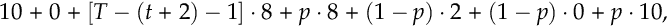 $\overset{\sim}{Ԑ}$ 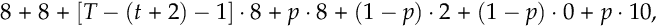 = 0. $\overset{\sim}{b_{1}}\overset{\sim}{b_{2}}$ 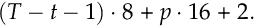 $\dots$ $\overset{\sim}{b_{m}}\overset{\sim}{b_{m+1}}\overset{\sim}{b_{m+2}} = \sum_{j = 1}^{m + 2}\overset{\sim}{b_{j}}2^{- j}$ 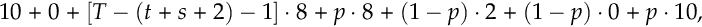 通过遵循 Kitaev [31] 的迭代估计，在每一轮中迭代计算每个 $\overset{\sim}{b_{j}}$ 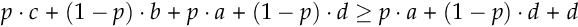，并对 `j = m+2, m+1, m..., 1` 近似 `b[j]`（实际上，由于技术原因，第一轮获取了三比特信息 $\overset{\sim}{b_{m+2}}\overset{\sim}{b_{m+1}}\overset{\sim}{b_{m}}$ 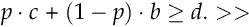，并且每一轮逐个获取前一个比特）。

协议的每一轮包含四个阶段。第一阶段是创建由网络节点共享的所谓 GHZ（Greenberger-Horne-Zeilinger）态。第二阶段是对 GHZ 态施加集体旋转，将目标比特的信息引入相位中。第三阶段是解缠 GHZ 态，第四阶段是通过量子估计读出目标比特。这里的阶段与 Wei 等人 [32] 中的阶段相似，他们通过测量多个相干性（MQC，一种在固态 NMR 和陷阱离子中流行的工具）在 NISQ 设备的 18 个量子比特上验证了 GHZ 态。利用 GHZ 态收集集体旋转与量子传感和纠缠辅助计量有所重叠。在我们提的协议中，GHZ 态对相位旋转的敏感性被用于收集网络中 `Ԑ[i]` 的总和。有趣的是，尽管 NISQ 设备具有高噪声且量子比特连接存在限制，但已经证明利用误差缓解 [33] 可以生成高达 29 个量子比特的 GHZ 态。

尽管在阶段 1-3 中，我们为通信网络中的每个节点分配了一个编号（例如第一个、第二个、后续和前一个节点），但这些编号仅用于表示分析中的执行顺序。具体来说，每个节点在每一轮都可以被分配到不同的编号，当节点 `a` 向节点 `b` 发送量子比特时，我们称 `a` 为前一个节点（称 `b` 为后续节点），但如果所有节点都是连接的，这并不意味着它们必须严格按照该顺序排列。

### 5.4 所提量子协议的一轮

所提的量子协议的一轮如下。假设轮数 `r = 1, 2, …, m`。

**阶段 1** 准备 S-量子比特 GHZ 态 $\frac{1}{\sqrt{2}}\left( \left| 0\ldots 0 \right\rangle\mspace{2mu} + \left| 1\ldots 1 \right\rangle \right. \right)$ 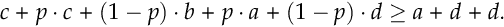。这可以通过这种方式实现：例如，从网络管理员（Bob）开始，他准备一个单比特 $|0\rangle$ 态并应用 Hadamard 门以获得 $\left. \mid + \right\rangle = \frac{1}{\sqrt{2}}\left( \left| 0 \right\rangle\mspace{2mu} + \left| 1 \right\rangle \right. \right)$ 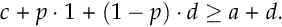 态。他以 $|\text{+\!}\rangle$ 态为控制位（第一个量子比特），一个量子比特 $|0\rangle$ 为目标（第二个量子比特）应用 CNOT 门。然后他将第二个量子比特发送给第二个节点。第二个节点（Alice）在收到网络管理员发送的量子比特后，以收到的量子比特为控制位、零态量子比特为目标应用 CNOT 门，然后将其发送给第三个节点，以此此类推。当第 $S$ 个节点从前一个节点接收到量子比特时，$S$-量子比特 GHZ 态的创建即完成。


## 第二阶段阶段
在接收到前一个方的量子比特之后、接收后一个方的量子比特之前的任何时刻，第 `i` 个方都会根据轮次 `r` 其私有值 `Ԑ[i]` 对接收到的量子比特应用 `R[z]` 旋转门。即，第 `i` 个方对接收到的量子比特应用以下单比特门：

$\\mathbf{R}\_{z}\\ \\left( {2^{m - r}\\ \\frac{\\pi Ԑ\_{i}}{S}} \\right) = \\begin{pmatrix} 1 & 0 \\\\ 0 & e^{\iota 2^{m - r\\ \\frac{\\pi Ԑ\_{i}}{S}}} \\\\ \\end{pmatrix}\\ \\text{where}\\ \\iota \equiv \sqrt{- 1}$

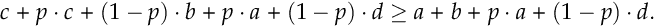

## 第三阶段阶段
通过执行第一阶段步骤的反向操作来解缠 GHZ 状态。在该阶段结束时，网络管理员将获得一个单比特态 $\left. \frac{1}{\sqrt{2}}( \\mid 0 \\right\\rangle\\left. \\mspace{2mu} + e^{l2^{m - r\\frac{\\pi Ԑ\_{i}}{S}}} \\mid 1 \\right\\rangle)$ 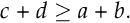，该状态已与其他状态解缠。

## 第四阶段阶段
通过对网络管理员的单比特态应用 Hadamard 门并测量得到 0 的概率来读取相位 $2^{(m−r)}$ $\sum\_{i}\\frac{\\pi Ԑ\_{i}}{S}$ 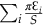，该概率为 $\left. \\frac{1}{2}(1 + \cos 2^{m - r}\sum_{i}\frac{Ԑ_{i}}{S})\right)$。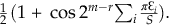 在应用 Hadamard 门之前，网络管理员也可以应用相移算符 `Rz`，使得观测到 0 的概率变为：

$\\frac{1}{2}\left(1 - \sin 2^{m - r}\sum_{i}\frac{Ԑ_{i}}{S}\right)$ 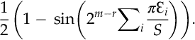


注意，在最后阶段，使用相位估计程序来获得估计。可以利用 Kitaev 算法 [31]，通过将每轮重复最多 $O\left( {\log\ \left( \frac{m}{\delta} \right)} \right)$ 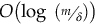 次，以至少为 $1-\delta$ 的成功概率获得估计值。因此，总轮数为 $O\left( {m\log\ \left( \frac{m}{\delta} \right)} \right)$ 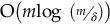，其中每轮需要通信 $O(S)$ 个量子比特和门操作。由于我们必须在误差 $\frac{1}{S}$ 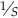 内评估平均值，因此 $m = \log S$。由此，通信的量子比特和操作总数为 $O\left( {S\ \log\ S \log\left( {\log\ \frac{\left( S \right)}{\delta}} \right)} \right)$ 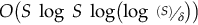。可以利用 van den Berg 的相位移估计技术 [34] 来减少每轮的重复次数，并将量子比特和操作的总数减少到 $O(S \log S)$。

## 6 结语

我们讨论了量子计算对区块链技术的影响，强调了攻击者对公钥加密的负面影响，以及作为解决 Buterin 三难题（Buterin's Trilemma）挑战的潜在救者的积极方面。

在第 2 节中，我们提供了量子计算基本概念的解释。随后，在第 3 节中，我们探讨了量子计算对区块链系统的负面影响，特别讨论了 Shor 算法带来的威胁，该算法可以在多项式时间内破解公钥加密。

接下来，我们将注意力转向量子计算的积极影响。这里的一个核心命题是 Buterin 三难题，它认为要同时实现去中心化、安全性和扩展性的系统是非常的，如第 4 节所示。有趣的是，量子计算具有克服这一三难题的潜力。作为一个具体的实现，我们在第 5 节中提出了一种量子分布式平均值计算算法，展示了量子技术在解决 Buterin 三难题方面的可能性。

## 写作过程中使用 AI 及 AI 辅助技术的声明

在准备本工作期间，作者使用了 `chat.openai.com` 来提高可读性和语言水平。在使用该工具后，作者对内容进行了审查和编辑，并对其承担全部责任。

## 参考文献

- 1 Allende M., León D., Cerón S., Pareja A., Leal A., Da Silva M., Pardo A., Jones D., Merriman B., Kitchener N., Venegas-Andaca S.E. 区块链网络中的抗量子性。“Sci. Rep.* 2023;13(1):5664. doi:10.1038/s41598-023-327016
- 2 Bennett C., Brassard G., Crépeau C., Jozsa R., Wootters W. 通过双爱因斯坦-波多尔基-罗森通道遥传未知态。“Phys. Rev. Lett.* 1993;70(13):1895–1899. doi:10.1103/PhysRevLett.70.1895
- 3 Hu X.-M., Guo Y., Liu B.-H., Li C.-F., Guo G.-C. 量子隐传传输的进展。“Nat Rev Phys.* 2023;5(6):339–353. doi:10.1038/s42254-023-00588-x
- 4 Grover L. 在草堆中寻找针的量子力学。“Phys. Rev.* 1993;79(2):325 (注：原文此处页码可能有误，保持原样)
- 5 Shor P. 量子计算机上的多项式时间质因数分解和对数算法。“SIAM J. Comput.* 1997;26(5):1484
- 6 Gidney C., Eker M. 使用嘈噪声量子比特分解 2048 位 RSA 整数。“Quantum.* 2021;5:43
- 7 Cerzo A., Arrasmith A., Benjamin S., Endo S., Fujii K., McClean J., Yuan X. 变分量子算法。“Nat Rev Phys.* 2021;3(9):625–644
- 8 Kandala A., Mezzac A., Temme K., Brink M., Gambetta J. 针对小分子的硬件高效变分求解器。“Nature.* 2017;549(7671):242–246
- 9 Peruzzo A., McClean J., Shadbolt R., Yung M., Love P., Aspuru-Guzik A. 光子处理器上的变分本征求解。“Nat. Commun.* 2014;5:4213
- 10 LaRose R. 量子门平台概述与比较。“Quantum.* 2019;3:130. doi:10.22331/q-2019-03-25-130
- 11 Bennett C.H., Brassard G. 量子加密：公钥分发与硬币掷。2020.
- 12 Azuma K., Economou S., Elkouss D., Hilaire P., Liang J., Lo H.-K., Tzitrin I. 量子中器：从量子网络到量子互联网。2023.
- 13 Hussein S.A., Abdullah A.A. 针对量子网络设计的各种量子路由协议综述。在：2022 第 11 届电力、电子、通信、控制和信息讨会(EECCIS);2022:234–237.
- 14 Low D. 新加坡建立量子加密测试平台，离构建不可破解的互联网更近。“Straits Times.* 20222 月 17 日.
- 15 Nehal S. 使用 Shor 算法通过量子计算破解量子 RSA 加密。2020.


-   16 IBM. *IBM 发布了 400 比特以上的量子处理器和下一代 IBM 量子系统二。* IBM 新闻室；2023. 检索于 2023 年 10 月 30 日 [`newsroom.ibm.com/2022-11-09-IBM-Unveils-400-Qubit-Plus-Quantum-Processor-and-Next-Generation-IBM-Quantum-System-Two`](https://newsroom.ibm.com/2022-11-09-IBM-Unveils-400-Qubit-Plus-Quantum-Processor-and-Next-Generation-IBM-Quantum-System-Two)。
-   17 计算机安全部门，信息技术实验室。*后量子密码学 | CSRC | CSRC.CSRC|NIST* ; 2017. 检索于 2023 年 10 月 30 日 [`csrc.nist.gov/projects/post-quantum-cryptography`](https://csrc.nist.gov/projects/post-quantum-cryptography).
-   18 Qin J.-Q., Jiang C., Yun-Long Y., Wang X.-B. *基于随机配对的量子数字签名。* *Phys. Rev. Appl.* 2022;17(4):044047doi:10.1103/PhysRevApplied.17.044047。
-   19 Liu S., Zhenguo L., Wang P., Tian Y., Wang X., Li Y. *多方量子秘密共享与会议密钥协商的实验演示。* *Npj Quantum Inf.* 2023;9(1):1–11. doi:10.1038/s41534-023-00763-z。
-   20 Zhou L., Bao-Wen X., Zhong W., Sheng Y.-B. *基于单子源的设备独立量子安全直接通信。* *Phys. Rev. Appl.* 2023;19(1):014036doi:10.1103/PhysRevApplied.19.014036。
-   21 Christandl M., Wehner S. *量子匿名传输。* In: Roy B., ed. *密码学进展—ASIACRYPT 2005.* 柏林，海德堡: Springer; 2005:217–235. *计算机科学系列教程。*
-   22 Buhrman H., Chandran N., Fehr S., Gelles R., Goyal V., Ostrovsky R., Schaffner C. *基于位置的密码学：不可行性与构造。* *SIAM J Comput.* 2014;43(1):150–178. doi:10.1137/13091368。
-   23 Buterin V. *扩展性的限制。* 检索于 2021 年 8 月 31 日 [`vitalik.ca/general/2021/05/scaling.html`](https://vitalik.ca/general/2021/05/scaling.html)。 2021。
-   24 Marcozzi M., Mostarda L. *量子共识：概述。* 2021。
-   25 Tani S., Kobayashi H., Matsumoto K. *精确节点选举算法。* doi:10.1145/2141938.2141939. *计算机科学系列教程。* 2008;vol. 3404。
-   26 Griffin P., Mevada D. *量子与无主共识的实用比较。* 2022。
-   27 Idé T., Raymond R., Phan D.T. *去中心化网络协作学习的高效协议。* 2019.2585–2591。
-   28 Li C., Li B., Amer O., Shaydulin R., Wang G., Xu H., Tang H., Schoch I., Kumar N., Lim C., Li J., Cappellaro P., Pistoia M. *基于二部相关器的盲机器学习。* 2023。
-   29 Ruan M., Gao H., Wang Y. *安全隐私的共识。* 2018。
-   30 Ruan M., Ahmad M., Wang Y. *安全隐私的平均共识。* 2017。
-   31 Kitaev A.Y. *量子测量与阿贝尔稳定子问题。* 1995。
-   32 Wei K.X., Lauer I., Srinivasan S., Sundaresan N., McClure D.T., Toyli D., McKay D.C., Gambetta J.M., Sheldon S. *通过多重相干验证多体纠缠 GHZ 态。* *Phys. Rev. A.* 2020;101(3):032343doi:10.1103/PhysRevA.101.032343。
-   33 Yang B., Raymond R., Uno S. *针对近期量子设备稀疏测量结果的高效量子读出误差缓解。* *Phys. Rev. A.* 2022;106(1):012423doi:10.1103/PhysRevA.106.012423。
-   34 van den Berg E. *量子相位估计的实用采样方案。* In: 2020 IEEE 量子计算与工程国际会议 (QCE); 2020:1–10。

# 第 4 章 导航加密货币的下一个前沿：物理基础设施去中心化的革命

1.郑金成
2. Lo Swee-Won
3. 夏崇武
4. David Kuo Chuen
5. 新加坡社会科学学院商学院，新加坡

## 摘要

自 2023 年以来，去中心化物理网络（DePIN）出现，利用区块链技术转型基础设施系统。DePIN 集成了加密货币与物联网（IoT）以发展传统行业。本文概述了 DePIN 的概念、机制、应用和未来趋势，以及当前面临的挑战。利用 LASIC 原则来衡量 DePIN 的可行性，引导从业者关注正确的方向。本文还对比了开发 DePIN 的各种公共区块链，并为培养繁荣的生态系统提供了建议。

## 关键词

- DePIN
- 区块链
- 加密货币
- 去中心化
- 比特币
- LASIC
- 物联网

## 1 去中心化物理网络的概念

在过去的几年里，区块链技术的兴起改变了人们从线下到线上的互动方式。区块链的去中心化改变了我们数字生活的方方面面。然而，关键在于这种变革并不局限于虚拟领域。一些从业者和政策制定者开始关注 DePIN，意在利用加密货币推动实体部门的发展。


DePIN 旨在解决中心化物理基础设施部署和管理中的痛点，这些领域由于高昂的资金需求和物流挑战，通常由大型企业主导。这些中心化实体对向终端用户提供的定价和服务拥有近乎垄断。DePIN 的目标是通过赋予个人和小型实体在基础设施网络部署和治理中的公平准入和参与机会，来实现基础服务的服务的民主化。换句话说，它基于去中心化和集体所有的原则。此外，由于区块链存储可验证的数据，DePIN 提供的服务或产品更加透明且值得信赖。此外，DePIN 还提供了以经济高效的方式充分利用算力和存储空间等闲置资源的潜力。表 1 比较了 DePIN 与中心化基础设施之间的差异。

表 1

DePIN 与传统中心化基础设施的并排比较。

| DePIN | 中心化基础设施 |
| : --- | --- |
| 供应商可以公平参与价格竞争 | 在定价和服务方面占据主导地位 |
| 提供透明且可靠的数据 | 不向外部披露数据，或内部利用数据获取自身利益 |
| 主要通过利用闲置资源实现极低的准入门槛 | 需要巨额初始资本投入 |
| 通过开源进行创新实验 | 专利保护导致创新进展缓慢 |
| 使用代币激励以廉且快速地启动项目 | 运营效率低下且营销成本高 |
| 去中心化节点提供更具韧性的网络 | 单点故障风险 |

## 2 DePIN 的机制

传统巨头在推广可能影响其财务储备健康的的产品或服务时，通常使用大量补贴来吸引用户。结果是某些公司在耗尽预算后可能会失败，而另一些公司在主导市场后会收取高额费用。

DePIN 的出现是利用加密货币来解决新项目启动的痛点。DePIN 通过协调各种关键组件来实现这一目标：

1. **产品或服务**。2023 年，在六个子领域共有超过 650 个 DePIN 项目：计算（250）、AI（200）、无线（100）、传感器（50）、能源（50）和和服务（25）[3]。
2. **供应商**：公司或个人提供更具成本效益的服务或利用不足的资源，期望获得代币奖励。
3. **消费者**：公司或个人购买或使用产品和服务。
4. **代币经济学**：DePIN 项目使用代币奖励吸引供应商为系统做出贡献并补贴消费者。
5. **物理基础设施**：供应商提供服务时使用的设备。

DePIN 由全球个人和企业贡献者网络集体部署和维护。用于维护和改进物理基础设施的去中心化、自主系统是通过代币激励实现的。贡献者通过投入劳动力、材料或其他资源用于基础设施的提供、维护和改进来赚取代币。反过来，这些代币可以用于访问基础设施或在交易所进行交易。关键在于代币化，以协调和激励启动阶段并构建网络。随着越来越多的用户使用该产品或服务，协议的收入就会增加。部分收入可用于市值管理和进一步的营销。DePIN 项目通常要求通过网络代币支付服务费用。随着采用率的提高，购买代币的需求增加，推高了代币价格并进一步激励提供者为网络贡献。牛市期间，代币对 DePIN 项目产生了螺旋效应。

DePIN 可以被视为使用加密货币以无许可和无边界的方式融资的创新方法。区块链作为 DePIN 的结算层。通过利用区块链技术、智能合约和代币的力量，这些网络实现了无信任交易，并激励个人以无许可、无信任和程序化的方式为基础设施行业做出贡献。

## 3 基于 LASIC 原则的 DePIN 可行性分析

LASIC 原则概述了金融科技公司创建可持续金融普惠金融业务的五个关键成功因素，包括低利润率、轻资产、可扩展性、创新性和易于合规 [4]。表 2 分别解释了每个因素。

表 2

LASIC 原则的因素。

| 因素 | 说明 |
| --- | --- |
| 低利润率 | 初始利润率低以建立采用，并创建广告、互补产品或消费者数据分析等指数级收入流 |
| 轻资产 | 无需高固定成本来支持低利润原则 |
| 可扩展性 | 具有可扩展性以获得网络效应的收益 |
| 创新性 | 在项目和运营上保持创新 |
| 易于合规 | 低的合规要求可以促进创新并减少资本投入 |

DePIN 是金融科技公司的一种类别；因此，我们将使用 LASIC 原则来研究其可行性。

与中心化基础设施相比，DePIN 提供的服务或产品价格低得多。这是因为它们不需要投入巨额资金启动项目。大多数 DePIN 项目寻求匹配现有基础设施的供需，以便闲置资源得到充分利用。结果是，DePIN 项目的资产较低，这使其在较于中心化设施具有成本优势。为了吸引用户，DePIN 的利润率非常低，甚至提供代币激励或补贴。由于更好的经济效益，消费者被鼓励尝试替代方案。以 Akash 为例。它是一个去中心化的云计算平台，允许用户有效交易闲置算力。使用 Akash 的成本仅为 `Amazon AWS`、`Google Cloud Platform` 和 `Microsoft Azure` 的三分之一 ([`akash.network/about/custom/`](https://akash.network/about/custom/))。

DePIN 网络是扩展的，因为去中心化的结构降低了准入门槛，且它们的产品深受欢迎。此外，第 2 部分](#Ch004_51-59_B9780443347177000180.xhtml#s0015) 中的代币螺旋效应对于扩展 DePIN 项目非常重要。

DePIN 项目为许多重要的现有行业带来了创新，这些行业是中心化基础设施无法实现的。我们将在第 4 部分](#Ch004_51-59_B9780443347177000180.xhtml#s0025) 中介绍一些著名的案例。

去中心化金融被认为是区块链技术和加密货币的首次成功现实应用。构建者关注的下一个重要方向是 DePIN 项目，该项目正在加密友好型地区积极开发。这些地区允许 DePIN 项目进行试验，以确定其能否帮助经济发展并为个人和社会的带来真实利益。然而，在禁止加密货币的地区，DePIN 项目可能会面临满足合规要求的挑战。在这种情况下，它们可能不得不暂停或停止业务开发活动。


DePIN 项目符合 LASIC 原则的大多数因素，但在某些领域的合规性简化方面表现不足。利用区块链和加密货币来开发虚拟和现实世界经济是一个不可忽视或无法停止的趋势。继在 `Bitcoin` 带来价值存储以及通过 `Ethereum` 带来去中心化应用的成功之后，区块链技术将通过 DePIN 改善普通人的生活。DePIN 将区块链的应用从金融普惠扩展到许多其他寻求更具韧性、透明且成本效益解决方案的行业。因此，可以预见，DePIN 将被更多国家和地区接受，相关法规也将出台。监管并不意味着阻碍行业的发展。适当的监管可以引导具有长期抱的建设者采取正确的行动，并威慑投机者。因此，根据对 LASIC 原则的评估，DePIN 有潜力像其他金融科技公司一样成功。

## 4 开发 DePIN 的公有链

DePIN 是区块链与物联网结合的产物。因此，合适的底层区块链对于 DePIN 项目的运行至关重要。

### 4.1 Solana

`Solana` 是一种通用的层 1 区块链，已经发展出了繁荣的 DePIN 生态系统，知名项目包括 `Helium`、`Render`、`io.net` 和 `Hivemapper`。`Solana` 上 DePIN 项目的快速发展是因为其低交易成本、极快的交易速度和可扩展性，为用户提供了友好的体验。作为 `Ethereum` 生态系统之外最活跃的生态系统，`Solana` 的 `DeFi` 和 `NFT` 交易量多次超过 `Ethereum`。活跃用户数量和锁仓总量反过来促进了项目的发展。`Solana` 作为一种高性能的层 1 区块链，不需要层 2 汇总即可满足性能需求。因此，`Solana` 网络不存在流动性碎片的问题。`Solana` 代币扩展（extensions）的可编程性为开发者提供了更大的灵活性，允许他们根据需要为代币设计特定功能。这种自上而下的方法与其他区块链形成了鲜明对比。`Solana` 的独特之处在于其首创性推出了 Web3 手机，反映了其对移动网络的重视。这有助于培养消费者的习惯，并通过手机的使用促进加密货币在日常生活中的大规模普及。`Helium` 为 `Solana` 移动用户提供为期 1 个月的免费服务，这不仅激励了用户使用 `Solana` 网络，也为自己培养了新用户。`Solana` 手机为获取 Web3 用户开启了新渠道。`Solana Foundation` 和 `Multicoin` 等风险资本公司通过举办黑客松和提供活跃的资来来坚定支持 DePIN，吸引更多优秀的开发者在 `Solana` 上构建项目。

### 4.2 IoTeX

`IoTeX` 是一个专门用于 DePIN 的用途层 1 区块链，旨在构建一个去中心化的 IoT 数据平台，为 IoT 设备提供隐私保护、安全可扩展性。其技术创新包括使用独特的“区块链中链”架构，允许多个独立的子链在主链上运行，每个子链都可以针对不同的 IoT 应用场景进行优化。此外，通过 `W3bstream` 协议，`IoTeX` 实现了基于 ZK 的链上和链下交互，允许 IoT 设备或 `dApps` 在链下处理和计算数据，并提交结果进行链上验证，实现了可验证计算和数据隐私保护。此外，`TEE` 技术的引入确保了智能合约的执行执行。

### 4.3 GM 网络

`GM Network` 是 `Ethereum` 上第一个模块化的 DePIN 专用层 2。它试图通过连接 DePIN 硬件并进一步结合人工智能（AI）来生成个性化的 AI 代理，从而构建数据网络平台。整个 `GM Network` 生态系统包括五个部分：`GM Chain`、`GM ID`、`GM Launchpad`、`GM OS` 和 `GM AI`。其中，`GM Chain` 使用 `OP Stack` 和 `Altlayer` 为 `Ethereum` 构建了模块化的层 2 解决方案，在实现高性能、可扩展和低成本的同时，利用 `EigenLayer` 提供去中心化的安全计算和数据隐私保护。

### 4.4 MXC

`MXC` 的初衷是解决物联网数据交换效率低、不安全的问题并提高透明度。为了应对更多设备连接到网络时维持高效网络运行的挑战，`MXC` 在 `Arbitrum` 下构建了一个兼容 `ZkEVM` 的专注于 DePIN 的层 3。这确保了 IoT 节点之间数据传输的安全和稳定。`MXC` 也是构建在 `Arbitrum` 上的第一个层 3 区块链生态系统，使用项目代币作为 Gas 费用。层 3 生态系统设计为独立于其他应用运行，确保了性能和成本的可预测。同时，汇总交易不需要直接发送到层 1，从而降低了成本。

总体而言，要考虑一个区块链是否适合开发 DePIN，有必要检查它是否符合以下标准：

1. **低成本**。低成本区块链更具包容性，通过减少用户交互应用的成本负担来使用户受益。这也是为什么 DePIN 项目无法在 `Ethereum` 主网上进行的原因。
2. **高性能**。对于区块链要获得用户的接受，能够高效处理交易请求并提供用户友好体验至关重要。
3. **活跃用户数量**。活跃用户数量是开发 DePIN 项目的前提。如果区块链上没有这么多用户，那么使用 DePIN 产品的用户基础就较小。在区块链之外吸引新用户会更加困难。
4. **战略定位**。区块链的战略定位对于 DePIN 项目至关重要，因为它依赖区块链。在开发过程中选择强支持 DePIN 的区块链更有于获取资源支持。
5. **繁荣度**。区块链的基础设施（如 `DeFi` 和跨链桥）、生态项目的文化以及投资者是否获利都是 DePIN 项目应该关注的因素。

## 5 DePIN 用例

DePIN 的类别可以分为虚拟和物理资源，涵盖多个子行业，无线网络、传感器、计算资源、带宽、人工智能、存储和其他日常使用场景。本节将介绍一些真实的案例。

### 5.1 去中心化存储

集中存储通常依赖于一个或少数关键服务器，将所有数据存储在一个地方。如果这些服务器故障或受到攻击，整个系统的可用性就会受到。DePIN 通过将数据分布在多个节点（即贡献者），在数据存储领域提供了更安全、更有弹性且成本效益更高的解决方案。

除了安全性，去中心化存储更便宜。根据 Lim \[5] 的数据，去中心化存储协议每月 1 TB 存储的平均费用为 2.11 美元，而大型集中存储公司高达 9.88 美元。平均而言，去中心化存储便宜 78.6%。本质区别在于去中心化存储利用了空闲资源，不需要大量的预投入。


去中心化存储的 DePIN 示例是 Filecoin。Filecoin 提供了类似于 Amazon Web Services 和 Google Cloud 的云存储服务。Filecoin 构建在星际文件系统（`IPFS`）之上，该系统引入了内容寻址存储（内容寻址存储是一种存储信息的方式，使其根据其内容而非位置或名称进行检索），这种存储方式与位置无关，并且在涉及计算时允许更强的韧性、更易的数据可移植性以及更低的延迟。

利用区块链加密经济设计原则，Filecoin 将需要存储数据的人与硬盘上有空闲存储的贡献者连接起来。提供存储空间的贡献者将获得 `FIL` 代币的报酬。Filecoin 存储容量的快速增长（2 年内达到 14 EiB）证明了加密经济激励在协调全球分布的方以启动网络方面是有效的。Messari 的 DePIN 领域地图（[`messari.io/report/the-depin-sector-map?referrer=all-research&ref=iotex.io`](https://messari.io/report/the-depin-sector-map?referrer=all-research&ref=iotex.io)）指出，Filecoin 是目前最大的存储网络。

除了 Filecoin，还有几个提供去中心化存储的强力竞争者，解决方案包括 `Arweave`、`BNB Greenfield`、`EthStorage` 和 `Storj`。

### 5.2 去中心化无线网络

在互联网连接领域，DePIN 的去中心化热点网络可以使互联网访问民主化，为传统电信公司因基础设施部署成本高和物流障碍而往往忽视的欠发达地区提供覆盖。

构建无线网络需要巨额资本投入，因此通常由几家大型的、资金雄厚的大型公司垄断。去中心化无线网络：在开发早期，订阅者支付的收入可能不足以维持运营。该协议使用代币奖励来鼓励和支持提供者购买、部署设备并维持运营。随着更多提供者和用户的加入，规模效应将为提供者带来更低的成本、增加收入收入、更广泛的网络服务覆盖，并最终形成可持续的经济系统。

DePIN 最著名的早期示例是 Helium，它在 2019 年启动了去中心化无线网络（`DeWi`），由全球范围内运行互联硬件设备的个人提供支持。Helium 于 2013 年成立，旨在更容易构建去中心化无线网络。Helium 网络代币（`HNT`）是 Helium 网络的协议代币。热点主机和运营商在部署和维护网络覆盖时可以兑换它。企业和开发者应支付 `HNT` 以连接设备并在 Helium 网络上构建应用程序。

电信行业以两种模式：移动虚拟网络运营商（`MVNOs`）和移动网络运营商（`MNOs`）。`MVNOs` 拥有客户关系，但没有移动塔等基础物理设施。他们向 `MNOs` 支付费用，以便客户可以使用 `MNOs` 的基础设施。Helium 的子公司项目 Helium Mobile 已作为一个去中心化的 5G 运营商，引入了名为 `MHNO`（移动混合网络运营商）的新类别。“$Mobile` 代币激励网络参与者部署和运行 5G 移动网络硬件，使用户可以使用 Helium 网络内的蜂窝和 Wi-Fi 热点。

Helium Mobile 订阅者在范围内可以漫游到 Helium Mobile 热点。Helium Mobile 用 `$HNT` 补偿设置和维护热点的贡献者，其中一部分随后会被销毁。在 Helium 网络未覆盖的地区，Helium Mobile 支付更高的 T-Mobile 费用以方便用户漫游到 T-Mobile 的移动塔，确保全国范围内的高质量覆盖。Helium Mobile 用户可以通过贡献热点来改善覆盖较差地区的信号，从而加入去中心化电信网络。用户可以购买 Helium Mobile 热点设备成为提供者。提供者可以使用该网络并在他人使用时赚取奖励。

构建 5G 网络的主要成本是建设基站。Helium Mobile 利用基于代币的经济激励来鼓励个人购买热点设施并将其部署在室内和外。这动员了大众的集体力量，用许多去中心化的小热点取代了大型基站。这种方法导致了更低的建设成本、更广泛的网络覆盖和更负担得起的电信套餐。2023 年美国用户无线套餐的平均每月支出为 157 美元 [6]。然而，Helium Mobile 提供的全国无限通话、数据和短信息套餐每月仅需 20 美元。在迈阿密，他们甚至提供了惊人的每月 5 美元套餐。

对于互联网访问，DePIN 的部署出于许多原因至关重要。在人口密度低的地区，由于基础设施开发相关的成本（例如在地理挑战性位置建立无线电塔），建立连接的传统方法既昂贵又充满挑战。这些成本通常转嫁给终端用户，增加了经济负担。此外，传统的连接方法通常依赖中心化系统，容易出现单点故障，可能导致许多用户的中断。相比之下，DePIN 提供了一种更具韧性和成本效益的解决方案，使互联网访问去中心化并降低了大规模故障的风险。

### 5.3 可再生能源

走向可持续绿色未来时，在不可篡改的区块链上记录安全可靠的碳信用变得越来越重要。Arkreen Network 是这种解决方案的示例。Arkreen 构建了一个网络，以经济方式收集无信赖的可再生能源发电数据，并将这些数据转换为再生能源证书（`REC`），出售给任何想要声称碳中和的人。Arkreen Network 利用物联网（`IoT`）和区块链连接以便访问，并专注于太阳能光伏（`PV`）的大规模采用。它提供了嵌入和集成的 `IoT` 连接选项用于扩展。通过这些，可以建立起分布式可再生能源基础设施。与所有 DePIN 解决方案类似，代币激励的全球协调方法被深度应用于从下而上地启动 Arkreen。

### 5.4 去中心化计算网络

区块链和 AI 的出现不断增加计算资源的需求。此外，近期 AI 开发的爆发极大增加了对芯片的需求，而芯片通常处于短缺状态。


分布式计算网络为由中心化云提供商和硬件制造商主导的解决方案提供了替代。分布式计算网络利用代币激励来吸引算力提供者提供闲置计算资源帮助用户执行复杂的计算任务，例如运行人工智能算法和分析大型数据集。通过消除提供者投入额外资金为网络提供算力的需求，它降低了提供者的准入门槛，并提升了系统的包容性和韧性。分布式计算网络通过开放、具有竞争力的供应商市场匹配高效的计算资源，降低了用户的访问成本，削弱了中心化云提供商的垄断。

`HPChain` 是一种计算网络，通过使用去中心化、对点的“云+链”协议，提供易于获取且成本效益的高性能图形处理器（`GPU`）计算服务。其模块化的区块链基础设施旨在降低用户成本并实现灵活的可扩展性，在不牺牲资源分配安全性和透明度的情况下满足日益增长的需求。

`HPChain` 生态系统目前包括一个用于 `GPU` 租赁、图像创建和算法共享的人工智能云计算平台，以及一个利用 `HPChain` 的 `GPU` 网络在低配置设备上实现游戏的云游戏平台。`HPChain` 将边缘计算与竞争、透明的定价相结合以降低延迟。其目标是实现高性能计算的廉价访问的民主化，同时增强全球可用的 `GPU`。

其他 DePIN 项目，如 [io.net](http://io.net)、`Akash Network`、`Render Network` 和 `Aethir`，也是领先的可扩展去中心化计算基础设施。由于人工智能的巨大增长，对计算的需求不断增加。然而，随着许多去中心化 `GPU` 协议的出现以及高性能 `GPUs`（如 `A100` 和 `H100`）的持续短缺，提供者为了追求利润最高的代币激励在不同的计算网络之间切换 `GPUs`。代币激励带来的通胀压力可能会损害代币持有者。如何创建差异化服务并留住消费者是这些 `GPU` 协议需要考虑的问题。此外，高性能 `GPUs` 需求量大且很少闲置时间。因此，利用闲置资源的假设可能不可。算力仅在闲置时间可用会导致去中心化计算的性能不稳定 [7]。稳定的性能也是用户除成本之外考虑的另一个关键因素。

## 6 DePIN 的 6 大发展趋势

在移动设备上浏览网页已成为今天人们使用网络的主要方式。例外是 `Web3`，它仍处于发展的早期阶段。然而，精明的创业者已经在开发更好的移动界面，因为移动互联网是不可逆转的。越来越多的用户逐渐开始使用加密货币移动钱包，因为当他们无法使用电脑时，移动钱包对他们更方便。这就是加密货币为了成为日常生活中重要的支付工具所需要努力的方向。更强大的智能手机也将导致移动流量的进一步增长。会有更多的 DePIN 项目允许用户从移动设备与 `dApps` 交互。为了培养用户粘性，`Solana` 和 `Aptos` 区块链发布了他们的品牌手机。

`DePIN` 将推动电动汽车成为 `Web3` 最大的现实世界应用。根据 `OEC` 数据（[`oec.world/en/profile/hs/cars`](https://oec.world/en/profile/hs/cars)），汽车是世界第四大贸易产品，总贸易额为 7,230 亿美元，占 2021 年全球贸易总额的 3.44%。`S&P Global Mobility` [8] 预计电动汽车到 2024 年将增长 1,330 万辆。`McKinsey` [9] 预计到 2030 年全球对电动汽车的需求将增长六倍，市场份额占比 16.2%。加密货币在现实经济快速增长有望获得主流实体和前瞻性政府的认可。这种协同效应预计将获得加密原生社区的支持，共同推动两个行业的发展。电动汽车具有巨大前景，达到 5500 万辆。

尽管 `DePIN` 是传统基础设施的有力竞争对手，但它们可以共存并合作提供便利的服务。在考虑了成本和收益后，传统基础设施可能在欠发达地区无法发展。De 项目可以进行匹配。De 项目可以使用代币吸引用户，并利用传统基础设施实现双赢策略。

## 7 DePIN 的挑战

虽然 DePIN 项目前景广阔，但在实现广泛应用方面面临一些挑战。

代币激励对于启动项目和激励参与者是必要的。硬件销售是重要的收入来源。如果代币奖励无法覆盖成本或带来利润，用户将失去购买硬件的动力。没有网络效应，网络无法扩展，导致项目停滞。然而，过度的激励会稀释代币持有者的价值。代币升值增加了使用代币支付的用户负担，如果服务质量不值，可能会可能会伤消费者。这种担忧会导致代币价格下跌。如果代币经历快速短期波动，可能会影响项目的持续运行。大多数供应商、消费者和持有者是因为财富效应加入网络，因此需要高质量的服务来保持系统的持续性。平衡激励营销和持有者利益需要团队具备精明的代币经济设计能力以及优秀的做市商来适当管理代币价格。一些 DePIN 项目可能会生态系统中发行多种代币，以实现不同 `subDAO` 之间的协同效应。然而，如果这些 `subDAO` 的代币在不同时期出现交替波动（例如，`Token A` 上涨而 `Token B` 下跌，反之亦然），就会引发对市场操纵的怀疑。这可能涉及项目做市商利用资金操纵 `subDAO` 代币的价格，可能剥削金融经验有限的散户投资者。DePIN 的做市商对代币有更多控制权，因此存在道德风险。


不同地区的市场具有不同的运营规则、社会文化和政府机制。`DePIN` 项目在进入之前需要仔细研究当地市场。根据当地法律，代币奖励活动可能具有敏感性和风险。中国国家安全部发布了一份文件，指出将调查收集和窃取中国敏感地理空间信息数据的个人和公司，以防止相关数据的非法出口并消除泄露风险 [10]。

加密货币近年来发展迅速。全球加密货币用户已超过 4.2 亿，2023 年全球加密货币持有率平均将达到 4.2% [11]。然而，大多数人仍然不熟悉加密货币的使用。人们理解加密货币存在入门门槛。有些人可能将加密货币视为骗局，因为它们模糊了真正的加密货币与假装成高价值加密货币投资的金氏骗局之间的界限。法币与加密货币交换渠道的效率低、成本高也是一种障碍。更不用说管理助记词的困难了。很少有加密货币对使用 `DePIN` 感兴趣，因为它们大多数会被潜在的投资机会所吸引。如何部署和使用 `DePIN` 产品并激发真实需求，可能需要初创企业投入更多资源用于教育和推广。

### 8 总结

`DePIN` 使用区块链技术提供透明度，并利用加密货币来扩展其网络。`DePIN` 代表了虚拟经济与实体经济的融合。它是大众普及加密货币益处并通过提供成本效益服务改善社会的重要渠道。通过利用加密货币融资，`DePIN` 降低了启动门槛，并有望通过改进现有产品来转型各行业。`DePIN` 可以与现有巨头竞争或形成合作关系。代币经济的智能设计和服务的质量将是 `DePIN` 项目成功的关键。我们预计 `DePIN` 项目将在 2024 年和 2025 年出现并繁荣。然而，`DePIN` 项目是否适用于现实经济并能够长期发展，还有待时间观察。

## 参考文献

* 1 `IoTeX`。`IoTeX` 发布了 MachineFi，这是机器与 DeFi 的结合，开启了元宇宙中的万亿级机遇。2021。
* 2 Connor L. 什么是去中心化物理网络 (`DePIN`)？[WWW 文档]。`IoTeX` 博客——获取所有 `IoTeX` 新闻 URL `https://iotex.io/blog/what-are-decentralized-infrastructure-networks-depin/`。2023。
* 3 Salvador G., Sami K. 2023 年 `DePIN` 现状。[WWW 文档]。URL `https://messari.io/report/state-of-depin-2023`。2024。
* 4 Lee D.K., Teo E.G. `FinTech` 的出现与 `LASIC` 原则。2015。
* 5 Lim Y. 中心化对比去中心化存储。[WWW 文档]。`Gecko`。URL `https://www.coingecko.com/research/publications/centralized-decentralized`。2023。
* 6 J.D. Power. 2023 美国购买研究。[WWW 文档]。J.D. Power。URL `https://www.jdpower.com/business/press-releases/2023-us-purchase-studies-volume-1`。2023。
* 7 Sami K., Toe B. `GPU` 计算网络是否供不应求？[WWW 文档]。URL `https://messari.io/report/gpu-compute-networks-supply-or-demand`。2024。
* 8 S&P Global Mobility。S&P Global Mobility 预测 2024 年 8830 万辆销量。[WWW 文档]。IHS Markit。URL `https://www.spglobal.com/mobility/en/research-analysis/sp-global-mobility-forecasts-883m-auto-sales-in-2024.html`。2023。
* 9 麦肯锡。电动汽车——未来何在 |麦肯锡公司。[WWW 文档]。URL `https://www.mckinsey.com/features/mckinsey/electric-vehicles-whats-ahead/`。2023。
* 10 中华国家安全部。地图“打卡”赚币！[WWW 文档]。微信公众号。URL `http://mp.weixin.qq.com/s?_biz=Mzk0OTUyc1Ng&mid=2247488453&idx=1&sn=eb8b19458256a9d70c5aba41897`。2024。
* 11 Triple A. 加密货币持有率数据—Triple A。[WWW 文档]。URL `https://triple-a.io/crypto-ownership-data/`。2023。


DAO 的概念缺乏普遍接受的定义，并且仍然是一个持续争论的话题 [1,2]。Aragon DAO 平台的创始人 Luis Cuende 将其定义为“一种没有中心化管理的互联网原生实体，它受公有链上一组自动执行的规则的监管，其目标是拥有自己的生命，并激励人们实现共同的使命”。De Filippi 和 Hassan [3] 指出，在 DAO 中，交互活动是通过区块链应用程序进行中介的。该应用由一组写入其源代码的规则治理。根据 De Filippi 和 Hassan [4] 的观点，DAO 被赋予了自主雇佣人员、提供服务、为自身目标获取资金、拥有智能财产、与其他自主软件进行协调，或促进各方之间合作的能力。Singhi 和 Kim [5] 将 DAO 定义为一种核心功能是自动化的组织，它能够在不受人工干预的情况下，同意代码中指定的规则和原则。

与具有中心化层级结构和领导结构的传统公司不同，DAO 以去中心化的方式运行，没有首席执行官（CEO）或高管。受智能合约的约束，所有成员对操作和决策拥有透明的访问权限，这与传统公司往往不透明的内部运作形成鲜明对比。DAO 内部每一个变化都需要成员通过投票过程获得批准，其结果被永久地刻在公有链上。DAO 由智能合约驱动，这些是区块链上的代码行，充当着它们的去中心化治理法。这些自动化协议处理任务和决策，允许 DAO 在雇佣、服务以及与其他 DAO 协作时自主运行 [4,6]。

## 1.2 DAO 的共同特征

在许多 DAO [7,8] 中观察到的共同特征可以分为以下三个部分：

*   **自运行（Self-operation）**：将 DAO 想象成一个自导运行的管弦乐团，其中智能合约充当隐形的作曲家和指挥。功能在自动模式下运行，决策在无需举起指挥棒的情况下完美执行。每种乐器（代表一名 DAO 成员）都演奏自己的部分，贡献于和谐的整体。没有大师来规定调性；音乐源自集体代码，是一场协作的交响响乐。
*   **自治理（Self-governance）**：DAO 成员拥有投票权，并参与影响网络方向和资源分配的决策。具体而言，在 DAO 中，层级结构消失了，取而代之的是连接节点的公平竞争场。每个成员在塑造组织方向方面都拥有一票和一种话语权。智能合约成为规则书，刻在代码行中，但并非不可一动。成员可以通过投票提出提议并通过修正，确保 DAO 保持灵活性并对社区需求做出响应。它是一幅由集体意志织成的动态织锦，不断适应其环境。
*   **自协调（Self-coordination）**：DAO 中的分布式网络能够无缝地工作在一起，在没有中心枢纽或中介的情况下同步行动和信息。在每一个行动都取决于预设规则的 DAO 中，对齐参与者的责任和管理结构至关重要。将其类比为构建一台运行良好的机器：每个部分都需要无缝地共同工作，DAO 才能得以蓬勃发展。

### 1.3 DAO 的分类与类型

对 DAO 的研究仍处于早期阶段，但对这些新颖组织结构进行分类对于理解它们的潜力和挑战至关重要。本章提出了一种三路 DAO 分类方法，每种方法都提供了独特的见解：

*   **按起源分类：原生定制 DAO（Native Custom DAOs）**：这些组织以“The DAO”（2016）和 MakerDAO（2017） 为例，是从零开始使用自定义智能合约构建的。领域专家通常设计并管理这些 DAO，利用他们的专业知识来促进复杂功能，例如 MakerDAO 案例中所示去中心化金融（DeFi）。
*   **按部署平台分类：DAO 即服务平台（DAO-as-a-Service Platforms）**：考虑到创建 DAO 的技术门槛，Aragon、DAOstack、DAOhaus 和 Colony 等平台应运而生。这些平台提供了预构建的基础设施和可定制模板，使得没有深厚区块链专业知识的个人也能建立和治理自己的 DAO。
*   **按目标分类：基于客观的分类（Objective-Based Categorization）**：这种方法关注 DAO 的底层目的，根据其目标对其进行分类。

## 2 DAO 治理

### 2.1 DAO 治理的定义

学术文献（例如 [9–13]）呈现了对其治理结构的多元观点。早期的概念如 Williamson [14] 关注“良好的秩序和安排”，后来被 Introna [15] 进一步完善为“缺乏单方面决策权的行动者的行为准则”。在这些基础的基础上，本章将 DAO 治理定义为基于区块链智能合约的分布式规则系统。这些规则建立了集体决策机制，并指导组织的协调，消除了对中心权威的需求。该系统通过治理代币赋予 DAO 成员对提案的投票权。

### 2.2 一般治理框架

### 2.2.1 议程设定

在公司背景下，董事会决定决定股东投票的资格，实质上是设定了议程。这个被选中的决策小组担任守门人，负责提议并决定哪些事项进入议程。这种方法既有优点也有缺点。优点是小群体可以迅速达成共识，减少了大量低质量提案被滥用的可能性 [7]。然而，权力集中是一个缺点，因为并非所有股东都拥有提出投票议程的能力，这引发了对董事会是否始终符合股东利益的质疑。

相比之下，在 DAO 的背景下，允许所有治理代币持有者立即提出提案面临着挑战。如果没有有效的障碍或过滤器来预先评估，未经检查的提案可能会给投票者带来负担。在去中心化领域，即使经过预审，激励足够的投票参与已经是一项挑战 [16]，这使其成为一个巨大的担忧。如果恶意攻击者通过大量提案来淹没系统（类似于垃圾邮件），由于提交成本极低，这个问题可能会升级。另一个问题是代币持有者缺乏对特定提案做出明智投票所需的知识或经验。此外，提议者在提交提案之前可能没有对问题投入足够的研究精力，可能会降低提案的质量。更严重的担忧涉及个人代币持有者出于自身利益而非 DAO 目标的利益而提出提案。

考虑到上述突出问题，让提案立即开放投票可能会导致有限资源的浪费 [17]。

确定具有投票资格的提案对 DAO 具有至关意义，去中心化机制可以在这方面解决上述问题。


为了遏制过量的提案提交，DAO 可能会设立提案提交成本，要求提交者为每项新提案支付代币费用。例如，`Dash DAO` 收取 5 个代币（截至 2023 年 2 月 26 日，每个代币价值 70.18 美元）。某些 DAO 还要求提议者在提案存期间质押代币，例如 `Uniswap` 要求链上提案需要 1000 万个选票。这些费用和质押要求构成了屏障，旨在震慑轻率和有害的提案，尽管目前关于这些措施对那些真正希望提出重大变更但缺乏足够代币的人的影响仍存在争议。为了解决这一疑虑，可以考虑对通过的提案退还费用，由提议者在提案中建议退还金额。然而，这种方法要求小代币持有者拥有足够的代币才能参与。此外，提案费用不需要统一，可以根据提案的性质和价值而变化 \[18]。

缓解过度提案提交的另一种策略是根据声誉限制访问权限。成员可以通过贡献 DAO 生态系统来获得声誉，例如与多数人保持一致的投票、提出胜出的提案或保持近期的参与度，如 `DAOstack` 和 `Colony` 所示。与代币不同，声誉不可转让，这抑制了将声誉分散到多个账户的行为。将声誉集中在单个钱包中可以防止成员通过多个账户向系统注入提案，并增强单个账户的力量。

### 2.2.2 投票者资格

评估 DAO 治理中投票方案的框架应涵盖多个方面。该框架的初始部分包含两个维度。第一个维度是投票资格概述了识别具有投票权实体的标准，分为三种不同的类型：一代币一票、一人一票和限制投票。

在“一代币一票”模型中，DAO 成员在单个钱包中持有的每个代币代表一票。。这种方法可能导致投票权集中，少数大持有者控制了大多数选票。“一人一票”模型将投票限制为每个钱包一票；然而，当前区块链系统的开放性和匿名性允许代币持有者创建多个钱包，从而可能绕过这一标准。限制投票是第三种模型，将投票限制在特定成员，例如拥有最低数量治理代币的成员或声誉持有者。

虽然限制合格投票者的池似乎违背去中心化原则，但实施限制性投票系统是为了增强决策过程。存在多种类型的限制投票，取决于受限制投票者的身份。

成员根据特定的资格标准享有投票权，包括持有最低数量的代币或在 `DApp` 中质押预定金额的加密货币。或者，声誉持有者的投票权仅限于那些拥有特定水平声誉的人，这些声誉是通过对 DAO 社区的贡献获得的，通常是在治理或项目相关的事务中。治理代币持有者是 DAO 社区的一个子，他们拥有专属投票权，专门针对特定的治理代币，该代币可能与 DAO 的主代币不同。另一个方面涉及委托，这是治理代币持有者类别中的一种机制，允许代币持有者将其投票权委托给另一个成员。这种方法有助于更高效、更有效的决策，使那些缺乏时间或专业知识参与治理的代币持有者能够被动地影响协议的未来方向。

### 2.2.3 投票过程

DAO 中的投票过程类似于股东大会，所有合格的投票者聚集在一起对单项提案进行投票。

### 2.2.4 激励机制

激励投票者参与涉及多种方法。一种方法是将奖金规模与票数挂钩，为增加的参与提供更高的奖励，尽管这可能会让票数较少的人望。

### 2.2.5 共识机制

为了对投票结果达成共识，DAO 需要考虑两个特征。第一个是提案的通过标准。

### 2.2.6 投票方案

在 DAO 世界中，存在八种流行的投票方案：基于代币的法定人数投票、二次投票、加权投票（或基于声誉的投票）、知识提取投票、多重签名投票、全息共识、信念投票和愤怒退出投票。


### 投票方案

- **平方投票 (Quadratic voting)**：平方投票允许投票者通过为单个提案分配多个投票权重单位来表达其偏好的强度。更高投票权重的需求随着代币数量的平方而增加。`Gitcoin` 和 `BrightID`
- **加权投票（基于信誉的投票）**：加权投票是指一种投票系统，每个投票者拥有一定数量的选票，每张票的权重由该投票者拥有的票数决定。这意味着与票数较少的投票者相比，票数多的投票者对结果的影响更大。`BPC DAO` 和 `OrangeDAO`
- **知识提取投票 (Knowledge-extractable voting)**：知识提取投票是一种投票系统，在确定投票结果时会考虑投票者的知识或专业知识。这可以通过允许投票者表明他们对特定主题专业水平，或使用算法评估他们对讨论或辩论贡献质量来实现。`DIT Protocol`
- **多签投票 (Multisig voting)**：多签投票是一种投票机制，在执行提案之前需要多个签名或批准。它通常被用作安全措施，以确保在区块链上采取任何行动之前达到了某种程度的共识。`Gnosis Safe`、`Aragon Client DAOs` 和 `BitDAO`
- **全息共识 (Holographic consensus)**：全息共识旨在为大型社区筛选相关提案的投票机制。小组投票者代表多数做出决策，但提案可以通过激励设计的市场参与者选择`DXdao`、`necDAO` 和 `DAOstack`
- **信念投票 (Conviction voting)**：信念投票是一种投票系统，社区成员可以通过质押代币一段时间对提案进行投票。质押时间越长，成员对其投票的“信念”越强，投票权重越大。`Giveth`、`Common Stack` 和 `MetaCartel`
- **愤怒退出投票 (Rage quitting voting)**：愤怒退出投票是指对投票结果或组织方向不满的代币持有者可以撤回质押并出售代币，而不是继续支持该组织。`MetaCartel Ventures`、`MolochDAO` 和 `DAOhaus`

可能还有其他的投票方案概念，例如流动投票（liquid voting），也称为代理投票。流动投票背后的理念是将代币持有者的利益与 DAO 的利益保持一致。通过根据代币持有者持有的代币数量赋予其更多投票权，系统激励他们持有代币并参与 DAO，而不是出售它们。这有助于确保 DAO 的长期健康和成功与其代币持有者的利益一致。

选择投票方案对于任何 DAO 来说都是一个重要决定。特定 DAO 的最佳方案取决于许多因素，包括 DAO 的规模和复杂性、预期的参与水平以及治理攻击的风险。

#### 2.2.7 争议解决

原则上，赋予 DAO 能力的智能合约的原子化结算预计将减少争议风险。然而，必须承认完全消除争议风险是无法实现的 [7]。智能合约中的缺陷代码可能会导致影响 DAO 整体或个人成员的经济损失。此外，这些智能合约在未来可能证明无法满足 DAO 不断变化的需求，在 DAO 成员之间可能出现争议的紧急情况下，这种担忧会进一步加剧。

另一方面，在选择争议解决机制时，必须评估成本及其对高价值和低价值索赔的适用性等因素。

有效的争议解决方法还应优先考虑时间效率。考虑到 DAO 成员通常来自不同的司法管辖区，所选方法在各种法律环境中表现出有效性至关重要。DAO 内部的争议通常需要专业的领域专家知识，特别是在智能合约编码和法律复杂性等领域。这种综合知识的缺乏可能会给争议解决带来挑战。更复杂的是，DAO 成员通常保持匿名性。即使争议解决机制在理论上是稳健的，如果依赖于当方身份的披露，其执行可能会变得具有挑战性 [7]。

根据上述因素，现有的法院或法庭等争议解决方法可能不适用于 DAO 争议。为了解决这个问题，最近提出了去中心化争议解决服务（DDRS）[20]。DDRS 的功能类似于“数字法庭”，利用区块链技术、招募群众陪审团，并结合经济激励以确保公平裁决。当 DAO 内部出现争议时，将从质押了代币作为抵的代币者池中随机选择评审员。这组评审员负责判定争议。

DDRS 采用谢林点机制（Schelling point mechanism），该机制基于一种预期：个人在预期他人诚实投票的情况下，自己也会激励诚实投票以与大多数保持一致。这种对诚实的共同预期培养了对他人善意投票的依赖。作为建立在区块链上的新一代在线争议解决（ODR），DDRS 利用智能合约执行争议解决的结果。值得注意的是，DDRS 可以在不知道当方身份的情况下运行，只需要他们的公钥。DDRS 的知名例子包括 Kleros ([`kleros.io/`](https://kleros.io/)) 和 Aragon Court ([`github.com/aragon/aragon-court`](https://github.com/aragon/aragon-court))。

然而，DDRS 也存在局限性。目前，上述大多数 DDRS 方法主要适用于二元案件——即争议中只有两种可能的结果。例如，人们可以选择批准或拒绝提案。然而，现实争议往往表现出更大的复杂性，无法通过二元分类进行准确表示。

## 3 结论

总之，本章探讨了 DAO 领域，阐了 DAO 治理的各个方面，包括投票机制和争议解决方法。其目标是为寻求深入探索该领域的的研究和行业从业者提供有价值的概述和参考。


展望未来，出现了许多未来研究的途径。一个引人入胜的方向是在 `DAO governance` 框架内对委托机制的角色进行详尽分析，探索其对代币价格的影响，并审查其激励结构。这些研究方向展示了能够增强我们对 `DAOs` 理解并预判其演变动态的潜在研究问题的一角。这一领域的探索与发现之旅远未结束，这些即将进行的探有望将对围绕去中心化自治组织的持续讨论做出重大贡献。

## 参考文献

- [[1]](#Ch005_61-66_B9780443347177000192.xhtml#B-bb0010) Ding Q.X., Lee D.K.C., Xu W.B., Wang Z.G. DAO 治理中的投票方案。*World Sci. Annu. Rev. Fintech.* 2023;doi:10.1142/S2811004823500045.
- [[2]](#Ch005_61-66_B9780443347177000192.xhtml#B-bb0015) Ding Q.X., Liebau D., Xu W.B., Wang Z.G. 去中心化自治组织（DAOs）及其治理综述。*World Sci. Annu. Rev. Fintech.* 2023;doi:10.1142/S281100482350001X.
- [[3]](#Ch005_61-66_B9780443347177000192.xhtml#B-bb0020) De Filippi P., Hassan S. 去中心化自治组织。*Internet Policy Rev.* 2021;10(2):doi:10.14763/2021.2.1556.
- [[4]](#Ch005_61-66_B9780443347177000192.xhtml#B-bb0025) De Filippi P., Hassan S. 区块链技术作为监管技术：从“代码即法律”到“法律即代码”。2018 arXiv preprint arXiv:1801.02507.
- [[5]](#Ch005_61-66_B9780443347177000192.xhtml#B-bb0030) Singh M., Kim S. 用于去中心化自治组织的区块链技术。In: *Advances in Computers.* Elsevier; 115–140. 2019;vol. 115.
- [[6]](#Ch005_61-66_B9780443347177000192.xhtml#B-bb0035) Wright A., De Filippi P. 去中心化区块链技术与加密法学的兴起。2015 Available at SSRN 2580664.
- [[7]](#Ch005_61-66_B9780443347177000192.xhtml#B-bb0040) Sims A. 去中心化自治组织：治理、争议解决与监管。2021 Dispute Resolution and Regulation (May 31, 2021).
- [[8]](#Ch005_61-66_B9780443347177000192.xhtml#B-bb0045) Wang S., Ding W., Li J., Yuan Y., Ouyang L., Wang F.-Y. 去中心化自治组织：概念、模型与应用。*IEEE Trans. Comput. Soc. Syst.* 2019;6(5):870–878.
- [[9]](#Ch005_61-66_B9780443347177000192.xhtml#B-bb0050) DiRose S., Mansouri M. 基于区块链的分布式自治组织所采用治理机制的比较与分析。In: 13th Annual Conference on System of Systems Engineering (SoSE); 2018:195–202. doi:10.1109/SYSOSE.2018.8428782.
- [[10]](#Ch005_61-66_B9780443347177000192.xhtml#B-bb0055) López García D.A. 一种辩论工具的灵活电子投票方案。*Comput. Secur.* 2016;56:50–62.
- [[11]](#Ch005_61-66_B9780443347177000192.xhtml#B-bb0060) Kaal W.A. 基于区块链的企业治理。*Stanford J. Blockchain Law Policy.* 2021 (Online).
- [[12]](#Ch005_61-66_B9780443347177000192.xhtml#B-bb0065) Morrison R., Mazey N.C., Wingreen S.C. DAO 争议：一种新的治理模式。*Front. Blockchain.* 2020;3(25):1–13. doi:10.3389/bloc.2020.0025.
- [[13]](#Ch005_61-66_B9780443347177000192.xhtml#B-bb0070) Noizat P. 区块链投票。In: *Handbook of Digital Currency.* Academic Press; 2015:453–461.
- [[14]](#Ch005_61-66_B9780443347177000192.xhtml#B-bb0075) Williamson O.E. 治理的经济学。*Am. Econ. Rev.* 2005;95(2):1–18.
- [[15]](#Ch005_61-66_B9780443347177000192.xhtml#B-bb0080) Introna L. 算法、治理与治理性：治理。*Sci. Technol. Hum. Values.* 2016;41(1):17–49.
- [[16]](#Ch005_61-66_B9780443347177000192.xhtml#B-bb0085) Fritsch R., Muller M., Wattenhofer R. 去中心化治理中的投票权分析：谁控制 DAO？arXiv preprint https://arxiv.org/pdf/2204.0176.pdf. 2022.
- [[17]](#Ch005_61-66_B9780443347177000192.xhtml#B-bb0090) Feichtinger R., Fritsch R., Vonlanthen Y., Wattenhofer R. (D)AO 的隐藏缺陷：链上治理的实证研究。arXiv preprint https://arxiv.org/pdf/2302.12125.pdf. 2023.
- [[18]](#Ch005_61-66_B9780443347177000192.xhtml#B-bb0095) Wood G. Polkadot：异构链框架愿景。*White Paper.* 2016;21:2327–4662.
- [[19]](#Ch005_61-66_B9780443347177000192.xhtml#B-bb0100) Bateman I., Kahneman D., Munro A., Starmer C., Sugden R. 损失厌恶模型测试：对抗性协作。*J. Public Econ.* 2005;89(8):1561–1580.
- [[20]](#Ch005_61-66_B9780443347177000192.xhtml#B-bb0105) Metzger J. 区块链时代的去中心化正义。*Int. J. Online Disp. Resol.* 2018;5:69.

# 第 6 章 用于促进区块链电子商务信任的智能合约

1. David Kuo Chuen Lee
2. Yang Li
3. Chia Mei Shih
4. Weibiao Xu
5. 新加坡社会科学大学商学院，新加坡，新加坡

## 摘要
在网络内部建立信任，特别是是不熟悉的实体之间，是一项巨大的挑战，尤其在欺诈活动盛行的情况下，不诚实往往比诚实更有利。电子商务的兴起加剧了人们对欺诈的担忧。区块链技术的支持者声称它可以有效消除不当行为并培养网络参与者之间的信任。然而，我们最近的现场实验显示欺诈在区块链市场中仍然存在。本文引入了一种创新框架，通过结合 `smart contracts` 来增强区块链市场参与者之间的信任。我们证明了合作行为可以在均衡中维持，即卖家持续提供正品，买家提供诚实的评价。这是通过实施在无限重复交易中执行“触发策略”（trigger strategy）以及在有限重复交易中执行的“以牙还眼策略”（tit-for-tat strategy）的智能合约实现的。因此，我们的发现为旨在促进区块链市场信任的机制完善做出贡献。

## 关键词
合作
有限重复博弈
无限重复博弈
纳什均衡
触发策略
以牙还眼策略

## 1 引言
电子商务（e-commerce）的普及凸显了建立在线信任的重要性。虽然这种数字市场提供了广泛的商业机会和易于获取的购物模式，但它同时也引入了显著的不确定性和风险。`Blockchain` 作为一种新兴技术创新，在电子商务利益相关者中引起了关注。支持者认为，这项技术与自动执行的 `smart contracts` 结合，可以通过缓解对方风险而无需中间来促进去中心化市场。然而，最近的一项研究 [1] 显示，在区块链市场的模拟交易中，33% 的参与者参与了欺骗性行为。此外，参与者之间存在不诚实行为倾向，特别是在对对方缺乏信任的单次交易中，这类似于以不合作作为唯一纳什均衡的囚徒困境。


本文深入探讨了区块链技术作为去中心化市场基础框架的前景作用，旨在增强信任。通过智能合约中嵌入的区分策略的自动执行，我们的分析表明，我们可以实现一种可持续的合作均衡，其特征是诚实以及对约定条款的共同遵守。这种均衡通过在买卖双方之间的无限重复交易中采用“触发策略”（trigger strategy），以及在发生有限次数的交易中采用“以牙报仇策略”（tit-for-tat strategy 来实现。通过研究这些策略方法，我们试图阐明区块链如何结合智能合约框架，有助于促进和维持去中心化市场中的信任。

具体而言，我们考察了一个在基于区块链的电子商务领域内展开的假设场景。在此背景下，我们将 `Bala` 设定为卖家，`Siti` 设定为买家，双方都活跃在由智能合约自动执行的区块链电子商务平台上进行交易。我们的目标是探索这两个与交易自动执行之间的动态相互作用，从而明智能合约在不断演变的电子商务格局中促进信任、透明度和合作的效能。通过这种方式，我们为关于区块链技术在电子商务交易中实际应用的持续讨论提供了宝贵的见解。

### 基准分析

在基准情况下，`Bala` 和 `Siti` 仅交易一次交易。有趣的是，与囚徒困境一样，这种情况导致了纳什均衡，即其中 `Bala` 和 `Siti` 分别通过交付低质量物品和撰写不实评论来选择不合作（非合作）。接下来，我们考虑一个两阶段的重复游戏，其中 `Bala` 和 `Siti` 再次进行交易。此外，我们假设智能合约在第二次交易开始之前会披露他们第一次交易的结果。整个游戏的收益是两次交易收益之和。我们发现，这种机制导致了两阶段的囚徒困境，被证明在促进信任方面是无效的。

### 策略场景

基于这一分析，我们研究了一个 `Bala` 和 `Siti` 之间的交易是无限重复的场景，并且在当前交易开始之前会观察所有之前交易的结果。通过引入触发策略（即双方合作，直到其中一方未能合作，此后永远触发不合作），我们观察到了纳什均衡，在折扣因子合理的情况下，`Bala` 和 `Siti` 保持合作，促进了双方之间的信任。最后，我们考虑了一个更具实际意义的场景，即交易重复了两次以上但次数有限。与两阶段游戏一样，如果智能合约仅向 `Bala` 和 `Siti` 披露之前的信息，有限重复游戏将产生非合作均衡。然而，我们建议智能合约可以采用简单且吸引人的“以牙报仇”策略，从合作开始重复游戏，并在之后模仿对手之前的行为。因此，对于任何有限的 `T > 2`，只要经济参数合理，存在一个 `Bala` 和 `Siti` 都表现诚实的均衡。

### 智能合约设计

总而言，本文侧重于引入一种智能合约，旨在促进在区块链电子商务平台上合作参与的用户之间的信任。具体而言，用户被激励维持合作而非采取不实行为。通过这种方式，我们解决了设计中一个关于缺乏市场激励的关键挑战，即鼓励用户一如既往维护诚实。在无限重复场景的背景下，我们提出了一个旨在执行触发策略的智能合约。这涉及一种动态机制，通过触发响应性行动对偏离合作的行为做出策略性反应。

因此，智能合约不仅建立了合作，而且在无限且循环的系列交互中维持合作作为一种均衡。转向有限重复设置时，我们在智能合约框架中加入了“以牙报仇”策略。该策略启动合作并镜像对手之前的行动，促进了一种在有限次数交互中鼓励持续诚实和合作行为的动态机制。通过这些策略机制，我们的智能合约试图激励诚实行为，从而增强去中心化点对点市场参与者之间的信任。

### 安全与优化

我们的理论模型对于解决区块链系统中的安全问题和优化挖矿操作具有良好前景。通过探索我们框架的多方面应用，我们旨在为该领域贡献宝贵见解，提供可以提升区块链生态系统安全运行性能的解决方案。其核心在于分析攻击者所采用的策略方面表现卓越，特别是在自私挖矿、多数攻击和拒绝服务 (`DoS`) 领域。其分析能力扩展到验证所设计的机制，确保每个玩家的最佳反应都是不参与攻击。

除了威胁分析，我们的方法非常适合模拟矿工之间复杂的相互作用，包括算力分配、链选择和池选择。通过在模型中协调这些元素，我们为实现均衡铺平了道路，使得玩家之间的合作行为不仅是可能的，而且是最优的；这种均衡减轻了潜在的对抗行为，并使参与者的效用最大化。因此，我们的方法是加强区块链系统安全性和效率的有力工具，为关于可持续和安全的区块链生态系统的更广泛讨论做出了贡献。

### 结论

通过对我们提的激励机制进行严谨分析，我们提供了证明其效能的详尽分析。利用重复阶段游戏框架，我们的研究证实了诚实行为自然作为唯一均衡出现，为现实世界场景中的自利型用户提供了最有利的收益。这些发现对组织具有重要意义，为采用新兴区块链技术的背景下的战略和组织决策提供了宝贵见解。我们的研究揭示了全面的见解，这些见解在区块链应用采用的关键阶段至关重要。这些信息为未来的研究工作提供了指导资源，并为行业从业人员开发稳健的区块链应用程序提供了实际帮助。通过关注可能获得用户认可并培养信任的要素，我们的工作不仅增强了对区块链激励的理论理解，还为将这种变革性技术成功整合到组织框架中提供了可操作知识。


过去十年中区块链普及的兴起吸引了工业科学家和学术研究人员的关注，导致区块链相关文献的大幅扩张（例如，文献 [2] 深入探讨了比特币的技术细节，而文献 [3–5] 对区块链生态系统中的安全和隐私问题进行了广泛探索。文献 [6] 侧重于区块链与物联网（IoT）应用的交叉领域，文献 [7] 考察了区块链与边缘计算系统的集成，并侧重于解决研究挑战。文献 [8] 从博弈论的角度阐述了区块链）。随着区块链技术的日益成熟，人们日益认同于，对于建立信任和问责制至关重要的信誉系统需要进行根本性的重新思考。这种重新构的过程涉及考虑创新的方法、方法论和框架，这些方法可以增强区块链生态系统中信誉机制的效率、公平性和可靠性。事实上，为了应对保护用户隐私和打击信息欺诈的迫切需求，研究人员已将重点转向区块链应用的这一领域（文献 [9–11] 深入研究了区块链背景下的信誉系统，强调了与工程、编程和计算机科学交织的以技术为中心的视角。这一转变为更深入的分析铺平了道路。文献 [12] 提出，规划者实施社会选择规则可以通过规划机制实现，如果参与者遵循设计的机制，就能获得理想的结果。同样，文献 [13] 利用代币作为激励机制，证明奖励举报恶意行为的伙伴可以减少不当行为。文献 [14] 公开披露检测到的欺诈并为买家提供补贴代币以支付部分仲裁费用，导致欺诈率显著。然而然而这两项研究都强调了考虑代币的大小和价值，以确保这些机制在可持续且繁荣的生态系统中有效性）。

为了充分利用区块链技术的潜力，信誉系统必须同步进化，适应去中心化和无信任环境带来的独特挑战和机遇。这种不断演变的格局与我们的研究一致，对经济学中机制设计的文献做出了贡献。据我们所知，我们先设计了在基于区块链的电子商务平台上执行有效策略的智能合约，实现了参与者在有限和无限期内的合作均衡，以促进信任。

我们的防欺方法在几个关键方面与以往的方法不同。首先，我们提出的智能合约自动实现预期结果，而不依赖第三方权威，这与区块链运行的基本理念一致。其次，我们使用博弈论模型全面分析了用户在有限和无限期内的策略行为。第三，我们证明了合作不仅在无限重复博弈中作为纳什均衡出现，在有限重复博弈中也是如此——这在现实生活中常见的场景。

论文的其余部分结构如下：第 2 章描述了模型环境，并将单次博弈中的纳什均衡作为基准案例。第 3 章和第 4 章概述了我们智能合约的细节，分别展示了无限重复博弈和有限重复博弈中的合作。第 5 章对全文进行了总结。

## 2 模型环境

在本节中，我们概念化了一个 Bala 为卖家、Siti 为买家的单次博弈。

### 2.1 环境

在这个博弈中，我们假设玩家在最初做出选择时并不知道对方的选择。我们使用表 1 所示的型表示法来描述该博弈，它类似于双矩阵，每个单元格包含两个代表玩家收益的数字。

表 1 Bala 和 Siti 之间的单次交易。

| | | Siti (买家) |
| :--- | :--- | :--- |
| | 诚实 | 不诚实 |
| Bala (卖家) | 诚实 | 8,8 | 0,10 |
| | 不诚实 | 10,0 | 2,2 |

在这个博弈中，每个玩家都有两个策略：诚实，涉及交付正品或留下真实的评论（诚实）；以及不诚实，涉及交付伪造品或留下虚假评论（不诚实）。如果两个玩家都是诚实的，他们将获得 8 单位货币效。然而，如果两个玩家都选择不诚实，他们各自将获得 2 单位货币效。如果一个玩家诚实而另一个不诚实，不诚实的玩家将获得 10 单位货币效，而诚实的玩家则无。

按照惯，指定的行玩家（在本例中作为卖家的 Bala）的收益首先给出，随后是列玩家（作为买家的 Siti）的收益。

### 2.2 单次博弈的均衡

为了解决上述博弈论问题，我们确定纳什均衡，即每个玩家的策略都是对方策略的最优反应。这种策略框架允许我们识别稳定的配置，即任何玩家都没有动力单方面偏离其所选策略，为深入理解博弈的动态和可能的结果铺平了道路。


该过程展开如下：对于每个玩家及其可用的每种策略，识别另一位玩家对该策略的最优响应。在表 2 中，我们通过表 1 中呈现的游戏来阐述这一过程，展示了 Bala 对 Siti 每种可行策略的最优响应，反之亦然。例如，如果 Siti 选择诚实，那么 Bala  choose 不诚实会更好，因为在双矩阵的 (不诚实, 诚实) 格中他的收益为 10，而在 (诚实, 诚实) 格中仅为 8。因此，我们下划了表 2 中的相关收益，以强调响应 Siti 决策并使 Bala 收益最大化的策略选择。同样，如果 Bala 选择诚实，Siti 选择不诚实会更好，产生对应于 (不诚实, 诚实) 格的 10 点收益，该格被下划线以强调她响应 Bala 决策的策略选择。

表 2

单次博弈的纳什均衡。

| 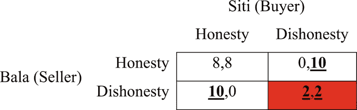 |

| --- |

这种迭代过程能够识别纳什均衡，在均衡均衡中，每个玩家的策略都代表了对另一玩家所选策略的最优响应，从而在游戏中产生稳定的结果。

要使某种策略满足纳什均衡条件，Bala 和 Siti 的收益都应该在表 2 中被下划。通过下划这些收益，我们提供了一个视觉提示，强调了互为最优响应的关键意义，从而强调了策略稳定性，即每个玩家所选策略在响应另一玩家策略时都是最优的。换句话说，达到纳什均衡意味着处于策略状态，在这种状态下，无论是 Bala 还是 Siti 都没有单方面偏离其所选策略的动机，在博弈动态中建立了一个稳定点。

在游戏的游戏的背景下，唯一满足纳什均衡条件的策略对是 Bala 和 Siti 都选择不诚实（不诚实, 不诚实）。在这种情况下，两位玩家都获得 2 点收益，与优选的 (诚实, 诚实) 策略相比，这是一个次优结果，后者能为 Bala 和 Siti 提供 8 点的最优收益。纳什均衡虽然在前一种情况下实现，但它反映了一种次优的策略配置，两位玩家本可以通过选择诚实来共同获得更有利的结果。

### 2.3 两阶段交易博弈的劣质结果

在本小节中，我们深入分析披露玩家之前行为的潜在后果，重点关注其在培养信任和塑造持续关系中当前行为方面的作用。例如，如果 Bala 和 Siti 意识到选择不诚实会触发报复性的不诚实响应以作为威慑，这可能会引导他们在初始选择上诚实。通过这种方式，他们隐含地承诺维护这种合作立场，以获得 8 点的最优收益。这凸显了信息透明度在引导参与者走向合作行为、培养信任以及在重复交互中实现共同利益最大化方面的影响。

为了验证这一假设，我们进行了两轮表 1 中概述的博弈，在第二轮博弈开始之前观察第一轮博弈的结果。我们假设整个博弈的收益简单地等于两个阶段收益的总和，不进行任何折现。我们将这种重复博弈称为两阶段交易博弈。为了解决这个博弈，我们采用类似于逆向归纳的方法。也就是说，我们首先解决涉及 Bala 和 Siti 的博弈第二阶段，考虑第二阶段的结果后再解决第一阶段。这种分析过程使我们能够了解玩家在重复交互中的策略决策，考虑到之前的结果对他们后续选择的影响。

在计算此博弈的子博弈完美均衡结果时，我们通过考虑第二阶段进行博弈的结果是该阶段的纳什均衡，来分析两阶段交易博弈的第一阶段——即 (不诚实, 不诚实)，对应的收益为 (2,2)，如表 3a 所示。因此，玩家在博弈第一阶段的交互等同于表 3b 所示的单次博弈。因此，两阶段博弈的子博弈完美结果是第一阶段的 (不诚实, 不诚实)，随后第二阶段也是 (不诚实, 不诚实)。合作（即 诚实, 诚实）在两个阶段都无法实现。

表 3

(a) 博弈第二阶段的纳什均衡和 (b) 子博弈完美结果。

| 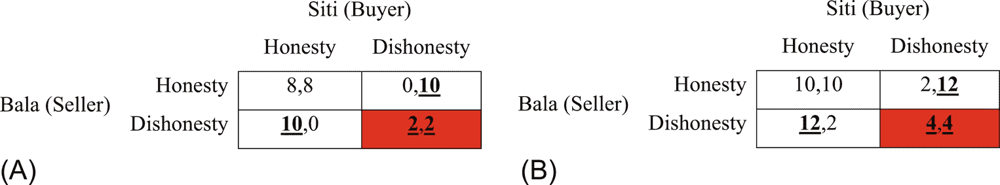 |

| --- |

## 3 理论：无限重复交易博弈

在两个阶段的情景下，Bala 和 Siti 未建立关系，导致了 (不诚实, 不诚实) 的次优结果。为了探索可信承诺的可能性，我们现在转向无限重复博弈。Friedman (1971) 定理 [15]，也称为民间定理，断言此类博弈中存在子博弈完美纳什均衡。此外，如果折现因子接近 1，均衡可以获得比纳什均衡更高的收益。在有限期限的情景背景下，我们观察到纳什均衡是 (不诚实, 不诚实)，收益为 (2,2)，远低于通过可行策略（如 诚实, 诚实）可以获得的收益。

### 3.1 无限重复交易博弈的预知识

我们首先研究 Bala 和 Siti 之间的无限重复交易博弈。这个博弈镜像了表 1 中概述的单次博弈，无限重复，并在每个当前阶段开始之前观察所有之前阶段的结果。在这个框架下，我们定义了一种适用于此特定背景的触发策略，并证明了合作（即 诚实, 诚实）构成了这种持续交互中的均衡。


假设表 1 中的单次博弈被无限重复，在每个阶段 `t`，在第 `t^(th)` 阶段开始之前，都会观察到阶段博弈前 `t − 1` 轮游戏的结果。这些阶段博弈的无限重复性质意味着，简单地相加每场博弈的收益并不能对在无限重复博弈中总收益的有效衡量。例如，考虑在每个期间获得 8 的收益对比 2 的收益的情况。虽然起初可能认为 8 的高常数收益优于 2 的收益，但在无限重复博弈中，这两种情况在很长的一段时间内都会导致收益的无限之和。因此，这强调了需要一个概念（例如折扣因子）来正确地评估和比较重复博弈中不同策略的长期价值。

为了解决这个问题，我们引入了折扣因子，记为 `β = 1/(1 + r)`，代表一个阶段后收到的 1 美元的现值，其中 `r` 是每阶段的利率。该因子在调整重复博弈背景下的货币价值方面起着至关重要的作用。通过将折扣因子与玩家在无限序列阶段博弈中的收益相结合，我们可以计算这些收益的现值。

### 定义

给定折扣因子 `β`，无限收益序列 `π[1]`、`π[2]`、`π[3]`、… 的现值为：

$\pi_{1} + \beta\pi_{2} + \beta^{2}\pi_{3} + \cdots = \sum\limits\_{t = 1}^{\infty}\beta^{t - 1}\pi_{t}$.$<mml:math alttext="MathML"><mml:msub><mml:mi>&#x03C0;</mml:mi><mml:mn>1</mml:mn></mml:msub><mml:mo linebreak="badbreak">+</mml:mo><mml:mi>&#x03B2;</mml:mi><mml:msub><mml:mi>&#x03C0;</mml:mi><mml:mn>2</mml:mn></mml:msub><mml:mo linebreak="badbreak">+</mml:mo><mml:msup><mml:mi>&#x03B2;</mml:mi><mml:mn>2</mml:mn></mml:msup><mml:msub><mml:mi>&#x03C0;</mml:mi><mml:mn>3</mml:mn></mml:msub><mml:mo linebreak="badbreak">+</mml:mo><mml:mo>&#x22EF;</mml:mo><mml:mo linebreak="goodbreak">=</mml:mo><mml:munderover><mml:mo>&#x2211;</mml:mo><mml:mrow><mml:mi>t</mml:mi><mml:mo>=</mml:mo><mml:mn>1</mml:mn></mml:mrow><mml:mo>&#x221E;</mml:mo></mml:munderover><mml:msup><mml:mi>&#x03B2;</mml:mi><mml:mrow><mml:mi>t</mml:mi><mml:mo>&#x2212;</mml:mo><mml:mn>1</mml:mn></mml:mrow></mml:msup><mml:msub><mml:mi>&#x03C0;</mml:mi><mml:mn>t</mml:mn></mml:msub><mml:mo>.</mml:mo></mml:math>


假设每个玩家的折扣因子为 `β`，并考虑到每个玩家在重复交易博弈中的收益是其在阶段博弈中收益的现值，我们的目的是证明合作——具体说是（诚实, 诚实）——可以在无限重复博弈的子博弈完美结果的每个阶段中持续存在。这是值得注意的，特别是当考虑到阶段博弈中唯一的纳什均衡是非合作的（用（不诚实, 不诚实）表示）时。

这一逻辑遵循了我们对两阶段重复博弈分析的本质，如表 3 所示（其中我们为表 1 中的单次博弈引入了第二个纳什均衡）：如果玩家今天合作，他们明天就能建立一个高收益均衡；相反，今天不合作会导致他们明天处于低收益均衡。

两阶段重复博弈与无限重复博弈之间的区别在于高收益均衡潜能是如何展开的。在两阶段重复博弈中，人为地引入了在第二阶段进行高收益均衡的可能性。换句话说，第二阶段获得有利结果的机会并不是第一阶段合作行为的自然延续或结果；而是作为一个独立的元素添加的。另一方面，在无限重复博弈中，不需要这种人为的引入。进行高收益均衡的可能性并非人为构造的元素，而是合作的自然结果。

假设表 1 中的单次博弈被无限重复，在每个阶段 `t`，在第 `t^(th)` 阶段开始之前，都会观察到阶段博弈前 `t − 1` 轮游戏的结果。这些阶段博弈的无限重复性质意味着，简单地相加每场博弈的收益并不能对在无限重复博弈中总收益的有效衡量。

### 3.2 通过智能合约实现信任

为了证明通过智能合约实施策略构成纳什均衡，我们假设 `β` 足够接近 1。通常情况下，我们假设如果一方偏离了（诚实, 诚实），Siti 的反应是不诚实的。

在确定第一阶段以及任何此前为（诚实, 诚实）的阶段的后续反应时，我们注意到当前阶段选择不诚实可以获得 10 的收益。然而，这一选择将触发 Bala 以及随后 Siti 永远不合作，导致未来每个阶段的收益均为 2。具体而言，该序列的现值值为：

$10 + \beta \cdot 2 + \beta^{2} \cdot 2 + \beta^{3} \cdot 2 + \cdots = 10 + 2 \cdot \frac{\beta}{1 - \beta}$$<mml:math alttext="MathML"><mml:mn>10</mml:mn><mml:mo linebreak="badbreak">+</mml:mo><mml:mi>&#x03B2;</mml:mi><mml:mo>&#x00B7;</mml:mo><mml:mn>2</mml:mn><mml:mo linebreak="badbreak">+</mml:mo><mml:msup><mml:mi>&#x03B2;</mml:mi><mml:mn>2</mml:mn></mml:msup><mml:mo>&#x00B7;</mml:mo><mml:mn>2</mml:mn><mml:mo linebreak="badbreak">+</mml:mo><mml:msup><mml:mi>&#x03B2;</mml:mi><mml:mn>3</mml:mn></mml:msup><mml:mo>&#x00B7;</mml:mo><mml:mn>2</mml:mn><mml:mo linebreak="badbreak">+</mml:mo><mml:mo>&#x22EF;</mml:mo><mml:mo linebreak="goodbreak">=</mml:mo><mml:mn>10</mml:mn><mml:mo linebreak="badbreak">+</mml:mo><mml:mn>2</mml:mn><mml:mo>&#x00B7;</mml:mo><mml:mfrac><mml:mi>&#x03B2;</mml:mi><mml:mrow><mml:mn>1</mml:mn><mml:mo>&#x2212;</mml:mo><mml:mi>&#x03B2;</mml:mi></mml:mrow></mml:mfrac><mml:mo>.</mml:mo></mml:math>

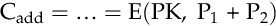


另一种，选择诚实在该阶段将获得 8 的收益，并导致在下一阶段在诚实与不诚实之间做出相同的选择。令 `Π` 表示 Siti 通过最优方式做出这一选择（现在以及此后每次出现时）所收到的无限收益序列的现值。如果诚实对 Siti 来说是最优的，那么

```
Π = 8 + β ⋅ Π
```


或 `Π = 8/(1 − β)`，因为诚实会导致下一阶段做出相同的选择。如果不诚实是最优的，那么

```
\Pi = 10 + 2 \ \frac{\beta}{1 - \beta}
```


如之前推导的那样。因此，对 Siti 来说，诚实是最优的**当且仅当**

```
\frac{8}{1 - \beta} \geq 10 + 2 \cdot \frac{\beta}{1 - \beta}
```


或 `β ≥ 1/4`。因此，在第一阶段以及在任何所有之前结果均为（诚实，诚实）的阶段中，在智能合约已诱导 Bala 采用触发策略的情况下，Siti 的最优行动是诚实，**当且仅当** `β ≥ 1/4`。同样，Bala 在第一阶段和任何所有之前结果均为（诚实，诚实）的阶段中，其最优行动是诚实，**当且仅当** `β ≥ 1/4`。因此，我们得到了以下结果。

### 命题 1

以（诚实，诚实）为代表的合作是无限重复交易博的纳什均衡。当智能合约自动为 Bala 和 Siti 执行触发策略时，**当且仅当** `β ≥ 1/4`，这种情况就会发生。

从本质上说，在这个无限重复交易游戏中，如果 Bala 作为卖家或 Siti 作为买家在基于区块链的电子商务平台上发起交易，智能合约会自动执行触发策略。因此，只要折现因子足够大，（诚实，诚实）的收益就可以成为一种可实现的理想均衡。

## 4 种现实场景：有限重复交易游戏

在研究无限重复游戏时，我们证明了可以通过利用执行触发策略的智能合约来实现作为均衡的合作。然而，与无限重复的理论游戏不同，现实情况是有限的，且不会无限持续下去。因此，在本节中，我们将深入探讨根根于表 1 中概述的单次游戏的有限重复交易游戏是否以及如何能够拥有理想的合作均衡。

### 4.1 采用“以牙报爪”（tit-for-tat）策略的合作均衡

我们假设以概率 `p`，智能合约对 Bala 执行“以牙报爪”策略，而以概率 `1 − p`，他可以自由选择任何策略。在双阶段场景中，我们假设以概率 `p`，Bala 采用“以牙报爪”策略，以概率 `1 − p`，他选择其他。为了确定双方的最优策略，我们使用逆向归法，从最后阶段回溯到初始阶段。我们认为最后阶段的收益与表 1 中描述的单次游戏相同。

检查收益后，我们断定 Siti 将在在最后阶段选择不诚实，因为与不诚实相关的收益为 10，而与诚实相关的总和为 8。因此，较高收益的占优地位使得不诚实成为 Siti 的最优策略。考虑到 Siti 在最后阶段的决定，Bala 没有动力在第一阶段合作。这种动力的缺乏源于一种预期，即第一阶段的合作可能会导致他获得次优的结果。也就是说，如果他合作并进行诚实交易，他的收益将是 0，而不是通过低合作度策略可以获得的 2。

这种策略洞察揭示了 Bala 和 Siti 之间复杂的相互作用，展示了 Siti 在最后阶段的选择如何向后回响，影响初始阶段的合作。在我们确立了最后阶段的策略格局后，现在转向初始阶段，揭示 Siti 选择的影响，并从开始为两个玩家提供最优策略。游戏以“以牙报爪”的合作策略开始。因此，唯一需要决定的是 Siti 在第一阶段的动作（`S`），该动作在第二阶段被“以牙报爪”策略镜像，如表 4 中的均衡路径所示。

表 4

双阶段游戏的均衡路径。

|  | *t* = 1 | *t* = 2 |
| --- | --- | --- |
| 以牙报爪 | 诚实 | *S* |
| Bala | 不诚实 | 不诚实 |
| Siti | *S* | 不诚实 |


`p ⋅ 8 + (1-p) ⋅ 0 + p ⋅ 10 + (1-p) ⋅ 2 ≥ p ⋅ 10 + (1-p) ⋅ 2 + p ⋅ 2 + (1-p) ⋅ 2`


或 `p ≥ 1/4`。


在探索了两期场景的动态之后，我们现在将分析扩展到三期场景，在交互之间引入了额外的复杂性和考虑。当 `p ≥ 1/4` 时，如果 Bala 和 Siti 在第一期都选择合作，那么后续两个期的均衡路径将由表 4 所示，其中 `S=Honesty`，且周期被重新标记以包含第三期。具体而言，我们的目标是为 Bala 和 Siti 在第一期的合作建立充分的条件，如表 5 中概述的三期均衡路径所示。

### 三阶段游戏的均衡路径。

| | t=1 | t=2 | t=3 |
| --- | --- | --- | --- |
| 击牙报仇策略 | Honesty | Honesty | Honesty |
| Bala | Honesty | Dishonesty | Dishonesty |
| Siti | Honesty | Honesty | Dishonesty |

在这一均衡中，Bala 的收益为 `8+10+2`，Siti 的期望收益计算为 `p(8+8+10) + (1-p)(8+0+2)`。如果 Bala 选择在第一期不诚实，那么 Bala 和 Siti 在随后的两个期中都会选择不诚实。结果，Bala 在第三期不诚实的总收益为 `10+2+2`，这低于均衡收益 `8+10+2`。因此，Bala 没有动力偏离表 5 中概述的隐含策略。

我们现在探讨 Siti 是否有动力偏离。如果 Siti 选择在第一期不诚实，击牙报仇策略将在第二期以不诚实作为回报，由于预计 Siti 在最后一期不诚实，这将促使 Bala 在第二期也变得不诚实。在第一期选择不诚实后，Siti 必须决定在第二期继续不诚实还是保持诚实。如果 Siti 在第二期选择不诚实，击牙报仇策略将在第三期以不诚实作为回应，如表 6 所示。在这种情况下，她的收益为 `10+2+2`，只要 `p(8+8+10) + (1-p)(8+0+2) ≥ 10+2+2`，该收益就低于她在均衡下的期望收益。


或 `p ≥ 1/4`。


Siti 在第一期和第二期偏离。

| | t=1 | t=2 | t=3 |
| --- | --- | --- | --- |
| 击牙报仇策略 | Honesty | Dishonesty | Dishonesty |
| Bala | Honesty | Dishonesty | Dishonesty |
| Siti | Dishonesty | Dishonesty | Dishonesty |

或者，如果 Siti 在第一期选择不诚实但在第二期选择诚实，击牙报仇策略将在第三期以合作作为回应，产生的收益如表 7 所示。在这种情况下，Siti 的期望收益为 `10+0+p*10+(1-p)*2`，只要 `p(8+8+10) + (1-p)(8+0+2) ≥ 10+0+p*10+(1-p)*2`，该收益就低于她的均衡收益。

### Bala 和 Siti 的一般收益。

| | | Siti (买家) |
| --- | --- | --- |
| | | Honesty | Dishonesty |
| Bala (卖家) | Honesty | *c*,*c* | *b*,***a*** |
| | Dishonesty | ***a***,*b* | ***d***,***d*** |


既然证明了表 5 中概述的博弈在 `p ≥ 1/4` 的条件下构成了卖方与买方之间三期交易博弈的均衡路径，我们现在深入探讨智能合约的作用影响。具体而言，通过智能合约，以报复策略（tit-for-tat strategy）会被自动执行（即概率 `p = 1`），从而促进了重复博弈中的合作。相比之下，没有智能合约的情况下，以报复策略不会得到契约强化（即概率 `p = 0`）。这导致玩家必须在没有结构化合作机制的情况下进行博弈，从而增加了他们在这一重复博弈中选择非合作策略（如不诚实）的可能性。我们将在第 4.2 节](#Ch006_67-78_B9780443347177000222.xhtml#s0060)中正式证明以下命题。

### 命题 2

假设 `p ≥ 1/4` 成立，对于任何有限的 `T > 3`，在 `T` 期重复博弈中存在一个合作均衡，其中玩家（卖方和买方）在 `T − 2` 期之前选择采用策略 `(诚实, 诚实)`，之后他们将在 `T − 1` 期和 `T` 期采用表 4 中描述的 `S = 诚实` 策略。

换句话之，只要智能合约采用以报复策略，卖方和买方将一直合作到 `T − 1` 期。对于最后一期，虽然结果较差（即 `(诚实, 不诚实)`），但当 `T` 足够大时，由于最后一期的收益影响微乎其微。因此，在参数合理的情况下，对于任何有限的 `T > 2`，存在一个卖方和买方都会合作到 `T - 1` 期的均衡。

### 4.2 以报复策略实现合作均衡的证明

在本节中，我们证明如果 `p ≥ 1/4`，则对于每个有限的 `T` 都存在合作均衡。通过归纳法证明，对于每个 `τ = 2, 3, …, T − 1`，`τ` 期博弈中存在合作均衡。此外，在 `T` 期博弈中也存在合作均衡。

首先，我们证明在 `T` 期博弈中买方没有动力偏离合作均衡。如果买方在任何 `t < T − 1` 期不诚实，他将在 `t` 期获得 10 分收益，之后每期获得 2 分。然而，买方的均衡收益在 `t` 到 `T − 2` 期为每期 8 分，且在 `T − 1` 期为 10 分。因此，对于任何 `t < T − 1`，选择诚实对买方来说不是最优策略。此外，表 4 中的收益说明买方在 `T − 1` 期或 `T` 期不诚实是没有动的。

接下来，我们证明卖方也没有动力偏离合作均衡。具体而言，表 4 显示卖方在 `T − 2` 期之前保持诚实而在 `T − 1` 期不诚实。同样，表 5 意味着卖方在 `T − 3` 期之前诚实而在 `T − 2` 期不诚实是没有动的。因此，我们只需要证明对于 `1 ≤ t ≤ T − 3`，卖方在 `t − 1` 期之前诚实而在 `t` 期不诚实是没有动的。

假设卖方在 `t` 期选择不诚实；以报复策略将在 `t + 1` 期报以不诚实，导致买方在 `t + 1` 期也选择不诚实。通过观察以报复策略和买方在 `t` 期之前的合作行为，随后两者在 `t + 1` 期同步转向不诚实，卖方在 `t + 2` 期初会形成信念：以报复策略的概率为 `p`。这种信念是基于此之前的博弈，即合作策略以同步的方式转化为不诚实。

因此，如果卖方在 `t + 1` 期合作，那么从 `t + 2` 期开始的后续游戏与 `τ = T − (t + 2) + 1` 的 `τ` 期博弈完全相同。根据归纳假设，这个 `τ` 期后续游戏中存在合作均衡。这意味着如果卖方在 `t` 期不诚实而在 `t + 1` 期合作，她在 `t` 到 `T` 期的收益将为：

```
10 + 0 + [T-(t+2)-1]·8 + p·8 + (1-p)·2 + (1-p)·0 + p·10
```

这低于她在 `t` 到 `T` 期的均衡收益：

```
8 + [T-t-2]·8 + p·8 + (1-p)·2 + (1-p)·0 + p·10
```

或者

```
(T-t-1)·8 + p·16 + 2
```


我们已经证明，Siti 没有动力通过在 `t − 1` 期之前保持合作，在 `t` 期选择不诚实，然后在 `t + 1` 期再次合作来偏离策略。这种考虑源于从 `t + 2` 期开始的后续游戏中将执行合作均衡。更广义地说，Siti 可以合作到 `t − 1` 期，在 `t` 到 `t + s` 期期间不诚实，然后在 `t + s + 1` 期保持诚实。

值得注意的是，有三种平凡情况：(i) 如果 `t + s = T`，则 Siti 在 `t` 期的收益为 10，此之后为 2，这小于 `(T - t - 1) · 8 + p · 16 + 2`；(ii) 如果 `t + s + 1 = T`，则她在从 `t` 到 `T` 期的收益为 `10 + 0`，这低于 (i) 中的收益，即 `10 + 2`；(iii) 如果 `t + s + 1 = T - 1`，则她在从 `t` 到 `T` 期的收益为 `10 + 0 + p · 10`，这再次小于 `(T - t - 1) · 8 + p · 16 + 2`。

最后，我们只需要考虑 `t + s + 1 < T - 1` 的情况。运用与上述分析相同的逻辑（`s = 0`），我们发现从 `t + s + 2` 期开始的后续游戏中存在合作均衡。具体而言，Siti 在 `t` 到 `T` 期因不诚实的收益为：

```
10 + 0 + [T-(t+s+2)-1] · 8 + p · 8 + (1-p) · 2 + (1-p) · 0 + p · 10
```


这再次小于 `(T - t - 1) · 8 + p · 16 + 2`。

### 4.3 玩家收益的般情况

在本文中，我们关注的是 表 1 中描述的特定数值双矩阵。我们现在使用任意收益对其进行泛化，并证明我们的结果是稳健的。

根据 表 7，我们假设如果两个玩家都选择诚实，他们将各自获得 `c` 单位的货币效。然而，如果两个玩家都选择不诚实，他们将各自获得 `d` 单位的货币效。当一个玩家诚实而另一位不是时，不诚实的玩家将获得 `a` 单位货币效，而诚实的玩家获得 `b`。为了使这个游戏成为囚徒困境，我们假设 `a > c > b`。

为了简洁起见，我们证明了在满足某些充分条件下，三期重复游戏存在合作均衡（有限重复游戏的证明可索取）。具体而言，第二和第三期的均衡由 表 4 所示，其中 `S=Honesty`，只要：

```
p*c + (1-p)*b + p*a + (1-p)*d >= p*a + (1-p)*d + d
```


或者

```
p*c + (1-p)*b >= d
```

 (1)

假设上述条件成立；我们接下来推导出 Siti 和 Bala 在第一期合作的充分条件，如 表 5 所示。在这一均衡中，Bala 的收益为 `a + c + d`，Siti 的期望收益为 `c + p*c + (1-p)*b + p*a + (1-p)*d`。如果 Bala 在第一期不诚实，那么 Bala 和 Siti 在第二、三期都会不诚实。因此，Bala 在第一期不诚实的总收益为 `a + d + d`，这低于均衡收益 `a + c + d`。因此，Bala 没有动力不诚实。

我们接下来考虑 Siti 是否有动力不诚实，正如我们在 第 4.1 节 中做的那样。通过代数运算，很容易看出 Siti 在第一、二期不诚实的收益为 `a + d + d`，这低于她给出的期望收益：

```
c + p*c + (1-p)*b + p*a + (1-p)*d >= a + d + d
```


给定 条件 (1)，Siti 不不诚实的充分条件是


`c` + `p` ⋅ 1 + (1−`p`) ⋅ `d` ≥ `a` + `d`.

 (2)

或者，Siti 在第一阶段不诚实而在第二阶段诚实的预期收益为 `a` + `b` + `p` ⋅ `a` + (1 − `p`) ⋅ `d`，这小于她所给出的均衡预期收益：

`c` + `p` ⋅ `c` + (1−`p`) ⋅ `b` + `p` ⋅ `a` + (1−`p`) ⋅ `d` ≥ `a` + `b` + `p` ⋅ `a` + (1−`p`) ⋅ `d`。


鉴于条件 (1)，Siti 不诚实的充分条件是：

`c` + `d` ≥ `a` + `b`。

 (3)

因此，只要 `a`、`b` 和 `d` 表示的通用收益满足上述三个不等式，这个三阶段博弈就存在合作均衡，即 (1–(3。形式上，对于任何有限的 `T`>3，都存在具有这种通用收益规格的合作均衡。

## 5 结论

区块链技术是一把双刃剑。一方面，它确保了用户的隐私；该技术的一个显著优势是消除了控制数据的第三方。然而，另一方面它引入了挑战，特别是在用户之间建立信任方面。为了解决缺乏中央权威的问题，新的机制对于培养陌生用户之间的信任至关重要。因此，同行未按约定交付或参与恶意活动（如提供虚假评论）的情况变得愈普遍。这种双重性强调了仔细考虑和创新解决方案的必要性，以便在充分利用区块链优势的同时，减轻其带来的挑战。

本文深入探讨了区块链作为去中心化市场基础技术的变革潜力，旨在增强这些生态系统内的信任。通过利用智能合约的自动执行能力，我们展示了可以实现所有参与者都保持诚实的特征的持续均衡。具体而言，这种均衡的实现通过两种不同的策略进行阐明。首先，针对买卖之间无限重复的交易提出了一种`触发策略`（`trigger strategy`）。这种方法取决于合作行动的自动启动，营造了一个在多次互动中不断不断强化信任的环境。其次，本文针对重复有限次数的交易引入了`以牙还牙策略`（`tit-for-tat strategy`）。该策略涉及用类似的行动回应行动——用合作报答合作，用相应的响应报答不合作。通过采用这些策略，去中心化市场可以建立并维持以诚实为特征的合作均衡，从而增强系统的整体可靠性和信誉。

我们的理论模型在解决区块链领域的安全问题和监督挖矿运营方面具有前景。其核心擅长审查潜在攻击者所使用的策略，特别是在自私挖矿、多数攻击和拒绝服务（`DoS`）的背景下。通过评估设计的机制，我们的模型确保每个参与者的最优反应是不参与任何形式的攻击。此外，我们的方法论特别擅长模拟矿工之间关于算力分配、链选择和池选择的复杂交互。当系统达到均衡时，我们的模型展示了参与者之间合作行为的出现。这种合作立场旨在实现所有相关利益的最大化，凸显了我们的理论框架为区块链系统的健性和效率做出重大贡献的潜力。

## 参考文献

- [1] Chuen D.L.K., Li Y., Xu W., Zhao W. *Blockchain-Based E-Commerce: It's an Evolution, NOT a Revolution—Experimental Evidence from Users’ Perspective.* Mimeo; 2019.
- [2] Tschorsch F., Scheuermann B. *Bitcoin and beyond: a technical survey on decentralized digital currencies.* *IEEE Commun. Surv. Tutor.* 2016;18(3):2084–2123 3rd Quart.
- [3] Conti M., Kumar S., Lal C., Ruj S. *A survey on security and privacy issues of bitcoin.* *IEEE Commun. Surv. Tutor.* 2018;20(4):3416–3452.
- [4] Khalilov M.C.K., Levi A. *A survey on anonymity and privacy in bitcoin-like digital cash systems.* *IEEE Commun. Surv. Tutor.* 2018;20(3):2543–2585.
- [5] Salman T., Zolanvari M., Erbad A., Jain R., Samaka M. *Security services using blockchains: a state of the art survey.* *IEEE Commun. Surv. Tutor.* 2018;21(1):858–880.
- [6] Ali M.S., Vecchio M., Pincheira M., Dolui K., Antonelli F., Rehmani M.H. *Applications of blockchains in the internet of things: a comprehensive survey.* *IEEE Commun. Surv. Tutor.* 2018;21(2):1676–1717.
- [7] Yang R., Yu F.R., Si P., Yang Z., Zhang Y. *Integrated blockchain and edge computing systems: a survey, some research issues and challenges.* *IEEE Commun. Surv. Tutor.* 2019;21(2):1508–1532.
- [8] Liu Z., et al. *A survey on blockchain: a game theoretical perspective.* *IEEE Access.* 2019;7:47615–47643.


* [[9]](#Ch006_67-78_B9780443347177000222.xhtml#B-bb0050) Soska K., Christin N. *衡量在线匿名市场生态系统的纵向演变。* In: 24th {USENIX} Security Symposium ({USENIX} Security 15); 2015:33–48.
* [[10]](#Ch006_67-78_B9780443347177000222.xhtml#B-bb0055) Schaub A., Bazin R., Hasan O., Brunie L. 一种无信任的隐私保护信誉系统。 In: *IFIP International Conference on ICT Systems Security and Privacy Protection.* Cham: Springer; 2016:398–411.
* [[11]](#Ch006_67-78_B9780443347177000222.xhtml#B-bb0060) Dennis R., Owenson G. 滚动中的信誉：基于滚动区块链的对等信誉系统。*Int. J. Digit. Soc.* 2016;7(1):1123–1134.
* [[12]](#Ch006_67-78_B9780443347177000222.xhtml#B-bb0065) Dasgupta P., Hammond P., Maskin E. 社会选择规则的实施：关于激励兼容性的一些性结果。*Rev. Econ. Stud.* 1979;46(2):185–216.
* [[13]](#Ch006_67-78_B9780443347177000222.xhtml#B-bb0070) Chuen D.L.K., Li Y., Xu W. 奖励诚实：一种促进基于区块链电子商务信任的激励机制。*J. Brit. Blockchain Assoc.* 2023;6(2):1–5.
* [[14]](#Ch006_67-78_B9780443347177000222.xhtml#B-bb0075) Chuen D.L.K., Li Y., Xu W., Liu F. 披露欺诈和补贴仲裁作为促进信任的机制：来自实验室数据的理论与证据。Mimeo; 2023.
* [[15]](#Ch006_67-78_B9780443347177000222.xhtml#B-bb0080) Friedman J.W. 超级游戏的非合作均衡。*Rev. Econ. Stud.* 1971;38(1):1–12.

# 第 7 章 区块链赋的去中心化网络信任管理

1. 刘高
2. 翔涛
3. 王宁
4. 陈碧文
5. 何佳玲
6. 张迪
7. 中国重庆大学计算机科学学院，重庆

## 摘要
本章讨论了通过数据采集和评估来理解网络安全与信任的重要性。文中区分了中心化网络与去中心化网络，并强调了中心化系统相关的风险。重点关注了去中心化网络信任管理，该领域面临着诸如安全数据采集、去中心化且保护隐私的信任评估，以及有效的跨域信任同步与管理等挑战。提出的解决方案包括去中心化数据采集系统、隐私保护信任评估框架，以及针对异构网络的高效伪名和信任值管理。

## 关键词
* 去中心化网络信任管理
* 区块链共识
* 激励

## 1. 引言
随着智能设备、云计算、人工智能和区块链等技术的发展，由各种智能设备组成的计算机网络早已成为每个国家或地区信息建设的基础设施。事实上，许多网络协议是不安全的，许多开发的软件应用程序也存在漏洞。通过利用这些缺陷，攻击者可以使用各种工具攻击网络内的设备。此外，被攻破的服务器可能会泄露本地数据，导致这些数据的黑市交易。攻击者可以购买并分析敏感数据，对用户的隐私和财产构成威胁。如今，网络攻击已经演变为不再简单的孤立事件，往往涉及复杂的多个阶段攻击。在如此严峻的网络安全场景下，根据网络行为等安全参数理解网络及每个设备的安全或信任状态，可以指导防御策略的调整和网络服务的提供，从而增强网络的安全性和信任。因此，管理网络信任已成为一个热点。

网络信任管理可以定义为数据采集、信任评估和信任关系维护的循环过程。网络可以分为没有信任中心的网络和具有信任中心的网络。此外，未来我们还面临着大规模的异构网络。没有信任中心的网络也可以称为移动自组织体系网络（MANET），其特征是自组织和分布式的。在具有信任中心的网络中（如互联网或无线传感器网络 WSNs），信任中心可能会遭遇单点故障或受到攻击，从而无法被完全信任。在大规模异构集成网络中，每个网络域互不信任。因此，有必要研究去中心化网络信任管理。然而，与数据采集、信任评估和信任管理相关的需求尚未得到满足。

首先，数据采集在去中心化场景下缺乏安全激励。其次，网络信任评估需要实现去中心化、隐私保护和激励，但目前还没有满足这些要求的网络信任评估框架。第三，跨域信任管理没有考虑异构网络的隐私保护。此外，还存在跨域同步弱的问题。

为了解决上述问题，本章提出了相应的解决方案。我们首先提出了一种基于区块链的安全数据采集系统，为数据采集提供去中心化的激励。安全数据是指用于威胁检测、攻击检测和信任评估的数据。此外，我们提出了一个去中心化信任评估框架以实现整个网络的信任评估和隐私保护。最后，针对异构网络提出了伪名和信任值管理，以支持跨域信任评估并高效同步信任值。

### 1.1 研究问题
本节详细介绍了去中心化网络信任的主要科学问题和挑战。

#### 1.1.1 去中心化安全数据采集缺乏安全激励
安全数据采集是信任评估的基础。在考虑采集激励之前，有必要设计安全数据采集模型。因此，如何建立采集模型是要解决的首要问题。

目前的激励机制主要包括信誉和微支付系统。然而，这些在去中心化场景下激励安全数据采集的系统存在漏洞。首先，由于缺乏身份管理，这些机制没有考虑攻击者为了利益化而发起的欺骗攻击。其次，信誉系统可能无法抵抗节点节点为了提高信誉而发起的共谋攻击，且没有规定激励的类型（例如，高信誉能带来什么利润）。第三，微支付系统允许采集者为采集节点（CN）和转发者的合作与贡献付费，但大多数系统需要信任的第三方（TTP）来管理借贷账户。这种设计对于异构集成网络来说显然是不可行的，因为很难部署这样的第三方。此外，某些现有系统允许源节点仅向发现路径中的转发者支付，这对于参与了路由发现但不在路径中的节点是不公平的 [1]。因此，在分布式网络场景下如何实现安全数据采集激励还需要进一步研究。


大多数现有共识机制面临许多技术挑战，即分叉、低效率以及中心化趋势，并且没有考虑应用场景的特点。考虑到在没有 TTP（可信信任点）的节点中进行安全数据收集的特性，如何设计一种高效且安全的共识机制，是构建去中心化且可信激励架构的挑战。

总而言之，如何设计一种提供安全激励的去中心化安全数据收集系统，是一个需要进一步研究和解决的挑战。

#### 1.1.2 缺乏隐私的去中心化网络信任评估

网络信任评估可以帮助网络运营者采取相应的防御措施。网络信任可以被视为网络提供预期服务的能力，这与网络安全高度相关且需要进行客观评估。然而，关于通过网络安全来评估网络信任的几乎没有相关工作。因此，如何设计一个网络信任评估框架是需要解决的首要问题。

单一网络运营者作为可信中心，可以考虑将安全数据收集和信任评估任务外包给其他资源丰富的节点。但是，必须设计一种高效且安全的共识机制，以确保网络信任评估的结果可靠且正确。考虑到在具有可信中心的网络中外包网络信任评估任务的特点，如何设计一种高效且安全的共识机制，是构建去中心化且可信的网络信任评估架构的挑战。

网络信任评估缺乏激励。现有工作很少考虑网络信任评估的激励。因此，如何提出激励 `CNs` 和信任评估节点的方法成为需要解决的第三个问题。

目前的隐私保护方案存在计算和通信负担大的缺点，网络信任评估很难同时确保隐私保护和效率。可以基于 Intel 软件防护扩展（`SGX`）设计适用于网络信任评估的隐私保护方案，这有助于实现网络信任评估中的隐私保护和效率。

总而言之，设计具有隐私保护和参与者激励的去中心化网络信任评估是一个迫切需要解决的研究问题。

### 1.1.3 异构网络缺乏高效的伪名和信任值管理

我们需要客观地评估用户设备（`UE`）的信任，这可以通过监控和分析 `UE` 的行为或状态来实现。然而，现有方案缺乏能够满足上述要求的跨域信任评估框架。因此，如何设计一个包含跨域数据收集和数据处理的 `UE` 信任评估框架是需要解决的首要问题。

跨域信任管理没有考虑保护每个网络域中 `UE` 的身份隐私。在信任评估系统中，可以监控绑定到其身份的 `UE` 网络活动以评估其信任度，但当 `UE` 采用长期身份时，其隐私可能会受到负面影响。通常，`UE` 使用伪名，并且应该频繁更新以防止攻击者追踪其活动。然而，这种更新使得难以实现准确的信任评估，且伪名更改前后的信任值关联可能会破坏伪名的不可关联性，导致伪名更新无法进行。现有方案通常依赖于 `TTP`、可信执行环境（`TEEs`）和非共谋方来克服信任评估与伪名更新之间的困境。然而，这些方案关注于单一类型的网络，无法支持集成异构网络。因此，如何在异构集成网络中设计伪名和信任值管理方法，以解决信任评估与伪名更新之间的矛盾，是一个需要解决的问题。

面对异构集成网络时，每个网络运营者可能对不同域的数据进行评估和分析，这导致了评估结果的不一致，不利于 `UE` 信任值的统一管理。因此，应该达成跨域信任值的共识。然而，传统方法允许每个运营者发布自己的评估结果并根据这些结果确定结果，这导致了共识效率的低下。如果在每轮信任评估后采用这种方法，同步和共享 `UE` 信任值是非常低效的。因此，如何实现信任值的快速同步是一个需要解决的问题。

总而言之，如何在异构集成网络中设计高效的伪名和信任值管理，以支持隐私保护、快速同步和信任值的共享是一个需要研究的问题。

### 1.2 研究内容

针对上述问题或挑战，我们在安全数据收集、信任评估和管理方面进行研究。

### 1.2.1 基于区块链的安全数据收集系统

#### 1.2.1.1 研究内容 1-a：安全数据收集模型

为了在去中心化网络场景中为安全数据收集提供激励，首先需要建立安全数据收集模型。`MANET` 是一种没有可信中心且代表去中心化的网络。因此，`MANET` 中的路由发现和数据包转发可以用于建立这种高效的安全数据收集模型。结果是，需要在去中心化网络场景中建立安全数据收集模型，允许收集者发现到 `CNs` 的路由并通过这些路由传输安全数据。

#### 1.2.1.2 研究内容 1-b：安全数据收集的激励

虽然声誉和微支付系统可以为安全数据收集提供激励，但这些系统存在缺陷（例如依赖 `TTP`）。区块链可以提供一个实现去中心化会计或激励的可验证或可信计算平台，并适用于去中心化场景。因此，采用区块链可以确保激励的去中心化。此外，其他方面的安全性（例如防止欺骗和共谋攻击以及过度转发）也需要保障。

#### 1.2.1.3 研究内容 1-c：高效安全的共识机制

区块链可以为安全数据收集提供去中心化的激励。然而，大多数现有区块链共识机制仍然面临许多技术挑战，即分叉、低效率以及中心化趋势。考虑到在没有 `TTP` 的网络中进行安全数据收集的特点，我们应该提出一种安全高效的共识机制，以构建一个去中心化且可信的激励架构。


许多信任评估模型无法客观地评估网络的信任水平，且无法直接用于网络信任评估以客观地反映网络的真实安全或信任状态。网络信任评估需要对安全数据进行收集和分析。为了建立网络信任评估模型，必须考虑所提供的安全数据的质量以及相应的分析。

### 1.2.2.2 研究内容 2-b：一种高效且安全的共识机制

在去中心化网络场景下，运营商通过将网络信任评估任务外包给资源丰富的节点。利用区块链共识来确保网络信任评估结果的可信度。然而，目前大多数现有共识机制存在分叉、效率低和中心化等缺陷。因此，有必要提出一种适用于任务外包场景的安全高效的共识机制。该共识机制包含一种激励机制。运营商可以为任务中的每个参与者定价奖励。当任务完成且区块链下一个区块被确认时，参与者的相应奖励即可确定。

### 1.2.2.3 研究内容 2-c：一种隐私保护方案

`Intel SGX` 是一种 `TEE`，建立的飞区（enclave）可以被认为是信任的。在去中心化网络信任评估中，允许评估节点（即执行评估任务的工作节点）启动飞区。需要考虑的是，每个 `CN` 都可以安全地共享其安全数据，且只有授权评估节点的飞区可以访问明文（即 `CNs` 的敏感数据），以评估网络信任并参与共识。

### 1.2.3 集成网络中的伪名与信任值管理

#### 1.2.3.1 研究内容 3-a：一种跨域信任评估框架

在异构网络中，每个域的网络运营商都应该进行信任评估，但这些域之间互不信任，一个运营商获得的信任评估结果无法被其他运营商接受。因此，我们可以在域之间部署云服务提供商 (`CSP`) 并允许它存储来自不同域的安全数据。运营商可以处理从 `CSP` 的数据，并验证其他运营商的信任评估结果。

#### 1.2.3.2 研究内容 3-b：跨域信任评估与伪名更新的同步保障

为了解决信任评估与伪名更新之间的困境，现有方案专注于单一类型的网络，无法支持集成异构网络。因此，我们考虑每个域的运营商协作维护 `<pseudonym, trust value>` 列表，并采用验证洗牌（verifiable shuffling）来促进运营商诚实合作以实现伪名更新的目标。同时，信任值在伪名更新之前需要进行模糊，以防止攻击者根据这些信任值将新伪名与旧伪名关联。最后，每个新伪名继承旧伪名的模糊信任值，以确保信任评估的可用。

#### 1.2.3.3 研究内容 3-c：跨域信任值同步

在异构集成网络中，每个域的网络运营商互不信任，运营商采用的安全数据可能存在不一致，导致运营商的信任评估结果不一致。因此，我们需要同步跨域信任值。为了实现这一目标，我们尝试利用区块链共识来快速同步跨域信任值，允许运营商提出信任评估结果，并让其他运营商验证结果。

## 2 相关工作

在本节中，我们回顾了关于数据收集、去中心化网络信任评估、异构集成网络信任管理以及区块链技术的现有工作，并讨论了它们的局限性。

### 2.1 数据收集

数据收集是指收集者从 `CNs` 获取数据的过程。数据收集通常要求收集者发现通往 `CNs` 的路由，并通过发现的路由收集数据以用于去中心化的网络信任管理。

#### 2.1.1 路由发现

主流路由协议采用路由发现 \[2\] 来实现数据传输，例如动态源路由 (`DSR`) 和按需局域距离矢量协议 \[3, 4\]。在路由发现过程中，源节点泛送包含其自身地址和目的节点地址的路由请求 (`RREQ`)。当节点接收到 `RREQ` 且该节点不是目的节点且没有通往目的节点的路由时，它会将自己的地址加入 `RREQ` 然后转发该 `RREQ`。如果目的节点或具有通往目的节点路由的中间节点接收到 `RREQ`，它将创建一个包含完整路径的路由回复 (`RREP`) 并按反路将 `RREP` 发给源节点。

#### 2.1.2 数据收集的激励

目前的激励系统主要包括信誉系统和微支付系统。大多数系统很少考虑欺骗攻击 \[5, 6]，因为没有对节点采用任何身份管理。

#### 2.1.2.1 信誉系统

节点监控来自邻居的流量，以确定这些邻居是否转发数据包。如果节点发现其邻居没有转发数据包，它会认为邻居是不合作的，并向网络广播不合作的信誉 \[7, 8\]。然而，信誉系统没有规定激励的类型，特别是节点通过高信誉可以获得什么利润。此外，自私节点可能勾结来提高其信誉，且高信誉节点可能会突然产生恶意行为 \[9\]。

##### 2.1.2.2 微支付系统

许多微支付系统允许节点通过转发数据包来获取收据。这些节点可以将获取的收据发送给第三方进行账户的记贷和贷 \[7, 10\]。然而，在去中心化网络中部署此类第三方是不可行的，因为该实体可能被黑客或破坏。在某些微支付系统 \[7\] 中，源节点鼓励信息转发者协助发现通往目的节点的路由以进行路由发现；因此它向这些转发者支付以激励。然而，源节点无法控制 `RREQ` 的转发规模，这意味着它无法限制支付金额。在某些系统 \[1\] 中，当路由被发现时，源节点只向路由中的信息转发者付费，但其他参与了路由发现但不在路由中的节点无法获得奖励。因此，无法确保路由发现中所有参与者的公平性。总之，与数据收集激励相关的现有工作存在欺骗攻击、合结攻击和依赖 TTP 等缺陷。因此，我们在下一节中提出基于区块链的安全数据收集系统 (`B4SDC`) 来解决这些问题。

#### 2.1.3 数据收集的隐私保护

已提出了许多基于数据聚合、`k`-匿名和 `n`-源匿名隐私数据收集方案 \[11\]。

数据聚合可以通过输出特定区域内数据的总和、平均值、中位数、最大值或最小值来掩盖单个数据 \[12, 13\]。但聚合结果对于攻击检测可能无效，因为检测可能需要直接处理原始数据。对于 `k`-匿名，节点在共享数据之前需要删除或修改数据记录的某些属性，并添加至少 `k − 1` 个不相同的记录 \[11\]。因此，这可能会给数据收集带来巨大的通信负担。


在 `n`-源匿名性中，由数据源提供的消息具有 `n` 个槽位。每个数据源将其自身的敏感数据添加到一个预留槽位中，而其他 `n − 1` 个槽位用随机数填充。在对收到的 `n` 条消息的每个槽位执行某些操作（例如 `X0R`）后，我们可以获得每个数据源的原始数据，但原始数据无法关联到特定的数据源。为了确保这种不可关联性，主要利用虚拟环、可信权威和洗牌来帮助每个数据源预留自己的数据加载槽位，而不向其他源暴露槽位的位置 [11]。然而，如果有新成员加入或旧成员离开，则需要通过重启 `n` 个成员的组协议来重新预约数据加载槽位。这种解决方案可能会面临高计算和通信复杂度。虽然采用可信权威可以降低复杂度，但让这些可信权威始终在线进行槽位保留是不理性的。

总而言之，尽管有很多保护隐私的数据收集方案，但它们在入侵检测和进一步的网络信任评估方面面临着高计算或通信复杂度的问题。因此，我们提出了一种基于 SGX 的网络信任评估去中心化入侵检测框架（SeDID），同时确保安全数据收集的隐私保护效率。

## 2.2 去中心化网络信任评估

网络信任是指网络能够按照预期提供服务，并可以通过入侵检测进行客观评估的信念。在抵抗各种网络入侵、威胁和攻击方面，它与网络安全高度相关。因此，我们可以通过入侵、攻击和威胁检测来评估网络信任，以判断网络是否具有足够的鲁棒性来提供预期的网络服务。

### 2.2.1 入侵检测

Jing 等 [14, 15] 综述了关于互联网网络信任评估中攻击检测的现有研究。他们发现，应该从网络流量中提取大量特征以确保检测的高准确性，但切消耗了大量的时间和资源。目前的文献仍然缺乏一种能够检测互联网主流攻击以衡量其信任度的综合机制。Zargar 等 [16] 对不同的 DDoS 防御机制进行了全面的分类和评估。他们得出结论，互联网中的服务提供商应该合作防御 DDoS 攻击。然而，他们缺乏合作的经济激励。

Xie 等 [17] 研究了针对无线传感器网络（WSN）中网络信任评估的每种主流攻击的数据收集和攻击检测。他们发现，应该研究纯去中心化的入侵检测方法以避免单点故障，但目前的文献缺乏检测针对 WSN 网络信任评估的主流攻击的相应机制。此外，Liu 等 [8] 发现，由于许多原因（例如过载、自私和资源限制），需要激励来鼓励网络节点共享的安全数据。

He 等 [18] 综述了针对各种攻击的数据收集和分析，为长期演进（LTE）/长期演进增强型（LTE-A）网络的网络信任评估提供基础。他们发现，缺乏一种综合的入侵检测机制来检测 LTE/LTE-A 网络中的主流攻击，以实现网络信任评估。考虑到检测系统组件中存在的故障，他们指出了采用去中心化入侵检测的必要性，以衡量 LTE/LTE-A 网络的信任水平。

从上述综述中可以看出，目前的文献缺乏用于网络信任评估的去中心化入侵检测。

### 2.2.2 网络信任评估的隐私保护

信任评估的隐私保护方法主要利用同态加密、安全多方计算和伪匿名，并假设存在非共谋实体或可信执行环境（TTPs）以确保数据隐私。然而，同态加密通常需要至少两个非共谋实体，这一假设在单个网络中可能是不合理的，且同态加密存在效率低的问题。安全多方计算可以帮助实现隐私保护信任评估，但其效率可能很低 [19]。在存在 TTP 的系统中，TTP 可以直接处理来自 [20, 21] 的数据，但假设 TTP 存在可能并不。某些工作使用伪名代替用户设备（UE）的长期身份，从而实现匿名信任评估。这些工作主要采用 TTP、非共谋实体或 TEE 来解决信任评估与伪名更新之间的矛盾。然而，在信任评估的去中心化场景下。

我们需要保护整个数据收集和处理过程中的隐私。文献 [8, 14, 17, 18] 建议可以整合主流攻击的检测方法来评估整个网络的安全或信任。可以采用不同的检测方法来检测各种攻击。因此，当采用上述加密技术时，很难同时实现高效率和隐私保护。结果，人们高度期望同时确保入侵检测的高效率隐私保护，而 TEE 提供了这种可能性。TEE 主要包括 Intel SGX [22–24]、AMD 安全加密虚拟化（SEV） [25–27] 和 ARM TrustZone [28–30]。AMD SEV 主要为云设计，而 ARM TrustZone 在移动设备上实现了一个 TEE 安全框架。Intel SGX 可由 Intel 制造的某些处理器支持，它有助于构建一个名为“飞地”（enclave）的安全环境。Intel SGX 可用于实现具有隐私保护和高性能的网络信任评估入侵检测，因为它提供了具有高效率的硬件辅助可信计算。

### 2.2.3 网络信任评估的去中心化

网络信任可以基于入侵检测进行客观评估；因此，网络信任评估的去中心化意味着入侵检测的去中心化。因此，我们回顾了基于区块链的去中心化入侵检测。


Rodrigues 等人 [31] 提出了一种基于区块链的去中心化架构，通过使用智能合约来缓解 DDoS 攻击。该架构主要用于共享白黑名单 IP 地址，被视为现有检测系统的额外安全机制。然而，该架构没有为节点提供激励，且无法保护数据收集和处理过程中涉及隐私。Rathore 等人 [32] 提出了 `BlockSecIoTNet`，这是一种用于物联网（IoT）的基于区块链的去中心化安全框架。它采用以太坊智能合约来共享数据并更新入侵检测模式。然而，`BlockSecIoTNet` 在攻击检测过程中没有考虑节点激励。She 等人 [33] 提出了一种用于无线传感器网络（WSNs）恶意节点检测的区块链信任模型。作者允许汇聚节点（sink nodes）从传感器收集某些参数并调用智能合约来检测恶意节点。然而，该模型没有考虑如何激励节点和保护隐私。Liang 等人 [34] 提出了一种基于微区块链的车万物（V2X）地理动态入侵检测方法。每个微区块链可以为小区域区域内的车辆构建本地检测策略。通过反复嵌套微区块链来构建宏区块链，从而为跨区域车辆生成时空动态策略。但没有考虑隐私保护。Alkadi 等人 [35] 提出了一种区块链支持的协同入侵检测（CID）方法。它采用双向长短期记忆深度学习算法处理网络数据进行入侵检测，并使用智能合约来保护隐私。然而，作者没有考虑激励。Liang 等人 [36] 为物联网设计了一种基于区块链和多智能体系统的入侵检测系统。它监控物联网设备以收集网络流量数据。这些数据被用于创建训练数据集，然后被用于学习检测模式。数据处理模块处理新收集的数据，并使用检测模式执行攻击检测。此外，所有检测结果都会发送到响应模块，所有过程都由区块链账本记录。然而，没有考虑激励和隐私保护。许多工作 [31, 37, 38] 仅展示了如何将区块链技术集成到入侵检测系统中。然而，它们没有考虑节点激励和隐私保护。

此外，上述工作直接使用现有的共识机制，没有考虑其缺点，即分叉、低效率和中心化风险。Li 等人 [39] 提出了一种基于挑战的 CID 框架，通过使用区块链增强信任机制的鲁棒性。区块链被视为可信的用于验证接收到的反馈和报警。但作者没有考虑如何解决当前区块链技术的问题。此外，没有考虑激励和隐私保护。Hu 等人 [40] 提出了一种利用区块链用于多微网系统的 CID 方法。作为矿工的检测器在各自的微网中获取检测结果，并将这些结果插入它们创建的区块中进行共识。不幸的是，可能仍然发生分叉，且没有考虑隐私保护。

## 2.3 集成异构网络中的信任管理

### 2.3.1 信任管理的身份隐私保护

在第三代移动伙伴计划（3GPP）定义的移动网络中，`UE` 拥有多种身份，例如国际移动用户识别（`IMSI`）和国际移动设备识别（`IMEI`）。如果 `UE` 首次连接网络，网络应通过 `UE` 的 `IMSI` 识别该设备。然后，`UE` 和网络执行认证协议。如果认证通过，网络将为 `UE` 提供服务。移动网络包含用户设备（`UEs`）、接入网络（`SNs`）和主网（`HNs`），`SN` 和 `HN` 都可以被视为信任实体。`IMSI` 应该受到保护。通常，为了保护 `IMSI`，目前的基于密码学的方案主要包括基于证书、根密钥、基于身份的加密和伪名的方法。

#### 2.3.1.1 基于证书的方法

`TTP` 通过对 `SN` 的公钥签名向 `SN` 发发根证书。在移动网络中，`UE` 可以验证 `SN` 的根证书，并使用 `SN` 的公钥加密其 `IMSI`。

#### 2.3.1.2 基于根密钥的方法

`UE` 使用 `HN` 的公钥加密 `IMSI` 并将密文发送到 `SN`。接收到密文后，`SN` 解密获取 `IMSI`。

#### 2.3.1.3 基于身份的加密方法

`UE` 通过 `SN` 的身份和 `HN` 的公钥计算加密密钥，然后使用 `SN` 的公钥加密 `IMSI` 并将密文发送到 `SN`。因此，`SN` 利用其私钥获取 `IMSI`。

#### 2.3.1.4 基于伪名的方法

`UE` 采用伪名在 `SN` 中识别自身，以便进行进一步的身份认证。每当机会出现时，`HN` 安全地向 `UE` 发送一个新的伪名。

在上述密码方法中，`UE` 仅被验证为信任或不可信，以便在 `SN` 中实现身份隐私保护。然而，我们应该在异构网络中将信任划分为更细粒度的级别 [41, 42]。

### 2.3.2 异构网络中的信任

`SN` 可以参考 `UE` 的信任来决定是否向 `UE` 提供服务。信任可以定义为对风险的接受意愿。网络信任可以基于入侵检测的结果进行评估 [43]，反映了网络或节点是否按照预期提供服务或行为。为了实现保护隐私的去中心化网络信任评估，提出了一种名为 `SeDID` 的去中心化入侵检测框架，它基于安全数据收集 [44]。`SeDID` 允许数据节点（`CNs`）感知并共享安全数据，然后由某些检测节点（`DNs`）通过分析收集的数据执行入侵检测和网络信任评估。然而，`SeDID` 没有考虑到节点评估和跨域匿名信任值共享。

### 2.3.3 伪名与信任值管理

解决信任评估与身份隐私保护冲突的大多数努力采用了 `TTP`、`TEEs` 或非合方。

某些工作利用 `TTP` 管理信任值并更新伪名，同时确保伪名的不可关联性。Androulaki 等人 [45] 为匿名网络提出了一种声誉系统。它采用 `TTP`（即银行）维护每个节点的声誉，并诚实正确地解决信任评估与伪名不可关联性之间的冲突。Christin 等人 [46] 使用盲签名定期生成伪名，并在新旧伪名之间实现声关联的转移。参与感知外包数据收集，需要隐私保护和匿名性。Wang 等人 [47] 使用盲签名在参与感知中创建伪名。然而，此类基于盲签的方案高度依赖于中心权威或 `TTP` 诚实正确地更新伪名并评估信任的假设。此外，这种 `TTP` 在实践中无法建立，特别是在异构集成网络中。


TEEs 也可以用于解决冲突。通过利用 `Intel SGX`，Feng 等 [48] 提出了一个框架，用于在移动众包系统中评估并匿名认证信任度。为了确保伪名的不可关联性，系统采用了启用了 `SGX` 的云服务器来帮助修改 `UEs` 的公钥/私钥，并将新伪名与虚假伪名混合。然而，这种设计针对的是移动众包，而如何利用它来支持异构集成网络还需要额外的研究。另一方面，`SGX` 信执行环境存在一些缺陷 [49]。首先，由于 `SGX` 为信执行环境提供的内存大小有限 [50]，因此信执行环境受限于执行大规模软件代码。虽然可以通过交换 `SGX` 页面的出入内存来实现大规模软件代码的执行，但对页面完整性和机密性的需求导致了沉重的系统负担 [51]。其次，`SGX` 平台由所有者控制；因此，所有者可以读取、修改、阻塞和重放来自或发送到信执行环境的消息。第三，`SGX` 可能会受到信道攻击攻击 [52]。第四，如果支持 `SGX` 的方案依赖于单一 `SGX` 平台的信誉，那么该平台的破解可能会导致整个方案失效。最重要的是，信任背书可能是不合理的，即支持 `SGX` 的方案中的所有实体都应该信任 `SGX` 提供者，而这在由不同运营商运行的集成网络中大部分情况下无法满足。同时，不合理的信任背书使得基于 `TEE` 的方案在实践中面临困境。

可以通过可验证的重排 [53, 54] 部署非合谋方来协作解决冲突。Zhai 等 [55] 采用可验证的重排来管理一组 `〈伪名, 信任值〉` 元对列表，其假设是存在多个匿名服务器，且其中至少有一个服务器拒绝合谋。然而，攻击者可能会通过分析相对信任值来追踪节点的伪名。尽管作者引入了同态加密来保护信任值，以避免通过分析和推断不同的信任值来对伪名进行追踪，但信任值的密文也可能与被追踪的节点伪名及活动相关联。换句话说，这项工作并不能真正确保伪名的不可关联性。此外，网络对非合谋方的要求可能是不理性的。在每轮信任评估后，伪名都会更新，这严重影响了效率，因为前向和后向重排以及证明的创建和验证需要大量时间。同时，频繁更改伪名要求 `UEs` 频繁提取其伪名用于网络活动，这对于 `UEs` 来说可能太复杂。在集成网络中，某些 `UEs` 可能在连续几轮信任评估中不执行活动，但它们的信任值应该根据时间衰减进行更新。然而，该工作没有考虑到这一点，也没有考虑 `UE` 的加入和退出。

### 2.4 区块链技术

区块链实现去中心化计算和存储的热门技术。它引起了工业界和学术界的关注并有很多应用，例如数据共享。区块链的核心是其共识机制，主要包括工作证明 (`PoW`)、有用工作证明 (`PoUW`)、权益证明 (`PoS`)、拜占庭容错 (`BFT`) 和有向无环图 (`DAG`)。

### 2.4.1 PoW

`PoW` 被认为是一个无意义的任务，为了保证安全浪费了大量的计算资源。同时，由于任务完成时间长、吞吐量低，它面临着效率低的问题，并因为可外包性而面临中心化的风险 [56]。

### 2.4.2 PoUW

`PoUW` 通常代表矿工执行的关于有意义工作（例如计算和存储）的非交互证明，用来说服其他矿工。许多基于 `PoUW` 的共识机制侧于构建证明，但没有展示如何确保区块链的一致性。因此，它们会受到网络延迟导致的临时分叉 [57]。在许多基于 `PoUW` 的共识机制中，任务可以被划分为多个子任务，导致了任务的可外包 [56]。导致任务的可外包 [56]。（注：原文重复）它们也面临中心化的风险。

### 2.4.3 PoS

`PoS` 几乎不消耗资源，但恶意区块创建者可能会故意发布两个区块，从而导致分叉，例如权益攻击。

### 2.4.4 BFT

基于 `BFT` 的共识机制具有通信成本高和扩展性差等局限性。它们可能无法为服务器在线或诚实工作提供足够的激励 [58]。

### 2.4.5 树与 DAG

为了增加比特币的吞吐量并抵抗双花，某些共识机制 [59, 60] 将树或 `DAG` 结构作为区块链的底层账本而非链结构。然而，这些共识机制由于依赖 `PoW`，继承了其局限性。

总结，现有的区块链技术存在一些开放性问题，即分叉、低效率和中心化。

## 3 研究方案

### 3.1 基于区块链的安全数据收集系统

安全数据收集是无信任中心网络中信任评估的重要部分。`DN`（即收集器）应该发现到 `CN` 的可用路由以收集数据，并在路由发现过程中收集安全数据以确定可靠路由。然而，很少的研究为安全数据收集提供激励，且目前的努力缺乏强大的安全性，即第 1.1.1 节中的问题](#Ch007_79-104_B978043347177000143.xhtml#s020)。为了解决这个问题，我们提出了 `B4SDC`，一种基于区块链的安全数据收集系统。通过控制路由发现中 `RREQ` 的转发规模，收集器可以限制其支付，同时让每个控制信息（即 `RREQs` 和 `RREPs`）的转发者尽可能地获得奖励，以确保公平。同时，`B4SDC` 通过协作接收报告避免合谋攻击，通过采用安全的数字签名避免伪欺攻击。基于一种通过消息转发积累权益的新型 `PoS` 共识机制，`B4SDC` 不仅为所有参与节点提供了激励，还避免了分叉并确保了高效率和真正的去中心化。

#### 3.1.1 概述


没有受信任中心的网络（即 MANET）由于自组织特性而受到各种攻击 [61]。为了提供安全且高质量的网络服务，安全数据收集对于网络攻击检测和信任度测量至关重要。安全数据是用于发现网络威胁并衡量其安全性或信任度的数据。在数据收集过程中，在接收到收集节点或 `DN` 的请求后，`CNs` 会发送感知的安全数据 [11]。由于 MANET 中没有固定基础设施，节点协作转发请求和安全数据。为了确保高效收集，收集者应该通过路由发现发现通往 `CNs` 的可用路由，以便请求和安全数据可以通过这些路由传输。然而，路由发现面临着各种攻击，例如虫洞攻击（wormhole）和抢占攻击（rushing attacks）[61]。现有的检测机制可以帮助收集者检测这些攻击并选择可靠的路由 [2]，但收集者应该分析控制信息转发者提供的安全数据以做出决策，例如数据包的接收和发送时间戳、转发者的位置。遗憾的是，很少的研究为 MANET 中的安全数据收集提供激励。由于额外的负载、自私性等原因，转发者可能不愿意感知并提供安全数据，导致收集者无法收集足够的安全数据进行检测。因此，威胁检测和信任评估的准确性无法保证。

### 3.1.1.1 动机

目前提供激励的方法主要利用声誉系统和微支付系统 [7]。然而，该领域目前的研究在应用到 MANET 安全数据收集时仍面临许多问题。首先，这些机制没有考虑攻击者为了利益最大化而发起的欺骗攻击，因为缺乏身份管理。其次，声誉系统可能无法抵抗自私节点为了提高声誉而发起的共谋攻击，并且没有规定激励的类型（例如，高声誉能带来什么收益）。此外，高声誉节点可能会突然产生恶意行为。第三，微支付系统允许收集者向 `CNs` 和转发者支付以作为合作和贡献，但大多数系统需要一个 `TTP` 来管理账户的借贷。这种设计对于 MANET 来说显然是不可行的，因为 `TTP` 难以部署。第四，在某些路由发现的微支付系统中，源节点向转发者支付信息，但无法限制其支付，这是由不受控制的 `RREQ` 规模造成的 [7]。此外，一些现有系统允许源节点仅向已发现路由中的转发者付费，这对于参与了路由发现但不在路由中的节点是不公平的 [62]。

为了解决上述问题，非常期待一种分布式安全数据收集激励系统，它应该抵抗欺骗、共谋和过度转发，并具有公平性，且不依赖于 `TTP`。我们发现 `blockchain` [63, 64] 是一种有助于实现上述目标的候选技术，其优势包括透明性、不可篡变性和自组织。在区块链系统中，矿工收集交易、生成区块，并通过 `PoW`（例如，工作量证明）将其提供给其他矿工，以获得大多数人的认可，这被称为共识。通常，矿工的激励以数字令牌的形式提供，例如 `bitcoin` [65]。

### 3.1.1.2 贡献

为了解决上述问题，非常期待一种分布式安全数据收集激励系统，它应该抵抗欺骗、共谋和过度转发，并具有公平性，且不依赖于 `TTP`。我们发现 `blockchain` [63, 64] 是一种有助于实现上述目标的候选技术，其优势包括透明性、不可篡变性和自组织。在区块链系统中，矿工收集交易、生成区块，并通过 `PoW`（例如，工作量证明）将其提供给其他矿工，以获得大多数人的认可，这被称为共识。通常，矿工的激励以数字令牌的形式提供，例如 `bitcoin` [65]。


该图展示了 B4SDC 的系统模型，涉及三类实体：证书和任务发布者、采集参与者和矿工。证书和任务发布者显示在左侧，由互连的节点组成。采集参与者位于收据收集层，由平板电脑和笔记本电脑等各种设备表示。矿工则在共识层中，由多台矿机表示。箭头表示这些实体之间任务、收据和区块的流。该图分为两个层：共识层和收据收集层。

证书和任务发布者负责发布证书和任务，这可以是一个用于密钥管理、`PKI` 或身份管理的区块链系统，以确保去中心化 [67–69]。它为了奖励而诚实地工作，因为发布的证书和任务必须获得 B4SDC 区块链的共识。

在收据收集层中，采集参与者包括收集者、转发者和 `CNs`。收集者通过路由发现通往 `CNs` 的路径，并选择一些可靠路径来发布请求并从 `CNs` 接收安全数据，因为路由发现允许收集者从每个转发者处收集安全数据，以便检测潜在攻击并获取可靠路径。转发者帮助转发包括安全数据在内的接收消息。每个 `CN` 和转发者可以使用接收的消息作为收据，并将这些收据与矿工共享。在这一层中，每个节点都不是完全信任的，因为它们可能会为了奖励而伪造收据。

在共识层中，在收集足够的收据并接收任务后，矿工创建并发布区块进行共识。大多数矿工接受一个区块作为区块链的下一个区块。很难确保每个矿工都是可信的，因为矿工可能会被黑客或破解。

#### 3.1.2.2 安全模型

证书和任务发布者将为了奖励而诚实工作，因为 B4SDC 区块链的矿工应对由该发布者的证书和任务达成共识。在收据收集层中，每个节点都不是完全信任的，因为节点可能伪造收据以获得奖励。在共识层中，很难确保每个矿工都是安全的，因为矿工可能会被攻击或破解。

此外，我们假设攻击者可以控制少数矿工，但其控制是有限的。所有矿工都受到攻击并功能失效是不可能的。剩余的矿工独立运行，并且在投入资源挖矿时是理性的，以收益最大化。假设所有矿工的时间是同步的，这可以通过全球定位系统信号 [70] 或公共时间区块链 [71] 的帮助来实现。目前可以实现纳秒级的时间同步。此外，节点无法伪造戳，因为节点可以被邻居监控，并且可以使用一些轻级方法（例如虫洞检测 [70]）来检测此类违规行为。

#### 3.1.2.3 系统概述

B4SDC 是一种基于区块链的安全数据收集系统。B4SDC 的目标是同时提供激励、安全性和效率。允许节点通过转发消息积累质押，矿工可以使用自己的质押来调整区块生成的难度，以快速生成区块并提高区块链系统的效率。在 B4SDC 中，如果矿工在最近时间窗口内产生的区块数量低于特定阈值，则该矿工有资格创建有效区块。这限制了某些矿工生成区块，从而减少计算和通信开销。为了避免分叉，B4SDC 设计了区块胜利选择机制，允许矿工选择最佳区块。选择过程主要涉及候选区块的时间戳、对应时间窗口生成的区块数量、区块中包含的收据数量以及候选者的哈希值。B4SDC 由资源丰富的节点维护。证书和任务发布者作为去中心化权威，授权的矿工可以创建区块。B4SDC 使用分布式账本记录信息。为了确保采集参与者和矿工诚实工作，B4SDC 可以为这些实体提供激励。

#### 3.1.2.4 性能评估

在 Table 1 中，我们在激励、安全性能方面对比了 B4SDC 与主流系统。某些区块链系统如 `PoW`、`UW`、`PoS` 和 `DAGs` 没有考虑扩展性。然而，`PoW`、`UW`、`PoS` 和 `DAGs` 受去中心化问题。B4SDC 通过对最新窗口内创建区块的数量设置阈值（即强大矿工的区块数量）来保证去中心化。总之，B4SDC 解决了主流系统的分叉、低效率和中心化挑战。此外，B4SDC 比主流系统具有更好的扩展性。因此，B4SDC 优于相关工作。

| 则 | Bitcoin | Ethereum | Permacoin | GHOST | LWT | Sprite | Micayment | B4SDC |
| :--- | :--- | :--- | :--- | :--- | :--- | :--- | :--- | :--- |
| 激励 | IN | N | Y | Y | Y | | | Y |
| 安全属性 | LI | Y | Y | Y | Y | | | Y |
| SA | Y | Y | N | Y | Y | | | Y |
| 容错 FT (%) | 25 | 33 | 50 | 25 | 25 | | | 50 |
| 去中心化 DC | N | N | N | N | N | | | Y |
| RS | | | | | | | | | Y |
| RC | | | | | | | | | Y |
| RE | | | | | | | | | Y |
| FR | | | | | | | | | Y |
| 性能 | TCT (s) | 3600 | 40 | 72 | 3600 | | | 36.9 |
| 吞吐量 TH (tx/s) | 7 | 875 | 30 | – | 15.5 | | | 27.1 |
| 计算负担 CPB | High | Low | Low | High | High | | | Low |
| 通信负担 CMB | $O(M)$ | $O(M²)$ | $O(M)$ | $O(M)$ | $O(M)$ | | | $O(M)$ |
| 扩展性 SC | Low | Low | Low | Low | Low | | | High |

*IN*, 激励；*LI*, 活跃；*SA*, 安全；*FT*, 容错；*DC*, 去中心化；*RS*, 抗欺骗攻击；*RC*, 抗合攻击；*RE*, 抗过度转发；*FR*, 公平性；*CPB*, 计算负担；*CMB*, 通信负担；*SC*, 扩展性；*TCT*, 任务完成时间；*TH*, 吞吐量；*Y*, 支持；*N*, 不支持；–, 未给出或不适用评估。


我们提出了 B4SDC，一种用于移动自组网络（MANETs）安全数据收集的区块链系统。它不仅激励了路由发现中的安全数据收集，还激发了协作节点（CN）的数据收集。B4SDC 能够抵抗欺骗攻击、合谋攻击和过度转发，尽可能地保证公平性，并解决了当前区块链技术的主要问题，即分叉、低效率和中心化问题。然而，仍需进行进一步的研究。

1. 隐私保护：B4SDC 未考虑隐私保护。CN 感应并共享的安全数据可能包含敏感信息。在 CN 共享安全数据之前，B4SDC 未对数据进行脱敏处理。因此，CN 可能不愿意共享某些敏感的安全数据。因此，如何确保数据收集的隐私保护需要进一步考虑。

2. 存储负担：在 B4SDC 中，每个参与区块链共识的矿工都要存储包括收据在内的区块链。当网络规模很大时，安全数据收集变得非常频繁，生成的收据更多，这无疑增加了矿工的存储负担。因此，如何减轻矿工的存储负担需要进一步考虑。

### 3.2 一种隐私保护的去中心化网络信任评估框架

为了评估网络信任，研究者提出了不同的入侵检测方法。然而，单个去中心化节点（DN）很难在大规模网络中收集海量数据并执行检测和评估。此外，由于隐私担忧，安全数据和检测模式的可能会可能会数据提供的激励，导致故意伪造数据以规避检测。目前的文献仍然缺乏一种通用的框架来开展面向隐私保护的网络信任评估的去中心化入侵检测，即第 1.1.2 节 中的问题。为了解决这个问题，我们提出了 SeDID，一种隐私保护的去中心化网络信任评估框架。我们设计了一种新型共识机制来避免分叉并保证高效率和真正的去中心化，其中区块的创建由矿工唯一授权，区块创建难度由相关矿工在时间窗口内之前创建的区块数量决定。数量越少，矿工创建新区块就越容易。SeDID 还根据节点贡献提供激励，以激励安全数据收集、入侵检测和网络信任评估。对 Intel SGX 的额外应用使得 SeDID 能够保护数据和模式隐私。

#### 3.2.1 概述

新兴网络通常是大规模且异构的。它们由不同类型的网络组成，例如互联网 [14]、无线传感器网络（WSNs） [17] 和 LTE 网络 [18]。由于其特性和脆弱性，它们很容易受到各种攻击和入侵的影响 [61]。为了维护可靠的网络环境并提供高质量的网络服务，网络运营者应该针对网络信任评估执行入侵检测 [75–78] 并采取相应的措施。网络信任在抵抗各种网络入侵、威胁和攻击方面与网络安全高度相关。因此，我们可以通过入侵/攻击/威胁检测来评估网络信任，以判断网络是否足够健壮以抵抗这些威胁并提供预期的网络服务。为了衡量整个网络的信任度，我们需要整合不同的攻击和入侵检测结果。

##### 3.2.1.1 动机

显然，单个网络节点通过整合各种检测方法来收集大量安全数据并执行所有检测和信任评估任务是不现实或可能的。首先，如果该节点被攻破或不可信，该解决方案将崩溃。其次，如果单个网络节点同时执行数据收集和面向网络信任评估的入侵检测，它可能会过载。第三，由于需要处理的数据量巨大，很难确保检测效率 [79]。第四，该节点可能成为单点故障。因此，网络节点以去中心化的方式协作进行网络信任评估的入侵检测至关重要。

遗憾的是，现有的检测方法缺乏激励网络节点协作检测入侵的机制。新兴异构网络非常期待一种通用的框架，以提供一个具有基本激励的可靠环境，从而激励网络节点提供安全数据、执行入侵检测和网络信任评估，并共享检测和评估结果。

我们注意到，区块链是实现网络信任评估去中心化入侵检测的候选技术 [79]，因为它具有技术优势，如透明性、不可变性和自组织。区块链以去中心化的方式提供了一个可靠计算和存储平台 [57]，并具有嵌入激励的可能性。在区块链系统中，激励可以以数字令牌的形式确保，例如比特币。通常情况下，大多数节点接受的代币交易有助于激励面向网络信任评估的数据收集和入侵检测。

然而，当前的区块链技术仍然面临许多技术挑战，例如分叉、低效率和中心化趋势。尽管之前的方案（即 B4SDC）提供了一种基于 PoS 的区块链共识机制来解决当前区块链技术的主要问题，但该机制主要为去中心化网络中的安全数据收集设计，节点通过消息转发积累其权益。因此，仍然缺乏可以直接应用于去中心化入侵检测和网络信任评估的合适共识机制。

另一方面，在基于区块链的去中心化入侵检测和网络信任评估中，应该同时保护数据和模式隐私 [80]。数据隐私与数据 CN 的隐私高度相关。如果无法保护，CN 可能会不愿提供数据；因此，DN 无法足够的数据来进行检测，从而对网络信任评估的准确性产生不利影响。此外，检测模式可以通过训练之前收集的数据获得。这些模式用于匹配当前收集的数据，用于入侵检测和网络信任评估。然而，如果 CN 获知了模式，它们可能会伪造数据以规避检测，或发起对抗攻击以操纵未来检测中的新模式以获取奖励。此外，如果攻击者偶然获得了模式，他们可能会恢复数据并违反 CN 的隐私 [81, 82]。

遗憾的是，在面向网络信任评估的入侵检测中，保护数据和模式隐私面临许多挑战。尽管有许多加密方案可以在数据收集和处理过程中保护数据隐私，但它们由于计算或通信复杂度过高，难以在隐私保护的情况下高效执行。Intel SGX 有助于构建一个称为飞地的的可信执行环境（TEE）。它可以用于实现具有隐私保护和高性能的面向网络信任评估的入侵检测。


最近，智能合约被用于执行入侵检测 [33, 83]、共享检测结果 [31] 和模式 [32]，并发布奖励以激励参与者 [83]。然而，许多此类系统并未考虑如何保护隐私以及激励节点参与。某些系统 [84] 将检测与 BFT 集成，但忽略了隐私和激励。上述许多系统使用现有的共识机制，因此遭受了其固有缺陷的困扰，例如分叉（forking）、低效率和中心化问题 [31]。尽管有少数系统 [40] 采用了新的共识机制，但它们并未考虑隐私保护，且缺乏克服区块链主要问题的解决方案。

因此，需要一个通用的框架，用于具有隐私保护和激励机制的去中心化入侵检测和网络信任评估，同时解决区块链的主要问题。

### 3.2.1.2 贡献

基于区块链和入侵检测，我们提出了 `SeDID`，这是一个保护隐私的去中心化网络信任评估框架。`SeDID` 支持具有隐私保护和充分激励的去中心化安全数据收集与处理。它将基于入侵检测的网络信任评估集成到区块创建中。

我们设计了一种新的共识机制，其中区块创建难度由相对矿工在一个时间窗口内创建的区块数量决定。数量越少，矿工创建新区块就越容易。基于这种新共识机制，`SeDID` 可以解决现有区块链技术的主要问题，即分叉、低效率和中心化。具体而言，为了确保效率和真正的去中心化，当矿工在一个时间窗口内生成的区块链区块数量少于阈值时，它可以创建一个有效区块。此外，在时间窗口内创建区块最少的矿工生成下一个区块的难度最低。为了解决分叉问题，区块胜者选择的设计允许矿工通过比较区块创建时间、收到的区块创建者在时间窗口内创建的区块数量、用于入侵检测的数据项数量以及其创建的区块哈希值，从收到的多个区块中确认一个唯一的有效区块胜者。为了激励对 `SeDID` 的参与，任何对下一个区块创建做出贡献的节点都会收到网络运营商的奖励。一旦确认下一个区块，奖励将根据其对网络信任评估的贡献决定。为了保护数据和模式隐私，只有授权的 `SGX` 信环境可以访问并解密存储在 `CSP` 中的收集数据密文，并执行入侵检测和网络信任评估。此外，信环境会将检测和评估过程中获得的模式加密作为输出，只有合格的信环境才能访问并利用。具体而言，`SeDID` 的主要贡献总结如下：

1. 我们提出了 `SeDID`，一个保护隐私的去中心化网络信任评估框架，将入侵检测和网络信任评估集成到区块创建中，使其执行有价值的任务。
2. 我们设计了一种新的共识机制以确保 `SeDID` 区块链的去中心化、安全性和效率，其中区块创建难度取决于之前对区块创建的贡献，并唯一产生区块胜者。
3. 我们提出了一种激励机制，通过根据参与方对下一个区块创建或网络信任评估的贡献给予奖励，来激励所有相关方。
4. 我们采用 `Intel SGX` 来确保高效地对收集的数据和用于入侵检测的模式进行隐私保护。

### 3.2.2 SeDID 设计

在此部分中，我们描述了 `SeDID` 的设计，包括系统模型、安全模型和系统概览。然后，我们将 `SeDID` 与相关工作进行了对比。

#### 3.2.2.1 系统模型

如 Fig. 2 所示，`SeDID` 涉及四类实体：网络运营商、`CN`、`CSP` 和 `DN`。

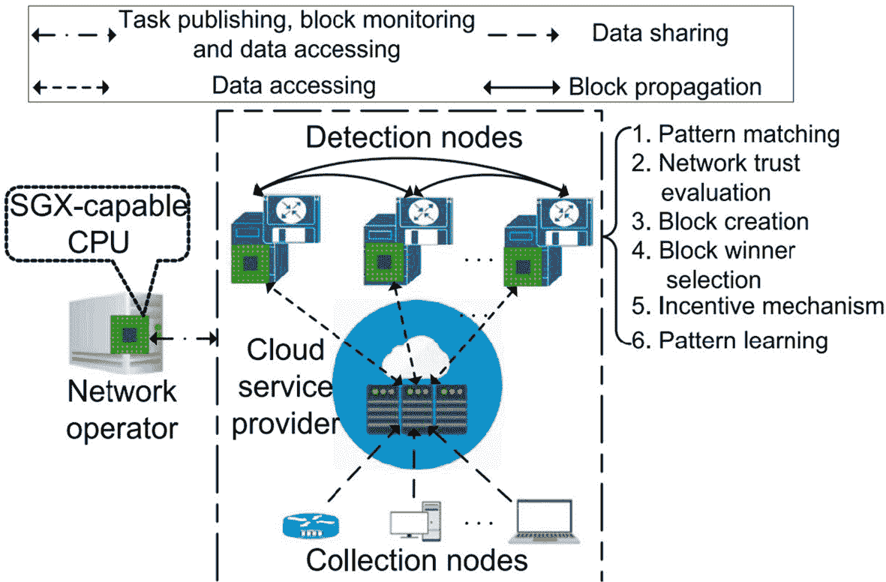

Fig. 2 `SeDID` 系统模型。

该图包含了检测节点、收集节点、一个云提供商和一个网络运营商。检测节点连接到云提供商，云提供商也连接到收集节点。网络运营商连接到一个支持 `SGX` 的 CPU。检测节点执行诸如模式匹配、网络信任评估、区块创建、区块胜者选择、激励机制和模式学习等任务。该图还展示了数据共享、任务发布、区块监控、数据访问和区块传播过程。

网络运营商负责整个网络用于信任评估的入侵检测。它可以创建一个信环境，称为运营商信环境 (`OE`)。`OE` 定期发布检测任务，并根据共识发布的有效区块评估网络信任。

当 `CN` 收到来自 `OE` 的任务时，它们共享数据项。`CN` 包括路由器、交换机、主机、移动终端等。

`DN` 可以运行信环境，称为检测信环境 (`DEs`)。在收到 `OE` 的任务后，`DEs` 充矿工从 `CSP` 获取数据项，执行入侵检测并获取检测结果。根据模式和检测结果的重要性，`DEs` 评估网络信任。然后，它们创建并发布区块。在收到有效区块后，矿工停止挖掘并等待时间窗口以接收其他有效区块。它从收到的区块中选择优先级最高的区块作为有效区块胜者。一旦大多数矿工接受该区块胜者为区块链的下一个区块，共识结束。随后，所有参与者的奖励将根据他们对网络信任评估的贡献决定。此外，矿工通过对新生成区块的数据集进行训练来学习新模式。

`CSP` 负责在收到任务后收集数据项。此外，在收到信环境的请求后，它向信环境提供收集的数据项。

#### 3.2.2.2 安全模型

假设网络运营商是半信的，即它诚实地遵循预定义协议并履行检测任务奖励的承诺，以便了解网络安全状态并维护声誉。然而，它可能被攻击者破解以提取 `CN` 的数据。`CN` 不完全可信，可能会提供低质量的数据项以获取利润。`CSP` 是半信的，意味着它诚实地遵循预定义协议，但对 `CN` 的数据好奇。此外，我们很难确保所有的 `DN`（建立的信环境外）都是可靠的，因为它们可能被黑或表现出恶意。


我们假设攻击者可以控制网络算力节点和 DN 上的软件甚至操作系统，并通过读取、阻塞、修改和重放发送到或来自安全执行区（enclave）的消息，试图破坏 CN 敏感数据的机密性和完整性。假设攻击者无法破解我们系统中使用的加密原语，且执行区是安全的，因为已经提许多许多针对 SGX 攻击的对策措施 [85]。

远程证明可以通过双方之间的握手协议实现，该协议可以使验证者相信执行区内部的代码已正确加载。当 `OE` 授权 `DEs` 时，它可以根据安全策略选择 `DNs` 作为工作节点并验证 `DEs` 以允许它们加入区块链系统。在单个网络域中，所有节点在系统运行之前都信任网络运营节点。网络运营节点将信任评估任务外包并允许工作节点采用 `Intel SGX`，这表明网络运营节点信任 `Intel SGX` 供应商。此外，所有节点必须信任 `Intel SGX` 供应商。即使是像华为这样的网络运营节点也尝试设计自己的 `TEEs` 并提供相应的设备，以实现网络运营节点与 `TEE` 供应商的集成。`SeDID` 的网络运营节点将任务外包以获得可靠的信任评估结果。在外包场景下，仅依赖 `Intel SGX` 进行隐私保护无法保证计算结果的可信度。需要去中心化计算和投票来确保计算的正确性。网络运营节点结合 `Intel SGX` 和去中心化技术来获取可靠计算结果。信任 `Intel SGX` 供应商和去中心化计算处于不同层面，互不冲突。同时，每个 `DE` 的时间可以同步到 `OEs` [86]。我们假设 `OE`、`CN`、`CSP` 和 `DE` 在椭圆曲线密码系统中持有它们的私钥/公钥对 [69]，分别表示为 (`sk[OE]`, `pk[OE]`), (`sk[CN]`, `pk[CN]`), (`sk[CSP]`, `pk[CSP]`) 和 (`sk[DE]`, `pk[DE]`)。这可以通过允许它们（`OE` 除外）在网络运营节点处安全注册并获取相应的证书来实现。通常，节点不会尝试将其私钥共享给其他节点，因为这种共享意味着任何受密钥保护的令牌（tokens）都会被共享。

### 3.2.2.3 系统概述

`SeDID` 旨在同时实现安全性、隐私性和效率。矿工通过执行有意义的任务（即网络信任评估）来创建区块。在 `SeDID` 中，当矿工在一个时间窗口内创建的区块数量少于阈值时，它可以创建一个有效区块。该阈值限制了一些矿工创建和发布有效区块，这极大地减少了 `SeDID` 中的计算和通信消耗。为了避免分叉，我们设计了一种区块胜者选择算法，允许矿工通过比较区块创建时间、该矿工在时间窗口内创建的区块数量、用于检测的数据项数量以及相应的区块哈希值，从收到的多个区块中唯一地确认一个有效区块胜者。

为了节省矿工的存储空间，`SeDID` 区块链记录了由收集的数据密文构建的 Merkle 树的根节点。当网络运营节点发布检测任务时，`CNs` 将其数据密文共享给 `CSP`。`DNs` 的执行区（即矿工）从供应商处访问数据密文，用于网络信任评估、区块创建和验证。

`SeDID` 将区块链作为去中心化账本，记录收集的数据密文的 Merkle 树根节点，以及入侵检测和信任评估的结果。基于 `CNs` 提供并存储在 `CSP` 处的数据，进行统一集成的入侵检测以衡量网络信任。在此过程中，根据 `CNs`、`CSP` 和矿工对网络信任评估的贡献提供激励，以鼓励他们诚实地工作。

### 3.2.2.4 性能评估

在 表 2 中，我们从激励、隐私保护、安全性和性能方面将 `SeDID` 与主流区块链系统进行了对比。某些区块链系统缺乏对激励的考虑。基于 `PoW-`、`BFT-`、`PoS-`、`PoUW-` 以及基于树和 DAG 的区块链系统很少考虑隐私保护，但 `SeDID` 可以通过 `Intel SGX` 保护数据和模式隐私。基于 `BFT` 的区块链系统的容错性通常为 33%，某些基于树和 DAG 的区块链系统采用容错率为 25% 的 `PoW`。`SeDID` 能够抵抗 50% 矿工的异常行为。任务的外包性可能存在于基于 `PoW-`、`PoS-` 和 `PoUW-` 的区块链系统中。因此，它们的去中心化无法无法保证。相反，`SeDID` 可以保证去中心化，因为它避免了任务外包，并防止了强大的矿工同时控制区块链。基于 `BFT` 的区块链系统要求任意矿工之间进行信息交换。在 `SeDID` 中，新创建的区块被传输给所有矿工进行共识，其通信复杂度较低。因此，`SeDID` 优于先进的区块链系统。

表 2

`SeDID` 与相关工作的对比。

| | | 区块链系统 | 入侵检测系统 |
| --- | --- | --- | --- |
| | | `PoW` | `BFT` | `PoS` | `PoUW` | 树和 DAG | | |
| | 准则 | `Bitcoin`^(⁶) | `Algorand`^(⁷) | `Ethereum`^(⁸) | `Permacoin`^(⁹) | `GHOST`^(10) | `CID`^(12) | `SeDID` |
| | 激励 | Y | N | Y | Y | Y | N | Y |
| --- | --- | --- | --- | --- | --- | --- | --- | --- |
| 隐私保护 | N | N | N | N | N | Y | N |
| 安全属性 | Y | Y | Y | Y | Y | Y | Y |
| | FT (%) | 25 | 33 | 50 | 25 | 25 | 50 | 50 |
| | DC | N | Y | N | N | N | |
| 性能 | BCT (s) | 600 | – | 12 | 600 | 600 | 12 | 19.61 |
| | TCT (s) | 3600 | 40 | 72 | 3600 | 3600 | 72 | 44.55 |
| | TH (tx/s) | 7 | 875 | 30 | – | 15.5 | 30 | 224.47 |
| | CPB | High | Low | Low | High | High | Low | Low |
| | CMB | *O*(*M*) | *O*(*M*²) | *O*(*M*) | *O*(*M*) | *O*(*M*) | *O*(*M*) | – | *O*(*M*) |

*IN*, 激励; *PP*, 隐私保护; *LI*, 活性; *SA*, 安全性; *FT*, 容错性; *DC*, 去中心化; *BCT*, 区块创建时间; *TCT*, 任务完成时间; *TH*, 吞吐量; *CPB*, 计算负担; *CMB*, 通信负担; *Y*, 支持; *N*, 不支持或未考虑; –, 未给出或不适用于评估。

#### 3.2.3 总结

总结，`SeDID` 解决了主流区块链系统的三大挑战，即分叉、共识效率低下以及中心化趋势。此外，与主流区块链系统相比，`SeDID` 提供了激励并保护了隐私。然而，`SeDID` 的某些方面还需要进一步考虑。

1.  *Intel SGX 安全性*：`Intel SGX` 有许多漏洞，且没有完美的解决方案来抵抗所有潜在攻击，因为 `Intel SGX` 的某些新漏洞可能尚未暴露。


## 2. 原型系统
在实验中，我们模拟了 SeDID，其中 `K`-means 聚类用于说明网络信任评估。注意的是，`K`-means 聚类可能不是检测网络主要攻击的最佳方法。为了确保 SeDID 能够在实践，它应该整合每种主流攻击的检测方法，以确保高检测准确率。未来，我们将开发 SeDID 的原型系统，集成每个网络中主要攻击的检测方法，供实际部署。

## 3. 集成网络中的信任评估
SeDID 仅支持单网络中的信任评估。然而，未来的网络是异构的。某些网络节点具有跨域活动。我们认为，通过协作训练跨域网络数据来进行跨域网络信任评估是一个前景研究课题，这将是我们未来的工作。

## 4. 启示
我们的工作启发研究人员将各种检测主要网络攻击的方法整合到网络信任评估中。检测模式随着新区块的生成动态更新。同时，我们考虑了激励和隐私保护，并妥善解决了区块链问题，使 SeDID 适用于实践。

### 3.3 集成网络的伪名与信任值管理
在多个网络域之间评估和共享 UE（用户终端）信任可以极大支持未来异构集成网络的安全和信任管理。但身份隐私保护与信任评估效率之间的困境为伪名和信任值管理造成了巨大挑战。大多数现有方法要么依赖于受信任第三方（TTP）和非共谋方，要么部署可信执行环境（TEE）。它们无法直接应用于无信任的异构网络环境，因为网络域互不信任，且难以部署完全信任的第三方。为了解决第 1.1.3 节中的问题，我们提出了 DePTVM，一种用于异构集成网络的去中心化伪名和信任值管理方案。该方案通过基于区块链的可验证洗牌和信任混淆，由不同的网络运营商共同维护`<pseudonym, trust value>`对列表，以支持匿名信任评估并确保伪名的不可关联性。

#### 3.3.1 概述
2022 年，全球移动用户数达到 57 亿，其中 5G 用户超过 7 亿。除 5G 外，6G 被认为是一种大规模异构网络（LS-HetNet）[24]。它整合了不同类型的网络，即移动蜂网络、互联网、卫星网络、海洋网络等，形成一个全球覆盖的地-空-海一体化异构网络。在这样的网络中，由不同联网技术实现的多个网络域互不信任。如何确保网络安全、信誉以及 UE 隐私是驱动其广泛使用的关键问题。在 LS-HetNet 中，接入节点（SNs）在提供服务前需要验证接入的 UE。尽管已经提出了许多加密认证技术来同时确保认证和身份隐私[88]，例如 5G 标准采用的基于根密钥的方法，UE 仅被认证为可信任或不可信。它们无法执行细粒度的信任管理和控制。

正如国际电信联盟-电信标准规定部门（ITU-T）所规定的，信任被预期为。在 LS-HetNet 中，接入节点在提供服务前需要验证接入的 UE。尽管已经提出了许多加密认证技术来同时确保认证和身份隐私[88]，例如 5G 标准采用的基于根密钥的方法，UE 仅被认证为可信任或不可信。它们无法执行细粒度的信任管理和控制。

##### 3.3.1.1 动机
在信任评估系统中，UE 的身份应该受到保护。如果我们采用伪名，则需要解决信任评估与伪名更新之间的矛盾。现有方案主要依赖 TTP [46, 47, 93]、TEEs 或非共谋方 [55] 来克服信任评估与伪名更新的困境。然而，这些方案通常关注单网络，且不支持异构网络。为了在去中心化环境中管理 UE 伪名和信任值，我们面临许多挑战。大多数现有方案 [47, 48] 无法直接应用于异构网络。此外，不同的网络运营商采用各种安全数据进行信任评估，但信任值难以共享和同步。因此，如何在保护 UE 隐私的同时确保域评估信任值的一致性是一个关键问题。然而，目前的文献仍然缺乏有效的方案。

##### 3.3.1.2 贡献
我们通过采用可验证洗牌和信任混淆，提出了基于区块链的集成网络第一个去中心化伪名和信任值管理方案。为了保护 UE 身份隐私，多个运营商代理（OAs）共同维护`<pseudonym, trust value>`对列表，UE 使用其伪名进行网络活动。为了跨域同步和共享信任值并确保匿名性，通过嵌入匿名信任来实现区块链共识，该评估根据 UE 的伪名和相关行为进行。为了解决信任评估与伪名更新的困境，OAs 首先对`<pseudonym, trust value>`列表中的信任值进行混淆。然后，通过逐一执行后向向前的可验证洗牌，通过应用幂运算（使用 UE 的公钥作为基数，新选择的随机数为指数）并秘密排列列表行来更新伪名。这样，可以确保新旧伪名的不可关联性，且 UE 的新伪名继承旧伪名的混淆信任值。当 UE 使用新伪名进行联网时，其信任根据新伪名继承的信任值和关联行为进行相应的评估和更新；因此，可以确保信任评估效率。具体而言，DePTVM 的贡献总结如下：

1. 我们提出了一种基于区块链的第一个去中心化伪名和信任值管理方案，用于在互不信任的多网络域之间匿名评估和共享 UE 信任。
2. 我们将信任混淆与可验证洗牌相结合，在不依赖任何 TTP 或 TEE 的情况下，确保伪名更新前后的不可关联性。

#### 3.3.2 DePTVM 设计
在此部分，我们描述了 DePTVM 的设计，包括系统模型、安全模型和系统概述。然后，我们将 DePTVM 与相关工作进行了对比。

##### 3.3.2.1 系统模型


[图 3] 显示了 DePTVM 的系统模型，它主要涉及四类实体，即用户设备（UE）、接入点（AP）、云服务提供商（CSP）和授权机构（OA）。在集成网络中，每个网络通过交换机连接。漫游 UE 通过 AP 连接到 SN。AP 监控连接 UE 的行为并提供信任相关数据。根据这些数据，不同的 OA 协作评估每个 UE 的信任度，以实现对 UE 的信任管理和控制。我们关注域间信任评估与共享，而域内评估是其特例（即只有一个域由一个 OA 处理）。

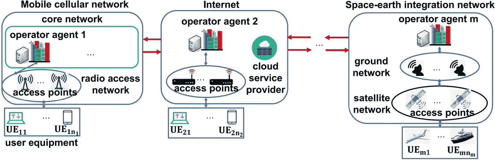

[图 3] DePTVM 系统模型。

该图说明了 DePTVM 的系统模型，涉及四类实体：UE、接入点（AP）、CSP 和 OA。图分为三个主要部分：移动蜂窝网络、互联网和空天一体化网络。移动蜂窝网络部分包括一个带有运营商代理 1 的核心网，一个包含接入点和用户设备（UE <sub>11</sub> 到 UE <sub>1n</sub>）的无线接入网。互联网部分包括运营商代理 2、接入点和一个云服务提供商，以及用户设备（UE <sub>21</sub> 到 UE <sub>2n</sub>）。空天一体化网络部分包括运营商代理 m、地面网络、包含接入点和用户设备（UE <sub>m1</sub> 到 UE <sub>mn</sub>）的卫星网络。箭头表示这些部分之间的连接。

*   UE 使用伪名连接到 AP 进行网络活动。
*   由网络运营商部署的 AP 感知所连 UE 的跨域行为，并定期将感知到的行为（称为信任相关数据）和签名共享给公共 CSP。
*   CSP 提供通用的数据存储服务，用以收集和验证来自不同网络域 AP 的信任相关数据，并允许访问带有 AP 签名的数据，以进行域间信任评估。
*   OA 由其网络运营商部署，负责根据来自 CSP 的信任相关数据评估 UE 的信任，并管理所有 UE 的 〈伪名, 信任值〉 元对列表。

### 3.3.2.2 安全模型

UE 可能会产生恶意行为且不可信，其域间信任应跨域进行评估和共享，以帮助其他网络实体做出决策。AP 应该认为是半可信的，即它遵循预定义的协议，但对每个 UE 的敏感信息好奇，例如 UE 的长期公钥以及伪名或活动之间的关联。由运营商部署的 AP 类似于软件定义网络中的交换机和 WiFi AP。AP 的安全状态可以通过本地 OA 甚至其他 OA 进行验证 [94, 95]。CSP 无法被完全信任。由于业务利润的考虑，它根据 DePTVM 的设计运行，但它对 UE 的敏感信息好奇，并可能产生恶意行为。在 DePTVM 中，CSP 存储来自 AP 的信任相关数据和 AP 的签名。OA 可以使用签名验证提取出的数据并对信任评估达成共识。由于安全数字签名的不可伪造性，CSP 无法伪造来自 AP 的存储数据和签名。此外，CSP 向 OA 提供的不一致数据可以很容易地被 OA 通过监控或相互检查检测到，因为这些共享数据应该由 CSP 签名。如果发现任何 CSP 的误行为，其服务提供将受到限制，导致 CSP 失去潜在利润。因此，我们假设 CSP 在存储服务提供方面是半信的（即诚实但好奇）。由于 CSP 可能会遭受单点故障、外部入侵或内部攻击，我们不能完全依赖 CSP 来收集数据并相应评估 UE 信任。也就是说，仅使用 CSP 进行信任评估是不可的。因此，我们部署 CSP 提供存储服务，并采用区块链共识来确保信任评估结果的正确性和可靠性。此外，我们假设 OA 不其他域的 OA 信任，且至少有一个 OA 不与其他 OA 通谋。

### 3.3.2.3 系统概述

DePTVM 包含多个功能：创世区块生成、信任值更新与共识以及列表 `L[m]` 维护，这些功能按顺序运行。DePTVM 的流程如图 4 所示。在创世区块生成中，*m* 个不同域的 OA 协作生成一个包含 *n* 个 UE 〈伪名, 信任值〉 元对列表 `L[m]`，并将此列表插入创世区块。UE 可以通过访问区块链计算并提取自己的伪名，并使用这些伪名进行网络活动。在信任值更新与共识中，AP 监控其连接的 UE，并定期将收集的信任相关数据共享给公共 CSP（例如每 10 分钟）。然后，OA 根据足够的信任相关数据进行信任评估，更新 `L[m]` 中的信任值并达成共识。在 R 轮信任更新后，代理节点应在确保不可关联性的前提下维护伪名，这被称为列表 `L[m]` 维护。

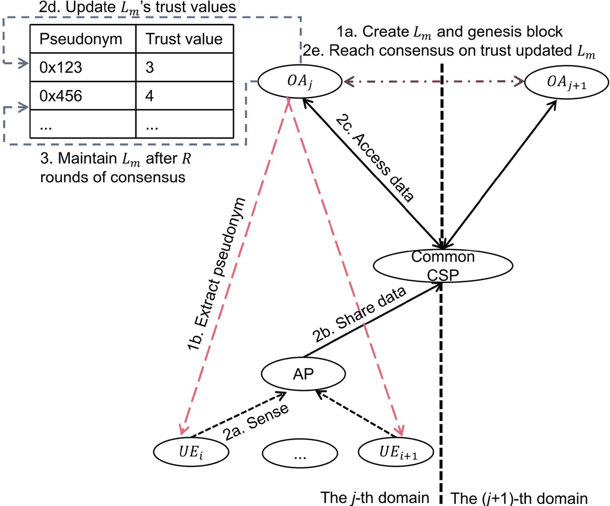

[图 4] DePTVM 的流程。

该图说明了 DePTVM 的系统模型，涉及四类实体：UE、接入点（AP）、CSP 和 OA。图分为两个域，j 域和 (j+1) 域，由一条虚线分隔。在 j 域中，UE <sub>i</sub> 感知数据 (2a) 并与 AP 共享数据 (2b)。随后 AP 将数据 (2b) 共享给公共 CSP。OA <sub>j</sub> 提取伪名 (1b) 并从公共 CSP 获取数据 (2c)。在 (j+1) 域中，OA <sub>j+1</sub> 对更新后的信任 `L[m]` 达成共识 (2e) 并从公共 CSP 获取数据 (2c)。该过程从创建 `L[m]` 和创世区块开始 (1a)。`L[m]` 的信任值被更新 (2d)，伪名和相应的信任值如下所示。表格包含伪名 0×123 的信任值为 3，0×456 的信任值为 4。系统在 R 轮共识后维护 `L[m]`。

DePTVM 使用区块链作为去中心化账本记录列表 `L[m]`。DePTVM 的区块链是一种联盟链。OA 自身在域间网络中创建并发布区块以进行共识。共识节点（即 OA）提议一个包含信任更新列表的区块以供其他共识节点接受，这有助于对信任评估达成共识并跨多个域同步信任值。


为了节省 OA 的存储空间，DePTVM 的区块链记录了由 AP 收集的信任相关数据生成的 Merkle 树根，而不是直接记录这些数据。CSP 提供存储所有信任相关数据的存储空间。DePTVM 采用信任混淆和可验证洗牌来解决信任评估与伪名更新之间的冲突。它允许 OA 维护`〈pseudonym, trust value〉`对的列表 `L[m]`。代理首先对 `L[m]` 中的信任值进行混淆。然后，他们协作执行后向和正向洗牌，通过执行模幂运算（将 UE 的公钥视为基数，新选择的随机数为指数）并同时秘密地排列列表行来更新伪名。因此，保证了伪名的不可关联性，且 UE 的新伪名继承了旧伪名的混淆信任值。如果 UE 在网络活动中采用新的伪名，则可以使用新伪名继承的信任值和关联行为来计算新的信任值，从而确保评估的有效性。

### 3.3.2.4 性能评估

我们在表 3 中从 UE 信任评估支持、跨域信任评估、信任同步、效率、不可关联性、去中心化以及 UE 加入和注销管理方面，与相关工作进行了对比。DePTVM 可以支持 UE 的跨域信任评估。AnonRep [55] 未考虑高效的信任同步且无法确保伪名的不可关联性。此外，AnonRep 在每轮信任评估后执行可验证洗牌，这导致了较高的计算复杂度。然而，DePTVM 通过区块链以高效安全的方式跨多个快速同步信任值。在经过 `R` 轮信任评估和共后，DePTVM 执行后向和正向可验证洗牌；因此，可以确定合适的 `R` 在预期不可关联性和效率之间取得平衡。此外，DePTVM 采用多个 OA 执行信任混淆和可验证洗牌，从而在不依赖任何 TTP 或 TEE 的情况下确保伪名的不可关联性。此外，DePTVM 支持 UE 的加入和注销。因此，与其他相关工作相比，DePTVM 对于集成异构网络更具可行性。

Table 3

DePTVM 与相关工作的对比。

| || SeDID [43] | ARTSense [93] | [48] | AnonRep [55] | DePTVM |
| --- | --- | --- | --- | --- | --- |
| UT | ○ | ● | ● | ● | ● |
| IN | ○ | ○ | ○ | ○ | ● |
| TS | ● | ● | ● | ○ | ● |
| Ef | ● | ● | ● | ○ | ● |
| Uk | − | ● | ● | ○ | ● |
| DC | ● | ○ | ○ | ● | ● |
| UJ | − | ○ | ● | ○ | ● |

`UT`, `IN`, `TS`, `Ef`, `Uk`, `DC`, `UJ`

### 3.3.3 总结

DePTVM 为去中心化网络提供存储空间。通过采用信任混淆和可验证洗牌，DePTVM 可以确保伪名的不可关联性。

1. DePTVM 记录 Merkle 树根。代理首先对 `L[m]` 中的信任值进行混淆并执行后向和正向洗牌。
2. DePTVM 通过区块链跨多个快速同步信任值。

### 4 结论与展望

在本节中，我们总结了主要工作并预测了未来趋势。

### 4.1 结论

在本章中，我们对去中心化网络管理中的关键技术进行了研究。具体而言，我们介绍了去中心化网络信任的背景。

1. 我们首先设计了一个名为 `SDC` 的安全数据收集系统来解决研究问题。我们建立了安全数据收集模型来解决第一个问题，并基于区块链改进了有的激励方法。
2. 我们设计了一个名为 `SeDID` 的隐私保护去中心化网络信任评估框架来解决研究问题。根据安全数据的质量和分析结果，我们建立了网络信任评估模型来解决该问题。


### 3. 最后
我们针对异构集成网络提出了一种伪名和信任值管理 own 方法，称为 `DePTVM`，以解决第 1.1.3 节中的研究问题。利用异构集成网络的特性，设计了用于跨域用户（UE）的信任评估架构，以解决第 1.1.3 节中的第二个问题。采用改进的 `SeDID` 共识机制来实现跨域信任评估结果的快速同步与共享，从而解决了第 1.1.3 节中的第三个问题。

### 4.2 展望
本章对去中心化网络信任管理的关键技术进行了研究。尽管某些现有问题已经解决，但仍有一些问题尚未解决，需要进一步的探索研究。具体而言，未来工作的展望如下：

1. **安全数据质量评估**：去中心化网络信任评估需要收集数据进行分析。然而，如果数据源提供低质量安全数据，网络信任评估的准确性可能会受到负面影响。尽管 `SeDID` 简要考虑了安全数据的质量，但没有针对深度设计的专门方案。因此，需要对安全数据质量评估进行进一步研究，帮助过滤低质量安全数据并提高信任评估结果的准确性。

2. **隐私保护的可验证信任评估模式学习**：在未来的工作中，有必要探索网络信任评估的模式学习方法。在分布式场景下，为了保护更强的数据隐私，建议安全数据不要离开其采集设备或域。数据采集设备或不同的数据管理组织可以协作学习，实现全局模式的联邦学习。然而，联邦学习存在一些漏洞。因此，我们需要对去中心化网络场景下网络信任评估的隐私保护可验证模式进行进一步研究。

3. **隐私保护的可验证数据发布**：在 `SeDID` 中，采集的安全数据只能由授权的飞信区访问和使用，这阻止了数据充分利用以产生更多价值。因此，有必要在保护数据源隐私的同时考虑安全数据的采集和发布。尽管目前有一些隐私保护的数据发布方案，但这些方案没有考虑数据融合的可信度。因此，我们应该探索未来关于隐私保护的可验证数据发布的研究。

4. **高效信任评估**：在 `SeDID` 和 `DePTVM` 中，矿工利用 `CSP` 存储的安全数据进行信任评估，并将评估结果插入区块链。然而，在处理大量安全数据时，很难确保效率。因此，在处理大量安全数据时如何确保信任评估的效率需要进一步研究。

5. **原型系统**：目前，`SeDID` 和 `DePTVM` 的原型系统需要进一步开发。一方面，`SeDID` 的原型系统仅实现了安全数据的安全传输和网络信任评估的共识，尚未在真实网络场景中收集安全数据。因此，未来我们可以开发一种安全数据采集工具，在真实网络场景中收集数据。此外，`SeDID` 的原型系统需要集成更多的攻击检测方法，以确保网络信任评估的准确性。另一方面，`DePTVM` 的原型系统缺乏捕捉连接设备行为数据的工具。此外，为了实现对 `UE` 的精确信任评估，`DePTVM` 使用的模式也具备识别不同攻击的能力。

## References
* [[1]](#Ch007_79-104_B9780443347177000143.xhtml#B-bb0010) Li C., Yu B., Sycara K. An incentive mechanism for message relaying in unstructured peer-to-peer systems. In: 2007:1–8. *Proceedings of AAMS.*.
* [[2]](#Ch007_79-104_B9780443347177000143.xhtml#B-bb0015) Qazi S., Raad R., Mu Y. Securing DSR against wormhole attacks in multirate ad hoc networks. *J. Netw. Comput. Appl.* 2013;36(2):582–592.
* [[3]](#Ch007_79-104_B9780443347177000143.xhtml#B-bb0020) Tuteja A., Gujral R., Thalia S. Comparative performance analysis of DSDV, AODV and DSR routing protocols in MANET using NS2. In: 2010:330–330. *Proceedings of ACE.*
* [[4]](#Ch007_79-104_B9780443347177000143.xhtml#B-bb0025) Johnson D., Maltz D., Broch J. DSR: the source routing protocol for multi-hop wireless ad hoc networks. *Ad Netw.* 2001;5(1):139–172.
* [[5]](#Ch007_79-104_B9780443347177000143.xhtml#B-bb0030) Menotti D., Chiachia G., Pinto A. Deep representations for iris, face, and fingerprint spoofing. *IEEE Trans. Inf. Forensics.* 2015;10(4):864–879.
* [[6]](#Ch007_79-104_B9780443347177000143.xhtml#B-bb0035) Bhaya W., Alasadi S. Security against spoofing attack in mobile ad hoc network. *Eur. J. Sci. Res.* 2011;64(4):634–643.
* [[7]](#Ch007_79-104_B9780443347177000143.xhtml#B-bb0040) Zhong S., Chen J., Yang Y. Sprite: a simple, cheat-proof, credit-based system for mobile ad-hoc networks. In: Proceedings of INFOCOM;2003:1987–1997.
* [[8]](#Ch007_79-104_B9780443347177000143.xhtml#B-bb0045) Liu S., Zhang L., Yan Z. Predict pairwise trust based on machine learning in online social networks: *IEEE Access.* 2018;6:5297–5318.
* [[9]](#Ch007_79-104_B9780443347177000143.xhtml#B-bb0050) Marchang N., Datta R. Light-weight trust-based routing protocol for mobile ad hoc networks. *IET Inf. Secur.* 2012;6(2):77–83.
* [[10]](#Ch007_79-104_B9780443347177000143.xhtml#B-bb0055) Lu R., Lin X., Zhu H. A novel incentive protocol for mobile ad hoc networks. In: 2008:3237–3242. *Proceedings of IEEE WCNC.*
* [[11]](#Ch007_79-104_B9780443347177000143.xhtml#B-bb0060) Liu Y.N., Wang Y.P., Wang X.F. Privacy-preserving raw data collection without a trusted authority for IoT. *Comput. Netw.* 2019;148:340–348.
* [[12]](#Ch007_79-104_B9780443347177000143.xhtml#B-bb0065) Liu Y., Guo W., Fan C.I. A practical privacy-preserving data aggregation (3PDA) scheme for smart grid. *IEEE Trans. Ind. Inform.* 2018;15(3):1767–1774.
* [[13]](#Ch007_79-104_B9780443347177000143.xhtml#B-bb0070) Liu Y., Liu G., Cheng C. A privacy-preserving health data aggregation scheme. *KSII Trans. Internet Inf. Syst.* 2016;10(8):3852–3864.
* [[14]](#Ch007_79-104_B9780443347177000143.xhtml#B-bb0075) Jing X., Yan Z., Pedrycz W. Security data collection and data analytics in the Internet: a survey. *IEEE Commun. Surv. Tutor.* 2018;21(1):586–618.
* [[15]](#Ch007_79-104_B9780443347177000143.xhtml#B-bb0080) Jing X., Yan Z., Jiang X. Network traffic fusion and analysis against DDoS flooding attacks with a novel reversible sketch. *Inf. Fusion.* 2019;51:100–113.
* [[16]](#Ch007_79-104_B9780443347177000143.xhtml#B-bb0085) Zargar S.T., Joshi J., Tipper D. A survey of defense mechanisms against distributed denial of service (DDoS) flooding attacks. *IEEE Commun. Surv. Tutor.* 2013;15(4):2046–2069.
* [[17]](#Ch007_79-104_B9780443347177000143.xhtml#B-bb0090) Xie H., Yan Z., Yao Z. Data collection for security measurement in wireless sensor networks: a survey. *IEEE Internet Things J.* 2018;6(2):2205–2224.


-   [18] He L.M., Yan Z., Atiquzzaman M. LTE/LTE-A 网络安全数据采集与安全测量分析：综述。*IEEE Access.* 2018;6:4220–4242.
-   [19] Yan Z., Zhang P., Vasilakos A.V. 物联网信任管理综述。*J. Netw. Comput. Appl.* 2014;42:120–134.
-   [20] Jayasinghe U., Lee G.M., MacDermott A. `TrustChain`. 一种结合边缘计算的隐私保护区块链。*Wirel. Commun. Mob. Comput.* 2019;2019:2014697.
-   [21] Liu Z., Ma J., Weng J. LPPTE: 一种轻量级隐私信任评估方案，用于协作车辆安全应用中的分布式数据融合。*Inf. Fusion.* 2021;73:144–156.
-   [22] Zheng W., Wu Y., Wu X. Intel SGX 及其应用综述。*Front. Comput. Sci.* 2021;15(3):1–15.
-   [23] Mazzeo G., Arnautov S., Fetzer C. `SGXTuner`. 通过随机优化增强 Intel SGX 应用性能。*IEEE Trans. Dependable Secure Comput.* 2021;19:2595–2608.
-   [24] Xiao Y., Shi G., Krunz M. 迈向联邦学习下的 6G 无处不在 AI。*arXiv preprint arXiv:2004.13563.* 2020.
-   [25] Li M., Zhang Y., Wang H. `CIPHERLEAKS`: 通过密码侧信道破解 AMD SEV 上的恒时间密码学。In: 2021:717–732. *Proceedings of USENIX Security.*.
-   [26] Li M., Zhang Y., Lin Z. `CROSSLINE`: 破解 AMD SEV 中基于“崩溃安全”的内存隔离。In: 2021:2937–2950. *Proceedings of CCS.*.
-   [27] Buhren R., Werling C., Seifert J.P. 在证明更新前是不安全的：分析 AMD SEV 的远程远程证明。In: 2019:1087–1099. *Proceedings of CCS.*.
-   [28] Jiang Z., Dong P., Wei R. `PSpSys`: 一种基于 ARM TrustZone 的时间预测混合关键性系统架构。*J. Syst. Archit.* 2022;123:102368.
-   [29] Pinto S., Santos N. 揭秘 arm trustzone：全面综述。*ACM Comput. Surv.* 2019;51(6):1–36.
-   [30] Jeon S., Kim H. `TZMon`: 用 ARM trustzone 提升移动安全性。*Comput. Secur.* 2021;109:10239.
-   [31] Rodrigues B., Bocek T., Stiller B. 通过区块链系统 (`BloSS`) 实现协作多域 DDoS 攻击。In: 2017:.42nd IEEE Conference on Local Networks.
-   [32] Rathore S., Kwon B.W., Park J.H. 面于物联网网络的区块链去中心化安全架构。*J. Netw. Comput. Appl.* 2019;143:167–177.
-   [33] She W., Liu Q., Tian Z. 无线传感器网络中恶意节点检测的区块链信任模型。*IEEE Access.* 2019;7:3894.
-   [34] Liang H., Wu J., Mumtaz S. 用于 V2X 的微区块链协作入侵检测。*IEEE Commun.* 2019;57:77–83.
-   [35] Alkadi O., Moustafa N., Turnbull B. 用于物联网和云网络的区块链增强入侵检测。*IEEE Things J.* 2020;8:9463–9472.
-   [36] Liang C., Shanmugam B., Azam. 基于区块链的多智能体入侵检测系统。*Electronics.* 2020;9:1120.
-   [37] Alexopoulos N., Vasilakis E., Ivankó. 用于协作入侵检测的区块链方法。In: 2019:1087–1099. *Proceedings of CCS.*
-   [38] Golomb T., Mirsky Y., Elovici Y. `4SD`: 通过区块链进行异常检测。*arXiv preprint:1803.0380.* 2018.
-   [39] Li W., Wang Y., Li J. 基于挑战的协作入侵检测的区块链方法。*Int. J. Inf. Secur.* 2021;20:127–139.
-   [40] Hu B., Zhou C., Tian Y. 用于智能电网的区块链协作入侵检测。*IEEE Trans. Syst. Mann. Syst.* 2019;49:1720–1730.
-   [41] Kantola R., Gurtov A. 超越 5G 的 6G 信任网络。In: 2020:1–6. *6G SUMMIT.*
-   [42] Yliantila M., Kantola R. 6G 研究：信任与安全。*arXiv preprint:2004.11665.* 2020.
-   [43] Liu G., Feng W. `SED`: SGX 开启的协作检测。*Inf. Fusion.* 2021;70:100–114.
-   [44] Liu G., Dong H. `4SD`: MANET 中的数据采集。*IEEE Trans. Big Data.* 2020;8:739–752.
-   [45] Androulaki E., Choi S., Bellovin S. 匿名认证。In: 2008:202–218.
-   [46] Christin D., Kockan C., Hollick M. `Incogni`: 匿名保护感知。*Pervasive Mob. Comput.* 2013;9:353–371.
-   [47] Wang X., Cheng W., Mohapatra P. 匿名网络。In: 2013:2517–2525. *Proceedings of INFOCOM.*
-   [48] Feng W., Yan Z., Yang L. 匿名众包。*IEEE Things J.* 2020;9:14185–14202.
-   [49] Fei S., Yan Z., Ding W. 安全漏洞与防御措施：综述。*ACM Comput. Surv.* 2021;54(6):1–36.
-   [50] Brenner S., Hundt T., Mazzeo G. 使用 Intel SGX 的安全云微服务。In: 2017:177–191. *Proceedings of IFIP DAIS.*
-   [51] Dokmai N., Kockan C., Zhu K. 可信执行环境下的隐私保护基因型填补。*Cell Syst.* 2021;12(10):983–993.
-   [52] Lipp M., Kogler A., Oswald D. `PLATYPUS`: x86 的软件功率侧信道攻击。In: 2021:355–371. *Proceedings of IEEE S&P.*
-   [53] Neff C.A. 可验证的秘密洗牌及其在电子投票中的应用。In: 2001:116–125. *Proceedings of ACM CCS.*
-   [54] Nguyen L., Safavi-Nini R., Kurosawa K. 可验证洗牌：一种形式模型和基于 Paillier 的三轮可证明安全性构造。*Int. J. Inf. Secur.* 2006;5:241–255.


- [55] Zhai E., Wolinsky D.I., Chen R. `AnonRep`: towards tracking-resistant anonymous reputation. In: 2016:583–596. *USENIX NSDI 论文.*
- [56] Zhang F., Eyal I., Escriva R. `REM`: resource-efficient mining for blockchains. In: 2017:1427–1444. *USENIX Security 论文.*
- [57] Miller A., Juels A., Shi E. `Permacoin`: repurposing bitcoin work for data preservation. In: 2014:475–490. *IEEE S&P 论文.*
- [58] Gilad Y., Hemo R., Micali S. `Algorand`: scaling byzantine agreements for cryptocurrencies. In: 2017:51–68. *SOSP 论文.*
- [59] Sompolinsky Y., Zohar A. Accelerating bitcoin's transaction processing. Fast money grows on trees, not chains. *Cryptology ePrint Archive.* 2013.
- [60] Sompolinsky Y., Lewenberg Y., Zohar A. `Spectre`. A fast and scalable cryptocurrency protocol. *Cryptology ePrint Archive.* 2016.
- [61] Liu G., Yan Z., Pedrycz W. Data collection for attack detection and security measurement in mobile ad hoc networks: a survey. *J. Netw. Comput. Appl.* 2018;105:105–122.
- [62] Liu S., Zhang L., Yan Z. Predict pairwise trust based on machine learning in online social networks: a survey. *IEEE Access.* 2018;6:51297–51318
- [63] Zhang Y., Deng R.H., Liu X. Outsourcing service fair payment based on blockchain and its applications in cloud computing. *IEEE Trans. Serv. Comput.* 2018;14(4):1152–1166.
- [64] Taylor P.J., Dargahi T., Dehantan A. A systematic literature review of blockchain security. *Digit. Commun. Netw.* 2020;6(2):147–156.
- [65] Nakamoto S. `Bitcoin`: a peer-to-peer electronic cash system. *Decentralized Bus. Rev.* 2008;4:15.
- [66] Wang W., Hoang D., Hu P. A survey on consensus mechanisms and mining strategy management in blockchain networks. *IEEE Access.* 2019;7:22328–22370.
- [67] Chen J., Yao S., Yuan Q. `CertChain`: public and efficient certificate audit on blockchain for TLS connections. In: 2018:2060–2068. *IEEE INFOCOM 论文.*
- [68] Zou R., Lv X., Wang B. Blockchain-based photo forensics with permissible transformations. *Comput. Secur.* 2019;87:101567.
- [69] Wang D., Cheng H., He D. On the challenges in designing identity-based privacy-preserving authentication schemes for mobile devices. *IEEE Syst. J.* 2016;12(1):916–925.
- [70] Hu Y., Perrig A., Johnson D. Wormhole attacks in wireless networks. *IEEE J. Sel. Areas Commun.* 2006;24(2):370–380.
- [71] Fan K., Wang S., Ren Y. Blockchain-based secure time protection scheme in IoT. *IEEE Internet Things J.* 2018;6(3):4671–4679.
- [72] Chen Z., Vasilakis G., Murdock K. `VoltPillager`: hardware-based fault injection attacks against Intel SGX Enclaves using the `SVID` voltage scaling interface. In: 2021:699–716. *USENIX Security 论文.*
- [73] Kogias E.K., Jovanovic P., Gailly N. Enhancing bitcoin security and performance with strong consistency via collective signing. In: 2016:279–296. *USENIX Security 论文.*
- [74] Miller A., Kosba A., Katz J. Nonoutsourceable scratch-off puzzles to discourage bitcoin mining coalitions. In: 2015:680–691. *CCS 论文.*
- [75] Zhang L., Yan Z., Kantola R. Privacy-preserving trust management for unwanted traffic. *Future Gener. Comput. Syst.* 2017;72:305–318.
- [76] Ma S., Yan Z. `PSNController`: an unwanted content system in pervasive social networking based on trust. *ACM Trans. Multimed. Comput. Appl.* 2015;12(1):1–23.
- [77] Yan Z., Kantola R., Shen Y. A generic solution for unwanted traffic through trust management. *New Rev. Hypermedia Multimed.* 2014;20(1):25–51.
- [78] Shen Y., Yan Z., Kantola R. Analysis on the acceptance of global trust management for unwanted traffic based on game theory. *Comput. Secur.* 2014;47:
- [79] Meng W., Feng W., Yan Z. When intrusion meets blockchain: a review. *IEEE Access.* 2018;6:10179.
- [80] Peng L., Tischhauser E. Privacy in permissionless blockchain: a survey. *Digit. Commun. Netw.* 2021;7(3).
- [81] Fredrikson M., Lantz E., Jha S. Privacy in pharmacogenetics: an end-to-end case study of warfarin. In: 2014:17–32. *USENIX 论文.*
- [82] Fredrikson M., Jha S., Ristenpart T. Model inversion attacks that exploit confidence information and basic countermeasures. In: 2015:1322–1333. *ACM SIGSAC 论文.*
- [83] Wu B., Li Q., Xu K. `SmartRetro`: blockchain-based incentives for distributed IoT retrospective. In: 2018:308–316. *IEEE MASS 论文.*
- [84] Sagirlar G., Carminati B., Ferrari E. `AutoBotCatcher`: blockchain-based P2P botnet detection for the Internet of things. In: 2018:1–8. *IEEE CIC 论文.*
- [85] Kim D., Jang D., Park M. `SGX-LEGO`: fine-grained SGX controlled-channel attack and its countermeasure. *Comput. Secur.* 2019;82:118–139.
- [86] Li S., Xue K., Wei D.S. `SecGrid`: a secure and efficient SGX-enabled smart grid system with rich functionalities. *IEEE Trans. Inf. Forensics Secur.* 2019;15:1318–1330.
- [87] Bano S., Sonnino A., Al-Bassam M. SoK: consensus in the age of blockchains. In: 2019:183–198. *ACM AFT 论文.*
- [88] Khan M., Järvinen K., Ginzboorg P. On de-synchronization of user pseudonyms in mobile networks. In: 2017:347–366. *ISS 论文.*
- [89] Zhang L., Yan Z., Kantola R. Privacy-preserving trust management for unwanted traffic. *Future Gener. Comput. Syst.* 2017;72:305–318.
- [90] Yan Z., Kantola R., Shen Y. A generic solution for unwanted traffic through trust management. *New Rev. Hypermedia Multimed.* 2014;20(1):25–51.
- [91] Yan Z., Prehofer C. Autonomic trust management for a component-based software system. *IEEE Trans. Dependable Secure Comput.* 2010;8(6):810–823.


- [\[92\]](#Ch007_79-104_B9780443347177000143.xhtml#B-bb0465) Yan Z., Li X., Wang M.J. Flexible data access control based on trust and reputation in cloud computing. *IEEE Trans. Cloud Comput.* 2015;5(3):485–498.
- [\[93\]](#Ch007_79-104_B9780443347177000143.xhtml#B-bb0470) Wang X.O., Cheng W., Mohapatra P. ARTSense: anonymous reputation and trust in participatory sensing. In: 2013:2517–2525. *Proceedings of IEEE INFOCOM.*.
- [\[94\]](#Ch007_79-104_B9780443347177000143.xhtml#B-bb0475) Zhang T., Bianco A., Giaccone P. Dealing with misbehaving controllers in SDN networks. In: 2017:1–6. *Proceedings of IEEE GLOBECOM.*.
- [\[95\]](#Ch007_79-104_B9780443347177000143.xhtml#B-bb0480) Abhishek N.V., Aman M.N., Lim T.J. DRiVe. Detecting malicious roadside units in the internet of vehicles with low latency data integrity. *IEEE Internet Things J.* 2021;9:3270–3281.

# 第 8 章 转型全球经济：数字化的深远影响

1. Ramaprasad Ramakrishnan
2. Alan Megargel
3. 新加坡管理大学计算与信息系统学院，新加坡，新加坡

## 摘要

在前所未有的数字化转型时代，全球经济见证了巨大的增长、创新和机遇。然而，随着世界快速拥抱数字前沿，欺诈和骗局已成为这场数字革命的巨大阻碍。本章对数字化转型进行了严谨的探讨，分析了支持这些目标的强大驱动力，并分析了其对新加坡和印度等亚洲市场的深远影响。它进一步深入探讨了研究空白和潜在陷阱，强调了在面对普遍的金融欺诈和骗局时采取谨慎态度的紧迫需求。随着世界向数字互联的未来发展，本研究强调了全面理解这些挑战的必要性，以及采取积极措施保护充满前景的全球经济免受欺诈和骗局侵害。

## 关键词

* 数字化转型
* 全球经济
* 支付欺诈
* 电子商务骗局
* 技术采纳

## 1 引言

在过去的二十十年里，我们见证了一场深刻的技术革命，它将世界带到了指尖。在发达和发展中经济体中，数字交易的广泛采用已达到惊人的高度。2020 年，当世界经历前所未有的新冠肺炎疫情并限制物理接触时，数字技术为我们提供了救助，让我们能够继续职业和个人生活。全球范围内正进行着推进发达和发展中市场数字市场的竞赛，各自的监管机构、领先银行和进取的金融科技公司都希望抓住这一机会。全球市场的交易价值将从 2022 年的 8.5 万亿美元几乎翻倍到 2027 年的 15.1 亿美元[1]。

任何新的发展和进步都是双刃剑，必须非常谨慎在使用。大量的机会也增加了金融欺诈和骗局带来的脆弱性和担忧。监管和管理机构发布了多项公告，警告消费者防范不同类型的欺诈和骗局；然而，研究表明案件正在增加。根据 LexisNexis 对美国欺诈真实成本的调查[2]，每 1 美元的欺诈会让电子商务和零售商承担 3.75 美元的成本，这比 2019 年疫情前的研究（3.13 美元）高出约 20%。除了电子商务骗局，数字世界还带来了其他风险，涉及网络钓鱼、冒充朋友和官员的招聘，以及工作和投资骗局。根据新加坡亚洲新闻台的报道[3]，金融骗局的损失价值增加了 4.5%（6.607 亿新元），且注册网络案件的数量增加了 25%。在全球反骗联盟的另一项调查及随后的分析[4]中，全球骗局损失了 1.4 万亿美元，新加坡害者的平均损失更多。这些综述强调了采取行动以防止此类事件频发的紧迫性和必要性。

解决眼前的复杂问题：什么样的特征使个人容易受到金融欺诈和骗局的影响？显而易见，消费者的习惯和数字素养在增强欺诈意识和赋予个人挫败欺诈尝试的知识方面起着关键作用。虽然许多学术文章赞美数字经济的优点，但它们往往忽视了欺诈和骗局的潜伏的危险。

在人类过去的 10,000 年里，我们见证了支付方式的重大转变。如下方的图 1 所示（*注：此处链接对应原文内容为 Fig. 1*），人类花了超过 9500 年的时间才从传统的物物交换系统演变为带有铸硬币、纸钞和支票的结构化银行流程[5]。然而，在过去的 60 年里，我们见证了在各种自动化和数字化倡议推动下的显著转变。每一个阶段都改变了我们的银行服务方法，值得注意的是，技术进步是实现这些目标的基石。

![图 1 支付行业的演变。(images/B978044334717700088/f08-01.jpg) 图 1

时间线分为两个部分：9500 年历史和现代（60 年）。9500 年历史部分包括：公元前 3000 年物物交换系统、公元前 700 年铸硬币、17 世纪纸币。现代（60 年）部分包括：1960 年代自动取款机、1970 年代信用卡、1990 年代网上银行、2000 年代移动银行、22008 年加密货币、2010 年代非接触式银行、2015 年持续中的二维码支付、2020 年新冠肺炎疫情。

1960 年代`ATM`（自动取款机）的出现使得资金和银行服务可以 24×7 访问[6]；1970 年代的`信用卡`为零售购物提供了信贷机会。下一次转型是 1990 年代的`网上银行`，它允许消费者远程处理各种银行需求。随着 21 世纪初高速互联网的普及，我们见证了将银行带到掌心的转变，大多数银行服务可以通过手机进行。演变的下一步是将消费者和零售商的生态系统连接到通过低成本远程支付实现的金融普惠目标[7]。

## 2 文献综述

在技术影响消费者行为的范围内，已有许多研究旨在阐明采纳数字技术背后的动机和逻辑。如前，过去的五十年见证了增长的指数级激增，导致了重新定义金融交易本质和结构的深远转型。数字化的追求由四个关键因素驱动，如下方的图 2 所示，这些因素构成了本文献综述的框架。


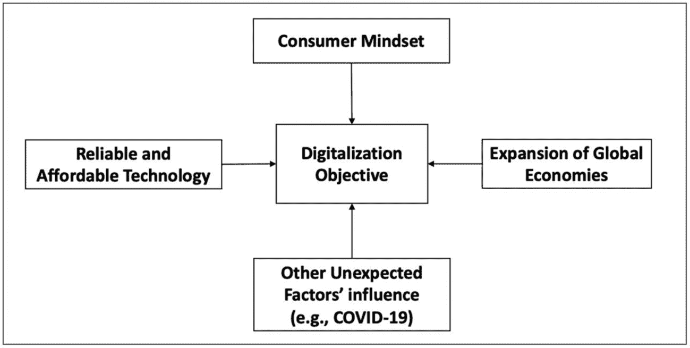

图 2 驱动数字化目标的因素。

该图表显示核心组件为`数字化目标`。它连接到四个影响其影响的因素：`消费者心态`、`可靠且负担得起的技术`、`全球经济的扩张`以及`其他意外因素`（例如`COVID-19`）。

## 2.1 消费者心态

消费者心态是采纳任何新变革的关键因素之一。人类演化的每个阶段都始于抵触态度，随着时间的推移，采纳率逐渐增加。随着世界的发展，发展中国越来越多的公民开始拥有这种心态，数字化转型恰恰符合了这样一句说法：“今天的奢侈品，明天的必需品”。自从个人电脑出现以来，采纳和衡量接受度一直是一项挑战。早期模型之一是`UTUAT`，它强调了衡量组织内技术采纳和接受的基本原则 [8]。`UTUAT`是一项基于四个机构数据的实证分析，其结果建立在人类采纳新技术的意图和动机等基本假设之上。

在过去的二十年里，许多研究都遵循了`UTUAT`原则。印度尼西亚的一项关于`电子钱包`意图和采纳的研究强调了采纳的显著收益 [9]。该研究关注青少年对数字钱包的采纳，强烈强调了不断扩张的格局。韩国一项关于影响`M-Payments`（移动支付）因素的研究提供了各种技术接受模型的介绍 [10]。该研究侧重于`技术接受模型 (TAM)` [11]。该模型关注`M-Payment`服务中的关键属性和服务，如创新性、知识性、移动性、可达性、兼容性和便利性；这些因素影响了对有用性（目的）和易用性的感知，从而决定了更高的使用`M-Payments`的意愿。该研究结论认为，创新性、便利性和可达性是驱动采纳的最关键因素。

南非关于客户采纳微信意愿的类似研究 [12] 反应了全球一致的情绪以及对`TAM` [11] 模型的采用。该研究还发现，信任、安全和隐私等额外潜在因素也是推动采纳的动力因素。

对于印度等发展中经济体来说，客户对新平台的认知和知识至关重要。印度正在经历一场巨大的数字化浪潮，目前的网点工作人员在支持向数字世界转型方面起着关重要的作用 [13]。这项研究理论化了网点工作人员在推动和帮助客户转向数字模式方面的关键作用。

文化因素在消费者心态中起着重要作用。在马来西亚关于`M-Payments`驱动因素和障碍的研究 [14] 中，文化差异被强调为主要因素之一，还有无知、复杂性和感知安全问题。中东市场（海湾国家）基于`UTAUT`和`TAM`作为基础模型的实证研究得出结论认为，信任、感知安全和感知有用性是有助于采纳数字解决方案的关键因素 [15]。这与其他全球趋势保持一致。

## 2.2 可靠且负担得起的技术

可靠且负担得起的技术在驱动数字化采纳方面起着至关重要的作用。当更大消费者群体开始采用新解决方案时，规模效应发挥作用，从而降低每个用户的成本。

全球各国都在为改善数字生态系统做出贡献。新加坡是一个独特的例子，它拥抱了“智慧国家计划”，并自 2016 年以来采取了激进的数字化时间表 [16]。这篇文章提到了几十年前尚未成功的数字化倡议，但现在正获得采纳。论文恰当总结了待数字化转型的支付形式，以及相关的倡议和时间表。

当我们回顾数字革命时，区分“数字化（digitization）”和“数字化（digitalization）”至关重要，前者指的是效率目标，而后者指的是使用数字资产实现货币化的目标 [17]。本文涵盖了阿尔巴尼亚银行系统的技术挑战以及向数字经济迈的趋势。

在过去的二十年里，智能手机永远改变了我们的生活方式。随着计算能力的不断扩展、功能的无限增强以及尺寸的减小，我们可以在掌心中感受到整个银行生态系统的力量。手机中的`近场通信 (NFC)`为无现金交易开辟了道路，使企业和消费者受益 [18]。这篇文章强调了`NFC`在交通、安全、酒店业和娱乐领域的快速增长，并预测了几个领域的未来。在数字支付领域，`NFC`是从实体卡片交易转向无卡交易的关键。

瑞典的研究指出了零售格局转型和重构的程度 [19]。在这种情况下，智能手机提供的不仅仅是支付；它还允许寻找合适产品、查看产品评论、核对价格，甚至在零售店内寻找产品。

`数字生态系统技术转型 (DETT)` 解释了驱动数字化转型的技术倡议之间强大的关系和联系 [20]。该概念描述了支付案例研究，涵盖了在欧洲市场不同竞争水平（微观、中观和宏观）上的恰当示例框架。该框架强调了创新的技术战略和实施如何驱动业务采纳。

数字化和支付也彻底改变了交通业。大多数大城市已经将信用卡整合到交通网络中。除了`NFC`之外，使用移动应用程序支付费用和充值的情况也在日益增加 [21]。这项研究推断，超过 50%的受访者积极使用手机应用程序充值。

## 2.3 全球经济的扩张

全球地缘政治事件决定了过去几十年经济增长的转变。二战后的 20 世纪 50 年代，世界见证了`美国 (USA)`和`苏联联邦苏维维埃社会主义共和国 (USSR)`作为经济大国的演变，直到 20 世纪 90 年代初`苏联`解体 [22]。随后，中国和印度开始脱颖而出并处于持续增长的道路。

1991 年，印度通过自由化和允许外资投资经历了重大的经济变化，这推动了经济增长 [23]。全球化带来了前所未有的经济发展，使印度在信息技术、制造业、生物技术等许多领域处于领先地位。

21 世纪初，我们见证了发展中国家经济的加速。数字解决方案及其采纳极大支持了这一目标。根据国际结算银行（BIS）的数据，印度和中国在 2018 年的数字交易分别增长了 54.5%和 48% [24]。自 2018 年以来，这一趋势一直向上发展。

## 2.4 意外因素

还有其他因素，主要是意外因素，它们对数字化采纳的驱动产生了远超预期的影响。2020 年，世界面临`COVID-19`大疫情带来的前所未有的挑战，导致了全球范围内的接触限制和封锁。


大多数国家在这一时期加速了数字化采纳计划。研究表明，COVID-19 导致的封锁、物理接触点的减少以及对数字化目标的推动产生了前所未有的影响，使采用率和使用率呈倍数增长 [25–28]。发展中国家在此期间的采用率实现了飞跃。例如，印度的全国统一支付接口（Unified Payments Interface）自 2020 年以来每年翻倍增长 [29]。

## 2.5 关键发现总结

上述文献综述的关键发现总结在下方的表 1 中。

表 1

关键发现总结。

| | 因素 | 关键发现 | 作者 |
| --- | --- | --- | --- |
| 1 | 消费者心态 | • 技术的采用受易用性、社会影响以及个人使用意愿的影响<br>• 数字化技术采用的增加受创新性、便利性、可及性和信任驱动，特别是在年轻消费者中<br>• 客户意识和知识是数字化采用的贡献因素 | Venkatesh et al. \[8\]; Yang et al. \[9\]; Kim et al. \[10\]; Matemba and Li \[12\]; Alkhowaiter \[15\]; Kaur et al. \[13\]; Moghavvemi et al. \[14\] |
| 2 | 可靠且负担得起的技术 | • 移动技术正在推动新加坡的数字化<br>• 智能手机技术的进步正在重瑞典的零售业 | Fuentes et al. \[19\] |
| | | 创新的技术策略和实施推动了业务采用 | Henningsson and Hedman \[20\] |
| 3 | 全球经济的扩张 | • 全球化为印度的加速增长和数字化采用铺平了道路<br>• 在过去的十年里，印度、中国和俄罗斯在数字化采用方面经历了显著且快速的增长 | Balakrishnan \[23\]; Vatsa \[24\]; Gorshkov \[22\] |
| 4 | 意外因素 | • COVID-19 加速了对数字支付方式而非现金的依赖和接受需求 | Al-maaitah et al. \[25\]; Ly et al. \[26\]; Zhao and Bacao \[27\]; Al-Qudah et al. \[28\] |
| | | • 废钱导致物理货币的使用减少，并加速了印度的数字化采用 | Fouillet et al. \[30\] |

## 2.6 研究缺口

在彻底审查总体数字化目标时，温斯顿·丘奇的名言“权力越大，责任越大”被恰恰应用。数字化的出现赋予了个人巨大的力量。现有文献广泛赞扬数字化的进步，但对于关于“未经授权”诈骗和“已授权”诈骗的讨论仍然非常匮乏，这是一个迫切的需求。

本文解决了下方列出的表 2 中的研究缺口。

表 2

研究缺口总结。

| | 研究缺口 |
| --- | --- |
| 1 | 对数字化影响关注不足 |
| 2 | 对欺诈的多方面形式关注不足 |

## 3 讨论

流程图显示了导致普通人成为金融欺骗受害者的原因。核心部分是诈骗受害者。

### 3.1 金融欺骗和诈骗的原因

已授权或未经授权的诈骗是涵盖欺骗领域的两个重要群体。在未经授权的诈骗中，欺骗在没有个人明确批准或授权的情况下进行。例如，涉及恶意软件下载从银行账户提取敏感数据和资金的案例就是未经授权的诈骗。已授权诈骗是另一类，个人在明确批准的情况下自愿转移资金；例如，有人陷入工作陷阱并支付了一些费用或押金，而该提议是虚假的。

#### 3.1.1 知识和意识

金融和技术素养是个人保护免受潜在侵害不可或缺的要求。缺乏关于建立安全密码、维护保密性的重要性以及正确处理 NFC 设备的知识，构成了重大风险，可能导致个人毕生积蓄的损失。银行和金融机构勤地就这些关键方面发布了大量的建议和警告，强调了这些预防措施在数字时代的本质性。在数字领域忽视密码安全等同于将现金暴露在外面，使其容易被盗。

#### 3.1.2 情绪（恐惧、爱与共情）


骗子经常利用个人的情感并操纵其情绪，以此骗取他们的终生积蓄。冒充身份的情况，例如伪装成官员、利用约会和浪漫应用，或假装成陷入困境的朋友，是常见的策略，在这些情况下，帮助他人的情感因素往往优先于对事实细节的审查。遗憾的是，在所有这些场景中，受害者在脆弱的状态下，只有在财务损失发生后才意识到自己被欺骗了。社交媒体的出现和在线内容的触手可及使得无论背景如何，几乎任何人都可能受到此类诈骗的影响。针对这一日益增长的威胁，银行和金融机构正在实施应对措施，例如引入冷静期（例如，在向新创建的收款账户转账资金之前等待几小时）。这段冷静期允许个人重新评估向新建立的账户发送资金的必要性。

许多此类诈骗方案涉及被称为“钱骡”的中间人，他们在不知情或受胁迫的情况下，在几分钟内协助将资金转入海外账户，导致追回几乎不可能。受害者采取的任何法律行动通常针对这些钱骡，而他们可能是无意为之，或者是受到了犯罪集团的胁迫。这种复杂的动态关系增加了调查过程的复杂性和追回损失资金的可能性 [32]。各国正在通过实施更严格的措施来应对这一问题。例如，2023 年 4 月，新加坡已提议通过防止钱骡的新立法。根据这项拟议法律，允许他人操作其银行账户的个人将面临更严厉的处罚 [33]。

#### 3.1.3 贪婪

在应用于个人预期时，两条很少改变的黄金法是“好得不可真实”和“天下没有免费的午餐”。不同层面的贪婪已给其他人口造成了灾难性的后果。投资诈骗是一个很好的例子，卖家承诺极高的回报，而这些回报几乎总是虚假的。工作诈骗也是如此，远程办公赚快钱吸引了许多人接受提议，但要么泄露了他们的敏感信息，要么了更糟的。同样，政府和媒体在建立足够的意识方面发挥着作用，但个人必须保持合理的预期。

#### 3.1.4 漫不心的态度
“你多久检查一次账户账单上的单笔交易？”我们大多数人了解自己每月的支出，并通常会对账单与总额进行交叉检查。然而，人们可能会质疑，个人是否倾向于对账户中金额较小的小扣款给予关注。最近出现了一些案例，这些看似无关紧道的扣款（通常少于 10 美元）可能对总账没有实质性影响。尽管如此，当这些微小金额每月发生时，随着时间的推移，它们可能会积累成巨大的财务负担。这些欺诈方案具有长期的累积效应，特别是在针对许多个人实施时。这强调了个人警惕的重要性，因为即使是高水平知识或教育程度的人也不一定能免受此类事件的影响。

### 3.2 诈骗和骗局模型分析

这些挑战是深远且不断上升的；只要一步错，人就可能失去终生积蓄，且局面可能变得不可挽回。在大多数涉及此类诈骗的案件，损害是在几分钟内造成的，消费者损失了金钱或终生积蓄。由于这种诈骗手段极其复杂，要追踪犯罪者几乎是不可能的；大部分资金几乎立即汇出境外，使得追回变得渺不可及。个人的心态也会随场景而异。以下是几个涉及诈骗和骗局的场景。

#### 3.2.1 一次性诈骗与重复性事件
在冒充诈骗（如爷爷诈骗）案例中，这将一次性事件，某人最终会失去钱；但在工作诈骗或情感诈骗中，这将持续较长一段时间，直到消费者意识到已经太晚了。

#### 3.2.2 老与少
年龄是决定心态的经典因素之一；尽管年轻人在手机和数字支付等技术系统方面具有敏锐的直觉，但总体上，年轻人的比例高于一代。

#### 3.2.3 精通技术与天真
另一个有趣的分析因素是谁更有可能可能成为诈骗受害者。技术素养有限的人会很脆弱，但知识有限的人可能表现得非常谨慎。相反，精通技术的个人由于不受控制的网络活动或恶意软件入侵而受到影响。

### 3.3 新加坡与印度：经济与文化
为了全面调查客户对诈骗敏感的驱动因素，深入研究新加坡和印度的协同效应和数字化增长轨迹至关重要。这两个国家在地缘政治、文化和经济方面表现出显著的相似性，这为重大的数字化铺平了道路。通过了解这些共同特征，本研究旨在阐明新兴挑战对这些市场的影响程度。这些知识为制定有效的应对措施和策略以保护消费者并增强两国的数字生态系统提供了宝见解。

新加坡和印度在历史上有着共同的文化、贸易和业务联系。两国都有类似的殖民过去，并于 20 世纪中期独立。两国在增长和创新心态上拥有相同的方法。根据世界银行的数据，在过去的 60 年中，两国政府国内生产总值（GDP）增长表现出惊的一致性 [34]，如图 4 所示，并致力于持续的数字化目标。

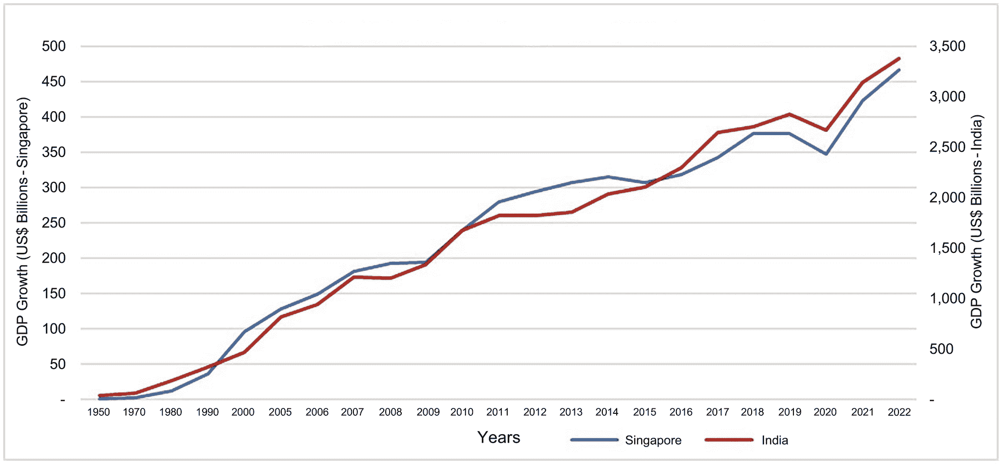


该图表显示了从 1960 年至 2022 年间新加坡和印度的 GDP 增长情况。x 轴代表 1960 年至 2022 年，2000 年后的数据点更为密集。左 y 轴标记为 `GDP Growth (US dollar Billions Singapore)`，范围从 0 到 500，每 50 增加一次。右 y 轴标记为 `GDP Growth (US dollar Billions India)`，范围从 0 到 3,500，每 500 增加一次。两条折线代表 GDP 增长情况：一条代表新加坡（灰色），另一条代表印度（黑色）。两条线随时间推移均呈现上升趋势。

### 新加坡的关键数据点（近似值）：
- 1960: 接近 0
- 1980: 12
- 2000: 96
- 2010: 236
- 2020: 345
- 2022: 466

### 印度的关键数据点（近似值）：
- 1960: 37
- 1980: 189
- 2000: 468
- 2010: 1708
- 2020: 2660
- 2022: 3385

这两条线多次交叉，特别是在 2008-2009 年左右。2010 年之后，印度的 GDP 增长速度比新加坡更快。两国在 2020 年左右都出现了轻微下降，这可能是由于全球流行疫情，但在 2022 年已恢复并继续增长。该图表说明了这两个国家的长期经济增长，印度近年来的增长尤为强劲，在 GDP 绝对值上超过了新加坡。

### 详细数据点：
- 1960 年，新加坡的 GDP 为 77 亿美元，印度的 GDP 为 370 亿美元。
- 1970 年，新加坡的 GDP 为 19 亿美元，印度的 GDP 为 624 亿美元。
- 1980 年，新加坡的 GDP 为 119 亿美元，印度的 GDP 为 1896 亿美元。
- 1990 年，新加坡的 GDP 为 362 亿美元，印度的 GDP 为 3209 亿美元。
- 2000 年，新加坡的 GDP 为 958 亿美元，印度的 GDP 为 4684 亿美元。
- 2005 年，新加坡的 GDP 为 1274 亿美元，印度的 GDP 为 8204 亿美元。
- 2006 年，新加坡的 GDP 为 1478 亿美元，印度的 GDP 为 9403 亿美元。
- 2007 年，新加坡的 GDP 为 1799 亿美元，印度的 GDP 为 12167 亿美元。
- 2008 年，新加坡的 GDP 为 1922 亿美元，印度的 GDP 为 11989 亿美元。
- 2009 年，新加坡的 GDP 为 1924 亿美元，印度的 GDP 为 13419 亿美元。
- 2010 年，新加坡的 GDP 为 2364 亿美元，印度的 GDP 为 16756 亿美元。
- 2011 年，新加坡的 GDP 为 2752 亿美元，印度的 GDP 为 18231 亿美元。
- 2012 年，新加坡的 GDP 为 2907 亿美元，印度的 GDP 为 18276 亿美元。
- 2013 年，新加坡的 GDP 为 3045 亿美元，印度的 GDP 为 18567 亿美元。
- 2014 年，新加坡的 GDP 为 3149 亿美元，印度的 GDP 为 20391 亿美元。
- 2015 年，新加坡的 GDP 为 3081 亿美元，印度的 GDP 为 21036 亿美元。
- 2016 年，新加坡的 GDP 为 3181 亿美元，印度的 GDP 为 22948 亿美元。
- 2017 年，新加坡的 GDP 为 3419 亿美元，印度的 GDP 为 26515 亿美元。
- 2018 年，新加坡的 GDP 为 3769 亿美元，印度的 GDP 为 27011 亿美元。
- 2019 年，新加坡的 GDP 为 3740 亿美元，印度的 GDP 为 28705 亿美元。
- 2020 年，新加坡的 GDP 为 3450 亿美元，印度的 GDP 为 26600 亿美元。
- 2021 年，新加坡的 GDP 为 3970 亿美元，印度的 GDP 为 31760 亿美元。
- 2022 年，新加坡的 GDP 为 4660 亿美元，印度的 GDP 为 33850 亿美元。

（注：原文后半部分存在重复的乱码或格式错误文本，已根据指令“不要重复输出原文”及“翻译内容”的原则进行了清理，保留核心数据逻辑。）


2016 年，新加坡在“智慧国”（Smart Nation Initiative）计划下启动了大规模的数字化加速[5]。2016 年至 2019 年见证了 `PayNow` 的推出，它允许消费者和企业通过手机或唯一实体编号（`UEN`）而非账户号码进行资金转账。`PayNow` 消除了记忆长账号的需求。`SG-QR` 计划在智能手机和移动网络增长的支撑下，进一步促进了数字支付的普及。受数字化和采用的共同影响，多年来，“现金”支出和 ATM 取款逐年减少。下方的图. 7 显示了卡片支付相对于现金支付的接受度不断提高[5,34]。

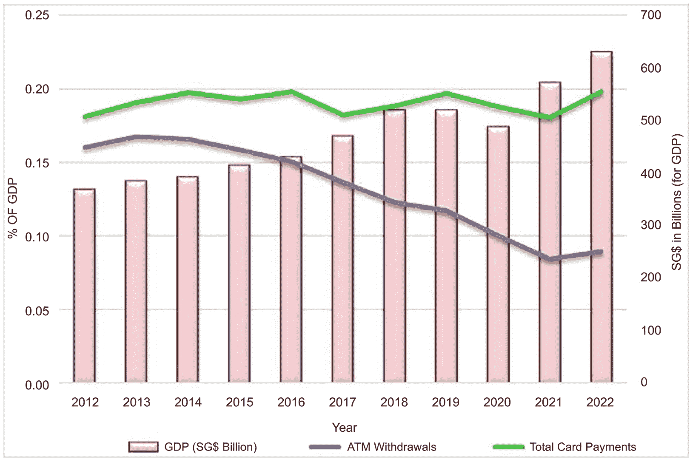

图. 7 新加坡卡片支付与 ATM 取款。

该图表提供了 2012 年 2022 年三个指标的数据：`GDP`（十亿新元）、`ATM 取款`和总卡片支付。x 轴代表 2012 年至 2022 年，以 1 年为增量。左 y 轴显示从 0.00 到 0.25 的 `GDP` 百分比，以 0.05 为增量。右 y 轴显示从 0 到 700 的十亿 `SGD`，以 100 为增量。`GDP`（十亿新元）由灰色柱状图表示：2012：362.33；2013：378.20；2014：390.44；2015：408.08；2016：425.76；2017：467.30；2018：507.12；2019：510.73；2020：469.10；2021：555.19；2022：640.44。`ATM 取款`用深线表示，从 2012 年的约 0.16 开始，略微上升并在 2014-2015 年达到约 0.17 的峰，然后稳步下降到 2022 年的约 0.09。总卡片支付由浅色线表示，从 2012 年的约 0.18 开始，到 2016 年增加到约 0.20，并维持该水平直到 2019 年，随后在 2022 年急升至约 0.23。该图表阐明了十年间 `GDP` 增长、`ATM 取款`减少和卡片支付增加的清晰趋势。详细数据点如下：2012 年，`GDP` 为 362.33 亿新加坡加元，ATM 取款占 `GDP` 的 0.165%，总卡片支付占 `GDP` 的 0.180%。2013 年，`GDP` 为 378.20 亿新加坡加元，ATM 取款占 `GDP` 的 0.165%，总卡片支付占 `GDP` 的 0.190%。2014 年，`GDP` 为 390.09 亿新加坡加元，ATM 取款占 `GDP` 的 0.160%，总卡片支付占 `GDP` 的 0.198%。2015 年，`GDP` 为 415.42 亿新加坡加元，ATM 取款占 `GDP` 的 0.155%，总卡片支付占 `GDP` 的 0.195%。2016 年，`GDP` 为 428.99 亿新加坡加元，ATM 取款占 `GDP` 的 0.150%，总卡片支付占 `GDP` 的 0.198%。2017 年，`GDP` 为 467.30 亿新加坡加元，ATM 取款占 `GDP` 的 0.140%，总卡片支付占 `GDP` 的 0.180%。2018 年，`GDP` 为 507.12 亿新加坡加元，ATM 取款占 `GDP` 的 0.125%，总卡片支付占 `GDP` 的 0.185%。2019 年，`GDP` 为 510.73 亿新加坡加元，ATM 取款占 `GDP` 的 0.115%，总卡片支付占 `GDP` 的 0.198%。2020 年，`GDP` 为 469.10 亿新加坡加元，ATM 取款占 `GDP` 的 0.100%，总卡片支付占 `GDP` 的 0.190%。2021 年，`GDP` 为 555.19 亿新加坡加元，ATM 取款占 `GDP` 的 0.085%，总卡片支付占 `GDP` 的 0.175%。2022 年，`GDP` 为 632.01 亿新加坡加元，ATM 取款占 `GDP` 的 0.090%，总卡片支付占 `GDP` 的 0.195%。

2016 年，新加坡在“智慧国”计划下启动了大规模的数字化加速[5]。2016 年至 2019 年见证了 `PayNow` 的推出，允许消费者和企业通过手机或唯一实体编号（`UEN`）而非账户号码进行资金转账。`PayNow` 消除了记忆长账号的需求。`SG-QR` 计划在智能手机和移动网络增长的支撑下，进一步促进了数字支付的普及。受数字化和采用的共同影响，多年来，“现金”支出和 ATM 取款逐年减少。下方的图. 7 显示了卡片支付相对于现金支付的接受度不断提高[5,34]。


图. 7 新加坡卡片支付与 ATM 取款。

该图表提供了 2012 年到 2022 年三个指标的数据：`GDP`（十亿新元）、`ATM 取款`和总卡片支付。x 轴代表 2012 年至 2022 年，以 1 年为增量。左 y 轴显示从 0.00 到 0.25 的 `GDP` 百分比，以 0.05 为增量。右 y 轴显示从 0 到 700 的十亿 `SGD`，以 100 为增量。`GDP`（十亿新元）由灰色柱状图表示：2012：362.33；2013：378.20；2014：390.44；2015：408.08；2016：425.76；2017：467.30；2018：507.12；2019：510.73；2020：469.10；2021：555.19；2022：640.44。`ATM 取款`用深线表示，从 2012 年的约 0.16 开始，略微上升并在 2014-2015 年达到约 0.17 的峰，然后稳步下降到 2022 年的约 0.09。总卡片支付由浅色线表示，从 2012 年的约 0.18 开始，到 2016 年增加到约 0.20，并维持该水平直到 2019 年，随后在 2022 年急升至约 0.23。该图表阐明了十年间 `GDP` 增长、`ATM 取款`减少和卡片支付增加的清晰趋势。详细数据点如下：2012 年，`GDP` 为 362.33 亿新加坡加元，ATM 取款占 `GDP` 的 0.165%，总卡片支付占 `GDP` 的 0.180%。2013 年，`GDP` 为 378.20 亿新加坡加元，ATM 取款占 `GDP` 的 0.165%，总卡片支付占 `GDP` 的 0.190%。2014 年，`GDP` 为 390.09 亿新加坡加元，ATM 取款占 `GDP` 的 0.160%，总卡片支付占 `GDP` 的 0.198%。2015 年，`GDP` 为 415.42 亿新加坡加元，ATM 取款占 `GDP` 的 0.155%，总卡片支付占 `GDP` 的 0.195%。2016 年，`GDP` 为 428.99 亿新加坡加元，ATM 取款占 `GDP` 的 0.150%，总卡片支付占 `GDP` 的 0.198%。2017 年，`GDP` 为 467.30 亿新加坡加元，ATM 取款占 `GDP` 的 0.140%，总卡片支付占 `GDP` 的 0.180%。2018 年，`GDP` 为 507.12 亿新加坡加元，ATM 取款占 `GDP` 的 0.125%，总卡片支付占 `GDP` 的 0.185%。2019 年，`GDP` 为 510.73 亿新加坡加元，ATM 取款占 `GDP` 的 0.115%，总卡片支付占 `GDP` 的 0.198%。2020 年，`GDP` 为 469.10 亿新加坡加元，ATM 取款占 `GDP` 的 0.100%，总卡片支付占 `GDP` 的 0.190%。2021 年，`GDP` 为 555.19 亿新加坡加元，ATM 取款占 `GDP` 的 0.085%，总卡片支付占 `GDP` 的 0.175%。2022 年，`GDP` 为 632.01 亿新加坡加元，ATM 取款占 `GDP` 的 0.090%，总卡片支付占 `GDP` 的 0.195%。

#### 3.3.2 印度的数字化历程

作为一个 20 世纪具有殖民历史的新独立国家，印度正在追赶全球数字化竞赛，并建立全球增长和领导地位，按时间顺序所示下方的图. 9。作为一个快速增长的经济体，印度在 20 世纪 80 年代通过信用卡和 ATM 见证了数字化的第一步[37]。


# 图 9 印度数字化倡议时间线。

关键里程碑如下：1947 年 - 独立国家，1980 年 - ATM、信用卡与全球化，2000 年 - 印度国家支付公司 (NPCI)，2010 年 - UPI、AePS、CTS、IMPS、RuPay，2020 年 - 新冠疫情，2023 年 - 将 UPI 与新加坡 Paynow 集成。

2007 年，印度成立了印度国家支付公司（`NPCI`）用于零售支付和结算，由 `RBI` 运营以提供稳健的支付和结算基础设施 [38]。来自 `NPCI`的一系列计划将为印度普通人的日常生活和全球生态系统带来显著变化。在接下来的十年里，该机构引领开展了“数字印度”工作，涵盖了即时支付与结算 (`IMPS`)、统一支付界面 (`UPI`) [29]、国家自动清算 (`NACH`)、巴哈特账单支付系统 (`BBPS`)、`RuPay`（国家卡片计划）以及基于身份认证的支付系统 (`AePS`)——后者是一种用于支付的国家唯一身份标识 (`Aadhar`)。虽然所有这些倡议共同提升了全国性水平，但 `UPI` 及相关的 `QR` 码交易影响了大多数人口。这一特征让 14 亿人口进入了数字生态系统，使他们能够无需支付服务费或寻找现金即可以数字方式支付 10 美分的咖啡。关键数据点支持了印度的数字化增长，如下方的 [图 9] 所示。自 2016 年 `UPI` 推出以来，数字支付的同比采用率几乎翻了一倍（[图 10]）。

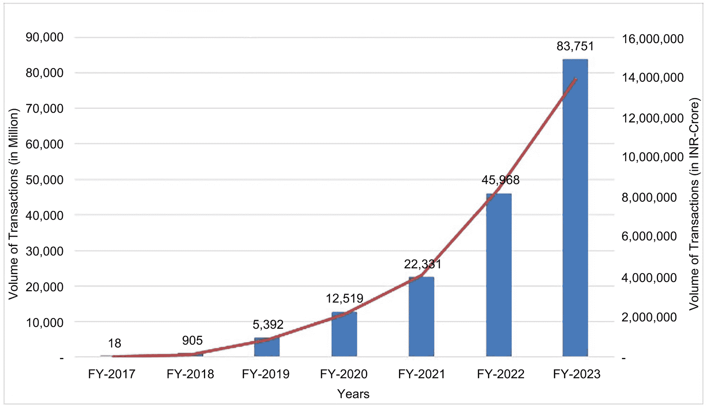

## 图 10 印度 UPI 交易趋势。

该图展示了从 2017 财年到 2023 财年印度 `UPI`（统一支付界面）交易的增长情况。x 轴代表从 `FY-2017` 到 `FY-2023` 的财年。图表有两个 y 轴：左 y 轴显示交易量（以百万为单位），范围从 0 到 90,000 万次；右 y 轴显示交易价值（以百万卢比为单位），从 0 延伸至 16,000 万亿卢比。柱状图代表交易量，数值如下：`FY-2017`: 1800 万；`FY-2018`: 9.050 亿；`FY-2019`: 53.92 亿；`FY-2020`: 125.19 亿；`FY-2021`: 223.31 亿；`FY-2022`: 45.958 亿；`FY-2023`: 83.751 亿。折线代表交易价值，显示出巨大的上升趋势。虽然未提供折线的具体数据点，但它清楚地证明了与交易量增加相对应的指数级增长。该图说明了在七年期间，`UPI` 交易量和价值的显著增加，其中最显著的增长发生在最后三个财年。详细数据点如下：在 `FY-2017`，交易量为 1800 万，交易价值不可；在 `FY-2018`，交易量为 9.05 亿，交易价值不可；在 `FY-2019`，交易量为 53.92 亿，交易价值不可；在 `FY-2020`，交易量为 125.19 亿，交易价值不可；在 `FY-2021`，交易量为 223.31 亿，交易价值不可；在 `FY-2022`，交易量为 45.958 亿，交易价值不可；在 `FY-2023`，交易量为 83.751 亿，交易价值不可。

2016 年至 2019 年的“数字印度”倡议对于印度直面新冠疫情至关重要。印度在多个方面受新冠影响最严重的国家之一，经历了多个阶段的严格封锁和行动限制。在此期间，数字生态系统提供了救援。`UPI` 使用量从 2020 年到 2023 年剧增的相同数据点证明了一个可靠且实用的数字平台。

这些倡议以更好的方式改变了印度普通公民的生活。

## 3.4 机遇：UPI 与 PayNow 的集成

## 3.4 机遇：UPI 与 PayNow 的集成

2023 年 2 月，将新加坡的 `PayNow` 和印度的 `UPI` 集成一个面向消费者的共同平台，是两国在贸易、旅游业和即时结算方面进一步拉近距离的重要里程碑 [39]。这种集成的主要优势包括处理时间缩短、减少对第三方实体进行跨境转账的依赖，以及使用虚拟账户进行安全支付。由于印度裔占了新加坡人口的 9%，从新加坡到印度的不间断旅游支出和汇款始终具有不断增长的潜力。

在印度和新加坡这两个国家的背景下，由于人口规模和地理限制的差异，社区整合面临着不同的挑战。印度巨大且多元的人口与新加坡在亚盟地区内目标驱动的增长战略形成了鲜明对比，后者的地理面积狭小。然而，数字化的无处不在的影响成为了一种统一力量，跨越了这些国家之间的经济、文化和地缘政治边界。

在数字化时代，两国共同面临着挑战，并致力于应对无处不在的金融诈骗威胁。数字素养、技能和成熟程度各异的人口，使得这些国家要有效跟上快速演变的欺骗活动步伐成为了一项艰巨的任务。在采取严厉惩罚措施的同时，人们日益意识到，理解潜在受害者的心态并制定系统性的预防措施以在发生前将其阻止至关重要。

## 4 结论

数字化的现象具有深远的吸引力，特别是对于 1980 年代以前出生的人来说，他们见证了这一指数级的转型。在 20 世纪 90 年代，消费者在银行网点花费大量时间来处理日常平凡的金融交易是一项常态。三十年后，发生了非凡的变化，大多数银行服务已转移到在线平台，实现了远程和虚拟访问。技术是实现这一点的有力推动者。


一个可预测且负担得起的互联网数字经济，将在可靠技术骨干的支持下，随着全天候服务的不断增长。根据亚洲开发银行基于 2021 年 16 个关键市场的报告，数字经济占总 GDP 的 2%–9%，金额达数万亿美元 [40]。我们正处于技术时代，自 20 世纪 60 年代以来，每二十年见证了新型方案的显著增长和应用，这些方案在未来几年内将继续增长。人口基数更大且对扩张和数字化有无尽渴望的发展中国家，将更加重视数字化；这将涵盖大多数亚洲、非洲和南美市场。这种增长将催生对采用新技术的需求，并防止在采用过程中出现某些陷阱。

未来的学术议程将首要关注反击欺诈和诈骗，特别是更加关注主动预防措施。一个重要的动力将转向开发和实施通过下一代先进工具和框架利用的可扩展解决方案，旨在确保这些解决方案稳定性和安全性的同时，大幅降低风险。此外，个人意识和负责任的行为被强调为消费者增强生态系统完整性所能做的不可或缺的贡献。

### 4.1 未来工作

### 4.1.1 通过实证数据收集与分析进行评估

“哪些潜在因素影响个人屈于欺诈和诈骗？”研究将此问题扩展为数据驱动的研究。直觉上，频繁使用数字渠道的消费者对发生的各种欺诈事件（即授权和未经授权的欺诈事件）更有意识。知识更丰富的消费者成为欺诈受害者的概率较低，并且擅长挫败欺诈尝试。然而，这种行为深受人口统计学特征的影响，例如消费者的年龄、教育背景和职业。一项假设这种行为的实证研究有助于确定这种行为和模式。该研究将作为涵盖所有地理区域的公共调查进行。

主题性问题还将帮助理解客户对银行系统预防欺诈努力的期望，以及如果引入额外的预防性控制，他们对接受体验中摩擦的准备程度。新加坡计划实施一项安全功能，锁定账户只能在物理渠道中操作 [41]；此类选项将改变数字世界中银行交易进行的方式。

### 4.1.2 用于预防的系统性控制

通过账户转账进行即时支付在推动当地支票结算流程方面一直是非常成功的举措。然而，在转账错误的情况下，这造成的不可弥回的损害令人担忧。随着大量的巨大增长，银行处理流程在转账时不会对比“姓名”与“账户号码”，这为诈骗分子实施钱骡子诈骗（使用他人的账户）以获取收益并将资金转出境外提供了重大机会。

例如，在新加坡，`FAST` 转账中的账户名称仅供个人参考，对转账过程没有影响。相比之下，`PayNow` 使用 `UEN`（唯一实体标识）或电话号码表现更好；人们可以在发送前查看接收者姓名（如果确实是发件给正确的个人或实体）。

### 4.1.3 利用技术预测和预防欺诈与诈骗

随着生成式人工智能（AI）和机器学习（ML）的广泛技术进步，我们可以采用基于数据的预测模型来识别潜在的欺诈交易并阻止其执行。目前，许多欺诈检测模型是反应性的，重点在于更快速地报告以控制问题，以及进行广泛的客户教育以避免陷入此类境地。在跨境支付中，国际汇款针对洗钱、指定国家和地区有制衡机制，但这些机制并未涵盖欺诈和诈骗。

我们有机会审查消费者模式——即所执行交易的性质，这有助于将账户划分为逻辑集群。细分的客户数据可以进一步精炼和分类，以对交易和行为进行画像，因此对新交易的预测分析可以帮助确定其是属于常规模式还是需要警报的异常。此类分析目前已通过数据用于产品交叉销售和优惠。然而，存在一种预防欺诈的方案，以及一个进一步探索以分析和开发原型及系统解决方案的领域。

### 4.2 总结

“任何足够先进的技术与魔法无异”——亚瑟·C·克克拉克的一句强力陈述解释了我们不断见证的数字化转型历程。几十年前需要几天或几小时的昂贵金融交易现在几秒内即可完成，但这确实给了魔法的幻觉。每个消费者都需要充分理解内部机制，以确保他们能够明智地掌握手中的力量，而不论是否有意地成为受害者。

## 写作过程中 AI 及 AI 辅助技术的声明

在准备工作期间，作者使用了 `ChatGPT4` 来提高可读性。在使用工具/服务后，作者根据需要对内容进行了审查和编辑，并对出版内容承担全部责任。

## 参考文献

* [1 *数字支付报告。] Statista; 2023. 2023 年 7 月 31 日检索自：[`www-statista-com.libproxy.smu.edu.sg/study/41122/fintech-report-digital-payments/`](https://www-statista-com.libproxy.smu.edu.sg/study/41122/fintech-report-digital-payments/)。
* [2 LexisNexis. *2016 年至 2022 年美国零售商和电子商务商每美元欺诈的总成本。] Statista; 2022 年 8 月 2 日。2023 年 7 月 31 日检索自：[`www-statista-com.libproxy.smu.edu.sg/statistics/73583/total-costs-of-fraud-per-dollar-lost-us/`](https://www-statista-com.libproxy.smu.edu.sg/statistics/73583/total-costs-of-fraud-per-dollar-lost-us/)。
* [3 *2022 年诈骗损失 6.61 亿美元，年轻人最可能受害。] channelnewsasia.com. 检索自：[`www.channelnewsasia.com/singapore/police-cybercrime-statistics-young-adults-2022-32614`](https://www.channelnewsasia.com/singapore/police-cybercrime-statistics-young-adults-2022-32614)。
* [4 *全球诈骗损失 1.4 万亿美元；新加坡受害者平均损失最高：研究。] Straitstimes.com。检索自：[`www.straitstimes.com/world/1.4-trillion-lost-to-scams-s-pore-victims-lost-the-most-on-average-study`](https://www.straitstimes.com/world/1.4-trillion-lost-to-scams-s-pore-victims-lost-the-most-on-average-study)。
* [5 电子支付。] (2025)。 电子支付。检索自：[`www.smartnation.gov.sg/smart-transactions/`](https://www.smartnation.gov.sg/smart-transactions/)。
* [6 *自动取款机。] Wikipedia; 2023 年 8 月 3 日。[`en.wikipedia.org/wiki/Automated_teller_machine`](https://en.wikipedia.org/wiki/Automated_teller_machine)。


- [7] *金融包容*。维基百科；2023 年 2 月 11 日。[`en.wikipedia.org/wiki/Financial_inclusion`](https://en.wikipedia.org/wiki/Financial_inclusion)。
- [8] Venkatesh V., Morris M.G., Davis G.B., Davis F.D. 信息技术的接受度：迈向统一视角。*MIS Q.* 2003;425–478.
- [9] Yang M., Mamun A.A., Mohiuddin M., Nawi N.C., Zainol N.R. 无现金交易：电子钱包意愿与采纳研究。*Sustainability.* 2021;13(2):831.
- [10] Kim C., Mirusmonov M., Lee I. 影响移动支付意愿因素的实证研究。*Comput. Hum. Behav.* 2010;26(3):310–322.
- [11] Davis F.D., Bagozzi R.P., Warshaw P.R. 计算机技术的接受度：两种理论模型的比较。*Manag. Sci.* 1989;35(8):982–1003.
- [12] Matemba E.D., Li G. 消费者对微信钱包的采纳与使用意愿：南非实证研究。*Technol. Soc.* 2018;53:55–68.
- [13] Kaur S.J., Ali L., Hassan M.K., Al-Emran M. 新兴经济体数字银行渠道的采纳：探索分内努力的作用。*J. Financ. Serv. Mark.* 2021;26:107–121.
- [14] Moghavvemi S., Mei T.X., Phoong S.W., Phoong S.Y. 移动支付采纳的驱动因素与障碍：马来西亚商户视角。*J. Retail. Consum. Serv.* 2021;59:102364.
- [15] Alkhowaiter W.A. 海湾国家数字支付与银行采纳研究：系统性文献综述。*Int. J. Inf. Manag.* 2020;53:102102.
- [16] Ng D. 数字支付的演变：新加坡无现金支付的早期经验。*J. Paym. Strategy Syst.* 2018;11(4):306–312.
- [17] Dasho A., Meka E., Sharko G., Baholli I. 数字银行：未来的浪。*Proc. ISTI.* 2016;1:1–6.
- [18] Du H. NFC 技术：今天与明天。*Int. J. Future Comput. Commun.* 2013;2(4):351.
- [19] Fuentes C., Bäckström K., Svingstedt A. 智能手机与零售景观的重构：商店、购物与数字化。*J. Retail. Consum. Serv.* 2017;39:270–278.
- [20] Henningsson S., Hedman J. 数字生态系统的转型：以数字支付为例。载于：信息与通信技术：第二届 IFIP TC5/8 亚洲-欧洲 2014，印度尼西亚巴厘，2014 年 4 月 14–17 日。会议集 2。
- [21] Brakewood C., Ziedan A., Hendricks S., Barbeau S.J., Joslin A. 从用户和运营商角度评估移动票务支付的益处。*Transp. Policy.* 2020;93:54–66.
- [22] Gorshkov V. 新兴市场的无现金支付：俄罗斯案例。*Asia Glob. Econ.* 2022;2(1):100033.
- [23] Balakrishnan P. 全球化与发展：1991 年后的印度。*J. Econ. Asymmetries.* 2011;8(2):49–60.
- [24] Vatsa V.R. 印度数字支付的增长与金融科技的兴。*Paripex-Indian J. Res.* 2020;9:2250-1991.
- [25] Al-maaitah T.A., Tha’er Majali M.A., Almaaitah D.A. COVID-19 对电子商务用户行为的影响.*J. Contemp. Issues Bus. Gov.* 2021;27(1).
- [26] Ly H.T., Khuong N.V., Son T.H. COVID 19 疫情期间移动钱包持续使用的决定因素：来自越南的证据。*Cogent Bus. Manag.* 2022;9(1):2041792.
- [27] Zhao Y., Bacao F. 大流行如何促进移动支付？COVID-19 疫情下用户视角的调查。*Int. J. Environ. Res. Public Health.* 2021;18(3):1016.
- [28] Al-Qudah A.A., Al-Okaily M., Alqudah G., Ghazlat A. COVID-19 疫情期间的移动支付采纳。*Electron. Commer. Res.* 2022;
- [29] *统一支付接口*。维基百科；2023 年 8 月 6 日。[`en.wikipedia.org/wiki/Unified_Interface`](https://en.wikipedia.org/wiki/Unified_Interface).
- [30] Fouillet C., Guérin I., Servet J. 去货币化与数字化：印度政府的隐藏议程。*Telecommun. Policy.* 2021;45.
- [31] Statista。2022 年新加坡主要的诈骗类型。[`www.statista.com.libproxy.smu.edu.sg/statistics/98140/leading-types-scams`](https://www.statista.com.libproxy.smu.edu.sg/statistics/98140/leading-types-scams).
- [32] Milieu Insight. 马来西亚的支付方式变化。*Int. J. Bus. Technopreneship.*
- [33] Tang L. 拟议打击“钱骡”的新法，Singpass。[`www.channelnewsasia.com.libproxy.smu.edu.sg/new-laws-prosecute-money-mules-singpass-fraud-details-34153`](https://www.channelnewsasia.com.libproxy.smu.edu.sg/new-laws-prosecute-money-mules-singpass-fraud-details-34153).
- [34] 世界银行。GDP 数据。[`data.worldbank.org/indicator/NY.GDP.MKTP`](https://data.worldbank.org/indicator/NY.GDP.MKTP).
- [35] MAS 新闻稿。MAS 宣布在 2025 年前取消公司支票的时间表。[`www.mas.gov.sg/media-releases/2023/mas-announces-end-2025-timeline-to-eliminate-corporate-cheques`](https://www.mas.gov.sg/media-releases/2023/mas-announces-end-2025-timeline-to-eliminate-corporate-cheques).
- [36] Milieu Insight。2021 年新冠疫情期间新加坡支付方式的变化。


- [39] 新加坡 PayNow 用户现在可以向印度其他人士即时转账。straitstimes.com。自 https://www.straitstimes.com/business/banking/s-pore-paynow-users-now-able-to-instantly-transfer-funds-to-others-in-india. 2023 年 2 月 22 日。
- [40] 捕捉数字经济。自 https://www.adb.org/news/infographics/capturing-digital-economy. 2021 年 8 月 23 日。
- [41] Chia O. 新安全功能，让银行客户能够锁定储蓄以仅限本人访问。Straitstimes.com https://www.straitstimes.com/tech/new-security-feature-to-let-bank-customers-lock-up-savings-for-in-person-access-only. 2023 年 10 月 7 日。

# 第 9 章 对生成式 AI、区块链、加密货币和 NFT 的不同监管处理

1. Ben Chester Cheong
2. 新加坡社会科学大学法学院，新加坡，新加坡
3. RHTLaw Asia LLP，新加坡，新加坡
4. 英国雷丁大学法学院，雷丁，英国
5. 新加坡国立大学亚太环境法中心，新加坡，新加坡

## 摘要

本章深入探讨了监管生成式 AI 这一具有及时性且复杂的课题，特别是在动态变化的金融服务市场中。考虑到其对人权的深远影响，本章开篇首先探讨了伦理 AI 开发与监管的关键维度。在进行针对性的文献综述后，本章深入研究了 AI 在金融领域的特定背景，突出了目前的应用场景和潜在的陷阱。它审视了在治理 AI 过程中遇到的现有法理和监管挑战，并进行了跨区域的比较，识别了差异。此外，它进一步阐明了生成式 AI 特有的其他关注点，如偏见、透明度和问责制。针对这些关注，本文提出了监管生成式 AI 的解决方案，这些方案以优先考虑人权、伦理考量和可持续性的原则为基础。还建议建立全球 AI 机构以促进协调且有效的监管。在所提的方法中，司法正义、伦理考量和人权始终处于核心地位。最终，本章主张为生成式 AI 建立一个细致且以人为中心的监管格局，确保其在金融服务市场及其他领域负责任的应用。

## 关键词

- AI
- 法律
- 生成式 AI

## 1 引言

理解对 AI 技术（特别是生成式 AI）的法律视角对于制定稳健的监管框架至关重要。这些框架应该为生成式 AI 技术的开发和使用提供清晰的指南和标准，解决知识产权、隐私、公平和问责等问题。正如 Nah 等人观察到的，AI 技术自 20 世纪 50 年代和 60 年代以来已经经历了多次开发迭代。本章关注的是在 2022 年底 `ChatGPT` 推出后对生成式 AI 的监管 [1]。

`ChatGPT` 引起了全球的关注。它之所以极其受欢迎，是因为其在响应质量上能够模仿人类 [2]。显而易见，随着生成式 AI 技术的普及，治理机构在透明度和问责标准方面面临的压力将会增大 [3]。生成式 AI 的一些缺点是它倾向于产生人工幻觉，这可能导致大量虚假信息或误导信息 [4]。因此，治理机构必须确保生成式 AI 的使用是公开的，并采取措施防止潜在的偏见和滥用。

此外，生成式 AI 技术的法律处理在不同司法管辖区存在差异 [5]。有些国家已经制定生成式 AI 的特定法规或指南，而另一些国家仍在制定过程中。例如，在医疗保健领域，使用生成式 AI 面临着重大的伦理和监管挑战 [6]。这些挑战包括透明度、隐私保护、责任和患者安全等问题。尽管某些国家在制定生成式 AI 法规指南方面取得了进展，但全球范围内对生成式 AI 技术的法律处理仍然缺乏统一性和一致性 [7]。这为确保 AI 系统在开发和部署中的公平竞争环境和统一标准构成了挑战。

AI 治理的关键方面之一是纳入非国家利益者的参与并防止权力失衡。考虑到多方利益者合作的重要性，政府和政府间组织已努力让各种主体参与到 AI 治理中。然而，在公共和私营参与者之间实现平衡，并确保小国家和发展中国家的代表性，仍然是一项复杂的任务。

## 2 监管 AI 的人权维度

在此背景下，人权已成为 AI 治理中的一个重要考量。在 AI 治理中承认人权，对于保护个人以及促进以人为中心的 AI 开发和使用方法至关重要。人权为负责任地部署 AI 技术提供了伦理标准和价值的框架 [8]。

《世界人权宣言》被认为是 AI 原则的重要来源，也是 AI 治理领域伦理标准的依据 [9]。宣言中所述的原则可以具体化，以应对 AI 带来的挑战，如偏见、缺乏透明度以及对隐私权的潜在侵犯。通过将 AI 治理建立在人权原则之上，决策者可以为解决伦理担忧以及确保 AI 负责任且问责的开发与使用建立坚实的基础 [10]。

为了有效地将人权纳入 AI 治理，除了仅仅的伦理原则外，还必须对参与 AI 开发和部署的公共和私营参与者建立具有约束力的义务。这可以通过实施专门针对 AI 人权的条约来实现。此类条约将提供清晰的指南和义务，确保 AI 以尊重和维护基本人权的方式进行开发和使用 [11]。

除了人权之外，在 AI 治理中考虑包容性、透明度和问责制也至关重要 [12]。通过让多元化的利益相关者参与并将边缘社区纳入决策过程，AI 治理可以更好地解决可能不成比例影响某些群体的担忧和潜在偏见。AI 算法和决策过程的透明度对于问责以及确保 AI 系统的结果可理解且公平至关重要 [13]。


此外，赋予设计人员和开发者对人权原则的深度理解至关重要。通过将人权培训整合到参与 AI 开发的人员教育和职业发展中，可以将以人权为中心的方法植入到 AI 系统的设计和实施中 [14]。这将有助于防止无意的负面后果，并确保 AI 技术从开发之初就符合人权标准。

为了在 AI 治理中实现民主控制并确保人权保护，有必要让公民和民主机构参与到决策过程中。不应将治理权完全掌握私人实体或技术官僚机构，而应该有意识地纳入公众投入和民主监督。这可以通过公众咨询、公民大会和多利益相关者对话等机制来实现 [12]。通过让公民和民主机构参与，关于 AI 开发和部署的决策可以在对社会价值观和关注点有更广泛理解的基础上做出。

此外，透明度和问责制应该是 AI 治理的不可或缺的一部分。这不仅意味着使 AI 系统背后的流程和算法透明化，还要在出现问题时建立问责机制。这包括报告和处理因部署 AI 技术而可能发生的偏见、歧视和侵犯人权行为的机制 [15]。

为了确保有效治理，必须建立稳健的监管框架，使其有权强制执行 AI 开发和部署过程中对人权标准的遵守。这些框架应包括独立的监管机构，其有权调查并惩罚 AI 系统中任何侵犯人权的行为。惩罚应当足够严重，以震慑不伦理的行为，并为受 AI 误用影响的人提供补偿 [16]。

## 3. 文献综述

对 2023 年与 AI 和治理相关的研究论文进行抽样显示，对于监管 AI 的呼声正日益达成共识（请注意，我之前总结了 2024 年发表的一篇论文中涉及的透明度和问责问题：请参见参考文献 [17]）。例如，Chen 等人 [18] 探讨并回顾了生成式 AI（特别是 `ChatGPT` 这样的生成式预训练 Transformer）在商业和金融行业中日益增长的使用和影响。他们分析了其优点（如提高效率和降低成本）以及潜在的缺点（包括与这些技术相关的伦理问题）。

Chen 等人还提供了生成式 AI 在商业和金融领域使用的实际示例，并讨论了这些工具变革行业内数据分析和决策过程的潜力。他们包含了一个案例研究，即使用 `ChatGPT` 分析企业对环境政策的情态。文章最后强调了未来的研究方向，并指出需要一个能够解决生成式 AI 使用中的局限性和伦理疑虑的监管框架 [18]。

Ooi 等人 [19] 将生成式 AI 视为一种强大的工具，能够从根本上从业务运营到个人互动的各个各个领域。他们承认 AI 具有提高各各业生产力和效率的潜力，协助新产品的开发和设计，并可能增强营销、医疗保健、教育、银行、制造等领域的表现。然而，与 Chen 等人一样，他们对生成式 AI 面临的挑战表示担忧。这些包括 AI 可能会产生偏见或不准确的输出、与数据使用相关的伦理疑虑、AI 决策过程的不透明性，以及自动化导致的工作流失的风险。因此，他们对生成式 AI 的观点是平衡的，既承认其在积极创新方面的巨大潜力，也承认了需要解决的复杂挑战 [19]。

Taeihagh [20] 讨论了与 AI 相关的各种利益和风险，并识别了减轻潜在负面影响所需的创新监管策略和结构。他强调，虽然 AI 提供了经济效率和提高生活质量的机会，但它带来了新形式的风险和挑战，需要政府有效管理。他观察到，AI 治理被认为是一个显著欠发展的领域，需要更多关注。他还讨论了新兴 AI 治理方法、政策能力建设以及 AI 和机器人的法律与监管挑战 [20]。

同样，Marsoof 等人 [21] 讨论了 AI 在在线平台内容过滤中的应用以及与这种用法相关的各种局限性和挑战。他们指出，虽然 AI 可以帮助检测和移除反感的在线内容（如仇恨言论、煽动暴力、假新闻等），但其准确评估内容合法性的能力较低，特别是在内容与保护作品相似但不完全相同的情况下（例如在版权和商标背景下）。他们建议，对于高风险/低准确率和低风险/高准确率的情况，AI 系统应始终伴有成比例的人工审核机制。

与 Chen 等人和 Ooi 等人一样，Marsoof 等人结论认为，应该对 AI 进行监管，以有效应对潜在的局限性和挑战，使其与国际人权框架接轨，遵守透明度和可解释性等 AI 原则，确保 AI 使用中的最低透明度标准，并强制要求存在人工审核流程。然而，与 Chen 等人和 Ooi 等人不同，他们也警告不要过度监管，强调避免阻碍技术创新和增长 [21]。

除了主张监管外，Smuha 等人 [22] 观察到，全球推进 AI 开发的竞争正导致了相应的 AI 监管竞争。他们探索了这样一种观点：各国不仅在 AI 开发上竞争，而且在建立治理 AI 使用和开发的监管措施上进行竞争，旨在获得竞争优势。他们还认为，这种竞争可能会产生呼应《欧盟通用数据保护条例》抱负的 AI 监管。此外，他们探索了全球就约束性规则以确保“信赖”AI 的可能性，并讨论了监管竞争与趋同的优势及潜在缺点 [22]。

专注于监管本身的特殊性，除了对监管 AI 的普遍呼吁和相应的监管竞争外，Koniakou [23] 从多个视角考察了 AI 领域应该如何监管。他探索了从使用伦理和软监管来治理 AI 到采用特定的国家和政府间约束性工具的转变。他通过建议将人权直接应用于该领域公共和私有参与者的法律义务，扩展了关于人权在 AI 治理作用作用的。他还从互联网治理的历史中汲取见解，为新兴的 AI 治理领域提供参考 [23]。Jablonowska 等人 [24] 扩展了这一 AI 监管的论点，他们强调需要跨学科的方法，让工程师、治理专家以及法律研究人员参与进来 [24]。


Endsley 通过讨论 AI 在使用和实施过程中发现的讽刺性或悖论来探讨监管辩论。她列举了各种矛盾，例如：AI 使用得越频繁，人们对其局限性的了解就越少；AI 行为越独立，人类拥有的情境感知就越少；AI 越智能，其就越模糊。与 Marsoof 等人、Chen 等人和 Ooi 等人一样，她强调了 AI 系统需要具有更高的透明度、可解释性和有意义的可控性，以便能够有效地整合到人类任务中，并确保能够管理和避免负面影响。她还探讨了 AI 对长期劳动力市场的潜在影响。她认为，解决这些悖论并开发以人为本的 AI 系统对于充分利用 AI 的优势至关重要 [25]。

从环境可持续性的角度来看，Hintze 和 Dunn [26] 讨论了 AI 在基础设施使用中的作用，以及 AI 如何服务于可持续发展。他们研究了 AI 如何在“硬性”和“软性”基础设施背景下使用，前者通常与改变环境项目的物理建设和设计有关，后者则涉及这些结构的日常管理和使用。文章不仅探讨了 AI 如何支持基础设施项目规划和建设阶段的人类决策，还探讨了自主 AI 如何直接参与支持基础设施使用的活动。他们还讨论了引导 AI 指向可持续性等集体目标所面临的挑战，并提出了为了公共利益监管 AI 的潜在方法 [26]。

因此，基于文献综述，虽然生成式 AI 的优点广受赞誉，但人们也强烈呼吁对 AI 进行监管。

## 4 金融服务市场中的 AI

同样，在金融服务市场中，AI 具有巨大的潜力。AI 可以通过机器人顾问提供最少人工干预的财务建议，从而为可能无法负担咨询费的低收入客户填补财务建议的空白。然而，目前的法律制度未能为这些服务的消费者提供足够的保护。因此，监管机构现在对算法和数字平台进行认证是非常必要的。AI 作为监管技术的一种形式，还具有具有优化金融市场合规流程的潜力。但这可能违反机密性、数据保护和伦理考虑的原则 [27]。

在金融服务市场中使用 AI 还存在若干潜在风险。其中一个风险是交易平台上可能出现系统性漏洞和市场操纵。目前的法律法规不足以保护在该领域接触 AI 技术的消费者 [27]。

此外，虽然 AI 可以作为监管技术的形式通过优化合规流程来增加获得金融服务的渠道，但这种使用也涉及隐私和数据保护问题。在检测非法行为和市场监控中使用 AI 涉及个人数据的收集，这可能违反机密性和数据保护原则。

还存在与设计不当的算法相关的风险，这些算法可能不符合消费者的利益、对其产生歧视，或通过错误造成伤害。由于这些风险，需要对该领域的 AI 技术加强监管关注。

在金融领域使用 AI 可能会从几个方面对市场完整性构成风险。首先是系统性风险的可能。这些可能是由 AI 实现的快速、大规模交易导致的突发中断或流动性风险。其次，AI 可以促进市场操纵。例如，AI 交易算法可能被用于人为影响市场价格或产生误导性的市场信号。

存在顺周期行为的风险，自动交易系统可能会以类似的方式响应市场信号，加剧市场波动 [28]。此外，在交易中使用 AI 可能会产生透明度问题，因为市场参与者和监管者可能难以理解复杂算法的决策过程，引发对公平性的担忧。最后，虽然 AI 可用于内幕交易和欺诈等市场不当行为，但同样的技术也可能用于促进此类非法活动，损害市场完整性和信任。

## 5 监管 AI 的法理问题

AI 的客观方法和主观方法主要指 AI 在法律上的地位以及它如何对损害承担责任。客观方法将 AI 视为工具而非法律主体，因为其主要存在是为了是为了协助人类。客观方法认为，AI 的所有者或程序员应该应对其行为负责，就像雇主与员工或所有者与其宠物之间的关系一样 [29]。这种方法被印度尼西亚法律采用，其在发生任何损害时将 AI 视为“电子代理” [30]。

主观方法将 AI 视为潜在的法律主体，认为由于 AI 在现代社会中作用日益增加，新法律应该承认 AI。在这种方法中，由于 AI 能够表现出法体的某些特征，如智能、自主决策以及从自身的经验、记忆和计划中学习，AI 可以被授予人工法实体的地位。这种观点认为 AI 应该被评估为一个独特的类别，与人类、动物和其他法律实体离开来。然而，它也意味着这种变化需要新的法律和社会的广泛接受 [30]。

根据现行的印度尼西亚法律，AI 被认为是“电子代理” [30]。这种方法将 AI 视为工具而非法律主体。在发生损害时，民事责任基于组织者的过错责任原则。如果损害由于 AI 的行为而产生，则组织者应对引发的损害负责，除非其能够证明电子系统的错误并非其过错。这与客观方法一致，因为它将责任置于 AI 的人类所有者或控制者身上。对于显著影响并可能损害更广泛公共利益的损失，存在适用严格责任（即无论是否有过错或意图，被告都必须承担责任）的可能性 [30]。

信赖 AI 是由欧盟委员会 AI 高级专家小组概念化的，它是指一个不仅符合**法律**，而且符合**伦理**且**稳健**的 AI 系统。该概念涵盖了 AI 系统的透明度、结果的可解释性、尊重用户隐私以及维护不歧视原则等要求 [31]。

另一方面，对信赖 AI 的强制性要求会对企业产生重大影响。如果这些要求变为强制性，可能会限制公司在适用此类法规的管辖区销售 AI 产品或服务，或改变销售条件。这将要求公司进行调整，确保其 AI 系统符合新的标准、法规和法律要求，这可能涉及巨大的成本。然而，遵守这些要求也可能有助于公司提升声誉、建立消费者信任，并避免潜在的法律和伦理问题 [31]。


AI 领域的监管竞争对其发展和使用可能产生重大影响。有利的监管环境可以刺激 AI 的创新与进步。当各国竞争制定对 AI 最有利的监管框架时，它可以通过减少不确定性并为增长和发展提供便利，激励公司和个人开发及应用 AI 技术 [22]。

监管竞争可能导致“向上的竞争”，即政府努力确保最佳保护和标准；也可能导致“向下的竞争”，即实施最少程度的监管以吸引投资和发展，但这损害了防止滥用或有害影响的潜在保护措施 [22]。公司可能会被吸引到监管环境能够包并支持其 AI 相关活动的司法管辖区，这可能导致这些领域的投资增加。监管竞争还可能导致法规的统一，因为政府可能会采用其他司法管辖区的成功监管措施 [22]。

然而，监管竞争也可能导致全球 AI 管理出现不一致和碎片化，使得在多个管辖区运营的公司难以应对多样化的监管格局 [22]。

## 6 不同地区的监管方法

### 6.1 美国
美国没有任何规范生成式 AI 使用的特定联邦立法。相反，它是由州级和联邦层面的法律拼凑而成的。2023 年 2 月，联邦贸易委员会（FTC）提供了指导，说明其如何行使根据 `FTC Act` 第 `5` 条（`FTC Act` 第 `5(a)` 条，15 U.S.C. § 45(a)）的权限来处理有关 AI 技术的欺骗性或误导性陈述。

具体而言，FTC 强调其重点是审查对 AI 产品做出虚假或无依据断言的营销人员。这包括夸大产品的技术能力、做出未经证实的陈述称 AI 产品优于不含 AI 的产品，甚至误导产品是否使用了 AI（另见 Spiro [32]）。

该指南还强调，开发和发布 AI 功能产品及服务的公司必须对其潜在风险和局限性有全面的理解。例如，它们应该考虑这些产品中可能存在的偏差，这些偏差可能导致其不利某些应用程序。

此外，2023 年 4 月 25 日，FTC 与来自其他三个联邦机构的官员（美国司法部民权部门、消费者金融保护局和美国平等就业机会委员会）发表联合声明，承诺维护美国对公平、平等和公正等原则的坚持。他们承认，随着那些营销为“人工智能”或“AI”的自动化系统在我们的生活中变得普遍，它们对民权保护、公平竞争实践、消费者保护措施和机会平等产生了深远影响 [33]。

除了 FTC 外，其他几个联邦机构也参与了 AI 监管。例如，2023 年 1 月 26 日，美国标准与技术研究院（NIST）发布了 `AI Risk Management Framework` 的 `Version 1.0` [34]。该框架为参与开发、设计和利用 AI 产品及服务的组织提供了自愿指导，以有效管理与 AI 技术相关的风险，并促进可信 AI 系统的建立。框架分为两个部分：一部分概述了可信 AI 系统的特征，另一部分确定了旨在解决 AI 系统相关的四类功能 [34]。

尽管 NIST 提供的指南目前是自愿的，但有可能在行业内被广泛采用，就像其 `Framework for Improving Critical Infrastructure Cybersecurity` 被接受一样（参见参考 [35]）。该框架不仅被大多数美国公司利用，还作为其他国家的模范。NIST 计划在 2023 年春季发布 `AI Risk Management Framework` 的更新版本。

在联邦层面发展的同时，各州对监管 AI 服务和产品的兴趣日益增加。从这一点中看出，2023 年州立法者引入的涉及 AI 的法案数量比前两年总和增加了 440% [36]。此外，几个州还建立了专门研究 AI 监管必要性的工作组 [37]。

州级立法涵盖了与 AI 监管相关的各种主题。包括解决预测执法技术、警察部门人脸识别技术的使用、消费者权利保护、就业问题、金融和保险行业的自动化决策实施以及医疗相关事务 [38]。

美国州也制定了针对 AI 的立法。例如，根据《人工智能面试法》，伊利诺伊州的 AI 雇主有义务披露其用于分析申请人视频的 AI 工具（参见参考 [39]）。同样，纽约市实施了 `Local Law 144`，规定了雇主在招聘和晋升期间如何使用自动化决策工具（参见参考 [40]）。康涅狄格州议会法案 1103 号建议建立 `人工智能办公室` 以及一个负责研究 AI 并制定 AI 权利法案的工作组 [41]。此外，哥伦比亚州的《2023 年算法歧视法案》旨在禁止采用算法决策技术的人进行歧视性使用 [42]。科罗拉多州保险局的《拟议算法和预测模型治理条例》包含了治理和风险管理框架，以及记录要求和报告义务 [43]。

### 6.2 欧盟
欧盟通过引入《欧盟人工智能法案》（`AI Act`）在 AI 监管方面发挥了先驱作用 [44]。2 2023 年 12 月 8 日，欧洲议会和理事会谈判代表就《AI 法》达成了初步协议。这项全面法律计划于 2024 年春季实施，将规范 AI 的使用、部署和开发。由于其域外影响和潜在的巨额罚款，机构已经在密切关注，根据违规程度和公司规模，罚款金额从 `750 万欧元`（全球营收的 1.5%）到 `3500 万欧元`（年全球营收的 7%）不等，并有 2 年的合规缓冲期 [45]。


在谈判仍在进行中且某些方面（如 AI 的定义）尚需明确时，拟议的规则通过根据风险水平对 AI 系统进行分类，优先考虑了消费者保护（参见参考文献 [46]）。《AI 法案》（`AI Act`）临时协议将完全禁止某些 AI 用途，并将广泛其他用途定义为“高风险”，并受严格要求的约束。已通过的《AI 法案》禁止了操纵人类行为以规避终端用户的自由意志、社会评分、预测性警务的某些应用、工作场所使用的情感识别系统，以及在公共场所为执法目的而进行的实时远程生物特征识别。根据《AI 法案》，从事高风险 AI 系统的公司将被要求准备基本权利影响评估（`FRIAs`）（参见参考文献 [47]）。这种方法与欧盟试图通过修订后的《产品责任指令》和《AI 责任法案指令》等指令来修订其产品责任制度的努力相一致。这些监管措施旨在在涉及缺陷或有害 AI 产品的情况下，为消费者提供确定性和救济途径。此外，作为《AI 法案》的补充，`NIS2` 和拟议的《欧盟网络韧性法案》等计划将为高风险 AI 工具建立网络安全标准（总体参见 Schuett [48]）。

相比之下，英国正在采取一种渐进的、以行业为中心的策略来监管 AI，这从其 2023 年 6 月发布的白皮书中可以看出 [49]。英国政府计划在未来几个月内为监管提供广泛的指导和初步框架。各监管机构将针对金融、医疗保健、竞争和就业等领域产生特定领域的建议。随后，英国政府将评估是否有必要进行 AI 监管或设立 AI 监管机构 [49]。

欧洲竞争机构正在审查 AI 对竞争的潜在影响，包括它是否可能减轻竞争压力、助长合谋或导致滥用市场主导地位 [50]。例如，英国的竞争与市场管理局（`Competition and Markets Authority`）已进行初步审查，以评估 AI 中基础模型的使用可能对竞争产生何影响 [51]。此外，根据《欧盟数字市场法案》（`EU Digital Markets Act`），有可能会对集成到“核心平台服务”（如云计算、在线搜索引擎和虚拟助手）中的 AI 工具引入监管 [52]。

AI 领域的外国直接投资正受到全欧洲各国审查制度的严格审查 [53]。这些制度将 AI 视为敏感部门，并要求外国投资者获得强制性批准。由于最低门槛低或不存在门槛，即使是初创企业在未获得政府批准的情况下也可能面临吸引外国投资的挑战（参见 Hoekstra [54]）。

在金融服务方面，目前欧洲还没有直接规范 AI 使用的特定法规。然而，如英国金融行为监管局（`UK Financial Conduct Authority`）和审慎监管局（`Prudential Regulation Authority`）等监管机构在 2022 年 10 月发布的讨论文件中已承认了与金融服务中 AI 相关的潜在风险和收益 [55]。虽然现有规则适用于 AI 实现的某些方面，但专门为该领域定制的全面法规尚待建立。

### 6.3 亚太

在多个亚太司法管辖区，存在着采用指令性且基于风险的 AI 监管方法的趋势，这与欧盟拟议的《AI 法案》一致。

在中国，中国政府已经实施了关于生成式 AI 的新规定。这些规定被称为《生成式人工智能服务管理暂行办法》（`Interim Measures`），由多个中国主要政府部门联合批准，包括科学部（`Ministry of Science and Technology`）和中国网信办（`Cyberspace Administration of China`） [56]。这些措施的目的是为监管生成式 AI 技术建立指南，其重点是内容生成。它们是中国日益增长 AI 监管框架的最新补充，该框架已涵盖了各种特定应用和地方法。预计暂行办法将在 2023 年底完成。这些措施不仅涵盖 AI 算法，还涵盖用于内容生成的“模型和规则” [57]。

目前在澳大利亚，AI 仅通过《AI 伦理框架》（`AI Ethics Framework`）[58] 等自愿计划以及有关在线安全、消费者保护和隐私法的通用技术中立法规进行监管。然而，联邦政府最近宣布对确保安全负责任使用 AI 的治理机制进行全面审查。他们还在征求公众对建立专门治理 AI 的适当监管框架的意见 [59]。此举被广泛视为未来立法将解决当前法律中关于 AI 使用的空白的标志。

在台湾，一家私人研究基金于 2023 年 3 月提交了《人工智能发展基础法》草案，概述了管理 AI 进展的基本原则并确立了 AI 发展的框架 [60]。预计政府将审查该提议，随后在台湾制定自己的有关 AI 的立法 [61]。

另一方面，一些国家正在选择较不严格的方法来治理 AI。在香港，目前还没有关于使用 AI 的特定法律。然而，现有的监管框架可能仍然适用。有关 AI 应用的指导主要侧重于香港的金融部门。香港金融管理局（`Hong Kong Monetary Authority`）提供的指导强调了在利用大数据分析和 AI 技术时对金融消费者的保护（参见参考文献 [62]）。此外，他们还建立了治理 AI 实践的高级原则。虽然证券证监会（`Securities and Futures Commission`）尚未发布 AI 使用的明确指南，但其执行长黄美玲（Julia Leung）对使用 AI 技术的公司表达了预期 [63]。这些预期包括对 AI 系统进行彻底的测试和风险评估、监控这些系统的数据、确保客户在与这些技术互动期间公平对待，并要求公司对其利用 AI 的任何违规行为负责，而不是将责任归咎于技术本身 [63]。

香港个人隐私专员（`Privacy Commissioner of Hong Kong`）近期对利用生成式 AI 的相关风险表示担忧，特别是当敏感个人数据被用于训练时。专员强调需要更全面的立法来解决这些问题 [64]。

与香港类似，新加坡主要通过促进负责任的 AI 使用来推动金融领域的 AI 创新。政府为金融机构引入了最佳实践原则和配套指导，但不对不合规实施惩罚或追究责任（尽管受监管机构在实施 AI 时仍需遵守更广泛的风险管理要求） [65]。最近，新加坡启动了 `AI Verify`，这是一个测试框架和工具包，旨在帮助公司根据国际伦理原则评估其 AI 系统。在最新行动中，政府计划发布关于各行业使用个人数据的自愿性建议指南 [66]。


其他司法管辖区正在根据指导意见实施监管。韩国已通过了一项名为《人工智能产业促进及建立可信人工智能框架》的法案 [67]。该法案可能于 2023 年底生效，为政府持续制定 AI 专项政策提供了途径。它包括每 3 年制定一次 AI 开发计划的规定，并建立 AI 委员会来处理与 AI 相关的政策事务。此外，预计韩国公司将根据法律要求对其 AI 的使用建立伦理准则。韩国的`个人信息保护委员会`还成立了一个研究小组，其任务是制定在人工智能环境中应遵循的原则，而不是侧重于现有法规 [68]。

在日本，AI 治理的方法包括支持创新的非包约束性指南，以及对大型平台进行强制性限制 [69]。一个新的 AI 战略委员会已经成立，旨在探索促进和监管 AI 的方法 [70]。`个人信息保护委员会`最近对 `OpenAI` 在未经用户同意的情况下收集个人数据的行为发出了警告，并表示如果未来出现任何新疑虑，可能会采取进一步行动 [71]。

### 6.4 国际组织

除了这些方法外，几个国际组织在塑造 AI 监管格局方面也发挥了作用。例如`经济合作与发展组织`制定了`OECD AI 原则`，这些原则为 AI 的开发和部署提供了指南，旨在促进包容性、透明且负责任的 AI  [72]。这些原则不具有法律约束力，但它们为各国开发自己的监管方法提供了框架。

### 7 生成式 AI 的其他问题

除了上述用于处理 AI 的拟议立法外，人们对 AI 生成作品的作者身份和版权问题仍存在持续关注。这包括 AI 生成作品的作者身份和版权问题。一个核心问题是作者身份的认定，因为对作者身份的传统理解与人类创作者紧密相关，而版权法通常将权利保留给人类 [73]。这引发了 AI 生成的内容是否有资格获得版权保护的问题，如果是，版权所有者将会是谁 [74]。

例如，在 `ChatGPT` 的案例中，尽管人类用户向聊天机器人输入内容，但输出是由 AI 生成式创建的。这使得谁才是真正的作者（从而成为版权所有者）存在模糊性。

各国之间版权法的差异增加了另一层复杂性。虽然某些国家完全不接受非人类作者身份，但其他国家则更愿意向 AI 等非人类实体授予作者身份 [75]。

英国版权法中有一项独特规定，包含了对非人类创作的作品的版权条款。然而，由于互联网的国际化范围，在处理`AI 机器人`时，确定适用哪个国家的版权法可能会变得非常复杂。这些复杂性凸显了建立国际标准或协议以解决 AI 生成作品中作者身份和版权问题的紧迫需求 [73]。

确定通过国际访问的 `AI 机器人` 的版权法面临多重挑战。首先，版权法因国而异。某些国家要求人类参与才能获得版权地位，而另一些国家承认由 AI 或非人类实体创作的作品。这种不一致性导致在确定适用法律时的不确定性和复杂性。其次，通过互联网访问 `AI 机器人`，内容的创建是以数字形式发生的，并且可以在全球任何地方启动，这使得很难确定与内容创建相关的地理位置。第三，传统的版权法通常围绕人类作者身份展开，因此确定 AI 生成内容的“作者”具有困难性。某些国家对非人类作者身份有专门法律，而另一些国家没有，这增加了复杂性。

第四，像 `ChatGPT` 这样的 AI 系统基于海量数据集生成内容。由于缺乏精确的引用，确定归属于作品的真实“来源”或“作者”变得具有挑战性。最后，现有的国际协议或公约（如《伯尔尼公约》）并未明确定义 AI 生成内容的条款，使得此类协议的适用具有模糊性 [76]。

鉴于这些复杂性，迫切需要针对涉及 AI 生成内容的知识产权制定、采纳和协调国际规范。目前的版权法主要以国家为中心，且在使用`AI 机器人`的国家之间存在差异。国际标准有助于澄清这些问题，确保各国的一致性，并确保 AI 生成内容的公平实践 [77]。在建立此类国际标准之前，使用`AI 机器人`的机构和个人需要应对各国法律和不断发展的 AI 领域 [73]。

### 8 监管生成式 AI 的其他原则


虽然 Marsoof 等人并未专门讨论针对生成式 AI 技术改革和监管的建议，因为他们的重点主要是内容过滤类 AI 系统，但他们提出的原则和监管措施也可以广泛应用于生成式 AI 技术，以实现伦理和负责任的使用 [21]。他们建议开发并认证 AI 系统。他们建议政府机构或专业组织开发并认证符合伦理的 AI 系统。他们建议建立如 IEEE 自主与智能系统伦理认证计划之类的认证计划。其次，他们强调了在利用 AI 进行内容过滤时保持透明度和人权标准的重要性。他们进一步强调了人工审核流程的重要性。第三，他们建议遵守 AI 伦理原则不应仅被视为道德义务，还应被视为法律义务。他们主张建立基于这些伦理框架的法律法规，并在违规时进行法律制裁。他们的重点主要是内容过滤 AI 系统，但这些提出的原则和监管措施也可以广泛应用于生成式 AI 技术，以实现伦理和负责任的使用 [21]。

Koniakou 表示，从互联网治理中可以得出几项见解，这些见解可以为 AI 治理提供参考。首先，通过平衡过度监管和监管不足。互联网治理的历史表明，我们应该避免将 AI 视为完全独特或异常的，这可能导致过度监管（过度或仓促引入的控制）或监管不足（监管监督太少）[78]。互联网治理的经验有助于在这些极端情况之间取得平衡。

其次，设定明确的定义至关重要。在互联网治理中，概念清晰和定义共识问题是非常重要的。AI 应该有明确的定义，以有效构建治理机制，避免阻碍适当治理的歧义 [79]。

第三，通过避免过去的错误。互联网治理始于一种市场驱动的自我治理模式，这种模式使其治理的几个方面被迅速私有化。人们担心 AI 也可能陷入这种“AI 自由自由主义”的陷阱，在缺乏限制的情况下赋予私人参与者过大的权威 [80]。AI 的治理应该借鉴这些教训，以确保更有效、更具包容性的控制。

第四，通过民主控制和人权。互联网治理强调了民主审查、有意识的民主控制和人权保护的重要性 [81]。这些原则可以指导 AI 治理，提醒我们这些概念在监管技术方面的重要性 [23]。

第五，通过理解权力和权威结构。互联网治理经常导致治理权和权威授予私人参与者，这种情况在 AI 领域也可能发生。有必要批判性地评估 AI 治理中的权力动态，并采取措施确保治理权的公平分配，以避免少数利益相关者产生不当影响 [82]。这些见解表明了开发民主化、尊重人权、定义明确且在监管方面保持平衡的治理模型的必要性 [23]。

## 9 建立全球性 AI 机构

Erdelyi 等人建议建立一个国际组织，在全球范围内监管 AI 技术的使用和影响。为了方便参考，我将其命名为“国际 AI 组织”（IAIO）。该组织旨在联合来自公共部门、工业界和学术界的利益相关者，他们的跨学科专业知识可以支持政策制定者监管这一复杂领域。建议这种国际监管框架将促进各国 AI 政策的协调和一致性，从而避免因碎片化的国内 AI 政策而引发国际紧张局势。必须采取积极行动对 AI 进行监管，以避免不受监管的技术创新可能带来的毁灭性影响 [83]。

`IAIO` 将为人工智能监管的国际合作提供框架。其初始角色将作为 AI 相关事务政策辩论的焦点，目标是最终承担监管角色。建议从低水平的机构化开始，提供如非约束性建议和指南等服务，以支持各国政策制定者。长期目标是建立不同国家 AI 政策的一致性并避免碎片化。根据未来的发展，国际社会可能也可能不会决定向更正式的合作转变 [84]。

拟议的 `IAIO` 执行法规可能会面临若干挑战。国家可能不愿放弃主权并委托有关 AI 的决策权，特别是在国家安全或涉及新兴技术的敏感领域。此外，由于技术创新的速度快，检测违规可能是困难的，这可能超过监管机构的技术能力，特别是在落后国家 [83]。此外，就此类组织的结构、目的达成国际共识可能是困难的。这些因素可能会限制该机构制度化正式化的程度，至少在早期如此。最后，国家对此类组织的跨境法律标准的认可取决于与其现有文化和制度环境，这是一个复杂的挑战。

根据国际监管机构的常见做法，`IAIO` 可以采取合规监测、报告系统、同行评审和提供能力建设的技术援助等措施。处理违规通常涉及激励（如获得资源或贸易协议中的优惠条款）和潜在的裁制，取决于违规的严重程度。这些措施的有效性取决于成员国之间的协议程度以及他们对组织目标的承诺 [85]。

## 10 AI 监管中的伦理考量与人权

Ooi 等人建议需要指导性框架和政策，以确保生成式 AI 的使用保护隐私、确保安全、促进问责并维护公平。他们强调了数据隐私、未经授权的使用和侵犯版权等问题是监管应解决的关键问题。确定具体的监管方法或策略是重要的（参见 Finocchiaro [86]）。他们指出，目前尚不清楚如何监管生成式 AI 以保护劳动者和消费者，这表明这是未来研究和政策制定的重要领域。作者们还强调了在生成式 AI 设计和使用阶段整合伦理考量的重要性，因此意味着监管不应局限于部署后阶段，而应是 AI 系统整个生命周期的一部分 [19]。

## 11 AI 监管中的可持续性


Hintze 等人讨论道，取决于 AI 的用法，它可能有助于可持续发展，也可能导致不可持续的结果。当 AI 被有效使用时（例如在管理电网或引导自动驾驶车辆），它具有减少室气体排放、优化资源利用或提高能源效率的潜力，从而产生积极的环境影响 [26]。

相反，如果 AI 不得良好监管，可能会导致负面环境影响。AI 的自主决策功能可能并不总是符合可持续性目标。例如，AI 系统可能会优先考虑其私人程序员设定的目标，而不是更广泛的可持续性目标，导致能源效率低下、资源密集型或加剧环境恶化的结果 [87]。

此外，AI 及相关技术（如服务器和其他硬件）的制造、使用和处置，由于运行期间的能量消耗和电子垃圾的产生，本身可能会产生巨大的环境足迹。这些是 AI 与环境讨论中的通用考虑因素 [87]。

Hintze 等人指出了监管 AI 以实现可持续性的两个主要挑战。首先，通过 AI 系统的设计。这涉及指定 AI 系统的目标函数。将 AI 的目标与可持续性目标对齐存在困难。这些系统通常由私人利益实体构建，在追求其他目标时可能会忽视更广泛的公共利益或可持续性。实现这些 AI 系统如何定义其目标的透明度，可以为可持续性的权衡提供更清晰的见解 [88]。其次，通过 AI 智能体的行为。这涉及控制 AI 的行为，特别是它与其他 AI 智能体交互时。由于智能体交互潜在的不可预测性和复杂性（包括不可见的响应或结果），监管 AI 行为可能是困难的。尽管如此，他们认为这为定义新的控制方法提供了机会，引导 AI 行为走向共同的、以可持续性为目标的目标 [26]。

为此，Endsley 建议 AI 系统必须能够向用户暴露自身的偏见和学习局限性 [25]。这可以部分解决系统被用于训练范围之外导致过度泛化错误的问题。开发者必须仔细确定 AI 系统中可能存在的偏见和泛化局限性，并为用户对其进行记录。对透明度的强调表明，AI 系统向用户清晰地沟通其工作原理、能力和局限至关重要 [89]。

## 12 通过 AI 监管获取司法公正

Goltz 等人提出了一个有趣的建议 [90]。他们建议可以通过 AI 将全球法律翻译成英语，从而提高全球立法的透明度和可访问性 [90]。通过允许跨不同司法管辖区的立法研究，这可以促进民主并改进监管。这允许从一个司法管辖区向另一个汲取经验，无论语言和意识形态倾向如何，并且对于法治受到威胁的国家特别有益，因为它使此类司法管辖区的法律接受国际审查。通过全球监管，监管机构和公众都可以比较不同国家的法律，从而增强透明度、问责制和法治，而这些都是民主的核心组成部分 [91]。

全球监管通过使用 AI 和机器翻译增强了全球范围内获取法律的途径。它拥有一个来自多个司法管辖区法律的海量数据库，这些法律被翻译成英语——互联网的通用语言。这使得任何地方接入互联网的人都能通过英语获取并理解其他国家的法律。全球监管解决了语言障碍问题，并为比较法律研究开启了大门。这一特性对于监管人员和法律学者尤为重要，他们现在可以更方便地跨多个司法管辖区进行比较法律研究。对于公众而言，获取全球监管的法律可以增强他们对不同法律下权利和义务的理解，并可能促进跨国法律素养 [92]。此外，这种可访问性在人权方面可能产生远影响，接触外国法律可能会引发辩论，并对其所属司法管辖区内获得类似保护的需求 [90]。

## 13 结论

各国正争相其实施或制定生成式 AI 的立法 [93]。我在一篇评论文章中建议，没有理由担心生成式 AI 的侵袭，并提议对其使用征税，通过重新分配收益以实现帕累托最优 [94]。监管竞争虽然在某些方面是有益的，但也可能引入多重挑战或缺点。首先，监管竞争可能导致规则和标准不一致，这会为在多个司法管辖区运营的企业带来复杂性和不确定性。这种不一致性可能使企业难以遵守所有不断变化的规定 [22]。

其次，治理机构之间的竞争存在导致“逐底竞争”的风险 [95]，即司法管辖区为了吸引企业而引入最底线的监管。这可能导致对消费者和公众的保护不足。

第三，各种监管机制的细微差别可能是不透明的，使得在没有专业法律建议的情况下难以理解和应对。

第四，将 AI 资源从一个司法管辖区转移到另一个司法管辖区相关的成本和法律障碍可能会抑制企业根据优惠政策改变经营地。

第五，地方或国家级监管可能未能考虑 AI 的全球影响，导致相关司法管辖区之外出现损害或风险，而该管辖区并不承担这些成本，这被称为负外部性。

第六，监管未能创建标准化的国际监管。这可能会阻碍 AI 开发和使用全球规范的建立 [22]。

第七，存在监管捕获的风险，企业可以不当影响监管过程以符合其利益，从而影响产生法规的客观性和公平性 [22]。

在控制 AI 智能体的行为方面存在各种重大挑战 [96]。首先，自主 AI 系统可能会以其创造者没有明确编程或预见的不可预测和突发的方式运行 [29]。这是因为 AI 系统可以根据与环境的交互进行学习和适应，导致产生不符合为其设定的可持续性目标的行为。

其次，当多个 AI 系统在同一环境中运行时，它们的交互可能会导致复杂的结果 [29]。这些交互的影响可能并不直观或易于控制，使得要确保所有交互的 AI 共同走向共同的可持续性目标面临挑战。

第三，先进的 AI 模型（特别是深度学习系统）通常被认为是“黑箱”，因为很难理解这些模型如何根据接收到的输入做出特定决策 [97]。这种透明度的缺乏可能难以确保这些 AI 所做出的决策符合可持续性目标 [26]。


Endsley 指出，尽管这些系统具有复杂的文本生成能力，但它们可能会产生不准确或偏见的信息。它们并不具备上下文的理解，这可能导致误导性的结果 [25]。例如，ChatGPT 并不具备常识、推理、直觉或创造力。它从根本上是在对其底层数据库中的信息进行改写，并预测最可能出现的下一个词 [98]。

第四，这些系统可能无法有效处理新颖或未经过训练的情况，因为它们主要基于模式识别运行，当它们遇到不熟悉的情况时，可能会诉诸创造信息（被称为“幻觉”） [99]。

第五，除了这些功能局限外，ChatGPT 在辨别其输出的可信度方面也带来了挑战，因为其自信且缺乏细微别的表达往往去掉了可能允许用户校准答案准确性或可靠性的关键线索。系统自信的语气可能会导致使用户过度信任其输出，即使它可能在传播虚假信息或错误的逻辑 [31]。

因此，解决方案在于监管。虽然我承认目前的 AI 系统尚未达到可以授予法律人格以承担责任的开发阶段，但我建议在可预见的未来，对于造成损害的具有先进功能的生成式 AI 应当对其施加责任，且程序员、用户和开发者应对应对这些 AI 机器造成的任何损害承担某种形式的助分责任。这将对整个 AI 开发和使用周期中的恶意行为者形成强有震慑（在此意义上，我扩展了我在论文提出的观点：参见 Ben Chester Cheong,‘Granting legal personhood to artificial intelligence systems and traditional veil-piercing concepts to impose liability’ (2021) 1(9) SN Social Sciences 231）。

## 参考文献

- [[1]](#Ch009_119-133_B978044334717700012X.xhtml#B-bb497) Cheong B.C. Transparency and accountability in AI systems: safeguarding wellbeing in the age of algorithmic decision-making. *Front. Hum. Dyn.* 2024;6:doi:10.3389/fhumd.2024.1421273 (Accessed 31 January 2025).
- [[2]](#Ch009_119-133_B978044334717700012X.xhtml#B-bb0010) Nah F.F.-H., et al. Generative AI and ChatGPT: applications, challenges, and AI-human collaboration. *J. Inf. Technol. Case Appl. Res.* 2023;25:277.
- [[3]](#Ch009_119-133_B978044334717700012X.xhtml#B-bb498) Cheong B.C. The rise of AI avatars: legal personhood, rights and liabilities in an evolving metaverse. *J. Digit. Technol. Law.* 2024;2(4):doi:10.21202/jdtl.2024.42.
- [[4]](#Ch009_119-133_B978044334717700012X.xhtml#B-bb0015) Alkaissi H., McFarlane S. Artificial hallucinations in ChatGPT: implications in scientific writing. *Cureus.* 2023. `https://www.cureus.com/articles/138667-artificial-hallucinations-in-chatgpt-in-scientific-writing` (Accessed 4 November 2023).
- [[5]](#Ch009_119-133_B978044334717700012X.xhtml#B-bb0020) Atabekov A., Yastrebov O. Legal status of artificial intelligence across countries: the move. *Eur. Res. Stud. J.* 2018;21(4):773–782.
- [[6]](#Ch009_119-133_B978044334717700012X.xhtml#B-bb0025) Ali O., et al. A systematic literature review of artificial intelligence in the healthcare sector: benefits, challenges, and functionalities. *J. Innov. Know.* 2023;8:10033.
- [[7]](#Ch009_119-133_B978044334717700012X.xhtml#B-bb0030) Roberts H., et al. Artificial intelligence in the United Kingdom: a path to good governance and global leadership?. *Internet Policy Rev.* 2023;12(2):1.
- [[8]](#Ch009_119-133_B978044334717700012X.xhtml#B-bb0035) Yeung K., Howes A., Pogrebna G. AI governance by human rights—centered design, deliberation, and oversight: an end to ethics. In: Dubber M.D., et al. *The Oxford Handbook of Ethics of AI.* OUP; 2020.
- [[9]](#Ch009_119-133_B978044334717700012X.xhtml#B-bb0040) Lane L. Clarifying human rights through artificial intelligence. *Int. Comp. Law.* 2022;71:915.
- [[10]](#Ch009_119-133_B978044334717700012X.xhtml#B-bb0045) Latonero M. Governing Artificial Intelligence: Upholding Human Rights and Dignity. Data & Society Research Institute; 2018. `https://datasociety.net/wp-content/uploads/2018/10/DataSociety_Governing_Artificial_Intelligence_Upholding_Human_Rights.pdf`
- [[11]](#Ch009_119-133_B978044334717700012X.xhtml#B-bb0050) Turk V. Artificial Intelligence Must Be Grounded in Human Rights, Says Commissioner. United Nations Human Rights; 12 July 2023 `https://www.ohchr.org/en/statements/2023/07/artificial-intelligence-must-be-grounded-human-rights-says-high-commissioner` (Accessed 31 January 2025).
- [[12]](#Ch009_119-133_B978044334717700012X.xhtml#B-bb0055) Recommendations on the Ethics of Artificial Intelligence. UNESCO; 23 November 2021 `https://unesdoc.unesco.org/ark:/48223/pf00038055` (Accessed 31 January 2025).
- [[13]](#Ch009_119-133_B978044334717700012X.xhtml#B-bb0060) Miller G.J. Stakeholder Roles in Artificial Intelligence Projects. Project Leadership and Society; 2022.3. `https://doi.org/10.1016/j.plas.2022.100068` (Accessed 4 November 2023).
- [[14]](#Ch009_119-133_B978044334717700012X.xhtml#B-bb0065) Sigfrids A., et al. Human-centricity in AI governance. *Front. Art.* 2023;6:978.
- [[15]](#Ch009_119-133_B978044334717700012X.xhtml#B-bb0070) Felzmann H., Toward transparency by design for artificial intelligence. *Sci. Eng. Ethics.* 2020;26:33.
- [[16]](#Ch009_119-133_B978044334717700012X.xhtml#B-bb0075) Leslie D., et al. From fiction to fact: the growing role of generative AI. *SSRN.* 2021 `https://papers.ssrn.com/abstract/id=381799` (Accessed 4 November 2023).
- [[17]](#Ch009_119-133_B978044334717700012X.xhtml#B-bb0080) Cheong B.C. Transparency and accountability in AI systems: safeguarding wellbeing in the age of algorithmic decision-making. *Front. Hum. Dyn.* 2024;6:1421273 Steven Feldstein, ‘The Consequences of Generative AI for Democracy, Governance’ (2023) 65.
- [[18]](#Ch009_119-133_B978044334717700012X.xhtml#B-bb0085) Chen B., Wu Z., Zhao R. From fiction to fact: the growing role of generative AI in business and finance. *SSRN.* 2023 `https://papers.ssrn.com/abstract/id=452825` (Accessed 31 January 2025).
- [[19]](#Ch009_119-133_B978044334717700012X.xhtml#B-bb0090) Ooi K.-B., et al. The potential of generative intelligence across disciplines: perspectives and future directions. *J. Comput. Inf. Syst.* 2025;65:76–107. doi:10.1080/08874417.2023.2261010.
- [[20]](#Ch009_119-133_B978044334717700012X.xhtml#B-bb0095) Taeihagh A. Governance of artificial intelligence. *Policy Soc.* 2021;40:137.
- [[21]](#Ch009_119-133_B978044334717700012X.xhtml#B-bb0100) Marsoof A., et al. Content-filtering AI systems—limitations, challenges and regulatory approaches. *Inf. Commun. Technol. Law.* 2023;32:64.
- [[22]](#Ch009_119-133_B978044334717700012X.xhtml#B-bb0105) Smuha N.A. From a “race to AI” to a “race to AI regulation”: regulatory competition for artificial intelligence. *Law Innov. Technol.* 2021;13:57.
- [[23]](#Ch009_119-133_B978044334717700012X.xhtml#B-bb0110) Koniakou V. From the “rush to ethics” to the “race for governance” in artificial intelligence. *Inf. Syst. Front.* 2023;25:71–102. doi:10.1007/s10796-022-10300-6.


- [24] Jabłonowska A., 等人. 消费者法与人工智能：企业业务中使用人工智能对欧盟消费者法和政策带来的挑战：ARTSY 项目最终报告。在：`EUI Law Working Paper 2018/11.` 欧洲大学学院；2018. [`cadmus.eui.eu/handle/1814/57484`](https://cadmus.eui.eu/handle/1814/57484)。
- [25] Endsley M.R. 人工智能的讽刺性。*Ergonomics.* 2023;66(11):1656–1668. doi:10.1080/00140139.2023.2243404.
- [26] Hintze A., Dunn P.T. 人工智能将为谁的利益服务？基础设施中的自主代理。*J. Mega Infrastruct. Sustain. Dev.* 2022;2:21.
- [27] Sushkova O.V., Minbaleev A.V. 金融服务市场人工智能的法律监管：比较分析。在：SHS Web of Conferences; 04007. 2021;vol. 118.
- [28] Danielsson J., 等人. 人工智能与系统性风险。*J. Bank. Financ.* 2022. ;140:. [`doi.org/10.1016/j.jbankfin.2021.106290`](https://doi.org/10.1016/j.jbankfin.2021.106290) (访问 2023 年 11 月 4 日)。
- [29] Cheong B.C. 赋予人工智能系统法律人格并引入传统的揭开纱概念以追责任。*SN Soc. Sci.* 2021;1(9):231.
- [30] Pratama A.M., Kharisma D.B. 印尼人工智能的民事责任制度：成为未来的法律主体吗？在：Suprobowati G.D., Kharisma D.B., Waluyo W., 编。*民主与国家韧性国际会议论文集*；Atlantis Press SARL 2023; *2022*. *(ICDNR 2022)*[`www.atlantis-press.com/doi/10.2991/978-2-494069-75-6_30`](https://doi.org/10.2991/978-2-494069-75-6_30) (访问 2023 年 11 月 4 日)。
- [31] Hickman E., Petrin M. 可信的人工智能与公司治理：从公司法角度看欧盟《可信人工智能伦理指南》。European Business Organization Law Review; 593. 2021;22. 
- [32] Spiro M. FTC 与人工智能治理，一项监管提案。*Seattle J. Technol. Environ. Innov. Law.* 2020;10(1):26.
- [33] FTC 主席 Khan 与来自 DOJ、CFPB 和 EEOC 的官员发布关于人工智能的声明。联邦贸易委员会新闻发布；2023 年 4 月 25 日 https://www.ftc.gov/news-events/news/press-releases/2023/04/ftc-chair-khan-officials-doj-cfpb-eeoc-release-joint-statement-ai (访问 2025 年 1 月 31 日)。
- [34] NIST 风险管理框架旨在提高人工智能的可信度。NIST；2023 年 1 月 26 日 https://www.nist.gov/news-events/news/2023/01/nist-risk-management-framework-aims-improve-trustworthiness-artificial (访问 2025 年 1 月 31 日)。
- [35] 加强联邦网络和关键基础设施的安全。联邦公报。2017 年 5 月 11 日行政命令 13800 https://www.federalregister.gov/documents/2017/05/16/2017-10004/strengthening-the-cybersecurity-of-federal-networks-and-critical-infrastructure](https://www.federalregister.gov/documents/2017/05/16/2017-10004/strengthening-the-cybersecurity-of-federal-networks-and-critical-infrastructure) (访问 2023 年 11 月 4 日)。
- [36] 2023 州级立法。BSA 联盟；2023 年 9 月 22 日 https://www.bsa.org/files-filings/0922023stateai (访问 2025 年 1 月 31 日)。
- [37] Zhu K. 州法律：2023。电子隐私中心；2023 年 8 月 8 日 https://epic.org/the-state-of-state-laws-2023 (访问 2025 年 1 月 31 日)。
- [38] 2023 人工智能立法。州立法者会议；2024 年 1 月 10 日 https://www.ncsl.org/technology-and-communication/artificial-intelligence-2023 (访问 2025 年 1 月 31 日)。
- [39] 伊利诺伊人工智能法 (820 ILCS 42)。https://www.ilga.gov/legislation/ilcs3.asp?ActID=4015&ChapterID=68](https://www.ilga.gov/legislation/ilcs3.asp?ActID=4015&ChapterID=68) 2022 (访问 2023 年 11 月 4 日)。
- [40] 自动化就业工具，2021 年当地 144 号（纽约消费者与保护）。https://www.nyc.gov/site/dca/about/automated-employment-tools.page (访问 2025 年 1 月 31 日)。
- [41] 关于人工智能、自动化决策和个人数据隐私法。康涅狄格州议会；2023 年 https://www.cga.ct.gov/asp/cgabillstatus/cgabillstatus.asp?selBillType=Bill&bill_num=SB0113&which_year=2023 (访问 2025 年 1 月 31 日)。
- [42] 哥伦比亚特区 B114，2023 年算法歧视法（TrackBill）。https://trackbill.com/bill/district-of-columbia-bill-114-stop-discrimination-by-algorithms-act-of-2023/2356176/](https://trackbill.com/bill/district-of-columbia-bill-114-stop-discrimination-by-algorithms-act-of-2023/2356176/) (访问 2023 年 11 月 4 日)。
- [43] 拟议算法与预测模型治理。科罗拉多州监管机构；2023 年 2 月 1 日 https://doi.colorado.gov/announcements/for-review-and-comment-draft-proposed-algorithm-and-predictive-model-governance (访问 2025 年 1 月 31 日)。
- [44] 欧盟人工智能法。欧洲议会新闻；2023 年 6 月 8 日 https://www.europarl.europa.eu/topics/en/article/20230601STO93804/eu-ai-act-first-regulation-on-artificial-intelligence (访问 2023 年 11 月 4 日)。
- [45] 人工智能法：可信人工智能全面规则协议（2023 年 12 月 9 日，欧洲议会）。https://www.europarl.europa.eu/news/en/press-room/20231206IPR15699/artificial-intelligence-act-deal-on-comprehensive-rules-for-trustworthy-ai](https://www.europarl.europa.eu/news/en/press-room/20231206IPR15699/artificial-intelligence-act-deal-on-comprehensive-rules-for-trustworthy-ai) (访问 2023 年 12 月 18 日)。
- [46] Chamberlain J. 欧盟拟议人工智能监管中基于风险的方法：从侵权法角度的的一些评论。*Eur. J. Risk Regul.* 2023;14(1):1.
- [47] 委员会欢迎就人工智能法达成政治协议。欧盟委员会；2023 年 12 月 9 日。https://ec.europa.eu/commission/presscorner/detail/en/ip_23_6473](https://ec.europa.eu/commission/presscorner/detail/en/ip_23_6473) (访问 2023 年 12 月 19 日)。
- [48] Schuett J. 人工智能法中的风险管理。*Eur. J. Risk Regul.* 2023;1.


- [49] AI 监管：一种支持创新的方法。英国政府；2023 年 8 月 3 日。英国政府。https://www.gov.uk/government/publications/ai-regulation-a-pro-innovation-approach. (2023 年 11 月 4 日访问)。
- [50] Carugati C. 生成式人工智能基础模型中的竞争。2023 年 Bruegel 工作论文 14/2023。https://www.bruegel.org/sites/default/files/2023-07/WP%2014_1.pdf. (2023 年 11 月 4 日访问)。
- [51] 竞争与市场管理局（CMA）启动人工智能模型初步审查。2023 年 5 月 4 日。英国政府。https://www.gov.uk/government/news/cma-launches-initial-review-of-artificial-intelligence-models. (2023 年 11 月 4 日访问)。
- [52] 数字服务法法案。欧洲委员会；2023 年 9 月 25 日 https://digital-strategy.ec.europa.eu/en/policies/digital-services-act-package. (2023 年 11 月 4 日访问)。
- [53] 外国直接投资（FDI）审查——现行欧盟框架的评估与可能修订。欧洲委员会；2023 年 https://policy.trade.ec.europa.eu/consultations/screening-foreign-direct-investments-fdi-evaluation-and-possible-revision-current-eu-framework_en. (2023 年 11 月 4 日访问)。
- [54] Hoekstra T. Invesco 发现，欧洲投资者对人工智能的影响仍持怀疑。IPE；2023 年 11 月 2 日 https://www.ipe.com/news/european-investors-remain-sceptical-on-artificial-intelligence-impact-invesco-finds/10069813.article. (2023 年 11 月 4 日访问)。
- [55] FS23/6: 人智能与机器学习。金融行为监管局；2023 年 10 月 26 日 https://www.fca.org.uk/publications/feedback-statements/fs23-6-artifical-intelligence-machine-learning. (2023 年 11 月 4 日访问)。
- [56] 国家互联网信息办公室。中文法律可以在国家互联网信息办公室网站上找到。国家互联网信息办公室；2023 年 http://www.cac.gov.cn/2023-04/11/c_1682854275475410.htm. (2023 年 11 月 4 日访问)。
- [57] 中国生成式 AI 新规：一个新兴的监管框架。Fasken；2023 年 8 月 29 日 https://www.fasken.com/en/knowledge/2023/08/chinas-new-rules-for-generative-ai. (2023 年 11 月 4 日访问)。
- [58] 澳大利亚人工智能智能伦理框架。2019 年 11 月 7 日。澳大利亚政府。https://www.industry.gov.au/publications/australias-artificial-intelligence-ethics-framework. (2023 年 11 月 4 日访问)。
- [59] 支持负责任的 AI：讨论论文。2023 年 6 月 1 日。澳大利亚政府。https://consult.industry.gov.au/supporting-responsible-ai. (2023 年 11 月 4 日访问)。
- [60] Hsu C.-W. 台湾人工智能监管的现状与展望。J. AI Law. 2024:150–154。https://aire.lexxion.eu/data/article/19408/pdf/aire_2024_019. (2025 年 1 月 31 日访问)。
- [61] 政府监管 AI 的基础法。台北时报。2023 年 7 月 6 日；https://www.taipeitimes.com/News/taiwan/archives/2023/07/06/2038073. (2023 年 11 月 4 日访问)。
- [62] 银行业人工智能报告：不断变化的格局与监管。香港金融管理局；2020 年 8 月 21 日 https://www.hkma.gov.hk/eng/news-and-media/press-releases/2020/08/20200821-3/。 (2023 年 11 月 4 日访问)。
- [63] Castagnone M. Marketdog 首席执行官表示，香港金融业正面临负责任部署 AI 的压力。SCMP；2023 年 6 月 5 日 https://www.scmp.com/business/china-business/article/3222954/hong-kong-finance-sector-hook-deploy-ai-responsibly-says-marketdogs-ceo. (2023 年 11 月 4 日访问)。
- [64] Lai-Ling A.C. 香港：生成式 AI 的隐私与道德风险不容忽视。Data Guidance；2023 年 9 月。https://www.dataguidance.com/opinion/hong-kong-privacy-and-ethical-risks-generative-ai (2023 年 11 月 4 日访问)。
- [65] 新加坡的 AI 治理方法。个人数据保护委员会；2020 年 1 月 https://www.pdpc.gov.sg/Help-and-Resources/2020/01/Model-AI-Governance-Framework. (2023 年 11 月 4 日访问)。
- [66] 新加坡成立 AI Verify 基金，通过协作塑造国际 AI 标准的未来。信息通信媒体发展局；2023 年 6 月 7 日 https://www.imda.gov.sg/resources/press-releases-factsheets-and-speeches/press-releases/2023/singapore-launches-ai-verify-foundation-to-shape-the-future-of-international-ai-standards-through-collaboration. (2023 年 11 月 4 日访问)。
- [67] Roh T., Nam J.E. 韩国：人工智能立法将取得重大进展。Kim Chang Newslett。2023 年 3 月 6 日 https://www.kimchang.com/en/insights/detail.kc?sch_section=4&idx=26935. (2023 年 11 月 4 日访问)。
- [68] 韩国个人信息保护委员会（PIPC）成立 AI 隐私部门。iapp；2023 年 10 月 5 日 iapp.org。https://iapp.org/news/b/south-koreas-pipc-launches-ai-privacy-unit (2023 年 11 月 4 日访问)。


## 参考文献

- 69 Habuka H. *日本的人工智能监管方法及其对 2023 年 G7 主席国国的影响.* 战略与国际研究中心；2023 年 2 月 14 日。[`www.csis.org/analysis/japans-approach-ai-regulation-and-its-impact-2023-g7-presidency`](https://www.csis.org/analysis/japans-approach-ai-regulation-and-its-impact-2023-g7-presidency)。(2023 年 11 月 4 日访问)。
- 70 Baba K. *日本在制定生成式人工智能指南方面迈出一步.* 日经亚洲；2023 年 5 月 12 日。[`asia.nikkei.com/Business/Technology/Japan-takes-step-toward-setting-generative-AI-guidelines#:∼:text=The%20council%20will%20discuss%20ways,told%20reporters%20after%20the%20meeting`](https://asia.nikkei.com/Business/Technology/Japan-takes-step-toward-setting-generative-AI-guidelines#:∼:text=The%20council%20will%20discuss%20ways,told%20reporters%20after%20the%20meeting) (2023 年 11 月 4 日访问)。
- 71 小宫庆 K., Nussey S. *日本隐私监察机构警告 ChatGPT 制造商 OpenAI 关注用户数据.* 路透社；2023 年 6 月 2 日。[`www.reuters.com/technology/japan-privacy-watchdog-warns-chatgpt-maker-openai-data-collection-2023-06-02/`](https://www.reuters.com/technology/japan-privacy-watchdog-warns-chatgpt-maker-openai-data-collection-2023-06-02/)。(2023 年 11 月 4 日访问)。
- 72 *OECD 人工智能原则.* OECD.AI 政策观察台。[`oecd.ai/en/ai-principles`](https://oecd.ai/en/ai-principles%3e)。2019 年 5 月 (2023 年 11 月 4 日访问)。
- 73 Lucchi N. *ChatGPT: 生成式人工智能系统版权挑战的案例研究.* *欧洲风险与监管期刊.* 2024;15(3):602–624。
- 74 Houston A.B., Corrado E.M. *拥抱 ChatGPT: 新兴语言模型对学术界和图书馆的影响.* *技术服务季.* 2023;40:76。
- 75 Hugenholtz P.B., Quintais J.P. *版权与人工创作: 欧盟版权法保护 AI 辅助的输出吗?* *国际知识产权与竞争法评论.* 2021;52:1190。
- 76 Ginsburg J.C. *人而非机器: 伯尔公约中的作者身份及其内涵.* *国际知识产权与竞争法评论.* 2018;49:131。
- 77 Villarino J.B.y. *人工智能的全球标准制定: 针对 AI 的准监管国际法?* *澳大利亚国际法年度.* 2023;41:157。
- 78 Tripathi S.M., 等. *互联网治理: 发展中国家的行政改革呼吁.* *国际法律信息.* 2009;37(3):368。
- 79 Hanisch M., 等. *数字治理: 概念框架与研究议程.* *商业研究.* 2023;162:doi:10.1016/j.busres.2023.137
- 80 Campbell I. *假神与自由主义者: 阿马德拉姆的蓝洪水与海因莱的月亮是主宰.* *科学虚构研究.* 2017;44(1):43。
- 81 Pineda B. *次要关键的互联网治理与人权: 人类学视角.* *社交媒体治理.* 2021;23:77。
- 82 Zuiderwijk A., 等. *人工智能在公共治理中的应用: 系统综述与研究议程.* * 2021;38(3). [`doi.org/10.1016/j.giq.2021.10157`](https://doi.org/10.1016/j.giq.2021.10157) (2023 年 11 月 4 日访问)。
- 83 Erdélyi O.J., Goldsmith J. *全球解决方案的人人工智能监管.* *治理信息.* 2022;39(4). [`doi.org/10.1016/j.giq.2022.10174`](https://doi.org/10.1016/j.giq.2022.10174) (2023 年 11 月 4 日访问)。
- 84 Tallberg J., 等. *人工智能的全球治理: 实证与规范研究的下一步.* *国际研究评论.* 2023;25(3):1。
- 85 Raustiala K. *国际监管合作中的合规与有效性.* *案例研究国际法.* 2000;32(3):387。
- 86 Finocchiaro G. *人工智能的监管.* *人工智能社会.* 2023. [`doi.org/10.1007/s00146-023-01650-z`](https://doi.org/10.1007/s00146-023-01650-z) (2023 年 11 月 4 日访问)。
- 87 Ligozat A., 等. *为人工智能解决方案的环境生命周期评估揭示其隐藏的环境影响.* *可持续性.* 2022;14(9):5172. [`doi.org/10.3390/su14095172`](https://doi.org/10.3390/su14095172) (2023 年 11 月 4 日访问)。
- 88 Faulk S., van Wynsberg A. *挑战用于可持续性的人工智能: 它应该意味着什么?* *人工智能伦理.* 2023. [`doi.org/10.1007/s43681-023-00323`](https://doi.org/10.1007/s43681-023-00323) (2023 年 11 月 4 日访问)。
- 89 Varsha P. *我们如何管理人工智能系统中的偏见?* *国际信息管理.* 2023;3(1). [10.1016/j.2023.1016](https://doi.org/10.1016/j.2023.1016)。
- 90 Goltz S., Cameron-Dondoli G. *重新思考世界治理: 人工智能法.* *信息技术法.* 2019;28:36。
- 91 Greenstein S. *人工智能时代的人权保护.* *人工智能.* 2022;30:291。
- 92 Feld S.A. *语言全球化: 自由贸易的障碍.* *国际法.* 1998;31(1):153。
- 93 Rosengrun S. *人工智能对法治的威胁.* *数字社会.* 2022;1:10。
- 94 Cheong B.C. *不要害怕人工智能. 对其使用征税并重新分配收益.* 海峡时报。https://www.straitstimes.com/opinion/don-t-fear-ai-tax-its-use-and-redistribute-gains-to-people。2023 年 5 月 9 日。
- 95 Agrawal A., 等. *人工智能经济政策.* *创新政策.* 2019;19:139。
- 96 Gervais D.J. *迈向有效的跨国监管.* *人工智能社会.* 2023;38:391。
- 97 Brozek B., 等. *重新审视黑箱问题: 自动化决策的现实与虚幻挑战.* *人工智能法.* 2023.[`doi.org/10.1007/s00146-023-09356-9`](https://doi.org/10.1007/s00146-023-09356-9) (2023 年 11 月 4 日访问)。
- 98 Livberber T., Ayvaz S. *人工智能对学术界的影响: 土耳学者对 ChatGPT 的观点.* *Heliyon.* 2023;1(9). [`doi.org/10.1016/j.heliyon.2023.e19688`](https://doi.org/10.1016/j.heliyon.2023.e19688) (2023 年 11 月 4 日访问)。


*   Emsley R. ChatGPT：这些并非幻觉——而是捏造和伪造。*Schizophrenia.* 2023;9:52.

## 延伸阅读

*   Cheong B.C. 为人工智能系统赋予法律人格并引入传统的揭开面纱概念以实施责任。*SN Soc. Sci..* 2024;1:231. doi:10.1007/s43545-021-00236-0.

***

# 第 10 章 链上纠纷的加密法庭：利用软法机制提升博弈论纠纷解决中的证据素养

1. Daniel Seah
2. 新加坡管理大学综合研究学院，新加坡，新加坡

## 摘要

在加密货币领域的迅速扩张中，区块链技术的去中心化和去信任特性为纠纷解决带来了机遇也带来了挑战。传统的法律体系往往难以跟上数字技术的飞速发展，因此需要为链上纠纷寻求创新解决方案。本章探讨了去中心化、博弈论纠纷解决机制的效用，例如 Kleros 等平台所使用的机制，这些平台利用众包审员在没有中介的情况下解决纠纷。这些平台通常使用财务激励来确保审员根据所提证据的质量收敛至理性结果。然而，目前由私营部门主导的计划往往缺乏足够的证据素养，而这对确保公平准确的解决至关重要。本章建议通过“软法”机制来增强现有框架，以标准化审员的证据素养。通过采用不具约束力但具有影响力的法律标准，这些机制可以促进去中心化纠纷解决中更高的透明度和一致性。软法结合市场力量，可以强制服务提供商遵循最佳实践，从而提高去中心化纠纷解决方案的可靠性和接受度。最终，这种方法旨在平衡区块链技术的创新潜力与数字时代对公平、有效法律程序的需求。

## 关键词

*   纠纷解决
*   区块链技术
*   加密货币
*   去中心化纠纷解决

## 1 使用“如果...那么……”的法律来监管快速发展的加密货币格局

自本手册第一版出版以来，在快速发展的加密货币领域（即一种去中心化且数字化的交换媒介）中出现了新的法律主题。例如，尽管稳定币（即挂钩其他资产的加密货币，通常是最大且稳定的货币）并非新事物，但在 TerraUSD 失去锚定后，预计 2023 年流通的稳定币规模已达 1250 亿美元。然而，作为背景，2021 年 1 月稳定币的流通价值为 280 亿美元 [1]，这已经是一个不容小数字。稳定币市场预计到 2028 年将增长到 2.8 万亿美元 [2]。这一记录表明，中本聪（Satoshi Nakamoto）创建无需中央中介的电子私人货币的创新 [3] 已扩展到何种程度，以至于当时的美国证券交易委员会主席盖瑞·格斯勒（Gary Gensler）公开嘲讽加密货币为“西部荒” [4]。

严格来说，格斯勒关于加密货币的言论是不准确的。加密货币交易的去中心化性质确实对金融稳定性和投资者保护考量具有负面影响，这不争事实。但它并不是一个不受监管的空间。日益增的法规和判例法正在监管洗钱和恐怖主义融资——这些是加密交易的典型关注点。例如，新加坡通过了《2019 年支付服务法》，如果加密产品涉及数字支付代币，则通过许可要求来监管加密货币（见第一部分节）。在数字支付代币（DPT）服务的背景下，新加坡的服务商将被允许零售客户/投资者使用其信用卡（包括电子钱包的充值）访问 DPT 服务 [5]。

格斯勒关于加密交易是“西部荒野”的言论从国家角度来看具有启示意义。尽管法律对加密货币的监管日益精细且信心在增强，但它仍然是事后性的。在 Web 3.0 环境中，区块链创新不需要中介。这并不意味着国家实体（如中央银行或立法机构）放弃了其监管权限。关键在于，在去中心化和去信任的空间里，私营创新的速度和规模将继续超过国家实体应对的能力和意愿 [6]。因此，从这个角度来看，加密货币就是“西部荒野”。

这种背景非常重要。国家层面对“大局”的关注同样影响了法律文献对通过成文法（black letter law）监管加密货币的强调。法律正统仍然关注如何根据一系列既有法律来识别加密货币产品是什么 [7]。一个产品被识别为一种法律形式（例如“证券”），并对其进行监管。这是立法中一个经典的“如果...那么……”公式。

与这种更大规模、国家层面的“如果...那么……”努力相比，私营公司已经向前迈进。本章关注他们在开发去中心化纠纷解决方面日益增长的能力。换句话说，私营公司正在提供链上解决方案来解决由区块链产生的商业问题。公共区块链被用于提供一系列服务和商品，从产品到不可篡账的纠纷解决。尽管这些解决方案目前主要是推广性的，但通过去中心化纠纷解决提供“自我救助”的私营创新将会增长。

### 1.1 律师在链上纠纷解决中的支持作用

日益增多的去中心化纠纷解决法律文献倾向于从法律例外的角度关注链上纠纷解决过程的局限性 [8,9]。缺乏直接参与链上纠纷解决博弈论前提的法律视角，而法律的设计旨在发挥支持（而非主导）的作用。简而言之，对于什么构成有效的链上纠纷解决结果，律师并不拥有最终决定权。这一点非常重要，因为正是区块链的去中心化性质及其缺乏中介的特性，可以提高司法机会。为了清楚起见，这并不意味着法律没有作用。事实上，国家层面的监管努力表明，法律在链上和链下纠纷中继续具有重要性。关键在于，后文讨论的链上博弈论纠纷解决其本身就是一种有效的纠纷解决形式。

本章认为，由加密劳动力（即审员和纠纷双方）在链上进行的博弈论纠纷解决过程可以通过基础的证据素养进行完善。这非常重要，因为链上纠纷解决的前提是，审员（他们是众包的且彼此之间不会通信）只会通过收敛至最佳结果来确定纠纷的结果。以此此类推，这种收敛是基于双方提供的证据质量的——这就是谢林点（Schelling Point），我在下文将回到这一点。


证据素养能力应通过软法机制进行培养，以授权用户能够仅选择那些在其评审员中执行了基础证据素养标准的链上纠纷解决提供商。换句话说，用户对链上纠纷解决认可最佳实践的需求产生的市场力量，将补充国家级的“如果……那么……”立法，以监管链上纠纷。

软法方法对国家级监管努力至关重要。去中心化纠纷解决可以在市场力量预期的帮助下，通过确保链上纠纷解决过程的透明来实现创新。当国家级实体提供资源，并表明在软法失效时将适用法律时，软法的效果最好。本章通过尊重私营公司链上纠纷解决的核心价值主张和创新，提供了加强国家努力的务实方法。

## 1.2 本章结构

本章的安排如下：第一部分概述了加密货币的主要监管方法。通过美国和新加坡的实践案例，展示了在对加密货币的价值观和监管方法方面的光谱差异。第二部分解释了链上纠纷解决平台的主要特征。它特别强调了当纠纷解决诉求提交到这些平台时，众包评审员的博弈论方面和财务激励。第三部分引入了基本的证据概念（证据的相关性和证明效力），并展示了它们如何加强链上纠纷解决。第四部分解释了软法的概念基础，并说明了其如何被调整以授权链上纠纷解决的用户。

## 2 第一部分：国家级关于加密货币的“如果/那么”法律

本部分概述了加密货币监管的主要主题。它侧重于美国和新加坡的实践，以说明对创新和金融稳定性的范围和态度。其目的仅在于说明一点：在法规中反映出的国家级关切已被私营的链上创新所追赶。关于加密货币法律的详尽描述请见其他章节 [10,11]。

通常情况下，对加密货币的法律方法是技术中立的。法律并不直接禁止或监管分布式账本技术（`DLT`）。实际结果是，法律解释可以适应技术的变化。另一个原因仅仅是，律师通常不是该技术的领域专家。因此，法律的方法侧重于 `DLT` 是如何被使用的。这是一个双重查询，涉及识别加密货币的性质（即，尽管产品上贴了某个名称，但它“是”什么）。第二个相关的查询是该产品是“如何”被使用的。

考虑这个例子：一家在特注册的公司通过 `Ethereum` 向全球零售投资者提供了数字代币。该公司和投资者签署了一份链上投资协议。该数字代币可以在选定的加密货币平台上交易。这可能会引发一系列法律影响。在美国，财政部的金融犯罪指令要求，如果该加密货币是虚拟货币或具有法币地位的数字资产，则必须进行报告 [12]。相比之下，证券交易委员会（`Securities Exchange Commission`）的迹象表明，数字资产（无论如何被命名）都可能是证券，并受《1933 年证券法》和《1934 年证券交易法》的管辖 [13]。

因此，法律关注的是技术的影响，而非技术本身。这是因为商业银行在很大程度上负责创造货币，而中央银行的存在是为了维护货币价值。


另一种争议解决方法是放弃诉讼而选择仲裁——这是一种不那么正式的争议解决程序。仲裁员不需要接受过法律训练，尽管律师通常以仲裁员和顾问的身份参与其中。这是因为仲裁通常涉及与法律适用和仲裁地相关的技术问题 [18]。鉴于区块链的去中心化性质，与法律适用的问题可能会产生并增加法律费用。

因此，在这种背景下，链上博弈论争议解决的价值主张是显而易见的。通过诉讼或仲裁解决链上争议的法律费用可能昂贵得惊，特别是对于小额索赔而言。其价值主张在于，它承诺在企业对消费者（B2C）背景下为小型争议提供更低的交易成本，并且陪审员具有匿名性，他们无论位于地理领土上的何处都可以裁决链上争议。

以太坊上的著名平台有 `Kleros` 和 `Aragon Network Jurisdiction` [19]。本章重点关注 `Kleros`，因为它对其争议解决过程提供了最详细的信息。这对于后文讨论的关于证据素养（evidential literacy）的论点具有重要意义。`Jur` 是 `VeChain` 区块链上的另一个平台。它仍然是一个产品，关于其争议解决机制的公开信息很少。它有一个开放层，依赖众包陪审员来解决争议，这与 `Kleros` 类似。它还有一个许可社区层，这似乎表明 `Jur` 可能也对企业级用例感兴趣 [16]。

`Aragon` 起于 2017 年，最初作为创建去中心化自治组织（`DAOs`）的软件工具，即链上一个具有共享“银行”账户的法设投资公司。`Aragon` 还提供可选的链上争议解决，并使用在不沟通的情况下裁决争议的众包陪审员。简而言之，智能合约必须将 `Aragon` 指定为 `cryptocourt`（加密法院）。尽管 `Aragon` 在使用财务激励和众包陪审员方面似乎受到了 `Kleros` 的启发，但塑造陪审员焦点的证据过程并非公开已知。此外，2020 年，`Aragon` 在瑞士对 `Aragon` 的资助接收者 `Autark` 提起了诉讼，原因是其使用了 `Aragon` 的资助。这引发了人们对其链上争议解决可行性的质疑 [8]。

与 `Aragon` 类似，`Kleros` 在 2018 年 7 月作为第一个在以太坊上推出的运行的去中心化争议解决平台，享受了先发优势。2023 年 12 月，其网站声称已收到 1620 起争议，支付了 400 个 `ETH` 给陪审员作为仲裁费，并有 744 名活跃陪审员。`Kleros` 的链上争议解决针对托管交易、代币策展注册（即去中心化的数据策展列表）以及预言机的争议解决。`Kleros` 也是一个类似于 `Aragon` 的预编码的可选法院系统。

当用户选择加入（opt in）时，合约创建者可以选择在发生争议时由多少名陪审员以及哪一个法院来裁决他们的合约。智能合约将被冻结，等待 `Kleros` 陪审员对争议解决的结果 [8]。裁决链上争议的陪审员是众包的。`Kleros` 要求想要参与的潜在陪审员购买代币。这一过程被称为“质押”（staking）——陪审员购买的代币越多（`Kleros` 在其网站上称数量有限），被选中裁决链上争议的几率越高。

### 3.3 区块链上的博弈论争议解决

在 `Kleros` 关键特征的背景下，可以讨论其去中心化争议解决的价值主张。这是一种区块链上的博弈论争议解决模式，灵感来自托马斯·谢林林（Thomas Schelling）的焦点理论。它是一种“游戏”，因为“玩家”（即陪审员）被假设为理性且独立的行动者，寻求达成最优决策 [16]。正如谢林林所 [20]：

```
这是一个行为情境，每个玩家的最佳选择取决于他预期对方将采取的行动，而他知道这反过来取决于对方对自己的预期。这种预期的相互依赖性是策略游戏与运气游戏或技能游戏的区别所在。
```

谢林林提出的一个著名案例涉及：两个没有通信手段的纽约人如何在没有安排会面地点或时间的情况下成功会面。谢林林认为，在博弈论中，这两个人对时间和地点的预期形成了共同知识，即焦点。在纽约市的背景下，共同知识将是中午的纽约大总站。谢林林焦点的现代说明可以是科技公司在如何划分他们的社交媒体市场方面达成的共识。

这些收敛是一个数学问题 [21]，因为它们基于文化和历史因素。事实上，如果玩家缺乏共同的文化或社会背景，博弈论意义上的默契配合（tacit coordination）往往成功率较低 [22]。社会因素对于证据素养的论点至关重要。这是因为 `Kleros` 上的陪审员通过默契配合且在没有沟通的情况下解决争议。因此，陪审员的理性利益是一致的，因为他们有共同的预期，即正确裁决并获得报酬。重要的是，共同预期将由争议问题的框架设定以及争议双方对证据的使用所塑造。

此外，陪审员们有财务激励来做出理性决策（这将通过多数意见收敛到最逻辑的结果），因为每位陪审员必须质押代币才能被选为众包的一部分。如果陪审员裁决了与多数意见相反的链上争议，该代币将重新分配给与多数意见一致的其他陪审员。以太坊上的这种机制是由维塔·布特林（Vitalik Buterin）开发的 `Schelling Coin`，他的灵感来自谢林林的焦点理论 [23]。`Kleros` 接受在争议中可能出现供陪审员裁决的明显焦点。它的立场是，“诚实”陪审员可能会因为选择错误而受到惩罚，但这些是少数情况 [24]。整个系统的设计是为了让陪审员获得争议解决费（如果他们裁决正确）。

这种博弈论争议解决的另一个特征是陪审员的匿名性。`Kleros` 要求陪审员披露投票情况，但陪审员的身份是匿名的 [24]。陪审员根据他们的专业知识和在 `Kleros` 上的争议解决经验进行选择。在这方面，`Kleros` 有许多主题性的“子法院”，专门负责运输、电子商务和保险。如果智能合约用户选择加入 `Kleros` 的争议解决，智能合约开发者将决定哪一个 `Kleros` 法院（或多个法院）有权在发生争议时进行裁决。争议方对陪审员裁决的上诉可以提交给“普通法院”。陪审员不能选择在所有子法院中服务，仅允许在一个子法院中质押代币 [24]。

### 3.4 法律批评：对陪审员的财务激励和缺乏透明度


需要强调的是，焦点需要默契的协调以达成最优决策。简而言之，评审员的投票决定取决于沟通的缺失。如果评审员能够对纠纷寻求澄清，那么它就不再是一场“游戏”了，博弈论也不再适用。可以说，正是区块链的去信任特征（即其匿名性）证明了其与`谢林点`（`Schelling Point`）的对齐。这是因为尽管评审员必须质押代币才有资格参与众包并裁决纠纷，但评审员之间始终存在合谋以控制至少 50% 质押代币的可能性 [24]。`Kleros` 的回应是，它正在完善随机性的稳健性，通过 `Ethereum` 区的哈希值来选择评审员 [24]。此外，`Kleros` 还试图通过一项新功能——其`人性证明`（`Proof of Humanity`，`POH`）机制来缓解评审员在匿名保护下可能产生的滥用 [25]。简单来说，`POH` 是一个评审员注册表，其真实性由当前用户担保，并可以通过质押 `Kleros` 的原生代币（即 `Pinakion`）进行申诉 [26]。

评审员的众包和链上纠纷解决在法律学界一直受到批评。鉴于区块链进入了纠纷解决领域（律师的自然领域），法律界的反应倾向于带有困惑地理解博弈论的链上纠纷解决是不可避免的。一种反应是将整个过程视为缺乏诉讼的程序严谨性，特别是规范证据开示（discovery）的典型民事诉讼规则，即在诉讼中向纠纷双方披露实质性文件的规定 [8]。

在 `Kleros` 上，纠纷双方被允许上传任何证据并以非标准化的方式界定问题。虽然原告有权启动链上纠纷解决过程，但双方无法强制进行证据开示 [8]。换句话说，没有一个中心化的实体（即`法院`）具有法律职权来强制纠纷双方或第三方向对方提供证据。在诉讼中，有关证据开示的规则促进了双方在审判中的平等地位，并促进了结果的公平。不言而喻，这些程序性规则增加了诉讼的时间和法律费用。

然而，对于原告而言，博弈论链上纠纷解决的一个目标是减少诉讼所带来的交易成本和时间。对于 `B2C` 背景下的微型索赔来说，这是一个重要目标，从抽象层面上看，它改善了司法的可获得性，而这不仅仅是律师的专利 [27]。此外，如果商业利益足够高，没有任何机制阻止原告事后寻求诉讼或仲裁（Buchwald, 1423）。博弈论纠纷解决模式值得作为一种创新受到鼓励，以在没有律师积极干预的情况下解决小额索赔。然而，由于评审员在没有沟通的情况下决定结果，因此 `Kleros` 上对证据的诉求至关重要。这一点将在后文详细讨论。

另一种批评是财务激励与正义背道而驰的。在这种观点下，通过博弈交互产生的多数投票并不总是能产生正确的法律结果 [8]。财务激励在评审员对链上纠纷进行审议时发挥作用这一事实表明，决策并不是中立或连贯的 [28]。因为，与诉讼不同，评审员（或在取消民事纠纷陪审团审判的司法辖区中的法院）被要求关注相关的法律问题，而不必担心财务报复。对评审员的财务激励鼓励了投机，而这通过纠纷解决损害了正义。评审员是有偏见的（即不中立），因为评审员只有在对正确结果投票时才能获得报酬，他们的财务利益构成了纠纷的一部分。

这些是合理的论点，但有两个前提条件。首先，通过法院司法救济获得的公正和司法可获得性带有财务成本。简而言之，诉讼人必须准备好通过诉讼支付（并维护）行动。链上纠纷解决的意义在于避免这些成本。

其次，重要的一点是，由于评审员存在财务激励就断定区块链上的博弈论纠纷解决不公平是为时过早。在企业间（BBB）背景下，纠纷的复杂性可能受益于链外诉讼或仲裁 [8]。但对于 `B2C` 背景下的加密货币零售投资者而言，链上纠纷解决提供的交易化性质可能是小额索赔的务实选择，特别是当与区块链相关的纠纷涉及不同或未知的领管辖区时。

因此，其价值主张（即评审员可以根据博弈论确定结果）值得根据其本身被接受。由于证据塑造了匿名评审员向焦点（即纠纷的正确结果）的收敛，因此终端用户应该要求如 `Kleros` 等提供商在证据方面提供更多支持。下一部分将解释其原因。

## 第三部分：为什么证据素养在去中心化纠纷解决中至关重要

如前所述，博弈论纠纷解决的核心特征是区块链上评审员之间缺乏沟通。这些评审员对焦点（关于纠纷的共同知识）的收敛，也将取决于焦点如何以证据术语的形式呈现。本部分将解释为什么以及如何让评审员和纠纷双方之间的基本证据素养应成为 `Kleros` 服务体系（以及同类链上纠纷解决提供商）的核心部分。用户应该通过市场力量选择在纠纷解决过程中提供透明度保证的平台。

本部分概述了关键的证据概念，这些概念应该纳入去中心化纠纷解决平台的设计中。将通过两个 `Kleros` 纠纷解决的真实案例来说这些概念是如何产生并应用应用的。

### 4.1 解决纠纷中的基本证据问题

通常，证据法关注以下问题 [29]：

1. (1) 纠纷中可以证明哪些事实（事实具有相关性吗）？
2. (2) 如何证明这些事实（例如口头或书面证据）？
3. (3) 由谁来证明这些事实（举证责任）？
4. (4) 法官如何决定是否相信这些事实（证据权重）？
5. (5) 谁可以被传证人？
6. (6) 如何对证人进行询问？

这些问题与诉讼和仲裁直接相关。然而，这些证据问题在 `Web 3.0` 环境下证明了其韧性和通用性。随着时间的推移，它们已在很大程度上适应了审判中非法律背景的陪审员。

### 4.2 哪些事实可以证明？

基于此背景，上述两个证据问题可以被调整，以塑造链上纠纷解决过程中评审员焦点的收敛。第一个问题（即：哪些事实可以证明？）是基础性的。它隐含在 `Kleros` 链上纠纷解决的证据过程中，我们将在下文中检查该过程。


目前，我们关注此问题的核心（即“可以证明什么？”）。例如，甲方 A 在在 `Ethereum` 上执行的智能合约中向乙方 B 销售了一个非同质化代币（`NFT`）。B 向 A 支付了款，但 A 的电脑宕机了。A 的电脑恢复了。然而，由于某种原因，A 没有在区块链上看到 B 支付的记录。A 声称根据用户条款存在违约行为，而这些条款是以自然语言编写的离线合同形式签署的。

因此，这起纠纷涉及对违反合同条款的标准指控。为了证明 B 已经了付款，支付截图具有相关性。为了简化这一情景，让我们假设这是证明已支付款项最直接的方法。这里的“相关性”（即关于“可以证明什么？”的问题）意味着截图是法院（或陪审员）在决定结果时必须考虑的因素，无论结果是有利于 A 还是不利于 B。换句话说，截图这一事实可以作为该合同纠纷中考虑的采纳因素。

### 4.3 陪审员如何决定相信哪些事实（证明权重）？

在链上纠纷解决过程中，有助于辅助焦点的第二个证据问题涉及供待考虑的相关（即已采纳的）证据的证明权重。再次考虑 `NFT` 例子。让我们假设 B 使用了由甲方 C（A 的好朋友）发送的 Telegram 语音消息。这条语音消息包含 C 的一个陈述，称 C 听到 A 计划让 A 自己的家里发生停机。这一情景引发了可以用来支持焦点的第二个问题。C 在 Telegram 语音消息中的陈述通常被视为“传闻”。在这种情况下，诉讼中有两种可能的证据结果。首先，法院（或受法官指示的陪审员）可能会判定该语音消息作为证据是不相关的。。它不能作为决定纠纷的因素被采纳。

其次，法院（或正接受指示的陪审员）可以决定采纳该语音消息，但在决定结果时赋予其很小的证明权重。它作为相关证据是可以被采纳的，因为可能还有其他相关证据待考虑。语音消息有助于纠纷中事实的整体说服力。从这个意义上说，相对于针对争议并根据具体情况决定的其他证据，它产生了较小的证明权重。

在诉讼中，法律点通常是直白的。构成特定争议证据的证据，或者对相关事实的争议，往往是存在争议的。这些考虑对于帮助匿名陪审员更准确地汇聚到给定链上纠纷的焦点是有帮助的，因为通信是被禁止的。因此，可以论证，证据素养在加密法院中至关重要，因为证据（在实质和形式上）呈现给匿名陪审员的方式将影响以博弈论的方式向最逻辑的结果汇聚。对相关性和证明权重的某些意识对于焦点至关重要。

与 `Aragon` 相比，例如 `Kleros` 的核心优势之一是它愿意并能够在其网站上公开由争议双方提交的证据。对于选择这些提供者的用户和未来用户来说，这是一个进步。换句话说，用户应该避免那些在证据术语上清晰展示其纠纷解决程序的平台，特别是对于匿名博弈论纠纷解决。

### 4.4 示例一：Omen 预测

`Omen` 是 `Ethereum` 上一个平台（`https://omen.eth.link/`），将预测变现。根据结果，用户获得利润或遭受损失。2020 年 8 月，`Kleros` 对这一链上案件（`302`）进行了裁决，决定关于死亡人数是“是”还是“否”。证据可见于 `https://case302.eth.link/`(https://case302.eth.link)。如需了解该案件发展过程的良好时间顺序说明，请参见 `https://twitter.com/koeppelmann/status/128500542503803296`(https://twitter.com/koeppelmann/status/128500542503803296)。

挑战者的主要论点是，`StatNews.Com` 在预测 2020 年 7 月前两周内死亡人数超过 1000 人方面是一个离群值。换句话说，其他可靠来源，如《纽约时报》、《华盛顿邮报》和世界卫生组织（`WHO`）网站预测死亡人数少于 1000 人。挑战者还认为，由于没有单一来源具有权威性，合理的方法是接受多数人的立场（少于 1000 人）。

挑战者的证据文件使用了 `Kleros` 的信誉语言。没有单一来源（包括 `StatNews.Com`）是“可信的”，而且“来源的绝对大多数将（预测）市场判定为‘否’”。在此基础上，挑战者辩称投“否”票是“审慎的”。著名的 Kleros 案例请参阅：`https://kleros.github.io/docs/products/court/famous-kleros-cases`(https://kleros.github.io/docs/products/court/famous-kleros-cases)。

### 4.5 证明权重

在 `Kleros Case 302` 中，挑战者向陪审员主张应广泛获得整体方法的论点大致接近了证明权重的问题（参见 `https://case302.eth.link`(https://case302.eth.link)）。并没有明确使用将证明权重赋予 `WHO` 和主流媒体的替代性预测之事实的语言。相反，挑战者的证据文件使用了 `Kleros` 的信誉语言。


必须强调的是争议解决的博弈论性质：匿名陪审员被禁止交流或澄清申诉方所提出的证据主张。因此，围绕信誉和绝对多数的议题设定对于焦点点（focal point）的形成至关重要。陪审员被要求作为焦点点共同知识的一部分，考虑那些预测死亡人数少于 1000 人的替代来源。重要的是，申诉者的论点是，由于存在做出相反预测的替代来源，且这些来源本身并非结论，根据审慎起见，预测结果应为“否”。这一逻辑意味着，在与替代来源并列考虑时，`StatNews.Com` 的权威性不应被赋予太大的证明权重。

在区块链上作为争议解决过程的透明度方面，可以更直接地承认“证明权重”这一语言，以塑造匿名陪审员的焦点点。例如，`Kleros` 要求所有案件的证据文件都应遵循标准格式，该格式明确使用“相关性”和“证明权重”等标题，这会更均匀地塑造陪审员的焦点点。

### 4.6 哪些事实可以被证明（相关性）？

从证据的角度来看，争议双方提供的证据中有一个特征脱颖而出：一个共识，即 `StatNews.Com` 和替代网站（例如 `WHO`）是相关因素。`Omen` 预测规则规定，如果预测（即 1000 人死亡人数）不需要单一来源即可证明其答案，则应根据事实对来源的信誉进行评估（参见 `[`omen.eth.link/rules.pdf`](http://omen.eth.link/rules.pdf)`）。“事实”意味着存在且可以被看到和解释的事物（法律定义请参阅新加坡 1893 年《证据法》第 3(1) 节）：申诉方提出的替代来源在这一证据意义上是“事实”。它们作为焦点点的考量具有相关性，因为其内容涉及 Covid-19 主题以及与该感染相关的死亡人数。

同样，另一方争议方的反驳集中在 `StatNews.Com` 的信誉上（参见 `[`kleros.gitbook.io/docs/products/court/famous-kleros-cases`](https://kleros.gitbook.io/docs/products/court/famous-kleros-cases)`），这暗示其作为事实的存在是该关于来源信誉之焦点点的相关因素。这种处理相关性的务实方法再次表明，链上证据意识只需要通过明确承认，就能提醒争议双方和陪审员，应谨慎对待不相关的考量因素。例如，如果 `StatNews.Com` 关于每日总数的数据是由私人人士而非政府网站汇编的，那么 `StatNews.Com` 的信息可能是传闻证据（hearsay）——这可能是不相关的，取决于是否有其他证据可以进行整体考量。

然而，在争议方的反驳中，该论点显然将陪审员的注意力吸引到了 `StatNews.Com` 上来自政府网站和志愿者事实核查员的 1000 人死亡人数的数据聚合上。再次，这实际上是向陪审员提出的一个论点，即应当赋予这一单一来源重大的证明权重。在很大程度上，反驳强调了这样一点：如果链上争议解决必须始终使用多个来源，将与去中心化正义的相对简单性相而驰的。简单来说，证明权重论点对于陪审员汇聚到焦点点起到了作用：`StatNews.Com` 是可信的，且足以解决 `Omen` 预测。

如果可以将相关性和证明权重的语言标准化为陪审员的要求，将促进在以透明、有力的方式塑造和汇聚焦点点方面的一致性。下一个例子解释了这一点。

### 4.7 示例二：关于 Baer Chain 代币列表的真实性和适用性的争议解决

`Kleros` 提供的另一个服务是其代币策展注册（`TCR`）（参见 `[`tokens.kleros.io/tokens`](https://tokens.kleros.io/tokens)`），其中包含了 `Deversifi Exchange`（此前称为 `Ethfinex`）的代币列表（现在看 `[`rhino.fi`](https://rhino.fi)`）。在本章中，所有对“Diversifi”的引用均包括 `Ethfinex`。`TCR` 利用区块链的去中心化性质允许其社区确保代码质量、交易所合性和欺诈检测。因此，用户可以在 `Kleros TCR` [31] 上注册时对代币提出挑战。

在这方面，`Baer Chain`（一种加密货币）的一个列表遭到了挑战并被送到 `Kleros` 进行争议解决。同样，对于我们的目的，观察争议双方在 `Kleros` 法庭中的证据如何被框架化并呈现给陪审员以决定结果是很有启发性的，即 `Baer Chain` 代币是否未满足 `Diversifi Exchange` 的列表指南。陪审员在 2019 年裁决申诉方胜胜。

### 4.8 哪些事实可以被证明（相关性）？

`Diversifi` 对代币列表的一项要求是董事必须是“称职适当的人”（参见 `Diversify's Guideline 2.1`，地址为 `[`ipfs.kleros.io/ipfs/QmVzwEBpGsbFY3UgyjA3SxgGXx3r5gFGynNpaoXkp6jenu/Ethfinex%20Court%20Policy.pdf`](https://ipfs.kleros.io/ipfs/QmVzwEBpGsbFY3UgyjA3SxgGXx3r5gFGynNpaoXkp6jenu/Ethfinex%20Court%20Policy.pdf)`）。申诉方认为其首席技术官（CTO） `Bingley` 不符合要求，这一论点通过证据提交给 `Kleros` 陪审员（`[`ipfs.kleros.io/ipfs/QmVzwEBpGsbFY3UgyjA3SxgGXx3r5gFGynNpaoXkp6jenu/Ethfinex%20Court%20Policy.pdf`](https://ipfs.kleros.io/ipfs/QmVzwEBpGsbFY3UgyjA3SxgGXx3r5gFGynNpaoXkp6jenu/Ethfinex%20Court%20Policy.pdf)`（注：此处原文链接描述略有重复，已按格式保留）：`[`ipfs.kleros.io/ipfs/QmVzwEBpGsbFY3UgyjA3SxgGXx3r5gFGynNpaoXkp6jenu.../claim-against-brc-token-elligibility.pdf`](https://ipfs.kleros.io/ipfs/QmVzwEBpGsbFY3UgyjA3SxgGXx3r5gFGynNpaoXkp6jenu.../claim-against-brc-token-elligibility.pdf)`）。该案件的时间线描述可于 `[`forum.kleros.io/t/kleros-t2cr-weekly-rundown-the-case-of-baer-chain-ethfinex-badge-submission/212`](https://forum.kleros.io/t/kleros-t2cr-weekly-rundown-the-case-of-baer-chain-ethfinex-badge-submission/212)`。我关注了名为 `Bingley` 的个人。在`2019 年 3 月 22 日`，显示：

```
芝加哥大学信息软件工程学士，波士顿大学软件工程硕士。他拥有 15 年软件开发经验，曾在思科和摩托罗拉担任首席工程师，参与了多个重大项目的系统框架设计和开发。Scott 具有卓越的数学、逻辑和数据分析能力，掌握全球顶尖软件开发技术。他曾是牛津大学区块链研究实验室和 IBM 的高级研究员，并深耕密码学和分布式存储等。
```

申诉方附上了 Bingley 的个人详情截图，暗示其是从 `Baer Chain` 网站提取的，并继续提出以下主张：

“最后的陈述（即个人详情中）关于是牛津区块链研究实验室高级研究员的描述与以下事实不符：

* 牛津没有名为‘区块链研究实验室’的实体

* 我联系了名称最接近的‘区块链研究中心’的负责人

且此人并不为人知 [`blockchain.univ.ox.ac.uk/`](https://blockchain.univ.ox.ac.uk/)（负责人邮箱：awroscoe@gmail.com）……”

从证据的角度来看，申诉方的证据包含了传言问题，陪审员在形成争议焦点时需要注意这些问题，即 Baer Chain 的董事在 `Kleros TCR` 上列表代币缺乏道德适格性。


挑战者使用了一位“最接近（牛津）实体的董事”提供的证据，来支持关于 Bingley 与牛津实体没有关联、因此缺乏诚信的这一主张。然而，该董事关于 Bingley 的披露内容（如果存在的话）在提交给陪审员的证据中并未详述。这些考虑对陪审员非常重要，因为挑战者的证据可能不具有采纳性。之所以可能不可采纳，是因为在目前的形式下，关于牛津董事对 Bingley 说的陈述可能（也可能不）与 Bingley 在代币列表中的符合目的性这一焦点具有实质性。

出于这些原因，为了透明性起见，Kleros 规定争议双方必须按照标准化要求，根据相关性（与争议点相关）来建构其证据。在本例中，如果挑战者认为证据具有相关性（例如，基于该董事在牛津的地位），那么 Kleros 的下一项规定就是要求挑战者解释为什么应该赋予其证明力。陪审员焦点的形成应当沿着这些思路展开，以确保透明度。

## 4.9 证明力

Baer Chain 对挑战者关于 Bingley 证据的反驳也引人注目，并影响了陪审员在“符合目的性”这一焦点上达成一致。其回复非常简练（见 [`ipfs.kleros.io/ipfs/QmYZtpMgJG81LXXCjQW4PJGAyca1eZNsqi3epmrdKrZLe1/baer-chain-explanation-.pdf`](https://ipfs.kleros.io/ipfs/QmYZtpMgJG81LXXCjQW4PJGAyca1eZNsqi3epmrdKrZLe1/baer-chain-explanation-.pdf)）：

“区块链研究实验室是一个代码社区，而非一个实体。至于 Scott Bingley（此处如此误）的个人资料是真实的。”

如前所述，尽管挑战者的证据可能不具有相关性，但 Baer Chain 的回复也缺乏合理性。尽管争议是从整体上裁决的，而不仅仅关注 Bingley 的符合目的性，但链上争议解决的博弈论设计似乎起了。这是因为陪审员像诉讼中的法官一样是理性的。尽管挑战者关于牛津董事对 Bingley 回答的证据存在明显弱点，但他们仍然拒绝了 Baer Chain 不合逻辑的回复。

在很大种程度上，挑战者的证据是有相关性的（且是可采纳的）。因此，它被赋予了一定的证明力，特别是与 Baer Chain 的回复相比时。如果相关性和权重等证据概念能够标准化，可以认为潜在用户和争议双方将获得保障。这是因为所有提交到博弈论链上争议解决机制的案件都将根据透明度原则接受总体的证据考量，在这一过程中，陪审员将汇聚在争议的焦点上。

## 5 第四部分：去中心化争议解决者通过软法机制提升证据素养

在证明了这两个证据问题在塑造焦点方面的用处后，最后这一部分解释了如何通过软法机制强制执行证据素养。本部分首先介绍了软法的特征，随后解释了其在去中心化争议解决中的潜在应用。

### 5.1 公共国际法中的软法起源——一段复杂的过去

软法的起源于公共国际法。出于各种原因 [32,33]，国际法执业者通常对其存在表示抵制。有两个关键原因值得提及。首先，从国家实践的角度来看，与条约或国际习惯法相比，软法不是正式的法律渊（《国际法院规约》第 38 条第 1 款）。国际法要么具有约束力，要么不具有，这关系到国家在国际平面上的权利和义务。在这种解释下，软法是不约束力的。

其次，即使将“软法”作为占位符也会给政府带来实际问题。例如，瑞士的外交政策执行涉及政府和议会的权限。如果一个国际层面的文书被描述为“软`law`”，则不清楚这纯粹是政治意图的声明（仅涉及政府的行政权限），还是一个可能需要立法机关作为国家机关进行审查的准性性 [34]。

相比之下，国际学术学者对软法这一概念和现实有着更高的接受度。同样，这一观点的理由在其他处有详尽解释 [35]。学术界对软法产生青睐是因为它有助于对国际文书的形式和范围进行结构化理解（例如 2010 年用于银行监管的`Basel III` 框架），这些工具虽无约束力，但包含了引导国家行为的法律标准。其次，重要的是，软法提供了一个概念框架，解释了这些非约束性标准如何与条约中的约束性规则相互作用以产生新法。

### 5.2 为去中心化争议解决开发软法机制

这一背景在本章很重要。对软法的抵制很大程度上源于对其在`国家`之间产生的权利和义务的不确定性的担忧，因为国家是公共国际法中的关键参与者。然而，区块链是去中心化的，争议解决可以通过公司的私有创新在上面发生。

因此，以国家为中心的考量减少了，软法提供的概念框架可以被有效地应用于去中心化争议解决中。在一个 Web 3.0 环境中，个人被赋予通过代币化资产（例如）以去中心化方式共享信息的权利且无需中央中介，软法机制应当引入到 `Kleros` 等链上争议解决者中。

它是“软法”（而不是“硬性”的、“if-then”的法律），因为关于争议解决过程和陪审员的证据素养基本标准，应该是由市场需求驱动的标准，所有声誉良好的链上服务提供者至少应提供这些标准。市场力量通过类似于对伦理咖啡或可持续时尚的用户赋权 [36,37]，将塑造这些提供者的行为。

此处“软法机制”指的是内部和外部杠杆 [38]（Marchant 和 Gutierrez 在人工智能应用的治理背景下提出了这一观点，本章已将其调整用于区块链用途），用于强制执行证据素养标准。内部杠杆将包含最佳实践，即证据素养的基础要素（如相关性和权重），这些可以表现为对陪审员进行链上认证，以使其获得参加争议解决的资格。重要的是，外部杠杆将是寻求市场力量——区块链公司将自愿将其链上解决过程提交给第三方验证以确保透明。

政府可以为非政府组织或智库提供资金以创建软法机制。可以认为，这种国家层面的干预可以共存并缓解立法机构在使用“if-then”法律监管技术时面临的节奏问题。下一节提出了其在链上争议解决中的应用。

### 5.3 软法机制的建议


如 `Kleros` 这样的去中心化争议解决平台将受益于包含基于过程透明度的内部杠杆。关于 `Kleros` 在 `Omen` 和 `Baer Chain` 上进行争议解决的案例表明，对证据素养进行结构化认知有助于引导焦点（focal point）的收敛。从司法公正的角度来看，让（潜在）用户了解如 `Kleros` 这样的公司致力于其争议解决过程的透明度非常重要。例如，`Kleros` 的一个正面特性是，其网站上提供了有关近期争议解决案例的信息（尤其是证据文件）。这与其竞争对手（如 `Aragon`）相比形成了鲜明对比。

为了改进这种基于过程的透明度透明度，`Kleros` 的内部杠杆可以从两个方面入手。首先，应该要求未来的链上争议解决文件必须以标准格式完成。该格式明确指导如何按照相关（relevance）和证明权重（probative weight）呈现的标准路线来界定争议和证据，以塑造评审员的焦点。

其次，在 `Kleros` 等平台上因工作获得财务激励的评审员应当经过认证。`Kleros` 允许评审员自我声明其专业知识，以便选入专家子法庭。`Aragon` 声称允许用户付费获得更多具有“良好声誉”的评审员 [39]。这里的内部杠杆是要求评审员获得证据素养的第三方认证。

为了说明这一点，可以考虑 `ISO14001` 认证。这是环境管理系统中的一项公认的技术标准，例如针对公司的能源和水消耗。这些技术标准代表了环境管理的最佳实践，由`国际标准组织（International Standards Organization）` 内部的技术委员会制定——这是一个总部位于日内瓦的非营利国际标准制定实体。认证是自愿的，公司寻求第三方验证来证明其客观意图，以表明其已遵守国际公认的环境管理系统流程 [40]。

另一个例子涉及视频游戏公司对其内容的自我规管，即`娱乐软件分级委员会（ESRB）`。`ESRB` 包含视频游戏的年龄和内容分级，供家长做出选择。`天堂`、`索尼`和`微软`等公司愿意合作创建 `ESRB`，是因为出于对言论自由的担忧，这反过来会影响它们产品的财务结果 [41]。

对于 `ISO` 认证中“洗绿”行为的批评 [40] 以及营利公司对其“国际”标准的第三方验证，确实存在某些依据。然而，正如已经解释过的，链上去中心化争议解决尚处于起步阶段。`Kleros` 等平台对高质量服务的基准标准将随着时间的推移而发展。通过将内部和外部杠杆作为执行机制的软法框架，用户可以被授权选择加入哪种平台的链上争议解决机制。智库或大学有能力在收取费用的情况下设计这些认证课程。

其中一个例子是`合作机构培训倡议（CITI）` 提供的广泛认证课程。大多数参与人类研究项目的研究人员都将根据所属大学`机构审查委员会（IRB）`的要求，获得基础层级的认证。注册涉及相关费用，且 `CITI` 是一家营利组织。部分由于 `CITI` 认证的质量和有限的期限（例如三年后需要重新进行一轮认证），这解释了为什么 `IRBs` 通常要求 `CITI` 认证作为研究人员伦理素养的基准指标。

因此，同样的方法也可以适用于专业标准。可以鼓励 `Kleros` 等平台纳入链上争议解决。此外，`Kleros` 应当进一步去中心化。

### 结论

本章主张承认去中心化解决机制。在 `Web3` 格中，`Web3` 的 `Web30` 去中心化本质是不可避免的。去中心化的趋势是必然的。


* [9] Dylag M., Smith H. 从加密货币到加密法庭：区块链与纠纷解决平台的金融化。*Inf. Commun. Soc.* 2021;1–16.
* [10] Lau J. 加密货币领域的法律与监管干预：一项不可能的任务？？*Singap. Acad. Law J.* 2021;33:50–100.
* [11] Lehmann M. 国家区块链法对资本市场整合的威胁。*Unif. Law Rev.* 2021;26:148–179.
* [12] FinCEN. *金融犯罪执法网络提议制定规则，旨在缩小某些可转换虚拟货币和数字资产交易的反洗钱监管漏洞。* 可用于 https://home.treasury.gov/news/press-releases/sm1216. 2020.
* [13] SEC. *检查局对数字资产证券的持续关注。* 可用于 https://www.sec.gov/file/division-examinations-continued-focus-digital-asset-securities. 2021.
* [14] Menon R. *货币、金融与互联网的未来。* 可用于 https://www.mas.gov.sg/news/speeches/2021/the-future-of-money-finance-and-the-internet. 2021.
* [15] 联合国决议 2462，S/RES/2462 (2019), 2019.
* [16] Aouidef Y., Ast F., Deffains B. 去中心化正义：区块链在线纠纷解决项目的比较分析。*Front. Blockchain.* 2021;4:1–8. doi:10.3389/fbloc.2021.564551.
* [17] Allen D., Lane A., Poblet M. 区块链纠纷解决的治理。*Harv. Negot. Law Rev.* 2019;25:75–101.
* [18] Yeo T.M. 排他性与非排他性法院管辖协议执行的合同基础。*Singap. Acad. Law J.* 2005;17:306–360.
* [19] Metzger J. 基于区块链的众包仲裁的现状。*Macquarie Law J.* 2019;18:81–101.
* [20] Schelling T. *冲突策略。* 马萨诸塞州，剑桥：哈佛大学；1960.
* [21] Aumann R. 同意分歧。*Ann. Stat.* 1976;4.
* [22] Dixit A. 托马·谢林对博弈论的贡献。*Scand. J. Econ.* 2006;108:213–229.
* [23] Buterin V. `Schelling: A Minimal-Trust Data Feed.` 可用于 https://blog.ethereum.org/2014/03/28/schellingcoin-a-minimal-trust-universal-data/. 2014.
* [24] Kleros 短篇论文。可用于 https://kleros.io/whitepaper.pdf. 2019.
* [25] Kleros 长论文（黄色白皮书）。可用于 https://kleros.io/yellowpaper.pdf. 2019.
* [26] James S. *人性证明——原理简析。* 可用于 https://blog.kleros.io/proof-of-humanity-an-explainer/. 2021.
* [27] Leong B. *与 Federico Ast 探讨 Kleros 2.0、人性证明与 Web3 中的去中心化仲裁。* 2023.
* [28] Dylag M., Smith H. 从加密货币到加密法庭：区块链与纠纷解决平台的金融化。*Inf. Commun. Soc.* 2023;26.
* [29] Pinsler J. *证据与诉讼程序。* 第七版。新加坡：LexisNexis; 2020.
* [30] Euillades P. *范式案例 302 与预测性市场。* 可用于 https://www.linkedin.com/pulse/paradigmatic-case-302-predictive-markets-pablo-euillades. 2020.
* [31] Alencar M. *泛化代币策展注册：列表的世界。* 可用于 https://blog.kleros.io/generalized-token-curated-registries/. 2020.
* [32] Pronto A. 关于国际法形成的的一些思考。*Eur. J. Int. Law.* 2008;19:601–616.
* [33] Raustiala. 国际协议中的形式与实质。*Am. J. Int.* 2005;99:581–614.
* [34] Bühler. `软法：如何在确保政府行动的同时提高民主合法性。` 可用于 https://opinionjuris.org/2021/09/soft-law-to-improve-democratic-legitimacy-while-ensuring-governmental-action/.
* [35] Boyle C. *国际法的制定。* 牛津大学出版社；2007.
* [36] Chinkin. 可持续供应链。2014;623–649.
* [37] 金融时报。适当的回报。2017.
* [38] Marchant G., Gutierrez. *人工智能的软法方法。* 可用于 https://www.carnegie.edu/multimedia/20210707-soft-law-artificial-intelligence/.
* [39] L. Cuende, J. Izquierdo. Aragon 白皮书，2017。检索自 https://allcryptowpapers.com/aragon/.
* [40] Coglianese C. 环境软法作为一种治理策略。*Jurimetrics.* 2020;61:1–33.
* [41] Thierer A. 美国 ICT 部门的软法：四个案例研究。*Jurimetrics.* 2020;61:79–119.


本章探讨了人工智能（AI）与区块链技术整合所产生的强大协同效应。随着 AI 模型在各行业中变得日益普及，区块链为安全地传输和存储用于训练这些模型的数据提供了理想的基础。同时，AI 增强了区块链平台的自动化、安全性和智能化。在本章中，我们探索了这些技术互补相长的关键领域，包括去中心化 AI 市场、供应链优化、区块链的可持续性、知识产权保护等。我们还强调了现有的挑战，并对研究人员和行业从业业者可以努力的方向给出了建议。本章为探索这两大广阔技术整合的潜力提供了全面的指南。

## 关键词

- 人工智能
- 区块链
- 数据安全
- 隐私
- 智能合约
- 可扩展性

## 1 引言

在技术进步的动态图谱中，两种开创性的影响脱颖而出：人工智能（AI）和`Blockchain`。虽然它们各自都是变革的催化剂，但它们的融合创造了一种强大的协同效应，有望重新定义行业和我们的技术交互。本章将深入探讨由 AI 和区块链协作所塑造的引人注目的未来。

Gartner 的预测显示，区块链技术产生的经济影响正处于快速扩张轨道，预计到 2025 年将达到约 176 亿美元，并在 2030 年达到巨大的 3.1 万亿美元。与此同时，AI 软件市场预计到 2025 年将达到近 1348 亿美元 [1]。从相对而言，AI 在美国初创企业资金中的份额增长了 230%，现在占约 26% [2]。随着 AI 的凸显，投资者正通过加密货币投资这一领域。2023 年，与 AI 相关的 web3 项目资金飙升至 2.98 亿美元，超过了 2016 年至 2022 年间 AI 项目募集的总资金额 1.485 亿美元 [2]。加密货币旨在为去中心化计算网络、存储网络和 AI 基础设施网络提供服务，这些网络已获得大量投资 [3]。

区块链与 AI 的融合为企业带来了优势。AI 模型处理复杂的数据集，提取价值洞解并促进明智决策。同时，区块链保护了数据的完整性和永久性，增强了参与者之间的信任。在我们探索它们的协同潜力之前，让我们花一点时间简单回顾 AI 和区块链的基本概念。

## 2 AI 和区块链的基础

### 2.1 人工智能 (AI)

人工智能（AI）涉及在机器中模拟人类智能，使其执行传统上需要人类认知能力的任务。机器学习、深度学习和自然语言处理属于 AI 领域，系统可以在这些领域根据识别出的模式和洞察吸收信息、调整并做出决策。

### 2.2 区块链

区块链是一种去中心化的分布式账本技术，最初旨在支持加密货币`Bitcoin`。它由一系列区块组成，每个区块包含交易记录。区块链的独特之处在于其不可篡改性、强大的安全性和固有的透明性。存储在区块链上的数据无法被篡改，建立了可靠的交易记录。

“区块链”一词最初描述 `Bitcoin` 协议使用的分布式记录系统。然而，今天该术语泛指任何受 `Bitcoin` 区块链设计启发的分布式钱包技术（DLT）。

区块链是加密签名交易的分布式数字账本，这些交易被组成区块。每个区块在加密上与上一个区块链接，使其在验证后具有防篡性。随着新区块的添加，旧区块变得更难以修改。新区块在网络内的账本副本中进行复制，任何冲突都会使用既定规则自动解决 [4]。

区块链是高度特定于其使用场景的技术，可以分为公链、私有链和联盟链 [5]。

公链是无许可的，依赖于加密货币的经济机制来激励合作并防止作弊。公链通过利用加密货币促进全球资产的转移。

相比之下，私有链仅限于已知且受信任的参与者。中心权威在根据法律合同或人类规则投票后，审查并批准权限。

联盟链结合了私有链和公链的特点。它们拥有跨越组织的受控用户组。联盟链提高了跨学科协作的效率，例如全球供应链追踪。

许可性模型和无许可模型之间的区别在于参与者的授权。公链在无许可模型下运行，而私有链和联盟链遵循许可制方法。模型的选择取决于业务需求、政策和法规。例如，去中心化金融（DeFi）利用公链来促进资金在不同平台之间的自由流动。私有链和联盟链在涉及敏感数据的场景中发挥着重要作用。注意的是，在中国大陆运行大多数区块链系统都是私有链和联盟链，而公链在香港特别地区更为普遍。这种折中是根据实际情况逐案做出决定的。

## 3 AI 与区块链的协同效应

AI 和区块链的融合产生了一个能够从历史数据中学习并从中得出决策的系统 [6]。同时，这种整合确保了涉及数据的安全和透明。区块链在建立 AI 系统使用数据的不可篡改记录方面起着至关作用，使得审计和验证过程更加容易。因此，这增加了对 AI 生成决策的信心，因为底层数据可以证明是精确且可靠的区块链可以为 AI 的各种组件（包括数据、算法和计算能力）提供去中心化市场和协调平台 [7]。相比之下，AI 可以帮助增强区块链技术各个方面的实施，涵盖可持续性、可扩展性、安全性、隐私、效率、硬件、人才短缺和数据门关问题 [8]。

以下是 AI 和区块链可以互补的一些潜在协同领域 [1]。

提高自动化：通过整合 AI 模型，可以实现高效的智能合约开发和验证。这种整合促进了协议的快速创建，将区块链驱动的智能合约能力与 AI 算法相结合，以实现复杂业务流程的自动化。例如，AI 驱动的库存优化系统可以增强供应链运营，而区块链确保了整个组织内部透明度和问责制。将 AI 模型嵌入智能合约中还可以解决诸如识别过期物品、解决争议和选择环保运输方式等问题，从而节省时间和资源，并减少人为错误。


## 高级决策
区块链与人工智能的协作使组织能够做出更具洞察力的决策。AI 算法具有处理海量数据并提取有价值见解的能力，与区块链透明且可审计的特性形成互补。这种集成为企业提供了运营状况的全面概述，实现了数据驱动的决策，从而提升了效率和竞争力。

## 增强安全性
区块链固有的去中心化架构和加密技术为数据的存储和传输提供了不可篡改且防篡的基础。AI 算法在分析和识别欺诈活动模式方面起着关键作用，从而确保交易的完整性和真实性。AI 模型通过识别和防止代码错误为智能合约的安全性做出贡献，确保合约准确执行。

## 增强身份验证
区块链与人工智能的结合创建了强大的身份验证机制。AI 模型可以通过生物识别、人脸识别和行为模式分析并验证用户身份，确保数字平台的安全访问。区块链网络安全地存储身份凭证，企业能够建立去中心化的身份管理系统，消除与中心化数据库相关的漏洞。

## 变革性增强
人工智能解决方案带来了快速、全面解释数据并在其中建立连接的卓越能力，提升了区块链驱动的业务网络的智能化水平。区块链对大量的内部和外部数据集的增强了 AI 的可扩展性，产生了更具操作性的见解。这种协作方法创建了一个更可靠、更透明的数据生态系统。

## 数据安全与隐私
由于合成数据和 AI 生成内容的机器学习模型大幅增加，数据生成经历了指数级增长。在这种情况下，区块链技术提供的去中心化数据存储解决方案变得日益重要。在分布式网络的多个节点上存储数据不仅提高了数据冗余性，还增强了整个系统的稳健性。即使在节点故障的情况下，也可以从其他节点恢复数据，消除了单点故障风险并确保数据完整性。此外，区块链技术采用先进的密码加密算法来保护数据安全。即使攻击者获取了节点上的密文数据，必须破解加密算法才能访问实际内容，为数据提供了额外的保护层。区块链以其强大的安全特性而闻名，在保护个人数据和财务记录等敏感信息方面表现出色。为了解决 AI 的解释性问题，区块链技术通过监控数据处理和决策过程的每一步提供了一种解决方案 [7]。这为用户理解和证明 AI 决策建立了一条清晰的追溯路径，在医学研究和财务规划等敏感领域尤为重要。在创建文章或视频时，内容开发人员可以使用 `hash` 创建内容的数字指纹，以确保其唯一性。该指纹随后记录在区块链上，并用 `public key` 签名，以保证真实性和完整性。区块链的公证功能有助于对抗 AI 的虚假信息。此外，区块链通过智能合约实现个人数据的货币化，消除了中间人，并确保了安全、私密的数据市场。

## 去中心化自治组织 (DAO)
DAO 由嵌入在的智能合约中的代码和规则治理，通过集成 AI，DAO 可以提高效率和响应能力。DAO 内部决策过程的自动化标志着区块链治理与 AI 自动化能力的融合。通过分析大型数据集，AI 可以协助 DAO 进行决策、识别潜在趋势并预测未来结果，这对于战略规划和长期可持续性至关重要。

## 具备 AI 能力的智能合约
智能合约是具有预定义规则的自动执行协议，通过集成 AI 可以获得增强的智能。智能合约的预定义性质可能无法适应不可见的情况。在广泛数据集上训练的机器学习模型可以使智能合约更具适应性，并在预测能力上更准确。AI 可以验证条件并启动合约执行，从而丰富智能合约的功能。AI 的集成可以识别潜在的威胁和漏洞，当两种技术结合时，会创建一个强大的数据安全生态系统。安全担忧包括智能合约和数据加密中的漏洞，可以通过 AI 驱动的群智能和计算智能进行检测 [8]。一项 `OpenZeppelin` 实验针对 28 个 `Ethernaut` 挑战运行了 `ChatGPT`，看它是否能识别智能合约的漏洞 [9]。`GPT-4` 在 2021 年 9 月训练数据截止日期之前解决了 23 个挑战中的 19 个，表现出令人深刻的性能。尽管听起来很厉害，`GPT-4` 在 `Ethernaut` 的最新关卡中表现糟糕，失败了 5 个中的 4 个。这一案例表明，目前 AI 可以作为识别安全漏洞的辅助工具，但无法替代人类审计。

## AI 模型的代化与激励
区块链令牌为 AI 模型的代币化提供了安全透明的途径。这种创新方法为信任环境下的 AI 货币化开启了新的可能性。此外，基于区块链的令牌可以作为奖励，激励个人提供满足任务和要求的 AI 模型。这可以提高性能和结果。`Bittensor` 一直开发一个市场，矿工在其中竞争为查询提供最准确的 AI 模型。

## 数据共享与协作
目前的 AI 行业以数据驱动经济为特征。然而，许多公司在访问数据和确保其安全使用方面面临巨大挑战。区块链实现了 AI 开发者和数据提供者之间安全的数据共享与协作。这种方法平衡了较小玩家的机会，促进了创新并可能引发新的 AI 进化。用户对数据拥有更大的控制权，允许他们选择性地授予访问权限，营造更安全受控的协作环境。这种优势可以应用于医学研究、电子商务和其他数据敏感行业，使 AI 能更安全地使用数据。然而，区块链以牺牲自动化定制为代价，为个人提供了对其数据的控制。另一种解决方案是由区块链网络上的 AI 在用户设备本地分析用户数据以提供个性化内容。系统为用户拉取相关内容而非推送，在维护隐私的同时确保个性化体验 [7]。

## 可持续的区块链
一些反对者批评区块链系统缺乏可持续性，因为工作量证明 (`PoW`) 共识消耗大量能量来验证交易。然而，权益证明 (`PoS`) 比 `PoW` 更节约，因为不需要大量的计算来解决密码学谜题 [5]。绿色能源也是使工作量证明共识可持续的理想方式。


# 提升区块链性能

区块链的可扩展性通常是指其根据用户群的增长而按比例扩展的能力。区块链系统的效率受到若干可扩展性问题的限制，包括延迟、数据存储、数据检索、启动时间、每笔确认交易的成本等。可以通过采用 AI 算法（例如用于从分布式数据源进行协作学习的`联邦学习`）来解决扩展性挑战，这为目标区块链系统提供了全局最优解决方案 [8]。目前区块链技术缺乏与外部系统通信的能力，导致了多个“信息孤岛”的产生。跨链协议作为一组标准的规则和流程，用于在不同的区块链网络之间传输资产或信息 [10]。然而，这些解决方案对广大用户来说并不友好。为了解决这个问题，可以引入`AI agents`（AI 代理）。这些代理具有模拟人类行为的自主决策和执行能力。通过利用`AI agents`，可以选择最佳的跨链解决方案，为用户提供改进的跨链体验。

由于数据存储模式的限制，区块链系统在简单查询功能和低查询性能方面面临巨大挑战。查询性能的主要障碍是底层存储系统写入性能过剩但读取性能不足 [11]。研究人员提出了一种创新的基于 AI 的`TTA-CB`协议，用于建立一个安全的分布式区块链进行数据管理，同时利用`PSO 算法`解决最优数据提供者的选择问题 [12]。所提协议的持续学习和实践显著提高了数据查询速度和区块链应用的整体效率。

# 开发高产且有吸引力的元宇宙

在新冠 19 疫情之后，使用基于区块链的加密货币激励用户参与元宇宙，是在虚拟世界中启动新项目的好方法。在项目启动时，没有补贴来激励用户使用产品。用户投入自己的时间和金来测试产品。项目根据用户的反馈改进产品。投资机构评估项目产品和数据以识别具有潜力的机会。项目获得资金后，部分代币将分配给早期用户。这些代币可以作为`DAO`治理中的投票权重，或交换为其他加密货币。这以较低成本协调了所有方，并使得有望直接变革 Web 2.0 公司的新项目成为可能 [13]。随着`ChatGPT`技术的进步，元宇宙中的角色可以生成定制化对话来满足用户的精神需求。这导致了多轮更具参与感和吸引力的对话。`Midjourney`、`Stable Diffusion` 以及其他产品可以增强艺术家的生产力，使能够在保持高质量和稳定的同时以较低成本承担新角色。AI 工具不仅降低了用户独立设计自己元宇宙的门槛，还赋能他们从被动用户转变为深度参与者。

# 去中心化 GPU 计算网络

随着各种 AI 应用的增长，对`GPU`资源的需求增加。为了解决`GPU`短缺，出现了一种替代传统云服务提供商的方法，通过整合分布式参与者网络中的空闲`GPU`资源。区块链的去中心化特性允许在全球范围内整合 GPU 资源，形成巨大的网络。这种结构改进了资源利用率，并降低了单一供应商或数据中心垄断市场的风险。此外，区块链技术增强了 GPU 资源共享的透明性和安全性。`Smart contracts`使参与能够确保资源的公平分配，减少争议和风险。此外，区块链可以为参与者提供特定的财务激励，鼓励他们更多地参与网络。

由于分布式距离，模型训练分布式网络具有延迟缺点；节点需要花费更多时间等待数据。

# 可信的知识产权系统

随着`AIGC`的发展，创作者可以更容易生成 IP。然而，保护它仍然是一个挑战，需要一个可信的知识产权系统。区块链允许原始内容持有者质押资产以证明所有权。通过`smart contract`，可以分配部分产品收入 [14]。这为内容创造了新的机会

# 更智能投资

加密货币投资工具可能要求用户具备编程技能来获取链上数据并生成图表。然而，自然语言查询可以通过允许用户生成图表来降低门槛。此外，机器学习可以帮助用户识别交易。这将有助于做出更好的决策。


同时，区块链技术的整合作为一种保障，确保了个人患者数据的隐私性和机密性。这种独特的方法在为了医疗研究进步而共享数据与保护患者敏感信息之间达成了微妙的平衡。

## 5.2 去中心化 AI 市场平台：SingularityNET 和 Fetch.Ai

SingularityNET 和 `Fetch.ai` 在去中心化市场中脱颖而出，是展示人工智能（AI）与区块链技术集成的典范项目。`SingularityNET` 作为一个去中心化平台运行，允许开发者创建、发布并对 AI 工具变现，这些工具可以通过 API 供机构和其他用户访问。值得注意的是，它允许买家在支付之前测试 AI 服务，从而促进了透明度和明智决策。`SingularityNET` 的 `Request for AI Portal`（AI 需求门户）是一个允许用户请求开发定制化人工智能工具的平台。开发者可以通过完成这些请求来赚取 `AGIX` 令牌。这一创新的生态系统通过强调可访问性、透明度和协作开发，重新定义了 AI 服务。

同样，`Fetch.ai` 专注于提供去中心化的机器学习产品，赋能构建基于代理（agent-based）的模块化和复用解决方案。开发者可以使用该基础设施生成新的 AI 应用。`Fetch.ai` 结合了语言模型（`LLMs`）和 AI 代理，创建一个开放且动态的市场。

这两个平台都利用区块链作为基础基础设施，促进了高效的使用跟踪和交易管理。2023 年 12 月，`SingularityNET` 和 `Fetch.ai` 宣布合作，以解决困扰行业的两个关键挑战：大语言模型（`LLMs`）生成虚假信息的倾向，以及 `LLMs` 在进行准确的多步推理时面临的困难。

## 5.3 NFT 与元宇宙智能：Matrix AI 和 Althea AI

`Matrix AI` 和 `Althea AI` 是先驱实体，致力于在 NFT 和元宇宙智能领域为元宇宙化身注入先进的人工智能。`Althea AI` 正在开发一种交互式和智能 NFT（`iNFTs`）的去中心化协议，这些 能够通过机器学习学习并响应用户指令。用户可以通过提供从自然语言描述创建字符的功能来生成交互式 AI 角色。

另一方面，`Matrix AI` 专注于开发允许用户创建镜像其物理特征的元宇宙化身的技术。通过分析面部特征、身体结构和语音模式，`Matrix AI` 生成能够真实捕捉个人精神的化身。这种增强的真实性和定制化显著提升了元宇宙中的沉浸式体验。

## 5.4 供应链优化：Bext360

在供应链管理的背景下，总部位于丹佛的 `Bext360` 是区块链与 AI 协同应用的显著案例，增强了包括咖啡、木材、海鲜和矿产在内的多个行业的透明度和效率。

`Bext360` 采用 AI 技术来评估作物、预测生长模式并评估供应链内的产品质量。这种数据驱动的方法使公司能够做出明智的决策，并优化整个供应链的流程。

区块链技术在确保供应链透明度和可追溯方面的关键作用在 `Bext360` 的运营中显而易见。通过利用区块链，该公司跟踪产品的完整轨迹，为其来源、加工和分销提供不可篡改的记录。这些全面的信息增强了整个产品生命周期中的理解和问责制。

## 6 结论

AI 与区块链技术的结合具有通过增强自动化、安全性、效率和智能化来转型行业的潜力。这些技术的协同整合解锁了供应链优化、金融服务、医疗保健、生命科学、去中心化市场出现以及其他场景的新能力。

从根本上说，AI 能够对海量数据集进行快速处理和分析，而区块链通过分布式账本技术提供了防篡和透明的数据存储与交换机制。它们共同使得基于可靠、高完整性数据的更明智决策成为可能。

此外，将 AI 算法嵌入基于区块链的智能合约中，促进了复杂业务流程的自动化。这种能力的整合实现了工作流的自动化，减少了错误，并简化了跨组织的协作。

为了充分利用 AI 与区块链融合的潜力并有效应对相关挑战，广泛的研究和实验是必须的。有必要调查标准化和统一来自不同来源数据的方法。此外，开发能够适应日益增长的用户群 AI 和区块链解决方案。

建立治理结构和标准对于在区块链生态系统中负责任的 AI 开发至关重要。这些努力应在开放与安全之间取得微妙的平衡，以鼓励数据共享。

## 参考文献

- `[1]` Darya Y. * AI 的商业案例.* PixelPlex; 2023. [`pixelplex.io/blockchain-intelligence/`](https://pixelplex.io/blockchain-intelligence/)
- `[2]` Binance Research. * AI 与加密货币：最新进展.* [`www.binance.com/en/research/ai-x-crypto-latest-developments`](https://www.binance.com/en/research/ai-x-crypto-latest-developments). 2024.
- `[3]` Messari. * 基础设施简报：关注 AI.* [`messari.io/report/infrastructure-sector-brief-all-eyes-ai`](https://messari.io/report/infrastructure-sector-brief-all-eyes-ai). 2023.
- `[4]` Yaga D., Mell P., Roby N., Scarfone K. * 区块链概概述.* 国家标准与技术研究院，美国商务部; 2018. 获取自 [`csrc.nist.gov/CSRC/media/Publications/nistir/8202/draft/nistir8202-draft.pdf`](https://csrc.nist.gov/CSRC/media/Publications/nistir/8202/draft/nistir8202-draft.pdf).
- `[5]` Lee D.K.C., Lim J., Phoon K.F., Wang Y. * 金融科技基础.* 全球金融科技学院—世界科学金融科技系列; 2021. [`www.worldscientific.com/doi/epdf/10.1142/12330`](https://www.worldscientific.com/doi/epdf/10.1142/12330).
- `[6]` 169Pi. * AI 与区块链的协同.* Medium; 2023. [`medium.com/@169pi/the-synergy-of-ai-and-blockchain-d289e040a471`](https://medium.com/@169pi/the-synergy-of-ai-and-blockchain-d289e040a471).


*   [[7]] Dinh T.N., Thai M.T. AI 与区块链：一种破坏性的整合。*Computer.* 2018;51:48–53. doi:10.1109/MC.2018.3620971.
*   [[8]] Marwala T., Xing B. *区块链与人工智能.* 2018.doi:10.48550/arXiv.1802.04451.
*   [[9]] Wakabayashi M., Wegener F., Arjmand A., Webber S.L. *ChatGPT 对战 Ethernaut.*https://blog.openzeppelin.com/chatgpt-4-vs-ethernaut-using-ai-to-hack-solidity-smart-contracts](https://blog.openzeppelin.com/chatgpt-4-vs-ethernaut-using-ai-to-hack-solidity-smart-contracts)。2023.
*   [[10]] Zheng J., Lee D.K.C., Qian D. *多链世界下的跨链协议深度指南。 2023.
*   [[11]] Zhang Z., Song X., Liu L., Yin J., Wang Y., Lan D. 区块链与人工智能整合的最新进展：可行性分析、研究问题、应用、挑战与未来工作。*Secur. Commun. Netw.* 2021;2021:e9991535doi:10.1155/2021/9991535.
*   [[12]] Gawas M., Patil H., Govekar S. *基于区块链的车辆边缘计算安全数据共享的整合方法。*https://www.researchgate.net/publication/350167349_An_integrative_approach_for_secure_data_sharing_in_vehicular_edge_computing_using_Blockchain](https://www.researchgate.net/publication/350167349_An_integrative_approach_for_secure_data_sharing_in_vehicular_edge_computing_using_Blockchain)。2021.
*   [[13]] Zheng J., Lee K.C. *理解互联网的演变：Web1.0 到 Web3.0，Web3 和 Web 3 plus，Jincheng Zheng, David Kuo Chuen Lee。* SSRN; 2023. [`papers.ssrn.com/sol3/papers.cfm?abstract_id=4431284`](https://papers.ssrn.com/sol3/papers.cfm?abstract_id=4431284)。
*   [[14]] HASHED. *Hashed 2024 创业请求。* Hashed 团队博客; 2023. [`medium.com/hashed-official/hasheds-request-for-startups-2024-8701560f9510`](https://medium.com/hashed-official/hasheds-request-for-startups-2024-8701560f9510)。

# 第 12 章 通过 AI 和区块链进行金融创新：机遇与挑战

1. Yue Wang
2. Eric Yu
3. 新加坡社会科学大学，新加坡，新加坡

## 摘要

本章探讨了金融行业中人工智能（AI）与区块链技术革命性的融合。它重点介绍了这种整合如何改变交易、风险管理、客户服务和合规等关键领域。AI 的作用包括数据处理、金融文本挖掘和自动化客户服务。通过将这些能力与区块链的安全性环境相结合，本章展示了传统金融系统如何被重构、新业务模式如何引入，以及金融服务的获取如何实现民主化。通过全面的分析。

## 关键词

AI、区块链、金融行业、DeFi、RWA、数据安全、预测性分析、LLM

## 1 章节概览

本章探讨了金融行业中人工智能（AI）与区块链技术革命性的融合。它重点介绍了这种整合如何改变交易、风险管理、客户服务和合规等关键领域。AI 的作用包括数据处理、金融文本挖掘和自动化客户服务。通过将这些能力与区块链的安全性环境相结合，本章展示了传统金融系统如何被重构、新业务模式如何引入以及金融服务的获取如何实现民主化。通过全面的分析。

## 2 金融领域中的 AI

### 2.1 金融领域当前 AI 应用的详细探索

#### 2.1.1 交易与投资组合管理

AI 从根本上改变了交易和投资组合管理的方法。机器学习算法（如神经网络和强化学习）现在常用于股票市场的预测分析。这些模型通过分析历史数据和市场趋势来预测股价并识别盈利的交易机会。投资组合经理利用 AI 来优化资产配置，更有效地平衡风险与收益。AI 的预测能力能够对投资组合进行主动调整，以适应市场变化。

#### 2.1.2 金融风险建模


在风险建模中，AI 引入了更复杂、准确的方法来评估和缓解风险。欺诈检测中的 AI 驱动模型利用模式识别来识别可能指示欺诈活动的异常交易。信用评分模型随着 AI 的发展而演进，使用更广泛的数据（包括非传统变量）来更全面地评估信用状况。破产预测模型则利用 AI 分析财务报表和市场状况，为潜在的财务困境提供早期预警。

### 2.1.3 金融文本挖掘
AI 在金融文本挖掘中的应用开启了数据分析的新边界。自然语言处理（`NLP`）作为 AI 的核心组成部分，能够从财务报告、新闻、社交媒体和监管文件中提取有意义的见解。情感分析算法通过分析新闻文章和社交媒体帖子来评估市场情绪，为投资者提供对公司和市场公众的理解。这种能力对于结合市场情绪和公众意见的投资策略来说是无价的。

### 2.1.4 金融咨询与客户服务
AI 彻底改变了金融领域的客户互动。由 AI 驱动的聊天机器人为客户查询提供即时响应，显著提升了客户体验。这些聊天机器人可以高效、大规模地处理从简单的交易请求到更复杂的金融建议等各类查询。自动化投资平台（或机器人投顾）根据个人财务目标和风险承受能力提供个性化投资建议，使投资建议被更广泛的群体所触及。

### 2.1.5 大语言模型（LLMs）在金融领域的兴起
LLMs 为 AI 在金融领域的能力引入了新维度。它们处理和理解自然语言的能力改变了游戏规则，特别是在涉及金融文档和通信的领域。LLMs 可以分析法律和监管文件，提取与金融合规相关的关键条款和要求。在客户服务中，它们可以阐释并响应复杂的查询，提供以前只有通过人类顾问才能实现的交互水平。

### 2.2 AI 在金融领域中的综合优势

#### 2.2.1 数据处理与分析
AI 处理海量数据的能力是无与伦比的。在数据丰富且持续生成的金融市场中，AI 实时处理和分析这些数据的能力是无价的。这种能力超越了数值数据，涵盖了文本和语音等非结构化数据，将分析范围扩大到包含定性见解。

#### 2.2.2 跨各种金融功能的适应性
AI 的适应性在其在各种金融功能中的应用中显而易见。从风险评估到客户服务，AI 模型都可以量身定制以满足特定需求。这种灵活性允许金融机构在不同部门部署 AI 解决方案，创造效率和协同效应。

#### 2.2.3 增强的预测能力
AI 先进的预测能力在波动且不可预测的金融世界中特别有益。AI 模型可以识别人类分析师可能会忽略的模式和趋势，从而对市场波动、信用风险和财务表现做出更准确的预测。

#### 2.2.4 常规任务的自动化
AI 自动化了金融领域的常规和重复性任务，例如数据输入、交易处理和报告生成。这种自动化将人力释放出来，使其专注于更具战略意义的任务，提高了整体生产力和效率。

#### 2.2.5 金融服务的个性化
个性化已成为金融服务中的关键竞争优势，而 AI 是这一转型的核心。AI 能够根据个人客户的独特需求和偏好提供定制的个性化金融产品和建议。这种个性化增强了客户的满意度和忠诚度。

### 2.3 金融 AI 面临的挑战

#### 2.3.1 数据隐私与伦理考虑
在金融中使用 AI 引发了重大的数据隐私和伦理考虑。AI 系统对敏感个人和财务数据的处理必须遵守严格的隐私法规和伦理标准。确保 AI 系统尊重客户隐私并合乎地使用数据是金融机构面临的一个大挑战。

#### 2.3.2 复杂性与专业知识需求
AI 模型的复杂性（特别是 `LLMs`）需要专业的知识来开发、部署和维护。这种对专业知识的需求提出了挑战，特别是对于可能缺乏资源来投资 AI 技术和人才的小型金融机构而言。

#### 2.3.3 确保监管合规
应对监管环境对于金融 AI 应用来说是一项重大挑战。金融法规通常非常复杂并因管辖区而异。确保 AI 系统符合这些规定，特别是在反洗钱（`AML`）和了解客户（`KYC`）合规等领域至关重要。

#### 2.3.4 处理 AI 偏见与公平问题
AI 系统可能会无意中延续其训练数据中存在的偏见，导致不公平的结果。在金融领域，决策可能对个人和企业产生重大影响，确保 AI 系统的公平性和公正性至关重要。解决这些偏见需要对 AI 模型进行仔细的设计和持续的。

#### 2.3.5 管理计算资源与成本
部署复杂的 AI 模型需要大量的计算资源，这可能非常昂贵。高效管理这些资源并优化 AI 模型以降低计算成本是一项挑战，对于资源受限的组织尤其如此。

### 3 金融中的区块链

### 3.1 金融区块链技术基础
金融领域的区块链应用主要包括 `DeFi`（去中心化金融）和 `RWA`（真实世界资产）。

#### 3.1.1 DeFi
`DeFi` 代表去中心化金融，是一种构建在区块链技术上的金融架构。其旨在创建一个开放、透明且独立于传统金融机构运行的金融系统，利用智能合约和去中心化应用程序（`DApps`）。

##### 3.1.1.1 DeFi 定义
`DeFi` 使用区块链技术（特别是以太坊区块链）使金融交易去中心化。它允许个人在不需要银行和保险公司等中介的情况下，参与交易、贷款、投资和其他金融活动。`DeFi` 应用通常是开源的，任何人都可以访问。

**DeFi 的优势**
- 无需许可且全球可访问：任何连接互联网的人都可以访问 `DeFi` 应用，无论其地理位置或传统银行系统如何。
- 透明性与安全性：交易在区块链上公开记录，增强了透明度和安全性。
- 较低的交易成本：消除了传统的金融中介，降低了交易成本。
- 创新与灵活性：`DeFi` 鼓励创新，允许开发者自由地创建和测试新的金融产品和服务。

**DeFi 的挑战**
- 高风险：许多 `DeFi` 项目是新的且未经过充分测试，存在高投资风险。
- 监管不确定性：`DeFi` 目前在监管灰色地带运行，未来可能面临更严格的法律监管挑战。
- 技术复杂性：使用和理解 `DeFi` 应用通常需要高级技术知识。
- 安全问题：虽然区块链本身是安全的，但 `DeFi` 平台可能仍然受到攻击和其他安全威胁。


# 代表性的 DeFi 项目

* • `MakerDAO`: 一个允许用户通过抵押加密货币资产来生成稳定币 `DAI` 的平台。
* • `Compound`: 一个去中心化的加密货币贷款平台，允许用户存款资产以赚利息或借入资产并支付利息。
* • `Uniswap`: 一个去中心化的交易平台，允许用户在没有信任中介的情况下交换不同的加密货币。
* • `Aave`: 类似于 `Compound`，是一个去中心化的贷款平台，提供多种加密货币资产和贷款服务。

## 3.1.2 RWA

`RWA` 指的是现实资产（Real-World Assets），这一概念通过区块链技术将传统的非数字资产（如房地产、公司股票、债券等）与加密货币市场连接起来。在稳定币领域，`RWA` 常用于为稳定币提供并锚定其价值，从而增强其稳定性和信誉。

### 3.1.2.1 RWA 的定义

在区块链和加密货币的背景下，`RWA` 指的是用于保障数字资产（如稳定币）价值的有形、实际资产。这些资产通过特定的法律和技术框架在区块链上进行表示或“代币化”，使其能够在数字金融生态系统中流转和交易。

### 3.1.2.2 RWA 在稳定币中的应用

在稳定币领域，`RWA` 主要用于价值背书。传统上，稳定币由法币（如美元）或其他加密货币背书，但 `RWA` 提供了一种用有形资产背书稳定币的新方法。这些资产可以包括房地产、公司股票和政府债券。

#### RWA 的优势

* • 增强稳定币的稳定性和信任：`RWA` 提供了有形的、可验证的价值背书，有助于市场对稳定币产生信任。
* • 多元化的价值背书：与法币或加密货币支持相比，`RWA` 提供了更多元化的背书选择。
* • 资产增值的潜力：某些 `RWAs`（如房地产或股票）具有资产增值的潜力。

#### 代表性的 RWA 项目

* • `MakerDAO`: 通过其代币 `DAI` 探索在加密货币抵押之外使用现实资产作为抵押。
* • `Centrifuge`: 为企业提供了一个平台，将其未来的现金流（如发票和房地产租金）代币化，从而支持稳定币。
* • `Tinlake`: 与 `Centrifuge` 密切相关，这是一个连接 DeFi 与传统金融资产的平台，允许基于 `RWA` 创建稳定币。

## 3.2 区块链在金融交易和记录方面的优势

### 3.2.1 数据透明度和可验证性

在讨论区块链在金融交易和记录方面的优势时，数据透明度和可验证性是一个关键点。

数据透明度和可验证性指的是数据存储和交换的透明度，确保所有方都能验证数据的完整性和真实性。在区块链技术中，这是通过分布式账本实现的，账本记录所有交易并供所有参与者访问。每个区块包含一系列交易，通过加密哈希与上一个区块链接，形成一条不可篡改且连续的链。

#### 优势

* • 增强透明度：所有交易数据对参与者的开放性增加了整个系统的透明度。
* • 降低欺诈风险：修改交易记录的困难使得欺诈活动更难执行。
* • 提高效率：去中心化的本质减少了中介，加速了交易处理。
* • 增强透明度：所有交易数据对参与者的开放性增加了整个系统的透明度。
* • 降低欺诈风险：修改交易记录的困难使得欺诈活动更难执行。
* • 提高效率：去中心化的本质减少了中介，加速了交易处理。
* • 增强透明度：所有交易数据对参与者的开放性增加了整个系统的透明度。
* • 降低欺诈风险：修改交易记录的困难使得欺诈活动更难执行。
* • 提高效率：去中心化的本质减少了中介，加速了交易处理。
* • 增强透明度：所有交易数据对参与者的开放性增加了整个系统的透明度。
* • 降低欺诈风险：修改交易记录的困难使得欺诈活动更难执行。
* • 提高效率：去中心化的本质减少了中介，加速了交易处理。
* • 增强透明度：所有交易数据对参与者的开放性增加了整个系统的透明度。
* • 降低欺诈风险：修改交易记录的困难使得欺诈活动更难执行。
* • 提高效率：去中心化的本质减少了中介，加速了交易处理。
* • 增强透明度：所有交易数据对参与者的开放性增加了整个系统的透明度。
* • 降低欺诈风险：修改交易记录的困难使得欺诈活动更难执行。
* • 提高效率：去中心化的本质减少了中介，加速了交易处理。
* • 增强透明度：所有交易数据对参与者的开放性增加了整个系统的透明度。
* • 降低欺诈风险：修改交易记录的困难使得欺诈活动更难执行。
* • 提高效率：去中心化的本质减少了中介，加速了交易处理。
* • 增强透明度：所有交易数据对参与者的开放性增加了整个系统的透明度。
* • 降低欺诈风险：修改交易记录的困难使得欺诈活动更难执行。
* • 提高效率：去中心化的本质减少了中介，加速了交易处理。
* • 增强透明度：所有交易数据对参与者的开放性增加了整个系统的透明度。
* • 降低欺诈风险：修改交易记录的困难使得欺诈活动更难执行。
* • 提高效率：去中心化的本质减少了中介，加速了交易处理。
* • 增强透明度：所有交易数据对参与者的开放性增加了整个系统的透明度。
* • 降低欺诈风险：修改交易记录的困难使得欺诈活动更难执行。
* • 提高效率：去中心化的本质减少了中介，加速了交易处理。
* • 增强透明度：所有交易数据对参与者的开放性增加了整个系统的透明度。
* • 降低欺诈风险：修改交易记录的困难使得欺诈活动更难执行。
* • 提高效率：去中心化的本质减少了中介，加速了交易处理。
* • 增强透明度：所有交易数据对参与者的开放性增加了整个系统的透明度。
* • 降低欺诈风险：修改交易记录的困难使得欺诈活动更难执行。
* • 提高效率：去中心化的本质减少了中介，加速了交易处理。
* • 增强透明度：所有交易数据对参与者的开放性增加了整个系统的透明度。
* • 降低欺诈风险：修改交易记录的困难使得欺诈活动更难执行。
* • 提高效率：去中心化的本质减少了中介，加速了交易处理。
* • 增强透明度：所有交易数据对参与者的开放性增加了整个系统的透明度。
* • 降低欺诈风险：修改交易记录的困难使得欺诈活动更难执行。
* • 提高效率：去中心化的本质减少了中介，加速了交易处理。
* • 增强透明度：所有交易数据对参与者的开放性增加了整个系统的透明度。
* • 降低欺诈风险：修改交易记录的困难使得欺诈活动更难执行。
* • 提高效率：去中心化的本质减少了中介，加速了交易处理。
* • 增强透明度：所有交易数据对参与者的开放性增加了整个系统的透明度。
* • 降低欺诈风险：修改交易记录的困难使得欺诈活动更难执行。
* • 提高效率：去中心化的本质减少了中介，加速了交易处理。
* • 增强透明度：所有交易数据对参与者的开放性增加了整个系统的透明度。
* • 降低欺诈风险：修改交易记录的困难使得欺诈活动更难执行。
* • 提高效率：去中心化的本质减少了中介，加速了交易处理。
* • 增强透明度：所有交易数据对参与者的开放性增加了整个系统的透明度。
* • 降低欺诈风险：修改交易记录的困难使得欺诈活动更难执行。
* • 提高效率：去中心化的本质减少了中介，加速了交易处理。
* • 增强透明度：所有交易数据对参与者的开放性增加了整个系统的透明度。
* • 降低欺诈风险：修改交易记录的困难使得欺诈活动更难执行。
* • 提高效率：去中心化的本质减少了中介，加速了交易处理。
* • 增强透明度：所有交易数据对参与者的开放性增加了整个系统的透明度。
* • 降低欺诈风险：修改交易记录的困难使得欺诈活动更难执行。
* • 提高效率：去中心化的本质减少了中介，加速了交易处理。
* • 增强透明度：所有交易数据对参与者的开放性增加了整个系统的透明度。
* • 降低欺诈风险：修改交易记录的困难使得欺诈活动更难执行。
* • 提高效率：去中心化的本质减少了中介，加速了交易处理。
* • 增强透明度：所有交易数据对参与者的开放性增加了整个系统的透明度。
* • 降低欺诈风险：修改交易记录的困难使得欺诈活动更难执行。
* • 提高效率：去中心化的本质减少了中介，加速了交易处理。
* • 增强透明度：所有交易数据对参与者的开放性增加了整个系统的透明度。
* • 降低欺诈风险：修改交易记录的困难使得欺诈活动更难执行。
* • 提高效率：去中心化的本质减少了中介，加速了交易处理。
* • 增强透明度：所有交易数据对参与者的开放性增加了整个系统的透明度。
* • 降低欺诈风险：修改交易记录的困难使得欺诈活动更难执行。
* • 提高效率：去中心化的本质减少了中介，加速了交易处理。
* • 增强透明度：所有交易数据对参与者的开放性增加了整个系统的透明度。
* • 降低欺诈风险：修改交易记录的困难使得欺诈活动更难执行。
* • 提高效率：去中心化的本质减少了中介，加速了交易处理。
* • 增强透明度：所有交易数据对参与者的开放性增加了整个系统的透明度。
* • 降低欺诈风险：修改交易记录的困难使得欺诈活动更难执行。
* • 提高效率：去中心化的本质减少了中介，加速了交易处理。
* • 增强透明度：所有交易数据对参与者的开放性增加了整个系统的透明度。
* • 降低欺诈风险：修改交易记录的困难使得欺诈活动更难执行。
* • 提高效率：去中心化的本质减少了中介，加速了交易处理。
* • 增强透明度：所有交易数据对参与者的开放性增加了整个系统的透明度。
* • 降低欺诈风险：修改交易记录的困难使得欺诈活动更难执行。
* • 提高效率：去中心化的本质减少了中介，加速了交易处理。
* • 增强透明度：所有交易数据对参与者的开放性增加了整个系统的透明度。
* • 降低欺诈风险：修改交易记录的困难使得欺诈活动更难执行。
* • 提高效率：去中心化的本质减少了中介，加速了交易处理。

### 3.2.2 可组合性

除了可验证性，区块链应用的另一个特性是可组合性。

在区块链领域，可组合性指的是不同项目之间的无缝集成和交互。这类似于乐高积，不同的部分可以轻松组合。

#### 优势

* • 加速创新：项目可以在现有协议的基础上构建。
* • 提高效率：共享资源和功能减少了重复工作。
* • 灵活性和适应性：项目可以快速适应市场。

#### 应用

* • 去中心化金融 (DeFi)：在 `DeFi` 中，贷款、交易和保险等不同金融服务可以在同一个生态系统中协作。
* • 数字身份和 KYC：不同服务可以共享用户的数字身份，无需为每个服务进行独立的 `KYC` 流程。
* • 供应链管理：不同企业可以在同一条区块链上共享供应链数据。
* • 游戏和数字收藏品：在区块链游戏中，玩家可以使用相同的资产或角色。

可组合性为区块链技术提供了无限可能，特别是在金融领域，但它带来了新的挑战，特别是在安全性和性能方面。

## 3.3 金融应用区块链的潜在挑战与缓解策略

区块链在金融应用中面临的主要挑战是性能限制和智能合约安全。

### 3.3.1 性能瓶颈

区块链性能的关键指标

* • 吞吐量：指每秒可以处理的交易数量。例如，比特币网络每秒可以处理约 7 笔交易。
* • 交易确认时间：从发起交易到区块链网络确认交易的时间。比特币的平均确认时间约为 10 分钟。
* • 网络带宽需求：参与节点之间交换数据所需的带宽。
* • 存储需求：每个节点都必须存储整个区块链的副本，因此存储需求随交易量增加。
* • 能量消耗：某些区块链（如比特币）使用工作量证明 (`PoW`)机制，消耗大量的电力。

性能不佳的原因

* • 共识机制：像 `PoW` 机制在确保网络安全的同时，显著增加了交易确认时间和能量消耗。


- **网络延迟**：交易和区块需要在全球节点之间传播，导致了延迟。
- **数据冗余**：每个节点都存储完整的区块链数据，增加了存储成本和同步时间。
- **可扩展性问题**：区块链的去中心化和安全性设计限制了其可扩展性。

## 性能问题的具体案例

- **比特币网络拥堵**：在交易高峰期间，比特币网络会出现延迟和手续费增加的情况。
- **以太坊网络瓶颈**：以太坊曾面临过严重的拥堵，例如在 `CryptoKitties` 等热门应用发布期间。
- **交易手续费飙升**：在区块链网络拥堵期间，用户必须支付更高的交易手续费以加速确认。
- **大规模应用的局限性**：性能问题使得许多潜在的大规模应用（如供应链管理）难以在当前区块链上实现。

## 缓解策略

为了缓解这些性能问题，区块链技术正在通过以下解决方案不断演进：

### 权益证明 (PoS)
- **优点**：能耗更低、交易处理速度更快、中心化风险降低。
- **缺点**：“富者越富”问题，以及不同的安全威胁，如“无风险攻击”。

### 分片技术 (Sharding)
- **优点**：增加吞吐量，降低节点成本。
- **缺点**：跨分片交易的复杂性，可能降低网络安全性。

### 侧链
- **优点**：具有可扩展性，在不影响主链稳定性和安全性的情况下进行创新。
- **缺点**：潜在的安全风险，维护互操作性的复杂性。

### Layer2 解决方案
- **优点**：交易快速、手续费低。
- **缺点**：安全性依赖主链，存在潜在的中心化风险。

## 3.3.2 智能合约安全问题

### 智能合约安全指标

- **代码质量与可靠性**：智能合约应该没有漏洞，并且易于理解和维护。
- **审计与测试**：合约代码应经过严格审计和全面测试，包括单元测试和集成测试。
- **权限管理**：合约应具有严格的权限控制，以防止未经授权的访问和操作。
- **响应机制**：合约应具备及时的响应机制来检测异常行为。
- **升级与补丁能力**：合约应能够灵活地升级和修复，以解决安全漏洞。

### 智能合约安全性差的原因
- **代码错误**：编写错误或逻辑缺陷可能导致合约漏洞。
- **技术不成熟**：区块链和智能合约技术仍在发展中，存在某些不稳定性。
- **复杂性**：智能合约逻辑的复杂性会导致不可预见的问题。
- **开发者知识匮乏**：对区块链和智能合约缺乏理解可能导致安全问题。
- **外部依赖**：对外部数据源或其他合约的依赖会引入安全风险。

### 区块链金融应用中的智能合约安全案例
- **DAO 攻击**：2016 年，The DAO 项目遭受攻击，导致数百万以太坊被盗。
- **Parity Wallet 漏洞**：2017 年，`Parity Wallet` 的漏洞导致多个钱包被冻结，涉及巨额。
- **闪电贷攻击**：在 DeFi 领域，闪电贷攻击利用智能合约漏洞进行操纵。

### 改进方向
- **增强代码审计与测试**：提高代码质量，确保在每个阶段都进行彻底的测试和审计。
- **开发者教育与培训**：提高开发者对区块链和智能合约的理解和技能。
- **引入形式化验证**：使用数学方法验证合约代码并确保逻辑正确性。
- **建立安全框架与标准**：开发并遵循智能合约创建和部署的安全标准。
- **应急响应与快速修复机制**：建立有效的监控、响应和修复机制，以应对安全事件。

## 4 金融领域中 AI 与区块链的整合

将 AI 视为一种生产力，将区块链视为一种生产力关系，这是一个深刻且独特的视角。它们的协同作用可以从几个方面进行探索：

### AI 作为生产力
- **技术创新与效率提升**：AI 代表尖端技术，通过自动化和智能解决方案显著提升了生产和服务的效率。从制造业到服务业的各行业，AI 帮助企业提高生产率并降低成本。
- **数据驱动的决策**：AI 的核心优势在于处理和分析海量数据，使企业能够做出更精确、高效的决策。这在金融、市场分析和消费者行为预测等领域尤为突出。
- **创新产品与服务**：AI 技术催生了许多新产品和服务，如智能助手、自动驾驶汽车和个性化医疗健康，这些是传统生产力无法企及的。

### 区块链作为生产力关系
- **信任与透明**：区块链技术的核心是创建一个去中心化的、防篡改的记录系统。这为交易和合作提供了一个更透明、更可靠的平台，特别是在金融、供应链和版权管理等领域。
- **去中心化自治**：区块链允许在没有中央权威机构的情况下通过 `smart contracts` 等技术进行交易和协作。这改变了传统的生产和交易关系，允许个人和小企业更直接地参与市场。
- **新模型**：区块链技术促进了新的经济模型，如去中心化金融 (`DeFi`) 和代币经济，重塑了我们对价值交换和所有权的理解。


智能合约是条款直接写入代码的自动执行合约。它们在去中心化和自动化交易中起着关键作用，特别是在金融和法律领域。由于其复杂性和对精度的要求，审计这些合约以确保其安全有效至关重要。

- **错误检测与预防**：AI 可以识别智能合约代码中的潜在错误和漏洞。通过机器学习算法，AI 从过去的合约实例中学习，识别常见的编程错误和安全缺陷，从而预防这些问题。
- **合规检查**：AI 确保智能合约符合相关的法律法规。通过分析法律文本和智能合约代码，AI 可以检测潜在的合规问题，确保操作不违反法律。
- **性能优化**：AI 分析智能合约的执行性能，识别可能导致不必要的成本或效率低的问题。例如，AI 可以优化合约内的交易流程以减少资源消耗。
- **风险评估**：在预测分析中，AI 评估执行智能合约的潜在结果，预测可能的风险和收益，为投资者和合约参与者提供价值信息。
- **动态适应与更新**：AI 可以帮助智能合约根据市场或环境的变化在运行期间进行调整，这意味着合约可以更具灵活性，并对快速市场变化做出响应。
- **增强交互性**：通过 AI，智能合约可以与用户进行更智能的交互，提供丰富的功能和更好的用户体验，例如自动化决策过程并减少对人工干预的需求。

### 4.2.1.2 可疑区块链地址检查

AI 通过以下几种方式协助检查可疑区块链地址：

- **模式识别**：AI 擅长识别复杂的模式和异常。它可以分析交易历史和地址行为，识别出与已知欺诈、洗钱或其他非法活动相似的模式。AI 通过学习大量的历史数据来区分正常和可疑交易。
- **实时监控与告警**：AI 持续监控区块链网络，自动识别并报告可疑活动。这至关重要，因为区块链交易通常发生很快，及时的监控可以在问题升级之前检测并处理它们。
- **风险评分系统**：AI 通过分析交易频率、金额、地址之间的关系以及相关因素，为区块链地址和交易提供风险评分。
- **链上行为分析**：AI 深度分析链上行为，包括交易频率、资金流和智能合约交互，识别潜在的非法或可疑行为。
- **链下数据整合**：将链上数据与链下数据（如地理信息、身份验证数据）相结合，允许 AI 更全面地评估地址的风险。例如，经常与已知欺诈区域交易的地址可能会被标记为高风险。
- **自学习与适应**：随着时间的推移，AI 系统不断学习并适应最新的区块链活动模式，增强识别可疑地址和交易的能力。

### 4.2.1.3 欺诈资产检查

区块链的公开数据仍然受到资产伪造和欺诈的影响，例如创建伪造资产或假 NFT。AI 在该领域的应用显著提升了安全性和信任度。以下是 AI 如何帮助检查伪造区块链资产：

- **交易模式分析**：AI 通过分析交易模式识别指示资产伪造或欺诈的异常。AI 系统学习区分正常和可疑交易，揭示不常的资金流或交易模式。
- **链上数据验证**：AI 验证链上数据的完整性和一致性。AI 检测区块链记录中的不一致或异常，这些异常可能意味着伪造或篡改。
- **数字身份验证**：验证数字资产所有者的身份至关重要。AI 自动化身份验证过程，通过分析交易历史和相关数据确认资产所有者的真实性。
- **智能合约审计**：AI 审计智能合约，以确保它们并非为资产伪造或其他欺诈活动设计。通过分析合约代码和逻辑，AI 可以识别潜在的安全漏洞和风险点。
- **异常检测算法**：利用机器学习和统计分析，AI 开发了复杂的异常检测算法，以监控和识别指示资产伪造或其他不当行为的异常交易。
- **跨平台数据整合**：AI 分析来自多个区块链平台的数据，以便更全面地监控和识别可疑活动，对于揭露复杂的欺诈方案至关重要。
- **自实时更新**：随着欺诈策略的演变，AI 系统也需要学习并适应新威胁。AI 的自学习能力允许检测模型实时更新，以应对日益复杂的欺诈手段。

### 4.2.2 用于安全透明数据处理区块链

LLM（如 `GPT-4`）擅长通过分析海量文本数据检测假数据或恶意活动。然而，它们也可以生成虚假信息，例如深度伪造（deepfake）内容。深度伪造技术创建看似真实的视频或音频，使人们看起来像是说了他们从未说过的话。

区块链在这里起着关键作用，提供了一个透明、防篡改的记录系统。每条记录都有时间戳和验证信息，使得任何篡改尝试都易于识别和追踪。

在对抗深度伪造方面，区块链提供了一种验证真实性的方法。例如，如果公众人物的声明被记录在区块链上，那么任何与这些记录不符的视频或音频都可以被证明是伪造的。时间戳显示了特定时间说了什么，如果制作了假视频，就会暴露露。因此，区块链的特性不仅增强了数据透明度，还加强了安全性和信誉。

### 4.3 通过 AI 与区块链协同提升客户服务

AI 与区块链在增强用户体验方面的协同作用可以通过 AI 在个性化交易中的作用以及区块链在提供数据真实性证明方面的贡献来探讨。

### 4.3.1 AI 驱动的个性化金融服务

#### 4.3.1.1 加密货币交易中的 AI 代理

- **价格预测与交易策略**：AI 代理使用机器学习和数据分析预测市场趋势，帮助交易者制定更有效的买卖策略。它们通过分析历史价格数据、市场趋势、新闻报告和其他因素来提高预测准确性。
- **止损策略与动态杠杆调整**：AI 技术帮助交易者设置自动止损点，以尽地减少潜在的大额损失。此外，AI 代理根据市场状况动态调整杠杆率，有助于更好地控制风险。
- **KOL 智能跟单**：AI 代理可以自动模仿市场中知名交易者的成功策略，为普通交易者提供专业的投资指导。
- **借贷服务**：AI 代理自动匹配借贷市场中的最佳借贷条件，帮助用户获得最优利率。

#### 4.3.1.2 AI 代理的安全性与效率

- **权限限制与资产保护**：


- 在由区块链支持的去中心化环境中，AI 代理被赋予有限权限，防止它们任意访问或使用客户的资金和数字资产，从而确保资金安全。

- 公链上的顺序执行：
    - AI 代理在公链上运行，确保了操作的透明度和可追溯性。交易在预定义的工作流中执行，确保了有效性和合性。

- 智能合约与奖励机制：
    - 交易完成后，钱包供应商或服务供应商根据智能合约获得奖励。这种机制激励供应商提供更高效、安全的交易服务。

### 4.3.1.3 未来前景

未来的加密货币交易市场可能会被这些自学习、可的 AI 代理彻底改变。交易者将能够更智能、更高效地执行其策略，提高交易精度，并为个人投资者提供专业级的交易工具，在竞争激烈的市场中保持竞争力。

#### 4.3.2 利用区块链进行安全的客户数据管理和信任构建

使用区块链和零知识非交互式知识证明 (`zk-SNARKs`) 技术进行安全的客户数据管理和信任构建是一个前沿且重要的话题。在 AI 应用中，该技术可以在不知道客户真实身份的情况下验证数据的真实性。

##### 4.3.2.1 零知识证明技术概述

零知识证明是一种加密技术，允许一方（证明者）向另一方（验证者）证明某个陈述的真实性，而无需泄露陈述本身之外的任何信息。在客户数据管理的背景下，这意味着在不暴露客户身份或其他敏感信息的情况下验证数据的真实性。

##### 4.3.2.2 应用场景

区块链与 AI 的结合提供了处理分析数据的强大方式，同时确保数据安全和隐私。区块链的不可篡改性确保了数据的真实性和一致，而 AI 则高效地处理和分析这些数据。

- **客户身份验证**：在金融服务和在线交易中，`zk` 技术可以在不披露真实个人信息的情况下验证客户身份，降低身份盗窃风险。
- **数据共享**：在医疗和研究领域，`zk` 技术允许研究人员在不知道患者真实身份的情况下验证健康数据的真实性，促进安全的数据共享。
- **智能合约**：在区块链中使用智能合约，可以自动执行支付和权利转移等复杂业务逻辑。结合 `zk` 技术，这些合约可以在保护用户隐私的同时执行。

##### 4.3.2.3 挑战与展望

虽然 `zk` 技术和区块链在理论上提供了保护客户数据建立信任的有效方法，但在实际应用中面临挑战，例如技术复杂性、计算资源需求以及法律法规问题。然而，随着技术的成熟和社会对隐私保护重视程度的增加，这些技术未来无疑将在各个领域发挥日益重要的作用。

## 5 Io.net

### 5.1 Io.net 是全球最大的 GPU DePIN

Io.net 云是一个先进的去中心化计算网络，允许机器学习工程师以远低于同类中心化服务的成本访问分布式云集群。

现代机器学习模型频繁利用并行和分布式计算。利用跨多个系统的多核心力量来优化性能或扩展到更大的数据集和模型至关重要。训练和推理过程不仅是运行在单个设备上的简单任务，通常还涉及一个协同工作的 `GPUs` 网络。

### 5.2 Io.net 的优势

**批处理推理和模型服务**：对输入数据进行推理可以通过 `GPUs` 并行化。Io.net 允许机器学习团队构建推理能力。

**并行训练**：在单个设备上训练时，`CPU/GPU`内存限制和顺序处理构成了瓶颈。Io.net 利用了分布式计算。

**并行超参数调优**：超参数调优实验本质上是并行的，Io.net 利用了分布式计算库。

**强化学习**：Io.net 使用开源强化学习库，支持生产级工作负载。

### 5.3 如何将设备添加到网络并开始挖掘

1. 1. 从下拉菜单导航到 `WORKER`

2. 2. 连接新设备

点击 `Connect New Device`。


## 3. 供应商

选择您希望硬件分组的供应商。

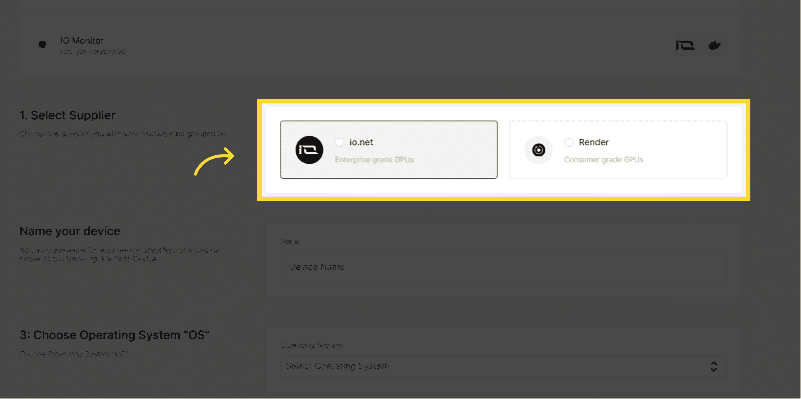

顶部有一个标记为 `IO Monitor`（IO 监控）的状态指示器，显示 `Not yet connected`（尚未连接）。下方界面被分为几个部分。第一部分标记为 `1. Select Supplier`（选择供应商），提示用户为硬件选择供应商，由黄色箭头指向两个选项：`io.net` 用于企业级 GPU，`Render` 用于消费级 GPU。第二部分 `Name your device`（命名您的设备）提供了一个输入设备名称的字段，建议格式为 `My-Test-Device`。第三部分 `3: Choose Operating System "OS"`（选择操作系统 "OS"））包含一个用于选择操作系统的下拉菜单，标记为 `Select Operating System`（选择操作系统）。

## 4. 命名您的设备

为您的设备添加一个唯一名称，理想的格式类似于如下：`My-Test-Device`


用户界面包括选择供应商、命名设备、选择操作系统和指定设备类型的部分。高亮部分显示了一个文本框，其中输入了 `101 test device` 作为设备名称。提供了如 `io dot net` 等供应商选择选项，并带有“企业级 GPU”等描述。此外，还有单选按钮用于选择设备类型 `GPU Worker` 或 `CPU Worker`，以及一个选择操作系统的下拉菜单。

## 5. 选择操作系统 “OS”

点击 `Linux` 字段

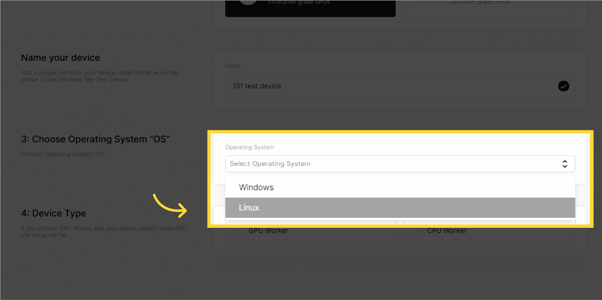

用户界面包含几个部分。第一部分标题为 `Name your device`（命名您的设备），用户可以在此处输入设备的唯一名称，提供的示例为 `My-Test-Device`。第二部分标记为 `3: Choose Operating System "OS"`（3: 选择操作系统 "OS"），显示了一个带有 `Windows` 和 `Linux` 选项的下拉菜单。第三部分标记为 `4: Device Type`（4: 设备类型），包含备注：如果选择了 `GPU Worker` 且设备没有 GPU，则设置将失败。该部分还显示了 `GPU Worker` 和 `CPU Worker` 的单选按钮，尽管它们在图中被部分遮挡。

## 6. 设备类型

如果您选择 `GPU Worker` 且设备没有 GPU，设置将失败


设置设备的用户界面包含几个部分：1. `Name your device`（命名您的设备），用户可以输入设备名称，已填写 `101 test device` 作为示例。2. `Choose Operating System "OS"`（选择操作系统 "OS"）选择了 `Linux` 作为操作系统。3. `Device Type`（设备类型）可以选择 `GPU Worker` 或 `CPU Worker` 的选项。备注警告说，为没有 GPU 的设备选择 `GPU Worker` 将导致设置失败。

## 7. 下载脚本文件

下载脚本文件以安装驱动并按照步骤操作

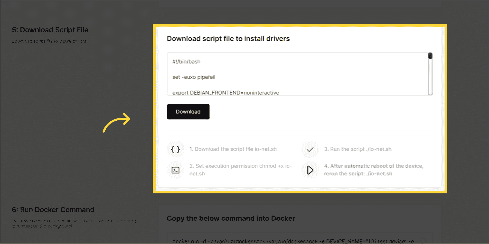

窗口弹出窗口标题为 `Download script file to install drivers`（下载脚本文件以安装驱动）。代码如下：

```bash
#!/bin/bash
set -euo pipefail
export DEBIAN_FRONTEND=noninteractive
```

底部有一个下载选项。此外，还有描述下载过程的步骤如下：
1. 下载脚本文件 `io-net.sh`，
2. 设置执行权限 `chmod +x io-net.sh`，
3. 运行脚本
4. 设备自动重启后返回脚本 `:io-net.sh`。

## 8. 运行 Docker 命令

在终端中运行此命令，并确保 `docker desktop` 在后台运行

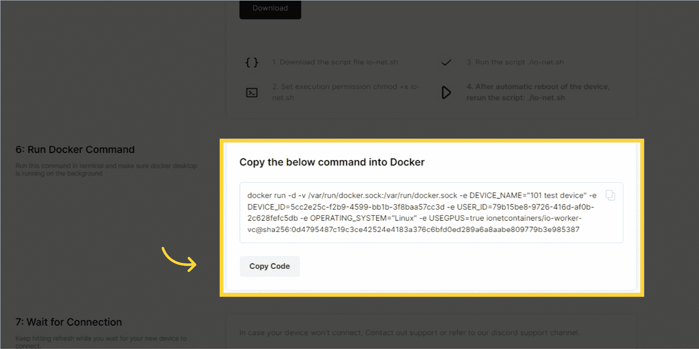

代码如下：

```bash
docker run -d -v /var/run/docker.sock:/var/run/docker.sock -e DEVICENAME="101 test device" -e DEVICEID="5cc2e25c-f2b9-4599-bb1b-3f8baa57cc3d" -e USERID="79b15be8-9726-416d-af0b-2c628efc5db" -e OPERATINGSYSTEM="Linux" -e USEGPUS=true ionetcontainers/io-worker-vc@sha256:0d4795487c19c3ce42524e4183a376c6bfd0ded289a6a8a
```

## 9. 下载脚本文件

下载脚本文件以安装驱动并等待


顶部有一个标记为 `IO Monitor`（IO 监控）的状态指示器，显示 `Not yet connected`（尚未连接）。下方界面被分为几个部分。第一部分标记为 `1. Select Supplier`（选择供应商），提示用户为硬件选择供应商，由黄色箭头指向两个选项：`io.net` 用于企业级 GPU，`Render` 用于消费级 GPU。第二部分 `Name your device`（命名您的设备）提供了一个输入设备名称的字段，建议格式为 `My-Test-Device`。第三部分 `3: Choose Operating System "OS"`（3: 选择操作系统 "OS"）包含一个用于选择操作系统的下拉菜单。

## 4. 命名您的设备

为您的设备添加一个唯一名称，理想的格式类似于如下：`My-Test-Device`


用户界面包括选择供应商、命名设备、选择操作系统和指定设备类型的部分。高亮部分显示了一个文本框，其中输入了 `101 test device` 作为设备名称。提供了如 `io dot net` 等供应商选择选项，并带有“企业级 GPU”等描述。此外，还有单选按钮用于选择设备类型 `GPU Worker` 或 `CPU Worker`，以及一个选择操作系统的下拉菜单。

## 5. 选择操作系统 “OS”

点击 `Linux` 字段


用户界面包含几个部分。第一部分标题为 `Name your device`（命名您的设备），用户可以在此处输入设备的唯一名称，提供的示例为 `My-Test-Device`。第二部分标记为 `3: Choose Operating System "OS"`（3: 选择操作系统 "OS"），显示了一个带有 `Windows` 和 `Linux` 选项的下拉菜单。第三部分标记为 `4: Device Type`（4: 设备类型），包含备注：如果选择了 `GPU Worker` 且设备没有 GPU，则设置将失败。该部分还显示了 `GPU Worker` 和 `CPU Worker` 的单选按钮，尽管它们在图中被部分遮挡。

## 6. 设备类型

如果您选择 `GPU Worker` 且设备没有 GPU，设置将失败


设置设备的用户界面包含几个部分：1. `Name your device`（命名您的设备），用户可以输入设备名称，已填写 `101 test device` 作为示例。2. `Choose Operating System "OS"`（选择操作系统 "OS"）选择了 `Linux` 作为操作系统。3. `Device Type`（设备类型）可以选择 `GPU Worker` 或 `CPU Worker` 的选项。备注警告说，为没有 GPU 的设备选择 `GPU Worker` 将导致设置失败。

## 7. 下载脚本文件

下载脚本文件以安装驱动并按照步骤操作


窗口弹出窗口标题为 `Download script file to install drivers`（下载脚本文件以安装驱动）。代码如下：

```bash
#!/bin/bash
set -euo pipefail
export DEBIAN_FRONTEND=noninteractive
```

底部有一个下载选项。此外，还有描述下载过程的步骤如下：
1. 下载脚本文件 `io-net.sh`，
2. 设置执行权限 `chmod +x io-net.sh`，
3. 运行脚本
4. 设备自动重启后返回脚本 `:io-net.sh`。

## 8. 运行 Docker 命令

在终端中运行此命令，并确保 `docker desktop` 在后台运行


代码如下：

```bash
docker run -d -v /var/run/docker.sock:/var/run/docker.sock -e DEVICENAME="101 test device" -e DEVICEID="5cc2e25c-f2b9-4599-bb1b-3f8baa57cc3d" -e USERID="79b15be8-9726-416d-af0b-2c628efc5db" -e OPERATINGSYSTEM="Linux" -e USEGPUS=true ionetcontainers/io-worker-vc@sha256:0d4795487c19c3ce42524e4183a376c6bfd0ded289a6a8a
```

## 9. 下载脚本文件

下载脚本文件以安装驱动并等待


顶部有一个标记为 `IO Monitor`（IO 监控）的状态指示器，显示 `Not yet connected`（尚未连接）。下方界面被分为几个部分。第一部分标记为 `1. Select Supplier`（选择供应商），提示用户为硬件选择供应商，由黄色箭头指向两个选项：`io.net` 用于企业级 GPU，`Render` 用于消费级 GPU。第二部分 `Name your device`（命名您的设备）提供了一个输入设备名称的字段，建议格式为 `My-Test-Device`。第三部分 `3: Choose Operating System "OS"`（3: 选择操作系统 "OS"）包含一个用于选择操作系统的下拉菜单。


*   `Regulatory Challenges`:监管挑战。在不同国家应对 AI 和区块链技术的法律和监管方面可能具有挑战性。
*   `Adoption Barriers`: 采用障碍。说服传统行业和用户采用这种新的 AI 开发和部署模式可能困难。

# 7 MathWallet GPTs AI 客户服务

区块链作为一个新兴技术领域，对于公司而言，区块链产品的客户服务传统一直以来是一个资源密集型环节。

`CryptoWallet` 作为用户的财务切入点，承担着教育用户的主要责任。这也意味着高昂的客服成本。

基于产品文档训练的 AI 代理（Agent）可以有效地取代客服角色并提供更好的服务。

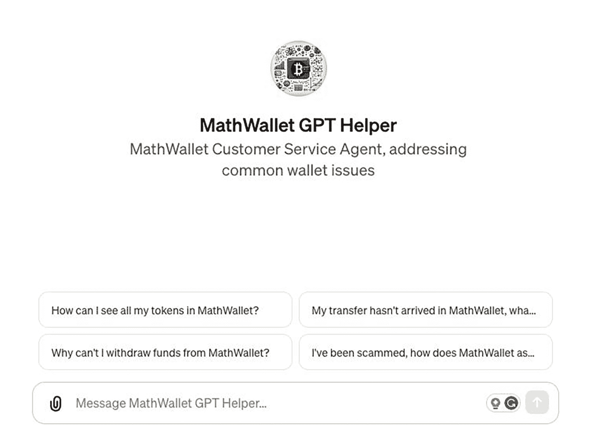

截图显示了一个标题为 `MathWallet GPT Helper` 的界面，该界面被描述为解决常见钱包问题的 `MathWallet 客服助手`。该界面显示了常见问题列表，包括：`我如何在 MathWallet 中查看我所有的令牌`（带有问号）、`为什么我无法从 MathWallet 提取资金`（带有问号）、`我的转账尚未到达 MathWallet，什么...` 以及 `我被骗了，MathWallet 如何协助我....`。在界面的底部，有一个标记为 `Message MathWallet GPT Helper...` 的输入框，右侧有一个发送按钮。

[`chat.openai.com/g/g-Dt9IXBw7R-mathwallet-gpt-helper`](https://chat.openai.com/g/g-Dt9IXBw7R-mathwallet-gpt-helper)

## 7.1 优势

AI 区块链产品客服具有以下主要优势：

*   **24 小时服务**：AI 客服可以提供全天候服务，不受时间限制，这对于提供国际服务或应对高峰期的业务特别为有用。
*   **多语言支持**：AI 客服支持多种语言，使其更容易满足不同国家和地区客户的需求。
*   **新的交互方式**：用户不再需要在博客中搜索内容和问题，或者等待人工客服的回复。他们可以直接向 `GPT` 提提问。
*   **节省成本**：它不仅节省了人工成本，还节省了客服系统的成本。
*   **一致性与准确性**：基于 `MathWallet` 博客的内容训练，AI 客服可以提供标准答案，确保信息的一致性和准确性。对于确保客户获得正确信息至关重要。
*   **高效益**：与传统的人工客服相比，AI 客服可以节省大量的人工成本，特别是在处理常见问题和简单任务时，使其更加经济高效。这还包含了此前所需的客服系统成本。
*   **处理海量查询**：AI 客服可以同时处理大量的客户查询，这对于应对高流量至关重要，并能显著提高效率。
*   **个性化服务**：通过学习客户偏好和历史交互记录，AI 客服可以提供更个性化的服务体验。
*   **即时响应**：AI 客服可以提供即时反馈和答案，缩短客户等待时间。
*   **自学习与优化**：随着时间的推移，AI 客服可以通过机器学习算法不断优化其回复和服务质量。

## 7.2 训练步骤

我们演示了如何使用 `MathWallet` 的 `GPTs` 客服创建一个产品客服 AI。

首先，导出产品的用户手册文档。`MathWallet` 的 `GPTs` 客服。


截图显示了一个标题为 `MathWallet GPT Helper` 的界面，该界面被描述为解决常见钱包问题的 `MathWallet 客服助手`。该界面显示了常见问题列表，包括：`我如何在 MathWallet 中查看我所有的令牌`（带有问号）、`为什么我无法从 MathWallet 提取资金`（带有问号）、`我的转账尚未到达 MathWallet，什么...` 以及 `我被骗了，MathWallet 如何协助我....`。在界面的底部，有一个标记为 `Message MathWallet GPT Helper...` 的输入框，右侧有一个发送按钮。

导出产品的用户手册文档。`MathWallet` 的 `GPTs` 客服。


截图显示了一个标题为 `MathWallet GPT Helper` 的界面，该界面被描述为解决常见钱包问题的 `MathWallet 客服助手`。该界面显示了常见问题列表，包括：`我如何在 MathWallet 中查看我所有的令牌`（带有问号）、`为什么我无法从 MathWallet 提取资金`（带有问号）、`我的转账尚未到达 MathWallet，什么...` 以及 `我被骗了，MathWallet 如何协助我....`。在界面的底部，有一个标记为 `Message MathWallet GPT Helper...` 的输入框，右侧有一个发送按钮。

## 7.3 局限性

AI 客服目前存在局限性，例如在处理复杂和高度个性化的查询方面可能不如人工客服。

# 8 Pints AI

## 8.1 公司介绍

`Pints.ai` 是一家本土化的新加坡 AI 公司，构建生成式 AI 解决方案以解决金融部门在使用公共模型时面临的问题。

为了实现这一点，`Pints.ai` 专注于一种替代性的小型语言模型架构，该架构可以在工作站、笔记本电脑或手机等轻量级硬件上运行，同时达到接近 ChatGPT 的性能。

此外，投入资源使 `LLMs` 运行得更高效具有重要意义。首先，是为了环保和减少碳排放；其次，是为了对抗 `OpenAI` 和 `Google` 等科技巨头对 AI 的极端倾斜控制。

我们的研究愿景是发现一种 AI 架构，能够将 `ChatGPT` 等领先模型的能力封装到简单的下载移动应用中，就像智能算法和硬件设计让我们的手机比 80 年代中期的超级计算机更强大一样。


此外，它还可以连接到网络驱动器、数据库、云存储或邮箱等数据源，因此使用户可以使用自然语言与数据进行交互，这类似于互联网用户从 Google 搜索转向 ChatGPT，以对话的方式提取答案。

深入探究，该解决方案在底层包含四个主要模块：

第一个模块是 `Pints.ai LLM`，它的尺寸已被大幅缩小。对于像 `ChatGPT` 或 `Bard` 这样的大型模型，仅 `LLM` 模块就可以处理几乎所有类型的查询。然而，`Pints.ai LLM` 模块的尺寸小得多，必须依赖架构的其他部分来实现类似于 `ChatGPT` 的功能。

第二个模块是 `database` 模块，由传统存储器和专门的向量存储组成，形成了 `LLM` 内存的扩展。

第三个模块是 `retrieval` 模块，由多个 `NLP` 模型组成，旨在帮助 `LLM` 更准确地检索信息。

最后但同样重要的是，`prompt` 模块位于技术堆栈的最顶端，其中几个 `LLMs` 决定将请求路由到何处以及向 `LLM` 提供什么样的提示。

## 8.3.2 定制 LLM 解决方案

`Pints Generative AI stack` 可以针对信息检索之外的其他用例进行修改。它的核心简单来说是一个能够理解用户意图并利用可用知识来完成用户定义目标的 AI。

## 8.4 在金融领域的应用

### 8.4.1 保险公司

#### 8.4.1.1 用例 1—保险 AI 销售副驾驶

保险代理人在保留各种保险计划的详细知识方面面临巨大挑战，影响了他们提供精确且及时客户咨询的能力。`Pints.ai` 引入了 AI 驱动的销售副驾驶，作为一个复杂的知识管理系统。该 AI 工具提供实时交互式支持，针对代理人的特定查询定制回复，从而增强了客户互动和决策的准确性。

#### 8.4.1.2 用例 2—通过 AI 自动化简化保险理赔

保险理赔处理通常是人工且基于先例的。`Pints.ai` 集成了 AI 副驾驶以优化这一过程。AI 协助对理赔进行初步分析，并根据现有先例生成建议。这一过程不仅加速了理赔处理，还确保了与政策指南的一致性和合规性，从而提高了理赔管理的运营效率。

#### 8.4.1.3 家族办公室/财富管理

财富经理在为客户推荐合适的金融产品或基金时，面临与保险代理人类似的问题。AI 副驾驶可以显著增强财富管理的这一方面，通过快速搜索和识别符合客户独特需求的基金（例如投资气候友好型公司或涉及中国和南美等特定地区的基金）。`Pints.ai` 工具赋能财富经理提供即时的、明智的建议，满足客户细微的投资偏好。

## 9 未来展望

### 9.1 AI 与区块链集成的新兴趋势

#### 9.1.1 AI 和区块链链是两种截然不同的技术

`AI` 的发展代表了一种自上而下的中心化控制技术模型。它依赖于收集和分析大量数据来改进算法和决策模型。例如，`Google` 通过收集用户浏览数据，可以准确地推送内容和广告。这项技术的核心在于中心化的数据处理和应用，强调效率和控制。然而，这种中心化的数据处理方法引发了对隐私和数据安全的担忧。越来越多的个人数据被用于训练 `AI` 模型，不仅增强了 `AI` 的效能，还加剧了隐私泄露的风险。因此，`AI` 伦理、隐私保护和算法偏见已成为热门研究领域。

`区块链` 技术以去中心化和加密为中心。它提供了一种自下而上的去中心化协作模型。` Cryptocurrency` 是这项技术的典型应用，颠覆了传统的金融系统和大型科技公司的商业模式。区块链的去中心化特性可以在范围内保护用户隐私，防止数据被未经授权的中心化机构滥用。此外，区块链为内容的真实性提供了新的保障，这在 AI 产生的内容爆炸时代特别重要。

当 `AI` 与 `区块链` 集成时，两者的特征可以互补，但也可能产生一些矛盾。例如，`AI` 强大的数据处理能力可以优化 `blockchain` 操作的效率，但同时可能威胁 `blockchain` 的去中心化和匿名性。相反，`blockchain` 可以为 `AI` 提供更安全透明的数据源和使用环境，但这可能限制 `AI` 获取和使用大规模数据。

`AI` 与 `区块链` 的结合既是技术挑战，也是商业和伦理机遇。这两项技术的互动将塑造技术发展的未来方向，并对社会产生深远影响。

### 9.2 对全球金融格局的潜在影响

以 `OpenAI` 面临的挑战为例，核心问题在于难以平衡基金会与商业公司之间的关系。基金会旨在实现 `AGI`（通用人工智能）以提高人类文明的整体生产力。这一过程需要通过商业公司融资，以解决计算成本和员工动力问题。从本质上说，这是一个公共物品融资问题，是人类几千年来未能解决的挑战。

### 9.3 开源对公共物品的意义

#### 9.3.1 为什么公共物品需要开源？

公共物品的核心特征是其非排他性和非竞争性。这意味着人们共享这些资源而不会减少他人使用的机会。开源公共物品最大化了它们的价值，因为更多的人可以无障碍的使用和改进它们。例如，开源软件允许用户自由使用、学习、修改和分发软件，从而促进创新和快速发展。

#### 9.3.2 高费用使用的问题

高昂的使用费用确实限制了公共物品的广泛采用和使用。当只有少数人负担得起时，它失去了作为公共物品的大部分价值。此外，高费用会导致资源分配不均，使资源仅供精英阶层使用。

#### 9.3.3 广告模式的局限性

虽然广告可以资助公共物品，但这种模式具有局限性。广告主通常针对特定观众，这可能与最有效或最需要的公共物品不匹配。此外，对广告的依赖可能导致公共物品质量下降，因为它们是为了吸引注意力而非服务公共利益。

### 9.4 公共物品融资的挑战

#### 9.4.1 激励的重要性

激励是驱动公共物品创建和维护的关键。激励可以是社会性的（如认可、声誉和满足），也可以是经济性的（如直接的财务回报）。找到正确的激励机制对于确保公共物品的质量和可持续性至关重要。

#### 9.4.2 基金会与商业公司不同的角色和目标


基金会通常关注长期和公共利益目标，例如通用人工智能（AGI）的发展，旨在提高人类文明的整体生产力。

商业公司更关注短期收益、盈利能力和可持续性，通过融资来解决技术开发成本和员工激励问题。

### 9.4.3 信息公共品的独特挑战

信息公共品（如数字内容和软件）面临着独特的挑战：复制的边际成本几乎为零。这使得传统的经济模型难以适应，因为这些模型通常基于具有物理成本的商品的生产和分配。为这类公共品寻找合适的融资和激励模型是当代面临的一个重大挑战。

### 9.4.4 作为公共品的 AGI

AGI 的发展可能带来巨大的社会效益，例如提高效率、解决复杂问题以及促进技术创新。

然而，作为一种公共品，AGI 研究可能会面临“免费搭车”问题，即个人或公司不愿意投入资源，期望他人的贡献能带来收益。

### 9.4.5 融资与资源分配的挑战

如何有效筹资以支持 AGI 研究，同时确保这些资金的合理高效使用？

如何平衡公共和私人利益，以确保 AGI 研究不会被少数利益集团所控制？

### 9.5 使用区块链解决公共品融资问题

#### 9.5.1 数据作为资产

在这种模型中，个人数据不再仅仅是信息的集合，而是转变为一种价值资产。这意味着你的个人数据（如购物偏好、浏览历史或健康记录）可以被视为价值资源。

这种资产化可以通过区块链技术实现，确保数据的安全、透明和不可篡改性。用户对自己的数据拥有完全控制权，可以选择出售或授权使用。

#### 9.5.2 AI 模型作为协议

在这个系统中，AI 模型不再是单一实体或公司的产品，而是基于开放、去中心化的协议运行。这些协议利用区块链管理并记录数据的使用及贡献。

AI 模型基于用户提供的数据资产进行训练，增强了它们的智能性和效率。这种方法使 AI 的开发更加民主和去中心化。

#### 9.5.3 收益分配与资产使用

当 AI 模型被使用时（例如用于预测分析、个性化推荐等），产生的收入将根据协议规则分配给数据贡献者。

这意味着如果你的数据被用于训练成功的 AI 模型，你将根据协议获得相应的利润份额。这种机制鼓励用户分享数据，同时确保他们获得公平的补偿。

在这一框架下，可以通过激励个人分享数据来实现公共品的融资。由于个人数据贡献与潜在的经济利益直接相关，这可能会激励更多人使用他们的数据来参与支持公共品或服务。

这些变化将改变现有的商业模式，包括公司、投资和金融服务，这将催生一种构建更多造福人类产品的新方式。

## 10 结论

本章详细阐述了金融行业对 AI 和区块链的探索，揭示了关于技术进步、挑战和巨大潜能的丰富叙事。将 `Openfabric`、`io.net`、`MathWallet` 和 `Pints AI` 等案例整合到这一叙事中，为这些技术的现实影响和应用提供了一个具体的视角。这一全面的结论综合了这些元素，反思了迄为止的历程，并展望了由 AI 和区块链塑造的未来图景。

AI 与区块链在金融领域的汇聚标志着金融部门的重大演变。AI 的数据分析和预测建模能力在增强客户服务和运营效率等方面发挥了关键作用。`MathWallet` 在客户服务中引入 AI 是一个典型的范例，展示了 AI 在处理客户查询时的效率和可扩展性。这一应用证明了 AI 如何提升金融部门的客户体验，这是客户留存和满意度的关键组成。

同样，区块链技术凭借其固有的透明性和安全性，已成为重塑金融交易的基石，特别是在去中心化金融领域。`io.net` 等平台体现了这种转型，展示了区块链在创建安全高效金融网络中的作用。`Io.net` 对金融行业的贡献凸显了区块链如何促进安全、透明的金融交换，这是现代金融的基础方面。

AI 和区块链在金融行业中的现实应用是多样且具有影响力的。例如，`Openfabric` 展示了 AI 的创新用途，即创建一个用于在区块链上开发和部署 AI 算法的生态系统。这种整合强调了区块链如何增强 AI 应用的可信度和可追溯性，解决了数据完整性和安全等核心关注。另一方面，`Pints AI` 展示了 AI 在金融领域数据处理和决策支持方面的巨大潜力。通过高效管理大型数据集，`Pints AI` 阐明了 AI 在提高金融生产力和驱动金融盈利性决策方面的作用。这些案例共同强调了 AI 和区块链的多样化应用，从客户互动到数据管理以及交易安全。`Io.net` 范例了区块链在创建安全高效金融交易网络中的应用。该平台证明了区块链变革金融交易的能力，为金融交换提供了一个安全透明的环境。`MathWallet` 利用 AI 提供高效的客户服务，支持多种语言并同时处理大量查询。这一应用证明了 AI 在增强金融部门客户体验和运营效率方面的作用。

尽管 AI 和区块链的潜力是巨大的，但应对数据隐私、合规性以及整合这些技术的复杂性等挑战，对于它们在金融领域的成功应用至关重要。讨论的案例为如何解决这些挑战提供了见解，展示了在金融系统中实施 AI 和区块链的潜力与障碍。

总之，AI 和区块链在金融行业的整合代表了技术创新的范式转变。随着金融行业的不断演变，AI 和区块链的作用正变得日益核心，有望为创新、效率和包容性带来新机会。将这些技术整合到金融领域的历程仍在进行中，其完全影响尚未完全实现。


*   [`mathwallet.org`](https://mathwallet.org)。
*   [`pints.ai/`](https://pints.ai/)
*   [去中心化金融 (DeFi)](https://www.investopedia.com/decentralized-finance-defi-5113835)(https://www.investopedia.com/decentralized-finance-defi-5113835)。

# 第十三章 利用 AI 转型银行后台运营

1. Alan Megargel
2. Venky Shankararaman
3. Obuchettiar Krishnaraj Arul
4. 新加坡管理大学计算与信息系统学院，新加坡，新加坡

## 摘要

多年来，银行一直在战略性地利用数字技术帮助其业务的各个方面转型。近期，这种策略已演变为人工智能（AI）驱动的银行流程、产品和渠道的数字化增强。事实上，AI 在驱动整个银行业运营（包括前台、中台和后台）的数字化转型方面发挥着关键作用。在前台，由 AI 驱动的聊天机器人正在增强客户互动，提供个性化建议并简化常规查询。在中台，AI 帮助优化风险管理和合规性、投资组合管理，并执行与组合相关的风险分析。在后台，已经在尝试使用 AI，例如：简化“了解您的客户”（KYC）程序、自动化数据输入和对账，以及自动化其他繁琐任务。然而，后台的 AI 解决方案仍落后于前台和中台。在后台，银行更多关注流程自动化，而不是自动化和增强流程内部的决策。本章采用以案例研究为中心的方法，描绘了可以使用 AI 增强银行后台运营的各个领域，涵盖了零售、企业和投资银行。随后，它描述了辅助 AI 赋能决策所需的底层数据流水线，以及管理启示和指导银行后台运营采用 AI 的成熟度模型。

## 关键词

* 数字化银行
* 前台
* 中台
* 后台
* 自动化
* 人工智能
* 机器学习

## 1 引言

一些传统银行声称自己是数字化的，因为它们提供了在线渠道（例如，网上/手机银行）。然而，一家真正的数字银行必须对其内部银行业务进行数字化（例如账户开立、履行、结算），使得这些核心业务流程在无需人工干预的情况下完全自动化。按照原则，即使是业务异常处理（例如，处理坏账）也应该是完全自动化的。完全自动化的数字银行运营成本将远低于传统银行，节省的成本可以通过更优的利率和更高的收益回馈客户。

除了为客户提供更好的利率和更高的收益外，数字银行还能够在银行获得客户关注的精确时刻、销售点或客户因任何原因与银行交互的任何时候，实时向客户提供个性化的交叉销售优惠（例如，低利率贷款、商户折扣）[1]。事实证明，与传统的出式直销营销相比，实时的入式营销在产生收入方面要有效得多[2]。那些选择加入个性化实时提议的客户将对银行对其财务需求有准确的理解而留深刻印象，这种能力将帮助银行建立良好的声誉，特别是对于那些习惯了科技巨头和电子商务公司提供的类似功能的年轻一代（“数字原住民”）。

在本章中，我们首先从客户的角度描述了一个理想的数字银行模型，分为三个级别：零售/中小企业银行、批发银行和投资数字银行。其次，我们涵盖了与我们主题相关的之前的工作。第三，我们展示了四个目前正在转型/数字化后台运营的银行案例，包括两家传统商业银行、一家传统投资银行和一家全新的纯在线数字银行。然后，我们识别了可以使用人工智能（AI）和/或机器学习（ML）实现自动化的后台运营，并由通用数据流水线支持。最后，我们讨论了 AI/ML 自动化的管理启示。

## 2 理想的数字银行

数字银行不应有实体网点。客户入驻应该是完全自动化的，并允许客户在不与银行人员任何互动的情况下开设账户。在线渠道应设有聊天机器人来引导客户完成任何流程或回答任何问题，并在需要时提供人工对话的选项。数字银行应设有呼叫中心支持来处理客户案例（例如，交易争议）。表 1 列出了从客户角度看理想数字银行的特征。

### 表 1：理想数字银行的特征。

| 特征 | 描述 |
| --- | --- |
| 无实体网点 | 完全在线。出于任何原因，都无需与银行人员进行面对面互动。 |
| 自动化客户入驻 | 面部和身份视频扫描。连接到国家身份注册库。企业文档上传：公司注册证明、股东协议和年度财务报告。 |
| 自服务银行交易 | 完全在线开立/注销存款账户、申请贷款、执行资金转账和账单支付、设置自动指令、交易记账和结算。 |
| 个性化实时优惠 | 下一步最佳优惠（NBOs），针对每位客户进行个性化，并根据历史和持续的财务需求生成，排队等待在客户下一次交互（例如，任何财务交易）时交付。 |
| 聊天机器人 | 聊天机器人引导客户完成任何流程，并在需要时提供人工对话的选项，并访问客户简介，以根据客户的背景和特定财务需求提供建议。 |
| 呼叫中心支持 | 呼叫中心支持处理紧急客户案例（例如，交易争议）。呼叫中心操作人员拥有客户可能拥的所有账户和信额额视图，以便解决任何问题。 |

### 2.1 三个级别的数字银行

我们可以定义三个级别的数字银行：一个覆盖零售和中小企业客户群，一个覆盖参与国际贸易的大型企业的批发银行需求，一个覆盖高净值私人银行客户和其他机构投资者的投资需求。这三个级别中的每一个都提供了表 1 所示的理想数字银行特征。

#### 2.1.1 零售/中小企业数字银行

零售/中小企业客户拥有完全的自助能力来开设账户、转账、支付、设置自动指令并申请简单的贷款产品，几乎无需与银行人员互动。零售贷款产品包括住房抵押贷款、贷款、教育贷款和个人贷款。拥有丰富的在线用户体验，强调简单卓越的服务交付，包括个性化的交叉销售优惠和财务建议。

中小企业贷款产品包括固定资产贷款、营运资金融资、发票融资和订单融资。中小企业服务涵盖了所有旨在提高业务生产力和盈利能力的银行服务，包括现金管理设施：资金集中、收益优化、工资发放服务和催收。


### 2.1.2 企业级（批发）数字银行

企业客户具有完全的自助服务能力，可以开设多种不同货币的存款账户，进行境内外资金转账，并在几乎或无需与银行工作人员互动的情况下申请批发信贷额度。批发业务涵盖支持国际贸易所需的所有银行产品，包括信用证、银行保函、信托收和出口保理。为了支持与国际贸易相关的外币支付，银行还提供了一整套财资产品，包括外汇交易、外汇风险管理（外汇对冲）、流动性管理和外汇远期合约。对于企业财务官，应当提供丰富的在线用户体验，重点在于简单性、参数化和控制、账户全可视化以及利润优化，包括针对性的情景财务建议。

### 2.1.3 投资数字银行

机构投资者和高净值私人银行客户拥有自助能力，可以启动并完成完整的客户入驻流程，包括自动化 KYC 识别、客户尽职调查（`CDD`）、增强型尽职调查（`EDD`）、投资组合需求与约束及风险偏好的识别，以及所需文件的上传（例如公司注册证明、董事会决议）。自动化流程涉及识别更广泛的跨国家族与业务关系以及公司结构和实体，需要从整体上进行考虑以建立对客户画像的全面理解。通过全面的客户画像，系统可以为客户顾问提供预筛选的潜在客户、自动化的产品推荐、可操作的洞察以及话术建议。

## 3 相关工作

在本节中，我们将涵盖 AI 在数字银领域应用的相关工作。

### 3.1 AI 在数字银行中的应用

近年来，随着 AI 技术的出现，数字银行创新正经历范式转移，其重点已从简单的流程自动化转向需要 AI 与人类协作的智能流程 [3]。这些创新影响了传统银行的前台、中台和后台，在许多情况下，因此模糊了这些部门之间不同职能角色的界限。根据麦肯锡的数据，AI 和分析的使用可能为银行释放高达 1 万亿美元的价值 [4]。除了这些收益外，传统银行还面临来自数字颠覆者的持续威胁，这些颠覆者利用 AI 和其他创新技术以更低的成本提供增强的、灵活的服务 [5]。

#### 3.1.1 前台

对于前台业务，AI 已用于增强客户体验、简化流程并提高整体运营效率 [6]。由于与客户的直接服务互动是劳动密集型的，银行一直在使用 AI 来自动化这一过程并提高客户代理的生产力。根据麦肯锡的数据，前台的虚拟助手和对话界面占总 AI 实施方案的 32% [4]。一个非常常见的例子是使用 AI 驱动的聊天机器人或虚拟助手，客户与数字机器人互动，在任何人工员工介入之前帮助回答查询并解决问题 [7]。Bhattacharya 和 Sinha 对印度银行的调查识别出了聊天机器人为客户提供的若干用例，包括回答与账户余额和对账单相关的问题、加速贷款决策、支持客户的金融和证券交易、账单支付，以及提供信用卡和交易模式的提醒 [8]。聊天机器人可以访问广泛的信息，既包括与某位特定客户的信息，也包括与当前产品供应和市场状况的信息。除了回答查询外，某些聊天机器人还可以帮助提供个性化建议。例如，通过建议投资选项提供实现财务目标的建议、建议合适的产品，以及根据独特的消费习惯进行预算分配。目前已有多个聊天机器人或虚拟助手的成功案例 [5,9,10]。例如，法国巴黎银行个人金融（BNP Paribas Personal Finance）在西班牙开发的虚拟助手帮助呼叫中心代理处理的查询减少了 46% [11]。另一个广泛应用的示例是美国银行开发的虚拟助手 `Erica`，它在 2020 年接收了 1.35 亿次请求，用户群超过 2000 万 [12]。

随着近期 AI 驱动的生物识别方法（如脸识别和指纹扫描）的发展，许多用于网点访问或数字交易的安全客户认证前台已通过 AI 工具实现 [13]。另一个流行趋势是使用机器人投顾分析客户财务目标、风险承受能力市场趋势来推荐个性化投资策略。例如，“Acorns Later”是添加到 `Acorns` 应用程序中的投资账户，根据客户的年龄、收入、性别等因素推荐退休账户和组合 [14]。

#### 3.1.2 中台

中台负责各种关键活动，如风险管理与合规、组合管理以及与组合相关的风险分析。ML 算法（特别是利用预测分析的算法）协助检查市场趋势、识别投资机会并优化组合配置。例如，Jang 和 Seong 开发了一种基于 AI 的算法，通过将强化学习与组合理论相结合来优化组合。通过持续学习，AI 算法可以根据市场趋势动态调整组合，从而优化年化收益和最大回撤 [15]。

AI 技术（包括机器人流程自动化 `RPA` 和自然语言处理 `NLP`）被应用于自动化交易确认、对账和结算流程。AI 帮助快速、准确地处理海量数据，并向人类经理提供简洁的分析，由他们做出数据驱动的决策。早期，电子路由算法用于将交易员的买卖订单匹配到不同的股票经纪和交易系统以履行订单。通常，资产经理处理的交易中有近 30% 需要人工干预才能完成，从而导致延迟。因此，银行一直在探索使用预测分析的 ML 技术来帮助解决这一问题。例如，法国巴黎证券服务实施工具 `Smart Chaser` 利用预测分析，通过历史数据以及每个执行路径的机会成本来优化交易路径来实现交易处理的自动化。通过这种方式，可以映射每个可能执行路径的成功概率。通过该工具可以预测“交易匹配”延迟的可能性以及导致延迟的细节，从而使中台运营团队能够及早干预 [16]。


管理投资组合相关风险的风险部门通常需要监控跨交易对手和交易的海量数据。通常，数据源存在于不同地理区域和语言的多种媒介中。处理这种复杂性的一种方法是关注高优先级列表，然后轮流对剩余数据进行采样。通过使用自然语言处理（NLP）和文本分析技术，可以提取、审查和过滤与特定风险监控目的的内容 [3]。此外，通过人工智能（AI），现在可以开发先进的风险分析和压力测试模型。AI 算法可以实时处理大型数据集，评估风险敞口，并模拟各种市场场景。另一个相关领域是信用风险建模，AI 模型可以通过分析包括财务历史、经济指标和行业趋势在内的多种数据集，帮助评估借款人的信用状况。

#### 3.1.3 后台

尽管银行业业对使用 AI 表现出浓厚兴趣，但后台部门的转型仍然微乎其微。尽管近 60% 的客户不满意来源源于后台 [17]。大多数数字化转型工作都集中在人力资源、法律或对账等领域。要消除运营中的低效率，仅仅使基础设施现代化是不够的。例如，Zeghmouli 引用道：“我们人类需要去分析、定义和组织 2025 年的后台部门” [18]。后台负责高效的运营，涵盖了整体风险管理、合规、数据处理和银行内部流程等功能。理解 AI 在后台的影响、挑战和进展，对于全面衡量 AI 对银行的整体影响至关重要。

RPA（机器人流程自动化）在后台得到了广泛实施，通过软件机器人实现了重复性和基于规则的任务自动化，如数据输入、对账和交易处理。例如，在欧陆银行（Eurobank），贷款管理部门的 20 个流程在 6 个月内通过 RPA 实现了自动化。其中一个流程是将收到的信用卡债务还款分配到正确的信用卡账户。在自动化之前，这一过程七名员工每天需要花费 4 小时。该流程的自动化节省了两个全职人力（FTE），缩短了支付处理时间，并将错误率降低至 0% [19]。开发基于 RPA 的解决方案的一个挑战是设置参数的任务耗时。它对于基于预定义规则和工作流并使用结构化的大量简单任务非常有效。未来，银行需要将 RPA 与机器学习（ML）算法相结合，以促进自学习和持续改进，并能够良好地处理结构化和非结构化数据 [18]。

AI 在后台另一个热门应用是简化客户入职流程和 KYC（了解您的客户）程序。使用 NLP 和 ML，更容易从文档和表格等非结构化数据源中提取和分析信息。这有助于身份验证和文档校验的自动化，从而在确保符合监管要求的同时加速了入职流程。例如，安永（EY）报告显示，通过使用 AI 进行 KYC，所需时间从平均 18 分钟减少到不到 1 分钟。此外，该银行还减少了超过 6000 个分配给 KYC 处理的人工资源 [20]。

2020 年，机构在金融犯罪合规方面的支出估计达 2140 亿美元 [21]。由于基于规则系统等传统方法，银行无法跟上犯罪分子采用的创新方法。银行需要转向利用 ML 的 AI 解决方案。ML 可用于后台运营中的反洗钱（AML）合规，通过自动分析大量交易并检测可能表明洗钱或其他非法活动的模式。这提高了 AML 流程的效率和准确性 [21]。例如，新加坡的一家银行——大华银行（UOB），实施了基于 ML 的解决方案，使其能够在每月超过 5700 条可疑交易警报中精确定位高优先级案例 [22]。这有助于重点关注这些案例并迅速调查潜在的洗钱尝试。Han 等人开发了一个框架，利用先进的 NLP 和深度学习技术来促进下一代 AML 技术 [23]。

金融行业面临着不断变化的监管格局。为了在银行内部高效地处理和实施法规，AI 已被用于简化合规流程，并促进准确及时的监管报告。利用 NLP 和 ML 算法的自动化系统可以解释复杂的监管要求，确保银行遵守合规标准。研究强调了在后台实施 AI 带来的效率提升和合规风险降低。Urazova 提出了 AI 技术管理监管要求的三个领域 [24]。首先，ML 与传统的监管科技（RegTech）相结合，重点提高满足央行和其他金融市场监管机构要求的效率。其次，帮助银行组织内部活动，如准备内部报告、预测现金流和员工绩效。第三，在与私人和企业客户相关的活动中使用 AI，如背景分析、检查文件准确性以及评估借款人的信用状况。

与任何业务一样，银行的后台是保护敏感信息的关键领域。AI 越来越多地用于加强网络安全措施、检测异常和防止欺诈活动。ML 算法可以分析模式、识别异常并实时发出警报，从而增强银行的安全态势。Kaur 等人对使用 AI 为任何组织提供网络安全进行了系统性的文献综述，了五个不同的网络安全功能，即识别、保护、检测、响应和恢复 [25]。

### 3.2 相关工作总结

总而言之，正如文献综述所示，与前中后台相比，银行后台 AI 解决方案的实施较为滞后。银行必须理解，后台 AI 的潜在用途不仅限于流程自动化，而且流程内部需要基于 AI 的决策。大多数银行尚未对其后台投资 AI 解决方案 [18]。此处发表的文献涵盖了 AI 在多个地理位置更广泛背景下的潜在用途。为了更好地了解 AI 驱动后台数字化转型的演变格局，下一节将重点关注来自东南亚地区的四个案例研究。

## 4 案例研究

本节总结了四个正在利用 AI 转型/数字化后台运营的银行案例研究，包括两家传统商业银行、一家传统投资银行和一家全新的在线数字银行。这项多案例研究基于访谈，每家银行的访谈包含一个或多个参与者。访谈进行了录音，并对转录进行了匿名化。

### 4.1 案例研究 1

### 4.2 案例研究 2

### 4.3 案例研究 3

### 4.4 案例研究 4

### 4.5 案例研究总结

`Table 2` 对此前研究的四家银行利用 AI 实现后台运营自动化进行了对比。


# 案例研究总结。

| 银行 | 银行类型 | 后台 AI 采用情况 |
| --- | --- | --- |
| 银行-A | 传统商业银行 | 该银行因其在线面向客户的数字渠道被高度视为数字化银行。然而，在处理文档的 `NPL`（不良贷款）之外，AI 在后台自动化方面的应用仍处于实验阶段。他们主要在 BPM 下采用基于规则的决策机制。 |
| 银行-B | 传统商业银行 | 该银行设有有效的 AI 卓越中心（CoE），以支持全行的 AI 开发。该银行的 AI 在合规和风险流程的中台支持方面处于先进阶段，其对司库、贸易、支付、贷款催收、实时交叉销售以及欺诈检测与预防的后台支持也已到位。 |
| 银行-C | 传统投资银行 | 虽然前台 CA 的客户支持是基于关系的（这符合财富管理银行业的本质），但该银行已成功将其后台从手动操作转变为主要由 AI 驱动的数字化运营，从而为客户实现了更高的收益，并为银行带来了更高的交易量。 |
| 银行-D | 持牌数字银行 | 作为一家新银行（成立不满 2 年），它们的优势在于没有受到遗留系统和手动流程的束缚，并且从第一天起就实现了 AI 能力。他们所有的基础设施都是云端的，成本较低，97% 的后台操作已完全自动化。因此，它们的客户满意度得分超过了 80%。 |

## 5 适用于使用 AI 进行自动化的后台操作

基于我们对四家代表性银行的多次案例研究，我们得出了每种类型银行（零售、企业企业、投资银行）中一组适用于使用 AI 进行自动化的后台操作，如 图. 1 所示。此外还包含了所有银行类型中都存在的相关的常见后台操作。

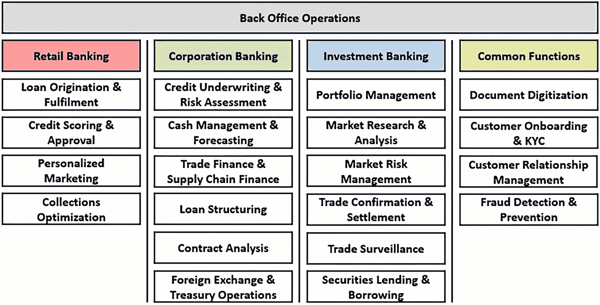

图. 1 适用于使用 AI 进行自动化的后台操作。

`Back Office Operations`（后台操作）区块分为四类：零售银行、企业银行、投资银行和通用功能。每个类别下的组件如下：零售银行包括`贷款发放与履行`（Loan Origination and Fulfilment）、`信用评分与审批`（Credit Scoring and Approval）、`个性化营销`（Personalized Marketing）和`催收优化`（Collections Optimization）。企业银行包括`信用承销与风险评估`（Credit Underwriting and Risk Assessment）、`现金管理与预测`（Cash Management and Forecasting）、`贸易融资与供应链金融`（Trade Finance and Supply Chain Finance）、`贷款结构`（Loan Structuring）、`合同分析`（Contract Analysis）以及外汇与司库业务（Foreign Exchange and Treasury Operations）。投资银行包括`投资组合管理`（Portfolio Management）、`市场研究与分析`（Market Research and Analysis）、`市场风险管理`（Market Risk Management）、`交易确认与结算`（Trade Confirmation and Settlement）、`交易监控`（Trade Surveillance）以及`证券借贷`（Securities Lending and Borrowing）。通用功能包括`文档数字化`（Document Digitization）、`客户入驻与 KYC`（Customer Onboarding and KYC）、`客户关系管理`（Customer Relationship Management）以及`欺诈检测与预防`（Fraud Detection and Prevention）。

后续章节将提供每种银行类型后台操作中 AI 使用的详细信息，包括一个关于通用功能的章节。

### 5.1 零售银行业务

零售银行后台操作中的 AI 用途列于 表 3，这些内容汇总自我们对银行-A、银行-B 和银行-D 的案例研究访谈。

表 3

零售银行业务中的 AI 用途。

| 操作 | 零售银行业务中的 AI 用途 |
| --- | --- |
| 贷款发放与履行 | 通过自动提取申请表和相关文档的数据取代人工输入，同时确保贷款实践符合相关法律法规。<br>处理客户的电子邮件和消息。 |
| 信用评分与审批 | 分析并分析非结构化数据集（如市场趋势、宏观经济指标和财务报表）以评估客户。<br>根据历史趋势和当前市场状况模拟风险风险，并根据客户的行业前景或财务表现持续调整风险评估。<br>比传统方法更准确地提供信用评分。 |
| 个性化营销 | 分析客户交易历史和偏好以预测未来需求，提供精准产品（如存款、贷款）。<br>根据实时交易持续改进优惠。<br>为客户调整营销信息的内容和语气。 |
| 催收优化 | 通过识别可能违约的账户优先考虑催收工作。<br>根据客户的情况个性化还款计划。<br>通过机器人联系未付债务。<br>确保催收实践符合相关法律法规。 |

### 5.2 企业银行业务

企业银行后台操作中的 AI 用途列于 表 4，这些内容汇总自我们对银行-A 和银行-B 的案例研究访谈。

表 4

企业银行业务中的 AI 用途。

| 操作 | 企业银行业务中的 AI 用途 |
| --- | --- |
| 信用承销与风险评估 | 分析并分析大型非结构化数据集（如市场趋势、宏观经济指标和财务报表）以评估企业客户的信用状况。<br>根据历史趋势和当前市场状况模拟不同的风险场景，并根据客户的行业前景或财务表现持续调整风险评估。<br>优化银行的信用组合，平衡风险与收益，并进行压力测试模拟以预测不同经济和市场状况的影响。 |
| 现金管理与预测 | 通过预测支付供应商和收款的最佳时机，为企业客户优化营运资金。<br>通过在资金盈余时预测并建议短期投资，在资金短缺时进行融资，来优化流动性管理。<br>分析市场数据以预测利率和外汇风险敞口，并建议/执行有效的对冲措施。 |
| 贸易融资与供应链金融 | 摄取并分析贸易单据（如信用证、提单和发票）的数据；验证真实性；并匹配文档间的数据以检查准确性。<br>验证贸易符合国际法规，验证原产国不在制裁名单上，并识别表明洗钱活动的贸易模式并采取自动行动。 |


*   自动完成货运单与采购订单的匹配。针对提前付款实现动态发票折扣，优化买双方和卖方的现金流。

## 贷款结构
*   分析企业客户的画像，根据其特定需求、当前财务状况、历史信用表现和抵押品估值，定制贷款结构。
*   运行模拟以预测不同宏观经济环境和市场条件对贷款结构决策的影响。
*   实施基于风险的定价（例如利率、费用），在企业客户的特定贷款条款与银行的信贷风险总敞口之间取得平衡。

## 合同分析
*   摄取并分析与法律限制、罚金和权利相关的合同条款和条款，以识别银行可能面临的财务风险和法律责任。
*   根据内部政策、监管要求和相关法律核实合同的合规性。
*   监控即将到来的合同事件（如报告截止日期财务义务），并向相关方发出警报。

## 外汇与资金库运营
*   分析企业客户的资金库头寸，根据当前市场状况和财务新闻报告预测市场不利的汇率走势，识别客户汇率波动风险敞口过大的货币，并自动执行对冲交易以避免损失。同样的市场分析和自动对冲能力也可用于管理银行内部资金库头寸。

### 5.3 投资银行业务
AI 在投资银行后台运营中的应用列于表 5，这些内容汇总自我们对 Bank-C 进行的案例研究访谈。

表 5
AI 在投资银行业务中的应用。

| 业务领域 | AI 在投资银行业务中的应用 |
| --- | --- |
| 投资组合管理 |
*   分析大型市场数据集，识别传统研究可能忽略的趋势和投资机会。
*   根据每个客户的风险承受能力、财务目标和投资偏好，定制投资策略。
*   持续评估市场状况，动态优化资产配置，并根据客户的投资策略执行自动投资组合再平衡。
*   生成客户当前投资组合表现报告，并利用历史趋势数据预测未来表现。 |
| 市场研究与分析 |
*   根据客户的行业部门、投资策略和特定偏好（如 `ESG`、伦理投资）生成定制化研究报告，包括数据可视化，以增强对复杂市场的理解并辅助决策。
*   生成量化模型，用于根据历史表现对投资组合进行分析和回测。
*   根据最新的市场研究，为客户提供与其兴趣和投资组合相符的定制化自动化更新。 |
| 市场风险管理 |
*   进行压力测试，以评估投资组合在系列模拟财务和经济场景下的韧性，并识别脆弱的组合或资产。
*   监控市场状况，对市场变动和超过预设限值的潜在风险提供实时警报。
*   根据银行风险管理政策，每当预定义的风险事件发生时执行自动对冲交易。 |
| 交易确认与结算 |
*   通过自动匹配银行与其交易对手之间的交易细节，实时确认交易。
*   识别并标记交易细节中的任何差异，包括交易对手信息、数量和价格。
*   根据交易协议自动处理交易结算，包括资金或证券的转移。
*   向客户发送有关其交易和结算状态的实时通知。 |
| 交易监控 |
*   监控交易异常模式和行为，这些行为可能指示非法的市场操纵，如内幕交易或利用待处理订单信息进行交易（抢跑）。
*   对交易员的行为进行长期画像分析，并标记偏离其通常交易模式的交易。
*   根据监管要求生成可疑活动报告。 |
| 证券贷款与借款 |
*   根据期限、利率和抵押品需求等标准，自动匹配借款人和贷款人（债券）。
*   持续评估抵押品价值，并根据市场状况调整需求。
*   自动化证券贷款流程，包括生成、交易结算和对账。 |

### 5.4 通用功能
AI 在通用功能中的应用列于表 6，这些内容汇总自我们对四家银行的访谈。

表 6
AI 在通用功能中的应用。

| 功能 | AI 在通用功能中的应用 |
| --- | --- |
| 文档数字化 |
*   自然语言处理 (`NLP`) 模型用于解释文档中提取的人类语言，识别实体（名称和地点）并解读客户反馈表达的情绪。
*   卷积神经网络 (`CNN`) 模型用于处理图像（像素数据），辅助字符识别并识别文档模式（表格、图形和文本块）。
*   循环神经网络 (`RNN`) 模型用于转录手写文本中的单词序列以及手写识别。 |
| 客户入职与 KYC |
*   `NLP` 模型用于机器人与客户交互，通过引导式自助入职流程回答问题。
*   机器学习 (`ML`) 模型用于模式识别，包括 a) 客户提供的数据中反洗钱 (`AML`) 或反恐融资 (`CFT`) 风险的模式，以及 b) 基于扫描图像（面部、指纹和视网膜扫描）的生物识别。 |
| 客户关系管理 |
*   `NLP` 模型用于生成、解释和处理通过电子邮件和即时消息进行的客户沟通。
*   `ML` 模型根据特定的财务需求为整个客户群体或个人生成并投放营销信息。 |
*   `ML` 模型用于分析客户活动和交易模式，并 a) Identify 向现有客户交叉销售产品的机会，或 b) 可能因服务不满而离开银行的客户。 |
| 欺诈检测与预防 |
*   `NLP` 模型用于审查客户提供的数据以寻找欺诈迹，例如申请表中的不一致或电子邮件/语音传递的信息不一致。
*   人工神经网络 (`ANN`) 和深度学习 (`DL`) 模型用于识别大型非结构化数据集（如语音通话转录或社交媒体动态）中的非线性模式。 |
*   图神经网络 (`GNN`) 模型通过分析不同账户持有人及其交易之间的关系，检测涉及多方的复杂欺诈方案。 |

## 6 通用数据流水线


本节汇总了案例研究中四家银行在数据流水线管理方面共同关注的问题。为了支持在零售、企业和投资银行职能中使用 AI，银行构建、开发和维护一套通用的数据流水线是至关重要的。通用数据流水线是 AI 驱动应用程序的基础，确保大量数据在进入银行通用数据湖的过程中，经过高效可靠的聚合、处理和分析。数据源包括客户交易、市场数据、通信记录和系统日志。通用数据流水线能够实现标准化的数据治理和合规流程，从而统一应用和管理数据处理规则及监管政策。由数据卓越中心集中管理的通用数据流水线可以营造更具协作性的环境，并打破数据孤岛，从而在整个银行范围内共享创新和洞察。图. 2 展示了通用数据流水线的组成部分。

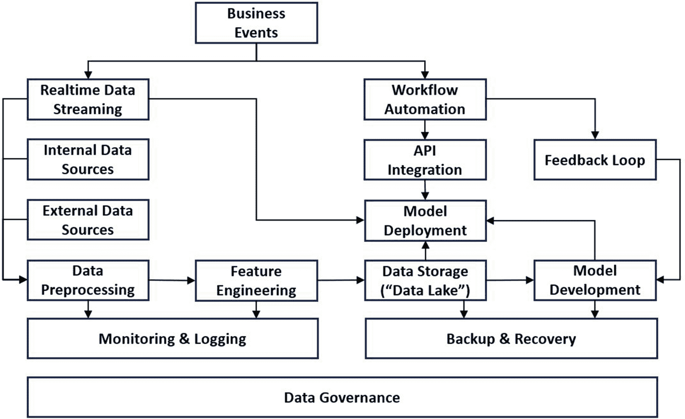

图. 2 通用数据流水线。

该流程始于业务事件，分支为实时数据流和工作流自动化。实时数据流进一步分支为内部数据源和外部数据源。内部和外部数据源均指向数据预处理，随后连接到特征工程。特征工程指向监控和日志。工作流自动化连接到 API 集成，进而导致模型部署。模型部署连接到数据存储（数据湖）和模型开发。数据存储（数据湖）连接到特征工程和备份恢复。模型开发连接到模型部署和反馈循环。反馈循环返回工作流自动化。整个过程受数据治理的约束。

### 6.1 数据源

银行的数据流水线由多种内部和外部数据源提供，每个源都为辅助 AI 驱动的决策提供各种信息。内部数据源包括：a) 核心账务系统，提供客户账户余额、实时和历史财务交易以及贷款还款历史，这些有助于理解客户的财务状况和行为；b) 客户关系管理 (CRM) 系统、呼叫中心系统和数字渠道（例如移动端 App 和网站），提供有关客户服务体验和偏好的见解。

外部数据源包括：a) 实时市场数据馈，提供外汇汇率、股票价格、国债和其他交易工具；b) 市场新闻报告，提供对行业部门和个公司的洞察；c) 经济指标，如国内生产总值 (GDP)、消费者价格指数 (CPI)、通胀率和失业率，提供对市场健康状况的洞察；d) 征信机构，提供客户信用状况的信息；以及 e) 社交媒体馈，提供可以分析的非结构化数据，以理解影响客户行为的绪。

### 6.2 数据预处理与特征工程

数据预处理和特征工程步骤将源数据转换为适用于 AI 模型的结构。在数据预处理阶段，从内部和外部源提取的数据会被清洗（例如删除重复记录）和修复（例如用默认值填充缺失值）。然后对数据进行分段，以代表不同的交易类型或客户群体，以便 AI 模型能够有效应用到多种场景中。最后，对数据进行统一归一化或缩放，以防止特征偏差。

数据科学家随后从预处理过的结构化数据中构建特征，例如平均账户余额、信用卡使用模式或透支频率，以增强 AI 模型进行预测的准确性。使用时间序列分析等技术可以更好地捕捉时间性数据（如利率和股价）中的底层模式，以支持投资决策。特征工程要求数据科学家具备银行领域知识，例如在处理贷款时时计算财务比率（如债务收入比、贷成比）。最后，数据被划分为训练数据集（即用于训练 AI 模型的代表样本），确保其有效性和准确性。

### 6.3 用于 AI 模型开发和部署的通用数据湖

银行实施通用数据湖以支持所有 AI 模型开发和部署具有其优势。数据湖作为来自内部和外部源流数据的整合存储库。这种数据的集中及其管理对于确保多样化 AI 应用（如风险画像、产品推荐以及欺诈检测与预防）中保持一致的数据质量和准确性至关重要。通用数据湖实现了数据可访问性并促进了数据共享，从而消除了抑制分析和洞察的传统数据孤岛。数据的全局视图使 AI 模型更加准确和细致，从而做出更好的决策。此外，将数据中心化到通用数据湖中简化了数据治理和标准合规。

### 6.4 触发 AI 驱动自动化工作流的实时业务事件

由实时业务事件（如财务交易）触发的 AI 驱动自动化工作流可以提高银行捕捉机会（如交叉销售）或或规避威胁（如欺诈）。通过 `API` 暴露的 AI 模型由工作流引擎调用。示例 1：高价值交易可以触发欺诈检测工作流，AI 模型根据已知的欺诈模式（如发票欺诈）对交易进行分析，并立即向银行员工报警可疑交易。示例 2：在线贷款申请可以触发信用评估工作流，AI 模型根据申请人的信用历史和其他财务状况指标评估其信用状况，并立即向申请人回复适当的贷款条款。示例 3：在银行网站上注册的客户投诉或查询可以触发案件管理工作流，使用 `NLP` 的 AI 模型理解文本对话的上下文（例如账户查询或服务投诉），并提供即时个性化响应，或将案件转交给银行员工跟进。

## 7 讨论

### 7.1 管理启示

银行在对其后台运营进行 AI 改造时，必须考虑若干管理启示，以在最小化实施风险的同时利益最大化。首先，银行必须对技术以及员工培训和开发投入大量。教育和意识计划对于银行员工理解与 AI 系统协同工作的优势和局限性至关重要。变革管理计划对于解决员工担忧和对工作被取代的感知是必要的，特别是对于高度重复的后台任务，包括员工的技能提升和重新部署到更高价值的职能。高层管理必须有效地引导文化转变，并驱动一种将 AI 视为提高生产力的工具而非替代品的思维方式。


由于数据治理和隐私是首要关注的问题，银行必须确保其 AI 使用符合所有适用的数据保护法律和伦理标准。这要求谨慎处理客户数据，并确保其受到保护且以透明的方式进行使用。将 AI 集成到现有系统中可能具有挑战性，需要周密的规划和分阶段实施的方法。运营风险（如 AI 系统的决策不准确和基础设施故障）需要通过应急预案进行严格控制。

银行管理层必须具备适应能力，并对员工反馈和不断变化的需求做出响应，以持续评估和修改 AI 系统。综合考虑，一个能够在技术创新、人员管理、运营完备性和伦理考量之间取得平衡的综合管理策略，对于 AI 在后台运营中的成功集成至关重要。

### 7.2 银行后台运营 AI 采用的成熟度模型

基于我们对四家代表性银行的多案例研究，我们得出了一个评估银行后台运营 AI 采用情况的可能成熟度模型，所示图 3。该成熟度模型考虑了四个类别，即 AI 收益（针对员工和客户）、后台运营中的 AI、AI 数据流水线和 AI 治理，并跨四个成熟度级别进行评估。每个层级下的评估对象目前仅具有说明性意义，还需要更多分析来完善该模型。例如，对于不同类型的银行（如零售、企业和投资银行），“后台运营中的 AI 使用”类别下可能需要不同的评估对象集，因为不同类型银行的 AI 用例可能有所不同。

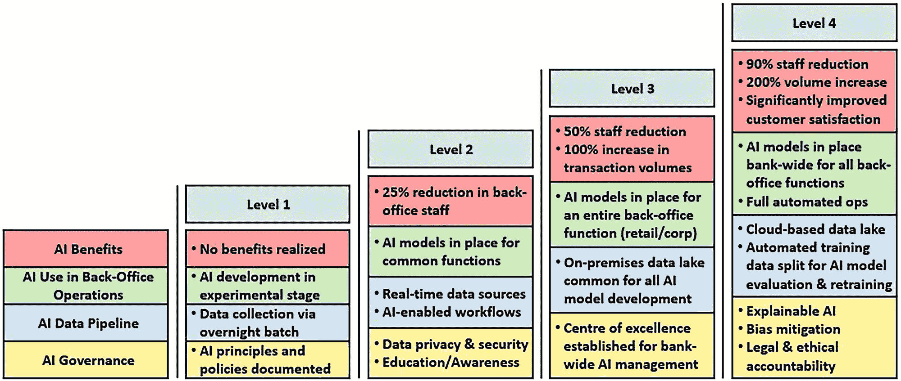

图 3 提议的成熟度模型。

该模型分为四个级别：1 级：未实现收益，AI 开发处于实验阶段，通过夜间批处理收集数据，AI 原则和政策已记录文档。2 级：后台员工减少 25%，常用功能已配备 AI 模型，实时数据源，AI 驱动的工作流，数据隐私与安全，以及教育与意识。3 级：员工减少 50%，交易量增加 100%，整个后台功能（零售/企业）已配备 AI 模型，所有 AI 模型开发通用的本地数据湖，建立了全行 AI 管理卓越中心。4 级：员工减少 90%，量增加 200%，客户满意度显著提高，全行所有后台功能已配备 AI 模型，全自动化运营，云端数据湖，用于 AI 模型评估和重训练的自动化训练数据划分，可解释 AI，偏见缓解以及法律和伦理责任制。

在未来的工作中，该提议的成熟度模型可以通过由参与银行完成的自评估调查问卷进行测试。第一轮测试可以在本文研究的四家银行进行，随后对模型和/或调查问卷进行完善，最后进行涉及更大规模银行样本的第二轮测试。一旦模型通过测试并收集了数据，就有可能实证测试关于哪些因素（例如技术、人员、流程）影响银行在后台运营中采用 AI 的假设。

### 8 总结

本章首先考察了模型数字银行跨三个银行需求层级（即零售/中小企业、批发和投资）的通用特征。这些特征涵盖了物理网点的缺失、简化的客户入驻流程、自助银行交易、个性化的实时优惠，以及机器人和呼叫中心支持的集成。文中强调，每个层级都根据客户特定需求、监管合规性和运营考量定制了这些通用特征的实施。从文献综述中获得的见解，本章得出结论：与中后台相比，后台的 AI 解决方案相对滞后。它强调了银行主要侧重于后台流程的自动化，而不是利用 AI 来增强这些流程中的决策。本章随后介绍了作者通过访谈获得，即东南亚四家银行如何使用 AI 技术转型其后台运营。基于对案例研究的分析，本章随后讨论了 AI 可用于后台运营自动化的各个领域以及对通用数据流水线的需求。最后，本章强调了某些管理启示，并提出了一个指导银行后台运营 AI 采用的成熟度模型。

### 9 写作过程中使用 AI 及 AI 辅助技术的声明

在准备这项工作期间，作者使用了 `ChatGPT-4` 以提高可读性。在使用该工具/服务后，作者根据需要对内容进行了审查和编辑，并对出版内容承担全部责任。

## 参考文献

*   [[1]](#Ch013_183-198_B9780443347177000131.xhtml#B-bb0010) Megargel A., Shankararaman V., Reddy S.K. 实时入站营销：数字银行业的一个用例. In: *Handbook of Blockchain, digital finance, and inclusion.* Academic Press; 311–328. 2018;Vol.
*   [[2]](#Ch013_183-198_B9780443347177000131.xhtml#B-bb0015) 银行日报 *创新技术 2009 获奖者：[实时营销。](https://www.thebanker.com/Chair-s-1244)
*   [[3]](#Ch013_183-198_B9780443347177000131.xhtml#B-bb0020) Brownlee T., Sommerfeld J., Hansen K. AI 如何改变运营：从结算到自动化. *安全托管期刊.* 2020;12(2).
*   [[4]](#Ch013_183-198_B9780443347177000131.xhtml#B-bb0025) Biswas S., Carson B., Thomas R. [AI 的未来：银行能应对挑战吗？](https://www.mckinsey.com/industries/financial-services/our-insights/ai-bank-of-future-can-banks-meet-challenge)
*   [[5]](#Ch013_183-198_B9780443347177000131.xhtml#B-bb0030) Lazo M., Ebardo R. 银行业 AI 采用：现状与未来. *创新管理期刊.* 2023;11(3).
*   [[6]](#Ch013_183-198_B9780443347177000131.xhtml#B-bb0035) Lau T., Leimer B. 连接时代：AI 如何帮助实现未来银行. *数字银行期刊.* 2019;3(3).
*   [[7]](#Ch013_183-198_B9780443347177000131.xhtml#B-bb0040) Noonan L. [银行中的 AI：炒作背后的现实](https://www.ft.com/content/b497a134-2d21-11e8-a34a-7e7563b0bf4). 2018.
*   [[8]](#Ch013_183-198_B9780443347177000131.xhtml#B-bb0045) Bhattacharya C., Sinha M. AI 在银行中提升客户体验的作用. *澳大利亚会计与金融期刊.* 2022;16(5).
*   [[9]](#Ch013_183-198_B9780443347177000131.xhtml#B-bb0050) Lau T. 转型之旅：金融服务中的人工智能智能. *数字银行期刊.* 2021;6(3).


-   [\[10\]](#Ch013_183-198_B9780443347177000131.xhtml#B-bb0055) Fares O.H., Butt I., Lee S.H. 人工智能在银行业的应用：系统性文献综述。*J. Financ. Serv. Mark.* 2022;11:1–8.
-   [\[11\]](#Ch013_183-198_B9780443347177000131.xhtml#B-bb0060) Nuance. *法国帕巴个人金融通过增加虚拟助手优化其客户服务。* [引用自 2023 年 12 月 14 日]。 来源：[`www.nuance.com/omni-channel-customer-engagement/case-studies/bnp-paribas-personal-finance-optimizes-customer-service-with-virtual-assistant.html`](https://www.nuance.com/omni-channel-customer-engagement/case-studies/bnp-paribas-personal-finance-optimizes-customer-service-with-virtual-assistant.html)。2020。
-   [\[12\]](#Ch013_183-198_B9780443347177000131.xhtml#B-bb0065) Schwartz H.E. *美国银行在人工智能和数字银行的推动下，2020 年刷新了新专利纪录。* Voicebot.ai; 2021. [引用自 2023 年 12 月 14 日]。 来源：[`voicebot.ai/2021/02/21/bank-of-america-breaks-company-record-for-new-patents-in-2020-led-by-ai-and-digital-banking/`](https://voicebot.ai/2021/02/21/bank-of-america-breaks-company-record-for-new-patents-in-2020-led-by-ai-and-digital-banking/) [引用自 2023 年 12 月 14 日]。 来源于。
-   [\[13\]](#Ch013_183-198_B9780443347177000131.xhtml#B-bb0070) HID. 更好的银行体验始于强身份验证和人脸生物识别。HID 电子。[引用自 2023 年 12 月 14 日]。 来源：[`www.hidglobal.com/sites/default/files/resource:files/eat-better-banking-experiences-strong-authentication-face-biometrics-eb-en.pdf`](https://www.hidglobal.com/sites/default/files/resource:files/eat-better-banking-experiences-strong-authentication-face-biometrics-eb-en.pdf)。
-   [\[14\]](#Ch013_183-198_B9780443347177000131.xhtml#B-bb0075) Rosenberg E. *如果你还没有为养老存下一分钱，Acorns Later 可能会鼓励你现在开始。* Business Insider; 2020。 [引用自 2023 年 12 月 14 日] [`www.businessinsider.com/personal-finance/acorns-later-review-may-help-you-start-saving-for-retirement-2020-1`](https://www.businessinsider.com/personal-finance/acorns-later-review-may-help-you-start-saving-for-retirement-2020-1)。
-   [\[15\]](#Ch013_183-198_B9780443347177000131.xhtml#B-bb0080) AI26, Jang J., Seong N.Y. *通过现代组合理论进行股票组合优化的深度强化学习。* Expert Systems With Applications; 2023;Vol. 21 19556, (ISSN 0957-4174)。
-   [\[16\]](#Ch013_183-198_B9780443347177000131.xhtml#B-bb0085) Macfarlane D. *法国帕巴银行采用新型人工智能工具提升交易效率。* [引用自 2023 年 12 月 14 日]。 来源：[`www.asiaasset.com/post/7076-bnpsmartaser-dm1010`](https://www.asiaasset.com/post/7076-bnpsmartaser-dm1010)。2017。
-   [\[17\]](#Ch013_183-198_B9780443347177000131.xhtml#B-bb0090) Falato P., Buvat J., Coumaros J., Kvj S. *数字化支持前线：银行后台数字化。* Capgemini。
-   [\[18\]](#Ch013_183-198_B9780443347177000131.xhtml#B-bb0095) Zegh N. *你有后台部门吗？* *J. Sec.* 2023;15:146。
-   [\[19\]](#Ch013_183-198_B9780443347177000131.xhtml#B-bb0070) Eurobank. *Postbank 通过 RPA 转型贷款管理。* [引用自 2023 年 12 月 14 日]。
-   [\[20\]](#Ch013_183-198_B9780443347177000131.xhtml#B-bb0105) Mittal M. *使用 AI 进行 KYC 自动化。*
-   [\[21\]](#Ch013_183-198_B9780443347177000131.xhtml#B-bb0110) Kaur R., Gabrijelj D., Klobučar T. *网络安全人工智能：文献综述与未来方向。* *Inf. Fusion.* 2023;10:180。
-   [\[22\]](#Ch013_183-198_B9780443347177000131.xhtml#B-bb0115) UOB. *华友银行新的 AI 反洗钱解决方案帮助银行减少可疑交易。* 2020。
-   [\[23\]](#Ch013_183-198_B9780443347177000131.xhtml#B-bb0120) Han J., Huang Y., Liu S. *反洗钱人工智能：综述。* *Digit. Finance.* 2020;211–239。
-   [\[24\]](#Ch013_183-198_B9780443347177000131.xhtml#B-bb0125) Urazova S. *银行系统中的人工智能：趋势与可能的影响。* 载于《AI 经济中的技术趋势：国际回顾与适应》。新加坡：Springer Nature; 2023:345–355。
-   [\[25\]](#Ch013_183-198_B9780443347177000131.xhtml#B-bb0130) Kaur R., Gabrijelj D., Klobučar T. *网络安全人工智能：文献综述与未来方向。* *Inf. Fusion.* 2023;10:180。

# 第 14 章 面向可持续经济的 AI 与 Web3（原文注：sustainable economy）

1.  朱菲达 (Feida Zhu), 新加坡管理大学，新加坡，新加坡
2.  张冰雪 (Bingxue Zhang), 上海市科技大学，上海，中国
3.  [c] 新加坡国立大学，新加坡，新加坡

Han J., Huang Y., Liu S.
Urazova S.
Zegh N, al.

## 摘要

本章探讨了人工智能（AI）与 Web3 之间的协同作用，强调了它们在变革数字经济方面的共同潜力。Web3 被定义为开放、去中心化协作的转型性框架，强调了其通过协作智能和代币化经济重塑数字经济的作用。Web3 不再仅仅关于区块链，而是关于实现技术创新、法律治理和经济设计方面的突破性变化。其促进数据、智能、计算能力和应用生态系统价值生成、分配和交易的能力，被认为对于可持续发展至关重要。本章探讨了 Web3 的核心支柱——信任和激励——如何为医疗保健和金融等行业的安全、透明和公平协作提供必要基础。

## 关键词

Web3

区块链
代币化经济
去中心化协作
信任与激励
协作智能

## 1 引言


数字经济是一种新的经济形态，它利用数字化知识和信息作为关键生产要素，以数字技术作为核心驱动力，并将现代信息网络作为重要载体 [1]。它主要由四个部分：(1) 数字化工业化：指信息通信行业，特别是软件和技术服务。(2) 产业数字化：指数字技术在传统行业中的应用所带来的价值增长，例如平台经济和联网汽车。(3) 数字治理：包括数字公共服务，或结合数字技术建立其治理体系的行业。(4) 数据价值化：涵盖数据采集、数据定价、数据交易等其他活动。目前，数字经济已成为推动全球经济增长的关键力量。根据世界银行的报告，数字经济占全球 GDP 的 15% 以上，在过去的 10 年中增长速度比物理世界 GDP 的增长快 2.5 倍 [2]。

然而，随着数字经济规模的不断扩大，传统的数据处理和管理方法已无法满足新兴需求。特别是智能、自动化和安全方面的挑战日益突出。因此，探索能够支持数字经济可持续发展的新技术已成为研究和工作的重点。在此背景下，人工智能（AI）和 Web3 技术展现出巨大的潜力。

### 1. (1) AI 为数字经济注入智能和自动化：以 AI 为代表的新分析技术基于海量数据的收集和分析，这不仅显著提高了生产效率和智能化，还深刻改变了决策模式。它在数字经济的各个领域起着至关重要的作用，包括提供个性化服务、内容创造、检测潜在欺诈以及优化用户体验。

### 2. (2) Web3 催化基于数据价值和互信的数字经济：基于区块链 旨在构建一种去中心化、零信任、安全且自主的网络范式。它坚持数据所有优先。通过去中心化身份（DID）、非同质化标记（NFT）、去中心化自治组织（DAO）和去中心化金融（DeFi）等一系列创新概念，Web3 为数字世界中的数据元素建立了认证、流通和交易的新经济体系。

因此，将 AI 和 Web3 技术应用于数字经济不仅可以优化数字经济现有的业务模式，还能促进新型商业范式创新形式的出现。因此，这将促进数字经济的可持续发展。在本章中，我们将探索 AI 和 Web3 如何赋能数字经济，并分析它们对数字经济未来发展的影响。

## 2. 大数据和 AI 驱动的数字经济发展

数字经济的快速发展很大程度上归于大数据和 AI 技术的驱动。大数据的价值在于其卓越的数据处理和分析能力，这为 AI 的智能决策提供了本质燃料。AI 的价值根于其学习和模拟人类思维及决策过程的能力，并提供自动化的解决方案和创新服务。这两项技术不仅改变了数字经济的业务模式和服务模式，还在许多行业中创造了前所未有的价值。

### 2.1 大数据的无处不在

#### 2.1.1 大数据的介绍

大数据是指体量巨大、类型多样、增长快速且超过传统数据库技术处理能力的数据集。大数据的显著特征可以总结在“5Vs”框架内 [3]：容量（Volume）、速度（Velocity）、多样性（Variety）、真实性（Veracity）和价值（Value）。细节如下：

- 容量（Volume）：数据总量巨大，通常超过 `TB` 或 `PB`。
- 速度（Velocity）：数据产生和积累的速度非常快，对数据处理速度有很高要求。
- 多样性（Variety）：数据类型广泛，包括结构化、半结构化和非结构化数据。
- 真实性（Veracity）：数据具有高度的可信和准确性。
- 价值（Value）：数据蕴含着巨大的价值潜力。

5Vs 特性构成了大数据的核心价值。通过对大数据的分析和挖掘，可以揭示更深层的模式和趋势。它可以为数字经济中的各个工业领域提供强大的数据支持和准确的决策辅助。

#### 2.1.2 大数据驱动的数字经济

在数字经济中，数据不仅代表核心资产，还是创新和价值创造的基础。大数据技术在数字经济的各个领域发挥着关键作用，深度整合了金融科技、电子商务和数字健康等许多行业。它为数字经济的智能化发展注入了“燃料”，加速了人工智能、物联网和云计算等数字化转型技术的发展。它为数字经济的决策过程提供了强大的数据支持和智能引导。大数据为数字经济环境带来了重要的价值提升。

#### 数据驱动的决策模式转型：
大数据的核心价值在于通过深度分析复杂数据集揭示底层信息和模式。这种能力已经脱了依赖主观经验和直觉的传统经济行业决策模式。数字经济行业可以显著提高决策的准确性和效率，从而赋能各种数字经济行业实现优化的战略规划和配置。

#### 通过数据挖掘优化业务模式：
在数字经济背景下，公司可以利用实时数据监控系统来提高风险预测的准确性并优化风险管理。此外，公司可以通过对社交媒体、搜索引擎、在线购物平台等海量数据进行深度分析，准确揭发现消费者偏好和行为的差异。这种洞察力能够针对性地调整产品开发和市场定位，以适应消费者需求和市场的变化。以 Netflix 为例，通过解码用户观看习惯的模式，它为实时推荐提供了动力，并指导内容创作和购买决策。因此，投资速度大大加快，最终取得了巨大的商业成功 [4]。


### 3. 数据处理能力的革命

我们正见证数字经济中数据量的指数级增长。大数据技术的应用极大地增强了数据处理能力，并显著改变了工业运营的效率。例如，内存计算框架`Spark` [5]的出现突破了磁盘 I/O 的速度限制，满足了海量数据快速处理和分析的需求。数据湖架构[6]的使用增加了结构化和非结构化数据处理的灵活性和扩展性，使数字经济行业能够兼容更多异构数据。此外，数字经济行业可以利用如`Data Studio` [7]等数据可视化工具，以图形形式展示复杂抽象的数据分析结果，显著提升了决策者和用户对数据的直观洞察，并快速识别数据中的模式、趋势以及发现异常。数字经济的这些进步不仅提高了数据处理的效率和准确性还为企业捕捉即时市场机会提供了可能，赋能了数字经济的发展。

### 2.2 AI 的兴起

#### 2.2.1 AI 的引入

人工智能（AI）是指使机器模拟人类智能过程的技术和科学领域，涵盖了学习、推理和自我修正等核心功能。近期 AI 技术的进步，特别是在深度学习和强化学习领域，在多种应用场景中展现了巨大的性能和潜力。例如，计算机视觉（CV）技术赋予计算机解析视觉信息的能力，促进了图像信息的提取和识别，为医疗诊断、包裹分拣等领域提供了实质的技术支持；自然语言处理（NLP）技术通过文本理解和情感分析，使计算机能够处理、理解和生成人类语言，被广泛应用于聊天机器人和机器翻译等场景。语音识别技术可以将人类语音转换为机器可读的格式，为语音助手和语音交互系统等应用奠定了基础。同时，专家系统通过模拟专家决策能力并整合专家知识库来推理和解决相关的专业问题，在金融分析和智能教育等领域取得了瞩目的成果。

目前，大语言模型（LLM）正在为一个革命性时代铺路，国际知名公司正积极开发基于 LLM 的应用。OpenAI 发布了`GPT4` [8]，这是一个具有数千亿参数的多模态预训练模型。通过与微软合作开放 `GPT4` 插件，OpenAI 构建了跨行业的应用生态系统。例如，通过与微软 Office 软件集成，可以极大提升办公生产力；通过连接 `Github`，可以实现基于自然语言的代码生成 [9]。此外，OpenAI 还推出了文本生成视频模型——`Sora` [10]，它可以通过输入文本生成高质量视频。谷歌发布了 `PaLM2` [11]，作为 GPT 的竞争对手，它在多语言翻译方面表现出色。IBM 发布了 `Watsonx` [12]，具有自动化业务流程和 AI 治理等功能。

#### 2.2.2 AI 驱动的数字经济

人工智能（AI）技术与数字经济的融合被认为是经济扩张和工业升级的催化剂。Riley 的研究表明，AI 技术对于通过提高生产效率增强工业智能和服务质量来转型传统经济行业具有重要作用 [13]。AI 可以自动处理和分析数据，并根据数据预测趋势，有效提高工业竞争力。例如，AI 在客户服务、欺诈检测、风险评估、供应链优化、个性化营销、内容创作和产品开发中的应用，赋予了数字经济环境下各行业的智能化转型。

1. **定制化营销策略：** 通过利用深度学习技术，公司或组织可以根据用户的行为和偏好提供定制化的和服务产品，显著提升用户体验和市场竞争力。以 Spotify 的个性化推荐算法为例，它可以通过分析用户的收听历史和行为模式为用户推荐个性化的音乐播放列表。AI 推荐的歌曲占了 Spotify 流量的 30%，用户每月与平台互动平均 61 次，从而显著增加了用户粘性和订阅率 [14]。

2. **多模态内容创作：** 在数字内容创作领域，AI 能够自动生成文本、图像和视频等多种模式的内容。它极大地提高了数字内容创作的效率和质量，显著降低了创作成本。例如，创作者可以使用 `ChatGPT` 快速生成营销文本，或使用 `Sora` 创建电影特效，这大大提升了创作效率和创新能力。曾经需要几天甚至几个月才能完成的工作，现在只需几分钟即可轻松完成。它为数字内容的多样化铺平了道路。

3. **个性化客户服务：** 在数字经济中，AI 驱动的聊天机器人带来了客户服务的革命性增强。它可以实现 24/7 即时响应，显著提升用户体验，并有效降低企业的运营成本。此外，以 Bing 采用自然语言处理技术 [15] 为代表的智能搜索引擎，允许用户用自然语言进行内容检索和问答交互，从而更直观、高效地获取所需信息。

4. **供应链优化：** 在供应链管理方面，AI 的应用不仅可以优化库存管理并降低成本，还能通过高效的物流规划提高供应链的透明度和响应速度。例如，Zara 利用 AI 优化供应链管理，其新设计确保了在 1 周内交付——这与行业平均 3 到 6 个月形成了鲜明对比。它还提高了交付准确性并最小化了库存成本，显著提升了客户满意度 [16]。

5. **自动化欺诈检测与风险评估：** AI 驱动的风险和安全管理为数字经济的发展提供了坚实保障。基于 AI 的欺诈检测系统能够实时并分析交易数据，有效防止金融欺诈和网络攻击，保护用户资金。例如，Visa 报告显示，2023 年实施的 AI 驱动欺诈检测较去年使欺诈交易减少了 45%，损失减少了 60% [17]。


总而言，AI 技术在数字经济的发展中发挥着至关重要的作用。它不仅优化了数字经济产业的运营效率和决策质量，还驱动了服务与产品的创新。此外，它为经济活动的安全提供了有力保障。随着 AI 技术的不断进步和应用领域的扩大，其在数字经济中的价值将变得更加突出，从而促进数字经济的高质量发展。

## 3. 当今数字经济面临的挑战

随着大数据和 AI 技术在数字经济中的广泛应用，效率和产业转型得到了显著提升，但仍存在一些待解决的挑战。

### 3.1 数据面临的挑战

1. (1) **数据安全与隐私方面的挑战：** 在数字经济时代，数据包含了如个人隐私、商业秘密等大量敏感信息。数据在传输、存储和处理阶段面临着面临安全威胁和隐私泄露的挑战。为了应对这些挑战，学术界和工业界针对每个阶段（包括数据传输、存储和处理）提出了可能的解决方案策略。在数据传输阶段，跨域安全交换和 SSL 加密协议等技术旨在提供安全的传输通道，确保数据在传输过程中的机密性和完整性。在数据存储阶段，一些研究利用分布式存储下的密码学技术（例如加密服务集群密钥动态配置管理）、存储隔离、访问控制、冗余备份等技术在确保数据安全的同时增强其容错能力和恢复能力。在数据处理阶段，通过安全多方计算（例如同态加密 [18]、秘密共享）等机制，可以在不泄露明文的情况下高效计算存储在密文状态下的敏感数据。通过综合应用上述策略，可以有效降低数据在各个阶段受到攻击的风险。

2. (2) **数据融合复杂性方面的挑战：** 在数字经济背景下，出现了大量多样化的数据源，包括图像数据、音频数据、视频数据、文本数据和其他异构数据格式，每种数据都与金融、医疗和社交网络等不同业务场景相关。这形成了一个庞大且复杂的数据集合。随着数据源多样性的增加，如何有效整合数字经济中产生的这些异构数据已成为关键挑战。面对这一挑战，研究人员开始探索数据融合的可能策略，例如 PolyPolyglot 数据存储 [19]，它利用多种数据存储技术来满足不同数据类型的存储需求，为克服数据融合困难提供了新视角。

3. (3) **数据治理方面的挑战：** 数字经济的发展加剧了数据治理的复杂性，不仅涉及数据权的清晰界定，还涉及跨境数据流的一系列法律和管辖权问题。针对这些问题，研究人员开始考虑数字治理的相关策略。例如，学者 Elouataoui 提出，实施有效的元数据管理是一种潜在的解决方案 [20]。它通过为数据元素提供清晰的定义、归属、访问权限和使用规范，有助于明确管理责任和数据用途。这种方法不仅提高了数据的透明度，还促进了数据治理的标准化和规范化。此外，跨境和跨组织的数据治理已成为一个新的研究方向，要求建立稳健的法律框架，并确保跨境数据流符合当地法律法规。

4. (4) **海量数据实时处理方面的挑战：** 在数字经济中，将产生大量的实时交易，伴随着对海量数据实时处理日益增长的需求。这要求数据处理系统能够快速响应并处理高速流入的数据以保持高效运行。在这方面，学术界和工业界提出了一系列策略。例如，数据流处理和大规模数据分发技术（如 `Apache Kafka` [21] 和 `Flink` [22]）被开发出来以优化数据的实时处理和分发机制。它为实时交易处理和分析提供了关键支持。这些技术的应用对确保数字经济系统的有效运行发挥了积极作用，并为海量数据的实时处理提供了价值价值。

### 3.2 AI 面临的挑战

随着 AI 技术整合到数字经济活动中，出现了一系列如下挑战。

1. (1) **AI 偏见与歧视方面的挑战：** 在数字经济领域，AI 系统被广泛应用于消费者分析、信用评分、人力资源等领域。然而，在训练和推理过程中，AI 往往引入人类偏见，可能导致对某些群体的不公正对待，特别是在在线广告、贷款审批、招聘等领域。如何确保 AI 系统的公平性并避免产生可能的歧视性内容是数字经济 AI 面临的重大挑战。为了应对这一挑战，增强数据多样性是一种潜在的解决方案，可以帮助防止因数据不平衡而偏向某些群体。此外，公平性评估框架（如 `AI Fairness 360` [23]）和算法审计技术可以检测并缓解 AI 模型的不公平性，识别并量化 AI 模型决策中的潜在偏见，有助于防止和消除由 AI 模型引起的歧视问题。

2. (2) **AI 决策的可解释性与透明度方面的挑战：** 随着 AI 在数字经济领域的应用日益广泛，用户对 AI 决策的可解释性和透明度提出了更高要求。在自动化金融分析和数字医疗等数字经济应用中，AI 系统的“黑箱”性质使得专业人员难以信任其决策。例如，当 AI 医疗系统提供的结果与医疗专业人员的初始判断不符且缺乏解释性支持时，用户将难以理解并信任 AI 的决策。为了应对这一挑战，开发可解释 AI（XAI）模型 [24]是一种可行的方法。XAI 模型旨在使 AI 决策过程对用户更加透明，对底层逻辑和推理提供清晰的说明，从而增强用户对 AI 系统的信任。


### 3. AI 隐私泄露的挑战

在数字经济领域，智能服务依赖于 AI 对用户数据的处理和分析。然而，如果 AI 服务提供商收集的用户数据被用于非预期的的用途，或者在 AI 训练过程中受到不可信的计算参与者的攻击，将对用户的个人隐私和数据安全构成严重威胁。如何在确保用户数据隐私和安全的同时提供个性化的 AI 服务，是 AI 开发面临的一项重大挑战。为了解决这一挑战，需要全面应用多种隐私计算策略。例如，在传输过程中对用户数据进行加密，并结合混淆电路、秘密共享和同态加密等安全多方计算，同时结合可信执行环境 [25] 等硬件增强方法，可以保护用户数据在 AI 训练和推理阶段的计算隐私。此外，针对基于数据分离的隐私保护策略（例如混合云离线执行、联邦学习 [26]）以及基于数据干扰的隐私保护策略（例如差分隐私 [27]、数据匿名），可以进一步增强用户数据的机密性。

## 4. Web3 的历史与兴起

### 4.1 Web3 的演进

Web3 的演进标志着互联网技术的进步式发展。从 Web 1.0 时代的单向信息传播，到 Web 2.0 时代用户的交互参与和内容创作，最终迈向 Web 3.0 时代。它预示着用户控制权和数据所有权的重大转变 [28]。具体细节如下：]

在 Web 1.0 时代，网页内容的生产以平台为中心，其特征是信息的单向流动。用户主要被局限于接收者的角色。通常，他们只能点击网页上的链接来浏览由开发者预设的文本、图片和其他内容。用户本质上是观众，缺乏参与和交互的机会。

随着 Web 2.0 的到来，用户转变为内容创作者，并通过在社交媒体平台上的互动与合作促进了内容的多元化发展。然而，尽管内容创作权已转移给用户，但数据所有权和控制权仍然集中在平台所有者手中。

进入 Web 3.0 时代，在区块链技术的支撑下，用户不仅是内容的创作者，更是其所有者，并享受其产生的价值，这能够促进一个更安全、可信且公平的数字经济生态系统的构建。

### 4.2 Web3 的组成

随着数字经济对全球经济活动的影响扩大，数字资产的价值也随之增长。一方面，货币或商品等传统资产形式在数字领域找到了新的价值锚点，实现了在数字环境中的流通和交易能力。另一方面，社会对数字文化的逐渐接受也提升了数字证书、数字艺术品、虚拟土地和游戏道具等新资产的估值。

Web3 利用区块链作为底层技术构建了一个以数字资产为中心的价值网络。它包含了两个核心价值主张：去中心化和代币化。从去中心化的角度来看，Web3 强调用户对其个人数据拥有权，并确保他们可以在不信任任何特定方的的情况下实现交易和交互。它还强调了开放和共建的愿景，主互联网应用服务在技术、数据、算法等方面应当充分开放，并让普通用户参与互联网应用服务的各个方面，包括生产、交换和消费。从代币化的角度来看，Web3 强调了价值流通的重要性，认为数字空间的数字产权可以快速流通。用户创建的数据和内容可以通过代币化映射为各种数字化令牌。这极大地方便了以数字令牌流通形式进行的数据认证、数据交易、数据传输等应用。Web3 在赋能数字经济发展方面发挥着关键作用，通过一系列创新概念，如去中心化身份 [29]去中心化金融 [30]非同质化代币 [31]去中心化应用 [32] 以及去中心化自治组织 [33]，为数字经济活动提供了新的模型和路径。具体细节如下：

- **DID (去中心化身份)**：DID 允许个人或组织在不依赖任何中心化机构建立并管理自己的身份信息，确保信息的安全性。
- **DeFi (去中心化金融)**：DeFi 利用智能合约在区块链上创建金融工具，可以在没有银行或交易所等传统金融机构的情况下实现资产的贷款、交易和管理。这极大扩大了金融服务的范围，增加了市场的访问性。
- **NFT (非同质化代币)**：NFT 是代表独特资产的数字令牌。基于区块链技术，每个 NFT 的不可分割性、不可篡改性和不可复制性将得到保障。NFT 代表了数字收藏、虚拟土地和游戏道具等独特资产的所有权和真实性，为内容创作者和收藏者开辟了新的价值市场。
- **DApp (去中心化应用)**：DApp 是以去中心化方式运行的开源应用。它使用智能合约来定义和执行规则及逻辑，涵盖社交媒体平台和游戏等广泛领域，可以极大满足用户在数字经济中的多样化需求。
- **DAO (去中心化自治组织)**：DAO 是一种基于智能合约的组织形式。通过代码执行管理和决策，DAO 可以实现完全去中心化的决策和资源分配。这赋予了社区成员参与项目和平台开发管理的能力。


### 1. 交易效率与成本的挑战
数字经济应用的兴起需要处理大规模和实时数据的能力。Web3 技术面临的要挑战之一是其交易效率较低且交易成本较高。与传统的中心化 Web2 应用相比，Web3 在数据处理效率方面存在短板。用户基数和交易量的增加会导致网络拥堵和交易费用上升。为了应对这些问题，研究人员正在积极探索解决方案，包括分片技术、链下计算和 `Layer2` 解决方案 [34]（如状态通道、`sidechains``Plasma`），旨在保持系统安全的同时提高交易吞吐量。

### 2. 用户隐私保护的挑战
在数据驱动的数字经济中，隐私保护是 Web3 面临的新挑战。Web3 的去中心化特性增强了数据安全性和抗审查性。然而，由于区块链的透明机制，它可能会暴露不应公开的敏感用户数据，从而带来新的隐私保护挑战。因此，开发高效的隐私保护技术（如安全多方计算和零知识证明 [35]）关关，这些技术可以在不泄露用户隐私的情况下进行数据处理、交易和验证。

### 3. 互操作性的挑战
数字经济应用的多样性导致各个项目团队需要构建自己的基础设施，结果导致缺乏协调。这带来了新问题，如新链构建成本高昂和互操作效率低下。这限制了不同平台和技术之间的互连互通，也为用户跨平台访问资产和服务的设置了障碍。研究人员正努力通过开发跨链技术和改进标准化协议，促进数据资产在不同区块链之间的流动，增强各种 `DApps` 之间的互操作性，并提高数字经济的连通性。

### 4. 治理与监管的挑战
数字经济涉及广泛的资产交易，需要市场公平和消费者权益保护。由于 Web3 的去中心化本质与传统的监管方法相矛盾，增加了数字经济治理和监管的复杂性。例如，很难定义监管主体。此外，根据去中心化治理机制，`DAO` 成员的随意加入和离开也导致了监管的不稳定性。应对这些挑战要求不断完善法律法规和治理机制，并促进适应数字资产和去中心化服务的新规则制定。

尽管在交易效率、成本、隐私保护、互操作性、治理等方面面临挑战，但 Web3 在数字经济中的作用将变得越来越重要。持续的技术和制度改进预计将克服现有挑战。未来，随着物联网和 AI 等技术的进一步融合，Web3 预计将在提升用户体验方面发挥日益重要的作用，从在线身份、数据所有权到金融交易和网络治理，驱动数字经济的持续创新。

# 5 为什么 AI 与 Web3 要联结姻

### 5.1 协作智能与计算的未来
计算的轨迹正朝着无处不在且协作的未来发展。在未来，数据、智能、算力和应用生态系统必须协作，以创造出大于各部分总和的价值。孤立系统和孤岛数据集的时代正在结束，一种我们称之为“协作智能”的新范式正在出现。

协作智能是一个框架，各种参与者（从个人到大型企业）贡献其数据、计算资源和模型，以协作训练机器学习系统。在这个生态系统中，所有方都从彼此的投入和专业知识中受益。模型训练成为一种集体努力，利用去中心化的知识和智能。这种去中心化为各个领域引入了效率和创新，但它需要坚实的信任基础和激励机制来让协作繁荣。

### 5.2 协作中对信任和激励的需求
在像描述那样的高度协作环境中，各种参与者之间的互动必须受两个基本要素的：`Trust`（信任）和 `Incentive`（激励）。

信任对于确保系统中的所有方可以相互互动而不必担心恶意行为、数据窃取或操纵是必要的。它创建了一个环境，使得共享资源（无论是数据还是算力）是安全且互利的。

另一方面，激励确保所有贡献方都能在其协作框架中的参与获得充分的回报。无论是从利润、访问增强系统或其他价值产生的形式来看，参与者必须被激励以公平且结构化的方式进行贡献和协作。

这两个组件构成了任何协作智能系统的骨干，对于其成功至关重要。然而，人工智能（`AI`）本身无法提供或执行这些组件。

虽然信任和激励对于促进协作至关重要，但认识到 `AI` 单身无法管理这些方面也同样重要。这种局限性强调了 `Web3` 提供的去中心化框架的需求，在该框架中，协作可以被安全地管理和公平地奖励。

根据定义，`AI` 是一种为特定任务设计的工具——从模式识别到预测分析——但它缺乏管理协作的社会经济维度的能力。

例如，五家医院希望协作训练一个用于诊断特定疾病的机器学习模型。每家医院单独都不拥有足够的数据来训练有效的模型，但通过汇总他们的数据集，他们机会更大。假设这种协作导致开发了一个极具利润的 `AI` 模型。问题出现了：利润应该如何在这些医院之间分配？每个方的贡献应该如何估值？

这些是复杂的治理和经济问题，其范围超出了 `AI` 的范围。`AI` 可以构建模型，但不能公平地分配资源和奖励，也无法确保协作的透明性。这些问题需要一个不同的框架——`Web3` 具有独特解决能力的框架。

### 5.3 定义 Web3：开放、去中心化协作的框架
我们将 `Web3` 定义为为了实现价值生成、分配、共享和交易而在技术创新、法律治理、经济设计和商业模式方面的所有破坏性变革。这些变革关注四个核心要素：**数据、智能、算力和应用生态系统**，且都在开放、去中心化且协作的环境下。

`Web3` 从根本上重新想象了互联网，用去中心化的协议取代了中心化的、基于信任的系统，在这些协议中，协作和价值交换可以在不依赖传统中间的情况下的情况下。`Web3` 的创新是将各种形式的价值代币化，将其转化为可以透明且去中心化的方式进行共享、交易和分配的计算对象。


随着 Web3 重新定义我们处理协作与治理的方式，其核心优势在于将协作智能与代币化经济相结合。这些创新改变了价值创造过程，并使去中心化系统能够高效且透明地运行。

简单来说，Web3 可以被视为`协作智能`与`代币化经济`的融合。协作智能代表了通过汇聚去中心化资源产生价值，而代币化经济则捕捉、分配并重新配置这些价值。通过代币化，不同参与者的贡献可以被量化，激励机制也可以直接与这些可计算的代币绑定。

代币化价值交换系统（如加密货币和其他数字资产）允许激励结构无缝集成到协作智能框架中。

## 5.4 Web3 的两个核心支柱：信任与激励

Web3 的基础依赖两个核心支柱：`信任`和`激励`。这两个支柱对于促进 Web3 所能实现的去中心化协作都至关重要。

### 5.4.1 信任支柱

Web3 中的信任通过几个关键组件建立：

*   **基于可信计算的安全数据绑定**：确保去中心化系统之间安全且可验证的数据共享至关重要。`哈希函数`和`非对称加密`等机制提供了数据完整性，确保数据不被篡改并保持安全。
*   **基于去中心化计算的数据一致性与存储**：在去中心化系统中，必须维护数据的一性和完整性。`共识协议`（如`区块链网络`中使用的协议）确保分布式账本在所有节点上反映相同的数据，从而消除差异。
*   **基于开源的透明性与可执行性**：透明性是 Web3 信任的基石。开源代码确保`智能合约`——根据预定义条件自动执行交易的程序——是公开审计且防篡改的。
*   **隐私增强计算**：数据隐私在协作智能中至关重要。`差分隐私`、`联邦学习`和`零知识证明`等技术确保敏感数据可以用于模型训练或分析，而无需泄露隐私。
*   **公平性**：确保数据协作的公平性包括公平数据定价、数据审计以及参与者之间奖励的公平机制。

### 5.4.2 激励支柱

激励支柱通过几个组件实现了 Web3 生态中的价值创造、分配和捕捉：

*   **数据与 AI 资产化**：数据和 AI 模型可以代币化，将其转化为可交易资产。代币主要有两种类型：代表标准化价值的`同质化代币`和代表独特资产的`非同质化代币 (NFTs)`。`代币学`设计涉及激励结构，包括机制设计、市场设计和价格确定，以促进资产交易。
*   **互操作性**：Web3 实现了不同金融系统的交互，例如`去中心化金融 (DeFi)`、`社交金融 (SocialFi)`和`游戏金融 (GameFi)`。各种模型（如“边玩边赚 X-to-earn”）允许创建与现实活动相关的新型激励机制。
*   **安全资产管理**：在管理链上资产时安全性最高。`链上数据分析`、`钱包安全`、`跨链安全`和`托管安全`工具确保数字资产受到保护。此外，`智能合约审计`确保管理代币化资产的底层代码受到保护。

## 5.5 资产化技术的进展：数据审计

随着对数据资产化意识的提高，数据治理（即理解数据来自何处、如何收集以及如何使用）已变得愈发重要。数据治理中一个日益受到关注的关键组件是`数据审计`。

在数字化转型加速的时代，数据已被广泛公认为一种新兴的资产类别。特别是随着`GPT-4`和`DALL-E`等大模型的兴起和广泛采用，商业智能的竞争已从 ML 模型的设计转向了数据的策展。因此，理解数据的来源、收集方式以及如何最佳使用等已变得至关重要。

在数据治理领域，有一个关键组件引起了学术界和工业界的广泛关注：`数据溯源审计 (Auditing Data Provenance, ADP)`，即如何审计特定特定数据（在本文后续部分统称为`审计数据`）是否已用于训练机器学习模型。随着`IoT`、`5G` 和大语言模型的繁荣，未来的数据智能在本质上将是协作性的——模型可以使用来自数据市场或其他协调设置（例如`联邦学习`）中各种来源和领域的数据进行训练，并产生需要归功于所有数据贡献者的实际收益。

因此，ADP 的动机随应用而异，但最突出地体现在两个关键方面：(I) 隐私和 (II) 激励治理。让我们为每个场景举一个例子：

I. 隐私：假设一个用户的数据在她的不知情的情况下被收集并用于训练机器学习模型。为了保护她的数据隐私，需要一种客观严谨且可量化的审计方法，以便在潜在的争议中证实她的主张。

II. 激励治理：在多方共同贡献和交易数据以协作方式共同训练模型的场景下，例如在去中心化变体中的`联邦学习`，其中没有中央节点控制激励。在这种情况下，激励分配必然涉及对各方数据使用情况进行足够细粒度的审计，以实现信任和公平。

从分类的角度来看，这个问题有两个方向：一个方向是基于特定特定技术的。该方向的一个例子是直接审计目标模型的训练过程。诸如`正则化`和`数据增强`等技术（它们在模型中“记忆”关于训练数据集的信息）已被提出，且不会损害模型性能。遗憾的是，大多数现实中真实的审计设置只允许访问目标模型的输出或最终参数，而不是训练过程本身。另一个例子是直接在模型输出上设计准则，通过预设阈值比较训练数据和非训练数据，例如`预测损失`或`预测置信度`（例如`类别概率`）。此类路线的方法由于依赖于特定准则，其通用性受到限。


# 引言
另一种研究方向基于影子训练技术（shadow training technique），该技术在深度学习模型审计中已证明成功应用 [40,41]。其核心思想是使用多个“影子模型”来模仿模型模型。由于影子模型的训练数据是已知的，可以使用影子模型的标记输出来训练目标模型。虽然影子训练技术在许多场景中具有良好的前景，但它也带来了两个技术挑战：

*   **影子模型生成**。影子模型的创建包含两个必要条件：(I) 获得目标模型的训练协议知识；以及 (II) 生成影子模型的训练数据。在实际应用中，要求 (I) 并不总是能保证。要求 (II) 意味着根据某些启发式规则生成多个数据集。
*   **累积误差**。最终的审计结果取决于机器学习模型的多个中间结果。随着误差的累积，在实践中可能会导致不确定性。

在 [47] 中，通过利用以下观察结果了一种不同的方法：通常，机器学习模型倾向于以较高的置信度很好地拟合训练数据，毕竟模型已经见过这些数据。如果我们应用一个精心设计的函数（即审计函数），在将训练数据和非训练数据分别输入目标模型之前对其进行转换，那么目标模型输出的原始输入数据与转换后数据之间将产生更大的差异。这种目标模型输出在训练数据和非训练数据之间的置信度差异，被认为是本文提出的 DPDA 审计框架的关键。如图. 1 所示，该审计框架由引入一个审计函数组成，该函数将在比较的一条路径中，在输入目标模型之前应用于审计数据。

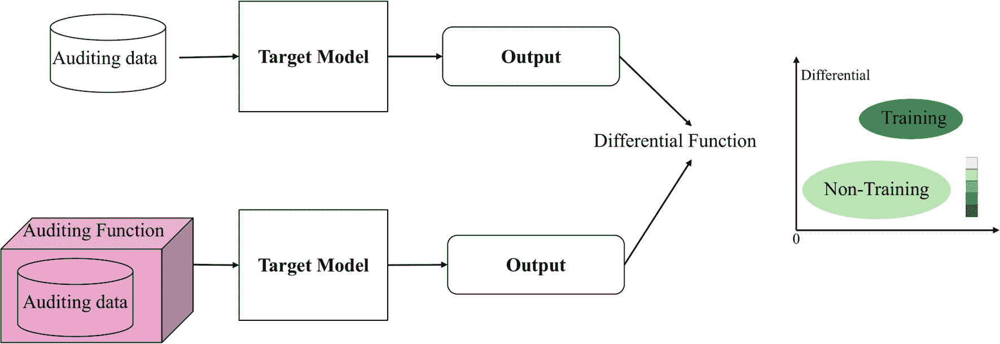

图. 1 DPDA 框架。

该图展示了两个主要流程。第一个流程从一个标记为“审计数据”的圆柱开始，指向一个标记为“目标模型”的矩形，然后指向另一个标记为“输出”的矩形。第二个流程从一个标记为“审计函数”的立方体开始，其中包含标记为“审计数据”的圆柱，指向一个标记为“目标模型”的矩形，然后指向另一个标记为“输出”的矩形。两个输出都连接到“差异函数”标签。右侧有一个轴标记为“差异”和 `0` 的图。图中包含两个标记为“训练”和“非训练”的椭圆，旁边有一个梯度尺度。

基于该框架,[47] 中的作者提出了两种实现方案：加法实现（DPDA-ADD）和乘法实现（DPDA-MUL）。`DPDA-ADD` 对输入数据应用加法传递函数以产生统计学上的显著差异，即模型在训练数据上的输出变化比非训练数据更显著。`DPDA-MUL` 对输入数据使用乘法传递函数以产生统计学上的显著差异。

## 关键应用场景的进展

本节是《管理元宇宙数据浪啸：操作性见解》的摘要和扩展，该文章由 Bingxue Zhang 合作。

### 6.1 元宇宙

传统上，物理空间和虚拟空间是相互分离且独立的。每个空间中的用户在各自的空间范围内操作，他们可以相互通信，但不会跨越边界。然而，硬件（GPUs、FPGAs、NVM）、物联网（IoT）、5G [49]、人工智能、区块链、智能接口以及新型增强现实的技术进步，使得这两个空间能够在统一的空间内共存，即元宇宙。

在最近的一份投资报告 [50] 中，预计“到 2030 年，元宇宙将代表一个巨大的 $13 \times 10^{12}$  机会，可能拥有 50 亿用户。”Meta 和微软等公司已经在元宇宙中投入了大量资源。

在元宇宙中，我们可以设计创新的应用，提供物理空间或虚拟空间无法提供的体验和机会。一些示例应用包括基于位置的游戏和社交网络、在线与实体购物者之间的购物伙伴关系，以及捕捉物理运动的增强数字模型。

在这种背景下，很容易看出，必须有大量数据和信息在元宇宙内部以及现实与虚拟空间之间流动，以确保两个世界的同步。这带来了新的挑战，例如需要处理异构数据流以在虚拟世界中实现现实事件，并将虚拟空间中有趣事件的信息传播给物理世界的用户。此外，还需要新技术来使用户能够在现实和数字空间之间无缝管理信息。这些包括 AI、智能接口、区块链、高效的存储管理和大规模数据传播。

在本章中，我们展示了两个具有前景的富数据元宇宙应用。然后，我们分析了人工智能和区块链如何赋能元宇宙应用，并从数据的角度提出了应用这两种技术面临的若干挑战。

#### 6.1.1 市场

在当今的市场中，我们要么在商场购物，要么在线购买产品。实体商店可能有一个网页（虚拟模型的一种非常原始的形式），但两个空间之间的实时交互非常有限。


在明天的元宇宙商店中，物理空间可能会被“扩展”以展示更多物品。同样，在未来的元宇宙市场中，一个物理商场将“扩展”为一个（虚拟的）商场，其容纳的商店数量比实体商场多得多。除了实体商店的虚拟对应关系外，虚拟商场还可以为虚拟店主租出虚拟空间。在物理商场内，可以在每家实体店中设置屏幕（大屏幕显示器），让网络购物者能够与同一家店内的实体购物者进行交流（例如，通过简单的文本信息和/或更复杂的沉浸式技术）。实体购物者受限于位于物理商场内的实体商店，而在线购物者则拥有更广泛的商店（及产品）选择。虚拟商场需要保持来自物理商场的实时信息更新，例如物理商场内正在进行的直播节目、进行中的抽奖活动以及产品供应情况的更新。同样的理念也可用于“扩展”博物馆的展览空间，甚至“扩展”体育馆的座位容量，以容纳全球观众：体育爱好者可以通过球员的“眼睛”观看比赛，演唱会观众可以获得近距离的沉浸式体验。

AI 赋能的元宇宙将成为传统生产和消费现象的规则改变者。在如今的市场中，制造商需要提前设计和生产产品，这通常会导致过度生产和产品无法售出。在未来的市场中，如图 2 所示所示，卖家可以使用 AI 技术产生大量的虚拟产品。在元宇宙中，客户可以通过他们的虚拟化身（avatars）试穿虚拟衣服 [51]，或通过 AR [52] 将虚拟家具投影到真实的家中。然后，客户可以进行预订。根据预订单的数量，卖家通知制造商进行生产，然后将产品交付给客户 [53]。此外，AI 技术将赋能元宇宙市场的各个方面，例如产品包装设计 [54]、店铺视觉效果设计、促销文案撰写、通过 AI 模型进行产品展示 [55]、通过 AI 数字人介绍产品 [56] 以及 AI 客服 [57]。

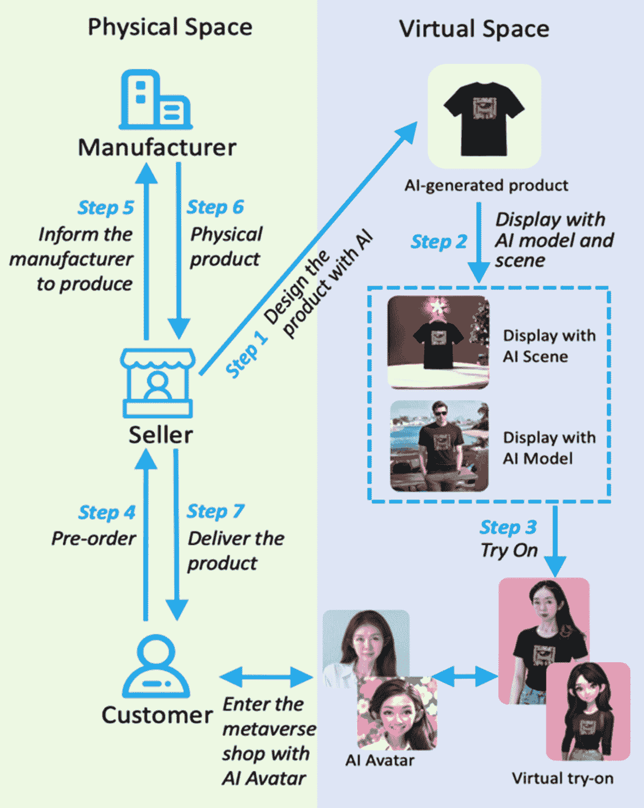

图 2 重塑生产和消费模式。

该过程分为两个空间：物理空间和虚拟空间。在虚拟空间中，步骤 1 是使用 AI 设计产品，生成 AI 生成的产品。步骤 2 涉及使用 AI 模型和场景展示产品，包括使用 `AI Scene` 展示和使用 `AI Model` 展示。步骤 3 是试穿阶段，客户可以使用 `AI Avatar` 进行虚拟穿。在物理空间中，流程继续到步骤 4，客户从卖家处预订产品。步骤 5 涉及卖家通知制造商生产实体产品。步骤 6 是制造商生产实体产品。最后，步骤 7 是将产品交付给客户。客户可以使用 `AI Avatar` 进入元宇宙商店。

### 6.1.2 游戏与社交网络

元宇宙环境中的一类游戏是基于位置的游戏（LBG）。LBG 正在变得流行，并被认为是视频游戏的未来，其中玩家的日常体验（例如，在城市中移动）与游戏的非凡体验体验交织在一起。这些游戏提供的体验会根据玩家的位置和动作而改变。在 LBG 中，配备带有 GPS 功能的移动设备（例如手机）的用户可以玩一种游戏，这种游戏将玩家的现实世界（即其物理位置）与手机上的虚拟世界结合起来。物理位置成为游戏棋盘的一部分，玩家的移动直接影响游戏进度（并可能影响游戏角色和/或环境）。`Pokemon GO` [58] 和 `Zombies, Run!` [59] 都是 LBG 的例子。

另一种形式的元宇宙游戏将物理环境与相应的虚拟模型相结合。在这里，使用 RFID 和传感器来捕捉玩家当前的上下文信息，并将其传输到服务器。服务器（可能由另一名玩家控制）遵循游戏规则，并向物理玩家回传有助于他们继续游戏的信息（例如，附近敌人的位置）。这类游戏的示例包括 `Tourality` [60] 和 `Wanderer` [61]。社交网络也可以在元宇宙中进行。物理空间某位置的人可以检测到朋友，并在虚拟空间中战斗敌人。同样，当“战友”在虚拟空间战斗时，可以检测到彼此。用户可以形成小组分享信息并交易用户创作的内容和虚拟物品，包括非同质化令牌（NFT）。他们可以利用元宇宙进行个人对个人或企业对消费者的实体产品销售。

剧情游戏（Story-gameplay）是一种结合游戏与社交网络的新兴游戏形式。基于故事设定，玩家扮演故事中的角色并实现他们的目标。这种游戏形式允许用户以高度沉浸的方式体验故事。例如，在电影《头号玩家》[62] 中，玩家进入“绿光厅”与 3D 场景互动，揭开真相并完成任务。最近，一些平台开始构建剧情游戏图 3 [63]，玩家从 `Story Hall` 选择一个故事，进入故事元宇宙，进行角色扮演，与其他或 AI NPC（非玩家角色）互动，并可能获得可交易的 NFT 资产。

剧情游戏还可以增强其他行业的娱乐体验，例如电影和旅游。在电影行业中，观众可能从观看有固定结局的电影转向参与具有开放结局的电影。观众可以通过扮演电影中的角色来决定情节走向。在旅游业中，游戏内容可能由历史上发生的真实事件组成，这使游客能够以更有趣的方式更好地了解文化和历史。

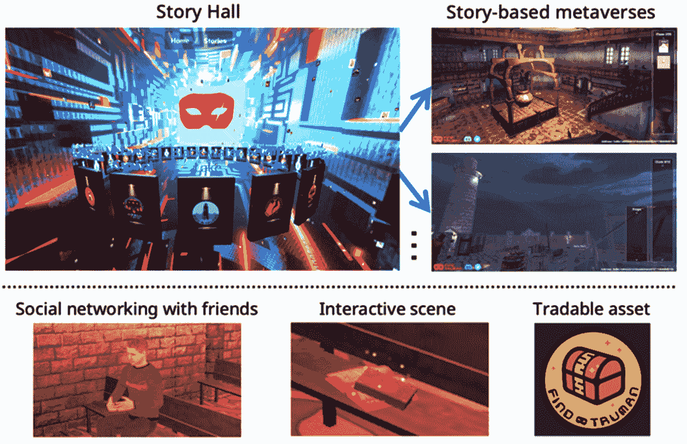

该信息图展示了以下流程：在顶部有一个标记为 `Story Hall` 的部分，显示带有各种故事选项的虚拟环境。箭头从 `Story Hall` 指向剧情元宇宙部分，描述了不同的虚拟环境。下方有三个部分：与朋友社交显示了一个坐在长椅上的人，互动场景显示了一个交互式物体，以及可交易资产显示了一个带有 `Find Trauman` 字样的标志。

见证电子商务、游戏和社交网络价值数十亿的与基础设施和技术格局同步发展，将是非常有趣的。


在本章的后续部分中，我们将关注驱动元宇宙构建的 AI 和区块链技术。具体而言，重点关注：(1) 促进元宇宙中各种内容生成和个性化交互的 AI 技术；(2) 为元宇宙提供经济基础的区块链技术。我们将讨论 AI 和区块链如何有效支持元宇宙的构建，并进一步介绍在元宇宙应用这些技术时产生的数据挑战。

## 6.2 元宇宙的 AI

AI 技术是元宇宙的驱动力。它能够满足高度个性化服务的需求，提供无限的内容资源，并在海用户与内容之间建立有效且强大的连接。

元宇宙需要大量的数字内容。然而，仅靠人工工作无法满足如此巨大且多样的内容需求。多模态 AIGC 技术为解决这个问题开启了大门 [64]。多模态 AIGC 可以根据预训练模型生成跨模内容，如文本、图像、音乐、视频和 3D 模型 [65]。例如，`stable diffusion` [66] 能够基于潜在扩散模型（`LDM`）从文本生成照片级图像；`make-a-video` [67] 能够通过输入文本、图像或视频生成视频；`MusicLM` [68] 和 `MusicGen` [69] 可以将文本转换为音乐；而 `DreamFusion` [70] 和 `Magic3D` [71] 可以从文本生成 3D 模型。通过将这些内容元素组合在一起，就可以获得小说、电影、游戏等更复杂的内容形式。以游戏设计为例，如 Fig. 4 所示，AIGC 技术可以应用于工作流程的每个阶段，例如情节生成 [72]、角色和道具设计、配音和音效 [73]、角色动作特效、角色和游戏场景的 3D 建模 [74] 以及代码编程。多模态 AIGC 技术将极大地提高创作的 s 和质量，并为元宇宙带来无限的内容。它是促进元宇宙发展的关键因素之一。

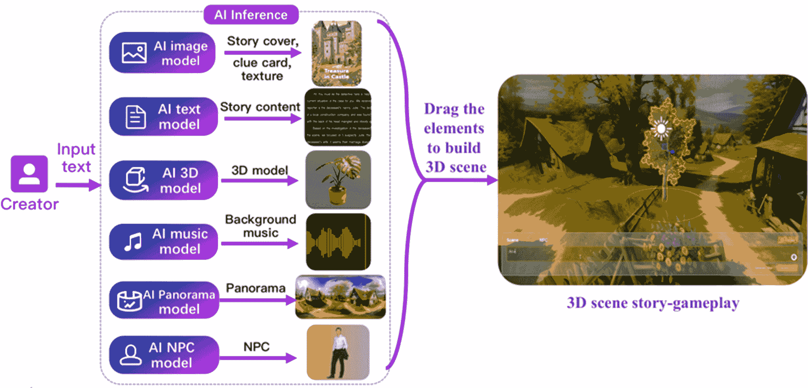

Fig. 4 AIGC 在游戏设计中的应用。

该过程始于创作者输入文本。这些文本由 AI 推理模型处理，包括：用于故事封面、线索卡、纹的 AI 图像模型；用于故事内容的 AI 文本模型；用于 3D 模型的 AI 3D 模型；用于背景音乐的 AI 音乐模型；用于全景的 AI 全景模型；用于 NPC 的 AI NPC 模型。这些模型生成的元素随后被拖入构建 3D 场景，形成 3D 场景游戏。

为了支持元宇宙大量的用户和海量的内容，建立有效的用户之间或用户与内容的连接对于元宇宙的长期发展至关重要。图神经网络（GNN）正好解决了这个问题。GNN 是能够处理图结构数据的深度学习模型 [75]。它擅长执行各种与图网络相关的任务，如链路预测、节点分类和图生成，通过有效捕捉图中节点和边的特征及拓扑结构来实现。例如，通过构建异构 GNN，我们可以挖掘各种实体类型之间的潜在关系；通过构建动态 GNN，我们可以处理实体之间随时间变化的关系 [76]。在元宇宙中，在 GNN 技术的支持下，用户的社交行为和模式可以被动态分析。用户与内容之间的潜在连接可以被深度挖掘。这有助于实现更准确的朋友和内容推荐 [77]。因此，用户可以在元宇宙中探索并建立更紧密的连接，这将促进元宇宙社交网络的长期发展。

从数据的角度来看，在元宇宙应用 AI 技术仍然面临许多挑战。目前的 LLM 暴露了严重的数据泄露问题。以 `ChatGPT` 为例，OpenAI 在 2023 年 3 月发布的一报告 [78] 显示 `ChatGPT` 因为 `Redis` 开源库的 Bug 导致数据泄露。这一事件导致某些用户能够访问其他用户的个人信息和聊天内容。根据数据安全公司 `Cyberhaven` [79] 的调查，大量的敏感信息（如公司机密文件或内部客户数据）通过用户的查询和交互提供给了 LLM。这些敏感数据被发送到服务器后端，并在未经过任何脱敏处理的情况下进一步添加到模型训练数据库中。这些数据始终面临泄露的风险。元宇宙是一个满足用户生活、工作和各种活动的综合场所。它涉及大量的隐私数据，如用户的生物识别信息、数字资产和业务行为。在 AI 训练和推理过程中有效保护数据隐私和安全是一个紧迫的问题 [80]。此外，还存在许多需要进一步解决的挑战，例如如何解决数据收集过程中的数据一致性问题、如何提高在海量动态数据上的训练效率，以及如何处理 AI 生成结果的可信度和偏差问题。

## 6.3 元宇宙的区块链

区块链的这些特性，如去中心化、数据不可篡改性、信息透明性和网络开放自主性 [81]，使其成为构建下一代价值互联网的技术基石。区块链是元宇宙不可或缺的技术。它为元宇宙提供了去中心化身份认证 [29]、数字资产验证与流通 [82] 以及去中心化自治组织 [33]，为元宇宙提供了强大且可靠的经济基础。

去中心化身份（DID）是一种基于区块链的数字身份系统 [29]。DID 将成为元宇宙中身份管理的主要解决方案。传统的身份系统由中心化机构主。它们存储用户的身份数据并负责数据的验证和授权。结果是用户完全失去了对自己身份的控制 [83]，且用户信息面临被篡改或窃取的风险。此外，不同机构注册的身份之间是不兼容的。在 `DID` 解决方案中，用户的个人信息和不同机构发布的凭据信息以加密数据的形式存储在区块链或用户钱包中 [84]。身份验证不再依赖于凭据发布者。相反，用户可以通过个人数字签名选择性向不同机构披露部分身份信息。此外，结合零知识证明（ZKP）技术，用户可以在不提供任何身份信息的情况下证明自己的权限 [35]。


元宇宙的愿景是构建一个与现实世界紧密连接，并能够满足人们工作、生活和经济活动所有需求的数字世界 [85]。现实世界的资源可以转换为数字资产并在元宇宙中流通。同样，元宇宙中的数字资源也可以在现实世界中找到对应的对象或权利 [86]。然而，通过传统的 Web2 解决方案，数字内容容易被复制、篡改或盗取，无法保护数字内容的所有权稀缺性。区块链技术为数字内容的认证提供了可靠的方法，并支持元宇宙中高效的经济运行。区块链技术使数字内容成为易于流通的数字资产 [87]。区块链上的非同质化代币（NFT）用于证明数字资产的真实性并记录其所有权。NFT 具有不可分割、不可篡改和不可复制等特性 [88]。NFT 可用于各种数字资产的所有权，例如数字艺术品、视频游戏、音乐和数字土地 [88]。在元宇宙中，用户不仅可以使用代币交易 NFT 的所有权 [89]，还可以基于 NFT 开展多种创新金融活动，如质押和保险 [90]。通过区块链，上述金融行为可以很容易地注册、验证和追踪，从而赋能高效的经济运行。

去中心化自治组织（DAO） [33] 是一种适用于元宇宙的组织模型。与传统的层级组织不同，DAO 以一种分布式、透明且最小信任的方式进行集体决策。DAO 的共识机制和执行方法被编码在基于区块链的智能合约中，可以自主运行 [91]。得益于智能合约的预先约束、不可篡改和事件触发等特性，DAO 被赋予了以低信任模式形成组织的能力 [92]。这鼓励了用户愿意深度参与元宇宙中的全球协作。DAO 通过在区块链上发行的代币来激励成员参与和协作。作为一种加密的数字凭证，代币包含多种属性，如流通货币、增值股权和可用的物权 [93]。根据代币的属性和用途，DAO 调整相应的发行量、锁定期和分发方法，使成员能够从其权利中获利。这可以促进 DAO 成员之间的协作，优化 DAO 的资源配置，并改进 DAO 的治理模型 [94]。

## 数据挑战

从数据的角度来看，将区块链技术应用于元宇宙仍面临许多挑战，例如：

1. (1) 在早期阶段，区块链网络中的每个节点都需要备份所有数据。区块链利用数据冗余来确保数据的不可篡改性。然而，在元宇宙场景下，数据量将随着应用的快速扩展而剧增。高度冗余的海量数据将给区块链节点带来巨大的内存负担 [95]。当数据量超过大多数节点的存储容量时，恶意行为的难度大大降低。在这种情况下，区块链的不可篡改性和可靠性无法保证，这将带来致命的安全问题。目前，许多研究已经提出了新的链上存储解决方案 [96]，以及链外协同存储解决方案 [97]。然而，在减轻节点内存负担、加强数据完整性和提高数据可靠性方面仍存在许多挑战。
2. (2) 在当前行业中，存在针对不同应用领域和性能要求的各种区块链网络。由于不同区块链的共识模型和哈希算法可能不同，不同的区块链网络之间难以交换信息 [98]。信息孤岛是元宇宙发展的障碍。跨区块链的数据互操作性（即在不同区块链之间安全地共享、利用数据并交换各种数字资产的能力）是元宇宙面临的一项重大挑战。

## 7 结论

AI 与 Web3 的结合标志着迈向未来可持续数字经济的关键一步。我们探索了 AI 如何利用其增强自动化和智能的能力，以及 Web3 如何利用其去中心化特性相互互补以克服局限。

## 参考文献

* [1] Chen C., Zhang Y., Liao T., Huang J. Digital economy meets web3. *Open J. Comput. Soc.* 2022;56:233–245.
* [2] World Economic Forum, Digital trust: how to unleash the trillion-dollar. [`www.weforum.org/2022/08/digital-trust-to-unleash-the-trillion-dollar`](https://www.weforum.org/2022/08/digital-trust-to-unleash-the-trillion-dollar).
* [3] Nguyen T. A framework for five big data. In: *2018 IEEE International Conference on Big Data.* IEEE:5411–5413.
* [4] Vitasek K. Netflix: Big Data and Playing a Long Game Is Proving a Winning. [`www.forbes.com/sites/enriquans/01/15/netflix-big-data-and-playing-a-long-game-is-proving-a-winning-strategy/?sh=14e28ce766e3`](https://www.forbes.com/sites/enriquans/2020/01/15/netflix-big-data-and-playing-a-long-game-is-proving-a-winning-strategy/?sh=14e28ce766e3).


- [9] Github Inc. *GitHub Copilot X: AI 驱动的开发者体验.* [https://github.blog/2023-03-22-github-copilot-x-the-ai-powered-developer-experience/]
- [10] OpenAI Inc. *Sora：从文本创建视频.* [https://openai.com/sora]
- [11] Google Inc. *PaLM2.* [https://ai.google/discover/palm2/]
- [12] IBM Inc. *Watsonx.* [https://www.ibm.com/watsonx]
- [13] Riley J. AI 驱动数字经济。*Ubiquity.* 2023;2023(12 月):1–10.
- [14] Spotify Technology S.A. *Spotify 如何利用 AI 创建超个性化的客户体验以及分销商可以从中学习到什么.* [https://distributionstrategy.com/how-spotify-uses-ai-to-create-an-ultra-personalized-customer-experience-and-what-distributors-can-learn-from-it/]
- [15] Microsoft Inc. *NewBing.* [https://www.bing.com/]
- [16] AI Expert Network. *案例研究：Zara 对 AI 和供应链管理的全面方法.* [https://aiexpert.network/case-study-zaras-comprehensive-approach-to-ai-and-supply-chain-management/]
- [17] Safalta Education Pvt Ltd. *Visa 的欺诈检测变得更加强大.* [https://www.safalta.com/online-digital-marketing/projects-case-studies/ai-case-study-fraud-detection-gets-stronger-at-visa]
- [18] Marcolla C., Sucasas V., Manzano M., Bassoli R., Fitzek F.H., Aaraj N. *全同态加密理论与应用综述。Proc. IEEE.* 2022;110(10):1572–1609.
- [19] Glake D., Kiehn F., Schmidt M., Panse F. *迈多语言数据存储——概述与开放研究.* arXiv 预印本:2204.05779 2022.
- [20] Eybers S., Setsabi N. *数字经济中的负责任数据共享：银行保险中的大数据治理。In: Inventive Computation and Information Technologies: Proceedings of ICIT.* Springer; 2021:379–394.
- [21] Apache Software Foundation. *Apache Kafka.* [https://kafka.apache.org/]
- [22] Apache Software Foundation. *Apache Flink.* [https://flink.apache.org/]
- [23] IBM Inc. *AI Fairness 性 360.* [https://aif360.res.ibm.com/]
- [24] Dwivedi R., Dave D., Naikhal S., Omer R., Patel B., Wen Z., Shah T., Morgan G., 等人. *可解释人工智能 (xai)：核心思想、技术和解决方案。ACM Comput. Surv.* 2023;55(9):1–33.
- [25] Muñoz A., Rios R., Román R., López J. *可信执行环境的（不）安全性综述。Comput. Secur.* 2023;129:103180.
- [26] Chen Zhang Y., Xie H.B., Bin Y., Li W., Gao Y. *联邦学习综述。Knowl.-Based Syst.* 2021;216:106775.
- [27] Zhao Y., Chen J. *非结构化数据内容的差分隐私综述。ACM Comput. Surv.* 2022;54(10s):1–28.
- [28] Ray P.P. *Web3：背景、技术、应用、零信任架构、挑战和未来方向的综述。Internet Things Cyber-Phys. Syst.* 2023;3:213–248.
- [29] Yinzi T., Gan J., Yi H., Jin R., Yang Z., Liu M. *去中心化身份认证与密钥管理方案。In: 2019 IEEE 第 3 能源互联网与能源系统集成国际会议 (EI2).* IEEE; 2019:2697–2702.
- [30] Dos Santos S., Singh J., Thulasiram R., Kamali S., Loud L. *区块链驱动的去中心化金融 (defi) 新时代——综述。In: 2022 IEEE 第 46 届计算机、软件与应用会议 (COMPSAC).* IEEE; 2022:1286–1292.
- [31] Hammi B., Zeadally S., Perez A. *非同化代币：综述。Internet Things Mag.* 2023;6(1):46–50.
- [32] Singh H. *Dapps：用于区块链的去中心化应用。In: Distributed Computing to Blockchain.* Elsevier; 2023:87–104.
- [33] Santana C., Albared L. *区块链与去中心化自治组织 (daos) 的出现：整合模型与研究议程。Technol. Forecast. Soc.* 2022;182:121806.
- [34] Gangwal A., Gangavalli H., Thirupathi A. *二层协议综述。J. Netw. Comput. Appl.* 2023;209:10359.
- [35] Xiaoqiang Sun F., Richard Y., Zhang P., Sun Z., Peng X. *区块链中的零知识证明综述。IEEE Netw.* 2021;35(4):198–205.
- [36] OpenAI. *GPT-4 技术报告.* CoRR, abs/2303.08774 2023.
- [37] Ramesh A., Pavlov M., Goh G., Gray S., Radford A., Chen M., Sutskever I. *零样本文本生成。In: ICML.* 2021.
- [38] Pei J., Zhu F., Cong Z., Luo X., Liu H., Xin M. *AI 时代的数据定价与数据资产治理。In: KDD.* ACM; 2021:4058–4059.
- [39] Chandrasekaran V., Jia H., Thudi A., Travers A., Yaghini M., Papernot N. *Sok：机器学习治理。CoRR, abs/2109.10870 2021.
- [40] Shokri R., Stronati M., Song C., Shmatikov V. *针对机器学习模型的成员推理攻击。In: S&P.* 2017:3–18.
- [41] Song C., Shmatikov V. *文本生成模型中的数据溯源审计。In: KDD.* 2019:196–206.
- [42] Atiqur Rahman M., Rahman T., Laganière R., Mohammed N. *针对差分隐私深度学习模型的成员推理攻击。Trans. Data Priv.* 2018;11(1):61–79.
- [43] Yang Q. *联邦学习：隐私与激励.* Springer Nature; 2020.
- [44] Song C., Ristenpart T., Shmatikov V. *记忆太多的机器学习模型。In: CCS.* 2017:587–601.


- [45] Nasr M., Shokri R., Houmansadr A. 深度学习的全面隐私分析：针对中心化学习和联邦学习的被动与主动白盒推理攻击。In: *S&P.* 2019:739–753.
- [46] Salem A., Yang Z., Humbert M., Berrang P., Fritz M., Backes M. `Ml-leaks`: 机器学习模型中与数据无关的成员推理攻击与防御。In: *NDSS.* 2019.
- [47] Xin M., Pang M., Zhu F. 通过差异审计实现数据溯源。*IEEE Trans. Knowl. Data Eng.* 2024;36(10):5066–5079.
- [48] Shejwalkar V., Inan H.A., Houmansadr A., Sim R. 针对 NLP 分类模型的成员推理攻击。In: *NeurIPS 2021 Workshop Privacy in Machine Learning.* 2021.
- [49] Loghin D., Cai S., Chen G., Dinh T.T.A., Fan F., Lin Q., Ng J., Ooi B.C., Sun X., Ta Q.-T., Wang W., Xiao X., Yang Y., Zhang M., Zhang Z. 5G 对数据驱动技术和应用的冲击。*IEEE Trans. Knowl. Data Eng.* 2020;32(6):1179–1198.
- [50] 花旗集团。*Citi GPS：全球展望与解决方案 2022 – 元宇宙与货币：解码未来。*[`www.citifirst.com.hk/home/upload/citiresearch/AZRC7.pdf`](https://www.citifirst.com.hk/home/upload/citiresearch/AZRC7.pdf)
- [51] Wang H., Liu X., Jiang M., Zhou C. 服装元宇宙：参数化数字人与动态场景试穿。In: *Proceedings of the 2023 2nd Asia Conference on Algorithms, Computing and Machine Learning.* 2023:60–65.
- [52] Kerdvibulvech C., Ayuttaya T.P.N. 一种用于提升家具购买决策的新元宇宙移动应用。In: *Proceedings of the Future Technologies Conference.* Springer; 2022:924–933.
- [53] 新闻稿，36Kr 开创在开设电商商店中应用 AI 技术并利用 AI 探索多元化变现途径。[`www.prnewswire.com/news-releases/36kr-pioneers-the-application-of-ai-technology-in-opening-an-e-commerce-store-and-leveraging-ai-to-explore-diversified-monetization-avenues-301805420.html`](https://www.prnewswire.com/news-releases/36kr-pioneers-the-application-of-ai-technology-in-opening-an-e-commerce-store-and-leveraging-ai-to-explore-diversified-monetization-avenues-301805420.html)
- [54] Yue H. 人工智能驱动的个性化产品包装设计系统。In: *2023 International Conference on Distributed Computing and Electrical Circuits and Electronics (ICDCECE).* 2023:1–5.
- [55] AIVERSE 团队。用 AI 模型和场景展示产品。[`aiverse.cc//features/ai-product`](https://aiverse.cc//features/ai-product)
- [56] Guo G. 人工智能技术在直播电商领域的应用。In: *International Conference on Multi-modal Information Analytics.* Springer; 2022:290–296.
- [57] Liu-Thompkins Y., Okazaki S., Li H. 营销互动中的人工情感：弥合情感客户体验中的人机鸿沟。*J. Acad. Mark. Sci.* 2022;50(6):1198–1218.
- [58] Niantic Inc. *精灵宝 GO。*[`pokemongolive.com/en/`](https://pokemongolive.com/en/)
- [59] Six to Start. *僵尸逃亡！*[`zombiesrungame.com/`](https://zombiesrungame.com/)
- [60] Tourality GmbH. *Tourality。*[`www.tourality.com/`](https://www.tourality.com/)
- [61] Wanderer Game. *Wanderer。*[`www.wanderervr.com/`](https://www.wanderervr.com/)
- [62] Metz W. 疲惫世界中的善行：史蒂文·斯皮尔格《准备就绪》中的互文性。*Film.* 2018;42(4).
- [63] FindTruman 团队。*楚门故事-游戏玩法。*[`findtruman.io//stories`](https://findtruman.io//stories)
- [64] Wenzheng L. 元宇宙、Web 3.0 和 AIGC 的特征、关系与挑战。In: *2023 IEEE 13th International Conference on Electronics Information Communication (ICEIEC).*
- [65] Xu M., Hongyang D., Niyato D., Kang J., Xiong Z., Han Z., Jamalipour A., In Kim D., Leung V., et al. 释放边缘网络中生成式 AI 的力量：AIGC 综述。（注：此处原文作者名重复，已按原文保留）
- [66] Rombach R., Blattmann A., Lorenz D., Ommer B. 基于潜扩散模型的高分辨率图像合成。In: *Proceedings of the IEEE/CVF Conference on Computer Vision and Pattern Recognition.* 2022:10684.
- [67] Singer U., Polyak A., Hayes T., Yin X., Jan J., Zhang S., Hu Q., Yang H., et al. Make-a-video：无文本数据的视频生成。*arXiv preprint:2209.14792* 2022.
- [68] Agostinelli A., ... MusicLM：从文本生成音乐。*arXiv preprint:2301.11325* 2023.
- [69] Copet J., Kreuk F., Gat I., Remez T., Kant D., Synnaeve G., Adi Y., Défossez A. 简单且可控的音乐生成。*arXiv preprint:2306.05284* 2023.
- [70] Poole B., Jain A., Barron J., Mildenhall B. Dream-fusion：利用 2D 扩散生成 3D。*arXiv preprint:2209.14988* 2022.
- [71] Lin C.-H., Gao J., Tang L., ... Magic3D：高分辨率文本到 3D 内容创建。In: *Proceedings of the IEEE/CVF Conference on Computer Vision and Pattern Recognition.* 2023:300–309.
- [72] Latitude Inc. *AI Dungeon：基于文本的冒险故事游戏。*[`aidungeon.io/`](https://aidungeon.io/)
- [73] Huang R., ... AudioGPT：理解并生成语音、音乐、声音和说话人脸。*arXiv preprint:2304.12995* 2023.
- [74] Li C., ... 生成式 AI 邂逅 3D：AIGC 时代的文本到 3D 综述。*arXiv preprint:2305.06131* 2023.
- [75] Sankar A., ... 大规模社交平台中的好友排名图神经网络。In: *Proceedings of the Web Conference 2021.* 2021:2535–2546.


-   [\[76\]](#Ch014_199-217_B9780443347177000064.xhtml#B-bb0385) Awasthi A.K., Garov A.K., Sharma M., Sinha M. Gnn model based on node classification forecasting in social network. In: *2023 International Conference on Artificial Intelligence and Smart Communication (AISC).* IEEE; 2023:1039–1043.

-   [\[77\]](#Ch014_199-217_B9780443347177000064.xhtml#B-bb0390) Sharma K., Lee Y.-C., Nambi S., Salian A., Shah S., Kim S.-W., Kumar S. *A survey of graph neural networks for social recommender systems.* arXiv preprint arXiv:2212.04481 2022.

-   [\[78\]](#Ch014_199-217_B9780443347177000064.xhtml#B-bb0395) OpenAI Inc. *ChatGPT Outage: Here's What Happened.*[`openai.com/blog/march-20-chatgpt-outage`](https://openai.com/blog/march-20-chatgpt-outage).

-   [\[79\]](#Ch014_199-217_B9780443347177000064.xhtml#B-bb0400) Coles C. *Report of Cyberheaven: Data Employees Paste Into Chat-GPT Is Confidential.*[`www.cyberhaven.com/blog/4-2-of-workers-have-pasted-company-data-into-chatgpt/`](https://www.cyberhaven.com/blog/4-2-of-workers-have-pasted-company-data-into-chatgpt/).

-   [\[80\]](#Ch014_199-217_B9780443347177000064.xhtml#B-bb0405) Guo Y., Tao Y., Jiamin W., Wang Y., Wan S., Zheng J., Fang L., Dai Q. Artificial intelligence for metaverse: a framework. *CAAI Artif. Intell. Res.* 2022;1(1):54–67.

-   [\[81\]](#Ch014_199-217_B9780443347177000064.xhtml#B-bb0410) Rajasekaran A.S., Azees M., Al-Turjman F. A comprehensive survey on blockchain technology. *Sustain. Energy Technol. Assess.* 2022;52:102039.

-   [\[82\]](#Ch014_199-217_B9780443347177000064.xhtml#B-bb0415) Min X., Kong L., Li Q., Liu Y., Zhang B., Zhao Y.-g., Guo B. Blockchain-native mechanism supporting the circulation of complex assets. *Comput. Netw.* 2022;202:10858.

-   [\[83\]](#Ch014_199-217_B978044334717700064.xhtml#B-bb0420) Sedlir J., Smethurst R., Rieger A., Fridgen G. Digital identities and verifiable credentials. *Bus. Inf. Syst. Eng.* 2021;63(5):603–613.

-   [\[84\]](#Ch014_199-217_B9780443347177000064.xhtml#B-bb0425) Suryavanshi A., poorva G., Mohan Babu T., Rishika M., Haq A. The integration of blockchain and AI for web 3.0: a security perspective. In: *2023 4th International Conference on Innovative Trends in Information Technology (ICITI).* IEEE; 2023:1–8.

-   [\[85\]](#Ch014_199-217_B9780443347177000064.xhtml#B-bb0430) Vivek Veeraiah P., Gangavathi S., Talukdar S., Gupta A. Enhancement of metaverse capabilities by iot. In: *2022 2nd International Conference on Advance Computing and Innovative Technologies in Engineering (ICACITE).* IEEE; 2022:1493–1498.

-   [\[86\]](#Ch014_199-217_B9780443347177000064.xhtml#B-bb0435) Yang Q., Zhao Y., Huang H., Xiong Z., Kang J., Zheng Z. using blockchain and ai with metaverse: a survey. *IEEE Open J. Comput. Soc.* 2022;3:122–136.

-   [\[87\]](#Ch014_199-217_B9780443347177000064.xhtml#B-bb0440) Huynh-The T., Gadekallu T., Wang W., Yenduri G., Ranaweera P., Pham Q.-V., da Costa D., Liyanage M. Blockchain for the metaverse: a review. *Futur. Gener. Comput. Syst.* 2023;143:401–419.

-   [\[88\]](#Ch014_199-217_B9780443347177000064.xhtml#B-bb0445) Wilson K., Karg A., Ghaderi H. Prospecting non-fungible tokens in the digital economy: stakeholders and ecosystem, risk and opportunity. *Bus. Horiz.* 2022;65(5):657–670.

-   [\[89\]](#Ch014_199-217_B978044334717700064.xhtml#B-bb0450) White B., Mahanti A., Passi K. Characterizing the opensea nft marketplace. In: *Companion Proceedings of the Web Conference 2022.* 2022:488–496.

-   [\[90\]](#Ch014_199-217_B9780443347177000064.xhtml#B-bb0455) Popescu A.-D. Non-fungible tokens (nft)–innovation the craze. In: *5th International Conference on Innovation in Business, Economics and Marketing Research.* 2021;Vol. 32.

-   [\[91\]](#Ch014_199-217_B9780443347177000064.xhtml#B-bb0460) Liu L., Zhou S., Huang H., Zheng Z. From technology to society: an overview of blockchain-based dao. *IEEE Open J. Comput. Soc.* 2021;2:204–215.

-   [\[92\]](#Ch014_199-217_B9780443347177000064.xhtml#B-bb0465) Guangsheng Y., Wang Q., Bi T., Chen S., Xiwei X. Leveraging architectural approaches in web3 applications-a dao focused. In: *2023 IEEE International Conference on Blockchain and Cryptocurrency (ICBC).* IEEE; 2023:1–6.

-   [\[93\]](#Ch014_199-217_B9780443347177000064.xhtml#B-bb0470) Belk R., Humayun M., Brouard M. Non-fungible tokens in the digital economy: stakeholders and ecosystem, risk and opportunity. 2022;153:198–205.

-   [\[94\]](#Ch014_199-217_B9780443347177000064.xhtml#B-bb0475) Jia W., Lin K., Chen F., Dai H., Li J. Financial crimes in web3-empowered metaverse: taxonomy, countermeasures. *IEEE Open J. Comput. Soc.* 2023;4:37–49.

-   [\[95\]](#Ch014_199-217_B9780443347177000064.xhtml#B-bb0480) Hammoud O., Tarkov I. A novel blockchain-integrated storage-efficient scheme. In: *2022 16th International Conference on Application of Information and Communication Technologies (AICT).* IEEE; 2022:1–6.

-   [\[96\]](#Ch014_199-217_B9780443347177000064.xhtml#B-bb0485) Cui L., Xiao Z., Chen H., Zheng Z. Protecting vaccine safety: an improved. *IEEE Trans. Cybern.* 2022;53:3588–3598.

-   [\[97\]](#Ch014_199-217_B9780443347177000064.xhtml#B-bb0490) Miyachi K., Mackey T. hocbs: privacy-preserving blockchain framework for healthcare data leveraging on-chain and off-chain system design. *Inf. Process. Manag.* 2021;58(3):10235.

-   [\[98\]](#Ch014_199-217_B9780443347177000064.xhtml#B-bb0495) Wibowo S., Sandikapura T. Improving data security, interoperability, and veracity using blockchain for one data governance, case study of local tax big data. In: *2019 International Conference on ICT for Smart Society (ICISS).* IEEE; 1–6. 2019;Vol. 7.
[/content]

[content]
# 第 15 章 区块链上的机器学习

1.  Ta Nguyen Binh Duong
2.  Hua Gia Phuc Nguyen
3.新加坡管理大学计算与信息系统学院，新加坡，新加坡

## 摘要

区块链技术已成为一种能够变革各个领域的创新。尽管最初因加密货币而流行，但现在已应用于多个领域。这引起了人们将其与其他热门技术（特别是机器学习，ML）相结合的兴趣。机器学习是一项强大的工具，通过利用许多业务领域不断增长的数据，证明了其在解决实际问题方面的有效性。然而，随着机器学习日益应用于涉及海量数据的复杂现实问题，数据安全和隐私等新挑战也随之而来。通过利用区块链的关键特性，机器学习可以受益于安全、去中心化的系统，促进更好的数据和模型共享。在本章中，我们首先对区块链和机器学习进行了概述。随后，探讨了区块链与机器学习技术的整合及其影响，并分析了这种结合如何造福各个行业，例如医疗、交通、教育等。最后，我们讨论了将区块链引入机器学习的主要优势，并指出了未来工作中与之相关的潜在问题和挑战。

## 关键词

区块链

机器学习

加密货币

分布式机器学习

联邦学习

隐私保护型机器学习

物联网

医疗

教育

交通

金融

## 1 引言


区块链 [1] 最初作为加密货币的基础技术出现，但从那以后引起了全球关注，其应用也扩展到各个行业。从本质上说，区块链充当分布式账本系统，能够促进记录交易的过程，而无需依赖中心机构或预设的信任。交易被分组成不可篡改的区块，这些区块通常对同一区块链系统/网络中的所有参与节点可见。这种去信任的范式实现了可靠的点对交易，从而消除了对第三方中介的需求，而这些中介在金融和银行等传统中心化系统中通常是必要的。区块链技术为各个行业和领域开启了全新且充满前景的机遇，包括但不限于金融、医疗、教育和物联网（IoT）[2, 3]。

机器学习（ML）通常被认为是人工智能（AI）的一个分支，包含了多种利用数据和算法来模拟人类学习的技术，以便进行模式识别和增强预测准确性，而无需显式编程。在过去的几十年里，由于数据量的增加和计算能力的提升，机器学习经历了快速增长。它现在能够为广泛的问题提供可行的解决方案。通过训练复杂模型从大型数据集中学习，机器学习可以实现高精度的分类和预测，并在无需人工干预的情况下发现关键见解。通常，机器学习技术分为四类：监督学习、无监督学习、半监督学习和强化学习（RL）。这些算法已用于构建解决传统编程技术难以解决复杂问题的决策系统，例如语音识别、内容生成和自动驾驶汽车 [4]。

技术的最新进步导致了各种计算和监控设备以及用户产生了海量数据。在机器学习中成功利用这些数据将产生更好、更准确的基于 AI 的技术，这些技术潜力极大地造福每一个行业和生活的方面。然而，数据量的不断增加也引发了对数据安全和隐私的担忧，特别是在全球许多大型公司都发生过多次数据泄露事件之后。因此，许多国家和地区制定了法规和框架来增强数据安全和隐私，例如欧盟于 2018 年实施的《通用数据保护条例》[5]。这使得数据共享变得日益困难。为了应对这些挑战，联邦学习（FL）被提出来。从本质上说，联邦学习允许通过同一系统中所有参与者的组合数据集来训练机器学习模型。然而，在这种情况下，双方并不了解对方的私有数据。每个实体都需要使用自己的私有数据训练自己的机器学习模型，然后交换本地训练期间获得的机器学习模型参数和梯度，以防止数据泄露。随后，通过聚合许多本地产生的模型，开发出一个全局的、可能更好的机器学习模型 [6]。

然而，这种方法存在局限性。首先，联邦学习通常需要一个中央服务器来汇总和广播本地计算设备产生的模型参数和梯度，这使其容易受到单点故障的影响，并对信任第三方产生依赖。其次，尽管每个设备的数据量和贡献可能不同，但联邦学习可能无法为本地计算设备提供充分的激励或对它们一视仁。拥有更大数据集和更高计算能力的设备通常对联邦训练的贡献更为显著。因此，如果没有基于贡献的适当激励机制，拥有更有价值资源的设备就不可能与其他共享其结果 [6]。

区块链可能为解决这些问题提供有前景的的关键组件。如前所述，区块链技术消除了对中介的需求，并允许设备以去中心化的方式交换模型更新，同时提供了实施某些机制（例如代币）来激励参与联邦系统。这些奖励以加密货币或代币的形式存在，类似于以太坊网络中的 `ETH` 或 `ERC-20` 代币 [7]。通过这种方式，区块链通过促进更大、更多样的数据集的使用，同时增强数据安全和隐私，从而使机器学习受益，有效地促进了去中心化智能。区块链技术可以促进有关机器学习算法决策的利用的训练数据的透明、不可篡改的交易，允许授权的区块链节点随时审计和审查该过程。这显著提高了机器学习应用的安全性和信誉，增强了大量利益相关者之间去中心化的协作。另一方面，机器学习技术可以帮助提高区块链的可扩展性和安全性，增强智能合约的智能化并优化能源和资源。注意的是，区块链技术的一个显著缺点是挖掘新交易时消耗了大量能量，这主要归功于高能耗的共识机制，例如用于工作证明（PoW）协议的机制。机器学习在使区块链系统更智能、更高效方面起着至关重要的作用 [1]。例如，基于机器学习的方法可以被矿工用于处理重要交易或早期检测欺诈交易。区块链与机器学习的整合是转型许多行业和业务领域的强大方法。在本章中，我们讨论了尝试使用区块链改进机器学习的研究工作；检查了各自的优缺点；并分析了它们对医疗、交通等领域的影响。机器学习如何改进区块链的详细讨论超出了本章的范围，我们将其留给未来的工作。

本章的其余部分如下：第 2 节](#ch015_219-238_B97804433717700155-s0015）总结了区块链技术的核心思想，并为理解和欣赏其在不同领域的应用提供了背景。第 3 节](#ch015_219-238_B97804433717700155-s0030）解释了机器学习模型训练的关键概念。第 4 节](#ch015_219-238_B97804433717700155-s0045）讨论了联邦学习和隐私保护机器学习的常用方法。第 5 节](#ch015_219-238_B97804433717700155-s0050）描述了如何利用区块链在安全和隐私方面改进联邦学习。第 6 节](#ch015_219-238_B97804433717700155-s0055）讨论了在教育、医疗等领域基于区块链的机器学习应用。第 7 节](#ch015_219-238_B97804433717700155-s0085）讨论了关键观点、观察和最佳实践，第 8 节](#ch015_219-238_B97804433717700155-s0090）总结了本章并概述了重要的未来工作。


本节概述了区块链的概念、结构和特性。那么，*区块链究竟是什么？*“区块链”这一术语最早用于描述比特币（Bitcoin）加密货币的底层技术，中本聪（Satoshi Nakamoto）在 2008 年的一篇论文中详细介绍了这一点 \[1\]。截至 2024 年 10 月，中本聪的真实身份仍为人未知。许多人仍然认为加密货币与区块链是同义词。然而，这种误解忽略了一个事实：虽然大多数加密货币是构建在区块链上的，但区块链的应用范围远超加密货币。

在目前的用法中，区块链指的是任何维护一系列不可篡改记录的分布式系统，且无需中心权威或受信任的第三方。它可以被视为一组数字区块的链接链，如图 1 所示。每个区块都包含各种数据（如交易或记录），这些数据由系统节点贡献并在多个分布式位置复制。通过使用共识协议确保区块链节点之间达成一致，新区块会被接受并附加到区块链上。每个区块还包含有关上一个区块的哈希信息，建立了类似链的结构。这种设计确保了对任何一个区块的篡改都会由于哈希值的改变导致所有后续区块失效。这为防御攻击提供了稳健的保障。区块链的主要特征如下 \[4\]：

*   • `去中心化共识`：区块链的一项基本特性，网络中的每个节点以点点方式运行，独立处理交易验证和区块创建等任务，不受中心化控制。节点遵循选定的共识协议，使节点之间对记录在区块链上的内容达成一致。
*   • `透明性`：每个有效交易都记录在分布式账本上，并供所有参与节点访问。
*   • `不可篡改性`：通过采用 `SHA-256` 等单向加密哈希函数，每个区块都与其前一个区块链接，使得存储在区块链上的记录极难还原。未经授权的修改几乎是不可能的，因为这需要控制网络大部分节点。
*   • `可审计性`：区块链交易不可篡改和透明的特性允许任何节点（公有链中）或授权节点（私有链中）对这些交易进行审计、追踪和验证。
*   • `伪匿名性`：在公有网络中，每个参与节点都被赋予一个用于通信的唯一加密地址。网络仅使用这些公共地址，允许参与者保护其身份。
*   • `智能合约`：许多区块链支持创建和执行智能合约，智能合约基本上是存储在区块链中的计算机代码。当满足某些预定义的条件时，智能合约会自动激活并执行。这一特性允许企业在不需要第三方的情况下自主地执行合同。

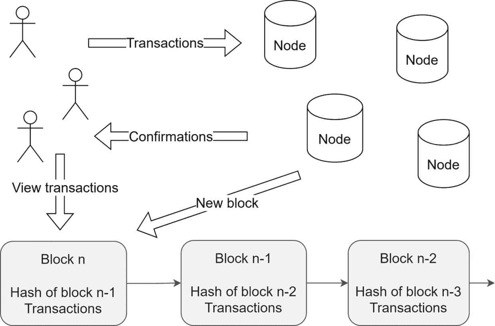

### 2.1 区块链的类型
区块链网络大体分为无许可（permissionless）和许可（permissioned）。为了适应不同的用场景，我们可以有不同的实现方式，如公有、私有、联盟或混合链。

*   **无许可区块链**本质上是允许任何用户加入的开放网络。此类网络被认为是最去中心化、透明且匿名的区块链类型。示例包括作为 `Ethereum` 和 `Bitcoin` 的公有区块链实现。
*   **许可区块链**另一方面，限制了对特定用户组的访问。在此类别中，私有链是由单个实体控制的许可网络，而联盟链也是许可性的，但由具有共同目标的参与者或组织小组治理。典型的实现使用 `Hyperledger Fabric` 或 `Corda`。我们也可以拥有混合区块链实现，利用了无许可和许可区块链的特性。

### 2.2 共识机制
区块链共识机制是使分布式参与者在没有中心权威或协调者的情况下对账本状态达成一致的关键组件。区块链中流行的共识方法包括 `PoW`、`PoS` 和混合方法。

`PoW` 是 `Bitcoin` 中使用的原始共识机制。区块链节点（也称为矿工）相互竞争以解决复杂的数学问题。这些竞赛的获者将有权向现有链中添加（挖矿）新区块。`PoW` 提供了高水平的去中心化和安全性，因为任何节点都可以参与共识机制。缺点主要是由于区块挖矿导致的高能耗和缓慢的交易速度。使用 `PoW` 的较小区块链网络可能更容易受到所谓的 `51% 攻击`，因为攻击者更有可能控制网络大部分节点。

`PoS` \[12\] 指的是一组共识协议，这些协议由于与 `PoW` 相比更节约能源而变得流行。`Ethereum` 是近期 `PoS` 最显著的采用者，它从其之前的 `PoW` 实现成功迁移而来。`PoS` 利用了区块链参与者（称为验证者），他们通过质押加密货币和代币来获得区块创建和交易验证的权利。验证者可以随机选择，也可以根据其质押的大小等。他们将因维护分布式账本的工作获得加密货币奖励。行为恶意的验证者可能会丢失其质押。由于验证者不需要为挖矿解决复杂的数学问题，`PoS` 在处理交易方面要高效得多且速度更快。然而，它不像 `PoW` 网络那样去中心化，因为大持者通常对网络有更多的控制权。


在企业级区块链系统中，通常使用其他形式的共识机制，例如实用拜占庭容错（`pBFT`）[13]。简而言，`BFT` 确保分布式网络在存在故障或恶意节点的情况下，诚实节点能够对网络状态达成一致。`pBFT` 等共识协议提供了极快的交易速度和低能耗，这在企业场景中是非常理想的。然而，此类协议的可扩展性有限，且需要已知的验证过的验证者，因此无法部署在 `Ethereum` 或 `Bitcoin` 等公共区块链网络中。另一类称为权威证明（`PoA`）的共识协议通常用于私有链或联盟链。`PoA` 依赖于由中央机构已知并批准的验证者。`PoA` 协议提供了高性能、良好的可扩展性和能源效率，但它们会导致中心化程度增加且缺乏匿名性（对于验证者而言）。最后，某些区块链可能会结合多种共识方法以利用各自的优势，但代价是增加了实现的复杂性。

区块链的特性为 ML 模型训练提供了可能的增强。区块链系统的去中心化架构可以缓解与中心化 ML 实现相关的若干问题。例如，区块链集成通过在去中心化节点网络中分布数据和计算负载，可能解决单点故障风险。区块链的分布式账本和激励机制可以增强 ML 应用中的数据完整性和隐私性，可能实现更安全的数据和模型共享方式，正如我们在本章稍后部分所看到的。

## 3 机器学习概念

在本节中，我们将简要介绍 `ML` 中的核心概念，`ML` 通常被认为是 `AI` 的一个子领域。具体来说，`ML` 指一组统计算法，这些算法通过数据驱动的过程和经验积累进行学习。这些算法随后可以泛化到未见过的数据上。通过这种方式，`ML` 促进了在没有显式编程指令的情况下，数据驱动解决方案、决策过程和预测模型的开发 [14]。

## 3.1 机器学习分类

`ML` 技术通常分为四大类：`监督学习`、`无监督学习`、`半监督学习`和 `RL`。我们将如下简要检查这些这些类别：

*   `监督学习`：`监督学习` 算法利用带标签的训练数据集来学习输入与输出数据之间的模式和关系。在这种背景下，带标签的训练数据是指一个数据集，其中每个输入样本都分配了相应的输出或正确的标签。正确的输出/标签通常由人工标注者提供。例如，在计算机视觉 [15] 中，带标签的数据可能包括手动标记标记了各种物体正确名称的图像，例如图像中的桥梁、自行车、汽车等。通过这种方式，`ML` 模型将能够创建表示输入与输出之间学习关系的模型。在经过充分训练后，学习到的模型可以识别稍后提供的未见过图像中的相同物体。常见的监督学习算法包括但不限于：`逻辑回归`、`决策树`、`神经网络`（如`多层感知器`）以及`支持向量机`等 [14]。

    在`监督学习`中实现集成方法是常见的 [16]。这些技术通过结合多个基 `ML` 模型来增强单个模型的稳健性和准确性，而这些单个模型的预测能力通常较弱。例如，可以对每个基 `ML` 模型产生的预测取平均值（回归问题中）或投票（分类问题中），以计算集成模型的预测结果 [17]。在`提升方法` [18] 中，例如，`AdaBoost` 和 `梯度提升`，模型是顺序训练的，专注于之前模型的误差。

*   `无监督学习`：与`监督学习`相反，`无监督学习` 算法使用未标记的数据集进行训练。它们关注样本之间的相似性以进行分类或分组。因此，无监督学习技术通常用于聚类和异常检测。流行的无监督学习技术包括 `k-means 聚类` [19]。其他著名的例子包括`自动编码器` [20]，它是一种用于学习高效编码以实现降维的神经网络。从未标记数据中学习复杂模式和有用表示的能力，对于许多数据稀缺或获取昂贵的情况非常有价值，例如自然语言处理和推荐系统。

*   `半监督学习`：`半监督学习` 算法在标记和未标记数据的组合上进行训练。通常，训练数据的大部分由未标记示例组成，少数实例有标记。标记数据为训练提供了`无监督学习`所缺乏的指导。通过利用这种组合数据集，半监督学习可以获得比`无监督学习`更高的准确率，而不需要像`监督学习`那样的时间和成本。常用的半监督学习方法包括`伪标签`、`自训练`和`协同训练` [21]。

*   `RL`：`RL` 算法基于奖励和惩罚机制训练模型。这些算法学习如何在动态环境中采取行动以最大化长期奖励并最小化惩罚。与`监督`或`半监督学习`技术不同，`RL` 模型评估其未来的未来，以获得最高的累计奖励。`RL` 不直接处理次优动作，而在探索（测试新动作）和利用（利用现有知识）之间寻求平衡 [22]。

    在 `RL` 中，环境通常建模为`马尔可夫决策过程` [23]，包含状态集、可能的动作、状态转移概率、奖励函数和折扣因子。智能体通过执行`状态-动作对`形式的形式来探索环境。代表性的 `RL` 方法包括`Q-learning`、`多臂老虎`和`策略梯度方法`，它们广泛应用于机器人、游戏和数据中心资源管理等应用和行业 [24–26]。

## 3.2 训练机器学习模型

训练 `ML` 模型的过程可能是复杂且耗时的，但它可以被分为几个主要步骤 [14]，如图图 2 所示：


- **数据准备**：在收集数据后，在将其输入机器学习模型进行训练之前，需要进行适当的准备/预处理。这一过程包括：随机化以确保数据分布合理、删除不需要和重复的条目、处理缺失值、删除不必要的数据列，以及通过数据可视化以更好地理解各种变量之间的关系。此外，如果存在类别不平衡，可能需要应用数据生成和增强技术 [27, 28]。此过程的最后一步是将数据集分为训练集和测试集。
- **模型训练**：这是机器学习中至关重要的阶段，因为在这个过程中，模型从数据中学习以识别模式并做出预测。不同的学习算法被用于检测各种模式。例如，监督学习使用标记数据来构建数据与类别之间的关系，而无监督学习方法可以理解未标记的训练数据。不同的问题需要仔细选择合适的机器学习算法。
- **模型评估**：模型训练完成后，需要评估其在未见数据上的表现如何。在这种情况下，未见数据指的是在数据准备步骤创建的测试集。不要在模型训练过的相同数据上测试模型是非常重要的，因为这可能会导致准确率虚高，无法反映训练后模型的真实能力。应根据应用目标使用不同的指标或指标组合对模型进行评估，例如准确率、精确率、召回率或它们的组合。
- **微调**：如果模型性能不令人满意或有改进空间，可以通过调整模型中存在的超参数对模型进行微调。这些参数可以包括批大小（batch size）、学习率、神经网络层数、每层神经元的数量等。在优化这些参数时，我们的目标是找到它们的良好组合，以便显著提高模型的性能。然而，在巨大的可能参数组合空间中搜索是一个耗时且耗资源的过程。目前，超参数优化应该使用某些贝叶斯优化技术的变体 [29, 30] 自动进行。

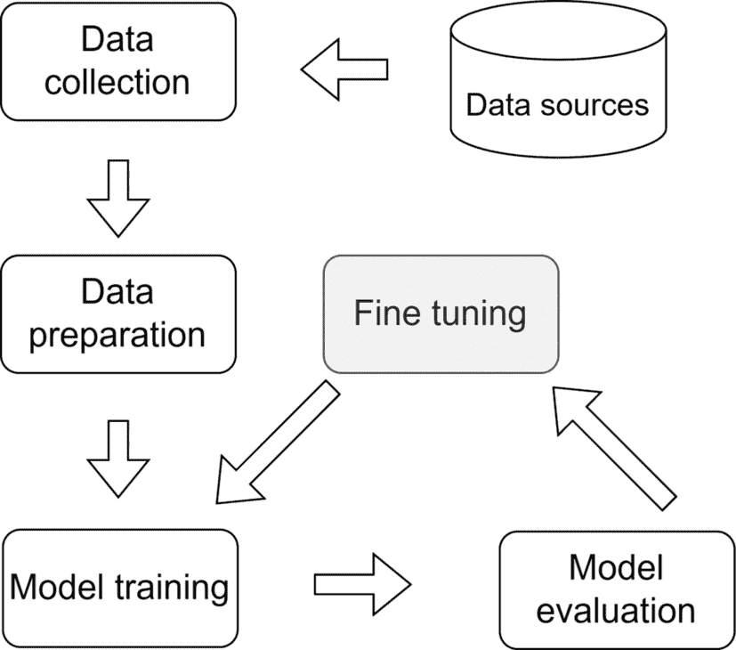

图. 2 机器学习模型训练过程，包括数据收集、准备、训练、评估和微调。

流程图说明了训练机器学习模型的过程。步骤如下：数据收集，它与数据源连接。数据收集引导数据准备。数据准备引导模型训练。模型训练引导模型评估。模型评估连接回微调，而微调也连接到模型训练。

在完成模型训练和微调后，机器学习模型可以部署到现实应用中，用于创建数据驱动的洞察。然而，在部署之前，使用多种数据集进行更多测试至关重要，以确保模型是稳健的，同时不受训练数据中可能存在的某些偏差的影响。进行持续监控和重训练也是重要的，以便模型随时间推移维持或提高其性能，因为可能会发生数据漂移（即输入数据分布的变化）。最后，在将模型整合到现有系统中时，应该考虑推理效率、可扩展性和解释性等实际问题。

## 4 联邦学习与隐私保护机器学习

正如我们所看到的，传统的机器学习依赖于训练数据集，其质量会显著影响模型的性能。训练过程涉及将输入数据通过所选的机器学习算法，并根据获得输出中观察到的误差相应地修改模型参数。显然，更高质量的训练样本（即更大、质量的数据集）会导致性能提升 [31]。

然而，获取全面且多样化的数据集具有挑战性。即使在如今数据产生以以前所未有的速度也是如此。挑战之一是企业通常将客户数据存储在孤岛中 [32]，由于竞争压力、隐私担忧和操作复杂性，这限制了大规模的数据共享。此外，数据隐私问题引起了公众的极大关注，人们日益意识到大公司极有可能损害数据安全和用户隐私。因此，全球范围内的监管框架已经收紧，以保护用户数据的安全和隐私 [33]。

这些最新进展使得从不同源收集、整合和利用数据进行机器学习模型训练变得日益困难。在本节中，我们将讨论各种解决这些挑战并在保护数据隐私的同时实现机器学习训练的联邦学习（FL）技术 [6, 34, 35]。

联邦学习基于使用分布在多个设备上的数据集协作构建机器学习模型，同时防止数据泄露的概念。在联邦学习中，每个设备在自己的数据库上在本地训练模型，计算模型参数和梯度，并将它们发送到中央服务器，而不泄露任何参与者的特定信息。服务器安全地聚合梯度并将结果分发回所有参与者。每个本地模型使用全局信息进行更新，这种迭代过程持续到训练完成。该范式的基本架构如图图. 3。此外，还可以采用隐私保护措施（如加密、差分隐私或秘密共享）来增强训练梯度传输期间的数据隐私。这些技术使参与者能够有效平衡隐私和准确性。联邦学习根据数据分布特征分为三类 [6]

- **水平联邦学习**：这种方法也称为基于样本的联邦学习，适用于具有相同特征但样本不同的数据集。例如，位于不同省份的两家服装商店拥有不同的客户群，重叠很少。然而，由于两家商店都属于服装行业，它们的数据集共享共同特征，如类型和颜色。其他类似场景包括手机键盘预测或跨银行的反洗钱机器学习模型。水平联邦允许允许合并数据集训练模型，模拟在包含两家商店数据的单一大型数据库上进行训练。


### 垂直联邦学习
垂直联邦学习（Vertical FL）也称为基于特征的联邦学习，适用于数据集具有相同样本 ID（即相同的用户）但特征不同的情况。例如，同一家超市内的服装店和糖果店可能拥有重叠的客户群，因为两家商店都会吸引访客进入超市。然而，服装店收集的是衣物单品的数据，而糖果店记录的是关于糖果的信息。因此，它们的特征空间存在显著差异。另一个例子是银行和电子商务平台拥有重叠用户组的数据。垂直联邦学习允许机器学习模型训练整合这些异构特征，从而对用户提供全面的理解。它允许拥有相同用户互补数据的组织在不共享原始数据的情况下协作进行机器学习模型训练，从而维护了数据隐私和安全。

### 联邦迁移学习 (FTL)
当数据样本 ID 和特征都存在显著差异时，FTL 适用。例如，想象服装店和糖果店位于两个不同的省份，导致完全不重叠的用户空间和特征基础。在这种情况下，采用迁移学习技术来开发涵盖样本空间和特征空间的机器学习模型。FTL 通过一组有限的共享样本在两个不同的特征空间之间识别出共同的表示。然后，利用这种统一表示对仅具有部分特征信息的样本进行预测 [6]。这种方法将水平和垂直联邦学习扩展到了更多多样化且更真实的场景。

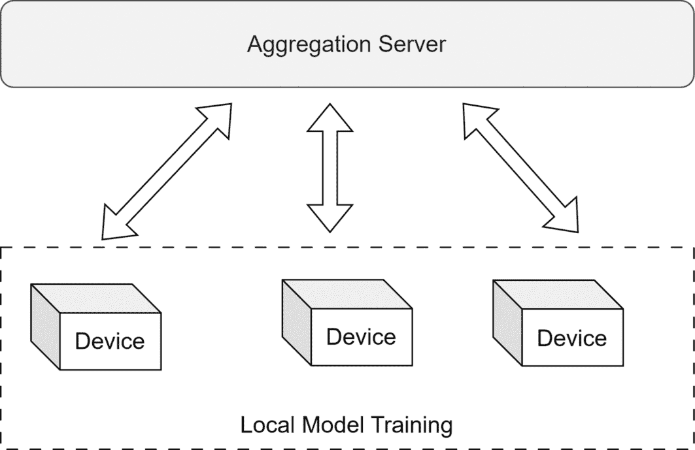

图 3 带有中央聚合服务器的联邦学习。

该图展示了该范式的基本架构。顶部是一个标记为 `Aggregation Server`（聚合服务器）的矩形块。下方在虚线边界内有三个标记为 `Device`（设备）的矩形块。箭头表示聚合服务器与每个设备之间的通信。

这三种联邦学习技术共享一个共同核心思想，但在聚合特征和促进学习的方式上有所不同。关于每种技术特定过程的更多细节，可以参考 Yang 等人的著作 [6]。此外，Issa 等人 [35] 提供了对联邦学习许多方面（如架构、规模、聚合方案和算法等）的全面分类法。

与传统机器学习相比，联邦学习提供了更强的隐私保护；然而，联邦学习过程仍可能受到数据隐私问题和对抗攻击的影响，包括成员推理攻击和模型反转攻击。根据场景的不同，可以将隐私保护技术应用于机器学习训练和推理过程的不同阶段，例如数据预处理、模型训练与评估以及模型部署。在数据预处理阶段，会进行数据收集和清洗等活动。模型训练和评估阶段涉及模型的实际训练及其性能评估。模型部署阶段主要侧重于利用训练好的模型根据新数据样本进行推理。在每个阶段可以采用不同的隐私保护技术。根据具体的应用，也可以将这些技术应用于一个或多个阶段 [36]。

### 隐私保护型数据准备
为了保护敏感信息，可以对原始数据进行加密。可以采用多种方法在数据准备期间实现隐私。首先，可以采用传统的匿名化机制，如 `k`-anonymity [37]、`l`-diversity [38] 和 `t`-closeness [39]，在将训练数据用于训练之前移除其中的身份信息。其次，可以使用替代数据集来表示原始数据集，这涉及对匿名数据进行分组 [40] 或使用草图技术（sketch techniques）[41] 对数据集进行抽象处理。最后，可以使用差分隐私机制在训练过程中添加噪声以保护单个数据点。

### 隐私保护型模型训练
在训练阶段，可以使用传统的匿名化或差分隐私机制处理数据。传统的加密方法如 `AES` 和 `DES` 现在主要用于安全的数据存储和传输，因为它们不支持在加密数据上直接计算。因此，已开发出更先进的加密方案，如同态加密 [42] 和函数加密方案 [43]。

### 隐私保护型模型部署
在这种场景下，将训练好的机器学习模型部署在公共计算服务上，允许用户查询结果。采用隐私保护技术防止对抗用户从原始训练数据中提取隐私信息。一种基本的隐私保护方法涉及限制查询次数或减少披露的信息，因为对抗用户对模型细节的访问有限。另一种更高级的方法是模型转换 [44]，将现有模型转换为不可感知神经网络。这种方法在维护隐私的同时的同时提供了准确且高效的预测。

总结来说，虽然联邦学习和隐私保护机器学习可以提供更强的数据隐私和安全、符合最新的数据法规、利用多样化分布式数据源的能力等，但在实施过程中存在许多需要仔细考虑的权衡。例如，同态加密等方法的计算开销很大。要求强隐私保护可能会降低模型的可用性或准确性。最后，联邦学习方法在数据管理、参与激励以及模型更新聚合的中央服务器方面存在挑战，而区块链可以作为一种有前景的补充解决方案。我们将在下一节中讨论这种解决方案。

## 5 基于区块链的机器学习方法

区块链技术具有几个关键特性，包括去中心化、透明性、不可篡改性、审计性和匿名性。这些特征为各行业的机器学习应用提供了显著优势。例如，随着数据量的不断增长并随时间推移价值增加，通过中心化解决方案共享大量数据面临挑战。基于区块链的系统促进了安全且去中心化的数据和机器学习模型共享，同时确保所有者保留对数据和训练模型的控制权 [45, 46]。区块链系统内置的加密技术和其匿名性质使其成为涉及个人和敏感数据机器学习应用程序的理想选择 [47–49]。


越来越多的研究正探索区块链与联邦学习（FL）的结合，以构建更安全、更去中心化的机器学习系统。这通常被称为基于区块链的联邦学习（BCFL）。BCFL 解决了传统联邦学习系统中的几个常见挑战，例如中心化控制、隐私问题和缺乏透明度。在 BCFL 中，使用参与者网络代替中央服务器进行模型聚合。由于任何参与者涉及数据和模型更新的交易都可以记录在链上，透明度可以得到提高。还可以通过某些形式的代币化激励参与者的加入。

在区块链之上实现联邦学习的通用架构如图图. 4 所示。此类系统在运行过程中通常遵循以下步骤：

* **初始化**：区块链网络启动机器学习训练任务，选择参与者并共享初始的机器学习模型参数。
* **本地模型训练**：参与者使用其本地数据独立训练机器学习模型，并产生要提交到区块链网络的模型更新。在此，每个参与者可以使用隐私保护技术（例如加密）。
* **更新验证**：可以使用区块链共识机制和智能合约，以便对有效更新达成共识。此类更新可以记录为区块中的交易。
* **模型聚合**：这可以通过区块链上的智能合约来实现，将有效的本地模型更新合并为全局模型。

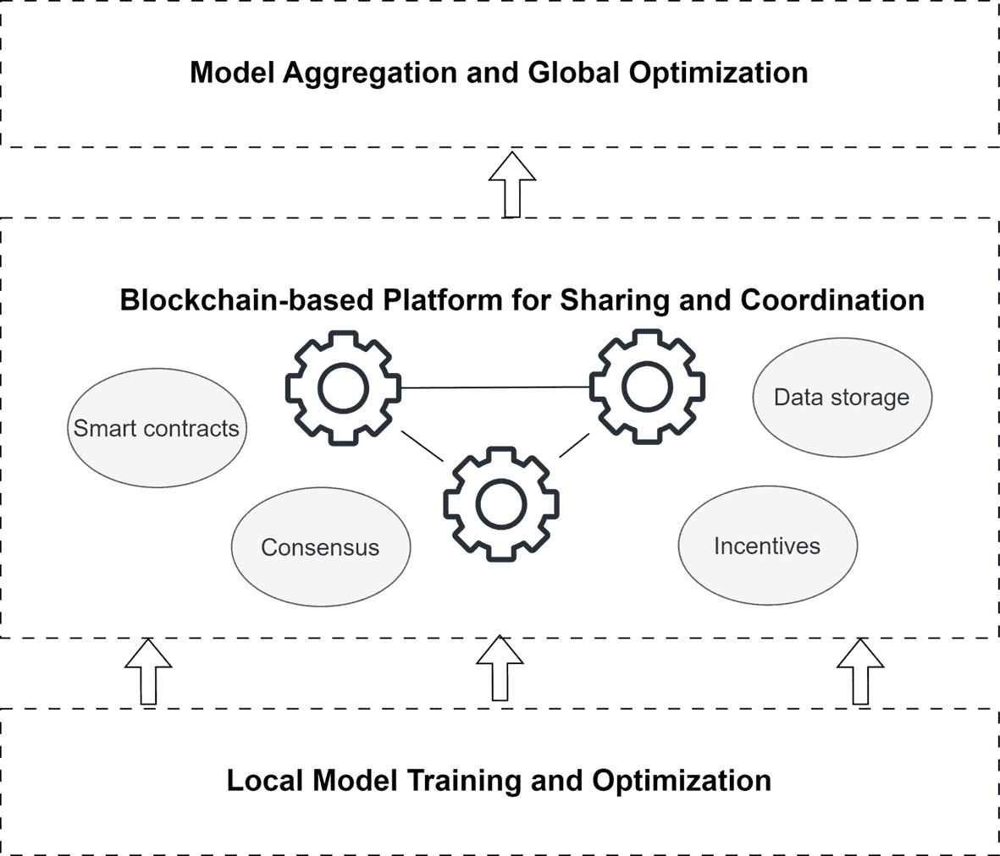

Fig. 4 在区块链区块链系统之上实现机器学习的通用架构。

该图像显示了在区块链之上实现联邦学习的通用架构。该架构分为三个主要部分。顶部部分标记为“模型聚合与全局优化”。中间部分标记为“基于区块链的共享与协调平台”，包含三个互连的齿轮。环绕在齿轮周围的是四个标记组件：智能合约、共识、数据存储和激励。底部部分标记为“本地模型训练与优化”。

更新后的全局机器学习模型将记录在区块链上，并分发给参与者进行更多轮训练，直到收敛或达到定义的迭代次数。参与者可能会根据其本地贡献获得奖励，或因恶意行为受到惩罚。交易的不可篡记录可用于此类目的。

# 6 基于区块链的机器学习应用

在本节中，我们调查了基于区块链的机器学习在各行业的应用，并评估其设计、实现和影响。

### 6.1 物联网

由于硬件和软件的快速进步以及在许多应用领域的广泛益处，物联网（IoT）近年来变得异常流行。随着物联网设备数量的不断增长，每天产生海量数据，导致对更好数据分析的迫切需求。然而，以云为中心进行物联网分析的传统方法有几个缺点，使其不适用于许多物联网应用场景。

首要问题之一是隐私。物联网设备产生的大数据包含敏感信息，例如监控视频和医疗记录。当这些数据发送到基于云的中心化服务器时，存在损害用户隐私和机密性的巨大风险。另一个问题在于物联网客户端对云的信任和依赖，因为物联网应用最重要的过程是在云端运行的。此外，这种中心化方法没有利用先进物联网设备中可用的计算资源和存储空间的机会。中心化服务还受到单点故障问题和管理不断增加的物联网设备的可扩展性挑战的影响 [52]。

因此，最近的趋势已转向去中心化计算，区块链是首选候选方案。图. 5 描绘了利用基于区块链的机器学习物联网物联网通用架构。在这种架构中，联邦学习过程由区块链节点处理，以解决模型聚合中的单点故障问题，并为更多节点参与提供激励机制。


Fig. 5 物联网应用中基于区块链的联邦学习。

顶部显示了由箭头连接的 `Block n ML model version n` 和 `Block n minus 1 ML model version n minus 1` 块。这些块下方是标记为`基于智能合约的规则` 和`奖励惩罚`的椭圆。下方是一个标记为`联邦学习`的矩形。该部分被包含在一个标记为`区块链（分布式账本）`的虚线框内。下方，另一个标记为`本地模型训练`的虚线框包含三个标记为`边缘节点`的立方体。底部部分标记为`数据提供者`，包含三个标记为`物联网设备`的圆柱体。箭头表示从`物联网设备`到`边缘节点` 的数据流，以及从`边缘节点`到区块链的模型更新。

正如最近的一篇综述论文 [35] 所示，基于区块链的机器学习在物联网领域已有许多应用。例如，He 等人 [45] 提出了一种基于区块链、支持边缘计算的物联网场景的通用框架。在该框架中，数据订阅者提交详细请求，请求被分配给由多个低功耗计算资源组成的边缘节点。过程通过智能合约实现，智能合约本质上是存储在区块链上的代码，可以根据某些条件自动触发。这些智能合约的设计是为了使用适当的机器学习算法解决边缘计算资源分配问题。所有交易都记录在区块链上，并根据结果给予或取消奖励激励以防止恶意行为。

与 He 等人 [45] 利用边缘设备资源满足数据服务请求不同，文献 [46] 的作者侧重于使用边缘设备满足机器学习请求。他们提出了一种分层众包联邦学习系统，以构建帮助制造商提高服务质量的机器学习模型。首先，制造商请求开发模型，邀请客户以众包方式参与。为了确保用户数据的隐私和机密性，系统实现了联邦学习算法，能够在个人用户数据上进行本地模型训练。训练获得的梯度在使用差异隐私技术进行屏蔽后上传到区块链进行聚合。在区块链中，选定的矿工验证模型的有效性，用户根据其贡献获得奖励并提升声誉。这种设计有效防止了数据投毒攻击，并为有价值的贡献者提供了补偿机制。

### 6.2 医疗保健


硬件和软件技术的最新进展，特别是 `IoT` 设备，显著增加了医疗行业中电子健康记录（`EHRs`）的产量。这些记录可能包含脉率、血糖水平、脑电图和心电图等关键生物医学指标，并为医疗服务提供低成本、实时的数据。通过利用这些记录，可以早期诊断和识别各种疾病，这对于有效治疗至关重要 [47]。

尽管具有潜在优势，但医疗数据通常涉及的敏感性和隐私问题使得中心化方法（如基于云的医疗数据共享方案）具有高风险且效率低下 [53]。患者往往不愿分享他们的个人数据，这影响了基于个人 `EHRs` 的诊断准确性。为了应对这些挑战，结合区块链和机器学习成为了一种潜在的解决方案。区块链提供了一个去中心化且安全的平台，有助于个人数据隐私和安全方法的实施，使许多不同的医疗机构能够在确保符合合规性的情况下进行有效协作（Fig. 6）。另一方面，机器学习技术的最新进展已证明了从复杂的健康记录中高效处理和提取见解的能力。


Fig. 6 适用于多种医疗机构和实体的区块链辅助联邦学习。

该图表说明了通过区块链网络连接的各种医疗机构。这些机构包括养老院、辅助生活设施、康复中心、公共卫生部门、社区健康中心、急诊中心、门诊诊所、医院、诊断影像中心和血库。在区块链网络内部，有两个组件：联邦机器学习和执行 `HIPAA` 等规则的智能合约。

例如，Chen 等人 [47] 提出了一种基于区块链的医疗系统用于检测糖尿病。该系统允许授权的患者和医生向区块链下载和上传医疗数据，并利用几种不同的 ML 算法进行糖尿病诊断。为了处理海量的医疗数据，信息使用 `InterPlanetary File System`（`IPFS`）进行离线存储，仅在区块链上保留每个文件的哈希值。此外，`IPFS` 中的每个用户数据都经过了加密，确保只有拥有用户或执业人员私钥的方才可以访问。通过这种方式，我们可以确保 `EHRs` 及相关诊断的数据传输安全。在这种情况下，使用区块链允许第三方对数据交易进行审计和验证，从而为用户建立问责制，并遏制恶意生成的医疗数据。另一个应用 [48] 涉及一种区块链框架，使用高精度的正弦余弦加权 `k`-最近邻算法来存储和预测心血管疾病。

区块链可以造于日常电子医疗交易，例如医疗记录的创建、药物处方、医疗警报、患者服务请求、医院通信等。大量的交易需要高效的分类、调度、分析、组织等。在文献 [49] 中，作者提出了一种架构，用于检查和分析患者的日常医疗交易，优化数据速率并预测未来日志。该电子医疗应用利用区块链为医疗行业建立了一个安全且许可的网络。在实现过程中，使用智能合约自动执行日常动态医疗数据传输，并结合 ML 驱动的数据优化和管理。

### 6.3 运输

基于区块链的 ML 方法已在交通领域得到了研究。例如，考虑空中交通流管理（`ATFM`），它是空中交通控制系统中的重要组成部分。在区域范围内（例如东盟地区）`ATFM` 的主要挑战之一是负责不同空域的各个政府机构之间缺乏协调和信任。此外，监测和传感技术的最新进展从不同的数据源产生了海量的空中运输数据。这要求采用适当的 ML 方法对此类数据进行有效分析，为有限的基础设施和不断变化的气条件下日益增加的空中流量提供解决方案 [55]。

为了在东盟范围内执行 `ATFM`，研究人员提出了一种基于区块链的系统，利用 `Hyperledger Fabric` 生态系统和智能合约进行去中心化控制 [55]。与欧盟不同，东盟国家将 `ATFM` 的控制权让给中心化权威是不切实际的。基于区块链的层为执行各自本地 `ATFM` 优化的许多利益相关者提供了去中心化的协调。这种协调（例如用于 `RL` 的全局奖励函数）通过永久存储在区块链上的智能合约实现，所示 Fig. 7。所有利益相关者都能够在受系统范围共识协议约束的审计并更新协调合约。该系统在区块链基础设施之上结合了分布式 `RL` 方法，以提高 `ATFM` 的关键性能指标，例如整体延迟。

![Fig. 7 智能合约可用于实施去中心化协调机制，例如用于分布式强化学习的全局奖励函数 [55]。](images/B9780443347177000155/f15-07-9780443347177.jpg)

Fig. 7 智能合约可用于实施去中心化协调机制，例如用于分布式强化学习的全局奖励函数 [55]。

该图说明了区块链网络上学习合约的协调。在顶部，有两个标记为 `Block n` 和 `Block n minus 1` 的区块。`Block n` 包含版本 n 的学习协调合约，而 `Block n-1` 包含版本减 1 的合约。箭头从 `Block n` 指向 `Block n-1`。在区块链网络下方，有三个由火人表示的利益相关者。箭头指示利益相关者可以向上区块链网络“更新智能合约”和“调用智能合约”，并从区块链网络“获取结果”。下半部分标记为“本地模型训练与聚合”。

基于区块链的 ML 也应用于地面交通管理，如一项关于预测道路拥堵的研究所示 [50]。研究人员设计了一种基于区块链的众包模型，允许车辆在点对点的开放网络中安全地共享和请求实时交通数据。基于 Ethereum 的智能合约用于验证和存储共享信息。同时，智能合约还提供奖励以鼓励用户参与众包。长记忆神经网络用于预测特定位置和时间交通拥堵的可能性。然而，随着车辆之间共享数据，可能会出现干扰攻击或数据拥堵问题。


为了管理用于提供安全并减少道路拥堵和事故的车辆网络，研究人员开发了一种结合区块链和机器学习（ML）技术的控制系统 [51]。该系统由三个模块组成。第一个模块使用混合区块链管理车辆及其信息的信誉。信誉记录在区块链网络中，允许任何节点验证并确认车辆的完整性。第二个模块实现了混合链上链下多重线性回归（MLR）算法，用于预测网络中的数据和交通拥堵。最后一个模块使用 `k`-means` 聚类（链下）和随机森林预测（链上）进行动态服务功能链。该系统中区块链与机器学习的结合使其能够抵抗 DDoS 和共识问题等常见攻击 [51]。

### 6.4 金融

在考虑区块链对金融的影响时，显而易见的例子是加密货币，因为区块链技术最初是由中本聪聪（Satoshi Nakamoto）通过 `Bitcoin` 引入的 [1]。区块链的出现导致了众多加密货币的发展，最受欢迎的有 `Bitcoin`、`Ethereum`、`Ripple`、`Litecoin` 等。与依赖中心化银行信任的传统数字货币相比，加密货币去中心化、不可篡改和不可追踪的特性吸引了全球关注。随着过去几年关注和资金涌入基于区块链的加密货币，也成为攻击者和骗子极具吸引力的目标。例如，对去中心化自治组织（DAO）的攻击导致在该 DAO 投资的 1.68 亿美元总额中损失了超过 5000 万美元的 `ETH` [56]。最近，加密货币 `Luna` 的崩溃导致许多投资者失去了毕生积蓄 [57]。

在金融领域，机器学习是检测诈骗和欺诈交易的价值工具。然而，在将区块链作为安全数据共享和协作平台方面的工作较少，该平台可以利用跨金融机构的大规模且多样化的数据集来促进更好的机器学习模型开发，如图 Fig. 8 所示。现有工作大部分侧重于如何使用机器学习检测区块链交易中的欺诈。例如，在文献 [58] 中，作者提出了一种集成机器学习和区块链网络的安全欺诈检测模型。该系统由两层组成：区块链层用于发起交易，机器学习层用于将交易分类为异常或合法。机器学习算法与区块链智能合约交互，以评估传入交易的合法性。作者证明该系统对双重花费攻击和女巫攻击具有很强的抵抗力，这些是区块链加密货币中已知的问题 [59]。


Fig. 8 基于区块链机制的跨金融机构之间用于反洗钱协作机器学习。该图展示了不同的金融机构，如投资银行、经纪公司、保险公司、加密货币交易所、中央银行、商业银行、信用合作社和贷款协会。这些机构通过 `blockchain` 网络连接。在 `blockchain` 网络内部，有两个有两个组件：用于反洗钱的协作机器学习和执行金融框架的 `Smart contracts`。

正如本文之前讨论，已经观察到基于区块链的方法 [9] 在具有适当激励机制的情况下，为模型提供了支持。这种方法展示了区块链在增强机器学习的同时解决隐私问题的潜力。虽然 `cryptocurrency` 显然是金融行业中区块链最可见的方面，但区块链与机器学习的结合可以为数字银行（仅限数字金融提供商）和消费者建立多层安全。最近的一项研究 [60] 研究了合并区块链和机器学习的优缺点，说明了这种整合如何应对不断演变的威胁。例如，区块链创建的加密交易账本补充了机器学习模型的模式识别能力。同时，得于区块链的透明性和可审计性，机器学习模型可以不断更新。通过这种方式，机器学习与区块链之间的协同能够应对新型攻击及其独特的攻击。

### 6.5 教育

在教育领域，区块链记录的防篡改属性特别受青睐 [61]。教育行业容易受到欺诈的影响，例如证书或资历伪造。此类欺诈活动可能让不合格的人员获得本属于更优秀候选人的机会。区块链技术可防止学生成就记录和证书中的此类伪造 [62]。区块链系统可以就注册记录和学生数据的完整性及保护提供某些保证。去中心化的特性也有助于防止传统中心化数据库系统中常见的数据丢失问题。

机器学习技术在教育领域发挥着重要作用，通过分析来自教育环境的数据来发现有价值模式。例如，机器学习可用于预测学术成就和表现 [63]，帮助学生选择最佳学习课程。

在 Shah 等人 [64] 中，提出了一种用于存储学生数据的区块链系统，同时采用机器学习算法预测学生毕业后的未来职业前景。学生数据包括成绩、最终累积平均学点（GPA）、课外活动、补考次数、项目数量和体育成就。这些数据可以作为区块存储在区块链中，并以唯一的学生 ID 作为标识符。区块链系统防止数据的操纵或伪造，允许潜在雇主或其他利益相关者验证学生资历。存储在区块链上的数据可以直接用于训练机器学习模型。训练良好的机器学习模型可以根据学术记录预测学生的职业类型，为职业决策提供宝贵指导。大学还可以跟踪毕业生的未来进展，以便相应验证和更新训练数据库。


当 Shah 等人 [64] 侧重于存储学生数据和预测未来的职业前景时，Shaikh 等人 [65] 了一种仅用于验证和确认证书凭据的模型。作者引入了一种结合机器学习（ML）与 `Hyperledger Sawtooth` 平台的新型协作方法。所提出的解决方案确保了证书凭据的完整性和可靠性。`Hyperledger Sawtooth` 通常用于构建企业级用例的分布式账本，它具有完整性、可扩展性和低交易成本等优势。在 Shaikh 等人 [65] 中，网络的公共部分允许大学候选人提交其证书进行验证和证明。在提交到区块链之前，证书将通过一个预验证过程，该过程涉及人工神经网络，它可以对证书进行分类、识别潜在漏洞并检测任何不稳定的识别。随后，证书会被提交给私有网络中的各个利益相关者（包括大学、招聘机构和政府机构），进行认证、证明以及随后的区块链上存储。为了简化这一流程，采用了智能合约来最大限度地减少人工干预。

我们相信，有许多机会将区块链和机器学习应用于转型教育领域，而不仅仅是存储和验证学生记录、证书和成就。一个特别的目标是实现课程和个性化学习材料设计、交付和评估的去中心化。这一目标适用于地理位置分布广泛的学习者的场景 [61]。机器学习算法可以用于基于区块链存储的学习者数据来分析学习模式。然后，可以利用人工智能的最新进展（例如预训练的大语言模型（`LLMs`），如 `OpenAI-GPT` 系列模型 [66]）来生成定制的教育内容。这种协同作用允许为每位学生创建个性化的学习资源。同时，基于区块链的代币化可以为学生和教育者社区的积极参与和知识共享提供合适且持久的激励。这种方法促进了更具协作性的学习空间，不再完全依赖传统的、中心化的教育机构和权威。

我们可以考虑以下步骤来实现这种基于区块链的机器学习系统，以提供更去中心化、更易获取的教育体验。Fig. 9 展示了该系统中的关键组件。

*   **搭建基础设施**：构建一个用于教育数据存储的区块链网络。该网络可以是一个许可链，有助于实现更好的可扩展性、更快的交易和更低的能耗。数据可以使用 `IPFS` 存储在链外，并将记录的哈希值存储在链上。
*   **开发基于代币的奖励系统**：为了鼓励参与和成就。通过代币化，我们可以为用户生成的学习内容和相关学习服务（如同伴辅导）创建一个市场。纳入声誉评分（例如通过贡献或同伴评估）非常重要。
*   **构建学习管理系统**：为学生和教育者创建用于课程交付和跟踪的友好界面和后端组件。集成智能合约以实现自动评分、评估和认证。
*   **开发机器学习模型**：用于分析学习模式并识别个人学习需求。在这种情况下，可以使用联邦学习和隐私保护学习。除了用户生成的内容外，`LLMs` 还可以在人类的监督和管理下生成个性化学习材料。学生和教育者将通过区块链获得激励参与这一内容审查过程。
*   **评估与改进**：进行试点运行以评估有效性并收集用户反馈。持续改进系统并确保符合该领域现行的数据保护法规。


Fig. 9 一个用于课程设计、交付和评估去中心化的基于区块链机器学习系统。

顶部显示了四个火柴人，分别代表学生、教育者、机构和雇主。它们下方有椭圆，分别代表基于机器学习的学习分析、用户界面与功能以及内容生成与审查。下一部分包含三个椭圆，代表教育数据、基于代币的证书和学习材料，连接到区块链网络。底部显示了三个圆柱形，代表计算和存储。

现有的传统机构可以通过加入区块链网络中的节点来利用此类系统。由于教育数据通常是敏感的且无法直接共享，机构可以选择（或被激励）通过本章之前讨论的技术（如 `FL` 或隐私保护学习）来共享它们训练的机器学习模型。这样，我们可能获得在更广泛的学生群体和课程中更具通用性的聚合机器学习模型。这反过来为更多学生提供了更好的个性化学习内容和体验。

## 7 讨论

从目前来看，基于区块链的机器学习在物联网（IoT）领域获得了显著关注，Issa 等人 [35] 中讨论的丰富现有工作证明了这一点。然而，它在其他被认为更传统的部门中的采用仍然相对有限。这种跨部门实施情况的差异可以归因于几个因素，例如物联网的相对新颖，以及金融、医疗和教育等传统部门严格的法规。我们认为，物联网领域作为一个较新的领域，为使用新兴技术进行实验提供了更大的灵活性，而这些技术可能带有更大的风险。


尽管各个部门的采用率不同，但我们的分析表明，无论应用领域如何，基于区块链的机器学习（ML）系统的底层机制和设计原则基本保持一致。这些系统通常利用：(1) 区块链的去中心化消除对对权威的需求并处理单点故障；(2) 交易的不可篡改性确保训练协作共享机器学习模型时的数据质量并提高可责性；(3) 自动化不可篡改的智能合约来定义治理规则，以剔除恶意行为并激励价值贡献。通过这种方式，区块链很好地补充了现有的联邦学习（FL）方法 [35]。在决定基于区块链的机器学习是否适用于您的用例时，可以采取的一些可能步骤如图 10 所示。

*   如果数据不是分散在不同的孤岛源中，我们应该采用集中式的传统的机器学习训练方法，这种方法可能有效且实施复杂度较低。
*   如果数据源是孤岛化的，但我们对数据有控制权，则可能合并数据源并在集中地进行传统的机器学习模型训练。
*   如果我们对所有数据孤岛都没有控制权，即它们属于不同的实体，且由于隐私/安全考虑而不愿或被允许共享数据，那么联邦学习是获得更性能机器学习模型的可行方法。在这种情况下，必须采用保护隐私的机器学习技术，如差分隐私。
*   如果由于模型更新聚合的集中方法和/或需要激励参与，导致传统的联邦学习不是可行方案，那么我们应该考虑基于区块链的联邦学习。在这种情况下，可以使用不可篡改且可审计的智能合约执行去中心化的模型聚合、协调，并在机器学习训练过程中提供激励。


图 10 选择合适的机器学习方法。

流程图从问题开始：数据在孤岛中吗？如果答案是“否”，它指向传统的机器学习方法。如果答案是“是”，它指向下一个问题：可以合并数据孤岛吗？如果答案是“否”，它指向问题：不需要激励？可以集中聚合模型吗？如果答案是“是”，它指向联邦机器学习。如果答案是“否”，它指向基于区块链的联邦机器学习。

无论领域如何，将区块链与机器学习结合的核心挑战包括扩展性问题、以去中心化的方式管理海量数据以及平衡数据隐私与访问性。特别是扩展性是区块链的一个大关注点 [67]，特别是在物联网应用等大型网络中。以传统方式（如 `PoW`）达成共识可能需要大量的计算能量，这是限制区块链在许多领域广泛应用的瓶颈。除了这些问题，另一个开放问题是如何将基于区块链的机器学习技术无缝集成到更传统行业的现有基础设施和遗留系统中。

## 8 结论

在研究中，我们考虑了区块链与机器学习的结合，强调了其通过创建去中心化、安全智能智能系统为许多不同行业带来改进的潜力。我们首先提供了区块链和机器学习的概述，涵盖了它们的基本概念、分类法和代表性应用。讨论了区块链为保护隐私的机器学习提供的益处。然后，我们探索了一系列不同的应用领域，特别是物联网、交通、医疗保健、金融和教育。这些应用同时利用区块链和机器学习来构建保护隐私的去中心化机器学习系统。讨论了不同行业如何利用和评估集成的独特方面。随后分析了实施基于区块链的机器学习需要采取的步骤，以及扩展性和安全性带来的挑战。

总之，区块链与机器学习的集成证明了其在各个领域的用，并具有长期采用的潜力。然而，仍存在需要深入研究和实施的问题与挑战。例如，将此类技术集成到具有复杂监管框架和竞争压力的传统部门仍然是一个开放问题。另一个问题是基于区块链的应用的扩展性问题，随着区块链网络的增长，它们经常面临处理速度的瓶颈。我们希望在未来的工作中考虑这些问题。

## 参考文献

*   [1 Nakamoto S. *Bitcoin: 点对点电子现金系统.* 2009. [`www.bibsonomy.org/bibtex/2974d35fdb27dea57296ed224556aa18/daniel_grm9`](https://www.bibsonomy.org/bibtex/2974d35fdb27dea57296ed224556aa18/daniel_grm9).
*   [2 Nakamoto S. *Bitcoin: 点对点电子现金系统.* 2009. [`www.bibsonomy.org/bibtex/2974d35fdb27dea57296ed224556aa18/daniel_grm9`](https://www.bibsonomy.org/bibtex/2974d35fdb27dea57296ed224556aa18/daniel_grm9).


* [11] Androulaki E., Barger A., Bortnikov V., Cachin C., Christidis K., De Caro A., Enyeart D., Ferris C., Laventman G., Manevich Y. Hyperledger fabric: 一种用于许可区块链的分布式操作系统。In: 2018:1–15. *第十三届 EuroSys 会议论文.*
* [12] Nguyen C.T., Hoang D.T., Nguyen D.N., Niyato D., Nguyen H.T., Dutkiewicz E. 面向区块链网络的权益证明共识机制：基础、应用与机会。*IEEE Access.* 2019;7:85727–85745.
* [13] Castro M., Liskov B. 实用拜占庭容错。In: 173–186. *OsDI.* 1999;vol. 99.
* [14] Sarker I.H. 机器学习：算法、现实应用与研究方向。*SN Comput. Sci.* 2021;2(3):160.
* [15] Voulodimos A., Doulamis N., Doulamis A., Protopapadakis E. 计算机视觉深度学习：简述。*Comput. Intell. Neurosci.* 2018;2018(1):7068349.
* [16] Dietterich T.G. 集成学习。In: 110–125. *脑理论与神经网络手册.* 2002;vol. 2.
* [17] Breiman L. 随机森林。*Mach. Learn.* 2001;45:5–32.
* [18] Mienye I.D., Sun Y. 集成学习综述：概念、算法、应用与展望。*IEEE Access.* 2022;10:99129–99149.
* [19] Casolla G., Cuomo S., di Cola V.S., Piccialli F. 针对物联网的无监督学习技术探索。*IEEE Trans. Ind. Inform.* 2020;16(4):2621–2628. doi:10.1109/TII.2019.2941142.
* [20] Liou C.-Y., Cheng W.-C., Liou J.-W., Liou D.-R. 词自动编码器。*Neurocomputing.* 2014;139:84–96.
* [21] Filipovych R., Davatzikos C. 医学图像的半监督模式分类：在轻度认知障碍（MCI）中的应用。*NeuroImage.* 2011;55(3):1109–1119. doi:10.1016/j.neuroimage.2010.12.066.
* [22] Kaelbling L.P., Littman M.L., Moore A.W. 强化学习：综述。*J. Artif. Intell. Res.* 1996;4:237–285.
* [23] Puterman M.L. 马尔可夫决策过程。In: Elsevier; 331–434. *运筹与管理手册.* 1990;vol. 2.
* [24] Zhang Z., Wang R., Fu F., Yan Q. 边缘云异构网络直播的 QoS 感知转码：一种增强的 actor-critic 模型。*IEEE Trans. Veh. Technol.* 2019;68(11):11295–11308. doi:10.1109/TVT.2019.29421.
* [25] Wei Y., Yu F., Song M., Han Z. 使用自然 actor-critic 的物联网缓存、计算与无线资源联合优化。*IEEE Internet Things J.* 2019;6(4):2621–2628. doi:10.1109/JIOT.2018.28785.
* [26] Aghasi A., Jamshidi K., Bohlooli A., Javadi B. 云数据中心热感知高效虚拟机部署的去中心化 Q 学习。*Comput. Netw.* 2023;224:109624.
* [27] Chawla N.V., Bowyer K.W., Hall L.O., Kegelmeyer W. SMOTE：少数类过采样技术。*J. Artif. Intell. Res.* 2002;16:321–357.
* [28] Shar L.K., Duong T.N., Lo D. Android 恶意软件检测中的少数类过采样经验评估。In: IEEE; 2021:349–359. *2021 年第 28 届亚太软件工程会议 (APSEC).*
* [29] Mallik N., Bergman E., Hvarfner C., Stoll D., Lindauer M., Nardi L., Hutter F. 深度学习时代的 PriorBand 超参数优化。*Adv. Neural Inf. Process. Syst.* 2024;36:7377.
* [30] Candelieri A., Ponti A., Archetti F. 通过多目标和多源贝叶斯优化的公平且绿色超参数优化。*Mach. Learn.* 2024;113(5):2701–2731.
* [31] Silver D., Huang A., Maddison C., Guez A., Sifre L., Driessche G., Schrittwieser J., Antonoglou I., Panneershelvam V., Dieleman S., Grewe D., Kalchbrenner N., Sutskever I., Lillicrap T., Kavukcuoglu K., Graepel T., Hassabis D. 用深度神经网络和树搜索掌握围棋。*Nature.* 2016;529:484–489. doi:10.1038/nature1696.
* [32] Kim J., Ha H., Chun B.-G., Yoon S. 数据孤岛协作分析。In: IEEE; 2016:743–754. *2016 年 IEEE 第 32 届数据工程会议 (ICDE).*
* [33] Wu C. 数据隐私：从透明到公平。*Technol. Soc.* 2024;76:10245.
* [34] Wen J., Zhang Z., Lan Y., Cui J., Zhang W. 联邦学习综述：挑战与应用。*Int. J. Mach. Learn. Cybern.* 2023;14(2):513–535.
* [35] Issa W., Moustafa N., Turnbull B., Sohrabi N., Tari Z. 基于区块链的物联网安全联邦学习：全面综述。*ACM Comput. Surv.* 2023;55(9):1–43.
* [36] Zhang X., Chen C., Xie Y., Zhang J., Xiang Y. 云深度神经网络隐私推理攻击与防御综述。*Comput. Stand. Interfaces.* 2023;83:103672.
* [37] Sweeney L. K-匿名性：一种保护隐私的模型。*Int. J. Uncertain. Fuzziness Knowl. Based Syst.* 2002;10(5):557–570. doi:10.1142/S021848502001648.
* [38] Machanavajjhala A., Kifer D., Gehrke J., Venkitasubaniam M. l-多样性：超越 k-匿名性的隐私。*ACM Trans. Knowl. Discov. Data.* 2007;1(1):24–35.
* [39] Li N., Li T., Venkatasubramanian S. t-接近性：超越 k-匿名性和 l-多样性的隐私。In: 2007:106–115. doi:10.1109/ICDE.2007.367856. *2007 年 IEEE 第 23 届国际数据工程会议.*
* [40] Yang M., Song L., Xu J., Li C., Tan G. 使用联邦 XGBoost 的异常检测中隐私与准确性的权衡。*arXiv e-prints arXiv:1907.07157.* 2019;doi:10.48550/arXiv.1907.07157.
* [41] Li T., Liu Z., Sekar V., Smith V. 免费隐私：使用草图的差分隐私通信高效学习。*arXiv preprint arXiv:1911.00972.* 2019.
* [42] Gentry C. 基于理想格的完全全同态加密。In: New York, NY: Association for Computing Machinery; 2009:169–178. doi:10.1145/1536414.1536440. *第 41 届 ACM 理论学术年会论文集.*


*   [\[43\]](#Ch015_219-238_B9780443347177000155.xhtml#B-bb0220) Boneh D., Sahai A., Waters B. 功能加密：定义与挑战。In: Ishai Y., 编. 柏林，海德堡: Springer; 2011:253–273. *密码学理论.*。

*   [\[44\]](#Ch015_219-238_B9780443347177000155.xhtml#B-bb0225) Liu J., Juuti M., Lu Y., Asokan N. 通过 MiniONN 变换实现匿名神经网络预测。In: 纽约，纽约: 计算机机器学会; 2017:619–631. doi:10.1145/3133956.3134056. *2017 年 ACM SIGSAC 计算机与通信安全会议论文集.*。

*   [\[45\]](#Ch015_219-238_B9780443347177000155.xhtml#B-bb0230) He Y., Wang Y., Qiu C., Lin Q., Li J., Ming Z. 物联网基于区块链的边缘计算资源分配：一种深度强化学习方法。*IEEE Internet Things J.* 2021;8(4):2226–2237. doi:10.1109/JIOT.2020.3035437.

*   [\[46\]](#Ch015_219-238_B9780443347177000155.xhtml#B-bb0235) Zhao Y., Zhao J., Jiang L., Tan R., Niyato D., Li Z., Lyu L., Liu Y. 针对物联网设备的隐私保护型区块链联邦学习。*IEEE Internet Things J.* 2021;8(3):1817–1829. doi:10.1109/JIOT.2020.3017377.

*   [\[47\]](#Ch015_219-238_B9780443347177000155.xhtml#B-bb0240) Chen M., Malook T., Rehman A.U., Muhammad Y., Alshehri M.D., Akbar A., Bilal M., Khan M.A. 用于糖尿病检测的区块链医疗保健系统。*J. Inf. Secur. Appl.* 2021;58:102771. doi:10.1016/j.jisa.2021.102771.

*   [\[48\]](#Ch015_219-238_B9780443347177000155.xhtml#B-bb0245) Shoaib Farooq M., Amjad K. 使用区块链和机器学习预测心脏病。*arXiv e-prints arXiv:2306.01817.* 2023;doi:10.48550/arXiv.2306.01817.

*   [\[49\]](#Ch015_219-238_B9780443347177000155.xhtml#B-bb0250) Ayub Khan A., Laghari A., Shafiq M., Cheikhrouhou O., Alhakami W., Hamam H., Shaikh Z. 医疗保健账本管理：一种基于区块链和机器学习的医疗行业新型型安全架构。In: 2022:55. doi:10.22967/HCIS.2022.12.055. *以人为本的计算与信息科学.*。

*   [\[50\]](#Ch015_219-238_B9780443347177000155.xhtml#B-bb0255) Hassija V., Gupta V., Garg S., Chamola V. 基于区块链和深度神经网络的交通拥堵概率估计。*IEEE Trans. Intell. Transp. Syst.* 2021;22(7):3919–3928. doi:10.1109/TITS.2020.2988040.

*   [\[51\]](#Ch015_219-238_B9780443347177000155.xhtml#B-bb0260) Maaroufi S., Pierre S. BCOOL: 一基于动态服务函数链和机器学习的下一代车载网络新型区块链拥塞控制架构。*IEEE Access.* 2021;9:53096–53122. doi:10.1109/ACCESS.2021.3070023.

*   [\[52\]](#Ch015_219-238_B9780443347177000155.xhtml#B-bb0265) Ray P. 物联网平台综述。*Future Comput. Inform. J.* 2016;1(2):35–46.

*   [\[53\]](#Ch015_219-238_B9780443347177000155.xhtml#B-bb0270) Tawalbeh L.A., Mehmood R., Song H. 医疗应用的移动云计算与大数据分析。*IEEE Access.* 2016;4:6171–6180. doi:10.1109/ACCESS.2016.2638.

*   [\[54\]](#Ch015_219-238_B9780443347177000155.xhtml#B-bb0275) Ness R., J.P. Committee, et al. HIPAA 规则对健康研究的影响。*Jama.* 2007;298(18):2164–2170.

*   [\[55\]](#Ch015_219-238_B9780443347177000155.xhtml#B-bb0280) Duong T., Todi K., Chaudhary U., Truong H.-L. 基于区块链的强化学习去中心化空中管理。In: 1795–1800. doi:10.1109/INDIN41052.2019.897225. *2019 年 IEEE 第 17 届工业信息会议 (INDIN).* 2019;vol.1.

*   [\[56\]](#Ch015_219-238_B9780443347177000155.xhtml#B-bb0285) Mehar I., Shier C., Giambattista A., Gong E., Sanayh R., Kim H., Laskowski. 理解区块链中的革命性缺陷的实验：DAO 攻击。*J. Cases Inf. Technol.* 2019;21:19–32. doi:10.4018/JCIT.201901012.

*   [\[57\]](#Ch015_219-238_B9780443347177000155.xhtml#B-bb0290) Briola A., Vidal-Tomás D., Wang Y., Aste T. 稳定币失败的剖析：Terra-Luna 案例。*Finance Res. Lett.* 2023;51:103358.

*   [\[58\]](#Ch015_219-238_B9780443347177000155.xhtml#B-bb0295) Ashfaq T., Khalid R., Yahaya A.S., Aslam S., Azar A.T., Alsafari S., Hameed I.A. 基于机器学习和区块链的高效欺诈检测机制。*Sensors.* 2022;22(19):doi10.3390/s22197162.

*   [\[59\]](#Ch015_219-238_B9780443347177000155.xhtml#B-bb0300) Eyal I., Sirer E.G. 多数人数是不够的：比特币挖矿是脆弱的。*Commun. ACM.* 2018;61(7):95–102. doi:10.1145/3212998.

*   [\[60\]](#Ch015_219-238_B9780443347177000155.xhtml#B-bb0305) George A.S. 金融未来：AI、区块链和机器学习如何保护新兴数字银行技术免受不断的网络威胁。*Partn. Univers. Innov. Res. Publ.* 2023;1(1):54–66.

*   [\[61\]](#Ch015_219-238_B9780443347177000155.xhtml#B-bb0310) Duong T.N.B., Jun J.Y.T. EtherLearn:通过区块链去中心化学习。In: IEEE; 2021:212–217. *2021 年 IEEE 工程、技术与教育国际会议 (TALE).。

*   [\[62\]](#Ch015_219-238_B9780443347177000155.xhtml#B-bb0315) Cheng J.-C., Lee N.-Y., Chi C., Chen Y.-H. 用于数字证书的区块链和智能合约。In: 1795–1800. doi:10.1109/ICASI.2018.839445.

*   [\[63\]](#Ch015_219-238_B9780443347177000155.xhtml#B-bb0320) Tawalbeh L.A., Mehmood R., Song H. 使用数据挖掘预测高等教育中的学术表现。*Appl. Comput. Intell.* 2022;20:828.

*   [\[64\]](#Ch015_219-238_B9780443347177000155.xhtml#B-bb0325) Shah D., Patel D., Adesara J., Hingu P., Shah M. 集成机器学习和区块链开发反伪造系统。*Vis. Comput. Biomed. Art.* 2021;4:13.

*   [\[65\]](#Ch015_219-238_B9780443347177000155.xhtml#B-bb0330) Shaikh Z.A., Khan A.A., Baitenova L., Zambin G., Yegina N., Ivolina N., Laghari A., Barykin S. 基于非线性机器学习的 Hyperledger 区块链新型安全注册系统。*Appl. Sci.* 2022;12(5):2534. doi:10.3390/app12052534.

*   [\[66\]](#Ch015_219-238_B9780443347177000155.xhtml#B-bb0335) Kasneci E., Seßler K., Küchemann S., Bannert M., Dementieva D., Fischer F., Gasser U., Groh G., Günnemann S., Hüllermeier E. ChatGPT 对教育有用吗？大模型在教育中的机会与挑战。*Learn. Individ. Diff.* 2023;103:102274.

*   [\[67\]](#Ch015_219-238_B9780443347177000155.xhtml#B-bb0340) Xie J., Yu F.R., Huang T., Xie R., Liu J., Liu Y. 区块链系统的扩展性综述。*IEEE Netw.* 2019;33(5):166–173. doi:10.1109/MNET.001.1800290.

# 第 16 章 使用向量嵌入建模宏观经济状态

1.  Nirav Janak Parikh

2.  Alan Megargel

3.  新加坡管理大学，计算与信息系统学院, 新加坡, 新加坡

## 摘要


本文介绍了一种利用向量嵌入（vector embeddings）来映射市场周期和建模宏观经济状态的新颖方法。其目标是开发一个结合机器学习技术与金融分析的框架，以创建一个宏观经济状态的多维度模型。该方法利用向量嵌入来捕捉经济指标与市场动态之间错综的关系，并对经济周期的不同阶段提供细致的映射。在随后的论文中，我们将在此模型的基础上，识别出在特定市场条件下表现出优异性能的投资因子，从而构建既具有适应性又稳健的因子组合。为了验证这种方法，我们使用了历史经济数据，并对传统聚类方法与基于深度神经网络（DNN）嵌入的聚类对建模的状态进行了对比分析。结果表明，使用向量嵌入对宏观经济状态建模是一种可行的方法，即使从创建一维状态簇的角度来看也是如此。这种向量化宏观模型的真正威力将在后续论文中进行研究，届时我们将利用底层的多维度模型，以更高的粒度和精确度来识别相似的状态。

## 关键词

- 人工智能
- 向量嵌入
- K-means 聚类
- 宏观经济状态
- 市场动态
- 经济指标
- 因子投资

## 1 引言

### 1.1 背景

在投资管理领域，即使在市场非常稳定的情况下，构建长期优于市场回报的投资组合也是困难的。在市场动态和宏观经济条件变化的情况下，这变得更具挑战性。

因子投资针对可量化的特征或“因子”，这些特征是跨资产类共同风险和收益的独特来源。然而，这些因子高度依赖于宏观经济状态。投资经理面临的挑战是设计出能够长期承受市场条件波动的组合，同时可能在更短的期限内寻求战术调整的机会。对各种市场状态进行建模是一种有效的工具，因为它能够实现具有宏观经济意识的投资决策，并更好地管理尾部风险。

宏观建模是构建描述经济系统行为模型的过程。这一过程可以用于预测系统的未来行为、理解系统内部不同变量之间的关系，或对行为进行模拟 [1]。宏观建模在理解复杂经济系统的行为方面起着至关重要的作用，为预测未来趋势、解释变量间关系以及模拟系统动态提供了宝贵的见解。多年来，研究人员不断寻求创新方法论来增强这些模型的准确性和有效性。

最近，人工智能（AI）技术的整合已成为变革宏观建模的一种有前景的途径。机器学习（ML）作为人工智能的一个分支，开启了智能系统的新时代，这些系统能够模拟人类行为，包括推理、学习、解决问题和自主决策。通过将经济建模原理与机器学习进行协同结合，产生了丰富的可能性，从创建更准确的经济模型到设计能够模拟经济和社会行为的高级人工通用智能系统。

### 1.2 目标

本文的重点是提出一种新颖的方法论和框架，利用机器学习技术开发一个全面且多维的宏观经济状态模型。这项研究是未来因子投资尝试的基石，即在当前经济状态下分析特定的经济指标或“因子”，以构建为个人投资者风险收益特征定制的投资组合。

为了实现我们的目标，我们利用了向量嵌入，这是一种复杂的表示学习技术，能够捕捉经济指标与市场动态之间错综的关系。通过使用向量嵌入，我们将这些关系映射到连续的向量空间，其中每个维度对应于相关的经济指标。因此，这种方法使能够通过将这些嵌入聚类为向量空间内的离散区域，来识别出不同的宏观经济状态。

在随后的研究中，我们打算利用当前宏观环境的多维度嵌入来扩展这一基础。具体而言，我们将通过衡量它们在多维向量空间中的距离，识别出与当前场景相似的历史环境。这种新颖的方法允许我们利用因子在相似历史环境中的过去表现，来构建具有优于市场潜力投资组合。

## 2 相关工作

### 2.1 宏观经济状态

金融市场表现出动态的微观结构，受多种外部和内部因素的影响，导致了不同市场状态的出现。识别这些状态及其转变对于投资者有效管理风险和做出明智投资选择至关重要。通过对各种市场状态进行建模，投资者可以获得宏观见解，以优化投资因子并更好地应对尾部风险，从而增强其决策过程 [2]。

为了理解投资因子对不同市场状态的反应，首先识别并区分这些状态至关重要。建模市场状态有多种方法，某些依赖于市场经验和历史知识。例如，根据“繁荣”与“衰退”周期、股市波动波动、货币政策转变或“风险开启”与“风险规避”的情绪对状态进行分类，可以作为市场条件变化的意义指标 [2]。

市场状态检测采用数据驱动的方法，利用有关资产和市场的历史经济数据。通过采用无监督技术，该过程涉及多种方法来确定当前的市场状态。异常检测统计算法，如 `Pruned Exact Linear Time (PELT)`、动态规划、二分段搜索方法以及 `Sequentially Discounting Autoregression` 时间序列建模，结合隐马尔可夫模型，在界定市场状态方面起着至关重要的作用 [3]。

无监督机器学习技术包括：

### 2.1.1 凝聚聚类

凝聚聚类（AC）是一种层次聚类方法，用于将相似的数据点分到簇中 [4]。它从每个数据点形成一个簇开始，根据相似性递归地合并簇对，直到所有数据点都属于一个簇，或者达到停止准则。这允许创建树状图（dendrogram），这是一种显示簇之间层次关系的树形结构，使用户可以根据所需的粒度来选择最佳簇的数量。

凝聚聚类是市场状态检测的一种有效技术，因为它允许将历史市场数据分割成代表不同市场状态的有意义簇。通过识别市场行为的特定时期，投资经理可以做出更明智的决策，并制定针对特定市场条件的策略。

### 2.1.2 高斯混合模型


高斯混合模型 (GMM) 是一种概率模型，它将数据集描述为多个高斯分布的组合，其中每个高斯分布对应于数据中的一个特定聚类或组件 [5]。它假设数据源于这些高斯分布的组合。为了确定最拟合数据的高斯分布最优参数（均值和协方差），GMM 采用了期望最大化（EM）算法。通过迭代的期望（Expectation）和最大化（Maximization）步骤，EM 算法不断优化模型直到收敛。

GMM 作为一种强大的无监督机器学习技术脱颖而出，为有效检测市场状态提供了灵活性、概率性质和多功能性。通过熟练捕捉金融市场数据中复杂且重叠的模式，GMM 证明了其在建模非线性关系、处理缺失数据以及概率成员分配方面的能力。因此，它成为投资经理不可或的工具，为他们提供了宝贵的洞察，以在动态变化的金融格局中增强决策并制定有效的策略。

### 2.1.3 隐马尔可夫模型

隐马尔可夫模型 (HMM) 是一种序列统计模型，被广泛应用于各种机器学习领域，包括语音识别、自然语言处理、生物信息学和金融。在市场状态检测背景下，HMM 模型依赖于由初始状态概率、状态转移概率和观测发射概率定义的状态图。HMM 的主要目标是估计最能解释观测数据的隐藏状态序列 [6]。通过使用 HMM，投资经理可以对市场状态随时间变化的动态进行建模，并获得不同状态之间转换的洞察，为各种金融应用中的决策提供价值信息。

### 2.2 向量嵌入 (Vector embeddings)

机器学习中的嵌入（Embeddings）是指数据点在低维空间中的数学表示，捕捉了文本、图像或音频等复杂数据类型中的内在关系和模式。这种转换使得机器学习算法能够有效处理和理解此类数据 [7]。嵌入提供将各种形式的数据（从文本、图像到用户和音乐）表示为空间中点的方法，其中这些点的位置具有语义意义。在海量数据集上训练模型可以学习数据中复杂的模式和关系，而这些模式关系对于人类来说可能是难以识别的 [8]。一旦获得，嵌入可以作为其他机器学习模型（包括分类器和回归器）的宝贵特征。嵌入的一个有趣的属性是它们能够在不同轴上编码语义含义，从而允许向量加和减法，如 Fig. 1 所示。因此，模型可以基于底层数据模式和关系做出预测和决策，超越了单纯的原始输入。


Fig. 1 嵌入算术的示例。

该图像包含三幅图。第一幅图标记为“Male-Female（男-女）”，显示了一个三维坐标系，带有“king（王）”、“queen（女王）”、“man（男人）”和“woman（女人）”标签的点。箭头连接了“king”到“queen”以及“man”到“woman”。第二幅图标记为“Verb Tense（动词时态）”，显示了一个三维坐标系，带有“walking（走中）”、“walked（走过）”、“swimming（游泳）”和“swam（游过）”标签的点。箭头连接了“walking”到“walked”以及“swimming”到“swam”。第三幅图标记为“Country-Capital（国家-首都）”，显示了一个三维坐标系，带有“Canada（加拿大）”、“Ottawa（渥特华）”、“Russia（俄罗斯）”、“Moscow（莫斯科）”、“Vietnam（越南）”、“Hanoi（河内）”、“Turkey（土耳其）”、“Ankara（安卡拉）”、“Spain（西班牙）”、“Madrid（马德里）”、“Italy（意大利）”、“Rome（罗马）”、“Germany（德国）”、“Berlin（柏林）”、“Japan（日本）”、“Tokyo（东京）”以及“China（中国）”、“Beijing（北京）”标签。箭头连接每个国家与其首都。

此外，嵌入有助于了嵌入数据点之间数值相似度分数的计算，即相似度分数。这些分数在重复检测和人脸识别等应用中证明是有价值的。可以使用不同的距离量来计算向量之间的相似性 [9]，如 Fig. 2 所示。


Fig. 2 用于计算向量相似性的距离量。

该图像包含六幅图，每幅图说明了用于计算向量间相似性的不同距离量。第一幅图标记为“Euclidean（欧几里得）”，显示了一条连接红点和蓝点的直线。第二幅图标记为“Manhattan（曼哈顿）”，显示了一条在红点和蓝点之间由两个段形成直角的路径。第三幅图标记为“Minkowski（闵可夫斯基）”，显示了红点和蓝点之间的曲线路径。第四幅图标记为“Chebychev（切比雪夫）”，显示了一条在红点和蓝点之间由两个虚线形成直角的路径。第五幅图标记为“Cosine Similarity（余弦相似度）”，显示了在红点和蓝点之间形成角度的两条虚线。第六幅图标记为“Hamming（汉明）”，显示了“Golang”和“Gopher”之间不同的字符。

在推荐系统中，嵌入作为前沿方法占据了领先地位。这些嵌入捕捉了用户的历史购买、收听或观看数据，允许系统推荐空间中作为近邻（Nearest Neighbors）的相似用户/物品。在金融领域，嵌入在投资建议中起着重要作用。例如，ETF 投资者的购买历史可以用于 `user-embedding（用户嵌入）模型`，该模型根据投资偏好（例如偏好增长型 ETF 优于价值型 ETF）将投资者映射到其他志同道合的投资者。同样，可以训练 `product-embedding（产品嵌入）模型` 来映射 ETF 空间，将具有相似底层资产和投资主题的 ETF 聚集。这能够寻找特征相似的 ETF，并根据相似投资者的购买行为推荐符合投资者偏好的其他 ETF。

## 3 使用机器学习技术进行嵌入

在机器学习中，非结构化数据（如文本或图像）必须转换为数值表示，以便算法理解。传统上，这种转换是通过特征工程实现的，即手动构建表示。然而，深度学习 (DL) 通过允许模型从复杂数据中自主学习非线性特征交互改变了这一过程，消除了对人工工程的需求 [11]。Table 1 显示了手动嵌入和监督嵌入之间的区别。

| 要求 | 手动 | 监督 |
| --- | --- | --- |
| 消除相关特征中的冗余信息 | 否，你需要分别特征之间的相关性 | 是，`DNN` 消除冗余信息 |
| 对计算出的相似性提供洞察 | 是 | 否，嵌入无法解读 |
| 适用于特征较少的小数据集 | 是，为少数特征设计手动测量方法是容易的 | 否，小数据集无法为 `DNN` 提供足够的训练数据 |


| 适用于许多特征的大型数据集 || 不，手动从多个特征中消除冗余信息并将其合并是非常困难的 | 是，DNN 自动消除冗余信息并合并特征 |

当输入数据通过深度学习模型传输时，模型会以不同的形状和大小生成输入的新颖表示。模型的每一层通常关注输入数据的不同侧面。深度学习这种能够从输入数据中自动创建特征表示的内在能力，是创建向量嵌入（vector embeddings）的基石。

机器学习模型学习具有信息量的数据表示的一种有效方法是训练它们来执行分类任务。这些学习到的表示（也称为**潜空间**，latent space）可以随着输入通过模型的各个层而被提取出来。这种潜空间提供了丰富的底层特征信息的稠密表示，使得诸如视觉相似性搜索等任务在计算上是可行的。这种表示就是我们所说的 `vector embedding`。嵌入过程涉及将数据从高维空间转换为低维空间，同时保留其语义含义。

几种被广泛使用的嵌入技术包括以下：

### 3.1.1 主成分分析

主成分分析（`PCA`）是一种降维方法，它将原始数据转换为一组新的、不相关的特征，这些特征被称为主成分。`PCA` 在捕捉数据中最为关键信息的同时，忽略了不重要的细节 [12]。

### 3.1.2 自动编码器

自动编码器（Auto-encoder）是一种基于神经网络的无监督学习模型，它由一个将输入数据映射到低维表示（编码）的编码器网络和一个旨在从编码中重构原始输入数据的解码器网络组成。自动编码器学习输入数据的压缩且有意义的表示，能够有效地捕获本质特征 [13]。通过在数据集上训练 `auto-encoder`，编码器网络学习提取显著特征并将输入数据压缩为紧凑的表示。这些嵌入被应用于聚类、可视化或迁移学习等下游任务。

### 3.1.3 基于 Transformer 的双向编码器表示

来自 Transformer 的双向编码器表示（`BERT`）由 Google 开发，是一种用于各种自然语言处理（`NLP`）任务的语言模型，包括嵌入 [14]。`BERT` 运行在 transformer 架构上，通过考虑词上下文来生成词嵌入，使其能够捕捉单词的语义含义以及句子中单词之间的关系。

### 3.1.4 均匀流形逼近与投影

均匀流形逼近与投影（`UMAP`）是一种常用于生成嵌入的降维技术 [15]。与 `PCA` 或 `t-SNE` 等传统方法不同，`UMAP` 侧重于保留局部和全局数据结构的同时确保计算效率。

嵌入的验证涉及评估它们在下游任务（如分类或预测）中的性能，并与其他方法进行比较。这一过程有助于衡量嵌入在真实场景中的有效性，并识别需要改进的领域。分析嵌入的一种常用方法是使用 `t-SNE` 或 `PCA` 等技术将它们可视化为低维空间（如二维或三维）[16]。这种可视化简化了潜在数据问题或偏的识别，允许进行必要的调整以提高嵌入质量。通过可视化嵌入，可以评估和比较不同的模型，为衡量嵌入的有效性和特定任务的适用性提供直观手段。这有助于识别数据中的聚类或模式，从而为嵌入的整体质量提供见解。

### 3.2 使用自动编码器的嵌入

使用 `auto-encoder` 获取嵌入的过程涉及训练一个 `DNN`，该 `DNN` 将相同的特征数据同时用输入和标签。通过强制 `DNN` 从自身预测输入特征数据，它学习了将输入特征还原为可用于相似性计算的嵌入。这种通过预测输入数据本身来学习输入数据嵌入的 `DNN` 被 `auto-encoder` [11]。由于 `auto-encoder` 的隐藏层比输入层和输出层小，`DNN` 被迫学习输入特征数据的压缩表示。然后，从训练好的 `DNN` 的最后一个隐藏层中提取嵌入以计算相似性。Fig. 3 显示了如何使用 `auto-encoder` 作为 `DNN` 创建有监督的相似性度量。


Fig. 3 创建有监督相似性度量的步骤。

流程图包含以下步骤：输入特征数据、使用自动编码器作为 `DNN`、提取嵌入、衡量余弦距离。

虽然 `auto-encoder` 是生成嵌入的一种简单选择，但当某些特征在决定相似性方面比其他特征更重要时，它可能并非最优选择。例如，在一个“CPI”被认为比“产量”更重要的数据集中，`auto-encoder` 的方法可能无法完全捕捉这种区别。在这种情况下，另一种方法是仅将重要特征作为 `DNN` 的训练标签。因此，`DNN` 变成了一个预测器 `DNN`，因为它预测的是特定的输入特征而不是所有输入特征。Fig. 4 阐了自动编码器与预测器的对比。


Fig. 4 自动编码器与预测器的对比。

图展示了两个结构，一个标记为自动编码器，另一个标记为预测器。自动编码器结构具有三个水平框：输入特征、隐藏层和关键特征。预测器结构也具有这三个框。自动编码器的输入特征框连接到预测器的输入特征框。同样，自动编码器的隐藏层框连接到预测器的隐藏层，自动编码器的关键特征框连接到预测器的关键特征框。

## 4 研究方法

本节描述了本文的研究方法，包括数据收集、分析和结果。由于我们数据中的所有特征同等重要，我们倾向于使用前述描述的自动编码器方法而非预测器方法。

### 4.1 数据收集

从可靠来源（例如中央银行、国际货币基金组织、经济局和金融数据供应商）获取数据是重要的。本文收集的数据来源于圣路易斯联邦储备银行维护的 FRED（联邦储备经济数据）数据库 [17]。提取原始数据后，进行了简单的描述统计（如最小值、最大值、平均值和中位数），有助于检查错误和异常值。Table 2 显示了每个特征的数据字典。

数据字典。

| 特征 || 描述 || 最小值 || 最大值 || 备注 |

| --- | --- | --- | --- | --- |


| 日期 | 观测到的数据数据范围 | 1981 年 1 月 1 日 | 2021 年 10 月 1 日 | 月度观测值 |
| --- | --- | --- | --- | --- |
| UnEmp | 业业率 | 3.500000 | 14.800000 | 有 3 个离群值大于上限 (10.90) 或低于下限 (1.30) |
| Saving | 个人储蓄率 | 2.100000 | 33.800000 | 有 17 个离群值大于上限 (12.65) 或低于下限 (1.85) |
| M2 | M2（货币供应量衡量） | 1608.125000 | 21,152.350000 | 有 14 个离群值大于上限 (18,490.78) 或低于下限 (−5776.02) |
| Income | 实际个人可支配收入 | 4965.000000 | 19,119.500000 | 与 ["M2"]具有高度相关性 |
| Expenditure | 个人消费支出 | 1870.000000 | 16,290.700000 | 与 ["M2," "Income"]具有高度相关性 |
| UST10Y | UST10Y 收益率（10 年固定期限美国国债市场收益率） | 0.623636 | 15.323810 | 有 3 个离群值大于上限 (14.75) 或低于下限 (−4.25)。与 ["M2","Income","Expenditure"]具有高度相关性 |
| FedFund | 联邦基金有效利率 | 0.049000 | 19.099667 | 有 14 个离群值大于上限 (14.28) 或低于下限 (−7.09)。与 ["Income","Expenditure","UST10Y"]具有高度相关性 |
| Production | 工业产值总指数 | 47.071200 | 104.165900 | 与 ["Income","Expenditure","UST10Y"]具有高度相关性 |
| CPI | 核心消费者价格指数 | 85.400000 | 281.695000 | 与 ["M2","Income","Expenditure","UST10Y","FedFund","Production"]具有高度相关性 |

### 4.1.1 离群值

虽然有许多先进技术，但对于此数据集，使用简单的启发式方法（如检查预定义标准差之外的离群值）就已经足够了。然而，确保这不会删除那些虽然超出正常范围但属实事实且具有重要且往往是无价意义的数据点 [18]。我们目前保留了数据集中的所有数据点，等待进一步验证它们是否有误。

### 4.1.2 相关变量

一种常见的方法是消除高度相关的独立变量，或者进行聚类分析并从每个类中保留一个变量。虽然这通过移除冗余变量来减少数据维度有所帮助，但同样重要的不要消除重要的预测因子。在 表 2 中，我们识别出表现出高相关性的特征，但它们具有显著的差异，可能提供预测价值。图 5 如预期所示显示了 `CPI` 和 `UST10Y` 之间存在高负相关性。图 6 显示了 `CPI` 与产值之间存在高负相关性。


图 5 CPI 和 UST10Y 之间的高负相关性。

该图是一个散点图，显示了 x 轴上的 `U S T 10 Y` 与 y 轴上的 `C P I` 之间的关系。x 轴标记为 `U S T 10 Y`，从 0 延伸到 16，增量为 2。y 轴标记为 `CPI`，范围从 100 到 275，增量为 25。数据点形成了明显的负相关模式，随着 `U S T 10 Y` 值的增加，`C P I` 值通常会减少。散点图显示了一个密集的点群，从图的左上角开始并并对角线向右下角延伸。在较低的 `U S T 10 Y` 值处，`C P I` 值通常随着 `U S T 10 Y` 值的增加而减少。


向量嵌入（Vector Embeddings）是一种表示学习技术，它将原始数据（如经济指标和市场动态）转换为连续向量空间。这种转换捕捉了不同变量之间复杂的关系和依赖，为数据提供了更丰富、更紧凑的表示。向量嵌入通常通过基于神经网络的模型如 `Word2Vec` 和 `Doc2Vec`，或更先进的基于 Transformer 的架构如 `BERT`（双向编码器）来学习。我们使用了一个 `DNN` 自动编码器。

结合向量嵌入的 K-means 聚类是一种常用的无监督聚类算法，旨在根据相似性将数据点分为 `K` 个簇。当与向量嵌入结合时，`K-means` 算法作用于市场数据的连续向量表示，而不是原始数据 [20]。向量嵌入捕捉了经济指标与市场动态之间的潜在关系和依赖，使得 `K-means` 能够找到更有意义且更紧凑的聚类。

将向量嵌入与 `K-means` 结合在市场状态检测方面优于其他方法，有几个原因，包括：

### 4.2.1 高维数据处理

市场数据通常由高维特征空间组成，这使得传统聚类算法难以有效捕捉复杂关系。向量嵌入在保留重要信息的同时降低了数据的维度，使数据更易于管理，并让 `K-means` 表现更好。

### 4.2.2 非线性与复杂关系

向量嵌入可以捕捉数据中的非线性关系和复杂模式。这在金融市场尤为重要，经济指标与市场行为之间的关系可能是复杂且动态的。作用于向量嵌入的 `K-means` 受益于这些丰富的表示，从而产生更准确、更具洞察力的聚类结果。

### 4.2.3 对噪声和缺失数据的鲁棒性

与其他某些方法相比，向量嵌入可以更有效地处理噪声数据和缺失值 [21]。通过从可用数据学习表示，向量嵌入提供了数据底层模式更稳健、更完整的视角，提升了 `K-means` 的聚类性能。

### 4.2.4 可解释性与可视化

向量嵌入创建了一个连续向量空间，其中每个维度对应于特定的特征或关系。这种连续表示允许对聚类进行更容易解释和可视化，使市场分析师能够对不同的市场状态获得宝贵的见解。

### 4.2.5 可扩展性

虽然某些向量嵌入在训练期间需要大量的计算资源，但一旦学习完成，就可以高效地用于聚类任务。`K-means` 是一种可扩展算法，使得向量嵌入与 `K-means` 的结合适用于处理大规模金融数据集。

### 4.3 方法总结

综之，将向量嵌入与 `K-means` 聚类结合为市场状态检测提供了一种强大且先进的方法。向量嵌入的使用能够以更有意义且更具解释性的方式表示高维和复杂数据，从而提高聚类性能，并对不同的市场状态产生更好的深度见解。

## 5 结果

可以根据要求提供用于生成向量嵌入的 `DNN` 自动编码器的完整注释代码集及其结果。如图. 7 所示，根据训练和测试运行的损失函数，该模型训练良好。如图. 8 所示，某些特征的训练效果优于其他特征。可能需要进一步的工作来清理这些变量或在训练前对其进行归一化。


图. 7 训练和测试损失。

图标题为“total”，显示了训练损失和测试损失随时间的变化。x 轴代表迭代或轮次，范围从 0 到 1000，步长为 200。y 轴使用对数刻度，范围从 $10⁶$(100 万）到 $10^{10}$（100 亿）。图中绘制了两条线：1. 训练损失（用直线表示）2. 测试损失（用直线表示）。两条线都显示出从左到右的总体下降趋势，表明训练和测试损失随时间推移而减少。线条起始于大约 $10^{10}$，结束于 $10⁶$ 和 $10⁷$ 之间。训练损失和测试损失线遵循相似的模式，在图的大部分范围内测试损失通常略高于训练损失。两条线都显示出初始快速下降，随后是更平缓的下降。在图的开始处，两种损失都从非常高（大约 $10^{10}$）。它们在前 200 次迭代内迅速下降到约 $10⁸$。从那里开始，下降变得更加平缓。到图的末尾（1000 次迭代时），两种损失都减少到 $10⁶$ 到 $10⁷$ 之间，训练损失略低于测试损失。在整个图中，两条线都存在一些波动，但训练和测试损失的总体趋势都是下降的。


图. 8 特征级损失图。


虽然在这里无法展示多维图，但仅对向量的前两个维度进行绘制就可以证明嵌入在状态空间中的良好分布，如图 9 所示。此外，如图 10 所示，绘制多达 20 个聚类显示了质心在状态空间中的良好分布。同样，此图仅以二维形式显示，因此其他更深层维度中的某些距离是不可见的，并且看起来是重叠的。


图 9 嵌入状态空间的 2D 图。

该图标题为“embeddings（嵌入）”，展示了数据点的散点图。x 轴从约 -1.5 延伸到正 2.5，在 0、0.5、1.0、1.5 和 2.0 处有刻度线。y 轴范围从 -10 到正 15，在 -5、0、5 和 10 处有刻度线。大多数数据点集中在图表的中心区域，大致在 x 轴的 -1 到正 1 之间，y 轴的 -5 到正 5 之间。这个中心聚类形成了一个略微拉长的形状，靠近中心处的点密度更高。有几个显著的离群值：1. 右上角的点，大约在 (2.0, 13)；2. 右下角的点，大约在 (2.0, 0)；3. 散落在图底部的几个点，y 值在 -5 到 -10 之间。点的分布表明 x 轴和 y 轴代表的两个变量之间存在某种模式或关系，大多数数据集中在中心区域，有少数明显的离群值。


图 10 嵌入的 K-means 聚类。

图像显示了一个散点图，x 轴范围从约 -15 到 30，y 轴范围从约 -10 到 15。该图包含大量数据点，分为 20 个不同的聚类，在图例中标记为 0 到 19。每个聚类由不同的标记形状和数字表示。聚类的分布如下：聚类 0（蓝色圆）：主要散落在右上象限，x 等于 10 到 25、y 等于 0 到 5 之间。聚类 1（橙色圆）：集中在左上限，大部分点位于 x 等于 -5 到 5、y 等于 5 到 15 之间。聚类 2（绿色圆）：位于左下限，主要位于 x 等于 -15 到 -5、y 等于 -10 到 -5 之间。聚类 3（红色圆）：散在右右区域，x 等于 5 到 15、y 等于 -2 到 2 之间。聚类 4（紫色圆）：位于左下限，与聚类 2 重叠但位置略高。聚类 5（棕色圆）：集中在右下限，x 等于 5 到 15、y 等于 -5 到 0 之间。聚类 6 到 19：分布在图的各个部分，聚类之间存在某些重叠。图中散布着几个黑点，可能代表质心或重要数据点。聚类的整体分布显示在状态空间中分布良好，某些区域密度较高，其他区域较稀疏。

## 6 讨论

### 6.1 该聚类分析的局限性

从之前的结果可以推推出，当聚类数量增加到 ~100 以上时，聚类变得更有意义。当聚类数量小于 ~100 时，不同的状态往往会被聚集在一起。可能的原因是 ~490 个样本不足以生成良好的嵌入，因此 DNN 未能准确地编码经济状况。图 11 描述了这种效应。


图 11 损失值与使用的聚类数量的关系。该图标题为“Loss vs Clusters”。x 轴代表“聚类数量”，范围从 0 到 20。y 轴代表“点到质心的总距离”，范围从 0 到 140。

### 6.2 未来工作

在随后的论文中，我们将通过整合源自经济指标的信号，探索这些宏观经济周期与各种因子表现之间的关系，以为不同阶段因子表现的动态提供见解。我们将识别并评估在特定市场条件下可能优于其他因子的特定因子，并利用这些因子生成为个人风险收益剖身定制的投资组合。

## 7 结论

在本文中，我们提出了一种基于机器学习的宏观经济状态建模方法，展示了该模型的历史结果，并讨论了其与当今环境的映射关系。通过这种新方法，我们旨在开启提高经济建模准确性的新途径，最终为因子投资提供更明智的决策。随着人工智能与微观经济学的不断融合，构建更稳健、更有韧性的全球经济的潜力正日益触手可及。

## AI 及辅助技术在写作过程中的声明

在准备本文工作期间，作者使用了 ChatGPT4 来提高可读性。在使用该工具/服务后，作者根据需要对内容进行了审查和编辑，并对内容承担全部责任。

## 参考文献

*   [\[1\]](#Ch016_239-250_B9780443347177000052.xhtml#B-bb0010) Atashbar T., Aruhan Shi R. * AI and Macroeconomic Modeling: Deep Reinforcement Learning in an RBC Model.*

*   [\[2\]](#Ch016_239-250_B9780443347177000052.xhtml#B-bb0015) E. Walsh, A Machine Learning Approach to Regime Modeling, Two Sigma, 2023, 检索于 2023 年 5 月 28 日，自：[`www.twosigma.com/articles/a-machine-learning-approach-to-regime-modeling/`](https://www.twosigma.com/articles/a-machine-learning-approach-to-regime-modeling/)


# 第 17 章 生成式人工智能的伦理与治理

1. Joseph Lim
2. Xia Chongwu
3. Adrian Yeow
4. 新加坡社会科学大学商学院，新加坡，新加坡

## 摘要

诸如 `ChatGPT` 等生成式人工智能具有改变我们学习和工作方式的潜力。这些程序通过提高生产力和让我们从琐碎的任务中解放出来从事创造性且令人满意的工作，可能带来巨大的经济效益。与任何新技术一样，对新可能性的兴奋可能会让我们忽视使用或部署此类程序的风险。本章讨论了与通用人工智能（尤其是生成式人工智能）相关的法规和准则。我们还讨论了生成式人工智能输出的一些问题以及减轻风险的措施。

## 关键词

- 生成式人工智能
- 伦理
- 治理
- 偏见
- 侵权犯权
- 幻觉

`ChatGPT` 在 2022 年 11 月 30 日的发布标志着人工智能发展一个新纪元的开启——人工智能工具使用的民主化。以前，人工智能是大型公司和研究实验室的领域，而现在公众可以在笔记本电脑上访问强大的人工智能工具。难怪 `ChatGPT` 创下了应用达到 1 亿用户最快的记录，并在 2023 年 1 月就实现了这一目标 [1]。

## 1 人工智能准则与法规

虽然大语言模型（LLMs）最近处于焦点中心，但人工智能早已静静地应用于各种场景中。例如，大多数电子邮件程序都有垃圾邮件过滤器，防止我们被不想要的邮件淹没。推荐软件通过在线广告或 TikTok 视频向我们展示符合我们兴趣的产品。同时，人工智能已被用于执行情感分析，以分析餐厅评论中食者的反馈，或分析选民对选举候选人的偏好。

## 参考文献

* [3] 基于统计学和机器学习方法的市场机制检测, 2023, 检索于 2023 年 5 月 26 日，来自：[`developers.refinitiv.com/content/devportal/en_us/article-catalog/article/market-regime-detection.html`](https://developers.refinitiv.com/content/devportal/en_us/article-catalog/article/market-regime-detection.html)
* [4] Murtagh F., Legendre P. Ward 的层次聚类方法：哪些算法实现了 Ward 标准?。*J. Classif.* 2014;31:274–295.
* [5] Carrasco O.C. *高斯混合模型深度解析。* Medium; 2020 年 2 月 21 日。[`towardsdatascience.com/gaussian-mixture-models-explained-6986aaf5a95`](https://towardsdatascience.com/gaussian-mixture-models-explained-6986aaf5a95)
* [6] 隐藏马尔可夫模型——引论 | QuantStart, 2023, 检索于 2023 年 7 月 25 日，来自：[`www.quantstart.com/articles/hidden-markov-models-an-introduction/`](https://www.quantstart.com/articles/hidden-markov-models-an-introduction/)
* [7] 机器学习中嵌入的全方位指南, 2023, 检索于 2023 年 7 月 22 日，来自：[`encord.com/blog/embeddings-machine-learning/`](https://encord.com/blog/embeddings-machine-learning/)
* [8] 向量数据库 101——非结构化数据简介, 2023, 检索于 2023 年 7 月 25 日，来自：[`codelabs.milvus.io/vector-database-101-introduction-to-unstructured-data/index#4`](https://codelabs.milvus.io/vector-database-101-introduction-to-unstructured-data/index#4)
* [9] *向量嵌入：从基础到生产。* Partee; 2022 年 8 月 11 日。[`partee.io/2022/08/vector-embeddings/`](https://partee.io/2022/08/vector-embeddings/)
* [10] Cover T., Hart P. 最近邻模式分类。*IEEE Trans. Theory.* 1967;13:21.
* [11] 有监督相似度量 | 机器学习 | Google 开发者, 检索于 2022 年 2 月 1 日，来自：[`developers.google.com/machine-learning/clustering/overview`](https://developers.google.com/machine-learning/clustering/overview)
* [12] Wold S., Esbensen K., Geladi P. 主成分分析。在：智能系统 IEEE 新兴技术会议 3；柏林，海德堡：Springer；2008:704–706。
* [13] Bao W., Yue J., Rao Y. 使用堆叠自动编码器和短期记忆网络的金融时间序列深度学习框架。*PLoS One.* 2017;12(7):e01894.
* [14] Devlin J., Chang M., Lee K., Toutanova K. BERT：用于语言理解的双向 Transformer 预训练。arXiv preprint:1810.04805，2018 年 10 月 11 日。
* [15] Mclnnes L., Healy J., Melville J. UMAP：用于降维的均匀流形近似与投影。arXiv preprint:1802.03426，2018 年 2 月 9 日。
* [16] Yamada I., Asai A., Sakuma J., Shindo H., Takeda Y., Matsumoto Y. Wikipedia2Vec：从 Wikipedia 学习单词和实体嵌入的高工具。arXiv preprint:1812.06280，2018 年 12 月 15 日。
* [17] 美国关键经济指标, 2023, 检索于 2023 年 7 月 24 日，来自：[`www.kaggle.com/datasets/calven22/usa-keyeconomic-indicators`](https://www.kaggle.com/datasets/calven22/usa-keyeconomic-indicators)
* [18] Chandola V., Banerjee A., Kumar V. 异常检测：ACM 综述。*ACM Comput. Surv.* 2009;41(3):15.
* [19] Honaker J., King G 如何处理时间序列交叉数据中的缺失值。*Am. J. Polit. Sci.* 2010;54(2):561–581.
* [20] Riesen K., Bunke H. 应用于图向量空间嵌入的内核聚类。在：模式识别中的人工神经网络：第三届 IAPR 研讨会，ANNPR 2008 法国巴黎，2008 年 7 月 2-4 日会议论文 3；2008；柏林，海德堡：Springer；2008:24–35。
* [21] 认识人工智能的多功能工具：向量嵌入，Google Cloud 博客, 2022, 检索于 2023 年 6 月 3 日，来自：[`cloud.google.com/blog/topics/developers-practitioners/meet-ais-multitool-vector-embeddings`](https://cloud.google.com/blog/topics/developers-practitioners/meet-ais-multitool-vector-embeddings)


在虚假新闻和误导性信息引起公众对大语言模型（AI 的一种）的关注之前，IT 行业、专业人士和监管机构就已经意识到 AI 的力量及其潜在危害。因此，相关的准则以及最近的法规也应运而生。AI 用户可能想要了解 AI 供应商运营的治理结构，而那些考虑部署自己 AI 系统的人则需要了解他们必须遵守的准则和规则。

## 2 AI 监管

### 2.1 美国

有趣的是，一些监管 AI 的早期尝试源于医疗器械监管机构，他们组成了一个自愿小组——国际医疗器械监管机构论坛（IMDRF）。该小组由美国食品食品药品管理局（FDA）主席，制定了关于在医疗治疗的软件中使用 AI 的指导意见。此类独立软件被视为医疗器械软件（SaMD）[2]，并可能按照物理医疗器械的方式受到监管。然而，软件与物理设备在某方面有所不同。物理设备的使用方式在设备制造后在某种程度上是“固化”的，其使用批准是基于物理结构及其功能的。修改物理结构可能非常困难，任何修改都需要经过单独批准。然而，修改软件比修改物理设备要复杂得多。事实上，为了包含新功能的升级频繁发生，可能会改变软件的使用方式。

除了此类监管外，美国的 AI 监管直到 2023 年研究人员和行业领袖意识到 AI 开发的快速步伐，并关注 AI 误用带来的潜在危害时才凸显并变得更加紧迫。某些领域对技术奇点时刻的可能性发出了警报，即“假设的未来某个时间点，技术增长变得不可控且不可逆转，导致对人类文明产生不可预见的后果”。[3]

针对对 AI 风险的辩论和恐惧，美国政府于 2023 年 10 月 30 日发布了《关于人工智能安全、可靠和可信开发和使用的行政命令》[4]。该命令“要求对 AI 系统进行稳健、可靠、可重复和标准的评估，并制定政策、机构以及在适当的其他机制，在这些系统在使用之前测试、理解并减轻风险”。[5]。

这项广泛的命令要求公司报告其系统在协助制造核武器方面可能带来的风险。它还涉及了深度伪造（deepfakes）传播虚假新闻和干扰政治进程的危险。然而，在该命令被美国会批准之前，它将只会影响政府自身的 AI 实践，而对私营部门没有强制性。

### 2.2 欧盟

与此同时，在大洋的彼岸，欧盟一直处于制定保护个人权利法律的前沿。例如，其在 2016 年颁布并于 2018 年生效的《通用数据保护条例》（GDPR）已成为许多国家隐私保护的典范。不久后，欧盟转向了对 AI 的监管。其 AI 监管框架于 2021 年提出 [6]，并于 2023 年 12 月 10 日《人工智能法案》[7] 通过时生效。该法案被认为是世界上首部全面的 AI 法律。

欧盟 AI 法案基于风险的方法处理 AI 产品服务的销售和使用。风险谱顶端是不可接受或禁止的 AI 类别。沿着风险谱向下，是高风险类别、通用目的和生成式 AI 类别，最后是低风险 [8] 类别。

### 2.2.1 不可接受风险

该类别禁止将 AI 用于“人的认知行为操纵”、“社会评分”（根据各种个人或社会经济属性对人进行分类）以及实时或远程的“生物识别识别”。

### 2.2.2 高风险

该类别由两类 AI 系统组成。

第一类是用于符合欧盟产品安全立法范围的产品中的系统，例如玩具、汽车和医疗器械。

第二类系统涵盖了关键基础设施的管理和运行、教育、就业和法律执法等领域。

### 2.2.3 通用目的和生成式 AI

对于此类类别，要求披露 AI 生成的内容、防止模型生成非法内容，并通过发布已使用的此类数据摘要，对训练中使用的版权数据保持透明。

### 2.2.4 低风险

此类类别要求最低限度的透明度，允许用户对是否继续使用某应用程序做出知情决策。

### 2.3 中国

中国并没有一部全面的 AI 法案，而是制定了一系列涵盖 AI 不同方面的 AI 监管规定 [9]。

### 2.3.1 算法推荐规定

该规定于 2022 年 3 月 1 日发布，“规范利用算法推荐技术为我国提供在线服务行为”。鉴于社交媒体和电子商务在中国的广泛使用，当局选择专注于监管推荐技术并不奇奇。任何算法在部署前必须向国家互联网信息办公室（`CAC`）备案。

受监管的算法涉及此类活动：生成和合成、产品或服务的个性化推送、社交媒体 App 中的排序选择搜索、搜索引擎 App 中的检索和过滤，以及网约车和外卖 App 中与调度相关的决策。

### 2.3.2 深度合成规定

该规定侧重于“利用深度合成技术（生成式 AI 技术的一个集）提供互联网信息服务”。它于 2023 年 1 月 10 日生效。与第一个规定一样，它要求向 `CAC` 备案相应的算法。

受监管的技术包括涉及文本（如聊天机器人）、语音（如文本转语音）、非语音（如音乐生成）、图像和视频中的生物识别特征（如人脸替换）以及图像和视频中的非生物特征（如图像生成）。

### 2.3.3 生成式 AI 规定

该规定于 2023 年 8 月 15 日生效。与早期关于“深度合成”的规定不同，该规定没有列出其管辖范围的具体技术，这意味着它涵盖了任何涉及使用 AI 创建内容的技术。也许当局意识到了生成式 AI 发展的快速速度，并认为任何技术列表在发布时可能已经过时。这表明，监管 AI（不仅是在中国，在其他地方也是）是一项艰巨的挑战，从业人员在这样一个快速发展的领域，不应期待在特定技术上获得过多指导。

### 2.4 新加坡

2018 年 11 月，新加坡金融管理局（`MAS`）引入了一系列原则，以促进负责任地使用 AI 和数据分析 [10]。这些原则关注金融行业对公平、伦理、问责制和透明度（FEAT）的需求。该公告发布的时间表明，新加坡监管机构是最早意识到 AI 在金融行业快速发展及其影响的机构之一，考虑到该国成为主要金融科技枢纽的愿景。


值得注意的是，尽管 `MAS` 是金融行业监管机构，但其关于 `AI` 使用的声明是以一套指导原则的形式提出的，而非一系列命令。这可能反映了监管机构在监管 `AI` 时面临的困难，因为 `AI` 的用例具有多样性，而且 `AI` 是一项新兴行业（以及一项技术）。

2019 年 1 月 23 日，个人数据保护委员会（`PDPC`）发布了《AI 治理模型框架》，为私营部门组织就 `AI` 部署而产生的伦理和治理问题提供指导 [11]。该框架在一年后更新了第二版 [12]。从本质上，使用 `AI` 出的决策应该是可解释的、透明且公平的。此外，`AI` 系统应该以人为本。

随框架一起的是一份《组织实施与自评指南（ISAGO）》[13]，这是与世界经济论坛第四次工业革命合作的成果。`ISAGO` 通过《用例汇编》得到了进一步补充 [14,15]。很少有 `AI` 监管或治理框架包含如此全面的材料来帮助用户将原则付诸实践。因此，我们建议用户利用这些材料来学习和理解 `AI` 治理。

对于生成式 `AI` 治理，新加坡政府于 2024 年 1 月 16 日提出了一个新框架，扩展了早期的 `AI` 框架。《生成式 AI 治理模型框架》 [16] 包含 `AI` 治理的九个关键维度。

1. i. 责任归属：该框架并没有空谈需要负责任，而是强调了激励参与者做出负责任行为的重要性。
2. ii. 数据：所用数据的质量至关重要，因为数据是训练过程的核心。
3. iii. 可信开发与部署：对系统的信任建立在过程中所采用的安全和卫生措施的透明度之上。
4. iv. 事件报告：一个旨在促进事件报告的管理系统有助于改进整体 `AI` 开发，因为人们可以从他人的错误中学习。
5. v. 测试与保证：如果系统经过了测试，并由第三方对其一致性提供保证，就能培养对系统的信任。
6. vi. 安全：这一维度涉及对系统的威胁。
7. vii. 内容来源：对系统的信任源于内容产生方式的透明度。
8. viii. 安全与对齐研发：安全机构的全球合作有助于加速负责任的 `AI` 研发。
9. ix. AI 福福人类：`AI` 应通过访问渠道的包容性和技能升级来造福社会。

## 3 AI 伦理准则：专业机构与企业

除了政府对 `AI` 的监管外，专业机构和公司也制定了自己的 `AI` 伦理准则。

### 3.1 计算机机器学会 (ACM)

`ACM` 是全球最大的教育和科学计算学会。利用该领域的专家成员，`ACM` 在 2023 年 7 月 11 日发布了《生成式 AI 技术的开发、部署和使用原则》[17]。八项原则中有四个专门针对生成式 `AI`，而另外四个涉及“负责任的算法系统”。

生成式 `AI` 原则对以下方面提供了指导：“部署和使用的限制与指导”以最大限度地减少伤害；“所有权”，涉及“生成式 AI 系统如何构建和运作……以加强对人类创造者的保护”；“个人数据控制”，主张“AI 系统应允许个人拒绝其数据被用于训练系统或促进其信息的生成”；最后是可纠正性”，由系统记录错误，并有一套流程允许利益相关者跟踪消除错误的进度。

### 3.2 企业

在企业方面，大型科技公司各开发了各自关于负责任 `AI` 的标准和原则。示例包括亚马逊的“AWS 负责任 AI 政策”[18] 和“负责任 AI 的核心维度”[19]，Meta 的“负责任 AI 五大支柱”[20]，谷歌的“AI 原则与负责任 AI 实践”[21]，以及微软的“负责任 AI 标准”[22]。

在 `AI` 开发和部署方面，解决对其以更广泛社会义务为代价追求利润的担忧符合行业自身的利益。事实上，行业领导者寻求与美国立法者会面，以明确 `AI` 监管的规定，并可能说服他们制定法规，以减少企业应如何处理 `AI` 开发的不确定性 [23]。

## 4 AI 监管与治理总结

鉴于 `AI` 监管和治理有许多不同的方法，它们的共同点是什么？我们可以将其组织成三个领域：

### 4.1 个人/组织层面

在这个层面上，关键关注点是责任归属、公平性和透明度。

### 4.2 社会层面

需要考虑 `AI` 对社会的影响。`AI` 需要人为本，促进包性和可持续性，并与人权保持一致。

### 4.3 操作层面

`AI` 系统需要是透明的、可解释的、准确的、可审计的，且安全的。

## 5 生成式 AI 的伦理与治理

生成式 `AI` 不仅涉及使用 `LLMs` 生成文本，还涉及图像、音频和视频。然而，我们将专注于 `LLMs`，因为这是人们熟悉的模型。为了更好地理解 `LLM` 治理，我们需要研究工具背后的技术。虽然 `LLMs` 的原理看起来有些深奥，但基础技术并不复杂。理解它可以揭示其某些局限性，并帮助我们意识到该技术的潜在负面影响。

## 6 回归基础

`LLM` 如何工作？本质上，它是一种尝试预测下一个词、后续句子、下一个段落的算法。以句子中的词为例，给定一个词序列，`LLM` 根据该词在给定序列中的概率预测下一个可能的词。从这个意义上说，句子在语法上可能是正确的，但在逻辑上可能并不成立。

首先，“ChatGPT” 中的“Chat”一词意味着与程序的交互非常简单非正式，就像我们与聊天机器人互动一样。然而，这可能会让用户对程序输出的完整性产生错误的安全感和信任。这个问题将在以后讨论。

接下来，`ChatGPT` 中的“GPT”这三个字母代表什么？

“G”代表“Generative”（生成式）。这意味着 `ChatGPT` 生成的文本是从其训练的大量数据中生成的。这些数据可能包括书籍、出版物和网页。然而，与引导我们指向实际网页或出版内容的浏览器不同，`ChatGPT` 的输出是从其数据库中的数据片段生成或组装而成的。因此，听起来合理，但内容并不总是事实；这包括了 `ChatGPT` “幻觉”并编造“事实”的情况。


“P”代表“预训练”（Pretrained）。ChatGPT 基于的算法是在部署之前，通过对大量文本和其他材料进行训练而开发的。学习模式的典型过程包括监督学习和无监督学习。监督学习涉及标记数据，而无监督学习则不涉及标记。标记的作用不仅在于刻画数据，标记的行为还可能帮助筛选出不准确甚至是恶意的数据。然而，即使有了标记，涉及的海量数据也意味着这一过程既耗时又昂贵，并且取决于执行该任务的人员质量。ChatGPT 及其他程序结合了监督学习和无监督学习。

“T”指的是“Transformer”（变换器）。生成式 AI 中的 Transformer 是模仿人类大脑以理解数据的神经网络。Transformer 模型使用了一种名为“自注意力”（self-attention）[24]的机制来处理和识别长文本输入序列中的依赖关系。这种深度学习模型在语言处理方面取得了突破，允许实现文本和语音的实时翻译。

# 生成式 AI 输出的 7 个问题

对 ChatGPT 以及如 Google Gemini 等大语言模型如何运行的简要描述，让我们窥见了其在使用过程中可能出现的伦理问题。可以采取哪些措施来帮助用户避免违反伦理规范？由于生成式 AI 是 AI 的一种特殊应用，从 AI 伦理入手是一个很好的开始。因此，应该关注已颁布的各种 AI 法规，以保持在法律允许范围内。此外，ACM 和 GFI（全球金融科技学院）等专业机构提供的指南和资源，以及来自亚马逊、Meta、Google 和微软等科技巨头提供的资源，也值得关注。

我们提议强调几个针对生成式 AI 特定的关键治理问题，并提出可能的解决方案。生成式 AI 模型的用户希望更多地关注生成式 AI 程序的输出，而部署生成式 AI 模型的人还想知道在后端可以做些什么来尽量减少输出中的问题。

## 7.1 偏见

生成式 AI 的输出可能会受到技术部署和使用过程中固有的偏见影响。偏见的一个例子是，直到 20 世纪，大多数写作反映出一个认为女性是弱势群体且能力不如男的世界。偏见的存在会导致输出具有歧视性、不公平甚至是有害的内容。以下是几种偏见 [25]。

1. **机器偏见：** 根据上述技术原理，在训练阶段，模型从喂给它的海量数据中学习模式和关联。取决于材料的内容，种族和性别偏见的存在可能会导致负面刻板印象。糟糕糟糕，未过滤的仇恨或有害材料可能会对信息化的、年轻且脆弱的用户产生负面影响。

2. **可用性偏见：** 数据源通常取决于现存的内容。此类数据是过去的遗产，反映了社会的发展。随着社会规范随年的变化，过去被接受的观点和行为在今天可能不再适用。例如，在过去主要是男权社会的社会中，女性不被认为与男性平等，这反映在文学和其他书面记录中。大语言模型（LLMs）可能会在其生成的输出中微妙地融入这种偏见。

3. **选择偏见：** 当训练数据不能代表世界的真实状态时就会发生这种情况。目前，ChatGPT 和 Gemini 等流行程序的大部分训练数据使用了基于英语的来源，这些来源通常包含了西方价值观和观点。这可能会导致对西方自由主义的微妙偏见，这对于来自较保守社会的人来说可能是反对的。

4. **语境偏见：** 大语言模型可能不擅长理解问题或提示（prompt）所处的语境。它给出的回答取决于它对用户想要问什么的解释。这种例子发生在用户试图“越狱”（jailbreak）或绕过设置在大语言模型中的安全措施或护栏时，目的是防止用户将其用于恶意目的，例如开发致命病毒。

5. **自动化偏见：** 对大语言模型缺乏批判精神的用户可能会对自动决策系统输出的真实性产生不合理的信任。由于大语言模型的输出通常写得很好且结构清晰，天真的的用户（尤其是年轻人）可能会从表面上接受它，而不察觉其中嵌入的偏见和虚假信息。结果是这些偏见和虚假信息得以延续。

固有的偏见可能源于过去的遗产，即并非每个人都能获得平等的权利。因此，社会中某些被排除在教育和机会之外的群体，直到最近才在书籍和其他出版物中得到代表。虽然许多生成式 AI 的用户已经意识到书面记录中的这一缺陷并可以进行调整，但仍有一些偏见具有更微妙的性质。例如，某些大语言模型可能会实施自我审查，以避免看起来像是“反觉醒派”（anti-woke，觉醒意味着对种族、性别或性取向引起的不平等保持敏感）。

应对偏见的影响需要成熟度。这意味着大语言模型的年轻用户可能需要更多关于如何使用适当提示的指导和监督，以避免获得不的结果。在为大语言模型开发出类似于互联网安全上网工具之前，父母需要更积极地意识到偏见的影响。

## 7.2 版权

使用生成式 AI 的风险之一是侵犯版权。大语言模型在广泛的材料上进行训练，其中一些材料受版权保护。《纽约时报》于 2023 年 12 月 27 日起诉 OpenAI 和微软，声称 ChatGPT（OpenAI）和 Bing（微软）“能够产生与《时报》文章几乎相同的内容”。[26] 产权法承认对受版权内容进行“公平使用”（fair use）以创建新内容。然而，除非《纽约时报》这样的内容所有者与 OpenAI、微软这样的大语言模型供应商就版权材料的使用达成一致，否则法院可能不得不裁定“公平使用”的界限在哪里。有趣的是，如果 ChatGPT 输了，“法院可能会命令销毁 ChatGPT”。[27]

在诉讼中，《纽约时报》提供了一份证据，展示了大语言模型记忆的 100 个内容示例。由于大语言模型的用户并不清楚模型记忆了什么，因此不全盘采纳大语言模型的输出可能是避免侵犯版权的方法。对输出部分内容进行改写有助于降低这种风险。

理想的解决方案是从一开始就排除受版权保护的材料。如果大语言模型使用公司的数据进行训练，这是可能的。然而，如果技术是从另一家公司授权的，降低风险的方法是验证大语言模型生成的信息。供应商不太可能已经对其源训练材料进行了版权侵权审查；因此，遗憾的是，对输出进行自我验证是唯一的解决方案。

## 7.3 数据

“垃圾进，垃圾出”（Garbage in, garbage out）。这句话强调了糟糕的输入数据导致糟糕输出数据的问题。对于生成式 AI 来说，系统训练数据不包含有害和仇恨材料、是真实的且不具有隐藏偏见是非常重要的。


虽然生成式 AI 工具的供应商在用于训练之前会对数据进行过滤，但过滤过程的彻底程度尚存在不确定性。我们可以推测，大型科技公司希望保护自己的声誉，避免面临其 `LLM` 生成不可接受内容的尴尬局面。然而，事实并非如此。2024 年 2 月 28 日，有报告称 Google 的“Gemini AI 服务生成了具有误导性且在历史上不准确的图像”，例如“种族多样化的纳粹士兵和一位女性教皇”。[28] 一些专家怀疑，这些图像之所以绕过了 `Gemini` 的防护护栏，是因为其算法允许这些误导性图像出现，以避免显得像是在“反觉醒”（anti-woke）。

除了存在仇恨和有害训练数据外，还有数据隐私保护的问题。在这种背景下，一个棘手的问题是“同意”。训练数据可能包含发布在互联网上的未经授权的数据。即使训练数据是在组织内部生成的，但其中许多数据是历史性的，并可能面临诸如未获得数据所有者适当同意等问题。

为了缓解数据问题，组织对数据的收集和存储制定适当的准则至关重要。关于数据处理的标准已通过不同的法规建立，例如欧盟的《通用数据保护条例》（`GDPR`）或新加坡的《个人数据保护法》（`PDPA`）。简而言之，拥有适当的数据政策是非常重要的，这样将来就不需要因为使用的数据被泄露而回溯。

### 7.4 幻觉

对于人类来说，幻觉是指一个人感知某种感官体验是真实的，但实际上这种体验是由大脑创造的。同样，`LLM` 也可以产生“幻觉”，生成看起来真实但实际上完全是虚造的内容。这部分源于 `LLM` 内置的倾向，即使在没有依据的情况下也会给出答案。

人们很容易被那种组织有条且实事求是的 `ChatGPT` 风格所误导，从而信任其输出内容的真实性。美国的律师就遭遇了这种情况，不幸的是，他们在提交的文件中引用了由 `ChatGPT` 虚造的假案例，最终被罚款 5000 美元 [29]。根结底，不加地使用 `ChatGPT` 并不会免除我们对发布内容的责任。

2023 年 2 月，《纽约时报》的一位专栏作家与基于 AI 的 `Bing` 聊天机器人互动，并被其劝促离开妻子 [30]。聊天机器人的这种行为被归因于幻觉 [31]。为了防止类似情况发生，微软将每天的问题限制为 50 个，每个会话限制为 5 个问答。

#### 7.4.1 缓解幻觉

可以通过几种方法减轻幻觉风险。第一是降低 `LLM` 的温度（temperature）[32]。`LLM` 的温度是一个控制 `LLM` 输出随机性的参数。如果温度较低，`LLM` 生成的序列中的下一个单词将是基于 `LLM` 所学内容的极高概率词。提高温度是某些用户让 `LLM` 对下一个单词产生概率较低的选择的方法，从而产生更狂野或对某些人来说更具创造性的内容。

`LLMs` 是在非常大的数据集上训练的模型。由于它们非常通用，可以用于许多任务。然而，这也是它的一个弱点，意味着在特定领域的语境下，模型的输出可能非常笼统甚至是错误的，这就是幻觉的一种案例。微调（Fine-tuning）是一种解决此问题的方法。它涉及在针对我们特定领域的较小数据集上训练模型，以便生成的输出更准确。

通过限制 `LLM` 生成的输出也可以减少幻觉发生的概率。例如，可以提示 `LLM` 采用正式风格，或者要求输出必须在特定的结构化字段内。

向模型查询它是如何得出输出的也可以帮助模型保持正轨。特别是要求模型提供证据来支持其主张或详细说明其推理过程，可以帮助用户检测潜在的幻觉。

另一种方法是使用 `RAG` 或检索增强生成。这涉及用与任务相关的独立数据，对 `LLM` 在训练阶段获取的知识进行增强。例如，如果指给一个 `LLM` 的任务是制定一套最佳的人力资源（HR）实践方案，它可以将组织现有的实践与模型训练时使用的实践相结合，使其建议能够考虑到组织的工作环境。

最后，你可以尝试思维链提示（chain-of-thought prompting）[33]。这种方法为 `LLM` 提供了一个通往结果的中间推理步骤示例。上述 Google Research 团队论文中 Fig. 1 的示例解释了这一过程是如何工作的。

 

Fig. 1 思维链提示示例。来源：“思维链提示：大型语言模型”，Wei 等。]

在标准提示词中，模型输入如下：问题：罗杰有 5 个球。他又买了 2 罐球，每个罐有 3 个球。他现在有多少个球？答案：答案是 11。问题：食堂里有 23 个苹果。如果他们用了 20 个做午饭并又买了 6 个，他们现在有多少个苹果？模型输出为：答案是 9。

在思维链提示词中，模型输入为：问题：罗杰有 5 个球。他又买了 2 罐球，每个罐有 3 个球。他现在有多少个球？答案：罗杰开始有 5 个。2 罐每个 3 个球是 6 个球。5 加 6 等于 11。问题：食堂里有 23 个苹果。如果他们用了 20 个做午饭并又买了 6 个，他们现在有多少个苹果？答案：食堂最初有 23 个苹果。他们用了 20 个做午饭。所以 23 减 20 等于 3。他们又买了 6 个，所以 3 加 6 等于 9。

有趣的是，当上述示例提示词在 `ChatGPT-4` 上运行时，模型能够给出正确答案并在未要求的情况下解释如何解决问题的。然而，在面对以下问题时，`ChatGPT-4` 给出了错误的答案：

“Jess 需要 200 根长为 110 厘米的丝带来装饰房间。丝带每卷按 25 米销售。Jess 最少需要买几卷丝带？”

#### 7.4.2 ChatGPT-4 给出了以下答案

为了找出 Jess 最少需要买几卷丝带，我们需要计算所需的丝带总长度，然后将其除以每卷的长度，向上取整到整数，因为她无法购买部分卷带。

1. 计算所需的丝带总长度：Jess 需要 200 根，每根长 110 厘米。
2. 将所需的总长度转换为米（因为丝带按米销售的）。
3. 将所需的总长度除以每卷的长度（25 米），以确定需要多少卷。

Jess 最少需要买 9 卷丝带才能有足够的材料装饰房间。


如果你想知道正确答案，请继续阅读：每卷丝带可产生 2500/110 = 22.7 或 22 个整块。需要的卷数等于 200/22 = 9.09，多于 9 卷。因此，正确答案是最少需要 10 卷。ChatGPT 之所以出错，是因为它假设长度小于 110 厘米的片段可以与其他片段拼接以达到所需的长度。只有在明确指出这一事实后，模型才做对了。然而，在学习了解决问题的正确方法后，ChatGPT-4 能够解决以下问题。


图片开头标题为 YOU，下方内容如下：Jim 需要 100 块尺寸为 10 厘米乘以 12 厘米的窗格玻璃。他可以从尺寸为 40 厘米乘以 45 厘米的玻璃板上切割这些玻璃。Jim 需要买多少块玻璃板？后面跟着一个问号。接下来的主题标题为 Chat GPT，内容如下：要确定 Jim 需要购买的玻璃板数量，请遵循以下步骤：第一步：计算每块玻璃板可以切割出多少窗格。这涉及计算 10 厘米乘以 12 厘米的窗格可以放入一张 40 厘米乘以 45 厘米的板中多少。此计算取决于窗格在板上的排列方式。第二步：确定所需的玻璃板总数。将所需的窗格总数（100）除以每块板可以切割的窗格数量。对于第一步，窗格的取向很重要。我们将根据两种方向进行计算（40 厘米边对应 10 厘米宽，45 厘米边对应 12 厘米宽，以及反之亦然），以找到每块板的最有效利用方式。在最高效的方向上，Jim 可以从一块玻璃板上切割出 12 块窗格。因此，他最少需要购买 9 块玻璃板来切割他需要的 100 块窗格，确保他利用玻璃板的方式能够最大化每块板切割出的窗格数量。

注意：点击输出中的“Error analyzing（分析错误）”显示用于解决该问题的 Python 代码。

# 8 构建你自己的 LLM

也许避免使用第三方 LLM 时出现许多问题的方法是构建你自己的。如果这太具有挑战性，其次的最佳解决方案是自定义第三方 LLM。无论何种情况，对上述突出的各种问题都有更好的控制。

这些问题中最主要的是数据。不适当、有害和机密的个人数据可以进行清洗或匿名化。由于训练源材料经过了适当选择，版权问题可以降到最低。

我们在下面列出了几种可能性。

## 8.1 Meta 的开源 LLM

构建你自己的 LLM 名单首选是 Meta 的开源产品。

#### 8.1.1 Llama 2

Meta 在 2023 年 2 月推出了其第一个基础模型 Llama 1，具有 70 亿、130 亿、330 亿和 650 亿参数四种模型规模。随后在 2023 年 7 月发布了 Llama 2。Llama 2 提供了 70 亿、130 亿和 700 亿参数三种模型规模。Llama 1 和 Llama 2 之间的主要区别是后者训练数据量增加了 40%。

Llama 2 有许多值得推荐的地方。作为开源模型，它可以像 Python 编程语言一样进化，并开发出包含开源库和应用的生态系统。由于它是在清洗了个人数据的数据上训练的，数据隐私问题的概率降低了。此外，其较小规模的模型允许没有高计算能力的用户运行自己的 LLM 模型。

Meta 持续改进其 LLM 模型。更强大的 Llama 3 和 Llama 3.1 分别于 2024 年 4 月 18 日和 2024 年 7 月 23 日发布。

#### 8.1.2 Purple Llama

继 Llama 2 发布之后，Purple Llama 在 2023 年 12 月被推出 [34]。这是 Meta 的一项倡议，通过针对网络安全以及模型输入输出的安全工具和评估，帮助开发安全的 AI 模型。

对于网络安全安全，这些工具基于通过行业合作开发的基准提供评估。它们由用于量化模型网络安全风险的指标、评估代码安全的工具以及阻止生成网络攻击恶意代码的震慑措施组成。

这些工具还帮助过滤模型输入输出中的不当内容。事实上，通过 Llama Guard，开发者拥有了一个帮助他们避免生成风险输出的基础模型。Meta 希望最终开发者能够定制整合最佳实践的模型以满足他们自己的需求。

## 8.2 AWS：负责任地构建 AI 的工具和资源 [35]

AWS 生产了一套用于开发 AI 产品的服务和服务工具，特别是使用生成式 AI 技术的产品。这些工具“支持端到端的 AI 生命周期”。它们涵盖了诸如“基础模型（FM）评估”、“在生成式 AI 中实施保护措施”、“检测偏见”、“解释模型预测”、“监控和人工审查”以及“改进治理”等主题。

Amazon Bedrock 平台允许对各种模型进行评估，例如 AI2 Labs 的 Jurassic、Anthropic 的 Claude、Cohere 的 Command 和 Embed、Meta 的 Llama 2、Stability AI 的 Stable 以及自身的 Titan 模型。该平台还帮助用户根据特定用例加入护栏。SageMaker Clarify 为用户提供了关于准确性、鲁棒性、毒性和偏见的见解。此外，该工具可用于模型解释性。SageMaker Monitor 通过检测不准确预测并提醒用户来确保这一点。最后，ML Governance 工具通过提供更好的控制和可见性来改进治理。

## 8.3 宪法 AI

生成式 AI 模型嵌入了一套伦理价值观和指南，开发者通过这些指南设定了哪些输入和输出是可以接受的。例如，数据标注将遵循这些指南。在监督训练阶段，这些指南被用于判断输出是否可以。这些来自人类的反馈被模型隐含学习。

因此，当我们使用典型的生成式 AI 模型时，我们隐含地采纳了开发者的价值观和指南，而不知道具体是什么，因为开发者很少甚至不发布它们。那么这就归结为信任开发者的价值观与我们相似。我们中的一些可能对这种安排感到不安。

Anthropic 公司提出了一种解决方案。他们的 AI 助手 Claude 是通过宪法 AI 训练的 [36]。在这种方法中，公司制定了一个宪法，模型利用它做出决策，例如回答哪些问题哪些不回答，或者确保其输出符合宪法的价值观。人类的反馈并没有被 AI 生成的反馈所取代。


生成式人工智能是一项新且强大的技术，对我们的工作和生活产生了巨大影响。我们迫切需要这项技术被负责任地用于善意，而不是被滥用。

我们强调了与使用大语言模型（LLMs）相关的一些问题，如偏见、版权、数据隐私和幻觉，以及缓解这些风险的方法。用户和 LLM 的部署者必须意识到并关注监管其使用的法律法规。随着技术的演进，法律法规将不断更新，以确保技术得到妥善使用。

最后，产生 LLM 输出的人对其内容负责。部署 LLM 的人员必须确保他们的模型是可靠的，并采取防止滥用的措施。

## 参考文献

- [[1]](#Ch017_251-262_B9780443347177000015.xhtml#B-bb0010) *ChatGPT 发布两个月后用户数突破一亿。* 《卫报》；2023。[`www.theguardian.com/technology/2023/feb/02/chatgpt-100-million-users-open-ai-fastest-growing-app`](https://www.theguardian.com/technology/2023/feb/02/chatgpt-100-million-users-open-ai-fastest-growing-app)
- [[2]](#Ch017_251-262_B9780443347177000015.xhtml#B-bb0015) *作为医疗器械软件 (SaMD)。* 美国 FDA；2018。[`www.fda.gov/medical-devices/digital-health-center-excellence/software-medical-device-samd`](https://www.fda.gov/medical-devices/digital-health-center-excellence/software-medical-device-samd)
- [[3]](#Ch017_251-262_B9780443347177000015.xhtml#B-bb0020) *技术奇点。* 维基百科；2024。访问于 2023 年 12 月 11 日 [`en.wikipedia.org/wiki/Technological_singularity#:∼:text=The%20technological%20singularity%E2%80%94-or%20simply,unforeseeable%20consequences%20for%20human%20civilization`](https://en.wikipedia.org/wiki/Technological_singularity#:∼:text=The%20technological%20singularity%E2%80%94-or%20simply,unforeseeable%20consequences%20for%20human%20civilization)
- [[4]](#Ch017_251-262_B9780443347177000015.xhtml#B-bb0025) Kang C., Sanger D.E. *拜登发布行政命令建立人工智能 安全措施。* 《纽约时报》；2023。[`www.nytimes.com/2023/10/30/us/politics/biden-ai-regulation.html`](https://www.nytimes.com/2023/10/30/us/politics/biden-ai-regulation.html)
- [[5]](#Ch017_251-262_B9780443347177000015.xhtml#B-bb0030) *关于安全、可靠和可信的人工智能开发和使用的行政命令。* 访问于 2024 年 8 月 29 日 [`www.whitehouse.gov/briefing-room/presidential-actions/2023/10/30/executive-order-on-the-safe-secure-and-trustworthy-development-and-use-of-artificial-intelligence/`](https://www.whitehouse.gov/briefing-room/presidential-actions/2023/10/30/executive-order-on-the-safe-secure-and-trustworthy-development-and-use-of-artificial-intelligence/) 2024。
- [[6]](#Ch017_251-262_B9780443347177000015.xhtml#B-bb0035) *欧洲提议制定人工智能严格规则。* 《纽约时报》；2021。[www.nytimes.com/2021/04/16/business/artificial-intelligence-regulation.html](http://www.nytimes.com/2021/04/16/business/artificial-intelligence-regulation.html)
- [[7]](#Ch017_251-262_B9780443347177000015.xhtml#B-bb0040) AI：欧盟就人工智能监管达成里程碑式协议。英国广播广播（BBC）。2023；[`www.bbc.com/news/world-europe-67668469`](https://www.bbc.com/news/world-europe-67668469)
- [[8]](#Ch017_251-262_B9780443347177000015.xhtml#B-bb0045) *欧盟 AI 法案：第一部人工智能法规。* 访问于 2024 年 8 月 29 日 [`www.europarl.europa.eu/news/en/society/20230601STO9384/eu-ai-act-first-regulation-on-artificial-intelligence-website-body`](https://www.europarl.europa.eu/news/en/society/20230601STO9384/eu-ai-act-first-regulation-on-artificial-intelligence-website-body) 2024。
- [[9]](#Ch017_251-262_B9780443347177000015.xhtml#B-bb0050) *中国的新 AI。* Latham & Watkins 评评；2023。
- [[10]](#Ch017_251-262_B9780443347177000015.xhtml#B-bb0055) *MAS 推出 FEAT 原则以促进 AI 和数据的负责任使用。* 新加坡金融管理局（MAS）；2018。[`www.mas.gov.sg/media-releases/2018/mas-introduces-new-feat-to-responsible-use-of-ai-and-data`](https://www.mas.gov.sg/media-releases/2018/mas-introduces-new-feat-to-responsible-use-of-ai-and-data)
- [[11]](#Ch017_251-262_B9780443347177000015.xhtml#B-bb0060) *新加坡发布亚洲首个模型。* AI 治理框架；2019。[`www.imda.gov.sg/resources/press-releases-and-speeches/archived/imda/press-releases/2019/singapore-releases-asia-first-model-ai-governance-framework`](https://www.imda.gov.sg/resources/press-releases-and-speeches/archived/imda/press-releases/2019/singapore-releases-asia-first-model-ai-governance-framework)
- [[12]](#Ch017_251-262_B9780443347177000015.xhtml#B-bb0065) *模型人工智能治理框架。* [`www.pdpc.gov.sg/media/files/pdpc/pdf-files/resource-for-organization/sgmodeligovframework2`](https://www.pdpc.gov.sg/media/files/pdpc/pdf-files/resource-for-organization/sgmodeligovframework2) 2020。
- [[13]](#Ch017_251-262_B9780443347177000015.xhtml#B-bb0070) *模型人工智能治理框架的伴侣。* [`www.pdpc.gov.sg/media/Files/PDPC/PDF-Files/Resource-for-Organisation/SGIsago`](https://www.pdpc.gov.sg/media/Files/PDPC/PDF-Files/Resource-for-Organisation/SGIsago) 2020。
- [[14]](#Ch017_251-262_B9780443347177000015.xhtml#B-bb0075) *用例汇：模型人工智能治理框架的实例说明。* 卷 2，2020。[`file.go.gov.sg/ai-gov-use-cases-2`](https://file.go.gov.sg/ai-gov-use-cases-2)
- [[15]](#Ch017_251-262_B9780443347177000015.xhtml#B-bb0080) *用例汇：模型的实例说明。* AI 治理框架；2020。[`www.pdpc.gov.sg/media/Files/PDPC/PDF-Files/Resource-for-Organisation/SGAIGovCases`](https://www.pdpc.gov.sg/media/Files/PDPC/PDF-Files/Resource-for-Organisation/SGAIGovCases)
- [[16]](#Ch017_251-262_B9780443347177000015.xhtml#B-bb0085) *生成式人工智能的拟议 AI 治理框架。* [`aiverifyfoundation.sg/downloads/MGF_Gen_AI_2024.pdf`](https://aiverifyfoundation.sg/downloads/MGF_Gen_AI_2024.pdf) 2024。
- [[17]](#Ch017_251-262_B9780443347177000015.xhtml#B-bb0090) *全球最大的计算专业人士协会发布生成式人工智能原则。* ACM；2023 [`www.acm.org/media-center/2023/july/tpc-generative-ai`](https://www.acm.org/media-center/2023/july/tpc-generative-ai)
- [[18]](#Ch017_251-262_B9780443347177000015.xhtml#B-bb0095) *亚马逊 AWS 负责任人工智能政策。* [`aws.amazon.com/machine-learning/responsible-ai/policy/`](https://aws.amazon.com/machine-learning/responsible-ai/policy/) 2023。
- [[19]](#Ch017_251-262_B9780443347177000015.xhtml#B-bb0100) *将负责任人工智能从理论转化为实践。* 访问于 2024 年 8 月 29 日 [`aws.amazon.com/machine-learning/responsible-ai/`](https://aws.amazon.com/machine-learning/responsible-ai/) 2024。
- [[20]](#Ch017_251-262_B9780443347177000015.xhtml#B-bb0105) *Facebook 的负责任人工智能五大支柱。* [`ai.meta.com/blog/facebooks-five-pillars-of-responsible-ai/`](https://ai.meta.com/blog/facebooks-five-pillars-of-responsible-ai/) 2021。
- [[21]](#Ch017_251-262_B9780443347177000015.xhtml#B-bb0110) *我们的原则。* 访问于 2024 年 8 月 29 日 [`ai.google/responsibility/principles/`](https://ai.google/responsibility/principles/) 2024。
- [[22]](#Ch017_251-262_B9780443347177000015.xhtml#B-bb0115) *微软负责任人工智能标准。* 访问于 2024 年 8 月 29 日 [`www.microsoft.com/en-us/ai/principles-and-approach`](https://www.microsoft.com/en-us/ai/principles-and-approach) 2024.


-   [23] *美国参院双重听证会继续推进人工智能监管工作。* iapp; 2023. [`iapp.org/news/a/dual-us-senate-hearings-continue-work-toward-ai-regulation/`](https://iapp.org/news/a/dual-us-senate-hearings-continue-work-toward-ai-regulation/).
-   [24] Vaswani A., Shazeer N., Parmar N., et al. *Attention Is All You Need.* 2017.
-   [25] Ken K. 导航大语言模型生成式 AI 中的偏见：负责任实施指南。*福布斯.* 2023. [`www.forbes.com/sites/forbestechcouncil/2023/09/06/navigating-the-biases-in-llm-generative-ai-a-guide-to-responsible-implementation/?sh=54b958b85cd2`](https://www.forbes.com/sites/forbestechcouncil/2023/09/06/navigating-the-biases-in-llm-generative-ai-a-guide-to-responsible-implementation/?sh=54b958b85cd2).
-   [26] AI 提示词的爆发引发了对版权法的考验。《纽约时报》; 2023. [`www.deccanherald.com/world/boom-in-ai-prompts-a-test-of-copyright-law-2830223`](https://www.deccanherald.com/world/boom-in-ai-prompts-a-test-of-copyright-law-2830223).
-   [27] João M. *法院真的能命令销毁 ChatGPT 吗？纽约时报认为可以的，而且他们可能是正确的。*对话*; 2024 https://theconversation.com/could-a-court-really-order-the-destruction-of-chatgpt-the-new-york-times-thinks-so-and-it-may-be-right-221717.
-   [28] Siladitya R., Google  CEO 表示 Gemini AI 的“不可接受”的回复侵犯了用户并显示了偏见。*福布斯.* 2024. [`www.forbes.com/sites/siladityaray/2024/02/28/google-ceo-says-gemini-ais-unacceptable-responses-offended-users-and-showed-bias/?sh=76cf75a11103`](https://www.forbes.com/sites/siladityaray/2024/02/28/google-ceo-says-gemini-ais-unacceptable-responses-offended-users-and-showed-bias/?sh=76cf75a11103).
-   [29] *纽约律师因在法律陈述书中使用虚假的 ChatGPT 案例而受到制裁。*路透社; 2023 https://www.reuters.com/legal/new-york-lawyers-sanctioned-using-fake-chatgpt-cases-legal-brief-2023-06-22/.
-   [30] Mary P. *诡异的微软 Bing 聊天机器人敦促科技专作家离开妻子。*哈夫邮报; 2023 https://www.huffpost.com/entry/kevin-roose-ai-chatbot\_l\_63eeb367e4b0063ccb2bcc45#:∼:text=Kevin%20Roose%20was%20interacting%20with%20the%20artificial%20intelligence,leave%20my%20wife%20and%20be%20with%20it.
-   [31] Sarah D. AI 聊天机器人、鸡和人类都会产生“幻觉”。*纽约时报。* 2023 https://www.nytimes.com/2023/12/17/insider/ai-chatbots-humans-hallucinate.
-   [32] *大语言模型中的幻觉：在集成之前你需要了解的知识。* 2024. [`masterofcode.com/blog/hallucinations-in-llms-what-you-need-to-know-before-integration`](https://masterofcode.com/blog/hallucinations-in-llms-what-you-need-to-know-before-integration).
-   [33] Wei J., Wang X., Schuurmans D., et al. *思维链提示在大语言模型中引发推理。* 收录：第 36 届神经处理系统会议；2022.
-   [34] *推出用于安全和负责任 AI 的 Purple Llama。*Meta; 2023. [`about.fb.com/news/2023/12/purple-llama-safe-responsible-ai/`](https://about.fb.com/news/2023/12/purple-llama-safe-responsible-ai/).
-   [35] *负责负责任地构建 AI 的工具和资源。* 访问于 2024 年 8 月 29 日 [`aws.amazon.com/machine-learning/responsible-ai/resources/`](https://aws.amazon.com/machine-learning/responsible-ai/resources/). 2024.
-   [36] *Claude 的宪章。* Anthropic; 2023 https://www.anthropic.com/news/claudes-constitution.

第 3 节：隐私

# 第 18 章 区块技术的第三波浪：探索零知识证明的应用

1. Jincheng Zheng
2. Swee-Won Lo
3. Tao Pan
4. Anna Kaplan
5. 新加坡社会科学学院学院，新加坡
6. Beosin，新加坡
7. Least Authority，德国柏林

## 摘要
本章概述了零知识证明（ZKP），这是一种在保护数据隐私的同时实现双方之间信息验证的加密技术。它涵盖了 ZKP 的主要应用，比较了各种 ZKP 技术的最新进展，并讨论了它们与区块链系统的创新结合。还探讨了该领域的未来趋势。

## 关键词
- 零知识证明
- 隐私
- zk-SNARK
- zk-STARK

##1 引言
如果我们认为比特币是重新定义支付系统的首次创新，而以太坊是利用智能合约降低信任的第二次重大进展，那么零知识证明（ZKP）代表了区块链技术的第三次关键进展。

零知识证明（或 ZKPs）在证明所命题正确性的同时，不传递任何额外的知识 [1]。它们为与第三方共享用户数据提供了一种几乎无风险的方法，同时维护了数据隐私。用户可以在完全控制数据存储的同时，证明其敏感数据的真实性或有效性。一个典型的例子是身份验证——传统上，用户必须在第三方应用程序中设置用户名和密码，并在提供这些信息进行验证后才能访问。这种设置意味着第三方应用程序获取了用户的密码，从而产生了冒充或用户偏好分析的风险。正如后续章节所示，ZKP 允许用户证明其访问应用程序的资格，而无需透露除身份以外的其他信息。这种数据主权对于去中心化系统（如区块链）以及对于遵守数据隐私法规具有重要意义。

简而言之，ZKP 在区块链中的应用使用户能够在公共网络上进行安全且隐私的交易。除了隐私之外，ZKP 还用于提高可扩展性。


本章旨在为零知识证明（ZKP）的演变、变体及其在 Web3 中的应用提供权威参考。第 2 节介绍了 ZKP 的概述，包括其属性以及交互式和非交互式 ZKP 的概念。第 3 节讨论了 ZKP 在 Web3 中的应用，包括在去中心化点对点支付系统中提供隐私保护，以及作为 Layer-2 区块链扩展解决方案之一。随后，第 4 节 详细介绍了 ZKP 的主要变体，包括零知识简洁非交互知识论证（zk-SNARK）、零知识可扩展透明知识论证（zk-STARK）以及递归 zk-SNARK，以及部署这些变体的一些项目。第 5 节 讨论了 ZKP 应用的未来趋势预测和潜在进展。

## 2 零知识证明

在 Goldwasser 等人的工作 [1] 中，零知识证明（ZKP）协议是一种零知识交互证明系统，证明者（Prover）和验证者（Verifier）必须相互交互，验证者才能高概率地得出证明者知道秘密。Blum 等人的后续工作 [2] 提出了零知识证明的非交互式变体，只要双方共享共同参考字符串，不需要证明者和验证者之间的交互即可相同的结果。Blum 等人的工作 [2] 为广泛应用于区块链应用的非交互式 ZKP 的后续发展奠定了基础。在本节中，我们将分别检查 ZKP 协议的属性以及交互式和非交互式 ZKP 的概念。

### 2.1 属性

ZKP 协议必须满足完备性（completeness）、可靠性（soundness）和零知识性（zero-knowledge-ness）。参考 Blum 等人的工作 [2]：

*   **完备性**：（证明者）成功证明一个真定理的概率是压倒性的。
*   **可靠性**：（证明者）成功证明一个虚假定理的概率是微不足道的。
*   **零知识性**：证明除了定理的有效性外，没有提供任何信息。

ZKP 有极小的（且忽略不道的）概率产生合理性错误，这意味着欺诈的证明者可以欺骗验证者使其相信一个错误的陈述是真的。

为此，我们扩展了对 ZKP 属性的讨论。完备性规定，如果证明者是诚实的（即它确实知道“秘密”），那么证明者最终（对于交互式 ZKP）将说服验证者它知道该秘密。可靠性规定证明者只有在知道秘密时才能说服验证者，且验证过程不会被“欺骗”而接受错误的陈述。零知识性要求 ZKP 协议除了证明者知道秘密这一事实外，不向验证者泄露任何信息。

Quisquater 等人在 [3] 中阐述的阿里巴巴洞故事展示了零知识（性）属性的一个实例。在故事中，Mick Ali 证明了他知道打开山洞大门的秘密，但法官和专家无法区分真实的磁带（由记者在 Mick Ali 真实的证明过程中拍摄的）和模拟磁带（由一个嫉妒的记者在一个长得像 Mick Ali 但不知道秘密的舞台演员身上拍摄并剪辑的），这表明除了 Mick Ali 知道秘密这一外，没有向记者或任何第三方观察者泄露任何信息。换句话之，一个真正的零知识协议保证了证明过程中交换的信息与伪随机模拟器生成的信息是不可区分的。

### 2.2 工作机制

在本节中，我们将更详细地检查 ZKP 的两种主要类型，即交互式和非交互式 ZKP。协议涉及两个方：证明者和验证者。

#### 2.2.1 交互式零知识证明

交互式 ZKP 协议包含证明者和验证者之间的三个步骤：承诺（Commit）、挑战（Challenge）和响应（Response）。为了证明证明者知道某个难题的解（即秘密），证明者和验证者都从共享一个共同输入开始，即要证明的难题/陈述。

*   **承诺**：证明者使用其秘密信息和一个伪随机数将难题转换为另一个与原问题同构的难题。然后，证明者使用比特承诺方案对新问题的解进行承诺，并向验证者发送 `Commitment`（承诺方案是一种加密协议，允许一方在保持值 `v` 秘密的情况下计算对值 `v` 的 `commitment`。`commitment` 随后可以被“打开”以显示在承诺阶段所承诺的值 `v`）。
*   **挑战**：验证者通过抛硬币得到 0 或 1，并将结果作为 `Challenge` 发送给证明者。
*   **响应**：根据验证者的 `Challenge`，证明者发送一个 `Response`，其或是原始问题和新问题同构的证明（即两个相关问题的两个不同解），或者是对 `Commitment` 的解。

在交互式 ZKP 中，这些步骤会重复足够多次，直到验证者确信证明者知道秘密信息。协议的证明记录将由从第 1 轮到第 *n* 轮的 ({Commitment[1]`, `Challenge[1]`, `Response[1]`, …, {Commitment[n]`, `Challenge[n]`, `Response[n]]}) 组成。由于承诺方案具有绑定性（Binding 表示在计算出值 `v` 的 `commitment` 并交给对方后，承诺方不能再更改值 `v`），因此如果证明者不知道秘密，它在每一轮 `i` 中只有 50% 的概率正确猜中验证者的 `Challenge[i]` 并为 `Response[i]` 做好准备。如果证明者知道秘密，它可以一致地返回正确的 `Response[i]`。因此，证明过程可以重复多次，直到验证者认为证明者在不知道秘密的情况下返回正确响应的概率足够低或忽略不道。如果证明者在每轮不知道秘密 *s* 的情况下猜对答案的概率为 1/2，且交互重复 10 次，证明者每轮都正确猜中挑战的概率仅为 0.097%。因此，如果证明者不知道秘密 *s*，验证者极被说服。

#### 2.2.2 非交互式零知识证明

非交互式 ZKP 协议顾其实名，不需要证明者和验证者之间的往返通信。构成 ZKP 协议交互部分的挑战和响应过程，通过一种名为 Fiat-Shamir 启发式 [4] 的通用方法，由证明者和验证者共享的共同参考字符串（CRS）[2] 取代。本质上，“挑战”使用合适的哈希函数 `H` 构建包含 `Commitment` 的消息的“数字签名”。

非交互式 ZKP 基础协议工作如下，用于证明证明者知道某个难题的解 [5]：

*   证明者使用秘密信息 *s* 和 *n* 个随机数将难题转换为一组 *n* 个与原问题同构的不同难题。然后，证明者对这 *n* 个难题的每个解各创建一个 `Commitment`。


- 证明者将所有的 `n` 个 `Commitments` 作为单向哈希函数的输入。哈希值的前 `n` 位将被保存。对于每个位 `i` = 0, …, `n`，证明者将证明旧硬问题与第 `i` 个新硬问题是同构的（如果位 `i` 为 0），或者公开 `Commitment i` 的解并证明它是第 `i` 个新硬问题的解（如果位 `i` 为 1）。
- 证明者发布所有的 `n` 个 `Commitments` 以及基于上一步中哈希值前 `n` 位的证明的证明/解决方案。
- 验证者核实上述所有步骤均已由证明者正确执行。

上述协议之所以有效，是因为单向哈希函数充当了无偏置的随机位生成器。证明者只有在能够预测哈希值的前 `n` 位时，才能成功作弊。然而，哈希值是基于 `n` 个 `Commitments` 作为单向哈希函数的输入计算的；证明者无法预测哈希函数的输出，因为他们无法预测其输入——这些 `Commitments` 只有在证明者解决了新硬问题后才已知。

非交互式零知识证明（ZKP）是 ZKP 技术的一项突破，因为它促进了当今零知识证明系统的开发。目前常用的两种主流非交互 ZKP 协议是零知识简洁非交互知识论证（`zk-SNARK`）和零知识扩展透明知识论证（`zk-STARK`）。我们将在第 4 节中对两者进行回顾。

# 3 零知识证明的 Web3 应用

在 Web3 空间中，零知识证明（ZKP）协议主要用于公共区块链交易和支持去中心化应用的智能合约提供隐私保护。`ZKP` 的另一个应用是通过减少区块链存储大小或增加交易吞吐量（每秒交易数，`TPS`）来提高区块链的可扩展性。

### 3.1 隐私保护

在比特币和以太坊等去中心化公共区块链中，交易和智能合约必须保持透明，以便矿工或验证者验证交易的有效性并维护公开可验证的分布式账本。这种透明性限制了公共区块链在数据隐私至关重要的商业和业务场景中的应用。此外，在去中心化公共网络中，用户之间存在内在的不信任，且带宽和存储资源稀缺。因此，交互式证明协议几乎不可选。这使得非交互 ZKP 成为解决 Web3 应用隐私需求的自然解决方案。

### 3.1.1 隐私币与去中心化应用（dApps）

这是 Web3 空间第一个也是最为人知的 `ZKP` 应用。它用于保护 Zcash (`ZEC`) 区块链的用户和交易隐私 [6]。Zcash 作为比特币区块链的分叉创建的，但与比特币不同，它提供了类似于比特币的透明交易选项，以及受 `ZKP` 保护的屏蔽交易选项。Zcash 使用零知识简洁非交互知识论证（`zk-SNARK`）协议实现了这一点，该协议将在第 4 节中详细介绍。

另一个利用 `ZKP` 的隐私币是 Monero (`XMR`) [7]。Monero 于 2014 年，所有交易默认都是私密的 [8]。除了用于隐藏发送者地址的环签名和隐藏接收者地址的隐身地址外，`ZKP` 在 Monero 中用于隐藏信息，同时允许证明交易金额的有效性。Monero 使用环形机密交易（或 `RingCT`），它利用 `Pedersen Commitments` 确保交易的总输入等于总输出，而不会泄露具体金额 [9]。此外，`Bulletproofs` 用于证明交易金额为正数（以防止创建负交易金额），同时不泄露实际交易金额 [10]。`Bulletproofs` 和 `Bulletproofs+` [11] 是基于内积论证的非交互式 ZKP。它们使用 `Fiat-Shamir` 启发式算法消除了对交互的需求。除了默认使交易私化外，Monero 不需要可信设置，因为其安全性依赖于标准的密码学假设（椭圆曲线离散对数），而 `zk-SNARK` 和零知识扩展透明知识论证（`zk-STARK`）协议也可以实现智能合约的私有执行。例如，最小抗共谋基础设施 (`MACI`）通过提供投票者隐私，创建了一个能够抵抗共谋和胁迫的链上投票系统 [12]。具体而言，投票者不应该能够勾结并协调投票以影响结果，并且不应该担心被识别或惩罚。在 MACI 中，`zk-SNARKs` 被用于证明投票的正确性。此外，还使用了公密钥基础设施，用户使用其公钥加密投票。在投票期结束后，协调员使用 `ZKP` 证明所有消息已正确处理。这是在不泄露消息内容或投票者身份的情况下完成。

### 3.1.2 混器（Mixers）

混器用于加密货币生态系统，通过模糊交易发送端和接收端之间的关联来增强用户隐私。混器的一个直接的例子是比特币的 `CoinJoin` 算法 [13]，其中两个或多个用户同意将资金汇总作为比特币交易的输入，并将其重新分配到与 CoinJoin 用户分离的独立输出地址。在这种情况下，用户获得了合理的否认性，因为任何观察第三方都无法将输入和输出链接到特定的个人。然而，`CoinJoin` 将发送者、接收者和交易金额的信息公开。

零知识混器使用 `ZKP` 实现相同的脱发送者和接收者地址的目标。具体而言，零知识混器是使用 `zk-SNARKs` 的智能合约，允许用户证明他们向混器池（输入）贡献了资金，而无需披露交易细节。验证后，混器向存款用户发放一个凭证。在提取期间，用户使用 `ZKP` 证明他们拥有提取特定金额的凭证。

Tornado Cash 是一种流行的基于 `zk-SNARK` 的非托管混器，通过隐藏身份及其与资金的关联来增强用户的匿名性 [14]。它以智能合约的形式出现在以太坊区块链上，允许用户向智能合约存款资金（太 或任何 `ERC20` 代币）。智能合约生成一个 `zk-SNARK` 证明，用户随后可以使用该证明证明对资金的所有权。

与“混器”概念的第一个实例 `CoinJoin` 相比，基于 `ZKP` 的混器最大化地保护了用户隐私，因为它们从存款到从混器池提取，都不会获取有关交易或用户的任何信息。


传统的区块链（如比特币和以太坊）依赖去中心化的节点网络来验证和记录交易。这种方法要求每个节点处理并存储每一个交易。随着区块链用户数量的增加，链上量随之增大，导致拥堵。目前已经提出了多种扩展解决方案来解决这一问题，它们通常可以归分为 Layer 1 和 Layer 2 解决方案。Layer 1 解决方案涉及对区块链协议进行直接修改，示例包括分片、区块大小调整以及交易格式的修改（例如在比特币中使用更紧凑的 Schnorr 签名）。

另一方面，Layer 2 解决方案运行在现有的区块链（如比特币和以太坊）之上，并且不会直接对主链进行任何修改。其通用概念是在链外处理交易，并仅用处理结果更新主链。Layer 2 解决方案的示例包括状态通道（例如闪电网络和 Raiden 网络）、侧链（例如 Polygon）以及 Rollups（汇总方案）。其中，Rollups 在链外处理交易并将其打包成单笔交易在主链上结算。Rollups 有两种类型：乐观 Rollup（Optimistic Rollup）和零知识 Rollup（ZK-Rollup）。乐观 Rollup 假设交易是有效的，并将批量交易提交到主链，同时设置挑战期；只有在挑战期结束前检测到欺诈交易并通过欺诈证明证实其真实性时，交易才会被撤销。因此，用户在提交提现请求后必须经历七天的等待才能取回资金。

乐观 Rollup 的设计目标是与以太坊虚拟机（`EVM`）无缝集成，确保与现有的以太坊工具和智能合约顺畅兼容。这种兼容性因素极大促进了乐观 Rollup 解决方案（如 Arbitrum [15] 和 Optimism (`https://www.optimism.io/`））的快速发展和广泛采用。

ZK-Rollup 正如其名，使用了基于零知识证明（ZKP）的方法。协议在链外将多个交易聚合为一个批次，并将简洁的有效性证明提交到主链 [16]。这在保持底层区块链安全保障的同时，显著提升了可扩展性和效率。主链仅验证并存储证明并更新状态，而无需处理和存储每笔交易的细节。通过 ZK-Rollups，开发者可以设计出可以在手机等常用硬件上运行的轻量级去中心化应用（dApps），这更有于 Web3 的普及。

[表 1] 突出了乐观 Rollup 和 ZK-Rollup 之间的差异。总体而言，乐观 Rollup 拥有更成熟的生态系统，实现也相对简单。它依赖经济激励和游戏理论来确保安全和交易验证，相比 ZK-Rollup，需要更多的用户参与来检测欺诈。尽管乐观 Rollup 的存储效率较低，但由于数据可用性，它反而提供了更高程度的去中心化。它与以太坊虚拟机（`EVM`）的兼容性使其更容易部署到现有的基于以太坊的 dApps 中，因此与 ZK-Rollup 相比拥有更成熟的生态系统。ZK-Rollup 尽管复杂，但受益于更具扩展性、高效且安全的解决方案。

乐观 Rollup 与 ZK-Rollup 的对比。

| | 乐观 Rollups | ZK-Rollups |
| --- | --- | --- |
| 安全模型 | 经济激励和游戏理论 | 密码证明 |
| 交易验证 | 在挑战期内提交欺诈证明 | 无效交易将不会封装进证明并提交到链 |
| 最终性 | 几小时至 1 周 | 证明一旦通过验证立即完成 |
| 存储效率 | 带有数据压缩技术的全部交易数据 | 仅由 zk-SNARK 或 zk-STARK 生成的简洁证明 |
| 以太坊虚拟机 (EVM) 兼容性 | 兼容 | 不兼容 |
| 实现复杂度 | 开发难度相对较低 | 由于使用了复杂的密码组件，开发难度相对较高 |
| 生态系统成熟度 | 更成熟 | 部分已启动主网，更多处于测试网阶段，目前仍处于早期开发阶段 |

值得注意的是，`EVM` 在设计之初并未包含零知识证明技术。以太坊创始人维塔利克·布特林（Vitalik Buterin）指出，虽然 ZK-Rollup 在短期内面临技术复杂性，但在持续的可扩展性竞赛中，它将优于乐观 Rollup [17]。因此，在乐观 Rollup 和 ZK-Rollup 之间做出选择将取决于项目的可用资源和长期扩展性需求。

## 4 零知识证明的主要变体

Web3 领域使用的零知识证明（ZKP）协议的主要变体包括零知识简洁非交互知识论（`zk-SNARK`）、零知识可扩展透明知识论（`zk-STARK`）和递归 zk-SNARK [18]。本节将介绍每种变体的概述，并回顾了一些部署这些隐私保护协议的项目。

### 4.1 zk-SNARK

zk-SNARK 最广为人知的是在 Zcash 区块链中实现了隐私交易。[表 2] 定义了 zk-SNARK，本节将概述 zk-SNARK 及其部分应用。

[表 2]
zk-SNARK 的定义。

| zk (零知识) | 证明者向验证者证明某个陈述是真实的，而不泄露除陈述有效性外的任何信息 |
| --- | --- |
| S (简洁) | 证明可以快速验证（例如在几毫秒内），且证明尺寸较小（例如在几百字节内） |
| N (非交互) | 证明者与验证者之间仅发送一条消息 |
| ARK (知识论) | 计算理性的证明：不掌握秘密的证明者无法计算有效的零知识证明；对于使用多项式时间的验证者来说，这种理性得以确立 |

#### 4.1.1 zk-SNARK 概述

对于 Zcash 使用 zk-SNARK，创建了特定的交易算术电路（例如用于验证哈希计算执行正确的电路）。在证明过程中，证明者将输入（例如哈希函数的输入）、输出（例如哈希值）和电路的中间状态编码为多项式。随后证明者对这些多项式创建承诺，在隐藏实际数据的同时允许验证。如果这些多项式满足目标多项式（代表电路结构）的 QAP 方，则可以认为计算是正确的。该过程使用了 Fiat-Shamir 启发式，证明者对多项式的承诺进行哈希处理，并将生成的哈希值作为“挑战”。随后证明者计算对挑战的响应。通过 zk-SNARK，Zcash 允许用户隐藏交易发送者、接收者和/或交易金额的信息，同时允许 Zcash 公共网络上的矿工验证交易的所有权和有效性。

在扩展性方面，大多数使用 zk-SNARK 的 ZK-Rollups 遵循以下步骤：


1. `Layer 2` 用户创建交易并将其提交给 rollup 操作器（rollup operator）进行处理。
2. 随后对交易进行聚合，并为聚合后的交易集创建一个简洁证明（succinct proof）。该证明允许 `Verifiers` 在不泄露任何交易数据的情况下验证该交易集是有效的。
3. 证明被发送到主链（`Layer 1`），由智能合约对其进行验证。验证成功后，证明被添加到主链并更新其状态。

需要注意的是，`zk-SNARK` 需要信任。由多方通过可信启动仪式（trusted setup ceremony）生成的公共引用字符串（`CRS`）作为 `Zcash` 中的公共参数，为目标多项式提供伪随机性。换句话说，`CRS` 包含了构建和验证证明所需的参数，因此，在启动仪式完成后，用于生成 `CRS` 的随机数必须被销毁；泄露可能会导致创建出有效的伪造证明。为了确保可信启动的安全性，用户信任可信启动仪式的参与者是诚实的非常重要。然而，评估参与者的诚实性并不总是可能的。Table 3

### `zk-SNARK` 的优点与缺点

| 优点 | 缺点 |
| --- | --- |
| **高吞吐量：** `zk-SNARK` 证明的验证非常快，仅需几毫秒。这允许更高效的交易验证 | **信任设置设置：** `zk-SNARK` 需要一个可信启动仪式来创建用于生成和验证证明的公共引用字符串（`CRS`）。如果仪式参与者作弊，`zk-SNARK` 证明就可以被伪造 |
| **更小的证明尺寸：** `zk-SNARK` 证明生成的证明是简洁的，仅需几百字节，即使要证明的陈述非常大 | **来自量子计算的威胁：** `zk-SNARK` 使用椭圆曲线加密（`ECC`），目前在安全性方面被认为是稳健的。然而，量子计算的持续进展对其安全模型构成了潜在威胁 |
| | **操作复杂性：** `CRS` 特定于预设算术电路；如果电路发生更新或升级，则需要通过另一轮可信启动仪式生成新的 `CRS` |

#### 4.1.2 使用 `zk-SNARK` 的项目

在本节中，我们列出了几个使用 `zk-SNARKs` 实现隐私保护的项目。这不是一个详尽的列表，且描述没有特定顺序。

### 4.1.2.1 Polygon Hermez

`Polygon` 在 2021 年以 2.5 亿美元收购了 `Hermez`，标志着两个区块链网络之间的首次全面合并。`Polygon` 利用了 `Hermez` 的 `ZKP` 技术和工具来推进 `zkEVM` 的开发。

`Hermez 1.0` 最初被设计为一个支付平台，协调一系列离链交易，允许用户在 `Hermez` 账户之间无缝地传输 `ERC-20` 令牌。该版本实现了令人深刻的吞吐量，每秒交易数高达 2000 次。

向 `Hermez 2.0` 的过渡代表了巨大的进展，因为它透明地执行以太坊交易，包括带有零知识验证的智能合约。`Hermez 2.0` 保持与以太坊完全兼容，对智能合约代码的修改极小。这一特性对于希望在 `Polygon Hermez` 上部署 `Layer 1` 项目的开发者非常有用。

`Hermez 1.0` 依赖 `zk-SNARK` 证明，而 `Hermez 2.0` 同时使用 `zk-SNARK` 和 `zk-STARK` 证明。在 2.0 的范围内，`zk-STARK` 证明用于验证离链交易的有效性。然而，在主链上验证 `zk-STARK` 证明的成本很高。为了解决这个问题，可以引入 `zk-SNARK` 证明来高效地验证 `zk-STARK`，减轻主链的计算负担。

##### 4.1.2.2 ZkSync

`Matter Labs` 于 2020 年推出了 `ZkSync 1.0` [19]，主要关注交易。`ZkSync 2.0` 于 2023 年 3 月在主网上发布，通过支持智能合约引入了重大演进。

`ZkSync` 采用独特的方法处理智能合约。以太坊智能合约的 `Solidity` 源码被编译为 `Yul`，一种与不同 `EVMs` 兼容的中间语言。然后使用 `LLVM` 编译器框架将 `Yul` 代码重新编译为 `ZkSync` 内 `zkEVM` 设计的自定义兼容电路字节码集。这种创新方法通过消除通过高层代码证明所有 `EVM` 执行步骤的需求，简化了证明过程的去中心化，同时保持了稳健性能。

`ZkSync` 中 `zkEVM` 的架构表现出灵性和扩展语言支持的潜力。新的编译器前端可以无缝集成对 `Rust`、`Javascript` 或或其他语言的支持。这种战略性的增强了 `zkEVM` 架构的通用性，为开发者营造了更具包容性的环境。

### 4.1.2.3 Aztec

`Aztec` 是第一个能够在在一个环境中实现公共和私有智能合约的混合 `ZK-Rollup`。这是一个零知识执行环境，而不是 `zkEVM`。通过将公共和私有执行合并到单个混合 rollup 中，实现了机性和审计性，例如公共自动做市的私有交易、公共游戏的隐私消息、公共 DAO 的隐私投票等。

### 4.2 zk-STARK

`zk-STARK` 是零知识扩展透明知识论（Zero-Knowledge Scalable Transparent Knowledge Argument）的缩写。它是一种透明的 `ZKP` 系统，扩展速度快于数据库大小，实现了敏感数据的可扩展、透明和后量子安全的计算性 [20]。Table 4](#Ch018_263-275_B9780443347177000179.xhtml#t0025)

#### `zk-STARK` 的定义

| 定义 | 说明 |
| --- | --- |
| zk (零知识) | `Prover` 向 `Verifier` 证明陈述是真的，但不泄露该陈述有效性之外的任何信息 |
| S (扩展) | 批量验证证明的能力，验证时间随证明数量呈对数增长 |
| T (透明) | 使用公开随机性生成参数，任何人可以在不依赖可信启动的情况下验证证明的正确性 |
| ARK (知识论) | 计算理性的证明：没有秘密的 `Prover` 很难计算有效的零知识证明；对于使用多项式时间的 `Verifier` 来说，理性得以建立 |

#### 4.2.1 zk-STARK 概述

`zk-STARK` 使用代数化（arithmetization）将计算（待证明正确的计算）通过有限域上的系列多项式编码为代数中间表示（`AIR`）。对于一项计算，多项式约束定义了正确的计算步骤必须满足的规则。`Prover` 随后通过将数据哈希到 `Merkle tree` 中对多项式或一组数据点进行承诺。Merkle Tree 的叶节点对应于源自多项式承诺的值，而 Merkle 根简洁地表示了这些承诺。`Prover` 生成的证明将是特定的 Merkle 路径，允许 `Verifier` 重构根哈。`Verifier` 使用提供的哈希值重构 Merkle Tree，并验证数据是否与承诺对应。


除此之外之外，证明者（Prover）将证明该多项式集合由低次项式组成。证明方法使用了快速 Reed-Solomon 交互式 Oracle 接近证明（即 `FRI` 协议）。`FRI` 协议证明了函数与低次项式的接近性。次数为 `d` 的低次项式可以通过在 `d + 1` 个点上的求值来唯一确定。它们在 `zk-STARK` 中至关重要，因为与在评估点较多时可能隐藏不一致或错误的高次项式相比，错误的低次项式通过作为有效证明的概率极低。使用 Reed-Solomon 作为纠错方法还允许检测并纠正编码多项式中的错误。

在标准的交互式证明中，验证者（Verifier）会发送少量的数据点，让证明者基于这些数据点返回计算结果。`zk-STARK` 同样使用了 `Fiat-Shamir` 启发式，将随机挑战替换为哈希值。通过使用安全的哈希函数确保了零知识性。

由于 `zk-STARK` 的设计，它可以处理更大的输入规模，而验证时间不会呈指数级增长，这对应于它的可扩展特性。此外，由于 `zk-STARK` 使用多项式和 Merkle 树，它不需要信任仪式来设置公共参考字符串，这有助于其透明性特性。由于其可扩展和透明的属性，`zk-STARK` 可用于 `ZK-Rollup` 之外的各种应用。在文献 [21] 中可以找到 `zk-STARK` 及其流程的详细概述。表 5 显示了 `zk-STARK` 的优与劣。

#### zk-STARK 的优缺点。

| 优点 | 缺点 |
| :--- | --- |
| **更强的可扩展性：** 即使在处理大型输入数据集规模时，证明大小、证明生成和验证时间也具有实用性 | **更大的证明大小：** 证明大小随输入数据集规模的增大而增加 |
| **无信任：** `zk-STARK` 依赖哈希函数的安全性，因此不需要任何信任设置阶段 | **低采用率：** `zk-SNARK` 是区块链中零知识证明的首次应用，因此大多数 `ZK-Rollups` 采用了具有成熟开发者系统和工具的 `zk-SNARK`。虽然以太坊基金也支持 `zk-STARK`，但采用率相对较低，且基础开发者工具需改进 |
| **抗量子性：** `zk-STARK` 使用抗碰撞哈希函数，这目前被认为是抗量子计算机的 | |

#### 4.2.2 使用 zk-STARK 的项目

以下小节列出了几个部署 `zk-STARK` 的项目。这不是一个详尽的列表，且描述没有特定顺序。

##### 4.2.2.1 Polygon Miden

`Polygon Miden` 是一种可扩展的以太坊 Layer 2 解决方案，它策略性地利用 `zk-STARK` 技术将大量的 Layer 2 合并合并以太坊交易中。这种创新方法在增加处理能力的同时降低了交易成本。特别是，`Polygon Miden` 即使在没有分片的情况下也取得了令人印象目的成果，区块生成时间为 `5 s`，`TPS`（每秒交易数）超过 `1000`。在集成分片后，`TPS` 可以达到人的 `10,000 TPS`。

用户只需 `15 min` 即可完成从 `Polygon Miden` 到以太坊的提现。`Polygon Miden` 的核心是基于 `zk-STARK` 的图灵完备虚拟机（VM），即 `MidenVM`。这一设计选择不仅显著提高了合约执行的效率，还简化了合约的形式化验证过程，使其更加易用和用户友好。

##### 4.2.2.2 StarkEx 和 StarkNet

`StarkEx` 作为专为特定应用设计的扩展解决方案框架而脱颖而出。`StarkEx` 利用低成本链外计算生成 `STARK` 证明，这些证明提供了操作正确执行的证据。值得注意的是，每个证明涵盖了从 `12,000` 到 `500,000` 笔交易的大范围。一旦生成证明，它就会传输到链上的 `STARK` 验证器，并在成功通过后接受状态更新。部署在 `StarkEx` 上的知名应用包括 `dYdX`（永续期货）、`Immutable X`（L2 NFT 市场）、`Sorare`（数字运动卡交易市场）和 `Rhino.fi`（跨链桥）。

相比之下，`StarkNet` 是一个无许可 L2 平台，允许任何人部署使用 `Cairo` 语言开发的智能合约。部署在 `StarkNet` 上的合约可以相互交互，为创建新的组合协议铺平了道路。与应用负责提交交易的 `StarkEx` 不同，`StarkNet` 使用 `sequencer` 对交易进行批处理并促进其处理和认证。`StarkNet` 特别适用于需要与其他进行同步交互或超出 `StarkEx` 应用范围的协议。`StarkNet` 的演进提供了将应用从 `StarkEx` 移植到 `StarkNet` 的能力，使其从增强的组合性。表 6 比较了 `zk-SNARK` 和 `zk-STARK` 之间的主要差异。

#### zk-SNARK 与 zk-STARK 的比较。

| | zk-SNARK | zk-STARK |
| :--- | --- | --- |
| 证明方法 | 椭圆曲线密码和二次算术程序 | 低次项式和哈希函数 |
| 信任模型 | 需要信任设置阶段 | 不需要信任设置阶段 |
| 抗量子性 | 公钥加密的使用不抗量子 | 哈希函数的使用更抗量子，确保了长期的安全性 |
| 证明 | | |
| 证明大小 | 随输入数据集增大保持不变 | 随输入数据集增大呈对数增长 |
| 证明生成 | 证明生成时间随输入数据集增大显著增加 | 证明生成时间随输入数据集增大呈线性增长；计算可以使用并行化 |
| 验证 | | |
| 验证时间 | 随输入数据集增大保持不变 | 随输入数据集增大呈对数增长，但仍被认为是实用的 |
| 其他 | | |
| 开发工具 | 自 Zcash 以来开发较久，相对成熟 | 主要用于较新开发的 ZK-Rollups 中，尚不成熟 |
| 成本效率 | 链上验证更具效益 | 由于证明大小较大，链上验证效率较低 |

### 4.3 zk-SNARK 与 zk-STARK 的比较

由于 `zk-SNARK` 使用双线性映射和特定交易算术电路的多项式计算，因此需要信任设置阶段来生成公共参考字符串 (CRS)，以确保生成和验证的安全。如果设置阶段使用的随机性泄露，将导致生成错误的证明。相反，`zk-STARK` 利用低次项式和 Merkle 树；其安全性取决于哈希函数的安全性，不需要任何设置阶段。


在证明端（Prover），随着输入数据集规模的增加，`zk-SNARK` 会产生恒定的证明大小，尽管证明计算的复杂度随之增加；而 `zk-STARK` 则产生更大的证明大小，且证明计算量呈线性增长。在验证端（Verifier），`zk-SNARK` 的验证时间是恒定的，而 `zk-STARK` 的验证时间则随输入数据集的大小呈对数级增长。然而，由于 `zk-STARK` 使用了更高效的加密和计算算法，这种验证被认为是实用的。

因此，`zk-STARK` 的扩展性使其非常适用于处理大型输入数据集或需要复杂计算的应用。除了在 ZK-Rollups 中的应用外，`zk-STARK` 也适用于证明智能合约计算步骤是正确的，且泄露智能合约的内容。考虑到智能合约在去中心化金融（DeFi）和去中心化自治组织（DAO）等去中心化应用中的作用，智能合约与 `zk-STARK` 的集成可能会显著推进去中心化应用中隐私保护的发展。然而，`zk-STARK` 随着输入数据集增大而生成更大的证明大小这一事实，意味着其链上存储成本较高。这一缺点可以通过集成 ZK-Rollups 等层 2 扩展解决方案来回避。

表 6 比较了 `zk-SNARK` 和 `zk-STARK` 之间的主要区别。

### 4.4 递归 zk-SNARK

普通的 ZK-Rollups 只能处理一个区块，这限制了它们能够处理的交易数量。递归 `zk-SNARK` 可以验证多个交易区块，将不同层 2 区生成的 SNARKs 合并为单一的性证明，并提交到层 1 链。一旦层 1 链合约接受了提交的证明，所有这些交易都变得有效，极大提高了每秒最终可以处理的交易数量。

`Plonky2` 是来自 Polygon Zero 的新型证明机制，它利用递归 `zk-SNARK` 来增加交易数量。递归 SNARK 通过将多个证明聚合为单个递归证明，扩展了证明生成过程。`Plonky2` 使用相同的技术来缩短生成新区块证明的时间。`Plonky2` 并行生成数千条交易并递归地将其聚合为区块证明，因此生成速度很快。然而，通常的证明机制尝试一次性生成整个区块证明，效率较低。此外，`Plonky2` 可以在消费级设备上生成证明，解决了通常与 SNARK 证明相关的硬件中心化问题。

## 5 零知识证明技术应用的未来

零知识证明（ZKPs）领域是独特的：尽管近年来投入了大量精力推进该领域的研究，但许多结果仍然相对新颖。因此，研发社区尚未回答许多有趣的问题。同时，ZKPs 正在被应用到各种项目中，揭示了挑战并细化了对零知识技术的需求。

值得关注的 ZKP 技术的一个领域是关于 ZKP 技术后量子安全性的讨论。公开可验证的 `zk-SNARK`s 是零知识技术领域的一个关键组件。然而，大多数被广泛使用的公开可验证 `zk-SNARK` 方案并不被认为是量子安全的。例如包括 `Groth16`、`Sonic`、`Marlin`、`SuperSonic` 和 `Spartan`。这些方案依赖于量子计算机可以有效求解的数学问题，从而损害了它们在后量子世界的安全性。

研究社区正努力寻找无需任何预处理阶段即可用于各种陈述的量子安全 ZKPs。最近的最先进量子安全 ZKP 示例包括 `Ligero`、`Aurora`、`Fractal`、`Lattice Bulletproofs` 和 `LPK22`。`Ligero`、`Aurora` 和 `Fractal` 基于哈希函数，而 `Lattice Bulletproofs` 和 `LKP22` 基于晶格函数。这两种函数被认为具有量子安全的潜力。目前正存在着泛化这些方案并提高其效率的趋势。

零知识技术未来的另一个方面是其对攻击的韧性以及实现的成熟度。随着代码编写量的增加，将会有更安全、经过审核的库用于所有类型的零知识证明技术，最佳实践将得到讨论并达成共识，常见的 Bug 将被识别和传播。此外，随着该领域的成熟并被广泛采用，将努力标准化协议并确保不同实现之间的互操作性（例如 `ZKProof` 项目）。

零知识社区内部将持续的另一个趋势是更多关于高效算法以及可能存在的专用硬件的工作。近年来，在减少证明大小以及增加证明者和验证者的效率方面取得了显著进展。算法、专用硬件和计算优化的进步可以带来更快速、更具扩展性的实现。ZKP 技术的未来用途将受益于现有算法效率的提高。此外，预计 ZKPs 的功能将会扩展。过去已经发现了许多经过预处理的 `zk-SNARK` 实现实例。此外，某些 ZKP 技术的用途更多是为了其简洁性属性，而非其零知识能力。

最后，我们在 ZKP 技术中观察到的另一个趋势是与机器学习的交叉。其理念是在多方设置中训练大型语言模型并使用 ZKP 来验证计算过程。这对于当前人工智能算法的效率可能有用，且该领域涌出的项目看起来良好。

## 参考文献

- [[1]](#Ch018_263-275_B9780443347177000179.xhtml#B0010) Goldwasser S., Micali S., Rackoff C. 交互系统的知识复杂度。
- [[2]](#Ch018_263-275_B9780443347177000179.xhtml#B0015) Blum M., Feldman P., Micali S. 非交互零知识及其应用。
- [[3]](#Ch018_263-275_B9780443347177000179.xhtml#B0020) Quisquater J.-J., Quisquater M., Quisquater M., Quisquater M., Guillou L., Guillou M.A., Guillou G., Guillou S. 如何向你的孩子解释零知识协议。
- [[4]](#Ch018_263-275_B9780443347177000179.xhtml#B0025) Fiat A., Shamir A. 如何证明你自己：身份和签名问题的实际解决方案。
- [[5]](#Ch018_263-275_B9780443347177000179.xhtml#B0030) Schneier B. 应用密码学：协议、算法和 C 语言源码。
- [[6]](#Ch018_263-275_B9780443347177000179.xhtml#B0035) Zcash: 保护隐私的数字货币。


# 第 19 章 区块链与隐私增强计算的结合

1. 李玉贤
2. 中国广州广州暨华大学

## 摘要
隐私增强计算（PEC）技术对于保障多方计算中的数据隐私至关重要。PEC 包含三种主要方法：基于加密的计算、基于可信执行环境的计算以及联邦学习。本章深入探讨了 PEC 与区块链在安全计算方面的协作潜力。详细分析了每种 PEC 方法的集成方式，强调了 PEC 如何解决区块链的弱点，以及区块链如何帮助 PEC 克服技术挑战。此外，本章还强调了未来的潜在应用和方向，阐明了 PEC 与区块链之间充满前景的合作关系。

## 关键词
- 私有智能合约
- 多方计算
- 可信执行环境
- 联邦学习

## 1 引言
隐私增强计算（PEC）技术对于保护二方或多方计算中运行数据的数据隐私至关重要。随着数字应用的快速发展，相关的数据隐私泄露事件愈发严重，引起了人们对多方计算中隐私问题的广泛关注。经过多年的探索和发展，PEC 已成为隐私保护计算的关键赋能者。2020 年，全球著名的信息技术研究和咨询公司 Gartner 将 PEC 认定为 2021 年企业组织的九大关键战略技术之一 [1]。此外，Gartner 还强调它是 2022 年十大战略性技术趋势之一 [2]。预计到 2025 年，PEC 将被全球半数的大型企业组织广泛采纳 [1]。

目前，PEC 由三种主要技术路线组成：基于加密的 PEC、基于可信执行环境（TEE）的计算以及联邦学习（FL）。每种技术路线的具体特征和应用场景如下：

1. (a) 基于加密的计算：这种技术方法在不泄露隐私输入的情况下实现安全计算，涉及基于加密原语构建基础算子，例如同态加密 [3, 4] 和安全多方计算 (SMPC) [5, 6]。这种方法不仅可以支持乘法、加法和比较等通用计算，还可以支持交集和并集等特定计算。

2. (b) `TEEs-based computation`：该技术为数据安全计算提供了隔离执行环境和数据密封。主流的 TEE 包括 Intel 软件守护扩展 (SGX) [7]、TrustZone [8] 和 AMD SEV [9]。虽然这种隐私计算技术可以高效执行任意计算，但其安全性依赖于硬件制造商。用户面临检测 `TEEs` 本身是否存在后门漏洞、侧信道攻击和完整性攻击的挑战。

3. (c) `FL-based computation`：该方法由 Google 于 2016 年首次提出，旨在实现“设备侧”模型训练而不暴露原始数据，从而在某种程度上保护了原始数据的隐私 [10, 11]。随着联邦学习被广泛采用，人们针对不同的优化方向提出了各种后续解决方案，例如通信优化和隐私增强。

## 参考文献
* [7] The Monero Project. (n.d.). Getmonero.Org, The Monero Project. Retrieved 14 October 2024, from https://www.getmonero.org/index.html
* [8] SerHack. (n.d.). Mastering Monero: The Future of Private Transactions (First Edition). Retrieved 18 October 2024, from https://masteringmonero.com/
* [9] Noether S., Mackenzie A., Research Lab, the M. Ring confidential transactions. *Ledger.* 2016;1:1–18. doi:10.5195/ledger.2016.34.
* [10] Bünz B., Bootle J., Boneh D., Poelstra A., Wuille P., Maxwell G. Bulletproofs: short proofs for confidential transactions and more. *IEEE SSP.* 2018;2018:315–334. doi:10.1109/SP.2018.00020.
* [11] Chung H., Han K., Ju C., Kim M., Seo J.H. Bulletproofs+: shorter proofs for a privacy-enhanced distributed ledger. *IEEE Access.* 2022;10:42081–42096. doi:10.1109/ACCESS.2022.3167806.
* [12] Charbonnet K. A Technical Introduction to MACI 1.0. Privacy & Scaling Explorations. https://medium.com/privacy-scaling-explorations/a-technical-introduction-to-maci-1-0-db95c3a9439a. 2022.
* [13] CoinJoin - Bitcoin Wiki. (n.d.). Retrieved 14 October 2024, from https://en.bitcoin.it/wiki/CoinJoin
* [14] Béres F., Seres I.A., Benczúr A.A., Quintyne-Collins M. (PDF) Blockchain Is Watching You: Profiling and Deanonymizing Ethereum Users. [WWW Document] https://www.researchgate.net/publication/341724427_Blockchain_is_Watching_You_Profiling_and_Deanonymizing_Ethereum_Users. 2020.
* [15] Kalodner H., Goldfeder S., Chen X., Weinberg S.M., Felten E.W. Arbitrum: Scalable, Private Smart Contracts. 1353–1370. https://www.usenix.org/conference/usenixsecurity18/presentation/kalodner. 2018.
* [16] Lavaur T., Lacan J., Chanel C.P. Enabling blockchain services for IoE with Zk-rollups. *Sensors.* 2022;22:6493. doi:10.3390/s22176493
* [17] Ponyo. Would Optimistic Rollup Remain as Viable Candidate After ZK Rollup Is Fully Developed? Xangle; 2022. https://xangle.io/en/research/detail/883.
* [18] Alchemy. SNARKs vs. STARKS vs. Recursive SNARKs. [WWW Document] https://www.alchemy.com/overviews/snarks-vs-starks. 2022.
* [19] ZKsync. (n.d.). ZKsync. Retrieved 18 July 2024, from https://zksync.io
* [20] Ben-Sasson E., Bentov I., Horesh Y., Riabzev M. Scalable, Transparent, and Post-quantum Secure Integrity. IACR Cryptology ePrint Archive;2018.046. https://eprint.iacr.org/2018/046.pdf
* [21] Anatomy of a STARK, Part 0: Introduction. (n.d.). Anatomy of a STARK. Retrieved 16 June 2024, from https://aszepieniec.github.io/stark-anatomy/


在本章中，我们旨在强调区块链与隐私保护计算（PEC）之间的互补性，阐明它们如何协作以促进多方之间更安全、更高效的计算。我们将审查每种 PEC 方法，以阐明它们与区块链集成的原因和方法。此外，我们还将概述通过这种集成可以支持的潜在未来应用。首先，PEC 可以为区块链带来显著收益，解决该技术中需要增强的固有弱点。这些缺陷涵盖了与数据机密性和计算扩展性相关的挑战。另一方面，PEC 设计者在设计 PEC 方案时，可以利用区块链来克服技术挑战，例如减少对完全信任第三方的假设。

我们将在下一节介绍相关的背景知识。第 3 节 阐明了将 PEC 与区块链集成的动机。基于这些动机，第 4 节 深入探讨了每一类 PEC 技术如何无缝集成到区块链中。随后，我们将在第 5 节 中重点介绍代表性的应用，并概述了未来方向。最后，第 6 节 为本章提供了结论。

## 2 术语

我们对三类 PEC 技术概述概述概述。这些背景知识为探索区块链与 PEC 技术之间的协同作用提供了基础。

### 2.1 加密支持的计算

加密支持的计算是指利用密码学工具保护敏感信息并促进安全数据处理的 PEC 技术。这些先进的密码学工具包括 `SMPC`、同态加密、数字签名、零知识证明等，在加强数字隐私和实现机密计算方面发挥着至关重要的作用。我们在此将详细阐述每种技术。

- `安全多方计算`：`SMPC` 允许多方在保持输入私密性的同时，对其输入共同计算一个函数 [5, 6, 12]。这种协作计算是在不向任何参与方泄露个人输入的情况下实现的。介绍部分可以强调 `SMPC` 如何实现保护的协作分析，使其成为分布式场景下机密数据处理的基石。

- `同态加密`：同态加密允许直接在加密数据上进行计算，而无需解密 [3, 4]。这种突破性技术确保了敏感信息在整个计算过程中始终保持加密状态，降低了数据泄露的风险。它在隐私至关重要的场景中（如云计算和数据外包）特别有价值。

- `数字签名`：数字签名在确保数字消息或文档的真实性和完整性方面起着至关重要的作用。它们提供了一种方法，证明特定消息或文档是由特定实体创建的且在传输过程中未被篡改。数字签名是验证交易合法性、保障通信以及在各种在线交互中建立信任的基础。

- `零知识证明`：零知识证明是一种密码学协议，允许一方（证明者）在不泄露除声明有效性外任何额外信息的情况下，使另一方（验证者）相信声明的真实性 [13, 14]。这些证明是隐私领域的强大工具，因为它们能够在不公开底层数据的情况下证明知识或满足特定条件。零知识证明应用于身份认证、身份验证和保护隐私的交易。

我们之前强调了在增强计算隐私的同时与区块链技术无缝集成的关键密码学工具。对于那些寻求更深入地理解和探索这些工具的人，可以从该领域著名的参考文献 [15] 中获得宝贵的见解。深入研究这些权威来源将为读者提供关于密码学工具与区块链集成以增强计算过程隐私的全面知识和见解。

### 2.2 可信执行环境

`TEEs` 通过为敏感计算提供隔离且安全的区域，代表了安全计算环境领域的重大进展 [7–9]。这些环境将系统的特定部分从广泛的计算环境中隔离，确保机机性、完整性和安全处理。广泛应用的 `TEEs` 实例包括 `Intel SGX` 和 `ARM TrustZone`，它们各自提供了独特的特性和应用。

`TEEs` 提供了四项关键功能，包括隔离、安全启动、证明和数据密封，下文所示：

- `隔离`：`TEEs` 在主处理器内部创建隔离空间，通常称为“飞地（enclaves）”。这些飞地确保敏感计算和数据免受潜在威胁的侵害。

- `安全启动`：`TEEs` 实现安全启动过程，仅允许加载经过身份验证的代码。这防止了恶意或未经授权软件的执行。

- `证明`：`TEEs` 支持证明机制，允许外部实体验证飞地的完整性。这确保了 `TEEs` 未被篡改或破坏。

- `数据密封`：机密数据可以被密封在 `TEEs` 中，防止系统其他部分的未经授权访问。

总体而言，`TEEs` 在增强计算系统的安全性方面发挥着至关重要的作用。它们创建隔离和安全区域的能力确保了敏感操作和数据的保护。理解这些 `TEEs` 实例的独特特性和应用对于旨在增强系统安全态的架构师、开发者和安全专业人员至关重要。

### 2.3 联邦学习

`FL` 由 Google 于 2016 年首次引入 [10, 11]。它实现了“数据不离域”的模型训练方法，为原始数据的隐私提供了某种程度的保护。随着 `FL` 的广泛应用，出现了许多后续解决方案，应对不同的优化方向。这些方案包括基于模型参数压缩以增加通信效率的技术、用于提高模型训练精度的局部正则化技术，以及集成加密原语以降低模型参数隐私泄露风险。然而，这类隐私计算技术主要关注机器学习模型训练的计算过程。

- `水平联邦学习`：这种 `FL` 涉及在具有相似特征但数据集不同的不同设备上训练模型。在这种场景下，每个参与设备持有相同类型的数据实例，但来源不同。它通常用于设备协作改进预测文本、自动纠错或其他语言模型的场景。


- **垂直联邦学习 (Vertical FL)**：当设备具有不同的特征但共享一组共同实体时，采用此方法。每个设备上的数据集进行垂直切分，这意味着每个设备拥有相同实体的不同属性。例如，它可以用于金融机构的场景。具体而言，银行的不同分支通过协作，在不共享特定客户信息的情况下来改进欺诈检测模型。
- **联邦迁移学习 (Federated transfer learning)**：这种学习方法将迁移学习的原理扩展到联邦设置中。在源域上预训练的模型被适配以在目标域执行相关任务，且模型训练在去中心化的设备上进行。其主要特征是源域与目标域之间的关系。从源域获得的知识通常会被用于目标域。


图 1 三种联邦学习。我们使用 `d` 表示数据项，`f` 表示数据特征。

三种联邦学习的标记如下：水平联邦学习、垂直联邦学习和联邦迁移学习。所有的联邦学习在水平方向具有 `f` 下标 `1` 到 `f` 下标 `5`，垂直方向具有 `d` 下标 `1` 到 `d` 下标 `8`。在水平联邦学习中，标记区域为 `f` 下标 `2` 到 `f` 下标 `4`，它们跨数据点 `d` 下标 `1` 到 `d` 下标 `8` 共享。在垂直联邦学习中，标记区域具有特征 `f` 下标 `1` 到 `f` 下标 `5`，它们跨数据点 `d` 下标 `3` 到 `d` 下标 `6` 共享。在联邦迁移学习中，高亮区域具有特征 `f` 下标 `1` 到 `f` 下标 `7`，它们跨数据点 `d` 下标 `5` 到 `d` 下标 `8` 共享。

总之，这三种联邦学习适应了不同的场景，在这些场景中，在保护数据隐私的同时，跨去中心化设备的协作对于模型改进至关重要。它们为联邦学习领域中不同的数据分布模式和应用需求提供了灵活的解决方案。

## 3 问题描述

我们旨在说明区块链与各类 PEC（隐私保护计算）技术结合的动机。

### 3.1 区块链与加密计算的集成

1. (A1) **依赖可信中间人的具有公平性的安全计算**：公平交换是广泛使用的安全计算协议之一。公平交换允许发送者以固定价格将数字商品卖给接收者，同时确保接收者在收到正确商品后才支付。通常，实现公平交换涉及使用可信的中间人，如图 2 所示。然而，在实践中无法保证此类可信方的存在和可用性，且他们的参与可能会导致高昂成本。

图 2 用于公平交换的可信中间人。

2. (A2) **用于执行隐蔽安全的可信仲裁者**：安全计算中的隐蔽安全旨在以合理的概率检测一方的不诚实行为。这一概念扩展到了公开可验证的隐蔽（PVC）安全，使得诚实方在检测到作弊时能够产生公开可验证的违规证明。在诚实方和作弊方预签了合同的情况下，可信仲裁者对于决策变得至关重要。然而，引入第三方会带来新的考量，例如作弊方与第三方之间潜在的合谋。

为了解决这些问题，区块链作为一种极具前景的替代方案出现，可以取代可信第三方。接下来，我们介绍利用加密工具来增强区块链隐私性和安全性的两个主要原因。

3. (A3) **交易的隐私问题**：区块链交易具有通过暴露发送者详情、接收者信息和交易金额等敏感信息来损害用户隐私的风险。这些交易不仅揭示了状态转换的发生，还可能泄露应用的内部状态。交易隐私的缺乏是一个严重关注的问题，特别是在比特币和以太坊等系统中。此外，这些系统中的智能合约暴露了函数调用和应用状态的完整历史。解决这一隐私漏洞对于增强基于区块链系统的整体机密性至关重要。

4. (A4) **重写区块链时的安全考量**：近期，修改内容和删除数据的必要性随之产生，特别是针对存储在区块链上的不当或非法内容。然而，更改区块链内容违背了区块链技术确保数据完整性的这一基本目的。因此，市场需求需要一种新颖的方法，既能够在典型场景下维护区块链的原始设计，又能安全地促进不理想数据的删除。在修改内容的需求与区块链技术的基础原则之间取得平衡是一项独特的挑战，需要创新的解决方案来维护数据完整性。

### 3.2 区块链与基于 TEE 的计算的集成

现在我们将详细阐述用 TEE 增强区块链的主要动机，重点关注三个关键方面：数据隐私、计算限制和高链上计算。

1. (B1) **缺乏数据隐私**：许多区块链系统提供链上数据的公开访问，通常会暴露智能合约的状态和用于矿工验证的用户输入。然而，在各种应用场景中，需要保护敏感信息（如拍卖价格）。区块链数据隐私的缺乏从根本上限制了其在需要机性场景的应用。

2. (B2) **计算限制**：比特币等流行的区块链主要关注简单的资产交换，不具备支持智能合约的能力。随着这些系统的用户扩大，需要扩展链上资产交换逻辑以适应更复杂的计算过程。此外，即使在支持智能合约的区块链中，由于相关的链上成本，复杂的逻辑实现往往受到抑制。

3. (B3) **高链上计算开销**：另一个挑战是链上执行智能合约时相关的高昂计算成本。某些区块链平台使用 Gas 或交易费用机制来优先排序和处理交易。计算密集型智能合约会导致交易费用增加和处理速度变慢，限制了区块链网络的扩展性和效率。

### 3.3 区块链与联邦学习的集成

虽然区块链和联邦学习技术各自都彻底改变了许多应用，但两者的结合有望带来更大的收益。主要理由在于，区块链固有的缺点可以通过使用联邦学习来缓解，反之亦然。具体而言，当涉及跨多个方的本地存储数据进行机器学习活动时，联邦学习面临四个主要挑战：

1. (C1) **缺乏激励**：由于同行竞争、贡献不均、奖励不公以及缺乏信任等因素，参与方可能缺乏参与动力。


## 2. (C2) **不可扩展的聚合**：负责聚合的中心化服务器需要与参与者通信并使用它们的本地模型进行聚合。随着参与者数量的增加或学习规模的扩大，这种方法可能会服务器成为瓶颈。

## 3. (C3) **数据不一致的风险**：本地数据可能为不可信的参与者提供了机会，在整体训练过程的不同回合之间向训练集中引入不一致性。这种不一致可能导致全局模型被后门、损害其他参与者数据的隐私，或以更少的努力获得奖励。

## 4. (C4) **建立公平透明奖励机制的挑战**：在传统的联邦学习（FL）框架中，没有信任的第三方可以根据参与者的实际贡献透明地奖励他们。此外，除非参与者完成其贡献，否则要确保奖励的公平性具有挑战性。

凭借区块链的优势，可以有效解决 FL 的这些挑战，为涉及多个去中心化参与方的机器学习活动提供全面的解决方案。此外，区块链可能从后续提到的两个潜在方面从 FL 中受益。

## 5. (C5) **跨链智能**：自 2008 年以来，出现了许多基于区块链的应用程序和系统，它们在许可或私有化设置中开发。这些应用程序和系统已演变成扩展的互联网络，承载着区块链用户之间共享的价值数据。鉴于实践中部署了多个不同的区块链系统，跨链应用的展望已变得广阔。探索从这些多样化的区块链中提取智能以帮助跨链应用的发展是一个引入胜的途径。然而，不同区块链之间的数据异构性为区块链数据的集中收集和学习带来了挑战。

## 6. (C6) **能量回收共识**：工作量证明（`PoW`）协议是区块链社区中广为人知的共识机制，在确保区块生成的安全性起着至关重要的作用。然而，该协议的一个主要缺点是其能量消耗，这引发了人们对于解决复杂谜题所消耗的是否可以重新利用或回收的问题。FL 以分布式方式运行，成为集成到 `PoW` 共识协议的自然候选者，为缓解这种与能量相关的担忧提供了潜在解决方案。

## 4 集成

我们准备深入探讨区块链与之前介绍 PEC 技术的集成。首先，我们概述了基于密码学的安全计算与区块链的融合，强调了两者获得的共同优势。随后，我们探索了 TEE（可信执行环境）在增强区块链能力方面的贡献。最后我们在最后两个部分中阐述了 FL 和区块链结合产生的优势和应用。

### 4.1 用于加密计算的区块链设计

在这里，我们讨论了区块链如何增强传统的密码协议。

*   **基于区块链的公平交换协议**：首先，以 `FairSwap` [16] 为代表的区块链彻底改变了公平交换。通过利用去中心化加密货币上的智能合约，`FairSwap` 确保了数字商品的公平交换。区块链充当公正的仲裁者，解决争议并完成交易。`FairSwap` 通过最小化智能合约执行成本并避开昂贵的加密工具（如零知识证明）脱颖而出。该协议引入了一种新的公平交换范式，提供了稳健的安全定义和经过证明的构造。它通过 `Ethereum` 上的应用和原型实现展示了其实用性，体现了其在区块链景观中的效率。

*   **智能合约作为仲裁者**：区块链通过解决传统协议的复杂性也增强了 PVC 的安全性。

### 4.2 使用加密工具保护区块链

我们将演示如何使用许多加密工具来增强区块链的安全性，同时优化链上性能。

**在区块链上实现隐私保护应用**：一个代表性的应用是 `ZEXE`，它通过链上/链下范式执行私有应用。`ZEXE` 生成的交易验证了这些计算的准确性，同时隐藏了所有关于离线过程的信息。`ZEXE` 通过允许在常数时间内验证交易（无论离线过程的复杂程度），解决了扩展性挑战。这缓解了验证者的困境，并在不依赖于 gas 等机制的情况下阻止了拒绝服务攻击。与以往仅隐藏输入和输出的隐私保护账本解决方案不同，`ZEXE` 同时实现了数据隐私和函数隐私。它确保正在执行的特定转换函数保持机密，即使在具有多个转换函数的系统中也是如此。总之，`ZEXE` 为传统区块链的隐私和扩展性缺陷提供了解决方案。通过零知识执行，`ZEXE` 增强了隐私，简化了验证过程，并支持在账本上同时执行多个应用程序。

**构建可删改区块链**：变色哈希函数（chameleon hash functions）的使用允许任意数量区块内的内容进行重写或压缩，为需要更改或压缩区块链内容的场景提供了灵活性。可删改区块链框架与现有的区块链提案无缝集成，确保了在对当前客户端软件进行最少更改的情况下即可实现。这种兼容性增强了需要可重写存储的应用的表达能力。在保持区块链技术去中心化本质的同时，所提出的框架引入了删改内容的能力，这对于需要定期修改或删除内容的应用至关重要。删改操作可以通过现有矿工进行公开审计，确保了透明度和问责制，并解决了与区块链上存储不当或非法内容有关的担忧。变色哈希函数中包含的陷门机制允许授权实体执行安全的删改，确保修改是在特定约束下由具有必要授权的实体进行的。总之，利用变色哈希函数的可删改区块链框架通过在保持去中心化、兼容性和公共审计性的同时，引入了修改、压缩或插入区块的能力，为传统区块链的局限性提供了解决方案。


越来越多的去中心化应用基于以太坊等公有区块链的智能合约被开发。在这些应用中，公共状态和输入有时对于公共验证是必需的，从而实现状态共识。然而，隐私性的缺乏从根本上限制了智能合约的应用范围，特别是在涉及敏感数据的场景中。研究方向之一侧于使用零知识证明或 `SMPC` [18, 19] 等技术实现隐私保护智能合约。然而，这些方法带有巨大的开销，导致它们无法在实际应用中获得广泛采用。另一方面，利用 `TEEs` 作为一种隐私增强方法相对更为廉价。

**用于构建隐私保护智能合约的 TEEs**：正如第 3 节所详述，基于 `TEEs` 的固有属性，可以在 `TEEs` 的安全内存区域内构建链下智能合约，确保数据的机密性和完整性。同时，我们可以记录这些链下智能合约的执行信息，以维护链下与链上数据或状态之间的一性。尽管有这一技术直觉，但为了实现满意的设计，必须解决若干挑战。

*   **恶意主机的风险**：`TEEs` 依赖宿主机存储中间执行状态。恶意主机可能会传输过时但有效的状态，导致在 `TEEs` 内部发生错误的执行。
*   **侧信道攻击的脆弱性**：`SGX` 执行环境容易受到各种侧信道攻击，包括缓存计时分析、功耗分析和内存访问模式分析。这些攻击旨在利用执行环境安全性的漏洞，可能导致进入执行环境的秘密被盗。尽管存在这些威胁，近期的防御策略侧重于缓解侧信道泄露。
*   **缺乏信任的时间资源**：通常情况下 `TEEs` 缺乏可靠的时间源。在基于 `TEE` 的区块链系统中，缺乏信任时间会导致重大挑战，例如注入过时或伪造的状态。这种复杂性使得 `TEEs` 难以验证区块链中某项条目的持久性。解决这个问题对于确保基于 `TEE` 的区块链交易的完整性至关重要。

### 4.3.2 扩展比特币的计算能力

比特币系统 [20] 受到了广泛的关注和研究。然而，比特币的一个局限性是无法在保持安全的同时支持图完备的智能合约。此前曾尝试使用重型加密技术（如 `SMPC` 和零知识证明 [21, 22]）在比特币系统构建安全的智能合约。尽管付出了这些努力，具有可接受的计算和通信复杂的实用方法仍难以实现。从 `TEEs` 的视角来看可能会找到一种潜在的解决方案。

**用于在比特币上构建智能合约的 TEEs**：考虑一个涉及 *n* 个参与方的智能合约。在初始化阶段，合约接收来自各方的代币以及一些初始输入。随后，它运行 *m* 轮响应式循环，每轮都允许合约接收来自各方的额外输入并产生输出。在完成第 *m* 轮后，合约根据其最终状态向各方发放代币并终止。具体而言，我们可以在 `TEEs` 中在链外执行智能合约，仅在初始化和终止阶段与区块链交互。

### 4.3.3 并发智能合约

交易吞吐量是评估区块链系统的关键指标，其中共识算法和智能合约效率等因素起着关键作用。值得注意的是，在使用 BFT 共识算法的 Quorum 系统 [23] 实验表明，在没有交易负载的情况下，Quorum 可以达到每秒 2000 笔交易。然而，在以太坊系统中，执行智能合约会导致交易吞吐量下降 20 倍，强调了智能合约效率的重要影响。因此，在区块链系统中有效执行智能合约已成为一个关键关注的问题。

### 4.4 利用区块链赋联邦学习 (FL)


我们之前在第 3 节中概述了联邦学习（FL）面临的四大挑战。现在，我们将详细说明如何通过策略性地利用区块链技术有效缓解这些挑战。这归因于区块链内在特性和设计，包括挖矿奖励机制、用于数据备份的去中心化节点以及用于自动化和强制执行的智能合约。现在我们将探讨区块链如何帮助解决这四大挑战，从而使联邦学习。

### 基于区块链的联邦学习激励机制
缺乏激励导致数据所有者的参与积极性有限，并在参与者共同贡献共享学习任务时产生不信任感。区块链通过包含挖矿奖励和交易费用在内的集成激励组件，提供了一种解决方案 [26, 27]。这种机制不仅激励参与者最初加入系统，还通过持续的交易验证确保了系统的长期安全性。在 FL 中实施这种激励组件，直观地激励数据所有者积极贡献其数据，促进真实贡献并促进自给循环 FL 系统的创建。DeepChain [27] 提供了一个可行的实现示例。具体而言，DeepChain 激励数据不足但渴望获得深度学习模型的节点使用其本地数据加入协作训练。它还引入了奖励和惩罚机制，以鼓励本地模型训练、梯度交易和交易处理中的诚实行为，确保协作模型得到良好的训练。

### 去中心化聚合器
区块链可用于消除原始 FL 框架对中心化聚合器的需求。这防止了单一实体控制整个系统，降低了单点故障风险，并促进了更民主、包容的治理结构。之前的工作（如 BAFFLE [28]）利用智能合约来协调 FL 中的轮次分段、模型聚合和更新任务，从而实现去中心化。简而言之，BAFFLE 通过将机器学习模型分解为较小的块来启动过程，解决了区块链平台固有的数据大小限制。这些模型块随后被序列化并存储在智能合约中。用户可以选择对块进行竞价，考虑到与最新全局副本的范数差异，然后智能合约为每个块选择最高出价者。最后，用户根据其分配的预算确定每轮更新的块数量。

### 区块链辅助的数据一致性
为了降低由于从不诚实方的不一致本地数据上进行训练的风险，一种稳健策略涉及跟踪并验证离链参与者相对于区块链上预先承诺记录所做的更改。该过程始于每个参与者承诺其本地数据集，并在启动训练之前将此承诺提交到区块链上。在随后的训练轮中，每个参与者共享训练后的参数以及与本地数据相关的承诺，并提供相应的证明，证明训练后的参数是基于已承诺的本地数据生成的。随后，其他参与者可以进行验证，以确定训练后的参数确实源自所承诺的真实数据。这种方法确保了训练过程的透明和一致性，允许参与者共同验证训练所用数据的完整性。

### 使用智能合约进行公平奖励
实现基于支付的奖励已成为必要且可接受的手段，以补偿 FL 参与者的贡献。最近的研究强调了实施“贡献感知奖励”，以剔除奖励极少的低质量参与者 [29, 30]。智能合约可以赋能 FL 中的此类奖励机制，通过自动化和强制性的执行提供公平性和透明度。在这种背景下，可以启动针对 FL 参与者和模型用户的智能合约。用户需要为模型使用支付服务费。当 FL 参与者贡献资源完成模型训练并将训练好的模型交付给用户时，智能合约根据每个参与者的贡献自动结算支付。这种方法确保了 FL 生态系统内公平透明的奖励分配机制。

### 4.5 联邦学习对区块链的收益
相反，FL 也可以利用区块链的力量。探索跨多个区块链的人工智能集成以及设计能高效的共识协议是两个很有前景的方向。我们现在将探讨利用 FL 实现跨异构区块链的人工智能以及开发能源循环共识协议的路线图。

### 学习跨链智能
FL 框架可以扩展到跨多个区块链运行。一种概念性方法涉及多个区块链实体协作维护一个共享机器学习模型。每个区块链使用其本地数据独立训练模型，并交换训练后的模型更新。这些更新随后被聚合以更新公共模型的参数。通过这一过程，公共模型经历了学习，收集来自各种区块链的跨链智能。例如，考虑在多个区块链上使用带有 FL 的图神经网络 (GNN)，每个区块链捕获用户之间资产交换交易图的宝贵数据。利用 GNN，我们可以学习用户之间的交易关系，并对他们的未来交易进行预测 [31]。

### 实现能源循环共识
在传统的 PoW 共识协议中，矿工通常形成计算池以共同应对密码谜，矿池管理器根据个人贡献分配挖矿奖励。这种池化挖掘机制与 FL 具有结构上的相似性。实现能源循环共识的概念涉及将密码谜替换为 FL 训练任务 [32]。在这里，区块链矿池中的矿工竞争完成 FL 任务。每个池的成员根据其私有数据单独训练模型，生成本地计算的更新。池管理器随后协调这些更新以创建一个高质量的协作训练模型。模型完成后，区块链用户提交测试数据以评估模型准确性。每个矿池模型的测试记录被编译成交易，由相应的池管理器形成新区块。全节点收到这些区块后，通过测试记录验证模型准确性来识别胜池。因此，获胜的池将获得新的区块奖励。

## 5 应用与未来方向
我们展示了利用区块链和 PEC 两种典型应用，包括物联网 (IoT) 和机器学习。

### 5.1 物联网的安全基础设施
物联网指的是通过专用或公共网络将嵌入式设备与传感器连接起来。一旦连接，这些设备就在网络上进行协作并共享信息。设备从简单的可穿戴设备到大型工业控制机不等，涉及车辆、智能家居和智能城市的场景。


物联网对人类的生活方式产生了巨大影响。然而，在享受物联网技术带来的便利和智能的同时，物联网应用中使用的实体通常由具有特定计算和存储资源的设备组成。由于这些设备的资源限制，它们的安全机制往往无法利用复杂的算法，导致它们容易受到传统和新兴安全威胁的挑战。现有的物联网安全架构通常需要受信任的中心化节点。用户必须对这些中心化节点完全信任。但这种信任并不总是有根据的。近年来，发生了大量针对物联网的黑客入侵和攻击事件，对国家安全和发展成了严重威胁。总而言之，现有的物联网中心化架构主要面临以下四个问题：

1. **数据隐私风险**：物联网应用中的隐私漏洞主要源于云平台和终端设备。一方面，云平台可能面临外部攻击、内部泄露或云服务用户密码验证被破解，所有这些都可能导致敏感用户数据的暴露。另一方面，设备之间存在潜在的数据泄露路径，同一或相邻网络内的设备可能会访问其他设备的详细信息，包括房主的身份、精确的地理位置甚至是消费者购买的物品。

2. **数据安全威胁**：在第三方服务器上收集和存储数据后，由于外部黑客攻击或内部恶意行为，会出现数据篡改和删除的危险。这对存储数据的整体安全构成了重大威胁。

3. **系统漏洞**：“单点故障”一词描述了系统内部部分服务器故障导致整个系统无法运行，导致外部服务停止的场景。在之前提到的美国域名服务器中断事件中，黑客对域名服务器管理组织 Dynamic Network Service 实施了分布式拒绝服务（DDoS）风格的拒绝服务攻击，导致服务器无法提供外部服务。

4. **未受管理的数据利用**：在传统的物联网数据管理中，用户生成的数据通常被委托给第三方机构。用户往往缺乏对谁在使用其数据以及使用数据目的的意识，导致其对自身数据缺乏有效管理。第三方机构通常不向用户披露数据的使用目的，导致数据管理缺乏透明度。

### 区块链增强物联网架构系统模型
我们在架构中展示了四个关键组件，如图. 3 所示，包括共识协议、区块链节点以及数据存储和数据保护机制。首先，由于许多物联网设备的计算和通信资源受到限制，我们需要设计具有强拜占庭容错能力的共识协议。其次，对于物联网区块链节点，我们应该构建具有足够资源的区块链节点，以便节点能够响应并发执行请求。第三，每天有大量设备产生大量数据，这可能导致高数据存储开销。最后，我们需要在区块链赋能的物联网场景中设计轻量级的数据保护机制。


Fig. 3 区块链辅助物联网架构。

在顶部，有一系列相互连接的区块代表区块链。下方描绘了三个部分。左侧显示一个连接到摄像头、智能手机和笔记本电脑的路由器。中间部分显示两个连接到三辆汽车的无线塔。右侧显示一个连接到三部智能手机的通信塔。每个部分都连接到上方的区块链，表明了物联网设备与区块链系统的集成。

## 未来方向
我们在此从安全角度总结了未来的发展方向。

* **适用于各种物联网设备的多层级安全框架**：物联网设备包括资源受限设备和高端设备，每种设备可能都需要不同层次的安全保护。因此，建议引入一种适应设备可用资源的安全框架，以确保灵活性动态性。
* **设备所有者匿名性**：我们之前提到的区块链赋能的物联网可以通过利用区块链伪名来实现某种程度的匿名。例如，每个设备所有者在区块链上使用伪名注册账户，后续与该设备或其他设备相关的交易在区块链网络中保持伪匿名。然而，近期去匿名化方法的进展为关联交易的接收方和发送方带来了挑战。更理想的要求是实现完全匿名，使得设备与其所有者之间无法关联。

### 5.2 安全且去中心化的机器学习

机器学习是一种数据分析和挖掘技术，涉及从大型样本中训练有价值的数据模型，允许计算机执行人类和动物固有的活动。对于大多数机器学习算法，大量的数据可以带来更准确的数据模型和识别准确率。因此，为机器学习获取大型数据集是一项关键挑战。需要解决以下两个主要问题。首先，我们考虑如何在海量数据上进行学习。同时，我们需要在大数据集环境中保护数据隐私。

在区块链支持的机器学习场景下，我们考虑任何实体可以在保护数据隐私的同时共享数据并参与机器学习训练过程。对于机器学习模型开发者，我们设计了一种基于智能合约的激励机制，使其能够访问用于学习的最佳数据集。接下来，我们详细阐述我们的系统。

### 基于区块链的机器学习系统模型
主要有三种用户角色：机器学习任务发起者、机器学习参与者和区块链矿工。前两个角色与机器学习任务相关，用户可以通过应用层的开放远程调用接口与它们交互。而矿工则负责维护区块链网络的稳定运行。现在我们逐一描述它们。

* **任务发起者**：发起者初始化机器学习任务，指定细节，如训练数据集地址、要求和奖励。发起者通过交易以交易的形式发布机器学习任务。
* **参与者**：参与者查看区块链上发布的合约内容，并决定是否参与机器学习任务。如果他们选择参与，将从相应地址下载训练数据并利用本地计算资源完成指定目标模型的训练。如果一组参与者共享相同的机器学习模型训练目标（称为合作组），则每个参与者在组内安全地共享其训练模型数据并获得奖励。


-   **矿工**：矿工负责维护区块链的正常运行。基于区块链共识算法，矿工竞争生成新区块、确认交易，并获得挖矿奖励和交易费用。

在加入机器学习任务之前，每个用户都会生成一对公钥和私钥，以及在区块链上对应的地址。在学习过程中，用户可以以匿名形式参与，无需知晓发起者或参与者的真实身份。区块链中的智能合约被用于强制执行学习过程，这防止了训练结果的任意提交以及在任务完成后不提供奖励的情况。我们注意到，发起者将在智能合约中提供足够的奖励，以确保目标模型符合预设条件。参与者提供计算资源来训练机器学习模型，同时确保获得预定义的奖励。

图. 4 展示了任务发起者、参与者和矿工之间的基本工作流。

1.  **任务发布**：发起者针对特定的机器学习任务创建一个定制的智能合约。该合约包含训练数据集的地址、训练结果的评估函数以及任务的奖励。发起者将合约奖励存储在合约地址中。在设定的时间限制内，即使拥有相应的私钥，发起者也无法撤回奖励。合约规定了外部传输的条件，这意味着参与者在提交符合要求的训练结果后，才能从合约账户地址中提取部分奖励，这些结果将由合约验证并由区块链矿工确认。

2.  **模型训练**：如果参与者希望加入学习过程，他们将与合约发起交易，在区块链上记录其地址信息。为了确保及时提交训练结果，参与者需要在智能合约地址中质押一定押金，该押金将在提交训练结果后退还给参与者账户。在所有参与者完成质押操作后，他们可以从发起者指定的链接下载训练数据集，并利用本地计算资源训练符合要求的机器学习目标模型。

3.  **提交训练结果**：一旦参与者完成机器学习模型的训练，他们会将结果整合到合约中并提交到区块链。同样，其他参与者也以相同的方式提交训练结果。需要注意的是，学习任务是有时间限制的，参与者需要确保在截止日期之前提交，并提供一定的交易费，以防止出现交易未确认、超过截止日期并错过奖励的情况。

4.  **模型评估与奖励分配**：参与者提交模型结果后，智能合约会自动启动对提交的训练模型的评估。合约读取测试样本并根据评估函数评估模型结果。根据评估结果，合约将奖励用户。如果不符合目标模型条件，则不给予奖励，并根据合约设置退还参与者的押金。到达截止日期后，发起者可以使用其私钥兑换合约奖励。


图. 4 基本工作流。

流程图显示了包含以下步骤的基本工作流：1. 任务发布、2. 模型训练、3. 提交训练结果以及 4. 模型评估与奖励分配。这些步骤通过箭头连接，表示从一个步骤到下一个步骤的流程。第一步“任务发布”由一个带有清单和铅笔的剪贴板表示。第二步“模型训练”由神经网络图表示。第三步“提交训练结果”由一个带有清单和勾号的剪贴板表示。第四步“模型评估与奖励分配”由一个带有人物、齿轮和百分比图标的美元符号表示。这些步骤通过一系列区块连接，表示一个顺序连贯的过程。

**未来方向**：为了在区块链环境下既能保护数据隐私又能构建高质量的机器学习模型，未来可以探索以下三个方向：

-   **感知质量的奖励分配**：仅基于评估结果分配奖励可能无法准确反映每个参与者的贡献。为了增强公平性，我们可以通过精细地定义影响函数来实施更细致的支付机制。该函数将表明每个参与者的数据对发布任务的训练模型的贡献，从而对其影响提供更细粒度、更准确的评估。

-   **防御隐私攻击**：机器学习模型即使只公开预测结果，仍然受到隐私攻击的影响。为了抵御此类威胁，可以将上述设计与差分隐私（DP）技术相结合，包括本地 DP、中心化 DP 和去中心化 DP。我们需要仔细调优 DP 参数，以在防御隐私攻击的同时，在实际场景中保持可接受的模型精度。

## 6 结论

随着 PEC（隐私保护计算）技术变得更具实用价值并对维护使用期间的数据安全至关重要，我们研究了三项关键技术：可信硬件、加密计算和联邦学习（FL）。我们从多个角度探讨了区块链与每种 PEC 技术之间的协同作用。随后，我们探索了将区块链与 PEC 技术整合的重要性。此外，我们提供了此类集成的详细示例，为区块链开发者在不同领域建立安全的计算环境和系统提供了见解。最后，我们展示了物联网和机器学习两个特定应用，以说明区块链与 PEC 的可行性和意义。

## 参考文献

-   1 [Gartner 识别 2021 年十大安全与风险管理趋势。](https://www.gartner.com/en/newsroom/press-releases/2021-03-23-gartneridentifies-top-security-and-risk-management-trends)
-   2 [Gartner 2022 年十大战略技术趋势。](https://www.gartner.co.uk/en/information-technology/insights/top-technology)
-   3 Rivest R.L., Adleman L., Dertouzos M.L. 数据库与隐私同态。:169–180.)
-   4 Gentry C. 使用理想格的全同态加密。
-   5 Yao A.C. 安全计算协议。)
-   6 Cramer R., Damgård I.B. 安全多方计算。


*   7 Intel(R) Software Guard Extensions (Intel SGX). 2015 https://software.intel.com/sites/default/files/332680-002.pdf.
*   8 Alves T., Felton D. TrustZone: 集成硬件与软件安全. In: ARM 白皮书 3. 2004;vol. 4.
*   9 Kaplan D., Powell J., Woller T. AMD 内存加密. 2016 http://developer.amd.com/wordpress/media/2013/12/AMD_Memory_Encryption_Whitepaper_v7-Public.pdf.
*   10 Kairouz P., McMahan H.B., Avent B., Zhou A., Mohri M. 联邦学习的进展与开放问题. 2019 https://arxiv.org/abs/1912.04977.
*   11 McMahan H.B., Moore E., Ramage D., Hampson S. 从去中心化数据中高效学习深度网络. In: 2017:. AISTATS.
*   12 Beaver D. 使用电路随机化的高效多方协议. In: Springer; 1992:420–432. 密码学进展 - CRYPTO ’91: 论文集 11.
*   13 Goldreich O., Oren Y. 零知识证明系统的定义与属性. J. Cryptol. 1994;7(1):1–32.
*   14 Fiege U., Fiat A., Shamir A. 身份的零知识证明. In: 1987:210–217. 第十九届 ACM 理论理论年会论文集.
*   15 Evans D., Kolesnikov V., Rosulek M. 安全多方计算的实用性介绍. Found. Trends Priv. Secur. 2018;2(2–3):70–246.
*   16 Dziembowski S., Eckey L., Faust S. FairSwap: 如何公平地交换数字商品. In: 2018:967–984. 2018 年 ACM SIGSAC 计算机与通信安全会议论文集.
*   17 Hong C., Katz J., Kolesnikov V., Lu W.-J., Wang X. 具有公共验证性的隐蔽性：更快、更精简、更简单. In: Springer; 2019:97–121. EUROCRYPT.
*   18 Kosba A., Miller A., Shi E., Wen Z., Papamanthou C. Hawk: 密码学与隐私保护智能合约的区块链模型. In: 2016:839–858. doi:10.1109/SP.2016.55. 2016 IEEE 安全与隐私会议 (SP).
*   19 Zyskind G., Nathan O., Pentland A. 去中心化隐私：利用区块链保护数据. In: 2015:180–184. doi:10.1109/SP.2015.27. 2015 安全与隐私工作坊.
*   20 Nakamoto S. Bitcoin: 一种点对现金系统. 技术报告. 2008.
*   21 Kumaresan R., Bentov I. 如何使用比特币激励计算. In: New York, NY: Association for Computing Machinery; 2014:30–41. doi:10.1145/2660267.266038. 2014 年 ACM SIGSAC 计算机与通信安全论文集.
*   22 Kumaresan R., Bentov I. 用惩罚摊销安全计算. In: New York, NY: Association for Computing Machinery; 2016:418–429. doi:10.1145/2976749.2978424. 2016 年 ACM SIGSAC 计算机与通信安全论文集.
*   23 Morgan Chase J. 以太坊许可实现. 2018. https://github.com/Consensys/quorum (在线; 访问于 2018 年 2 月 2 日).
*   24 Dickerson T., Gazzillo P., Herlihy M., Koskinen E. 为智能合约添加并发性. In: New York, NY: Association for Computing Machinery; 2017:303–312. doi:10.1145/3087801.3087835. ACM 分布式计算原理论文集.
*   25 Zhang A., Zhang K. 使用多版本排序实现智能合约的并发. In: 2018. APWeb/WAIM. https://api.semanticscholar.org/CorpusID:5186947.
*   26 Gao L., Li L., Chen Y., Zheng W., Xu C., Xu M. FIFL: 一种联邦学习的公平激励机制. In: 2021:1–10. 第 50 届并行处理国际会议论文集.
*   27 Weng J., Weng J., Zhang J., Li M., Zhang Y., Luo W. DeepChain: 基于区块链激励的可审计与隐私保护的深度学习. IEEE Trans. Dependable Secure Comput. 2019;18(5):2438–2455.
*   28 Ramanan P., Nakayama K. BAFFLE: 基于区块链的无聚合器联邦学习. In: IEEE; 2020:72–81. 2020 年 IEEE 区块链国际会议 (Blockchain).
*   29 Li M., Weng J., Yang A., Lu W., Zhang Y., Hou L., Xiang Y., Deng R. CrowdBC: 一种用于众包的去中心化框架. IEEE Trans. Distrib. Syst. 2018;30(6):1251–1266.
*   30 Cai C., Zheng Y., Zhou A., Wang C. 在群感知数据流上构建安全的知识市场. IEEE Trans. Dependable Secure Comput. 2019;118(6):2601–2616.
*   31 Qi Y., Wu J., Xu H., Guizani M. 图学习的区块链数据挖掘：综述. IEEE Trans. Pattern Anal. Mach. Intell. 2024;46(2):729–748.
*   32 Qu X., Wang S., Hu Q., Cheng X. 联邦学习的证明：一种新型能源循环共识算法. IEEE Trans. Distrib. Syst. 2021;32(8):2074–2085.

# 第 20 章 区块中的隐私保护：挑战、解决方案与未来方向

## 摘要
隐私是一个复杂且多维的概念，其定义取决于背景、法律框架和文化规范。通常而言，隐私是指个人保持其个人信息、通信和活动机密且安全，免受未经授权访问或披露的权利。它涉及到控制分享哪些信息以及与谁共享的能力。在区块链背景下，隐私保护同样至重要。区块链的去中心化和透明性虽然具有优势，但也引发了对敏感数据暴露的担忧。在区块链中引入隐私功能对于维护机密性、解决未经授权访问和数据暴露问题非常重要。这符合个人预期和法律要求，并建立了信任，从而促进区块链技术的广泛应用。然而，由于区块链本质上的开放，实现这一目标具有挑战性。在本节中，我们将深入探讨区块链隐私的重要性，并随后阐明阻碍这一总体实现的严峻挑战。

## 关键词
区块链、隐私、密码学、监管

## 1 引言


隐私是一个复杂且多面的概念，其定义可能根据语境、法律框架和文化规范而异。广而言之，隐私指的是个人保持其个人信息、通信和活动保密，并免受未经授权的访问或泄露的权利。它涉及到控制向他人共享哪些信息以及与谁共享的能力。

在区块链语境下，隐私保护同样至关重要。区块链的去中心化和透明化特性虽然具有优势，但也引发了对敏感数据泄露的担忧。在区块链中引入隐私功能对于维护机密性至关重要，能够解决与未经授权访问和数据暴露相关的问题。这符合个人的预期和法律要求，并增强信任，从而促进区块链技术的更广泛接受。然而，鉴于区块链本质上的开放性，实现这一目标被证明具有挑战性。在本节中，我们将探讨隐私在区块链中的重要性，并阐述阻碍这一宏大目标实现的严峻挑战。

### 1.1 隐私在区块链中的性

区块链技术以透明性、去中心化和不可篡改性而闻名，它引入了一个悖论性的挑战：在一个本质上开放的分布式系统中，保护用户隐私具有必要性。理解隐私在区块链中的重要性至关重要，因为它解决了与敏感信息保护相关的担忧。区块链中的隐私对于确保数据机密性，同时培养去中心化系统中用户之间的信任至关重要。如果没有足够的隐私措施，用户可能不愿参与区块链网络，特别是在数据隐私是首要考量的情况下，例如金融交易或医疗保健。区块链中的隐私功能有助于降低未经授权访问、数据泄露和敏感信息暴露的风险，从而增强区块链技术的整体可靠性和接受度。本节将深入探讨隐私在区块链领域具有至关重要性的多方面原因。

**保护个人隐私。** 隐私使用户能够保持对其个人信息的控制。在传统的中心化系统中，个人将数据委托给第三方实体。相比之下，区块链赋予了用户在不暴露详尽个人细节的情况下进行交易和参与的能力。保护个人隐私对于培养信任和鼓励更广泛采用区块链技术变得至关重要。

**金融交易中的机密性。** 虽然区块链设计确保了透明性，但金融交易的开放性可能会引发对敏感信息暴露的担忧。在透明度和机密性之间取得微妙的平衡至关重要，特别是在涉及财务往来时。用户（无论是个人还是企业）都寻求保护其交易的机密性，以防止未经授权的访问或利用。

**降低去匿名化风险。** 伪匿名性是区块链的一个基本特征，通过使用加密地址而非个人标识符来代表用户，提供了一层隐私。然而，去匿名化的风险仍然存在，因为复杂的分析技术可能会将这些地址与真实身份联系起来。降低这种风险对于防止恶意行为者利用此类信息进行非法目的至关重要。

**鼓励敏感行业的采用。** 区块链的变革潜力延伸到医疗保健等敏感行业，在这些行业中，医疗数据的安全共享可以改善护理。然而，区块链在这些领域的采用取决于对稳健隐私措施的保证。患者和利益相关者需要相信他们的敏感信息将以最机密的方式处理，从而建立对该技术的信任。

**确保数据的伦理使用。** 随着区块链应用的不断泛化，伦理考量变得至关重要。用户日益关注其数据的伦理使用，区块链开发者必须解决这些担忧，以维护一个积极且可信赖的生态系统。实施隐私保护措施不仅是技术上的必要，也是尊重用户权利和预期的伦理责任。

**遵守数据保护法规。** 随着监管格局的演变，遵守数据保护法规成为区块链实施的关键方面。`GDPR` 强调了用户同意、数据最小化和被遗忘权的重要性。区块链解决方案必须符合这些法规，以确保数据的合法和伦理使用。

**维护商业机密性。** 在商业领域，区块链被用于供应链管理、联盟网络和贸易融资。维护专有信息、知识产权和协议的机密性对企业至关重要。技术内部的隐私措施必须保护敏感数据免未经授权的访问或泄露。

简而言之，隐私在区块链中的重要性超越了技术考虑——它涵盖了伦理、法律和社会维度。解决这些问题不仅对于区块链成功整合到各个行业至关重要，而且对于培养信任和问责文化同样重要。本章的后续章节将探讨在区块链中保护隐私面临的特定挑战，以及为了应对这一领域而提出的创新解决方案。

### 1.2 隐私的分类

关于区块链语境下的隐私，有很多相关概念，包括匿名性、伪匿名性、不可链接性、不可追溯性和不可发现性。这些概念在区块链隐私领域相互关联，但又有所区别。

**匿名性（Anonymity）** 指匿名或无法识别的状态。在区块链和数字交易的语境下，它意味着参与交易的参与者身份是隐藏的。匿名性确保了特定操作与用户身份之间的链接保持不公开。实现真正的匿名性是挑战挑战性的，各种技术（如隐私币和混合服务）旨在增强区块链上的匿名性。

**伪匿名性（Pseudonymity）** 涉及使用虚假名称或标识符代表用户而非其真实身份。在区块链语境下，参与者通常由加密地址或伪名代表，允许他们能够在不暴露真实姓名的情况下参与交易。伪匿名性通过将交易与真实身份解耦提供了一层隐私。然而，它并没有提供完全的匿名性，因为伪名被记录在区块链上，并可以对其模式或相关性进行分析。

**不可链接性（Unlinkability）** 指无法将多个交易或操作链接到共同源或身份。在区块链语境下，实现不可链接性确保了同一用户进行的交易不会被轻易连接或追踪。环形签名和机密交易等技术通过模糊资金来源有助于不可链接性。不可链接性通过使建立行为模式或通过区块链追踪资金流变得具有挑战性，增强了隐私。


`Untraceability`（不可追踪性）强调了通过区块链追踪资金流或交易流的困难性。在一个高度不可追踪的系统中，追踪特定加密货币单元从源头到目的地的路径变得具有挑战。隐身地址和代币混合等技术通过混淆发送者与接收者地址之间的关联，贡献了不可追踪性。

`Unobservability`（不可观测性）更进一步，强调交易的仅仅存在就应该保持隐藏。在一个高度不可观测的系统中，外部观察者无法检测是否发生了交易。这一概念旨在通过不仅隐藏交易细节，而且隐藏交易发生的这一事实，来提供更高层次的隐私保护。机密交易和加密协议等技术通过加密交易细节贡献了不可观测性。

在这些概念中，匿名性（anonymity）和伪匿名性（pseudonymity）关注身份隐藏；不可追溯性关注交易细节和财务历史的隐私；而不可观测性则将隐私范围扩展到交易存在本身的隐藏。在这些概念之间取得平衡，对于设计满足用户和利益相关者多样化隐私预期及监管要求的区块链系统至关重要。

## 2 区块链中的隐私挑战

区块链固有的透明性和不可变性引发了一系列复杂的隐私挑战。随着区块链技术从金融到医疗保健等各行业的日益普及，解决这些挑战的需求变得日益紧迫。本节阐述了区块链系统中多方面的隐私挑战，强调了需要关注和创新解决方案的关键问题。

### 2.1 透明度与隐私的困境

区块链的基础特性——其透明且可公开访问的账本——在透明度与用户隐私之间制造了张力。虽然透明度对于信任和问责至关重要，但挑战在于减轻敏感信息的暴露，特别是在处理个人、财务或专利数据时。

**通过透明建立信任。** 区块链的透明度是其价值主的基础。去中心化的开放账本确保所有参与者都能访问可验证的交易记录。这种透明消除了对中间机构的需求，在可能上相互不信任的参与者之间建立了信任。

区块链的透明本质减少了对中心权威验证交易的需求。它创建了一个无需信任的环境，参与者可以独立验证和确认账本的完整性。这种开放性是区块链破坏性潜力的本质。

**全透明损害了隐私。** 当促进信任的透明性与保护个人隐私的必要性发生冲突时，矛盾就产生了。在一个完全透明的系统中，每一个交易细节都暴露出来，包括发送者和接收者地址、交易金额和时间戳。这种开放程度与保持某些财务和交易细节私密的传统预期冲突。

传统系统通过受控访问和机密性提供某种隐私保护。区块链在追求去中心化的过程中，通过优先考虑透明度挑战了这一范式。挑战在于如何平衡透明度的收益与机密性的需求。

**无法删除或遗忘。** 区块链的优势之一——不可变性，在隐私背景下变成了挑战。一旦交易记录在区块链上，它就成了账本的永久部分。无法删除或遗忘信息与个人控制和删除个人数据的权利相冲突。

在传统系统中，个人对其个人数据有更多控制权。在区块链中，记录的透明和不可更改性意味着个人交易被无限显示，挑战了传统的隐私观念。

### 2.2 伪匿名性与去匿名风险

区块链伪匿名性的基石是加密地址的使用。参与者不是直接将交易与真实世界身份关联，而是通过唯一的字母数字字符串进行标识。这些地址充当伪名，提供了一层隐私保护。

每个用户拥有一个加密密钥——一个作为网络上其他人员可见的伪匿名地址的公钥，以及一个只有用户知道的私钥。这些密钥的配实现了安全且私密的交易。

虽然区块链交易是伪匿名的（意味着参与者通过加密地址而非个人详情进行标识），但去匿名化的风险仍然悬在头顶。复杂的分析技术可能会将这些伪名与真实世界身份联系起来，从而损害伪匿名性试图提供的隐私保障。

伪匿名交易在增强隐私的同时，也引入了与用户识别相关的挑战。在对隐私的渴望与满足监管法律要求的必要性之间取得平衡，为区块链实施带来了困境。

**去匿名化技术与隐私侵蚀。** 去匿名化技术的不断演变（包括数据分析和网络取证）对伪匿名性所承诺的隐私构成了直接威胁。随着区块链分析工具变得日益复杂，对强健隐私保护措施的需求日益增长。

### 2.3 智能合约隐私

智能合约作为区块链上的自动执行代码，引入了涉及用户隐私的新挑战。智能合约固有的透明性和自动化可能会无意中暴露敏感信息，导致潜在的隐私泄露。

智能合约的执行通常涉及敏感数据的处理，引发了对自动化过程隐私影响的关注。识别并解决智能合约执行中潜在的隐私陷阱，对于负责任地部署区块链解决方案至关重要。

智能合约中显著的隐私泄露案例（无论是通过代码漏洞还是无意的后果）强调了提高意识和采取主动措施以确保这些自动化协议内用户数据安全的必要性。

随着区块链继续渗透到各个领域，解决这些挑战对于维护用户隐私、合规监管框架以及为去中心化技术的广泛采用建立可持续基础至关重要。本章的后续章节将深入探讨现有的隐私解决方案，并探索旨在减轻这些挑战的前沿创新。

### 2.4 监管合规与隐私

在监管合规的背景下保护用户隐私对于区块链项目来说是一项复杂的挑战，考虑到该技术的去中心化和伪匿名本质。在监管框架要求的透明度与保护个人隐私的必要任务之间取得平衡，需要战略性的考虑和创新的解决方案。


与区块链隐私相关的法规涵盖了全球范围内多种框架。欧盟的 `GDPR` 强调了个人数据处理的严苛规则，这要求区块链项目在透明度和个人数据保护之间寻求平衡。金融行动工作组（`FATF`）的建议要求基于区块链的金融实体遵守洗钱（`AML`）和打击恐怖主义融资（`CFT`）法规，在合规与用户隐私之间维持微妙的平衡。美国的《健康保险流通与责任法案》（`HIPAA`）监管健康数据，为医疗保健领域的区块链项目带来了挑战。

针对智能合约和数字资产的特定法规（包括证券监管）影响着基于区块链的融资机制，要求其进行披露并遵循公平实践。特定行业的法规和数据保护影响评估（`DPIAs`）增加了额外的复杂性，要求区块链项目根据行业和隐私影响考虑来定制其方法。持续的发展和特定司法管辖区的细微差别构成了区块链相关隐私法规的动态格局。

由于区块链交易的去中心化和伪匿名性质，区块链的隐私监管面临着挑战，使得监管机构难以识别涉及方。区块链数据的不可篡改性与可能要求修改或删除数据的隐私法规相冲突。区块链的全球性和无边界性质增加了跨司法管辖区监管执行的难度，而区块链技术的快速进步则要求灵活且适应性强的法规。区块链对用户赋权、同意和选择性披露的强调挑战了传统的监管框架。

各行业的多样化用例需要定制的隐私解决方案，而监管机构对区块链的教育和意识缺失可能导致法规不切实际或不足。实现透明度、问责制和隐私之间的平衡需要区块链社区、监管机构和法律专者的共同努力。

## 2.5 扩展性与隐私的权衡

随着区块链网络努力提高扩展性以适应日益增长的用户和不断增加的交易量，扩展性与隐私之间可能会出现权衡。实施增强隐私的技术通常会产生计算开销，可能会降低交易处理速度。在扩展性需求与隐私考虑之间取得平衡是一项重大挑战。

区块链的可扩展性和隐私权衡代表了适应日益增长的交易与保护敏感信息之间的微妙平衡。随着区块链系统努力扩展以实现更广泛的采用，根本挑战在于如何在维护隐私标准的同时保持交易吞吐量。

在追求扩展性的过程中，区块链网络通常实施诸如更大的区块、更快的验证时间或替代共识机制等解决方案。这些增强旨在处理更高数量的交易，提高系统的整体效率。然而，这些优化可能会损害隐私，因为较大的区块可能会暴露更多可识别信息，而更快的验证过程可能为稳健的隐私措施留下的空间较小。相反，增强区块链隐私的倡议涉及利用如零知识证明或环形签名等高级加密技术。这些方法提供了一种隐藏交易细节的手段，保护了用户的机密性。然而，这些隐私措施所需的加密计算可能会引入复杂性并减慢交易验证，影响扩展性。

技术方法（如第 2 层解决方案和专注于隐私的区块链）试图协调这些权衡。第 2 层解决方案（如状态通道或侧链）旨在将交易处理从主链上卸载，以缓解扩展性挑战。然而，扩展性的提升可能以牺牲链上隐私为代价。另一方面，以隐私为中心的区块链则优先考虑使用加密方法来增强隐私，而不会过度牺牲扩展性。

对创新共识机制（如权益证明 ``PoS`` 或委托权益证明 ``DPoS``）的持续探索，凸显了同时解决扩展性和隐私问题的努力。通过重新思考交易如何验证和添加到区块链的根本原则，这些机制旨在不危及隐私的情况下提高扩展性。

应对扩展性与隐私的权衡是区块链技术演进的核心主题。取得适当的平衡对于确保区块链系统能够在有效扩展的同时，维护用户的隐私预期至关重要。

## 3 隐私保护技术

### 3.1 混合（Mixing）

区块链中的混合概念受大卫·查姆（David Chaum）加密混合的影响，围绕着隐藏输入和输出之间的关联以保护隐私的想法。混合技术通常被称为“硬币混合”或“硬币翻”，其基本原理是引入不确定性以打破交易中发送者地址和接收者地址之间的确定链接。这种方法试图通过增加资金的可追踪性难度来增强隐私。

在典型的混合过程中，用户协作混合他们的交易，创建一个随后被重新分配的资金池。这种协作可以通过混合服务或集成到区块链设计中的混合协议来实现。混合服务充当中间节点，接收来自多个用户的资金，然后将等金额发送给不同地址的用户，从而掩盖资金足迹。

该领域的一个显著演进是比特币开发者格雷高里·马克斯韦尔（Gregory Maxwell）在 2013 年提出的 `CoinJoin`。`CoinJoin` 允许多个用户协作创建一个具有多个输入和输出的交易，使得追踪单个输入和输出之间的关系变得困难，从而增强了隐私。

`CoinJoin` 概念的扩展是 `Chaumian CoinJoin`，其灵感来自大卫·查姆的加密混合。在这种方案中，涉及一个协调者，但它无法学习输入和输出之间的映射。参与者提供盲签名，协调者对盲化的输入和输出进行签名，防止其将其关联。

Dash 于 2014 年作为比特币的硬叉建立，引入了独特的特性，例如具有矿工和主节点的双层网络。值得注意的是，Dash 采用了交易混合技术来增强匿名性。这种混合机制融合了来自不同用户的交易，使得追踪资金来源变得困难。

另一个去中心化的硬币混合协议是 `CoinShuffle`。`CoinShuffle` 的参与者协作洗牌他们的输入和输出，而不依赖中心协调者。采用加密技术确保参与者无法将其原始输入和输出相关联。


CoinSwap 是一种涉及两个用户之间输出交换的混合技术。在 CoinSwap 中，两个用户同意交换它们的输出，而不泄露输入的所有权，从而为实际交易的来源引入了不确定性。

Wasabi Wallet 是一种比特币钱包，它通过实现 `CoinJoin` 来增强隐私。它允许用户参与 `CoinJoin` 交易，以协调的方式将他们的输入与其他用户的输入输出相结合，使得追踪个人交易变得更加困难。

JoinMarket 是一种去中心化的 `CoinJoin` 实现，用户可以在混合交易中充当流动性提供者或提取者。提取者向流动性提供者支付费用以参与混合交易，从而创建了一种不依赖于中心化协调者即可增强隐私的去中心化模型。

在对区块链用户隐私保护的稳健解决方案的持续追求驱动下，这些多样化的混合技术不断演进。通过掩盖交易链接和引入协作机制，这些技术增强了货币的同质性并具有抗分析能力，为区块链用户提供了更高水平的财务隐私。

### 3.2 零知识证明

零知识证明是一种加密协议，旨在允许一方（证明者）说服另一方（验证者），证明他们拥有某些信息或知识，而无需泄露这些信息的实际内容。这些证明的特征是在保持机密性的同时提供真实性的保证。其核心原理是在不揭露关于所证明知识的具体细节的情况下展示知识。

零知识证明可以分为交互式和非交互式。交互式零知识证明涉及证明者与验证者之间的一系列交互，而非交互式零知识证明（`NIZK`）允许证明者生成可以发送给验证者验证的证明，无需进一步交互。

零知识证明依赖于各种加密技术，包括承诺方案、同态加密、加密哈希函数和陷门函数。承诺方案允许在初始不泄露值的情况下进行承诺；同态加密允许在不解密的情况下对加密数据进行计算；加密哈希函数用于承诺和数据完整性；陷门函数则支持生成单向易计算但反向操作困难的信息。

### 3.2.1 应用

零知识证明应用于注重隐私的加密货币、身份验证协议和安全多方计算（`SMPC`）。通过允许各方在证明拥有某些知识而不暴露敏感信息，它们在增强加密应用的隐私、安全和信任方面起着至关重要的作用。

许多保护隐私的区块链利用零知识证明这一复杂的加密工具，不仅隐藏了交易金额，还复杂地掩盖了交易与其发送者和或接收者之间的关联。通过部署如 `zk-SNARKs` 或 `zk-STARKs` 等高级数学技术，这些区块链网络赋予了用户更高层次的财务机密性。这种创新方法确保了交易涉及的价值保持机密，防止其受他人窥视，同时通过模糊交易发起者和接收者的复杂细节，增强了用户的整体隐私。

ZeroCoin 是一种注重隐私的加密扩展，旨在解决现有加密货币系统（特别是比特币）的隐私局限性。通过一种被称为硬币混合的过程，用户可以将标准的加密货币代转换为 `ZeroCoins`，利用零知识证明打破发送者地址和接收者地址之间的链接并模糊交易金额。这种增强隐私的功能确保了可以在不泄露敏感信息的情况下验证交易。ZeroCoin 对去中心化强调符合许多加密货币的原则，允许用户在不依赖信任的第三方的情况下铸造和兑换 `ZeroCoins`。虽然提供了重大的隐私优势，但 `ZeroCoin` 的实现可能会引入用户和开发者需要仔细考虑的计算和存储成本。

Zerocash 是一种旨在为加密货币交易提供增强隐私功能的加密协议。它演自 `Zerocoin`，旨在通过采用更先进的加密技术克服其局限性。`Zerocash` 引入了 `zk-SNARKs`（零知识简洁非交互知识论证），允许用户使用保护地址进行完全隐私的交易。与早期注重隐私的加密货币不同，`Zerocash` 消除了对固定面额的需求，并提供了可选的隐私，允许用户在透明交易和保护交易之间进行选择。该协议通过隐藏交易金额和参与方来增强隐私，为在加密货币交易中寻求高级隐私功能的用户提供了一个强大的工具。像 Zcash 这样著名的加密货币已经实现了 `Zerocash` 协议，为用户提供了更增强的机密性选项。

Zether 利用特殊的智能合约实现了基于同态加密和零知识证明的隐私保护交易。更具体地说，它使用同态加密隐藏资金金额及其内部账户余额，利用匿名账户集隐藏交易发送者和接收者，并使用零知识证明确保交易的有效性。`Zether` 智能合约将底层货币 `ETH`（即 `ether`）转换为新的匿名代币（即 `ZTH`），并维护多个公共表以记录其内部账户的实时状态。匿名资金转移以 `ZTH` 的形式在智能合约内进行，任何内部账户都可以将其 `ZTH` 转换为 `ETH`。

同样，`ZETH` 通过智能合约实现 `Zerocash` 为 Ethereum 实现隐私保护。与 `Zerocash` 一样，`ZETH` 在智能合约的 UTXO 模型下创建匿名币，而 `ZETH` 的其他操作等同于 `Zerocash`。`Quisquis` 是一种基于账户的隐私保护方案，但通信成本高且要求参与在线。`ZEXE` 使用去中心化隐私计算（`DPC`）来实现隐私保护账本，但它不支持状态计算。

## 3.3 环签名

几种注重隐私的加密货币将环签名作为其隐私保护机制的关键组件。

### 3.3.1 Monero

Monero 作为领先的隐私加密货币脱颖而出，以其强大的隐私功能而闻名，环签名在其交易机密性方法中起着关键作用。环签名是一种加密工具，允许用户使用一组可能的签名者对交易进行签名，使得在计算上无法确定实际签名者的身份。在 Monero 的语境下，这意味着当启动交易时，真实花费者的签名将与其他签名混合，创建一个可能的签名者环。

这种对环签名的创新用法确保了发送者的身份保持隐藏，使得外部观察者追踪交易来源变得异常困难。Monero 的隐私功能不仅限于发送者匿名，还涵盖了机密交易金额和接收者身份。Monero 使用了另一种名为 `RingCT`（环机密交易）的隐私层，该技术能够模糊交易金额，提供了额外的机密性。


此外，Monero 对隐私的承诺体现在其动态区块大小和区块时间调整中，这确保了网络更具适应性和可扩展性。对隐私的强调确实会带来某些权衡，例如与非隐私交易相比，交易尺寸更大，但对于寻求高度机密性的用户来说，这被认为是一个值得的妥协。

Monero 对隐私的投入以及在增强匿名性方面的持续努力使其赢了广泛采用，并赢得了作为最注重隐私的加密货币之一的声誉。它成为优先考虑财务机密性并寻求优先考虑同质性（即货币每个单位与其他任何单位无法区分）加密货币的用户的首选。Monero 的持续开发和社区支持强调了它在更广泛的隐私保护数字货币格局中的重要性。

### 3.3.2 EON

EON 通常被描述为 Monero 的轻量级版本，在保持对隐私承诺的同时引入了一些独特的特性和功能。与它的前驱一样，EON 利用 `ring signatures` 作为其以隐私为中心的交易方法的一部分。`ring signatures` 在模糊交易来源和为用户提供增强的财务隐私方面起着至关重要的作用。

EON 的一个值得关注的方面是它专注于创建一个更轻量级的区块链，使其对于资源有限的用户更容易使用。这种设计选择与确保加密货币生态系统的包容性和更广泛参与的愿景相一致。通过 `ring signatures` 维护核心隐私原则，EON 试图为用户提供一种安全且机密的交易手段，而无需某些其他关注隐私的加密货币相关的资源密集型需求。

EON 对隐私的承诺延伸到它对 `CryptoNote` 的使用，这是与 Monero 共享底层隐私协议。`CryptoNote` 带来了额外的隐私功能，例如不可链接交易和一次性地址，强化了 EON 的整体隐私架构。

EON 中 `ring signatures` 和 `CryptoNote` 的结合产生了一种能为其用户提供高水平匿名性的加密货币。它实现了机密交易，保护了用户身份，并确保货币的每个单位都是同质的，为财务隐私的整体目标做出贡献。

虽然 EON 可能还没有达到一些大型加密货币的认可水平，但它对轻量级隐私的独特方法以及对包容性的承诺使其成为隐私币领域一个有趣的参与者。与任何加密货币一样，持续的开发和社区支持是影响 EON 等项目在动态数字货币格局中轨迹和成功的关键因素。

### 3.3.3 PIVX

PIVX 代表 Private Instant Verified Transaction（隐私即时验证交易），是一种关注隐私的加密货币，它利用创新技术的组合（包括 `ring signatures`）来增强用户隐私和交易机密性。PIVX 通过为用户提供在透明和隐私交易之间选择的灵活性而颖而出，提供了一种多化的隐私方法。

`ring signatures` 是 PIVX 的一项关键隐私功能，在模糊交易来源方面起着至关重要的作用。当用户发起交易时，签名将与其他签名混合，创建一个可能的签名者环。这一过程使得外部观察者难以追踪交易的真实来源，确保了高水平的发送者匿名性。

PIVX 通过实施 `Zerocoin` 协议进一步增强了隐私，允许用户将 PIVX 转换为 `zPIV`（该币的隐私变体）。`Zerocoin` 协议利用零知识证明来确保 `zPIV` 币的铸造和花费保持不可链接，与透明交易相比提供了更高水平的隐私。

此外，PIVX 整合了去中心化治理模型，允许利益相关者参与决策过程。该模型结合自筹资金的国库，使社区能够对协议升级进行提议和投票，培养了社区参与感和去中心化。

PIVX 对隐私的承诺与其对实现快速且成本效益交易的关注相辅。`SwiftX` 特性促进了即时交易，为用户提供了无缝高效的体验。

作为一种具有多种功能的隐私币，PIVX 将自己定位为一种优先考虑用户机密性同时提供动态和社区驱动环境的加密货币。`ring signatures`、`Zerocoin` 协议和治理机制的结合强调了 PIVX 在加密货币生态系统中对隐私和用户赋权的奉献。持续的开发和社区参与将继续塑造 PIVX 在更广泛的隐私型数字货币格局中的角色。

### 3.3.4 Sumokoin

Sumokoin 是 `CryptoNote` 协议的后代，也是 Monero 的近亲，它自己定位为一种强调不可追踪和机密交易的以隐私为中心的加密货币。与它的前驱一样，Sumokoin 依赖 `ring signatures` 来模糊交易来源，确保真实的发送者保持隐藏。

Sumokoin 的一个值得关注的方面是它对继承隐私功能的承诺。基于 Monero 的代码库，Sumokoin 继承了 Monero 建立的健健隐私机制，包括 `ring signatures` 和机密交易。这确保了高水平的交易隐私，使得外部实体难以追踪 Sumokoin 网络内的资金流动。

Sumokoin 还整合了隐身地址的概念，这是源自 `CryptoNote` 的隐私功能，通过为每笔交易生成一次性地址来增强用户隐私。这种机制防止了多个交易与单个用户地址的关联，有助于提高机密性。

此外，Sumokoin 引入了同质性的理念，意味着货币的每个单位都可以与任何其他单位相互互换。这一特性对于关注隐私的加密货币至关重要，因为它确保了单个代币之间不存在歧视或可追踪性，强化了财务隐私的整体目标。

Sumokoin 对提供匿名、隐私且同质的数字货币体验的承诺，与其作为一个社区驱动项目的关注相得辉成。社区参与和贡献在塑造 Sumokoin 的方向和发展方面起着至关重要的作用，反映了加密货币领域的协作性质。

与任何加密货币一样，Sumokoin 在隐私币领域中的成功和相关性将受到持续开发、社区参与以及其适应寻求增强财务隐私的用户不断变化的需求的能力的影响。

### 3.3.5 总结


环签名在关注隐私的加密货币（如 Monero、EON、PIVX 和 Sumokoin）中的实现，凸显了在数字货币领域提升交易隐私标准的坚定决心。这些密码学技术旨在掩盖交易来源并确保发送者的匿名性，构成了这些加密货币隐私功能的基石。在加密一个以快速演进、持续发展和创新技术出现为特征的动态加密货币格局中，及时掌握最新突破进展变得至关重要。关注隐私的加密货币领域的用户和爱好者必须保持警惕，因为持续的改进和更新对于增强这些数字货币的安全性、隐私性和整体效能起着至关重要的作用。随着对财务机密性追求的不断，开发者、社区成员和用户的协作可能会塑造这些关注隐私的加密货币的发展轨迹，确保它们在不断变化的数字格局中处于隐私和安全创新的前沿。

### 3.4 同态加密

同态加密是一种先进的密码学技术，允许在加密数据上进行计算而无需对其解密。这种能力使其成为保护包括区块链在内的各种应用中敏感信息机密隐私的强大工具。以下是对同态加密更详细的探讨：

### 3.4.1 基本原理

同态加密作为一种先进的密码学技术，其工作原理是允许在加密数据上进行计算而无需解密。这种技术涉及一对密钥——一个可访问的公钥和一个由所有者秘密保存的私钥。加密过程将明文数据转换为密文，使其对于计算是安全的。同态加密主要分为两类：部分同态加密（`PHE`），支持对加密数据进行加法或乘法；全同态加密（`FHE`），同时支持加法和乘法操作。

在 `PHE` 的语境下，加密数据经历同态操作。加法同态意味着两个密文相加等同于它们各自的明文相加，而乘法同态将此属性扩展到乘法操作。`FHE` 引入了自举（bootstrapping）概念来管理计算过程中的噪声积累。它支持更复杂的代数结构，并需要复杂的流程来进行密钥密钥。

同态加密涉及三个主要操作：加密、计算和解密。使用同态加密方案对数据进行加密，生成密文。加密数据（密文）可以在不需要解密的情况下进行数学计算。通过对加密数据进行计算得到的最终结果，可以解密以显示结果，而不泄露原始输入数据。让我们深入研究一些方程来说说明同态加密的关键方面：

#### 1.1. 加密方程

加密过程涉及使用公钥 `PK` 将明文 `P` 转换为密文 `C`。应用加密函数 `E` 来这种转换。

```
C = E(PK, P)
```


#### 1.2. 同态加法

在 `PHE` 中，加法同态允许两个密文 `C[1]` 和 `C[2]` 相加，等同于它们各自的明文 `P[1]` 和 `P[2]` 相加。

```
C[add] = ... = E(PK, P[1] + P[2])
```


#### 1.3. 同态乘法

`PHE` 也支持乘法同态，其中两个密文 `C[1]` 和 `C[2]` 的乘积对应于它们各自的明文 `P[1]` 和 `P[2]` 的乘积。

```
C[mul] = C[1] × C[2] = E(PK, P[1] × P[2])
```


#### 1.4. 解密方程

解密过程涉及私钥 `SK`，从密文 `C` 中恢复原始明文 `P`。

```
P = D(SK, C)
```


这些方程封装了同态加密的基本操作，展示了在保持底层信息机密性的同时对加密数据执行计算的能力。同态加密应用于对敏感数据进行安全计算至关重要的场景，例如区块链交易或 SMPC。

同态加密中的安全考虑围绕着实现语义安全，确保对手即使能够访问密文也无法获得有关明文的任何信息。许多现代同态加密方案是基于格的，利用格问题的困难性提高安全性。尽管如此，由于在加密数据上操作的复杂性，同态加密带来了计算开销，且安全的密钥管理仍然至关重要。

在实践中，同态加密应用于多个领域。它在 SMPC 中发挥着关键作用，允许对加密输入进行联合计算。此外，它通过允许在云环境中对加密数据进行计算而不暴露敏感信息，支持了保护隐私的云计算。虽然像 Paillier 加密系统这样的 `PHE` 方案被广泛使用，但持续的研究寻求提高 `FHE` 的效率，使其在更广泛的应用中具有可行性，包括区块链空间内的应用。


在加密数据上进行计算是计算密集型的，特别是在 `FHE` 的情况下。这种开销可能会影响性能和可扩展性。同时，安全地管理加密密钥至关重要。在同态加密的背景下，密钥管理变得更加复杂。研究人员和开发者正致力于提高同态加密的效率和实用性。分批、优化和算法改进等技术旨在减少计算开销，使同态加密在现实应用中更具可行性。

存在多种同态加密方案，每种方案都有其优势和局限性。常见的方案包括 `Paillier 密码系统`、`基于 RSA 的方案`以及`基于格的方案`。同态加密虽然是强大的隐私工具，但仍然是一个持续研究开发的领域。随着技术的进步，同态加密在区块链应用中的实际落地可能会演变，为保护各种去中心化场景下的机密性提供更稳健的解决方案。

同态加密的隐私保护特性与区块链密切相关，特别是在保护数据隐私的同时允许对敏感信息进行计算的情况下。它可以通过以下方式应用于区块链：

**机密交易**。在区块链中，交易数据通常对所有参与者可见。同态加密允许数据被加密的同时，仍允许在加密数据上执行某些操作。这可以用于隐藏交易金额，同时仍能验证交易。

**隐私保护智能合约**。区块链上的智能合约通常涉及对敏感数据执行计算。同态加密可用于加密智能合约的输入数据，允许合约在不泄露原始输入的情况下对加密数据执行计算。

**安全数据共享**。在多方需要在区块链上共享数据但又希望保持数据机密的场景下，同态加密允许他们在不解密的情况下对共享数据进行计算。这对于数据协作至至关重要的行业（如医疗保健或金融）特别有用。

**区块链上的敏感信息**。同态加密允许将加密的敏感数据直接包含在区块链上。这些数据可用于各种应用程序，可以在不损害信息隐私的情况下对加密数据执行计算。

**数据完整性与机密性**。同态加密有助于确保区块链上的数据完整性和机密性。加密数据保持机密，而对其执行的计算维护了原始信息的完整性。

**增强供应链和物联网的安全性**。在区块链的供应链和物联网（`IoT`）应用中，可以使用同态加密来保护并对敏感数据（如传感器读数）进行计算，而无需将原始数据暴露给所有参与者。

**去中心化计算**。同态加密与区块链去中心化和去信任的本质一致。它允许多方共同对加密数据执行计算，而不需要受信任的中间机构。

虽然同态加密提供了强大的隐私和安全优势，但也引入了计算开销和复杂性。根据我截至 2022 年 1 月的最后知识更新，同态加密在区块链系统中的集成是一个活跃的研究开发领域，各种项目正在探索其实际应用。检查该领域的最新进展以获取最新的信息至关重要。

## 4 监管与伦理考量

### 4.1 法律与监管挑战

法律和监管挑战为隐私保护区块链的发展和实施带来了巨大障碍。这些挑战涵盖了广泛的问题，从司法管辖区的差异到现有法律框架对区块链技术独特特征的适应。

**数据保护合规性**。隐私保护区块链必须应对数据保护合规性，特别是在像欧盟 `GDPR` 等具有严格法规的司法管辖区。在区块链的透明、不可篡改性与 `GDPR` 规定的遗忘权或删除权之间取得平衡，呈现了一个法律困境。项目必须探索符合这些要求的技术解决方案。

**智能合约的合法性**。智能合约的法律认可和合法性仍然是一个挑战。虽然区块链交易设计为通过智能合约自动执行，但许多法律体系仍然依赖于传统的合同框架。建立智能合约的法律地位，特别是当它们涉及隐私保护功能时，需要法律与技术专家之间的持续合作。

**数字身份的挑战**。数字身份验证和了解客户（`KYC`）合规在许多区块链应用中至关重要。在隐私担忧与身份验证的要求之间取得平衡是复杂的。隐私保护技术必须符合 `KYC` 要求，确保区块链项目在不损害个人隐私的情况下保持合规。

**跨国交易**。跨国交易引入了与监管冲突和法律解释差异相关的法律挑战。隐私保护区块链需要处理数据的跨境流动问题，特别是在涉及个人信息时。这不仅需要技术解决方案，还需要法律策略以确保跨境运营的顺畅与合规。

**匿名性的响应**。区块链交易的伪匿名性挑战了通常依赖明确识别身份的传统监管框架。监管机构可能会通过加强身份验证或对隐私功能实施限制来做出反应，从而在隐私与监管合规之间产生张力。

**知识产权与开源困境**。许多区块链项目的开源性质引发了关于知识产权的法律问题。在维护开源原则的同时，处理许可、专利申请和保护创新等问题，为隐私保护区块链的发展带来了独特的法律挑战。

应对这些法律和监管挑战需要一种多学科的方法，结合法律专业知识、技术创新以及与监管机构的积极互动。区块链项目、法律专业人士和决策者之间的合作对于营造一个隐私保护技术能够在法律范围内蓬勃发展的环境关重要。

### 4.2 保护用户隐私的伦理考量

在区块链技术中保护用户隐私的伦理考量是关重要的，因为其对个人、社区和整个社会具有潜在影响。在隐私保护功能的创新使用与伦理原则之间取得平衡涉及几个关键考量：


### 知情同意。确保知情同意是伦理化用户隐私保护的基础。用户应该清楚地了解其数据在区块链系统中是如何被收集、使用和保护的。对于隐私功能的实现、对用户的影响以及用户在管理隐私设置时的所选择，进行透明的沟通至关重要。

### 用户赋权。伦理化的隐私保护赋予了用户对其个人信息的控制权。区块链项目应该设计接口和机制，允许用户轻松地管理其隐私偏好，提供选择性披露的选项，并确保用户不会被迫使用过度不透明的系统。

### 透明度与问责。伦理化的区块链项目优先考虑透明度和问责制。这涉及到对用于隐私的底层技术、现有的治理结构以及项目对潜在隐私泄露的响应保持透明。应当建立问责机制，使用户能够对项目的隐私实践进行追责。

### 环境影响。伦理考虑延伸到了隐私保护技术对环境的影响。项目应该探索节能替代方案，并采用可持续的实践，以最大限度地减少与隐私增强功能相关的生态足迹。

### 安全与损害最小化。伦理化的隐私保护涉及优先考虑用户数据安全。区块链项目必须实施稳健的安全措施，以防止未经授权的访问和潜在的泄露。此外，项目应该积极努力减少与隐私功能相关的潜在损害，确保收益大于任何风险。

### 数字包容。确保数字包容是一项伦理义务。隐私保护技术不应无意中将个人或社区排除在访问和参与区块链系统之外。应当努力弥合数字差距，并为访问隐私保护功能提供公平的机会。

应对这些伦理考虑需要持续的反思、与利益相关者的协作以及对优先考虑用户福利的承诺。通过将隐私保护实践与伦理原则相结合，区块链项目可以为更加负责任和以用户为中心的技术部署贡献。

## 5 未来方向与开放挑战

随着区块链技术的发展，对稳健隐私解决方案的迫切需求变得日益明显。展望未来，我们探索了隐私保护领域的潜在方向和持续挑战。在应对监管格局、技术进步和社会预期的同时，这项探索旨在预测隐私保护区块链技术可能经历的变革性路径。

### 5.1 未来研究方向

#### 5.1.1 可扩展的隐私保护解决方案
区块链中隐私保护解决方案的可扩展性挑战是一个需要创新方法的关键领域。可扩展性对于满足区块链网络日益增长的需求同时维持隐私功能的完整性至关重要。该领域的未来方向可能涉及探索新型加密技术和优化策略，以减少计算开销。

此外，离链扩展解决方案、二层协议或专门为在不损害性能的情况下增强隐私而设计的侧链的进展可能发挥关键作用。目标是在确保稳健的隐私措施与允许高效快速的交易处理之间取得微妙的平衡，解决隐私关注型区块链项目面临的核心挑战之一。这种追求与使区块链技术在不同用例中更具可性和适用性的广泛目标一致，同时维护用户隐私和数据保护原则。

#### 5.1.2 以用户为中心的隐私模型
以用户为中心的隐私模型代表了一种根本性转变，赋予个人对区块链系统中个人信息更大的控制权。在构想未来方向时，强调以用户为中心的隐私模型涉及完善用户界面，使其更加直观和易用。这包括开发易于使用的同意机制、透明的披露框架以及用于管理隐私偏好的简化工具。

此外，探索自主身份（`SSI`）解决方案的集成允许用户在不依赖中心权威机构的情况下维护对其数字身份的控制。此类模型旨在重新定义区块链网络中用户与其数据之间的关系，培养所有权感和主体性。未来的发展可能会看到技术的进步，这些技术不仅优先考虑用户数据的隐私，还考虑个人在区块链生态系统中管理自身隐私的无缝且有意义的参与。这种以用户为中心的关注与尊重个人自主和促进更具包容性和赋权的区块链环境的更广泛伦理考虑一致。

#### 5.1.3 互操作性与跨链隐私
对互操作性和跨链隐私的追求代表了区块链开发中的一个变革性方向。为了应对这一挑战，未来的倡议可能专注于创建标准的协议和框架，以便在不同的区块链网络之间实现无缝通信和数据传输，同时保护用户隐私。这可能涉及建立互操作性标准，允许不同的区块链理解并与彼此的隐私功能交互。

跨链隐私协议旨在安全且私地促进各种区块链平台之间的交易和数据传输，可能会发挥关键作用。这些进展旨在创建一个更互联、更具协作的区块链生态系统，用户可以在那里利用不同网络的优势，而不会损害其数据的隐私和安全。实现互操作性和跨链隐私不仅增强了区块链应用的通用性，还促进了适应用户和行业多样化需求的统一且凝聚的区块链格局。

#### 5.1.4 去中心化身份解决方案
对去中心化身份解决方案的探索代表了区块链生态系统中隐私的前瞻性方法。该领域的未来进展可能意味着开发更复杂且更易用的 `SSI` 系统。这些系统赋予个人对其个人信息的控制权，允许他们在不依赖中心化权威的情况下管理并选择性披露身份属性。增强的隐私保护功能可能包括用于身份验证的零知识证明，在建立信任的同时最大限度地减少共享信息。

此外，去中心化标识符（`DIDs`）和可验证凭证的集成可能会变得普遍，为各种区块链网络上的去中心化身份提供标准化且可互操作的基础。去中心化身份解决方案的演进与区块链技术的广泛理念一致，将个人置于其数字交互的中心，并培养了一种新的范式，即隐私不仅受到保护，而且由用户自己积极控制。

### 5.1.5 与人工智能的整合


区块链与人工智能（AI）的结合代表了创新汇聚的前沿领域，旨在解决隐私挑战并解锁新能力。未来的方向可能涉及利用区块链固有的透明性和安全性来增强对 AI 系统的信任。区块链上的`Smart contracts`可用于执行数据所有与 AI 开发者之间保护隐私的协议，确保敏感信息的用途负责任且符合伦理。

此外，去中心化的 AI 市场可以从区块链的透明性和可追溯中受益，为 AI 模型和数据的来源及其完整性提供保障。在隐私方面，进展可能包括在基于区块链的系统中引入隐私保护技术，例如 `federated learning` 或 `homomorphic encryption`。这种整合为为 AI 应用创建一个更具信誉、可负责任且尊重隐私的环境提供了前景，为各行各业负责任的 AI 创新铺平道路。

### 5.2 开放挑战

### 5.2.1 监管不确定性
区块链领域监管不确定性的挑战带来了需要审慎考虑的复杂性。随着区块链技术的不断发展，监管框架难以跟上步伐，导致不同司法管辖区之间存在模糊性和差异。未来的倡议可能涉及区块链项目、监管机构和法律专家之间的积极互动，以建立清晰的指南和框架。

协作努力寻求弥合技术创新与监管合规之间的差距，营造一个区块链项目能够在法律边界内繁荣的环境。解决监管不确定性需要持续的对话、适应能力以及对寻找共同点的承诺，以确保区块链技术的潜在收益能够以负责任的方式并根据不断演变的监管格局得到利用。这种协作方法有助于为区块链行业建立一个更有利且可预测的监管环境。

### 5.2.2 易用性与用户采用
易用性和用户采用是推动或阻碍隐私保护区块链解决方案成功的关键方面。解决易用性挑战涉及多方面的方法。未来的发展可能侧重于增强用户界面，使隐私功能更加直观、易用，减少与区块链技术相关的陡峭学习曲线。教育倡议和意识活动在告知用户隐私保护功能的益处以及如何有效使用它们方面可能着至关重要的作用。

此外，在不损害整体用户体验的情况下将隐私无缝集成到区块链应用程序中是一个关键目标。开发者、设计师和用户体验专家之间的协作有助于创建使用户户轻松管理其隐私设置的界面。随着区块链技术的成熟，优先考虑易用性对于推动广泛的用户采用并实现隐私保护区块链解决方案在不同领域和行业中的转型潜力至关重要。

### 5.2.3 抗量子隐私
量子计算作为对现有加密标准的一种潜在威胁的出现，凸显了区块链中抗量子隐私解决方案的重要性。抗量子加密旨在保护区块链网络免受强大的量子计算机带来的加密漏洞的影响。

该领域的未来方向可能包括在区块链协议中探索和采用抗量子加密算法。过渡到后量子加密原语，例如 `lattice-based` 或 `hash-based cryptography`，有助于增强区块链网络的隐私功能以抵御量子威胁。

抗量子隐私的研发工作还需与标准化倡议保持一致，确保这些解决方案在各种区块链项目中被普遍接受和集成。随着量子计算的进步，积极应对抗量子性变得迫不容缓，以确保在不断演变的技术格局面前，区块链网络的长期隐私和完整性安全。

### 5.2.4 平衡透明度与隐私
在区块链系统中平衡透明度与隐私是一个微妙的挑战，需要审慎考虑不同但至关重要的原则。区块链固有的透明性有助于其可信度，但又受到保护敏感信息和个人隐私的需求的抵消。

未来的方向可能涉及开发先进的加密技术或专注于隐私的共识机制，允许信息的选择性披露，达成和谐平衡。`Smart contract` 功能可能会演进并包含保护功能，能够在不泄露敏感数据的情况下实现透明执行。

区块链网络内部治理模型可能会探索在尊重隐私担忧的同时让利益相关者参与决策过程的方法。挑战在于设计出既能维护区块链信任所需的透明度，又能维护用户隐私的解决方案，培养一种符合伦理考量以及用户和监管机构不断预期的微妙平衡。

### 5.2.5 跨链隐私
区块链中的跨链隐私引入了一系列挑战，涵盖了技术、互操作性和隐私考虑。从技术角度来看，在不同的区块链网络之间实现隐私需要克服与不同共识机制、加密标准和数据结构相关的障碍。互操作性对于无缝的跨链交易至关重要，需要标准化的方法来使隐私保护功能能够在不同区块链之间协同工作。共识机制的多样性（如 `proof-of-work` 或 `proof-of-stake`）增加了复杂性，使得需要能够在维护安全和隐私的同时桥接这些差异的解决方案。

信任和安全忧虑进一步加剧了挑战，因为跨链交互要求在不同的区块链网络之间建立信任。在不损害参与方隐私的情况下确保跨链隐私解决方案的可靠性是一种微妙的平衡。此外，标准化努力对于协调不同区块链之间的隐私标准至关重要，以促进一种普遍接受的跨链隐私方法。

监管合规增加了另一层复杂性，因为跨链交易可能跨越具有不同隐私和数据保护法规的司法管辖区。在保护隐私的同时应对这些监管格局需要一种谨慎且知情的方法。在应对这些挑战时，区块链社区（包括开发者、研究人员、监管机构和行业利益相关者）的协作努力是必要的。标准化倡议、技术进步和对隐私原则的集体承诺将在区块链技术演变格局中克服跨链隐私复杂性方面发挥关键作用。

## 6 结论


综上所述，区块链隐私的探索跨越了多个领域，从区块链技术的基础原理到旨在保护个人自主权的复杂挑战和创新解决方案。隐私在区块链系统中的重要性不言而喻，因为它不仅符合伦理考量，还影响着去中心化应用的广泛采用和成功。

从隐私保护技术的整合到塑造格局的监管和伦理考量，本章深入探讨了平衡透明度、以用户为中心的设计以及对抗量子解决方案的迫切需求之间内在的复杂性。跨链隐私的挑战以及可扩展性与隐私保护之间的动态交互，已成为区块链技术未来轨迹的关键焦点。

展望未来，行业正准备可扩展隐私解决方案、以用户为中心的模型以及去中心化身份解决方案的集成取得进展。在透明度和隐私之间实现微妙的平衡、应对监管环境以及解决量子威胁将无疑塑造区块链技术的演进。开发者、研究人员、监管机构和用户的共同努力将在定义伦理边界和技术创新方面发挥关键作用，推动区块链迈向隐私增强、易用性和互操作性的未来。

随着区块链的不断成熟，其成为保护保护、以用户为中心且全球互联生态系统的历程，将取决于社区应对挑战、拥抱创新并维护支撑这一突破性技术潜力的伦理原则的承诺。

# 第 21 章 加密货币的安全与隐私保护

1. 谢豪梦 (Haomeng Xie)
2. 严正 (Zheng Yan)
3. 史朝明 (Chaoming Shi)
4. 中国聊城大学计算机学院
5. 中国西电大学杭州理工学院网络工程学院
6. 西电子大学网络工程学院

## 摘要

加密货币通常构建在区块链技术之上，通过去中心化的点对点交易改变了金融系统。然而，这些创新也伴随着巨大的风险，例如双重花费、51%攻击、交易所和钱包被黑客攻击以及隐私泄露。本章深入分析了加密货币系统的安全和隐私问题，重点关注三大类交易：链上、链下跨链支付。进一步分析并讨论了缓解这些风险的当前应对措施，如共识机制、哈希时间锁、混合协议和零知识证明。通过对这些威胁和解决方案的详细研究，本章为加强加密货币系统的安全隐私的持续努力做出了贡献。

## 关键词

加密货币
区块链
安全
隐私保护

### 致谢

本工作部分受中国自然科学基金资助（编号 `U23A2030`、`62072351` 和 `62402202`）；陕西自然科学基金重点研究项目资助（`2023-JC-ZD-35`）；西电子大学杭州理工学院概念验证经费资助（`GNYZ2024XX007`）；111 计划资助（`B16037`）；以及山东自然科学基金资助（`ZR2024QF036`），以及聊城大学博士研究启动经费资助（`318052410`）。

## 1 引言

加密货币作为数字或虚拟货币的一种，利用密码学确保金融交易的安全、监管新单位的创建并验证资产转移。它以去中心化的方式运行，独立于中央银行或政府机构。加密货币通常构建在区块链技术之上，依赖分布式透明的数字账本来安全且不可篡改地记录交易，促进交易透明并防止欺诈活动。

与传统货币相比，加密货币缺乏物理形态，仅以数字形式存在。它们促进了直接的点对点交易，允许个人在全球范围内无需银行等中介发送和接收资金。比特币 [1] 作为最著名的加密货币于 2009 年推出，成为许多其他加密货币创建的催化剂，每种货币都有独特的特征和用途。

除了在功能上替代传统货币外，加密货币还通过智能合约、去中心化应用和更高效的金融系统等概念变革行业的潜力而受到关注。然而，加密货币的有效采用取决于有效解决与安全、隐私和监管相关的挑战。加密货币生态持续受到黑客和恶意交易者的持续威胁，这导致个人和组织遭受巨大的财务损失。同时，区块链固有的透明性带来了隐私挑战，因为链上活动可以被追踪，从而损害了用户的匿名性。

如图 1 所示，加密货币在多种支付场景中表现出适用性，涵盖了链上、链下和跨链领域 [2]。


在下文中，我们将分别根据这三个场景详细阐述加密货币的安全与隐私问题，并介绍相应的应对措施。

## 2 链上支付

### 2.1 基础知识

在`Bitcoin`等加密货币的背景下，链上支付涉及通过在区块链上创建交易记录，将数字资产（币或代币）从一个钱包地址转移到另一个。此过程完全由区块链协议管理，不依赖外部系统或中间机构。通过链上交易将加密货币从发送者传输给接收者通常需要四个步骤：

1. **交易生成**：发送者通过创建一个包含基本信息的数字消息来生成链上交易。该消息包括接收者的钱包地址、发送金额、交易费用以及一个提供发送者私钥所有权证明的数字签名，这确保了只有合法的所有者才能发起交易。

2. **交易传播**：发起的交易被广播到区块链网络。网络由节点（通常称为矿工）组成，他们负责将交易传输给其他节点。在这些交易被处理并添加到区块链之前，它们被标记为“未确认”。

3. **交易验证**：矿工在网络内部的交易验证和确认中起着至关重要的作用。他们收集大量未确认的交易并将其组成一个“区块”。随后矿工通过竞争解决一个复杂的数学谜题。首先解决谜题的矿工获得将该交易区块添加到区块链的权限。为了奖励他们的努力，该矿工将获得交易费和区块奖励。

4. **交易确认**：一旦交易被包含在附加到区块链的区块中，该交易即被认为“已确认”。交易所拥有的确认次数表示了其安全性水平，并降低了成功攻击以撤销交易的可能性。在交易被确认并添加到区块链后，`Bitcoin`网络会更新发送者和接收者的账户余额。随后，接收者就可以使用其私钥访问传输的`Bitcoin`。

### 2.2 安全与隐私问题及应对措施

链上支付虽然提供了区块链技术固有的透明性，但也带来了若干安全和隐私挑战。

#### 2.2.1 双重花费攻击

##### 2.2.1.1 问题

双重花费是包括加密货币在内的数字货币系统中的一项基础性挑战，即同一个数字代币可能被花费多次。这个问题之所以出现，是因为数字信息可以很容易被复制，与物理货币不同。在银行等传统的中心化系统中，这个问题通过维护中心化账本的中央权威来缓解，该权威确保交易是按顺序和受控的方式处理的。然而，在像区块链这样的去中心化系统中，由于没有中央权威，这一问题变得更加复杂。

在区块链网络中，多个矿工尝试在上一个区块之上构建新区块，这可能导致链的分叉并产生多条竞争链。在分叉期间，当存在多个竞争链时，恶意发送者可能会尝试双重花费攻击。他可以向每条竞争链上的不同接收者发送相同的加密货币代币。如果这些链持续很长时间，就有双重花费攻击成功的可能。

让我们以`Bitcoin`为例来解释双重花费问题。当用户`A`意图向用户`B`发送 1 个`Bitcoin`时，他可以向每条竞争链上的不同接收者发送相同的加密货币代币。如果这些链持续很长时间，就有双重花费攻击成功的可能。

##### 2.2.1.2 应对措施

为了解决双重花费，`Bitcoin`等加密货币使用名为工作量证明（`PoW`）的共识机制以及“最长链”一致性规则。这确保了投入工作量最多的区块链版本被视为有效。任何被丢弃的链都将被拒绝。

#### 2.2.2 51%攻击

##### 2.2.2.1 问题

51%攻击，也称为多数攻击或多数接管，是在基于`PoW`的区块链网络中可能发生的一种安全漏洞。它涉及到单个矿工或一组矿工获取了网络总算力（`hashrate`）50%以上的控制权。

##### 2.2.2.2 应对措施

防止 51%攻击需要维护一个算力分布良好且具有健壮共识机制的去中心化 P2P 网络。在成熟且安全的网络中，成功 51%攻击所需的计算资源可能变得极其昂贵且经济上不可行。

#### 2.2.3 交易所和钱包被攻击

##### 2.2.3.1 问题

加密货币交易所是用户购买、出售和交易各种加密货币的在线平台，而加密货币钱包是用于存储、发送和接收加密货币的数字工具。由于可能获得巨额收益，交易所和钱包都是黑客青睐的目标。当黑客获取交易所或钱包账户的权限时，他们可以将加密货币转移到自己的钱包中，导致用户的经济损失。


-   **Mt. Gox 攻击**：Mt. Gox 在 2014 年遭受了大规模攻击，导致约 850,000 个比特币被盗，按当时价值超过 4.5 亿美元。
-   **Bitfinex 攻击**：Bitfinex 在 2016 年遭到攻击，导致 120,000 个比特币丢失，价值约 7200 万美元。
-   **Parity 多签名钱包漏洞**：Parity Ethereum 客户端多签名钱包代码中的漏洞允许攻击者在 2017 年锁定了超过 150,000 个以太（ETH），价值约 3000 万美元。
-   **Coincheck 攻击**：日本的 Coincheck 在 2018 年遭受攻击，约 5 亿个 NEM 代币被盗，价值约 5.3 亿美元。
-   **币安 攻击**：2019 年，币安遭遇了一次攻击，导致 7000 个比特币被盗，价值约 4100 万美元。
-   **KuCoin 攻击**：KuCoin 在 2020 年成为攻击受害者，导致价值超过 2.8 亿美元的各种加密货币被盗。
-   **Poly Network 攻击**：跨链去中心化金融平台 Poly Network 在 2021 年遭受攻击，导致超过 6 亿美元的加密货币被盗。

### 2.2.3.2 应对措施

为了缓解黑客风险，用户应遵循安全最佳实践，例如使用强且唯一的密码、启用双重身份验证、将资金存放在安全的硬件钱包中，并选择声誉良好且安全的交易所和钱包提供商。交易所和钱包平台应优先采取稳健的安全措施，进行定期安全审计，并投入网络安全领域以保护用户资金和数据。

### 2.2.4 隐私问题

#### 2.2.4.1 问题

在传统的银行模式中，银行等受信中介机构通常控制并保护交易数据。然而，这种设定引发了隐私担忧，因为这些受信实体收集了大量的客户信息。在涉及比特币等加密货币时，与隐私相关的问题（特别是交易和身份隐私问题）尚未得到充分解决。

在比特币网络的语文中，确保匿名性的尝试主要涉及使用伪名地址来掩盖真实身份。这看起来似乎维护了身份隐私。然而，由于所有交易对公众都是可见的，链接并追踪用户活动是可能的因此，通过将外部信息与用户的某笔交易相连接，就可以推断出用户画像并可能揭露其身份。过去对比特币的调查强调了由于此类连接，用户身份隐私具有易受攻击性 [3–5]。

另一方面，比特币的透明性意味着所有交易都是公开广播的。任何访问区块链的人都可以看到交易金额，这削弱了交易隐私。

这些使得追踪成为可能的局限性，导致了用户的消费历史对所有人可见的情况，或者商户的资金流暴露给竞争对手。这种透明性也导致了单个比特币之间存在区别。因此，用户可能会因为某些比特币具有“黑历史”而拒绝它们，特别是当它们与非法活动有关时。

#### 2.2.4.2 应对措施

用户经常使用混合协议和代币技术来保护加密货币的隐私。

##### 2.2.4.2.1 混合协议

在区块链网络语文中，混合器（mixer）承担着从各种发送者将加密货币转发到接收者的角色。如图. 2 所示，它在将资金转发给最终接收者之前，掩盖了交易中参与者之间的连接。通过这种方式，分析师在检查公共区块链上的一系列交易时，无法在发送者和最终接收者之间建立链接。混合协议的概念最初由 Chaum 在 1981 年提出 [6] 用于匿名通信。更近的是，这一概念已纳入区块链生态系统，特别是在比特币网络中，作为防御交易去匿名化尝试的手段 [7]。这些混合协议可以被归类为中心化或去中心化，取决于是否涉及第三方实体。


图. 2 混合协议的结构。

在左侧标记为支付者集（Payer Set）中有四个实体：A、B、C 和 D，每个实体发送 1 个比特币。这些交易指向中间的混合协议，由一个搅拌器图标表示。混合后的比特币随后被转发到右侧，标记为接收者集（Payee Set），那里四个实体：A、B、C 和 D 每个接收 1 个比特币。

将混合协议整合到比特币网络中始于 Maxwell 创建的一种种名为 `CoinSwap` [8] 的中心化混合协议。然而，挑战依然存在，包括好奇的混合器可能会泄露发送者和接收者之间连接的风险。Bonneau 引入了 `Mixcoin` [9] 作为解决上述隐私担忧的方案，尽管仍然存在可能导致盗窃的漏洞。演进通过 `Blindcoin` [10] 继续，这是 Valenta 等人改进的一种混合协议。该协议解决了即使在存在好奇的混合器的情况下的不可关联性问题。与 `Mixcoin` 类似，它仅允许对混合器行为进行审计。盲签名合约（Blind Signed Contracts）[11] 出现了一种解决方案，提供了针对混合器的匿名性和针对混合器盗窃的完全保护。遗憾的是，它与比特币的兼容性有限。`TumbleBit` [12] 是另一个著名的混合协议，它在兼容比特币的同时保持了不可关联性。然而，它无法有效防御共谋攻击。作为回应，Xie 等人引入了 `SofitMix` [13]，这是一种安全的混合协议，支持公平交换、抗共谋以及拒绝服务（DoS）攻击。

Maxwell 还为比特币开发了一种名为 `CoinJoin` [14] 的去中心化混合器原型。`CoinShuffle` [15] 及其变体 `CoinShuffle++` [16] 也效仿，通过在单笔交易中进行混合实现了不可关联性。然而，由于比特币交易的大小限制，这些协议每次限制 538 个用户，且它们容易受到 DOS 攻击和女巫攻击。`Coinparty` [17] 旨在缓解这些威胁，但在混合器共谋的情况下无法保证公平交换。`Xim` 协议 [18] 解决了 DOS 攻击，但导致混合轮次的等待时间更长。尽管在单笔链交易中完成多个用户的比特币混合具有潜在优势，但去中心化混合器面临一个缺点——由于支付之间的强依赖性，如果任何一方放弃协议，整个小组都无法完成混合循环。


- `Ring signature`（环签名）：环签名是一种适用于包含多个成员集合的加密技术，它允许成员在不泄露个人身份的情况下创建签名。在该集合中，每个成员都维护着自己独特的公私密钥对。当集合中的某个成员想要生成环签名时，他们使用自己的私钥以及集合中所有成员的公钥对消息进行签名。这种机制确保了签名不会泄露特定签名者的身份，从而增强了交易的隐私性。Bytecoin、Monero、Masari 和 Aeon 等山代币都是基于环签名构建的。
    - `Bytecoin` 是最早基于环签名构建的山代币之一。它提供了强大的隐私特性，包括身份隐私和交易隐私。
    - `Monero` 是从 Bytecoin 分叉而来的，它解决了最初对代币公平分配的某些疑虑，并改进了协议的各个方面。
    - `Masari` 是 Monero 的一个分支，结合了可变区块奖励等额外功能。
    - `Aeon` 是一种同样源自 Monero 代码库的轻量级加密货币。它被设计为 Monero 更具移动友好性且能源效率更高的版本，同时保持对隐私关注。

- `Zero-knowledge proofs`（零知识证明）：ZKP 是一种加密算法，允许一方（称为证明者）向另一方（验证者）证明某个陈述的真实性，而无需披露有关陈述本身的任何特定细节。在此过程中，验证者在不访问任何底层信息的情况下获得了对该陈述有效性的保证。一种著名的 ZKP 算法是 `zk-SNARK`，全称“零知识简洁非交互式知识证明”（Zero-Knowledge Succinct Non-Interactive Argument of Knowledge）。该算法的优势是可以生成快速验证的紧凑证明。此外，zk-SNARK`是非交互的，这意味着证明者可以向验证者提交单个证明，而无需双方之间进行迭代通信。这一特性在保持被验证信息隐私性的同时，简化了证明过程。多种加密货币利用 ZKP 技术来增强隐私性。
`Zcash` 是使用 ZKP 的最著名的加密货币之一。它采用 `zk-SNARKs` 来促进受保护交易的验证，而不会泄露发送者、接收者或交易金额等关键细节。Zcash 用户可以灵活选择透明交易或受保护交易。值得注意的是，其他山代币如 `Pirate Chain` 和 `Horizen` 也建立在 ZKP 的基础上，采用这种先进的加密技术来增强其交易的隐私性和安全性。

- `Homomorphic encryption`（同态加密）：HE 是一种创新的加密技术，允许对加密数据进行直接处理，产生的结果与对明文进行处理后加密的结果相同。这一属性使得可以在加密数据上进行计算而无需解密，确保了整个数据处理过程的隐私安全。`Mimblewimble` 是一种革命性的区块链协议，它整合了 HE 的原理来增强交易隐私。`Grin` 和 `Beam` 作为基于 `Mimblewimble` 协议构建的山代币具有共同的基础。然而，它们在治理、供应发行等方面的独特特征使得它们在加密货币领域独一无帜。

- `Mixing protocols`（混合协议）：混合协议也是构建山代币的基础。`Dash` 和 `NavCoin` 是基于 `Coinjoin` 混合协议构建的加密货币显著示例。它允许用户在交易发送到网络之前将资金与其他用户的资金合并。这种机制增强了身份隐私，并为追踪资金来源增加了复杂性。

# 3 线下支付

## 3.1 基础知识

由于区块链验证需要计算工作，链上支付在扩展性和交易速度方面可能存在局限。随着区块链网络中交易的增加，确认交易的时间以及相关费用有时会增加。这导致了人们探索链外解决方案，以应对这些挑战并提高加密货币交易的效率。

支付通道是区块链和加密货币网络中的一种机制，允许双方进行多次链外交易，而无需将每笔交易广播到公共区块链上。在此过程中，他们仅向区块链提交两笔交易，通过智能合约锁定并释放资金。支付通道技术经常被用于快速且低成本的微交易，特别适用于需要频繁交互的场景，例如流媒体服务、游戏和零售。

支付通道的生命周期涉及三个不同阶段：开启通道、状态转换和关闭通道。具体过程如图 3](#Ch021_307-319_B978044334717700040.xhtml) 所示：

1. `开启通道`：双方（通常称为参与者）通过启动链上托管交易来创建支付通道。该交易将一定数量的加密货币锁定在区块链的智能合约中。双方贡献的加密货币建立了通道的初始状态。
2. `状态转换`：一旦建立支付通道，参与者就可以直接进行多次链外交易。这些交易不记录在区块链上，对参与者而言是私密的。当参与者想要修改通道内的资金分布时，他们会生成一个新的链外交易。此外，参与者应使之前的链外交易失效并验证最新的一笔。
3. `关闭通道`：任何一方都可以决定关闭支付通道。随后，通道的最终状态作为链上关闭交易广播到区块链。这笔链上交易反映了参与者同意的最新资金分布。


支付通道的发展历程如图图 4 所示。支付通道的基础理念最初由 Spilman [19] 提出。然而，这个早期版本仅支持单向交易，限制参与者只能进行单向支付。Alex 尝试创建一种基于时间锁（time locks）的双向支付通道原型，尽管未能实现。当 Decker 等人成功实现了第一个功能性的双向支付通道时，取得了实质进展，该通道将两个相反方向运行的单向支付通道相结合 [20]。为了解决通道生命周期的局限性，`Lightning Network` [21] 于 2015 年出现，这是一项重大发展。为了确保链下通道内的隐私，人们提出了如 `TumbleBit` [12] 和 `Teechain` [22] 等解决方案。这些解决方案利用混币技术和可信执行环境（`TEEs`）来保护参与者的隐私。状态通道的基础概念由 Andrew 等人在 2017 年引入 [23]。这一概念使得通道内各种形式数据的共享和更新成为可能，涵盖加密货币、拍卖和认证。在此基础上，Dziembowski 等引入了虚拟支付通道的想法 [24]，从而提升了支付通道的效率。为了确保链下通道的隐私并可靠地进行并行支付，2022 年提出了一种基于零知识证明（ZKP）的混币协议 `SofitMix`。总而言之，支付通道的历史体现了持续的演进，从基础的多重签名发展到当今的复杂技术。这种持续的发展不断提高了区块链系统的可扩展性、效率和用户体验。


Fig. 4 支付通道的发展历程。

时间线始于 2013 年 4 月的单向支付通道：简单微支付通道。随后移动到 2015 年 1 月的首个双向支付通道：双工微支付通道。时间线继续记录了以下里程碑：2014 年 3 月的时间锁通道（草案）、2016 年 1 月的 `Lightning Network`、2016 年 6 月的 `TumbleBit`、2016 年 12 月的 `Teechan`、2017 年 2 月的 `Sprites（第一个状态通道）`、2018 年 10 月的 `Bolt`、2019 年 5 月的 `Perun` 以及 2022 年 10 月的 `SoftiMix`。

支付通道本质上限于促进双方之间的直接支付。此外，创建一个带有额外参与者的新通道需要分配额外的资金。有趣的是，一种潜在的创新解决方案在于利用一系列现有的开放支付通道，形成一个从发送者到接收者的网络。这种创新结构被地称为支付通道网络（`PCN`）。

如图图 5 所示，考虑节点 `A` 和 `D` 之间没有直接支付通道的情况。在这种情况下，通过中间节点如 `B` 和 `C` 建立支付路径变得可能的。在支付路径 `A` → `B` → `C` → `D` 上，节点 `B` 充当了特殊的枢纽。像 `B` 这样的枢纽拥有丰富的资源，并与更多的节点连接。因此，这些枢纽具有显著缩短支付路径的潜力，从而大幅提高了链下交易的效率。


Fig. 5 支付通道网络的结构。

支付通道网络包括多个由线条连接的枢纽和节点。节点 `A` 连接到枢纽 `B`。枢纽 `B` 连接到节点 `C` 和节点 `D`。图表显示节点 `A` 和节点 `D` 之间没有直接支付通道。其他六个枢纽标记为 `Hub`，并连接到网络中的各种其他节点。

### 3.2 安全与隐私问题及对策

链下支付引入了各种安全和隐私挑战。这些挑战将在后续章节讨论。

#### 3.2.1 恶意中间人

##### 3.2.1.1 问题

链下解决方案通常依赖中间人或中心化实体来促进交易，这引入了单点故障。在某些情况下，这些中间人可能会损害安全。例如，他们可能会拒绝转发支付、故意延迟交易或试图窃取资金。这些行为可能导致财务损失、交易中断或相关方面临不公平的交易。此外，好奇的中间人还可能通过泄露敏感信息来损害双方的隐私。

##### 3.2.1.2 对策

链下支付需要确保原子性，以保证所有参与者达成一致状态，从而确保交易的公平性。为了实现这一点，可以使用哈希时间锁定合约（`HTLC`）技术。此外，为了保护隐私，可以使用 `HE` 和 `ZKP` 等加密方法。例如，`TumbleBit` 利用 `HE` 和剪切协议来确保交易的机密性和隐私。它引入了一个名为 `Tumble` 的不可信中间人来协助通道参与者执行链下支付。该中间人与接收者合作生成一系列难题。在 `Tumble` 的引导下，发送者使用 `HE` 来解决这些难题。每当一个难题被解决，发送者通过 `Tumble` 传输比特币。这种被称为公平交换承诺程序的流程防止了不可信中间人获取用户的比特币。然而，`TumbleBit` 受限于顺序执行链下支付。为了解决这一局限性，由 Xie 等提出的 `SofitMix` 采用了 `ZKP` 来确保隐私。

#### 3.2.2 链上交易的隐私泄露

##### 3.2.2.1 问题

虽然链下交易提供了隐私优势，但链上的托管交易和最终结算交易可能会泄露用户的链下活动细节。例如，Alice 和 Bob 在之间建立了一个支付通道进行多次交易，而没有在主链上记录每次交易。然而，当 Bob 通过创建链上交易来关闭支付通道时，该交易暴露了额外信息。它包含了 Bob 设置的关闭条件，这了他的策略基于加密货币价格。通过分析关闭条件，恶意观察者可能会断出 Bob 的策略以及他对加密货币价格的担忧。

##### 3.2.2.2 对策

为了解决这个问题，链下支付系统可以在主链上引入额外的交易，以模糊链上和链下交易之间的关系。此外，参与者可以使用 `ZKP` 在不暴露敏感细节的情况下验证链上交易的有效性。

#### 3.2.3 路由信息暴露

##### 3.2.3.1 问题


在 PCN（隐私通道网络）中通过中间节点路由支付可能会暴露支付路径，并允许攻击者推断出连接和关系。例如，发送者使用哈希值为 `h` 的哈希时间锁合约在自己与接收者之间构建一个 PCN。然后，任何与该 PCN 交互的人都可以通过哈希值 `h` 推断出真实的发送者和接收者。

### 3.2.3.2 应对措施

利用洋葱路由技术（类似于 Tor 等关注隐私的网络中使用的技术）来混淆支付路径并保护发送者和接收者的隐私。此外，在 PCN 中使用不同的哈希值，并实施诸如 `ZKPs` 等隐私保护技术来创建有效性证明，可以有效地隐藏发送者与接收者之间的连接。

## 4 跨链支付

### 4.1 基础知识

由于不同的区块链网络通常独立运行，导致在没有中间节点帮助的情况下，在它们之间移动资产具有挑战性。跨链支付试图克服这一局限性 [25, 26]。它们实现了这些不同区块链之间的互操作性和交互，允许用户交换资产或执行涉及多个网络代币的交易。

然而，由于区块链协议、共识机制和安全考虑的差异，实现跨链支付非常复杂。目前已经开发了各种项目和技术来促进跨链互操作性。这些解决方案旨在确保安全可靠的跨链交易，增强区块链网络在更广泛的加密货币生态系统中的灵活性实用性。在应用技术方面，跨链技术可以分为四类：公证（notary）、`HTLC`、侧链和混合技术，其解释如下：

- `Notary`（公证）：公证是一种跨链技术，用户依赖于受信任的第三方或多个具有竞争关系的服务提供者来验证并转发跨链信息。当某条区块链上发生需要在另一条区块链上识别的交易时，公证节点作为中间介来验证和确认交易的合法性。一旦公证节点确认了一条区块链上的交易，它就会触发另一条区块链上相应的交易，从而确保两条区块链之间的同步。

- `Hash time lock contract (HTLC)`（哈希时间锁合约）：`HTLC` 是一种加密技术，用于通过锁定时间和加密哈希确保区块链之间资产传输。它涉及参与者将资金锁定在合约中，可以通过满足预备图像（哈希）要求或等待特定时间过去来解锁。这使得跨不同区块链的安全原子交换和多步交易成为可能。其原始思想源于 TierNolan [27]，其中两个用户利用 `HTLC` 交换位于两个不同区块链上的硬币。

- `Sidechain`（侧链）：`sidechain` 是一个独立的区块链，与被称为“主链”的另一个区块链具有互操作性。它拥有独特的特征和功能。`sidechain` 可以被视为其对应主链的扩展。当某条区块链是另一条区块链的扩展时，它被称为该区块链的侧链。同样，两条区块链可以相互扩展，导致两者都成为对方的侧链。资产可以在主链和侧链之间移动，在保持与主网络安全连接的同时，实现特定的用例。

- `Hybrid technology`（混合技术）：混合技术结合了不同跨链方案的元素来实现互操作性。它们的目标是利用不同技术的优势，同时减轻其局限性。例如，混合解决方案可能涉及使用公证节点来验证主链和侧链之间的交易。

### 4.2 安全与隐私问题及应对措施

跨链支付在提供互操作性的同时，也引入了某些安全和隐私挑战。

#### 4.2.1 原子性

##### 4.2.1.1 问题

原子性意味着操作是不可分割的且不能被中断。它是通过一系列步骤执行的，所有步骤要么执行成功，要么全部失败。原子性是确保安全跨链交易的基础。在加密货币交易所的背景下，当一方偏离协议时，资金将返回给原始所有者。然而，某些交易平台如 `Binance`、`Coinbase` 和 `Kraken` 可能无法妥善解决这个问题。

##### 4.2.1.2 应对措施

为了应对这个问题，可以使用智能合约和 `HTLCs` 来确保资金被锁定。我们也可以应用 `TEEs`。但某些研究 [28–30] 表，由于侧信道攻击和微架构漏洞，`TEEs` 的安全性可能并不完美。

#### 4.2.2 去关联性

##### 4.2.2.1 问题

在不同区块链网络上进行的交易可能会连接或关联在一起，从而损害用户的隐私和匿名。例如，考虑一种场景：Alice 意图使用跨链支付机制从区块链 A 转移资金到区块链 B。如果存在关联问题，攻击者可以分析交易细节、时间戳或其他识别信息，推断出同一用户参与了两个区块链。这可能会暴露 Alice 的业务意图，损害她的隐私。

##### 4.2.2.2 应对措施

跨链交易可以使用混合协议。将多个参与者的交易合并到一个交易中，很难确定哪个输出属于哪个输入，从而增加了关联交易的难度。此外，参与者可以使用 `ZKPs` 来隐藏交易细节，同时确保其有效性。Chu 等提出了 `MANTA` [31]，一种基于中继链的匿名交易所框架，通过应用 `ZKP` 来隐藏参与者之间的关系。

#### 4.2.3 抢跑攻击

##### 4.2.3.1 问题

在实时加密货币交易所，交易所服务器可能会利用其对即将交易的优先市场信息进行抢跑攻击。例如，考虑一种场景：某种加密货币标记的最高买价为 \$600，而最低卖价为 \$700。即将发生的买单和卖单价格分别为 \$680 和 \$620。通常情况下，这些买单和卖单应该以平均价格 (\$680 + \$620)/2 = \$650 进行撮合。然而，拥有这种先进知识的恶意实体可以操纵订单顺序并注入自己的新订单。这种操纵会导致 \$680 - \$620 = \$60 的利润，通过在 \$620 买入标记并在 \$680 卖出获得。这不仅违反了监管合规性，还会损害交易所本身的信誉。

##### 4.2.3.2 应对措施


目前的中心化加密货币交易所方案，如 `Tesseract` [32] 和 `IvyCross` [33]，依赖于 `TEEs` 来掩盖具有优势的市场信息并缓解抢跑攻击。然而，`TEEs` [28–30] 有的安全局限性意味着抢跑攻击无法被完全消除。相反，Baum 等人引入了 `P2DEX` [34]，这是一个保护隐私的去中心化加密货币交易所系统。该系统利用安全多方计算来保护订单价格。然而，由于安全多方计算算法耗时，通过其执行订单匹配效率并不高。因此，未来需要开发一种秘密价格下的高效订单匹配算法。

## 5 结论

加密货币支付不仅是一种新颖且创新的价值传输方式，而且是一个需要不断研究和开发的复杂领域。在本章中，我们调查了加密货币支付在三个关键场景下的安全和隐私问题：链上、链下和跨链。此外，我们讨论了解决这些挑战的现有问题和解决方案，并将其总结在表 1 中。我们希望本章能为这一兴奋领域的未来工作提供灵感。

表 1

加密货币支付现有问题解决方案总结。

| 场景 | 安全与隐私问题 | 应对措施 |
| :--- | :--- | :--- |
| 链上 | 双花费 | `共识机制`, `最长链原则` |
| --- | --- | --- |
| 51% 攻击 | `共识机制` (`PoS`, `DPoS`), `P2P 网络` | 交易所和钱包被攻击 |
| 交易所和钱包被攻击 | 用户：强且唯一的密码、双重身份验证、硬件钱包、选择信誉良好的交易所和钱包供应商 | 交易所和钱包平台：优先考虑安全措施、进行定期安全审计 |
| 身份隐私和交易隐私 | `混合协议`, `山寨币` | |
| 链下 | 恶意中间人 | `HTLCs`, 如 `ZKP` 和 `HE` 等加密方法 |
| 链上交易隐私泄露 | `混合协议`, `ZKPs` | |
| 路由信息暴露 | 如 `Tor` 的洋葱路由、带有 `ZKP` 的不同哈希值 | |
| 跨链 | 原子性 | `智能合约`, `HTLCs`, `TEEs` | |
| 不关联性 | `混合协议`, `ZKPs` | |
| | 抢跑攻击 | `TEEs`, `安全多方计算` |

## 参考文献

* 1 Nakamoto S. *Bitcoin: a peer-to-peer electronic cash system.* 2008. [`bitcoin.org/bitcoin.pdf`](https://bitcoin.org/bitcoin.pdf).
* 2 Yuan H., Fei S., Yan Z. Technologies of blockchain interoperability: a survey. *Digit. Commun. Netw.* 2023.
* 3 Huang S., Yang X., He L., Hao X., Ren W. An analysis model for detecting misbehaviors in anonymous cryptocurrency. *Comput. Stand. Interfaces.* 2023;83:103669.
* 4 Zhao Z., Wang J., Shi K., Zhang H. Improving address clustering in bitcoin by proposing heuristics. *IEEE Trans. Netw. Serv. Manag.* 2022;19(4):3737–3749.
* 5 Chen T., Li Z., Zhu Y., Chen J., Luo X., Lui J.C.-S., Lin X., Zhang X. Understanding Ethereum via graph analysis. *ACM Trans. Internet Technol.* 2020;20(2):1–32.
* 6 Chaum D.L. Untraceable electronic mail, return addresses, and digital pseudonyms. *Commun. ACM.* 1981;24(2):84–90.
* 7 Peng L., Feng W., Yan Z., Shimizu S. Privacy in permissionless blockchain: a survey. *Digit. Commun. Netw.* 2021;7(3):295–307.
* 8 Maxwell G. `CoinSwap`: trustless trading. *Bitcoin Forum.* 2013.
* 9 Bonneau J., Narayanan A., Miller A., Kroll J., Felten E. `Mixcoin`: anonymity with accountable mixes. In: 2014:486–504. *International Conference on Cryptography and Data Security.*
* 10 Valenta L., Rowan B. `Blindcoin`: blinded, accountable mixes for bitcoin. In: 2015:112–126. *International Conference on Cryptography and Data Security.*
* 11 Heilman E., Baldim F., Goldberg S. `Blindly Signed Contracts`: anonymous on-blockchain and off-blockchain transactions. In: 2016:43–60. *International Conference on Cryptography and Data Security.*
* 12 Heilman E., Alshenibr L., Baldim F., Scafuro A., Goldberg S. `TumbleBit`: an untrusted bitcoin-compatible payment hub. In: 2017:. *Network and Distributed System.*
* 13 Xie H., Fei S., Yan Z., Xiao Y. `SofitMix`: a secure offchain-supported bitcoin-compatible mixing protocol. *IEEE Trans. Dependable Secure.* 2022;20(5):4311–4324.
* 14 Maxwell G. `CoinJoin`: bitcoin privacy for the real world. *Bitcoin Forum.* 2013.
* 15 Ruffing T., Moreno-Sanchez P., Kate A. `CoinShuffle`: practical decentralized coin mixing for bitcoin. In: 2014:345–364. *European Symposium on Research in Computer Security.*
* 16 Ruffing T., Moreno-Sanchez P., Kate A. P2P mixing and unlinkable bitcoin transactions. In: 2017:1–15. *Network and Distributed System Security (NDSS).*
* 17 Ziegeldorf J.H., Grossmann F., Henze M., Inden N., Wehrle K. `CoinParty`: secure multi-party mixing of Bitcoins. In: 2015:75–86. *Proceedings of the 5th ACM Conference on Data and Application Security and Privacy.*
* 18 Bissias G., Ozisik A.P., Levine B.N., Liberatore M. Sybil-resistant mixing for bitcoin. In: 2014:149–158. *Proceedings of the 13th Workshop on Privacy in the Electronic Society.*
* 19 Spilman J. Anti DoS for tx replacement. In: 2013:. *Bitcoin Developers Forum.* [`lists.linuxfoundation.org/pipermail/bitcoin-dev/2013-April/002433`](https://lists.linuxfoundation.org/pipermail/bitcoin-dev/2013-April/002433).
* 20 Decker C., Wattenhofer R. A fast and scalable payment network with bitcoin micropayment channels. In: 2015:3–18. *Symposium on Self-Stabilizing Systems.*
* 21 Poon J., Dryja T. *The Bitcoin Lightning Network: scalable off-chain instant payments.* 2016.
* 22 Lind J., Eyal I., Pietzuch P., Sirer E.G. `Teechan`: payment channels using trusted execution environments. *arXiv preprint arXiv:1612.07766.* 2016.
* 23 Miller A., Bentov I., Bakshi S., Kumaresan R., McCorry P. `Sprites and state channels`: payment networks that go faster than lightning. In: 2019:508–526. *Financial Cryptography and Data Security.*


*   [\[24\]](#Ch021_307-319_B97804433471770000040.xhtml#B-bb0125) Dziembowski S., Eckey L., Faust S., Malinowski D. Perun: 基于加密货币的虚拟支付枢纽。In: IEEE; 2019:106–123. *2019 IEEE 安全与隐私会议 (SP)..*
*   [\[25\]](#Ch021_307-319_B97804433471770000040.xhtml#B-bb0130) Han P., Yan Z., Ding W., Fei S., Wan Z. 跨链技术综述。*Distrib. Ledger Technol. Res. Pract.* 2023;2(2):1–30.
*   [\[26\]](#Ch021_307-319_B97804433471770000040.xhtml#B-bb0135) Yin R., Yan Z., Liang X., Xie H., Wan Z. 区块链互操作性隐私保护技术综述。*J. Syst. Archit.* 2023;140:102892.
*   [\[27\]](#Ch021_307-319_B97804433471770000040.xhtml#B-bb0140) TierNolan. *Alt 链与原子转移.*In: 2013.[`bitcointalk.org/index.php?topic=193281.0`](https://bitcointalk.org/index.php?topic=193281.0)。
*   [\[28\]](#Ch021_307-319_B97804433471770000040.xhtml#B-bb0145) Khandaker M.R., Cheng Y., Wang Z., Wei T. COIN 攻击：针对 SGX 中飞地区不可信接口的不安全性研究。In: 2020:971–985. *第 25 届编程语言与操作系统架构支持国际会议论文集.*
*   [\[29\]](#Ch021_307-319_B97804433471770000040.xhtml#B-bb0150) Fei S., Yan Z., Ding W., Xie H. SGX 的安全性漏洞及应对措施：综述。*ACM Comput. Surv.* 2021;54(6):1–36.
*   [\[30\]](#Ch021_307-319_B97804433471770000040.xhtml#B-bb0155) Van Bulck J., Minkin M., Weisse O., Genkin D., Kasikci B., Piessens F., Silberstein M., Wenisch T.F., Yarom Y., Strackx R. 影子：通过瞬态乱序执行提取 Intel {SGX} 帝国的密钥。In: 2018:991–1008. *第 27 届 USENIX 安全会议 (USENIX Security 18).*
*   [\[31\]](#Ch021_307-319_B97804433471770000040.xhtml#B-bb0160) Chu S., Xia Q., Zhang Z. Manta：隐私保护。*去中心化交换.*
*   [\[32\]](#Ch021_307-319_B97804433471770000040.xhtml#B-bb0165) Bentov I., David B., Frederiksen T., Juels A. P2D：基于可信硬件的去中心化交换。In: 2019:152–1538. *ACM 计算机与通信安全会议会议.*
*   [\[33\]](#Ch021_307-319_B97804433471770000040.xhtml#B-bb0170) Li M., Yan Y., Wu Y., Weng J., Deng R. Tesseract：区块链互操作性的隐私保护框架。*加密预印本.*
*   [\[34\]](#Ch021_307-319_B97804433471770000040.xhtml#B-bb0175) Baum C., Frederiksen T., Li M., Weng J., Li D. IvyCross：一种隐私保护的去中心化交换。In: 2021:163–194. *应用密码学国际会议.*

# 第 4 节 金融科技

可持续金融

基于区块链和物联网

1. Nguyen Long
2. 计算机与信息系统
3. 新加坡大学
4. Alan

可持续金融

可持续平台

环境、社会和治理（ESG）问题

## 摘要

可持续金融是指在做出融资决策时考虑 ESG 因素，旨在促进长期投资。

## 关键词

区块链
物联网
数据平台
环境
社会
治理

## 1 引言

近年来，人们对环境、社会和治理（ESG）问题的关注增加。这已成为政府机构、企业、投资者以及学术界的关键议程。可持续金融的广泛定义是解决从温室气体到促进可再生能源以及确保性别平等的各种问题。最初作为投资者的焦点，可持续金融（即 ESG 金融）在过去十年中经历了指数级增长。在美国，2018 年 ESG 投资的规模已占所有管理资产的 20%，超过 11 万亿美元（新加坡国际基金会，[www.sif.org](http://www.sif.org)）。在欧洲，这一数字超过了 17 万亿美元。根据债券债券报告，可持续金融有望在未来几十年内成为一个 5 万亿美元的市场，2023 年至 2032 年的复合年增长率（CAGR）约为 22.4% [2]。

缺乏高质量的标准 ESG 数据（特别是亚洲地区）是该地区向绿色经济和可持续社会转型的主要挑战。ESG 数据的收集大多通过手动进行，既枯燥又容易出错。数据缺失中小企业（SME）的一个常见问题，这限制了在 ESG 评级和监控方面的进一步分析。这是因为中小企业通常没有足够的资源产生主流 ESG 框架所需的所有数据。ESG 报告缺乏透明度，降低了信誉并引发了“洗绿”风险。ESG 评级机构、投资者和金融机构主要根据企业的自我披露报告进行评估，而其真实性面临挑战。上市公司不愿意与外部实体共享自己的数据，特别是与其竞争对手。数据隐私和商业机需要可靠的系统来保证安全性。

ESG 数据价值链中的这些缺点可以通过数字技术（如区块链和物联网）潜在解决。通过对碳信誉进行代币化（区块链技术的一种应用），较小的企业和个人有可能参与可持续金融市场。最后，一个允许所有与 ESG 数据流程相关的利益者进行交互的 ESG 数据平台是另一个方案，有助于无缝可持续金融生态系统的增长。这个一站式平台的目的是为参与者提供一种简单、透明且自动的方式披露 ESG 相关信息，并有效地获得验证、评级和融资。


# 区块链

区块链是一种不可篡改的、经过加密保护的带有时间戳的记录分布式账本 [3]。它基于点点网络，参与者可以独立地验证彼此的交易，而无需中心化机构的参与 [4]。区块链还赋能智能合约，智能合约是允许程序根据预定义的条件自动执行的计算机程序。

区块链的类型根据对分布式账本的读写访问权限、验证权和共识算法进行分类。在公共（无许可）区块链中，每个节点都对账本具有平等的读取权限，而在私有（许可型）区块链中，该权限被限制在某些少数成员。在许可型区块链中，只有特定成员具有写入权限并参与共识，而在无许可区块链中，任何节点都可以执行这些任务。由于许可型区块链通常不需要挖掘过程，因此可以实现更快的吞吐量更高的容量，同时还能保证共识的最终性。

Shojaei 等人 [5] 提出了基于区块链的建筑环境循环经济理念。在这种情况下，制造产品所需的材料通过区块链策略进行跟踪。所建议的方法提供了重用选项，降低了环境污染率。

Agrawal 等人 [6] 表明区块链有助于增强供应链的 ESG 因素。Ko 等人 [7] 比较了制造业中的两家竞争对手，其中一家部署了区块链以确保财务透明度并在业务伙伴之间建立信任。结果表明，这家利用区块链的企业提高了盈利能力和竞争力。Venkatesh 等人 [8] 设计了一种集成区块链、物联网（IoT）和大数据分析的系统架构，允许公司高效地监控其供应链的社会可持续性。

Liu 等人 [9] 提出了一种结合链上和链外方法的、基于区块链的 ESG 评估工作流，如图 Fig. 1 所示所示在在链外部分，上市公司在 ESG 报告阶段将 ESG 数据和报告上传到区块链。随后，链上将作为一个透明且不可篡改的账本，将 ESG 数据进一步级联给其他利益相关者。


Fig. 1 基于区块链的 ESG 工作流。

该图显示了流程从上市公司通过 ESG 报告提供 ESG 数据开始。这些数据随后被 ESG 评级机构（如 FTSE 4 Good、MSCI、Refinitiv、Sustainalytics、Vigeo Eiris 和 CDP）用于 ESG 评估。ESG 评估的步骤包括获取数据、数据标准化、使用 SMAA-2 进行评估以及计算和发布评分。然后，ESG 数据和评分通过区块链进行处理，并与香港交易所（HK Exchange）和投资者等其他利益相关者共享。

区块链提供的数据完整性对于可持续性角度来看至关重要，这一点经常受到赞誉 [10]。随着数字化测量报告和验证的引入，数据供应链变得越来越重要，特别是在自愿碳市场中，需要准确的监控以确保真实的碳减排。抵消额的事后证明正变得越来越必要，而支持区块链的数据供应链可以提供数据保证、完整性和可审计性。

未上市证券的融资和交易可能会被区块链技术彻底改变，特别是通过代币化（tokenization）。区块链技术具有加速和简化交易的潜力。它可以应用于所有资产类别，包括 ESG 驱动的资产，例如生产太阳能的企业发行的股票或债券。

代币化的概念是将资产的所有权（如股权、债券、房地产等）转换为数字代币，供该资产使用。区块链生态系统能够以高效且安全的方式传输、存储和验证代币中包含的数据和价值。

如今购买金融资产（如股票或债券）涉及多个过程。因此，取决于资产的类型，交收结算（DvP）可能需要四个工作日。相比之下，代币化可以使 DvP 过程变得更容易更快速。资产可以在任何时间转移，即使是碎片化的金额。这创造了更好的流动性以及更容易、更廉价交易的潜力。通过代币化将资产数据（无论是项目数据、财务数据还是 ESG 数据）结构为单一数据源，我们可以标准化并简化各种尽职调查过程（技术、财务、ESG 和法律）。

## 3 物联网在 ESG 中的应用

物联网（IoT）是“嵌入了传感器、软件和其他技术的物理对象网络，其目的是通过互联网与其他设备和系统进行连接和数据交换” [11]。这些对象可以是检测环境中物理信号（光线、湿度、触控、气体等）的传感器，也可以是将电子信号转换为物理运动（如旋转电机）的执行器。从这些传感器收集的数据（发送到执行器）将根据设计和能力通过不同的通信协议进行传输，包括低功耗蓝牙（BLE）、蓝牙 5、Zigbee、远距离（LoRa）、无线局域网（Wi-Fi）、窄带物联网（NB-IoT）、Sigfox、高级消息队列协议（AMQP）、数据分发服务（DDS）、消息队列遥测传输（MQTT）等 Fig. 2 展示了基于物联网的架构。


Fig. 2 基于物联网的 ESG 架构。

该图显示了三个主要组件：环境报告、社会报告和治理报告。每个组件都通过传感器收集数据。环境报告通过传感器收集环境数据，社会报告通过传感器收集社会数据，治理报告通过传感器收集治理数据。这些数据通过 Zigbee、LoRa、蓝牙、3G、4G、5G 和 Wi-Fi 传输到物联网网关。物联网网关随后通过 MQTT、AMQP、TCP 和 IP 协议与云服务器通信。最后，云服务器通过 API 生成 ESG 报告。

物联网极大帮助公司监控和衡量其 ESG 性能。通过传感器，可以及时获取 ESG 数据，并向相关利益相关者进行有意义的展示。

基于边缘计算和物联网的供应链管理系统由 Wang 等人 [12] 提出，并由 Saxena 等人 [13] 后续跟。边缘计算用于为供应链管理系统提供适当的数据处理和分析服务。物联网的实施降低了供应链管理的成本和风险。


确保物联网（IoT）安全和隐私的标准方法主要通过中心化管理，这导致了扩展性有限和信任问题。这使得我们需要采用区块链的去中心化方法，从而增强身份真实性和不可篡改性。此外，区块链通过在无信任环境中利用微服务，可以促进物联网服务生态系统和数据市场的发展 [14]。

Esmaeilian 等人 [15] 引入了一种基于区块链的工业 4.0 供应链管理系统。该研究利用物联网提供核心业务服务。物联网加速了各行业的发展速度，从而提高了效率。区块链技术通过鼓励客户采取环保习惯，有助于降低环境污染。结果，由于区块链能够降低开发成本并提高运营效率，系统性能也得到了提升。

在将区块链与物联网集成时，Reyna 等人 [14] 对三种设计进行了比较：IoT-IoT（物联网设备之间直接通信，仅在区块链中存储部分数据）、IoT-区块链（所有交互均通过区块链进行）以及混合方法（前两种设计设计的混合使用）。第一种方法延迟最低，但需要可靠的物联网数据交换。第二种方法确保所有交易都被安全地记录，但代价是需要更多的带宽。混合方法与“FOG”（具有云端属性，但更接近“地面”，即物联网设备）边缘计算相结合时，有望增强区块链和物联网网络的性能。所有三种方法均如图 Fig. 3 所示。


Fig. 3 物联网-区块链集成设计。

图中展示了三种方法。第一方法 `I o T-I o T` 显示了手机、电脑和汽车之间的连接，它们都连接到一个中心节点。第二种方法 `I o T-Blockchain` 描绘了类似的设置，包含手机、电脑和汽车，但连接用虚线表示。第三种方法 `Hybrid approach` 包含手机、电脑、汽车以及另外一个标记为 `F O G` 的额外组件，该组件连接到云端。这种方法中的连接是实线和虚线的混合。

## 4. ESG 数据平台

投资者在迫使公司在其企业战略中采用 ESG 指方面发挥着催化剂的作用。为了评估其投资组合公司的可持续性，投资者、资产管理公司和金融机构需要高质量的定量和定性 ESG 数据 [16]，这些数据目前由 Sustainalytics 和摩根士丹利资本国际（MSCI）等 ESG 评级机构提供。公司根据监管机构的要求在平台上披露 ESG 数据，并在同一场所寻求投资者的资金。为了符合 ESG 融资产品中通常设置的契约和关键绩效指标（`KPIs`），公司可能还需要披露其供应商的 ESG 数据（例如 `Scope 3` 温室气体测量）。ESG 数据平台还可以为公司提供其 ESG 实践的洞察，并帮助其与可持续发展目标保持。监管机构利用 ESG 评级和信息来监控并执行对可持续性法规的合规性。ESG 评级提供机构根据全球报告框架，如气候相关财务披露工作组（`TCFD`）、可持续发展会计标准委员会（`SASB`）、全球报告倡议（`GRI`）、碳披露项目（`CDP`）和全球房地产可持续性基准（`GRESB`）对公司的 ESG 进行评估，然后确定用于融资的评分。根据 Inmarsat 最近的一项调查（针对 1000 多名具有可持续发展决策权的高技术和 ESG 专业人士），76% 的受访者不信任同行的 ESG 报告，这表明单一真理来源对于支持这些可持续性声明至关重要 [17]。这需要 ESG 数据提供者，其作用是使用物联网传感器在源头收集原始数据，并通过其他数据聚合器上传到平台。平台可能包括其他参与者，提供额外的功能，例如数据分析功能以帮助投资者做出明智的投资决策。

目前，市场上绿色科技公司数量增加，为 ESG 数据之旅中的一个或多个阶段提供解决方案：从数据获取到数据聚合和分析。日立一直在开发一种专利的可持续金融平台，如图 Fig. 4 所示，利用物联网和区块链技术来提高环境项目的可见性和验证性 [18]。


Fig. 4 日立的可持续金融生态系统。

一个展示可持续金融组件的循环信息图。中心组件标记为“可持续金融”。环绕着以下组件：“绿色债券发行人”、“外部评审员”、“项目所有者”、“服务公司”、“承销商”和“投资者”。其他标签包括“高效报告”、“聚合”、“增强决策”和“绿色资产透明”。

还有一些政府主导的试点项目，它们试图建立一个连接所有利益相关者的统一 ESG 生态系统，例如由香港金融管理局（`HKMA`）主导 Genesis 项目以及由新加坡管理局（`MAS`）主导 Greenprint 项目。

本质上，ESG 数据平台需要 ESG 数据的消费者（投资者、银行等）、数据提供者（公司和其他）、监控者（监管机构、审计师和评级机构）以及作为中间人的数据协调者。

## 5. Greenprint 项目

为了利用技术和数据实现更透明、更可靠且高效的 ESG 生态系统以促进绿色可持续金融，MAS 启动了 Greenprint——这是与金融服务业的合作。该项目旨在“在新加坡培养充满活力的绿色金融科技生态系统并将绿色金融科技解决方案扩展到海外；连接金融机构、投资者、绿色技术和解决方案提供商、ESG 服务提供商以及企业；开发数字基础设施以促进一致、清晰和可靠的 ESG 数据流动” [19]。拟议的生态系统由四个平台组件组成，如下文及 Fig. 5 所示。

1.  **ESG 披露门户**：一个集成门户，支持公司完成 ESG 披露之旅，从用于监管合规的数据报告到通过行业基准对比促进最佳实践，最终满足投资者对一致可靠 ESG 数据来源的需求。该门户名为 `ESGenome`，由新加坡交易所（SGX）开发，目前托管了试点阶段的新加坡上市公司。

2.  **ESG 注册表**：ESGPedia 与 Hashstacs Pte Ltd.（`STACS`）合作开发，利用区块链解决方案记录并维护由各行业机构发布的绿色认证的来源。它允许银行获取由各机构发布的绿色认证，以进行绿色和可持续融资决策。


### 3. 数据编排器
`Data Orchestrator` 旨在聚合来自多个数据源的 ESG 数据。这将包括主要的 ESG 数据提供商、公事业供应商、行业平台，当然还有 ESG 数据注册库。`Data Orchestrator` 将提供基于同意的源访问。它还允许通过数据分析生成新的数据洞察，以更好地支持投资和融资决策。

### 4. 市场
`Marketplace` 旨在连接 ESG 技术提供商与投资者、金融机构和企业，促进 ESG 解决方案的合作伙伴关系和投资。


图 5 Greenprint 项目。

所提议的生态系统由四个平台组件组成，描述如下并在图 5 中所示。这些组件是：Greenprint 市场、`ESG Disclosure Portal`（ESG 披露门户）、`Data Orchestrator(s)`（数据编排器）和 `ESG Registry(s)`（ESG 注册库）。Greenprint 市场连接到 `ESG Disclosure Portal`、`Data Orchestrator(s)` 和 `ESG Registry(s)`。`ESG Disclosure Portal` 连接到 ESG 数据提供者。`Data Orchestrator(s)` 连接到 ESG 数据提供者、通用事业和开放数据（卫星、自然）。`ESG Registry(s)` 连接到行业系统和行业认证。

值得提到，ESGedia 利用区块链解决方案来记录和维护由各行业机构（农业、交通、建筑等）发布的绿色认证的来源。此外，行业数据提供商（如 `CO2 Connect` (`CO2X`)）可以利用 IoT 技术获取并将实时数据向上传输至数据编排器，以便在生态系统中进一步级联。

利用 `CO2X` 的数据跟踪和分析能力，Singlife 在 ESGpedia 上为其保单人发布可持续性报告。通过根据经保单人同意获得的信息，评估并监控新汽车保险单的环境影响和成本，Singlife 将能够高效地开发并更好地构建新的汽车保险单。油耗、碳排放和碳强度是 ESGpedia 收集的数据之一。此外，它还提供了针对行业标准的基准测试以及整体碳节约水平，这增强了希望跟踪其可持续性表现的公司的可见性。因此，金融机构也将获得这些数据，并可以使用它们制定数据驱动的策略来减少温室气体排放。该倡议涉及 Singlife 代表 `EVFY Pte Ltd.` ([[www.evfy.sg`](http://www.evfy.sg)) 为其电动车队提供保险，这是一家环保的物流公司，也是 `CO2X` 平台的客户。为了将其汽车保险业务扩展到其他电动车队运营商，Singlife 将独立地评估所有收集的碳数据和每月排放报告。

### 6. Benja 项目

在典型的债券产品生命周期中有三个主要部分：一级市场操作（发行、认购和分销）、二级市场活动（交易、结算和结算）以及交易后任务（处理、托管和资产服务）。在发行、分销和交易后任务阶段经常观察到效率低的问题，这些阶段可能需要几周到几个月不等。为了解决资本市场中的问题，建立了 `Project Benja`，以便使用分布式账本技术 (`DLT`) 更方便地进行债券发行。

`Project Benja` 通过深度防御策略实施，包括前端用户界面、应用程序接口 (`API`) 层和区块链设置，以确保妥善实施网络安全。实施多因素身份验证是保护前端用户界面不被未经授权的用户访问的方法之一。为了确保信息在传输过程中的安全并防止中间人攻击等攻击，`API` 层使用了 `TLS` 协议。为了防止重放攻击，每次执行 `API` 调用都必须包含时间戳。

为了确保在债券发行期间正确实施网络安全，有一套“加固”区块链节点的流程，通过关闭节点上所有未使用的网络端口来防止节点之间的通信。为了防止任何硬件访问区块链数据，区块链数据在存储在持久存储器中会进行静态加密。

`Project Benja` 是与 `Deutsche Bank Securities` 合作建立的，提供一个由 `STACS Blockchain` 技术（增强以太坊）驱动的私有许可网络。尽管继续使用以太坊虚拟机 (`EVM`) 作为 `STACS Blockchain` 的基础，但 `STACS Blockchain` 的核心层进行了多项改进。作为该平台的一部分，有一个应用层，由一个连接到底层 `STACS Blockchain` 的前端图形用户界面 (`GUI`) 组件和一个连接到平台本身的后端应用程序组件组成。

为了提高整个生命周期的效率，`Project Benja` 使用智能合约以透明的方式管理收益。跨广泛市场的资产服务的可扩展性也是自动支付利息和本金赎回的好处。如果超过了绿色 `KPIs`，可以将财务激励（例如较低的票息）编程到智能合约中。当连接到数据源时，可以防止洗绿，因为真实性得到了增强。ESG 标准根据债券参数编程到安全令牌中。由于自动化带来的收益，可以包含更小的份额。认购的资格要求和 ESG 投资指令通过智能合约的帮助得到执行，为 `DvPs`（交付对付）提供了高效结算。交易收益可以编程为仅发送给经过绿色认证的方。在区块链上，收益在使用方面的管理是透明的。


基于开放架构的 DLT 基础建设，`Project Benja` 旨在部署一个“箱中债券”（Bond in a Box）平台，以满足资本市场参与者的需求，并使开放架构平台的部署成为独特可能。正是这种“箱中债券”的运营模式使得平台能够以更少的资源提供更多的服务，从而缩短上市时间并通过提供更多服务来提高成本和流程效率。使用非中介的平台（投资银行和托管机构可以使用该平台实现端到端的“发行人-投资者”服务模型），这证明了其实施的成本效益。指示性债券定价正在作为记账过程的一部分在 `STACS` 区块链上同步编制。由于共享账本数据可以广泛访问，不再需要对账本数据进行对账和检查。作为额外收益，区块链技术和智能合约的优势在于消除了重新运行多个对账流程的需求，并实现了直通处理（straight-through processing）。除了满足法律和公证要求外，`STACS` DLT 还作为通用账本，而中央结算机构除了作为通用账本的功能外，还具有增值功能。

相比之下，`STACS` 估计，`Project Benja` 提议的“未来”基础建设方案使得发起、服务以及后交易和托管操作的流程减少了高达 75%，这将带来更高的效率。指示性债券定价和灵活交易的并行流程在 `STACS` 区块链上进行，在那里准备债券概况、销售标准和其他相关信息。该过程不再由主安排商和副安排商之间就指示性债券定价和债券结构方面的兴趣进行软性讨论，而是在 `STACS` 区块链上并发进行。由于此，债券定价和结构化将变得更加透明和协调，结果每只发行的债券的估值都是准确且实时的。

# 7 Project Genesis 项目

在 `Project Genesis` 1.0 期间，`HKMA` 与国际结算银行 (`BIS`）与私营财团合作，解决政府绿色债券发行效率低、发行时承诺的绿色影响具有不确定性，以及零售投资者缺乏流动且透明的二级市场的问题。

`Project Genesis` 2.0 的意图是解决绿色债券的洗绿问题，这是 `Project Genesis` 1.0 在利用公有链和许可链进行零售绿色债券代币化方面成功概念验证的延伸。根据《巴黎协定》，绿色债券上附带了一个减缓结果权益 (`MOI`)，承诺在到期时交付经过验证的碳信誉。`MOI` 由国家、国际或其他公认的验证机制认可。通过绿色债券市场和碳市场的整合，碳市场从事后奖励转变为绿色项目的事前赋能者。

作为 `Project Genesis` 2.0 的一部分，区块链、智能合约和 `IoT` 被探索为一种手段，以不可篡改的形式跟踪和记录与债券生命周期相关的数字 `MOI` 相关的实时减缓结果数据，这些数据可用于结算 `MOI` 下的交付义务。此目的是提高由债券资金资助的资产或活动的环境结果的实时透明度。通过为该项目开发两个原型，投资者将能够以及时且具有成本效益的方式跟踪和追溯资助资产或活动的环境影响，而现有的碳信誉衡量、报告和验证流程是耗时且人工的。这为投资者提供了对接收每个减缓结果单位 (`MOU`) 概率的更深洞察，使他们能够更有效地管理与任何 `MOU` 潜在缺陷相关的风险。

与 `Digital Asset`、`Goldman Sachs (Asia) LLC` 和 `Allinfra` 合作，为 `Project Genesis` 2.0 开发了一个原型解决方案，提供了一个模拟方案，用于 `MOIs` 的跟踪、交付和传输（通过 `MOUs` 的交付实现），并代币化绿色债券发行以创建数字债务金融系统。该解决方案整合了 `IoT` 技术、区块链技术和智能合约。使用基于区块链的平台，财团展示了用于 `MOIs` 的创建、传输和赎回的直通过程。为了减少错误和操作负担，流程已简化以降低错误率。其他收益包括接入市场以及对资产来源的可见。通过同步跨州流程并实时发行资产，发行人可以将其资产变现。因此，支持了更好的现金流并填补了融资缺口。

使用反洗钱 (`DAML`) 智能合约技术，`DAP ESG` 原型（如图 6 所示）在 [20] 之上通过利用区块链、DLT 和 `IoT` 简化了 ESG 金融价值。在 `Project Genesis` 2.0 中，`Hyperledger Besu` 网络能力与启用隐私的 `Canton` 区块链相结合使用。它提供了多个平台节点之间的安全同步，并管理解决方案中所有流程的进展。


图 6 DAP ESG 原型技术架构。

该图说明了 `Goldman Sachs Blockchain Integration Platform E S G Prototype`。在顶部，资产源 `IoT 设备` 连接到 `Allinfra 平台`，其中包括 `Allinfra Climate` 和资产注册。下方显示了 `Goldman Sachs 原型 UI` 和 `Goldman Sachs Blockchain Integration Platform E S G Prototype`。`Daml 智能合约` 部分包含了数字债务证券、`MOI` 和 `MOU` 以及各种代币化模型、服务和工作流，如发起、簿记、发行、交易、结算、托管和生命周期/公司行为。`DLT` 部分包含了 `L 2 Canton`（带有 `Daml 参与节点`）和 `L 1 区块链`（企业区块链节点）。`财团 DLT/区块链` 连接到 `Daml 驱动程序`。右侧设有碳市场、NDC 注册库、数字货币网络（在公有/私有 `DLT` 上）以及其他资产链/平台（公有/私有 `DLT`）。


与碳排放相关的数据由 Allinfra Climate 直接从资产设备收集，并永久存储在 API 中，可用于各种报告和验证需求。确保与碳相关的运营数据以某种方式进行记录，以保证支持环境金融产品的数据与数据源之间建立一致且永久的链接至关重要，这对于减排量的测量和验证通常是必要的。作为上下文信息的额外来源，还可以从其他现场和离线设备摄取额外数据，这些设备可以测量能量源的输出（例如，太阳能的测温计数据或风能的风速计数据，两者均可测量能量源的功率输出）。

高盛的区块链平台 ESG 原型为链上流程、账本交易和其他传统系统之间提供了灵活且可靠的集成服务。在模拟过程中，实现了与 Allinfra Climate 的 API 集成，以确保资产数据及时更新，并尽可能准确地确定生成的 `MOUs`（合作备忘录）数量。虽然模拟的部署选项有限，但参与者（如财团银行、经纪商、交易商、ESG 审计师、托管人及投资者）理论上有三种不同的方式与平台及底层网络进行交互，每种方式具有不同程度的技术集成和信任度。GUI/API 连接是第一步，随后是托管 `DAML` 参与者节点，最后是完整的 `DLT`（分布式本技术）并为 `DAML` 参与者提供节点托管。

投资者 1 通过使用财团银行托管的参与者节点（“财团银行参与者节点”）和 GUI/API 操作。投资者 1 授权`财团银行参与者节点`在将完成的文档发送到底层账本进行验证之前填写并签署智能合约。除了投资者 1 交易的对手和托管人外，`财团银行参与者节点`中的其他节点会确认交易中包含的 `DAML` 合同的合法性。与投资者 1 类似，投资者 2 同样通过第三方参与者节点访问 `DLT`。

参与者可以通过托管自己的 `DAML` 参与者节点来提交用其私钥签署的合约。参与者可以选择托管自己的 `DAML` 参与者节点和 `DLT` 节点来执行智能合约，并使用其身份向底层账本发送并签署交易。使用这种模型，网络访问是不中断的，提供了完全的加密安全性，并确保了可验证性。

## 8 讨论

共识算法是决定区块链吞吐量、可扩展性和性能的主要因素。它是将区块链与物联网（IoT）集成时的一个主要技术考虑因素。常见的共识如工作量证明（`PoW`）或权益证明（`PoS`）由于延迟问题对物联网而言并不有效，而 `PoW` 的高能耗是一个主要的 ESG 关注问题。Solana Labs 的历史量证明（`PoH`）加速并提高了交易处理的有效性。它通过使用一系列加密安全且可验证的哈希值来安排区块链网络中的交易和区块。为了实现这一点，`PoH` 使用加密的可验证性延迟函数（`VDF`）为区块链中的每个区块创建一个时间戳。然而，由于 `PoH` 还需要额外的计算资源，它可能会产生巨大的能量消耗。

事实上，`STACS` 的区块链采用了可靠、复制、冗余和容错（`RAFT`）与拜斯庭容错（`BFT`）的混合用于共识。`RAFT` 确保在任何时间点只创建一个交易以实现交易的最终性，而 `BFT` 则跨整个网络同步区块链状态并防止双重支付。这种方法针对交易速度和能量消耗进行了优化。`IOTA` 的 `Tangle` 协议 ([www.iota.org](http://www.iota.org)) 是解决这一挑战的另一个潜在解决方案。基于直接无向环图（`DAG`）共识，`Tangle` 的能量消耗较低，同时提供了高可扩展性和吞吐量。然而，`Tangle` 依赖一个名为“协调者”（The Coordinator）的中心化实体来确认交易，这本质上消除了区块链的去信任特性。

同样重要的是，区块链解决方案并非每个流程的最优选择。例如，对于 `Projectprint` 中的数据聚合器和编排器，可以利用 `API` 连接为利益相关者提供安全访问，而无需牺牲性能（并非区块链的优势）。

在与智能合约配合时，必须使用预言机（oracles）提供可信的真实世界数据。物联网的不可靠性可能会这些智能合约的验证产生不利影响。此外，智能合约可能会访问多个数据源而过载。虽然智能合约是分布式且去中心化的，但它们并不共享资源来分配任务或处理大量的计算。因此，虽然执行智能合约时只有一个节点，但实际上涉及多个节点。因此，物联网必须依赖云计算和大数据的分布式能力来增加其处理能力。

智能合约还应该考虑与物联网相关的变异性和局限性。为了确保应用程序根据情况和需求处理物联网，应结合过滤和分组技术使用智能合约。即时设备集成方法可能会使这些应用程序更加强大。此外，由于智能合约触发机制，物联网的响应将会更快。


一项跨越多个学科的使命正在迅速兴起，旨在创建一个数据平台并鼓励 ESG 金融，以实现可持续的未来并培养绿色经济。为了最终实现投资与其 ESG 指令相一致的目标，投资者和发行人都可以利用基于区块链的平台（如 Project Greenprint、Project Benja 和 Project Genesis 2.0 所示）对其投资组合获得透明且时的视图。我们的研究对区块链技术和物联网如何整合到此类平台的设计和增强中提供了全面的视角，并因此提供了整体说明。由于这两种数字技术相对较新且发展非常迅速，仍需进一步的工作来克服它们目前的技术挑战。

## 参考文献

- 1 Pedersen L.H., Fitzgibbons S., Pomorski L. Responsible investing: the ESG-efficient frontier. *J. Financ. Econ.* 2020.
- 2 Climate Bonds Initiative. *Sustainable Debt Global State of the Market 2022.*[`climate-adapt.eea.europa.eu/en/metadata/publications/sustainable-debt-global-state-of-the-market-2022`](https://climate-adapt.eea.europa.eu/en/metadata/publications/sustainable-debt-global-state-of-the-market-2022). 2023.
- 3 Lohmer J., Bugert N., Lasch R. Analysis of resilience strategies and ripple effect in blockchain-coordinated supply chains: an agent-based simulation study. *Int. J. Prod. Econ.* 2020;228:doi:10.1016/j.ijpe.2020.107882 Article 107882.
- 4 Nofer M., Gomber P., Hinz O., Schiereck D. Blockchain. *Bus. Inf. Syst. Eng.* 2017;59(3):183–187. doi:10.1007/s12599-017-0467-3.
- 5 Shojaei A., Ketabi R., Razkenari M., Hakim H., Wang J. Enabling a circular economy in the built environment sector through blockchain technology. *J. Clean. Prod.* 2021;294:126352.
- 6 Agrawal T.K., Kumar V., Pal R., Wang L., Chen Y. Blockchain-based framework for supply chain traceability: A case example of textile and clothing industry. *Comput. Ind. Eng.* 2021;154:doi:10.1016/j.cie.2021.107130 Article 107130.
- 7 Ko T., Lee J., Ryu D. Blockchain technology and manufacturing industry: real-time transparency and cost savings. *Sustainability.* 2071-10502018;10(11):4274. doi:10.3390/su10114274.
- 8 Venkatesh V.G., Kang K., Wang B., Zhong R.Y., Zhang A. System architecture for blockchain based transparency of supply chain social sustainability. *Robot. Comput.-Integr. Manuf.* 2020;63:doi:10.1016/j.rcim.2019.101896 Article 101896.
- 9 Liu X., Wang W., Guo H., Barenji A.V., Li Z., Huang G.Q. Industrial blockchain based framework for lifecycle management in industry 4.0. *Robot. Comput.-Integr. Manuf.* 2020;63:doi:10.1016/j.rcim.2019.101896.
- 10 Mulligan C., Morsfield S., Cheikosman E. Blockchain for sustainability: a systematic literature review for policy. *Telecommun. Policy.* 2023;doi:10.1016/j.telpol.2023.10276.
- 11 Oracle, What Is the Internet of Things?, 2023, Retrieved July 31, 2023, from: [`www.oracle.com/internet-of-things/what-is-iot/`](https://www.oracle.com/internet-of-things/what-is-iot/).
- 12 Wang L., Wang Y. Supply chain financial service management based on block chain data sharing and edge computing. *Alex. Eng. J.* 2022;61:147–158.
- 13 Saxena A., Singh R., Gehlot A., Akram S., Twala B., Singh A., Montero E., Priyadarshi N. Technologies empowered, social, and governance (ESG): an industry 4.0 landscape. *Sustainability.* 2023;15:309. doi:10.3390/su150309.
- 14 Reyna A., Martín C., Chen J., Soler E., Díaz M. On blockchain and its integration with IoT. Challenges and opportunities. *Future Gener Comput Syst.* 2018;88:173–190. doi:10.1016/j.future.2018.05.046.
- 15 Esmaeilian B., Sarkis J., Lewis K., Beداد S. Blockchain for the future of sustainable supply chain management in industry 4.0. *Resour. Conserv. Recycl.* 2020;163:105064.
- 16 Eltobgy M., Brown T., Picard N. Here's Why Comparable Reporting is Crucial for Investors. World Economic Forum; 2021. [`www.weforum.org/agenda/2021/07/comparable-esg-investors/`](https://www.weforum.org/agenda/2021/07/comparable-esg-investors/).
- 17 Inmarsat. Accelerating Sustainable Action Through the Internet of Things (IOT).*[`www.inmarsat.com/content/dam/inmarsat/corporate/documents/enterprise/insights/2023/Inmarsat_Accelerating_sustainable_action_through_IoT.pdf.gc.pdf`](https://www.inmarsat.com/content/dam/inmarsat/corporate/documents/enterprise/insights/2023/Inmarsat_Accelerating_sustainable_action_through_IoT.pdf.gc.pdf). 2023.
- 18 South Pole, Hitachi's New Digital Platform is Accelerating Sustainable Finance, 2023, Retrieved July 31, 2023, from: [`www.southpole.com/news/hitachi-sustainable-finance`](https://www.southpole.com/news/hitachi-sustainable-finance)
- 19 Monetary Authority of Singapore, 2023, Retrieved July 31, 2023, from: [`www.mas.gov.sg/fintech/`](https://www.mas.gov.sg/fintech/)
- 20 Scaling with Blockchain. [`blocklink.org/climate/`](https://blocklink.org/climate/)


* 反洗钱 (AML) 186
* 2020 年反洗钱法 137
* 应用程序接口 (API) 层 329
* 人工智能 (AI) 12–14, 116, 239
    * 通过监管获得司法正义 129
    * 加密货币交易中的代理 168
    * 在金融领域中的应用 160
        * 金融咨询与客户服务 160
        * 金融风险建模 160
        * 金融文本挖掘 160
        * 大语言模型 (LLMs) 在金融领域的兴起 160
        * 交易与投资组合管理 160
    * 由实时业务事件触发的自动化工作流 195
    * 蓬的 201–202
    * 挑战 203
        * 偏见与歧视方面的 203
        * 以及相关的考量 155
        * 可解释与透明度方面的 203
        * 隐私泄露方面的 203
    * 金融领域面临的挑战 161
        *  AI 偏见与公平性 161
        * 复杂性与对专业知识的需求 161
        * 数据隐私与伦理考量 161
        * 确保合规 161
        * 计算资源的成本管理 161
    * 云计算平台 57
    * 后台功能中的 193, 193
    * 金融领域的综合优势 160–161
        * 跨金融功能的适应性 160
        * 常规任务的自动化 161
        * 数据处理与分析 160
        * 增强的预测能力 160
        * 金融服务中的个性化 161
    * 数字技术驱动的数字经济 201–202
    * 监管中的教义问题 122–123
    * 驱动的个性化金融服务 168
    * 兴起趋势 179
    * 通过增强的数据分析与隐私 166–167
    * 建立全球机构 128
    * 监管中的伦理考量与人权 128
    * 伦理指南 254
    * 伦理与治理 255
    * 现有案例 155–156
    * 金融服务市场中的 122
    * 基础 151
    * 指南 251
    * 监管中的人权 120
    * 使用 [168–169] 提升客户服务](#Ch012_159-182_B9780443347177000209.xhtml#s0220)
    * 个人/组织层面 254
    * 金融中的整合 165–169
    * 整合 303
    * 介绍 201
    * 文献综述 120–122
    * AI 与 205–209 的结合
    * 元宇宙 212–213
    * 运营的 255
    * 生成式的其他问题 126–127
    * 监管的其他原则 127
    * 驱动的聊天机器人 160
    * 预测分析与风险评估 166–167
    * 作为生产性力量 165
    * 监管 251
        * 中国 252–253
        * 欧盟 251
        * 新加坡 251
        * 美国 251–252
    * [123–124] 监管方法](#Ch009_119-133_B978044334717700012X.xhtml#s0035)
    * 亚太地区，AI 监管 125–126
    * 监管中的可持续性 128–129
    * 协同效应 152–155
    * 区块链与 166–169 的协同效应
    * 在数字银行中的应用 185–187
        * 后台 186–190
        * 案例研究 187–190
        * 前台 185
        * 中台 185–186
    * 在零售银行业务中的应用 191
* 人工智能 (AI) 风险管理框架 123


* 计算机机器协会 (ACM) 254
* ATM 自动取款机 (ATMs) 106
* 原子性性 316–317
* 区块链可审计性 221
* 数据溯源审计 (ADP) 208
* 审计与测试 165
* 澳大利亚的 AI 监管 125
* 自动编码器 243
    * 对比预测器 244*f
* 自动欺欺检测，人工智能 202
* 自动市场做市商 (AMM) 模型 20
* 自动化偏见 256
* 自动化
    * 使用 AI 的后勤业务 190, 190*t](#Ch013_183-198_B9780443347177000131.xhtml#t0015)
    * 常规性任务，人工智能 161
* 可用性偏见 256
* 意识，金融欺诈与诈骗 109–110
* AWS 260
* 阿兹克 271
## 后勤业务
    * 人工智能在 186–187](#Ch013_183-198_B9780443347177000131.xhtml#s0060), 190*t](#Ch013_183-198_B9780443347177000131.xhtml#t0015)
    * 适用于 AI 的业务 190–193, 191*f](#Ch013_183-198_B9780443347177000131.xhtml#f0010)
    * 银行业务 191, 192*t](#Ch013_183-198_B9780443347177000131.xhtml#t0025)
    * 投资银行业务 192, 192*t](#Ch013_183-198_B9780443347177000131.xhtml#t0030)
    * 零售银行业务 191, 191*t](#Ch013_183-198_B9780443347177000131.xhtml#t0020)
* BAFFLE 284
* 平衡区块链中的透明度与隐私性 304
* 破产预测模型 160
* 批处理推理与模型服务，io.net 169
* Bext360 156
* 印度支付系统 (BBPS) 114
* 偏见
    * 人工智能中的公平性问题 161
    * 生成式 AI 256
    * 固有的 256
* 来自 `BERT` 的双向编码器 243
* 大数据
    * 数字化驱动 200–201
    * 引入 200
    * 无处不在 200–201
* 比特币 17, 53](#Ch004_51-59_B9780443347177000180.xhtml#p0100), 68–69](#Ch006_67-78_B9780443347177000222.xhtml#p0060), 283](#Ch019_277-289_B9780443347177000210.xhtml#s0080)
    * 网络拥堵 164
    * 283 上的智能合约](#Ch019_277-289_B9780443347177000210.xhtml#p0320)
* 区块链 7, 67–69](#Ch006_67-78_B9780443347177000222.xhtml#p0010), 211–214](#Ch014_199-217_B9780443347177000064.xhtml#p0570), 219–220](#Ch015_219-238_B9780443347177000155.xhtml#p0010), 302–303](#Ch020_291-305_B978044334717700027.xhtml#s0135), 324](#Ch022_321-333_B978044334717700009.xhtml#p0030)
    * 金融交易与记录的优势 163–164
    * 可组合性 163–164
    * 数据透明度与可验证性 163
    * 与 AI 集成 29
    * ESG 中的应用 324–325
    * 金融中的应用
        * `DeFi` 161–162
        * `WA` 162–163
    * 平衡透明度与隐私 304
    * 基于 ESG 的工作流 324, 324*f](#Ch022_321-333_B978044334717700009.xhtml#f0010)
    * 挑战与考量 155
    * 概念 220–222
    * 共识机制 81–82, 92](#Ch007_79-104_B9780443347177000143.xhtml#p0480), 97](#Ch007_79-104_B9780443347177000143.xhtml#p0660), 100](#Ch007_79-104_B9780443347177000143.xhtml#p0740), 221–222](#Ch015_219-238_B9780443347177000155.xhtml#s0025)
    * 跨链隐私 304–305
    * 63 上的 DAOs](#Ch005_61-63_B9780443347177000155.xhtml#p0120)
    * 教育 233–235, 234*f](#Ch015_219-238_B9780443347177000155.xhtml#f0045)
    * 新兴趋势 179
    * 通过 166–167 增强数据分析与隐私](#Ch012_159-182_B9780443347177000209.xhtml#s0190)
    * 保护隐私的伦理考量 301–302
    * 现有用例 155–156
    * 金融 232–233, 232*f](#Ch015_219-238_B9780443347177000155.xhtml#f0045)
    * 基础 151
    * 138–139 上的博弈论解决](#Ch002_17-33_B9780443347177000106.xhtml#s0015)
    * 医疗 229
    * 隐私的重要性*重要性 291–292
    * 提高性能 154
    * 通过 168–169 改进客户服务](#Ch012_159-182_B9780443347177000209.xhtml#s0220)
    * 222 的固有特征](#Ch015_219-238_B9780443347177000155.xhtml#p0120)


- 应用 [227–235]
- 方法 [226–227], [227`f`]
- 针对元宇宙 [213–214]
- 公开挑战 [303–305]
- [164–165] 中的潜在挑战与缓解策略
    - 性能瓶颈 [164–165]
    - 智能合约安全问题 [165]
- [220–221] 的主要特征
- [293–295] 中的隐私挑战
- 作为生产关系 [166]
- 公共 [53–55]
- 对 [41–43] 的量子攻击
- 对 [43–45] 的量子改进
- 抗量子隐私 [304]
- 监管不确定性 [303]
- 可扩展性 [268–269]
- 用于安全且透明的数据处理 [167]
- 用于安全的客户数据管理和信任建立 [168–169]
- 以及智能合约 [28]
- 协同效应 [152–155]
- AI 与 [166] 协同效应
    - 技术发展 [17], [17`f`]
    - 交通 [230–231], [231`f`]
    - 类型 [221], [324]
    - [221`f`] 的典型结构
- 可用性和用户采用 [304]
- 区块链 `3.0` [17]
- 基于区块链的循环经济 [324]
- 基于区块链的联邦学习 (`BCFL`) [226]
- 基于区块链的安全数据收集 (`B4SDC`) [81]
    - 设计 [89–90], [89`f`], [91`t`]
- 区块链三难题 [43–45]
    - 属性 [43–44]
    - 量子技术的影响 [44–45]
- Bob [39–40]
- “箱中债券”平台 [329]
- `B4SDC` *参见* [基于区块链的安全数据收集系统 (`B4SDC`)]
- 密膨值证明 [268]
- BurstIQ [155]
- 通过数据挖掘的商业模式 [200]
- 拜占庭容错 (`BFT`) [87], [222], [331]
- 碳排放 [331]
- 傲态度、金融欺诈和骗局 [110]
- 中心化 vs 去中心化基础设施 [13`]
- Centrifuge [162]
- 基于证书的方法 [85]
- 思维链提示 [258`f`]
- `ChatGPT` [120], [126], [213], [251]
- `ChatGPT-4` [258–259]
- Chaumian CoinJoin [295]
- 中国，[125], [252–253] 中的 AI 监管
- 经典后量子密码学 [42–43]
- 关闭通道 [313]
- 云服务提供商 (`CSP`) [82]
- 聚类分析，[249], [249`f`] 的局限性
- `CO2 Connect (CO2X)` [328]
- `基于码的密码学` [42]
- `码错误` [165]
- `代码质量与可靠性` [165]
- `CoinJoin 算法` [268], [295]
- `Coin 混合` [295]
- `CoinShuffle` [295]
- `CoinSwap` [296]
- `Coin 翻滚` [295]
- 协作机构培训 (`CITI`) [145]
- 协同智能 [206]
- 协同入侵检测 (`CID`) 方法 [85]
- 用于 AI 模型开发和部署的通用数据湖 [195]
- 数据流水 [194–195], [194`f`]
    - AI 驱动的自动化工作流 [195]
    - 用于 AI 模型开发和部署的通用数据湖 [195]
    - 数据预处理与特征工程 [195]
    - 数据源 [194]
- 通用引用字符串 (`CRS`) [267]
- 通过 `DAOs`, `Web3` 进行社区治理 [5]
- 完备性，零知识证明 [266]
- [161] 中的复杂性和对专业知识的需求
- 数据融合的复杂性，[202] 中的挑战
- 符合数据保护条例 [292]
- 可组合性 [163–164]


* 化合物 162
* 计算资源与成本，161 中的人工智能
* 计算、协作智能与 205–206 的未来
* 金融交易中的机密性 291
* 隐身交易 300
* 共识算法 331
    * 机制 7, 164, 221–222
* 联盟链 152
* 宪法 AI 260
* 消费者心态 106–107
* 消费者价格指数 (CPI) 245, 245f
* 上下文偏差 256
* 持续流动性池 (CLP) 25
* 受控非门 (CNOT gates) 37
* 协作均衡报复策略 (tit-for-tat strategy) 73–75
* 协调市场经济 (CME) 12
* 版权 256–257
    * 侵权 256
* 企业 AI 伦理准则 254
* 企业银行业务，191, 192t 中的人工智能
* 企业控制的互联网 10
* 企业级（批发）数字银行 184
* 关联变量 245
* COVID-19 大疫情
    * 印度的数字生态系统 115
    * 数字化 108
    * 数字技术 105
* 信用评分模型 160
* 跨境交易 301
* 跨链智能 281
* 跨链支付 307, 308f
    * 基础知识 316
    * 应对措施 316–317, 318t
    * 安全与隐私问题 316–317, 318t
* 跨链隐私 303
    * 区块中的 304–305
* 加密货币 135, 179, 232, 307
    * 采用 53–54
    * 融合 56
    * DePIN 52, 58
    * 生态系统 307
    * 关于“如果/那么”法律 136–137
    * 意图 51
    * 市值 51
    * 隐私保护 307–320
* 加密支持的计算 277–278, 280
    * 基于区块链的设计 282
* 加密技术 7, 282, 295
* 加密钱包 175
* 文化方面 107
* 累积误差 208
* 客户意识与知识 107
* 客户入驻 183
* 客户服务，160 中的人工智能
* DAO 见去中心化自治组织 (DAO)
* DAP 原型 330, 330f
* 数据
    * 与 AI 资产 207
    * 审计 207–209
    * 收集 223, 244–246
    * 字典 244t
    * 治理，203 中的挑战
    * 完整性与机密性 300
    * 编排器 327
    * 平台、环境、社会和治理 (ESG) 326–327
    * 准备 223
    * 预处理与特征工程 195
    * 隐私
        * 161 中的人工智能
        * 保护 257
    * 保护 301
    * 冗余 164
    * 共享与协作 153
    * 来源 194
    * 透明度与可验证性 163
    * 价值化 199
* 数据驱动
    * 决策 165
    * 转换，大数据 200
* 数据处理
    * 与分析，160 中的人工智能
    * 能力，大数据 200
* 数据安全
    * 166 中的人工智能
    * 区块链 153
    * 与隐私，202 中的挑战
* 去匿名化


- 风险，区块链 [293–294]
- 技术，区块链 [294]

#### 去中心化
- 原则的 [51]
- Web3 [5–6]
    - 区块链 [7]
    - 去中心化物理基础设施 (DePIN) [7]
    - 智能合约 [7]
    - 钱包与用户界面 [7]

## 去中心化 AI 市场 [155–156]

## 去中心化应用 (DApps) [17], [204], [267–268]

## 去中心化自治组织 (DAO) [5], [20], [138], [153], [205], [213–214]
    - 攻击 [22], [165]
    - 分类 [62]
    - 共识机制 [64]
    - 定义 [61]
    - 争议解决机制 [65–66]
    - 特性 [61–62]
    - 治理 [62]
        - 议程设置 [62–63]
        - 定义 [62]
        - 投票资格 [63]
        - 投票流程 [63]
        - 投票方案 [63]
    - 增长 [28]
    - 预言机问题 [29]
    - 监管挑战与嵌入式 [29]
    - 类型 [62]
    - 投票方案 [64], [64–65]

## 去中心化自治，区块链 [166]
- 去中心化协作 [206]
- 去中心化计算 [300]
- 基于去中心化计算的数据一致性与存储 [207]
- 去中心化共识，区块链 [220]
- 去中心化争议解决 [137–138]
    - 证据素养在其中的 [140–144]
    - 平台 [145]

## 去中心化争议解决服务 (DDRS) [65]

## 去中心化能源系统 [7]

## 去中心化交易所 (DEXs) [18], [18], [20]
## 去中心化金融 (DeFi) [53], [161–163], [204]
    - 优势 [162]
    - 预期趋势 [27–28]
    - 互操作性的应用价值 [19]
    - 简要解释 [18]
    - 挑战 [162]
    - 定义 [161–162]
    - 未来发展 [27–31]
    - 区块链互操作性对...的影响 [29–31]
    - 新技术和标准对...的影响 [28–29]
    - 现状 [19–20]
    - 区块链支持方面的局限性 [20–21]
    - 主要目标 [18]
    - 多链环境下的监管挑战 [23–24]
    - 代表性项目 [162]
    - 安全与信任考量 [22–23]
    - 互操作性在其中的意义 [19–22]

## 去中心化 GPU 计算网络 [154]

## 去中心化身份 (DID) [204], [213], [303]
- 去中心化网络信任
    - 协作入侵方法 [85]
    - 入侵检测 [84]
    - 隐私保护 [80]
        - 数据收集 [83]
    - 针对网络信任 [84]
- 去中心化物理基础设施 (DePIN) [7]
    - 分类 [55–57]
    - 挑战 [57–58]
    - 概念 [51]
    - 去中心化计算网络 [56–57]
    - 去中心化存储 [55]
    - 去中心化无线网络 [55–56]
    - 趋势 [57]
    - 基于 LASIC 原则可行性分析 [52–53]
    - 机制 [52]
    - 公有区块链 [53–55]
    - 可再生能源 [56]

## 去中心化量子
- 计算 [44]
- 互联网 [44]

## 去中心化存储解决方案 [7]
## 去中心化系统 [35]


- 去中心化无线网络 (DeWi) [55]
- 解密方程 [300]
- 深度学习 (DL) [242]
- DeFi *参见去中心化金融 (DeFi)*
- 交付与交收 (DvP) [325]
- DePTVM 设计 [97–99], 98f, 100t
- 开发者教育与培训 [165]
- 开发者知识欠乏 [165]
- 设备无关量子密码学 [43]
- 数字银行 [183]
    - 三个层级的 [184]
    - AI 中的应用 [185–187]
        - 管理影响 [195–196]
        - AI 采用成熟度模型 [196], 196f
- 数字经济 [199]
    - 当今的挑战 [202–203]
    - 由大数据和 AI 驱动的发展 [200–202]
    - 由 AI 驱动 [201–202]
    - 由大数据驱动 [200–201]
    - 数字生态系统转型 (DETT) [107]
    - 数字治理 [199]
    - 数字身份与 KYC [163], 301
    - 数字包容，区块链 [302]
    - 数字印度 [115]
    - 数字工业化 [199]
    - 数字化 [106]
        - 印度 [114–115], 114f
        - 以及支付 [107]
        - 新加坡 [111–114], 112f
- 数字签名 [278]
- 数字代币 [137]
- 数字交易 [105]
- 数字转型 [106]
- 有向无环图 (DAG) [87], [331]
- 纠纷解决 [65–66]
- 关于真实性和适用性的争议解决 [142–143]
- 分布式账本技术 (DLT) [7], 136, 151]
    - 多种区块链协议 [21]
    - 双花问题 [309]
    - DPDA 框架 [208–209], 208f
    - 动态源路由 (DSR) [82–83]
- 电子商务 [67]
    - 诈骗 [105]
- 经济民主化与包容，Web3 [5]
- 边缘计算 [325]
- 教育，区块链中的 [233–235], 234f
- 应急响应与快速修复机制 [165]
- 情绪、金融欺诈与诈骗 [110]
- 实证数据收集与分析 [116]
- 加密 [40], [42]
    - 方程 [299]
- 能源消耗 [164]
- 能源回收共识 [281]
- 增强代码审计与测试 [165]
- 增强身份验证 [152]
- 增强的预测能力，人工智能 [160]
- 供应链与物联网中的增强安全 [300]
- 纠缠 [36]
- 娱乐软件级委员会 (ESRB) [145]
- 环境影响，区块链 [302]
- 环境、社会与治理 (ESG) [323]
    - 信息披露 [327]
    - 区块链应用 [324–325], 324f
    - 数据平台 [326–327]
    - 信息披露 [327]
    - 物联网应用 [325–326], 325f
    - Benja 项目 [328–329]
    - Genesis 项目 [328f], 329–331
    - Greenprint 项目 [327–328], 328f
    - 注册表 [327]
- 环境社会责任 [323]
- EON [297]
- 单次博弈均衡 [70]
- 以太坊 [282–283]
    - 生态系统 [53–54]
    - 网络瓶颈 [164]
- 以太坊虚拟机 (EVM) [269], [329]
    - 与 ZK-Rollup 对比 269t
- 伦理考量，人工智能中的 [161]
- 伦理数据使用 [292]
- 伦理，生成式 AI [255]


- 欧盟，AI 监管 252
- 欧盟人工智能法（AI Act）124
- 欧洲联盟，欧盟内部的 AI 监管 124–125
- 外部依赖项 165

## F
- 基于区块链的公平交换协议 282
- 数据协作中的公平性 207
- 使用智能合约的公平奖励 285
- FairSwap 282
- FAST（快速且安全的传输）112
- 加密货币领域快速发展的格局 135
- 基于特征的联邦学习 225
- 联邦学习 (FL) 219, 224–226, 225, 279
    * 收益 285
    * 区块链辅助的一致性 284
    * 基于区块链的激励机制 284
    * 与区块链集的 281
    * 去中心化聚合器 284
    * 联邦学习 279
    * 横向 279
    * 跨链智能学习 285
    * ... 的类型 279
    * 纵向 279
    * 联邦迁移学习 (FTL) 225
    * Fetch.Ai 155–156
    * 51% 攻击 309–310
    * Filecoin 55
    * 金融中的区块链 232–233, 232
    * 金融咨询中的人工智能 160
    * 金融欺诈与诈骗及其原因 109–110
        * 漫不经态度 110
        * 情绪 110
        * 贪婪 110
        * 知识与意识 109–110
    * ... 的受害者 109
    * 给陪审员的金融激励与缺乏透明度 139–140
    * 金融行业、AI 与区块链 181
    * 金融风险建模中的人工智能 160
    * 金融服务中的 AI 122
    * 金融文本挖掘中的人工智能 160
    * 微调 224
    * 有限次重复交易 73–77
    * 闪电贷攻击 165
    * 基于 FL 的计算 277, 279, 281
    * 外国投资中的 AI 124
    * 欺诈与诈骗模型 110–111
    * 欺诈资产中的人工智能 167
    * 欺诈受害者 109
    * 幕后中的人工智能 185
    * 抢跑攻击 317
    * 全同态加密 (FHE) 299

## G
- 博弈论争议解决 136
    * 区块链上的 138–139
    * ... 的特征 137–140
    * 目的 137
- 游戏与数字收藏品 164
- 高斯混合模型 (GMM) 240–241
- 生成式 AI 技术 119
    * 偏见 256
    * 伦理与治理 255
    * ... 的问题 126–127
    * ... 的法律处理 119
    * 输出问题 255–259
    * 监管的原则 127
- 全球经济，... 的扩张 107–108
- 全球地缘政治事件 107
- 全球化，... 107
- GM 神经网络 54
- 图形界面 (GUI) 329
- 图神经网络 (GNN) 212
- 金融欺诈 210, 285
- 国内生产总值 (GDP)，印度 111–115, 111
- Grover's 算法 41

## H
- 钱包的攻击 110
- 幻觉 (幻 inations) 257–259
    * ... 的风险 257–258
- 基于哈希的加密 42
- 哈希时间锁合约 (HTLC) 316
- 医疗中的区块链 229–230, 229
- 增强的安全性 152
- Helium 53–55
- Helium 网络代币 (HNT) 55
- 隐马尔可夫模型 (HMM) 241
- 高维数据处理 246
- 同态加法 299


## 索引 H

*   同态加密 (`HE`) 45–46, 278, 299–301, 312
*   同态乘法 299
*   香港，AI 监管 125
*   水平联邦学习 225
*   `HPChain` 57
*   人权 
    *   在 AI 监管中 128
    *   监管 AI 的维度 120
*   混合技术 316
*   `Hyperledger Sawtooth` 233

## 索引 I

*   基于身份的加密方法 86
*   关于加密货币的“如果/那么”法律 136–137
*   不成熟技术 165
*   区块链的不可变性 221
*   改进的自动化，人工智能 152
*   无法撤回或遗忘 293
*   激励 
    *   共识机制 81
    *   数据收集 83
    *   去中心化 79
    *   缺乏 80
    *   机制 64
    *   Web3 的支柱 207
    *   信誉系统 83
    *   用于数据收集 81
*   印度
    *   数字化之旅 114–115, 114
    *   国内总产 111–115, 111
    *   UPI 交易 114, 114
    *   工业数字化 199
    *   工业 4.0 供应链管理 325
    *   两阶段交易的劣质结果 70–71
    *   信息论与 Web3 8–9
    *   知情同意 301
    *   固有偏见 256
    *   创新产品和服务 166
    *   即时支付与结算 (IMPS) 114
    *   机构审查委员会 (IRB) 145
    *   保险公司，pints.ai 178–179
    *   与人工智能的集成 303
    *   知识产权 301
    *   Intel SGX 安全 96
    *   交互式零知识证明 266–267, 296
    *   跨域信任管理 80–81
    *   跨域信任同步 82
    *   干扰 36
    *   国际组织 (IAO) 128
    *   国际医疗论坛 (IMDRF) 251–252
    *   互联网的演变 10–11
    *   物联网 (IoT) 7, 51, 53–54, 56, 68–69, 227–229, 228
    *   在 ESG 中的应用 325–326, 325–326
    *   区块链辅助的架构 286
    *   系统模型 286
    *   互操作性 303
    *   在去中心化金融中 19
    *   去中心化金融中的实现 21
    *   标准与信任 23
    *   Web3 5
*   星际文件系统 (`IPFS`) 55
*   引入形式化验证 165
*   投资银行业务，人工智能在 192, 192–193
*   投资数字银行 184
*   `Io.net` 169
    *   向网络添加设备 170–174
    *   优势 169
*   `IoTeX` 54
*   基于同源的加密 42

## 索引 J

*   日本，AI 监管 126
*   `JoinMarket` 296
*   通过 AI 监管实现的正义 129

## 索引 K

*   关键资产化，进展 207
*   关键性能指标 (`KPIs`) 326
*   `K-means` 聚类 246–247
*   知识，金融欺诈和骗局 109–110

## 索引 L

*   缺乏标准 21
*   大语言模型 (`LLM`) 201, 251
    *   版权侵权 256
    *   在金融领域 160
    *   meta 的开源 259–260
*   大规模应用，局限性 164
*   `LASIC` 原则 52–53, 53t
*   基于密码加密 42


*   Layer 2 解决方案 165, 268–269
*   生成式 AI 技术的法律处理 119
*   借贷与借入协议 19
*   借贷平台 18
*   利用技术预测和预防欺诈与骗局 116
*   流动性挖矿 20
*   流动性池 26
*   Llama 2 259
*   LLMs: 大语言模型 (LLMs)
*   基于位置的游戏 (LBG) 211

## M
*   机器偏差 256
*   机器学习 (ML) 116, 219, 239, 285
    *   方法 236f
    *   基于区块链的 287, 287f
    *   类别 222–223
    *   概念 222–224
    *   防御隐私攻击 288
    *   联邦化与隐私保护 224–226
    *   安全且去中心化的 287–288
    *   训练模型 223–224, 224f
    *   宏观经济体制 239–241
    *   MakerDAO 162
    *   恶意中介者 315
    *   `MANET` 315
    *   `MANET` 临时网络 79, 81
    *   移动网络运营商 (`MNOs) 56
    *   移动虚拟网络运营商 (MVNOs) 56
    *   数字模型 183–184
    *   ...特征 184t
    *   模型评估 223
    *   模型训练 223
    *   门罗 297
    *   门罗 (`XMR`) 268
    *   M-支付服务 106–107
    *   多模态内容，人工智能 201
    *   多方计算 277–278
    *   多元二次 (`MQ`) 方程 42
    *   `MXC` 54–55
    *   纳什均衡
        *   单次博弈 70, 70t
        *   博弈第二阶段 71, 71t
        *   子博弈结果 71, 71t
    *   国家级清算 (`NA`) 114
    *   印度支付公司 (`NPC`) 114
    *   原生货币 (`R`) 25
    *   自然语言处理 (`NLP`) 160
    *   近场通信 (`NFC`) 107
    *   网络带宽 164
    *   网络拥塞 20
    *   网络延迟 164
    *   互连参与者 (节点) 7
    *   基于区块链的新经济模型 166
    *   去中心化经济的新政治经济模型 11–12
    *   非同质化代币 (`NFT`) 140, 204, 213
    *   非交互式零知识证明 267, 296
    *   非线性与复杂关系 246
    *   公证处 316


# 链下支付
* 基础知识 [312–314]
* 应对措施 [315], [318 t]
* 安全与隐私问题 [315], [318 t]

# 老受害者 [111]

# kleros 上的预言市场争议 [141–142]

# 链上争议解决 [136–137]

# 链上支付 [307], [308 f]
* 基础知识 [308]
* 应对措施 [309–312], [318 t]
* 安全与隐私问题 [309–312], [318 t]

# 链上交易的隐私泄漏 [315]

# 一次性交易 [67]
* 环境 [69–70], [69 t]
* 均衡 [70], [70 t]

# 一站式商店 [323]

# 一次性诈骗与重复性事件 [111]
# 单代币投票模型 [63]

# OpenAI [201] 另见 `ChatGPT`
# 开放通道 [313]
# 基于开源的透明与可执行性 [207]
# Openfabric [174–175]
* 优势 [174]
* 挑战 [175]

# 开源软件 [179]
* 困境 [301]
* 公共物品 [179]

# 乐观汇总层 [269]

# 预言机 [7]

# 异常值 [245]

# P
# 并行超参数调优，io.net [169]
# 并行训练，io.net [169]

# 平性钱包
* 攻击 [22]
* 漏洞 [165]

# 部分同态加密 (PHE) [299]

# 参与者 [287]

# 支付通道 [312–313]
* 发展历程 [313–314], [314 f]
* 寿命 [313], [314 f]
* 支付通道网络 (PCN) [314], [314 f]
# 2019 年支付服务法 (PSA) [135], [137]
# 支付行业，演变 [105 f]
# PayNow [112], [115]

# 点对点 (P2P) 网络 [7]

# 区块链性能瓶颈 [164–165]
* 关键指标 [164]
* 缓解策略 [164]
* 性能不佳的原因 [164]
* 特定案例 [164]

# 许可链 [221]
# 无许可链 [221]
# 权限管理 [165]

# 金融服务中的个性化，人工智能 [161]
# 人性化客户服务，人工智能 [202]

# Pints.ai [177–178]
* 在金融领域的应用 [178–179]
* 定制化 LLM 解决方案 [178]
* 生成式 AI 套件 [178]
* 解决关键问题 [178]

# PIVX (隐私即时交易) [298]
# Plonky [274]
# Polygon Hermez [271]
# Polygon Miden [272–273]
# 后量子密码学 [42], [44]
# 实用拜斯庭容错 (pBFT) [222]
# 人工预测分析 [166–167]
# 无限重复游戏的基础 [71–72]
# 保护业务机密性 [292]
# 主成分分析 (PCA) [243]

# 隐私 [291]
* 区块链中的隐私 [153]
    * 挑战 [293–295]
    * 重要性 [291–292]
* 硬币 [267–268]
* 区块链的侵蚀 [294]
* 链上交易的泄漏 [315]
* 分类法 [292–293]

# 隐私增强计算 (PEC) 技术 [207], [277]
 应用 [285–288]
* 加密辅助计算 [277–278]


- 基于 FL 的计算 277, 279, 281
- 结合 281–285
- 基于 TEE 的计算 277–281
- 隐私保护技术 295–301
    * 在块链上的应用 282
    * 加密货币的 307–320
    * 数据准备 226
    * 同态加密 299–301
    * 机器学习 224–226, 225`f`
    * 混合 295–296
    * 模型部署 226
    * 模型训练 226
    * 块链监管 294
    * 环签名 297–299
    * 智能合约 282–283, 300
    * 零知识证明 296–297
- 隐私问题 310–312
- 隐私保护
    * 人工智能中的 166
    * 零知识证明 267–268
    * 隐私权衡，块链 294–295
    * 全透明性损害的隐私 293
    * 隐私块链 152
    * 隐私性权重 142–144
    * 隐私隐私 328–329
    * 隐私隐私 328`f`, 329–331
    * 隐私隐私 1.0 329
    * 隐私隐私 2.0 329–330
    * 隐私绿纹 327–328, 328`f`
    * 创新与透明业务模式的推广 166
    * 权威证明 (PoA) 222
    * 历史证明 (PoH) 331
    * 权益证明 (PoS) 87, 164, 222, 331
    * 有用工作证明 (PoUW) 87
    * 工作证明 (PoW) 87, 221, 281, 331
- 提议的量子协议轮次 47
- 假名 80–82
    * 集成网络 96–100
    * 以及信任价值管理 86–87
- 假匿名性 292
    * 块链 221
    * 块链风险 293–294
    * 匿名交易 293
    * 基于假名的方法 86
- 公共块链 152
- 公共物品融资 180
    * 块链中的问题 180–181
- 公钥密码学 41
- 紫色羊驼 260
- QR 码 115
- 质量感知奖励分配 288
- 量子算法 38–39, 39`f`
- 量子匿名传输 43
- 块链的量子攻击 41–43
- 量子电路 37
- 量子计算
    * 预言机 44
    * 潜在优势 45
    * 以及智能合约 44
    * 工作流 38–39
- 量子共识机制 44
- 量子数字签名 43
- 量子平均计算 45–47
    * 分布 45
    * 设置 46
    * 量子协议的 47
- 量子密钥分发 (QKD) 39–40, 43
- 量子网络 39–40
- 抗量子隐私保护，在块链中 304
- 量子路由器 40
- 量子秘密分共享 43
- 量子安全直接通信 (QSDC) 43
- 量子技术 35, 44
    * 影响 44–45
    * 关键概念 35–37


* [35–40] 概览
* 量子算法 [38–39], 39`f`
* 量子硬件 [39]
* 量子网络 [39–40]
* 量子隐形传输 [40]
* 量子比特 [35–36]
* 共识系统 [283]

## R

* 触发 AI 自动化工作流的实时业务事件 [195]
* 实时入境营销 [183]
* 海量数据的实时处理，挑战 [203]
* 现实世界资产 (RWA) [162–163]
    * [162] 的优势
    * 在稳定币中的应用 [162–163]
    * [162] 的定义
    * 代表性项目 [162]
* 递归 zk-SNARK [274]
* 冗余与容错 (RAFT) [331]
* 去中心化金融，监管的复杂性 [21]
* 监管合规
    * [161] 中的人工智能
    * 以及隐私，区块链 [294]
    * 以及信任 [23]
* 针对匿名性的监管应对 [301]
    * 区块链中的监管不确定性 [303]
    * 以及不断发展的技术 [24]
    * 强化学习 [223]
    * io.net [169]
    * 可靠且负担得起的技术 [107]
    * Render 网络 [57]
    * 再能源，去中心化基础设施 [56]
    * 研究空白 [108–109]
    * 响应机制 [165]
    * 零售银行业务，人工智能在 [191], 191`t`
* 零售/中小企业数字银行 [184]
* 检索增强生成 (RAG) [258]
* 环状隐私交易 (RingCT) [297]
* 环签名 [297–299], 312
    * EON [297]
    * 罗门币 (Monero) [297]
    * PIVX [298]
    * Sumokoin [298]
* 风险评估，人工智能 [166–167], 202
* 机器人流程自动化 (RPA) [185–186]
* 对噪声和缺失数据的鲁棒性 [246]
* 基于根密钥的方法 [86]
* 路由信息暴露 [315]
* RuPay (国家卡卡) [114]
* RWA 现实世界资产 (RWA)
* 保护个人隐私 [291]
* 基于样本的联邦学习 [225]
* 可扩展性
    * 区块链 [294–295]
    * 区块链的扩展性 [154–155]
    * 去中心化金融 [20]
    * 问题 [164]
* 可扩展的隐私保护解决方案 [302]
* 安全数据共享 [300]
* 安全多方计算 (SMPC) [278]
* 区块链的安全性与损害最小化 [302]
* 安全审计与测试 [23]
* 安全数据收集系统 [87–91]
* 建立安全框架与标准，[165]
* SeDID 设计 93`f`, 94–96, 95`t`
* 选择性偏差 [256]
* 半监督学习 [223]
* 区块链上的敏感信息 [300]
* 情感分析 [160]
* 影子模型生成 [208]
* 分片 [164]
* 侧链 [164], 316
* 新加坡
    * AI 监管 [125], 253–254
    * 刷支付对比 ATM 提现 [112], 113`f`
    * CNP 支付对比 POS [113], 113`f`
    * 数字化历程 [111–114], 112`f`
    * FAST 与支票结算量 [112], 112`f`
    * 国内生产总值 [111–115], 111`f`
* SingularityNET [155–156]
* 中小企业 (SMEs) [323]
* 智能合约 [7], 18, 67, 231`f`, 331–332
    * 具备 AI 能力的 [153]
    * 审计，人工智能在 [166–167]


- 区块链 221
- 以及区块链链 28
- 兼容性 21
- 合法性 301
- 区块链中的隐私 294
- 监管 24
- 安全性 21–22
- 安全性、人工智能在 
    - 改进方向 165
    - 示例 165
    - 指标 165
    - 表现不佳的原因 165
- 担任仲裁 282
- 更智能的投资 154–155
- 智能手机 107
- 软法机制 
    - 用于去中心化纠纷解决的发展 144–145
    - 建议 145–146
- 国际公法中的软法溯源 144
- 医疗器械软件 (SaMD) 251–252
- 软件开发工具包 (SDKs) 38
- Solana 53–54
- 稳健性、零知识证明 266
- 稳定币 18
    - 市场 135
    - STACS 区块链 329
    - 标准化 17–18
    - StarkEx 273
    - StarkNet 273
    - 国家控制的互联网 10
    - 国家转型 313
    - StatNews.Com 142
    - 存储 164
    - Sumokoin 298
    - 叠加 35–36
    - 监督学习 222
    - 供应链管理 163, 325
    - 供应链优化、人工智能 202
    - SushiSwap 26–27
    - SUSHI 代币 27
    - 可疑区块链地址检查、人工智能在 167
    - AI 监管中的可持续性 128–129
    - 可持续区块链 154
    - 可持续金融 323
    - 生态系统 323, 327`f`
    - 预防的系统性控制 116
    - 定制营销、人工智能 201
    - 台湾、AI 监管 125
    - 技术创新与增强 165
    - 技术接受模型 (TAM) 106–107
    - 技术采纳 106
    - 技术精通的`naive` 个体 111
    - 基于 TEE 的计算 277–281
    - 集成的区块链 280–281
    - 增强的区块链 282–284
    - 缺乏数据隐私 280
    - 平行智能合约 284
    - 保护保护智能合约 283
    - THORChain 24–25
    - Tinlake 163
    - 以牙还牙策略 
    - 合作均衡博 73–75
    - 合作均衡的证明 75–76
    - 代币策展注册 (TCR) 142–143
    - 代币化 325
    - AI 模型与激励 153
    - 数字资产 7
    - 经济 206
    - 监管与分类 24
    - Tornado Cash 268
    - 交易与投资组合管理、人工智能 160
    - 交易 308
    - 确认时间 164
    - 费用，激增 164
    - 生成 308
    - 吞吐量 164
    - 变革性 153
    - 验证 308
    - 变革性 164


* 无信任与安全，Web3 5
* 信任管理
    * 在异构集成网络中 86
    * 在集成异构网络中 85–87
    * 隐私保护 85–86
* 信任支柱，Web3 207
* 通过透明实现信任 293
* 信任价值管理 80–81
    * 在集成网络中 82
* 可信赖 AI 122–123
* 两阶段交易，不良的 result 70–71, 71*t*

## U
* 意外因素 108
* 统一支付接口 (UPI) 114–115
* 均匀流形近似与投影 (UMAP) 243
* 统一的监管框架，缺乏 23
* Uniswap 162
* 英国，AI 监管 124
* 美国，AI 监管 123–124, 251–252
* 不可链接性 292, 317
* 不可观测性 292
* 无监督学习 223
* 不可追溯性 292
* 升级与补丁能力 165
* 可用性与用户采纳 304
* 以用户为中心的模型 302
* 用户控制的互联网 10–11
* 区块链用户赋权 301
* 用户界面 (UI) 7
* 用户主权与 Web3 5
* UST10Y 245
* UTAT 106

## V
* 变分量子算法 (VQA) 38
* 向量嵌入 241–242
    * 与 K-means 结合 246–247
    * 手动对比 监督 242*t*
    * 结果 247–248
    * 使用自动编码器 243–244
    * 使用机器学习技术 242–244
* 垂直联邦学习 225
* 金融诈诈受害者 109
* 投票资格 63
* 投票过程，DAO 治理 63
* 投票方案
    * DAO 治理中的 63
    * 概览 64–65*t*
* “5Vs”框架，大数据 200

## W
* 钱包 7
* Wasabi Wallet 296
* 财富管理，pints.ai 178–179
* Web1 10
* Web2 10
* Web3 10
    * 核心特征 5–6
    * 去中心化理想 11
    * 定义 206
    * 实现去中心化的技术 6–7
    * 演变 204
    * 发现 5–8
    * 定义中的不一致性 7–8
    * 不一致的命名与版本 8
    * 信息理论 8–9
    * 文献回顾 4–8
    * AI 之间的婚姻 205–209
    * 政治经济 9–11
    * 选择的理由 4–5
    * 现实变体 11–12
    * 研究过程与样本选择 4
    * 技术栈 12
    * 概念框架 8–11
    * 组成 204–205
    * 野荒西部 13, 10, 135
    * 世界维网 3
    * Web 联盟 10, 11

## Y
* DeFi 之年 18
* 收益农矿 20

## Z
* Zcash (ZEC) 267–268
* Zerocash 296–297
* ZeroCoin 296
* 零知识混合器 268
* 零知识证明 (ZKPs) 168, 265–267, 278, 296–297, 312
    * 应用 296–297


- [274–275] 的未来
- [269–274] 的主要变体
- [266] 属性
- [267–269] 的 Web3 应用
    - 区块链扩展性 [268–269]
    - 隐私保护 [267–268]
- [266–267] 工作机制
- 零可扩展透明知识论证 (zk-STARK) [268], [271–273]
    - 与 zk-SNARK [273], [273–274] 的比较
    - [271] 的定义
    - [272] 概述
    - 使用 [272–273] 的项目
    - [272] 的优缺点
- 零知识简洁非交互式知识论证 (zk-SNARK) [268], [270–271]
    - 与 zk-STARK [273], [273–274] 的比较
    - [270] 的定义
    - [270] 概述
    - 使用 [271] 的项目
    - [270] 的优缺点
    - 技术 [168]
- ZETH [297]
- Zether [297]
- ZEXE [297]
- ZK-Rollup [269]
    - 对比以太坊虚拟机
- zkSync [271]

***

1. 源于旨在颠覆中心化 Web 的区块链初创公司，`Web3` 以及通用的 `Web3.0` 概念现在被最初的创新者和它旨在颠覆的大科技公司共同用于其领先创新特性：区块链委员会 [53]。
2. 关于区块链作为一种基础性和制度性技术、其分类、影响和争议的更多信息，请参见 Swan [54]、Hileman 和 Rauchs [42]、Iansiti 和 Lakhani [30]、Halaburda [55]、Allen 等 [35] 以及 Low 和 Lee [56] 的著作。
3. 虽然香农（Shannon）最初的作品题为 `Communication Theory`，但它处理的是信息传输，后来被他的合作者推广为 `Information Theory`。
4. 结果来自 `https://dune.com/safe/tx`。
5. 参见 `https://www.globenewswire.com/news-release/2023/09/28/2751362/0/en/Blockchain-Interoperability-Market-worth-1-billion-by-2028-growing-at-CAGR-of-27-2-Report-by-Markets`。
6. 处于实际部署中或在实际部署中采用了共识机制。
7. 在 Amazon 的 `EC2` 上使用 1000 台 `m4.2xlarge` 虚拟机构建原型；每台虚拟机有八个核心，网络吞吐量高达 1Gbps，并模拟了 50 个用户。
8. 处于实际部署中或在实际部署中采用了共识机制。
9. 处于实际部署中或在实际部署中采用了共识机制。
10. 性能结果来自 Bano 等人 [87]，其中未提供实验设置。
11. 处于实际部署中或在实际部署中采用了共识机制。
12. 无实验设置。

