# 数字孪生手册


过去二十年来，数字孪生（DTs）已成为工业生产和日常生活未来发展的智能表征。本手册包含超过100位贡献者撰写的50多个章节，全面阐述了数字孪生的概念、架构、设计规范及应用场景。

作为连接虚拟世界与物理世界的流程、产品或服务的虚拟模型，数字孪生通过仿真支持数据分析和系统监控。这项快速发展的技术近年来已得到广泛研究和开发。其具有集中化、完整性和动态性等特点，能以高性价比推动创新和性能提升。众多领域在工业生产、医疗保健、智慧城市、交通运输及物流等方面已采用和实施数字孪生。西门子、特斯拉、ANSYS和通用电气等世界知名企业已建成智能工厂，开创数字化生产，朝着工业4.0方向发展。

本书旨在为该领域的技术人员、相关专业的学生和学者以及对智能工业制造感兴趣的普通读者提供深入的理解与参考。

吕志晗博士是瑞典乌普萨拉大学游戏设计系副教授。他还是IEEE高级会员、英国计算机学会会员、ACM杰出演讲者、斯坦福大学前2%科学家职业生涯长期科学影响力排名入选者、玛丽·斯克洛多夫斯基-居里奖学金获得者、克拉里维特高被引研究员和爱思唯尔高被引中国研究员。他已发表300余篇论文，其中90多篇发表在IEEE/ACM期刊上。他担任《物联网与网络-物理系统》(KeAi)杂志主编，以及包括ACM TOMM、IEEE TITS、IEEE TNSM、IEEE TCSS、IEEE TNSE和IEEE CEM在内的多个期刊的副编辑。他审稿400余篇。他曾获得来自中国、欧洲和IEEE的20多项奖项。他在欧洲和中国的大学及企业做过80多场受邀演讲，并在国际会议上做过20场主旨演讲。


## 贡献者

- **帕伊维·阿尔托宁**
  MORE SIM Research Platform,
  LUT School of Business and
  Administration
  LUT University
  拉彭兰塔, 芬兰

- **马塞洛·贝哈尔**
  PricewaterhouseCoopers LLP
  纽约, 纽约

- **伊斯兰·阿塞姆·萨拉赫·阿布苏希永**
  Università degli studi di Palermo
  巴勒莫, 意大利

- **阿卜德杰利尔·贝尼什**
  Optical Zeitgeist Laboratory
  Institut national de la recherche
  scientifique
  魁北克, 加拿大

- **索菲亚·阿戈斯蒂内利**
  CITERA Research Centre
  Sapienza University of Rome
  罗马, 意大利

- **安东尼奥·博诺**
  Department of Computer Science,
  Modeling, Electronics and
  Systems Engineering
  University of Calabria
  雷恩德, 意大利

- **阿什温·阿格瓦尔**
  Civil and Environmental
  Engineering
  Stanford University
  斯坦福, 加利福尼亚州

- **蔡辉**
  Department of Electrical
  Engineering and Information
  Technology
  Ilmenau University of Technology
  伊尔梅瑙, 德国

- **朱塞佩·艾耶洛**
  Università degli studi di Palermo
  巴勒莫, 意大利

- **塞尔达尔·采利克**
  Ostim Technical University
  奥斯蒂姆, 土耳其

- **乔治·阿兰帕齐斯**
  School of Production Engineering
  and Management
  Technical University of Crete
  哈尼亚, 希腊

- **玛丽安娜·卡里通尼杜**
  Faculty of Art Theory and History
  Athens School of Fine Arts
  雅典, 希腊

- **雷贝卡·阿里斯塔**
  Industrial System Digital Continuity
  Specialist at Airbus SAS
  莱顿, 荷兰

- **陈大伟**
  InfoTech Labs
  Toyota Motor North America
  普拉诺, 德克萨斯州

- **宰妮佩·巴萨尔**
  Ostim Technical University
  OSTIM, 土耳其

- **陈龙**
  School of Architecture, Building and
  Civil Engineering
  Loughborough University
  拉博罗, 英国

- **若昂·米格尔·达科斯塔·索萨**
  IDMEC, Instituto Superior Técnico
  Universidade de Lisboa
  里斯本, 葡萄牙

- **陈扬全**
  University of California Merced
  梅塞德, 加利福尼亚州

- **苏珊娜·玛格丽达·达席尔瓦·维埃拉**
  IDMEC, Instituto Superior Técnico
  Universidade de Lisboa
  里斯本, 葡萄牙

- **程凯**
  Brunel University London
  乌克斯布里奇, 英国

- **戴延宁**
  School of Instrumentation and
  Optoelectronic Engineering
  Beihang University
  北京, 中国

- **大卫·克里斯托弗**
  Brunel University London
  乌克斯布里奇, 英国

- **伊斯特万·大卫**
  Université de Montréal
  蒙特利尔, 加拿大

- **基亚拉·奇米诺**
  Associate Professor at University of
  Turin
  Department of Management,
  Economics, and Industrial
  Engineering
  Politecnico di Milano
  米兰, 伦巴第大区, 意大利

- **梅莉莎·德伊尤利斯**
  Department of Structural and
  Geotechnical Engineering
  Sapienza University of Rome
  罗马, 意大利

- **玛丽安娜·克罗尼亚勒**
  Department of Structural and
  Geotechnical Engineering
  Sapienza University of Rome
  罗马, 意大利

- **何塞·费雷拉·德雷泽德**
  Federal University of Rio de Janeiro
  (UFRJ)
  里约热内卢, 巴西

- **保罗·M·达莱桑德罗**
  Customer Transformation
  PricewaterhouseCoopers LLP
  纽约, 纽约

- **玛丽安娜·T·德威特**
  Customer Transformation
  PricewaterhouseCoopers LLP
  纽约, 纽约

- **路易吉·达尔丰索**
  Department of Computer Science,
  Modeling, Electronics and
  Systems Engineering (DIMES)
  University of Calabria
  雷恩德, 意大利

- **佩德罗·恩里克·迪尼兹**
  Federal University of Rio de Janeiro
  (UFRJ)
  里约热内卢, 巴西

- **董乐亭**
  School of Aeronautic Science and Engineering
  Beihang University
  北京, 中国

- **安塞尔莫·菲利切**
  Department of Environmental Engineering, Afference to Department of Informatics, Modeling, Electronics and Systems Engineering (DIMES)
  University of Calabria
  雷恩德, 意大利

- **董永泉**
  Chongqing Jiaotong University
  重庆, 中国

- **马丁·菲舍尔**
  Civil and Environmental Engineering
  Stanford University
  斯坦福, 加利福尼亚州

- **伊万·迪奇卡**
  Faculty of Applied Mathematics
  National Technical University of Ukraine
  乌克兰
  基辅, 乌克兰

- **尼古拉·福明**
  V. A. Trapeznikov Institute of Control Sciences of Russian Academy of Sciences
  莫斯科, 俄罗斯

- **帕夫洛斯·埃里纳基斯**
  Department of Industrial Management and Technology
  University of Piraeus
  比雷埃夫斯, 希腊

- **马尔科·弗朗切斯科·富纳里**
  Department of Civil and Environmental Engineering
  University of Surrey
  吉尔福德, 英国

- **乔治奥斯·法莱卡斯**
  Department of Electrical and Computer Engineering
  Democritus University of Thrace
  科莫蒂尼, 希腊

- **高硕**
  School of Instrumentation and Optoelectronic Engineering
  Beihang University
  北京, 中国

- **朱塞佩·费德莱**
  Department of Informatics, Modeling, Electronics and Systems Engineering (DIMES)
  University of Calabria
  雷恩德, 意大利

- **加布里埃尔·加尔内罗**
  Interuniversity Department of Regional and Urban Studies and Planning
  Università degli Studi di Torino
  都灵, 意大利

- **安德烈·菲利佩·西莫伊斯·费雷拉**
  Hovione Farmaciência S.A.
  勒尔斯, 葡萄牙

- **文森佐·加图利**
  Department of Structural and Geotechnical Engineering
  Sapienza University of Rome
  罗马, 意大利

- **吉亚尼·费雷蒂**
  Automatic Control
  Cremona campus of the Politecnico di Milano
  克雷莫纳, 意大利


**Behnam Ghalamchi**
机械工程
加州理工州立大学
圣路易斯比索, 加利福尼亚州

**Ning Gou**
布鲁内尔大学伦敦
克斯布里奇, 英国

**Jascha Grübel**
认知科学
苏黎世联邦理工学院
苏黎世, 瑞士

**Furkan Guc**
加州大学默塞德分校
默塞德, 加利福尼亚州

**Dayalan R. Gunasegaram**
CSIRO 制造业
吉朗, 澳大利亚

**Atul Gupta**
Merative
安娜堡, 密歇根州

**Mohammed Adel Hamzaoui**
Lab-STICC
南布列塔尼大学洛里昂分校
洛里昂, 法国

**Daguang Han**
土木工程学院
东南大学
南京, 中国

**Zhu Han**
电气与计算机工程系
休斯顿大学
休斯顿, 德克萨斯州

**Richard Heininger**
业务信息学-通信工程
约翰内斯·开普勒大学
林茨, 奥地利

**Anca-Simona Horvath**
艺术与技术研究实验室
阿尔堡大学
阿尔堡, 丹麦

**Kaixin Hu**
智慧城市与可持续发展学院
重庆交通大学
重庆, 中国

**Thomas Ernst Jost**
业务信息学-通信工程
约翰内斯·开普勒大学
林茨, 奥地利

**Nathalie Julien**
Lab-STICC
南布列塔尼大学洛里昂分校
洛里昂, 法国

**Eric Guizzo Kaigom**
计算机科学与工程
法兰克福应用科技大学
法兰克福, 德国

**Kostas Kalaboukas**
马焦利集团
圣阿尔恰杰洛迪罗马涅, 希腊

**Vivek Kant**
人因与社会技术系统研究
IDC 设计学院
印度理工学院孟买分校
孟买, 印度

**Emil Kurvinen**
材料与机械工程研究单位，机器与车辆设计
奥卢大学
奥卢, 芬兰

**Athanasios Karlis**
电气与计算机工程系
德莫克利特色雷斯大学
科莫蒂尼, 希腊

**Antero Kutvonen**
LUT 工程科学学院
LUT 大学
拉彭兰塔, 芬兰

**Dimitris Kiritsis**
可持续制造
洛桑联邦理工学院 (EPFL)
洛桑, 瑞士

**Cecilia Lee**
皇家艺术学院
伦敦, 英国

**Zafeirios Kolidakis**
电气与计算机工程系
德莫克利特色雷斯大学
科莫蒂尼, 希腊

**Alberto Leva**
米兰理工大学自动控制
米兰, 意大利

**Mariusz Kostrzewski**
华沙理工大学
交通学院
华沙, 波兰

**Shangkuan Liu**
布鲁内尔大学伦敦
克斯布里奇, 英国

**Serge P. Kovalyov**
俄罗斯科学院控制科学研究所
莫斯科, 俄罗斯

**Xiaocheng Liu**
计算机科学与技术学院
青岛大学
青岛, 中国

**Esra Kumaş**
奥斯蒂姆技术大学
奥斯蒂姆, 土耳其

**Yanhui Liu**
西南交通大学
成都, 中国

**Stavros Lounis**
ELTRUN 电子商务研究中心，管理科学与技术系
雅典经济与商业大学
雅典, 希腊

**Paulo B. Lourenço**
土木工程系
明诺大学
明霍, 葡萄牙

**Petra Müller-Csernetzky**
设计管理与创新
卢塞恩工程与建筑学院
卢塞恩, 瑞士

**Jinzhi Lu**
洛桑联邦理工学院 (EPFL)
洛桑, 瑞士

**Ahsan Muneer**
商业与管理学院
LUT 大学
拉彭兰塔, 芬兰

**Zhihan Lyu**
游戏设计系
乌普萨拉大学
乌普萨拉, 瑞典

**Andre Nemeh**
战略与创新
雷恩商学院
雷恩, 法国

**Martin Maier**
光学时代精神实验室
国家科学研究所
魁北克, 加拿大

**Tobias Osterloh**
莱茵西法尔工业大学
亚琛, 德国

**Utpal Mangla**
电信行业与边缘云
IBM
多伦多, 加拿大

**Busra Ozen**
土木工程系
艾登阿德南曼德雷斯大学
艾登, 土耳其

**Giulia Marcon**
巴勒莫大学
巴勒莫, 意大利

**Gozde Basak Ozturk**
土木工程系
艾登阿德南曼德雷斯大学
艾登, 土耳其

**Roman V. Meshcheryakov**
俄罗斯科学院 V.A. 特拉佩兹尼科夫控制科学研究所
莫斯科, 俄罗斯

**Hamide Özyürek**
工商管理系
奥斯蒂姆技术大学
奥斯蒂姆, 土耳其

**Andrey Mozzhokin**
SMGMA 集团工艺过程控制自动化系
莫斯科, 俄罗斯

**Ilias Palaiologou**
电气与计算机工程系
德莫克利特色雷斯大学
科莫蒂尼, 希腊

**Andreas Pester**
信息学与计算机科学学院
埃及英国大学
开罗, 埃及

**Jože Martin Rožanec**
信息与通信技术
约瑟芬·斯特凡国际研究生院
卢布尔雅那, 斯洛文尼亚

**Heli Ponto**
赫尔辛基论坛有限公司
赫尔辛基, 芬兰

**Timo Ruohomäki**
赫尔辛基论坛有限公司
赫尔辛基, 芬兰

**Panagiotta Pouliou**
CITA – 信息技术与建筑中心
KADK
哥本哈根, 丹麦

**Jussi Salakka**
机械工程
奥卢大学
奥卢, 芬兰

**Salvatore Quaranta**
巴勒莫大学
巴勒莫, 意大利

**Ville Santala**
赫尔辛基论坛有限公司
赫尔辛基, 芬兰

**Laavanya Ramaul**
商业与管理学院
LUT 大学
拉彭兰塔, 芬兰

**João Afonso Menagé Santos**
霍威恩制药科学公司; IDME, 里斯本高等技术学院
里斯本大学
里斯本, 葡萄牙

**Guoqian Ren**
建筑与城市规划学院
同济大学
上海, 中国

**Jyrki Savolainen**
商业与管理学院
LUT 大学
拉彭兰塔, 芬兰

**Stefano Rinaldi**
信息工程系
布雷西亚大学
布雷西亚, 意大利

**Philip Scarf**
卡迪夫商学院
卡迪夫大学
卡迪夫, 威尔士

**Jürgen Roßmann**
电气工程
莱茵西法尔工业大学
亚琛, 德国

**Oleg Schekochikhin**
信息安全部
科斯特罗马国立大学
科斯特罗马, 俄罗斯

**Christian Esteve Rothenberg**
坎皮纳斯大学
坎皮纳斯, 巴西

**Elena F. Sheka**
俄罗斯人民友谊大学物理研究与技术研究所
莫斯科, 俄罗斯

**Muhammad Shoaib**
信息系部,
国王沙特大学
米兰理工大学
米兰, 意大利

**Valeria Shvedenko**
T-Innovatic 有限责任公司
圣彼得堡, 俄罗斯

**Vladimir Shvedenko**
俄罗斯联邦技术调节和计量局
ROSSSTANDART
俄罗斯科学院科学技术信息研究所 (VINITI RAS)
莫斯科, 俄罗斯

**Seppo Sierla**
阿尔托大学
埃斯波, 芬兰

**Xinya Song**
电气工程与信息技术系
伊尔梅瑙工业大学
伊尔梅瑙, 德国

**Christian Stary**
业务信息学-通信工程
约翰内斯·开普勒大学
林茨, 奥地利

**Nenad Stojanović**
尼萨泰克创新中心
德国

**Oliver Stoll**
卢塞恩工程与建筑学院
卢塞恩, 瑞士

**Jayasurya Salem Sudakaran**
人因与社会技术系统工作室, IDC 设计学院
印度理工学院孟买分校
孟买, 印度

**Olga Sulema**
计算机系统软件系
乌克兰国家技术大学
基辅, 乌克兰

**Yevgeniya Sulema**
计算机系统软件系
乌克兰国家技术大学
基辅, 乌克兰

**Eugene Syriani**
计算机科学与运筹学系
蒙特利尔大学
蒙特利尔, 加拿大

**Lavinia Tagliabue**
都灵大学
都灵, 意大利

**Chenyu Tang**
工程系
剑桥大学
剑桥, 英国

**Jiaqi Wang**
仪器科学与光电工程学院
北京航空航天大学
北京, 中国

**Gloria Tarantino**
都灵大学 | UNITO · 系
都灵理工大学跨校科学、项目与领土政策系
都灵, 意大利

**Jie Wang**
北京纳米能源与纳米系统研究所
中国科学院
北京, 中国
纳米科学与技术学院
中国科学院大学
中国

**Frits van Rooij**
IDE 美洲公司
卡尔斯巴德, 加利福尼亚州
萨尔福德商学院
萨尔福德大学
萨尔福德, 英国

**Bianca Weber-Lewerenz**
土木工程学院
莱茵西法尔工业大学
亚琛, 德国

**Sai Phanindra Venkatapurapu**
客户转型
普华永道 LLP
纽约, 纽约州

**Shaun West**
卢塞恩工程与建筑学院
卢塞恩应用科学与艺术大学
卢塞恩, 瑞士

**Jairo Viola**
加州大学默塞德分校
默塞德, 加利福尼亚州

**Dirk Westermann**
电气工程与信息技术系
伊尔梅瑙工业大学
伊尔梅瑙, 德国

**Juho-Pekka Virtanen**
赫尔辛基论坛有限公司
赫尔辛基, 芬兰

**Chunli Ying**
建筑、土木与建筑工程学院
拉夫堡大学
拉夫堡, 英国

**Annalaura Vuoto**
土木工程系
明诺大学
明霍, 葡萄牙

**Dan Wang**
计算机系
香港理工大学
香港, 中国


Yatong Yuan
中国建筑第五工程局
中国广东

Jiayue Zhang
机械工程系
摩擦学国家重点实验室
清华大学
沈阳建筑与土木工程学院
清华大学
中国北京

Xiaochen Zheng
可持续制造 (ICT4SM)
洛桑联邦理工学院 (EPFL)
瑞士洛桑

Yu Zhang
沈阳建筑大学
中国沈阳

Xuan Zhou
航空科学与工程学院
北京航空航天大学
中国北京

Yifei Zhu
上海交通大学
中国上海

## 第一部分

### 引言


## 1 数字孪生概述

Zhihan Lyu
乌普萨拉大学

Xiaocheng Liu
青岛大学

### 1.1 引言

本书包含由129位作者撰写的50个章节。本章是对本书各章节的总体介绍。从第二章开始，介绍了数字孪生概念、架构描述、设计规范和应用场景。第2章介绍了数字孪生的概念和发展。第3章介绍了推动数字孪生发展的关键技术。第4章介绍了数字孪生的一些通用框架和构建方法。第5章介绍了数字孪生在管理和运营中的应用。第6章介绍了数字孪生在工业中的应用。第7章介绍了数字孪生在建筑施工中的应用。第8章介绍了数字孪生在交通运输中的应用。第9章介绍了数字孪生在能源行业中的应用。第10章介绍了数字孪生在健康和生命领域中的应用。

### 1.2 关于数字孪生的思考

Ashwin Agrawal 和 Martin Fischer 在第2章中设计了一个框架，使用户能够找到合适的数字孪生应用，以帮助从业者系统地思考影响数字孪生成功部署的基本因素。在实践中实现这些因素可以提高成功的概率，并加速数字孪生在工业中的应用。

Pedro Henrique Diniz 在第3章中考察了数字孪生范式在计算机网络领域的应用。目前，只有通过基于意图的网络自动化和闭环自动化处理生命周期网络管理的工业工具才能被有效归类为网络数字孪生，主要因为它们在物理环境和虚拟环境之间保持双向通信。

Xiaochen Zheng 等人在第4章中介绍了认知数字孪生的概念，该概念揭示了当前孪生范式向更智能、更全面、全生命周期表示复杂系统的有前景的发展方向。与当前的数字孪生概念相比，认知数字孪生增强了认知能力和自主性。本章首先介绍了认知数字孪生概念的演进过程。

Marco Francesco Funari 等人在第5章中概述了建筑、工程、施工和运营领域的数字孪生概念。随后，对建筑遗产结构完整性保护中的一些应用进行了批判性讨论。提出了遗产建筑结构完整性保护的数字孪生概念原型。

### 1.3 数字孪生技术

Serge P. Kovalyov 在第6章中概述了数字孪生模型特定技术。集成物理模型和仿真、统计机器学习模型以及基于知识的模型发挥着核心作用。

Mohammed Hamzaoui 和 Nathalie Julien 旨在在第7章中介绍数字孪生的通用部署方法。考虑到数字孪生作为数字化转型关键技术在各个领域可能占据的地位，我们强调了该方法的关键要求。

Istvan David 和 Eugene Syriani 在第8章中概述了如何使用机器学习在数字孪生中自动构建模拟器。本章讨论的方法在因复杂性而难以建模的系统中特别有用。

Dan Wang 等人在第9章中介绍了如何将数字孪生技术应用于在资源有限的物理/终端侧进行仿真，并利用虚拟/计算侧的丰富资源。数字孪生概念应用于联邦分布式分析问题，通过汇总不同用户的部分观测数据来获得全局数据分布。

Esra Kumas 等人在第10章中提出了一种将区块链技术与数字孪生相结合的模型，因为它为去中心化数据存储、数据不可变性和数据安全提供了优势。通过验证区块链账本中的交易，数字孪生与区块链的集成确保了由物联网从系统相关利益相关者处生成的数据积累的安全性和完整性。

Emil Kurvinen 等人认为，在第11章中，实时物理可以准确研究人类操作的机器，从而使人类行为能够更好地融入机器。对于高科技产品，使用基于物理的数字孪生可以探索设计选项及其对整体性能的影响，例如机器的动态行为。

### 1.4 数字孪生设计与标准

Andreas Pester 等人在第12章中基于该科学领域的最新研究，提供了数字孪生类型的分类和分析。

Richard Heininger 等人在第13章中设计并运行了数字孪生作为网络物理系统一部分所需的抽象层。提出了一种分层数字孪生建模方法，该方法在网络物理系统的组成中促进使用粗粒度抽象，同时保留网络物理系统的可控性以用于操作目的。

在第14章中，Vivek Kant 和 Jayasurya Salem Sudakaran 认为，数字孪生及其界面的人本设计对于确保该技术的有效使用并为人类用户提供最大可能的利益至关重要。它解决了各种问题，从为人类设计的更大主题到人机交互设计的具体细节，以实现交互性和可视化。

Chiara Cimino 等人在第15章中提出了一种工具规范，可帮助确保这样一组异质数字孪生之间的一致性，使设计阶段处理的模型和数据集保持一致。其目的是创建系统的知识库，该知识库将为设计服务，并有助于在系统整个生命周期中分析系统。

Shaun West 等人在第16章中介绍了一种开发数字孪生的人本方法，该方法可以在智能服务系统中创造新的价值主张。在创建和设计数字孪生时，以人为中心、基于系统的设计视角可以支持价值共创，并获得系统内部的多种价值视角。

在第17章中，Abdeljalil Beniiche 和 Martin Maier 首先介绍了移动网络和互联网的演进，然后简要讨论了6G愿景，并详细阐述了各种区块链技术。他们借鉴了社会性昆虫群落中观察到的具有类脑认知能力的生物超级有机体的理念，通过反馈回路实现内部通信，其完整性对社会5.0（工业4.0的下一步演进）的福祉至关重要。

Timo Ruohomäki 等人在第18章中区分了城市数字孪生和工业数字孪生。城市数字孪生应基于复杂且可扩展的信息模型，以维持社会结构的关键要素。城市数字孪生关乎城市这一大型有机体，一个复杂的城市系统。


在第 19 章中，Tobias Osterloh 等人认为，数字孪生与现代仿真技术的结合为在挑战性环境中开发和运行机器人系统提供了显著优势。未来，将大数据集成到概念中将为预测性维护提供新的可能性，并进一步将仿真数据与可用的运行数据相匹配。

### 1.5 管理中的数字孪生

Vladimir Shvedenko 等人认为，可以通过交互式数字孪生来管理复杂系统，并在第 20 章中描述了多结构系统元素过程功能管理原则的实现。所提方法的主要优势在于，管理系统被构建为对其改进、功能扩展以及与其他系统的交互保持开放。

在第 21 章中，Gozde Basak OZTURK 和 Busra OZEN 介绍了人工智能与建筑信息模型的集成，以创建改进建筑、工程、运营和设施管理知识管理流程的数字孪生。信息与通信技术以及 AI 技术的进步提高了建筑信息模型将静态 BIM 模型转换为动态数字孪生的能力。

在第 22 章中，Frits van Rooij 和 Phil Scarf 讨论了工程资产管理背景下的数字孪生应用。特别关注维护计划数字孪生的设计原则。这些原则作为一种框架进行介绍，并使用真实案例来说明如何使用此框架来设计数字孪生。

在第 23 章中，Päivi Aaltonen 等人认为，实现数字孪生成熟度的组织障碍和促进因素尚未得到广泛讨论，但它们与实现 AI 成熟度的障碍和促进因素相似。作者讨论了 AI 和数字孪生成熟度的概念及其关系。

Petra Müller-Csernetzky 和其他人在第 24 章中描述了五个选定的智能服务项目的创新流程、原型阶段和相关业务模型，并尝试将数字孪生应用于这些环节。实践可以得出结论，在设计数字孪生时，能够在时间维度上进行扩展和缩小很重要，因为这样做将勾勒出系统动态以及主要输入和输出。

在第 25 章中，Sofia Agostinelli 总结了数字孪生的现有定义、具体用途、复杂性水平和系统架构。可以从中汲取教训并应用于建筑、工程、施工和运营。

### 1.6 工业中的数字孪生

在第 26 章中，Seppo Sierla 分析了流程工业中数字孪生的近期工作。它展示了不同类型的工艺过程和数字孪生的不同用例。

在第 27 章中，Dayalan R. Gunasegaram 指出，数字孪生提供了一种理想的方法，可在高度互联的工业 4.0 时代智能工厂中自主控制和优化运营。数字孪生还可以优化工厂内的各项运营，以提高盈利能力、可持续性和安全性。

在第 28 章中，Jože Martin Rožanec 等人分享了他们在实施和部署认知数字孪生时所遵循的方法的经验。本章最后描述了特定组件如何解决特定挑战，涉及三个用例，分别对应原油蒸馏、金属成形工艺和纺织工业。

在第 29 章中，Ning Gou 等人提出了基于数字孪生的超精密加工创新概念及其实现和应用前景。这可能为工业 4.0 时代超精密加工工具或加工系统的未来发展提供新的见解。

在第 30 章中，Giulia Marcon 和 Giuseppe Aiello 研究并解决了造船业物流系统数字孪生的概念化、设计和开发问题，其中物料搬运操作在虚拟船厂空间中进行规划和管理，并使用自主移动机器人和协作机器人技术来提高操作的安全性和效率。

在第 31 章中，George Falckas 等人在电气机器诊断范围内介绍了数字孪生的概念，并提供了电气机器预测性维护的数字孪生框架。

在第 32 章中，Ahsan Muneer 和 Jyrki Savolainen 讨论了数字孪生在板材工业中的适用性，并确定了在模型构建、数据可用性和非结构化数据使用方面的几个实际问题。构建和实施数字孪生的关键问题与数据可用性以及如何有效使用数据有关，尤其是在传统上仅由人工操作员用于高层决策的非结构化数据集的情况下。

在第 33 章中，Jascha Grübel 认为数字孪生有很多未被开发的潜力，尤其是当它们与实验中的严格实践相结合时。作者展示了数字孪生与疾病算法代码结合的可能性。

在第 34 章中，Jairo Viola 等人提出了一种新的开发框架，该框架使用数字孪生使控制和预测性维护智能化。该案例展示了数字孪生在温度均匀度控制系统的智能控制和机电一体化测试平台系统的智能预测性维护方面的能力。

### 1.7 建筑中的数字孪生

在第 35 章中，Gabriele Garnero 和 Gloria Tarantino 对 3D 城市模型的当前应用领域进行了总体概述，以将 3D 数据需求分类到特定应用中，并澄清哪些具有特定特征的 3D 模型类型适合此目的。然后，在瑞典环境中展示了一个实际应用示例，并为斯德哥尔摩省瓦克霍尔姆市开发了一个 3D 建筑模型。

在第 36 章中，Muhammad Shoaib 等人基于案例研究提出了一种绿色数字孪生框架。可以得出结论，通过数字孪生进行可持续性评估的过程高度依赖于建筑信息模型和其他输入数据。通过数字孪生，可持续性参数评估非常高效、快速且透明。

在第 37 章中，Bianca Weber-Lewerenz 认为数字孪生是最有效的方法，它可以在建筑行业的数字化转型浪潮中乘风破浪，利用各种机遇，掌握独特的挑战，并在数字时代制定新标准。

在第 38 章中，Marianna Crognale 等人实现了一个用于振动数据可视化的通用数据平台。该工作开发了一种集成 3D 信息模型和 IoT 系统的方法来生成详细的 BIM，然后通过有限元分析用于结构仿真。

在第 39 章中，Anca-Simona Horvath 和 Panagiotis Pouliou 描绘并总结了建筑领域数字孪生艺术的现状。数字孪生应认真对待其使用的数据，并考虑其整个生命周期中数据存储和处理基础设施的需求，因为这最终构成了一个可持续性问题。

在第 40 章中，Chunli Ying 等人提出了一种基于数字孪生的方法，用于控制结构钢格构框（SSRS）桥梁的加工精度和安装质量。它可以提供准确的三维尺寸，消除人为干扰对测量数据的影响，并使用更灵活、更系统的数据处理算法来大大提高数据的速度和质量。

在第 41 章中，Marianna Charitonidou 介绍了城市规模数字孪生如何促进可持续发展目标的实现。在当前数据驱动社会的背景下，城市数字孪生通常用于测试与可持续环境设计相关的场景。

### 1.8 交通运输中的数字孪生

在第 42 章中，Mariusz Kostrzewski 简要总结了大多数数字孪生在交通运输分支中的应用。


在第43章，袁洲和董蕾丁建立了数字孪生驱动框架，以实现损伤诊断并预测疲劳裂纹增长。在循环直升机部件的示例中，数字孪生的不确定性显著降低，结构损伤的演化可以被很好地预测。所提方法利用数字孪生的能力，将有助于实现基于状态的维护。

Antonio Bono等人在第44章提出了一种利用无人机和数字孪生来管理和检查基础设施的综合策略。该策略可以提供建筑物的实时状态，并完美处理位置信息。

### 1.9 能源领域的数字孪生

Nikolai Fomin和Roman V. Meshcheryakov在第45章讨论了网络物理供水系统的数字孪生安全。通过使用基于数字孪生的安全评估方法，改进了供水公司的安全系统。

在第46章，Dirk Westermann将数字孪生理解为基于测量数据和分析知识的物理组件的实时数字表示。它使电力供应商能够通过可操作的洞察力转变其运营，以实现更好的商业决策。换句话说，电网运营商可以改进运营、减少非计划停电，并管理市场状况、燃料成本和天气状况的波动。

在第47章，Elena F. Sheka认为，随着建模数据量的增加，数字孪生的概念从普通建模演变是不可避免的。本章以高科技石墨烯材料的材料科学为例，介绍了这一概念反思的示例。

摩擦电纳米发电机（TENG）是一种将物理世界的变化转换为电信号的技术。Jiayue Zhang和Jie Wang在第48章介绍了常见TENG的机制、基于TENG的常见自供电传感器以及TENG在数字孪生中的各种场景。此外，本节还讨论了TENG在数字孪生中的未来应用潜力。

### 1.10 医学与生活中的数字孪生

在第49章，João A. M. Santos等人介绍了数字孪生在制药行业应用的当前范式，更深入地研究了数字孪生在制药供应链和制药管理中的应用，并提出了未来研究方向。

Chenyu Tang等人在第50章介绍了人体数字孪生的发展现状。数字孪生技术在工业应用中的成功，使人们对构建人体数字孪生模型更有信心。

在第51章，Sai Phanindra Venkatapurapu等人描述了数字孪生在主动和个性化医疗保健中的机遇与挑战。

## 第二部分

## 思考数字孪生


Taylor & Francis Group
http://taylorandfrancis.com

## 2 什么是数字，我们正在孪生什么？：一个理解数字孪生的概念模型

Ashwin Agrawal和Martin Fischer
斯坦福大学

### 2.1 动机

当我们好久不见地遇到朋友或同事时，常常会发现自己在进行以下版本的对话：

> 你最近在做什么？
> 数字孪生。
> 很有趣！我对此了解很多。你如何定义数字孪生？

随后是一段简要的解释：

> 我无法理解数字孪生。有人说它是数字表示，另一些人则将其与人工智能和机器学习联系起来。我坦率地认为，这只是人们创造的一个新 buzzword。

研究人员和从业者对数字孪生（DT）概念的这种困惑激发了这项工作。我们首先提供关于该问题的更多背景，然后回顾“数字孪生”一词在文献中被使用的多种方式，然后再提出一个概念模型，统一这些现有观点，从而缓解这种困惑。

### 2.2 引言

在数字化转型中，数字孪生已成为一个关键概念，因为它们在虚拟（数字）世界和物理世界之间提供双向协调。它通过基于现实世界数据的模拟、预测和决策，提供资产性能的多维视图（Autodesk 2021）。根据最近的 Gartner 报告，三分之二以上已实施传感器技术的公司计划在 2022 年之前至少在生产中部署一个 DT（Gartner 2019）。

然而，由于技术和市场需求的广泛范围，DT 仍然模糊不清，有着不同的解释。它无法将其自身与通用计算和仿真模型区分开来（Khajavi 等人，2019）。在实践中，建筑信息建模（BIM）、网络物理系统（CPS）、工业4.0和DT等不同数字化方法之间的边界极其模糊（Agrawal 等人，2022）。由于这种混乱，从业者可能对 DT 抱有不切实际的希望、策略错位、资源错配，并最终将 DT 视为炒作而予以拒绝（Agrawal, Fischer, and Singh，2022）。

研究人员和从业者已试图通过以不同方式定义 DT 来缓解这种混乱。然而，每个定义似乎都直接源于定义者心目中的示例和应用集合。有些人认为 DT 是指具有规范性和预测能力的复杂实时更新数字模型（Gabor 等人，2016；Glaessgen and Stargel，2012），而另一些人则认为它是指简单的数字表示（Canedo，2016；Schroeder 等人，2016）。此外，Boje 等人 (2020) 指出，该领域研究甚少，导致将预测、模拟、人工智能（AI）和机器学习（ML）等新兴技术能力重新包装并重复利用为 DT 的必要组成部分，迫使从业者在不真正理解其声称的好处的情况下适应这些技术（Love, Matthews, and Zhou，2020）。

Agrawal, Singh 和 Fischer (2022) 对关键词“数字孪生”的 Google 搜索趋势进行分析，进一步证实了该问题的实际重要性。他们使用网络工具抓取最常见用户查询的数据。基于分析，作者发现关于 DT 存在混乱的有力证据。例如，关于 DT 最搜索的查询包括：“DT 与网络物理系统有何区别？”、“DT 与信息模型有何区别？”以及“如何在 DT 中使用 AI？”，进一步证实了我们所观察到的问题以及这项工作的动机。

为了缓解混乱，这项工作提出了一个概念框架，可以帮助研究人员和

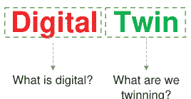

**图 2.1**
我们概念框架的激励性问题。

从业人员理解 DT，因为他们需要针对每个 DT 应用解决这两个基本问题，因为“数字”和“孪生”的含义因情况、用例和上下文而异。我们提出的框架将帮助他们回答这些问题。

本章的组织如下：第2.3节介绍了DT的简要背景。第2.4节描述了我们的概念框架，在第2.5节演示其应用。最后，第2.6节总结本章。

### 2.3 背景

本节分为三个部分。第一部分简要介绍了DT的历史。在第二部分中，我们使用文献中的示例性DT定义，并通过我们之前概述的两个基本问题来审视它们：什么是数字，我们正在孪生什么？这将帮助读者更好地理解DT定义中的多样性，从而认识到提出我们两个基本问题的必要性。最后，在第三部分中，我们总结了文献中的空白。

#### 2.3.1 DT的历史

让我们快速看一下DT的发展时间表，如图2.2所示。作为1960年代NASA阿波罗计划的一部分，至少制造了两艘完全相同的航天器，其中一艘留在地球上，称为孪生体（Schleich 等人，2017）。在飞行准备期间，孪生体被广泛用于培训、运行模拟，并协助宇航员应对危急状况。从这个意义上说，每个模拟真实世界运行条件的原型都可以被视为孪生体。

然而，像NASA对其飞机所做的那样，为每个资产/实体构建物理孪生体几乎是不切实际的（且昂贵）。因此，“孪生”的概念被扩展为数字化地创建孪生体，使孪生体变得实用且经济。在这方面，Michael Grieves 首先将虚拟孪生物理对象的概念作为大学课程的一部分引入。


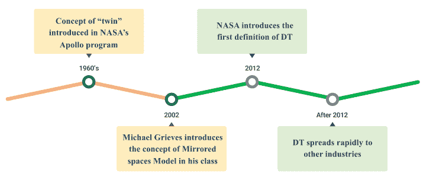

#### 图 2.2
数字孪生开发时间表。

2002/03 年在产品生命周期管理方面（Grieves and Vickers 2017）。当时，DT 一词尚未被提出，因此 Grieves 称其为镜像空间模型（Mirrored Spaces Model），即与所讨论物理系统相关联的物理系统的数字信息构造。广义而言，Grieves 将该概念描述为由三部分组成：（1）物理实体，（2）数字实体，以及（3）两者之间的数据流。物理对象状态的变化会导致数字对象状态的变化，反之亦然。

“数字孪生”一词后来被用于 Grieves 在 2011/12 年定义的概念（Grieves and Vickers 2017）。NASA 后来在 2012 年提出了 DT 的第一个定义（Glaessgen and Stargel 2012）：“一种集成的多物理场、多尺度、概率仿真，用于车辆或系统，采用最佳可用的物理模型、传感器更新、机队历史等，来镜像其飞行孪生体的生命周期”。

此后，由于其有用性，该概念已不局限于航空航天行业，并已扩展到制造、建筑和施工等多个行业。它已被用于各种应用，包括产品生命周期优化、生产计划与控制以及维护预测与管理。

### 2.3.2 文献中 DT 的用法

为了使自己明确方向，让我们通过以下两个视角来审视和比较文献中 DT 的一些现有定义：什么是数字化？我们在孪生什么？

- 1. NASA 的 DT（Glaessgen and Stargel 2012）：“数字孪生是一种集成的多物理场、多尺度、概率仿真，用于车辆或系统，采用最佳可用的物理模型、传感器更新、机队历史等，来镜像其飞行孪生体的生命周期”。
  - NASA 定义中的“数字化”意味着什么？：具备多物理场、多尺度、概率仿真能力。
  - NASA 定义中孪生的是什么？：物理产品或系统（例如，飞机）。

- 2. Rios 的 DT（Rios et al. 2015）：“物理产品的数字副本”。
  - Rios 定义中的“数字化”意味着什么？：数字表示。
  - Rios 定义中孪生的是什么？：物理产品。

- 3. buildingSMART 的 DT（buildingSMART International 2021）：
  - 数字孪生（DT）——也称为数字影子、数字副本或数字镜像——是物理资产的数字表示。物理孪生体与数字孪生体相互关联，在 PBOD 生命周期和使用阶段定期交换数据。AI、ML、传感器和物联网（IoT）等技术允许进行动态数据收集和实时数据交换。
  - buildingSMART 定义中的“数字化”意味着什么？：辅以 AI、ML、传感器和 IoT 等技术的数字表示。
  - buildingSMART 定义中孪生的是什么？：物理产品。

- 4. IBM 的 DT（IBM 2021）：“数字孪生是对象或系统的虚拟表示，贯穿其生命周期，从实时数据更新，并使用仿真、机器学习和推理来辅助决策”。
  - IBM 定义中的“数字化”意味着什么？：贯穿生命周期的实时数字表示，使用仿真、ML 和推理。
  - IBM 定义中孪生的是什么？：对象或系统。

- 5. GE 的 DT（GE 2021）：“物理资产、系统或流程的软件表示，旨在通过实时分析进行检测、预防、预测和优化，以提供业务价值”。
  - GE 定义中的“数字化”意味着什么？：用于检测、预防、预测和优化的软件表示。
  - GE 定义中孪生的是什么？：物理资产、系统或流程。

- 6. PwC 的 DT（PricewaterhouseCoopers 2021）：“数字孪生捕获组织的虚拟模型，并有助于加速战略。该模型可以识别阻碍或促进战略执行的要素，并基于嵌入式模式识别提出具体建议”。
  - PwC 定义中的“数字化”意味着什么？：带有模式识别的虚拟表示。
  - PwC 定义中孪生的是什么？：组织。

- 7. Gartner 的 DT（Gartner 2021）：“数字孪生是现实世界实体或系统的数字表示。数字孪生的实现是封装的软件对象或模型，用于镜像独特的物理对象、流程、组织、人员或其他抽象”。Gartner 定义中的“数字化”意味着什么？：数字表示。Gartner 定义中孪生的是什么？：物理对象、流程、组织、人员或其他抽象。

总之，通过提出“什么是数字化？”这一问题，我们发现为 DT 设想的数字化能力范围很广，其中最突出的包括监测、预测和仿真。例如，Rios et al.（2015）认为 DT 是现实世界物理对象的数字表示，Glaessgen and Stargel（2012）强调需要具备预测和仿真能力，buildingSMART International（2021）认识到 AI 和优化能力在 DT 中的重要性。同样，Digital Twin Consortium（2021）认为 DT 应在指定频率和保真度下同步。另一方面，Autodesk（2021）和 IBM（2021）指出 DT 应使用实时数据更新，并始终保持最新。

在孪生方面，当我们提出“我们在孪生什么？”这一问题时，我们发现大多数文献都将 DT 视为有形物理资产的数字副本。图 2.3 显示了前 100 个词

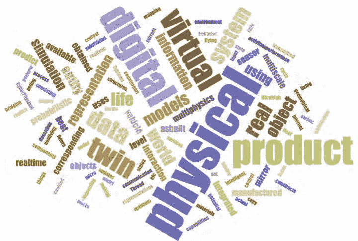

图 2.3 文献中数字孪生定义的词云。

该词云通过汇总 Negri、Fumagalli 和 Macchi（2017）文献综述中可用的不同 DT 定义构建而成。出现频率最高的词是“physical”和“product”，反映出对以产品为中心的 DT 的偏好。然而，也有其他一些现有定义认为，DT 的前景不应仅限于有形物理产品，而应扩展到流程、系统和组织。例如，根据 PwC 的说法，DT 捕获组织的虚拟模型（PricewaterhouseCoopers 2021）。Gartner 提出了 DT 最广泛的定义之一，即 DT 可以是物理对象、流程、组织、人员或其他抽象的数字表示（Gartner 2021）。Parmar、Leiponen 和 Thomas（2020）认为，DT 可以是组织的活的数字仿真模型，随着组织的发展而更新和变化，并可以允许彻底测试场景，以预测潜在策略和战术的绩效。Papacharalampopoulos 和 Stavropoulos（2019）展示了在制造业中使用流程 DT 优化热过程。

### 2.3.3 文献中的差距

文献综述显示，研究人员和从业者提出了各种 DT 定义和应用，每个人都希望解释他们对“数字孪生”一词的使用。有些人认为 DT 是具有预测和规范性能力的复杂实时更新数字模型，而另一些人则将其视为简单的数字表示。关于 DT 概念的这种现有混乱，由于其含糊性，有可能导致人们将其视为纯粹的炒作而予以拒绝（Wright and Davidson 2020）。因此，为了帮助从业者理解 DT，必须开发一个框架，确保从业者在考虑其用例的情况下能够理解 DT，该框架将在下一节中描述。

### 2.4 理解 DT 的框架

该框架是前两个基本问题——什么是数字化？我们在孪生什么？——的整合，我们在论文前面已对此进行了阐述（见图 2.4）。以下各节将详细介绍这两个视角。

数字视角（什么是数字化？）：“数字化”是一个模糊的词，可以指从简单的数字图片到具有预测和规范性能力的日益复杂的模型等任何事物。在没有框架的情况下，从业者在选择 DT 的数字化能力时采用的默认策略是，根据他们认为“最合适”的能力进行选择，而不会穷举式评估其他可能性（Parasuraman, Sheridan, and Wickens 2000）。


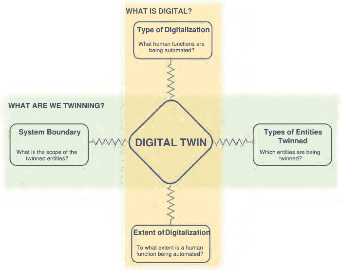

图 2.4
弹簧模型：塑造数字孪生的四种力量。

尽管在从业者碰巧富有创造力和远见的情况下，采用“最适合的选项”且不评估其他可能性可能是一种可行的方案，但在大多数情况下，这存在风险：(1) 选择次优或过于乐观的解决方案，该方案后来可能需要修改或完全废弃 (Fjeld 2020)；(2) 与其他项目利益相关者产生错位，这些利益相关者关于数字孪生将提供哪些数字能力可能持有完全不同的概念化 (Agrawal, Fischer, and Singh 2022)。因此，为缓解上述挑战，我们的框架迫使从业者在部署数字孪生之前自问：对其用例而言，数字意味着什么？

数字孪生视角（我们要对什么进行数字孪生？）：尽管在许多情况下，雄心是创造一个所谓的“最全面的数字孪生”，即生命周期中所有实体都完全数字化，但现实是，当今以及可预见未来的大多数工作系统都将只是部分数字化。Feng 等人 (2020) 指出，构建一个涵盖所有物理和功能活动的综合性虚拟副本作为数字孪生的想法，可能会导致巨额成本 (West and Blackburn 2017)，并使制造商在采用、投资和实施数字孪生方面面临困难。因此，为缓解这一挑战，我们的框架向从业者提出第二个基本问题：他们计划为其用例对什么进行数字孪生？

数字视角帮助从业者选择数字孪生中的技术能力，而数字孪生视角则迫使他们确定被数字孪生实体的正确范围。数字视角基于以下要素：(1) 数字化类型和 (2) 数字化程度。这两个要素共同可以帮助从业者理解对他们而言数字意味着什么。同样，数字孪生视角基于以下要素：(1) 系统边界和 (2) 数字孪生实体的类型。以下段落将详细描述这些要素：

#### 数字化类型

并非所有数字能力都同等重要。虽然有些能力能带来更多收益，但从业者难以采用、投资和部署 (Agrawal 等人 2022)。另一方面，相对基础的能力可能带来较少收益，但能减少采用所需的努力 (Lu 等人 2020)。因此，从业者为其用例选择合适的数字化类型至关重要。

要选择合适的数字化类型，首先了解现有的数字化类型，然后选择满足从业者需求的一种至关重要。但现有的数字化类型有哪些呢？Gartner (2013) 提出的数字化四步层次结构提供了这种分类。该层次结构如下：描述（“正在发生什么”） → 诊断（“为什么会发生？”） → 预测（“将会发生什么？”） → 决策建议（“应当采取什么措施？”）。完成任何任务时，人类首先收集所需信息并了解正在发生的事情（即描述），解释可能发生的原因（即诊断），基于这种理解预测接下来可能发生的事情（即预测），最后决定下一步该做什么（即决策）。

物联网 (IoT)、无线监控、增强现实/虚拟现实、无人机和 3D 扫描是当前旨在改进描述级别的几种技术示例。诊断级别包括确认性数据分析、统计检验和因果推断等技术和方法，因为它们有助于诊断某些事情发生的原因。设计仿真、人工智能方法和预测分析属于预测类别。

#### 数字化程度

在确定数字化类型之后，从业者必须决定数字化的程度。任何数字化类型都不是非黑即白的，而是沿着从无自动化到全自动化的连续谱进行变化。在更高级别，数字孪生将拥有更多自主权，并能够处理更困难的任务。虽然这将带来更多收益，但也难以实现。另一方面，在较低级别，大部分工作仍将由人工操作员在数字孪生的部分协助下完成。因此，数字化程度迫使从业者考虑哪些场景应由人类处理，哪些情况应由数字孪生处理。

#### 系统边界

许多数字孪生部署错误源于人们未能为数字孪生定义确切边界，并对其抱有过高期望。有些人主张，应为资产的整个生命周期创建数字孪生，以产生最大价值。即使这是正确的，由于合同或法律结构，从业者可能无法直接控制资产生命周期的许多部分。因此，在为数字孪生部署定义适当的系统边界时，从业者应考虑以下两个因素：

- 1. 本地优化与全局优化：尽管对资产或实体进行全局优化（端到端优化）是理想的，但在大多数现实场景中，由于实际、法律和财务考虑，这并不可行。因此，从业者无法控制整个生命周期，这强调了在创建数字孪生之前定义适当数字孪生系统边界的必要性。

例如，在建筑施工项目中，理想的情况是使用数字孪生来生成一座在设计、施工、运营、维护和可持续性方面共同优化的建筑。由于这些是相互依赖的功能（例如，设计会影响施工和维护），理想或全局优化的数字孪生要求所有学科从项目一开始就协同工作。但在现实中很少发生，通常不同学科由独立承包商处理。因此，为资产整个生命周期创建全局数字孪生是不可行的。在最理想的情况下，每个承包商将在本地使用自己的数字孪生来优化其负责的功能，而不考虑其他学科（或全局优化）。

- 2. 洞察的细节层次：数字孪生可以在不同规模上提供洞察，从细微细节到大型系统。因此，从业者应确定所需洞察的规模，并据此定义系统边界，因为这将影响数字孪生所需的数据和所使用的算法。定义的规模过于宽泛会掩盖任何相关的运营洞察，而定义的规模过于狭窄则会使问题解决的价值降低。例如，假设有一个分析项目生产力的数字孪生。如果数字孪生仅在总体层面提供洞察（例如，上个月生产力下降了 10%），那么从业者将无法了解在哪里进行改进。反映组件层面变化的更详细洞察会更好。

#### 数字孪生实体的类型

通常，所有生产活动都可以被视为由一个‘组织’按照某个‘流程’交付‘产品’（或服务）。因此，项目交付团队或公司至少可以在一定程度上控制的项目方面分为三类：产品、组织和流程 (POP) (Fischer 等人 2017)。因此，POP 中的每个元素都可以进行数字化改进，或者说进行数字孪生。如第 2.3 节所讨论，将数字孪生限制在仅一个元素（大多数人将其限制为产品）可能会限制数字孪生的效益。

例如，在制造项目中，从业者创建一个数字孪生来预测设备是否需要停机维护。如果仅对设备（或产品）进行数字孪生，数字孪生可以检测到维修需求，但它不够智能，无法知道停机维修会导致生产延误和瓶颈，因为它不了解设备运行的流程或组织。因此，停机决策仍需由工程团队作出。

因此，从业者必须决定希望数字孪生哪些元素。当然，直觉反应是从产品开始，但我们建议更进一步思考，例如以 (Papacharalampopoulos and Stavropoulos 2019) 的方式对流程进行数字孪生，他们利用数字孪生优化流程，以及 (Parmar, Leiponen, and Thomas 2020) 利用数字孪生优化组织。

#### 为何采用弹簧表示

在图 2.4 中，我们使用弹簧表示法连接四个元素，以表明数字孪生的‘数字’和‘孪生’组件紧密交织，一个组件的变化会影响另一个组件。此外，该模型强调，寻找合适的数字孪生是一个迭代过程，从业者回答一个问题，观察对其他部分的影响，然后重复该过程。

例如，如果从业者决定在建设项目中实施“预测”类型的数字化，如果没有适合整个项目的数据，他们将不得不缩小系统边界。同样，如果从业者仅对资产（或建筑物）进行数字孪生，而不考虑其背后的流程或组织（如前面所讨论），则很难做出准确的预测。Agrawal、Fischer 和 Singh (2022) 在公路维护案例研究中也观察到数字元素对数字孪生元素的影响。

### 2.5 案例研究

我们通过一个现实生活中的案例研究来展示框架的应用，以说明从业者如何在实践中发现其有用性。下面我们首先描述情况，然后详细说明框架在此案例研究中是如何使用的。


#### 2.5.1 情景描述

Firm X maintains and manages the pavements and the highways. Recently, it got a contract to manage a part of one of the fastest highways in the country, stretching just over 60 miles. Although the project is very charismatic, it has very strict and hefty fines for non-compliance with the following rules:

X 公司负责维护和管理路面和高速公路。近期，它承包了管理该国最快高速公路的一段（长度略超 60 英里）的合同。尽管该项目颇具吸引力，但对未能遵守以下规则的行为规定了非常严格且高额的罚款：

- 1. 路面上的裂缝和坑洞
- 2. 交通标志和道路标线保持良好状态
- 3. 路边树木和绿地的维护

Bob, a manager on this project, has been quite nervous lately, and is looking to create a DT to manage and maintain the health condition of the road surface and the surrounding areas.

Bob 是该项目的一名经理，最近非常紧张，希望创建一个 DT 来管理并维护路面及周边区域的健康状况。

He consults his various colleagues for ideas. Mike, the operator of the roadway, suggests that DT should be able to acquire the data for the current road conditions, and thus act as a real-time virtual replica of the roadway. On the other hand, Jay, a colleague of Bob, suggests that DT should be also able to comprehend the acquired data, and act as a decision support system by making predictions about the future road conditions. Tom, a friend of Bob, jumps in by suggesting that DT in addition to making the predictions should be able to adapt itself in uncertain situations like the COVID-19 pandemic.

他向多位同事请教想法。Mike 是道路运营商，建议 DT 应能获取当前道路状况的数据，从而充当道路的实时虚拟副本。另一方面，Bob 的同事 Jay 建议 DT 还应能理解所获取的数据，并通过对未来道路状况进行预测，充当决策支持系统。Bob 的朋友 Tom 则插话建议，DT 除了进行预测外，还应能在 COVID-19 大流行等不确定情况下自适应调整。

The issue that Bob faces is this: Given the different perspectives that people have about DTs, how does he conduct a structured brainstorming to make sense of what DTs mean for their use case? Because if different stakeholders have widely varying interpretations of DT, it may result in false hopes and misalignments between stakeholders, with little consensus about the deliverables to expect and resources to allocate.

Bob 面临的问题是：鉴于人们对 DT 有不同看法，他该如何开展结构化头脑风暴，以明确 DT 在其用例中的含义？因为如果不同利益相关方对 DT 的理解差异巨大，可能会导致虚假期望和利益相关方之间的目标不一致，对预期交付成果和资源分配缺乏共识。

#### 2.5.2 框架的应用

##### 2.5.2.1 确定“数字化”意味着什么

Practitioners used a two-step process: (1) brainstorming in a structured way using the framework to develop many ideas for different types and extents of digitalization, and (2) selecting the appropriate one based on the value to be gained and the technology available.

从业者采用两步流程：（1）使用框架以结构化方式开展头脑风暴，为不同类型和程度的数字化提出许多想法；（2）根据可获得的价值和可用技术选择合适的方案。

- 1. Description – Helps to better understand what is happening on the road/pavement.
  - a. No digitalization: Operators go for patrolling and try to manually detect cracks.
  - b. Low extent of digitalization: One operator drives a car with a camera mounted on it, and then another operator (sitting in office) looks through the video to detect cracks/potholes.
  - c. High extent of digitalization: Drones automatically take pictures of the road, and computer vision algorithm detects the cracks (no operator required).

- 1. 描述 – 有助于更好地了解道路/路面上发生的情况。
  - a. 无数字化：巡检人员进行巡查，尝试手动检测裂缝。
  - b. 低度数字化：一名驾驶安装有摄像头的车辆的操作员，随后由另一名（在办公室里）操作员查看视频以检测裂缝/坑洞。
  - c. 高度数字化：无人机自动拍摄道路照片，计算机视觉算法检测裂缝（无需操作员）。

No digitalization method is very inefficient because cracks are hard to detect at 70 mph. Introducing some digitalization may solve this problem, but most of the work still must be done by humans. In the highest level of digitalization, operators are less needed, and they just need to supervise the system.

无数字化方法效率非常低，因为以 70 英里/小时的速度很难发现裂缝。引入一定程度的数字化可能解决此问题，但大部分工作仍需人工完成。在最高程度的数字化中，操作员需求较少，只需监督系统即可。

- 2. Diagnostic – Helps to understand why something might be happening.
  - a. No digitalization: Practitioners take an experienced guess.
  - b. Low/High extent of digitalization: DT can help to understand the reasons behind the cracks by analysing weather patterns and daily traffic conditions.

- 2. 诊断 – 有助于理解某事发生的原因。
  - a. 无数字化：从业者依据经验做出猜测。
  - b. 低度/高度数字化：DT 可以通过分析天气模式和日常交通状况，帮助理解裂缝背后的原因。

- 3. Prediction – Helps to understand what might happen in the future.
  - c. No digitalization: Practitioners use an empirical approach to come up with a prediction for crack propagation.
  - d. Low extent of digitalization: The DT can predict the crack propagation in normal pre-determined circumstances like with usual traffic and weather conditions.
  - e. High extent of digitalization: The DT’s prediction can adapt itself based on the changing environment, e.g., traffic reduced due to COVID-19 pandemic or extreme weather circumstances.

- 3. 预测 – 有助于了解未来可能发生的情况。
  - c. 无数字化：从业者采用经验方法来预测裂缝扩展。
  - d. 低度数字化：DT 可以在正常预设条件下预测裂缝扩展，例如常规交通和天气状况。
  - e. 高度数字化：DT 的预测可以根据环境变化自行适应，例如因 COVID-19 大流行导致交通减少，或极端天气情况。

A lack of digitalization forces practitioners to use existing empirical approaches to predict the crack propagation. The introduction of some digitalization helps to solve this problem by making DTs take care of normal circumstances and humans taking care of anomalies and unusual situations. In the highest extent of digitalization, the DT can learn from itself based on the data gathered without the practitioner having to adjust the algorithm and therefore take care of unusual situations as well.

缺乏数字化迫使从业者使用现有经验方法来预测裂缝扩展。引入一定程度的数字化有助于解决此问题，让 DT 处理常规情况，由人类处理异常和不寻常情况。在最高程度的数字化中，DT 可以根据收集的数据自行学习，无需从业者调整算法，因此也能处理不寻常情况。

- 4. Prescription – Helps to decide what should be done in the future.
  - a. No digitalization: Operators decide based on experience whether to repair the crack.
  - b. Low extent of digitalization: DT can handle easy or trivial cases, like a dangerous pothole or a big crack but not the cases which require an intelligent evaluation.
  - c. High extent of digitalization: To decide whether to perform preventive maintenance or not, the algorithm can intelligently evaluate what the additional cost would be if the cracks were not repaired now.

- 4. 处置 – 有助于决定未来应采取什么行动。
  - a. 无数字化：操作员根据经验决定是否修复裂缝。
  - b. 低度数字化：DT 可以处理简单或琐碎的案例，例如危险的坑洞或大裂缝，但不能处理需要智能评估的案例。
  - c. 高度数字化：为了决定是否进行预防性维护，算法可以智能评估如果现在不修复裂缝，额外成本会是多少。

The above brainstorming sheet illustrates how practitioners have used the digital perspective of the framework to conduct a structured brainstorming session. Each of the above ideas (or even all of them) could have been implemented in this DT. In the absence of this structured and exhaustive brainstorming, many different definitions of what digital means may have arisen, leading to the confusion. Based on their technological resources and careful evaluation of alternatives/value, the team decided that they would like to have a high extent of digitalization in description, i.e., use drones to automatically take pictures of the road, and computer vision algorithm to detect the road defects. So, this is what digital would mean in the context of this case study.

上述头脑风暴表说明了从业者如何使用框架的数字视角开展结构化头脑风暴会议。上述每个想法（甚至全部）都可以在该 DT 中实现。如果没有这种结构化且详尽的头脑风暴，可能会产生许多关于“数字化”含义的不同定义，从而导致混乱。基于其技术资源和对替代方案/价值的仔细评估，团队决定在描述环节采用高度数字化，即使用无人机自动拍摄道路照片，并使用计算机视觉算法检测道路缺陷。因此，这正是在本案例研究背景下“数字化”的含义。

##### 2.5.2.2 确定待孪生对象

To answer the question what we are twinning, practitioners needed to decide on two things: System boundaries and the entities to be twinned.

为了回答“我们要孪生什么”这个问题，从业者需要决定两件事：系统边界和待孪生实体。

The project team started by selecting the scope of the project (system boundaries). It was decided to focus on defects caused by damaged road markings despite there being many defects to choose from, such as defects in traffic markings, vegetation situation around the road, potholes, and guard rails. This was selected based on two criteria: (1) importance to the life safety of users and (2) frequency of occurrence as determined by analysing the defects log from 21 quarters, starting from 2013. It was thus concluded that damaged road markings are one of the most frequently reported defects in roads and pose the maximum risk to life safety of users. Clearly defining the scope of the project at the very onset gave clear and actionable directions to the project team, thus alleviating any existing confusion and aligning the expectations of all the stakeholders.

项目团队首先选择了项目范围（系统边界）。团队决定专注于因道路标线损坏导致的缺陷，尽管可供选择的缺陷很多，例如交通标线缺陷、道路周边植被情况、坑洞和护栏。这一选择基于两个标准：（1）对用户生命安全的重要性；（2）根据自 2013 年起 21 个季度的缺陷日志分析确定的发生频率。因此得出结论：损坏的道路标线是道路上报告最频繁的缺陷之一，并对用户生命安全构成最大风险。在项目伊始就明确界定范围，为项目团队提供了明确且可操作的方向，从而缓解了任何现有的混乱，并使所有利益相关方的期望保持一致。

Next, it was decided that for this project, twinning only the road/pavement (or the product) would be necessary and sufficient. It would, however, be necessary to twin the process of defect repair and the organization performing it in the future when the team is predicting the cost and time to repair the defects and prescribing a solution using DT (since different processes and organizations would have impact on time and cost).

接下来，团队决定，对于本项目，仅孪生道路/路面（或产品）即为必要且充分。然而，在未来团队使用 DT 预测缺陷修复成本和时间并制定处置方案时，有必要同时孪生缺陷修复过程及执行该过程的组织（因为不同的流程和组织会影响成本和时间）。

### 2.6 结论

In our motivation, we gave an example of a conversation with a friend where the main question that arose was: “What is an ideal DT? or How do we define a DT that industry needs?” We do not believe that there is one universal answer for this question. Each organization is unique in its market position and technological capabilities. Hence, DT to be deployed in practice must be evaluated individually for each organization and project – a “one-size-fits-all” approach would not work.

在我们的动机部分，举了一个与朋友交谈的例子，其中提出的主要问题是：“理想的 DT 是什么？或者我们如何定义行业所需的 DT？”我们不认为这个问题有一个通用答案。每个组织在市场地位和技术能力方面都是独特的。因此，实际部署的 DT 必须针对每个组织和每个项目单独评估——“一刀切”的方法行不通。

The second author of the chapter, who has guided over 2000 DT implementations since 2008 quotes: “In my experience, I rarely see people fully evaluating a DT to decide if it is suitable for their use case. It is always the first thought option of DT that practitioners want to implement without really thinking of other better possibilities”. Fjeld (2020) interviews 15 practitioners and reports a similar finding. Practitioners getting lured by technology and not exhaustively evaluating other viable options is a well-documented problem in broader technology evaluation and selection literature as well (Love, Matthews, and Zhou 2020). A lack of this understanding can result in confusion about DTs among practitioners, unrealistic hopes from the technology, and ultimately a rejection of DT as hype.

本章第二位作者自 2008 年以来指导了超过 2000 个 DT 实施项目，他引述道：“就我的经验而言，我很少看到有人会全面评估 DT 以判断其是否适合自己的用例。从业者总是想要实施首先想到的 DT 方案，而没有真正考虑其他更好的可能性。”Fjeld (2020) 采访了 15 名从业者，报告了类似发现。从业者被技术所诱惑，而没有穷尽评估其他可行选项，这一问题在更广泛的技术评估与选择文献中也有详细记载（Love, Matthews, and Zhou 2020）。缺乏这种理解可能导致从业者对 DT 产生混乱、对技术抱有不切实际的期望，并最终将 DT 视为炒作而加以摒弃。

The proposed framework helps alleviate the above problem by proposing two fundamental questions that every practitioner should ask before implementing DTs: (1) What is digital? and (2) What are we twinning? By answering these questions for each DT application, practitioners can alleviate confusion and ensure a clear understanding of the specific use case and context. Awareness of these factors in practice can increase the likelihood of success and accelerate the adoption of DT in the industry.

所提框架通过提出每位从业者在实施 DT 前都应问自己的两个基本问题来帮助缓解上述问题：（1）什么是数字化？（2）我们要孪生什么？通过为每个 DT 应用回答这两个问题，从业者可以消除混乱，确保对具体用例和背景有清晰的理解。在实践中意识到这些因素，可以提高成功的可能性，并加速 DT 在行业中的采用。

## References

- Agrawal, Ashwin, Martin Fischer, and Vishal Singh. 2022. “Digital Twin: From Concept to Practice.” Journal of Management in Engineering 38 (3): 06022001. https://doi.org/10.1061/(ASCE)ME.1943-5479.0001034.
- Agrawal, Ashwin, Vishal Singh, and Martin Fischer. 2022. “A New Perspective on Digital Twins: Imparting Intelligence and Agency to Entities.” arXiv. https://doi.org/10.48550/arXiv.2210.05350.
- Agrawal, Ashwin, Vishal Singh, Robert Thiel, Michael Pillsbury, Harrison Knoll, Jay Puckett, and Martin Fischer. 2022. “Digital Twin in Practice: Emergent Insights from an Ethnographic-Action Research Study.” In Construction Research Congress 2022, 1253–60. Arlington, VA: ASCE. https://doi.org/10.1061/9780784483961.131.
- Autodesk. 2021. “Digital Twins in Construction, Engineering, & Architecture.” Autodesk. 2021. https://www.autodesk.com/solutions/digital-twin/architecture-engineering-construction.
- Boje, Calin, Annie Guerriero, Sylvain Kubicki, and Yacine Rezgui. 2020. “Towards a Semantic Construction Digital Twin: Directions for Future Research.” Automation in Construction 114 (June): 103179. https://doi.org/10.1016/j.autcon.2020.103179.
- buildingSMART International. 2021. “Digital Twins.” BuildingSMART International (blog). 2021. https://www.buildingsmart.org/digital-twins/.

## 参考文献

- Agrawal, Ashwin, Martin Fischer, and Vishal Singh. 2022. “数字孪生：从概念到实践。” Journal of Management in Engineering 38 (3): 06022001. https://doi.org/10.1061/(ASCE)ME.1943-5479.0001034.
- Agrawal, Ashwin, Vishal Singh, and Martin Fischer. 2022. “数字孪生的新视角：赋予实体智能与自主性。” arXiv. https://doi.org/10.48550/arXiv.2210.05350.
- Agrawal, Ashwin, Vishal Singh, Robert Thiel, Michael Pillsbury, Harrison Knoll, Jay Puckett, and Martin Fischer. 2022. “实践中的数字孪生：来自民族志-行动研究的新见解。” In Construction Research Congress 2022, 1253–60. Arlington, VA: ASCE. https://doi.org/10.1061/9780784483961.131.
- Autodesk. 2021. “建筑、工程与施工中的数字孪生。” Autodesk. 2021. https://www.autodesk.com/solutions/digital-twin/architecture-engineering-construction.
- Boje, Calin, Annie Guerriero, Sylvain Kubicki, and Yacine Rezgui. 2020. “迈向语义化建筑数字孪生：未来研究方向。” Automation in Construction 114 (June): 103179. https://doi.org/10.1016/j.autcon.2020.103179.
- buildingSMART International. 2021. “数字孪生。” BuildingSMART International (博客). 2021. https://www.buildingsmart.org/digital-twins/.


Canedo, Arquimedes. 2016. “通过数字孪生的工业物联网生命周期.” 在 2016 年硬件/软件协同设计与系统综合国际会议（CODES+ISSS）上，1. 匹兹堡，宾夕法尼亚州：IEEE. https://doi.org/10.1145/2968456.2974007.

Digital Twin Consortium. 2021. “数字孪生.” 2021. https://www.digitaltwinconsortium.org/initiatives/the-definition-of-a-digital-twin.htm.

Feng, B. S, Kim, S. Lazarova-Molnar, Z. Zheng, T. Roeder, and R. Thiesing. 2020. “涉及人机交互的制造流程数字孪生案例研究.” 2020. https://www.semanticscholar.org/paper/A-CASE-STUDY-OF-DIGITAL-TWIN-FOR-A-MANUFACTURING-Feng-Kim/50f3cd21e4860470e8d762fb591193868d9fe878.

Fischer, Martin, Howard W. Ashcraft, Dean Reed, and Atul Khanzode. 2017. 集成项目交付. John Wiley & Sons.

Fjeld, Tord Martin Bere. 2020. “数字孪生——在 AEC/FM 领域迈向共同理解.” https://ntnuopen.ntnu.no/ntnu-xmlui/handle/11250/2779306.

Gabor, Thomas, Lenz Belzner, Marie Kiermeier, Michael Till Beck, and Alexander Neitz. 2016. “面向智能网络物理系统的基于仿真的架构.” 在 2016 年 IEEE 自动计算国际会议（ICAC）上，374–79. 乌尔茨堡：IEEE. https://doi.org/10.1109/ICAC.2016.29.

Gartner. 2013. “扩展您的分析能力组合.” Gartner. 2013. https://www.gartner.com/en/documents/2594822/extend-your-portfolio-of-analytics-capabilities.

Gartner. 2019. “加特纳调查揭示数字孪生正在进入主流应用.” Gartner. 2019. https://www.gartner.com/en/newsroom/press-releases/2019-02-20-gartner-survey-reveals-digital-twins-are-entering-mai.

Gartner. 2021. “数字孪生.” Gartner. 2021. https://www.gartner.com/en/information-technology/glossary/digital-twin.

GE. 2021. “数字孪生.” 2021. https://www.ge.com/digital/applications/digital-twin.

Glaessgen, Edward, and David Stargel. 2012. “未来 NASA 和美国空军飞行器的数字孪生范式.” 在第 53 届 AIAA/ASME/ASCE/AHS/ASC 结构、结构动力学与材料会议，第 20 届 AIAA/ASME/AHS 自适应结构会议，第 14 届 AIAA 上，1818. 夏威夷檀香山：美国航空航天学会. https://doi.org/10.2514/6.2012-1818.

Grieves, Michael, and John Vickers. 2017. “数字孪生：减轻复杂系统中不可预测且不受欢迎的涌现行为.” 在 复杂系统的跨学科视角：新发现与方法 中，85–113. 尚姆：Springer International Publishing. https://doi.org/10.1007/978-3-319-38756-7_4.

IBM. 2021. “什么是数字孪生？” 2021. https://www.ibm.com/topics/what-is-a-digital-twin.

Khajavi, Siavash H., Naser Hossein Motlagh, Alireza Jaribion, Liss C. Werner, and Jan Holmström. 2019. “数字孪生：建筑的愿景、优势、边界与创建.” IEEE Access 7: 147406–19. https://doi.org/10.1109/ACCESS.2019.2946515.

Love, Peter E. D., Jane Matthews, and Jinyang Zhou. 2020. “未免太好了，难以置信？发掘颠覆性技术的益处.” 信息管理国际杂志 52（6 月）: 102096. https://doi.org/10.1016/j.ijinfomgt.2020.102096.

Lu, Yuqian, Chao Liu, Kevin I-Kai Wang, Huiyue Huang, and Xun Xu. 2020. “由数字孪生驱动的智能制造：内涵、参考模型、应用与研究问题.” *机器人与计算机集成制造* 61（2 月）: 101837. https://doi.org/10.1016/j.rcim.2019.101837.

Negri, Elisa, Luca Fumagalli, and Marco Macchi. 2017. “基于 CPS 的生产系统中数字孪生作用的综述.” 在 *制造程序*，第 27 届柔性自动化与智能制造国际会议，FAIM2017，2017 年 6 月 27–30 日，意大利摩德纳，1（1 月）: 939–48. https://doi.org/10.1016/j.promfg.2017.07.198.

Papacharalampopoulos, Alexios, and Panagiotis Stavropoulos. 2019. “迈向热过程数字孪生：以控制为中心的方法.” *CIRP 程序*，第 7 届 CIRP 全球网络会议——通过数据、模型和技术推断转向生产价值流模式（CIRPe 2019），86（1 月）: 110–15. https://doi.org/10.1016/j.procir.2020.01.015.

Parasuraman, R., T. B. Sheridan, and C. D. Wickens. 2000. “人机交互类型与层次模型.” *IEEE 系统、人与控制论交易刊物. A 部分，系统与人类* 30（3）: 286–97. https://doi.org/10.1109/3468.844354.

Parmar, Rashik, Aija Leiponen, and Llewelyn D. W. Thomas. 2020. “构建组织数字孪生.” *商业视野* 63（6）: 725–36. https://doi.org/10.1016/j.bushor.2020.08.001.

PricewaterhouseCoopers. 2021. “数字孪生.” *PwC*. 2021. https://www.pwc.com/gx/en/issues/transformation/digital-twin.html.

Rios, José, Juan Carlos Hernandez, Manuel Oliva, and Fernando Mas. 2015. *作为物理单个产品数字对应物的产品虚拟形象：文献综述及在飞机中的影响*. 系统跨学科生命周期分析，657–66. 费城，宾夕法尼亚州：IOP Press. https://doi.org/10.3233/978-1-61499-544-9-657.

Schleich, Benjamin, Nabil Anwer, Luc Mathieu, and Sandro Wartzack. 2017. “为设计与生产工程塑造数字孪生.” *CIRP 年鉴* 66（1）: 141–44. https://doi.org/10.1016/j.cirp.2017.04.040.

Schroeder, Greyce N., Charles Steinmetz, Carlos E. Pereira, and Danubia B. Espindola. 2016. “使用 AutomationML 和数据交换通信方法论的数字孪生数据建模.” *IFAC-PapersOnLine，第 4 届 IFAC 遥测应用研讨会 TA 2016* 49（30）: 12–17. https://doi.org/10.1016/j.ifacol.2016.11.115.

West, Timothy D., and Mark Blackburn. 2017. “数字线程/数字孪生负担得起吗？对美国国防部最新曼哈顿计划成本的系统评估.” *计算机科学程序，复杂自适应系统会议：主题工程网络物理系统，CAS，2017 年 10 月 30 日至 11 月 1 日，芝加哥，伊利诺伊州* 114（1 月）: 47–56. https://doi.org/10.1016/j.procs.2017.09.003.

Wright, Louise, and Stuart Davidson. 2020. “如何区分模型与数字孪生.” *工程科学高级建模与仿真* 7（1）: 13. https://doi.org/10.1186/s40323-020-00147-4.

## 3 当数字孪生遇上网络工程与运营

Pedro Henrique Diniz
里约热内卢联邦大学（UFRJ）

Christian Esteve Rothenberg
坎皮纳斯大学

José Ferreira de Rezende
里约热内卢联邦大学（UFRJ）

### 3.1 引言

近年来，几种新兴网络应用（如工业 4.0、物联网、增强现实和 5G 移动网络）的出现，带来了一系列传统以人为中心的网络管理方法难以满足的复杂要求。由于受管理网络及其所提供服务的复杂性，网络的运行和管理变得更加困难。在硬件和软件层面开发、验证和部署新的网络技术，将因干扰运行中服务的风险而变得越来越复杂。

网络数字孪生（NDT）的概念最近引起了互联网标准组织的关注，其目标既包括定义什么是 NDT（Zhou et al. 2022），也包括识别采用 NDT 能带来巨大益处的应用案例（ITU 电信标准化部门 2020）。NDT 可以定义为物理网络的虚拟表示，可用于仿真、分析、诊断和控制物理网络（Zhou et al. 2022）。为此，物理网络与虚拟网络之间必须存在通信关系，后者由与网络中每个物理对象（可能是交换机、路由器、防火墙、主机、链路等）关联的逻辑对象所表示。

通过物理设备与逻辑设备之间的数据交换，NDT 有助于实现全面的网络管理和自动化，简化日常任务。


NDT 通过优化弹性并在部署前验证网络变更，为网络管理增加了价值，例如在虚拟环境中使用“what-if”场景。

本章基于 NDT 的主要特性对其进行了表征，并通过不同软件技术对 NDT 进行了系统分析，同时还开展了与 NDT 相关的文献综述，根据其主要特性和应用场景对近期工作进行了分类综述。本文概述了如何对实现 NDT 的不同技术策略进行分类，以及在计算机网络运行的背景下采用 NDT 所面临的一些主要挑战。

### 3.2 网络数字孪生：背景、定义与系统视角

多项近期著作提出了数字孪生（DT）概念的定义（Tao et al. 2019, Minerva, Lee and Crespi 2020, Fuller et al. 2020, Lim, Zheng and Chen 2019, Rasheed, San and Kvamsdal 2020, Barricelli, Casiraghi and Fogli 2019, Jones et al. 2020）。然而，正如 Fuller et al. 所指出的，学术界和工业界均未充分区分 DT 与通用计算机模型及仿真之间的差异。因此，文献中仍缺乏对 DT 的明确定义。在这方面，我们发现，Fuller et al. 在将其考量应用于 NDT 概念时，有助于识别不同时期引入 DT 概念应用的各种软件技术之间现有的差异。

#### 3.2.1 数字孪生的基础特性

DT 由两个主要实体组成，即物理实体和逻辑实体，这是主流文献中的共识。该术语既指物理对象及其逻辑对应物，也指两者的耦合，而不仅仅是指逻辑部分。物理对象可以是设备、产品或软件/硬件资源。因此，DT 包含物理和逻辑组件及其关系。

物理实体（即物理对象 PO）专指 DT 的物理方面。相比之下，逻辑实体是指通过软件实现的对物理对象特征的虚拟化。物理实体也可称为对象、物理对象、制品或产品，而逻辑实体（即逻辑对象 LO）的同义词包括数字对象、克隆、对照物、副本等。DT 将这两种不同的实体耦合在一起：一个与物理世界相关的真实（物理）实体，例如网络领域中的路由器或网络交换机，以及一个虚拟（软件化）的体现，例如模拟网络设备。

为了描述 DT 的概念，Minerva et al. (2020) 提出了一组 DT 的基础特性。这一组特性对 DT 进行了表征，并识别出与其关联的一组功能，从而能够将其应用于不同的情境、场景和领域。在本章中，我们力求阐明这些特性在 NDT 的情况下如何被限制和应用，以期对相关工作给出有价值的定义、表征和分类。接下来，介绍 NDT 的关键特性。

- **a. 代表性与情境化：** 一般来说，LO 必须与原始 PO 同样可信。然而，以 PO 的所有方面和影响来表示 PO 可能极其困难且成本高昂。因此，DT 必须由一个模型支持，该模型针对其应用领域的特定目标和目的进行设计和实现，并参考其运行的上下文。LO 至少必须表示作为 LO 所必需且足够的属性、特征和行为。

- **b. 映射：** 指 PO 能够按照应用目标进行准确测量和表示的能力。PO 由 LO 描述为一组与状态、属性和行为相关的值，这些值可能随时间变化。映射能力表明，每个相关的 PO 值在 LO 中都有唯一的表示。

- **c. 纠缠：** 指 PO 与 LO 之间的通信关系，这是 DT 的一个关键概念，用于表示 PO 及其 LO 之间的链接，其中描述 PO 所需的所有信息都必须传递给 LO。

- **d. 复制：** 指在不同环境中复制 PO 的能力。PO 可以在虚拟化空间中被虚拟化并多次复制。

- **e. 持久性：** 指 DT 随时间持续存在的能力。PO 可能存在限制其随时间运行的现实局限性。因此，LO 是使 DT 能够持久存在的主要因素，因为它必须能够缓解这些限制，以支持 DT 的持续可用性。

- **f. 记忆：** 是存储和表示与 DT 相关的所有当前和过去数据的能力。

- **g. 可组合性：** 侧重于将多个对象分组为单个组合对象，然后观察和控制组合对象及各个组件行为的能力。

- **h. 责任/管理：** 指完整且准确地管理 DT 的能力，在不同 LO 之间进行交互，以便将它们组合成更大的集合，从而实现 DT 的构建。

- **i. 服务化：** 是指通过 DT 的一个或多个 LO 所保证的能力、工具和软件接口，向 DT 消费者提供产品/设备与 PO 的服务、功能、流程和数据访问相关联的能力。

- **j. 可预测性：** 围绕将 LO 融入特定环境，并模拟其在未来或特定期间内与其他对象的行为和交互，以支持确定 PO 在其运行环境中的行为的能力。

- **k. 可编程性：** 是提供应用程序编程接口 (API) 以编程 DT 功能的能力。

简而言之，所提出的特性支持对 DT 是什么以及哪些系统特性支持其运行的定义。此处提出的一些特性对于系统被表征为 DT 是根本性的，并可被视为 DT 的基本/最小实现，其中 LO 在运行上下文中充分代表并表现得如同 PO，表现出以下特性：(a) 代表性与情境化、(b) 映射和 (c) 纠缠。同时，其他特性（此处称为附加特性）通过提供可能根据系统的应用场景是否重要的附加功能，扩展并提升了 DT 关系的内在价值，例如复制、持久性、记忆、可组合性、管理、服务化、可预测性和可编程性。这些特性的定义对于表征什么可以被定义为 NDT 以及了解该概念实现所涵盖的功能和特性至关重要，从而允许对其进行分类。

#### 3.2.2 网络数字孪生的定义与误解

基于旨在标准化 NDT 概念的著作（Sun et al. 2021, Zhou et al. 2022），我们现在在计算机网络的背景下重新审视 Minerva et al. (2020) 提出的 DT 通用特性。接下来，我们展示不同著作（Fuller et al. 2020, Wu, Zhang and Zhang 2021）如何根据 DT 特性的执行对 DT 实现进行分类。在本章结束时，我们主要根据这些定义对 NDT 著作进行分类。

正如 Zhou et al. (2022) 所述，NDT 可以定义为物理网络的虚拟表示，可用于分析、诊断和控制物理网络。为了实现这一点，物理网络与虚拟网络之间必须存在纠缠关系，该关系由与每个物理对象关联的逻辑对象表示。


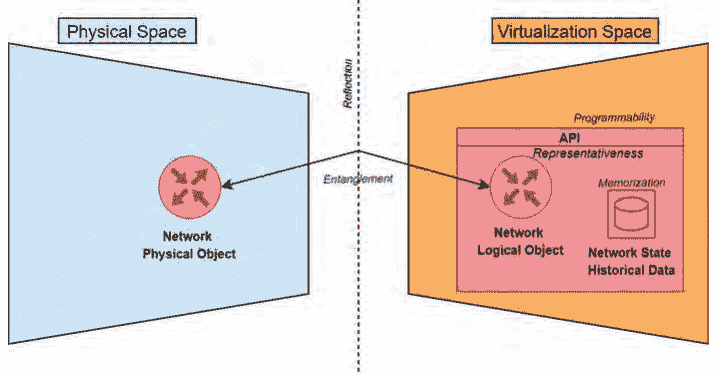

图 3.1 网络数字孪生主要属性的表示。改编自 Minerva, Lee 和 Crespi 2020。

网络中的实体可以是交换机、路由器、防火墙、主机、链路，甚至是构成网络的所有这些实体的集合。图 3.1 所示的这些属性代表了 NDT 概念及其支持的整个系统。NDT 系统必须能够通过逻辑对象及其缠绕（Entanglement）和反射（Reflection）属性来表示物理对象，从而控制和管理物理对象。另一方面，记忆（Memorization）和可编程性（Programmability）属性在当前计算机网络背景下至关重要，因为它们使我们能够回答网络操作场景中极其重要的问题，例如识别导致错误的"谁-什么-何时"，并分别实现网络自动化。

正如 Fuller et al. (2020) 和 Wu et al. (2021) 所呈现的，多个与数字孪生（DT）类似的概念和应用随时间出现，并且关于其定义存在多种误解。在本章中，我们根据 Fuller et al. (2020) 的介绍，对这些概念进行了简要描述，并将其分为三种不同的类型：（1）数字模型；（2）数字影子；以及（3）DT。所有这些定义主要与缠绕（Entanglement）属性及其各自的关联特征相关，该特征表示物理对象（PO）和逻辑对象（LO）之间的通信方向。

- i. 数字模型：是物理对象的数字版本，物理对象与数字模型之间没有自动数据交换。在这种情况下，物理对象与逻辑对象之间无法自动交换数据。一旦创建逻辑对象，对物理对象的更改不会影响逻辑对象，反之亦然。

- ii. 数字影子：是物理对象的数字表示，具有从物理对象到逻辑对象的单向信息交换流。物理对象状态的变化会导致逻辑对象状态的变化，但反之则不成立。

- iii. 数字孪生：表示物理对象与逻辑对象之间的数据流双向发生且完全集成。这意味着物理对象的变化会自动导致逻辑对象的变化，反之亦然。

对这些不同定义的介绍，除了帮助我们识别文献中发现的误解之外，还帮助我们识别不同的网络孪生方法是如何随时间出现的，最终体现在多项近期著作中，这些著作在 3.3 节中有描述，代表了 DT 的完整定义。

#### 3.2.3 网络数字孪生——系统视角

在考虑其在计算机网络中的适用性时，要进一步有意义地讨论如何构建 DT 具有挑战性。其特异性不仅取决于将要使用的应用领域，还取决于该特定领域内的具体用例。因此，通过黑盒方法对 DT 进行建模非常有用，因为它可以帮助根据预期结果定义实现 DT 的最佳方式。

在计算和工程领域，黑盒是一个仅从其输入和输出来看待的系统。NDT 可以被视为一个黑盒，其输入包括网络配置以及排队技术和路由协议等其他因素，而输出则表示结果网络性能。这种性能由给定工作负载下网络组件（如路由器、交换机、主机和链路）的行为决定。测量网络性能需要不同的指标，包括网络路径、数据包转发行为、延迟、数据包丢失和链路容量利用率。通过分析这些指标，NDT 可以用于建模和优化网络行为，使其成为网络工程师和运营商的重要工具。

图 3.2 介绍了基于黑盒建模方法来刻画 NDT 的系统视图。其构成属性可以根据其应用上下文、输入和输出以及其应用的预期结果进行分类。

接下来，我们使用 NDT 关键属性的定性属性来对 NDT 实现进行分类。所提方法旨在支持对本章后面讨论的相关工作以及未来发展进行分类。每个属性的基本分类机制简要描述如下：

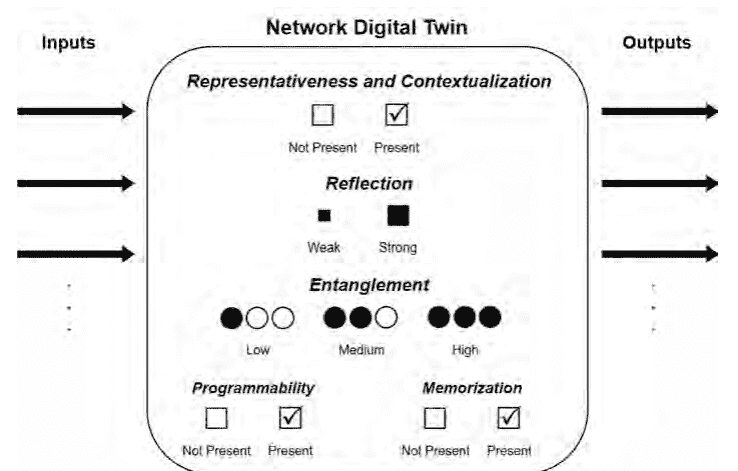

图 3.2 基于其属性的网络数字孪生系统视图。

- 代表性和上下文化：分为两个级别，即存在或不存在。也就是说，DT 是否由针对其应用领域特定的一组目标设计的模型支持。

- 反射：表示 PO 能够准确测量并在其应用目标方面得到表示的能力。当 LO 通过离散数学、随机数学或数据模型来表示时，这意味着对数据包的分类、处理和转发过程进行了抽象。在这种情况下，我们将反射属性评为弱。否则，例如，当 LO 通过实现商业设备上可用软件的仿真对象来表示时，则反射被分类为强。

- 缠绕：表示 PO 和 LO 之间的通信关系。该关系根据它们之间自动数据交换的情况分为三个不同的级别：
  - 低：物理资产与数字模型之间没有自动数据交换。
  - 中：在整个 DT 生命周期中，PO 到 LO 方向的通信会自动发生。PO 的变化会导致 LO 的变化。然而，反之则不成立。
  - 高：如果 PO 和 LO 之间的数据自动双向流动，则表示它们之间完全集成。

- 记忆：分为两个级别，即存在或不存在。也就是说，DT 是否能够存储和表示其应用上下文中所有相关的当前和过去数据。

- 可编程性：分为仅两个级别，即存在和不存在。DT 是否提供一组 API 来编程其部分功能，分别对应是或否。

所提出的模型是拟议方法论的重要贡献，用于剖析围绕 NDT 的相关工作不断变化的格局，这些工作在技术方法和交付的 DT 功能上有所不同，甚至在对 NDT 的基础观点上存在分歧。本模型在相关工作中的应用将在下文中探讨，并用于在表 3.1 中进行比较。

### 3.3 支持技术与相关工作

根据目标 DT 的预期结果，可以采用不同的实现方法。在 NDT 的具体情况下，可以识别出四种主要方法：（1）仿真；（2）模拟；（3）解析模型；以及（4）机器智能。每种方法随时间被用于以不同目标在不同背景下对计算机网络环境进行建模。在 NDT 的背景下，它们的主要功能是在虚拟环境中对物理环境进行建模。更近期，出现了遵循不同观点以实现数字环境的行业驱动解决方案。它们基于与网络生命周期管理任务相结合的新支持技术，因此交付可表征为 NDT 平台的解决方案。接下来，我们旨在介绍随时间用于对计算机网络进行建模的主要基于软件的技术概览，以及它们如何适应不同类型的 DT 定义。在本节结束时，我们将介绍所呈现的不同技术相关工作的时间视图以及它们如何分类。

#### 3.3.1 仿真

网络模拟器长期以来一直用于对计算机网络行为进行建模。它们通过使用离散事件来对每个数据包的


#### TABLE 3.1 基于主要 DT 属性分类和分级的网络数字孪生相关工作

| 相关工作 | 应用领域 | 问题范围 | 技术基础 | DT 类别 | R&C | Rf | E | M | P |
| :--- | :--- | :--- | :--- | :--- | :--- | :--- | :--- | :--- | :--- |
| NEAT (Fantom et al. 2022) | 网络验证 | 通过增强 CI/CD 工作流，面向网络 DevOps 的网络测试自动化系统 | 仿真 | 数字模型 | ✓ | ■ | ●○○ | ✓ | ✓ |
| FlowDT (Ferriol-Galmés, Cheng, et al. 2022) | 网络性能分析 | 计算机网络性能评估 | 机器智能 | 数字模型 | ✓ | ■ | ●○○ | | ✓ |
| RouteNet-E (Ferriol-Galmés, Rusek, et al. 2022) | 网络性能分析 | 计算机网络性能评估 | 机器智能 | 数字模型 | ✓ | ■ | ●○○ | | ✓ |
| Batfish (Fogel et al. 2015, Beckett et al. 2017) | 网络验证 | 网络配置分析以检测配置错误并运行 “what-if” 场景 | 机器智能 | 数字影子 | ✓ | ■ | ●○○ | ✓ | ✓ |
| Optical Failure Localization (Mayer et al. 2022) | 光网络性能 | 基于部分遥测的 ML 辅助软故障定位 | 机器智能 | 数字影子 | ✓ | ■ | ●○○ | ✓ | ✓ |
| Cisco DNA Center (Szigeti et al. 2018) | 自动化网络生命周期管理 | 网络控制器和基于意图的管理仪表板 | 机器智能 | 数字孪生 | ✓ | ■ | ●●● | ✓ | ✓ |
| NetBrain PDAs (NetBrain Technologies Inc. 2022) | 网络验证和基于意图的自动化 | 基于意图的混合网络自动化和可视性平台 | 机器智能 | 数字孪生 | ✓ | ■ | ●●● | ✓ | |
| NetGraph (Hong et al. 2021) | 自动化网络生命周期管理 | 基于数据模型的供应商无关基于意图的自动化，面向数据中心网络的运营生命周期管理 | 机器智能 | 数字孪生 | ✓ | ■ | ●●● | ✓ | ✓ |
| Nokia FSS (Nokia 2022) | 自动化网络生命周期管理 | 基于先进遥测的基于意图的自动化，面向数据中心网络的运营生命周期管理 | 仿真 | 数字孪生 | ✓ | ■ | ●●● | | ✓ |

R&C，代表性和上下文化；Rf，反映；E，纠缠；M，记忆；P，可编程性。

行为，从其生成到消费，同时还融入数学模型以简化信号传播和丢包等更复杂的行为。模拟器是软件解决方案，针对不同应用有不同类型可供选择（Pan and Jain 2008）。针对各种应用有不同类型的模拟器可供选择，例如在网络中测试协议特性，以及用于教育和研究目的。网络仿真工具在互联网和 TCP/IP 参考模型的实现中发挥了重要作用。REAL (Keshav 1988)、NEST (Bacon et al. 1988)、网络仿真 (NS) (Chaudhary et al. 2012, NS-2 1996, Henderson, Lacage and Riley 2008) 和 OMNET++ (Varga 1999) 只是过去 40 年间学术界中最相关的几种仿真工具示例。

#### 3.3.2 仿真

模拟器使用数学模型来表示网络行为，并跟踪每个数据包的流向，而仿真器复制网络行为并可以在功能上替代网络。虽然仿真工具也可用于仿真，但虚拟机和容器等虚拟化技术提供了与真实网络中使用的软件组件镜像的软件组件，但没有硬件加速。然而，虚拟化保证了虚拟网络比物理网络更可靠的行为，尤其是在数据转发方面。

随着时间的推移，已经开发出了若干仿真器，既侧重于学术界或研究，例如 EMPOWER (Zheng and Ni 2003)、IMMUNES (Zec and Mikuc 2004) 或 Mininet (Lantz, Heller and McKeown 2010)，也面向工业界，例如 GNS3 (Neumann 2015)、EVE-ng (Dzerkals 2022) 或 CORE (Ahrenholz 2010)。更近期，具有建模异构网络设备高保真能力的仿真机制已经出现。这些替代方案基于一系列硬件虚拟化技术，例如虚拟机 (VM) 或容器，这些技术保证对预先存在的网络系统（如 Cisco、Juniper 和 Nokia 服务器路由器 Linux (SR Linux) 路由器镜像）的支持。此类情况的示例包括 Containerlab (Dodin 2021) 和 NEAT (Fantom et al. 2022)。

#### 3.3.3 分析模型

除了仿真和仿真策略外，还有分析模型的选择。目前，排队论是用于建模计算机网络最流行的分析工具（Ferriol-Galmés, Rusek, et al. 2022）。它允许我们将网络建模为一系列相互连接的队列，并在分析上对其进行评估。这些队列中的每一个都可以由一系列数学方程来建模（Cooper 1981）。自互联网诞生以来，基于排队论的分析模型一直被使用，主要用于执行网络性能分析（Samari and Schneider 1980, Tipper and Sundareshan 1990）。更近期，已经发表了若干研究，试图通过分析模型评估软件定义网络 (SDN) 和 OpenFlow 的性能（Goto et al. 2019, Xiong et al. 2016）。

#### 3.3.4 机器智能方法

最近利用神经网络等机器学习技术的研究旨在分析计算机网络的性能，例如 RouteNet-E (Ferriol-Galmés, Rusek, et al. 2022) 和 FlowDT (Ferriol-Galmés, Cheng, et al. 2022) 的情况。此类方法与分析模型共享相同的目标，能够建模不同大小和调度策略的队列网络，并试图通过估计丢包、抖动和延迟等网络指标来识别网络性能。然而，类似于分析模型，数据驱动的方法依赖于手动的（基于专家的）抽象来建模系统输入，例如配置、队列调度、输入流量等。

迄今提到的所有模拟器、仿真器、分析模型和神经网络的工作，当用作在虚拟环境中建模物理对象的软件技术时，可以归类为数字模型，而不是 DT。这种类别主要由镜像物理对象的方法来特征。如前所述，数字模型不具备物理对象与逻辑对象之间的自动数据交换。一旦创建，物理对象的更改不会反映在逻辑对象中。这一事实表征了所提出的方法中缺乏高纠缠比，导致它们被归类为数字模型。

在最近的发展中，SDN 和网络分析 (NA) 正在知识定义网络 (KDN) (Mestres et al. 2017) 范式下被探索，以便在网络运行和控制的背景下利用 AI 技术。

基于标准化网络协议和数据模型（例如，NETCONF/YANG）的方法寻求生成控制平面的逻辑模型，该模型表示网络配置、拓扑以及路由器用于计算数据平面的机制。这种方法要求采用它的工具必须对各种设备配置有完整的视图，并支持负责自动获取配置数据的南向接口，同时能够高效大规模地获取高容量、精细颗粒度的遥测数据（例如，流式遥测和带内遥测）。它们还寻求生成数据平面模型，该模型考虑环境（例如，链路状态和邻居之间通告的前缀）连同控制平面模型。此类应用的一个良好示例是 Batfish (Beckett et al. 2017, Fogel et al. 2015)，其主要功能是分析和验证网络配置。因此，网络管理员可以得到网络中错误所在位置的指示，但该工具不


实施技术以自动应用拟议的更改。该特征导致将 Batfish 归类为数字影子（Digital Shadow），因为未从 LO 到 PO 建立自动化通信关系。

近年来，多种方法提出了新的工具和 ML/AI 技术，具有不同目标，用于构建目标网络领域的数字孪生（DT）。例如，“基于网络数字孪生的 ML 辅助软故障定位”（Mayer et al. 2022）采用基于 NETCONF/YANG 的数据模型来执行遥测数据收集，并将其存储在数据库中以从中构建 LO。这些数据由基于机器学习（ML）技术的故障检测和定位管道消费，该技术基于人工神经网络（ANN）。在此案例中，PO 和 LO 之间（PO → LO）的通信会自动建立，但反向（PO ← LO）未建立，因为仅提出纠正措施而不直接应用。因此，该工作可归类为数字影子（Digital Shadow）。

#### 3.3.5 行业驱动的解决方案

最近，网络行业一直在发展其网络管理系统，甚至将其整体归类为 NDT，利用闭环控制（CCL）和意图驱动网络（IBN）自动化等技术，确保从 Day 0（项目）和 Day 1（实施）到 Day 2（监控、分析和变更管理）的整个生命周期中的网络管理。这些案例的示例包括 Cisco 数字网络架构中心（DNA Center）（Szigeti et al. 2018）、Nokia 结构服务系统（FSS）（Nokia 2022）和华为 NetGraph（Hong et al. 2021），它们是网络管理系统（企业和数据中心）。

它们之间的主要区别之一在于，Nokia FSS 和 Cisco DNA Center 均旨用于管理内部设备，而 NetGraph 实现了一种与厂商无关的设备数据模型，使其能够管理任何制造商的设备。Cisco DNA Center 实现了其设备的专有模型，将传统设备的日志虚拟化到管理平台中，以便日后手动分析或通过其他 ML 技术进行分析。与 NetGraph 和 DNA Center 不同，Nokia FSS 采用数字沙箱（虚拟），通过容器模拟由 SR Linux 设备组成的物理网络，以验证更改。除这些系统外，NetBrain Technologies Inc.（2022）自 2004 年起提供名为 NetBrain 问题诊断自动化系统（PDAs）的系统，该系统在基于专有数据模型的虚拟环境中对网络变更进行验证，并执行意图驱动的网络自动化。由于所有这些系统都实现了网络生命周期管理机制，验证更改并将其自动应用到物理环境中，因此可以将它们完全归类为 NDT。

#### 3.3.6 NDT 方法总结

图 3.3 展示了不同 NDT 方法的时间线，以及根据 Fuller 等人（2020）和 Wu 等人（2021）提出的不同 DT 定义，如何对每种方法进行分类。这些类别中的每一种随着时间的推移都有多个应用示例，并且可能整体也可能不被归类为 DT。有时，它们可能更适合描述为数字影子（Digital Shadow）或数字模型（Digital Model），而非 DT。正如所见，每个定义主要与 PO 和 LO 之间存在的通信关系相关联，此处定义为“纠缠属性”（Entanglement property）。

### 3.4 当数字孪生遇到网络工程与运维

采用 NDT 平台相较于传统网络管理工具具有多项优势。主要区别之一是真实环境与虚拟环境之间的持续映射，这使网络运营和管理流程得以优化。此外，NDT 可应用于多种场景，例如工程和网络设计。NDT 领域的最新研究可根据其属性进行分类，并根据其定义进行归类。本节将更详细地探讨这些不同场景和类别。

#### 3.4.1 网络工程：项目与规划

在网络工程中使用 NDT 可提升网络及其从设计到日常运营的工作流程的可靠性。它可帮助验证硬件和软件架构，包括与已部署协议和配置的互操作性测试，并提供高保真环境用于规划和测试，以确保提升可靠性。

#### 3.4.2 网络运维：自治网络管理

在实际部署之前验证网络变更的合规性对于确保网络运营、管理和维护（OAM）过程中的风险缓解至关重要（Yahui et al. 2019）。人工干预在整个过程中易出错，此类错误极其常见（Meza et al. 2018; Tong et al. 2018; Zeng et al. 2012），网络运营商需要工具来避免这些错误，从而确保高可用性和网络韧性。

新技术，例如闭环控制自动化（CCLA）与 IBN 相结合，可在高度复杂的环境中实现网络自治管理，例如按需扩展数据中心网络。

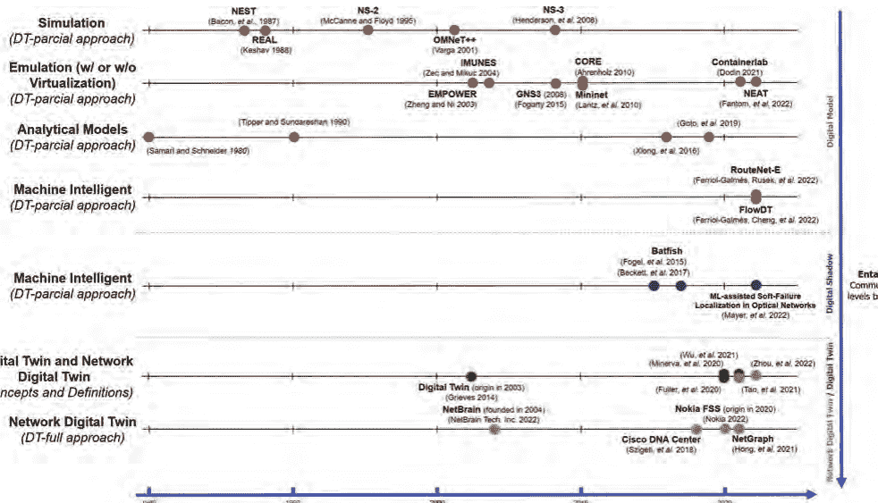

图 3.3
网络数字孪生的及时概念、定义和软件技术方法。

闭环会持续监控网络、分析数据并采取行动以满足预期要求。IBN 将意图转换为一个或多个策略，并将其分解为可跨设备部署的低级别配置。NDT 允许在将更改部署到网络之前对生产网络进行测试和验证，最大限度地降低停机风险（ITU-T 2020）。DevOps 策略以及通过持续集成和持续部署（CI/CD）管道进行的验证和认证甚至可以一起采用，以确保整个生命周期中的网络管理。

#### 3.4.3 研发：NOS 开发与 ML 训练

软件定义网络（SDN）将网络设备的数据平面与控制平面解耦，网络上的操作控制由充当网络操作系统（NOS）的集中控制器管理（Kreutz et al. 2014）。随着新网络遥测技术（如带内网络遥测 INT）（Minlan 2019）的采用，NOS 已成为应用 ML 技术以开发新安全解决方案并辅助网络工程和运维的宝贵工具。

NDT 利用真实网络环境（包括拓扑、配置和流量负载等真实数据）简化了新 NOS 功能的开发。这些用作 ML 训练数据的数据集确保了生产中部署模型的更高可靠性和准确性。

表 3.1 展示了相关的学术和工业工作示例，这些示例可根据所呈现的不同应用场景进行分类，并说明 NDT 的基本属性如何用于分类不同类型的 NDT 方法。

### 3.5 挑战

实现 NDT 面临着与多个方面相关的若干待解决挑战，必须进行研究并加以解决。接下来，将简要介绍和讨论其中一些挑战。

#### 3.5.1 数据采集、处理与存储

从物理世界获取和管理数据是 DT 技术的关键特征。然而，此类数据通常是多源的、多时态的和多格式的，对数据管理构成了重大挑战（Hu et al. 2021）。在网络场景中，收集、处理和存储网络状态数据是一项尤其具有挑战性的任务。从监控和管理数据中提取相关信息可能比较困难，为不同监控源标准化接口对于确保敏捷的数据采集和处理至关重要。此外，网络遥测技术和标准化接口对于及时、细粒度且标准化的方式正确表示网络状态至关重要。但是，存储网络状态数据和网络流量负载可能耗费大量资源，通过采样或压缩技术减小数据规模对于缓解此问题至关重要（Almasan, Ferriol-Galmés 和 Paillisse 等人，2022a，Almasan, Ferriol-Galmés 和 Suárez-Varela 等人，2022b）。

#### 3.5.2 对象建模

由于物理环境的多样性和可变性，在设备整个生命周期中构建准确且功能完善的数据模型具有挑战性。在网络环境下，针对 NDT 所用网络设备针对特定厂商异构设备的数据模型进行统一映射很难实现。此外，网络环境中分布式系统的软件实现方面会影响 NDT 性能，使得对拥塞控制算法、排队策略和路由方案等精确机制的建模变得复杂。平衡异构性支持、准确性、灵活性和可扩展性等要求进一步增加了复杂性。模拟资源提供了一种解决方案，但随着环境规模扩大，计算成本可能变得很高。具体取决于用例，使用分析建模技术和神经网络可能更合适（Hong et al. 2021, Hu et al. 2021, Hui et al. 2022, Zhou et al. 2022）。

#### 3.5.3 纠缠与实时要求

纠缠涉及物理环境与虚拟环境之间的双向通信，是 DT 的一个关键方面。它确保现实世界中采取的行动是由从虚拟环境中的物理对象获得的实时数据所指导的。实现此过程对于在相关上下文中定义 DT 至关重要，但可能极其复杂，虚拟环境中的变更会导致物理环境中相应的变更（Fuller et al. 2020, Hu et al. 2021, Zhou et al. 2022）。在许多用例中，自动化和简化模型的建模与处理是必不可少的（Zhou et al. 2022），以减少虚拟环境中任务所需的时间和计算资源，同时确保它们与 NDT 的硬件和软件资源相匹配。但是，要实现 DT 的实时要求可能具有挑战性，具体取决于所需数据量和分析所需时间。在某些场景中，例如网络安全，实时数据分析是关键


维持网络的正常运行。然而，在其他场景中，实时性要求可能没有那么严格，允许在较长时间内进行分析。识别应用场景的实时性要求对于设计NDT系统的硬件和软件以确保其有效使用至关重要。

#### 3.5.4 标准化

不同网络制造商通过异构技术实现的协议、功能和服务的多样性，是建立统一NDT系统的重大挑战。更甚的是，当旨在将它们应用于不同场景，并跨不同层面在技术层面进行标准化时（Hu et al. 2021, Zhou et al. 2022）。因此，有必要提出一个具有明确定义的组件和功能的统一NDT架构，以便根据为不同应用场景采用的方法进行后续调整。之后，可以通过采用现有技术或不采用现有技术，来识别和定义架构不同层之间的接口（Zhou et al. 2022）。

#### 3.5.5 NDT系统的可扩展性

网络的规模以及为建模这些环境所需的数据量，可能会在确保网络可扩展性方面造成多种问题。大量网络数据有助于实现更准确的网络模型。然而，这些数据的获取、建模和大规模存储是在可扩展性背景下出现的问题（Almasan, Ferriol-Galmés and Paillisse, et al. 2022a, Almasan, Ferriol-Galmés and Suárez-Varela, et al. 2022b, Zhou et al. 2022）。这些问题在总体上是由采用NDT导致的容量过度使用所引起的高通信成本和大规模数据存储造成的（Zhou et al. 2022）。因此，需要采用高效的数据采集工具和压缩技术，以最大限度地减少在网络上传输的数据及其占用的空间。此外，当NDT系统用于随着时间的推移而增长的网络环境时，其在准确性或执行时间方面的性能会下降，这表明所选择的技术方法可能并不最合适（Almasan, Ferriol-Galmés and Suárez-Varela, et al. 2022b）。例如，当基于神经网络的NDT模型执行时间过长，使其在生产环境中的采用变得不可行时，采用替代方法（例如，基于数学抽象的方法，如仿真或分析模型）可能更合适。这是另一个应指导根据NDT将被应用的场景选择合适技术方法的因素。

### 3.6 结论

本章考察了将DT范式应用于计算机网络领域（即NDT）的情况。NDT系统在真实网络环境与虚拟孪生环境之间保持持续同步，确保现实世界中的操作基于对虚拟环境中实时数据的分析来执行。近年来，工业界和学术界已提出多种实际实现。然而，许多实现并未完整实现NDT的关键特征，这使得定义和分类NDT方法变得复杂。我们观察到，自互联网诞生之初起就已采用网络仿真方法，此后即可将其归类为一种NDT，即网络数字模型。我们还能够识别出，只有通过基于意图的网络自动化和闭环自动化处理全生命周期网络管理的工业工具，才能在今天有效地在其完整设计中被归类为NDT，主要原因是它们在物理环境和虚拟环境之间保持双向通信。

我们强调，除了在物理世界和虚拟世界之间保持双向通信外，进一步的挑战今天也具有重要意义，例如为实现目标应用场景的关键目标而维持软件和硬件要求的困难。使用NDT所期望的具体结果很可能最终将指导技术方法的选择。例如，根据要建模的网络规模，抽象程度更高的方法可能会被证明更高效。然而，需要不同方法的新实际实现，以确保模型的成熟度并从生产环境中收集足够的数据。迄今为止，仍缺乏对NDT的统一定义、参考架构和通用实现产物（例如，开放数据模型、API、标准接口等），这可能会损害NDT系统未来的互操作性。

## 参考文献

- Ahrenholz, Jeff. “CORE网络仿真平台比较.” 2010-Milcom 2010军事通信会议. IEEE, 2010: 166–171.
- Almasan, Paul, et al. “数字孪生网络：机遇与挑战.” 2022a.
- Almasan, Paul, et al. “网络数字孪生：背景、赋能技术与机遇.” IEEE Communications Magazine 60.11 (2022): 22–27.
- Bacon, David F., Alexander Dupuy, Jed Schwartz, and Yechiam Yemini. “NEST：一种网络仿真与原型工具.” USENIX Winter. 1988: 17–78.
- Barricelli, Barbara Rita, Elena Casiraghi, and Daniela Fogli. “数字孪生调查：定义、特征、应用与设计影响.” IEEE Access, 7 (2019): 167653–167671.
- Beckett, Ryan, Gupta Aarthi, Ratul Mahajan, and David Walker. “网络配置验证的一般方法.” 2017 Conference of the ACM Special Interest Group on Data Communication (SIGCOMM’17). New York: Association for Computing Machinery, Inc. 2017. 155–168.
- Chaudhary, Rachna, Shweta Sethi, Rita Keshari, and Goel Saksi. “网络仿真器-3与网络仿真器-2比较研究.” International Journal of Computer Science and Information Technologies, 3 (2012): 3085–3092.
- Cooper, Robert B. “排队论：90分钟教程.” Proceedings of the ACM’81 Conference, 1981: 119–122.
- Dodin, Roman. “Containerlab...以及人们如何使用它.” NLNOG. Amsterdam: Nokia, 2021.
- Dzerkals, Uldis. EVE-NG Professional. EVE-NG LTD, 2022.
- Fantom, Will, Paul Alcock, Ben Summes, Charalampos Rotsos, and Nicholas Race. “测试驱动网络管理的NEAT方式.” NOMS 2022-2022 IEEE/IFIP Network Operations and Management Symposium. Budapest, Hungary: IEEE, 2022: 1–5.
- Ferriol-Galmés, Miquel, et al. “RouteNet-Erlang：用于网络性能评估的图神经网络.” IEEE INFOCOM 2022 - IEEE Conference on Computer Communications, 2022: 2018–2027.
- Ferriol-Galmés, Miquel, Xiangle Cheng, Xiang Shi, Shihan Xiao, Pere Barlet-Ros, and Albert Cabellos-Aparicio. “FlowDT：面向计算机网络的流感知数字孪生.” ICASSP, IEEE International Conference on Acoustics, Speech and Signal Processing - Proceedings. Singapore: IEEE, 2022. 8907–8911.
- Fogel, Ari, et al. “网络配置分析的一般方法.” 12th USENIX Symposium on Networked Systems Design and Implementation (NSDI’15). Oakland, CA: USENIX Association, 2015. 469–483.
- Fuller, Aidan, Zhong Fan, Charles Day, and Chris Barlow. “数字孪生：赋能技术、挑战与开放研究.” IEEE Access 8 (2020): 108952–108971.
- Goto, Yuki, Bryn Ng, Winston K. G. Seah, and Yutaka Takahashi. “基于现实OpenFlow交换机模型的软件定义网络排队分析.” Computer Networks, 164 (2019): 106892.
- Henderson, Thomas R., Mathieu Lacage, and George F. Riley. “使用NS-3仿真器进行网络仿真.” SIGCOMM Demonstration, 14 (2008): 527.
- Hong, Hanshu, et al. “NetGraph：面向数据中心网络的智能运营数字孪生平台.” Proceedings of the ACM SIGCOMM 2021 Workshop on Network-Application Integration (NAI’21). Proceedings of the ACM SIGCOMM 2021 Workshop on Network-Application Integration, 2021: 26–32.
- Hu, Weifei, Tangzhou Zhang, Xiaoyu Deng, Zhenyu Liu, and Jianrong Tan. “数字孪生：其赋能技术、应用与挑战的最新综述.” Journal of Intelligent Manufacturing and Special Equipment, 2021: 1–34.
- Hui, Linbo, Mowei Wang, Liang Zhang, Lu Lu, and Yong Cui. “面向网络的数字孪生：一种数据驱动的性能建模视角.” arXiv preprint arXiv:2206.00310, 2022.


- 国际电信联盟电信标准化部门. 网络2030架构框架. 技术规范, ITU, 2020.
- Jones, David, Chris Snider, Aydin Nassehi, Jason Yon, 和 Ben Hicks. “数字孪生的表征：系统文献综述.” CIRP Journal of Manufacturing Science and Technology 29 (2020): 36–52.
- Keshav, Srinivasan. REAL: 网络模拟器. 计算机科学系, 加州大学, 加州: 加州大学伯克利分校, 1988, 1–16.
- Kreutz, Diego, Fernando Ramos, Paulo Verissimo, Christian Rothenberg, Slamak Azodolmolky, 和 Steve Uhlig. “软件定义网络：全面综述.” IEEE 论文集, 2014: 14–76.
- Lantz, Bob, Brandon Heller, 和 Nick McKeown. “笔记本电脑中的网络：面向软件定义网络的快速原型.” 第九届 ACM SIGCOMM 网络热点研讨会 - Hotnets '10. 蒙特雷, 加州: 计算机协会, 2010. 1–6.
- Lim, Kendrik Yan Long, Pal Zheng, 和 Chun-Hsien Chen. “数字孪生最新研究综述：技术、工程产品生命周期管理和商业创新视角.” 智能制造期刊, 31 (2019): 1313–1337.
- Mayer, Kayl Soares 等. “基于网络数字孪生的机器学习辅助软故障定位演示.” 光波技术期刊, 40 (2022): 4514–4520.
- Mestres, Albert 等. “知识定义网络.” ACM SIGCOMM 计算机通信评论, 47 (2017): 1–10.
- Meza, Justin, Tianyin Xu, Kaushik Veeraraghavan, 和 Onur Mutlu. “数据中心网络可靠性大规模研究.” 互联网测量会议 2018 论文集 (IMC'18). 波士顿, 马萨诸塞州: ACM, 2018. 393–407.
- Minerva, Roberto, Gyu Myoung Lee, 和 Noel Crespi. “物联网背景下的数字孪生：技术特性、场景和架构模型综述.” IEEE 论文集, 108 (2020): 1785–1824.
- Yu, Minlan. “网络遥测：走向自上而下的方法.” ACM SIGCOMM 计算机通信评论, 49 (2019): 11–17.
- NetBrain 技术公司. “NetBrain：问题诊断自动化系统.” 白皮书, 2022.
- Neumann, Jason C. GNS3 之书：使用 Cisco、Juniper 等构建虚拟网络实验室. 旧金山, 加州: No Starch Press, 2015.
- Nokia. “Nokia 织构服务系统 Release 22.” 数据表, 2022.
- NS-2. 1996.
- Pan, Jianli, 和 Raj Jain. 网络仿真工具调查：现状与未来发展. 项目报告, 计算机科学与工程, 圣路易斯华盛顿大学, 圣路易斯, 密苏里州: 华盛顿大学, 2008.
- Rasheed, Adil, Omer San, 和 Trond Kvamsdal. “数字孪生：建模视角下的价值、挑战与推动因素.” IEEE Access, 8 (2020): 21980–22012.
- Samari, N. K., 和 G. Michael Schneider. “基于排队论的分布式计算机网络分析模型.” IEEE 计算机汇刊, C-29 (1980): 994–1001.
- Sun, Tao 等. “数字孪生网络 (DTN)：概念、架构与关键技术.” 自动化学报, 47 (2021). doi:10.16383/j.aas.c210097.
- Szigetí, T., D. Zacks, M. Falkner, & S. Arena. Cisco 数字网络架构：面向企业的意图驱动网络. 印第安纳波利斯, 印第安纳州: Cisco Press, 2018.
- Tao, Fei, He Zhang, Liu Ang, 和 A. Y. C. Nee. “工业中的数字孪生：最新发展.” IEEE 工业信息学汇刊, 15 (2019): 2405–2415.
- Tipper, David, 和 Malur K. Sundareshan. “非稳态条件下计算机网络建模的数值方法.” IEEE 通信选区期刊, 8 (1990): 1682–1695.
- Tong, Van, Hai Anh Tran, Sami Souihi, 和 Abdelhamid Mellouk. “网络故障排除：调查、分类与挑战.” 2018 智能网络技术通信国际会议, SaCoNet 2018. 埃卢厄德, 阿尔及利亚: IEEE, 2018. 165–170.
- Varga, András. “在教育中使用 OMNET++ 离散事件仿真系统.” IEEE 教育汇刊 42.4 (1999): 11.
- Wu, Yiwen, Ke Zhang, 和 Yan Zhang. “数字孪生网络：综述.” IEEE 物联网期刊, 8 (2021): 13789–13804.
- Xiong, Bing, Kun Yang, Jinyuan Zhao, Wei Li, 和 Keqin Li. “基于排队模型的 OpenFlow 软件定义网络性能评估.” 计算机网络, 102 (2016): 172–185.
- Li, Yahui 等. “基于形式方法的网络验证与测试综述：方法与挑战.” IEEE 通信调查与教程, 21 (2019): 940–969.
- Zec, Marko, 和 Milijenko Mikuc. “IMUNES 中集成网络仿真的操作系统支持.” 第一届按需 IT 基础设施操作系统和架构支持研讨会, OASIS. 2004: 3–12.
- Zeng, Hongyi, Peyman Kazemian, George Varghese, 和 Nick Mckeown. 网络故障排除调查. 斯坦福 HPNG 技术报告 TR12-HPNG-061012, 斯坦福, 加州: 斯坦福大学, 2012.
- Zheng, Pei, 和 Lionel M. Ni. “EMPOWER：面向有线和无线网络的网络仿真器.” IEEE INFOCOM 2003. IEEE 计算机与通信学会第二十二届年度联合会议 (IEEE 目录号 03CH37428). IEEE, 2003, 3: 1933–1942.
- Zhou, Cheng 等. “数字孪生网络：概念与参考架构.” Internet-draft draft-zhou-nmrg-digitaltwin-network-concepts, IETF 编辑. 2022 年 3 月 7 日.

## 认知数字孪生

- **Xiaochen Zheng and Jinzhi Lu**
  洛桑联邦理工学院 (EPFL)
- **Rebeca Arista**
  空中客车 SAS
- **Jože Martin Rožanec**
  Jožef Stefan 国际研究生院
- **Stavros Lounis**
  雅典经济与商业大学
- **Kostas Kalaboukas**
  Gruppo Maggioli
- **Dimitris Kiritsis**
  洛桑联邦理工学院 (EPFL)

### 4.1 引言

数字孪生 (DT) 是工业 4.0 革命的关键赋能技术之一。它代表了对产品或系统的全面物理和虚拟描述，捕捉组件、产品或系统的相关属性和行为 [1,2]。经过十年的快速发展，DT 已应用于几乎所有工业部门，涵盖概念、设计、生产和维护等不同生命周期阶段 [3]。虽然 DT 的益处是毋庸置疑的，但处理特定复杂工业系统具有挑战性，这需要整合多个对应于不同系统层级和生命周期阶段的相关 DT。

尽管 DT 的概念最初是为制造业定义的，但已扩展到其他工业部门 [4]。制造业经历了相当大的需求和向“敏捷”与“韧性”转型，以应对 COVID 带来的风险和中断。许多供应链不得不重新设计，制造流程必须更具“可配置性。” 在其之上使用带有认知服务的 DT 使各行业能够模拟各种“假如”场景，了解其影响，并最终决定最佳解决方案。

现代工业系统因持续采用先进技术而变得日益复杂。此类现代系统的复杂性管理尤其面临产品生命周期管理 (PLM) 的挑战。此外，复杂系统通常包含多个子系统和组件，这些子系统和组件可能拥有自己的 DT。各利益相关方可能基于不同的协议和标准创建这些 DT，其数据结构通常在语法、模式和语义方面是异构的。这种异构性使得 DT 模型的集成成为一项挑战性任务。为应对这些挑战，近期研究试图通过语义建模、认知计算和基于模型的系统工程等先进技术，增强当前 DT 范式的认知和自主能力。这些努力促成了一种名为认知数字孪生 (CDT)，或认知孪生 (CT) 的新概念，代表了下一代 DT 的有前景的发展趋势。

CDT 中的认知一词源于认知科学，后者研究人脑中的信息流动与处理 [5]。认知的经典定义包括感官输入被转换、简化、加工、存储、提取和使用的所有过程 [6,7]。人类典型的认知过程包括以下步骤：首先，通过皮肤、眼睛和耳朵等感知性感觉器官从周围物理环境中感知并获取信息；其次，通过神经在大脑中传输和处理信息；最后，通过神经将分析结果发送到身体的某些部位并激活适当的行为反应 [5]。此外，从上述过程中可以提取认知能力的一些基本方面，例如注意力（选择性聚焦）、感知（从原始感官数据中形成有用的知觉）、记忆（知识的编码与提取）、推理（从观察、信念和模型中得出推论）、学习（从经验、观察和教师那里学习）、问题解决（实现目标）或知识表示 [8]。CDT 的目标是基于语义工程、知识图谱、认知计算和系统工程等各种先进技术，在一定程度上实现这些认知能力。

### 4.2 CDT 定义

认知数字孪生概念的首次出现可以追溯到 2016 年的一个行业研讨会，当时 Ahmed [9] 讨论了物联网技术的认知演进并提出了 CDT 概念，该概念


定义为一个*涵盖其物理孪生体整体（包括其子系统在内的全生命周期和演进阶段）的数字表示、增强和智能伴侣*。该定义强调了 CDT 的关键特性，包括智能性、跨系统层级和跨全生命周期。

2017 年的一次研讨会上，Fariz [10] 后来提出了一个类似概念。这一新定义中明确了 CDT 的一些具体功能，即，CDT 使用 IoT 传感器及其他来源的实时数据，以实现学习、推理和自动调整，从而改进决策。该定义从认知计算和人工智能的角度阐述了 CDT 概念，并以 IBM Watson 为例展示认知工程场景。

除行业领域的努力外，学术界的研究人员也在推广 CDT 概念，尽管并不总是使用认知或认知性等术语。Boschert 等人 [1] 展望了下一代 DT（即 **nexDT**）的范式：由一组高度协调、具有描述性和可执行性的模型所描述的组件、产品、系统或流程，该模型集合包含设计与工程数据、运行数据及行为描述等相关数字工艺品，并与物理系统随全生命周期同步演进，整合当前可用且通常所需的数据与知识。其主要动机在于，当前孤立的 DT 模型无法满足整个生命周期的所有目的和任务。需要整合多个面向不同业务目标的 DT 模型。知识图谱等语义技术是连接 PLM 系统、云解决方案及其他数据工艺品和设备的有前途工具。

Fernandez 等人 [11] 探索了混合人机认知系统的功能，并规定了共生自主系统（即 **SAS**）。作者将 CDT 视为一种数字专家或副驾驶，它可以学习和演进，并整合不同信息源以达成特定目的。它关注人机增强的合作与融合，伴随着不断增长的智能和意识，朝着人机持续共生的方向发展。基于 SAS 的上下文，作者创建了关联认知 DT（即 **AC-DT**）框架以增强 CDT 的应用。AC-DT 是针对特定认知目的而增强的实体上下文描述，包含与其他实体的相关关联连接。

Lu 等人 [12] 提出了 CTs 的正式定义，即“具有增强语义能力的 DT，用于识别虚拟模型演进的动态、促进对虚拟模型间相互关系的理解并增强决策”。他们创建了一个基于知识图谱的框架来支持 CDTs 的开发。为便于 CDTs 的应用，他们提供了一套由多个现有软件和平台组成的工具链，以赋能 CDT 模型的不同组件。在随后的研究 [13] 中，作者进一步采用 MBSE 方法探索了 CDT 概念，并基于 ISO/IEC/IEEE 42010 标准对其进行了正式定义。

Eirinakis 等人 [14] 通过向 DT 工件引入先进的认知能力来支持决策，最终目标是使 DT 能够响应内部或外部刺激，从而提出了增强认知孪生（即 **ECT**）概念。ECT 可部署于生产流程的不同层级，即传感器级、机器级、工艺级、员工级乃至工厂级，并通过聚合实现水平和垂直的相互作用。

该定义阐明了 CDT 的核心认知要素，并强调从面向流程的角度进行实施时，应跨越不同层级。

Abburu 等人 [2] 回顾了与 DT 相关的现有概念，并提供了一种三层方法，以澄清不同的“孪生体”：DT（物理系统的孤立模型）、混合孪生体（能够对异常行为进行集成预测的互联模型）以及 CT（扩展了专家知识和问题解决知识，能够应对未知情况）。根据这一分类，CDT 被定义为 混合数字孪生的扩展，它融合了认知特征，使系统能够感知复杂且不可预测的行为，并针对流程优化推理动态策略，从而形成一个能够持续演进其数字结构和行为的系统。该研究还提出了一种包含软件工具箱的五层实施架构，并在流程工业的多个相关用例中应用，以验证其可能的适用性。

旨在构建智能制造系统，Ali 等人 [15] 设想 CDT 为“在访问、分析和认知三个层面上，为现有数字孪生增加通信、分析和智能等额外能力的延伸”。认知层由边缘计算、领域专业知识和全球知识库支持。它通过构建定制化通信网络来支持多个 DT 的集成，从而实现自主决策。它还描绘了一个 CDT 生态系统，通过连接不同系统和领域的众多 CDTs 来实现。

基于认知科学、人工智能技术和机器学习技术的进步，提出了制造系统的 CDT [8]。根据认知的基本方面，他们将 CDT 定义为具有额外认知能力的 DT，包括感知、注意、记忆、推理、问题解决和学习。

基于对现有 CDT 定义的回顾，Zheng 等人 [16] 总结了 CDT 的核心特性：

- 基于 DT：表示 CDT 是 DT 的扩展版本。它包含 DT 的基本要素，包括物理实体、数字实体以及它们之间的连接。此外，CDT 通常在统一语义拓扑定义下，包含对应于不同系统层级和生命周期阶段的多个 DT 模型。
- 认知能力：表示 CDT 应能够实现人类类似的智能活动，例如注意、感知、理解、记忆、推理、预测、决策或问题解决。
- 全生命周期管理：表示 CDT 应包含覆盖系统整个生命周期不同阶段的数字模型，并能够整合所有可用数据、信息和知识。
- 自主能力：CDT 应在无需人工协助或仅需最少人工干预的情况下开展自主活动。
- 持续演进：CDT 应能够随着整个系统生命周期持续演进。

基于现有 CDT 定义，CDT 被定义为 [16]：一种经认知能力增强并支持执行自主活动的物理系统数字表示；它包含一组在语义上相互关联的数字模型，与物理系统的不同生命周期阶段（包括其子系统和组件）相关联，并随物理系统在整个生命周期中持续演进。

它们之间的主要区别在于结构复杂性和认知能力。首先，在架构和涉及的生命周期阶段数量方面，CDT 通常比 DT 更复杂。大多数 DT 对应于单个系统（或产品、子系统或组件），并关注其中一个生命周期阶段。相比之下，CDT 应由对应于复杂系统不同子系统和组件的多个数字模型组成，并关注系统的多个生命周期阶段。在许多情况下，CDT 可以通过使用本体定义、语义建模和生命周期管理技术整合多个相关 DT 来构建。这些 DT 可能对应于映射到不同生命周期阶段的不同子系统和组件，并且每个都随系统生命周期演进。

其次，认知能力对 CDTs 是必不可少的，而 DT 则不一定具备此类能力。大多数现有 DT 应用于可见性、分析和可预测性服务，例如状态监测、功能仿真、动态调度、异常检测或预测性维护。这些服务通常由基于数据和基于模型的算法实现，使用从物理实体收集的数据。然而，要实现更高水平的自动化和智能，就需要认知能力，例如，使系统能够感知复杂且不可预测的行为，并自主生成动态策略。要实现这一目标，基于数据和基于模型的算法无法整合来自不同系统和生命周期阶段、具有异构规范和标准的复杂数据和模型。应对这一挑战需要语义建模、系统工程和 PLM 等更多技术。例如，统一本体可以表示物理实体、虚拟


实体及其之间的拓扑，这是实现认知能力的基础。顶层本体可用于集成与全生命周期中虚拟实体同步的不同本体，以支持认知决策推理。

### 4.3 CDT 架构

除了定义之外，已提出了不同的 CDT 架构，包括用于形式化 CDT 概念的概念框架和用于支持 CDT 实现的参考架构。这些架构对 CDT 的开发和应用至关重要。本节回顾了文献中一些现有的 CDT 架构。

[9] 提出了一个 CDT 参考框架，规定了 CDT 早期开发阶段的关键架构构建模块。根据该框架，虚拟空间中物理实体的数字表示基于认知数字孪生核心（CDTC），CDTC 包含元数据、自防御机制和控制规则，以赋能 CDT 功能。CDTC 由六层组成，包括锚点（数据工作者）、代理（知识工作者）、机器人（制作者）、视角（接口）、自管理（管理员）和防御系统（守护者）。该架构框架概括了 CDT 应支持的关键功能及其使能机制。

Lu 等人 [13] 根据 ISO/IEC/IEEE 42010 标准 [17] 为 CDT 设计了一个以知识图谱为中心的框架。它包含五个主要组件，覆盖多个领域：工业系统动态过程建模、基于本体的跨领域知识图谱、用于动态过程仿真的 CDT 构建、基于 CDT 的流程优化分析，以及用于数据互操作性的服务导向接口。该框架旨在支持 IoT 系统开发过程中的决策。它从业务领域获取输入，并向资产领域提供输出。

Abburu 等人 [2] 提出了一种 CDT 架构蓝图，包含五层，提供一组模型驱动和数据驱动的服务。这五层包括数据摄取与准备层、模型管理层、服务管理层、孪生管理层和用户交互层。此外，为了更好地标准化所提出的架构，其层和组件已映射至大数据价值协会（BDVA）参考模型和人工智能公私合作伙伴关系（AI PPP）。还介绍了多个用例，以展示所提议架构的能力和多功能性（图 4.1）。

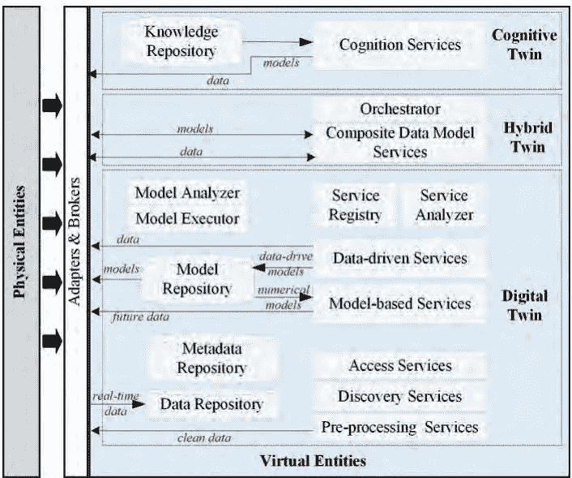

图 4.1
认知孪生工具箱概念架构。（改编自 [2,16]。©: CC BY-NC-ND 4.0）

最近发布的标准 ISO 23247《自动化系统和集成——制造业数字孪生框架》[18] 定义了在制造领域开发 DT 的原则和要求，并提供了一个框架以支持可观察制造元素（例如，人员、设备、材料或设施）的 DT 创建。该标准代表了不同领域中 DT 标准化的趋势。尽管主要侧重于制造领域，但它为其他领域和跨领域的 DT 标准化提供了有价值的参考。Eirinakis 等人 [4] 提出了一种在弹性生产中实施 CDT 的概念架构。它基于 ISO 23247 标准中提出的框架中的实体和互连。

Rožanec 等人 [19] 提出了一种由知识图谱启用的可操作 CT，以支持推理、绑定不同的知识过程和知识类型，并提供可操作维度。此外，在他们的工作中，作者描述了如何通过识别不同类型的认知如何在数字领域实现，并利用所得知识来解决特定问题，从而创建认知优先的 DT。该概念随关于需求预测和生产计划的场景一起进行了描述。用例是使用欧洲汽车工业原始设备制造商提供的数据开发的。两个用例的定性和定量分析用于验证所提议 CDT 方法的优势。在图 4.2 中，我们概述了可操作 CT 的概念。

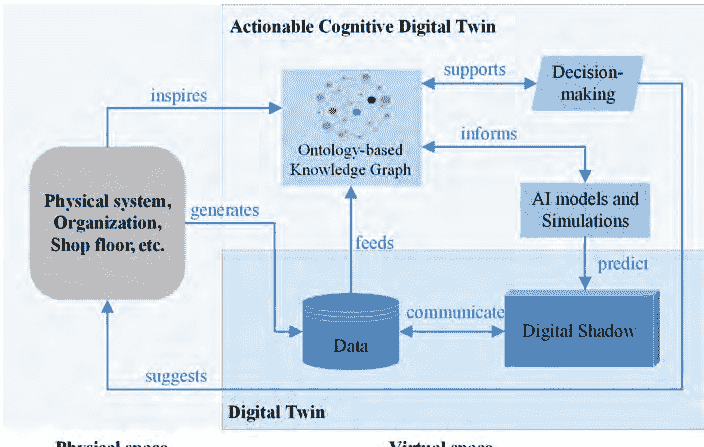

图 4.2 可操作认知孪生架构。（改编自 [19]。）

基于这些现有架构，Zheng 等人 [16] 为 CDT 设计了一个全面的参考架构，以涵盖其所有关键元素和特征。在开发参考架构时，使用 RAMI4.0 [20] 来提高互操作性。RAMI4.0 是一种广泛采用的工业 4.0 数字化参考架构。它提供了一个三维框架，涵盖工业 4.0 的最重要方面，包括生命周期价值流、六种常见业务场景以及与智能工厂层次结构相对应的通信层。这三个维度与 CDT 定义的一些关键元素重叠，尤其是生命周期价值流维度以及用于构建物理系统和通信层级的多层方法。因此，基于 RAMI4.0 并考虑现有的 CDT 架构，设计了一个涵盖 CDT 定义关键元素的三维 CDT 参考架构，如图 4.3 所示。

该参考架构的三个维度包括全生命周期阶段、系统层级和六个功能层。每个维度的元素如下：

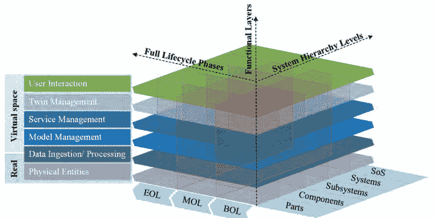

图 4.3
基于 RAMI4.0 的认知数字孪生参考架构 [16]。（©: CC BY-NC-ND 4.0）。

- 全生命周期阶段：此维度侧重于 CDT 定义的全生命周期管理和持续演进能力。在系统的整个生命周期中，会创建许多数字模型，以支持沿此维度的不同生命周期阶段。例如，典型的产品生命周期包括生产设计、仿真、制造过程规划、生产、维护和回收。这些阶段中的每个阶段可能都有多个相关的数字模型。
- 系统层级：此维度提供了一种层次化方法，用于指定 CDT 的结构和边界。现代工业系统通常是高度复杂的系统-of-系统（SoS）。因此，正确定义 CDT 的范围至关重要。在开发 CDTs 时，仅根据 RAMI4.0 指定的工厂物理层次结构分别创建模型可能具有挑战性。因此，我们采用了一种系统工程方法，将复杂系统的结构定义为 SoS、系统、子系统、组件和部件 [21]。
- 功能层：此维度指定了 CDT 提供的不同功能。它基于 [2] 提出的 COGNITWIN 工具箱（CTT）架构蓝图设计。物理实体层表示物理空间中的系统，其余五层代表 CDT 在数字空间中的不同功能，包括数据摄取与处理、模型管理、服务管理、孪生管理和用户交互。

此 CDT 参考架构采用 RAMI4.0 作为基础来构建三大支柱。CDT 的生命周期阶段仍等同于 RAMI4.0 的生命周期价值流（IEC 62890）维度。RAMI4.0 层级（IEC 62264/IEC 61512）维度被 CDT 中的系统层级所取代，后者从系统工程角度分解了系统层次结构。RAMI4.0 层级主要关注物理系统层次结构，包括产品、现场设备、控制设备、工站、工作中心、企业和互联世界。相比之下，CDT 系统层级涵盖物理系统和流程，从而允许应用 MBSE 等系统工程技术以促进 CDT 的发展。

RAMI4.0 的架构层在 CDT 架构中被功能层所取代，如图 4.4 所示。尽管两者都由物理空间和数字空间组成，但其虚拟实体不同。RAMI4.0 架构层使用面向业务的策略来分解层。它们旨在通过指定组织和业务流程、资产功能、必要数据、信息访问以及集成来回答关于实现业务理念的基本问题。

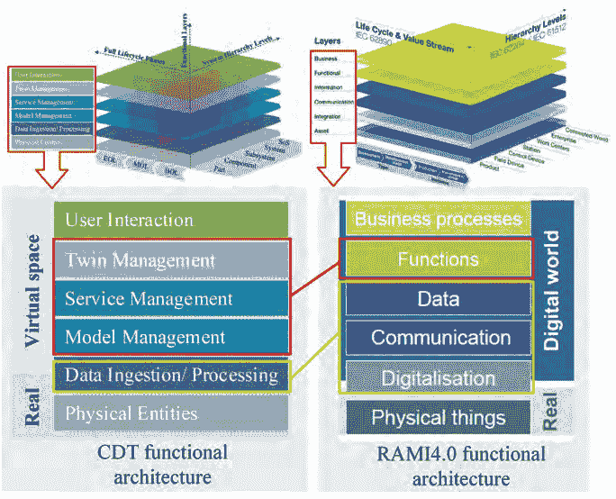

图 4.4
认知数字孪生与 RAMI4.0 之间的功能架构比较 [16]。（©: CC BY-NC-ND 4.0）。


资产通过数字化层[20]融入现实世界。相比之下，CDT 功能层更侧重于双子在虚拟空间中的功能，包括模型管理、服务管理和双子管理层。它们通过数据摄入/处理层与物理实体集成，并通过顶部的用户交互层与用户交互。

### 4.4 CDT 应用

作为一种新兴概念，CDT 在工业界尚未得到广泛实施和验证。因此，大多数已发表的研究要么探讨 CDT 的理论视角，要么专注于 CDT 的愿景。然而，一些正在进行的研究和项目旨在通过将其应用于不同行业场景来验证 CDT 的可行性。

Zhou 等人 [22] 将动态知识库与 DT 模型相结合，以实现面向自主制造的知识驱动智能服务。知识驱动的 DT 支持智能感知、模拟、理解、预测、优化和控制策略。该方法已应用于三个用例：制造流程规划、生产排程和生产流程分析。此外，Yitmen 等人 [23] 使用 CDTs 支持建筑信息管理。通过 CDTs，基于知识图建模和跨整个建筑生命周期的推理，主要支持流程优化和决策。

欧盟项目 COGNITWIN（通过主动自学习混合 DT 实现认知工厂）是一个旨在增强现有过程控制系统认知能力的专门项目，从而实现自我组织并为不可预测的行为提供解决方案。先前提到的概念架构（如图 4.1 所示）已应用于过程工业的多个用例 [2]。

FACTLOG（面向过程工业的能源感知型工厂分析）项目旨在通过结合数据驱动和模型驱动的 DT 来改进复杂过程系统的认知能力。CDT 是该项目的主要推动技术之一。该项目的一个应用案例已在 [24,25] 中介绍，其中一个可操作的 CT 被应用于支持欧洲汽车行业原始设备制造商的需求预测和生产规划。

1 https://www.sintef.no/projectweb/cognitwin/.

2 https://www.factlog.eu/.

在另一个欧盟项目 QU4LITY（零缺陷制造的数字现实）中，³ CDT 已被用作 DT 的语义增强版本，以支持自主质量。为提高产品质量，采用了名为 RMPFQ（资源、材料、工艺、特性/功能、质量）[26,27] 的数据模型以支持本体开发。为飞机装配系统创建了一个 CDT 模型，以实现装配排程的权衡、基于模型的系统工程中的数据流、语义模型、系统架构以及用于验证的协同仿真 [28,29]。

### 4.5 讨论

作为一种新兴概念，CDT 仍处于发展的非常早期阶段。因此，为了充分实现其愿景，还有许多挑战有待解决。CDT 发展的主要挑战总结如下，表明了未来研究的潜在机会：

- 1. 知识管理：功能完善且全面的知识库是 CDT 认知能力的核心。CDT 知识管理的主要挑战可分为知识表示、获取和知识更新 [30]。

- 2. DT 模型集成：CDT 实现中涉及的多个 DT 模型可能由复杂系统的不同利益相关者分别创建，对应于整个生命周期中其不同的子系统或组件。它们需要通过双子管理层集成并恰当地编排到 CDT 架构中。此外，利益相关者可能为其 DT 模型采用不同的标准、协议和结构。这种异质性导致数据层面的互操作性问题。此外，这使得 DT 模型具有更复杂的特征和服务以供集成。

- 3. 标准化：DT 的标准化是实现 CDT 范式的基础。多个标准制定组织（SDO）正在开发 DT 标准，例如 ISO、W3C-WoT、工业互联网联盟（IIC）和 Plattform Industrie 4.0 [31]。统一和协调不同 SDO 开发的相关 DT 标准并非易事。一些现有的标准和协议可以被视为替代方案。例如，Plattform Industrie 4.0 提供资产管理壳（AAS）作为 RAMI4.0 [20] 的一部分。ETSI 行业规范组（ISG）提出下一代服务接口-链接数据（NGSI-LD）API [32]。W3C-WoT 工作组提出 WoT 事物描述（WoT TD），这是一份正式的 W3C 推荐标准 [33]。此类标准和 API 在之前的研究中已有讨论 [2,31]。

- 4. 实施：一个 CDT 可能包括覆盖多个生命周期阶段的多个物理系统，涉及不同企业的利益相关者。因此，CDT 的实施既需要组织内协作，也需要组织间协作。除了上述互操作性问题外，它还在项目管理、数据隐私/安全问题以及知识产权保护方面带来新的挑战。此外，缺乏 CDT 实施的成功示范进一步增加了其风险。从管理角度来看，CDT 的开发和实施应由经验丰富的专家组织，并遵循适当的项目管理方法。

## 致谢

本文所呈现的工作部分获得欧盟 H2020 项目 FACTLOG（869951）——面向过程工业的能源感知型工厂分析，以及欧盟 H2020 项目 QU4LITY（825030）——零缺陷制造的数字现实的支持。

## 参考文献

- [1] Stefan Boschert, Christoph Heinrich, and Roland Rosen. 下一代数字孪生. In Proc. tmce, pages 209–218. Las Palmas de Gran Canaria, Spain, 2018.

- [2] Sailesh Abburu, Arne J Berre, Michael Jacoby, Dumitru Roman, Ljiljana Stojanovic, and Nenad Stojanovic. 面向过程工业的 Cognitwin 混合认知数字孪生. In 2020 IEEE International Conference on Engineering, Technology and Innovation (ICE/ITMC). IEEE, 2020: 1-8.

- [3] Fei Tao, He Zhang, Ang Liu, and AYC Nee. 工业中的数字孪生：现状. IEEE Transactions on Industrial Informatics, 15(4):2405–2415, 2019.

- [4] Pavlos Eirinakis, Stavros Lounis, Stathis Plitsos, George Arampatzis, Kostas Kalaboukas, Klemen Kenda, Jinzhi Lu, Joze M Rozanec, and Nenad Stojanovic. 面向生产韧性的认知数字孪生：一个概念框架. Information, 13(1):33, 2022.

- [5] Min Chen, Francisco Herrera, and Kai Hwang. 认知计算：架构、技术与智能应用. IEEE Access, 6:19774–19783, 2018.

- [6] RL Solso, MK MacLin, and OH MacLin. 认知心理学. Pearson Education, New Zealand, 2005.

- [7] Liqiao Xia, Pai Zheng, Xinyu Li, Robert X Gao, and Lihui Wang. 面向认知预测性维护：基于图的方法综述. Journal of Manufacturing Systems, 64:107–120, 2022.

- [8] Mohammad Abdullah Al Faruque, Deepan Muthirayan, Shih-Yuan Yu, and Pramod P Khargonekar. 制造系统的认知数字孪生. In 2021 Design, Automation & Test in Europe Conference & Exhibition (DATE). IEEE, 2021: 440–445.

- [9] Ahmed El Adl. 认知数字孪生：愿景、架构框架与分类. 技术报告, 2016. https://www.slideshare.net/slideshow/embed_code/key/JB60Xqcn.

- [10] Fariz Saracevic. 认知数字孪生. 技术报告. https://www.slideshare.net/BosniaAgile/cognitive-digital-twin, 2017.

- [11] Felipe Fernandez, Angel Sanchez, Jose F Velez, and A Belen Moreno. 使用数字孪生的具有意识的共生自主系统. From Bioinspired Systems and Biomedical Applications to Machine Learning: 8th International Work-Conference on the Interplay Between Natural and Artificial Computation, IWINAC 2019, Almería, Spain, June 3–7, 2019, Proceedings, Part II 8. Springer International Publishing, 2019: 23–32.

- [12] Jinzhi Lu, Xiaochen Zheng, Ali Gharaei, Kostas Kalaboukas, and Dimitris Kiritsis. 第五届先进制造工业4.0模型国际会议论文集：AMP 2020. Springer International Publishing, 2020: 105–115.

- [13] Lu Jinzhi, Yang Zhaorui, Zheng Xiaochen, Wang Jian, and Kiritsis Dimitris. 从基于模型的系统工程视角探索认知数字孪生概念. The International Journal of Advanced Manufacturing Technology, 2022, 121(9–10): 5835–5854.

- [14] Pavlos Eirinakis, Kostas Kalaboukas, Stavros Lounis, Ioannis Mourtos, Joze M Rozancec, Nenad Stojanovic, and Georgios Zois. 增强数字孪生的认知能力. 2020 IEEE International Conference on Engineering, Technology and Innovation (ICE/ITMC). IEEE, 2020: 1-7.

- [15] Muhammad Intizar Ali, Pankesh Patel, John G Breslin, Ramy Harik, and Amit Sheth. 面向智能制造的认知数字孪生. In IEEE Intelligent Systems, 2021, 36(2): 96–100.

- [16] Xiaochen Zheng, Jinzhi Lu, and Dimitris Kiritsis. 认知数字孪生的出现：愿景、挑战与机遇. International Journal of Production Research, 2022, 60(24): 7610–7632.

- [17] Jean Duprez. MBSE 元模型和语义规则的结构化、形式化和映射方法. INCOSE International Symposium, 29(1):22–36, 2019.

- [18] ISO 23247-1. ISO 23247-1:2021 自动化系统与集成——制造业数字孪生框架——第1部分：概述与一般原则. 技术报告, 2021: ISO 23247-1:2021(en), Automation systems and integration — Digital twin framework for manufacturing — Part 1: Overview and general principles


[19] Joze M Rozanec, Jinzhi Lu, Jan Rupnik, Maja Skrjanc, Dunja Mladenic, Blaz Fortuna, Xiaochen Zheng, and Dimitris Kiritsis. 用于制造业决策的可操作认知数字孪生. International Journal of Production Research, 60(2):452–478, 2022.

[20] Karsten Schweinhardt. 工业 4.0 参考架构模型（RAMI 4.0）. 导论. 2016. 可在线查阅: http://www.plattform-i40.de/I40/Navigation/EN/InPractice/Online-Library/online-library.html.

[21] Alexander Kossiakoff, William N Sweet, et al. 系统工程：原理与实践. John Wiley & Sons, 2020.

[22] Guanghui Zhou, Chao Zhang, Zhi Li, Kai Ding, and Chuang Wang. 面向智能制造的知识驱动数字孪生制造单元. International Journal of Production Research, 58(4):1034–1051, 2020.

[23] Ibrahim Yitmen, Sepehr Alizadehsalehi, Ilknur Akiner, and Muhammed Ernur Akiner. 建筑生命周期管理的认知数字孪生改进模型. Applied Sciences, 2021, 11(9): 4276.

[24] Joze M Rozanec, Jinzhi Lu, Jan Rupnik, Maja Skrjanc, Dunja Mladenic, Blaz Fortuna, Xiaochen Zheng, and Dimitris Kiritsis. 用于制造业决策的可操作认知数字孪生. arXiv 2021. arXiv 预印本 arXiv:2103.12854.

[25] Joze M Rozanec and Lu Jinzhi. 面向制造业的可操作认知数字孪生. 在与 ESWC 同地举办的语义数字孪生国际研讨会上. SeDiT@ ESWC, 2020, 2615: 1–12.

[26] Xiaochen Zheng, Foivos Psarommatis, Pierluigi Petralli, Claudio Turrin, Jinzhi Lu, and Dimitris Kiritsis. 基于多代理架构的制造过程质量导向数字孪生建模方法. Procedia Manufacturing, 51:309–315, 2020.

[27] Xiaochen Zheng, Pierluigi Petralli, Jinzhi Lu, Claudio Turin, and Dimitris Kiritsis. RMPFQ：面向认知数字孪生的制造系统质量导向知识建模方法. Frontiers in Manufacturing Technology, 2022, 2: 901364.

[28] Xiaochen Zheng, Xiaodu Hu, Rebeca Arista, Jinzhi Lu, Jyri Sorvari, Joachim Lentes, Fernando Ubis, and Dimitris Kiritsis. 一种用于加速飞机制造系统设计的语义驱动交易空间框架. Journal of Intelligent Manufacturing, 2022: 1–24.

[29] Rebeca Arista, Xiaochen Zheng, Jinzhi Lu, and Fernando Mas. 一种基于本体的工程系统以支持飞机制造系统设计. Journal of Manufacturing Systems, 68:270–288, 2023.

[30] Sailesh Abburu, Arne J Berre, Michael Jacoby, Dumitru Roman, Ljiljana Stojanovic, and Nenad Stojanovic. 面向流程工业的认知数字孪生. 在《第十二届先进认知技术与应用国际会议（COGNITIVE 2020）》论文集中, 法国尼斯. 2020: 25–29.

[31] Michael Jacoby and Thomas Uslander. 数字孪生与物联网：当前标准图景. Applied Sciences, 10(18):6519, 2020.

[32] Alliance, Open Mobile. 下一代服务接口架构. 技术报告, 2010 年 5 月.

[33] W3C-WoT. 万物网（WoT）事物描述 - W3C 推荐标准 2020 年 4 月 9 日. 技术报告, 2020. 万物网（WoT）事物描述（w3.org）.

## 5
建成文化遗产结构完整性保护：数字孪生能如何帮助？

**Annalaura Vuoto**
米诺大学阿祖伦校区

**Marco Francesco Funari**
萨里大学

**Paulo B. Lourenço**
米诺大学阿祖伦校区

### 5.1 引言

数字化转型正在多个领域普及，范围从机械部件的工业生产到基础设施监测与维护。然而，建筑、工程、施工与运营（AECO）行业是引入全面数字化进程最不情愿的行业之一（欧洲委员会，2021）。图 5.1 报告了欧洲建筑业观察站（ESCO）（欧洲委员会，2021）对当前建筑领域采用的主要数字技术进行的有用分类。

这些技术被组织为三类：数据采集、流程自动化以及数字信息与分析。得益于相关技术的快速发展，数据采集已成为一项相对简单的任务。数字数据的实际应用代表了数字化的未来，应采用最先进的自动流程来实现。此外，通过自动化某些活动，项目的最终质量得以提高，工人面临的风险也更低，且可以部署新材料和新技术。因此，数字信息与分析类别在连接创新技术和处理可用数据方面至关重要。在此框架下，数字孪生（DT）概念被视为数字信息与分析管理流程的最高体现。

| 数据采集 | 自动处理 | 数字信息与分析 |
| :--- | :--- | :--- |
| 传感器 | 机器人技术 | BIM |
| 物联网 | 3D 打印 | 虚拟/增强现实 |
| 3D 扫描 | 无人机 | 人工智能 |
| | | 数字孪生 |

图 5.1
建筑领域的三类数字技术。改编自欧洲委员会（2021）。

然而，DT 范式常被错误地理解为特定资产的简单几何表示，从而导致一个与计算机辅助设计（CAD）和建筑信息建模（BIM）模型重叠的偏颇概念。应当注意，尽管 CAD 模型是形状的静态表示，但包含动态数据（即力和荷载、温度变化以及速率相关现象）的能力是 DT 的典型特征（Grieves 和 Vickers，2016）。这一概念对于正确理解 DT 至关重要，DT 必须首先被理解为一种计算模型，用于执行与物理资产在边界条件变化下的行为相关的分析和预测，而不仅仅是一种几何表示。

研究人员和从业者一致认为，在 AECO 领域正确实施 DT 范式可能发挥关键作用，尤其是在促进建成资产的可持续管理方面。事实上，建筑行业负责大量碳排放，造成严重的环境问题。此外，未来几十年预期的世界人口增长将进一步加剧这一趋势，导致异常的住房和能源需求。因此，延长现有结构和基础设施的使用寿命将实质性减少碳消耗活动。从这个角度看，建成文化遗产（BCH）必须被视为实现新型可持续解决方案的资源，因为它为支持向更健康、更绿色、更公平的社会和经济转型提供了巨大潜力（Europa Nostra，2021）。在此背景下，保护其结构完整性是遗产建筑再利用的关键要素，因为它既能确保居住者的安全，又能保护历史和文化价值。为了保护遗产建筑，受威尼斯宪章（1964）启发的最先进的建议提议实时监测现有结构的逐步损坏，避免大规模干预，并在灾难发生时立即采取行动。然而，这种推荐方法当前尚未充分发展，因为其受限于在遗产建筑中部署密集传感器网络的可能性，从而无法使用最先进的数字信息和分析技术，其潜力在 BCH 保护中尚未被开发。

### 5.2 AECO 领域中的 DT 定义

虽然 DT 在土木工程领域日益受到关注和重视，但现有文献仍不足以获取关于此类技术的适当知识（Camposano, Smolander, 和 Ruippo，2021）。应当注意，与其他领域不同，土木工程领域中 DT 范式的实施受到了 BIM 范式先前存在的制约，BIM 范式在过去二十年中获得了广泛接受，尤其用于现代建筑的运营和维护（O&M）阶段。事实上，文献分析强调，DT 和 BIM 是经常被错误地重叠的技术（Daniotti 等人，2022）。关于土木工程领域中 DT 实施的大多数分析综述论文将 DT 概念视为在建筑生命周期中逐步实施的 BIM 模型（参见图 5.2）。此外，尽管关键词“数字孪生”广泛存在，但缺乏适当地阐述 DT 概念的科学研究仍是一个问题。

Camposano 等人（2021）报告了 AECO 行业知名代表的意见，旨在概念化 DT 范式。DT 被识别为一种数字模型（可以是 CAD 或 BIM）。这种可视化表示通过集成统计或人工智能（AI）模型来实现智能预测能力，并借助实时数据增强以监测资产状态。DT 理想情况下可以取代人工干预，并自主决定代表物理资产采取的行动。他们得出结论，CAD 或 BIM 数字模型通常被视为描述性的，而 DT 预期将更加动态，表示在特定边界条件变化下的几何和结构行为演变。

Deng 等人（2021）提出了一个五级阶梯分类法，反映了从 BIM 到 DT 的演化概念。图 5.3 展示了他们的离散化：第 1 级 – BIM，第 2 级 – BIM 支持的仿真，第 3 级 – BIM 与 IoT 集成，第 4 级 – 用于预测的 BIM 与 AI 技术集成，第 5 级 – 理想 DT。每个级别都应被理解为对基础数字化技术（即 BIM）的增强，它允许提供


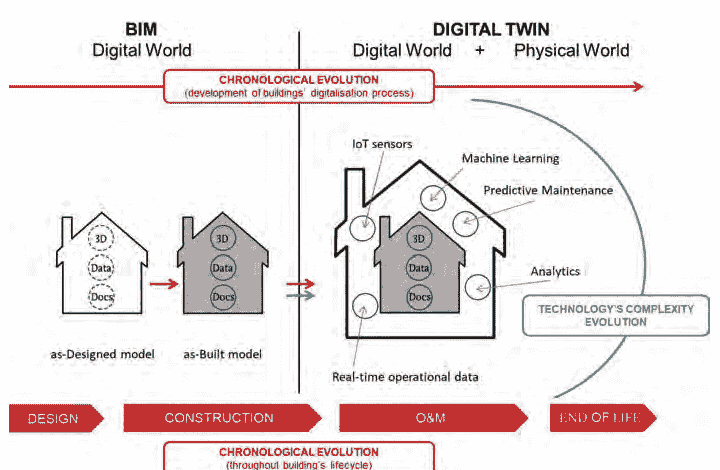

图 5.2
数字孪生作为 BIM 的演进

不断增加的服务和效益。根据作者的观点，理想的 DT 包含实时监测和预测能力，并在必要时实现建筑参数调整的自动化反馈控制。Deng 等人（2021 年）还根据应用领域（即研究领域）和所采用技术的复杂程度，依据图 5.3 所示的层级，确定了建筑项目中 DT 的具体实现。作为仿真支持的 BIM 模型（第 2 级），他们发现了以下实现：
- 施工过程模拟
- 能源性能评估
- 热环境评估

此外，还引用了用于评估隐含碳、照明和声学的应用。此外，与物联网技术集成的 BIM 模型（第 3 级）用于：
- 施工过程监测
- 能源性能管理
- 室内环境监测
- 室内热舒适
- 空间管理
- 危害监测
- 社区监测

最后，当将实时预测添加到 BIM 模型和物联网传感器（第 4 级）时，存在以下应用：
- 施工过程预测
- 热舒适预测
- 室内系统管理
- 建筑设施全寿命周期成本（LCC）
- 智慧城市数字孪生

其他作者正确地将 DT 和 BIM 视为独立概念，强调了两者在最终用户效用方面的差异。虽然 BIM 适用于整合成本估算和时间进度数据以提高建筑项目的效率，但 DT 旨在整合实时传感器或数据读数以及数据分析工具，从而增强建筑与环境及用户之间的交互。

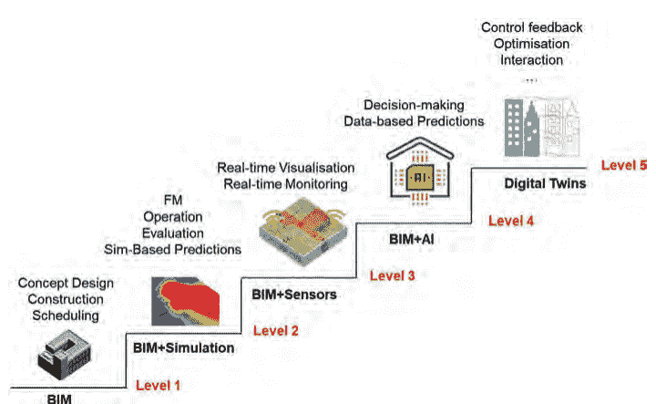

图 5.3
从 BIM 到数字孪生。改编自 Deng 等人（2021）。

Sacks 等人（2020 年）指出，DT 不应简单地被视为 BIM 的逻辑演进，或作为与感知和监测技术集成的 BIM 工具的扩展。相反，DT 是一种整体模型，优先基于可靠、准确、全面和及时的信息来基于管理决策来闭合控制回路。作者们进一步指出，BIM 工具使用面向对象的矢量图形提供出色的产品设计表示，这不太适合包含通过扫描实体资产获取的点云的栅格图形。这对现有建筑中 DT 概念的实施尤其不便。事实上，基于对象的方法通常不是其表示的最合适方式，而基于远程传感器获取的基于现实的方法可能更有效。

#### 5.2.1 遗产建筑结构完整性保护的数字孪生实现

关于 AECO 领域中数字孪生范式实施的现有文献分析表明，到目前为止，在遗产建筑背景下开发的尝试有限。事实上，大多数现有应用是为建成基础设施而非遗产建筑构思的。此外，数字孪生范式内的大多数技术仅在特定兴趣领域进行了测试，主要与设施管理相关。将搜索范围扩展到结构工程框架，Chiachío 等人（2022 年）最近回顾了该领域的相关贡献。从 2018 年到 2022 年，只找到 22 项相关研究，其中大部分涉及基础设施（主要是桥梁）的结构监测和维护问题。根据他们的分析，大部分考虑的研究论文主要关注数字孪生模型生成阶段，即定义一个提供实体资产几何表示的模型（Lu 和 Brilakis 2019）。

很少有研究涉及数字孪生范式的关键特征，例如利用从物理对照体收集的数据对虚拟模型进行实时更新和学习，或自动化决策。具体来说，Jiang 等人（2022 年）提出了一个针对钢桥疲劳生命周期管理的数字孪生驱动框架。他们提出了一种概率多尺度疲劳劣化模型，以预测整个疲劳过程，推导维护方案并及时更新检查/监测计划。

然而，结构工程界中数字孪生概念的主要缺口是缺乏范式定义。只有两篇综述文章定义了适当的“结构数字孪生”框架。Chiachío 等人（2022 年）在结构运维背景下提供了一个功能性的数字孪生技术集成框架，适用于仿真、学习和管理。该框架进一步通过概念验证得到验证，使用受物联网传感器和执行器监测的实验室规模测试结构。

关于为遗产建筑结构完整性保护实施数字孪生范式，没有研究涉及合适框架的定义。一些文章提及数字孪生范式，但仅涉及该技术整体特征的特定和有限方面（Funari 等人，2021a, 2021b）。文献中在遗产建筑保护领域发现的数字孪生范式最常见的应用在表 5.1 中汇总，并将如下讨论。

多项著作探讨了利用遗产建筑信息模型（HBIM）作为数字副本来应用数字孪生原则。一些作者将数字孪生技术称为主要用于图形表示以及存储信息和数据以增加知识并记录所有发生变化的 HBIM 模型，这些是遗产建筑保护中至关重要的任务。例如，Mol 等人（2020 年）构建了遗产木结构的 HBIM 模型，以收集来自无损检测（NDT）的几何信息和数据，用于实时评估结构状况的可能变化。Patrucco 等人（2022 年）基于现代建筑遗产建筑的 HBIM 模型构建了一个信息系统，以存储来自无损检测测试和现场调查的信息。这些知情模型支持遗产建筑保护维护规划中的预防性保护政策和有效决策。

##### 表 5.1 遗产建筑保护中数字孪生范式的应用

| 应用 | 模型类型 |
|---|---|
| 图形表示 | HBIM 模型 |
| 信息存储和数据结构化 | HBIM 模型 |
| 预防性保护管理规划 | HBIM 模型 |
| 遗产建筑和博物馆的数字化体验 | 3D 模型 / 增强现实 |
| 行为模拟 | |
| 环境条件 | 数值模型 |
| 结构条件 | |
| 结构健康监测 (SHM) | 数值模型 |
| | 代理模型 |

探索数字孪生实施的另一个领域涉及遗产建筑和博物馆的数字化体验。Gabellone（2022 年）开发了一种远程访问普利亚加利波利地下历史油坊的方法。根据数字孪生视角，Covid-19 建议开发沉浸式平台，提供由真实的远程导游协助的虚拟游览，并通过重建立体场景使其成为可能。

虚拟模型的创建和可视化以及数据存储是数字孪生的关键特征。然而，文献中发现的应用并未广泛调查结构模拟方面。Zhang 等人（2022 年）通过基于数字孪生技术的动态通风系统建立了地下遗址保护机制，以控制相对湿度。他们使用 HBIM 模型开发了一个基于 Web 的平台，并与物联网传感器耦合，以实时和动态控制整体相对湿度水平。它通过基于数字孪生技术的动态通风系统，为日常环境控制、通风设备运行维护以及应急响应提供了保护机制。

关于遗产建筑结构完整性保护，Angeliu 等人（2020 年）为米兰大教堂开发了一个数字孪生应用。他们的工作流程包含三个步骤：
- 输入（数据收集和分类）
- 仿真模型生成
- 仿真模型校准和验证

为了清晰起见，他们的数字孪生模型是基于施工阶段顺序和荷载路径的层级概念实现的有限元模型。进行了结构分析，以预测特定条件下的动态响应和损伤。尽管遵循了通过数值方法进行结构评估的众所周知步骤，但这项工作首次尝试通过调查数字孪生仿真模型的关键特征并为遗产建筑结构开发定制工作流程，将它们纳入数字孪生范式。

Funari 等人（2021a, 2021b）开发了一项类似研究，提出了一种用于遗产建筑数字孪生生成的可视化程序算法。该方法已被采用用于建模一个葡萄牙纪念碑，其有限元模型已通过实施运行模态分析（OMA）生成和验证。


其他研究强调了将SHM纳入DT实施的重要性，因为它可以具体解决物理资产与虚拟资产之间的实时连接（Kita et al. 2021）。

### 5.3 遗产建筑结构完整性保护的DT概念原型设计

文献分析表明，DT范式在结构完整性保护方面既具有实际的可能性和潜力，也报告了在实现其全面实施过程中遇到的困难和顾虑。如前所述，为DT概念确定一个统一的定义以证明其在跨域全景中的有效性至关重要。然而，DT定义强烈依赖于领域，这意味着在其他基于工程的领域中已被证明有效的方法，在BCH结构完整性保护中可能会失效。众所周知，DT范式最初是在航空航天（Glaessgen and Stargel 2012）和制造领域开发的，这些领域的特点是对物理资产具有高水平的知识和控制。在这些特定领域，经过验证的设计和测试程序允许对资产以及各个组件及其装配具有高水平的知识。在这些情况下，物理资产及其数字副本之间的实时双向对应关系可能是有意义的。这种理想条件在AECO行业中无法出现，在BCH保护子领域中更是如此。事实上，在建筑遗产保护领域工作的结构工程师必须接受在资产知识有限的条件下进行安全评估，从而处理由材料特征、几何定义、对边界和加载条件的理解以及与环境和人类的交互产生的大量不确定性。这是因为遗产建筑是遵循所谓的“经验法则”建造的，因此不遵循任何特定的规范和标准。尽管人们希望提高对建成资产的认知水平，但由于高科技测量和测试方法的成本高昂，这可能并不经济。

工业制品与BCH之间的另一个重要区别在于在特定加载条件下结构响应的强度。虽然工业制品（以及现代建筑）的设计目的是产生延性系统，但历史建筑通常是为抵抗重力荷载而设计的。

应注意，历史建筑中的损坏和退化是跨越几个世纪的长期过程；相反，如果我们考虑特殊作用，即地震或飓风，它们的发生概率非常低，但对我们的经济和社会产生戏剧性的后果。牢记上述概念，主要后果是，物理资产与其数字副本之间的实时数据交换可能是无用的，因为物理资产可能不具备良好的延性水平。这将导致数字副本无法模拟正在进行的损坏，从而无法在接近倒塌阶段之前做出决定。此外，还应注意，由于我们城市（尤其是欧洲城市）中大量遗产建筑的存在，这种方法大规模应用在经济上是不可持续的。因此，我们认为，DT范式最合理的应用是开发数字工具和数值模型，能够模拟多种场景，确保能够在短时间内进行大量计算，并考虑某些参数的变异性。因此，计算结果必须使用统计工具进行存储和分析，以开发工程图表和/或决策工具，引导利益相关者采取合理的方法。理想情况下，此类预测工具必须与NDT测试相结合，以不断提高准确性和细节的水平，从而优化结构测试的经济资源。

下一小节讨论了DT项目中必须包含的一些必要组件的见解：几何、计算建模和预测工具。

#### 5.3.1 DT创建：几何模型生成与计算策略

数字模型的几何定义是DT概念实施的基础。创建此类模型通常成本高昂且耗时；因此，多位作者致力于开发自动化3D建模工具，从原始几何数据采集开始（Fortunato et al. 2017; Castellazzi et al. 2022）。

尽管计算工程取得了相当大的进步，但数值建模相关的主要困难之一是CAD系统中建模的3D几何与数值模拟器之间存在着繁琐的兼容性。据估计，数值模拟总时间的80%用于清理几何和预处理，而剩余的20%用于实际模拟和分析（Rasheed, San, and Kvamsdal 2020）。得益于地图学方法的发展，如今有多种解决方案可用于生成真实世界结构的精细模型，这些方案利用点云的自动或半自动网格划分，并采用手动或参数化建模方法。

第二个必要组件是计算建模策略。应注意，此类选择取决于要模拟的特定场景。这里采用了D'altri et al. (2020)提出的分类法。四种主要数值建模方法用于砌体

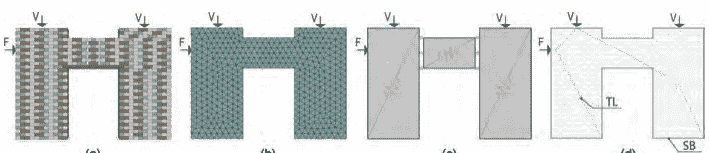

**图 5.4**
数值建模策略：（a）基于块的模型；（b）连续介质模型；（c）宏元模型；以及（d）基于几何的模型。

结构被识别为：（1）基于块的模型，（2）连续介质模型，（3）宏元模型和（4）基于几何的模型。

基于块的模型可以考虑砌体的实际纹理，因为砌体是遵循逐单元表示建模的（见图5.4a）。基于块的方法考虑刚性或可变形块，根据摩擦或黏聚-摩擦接触建模相互作用（Ravi Prakash et al. 2020）。该子类中可归纳为三种主要策略：（1）离散单元法（DEM）（Sarsos et al. 2016），由Cundall和Strack（1979）引入；（2）不连续变形分析（DDA）（Shi 1992），考虑了块的可变形性并满足块之间无张力且一个块不穿入另一个块的假设；以及（3）非光滑接触动力学（NSCD）方法（Moreau 1988），其特征是直接接触表述的非光滑形式、隐式积分方案以及块撞击造成的能量耗散。总之，基于块的模型为砌体结构提供了最准确的建模策略，代表了实际砌体连接和建造细节。因此，它们计算要求高，因此更适合小型模型和局部分析（Lourenco 2019）。

连续介质模型将砌体视为可变形连续介质材料。这种方法在Lourenco (2019)和Roca et al. (2010)中定义为宏观建模，广泛用于砌体结构的结构分析（见图5.4b）。它适合涉及墩和墙等大体元素组合拱门和拱顶的复杂几何的全局建模。事实上，与不连续方法相比，它不需要大量的计算工作，因为网格离散不必描述实际的块对块离散（Degli Abbati et al. 2019; Szabó et al. 2021）。这种方法中最重要的问题与材料属性的机械建模有关，可以通过以下方式进行：（1）直接方法和（2）均质化程序。直接方法基于可以代表砌体整体行为的本构连续定律。此类定律可以通过实验测试或可用数据进行校准（Milani et al. 2012）。在均质化程序中，材料的本构定律是从均质化中推导的


将结构尺度模型（视为均质）与材料尺度模型（代表主要砌体异质性）相关联的过程（Sharma et al. 2021）。均质化通常基于结构的代表性体元素（RVE），通过精细的建模策略（如基于块的方法）进行建模。均质化可以先验地进行，通过RVE在唯一的第一步中推导机械性能，并在第二步中将其引入结构尺度模型。或者，多尺度方法（Funari et al. 2022）允许在材料尺度和结构尺度模型之间进行更强的逐步耦合。

在大单元模型中，结构被理想化为刚性或可变形的面板尺度结构构件。通常，可以识别两种主要结构构件：墙墩和圈梁（见图 5.4c）。大单元模型是砌体结构抗震评估中最广泛采用的策略，尤其是在从业者中，因为其实现和计算简单。另一方面，它们存在一些缺点。首先，面内与面外破坏的解耦可能导致抗震能力的常规估计，因为在现实中，面内和面外损伤可能同时出现。最后，结构需要先验地理想化为墙墩和圈梁，这可能导致定义一个不能很好地代表实际结构的机械系统，尤其是在存在非常不规则开口布局的情况下（Doltsahi and Yekrangnia 2015; Pantò et al. 2017）。替代性公式使用宏观离散单元对结构进行离散化（Malomo and DeJong 2021）。

基于几何的模型将结构的几何形状作为唯一输入，除了加载条件之外（见图 5.4d）。结构被建模为刚体，其结构平衡通过极限分析定理（即静态或运动学）进行评估。基于静态定理的计算方法可以为砌体拱形结构的平衡状态研究提供非常有用的结果，并且似乎特别适用于预测复杂砌体结构的崩塌机制（以及崩塌倍数器）（Block, Ciblac, and Ochsendorf 2006）。基于运动学定理的极限分析方法在过去几十年中被广泛用于有效评估现有砌体建筑（Giuffrè 1991），因为它们允许通过局部崩塌机制的分析快速进行砌体建筑的抗震评估（Funari et al. 2020, 2021a, 2021b; Colombo et al. 2022）。

上述所有讨论的方法都有其优缺点。选择采用哪种数值建模策略取决于分析类型、数据质量、时间可用性等。数字孪生（DT），作为一种计算工具，应能够模拟不同的现象，这将通过寻求整合具有不同复杂程度的建模策略来实现，从超简单快速的分析模型到超复杂的多尺度或微建模策略（Lourenço et al. 2022）。

#### 5.3.2 用于评估遗产建筑结构行为的预测模型

DT范式的特征之一是能够存储大量信息，并使用具有高计算潜力和精巧性的技术对其进行处理。这使得能够处理影响物理资产结构性能的参数的不确定性。DT范式的这种特征似乎值得研究，用于历史砌体建筑的结构评估。砌体构件，即单元和接缝，根据环境因素和施工现场的原材料可用性显示出广泛的变异性。此外，施工技术和泥瓦匠的技能会影响结构的局部破坏机制和承载能力（Vadalà et al. 2022; Szabó, Fanari, and Lourenço 2023）。由于砌体固有的非线性和离散的材料特性（Gonen et al. 2021），解决所有类型的破坏模式并提供结构响应的准确预测具有挑战性。

由于其变异性，砌体性能表现出概率性质。因此，考虑不确定性并允许分析其对响应影响的概率结构模型，可以成为处理与随机变量相关问题的可靠工具，并已被少数作者最近研究（Pulatsu et al. 2022; Saloustros et al. 2019）。此外，可以生成耦合数值和概率分析的混合模型，以评估砌体结构的结构响应，包括不确定性的影响。在处理这种结构工程问题时，采用适当的统计或机器学习方法可能会带来显著改进，因为它们允许丰富和放宽模型对数据所做的假设集合，从而能够在更复杂且理解较少的场景中创建模型。

### 5.4 结论与未来发展

本章综合了DT范式在BCH结构完整性保护中可能带来的潜在创新。调查了应用DT范式必须包含的必要组件，即几何模型生成、合适的计算建模策略以及开发实现统计和机器学习方法的预测工具。为在BCH结构保护的背景下有意义地实施DTs而识别的未来研究和创新机会如下：
- (1) 对DT和HBIM概念进行系统比较，以明确界定两个概念之间的差异和相互联系；
- (2) 定义结构性DT实施的方法框架；
- (3) 开发DT作为模拟和预测目的的计算模型；
- (4) 增加结构工程领域和BCH保护中的实际实现。

## 参考文献

- Angeliù, Grigor, Dario Coronelli, and Giuliana Cardani. 2020. “历史砌体建筑数字孪生应用的仿真模型开发：数值与实验现实的整合.” Computers and Structures 238 (10月): 106282. https://doi.org/10.1016/j.compstruc.2020.106282.
- Block, P, T Ciblac, and J Ochsendorf. 2006. “拱形砌体建筑的实时极限分析.” 计算机与结构 84 (29–30): 1841–52.
- Camposano, José Carlos, Kari Smolander, and Tuomas Ruippo. 2021. “理解建筑资产数字孪生的七个隐喻.” IEEE Access 9: 27167–81. https://doi.org/10.1109/ACCESS.2021.3058009.
- Castellazzi, Giovanni, Nicolò Lo Presti, Antonio Maria D'Altri, and Stefano de Miranda. 2022. “Cloud2FEM: 基于现有/历史结构点云的有限元网格生成器.” SoftwareX 18: 101099.
- Chiacío, Manuel, María Megía, Juan Chiacío, Juan Fernandez, and María L. Jalón. 2022. “结构数字孪生框架：公式与技术整合.” 建筑自动化 140 (8月): 104333. https://doi.org/10.1016/J.AUTCON.2022.104333.
- Colombo, Carla, Nathanaël Savalle, Anjali Mehrotra, Marco Francesco Funari, and Paulo B Lourenço. 2022. “砌体角的实验、数值和分析研究：水平伪静态荷载方向的影响.” 建筑与建筑材料 344: 127969. https://doi.org/10.1016/j.conbuildmat.2022.127969.
- Cundall, P. A. and O. D. Strack. 1979. “颗粒集合体的离散数值模型.” 岩土力学 29 (1): 47–65.
- D'Altri, Antonio Maria, Vasilis Sarhosis, Gabriele Milani, Jan Rots, Serena Cattari, Sergio Lagomarsino, Elio Sacco, Antonio Tralli, Giovanni Castellazzi, and Stefano De Miranda. 2020. “非加固砌体结构计算分析的建模策略：综述与分类.” 工程计算方法档案 27: 1153–85. https://doi.org/10.1007/s11831-019-09351-x.
- Daniotti, Bruno, Alberto Pavan, Cecilia Bolognesi, Claudio Mirarchi, and Martina Signorini. 2022. “建筑行业的数字化转型：从BIM到数字孪生.” 在《数字化转型》中，由Antonella Petrillo, Fabio De Felix, Monica Violeta Achim 和 Nawazish Mirza 编辑，13. Intech Open. https://doi.org/10.5772/intechopen.103726.
- Degli Abbati, Stefania, Antonio Maria D'Altri, Daria Ottonelli, Giovanni Castellazzi, Serena Cattari, Stefano de Miranda, and Sergio Lagomarsino. 2019. “基于非线性静态分析对复杂历史砌体建筑中相互作用结构单元的抗震评估.” 计算机与结构 213: 51–71.


- Deng, Min, Carol C. Menassa, and Vineet R. Kamat. 2021. “从 BIM 到数字孪生：AEC–FM 行业智能建筑表征演变的系统综述。” 信息技术在建筑中的期刊 26 (2020 年 11 月): 58–83. https://doi.org/10.36680/j.itcon.2021.005.

- Dolatshahi, K. M. and M. Yekrangnia. 2015. “因平面损伤导致未加固砌体墙体外平面强度降低。” 地震工程与结构动力学 44 (13): 2157–76.

- Europa Nostra. 2021. “欧洲文化遗产绿皮书：执行摘要，”3月.

- European Commission. 2021. “建筑领域的数字化 - 欧洲建筑业观察站分析报告，”4月: 1–159.

- Fortunate, Giuseppe, Marco Francesco Funari, and Paolo Lonetti. 2017. “意大利 Tumba 的圣洗礼堂调查与抗震脆弱性评估。” 文化遗产期刊 26: 64–78. https://doi.org/10.1016/j.culher.2017.01.010.

- Funari, Marco F., Luís C. Silva, Nathanael Savalle, and Paulo B. Lourenço. 2022. “用于干接缝砌体结构评估的极限分析工具优化的并行微/宏观 FE 模型。” 多尺度计算工程国际期刊 26: 65–85. https://doi.org/10.1615/IntJMultCompEng.2021040212.

- Funari, Marco Francesco, Ameer Emad Hajjat, Maria Giovanna Masciotta, Daniel V. Oliveira, and Paulo B. Lourenço. 2021. “历史砌体结构数字孪生生成的参数化 Scan-to-FEM 框架。” 可持续性 2021a, 13 (19): 11088. https://doi.org/10.3390/SU131911088.

- Funari, Marco Francesco, Anjali Mehrotra, and Paulo B. Lourenço. 2021b. “基于极限分析优化和摆动动力学的历史砌体结构快速抗震评估工具。” 应用科学 11 (3): 942. https://doi.org/10.3390/app11030942.

- Funari, Marco Francesco, Saverio Spadea, Paolo Lonetti, Francesco Fabbrocino, and Raimondo Luciano. 2020. “历史砌体结构外平面机制结构评估的可视化编程。” 建筑工程期刊 31: 101425. https://doi.org/10.1016/j.jobe.2020.101425.

- Gabellone, Francesco. 2022. “数字孪生：文化遗产管理与欣赏的新视角。” Acta IMEKO 11 (1): 1–7.

- Giuffrè, A. 1991. 《历史砌体力学讲座》. Kappa.

- Glaessgen, E. H., and D. Stargel. 2012. “未来 NASA 和美国空军飞行器的数字孪生范式。” 发表于第 53 届 AAAI 结构、结构动力学与材料会议，夏威夷檀香山.

- Gonen, Semih, Bora Pulatsu, Serdar Soyoz, and Ece Erdogmus. 2021. “未加固砌体墙体的随机不连续介质分析：侧向承载力与性能评估。” 工程结构 238 (3 月): 112175. https://doi.org/10.1016/j.engstruct.2021.112175.

- Grieves, Michael, and John Vickers. 2016. 《数字孪生：减轻复杂系统中不可预测、不可取的涌现行为》. 复杂系统的跨学科视角：新发现与方法. Springer. https://doi.org/10.1007/978-3-319-38756-7.

- Jiang, Fei, Youliang Ding, Yongsheng Song, Fangfang Geng, and Zhiwen Wang. 2022. “基于数字孪生的钢桥疲劳生命周期管理框架。” 结构与基础设施工程 19 (12): 1826–46. https://doi.org/10.1080/15732479.2022.2058563.

- Kita, Alban, Nicola Cavalagli, Ilaria Venanzi, and Filippo Ubertini. 2021. “结合 OMA 与 IDA 的历史砌体塔地震诱导损伤识别新方法。” 地震工程通报 19 (12): 5307–37.

- Lourenço, Paulo B. 2019. “历史砌体结构计算，”7 月. https://doi.org/10.1002/pse.120.

- Lourenço, Paulo B., M. F. Funari, and L. C. Silva. 2022. “构建韧性与砌体结构：计算建模如何提供帮助？” 计算混凝土与混凝土结构建模，Günther Meschke, Bernhard Pichler, 和 Jan G. Rots 编，30–37. CRC Press.

- Lu, Ruodan, and Ioannis Brilakis. 2019. “基于标记点簇的现有钢筋混凝土桥梁数字孪生。” 自动化建设 105 (9 月): 102837. https://doi.org/10.1016/J.AUTCON.2019.102837.

- Malomo, Daniele, and Matthew J. DeJong. 2021. “用于模拟 URM 结构平面循环行为的宏-离散单元模型 (M-DEM)。” 工程结构 227 (2020 年 4 月): 111428. https://doi.org/10.1016/j.engstruct.2020.111428.

- Milani, Gabriele, Siro Casolo, Andrea Naliato, and Antonio Tralli. 2012. “北意大利中世纪砌体塔的极限、非线性静态及全动态分析抗震评估。” 建筑遗产国际期刊 6 (5): 489–524. https://doi.org/10.1080/15583058.2011.588987.

- Mol, Alvaro, Manuel Cabaleiro, Hélder S. Sousa, and Jorge M. Branco. 2020. “用于存储现有木结构劣化与损伤生命周期数据的 HBIM。” 自动化建设 117 (9 月): 103262. https://doi.org/10.1016/J.AUTCON.2020.103262.

- Moreau, J. J. 1988. “有限自由度动力学中的单向接触与干摩擦。” 非光滑力学及其应用，J. J. Moreau 和 P. D. Panagiotopoulos 编，1–82. Springer.

- Pantò, Bartolomeo, Linda Giresini, Mauro Sassu, and Ivo Caliò. 2017. “基于离散宏观单元法的砌体教堂非线性建模。” 地震与结构 12 (2): 223–36. https://doi.org/10.12989/eas.2017.12.2.223.

- Patrrucco, G., S. Perri, G. Sammartano, E. Fillia, I. Matteini, E. Lenticchia, R. Ceravolo, Structural Health, and Concrete Assessment. 2022. “三维模型与无损检测：迈向数字孪生的交汇。” 摄影测量、遥感与空间信息科学国际档案 XLIII (6 月): 6–11.

- Pulatsu, Bora, Semih Gonen, Fulvio Parisi, Ece Erdogmus, Kagan Tuncay, Marco Francesco Funari, and Paulo B. Lourenço. 2022. “基于离散刚性块分析 (D-RBA) 的带开口 URM 墙体概率评估方法。” 建筑工程期刊 61: 105269. https://doi.org/10.1016/j.jobe.2022.105269.

- Rasheed, Adil, Omer San, and Trond Kvamsdal. 2020. “数字孪生：建模视角下的价值、挑战与推动因素。” IEEE Access 8: 21980–22012. https://doi.org/10.1109/ACCESS.2020.2970143.

- Ravi Prakash, P., Bora Pulatsu, Paulo B. Lourenço, Miguel Azenha, and João M. Pereira. 2020. “用于模拟高温下混凝土热力学失效的介尺度离散单元法框架。” 工程断裂力学 239 (8 月): 107269. https://doi.org/10.1016/j.engfracmech.2020.107269.

- Roca, Pere, Miguel Cervera, Giuseppe Gariup, and Luca Pela’. 2010. “砌体历史建筑的结构分析：经典与先进方法。” 工程计算方法档案 17: 299–325. https://doi.org/10.1007/s11831-010-9046-1.

- Sacks, Rafael, Ioannis Brilakis, Ergo Pikas, Haiyan Sally Xie, and Mark Girolami. 2020. “基于数字孪生信息系统的施工。” 数据中心工程 1 (6). https://doi.org/10.1017/DCE.2020.16.

- Saloustros, Savvas, Luca Pela, Francesca R. Contrafatto, Pere Roca, and Ioannis Petromichelakis. 2019. “基于不确定材料参数随机分析的历史砌体结构抗震脆弱性曲线解析推导。” 建筑遗产国际期刊 13 (7): 1142–64. https://doi.org/10.1080/15583058.2019.1638992.

- Sarhosis, V., K. Bagi, J.V. Lemos, and G. Milani. 2016. 《使用离散单元法的砌体结构计算建模》. IGI Global.

- Sharma, S., L. C. Silva, F. Graziotti, G. Magenes, and G. Milani. 2021. “使用非线性离散均质化策略对未加固周期性砌体板的抗震外平面双向弯曲响应进行实验建模。” 工程结构 242 (9 月): 112524. https://doi.org/10.1016/J. ENGSTRUCT.2021.112524.

- Shi, G-H. 1992. “不连续变形分析：可变形块体结构静力学与动力学的新数值模型。” 工程计算 9 (2): 157–68.

- Szabó, Simon, Marco Francesco Funari, and Paulo B. Lourenço. 2023. “砌体图案对 URM 墙体损伤评估的影响：当前与未来趋势。” 建成环境发展 13: 100119. https://doi.org/10.1016/j.dibe.2023.100119.

- Szabó, Simon, Andrea Kövesdi, Zsolt Vasáros, Ágnes Ciscsely, and Dezső Hegyi. 2021. “新戈纳车站土砖拱顶损坏与失效的原因。” 工程失效分析 128 (10 月): 105567. https://doi.org/10.1016/J.ENGFAILANAL.2021.105567.

- Vadala, Federica, Valeria Cusmano, Marco Francesco Funari, Ivo Caliò, and Paulo B. Lourenço. 2022. “关于在离散宏观单元法中使用介尺度砌体图案表示。” 建筑工程期刊 50: 104182. https://doi.org/10.1016/j.jobe.2022.104182.

- Venice Charter. 1964. “文物古迹与遗址保护与修复国际宪章。” 盖蒂保护研究所，意大利威尼斯.

- Zhang, Jiaying, Helen H. L. Kwok, Han Luo, Jimmy C. K. Tong, and Jack C. P. Cheng. 2022. “基于数字孪生的地下遗址通风系统自动相对湿度优化。” 建筑与环境 216: 108999. https://doi.org/10.1016/j.buildenv.2022.108999.


泰勒和弗朗西斯

泰勒和弗朗西斯集团

http://taylorandfrancis.com

## 第3部分

### 数字孪生技术

## 数字孪生的6项关键技术：基于模型的视角

Serge P. Kovalyov
俄罗斯科学院

### 6.1 引言

请回顾，数字孪生（DT）是物理资产的虚拟副本，能够及时复现并改变资产的状态和行为 [1]。DT大量采用工业4.0数据驱动的人工智能技术和仿真，用于自适应监测、预测、优化和控制资产性能 [2]。最准确的数字孪生是在资产生命周期开始时启动，与资产一起逐步开发，并与其同步投入运行 [3]。计算机辅助设计（CAD）工具用于在设计阶段创建数字孪生，远在资产出现之前。这种早期的数字孪生可作为虚拟测试平台，用于评估替代性设计决策并选择最佳方案。

此外，当使用称为生成式设计 [4] 的先进人工智能技术时，初始数字孪生会被全自动合成。生成式设计过程包含以下步骤：从资产利益相关者需求推导多目标优化问题，自动搜索该问题的最佳解，并通过自动制造随后物理实现该解。该解决定了初始数字孪生，因此后者能准确反映同步运行开始时的物理资产。在生命周期后期，可再次调用生成式设计技术，以自动化资产升级或翻新的规划，同时将设计空间缩小到最新数字孪生的一个合适“邻域”中。例如，生成式设计已成功应用于机械工程中的可靠零部件，采用拓扑优化和3D打印。

我们将采用一个更为复杂的资产作为贯穿示例：电力能源系统。基于数字孪生的能源控制应用在负荷/发电预测、潮流分析、最优储能调度、故障诊断、电气机组健康监测及其他相关领域显示出良好效果 [5]。然而，这些应用难以扩展到实际电网，且难以以成本效益的方式适应日常运行和维护。一个功能完备的电网数字孪生需要高端IT资源和大量熟练劳动力来构建：它必须能够及时跟踪涉及大量广泛分布的异构设施的长时间多步骤过程，并受到隐藏的技术、社会和经济因素的影响。出于类似原因，生成式设计技术在电力行业的生产力远不如在机械工程 [6]。

主要困难源于为了恰当描述复杂资产而必须在数字孪生中包含的模型的复杂性和多样性 [7]。模型在水平方向（所描述的部件/单元）和垂直方向（所代表的关注点/观点/方面）上彼此不同。众多异构模型的集成与协同运行往往会消耗大量计算机和人力资源。本质上，数字孪生构建过程必须以数字方式复现资产构建过程。因此，数字孪生开发活动属于基于模型的系统工程（MBSE）的问题领域。任何应用于数字孪生的技术都应在很大程度上是基于模型的。图6.1展示了数字孪生与MBSE之间的关系 [8]。

至今，MBSE是一项成熟的方法论，拥有先进的理论基础、令人信服的成功案例以及强大的技术和工具。

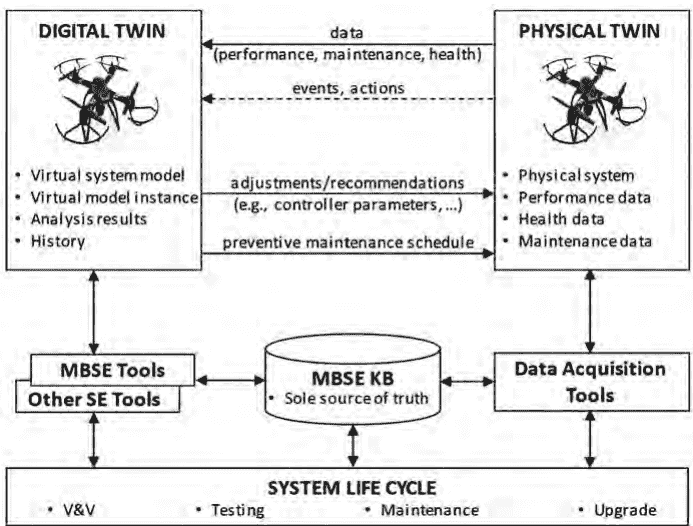

图6.1 数字孪生与基于模型的系统工程之间的关系 [11]。

为应对复杂性，异构领域仅在典型开发过程的第一阶段（架构设计）和最后阶段（集成）被视为一个整体。在中间阶段，模型使用不同语言和工具并行开发，彼此相互独立，但可通过语义调解实现平滑集成 [9]。为便于对模型构建和集成程序进行严格描述和验证，MBSE最近获得了基于范畴论数学框架的正式基础 [10,11]。事实上，范畴论是高等代数的一个分支，专门旨在对不同本质的对象及其之间的关系进行统一表示 [12]。

本章介绍了促进数字孪生基于模型的设计与开发的关键技术。我们展示了，由先代数技术赋能的创新数字技术使数字孪生的构建与运行具有成本效益，同时保持足够的完整性、准确性和实用性，以满足实际用途。

本章组织如下。第6.2节介绍基于模型的数字孪生架构。第6.3–6.8节分别对以下关键技术进行概述：数学建模、物联网（IoT）、交互式示意图与增强现实（AR）、电子文档管理、主数据管理以及本体建模。第6.9节介绍基于范畴论的数字孪生构建代数方法。第6.10节概述了一些结论和进一步研究的方向。

### 6.2 基于模型的数字孪生架构

存在不同的数字孪生架构分解方法 [1]。例如，有人提出分层架构，物理资产位于最底层，智能控制服务位于顶层，中间是各种中介组件。或者，功能分解用于将数字孪生拆分为数据存储、信息交换、计算、可视化等其他模块。相比之下，MBSE视角建议按种类和观点不同的模型进行分解，突出数字孪生相对于其他数字系统的特殊性。典型的数字孪生由以下类型的模型组成 [3]：

- 本体模型；
- 数字图表与可视化；
- 电子文档；
- 信息模型；
- 实时数据；
- 数学与仿真模型。

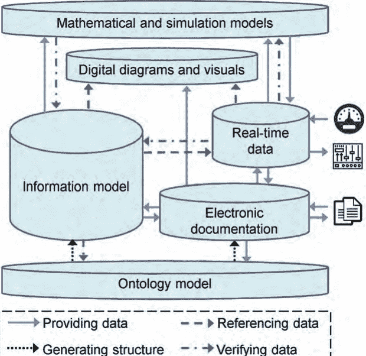

图6.2
基于模型的数字孪生架构。

为便于访问模型，模型通常被设计为（微）服务 [13]：面向服务的架构向用户隐藏模型实现细节，并在协调模型之间的交互方面提供灵活性。在资产运行期间，模型彼此之间以及与环境进行密集交互。模型交互用例包括数据交换、数据引用、跨模型数据验证和数据结构生成，如图6.2所示，并将在下文详细说明。

### 6.3 数学建模与仿真

资产的（广义）数学模型直接实现其数字孪生的目的：分析资产运行状态，并确定将其带入（次）最优状态所需的控制命令和/或建议。

分析包括对未知或缺失状态变量的评估，以及对未来某一时期变量值的预测。控制动作随后通过求解在资产状态空间上旨在最大化性能和/或最小化损失的优化问题来确定。

为了更全面的分析与控制，适用于模拟（即在数字环境中模仿）资产在不同运行场景下行为的模型。广泛使用仿真是MBSE最重要的成就之一。在设计阶段，仿真有助于比较特定设计问题的替代解决方案。以交互式图形动画形式显示时，仿真可作为培训资产人员的教学工具。在孪生复杂多步骤过程时，数字孪生采用一种称为离散事件 [14] 的特定类型仿真。离散事件仿真将资产行为表示为类型化事件的离散序列，这些事件指示资产状态和环境中的基本变化。

许多工具支持数学模型和仿真的构建与执行，规模从智能手机应用到超级计算机套件不等。小规模模型可用于数字孪生的快速原型开发，或用于孪生简单资产。像电力系统这样的大规模资产需要更强大的工具。目前，存在三种根本不同的模型类型：

- “从原理出发”（物理、生物、经济等）模型，基于对涉及资产的现象进行描述的方程和优化问题的数值求解；
- 基于历史资产状态和行为数据的机器学习的统计模型，包括神经网络；
- 资产专家知识和决策模型，如基于规则的系统和多代理系统。

基于求解离散化代数、微分和随机方程的数值模型在计算机辅助工程（CAE）软件中拥有悠久的发展历史。CAE工具包括用于机械与多物理场应力分析（采用有限元法（FEM）或所谓的无网格方法）、计算断裂力学、多体动力学与运动学、计算流体力学、计算电磁学以及许多其他领域的求解器和优化器。传统上，CAE工具旨在用于设计办公室，以评估工程师的决策，在非常宽松的时间约束下处理手动输入的数据。近年来，广泛可用的计算机性能已足以在资产运行的同时以软实时方式执行CAE算法，处理来自传感器的数据。这使得CAE可以在资产运行阶段用于数字孪生。


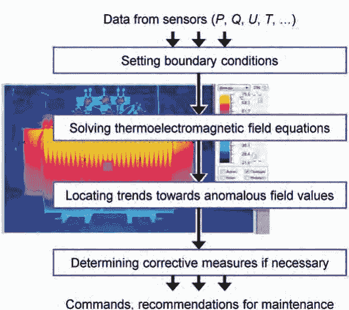

图 6.3
电力变压器模型。

例如，图 6.3 展示了一个电力变压器的热电磁模型 [15]。该模型将高精度（超过 95%）与实时计算速度相结合。模型的输入数据包括功率、电压、温度和变压器油的特性，由安装在变压器上的传感器持续测量。后者被近似为具有模拟技术间隙的介电放置的非线性铁磁路。在任何时刻，收集的输入数据确定场方程的边界条件和系数。然后使用有限元法（FEM）求解方程，以计算变压器本体中的磁场和温度分布。然后，后处理器将当前的场分布与早先计算的分布进行比较，定位向异常值发展的趋势，并在必要时确定（次）最优纠正措施：变压器的部分或完全卸载（将自动完成）和/或维护程序。基于此模型的电力变压器数字孪生体（DT）延长了变压器的使用寿命，提高了安全性，并降低了维护成本。

当待数字孪生的过程由未知规则（通常超越物理学）和/或包含隐藏的易变模式所控制时，适用基于机器学习的模型。此类模型在未经过显式编程的情况下，从训练样本（即一组在影响因素（特征）不同值下观察到的资产行为场景）进行外推，从而进行预测或决策。最广为人知的机器学习模型基于人工神经网络；其他模型包括决策树、贝叶斯网络和遗传算法。模型的准确性主要取决于唯一相关特征的识别质量和样本的统计质量。

例如，深层（多层）人工神经网络应用于智能电网数字孪生体中的能源负载/生成/价格预测、电力机器健康评估与预测、故障诊断以及其他控制程序 [16]。具有针对时间序列预测定制架构的神经网络，例如 LSTM（长短期记忆网络），可以仅通过查看能源剖面来进行预测，而无需了解生成和消耗过程的物理原理。为了提高预测精度并降低不确定性，数据集被增强了辅助特征，例如能源市场需求或天气条件。为了识别相关特征并生成丰富的训练样本，用于离线电网仿真的高端 CAD 类软件很有用。高质量的样本允许训练模型达到 95% 或更好的准确率。

数字孪生体还可以包含另一种基于以机器可读格式呈现的专家知识的模型。与监控和控制相关的大量知识可以表示为“IF condition THEN action”形式的规则。数字孪生体持续评估此类规则，并在实时数据满足其条件时立即发出规定的操作 [17]。更复杂的决策场景涉及多个推理方，它们受不同甚至相互冲突的意图驱动，但旨在达成共识。这些方被建模为通信软件代理。例如，一个代理代表微电网中的每个分布式能源资源（DER），旨在最大化 DER 的经济效益，最优电网运行模式由代理之间在可靠性和电气稳定性约束下达成的共识决定 [18]。

上述概述证明，为数字孪生体配备同一现象的几种根本不同的模型以相互校准和验证是合理的。此外，通过深度交织不同模型来提高精度的方法正变得越来越流行。例如，考虑所谓的物理信息神经网络：其损失函数（需要通过训练最小化）不仅包括纯统计误差，还包括对相关物理定律违反的某种度量。对于电力系统数字孪生体，此类网络可以训练成采用与孪生电网相似的拓扑。即使电气模式数据仅对有限数量的电网节点可用，该网络也能以可接受的精度求解潮流问题 [19]。

数学模型（因此也是整个数字孪生体）的主要用例包括：

- 多标准评估和预测资产运行和性能指标；
- 确定、优化、测试和应用运行模式、命令和控制设备设置；
- 预测性设备健康监测、故障率评估和维护需求；
- 模型和控制算法的校准与验证；
- 设计决策的验证与评估；
- 资产操作人员的全面虚拟培训。

### 6.4 物联网

物联网以准实时的方式向数字孪生体提供描述资产及其环境实际状态的数据。物理传感器或虚拟传感器生成这些数据：电表、控制器、音视频录像机、人机界面以及各种信息系统。因此，数据包括测量或计算的物理量的时间序列、事件日志、多媒体流、经济指标等等。例如，电力系统数字孪生体会收集电网节点的电气模式参数（有功功率、无功功率、电流、电压、相位、频率）、设备状态和健康变量、遥信信号、天气条件以及能源市场指标。

每个收集的数据值都会附带元数据，包括数据类型、时间戳和源标识符（对相应信息模型元素的引用）。实时数据到达数字孪生体后，会被存储到快速存储（如时序数据库 TSDB）中，然后根据需要传输到其他组件进行处理。

物联网还封闭了基于数字孪生体的控制回路，将由数学模型确定的命令和设置传输到资产控制器和执行器。因此，作为资产与其数字孪生体之间实时双向交互的便捷技术，物联网无可替代。然而，物联网本身也存在某些缺陷，主要与安全性、复杂性和连接性相关 [20]。诚然，物联网设备对黑客很有吸引力：它们通过互联网共享事实数据，且由于价格限制阻碍了对固件级安全性的投资，因此易受攻击。同时，诚实的程序员在编写代码以对齐、汇总和预处理来自众多互操作性较差的来源的高维不规则数据时也面临困难。

无论如何，数字孪生体根据以下主要用例使用实时数据：

- 评估资产整体及其各部分的状态；
- 检测状态变量的超范围值，尤其是应急指标；
- 为数学模型和仿真模型提供输入数据；
- 在不同条件下收集资产运行的观测历史；
- 搜索资产行为中的模式；
- 信息模型的结构识别与参数识别及验证；
- 数学模型和仿真模型的验证，包括回溯预测；
- 生成和验证运行报告；
- 在表格、图表、图形和直方图中可视化状态变量。

### 6.5 交互式图表与增强现实

在二维中，图表以符号形式表示特定对象之间的关系：空间关系（地图或布局）、因果关系（流程图）、分类学关系（类继承层次结构）、部分整体关系（产品结构图）、目的论关系（目标图）以及这些关系的任意组合。在三维中，几何模型以虚拟方式显示物理资产，仿佛它是真实的。数字格式的图表可以非常大，但由于具有缩放、浏览、旋转和搜索功能，仍可理解。众多工具支持以多种格式创建和显示图表和视觉元素，从智能手机图表编辑器应用程序到 CAD 套件，再到行星级地理信息系统（GIS）。为了便于从各个方面对复杂资产进行图表化描述，基于模型的系统工程（MBSE）推广了此类工具，例如系统建模语言（SysML）。

在信息丰富的环境中，可以通过将符号与描述其所指对象的数据关联起来，使图表具有交互性。此外，AR 技术可以在通过数字相机查看的真实物理资产相关部分旁边显示符号和数据。例如，几种类型的图表和视觉元素表示电力系统：单线图、建筑电气平面图、电力输电线路地图、设备维护流程图等。当图表具有交互性时，它们会显示电网节点中关键模式参数的当前值，并突出显示异常值。AR 改善了设备维护和修理：考虑第 6.3 节中描述的电力变压器数字孪生体，当工作人员通过智能手机或头显检查变压器外壳时，它能够以亮色突出显示异常磁场或温度的位置（参见图 6.3 中的背景图片）。数字孪生体还可以指导修复异常所需的维护程序 [21]。

以下用例定义了数字孪生体如何使用图表和视觉元素：

- 作为符号化图像，以紧凑且用户友好的方式呈现资产结构和状态的视觉呈现；


- (软) 实时指示重要事件发生位置；
- 基于拓扑标准搜索关于显示关系的资产部件信息；

### 6.6 电子文档管理

文档是一个人或机器可读的、具有唯一标识的自包含信息单元。每个文档都有关联的元数据：标题、作者、关键字等。各种标准用于定义元数据的结构和语义，最好参考领域本体 [22]。为实现永久存储，带有元数据标注的文档被放入按文档主题组织的文件夹层级档案中。档案通常有纸质备份，电子文档的纸质副本打印并放入其中，而入库的文档则从中扫描。纸质备份有助于避免丢失和未经授权的更改。然而，如今，另一种防止文档被篡改的方法已可用：文档的哈希在创建时存储在区块链中，并在访问时进行验证。

以下用例与作为数字孪生一部分的电子文档相关：

- 以自包含半结构化人类可读形式呈现关于资产的信息；
- 识别和验证执行控制操作的原因和权限；
- 提取本体概念、关系和公理；
- 设计数字图表和可视化；
- 更新和验证信息模型；
- 更新和验证实时数据；
- 按上下文和元数据搜索文档；
- 收集文档档案。

### 6.7 主数据管理

主数据描述资产结构和静态属性，为资产业务交易和操作提供上下文（包括数学模型的参数）。主数据以实体、属性和关系的机器可读形式结构化，构成资产信息模型。主数据可以从资产文档导入信息模型，也可以从模型导出到文档。

主数据最便捷的存储是关系数据库。它提供许多优势，包括数据准确性、完整性、灵活性、可扩展性和安全性 [23]。例如，考虑电力系统信息模型。其核心由已安装电力和控制设备的综合数据库组成：发电机、变压器、耗电设备、开关、控制器、电信信道等。数据库表格按设备分类形成继承层级。每个表有许多类特定属性，从各个方面描述设备：识别、性能、工作条件、所有权/租赁、成本、控制、维护等。辅助表存储设备数据库记录所引用的信息：关于能源设施、电网拓扑、测量和控制信道。

作为数字孪生组件的信息模型的主要用例是：

- 为数学模型和仿真模型提供主数据；
- 将实时数据与资产部件进行细粒度绑定；
- 为部件分配唯一标识符；
- 部件级细粒度数据访问控制；
- 在资产生命周期内收集资产变更历史；
- 通过与实际资产结构比对验证主数据；
- 基于属性的部件信息搜索；
- 生成和验证资产设计和施工文档；
- 在表格和层级树中可视化资产结构和部件属性。

### 6.8 本体建模

领域本体是改善不同模型之间互操作性的广泛认可工具。本体正式描述领域概念的逻辑结构，包括其定义、属性以及彼此之间的关系。在设计前几节中介绍的任何模型时，本体作为语义可靠的领域术语和知识来源。

本体表示为概念的分类树，这些概念被赋予各种类型的属性，通过各种关系（等价性、邻近性、部分整体关系等）关联，受各种公理约束，并在各种个体中实例化。可以通过应用所谓描述逻辑的演绎规则，自动从公理中推导非平凡知识。在机器可读形式中，本体使用OWL（本体网络语言）编写，可使用Protégé等交互式编辑器等各种工具。

在作为数字孪生语义基础有用的本体中，中心作用由待孪生的*过程*分类学发挥：监控、控制、维护等。其他顶层概念的分类学与它们相关：*事件*触发过程，*参与者*启动过程并参与其中，设备和其他*资源*被使用/受影响，而*模型*正式代表一切 [24]。公理表达物理定律、设计规则和控制目标。

例如，本体建模在电力行业有着悠久的历史 [25]。领域概念的参考来源是IEC 61968、61970和62325标准中规定的公共信息模型（CIM），用于电力相关信息系统之间的互操作性。然而，CIM不描述能源过程，因此对于数字孪生来说不够。一些缺失的概念在智能设备参考（SAREF）本体家族中规定，该家族设计用于与物联网设备交互；基于领域分析的全球能源本体（DABGEO），声称是能源管理场景的完整语义描述；以及其他相关来源。

本体在以下用例中作为数字孪生的语义基础：

- 信息模型结构生成；
- 参考数据维护；
- 通信协议设计；
- 服务质量模型开发；
- 文档模板和用户界面表单开发；
- 公理推理和设计决策验证；
- 学习领域知识。

### 6.9 数字孪生组合的代数方法

为了自动化数字孪生组合，尤其是在采用生成式设计时，迫切需要一种严格的形式化描述和验证技术。如前所述，这种技术可以建立在范畴论的数学框架之上。范畴论通过将表示重点从模型的内部内容转移到彼此之间的行为上（系统工程师的“黑盒”观点），使组合性与模型的其他方面分离。

回顾，范畴是一类由态射（箭头）两两相关的抽象对象。精确定义仅需几行：范畴C由对象类Ob C和态射类Mor C组成，并赋予以下运算。首先，每个态射f关联两个对象：定义域（箭头源）dom f和陪域（目标）codom f，使得等式对dom f=A和codom f=B被描绘为箭头f：A → B。其次，对于任何满足codom f=dom g条件的态射对f、g，定义态射的复合g ∘ f：dom f → codom g，并且它是结合的：对于任何三个态射f、g、h，使得codom f=dom g且codom g=dom h，等式h ∘ (g ∘ f)=(h ∘ g) ∘ f成立。第三，任何对象A都有一个关联的恒等态射1A：A → A，使得对于任何态射f：A → B，都有f ∘ 1A=1B ∘ f=f。范畴的一个经典例子是Set，它由所有集合和集合间的所有映射组成：映射的复合律由标准代换定义，集合的恒等映射将每个元素映射到自身。

在MBSE语境中，我们用C表示一个用作虚拟“模型目录”的范畴。此类目录范畴的对象是某一类型的所有可能模型。其态射描述了在从组件组合系统时可以对模型执行的所有操作。根据模型类型，操作包括变量替换、引用解析、子模型嵌入、商运算等。可以轻易看出C确实是一个范畴，因为它具有态射的复合（操作的顺序执行）和恒等态射（对任何模型的空闲“什么都不做”操作）。由多个模型（如数字孪生）组成的复杂系统配置，在C中表示为一个图。

例如，考虑信息模型的范畴表示 [26]。在这里，对象是填充数据库表的类型化数据集，态射由外键生成，作为表之间的映射，将它们组合成具有复杂结构的数据集。因此，与某一领域相关的所有可能信息模型构成Set的一个子范畴。此类范畴中的图显示了如何组合数据库。

数学模型作为数字孪生组件中最重要的部分，在范畴化表示方面在技术上最困难。例如，提出了一种将DERs表示为状态由功率需求区域标记的有限自动机的范畴表示，以形式化DER聚合并解决潮流问题 [27]。作为一个较少涉及但贴切的例子，考虑离散事件仿真。回顾第6.3节，仿真是代表某些运行场景的类型化事件的离散序列。代数上，场景由因果依赖部分排序并按事件类型标记的事件集表示；场景组装操作定义为保持顺序和标签的映射（即同态）[28]。所有场景和组装操作构成一个表示为Pomset的范畴。


在任意范畴 C 中，被称为共极限的普遍构造被严格地定义。给定一个图式，其共极限（若存在）将其转化为图式所表示结构的整体复杂模型。概念上，共极限以代数术语表达了系统作为“容器”的常识观点，该容器包含所有部分，尊重它们的结构互连，且不包含其他内容。

考虑最简单的非平凡共极限，称为推移（pushout），适用于跨跨形图式 f : P <- G -> S : g。该图式可解释为由部分 P 和 S 通过“胶水” G 连接而成的系统结构。各种整合异构数据量、模型或整体系统的中介均可表示为胶水。在信息模型设计中，两个表之间的“多对多”关系（例如，行为者（法人实体）与设备单元之间的所有权/租赁关系）可充当胶水。在离散事件仿真中，胶水例如可表示一个控制器，该控制器建立两个设备单元（如风力涡轮机和电能存储装置）的（次）最优协调运行。一般来说，通过胶合构建的目标完整模型应同时包含两个部分，并以追踪胶水通过任一部分的包含关系等同于同一动作的方式尊重胶水。此外，目标模型除两个胶合部分外不应包含任何内容，即，它应在任何包含这些部分并尊重胶水的任意模型中被明确确定。图 6.4 以交换图式的形式呈现这些准则，其中顶点 R 表示目标模型，边 p : P -> R 和 s : S -> R 分别表示 P 和 S 进入目标模型的包含关系，T 表示一个任意的封闭模型。很容易验证，对象 R（若存在）至同构意义下被唯一确定。在温和的技术条件下，任何有限图式的共极限均可通过一系列推移计算得出。

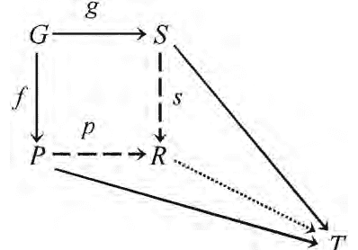

图 6.4 推移。

在形式化生成式设计技术时，合适的图式范畴表示设计空间。将资产的要求翻译为构成范畴 C 的模型语言，通过检查一个图式是否表示可接受的资产候选配置来约束设计空间。例如，考虑一种简单情况：要求完全指定目标资产，并规定通过胶合两个指定部分来构建它，但胶水未指定。借用上述推移图式的记法，假设完整模型 R、部分模型 P 和 S 以及包含动作 p : P → R 和 s : S → R 已知且固定。生成式设计程序即为寻找最优（相对于某个客观函数）胶水模型 G 和动作，它们构成一个跨跨形图式，其推移生成模型 R。在许多实际情形中，当 C 由带有某种结构的集合组成（包括信息建模和仿真）时，胶合设计空间使用以下定理构建，该定理源自文献 [29] 中的命题 2。

#### 定理 1

设 P、S、R 为集合，p : P → R ← S : s 为一对映射，[p, s] : P ⨿ S → R 为在 P 上作用为 p、在 S 上作用为 s 的规范映射。存在具有边 p 和 s 的推移的跨跨形图式，当且仅当对于每个 r ∈ R，只要集合 p⁻¹(r) 或 s⁻¹(r) 中任一为空，就存在唯一的 t ∈ P ⨿ S 使得 [p, s](t) = r。

应用于信息模型设计，该定理为在给定指定记录如何关联的数据集的情况下，重建两个表之间最小（按记录数计）的“多对多”关系铺平了道路；例如，考虑一个建立上述设备所有权/租赁关系的文档存档。在离散事件仿真中，该构造生成一个控制器的最小（按事件数计）场景，该控制器执行给定过程，包括两个设备单元的协调运行。

更复杂的生成式设计问题可通过根据某些优化策略（例如梯度下降）沿图式态射导航设计空间来解决。导航路径可通过计算机代数计算。为了表示复杂异构资产（如电力系统）的设计空间，适用高级范畴构造，例如多逗形构造 [30]。

### 6.10 结论

基于模型的数字孪生关键技术和代数技术旨在使数字孪生的构成和运行具有成本效益，同时保持足够的完整性、准确性和可用性。我们已在小型分布式能源资源卖户设施的数字孪生上成功测试了这些技术 [3]。现在我们正在规模化这些技术 [31] 并将其应用于其他类型的资产 [30]，这需要在多个方向上开展进一步研究。

## References

- [1] G. Steindl 等, “面向工业能源系统的通用数字孪生架构,” 应用科学, vol. 10, p. 8903, 2020.
- [2] A. Rasheed, O. San, 和 T. Kvamsdal, “数字孪生：来自建模视角的价值、挑战和推动因素,” IEEE Access, vol. 8, pp. 21980–22012, 2020.
- [3] S. K. Andryushkevich, S. P. Kovalyov, 和 E. Nefedov, “基于本体建模的电力系统数字孪生的组合与应用,” 在第 17 届 IEEE 工业信息学国际会议 INDIN’19 论文集中，pp. 1536–1542, 2019.
- [4] H. Sun 和 L. Ma, “在基于密度的结构拓扑优化中使用强化学习探索方法进行生成式设计,” Designs, vol. 4(2), p. 10, 2020.
- [5] P. Palensky 等, “数字孪生及其在未来电力系统中的应用,” Digital Twin, vol. 1, p. 4, 2021. doi:10.12688/digitaltwin.17435.1.
- [6] S. P. Kovalyov, “开发电力系统生成式设计技术的一种方法,” 在第六届国际研讨会 IWCI’2019 论文集中，智能系统研究丛书, vol. 169, pp. 79–82, 2019.
- [7] C. Brosinsky, D. Westermann, 和 R. Krebs, “电力系统控制中心的近期与未来发展：将数字孪生技术应用于电力系统控制中心,” 在 IEEE 国际能源会议 ENERGYCON 论文集中，pp. 1–6, 2018.
- [8] A. M. Madni, C. C. Madni, 和 S. D. Lucero, “在基于模型的系统工程中利用数字孪生技术,” Systems, vol. 7(1), p. 7, 2019.
- [9] H. Broodke, U. Shani, 和 A. Sela, “模型集成 - 从 MBSE 中提取价值,” INCOSE 国际研讨会, vol. 23(1), pp. 1174–1186, 2014.
- [10] M. A. Mabrok 和 M. J. Ryan, “范畴论作为基于模型的系统工程的形式数学基础,” 应用数学与信息科学, vol. 11(1), pp. 43–51, 2017.
- [11] S. P. Kovalyov, “范畴论作为基于模型的系统工程的数学实用主义,” 信息学与应用, vol. 12(1), pp. 95–104, 2018.
- [12] S. Mac Lane, 面向工作者的范畴论. 第 2 版. Springer, Cham, 1998, 314 p.
- [13] M. Redeker 等, “面向工业 4.0 的数字孪生平台,” 在 Data Spaces 中，Springer, Cham, 2022, pp. 173–201.
- [14] G. Tsinaraksis, N. Sarantinouidis, 和 G. Arampatzis, “数字孪生概念下工业系统的离散过程建模与仿真方法,” 应用科学, vol. 12, p. 870, 2022.
- [15] A. I. Tikhonov 等, “基于链和二维磁场模型创建电力变压器数字孪生的技术开发,” 西西伯利亚科学公报, vol. 29, pp. 76–82, 2020. [俄语]
- [16] Z. Shen, F. Arraño-Vargas, 和 G. Konstantinou, “电力系统中的人工智能与数字孪生：趋势、协同效应与机遇,” Digital Twin, vol. 2, p. 11, 2023. doi:10.12688/digitaltwin.17632.2.
- [17] W. Kuehn, “复杂生产和物流企业决策中的数字孪生,” 设计、自然与生态动力学国际期刊, vol. 13(3), pp. 260–271, 2018.
- [18] F. Z. Harmouch 等, “使用 T-cell 算法的多代理微电网实时运行最优能源管理系统,” Energies, vol. 12, p. 3004, 2019.
- [19] L. Pagnier 和 M. Chertkov, “电力系统中参数与状态估计的物理信息图神经网络,” arXiv, 2021. https://arxiv.org/abs/2102.06349. 访问日期：2023 年 4 月 15 日.
- [20] A. Sharma 等, “数字孪生：前沿理论与实践、挑战及开放研究问题,” arXiv, 2020. https://arxiv.org/abs/2011.02833. 访问日期：2023 年 4 月 15 日.
- [21] D. Mourztzis, V. Zogopoulos, 和 F. Xanthi, “支持高度定制产品装配并适应生产重新调度的增强现实应用,” 先进制造技术国际期刊, vol. 105, pp. 3899–3910, 2019.
- [22] M.-A. Sicilia (编), 元数据、语义学与本体论手册. World Scientific, 2013, 580 p.
- [23] P. Pedamkar, 关系型数据库优势. EDUCBA, 2020. https://www.educba.com/relational-database-advantages/. 访问日期：2023 年 4 月 15 日.
- [24] S. P. Kovalyov 和 O. V. Lukinova, “面向主动配电网数字孪生的集成热电能本体论,” 在 RSES 2021 论文集中，AIP 会议论文集, vol. 2552, pp. 080005-1–080005-8, 2023.
- [25] Z. Ma 等, “能源领域多代理系统中的本体论应用：一项范围综述,” Energies, vol. 12, p. 3200, 2019.
- [26] D. Spivak 和 R. Kent, “Ologs：知识表示的范畴框架,” PLoS One, vol. 7(1), p. e24274, 2012.
- [27] J. S. Nolan 等, “电力系统的组合模型,” 在 2019 年应用范畴论论文集中，EPTCS, vol. 323, pp. 149–160, 2020.
- [28] V. R. Pratt, “使用偏序建模并发性,” 并行编程国际期刊, vol. 15(1), pp. 33–71, 1986.
- [29] S. P. Kovalyov, “在基于模型的企业中利用范畴论,” 系统科学与应用进展, vol. 20(1), pp. 50–65, 2020.
- [30] S. P. Kovalyov, “异构网络物理系统设计的代数手段,” 在网络物理系统：建模与工业应用中，系统、决策与控制丛书, vol. 418, Springer, Cham, pp. 3–13, 2022.
- [31] S. P. Kovalyov, “电力系统数字孪生的设计与开发：一种基于模型的方法,” 在 2021 年第 3 届控制系统、数学建模、自动化与能源效率国际会议 (SUMMA) 中，pp. 843–848, 2021.


## 面向数字孪生的通用部署方法论——首个构建模块

Mohammed Adel Hamzaoui 和 Nathalie Julien

南布列塔尼大学罗里昂分校

### 7.1 引言

数字孪生（DT）技术在各个学科和工程领域中日益突出，在2019年Gartner互联网技术（IT）炒作周期中达到顶峰，并位列2020年趋势技术第三位（IEEE计算机学会2019）。该技术已应用于多个领域：

- 医疗保健：DT非常适合医疗保健4.0，应用包括数字患者、制药、医院和可穿戴技术（Erol、Mendi和Dogan 2020）。项目包括人脑计划、脑计划和蓝脑细胞图谱项目（Erö等人2018），以及基于患者的仿真模型（Sim和Cure 2022）、心脏数字孪生（van Houten 2018）、虚拟人类、医院部门数字孪生（Siemens Healthineers 2018）和用于患者观察的无线设备（Kellner 2015）。

- 智慧城市和建筑：近年来，由于信息和通信技术的广泛应用，城市已发展成为智慧城市，利用数据驱动模型和人工智能（AI）解决方案（White等人2021）。城市数字孪生包括都柏林码头区（White等人2021）、虚拟新加坡（Farsi等人2020）和苏黎世（Shahat等人2021）。智能建筑使用物联网和微传感器进行控制和提高效率，项目如西剑桥站点（Lu等人2020）和结构健康监测（Shu等人2019）。建筑信息模型（BIM）也已用于建筑数字孪生，鉴于该工具在建筑领域开发数字模型方面提供的优势（Kaewunruen等人2018）。

- 交通和物流：数字孪生已应用于交通和处理调度（Yan等人2021）、数字车间管理系统（Brenner和Hummel 2017）以及自动导引车（AGV）运输（Martínez-Gutiérrez等人2021）。应用还扩展到电梯（Gonzalez等人2020）、智能电动汽车（Bhatti等人2021）、管道数字孪生（Sleiti等人2022）、交通控制系统（Wang等人2021；Saifutdinov等人2020）和自适应交通控制系统（Dasgupta等人2021）。

- 能源4.0：数字孪生在能源生产、传输、存储和消费方面提供颠覆性优势（Karanjkar等人2018；Li等人2022）。示例包括机器人单元的能源消耗优化（Vatankhah Barenji等人2021）、能源物理网络系统（Saad等人2020）、电动汽车的能源存储系统（Vandana等人2021）和智能电气装置（Fathy等人2021；O’Dwyer等人2020）。

- 智能制造：工业中的数字孪生应用可分为四个阶段：设计、生产、服务和退役（Liu等人2021）。应用范围从迭代优化（Xiang等人2019）、虚拟验证（Howard 2019）、自动流水线生产系统（Liu等人2019）、自主制造（Zhang等人2019）、制造执行系统（Cimino等人2019）、启动阶段加速（Zhu等人2021）、基于时间的维护策略优化（Savolainen和Urbani 2021）、剩余寿命（RUL）评估（Werner等人2019），以及退役阶段的应用，如拆卸、再利用、处置、回顾和升级（Falckas和Karlis 2021）。

总之，DT技术已应用于各个领域，包括医疗保健、智慧城市和建筑、交通和物流、能源管理以及智能制造。广泛的应用范围和持续的研究展示了DT技术在解决众多问题并提高这些领域系统效率和效能方面的适应性和潜力。

### 7.2 数字孪生：在多样性追求与标准化需求之间

数字孪生是一种多方面的技术，涵盖一系列工具并涉及各种关注点和应用领域。为了在适应性和结构稳健性之间取得平衡，它必须采用不同的描述模型，遵循明确定义的标准，并利用高效的开发和部署方法。在接下来的章节中，我们将讨论提供数字孪生概念全面协同理解的关键模型和标准。为了涵盖所有这些模型，需要一种通用且标准化的方法，以便能够定义、实现并使不同应用所需的各种数字孪生得以运行；这正是本文的目的。

#### 7.2.1 工业4.0参考架构模型（RAMI 4.0）

该参考架构模型由德国电气电子制造商协会（ZVEI）开发，以支持工业4.0倡议，其创建者将其定义如下：“由一个三维坐标系统组成，用于描述工业4.0的所有关键方面。通过这种方式，复杂的相互关系可以分解为更小、更简单的簇”（Hankel和Rexroth 2015）。

第一轴是来自IEC 62264的“层级”，封装了各种工厂功能。第二轴是“基于IEC 62890的生命周期与价值流”，用于生命周期管理。第三轴是“层”，将机器分解为有组织的属性。尽管该模型对工业4.0组织做出了重大贡献，但其通用性并未特别将数字孪生作为一种独特技术予以解决。为了有效开发和部署数字孪生，可能需要采用更专业的方法。

#### 7.2.2 五维数字孪生模型

Tao等人（2019）在其著作中提出了一种范式，用以解释数字孪生技术。该模型由五个主要部分组成，每个部分反映数字孪生的一个关键特征。所提出的模型是对Grieves最初于2003年在密歇根大学产品生命周期管理（PLM）课程中引入的三维数字孪生模型的扩展（文献中首次提及见Grieves（2014））。

除了Grieves模型的三个维度——物理元素、虚拟元素以及数据和信息之外，Tao等人（2019）还添加了两个维度，如表达式（7.1）所示：

```
M_DT = (PE, VE, S_S, DD, CN) (7.1)
```

物理实体（PE）代表现实世界对象，而虚拟实体（VE）由一系列模型组成（Tao等人2019）。服务（S_s）服务于这两种实体，数据（DD）包含驱动数字孪生的信息。连接（CN）链接各种数字孪生组件。该模型有效涵盖了数字孪生的更广泛方面。S_s标准化并打包数字孪生功能，促进便捷且按需的使用。

#### 7.2.3 ISO 23247——制造业数字孪生框架

该ISO标准系列试图提供一个通用开发框架，该框架可实例化用于制造业中针对特定用例的数字孪生实现（国际标准化组织2021）。该标准分为四个部分：（1）概述与一般原则，（2）参考架构，（3）数字表示，以及（4）信息交换（Shao 2021）。这四个部分包括如何定义目标和范围、审查建模需求、鼓励使用通用术语、构建通用参考架构、协助可观测制造元素（OME）的信息建模，以及同步数字孪生与其OME之间的信息的说明（Shao 2021）。

#### 7.2.4 数字孪生能力周期表

数字孪生能力周期表（CPT）关注用例能力需求而非技术（Pieter 2022）。由全球生态系统数字孪生联盟（DTC）开发，它围绕相似特征对能力进行聚类，并解决总体需求、平台等问题。

CPT提案虽然前景看好，但不完整，因为它未为数字孪生能力提供组织指导，而依赖外部专业知识进行数字孪生开发。需要一份具有清晰流程和能力实施层次结构的结构化提案。

这些模型和标准有助于对数字孪生概念进行良好的形式化，并为处理这项技术以及其在向工业4.0和一般数字革命迁移过程中的整合奠定了基础。然而，无论应用领域及其专用用途如何，仍有必要开发一种用于该技术开发和部署的通用方法论。正是基于这一关切，我们通过本章提出了一种数字孪生的通用开发和部署方法论，该方法论围绕若干连续的抽象层次展开。

### 7.3 通用开发和部署方法论

关于数字孪生应当是什么存在多种定义，并且随服务、粒度、应用领域、技术侧重点和参与者而异（Boschert、Heinrich和Rosen 2018；Kritzinger等人2018）。数字孪生通常将预定义的仿真模型作为其唯一选项。然而，数字孪生的真正兴趣和困难在于


对所表示对象整个生命周期中的数据进行识别和管理，在不同信息系统中开发仿真模型，管理具有数值一致性和安全性的大数据，以及向各种用户公开管理过程（Lu et al. 2020; Negri et al. 2017; Uhlenkamp et al. 2019）。

#### 7.3.1 主要属性

DT不仅仅是数据或模型的集合；它也是一种基于信息和元信息的数据结构，能够组合模型以提供其应用所需的用途。DT属性必须随对象生命周期中所需的服务一起变化。其可通过以下属性来表征：

- 真实空间与虚拟空间之间持续的数字线程，以适当的同步速率（国际标准化组织 2021）。
- 能够以适当精度管理相关、可靠且安全的数据。
- 一种DT架构，允许在线和离线地永久增量、验证和增强模型。
- 通过形式化的决策回路对对象进行部分或完全控制。
- 学习能力。
- 与决策支持兼容的延迟下的预测能力。

#### 7.3.2 部署流程

为实施我们的部署方法，我们依赖于（Lee et al. 2015）中提出的著名的5C网物理系统（CPS）架构（图7.1）。因此，我们有五个部署流程，其中前两个（在配置层级和认知层级）与任何技术问题无关，而后三个阶段则逐渐涉及技术问题。推迟技术选择有助于开发通用架构和更高的模块化程度，从而便于重用基本构建模块，使DT的开发更加容易。我们的目标是在不一定有该领域专家的环境中为DT的部署提供支持。实际上，对DT的兴趣大多来自特定应用领域的专家。因此，实施通用方法论以指导需求的表达以及基于使用而非技术对DT进行尺寸设定，是将这项技术推广到非专业人士使用的必要条件。

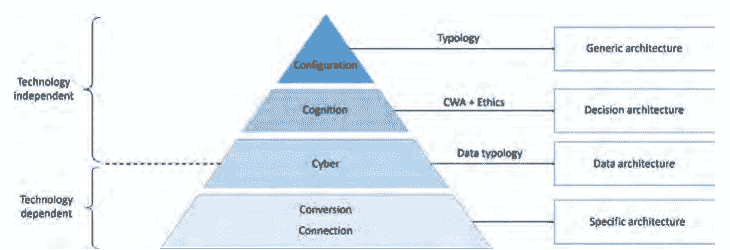

图7.1 基于5C CPS架构的部署方法论。

##### 7.3.2.1 配置

在配置层级，我们描述所需应用的DT架构关键属性。为此，我们提出了一种“类型学”，旨在有效地指导DT设计师通过此阶段，以创建第一个通用架构。该架构由13个标准组成，这些标准尽可能全面地表征DT及其交互，并将在第7.4节中详细说明。

##### 7.3.2.2 认知

DT朝着自主系统发展，引发了关于人机融合的问题。这导致发展了网物理社会系统，其中人类操作员是与系统交互的完全实现的实体（Perez et al. 2022）。需要一种合作策略，同时考虑人类和DT对物理对应体的影响（Kamoise et al. 2022）。这涉及研究交互模式、任务分配、决策层级，并识别存在伦理问题的情境。

##### 7.3.2.3 网络层级

关于此部署层级，将有必要建立DT将拥有的数据架构的初步草图，以及识别DT内部的数据生命周期。正是在此层级，最初的技术选择开始被做出，甚至包括识别这些技术选择将源于的需求（去中心化、网络安全、系统响应性等）。已经制定了数据流图，以表示数据生命周期，并增强以根据适应需求的数据量调整DT架构的尺寸。

##### 7.3.2.4 转换与连接

在这些层级上，我们将通过指定互连和通信协议（软件和硬件接口）并优先使用标准工具（如面向过程控制的统一架构OPC-UA、机床连接性MTConnect、消息队列遥测传输MQTT）来逐步完善先前定义的架构。这些选择随后可以根据应用环境影响传感器和数据采集方法的选择。事实上，许多选择可以根据应用环境做出，因为公司中已经存在的技术通常会被优先采用。这些步骤的目标是生成指标，以便比较各种技术选择，从而选出在成本、性能、敏捷性、安全性等方面最能满足需求的架构。

### 7.4 类型学

下文，我们概述了构成我们DT类型学的13个特征。这些标准旨在通过定义DT将需要提供高效DT响应的基本和根本需求（用户需求）来建立DT的通用架构（而且这仍然不涉及对DT组件的任何技术选择）。

#### 7.4.1 DT实体

ISO/DIS 23247标准将实体定义为“具有明确存在的事物（物理或非物理）”，并将OME定义为在制造中具有可观察物理存在或运行的项目。OME包括设备、材料、人员、工艺、设施、环境、产品和支持文档。但是，由于我们的类型学不仅限于制造应用，我们选择将此对象称为DT实体。

#### 7.4.2 类型

根据Grieves and Vickers (2017)中Grieves对DT的分类，存在三种不同的类型：DT聚合体、DT原型和DT实例。原型主要用于设计过程。实例描述了特定的生产相关设备。聚合体由在同一实体的运行或维护阶段部署的所有DT实例组成。

#### 7.4.3 层级

DT层级定义为四个不同的层级：

- 组件，基础层级，设备或系统的一部分。
- 设备，由组件组成，系统或系统的系统的一部分。
- 设备可以是系统的一部分。
- 系统的系统，由系统组成。

以AGV为例，你可以将此DT实体视为设备的一个组件，因为它与生产线交互但没有内部信息；或者你可以将其视为生产线这一系统的一部分，而生产线由电池、发动机、车轮等组成，我们可以对其进行监控和维护。

#### 7.4.4 成熟度

我们已根据成熟度对数字表示进行了分类，如图7.2所示，以区分数字影子、数字镜像和DT。数字镜像是描述事物及其行为的数学模型集合，很像3D仿真，但没有任何实际的物理或数字交互。

物理项目的所有数字活动都由数字影子表示，该影子还通过单向线程跟踪其物理对应体的所有变化来实现动态表示。在第三步中，物理部分和虚拟部分合并在所谓的网物理系统中，其中DT代表该系统的数字部分。除了DT自身的通信外，DT向物理对象的部分或完全控制反馈在实时通信中也是可行的。

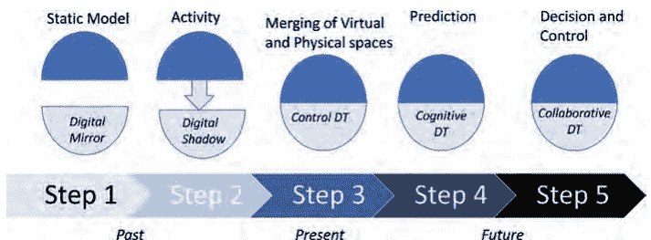

图7.2
数值成熟度（Julien and Martin 2021）。


到物理对象。通过将预测能力纳入此控制DT，它可以演变为认知DT。并且，甚至可以发展为协作DT，对其对象拥有更多的决策和控制，以及人机交互和协作。

#### 7.4.5 拓扑

它阐明了可观测制造元素与其数字副本之间的关系。我们将Schroeder等人（2021）的提议扩展到以下四种拓扑：

- 断开，DT与其实体之间没有直接连接，信息来自外部组件或用户。这种配置也称为pre-DT，实际上在物理实体和虚拟实体连接之前，预示了实际DT在其早期设计阶段进行验证和测试。
- 连接，DT与其实体直接连接：
  - 嵌入，DT包含在其实体中，通信可能得到便利，但计算能力将受到限制。
  - 分离，即使DT与其OME相关联，它在物理上仍与其保持距离。
  - 联合，这代表了上述两种拓扑之间的中间状态，因为DT的一部分嵌入在OME中，而另一部分在物理上与其保持距离。

#### 7.4.6 同步

现在DT与其实体已相连，它们可以直接或间接地相互通信。根据ISO/DIS标准，下一个挑战是确保这种通信以“适当的同步率”进行；但是，取决于应用，通信可以异步进行（基于事件、基于条件、按需）或同步进行（实时、准实时或周期性）。取决于目的，可变同步也是可以设想的。

#### 7.4.7 决策循环

Traore（2021）提出了孪生循环的概念，用于描述DT与其实体（称为关注的孪生体）之间的通信，考虑到由此通信产生的决策可以由人类（开环）或DT本身（闭环）做出。由于DT通常只对其对象拥有部分控制权，我们通过添加第三种选项——混合环——改进了这种表示。此外，我们可以考虑决策回路可能会根据用途而变化。应当注意的是，如果从虚拟表示到实体没有直接或间接的回路，那么这不是DT，而是数字镜像或数字影子。

#### 7.4.8 用户

国际标准化组织（2021）指出，必须为不同性质的各类DT用户提供合适的接口，例如：

- 人类
- 设备
- 软件/应用程序
- 另一个DT

#### 7.4.9 用途

Julien和Martin（2021）提出了七种可以组合以获得服务和应用程序的用途：

- *分析*：控制、监控、调节....
- *仿真*：设计、性能改进、管理...
- *优化*：针对产品、流程、工作站...
- *认知*：预测未来情况或风险，
- *协作*：与人类、系统、其他DT或工厂协作...
- *比较*：预测情况与实际情况之间，用于决策支持和适应，
- *概念化*：将可视化信息转换为符号化信息以与人类沟通。

用途的层次结构根据模型如图7.3所示。首先将使用模型和收集的数据执行分析和仿真。在此层面上，产品和流程的可见性和可追溯性是控制DT的主要贡献。因此，借助这些结果结合人工智能算法，将能够创建优化和预测，使DT模型获得更高的预期能力并提供认知DT。最后，DT将通过与其物理或虚拟环境的协作迈向自主；这种协作DT能够提供沉浸式环境和分析仪表板。

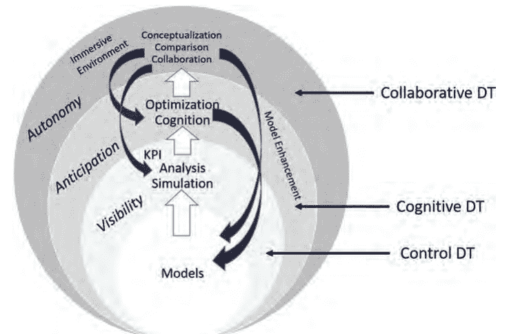

图7.3
用途层次结构。

#### 7.4.10 应用

根据ISO/DIS标准，DT的应用包括：

- 实时控制
- 离线分析
- 预测性维护
- 健康检查
- 工程设计

DT的发展将越来越多地影响业务运营，尤其是生产管理和预测性维护。目前，我们发现了三种额外的典型DT应用：

- 在线重构
- 诊断支持
- 操作员培训

最初，我们的分类法包含十个元素，但在将其应用于工业项目进行验证后，为了更好地表示DT概念及其演化，增加了三个新标准：“版本”、“精度”和“模型”。

#### 7.4.11 版本

这指的是DT在其生命周期中可以拥有的不同版本。例如，特定设备可能有一个DT内部版本（在DT开发者或供应商处）（IV0）。该版本以后可用于开发另外两个内部版本，一个是原型版本（IV1），另一个是聚合版本（IV2）。此外，这些版本可用于开发专门用于客户的新版本（EV0），其功能将根据客户需求进行调整。

#### 7.4.12 精度

精度与DT验证的主要指标相关，换句话说，是指DT应以何种精度水平响应，以便为明确表达的运营需求提供解决方案。这可以以“固定”方式完成（无论遇到何种情况，都保持相同的精度）、“可变”方式（DT适应其面临的情况，并根据需要调整其精度，因此它具有一定的自主性）或“可配置”方式（精度根据预定情况而变化，DT因此预先参数化，以便在面对预定情况时调整其精度）。Julien和Hamzaoui（2022）讨论了DT动态精度管理的一个示例。

#### 7.4.13 模型

对物理对象进行数字复制的建模需求可以分为三个标准：现实性、精度和通用性（Levins 1966）。现实性涵盖底层过程，精度衡量精确性，通用性指模型在各种情境中的适用性（Dickey-Collas等人 2014）。Levins（1966）指出，模型开发涉及在三个标准中偏好两个而牺牲第三个，从而产生经验模型、机理模型和分析模型。

另一种分类识别了“概率”（随机）模型和“确定性”模型。确定性模型在没有随机性的情况下精确计算未来发生情况，而随机模型处理输入不确定性，导致在相同初始条件下出现不同的结果。有时，需要同时使用这两种模型的混合模式。

### 7.5 分类法的全面性

为了评估所提议的分类法在多大程度上以足够详尽和全面的方式描述DT，我们决定将其与文献中可用的最强健模型——即5D模型——进行对比。这样做是为了查看它与形式化DT概念的理论概念的一致性程度。我们可以通过图7.4看到，拓扑的所有元素都完美契合DT的5D表示。此外，我们识别了与DT交互的直接环境，同时强调了每个概念（DT、网络物理系统和社会网络物理系统）的不同边界和边缘。

通过扩展5D模型，我们希望迈出识别DT直接环境的第一步，接着是其内部动态、因潜在交互而产生的演化，最后是对DT运行所在生态系统的精确描述。

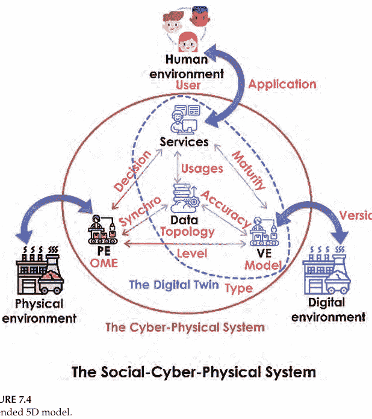


### 7.6 用例与应用

我们展示所提呈类型学的应用，以展示其在识别数字孪生需求和确定功能规模方面的优势。在我们的团队中，我们正在不同的应用和项目上测试我们的方法：辅助设备、增材制造、维护4.0、电池设计、土木工程和数据中心可靠性。表7.1总结了三个数字孪生的类型学。

TABLE 7.1

不同用例的类型学应用

| 应用标准 | 锂离子电池设计 | AMR车队 | 预测性维护 |
|:---|:---|:---|:---|
| 数字孪生实体（OME） | 电池 | 机器人/车队 | 机器 |
| 类型 | 实例 | 实例/聚合 | 实例 |
| 版本 | 内部版本IV0 | 内部“实例”版本IV0 内部“聚合”版本IV1 | 内部版本IV0 |
| 层级 | 设备 | 设备/系统 | 设备 |
| 成熟度 | 控制数字孪生 | 协作数字孪生 | 认知数字孪生 |
| 拓扑 | 断开 | 嵌入式连接/不连通连接 | 连接 |
| 决策回路 | 开环 | 混合环 | 开环/混合 |
| 用户 | 人工代理：设计工程师 | 人工代理/车队数字孪生 | 生产和维护经理及操作员 |
| 用途 | 分析/比较 | 仿真/优化/协作 | 分析/认知 |
| 应用 | 离线分析 | 实时控制/轨迹优化 | 健康诊断和预测性维护 |
| 同步 | 同步 | 同步/异步 | 同步 |
| 准确度 | 固定（针对指标：健康状态和充电状态） | 固定（针对指标：吞吐量） | 可配置 |
| 模型 | 经验（电气等效电路模型）→ 确定性 | 解析（运动模型）→ 确定性 | 解析（马尔可夫链）→ 概率性 |

#### 7.6.1 锂离子电池设计

该项目涉及开发带有电气模型的数字孪生，以模拟和分析电池性能，包括充放电循环、热管理和容量衰减。数字孪生可以通过电化学或多物理场模型进一步增强，以提高准确性。

#### 7.6.2 AMR车队

该项目要求为每个机器人开发单独的“实例”数字孪生，以模拟运动学、动力学和控制算法。“聚合”孪生体整合这些实例孪生体，以优化车队协调、路由和调度。可以采用模型预测控制、避碰算法和多代理系统等技术。

#### 7.6.3 预测性维护

数字孪生采用概率性分析模型，如马尔可夫链，以预测机器故障可能性和维护需求。可以结合其他模型，如神经网络、有限状态机或偏微分方程，以提高预测准确性。可以监测温度、湿度和振动等指标，以根据环境条件调整模型。

### 7.7 结论

在本章中，我们旨在提出一种通用的数字孪生部署方法论。我们强调了这种方法论的迫切需求，考虑到数字孪生作为数字化转型的关键技术，在各个领域中可能占据的地位。我们提出的方法按照5C层次结构进行分解，以确保尽可能通用和全面的部署过程。所提出的类型学允许建立通用架构，确保解决方案（数字孪生）与表达的需求和要求相适应。后者已在不同的工业应用（工业维护、锂电池控制与监测、食品产品质量管理）上得到验证，以最好地完善其属性。以下步骤允许以渐进的方式处理案例研究的特殊性。“认知”部分仍由我们的团队在研究中，首批成果已发表。“网络”、“转换”和“连接”阶段的初步轮廓正在逐步制定。所有这一切都围绕建立一种通用方法论这一主线展开，该方法论允许无论应用领域如何，都能开发、调整和确定适当的数字孪生，以符合实际需求和要求。

## 参考文献

Bhatti, Ghanistha, Harshit Mohan, and R. Raja Singh. 2021. “面向智能电动汽车的未来：数字孪生技术.” 可再生能源与可持续能源评论 141 (5月): 110801.

Boschert, Stefan, Christoph Heinrich, and Roland Rosen. 2018. “下一代数字孪生.” tmce会议录. 拉斯帕尔马斯德格兰卡纳利亚，西班牙，2018，2018: 7–11.

Brenner, Beate, and Vera Hummel. 2017. “数字孪生作为罗特林根大学ESB物流学习工厂中创新数字车间管理系统的推动者.” 制造业前沿 9: 198–205.

Cimino, Chiara, Elisa Negri, and Luca Fumagalli. 2019. “制造业中数字孪生应用综述.” 工业计算机 113 (12月): 103130.

Dasgupta, Sagar, Mizanur Rahman, Abhay D. Lidbe, Weike Lu, and Steven Jones. 2021. “面向自适应交通控制系统的交通数字孪生方法.” arXiv预印本 arXiv:2109.10863, 2021.

Dickey-Collas, Mark, Mark R. Payne, Verena M. Trenkel, and Richard D. M. Nash. 2014. “风险预警：模型滥用即将来临.” ICES海洋科学杂志 71 (8): 2300–2306.

Erö, Csaba, Marc-Oliver Gewaltig, Daniel Keller, and Henry Markram. 2018. “小鼠大脑细胞图谱.” 神经信息学前沿 12 (11月): 84.

Erol, Tolga, Arif Furkan Mendi, and Dilara Dogan. 2020. “医疗保健中的数字孪生革命.” 在2020年第4届多学科研究与创新技术国际研讨会（ISMSIT）论文集中，1–7. 土耳其伊斯坦布尔：IEEE.

Falekas, Georgios, and Athanasios Karlis. 2021. “电气机器控制和预测性维护中的数字孪生：现状与未来前景.” 能源 14 (18): 5933.

Farsi, Maryam, Alireza Daneshkhah, Amin Hosseinian-Far, and Hamid Jahankhani, 编. 2020. 数字孪生技术与智慧城市. 物联网. 查姆：Springer国际出版.

Fathy, Yasmin, Mona Jaber, and Zunaira Nadeem. 2021. “基于数字孪生的能源消耗决策制定与规划.” 传感器与执行器网络杂志 10 (2): 37.

https://www.gartner.com/en/newsroom/press-releases/2019-10-14-gartner-s-2019-hype-cycle-for-it-in-gcc-indicates-pub#:~:text=The%202019%20Gartner%2C%20Inc,to%20translate%20into%2020mainstream%20adoption.

Gonzalez, Mikel, Oscar Salgado, Jan Croes, Bert Pluymers, and Wim Desmet. 2020. “垂直交通系统运行评估的数字孪生.” IEEE Access 8: 114389–114400.

Grieves, Michael. 2014. “数字孪生：通过虚拟工厂复制实现制造业卓越.” 工程科学与研究全球期刊 NC-Rase 18: 6–15.

Grieves, Michael, and John Vickers. 2017. “数字孪生：缓解复杂系统中不可预测、不可取的涌现行为.” 在*复杂系统的跨学科视角*中，由Franz-Josef Kahlem, Shannon Flumerfelt, 和 Anabela Alves 编辑，85–113. 查姆：Springer国际出版.

Hankel, Martin, and Bosch Rexroth. 2015. “工业参考架构模型（RAMI 4.0）.” *Zvei* 2 2: 4–9.

Howard, Dwight. 2019. “数字孪生：电子开发与设计中的虚拟验证.” 在2019年环太平洋微电子研讨会（环太平洋）论文集中，1–9. 夏威夷考艾岛：IEEE.

IEEE计算机学会. 2019. “IEEE计算机学会2020年十大技术趋势.” IEEE计算机学会. 2019. https://www.computer.org/press-room/2019-news/ieee-computer-societys-top-12-technology-trends-for-2020.

国际标准化组织. 2021. “自动化系统与集成 - 制造业数字孪生框架（ISO标准号23247）.” https://www.iso.org/obp/ui/#iso:std:iso:23247:-1:ed-1:v1:en.

Julien, N., and E. Martin. 2021. “如何表征数字孪生：一种基于用途的分类.” *IFAC-PapersOnLine* 54 (1): 894–899.

Julien, Nathalie, and Mohammed Adel Hamzaoui. 2022. “通过动态精度管理在数字孪生中集成精益数据和数字节俭.” 在全息和多代理制造中服务导向国际研讨会论文集中，107–112. 罗马尼亚布加勒斯特：Springer.

Julien, Nathalie, and Eric Martin. 2021. “制造业数字孪生类型学：迈向部署方法论的第一步.” 在面向未来工业的服务导向、全息和多代理制造系统. SOHOMA 2021. 计算智能研究，第1034卷，161–172. 查姆：Springer.

Kaewunruen, Sakdirat, Panrawee Rungskunroch, and Joshua Welsh. 2018. “现有建筑净零能耗建筑的数字孪生评估.” *可持续性* 11 (1): 159.

Kamoise, N., C. Guerin, M. Hamzaoui, & N. Julien. 2022. 使用认知工作分析部署协作数字孪生. 在欧洲安全与可靠性会议论文集中，2022年8月. 爱尔兰都柏林：新加坡.

Karanjkar, Neha, Ashish Jogalekar, Sampad Mohanty, Venkatesh Prabhu, D. Raghunath, and Rajesh Sundaresan. 2018. “SMT-PCB组装线中能源优化的数字孪生.” 在2018年IEEE物联网与智能系统国际会议（IOTAIS）论文集中，85–89. 巴厘岛：IEEE.

Kellner, Tomas. 2015. “认识你的数字孪生：身体的互联网即将到来，这些工程师正在构建它.” https://www.ge.com/news/reports/these-engineers-are-building-the-industrial-internet-for-the-body.

Kritzinger, Werner, Matthias Karner, Georg Traar, Jan Henjes, and Wilfried Sihn. 2018. “制造业中的数字孪生：一项分类文献综述与分类.” *IFAC-PapersOnLine* 51 (11): 1016–1022.

Lee, Jay, Behrad Bagheri, and Hung-An Kao. 2015. “基于工业4.0的制造系统的网络物理系统架构.” *制造业信件* 3 (1月): 18–23.

Levins, Richard. 1966. “种群生物学中模型构建的策略.” 《美国科学家》 54: 421–431.


Li, Hongcheng, Dan Yang, Huajun Cao, Weiwei Ge, Erheng Chen, Xuanhao Wen, and Chongbo Li. 2022. “基于数据驱动的混合Petri网面向节能制造系统数字孪生的能耗行为建模.” Energy Engineering 239 (一月): 122178.

Liu, Mengnan, Shuiliang Fang, Huiyue Dong, and Cunzhi Xu. 2021. “关于概念、技术和工业应用的数字孪生综述.” Journal of Manufacturing Systems 58 (一月): 346–361.

Liu, Qiang, Hao Zhang, Jiewu Leng, and Xin Chen. 2019. “数字孪生驱动的自动化流水线制造系统快速个性化设计.” International Journal of Production Research 57 (12): 3903–3919.

Lu, Qiuchen, Ajith Kumar Parlikad, Philip Woodall, Gishan Don Ranasinghe, Xiang Xie, Zhengling Liang, Eirini Konstantinou, James Heaton, and Jennifer Schooling. 2020. “开发建筑和城市层面的数字孪生：西剑桥校区案例研究.” Journal of Management in Engineering 36 (3): 05020004.

Lu, Yuqian, Chao Liu, Kevin I-Kai Wang, Huiyue Huang, and Xun Xu. 2020. “数字孪生驱动的智能制造：内涵、参考模型、应用与研究问题.” Robotics and Computer-Integrated Manufacturing 61 (二月): 101837. https://doi.org/10.1016/j.rcim.2019.101837.

Martínez-Gutiérrez, Alberto, Javier Díez-González, Rubén Ferrero-Guillén, Paula Verde, Rubén Álvarez, and Hilde Perez. 2021. “工业4.0中自动运输的数字孪生.” Sensors 21 (10): 3344.

Negri, Elisa, Luca Fumagalli, and Marco Macchi. 2017. “基于CPS生产系统中数字孪生作用的综述.” Procedia Manufacturing 11: 939–948.

O’Dwyer, Edward, Indranil Pan, Richard Charlesworth, Sarah Butler, and Nilay Shah. 2020. “面向多载体智慧能源系统协调与控制的能源管理工具与数字孪生集成.” Sustainable Cities and Society 62 (十一月): 102412.

Perez, M. J., Meza, S. M., Bravo, F. A., Trentesaux, D., & Jimenez, J. F. (2022). 制造生产系统中人类数字表征的演变. In 全息与多代理制造中服务导向国际研讨会, 201–211. Cham: Springer.

Saad, Ahmed, Samy Faddel, and Osama Mohammed. 2020. “面向能源网络物理系统的基于物联网的数字孪生：设计与实现.” Energies 13 (18): 4762.

Saifutdinov, Farid, Ilya Jackson, Jurijs Tolujevs, and Tatjana Zmanovska. 2020. “数字孪生作为机场交通管制决策支持工具.” In 2020年第61届里加技术大学信息技术与管理科学国际科学会议(ITMS), 1–5. 里加, 拉脱维亚: IEEE.

Savolainen, Jyrki, and Michele Urbani. 2021. “基于数字孪生仿真的多单元系统维护优化：采矿业案例.” Journal of Intelligent Manufacturing 32 (7): 1953–1973.

Schroeder, Greyce, Charles Steinmetz, Ricardo Rodrigues, Achim Rettberg, and Carlos Eduardo Pereira. 2021. “数字孪生连接拓扑.” IFAC-PapersOnLine 54(1): 737–742.

Shahat, Ehab, Chang T. Hyun, and Chunho Yeom. 2021. “城市数字孪生潜力：综述与研究议程.” Sustainability 13 (6): 3386.

Shao, Guodong. 2021. “基于ISO 23247的数字孪生实现用例场景.” National Institute of Standards and Technology. https://doi.org/10.6028/NIST.AMS.400-2.

Shu, Jiangpeng, Kambyar Zandi, Tanay Topac, Ruiqi Chen, and Chun Fan. 2019. “来自分割3D点云的混凝土结构数字孪生有限元模型自动生成.” In 结构健康监测2019, 2019. DStech Publications, Inc.

Siemens Healthineers. 2018. “从数字孪生到改善患者体验.” 2018. https://www.siemens-healthineers.com/perspectives/mso-digital-twin-mater.html.

Sim & Cure. n.d. “脑动脉瘤治疗中的患者护理改进.” 2022年7月5日访问. https://sim-and-cure.com/.

Sleiti, Ahmad K., Wahib A. Al-Ammarì, Ladislav Vesely, and Jayanta S. Kapat. 2022. “二氧化碳输送管道系统：技术特性、安全性、完整性与成本概览及数字孪生潜在应用.” Journal of Energy Resources Technology 144 (9): 092106.

Tao, Fei, Meng Zhang, and Andrew Yeh Chris Nee. 2019. 数字孪生驱动的智能制造. London: Academic press.

Traore, Mamadou Kaba. 2021. “统一数字孪生框架：基于仿真的概念验证,” IFAC-PapersOnLine, 2021, 54(1): 886–893.

Uhlenkamp, Jan-Frederik, Karl Hribernik, Stefan Wellsandt, and Klaus-Dieter Thoben. 2019. “数字孪生应用：其维度首次系统化.” In 2019年IEEE工程、技术与创新国际会议(ICE/ITMC), 1–8. 瓦尔邦-索菲亚安提波利斯, 法国: IEEE.

van Houten, Henk. 2018. “虚拟心脏如何拯救你的真实心脏.” 2018. https://www.philips.com/a-w/about/news/archive/blogs/innovation-matters/20181112-how-a-virtual-heart-could-save-your-real-one.html.

Vandana, Akhil Garg, and Bijaya Ketan Panigrahi. 2021. “电动汽车储能系统多维数字孪生：简要综述.” Energy Storage 3 (6): e242.

Vatankhah Barenji, Ali, Xinlai Liu, Hanyang Guo, and Zhi Li. 2021. “面向智能制造的数字孪生驱动方法：机器人单元降低能耗.” International Journal of Computer Integrated Manufacturing 34 (7–8): 844–859.

Wang, Songchun, Fa Zhang, and Ting Qin. 2021. “基于3D GIS技术的高速公路交通数字孪生系统构建研究.” Journal of Physics: Conference Series 1802 (4): 042045.

Werner, Andreas, Nikolas Zimmermann, and Joachim Lentes. 2019. “融合数字孪生的全面预测性维护策略方法.” Procedia Manufacturing 39: 1743–1751.

White, Gary, Anna Zink, Lara Codecá, and Siobhán Clarke. 2021. “面向公民反馈的数字孪生智慧城市.” Cities 110 (三月): 103064.

Xiang, Feng, Zhi Zhang, Ying Zuo, and Fei Tao. 2019. “数字孪生驱动的面向可持续制造的绿色材料最优选择.” Procedia CIRP 81: 1290–1294.

Yan, Jun, Zhifeng Liu, Caixia Zhang, Tao Zhang, Yueze Zhang, and Congbin Yang. 2021. “面向数字孪生车间的有限运输条件下柔性作业车间排程研究.” Robotics and Computer-Integrated Manufacturing 72 (十二月): 102198.

Zhang, Chao, Guanghui Zhou, Jun He, Zhi Li, and Wei Cheng. 2019. “面向数字孪生制造单元的数据与知识驱动框架.” Procedia CIRP 83: 345–350.

Zhu, Zexuan, Xiaolin Xi, Xun Xu, and Yonglin Cai. 2021. “数字孪生驱动的薄壁零件制造加工过程.” Journal of Manufacturing Systems 59 (四月): 453–466.

## 数字孪生中模拟器的自动推断

István David 和 Eugene Syriani

蒙特利尔大学

### 8.1 引言

数字孪生是对物理资产的实时、高保真虚拟表示 [1]。数字孪生的目的是为数据密集型软件应用提供底层资产的代理接口。这通过持续处理源自物理资产传感器的实时数据来镜像底层系统的主流状态来实现。这种单向依赖的虚拟表示通常被称为 *数字影子*。数字孪生由可能多个数字影子以及额外设施组成，这些设施能够通过其执行器对物理资产施加控制。

物理与数字对应物的这种双向耦合使得先进的工程场景成为可能，例如自动化优化、实时重配置和物理系统的智能适应。这类场景通常由模拟器 [2] 支持。模拟器是在计算机上对概率机制进行编码并在足够长的时间段内演变其变化的程序 [3]。统计方法现成可用于处理模拟结果，即仿真轨迹。

然而，接受数字孪生的系统固有的复杂性使得构建这些模拟器成为一项易错、耗时且昂贵的工作 [4]。构建精确模型的复杂性往往随底层系统的增长而迅速增加。Spiegel et al. [5] 表明，即使在简单模型（如牛顿第二运动定律（\(\ddot{p} = m\ddot{v}\)））中识别假设也可能不可行。在考虑接受数字孪生的系统的规模和异质性时，这一点尤其令人担忧。某些领域（如生物物理系统 [6]）固有的不确定性和随机特性进一步加剧了这一问题。

因此，管理与模拟器构建相关的工作量和成本至关重要。传统上，可重用性


模拟器组件的可组合性被视为扩展仿真工程的推动者。然而，这些技术严重受到垂直挑战（源于不恰当的抽象机制）、水平挑战（源于不同的观点）以及因信息过剩而增加的搜索摩擦的阻碍 [7]。此外，Malak 和 Paradis [8] 指出，模型可复用并不意味着就应该复用。然而，模型复用往往会导致验证所需的知识分散在可能属于不同领域的模型中。已经做出了大量努力，以实现模拟器组件的可靠复用和组合。例如，可以将基于组件的软件工程的结果移植到模拟器工程中 [9]。还可以依赖有效性框架 [10] 来捕获模型假设被认为有效的上下文。然而，这些技术在适当扩展模拟器工程方面仍然不足。

本章向读者介绍了一种通过机器学习实现模拟器构建自动化的替代方法。机器学习是推断和配置模拟器的特别合适的技术，因为在接受数字孪生的系统中生成的数据量很大。具体来说，在本章中，我们依赖离散事件系统规范（DEVS）[11] 作为仿真基础的形式主义；并选择强化学习 [12] 作为推断的机器学习方法。该方法通过观察待建模系统来推断 DEVS 模型。随着系统遍历其状态空间，强化学习代理学习通过调整 DEVS 模型来响应这些状态，以产生与待建模系统相同的行为。DEVS 的多功能性大大提高了推断知识的可复用性。

#### 8.1.1 结构

本章其余部分的结构如下。第 8.2 节总体介绍了数字孪生模拟器的基础（第 8.2.1 节）、DEVS 形式主义（第 8.2.2 节）和强化学习（第 8.2.3 节）。基于这些预备知识，第 8.3 节介绍了一种通过强化学习实现数字孪生模拟器自动推断的方法。第 8.4 节对该方法进行了一般性讨论，并将其置于数字孪生这一更广泛主题的背景下。最后，第 8.5 节总结本章并概述未来工作的潜在方向。

### 8.2 基础

本节向读者概述了与数字孪生中模拟器自动推断相关的选定基础主题。

#### 8.2.1 数字孪生中的模拟器

经过数十年，工程系统的复杂性一直保持稳定增长。系统组件的数量不仅在增加——如摩尔定律 [13] 及其变体所示——组件的异质性也在上升 [14]。为了应对这一日益增长的复杂性，复杂系统（如数字孪生）的工程最好通过建模和仿真来处理。

仿真的典型角色已从复杂系统的设计阶段转移到其运行阶段。Boschert 和 Rosen [15] 识别出这一演进的四个重要阶段，如图 8.1 所示。在20世纪60年代初，仿真仅在选定领域的孤立案例中使用，雇佣了少数仿真专家，例如机械工程和军事情报。大约二十年后，第一批仿真工具问世，特别关注工程问题。随着多学科系统工程的出现——由机电一体化和当今网络物理系统的早期形态等领域凸显——仿真的角色已牢固地定位于系统工程的设计阶段。仿真已成为工程化复杂系统的支柱。最后，数字孪生的出现将模拟器的使用转向了系统的运行阶段。

今天，模拟器是数字孪生的一等组件，也是数字孪生提供的复杂功能和服务的推动者。如图 8.2 所示，这些功能和服务的复杂性是两个因素的结果。首先，数字孪生中的数据往往比传统软件应用中的数据更具动态性。通常，模型无法被实例化在内存中以支持推理，因为数据分散在时间维度上。传感器读数流是这一挑战的典型示例。其次，与前一点相关，数字孪生中的仿真场景通常具有连续或实时性质。这与一次性场景形成对比，在一次性场景中，模拟器按需实例化，用于

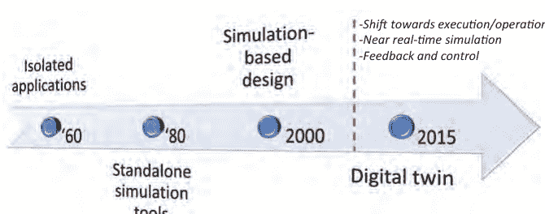

图 8.1 复杂系统工程中仿真的作用。改编自 Boschert 和 Rosen [15]。

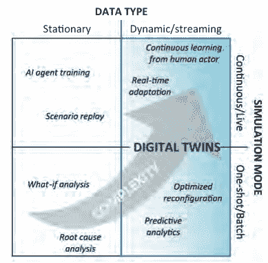

图 8.2 特征数字孪生服务及其复杂性来源。

模拟一个定量属性，然后被丢弃。这些复杂服务的相关示例包括：

- 系统对不断变化的环境上下文进行实时适应；
- 为与不断变化的业务目标保持一致而进行的优化重新配置；
- 用于早期识别威胁（例如故障和错误）的预测分析；
- 用于评估待做的人类决策的假设分析；
- 为人类和计算机代理的培训目的提供学习环境。

在模拟器的核心，物理资产由形式模型表示，复杂算法从中计算感兴趣的指标。该模型必须以适当的细节捕获物理资产的特性，以使仿真结果能代表物理资产。通常，仿真模型复用或依赖于数字孪生中已存在的模型，例如，由数字影子定义的模型（图 8.3）。

模型 [16] 是对现实的抽象，使用户能够专注于手头问题的基本方面，同时仍为分析、验证和操作模型提供严格方法的基础。如何建模手头问题取决于具体用例。例如，安全分析可能依赖于离散和抽象模型，如 Petri 网；或者依赖于非因果连续模型，如键合图或微分方程。下一节将向读者介绍一种多功能的建模形式主义，在模拟复杂系统（如数字孪生）方面具有异常高的实用性和潜力。

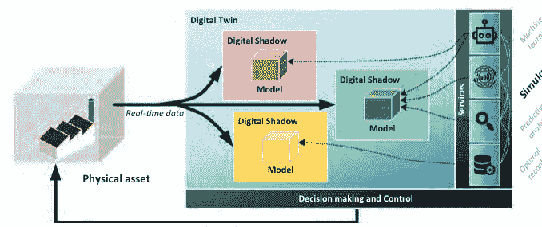

图 8.3
模拟器是数字孪生中的一等公民。

#### 8.2.2 离散事件系统规范

只有当学习到的仿真模型代表一类问题而非特定案例时，投入资源到学习过程才会有回报。例如，在学习如何构建机器人臂的数字孪生后，人们希望利用这些知识来构建机器人腿的数字孪生。这种泛化可以通过在仿真模型级别选择合适的仿真形式主义来实现。DEVS 形式主义 [11] 是此目的的首选候选者，因为 DEVS 的多功能性允许以极大细节建模真实系统的反应行为，包括计时和与环境的交互——这两个方面主要存在于数字孪生的物理资产中 [17]。

DEVS 是一种用于系统建模和仿真的形式主义。DEVS 是一种层次组合形式主义。也就是说，它允许通过更基础 DEVS 模型的可靠组合来构建任意复杂度的系统规范。DEVS 在组合下是封闭的，即组合两个 DEVS 模型会产生一个新的 DEVS 模型。虽然 DEVS 天然是离散的，但它也支持建模和仿真连续状态系统以及混合连续-离散状态系统。正如 Vangheluwe [18] 所指出的，DEVS 可以作为不同仿真形式主义之间的有效汇编语言。由于其处理建模系统的复杂性和异质性的能力，DEVS 特别适合构建数字孪生的模拟器。

DEVS 的离散事件抽象允许基于建模系统的先前状态和最新观测事件来计算其当前状态。DEVS 模型的状态仅在观测事件时发生变化，在两者之间保持不变。DEVS 中的事件是有时序的，即它们允许在没有有趣事件发生时省略中间时间点。这与具有固定时间步长的仿真形式主义形成对比，在固定时间步长的仿真形式主义中，


时间以固定值递增。选择适当 DEVS 事件时间粒度的灵活性，尤其在数字孪生的复杂仿真和联合仿真场景中非常有用 [19]。

事件可以来自 DEVS 模型本身，也可以来自其他 DEVS 模型。这使得 DEVS 模型能够对其他组件的变化以及由被建模系统生成的事件做出反应。能够摄取实时数据是相对于数字孪生模拟器的一个区分性要求，而 DEVS 在此方面也是一个合适的选择。

由于其卓越的表达性，DEVS 在学术和商业仿真工具中一直是一个特别受欢迎的选择，例如基于 Python 的离散事件仿真（Python-PDEVS）¹ 和 MathWorks 的 SimEvents²。

##### 8.2.2.1 运行示例

为了说明 DEVS 建模的能力，我们使用了一个生物生产室数字孪生的运行示例。生产室与外部环境隔离，所有物理属性均为人工设定。照明会定期开关，模拟 12 小时白天和 12 小时黑夜。同时，一个供暖、通风和空调（HVAC）系统负责维持生产室内适宜的温度和湿度。HVAC 系统要么处于加热状态，要么处于冷却状态，其行为遵循照明系统的周期。当灯光打开时，HVAC 系统切换到加热模式以提高空气温度。当灯光关闭时，HVAC 系统切换到冷却模式以降低空气温度。出于安全考虑，HVAC 系统在请求切换后获准有 2 小时时间为新的运行模式做准备。

数字孪生支持两种运行模式：观察和仿真。在观察模式下，数字孪生实时向人类和机器代理提供物理房间的当前状态。在仿真模式下，房间的不同性能指标基于模拟器执行的场景进行计算。例如，可以通过模拟照明和 HVAC 组件的行为来计算房间在较长时间内的总能耗。

在本章中，我们使用 DEVS 构建作为仿真基础的模型。

##### 8.2.2.2 原子 DEVS

原子 DEVS 模型是最简单的 DEVS 模型。它们描述系统或其组件的自主行为。图 8.4 以定时自动机的形式表示了运行示例的两个原子 DEVS 模型。

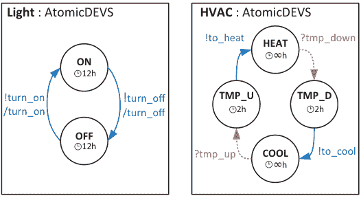

**图 8.4**
生物生产室数字孪生的原子 DEVS 模型。

图 8.4 中照明系统的模型显示灯光每 12 小时定期开关一次。定时转换将照明系统从一个状态带到另一个状态。这些转换与照明系统的环境无关，因此被称为内部转换。相比之下，图 8.4b 中 HVAC 系统的模型依赖于外部转换。一旦 HVAC 系统处于加热（HEAT）或冷却（COOL）状态，系统就不能以定时方式进入下一状态。转换发生在接收到事件时，或者系统保持当前状态。按照惯例，这种行为通过为每个状态设置无穷大（∞）的时间推进来表达。在 COOL 状态下接收到 tmp_up 事件后，系统转换到 TMP_U 状态以准备进入 HEAT 状态。然后系统在 TMP_U 状态停留 2 小时，之后自动转换到 HEAT 状态。从 HEAT 经 TMP_D 转换到 COOL 遵循相同的逻辑。

我们使用以下原子 DEVS 定义来提供形式基础。

###### 定义 8.1：原子 DEVS

原子 DEVS 模型定义为八元组 \( M = \langle X, Y, S, q_{init}, \delta_{int}, \delta_{ext}, \lambda, ta \rangle \)。
\( S \) 是 DEVS 模型中的状态集合。在图 8.4a 的 *Light* 模型中，\( S = [ON, OFF] \)。\( \Delta_{int}: S \to S \) 是内部转换函数，将当前状态映射到下一个状态。在 *Light* 模型中，\( \Delta_{int} = [OFF \to ON, ON \to OFF] \)。内部转换捕获了 DEVS 模型的自主行为动态，因为它们由内部因素驱动且与外部因素无关。决定 *什么时候* 发生状态转换的内部因素是时间推进函数 \( ta: S \to \mathbb{R}_{0, +\infty}^+ \)。在 *Light* 模型中，\( ta = [OFF \to 12h, ON \to 12h] \)。也就是说，在表现 OFF 状态 12 小时后，

系统转换到下一个状态。根据 \(\Delta_{int}\)，该下一个状态将是 ON 状态。模型初始化于 \(q_{init} \in Q\) 初始状态，其中 \(Q = \{(s, e) | s \in S, 0 \le e \le ta(s)\}\) 是全状态集合，即包含已消耗时间的状态。在 *Light* 模型中，\(q_{init} = \{OFF, 0.0\}\)。也就是说，房间初始化为 OFF 状态，模拟开始时已消耗时间为 0.0。

X 表示模型可以响应的输入事件集合。\(\Delta_{ext} : Q \times X \rightarrow S\) 是外部转换函数，当事件 \(x \in X\) 发生时转换到下一个状态。在图 8.4 中，这些事件前缀为问号（?）。例如，在 *HVAC* DEVS 模型中，X = tmp_up, tmp_down。这些事件由外部事件源提供，例如其他 DEVS 模型。为此，Y 表示其他模型可以响应的 DEVS 模型输出事件集合。在图 8.4 中，这些事件前缀为感叹号（!）。例如，在 *HVAC* 模型中，Y = {to_heat, to_cool}。最后，输出函数 \(\lambda : S \rightarrow Y\) 指定如何基于模型状态生成输出事件。输出事件在到达新状态之前生成。也就是说，输出函数将输出事件与即将离开的状态关联。例如，在 *HVAC* 模型中，\(\lambda = \{TMP\_U \rightarrow \text{to_heat}, TMP\_D \rightarrow \text{to_cool}\}\)。

##### 8.2.2.3 耦合 DEVS

DEVS 支持将模型以层次方式组合成更复杂的 DEVS 模型。此类复杂 DEVS 模型称为耦合 DEVS 模型。如前所述，运行示例中的照明和 HVAC 组件可以建模为原子 DEVS 模型。然而，*HVAC* 模型中的 tmp_up 和 tmp_down 事件需要由 *Light* 模型中的转换来支持。耦合 DEVS 形式化为建模这种连接提供了手段。

图 8.5 展示了一个耦合先前在图 8.4 中看到的两个原子 DEVS 模型的 DEVS 模型。在这个耦合 DEVS 模型中，*HVAC* 模型通过观察其命令（COM）端口从 *Light* 模型的输出（OUT）端口到达的输出事件，来响应 *Light* 模型中的状态转换。当 *Light* 模型打开时，turn_on 事件通知 *HVAC* 模型激活从 COOL 状态到 TMP_U 状态的转换。

我们使用以下耦合 DEVS 定义来提供形式基础。

###### 定义 8.2（耦合 DEVS）

一个耦合 DEVS 模型定义为七元组 \(C = \langle X_{self}, Y_{self}, D, \{M\}, \{I\}, \{Z\}, select \rangle\)。

D 是耦合模型中包含的模型实例集合。在耦合 *System* 模型中，D={light, hvac}。{M} 是模型规范集合，使得 \(\forall d \in D\exists M_d : M_d = \langle X, Y, S, q_{init}, \Delta_{int}, \Delta_{ext}, \lambda, ta \rangle_d\)，如定义 1 所定义。在耦合 System 模型中，\(M_{light}\) 是图 8.4a 中的模型，\(M_{hvac}\) 是图 8.4b 中的模型。为了连接耦合模型中的模型实例，\(\{l\}\) 定义模型影响集，使得 \(\forall d \in D\exists l_d : d \to D' \subseteq D \setminus \{d\}\)。在 System 模型中，是 Light 模型影响 HVAC 模型。也就是说，\(I_{light} = \{hvac\}\) 且 \(I_{hvac} = \emptyset\)。与原子 DEVS 模型类似，耦合 DEVS 模型可以定义输入和输出事件以与其他模型接口。\(X_{self}\) 和 \(Y_{self}\) 分别表示输入和输出事件。在示例图 8.5 中，耦合 DEVS 模型不定义其自身事件。因此，\(X = \emptyset\) 且 \(Y = \emptyset\)。由于耦合 DEVS 模型中 \(d \in D\) 模型的独立性，耦合模型内的事件可能并行发生。为了保留明确的执行语义，\(\text{tie-breaking}\) 函数 \(select : 2^D \to D\) 定义在发生冲突模型时优先处理哪个模型。在 System DEVS 模型中，我们选择优先处理 Light 组件而非 HVAC 组件，即 \(select = \{[light, hvac] \to light, [light] \to light, [hvac] \to hvac\}\)。最后，为了促进 DEVS 模型的重用，{Z} 翻译函数集允许将模型 \(d_1 \in D\) 的输出事件转换为 \(d_2 \in D\) 的输入事件，可能修改其内容。在耦合 System DEVS 模型中，Light 模型的 turn_on 输出事件应触发 HVAC 模型中从 COOL 到 TMP_U 状态的转换。也就是说，turn_on 输出事件应被转换为 tmp_up 输入事件。同样，turn_off 应被转换为 tmp_down。即 \(Z = \{turn\_on \to tmp\_up, turn\_off \to tmp\_down\}\)。

#### 8.2.3 强化学习

强化学习 [12] 是一种机器学习范式，也是一组实现基于交互的目标导向学习的算法。


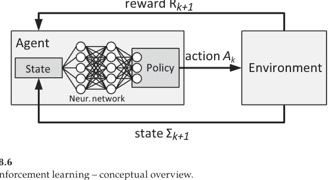

与环境交互。强化学习专注于学习如何对环境的特定状态做出反应——即如何将情境映射到动作——以最大化奖励信号。

图 8.6 展示了强化学习的概念概览。在典型的强化学习环境中，智能体按顺序探索其环境并利用它以获得结果。在每一步，智能体执行一个动作，观察环境的新状态 \(\Sigma_{k+1}\)，并接收一个奖励 \(R_{k+1}\)。通过重复的动作序列，智能体学习在不同状态下执行的最佳动作。强化学习过程的产物是 *策略* \(\pi\)，它将智能体可能遇到的情境映射到智能体在这些情境中可以执行的动作。因此，策略定义为 \(\pi(a \in A | \sigma \in \Sigma)\)，以在给定当前状态 \(\sigma\) 时选择动作 \(a\)。策略可以用简单的查找表表示，也可以像神经网络一样复杂。后者被称为 *深度强化学习*，其中关于下一个动作的最终决策被编码在神经网络的输出层中。

马尔可夫决策过程 [20] 和马尔可夫链 [21] 是形式化强化学习过程及训练后智能体后续行为的特别合适的选择。

##### 定义 8.3：（马尔可夫决策过程）

马尔可夫决策过程定义为四元组 \(\langle \Sigma, A, P_A, R_A \rangle\)。这里，\(\Sigma\) 表示智能体可以观察的环境状态集合。\(A\) 表示智能体可以在环境中执行的动作集合。\(P_A : (\langle \sigma \in \Sigma, a \in A \rangle \mapsto \Pr(\sigma'|\sigma, a))\) 是策略，即智能体在状态 \(\sigma\) 下执行动作 \(a\) 的概率，这将导致新状态 \(\sigma'\)。\(R_A : (\langle \sigma \in \Sigma, a \in A \rangle \mapsto \mathbb{R})\) 是在状态 \(\sigma\) 下选择动作 \(a\) 时接收到的数值奖励。

马尔可夫链 [21] 是支撑马尔可夫决策过程的形式结构。马尔可夫链是一种具有鞅属性的随机状态转移系统，即它们描述的是事件序列，其中事件的概率仅取决于当前状态而不取决于先前状态。马尔可夫决策过程通过选择概念（通过动作概念）和动机概念（通过奖励概念）扩展了底层马尔可夫链。反之，通过将动作数量减少到一个——即，$A = \{a\}$——并将奖励减少到一个常数——例如，$R_a \mapsto 1$——马尔可夫决策过程将退化为马尔可夫链。同样，带有策略的马尔可夫决策过程模拟了底层马尔可夫链，因为状态 \(\sigma \in \Sigma\) 中的动作 \(a \in A\) 由充当马尔可夫转移矩阵的策略决定。

因此，马尔可夫决策过程的目标是识别最佳策略 \(P_A\) 以最大化奖励（在基于策略的方法中）或更长期的累积值（在基于值的方法中）。强化学习智能体的行为可以在这种紧凑的形式结构中正式捕获。这种形式化有助于定义如何编程强化学习以学习模拟器，特别是符合 DEVS 的仿真模型。

##### 8.2.3.1 强化学习的多种风格

虽然奖励函数量化了与动作相关的即时奖励，但优化智能体行为以实现长期 *值* 函数通常更有用。值函数 \(V\) 是沿动作轨迹的预期奖励总和。基于值的强化学习方法旨在最大化该值函数。相比之下，基于策略的方法旨在最大化每个状态中的奖励函数。角色-批评方法在基于值和基于策略的方法之间提供了一种权衡，其中角色实现基于策略的策略，而批评者基于值函数批评角色所做的动作。不同的方法提供不同的好处，并在特定学习问题中表现出不同的实用性。基于值的方法是确定性的，因为它们在最大化值函数时贪婪地选择动作；然而，这可能导致探索不足。相比之下，基于策略的方法更彻底地探索状态空间，但会产生更嘈杂的估计，可能导致不稳定的学习过程。最近，具有鞅属性的非累积奖励函数——即，\(\mathbb{E}(V|a_1...a_n) = R(s_n, a_n)\)——已被成功地用于解决这些问题 [22]。

上述方法属于 *主动* 类型的强化学习方法，其目标是学习最优策略。相比之下，*被动* 强化学习方法旨在评估策略有多好。最后，在 *反向* 强化学习设置中，目标是在固定策略或值函数及状态空间下学习奖励函数。

具体来说，本章说明了一种通过称为近端策略优化（Proximal Policy Optimization，PPO）[23] 的策略优化方法学习 DEVS 模型的方法。PPO 是一种策略梯度方法，它通过消除性能下降并简化实现来改进其前身信任区域策略优化（Trust Region Policy Optimization，TRPO）[24]。由于其性能，PPO 最近已成为强化学习任务的热门选择。

从结构上讲，PPO 以角色-批评方式实现，其中角色通过即时奖励优化策略，而批评者驱动奖励。角色的决策通过考虑长期奖励的值函数来做出。批评者维护的值函数用于角色更新，从而允许批评者影响角色。PPO 在与环境交互和通过随机梯度上升或下降优化目标函数之间交替进行。智能体以批次方式更新角色和批评者，允许在每个时代中进行多个梯度更新（即，批次中训练样本的一次前向传递和一次后向传递）。在每个批次结束时，智能体更新其角色和批评者网络。

##### 8.2.3.2 仿真器工程中的强化学习

强化学习之前已成功应用于仿真器工程的各种问题。Floyd 和 Wainer [25] 已表明模仿学习是推断 DEVS 模型的可行方法。在模仿学习设置中，智能体通过观察另一个智能体或人类对一系列输入的反应来学习。当提取专家的隐性知识是一项特别具有挑战性的任务且专家演示更易于执行时，这些技术显示出巨大的效用。模仿学习中的一个重大挑战是训练样本数量少，因此，演示的质量对成功至关重要。例如，演示必须充分覆盖问题解决过程的特征案例和边缘情况。在学习自主系统的 DEVS 模型时，学习输入的数量不是问题，因此，可以充分利用强化学习技术。

Otero 等人 [26] 提供了一种从示例中学习的较不交互的方法，他们使用归纳学习以 DEVS 模型的形式推断系统的一般知识。该方法依赖于一种行为描述语言，系统需要用适当的细节进行描述，作为学习算法的训练输入。

Sapronov 等人 [27] 已使用深度强化学习来学习和存储离散事件模型的参数化。最终策略对模拟器的参数编码了最优控制策略。将经过强化学习训练的神经网络与离散事件模拟相结合，提供了更好的模拟器可定制性，并能够通过更新神经网络从摄入的数据流中优化其配置。

作为经典强化学习的一种特殊形式，上下文盗匪 [28] 已被证明是在具有连续控制的数字孪生的运行时适应和重新配置中的合适选择 [29,30]。


上下文盗贼将环境简化为一状态马尔可夫决策过程，并专注于映射动作-奖励组合。当动作结果可以立即评估时，这种简化是可接受的。数字孪生的连续控制问题是这种设置的典型示例。数字孪生设置通常需要高性能仿真器，以实现对物理资产的自动优化。此类仿真模型的调优对于实现适当的精度和性能至关重要。

### 8.3 基于强化学习的仿真器推断

在我们的方法中，通过观察物理系统的状态来推断仿真器。如图8.7所示，数字孪生设置通常提供先进的设施来观察系统，以便构建仿真器。特别是，相应的数字影子模型可以用于收集物理资产的实时信息。在许多情况下，与环境交互不可行或存在安全问题。在这种情况下，可以使用模拟环境来推断仿真器[31]。模拟环境的优势在于，学习智能体可以在短时间内学习长轨迹（动作序列），因为环境的响应是模拟的。此外，典型数字孪生设置中已具备机器学习能力，进一步简化了推断仿真器的任务。

强化学习在基于显式建模动作集解决序贯决策问题方面表现出色。因此，在工程问题中，当工程动作集是有限且有效可枚举的（例如DEVS模型构建）时，强化学习是一种特别合适的选择。作为一种非监督学习方式，强化学习不需要预先标记的数据。相反，学习智能体获得一组工程动作，并通过试错，智能体学会将这些动作组织成高效用序列。学习智能体迭代地选择并执行动作，从而更新候选DEVS模型。使用适当的仿真器对候选DEVS模型进行仿真。学习环境可以配备独立的DEVS仿真器以此目的，或由数字孪生以服务形式提供（如图8.7所示）。第k次迭代的仿真输出为trace$_k$。该轨迹存储仿真的行为信息，提供了将仿真器行为与实际系统行为进行比较的手段。奖励通过比较仿真轨迹与实际系统轨迹（历史）来计算。该循环重复多次，确保智能体有足够时间通过不断更新策略来推断出性能良好的策略。

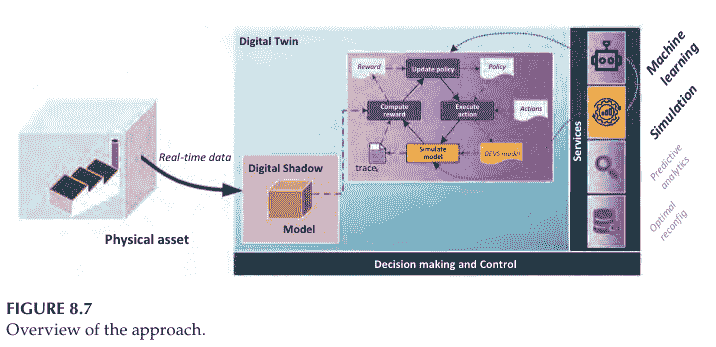

此次训练会产生两个重要产物。首先，是最终DEVS模型，将用于数字孪生的仿真器服务。其次，是持久化于智能体策略中的推断智能。这种智能近似了领域专家的隐性知识，不仅能解决当前特定问题，还能解决其他同构问题。因此，这种智能可以在为不同物理资产构建的数字孪生之间复用。

在本节其余部分，我们将概述DEVS与强化学习集成的正式框架，并在必要时通过8.2.2.1节中引入的说明性示例来阐释概念。

#### 8.3.1 正式框架

为了在DEVS模型推断中利用强化学习，需要将DEVS构建操作转换为强化学习术语。以下我们将简要回顾David和Syrianli [32]以及David等人 [33]提供的此类转换。

给定马尔可夫决策过程 \(MDP = \langle S, A, P_A, R_A \rangle\) 和原子DEVS规范 \(M = \langle X, Y, S, q_{int}, \Delta_{int}, \Delta_{ext}, \lambda, ta \rangle\)（定义1），映射 \(MDP \rightarrow M\) 简要给出如下。

##### 8.3.1.1 状态

马尔可夫决策过程的每个状态 \(\sigma \in \Sigma\) 都编码一个DEVS配置 \(M\)。即，\(\forall \sigma \in \Sigma : \sigma \mapsto M\)。我们使用符号 \(\sigma_M\) 表示编码 \(M\) 的状态。

##### 8.3.1.2 动作

直觉上，学习构建DEVS模型的马尔可夫决策过程中的动作是DEVS算子。每个动作作用于DEVS模型 \(M\)，产生一个新模型 M'。随后，编码 M' 的新状态 \(\sigma_{M'}\) 被添加到MDP的状态中。即，\(\forall a \in A : a(M) \mapsto M', \Sigma \mapsto \Sigma \cup \{ \sigma_{M'} \}\)。遵循底层搜索过程的马尔可夫性质，在每个状态中，执行动作 \(a \in A\) 的概率由策略 \(P_A\) 决定。

```
\(\text{update } Ta\big(M, s, t' \in \mathbb{R}^+_{0, \to \infty}\big) : M' = M \mid ta(s) = t'.\) (8.1)
```

原子和耦合DEVS动作的详细列表见参考文献[32]。

##### 8.3.1.3 奖励函数

为了引导学习智能体学习正确的DEVS模型，奖励函数 \(R_A\) 将每个状态映射到一个度量。即，\(R_A : \Sigma \mapsto \mathbb{R}\)。奖励通过仿真候选模型并评估其行为与被建模系统行为的相似度来计算。

仿真的行为体现在其轨迹中。粗略地说，\(t(S(M)) = \big\{(\tau_1, y_1), (\tau_2, y_2), \dots, (\tau_n, y_n), \dots \big\}\)，因此每个事件 \(y_i \in M.Y\)。（\(M.Y\) 表示输出事件集——参见定义1）。

为了测量轨迹的相似度或缺乏相似度，我们需要一个合适的距离度量。粗略地说，轨迹集 \(T\) 上的距离度量是一个非负实值函数 \(d : T \times T \mapsto \mathbb{R}\)，满足 \(d(t_1, t_2) = 0 \Leftrightarrow t_1 = t_2\)（同一性）；以及 \(d(t_1, t_2) = d(t_2, t_1)\)（交换性）。

基于以上内容，我们准备好定义学习DEVS模型的通用奖励函数为 \(R = -|d(t(M), t(S))|\)。即，奖励与正在构建的模型 \(M\) 的轨迹与待建模系统 \(S\) 的轨迹之间的距离成反比。

#### 8.3.2 智能体设置

每种强化学习方法都需要特定的设置。在本节中，我们展示如何使用PPO智能体（参见8.2.3.1节）来实现强化学习机制。表8.1显示了TensorFlow强化学习库的PPO智能体实现的一个参数化示例。\(^3\) 这些设置之前已在DEVS模型推断中证明是成功的[32]。

每批更新次数由 \textit{multi\_step} 参数定义。梯度上升或下降更新在由 \textit{batch size} 定义的动作轨迹批次上执行。策略更新的一个关键要素是更新步长。如果策略更新步长过大，策略性能

| 参数 | 值 |
| :--- | :--- |
| 智能体 | PPO |
| multi_step | 10 |
| batch_size | 10 |
| likelihood_ratio_clipping | 0.2 |
| 折扣 | 1.0 |
| 探索 | 0.01 |
| subsampling_fraction | 0.33 |
| 学习率 | 1e-3 |
| l2_regularization | 0.0 |
| entropy_regularization | 0.0 |
| 状态 | type = 'float'<br>shape = (4,)<br>min_value = 0<br>max_value = 24 |
| 动作 | type = 'int'<br>shape = (4,)<br>num_values = 5 |

可能会恶化。0.2的保守似然比裁剪消除了将目标函数变更到[0.8, 1.2]区间之外的动机。将奖励函数的折扣因子设置为1.0，允许智能体收集直到时间步上限的轨迹，而不会降低后续决策的权重。将探索参数设置为0.01，允许智能体有一定灵活性进行随机探索。即，智能体在1%的情况下可以偏离策略。子采样分数参数控制用于计算反向传播的一个回合中所采取步骤的比例。L2正则化向损失添加随机噪声以防止过拟合。此参数应根据智能体调优的一些手动实验适当设置。熵正则化有助于平衡策略的概率以保持熵最大，但在此书章背景下，我们可以安全地假设训练开始时动作等可能。存储策略的神经网络由七层组成：四个稠密层，中间夹有三个寄存器层，这与针对具有多个动作的Tensorforce设置所建议的结构一致。

#### 8.3.3 状态

智能体的状态需要存储四个时间推进值。此信息可以按以下方式捕获为4x1的小数（浮点数）张量：[ta_off, ta_on, ta_mp_u, ta_mp_d]。在运行示例中，数字孪生有


用于模拟天数的循环。因此，可以指定以下合理的约束：0 ≤ ta_on, ta_off, ta_tmp_w, ta_tmp_d ≤ 24.

#### 8.3.4 动作

为了允许智能体操作正在构建的 DEVS 模型的时间推进值，应根据 Eq. (1.1) 指定动作。下面，我们展示五个典型的动作。

- 宏增加 `Inc(ta)`: `ta ↦ ta + 0.1`
- 微增加 `inc(ta)`: `ta ↦ ta + 0.01`
- 无变化 `noc(ta)`: `ta ↦ ta`
- 微减少 `dec(ta)`: `ta ↦ ta − 0.01`
- 宏减少 `Dec(ta)`: `ta ↦ ta − 0.1`

宏步骤能提高智能体收敛到基础解的速度，而微步骤允许智能体在解区域内细化解。为了加快学习过程，智能体应能够在每个步骤中更改状态中编码的四个时间推进值中的每一个。因此，将作用于四个时间推进值的五个动作编码为一个 4×5 张量是个不错的主意。

然后，如清单 1 所示，获得所选动作的响应。这里，我们只展示所选状态变量（即 ta_off）的更新。智能体的响应机制期望在其输入（action）上接收所选动作。动作张量的第一个元素（action[0]）对应于为状态的第一个元素（即 ta_off）所选的动作。所选动作由一个整数表示。第 10–21 行中的 switch-case 语句解释 action[0] 下的值并相应地响应。其余状态变量的更改以类似方式计算。最后，在第 30 行返回新状态。

Tensorforce 提供了指定动作掩码的方法，以控制在特定状态下哪些动作是启用的。清单 2 中的动作掩码确保智能体的动作不会将时间推进值带出 [0, 24] 区间。动作掩码张量中的元素 [i, j] 对应于动作张量的元素 [i, j] 和状态张量的元素 [i]。例如，掩码元素 [1,1]（self.ta['off']）确定，只有当 ta_off ≤ 23.9 时，动作张量中的第一个动作（Inc(ta)）才能在状态的第一个值（ta_off）上执行。很明显，这意味着在每个时间步 k（参见图 8.7）中，ta_off (k) ≤ 24.

#### 8.3.5 奖励

根据第 8.3.1 节，奖励函数被制定为候选模型的轨迹与参考轨迹之间的距离。

遵循图 8.7 的符号，第 k 步的奖励定义为 $r_k = -|d( \text{trace}_k, \text{trace}_0)|$。智能体的目标是最大化预期累积奖励，即 $\max \left\{ E \left[ \sum_{k=0}^H a_k r_k \right] \right\}$，其中 $H$ 表示动作轨迹的时域，$a_k$ 表示第 $k$ 个动作，$r_k$ 表示第 $k$ 个奖励。

为了确保更快地收敛到学习目标，可以使用更激进地增加的惩罚，例如 $-r^2$。距离度量是轨迹之间的欧几里得距离。因此，可以使用轨迹向量的 2-范数（或欧几里得范数），即 $r_k = \left( \sum_{n=1}^{|\text{trace}_k|} |x_n|^2 \right)^{\frac{1}{2}} - \left( \sum_{n=1}^{|\text{trace}_0|} |x_m|^2 \right)^{\frac{1}{2}}$，其中 $|\cdot|$ 在向量参数 $trace_k$ 和 $trace_0$ 上表示长度，在标量参数 $x_n$ 和 $x_m$ 上表示绝对值。

```
def response(self, action):
    on_action = action[0]
    off_action = action[1]
    tmp_u_action = action[2]
    tmp_d_action = action[3]
    update = np.array([0, 0, 0, 0])

    #Compute ON action
    if on_action == 0: update += np.array([0.1, 0, 0, 0])
    elif on_action == 1: update += np.array([0.01, 0, 0, 0])
    elif on_action == 2: update += np.array([0, 0, 0, 0])
    elif on_action == 3: update += np.array([-0.01, 0, 0, 0])
    elif on_action == 4: update += np.array([-0.1, 0, 0, 0])
    else: raise Exception('Unknown action')

    #Compute OFF action
    ...
    #Compute TMP_U action
    ...
    #Compute TMP_D action
    ...
    return self.ta+update
```

清单 8.1: 控制动作适用性的动作掩码

### 8.4 讨论

我们讨论所提出方法的优点和局限性，并概述一些挑战。

```
1 np.array([
2 [self.ta['off'] <= 23.9, self.ta['off'] <= 23.99,
3 True, self.ta['off'] >= 0.01, self.ta['off'] >= 0.1],
4 [self.ta['on'] <= 23.9, self.ta['on'] <= 23.99,
5 True, self.ta['on'] >= 0.01, self.ta['on'] >= 0.1],
6 [self.ta['tmp_u'] <= 23.9, self.ta['tmp_u'] <= 23.99,
7 True, self.ta['tmp_u'] >= 0.01, self.ta['tmp_u'] >= 0.1],
8 [self.ta['tmp_d'] <= 23.9, self.ta['tmp_d'] <= 23.99,
9 True, self.ta['tmp_d'] >= 0.01, self.ta['tmp_d'] >= 0.1],
10 ])
```

清单 8.2: 控制动作适用性的动作掩码

#### 8.4.1 该方法的优点

如我们所示，强化学习与仿真器的构建非常契合。如前作 [32] 所述，第 8.3 节中的示例设置在 DEVS 构建问题上表现良好。状态编码和奖励函数足够通用，可以容纳 DEVS 以外的仿真形式化。基本上，正是动作集（第 8.3.4 节）使所提出的方法特定于 DEVS。通过分离特定于形式化的关注点，该方法承诺在数字孪生中使用的各种形式化之间具有高度可重用性。

我们的方法表明，仿真器构建的复杂性归结为设置和调优强化学习智能体的本质复杂性。偶然复杂性在很大程度上得以缓解，这主要归功于高度自动化和对人工干预的最小化需求。数字孪生的工程面临着受孪生系统巨大复杂性的挑战，因此，本章概述的方法等方法有望成为下一代数字孪生的关键推动者。

通过适当的自动化，这些方法降低了开发仿真器的成本。因此，依赖于仿真的数字孪生服务的开发成本也将降低。降低的成本反过来又能实现更复杂的服务和功能。例如，在数字孪生的模拟世界中训练机器学习智能体，使智能体能够在没有实际物理风险的情况下探索潜在的不安全或危险环境。

如前所述，DEVS 是一种多用途的仿真形式化。因此，看到众多依赖于 DEVS 的数字孪生用例并不令人惊讶。这类具有显著潜在收益的用例包括：通过仿真优化制造流程 [34]、服务之间以及与数据马尔可夫决策过程（API）之间的显式建模交互，以更好地验证和验证交互协议 [35]、以及由程序化图变换驱动的运行时显式模型 [36]。

#### 8.4.2 局限性

虽然最终推断的模型与待建模系统行为相似，但该方法面临局限性。

并不总是很明显，学习一个行为相似的模型是否就足够，还是也应遵守结构约束。为了克服这一局限，需要确保行为一致性对于当前问题来说是足够的。此外，轨迹信息必须足够丰富，以便对底层资产与仿真模型之间相似性所依据的属性进行推理。可以考虑替代距离度量来进一步改进奖励函数，例如动态时间扭曲和各种核方法 [37,38]。在许多实际环境中，确保行为一致性是足够的，这种有效性威胁可能可以忽略不计。

虽然选择 DEVS 使所概述的方法相当通用，但只有在应用程序之间确保适当的一致性时，该方法才可重用。如参考文献 [32] 所示，可以对所概述的方法进行参数化，使智能体和奖励函数可用于一类模型。然而，策略的泛化能力可能仅限于结构相似的模型。将最初推断的策略移植到其他问题而无需重新训练智能体是一项有待调查的挑战。一个值得探索的有希望的方向是有效性框架 [10] 捕获物理资产及其环境的上下文信息的能力。策略可转移到其他问题的条件可以用正式的方式表达。

#### 8.4.3 开放挑战

下面，我们概述目前我们认为最重要的一些挑战和机遇。

##### 8.4.3.1 人机学习和机器-机器学习

我们在涉及人类或其他机器学习智能体的学习环境中看到了机遇。虽然人类在指定最优模型方面表现不佳，但在指定合理模型方面表现相当出色 [39]。因此，由领域专家提供的基础模型或模型模板将提高该方法的性能。此外，领域专家还可以参与学习过程的监督。在这样的交互环境中，机器可以在探索过程中搜索算法表明机器面临艰难抉择的点上向人类专家查询。可以启用从人类专家学习，以进一步提高智能体的性能。尽管在朴素强化学习方法中人类奖励函数的成本较高 [40]，但从人类学习在众多环境中已被证明是可行的 [41,42]。


应考虑替代技术，例如从示范学习 [43] 和主动学习 [44]，以增强该方法。一旦强化智能体对同一类数字孪生体的不同实例和变体积累了足够经验，就可以由经验丰富的智能体来训练新智能体。此类设置将允许将人从循环中移除，并用智能体从先前案例中推断出的策略替代手动组装的默认策略。

##### 8.4.3.2 一致性问题中的策略复用

专门为DEVS构建推理方法的主要好处之一在于，可映射到DEVS的广泛问题范围可以有效利用本章介绍的方法。这有助于实现备受追捧的仿真器及仿真器组件复用 [7,8]。代理策略的复用与仿真器复用不同。当策略被复用时，之前学习的仿真器推理模式被用于解决略有不同的仿真器推理问题。

##### 8.4.3.3 逆学习方法的集成

本章介绍的方法使用基于行为痕迹的通用奖励函数。然而，某些问题可能需要更专门的奖励函数。如第4.4节所讨论，随着底层系统复杂性的增加，恰当捕获奖励函数变得具有挑战性。同样，我们使用了一组通用的DEVS模型工程操作，但特定领域的方法可能更倾向于利用一组更精细的动作。例如，第4.3.4节中时间推进增减的确切值是我们一方的任意选择。

为了以合理的方式估计这些参数，可以采用逆强化学习方法 [46]。逆强化学习旨在在固定策略下学习奖励函数。同样，在固定策略和奖励函数下可以推断动作空间。我们预见高级学习设置，其中奖励函数、值函数和动作将由一组逆强化学习算法以迭代方式推断。这将使能够更好地针对当前问题定制的仿真器推理过程。

##### 8.4.3.4 数字与物理能力的协同设计

使用机器学习方法的可行性在很大程度上受可用于训练机器学习智能体的数据数量和质量的影响。数字孪生提供的服务亦是如此。在本章介绍的方法的背景下，可以通过在数字孪生早期设计阶段考虑数据问题来改进数据质量和数量。我们预见将专注于数字孪生服务与物理资产（如传感器和执行器架构、数据管理基础设施以及适当网络配置）仪表化的协同设计的研究方向。此类综合方法将使对物理资产的数据采集更加高效，催生更先进的实时数据处理能力 [47]，并改善与数字孪生工程相关的成本。

##### 8.4.3.5 统一数字孪生框架的必要性

缺乏统一的数字孪生框架会对仿真器的工程化产生不利影响 [48]，即使像本章讨论的那样实现了自动化。近期已确定，关于数字孪生的报告局限性是阻碍数字孪生工具和技术理解与发展的因素 [49]。经验报告往往会遗漏数字孪生的重要特征，例如待研究系统的范围、处理的时间尺度以及生命周期阶段。诸如工业4.0参考架构模型（RAMI 4.0）[50] 和各种学术框架 [51,52] 等标准是缓解这一问题的初步步骤，尽管它们只涉及数字孪生的选定方面。

基于本体论的语义知识管理的优势已在复杂异构系统设计中得到验证 [53]。基于本体论的技术在网络物理系统领域的成功 [54] 为其在数字孪生设计中的应用指明了有希望的未来方向。

### 8.5 结论

随着数字孪生提供的服务复杂性不断增加，支持这些服务的先进仿真能力的重要性也随之增加。因此，适当的自动化对于实现仿真器构建至关重要。

本章概述了如何使用机器学习来自动化数字孪生中仿真器的构建。我们基于DEVS和强化学习阐释了这种方法的概念。取决于当前问题，其他仿真形式主义和其他机器学习方法也可能是合适的选择。然而，DEVS有望成为广泛问题的合适选择，因为它通常被认为是仿真形式主义的汇编语言 [18]。强化学习非常适合此类问题：此前没有可用的标记数据，但可以穷尽列出模型操作。DEVS的正式基础为后者提供了良好的起点，使得强化学习可以用于推断DEVS模型。

本章讨论的方法对于由于复杂性而难以建模的系统（例如数字孪生）尤其有用。我们预见未来几年将在该主题上展开众多研究方向。

## 参考文献

- [1] Adil Rasheed, Omer San, and Trond Kvamsdal. 数字孪生：从建模角度看价值、挑战和推动因素. IEEE Access, 8:21980–22012, 2020.
- [2] Benoit Combemale et al. 面向数据中心系统的模型驱动工程指南. IEEE Software, 2020, 38(4): 71-84.
- [3] Sheldon M Ross. 仿真（统计建模与决策科学）（第5版）. Academic Press, 2012. ISBN 978-0-12-415825-2.
- [4] Francis Bordeleau, Benoit Combemale, Romina Eramo, Mark van den Brand, and Manuel Wimmer. 面向模型驱动数字孪生工程：当前机遇与未来挑战. In Systems Modelling and Management: First International Conference, ICSMM 2020, Bergen, Norway, June 25–26, 2020, Proceedings 1. Springer International Publishing, 2020: 43–54.
- [5] Michael Spiegel, Paul F Reynolds Jr., and David C Brogan. 面向仿真可组合性和可复用性的模型上下文案例研究. In Proceedings of the Winter Simulation Conference, 2005. IEEE, 2005: 8 pp.
- [6] Thijs Defraeye, Chandima Shrivastava, Tarl Berry, Pieter Verboven, Daniel Onwude, Seraína Schugl, Andreas Buhlmann, Paul Cronje, and Rene M Rossi. 数字孪生即将到来：我们在新鲜园艺产品供应链中需要它们吗？ Trends in Food Science & Technology, 109:245–258, 2021. DOI: 10.1016/j.tifs.2021.01.025.
- [7] Ernest H Page and Jeffrey M Opper. 关于可组合仿真复杂性的观察. In Proceedings of the 31st conference on Winter simulation: Simulation--a bridge to the future-Volume 1. 1999: 553–560.
- [8] Richard J Malak and Chris J Paredis. 工程设计问题中可复用行为模型验证的基础. In Proceedings of the 2004 Winter Simulation Conference, 2004. IEEE, 2004: 1.
- [9] Robert G Bartholet, David C Brogan, Paul F Reynolds, and Joseph C Carnahan. 寻找贤者之石：仿真可组合性与基于组件的软件设计. In Proceedings of the Fall Simulation Interoperability Workshop. 2004.


- [10] Simon Van Mierlo, Bentley James Oakes, Bert Van Acker, Raheleh Eslampanah, Joachim Denil, and Hans Vangheluwe. 探索实践中的有效性框架. 载于系统建模与管理国际会议. Cham: Springer International Publishing, 2020: 131–148.

- [11] Bernard P Zeigler, Alexandre Muzy, and Ernesto Kofman. 建模与仿真理论：离散事件与迭代系统计算基础. Academic Press, 2018.

- [12] Richard S Sutton and Andrew G Barto. 增强学习：导论. Robotica, 1999, 17(2): 229–235.

- [13] Robert R Schaller. 摩尔定律：过去、现在与未来. IEEE Spectrum, 34(6):52-59, 1997.

- [14] Magnus Persson, Martin Torngren, Ahsan Qamar, Jonas Westman, Matthias Biehl, Stavros Tripakis, Hans Vangheluwe, and Joachim Denil. 嵌入式和网络物理系统背景下集成多视图建模的表征. 载于嵌入式软件国际会议 (EMSOFT 2013) 论文集, 蒙特利尔, 魁北克, 加拿大, 2013年9月29日–10月4日, 页码 10:1–10:10. IEEE, 2013. DOI: 10.1109/EMSOFT.2013.6658588.

- [15] Stefan Boschert and Roland Rosen. 数字孪生——仿真方面. 载于机电未来：机电系统及其设计者的挑战与解决方案, 2016: 59–74.

- [16] Marvin Minsky. 物质、心智与模型. 1965.

- [17] Saurabh Mittal et al. 物联网系统的数字孪生建模、协同仿真和网络用例包含方法论. 载于2019年冬季仿真会议 (WSC). IEEE, 2019: 2653–2664.

- [18] Hans Vangheluwe. DEVS作为多形式主义混合系统建模的共同分母. 载于Cacsd会议论文集. IEEE计算机辅助控制系统设计国际研讨会 (cat. no. 00th8537). IEEE, 2000: 129–134.

- [19] Claudio Gomes, Casper Thule, David Broman, Peter Gorm Larsen, and Hans Vangheluwe. 协同仿真：综述. ACM Computing Surveys, 51(3):49:1–49:33, 2018. DOI: 10.1145/3179993.

- [20] Martin L Puterman. 马尔可夫决策过程. 运筹学与管理科学手册, 2:331–434, 1990.

- [21] James R Norris and James Robert Norris. 马尔可夫链. 第2卷. 剑桥大学出版社, 1998.

- [22] Nelson Vadori et al. 风险敏感增强学习：奖励不确定性的鞅方法. 载于第一届 ACM 金融人工智能国际会议论文集, 2020: 1–9.

- [23] John Schulman, Filip Wolski, Prafulla Dhariwal, Alec Radford, and Oleg Klimov. 近端策略优化算法. arXiv预印本 arXiv:1707.06347, 2017.

- [24] John Schulman, Sergey Levine, Pieter Abbeel, Michael I Jordan, and Philipp Moritz. 信任区域策略优化. 载于第32届机器学习国际会议论文集, ICML 2015, 利尔, 法国, 2015年7月6–11日, JMLR研讨会和会议论文集第37卷, 页码 1889–1897. JMLR.org, 2015.

- [25] Michael W Floyd and Gabriel A Wainer. 使用模仿学习创建 DEVS 模型. 载于2010年夏季计算机仿真会议论文集. 2010: 334–341.

- [26] Ramon P Otero, David Lorenzo, and Pedro Cabalar. DEVS 结构的自动诱导. Computer Aided Systems Theory—EUROCAST'95: 奥地利因斯布鲁克第五届计算机辅助系统理论国际研讨会精选论文集 第5卷. Springer Berlin Heidelberg, 1996: 305–313.

- [27] Andrey Sapronov, Vladislav Belavin, Kenenbek Arzymatov, Maksim Karpov, Andrey Nevolin, and Andrey Ustyuzhanin. 通过增强学习调制混合分布式存储系统数字孪生. 系统科学与应用进展, 18(4):1–12, 2018.

- [28] Wei Chu, Lihong Li, Lev Reyzin, and Robert E Schapire. 具有线性回报函数的上下文盗贼. Computer Aided Systems Theory—EUROCAST'95: 奥地利因斯布鲁克第五届计算机辅助系统理论国际研讨会精选论文集 第5卷. Springer Berlin Heidelberg, 1996: 305–313.

- [29] Constantin Cronrath, Abolfazl R Aderiani, and Bengt Lennartson. 通过增强学习增强数字孪生. 2019 IEEE 第15届自动化科学与工程国际会议 (CASE). IEEE, 2019: 293–298.

- [30] Nikita Tomi et al. 城市分区配电网负载中心数字孪生开发示例. E3S 会议录. EDP Sciences, 2020, 209.

- [31] Marius Matulis and Carlo Harvey. 利用增强学习的机器人臂数字孪生. 计算机与图形, 95:106–114, 2021.

- [32] Istvan David and Eugene Syriani. 作为增强学习问题的 DEVS 模型构建. 2022 年建模与仿真年会 (ANNSIM). IEEE, 2022: 30–41.

- [33] Istvan David, Jessie Galasso, and Eugene Syriani. 通过增强学习推断数字孪生的仿真模型. 2021 ACM/IEEE 模型驱动工程语言与系统国际会议伴随出版物 (MODELS-C). IEEE, 2021: 221–224.

- [34] Istvan David, Hans Vangheluwe, and Yentl Van Tendeloo. 将工程工作流模型转换为 DEVS 以进行性能评估. 2018年冬季仿真会议 (WSC). IEEE, 2018: 616–627.

- [35] Simon Van Mierlo, Yentl Van Tendeloo, Istvan David, Bart Meyers, Addis Gebremichael, and Hans Vangheluwe. 模型驱动工程过程中服务交互建模的多范式方法. 模型驱动仿真工程研讨会论文集, SpringSim (Mod4Sim) 2018, 巴尔的摩, 马里兰州, 美国, 2018年4月15–18日, 页码 6:1–6:12. ACM, 2018.

- [36] Eugene Syriani and Hans Vangheluwe. 作为程序图变换语义域的 DEVS. 离散事件建模与仿真：理论与应用, 页码 3–28. CRC Press, Boca Raton, FL, 2010. https://www.crcpress.com/Discrete-Event-Modeling-and-Simulation-Theory-and-Applications/Wainer-Mosterman/9781420072334.

- [37] Donald J Berndt and James Clifford. 使用动态时间整序在时间序列中查找模式. Usama M Fayyad and Ramasamy Uthurusamy, 编辑, 1994年AAAI研讨会论文：数据库知识发现, 西雅图, 华盛顿州, 美国, 1994年7月. 技术报告 WS-94-03, 页码 359–370. AAAI Press, 1994.

- [38] Bernhard Scholkopf. 距离的核技巧. 神经信息处理系统第13卷，NIPS 2000论文集，丹佛，科罗拉多州，美国，页码 301–307. MIT Press, 2000.

- [39] Marco A Wiering and Martijn Van Otterlo. 增强学习. 适应、学习与优化, 2012, 12(3): 729.

- [40] Paul Christiano, Jan Leike, Tom B Brown, Miljan Martic, Shane Legg, and Dario Amodei. 基于人类偏好的深度增强学习. arXiv预印本 arXiv:1706.03741, 2017, 30.

- [41] W Bradley Knox and Peter Stone. 来自人类和MDP同时奖励的增强学习. AAMAS, 页码 475–482, 2012.

- [42] Robert Loftin et al. 通过人类交付的离散反馈学习行为：建模隐式反馈策略以加速学习. 自主代理与多代理系统, 30(1):30–59, 2016.

- [43] Brenna D Argall, Sonia Chernova, Manuela Veloso, and Brett Browning. 从示例中学习的机器人学综述. 机器人与自动系统, 57(5):469–483, 2009.

- [44] Burr Settles. 主动学习. 人工智能与机器学习合成讲座, 6(1):1–114, 2012.

- [45] Lisa Torrey and Jude Shavlik. 迁移学习. 机器学习应用与趋势研究手册：算法、方法和技术, 页码 242–264. IGI Global, 2010.

- [46] Andrew Y Ng and Stuart Russell. 逆增强学习算法. 第十七届机器学习国际会议 (ICML 2000) 论文集, 斯坦福大学, 斯坦福, 加利福尼亚州, 美国, 2000年6月29日–7月2日, 页码 663–670. Morgan Kaufmann, 2000.

- [47] Istvan David, Istvan Rath, and Daniel Varro. 基于复杂事件处理的流模型转换基础. 软件与系统建模, 17(1):135–162, 2018. DOI: 10.1007/s10270-016-0533-1.

- [48] Fei Tao, He Zhang, Ang Liu, and Andrew Y C Nee. 工业中的数字孪生：现状. IEEE 工业信息学交易, 15(4):2405–2415, 2019. DOI: 10.1109/TII.2018.2873186.

- [49] Bentley James Oakes, Ali Parsai, Bart Meyers, Istvan David, Simon Van Mierlo, Serge Demeyer, Joachim Denil, Paul De Meulenaere, and Hans Vangheluwe. 数字孪生报告改进：示例说明及资产管理外壳映射. Springer, 2023. 即将出版.

- [50] Martin Hankel and Bosch Rexroth. 工业4.0参考架构模型 (RAMI 4.0). Zvei, 2015, 2(2): 4–9.

- [51] Yuqian Lu, Chao Liu, Kevin I-Kai Wang, Huiyue Huang, and Xun Xu. 数字孪生驱动的智能制造：内涵、参考模型、应用与研究问题. 机器人与计算机集成制造, 61:101837, 2020. DOI: 10.1016/j.rcim.2019.101837.

- [52] Shoin Aheleroff, Xun Xu, Ray Y Zhong, and Yuqian Lu. 工业4.0中的数字孪生即服务 (DTAAS)：参考架构模型. 高级工程信息学, 47:101225, 2021. DOI: 10.1016/j.aei.2020.101225.

- [53] Ken Vanherpen, Joachim Denil, Istvan David, Paul De Meulenaere, Pieter J Mosterman, Martin Torngren, Ahsan Qamar, and Hans Vangheluwe. 网络物理系统设计中一致性的本体推理.


第1届网络物理生产系统国际研讨会，CPPS@CPSWeek 2016，维也纳，奥地利，2016年4月12日，第1–8页。IEEE计算机学会，2016年。DOI: 10.1109/CPPS.2016.7483922。

[54] Zihang Li, Guoxin Wang, Jinzhi Lu, Didem Gurdur Broo, Dimitris Kiritsis, and Yan Yan. 基于模型的系统工程的计量分析：过去、现在和未来。IEEE工程管理学刊，第1–18页，2022年。DOI: 10.1109/TEM.2022.3186637.

## 面向联邦分析应用的数字孪生

- **Dan Wang** *香港理工大学*
- **Dawei Chen** *丰田汽车*
- **Yifei Zhu** *上海交通大学*
- **Zhu Han** *休斯顿大学*

### 9.1 引言

当我们步入万物互联（IoE）时代时，连接到互联网的设备数量正在快速增长，根据国际数据公司（IDC）的预测，到2025年将达到416亿台，产生79.4泽字节（ZB）的数据。

如此巨量的数据对可扩展性、移动性和可用性等系统提出了巨大挑战。

其中一项关键挑战是将传感器、工业物联网（IIoT）和车联网（IoV）等物理设备与边缘服务器、基站、路侧单元（RSU）和远程云中心等虚拟计算资源紧密连接起来。

得益于数据采集与处理、高性能计算、低延迟通信等技术的蓬勃发展，数字孪生被提议作为一种有效的网络物理关联工具，通过利用物理设备渲染的实时数据提供高级分析[2,3]。

获得的分析结果可用于优化现有设备的性能或辅助决策。

例如，在工业应用中，数字孪生可以实现多种目的，如虚拟评估、资产管理、流程评估与优化、预测性维护以及故障检测与诊断，但这些仍依赖大数据处理，无法在资源受限设备上执行[4]。

尽管硬件设计技术正在取得蓬勃进展，但在大数据背景下，设备端计算密集型任务的执行仍然具有挑战性[5]。

为解决这一问题，多接入边缘计算（MEC）可以是一种解决方案，它在地理上分布式地在网络内部署边缘节点以承担计算任务。

此外，由于边缘节点在一定程度上具备计算能力，这样可以减少传输距离，任务几乎在本地执行[6,7]。

因此，计算资源限制问题可以得到解决，同时整体延迟降低，服务质量（QoS）可显著提高。

实际上，在大多数情况下，从单个设备获取数据是不够的。

例如，在汽车场景中，数字孪生可以通过其行为和运行数据来模拟连接车辆的虚拟模型。

为了评估计划超车的安全性，收集周围车辆并创建相应模型也是必要的。

因此，联邦分析可以是协作决策的一种有效方式。

联邦分析由Google AI团队提出[8]，它允许数据科学家在分布式数据集中推导分析洞察，而无需将数据收集到中央服务器中。

实际上，联邦分析遵循联邦学习的框架，从个人上传中获得全局聚合结果。

区别在于，联邦分析只关注基本数据科学需求，如模型评估、数据质量评估和重大发现，且没有学习部分[9]。

直观地说，有几个原因可以在数字孪生应用中应用联邦分析。

- 首先，数字孪生由两部分组成：生成数据的物理对象或过程，以及执行计算和决策的虚拟服务器。因此，就联邦分析问题而言，单个设备可以被视为数字孪生中的物理对象，而聚合器可以被视为数字孪生的虚拟服务器。
- 其次，在联邦分析中，在数字孪生中传输的是设备的单独分析结果，而不是原始数据。因此，通信延迟可以进一步降低。
- 第三，设备可能涉及隐私敏感问题，特别是在医疗保健和个人应用中。在联邦分析中，由于数据不会在数字孪生中共享，因此用户隐私也可以得到保证。

从数据科学角度来看，基于证据获取整个数据集的分布很重要。

但是，由于传感器范围和连接设备移动性的限制，生成的单个数据集仅观察自整个数据的一部分，即单个数据集不是独立同分布的（non-i.i.d.），这使得仅使用一台设备的数据难以估计全局分布[10]。

直观地说，数据集的分布可以通过分布参数来描述，例如高斯分布的均值和方差。

因此，一旦参数可以被评估，全局数据分布就可以相应地获得。

幸运的是，贝叶斯方法已被证明是解决全局参数和后验估计相关问题的一种有效方法。

贝叶斯方法通过最小化所有观测证据的后验概率来估计未知参数。

一种典型的方法是蒙特卡罗方法，它利用随机采样技术来评估和近似目标分布。

蒙特卡罗方法的缺点在于该方案严重依赖大量重复采样。

因此，如何在进行高效采样的同时保证样本质量成为一项挑战。

为克服这一问题，我们提出了一种带延迟拒绝的联邦马尔可夫链蒙特卡罗方法（FMCMC-DR），它利用马尔可夫链的收敛性和详细平衡性、拒绝-接受采样以及延迟拒绝来辅助蒙特卡罗方法实现高效采样和全局状态空间探索。

本章其余部分组织如下。第9.2节介绍特定场景，分析联邦分析的数学模型，并基于边缘辅助数字孪生制定相应的参数估计问题。在第9.3节中，给出了相关的马尔可夫链蒙特卡罗（MCMC）方法和定义，并详细介绍了所提出的FMCMC-DR算法。第9.4节描述了所进行的数值模拟并相应讨论了结果。最后，在第9.5节中得出结论。

### 9.2 数字孪生建模

在本节中，描述了面向联邦分析的边缘辅助数字孪生场景。此外，我们分别在第9.2.1节对数字孪生的物理侧进行建模，在第9.2.2节对数字孪生的虚拟侧进行建模。最后，给出了相应的联邦分析问题公式。

#### 9.2.1 数字孪生的物理侧

我们考虑有多个用户 \( N=1,\dots,i,\dots,N \) 参与联邦分析任务。由于传感器范围和移动性的限制，每个用户 \( i \) 只能对整个证据或数据集进行部分观测。这里，每个用户 \( i \) 的单独数据集合表示为 \( R_i \)。\( R = \{R_{1,r} ... R_p ... R_N\} \) 表示整个数据集。由于隐私考虑，单独数据集不能在网络中共享。因此，对于每个用户，将基于 \( R_i \) 在本地执行设备端私有数据分析。相应地，单独分析输出或单独数据洞察可以通过以下方式获得：

\( x_i = f_i(R_i),\)

其中，\( f_i \) 表示 \( R_i \) 中观测值的局部数据分布。这里，\( x_i \) 是可以描述 \( f_i \) 的代表性参数，如均值和方差。

#### 9.2.2 数字孪生的虚拟侧

在单独评估完成后，所有参与者将把其数据集特征上传到聚合器，该聚合器由覆盖该区域的边缘服务器充当。直观地说，这一聚合过程可以写成：

\( y = g(x),\)

其中，\( x = (x_1..., x_p, x_N) \) 是本地获得的数据特征向量。私有数据不能共享，而采样技术需要真实观测值。在联邦分析中，由于隐私问题，原始数据不能通过网络传输。

因此，通过使用 \( x \)，可以评估个体的分布以构建虚拟观测值，表示为 \( e = e_1..., e_i,..., e_N \)。由于全局分布是从聚合的个体分布中获得的，\( g(e) \) 可以以联邦方式描述，即 \( N \) 个核函数的线性加权和，其给出为：

\( g(e) = \phi(e)^T \omega = \sum_{i=1}^N \omega_i \phi_i(e_i)\)

其中，\( \phi(x) = (\phi_{1r}, ... \phi_{N^T}) \) 是核向量，相应的参数可以表示为 \( \theta = \{\theta_{1r}, ... \theta_{ir}, ... \theta_{Nr}\} \)，\( \omega = (\omega_{1r}, ... \omega_{Nr})^T \) 是相关权重向量。

总的来说，所有权重的总和等于1，即 \( \sum_{i=1}^N \omega_i = 1 \)，其中 \( N \) 是有限且已知的。本质上，核函数属于参数族。由于单个数据集因不同的行为特征而非独立同分布，核函数被选择为高斯


如参考文献[11]所建议的函数。高斯混合模型已被证明是建模异质人群的有效方法[12]。直觉上，公式(9.3)可以重写为以下形式：

$$g(e|\omega, \theta)=\sum_{i=1}^{N} \omega_i f_i(e_i|\theta_i)$$ (9.4)

在f(e_i | \theta_i)均为正态分布的特殊情况下，\theta = (\mu_1, \sigma_1 ... \mu_N, \sigma_N)表示每个客户的信念。f(e_i | \theta_i)是均值为\mu_i、方差为\sigma_i的高斯分布的密度。\theta表示全局分布的未知均值和方差。目的是找到参数\omega和\theta，以便获得全局数据分布。由于参数未知，从贝叶斯角度看，公式(9.4)可以解释为：在给定测量或观测e的情况下，推断模型参数的后验概率分布。然后，估计的分布参数将广播给所有客户端。这样，客户端可以了解本地分布与全局分布之间的差异。整体场景如图9.1所示。

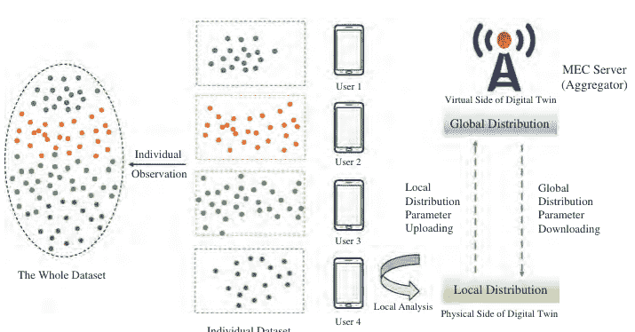

**图 9.1** 场景描述：我们考虑有多个用户参与联邦分析任务，以获得整个数据集的分布。由于感知和移动范围的限制，每个用户只能对整个数据集进行部分观测。对于每个用户，由于隐私考虑，设备端的私有数据分析将在本地执行。个体评估完成后，所有参与者将把数据集特征上传到聚合器，该聚合器由覆盖该区域的边缘服务器执行。通过聚合，可以获得关于整个数据集的分布估计。然后，估计的分布将广播给所有客户端，以使他们了解本地分布与全局分布之间的差异。该过程将迭代执行，以便根据用户端观测到的更多样本保持全局分布的更新。

### 9.3 方法论

本节在第9.3.1节中介绍了缺失数据方法的概念。然后在第9.3.2节中详细介绍了MCMC和标准MH。最后在第9.3.3节中详细阐述了延迟拒绝技术，并相应给出了拟议的FMCMC-DR算法。

#### 9.3.1 缺失数据方法

如前一节所讨论，获得全局分布的主要挑战是估计和计算未知参数，即\(\omega\)和\(\theta\)。假设核函数是凸的，公式(9.3)的期望也是期望的凸组合，即，

\( E[e] = \sum_{i=1}^N \omega_i E[e_i] \)
\( = \sum_{i=1}^N \omega_i E[e_i | \theta_i] \)

因此，推导高斯混合模型的期望估计器是求解公式(9.3)的一种有效方法。

然而，由公式(9.3)表示的混合模型形式不利于推导贝叶斯估计器。因此，为了获得参数\(\omega\)和\(\theta\)，相应的后验期望公式(9.5)可以重写为包含\(N^K\)项的似然展开结构，即，

\( L(\omega, \theta | e) = \sum_{j=1}^K \sum_{i=1}^N \omega_i \phi_i(e_j | \theta_i). \)

可以看出，由于似然由\(N^K\)个分量给出，这会导致巨大的计算开销，即使设备数量\(N\)不大。因此，必须应用一种降低公式(9.6)复杂度的方法，其中一种常见但有效的方法是缺失数据方法。

混合模型的一种解释是，观测发生在由多个层组成的数据集中，而观测到特定组的分配丢失。因此，对于每个证据\(e_i\)，它有\(\omega_i\)的概率被分配到子组\(\varphi_i\)。由于结构不清或丢失，可以引入一个辅助变量，其目的是识别每个观测是从哪个特定子组或混合分量生成的。这也是该方法被称为缺失数据方法的原因。这里，我们将这个辅助变量表示为\(z_j\)。要构造\(z_j$，来自\(N\)个混合分量的观测\(e\)与\(z_j\)的关联是

\(e_j|z_j = i \sim \phi(e_j|\theta_i)\) (9.7)

且

\(p(z_j = i) = \omega_i\) (9.8)

这个辅助变量\(z_j\)标识观测\(e_j$属于哪个分量[13]。换句话说，对于每个数据样本\(e = (e_1, ..., e_N)$，我们假设一个缺失数据集\(z = (z_1, ..., z_N)$，生成相应的标签以指示观测生成的特定混合子总体。

利用构造的辅助随机变量，公式(9.6)中的似然可以简化为：

\( L(\omega, \theta|e, Z) = \prod_{j=1}^K \omega_{z_j} \phi(e_j|\theta_{z_j}) \\
= \prod_{i=1}^N \omega_i^{k_i} \left[ \prod_{j:z_j=i} \phi(e_j|\theta_i) \right] \) (9.9)

其中\(k_i$等于\(z_j=i\)的数量且\(\sum_i k_i = K$。然后，观测\(e_j$属于第\(i\)个混合分量的后验概率是：

\( p(z_j=i|e_j, \omega, \theta) = \frac{\omega_i \phi(e_j|\theta_i)}{\sum_{i=1}^N \omega_i \phi(e_j|\theta_i)} \) (9.10)

由于我们假设核函数是高斯的，相应的估计似然可以进一步写成如下形式：

\( L(\omega, \mu, \sigma|e, z) \propto \prod_{i=1}^N \omega_i \exp \left( - \frac{\sigma_i}{2} (e_j - \mu_i)^2 \right) \) (9.11)

因此，后验概率是：

\( P(z_j=i|e_j, \omega, \mu, \sigma) = \frac{\omega_i \exp \left( - \frac{\sigma_i}{2} (e_j - \mu_i)^2 \right)}{\sum_{l=1}^N \omega_l \left( \exp \left( - \frac{\sigma_l}{2} (e_j - \mu_l)^2 \right) \right)} \) (9.12)

#### 9.3.2 马尔可夫链蒙特卡洛方法

为了获得后验概率，我们首先介绍MCMC方法，该方法利用蒙特卡洛方法和马尔可夫链的特性。通常，参数分布无法解析得到。因此，蒙特卡洛旨在进行重复随机采样，并利用采样的期望来估计或近似参数。因此，如何高效地进行大规模采样具有挑战性，这促使使用马尔可夫链。马尔可夫链的定义如下。

##### 定义 9.1

马尔可夫链是一系列随机变量Q_1, Q_2, Q_3...，其中移动到下一状态的概率取决于当前状态而与之前的状态无关：

$$P(Q_{t+1} = q \mid Q_1 = q_1, Q_2 = q_2, ..., Q_t = q_t) = P(Q_{t+1} = q \mid Q_t = q_t).$$ (9.13)

根据此定义，对于每个马尔可夫链，都存在一个状态转移矩阵，描述链中任意两个状态之间的转移概率，可以写为：

$$T = \begin{bmatrix} p_{11} & p_{12} & ... & p_{1n} \\ p_{21} & p_{22} & ... & p_{2n} \\ \vdots & \vdots & \vdots & \vdots \\ p_{n1} & p_{n2} & ... & p_{nn} \end{bmatrix}$$ (9.14)

关于矩阵T，有以下几个性质。

##### 定理 9.1

对于不可约、无周期的马尔可夫链（具有有限或无限状态空间），存在静态分布$\pi$可确保当t趋于无穷大时，马尔可夫链将收敛到$\pi$，即，

$$\lim_{t \to \infty} P_{ij}^t = \pi(j)$$ (9.15)

其中静态分布可以描述为$\pi = [\pi_1, \pi_2, ... \pi_n]$，且所有元素之和等于1，即，$\sum_{j=1}^n \pi(j) = 1$。

马尔可夫链的另一个重要性质是详细平衡，其定义如下。

##### 定义 9.2

设\(Q_1, Q_2...\)为具有静态分布\(\pi$的马尔可夫链。如果

\(\pi_i P_{ij} = \pi_j P_{ji}, \forall i, j \quad (9.16)\)

则该链被认为相对于\(\pi$是可逆的，或满足相对于\(\pi$的详细平衡。

直觉上，如果马尔可夫链的静态分布正好是后验概率分布，则问题可以求解。蒙特卡洛方法利用马尔可夫链的特性进行采样。假设给定一个随机样本\(q_0\)。根据马尔可夫链的收敛性质，经过\(t\)次采样后，概率分布收敛到稳态\(\pi(q)$。

然后，假设从\(t + 1$开始采样，新获得的\(\pi_{t+1}$需要等于\(\pi_t$。利用详细平衡性质，可以推导出\(\pi T = \pi$。如果可以获得矩阵\(T$，则可以通过随机游走进行采样。现在的问题是如何获得\(T$，其中Metropolis-Hastings算法是有效的方法。

目的是构建转移概率矩阵\(T$。在Metropolis-Hastings算法中，接受率用于评估采纳来自\(Q(q^*|q_i)$的新获得样本的可行性。因此，为了解释这一点，我们可以考虑这两部分共同构成\(T$，即，\(T(q^*|q_i) \Rightarrow Q(q^*|q_i) \times \min\left(1, \frac{\pi(q^*)Q(q_i|q^*)}{\pi(q_i)Q(q^*|q_i)}\right)$。当接受率等于1时，\(u$小于1，这表明\(Q(q^*|q_i)$是\(T\)的值。相反，当接受率小于1时，值\(\frac{\pi(q^*)Q(q_i|q^*)}{\pi(q_i)Q(q^*|q_i)}$是所需的\(T\) [14]。

然而，对于混合模型，有多个参数需要估计，其中提出了一种联邦MCMC算法来解决这个问题。为了对参数\(\omega, \mu$和\(\sigma$进行建模，我们假设共轭先验和后验对如下：

- 1. \([\omega \sim D(\delta_1, ..., \delta_n), \omega | e, z \sim D(\delta_1^*, ..., \delta_n^*)]\)

- 2. \([\sigma_i \sim G(\frac{\alpha}{2}, \frac{\beta}{2}), \sigma_i | e, z \sim G(\frac{\alpha^*}{2}, \frac{\beta^*}{2})]\)

- 3. \([\mu_i | \sigma_i \sim N(m_i, \frac{1}{a_i \sigma_i}), \mu_i | e, z, \sigma_i \sim N(m_i^*, \frac{1}{a_i^* a_i})]\)


where $\delta_i^*=\delta_i+k_i,\alpha_i^*=\alpha+k_i,b_i^*=b+\sum_{j:z_j=i}(e_j-\mu_i)^2,a_i^*=a_i+k_i,m_i^*=\frac{a_im_i+k_i\bar{e}_i}{a_i+k_i},$ and $\bar{x}_i = \frac{1}{k_i} \sum_{j:z_j=i} e_j$ $D$ 表示狄利克雷分布，$G$ 表示伽马分布，$N$ 表示正态分布。

混合模型的一个基本特征是，它对成分索引的排列不变。这意味着成分参数 $\theta_i$ 边际上不可识别：我们无法从似然中区分成分 1（或 $\theta_1$）和成分 2（或 $\theta_2$），因为它们是可交换的。因此，出于可识别性的原因，我们假设 $\mu_1 < ... < \mu_n$。

请注意，$D(\delta_1,...,\delta_n)$ 遵循狄利克雷分布，密度为

$h(\omega_1,...,\omega_n) \sim \prod_{i=1}^n \omega_i^{\delta_i-1}$ (9.17)

通常的先验选择是取 $(\delta_1, ..., \delta_n)=(1,..., 1)$ 以对混合权重施加均匀先验。请注意，这种先验选择等价于使用以下重参数化：

$\omega_1 = \eta_1,$
\( ... \)
$\omega_i = (1 - \eta_1)...(1 - \eta_{i-1}) \eta_i,$ (9.18)

其中 $\eta_i \sim B(1, n-i + 1)$，$B$ 表示贝塔分布。

#### 9.3.3 带延迟拒绝的联邦马尔可夫链蒙特卡洛

假设现在马尔可夫链在时间 $t$ 达到平稳状态。将从分布 $Q(q^*|q_1)$ 提出一个新样本 $q^*$，相应的接受概率由以下给出：

$A_1 = \min \left( 1, \frac{\pi(q^*) Q(q_1|q^*)}{\pi(q_1) Q(q^*|q_1)} \right)$
\( = \min \left( 1, \frac{\lambda_1}{\epsilon_1} \right),\) (9.19)

其中 $\lambda_1 = \pi(q^*) Q(q_1|q^*)$ 且 $\epsilon_1 = \pi(q_1) Q(q^*|q_1)$，为便于说明。如果新样本被接受，表示拟合良好；而如果被拒绝，则发生不良局部拟合，需要生成一个新的 $q^*$（即 $q_2$）。然而，为了保持当前平稳分布，$q_2$ 的接受概率应仔细设计和计算。一种可行的方法是在每个阶段单独利用详细平衡性质，并获得能够保持平稳状态的接受率 [15]，即 Eq. (9.20)。

\(\begin{aligned} A_2 &= \min \left( 1, \frac{\pi(q_2)\mathbb{Q}(q_2|q_1)\mathbb{Q}(q_2,q_1|q^*)[1 - A_1(q_2, q_1)]}{\pi(q^*)\mathbb{Q}(q^*|q_1)\mathbb{Q}(q^*|q_1, q_2)[1 - A_1(q^*, q_1)]} \right) \\ &= \min \left( 1, \frac{\lambda_2}{\epsilon_2} \right) \end{aligned}\)
(9.20)

此处 \(\pi(q_2)\mathbb{Q}(q_2|q_1)\mathbb{Q}(q_2,q_1|q^*)[1 - A_1(q_2,q_1)]\) 表示为 \(\lambda_2 \cdot \pi(q^*)\mathbb{Q}(q^*|q_1)\mathbb{Q}(q^*|q_1, q_2)[1 - A_1(q^*, q_1)]\)，其中后者表示为 \(\epsilon_2\)，为便于说明。由于过程进入 \( t=2 \) 阶段，这意味着在 \( t=1 \) 阶段有 \(\lambda_1 < \epsilon_1\)。

因此，在 Eq. (9.20) 中，分母中的 \( A_1 \) 可以替换为 \(\frac{\lambda_1}{\epsilon_1}\)，即 Eq. (9.21)。

\(\begin{aligned} A_2 &= \min \left( 1, \frac{\lambda_2}{\mathbb{Q}(q^*|q_1, q_2)[\pi(q^*)\mathbb{Q}(q^*|q_1) - \pi(q_1)\mathbb{Q}(q_1|q^*)]} \right) \\ &= \min \left( 1, \frac{\lambda_2}{\mathbb{Q}(q^*|q_1, q_2)[\epsilon_1 - \lambda_1]} \right) \end{aligned}\)
(9.21)

\(\begin{aligned} A_t &= \min \left( 1, \frac{\pi(q_t)\mathbb{Q}[1 - A_1(q_t, q_{t-1})]\cdots[1 - A_{t-1}(q_t, ..., q_1)]}{\pi(q^*)\mathbb{Q}(q^*|q_1)...\mathbb{Q}(q^*|q_1,..., q_t)} \right) \\ &= \min \left( 1, \frac{\lambda_t}{\epsilon_t} \right) \end{aligned}\)
(9.22)

迭代地，我们可以推导出如下通用延迟拒绝程序。在第 \( t \) 阶段，如果前一阶段的样本被拒绝，则接受率可写为 Eq. (9.22)，其中 \(\tilde{\mathbb{Q}} = \mathbb{Q}(q_t | q_{t-1}) ... \mathbb{Q}(q_t, q_{t-1}, ..., q^*)\)。同样，在第 \( t \) 阶段，对 \(\forall m = 1, ..., t-1\) 有 \(\lambda_m < \epsilon_m\)，因此 \( A_m \) 始终可以写成 \(\frac{\lambda_m}{\epsilon_m}\) 的形式，对 \(\forall m = 1, ..., t-1\)。直观地，递归方程

\(\epsilon_t = \mathbb{Q}(q^* | q_1, ..., q_t)(\epsilon_{t-1} - \lambda_{t-1})\)
(9.23)

可以推导出来，该方程利用了每个阶段的迭代详细平衡 [16]。请注意，从 $q_m$ 到 $q^*$ 的路径是从 $q^*$ 到 $q_m$ 路径的逆向，可解释为：从 $q_m$ 提出 $q_{m-1}$，如果被拒绝，则再次从 $q_{m-1}$ 提出 $q_{m-2}$，重复此过程直至 $q^*$ 被接受。该程序能够产生一个可逆马尔可夫链，具有不变平稳分布 $\pi$。此外，使这一往返路径经过 $q_1$ 的优势在于，由于 $q_1$ 在阶段 $t=1$ 被拒绝，其指示的 $A_1(q^*, q_1)$ 也较小。这提供了充分理由相信 $A_1(q_2, q_1)$ 会很小。然而，如 Eq. (9.22) 所示，项 $A_1(q_2, q_1)$ 是 $A_2$ 的分子分量，导致第二阶段候选者具有高接受概率，从而有利于探索整个状态空间 [17]。

为了获取联合全局分布的参数，Metropolis-Hastings 算法可以是一种有效工具。然而，如前面所述，延迟拒绝能够通过探索整个状态空间来提升性能 [18]。因此，为了将 Metropolis-Hastings 算法与延迟拒绝相结合，我们提出了一种名为 FMCMC-DR 的方法。对于 MCMC-DR，与 MH 方法类似，未知参数的初始值将从共轭先验分布中生成。然后，采用拒绝-接受抽样方法作为更新方案。在此过程中，需要比较参考值和接受率的值。为了利用延迟拒绝的向后探索优势，接受率的计算按 Eq. (9.22) 所述进行。

### 9.4 结果

在本节中，混合分布数量 $N$ 设置为 4。默认参数数量设置为 100。默认迭代次数设置为 10,000。在进行比较分析时，这些默认值在特定情况下可能会更改。就共轭先验的参数而言，我们采用 Ref. [19] 中的建议。对于先验 $\omega \sim D(\alpha_1, ..., \alpha_n)$，我们取 $(\delta_1, ..., \delta_n) = (1,...,1)$ 以对混合权重施加均匀先验。对于先验 $\sigma \sim G(\frac{\alpha}{2}, \frac{\beta}{2})$，超参数 $\alpha$ 和 $\beta$ 均设置为 0.02。对于先验 $\mu_i$，超参数 $m_i$ 设置为 0，$a_i$ 设置为 0.2。除了所提 FMCMC-DR 方法外，我们还将 RW-MCMC 和标准 MH 算法作为基准方法。RW-MCMC 的抽样技术基于随机游走，这意味着在每次迭代中，抽样将随机移动到邻近状态。另外，所有获得的新样本都将被接受，而非基于概率的接受。我们通过计算链点到原点的相对距离并统计处于给定概率范围内的点来比较性能。

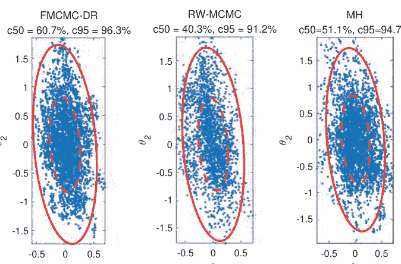

**图 9.2** 三种算法的 50% 和 95% 轮廓正确性结果。

由于我们使用高斯混合模型，允许精确计算，例如 50% 和 95% 概率区域，因此基于 MCMC 的方法的正确性可以轻松验证 [20]。另外，为了可视化目的，前两个维度参数与正确概率轮廓一起展示。所提 FMCMC-DR、RW-MCMC 和 MH 的结果分别在图 9.2a–c 中展示。

这三个图展示了采样点以及 50% 和 95% 概率区域。显然，无论从 50% 轮廓还是 95% 轮廓的准确性角度来看，所提 FMCMC-DR 都达到了最高精度，分别为 60.7% 和 96.3%，这表明延迟拒绝技术确实可以提升 MCMC 的性能，因为其能够进行完整状态空间探索。然而，对于 RW-MCMC，其 50% 轮廓测量的准确率为 40.3%，比标准 MH 方法低 0.8%。另外，RW-MCMC 的 95% 轮廓测量准确率为 91.2%，同样低于标准 MH 方法，其对应值为 94.7%。这是可以理解的，因为就抽样技术而言，标准 MH 方法采用拒绝-接受抽样，因此不利于局部拟合的样本将被丢弃。相反，RW-MCMC 利用随机游走进行抽样，因此不良样本也会被包含，导致在这三种技术中性能最差。

为了获得更可靠的统计和演示，我们将参数维度数量从 10 以步长 10 变化到 100，以查看性能


变化，如图 9.3a 和 b 所示。总体性能与之前的固定维度情况一致，即，FMCMC-DR 达到最高的 95% 轮廓精度，其次是 MH，RW-MCMC 性能最差。原因在于，借助延迟拒绝和拒绝-接受采样技术，所提出的 FMCMC-DR 能够探索整个状态空间，从而可以更精确地进行模型拟合。对于 95% 轮廓精度，维度对性能的影响较小，波动范围在 4% 以内；而对于 50% 轮廓精度，维度对性能的影响显著，波动幅度约为 10%。这是因为 50% 轮廓的面积远小于 95% 轮廓的面积。因此，假设某些点被错误地放置在 50% 轮廓范围之外但位于 95% 轮廓范围内。50% 轮廓精度的结果可能会发生很大变化，但不会影响 95% 轮廓精度。换言之，50% 轮廓精度更容易受到误差影响。除此之外，从图 9.3a 和 b 中可以发现，所有曲线的趋势是先增加后减少，随维度的增加而变化。这表明基于 MCMC 的方法优于特定特征数据集。起始点增加是由于更多维度为后验近似提供了更多特征……但随着维度继续增加，维度灾难发生，导致精度下降。因此，对于给定的算法或机器学习模型，会存在最适合的数据维度。例如，在这种情况下，最合适的数据是具有 50 维或 60 维参数的数据。

此外，我们还讨论了三种算法的收敛性能。在这个子任务中，迭代总数设置为 200,000 次。混合分布的数量设置为 10。参数的数量设置为 50。收敛曲线如图 9.4 所示，显示了均值的收敛趋势。显然，三条曲线都收敛到接近零的值。所提出的 FMCMC-DR 方法收敛最快，大约在 70,000 次迭代左右。然而，对于 MH 和 RW-MCMC，收敛曲线在整个过程中波动，幅度逐渐减小。基本上，它们的拐点出现在大约 100,000 次迭代时。FMCMC-DR 收敛快的原因是采用了拒绝-接受采样方法和延迟拒绝。拒绝-接受采样检查候选样本的接受情况，并根据与计算接受率的比较结果确定是否接受所提出的样本。此外，延迟拒绝通过向后探索帮助找出更好或更准确的样本候选项。因此，所提出的 FMCMC-DR 获得了最佳收敛速率。另外，三条曲线的端点与真实均值（即零）之间存在差距，这是因为精度无法达到 100%，如之前的结果所示。此外，差距的差异表明三种方法达到的精度水平不同。显然，FMCMC-DR 的差距最小，第二小的是
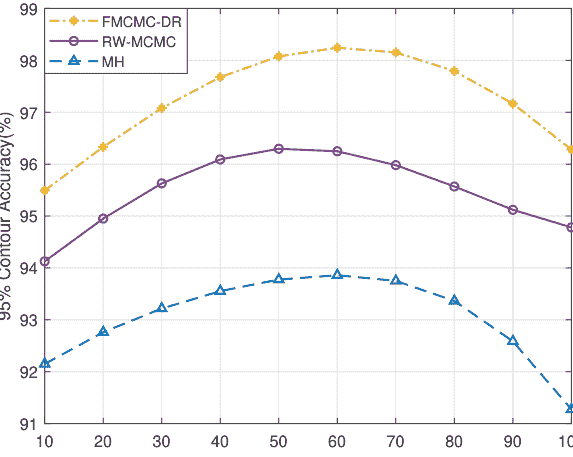
(a) 95% 轮廓精度。

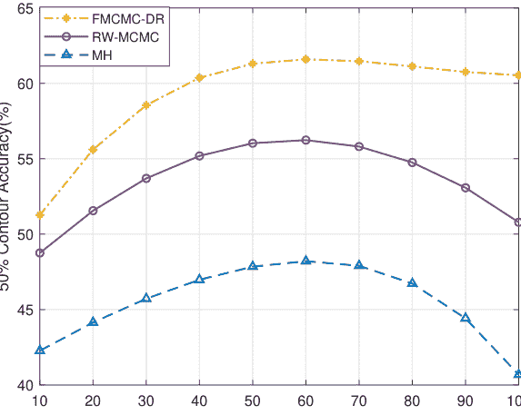

(b) 50% 轮廓精度。

图 9.3 不同参数维度下的 50% 和 95% 轮廓精度。

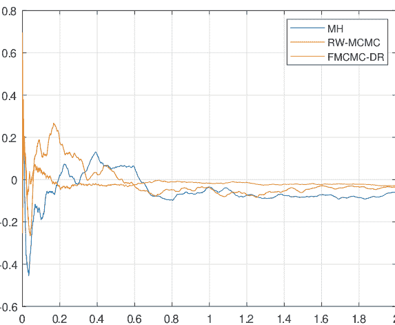

图 9.4
MH、RW-MCMC 和 FMCMC-DR 的收敛曲线。

RW-MCMC，MH 的差距最大。这也与之前的实验结果一致。

### 9.5 总结

随着我们迈入信息时代，数据量呈爆炸式增长，使得数据科学辅助的分析变得不可或缺。联邦分析作为一种新范式出现，旨在无需集中端设备的原始数据即可解决数据科学相关任务。在本章中，我们在联邦分析范式下研究全局分布发现问题。观察到端设备资源有限，我们将数字孪生技术应用于联邦分布分析问题，通过聚合不同用户的部分观测结果来获取全局数据分布。未来，我们将研究更多关于数字孪生赋能的联邦分析问题，例如数字孪生辅助的联邦推荐。端设备搜索查询与向用户推荐相关内容直接相关。

在数字孪生的物理侧，可以应用分析方法来提取推荐特征。然后，特征可以上传到数字孪生的虚拟侧，以评估所有用户的流行度，并根据当前上下文对待推荐项目进行排序。此外，还可以探索更多关于数字孪生赋能的联邦分析问题，例如封闭集上的联邦直方图、开放集上的联邦数据流行度发现、向量空间的联邦密度，以及用于安全联邦聚合的隐私和安全管理。

## Bibliography

- [1] Carrie MacGillivray, Marcus Torchia, Ashutosh Bisht, Nigel Wallis, Andrea Sivero, Gabriele Roberti, Svetlana Khimina, Yuta Torisu, Roberto Membrila, Krishna Chinta, and Jonathan Leung. 万物互联预测, IDC, 2020–2024, August 2020.
- [2] Dawei Chen, Dan Wang, Yifei Zhu, and Zhu Han. 基于贝叶斯方法的联邦分析数字孪生. IEEE Internet of Things Journal, 8(22):16301–16312, 2021.
- [3] Fei Tao, He Zhang, Ang Liu, and Andrew YC Nee. 工业中的数字孪生：现状. IEEE Transactions on Industrial Informatics, 15(4):2405–2415, April 2019.
- [4] Yu Zheng, Sen Yang, and Huanchong Cheng. 数字孪生应用框架及其案例研究. Journal of Ambient Intelligence and Humanized Computing, 10(3):1141–1153, March 2019.
- [5] Quan Yu, Chao Han, Lin Bai, Jingchao Wang, Jinho Choi, and Xuemin Shen. 不同探测器下 MIMO-NOMA 系统的多用户选择准则. IEEE Transactions on Vehicular Technology, 69(2):1777–1791, February 2020.
- [6] Dawei Chen, Yin-Chen Liu, BaekGyu Kim, Jiang Xie, Choong Seon Hong, and Zhu Han. 车辆网络中边缘计算资源预留：一种元学习方法. IEEE Transactions on Vehicular Technology, 69(5):5634–5646, 2020.
- [7] Dawei Chen, Xiaojin Zhang, Li Wang, and Zhu Han. 基于层级勾股模糊深度神经网络的云资源需求预测. IEEE Transactions on Services Computing, 14(6):1890–1901, November 2021.
- [8] Daniel Ramage and Stefano Mazzocchi. 联邦分析：无需数据收集的协作数据科学, 软件工程师, Google Research, May 2020.
- [9] Peter Kairouz. Google 及其以外的联邦学习和分析, 研究科学家, Google, September 2020.
- [10] Longbing Cao. 数据科学：全面概述. ACM Computing Surveys (CSUR), 50(3):1–42, June 2017.
- [11] Eugenia Koblents and Joaquín Míguez. 带有变换权重的群体蒙特卡罗方案及其在随机动力学模型中的应用. Statistics and Computing, 25(2):407–425, March 2015.
- [12] Shahin Boluki, Mohammad Shahrokh Esfahani, Xiaoning Qian, and Edward R Dougherty. 在高斯混合模型中构建基于路径的先验，用于贝叶斯回归和分类. IEEE/ACM Transactions on Computational Biology and Bioinformatics, 16(2):524–537, November 2017.
- [13] Michael J Daniels and Joseph W Hogan. 纵向研究中的缺失数据：贝叶斯建模与敏感性分析策略. CRC Press, 2008.
- [14] Martyn Plummer, Nicky Best, Kate Cowles, and Karen Vines. Coda：MCMC 的收敛诊断与输出分析. R News, 6(1):7–11, March 2006.
- [15] Luke Tierney and Antonietta Mira. 用于贝叶斯推断的一些自适应蒙特卡罗方法. Statistics in Medicine, 18(17–18):2507–2515, August 1999.
- [16] Peter J Green and Antonietta Mira. 可逆跳 Metropolis-Hastings 中的延迟拒绝. Biometrika, 88(4):1035–1053, December 2001.
- [17] Antonietta Mira 等. 带有延迟拒绝的 Metropolis-Hastings 算法. Metron, 59(3–4):231–241, April 2001.
- [18] Heikki Haario, Marko Laine, Antonietta Mira, and Eero Saksman. DRAM：高效自适应 MCMC. Statistics and Computing, 16(4):339–354, December 2006.
- [19] Jose G Dias and Michel Wedel. 有问题的高斯混合似然下 EM、SEM 和 MCMC 性能的经验比较. Statistics and Computing, 14(4):323–332, April 2004.
- [20] Heikki Haario, Eero Saksman, and Johanna Tamminen. 高维 MCMC 的分量自适应. Computational Statistics, 20(2):265–273, June 2005.


## 基于区块链的数字孪生设计

Esra Kumaş, Hamide Özyürek, Serdar Çelik, and Zeynep Baysal

OSTIM 技术大学

### 10.1 引言

计算机技术的进步在收集、处理和存储信息方面大大增强了人类的能力。当与网络技术结合时，此类技术还通过网络使信息从一个地方传输到另一个地方的速度加快了百万倍（Tonta and Küçük 2005）。1947年晶体管的发明给通信和电子领域带来了巨大变化，随后的计算机技术发展使数据处理器变得更小、更快、更便宜。变得更小、更快、更便宜的数据处理器也增加了使用计算机技术的产品数量（Brynjolfsson and McAffe 2014）。指数级发展不仅对技术本身，而且对整个过程（如过程的速度、效率和成本效益）都有相同的指数级影响。这种速度将催生第二层级的指数增长，换句话说，指数增长的速度将呈指数级增长（Kurzweil 2016）。网络物理系统、智能工厂、云技术、3D打印技术、物联网（IoT）、网络安全、大数据、学习型机器人和虚拟现实（VR）等被视为工业4.0组成部分（Hermann et al. 2015）的新技术，是改变企业经营方式的其他压力要素。

数字孪生（DT）是物理对象和/或运营过程的虚拟图像，允许基于实时数据监控产品和系统环境。结合Kevin Ashton于1999年提出的用于描述能够感知并与环境通信的对象的物联网概念（Ashton 2009），它为创建能够理解日益增加的复杂性并快速响应的系统铺平了道路。对对象进行编码和监控的能力使公司得益于物联网（Ferguson 2002）能够更高效、减少错误、加快流程、防止损失，并使用灵活且复杂的组织系统。物联网将万物连接到集成全球网络中每个人的能力使数字孪生成为可能。由于数字孪生用于即时数据的收集和监控，它们分析收集的数据，提取、优化流程，向用户提供建议，甚至自行做出决策并实施。在这些过程中，可能出现管理日益增加的数据量、防止数据丢失以及确保数据安全性和透明度等问题。区块链是一种分布式账本技术（DLT）。由于没有单一中央机构控制账本，它是一种以不可更改且按时间顺序记录的方式存储信息的高度安全且透明的方法。在这方面，区块链有可能成为确保数字孪生使用和产生的大量数据的信任、透明度和可靠性的有效技术。下一节将提供区块链的定义、背景、阶段、结构、优势、共识算法、网络类型和应用领域。在第二部分中，解释了数字孪生的定义和背景、其阶段、概念和成熟度模型，并审查了关于数字孪生和区块链技术的文献。最后，提出了一种用于数字孪生和区块链技术集成应用的模型。

### 10.2 区块链

#### 10.2.1 区块链的定义和背景

区块链是由中本聪在2008年推广的名为比特币的加密货币的底层技术（Cong and He 2019）。通过密码学连接的每个区块包含前一个区块的密码学哈希、时间戳和交易数据（Chang et al. 2020）。

比特币允许网络（区块链）上的每个用户匿名广播整个网络上的所有交易，使得网络上的所有其他用户都了解所有交易（Pimentel and Boulianne 2020）。在日常生活中，资金转账可以在两方之间进行，而无需通知可信第三方或进行干预。这种交易行为称为对等（P2P）网络。区块链所做的是使这种交易能够转移到在线平台（Nakamoto 2008）。

区块链数据的透明性、交易的可追溯性、交易的非中介性和数据对称性，只是区块链技术使其对几乎所有行业都至关重要的少数几个特性。区块链是一种分布式数据库，由于其去中心化结构，网络上的所有记录都复制到每个用户的计算机上，从而提供了前所未有的技术。区块链网络上的每个单独用户称为“节点”，数字账本被定义为由单个数据块组成的“链”（Hughes et al. 2019）。当新数据按时间顺序添加到网络时，会创建一个新的“块”，然后添加到“链”中。每个附加块在包含所有先前数据块的同时更新区块链上的所有先前节点，这提供了区块链技术被认为是安全的关键原因。大多数网络用户需要验证和确认新数据，块才能添加到区块链网络中，这比单个用户在独立网络上进行更改所面临的挑战更加困难。验证所有交易的这一要求既防止了加密货币的重复支出，也禁止了欺诈行为。

#### 10.2.2 区块链的结构

加密货币基于密码学证据运行，使用“哈希”（由摘要和一系列字母数字组成）以及数字签名链将每个交易连接到前一个交易。这组数据和哈希称为“区块”，这些区块包含时间戳并相互链接以创建安全链。当即时数据带特定时间戳添加到链中时，所有输入都由用户记录，不会丢失任何数据（Yli-Huumo et al. 2016）。

此外，由于链中的每个添加包含基于前一个区块的唯一标识符代码，它确保了数据跟踪的准确性和安全性（Nam et al. 2021）。用户信任区块链上保存的数据，而无需相互了解和信任或依赖银行、信用公司或政府等中央机构，这就是区块链被称为“信任机器”的原因（Miraz and Ali 2018）。类似链条的结构按时间顺序链接数据块并防止分布式账本被篡改或复制。正如Bahga and Madisetti（2016）所展示的，这种类似链条结构上的每个链接或所谓的区块包含前一个哈希、随机数（仅使用一次的数字）、默克尔根（以树状结构包含区块上所有交易哈希）和时间戳。

#### 10.2.3 区块链技术的优势

区块链加强了数据收集（Suri 2021）和数据管理（Lin et al. 2017; Kamilaris et al. 2019），并允许交易被独立记录和验证（Graglia and Mellon 2018）。由于这一特性，使用区块链技术可以轻松保存土地登记记录（Veuger 2020）。包括出生证明、驾驶执照、社会安全号码和护照在内的个人文件可以存储在区块链上，因为它通过数字身份为身份盗窃问题提供了解决方案（Gupta et al. 2017; Dogram et al. 2018）。它还可以在全球范围内用于签发和验证教育证书，如学位、成绩单以及显示学生资格、成就和专业才能的文件（Alammar y et al. 2019），或像IBM的Food Trust项目一样，用于监控供应链（Pathak 2021）。它能够提供正确产品


向消费者提供原产地信息（Nikolakis et al. 2018）。由CryptoSeal、Genentech和Pfizer支持的MediLedger项目以及验证产品真伪的BlockVerify项目为该领域的问题提供了解决方案（Radochia 2019）。

区块链应用被用于克服各种业务问题并优化许多业务流程（Pal et al. 2021）。例如，Knirsch et al.（2018）提出了一种用于在为电动汽车充电时保护隐私的区块链协议。

区块链技术在财务审计操作中也具有优势。它降低了交易审计（Salah et al. 2019）和中介成本（Michelman 2017）。它还可以通过消除旅游、食品、农业及类似行业的中介来帮助降低成本（Hughes et al. 2019）。每个节点（用户）都拥有账本的副本，一旦发生新交易，所有记录都会同时更新（Pimentel and Boulianne 2020）。

#### 10.2.4 共识算法

区块链是一种分布式网络系统，其中共识协议应运而生，以确保交易无误且准确，建立信任，从而防止潜在冲突，并使互不相识的用户能够协同工作（Li et al. 2018）。

对区块链给定目录中的一批交易达成一致，以确保分布式系统的交易无误或正确，这被称为共识。

第一个共识协议是比特币中使用的工作量证明（Proof of Work，PoW），随后开发了权益证明（Proof of Stake，PoS）和拜占庭容错（Byzantine Fault Tolerance，BFT），并且基于这些基本协议仍在不断开发不同版本。

由于其与比特币的关联，PoW是最著名的共识算法（Hasselgren et al. 2020）。

PoW经常用于公有链，因为它允许任何人参与区块链区块验证过程。

在网络中运行PoW的区块链节点，在为区块链验证新区块时必须解决一个密码学“谜题”，其答案是随机的，且通过计算猜测成本高昂，这使得恶意矿工很难猜出正确答案，因为该过程会通过密集且昂贵的运算产生数百万种可能性（Zghaibeh et al. 2020）。

事实上，要使恶意矿工成功，他/她必须拥有网络超过50%的算力，这被称为51%攻击（Hardin and Kotz 2019）。

然而，PoW在能源消耗和计算时间方面是一个非常昂贵的过程。

基于PoW的区块链网络交易验证时间较慢。

PoS是PoW协议的一种节能替代方案，在PoS中，下一个区块的创建者根据其持有的相关加密货币数量来选择。

PoS提供了一种无需强迫记账者解决困难计算问题即可达成共识的方式，并避免了PoW系统所需的资源浪费（Abadi and Brunnermeier 2018）。

以太坊目前正计划从PoW转向PoS（Hasselgren et al. 2020）。

受拜占庭将军问题启发，BFT基于拜占庭皇帝使用多名信使向其将军传递消息的策略。

在将此策略应用于区块链技术时，区块链中的节点代表将军。

不允许对系统发起攻击的节点代表忠诚的将军，而计划发起攻击以破坏区块链并分享虚假欺诈信息的节点代表叛徒将军（Kardaş 2019）。

该策略在区块链中的首次应用是Hyperledger Fabric平台上使用的实用拜占庭容错（PBFT）算法，该平台是一种许可链，随后开发了伊斯坦布尔拜占庭容错（IBFT）等不同版本（Hardin and Kotz 2019）。

PBFT在联盟链网络中使用更为有效，其中有一小群组织愿意达成共识（Dhuddu and Mahankali 2022）。

#### 10.2.5 区块链技术应用的领域

关于区块链技术应用的文献表明，它正在被使用并有望在包括商业管理、房地产和土地登记、公共行政、数字身份、教育（Zeadally and Abdo 2019）、健康、物流与供应链（Fachrunnisa and Hussain 2020）、制造业、健康、能源（Demirkir et al. 2020）、农业、旅游（Önder and Treiblmaier 2018）、机器人技术（Al-Jarooidi and Mohamed 2019）、娱乐、金融与银行、会计与审计（Özyürek and Etlioğlu 2021）等领域中使用。

研究表明，区块链技术被用于进行安全的在线交易（Garg et al. 2021）、创建数字身份（Doğru et al. 2018）、提高供应链效率（Fachrunnisa and Hussain 2020）、在医疗保健领域保存患者记录（Hardin and Kotz 2019）以及由犯罪控制机构监控枪支拥有者（Kumar 2021）。

区块链可用于作为运营管理一部分的生产计划、生产控制和质量控制，提供可见性、有效性和自动化等优势（Pal et al. 2021）。

区块链正在快速发展，以帮助改善跨境货物贸易流的可追溯性（Pournader et al. 2020）。

对于跨境贸易流管理，高价值商品通常受到严密监控。

区块链在上述高价值商品运输示例中可以发挥重要作用。

根据Mishra和Venkatesan（2021）的说法，区块链中的时间戳可用于执行对时间敏感的任务，例如准时制（JIT）生产。

研究还表明，与现有招聘系统相比，基于区块链的招聘管理系统和基于区块链的HRM系统算法具有优势（Onik et al. 2018）。

### 10.3 数字孪生

#### 10.3.1 数字孪生的定义与背景

数字孪生（DT）被定义为物理对象或过程过去和当前行为的实时数字档案，它有助于优化其运营性能，并基于实时、现实世界的大规模和累积数据测量。

它基于这样一个理念：关于物理系统的数字信息结构可以作为独立实体来创建。

该数字信息创建了物理系统中嵌入信息的“孪生体”，并在整个生命周期内与该物理系统相关联（Kumaş and Erol 2021）。

数字孪生技术源于NASA的测绘技术，最早于2002年由密歇根大学的Michael Grieves博士在其向行业展示以建立产品生命周期管理（PLM）中心时提出（Grieves and Vickers 2017），随后在2006年提出了其概念模型（Grieves 2006）。

为了反映NASA阿波罗任务期间航天器的状况，建造了两艘相同的航天器，留在地球上的那辆被称为孪生体。

在飞行任务中，地球上的孪生体被用于确保数据尽可能精确地反映飞行条件，以协助轨道上的宇航员应对危急情况，同时也用于模拟备选方案。

因此，任何模拟实时行为并反映真实工作环境的原型都可以被视为孪生体。

Grieves的概念模型被命名为“信息反射模型”（Grieves 2006），随后在2010年NASA技术路线图中被称为“数字孪生”（Piascik et al. 2010），并因此被重新命名为该名称。

使数字孪生对企业来说变得负担得起且可及的技术是物联网（IoT）技术。

尽管创建产品或流程数字副本的想法并不新颖，但创建最接近真实产品或流程的数字副本的工作自企业首次使用计算机以来一直在进行。

计算机辅助制造和设计技术（CAD/CAM）使产品在仍处于构思阶段时就能够进行物理建模，而仿真程序则使测试影响产品的因素成为可能，VR提供了更真实的结果，并且通过增强现实（AR）技术实现了远程控制。

然而，对数字副本的同步监控和控制以及实时和即时环境数据的使用表明，数字孪生不仅是一个数字副本，而且是通往智能工厂道路上的一个重要基石，作为一种自我管理的产品，它使理解、学习和推理成为可能。


DT是指物理产品的实时虚拟副本，但由于该术语最早于2002年提出，随着技术进步和DT技术的广泛应用，关于其应用领域和目的出现了许多定义。Negri et al. (2017)表明，这些定义最初于2010年至2013年间用于航空领域，制造业领域的首批研究发表于2013年，而包含DT通用产品概念的研究则于2015年出现（Negri et al. 2017）。

表10.1展示了不同领域和行业中具有多样化目标的DT定义。

上述定义表明，DT用于通过简化复杂物理产品或流程来将其建模为高级界面，以提升其性能、实时监控、执行理解-学习和推理活动以及优化安全和维护活动，并根据其目的以不同方式定义。

#### 10.3.2 概念与成熟度模型

首个概念模型由Grieves提出。它源于通过汇集物理资产的所有数据和信息来进行高级分析的需求。该模型包括真实环境、虚拟环境及两者之间的信息流和处理：

- 真实空间，
- 虚拟空间，
- 从真实空间到虚拟空间的数据流连接，
- 从虚拟空间到真实空间的信息流连接及虚拟子空间。

Grieves对DT的定义是一种三维结构，用于描述物理资产、真实模型以及它们之间的数据连接。Tao et al. (2022)在此结构中添加了服务的概念（Tao et al. 2022）。DT数据代表从物理资产和虚拟资产收集信息的资产。处理这些数据的结构称为服务。

Arup (2019)发表了一项题为“Digital Twin Towards a Meaningful Framework”的研究，该研究涉及Michael Grieves博士，并根据DT的等级对其进行分类。根据该研究，DT在以下四个维度下被分为五个等级：

- 自主性：无需人工干预即可行动的能力。
- 智能：它可以复制人类认知过程并执行分配给它的任务。
- 学习：它可以自动从数据中学习以提升性能。它可以通过机器学习对系统的属性进行分类。
- 保真度：它可以达到接近系统测量值、计算值或规范实际值的结果。

#### 表10.1 数字孪生定义

| 来源 | 定义 | 年份 | 研究标题 |
| :--- | :--- | :--- | :--- |
| NASA | 数字孪生提供产品生命周期和维护时间的高度准确模拟，利用所有当前和历史数据以确保高度的安全性和可靠性。 | 2009 | Apollo 13 |
| 通用电气 | 数字孪生作为一种活跃模型，推动事物的结果。 | 2016 | Meet the Digital Twin |
| 微软 | 数字孪生是流程、产品、生产或服务的实时虚拟模型，由物联网、机器学习和数据分析驱动。 | 2017 | The Promise of a Digital Twin Strategy |
| 德勤 | 数字孪生是物理产品或流程的实时数字映射，能够优化业务性能。 | 2017 | Industry 4.0 and the Digital Twin |
| Grieves and Vickers | 数字孪生是在虚拟环境中对物理产品的一对一创建，该虚拟图像包含物理产品在最佳条件下所拥有的所有信息。 | 2017 | Digital Twin: Mitigating Unpredictable, Undesirable Emergent Behaviour in Complex Systems |
| 埃森哲 | 数字孪生是物理对象、系统或流程的数字模型，帮助企业监控远程设施设备的状况、针对特定需求优化产品设计，甚至对业务本身进行建模。 | 2018 | What Is a Digital Twin? |
| 英国数字化建筑中心 | 数字孪生是物理对象的字面虚拟表现。 | 2019 | National Digital Twin Programme |
| IBM | 数字孪生是产品或系统在其整个生命周期中的模拟虚拟表现，利用实时数据辅助决策。 | 2019 | What Are Digital Twins? |
| 西门子 | 数字孪生是物理产品或流程的模拟虚拟表现，用于在整个产品生命周期中理解、预测和优化性能特征。 | 2019 | Siemens Glossary: Digital Twin |
| MIT斯隆管理学院 | 数字孪生是物理对象或系统的虚拟副本，可使用实时数据持续更新。 | 2020 | How Digital Twins Are Reinventing Innovation |

#### 表10.2 数字孪生等级

| 等级 | 等级描述 | 维度 | 维度描述 |
| :--- | :--- | :--- | :--- |
| 等级 1 | 连接到现实世界系统并收集数据，但缺乏自主性、学习和决策能力 | 自主性 | 不存在完全自主性。 |
| | | 智能 | 孪生体没有智能。 |
| | | 学习 | 孪生体没有学习组件。 |
| | | 保真度 | 可将其视为概念模型，其准确度较低。 |
| 等级 2 | 在这个级别，数字孪生通常仅限于对小型系统进行建模，具有一定的反馈和控制能力。 | 自主性 | 自主性有限，但可以提供关于系统有效性的反馈。 |
| | | 智能 | 它响应刺激，但无法从先前数据中得出有意义的结论。 |
| | | 学习 | 它可以使用长长的命令列表进行编程。 |
| | | 保真度 | 它可以在低到中等精度范围内进行测量。 |
| 等级 3 | 在这个级别，数字孪生可以分析其收集的数据，提供预测性维护和洞察，除此之外还具备等级2数字孪生的特征。 | 自主性 | 它以某种方式模拟和控制系统的能力，且部分自主。 |
| | | 智能 | 它可以从历史数据中学习以改进并做出决策。 |
| | | 学习 | 它可以预测并提供反馈。 |
| | | 保真度 | 它具有中等精度，能够表征物理世界。 |
| 等级 4 | 在这个级别，数字孪生从环境收集的数据中学习，得出结论，优化流程，并向用户提供智能建议。 | 自主性 | 它可以监控条件，并在很少或无需人工干预的情况下执行关键任务。 |
| | | 智能 | 它可以理解系统的需求。 |
| | | 学习 | 它可以自行理解环境。 |
| | | 保真度 | 它可以提供精确测量。 |
| 等级 5 | 这种级别的数字孪生借助人工智能进行自主推理，用户则可以据此做出决策。 | 自主性 | 它可以在无需人工干预的情况下完全安全地运行。 |
| | | 智能 | 它可以具有类似于人类智能的自我意识。 |
| | | 学习 | 它从历史数据和经验中学习，以找到能够提升性能的最佳结果。 |
| | | 保真度 | 它具有高度准确性，可用于生命安全和关键操作决策等至关重要的场景。 |

来源：改编自 Arup (2019)。

### 10.4 文献综述

在文献中，已针对不同目的和领域开展了关于基于区块链的数字孪生使用的研究。在表10.3中，研究按其目标进行分组展示。

### 10.5 数字孪生与区块链结构集成及模型提案

本研究阐述了创建数字孪生及其与区块链生态系统集成的过程。它提出了一个通用框架，可根据需要对其进行定制，以满足需要一种能够与现实世界同步以实现特定目标的数字模型的企业的具体需求和功能。多学科团队协作创建数字孪生，即物理实体的虚拟模型。可靠的管理和监控工具在此过程中至关重要，以确保历史信息的防篡改保存。这就是为什么区块链——一种用于多方之间数据交换的去中心化技术协议——被用于满足严格的安全要求。

本研究通过由五层组成的概念模型和技术框架，阐述了区块链与数字孪生之间的集成。图10.1展示了区块链与工业4.0关键技术集成的实现。它强调了生态系统和子生态系统是如何建立在共同使用的区块链平台之上的。该模型提供了各种信息技术组件、管理组件、关于物理对象的数据，并可能将其转化为实时业务模型。最外层包含来自物理世界的数据、决策机制、设计师和规划者。数据通过物联网设备、RFID和深度学习应用的连接点进入数字孪生系统。数字孪生的动态特性在设计和计算层中得以实现。目标是消除现实世界与数字孪生之间的数字孪生中介并减少存储空间。为此，它利用区块链账本和


TABLE 10.3 文献综述

| 作者 | 年份 | 目的 | 类别 |
|---|---|---|---|
| Huang, Wang, Yan and Fang | 2020 | 本研究提出了一种基于区块链技术的数据管理方法，以解决在数据采集、存储、共享、真实性和保护过程中可能出现的问题。 | 数据管理 |
| Li, Li, Huang and Qu | 2021 | 本研究创建了一个基于区块链的数字孪生共享平台，以简化分散和异构环境的集成，并保护软件版权。 | 数据安全 |
| Tao, Zhang, Cheng, Ren, Wang, Qi and Li | 2022 | 本文旨在提出一种基于 DT-BC 的协作机制，用于工业互联网平台中与数据安全相关的问题。 | |
| Putz, Dietz, Empl and Permul | 2021 | 本研究旨在确保数据完整性、可用性和机密性，提出了一种基于区块链的数字孪生模型。 | |
| Mandolla, Petruzelli, Percoco and Urbinnati | 2019 | 本文旨在解释如何利用区块链构建安全且互连的增材制造基础设施。 | |
| Shen, Hu, Zhang and Ma | 2021 | 本文提出了一种基于区块链的方法，以安全地共享大型数字孪生数据，旨在应对此类数据指数级增长和及时共享所带来的挑战。 | |
| Zhang, Zhou, Li and Cao | 2020 | 本研究旨在将 IoT 与区块链相结合，并引入一种新的制造区块链万物（MB CoT）架构，以配置安全、可追溯和分散的 IMS。 | |
| Lee, Lee, Masoud, Krishnan and Li | 2021 | 本研究旨在通过集成的数字孪生和区块链模型，实现利益相关方之间关于项目的透明信息共享。 | 监测 |
| Guo, Ling, Li, Ao, Zhang, Rong and Huang | 2020 | 本文旨在为个性化产品提供指导和参考点。 | 个性化 |
| Wang, Cai and Li | 2022 | 本文旨在通过优化确保数据准确性的测量，在消除延迟的同时保证可持续能源和可持续信息。 | 可持续性 |

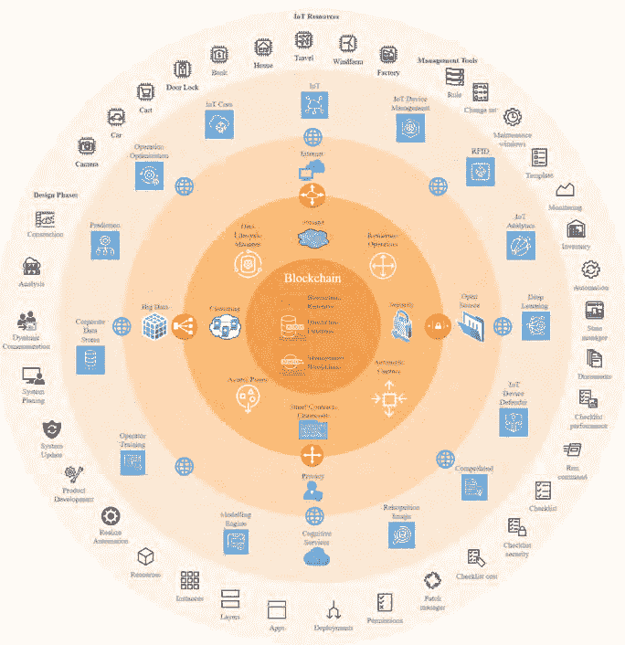

FIGURE 10.1 数字孪生与区块链集成。

去中心化的应用程序相互之间使用开源分布式加密身份以及直接的 P2P 通信进行交互，且不需要中介。数据管理层为与 DT 系统交互的参与者提供安全的连接和访问。它还与来自现实世界的非分类大数据协同工作。收集的大数据在通过连接软件进入区块链之前会被标准化和分类。在此层中，参与者的 IoT 传感器和各种来源的数据在进入区块链层之前会得到验证，并利用去中心化协议。这些协议在参与者之间提供透明度，并在全球范围内提高安全性。基于自动化验证流程，如果满足智能合约中规定的合同安排，技术组件可以立即触发付款或参与者请求。交易由分布式账本网络内的端到端加密实现，必须经网络多数批准。批准过程防止单个实体的操纵和欺诈行为。当利益相关方被纳入网络时，操纵变得越来越困难。当标准化数据进入区块链时，它变得安全，保留历史完整性。区块链在集成智能合约、安全协议和提高可见性方面是数据层的重要元素。智能合约被编程用于计算 DT 内部的主要流程，并由去中心化的关键因素（如 DT 的利益相关方或设备身份）使用，以改进访问控制机制。去中心化平台允许大量网络参与者直接相互交互，而无需第三方。借助 DT 提供的信息，关于贸易、生产、消费、存储等方面的数据会直接传输到目标方，提高透明度和沟通，防止低效。例如，通过将物理网络组件（预测性维护模型的重要元素）添加到区块链中，可以追踪对象，并保证其所有数据均可验证。另一个示例是，个人数据在现实世界中由身份证表示。身份证可以作为数字孪生存储，提供关于谁有权进入特定区域、房间、建筑、文档和机器的透明度。在模型的核心，区块链确保数字孪生与物理世界之间的历史数据流被安全记录，并且数据完整性得到保存。整个模型的工作方式是将隐私和加密机制考虑在内。在可审计的数据中，公共记录（如环境记录和政治记录）可以作为参考。对任何消费者或用户而言，公共区块链交易时间和成本都将较低。需要高度机密性的交易可以在私有网络上处理。只有公共利益数据才能以固定方式在公共区块链上使用。通过私有和公共区块链的组合，DT 系统创建了一个可以满足要求的模型。该模型旨在记录项目每个阶段获得的历史数据到区块链上。例如，在设计过程中与现实世界实时创建的模型更新可以记录到区块链上。在维护规划阶段，IoT 传感器数据和维护数据可以固定到区块链上。数字孪生的数据管理层还包括可以通过智能合约自动管理的关键流程。使用数字孪生交换的数据和价值可以由全球协议或利益相关方之间广泛接受的规则和协议来确定。项目或产品需要确定哪些数据应存储在链上，哪些数据应存储在不包含在链中的数据孤岛中。对于存储在链下的数据，应建立去中心化存储系统。生态系统的这一层还为数据传输提供必要的带宽，同时考虑利益相关方的需求。

模型的另一个目标是优化来自 IoT 传感器的数据分析，这由区块链技术实现，鼓励所有参与的利益相关方有效使用财务和管理工具。模型旨在通过基于区块链的协议集中数据、管理工具、建模、设计和规划流程。层之间的连接促进了基于区块链的协议的使用以及来自 IoT 传感器的数据分析的去中心化，从而减少了故障点的数量。最后，模型通过将非分类大数据合并为单一来源（关键数据安全地锚定在区块链中）来避免复杂的循环。

### 10.6 结论与建议

本研究在技术创新和发展的背景下，开发了一种数字孪生与区块链集成的框架。其目标是提出一种在数字孪生技术中采用区块链并最小化差距的模型。该模型的生态系统包括信息可追溯性、网络管理、数据分类、安全风险、管理标准化、物理世界到虚拟世界的迁移、系统集中化以及智能合约集成。数字孪生与区块链的集成通过在区块链账本中验证交易，确保了系统中参与利益相关方的 IoT 生成的数据积累的安全性和完整性。区块链相对于数字孪生技术的主要优势是安全性以及数据存储的减少。区块链的交易量足够大，交易费用为零或非常低。在数字孪生项目下聚集在一起的利益相关方将能够通过与公司自身网络互操作的区块链共同监控和交易数据。交易速度将取决于数据的量和类型。利益相关方将能够使用智能合约来提高效率、降低成本并节省时间。建议对开发出的模型进行实验研究。这可能揭示，通过为数字孪生选择特定的区块链协议可以实现节能。此外，本研究中考虑的数字孪生和区块链机制应在高数据量、速度和多样性下进行测试，以模拟工业 4.0 生态系统的真实条件。因此，未来工作应测试数字孪生在与区块链、IoT、模拟、深度学习等关键技术集成方面是否能够充分发挥作用。最后，未来工作还应识别项目或产品生命周期每个流程中需要安全性、透明度和不可篡改性的类别。


- Abadi, J., Brunnermeier, M. (2018). 区块链经济学. 国家经济研究局.

- Al-Jarooqi, J., Mohamed, N. (2019). 行业中的区块链：一项调查. IEEE Access, 7, 36500–36515.

- Alammary, A., Alhasmi, S., Almasri, M., 和 Gillani, S. (2019). 基于区块链的教育应用：系统综述. 应用科学, 9 (12), 2400.

- Arup. (2019). 数字孪生：迈向有意义的框架. 技术报告, Arup, 伦敦.

- Ashton, K. (2009). “物联网”那个东西. RFID 杂志. https://www.rfidjournal.com/that-internet-of-things-thing. RFID 杂志, 2009, 22(7): 97–114.

- Bahga, A., Madisetti, V. K. (2016). 工业物联网的区块链平台. 软件工程与应用期刊, 9(10), 533–546.

- Brynjolfsson, E., & McAfee, A. (2014). 第二个机器时代：在卓越技术时代的工作、进步与繁荣. W.W. Norton & Company.

- Chang, V., Baudier, P., Zhang, H., Xu, Q., Zhang, J., Arami, M. (2020). 区块链如何影响金融服务——专家访谈的概述、挑战与建议. 技术预测与社会变革, 158, 120166.

- Cong, L. W., He, Z. (2019). 区块链颠覆与智能合约. 金融学评论, 32(5), 1754–1797.

- Demirkan, S., Demirkan, I., McKee, A. (2020). 商业网络安全与会计未来的区块链技术. 管理分析期刊, 7(2), 189–208.

- Dhuddu, R., Mahankali, S. (2022). 区块链 A 到 Z 详解，掌握 400+ 术语成为区块链专家. BPB Publications, 印度.

- Dogram, T., Mody, M., Leonardi, C. (2018). 区块链技术及其对酒店业的影响. 波士顿大学, 波士顿.

- Fachrunnisa, O., Hussain, F. K. (2020). 基于区块链的人力资源管理实践，以缓解劳动力中的技能和胜任力差距. 工程商业管理国际期刊, 12, 1847979020966400.

- Ferguson, T. (2002). 让你的对象调用我的对象. 哈佛商业评论. https://hbr.org/2002/06/have-your-objects-call-my-objects. 访问于 2022 年 8 月.

- Garg, P., Gupta, B., Chauhan, A. K., Sivarajah, U., Gupta, S., Modgil, S. (2021). 测量银行业实施区块链技术的感知收益. 技术预测与社会变革, 163, 120407.

- Graglia, J. M., Mellon, C. (2018). 2018 年的区块链与财产：开端的终结. 创新：技术、治理与全球化, 12(1–2), 90–116.

- Grieves, M. (2006). 产品生命周期管理：推动下一代精益思考. McGraw-Hill, 纽约.

- Grieves, M., Vickers, J. (2017). 数字孪生：减轻复杂系统中不可预测、不希望的涌现行为. 复杂系统的跨学科视角（第 85–113 页）. Springer, Cham.

- Gupta, A., Patel, J., Gupta, M., Gupta, H. (2017). 区块链技术对数字投票的问题与有效性. 工程与制造科学国际期刊, 7(1), 20–21.

- Hardin, T., & Kotz, D. (2019). 健康数据系统中的区块链：一项调查. 第六届物联网：系统、管理与安全国际会议（IOTSMS）论文集，第 490–497 页，IEEE.

- Hasselgren, J., Munkberg, J., Salvi, M., Patney, A., Lefohn, A. (2020). 神经时间自适应采样与去噪. 计算机图形学论坛, 39(2), 147–155.

- Huang, S., Wang, G., Yan, Y., & Fang, X. (2020). 基于区块链的产品数字孪生数据管理. 制造系统期刊, 54, 361–371.

- Hughes, L., Dwivedi, Y., Misra, S., Rana, N., Raghavan, V. & Akella, V. (2019). 区块链研究、实践与政策：应用、优势、局限性、新兴研究主题与研究议程. 信息管理国际期刊, 49, 114–129.

- Kamilaris, A., Fonts, A., & Prenafeta-Boldú, F. X. (2019). 区块链技术在农业和食品供应链中的兴起. 食品科学与技术趋势, 91, 640–652.

- Kardaş, S. (2019). 区块链技术：共识协议. 迪克莱大学工程学院工程学杂志, 10(2), 481–496.

- Knirsch, F., Unterweger, A., 和 Engel, D. (2018). 带动态资费决策的保护隐私的区块链电动汽车充电. 计算机科学—研究与开发, 33(1), 71–79.

- Kumar, R. (2021). 区块链的高级概念. 在 S. S. Tyagi & S. Bhatia (编) 《面向企业的区块链：它如何运作并创造价值》，第 361–372 页，Wiley.

- Kumar, E., & Erol, S. (2021). 工业 4.0 中的关键技术：数字孪生. 多技术期刊, 24(2).

- Kurzweil, R. (2016). 人类 2.0：跨越生物学的人类，技术诞生（M. Şengel 译）。土耳其：Alfa，（原作出版于 2004），第 23–24 页.

- Li, Y., Bienvenue, T.M., Wang, X., Pare, G. (2018). 商业组织中的区块链技术：范围综述. 第 51 届夏威夷系统科学国际会议论文集（第 4474–4483 页）.

- Lin, Y. P., Petway, J. R., Anthony, J., Mukhtar, H., Liao, S. W., Chou, C. F., Ho, Y. F. (2017). 区块链：ICT 电子农业的进化下一步. 环境, 4(3), 50.

- Mandolla, C., Petruzzelli, A. M., Perco, G., Urbinati, A. (2019). 通过利用区块链为增材制造构建数字孪生：航空工业案例分析. 工业计算机, 109, 134–152.

- Michelman, P. (2017). 看穿区块链炒作. MIT 斯隆管理评论, 58(4), 17–19.

- Miraz, M.H., Ali, M. (2018). 加密货币之外的区块链技术应用. 计算机新兴技术年鉴 (AETiC), 2(1), 1–6.

- Mishra, H., Venkatesan, M. (2021). 组织人力资源管理中的区块链：衡量 HR 与非 HR 视角的实证评估. 组织变革管理期刊, 525–424. https://www.emerald.com/insight/0953-4814.htm.

- Nakamoto, S. (2008). 比特币：一种点对点电子现金系统. https://assets.pubpub.org/d8wct41f/31611263538139.pdf. 访问于 2023 年 12 月

- Nam, K., Dutt, C. S., Chathoth, P., and Khan, M. S. (2021). 智慧城市和智慧旅游的区块链技术：最新趋势与挑战. 亚太旅游研究杂志, 26(4), 454–468.

- Negri, E., Fumagalli, L., Macchi, M. (2017). 基于 CPS 的生产系统中数字孪生角色的综述. 程序制造, 11, 939–948.

- Nikolakis, W., John, L., Krishnan, H. (2018). 区块链如何塑造可持续全球价值链：证据、可验证性和可强制执行 (EVE) 框架. *可持续性*, 10(11), 3926.

- Önder, I., Treiblmaier, H. (2018). 区块链与旅游：三项研究命题. *旅游研究年鉴*, 72(C), 180–182. DOI: 10.1016/j.annals.2018.03.005.

- Onik, M. M. H., Miraz, M. H., Kim, C. S. (2018). 面向工业 4.0 的基于区块链技术的招聘与人力资源管理技术. 2018 年智慧城市研讨会. IET, 2018: 1–6.

- Özyürek, H., Etiğoğlu, M. (2021). *面向企业的区块链*, Efe Akademi 出版社, 伊斯坦布尔.

- Pal, A., Tiwari, C.K. and Behl, A. (2021). 金融服务中的区块链技术：文献综合性综述. *全球运营与战略采购期刊*, 14(1), 61–80.

- Piascik, R., Vickers, J., Lowry, D., Scotti, S., Stewart, J., Calomino, A. (2010). 技术领域 12：材料、结构、机械系统和制造路线图. 美国国家航空航天局 (NASA). 美国.

- Pimentel, E., Boulianne, E. (2020). 会计研究与实践中的区块链：当前趋势与未来机遇. *会计视角*, 19(4), 325–361.

- Pournader, M., Shi, Y., Seuring, S. 和 Koh, S. L. (2020). 供应链、运输与物流中的区块链应用：文献系统综述. *国际生产研究杂志*, 58(7), 2063–2081.

- Putz, B., Dietz, M., Empl, P., & Pernul, G. (2021). Ethertwin：基于区块链的安全数字孪生信息管理. *信息处理与管理*, 58(1), 102425.

- Radochia, S. (2019). *区块链如何改善医药供应链中的合规性与可追溯性*. https://samantharodocchia.com/blog/how-blockchain-is-improving-compliance-and-traceability-in-pharmaceutical-supply-chains. 访问于 2021 年 10 月 23 日.

- Salah, K., Rehman, M. H. U., Nizamuddin, N., Al-Fuqaha, A. (2019). 面向人工智能的区块链：综述与开放研究挑战. *IEEE Access*, 7, 10127–10149.

- Shen, W., Hu, T., Zhang, C., Ma, S. (2021). 基于区块链的智能制造大规模数字孪生数据安全共享. *制造系统期刊*, 61, 338–350.

- Suri, M. (2021). 区块链生态系统的范畴. 在 *面向企业的区块链：它如何运作并创造价值*. Wiley 在线图书馆. 第 29–58 页.

- Tao, F., Zhang, Y., Cheng, Y., Ren, J., Wang, D., Qi, Q., Li, P. (2022). 数字孪生与区块链增强的智能制造服务协作与管理. *制造系统期刊*, 62, 903–914.

- Tonta, Y. 和 Küçük, M. E. (2005). 从工业社会向信息社会过渡的主要动力. “技术发展与信息时代背景下的社会、治理、管理和领导方法”第三届国际研讨会论文集. 安卡拉：土耳其总参谋部军事历史、战略研究与检查总局出版物.

- Veuger, J. (2020). 荷兰区块链、房地产与土地登记. *物业、规划与环境法期刊*, 12(2), 93–108. https://www.emerald.com/insight/content/doi/10.1108/JPPEL-11-2019-0053/full/html. 访问于 2022 年 8 月.


Wang, C., Cai, Z., Li, Y. (2022). 面向IoT设备的可持续区块链数字孪生管理架构. IEEE物联网杂志. 10(8), 6535–6548.

Yi-Huuomo, J., Ko, D., Choi, S., Park, S., Smolander, K. (2016). 当前区块链技术研究在哪里？——系统综述. PLoS One, 11(10), e0163477. DOI: 10.1371/journal.pone.0163477.

Zeadally, S., Abdo, J. B. (2019). 区块链：趋势与未来机遇. 互联网技术函刊, 2(6), e130. DOI: 10.1002/itl2.130.

Zghaibeh, M., Farooq, U., Hasan, N. U., Baig, I. (2020). Shealth：一种具有智能合约功能的基于区块链的健康系统. IEEE Access, 8, 70030–70043.

Zhang, C., Zhou, G., Li, H., Cao, Y. (2020). 面向数据和知识驱动数字孪生制造单元配置的物联网制造区块链. IEEE物联网杂志, 7(12), 11884–11894.

## 11 基于物理的数字孪生：在新兴市场中利用竞争优势

Emil Kurvinen
奥卢大学

Antero Kutvonen 和 Päivi Aaltonen
LUT大学

Jussi Salakka
奥卢大学

Behnam Ghalamchi
加州理工州大学

### 11.1 引言

本章专注于基于物理的仿真技术在产品开发之外的应用，并利用数字孪生（DT）支持的方法。我们进一步关注DT在产品、流程和创新创造方面的潜力，并讨论此类技术的管理含义。数字孪生概念可追溯至2002年密歇根大学向行业进行的关于成立产品生命周期管理（PLM）中心的演示[1]，随后在全球技术先进的制造商中日益被采用。在过去十年中，基于物理的仿真，尤其是具备实时能力的动态计算和开展分析的方法论，已得到快速发展。目前，虚拟机器与真实机器的出现受到积极关注，并且已有相关演示报告（参见，例如，[2,3]）。随后，文献转向从管理角度理解DT的运营效益，例如提高透明度和辅助决策[4,5]，在过去几十年中不断增加，同时也讨论了工业应用效益（更多信息，参见，例如，[6]）以及先进技术的战略整合[7]。此前，许多经济理论讨论了增强的潜力，而目前越来越多的学者强调自动化的重要性，并鼓励管理层参与专门关注企业中智能技术利用的研究[8]。然而，在企业中使用先进技术最常见的收益是产品和流程创新以及“世界首创”创新[9]。产品和技术开发，以及在业务场景中利用系统化结构化信息，均可进行研究，但DT的成熟度水平与R&D支出、市场和策略等特定企业因素共同定义了可实现的目标（参见，例如，[9]）。

为介绍DT技术在构建竞争优势方面的实际进展，本章基于与非公路移动机械（NRMM）和高速电机（HSEM）应用相关的研究工作撰写[10]，其中应用了动态建模和仿真，从而为在广泛的R&D知识之上构建DT提供了坚实基础。在这些应用中，最终产品可以在虚拟领域以高技术成熟度（TRL）进行评估；例如，在高速应用中，控制可以是基于模型的（参见，例如，[11]），即用于分析机器性能的动态模型也用作最终产品控制的基础。动态建模能够结合设计数据，并基于所研究产品的质量属性及其结构刚度来验证数据的正确性，因此具有基础性。可通过模态分析[12]对动态进行实验验证，其中需要惯性测量单元、加速度计、麦克风传感器或激光扫描测振仪（LSV）[13]来捕捉时域中的振动并将其转换为频率域（快速傅里叶变换）。从频率响应中，可以评估并比较峰值（即固有频率）与仿真结果。使用有限元法（FEM）计算[14]时，动态仿真是一个简单的过程，因为需要几何体及其质量和刚度属性。基于这些应用经验，当应用中的动态相关时，基于强物理的DT是相关的。

在本章中，基于仿真的虚拟产品是开发的基础，即与虚拟产品相关联的机器制造商R&D知识。早期工作涵盖的主要应用与HSEM和NRMM相关，其中计算高效的动态模型对于最终产品及其行为的视角至关重要。本章介绍了不同级别的DT方法及其在商业中如何利用以在新兴市场中获得竞争优势的示范概念。讨论的重点是将技术与商业思维相联系，并强调DT的成熟度如何影响其捕获商业价值的能力。因此，本章在通过构建共同理解并不仅涉及开发，还涉及DT的商业应用，来弥补技术导向与商业导向问题及专家之间的差距，占据了重要地位。

本章结构如下。第11.2节解释了观点和理论的背景和上下文；第11.3节描述了基于物理的DT、竞争优势和价值创造；第11.4节讨论了基于物理的DT在新兴市场中的优势、机遇和挑战。第11.5节是总结部分。

### 11.2 背景与上下文

作为术语，数字孪生在过去十年中迅速扩展[15]。数字孪生可以是原型（DTP）、实例（DTI）或聚合体（DTA），它们在数字孪生环境（DTE）中运行[1]，其中DT的用途可能各不相同，例如报告、预测、分析和自主决策[1]。取决于企业内各种用途之间日益增加的协调、同步和协同效应，这些可以用“数字孪生成熟度”这一术语来描述，并理解为企业级人工智能（AI）成熟度所对应的工业应用（更多信息，参见，例如，[6,7]）。在过去几年中，DT的成熟度模型和观点已得到开发，以便在不同专家之间从正确的观点讨论内容。

在本章中，DT从仿真角度来看，其中建模、计算能力和实施在过去5年中得到了显著增强。对于DT，期望具备实时行为，但比实时更快的模型也可以为机器提供额外的洞察，例如在利用强化学习算法[16]时。

另外，使用基于仿真的DT时的一个区别特征来自于定制产品。对于大批量产品，可用数据容易大量获得，这有助于AI和神经网络识别不同测量量之间的模式。基于物理模型构建DT的观点与大多数DT文献略有不同；然而，它具有评估有限场景之外系统行为的巨大潜力，例如轴承故障分类[17]。此外，基于物理的仿真还服务于公司的流程和规划视角，例如人工任务或特定应用流程优化。

在典型产品开发过程中，单个机器故障的成本随着机器设计、采购、组装、调试和生产的时间越长而越高。设计部分可以在很大程度上在虚拟世界中完成。

工程工作主要在虚拟世界中完成，因为在那里迭代循环运行迅速，并且在拥有物理现实...


考虑到制造过程的各种条件可以高度预先规划，即产品可以在虚拟世界中完全组装，从而避免实际组装过程中的昂贵错误 [18]。基于物理的仿真可以用于支持从设计到实际产品的过渡阶段，在新投产的产品中，成本已经相当高。投产阶段后，从单个机器收集的数据成为宝贵的信息来源。目前，大部分研究都集中在基于数据的技术上。然而，结合两种技术才是从合理数量的数据中收集相关信息的途径，例如，参见 Ref. [19]，其中神经网络完全基于基于物理的仿真领域进行训练，然后使用现实世界数据来评估系统中难以直接测量的参数。

目前，关于 DT 的增长趋势是，成熟度水平思维已找到其位置，因为 DT 术语本身涵盖了与产品相关的几乎所有内容（另见，例如，[1]）。因此，理解产品讨论的深度对于就此达成共识很重要。在考虑例如 TRL 时存在相似之处，其中低 TRL 为 0，最高为 9。同样，企业的 AI 成熟度描述为七个等级 [7]，但仍然很少存在成熟的管理理论框架。然而，有建议指出，应将重点放在更高成熟度技术的影响上，以创造竞争优势 [9]。因此，通过使用成熟度等级，跨不同学科沟通增强复杂性的讨论和步骤变得更加容易，并能专注于相关事项。DT 成熟度模型目前正在定义中，并且取决于来源——例如，对 DT 概念的理解在不同行业之间可能差异很大 [20]。一般来说，可以识别出四到六个成熟度等级，类似于 AI 成熟度 [7]。此外，所有定义的共同点是，较低等级是非结构化的，而最高等级代表最先进和最准确的模型，用于决策、流程集成以及更高级别的自主性和预测性操作（另见，例如，[1,6]）。

由于基于物理的仿真可以人为地创造基于经验的信息，而基于动态的模型可以将不同参数之间的数据与建模系统的行为相关联，因此将仿真方法与工业 AI 相结合具有巨大的潜力，用于构建能够提供竞争优势的 DT 应用程序。在解释组织如何利用 AI 解决方案时，管理 [21] 和信息系统 [22] 领域的最新研究指出，AI 为组织、扩展业务流程、分析数据和自动化决策提供了质地不同的机会，有效地消除了前一代系统施加的增长约束。基于累积研究，已经表明 AI 涉及几个使其区别于其他技术的特性，为诸如信任 [4] 和决策 [5] 等组织问题创造了特定影响。为了利用业务数据并成为数据驱动型企业，公司需要用多种不同的组织资源补充其技术分析资源，并涉及多个管理层级 [23,24]。作为其关键部分，公司需要建立数据驱动的文化和决策实践，以挖掘其业务数据的潜力 [25,26]。尽管如此，像 DT 这样的技术与更高水平的产品和流程创新相关联，并且与技术有更长历史的企业产出更高的产量 [9]。然而，目前的理论对技术成熟度和管理能力的推拉影响尚不清楚。例如，组织“AI 就绪度”的关键方面包括企业的创新能力、协作工作和变革管理 [27]。创新能力为快速 AI 采用设定节奏，并帮助大型企业改变现状，协作工作将业务、AI 和 IT 专家聚集在一起，以识别 AI 的潜在用例 [27,28]。另一方面，尽管提高了竞争优势，但德国只有 5.8% 的企业在积极使用 AI [9]。

从制造商的角度来看，历史数据能够快速设计和测试未来产品，既用于新颖解决方案，也用于当前产线的渐进式变更，例如添加的元素、对定制条件的适用性以及关联的新产品销售。此外，DT 的培训潜力巨大，可以进一步扩展到公司其他人员，例如销售人员，以应对额外的销售。最后，这使得能够从早期开始与客户共同进行产品的沟通和共同创造（同样参见 [29]），以及维护和服务支持。客户可以在数字空间中在不同条件下测试产品，并在任何实物原型制造之前获得关于产品的更多信息。对于客户而言，DT 创造了类似的杠杆潜力，包括成本效率优化、可持续性评估、维护成本降低和定制解决方案创建。最终用户培训尤其有益，与制造商共同创造解决方案也是如此。工业 AI 面临的挑战在于需要系统性和明确定义的数据。图 11.1 描绘了 DT 和不同成熟度水平与不同业务场景下的利用之间的关联，假设目前大部分销售来自销售实物产品，DT1–DT6 代表从最低成熟度等级到最高成熟度等级。

基于物理的 DT 已被用于动态应用 [30]，因为在那里重要的是理解载荷对机器行为的影响，例如，避免共振。在开发这些模型时，尤其是在人工操作机器的情况下，需要实时动态模型。准确性及其定义在模型中起着重要作用，指模型中考虑了哪些物理现象以及哪些可以忽略。另一方面，模型分区也起着重要作用。总体而言，在构建模型时，模型应接受灵敏度分析，即，哪

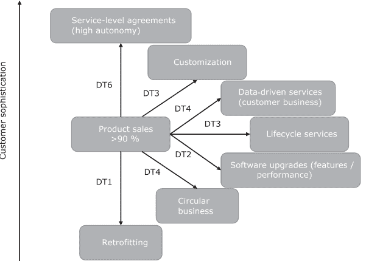

**图 11.1**
不同业务案例的数字孪生成熟度等级和利用。

些因素对模型准确性有最显著的影响 [31]。除此之外，模型设计师必须评估他们愿意接受的误差范围。

构建模型的一部分是构建其运行环境。这为基于物理的仿真带来了新元素，例如，可以使用虚拟孪生来模拟机器自动化对来自环境的信息的反应。如果交付给客户的机器能够被足够全面地监控，这些收集的历史数据可以用来创建运行环境的图像。借助这些数据，可以为虚拟孪生模拟 what-if 类场景，并更好地了解机器的行为。

另一种选择是研究机器在特殊环境中的使用，以便操作员在模拟器中使用机器并学习如何应对挑战性条件 [32]。同样，从运行环境收集真实数据很有意义，以便模拟器环境可以被构建以最好地反映现实。

可靠性分析、故障检测和健康监测在现代工业机械操作中至关重要。传统维护仅限于定期检查、可测量输出变量的评估以及根据预定计划更换关键部件。该过程无法提供关于运行条件的洞察和深入信息，而这些信息是健康监测过程所需要的。为了克服这些问题，故障检测和条件监测已被


引入。故障可以定义为一个或多个特征或参数偏离正常行为 [33]。在此方法中，测量信号与可以直接从数学建模或系统动态模型中执行的信息进行比较。基于模型的故障检测的另一个优势是使用状态估计（如卡尔曼滤波器）将数据扩展到无法进行测量的系统其他状态。同样，如果我们能够获得系统的准确模型，这是可能的。基于模型的故障检测示例已在参考文献 [34] 中讨论。

PLM 作为一个概念已有二十多年的历史，并在科技公司的产品开发中得到广泛应用 [35]。从更广泛的角度来看，它是一种连接产品数据、工具、流程和资源的业务策略 [35,36]。公司的目标是能够在一个系统中管理产品开发的所有要素。PLM 系统最初并非设计用于管理系统中运行的大量动态数据或活动模型，而是为了管理静态技术文档、文档生命周期、业务流程和人力资源。闭环 PLM 系统的理念已被提出，但尚未在工业界投入实际使用 [36]。

实现基于物理的数字孪生（DTs）需要的功能比当今 PLM 系统所能提供的更多，但 PLM 或许是未来可引入 DTs 的最合适的平台。也有可能会采用 DT 专用平台，并根据需求定制系统间（例如 PLM、ERP）的集成。DT 平台的主要元素是支持 IoT 技术并以云方式运行的数据管理系统 [37]。第二个主要元素是可以与实际数据协同运行的支持 MBSE 的模型。这样，例如，专家可以执行 what-if 分析 [38]。

### 11.3 基于物理的数字孪生竞争优势与价值创造

DTs 在支持、协调和规划开发活动方面的这一核心作用，为在工业 4.0 解决方案、商业模式研究与技术、以及创新管理等业务和管理领域利用其提供了绝佳机会。此外，它还能主动识别将产生现实影响的技术乘积与转移机会。获得先进工艺仿真能力的一个独特结果是，能够将当前工艺和基于机器的约束与产品及相关工艺的开发解耦。这在表 11.1 中有所描绘。

表 11.1
将工艺和基于机器的约束与产品及相关工艺的开发解耦

| | 现实世界工艺 | 数字工艺 |
|---|---|---|
| 现实世界机器 | 持续改进过程<br>- 仅能实现小规模的渐进式共进/改进<br>- 实施的简易性至关重要 | 传统的流程再造<br>- 受机器设计约束<br>- 现实中验证工艺变更成本高昂 |
| 数字机器 | 数字孪生和机器仿真<br>- 受工艺设计约束<br>- 无法实现共进化设计；渐进式创新 | 机器与工艺的完全数字化模拟共进化<br>- 实现激进的共进化设计<br>- 无战略约束的实验<br>- 工艺变更的模拟验证 |

迄今为止，工艺创新一直受到根据所用机器的约束以及保持工艺在线运行的要求而对工艺进行再造的限制，从而减少了实验空间。另一方面，即使在数字孪生（DTs）的辅助下，机器设计也受到保守工艺设计的约束。借助在数字领域开发、设计和测试机器和工艺的能力，可以解除这些约束，并使基于激进共进化设计的模拟实验成为可能。基于物理的数字孪生建立在软件之上。软件能够带来新的商业机会。尤其是当涉及真实物理时，可以避免构建原型并进行测试的惯性，并且可以实时研究系统。这使得在虚拟环境中对不同解决方案进行快速原型制作和基准测试成为可能。

数字孪生（DT）利用的商业影响可以在三个层面上描述。首先，在产品层面，DT 通过实现具成本效益且工艺感知的机器和服务设计，交付新的服务产品并改进当前产品。改进服务产品的质量和范围（例如 AR/VR 培训）与工业产品服务化和数字化的全球趋势共同作用，可显著提升公司的出口潜力。在公司层面，组织更新既由新的服务产品提供推动，也由简化的产品工艺规划和实验推动。最后，通过与互补合作伙伴在生态系统中协作，通过共享能力和共同创建更好的服务来实现全球市场竞争力。值得注意的是，由于数字孪生能够创造新产品和服务，从而促进客户端的工艺创新，这将产生显著的下游竞争力收益。这将加强生态系统并强化活跃参与者之间的关系。

### 11.4 新兴市场中基于物理的数字孪生的优势、机遇与挑战

数字孪生（DT）的优势、机遇和挑战明确划分为两组：客户和制造商。在实践中，引入数字孪生的责任在于制造商，因此必须预见其带来的好处。对于制造商而言，使用数字孪生可以带来许多益处。首要的是，制造商能够积累其产品知识，并且数字孪生可以让他们相对于偏好个性化服务和用户体验的客户获得竞争优势。在某些情况下，公共当局也可能对利用数字孪生生成的数据感兴趣，但这对客户隐私保护构成了挑战。与数字孪生相关的机遇是无限的；然而，针对特定行业和产品的方法差异很大，量化商业价值需要采用个案特定的方法。表 11.2 总结了数字孪生创造的竞争优势和客户利益。

对于客户，数字孪生的优势集中在个性化定制和产品维护上。这里的个性化定制是指，数字孪生可以提出用户专属界面和升级，以个性化操作模式。这样，用户可以通过精调的操作模式获得更好的用户体验或节省成本。产品维护是指，基于收集的历史数据，数字孪生可以为用户推荐合适的维护频率，与常规的年度维护程序相比，在某些情况下可以实现更少的维护 [38]。另一方面，在更苛刻的使用中，可以通过预防性维护方式延长机器的使用寿命。

表 11.2
数字孪生为公司和客户创造竞争优势及利益摘要

| 公司 | 客户 |
|---|---|
| - 基于历史数据改进未来设计 | - 特殊条件下的机器调试与测试 |
| - 创造新型定制产品 | - 机器韧性估算 |
| - 改进针对特定条件的设计 | - 机器成本效益和可持续性评估 |
| - 远程更新 | - 历史机器数据收集 |
| - 客户沟通平台 | - 成本效益优化 |
| - 通过平台增加销售潜力 | - 降低保险和维护成本 |
| - 内部培训和教育工具，也用于增加销售潜力的可视化 | - 支持和协助平台 |
| - 创新共创 | - 参与构建定制解决方案 |
| - 制造成本效益估算 | - 最终用户培训的易用性 |

对于制造商而言，引入数字孪生（DT）及其平台的优势将集中在全面收集历史数据、改善消费者体验以及其提供的更好的服务机会上。历史数据使制造商能够模拟不同客户在不同条件下的数字孪生行为。这使得开发定制和个性化的自动化系统以及新机器的鲁棒设计成为可能。在数字孪生实例中收集的历史数据可以作为模拟模型的数据库，AI 模型可以高效地在其上进行训练。

关于利用数字孪生数据的挑战在于数据的所有权和使用 [38]。在实践中，大多数情况下数据的所有权仍未明确。默认情况下，机器所有者是所有权的最有力候选者，但另一方面，所有数据服务均由制造商提供，可能与第三方合作。许多所有者可能将数据收集视为对其隐私的侵犯并拒绝披露信息。可以通过向所有者提供信息来缓解这一问题，使他们清楚了解数据的目的，并且数据收集也将对他们有利。

本章以数字孪生概念描述的通过 AI 技术创造竞争优势的理论，强调 AI 的发展，但还有其他重大决定因素影响企业绩效。此外，如表 11.1 所示，潜力可能取决于新颖程度或成本节约程度 [9]。图 11.2 说明了管理者和制造商创造竞争优势的因素。

新兴市场进入和企业能力取决于多个运营层面（参见，例如，[21–24]），但可能有助于克服前一代技术的约束（参见表 11.1 和 11.2）。然而，优势可能取决于行业和目标市场。例如，机械制造业被归类为低技术或中等技术行业，即生产与研发资金的比率通常低于 5%（参见 [39]，表 6.2，第 157 页）。高技术行业，如制药业、计算机械制造业和航天器相关制造业，通常将更多资金用于研发。在制药行业，每天都在发现新药（参见 [40]）。由于它大幅降低了开发成本，虚拟仿真使机械制造业有可能向更高技术谱系发展，并引入新颖潜力的进一步示例。采用基于物理的仿真环境能够显著增加创新数量，从而可能转化为新兴市场发现的增加，特别是通过利用服务和软件产品。


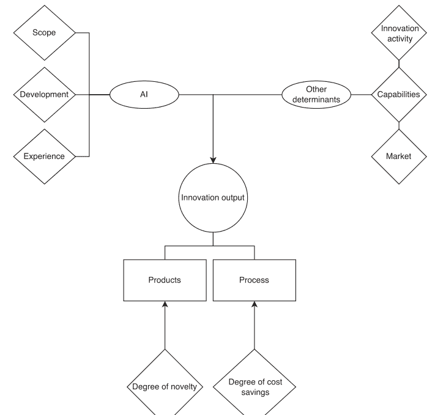

图 11.2 影响制造商竞争优势的因素。（来源：基于 [9]。）

因此，采用完全虚拟机器和流程设计，使创新数量超出了典型行业水平。由于它们消除了边界，虚拟创新环境被证明能鼓励参与和创新绩效（参见，例如，[29]），并且在应对颠覆性或动荡环境（即政治挑战和新兴经济体运营）方面可能特别有益（更多信息，例如，[41]）。此外，它们为机器制造与制造流程之间的协同演进发展提供了丰富的基础。在机器和流程的开发及其测试中纳入最终用户，能够快速实现针对用户真实需求的创新解决方案。例如，如果机器操作员提供有声读物并可以与同事讨论他们的经验，那么让工作流程进入正轨将容易得多。然而，迄今为止，这些需求在创新推广中在很大程度上未被考虑。最后，将用户反馈纳入虚拟机器和流程设计，将能够实现人机之间的无缝交互，减少人类被要求像机器一样工作的重叠部分，朝着符合工业 5.0 范式精神的相互补充工作环境发展[42]。

### 11.5 结论

本章讨论了基于物理的数字孪生（DT）的观点及其赋能方法，用于开发具有可实现竞争优势的新业务，并最终实现进入新市场，特别是从组件或机器制造商角度向软件型业务转型。基于物理的 DT 的低迭代惯性使其在基准测试和量化不同选项方面具有吸引力。这在概念设计阶段尤其重要，因为此时成本积累尚不显著。商业化和价值创造基于模型的坚实基础，且得益于软件的特性，能够以良好的精度和较快的迭代速度探索不同的设计选项。

商业模式技术（尤其是基于软件的技术）的最新发展，例如基于 AI 的方法能够分析大量数据并识别一般模式。此外，物理仿真（在需要实时行为的情况下）的发展，已能够在虚拟世界中以高精度运行完整机器，类似于真实机器的运行方式。这为不同类型的分析（例如商业、研发或创新）的数据生产提供了坚实基础[43]。

DT 目前已初具形态；然而，在公司中利用它的策略和途径仍在研究中。从技术上讲，可能性是严谨的，但在公司组织中的实施还需要进一步研究。例如，从机器制造商转型为软件型组织是一项深刻的变革，可能涉及在不同程度上重新设计公司的技能基础、能力、业务模式和创新流程。考虑到许多制造公司很快将面临这一转型的边缘，因此需要在理论和实践中更好地理解和管理它，可能通过利用软件公司和制造业先锋的例子，这些公司是最早选择这一转型的公司之一。

## 参考文献

- [1] Michael Grieves and John Vickers. 数字孪生：缓解复杂系统中不可预测、不可取的涌现行为. Transdisciplinary Perspectives on Complex Systems, pages 85–113. Springer, 2017.
- [2] Emil Kurvinen, Antero Kutvonen, Juhani Ukko, Qasim Khadim, Yashar Shabbouei Hagh, Suraj Jaiswal, Neda Neisi, Victor Zhidchenko, Juha Kortelainen, Mira Tempori, Kirsi Kokkonen, Juha Virtanen, Akhtar Zeb, Ville Lamsa, Vesa Nieminen, Jukka Junttila, Mikko Savolainen, Tuija Rantala, Tiina Valjakka, Ilkka Donoghue, Kalle Elfvengren, Mina Nasiri, Tero Rantala, Ilya Kurinov, Eerik Siikanen, Lauri Pyrhonen, Lea Hännila, Heikki Handroos, Hannu Rantanen, Minna Saunila, Jussi Sopenan, and Aki Mikkola. 基于物理的数字孪生与机器融合：移动抓木机和旋转机器案例. IEEE Access, 10:45962–45978, 2022.
- [3] Qasim Khadim, Yashar Shabbouei Hagh, Lauri Pyrhonen, Suraj Jaiswal, Victor Zhidchenko, Emil Kurvinen, Jussi Soponen, Aki Mikkola, and Heikki Handroos. 基于无迹卡尔曼滤波器的液压驱动抓木机状态估计. IEEE Access, 10:62863–62878, 2022.
- [4] Ella Glikson and Anita Williams Woolley. 人工智能的人类信任：实证研究综述. Academy of Management Annals, 14(2):627–660, 2020.
- [5] Erik Brynjolfsson and Kristina McElheran. 数据驱动决策的快速采用. American Economic Review, 106(5):133–139, 2016.
- [6] Jay Lee. 工业人工智能：可持续性能的应用 by Jay Lee, Springer Singapore, 2020, 1–162 pp., ISBN 978-981-15-2143-0 (Hardcover) ISBN 978-981-15-2144-7 (eBook) https://doi.org/10.1007/978-981-15-2144-7, Copyright Holder: Shanghai Jiao Tong University Press.” (2023): 404–405.
- [7] Ulrich Lichtenthaler. 敏捷创新：设计思维与精益创业的互补性. International Journal of Service Science, Management, Engineering, and Technology (IJSSMET), 11(1):157–167, 2020.
- [8] Sebastian Raisch and Sebastian Krakowski. 人工智能与管理：自动化-增强悖论. Academy of Management Review, 46(1):192–210, 2021.
- [9] Christian Rammer, Gaston P Fernandez, and Dirk Czarnitzki. 人工智能与工业创新：来自德国企业层面数据的证据. Research Policy, 51(7):104555, 2022.
- [10] Emil Kurvinen, Amin Mahmoudzadeh Andwari, and Juho Konno. 基于物理的动态仿真与数字孪生的机会. Future Technology, 1(3):03–05, 2022.
- [11] Rafal P Jastrzebski, Atte Pütkonen, Emil Kurvinen, and Olli Pyrhonen. 带三个径向轴承传感器平面的 2 MW AMB 转子的设计与建模. IEEE Transactions on Industry Applications, 57(6):6892–6902, 2021.
- [12] D.J. Ewins. 模态测试：理论、实践与应用. John Wiley & Sons, 2009.
- [13] Emil Kurvinen, Miia John, and Aki Mikkola. 利用扫描激光多普勒测振仪测量和评估大块冰板的自然频率. Measurement, 150:107091, 2020.
- [14] Robert D Cook et al. 有限元分析的概念与应用. John Wiley & Sons, 2007.
- [15] Yuqian Lu, Chao Liu, Kevin I-Kai Wang, Huiyue Huang, and Xun Xu. 数字孪生驱动的智能制造：内涵、参考模型、应用与研究问题. Robotics and Computer-Integrated Manufacturing, 61:101837, 2020.
- [16] Ilya Kurinov, Grzegorz Orzechowski, Perttu Hämäläinen, and Aki Mikkola. 基于强化学习和多体系统动力学的自动化挖掘机. IEEE Access, 8:213998–214006, 2020.
- [17] Cameron Sobie, Carina Freitas, and Mike Nicolai. 仿真驱动的机器学习：轴承故障分类. Mechanical Systems and Signal Processing, 99:403–419, 2018.
- [18] Felix Gaisbauer, Philipp Agethen, Michael Otto, Thomas Bar, Julia Sues, and Enrico Rukzio. 提供手动装配任务整体仿真的模块化框架. Procedia CIRP, 72:768–773, 2018. 第 51 届 CIRP 制造系统大会.
- [19] Denis Bobylev, Tuhin Choudhury, Jesse O. Miettinen, Risto Viitala, Emil Kurvinen, and Jussi Sopanen. 基于仿真的迁移学习用于支撑刚度识别. IEEE Access, 9:120652–120664, 2021.
- [20] Tuija Rantala, Kirsi Kokkonen, and Lea Hannola. 在企业对企业市场中销售数字孪生. 面向可持续生产的实时仿真, pages 51–62. Routledge, 2021.
- [21] Michael Haenlein, Andreas Kaplan, Chee-Wee Tan, and Pengzhu Zhang. 人工智能（AI）与管理分析. Journal of Management Analytics, 6(4):341–343, 2019.
- [22] Nicholas Berente, Bin Gu, Jan Recker, and Radhika Santhanam. 管理人工智能. MIS Quarterly, 45(3):1433–1450, 2021.
- [23] Richard Vidgen, Sarah Shaw, and David B Grant. 从商业分析中创造价值的管理挑战. European Journal of Operational Research, 261(2):626–639, 2017.
- [24] Eivind Kristoffersen, Patrick Mikalef, Fenna Blomsma, and Jingyue Li. 商业分析能力对循环经济实施、资源编排能力和企业绩效的影响. International Journal of Production Economics, 239:108205, 2021.
- [25] Eivind Kristoffersen, Fenna Blomsma, Patrick Mikalef, and Jingyue Li. 智能循环经济：制造公司的数字赋能循环策略框架. Journal of Business Research, 120:241–261, 2020.
- [26] Philipp Korherr, Dominik K Kanbach, Sascha Kraus, and Paul Jones. 管理在促进分析中的作用：从直觉向基于分析的决策转变. Journal of Decision Systems, 2022: 1–17.
- [27] Jan Johnk, Malte Weiert, and Katrin Wyrktki. 无论准备与否，AI 都将到来：组织 AI 就绪度的访谈研究. Business & Information Systems Engineering, 63(1):5–20, 2021.
- [28] Tim Fountaine, Brian McCarthy, and Tamim Saleh. 构建人工智能驱动的组织. Harvard Business Review, 97(4):62–73, 2019.
- [29] Angelos Kostis and Paavo Ritala. 工业共创中的数字工件：如何利用 VR 技术弥合提供商-客户边界. California Management Review, 62(4):125–147, 2020.


- [30] D. J. Wagg, K. Worden, R. J. Barthorpe, 和 P. Gardner. 数字孪生：工程动力学应用中建模与仿真的现状与未来方向. ASCE-ASME 工程系统风险与不确定性期刊，B 部分：机械工程, 6(3):030901, 2020.

- [31] David Ullman. 机械设计过程. McGraw Hill, 2009. - ds.amu.edu.et

- [32] Pedro Tavares, Joao Andre Silva, Pedro Costa, Germano Veiga, 和 Antonio Paulo Moreira. 基于数字孪生方法的工业 4.0 高度复杂系统柔性工作单元仿真器. ROBOT 2017：第三届伊比利亚机器人会议：第 1 卷. Springer International Publishing, 2018: 541–552.

- [33] Rolf Isermann. 基于模型的故障检测与诊断 - 现状与应用. 控制年度评论, 29(1):71–85, 2005.

- [34] Behnam Ghalamchi, Zheng Jia, 和 Mark Wilfried Mueller. 多旋翼机实时基于振动的螺旋桨故障诊断. IEEE/ASME 机电学会汇刊, 25(1):395–405, 2020.

- [35] Fernando Mas, Rebeca Arista, Manuel Oliva, Bruce Hiebert, Ian Gilkerson, 和 Jose Rios. PLM 对美国和欧盟航空航天工业影响的综述. 工程程序, 132:1053–1060, 2015.

- [36] Hong-Bae Jun, Dimitris Kiritsis, 和 Paul Xirouchakis. 闭环 PLM 的研究问题. 工业计算机, 58(8):855–868, 2027.

- [37] Victor Zhidchenko, Egor Startcev, 和 Heikki Handroos. 在异构执行环境中运行重型设备计算密集型物理基数字孪生的参考架构. IEEE Access, 10:54164–54184, 2022.

- [38] Azad M Madni, Carla C Madni, 和 Scott D Lucero. 在基于模型的系统工程中利用数字孪生技术. 系统, 2019, 7(1): 7.

- [39] Jan Fagerberg. David C Mowery, Richard R Nelson 等. 创新牛津手册. Oxford University Press, 2005. books.google.com

- [40] Pierpaolo Andriani, Ayfer Ali, 和 Mariano Mastrogiorgio. 测量外显化及其对创新、搜索和问题解决的影响. 组织科学, 28(2):320–338, 2017.

- [41] Paivi Aaltonen, Lasse Torkkeli, 和 Maija Worek. 新兴经济体运营对知识利用的影响：国际公司作为外显化与适应的行为. 新兴经济体企业国际商业：卷 I：普遍问题与中国视角, 2020: 49–87. Springer, 2020.

- [42] Francesco Longo, Antonio Padovano, 和 Steven Umbrello. 工业 5.0 面向价值与伦理的技术工程：面向未来工厂设计的人本视角. 应用科学, 2020, 10(12): 4182.

- [43] Mira Holopainen, Minna Saunila, Tero Rantala, 和 Juhani Ukko. 数字孪生对创新的影响. 技术分析与战略管理, 2022: 1–13.


## Taylor & Francis

### Taylor & Francis Group

http://taylorandfrancis.com

## Part 4

## Digital Twins Design and Standard


## Taylor & Francis

### Taylor & Francis Group

http://taylorandfrancis.com

## 12

## Digital Twin Model Formal Specification and Software Design

**Yevgeniya Sulema**
*乌克兰国立技术大学*

**Andreas Pester**
*埃及英国大学*

**Ivan Dychka and Olga Sulema**
*乌克兰国立技术大学*

### 12.1 Introduction

数字孪生技术实现了一种方法 [1–7]，能够对物理对象或过程进行数字表示，具体包括其过去、当前和未来的状态、行为、特征、外观等。根据数字孪生概念的提出者 Michael Grieves 和 John Vickers 在 [1] 中提出的定义，数字孪生是一组虚拟信息构造的集合，它完整描述了一个物理对象：从微观单元（单个元素级别）到宏观层面（整体外观、几何表示、对象作为整体的一般特性）。换句话说，数字孪生是物理对象或过程（物理孪生体）的模型，在特定时间内最全面地反映其动态特征。数字孪生概念涉及表征物理孪生体的所有数据的呈现、处理和操纵，以及在分析和预测物理孪生体状态、优化物理孪生体控制程序等问题解决过程中，根据需要获取这些数据的特定组分等。

对数字孪生数据的分析可以在物理孪生体发生紧急情况之前检测其组件行为中的异常，从而及时预防紧急情况。例如，飞机的数字孪生 [8–11] 集成了安装在物理孪生体上的嵌入式系统传感器的数据，并包含研究对象的维护历史、其紧急情况历史等数据。因此，数字孪生是特定研究对象——物理孪生体——的个性化现实虚拟模型。

从实际实现的角度来看，数字孪生是一个复杂的软件系统，包括数据存储以及提供数据采集、处理和可视化的软件模块。

让我们假设数字孪生由研究对象的可视模型和行为模型组成，来考虑数字孪生概念的进步。这些模型基于适当的数学和数据呈现模型实现，并确保虚拟系统与实系统在研究对象持续监测所用传感器的数据层面上实现同步。数字孪生概念的进一步发展可能朝着几个方向进行，特别是利用人工智能工具以及从图形表示过渡到研究对象的多媒体和多感官 [12,13] 表示。

### 12.2 Related Works

大多数已发表的关于数字孪生的研究都致力于数字孪生技术的一般问题、其应用领域、该技术提供的优势以及其实施方面的组织问题。出版物中这种关注点可以用这个研究领域出现得相对较晚来解释，因此这一阶段的科学工作仍然专注于解决与数字孪生概念相关的更全球性问题。

尽管如此，一些研究人员为更具体、面向实践的科学问题提供了解决方案。例如，文献 [14–16] 提出了数字孪生数据处理软件系统的基本架构。[14] 中提出的架构假设存在以下主要组件：

- 1. 实现提供物理对象技术特征抽象规范的信息模型的软件组件。
- 2. 实现数字孪生体与物理孪生体之间通信机制的软件组件。
- 3. 实现处理、分析和搜索多模态数据的程序的软件组件，以获取关于物理孪生体的最新信息。
- 4. 用于存储数字孪生数据的键值存储。

所提议的架构不包括用于渲染数字孪生的组件。此类软件系统的运行结果仅为分析数据。

文献 [15] 提出了面向基于云的网络物理系统的数字孪生基本架构。所提议架构的一个组件是智能交互控制器，它允许对网络物理系统进行动态重构。

[16] 的作者提出了一种六级数字孪生的通用软硬件架构。第一级也是最低一级是物理对象级（物理孪生体），其特征通过一组传感器记录，并通过执行器与物理孪生体进行交互。第二层是提供数字孪生特定功能的本地控制器层。第三级是本地数据库级，第四级是通信，它确保本地数据存储与云数据存储之间的交互。第五级是云数据存储。第六级，即最后一级，是物理孪生体的模拟（当前行为建模）和仿真（未来或可能行为建模）发生的地方。

在文献 [17] 的工作中，提出了一种基本的数字孪生模型，旨在分析和模拟生产过程。它包含四个级别：制造过程物理空间级别、通信系统级别、数字孪生级别和用户空间级别。实现数字孪生的软件系统包括控制模块、仿真模块、异常预测与检测模块以及数据存储模块（云存储）。所提议模型的缺点在于无法将其用于数字孪生的其他应用领域。

数字孪生数据的存储可以采用 AutomationML 格式 [18]，该格式在 [19] 中提出。该格式基于 XML 格式，允许存储工业对象模型的数据。该对象表示为其组件的层次结构。得到的模型可用于软件平台组件之间的数据交换。

另一种可用于保存工业对象模型数据的格式是 B2MML [20]。该格式也基于 XML 格式和 IEC/ISO 62264 标准 [21]。B2MML 由使用 XSD 语言 [22] 编写的架构组成。

文献 [23,24] 中的研究致力于创建数字孪生的可视模型。作者通过创建微制造单元的数字孪生 [23] 和立式铣床的数字孪生 [24] 来展示解决此问题的方法。为了获得可视模型，建议使用 SolidWorks 软件平台 [25]。创建的模型 [24] 可以保存为 STL 格式 [26]，这使得其不仅可以在显示器屏幕上可视化，还可以以 3D 打印制成的塑料模型形式呈现。软件可视化使用 OpenGL 库 [27] 进行。物理孪生体的特征使用一组传感器进行监测，数据


从中发送到本地数据存储（即 PostgreSQL 数据库 [28]）进行存储。通过互联网对数据进行远程访问。用于立式铣床数字孪生的多模态数据集包括振动、加速度和电气特性（电流、能耗）方面的信息。本研究中对时间多模态数据的处理旨在利用机床预测机械加工质量。在 [24] 中提出了相应的数学模型以实现这一目标。

通过分析这些及其他文献资料，我们可以断言，开发数字孪生缺乏既定的理论基础。现有方法并非通用，而是具有应用性质，解决的是为特定应用创建数字孪生的问题。

相比之下，在我们的研究中，我们提出了一种总体方法，可用于在多种应用中开发数字孪生。

### 12.3 用于数字孪生模型形式化规范的多图像概念

让我们考虑对象 $S$，它通过一组可测量（可记录）的属性 $F_1, F_2, ..., F_N$ 揭示其本质。这些属性在语义上相互关联，因为它们刻画的是同一对象。我们可以根据代数集合系统（ASA）规则 [29,30] 将属性 $F_1, F_2, ..., F_N$ 表示为一个集合 $A_S$；该集合的组件是值元组 $f_i^j \ (j=1...N)$：

\[
A_S = \left[ M_1, M_2, ..., M_N \left| \langle f_i^1 \rangle_{i=1}^{n_1}, \langle f_i^2 \rangle_{i=1}^{n_2}, ..., \langle f_i^N \rangle_{i=1}^{n_N} \right| \right]
\]

如果不同属性值的测量是同时进行的，那么集合 $A_S$ 的所有元组长度都相同。在这种情况下，集合 $A_S$ 可以看作多元值序列。这种多元值序列也可视为多元函数：$y = x(t, F_1, F_2, ..., F_N)$。对聚合数据的这种视角使得可以在适合使用 ASA 中定义的运算和关系来表示和处理数据的任务中，将多元计算工具应用于这些数据。

如果在考虑观测或测量时间的前提下获取关于对象的数据，则该集合包含一个对应时间值的元组，这些时间值对应多模态数据元组值的获取时刻。这样的集合称为数字孪生的多图像 [31]。让我们正式定义多图像。

#### 定义 12.1

多图像是一个非空集合，如下所示：

$I = \left\llbracket T, M_1, ..., M_N | \langle t_1, ..., t_* \rangle, \langle a_1^1, ..., a_{n_1}^1 \rangle, ..., \langle a_1^N, ..., a_{n_N}^N \rangle \right\rrbracket, \quad (12.2)$

其中 \( T \) 是时间值集合；\( \tau \ge n_j, j \in [1, ..., N] \)。

因此，从数学意义上讲，多图像是一个第一个元组为非空时间值元组的集合。这些值可以是自然数或任何其他能够清晰、明确呈现关于多图像其他元组元素获取时刻信息的值。

### 12.4 数字孪生模型形式化规范

数字孪生在软件系统中通过观察其物理孪生体（即研究对象）过程中获得的数据来提供。这些数据可以根据研究物理孪生体的目的，在不同的抽象层面进行考虑。根据所解决具体问题的上下文，数字孪生可以将物理孪生体表示为：

- 固体对象，此时对象可被视为不可分割，但同时其结构、材料、物理性质等可能是非均匀的。
- 由一组随时间动态变化的状态定义的对象。
- 由其组件构成的对象，每个组件又可被视为一个独立对象，形成对象层次结构。

这些抽象层次可以组合起来，以产生描述物理孪生体的更具信息量的方式。

让我们考虑一个以时间为维度将物理对象表示为数字孪生的模型。这种模型称为时间链接模型（TLM）[32]，它通过对象的一组离散状态来表示对象，这些状态由关于对象的一组特征在唯一时刻确定，这些特征是多模态数据。在每个时刻，对象只有一个状态，该状态由其多图像确定。同时，每个多图像的时间元组仅包含一个值，该值确定对象处于某个特定状态的时刻。这种方法允许将时间值用作键，在研究对象的有序状态序列中唯一确定该特定状态（图 12.1）。

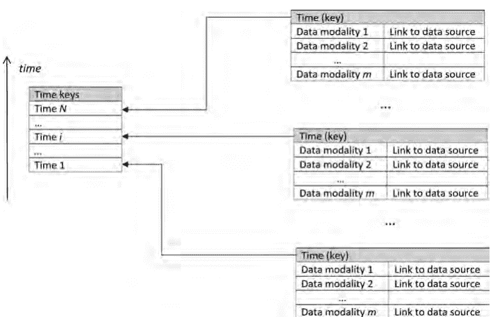

#### 图 12.1

时间链接模型。

要创建对象的 TLM，有必要确定对象多图像的结构。同时，TLM 的多图像在其时间元组仅包含一个时间值方面有所不同，该时间值与确定对象的其他模型中的数据相关联。

要在某个时间点定义对象的状态，有必要设置确定该状态的各种模态的数据源。这可以通过分配表示链接的唯一标识符来完成。如果某个模态的数据在当前时间无法获取或不需要，则将属性 _不可用_ 分配给数据集，而不是链接标识符。

对象的状态是离散的，这意味着在对象描述的时间尺度上，定义了单独的离散时刻（_时间键_），特定的对象状态与这些时刻相关联。在确定每个离散状态时，到达或开始到达某个离散时刻（即当前时间的键）的数据会被同步和聚合。

因此，我们从每个源接收数据并形成以下类型的部分多图像：

$$
I_j = \left[ T, M_j \mid (t^j), \left\langle d_l^i \right\rangle_{l=1}^{n_j} \right], \quad (12.3)
$$

其中 $t^j$ 是对象 $j$ 状态的时间键，$t^j \in T$；$d_l^i$ 是与键 $t^j$ 关联的 $j$ 模态数据，$d_l^i \in M_j$；$T$ 是键值集合；$M_j$ 是 $j$ 模态的数据集合，$j = [1...N]$。

部分多图像被组合成一个确定对象当前状态的单一多图像，在部分多图像数据的同步和聚合过程中，从所有时间键中选择一个时间键，该键将确定对象的当前状态，并根据模糊同步规则执行同步程序。因此，为了确定对象的状态，我们得到一个多图像，其时间元组只包含一个值：

$$I = \bigcup_{j=1}^N I_j = \left\| T, M_1, \dots, M_N \mid \langle t \rangle, \langle d_i^1 \rangle_{i=1}^{n_1}, \dots, \langle d_i^N \rangle_{i=1}^{n_N} \right\|$$ (12.4)

其中 $t$ 根据公式 (12.5)–(12.7) 或在语义上定义。

$$\langle t \rangle = \max_{j=1..N} t^j$$ (12.5)

$$\langle t \rangle = \min_{j=1..N} t^j,$$ (12.6)

$$\langle t \rangle = \frac{\sum_{j=1}^N t^j}{N},$$ (12.7)

公式 (12.5) 表示，接收完整数据集的时刻被取为状态的时间键。公式 (12.6) 表示，数据刚开始到达的时刻被取为键。公式 (12.7) 确定数据到达的平均时间。

数据源可以是生成流数据的设备，也可以是以文件形式存储数据的存储（本地、云端）。

让我们考虑数据序列 $d_{i=1}^{n_j}$ 以某个特定格式保存为文件的情况。在某些文件格式中（例如，医学影像格式 NIFTI [33] 和 DICOM [34]），该数据序列各组件的获取时间存储在元数据中或直接与基础数据一起存储。

然而，在许多情况下，与数据序列相关的时间信息仅限于文件的创建（修改）时间，而关于数据序列各个组件接收时间的信息是单独存储的。因此，在创建 TLM 时必须执行的不同模态数据同步任务，可能会因缺乏统一的时间值存储方法而变得复杂。

为了简化创建 TLM 时时间多模态数据的处理，建议对模型中使用的每种模态数据的文件进行封装文件修改。该文件的结构（图 12.2）包括三个部分：元数据部分、时间值部分以及封装文件所在的主部分。

元数据部分包含“TIME”标记、文件类型标识符（例如，NIFTI 文件格式的“nii”、DICOM 文件格式的“dcm”），


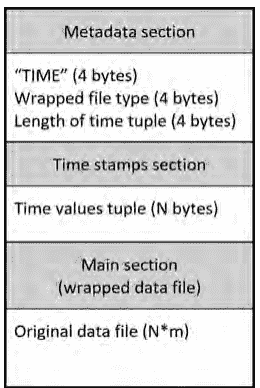

图 12.2
包装文件结构。

时间值元组的大小。时间值部分按升序包含时间值。

主要部分包含包装文件；该文件包含可直接使用的数据。修改原始文件的此过程能够统一来自不同类型源接收的数据序列的同步过程，同时以原始格式保存数据。

建议在物理孪生的研究通过在离散时刻确定其特征而进行，从而形成对象的一系列离散状态（每个状态均由与特定时间点相关联的一组时序多模态数据所表征，该时间点可作为对象某一状态的时间键）的情况下，使用数字孪生的 TLM。

### 12.5 数字孪生应用的软件架构设计

实现数字孪生技术的软件必须涵盖数字孪生时序多模态数据呈现和处理的所有方面。因此，用于处理数字孪生时序多模态数据的软件系统应包括提供以下功能的组件：

- 时序数据同步规则与模板的实现。
- 时序多模态数据同步。
- 时序多模态数据聚合。
- 从传感器和其他数据源获取关于对象（物理孪生）的数据。
- 数据格式转换。
- 数字孪生行为模型的实现。
- 数字孪生可视化模型的实现。
- 对象多图像的形成。
- 数字孪生数据处理。
- 数字孪生行为模型的数据分析。
- 数字孪生可视化模型数据的复现。
- 物理孪生研究结果的可视化。
- 确保数字孪生数据提交的保密性。
- 数字孪生数据存储。

然后，图 12.3 展示了用于处理数字孪生时序多模态数据的软件系统的通用架构。

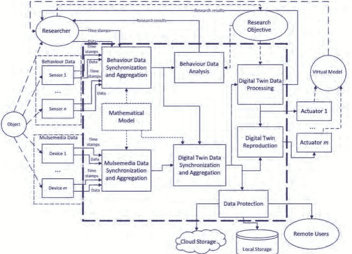

图 12.3
用于处理数字孪生时序多模态数据的软件系统的通用架构。

此架构实现了处理数字孪生的以下逻辑。研究对象通过多种表征其特征的物理过程、现象和感官效应显现出来，这些过程、现象和效应可使用一组传感器和信息记录设备，以研究对象的客观参数形式记录，同时还包括由研究者评估的主观参数。客观特征分为行为数据和多媒体数据。

在进一步研究对象的过程中，行为数据被视为研究对象的某些技术指标并进行处理。多感官媒体数据用于研究对象的虚拟可视化，并旨在供人类感官感知。

所有因注册对象特征而获得的数据，无论其类型如何，均附带一组时间戳，用于确定获取这些数据的时间点。获取标签的过程取决于数据的模态、数据的记录方式以及数据进入用于处理数字孪生时序多模态数据的软件系统时的格式。

行为数据连同相应的时间戳一起被发送到行为数据处理模块，在其中将其从特定格式转换为内部表示格式，这涉及为每种模态的数据创建部分多图像。转换格式后，行为数据被发送到行为数据同步与聚合模块。

行为数据同步与聚合模块的操作取决于时序数据同步规则与模板实现模块的操作结果，该模块的逻辑基于数据同步规则。除了软件系统的架构外，还可以包含用于自动形成时序多模态数据同步模式以进行时间数据分析的组件。

行为数据同步与聚合模块的结果是一份反映受研究对象行为的多图像。基于此多图像，行为模型实现模块复现受研究对象的行为。

从行为模型实现模块获得的数据被发送到行为数据分析模块。该模块的工作逻辑由研究者在开始研究前制定的目标函数决定。行为模型行为数据的分析结果以某个给定格式提供给研究者，是数字孪生时序多模态数据处理系统的结果之一。

多感官媒体数据连同相应的时间戳一起被发送到多媒体数据重处理模块，在其中将其从某个格式转换为内部呈现格式，这涉及为每种模态的数据创建部分多图像。转换格式后，多感官媒体数据被发送到多感官媒体数据同步与聚合模块。

多感官媒体数据同步与聚合模块的操作取决于时序数据同步规则与模板实现模块的操作结果。多感官媒体数据同步与聚合模块的结果是一份反映对象外部表现特征（包括外观特征）的多图像。

基于此多图像，可视化模型实现模块复现对象的外观和其他外部表现，包括创建该对象的虚拟模型。此虚拟模型是用于处理数字孪生时序多模态数据的软件系统的结果之一。

虚拟模型被传输至数字孪生复现模块以进行复现。除了软件系统的架构外，还可以包含确保可视化质量提升并应用可视化模型其他类型数据处理（特别是图形数据处理）的组件。

由行为数据同步与聚合模块和多感官媒体数据同步与聚合模块获得的多图像被发送到数字孪生数据同步与聚合模块，该模块的操作取决于时序数据同步规则与模式实现模块的结果。

数字孪生数据同步与聚合模块的操作结果是对象数字孪生的综合数据。这些数据被转移到数字孪生数据处理模块，其逻辑由研究的给定目标函数决定。处理结果以某种定义好的形式（格式）提供给研究者，是系统的结果之一。

此外，数字孪生的综合数据被发送到数字孪生复现模块，在其中，数字孪生根据其在数字孪生数据处理模块中的数据处理结果以及来自注册对象多模态参数的传感器的新数据进行修正。

由数字孪生复现模块接收到的数字孪生可视化模型动态变化数据被馈送到一组执行器，每个执行器允许以数字孪生图像的某个方面的形式复现某个模态的数据，即以对象的虚拟模型形式呈现，并展示给研究者，这是用于处理数字孪生时序多模态数据的软件系统的另一个结果。

研究对象数字孪生的数据被发送到数字孪生数据保护模块，用于对数字孪生的机密数据进行加密和/或隐写术隐藏。


处理机密数据后，数字孪生数据将被发送到本地和/或云端存储，也可以发送给该对象数字孪生数据的远程用户。

让我们考虑将此通用架构应用于在医疗保健领域开发处理数字孪生时态多模态数据的软件系统。

### 12.6 案例研究：基于数字孪生技术的医疗诊断系统软件

数字孪生信息技术在医疗保健领域的实施，为基于患者健康的同步和整合的时态多模态医疗数据开发医疗决策支持系统创造了条件，这将为医生提供患者健康的质量新水平的信息。基于数字孪生技术的医疗决策支持系统将允许医生：

- 按时间分析所提供的信息。
- 更好地理解治疗事件与治疗结果之间的依赖关系（包括对其他器官和系统的副作用）。
- 查找患者过去发生的类似病例。
- 模拟新治疗方案的可能影响，等等。

数字孪生技术涉及因对真实对象进行长期监测而记录的数据的积累。这对应于对患者健康状况进行长期监测的情况，尤其是慢性病患者。因此，数字孪生在医疗保健中的应用理念是创建并动态更新患者的个人数据集。这个个人数据集包含从各种医学研究中获得的同步和聚合的多模态数据，并根据患者、其器官和体内器官系统的个性化语义模型呈现。这个个性化语义模型应反映患者的慢性疾病和个体身体状况。人体整体，以及其各个器官和器官系统，都可以用广泛医疗设备测量的许多参数来描述。从各种医学研究和检测中获得的数据是多模态的，因为它们描述了人体功能的特定方面。这种多模态数据必须同步和聚合，以创建物理孪生的数字孪生。

可以使用各种各样的设备、仪器和工具来获取创建患者数字孪生所需的多模态数据，这些设备会生成专用的、有时是独特格式的多模态数据。为了将处理数字孪生时态多模态数据的软件系统的通用架构适应医疗领域的特定性，有必要分析医疗诊断设备的类型以及借助它可以获得的数据类型。

所有医疗设备和仪器可分为几组，包括诊断设备、医疗实验室设备、医疗监护设备、治疗设备、生命支持设备等。诊断设备和仪器可分类为测量医疗仪器（体温计、血压计、血糖仪等）、实验室设备（生化分析仪、血液分析仪等）、医学影像设备（超声机、磁共振成像（MRI）机、正电子发射断层扫描（PET）和计算机断层扫描（CT）扫描仪、X射线机等）和功能诊断设备（心电图仪、脑电图仪、肌电图仪、容积描记仪、肺活量计等）。这些设备和工具可以是数字的或非数字的。使用非数字仪器（例如，水银体温计、手持式血压计）进行的测量通常以纸质或电子记录的形式手动记录。使用数字设备获得的测量结果以特定格式的文件形式提供，具体取决于所使用的医疗设备类型。在某些诊断程序中，例如内镜检查，特别是结肠镜检查，检查结果是视频数据流，会使用通用文件格式。最常见的医疗数据文件格式 [33–41] 在表 12.1 中列出。

对表 12.1 的分析表明，大多数医疗数据格式都提供用于存储时间戳的元数据字段；但是，文件结构有显著差异。因此，建议在基于数字孪生技术的医疗诊断系统的软件架构中包含一个转换模块，该模块用于将本系统中拟使用的每种文件类型转换为上述封装文件格式。

考虑到医疗保健应用的特殊性，基于数字孪生技术的医疗诊断系统的软件架构如图 12.4 所示。

为简化可视化建模，假设使用人体、其部位和各个器官的模板模型。基于针对特定患者进行的测量和医学研究，通过改变影响可视模型的尺寸、比例和其他指标，对模板模型进行定制。除了医疗软件系统的架构之外，还可以包含确保应用改善医疗图形数据质量程序以及其他类型的可视模型数据处理程序的组件。

| 数据文件类型 | 扩展名 | 存储的主要数据类型 | 研究类型 | 时间戳可用性 |
| :--- | :--- | :--- | :--- | :--- |
| FEF | .FEF | 生物信号 | 心电图 | 存在一系列时间值的字段 |
| UFF | .BDF | 多通道生物信号 | 脑电图 | 存在四个时间值字段：* "录制开始日期"，* "录制开始时间"，* "数据记录数量"，* "数据记录持续时间，以秒计" |
| LabPas HL7 | .HL7 | 血液测试结果 | 血液测试 | 存在“观察日期/时间”字段 |
| UFF | .UFF | 超声波数据 | 超声波 | 存在“local_time”字段 |
| NIFTI | .NII | MRI数据 | 磁共振成像 | 存在用于时间值的保留字段 |
| DICOM | .DC3, .DCM, .DIC | 医学图像和元数据 | 计算机断层扫描、X射线摄影等 | 存在“研究日期”和“研究时间”字段 |
| CSV | .CSV | 整数和实数（ASCII） | 肺活量测定、体温计测量、血压计测量等 | 无 |

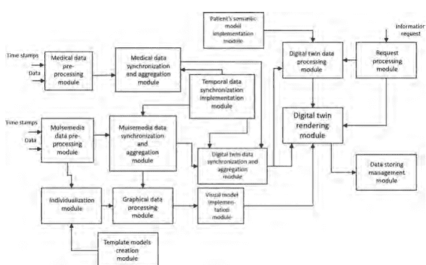

图 12.4  
基于数字孪生的医疗诊断系统软件架构。

基于数字孪生技术的医疗软件系统的拟议架构可应用于开发具有先进功能的专家医疗系统、电子健康 [42] 和移动健康系统软件 [43]、居家医疗软件 [44] 等。

### 12.7 结论

本章基于该科学领域的最新研究，对数字孪生的类型进行了分类和分析。

数字孪生概念的进步假设数字孪生由对象的行为模型和可视模型共同定义。这些模型可以基于适当的数学和数据表示模型来实现。

一种数学方法假设使用 ASA。这使得可以基于对象的多图像（即同步数据的有序集合）对数字孪生模型进行正式规范。

从数据表示方面来看，可以使用 TLM 来定义对象，TLM 用于展示对象状态变化的动态过程，并基于使用时间键来形成对象状态的有序序列，并确定与数据源的链接，以动态记录关于对象的信息。

数字孪生概念的进一步发展在多个方向都是可能的，特别是利用人工智能工具以及从图形表示转向研究对象的多媒体和全感多媒体表示。

## 参考文献

- 1. Grieves M., Vickers J. 数字孪生：减轻复杂系统中不可预测和不可取的涌现行为。复杂系统的跨学科视角，2017，85–113。https://doi.org/10.1007/978-3-319-38756-7_4
- 2. Grieves M. PLM—超越精益制造。制造工程，2003，130(3)，23。
- 3. Grieves M. 虚拟不可区分：系统工程与 PLM。产品生命周期管理。面向知识密集型企业：IFIP WG 5.1 国际会议，PLM 2012，蒙特利尔，魁北克省，加拿大，2012 年 7 月 9–11 日，修订精选论文 9。柏林海德尔堡斯普林格出版社，2012：226–242。
- 4. Grieves M. 虚拟完美：通过产品生命周期管理推动创新和精益产品。第 11 卷。可可海滩：太空海岸出版社，2011。
- 5. Grieve M. 产品生命周期管理：企业的新范式。国际产品开发杂志，2005，(2)，71–84。
- 6. Grieves M. 产品生命周期管理：推动下一代精益思维。McGraw-Hill，2006。319 页。纽约。
- 7. Grieves M. 虚拟智能产品系统：数字孪生与物理孪生。复杂系统工程：理论与实践。美国航空航天学会，2019，第 175–200 页。
- 8. Mike S, Mike C, Rich D, et al. 建模、仿真、信息技术与处理路线图。技术领域 11。美国国家航空航天局，2010。32 页。
- 9. NASA 技术路线图。技术领域 12：材料、结构、机械系统和制造。美国国家航空航天局，2015。138 页。
- 10. Glaessgen E. H., Stargel D. 未来 NASA 和美国空军飞行器的数字孪生范式。第 53 届 AIAA/ASME/ASCE/AHS/ASC 结构、结构动力学与材料会议，第 20 届 AIAA/ASME/AHS 自适应结构会议，第 14 届 AIAA。2012：1818。
- 11. Tuegel E. J., Ingrafea A. R., Eason T. G., Spottswood S. M. 使用数字孪生重构飞机结构寿命预测。航空航天工程国际杂志，第 2011 卷，文章编号 154798，14 页，2011。https://doi.org/10.1155/2011/154798。
- 12. Ghinea G., Andres F., Gulliver S. 多感官媒体的进步与应用：全感多媒体的新进展。信息科学参考，2012，320 页。
- 13. Ghinea G., Timmerer C., Lin W., Gulliver S.R. 全感多媒体：现状、前景与挑战。ACM 多媒体计算、通信与应用事务，2014，11，17:1–17:23。


- 14. Lu Y., Liu C., Wang I-K., Huang H., Xu X. 数字孪生驱动的智能制造：内涵、参考模型、应用及研究问题. Robotics and Computer Integrated Manufacturing, 2020, 61, 1–14.
- 15. Alam, K. M., El Saddik, A. C2PS：面向云基础网络物理系统的数字孪生架构参考模型. IEEE Access, 2017, 5, 2050–2062.
- 16. Redelinghuys A. J. H., Basson A. H., Kruger K. 制造单元的六层数字孪生架构. Studies in Computational Intelligence, 2018, 803, 412–423.
- 17. Bevilacqua M. et al. 为防止工厂操作员风险而开展的数字孪生参考模型开发. Sustainability, 2020, Paper 1088 (12), 17 p.
- 18. Ye X., Hong S. 基于automationML/OPC UA的制造系统工业4.0解决方案. 2018 IEEE第23届新兴技术和工厂自动化国际会议（ETFA）. 第1卷. IEEE, 2018.
- 19. Schroeder G. N., Steinmetz C., Pereira C. E., Espindola D. B. 基于automationML的数字孪生数据建模与数据交换通信方法论. IFAC-PapersOnLine, 2016, 49(30), 12–17.
- 20. 面向制造的商业标记语言（B2MML）. https://isa-95.com/b2ml/
- 21. IEC 62264-1:2013. 企业-控制系统集成 - 第1部分：模型与术语. https://www.iso.org/standard/57308.html.
- 22. XML架构教程. https://www.w3schools.com/xml/schema_intro.asp.
- 23. Lohtander M., Ahonen N., Lanz M., Ratava J., Kaakkunen J. 微制造单元及其相应的数字孪生3D模型. Procedia Manufacturing, 2018, 25, 55–61.
- 24. Cai Y., Starly B., Cohen P., Lee Y-S. 传感器数据与信息融合，用于构建网络物理制造的数字孪生虚拟机床. Procedia Manufacturing, 2017, 10, 1031–1042.
- 25. SolidWorks. https://www.solidworks.com/.
- 26. STL格式. https://www.fabbers.com/tech/STL_Format.
- 27. Open GL. https://www.opengl.org/.
- 28. Postgre SQL：世界上最先进的开源关系型数据库. https://www.postgresql.org/.
- 29. Dychka I.A., Sulema Ye S. 多图像数据处理代数集合系统中的操作排序. KPI Science News, 2019, (1), 15–23.
- 30. Dychka I.A., Sulema Ye S. 多模态数据表示与处理代数集合系统中的逻辑操作. KPI Science News, 2018, (6), 44–52.
- 31. Pester A., Sulema Y. 基于多图像概念的多模态数据表示，用于沉浸式环境和在线实验室开发. 跨现实与工程数据科学：第17届远程工程与虚拟仪器国际会议论文集17. Springer International Publishing, 2021: 205–222.
- 32. Sulema Y., Dychka I., Sulema O. 虚拟、远程和混合实验室开发的多模态数据表示模型. Lecture Notes in Networks and Systems, 2018, 47, 559–569.
- 33. NIfTI：神经影像信息技术倡议. https://nifti.nimh.nih.gov/.
- 34. DICOM. https://www.dicomstandard.org/.

- 35. Värri A. 生命体征文件交换格式及其在数字心电图存档中的应用. 第2届开放心电图研讨会论文集“将心电图集成到电子健康记录及心电图设备系统互操作性”, 2004. 2 p.
- 36. BioSemi使用哪种文件格式？ https://www.biosemi.com/faq/file_format.htm.
- 37. HL7实验室数据接口规范，Oracle(r)健康科学LabPas 3.1版. Oracle Health Sciences LabPas Release 3.1. 部件号：E48677-01, 2013. 39 p.
- 38. Olivier B. et al. 超声文件格式（UFF）. 2018 IEEE国际超声波研讨会（IUS）. IEEE, 2018: 1–4.
- 39. Robert W Cox, Robert W Cox. et al. NIfTI-1数据格式. NIFTI. 数据格式工作组, 2004. 30 p.
- 40. 医学数字成像与通信. https://www.dicomstandard.org/.
- 41. CSV文件. https://people.sc.fsu.edu/~jburkardt/data/csv/csv.html.
- 42. 电子健康. https://www.who.int/ehealth/en/.
- 43. mHealth应用的兴起：市场快照. https://liquid-state.com/mhealth-apps-market-snapshot/.
- 44. 居家医院. https://www.johnshopkinssolutions.com/solution/hospital-at-home/.

## 面向网络物理系统设计集成工程的分层抽象

Thomas Ernst Jost, Richard Heininger, 和 Christian Stary

林茨开普勒大学

### 13.1 引言

许多组织在向网络物理系统（CPS）和物联网（IoT）进行数字化转型时，会面临各种挑战。这些挑战从位置因素到由于组件异构性导致的互操作性，还涵盖管理问题 [31–33]。

CPS是社会技术系统，在运行过程中通过传感器或执行器将物理设备与数字信息处理系统相连接。物联网是一个物理设备及其他嵌入电子器件、软件、传感器、执行器和网络连接的对象网络，使其能够收集和交换数据。

数字孪生（DTs）已越来越多地成为开发支持工具，正如应用领域的多样性所显示的那样。它们涉及农业 [18]、医学 [29]、物流和数字化生产 [9] 等社会重要领域。最初，DTs被设计为虚拟模型以镜像物理对象。它们可以配备超越物理对象性能的功能，例如基于大数据和机器学习应用预测干预需求。此外，DTs使能够对行为进行修改和仿真，以研究各种过程，然后再将其应用回原始物理对象 [1,12,13]。

数字孪生联盟还强调以数字形式表示的对象和过程，用于模拟“预测的未来”：

> 数字孪生是对现实世界实体和过程的虚拟表示，以指定频率和保真度同步：数字孪生系统通过加速整体理解、最优决策和有效行动来转变业务；数字孪生利用实时数据和历史数据来表示过去和现在，并模拟预测的未来；数字孪生由结果驱动，针对用例定制，由集成驱动，基于数据构建，由领域知识指导，并在IT/OT系统中实现 [3]。

过程孪生还涉及为未来系统运行同步组件所需的知识 [19]。它们涉及“宏观放大层面，揭示系统如何协同工作以创建整个生产设施。这些系统是否都已同步以在峰值效率下运行，还是一个系统的延迟会影响其他系统？过程孪生可以帮助确定最终影响整体效能的精确时序方案” [13]。一旦过程孪生解决了宏观层面问题，为了模型执行和仿真，还需要对单个组件行为进行细化，其意义在于“实现控制、通信和计算集成的抽象（形式化）与架构，以实现CPS的快速设计和实施” [23, p. 467]。

最近，关于数字孪生在各个领域如何开发的研究已发表 [11]。虽然在高抽象层面似乎存在一些关于孪生生成的统一理解，但涉及不同抽象层的各种细化策略用于开发运行级数字孪生。因此，我们的目标是为系统开发人员提供一个框架，以便在考虑集成过程孪生的情况下进行设计和工程。本章探讨两个基本问题：

- 1. 是否有办法表达CPS的流程设计与系统交互之间的相互作用？
- 2. 是否存在细化策略和方法，能以一致的方式将高层流程抽象与数字孪生运行的行为细节相结合？

这样的框架需要“以模块化、高效和强健的方式允许构成CPS的异构系统的集成和互操作性” [23, p. 467]。我们提出了一种以行为为中心的方法，基于面向主体的建模与执行的各种应用经验，对过程孪生进行分层 [5,6,16]。

相关文献综述载于第13.2节。第13.3节展示了所提出的框架和通用开发问题，这是基于本研究采取的务实方法。所进行的案例研究展示了该方法的实用性。第13.4节讨论了实际和方法论上的启示。第13.5节通过总结目标、成就、局限性和未来研究方向来结束本章。


### 13.2 CPS 数字孪生中的抽象与细化

DT 模型在产品开发和生产工程中的精巧性，促使在这些模型中融入网络物理环境中的生产和运行数据 [21]。此类丰富化‘能够高效预测产品和流程开发以及运行与服务决策对产品行为的影响，而无需昂贵且耗时的物理样机。特别是在设计中，这种真实的产品模型对于及早高效地评估设计决策对机械产品质量和功能的影响至关重要’[21, p. 141]。为了为支持设计和生产工程的数字孪生实现提供概念基础，Schleich 等人 [21] 提出了一种数字孪生开发参考模型，侧重于关键模型特性，包括数字孪生模型在产品生命周期（包括设计、制造、组装和检验）过程中的互操作性与适应性。

其关注对象并非物理资产与某些数字表征之间的一对一关系，而是‘一组用于特定用途的合适粒度并在整个产品生命周期中演进的关联操作数据产品和仿真模型’[21, p. 142]。该框架已在几何变异管理用例中得到测试。生命周期中产品的不同视图通过操作的组合、分解、转换和评估得到支持。这样一来，数字孪生沿设计和生产工程以集成方式实现了对物理产品的操作。因此，数字孪生模型不仅在数字表征中捕捉了产品细节和变体，还构成了包含设计和工程活动的开发过程的一部分。

然而，关于数字孪生模型创建和开发中所选抽象层级，似乎是一个因案而异的决策，正如 VanDerHer 等人 [28] 在其分析总结中所得出的结论。然而，使用数字孪生表征需要实现的目标以及数字孪生应用的范围，似乎对抽象和操作支持至关重要。对于模拟‘构成统一整体的所有相关交互和相互关联实体’应予以考虑。关于行为，所有‘由物理系统执行并导致系统状态发生变化的功能’都应被捕捉。

Jones 等人 [14] 的分析揭示，许多数字孪生模型开发遵循一种通用的数字孪生过渡方案。根据他们的发现，数字孪生是在产品开发的头脑风暴和构思阶段之后生成的。原型在其环境（上下文）中进行测试，随后进行实例化和聚合过程，以实现系统级行为。这样一来，可以捕捉产品的整个生命周期。

从异构系统组件的角度来看，对于 CPS 而言，这种开发设计允许系统组件的逐步集成和调整，直到系统按预期或想象的方式运行。无论如何，过程数字孪生由产品生命周期及其从创建到退役的主要阶段所定义。

关于运营数字孪生开发支持，组合在网络物理生产系统中似乎至关重要。正如 Park 等人 [17] 的研究所示，它可以在抽象层级上使用——基于共享信息模型的数字孪生服务组合对个性化生产流程有益。该信息模型主要基于功能树，用于分解服务和生产工程所需的功能元素。

鉴于制造业中高度不稳定的环境，Seok 等人 [22] 使用数字孪生离散事件模型解决了晶圆制造中的意外实时问题。他们的分层聚合/解聚方案能够用两层抽象模型替代复杂的事件驱动操作。其在单组和多组抽象层上的操作可加快对生产问题的响应。关键组件——抽象层级转换器——主要负责向组分配和释放机器，以及扩展或拆分组。它还控制每个组输入批次的事件流。

除了数据驱动的抽象之外，Bellavista 等人 [2] 最近还提出了通信抽象。该方案旨在简化系统组件之间的通信管理。所提出的基于意图的消息系统指的是所谓的高层‘意图’。它们代表系统运行中的目标。这些目标需要由相应的意图接收者来实现。接收者预计将交付由目标指定的特定结果。由于意图不包含目标如何实现的信息，它以声明方式概括任务完成，对操作数据（包括用户和系统组件）以及生成特定交付物所需的函数进行抽象。

除了展示使 CPS 系统更易于人类理解的一种方法之外 [30]，对齐的分层抽象还允许处理异构系统的复杂交互和架构 [27]。后者最近由 Kreutz 等人 [15] 通过探讨 DevOps 来解决。研究结果表明，需要将更高级别的流程（例如业务运营）与设计和工程流程耦合。因此，对于过程数字孪生模型，Sobrahjan 等人 [23] 的研究结果在 CPS 设计和工程中对抽象的需求方面似乎仍然有效。他们建议采用一种高级语言，该语言可编译为单个 CPS 组件的详细行为。这种语言需要超越现有的流程建模应用，以在单一抽象层级上表示 CPS 的业务模型 [26] 或 IoT 流程建模 [10]。开发支持需要具备虚拟验证和确认的能力，因为技术进步触发了转换需求 [8]。

不同的利益相关者群体（用户、领域专家、设计师、工程师和程序员）将需要适当的规格说明和开发支持。因此，需要以网络化的方式处理多个详细程度级别，从低级通信到高级资源管理和业务优化。

### 13.3 数字过程孪生的分层架构

在本节中，我们基于基于通信的抽象研究结果，介绍了一种过程数字孪生的分层架构。我们使用行为封装，这些封装使用 Fleischmann 等人 [6] 提出的主题导向符号进行说明，因为它允许模型的自动执行。我们先介绍建模方法，然后再详细介绍分层架构并讨论实际设计问题。

#### 13.3.1 主题导向的 CPS 建模

主题导向已在业务流程管理领域引入，以便以人们能够轻松理解任务在组织环境中如何完成和组织的方式来捕捉业务操作，从而实现业务目标 [6]。以交互和行为为中心的封装技术已在服务和生产行业中成功应用 [5, 16]，并对行为互联网应用 [24] 和 CPS 开发 [25] 的设计与工程有益。

活动系统组件的行为封装称为主题。它包括产生通信和功能行为的活动。这些活动涉及操作对象。后者在主题之间交换以完成操作流程。主题的交互模式和内部功能构成了系统的行为。由于交互的编舞性质，主题并行运行并通过交换消息进行同步。

主题导向行为模型将 CPS 组件作为可数字或物理实现的主题包含在内。交互进一步表示物理和/或数字组件通过消息交换建立的连接。消息可以包含业务对象形式的数据，并触发被寻址主题中的进一步操作。因此，CPS 被建模为分布式组件的自主并发行为集合。

主题使用两种图表和一组五个符号进行建模，这些图表和符号贯穿集成的系统设计与工程，即主题交互图（SIDs）和主题行为图（SBDs）。SIDs 提供 CPS 的集成视图，包括涉及的 CPS 组件和


它们交换的消息。SBDs 从单个主体的视角提供行为的局部视图。它们包括以代表系统状态的内部动作序列来描述，对每个主体的 SID 进行细化。

作为经过验证的行为规范，SBDs 可以在无需进一步模型转换的情况下执行，可以使用供应商特定的解决方案，例如 Compuity Tool-Suite (https://compuity.eu)，也可以使用像 SiSi [4] 这样的学术工具。对于每个主体或 CPS 组件，行为可以在运行时通过替换单个主体行为规范进行交互式检查和动态调整。

面向主体的 CPS 开发包括多个阶段：设置、细化、验证、实施分配和运行，根据 [25]:

- 设置：CPS 开发人员生成一个数字行为模型，即数字流程孪生，由 SID 结构化：每个相关服务和 CPS 组件设备都由一个主体表示。
- 细化：每个主体，即 SID 的每个节点，都在任务和通信特定的行为方面进一步详细说明，指定一个 SBD。
- 验证：当数字流程孪生模型（即 SBD 网络）执行时，系统行为沿着确定单个主体之间交互的消息路径进行检查。
- 实施详情：成功验证后，需要通过将人类或 CPS 技术组件作为角色或任务载体分配给每个主体来指定组织和技术详情，以用于 CPS 操作。
- 运行时：在运行时（基于可执行行为模型期间），可以添加额外的 CPS 组件和服务，或替换现有组件，以适应变更的要求或变化的环境条件。

通过这种方式，设计和工程任务同时在数字流程孪生上运行，实现无缝的 CPS 生命周期管理。由于 CPS 的数字表示独立于其在物理世界中的对应物，人类角色载体和技术 CPS 组件可以动态分配来执行主体行为。通过这种方式，现有工作组织可以逐步且系统地转变，从 CPS 的 DT 原型开始，如 Jones 等人 [14] 所提议。

#### 13.3.2 分层架构

在本节中，我们介绍分层面向主体的架构，以允许对数字 CPS 流程孪生进行结构化和上下文相关的细化。

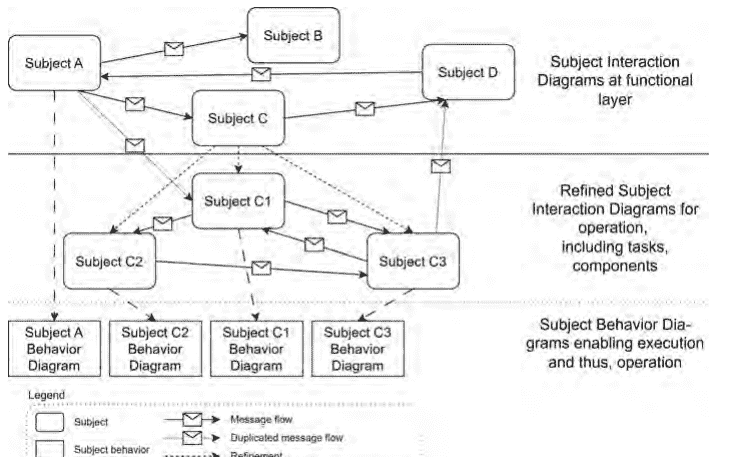

图 13.1 面向主体的抽象层架构。

尽管它以自上而下的方式描述，但可以通过自中向外或自下而上的方法应用，例如，在特定的 CPS 组件（如用于生产的机器人设备）是 CPS 开发的起点时。图 13.1 显示了数字 CPS 孪生面向主体分层的基本思想和机制。

该架构基于指定一个 SID：

- 至少需要给出一个层（单个抽象层上的 SID），提供一个代表价值生成主体及其交互的 SID。
- 特定抽象层上 SID 的每个主体都可以在较低层上的给定交互（消息传递）约束下进行细化。
- 最后细化的主体（'叶'主体）需要由一个 SBD 进行详细说明。分层对 SBDs 意味着以下内容：
- 至少需要给出一个层，...
- ...提供一组从 SID 派生的 SBDs，...
- ...每个 SBD 都从一个 SID 主体派生，...
- 每个 SBD 都是与另一个 SBD 至少一个交互的一部分。
- 每个 SBD 都与一个 '叶' SID 主体相关（即，细化链的末端）。
- SBDs 之间的每个消息流都可以分配给一个层内或跨层的 SID 关系。

通用开发和适应机制可以以以下方式工作：

自中向外（焦点：中间 SID-'层'，即，至少一个主体是从价值链 SID 派生的）：向上和向下的规范需要满足分层结构给定的规范约束。

自上而下（起点和焦点：价值链 SID）：向下的规范需要满足分层结构给定的规范约束。

自下而上（从 '叶' 主体 (SID) 的主体 SBD 开始）：向上的规范需要满足分层结构给定的规范约束。

#### 13.3.3 将架构付诸实践

在本节中，我们为操作性 DT 实践细化通用架构，并通过将分层应用于调度用例来演示其用途。我们从代表价值链的 DT 组件及其交互开始，并逐步细化它以操作流程孪生。

##### 13.3.3.1 用例概要

示例用例涉及作为包括 CPS [11] 的智能物流流程一部分的调度单元。它旨在处理关键货物的运输，例如从某个存储位置分发到疫苗中心的疫苗。中间调度单元基于 CPS，根据特定疫苗订单的运输要求实施包装。

对于 DT 设计和工程来说，最重要的是涉及 CPS 组件的正在包装的疫苗。它从将疫苗送到调度站开始，随附（订单）信息，说明在运输过程中需要考虑的内容，例如在运输箱中的定位和冷却。

调度单元的任务是将疫苗包装在符合订单和运输要求的运输箱中，以便可以被配送服务取件。一旦疫苗被调度站接收，机器人系统将其运送到由传感器监控的调度工作台，以确保满足适当的温度条件。在那里，疫苗使用可以配备 IoT 设备的存储容器进行包装，以确保满足运输要求。

机器人系统根据运输要求装备运输容器，并将疫苗放入容器中，在调度流程完成且后续运输流程可以开始之前，将其运送到取件地点。

##### 13.3.3.2 根据自上而下方法的建模示例

根据前一节中介绍的概念，所提议的 DT 分层架构由一个或多个 SID 层和一个或多个 SBD 层组成。最抽象的 SID 层被称为功能价值创造层，描绘了公司价值链中的关键流程。这意味着，所提议的架构可以为组织的每个价值链流程创建。每个 SID 层至少包含两个主体，正如价值链结构所暗示的那样。主体通过消息连接，并且 SID 层上不能有'松散'主体，即，没有通过消息连接到任何其他主体的主体（因为这会导致主体在流程模型执行期间'不可达'）。此外，除了启动流程的主体之外，每个其他主体都必须至少接收一条消息，因为这是启动其流程特定行为所必需的。

考虑到概述的用例，疫苗的调度/分发构成一个价值链流程。这个流程可以在最高可能的抽象层，即功能价值创造层中描绘。如果没有进一步细化，生成的 SID 的每个构成主体都将是一个叶主体，并需要一个关联的 SBD。在存在多个 SID 层的情况下，较低层上的每个主体都必须细化较高层上的一个主体，并且一层上的每个主体可以被一个或多个较低层上的一个或多个主体细化。最低层上的主体不能再细化。通过这种方式，对于较高层上的每个主体，会形成一棵细化主体的树结构。在这个树层次结构中，叶主体（即，在较低 SID 层上不再进一步细化的主体）需要由一个 SBD 进行详细说明。

这些 SBDs 是 SBD 层的一部分，每个 SBD 都属于 SID 层之一的一个叶主体，并且 SBD 层层次结构对应于 SID 层层次结构。这一原则意味着以下内容：如果一个叶主体是 SID 层二的一部分，那么其对应的 SBD 是 SBD 层二的一部分。遵循没有松散主体的规则，每个 SBD 需要是与另一个 SBD 至少一个交互的一部分。因此，SBDs 之间的每个消息流都可以分配给连接同一 SID 层或不同 SID 层上两个主体的消息。

通过较低层上的主体对较高层上的主体进行细化，表明用更具体的主体'替换'抽象的较高层主体，使最高层主体的价值链功能更接近操作一步。这还意味着（传入和传出的）消息流需要从较高层主体转移到更具体的细化较低层主体。


如果高层主体接收消息的源主体和发送消息的目标主体本身尚未被细化，则会发生以下情况：对于来自未细化主体的高层主体的每条传入消息，需要在相应的下层上选择一个细化主体，该主体也接收完全相同的消息（发送方保持不变），从而在SID层之间建立传入链接。同样，对于发送给未细化主体的高层主体的每条传出消息，需要在相应的下层上选择一个细化主体，该主体也发送完全相同的消息（接收方保持不变），从而在SID层之间建立传出链接。这意味着，在进程流中，细化主体的角色现在可以完全由下层的细化主体替代，同时仍遵循原始消息流。

如果高层主体接收消息的源主体（两者位于同一SID层）本身已经过细化，则该消息可以从相应下层主体的细化主体处接收。如果与需要细化的高层主体位于同一层的接收主体之前已经过细化，也可以采用同样的方式。所提出的细化规则在图13.2和图13.3中说明了不同层次主体组合下的应用情况。

由于基于流程的方法基于执行从交互图（SID）细化而来的行为图（SBD），一旦高层SID层的所有主体都已被细化，高层与低层之间就不再存在消息链接。如果低层的所有细化主体都以行为图（SBD）进行了详细说明，则低层模型可以投入运行，高层模型无需用于执行。然而，细化层次结构使利益相关者能够从两个方面理解设计：一是用于工程（即DT操作）的细化层中指定的行为，二是其与价值链流程的关系——所有非叶主体都可以表示为占位符或中间主体，以供以后细化。

根据集成设计和工程方法，高层叶主体的行为图（SBD）需要向低层的细化叶主体发送消息。这种关系确保行为被正确执行。它通过层间额外的（工程）消息链接来表示，例如图13.2和图13.3中所示的那些。应当注意的是，关于细化情况，不同层次主体之间的所有可能组合均未被描绘，但其余选项的规则可以从给定示例中推断出来。

对于演示用例，创建了一个包含SBD层的模型版本，以演示叶主体的行为细化，如图13.4所示。从建模的内部行为可以观察到，存在进一步的行为细化可能性。Do-状态可以拆分为更精细的动作，这些动作又可以显式建模为状态。目前，仅建模了行为的“快乐路径”，即预期和最优的状态发生。例如，如果运输机器人发送的操作状态报告指出某些已安装的传感器工作不正常，则需要额外的行为。在面向主体的语言中，例如并行活动规范方案，异常情况可以通过主体的可选守护行为来建模[7]。

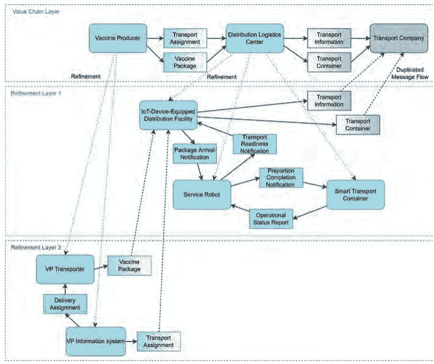

图13.2 抽象层架构——将消息流转发至细化主体。被细化的主体（分发物流中心）接收来自不同于其应被细化的层的细化主体（VP Transporter、VP Informationsystem）的消息，并向未细化主体（运输公司）发送消息。

创建的模型还可以被视为其他模型和数据的“容器”，或作为指示它们之间关系的可能结构的具体体现。其他模型和数据可以分配给抽象层结构中的每个元素，即状态、SBD、消息、主体或层。这样，抽象层架构可以用作DT数据的集成概念。例如，服务机器人主体可以关联机器人的3D模型、运动学模型以及机器人产生的传感器数据。

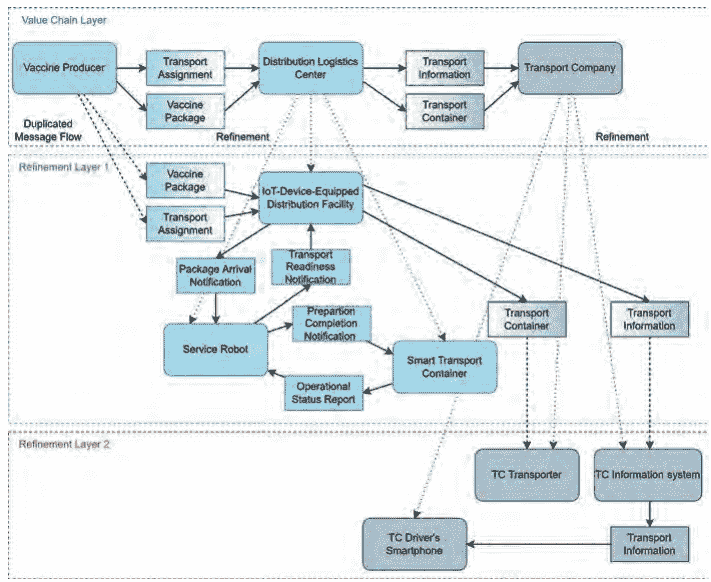

图13.3 抽象层架构——将消息流转发至细化主体。被细化的主体（分发物流中心）向不同于其应被细化的层的细化主体（TC Transporter、TC Informationsystem）发送消息，并从未细化主体（疫苗生产商）接收消息。

### 13.4 讨论

在本节中，我们反思前一节中介绍的架构及其应用。我们澄清了在应用过程中出现的设计和工程挑战，这些挑战可能需要进一步研究。

由于所提出的架构由一个或多个SID层和一个或多个SBD层组成，处理各种增值流程的组织可能需要进一步的结构来组织流程图。当可以为组织的每个价值链流程创建所提议的架构时，跨流程通信可能会发生，并且可能需要一些SID和SBD来显示特定角色或任务在各种价值链中的参与情况。

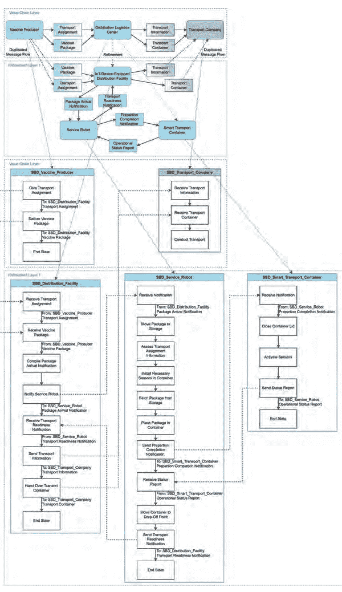

图13.4 抽象层架构——包含叶主体内部行为的SID层和SBD层。

通用架构中需要解决的一个重大问题涉及属于不同细化层的主体之间的交互。两个设计和工程主题涉及该情况：

- 如果传入消息的来源主体已经过细化，会发生什么情况？
- 对于发送传出消息的目标主体，也会出现同样的问题。

在这两种情况下，已实现特定的粒度级别，这对组织和/或技术实现具有相关性。是否需要进一步细化取决于主体载体（人类或网络物理组件）的分配。一致性通过将已有规范传播到下一细化层来维持，前提是细节级别足以实现所表示的流程。上述问题与多个细化层及随后引入SID层的挑战相关。以下两个开发原则可以提供一些指导：（1）一旦SID主体被细化到SBD级别，如果需要进一步细化，则现有SBD将被新细化主体的SBD替换以用于执行；（2）SID细化到进一步的SID层集合对应于对上层SID层中已处理的消息的细化。

最后，每个可执行叶主体是（分层）SID的一部分，并与至少一个其他SBD进行交互。因此，SBD之间的每条消息流都可以分配给连接SID中两个主体的消息，这两个主体不一定位于同一SID层上。

### 13.5 结论

在本章中，我们探讨了抽象层，旨在将数字孪生（DT）作为网络物理系统（CPS）的一部分来构建设计和工程。将设计和工程与数字建模相结合，在同步数字流程组件以及数字孪生与其物理对应物方面带来了挑战。

另一个问题是所需的粒度级别。就此而言，针对个案的架构有助于所需CPS功能的组合和聚合。所提议的架构是面向CPS的务实DT发展的第一步，考虑了组件的异质性以及CPS设计和运行的动态性。

所提出的架构基于两个相互交织的抽象层，旨在为工程化声明性交互网络进行调整，以


功能行为组件。该架构可用于多种方式，包括面向工程的自上而下设计以及基于给定网物理系统（CPS）组件的中外开发。交通案例的实际应用证明了该方法的有效性，然而，也揭示了在规格说明的精确度与网物理系统开发和运行的动态控制之间寻找适当平衡的若干挑战。结果将引发关于建模原则以及用于抽象数字孪生（DT）表示的建模构造和原则的实用性的进一步研究。

## 参考文献

- [1] Michael Batty. 数字孪生. 环境与规划B：城市分析与城市科学, 45(5):817–820, 2018年9月.
- [2] Paolo Bellavista, Carlo Giannelli, Marco Mamei, Matteo Mendula, 和 Marco Picone. 面向工业环境中安全和QoS感知智能通信的数字孪生导向架构. 普适与移动计算, 85:101646, 2022年9月.
- [3] 数字孪生联盟. 网站 - 数字孪生的定义. https://www.digitaltwinconsortium.org/initiatives/the-definition-of-a-digital-twin/, 检索于 18.08.2022.
- [4] Matthes Elstermann 和 Jivka Ovtcharova. ALPS 中的 Sisi：PASS 的简单仿真和验证方法. 第10届面向业务流程管理国际会议论文集, 2018: 1–9.
- [5] Albert Fleischmann, Werner Schmidt, 和 Christian Stary, 编. 野外的S-BPM. Springer International Publishing, Cham, 2015.
- [6] Albert Fleischmann, Werner Schmidt, Christian Stary, Stefan Obermeier, 和 Egon Borger. 主题导向的业务流程管理. Springer, Berlin, Heidelberg, 2012.
- [7] Albert Fleischmann, Werner Schmidt, Christian Stary, 和 Florina Strecker. 业务流程中的非确定性事件. 在 Marcello La Rosa 和 Pnina Soffer, 编, BPM 2012：业务流程管理研讨会, 页 364–377. Springer, Berlin, Heidelberg, 2013.
- [8] Didem Gurdur Broo, Ulf Boman, 和 Martin Torngren. 2030年的网物理系统研究与教育：场景与策略. 工业信息集成期刊, 21:100192, 2021年3月.
- [9] Dirk Hartmann 和 Herman Van der Auweraer. 数字孪生. 在 Manuel Cruz, Carlos Pares, 和 Peregrina Quintela, 编, 工业数学进展：成功案例, 页 3–17. Springer International Publishing, Cham, 2021.
- [10] Faruk Hasic, Estefania Serral, 和 Monique Snoeck. 面向IoT流程建模的BPMN与BPMN + DMN比较：基于案例的研究. 第35届年度ACM应用计算研讨会论文集. 2020: 53–60.
- [11] Wolfgang Heindl 和 Christian Stary. 数字孪生的结构化开发——迈向统一方法的跨域分析. 过程, 10(8):1490, 2022年7月.
- [12] Christoph Herwig, Ralf Portner, 和 Johannes Moller. 数字孪生. Springer, 2021.
- [13] IBM. 网站 - 什么是数字孪生? https://www.ibm.com/topics/what-is-a-digital-twin/, 检索于 18.08.2022.
- [14] David Jones, Chris Snider, Aydin Nassehi, Jason Yon, 和 Ben Hicks. 数字孪生的表征：系统文献综述. CIRP制造科学与技术期刊, 29:36–52, 2020年5月.
- [15] Andreas Kreutz, Geroen Weiss, Johannes Rothe, 和 Moritz Tenorth. 面向网物理系统开发的DevOps. Fraunhofer认知系统研究所，慕尼黑, 2021.
- [16] Matthias Neubauer 和 Christian Stary, 编. 生产行业的S-BPM. Springer International Publishing, Cham, 2017.
- [17] Kyu Tae Park, Jehun Lee, Hyun-Jung Kim, 和 Sang Do Noh. 基于数字孪生的个性化生产网物理生产系统架构框架. 国际先进制造技术期刊, 106(5–6):1787–1810, 2020年1月.
- [18] Christos Pylianidis, Sjoukje Osinga, 和 Ioannis N. Athanasiadis. 将数字孪生引入农业. 农业中的计算机与电子学, 184:105942, 2021年5月.
- [19] Roland Rosen, Georg von Wichert, George Lo, 和 Kurt D. Bettenhausen. 关于自主性和数字孪生对制造业未来的重要性. IFAC-PapersOnLine, 48(3):567–572, 2015.
- [20] Andrey Rudskoy, Igor Ilin, 和 Andrey Prokhorov. 智能运输系统中的数字孪生. 交通研究论文集, 54:927–935, 2021.
- [21] Benjamin Schleich, Nabil Anwer, Luc Mathieu, 和 Sandro Wartzack. 塑造用于设计和生产工程的数字孪生. CIRP年刊, 66(1):141–144, 2017.
- [22] Moon Gi Seok, Wentong Cai, 和 Daejin Park. 基于数字孪生的智能半导体制造中自适应抽象层级转换的层级聚合/解聚. IEEE Access, 9:71145–71158, 2021.
- [23] Pooja Sobhrajan 和 Swati Y. Nikam. 网物理系统中抽象的比较研究. 计算机科学与信息技术国际期刊, 5(1):466–469, 2014.
- [24] Christian Stary. 数字孪生生成：重新概念化面向行为的网物理系统开发的代理系统. 传感器, 21(4):1096, 2021年2月.
- [25] Christian Stary, Matthes Elstermann, Albert Fleischmann, 和 Werner Schmidt. 面向动态网物理系统开发的以行为为中心的数字孪生设计. 复杂系统信息学与建模季刊, 30:31–52, 2022.
- [26] Nicola Terrenghi, Johannes Schwarz, 和 Christine Legner. 面向网物理系统业务模型表示的设计要素. 第26届欧洲信息系统会议论文集, Portsmouth (ECIS 2018), 英国, 页 1–16, 2018.
- [27] Martin Torngren 和 Paul Grogan. 如何应对未来网物理系统的复杂性? 设计, 2(4):40, 2018年10月.
- [28] Eric VanDerHorn 和 Sankaran Mahadevan. 数字孪生：概括、表征与实现. 决策支持系统, 145:113524, 2021年6月.
- [29] Isabel Voigt, Hernan Inojosa, Anja Dillenseger, Rocco Haase, Katja Akgun, 和 Tjalf Ziemssen. 多发性硬化症的数字孪生. 免疫学前沿, 12:669811, 2021年5月.
- [30] Baicun Wang, Huiying Zhou, Geng Yang, Xingyu Li, 和 Huayong Yang. 人体数字孪生（HDT）驱动的人机网物理系统：关键技术与应用. 中国机械工程期刊, 35(1):11, 2022年12月.
- [31] Vishal Ashok Wankhede 和 S. Vinodh. 使用解释性排序过程分析中小企业中网物理系统采用的障碍. 质量与可靠性管理国际期刊, 39(10):2323–2353, 2021年10月.
- [32] Vishal Ashok Wankhede 和 S. Vinodh. 使用最好-最差方法分析工业4.0挑战：一项案例研究. 计算机与工业工程, 159:107487, 2021年9月.
- [33] Shun Yang, Nikolay Boev, Benjamin Haefner, 和 Gisela Lanza. 中国中小企业网物理生产系统实施策略制定方法. CIRP论文集, 76:48–52, 2018.

## 数字孪生以人为中心的人机交互设计中的问题

Vivek Kant 和 Jayasurya Salem Sudakaran
印度科技学院孟买分校

### 14.1 导言：为什么需要为数字孪生进行以人为中心的设计？

本章介绍了人机交互（HMI）设计的问题和挑战，特别强调数字孪生的以人为中心的交互设计。数字孪生是模仿技术和机器运行的数字模型（Hsu, Chiu, & Liu, 2019; Liu, Fang, Dong, & Xu, 2021; Qi et al., 2021; Tao et al., 2021）。这些模型可用于多种目的，从理解特定条件下零部件的故障到预测技术在整个生命周期中的资产性能。尽管在大多数情况下，数字孪生（甚至数字影子）被设计为以机器为中心，但它们通常需要向使用数字孪生技术的用户/操作员/经理/其他利益相关者呈现一些信息。

HMI设计并非以图表和图形形式呈现信息的简单任务；相反，重点在于向特定群体呈现有意义的信息，以实现有效的决策（Bennett & Flach, 2011; Hollifield, Habibi, & Oliver, 2013; Rasmussen, 1979, 1986; Rasmussen, Pejtersen, & Goodstein, 1994）。与数字孪生相关的场景中的决策涉及信息如何显示以及在什么情况下显示。信息的有效显示方式和交互设计属于HMI的范畴。在本章中，我们重新审视了一项数字孪生HMI考量的案例研究（参见 Kant & Sudakaran, 2021, 第5节），特别强调交互特性。尽管该案例研究已在其他地方更详细地开发，但其交互挑战尚未以本文所述的方式进行描述和强调，即从数字孪生HMI设计挑战的角度（Kant & Sudakaran, 2021 用于讨论设计过程）。因此，本章广泛借鉴了交互学科


旨在突出人机界面（HMI）以人为中心设计中的关键问题和挑战。

本章的其余部分重点阐述以人为中心的关键问题。在此方向下，它简要介绍了面向数字孪生的 HMI 设计案例研究（第 14.2 节）。随后，该案例研究用于在第 14.3 节中探讨与以人为本相关的四个主要问题。本章最后在第 14.4 节讨论与以人为中心的设计相关的挑战。

### 14.2 案例研究：面向数字孪生及其交互元素的 HMI

由一所大学的工程研究小组为 Hardinge 600 Vertical Machining Centre (VMC) II 创建了一个数字孪生，该小组在制造领域工作。本章作者参与了该数字孪生 HMI 的创建（图 14.1）。在此，我们简要回顾该案例研究，以进一步突出面向数字孪生的 HMI 设计的四个通用挑战。第一个问题是为数字孪生的人类用户/操作员进行设计。第二个涉及以人为中心的术语表述数字孪生的系统复杂性。第三和第四个挑战涉及与数字孪生 HMI 相关的交互设计和信息设计问题。

为了设计 HMI，重点放在以人为中心的术语理解机器上。这是通过使用设计框架来实现的，以创建一个并置功能抽象和结构分解元素的空间。抽象-分解空间（在第 14.2 节中讨论）允许以人为中心的术语处理技术，并促进设计进程。基于这些见解并使用设计流程，最终界面被设计出来。

表 14.1 多个利益相关者及其活动

| 操作员 | 主管 | 维修人员 | 管理人员 |
|---|---|---|---|
| 操作一台机器。 | 监督一组机器。 | 修理一组机器。 | 监督行业的生产效率和财务方面。 |
| 在截止日期内生产目标数量的产品。 | 在操作员之间分配工作。 | 机器健康维护专家。 | 行业输入和输出方面的专家。 |
| 机器操作专家。 | 计划和管理专家。 | 关注快速修复问题。 | 关注行业的福祉。 |
| 关注快速完成工作。 | 关注高效完成工作。 | | |

工厂层级结构的简化表示。已识别不同的用户群体。随着层级上升，对单台机器的关注相对于一组机器而减少。

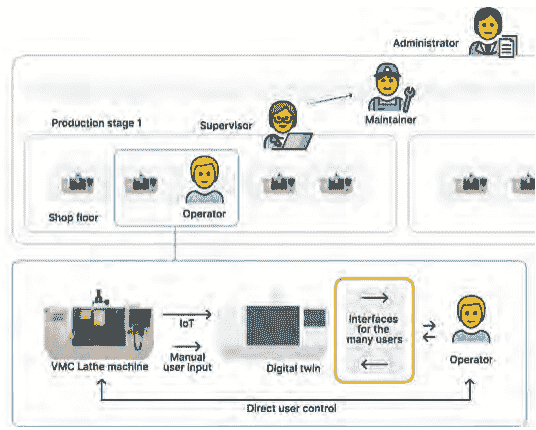

界面使用工作场所的简化概览。

图 14.1
多个利益相关者及面向数字孪生的 HMI。

设计的 HMI 重点如下：

- 1. 帮助操作员了解其现有机器，而无需配备内置数字孪生系统的新机器，并且
- 2. 帮助操作员跟踪机器的短期和长期健康状况。

根据从数字孪生获取的数据点列表，关键挑战是以最佳方式表征数据，以便以最优的方式帮助操作员。界面计划反映操作员的三个主要关注领域。这些包括：

- 1. 其工作流程概览，
- 2. 操作效率，以及
- 3. 操作期间的更好可见性。

因此，最终界面（Kant & Jayasurya, 2021，图 14.1 和 14.4）由两个部分组成，一部分始终反映系统的效率，另一部分允许用户在整个操作概览（大部分时间）和详细可视化模式（特定用例）之间切换。重要变量通过视觉层次结构变得更加突出。此外，相对不突出的变量在大小上变得不那么突出，但被空间地放置在其他相关数据附近，以便操作员更容易找到。我们将简要使用案例研究中的此界面（Kant & Jayasurya, 2021，图 14.4），以从交互设计学科的角度突出面向数字孪生的 HMI 设计的某些挑战。

### 14.3 面向数字孪生的人本 HMI 设计中的问题

上述案例研究简要回顾了 VMC 数字孪生 HMI 的设计过程。设计过程中出现的几个关键方面可以更通用地理解为一般数字孪生的设计。这四个方面也向我们展示了在为数字孪生设计 HMI 时可能面临的挑战。这些包括为人类用户和其他利益相关者进行设计（第 14.3.1 节）、以人为中心的术语表征系统复杂性（第 14.3.2 节），以及与交互设计（第 14.3.3 节）和信息设计（第 14.3.4 节）相关的问题。

#### 14.3.1 问题 1：为数字孪生的人类用户（受过训练的操作员和其他利益相关者）进行设计

数字孪生能够以多种方式提供关于机器本身的详细洞察，并实现数据收集、分析甚至预测，从而利用数据科学领域的诸多发展。然而，从数字孪生获得的数据是原始形式，不是信息；即，它可以以多种方式进行处理。并非所有数据在所有情况下对所有用户都有用。换句话说，这些数据必须被“消化”，并以真正对用户有帮助的方式提供。每个“用户群体”或“操作角色”都有不同的需求和不同的最终目标；因此，在决定数字孪生如何帮助他们之前，深入了解每个用户的工作、问题和需求至关重要。用户与数字孪生之间的界面必须是定制的，以帮助用户完成特定任务并降低出错的可能性。

让我们设想这些各种“用户”以球体的形式存在。系统核心的用户对系统操作拥有绝对控制权，随着向外移动，用户需要的控制更少，体验更精细。例如，预订火车票的用户（绝大多数用户，普通用户）位于球体的外表面，他们需要一个易于使用且方便的界面，以确保他们能从 A 点到 B 点。火车票预订服务代表（假设）位于球体中间某处，他们需要对火车运营细节有更多了解。他们的界面也应该易于使用且方便，但应该更详细一些——他们应该能够观察所有从 A 到 B 的列车上的所有可用座位，并为普通用户分配一个座位。此外，他们的需求是以最佳方式帮助普通用户，尽管目标的性质不同。

第三种用户，即球体核心的用户，是列车操作员。他们将普通用户从 A 点送到 B 点，并且完全控制列车本身——他们的界面可以易于使用且方便，但更重要的是，它应该务实。它应该帮助他们高效控制列车的每个功能，并帮助他们监控所有相关信息。这种专家用户非常了解系统的内部工作原理，并且经过一段时间获得了这种专业知识。我们可以观察到，用户离系统核心越近，就越需要控制权和可见性，这也增加了学习曲线。

在工业系统中，有多种类型的人类用户协同工作——他们以不同能力直接与系统中的机器交互。单机操作员在操作期间直接与该机器一起工作，而车间经理则与其车间的所有机器交互并跟踪它们；此外，行业管理员可能正在监控整个系统。他们每个人都有不同的目标和需求，必须专门针对他们进行满足——随着从核心操作的“距离”增加，用户需要越来越广泛的视图，但最靠近操作的用户需要非常深入的视图。操作员需要在操作本身时跟踪系统中与其机器相关的所有变化。车间经理需要对车间所有机器的实时状态有一个更广泛的视图，不一定需要每台机器的复杂细节。同样，管理员可能需要对系统整体运行有一个鸟瞰视图，以及对运营的汇总洞察，以及全天输入和输出的更多细节。

除了多个利益相关者群体外，在每个群体中，HMI 设计都需要同时兼顾新手和专家。关于专业知识主题的大量研究表明，专家的感知和思考方式不同。他们可能在看同一场景，但会以不同的方式解析它，并关注新手不会关注的各种元素。因此，在正常和紧急操作期间，专家和新手都必须由同一 HMI 支持。此外，HMI 设计应以这种方式支持两者，使新手能够随着时间的推移成为专家。

总体而言，技术密集型行业的受过训练的操作员需要信息支持来增强其现场操作（Romero, Bernus, Noran, Stahre, & Fast-Berglund, 2016）。重点是提高他们对系统的感知并帮助简化他们的决策。关键信息需要一次性提供，而不会增加操作员的认知负荷。这是通过做出适当的界面导航决策来实现的。为了支持多模态信息要求的 the


操作员，此信息可以组织成“信息异层级”的形式，使用户能够一次性了解与其心智模型相关的大部分信息。这也有助于显示系统不同部分之间的相互关联。“信息异层级”可以由各种工作分析方法，以及对用户目标及其心智模型的理解来推导。基于这些想法设计界面正在慢慢被广泛采用，因为行业中的 HMI 要求正在被开发，以通过有意义的表示来管理复杂性。

#### 14.3.2 问题 2：以人为中心的术语表述数字孪生的系统复杂性

为数字孪生构建的工业系统通常本质上复杂。仅仅因为系统各部分的规模巨大且复杂精细，就会产生大量涌现行为。在许多情况下，这些系统中的操作基本上是预先计划好的，需要人工输入来纠正任何偏离计划的情况。每个偏差如何控制取决于人工操作员；他们接受过培训，能够了解系统并对变化做出适当反应。这些变化可以是 (1) 输出本身，(2) 系统的内部工作原理。在第一种情况下，信息可以直接获得，而在第二种情况下，操作员必须仅依赖系统通过界面暴露的数据来做出决策。对这些数据表达无效或表述错误可能导致情境意识丧失。此外，操作员使用可用数据，基于他们对系统及其涌现行为（即心智模型）的理解（Norman, 2013; Norman & Stappers, 2015）做出明智决策。操作员的认知负荷很高，人类用户的决策能力使他们成为系统不可分割的一部分。

为了在这些复杂系统中成功为人类设计，人因工程研究人员以及 HMI 专家已经开发出了设计流程（Burns & Hajdukiewicz, 2004; Hollifield et al., 2013; Vicente, 2002）。其中一种流程是集成生态界面设计（IEID）流程，它源自设计和工程学科的知名方法。这种方法中一个关键部分是将系统的技术方面转换为以人为中心的术语的步骤。换句话说，如何才能以人为中心的术语来表述机器，既表达其复杂性，又支持操作员的心智模型？为了解决这个问题，在 IEID 设计流程中，第一步是从操作员活动的角度来理解机器。接下来，这些访谈的见解以及技术背景文献被用来以功能抽象和结构分解的术语来绘制系统图。

在功能抽象方面，系统可以概念化为各种抽象层，从机器的目的到其物理形式。系统可以分解为五个功能抽象层，因为重点在于“做什么”（Vicente, 1999）：

- 1. 功能目的——直接关系到系统创建的目标。
- 2. 抽象功能——从控制系统的基础层级、定律和原理方面，提供系统的理论理解。
- 3. 一般化功能——从各种过程方面，提供系统的一般区域。
- 4. 物理功能——识别各种子组件和子组件总成。
- 5. 物理形式——识别物理部件和子组件总成的属性。

接下来，技术系统也以其结构组成的形式进行图示。这种结构组成让人了解系统与其子系统和部件之间的关系。借助于技术系统的这种解构视图以及用户研究获得的心智模型，可以识别出系统整体运行中的确切一组相关因素和关系（Kant & Sudakaran, 2021）。

从系统的两种描述来看，关键思想是理解 (1) 每个部分的预期目的是什么，以及 (2) 这些部分以各种方式相互作用的方式。系统也可以简单地按结构分解，从机器的大部件到单个组件；结构层级与抽象层级之间的交叉矩阵有效地绘制出系统图，供用户随后从功能和结构上绘制出交互连接。这些方面源自对操作员经验的研究，目前被认为是在以人为中心的术语下概念化技术系统的一种标准方式。

在我们的 VM 案例中，系统被概念化为不同级别的功能抽象。这导致了一个复杂的互连网络，其中一些部分相互连接，但并非全部。此外，上下部件通过为什么–是什么–如何（why–what–how）关系连接。任何选定的层级都会告诉你该层级中存在什么。上一层级告诉你为什么，下一层级告诉你如何。这种为什么–是什么–如何关系被称为手段-目的推理（means-ends reasoning）。它为设计者提供了一些信息，说明各个层级的功能节点如何追溯到系统的整体目的。

然后将功能抽象层级映射到由系统结构组成的层级上。这产生了功能抽象–结构分解空间（图 14.2）。

结构分解轴

功能抽象轴

整体

部分

图 14.2
用于图示相互关系的抽象-分解空间（改编自 Kant & Sudakaran, 2021）。

结果是系统内所有互连的解构图，从中选取相关连接以在界面中表示，并确定其应以哪个抽象层级表示。在识别出与设计目标相关的因素后，可以根据它们之间的关系（是直接影响还是反向影响，以及是单向还是双向关系）进行映射。这也有助于识别影响操作员心智模型的关键因素。

在 VMC 案例中，体现操作效率的可见性是一个重要目标。与效率相关的主要因素是主轴转速、进给速度和冷却液压力。不同的主轴转速和进给速度组合对不同类型的操作高效，也会影响机器的长期健康。主轴转速和冷却液压力分别与工件上产生的热量及其冷却相关，并与最终产出、短期效率和资源优化相关。在图 14.4 中，可以看出工件温度与主轴转速和冷却液压力直接相关。这种对每个因素的分析方式，加上对操作员及其心智模型的良好理解，对于全面理解系统的复杂性是必要的。这种以功能和结构术语揭示复杂性的过程也为界面设计流程奠定了基础（Kant & Sudakaran, 2021）。

#### 14.3.3 问题 3：与交互设计相关的问题

很容易忽视我们在数字界面语言方面有多么流利，因为我们每天以一种或另一种方式使用它。从轻触和滑动等简单操作，到捏合缩放和滑动滚动等复杂交互，都已成为常态。我们熟悉应用程序和窗口的概念、从页面返回、拖放、手势导航、键盘快捷键，以及那些起初基于比喻立场、现在拥有自己独特行为的抽象概念。按钮、滑块、表单和菜单等界面元素也已成为这些交互的一部分。它已经发展到这样的地步：如果在不同平台上无法使用此类交互，用户会感到失调。总的来说，我们已经在所有数字平台上形成了一套非常成熟的交互系统。其中几种交互可以在各种地方用于解决类似用例。这些被称为“交互模式”。其中许多都有一些基于旧式物理交互方式的直觉依据（例如，按钮、单选按钮和滑块源自其物理对应物，但现在已随着新的数字功能而发展）。在数字孪生中，通常需要专门的交互来反映系统中的复杂关系。在这些情况下，重要的是将通用交互视为标准，并作为设计新交互的基础。更重要的是，设计师应始终确保他们设计的新交互是


与类似一般交互的直觉相背离，例如在具有挑战性和压力大的操作中，则此问题可能导致认知失调，甚至迫使操作员执行无益操作，并被贴上“错误”的标签。

人机界面设计应同等重视简洁性与清晰性，并确保两者均不会对用户的心理模型和情境意识的理解产生负面影响。这一点通过有效交互的设计来体现。在 VMC 人机界面中，几乎所有信息都被组织成不同的组和子组，并在同一屏幕上显示。这提供了工作进度、机器子系统状态以及效率部分的概览视图。在操作过程中的任何时间点，用户都可以在同一位置——概览屏幕——访问所有相关信息。界面中唯一的主要导航是进入和退出详细 3D 视图——用户可以在其中详细、实时地查看和与输出的 3D 可视化进行交互。概览屏幕中仍可使用更简单的 3D 视图，但如果用户想要详细监控因其可能出现的任何偏差和进一步的并发症，则可以切换到详细 3D 视图。最相关的信息仍保留在另一屏幕上；只有屏幕的一部分发生变化。这也符合用户意图的转换——概览将在操作的大部分时间使用，而当用户想要检查输出时，其他信息会被弱化以聚焦于输出。

在设计此类情况时，最重要的考虑因素之一是确保用户充分意识到他们接收到的输出。无论变化是以用户操作还是系统变化通知的形式出现，将其提醒给繁忙的操作员都至关重要。这通过多种微交互来实现，这些微交互为操作员或机械本身的“触发”提供“反馈”（Saffer, 2014）。

这些微交互可以以多种模式发生——视觉动画、音频和触觉反馈等。当微交互是对用户操作的响应时，根据多赫蒂阈值（Saffer, 2014），微交互必须在触发后 `400 ms` 内发生，以确保用户注意到它。在 VMC 人机界面中，界面周围始终有一种特定颜色的“光晕”，操作员只需快速查看屏幕，就可以随时了解操作的总体状态（图 14.3）。当操作正常时，界面周围的边框和通知区域的背景呈纯绿色；当有建议时呈黄色；当有警告时呈红色。这种颜色变化配合声音提示作为反馈，可以让操作员时刻了解系统状态的任何重大变化，而这正是一个触发。

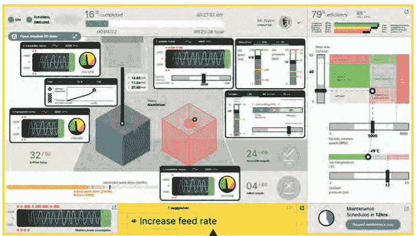

(a)
提高进给率
（显示为黄色建议）

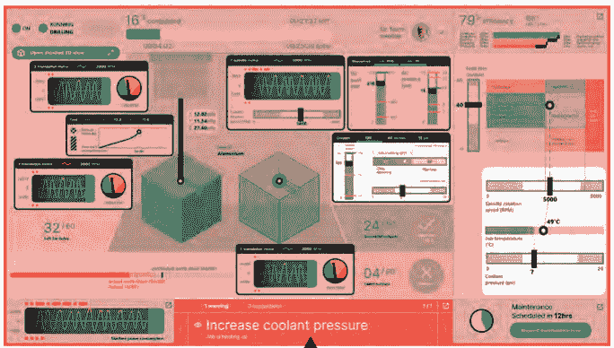

(b)
提高冷却液压力
（显示为红色警告）

图 14.3
支持操作员理解变化的情境意识。

除了基于微交互的反馈外，空间思维也是心理模型的重要组成部分，尤其是在系统占据物理空间且操作至少部分是手动操作的情况下。在这种情况下，将操作员的空间理解纳入设计非常重要。例如，操作重型机械的操作员会根据机器的物理性做出许多决策；通过空间可视化，许多信息可以简单地变得易于理解；即，在机器的数字副本上或机器本身的上方虚拟地可视化。

某些心理模型也可以进行空间表示，尽管它们与物理空间无关。例如，VMC 人机界面中的用户工作流程可以隐喻性地比作装配生产线——用户接手一项原始作业，在机器中经过一系列操作，获得一项完成的作业，并对其进行检查和批准。将此过程表示为装配生产线，很好地封装了操作员的工作流程，无需以书面形式间接解释。这能很好地提供操作员日常工作的可视化表示以及上下文中的相关信息，例如还剩下多少原材料以及有多少输出是合格品还是次品。除了这些交互问题之外，数字孪生人机界面还需要讨论信息设计。

#### 14.3.4 问题 4：与信息设计相关的问题

针对特定数据，信息设计探讨如何为不同用户以最佳方式呈现数据（Goodwin, 2011）。在数字孪生的情况下，存在一大组原始数据，需要不断地进行处理和显示，以供人类消费、洞察发现和分析。然而，只有部分数据以原始形式有用，而其他数据可用于为用户提取有用的洞察。完成此步骤后，信息必须结构良好且可视化，以便用户能够感知和理解。感知问题可以利用关于色彩和排版的平面设计原则以及格式塔定律来支持，而可理解性问题则可以通过有效的数据可视化来解决。

在复杂系统中，因素之间的关系不能过度简化；因为这样做可能导致对涌现行为表示的丢失。在这里，我们可以区分系统运行所必需的必然复杂性，以及系统被*感知*为运行的方式所产生的偶然复杂性。根据用户的目标，可以避免偶然复杂性。

当两个因素之间无关的关系与相关关系以同等重要性表示时，可能会导致用户对因素之间产生错误的关联解读，并在决策时产生不必要的认知负荷。虽然该关系对于理解机器的工作原理可能仍然重要，但对用户来说可能无关紧要，并在关系的表示中造成偶然复杂性。另一方面，一组因素可能具有复杂关系，需要完整表示才能正确解读。必然性和偶然性取决于用户的任务和目标。

本质上，因素关系中的复杂性可以通过两种方式处理：（1）通过设计忽略复杂性并简化表示，或（2）向用户呈现复杂性以供其理解。此外，根据用户需求，如果简单性无法传达关系，选项 1 可能无用；如果选项 2 用于无关关系，可能会引起不必要的混淆。

从数字孪生的角度可以进一步探讨此问题。以 VMC 数字孪生的人机界面为例（图 14.4），机器的高效运行取决于各种因素——操作类型取决于进给率和主轴转速，各种组合会导致不同操作类型的效率。工件温度取决于主轴转速和冷却液水平，而冷却液水平始终需要补偿由主轴转速引起的加热。因此，进给率和冷却液水平都对主轴转速施加限制；操作类型效率和冷却液使用都影响系统的运行效率，而工件温度既影响输出也影响所使用刀具的健康状况。这种关系是一种必然复杂性——尽管操作员可以以多种方式操纵三个因素以实现相似的输出，但可视化传达了确切的组合对系统正在做什么，并提供了关于为获得相同输出并保持高效率而应操纵哪些因素的洞察。这是一种必须表达的必然复杂性，以便让操作员理解这些因素在效率中的作用。

进给率和主轴旋转（图 14.4，A 部分）在 CNC 效率矩阵中存在复杂的关系，主轴转速和冷却液压力也存在另一种复杂的关系。过高的冷却液压力会导致冷却液浪费，从而影响工作流程的效率，但过高的主轴转速会导致工件过热并导致工作失败。冷却液压力定义了浅绿色区域，即工件温度可接受的区域；浅红色区域是冷却液无法处理的温度。在没有冷却液的情况下，主轴转速直接影响工件温度，因此冷却液设定了主轴转速对效率矩阵影响程度的上限。当温度在可接受区域内时，仪表为绿色；当超过该区域时，仪表变为红色——理想的操作是刚好有足够的冷却液来抵消主轴转速引起的热量。各种深浅的绿色和红色显示组件该区域的影响强度；灰色显示该区域并非最优，如同白色区域一样。

主轴转速滑块直接影响工件温度——因此两者之间有连线。冷却液水平滑块设定了其能冷却的温度上限——因此在工件温度组件中定义浅绿色区域的连线。这种关系还以虚线的形式进一步延伸——工件温度标记了冷却液水平能达到的最低点；来自冷却液水平滑块的线向上延伸以标记


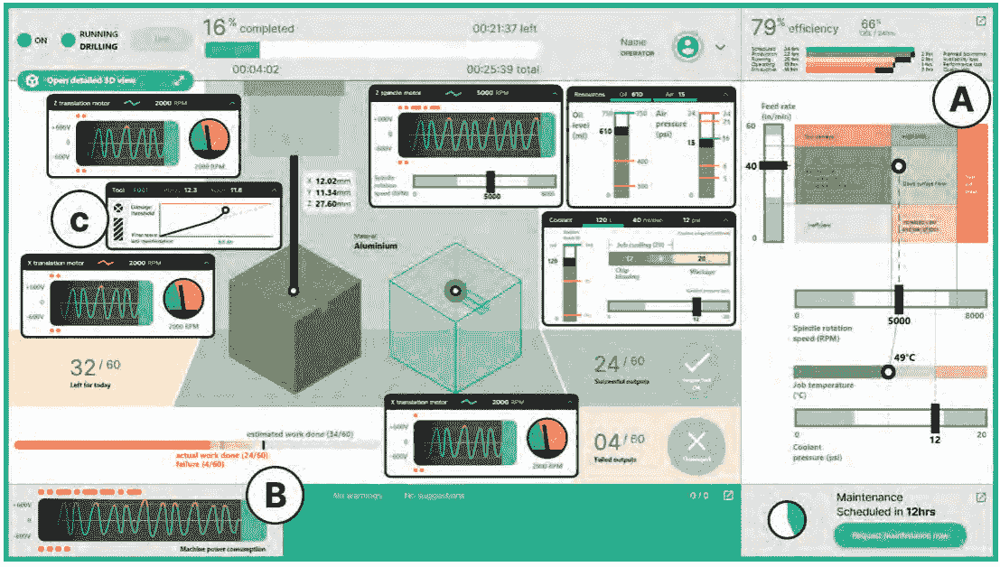

图 14.4
用于表示 A、B 和 C 之间相互关系的可视逻辑（改编自 Kant & Sudakaran, 2021）。

主轴能达到的最高速度。这确实需要一些学习，但由于操作员以抽象方式熟悉这种关系，这种表述提供了一种尽可能直接相关的方式来查看信息。这些关系必须在 HMI 设计中完整可视化，因为这能减轻部分认知负荷。在整个界面中始终如一地使用这种视觉语言，有助于在整个屏幕的上下文中传达重要的相互关联。

另一项广泛的挑战在于多感官交互的使用（Goodwin, 2011; Saffer, 2009a）。数字界面可以使用多种媒体与用户交互——视觉、语音和音频、触觉等。然而，在信息密集型界面的语境中，音频等媒体是时间性的（通过时间传递信息），而触觉（可通过触摸感知的交互）在传递复杂信息方面效果不佳。虽然基于语音的交互越来越有效，但它们通过极大地自动化和抽象自然语言背后的数据和功能来工作，这可能不太适合特定情境的要求。因此，这些主要作为视觉界面的补充使用。

用户界面设计（在视觉界面语境下）建立在平面设计、数据可视化、人体工程学、光学等多个领域的坚实基础之上。它需要一套形状、颜色、排版及其在人类中唤起的意义的视觉语法——这些在设计能够有效向用户传达信息的有影响力的界面时至关重要。例如，红色通常被理解为危险（无论是出于天然还是通过广泛使用），并会在用户中唤起特定情绪。柱状图和图表等数据可视化在数字界面中也已司空见惯。然而，在开发以组合方式显示各种信息的图形形式方面，还有进一步的挑战（图 14.4，B 部分）。

以显示信息为例，请考虑以下示例（图 14.4，C 部分）。在上述设计的 HMI 中，电压表带有上下限可视化。在电力存在问题的工厂中运行的 VMC 机器经常面临导致操作失败的电压波动。在设计的 HMI（图 14.4）中，当电平超过或低于限制时，界面会以两种方式记录它。较短的 blob 表示快速波动，较长的 blob 表示较长的波动。虽然波动可能很多且可能尚未影响工作，但它们会堆积成一串 blob，让操作员快速了解波动的频率和类型。在这个界面中，大量信息以浮动在电表旁边并随时间累积、指示电压电平波动的 blob 形式直接传达。在界面结构方面，非层级信息可以表示为屏幕上的一组互连区域。总体视图提供了系统的整体感觉，而界面中的每个“岛屿”可以进一步显示其区域内的细节。这将允许用户根据需要隐喻地“向下钻取”或“向上缩放”非层级结构（Saffer, 2009a, b, 2014; 另见 Cooper et al., 2014; Goodwin, 2011; Tidwell, Brewer, & Valencia, 2020）。

在 VMC HMI 的情况下，如果发生关键错误，整个屏幕会被染成红色，但不相关的信息除外。这有助于弱化不相关信息，直接将注意力引向相关信息，从而（1）通过在显示器上呈现整体红色来吸引用户注意力，以及（2）使定位相关信息更加容易。重要的是不要阻止访问其他信息，因此只使用了红色色调，而不是不透明的红色，并且提供了多种轻松取消色调的方式——鼠标晃动、点击、触摸、按键，或用户可能尝试的任何其他交互。

在 VMC HMI 的情况下，变化盲视通过两种方式得到解决：

- 1. 无论何时发生关键变化，该信息都会通知并记录，供用户处理。这还使用户能够忽略频繁的不相关变化，而无需担心关键变化。例如，每当电压波动高于或低于安全限值时，就会记录一个红色点/线，并通知用户。
- 2. 使用动画和微交互来吸引用户对始终相关的连续变化的注意。

### 14.4 结论

在应对数字孪生的巨大规模和复杂性时，很有可能牺牲以人为本的设计，因为它可能被归类为次要目标。然而，重要的是要注意，归根结底，数字孪生提供的所有额外数据和功能在两个主要方面帮助我们：（1）为系统提供新的宝贵洞察，从而为人类用户提供更好的可见性和控制力；（2）卸载手动工作并提供额外的自动化手段，使人类用户能够专注于更重要的任务。在这两种情况下，人类用户都是预期的受益者——在数字孪生设计过程的每个步骤中给予他们充分考虑非常重要。良好的人本设计能够降低认知负荷和“人为错误”。因此，良好的 HMI 可以对数字孪生的成功产生巨大影响。本章讨论的关键思想可以被视为对人本设计广泛方面的一个窥探——每个主题本身都是一个庞大的领域，在我们的日常生活中有着广泛的应用。以人为本的方法设计数字孪生及其界面，对于确保技术得到有效使用并为人类用户提供最高可能水平的益处至关重要。

## 参考文献

Bennett, K. B., & Flach, J. M. (2011). 显示与界面设计：微妙的科学，精确的艺术. Boca Raton, FL: CRC.

Burns, C. M., & Hajdukiewicz, J. R. (2004). 生态界面设计. Boca Raton, FL: CRC Press.

Cooper, A., Reimann, R., Cronin, D., Noessel, C., Csizmadia, J., & LeMoine, D. (2014). About Face：交互设计精要. Indianapolis, IN: Wiley.

Goodwin, K. (2011). 为数字时代设计：如何创造以人为本的产品和服务. Hoboken, NJ: Wiley.

Grudin, J. (2017). 从工具到伙伴：人机交互的演变. Synthesis Lectures on Human-Centered Informatics, 10(1), 1–183. https://doi.org/10.2200/S00745ED1V01Y201612HCI035.

Hollifield, B., Habibi, E., & Oliver, D. (2013). 高性能 HMI 手册. Plant Automation Services Inc.

Hsu, Y., Chiu, J., & Liu, J. S. (2019). 面向工业 4.0 及其以后的数字孪生（第 526–530 页）. 2019 年 IEEE 工业工程与工程管理国际会议（IEEE）. IEEE, 2019: 526–530.

Kant, V., & Sudakaran, J. S. (2021). 扩展生态界面设计流程——集成 EID. Human Factors and Ergonomics in Manufacturing & Service Industries, 2022, 32(1): 102–124.

Liu, M., Fang, S., Dong, H., & Xu, C. (2021). 关于概念、技术和工业应用的数字孪生综述. Journal of Manufacturing Systems, 58, 346–361.

Norman, D. (2013). 日常事物的设计. Cambridge, MA: Basic Books.

Norman, D. & Stappers, P. J. (2015). DesignX：复杂社会技术系统. She Ji: The Journal of Design, Economics, and Innovation, 2015, 1(2): 83–106.

Qi, Q., Tao, F., Hu, T., Anwer, N., Liu, A., Wei, Y., et al. (2021). 数字孪生的赋能技术和工具. Journal of Manufacturing Systems, 58, 3–21.

Rasmussen, J. (1979). 知识结构——人机系统语境下心智模型的形态学. Risø National Laboratory, 1979.

Rasmussen, J. (1986). 信息处理与人机交互：一种认知工程方法. New York: North-Holland.

Rasmussen, J., Pejtersen, A. M., Goodstein, L. P. (1994). 认知系统工程. New York: John Wiley & Sons.

Romero, D., Bernus, P., Noran, O., Stahre, J., & Fast-Berglund, Å. (2016). 操作员 4.0：人类 cyber-物理系统与面向人-自动化共生工作系统的自适应自动化. In I. Nääs, O. Vendrametto, J. Mendes Reis, R. F Gonçalves, M. T. Silva, G. von Cieminski, & D. Kiritsis (Eds.), 生产管理系统的进展：可持续世界的倡议（第 677–686 页）. Cham: Springer International Publishing.

Saffer, D. (2009a). 面向交互设计：创建智能应用和聪明设备. Indianapolis, IN; London: New Riders.

Saffer, D. (2009b). 手势界面设计. Sebastopol, CA: O'Reilly.

Saffer, D. (2014). 微交互：设计细节. Sebastopol, CA: O'Reilly.

Tao, F., Anwer, N., Liu, A., Wang, L., Nee, A. Y. C., Li, L., & Zhang, M. (2021). 面向智能制造和工业 4.0 的数字孪生. Journal of Manufacturing Systems, 58, 1–2.


Tidwell, J., Brewer, C., & Valencia, A. (2020). 《接口设计》(第3版). Sebastopol, CA: O'Reilly.
Vicente, K. J. (1999). 认知工作分析：迈向安全、高效和健康的计算机辅助工作. Boca Raton, FL: CRC Press.
Vicente, K. J. (2002). 生态界面设计：进展与挑战. Hum Factors, 44(1), 62–78. https://doi.org/10.1518/0018720024494829.

## 15
面向数字多元宇宙的新一代设计工具

Chiara Cimino, Gianni Ferretti, and Alberto Leva
米兰理工大学

### 15.1 引言与动机

数字技术当前作为工业4.0背景下物理-网络系统（CPSs）的使能器，具有根本性的重要性（Oztemel & Gursev, 2020）。那些智能系统的网络部分由多个用于决策的数字孪生（DTs）所实现，这些孪生体可用于生产资产的整个生命周期阶段：从设计（Lo et al., 2021; Tao et al., 2018a）、工程、调试和控制（Leng et al., 2021）到维护和管理（Tao et al., 2018b; Dinter et al., 2022）。DT可在整个生命周期中增强资产监控与分析（Leng et al., 2021）。尽管如此，现有的DT应用严格关联于其应用目的，通常仅提供一组与物理对照体通常不相关的有限服务（Davila Delgado & Oyedele, 2021; Tao et al., 2019）。考虑资产的设计阶段，DT——作为孪生体——应与实体系统一同诞生，以模拟它、在其当前状态下进行决策，并随之成长，塑造一系列与随时间应用修改的对照体相对应的DT历史。当许多专业人员在同一系统上工作并做决策时，这一概念变得更加复杂，因为DT可以基于不同的建模方法：例如，建筑信息模型数据库、微分代数方程组或神经网络。同样，细节层级也是如此，模型可以指单个组件、机器、工艺或整个资产。当专业人员通过DT（可能使用不同细节层级的各种工具）做出某些决策时，他/她无法知道自己所做的决策是否与其他专业人员先前和/或并行做出的决策冲突。因此，不同DT之间必须建立的关系在一致性方面的缺失，可能导致设计阶段决策的一致性缺失，尤其是当DT应用如此异构（例如，由动态模型和一组记录数据及其统计分析工具组成）时，以至于即使只是想象这种双向交换也显得有问题。

本章提出了一种工具的规范，该工具可帮助确保如此异构的一组DTs之间的一致性，使在设计阶段处理的一组模型和数据保持一致，以便从设计阶段开始为每个系统创建知识库。上述工具基于由Cimino et al. (2021)构建的数字多元宇宙（DM）范式。从回顾第15.2节相关工作中范式的基本概念出发，我们在第15.3节中识别工具创建的关键角色。我们继续在第15.4节中阐述构建标准模型与数据库（MDB）的UML规范，并在第15.5节中提出访问配置规范，在第15.6节中提出MDB管理工具和版本控制规范。最后，我们提供了一些结论性意见和未来工作。

### 15.2 相关工作

为了提供包含DM范式所设想的所有动态的连贯工具规范，我们在本节中概述其主要支柱以及范式实现所选用的技术。最后，我们指出了关于我们提案的新颖性和工具规范的一些关键概念。

#### 15.2.1 数字多元宇宙范式及其使能技术

Cimino et al. (2021)构建的范式基于第15.1节中提及的孪生概念。“孪生”一词表明，CPS的物理系统和虚拟系统应当一同诞生并以某种方式平行生存，但这与当前DT应用的构建方式不符。数字世界（不同虚拟系统共存之处）最重要的特征是其多元宇宙性质。基于这一性质，我们为自己的范式命名，并在此基础上引入一个实体——我们称之为数字元孪生（DMT）——它具有这样的属性：当从某个视角观察时，呈现出与该视角相对应的DT意义。DMT必须同时包含模型和数据：在此，我们专注于基于模型的DT（如基于方程的模型），以区别于需要数据库（历史和/或实时采集）的基于数据的DT。为了关联所有DT，我们引入数据与模型关系的概念——作为数据库理论和术语中数据间关系的扩展——这是确保MDB一致性的必要条件，而MDB是在数字世界中实现DMT的基本实体。总结来说，该范式依赖于在DM中创建和管理MDB作为DMT的存储库。

DM范式研究（Cimino et al., 2021）通过结合多种现有技术增强了模型之间的一致性：

- 该范式的模型描述语言是面向对象建模（OOM），抽象了建立关系所需的实体（Scaglioni & Ferretti, 2018）。OOM工具至关重要，因为它们能够检查模型（例如 Open Modelica 或 Dymola）的数学正确性（例如，方程数量与变量数量相等，不包含结构奇异性等等）。
- 数据描述语言是关系数据模型（RDM）——例如在相关领域（如集成设计）中的一个示例（Feng et al., 2009）。这需要某种结构与OOM正确协调，但这一选择使RDM无需存储OOM中包含的所有数学关系。
- 操作语言是结构化查询语言（SQL），与版本控制系统（VCS）配合，以跟踪MDB的历史记录和多用户修改。

#### 15.2.2 数字多元宇宙工具规范

此处所提议的范式统一——正如将要展示的，这远不止于在领域特定工具之间传输数据——因此具有无可置疑的价值，且备受期待。每个MDB收集一致性函数和脚本，用于在模型之间建立关系，这些关系在用户需要时最终可以通过检查（例如，通过特殊仿真活动）来验证。因此，一致性不仅对应于数据交换，还对应于工具必须执行的特定动作，以检查MDB中的所有模型是否相互保持一致。明确这一点很重要，因为这些机制相较于连接不同DT的现有方法（如被视为数字化转型使能器的资产管理壳，或（Boyes & Watson, 2022）中列出的其他现有架构）提供了额外的益处。

本章的其余部分着重介绍如何通过对MDB的整体管理，利用被视为面向对象系统开发行业标准的UML语言（Bashir et al., 2016）来规范DM工具。

### 15.3 DM工具规范的参与者

如所介绍，DM工具将用于一致地链接多种类型的模型、数据及由此产生的分析。为此，每位专业用户都应能够根据其角色，将必须保持一致并受特定版本控制顺序约束的数据和模型纳入MDB。在描述此类复杂程序的动态时，我们需要补充更多细节，首先明确参与MDB管理的参与者。

假设存在一组由例如团队协作使用的MDB，如图15.1a所示，每位专业人员可以使用其工作区访问所考虑MDB中存在的所有模型和数据。每位专业人员都应能够通过其专业领域的在线/离线DT打开、模拟和/或分析系统，并在DMT中比较不同的宇宙（即MDB），如DM方法所规定。

例如，从某个DMT访问图15.1a中的MDB_1似乎是一个相对更简单的过程：用户可以将自己感兴趣的MDB版本——符合VCS版本控制——复制到本地工作区，并在此基础上开始自己的分析。相反，当用户希望将在现有MDB版本中执行的分析添加并保存到存储中时：（1）每个工作区与MDB存储之间的一致性检查工具必须根据某些一致性脚本和函数，使用一组仿真重新检查相关的一致性关系，主要出于安全考虑；（2）新的/更新的MDB必须在到达存储之前，由版本控制工具保存并上下文编目。

该示例确定了为进一步扩展DM工具规范必须考虑的主要参与者：仿真工具；工作区处理系统；以及MDB管理工具。实现反映DM范式的适当工具需要规范如此复杂的结构。诸如锁定和允许多用户访问等可归纳为“更经典”的问题将不予讨论，以免偏离主要陈述路径。

### 15.4 MDB结构

本段的目标是按照OOM语言规范整个方法的核心元素——MDB的结构。回顾，我们希望专注于实现处理OOM基于模型的DT创建的工具（根据此处给出的模型定义）；这些模型必须是模块化的，并且必须允许同一模型的可替换性；例如，聚合模型（如机器模型）中的组件模型必须保持相同的接口，以实现例如在所描述物理现象方面提高细节层级。这一概念是我们所参考研究的关键点之一，这种MDB组织使我们能够更轻松地在不同模型之间建立一致性。在此，我们仅回顾该概念以提出适当的工具规范。


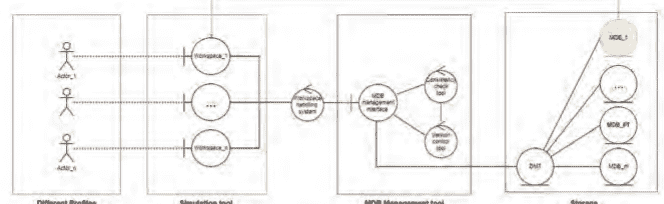

(a) - DM 工具的高级简化健壮性分析图

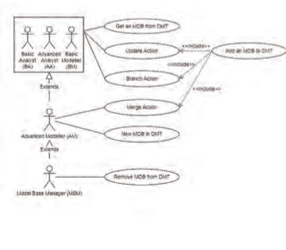

(b) 配置文件与 DM 工具的交互 - 用例


(c) – 工作区与 MDB 管理工具 – 类图

图 15.1
(a) DM 工具的高级简化健壮性分析图。(b) MDB 管理工具访问配置文件交互的 UML 规范 – 用例。(c) MDB 管理工具的 UML 规范 – 类图。

MDB 结构的规范在图 15.2 中详细说明，它是实现工具的基础，该工具可以通过标准流程（也可从现有的 OOM 库开始，例如 Modelica）理解并实现基于 OOM 模型的 DT 的创建和存储。我们关注 MDB 内部的基于 OOM 的 DT 结构，此后将其称为 MDB 的模型根。MDB 中包含的所有基于模型的 DT 必须具有此结构，才能被存储、本地导出并导入存储。MDB 的模型根（图 15.2）中包含的 UML 类是 (Cimino et al., 2021) 规定的，即本论文所属的长期研究。每个模型根都与一个 MDB 相关，指示 MDB_ID 代码，并包含以下详细说明的所有主要类。


图 15.2
MDB 的模型根结构 – UML 类图

- 模型根中包含的最基本类是 Connector。它表示模型的物理终端，即从外部可访问的变量。模型根中的每个连接器都必须具有其 Connector_ID，它可以由连接器列表 SubConn[] 组成，即在使用分层连接器时。

- 模型根允许将连接器分组为 Interface。每个接口都必须具有 Interface_ID 和包含的连接器列表 ConnList[]（至少一个）或迭代包含的接口列表 InterList[]（至少一个）。

- 另一个基本类是 Domain。每个域当然都有 Domain_ID。一个域可以通过指定字符串 DomainList[] 由一组域组成。

- 最后的基本类是 Equation Set 和 Algorithm Set，它们是用户创建的不同 Equation 和 Algorithm 的列表。

- Type 类，回顾 (Cimino et al., 2021) 给出的定义，表示一类实体，这些实体可以在不同的建模理论下描述，由 behaviours 标识。每个类型都必须有一个唯一的 Type_ID（至少一个），一个唯一的占位符主参数，以及 – 如果需要 – 一些一致性函数，详见如下。

- 某个类型下的每个 Behaviour 都必须具有 Behaviour_ID、指示域集合的 DomainList[] 和一个接口。Behaviour 可以在没有接口的情况下存在，但如果 Behaviour 具有接口，则该接口对该 Behaviour 必须是唯一的。相反，相同的接口和相同的域集合可以出现在多個 Behaviour 中，即使它们属于不同的类型类。一個 Behaviour 必須至少包含以下之一：equation set、algorithm set 或 placeholder behaviour parameter class。

- Placeholder Behaviour Parameters 类具有 Par_List_ID，它包含参数列表 Par_List[] – 通常是物理参数 – 与模型根中包含的 equation 和/或 algorithm set 相关。它还可以关于其他 behaviours 中包含的其他 placeholder behaviour parameters 进行迭代。请注意，在模型根的这一部分中，我们不考虑上述参数的值，而只考虑符号列表。

- Placeholder Primary Parameters 组包含某个类型下所有 Behaviour 的所有 placeholder behaviour parameters，它具有 Par_Behav_List[]，其中包含在同一类型下收集的所有 placeholder behaviour parameters 的 ID。

- 占位符中的某些参数可以通过 Consistency Functions 类相互关联。每个一致性函数都应该具有 Const_funct_ID、Relation[]、建立参数之间连接的 equation(s) 集合，以及 Par_List_IN[] 和 Par_List_OUT[]，它们指定哪一组输入参数通过所述关系给出输出参数。此类一致性可以在 UML 中描述为带虚线的依赖关系。

- 模型根还包含 Prototype 类；每个原型都有其 Prototype_ID，并收集同一类型、共享相同接口的所有 behaviours（原型存在至少需要一個）。

- 最后，模型根包含 Specimen 类。如上所述，占位符中针对每个类型和 behaviour 考虑的所有参数都是符号化的，以使模型保持通用并适用于不同情况。Specimen 被视为第一个参数化对象：它是一个带有指定参数集的原型。Specimen 是可以在仿真工具中实例化的参数化对象，当多个 specimens 分组并连接迭代组成一个 specimen 时，情况亦然。

- 与具有特定 behaviour 的特定 specimen 关联的数据，通过 Specimen_ID 和 Behaviour_ID，在 Specimen Data 类中结构化。关联的数据包括 Data_IN，即输入到 specimen 的参数列表——它使仿真成为可能，也可以从外部数据库导出——以及 specimen 仿真产生的 Data_OUT[] 列表。此外，由于 specimen 可以通过连接许多 specimens 迭代组成，specimen data 可以由聚合 specimen 的 specimen data 列表组成。

- 模型根中的每个 specimen data（即 Data_OUT[]）都与一个或多个 specimens（即 Data_IN[]）关联，具体取决于 Consistency Script 中所述的关系。因此，每个脚本都有其 Cons_ScriptID，一个脚本代码——例如，需要建立仿真活动——以及 Rel_Specimen_List[]，即所有将仿真输出数据用作输入的 specimens 列表。将数据与生成它们的 specimen 关联对于建立模型和数据之间的所有可能关系至关重要。如果数据需要使用额外的数据、equation 和/或 algorithm 进行处理，同样必须确保这一点。

总体而言，如图 15.2 所示，可以将所有类分为三组：

- 以粗体显示的对象是 OOM 系统（即 Modelica 语言）中已存在的对象，可以在 OOM 环境内创建，即可以使用不同的 connectors 创建新接口；

- 所有白色对象有助于将 MDB 的模型分组为范式所识别的类：主要类（Type、Prototype、Specimen）、子类（Behaviour、Domain）、用于符号参数收集的类（Placeholder Behaviour Parameters 和 Placeholder Primary Parameters）、用于模型参数化的数据收集（Specimen Data 和 Data Set）以及用于建立一致性的脚本收集（Script）；

- 模型根中的阴影对象代表范式引入的主要创新：一致性函数关联基于 equation 和/或 algorithm 的模型，保持参数之间的一致性；一致性脚本在发生更改和检查时实现仿真活动，例如更改详细程度。

在给定规范中，拟议的工具将记录 *如何* 连接不同模型，以及 *如何* 实例化这些关系以用于检查目的。此外，我们必须强调，此处指定的工具不是用于创建一致性；相反，MDB 旨在允许用户强制执行所有的一致性，而工具必须触发检查，以控制仿真时是否遵守一致性。

### 15.5 访问配置文件

本节描述每个配置文件如何从工作区与 MDB 交互，根据图 15.3 授予的权限。

#### 15.5.1 与存储的交互

使用和维护 MDB 需要正确分配和管理访问权限。如第 15.1 节所述，用户可以从头创建一个 MDB，也可以从其工作区向现有 MDB 添加模型和数据。本节根据迄今概述的 MDB 组织，提出了用户访问配置文件及其分配权限的综合建议。

- **基本分析师 (BA)**: 只能运行实例化一个现有 specimen 的仿真（显然，是“完整”的可运行模型）。这是权限最低的配置文件，可以分配给相反地对仿真生成的数据拥有高权限的人。

- **高级分析师 (AA)**: 除了 BA 的职责外，此人可以创建新 specimen，但只能通过更改


#### FIGURE 15.3
访问配置文件的 UML 规范 – 用例

parameters. 例如，AA 可以获取一个标本，采用具有特定行为的某个原型，并将其存储在 MDB 中作为新标本，根据数据表设置主参数；如果其中包含的信息不完整，将在检查层级生成错误，以向用户发出信号并请求缺失信息。

- **基础建模师（BM）**：除 AA 的职责外，BM 还可以创建新类型（因此也包括新原型和新标本），但仅限于聚合已存在的标本实例，或使用受限于高级分析师权限的新标本（即仅更改参数）。BM 还可以创建新接口，通常用于新行为，仅使用现有连接器。BM 配置文件的限制禁止通过作用于方程和/或算法来创建新行为，因此也不允许与一致性函数或生成/一致性脚本进行交互。例如，BM 可以组装并存储电路类型（例如 RC 滤波器），使用现有组件（基本元件如电阻和电容，或聚合元件），使用标准引脚连接器创建并存储其引脚定义的接口，创建具有新自感的电阻标本，但不能创建具有新行为（方程或算法方面，非连接方程）的电阻类型。此外，BM 不得创建跨越多个域的类型，因为这会避免 BM 与一致性函数交互；由于组件是单独验证的，单域聚合体的一致性函数是组件一致性函数的并集。例如，BM 可以创建机器的第一原理模型，但不能创建其 DEVS 伴随模型，因为后者将属于第二个域，且 BM 无法为同一类型的两个假设行为（具有不同域）之间创建适当的一致性函数。

- **高级建模师（AM）**：除 BM 的职责外，此配置文件还可以通过直接与方程（显然不包括连接方程）和算法交互来创建新行为，在新的（或现有的类型、域（s）和接口）中，并对所有所需的一致性函数和脚本负责。

- **模型基管理器（MBM）**：此人拥有全部权限，只需遵守（在适用的情况下）托管 MDB 的数据库系统的规则；最终，归纳起来，MBM 是可以暂时且知情地绕过所有其他人被限制的 MDB 接口的人，通常用于 MDB 损坏时的恢复。

为了在保持高层次概览的同时说明 DM 工具应如何指定，我们在图 15.3 中呈现了 UML 用例草图，以完全抽象的方式转换迄今介绍的访问配置文件。

#### 15.5.2 与 MDB 管理工具的交互

遵循其访问配置文件允许的操作，用户可以创建、导入和导出 MDB。图 15.1c 中的一组高层 UML 允许用户通过以下方法与存储进行交互：

- 使用 New() 方法将新建的 MDB（从零开始创建）包含到由 DMT_ID 标识的 DMT 中；该方法返回由版本控制工具处理的 MDB_ID。
- 使用 Get() 方法从存储中导出 MDB，同时提供 DMT_ID 和 MDB_ID，并返回精确的 MDB。
- 通过 Add() 方法在 DMT 中添加本地修改 MDB 的最新版本；此功能需要 DMT_ID、原始 MDB 的 MDB_ID，并指定所执行的操作，返回成功指示器和版本控制工具选择的 MDB_ID。Action 与用户在向 DMT 上传新版本 MDB 时需要执行的操作相关，可以是不同类型：
  - Branch：如果新版本的 MDB 表示并行分析，即原始版本的替代方案；
  - Update：如果新版本的 MDB 是原始版本的演进；以及
  - Merge：如果新版本的 MDB 是多个 MDB 合并的结果（出于此原因，Add 方法中的原始 MDB 的 MDB_ID 也可以是 MDB 列表）。
- 通过 Remove() 方法从 DMT 中删除 MDB 版本，提供 DMT_ID 和 MDB_ID，并返回成功指示器。
- 我们不深入 Workspace 处理系统的细节，仅规定其角色是管理通信，并在 MDB 管理工具繁忙时提醒用户。

图 15.1b 说明了用户与 MDB 管理工具交互的规范，该规范根据其访问配置文件进行管理：

- BA、AA 和 BM 配置文件只能执行 Get 和 Add 方法，但仅使用 Update 和 Branch 操作；由于这些配置文件只能对现有模型操作，它们只能使用其他现有 MDB 中已有的标本来创建新的 Specimen 实体；此外，在某些情况下，合并操作可能不涉及任何一致性，但在合并多个用户完成的不同工作时，可能会出现一致性问题。出于此原因，这些配置文件需要 AM 用户的监督才能执行任何合并。
- AM 还可以使用 New 方法从零开始创建新 MDB，并可以执行 Add 方法并使用 Merge 操作。
- MBM 用户拥有全部权限；他/她还可以使用 Remove 方法从 DMT 中删除 MDB。

总体而言，所阐明的规范展示了如何在工作组中管理 MDB 工具。多个用户可以处理不同的 MDB，也可以处理不同的分析，但当所有分析都用于做出决策时，一个（或一组）AM 将合并他们的所有工作，插入具有新行为的新标本，并在需要时识别一致性。因此，致力于就同一 DMT 做出不同决策的 AM 将在 MBM 的建议下，共同确定是否有必要在构建的 MDB 中添加一些一致性函数。

显而易见，整个统一过程以复制 PT 绝不可能是完全自动化的，它需要不同领域、拥有多种专业知识的专业人员之间进行协作和沟通。该工具将通过检查所有插入的模型是否一致来支持他们的工作。

#### 15.5.3 完整规范

总体而言，可以说每个用户都可以访问其工作区，并可以使用方法将导入、创建、编辑并保存回存储中的 DMT 的工作（即以 MDB 结构形式的新模型和仿真结果）。图 15.4 描绘了不同工作区的 UML 类图，不同配置文件根据其权限在这些工作区中交互。

所有配置文件都继承 login() 的可能性，然后，每个配置文件都被允许使用类所需的权限可视化特定工作区，如下列所示（与本章中描述的所有规范保持一致）。

- BA 拥有 Workspace_BA 类：他/她可以使用 Get() 函数导入 MDB，前提是知道 DMT_ID 和 MDB_ID；他/她可以选择 MDB_ID 打开标本，并分别使用 Open() 和 Simulate() 函数模拟所述标本。用户还可以使用 NewSpecimen() 函数将新标本添加为其他标本列表，或使用 AddSpecimen() 函数一次将标本添加到现有标本中。最后，他/她可以通过使用 Add() 函数将修改后的 MDB 添加到存储中，但仅限使用 branch 或 update 操作。

- AA 可以从其 Workspace_AA 中使用 AddParData() 函数为特定数据集添加一组新参数，指明参数所参照的 DataSet_ID。然后，他/她可以使用 AddSpecimen() 函数创建新标本，选择已存在的标本（通过 Specimen_ID）并添加必须与所述标本行为一致的新 DataSet_ID。

- BM 使用 Workspace_BM，它允许 BM 配置文件创建其他标本的聚合体作为新标本，最终添加新接口和新行为占位符，但始终


图 15.4
工作空间与 MDB 管理工具随配置文件的交互 UML 规范 – 类图

考虑单个域，也作为其他域列表，避免使用一致性函数和脚本。可能的交互包括：

- 添加新接口，分别使用 AddInterface()、AddDomain() 和 AddType() 指定所用连接器列表，仅使用现有连接器、域和主参数占位符；
- 使用 `AddBehaviour()` 函数添加新行为，指定类型、域列表、接口以及行为中包含的样本 – 由于此用户配置文件只能使用样本组合新行为；行为占位符将由组成该行为的所有样本行为占位符列表自动组合；
- 用户可以使用 `AddPrototype()` 添加新原型，仅知道与该原型关联的 Type_ID 和 Interface_ID，并使用 `AddSpecimen()` 函数包含正确的数据集列表；以及
- 最后，他/她可以使用 `check()` 函数。
- AM 来自 `Workspace_AM`，可以通过 `AddNewBehaviour()` 和 `AddNewDomain()` 函数从头开始创建连接器和域；他/她可以直接与方程和算法交互，在新的或现有的类型、域和接口中使用 `AddNewBehaviour()` 添加行为。该用户可以在使用 `AddBehaviour()` 创建行为后，使用 `AddBehaviourParPlaceholder()` 和 `AddToPrimaryParPlaceholder()` 手动操作参数占位符。他/她负责所有必需的一致性函数和脚本，并使用 `AddConsistencyFunction()` 和 `AddConsistencyScript()` 添加它们。前者必须指定同一类型内由一致性函数关系（算法和/或方程）连接的两个行为。而后者必须指定关系，这次是脚本，这些脚本在样本输入（specimen_in）与样本输出（specimen_out）之间保持一致性。最后，用户可以使用 `merge` 操作添加修改后的内容。
- MBM 与 `Workspace_MBM` 交互，如前所述，他/她拥有全部权限，并可以使用 `Remove()` 函数从存储的 DMT 中删除一个 MDB。

### 15.6 MDB 管理工具规范

每个 MDB 构成了创建数字宇宙的知识库，其中所有分析必须保持一致；因此，当用户在工作空间中需要时，或在受影响的 MDB 存储到相应 DMT 之前，都需要一个管理工具来检查这些一致性。每个工作空间 – 通过一个处理系统 – 与 MDB 管理工具（图 15.1c）接口，并可以根据其在图 15.1b 中的访问配置文件，使用工作空间提供的不同方法。本节更详细地说明了符合图 15.1c 所提方法的 MDB 管理工具的 UML 规范。大体上，当 MDB 管理接口收到来自工作空间的请求时，它只能下令从特定 DMT 导出或导入 MDB，对这些请求的处理如下所述。

- 导出请求分为两种类型，Get() 和 Remove() 分别用于在本地工作空间中使用特定现有 MDB，以及指示 MDB_ID 和 DMT_ID 来删除一个 MDB。这些功能由连接到接口的 DMT 配置文件类继承。
- 当用户希望将 MDB 包含到特定 DMT 中时，会发出导入请求。用户可以导入从头开始创建的 MDB，或者上传同一 DMT 中现有 MDB 的新版本。在这两种情况下，此类请求更复杂，需要使用涉及其他工具的一系列操作，如下所示：
- 当用户想要导入新 MDB 时，会调用 New() 方法，插入目标的 DMT_ID 和创建的 MDB；MDB 管理工具首先调用版本控制工具，该工具通过 Version_New_MDB 方法返回 MDB_ID，然后出于安全考虑调用 Check() 方法；最后，MDB 通过 Add 方法添加到 DMT 中。
- 如果 MDB 是现有 MDB 的修改版本，则前面的 Add() 方法允许对新 MDB 版本进行版本控制。版本控制工具将在 Version_Mod_MDB 方法中处理原始 MDB 列表以授予 MDB_ID；然后，MDB 被添加到 DMT 中。

在两种导入情况下，当 Check 函数按规定（图 15.1c）检查所有一致性并生成新 MDB 时，接口会通过 Alert_WS() 函数向所有处理该 MDB 较旧版本的工作空间生成警报。

在不深入版本控制工具 UML 规范细节的情况下，我们再次说明，DM 工具 – 至少在这个开发阶段 – 并非面向高效管理不同用户的工作。处理同一 MDB 的小组应在其中同步工作，或使用并行 MDB，以便在后续阶段由更高级别的用户配置文件合并。DM 方法的最终目标是构建一个一致且更新的知识库，供所有处理同一资产的不同专业人员共用。

### 15.7 结语与未来工作

本章说明了 DM 工具的一种可能 UML 规范，以证明其实现的可行性。尽管规范仍处于早期阶段，但 UML 草图为理解该工具的角色、功能和潜力提供了基础。未来工作将致力于将每个配置文件用例规范化为特定的序列图，以评估所有类之间的内部动态和通信。

关于工具使用，可以开发随时间变化的模型 – 真实系统的虚拟孪生体。每个物理系统都可以附带其 MDB – 例如，直接来自制造商的机器或组件 – 可用于较大系统的不同多重宇宙中，以收集该系统的完整历史，这些历史可作为生命周期结束信息，用于其他类似系统。

## 参考文献

- Bashir, R. S., Lee, S. P., Khan, S. U. R., Chang, V., & Farid, S. (2016). UML 模型一致性管理：软件质量经理指南。国际信息管理杂志，36(6)，883–899。https://doi.org/10.1016/j.ijinfomgt.2016.05.024.
- Boyes, H., & Watson, T. (2022). 工业中的计算机数字孪生：分析框架与未解决问题。工业计算机，143(2月)，103763。https://doi.org/10.1016/j.compind.2022.103763.
- Cimino, C., Ferretti, G., & Leva, A. (2021). 协调与集成数字孪生多重宇宙：一种范式和工具集提案。工业计算机，132，103501。https://doi.org/10.1016/j.compind.2021.103501.
- Davila Delgado, J. M., & Oyedele, L. (2021). 建筑环境中的数字孪生：从制造业的概念和流程模型中学习。先进工程信息学，49(5月)，101332。https://doi.org/10.1016/j.aei.2021.101332.
- Dinter, R., Tekinerdogan, B., & Catal, C. (2022). 使用数字孪生的预测性维护：系统文献综述。信息与软件技术，151(2月)，107008。https://doi.org/10.1016/j.infsof.2022.107008.
- Feng, G., Cui, D., Wang, C., & Yu, J. (2009). 复杂产品协同设计中的集成数据管理。工业计算机，60(1)，48–63。https://doi.org/10.1016/j.compind.2008.09.006.
- Leng, J., Wang, D., Shen, W., Li, X., Liu, Q., & Chen, X. (2021). 基于数字孪生的工业 4.0 智能制造系统设计：综述。制造系统期刊，60(5月)，119–137。https://doi.org/10.1016/j.jmsy.2021.05.011.
- Lo, C. K., Chen, C. H., & Zhong, R. Y. (2021). 产品设计与开发中数字孪生的综述。先进工程信息学，48(2020 年 7 月)：101297。https://doi.org/10.1016/j.aei.2021.101297.


Oztemel, E., & Gursev, S. (2020). 行业4.0及相关技术文献综述. Journal of Intelligent Manufacturing, 31(1), 127–182. https://doi.org/10.1007/s10845-018-1433-8.

Scaglioni, B., & Ferretti, G. (2018). 面向数字孪生的面向对象建模：机床案例研究. IFAC-PapersOnLine, 51(2), 613–618. https://doi.org/10.1016/j.ifacol.2018.03.104.

Tao, F., Cheng, J., Qi, Q., Zhang, M., Zhang, H., & Sui, F. (2018a). 基于大数据的数字孪生驱动的产品设计、制造与服务. International Journal of Advanced Manufacturing Technology, 94(9–12), 3563–3576. https://doi.org/10.1007/s00170-017-0233-1.

Tao, F., Zhang, M., Liu, Y., & Nee, A. Y. C. (2018b). 面向复杂设备的数字孪生驱动的预后与健康管理. CIRP Annals, 67(1), 169–172. https://doi.org/10.1016/j.cirp.2018.04.055.

Tao, F., Zhang, H., Liu, A., & Nee, A. Y. C. (2019). 工业中的数字孪生：现状综述. IEEE Transactions on Industrial Informatics, 15(4), 2405–2415. https://doi.org/10.1109/TII.2018.2873186.

## 利用人工智能技术为数字孪生实现新价值主张的服务设计与系统思维方法

Shaun West
卢塞恩应用科学与艺术大学

Cecilia Lee
皇家艺术学院

Utpal Mangla
IBM云平台

Atul Gupta
Merative

### 16.1 引言

我们的意图是引导读者了解广泛认可和采用的服务设计方法，以帮助构建对智能服务提供商如何将人性化方面融入数字孪生开发的更深入理解。

随着新兴技术（如人工智能）的发展，数字孪生也引起了工业界和学术界的广泛关注。“数字孪生”一词自Grieves（2014）提出以来就已存在。该术语仍被宽松地使用，导致定义和解释各不相同，尤其是在学术文献中（Tao et al., 2019）。数字孪生是物理系统的虚拟表示，阐明物理过程，镜像系统的静态和动态属性（Batty, 2018；Lökklin et al., 2021）。由于数字孪生的目的是镜像物理系统以识别系统中可能需要改进的领域，大多数研究已经考察了系统的技术资产。随着人工智能（AI）、物联网（IoT）和大数据等新兴技术以惊人的速度渗透，数字孪生的采用已迅速扩展到能源、医疗保健和农业等领域。

服务系统代表旨在为系统内行动者提供价值的多种行动者，例如人类、技术、组织和信息（Medina-Borja, 2015；Maglio & Spohrer, 2008）。人工智能、物联网和大数据的出现意味着，服务系统中的技术行动者现在可以自主地与服务系统中的其他技术行动者和人类行动者进行交互，以共同创造价值。行动者学习和适应的能力赋予了智能性，并创造了智能服务系统。

智能服务系统展示了由新兴技术使能的行动者之间交互的复杂性。最近的研究强调了整合软要素（如人类行动者的需求、愿望、文化信仰和行为）的重要性，以构建对系统可持续性的交互动态更深入的理解（Medina-Borja, 2015）。智能服务系统中定义的物理过程涉及与技术行动者交互以共同创造价值并实现使用价值的人类行动者。然而，大多数数字孪生研究都集中在流程和系统的技术方面，忽视了人性化方面。模拟智能服务系统的数字孪生应代表系统的技术方面和人性化方面。

尽管Shostack在20世纪80年代首次引入了服务设计，但直到最近才在行业从业者和学者中获得关注。在当前文献中，服务设计被描述为一种以人为本的方法，用于实操化高度抽象的概念性思维（Vargo & Lusch, 2019，引自Meierhofer et al., 2020）。尽管以前使用服务设计来探索服务主导背景下服务系统动态的研究并未明确将其引入作为SDL实操化的使能者，但显然，这些研究中的服务设计被用作高阶概念SDL与发生在微观层面的经验观察（例如，Yu and Sangiorgi, 2018；Sudbury-Riley et al., 2020）之间的桥梁。

### 16.2 智能服务系统

以前的研究将服务系统描述为旨在为受益人提供创造价值的服务的人员、技术、组织和信息的配置（Medina-Borja, 2015；Maglio & Spohrer, 2008）。在服务系统中，技术行动者被赋予了由人工智能实现的物质能动性（Leonardi, 2011）。这使它们能够自主地与人类和其他技术行动者进行交互，并通过智能对象提供智能服务（Wunderlich et al., 2015）。具有物质能动性的技术行动者向服务系统注入了智能性，因为技术行动者新获得的技能——自我学习和自我适应性——使服务系统能够不断演变并应对不断变化的环境。智能服务系统的概念对工业界和学术界来说仍然相对较新。以前的服务科学SDL研究引入了许多关于智能服务系统的竞争性定义。尽管尚未有被工业界和学术界广泛接受的定义，但大多数以前的研究都同意智能服务系统能够自我学习、自我适应、自我复制和决策（Beverungen et al., 2017；Medina-Borja, 2015）。West、Gaiardelli和Rapaccini（2018）使用SDL视角创建了一个框架，通过考虑服务生态系统、服务平台以及价值共创的机会，来评估数字化支持的“智能性”解决方案（表16.1）。该框架有助于实操化SDL，如表16.1所示，并评估的智能性比Porter和Heppelmann（2014）描述的智能互联产品方法更广泛。在那种方法中，重点放在技术和产品上，而不是可能实现的价值共创（Frost, Cheng, & Lyons, 2019）。

在智能服务系统中，技术不再仅被视为系统中用于价值共创过程的操作资源。相反，技术行动者现在承担了一个新的额外角色，即人类行动者用来共同创造价值（例如，知识和技能）的操作资源。由于技术已成为能够直接与用户交互以在智能服务系统中进行价值共创过程的行动者，该系统可以促进人与人、人与

表16.1
评估智能性的服务逻辑框架（West et al., 2018）

| 主要维度 | 关键特征 | 1（最差） | 5（最佳） |
|---|---|---|---|
| 服务生态系统 | 灵活性与完整性 共享视图 | 没有灵活性，无额外集成 对当前理解有限，无未来视图 | 基于灵活和集成架构构建的开放系统 当前和未来的清晰共享视图 |
| | 行动者角色 | 未定义 | 多角色 |
| | 架构 | 封闭 | 开放且安全 |
| 服务平台 | 模块化结构 | 无 | 高度模块化，支持第三方集成 |
| 价值共创 | 交换规则 | 定义不清 | 明确定义 |
| | 行动者之间的价值创造 | 单向，单行动者 | 双向，多行动者 |
| | 多样化行动者之间的交互 | 两个行动者 | 多行动者 |
| | 角色适应 | 仅两种角色 | 多角色/多行动者 |
| | 资源集成 | 单一资源 | 许多资源的集成 |


到机器，以及机器到机器。从生态系统的角度来看，智能服务系统的可行性取决于其无缝促进参与者之间价值共创过程的能力，以实现互惠互利。

尽管具有物质代理性的技术已经变得更智能，并且可以基于它们能够读取的情境数据与用户自主交互，但它们的智能仍远远不足以使其完全满足当今挑剔用户的需求和期望。因此，智能服务提供商深入了解智能服务系统中参与者之间价值共创的促进因素和阻碍因素变得更加关键（Wieland et al., 2012）。在SDL（服务主导逻辑）之前的研究中，那些提供服务生态系统视角的研究（例如，Akaka, Vargo & Lusch, 2013；Storbacka et al., 2016）强调了理解微观、中观和宏观层面参与者之间的交互及其相互关系的重要性。然而，这并不总是容易的。Storbacka et al.（2016）的先前研究首先探索了微观层面参与者之间的交互，以了解这种交互在服务系统中如何与中观和宏观层面的交互相关联，从而实现价值共创。

只有当系统内的参与者能够无缝促进互惠互利的价值共创时，服务系统才能保持可行。受益的智能服务用户决定其使用价值。这再次强调了将用户或人类参与者置于（智能）服务系统运营中心的重要性（Maglio, 2015; Medina-Borja, 2015）。这进一步鼓励整合软性元素，例如人类参与者的行为、需求和愿望，因为单靠技术无法解释智能服务系统中出现的现象。一个既能阐明人类参与者复杂需求和愿望，又能纳入技术参与者参与的人本中心智能服务系统，可以为跨所有三个系统层面发生的交互动态提供更准确、更可靠的洞察。

为了实现一个为系统参与者产生互惠利益的人本中心智能服务系统，智能服务提供商可能需要考虑采用人本中心方法，利用AI技术构建数字孪生，以在智能服务系统中实现新的价值主张。人本中心设计将使智能服务提供商能够密切关注人类与技术参与者之间微观层面的交互，以及它如何转化为价值共创过程。

智能服务系统领域的近期研究已采用人本中心方法来理解如何设计自适应制造系统（Peruzzini & Pellicciari, 2017）以及如何设计智能住房（Agee et al., 2021）。日益增长的复杂性常常成为设计人本中心智能服务系统的一项挑战。一些组织已采用服务设计来缓解这一挑战，因为它提供了一种创新方法，用于梳理智能服务系统的复杂性，并找到实现价值主张创造的新方式。

#### 16.2.1 系统思维与服务设计

随着世界经济从以产品为主导的逻辑转向以服务为主导的逻辑（SDL），创新视角也已从基于产出的观点转向价值共创（Sudbury-Riley et al., 2020）。SDL经济的出现也促进了服务设计在行业设计从业者以及设计研究人员和学者中的迅速普及。

对价值共创结果作为一种新兴创新方法越来越重视，进一步提升了设计在行业中的角色。随着SDL经济的发展，服务设计已成为一种人本中心方法，用于探索重新配置图16.1资源并通过价值共创增强创新的机会（Sun & Runicie, 2017; Andreassen et al., 2016）。服务设计领域的大多数近期研究将其描述为一种问题解决过程，可以在复杂的世界中探索复杂问题，使服务系统中的参与者能够协作识别潜在解决方案（例如，Salgado et al., 2017）。服务设计过程是迭代的，并融入了行动中的反思方法（Schön, 1983）。这种迭代和适应性过程为在SDL经济中审视新兴挑战提供了一种强有力的方法，在这种经济中，使用价值随着情境不断演变。同样，更重要的是，服务设计帮助智能服务提供商从用户而非服务提供商的角度理解问题，强化了使用价值的概念。

利用面向系统思维的服务设计流程的第一步是引入服务生态系统框架，该框架可以帮助智能服务提供商识别每个系统层面的相关参与者，并构建其交互如何相互影响的整体视图。

SDL研究社区和服务设计社区广泛使用图16.1中的服务生态系统框架。它强调了服务生态系统各层级价值共创过程中的内部和外部关联。它提供了价值共创在服务系统中如何发生及其如何促进系统可行性的高层次视图。系统运营逻辑也直接应用于智能服务系统运营的情境中。例如，智能医疗服务领域的服务设计师可以使用该框架来构建不同服务系统层级之间相互关系的共同理解。这一练习将使设计师全面了解价值共创的促进因素和阻碍因素，以便在必要时开发相关的设计干预措施。

对系统内参与者之间交互的整体理解将为智能服务提供商提供关键参与者和交互动态的基础知识。基于此，智能服务提供商可以使用服务设计工具来更深入地了解塑造其与他人交互模式的人类参与者的动机、需求和愿望。这一过程可以由英国设计委员会在2000年代初引入的双钻设计流程指导（Ball, 2019）。


图16.1
服务生态系统框架。（来源：Stefanie Fink绘制，改编自Akaka, Vargo, & Lusch, 2013。）

双钻设计流程是迭代的，并深植于Schön的行动反思方法中。在第一个钻石的发现阶段，智能服务提供商可以使用访谈和跟踪观察等研究方法来收集关于人类参与者的情境数据。然后他们将广泛描述人类参与者的愿望、需求和期望如何塑造其与系统内其他参与者的交互以实现价值共创。这一过程将有助于缩小问题空间，并显示数字孪生可以在哪里提供帮助。一旦问题被定义，智能服务提供商就可以利用系统微观层面人机交互的洞察，为仿真测试开发人本中心的数字孪生原型。在此阶段，大多数智能服务提供商预计将经历陡峭的学习曲线，以持续迭代，确保其解决方案针对当前问题。

尽管人本中心数字孪生帮助智能服务提供商拓宽了对智能服务系统的视角，但将人类维度整合到数字孪生中需要仔细评估伦理影响。

### 16.3 人类及其数字孪生——数字人体

当我们考虑数字人体时，我们会迅速从技术转向价值主张，然后转向伦理问题。这些问题比数据所有权要深刻和根本得多。

**表16.2**
Web of Science在健康领域对数字孪生的关注度

| 年份 | 数字孪生健康 | 数字孪生伦理健康 |
| :--- | :--- | :--- |
| 2022 | 114 | 3 |
| 2021 | 111 | 3 |
| 2020 | 69 | 1 |
| 2019 | 42 | 0 |
| 2018 | 12 | 1 |
| 2017 | 3 | 0 |
| 关键学科 | 工程 / 信息系统 | 医学<br>社会科学<br>工程/信息系统 |

表16.2证实，自2017年以来，基于已发表论文数量，健康领域内数字孪生的出现一直在增长。这三次搜索证实，数字孪生的应用基于技术，而健康环境中对伦理的考虑需要迎头赶上。

#### 16.3.1 数字人体及数字孪生可能实现的价值主张

实际上，人体数字孪生是数字人体的智能化身（图16.2），能够与人体发送和接收数据。在服务情境中，一旦建立物理人体与数字人体之间的这种关系，它就可以，例如，发展预防性护理的一个新维度（即，一个新的价值主张）。

数字孪生世界中的预防性护理可以在症状和身体反射出现之前提供指导。收集的数据将与SDOH（健康的社会决定因素）以及不断发展的AI/ML算法协同工作，以提供数字孪生支持的价值主张。

例如，一个智能化身（数字孪生）可以基于历史和实时人体数据分析以及能够测量生命体征的物联网设备，预测物理人体未来几小时内可能出现的“剧烈头痛”。数字孪生可以指导人类去小憩半小时、喝水，或是在户外散步以缓解压力，从而最大限度地减少对传统止痛药的需求。减少用药不仅对环境更具可持续性，而且也会对人类健康产生积极影响。

数字孪生可以通过环境、人类行为、物联网、医疗设备和医疗机构收集情报，并将所有数据馈入统一环境，以实现AI服务和下游功能。这将使患者受益，他们能够获得指导、建议和


图 16.2
人体的智能化身。（来源：Stefanie Fink 的作品。）

future considerations for their physical and mental health issues. The areas of preventive care, precision care, and personalized patient treatment plans can all be enabled using digital twins.

为其身心健康问题提供未来考量。预防性护理、精准护理和个性化患者治疗方案等领域，均可通过数字孪生得以实现。

Moving outside the purely medical environment, we can consider the digital twin within healthcare insurance. Already, aggregated data are being used for actuarial calculations that support setting insurance premiums and allocating resources based on actual and forecast demands. With the technology enabled by a digital twin, we can suddenly imagine new value propositions that help us stay healthy and reduce our insurance costs. Conversely, we can imagine another world where our behavior is controlled by ‘Big Brother,’ and we are penalized for ‘bad’ behaviors.

走出纯粹的医疗环境，我们可以考虑在医疗保险领域应用数字孪生。目前，聚合数据已被用于精算计算，以根据实际和预测需求设定保险费并分配资源。借助数字孪生技术，我们突然可以设想出新的价值主张，帮助我们保持健康并降低保险成本。反之，我们也可以设想另一个世界：我们的行为受‘老大哥’控制，并因‘不良’行为而受到惩罚。

For additional insights, we have considered the application of digital twins to improve athletic performance. Sports provide a complex system of systems that allows for the integration of many digital twins as we have the participant, their equipment, the team, the environment where the team is playing, and the opposition, not forgetting seasonal aspects. Suddenly, we have a system of systems; some aspects are measured directly, whereas others are indirectly observed. Sport offers an extreme case where participants freely participate, providing an environment where more can be willingly tried and tested.

为获得更多洞见，我们考虑了运用数字孪生来提升运动表现。体育提供了一个复杂的系统体系，允许整合众多数字孪生，因为我们涉及参与者、其装备、团队、团队比赛所在的环境以及对手，不忘季节性因素。突然间，我们拥有了一个系统体系；有些方面直接测量，而另一些则间接观察。体育提供了一个极端案例，参与者自由参与，提供了一个可以更自愿地尝试和测试更多内容的环境。

#### 16.3.2 The Context of Sports

#### 16.3.2 体育背景

Sports are closely aligned to healthcare, as an athlete’s performance is a function of personal health. Some firms are using scanning systems to build a digital human with the exact measurements of the body (Figure 16.3). In this case, such a system allows the exact matching of feet with shoes. Apple has gone one step further with its Fitness and Health apps in the consumer environment.

体育与医疗保健紧密相关，因为运动员的表现是个人健康的函数。一些公司正在使用扫描系统，构建具有身体精确测量数据的数字人（图 16.3）。在此情况下，这样的系统可以精确匹配脚与鞋子。Apple 在消费环境下的“健康与健身”应用又进一步。


FIGURE 16.3
One of the authors’ digital feet.

图 16.3
作者之一的数字脚。

Moving into the professional athlete’s world, monitoring is critical to performance in competition. Consider Formula 1 without telematics systems that take data from both the car and the driver to support tactical and operational decision-making. The decision-making is supported by an underlying model, which is, in effect, a set of digital twins that capture the current status and forecast possible future options. What is clear is that the market is undergoing rapid rates of innovation as sensors and AI get cheaper. Examples include the Carv app and ski boot sensors to ‘coach’ skiers (getcarv.com).

进入职业运动员的世界，监测对竞赛表现至关重要。设想一下没有远程信息处理系统的 Formula 1，此类系统会从汽车和车手处获取数据，以支持战术和运营决策。决策由底层模型支持，其实质是一组数字孪生，用于捕捉当前状态并预测可能的未来选项。很明显，随着传感器和 AI 变得更便宜，市场正在经历快速创新。示例包括 Carv 应用和滑雪靴传感器，用于“指导”滑雪者（getcarv.com）。

The intelligent avatar is being built from the data collected from individual athletes. Currently, much of this is fragmented, with islands of specialisms that are weakly connected (e.g., CAD-like feet or full-body scans can be made, or weight collection). Nevertheless, these can be built upon, and slowly digital twin technology with its AI will be better able to provide insight into actual and predicted performance. This can move into closely associated areas such as nutrition and health.

智能化身正在从个别运动员收集的数据中构建。目前，这些数据大多是碎片化的，存在连接薄弱的专业孤岛（例如，可以制作类 CAD 的脚部或全身扫描，或收集体重数据）。尽管如此，这些数据可以在此基础上构建，并且慢慢地，数字孪生技术及其 AI 将能更好地提供对实际和预测表现的洞察。这可以扩展到营养和健康等密切相关的领域。

##### 16.3.2.1 Perspective 1: Individual Athlete to Many Athletes

##### 16.3.2.1 视角 1：从单个运动员到多个运动员

Today, your watch tells you to ‘move’; in the near future, it can tell you what to eat and drink or how to move to achieve athletic performance. This can be very helpful for individual athletes to improve their personal performance. Again, the digital twin can create institutional structures for value co-creation.

今天，你的手表会告诉你“动一动”；在不久的将来，它可以告诉你吃什么、喝什么，或如何运动以实现运动表现。这对个别运动员提升个人表现非常有帮助。同样，数字孪生可以为价值共创建立机构结构。

With a small jump, health information gathering will be possible from consumer-grade products with the mass collection. As the data set grows and the data capture duration lengthens, the AI models underpinning them will improve to a point where individual segmentation will become possible, raising major ethical questions in addition to the value co-created with the athlete.

跨出一小步，健康信息收集将能够从消费级产品中实现大规模采集。随着数据集增长和数据采集时长延长，支撑这些数据的 AI 模型将得到改善，以至于个体细分将成为可能，这除了与运动员共同创造的价值之外，还引发了重大伦理问题。

The value co-creation here is mainly individual but can be multi-actor at the collective level as new insights can be captured with AI and fed back into the digital twin, providing more/better advice. Ethically, this is simpler as it is based on comparative performance. Nevertheless, some of the information can end up with ‘dual uses,’ and it is important to allow control of the use of the insights.

这里的价值共创主要是个人层面的，但在集体层面可以是多方参与的，因为可以通过 AI 捕捉新的洞察，并反馈到数字孪生中，提供更多/更好的建议。在伦理上，这更简单，因为它基于比较表现。尽管如此，部分信息可能最终用于“双重用途”，因此允许控制洞察的使用非常重要。

##### 16.3.2.2 Perspective 2: Human and Machine System

##### 16.3.2.2 视角 2：人机系统

The most basic question is, ‘will the shoes fit?’ Until now, we have considered the individual athlete. However, the digital twin allows us to replicate the system. By expanding the system to include the equipment, we link our digital twin with the equipment digital twin. Once linked, the athlete’s performance using the equipment can be compared, and improvements recommended. This also allows the equipment designers to understand the long-term human/machine performance better.

最基本的问题是，“鞋子合脚吗？”到目前为止，我们一直只考虑个别运动员。然而，数字孪生使我们能够复制系统。通过将系统扩展到包含装备，我们将自身的数字孪生与装备数字孪生相关联。一旦关联，就可以比较运动员使用装备的表现，并提出改进建议。这也让装备设计师能够更好地理解长期的人机表现。

The actors here can be limited to those in perspective 1 and additionally the designer. They should all, at some point, be beneficiaries of the co-creation web that is created. Ethically, it remains like perspective 1.

这里的参与者可以局限于视角 1 中的那些人，再加上设计师。他们都应该在某种程度上成为所创建的共创网络的受益者。在伦理上，这与视角 1 保持一致。

##### 16.3.2.3 Perspective 3: The Coach’s Perspective

##### 16.3.2.3 视角 3：教练的视角

The coach wants to know how the individuals and the team will perform; therefore, a ‘family’ of digital twins must be created to support the team, based on each individual’s performance data (a health proxy). To be valid, there must be both a sufficiently detailed underlying model and data that is up to date to support decision-making. Integrating third-party data, such as weather, into the individual digital twins further improves the team selections (i.e., decision-making), as some athletes are better in cooler or wet weather. In contrast, others are better in hot, dry conditions. Further expansion of data integration comes from performance data on the other athletes. Integration of publicly available, albeit with poorer granularity and reliability, nevertheless supports the decision-making that the digital twin can provide.

教练想知道个人和团队的表现如何；因此，必须基于每个个体的表现数据（一种健康代理）创建一个数字孪生“家族”来支持团队。要有效，必须既有足够详细的底层模型，又有最新数据来支持决策。将第三方数据（例如天气）整合到个体数字孪生中，可以进一步改善团队选拔（即决策），因为某些运动员在较凉爽或潮湿的天气中表现更好，而另一些人则在炎热干燥的条件下表现更好。数据整合的进一步扩展来自其他运动员的表现数据。整合公开可用的数据（尽管其颗粒度和可靠性较差），也能支持数字孪生所能提供的决策。

Integrating the coach, the team, and the individual athlete creates different actors, yet here the coach and team are the direct beneficiaries. This is where zooming in/out is helpful. In many sports, the team is key and the individual secondary, so the predicted optimal team performance may be detrimental to individuals because they may not be selected for a particular event.

整合教练、团队和个别运动员创造了不同的参与者，但在此，教练和团队是直接的受益者。这就是放大/缩小（视角切换）有所帮助的地方。在许多运动中，团队是关键，个人是次要的，因此预测的最佳团队表现可能对个人不利，因为他们可能不会被选入某个特定比赛。

#### 16.3.3 The Context of Healthcare

#### 16.3.3 医疗保健背景

The intersection of digital twins and the healthcare industry is well-timed with the recent rise of data usage within organizations and with external partners. Typically, most healthcare data are very siloed, making it challenging for AI and ML algorithms to use it collaboratively. Further, data privacy, trust, and accountability challenges enforce essential blocks to the use of collected data besides vetting the algorithms, tools, and techniques. Capabilities in the healthcare business have matured and are developing quickly in many areas, often solving complex enterprise, business, regulatory, and compliance requirements.

数字孪生与医疗保健行业的交叉点时机正好，与组织内部及与外部合作伙伴的数据使用最近兴起相吻合。通常，大多数医疗数据都非常孤立，使得 AI 和 ML 算法难以协作使用。此外，数据隐私、信任和问责制方面的挑战，在审查算法、工具和技术之外，对收集数据的使用设置了基本障碍。医疗业务领域的能力已经成熟，并在许多领域快速发展，通常能够解决复杂的企业、业务、监管和合规要求。

The value proposition for digital twins in healthcare is not only to generate a digital equivalent of a human body at the cellular and organ levels but also to collaborate with incoming real-time feeds from medical and surgical equipment. A step forward in this would be to implement IoT devices to monitor and feed data into a digital twin equivalent of a human body (Figure 16.4). Typically, the human body is not only generating reflexes, observation, and experience data. The reflexes are because the human body is in a particular environment, physical location, temperature, humidity, etc. IoTs can fill this gap and bring in this wealth of data. A digital twin with real-time bi-directional data feeds can provide AI predictions and guidance to the human body ahead of actual events. The challenges for the digital twin ecosystem will be gathering the data feeds, as the data is spread across many organizations and healthcare providers.

医疗保健领域数字孪生的价值主张不仅在于在细胞和器官层面生成人体的数字等价物，还在于与来自医疗和外科设备的实时数据流进行协作。在此基础上更进一步，可以实施物联网设备来监测并将数据输入相当于人体的数字孪生中（图 16.4）。通常，人体不仅生成反射、观察和体验数据。反射之所以存在，是因为人体处于特定环境、物理位置、温度、湿度等条件下。物联网可以填补这一空白，并带来丰富的数据。具备实时双向数据流的数字孪生可以在实际事件发生前，向人体提供 AI 预测和指导。数字孪生生态系统面临的挑战将是收集数据流，因为数据分布在许多组织和医疗保健提供者之间。

A digital twin for healthcare will need the ‘service context’ more than ever. To put this in perspective, health imaging data is very costly and time intensive. Running AI analysis and deriving inferences at a large scale with big-data initiatives are mostly not in time for end-user consumption. A single static image or photograph has an average size of 5 MB; a genetic profile for a single cancer patient can amount to about 1 PB. Collecting this huge dataset and running an analysis on it are not sustainable, with high costs and delayed results. Instead, in the service context, a digital twin can feed real-time data to AI services and inform healthcare professionals only about the inferences that are necessary. Additionally, continuous data feeds to AI services using a digital twin and sending inferences to actors will bring new dimensions to healthcare. With responsible AI and respectful ethics, privacy, and trust standards, healthcare professionals can use digital twins in real time for diagnosis, preventative care, and research activities.

医疗保健领域的数字孪生比以往任何时候都更需要“服务上下文”。为了说明这一点，医疗影像数据非常昂贵且耗时。运用大数据计划进行大规模 AI 分析并得出推论，大多数情况下无法及时供最终用户使用。一张静态图像或照片的平均大小为 5 MB；单个癌症患者的基因图谱约可达 1 PB。收集如此庞大的数据集并对其进行分析是不可持续的，成本高昂且结果延迟。相反，在服务上下文中，数字孪生可以向 AI 服务提供实时数据，并仅向医疗专业人员通报必要的推论。此外，使用数字孪生向 AI 服务提供持续数据流，并将推论发送给参与者，将为医疗保健带来新的维度。在负责任的人工智能以及尊重伦理、隐私和信任标准的前提下，医疗专业人员可以实时使用数字孪生进行诊断、预防性护理和研究活动。

Privacy concerns may prohibit all the necessary information from being fed to the digital twin ecosystem. For example, location data give the patient’s coordinates to feed social data to the digital twin, but privacy may not allow

隐私问题可能会禁止所有必要信息被输入数字孪生生态系统。例如，位置数据会提供患者的坐标以向数字孪生输入社交数据，但隐私可能不允许


图 16.4
构建医疗保健领域的数字人。(来源：Stefanie Fink 的插画。)

此举。在服务环境中，这可以在联邦生态系统中实现，使数据留在原地，仅对 AI 服务使用推理。随着 AI 服务和推理的使用量增加并成熟，医疗专业人员的信任可以随时间建立。医疗保健领域的数字孪生将需要一个全局治理层，以确保信任并建立人们的信心。

##### 16.3.3.1 视角 1：预防性护理和尽量减少药物使用

传统医疗和治疗是规定性的，始于与患者的交谈、事实调查以及症状检查，以建立诊断。人体数字孪生可以向医疗专业人员提供源源不断的患者相关身体数据、输入/输出数据、社会特征和关联数据。如果一切设置正确，并基于历史和现有生命体征进行监测和预测，针对可预防疾病的患者绝不应进入症状阶段。通过持续监测对象，数字孪生还可能能够进行针对性检测（如核磁共振、内镜检查和 X 光）或药物处方。数字孪生使预防性护理的主动早期前系统性识别成为可能。

此处提出的伦理困境至关重要，因为它们将为您作为个人和作为“社区”所开具的“最佳”处方与主动权和个人自由相对比。在此情况下，为了最大限度发挥数字孪生的作用，需要收集个人数据。因此，隐私控制和信任至关重要，与 AI 预测一样，癌症等问题可能被早期检测出来。然而，其他信息不应被披露或变得可识别。

##### 16.3.3.2 视角 2：医学影像设备的训练与强化学习

医疗保健专业人员必须管理正确使用医学影像和诊断所涉及的成本和延误，并希望从中受益。从事原型、分子研究或医疗设备后续版本的设计团队，在借助数字孪生开发影像和医疗设备方面经验丰富。全年 365 天收集和整合影像数据、执业者笔记、诊断和患者生命体征是可能的。数字人体（数字孪生）得益于改进的 AI/ML，可以以多种方式组合或使用影像设备。这提供了增强的个体诊断，并加速新医学影像系统的研究和设计。

数字孪生可以基于来自各种来源的一致、完整、准确、及时和可靠的数据来创造价值。显然，需要更好的影像技术，整合更多数据来源可能会导致新型、微创健康治疗的发展。从伦理角度看，我们需要了解这可能会对个人数据构成何种风险。关于数据收集、处理和存储技术的透明度对于维护 AI 的伦理至关重要，这将有效地管理公众的期望和信任。

##### 16.3.3.3 视角 3：医疗保险的背景

鉴于其对普通公众的重要性，医疗保险一直是医疗行业的关键。财务预测、估计和利润率往往驱动保险，而人为因素需要被重视，尽管保险公司可以获取基本健康数据。欺诈和索赔造假也滥用了传统的医疗保险。人体数字孪生可以向保险公司提供匿名数据，使它们能够洞察索赔和趋势背后的情况，并运行广泛的 AI 支持分析。为补充这些数据，SDOH 参数可以为保险分析提供另一个维度，并向医疗保健提供者和患者提供反馈。从伦理角度看，向保险公司提供医疗数据的访问权限存在巨大问题。

保险从财务角度审视问题，需要关注不一致、难以解读、昂贵且耗时的执业者和患者数据。想象一个数字孪生，其中保险公司、医疗设备制造商和医疗保健提供者协作，在数字孪生服务环境中叠加。在这种情况下，产生的数据可以为 AI/ML 算法提供输入，向保险公司提供成本建议，并为特定患者确定最佳行动方案。术后护理和膝关节及髋关节手术的保险费用是数字孪生在保险场景中应用的两个示例。

此示例展示了智慧医疗服务系统的患者（或人类参与者）如何使用以人为中心的数字身体，为所有参与者启用新的价值主张和互惠优势。医疗保险服务提供者变得更加以患者为中心，并通过使用每位客户的数字孪生数据来验证索赔并为客户提供更个性化的保险计划，从而帮助维持智慧医疗服务系统。

在这种情况下，患者可能会失去主动权，这引发了伦理问题。参与者和利益的复杂混合使问题更加棘手。我们如何防止患者被保险公司指示接受仅为了降低保险人成本的特定治疗，而不是由医生就哪些选项最有利于其长期健康提供建议？

### 16.4 结束语

服务设计提供了一种方法，用于理解数字孪生及其如何促进价值共创。当我们整合 SD 逻辑的生态系统和价值共创方面时，就可以对数字孪生形成完整的理解；我们提供了两个用例来帮助说明这一点。数字孪生能够实现新的价值主张。支撑技术复杂且要求高，但价值共创过程可以从不同角度描述。在价值星座中，应考虑价值毁灭。在此，我们用作价值毁灭的代理是伦理方面。AI 伦理可以用于管理数字孪生的伦理方面。数据收集、处理以及数字孪生的工具和技术需要嵌入伦理治理。数字孪生使我们能够设计一种“智慧服务系统”，它代表了人类和技术参与者及组织的集成，这些组织共同创造价值以提供智慧服务。使用 SD 逻辑的视角，我们有一个框架，可以帮助我们专注于智慧服务的价值共创方面。

智慧服务系统的最新研究强调整合软元素（如人类行为、文化信仰以及人类参与者的需求和愿望）的重要性，以更好地理解系统的交互动态和可行性。然而，在大多数数字孪生研究中，人类参与者的角色被忽视了。智慧服务系统文献表明，在数字孪生中阐明人类–技术交互非常重要，因为数字孪生的物理过程通常涉及人类参与者与机器（和过程）之间的交互，以共同创造价值。这一观察表明，在构建数字孪生时，关于人类–技术交互中人类行为的知识将有助于识别可能对人类参与者更有效的流程。

简而言之，以人为中心的智慧服务系统是一个不断发展的研究领域，数字孪生应能够阐明系统内物理过程的人类一面。我们需要考虑系统思维，以及如何利用服务设计流程来开发以人为中心的数字孪生，以探索系统的技术和人类两方面。

## 致谢

作者谨感谢各自机构对这项工作的支持，并感谢 Stefanie Fink (stefanie.fink@hslu.ch) 提供的精彩插画。

## 参考文献

- Agee, P., Gao, X., Paige, F., McCoy, A., and Kleiner, B. (2021). 智能住房的人本方法。*建筑研究与信息*, 49(1), 84–99.
- Akaka, M.A., Vargo, S.L., and Lusch, R.F. (2013). 情境的复杂性：面向国际营销的服务生态系统方法。*国际营销杂志*, 21(4), 1–20.
- Andreassen, T.W., Kristensson, P., Lervik-Olsen, L., Edvardsson, B., and Colurcio, M. (2016). 将服务设计与价值创造和服务研究相联系。*服务管理杂志*, 27(1), 21–29.
- Ball, J. (2019). 双钻石：一种被普遍接受的设计过程描述。检索自 https://www.designcouncil.org.uk/our-work/news-opinion/double-diamond-universally-accepted-depiction-design-process/.
- Batty, M. (2018). 数字孪生。*环境与规划 B：城市分析与城市科学*, 45(5), 817–820.
- Beverungen, D., Muller, O., Matzner, M., Mendling, J., and vom Brocke, J. (2017). 智能服务系统的概念化。*电子市场*, 29, 7–18. https://doi.org/10.1007/s12525-017-0270-5.
- Frost, R. B., Cheng, M., and Lyons, K. (2019). 服务系统分析的多层框架。*服务科学手册*, 第 II 卷, 2019: 285–306


Grieves, M. (2014). Digital Twin: Manufacturing Excellence through Virtual Factory Replication. Technical Report. White paper, 2014. Online: 03–01.

Leonardi, P.M. (2011). When flexible routines meet flexible technologies: Affordance, constraint, and the imbrication of human and material agencies. MIS Quarterly, 35(1), 147–167.

Löcklin, A., Jung, T., Jezdi, N., Ruppert, T., and Weyrich, M. (2021). Architecture of a human-digital twin as common interface for operator 4.0 applications. Procedia CIRP, 104, 458–463.

Maglio, P. (2015). Editorial: Smart service systems, human-centred service systems, and the mission of service science. Service Science, 7(2), 2–3, https://doi.org/10.1287/serv.2015.0100.

Maglio, P.P. and Spohrer, J. (2008). Fundamentals of service science. Journal of the Academy of Marketing Science, 36(1), 18–20.

Medina-Borja, A. (2015). Editorial: Smart things as service providers: A call for convergence of disciplines to build a research agenda for the service systems of the future. Service Science, 7(1), 1–5.

Meierhofer, J., West, S., Rapaccini, M., and Barbieri, C. (2020). The digital twin as a service enabler: From the service ecosystem to the simulation model. In: Nóvoa, H., Drãgoicea, M., Kühl, N. (eds) Exploring service simulation. 2020. Lecture Notes in Business Information Processing (p. 377). Springer, Cham. https://doi.org/10.1007/978-3-030-38724-2_25.

Peruzzini, M. and Pellicciari, M. (2017). A framework to design a human-centred adaptive manufacturing system for aging workers. Advanced Engineering Informatics, 33(2017), 330–349.

Porter, M. E. and Heppelmann, J. E. (2014). How smart, connected products are transforming competition. Harvard Business Review, 92(11), 64–88.

Salgado, M., Wendland, M., Rodriguez, D., Bohren, M.A., Oladapo, O.T., Ojelade, O.A., Olare, A.A., Luwangula, R., Mugerwa, K., and Fawole, B. (2017). Using a service design model to develop the “Passport to Safer Birth” in Nigeria and Uganda. International Journal of Gynecology and Obstetrics, 139(1), 56–66.

Schön, D. A. (1983). The Reflective Practitioner: How Professionals Think in Action. New York: Basic Books, 1983.

Storbacka, K., Brodie, R.J., Böhmann, T., Maglio, P.P., and Nenonen, Suvi (2016). Actor engagement as a microfoundation for value co-creation. Journal of Business Research, 69(2016), 3008–3017.

Sudbury-Riley, L., Hunter-Jones, P., Al-Abdin, A., Lewin, D., and Naraine, M.V. (2020). The trajectory touchpoint technique: A deep dive methodology for service innovation. Journal of Service Research, 23(2), 229–251.

Sun, Q. and Runcie, C. (2017). Is service design in demand? Design Management Journal, 11(1), 67–78.

Tao, F., Sui, F., Liu, A., Qi, Q., Zhang, M, Song, B., Guo, Z., Lu, S., and Nee, A.Y.C. (2019). Digital twin-driven product design framework. International Journal of Production Research, 2019, 57(12): 3935–3953.

Vargo, S.L. and Lusch, R.F. (2019). The SAGE Handbook of Service-Dominant Logic. SAGE, Los Angeles, CA.

West, S., Gaiardelli, P., and Rapaccini, M. (2018). Exploring technology-driven service innovation in manufacturing firms through the lens of Service Dominant logic. Ifac-Papersonline, 51(11), 1317–1322.

Wieland, H., Polese, F., Vargo, S.L., and Lusch, R.F. (2012). Toward a service (eco) systems perspective on value creation. *International Journal of Service Science, Management, Engineering, and Technology*, 3(3), 12–25.

Wunderlich, N., Heinonen, K., Ostrom, A.L., Patricio, L., Sousa, R., Voss, C. and Lemmink, J.G.A.M. (2015). “Futurising” smart service: Implications for service researchers and managers. *Journal of Services Marketing*, 29(6/7), 442–447.

Yu, E. and Sangiorgi, D. (2018). Service design as an approach to implement the value cocreation perspective in new service development. *Journal of Service Research*, 21(1), 40–58.

## 面向社会5.0的代币化数字孪生

Abdeljalil Beniiche 和 Martin Maier

国家科学研究学院

### 17.1 引言

冠状病毒危机一直像一面镜子，让我们看到作为个人和社会的脆弱性与不足。

在人类历史上，危机创造了分叉点，文明要么退步（例如部落主义），要么通过整合内部矛盾来提高复杂性水平从而取得进步。

在此过程中，二元对立被超越，社会被重新连接，催生了“新常态”。

在他备受好评的著作《社会物理学》[1]中——该术语最初由现代社会学创始人奥古斯特·孔德提出——Alex Pentland 认为，社会互动（例如社会学习和社会压力）是推动 *集体智能* (_CI_) 演进的主要力量。

根据 Pentland 的观点，CI 通过与周围同伴的共同学习以及利用接触的力量来引发期望的行为改变和建立社区而产生。

此外，他观察到，大多数数字媒体在传播新习惯方面不如传播信息有效，原因在于它们不传递社会信号，即它们在社会上是“盲目的”。

然而，电子提醒在强化通过面对面互动所学到的社会规范方面相当有效。

他得出结论，人类与蜜蜂的共同之处比我们愿意承认的要多，未来的技术社会系统应放大我们在蜜蜂中看到的古老决策过程。

Max Borders 通过其“社会奇点”概念也赞同这一结论，该概念定义了人类将像蜂群思维（即集体意识）一样运作的临界点 [2]。

目前，两个独立的进程正在同时向前发展：（1）技术奇点：机器正在变得更聪明（例如机器学习和 AI）；（2）社会奇点：人类正在变得更聪明。

事实上，他主张这两个独立的进程是同一底层进程的两个方面，等待被编织在一起，以创造新的人本产业，在其中人类劳动将利用物质富足经济的盈余和 CI 的协助，迁移到更具深层人性的领域。

值得指出的是，CI 在未来 6G 移动网络的愿景中也将发挥重要作用。

与前几代不同，6G 将具有变革性，并将无线演进从“万物互联”推向“万智互联” [3]。

事实上，根据 [4]，6G 将在推动尼古拉·特斯拉的预言方面发挥重要作用：“当无线技术得到完美应用时，整个地球将转变为一颗巨大的大脑。”

为此，[4] 的作者们认为，6G 将提供一种 ICT 基础设施，使人类用户感觉自己被一颗巨大的人工大脑所包围，该大脑提供近乎零延迟的服务、无限存储和巨大的认知能力。

此外，根据 6Genesis 旗舰计划（6GFP）在 2019 年 9 月发布的全球首份 6G 白皮书，6G 将比 5G 更加以人为本，而 5G 主要关注行业垂直领域。

[5] 的作者们观察到，正在进行的 5G 蜂窝系统部署正在暴露其固有局限性，与 5G 作为万物互联（IoE）推动者的原始前提相比。

他们认为，6G 不仅应探索高频段更多频谱，更重要的是，应汇聚驱动技术趋势，从而开启 6G 后智能手机时代。

具体而言，他们声称 6G 背后将有新型驱动应用，包括无线脑机交互以及区块链和分布式账本技术。

需要指出的是，以太坊等区块链通常被称为世界计算机，这有助于自然地实现尼古拉·特斯拉上述将整个地球转变为巨大大脑的预言。

最近，在 [6] 中，我们引入了“无物互联”作为迈向 6G 后智能手机时代的重要垫脚石，在该时代智能手机可能不再需要。

我们认为，虽然 5G 本应关注 IoE，但要实现变革，6G 可能正好与 Everything 相反，即 Nothing，或者更技术性地说，No Things。

无物互联无需拥有或携带任何类型的计算或存储设备，即可提供各种人类预期的服务。

它设想互联网服务在需要时从周围环境中出现，在不需要时消失。

从当前基于小工具的互联网向无物互联的过渡分为三个阶段：（1）可携带设备（例如智能手机），（2）可穿戴设备（例如 Google 和 Levi's 智能夹克、虚拟现实头戴式设备），最后，（3）近感设备。

近感设备是指足够智能的附近计算/存储技术和服务提供机制，能够根据用户上下文和历史进行学习和反应，以提供用户预期的服务。

在本章中，我们探讨这台世界计算机如何在新兴的 cyber-physical-social systems (CPSS) 中付诸实践，作为未来技术社会系统的典型示例。

我们特别关注先进的区块链技术，例如代币化数字孪生和链上预言机，


这也借助于人类智能。为此，我们首先介绍移动网络以及互联网向6G愿景的演变。接着，我们从技术上更详细地阐述各种区块链技术。此外，我们借鉴社会性昆虫群落中观察到的具有类脑认知能力的生物超级有机体的理念，以通过反馈回路实现内部通信，其完整性对社会5.0（工业4.0的下一步演进）的福祉至关重要。此外，我们阐述*代币经济学*在社会5.0中的作用。我们概述了通往以人为中心社会的拟议路径，并从技术上更详细地解释了目标驱动代币和代币工程。此外，我们介绍了面向社会5.0的基于CPSS的自下而上多层代币工程框架。具体而言，我们解释了拟议框架如何应用于推进6G时代的人类CI。最后，我们描述其实验实现并突出一些示例结果，然后结束本章。

### 17.2 区块链和分布式账本技术

区块链技术的革命性潜力早已超越加密货币世界，进入大众之手。我们都或多或少听说过，它很可能是当前任何已知市场（包括现实世界和数字空间）中最具革命性的技术。区块链技术主要是比特币 [7] 及许多其他数不胜数的加密货币 [8] 的基础。区块链本质上是所有已执行且在参与各方之间共享的交易或数字事件的分布式记录数据库（或公共账本） [9]。公共账本中的每笔交易都由系统中绝大多数参与者达成共识来验证。一旦写入，信息永远无法删除。区块链包含每笔曾经发生的交易的确定且可验证的记录。当区块达到一定大小时，它会被加时间戳，并通过加密哈希与前一个区块链接，从而形成一条加时间戳的区块链（因此得名区块链）。

区块链技术正在金融和非金融应用中得到成功应用。它有潜力减少我们社会中最重要的经济和监管行为者之一——中间人 [10,11] 的作用。区块链技术最初与去中心化加密货币比特币相关联，因为它是网络的主要和首个应用（称为区块链 1.0 [12]）。然而，除了比特币之外，还有许多其他用例和几百种不同的应用程序，例如以太坊，使用区块链技术作为平台。以太坊和智能合约的兴起标志着区块链 2.0 [12] 的到来。

随着区块链技术热度的不断提升，区块链 3.0 旨在通过将传统领域（金融、商品、交易等）扩展到政府、物联网、去中心化人工智能、供应链管理、智慧能源、健康、数据管理和教育 [13,14] 来普及基于区块链的解决方案。因此，区块链的应用已演变为更广泛的范围。然而，这些新应用为下一代平台引入了新功能，包括平台互连或更先进的智能合约等关键方面，这些合约提供更高的透明度，同时通过自动执行代码减少官僚主义。因此，这些新技术承诺在互联网上实现互不认识或不信任的用户之间更分散、更自发的协调，通常被称为去中心化自治组织（DAOs）。DAO 作为以太坊项目中构建的用于执行智能合约的开源分布式软件存在。DAO 像是一个去中心化组织，但不同之处在于，由自主软件代理（即智能合约）而非人类做出决策。在更分散的设置中，治理规则通过代币化的激励和惩罚自动引导行为 [15]。在这种情况下，由特殊智能合约管理的名为代币的可编程资产充当治理规则，在没有中心化中介的情况下激励和引导行为者网络 [15]。此外，DAO 发行的代币使其各自持有者能够对组织发展和决策相关事项进行投票。结果，决策过程自动化，并在参与者之间达成共识。

事实上，区块链是一个封闭系统，交互仅限于其上可用的数据。因此，通常称为“预言机问题”的实际问题定义了现实世界数据如何进入/退出区块链 [16]。为此，预言机（也称为数据馈送）充当可信第三方服务，发送和验证外部信息并将其提交给智能合约，以触发区块链上的状态变更 [17]。预言机不仅可以将信息中继给智能合约，还可以将其发送到外部资源。它们仅仅是区块链上的合同，用于为其他合同提供数据请求服务。没有预言机，智能合约的连接性将受到限制。因此，预言机对于区块链生态系统至关重要，因为它们扩大了智能合约的操作范围。

### 17.3 从工业4.0迈向社会5.0

#### 17.3.1 网络-物理-社会系统（CPSS）

工业4.0下的智能工厂具有多种优势，如最优资源处理，但也意味着制造中最少的人工干预。当人类在社会、认知和物理层面功能性地集成到CPS中时，它就变成了所谓的CPSS，其成员可能从事网络-物理-社会行为，最终实现拥有多种超人能力的超人类。CPSS属于未来技术社会系统的家族，其设计仍然需要网络边缘人类的大量参与，而不是将他们自动化取代。欲全面了解CPSS的最新进展，请感兴趣的读者参考 [18]。

#### 17.3.2 工业5.0

工业5.0最重要的范式转变之一是将关注点从技术驱动的进步转向彻底以人为中心的方法。工业5.0的重要前提是技术应服务于人，而不是反过来，通过创新技术手段（如VR/AR工具、移动机器人和外骨骼）扩大工人能力（提升技能和再培训）。

目前，工业5.0出现了两种愿景。第一种是人机协作，人类将专注于需要创造力的任务，而机器人负责其余工作。工业5.0的第二种愿景是生物经济，即一种关于工业流程中智能利用生物资源的整体方法 [19]。生物经济已在全世界确立为实现可持续经济的支柱。其成功基于我们对生物过程和原理的理解，这些过程和原理有助于革新由化石资源主导的经济，并创建合适的框架，使经济、生态和社会被视为必要的单一整体，而非竞争对手。更具体地说，*生物化*将是生物经济的指导原则。生物化利用自然的效率来服务于经济目的——无论是植物、动物、残留物还是自然生物。几乎每个学科都与生物学有着有前景的接口。从长远来看，生物化作为一种横跨领域的方法将与当今的数字化同样重要。生物化将为工业5.0铺平道路，就像数字化触发工业4.0一样。显然，这两种趋势——生物化和数字化——将互利共生 [20]。

#### 17.3.3 社会5.0

工业革命将农业人口从90%以上降至5%以下。同样，IT革命将制造业人口从70%以上降至约15%。6G时代的智能革命将使整个服务业人口降至10%以下。对于人们将去向何处以及之后将做什么的问题，[21]的作者给出了以下答案：游戏！不是休闲，而是在网络空间中进行科学游戏。人工社会、计算实验和并行执行——即所谓的ACP方法——可能会形成


科学基础，而 CPSS 平台可能是智能产业出现的使能基础设施。在 ACP 方法中，智能产业将构建各类人工社会、组织和系统，以执行不同类型的计算实验，并开展大量科学博弈，用于分析、评估和优化决策过程，同时通过真实与人工双重实体的并行执行和交互，以最短时间、最少能量和成本掌握完成任务所需的技能和资源；这些双重实体是我们可以与之玩耍、工作和生活的。万物在网络空间中都将有其平行分身或数字孪生，因此我们可以在任何重大决策或操作之前开展大量科学博弈。这种全新但尚未知晓的、由 CPSS 赋能的互联生活方式和工作环境，最终将带来高满意度，并增强能力和效率。此外，[21] 的作者预见，基于休·埃弗雷特（Hugh Everett）量子物理多世界诠释的多元宇宙或平行宇宙，将在智能产业出现的复杂空间基础设施时代成为现实，这呼唤一种新职业——科学博弈工程师。然而，他警告称，CPSS 通过在网络空间中从大众那里收集巨大能量（通过众包）并将其释放到物理空间的能力，可能会带来有利和不利的后果。因此，关键的研究挑战之一是基于 CPSS 的以人为本的复杂空间构建。

类似于 Industry 4.0/5.0，Society 5.0 通过充分利用 ICT 并应用不仅包括社交机器人和具身人工智能，还包括环境智能、VR/AR 和先进人机界面等新兴技术，来融合物理空间和网络空间。然而，Society 5.0 抵消了 Industry 4.0 的商业侧重。如果将 Industry 4.0 范式理解为专注于创建智能工厂，那么 Society 5.0 则致力于创建世界上第一个超级智慧社会。更有趣的是，根据 [22]，Society 5.0 还设想从传统货币经济向未来非货币经济的范式转变，这种转变基于能够衡量指向人类共同生成的活动（这些活动没有货币价值，即将详细说明）的技术。

### 17.4 代币经济：从认知心理学到 Web3

最近，[23] 分析了从传统货币经济向非货币代币经济学的转变，以及代币在基于区块链的生态系统中所起的核心作用。去中心化区块链技术通过利用一种称为代币化的过程，在不同的基于价值的场景中被应用于非货币语境。现有资产的代币化是指为任何物理对象或金融资产创建代币化数字孪生的过程。生成的代币是数字化封装价值的可交易单位。它们可以用作激励，以协调特定受监管生态系统中的参与者，从而实现期望的结果。根据 [23]，代币具有颠覆性潜力，可通过将其用于声誉目的或投票权，将价值概念扩展到经济领域之外。通过代币化，生态系统的利益相关者可以共享奖励和利益，从而在激励生态系统中利用不同类型的数字化价值。

代币可能是区块链网络的杀手级应用，并被公认为下一代互联网（即 Web3）[15]的主要驱动力之一。虽然 Web1（只读网页）和 Web2（可读写网页）分别实现了知识经济和当今的平台经济，但 Web3 将实现代币经济，在那里任何人的贡献都将获得代币补偿。代币经济以数字方式实现了以前在经济上不可行的全新用例、商业模式以及资产和访问权限类型，从而实现全新的用例和价值创造模式。需要注意的是，“代币经济”一词绝非新事物。在认知心理学中，它已被广泛研究为交换媒介，并且可以说更重要的是，作为建立期望人类行为的正强化方法，这本身可以被视为一种价值创造。然而，与通常仅用作支付媒介的硬币不同，代币可以服务于广泛的不同非货币目的。这种目标驱动的代币在激励自治个体群体协作并为共同目标做出贡献方面起着关键作用。根据 [15]，对代币（尤其是不同类型和角色）的探索仍处于非常早期的阶段。

代币经济在实现新兴 DAO 中起着核心作用，DAO 是近年来区块链技术快速发展催生的一个热门话题 [24]。DAO 可以被视为一个社会系统，由智能体组成，基于现实世界和人工区块链系统共同演进为人机融合。在 DAO 中，所有运营规则都以智能合约的形式记录在区块链上。代币经济激励与分布式共识协议一起被用于实现 DAO 的自主运行、自治和自我演进。事实上，根据 [24] 的作者，将代币用作激励是 DAO 的主要动力，因此，他们提出的多层 DAO 参考模型中所谓的激励机制层将是代币设计的关键（即将详细讨论）。

### 17.5 通往以人为本社会的路径 (DAO)

#### 17.5.1 目标驱动代币与代币工程

我们在探索不同角色和类型的代币方面仍处于非常早期的阶段。例如，所谓的目标驱动代币激励个体行为，以贡献于某个特定目标或集体目标的理念。这个集体目标可能是公共产品，或是减少对公共利益的负外部性，例如减少 CO2 排放。目标驱动代币引入了一种新的公共产品创建形式，无需传统中介（例如政府）。以太坊等区块链网络通过提供一个公共基础设施，只需几行智能合约代码即可创建应用代币，从而将集体价值创造的理念提升到一个新水平，原则上任何目的都可以被激励。然而，鉴于运营用例仍然有限，这种技术驱动的公共产品创建新现象需要更多的研发 [15]。

工作量证明（PoW）是维护公共产品的基本机制。尽管公共产品的集体生产可能会带来正外部性，但并不一定排除其他负外部性，例如区块链的能源密集型挖矿过程。在设计目标驱动代币作为提供公共产品的手段时，行为经济学方法（例如广为人知的助推技术和行为博弈论）提供了重要工具，以引导个人采取某些行动。关于我们最近在使用链上预言机和具有说服力的社交机器人，玩行为经济学中广泛研究的信任博弈的区块链支持版本方面的工作，有兴趣的读者请参阅 [25]。

在下文中，我们将关注代币工程这一重要问题，这是一个新兴术语，定义为分析、设计和验证代币化生态系统的理论、实践和工具 [15]。它涉及设计自底向上的代币工程框架，以及设计适当的机制来解决目标驱动代币的问题。需要注意的是，机制设计是经济学的一个子领域，探讨如何激励每个人为集体目标做出贡献。它也被称为“逆向博弈论”，因为它从游戏的结束（即其期望输出）开始，然后在设计（激励）机制时向后推导。

#### 17.5.2 面向 Society 5.0 的拟议代币工程 DAO 框架

请回顾第 17.4.2 节，[24] 为代币设计提出了多层 DAO 参考模型，但故意保持通用，与 Society 5.0 没有任何特定关联。DAO 参考模型的自底向上架构包含以下五个层：（1）基础技术，


- (2) 治理运作
- (3) 激励机制
- (4) 组织形式
- (5) 表现

由于空间限制，我们请有兴趣的读者参阅 [24]，以获取有关通用 DAO 参考模型及各层更详细描述的信息。在以下内容中，我们将通用 DAO 参考模型调整为适应社会 5.0 的特定要求，并突出我们基于 CPSS 的自下而上代币工程 DAO 框架中所做的修改。

#### 代币工程 DAO 面向社会 5.0 的框架

图 17.1 描绘了我们为社会 5.0 提出的多层代币工程 DAO 框架，该框架建立在最先进的 CPSS 之上。虽然作为 CPS 主要示例的物联网开启了工业 4.0，但诸如简要提及的未来无物互联网等先进 CPSS，将在开启社会 5.0 方面发挥关键作用。如 [6] 中更详细说明的那样，无物互联网创建了一个融合服务平台，用于融合数字世界和现实世界，提供各种面向人类的服务，而无需拥有或携带任何类型的计算或存储设备。图 17.1 底部的基础技术层阐明了支撑无物互联网的关键使能技术（例如，区块链）。此外，该层包含未来技术，最显著的是仿生学，预计这些技术将在未来超级智能的社会 5.0 中发挥越来越重要的作用（另见图 17.1）。


图 17.1 基于 CPSS 的自下而上代币工程 DAO 面向社会 5.0 的框架。

在基础技术层之上，存在治理运作层。通常来说，该层通过智能合约（例如，投票）编码共识，并通过链上和链下协作（链上预言机）实现 DAO 的自治。此外，该层包括通过智能合约（即，助推合约）的助推机制、集体决策以及其成员之间的知识共享。激励机制层涵盖上述代币相关技术及其适当对齐，以促进代币工程。接下来，组织形式层包括所提议 DAO 项目生命周期中的投票过程和成员资格。请注意，在经济学中，带有受管制访问权（例如，成员资格）的公共产品称为俱乐部品。

最后，表现层允许成员采取简单的、局部独立的行动，这些行动共同导致 DAO 及整个社会 5.0 的复杂自适应系统行为的涌现。由于其与去中心化区块链技术的显著相似性，我们探索了在蚂蚁和蜜蜂等社会性昆虫社会中广泛存在的生物刺激素机制的潜力，特别是其固有的自组织能力和通过成员在环境中创建的嗅觉痕迹进行的间接协调能力。在感知这些痕迹后，其他社会成员会受到刺激去执行后续行动，从而以自我维持的自催化方式强化这些痕迹，而无需任何中央控制实体。

### 17.6 6G 时代的集体智能

#### 17.6.1 推动集体智能的代币化数字孪生

在本节中，我们探讨了如何在社会 5.0 中实现上述内部通信的完整性，方法是借鉴社会性昆虫群落中观察到的具有类脑认知能力的生物超级有机体的理念。刺激素概念（源自希腊语 stigma“符号”和 ergon“工作”），最初由法国动物学家皮埃尔-保罗·格拉塞于 1959 年提出，是一类自组织机制，使他能够为他那悖论性的观察提供优雅的解释：在社会性昆虫群落中，个体的工作仿佛独自一人，而它们的集体活动却似乎被协调。在刺激素中，个体在环境中留下痕迹，这些痕迹可能反馈给它们，从而诱发其后续行动。群落利用各种形式的存储在环境中记录其活动，并通过反馈循环使用该记录来组织和约束集体行为，从而产生*间接通信*的概念。因此，刺激素通过环境和社会组织的耦合来维持社会凝聚力。请注意，就社会生活的演化而言，从独居到社会生活的路径可能不像人们想象的那么复杂。事实上，在人工智能的群体智能子领域（例如，群体机器人学）中，刺激素被广泛认为是关键概念之一。

#### 17.6.2 示例性案例研究：无物互联网

在以下内容中，我们描述了五个自下而上的设计步骤，针对适合的目标驱动代币和机制，这些步骤对于将我们选择的 CPSS（即无物互联网）转变为增强刺激素的社会 5.0 起着关键作用，方法是使用基于先进以太坊区块链技术的 ESPN 在线环境，并涉及不同类型的 ESPN 离线智能体（社交机器人、具身 AI、人类）：

- 步骤 1：明确目的：任何代币化生态系统的设计都始于期望输出，即其目的。如前面所述，社会 5.0 的目标是为 CPSS 成员提供一种技术社会环境，该环境（1）扩展人类能力，并（2）衡量向人类共同进化为超级智能的活动。为了实现这一目标，我们将连接的人类和事物群中的 AI 推进到 CI，正如在 6G 时代广泛预期的那样。

- 步骤 2：选择首选 CPSS：我们选择最近提出的无物互联网作为最先进的 CPSS，因为其最终过渡阶段涉及近接物，有助于为提供以人为本和面向用户的服务创建智能环境。在 [6] 中，我们介绍了 ESPN，它在近接物（例如，社交机器人、虚拟头像）中集成无处不在和说服性计算，以通过社会影响改变人类用户的行为。在本章中，我们关注区块链和机器人经济学，作为扩展 ESPN 在线环境和离线智能体的两项基本技术。

- 步骤 3：定义 PoW：PoW 是维护技术驱动型公共产品的基本机制。具体来说，我们有兴趣创建俱乐部品，其受管制的访问权避免了众所周知的“公地悲剧”。为规范访问，我们利用先进的链上预言机区块链技术。链上预言机在将外部链下信息以可信的方式引入区块链方面起着关键作用。链上信息可能源自人类用户。因此，链上预言机有助于挖掘人类智能 [25]。作为 PoW，我们定义预言机通过决策和知识共享对 CPSS 治理运作的贡献，这两者对于实现 CI 的特定目的都起着关键作用。

- 步骤 4：设计具有适当激励一致性的代币：大多数代币缺乏适当的激励机制设计。将代币用作激励措施是 DAO 的核心，其调查工作最近才开始。重要的是，请记住，代币化过程创建代币化数字孪生，以协调行为体并通过包含投票权来调节生态系统以追求期望的结果。代币化数字孪生的创建是通过代币合约完成的，该合约激励我们定义的 PoW，涉及以下两个步骤：（1）创建代表物理或数字世界中给定资产的数字孪生，以及（2）创建一个或多个代币，将给定物理/数字资产的访问权限/权限分配给代币持有者的区块链地址：

- 步骤 5：通过刺激素和痕迹促进 DAO 成员之间的间接通信：最后，让参与特定 DAO 项目的成员（1）在 ESPN 的基于区块链的在线环境中记录其目标驱动的代币激励活动，以及（2）使用这些区块链交易（例如，存款）作为痕迹，在增强刺激素的社会 5.0 中将集体行为引导至更高水平的 CI。

图 17.2 更详细地说明了这五个步骤中的每个步骤的功能，包括它们的操作交互。

#### 17.6.3 实验设置与结果

人类智能的一般定义是完成任务的成功率。在我们的实现中，人类智能任务（HIT）通过利用深度学习研究中广泛使用的图像数据库 ImageNet（www.image-net.org）并对其进行代币化来实现。具体来说，人类应该通过图像标注来发现由目标驱动代币组成的隐藏奖励图，这依赖于亚马逊机械土耳其（MTurk）工人的众包智能，并通过基于投票的决策区块链预言机验证他们的答案。我们将 CI 衡量为被发现/奖励的代币数量与目标驱动代币总数的比率。


图 17.2  
基于代币化数字孪生的污迹增强 Society 5.0，用于在我们选择的 CPSS（即无物联网）及其底层 ESPN 架构中推进集体智能。


**图 17.3** 通过亚马逊 MTurk 和链上预言机进行个人或集体 ImageNet 标记发现隐藏代币奖励图

图 17.3 更详细地描绘了我们实现的设置和实验步骤。我们开发了一个基于 JavaScript 的 HIT 平台，让人类从 20 张 ImageNet 图片中进行选择，并添加相关的图像标记信息，通过中间 OOCSI 服务器将两者都交付给配置好的 MTurk 和 Amazon Web Services 账户。MTurk 工作者针对每个提交的 HIT 提供的答案由链上预言机进行评估，该预言机使用符合 ERC-20 标准的访问权限代币来规范投票过程，并释放分配给每个成功标记图像的目标驱动代币。最后，人类将发现/奖励的代币作为区块链上的污迹痕迹留下，以帮助参与的 DAO 成员更新关于奖励图的知识并继续其探索。

图 17.4 展示了污迹对 CI 和内部奖励的有益影响，以八名成员的 DAO 在奖励图中发现的隐藏代币为衡量标准。为进行对比，图 17.4 还展示了我们的实验


**图 17.4** 有无污迹情况下的集体智能（以百分比表示）和内部奖励（以代币表示）与众包 Amazon MTurk 工作者数量的关系。

没有污迹的实验结果，其中 DAO 成员无法从共享关于奖励图发现过程的知识中获益。

### 17.7 结论

本章我们对先进区块链技术的潜力有所了解——尤其是代币化数字孪生、目标驱动代币和链上预言机——可以通过最先进的 CPSS（如我们考虑的无物联网）重塑 Society 5.0 并推动其 CI，其 nearables 催生了智能环境。不同 CPSS 成员可以使用这些环境来创建技术驱动的公共产品或俱乐部产品，其中以人为本且面向用户的服务在 Society 5.0 等污迹技术社会系统中实现。讽刺的是，尽管技术实力强大，旧的甚至古老的想法似乎在 6G 时代重新浮现，包括但不限于 (1) 社会性昆虫群落中的古老决策过程，(2) 尼古拉·特斯拉将整个地球转变为巨大大脑的预言，(3) Society 5.0 由于多样非人类主体（社交机器人、AI 代理）的普遍性而回归不可预测性、野性以及与他者的持续相遇，以及 (4) 诸如代币经济等非货币经济。此外，关键开放研究挑战包括探索不同角色和类型的代币，以及提供先进的 XR 体验以扩展人类能力，鉴于外部世界由有意识的代理组成，他们偏好推动 CI 演进的互动，并在享受并采取行动基于体验。

## 参考文献

- [1] A. Pentland，“社会物理学：好点子如何传播——来自新科学的教训，”企鹅出版社，纽约，2014 年。
- [2] M. Borders，“社会奇点：一份分散主义宣言，”2018 年。社会奇点：分散主义宣言 | CiNii Research。
- [3] K. B. Letaief, W. Chen, Y. Shi, J. Zhang, 和 Y.-J. Zhang，“通往 6G 的路线图：人工智能支持的无线网络，”IEEE 通信杂志，第 57 卷，第 8 期，第 84–90 页，2019 年 8 月。
- [4] E. C. Strinati, S. Barbarossa, J. L. Gonzalez-Jimenez, D. Ktenas, N. Cassiau, L. Maret, 和 C. Dehos，“6G：下一个前沿，”IEEE 车辆技术杂志，第 14 卷，第 3 期，第 42–50 页，2019 年 9 月。
- [5] W. Saad, M. Bennis, 和 M. Chen，“6G 无线系统的愿景：应用、趋势、技术和开放研究问题，”IEEE 网络，第 34 卷，第 3 期，第 134–142 页，2020 年 5 月/6 月。
- [6] M. Maier, A. Ebrahimzadeh, S. Rostami, 和 A. Beniche，“无物联网：让互联网消失并“看见无形之物，””IEEE 通信杂志，第 58 卷，第 11 期，第 76–82 页，2020 年 11 月。
- [7] S. Nakamoto，“比特币：一种点对点电子现金系统，”去中心化商业评论，第 1–9 页，2008 年 10 月。
- [8] Y. Hu, H. G. A. Valera, 和 L. Oxley，“头部市值加密货币的市场效率：来自小组框架的进一步证据，”财务研究快报，第 31 卷，第 138–145 页，2019 年 12 月。
- [9] F. Tschorsch 和 B. Scheuermann，“比特币及其以后：去中心化数字货币技术调查，”IEEE 通信调查与教程，第 18 卷，第 3 期，第 2084–2123 页，2016 年。
- [10] R. Beck，“超越比特币：区块链世界的兴起，”IEEE 计算机，第 51 卷，第 2 期，第 54–58 页，2018 年 2 月。
- [11] D. Tapscott 和 A. Tapscott，“区块链革命：比特币背后的技术如何改变金钱、商业和世界，”Portfolio，多伦多，2016 年 5 月。
- [12] W. Yang, S. Garg, A. Raza, D. Herbert, 和 B. Kang，“区块链：趋势与未来，”面向智能系统的知识管理与获取：第 15 届太平洋区知识获取研讨会，PKAW 2018，中国南京，2018 年 8 月 28-29 日，论文集 15。Springer International Publishing，2018 年：201–210 页。
- [13] J. Suzuki 和 Y. Kawahara，“区块链 3.0：价值互联网——实现允许非凡价值存在的社会的人性技术，”人机交互、新兴技术与未来应用 IV：第 4 届人机交互与新兴技术国际会议：未来应用论文集 (IHIE-AI 2021)，2021 年 4 月 28–30 日，法国斯特拉斯堡 4。Springer International Publishing，2021 年：569–577 页。
- [14] L. Seok-Won, I. Singh, 和 M. Mohammadian（编），“面向 IoT 应用的区块链技术，”Springer Nature，2021 年。https://doi.org/10.1007/978-981-33-4122-7。
- [15] S. Voshgmir，“代币经济：Web3 如何重塑互联网（第二版），”BlockchainHub，柏林，2020 年 6 月。
- [16] G. Caldarelli，“通过预言机问题视角审视现实世界区块链应用：一份系统文献综述，”载于 IEEE 技术管理、运营与决策国际会议论文集 (ICTMOD)，第 1–6 页，2020 年 11 月。
- [17] H. Al-Breiki, M. H. U. Rehman, K. Salah, 和 D. Svetinovic，“可信区块链预言机：回顾、比较与开放研究挑战，”IEEE Access，第 8 卷，第 85670–85685 页，2020 年 5 月。
- [18] Y. Zhou, F. R. Yu, J. Chen, 和 Y. Kuo，“物理-社会-信息系统：最先进的综述、挑战与机遇，”IEEE 通信调查与教程，第 22 卷，第 1 期，第 389–425 页，2020 年第一季度。
- [19] K. A. Demir, G. Döven, 和 B. Sezen，“工业 5.0 与人机协同工作，”计算机科学期刊，第 158 卷，第 688–695 页，2019 年。
- [20] G. Schütte，“生物经济需要什么样的创新政策？”新生物技术，第 40 卷，A 部分，第 82–86 页，2018 年 1 月。
- [21] F.-Y. Wang，“智能企业的兴起：从 CPS 到 CPSS，”IEEE 智能系统，第 25 卷，第 4 期，第 85–88 页，2010 年 7 月/8 月。
- [22] 日立-东京大学实验室 (H-UTokyo Lab)，“Society 5.0：以人为本的超级智慧社会，”Springer Open，新加坡，2020 年。
- [23] P. Freni, E. Ferro, 和 R. Moncada，“代币化与区块链代币分类：一种形态学框架，”载于 IEEE 计算机与通信研讨会论文集 (ISCC)，法国雷恩，第 1–6 页，2020 年 7 月。
- [24] S. Wang, W. Ding, J. Li, Y. Yuan, L. Ouyang, 和 F.-Y. Wang，“分散式自治组织：概念、模型与应用，”IEEE 计算社会系统交易，第 6 卷，第 5 期，第 870–878 页，2019 年 10 月。
- [25] A. Beniche, S. Rostami, 和 M. Maier，“6G 时代的机器人经济：使用链上预言机和说服机器人玩信任游戏，”IEEE Access，第 9 卷，第 46949–46959 页，2021 年 3 月。


## 城市数字孪生作为社会技术构造

Timo Ruohomäki, Heli Ponto, Ville Santala, and Juho-Pekka Virtanen
Forum Virium Helsinki Oy

### 18.1 引言

近年来，数字孪生的发展十分活跃。在城市规划中，数字孪生方法因其能够数字化物理环境而被视为颇具前景。尽管源自工业背景的数字孪生可成为设计目的的强大工具，但它们普遍似乎会削弱人类视角和社会互动的作用。然而，从技术导向的数字孪生向社会技术转型的过渡，并非“自动化”（Nocht et al., 2021），而更多是政治决策的结果。

工业环境中数字孪生的定义较为成熟，多个行业均有应用案例。本章介绍城市数字孪生的概念，以讨论城市中虚拟表示的出现。我们将城市数字孪生定义为一个系统的系统，即旨在虚拟表示城市的数据和工具集合。城市范围的数字孪生大多集中于开发逼真模型；然而，这种基于工业的方法因仅提供可视化手段、未能为城市规划提供足够工具而受到批评。城市不仅仅是物理基础设施（Yossef Ravid & Aharon-Gutman, 2022），因此，为了构建具有代表性的城市数字孪生，更好地理解市民感知、涉及用户的流程以及社会关系的需求，正推动城市投资数据能力，以获取更好的洞察、做出数据驱动的决策，并评估和理解其后果。

近来，人们更加关注如何通过城市数字孪生可视化和建模市民感知、吸引市民参与，以及模拟和建模人口。这使市民同时成为城市虚拟表示创造中的积极主体，以及决策模型和模拟的客体与输入。本章旨在成为围绕城市数字孪生发展的社会技术观点的讨论开端。我们将城市数字孪生视为一种社会技术构造，并举例说明在当前关于城市数字孪生的发展方向中，社会层面和人是如何被考虑的。通过本文，我们希望将对城市数字孪生的现有理解扩展至工业定义之外，并可能为关于其在数据驱动决策和参与式城市治理中的作用的讨论做出贡献。

本章分为三个主要部分。下一部分简要介绍城市数字孪生的概念。随后，我们从社会技术视角提供城市数字孪生的概念概述。此处将数字孪生视为一种特定类型的信息系统，此处介绍的关键概念为将数字孪生作为社会技术系统的概念设计提供输入。概念与社会技术设计应用领域之间的联系通过一些案例示例进行阐述，即（1）参与与吸引、（2）模拟与人口建模、（3）个人数字孪生，这些内容最近在城市数字孪生的发展中引起了关注。最后，在最后一部分，我们介绍了主要发现。在城市数字孪生的背景下，社会技术方法可以体现在两个维度：（1）作为支持以市民为主体的参与和吸引行动的信息系统的数字孪生设计，以及（2）从作为人口单位的人那里获取的信息的社会维度，市民作为客体。

### 18.2 城市数字孪生

在城市环境的管理和规划中，通常使用多种信息系统。这些系统包括传统的二维 GIS/CAD 工具、用于 3D 城市建模的工具，以及城市中各种资产管理任务所用的各类信息系统。在地理空间科学中，“空间数据基础设施”一词用于描述地理信息系统领域中应用的数据、工具和后台系统的组合。

数字孪生的概念也已引入城市领域。最初，数字孪生概念出现于 2002 年密歇根大学的一次演示，作为该大学产品生命周期中心成立研讨会的一部分（Grieves & Vickers, 2017）。该演示未将该概念命名为数字孪生，但在次年出版的一份白皮书中，提出了作为已制造产品虚拟表示的数字孪生概念（Barachini & Stary, 2022）。该概念的重要部分在于“孪生”一词。人们期望，这组虚拟信息构造能够从微观原子层面到宏观几何层面充分描述潜在或实际的物理制造产品（Grieves & Vickers, 2017）。理想情况下，从检查物理制造产品中可获得的任何信息，都能从其数字孪生中获得。

该概念进一步演变为对更复杂的网络物理系统的表示。于是，数字孪生成为过程、服务或产品的虚拟表示，其中部分内容存在于现实世界。该概念没有预定义的限制，在表示过程时，目标对象可以具有与核心功能相关的上下文：飞机与各种运行特性相关，而城市基础设施和生物过程可以模拟人体有机体（Barachini & Stary, 2022）。

由于不存在广泛采用的精确数字孪生定义，已出现侧重点各异的不同实现（Van der Valk et al., 2020）。在城市背景下，城市数字孪生或城市数字孪生的概念再次出现，其术语和实现各不相同（Ketzler et al., 2020）。当将数字孪生定义为复杂产品或系统的多物理、多尺度、概率模拟模型时（Durão et al., 2018），可以看到城市系统的应用与人们对如何在城市背景下利用数字孪生测试不同未来场景的期望之间存在相似之处。

然而，城市系统的这种复杂性并未在用于管理它们的信息系统中得到充分体现。在许多情况下，信息系统的创新与设计由工程活动和技术官僚理想驱动，社会层面因而有些被忽视。社会技术研究人员对此提出了批评（Ghaffarian, 2011）。此外，以人为本的方法不能简化为感知的可用性、客户旅程或用户体验，还应支持定义信息实体、概念和模型等基本系统设计决策。

### 18.3 从社会技术视角看城市数字孪生

社会技术方法在 1970 年代作为组织设计框架的一部分得到进一步完善。所有组织都是社会技术系统，但这如何反映在信息系统设计上一直受到质疑。Cherns (1976) 定义了九项社会技术设计原则，这些原则至今仍被认为与社会技术系统的开发相关。除更技术性的原则外，本章重点扩展与参与式和迭代方面相关的原则。根据 Cherns (1976)，组织目标的最佳实现方式并非先优化技术系统再使社会系统适应它，而是作为优化技术和社会层面的共同迭代努力，从而利用人们在实现目标方面的适应性和创新性，而不是过度技术地规定目标应如何实现。上述组织理论与城市发展的社会结构和目标之间的联系显而易见。

艾尼德·芒福德（Enid Mumford）提出的 ETHICS（基于计算机系统的有效技术与人性化实施）方法论，为借助技术使工作人性化提供了一个框架（Stahl, 2007）。芒福德明确指出，仅为满足技术要求而设计的信息系统可能会产生不可预测的人类后果（Mumford & Weir, 1979）。尽管社会技术方法为从业者提供指导性问题，但它并未提供具体的行动蓝图（Cherns, 1976）。芒福德开发的框架旨在提供更具体的正式结构。ETHICS 方法有三个主要目标：（1）使未来用户能够在系统设计中发挥重要作用，（2）确保新系统为用户所接受，（3）协助用户发展管理组织变革的技能（Singh et al., 2007）。

根据 Ghaffarian (2011)，信息系统领域社会技术方法的一个副产品是用户参与这一关键原则。当社会技术原则被采用为设计准则时，所有预期用户都应参与所有系统开发任务和阶段。然而，现实中，这种参与很少达到如此程度，而是被简化为就技术系统征求用户意见，以支持其工作（Ghaffarian, 2011）。正如芒福德所解释的，结果未能达到人类价值和个人权利的原始构想：“社会技术设计能做出的最重要贡献是其价值体系。这告诉我们，尽管技术和组织结构可能会改变，但员工的权利和需求必须与系统非人部分享有同等优先权”（Mumford, 2006）。

设计科学研究在城市数字孪生开发中的潜力对于寻求更具体工具的人来说很有前景。设计科学提供建设性方法，包括概念开发，根据 Järvinen (2005)，概念开发是指开发各种不描述任何现有现实，而是帮助创建新的合成现实的模型和框架。概念开发应描述新信息系统的期望状态，而技术开发则是该目标的实现。在数字孪生概念的情况下，概念工作的很大一部分集中于定义关键实体、它们的关系以及包含在作为数字孪生生成的模型中的现实总体维度。在工业数字孪生中，工作范围通常可以缩减为对单个功能及其输入和输出的模拟。

20 世纪 90 年代，对信息系统社会维度的新研究兴趣出现。鼓励这一转变的一个具体新需求是更好地理解……之间


信息系统开发、其使用以及由此产生的社会和组织变革（Ghaffarian, 2011）。虽然社会技术方法中技术的作用在一定程度上被简化为仅仅是一种工具，但近期立场也强调，ICT不应被视为一种现成工具，即可轻易应用于特定组织目标。从这个意义上说，Cherns关于社会技术方法更多是一套原则而非特定需求清单的立场依然有效。然而，城市系统的背景设定了一些特定场景，在其中将社会技术原则视为用户故事和需求形成的一部分是有用的。此类场景的示例将在以下各节中介绍。

#### 18.3.1 参与与互动

自20世纪60年代以来，纳入“社会”和公民视角一直是城市规划的目标，当时现代主义城市规划被认为在城市空间中排斥了人类行为（Jacobs 1993，参见 Hall 2002）。后来，例如，联合国《21世纪议程》（United Nations, 1992）推动了公民参与、可持续性和社会视角。更近期，技术发展为从2000年代起更好地理解城市规划中的社会空间提供了新机遇。随着城市数字孪生越来越被建议为促进城市规划活动的平台，“社会维度”也应在其中得到充分体现。

地理信息系统为研究中组织、可视化和分析空间及非空间信息提供了一个共同框架。由于城市作为公共组织的性质，地理信息系统工具迅速成为城市的核心信息系统。地理信息是城市规划、分区、许可和服务网络规划（例如在学区范围内）的基础。地理信息的互操作性也是欧盟作为数字化倡议的一部分所承担的首要任务之一，当时INSPIRE空间数据基础设施指令于2007年5月生效。INSPIRE指令的主要目标之一是支持环境政策，而环境政策自然具有很强的空间维度。

研究人员在20世纪90年代和21世纪初批评地理信息系统方法过于技术主导，要求其更加“民主”和具有社会包容性（Dunn, 2007; Fagerholm et al., 2021）。诸如参与式地理信息系统和公众参与地理信息系统（PPGIS）（Dunn, 2007），以及后来的志愿地理信息（Sui & Cinnamon, 2016）和虚拟地理环境（Lin et al., 2013, 2022）等方法，被视为强调公民在地理信息系统方法生产和使用中参与的关键。它们使人们能够更深入地了解人类生活，并提供交互元素和参与机会。

计算和通信技术的发展使得创造吸引公民参与的新技术成为可能，并有可能赋权公民参与城市治理的各个阶段。新的参与式工具和流程旨在动员公民、吸引新的利益相关方，使参与更具包容性，并建立社区共识（Afsalan et al., 2017）。此外，新的数字工具允许公民输入信息，并允许城市从公民那里收集众包信息。除了由自上而下管理的、引导式的参与活动外，技术还为自下而上和基层创新（例如公民科学）提供了机会，这些创新有可能塑造城市治理模型。

这些方法为城市规划提供了新的见解，数字参与工具在过去几年中已取得重大进展。尽管如此，有人认为，基于参与的地理信息系统方法往往缺乏组织化的框架，以及与科学研究和实践的更广泛联系（Fagerholm et al., 2021），尽管有大量PPGIS方法可用。许多PPGIS项目并未促进公民参与，并且基于有限的一组变量和流程（Charitonidou, 2022）。还有呼吁提高参与公民的多样性，更有效地使用基于地理信息系统的参与式工具，并保持数据的高质量和可用性（Kahila-Tani & Kyttä, 2019）。

在城市数字孪生的背景下也识别出了类似需求。尽管城市数字孪生的目标是增加公民在决策过程中的参与，但这些过程仍然不清楚（Charitonidou, 2022）。同样，城市数字孪生应在技术开发中纳入公民视角，并更广泛地阐明其与研究的联系。

#### 18.3.2 模拟与人口建模

从20世纪80年代开始，使用建模进行城市和交通规划已有一个成熟的传统。传统上，作为城市规划一部分的交通模拟旨在推进（汽车）交通流量，往往以牺牲可持续性和人类视角为代价。更近期，人口建模也在城市治理中引起了兴趣，以便为服务网络规划等方面提供更好的洞察。各种术语已被用来描述模拟方法；然而，围绕城市数字孪生的工作与基于代理的建模相关联。城市数字孪生可以可视化、模拟和管理城市交通和城市环境（Nochta, 2021）。类似于城市数字孪生，基于代理的模拟旨在模拟“真实”生活，并帮助交通和城市规划者更好地理解不同措施的影响。

基于代理的模拟模型是指模拟个人或人群行为和交互的模型，被认为在描绘人类交互方面灵活且详细。基于代理的建模是观察人口层面现象的一种有用方法。它已在流行病学和生态学研究中广泛使用。根据Xu的说法，它们通常调查许多复杂社会系统的过程、机制和行为，因为它们能够捕捉社会交互的非线性动态（Xu et al., 2017）。

在综合人口模型的情况下，每个模型中做出的主要假设被分为两类：独立性参数和共同人口统计学（Schaub & Kéry, 2022）。模型拟合度的评估目前主要依赖于小样本量的预测检验。然而，开发更全面的人口模型将为拟合优度检验开辟新的可能性。

合成人口可以定义为实际人口的简化表示。合成人口与实际人口的各种统计分布相匹配，因此足够接近真实人口，可用于建模。合成人口方法论的主要步骤涉及从这些现象观察中的一些内容进行概括以产生一种理论，基于该理论可以构建一个人工系统，然后用于测试从该理论得出的预测（Jones et al., 2013）。在以人为本的系统中，观察到的现象通常是定性的，而为感知和期望创建可重复和可互操作的指标的方法需要特别关注。最后，在某种程度上，必须接受有必要简化所涉及的主要社会概念。简化或聚集也可能是由于公民提出的隐私和信任方面的担忧。由于关于实际人口的详细人口数据可能会引发政治问题，合成数据可以帮助缓解此类问题，并使考虑平等、伦理和隐私问题的建模和分析成为可能。

合成人口用于分析城市空间中的行为。此外，由于人口数据通常大多是静态的，并基于人口普查或其他统计函数，合成人口使城市环境中的通勤和交通建模成为可能。合成人口已被应用于交通规划，用于估计交通模式和需求（Hörl & Balac, 2021）。

与本章讨论的其他技术方法类似，在基于代理的模拟和人口建模的背景下，需要澄清与公民参与、社会视角和包容性的联系。通过深入参与，社会隔离、气候变化、污染和噪声减少等社会和环境现象，可以更直接地被列为基于代理的模拟主题（Nochta et al., 2021）。类似于城市数字孪生和PPGIS的背景，“人”视角可能有助于消除围绕模拟工作的“技术炒作”（Nochta et al., 2021），并帮助为基于代理的模拟工作构建更深入、更深刻的理论背景（Fagerholm et al., 2021）。


#### 18.3.3 个人数字孪生

个人数字孪生被定义为基于个人数字足迹构建的个人虚拟版本（Nativi et al., 2022）。不同学科对个人数字孪生略有不同的定义：在医疗保健领域，个人数字孪生旨在整合所有健康数据，并由实时传感器设备支持（Shengli, 2021）。由此产生的人体数字孪生可应用于可视化、模拟和预测（Shengli, 2021）。零售、数字营销和电子商务领域的方法类似：通过累积消费者行为数据，可以构建客户数字孪生，并应用于生成更精准的推荐（Vijayakumar, 2020）。

城市也会收集关于单个公民的数据。各种登记册记录他们的基本信息，例如居住地、城市服务的使用情况以及可能参与参与式进程的情况。按照 Nativi et al. (2022) 的逻辑，这些数据有潜力形成公民的个人数字孪生。与医学或商业领域的逻辑相对应，拥有公民的个人数字孪生似乎对城市和公民都有诸多益处。对于作为服务提供者的城市来说，更好地了解服务的使用情况和用户群体有助于服务的开发。在适当的情况下，将多条记录组合起来形成个人情况的更全面图景，可能有助于定向采取行动，并更好地引导人们使用可用服务。可以理解的是，个人数字孪生与个人数据管理以及 MyData 原则（交通和通信部，2015）密切相关。在此，应用个人数字孪生概念可能有助于支持个人管理其数据的权利，即通过更好地跨不同系统管理数据来实现。MyData 工作中确立的原则还有助于在为了最大效率而功利性地消费所有私人信息与出于隐私原因最小化个人数字足迹之间取得平衡（Peltz, 2018），方法是提供一种受控的数据共享和使用方式。

此外，合并具有共同属性的个人数字孪生（例如，特定区域内特定服务的所有用户）将有助于定义人口。从城市数据的角度来看，这将构成比当前统计网格灵活得多的信息源。例如，可以通过合并该区域的所有公民个人数字孪生来获得特定区域的人口密度。这也在个人数字孪生与城市数字孪生之间建立了概念桥梁——如果个人数字孪生的作用是形成适用于直接构建或通过校准用于基于代理的仿真的人工合成人口来间接构建的人口，那么个人数字孪生将开始在城市数字孪生中发挥作用。

可以理解的是，公民个人数字孪生概念及其衍生的人口数据的应用存在局限性。个人数据需要遵守隐私和数据保护法规并管理


FIGURE 18.1 个人数字孪生（PDT）与城市数字孪生（UDT）之间的概念链接，由人口和基于代理的仿真形成。

用户同意。记录将公民描绘为静态实体，且仅包括登记在册中的人员（例如，排除了游客）。因此，特定区域的人口密度等人口属性，并不能描述某一时刻城市区域的实际占用情况。

### 18.4 结论

城市地理空间数据与社会工艺品的整合已成熟，并在许多现有的城市信息系统中存在。最常见的是，地理信息系统特征描绘包含与各种过程相关属性的现实世界工艺品。地理信息系统中的街道多边形可以承载其维护流程相关利益相关者的信息。社会过程也可以产生自身的地理空间特征集，这些特征集并不严格遵循物理世界中存在的对象。例如，PPGIS 研究中确定的兴趣点不一定对应于城市环境的物理特征。地理空间特征与建模过程及其他数据的更紧密整合，是工业设施管理领域的一个热点发展方向（Love & Matthews, 2019）。

当前城市数字孪生愿景有四个主要领域：(1) 地理空间信息，(2) 动态观测，(3) 资产管理，以及 (4) 人口模型。资产管理领域关注相关利益相关者的事件与过程建模，并可支持人口的行动与行为模型（Gartner, 2021）。社会技术视角将人们、他们的行为、过程和行为作为可视为当前理想扩展的需求加入。前几节中解释的社会技术方面，可以为将数字孪生作为信息系统进行概念建模提供起点。

从城市信息系统的角度来看，宏观社会结构和宏观动态属于城市数字孪生的范畴，而微观过程可能可以作为个人数字孪生（即个人的数字孪生）的一部分来实现（Nativi et al., 2022）。微观分析（例如基于代理的仿真）的基础支持，可以作为城市数字孪生人口模型中人口单元的属性的一部分。这里可以看到一种新兴模式：将个人视为更大结构（即人口）的一部分进行微观分析，作为动态定义的人口单元。关键发现是，仅通过采样交互和微观层面的情况，我们无法完全理解宏观层面的相关模式。作为潜在的下一步，实现公民个人数字孪生与城市数字孪生的集成，将扩大将社会过程、利益相关者信息和数字几何模型结合在一起的概念，并对其进行扩展，不仅包括特定的预定义利益相关者，还包括普通公众。然而，这需要进一步发展城市数字孪生中应用的信息模型，以维护社会结构（例如人口）的关键工艺品。城市数字孪生中人口领域的设计是一个高度迭代的过程（Cherns, 1976），因此确切的实体和属性将自然取决于目标。最后，从社会技术视角考虑城市数字孪生，揭示了社会方面和人员的数据如何与城市信息系统相互关联。最近，随着 Built4People 伙伴关系和新欧洲包豪斯等倡议的开展；由于数字孪生是城市数字化议程的主要发展方向之一，它们为探索城市和欧洲层面的潜在转变提供了富有成果的视角。城市数字孪生可以为城市规划和决策提供有价值的工具和洞察，并支持从以技术为中心向以人为中心设计智能城市的转变。然而，整合各种信息来源以将参与性数据


FIGURE 18.2
城市数字孪生中的社会技术整合级别。最高级别表达的是个人数字孪生（PDT）与城市数字孪生（UDT）的整合。

来源或更详细的人口数据会导致伦理和政治问题，需要谨慎处理，以确保公民平等，并构建符合欧盟《通用数据保护条例》的模拟和模型。

## 致谢

本研究与以下欧盟 Horizon 2020 计划项目相关：mySMARTLife (731297)、Urbanite (870338) 和 Urbanage (101004590)。赫尔辛基市的数字化计划也支持了这项工作。

## 参考文献

- Afzalan, N., Sanchez, T. W. & Evans-Cowley, J. 2017. 创建更智能的城市：选择在线参与式工具的考量，Cities, 67, 21–30.
- Barachini, F., & Stary, C. 2022. 从数字孪生到数字自我及其之外. Cham: Springer.
- Charitonidou, M. 2022. 数据驱动社会中的城市规模数字孪生：在城市规划决策中挑战数字普遍主义。在 Ed. Brown, A., International Journal of Architectural Computing, vol 20, Issue 2, pp. 283–253。Thousand Oaks, CA: SAGE Publishing.
- Cherns, A. 1976. 社会技术设计的原则。Human relations, 1976, 29(8): 783–792.
- Dunn, C. E. 2007. 参与式 GIS —— 人民的 GIS？Progress in human geography, 2007, 31(5): 616–637.
- Durão, L., Haag, S., Anderl, R., Schützer, K. & Zancul, E. 2018. 工业 4.0 背景下的数字孪生需求。在第 15 届 IFIP 产品生命周期管理 (PLM) 国际会议上，2018 年 7 月，意大利都灵，pp. 204–214。Le Chesnay Cedex: La Fondation Inria.
- Fagerholm, N., Raymond, C. M., Olafsson, A. S., Brown, G., Rinne, T., Hasanzadeh, K., Broberg, A. & Kyttä, M. 2021. 研究、规划和管理中参与式测绘数据分析的方法论框架。International Journal of Geographical Information Science, 35(9), 1848–1875.
- Ghaffarian, V. 2011. 社会技术方法的新流与信息系统研究主流。Procedia Computer Science, 2011, 3: 1499–1511.
- Grieves, M., & Vickers, J., 2017. 数字孪生：减轻复杂系统中不可预测和不可取的涌现行为。复杂系统的跨学科视角：新发现与新方法，2017: 85–113.
- Hall, P., 2002. 城市与区域规划。第 4 版。London: Routledge。248 p.


Hörl, S. & Balac, M. 2021. 基于公开可用数据的巴黎及法兰西岛区域合成人口和旅行需求。In 编. N. Geroliminis. *交通研究 Part C 130*, 阿姆斯特丹: Elsevier B.V.

Jacobs, J. (1993). *伟大美国城市的死亡与生*. Vintage Books. JSTOR: 1597–1602.

Jones, A., Artikis, A., & Pitt, J. 2013. 智能社会技术系统的设计。In 编. G. Jezic, S. Ossowski, F. Toni, & G. Vouros. *人工智能评论*, 第39卷, 第5–20页. 纽约: Springer Nature.

Järvinen, P. 2005. 行动研究作为设计科学的方法。In *管理研究中的设计、协作与相关性：EURAM会议论文集*. 坦佩雷大学计算机科学系, 坦佩雷 2005.

Kahila-Tani, M., & Kyttä, M. 2019. 制图能否改善公众参与？探讨在城市规划实践中使用公众参与GIS的利与弊。 *景观与城市规划*, 2019, 186: 45–55.

Ketzler, B., Naserentin, V., Latino, F., Zangelidis, C., Thuvander, L., & Logg, A. 2020. 城市数字孪生：现状综述。 *建成环境*, 2020, 46(4): 547–573.

Lin, H., Chen, M., Lu, G., Zhu, Q., Gong, J., You, X., Wen, Y., Xu, B., & Hu, M. 2013. 虚拟地理环境（VGEs）：新一代地理分析工具。 *地球科学评论*, 2013, 126: 74–84.

Lin, H., Xu, B., Chen, Y., Li, W., & You, L. 2022. 作为城市建模与模拟新平台的VGEs。In 编. G. D. Bathrellos, *可持续性*. 巴塞尔: MDPI.

Love, P., & Matthews, J. 2019. 数字技术效益管理的“如何”：从工程到资产管理。 *建筑自动化*, 2019, 107: 102930.

Ministry of Transport and Communications, 2015. *MyData——以人为中心的个人数据管理和处理的北欧模型*. http://urn.fi/URN:ISBN:978-952-243-455-5.

Mumford, E. 2006. 社会技术设计的故事：对其成功、失败和潜力的反思。In *信息系统杂志*, 第16卷第4期, 第317–342页.

Mumford, E. & Weir, M. *工作设计中的计算机系统——ETHICS方法*. Associated Business Press, 1976.

Nativi, S. et al. 2022. *MyDigitalTwin：探索性研究报告*. 卢森堡: 欧盟出版办公室.

Nochta, T. et al. 2021. 城市分析的社会技术视角：城市规模数字孪生案例。 *城市技术杂志*, 28(1–2), 263–287.

Peltz, J. 2018. *你的算法：你的偏好档案还是邪恶代理人？*. 纽波特, 罗得岛: 海军战争学院.

Schaub, M. & Kéry, M. 2022. 整合人口模型评估。 *整合人口模型*, 第271–306页.

Shengli, W. 2021. 人类数字孪生可能吗？In *生物医学计算机方法与程序更新*, 第1卷. 阿姆斯特丹: Elsevier B.V.

Singh, R., Wood, B., & Wood-Harper, T. 2007. 21世纪的社会技术设计。In 编. McMaster, T., Wastell, D., Fernley, E., and DeGross, J. *IFIP国际信息处理联合会，第235卷，基于技术的创新组织动态：多样化研究议程*, 第503–506页. 波士顿, 马萨诸塞州: Springer.

Stahl, B.C. 2007. 伦理、道德与批判：关于Enid Mumford社会技术方法的论文。In 编. K. Lyytinen. 信息系统协会杂志, 第8卷第9期. 第470-489页. 亚特兰大, 乔治亚州: 信息系统协会.

Sui, D., & Cinnamon, J. 2016. 志愿地理信息。地理国际百科全书：人、地球、环境与技术：人、地球、环境与技术，第1–13页.

United Nations. 1992. 环境与发展世界会议成果：21世纪议程. 联合国环境与发展大会, 里约热内卢, 联合国, 纽约.

van der Valk, H, Hafe, H., Möller, F., Arlter, M., Henning, J-L. & Otto, B. 2020. 数字孪生分类法。AMCIS 2020论文集, 第4卷. https://aisel.aisnet.org/amcis2020/org_transformation_is/org_transformation_is/4.

Vijayakumar, S. 2020. 第11章 – 消费者选择建模中的数字孪生。计算机进展, 第117卷第1期, 265–284.

Xu, Z., Glass, K., Lau, C. L., Geard, N., Graves, P. & Clements, A. 2017. 用于模拟美属萨摩亚传染病传播动态的合成人口。In 科学报告, 2017.

Yossef Ravid, B., & Aharon-Gutman, M. (2022). 社会数字孪生：智慧城市领域的社会转向。环境与规划B：城市分析与城市科学, 2023, 50(6): 1455–1470.

Niederman, Fred. “项目管理：AI和高级分析的颠覆机遇”。信息技术与人员 34.6 (2021): 1570–1599.

## 19 机器人化应用中数字孪生的设计与运营：架构与机遇

Tobias Osterloh  
亚琛工业大学

Eric Guiffo Kaigom  
法兰克福应用科学大学

Jürgen Roßmann  
亚琛工业大学

### 19.1 引言

现代机器人系统快速发展，并越来越适应不同的应用需求。数字工程、高性能计算和数据智能的进步对这一成功起到了重要作用。然而，由此产生的复杂性不仅局限于机器人性能，而且也内在于整个机器人化应用。应用示例包括智能机器人在新兴生产市场中的潜在转移和使用，以及太空环境中的机器人化服务。为了管理日益增加的复杂性，现代机器人化应用依赖于数字孪生（DTs）。尽管目前尚未就DT一术语达成共识和一致定义，但各种应用都强调了DTs对机器人系统的附加值 [16]。为了开发和使用DTs，当前方法将从物理系统感知的数据融合到一个全面的数字副本中。然后使用这个数字代用品，例如，监控甚至调整配对系统的行为，当其偏离所需状态时。因此，DTs反映机器人系统的运行数据，并提供系统本身的静态（即，记录的）数字模型。DTs还对数据进行推理以控制物理系统。

先前提到的开发和使用DTs以支持机器人化应用的方法面临一些局限性。首先，感知数据仅对具有难以复制约束（例如，干扰、不确定系统参数）和特定机器人的给定场景可用且相关。其次，关于机器人及其运行环境在不同于当前与生产相关的操作点时如何相互影响，很少被记录。当环境或机器人不易接近且停机时间因经济原因至关重要时，这种情况尤其普遍。最后，尽管智能机器人领域有复杂且成熟的技术可用，但并未支持通过向潜在环境进行明显定制的转移和现场适应来理解其有用性和新兴特性。因此，使用基于DT的前景勘探来情境化地增强物理智能机器人作为机器人化应用生命周期管理的一部分的使用受到阻碍。

本章描述了基于物理环境的开发，在该环境中，由真实数据和仿真数据共同馈送的动态DTs捕捉正在进行和计划的机器人化应用整体的相关属性。由于自然交互和语义协作DTs的仿真与实际应用松耦合，获得的DTs在整个生命周期中丰富不同的机器人化应用。为此目的所利用的信息来源于DTs的前景勘探技能，例如探索、开发和优化。这些技能建立在我们之前的工作基础上，包括用于机器人化应用的投射式虚拟现实 [7]、可实验 [18] 和价值驱动 [10] DTs。本章分享了迄今推动这些工作的物理引擎框架的细节，并展示了面向机器人化应用的整体DT驱动支持。

### 19.2 现状

#### 19.2.1 数字孪生的标准化基础

最初，DT概念源于产品生命周期管理（PLM）。它根据收集的运行数据定义资产的数字表示 [9]。美国宇航局独立引入了DT一词，作为一种高度精确的模型，集成多个子系统以产生整体仿真 [8]。如今，DTs被视为数字影子（运行数据）和数字模型（描述资产的模型集合，例如仿真模型）的融合，其行为因应用而异。尽管具有巨大的潜力，标准化DTs仍然具有挑战性。原因在于其实现的定义、解释和概念各不相同。

在工业4.0应用中，DTs与资产管理壳密切相关。它们在边缘或云级别运行，是运行于工业互联网中的仿真方法在释放DTs全部潜力方面的重要性的核心。为了强调这一观点，


可实验数字孪生（Experimentable Digital Twins）的概念已在文献 [19] 中提出。该概念本质上将数字孪生（DTs）与现代仿真技术相互交织。数字孪生技术的最新进展认同数字孪生的实际应用机会 [10,16,18]。然而，数字孪生的基础尚未充分标准化。这一差距将本章的贡献与当前技术水平联系起来。我们详细介绍了一种经过验证的方法论，用于正式描述机器人系统及其运行环境的数字孪生。我们描述了底层架构，并概述了基于仿真的数字孪生运营所需的相关组件，以支持实际应用。

#### 19.2.2 模拟后端的模块化

仿真技术是使数字孪生（DTs）得以实现并利用其基于服务的技能来支持实际应用的关键推动因素。因此，仿真后端需要能够解释数字孪生提供的信息。此外，仿真后端必须能够自动推导出适用于所支持各自仿真引擎的可执行仿真模型。深入研究机器人动力学，会引出诸如 URDF [12] 和物理抽象层（PAL）[4] 等用于描述机器人系统的标准化方法。这些标准受到 ODE、Bullet Physics、NVIDIA PhysX 或 MuJoCo 等多种仿真引擎的支持，在实现仿真后端时值得考虑。尽管如此，将这些知名仿真引擎的能力与众多机器人应用（例如，工业机器人、配对任务、运动）以及数字孪生的要求（例如，语义相关且可扩展的子模型、实时能力、物理精度、交互）进行比较，揭示了改进的潜力。面向机器人数字孪生的不断发展的仿真平台，仿真后端的可适应性和可配置性功能至关重要，因为这允许通过使用数字孪生来支持跨领域应用。事实上，由此可以满足特定用例的特定要求。然而，如今大多数仿真引擎几乎不为单个仿真组件提供配置选项（例如，逆动力学公式与求解器、前向动力学集成、用于物理交互的接触模型、摩擦模型、柔性元件）[6]。因此，用于全面实现数字孪生所需的模拟器模块化尚未可用。本章旨在填补这一模块化差距。

### 19.3 数字孪生的仿真架构

所提出的数字孪生架构基于一个核心且重要的设计决策：将数字孪生建模与仿真功能进行语义解耦。这使得数字孪生的开发既灵活又与工具无关。此外，它还允许使用专用且面向应用的仿真算法来支持应用的独特需求，例如额外的机器人技能和环境特性。

#### 19.3.1 数字孪生的本体论

与 URDF 和 PAL 等知名标准类似，所开发的本体论建立在常用模型元素之上，并用可自定义的属性对其进行补充。本体论的竞争优势在于其简单性和通用性。可以描述任意运动学，而不局限于机器人化系统。换言之，机器人运行环境的描述也受到支持。为此，本体论基于扁平设计模式，即不局限于串联运动学，从而扩展了应用范围。

##### 19.3.1.1 模型元素

本体论的原子构建块是模型元素 $M_i$，例如用于描述机器人单个部件。惯性张量 $\Theta_i$ 是质量 $m_i$ 和重心 $\bar{r}_{cog,i}$ 的函数，等属性是相对于参考系 $\mathbf{R}_i$ 给出的。几何（作为 CAD 文件提供）和材料是可选引用，用于将机器人集成到运行环境中，即模拟其与环境的空间和物理交互。

```
$M_i = \{ \mathbf{R}_i, m_i, \Theta_i, \bar{r}_{cog,i}, (\text{Geometry, Material}) \}$
```

##### 19.3.1.2 耦合元素

耦合元素 $C_i$ 反映了机器人系统的运动学设计及其以外的内容。参考系 $\mathbf{R}_i$ 标识耦合元素的位姿，$Type$ 类别对关节类型进行分类（例如，旋转关节、铰链关节或棱柱关节）。此外，给出了连接的模型元素 $M_i$ 和 $M_j$ 的引用。可选属性 $f_i$ 编码了例如摩擦参数。在此基础上，可以执行模型转换，将其表示为最小（即关节）或最大（即笛卡尔）坐标，从而为每个单独的数字孪生实现合适的仿真后端。

```
$C_i = \{ \mathbf{R}_i, M_i, M_j, \text{Type}, (f_i) \}$
```

##### 19.3.1.3 执行器

驱动系统通过使用主动组件 $A_i$ 来实现。其目标是简化机器人系统真实世界行为的快速复制。将执行器分配给耦合元素 $C_i$ 的各自轴 $\bar{n}$。此外，Type 标识电机模型及其特定参数 $a_i$（例如，传动系统和柔性 [14]）。

\(A_i = \{C_i, \bar{n}_i, \text{Type}, a_i\}\) (19.3)

##### 19.3.1.4 传感器

为测量并将模拟数据反馈给数字孪生（或物理机器人），从而关闭从仿真后端到数字孪生（或物理机器人）的回路，使用传感器 \(S_i\)。传感器捕获模拟数字孪生及其环境的当前状态。传感器也可以输入物理系统的测量数据。因此，传感器将多模态数据注入仿真，测量仿真状态（例如，数字孪生的关节位置或模拟接触力），在这种情况下它们被称为虚拟传感器，并将模拟数据返回给数字孪生或真实机器人控制器 [10]。因此，虚拟传感器用尚不可用的数据丰富数字孪生，促进基于仿真驱动的人工智能/机器学习的新型机器人技能。传感器固定在参考系 \(\mathbf{R}_i\) 上，并链接到元素 \(E_l\)，该元素可以是模型元素 \(M_i\)（例如，IMU）、执行器 \(A_i\)（例如，力矩传感器）或耦合元素 \(C_i\)（例如，相位角传感器）。传感器的可选静态信息是 \(s_i\)。

\(S_i = \{\mathbf{R}_i, E_l, (s_i)\}\) (19.4)

#### 19.3.2 模块化仿真后端

模块化仿真后端是实现数字孪生的核心组件。它允许在仿真环境中实验使用前文本体论描述的数字孪生。模块化架构背后的基本理念是将仿真算法拆解为可互操作的独立组件，然后针对每个应用单独组合。因此，仿真后端的配置是特定的，且高度适合跨领域应用。整体架构概览见图 19.1。

##### 19.3.2.1 模型与数据转换

模型和数据转换是数字孪生与动力学仿真器之间以及反过来的连接链路。第 19.3.1 节中介绍的本体论对于实现所需接口至关重要。它确保从正式描述到可执行仿真模型的映射的有效性。数字模型的所有参数均被解析并映射到参数化模型（例如，接触或执行器模型）。最后，模型转换初始化状态向量（复制机器人系统的当前状态）并安排实体以供仿真。数据转换将


FIGURE 19.1
模块化仿真后端架构。

模拟数据转换为数字孪生提供的数据模型。这种方式下，操作数据和模拟数据易于处理、匹配和分析，以用于后续应用。

##### 19.3.2.2 动力学仿真器

为实现数字孪生的通用且可持续的方法，仿真器支持机器人化应用的可组合性和可扩展性需求。我们为动力学仿真器开发了一种模块化架构，提供多种配置功能。这些功能涵盖广泛的机器人化应用。由于我们旨在提供高性能分析选项（例如，动态轴承载荷分析），并深入了解机器人及其环境的多体动力学，我们采用了基于最大坐标的冲动式仿真方案 [20]。动力学仿真器设计的相关构建块在图 19.1 中突出显示。

- *约束求值：* 对当前数字孪生状态进行求值，本体论描述的显式耦合（例如，现有的运动学约束）将系统地转换为 $\mathbf{J} \cdot \vec{v} = \vec{b}$，其中 $\mathbf{J}$ 为约束雅可比矩阵，$\vec{v}$ 为待求速度，$\vec{b}$ 为已知变量；数字孪生之间的隐式交互（例如，机器人与其环境）会被自动检测并建模为单侧约束 $\mathbf{J} \cdot \vec{v} \ge \vec{0}$。摩擦使用线性化摩擦圆锥 [21] 进行建模，柔性依据约束力混合原理进行描述。

- *逆动力学求解器：* 使用约束，逆动力学根据 $\mathbf{J}\mathbf{M}^{-1}\mathbf{J}^T$ 方法 [2] 进行表述。接触动力学和摩擦作为不等式约束包含在内，从而得到逆动力学的基于 LCP 的 [22] 或基于 QP 的 [23] 表述。

```
$\mathbf{J}\mathbf{M}^{-1}\mathbf{J}^T \cdot \text{d}t \cdot \bar{\lambda}(\bar{v} + \mathbf{M}^{-1} \cdot \text{d}t \cdot \bar{f}_{\text{ext}}) = \bar{b} \quad (19.5)$
```

尤其对于与环境发生物理交互的机器人系统，基于 QP 的表述具有极大的兴趣，因为它们最小化动能并从而实现最大耗散原理 [23]，同时避免交互体之间的穿透。为了应对导致奇异系统矩阵的冗余约束，已在所提议架构的框架内开发并使用了不同的措施 [13]。

- *前向动力学：* 基于拉格朗日乘数 $\bar{\lambda}$，得到前向动力学 $\vec{v} = \mathbf{M}^{-1} \cdot (\bar{f}_{\text{ext}} + \mathbf{J}^T \cdot \bar{\lambda})$。出于稳定性考虑，大多数利用最大坐标优势的方法实现了半隐式欧勒积分方案 [1]。不过，采用高阶积分方案是一种有益的替代方案 [3]。

- *外部模型接口：* 外部模型通过包含额外组件（例如，传动系统）来扩展仿真范围，以增强系统的


仿真结果的相关性与重要性。它们因此是高保真数字孪生（DTs）的重要构建模块。开发的双向接口将外部力（即，作为输入）注入仿真，并返回（例如，作为输出）运动值。

### 19.4 Applications and Opportunities

目前为止描述的架构已形成一套全面的仿真范式，用于在运行环境中实现和使用机器人数字孪生（DTs）。动力学仿真器的配置能力涵盖各种机器人应用，支持机器人系统的整个PLM（产品生命周期管理，即，DTs随时间演变）。以下应用提供了两个大型项目的结果，该框架在这两个项目中得到了广泛且成功的部署与评估。

#### 19.4.1 Continuous Calibration of Digital Twins

详细审视机器人数字孪生（DTs）的标定工作后，所定义的本体论的附加价值变得显而易见，因为它涵盖了机器人系统的相关属性，从而为其标定提供了接口。随着时间的推移，机械磨损会影响机器人系统的动态特性（例如，摩擦参数）。因此，必须实施一个标定流程，以持续调整和优化系统参数（由本体论定义），并确保数字孪生在任何时刻都能精确镜像其物理对应体。数字孪生的初始参数化基于专用参考实验，并考虑运行数据。时间相关参数的持续调整定期执行。

图19.2从方法学上总结了为对齐机器人数字孪生（底部）及其物理对应体（顶部）的模拟与感知运行关节力矩而开展的实验。该对齐识别物理机器人的动态参数（例如，质量、惯性、黏滞摩擦和静摩擦）以对数字孪生进行参数化。为此目的，通过执行粒子群优化（PSO）[11]来最小化误差 \(\epsilon = \|\bar{\tau}_{ref} - \bar{\tau}_{sim}\|\)。\(\epsilon\) 是代价函数。粒子位置是正在识别的机器人参数的向量。数字孪生的专用服务应用PSO来持续探索和利用有助于最小化 \(\epsilon\) 的高维粒子位置。在预标定期间，粒子最初分布为高斯模型。指定了有效参数区间以加速收敛。尽管存在非平凡且较大的关节位置、速度和加速度，图19.3显示收敛在55[s]内准确实现。


FIGURE 19.2 Continuous DT calibration. q_ref, q_sim, τ_ref and τ_sim are sensed and simulated joint positions q and torques τ.

#### 19.4.2 Bringing Robotized Manipulation On-Orbit at Low Costs

第19.4.1节所得结果的潜力与重要性在理解和提升轨道服务机器人机动的可行性时变得更加明显。预计到2030年，该工业市场的规模约为44亿美元[17]。迄今所介绍的框架在项目iBOSS-III范围内被使用。目标是评估卫星的机器人重配置，以延长其运行寿命。

Whereas a generic modeling of robots physically interacting with operational environments including satellites was realized in maximal (i.e., Cartesian) coordinates, minimal (i.e., joint) coordinates on the other side


FIGURE 19.3 Comparing torque profiles after a DT calibration. Blue resp. red line: simulated resp. sensed (real) joint torques.

captured the Newton-Euler dynamics of robots only. For instance, mass and Coriolis matrices as well as gravity and frictional forces in joint and operational spaces were constructed and made available on demand at each simulation step. This was done for *any* existing or prospective robot modeled and parameterized on the maximal coordinates side.

One advantage of this coupling is insights gained from the automatic model-based abstraction. For instance, the effective inertia felt at an end-effector along or about a desired direction was optimized by exploring and exploiting rewarded joint configurations to mitigate contact forces during docking maneuvers (see Figure 19.4). Also, single contributions to the energy consumption and regeneration of robots were optimized through trajectory scaling to yield sustainable motions. The second advantage of coupling coordinates is that the robot modeling and dynamics model reconstruction were *not* restricted to any specific robot unlike, e.g., the Fast Robot Interface tailored to the KUKA LWR IIWA robot. The third advantage is the usage of the available robot model to develop and optimize motion control algorithms (e.g., torque-based impedance and hybrid force/position control).

These algorithms are decoupled from the underlying robot model via suitable interfaces. Hence, the control library was shared by distinct robots. When an existing manipulator was dexterity-limited, its control capability was applied to another structurally enhanced DT arm prospectively extended with a micro- or macro-arm to further assess servicing feasibility.


FIGURE 19.4 Cyber-physical assessment and optimization of robotized servicing on-orbit. This is achieved by using digital twins (left upper side) of physical robots (r.h.s.) designed and operated with the framework presented in Section 19.3.

#### 19.4.3 Decision Support for the Operation of Robotic Systems

Finally, the simulation back-end offered analytic and predictive capabilities, allowing to examine the current state of the robotic system in detail and to safely evaluate different actions of a robotic system in its virtual operational environment. Within the scope of the project KImaDiZ, the DT served as a mediator between the robotic system and its real-world counterpart [5] and empowered operators to control a robot via its DT. Especially in the teleoperation of robotic systems (e.g., inaccessible environments with large time delays), this approach offers novel opportunities by providing not-yet-accessible information to the operator and thereby creating a deep insight into the robotic system (often outperforming capabilities of integrated sensor systems).

By creating various instances of a DT, it was possible to initiate multiple test actions in parallel to support fast decision-making before applying obtained efficient motions to physical robots. This way, performance indexes were evaluated w.r.t. specific objectives. Best-possible motion alternatives were then selected to be executed by the robot controlled by its DT in real time.

### 19.5 Conclusions

Integrating DTs with modern simulation technology offers a major benefit for the development and operation of robotic systems in challenging environments. In particular, it allows to create novel applications in industry and research. The proposed DT architecture conflates the physical robotic system with simulation technology in a virtual physics-based environment, forming a virtual test bench. To this end, DTs are formally described by using an ontology that decouples the representation of the DT from the specific realization of the simulation components. This, in turn, enables flexibility that manifests itself in a versatile applicability. In the future, integrating big data to the concept will offer new possibilities for predictive maintenance and further matching simulated data to available operational data. In addition, extending the architecture with further artificial intelligence skills will allow DTs to autonomously validate, predict, and extrapolate their actions in simulations, thus fostering intelligence in complex robotic systems at substantially reduced efforts and costs.

## Acknowledgment

This work is part of projects “KImaDiZ” and “IBOSS-III”, supported by the German Aerospace Center (DLR) with funds from the German


联邦经济与技术部（BMWi），支持代码 50RA1934/50RA1203.

## 参考文献

- [1] Mihai Anitescu 和 Florian A Potra. 将带摩擦的动态多刚体接触问题制定为可求解的线性互补问题. 非线性动力学, 14(3):231–247, 1997.
- [2] David Baraff. 使用拉格朗日乘数的线性时动力学. 第23届年度计算机图形学和交互技术会议论文集. 1996: 137–146.
- [3] Jan Bender 和 Alfred Schmitt. 基于冲量的约束碰撞与接触处理. 第19届国际计算机动画与社会代理会议论文集. 2006: 3–11.
- [4] Adrian Boeing 和 Thomas Braunl. 实时物理仿真系统评估. 第5届澳大利亚和东南亚计算机图形学与交互技术国际会议论文集. 2007: 281–288.
- [5] Torben Cichon, Heinz-Jürgen Rößmann, 和 Jochen Deuse. 人机之间的中介者——数字孪生. 技术报告, 人机交互讲席与研究所, 2020.
- [6] Tom Erez, Yuval Tassa, 和 Emanuel Todorov. 基于模型的机器人仿真工具：Bullet、Havok、MuJoCo、ODE 和 PhysX 的比较. 2015 IEEE国际机器人与自动化会议(ICRA). IEEE, 2015: 4397–4404.
- [7] Eckard Freund 和 Juergen Rossmann. 投影式虚拟现实：弥合虚拟现实与机器人之间的差距. IEEE机器人与自动化交易, 15(3):411–422, 1999.
- [8] Edward Glaessgen 和 David Stargel. 未来NASA和美国空军飞行器的数字孪生范式. 结构动力学与材料会议：数字孪生专题会议. 2012: 1–14.
- [9] Michael W Grieves. 产品生命周期管理：企业的新范式. 国际产品开发杂志, 2(1-2):71–84, 2005.
- [10] Eric Guiffio Kaigom 和 Jurgen Rossmann. 网络物理应用中的价值驱动型机器人数字孪生. IEEE工业信息学交易, 2020, 17(5): 3609–3619.
- [11] James Kennedy 和 Russell Eberhart. 粒子群优化. 载于 ICNN'95-国际神经网络会议论文集. IEEE, 第4卷, 第1942–1948页, 1995.
- [12] 开源机器人基金会. 机器人描述XML格式(URDF). 在线：https://wiki.ros.org/urdf/XML/model, 2012. 访问日期：18.02.2021.
- [13] Tobias Osterloh 和 Jurgen Rößmann. 刚体系统跨应用仿真通用逆动力学框架. 建模与仿真2020：2020年欧洲仿真与建模会议：ESM 2020：2020年10月21–23日，法国图卢兹，页/文章编号：245–252.
- [14] Hae-Won Park, Koushil Sreenath, Jonathan W Hurst, 和 Jessy W Grizzle. 带柔性传动系统的双足机器人辨识. IEEE控制系统杂志, 31(2):63–88, 2011.
- [15] 工业4.0平台. 资产管理外壳详情, 2022. 访问日期：25.02.2021.
- [16] Qinglin Qi, Fei Tao, Tianliang Hu, Nabil Anwer, Ang Liu, Yongli Wei, Lihui Wang, 和 AYC Nee. 数字孪生的赋能技术与工具. 制造系统杂志, 58:3–21, 2021.
- [17] 卫星应用猎鹰. 英国轨道内服务机遇, 2021. 访问日期：24.12.2021.
- [18] Michael Schluse, Marc Priggemeyer, Linus Atorf, 和 Juergen Rossmann. 可实验的数字孪生——简化面向工业4.0的基于仿真的系统工程. IEEE工业信息学交易, 14(4):1722–1731, 2018.
- [19] Michael Schluse 和 Juergen Rossmann. 从仿真到可实验的数字孪生：复杂技术系统的基于仿真的开发与运行. 2016 IEEE国际系统工程研讨会(ISSE). IEEE, 第1–6页, 2016.
- [20] David Stewart 和 Jeffrey C Trinkle. 带库仑摩擦的刚体动力学隐式时间步进方案. 载于 2000 ICRA 论文集. 千年会议. IEEE国际机器人与自动化会议. 研讨会论文集 (目录号 00CH37065). IEEE, 第1卷, 第162–169页, 2000.
- [21] David E Stewart. 带摩擦和撞击的刚体动力学. SIAM评论, 42(1):3–39, 2000.
- [22] Jeffrey C Trinkle, J-S Pang, Sandra Sudarsky, 和 Grace Lo. 论带库仑摩擦的动态多刚体接触问题. ZAMM-应用数学和力学杂志/Zeitschrift fur Angewandte Mathematik und Mechanik, 77(4):267–279, 1997.
- [23] Samuel Zapolsky 和 Evan Drumwright. 基于二次规划的带粘滑摩擦接触的多足机器人逆动力学控制. 2014 IEEE/RSJ智能机器人与系统国际会议. IEEE, 2014: 3266–3271.

## 第5部分

## 管理中的数字孪生


泰勒与弗朗西斯

泰勒与弗朗西斯集团

http://taylorandfrancis.com

## 20 基于交互的数字孪生复杂系统管理

Vladimir Shvedenko
俄罗斯科学院科学技术信息研究所(VINITI RAS)
联邦技术调控与计量局 ROSSTANDART

Valeria Shvedenko
T-INNOVATIC Ltd

Oleg Schekochikhin
科斯特罗马国立大学

Andrey Mozokhin
SMGMA集团过程控制自动化系部

### 20.1 引言

遵循工业4.0概念，许多组织和技术系统将基于系统的系统（SoS）概念相互交互。同时，其中一些系统将表现为由全球计算机网络互联网互连、并着重于使用云技术、量子计算和人工智能的网络物理系统。这种发展趋势显而易见，需要对数据交换与存储、相互作用系统目标的合理同步以及共享资源的高效分配进行理论和工程研究。

显而易见，这些系统是具有特定领域特性的复杂异构结构，它们使用自己既定的概念、参数和指标，并且相互独立或弱相关。

这些系统的交互过程可能具有歧义性，既可能导致正向协同效应的形成，也可能恶化一个或两个系统的特性。

为降低不利结果的风险，宜能够对交互过程进行虚拟测试，以识别其最有效参数、确定合作中的“瓶颈”并评估新出现风险及其后果的程度。这种相互作用的网络物理系统工具可以成为数字孪生，即作为基于建模替代方案实现的预测场景来进行实验和调试现实世界任务的虚拟环境。

独立网络物理系统之间交互的主要复杂性与其不同的目标设定，以及物理、技术、信息、组织和管理环境的异质性相关。这需要创造相互作用系统互操作性的条件，以确保信息流的一致性并确定数据交换的规则和条件。

这些功能部分可以由数字孪生承担。但是，如果为整个系统创建数字孪生，它将具有高复杂性、单体性和对变化的惯性，最终导致管理效率低下。从我们的角度来看，最有希望的方式是为系统的各个对象及其关联创建数字孪生。

相互作用系统信息空间集成问题属于SoS设计与管理的知识领域。

### 20.2 SoS多结构表征的方法论基础

两个或多个独立复杂系统可以组合成多结构系统（PS），其分类特征对应于定向型、组件型或公认型SoS。多结构系统本质上是异构的。其组成元素是独立系统，其在受控对象和过程的特征、使用的源、获取、处理和解释数据的方法和机制方面存在差异，并具有不同的结构、关系、目标、资源和其他约束。PS元素可以同时属于多个SoS，并参与解决多类问题。PS具有以下属性集：

- 1. 它是开放且动态可变的。可以向系统中添加新元素，可以排除现有元素，或使现有元素变为潜在状态。

- 2. 允许实现协同效应或实施新功能，产生新规律，概括经验的


不同学科领域，并揭示对系统从属或其他关联元素的新联系和影响形式。

其特征是存在一套规则和一种交互语言，PS 元素通过内置机制对输入和输出数据流进行清洗、聚合、路由和同步。

- 3. 表示对象、过程、功能及其之间链接的系统，其分解深度由所解决任务的类型决定，其细节可以展开。
- 4. 每个 PS 元素的目标发展矢量以目标树及评估其对象和过程状态的指标集合形式表示。
- 5. 每个 PS 元素的结构和复杂性，以及它与其他 PS 元素和非其组成部分的系统之间的关系，可能在外部和内部因素影响下发生转变，因此 PS 中需要存在监测和预测新出现偏差的系统及其调整机制。
- 6. 每个 PS 元素的对象状态指标及其转换值构成了 PS 指标数据库，并可通过集成 PS 元素相互获取。
- 7. PS 的生命周期由其面临的目标定义。
- 8. 存在集成 PS 元素，以下文将其称为多结构主体（以下简称 BPS）。BPS 执行开发、调整和编程 PS 元素交互乐谱的功能，协调其目标基准和共同使用的资源，以获得积极结果并消除新出现的风险。同时，BPS 在 PS 信息空间内支持多级 PS 管理，并组织 PS 元素的交互流程，而不影响其指标、度量和表系统的独立性。

每个 PS 元素（EPS）都有自己的组织形式，并采用过程或职能管理以及两者的结合（Shvedenko, 2019）。

所提 PS 模型的一个显著特点是其组织集成元素——BPS 的方式，其功能专注于同步或减少 PS 元素目标设置的差异，以实现共同目标。

### 20.3 多结构系统中的信息流组织

BPS 信息空间分为外层和内层段。每个 PS 元素对应外层的一个段。BPS 的内部集成层由域本体、目标树和信息模型组成。

构成 PS 基本功能的结构组件为以下聚合体：

- 多结构主体的多度量系统 (PMS_BPS),
- 多结构元素的度量系统 (MS_EPS),
- 多结构主体的目标树 (GT_BPS),
- 多结构系统元素的目标树 (GT_EPS),
- 过滤、分组和数据转换验证器 (V_PMS_BPS-MS_EPS)。

这些单元之间关系的示意图见图 20.1。


- 1. 多结构主体用于收集、处理、存储和传输数据的多度量系统 PMS_BPS
- 2. 多结构主体 BPS
- 3. 用于过滤、分组和数据转换的验证器 V_BPS_EPSi
- 4. 多结构系统元素 EPS_i，
- 5. 多结构系统元素用于数据收集、处理、存储和传输的度量系统 MS_EPS_i，
- 6. 多结构系统 PS
- 7,8. 双向信息链路
- 9. 多结构系统元素 EPS_i 的数据流通道（IoT、Internet、微处理器等）

图 20.1 多结构系统元素与多结构主体之间信息流组织的放大示意图。

PMS_BPS 作为在 BPS 内部及 BPS 与 PS 元素之间形成和协调信息数据流的工具，并执行以下功能：

- 基于指定业务逻辑分配输入数据流集的“清洗”和完整性条件；
- 定义将输入数据转换为单一度量系统及其进一步处理（转换、聚合）的规则，以获取度量值——PS 管理运营、战术和战略层面决策中使用的关键指标；
- 监测特定时间间隔内度量实际值与其目标值（即 PS 目标树的规范值）之间的偏差；
- 计算实际度量值的偏差大小，以确定管理行动类型；
- 建立异常情况出现时传输信号的规则；
- 将现有或预测的度量值偏差数据路由到相关决策中心。

PMS_BPS 包含以下内容：

- 一组度量值——反映 PS 对象和过程状态的聚合和转换度量值，其管理依据 BPS 目标树；
- 将 MS_EPS 输入度量值聚合和转换为 PMS_BPS 度量值的一组方法；
- 比较 PMS_BPS 度量值实际值和预测值及其规范值的一组方法；
- 将 PMS_BPS 度量值偏差值路由到决策中心（对受控系统对象属性变化进行主动影响的点）的条件和规则，以有效实现指定的 PS 目标。

度量值由表征系统对象属性或属性组状态的若干指标构成。每个度量值与目标树工作表配对，以评估与系统规范指标的偏差。根据偏差，形成要发送到相应决策中心的信号。区分用于向运营、战术和战略中心形成和决策区域发送信号的偏差大小。这些关键偏差的范围为每个控制对象设定。

BPS 与其元素度量系统 MS_EPS 之间的连接通过过滤、分组和数据转换验证器 V_PMS_BPS-MS_EPS 建立；

取决于要解决的任务类型，BPS 可以与两个或多个 PS 元素交互。任何交互都意味着管理参数的调整，这意味着对以下内容的调整：

- 目标树结构；
- 测量研究对象状态变化及其数值与既定标准偏差的系统；
- 与目标树叶节点值对应的规范指标值。

GT_BPS 的构建根据 PS 面临的目标进行，并可能随时间变化，具体取决于环境条件、一个或多个元素的资源可用性参数以及许多其他因素。

GT_EPS 的层次结构包含与 EPS 对象功能对应的目标树分支，其叶节点是对象执行一个或多个过程时表征单个属性状态的指标的规范值。受控系统的每个对象可以在目标树结构中对应多个叶节点。

与 GT_BPS 类似，GT_EPS 可以定期重构，这与 PS 目标或 PS 元素的变化有关。同样，其对齐方法也可能发生变化。BPS 目标树的参数相对于 PS 元素的目标树设置。每个 GT_BPS 工作表对应 BPS 指标的一个子集。

GT_BPS、GT_EPS、PMS_BPS 和 MS_EPS 的信息交互示意图见图 20.2。

PS 控制取决于对给定时延内其状态预测的准确性。

实现此功能最有前景的技术已成为数字孪生。

因此，数字孪生是 PS 的重要元素。

图 20.3 展示了数字孪生与其他 PS 组件交互的方案。

GT_BPS 配置组件设置 PS 目标和子目标的层次结构以及它们之间的链接，并设置 GT_BPS 叶节点指标的规范值。它由多个模块组成：

- 用于构建目标树并定义其分解规则和条件的模块；


#### 图 20.2
GT_BPS 与 GT_EPS 以及 PMS_BPS 与 MS_EPS 的信息交互基本方案。

- 用于填充目标树叶子节点的规范值的模块；
- 用于协调目标树叶子节点规范值的模块，可选择其组合的最佳方案；
- 已形成目标树及其版本的库；
- 用于设置 GT_BPS 叶子节点规范值的方法库；
- 用于建立加载特定 GT_BPS 的规则和条件的模块。

GT_BPS 叶子节点映射到每个 GT_EPS 的叶子节点。

基于 BPS 目标树，形成多指标 BPS 系统的结构。

通过 PMS_BPS 配置块和 VPMS_BPS-MS_EPS 验证器，配置 PMS_BPS 与 MS_EPS 之间的双向数据传输。

通过对 GT_BPS 和 GT_EPS 叶子节点值比率进行变差分析，并考虑 BPS 和 EPS 目标的方向向量，数字孪生模拟预测结果的值，并为决策者提供多种选项。存在根据给定参数自动选择最佳方案的自动决策情况。


#### 图 20.3
BPS 与 EPI 交互的架构方案。

在 cyber-物理系统中，数字孪生现在成为系统控制的一个要素，是物理对象或系统的多物理场、多尺度概率模型，用于预测其状态。该模型采用最佳可用的物理模型、经认证或标准化的工程计算方法，包括针对特定产品或组件设计和生产的行业标准和指导文件、类似对象的统计数据等。

当提供高精度模拟并将其与物理设施状态管理系统、维护历史以及所有可用的历史和类似设施数据相关联，以反映受控设施的状态并提供给定水平的安全性和可靠性时，数字孪生将发挥作用。

由于生产系统包含大量各异的组成元素，因此可以包含许多数字孪生，它们之间将相互交互。

### 20.4 数字孪生计量学

数字孪生中内置了预测值与实际值比较的机制，以及通过调整对象和过程的模型，按照给定规范对两者进行同步的机制。数字孪生假定必须存在虚拟环境，该环境描述物理环境中部分现象和过程，并提供物理环境与虚拟环境交互的机制。该机制的主要元素之一是数字孪生计量学。计量学区分物理过程和虚拟过程。物理过程伴随所创建数字孪生对象的功能过程。物理过程的参数由例如 IIoT 和 IoT 传感器进行测量。

计量学的基本任务如下：

- 1. 通过传感器测量受控系统的当前状态，以校正数字孪生的精确模型。这里的关键功能应是测量和将数字孪生传输到新事务的周期性。
- 2. 评估基于外部环境条件和 EPS 中发生的内部过程的 PS 状态预测数学模型。
- 3. 改变受控参数以最大限度地降低紧急情况发生的概率。

建议考虑数字孪生计量学成为创建和使用自发展系统的工具的选项。

在大多数情况下，高精度建模可以通过定性物理模型、正确分配边界条件的可能性以及必要的统计数据量来实现。这将允许考虑生产系统中观察到的确定性过程和随机过程。

尽管如此，随机过程仍需要进行其数学计算，以确定设计技术产品整体的可操作性，并做出改变其运行模式的某些决策。

使用数字孪生的效果是能够预测系统对导致管理效率和安全关键事件的干扰影响的响应，并在问题出现在实际对象并变得可能之前识别以前未知的问题，以及防止不合理地过度使用材料、财务、劳动力和其他资源。

数字孪生从不断改进模型、其精度和预测精度的角度进行考虑，同时考虑收集在数字孪生中的物理对象属性的概率性质。

数字孪生计量学允许我们在解决从进行工程计算到评估 cyber-物理系统中各种过程经济效益的广泛问题时，获得系统状态的预测，包括评估数字孪生应用的经济合理性。

数字孪生的定性计量学提供了在给定时间滞后下预测系统状态的机会。模型越精确，管理决策就越有效。数字孪生测量的高精度使我们能够达到三种行为模型。

算法行为模型允许按照预定算法维持受控系统的静止状态。

触发行为模型允许系统从一个稳态转移到另一个稳态。

搜索行为模型用于在以前未遇到或不存在于数字孪生历史数据库中的条件下寻找解决方案。

构建 cyber-物理系统的数字孪生分为五个阶段：

- 1. 构建受控系统的目标树。
- 2. 创建对象元模型。
- 3. 创建过程元模型。
- 4. 形成数学模型，将对象和技术过程的指标与受控系统的受控参数和属性相关联。
- 5. 创建对象数据仓库。

为了描述对象和过程的元模型，开发了对象-过程数据模型，该模型在 Shchekochikhin (2018) 中详细描述。

为了描述对象和过程的结构，使用集合论表示和图论数学工具，并使用谓词演算语言来建模语义。

模型的基本实体由集合表示，目标树和业务流程结构使用图进行描述。使用一阶谓词允许开发对象-过程模型中数据表示和操纵语言的基本结构（Shchekochikhin，2017）。

基于对象-过程数据模型提出了信息系统的参考模型。基本思想是信息系统（IS）的构建是自上而下的——从目标树到业务流程阶段。而在信息系统运行期间，数据的移动是自下而上的——来自 IIoT 数据提供者和控制器。数据在业务流程执行期间进行处理和聚合，同时考虑业务流程各阶段固有的业务功能。聚合后的数据进一步传输到目标树的叶子节点，作为 cyber-物理系统状态指标的实际值。

这种组织信息流的方式涉及在数据聚合和预测值形成中使用数字孪生。

在这种情况下，数字孪生的实现方式并不决定性。主要因素将是预测精度以及聚合值与给定精度的预测值一致的时间段。

这是数字孪生计量学的主要功能。数字孪生计量学提供对技术对象和物理环境特征的高精度测量，并将这些数据提供给信息系统数据库。

为了执行典型计算，我们将使用领域对象类的层次结构，以及三种多态性：结构多态性、参数多态性和类间多态性，详情见 Shvedenko (2019a, b)。

多态性的一种表现可以是计算 cyber-物理系统对象故障概率的方法。

数字孪生计量学的功能之一应是根据获得的原始数据调整数字模型，详情见 Shvedenko 和 Shchekochikhin (2022)。

更新数字模型的时间必须由开发、存储、测量、传输、充分性评估及其他开销的成本来证明其合理性。

提出了两种实现数字孪生模型事务的选项。第一种方法基于数字模型的固定时间更新周期。第二种方法基于以取决于某一事件发生概率值（例如系统某个对象故障概率）的周期性更改数字模型的思想。


### 20.5 基于交互数字孪生控制创建多结构系统示例

人类居住空间可视为多结构体（PS）。多结构体的以下元素被视为供暖系统、空调系统等。

“智能房屋”的每个 cyber-物理系统都充当信息源或信息接收器，常常两者兼具。

然而，根据所执行工作的类型、被控对象的特性、用于评估所取得结果充分性的方法、所使用的设备、传感器等，每个 cyber-物理系统都对应于其自身的一套指标、测量其值的度量和频率、一套本体论以及所取得结果的目标基准。

问题是智能房屋系统组件过度消耗能源资源，这与设备在运行过程中的工作模式不一致有关。因此，供暖、通风和空调系统的联合工作会导致在协调不一致地维持居住空间微气候的目的时，功耗增长。

降低“智能房屋”内气候控制设备联合运行效率的主要原因是存在旨在执行专用任务的层级控制系统。这会导致空调、通风和空气加热设备联合运行不一致，并为分散控制系统在智能房屋居住空间技术过程各阶段中资源分配和消耗方面的冲突创造条件。

### 20.6 创建智能家居数字模型

我们将考虑与人类居住场所以及社会文化生活对象相关的智能家居技术。智能家居的物理环境包括建筑结构元素、送排风通风、室内空气环境的温度和湿度条件，以及影响物理环境指标的人为因素。

在多结构智能家居系统（SHP）中，从物理环境对象接收到的数据被数字化并通过通信信道传输到数字环境。SHP的数字环境是物理环境的虚拟类比，其中关于真实对象和人类环境状态的数据用于分析、合成和处理，以模拟真实过程并对物理环境对象产生控制作用。数字环境利用有用数据创建智能家居组件及整体多结构的数字模型。

在创建SHP数字模型时，采用以下系统分解方法：

- 物理过程分解、功能分解；
- 基于智能家居组件生命周期的分解。

SHP是基于相互连接的组件数字模型创建的，这些组件通过能量和信息流相互连接。

SHP的主要组件如下：

- 1. 管理与监控子系统；
- 2. 通信子系统，旨在通过集成数据总线形成智能家居组件互连基础设施；
- 3. 场所微气候子系统；
- 4. 照明子系统；
- 5. 为所有其他子系统提供不间断电源的电源子系统；
- 6. 安全子系统。

智能家居数字模型设计方法的一个显著特点是通过确定共同使用的能量和信息流来组织其组件之间的连接。在此情况下，适宜使用共线连接（Shvedenko 2019a, b）。

SHP的目标是为在那里的人们提供舒适的物理环境，同时确保最低电能消耗。

### 20.7 智能家居多结构管理系统中的数字孪生

数字孪生在智能家居多结构管理系统（DT SHP MS）中的应用特征在于其在智能家居生命周期内对新组件纳入的开放性。

DT SHP MS的功能目的如下：

- 来自SHP组件的信息数据流的可定制验证；
- 通过其组件不同分解方法获得的DT SHP投影的整合；
- 通过物理环境利用共线连接（模型版本聚合）提供智能家居组件数字模型之间的信息交互；
- 数据合成以形成SHP数字影子；
- DT SHP数据聚合；
- 在运营和战略规划期间对SHP组件运行模式进行仿真建模；
- 分析智能家居子系统的能量和信息连接；
- 对SHP组件生成控制作用。

因此，我们可以选出包含于DT SHP MS的几个功能块：输入数据可定制验证块、数据整合块、信息互连提供块、仿真块、分析块和管理块。

DT SHP MS与智能家居组件及物理环境交互的结构图如图 20.4 所示。

来自智能家居组件不同数字设备的数据收集通过集成总线实现，该总线实现了SHP中包含的不同协议设备的信息整合原则。在来自物理环境到数字环境的一次性数据进入之前，先对其进行验证。因此，会过滤掉噪声、不正确或虚假数据。输入数据的进一步处理和分析在数字环境中进行。

使用DT SHP进行管理的主要区别在于，由于在SHP数字模型空间中建模管理过程，从而节省了组件本身的资源。只有在评估了控制作用与其他组件的交互及其对物理环境参数的影响后，控制作用才会发送到组件执行器。通过对组件和物理环境IoT传感器信息的递归处理来评估影响。物理环境状态的建模通过数字环境中的人工神经网络（Mozohin, 2021）实现。


图 20.4 DT SHP MS与智能家居组件及物理环境交互的结构图。

### 20.8 结论

数字孪生技术是复杂系统控制组织中最具前景的方向。如果最初数字孪生被用于科学密集型原创产品，如今它们在人类活动各个领域的自动控制中找到了广泛应用。

所提出的材料是一种原始方法的陈述，通过该方法，受控系统可以表现为多结构体，以进行其分解，并基于使用交互数字孪生设计其组件控制系统。

理论材料以足够高的抽象水平呈现，这将允许进一步应用于人类活动的各个领域：从服务领域到环境、社会、社会经济、工业、农业、物流、技术和其他系统的管理。

所提方法的主要优点是管理系统被构建为对其改进、功能扩展及与其他系统交互是开放的。

为了更好地理解理论材料，考虑了多结构系统理论及其基于交互数字孪生的元素管理在能源行业中的实际应用示例。

## 参考文献

Mozohin, A. (2021). 基于模糊人工神经网络集成的智能家居舒适微气候状态保障方法学. Informatics and Automation, vol. 20, no. 6, pp. 1418–1447.

Shchekochikhin, O.V. (2017). 控制信息系统中的对象-过程数据模型. Scientific and Technical Bulletin of Information Technologies, Mechanics and Optics, vol. 17, no. 2, pp. 318–323. DOI: 10.17586/2226-1494-2017-17-2-318-323.

Shchekochikhin, O.V. (2018). 面向服务架构的集成信息系统对象-过程数据模型. Scientific and Technical Bulletin of Information Technologies, Mechanics and Optics, vol. 18, no. 2, pp. 307–312. DOI: 10.17586/2226-1494-2018-18-2-307-312.

Shvedenko, V.V. (2019a) 企业活动过程与功能管理交互的信息支持. Proceedings of St. Petersburg State University of Economics, vol. 6, no. 120, pp. 90–94. (俄文).

Shvedenko, V.V. (2019b) 企业管理信息流组织方法及过程-功能模型和实现工具. Proceedings of St. Petersburg State University of Economics, vol. 5, no. 119(Part 1), pp. 128–132. (俄文).


Shvedenko, V. and O. Shchekochikhin (2022) 基于评估金属切削刀具可维修性的生产过程数字孪生对象计量学新视角。网址：https://www.researchsquare.com/article/rs-2587376/v1.

Shvedenko, V.N., V.V. Shvedenko, and O.V. Shchekochikhin (2019) 在创建数字孪生中使用结构和参数多态性。自动文档与数学语言学，第 53 卷，第 2 期，第 81–84 页。

## 基于人工智能的认知数字孪生用于动态建筑知识管理

Gozde Basak Ozturk 和 Busra Ozen
艾丁·阿德南·门德雷斯大学

### 21.1 引言

Nonaka 和 Takeuchi (1995) 从系统角度探讨了知识管理（KM），自那以后，它被公认为实现组织目标的重要组成部分，也是实现可持续竞争力的组织资产（Farooq, 2018; Birzniece, 2011）。在工业革命过程中，技术的发展改变了知识密集型行业。这一转变在建筑、工程、施工、运营和设施管理（AECO/FM）领域引起了广泛关注。

信息与通信技术（ICT）的改进为 AECO-FM 行业带来了好处，例如向建筑 4.0 的过渡出现（Kozlovska et al., 2021）。AECO-FM 行业在各国经济中发挥着重要作用，这一事实揭示了该行业数字化的必要性。然而，AECO-FM 行业在采用新技术方面比较保守，众多利益相关者的存在减缓了这一过渡。尽管在建设项目流程中应用技术一直面临挑战，但由于利益相关者之间沟通困难以及建筑行业结构分散，AECO-FM 行业的数字化仍被触发。通过数字技术在利益相关者之间提供集成，可以缩短交付时间并实现高效流程（García de Soto et al., 2022）。

AECO-FM 是一个高度知识密集型行业，其分散性、组织结构分歧、项目独特性、临时项目团队以及其他行业相关挑战对整个项目生命周期中的知识管理产生了负面影响（Kim, 2014）。

存储、共享和演化知识是一项挑战。在计算时代，这些技术产生了海量的数据流量，触发了大数据的产生。AECO-FM 行业的组织必须处理在众多利益相关者、流程、不同专业领域和信息平台之间不断流动的海量数据。建设项目混乱的知识交易环境需要数字化，以便在整个项目生命周期中有效、高效地管理与建设项目相关的知识（Lin, 2014）。与数字时代的其他行业一样，AECO-FM 组织也优先考虑数据收集、隔离和监管。知识管理是指包括信息捕获、共享、存储、使用和重用等不同活动的过程，以实现组织的目标和宗旨（Ozturk and Yitmen, 2019; Wang and Meng 2019; Farooq, 2018; Majumder and Dey, 2022; Rundquist, 2014）。整个项目生命周期中的知识管理需要计算视角，以最大限度地减少错误并最大限度地提高知识管理效率（Lin, 2014）。因此，在数字化转型时代，知识管理与工业 4.0 技术的集成可以丰富数字资源并实现协作。人工智能（AI）技术增强了从数据到知识的转换。AI 是与知识管理相关的 AECO-FM 行业基础研究中日益关注的主题。研究人员指出，语义网和本体学研究推动了知识管理中 ICT 的使用。因此，大数据技术和 ICT 将统一用于未来的知识管理应用（Yu and Yang, 2018）。

基于 AI 的系统有助于决策过程和数据完整性保护（Birzniece, 2011）。除了输入和输出单元外，信息存储环境也被视为知识管理的主要元素。输入是信息过程的主体，是数据-信息-知识-智慧（DIKW）模型底部的数据，代表事件及其环境的特征。知识是客观的、可转移的、可转换的和可衡量的。它可以被格式化、处理、访问、生成、传输、存储、发送、分发、搜索、使用、压缩和复制。在信息存储过程中，带有对象的“信息”可以存储和共享。然而，它提供“知识”来将从数据中获得的信息转换为指令，以决定在存储过程中保留哪些信息。转换为知识后，信息即可用于决策过程。正确的知识必须在正确的时间传递到正确的地方以进行决策。决策支持系统用于快速、稳健地做出决策，它整合了人类智能和信息技术以解决复杂问题。由于 AI 有助于分析非常大且复杂的数据集，它可以提高决策支持系统的有效性，或可设计为完全取代人类的系统。

AI 赋予机器类似人类的推理、学习、沟通、感知、规划、思考和行为的能力


图 21.1
信息系统中的知识转换循环（Brodaric, 2005）。

（Liao et al., 2022）。可以通过 AI 从大数据中学习，并快速、准确地分析大量数据。AI 技术确保了知识管理中物理世界与虚拟世界之间的活跃连接（图 21.1）。

### 21.2 AECO-FM 行业中的人工智能

与其他行业相比，AECO-FM 行业采用技术的速度较慢，因为生产力不如其他行业稳定，且对技术的投资相对较少（Akinosho et al., 2020）。另一个原因是建筑专业人士大多在外奔波。AECO-FM 行业面临的挑战之一是，大多数行业参与者接受抵制数字技术的文化。这导致建筑行业成为数字化程度最低的行业之一。缺乏数字化导致了生产力低下、成本超支、进度超支、范围蔓延和质量差等问题（Abioye et al., 2021），进而导致决策过程不佳（Delgado and Oyedele, 2021）。在 AECO-FM 行业中，人工智能的分支领域，如自然语言处理（NLP）、机器学习（ML）、深度学习（DL）、机器人技术、计算机视觉、自动规划与调度以及优化，已得到增强，以提高行业应用和运营的效率和效果。然而，AI 应用是数据驱动的，这在行业中是一项挑战。作为建设项目的信息数字化平台，建筑信息模型（BIM）已成为克服这些挑战的有效技术，确实确保了基于 AI 的应用集成（Ozturk and Tunca, 2020; Ozturk, 2021a,b,c）。AI 方法利用训练有素的算法来识别和推断预定义的目标概念集。因此，确保了 BIM 模型的语义丰富化（Sacks et al., 2020）。AI 通过为预测、优化和决策等问题做出贡献，帮助 AECO-FM 行业赶上自动化和数字化的快速步伐（图 21.2）。

机器学习与从历史数据中学习计算机程序以进行建模、控制和预测有关，无需编程。机器学习的分支包括监督学习、无监督学习、强化学习和深度学习。监督机器学习是通过分类和回归解决方案对混乱问题进行决策的数据集学习设计的（Baskarada and Koronios, 2013）。无监督机器学习应用于增强机器从未标记的数据集中学习，通过聚类和降维技术推导基本结构（Gentleman and Carey, 2008）。强化学习旨在通过映射与环境交互的信息来最大化增强信号。深度学习是在处理大数据时其他机器学习技术中准确的预测技术之一（Oyedele et al., 2021）。它是从预测分析和建模中的自动化示例中学习。学习率衰减、迁移学习、从头开始训练和脱校是创建深度学习模型的技术之一。基于机器学习的计算机视觉是对人类视觉感知系统的人工模拟方法。计算机视觉涉及使用算法处理数字和多维图像，以实现高性能决策。自动规划与调度主要用于在复杂环境中高效管理现有稀缺资源，通过选择、排序和分配来实现所需目标，该环境需要及时和最佳的解决方案。机器人技术是一门科学领域，通过传感器和执行器与环境交互来模拟人类的物理动作，以实现高度专业化的任务（Delgado and Oyedele, 2021）。基于知识的系统是一种 AI 技术，利用现有的领域专家知识、过去的经验教训和经验进行机器决策。该系统具有知识库、推理引擎和用户界面，它们相互交互以获得启发式、灵活且透明的结论，从而提高访问大量领域知识时的生产力和效率。基于知识的系统可分为专家系统和基于案例的推理系统、智能辅导系统、数据库管理系统和链接系统。NLP 应用于机器翻译、文本处理、摘要，


#### 数据采集
- **数据采集** 实时
- **数据采集** 输入数据

#### 数据准备
- **数据清洗**
- **数据选择**
- **数据转换**

#### 数据挖掘

#### 模式发现
- **范围实现**
- **更高质量** 更少变更
- **更少时间和成本**

#### 推断意义

#### 本体建模

#### 分发 / 部署 数据探索 应用层

#### 数据探索 知识库

#### 人工智能
- **学习**
- **预测**

#### 知识

**图 21.2** 启用 AI 的 DIKW（数据-信息-知识-智慧）模型。

跨语言信息传递、专家系统和语音识别，以模仿人类的语言能力。优化用于在给定约束条件下，为特定情况实现最佳决策。

AI技术在AECO-FM行业的应用具有上述许多好处，但存在源于行业特定限制性质的局限性，即：数据不完整、数据流、高维数据、分布式计算、模型可扩展性、现场实施成本、集成困难、高昂初始成本、非结构化工作环境、知识产权安全、数据隐私和算力（Abioye et al., 2021）。尽管存在行业特定和通用计算困难，但AECO-FM行业中关于AI驱动应用机遇的有前景研究包括：全面废弃物管理、基于深度学习（DL）的成本和时间估算、基于BIM的施工现场分析、用于现场信息的聊天机器人、系统培训师和测试人员、自动化工具、用于物联网（IoT）的BIM、建筑管理系统、基于增强现实（AR）的虚拟现场探索系统、计划 vs 实际建设（as-planned vs as-built）、用于供应链管理的区块链应用、用于供应链的聊天机器人、全面供应链管理、用于预测性健康安全管理的深度学习（DL）、合同管理等（Abioye et al., 2021）。在未来的发现与诊断过程（Kouhestani and Nik-Bakht 2020）、模式识别（Pan et al., 2020; Pan and Zhang, 2020）、社交网络分析（Pan et al., 2020）和时间序列分析（Pan and Zhang, 2020）可能会成为AECO-FM研究人员关注的重点，以便应用于智能机器人、云系统、沉浸式系统、物联网（IoT）、数字孪生（DT）、4D打印和区块链应用（Pan and Zhang, 2020）。

#### 21.2.1 建筑信息模型

建筑信息模型（BIM）是一种可以在项目和建筑全生命周期中创建、共享和使用 nD 信息的技术。整个生命周期中可浓缩的项目信息从个人专业人员、团队和组织流向 BIM 模型，BIM 模型是建成环境的数字化中介。BIM 模型是建筑的数字化表示。它可以与多维信息集成，作为创建和共享知识的一种手段（Ozturk, 2020）。BIM 的承诺是通过清晰快速的分析、多用途服务可视化以及所有利益相关者之间更强的合作等潜力，减少时间和成本，从而提高建筑项目的效率。如今，BIM 被广泛用于性能改进、可靠预测、设计改进以及集成海量数据的能力（Chen and Tang, 2019）。

借助 BIM，数据传输成为可能，从而实现工作流的互操作性、精简化和自动化。BIM 模型中的质量和大小表达为 BIM 成熟度。换句话说，BIM 成熟度是应用改进级别。从低级别向高级别演进，可在执行目标方面提供控制、能力、一致性和卓越适用性（Ozturk, 2021a）。许多研究人员认为 BIM 是构建建筑数字孪生的主要推动者（Sacks et al., 2020）。然而，由于缺乏来自现实建筑的数据反馈回路，所提供的信息已过时，这阻碍了数据、信息和知识的转换。现有建筑向 BIM 模型的数据反馈可通过传感器和执行器获取。随后，数据可由 AI 方法处理，进而由目标人员、平台和系统生成、推导、存储、共享、使用和管理。

#### 21.2.2 作为知识管理平台的数字孪生

 cyber-物理系统（CPS）是能够感知、管理和控制物理世界，并在智能数字组件之间提供持续自动连接的系统。CPS 构成了工业 4.0 的基础。CPS 在物理环境和网络环境之间建立双向链接以管理方法和信息。它们与提供物理反馈的传感器和处理器协同工作（Kline and Turk, 2019）。

CPS 具有五层架构。CPS 包括连接性，它从物理世界提供实时数据检索，并从网络环境提供信息反馈，以及构成网络环境的智能数据管理和分析计算能力。第一阶段是传感器从不同组件收集精确可靠的信息。第二阶段“覆盖”包括从第一阶段存储的预测、统计和数据，以支持决策。“网络”阶段是 DT，即物理世界中存在或将存在的对象的数字表示。从智能链接层级存储的数据向信息的转换在此提供。“认知”阶段使用 AI 技术进行学习和诊断。最终阶段“配置”提供智能响应、自学习和自动配置（Lee et al., 2015）。

在AECO-FM行业中，CPS 提供了解决重复性问题的潜力。可以创建连接的自主系统，在极短时间内改善建筑项目的通信、运营、安全和性能，并作为系统连接组件，在物理建筑和数字建筑模型之间提供双向交互（Tao et al., 2018）。分析后的数据被处理，然后传输为所需信息。建成资产被视为物理对应体的组成部分。由于BIM和CPS之间的互操作性，实时交互是一项挑战。但是，它已被用于智能建筑系统（Linares-Matás et al., 2019）。

作为一种CPS，DT概念最早出现在工业4.0中，用于产品生命周期和管理。尽管AECO-FM行业缓慢适应了工业4.0带来的数字化，但在自动化决策、流程和信息使用方面已有改进。利用DT将物理资产与虚拟资产相匹配；设想了一种同时将虚拟资产和物理资产与其虚拟对应体相匹配的系统。DT作为物理实体的虚拟模型的概念，有助于克服AECO-FM运营中的某些复杂问题。在数字环境中复制物理资产以实现远程查看、监控和控制，将影响所有组织的常规流程和程序。DT与其他认知技术的集成可能重新定义AECO-FM行业的未来愿景。当今，在建筑全生命周期内，来自建筑及其子系统的大量信息被生成。与嵌入式系统集成可以提供机会来捕获、存储和共享关键建筑信息（Ozturk, 2021a, b, c）。

在AECO-FM行业中使用DT是实现项目和建筑全生命周期内精益流程和有效决策的高度期望的需求。DT主题是新近向AECO-FM行业提出的（Ozturk, 2021a）。提出了DT主题中的差距和趋势。DT主题中的主要研究主题包括：建筑全生命周期管理、基于虚拟的信息利用、虚实建筑集成、基于信息的预测管理以及信息集成生产。DT研究主要涵盖以下主题（Ozturk, 2021a,b,c）

- 用于项目管理的建筑全生命周期数据利用
- 设计、施工和风险评估、规范合规性检查、用于监控、控制和房地产营销的漫游体验，以及通过虚拟数据进行用户交互
- 通过BIM模型集成将数字模型与实时数据孪生
- 利益相关者协作，以改进可持续方法的流程
- 通过增强AI应用进行信息管理
- 用于动态监控的实时数据利用
- 数字化转型
- 互操作性

而以下列出的内容属于近期研究潜力范围：

- 用于数据收集的物联网（IoT）
- 用于预测管理的数据分析
- 用于相关数据的机器学习（ML）应用，以增强数据-信息-知识循环


- 改进并集成的BIM模型
- 智能DT应用
- 智慧城市应用
- 交互式DT支持建筑
- 城市级DT主题

国防采购大学将DT定义为“一种基于数字线程、对已建系统进行的集成多物理场、多尺度、概率性仿真，它使用最佳可用模型、传感器信息和输入数据，来镜像和预测其对应物理孪生体在整个生命周期内的活动/性能”。DT可以通过与现实建筑交互的高度集成和配备的BIM模型生成。BIM模型数据是集成到模型中的静态数据，作为信息表示平台，在需要时可从信息存储库模型中手动提取。然而，DT与实时建筑集成，以便从传感器和执行器收集数据。动态数据收集增强了关于建筑的现实世界环境的连续大数据获取。动态数据/事务性数据流输入可通过AI技术处理，生成可供使用和重用的信息或知识输出。

通过集成技术和工具的发展，数字模型与其物理对应体之间的差距正在缩小。过去十年中AI领域的创新为应对收集的海量数据存储库问题提供了丰富的资源。随着传感器和执行器使数据采集能力增强，嵌入式处理器得到改进并变得成本更低。由此，可以创建更现实的物理世界表示，并更高效地在云系统中存储。传感器能够收集现实世界数据，确保数字模型的准确性，现实世界数据可集成到该模型中。DT包含三个主要部分：现实环境中的物理建筑、虚拟环境中的数字模型，以及物理对象与虚拟对象之间的数据连接单元。数字模型包含设计师对物理世界的心理预期和抽象。DT支持产品设计中设计模式的细化和设计方案的迭代优化。此外，可以预测虚拟验证、产品功能、结构以及快速易制造性。因此，可以正确发现虚拟世界中的设计缺陷，改进设计并快速进行变更。从原材料输入到成品建筑输出的整个过程，都可以通过DT进行管理。数字模型及其生产策略可以进行仿真和评估。通过重复的数字–物理交互提供实时监控。数字模型可以基于物理世界中的数据自行更新（Qi和Tao，2018）。

在技术发展的影响下，现代工业系统变得越来越复杂。借助DT，对系统整个生命周期进行全面联网和集成非常重要。然而，复杂系统可能包含多个具有自身DT模型的子系统和组件。这些系统可以由不同利益相关者基于不同标准创建，其数据结构是异构的。这可能使DT模型的集成变得困难。为了克服这些困难，提出了将DT与认知能力及先进语义建模技术相结合的理念。定义为认知数字孪生（CDT）的概念被视为DT的一个有前景的发展趋势（Zheng等人，2021）。

语义技术已被用作智能系统中的关键赋能工具，以实现异构数据和信息的互操作性。借助语义模型，可以直观地捕获系统信息并提供简短统一的信息描述（Rivas等人，2018）。信息在标准化本体语言中定义，以确定各种系统和模型之间的直接相互关系。作为先进语义技术之一，信息图使创建新知识成为可能。它能够以实体和关系的形式对模型信息进行建模。因此，通过语义建模和信息图建模，复杂系统中异构的DT模型可以在不同领域和生命周期阶段之间进行集成（Psarommatis，2021）。

对CDT的研究始于利用语义技术赋予DT认知能力的研究。首先，提出了一种基于语义建模和本体的已开发DT系统。借助该DT方案，系统在复杂系统中与其他组件交互时，会捕获其特征和状态。基于物联网和知识图谱的语义数字孪生允许收集分散在复杂系统中的数据，并在任务导向框架中进行动态推理。随后，尝试使用语义技术开发DT的认知能力。CDT已被定义为物理实体在整个生命周期和演化阶段中，包括其子系统的整体数字表示、增强和智能伴侣。CDT包括认知功能，可用于感知不断演进系统的复杂且不可预测的行为及其优化策略（Zheng等人，2021）（图21.3）。

### 21.3 AI增强数字孪生：概念框架


图21.3
BIM模型向数字孪生的转换。

AECO-FM行业是一个包容性行业，拥有来自不同学科的多样化利益相关者，包括设计团队、业主、承包商、分包商、用户、赞助商和地方政府等众多利益相关者。利益相关者的目标是生产性能良好的建筑结构。AECO-FM行业的多学科和分散特性在项目生命周期的所有方面都带来了挑战。因此，AECO-FM行业具有复杂的结构。建筑行业中的这种分散性在整个项目生命周期中，给项目利益相关者之间的信息沟通带来了挑战。确保利益相关者之间的合作是克服这些挑战的要求。这导致AECO-FM行业中知识管理（KM）面临困难。协作需要知识共享、协调和沟通，以实现共同目标。协作可以通过新技术和新方法实现。即使AECO-FM行业繁琐的环境，也无法抵御BIM为竞争力提供的最新机遇，例如更少的时间和成本要求、更高的质量和范围可用性、更大的协作以及建筑项目中更少的变更。BIM包含项目信息，并可以在利益相关者之间共享此信息。随着工业4.0的发展，信息通信技术（ICT）的进步影响了BIM技术并改进了知识管理（Ozturk和Yitmen，2019；Ozturk等人，2016）。

基于本体的语义丰富且集成AI的BIM模型可能更好地适应信息时代。本体和语义网络技术实现了领域知识的表示和重用。BIM技术与AI方法的集成触发了动态DIKW转换和信息的快速使用。在信息被重用的同时，模型大小会因相关数据而丰富，但不会过度增长。建筑中产生的信息量增加了（Ozturk，2019）。ICT的进步为所产生信息的在线交互和更新提供了机会。物联网和大数据分析等方法加速了智能系统向BIM模型的集成。AI增强的信息模型提供智能和实时决策。借助该模型，关于建筑的信息可以在整个项目生命周期中获取、创建、共享、使用和重用。模型可以相互链接以


增强彼此间的学习。持续学习为AECO-FM行业提供了持续自我改进的能力。AI、BIM和KM的发展将促进学习方法与ML和DL等技术的联合应用（Ozturk和Yitmen，2019）。AI系统决策过程中的DIKW模型可与AECO-FM行业的流程相协调。通过将数据集成到设计过程中，创建了BIM模型。通过将nD信息集成到BIM中，创建了信息模型。通过丰富方法获得了语义BIM，以确保促进数据集成，合并来自各种来源的异构信息，将标准化知识形式化表示为显式信息，提供搜索和发现选项，构建用于广泛探索的分类层次结构，链接相关内容以实现偶然发现，提供用于连接外部来源并跨应用程序交换信息的钩子，连接用户与内容等。AECO-FM行业有大量关于将语义Web技术集成到BIM模型中的研究（Niknam和Karshenas，2017）。机器可读数据以IFC格式存储在知识数据库中，使用唯一资源标识符将概念链接到本体。语义Web使用这些标识符来增强有效高效的信息检索。这已转变为一个包含知识的模型。随后，该模型通过AI方法在整个建筑生命周期中得到支持，生成新信息和知识以改进建筑的生命周期管理过程。从模型中包含的数据输入到转换后的信息和知识，实现了演进。BIM模型演进为集成AI技术和方法的认知模型（图21.4）。物理建筑与数字模型之间可以建立通信。随着物理实体与数字实体之间双向通信关闭反馈循环，数据可从物理资产传输至数字模型，随后转换为信息，从自决数字模型向物理建筑进行前馈。

### 21.4 结论

新兴数字技术触发了AECO-FM行业整个建筑生命周期中更优的KM流程。集成BIM、DT和AI等新技术可以改善知识生成、存储、检索、共享、使用和再利用。借助数字技术，可以在整个建筑生命周期中实现智能流程。本章介绍了将AI集成到BIM中，以在AECO-FM行业创建数字孪生（DT）并改善KM流程。ICT和AI技术的进步增强了BIM模型的能力


#### 图 21.4
AECO-FM活动的AI赋能数字孪生概念框架。

将静态BIM模型转换为动态DT。因此，动态信息和知识在数字模型与物理建筑之间双向流动。这些技术可为信息管理过程提供复用、反馈、前馈、更新、通信和联网等功能。然而，建立这些系统需要与数字技术持续改进相关的硬件和软件更新。除此之外，还存在适应新技术、设计新系统以及获取非常独特和新颖技术等困难。未来工作将更多地关注BIM与AI技术的集成，将BIM转变为现有物理建筑的认知数字孪生（CDT）。因此，可以改善物理建筑与数字模型之间的通信。数字模型可使用所呈现的动态物理建筑数据自行更新。因此，DIKW循环以持续改进的方式运作，为整个建筑生命周期中更高效的KM流程提供支持。

## 参考文献

Abioye, S. O., Oyedele, L. O., Akanbi, L., Ajayi, A., Delgado, J. M. D., Bilal, M., ... Ahmed, A. (2021). 人工智能在建筑行业中的应用：现状、机遇与未来挑战综述. Journal of Building Engineering, 44, 103299. doi:10.1016/j.jobe.2021.103299.

Akinosho, T. D., Oyedele, L. O., Bilal, M., Ajayi, A. O., Delgado, M. D., Akinade, O. O., & Ahmad, A. A. (2020). 建筑行业深度学习：现状与未来创新综述. Journal of Building Engineering, 32, 101827. doi:10.1016/j.jobe.2020.101827.

Baskara, S., & Koronios, A. (2013). 数据、信息、知识、智慧（DIKW）：层次及其质量维度的符号理论与实证探索. Australasian Journal of Information Systems, 2013, 18(1).

Birzniece, I. (2011). 知识管理中的人工智能：概述与趋势. Computer Science (1407-7493), 2011, 46.

Brodaric, B. (2005). “地理语用学的表示”，博士论文，宾夕法尼亚州立大学，研究生院，地球与矿物科学学院。

Chen, C., & Tang, L. (2019). 基于BIM的建筑围护结构维护进度与成本规划集成管理工作流设计. Automation in Construction, 107, 102944. doi:10.1016/j.autcon.2019.102944.

Delgado, J. M. D., & Oyedele, L. (2021). 小数据集深度学习：使用自编码器解决建筑管理中有限数据集问题. Applied Soft Computing, 112, 107836. doi:10.1016/j.asoc.2021.107836

Farooq, R. (2018). 知识共享概念模型. International Journal of Innovation Science, 2018, 10(2): 238–260.

García de Soto, B., Agusti-Juan, I., Joss, S., & Hunhevicz, J. (2022). 建筑4.0对劳动力和组织结构的影响. International Journal of Construction Management, 22(2), 205–217. doi:10.1080/15623599.2019.1616414.

Gentleman, R., & Carey, V. J. (2008). 无监督机器学习. Bioconductor Case Studies (pp. 137–157). doi:10.1007/978-0-387-77240-0.

Kim, S. B. (2014). 建筑行业组织知识实施的定量评估. KSCE Journal of Civil Engineering, 18(1), 37–46. doi:10.1007/s12205-014-0190-2.

Klinc, R., & Türk, Ž. (2019). 建筑4.0——最古老行业之一的数字化转型. Economic and Business Review, 21(3), 4. doi:10.15458/ebr.92.

Kouhestani, S., & Nik-Bakht, M. (2020). 基于IFC的设计编写过程挖掘. Automation in Construction, 112, 103069. doi:10.1016/j.autcon.2019.103069.

Kozlovska, M., Klosova, D., & Strukova, Z. (2021). 工业4.0平台对建筑4.0概念形成的影响：文献综述. Sustainability, 13(5), 2683. doi:10.3390/su13052683.

Lee, J., Bagheri, B., & Kao, H. A. (2015). 基于工业4.0的制造系统的物理-网络系统架构. Manufacturing Letters, 3, 18–23. doi:10.1016/j.mfglet.2014.12.001.

Liao, L., Quan, L., Yang, C., & Li, L. (2022). AECO行业智能决策技术应用的知识综合. Automation in Construction, 140, 104304. doi:10.1016/j.autcon.2022.104304.

Lin, Y. C. (2014). 基于3D BIM的建筑知识管理系统：个案研究. *土木工程与管理杂志*, 20(2), 186–200. doi:10.3846/13923730.2013.801887.

Linares-Matás, G. J., Yravadra, J., Maté-González, M. Á., Courtenay, L. A., Aramendi, J., Cuartero, F., & González-Aguilera, D. (2019). 使用燧石和石英岩石片及手斧制作的实验切割痕迹三维模型的几何-形态学评估. *第四纪国际*, 517, 45–54. doi:10.1016/j.quaint.2019.05.010.

Majumder, S., & Dey, N. (2022). 人工智能与知识管理. *AI赋能的知识管理* (pp. 85–100). doi:10.1007/978-981-19-031-6_8–5.

Niknam, M., & Karshenas, S. (2017). BIM数据语义表示的共享本体方法. *建筑自动化*, 80, 22–36. doi:10.1016/j.autcon.2017.03.013.

Nonaka, I., & Takeuchi, H. (1995). *创造知识的公司*. Oxford: Oxford University Press.

Oyedele, A. O., Ajayi, A. O., & Oyedele, L. O. (2021). 电力传输和分布项目失能时间伤害的机器学习预测. *机器学习与应用*, 6, 100158. doi:10.1016/j.mlwa.2021.100158.

Ozturk, G. B. (2019). 建筑项目中BIM实施与个人协作水平的关系. *IOP会议系列：材料科学与工程* (Vol. 471, No. 2, p. 022042). doi:10.1088/1757-899X/471/2/022042.

Ozturk, G. B. (2020). AECO/FM行业建筑信息模型中的互操作性. *建筑自动化*, 113, 103122. doi:10.1016/j.autcon.2020.103122.

Ozturk, G. B. (2021a). AECO-FM行业数字孪生研究. *建筑工程杂志*, 40, 102730. doi:10.1016/j.jobe.2021.102730.

Ozturk, G. B. (2021b). 建筑信息模型的演进：面向数字孪生采购的认知技术集成. *面向智能建造环境的BIM赋能认知计算* (pp. 69–94).

Ozturk, G. B. (2021c). 建筑信息模型（BIM）与沉浸式技术（ImTech）集成以在AECO/FM行业实现数字孪生. *面向智能建造环境的BIM赋能认知计算* (pp. 95–129).

Ozturk, G. B., Arditi, D., Yitmen, I., & Yalcinkaya, M. (2016). 影响协作建筑设计的因素. *工程程序*, 161, 797–803. doi:10.1016/j.proeng.2016.08.712.

Ozturk, G. B., & Tunca, M. (2020). 建筑信息模型研究中的人工智能：基于国家和文献的引文及书目耦合分析. *塞尔·巴亚尔大学科学期刊*, 16(3), 269–279. doi:10.18466/cbayarfbe.770565.

Ozturk, G. B., & Yitmen, I. (2019). 建筑项目知识管理中建筑信息模型使用的概念模型. 收录于IOP会议系列：材料科学与工程 (Vol. 471, No. 2, p. 022043). doi:10.1088/1757-899X/471/2/022043.

Pan, Y., & Zhang, L. (2020). BIM日志挖掘：探索设计生产力特性. *建筑自动化*, 109, 102997. doi:10.1016/j.autcon.2019.102997.


Pan, Y., Zhang, L., & Skibniewski, M. J. (2020). 基于建筑信息模型事件日志的设计师聚类. Computer-Aided Civil and Infrastructure Engineering, 35(7), 701–718. doi:10.1111/mice.12551.

Psarommatis, F. (2021). 面向零缺陷制造（ZDM）设计的通用方法及数字孪生性能映射. Journal of Manufacturing Systems, 59, 507–521. doi:10.1016/j.jmsy.2021.03.021.

Qi, Q., & Tao, F. (2018). 面向智能制造和工业4.0的数字孪生与大数据：360度比较. IEEE Access, 6, 3585–3593. doi:10.1109/ACCESS.2018.2793265.

Rivas, A., Martín, L., Sittón, I., Chamoso, P., Martín-Limorti, J. J., Prieto, J., & González-Briones, A. (2018). 工业4.0语义分析系统. In International Conference on Knowledge Management in Organizations (pp. 537–548). doi: 10.1007/978-3-319-95204-8_45.

Rundquist, J. (2014). 分布式产品开发中的知识集成. International Journal of Innovation Science, 2014, 6(1): 19–28.

Sacks, R., Girolami, M., & Brilakis, I. (2020). 建筑信息模型、人工智能与建筑技术. Developments in the Built Environment, 4, 100011. doi:10.1016/j.dibe.2020.100011.

Tao, F., Cheng, J., Qi, Q., Zhang, M., Zhang, H., & Sui, F. (2018). 基于大数据的数字孪生驱动的产品设计、制造与服务. The International Journal of Advanced Manufacturing Technology, 94(9), 3563–3576. doi:10.1007/s00170-017-0233-1.

Wang, H., & Meng, X. (2019). 从基于IT的知识管理向基于BIM的知识管理转型：文献综述. Expert Systems with Applications, 121, 170–187. doi:10.1016/j.eswa.2018.12.017.

Yu, D., & Yang, J. (2018). 建筑行业知识管理研究：综述. Journal of the Knowledge Economy, 9(3): 782–803. doi:10.1007/s13132-016-0375-7.

Zheng, X., Lu, J., & Kiritsis, D. (2021). 认知数字孪生的出现：愿景、挑战与机遇. International Journal of Production Research, 2022, 60(24): 7610–7632.

## 22 用于维护规划的数字孪生设计

Frits van Rooij
萨尔福德大学

Philip Scarf
卡迪夫大学

### 22.1 背景与动机

数字孪生（DT）是系统的虚拟表示。数字孪生之所以是虚拟的，是因为它以可执行代码的形式存在，并带有用户界面（Autiosalo et al., 2019; Wang, 2020; Huang et al., 2021）。就我们的目的而言，该系统是一个工程对象（EO），通常是技术系统的一个子系统。数字孪生是“孪生”的含义在于，它是对工程对象某方面的紧密表示。数字孪生为实验、理解和预测提供了一个平台或环境。其中一项或多项是数字孪生的目的（Grieves & Vickers, 2017）。数字孪生应提供工程对象的表示，其行为如同真实工程对象一样，使得数字孪生的行为足够接近真实工程对象，从而被认为适合其目的。因此，数字孪生可用于工程对象的设计与开发阶段（实验），在此阶段会研究作为数字孪生编码的数字原型的性能（Tuegel et al., 2011），及/或用于研究工程对象如何行为或与其环境交互（理解）（Haag & Anderl, 2018），及/或根据当前状态在不同条件下表示工程对象的未来行为（预测）（Weyer et al., 2016）。预测可用于研究不同场景。不同场景可能源于环境、运营和维护干预的变化，其中一些可控，一些不可控。工程对象的状态是对年龄、磨损（退化）、运行参数和运行环境的量化。

从战略角度看，数字孪生开发是工业4.0的核心组成部分（Uhlmann et al., 2017），因为工业4.0涉及数字创新（Zhou et al., 2015）、工程对象的互联、数据分析和自动化（Zonta et al., 2020）。从战术（操作）角度看，数字孪生很有用，因为它可以提供一个便捷的平台来研究系统。因此，人们可以在工程对象建成前在实验室中对其进行研究（数字原型制作）（Grieves & Vickers, 2017），或研究不可触及的系统（例如恒星内部）（Yadav et al., 2015），或研究在工程对象本身上不切实际实施的干预措施；我们的案例研究正是为此目的。实际干预可能因时间、金钱或风险（对生命、财产或社会的风险）等原因被认为不切实际。

在本章中，我们假设数字孪生的目的是预测，而预测的目的是研究可控场景。因此，人们可能会想知道，在给定工程对象当前状态的情况下，何时以及如何对其进行维护。这就是维护规划（MP）的核心（Dwight & Gordon, 2022）。

"何时"和"如何"是决策问题。因此，我们假设数字孪生为决策支持提供了一个平台。顺便说一句，我们注意到，决策支持可能仅仅是支持（即支持人类决策者），也可能不仅仅是支持，在这种情况下，数字孪生将做出决策并规划干预措施。与此相关的是数字孪生的范围。如果考虑本书中的其他章节（和项目），有些人将决策支持平台视为数字孪生，而另一些人则将数字孪生视为决策支持平台的一个元素。从实质上讲，这是语义问题而非设计问题，尽管术语一致性对于理解很重要。无论术语如何，我们假设决策支持平台具有一个用户界面和（至少）三个模块：（1）数据收集与处理；（2）感兴趣工程对象的表示（模型）；（3）场景生成器。模块1实时从真实工程对象收集数据，从而量化工程对象的当前状态。模块3通过设置操作条件以及干预的时间和性质（例如）并随机化环境条件来指定未来场景。然后，状态和场景作为输入到模块2，模块2输出响应。该模块编码数字孪生的行为，响应量化数字孪生的行为，从而估计工程对象的行为。然后，平台在理论上可以优化运营与维护（OM）参数，或者在实践中至少比较竞争的OM参数。最后，关于术语问题，在本章中，我们将把决策平台称为数字孪生，尽管根据更传统的定义，模块2才是数字孪生。

回到有效性问题，使用数字孪生进行维护规划的理由有很多。首先，决策支持必须及时。例如，比较铁路车辆牵引电机五年更换周期与十年更换周期的有效性，需要多年数据进行评估，而到那时车辆可能已过时（Maisiela & Dorrell, 2019）。这种比仅在建模环境中才切实可行。其次，数字孪生需要简化，以便干预措施被一致地指定，而实际干预往往比较混乱，这不仅是因为工程对象及其管理优先级在不断演变（Haag & Anderl, 2018）。第三，关于工程对象行为及干预可能影响的隐性人类知识正在减少（Dwight et al., 2012; VanHorenbeek & Pintelon, 2013）。现代技术工程对象很复杂，以数字方式对工程对象的知识进行编码变得越来越重要（Isaksson et al., 2018）。最后，维护规划与许多其他管理职能相互作用，例如运营（Silvestri et al., 2020）、备件库存（Scarf et al., 2023），而且正在开发数字控制室来管理这些交互（Topan et al., 2020）。

迄今为止，我们已经探讨了数字孪生是什么，以及它为何可能存在，无论是总体上还是特指维护规划。本章余下部分将讨论如何为维护规划设计数字孪生。我们将阐述其设计原则。并且，我们将提供一个示例，说明在维护规划背景下，反渗透（RO）淡化中的数字孪生是什么样子，特别关注膜的恢复。在案例描述中，我们将把数字孪生的设计方面与这些原则联系起来。在此之前，我们将回顾维护规划数字孪生设计方面的文献，从而表明本章中的观点是原创的（新颖的）并且重要的。

### 22.2 文献综述

工业4.0的一个关键部分是技术和管理层面的维护数字化（Silvestri et al., 2020）。随着维护策略从基于时间的维护和基于状态的维护演变为预测性维护和指导性维护，维护建模的重要性日益增加。预测性维护和指导性维护使用现场数据，但其基础是数学建模（Zonta et al., 2020）。这种趋势在维护中关于数字孪生的讨论中得到了体现。事实上，在生产计划与控制之后，数字孪生的主要应用是维护（Kritzinger et al., 2018; Errandonea et al., 2020）。

在维护规划中，决策支持至关重要（Vatn, 2018）。尽管维护规划理论已经发展完善，即Gits (1992)、Pintelon and Parodi-Herz (2008)以及Ben-Daya et al. (2016)中的维护概念，Liyanage et al. (2009)和Dwight et al. (2012)中的维护需求分析，以及Burhanuddin et al. (2011)中的维护政策，但决策支持往往被忽视。Labib (2008)在一项早期工作中评估了计算机化维护管理系统的实施，并发现关于决策支持系统开发的研究很少。近年来，维护中数字孪生的文献主要由异常检测、故障预测以及故障原因和症状的诊断所主导（Errandonea et al., 2020; Silvestri et al., 2020; Zonta et al., 2020）。在这些情况下，数字孪生告知何时采取行动。在某些情况下，数字孪生支持决定采取什么措施的决策。因此，Liu et al. (2020)提出了一个钻探冒管的数字孪生，用于估计冒管疲劳，并对检查以及重新排列退化的冒管接头（更换）提出建议。其他数字孪生提供支持


面向风力发电场（Fox et al., 2022）、制造业（Neto et al., 2021; Frantzén et al., 2022）、城市设施（Bujari et al., 2021）、隧道运营与维护（Yu et al., 2021）、切削工具监控与更换（Xie et al., 2021）以及航空领域（Lorente et al., 2022）的 MP。

迄今已发表的工作均是针对特定应用的。文献中当前的空白在于，不存在一套用于设计由数字孪生（DT）驱动的维护决策支持的通用框架。我们将填补这一空白，并通过工业界的实际示例来展示我们提出的框架。

### 22.3 DT维护规划设计原则

要制定用于MP的数字孪生（DT）设计原则，我们必须首先了解维护及MP本身的原则。然后，DT设计可以成为这组原则中的一个子原则。因此，本节提出了一套维护原则框架，其中底层的详细原则是从高层的基本原则中派生出来的（图 22.1）。

#### 22.3.1 第1级。维护的一般原则

我们将第一层作为基本的维护原则。作为维护理论的先驱，Gits (1992) 以及 Ben-Daya et al. (2016) 在其关于原则的讨论中明确指出，未经维护的工程对象（EO）最终都会失效（原则 1.1）。安全失效可能是可以接受的。如果不能接受，那么不安全失效的成本必须由运营方和社会承担；否则，EO必须停止运行并使其安全或报废（原则 1.2）（Waeyenbergh & Pintelon, 2002; Riane et al., 2009）。维护本身对安全运行负有部分责任，因为可能存在不可控的风险（Hansson, 2013; Verhulst, 2014）。因此，无论船只维护得多么好，海洋运输始终是有风险的（原则 1.3）。原则 1.4 不言自明。

#### 22.3.2 第2级。计划维护原则

更好的计划维护源于对工程对象（EO）及其运行环境更好的理解（原则 2.1）这一观点是无可争议的（Riane et al., 2009; Liyanage et al., 2009; Dwight et al., 2012; Ben-Daya et al., 2016）。许多参与者可能是利益相关者（例如，运营方、维护方（若与运营方不同）、原始设备制造商、资产所有者、客户和顾客、保修提供商、咨询公司、监管机构）。他们可能会按照各自的优先级行事（Söderholm et al., 2007），而计划维护需要考虑多重优先级（原则 2.2）。然而，这些众多的优先级可能是相互竞争的（原则 2.3）。最后，计划维护应同时利用退化与修复效果的知识，这是合理的（Ben-Daya & Duffuaa, 2000）（原则 2.4）。

##### 第1级。维护的一般原则

| 1.1. 运行且未维护的工程对象（EO）最终都会失效 | 1.2. 工程对象（EO）只有在安全运行成本可承受时才应存在 | 1.3. 维护仅对工程对象（EO）的安全运行负有部分责任 | 1.4. 应优先采用计划维护而非非计划维护 |
|---|---|---|---|

##### 第2级。计划维护原则

| 2.1. 更好的计划维护源于对工程对象（EO）及其运行环境更好的了解 | 2.2. 计划维护行动及行动执行协议由利益相关者决定 | 2.3. 维护利益相关者按照各自的优先级行事 | 2.4. 维护应同时利用退化与修复效果的知识 |
|---|---|---|---|

##### 第3级。如何管理计划维护的原则

| 3.1. 失效数据有助于决定维护投资的重点 | 3.2. 随着工程对象（EO）老化及对其认识的变化，维护应随之演进 | 3.3. 应使用维护管理系统（MMS）系统地管理维护，以便宣布行动提示并记录行动结果 | 3.4. 维护需求与运营、物流及备件库存需求相互作用 |
|---|---|---|---|

##### 第4级。针对特定单元的数字孪生（DT）设计原则

| 4.1. 数字孪生（DT）应专门用于单元或子单元的维护需求 | 4.2. 数字孪生（DT）应与维护管理系统（MMS）以及传感器和数据采集系统集成 | 4.3. 数字孪生（DT）应监控退化或退化指标 | 4.4. 竞争性维护策略应在数字孪生（DT）中可测试 | 4.5. 未知量应在数字孪生（DT）中表示 | 4.6. 开发数字孪生（DT）的成本仅对工程对象（EO）的部分单元可承受 |
|---|---|---|---|---|---|

**图 22.1**  
维护原则：一个框架。

#### 22.3.3 第3级。如何管理计划维护的原则

运行失效（运行中组件失效）通常很少见，个别情况往往独一无二，且失效数据分析已过时，因为在此期间工程对象（EO）已经演进。这些可以解释可靠性分析中主观方法研究大幅增长的原因（Aslansefat et al., 2020）。尽管如此，对过去运行失效的分析对于决定维护投资重点可能是有用的（原则 3.1）（Dwight et al., 2012）。此外，维护计划应随着工程对象（EO）的演进而演进（原则 3.2）。因此，例如，成熟工厂的维护优先级将与即将退役的工厂不同（Ruiz et al., 2014）。维护应进行系统化管理，以便宣布行动提示并记录行动结果（原则 3.3）。这种控制意味着要使用维护管理系统（Labib, 2008; Bakri & Januddi, 2020; Catt, 2020）。最后，维护需求与运营、物流及备件库存相互作用（原则 3.4）。因此，维护活动必须与这些职能协调，以便维护停机不必要地干扰生产产出（van Rooij & Scarf, 2019）。因此，备件不可用会导致维护效率低下（过度停机），而过多的备件库存成本高昂（Carnero Moya, 2004; Topan et al., 2020）。

#### 22.3.4 第4级。维护规划的数字孪生（DT）设计原则

我们假设工程对象（EO）存在维护概念（推荐何时需要何种维护的规则集），并且该维护概念在计算机化维护管理系统（CMMS）上进行数字化运营。原则 4.1的论点是，在特定环境和运行条件下，工程对象（EO）的具体情况各不相同，而当前的数字孪生（DT）架构缺乏灵活性（Catt, 2020）。工程对象（EO）将有许多单元，因此原则 4.1 意味着像图 22.2 这样的架构，其中数字孪生（DT）与计算机化维护管理系统（CMMS）集成但位于其外部（原则 4.2）。

原则 4.3 源于原则 2.4，因为大量传感器数据往往对设备状况提供的信息很少（Assaf et al., 2018），且对传感器数据进行处理和建模对于决策是必要的，这并不罕见。

维护人员面临诸多选择，因为工程对象（EO）很复杂，且不同的干预措施有不同的效果，这些效果必须被学习。在物理单元上测试维护策略成本高昂，且可能会牺牲该单元。因此，测试需要一个模拟器，即数字孪生（DT），它可以测试竞争性维护策略（原则 4.4）（Nakagawa, 2000; Ben-Daya et al., 2016）。

退化过程在一定程度上都是随机的（Dohi et al., 2000）。维护干预的效果亦然。这些因素是维护规划中的“已知的未知”（known unknowns），必须建模。因此，决策者不完全了解单元的状态和修复的效果，其未来状态会更不为人所知（Duffuaa & Raouf, 2015）。因此，数字孪生（DT）应对这些不确定性进行编码（原则 4.5）。其含义是，数字孪生（DT）是有限的，因为它们无法编码“未知的未知”（unknown unknowns）。


**图 22.2**
维护管理系统中数字孪生的定位。

最终，时间、知识、技能和高昂的实施成本往往是开发有用解决方案的重大障碍（Noor et al., 2021）。一个生产设施拥有众多 EO，每个 EO 都有许多子单元。例如，我们案例研究中的工厂在 CMMS 中注册了约 23,500 个资产，包括工具等物品。为这些单元中的哪怕一小部分开发数字孪生也将成本过高。因此，仅部分 EO 单元的数字孪生开发成本是可承受的（原则 4.6）。

### 22.4 案例研究

现在，我们展示框架中的原则如何指导 MP 的数字孪生设计。该案例考虑海水淡化中 RO 膜的长期 MP。这些膜劣化的一个重要因素是季节性藻类水华导致的生物污损，生物污损每年给淡化行业造成约 150 亿美元的损失（Matin et al., 2021）。数字孪生量化了膜元件随时间的隐藏磨损状态（原则 4.3）。修复（交换元件或在特定位置插入新元件或两者兼有）的效果不确定，并在数字孪生中建模（原则 4.5）。数字孪生用于评估不同的、竞争性的维护策略（原则 4.4），这些策略在 EO 上直接评估不切实际。工厂维护性能的初步分析（van Rooij & Scarf 2019）证明了开发数字孪生所需投资的合理性（原则 4.6）。数字孪生本身建模一个理想化的压力容器（原则 4.1），在数字孪生上测试的维护政策被视为对工厂所有海水容器维护效果的良好指示。

#### 22.4.1 系统描述

卡兹巴德淡化厂海水 RO 系统中有 1,792 个压力容器，它是西半球最大且最先进的淡化厂。容器被分为 14 堆，每堆中有 128 个容器并联。每堆称为一个 RO 列车。每个容器装载八个相同（新时）的元件，串联排列。澄清的海水进入进水侧，浓缩的拒绝盐水在容器尾部排放。前透滤液直接进入后处理进行再矿化。后透滤液首先进入淡水 RO 系统进行进一步淡化。膜元件呈螺旋卷绕，带有精细进水载体，以便海水可以从首元件的进水端被推过所有元件的膜表面直到末元件的尾部。进水载体中的阻力导致每个元件上有微小的水力压力降。这就是新元件的压差（PD）。

每个列车独立于其他列车运行和监控，通常当 14 个列车中有 13 个运行时即可满足透滤液（饮用水）的需求。更准确地说，工厂的平均峰值用水需求为 204 Km³/天，每个列车推荐的最大允许供应量为 631 m³/小时。

#### 22.4.2 膜劣化与修复建模

生物污损由于膜表面与进水载体之间生物膜的堆积而增加 PD。由于进水温度、盐度和流量的变化会导致 PD 在膜未劣化的情况下发生变化，因此必须滤除环境影响。此校正得到归一化 PD（NPD），用作磨损指标。进一步的时间处理提供了每个列车的日均 NPD 测量值（“P observed”，见图 22.3）。

膜的劣化是非均匀的。这是因为藻类更容易附着在更磨损的元件上，且藻类污染的影响是间接的。首端海水侧比尾端产水侧劣化得更快。从维护建模角度看，RO 容器是一个具有非相同组件的多组件系统（Nicolai & Dekker, 2008），组件之间存在随机依赖（Lung et al., 2016），其中一个组件（膜元件）的磨损速率既取决于其自身

#### RO 列车 11 的数字孪生

#### 决策支持系统 (DSS)

#### 数据分析模块

##### 参数

| 参数 | 数值 | 数值 | 单位 |
|---|---|---|---|
| α | 0.60 | 0.0022 | K |
| β | 4 | 0.2067 | |
| α | Day | 0.0022 | |
| Mean | 0.0228 | | |
| β | Mean | 0.0022 | |
| 4 | 0.0022 | | |

元件

| 参数 | 数值 | 数值 |
|---|---|---|
| 黏度 | 138 | 0.0022 |
| 平均值 | 8 | 0.0022 |
| 运行 | 258 | 0.0022 |
| 天 | 1790 | 0.0022 |

列车 11

| 参数 | 数值 | 数值 |
|---|---|---|
| 天数 | 111 | 0.0022 |
| 生产量 | 0.0022 | |

##### 维护历史

| 记录 | 天 | 动作 | d | S1 | S2 | S3 | S4 | S5 | S6 | S7 | S8 |
|---|---|---|---|---|---|---|---|---|---|---|---|
| 1 | 118 | 4 | 0 | 2 | 3 | 4 | 5 | 6 | 7 | 0 | 0 |
| 2 | 955 | 4 | 0 | 0 | 0 | 0 | 0 | 0 | 0 | 0 | 0 |
| 3 | 683 | 1 | 0.0000 | 0 | 0 | 0 | 0 | 0 | 0 | 0 | 0 |
| 4 | 1110 | 1 | 0.0000 | 0 | 0 | 0 | 0 | 0 | 0 | 0 | 0 |
| 5 | 1133 | 1 | 0.1400 | 0 | 0 | 0 | 0 | 0 | 0 | 0 | 0 |

##### 保养记录

| 记录 | 开始 | 结束 | 维护操作 |
|---|---|---|---|
| 1 | 0 | 1001 | 1 (膜更换) |
| 2 | 1997 | 1997 | 2 (单侧校正...) |
| 3 | 1997 | 1997 | 4 (元件更换...) |

##### 生物量检验

| 天 | S1 | S2 | S3 | S4 | S5 | S6 | S7 | S8 |
|---|---|---|---|---|---|---|---|---|
| 147 | 0.4973 | 0.5481 | 0.6178 | 0.0200 | 0.0001 | 0.0414 | 0.3651 | 0 |

##### 韦伯分布参数

维护百分比（天）的韦伯分布

| 参数 | 类型 | 数值 | CI |
|---|---|---|---|
| Alpha (形状) | | 122 | 0.381 |
| Beta (标度) | | 20 | 0.79 |
| 持续时间 | | 10 | 3.490 |
| K | High (CI) | 0.000 | 4.399 |
| K | Low (CI) | 0.0014 | 3.097 |

| 天 | 历史数据 | R | 准点 | P1 | P2 | P3 | P4 | P5 | P6 | P7 | P8 | KCalc | 最小 | X1 | X2 | X3 | X4 | X5 | X6 | X7 | X8 |
|---|---|---|---|---|---|---|---|---|---|---|---|---|---|---|---|---|---|---|---|---|
| 1 | 5.04 | 0.627 | 0.6627 | 0.1006 | 0.0660 | 0.0660 | 0.0524 | 0.0757 | 0.0703 | 0.0654 | 0.0610 | 0.252 | 1.0000 | 0.0000 | 1.0000 | 1.0000 | 1.0000 | 1.0000 | 1.0000 | 1.0000 |
| 2 | 5.00 | 0.6686 | 0.6668 | 0.0976 | 0.0651 | 0.0651 | 0.0507 | 0.0752 | 0.0703 | 0.0645 | 0.0618 | 0.246 | 1.0000 | 0.0000 | 1.0000 | 1.0000 | 1.0000 | 1.0000 | 1.0000 | 1.0000 |
| 3 | 5.02 | 0.664 | 0.6454 | 0.1146 | 0.0714 | 0.0611 | 0.0536 | 0.0782 | 0.0728 | 0.0656 | 0.0619 | 0.221 | 0.256 | 1.0000 | 0.0000 | 1.0000 | 1.0000 | 1.0000 | 1.0000 | 1.0000 |
| 4 | 5.03 | 0.6559 | 0.6550 | 0.1106 | 0.0691 | 0.0609 | 0.0523 | 0.0756 | 0.0704 | 0.0657 | 0.0616 | 0.2650 | 0.264 | 1.0116 | 0.0702 | 1.0042 | 1.0026 | 1.0015 | 1.0000 | 1.0000 | 1.0000 |
| 5 | 5.03 | 0.665 | 0.6652 | 0.1108 | 0.0618 | 0.0613 | 0.0531 | 0.0759 | 0.0720 | 0.0628 | 0.0614 | 0.244 | 2.236 | 1.0085 | 0.0200 | 1.0024 | 1.0022 | 1.0013 | 1.0004 | 1.0020 | 1.0016 |
| 6 | 5.04 | 0.671 | 0.6710 | 0.1178 | 0.0726 | 0.0618 | 0.0533 | 0.0759 | 0.0709 | 0.0659 | 0.0617 | 0.154 | 2.236 | 1.0229 | 0.0227 | 1.0027 | 1.0057 | 1.0004 | 1.0067 | 1.0014 | 1.0020 |
| 7 | 5.12 | 0.663 | 0.6630 | 0.1122 | 0.0710 | 0.0608 | 0.0527 | 0.0756 | 0.0706 | 0.0656 | 0.0615 | 0.200 | 2.236 | 1.0215 | 0.0000 | 1.0037 | 1.0043 | 1.0010 | 1.0051 | 1.0016 | 1.0008 |
| 8 | 5.11 | 0.665 | 0.6657 | 0.1124 | 0.1001 | 0.0600 | 0.0524 | 0.0762 | 0.0720 | 0.0654 | 0.0612 | -0.210 | 2.526 | 1.0215 | 0.1192 | 1.0038 | 1.0047 | 1.0028 | 1.0017 | 1.0016 | 1.0009 |
| 9 | 5.11 | 0.659 | 0.6592 | 0.1132 | 0.1006 | 0.0605 | 0.0525 | 0.0758 | 0.0722 | 0.0654 | 0.0612 | 0.235 | 2.526 | 1.0272 | 0.1194 | 1.0038 | 1.0038 | 1.0026 | 1.0021 | 1.0011 | 1.0009 | 1.0009 |


#### 规划模块

##### 维护参数

原位清洗 (CIP) / 操作代码 1

| 参数 | 数值 | 数值 | 数值 |
|---|---|---|---|
| 分辨率因子 d/R | 0 | 20 | 17.40 |
| 每次 CIP 成本 | 400 | | |

SSD 投加 = CIP 操作代码 2

| 参数 | 数值 | 数值 | 数值 |
|---|---|---|---|
| 分辨率因子 d/R | 0 | 0 | 91.95 |
| 每次 CIP 成本 | 500 | | |

更换膜 / 操作代码 4
（针对新元件，其中 R 为被接受的值）

| 参数 | 数值 |
|---|---|
| 每个元件成本 $ | 400 |
| 元件成本 $ | 18400 |

| 参数 | 数值 | 数值 | 数值 | 数值 |
|---|---|---|---|---|
| 政策 | 30 | 保存政策 | 总成本 | 427902 |

*当仅移除四个元件时，每参考成本...*

| 1 | 287 | 0 | 0 | 0 | 0 | 0 | 0 | 0 | 0 | 每月 |
|---|---|---|---|---|---|---|---|---|---|---|
| 建议周 | 动作 | S1 | S2 | S3 | S4 | S5 | S6 | S7 | S8 | 成本 |
| 1 | 267 | 2 | 0 | 0 | 0 | 0 | 0 | 0 | 0 | 500 |
| 2 | 269 | 4 | 3 | 5 | 6 | 7 | 8 | 4 | 0 | 280000 |
| 3 | 285 | 2 | 0 | 0 | 0 | 0 | 0 | 0 | 0 | 500 |
| 4 | 300 | 2 | 0 | 0 | 0 | 0 | 0 | 0 | 0 | 500 |
| 5 | 321 | 4 | 2 | 3 | 4 | 5 | 6 | 7 | 8 | 6400 |
| 6 | 321 | 2 | 0 | 0 | 0 | 0 | 0 | 0 | 0 | 500 |
| 7 | 356 | 2 | 0 | 0 | 0 | 0 | 0 | 0 | 0 | 500 |
| 8 | 372 | 4 | 2 | 3 | 4 | 5 | 6 | 7 | 8 | 6400 |
| 9 | 399 | 2 | 0 | 0 | 0 | 0 | 0 | 0 | 0 | 500 |
| 10 | 399 | 2 | 0 | 0 | 0 | 0 | 0 | 0 | 0 | 500 |

#### 投影

##### 表 投影数据（五年）

| 天 | P1 | P2 | P3 | P4 | P5 | P6 | P7 | P8 | P9 | KCalc | X1 | X2 | X3 | X4 | X5 | X6 | X7 | X8 |
|---|---|---|---|---|---|---|---|---|---|---|---|---|---|---|---|---|---|
| 1790 | 2.1162 | 0.7932 | 0.4714 | 0.2141 | 0.1376 | 0.1042 | 0.1341 | 0.1001 | 0.0728 | 2.1130 | 2.7443 | 4.7837 | 2.3917 | 1.8701 | 2.5848 | 1.0078 | 1.5255 | 1.8333 |
| 1792 | 2.1103 | 0.7848 | 0.4692 | 0.2140 | 0.1374 | 0.1039 | 0.1351 | 0.1010 | 0.0736 | 2.1103 | 2.7443 | 4.7837 | 2.3962 | 1.8728 | 2.5863 | 1.0085 | 1.5260 | 1.8338 |
| 1795 | 2.1178 | 0.7785 | 0.4710 | 0.2130 | 0.1373 | 0.1034 | 0.1352 | 0.1011 | 0.0736 | 2.1178 | 2.7416 | 4.8131 | 2.4070 | 1.8781 | 2.5700 | 1.0106 | 1.5272 | 1.8339 |
| 1796 | 2.1240 | 0.7730 | 0.4727 | 0.2139 | 0.1368 | 0.1057 | 0.1354 | 0.1012 | 0.0730 | 2.1240 | 2.7410 | 4.8300 | 2.4174 | 1.8855 | 2.5753 | 1.0120 | 1.5243 | 1.8335 |
| 1797 | 2.1288 | 0.7661 | 0.4737 | 0.2124 | 0.1366 | 0.1071 | 0.1362 | 0.1013 | 0.0735 | 2.1288 | 2.7450 | 4.8639 | 2.4243 | 1.8922 | 2.5773 | 1.0132 | 1.5255 | 1.8338 |
| 1798 | 2.1323 | 0.7607 | 0.4741 | 0.2209 | 0.1414 | 0.1071 | 0.1361 | 0.1015 | 0.0735 | 2.1323 | 2.7462 | 4.9256 | 2.4271 | 1.9200 | 2.6002 | 1.0233 | 1.5344 | 1.8339 |
| 1799 | 2.1378 | 0.7582 | 0.4657 | 0.2228 | 0.1422 | 0.1077 | 0.1364 | 0.1017 | 0.0736 | 2.1378 | 2.7451 | 4.9659 | 2.4092 | 1.9230 | 2.5999 | 1.0278 | 1.5336 | 1.8339 |
| 1798 | 2.1798 | 0.8188 | 0.4691 | 0.2200 | 0.1424 | 0.1077 | 0.1365 | 0.1017 | 0.0736 | 2.1798 | 2.7507 | 4.9672 | 2.4971 | 1.7337 | 2.6005 | 1.0279 | 1.5379 | 1.8339 |
| 1790 | 2.1538 | 0.8196 | 0.4226 | 0.1957 | 0.1170 | 0.1480 | 0.1308 | 0.0860 | 0.0681 | 2.1517 | 2.9002 | 3.0902 | 2.3997 | 1.4249 | 1.6206 | 1.9372 | 1.1190 | 1.1014 |
| 8836 | 7.9518 | 9.5298 | 9.2583 | 0.1987 | 0.1587 | 0.1471 | 0.1281 | 0.0998 | 0.0688 | 8.8359 | 8.8886 | 3.3452 | 3.8887 | 1.8300 | 7.9342 | 7.5410 | 3.1318 | 1.1084 |

**图 22.3**
用户界面。


位置和其他元件的状态（Bian & Gebrael, 2014; Assaf et al., 2018; Do et al., 2019）。这种复杂性使得需要开发定制的数字孪生体（原则 4.1）。

修复是多方面的。可以通过原位清洗膜来部分去除生物量，大体上有两种清洗方法：在 C1 中，低 pH 冲洗在高 pH 冲洗之后进行；在 C2 中，相同的过程是在将容器浸泡在亚硫酸氢钠之后进行的。容器可以通过部分或完全更换元件来恢复。后者基于成本原因被排除。在前者中，非均匀磨损使得级联元件具有吸引力。一般来说，可以替换 r 个元件，并级联 8-r 个元件。另一种部分恢复容器的元件重新分配干预措施是交换，即系统地将前端插座中的元件与末端插座中的元件进行交换，且不使用新元件。

在更换、级联和交换中，元件必须插入在前端（此处省略技术原因），因此当移除 Sn 中的元件时，必须移除 S1 到 Sn-1 中的元件。这就是维护理论中所谓的结构依赖性。

虽然元件的磨损是非均匀的，但容器的磨损往往是均匀的，因为磨损的容器比新容器降解得更慢（因为磨损容器上的负载较低）。因此，列车中所有容器都是相似的。生产和维护在列车级别进行管理，因此随着时间的推移，列车呈现出非均匀性。这证明了在数字孪生体中对列车中单个理想化容器进行建模的合理性。

NPD（监测状态指标）是整个容器上的压差（PD）。尽管如此，我们可以利用 RO 容器中盐水流动模型（van Rooij et al., 2021）来建模磨损（八个元件各自的状态）。参数通过粒子滤波进行估计（Doucet et al., 2001）。参数估计借助于有选择地打开并单独称重各个元件，以及使用测试架测量元件间的压差来辅助进行。

藻类爆发在单独的模型中进行预测，以便在假设不进行维护的情况下预测元件状态。基本上，通过对季节性和每日进水水质措施的回溯进行自助法重采样（Efron & Tibshirani, 1994），以提供不同的预测情景，从而使数字孪生体量化另一个已知未知数（原则 4.5），即近期和中期的进水状况。

接下来，对修复进行建模。更换、级联和交换是确定性的，因为在更换、交换或级联之前元件的状态是已知的。清洗的影响在容器级别进行测量，但我们假设清洗对元件的影响与元件的磨损成正比。C1 的平均修复率为 23%（标准差 13%），C2 为 35%（标准差 11%）。

从理论上讲，数学模型允许比较不同的修复策略（原则 4.4）。从实践角度看，需要一个实现该模型的平台。该平台就是数字孪生体，即决策支持系统，因此意味着数字孪生体将估计和预测容器的降解（原则 4.3）。

#### 22.4.3 RO 列车的数字孪生体

数字孪生体包含三个模块：数据分析模块、规划模块和仿真模块。数据分析模块从 CMMS（原则 4.2）导入数据（观测到的 NPD、产水流量）和维护历史，并估计参数。在用户界面（图 22.3）上，可以将模拟轨迹与实际轨迹进行比较。在规划模块中，使用模拟的 NPD 轨迹和干预措施的成本来比较修复策略。用户界面显示模型化的 NPD（红色曲线，图 22.3），该 NPD 使用后台运行的仿真器计算得出；观测到的 NPD（黑色曲线）；以及由每个插座中各元件的模型化磨损所暗示的 NPD（其他彩色曲线）。然后，选择一种修复策略，数字孪生体在预测期间模拟集合预测（100 次模拟，灰色带区）。可以根据成本和风险比较策略（图 22.4）。Van Rooij et al. (2021) 提供了策略计划的详细信息。

更换、级联和交换策略数量繁多，此处省略详细信息。我们的目的是证明数字孪生体与框架的原则保持一致。如果预测的 NPD 始终低于 3.5 bar 的关键阈值（超过该阈值元件可能会不可恢复地失效），则该策略被视为可接受。策略 10、11 和 12 具有可接受的风险（保守风险度量下的中位数 <15%），且策略 12 在风险和成本方面表现突出。策略 10 在 5 年内更换 83% 的膜，策略 12 更换 62.5%，策略 11 更换 50%。后两种策略每列车每年进行三次清洗，而不是两次。数字孪生体还便于进行敏感性分析。因此，风险度量随进水质量平滑窗口长度的增加而降低，而策略的风险排名没有变化。选择该窗口是分析的一个步骤，较长的平滑窗口能更清晰地区分藻类爆发期间。


### 22.5 讨论与结论

我们为 MP 的数字孪生体设计提出了一套原则，并根据这些原则演示了数字孪生体的开发。数字孪生体的基础是 RO 列车中压力容器膜元件磨损和修复的数学模型。元件的磨损主要由生物污染引起。数字孪生体允许操作员为不同的、竞争的修复计划制定良好的长期成本预测。我们提出的原则在逻辑上是结构化的，使得低级原则（关于数字孪生体开发）源自高级原则（关于维护的一般原则）。

具体而言，案例研究中描述的数字孪生体对策略的风险、成本和停机时间进行比较，预测表明，在不影响列车完整性的前提下，更换率可以降低 50%–80%。操作员正在探索在其他工厂使用数字孪生体。数字孪生体可能在两个方面得到进一步发展：从决策支持到决策制定；以及从静态决策支持到动态决策支持。从研究角度来看，这两方面都很有趣。然而，从实际角度看，其实用性值得怀疑。就前者而言，列车属于“大宗设备”，操作员不太可能放弃其监督权。就后者而言，指定有限的规划周期是困难的。尽管如此，关于清洗时机的动态决策（基于列车当前状态）而非静态决策（根据时间表）可能会带来进一步的成本节约。

总的来说，案例研究中有值得学习的经验教训，这些经验影响着原则。首先，规模化是一项挑战。原则 4.1（定制化数字孪生体开发）和原则 4.6（数字孪生体成本高昂）是数字孪生体在决策支持中更广泛应用的障碍。挑战在于开发更通用的决策支持系统，这些系统可以廉价地调整以指定 EOs。其次，如果数字孪生体要有效，其降解的数学模型必须得到明确指定和估计。良好的模型需要在数据收集和模型构建方面进行重大投资。数据收集可以自动化，但传感器输出与对模型构建有用的数据之间仍存在一定差距。

## 参考文献

- Aslansefat, K., S. Kabir, Y. Gheraibia, and Y. Papadopoulos. 2020. “动态故障树分析：建模、分析与工具的最新进展。” 《可靠性管理与工程》，Harish Garg 和 Mangey Ram 编，第 73–112 页。

- Assaf, R., P. Do, S. Nefti-Meziani, and P. Scarf. 2018. “多组件系统中磨损率-状态交互作用：变速箱加速寿命测试平台研究。” 《风险与可靠性杂志》，232(4): 425–434。

- Autiosalo, J., J. Vepsäläinen, R. Viitala, and K. Tammi. 2019. “用于构建工业数字孪生体的基于特征的框架。” IEEE Access，2019, 8: 1193–1208。

- Ben-Daya, M., and S.O. Duffuaa. 2000. “维护建模领域概述。” 《维护、建模与优化》，2000: 3–35。

- Ben-Daya, M., U. Kumar, and D.N.P. Murthy. 2016. 《维护工程导论：建模、优化与管理》。达赫兰，呂勒奥，布里斯班：Wiley。

- Bian, L., and N. Gebraeel. 2014. “具有连续组件降解率交互作用的部分降解系统的随机框架。” 《海军研究后勤》，61: 286–303。

- Bujari, A., A. Calvo, L. Foschini, A. Sabbioni, and A. Corradi. 2021. “城市设施管理流程的数字孪生体决策支持系统。” 《传感器》，21(24): 8460。

- Burhanuddin, M.A., S.M. Halawani, and A.R. Ahmad. 2011. “面向中小企业的高效基于故障的维护决策支持系统。” 在《高效决策支持系统：从当前到未来的实践与挑战》中，C. Jao 编，第 195–210 页。BoD-按需图书。

- Moya, M.C.C. 2004. “使用指标系统控制预测性维护计划的制定。” 《Omega，管理科学国际杂志》，32: 57–75。

- Catt, PJ. 2022. “用于维护交付的可定制实践框架。” 《维护质量工程杂志》28.1 (2022): 233–251。

- Do, P., R. Assaf, P. Scarf, and B. Iung. 2019. “具有随机和经济依赖关系的两组件系统的基于状态的维护建模与应用。” 《可靠性工程与系统安全》，182: 86–97。

- Dohi, T., N. Kaio, and S. Osaki. 2000. “基础预防性维护策略及其变体。” 在《维护、建模与优化》中，M. Ben-Daya、S. O. Duffuaa 和 A. Raouf 编，第 155–183 页。Kluwer 学术出版社。

- Doucet, A., N. de Freitas, and N. Gordon. 2001. “序列蒙特卡罗方法导论。” 在《序列蒙特卡罗方法实践：工程与信息科学统计》中，A. Doucet、N. de Freitas 和 N. Gordon 编，第 3–14 页。纽约，纽约：Springer。

- Duffuaa, S.O., and A. Raouf. 2015. 《维护系统的规划与控制：建模与分析》。第 2 版。达赫兰，拉合尔：Springer。

- Dwight, R., and P. Gordon. 2022. “维护需求分析与全寿命成本。” 在《风险、可靠性和维护决策分析的多准则与优化模型》中。运筹学与管理科学国际丛书，A.T. de Almeida、L. Ekenberg、P. Scarf、E. Zio 和 M. J. Zuo 编，第 321 卷。尚普：Springer。doi:10.1007/978-3-030-89647-8_16。

- Dwight, R., P.A. Scarf, and P. Gordon. 2012. “资产管理中的动态维护需求分析。” 在《安全、可靠性和风险管理进展》中，Christophe Berenguer、Antoine Grall 和 Carlos Guedes Soares 编，第 847–852 页。伦敦：Taylor and Francis。

- Efron, B., and R.J. Tibshirani. 1994. 《自助法导论》。CRC Press。

- Errandonea, I., S. Beltrán, and S. Arriazabalaga. 2020. “用于维护的数字孪生体：文献综述。” 《工业计算机》123 (2020): 103316。

- Fox, H., A.C. Pillai, D. Friedrich, M. Coltu, T. Dawood, and L. Johannng. 2022. “海上风电场运营与维护的预测性和指导性回顾。” 《能源》，15(504): 1–28。


Frantzén, M., S. Bandaru, and A.H. Ng. 2022. “基于数字孪生的动态维护任务优先级决策支持，采用基于仿真的优化和遗传编程。” 《决策分析期刊》, 3: 100039.

Gits, C.W. 1992. “维护概念的设计。” 《生产经济国际期刊》, 24(3): 217–226.

Grieves, M., and J. Vickers. 2017. “数字孪生：减轻复杂系统中不可预测、不希望的涌现行为。” 在《复杂系统的跨学科视角》中，由 F.-J. Kahlen, S. Flumerfelt 和 A. Alves 编辑，第 85–113 页。Springer International Publishing.

Haag, S., and R. Anderl. 2018. “数字孪生 - 概念验证。” 《制造快报》, 15: 64–66.

Huang, Z., Y. Shen, J. Li, M. Fey, and C. Brecher. 2021. “工业4.0中AI驱动数字孪生综述：智能制造与先进机器人。” 《传感器》 21.19 (2021): 6340.

Isaksson, A.J., I. Harjunkoski, and G. Sand. 2018. “数字化对控制与运营未来的影响。” 《计算机与化学工程》, 114: 122–129.

Iung, B., P. Do, E. Levrat, and A. Voisin. 2016. “基于制造系统多相关组件的机会性维护。” 《CIRP年鉴 - 制造技术》, 65: 401–404.

Kritzinger, W., M. Karner, G. Traar, J. Henjes, and W. Sihn. 2018. “制造业中的数字孪生：一篇分类文献综述与分类。” *IFAC论文在线*, 2018, 51(11): 1016–1022.

Labib, A. 2008. “计算机化维护管理系统。” 在《复杂系统维护手册》中，由 Khairy A. H. Kobbacy 和 D. N. Prabhakar Murthy 编辑，第 416–435 页。Springer 可靠性工程丛书.

Liu, S., J. Guzzo, L. Zhang, U. Kumar, and G.J. Myers. 2020. “超深水钻井风帆生命周期管理系统。” 《制造程序》, 49: 211–216.

Liyanage, J.P., J. Lee, C. Emmanouilidis, and J. Ni. 2009. “集成电子维护与智能维护系统。” 在《维护管理与工程手册》中，由 Mohamed Ben-Daya, Salah O. Duffuaa, Abdul Raouf, Jezdimir Knezevic 和 Daoud Ait-Kadi 编辑，第 499–544 页。Springer.

Lorente, Q., E. Villeneuve, C. Merlo, G.A. Boy, and F. Thermy. 2022. “基于多代理系统的协作决策数字孪生开发：应用于指令性维护。” 《INCOSE国际研讨会》, 32: 109–117.

Matin, A., T. Laoui, W. Falath, and M. Farooque. 2021. “反渗透海水淡化与回用中的污染控制：现行做法与新兴环保技术。” 《全环境科学》, 2021, 765: 142721.

Mayisela, M., and D.G. Dorrell. 2019. “直流牵引电动机可靠性中心维护应用——综述。” 在《2019南非大学电力工程会议/机器人与机电一体化/南非模式识别协会 (SAUPEC/RobMech/PRASA)》中，第 450–455 页。IEEE.

Nakagawa, T. 2000. “不完善预防性维护模型。” 在《维护、建模与优化》中，由 M. Ben-Daya, S. O. Duffuaa 和 A. Raouf 编辑，第 201–214 页。Kluwer Academic Publisher.

Nicolai, R.P., and R. Dekker. 2008. “多组件系统最优维护：综述。” 在《复杂系统维护手册》中，由 Khairy A. H. Kobbacy 和 D. N. Prabhakar Murthy 编辑，第 263–286 页。伦敦：Springer 可靠性工程丛书.

Noor, H.M., S.A. Mazlan, and A. Amrin. 2021. “工业4.0适应中的计算机化维护管理系统——实施现状综述与展望。” IOP 会议系列：材料科学与工程, 1051, 012019.

Pintelon, L., and A. Parodi-Herz. 2008. “维护：进化视角。” 在《复杂系统维护手册》中，由 K. A. H. Kobbacy 和 D. N. Prabhakar Murthy 编辑，第 21–48 页。伦敦：Springer.

Riane, F., O. Roux, O. Basile, and P. Dehombreux. 2009. “基于仿真的维护策略优化方法。” 在《维护管理与工程手册》中，由 Mohamed Ben-Daya, Salah O. Duffuaa, Abdul Raouf, Jezdimir Knezevic 和 Daoud Ait-Kadi 编辑，第 133–153 页。Springer.

Ruiz, P., B.K. Fogueu, and B. Grabot. 2014. “从经验反馈中生成维护知识。” 基于知识的系统, 68: 4–20.

Scarf, P., A. Syntetos, and R. Teunter. 2023. “联合维护与备件库存模型：实用库存保持规则的综述与讨论。” IMA 管理数学期刊, 2023: dpad020.

Silvestri, L., A. Forcina, V. Introna, A. Santolamazda, and V. Cesarotti. 2020. “通过工业4.0技术进行维护转型：系统文献综述。” 工业中的计算机, 2020, 123: 103335.

Söderholm, P., M. Holmgren, and B. Klefsjö. 2007. “维护及其利益相关者的过程视角。” 维护工程质量期刊, 2007, 13(1): 19–32.

Topan, E., A.S. Eruguz, W. Ma, M.C. van der Heijden, and R. Dekker. 2020. “服务控制塔中运营备件服务物流综述。” 欧洲运筹学期刊, 282: 401–414.

Tuegel, E.J., A.R. Ingraffea, T.G. Eason, and S.M. Spottswood. 2011. “使用数字孪生对飞机结构寿命预测进行再工程。” 航空航天工程国际期刊, 2011.

Uhlemann, T.H.J., C. Lehmann, and R. Steinhilper. 2017. “数字孪生：实现工业4.0的网络物理生产系统。” Procedia CIRP, 61: 335–340.

van Rooij, F., and P. Scarf. 2019. “面向最大化生产的维护需求分析。” 第29届欧洲安全与可靠性会议 (ESREL) 论文集, 2019.

van Rooij, F., P. Scarf, and P. Do. 2021. “使用数字孪生规划反渗透淡化中的膜恢复。” 海水淡化, 2021, 519: 115214.

VanHorenbeek, A., and L. Pintelon. 2013. “维护绩效测量框架的开发——使用分析网络过程 (ANP) 进行维护绩效指标选择。” 欧米伽, 42: 33–46.

Vatn, J. 2018. “工业4.0与运行维护实时同步。” 在《安全与可靠性——变化世界中的安全社会》中，由 Stein Haugen, Arne Barros, Coen van Gulijk, Trond Kongsvik 和 Jan Erik Vinnem 编辑，第 681–686 页。特隆赫姆：CRC Press.

Verhulst, E. 2014. “应用系统与安全工程原则实现反脆弱。” 计算机科学程序, 32: 842–849.

Waeyenbergh, G., and L. Pintelon. 2002. “维护概念开发框架。” 生产经济国际期刊, 77: 299–313.

Wang, Y. 2020. “自主决策的严格认知理论。” 2020 IEEE 系统、人与控制论国际会议 (SMC). IEEE, 2020: 1021–1026.

Weyer, S., T. Meyer, M. Ohmer, D. Gorecky, and D. Zühlke. 2016. “基于CPS的工厂未来建模与仿真：汽车行业的一个例子。” *IFAC论文在线*, 49(31): 97–102.

Xie, Y., K. Lian, Q. Liu, C. Zhang, and H. Liu. 2021. “切削刀具数字孪生：建模、应用与服务策略。” *制造系统期刊*, 58: 305–312.

Yadav, R.K., U.R. Christensen, J. Morin, T. Gastine, A. Reiners, K. Poppenhaeger, and S.J. Wolk. 2015. “解释完全对流星中大尺度和小尺度磁场的共存。” *天体物理学期刊快报*, 813(L31): 1–6.

Yu, G., Y. Wang, Z. Mao, M. Hu, V. Sugumaran, and Y.K. Wang. 2021. “隧道运行维护的数字孪生决策分析框架。” *隧道与地下空间技术* 116: 104125.

Zhou, Keliang, Taigang Liu, and Lifeng Zhou. “工业4.0：迈向未来的工业机遇与挑战。” 2015年第12届模糊系统与知识发现国际会议 (FSKD). IEEE, 2015.

Zonta, T., C.A. da Costa, R. da Rosa Righi, M.J. de Lima, E.S. da Trindade, and G.P. Li. 2020. “工业4.0中的预测性维护：系统文献综述。” *计算机与工业工程*, 2020, 150: 106889.


## 数字孪生技术成熟度中的组织障碍与促进因素

Päivi Aaltonen 和 Laavanya Ramaul  
LUT 大学  

Emil Kurvinen  
奥卢大学  

Antero Kutvonen  
LUT 大学  

Andre Nehmeh  
雷恩商学院  

### 23.1 引言

数字孪生（DT）范式在过去十年中一直受到积极研究，目前 DT 的成熟度及其定义正在发展。然而，DT 成熟度并非一种系统且标准化的概念。成熟 DT 的构成因素可能因行业和企业而异（例如，[1]）。DT 是被称为人工智能（AI）的技术类别的示例，也称为智能工业（II）或工业 AI（IAI）（参见进一步 [2]）。数据驱动建模，即 DT，是科学与工程中处理设计问题的一种系统性和结构化范式。在过去，数据收集存在问题，主要用于记录实验和验证研究假设。今天，我们面临着信息爆炸，因为数据变得负担得起且易于收集、存储和分发。这之所以成为可能，是由于传感器、高容量存储、云服务、物联网（IoT）解决方案以及高速有线和无线数据传输技术的普及和普遍性。这些技术推动了不同行业和公司的生产力、流程改进和创新 [3–5]，从人类决策增强向自主转变 [6]。然而，几个行业在这条道路上遭受功能障碍 [7]，导致员工安全和可持续性受阻 [8–10]，因为大型工业企业的运营职能往往缺乏快速转型所需的敏捷性。虽然丰富的数据可访问性给现代工程带来严重挑战，但学习如何在设计过程中利用它们并因此达到更高成熟度级别具有巨大潜力。达到更高成熟度级别并利用数据驱动模型（DDMs）具有许多重要应用——可以根据收集的信息创建完整模型，而无需了解底层物理。现有的可工作模型可以以成本效益高且快速的方式进行改进、验证和扩展。此外，对于许多对严格仿真时间至关重要的重要应用，例如控制和人机回路系统，DDM 可以通过提供高效模型成为即时解决方案。

本章将首先阐述关于 AI 和 DT 成熟度的不同视角，例如使用的技术和战略集成。其次，我们将简要讨论从全球和国家角度看待的实现成熟度的宏观经济共同障碍和促进因素，例如政府对市场开放的影响 [11] 以及基于技术进步的全球扩张策略 [12]。最后，我们将比较高成熟度和低成熟度在经济、技术、组织和人员参数方面的差异，并讨论这在向 DT 更高成熟度发展中引入的特定限制和潜力。

### 23.2 背景与上下文

本章主题周围的术语和定义多种多样，缺乏统一的概念化。一般来说，AI 往往指宏观经济发展，例如劳动力市场 [13]、“世界首创”创新 [14]，即 Uber 和 Netflix [15] 或深层概念化 [16,17]，而 DT 指与网物理系统（CPS）、IoT [2] 和工业物联网（IIoT）相关的企业特定应用。IoT 侧重于管理家用电器，例如管理电力使用。IIoT 侧重于工业机器，包括例如数据分析。在这些 II 术语中，存在几种技术的重叠类别，例如数据技术（DT）、分析技术（AT）、平台技术（PT）、运营技术（OT）和人机技术（HMT）[2]。解释很简单。在 AI 文献、实证材料和大众媒体中，存在两种不同的时间线：AI 技术的发展和应用。

在 20 世纪 50 年代，发生了两个同时发生的事件。艾伦·图灵开发了图灵测试，定义了“AI”，而与此同时，乔治·德沃尔和约瑟夫·恩格尔伯格发明了世界上第一台工业机器人 [2]。图灵测试启发了 AI 术语更“流行”的分支，与诸如 IBM 计算机在 20 世纪 90 年代末击败国际象棋世界冠军，以及最终聊天机器人在 2014 年通过图灵测试等事件相关（参见 [2]，图 3.1，第 34 页）。此后，这一观点一直是经济研究者的焦点 [18]。然而，各行业一直在开发和使用 AI 和机器人技术，这与图灵测试几乎没有关系，也不需要。后者事件与 20 世纪 50 年代的标准过程控制和 20 世纪 80 年代的六西格玛等系统管理理论相关，并进一步延续为产品生命周期管理 [2,19]——导致“数字孪生”概念的发展 [19]。简而言之，前者更多地集中在理解 AI 的概念和局限性的尖端进展上，而后者则专注于利用 AI 的工业应用。然而，“成熟度”概念使得这些在当前讨论中相对接近。

对公司 AI 成熟度的评估在某种程度上是主观的 [20]。一个例子是各级 AI 框架，从最低（0 或 1）到最高 [21]。1 级或更低的成熟度级别表明公司已就选定技术的实验采取了初步措施，但实施有限。接下来的级别表明正在进行的越来越多的举措，但通常是以效率为导向的，且仅限于选定单位（即，利用 [22]）。更高级别，多种解决方案被利用，并且组织单位之间存在明确的协调。这些级别描述了 AI 如何超越效率而被利用，最高级别表明真正的新颖解决方案（即，探索 [22]）。然而，取决于来源的视角，评估框架很少同时考虑 AI 技术（例如，数据，参见 [7]；此外，例如，[12]）和 AI 应用。图 23.1 基于 AI 技术和战略集成说明了 AI 成熟度，排除了广泛使用的单个 AI 应用。该框架突出了成熟度级别的差异。例如，从 0 级到 1 级需要启动 AI 技术的实验。2 级侧重于在各个组织单元中展示不同的 AI 活动，并通过先进的自动化建立改进的效率。关于 3 级，“AI 优先”企业专注于在组织协调下成功实施 AI 活动。将 AI 举措推进以确保超越先进自动化的创新是 4 级的目的。5 级整合人类与机器智能以实现新创新，并为业务实现可持续的竞争优势 [23]。

AI 的工业应用之一是 DT。最近的管理文献关注 AI 技术发展 [17,18]、AI 应用在行业中的作用，有时被称为 II、工业 4.0 或工业 AI [2,24]。工业 4.0 指的是德国主导的制造业战略倡议，描述了制造业中目前使用的技术，例如 CPS、IoT、IIoT 和云计算。


**图 23.1** 人工智能成熟度框架（基于 [21]）。*超越当前技术无法实现的单个实验。*

然而，当前的工业应用要先进得多。例如，第一个数据中心于 1994 年建立，跨国公司的高 AI 成熟度目前很常见 [21]。由于这些优势，欧洲委员会提出了工业 5.0 这一术语，以表彰技术发展对整个社会的影响，增强复原力、繁荣和员工福祉——人机协作共生社会（例如，[24]）。特别是，来自虚拟仿真、DT 和自主 AI 行动的技术是与工业 5.0 相关的示例 [24]。DT 的定义可能取决于个别公司或行业 [1]。有人建议，有两种类型的 DT，即原型（DTP）和实例（DTI）（例如，[19]）。前者指物理产品的复制，后者是数字副本与其物理对应物之间的产品生命周期链接。在此基础上，下一步是聚合（DTA），即所有 DT 的聚合，并不总是像 DTI 那样是一个独立的数据结构。所有版本都在数字环境（DTE）中运行，可以用于各种目的（参见进一步，例如，[19]）。这些目的随后转化为 DT 成熟度级别，从预测到自主 [2]。本章将这些级别理解为成熟度，也已被描述为通往


智能工业系统 [2]，类似于工业5.0。这些阶段已被描述为‘Hands-on’，表示最低级别，‘Insight’，指预测分析工具，以及‘Autonomous Intelligence’作为CPS的同义词 [2]。但是，如上文所述，工业应用技术已经超越了这些阶段。一般而言，DT是一种试图将产品相关信息整合在一个术语下的范式。这使得关于DTs的讨论变得具有挑战性，因为有人可能从仅利用实时可视化的表层进行讨论，而另有人则从与实际产品并行运行的基于物理的仿真的深层进行讨论。从产品开发角度来看，目前大部分设计任务完全在虚拟世界中完成，因此制作虚拟对应产品所需的信息已经存在。图 23.2 说明了DT成熟度的等级。


图 23.2
数字孪生成熟度的要素（基于 [2]）。

成熟度等级贯穿产品的整个生命周期：从设计、运营优化到集成级别 [2,23]。在报告阶段，以信息性的方式展示运营数据，以了解模型的表现。第二阶段包括历史数据分析，这有助于确定潜在故障的根本原因。利用企业数据，可以基于运营变量创建预测模型，例如用于安排维修和减少停机时间。然而，将运营数据与外部数据相结合将增强现有预测模型，以供战略用途，例如创建成本模型以实现最优管理，预测未来的劳动力和采购需求 [2]。向高级分析能力迈进，处于此DT成熟度阶段的企业可以探索业务运营中的技术支持干预，例如供应链、质量控制或资源管理。这种多维分析将有助于决策和制定进一步的行动方案。在更高级的DT成熟度阶段，集成的数据驱动型业务将实现自主干预和新的行动方案，例如，在新的企业级数字孪生中，从原材料到销售合同可视化整个业务流程 [19]。尽管AI和DTs距离同义词仍相去甚远，但与其成熟度（低-高）相关的许多要素高度相似，如本节以及图 23.1 和图 23.2 所示。然而，由于涉及AI和DT成熟度概念的理论范式有限，我们对实现该成熟度的障碍和推动因素的理解仍然稀缺。此外，问题仍然存在，即AI和DTs之间此类障碍有何不同，以及我们如何利用DT技术来提高成熟度。虽然此前尚未对障碍与推动因素及成熟度等级进行直接比较，但资源可用性、正确策略以及运营管理的成功是一些指标。

### 23.3 外部限制和推动因素

组织障碍和推动因素可能指宏观经济或企业特定因素。制度理论是讨论社会技术格局中各种影响的理论示例（参见，例如，[25-27]），而AI的影响已成为该领域日益关注的主题 [28,29]。

从生产角度看，此类因素的实际影响可能包括监管行动、技术和知识资源（例如，材料、工具、研究和受过教育的人员）。政府行动可能间接影响对新技术的初步实验。AI成熟度较高的制造业，例如汽车制造和重型机械，占据了欧洲联盟（主要在德国和瑞典）、俄罗斯和美国出口市场的大部分。John Deere（美国）、Hitachi（日本）、Liebherr（德国）、Volvo（瑞典）、Caterpillar（美国）和CNH Industrial（荷兰）等机械生产商是向全球出口产品的跨国公司。然而，由于治理差异，全球扩张、创业机会和竞争在各国之间有所不同。影响AI成熟度的政府要素可从法律到政府规模，再到监管效率和市场开放程度不等。尤其是后两者，特别限制和赋能企业与个人的可能性，例如开设企业的可能性以及政府在贸易和投资中的干预程度。例如，芬兰和澳大利亚在个人和企业层面的全球经济自由度方面位列所有国家前15名（例如，[11]）。虽然这意味着个人自由度增加（即，健康、劳动、权利），但由于投资自由度，澳大利亚对企业家更有利，并且在外贸和证券交易所方面面临较少的政府干预，从而允许竞争自由 [11]。

尤其是，对于中小型企业，此类国家特定属性在推动或限制增长方面可能发挥重要作用。对于大型全球制造商，不断变化的监管要求可能复杂且昂贵。例如，非道路移动机械（NRMM）生产商面临激烈的国际竞争，必须通过研发和新发明来应对。由于向碳中和和成本效益解决方案的转变日益增加，全球对新型电动和混合动力设计的需求达到历史最高水平。Tier V法规于2020年在美国生效，并将于2025年在欧盟第五阶段生效，这将为柴油驱动的工作机器的CO2和其他空气污染物设定新的严格排放限值。应对这些日益收紧的法规要求机器制造商采取迅速措施，以加强其在世界市场上的竞争地位。在面临重大绿色和数字颠覆的情况下维持这一竞争策略，既需要高水平的能力，也需要对新可持续技术进行创新开发，以在出口市场中创造和捕获额外的绿色价值。由于监管和竞争关注截然不同的类别，例如，无形权利和二氧化碳排放，制造业需要在数字化转型中同时兼顾两个领域。此外，各国之间的技术资源各不相同。这可能意味着支持性基础设施，例如可靠的电力、政治稳定性或特定国家的总体技术发展水平——具备完全自主运营能力的工业企业也要求其供应链和客户群具有一定程度的成熟度。基于国家的技术“状态”，企业可以例如在四项战略扩张选择之间权衡（参见，例如，[12,30]）。例如，技术“高”的国家（如许多西方工业化国家）可以选择将业务扩展到技术较低的国家，以提高效率和降低成本。位于技术准备度相似地点的两家企业可能会寻求增加知识和激进的创新解决方案 [12]。

### 23.4 内部障碍和推动因素

数字化转型需要一定的规划、集成和分析过程。在将AI和DT应用集成到组织战略或商业模式时，该过程被描述为顺序和渐进式的。在战略制定阶段，确定企业微观和宏观环境的外部分析，即客户和竞争对手以及政治、经济和社会趋势 [31]。接下来，根据影响宏观和微观环境的因素的未来潜力进行优先排序，并制定后续场景 [32]。企业的内部分析包括定义公司的技术成熟度水平，从而制定最适合企业战略和使命宣言的数字战略。战略制定是发展新商业模式的基础。在商业模式转型阶段，根据客户要求和业务目标评估现有商业模式的雄心和契合度 [33]。实施阶段包括识别企业的资源和能力以及定义客户体验和价值创造网络。根据技术、组织、技能和文化定义并分类举措，并按其影响进行评估 [31]。最后，利用敏捷方法实施这些举措，并对其进行衡量，以提供数字和运营卓越性。

将DT等任何技术创新作为企业现有IT结构的一部分采用，将需要产生安装、维修和维护成本，此外还需为培训数据模型支付计算费用。企业规模决定了财务资源的可用性，从而决定了AI和DT的投资；因此，中小型企业的投资能力和部署潜力有限 [34]。有竞争力的企业寻求将DT采用最大化至国内市场之外，并通过发展数字能力提高与客户的接近度，以提升客户满意度和忠诚度 [35]。技术挑战包括将现有IT基础设施相匹配以充分发挥AI和DT项目的全部潜力、低容量或低质量数据以及缺乏数据治理来定义现有数据的保护、可访问性和生命周期 [35,36]。制造复杂产品需要多阶段生产过程，研究表明，与大批量制造简单产品相比，组织复杂产品的制造更具挑战性 [37]。DT技术可以用于复杂产品的小规模生产，以使工作量规划等流程更加高效，从而确保为较小、更复杂的生产进行大批量生产的经济效率 [35]。

不同的竞争策略反映了与特定企业相关的DT的战略愿景和商业潜力。例如，将产品设计或定制视为竞争优势的企业更愿意


比专注于大规模生产并追求可靠零缺陷生产的制造企业更快地采用人工智能（AI）和数字孪生（DT）[35,38]。组织文化和对技术采用的积极态度是推动DT和AI技术采用的促进因素。专注于研发活动的企业倾向于整合新技术以增强现有流程和生产流程 [39,40]。为确保DT成功采用，员工必须具备特定的数字技能 [41]；因此，高层管理必须支持技术技能的发展以保持竞争力。充足的数字技能能确保有效使用AI和DT技术，此外还能管理大量数据并利用这些高级技术获取适当知识。此外，数据工程师和数据科学家等人才供应不足是AI成功实施的障碍 [42,43]。提供在职培训和专业招聘流程可以促进这些技能的发展 [43].

### 23.5 在障碍与促进因素之间取得平衡

根据本章前几节的内容，障碍和促进因素可分为经济、技术、组织或人员相关四类。前两者属于外部因素，如第1.3节所述；后两者属于内部因素，如第1.4节所述。在此，“技术”可理解为企业周围环境中的技术总体水平，例如供应链、资源和知识，基于图23.1。“组织”方面阐述了内部流程、战略和管理实践，类似于图23.2。“人员”指人员、所需的人力资源实践（即培训、岗位描述）以及在设计人员相关问题时的高层管理思维，同样如图23.3所述。在图23.3中，这些内容与不同的DT成熟度水平相关联，并对成熟度量表两端的实际细节进行了说明。

对于低成熟度技术，预期是市场变化迅速，必须适应此类变化。因此，新的试点和产品被推向前，同时将产品发布失败视为游戏的一部分。在成熟技术水平中，这种取向发生了改变。重点在于研究和长期取向，也为不断增加的定制解决方案和专业知识铺平了道路，即产品多样化。从技术角度看，在低成熟度情况下，普遍假设各方对某个主题（例如互联网）都有基本了解。这进一步转化为监管和立法机构对所述技术所需支持的理解，强制执行基础设施和举措，以及学校和教育项目水平（例如，远程学习）。在光谱的另一端


图23.3 高级和低级人工智能成熟度之间的差异。

，技术的复杂性很可能超出所有人的认知能力，将复杂元素传达给大量受众变得更加重要。这也导致了数据收集、管理和所有权方面的问题。从组织（例如企业内部流程）角度来看，在低成熟度技术中，业务部门和团队可以保持独立，组织边界被界定。企业遵循市场逻辑的战略视角强调敏捷性和持续学习——预期是企业应自行管理并通过内部组织创造竞争优势。在更高成熟度水平中，回应技术复杂性，专家和临时的跨/企业合作变得强制性，研发集群网络也是如此。对于内部流程，这进一步意味着为非常特定的技能集设计职位，以及缺乏高度相似职位的重复。与其计划雇佣四个人从事类似的工作，不如计划四个互补的职位。从人员角度来看，这意味着思维方式的变化，以及人力资源和管理部门在创建职位方面的支持，遵循组织视角。在低成熟度技术中，遵循技术因素，继续提升技能和自我改进一直是可能的且受到鼓励的，没有实际的上限限制。然而，在高技术环境中，最终会有一个时刻，个人的认知特征不适合某些类型的职位，导致强调接受支持，同时也需要详细的工作描述和对个人组织角色的确认。

经济问题的差异可概括为低成熟度水平的市场取向和较高成熟度水平的发展取向。目前关注AI成功的文献指出，旨在达到更高成熟度水平会减少组织增长的约束 [44,45]；然而，也有指出仅报告了实验的积极结果 [14]。此外，与其他技术不同，AI和DT与其他技术截然不同，因为它们有潜力克服不信任和冲突 [46]，以及实现高效且无偏见的决策 [36]。尽管如此，为了从更高级别的技术中获益，集成需要在所有组织层级进行 [47–50]。为了真正拥抱创新潜力，应进行协作努力以识别未来潜力 [51,52]。尽管推进AI和DT成熟度被视为当今所有企业为了创新和保持竞争力而必须采取的措施 [6]，但一夜成名的解决方案并不存在。除此之外，支持性基础设施和市场可能会阻碍开发改进解决方案的必要性，强调在图23.3的框架中找到适合自身运营的平衡的必要性。

### 23.6 结论

在本章中，我们介绍了理解DT成熟度以及影响内外部因素以在成熟度中达到里程碑的理论和视角。在本章第23.2节中，我们讨论了AI和DT成熟度的概念及其相互关系。虽然作为技术的AI和DT有明确差异，但它们在业务流程和组织中的应用与集成共享相同的非技术障碍和促进因素，可以通过讨论这些技术采用中的成熟度水平来捕捉。在第23.3节中，我们关注了全球和国家挑战的一些方面，例如欧盟或国家监管挑战、支持性基础设施和市场开放性。这些内容遵循AI和DT成熟度学术研究的思路，并突出了组织运营的复杂领域。此外，约束的影响可能取决于企业规模和复杂性——虽然小型企业可能灵活并适应变化，但历史悠久的全球参与者面临内外部各种难以改变的需求。在第23.4节中，我们关注在实现DT成熟度方面特定于企业的障碍和促进因素，例如高层管理取向、人才获取和产品复杂性。第23.5节更详细地介绍了从低成熟度技术向更高技术推进时管理取向的差异。DDMs、DT或其他AI技术共享一种变革性特性，即它们从根本上改变组织获取、处理、分析、利用和共享信息的方式。它们的真正潜力最初受到为在信息和数据严重受限的条件下运作而设计的组织结构、管理实践和商业模式的限制。因此，为了释放真正的潜力，其采用需要伴随真正的变革性业务变化，以促进跨组织和跨职能协作、员工自主权以及新的深度数字产品、服务和系统的创建。最终，组织拥抱这种变化的意愿和能力决定了数字成熟度 [53]，其将数字成熟度定义为“公司数字化转型的状态”。正如我们在本章中详细说明的那样，每个组织都从由其特有的背景、外部因素以及内部障碍和促进因素组合所决定的不同起点面临这一转型之旅。

## 参考文献

- [1] Tuija Rantala, Kirsi Kokkonen, and Lea Hannola. 在企业对企业市场中销售数字孪生. In Real-time Simulation for Sustainable Production, pages 51–62. Routledge, 2021.
- [2] Jay Lee. 工业人工智能：具有可持续性能的应用. Springer, 2020.
- [3] Erik Brynjolfsson and Andrew McAfee. 人工智能，当属不凡. Harvard Business Review, 1:1–31, 2017.
- [4] Jun Liu, Huihong Chang, Jeffrey Yi-Lin Forrest, and Baohua Yang. 人工智能对技术创新的影响：来自中国制造业部门面板数据的证据. Technological Forecasting and Social Change, 158:120142, 2020.
- [5] Serge-Lopez Wamba-Taguimdje, Samuel Fosso Wamba, Jean Robert Kala Kamdjoug, and Chris Emmanuel Tchatchouang Wanko. 人工智能（AI）对企业绩效的影响：基于AI的转型项目的商业价值. Business Process Management Journal, 26(7):1893–1924, 2020.
- [6] Sebastian Raisch and Sebastian Krakowski. 人工智能与管理：自动化-增强悖论. Academy of Management Review, 46(1):192–210, 2021.
- [7] Sulaiman Alsheibni, Yen Cheung, and Chris Messom. 迈向人工智能成熟度模型：从科幻到商业事实. PACIS 2019 Proceedings, 2019: 46.


- [8] Kymalainen Heli, Laitila Juha, Vaatanen Kari, and Jukka Malinen. 伐木长度林业机械操作员的工作适用性与工作幸福感。克罗地亚林业工程杂志：林业工程理论与应用期刊, 42(3):405–417, 2021.

- [9] Lonnie J Love, Eric Lanke, and Pete Alles. 估计美国流体动力工业的影响（能源、排放和经济）。橡树岭国家实验室，田纳西州橡树岭，2012.

- [10] Jacek Paraszczak, Erik Svedlund, Kostas Fytas, and Marcel Laflamme. 装载机和卡车电气化：迈向更可持续地下采矿的一步。可再生能源与电力质量杂志, 12(12):81–86, 2014.

- [11] T Miller, AB Kim, JM Roberts, et al. 2023年经济自由度指数。传统基金会, 2022.

- [12] Christian Le Bas and Christophe Sierra. R&D活动中的地点优势与母国优势：关于跨国公司定位策略的进一步结果。研究政策, 31(4):589–609, 2002.

- [13] Nestor Duch-Brown, Estrella Gomez-Herrera, Frank Mueller-Langer, and Songul Tolan. 在线劳动力市场中的市场力量与人工智能工作。研究政策, 51(3):104446, 2022.

- [14] Christian Rammer, Gaston P Fernandez, and Dirk Czarnitzki. 人工智能与工业创新：来自德国企业层面数据的证据。研究政策, 51(7):104555, 2022.

- [15] Marco Iansiti and Karim R Lakhani. 在人工智能时代竞争：算法和网络主宰世界时的战略与领导力。哈佛商业出版社, 2020.

- [16] Dirk Lindebaum, Mikko Vesa, and Frank Den Hond. 来自“机器停止”的见解：为了更好地理解算法决策中的理性假设及其对组织的影响。管理学评论, 45(1):247–263, 2020.

- [17] Vern L Glaser, Neil Pollock, and Luciana D’Adderio. 算法的传记：在组织中执行算法技术。组织理论, 2(2):26317877211004609, 2021.

- [18] Katherine C Kellogg, Melissa A Valentine, and Angele Christin. 工作中的算法：控制的新争议领域。管理学年鉴, 14(1):366–410, 2020.

- [19] Michael Grieves and John Vickers. 数字孪生：减轻复杂系统中不可预测、不可取的涌现行为。复杂系统的跨学科视角：新发现与新方法, 2017: 85–113.

- [20] Raghab Baker Sadiq, Nurhizam Safie, Abdul Hadi Abd Rahman, and Shidrokh Goudarzi. 人工智能成熟度模型：系统文献综述。PeerJ计算机科学, 7:e661, 2021.

- [21] Ulrich Lichtenthaler. 管理人工智能的五个成熟度层次：从孤立无知到集成智能。创新管理杂志, 8(1):39–50, 2020.

- [22] James G March. 组织学习中的探索与利用。组织科学, 2(1):71–87, 1991.

- [23] Ulrich Lichtenthaler. 敏捷创新：设计思维与精益创业的互补性。服务科学、管理、工程与技术国际杂志(IJSSMET), 11(1):157–167, 2020.

- [24] Xun Xu, Yuqian Lu, Birgit Vogel-Heuser, and Lihui Wang. 工业4.0与工业5.0：起源、概念与认知。制造系统杂志, 61:530–535, 2021.

- [25] Paul J DiMaggio and Walter W Powell. 重审铁笼：组织领域中的制度同构与集体理性。美国社会学评论, 147–160, 1983.

- [26] Frank W Geels. 技术转型与系统创新：一种共演和社会技术分析。爱德华·埃尔格出版, 2005.

- [27] R Edward Freeman. 分歧的利益相关者理论。管理学评论, 24(2):233–236, 1999.

- [28] Bengt-Ake Lundvall and Cecilia Rikap. 将中国在人工智能领域的追赶视为企业与国家创新体系的共同演化。研究政策, 51(1):104395, 2022.

- [29] Robin Mansell. 适应数字化：社会结果与后果。研究政策, 50(9):104296, 2021.

- [30] Pati Patel and Modesto Vega. 企业技术国际化模式：地点优势与母国优势。研究政策, 28(2–3):145–155, 1999.

- [31] Daniel R. A. Schallmo and Christopher A. Williams. 数字化实施的综合方法：TOS模型与DPSEC圆圈。数字化：战略、转型与实施的方法、案例研究与工具。Cham：Springer International Publishing, 2021: 371–380.

- [32] Carlos Cordon, Pau Garcia-Mil’a, Teresa Ferreira Vilarino, and Pablo Caballero. 从数字战略到战略即数字化，第9–45页，2016.

- [33] Daniel R. A. Schallmo and Christopher A. Williams. 商业模式数字化转型路线图，第41–68页。Springer International Publishing, Cham, 2018.

- [34] Dora Horvath and Roland Zs. Szabo. 工业4.0的驱动力与障碍：跨国公司和中小企业是否拥有平等机会？技术预测与社会变革, 146:119–132, 2019.

- [35] Steffen Kinkel, Marco Baumgartner, and Enrica Cherubini. 制造业中采用人工智能技术的前提条件：来自全球制造公司样本的证据。技术创新, 110:102375, 2022.

- [36] Erik Brynjolfsson and Kristina McElheran. 数据驱动决策的快速采用。美国经济评论, 106(5):133–139, 2016.

- [37] Eva Kirner, Steffen Kinkel, and Angela Jaeger. 低技术企业的创新路径与创新绩效：德国工业的实证分析。研究政策, 38(3):447–458, 2009。特刊：低中等技术产业的创新。

- [38] Fatima Gillani, Kamran Ali Chatha, Muhammad Shakeel Sadiq Jaija, and Sami Farooq. 数字制造技术的实施：先决条件与后果。国际生产经济学杂志, 229:107748, 2020.

- [39] Jaime Gomez and Pilar Vargas. 制造企业中的无形资源与技术采用。研究政策, 41(9):1607–1619, 2012.

- [40] Lara Agostini and Anna Nosella. 中小企业中工业4.0技术的采用：国际研究结果。管理决策, 58(4):625–643, 2019.

- [41] Patrick Mikalef, John Krogstie, Ilias O Pappas, and Paul Pavlou. 探索大数据分析能力与竞争绩效之间的关系：动态能力与运营能力的中介作用。信息与管理, 57(2):103169, 2020.

- [42] Bernd W Wirtz, Jan C Weyerer, and Carolin Geyer. 人工智能与公共部门：应用与挑战。公共行政国际杂志, 42(7):596–615, 2019.

- [43] Sam Ransbotham, David Kiron, Philipp Gerbert, and Martin Reeves. 利用人工智能重塑商业：缩小抱负与行动之间的差距。MIT斯隆管理评论, 2017, 59(1).

- [44] Nicholas Berente, Bin Gu, Jan Recker, and Radhika Santhanam. 管理人工智能。管理信息系统季刊, 45(3):1433–1450, 2021.

- [45] Michael Haenlein, Andreas Kaplan, Chee-Wee Tan, and Pengzhu Zhang. 人工智能（AI）与管理分析。管理分析杂志, 6(4):341–343, 2019.

- [46] Ella Glikson and Anita Williams Woolley. 人类对人工智能的信任：实证研究综述。管理学年鉴, 14(2):627–660, 2020.

- [47] Richard Vidgen, Sarah Shaw, and David B Grant. 从商业分析中创造价值的管理挑战。欧洲运筹学杂志, 261(2):626–639, 2017.

- [48] Eivind Kristoffersen, Patrick Mikalef, Fenna Blomsma, and Jingyue Li. 商业分析能力对循环经济实施、资源编排能力和企业绩效的影响。国际生产经济学杂志, 239:108205, 2021.

- [49] Eivind Kristoffersen, Fenna Blomsma, Patrick Mikalef, and Jingyue Li. 智慧循环经济：制造企业的数字赋能循环策略框架。商业研究杂志, 120:241–261, 2020.

- [50] Philipp Korherr, Dominik K Kanbach, Sascha Kraus, and Paul Jones. 管理在促进分析中的作用：从直觉到基于分析的决策转变。决策系统杂志, 2022: 1–17.

- [51] Tim Fountaine, Brian McCarthy, and Tamim Saleh. 构建人工智能驱动的组织。哈佛商业评论, 97(4):62–73, 2019.

- [52] Jan Johnk, Malte Weißert, and Katrin Wyrtki. 准备好了吗，人工智能来了：组织人工智能准备度因素的访谈研究。业务与信息系统工程, 63(1):5–20, 2021.

- [53] Simon Chaiias and Thomas Hess. 我们有多数字化？评估公司在数字化转型中状态的成熟度模型。管理报告/经济信息学与新媒体研究所, (2):1–14, 2016.


## 数字孪生开发——理解隐性资产

Petra Müller-Csernetzky
卢塞恩工程与建筑学院

Shaun West
卢塞恩应用科学与艺术大学

Oliver Stoll
卢塞恩工程与建筑学院

### 24.1 引言

数字化服务化描述了制造商从产品销售商向数字化使能的产品-服务系统（PSS）供应商转型的过程。它承诺在所售产品的生命周期内创造新的收入来源。由于数字化项目带来的组织变革通常会对现有资产和流程管理提出考验。现有的资产创建是否仍可映射，还是必须将设备、服务、人员和知识等所有资产从零开始创建？

销售寿命长产品的制造商有许多机会将智能服务与产品捆绑提供，或单独提供。由于技术、市场预期或法规的变化（West et al., 2018），他们还有机会调整、升级或修改系统，以更好地实现所需的成果。通过数字技术，可以通过增强不同参与者之间协作的智能服务来改进价值创造。通过恰当使用技术，企业可以实现新目标。这需要跨职能的系统理解。资产的成功运行取决于许多参与者的复杂决策；许多决策将产生意外的（或不想要的）后果。

数字孪生（DT）的开发使得可以通过模拟展示决策的后果。然而，为了全面理解因果关系，模拟通过知识载体连接到其他系统，并暴露出在数字孪生中未被完全捕获的信息或知识。数字孪生（并非 100% 正确）与其他系统之间的结合，通过人与其他系统的链接变得有效，并创造真正的竞争优势（Neely & Barrows, 2011）。

#### 24.1.1 生命周期

工业服务的关键驱动因素之一是设备的生命周期。设备被购买、调试和运行；它会磨损和老化，需要维护以维持其性能。计划外的故障可能需要维修（West et al., 2021）。在其使用寿命期间，技术、法规或市场状况可能会发生变化，从而需要升级或修改。对于工业厂房的所有者或操作员来说，设备在需要时必须以最佳或已知的性能可用。某些厂房项目可能每天运行，而其他子系统可能间歇运行。

关于性能，供应商可以提供由数字技术支持的支持，帮助操作员实现所需的成果。这可能从常规或运营维护支持到生产排程、集成运营/维护规划、耗材规划或一般运营支持和培训不等。淘汰规划是生命周期资产管理的一部分，由技术变化、法规或市场状况所要求。同样，供应商可以识别运营变化或技术替换（West et al., 2020a, b）。

从这些步骤中，我们看到服务策略规划与风险管理相关：计划内的检查是风险缓解措施，可避免计划外停机及其后续成本。同时，过度维护会导致更高成本，同时降低可用性。运营支持和资产管理可以通过提高系统生产率、用相同投入创造更多产出来改善业务成果。在设备的整个生命周期中，许多任务可以计划，而其他任务可能需要不同的参与者，并与不同的价值主张相关联。围绕设备，人员、市场和技术都会发生变化（Frost, Cheng, & Lyons, 2019）。系统内的所有这些变化都有后果——一切皆相连，没有任何事情是孤立发生的。

#### 24.1.2 知识与人

互连性是我们培养的一种特殊兴趣，自从我们认识到信息只有在特定情境下才对系统和人有价值，而知识是一种非常特殊的实体以来（Bratianu, 2015）。DIKW 模型（数据-信息-知识-智慧）（Ackoff, 1988）将信息定义为基于数据的单元。只有当信息被放置在可使用、可识别、可解码和可评估的框架中时，才能将其视为信息。知识可以基于使用正确信息的经验感知而产生，这通常基于两人或多人之间的交互（Nonaka & Toyama, 2003）。在此基础上，两个参与者之间共同创造了价值，信息通常以数字方式提供。

在开发数字孪生时，信息的呈现依赖于物理和心理方面。香农代表了对信息的工程视角：通信的语义方面与工程问题无关（Shannon, 1948）。他将数据的含义称为技术信号，并将其陈述与意义的相关性相对比。信息和通信的内容或原因只有在可被使用或转化为知识时才具有相关性。真正的信息理论应该是关于我们消息的内容，而不是关于其嵌入的形式（Bratianu, 2015）。

相比之下，知识管理认识到，知识构建是一种创造性的认知过程，它关联着个人记忆中可能相距很远的概念，并可通过隐喻来访问（Nonaka & Takeuchi, The Knowledge-Creating Company, 1995）。隐性知识可以通过隐喻识别矛盾并通过类比解决它们来转化为可传达的知识（Nonaka, Toyama, & Konno, 2001）。因此，知识是敏捷且变化的。在正确的时间使用正确的信息能够促进其发展。

今天，企业的成功更多在于认识、促进和利用员工的智力和系统能力，而非将物质资产放在形象的前沿。然而，正是这种深度嵌入且不公开共享或难以轻易共享的知识，往往因为个人如何感知和相互沟通（Quinn, Anderson, & Finkelstein, 2009）。认识到信息向知识的转化是人与人之间，或系统与人之间的积极交换，这一决定性的变化正在发生。

#### 24.1.3 价值共创

在服务化语境下，增加价值描述了向现有产品添加服务的过程。Smith 等人（1977）在其著作《国富论的性质和原因探究》中解释：

> 值得注意的是，“价值”一词有两种不同的含义，有时表达某个特定对象的效用，有时表达拥有该对象所带来的购买其他商品的能力。前者可称为“使用价值”；后者称为“交换价值”。
> (Smith, Cannan, & Stigler, 1977, p. 42)

价值创造的理念超越了销售商品（例如，交换价值），转向提供支持客户业务的成果。价值创造和共创是服务化的基本方面；许多基本特征必须考虑在 PSS 相关框架中使用。价值创造取决于参与者在解决问题框架中参与共创活动的程度（Aarikka-Stenroos & Jaakkola, 2012）。

服务主导逻辑（SDL）([服务主导逻辑](https://en.wikipedia.org/wiki/Service-dominant_logic))基于使用价值（或情境），被认为是服务科学和服务系统价值创造研究的关键（Lightfoot et al., 2013）。SDL 是一种描述从以商品为中心、关注交换价值的逻辑，向以服务为中心、关注与不同参与者共同创造价值的逻辑的根本转变的概念。因此，PSS 通常导致基于多个价值主张的更复杂的产品。

就像知识创造一样，价值主张似乎也是动态的。Smith、Maull 和 Ng（2014）基于对产品-服务属性的分析，提出了四个嵌套的价值主张：

- 资产价值主张
- 恢复价值主张
- 可用性价值主张
- 结果价值主张。

在设计运营以交付这些价值主张时，从资产价值向结果价值移动，情境的重要性增加。SDL 是一种帮助在基于 PSS 的产品中识别、创造和交付价值的概念。在服务创新中，SDL 强调了生态系统（网络）、流程、参与者和价值共创的重要性（Frost, Cheng, & Lyons, 2019）。

#### 24.1.4 技术

数据科学是一种结合数据分析、其统计学、机器学习（ML）和相关方法以理解现实世界因果现象的概念（Hayashi, 1998）。它使用来自许多领域的技术和理论。365 Data Science（2018）使用“高级分析”这一术语来概括商业分析、数据科学、数据分析、ML 和 AI（图 24.1）。此外，它们附加了一个时间组件，提供了对不同方法成熟度的洞察。高级分析视角描述了从商业到数据分析并跨越不同类型的 ML 和 AI 的所有概念。

商业分析由基于个人直觉和知识的商业案例研究或定性分析组成，无需


图 24.1 数据科学与机器学习与数据分析与商业分析的对比。

（来源：摘自 365 DataScience，2018；基于 DataScience 的自有插图。）

data. 数据科学是依赖数据可用性的学科，而商业分析并不完全依赖数据，因为其包含更多上下文因素。最后，高级分析（如 ML）是 AI 的一个子集。

ML 描述了机器无需被显式编程即可识别结果的能力。ML 算法让机器能够收集、分析和解释数据。在此基础上，机器可以为行动提供建议。AI 是一个备受炒作的话题；然而，它是“智能互联产品的能力”第四阶段（Porter & Heppelmann, 2015）的赋能技术。在此基础上，“数字员工”成为协助和促进人类工作的同事。

### 24.2 数字孪生开发

数字孪生（DT）的开发依赖于对人员、流程和事物所在的复杂生态系统的理解。因此，开发旨在解决由于对根本原因和影响缺乏理解而导致的现有决策难题。这是因为产品服务系统（PSSs）复杂且多维，涉及许多具有不同视角（以及冲突角色）的行为体，所有这些都影响不同的时间框架、资产和价值。

#### 24.2.1 各种视角

业务视角：随着数字化，企业面临着大量变化。然而，将技术置于业务和行业背景中具有挑战性。一些技术，例如物联网（IoT）往往过度承诺业务影响，导致代价高昂的技术驱动型项目无法满足业务预期。原因多种多样，包括技术供应商的过度承诺以及对新技术集成和价值创造潜力理解有限。

技术视角：从事技术工作的人员，如工程师和计算机专家，重视技术；业务视角往往居次要地位。技术人员了解技术能力，但对业务影响理解不足。此外，技术及其能力被孤立于周围机器系统之外来看待。对互联机器、人员和流程的技术系统认识有限，往往阻碍技术充分潜在价值的实现。

运营视角：从事运营管理工作的人员关注运营卓越。当人员和机器的行动被部署以实现最佳业务成果时，便达到了运营卓越。这一专业领域需要高度的系统思维。

然而，运营经理狭隘地依赖业务目标和技术。制定与数字技术相关的业务目标具有挑战性和复杂性，过度或不足工程会影响运营效率。在数字解决方案中，运营经理可以在连接业务视角和技术视角方面发挥关键作用（图 24.2）。

#### 24.2.2 应对复杂性

这些不同的角色意味着一大套活动和绩效指标，用于代表对各利益相关者而言相关的内容。为了从将技术输入与业务问题相连的 PSSs 中获得最佳结果，必须理解决策是在运营、战术和战略层面做出的。

复杂性是由不同层、行为体和组织之间的不同交互作用创造的。这使得在正确的时间做出正确决策变得困难，因为必须平衡相互冲突的需求。在此，使用不同的数据源（例如，ERP、CRM）以及嵌入 DT 中的系统理解，可以帮助传递正确的信息，


图 24.2
生命周期模型与角色（West et al., 2020a, b）。

在正确的时间、以正确的形式、到达正确的人员或团队，以支持采取正确的行动（Frost, Cheng, & Lyons, 2019）。

Smart Twin 开发的机遇和承诺在于获取正确数据，评估不同的战略、战术和运营选项，同时考虑系统的反馈动态。在此，DT 就像与真实物理系统并行运行的大脑。与模拟不同，DT 通过双向数据链与其物理对应物耦合：DT 从系统收集数据（接近实时），同时向系统提供数据和可操作信息。这有助于物理系统更高效地运行。为了实现这一点，DT 实现数据模型和系统模型。数据模型提供了必要的结构，以从从物理系统获取的混合数据中培育额外信息。模拟模型可用于将物理系统的性能与预期性能进行比较。来自 DT 的见解可以为行为体提供关于如何改进性能和运营的建议。

#### 24.2.3 数字赋能解决方案

DT 也可以被授予委托自主权，使它们能够自动化任务并在必要时汇报，实际上成为同事。借助数据和模拟模型，它们共同提供物理系统的虚拟表示，创建网络物理环境。DT 为解决 PSSs 规划和运营中的不同问题提供了绝佳机会。通过融入系统动态和不同时间框架，不同行为体能够做出有充分依据的决策和行动，朝着一个


图 24.3
服务–价值关系。（来源：基于 Kowalkowski & Witell, 2020 的自有插图。）

共同目标。总之，DT 为数字赋能解决方案提供了绝佳机会（图 24.3）：

- **系统性能验证与监控**：使用 DT，可以根据不同场景或假设预测系统行为。这使得性能验证和潜在危险发展的识别，或对潜在后果的理解成为可能。
- **辅助运营决策**：许多运营决策发生在子系统上，而总体目标是优化周围系统的性能。通过将子系统的相关数据与整体系统模型相结合，可以在子系统层面做出考虑整个系统的决策。
- **人员培训**：DT 可用于培训新操作员（例如，飞行模拟器）。如果物理系统尚未可用，或在物理系统上培训风险太大或成本太高，则可以这样做。

### 24.3 五个案例研究

本章基于所审查的 20 多个案例中的 5 个。在每个案例中，我们遵循公司所面临挑战的不同视角以及 DT 的影响。每个选定的案例代表一个行业部门。

这种方法使得可以从不同系统环境的角度，了解数字赋能服务化的益处与挑战。

#### 24.3.1 船舶制造

该公司设计、制造和维护一支中型船舶船队，全年在瑞士湖泊上载送乘客和游客。他们制造的船舶是具有非常长生命周期的重要资产，客户将运行多年。今天服役中最古老的船舶超过 110 年。

从业务角度看，公司需要销售新船。销售、设计、工程和建造新船需要许多熟练人员。这些人员提供的服务也单独销售。船舶的生命周期需要定期维护，其中一些由法规强制要求。这为公司提供“一次性”产品收入以及“基于服务的”经常性收入。

由于船舶的技术复杂性，船舶需要许多学科，如机械工程、电气工程、设计师、自动化工程师、造船师和 HVAC 专家。系统的相互依赖性使得很难平衡适当的技术功能和能力数量。

##### 24.3.1.1 数字孪生的影响

该公司的船舶在瑞士湖泊上用于工业和商业活动。在船舶的设计、建造或运营中做出的决策可能导致意外后果。这些后果可能体现在绩效成本或其他不同领域的收入上，可能直到之后才会显现。此外，将所做决策的后果与分析层联系起来，对于实现持续学习和改进至关重要。

要求：销售新船、咨询和生命周期管理服务等业务目标取决于人员、机器和材料等资源的高效利用。运营管理是一项重要角色，因为服务需求需要客户管理和客户运营目标的集成。

业务挑战：挑战在于在新产品开发之前满足要求。

- 1. 如何根据计划最佳运行船舶（或是否可以根据绩效调整计划）？
- 2. 实际和预期成本是多少（例如，人员、机器）？
- 3. 基于运营的实际和预期燃油消耗是多少（这与设计相比如何）？


##### 24.3.1.2 商业智能
- 优化资源（人员、机器和材料）的部署。
- 资源使用具成本效率。
- 基于实际状况和航线的船舶燃油效率。
- 基于实际子系统组件磨损和损耗的维修、更换和升级决策。

##### 24.3.1.3 后果
- 资源效率提高。
- 降低能源和设备成本。
- 维护计划准确性提高。
- 船舶升级性更高。

发现：商业和数据分析能够在新产品开发中实现机器学习，支持当前运营中的船舶，同时帮助设计新船舶。

#### 24.3.2 设施管理

一家提供设施管理服务的小型公司为建筑业主和占用者提供从设计和规划到复杂办公楼建设和运营的端到端服务。借助第三方供应商，他们将产品和服务捆绑为复杂的解决方案。价值来自所提供的服务，尤其是服务器室的稳定性和可用性。

价值主张基于服务器室的可用性。通过气候控制和现场服务人员在检测到问题时进行必要更改来管理。在此环境中管理不同机器和人员以实现预期结果是困难的。建筑信息管理（或 BIM）在建筑内使用，并与替换零件的采购相关联。备件库存、出勤时间和平均故障修复时间均影响服务器的整体成本和可用性。

设施管理业务专注于具有严格温度和湿度限制的服务器室的设计、建设和运营。向客户提供服务器室气候控制，因为服务器室的问题对其业务至关重要。客户的运营人员每周7天、每天24小时工作，并在设施管理公司的远程支持下维护气候控制。

##### 24.3.2.1 数字孪生的影响

数字孪生支持决策并提供了一定程度的自动化来控制服务器室。这种自动化简化了运营，向操作员通报其所做的决策及其对设施运营的可能影响。程序基于数字孪生进行预先规划，允许开发和测试标准操作程序。这加快了整体服务的动员以及基于运营假设的站点可用性建模。服务技术人员的出勤简化了，因为错误状态可以更快地识别或缩小范围。

**要求：** 供应商确保其绩效承诺至关重要。库存备件水平必须经过精心规划以满足需求，以避免故障和过时。

**业务挑战：** 挑战在于以智能方式处理故障时间，以便在时间敏感的情况下支持决策。

- 1. 机器的平均失效时间（MTTF）是多少？
- 2. 修理损坏的机器需要多长时间？
- 3. 管理服务器室的冗余和应急计划。

##### 24.3.2.2 商业智能
- 实时监控和统计失效时间计算。
- 过程控制和测试。
- 复杂 PSS 控制。

##### 24.3.2.3 后果
- 提高服务器室的运行条件可用性。
- 最小化平均修复时间（MTTR）。
- 系统的持续演进。

发现：该技术需要连接几个不同的方面，以及供应商和客户。根据环境条件，服务器室中子系统的故障可能不会引起任何立即问题。使用该技术估计超过允许条件所需的时间，该公司可以提供并定价基于绩效的合同。他们还更多地了解了系统的维护要求。

#### 24.3.3 铁路运输

瑞士最大的铁路运输公司运营公共交通和货运列车。这包括运营和维护基础设施，如车站、铁路和隧道，由该公司开发和管理。政府部分拥有该公司。

铁路运营商在一个车站存在容量问题，决定扩建它以提供更多站台。重新设计车站意味着要考虑许多不同的利益相关者和非预期后果的风险。房地产行业需要高客流量以最大化零售购物机会。铁路公司希望有一个简单且规律的时刻表，有转乘需求的乘客希望在不同列车之间轻松转乘，有些乘客想去购物。车站经理必须确保一个安全的环境，最大限度地降低事故风险。安全通过列车计划和站台分配来优先保障。

##### 24.3.3.1 数字孪生的影响

数字孪生支持安全规划，并为不同场景提供模拟，以便消防员、警察、救护车等在车站扩建期间测试处理事件的不同方法。这个短期期间规划可能非常复杂，并可能需要根据时刻表采用其他解决方案。数字孪生可以支持列车时刻表的更改，帮助确保旅客的列车最佳安排。商店（和租金）可以基于预期客流量出售，数字孪生会将模拟客流量与实际视频录像进行核对。

**要求：** 现有的平面图和路径使用是数字孪生的关键输入。BIM 数据支持构建数字孪生，因为它提供了车站布局的详细计划。现有的车站计划为新布局提供了对照。同样重要的是初始列车时刻表和站台安排，以及乘客预测。

**业务挑战：** 挑战是建立卓越的旅客体验，同时关注便利性、成本和安全性等关键指标。

- 1. 如何以最低成本重新部署车站以支持未来的客流量？
- 2. 如何最好地将时刻表集成到扩建的车站中？
- 3. 如何优化购物流程？

##### 24.3.3.2 商业智能
- 优化乘客路由
- 优化到达
- 优化基础设施（电梯、自动扶梯、商店）的使用。

##### 24.3.3.3 后果
- 在允许的预算内增加容量
- 改善客户和旅客体验
- 改善车站安全。

发现：该技术可以帮助在考虑多种视角的同时使集成设计和规划可见。在昂贵的资本项目中，这一点尤其重要，因为车站将运营多年。一旦车站建成，即使是小变更的成本也非常高。

#### 24.3.4 细木工与木工

该公司按订单生产细木工产品。该公司的生产线由半自动化生产环境中的现代自动化机器组成。订单高度定制（单件流），生产批量为一。这使得采购、制造和装配计划非常困难，给销售、成本估算和交货期带来挑战。

该公司先进的生产线由许多不同自动化程度的机器组成。人、机器和原材料之间的相互作用复杂，并带有优化潜力。该公司制造建筑室内家具，产品集成到建筑中。从商业角度来看，主要挑战是在以有竞争力的价格提供木质产品的同时保持客户满意度。

存在许多生产挑战。生产线复杂，有许多机器、人员和原材料。变量使得将生产与业务目标对齐具有挑战性。在这里，智能数字孪生为生产经理提供了测试不同场景的机会，这有助于规划和制造流程、成本生产和成本估算。

##### 24.3.4.1 数字孪生的影响

数字孪生的使用通过提供有限的选项和每个选项的后果，支持运营团队内的联合决策。基于机器操作员生病、机器故障或计划维护快速重新安排生产的能力，使公司能够了解对生产订单的影响并最大限度地减少影响。此处的目标是制定适应性计划，而非完全优化的计划。同样，与销售团队讨论排程有助于各方了解定价的后果和结果。数字孪生还显示了


对人员和机器的载荷，使得资源分配更加有效。可视化自适应计划使公司能够协调战术和运营计划及路线，使其处于更具竞争力的地位并提高客户满意度。

要求：生产环境的能力和资源是必要的。这包括所有机器和人员，要记住不是所有人都能在每台机器上工作。输入基于客户订单和交货计划。调度器根据交货约束汇总单个订单。生产环境的约束也很重要（例如，计划维护要求）。DT需要将这些作为输入；否则，资源分配将是错误的。

业务挑战：挑战是按照单个客户订单进行生产。

- 1. 如何以最有效和可行的方式安排生产计划？
- 2. 如何在生产设置中分配资源？

##### 24.3.4.2 商业智能

- 可以对客户订单进行分类，并生成最佳方案。
- 制定高效且可行的生产计划。
- 优化资源分配（人员、机器和材料）。

##### 24.3.4.3 后果

- 客户服务质量提高。
- 计划可靠。
- 由于资源利用而降低成本。

调查结果：DT自适应调度的主要输出是可视化生产计划。这使运营团队和销售经理能够评估新订单的选项，并讨论疾病或生产损失的影响。指定的调度使生产利用率得以提高。“查看”生产缺口的能力使所有相关人员能够识别新机会，并减少了计划的时间和压力。

#### 24.3.5 运输解决方案

该公司是铁路隧道排水泵系统的供应商，并提供运营支持。从隧道中排出水是其运营的关键安全方面。冬季，列车携带大量积雪，雪融化后必须排出。雨水也会渗透穿过山体进入隧道，需要抽出。

对于铁路公司，重大风险发生在水泵失效，同时隧道发生大量漏水且储水井开始注水时。隧道操作员需要知道在必须关闭隧道之前，可以安全运营隧道多长时间。供应商需要跟踪隧道的运行情况以及这如何影响对非计划维修的规划。隧道操作员需要了解如何控制和限制漏水，以及运营决策如何争取时间，直到完成维修或天气改变、漏水显著减少。

##### 24.3.5.1 数字孪生的影响

DT提供了三个案例。第一个案例是支持运营团队根据漏水和泵送能力不足进行规划和应对挑战，以了解隧道在多长时间后会变得不安全。第二个案例是开发模拟器，帮助运营团队为百年一遇事件进行预先规划并制定应对程序。第三个案例通过识别出勤现场服务团队，并整合道路与位置数据来预测平均出勤时间并确认系统安全余量，从而支持供应商。

要求：BIM和设备性能数据为模型提供了关键输入。为了捕捉天气与漏水之间的关系，使用列车时刻表来模拟漏水，然后支持现场服务技术人员的出勤时间。

业务挑战：挑战是为操作员开发培训模拟器，以应对百年一遇事件的规划。

- 1. 运行的有效安全余量是多少？
- 2. OEM的现场服务团队应部署在何处才能有效出勤？

##### 24.3.5.2 商业智能

- 平均失效/修复时间
- 维护计划
- 列车时刻表。

##### 24.3.5.3 后果

- 提高隧道可用性和可靠性
- 最小化MTTR
- 安全运行。

调查结果：开发的系统提供了多种用途，最初包括系统的构建和配置，以及OEM提供的持续活动和运营支持。

### 24.4 经验教训

#### 24.4.1 五个案例的比较

这些案例为在各种工业环境中开发DT提供了不同视角。它们都描述了数字技术如何帮助连接不同的决策视角（图24.4），以及DT如何支持这一点。以结构化方式关联原因和结果，意味着决策有数据支持，并支持将隐性知识整合到更广泛的业务中。

支持DT应用所需的计算能力水平与受益者在各个案例中识别的价值无关。透明度和可见性为多利益相关者环境中的决策提供了极好的支持。共同视图使基于坚实理解采取行动成为可能。

创建DT有助于整合隐性知识，并促进知识和智慧的创建。然后可以将模拟集成到系统中，以支持“如果……会怎样”分析和委派自动化。它支持并使人们能够做出更好的决策并更迅速地行动。

| 服务类型 | 船舶制造 | 设施管理 | 铁路运输 | 木工与木匠 | 运输解决方案 |
| :--- | :--- | :--- | :--- | :--- | :--- |
| **正在发生什么？** | 单个事件的技术和业务影响关联。 | 新建，因此不适用。 | 车站周围的人员流动可视化。 | 工厂周围木材的流动被追踪。 | 新建，因此不适用。 |
| **为什么发生？** | 适用于运营船舶和新船舶的洞察。 | 模型为设施内的因果关系提供了基础。 | 开发的模型将车站与列车时刻表集成，使洞察可以可视化并与现实进行比较。 | 追踪使对每个步骤的加工时间有了详细了解。 | 模型为水流和系统限制提供了基础。 |
| **将会发生什么？** | 支持船舶运行的咨询模型。 | 开发了一种咨询模型，将常规、预防性维护和故障维护与标准操作程序集成。 | 模型允许根据列车到达时间的变化预测车站周围的客流量。 | 基于理解，开发了作业调度器，以了解基于机器故障、员工疾病或额外销售可能发生的情况。 | 基于边界条件对未来进行了建模。这是为三组不同利益相关者提供咨询服务的基础。 |
| **委派自主权？** | 未测试。 | 在定义的边界内，自主权被分配给系统。 | 未测试。 | 调度器可以支持自主权，特别是材料的自动化。 | 由于安全管理问题，自主权受到限制。 |

**图24.4** 五个案例的交叉案例分析。

### 24.5 结论

DTs让我们有机会从现有物理系统中创建或编码隐性知识。这样做，它们能够实现更好的决策。我们开发的DT的对象边界很重要，因为它们限制了系统的原因/结果和后果。它们不能也无法提供其边界之外的洞察，因此我们不能移除管理者——最终仲裁者。这并不意味着决策能力不能委派给DT，而是说，一旦系统边界达到，DT必须请求它们。最终的决策权必须掌握在人（管理者）手中，而不是机器。

设计DTs时，能够在规模和时间维度上进行放大和缩小很重要。所需的决策速度必须体现在与DT之间的数据流中。如果决策时间跨度以天计，则小时或分钟级的数据流可能足以支持决策，但在紧急情况下，数据流必须指数级更快。最后，DT是一种基于多种技术的概念，使我们能够交付和构建新的价值主张。它提供了整合不同流程、机器和人员的制度安排框架。松散耦合的DT系列可以共存，以编排运营，并通过编码隐性系统知识来支持决策。DTs使人们能够协作、整合新信息，并创造新知识，从而在企业各个层面产生新的隐性资产，提高效率并交付新的价值主张。

## References

- 365 DataScience. (2018). 关于数据科学与机器学习及数据分析与商业分析的对比. https://365datascience.com/data-science-vs-ml-vs-data-analytics/ 检索于.
- Aarikka-Stenroos, L., & Jaakkola, E. (2012). 知识密集型商业服务中的价值共创：联合问题解决过程的双重视角. Industrial Marketing Management, 41, 12–26.
- Ackoff, R. (1988). 从数据到智慧. Journal of Applied Systems Analysis, 16, 3–9.
- Bratianu, C. (2015). 知识创造. In C. Bratianu, Organizational Knowledge Dynamics: Managing Knowledge Creation, Acquisition, Sharing, and Transformation. Hershey: IGI Global.


Dalkir, K. (2005). 《知识管理：理论与实践》. Burlington and Oxford: Elsevier.

Davenport, T., & Prusak, L. (1998). 《工作知识：组织如何管理它们所知道的》. Boston, MA: Harvard Business School Press.

Dawson, R. (2005). 《开发基于知识的客户关系》. Butterworth-Heinemann.

Frost, R. B., Cheng, M., & Lyons, K. (2019). 面向服务系统分析的多层框架. In P. Maglio, C. Kieliszewski, J. Spohrer, K. Lyons, L. Patrício, & Y. Sawatani, 《服务科学手册，第II卷》, 2019: 285–306.

Hayashi, C. (1998). 什么是数据科学？基本概念和启发式示例. 数据科学、分类和相关方法, 40–51.

ISS. (2017). SS1.3：什么是数据科学及其对康复科学的影响？可在：手册《服务科学手册，第II卷》, 2019: 285–306. https://www.iss.pitt.edu/ISS2017/ISS2017Pro/ISS2017ProIC/ISS2017ProICD1/ISS2017ProICD1_SS01_3/icsSI_3.htm 检索.

Kowalkowski, C., & Wittell, L. (2020). 服务创新中的类型学与框架. In 《Routledge服务研究洞察与理念手册》（第109–130页）. Routledge.

Mitchell Guthrie, P. (2014). 回顾与展望：SAS、数据挖掘与机器学习. 可在：https://blogs.sas.com/content/subconsciousmusings/2014/08/22/looking-backwards-looking-forwards-sas-data-mining-and-machine-learning/ 检索.

Neely, A., & Barrows, E. (2011). 动荡时期的绩效管理：分析与洞察. Wiley Online Library.

Nonaka, I., & Takeuchi, H. (1995). 《知识创造公司》. New York, Oxford: Oxford University Press Inc.

Nonaka, I., & Toyama, R. (2003). 重访知识创造理论：知识创造作为综合过程. 知识管理研究与实践, 1, 2–10.

Nonaka, Ikujiro, Ryoko Toyama, and Noboru Konno. “SECI、Ba与领导力：动态知识创造的统一模型.” 长程规划 33.1 (2000): 5–34.

Polanyi, M. (1966). 《默示维度》. New York: Doubleday & Company, Inc.

Porter, M., & Heppelmann, J. (2015). 智能互联产品如何改变公司. 哈佛商业评论 93.10 (2015): 96–114.

Quinn, James Brian, Philip Anderson, and Sydney Finkelstein. “管理专业人才：充分利用最佳人才.” 知识资本战略管理. Routledge, 2009. 87–98.

Reason, P., & Bradbury, H. (2008). 《SAGE行动研究手册》. Los Angeles, London, New Delhi, Singapore: Sage.

Shannon, C. E. (1948). 通信的数学理论. 贝尔系统技术期刊, 1948, 27(3): 379–423.

Shotter, J. (1993). 日常生活的文化政治、社会建构主义、修辞与第三种认知. Buckingham: Open University Press.

Smith, A., Cannan, E., & Stigler, G. J. (1977). 《国富论：性质和原因的探究》. Chicago: University of Chicago Press.

Smith, L., Maull, R., & Ng, I. C. (2014). 服务化与运营管理：一种服务主导逻辑方法. 国际运营与生产管理杂志, 34(2), 242–269.

West, S., Gaiardelli, P., Resta, B., & Kujawski, D. (2018). 通过将数据转化为知识在产品服务系统中共同创造价值. IFAC-PapersOnLine, 51(11), 1323–1328.

West, S., Stoll, O., Meierhofer, J., & Züst, S. (2021). 通过支持决策提供价值共同创造的新机会的数字孪生. 应用科学, 11(9), 3750.

West, S., Stoll, O., & Müller-Csernetzky, P. (2020a). 面向制造企业的产品生命周期智能服务机会揭示的头像旅程映射. 国际商业环境杂志, 2020, 11(3): 298–320.

West, S., Stoll, O., Østerlund, M., Müller-Csernetzky, P., Keiderling, F., & Kowalkowski, C. (2020b). 面向工业产品服务系统的客户旅程映射调整. 国际商业环境杂志, 11(3), 275–297.

## 25 用于生命周期管理的数字孪生：AECO领域从设计到运营的数字线程

Sofia Agostinelli
罗马萨皮恩扎大学

### 25.1 引言与背景

最近，建筑、工程、施工和运营（AECO）领域在数字技术的使用和可用性方面发生了显著增长，在不同层面提高了效率和生产力（Sacks et al., 2020）。

随着建筑信息建模（BIM）方法和工具（ISO, 19650-1, 2018）在AECO领域内各行业和组织中日益普及，数字工具开始增强流程和信息管理，走向流程管理的完全数字化（Kim et al., 2018）。

推动建成环境生命周期管理转型范式的主要因素包括资产先进数字建模与表现能力（Stojanovic et al., 2018），以及跨不同生命周期阶段的数据收集与管理，加上业务流程管理（Tang et al., 2020）。

数字孪生（DT）概念根据领域语境（如制造、汽车、航空航天等）有不同定义，最近才在建成环境领域被探索和引入（McKinsey Global Institute, 2017）。随着DT概念迅速获得关注和广泛兴趣，它成为AECO领域的研究方向，文献贡献自2016年后逐渐增加，趋向有效的概念化。在这方面，在英国，国家基础设施委员会（NIC）于2017年发布了《公共利益数据》报告，英国数字建成环境中心（CDBB）于2018年引入了《双子星原则》报告，旨在定义数字技术作为社会与建成环境之间互连的政策标准和框架（Batty, 2018）。

此外，DT概念也与智慧城市和建筑领域密切相关，因为它能够基于数字化的城市管理方法提供预测性洞察（Mohammadi and Taylor, 2017），为城市空间提供大数据管理能力（Oliver et al., 2018）。

然而，DT一词最初由Grieves于2003年在产品生命周期管理（PLM）中提出，随后在2012年进一步在航空航天领域与建模和模拟相关联发展，正如Glaessgen和Stargel所定义的：

> 一种集成的多物理场、多尺度、概率性的车辆或系统仿真，它利用最佳可用物理模型、传感器更新和机队历史等，来镜像其飞行孪生体的生命。数字孪生是超现实的，可考虑一个或多个重要且相互依赖的车辆系统。
> 
> （Shafto et al., 2012; Tuegel et al., 2011）

### 25.2 定义与原则

多种DT定义随着时间的推移而发展，多项研究引入了网络物理连接概念（Haag and Anderl, 2018; Tomko and Winter, 2019）以及从产品、资产、建筑（Buckman et al. 2014）、园区到国家生态系统（Bolton et al., 2018）不同层面的现实世界镜像。

在整个生命周期中，控制与监测能力结合智能技能是建成环境中DT的主要目标之一。

在考察与AECO领域流程管理相关的特定概念定义时，可以从不同角度观察到许多概念化。

DT联盟将其定义为“按特定频率和保真度同步的现实世界实体和流程的虚拟表示”，将同步概念作为根本元素。

《双子星原则》报告将DT定义为通过实时传感器数据测量性能来控制和操作的物理资产动态模型。作为一种新兴概念，DT常导致其预期用途、性能和结果的混淆，因此识别建成环境中DT的主要层级可能有助于获得更清晰的定义。

数字孪生通常被构想为在现实世界环境中虚拟模拟物理对象的相关行为（Hochhalter et al., 2014）


典型数字孪生的主要组成部分是物理世界中的实体、虚拟世界中的数字模型以及将两个世界连接在一起的数据（Grieves, 2014）。

此外，许多定义强调数字世界与虚拟世界之间同步的概念，例如 Garetti 等人（2012）将数字孪生定义为“能够在不同仿真学科中运行的生产系统的虚拟表示，其特征是虚拟系统与真实系统之间的同步”。

此外，研究文献中选定的 31 个定义包含在表 25.1 中，并根据六个不同的关键层进行分组，这些关键层具体根据感兴趣领域识别主要关键点。

根据表 25.1 显示，数字孪生概念在不断演变，主要定义在 2017 年至 2019 年间主要由美国和欧洲提出，且 K.5 概念化占主导地位。

此外，网络物理系统（CPS）、物联网（IoT）、机器学习（ML）和人工智能（AI）也属于工业 4.0 领域，数字孪生与这些概念之间的关系非常相关，以便识别它们在 AECO 领域演变中的具体作用。

在此方面，一些其他定义与复杂性级别相关，旨在识别在不同情境下发展数字孪生时的通用和通用语言。

在此方面，CDBB–DT Hub 于 2022 年提供了数字孪生工具包报告，以面向成果的方法定义了不同数字孪生配置的主要能力和关键目标，如下所述：

- 1. 描述性数字孪生能够通过动态数据聚合收集和可视化数据，其主要目标是回答诸如“发生了什么？”等问题；
- 2. 信息性数字孪生能够通过使用先进数字技术进行数据聚合和分析来生成洞察，并回答诸如“为什么会发生？”等问题；
- 3. 预测性数字孪生通过数据科学和机器学习技术提供实时监测和预测功能，其主要目标是回答“将会发生什么？”；
- 4. 规定性数字孪生能够基于规定性分析、仿真和基于人工智能的学习提出干预措施，回答“我应该做什么？”；
- 5. 认知数字孪生能够自主采取行动和干预，专注于基于机器学习和深度学习预测的决策自动化。

#### TABLE 25.1 数字孪生定义与关键层

| 关键层 | 定义 | 领域 | 参考文献 |
| :--- | :--- | :--- | :--- |
| 集成 [K.1] | [D.1] 集成多物理场、多尺度、概率仿真，由实体产品、虚拟产品、数据、服务及其之间的连接组成。 | 航空航天 | Glaessgen and Stargel (2012) |
| | [D.2] 系统的超现实集成多物理场、多尺度、概率仿真。 | 复杂设备 | Tao and Qi (2017) |
| | [D.3] 组件、产品或系统的全面物理和功能描述，以及所有可用的运行数据。 | 产品生命周期 | Boschert and Rosen (2016) |
| | [D.4] 一种将数字模型和仿真与现实世界数据相关联的手段，为提升创造力、竞争优势和以人为本的设计创造新可能性。 | 建筑环境 | Arup Group Limited (2019) |
| | [D.5] 具有结构的大型数字制品集合，所有元素相互连接；存在元信息及语义。 | 制造业 | Rosen et al. (2015) |
| 连接 [K.2] | [D.6] 管理物联网设备和物联网系统的新机制。 | 工业物联网 | Canedo (2016) |
| | [D.7] 虚拟对象与物理对象双向交换数据流的系统。 | 制造业 | Kritzinger et al. (2018) |
| 信息 [K.3] | [D.8] 产品生命周期各阶段的数据转化为信息的概念。 | 产品生命周期 | Abramovici et al. (2017) |
| | [D.9] 组件、产品或系统的全面物理和功能描述。 | 智能制造 | Shao et al. (2019) |
| 仿真模型 [K.4] | [D.10] 关于物理系统的数字信息构造。 | 航空航天 | Tuegel et al. (2011) |
| | [D.11] 基于专家知识和从现有系统收集的真实数据的仿真。 | 机械工程 | Gabor et al. (2016) |
| | [D.12] 结构寿命预测和管理的重构计算模型。 | 产品生命周期 | Grieves and Vickers (2017) |
| | [D.13] 用于模拟物理对象行为的虚拟模型。 | 智能制造 | Qi and Tao (2018) |
| 虚拟副本 [K.5] | [D.14] 物理资产的计算机克隆。 | 工业生产 | Banerjee et al. (2017) |
| | [D.15] 物理系统的虚拟和计算机化对应体。 | 生产系统 | Negri et al. (2017) |
| | [D.16] 由物理生产线与其数字副本的合作形成的功能系统。 | 工业生产 | Váchal et al. (2017) |
| | [D.17] 物理系统的网络副本。 | 系统的系统 | Alam and Saddik (2017) |
| | [D.18] 动态反映制品状态的数字模型。 | 医疗保健 | Bruynseels et al. (2018) |
| | [D.19] 具有双向动态映射的物理实体的数字副本。 | 制造业 | El Saddik (2018) |
| | [D.20] 能够在不同仿真学科中运行的生产系统的虚拟表示。 | 产品生命周期 | Garetti et al. (2012) |
| | [D.21] 物理世界的数字镜像。 | 智能制造 | Guo et al. (2019) |
| | [D.22] 物理对象的虚拟模型。 | 智能制造 | Mabkhot et al. (2018) |
| | [D.23] 物理系统的动态数字表示。 | 系统工程 | Madni et al. (2019) |
| | [D.24] 物理制造元素的虚拟表示，如人员、产品、资产和流程定义。 | 制造业 | Shao and Helu (2020) |
| | [D.25] 真实产品的虚拟表示。 | 工业组件 | Schroeder et al. (2016) |
| | [D.26] 物理资产的虚拟模型。 | 制造业 | Talkhestani et al. (2018) |
| | [D.27] 物理系统的数字副本。 | 工业生产 | Wärmefjord et al. (2017) |
| | [D.28] 建成或自然环境中资产、流程或系统的逼真数字表示。 | 建筑环境 | Bolton et al. (2018) |
| | [D.29] 涉及物联网（IoT）设备和公民信息反馈的物理资产、流程和系统的动态数字副本。 | 建筑环境 | Lu et al. (2020) |
| 能力 [K.6] | [D.30] 在整个生命周期中使用实时数据的物理对象或系统的动态虚拟表示，以实现理解、学习和推理。 | 建筑环境 | NIC (2017) |
| | [D.31] 包括感知、存储、同步、综合和服务的系统方法。 | 制造业 | Lee et al. (2013) |

### 25.3 网络物理系统与数字孪生

网络物理系统（CPS）与数字孪生（DTs）关系非常密切，因为它们的配置是相互基于的（Liu et al., 2017; Kleissl and Agarwal, 2010）。CPS的概念被定义为“与周围物理世界及其正在进行的过程密集连接的协作计算实体系统，同时提供和使用可在互联网上获得的数据访问和数据处理服务”（Monostori, 2015）。CPS的主要目标是通过使用自动驾驶汽车、机器人、控制系统等技术（Saracco, 2019），增强从航空航天、制造业、医疗保健、能源、汽车到土木工程等各种不同行业中物理世界与虚拟世界交互过程中的计算、通信和控制系统（Khaitan and McCalley, 2014）。

CPS在制造业中广泛应用，因为它提供了基于灵活自动化金字塔的系统（Laroyvi et al., 2016），而物联网（IoT）则实现了面向实时同步仿真的普遍连接。

在此方面，从数字表示角度看，数字孪生可以被视为对CPS的补充。因此，CPS由两个元素组成：计算与仿真部分，该部分由（1）物理与虚拟之间的同步部分和（2）用于数字复制的仿真部分组成（Cimino et al., 2019; Rajkumar et al., 2010）。

CPS仿真部分与物理部分之间的同步使数字孪生的要求得以实现：事实上，虽然CPS允许从物理世界收集数据，但数字孪生复制了物理对应体（Negri et al., 2017），作为物理（或潜在）对应体功能运作的高保真表示。

### 25.4 基于数字孪生的生命周期管理

信息与通信技术（ICT）允许资产建模（Amadi-Echendu et al., 2010），并提供从不同层级和子层级的资产（建筑、基础设施、系统、产品等）数据中获取洞察的机会，作为嵌入式动态副本。

城市数字孪生可以分为不同层级的关联数字孪生（城市、建筑、资产等），它们以双向方式相互交互并提供协作服务，而不限制其他子数字孪生的自主性（Lu et al., 2020）。

此类框架使得利用来自不同来源的异构数据的价值，并基于可专门应用于建筑、城市和建筑环境的现有多层架构，实现建筑环境的数字孪生。在此方面，工业


基础类（IFC）用于通过分布式系统将建筑信息模型（BIM）与其他数据源集成为三维几何和地理参照实体。因此，云计算和基于IoT的服务（如实时传感器数据采集和分发）可与最终用户进行交互和通信，连接人类与城市环境。

#### 25.4.1 信息管理与数字线

目前，BIM模型作为建筑、基础设施和资产管理的数据源（Bojé et al., 2020）和几何信息模型（Lu et al., 2019）发挥着重要作用。然而，生命周期中产生的大量信息和数据未被使用或遗漏，仅有有限的数据被传输到下一阶段。这就是为什么数据源需要更加连接和集成，以便妥善应对建成环境中的信息管理挑战（Bojé et al., 2020）。

数字线与仿真是相对密切的概念，因为它集成了实时数据和同步、仿真、过程监控与控制、诊断和预测能力，推进到实时数据分析（Schleich et al., 2017）。

因此，数字线概念与系统开发生命周期（SDLC）相关，后者涉及资产从规划到设计、施工、运营和维护的整个生命周期（Singh and Willcox, 2018）。因此，数字线可以从整个生命周期过程中产生洞察，并增强可预测性、决策能力和可追溯性。

因此，数据的数字线允许数字孪生（DTs）从前期项目阶段到实体物体的生命周期末端收集、管理和使用数据，作为从设计到运营和维护安全有效地使用连接信息的工具。然后，与现实世界物体的每个组件和子组件相关的数据需要可信、准确可靠，并且结构正确且一致，以便在整个生命周期中保持并提升数字孪生的价值（Dawood et al., 2020）。

在这方面，Grieves指出了数字孪生仅在物理对应物创建之前存在这一概念中的谬误。二元性和强相似性是数字孪生作为与资产生命周期中某个时间点相关的现有模型的唯一要求。因此，它可以在物理对应物之前甚至之后存在，因为物理对象的实际存在并非严格要求，但其预期实现是数字孪生与数字模型的关键区别因素（Grieves, 2022）。

因此，数字孪生由一个存储和链接数据、保留审计跟踪并维护当前记录的存储库组成。此功能与数据和信息的黄金线概念相关。该概念源于商业世界，作为组织策略的隐喻，英国政府于2016年在BIM授权中将其引入建筑领域，并伴随英国住房、社区和地方政府部最近的一份报告。将关键信息从一个阶段转移到另一个阶段的概念至关重要，它确保利益相关者对项目有充分的了解。此外，它允许避免在发现先前阶段已生成的信息时进行昂贵的返工。

在整个生命周期中会产生、合并、管理和使用大量数据和信息，其复杂性需要强大的信息管理流程。事实上，建成环境管理流程中的主要低效与碎片化有关。

信息管理框架对于在建筑领域正确应用数字孪生策略至关重要，CDBB将其定义为“一项正式机制，旨在确保合适的信息在合适的时间、提供给合适的人，并且信息质量已知并被理解”。

根据与BIM实施（Tang et al., 2020; Eastman et al., 2011）、智能建筑和建筑信息管理相关的ISO 19650系列标准，定义结构化流程的需求至关重要，以便在对象生命周期中嵌入和集成数据作为虚拟副本。在这方面，表25.2展示了信息管理流程和数字线如何通过约定的数据标准在建筑领域进行结构化，处理实时、竣工和性能数据（传感器数据、IoT、点云等）。实际上，资产生命周期中产生的数据中约有95%未被使用，即“黑暗数据”。

如上所述，数字模型可以复制资产的不同阶段或过程，如历史、当前或前瞻性状态，而沿时间维度集成数据是更成熟数字孪生的主要目标。数字线是一种基于坚实可靠的实世界标识符，用于集成多维度数据和信息的工具，确保配置管理能力的有效性，记录历史、预期或实时配置，从而实现一种“配置历史”维度。因此，数字线由标识符和允许对产品、系统或过程的信息提供一致状态视图的软件组件组成。

确定虚拟副本每个阶段的关键能力至关重要，因为这些能力在技术和预期结果方面可能在整个生命周期中有所不同。能力定义为“执行某些操作或实现某些结果的能力”，在数字孪生领域，一些能力可能在生命周期中发生变化，变得过时或被更新（例如，与施工阶段相关的能力可能与HVAC工厂的运营和维护阶段不相似）。明确识别能力有助于在不同生命周期阶段中发展数字线。

在表25.2中，展示了建成环境中数字线和信息管理流程的主要组成部分。

#### 表25.2 建筑生命周期中的数字线与信息管理

| 阶段 | 产出 | 数字线生命周期数据 | 模型 |
| --- | --- | --- | --- |
| 规划 | 仿真和假设场景<br>优化配置<br>采购 | 按计划<br>客户数据<br>需求数据<br>设计规范 | 系统 |
| 设计 | 仿真和假设场景<br>资产/街区/城市建模<br>维护仿真和改进运营效率 | 按设计<br>客户数据<br>需求数据<br>设计规范 | 时间序列数据和模型 |
| 施工 | 基于现场的流程管理<br>预制和工业化建造<br>生产管理<br>供应链管理<br>数据和信息管理 | 按实际施工<br>过程数据<br>规划数据<br>实时状态数据<br>容量数据<br>类库 | 元数据或主数据<br>服务 |
| 调试 | 合规性<br>设计验证 | 按调试<br>认证<br>类库 | 业务系统数据 |
| 运营 | 优化<br>仿真和假设场景<br>安全<br>实时监控 | 按运营<br>运营数据<br>能源数据<br>状态数据<br>行为数据 | 物理模型<br>传感器 |
| 维护 | 指令性维护<br>预测性维护<br>状态基础维护 | 按维护<br>历史故障数据<br>时间序列数据<br>备件数据 | 分析和可视化模型 |
| 退役 | 停用 | 按退役<br>运营数据 | |

#### 25.4.2 数字孪生架构

数字孪生架构是数字孪生的核心（Aheleroff et al., 2021），作为一种参考模型，将复杂的关系和层次结构分解为简单的集群、层或块（Kritzinger et al., 2018）。文献中提出了多层架构，以支持数字孪生环境，使数据可通过CPS、IoT和大数据平台（Silva et al., 2020）地可访问、集成和可用（Wärmefjord et al., 2017; Zhuang et al., 2017）。多层架构基于将主要组件划分为一组独立层（Terrazas et al., 2019），根据逻辑和功能聚合进行排序，与相邻层通信，且仅从较低层派生功能。

因此，层在模块化系统架构中作为一个整体的独立组件，组件可在其他层中用作服务，从而产生简单且可追溯的数据流。

为了从物理世界获取相关信息，连接层作为物理资产或传感器的直接线路实现。Bluetooth、近场通信（NFC）和RFID是网络层的一些组件，用于将数据从连接层传输到处理层。上层根据不同的应用用途定义。

CPS架构基于机器与人类之间的交互，集成ICT、感知和控制能力，而IoT架构（Oliver et al., 2018）基于大数据和云计算技术。

总之，需要为资产、建筑和城市生命周期中的数据收集和采集开发一种分层且灵活的架构。此外，计算能力和信息管理对于管理大量多域数据至关重要。同样，人机交互层发挥着重要作用，因为数据或状态有助于用户监控现状反馈。

##### 25.4.2.1 数据采集与摄入层

在建筑环境的数字孪生架构中，数据采集层至关重要，考虑到海量的异构源和数据集。在此场景下，根据双子星原则，定义清晰的信息需求对于在整个资产生命周期中正确理解数字孪生用户的需求，以及收集数据并最大化其成本效益价值是必要的。

因此，在城市规模上采用分布式传感器技术正在逐渐增加，特别是针对基础设施、电网、电信网络等；在建筑规模上使用IoT和微机电系统（MEMS）。

根据联邦原则，数字孪生是在共同架构中的互联数字孪生之间共享数据的联邦总量，在该架构中数据可访问、可集成且可联邦。


##### 25.4.2.2 传输层与网络层

传输层对数字孪生（DT）的安全性和功能至关重要，因为需要通过短距离技术（如 Zigbee、Bluetooth 和 WiFi）以及广域技术（如 5G）将数据传输到模型和分析层（Ge et al., 2016; Huang et al., 2012; Ohmura et al., 2013）。

评估室内外通信性能的主要指标包括频段、带宽、通信范围、能耗和安全协议。

##### 25.4.2.3 数字模型层

数字模型层包含与资产相关的技术、物理和功能多尺度信息（Borrmann et al., 2015），例如建筑信息模型（BIM）和城市信息模型（CIM）（Gil et al., 2011），在建筑（如建筑管理系统）和城市层面（如地理信息系统）获取数据，支持向上层进行互操作性和数据交换（Gil et al., 2011）。

由于数字孪生可能具有多种用途，数据通过定义的结构进行收集，以便在子数字孪生之间交换和互操作信息。

因此，以模型为中心的基于本体的信息标准能够实现互操作性和共享资产信息工具，以及联邦基础设施、建筑或城市数字孪生的语义集成（Lu et al., 2018）。

本体被定义为“对概念化的显式规范”，其中概念化包含特定领域内对象和实体之间的关系（Gruber, 1993）。

基于模型的数据交换和基于语义的互操作性（Abanda et al., 2013）允许本体定义基于知识的含义，从而能够在更广泛的应用范围内跨异构数字孪生进行协作。

##### 25.4.2.4 数据-模型集成层

数据-模型集成层是整个数字孪生架构的核心元素，因为它根据特定架构集成来自异构源的数据。

这是支持分析、处理以及人工智能驱动的学习和仿真能力的数据层（Glaessgen and Stargel, 2012）。

鉴于所收集数据的异构性，需要在模型和数据集成、模型可视化及云存储（Lin et al., 2013）方面建立层次结构，以确保数字孪生的有效性（例如，在更新能源管理或交通流量中的现状，以及监测建筑维护状况等方面）。

在这方面，知识引擎（KE）通过跟踪物理对象并持续获取数据来描述其动态行为，从而通过数据集成提供更智能的服务。

##### 25.4.2.5 服务层

服务层是实现层，根据知识引擎（KE）实现的服务提供与人员和用户的交互，分析与社会、环境和城市可持续性相关的绩效和改进指标，并为设施管理（FM）技术专业人员和最终用户提供决策支持。

图 25.1 和 25.2 展示了为建筑环境中的数据线索和信息管理应用提出的数字孪生多层架构。


图 25.1
建筑环境的数字孪生架构。


图 25.2
建筑子数字孪生架构。

### 25.5 结论

数字孪生在 AECO 领域的实施仍落后于制造、汽车和航空航天领域。

AECO 领域需要解决的主要概念之一是数字孪生联邦，以部署包括互连动态数字孪生网络在内的城市/区域/国家生态系统。

在此场景中，人工智能（AI）、机器学习（ML）和大数据分析（Rathore et al., 2016; Woodall, 2017）等智能引擎能够实现自学习和预测能力，提供反馈回路。

数字线索概念提高了数字孪生在建筑资产全生命周期管理中的有效性，改进了设计、施工、运营和管理阶段的决策过程。

此外，数字孪生允许利益相关者妥善处理（Tomko and Winter, 2019）大量实时数据流的复杂性，使其始终保持最新和可信（Alizadehsalehi and Yitmen, 2016）。

在这方面，数字孪生还有助于识别和收集正确的数据集并赋予其正确的上下文，通过感知-推理-行动能力做出正确决策或触发自主操作。

目前，工业界和研究界都在引入认知数字孪生（CDT）范式（Rozanec and Jinzhi 2020; Du et al., 2020），因为数字孪生嵌入了认知能力并结合 AI/ML 来解决甚至未知问题。

未来研究可以探讨 CDT 在 AECO 领域的应用，研究不同多用途技术的集成、异常检测、改进实时优化和仿真。

因此，CDT 增强了认知能力，并通过集成机器学习和分析，改进了建筑资产规划、设计、施工、运营和维护全过程中的复杂流程管理系统。

## 参考文献

- Abanda FH, Tah JH 和 Keivani R (2013) 建筑环境语义网络应用趋势：我们现在处于什么位置？专家系统与应用 40(14): 5563–5577.
- Abramovici M, Göbel JC 和 Savarino P (2017) 基于虚拟产品孪生的智能产品使用阶段重构。CIRP 年刊 66: 165–168.
- Ahleroff S, Xu X, Zhong RY 和 Lu Y (2021) 工业4.0中的数字孪生即服务（DTaaS）：一种架构参考模型。先进工程信息学杂志 47: 101225.
- Alam KM 和 Saddik AEL (2017) C2PS：面向云基础网络物理系统的数字孪生架构参考模型。IEEE Access 5: 2050–2062. DOI: 10.1109/ACCESS.2017.2657006.
- Alizadehsalehi S 和 Yitmen I (2016) 现场数据采集技术对自动化建设项目进度监测的影响。工程程序 161: 97–103.
- Amadi-Echendu JE, Willet R, Brown K 等 (2010) 什么是工程资产管理？Echendu J., Brown K., Willet R. 和 Mathew J. (编). 工程资产管理的定义、概念和范围。工程资产管理评论，Springer, London, 第1卷. 第3–16页. DOI: 10.1007/978-1-84996-178-3_1.
- Banerjee A, Mittal S, Dalal R 和 Joshi K (2017) 使用知识图为工业生产线生成数字孪生模型。第9届国际ACM网络科学会议。计算机协会，纽约，第425–430页.
- Batty M (2018) 数字孪生。环境与规划B：城市分析与城市科学 45: 817–820. DOI: 10.1177/2399808318796416.
- Boje C, Guerriero A, Kubicki S 和 Rezgui Y (2020) 迈向语义构建数字孪生：未来研究方向。构建自动化 114: 103179.
- Bolton A, Butler L, Dabson I 等 (2018) 双子星原则。英国剑桥数字建筑中心，DOI: 10.17863/CAM.32260.
- Borrmann A, Kolbe TH, Donabauber A 等 (2015) 面向GIS和BIM应用的盾构隧道多尺度几何语义建模。计算机辅助土木与基础设施工程 30(4): 263–281. DOI: 10.1111/mice.12090.
- Boschert S 和 Rosen R (2016) 数字孪生——仿真方面。Hehenberger P 和 Bradley D (编). 机电未来，Springer, Cham，第59–74页. DOI: 10.1007/978-3-319-32156-1_5.
- Bruynseels K, Sio FSD 和 Hoven JVD (2018) 医疗保健中的数字孪生：新兴工程范式的伦理影响。遗传学前沿 9 (2018): 31. DOI: 10.3389/fgene.2018.00031.
- Buckman AH, Mayfield M 和 Beck SBM (2014) 什么是智能建筑？智能与可持续建筑环境 3(2): 92–109. DOI: 10.1108/SASBE-01-2014-0003.
- Canedo A (2016) 基于数字孪生的工业物联网生命周期。第十一届IEEE/ACM/IFIP国际硬件/软件协同设计与系统综合会议论文集。2016: 1–1. DOI: 10.1145/2968456.2974007.
- Dawood N, Rahimian F, Seyedzadeh S 和 Sheikhhoshkar M (2020) 促进数字孪生的开发与实施。第20届虚拟现实在建筑中的应用国际会议论文集。Tesside University Press, Middlesbrough, 2020.
- Du J, Zhu Q, Shi Y, Wang Q, Lin Y 和 Zhao D (2020) 面向智慧城市个性化信息系统的认知数字孪生：概念验证。工程管理杂志, 36, 04019052.
- Eastman CM, Teicholz P, Sacks R 和 Liston K (2011) BIM手册：建筑信息模型业主、管理人员、设计师、工程师和承包商指南。Wiley, Hoboken, NJ.
- Gabor T, Kiermeier M, Beck MT 和 Neitz A (2016) 基于仿真的智能网络物理系统架构。IEEE自主计算国际会议（ICAC）。IEEE, Piscataway, NJ，第374–379页. DOI: 10.1109/ICAC.2016.29.
- Garetti M, Rosa P 和 Terzi S (2012) 面向产品服务系统设计的生命周期仿真。工业计算机 63: 361–369.


- Ge X, Tu S, Mao G, Wang CX 和 Han T (2016) 5G 超密集蜂窝网络。IEEE 无线通信 23(1): 72–79.

- Gil, Jorge, Júlio Almeida 和 José Pinto Duarte. “城市信息模型(CIM)的支柱。” 《尊重脆弱场所：欧洲计算机辅助建筑设计教育》(2011): 143–151.

- Gaessgen E 和 Stargel D (2012) 未来NASA和美国空军飞行器的数字孪生范式。第53届AIAA/ASME/ASCE/AHS/ASC结构、结构动力学与材料会议，夏威夷州檀香山，第1818页.

- Grieves M (2014) 数字孪生：通过虚拟工厂复制实现制造卓越。https://www.researchgate.net/publication/275211047_Digital_Twin_Manufacturing_Excellence_through_Virtual_Factory_Replication (2021年06月07日访问).

- Grieves M (2022) 智能数字孪生与复杂系统的开发和管理。数字孪生，2: 8. DOI: 10.12688/digitaltwin.17574.1.

- Grieves M, 和 Vickers, J (2017). 数字孪生：减轻复杂系统中不可预测、不可取的涌现行为。Kahlen, J., Flumerfelt, S., Alves, A. (编) 复杂系统的跨学科视角。Springer, Cham. DOI: 10.1007/978-3-319-38756-7_4.

- Gruber TR (1993) 可移植本体规范的翻译方法。知识获取 5(2): 199–220.

- Guo J, Zhao N, Sun L 和 Zhang S (2019) 基于模块的工厂设计柔性数字孪生。环境智能与人机化计算期刊 10: 1189–1200. DOI: 10.1007/s12652-018-0953-6.

- Haag S 和 Anderl R (2018) 数字孪生 - 概念验证。制造信件 15: 64–66. DOI: 10.1016/j.mfglet.2018.02.006.

- Hochhalter JD, Leser WP, Newman JA 等人 (2014) 将损伤感知颗粒与数字孪生概念相耦合。美国国家航空航天局，兰利研究中心，汉普顿，弗吉尼亚州.

- Huang J, Qian F, Gerber A 等人 (2012) 对4G LTE网络性能和功耗特性的深入考察。第10届移动系统、应用与服务国际会议论文集。计算机协会，纽约。第225–238页.

- Iarovyi S, Mohammed WM, Lobov A, Ferrer BR 和 Lastra JLM (2016) 用于开放知识驱动制造执行系统的网物理系统。IEEE论文集 104: 1142–1154. DOI: 10.1109/JPROC.2015.2509498.

- ISO19650-1 (2018) 建筑及土木工程作品信息的组织与数字化，包括建筑信息模型(BIM) - 使用建筑信息模型进行信息管理 - 第1部分：概念和原则.

- Khaitan SK 和 McCalley JD (2014) 网物理系统的设计技术与应用：综述。IEEE系统期刊 9: 350–365.

- Kim K, Cho YK 和 Kim K (2018) 脚手架规划的基于BIM的决策框架。工程管理期刊 34(6): 04018046.

- Kleissl J 和 Agrawal Y (2010) 网物理能源系统：聚焦智能建筑。设计自动化会议。IEEE，新泽西州皮斯卡特威，第749–754页.

- Lee J, Lapira E, Bagheri B 和 Kao H (2013) 大数据环境中预测制造系统的最新进展和趋势。制造信件 1: 38–41. DOI: 10.1016/j.mfglet.2013.09.005.

- Lin J, Zha L 和 Xu Z (2013) 云时代数据中心的整合集群系统：调查与分析。计算机科学前沿 7(1): 1–19.

- Liu XF, Shahriar MR, Al Sunny SN, Leu MC 和 Hu L (2017) 网物理制造云：架构、虚拟化、通信与测试平台。制造系统期刊 43: 352–364.

- Lu Q, Lee S 和 Chen L (2018) 基于图像驱动模糊的系统，用于构建现状IFC BIM对象。建筑自动化 92: 68–87.

- Lu Q, Parlikad AK, Woodall P 等人 (2020) 建筑和城市层面的数字孪生开发：西剑桥校区案例研究。工程管理期刊 36(3): 05020004.

- Lu Q, Xie X, Heaton J, Parlikad AK, Schooling, J (2019) 从BIM迈向数字孪生：智能资产管理的战略与未来发展。全息与多代理制造中服务导向国际研讨会，Springer：Cham.

- Mabkhot MM, Al-Ahmari AM, Salah B 和 Alkhalefah H (2018) 智能工厂系统的要求：调查与展望。机器 6: 23.

- Madni AM, Madni CC 和 Lucero SD (2019) 在基于模型的系统工程中利用数字孪生技术。系统 7: 7.

- 麦肯锡全球研究院 (2017) 重塑建筑业：通往更高生产力的路径，麦肯锡公司。https://www.mckinsey.com/~/media/mckinsey/business%20functions/operations/our%20insights/reinventing%20construction%20through%20a%20%20productivity%20revolution/mgi-reinventing-construction-aroute-to-higher-productivity-full-report.pdf (2022年07月27日访问).

- Mohammadi N 和 Taylor JE (2017) 智慧城市数字孪生。2017年IEEE计算智能研讨会系列(SSCI)。IEEE，新泽西州皮斯卡特威。https://doi.org/10.1109/SSCI.2017.8285439.

- Monostori L (2015) 网物理生产系统：制造科学与技术的根源。At-Automatisierungstechnik 63: 766–776.

- Negri E, Fumagalli L 和 Macchi M (2017) 基于CPS的生产系统中数字孪生作用的综述。程序化制造 11: 939–948. DOI: 10.1016/j.promfg.2017.07.198.

- NIC (国家基础设施委员会) (2017) 公共利益数据。https://nic.org.uk/app/uploads/Data-for-the-Public-Good-NIC-Report.pdf (2022年06月31日访问).

- Ohmura N, Takase E, Ogino S, Okano Y 和 Arai S (2013) 附着于NFC/HF-RFID天线的贴金属磁片材料特性及其合适图案和尺寸的研究。2013年天线与传播国际研讨会论文集。IEEE, 2013, 2: 1158–1161.

- Oliver D, Adam D 和 Hudson-Smith AP (2018) 与数字孪生共处：在伦敦伊丽莎白奥林匹克公园UCL东区校区利用物联网和混合现实进行运营管理与参与。Giscence and Remote Sensing. GIS Research UK (GISRUK), 2018.

- Qi Q 和 Tao F (2018) 数字孪生与大数据迈向智能制造和工业4.0：360度对比。IEEE Access 6: 3585–3593. DOI: 10.1109/ACCESS.2018.2793265.

- Rajkumar R, Lee I, Sha L 和 Stankovic J (2010) 网物理系统：下一轮计算革命。第47届设计自动化会议论文集。2010: 731–736.

- Rathore MM, Ahmad A, Paul A 和 Rho S (2016) 基于物联网和大数据分析的城市规划与智慧城市构建。计算机网络 101: 63–80.

- Rosen R, Von Wichert G, Lo G 和 Bettenhausen KD (2015) 关于自主性和数字孪生对制造未来的重要性。IFAC - PapersOnLine 48: 567–572.

- Rozanec JM, 和 Jinzhi L (2020) 迈向制造可操作认知数字孪生。SeDiT@ ESWC, 2020, 2615: 1–12.

- Sacks R, Girolami M, 和 Brilakis I (2020) 建筑信息模型、人工智能与建筑技术。建筑环境发展 4: 1000011. DOI: 10.1016/j.dibe.2020.100011.

- Saracco R (2019) 数字孪生：弥合物理空间与网络空间。计算机 52: 58–64.

- Schleich B, Anwer N, Mathieu L 和 Wartzack S (2017) 为设计和生产工程塑造数字孪生。CIRP年刊 66(1): 141–144. DOI: 10.1016/j.cirp.2017.04.040.

- Schroeder GN, Steinmetz C, Pereira CE 和 Espindola DB (2016) 基于Automation ML的数字孪生数据建模与数据交换通信方法论。IFAC - PapersOnLine 49: 12–17. DOI: 10.1016/j.ifacol.2016.11.115.

- Shafto MM, Conroy M, Doyle R 等人 (2012) 建模、仿真、信息技术与处理路线图。美国国家航空航天局，2012, 32: 1–38.

- Shao G, Jain S, Laroche C 等人 (2019) 智能制造数字孪生：仿真方面。2019年冬季仿真会议(WSC)。IEEE, 2019: 2085–2098.

- Silva BN, Khan M 和 Han K (2018) 迈向可持续智慧城市：智慧城市趋势、架构、组件和开放挑战综述。可持续城市与社会 38: 697–713.

- Silva BN, Khan M 和 Han K (2020) 嵌入大数据分析的智慧城市架构与RESTful物联网的集成，以实现高效服务提供和能源管理。未来世代计算机系统 107: 975–987.

- Singh V 和 Willcox KE (2018) 带有数字线的工程设计。AIAA期刊 56: 4515–4528.

- Stojanovic V, Trapp M, Richter R, Hagedorn B 和 Döllner J (2018) 基于3D点云的设施管理数字孪生生成。ARCOM 2018：第34届年会，英国贝尔法斯特，管理，2018, 270: 279。https://www.arcom.ac.uk/-docs/proceedings/b65e593d342a8de045cfc05698677e600.pdf (2022年07月28日访问).

- Talkestani BA, Jazzi N, Schlögl W 和 Weyrich M (2018) 基于锚点的制造自动化数字孪生同步一致性检查。程序化CIRP 72: 159–164.

- Tang S, Shelden DR, Eastman CM, Pishdad-Bozorgi P 和 Gao X (2020) 使用BACnet和IFC的基于BIM的建筑自动化系统信息交换。建筑自动化 110: 103049. DOI: 10.1016/j.autcon.2019.103049.

- Tao F 和 Qi Q (2017) 新一代IT驱动的服务导向智能制造：框架与特征。IEEE系统、人与控制论期刊：系统 49: 81–91.

- Terrazas G, Ferry N 和 Ratchev S (2019) 车间大数据管理和弹性计算分析的云基础框架。工业计算机 109: 204–214.


Tomko M 和 Winter S (2019) 超越数字孪生——评论。《环境与规划 B：城市分析与城市科学》46: 395–399。DOI: 10.1177/2399808318816992。

Tuegel EJ, Ingraffea AR, Eason TG 和 Spottswood SM (2011) 利用数字孪生重新设计飞机结构寿命预测。《航空航天工程杂志》2011: 154798。DOI: 10.1155/2011/154798。

Vachálek J, Bartalský L 和 Rovný O (2017) 工业 4.0 概念下工业生产线的数字孪生。《2017 年第 21 届国际过程控制会议 (PC)》论文集。IEEE, 2017: 258–262。

Wärmefjord K, Söderberg R, Lindkvist L, Lindau B 和 Carlson JS (2017) 用于支持几何保证数字孪生的检验数据。《ASME 国际机械工程大会及展览》。美国机械工程师学会, 2017, 58356: V002T02A101。

Woodall P (2017) 数据再利用挑战：来自数据分析的新压力。《数据与信息质量杂志 (JDIQ)》8(3–4): 11。

Zhuang CB, Liu JH, Xiong H 等 (2017) 产品数字孪生的内涵、架构与趋势。《计算机集成制造系统》23: 753–768。

Cimino, Chiara, Elisa Negri 和 Luca Fumagalli. “制造业中数字孪生应用综述。”《工业计算机》113 (2019): 103130。

Kritzinger, Astrid 等. “小鼠纹状体中腺病毒介导亮氨酸富集重复激酶 2 过表达后的年龄相关病理学。”《衰老神经生物学》66 (2018): 97-111。

Roy, Robin 和 James P. Warren. “基于卡片的设计工具：针对设计师和设计的 155 套卡片牌组的综述与分析。”《设计研究》63 (2019): 125-154。

Padovano, Antonio 等. “基于数字孪生的面向服务的应用，用于智能工厂中 4.0 知识导航。”《IFAC-PapersOnLine》51.11 (2018): 631-636。

Shao, Guodong 和 Moneer Helu. “制造业中数字孪生的框架：范围与要求。”《制造信件》24 (2020): 105-107。

## 第 6 部分

## 工业中的数字孪生

## 过程工业的数字孪生

Seppo Sierla
阿尔托大学

### 26.1 引言

“过程工业”一词用于指涉及液体或气体储存、运输和加工的广泛应用。此类行业中常见的组件包括用于储存和加工的容器、连接容器的管道，以及用于在容器之间移动物料的阀门和泵。值得注意的是，被加工的材料（例如石油）具有连续性，因此无法识别出彼此区分的离散项。这是过程工业与制造业的主要区别。在制造业中，机器人等资源可能会对工件执行拾取-放置等操作。然而，此类操作在工业过程中不会发生，因为没有工件。相反，过程通过控制回路作用于被加工的物质。回路的关键元素包括测量、控制器、设定值和执行器。在讨论工业过程的数字孪生之前，有必要讨论过程设备、物理过程模型、仪表和控制系统等基本概念。对于最终关于数字孪生的讨论至关重要的过程工业领域术语在首次使用时将以*斜体*标示。

### 26.2 工业过程的基本概念

#### 26.2.1 示例案例：实验室水处理过程

最简单的过程仅管理液态水。图 26.1 展示了用于加水、加压和循环水的此类实验室过程。该过程由 Jukka Peltola 先生（Peltola et al., 2011; Vepsäläinen et al., 2010）在阿尔托大学开发，用于研究和教育目的，并将用于介绍在各类工业过程中遇到的关键概念和技术。这将是理解后续关于工业过程数字孪生讨论的重要背景。


**图 26.1**
阿尔托大学用于加水、加压和循环水的实验室过程。过程设备用矩形标记，以便在图 26.2 中进一步引用。

#### 26.2.2 管道与仪表图

图 26.2 展示了图 26.1 中过程的 P&ID（管道与仪表图）。通过对比图形可以看出，P&ID 仅包含部分管道，即构成主循环的管线。还有用于启动、停机、清洁和维护目的序列执行所需的额外管道，这些管道未在图 26.2 中建模。由于 P&ID 是构建数字孪生的关键源信息，这引发了一个重要问题：应该对过程中的哪些管道进行建模？答案取决于数字孪生的预期用途。然而，这说明了在开展数字孪生项目之前界定源信息范围的重要性。


图 26.2
图 26.1 中过程的过程与仪表图。

图 26.2 中 P&ID 的元素如下：

- 容器
  - 大气罐 TK100 和 TK200。罐体有盖子，但不密封，因此必须避免溢出。因此，无法将罐体加压至 1 bar 以上。
    - TK100 包含电加热元件 E100
  - 压力容器 TK300。在图 26.2 中，罐体顶部有一个出口喷嘴。P&ID 的布局通常不提供管道布置或喷嘴位置信息，但在此情况下，喷嘴确实位于罐体顶部。正常运行时，罐体充满水，并由进口管线中的泵 P200 加压。出口管线中的控制阀 V104 提供阻力。
- 阀门：图中存在三种阀门符号：
  - 用于排空过程的手动控制阀 V-105。
  - 自动控制阀，例如 V102，可由控制系统的模拟信号调节至任何部分开启状态。
  - 自动二位阀，例如 V203，只能由控制系统的二位（开/关）信号完全打开或关闭。
- 泵 P100 位于 TK100 至 TK200 的管线中，泵 P200 位于 TK200 至 TK300 的管线中。这些泵能够基于控制系统的模拟信号进行连续控制。
- 圆圈中的传感器。代码的含义如下：
  - 温度、压力、液位和流量传感器在 P&ID 中分别以首字母 T、P、L 和 F 表示。
  - 第二个字母是 I 或 S，分别代表指示或开关。指示是模拟测量。例如，LI 确定罐体的液面，并通过罐体顶部的模拟超声波传感器实现，用于测量到液面的距离。在这种情况下的开关是二进制传感器，全部与液位相关。当液面低于或高于预定义阈值时，它们会激活。后缀 _H 表示高液位阈值，_L 表示低液位阈值。
  - 数字代码将传感器与过程设备或控制回路相关联。

#### 26.2.3 物理过程建模

在讨论了控制回路之后，已理解过程的主要功能，并可以讨论物理过程的建模。存在两种根本不同的方法：稳态和动态。前者不考虑时间相关现象，因此不建模控制回路。后者考虑此类现象，适用于研究过程对瞬变（例如控制回路设定值变化、二位执行器操作或过程组件各种故障）的反应。

稳态建模可能有益，特别是在设计新工厂和改造项目以降低运营成本（Pinto-Varela, 2017）、能源消耗（Wang et al., 2020）、CO₂ 排放（Min et al., 2015）、淡水消耗（Faria & Bagajewicz, 2009）和环境污染（Men et al. 2020）方面。什么可以被视为稳态数字孪生仍是一个开放问题。Sierla et al. (2020c) 提出了一条生成此类数字孪生的路线图，以图 26.1 中的过程为例进行案例研究。在此案例中，


数字孪生将涉及基于控制系统历史数据库中近期测量数据，对稳态模型参数进行在线同步的能力。

由于数字孪生涉及与物理过程的实时连接，在此情境下占主导地位的建模方法是动态建模。在我们示例过程的语境下，任务被简化了，原因在于管道和容器中唯一的物质是液态水。所有水箱和管道中的水的压力和温度均为关注对象。管道中的流量和容器中的液面均为关注对象。要捕捉这些量随时间如何变化以及它们如何受致动器影响，需要构建带有热水力求解器（e.g. Hänninen & Ahtinen, 2009）的仿真模型。容器的尺寸、管道的内径和管道的布线是构建热水力准确模型的必要信息，但这些信息无法从 P&ID 中获得。特别是，管道内的压力损失是模型的关键参数。计算它们需要详细的信息，包括管道起始和末端喷嘴的标高、管道内径、管道中弯头的数量和角度（即弯头）以及管道分叉为两个方向的交汇处（即三通）。Martínez et al. (2018a) 对压力损失计算进行了详细说明，并将其应用于图 26.1 中的过程。

值得注意的是，稳态仿真和动态仿真并非互斥。一些作者将稳态仿真用作动态仿真分析的前序步骤（Cui et al., 2019; Yoon et al., 2020; Chasalita & Cormos, 2018; Kender et al., 2021）。

除了用于建模过程的基于物理的方法外，还可以应用黑盒方法和机器学习模型来确定工业过程或子过程的输入-输出关系。由于“数字孪生”一词具有一定的营销价值，一些此类工业产品已被标榜为数字孪生。然而，只有当过程运行的条件与收集黑盒模型数据时的条件相同时，孪生体才有效。这与使用数字孪生来确保过程所需运行（尤其是在异常情况下）的目标背道而驰。因此，在本节中，我们坚持 NASA 对数字孪生的原始定义，该定义要求使用尽可能最佳的物理模型（Shafto et al., 2010）。

#### 26.2.4 用于建模物理过程的工程设计源信息

构建工业过程的精确仿真模型或数字孪生需要除 P&ID 之外的相关工程设计源信息。在此点，讨论了这种源信息的性质及其在真实工业过程中的可用性。区分从零开始设计的绿地工厂和已经运行的棕地工厂非常重要。由于工艺过程厂通常有几十年的生命周期，棕地工厂将是应用数字孪生的重要背景，因此需要讨论绿地和棕地情况下工程设计信息的可用性。根据特定工厂可用的内容，有几种获取所需工程设计源信息的方法：

- 最近版本的 3D 工艺 CAD（计算机辅助设计）工具能够以开放、标准且机器可读的格式导出管道布线信息。特别是，主要 3D 工艺 CAD 工具供应商支持用于 3D 等轴测图的 PCF（管道组件文件）格式，Sierla et al. (2020a) 开发了一种软件应用程序来解析此类文件，用于图 26.1 中的过程。该工具能够提取弯头、三通和喷嘴标高，从而获得计算这些管道压力损失所需的信息。不幸的是，在撰写本文时，PCF 文件只能由最近版本的 CAD 工具导出，因此仅适用于绿地工厂和最近投运的棕地工厂。

- 工艺过程厂有几十年的生命周期，因此运行多年的工厂可能没有任何 3D CAD 模型，或者可能采用旧格式，无法从中导出机器可读文件（如 PCF 文件）（Chen et al., 2018; Arroyo et al., 2016）。为这类工厂构建高保真数字孪生将非常费力。例如，Martínez et al. (2018a) 测量了图 26.1 中过程的部件尺寸，并手动逆向工程了 3D CAD 模型。

- 工业设施的激光扫描是棕地工厂的一种可行方法。挑战在于从扫描的原始点云数据中自动提取过程部件。Xiong et al. (2013) 对建筑实现了这一点，识别了楼层、墙壁、门洞和天花板。Kawashima et al. (2011) 对管道完成了同样的工作，识别了出于我们目的所感兴趣的部件，例如三通和弯头。即使有 3D CAD 数据可用，使用点云而非 3D CAD 模型的一个优势在于，后者描述的是工厂的设计状态，而前者捕捉的是工厂的实际状态。在多年来经历过多次改造的棕地工厂，这两种配置之间可能存在显著差异。为了开发数字孪生，实际配置是相关的，因为孪生体应与物理过程实时同步，而不是与该过程的任何历史先前形态同步。

#### 26.2.5 把一切整合起来：将控制系统集成到物理过程或其仿真模型中

控制系统需要集成到过程中的物理传感器和致动器。为了仿真目的，集成需要在仿真软件的传感器和致动器上进行。理解这些集成是理解如何部署数字孪生的起点。为此目的所需的信息技术和架构超出了本书的范围；Martínez et al. (2018b) 在图 26.1 中的过程背景下讨论了这些方面。将过程控制系统与物理过程的仿真模型以及物理过程本身进行接口的能力是构建和部署数字孪生的先决条件。由于构建控制系统的源信息主要来自 P&ID，而仿真模型的源信息来自 3D CAD 或激光扫描，因此这项任务变得复杂。在可以集成信息并构建正确接口之前，需要在这些不同的来源中匹配相同的部件。一般来说，不能假设工业从业者在 P&ID 和 CAD 等不同工具中使用一致的命名约定（Rantala et al., 2019），因此自动匹配标签（例如图 26.2 中的 'V102' 或 'E100'）不是集成这两种信息来源的可行方法。标签也不会出现在激光扫描的输出中。手动完成这项工作非常费力，因此即使是将不同信息来源正确集成这一基本任务都面临重大挑战，构建数字孪生的工程成本也可能非常高。为此而进行的最近研究涉及从 P&ID 和 3D CAD 模型生成图，将两种信息来源归约为同一抽象层次（Sierla et al., 2020b）。图匹配方法（Wen et al., 2017）可以作为下一步，用于从 P&ID 和 CAD 中识别相同的过程部件。值得注意的是，本小节讨论的技术是一个正在进行的研究领域，而非商业成熟的技术。

### 26.3 工业过程类型

图 26.1 中的过程服务于介绍工业部门中普遍存在的工业过程元素的目的。在本节中，讨论了一些主要工业部门。讨论了示例过程中不存在的这些过程的某些方面。

燃煤发电厂在很多方面都是图 26.1 中过程的直接延伸（Starkloff et al., 2015）。燃料（如煤）在装有高温高压水的容器中燃烧以产生热量。蒸汽顶部的水在高压下蒸发。


蒸汽通过管道引至涡轮机以发电。涡轮机后的低压蒸汽需要在泵回容器之前冷凝。为此使用了一个 *热交换器*。该换热器涉及一根穿过盛有冷水水箱的盘管。热量通过管壁传递，导致蒸汽冷却并冷凝。高压和高温证明投资于安全仪表系统（SIS）是合理的。高压蒸汽的建模比图 26.1 中示例过程里加压加热液态水的建模更困难。因此，需要一个更高保真度的热水力模拟器。高压蒸汽的准确建模是一项具有挑战性的任务，特别是对于近期旨在提高燃煤电厂灵活性以便快速适应电网可再生能源变化的努力（Zhao et al., 2018; Wei et al., 2021）。动态模拟被认定为这项任务的合适技术（Aloabaid et al., 2017）。基于这一趋势，燃煤电厂动态模拟的一个近期研究方向是太阳能辅助电厂，其中太阳能发电补充燃烧（Yan et al., 2021）。

传统配备蒸汽涡轮机的燃烧发电厂的另一种发展是燃气轮机，它由燃烧甲烷或天然气获得的高压气体驱动，以便涡轮机排出气体的余热用于产生蒸汽，该蒸汽送入另一台涡轮机（Henry et al., 2021）。

各种类型的 *化学过程* 除了水和蒸汽外还涉及其他物质，以及物质之间发生的化学反应。动态模拟已被用于各种目的。Ge et al. (2021) 开发并验证了环保型炬燃方法，以减少排放到环境中的未燃碳氢化合物、NO$_x$、CO$_2$ 和 CO 的数量。Olivier-Maget et al. (2021) 研究了丙二醇生产过程中的锅炉过压和淹没场景。Khalel et al. (2021) 研究了海上天然气处理厂的各种故障和干扰场景。Wanotayaroj et al. (2020) 模拟了温度、压力和罐液位的瞬变，以验证和调节用于从烟气中分离二氧化碳的化学链燃烧过程的控制器。Yoon et al. (2020) 在天然气液体回收过程中减少了废物和能源消耗，同时调查了潜在危险的瞬变。流化催化裂化是石油炼厂将原油转化为汽油等终端产品的主要工艺。Cui et al. (2019) 模拟了这一高度安全关键工艺的外部干扰，以验证安全完整性等级（SIL）要求是否得到满足。Zhu et al. (2020) 模拟了该工艺人工操作员可能采取的危险控制操作。Chisalita and Cormos (2018) 使用模拟来预测一种带碳捕获的新型燃烧工艺的行为。Raimondi (2019) 模拟了水下天然气管道中液体和气体分数的分层。

### 26.4 过程工业中的数字孪生

基于前一节的介绍材料和斜体术语，可以分析过程工业中数字孪生的近期研究。该分析考虑数字孪生的目标、设计方法以及数字孪生提供的超越当前最先进的工业过程模拟（如前一节所回顾的那些）的新功能。在以下部分，将分析近期的当前最先进的研究。在撰写时，过程工业中数字孪生的研究仍处于早期阶段。因此，本章的目标是向读者展示如何应用先前介绍的工业过程模拟概念来理解和批判性地评估这些文献。本书的后续版本可能会讨论为过程工业开发数字孪生的成熟方法，但在撰写时，此类方法尚不存在。

图 26.1 中案例过程的数字孪生在 Martínez et al. (2018a, b, c) 中有所描述。传感器测量值与并行运行的过程动态模拟的状态值进行比较。一个PI（比例-积分）控制器计算状态与测量值之间的误差，并调整动态模拟模型的某些参数，例如管道中的压力损失。这是表 26.1 中连续控制回路所用的同一种控制器。作者报告在过程的这些点上性能非常准确。数字孪生可以与物理系统断开连接，并在指定操作条件下以比实时更快的速度运行，以确定如果将此类操作员操作应用于物理过程，过程的未来状态是什么。尚不清楚动态模拟在没有物理传感器进行调整的点之外的同步程度如何，因此无法断言能够使用此数字孪生作为软传感器（即在没有物理传感器的位置测量过程状态）。然而，调整程序已详细描述，而接下来讨论的大多数已回顾研究并非如此。

#### 表 26.1 过程工业中数字孪生当前最先进应用概览

| 参考文献 | 过程 | 用例 |
| :--- | :--- | :--- |
| Martínez et al. (2018c) | 图 26.1 中的水过程 | 在特定操作条件下预测过程的未来状态 |
| Wang et al. (2021) | 高压釜 | 为预测性故障维护生成训练数据 |
| Kender et al. (2021) | 空气分离过程 | 确定最快可能的启动和停机 |
| Koulouris et al. (2021) | 饮料过程 | 响应车间扰动进行重新调度 |
| Aversano et al. (2021) | 在无焰燃烧条件下运行的炉子 | 软传感器 |
| Yu et al. (2020) | 热电厂蒸汽涡轮机的阀门子系统 | 在线性能监测 |
| Maksim et al. (2020) | 从磷灰石-斜长石矿废料中生产黄磷 | 最小化能源消耗 |

Wang et al. (2021) 开发了一个用于在高温高压下制造纤维增强塑料复合材料的高压釜数字孪生。设备故障可能产生重大后果，从而促使投资于预测性故障检测。可以使用诸如机器学习等数据驱动方法，但故障条件的数据有限，因为过程操作员致力于使高压釜保持健康和安全状态。为获取此类数据，作者使用高保真数字孪生来驱动过程的虚拟副本进入异常操作区域。该孪生体由几何、物理、行为和基于规则的模型组合构建。几何模型对应之前讨论的3D过程CAD模型。物理和行为模型对应动态模拟模型。基于规则的模型涵盖过程控制系统，也涵盖过程设备的故障模式。数字孪生被驱动到非常接近物理过程当前状态的状态，之后应用拟合程序。拟合调整操作规则、边界条件、网格划分、初始条件和组件网格关系。拟合的幅度由数字孪生的状态与物理过程对应测量值之间的偏差决定。

Kender et al. (2021) 开发了一个空气分离过程的数字孪生，以研究该过程预期将经历的频繁瞬变。该过程从空气进气中提取N2和O2。与许多满足于将孪生体与运行过程同步的研究人员不同，Kender et al. (2021) 考虑了孪生体在（预售）销售、设备和过程设计、调试及运行优化等生命周期阶段中的演变。在前两个阶段使用稳态模拟，在后两个阶段使用高保真动态模拟，以准确捕捉非线性过程行为。然而，系统被分解为子系统，并且在数字孪生所进行的调查目标允许的情况下，可以用较低保真的线性模型替代。改变保真度水平的能力将使在整个工厂生命周期中避免使用许多独立的仿真模型成为可能，这与数字孪生哲学相悖。关于将动态模拟模型调整到物理系统当前状态的方法，作者表示可以连接到历史或实时运行数据，但没有详细阐述


进一步。利用这个数字孪生，作者进行模拟以确定该工艺过程最快的安全启动和停机。数字孪生的其他应用包括实时监控和验证传感器测量的准确性。

Koulouris 等人 (2021) 考虑了食品加工行业的特殊特征，该行业涉及批处理。由于原料生产具有高度季节性且市场需求快速变化，生产排程是一项关键任务，涉及订单生产与备货生产的结合。作者将数字孪生定义为车间模拟与排程功能的同步。基于配方的表示被确定为同步的良好起点，但这在实践中尚未实施。假设由人类执行排程功能，因此数字孪生的角色是确保这项工作是基于对车间现场情况的实时同步模型来开展的。案例研究展示了针对车间现场意外情况进行的重排程示例。

Aversano 等人 (2021) 基于物理简化模型为在无焰燃烧条件下运行的炉子开发了数字孪生。这是一个过程示例，由于恶劣条件，在整个过程中安装物理传感器是困难或不可能的。数字孪生可用于预测三维空间中的过程状态，充当软传感器。可用传感器的实时数据是数字孪生的输入，从而使其与物理过程同步，并能够预测没有物理传感器的位置的过程状态。

Yu 等人 (2020) 为火电厂的汽轮机开发了数字孪生。随着可再生能源发电在电网中的渗透率增加，火电厂通常需要运行在最初设计未覆盖的运行区域，也称为非设计运行模式。特别是，对汽轮机所需的快速功率变化给控制汽轮机蒸汽流量的高压控制阀系统运行带来挑战，既影响汽轮机也影响燃烧过程。这些控制阀的运行对于确保非设计模式下的安全、优化能源效率和最大限度减少排放至关重要。数字孪生的目的是实现准确的在线性能监控。已为子系统创建了一个基于物理的蒸汽流量模型，对应于按设计系统。由于阀门部件老化等因素，根据运行数据调整参数以获取按现状系统。

Maksim 等人 (2020) 模拟了从磷灰石-正长石矿废料中生产黄磷的工艺过程。目标是降低能耗。该工艺的神经网络模型与物理系统并行运行，其能耗输出与实际系统的能耗测量值进行比较。两者之间的误差用于训练神经网络，直到误差低于可接受阈值。之后，神经网络可用于研究工艺参数组合，以确定能耗最小化的最佳组合。值得注意的是，这种方法与之前审查的其他方法不同，之前的方法使用运行数据调整按建造模拟，从而实现按现状模型。在此案例中，基于物理的模型不进行调整，而是优化运行参数。

本节审查的最先进的工作总结在表 26.1 中，该表展示了不同类型的工艺过程以及数字孪生的不同用例，表明该技术在过程工业中具有高潜力。还需要进一步研究来开发能够实现多种用例的数字孪生。还需要进一步研究，以确保数字孪生在整个过程或子过程中的准确性，而不仅仅是在过程的特定区域。尽管某些工作已考虑安全，但安全功能或安全仪表系统的存在未包含在数字孪生建模的范围内，因此如果安全功能被激活，实际过程在非正常运行区域的行为可能与数字孪生大不相同。

## 参考文献

- F. Alobaid, N. Mertens, R. Starkloff, T. Lanz, C. Heinze, B. Epple (2017) "热电厂动态仿真进展", Progress in Energy and Combustion Science, 59: 79–162, https://doi.org/10.1016/j.pecs.2016.11.001.
- E. Arroyo, M. Hoernicke, P. Rodríguez, A. Fay (2016) "从旧版管道和仪表图自动推导定性工厂仿真模型", Computers in Chemical Engineering, 92: 112–132, https://doi.org/10.1016/j.compchemeng.2016.04.040.
- G. Aversano, M. Ferrarotti, A. Parente (2021) "无焰条件下运行的燃烧炉数字孪生：基于CFD仿真的简化模型开发", Proceedings of the Combustion Institute, 38(4): 5373–5381, https://doi.org/10.1016/j.proci.2020.06.045.
- B. Chen, J. Wan, L. Shu, P. Li, M. Mukherjee, B. Yin (2018) "工业4.0智能工厂：关键技术、应用案例与挑战", IEEE Access, 6: 6505–6519. https://doi.org/10.1109/ACCESS.2017.2783682.
- D.-A. Chisalita, A.-M. Cormos (2018) "以铁基氧载体为流化床化学链式燃烧工艺进行动态仿真", Fuel, 214: 436–445, https://doi.org/10.1016/j.fuel.2017.11.025.
- Z. Cui, W. Tian, X. Wang, C. Fan, Q. Guo, H. Xu (2019) "基于动态仿真的流体催化裂化分馏系统安全完整性等级分析", Journal of the Taiwan Institute of Chemical Engineers, 104: 16–26, https://doi.org/10.1016/j.jtice.2019.08.008.
- D. Faria, M. Bagajewicz (2009) "基于利润的工艺厂水网络草根设计与改造", Computers & Chemical Engineering, 33(2): 436–453, https://doi.org/10.1016/j.compchemeng.2008.10.005.
- S. Ge, Y. Xu, S. Wang, Q. Xu, T. Ho (2021) "化工厂停机操作期间实现空气质量友好且获利的减排的双赢策略", Process Safety and Environmental Protection, 147: 1185–1192, https://doi.org/10.1016/j.psep.2021.01.044.
- M. Hännen, E. Ahtinen (2009) "APROS两流模型中非冷凝气体流动的仿真——模型描述、验证与应用", Annals of Nuclear Energy, 36(10): 1588–1596, https://doi.org/10.1016/j.anucene.2009.07.018.
- S. Henry, J. Baltrusaitis, W.L. Luyben (2021) "沼气衍生甲烷燃烧燃气轮机工艺的动态仿真与控制", Computers & Chemical Engineering, 144: 107121, https://doi.org/10.1016/j.compchemeng.2020.107121.
- K. Kawashima, S. Kanai, H. Date (2011) "基于大规模地面激光扫描数据的管道系统自动识别", ISPRS - International Archives of the Photogrammetry, Remote Sensing and Spatial Information Sciences, Volume XXXVIII-5/W12, ISPRS Calgary 2011 Workshop, 29–31 August 2011, Calgary, Canada, pp. 283–288. https://doi.org/10.5194/isprsarchives-XXXVIII-5-W12-283-2011.
- R. Kender, F. Kaufmann, F. Rößler, B. Wunderlich, D. Golubev, I. Thomas, A.-M. Ecker, S. Rehfeldt, H. Klein (2021) "基于压力驱动仿真方法开发灵活空气分离装置的数字孪生", Computers & Chemical Engineering, 151: 107349, https://doi.org/10.1016/j.compchemeng.2021.107349.
- M. S. Khaled, S. Imtiaz, S. Ahmed, S. Zendehboudi (2021) "近海天然气处理厂在正常和非正常运行下的动态仿真", Chemical Engineering Science, 230: 116159, https://doi.org/10.1016/j.ces.2020.116159.
- A. Koulouris, N. Misailidis, D. Petrides (2021) "食品原料和产品制造中生产仿真与排程的工艺与数字孪生模型应用", Food and Bioproducts Processing, 126: 317–333, https://doi.org/10.1016/j.fbp.2021.01.016.
- M. Dli, A. Puchkov, V. Meshalkin, I. Abdeev, R. Saitov, R. Abdeev (2020) "使用数字孪生方法在磷灰石-正长石矿废料处理中的能源与资源效率", Energies, 13(21): 5829. https://doi.org/10.3390/en13215829.
- G. S. Martinez, S. A. Sierla, T. A. Karhela, J. Lappalainen, V. Vyatkin (2018a) "从3D工厂模型自动生成高保真动态热水力工艺仿真模型", IEEE Access, 6: 45217–45232, https://doi.org/10.1109/ACCESS.2018.2865206.
- G. S. Martinez, T. A. Karhela, R. Ruusua, S. A. Sierla, V. Vyatkin (2018b) "全生命周期跟踪仿真架构的集成实施方法", IEEE Access, 6: 15391–15407, https://doi.org/10.1109/ACCESS.2018.2811845.
- G. S. Martinez, S. Sierla, T. Karhela, V. Vyatkin (2018c) "工业工艺厂基于仿真的数字孪生自动生成", IECON 2018-44th Annual Conference of the IEEE Industrial Electronics Society. IEEE, 2018: 3084–3089, https://doi.org/10.1109/IECON.2018.8591464.
- K.-J. Min, M. Binns, S.-Y. Oh, H.-Y. Cha, J.-K. Kim, Y.-K. Yeo (2015) "过程工业中CO2排放最小化的厂区全面改造选项筛选", Applied Thermal Engineering, 90: 335–344, https://doi.org/10.1016/j.applthermaleng.2015.07.008.


N. Olivier-Maget, F. Berdouzi, C. Murillo, N. Gabas (2021) “沿丙二醇工艺的动态仿真中偏差传播：对风险评估的创新贡献”，过程工业损失预防期刊，70: 104435, https://doi.org/10.1016/j.jlp.2021.104435.

J. Peltola, S. Sierla, T. Vepsäläinen, K. Koskinen (2011) “过程控制应用设计中模型驱动技术工业化采用面临的挑战”，第 9 届 IEEE 工业信息学国际会议，第 565–572 页, https://doi.org/10.1109/INDIN.2011.6034941.

T. Pinto-Varela, A. Barbosa-Póvoa, A. Carvalho (2017) “不确定性下可持续批次工艺改造设计——一种集成方法”，计算机与化学工程 102: 226–237, https://doi.org/10.1016/j.compchemeng.2016.11.040.

M. Rantala, H. Niemistö, T. Karehla, S. Sierla, V. Vyatkin (2019) “应用图匹配技术以增强厂房设计信息的重用”，工业中的计算机，107: 81–98, https://doi.org/10.1016/j.compind.2019.01.005.

L. Raimondi (2019) “分层气-液流：气凝析系统稳态与动态仿真分析”，石油，5(2): 128–132, https://doi.org/10.1016/j.petlm.2017.11.002.

M. Shafto, M. Conory, R. Doyne, E. Gleassgen, C. Kemp, J. LeMoigne, L. Wang, (2010) 建模、仿真、信息技术与加工技术领域 11（草稿）。

S. Sierla, I. Tumer, N. Papakonstantinou, K. Koskinen, D. Jensen (2012) “基于功能失效识别与传播框架的机电系统设计过程中安全早期集成”，机电一体化，22(2): 137–151, https://doi.org/10.1016/j.mechatronics.2012.01.003

S. Sierla, M. Azangoo, V. Vyatkin (2020a) “基于 3D 管道布线信息生成工业工艺图”，第 25 届 IEEE 新兴技术与工厂自动化国际会议 (ETFA)，第 85–92 页, https://doi.org/10.1109/ETFA46521.2020.9212175.

S. Sierla, M. Azangoo, A. Fay, V. Vyatkin, N. Papakonstantinou (2020b) “面向数字孪生自动生成的 2D 和 3D 数字工厂信息集成”，2020 年第 29 届 IEEE 工业电子国际研讨会 (ISIE)，第 460–467 页, doi: 10.1109/ISIE45063.2020.9152371.

S. Sierla, L. Sorsamäki, M. Azangoo, A. Villberg, E. Hyötönen, V. Vyatkin (2020c) “棕色场地工艺厂稳态数字孪生半自动生成研究”，应用科学，10: 6959, https://doi.org/10.3390/app10196959.

R. Starkloff, F. Aloboaid, K. Karner, B. Epple, M. Schmitz, F. Boehm (2015) “大型燃煤电厂动态仿真模型的开发与验证”，应用热工程，91: 496–506, https://doi.org/10.1016/j.applthermaleng.2015.08.015.

T. Vepsäläinen, S. Sierla, J. Peltola, S. Kuikka (2010) “AUKOTON 模型驱动控制应用工程方法的工业适用性与采用潜力评估”，第 8 届 IEEE 工业信息学国际会议，第 883–889 页, https://doi.org/10.1109/INDIN.2010.5549626.

B. Wang, J. Klemeš, P. Varbanov, H. Chin, Q.-W. Wang, M. Zeng (2020) “基于偏移改造热电网络图模型和两阶段方法的热交换器网络改造”，能源，198: 117338, https://doi.org/10.1016/j.energy.2020.117338.

Y. Wang, F. Tao, M. Zhang, L. Wang, Y. Zuo (2021) “基于数字孪生的数据不足环境下高压釜故障预测”，制造系统期刊，60: 350–359, https://doi.org/10.1016/j.jmsy.2021.05.015.

T. Wanotayaroj, B. Chalermsinsuwan, P. Piumsomboon (2020) “化学链燃烧动态仿真与控制系统”，能源报告，6(2): 32–39, https://doi.org/10.1016/j.egyr.2019.11.038.

H. Wei, Y. Lu, Y. Yang, C. Zhang, C. He, Y. Wu, W. Li, D. Zhao (2021) “蒸汽抽汽参数和运行负荷对燃煤电厂运行灵活性影响的研究”，应用热工程，195: 117226, https://doi.org/10.1016/j.applthermaleng.2021.117226.

R. Wen, W. Tang, Z. Su (2017) “基于拓扑的工艺厂 2D 工程图与 3D 模型匹配”，图形模型，92: 1–15, https://doi.org/10.1016/j.gmod.2017.06.001.

M. Wen, Q. Wu, G. Li, S. Wang, Z. Li, Y. Tang, L. Xu, T. Liu (2020) “超低排放技术改造对燃煤电厂汞排放及跨介质迁移的影响”，危险材料期刊，396: 122729, https://doi.org/10.1016/j.jhazmat.2020.122729.

X. Xiong, A. Adan, B. Akinci, D. Huber (2013) “基于激光扫描数据自动生成语义丰富的 3D 建筑模型”，建筑自动化，31: 325–337, https://doi.org/10.1016/j.autcon.2012.10.006.

H. Yan, M. Liu, D. Chong, C. Wang, J. Yan (2021) “基于能量与可用能分析的太阳辅助燃煤电厂动态性能与控制策略比较”，能源，236: 121515, https://doi.org/10.1016/j.energy.2021.121515.

S. Yoon, J.-S. Oh, J.-K. Kim (2020) “天然气液体回收工艺动态仿真与控制”，清洁生产期刊，257: 120349, https://doi.org/10.1016/j.jclepro.2020.120349.

J. Yu, P. Liu, Z. Li (2020) “蒸汽轮机控制级在线性能监测的混合建模与数字孪生开发”，可再生能源与可持续能源评论，133: 110077, https://doi.org/10.1016/j.rser.2020.110077.

Y. Zhao, C. Wang, M. Liu, D. Chong, J. Yan (2018) “通过调节 660 MW 超超临界燃煤电厂高压加热器抽汽来提高运行灵活性：动态仿真”，应用能源，212: 1295–1309, https://doi.org/10.1016/j.apenergy.2018.01.017.

C. Zhu, M. Qi, J. Jiang (2020) “基于动态仿真定量评估批次反应器系统独立保护层中人为错误概率”，工艺安全与环境保护，133: 243–258, https://doi.org/10.1016/j.psep.2019.11.021.

## 制造业中的数字孪生

Dayalan R. Gunasegaram
CSIRO 制造部

### 27.1 引言

机器的引入改变了制造业，通过增加电气化和自动化进一步提高了生产力 [1]。现在普遍认为，将人工智能（AI）融入机器 [2] 可以进一步提高制造效率，使机器能够“自主思考”，即从历史数据中学习，以最优方式执行所需任务。数字孪生（DTs）（图 27.1）非常适合作为实现这一目标的手段 [3]。这些网络物理系统（CPSs）得益于人工智能能力，可以独立运行并做出自主决策。预计 DTs 将成为工业 4.0 格局的一部分，其中高端产品、机器、装配线等将嵌入数字传感器，并通过工业物联网（IIoT）相连接。人工智能算法和数字模型帮助 DTs 分析传感器数据，并提供控制命令以触发纠正或主动行动。DTs 还可以优化工厂内各种辅助运营，以提高盈利能力、可持续性和安全性。

虽然定义不一，我们将 DT（图 27.1）视为物理实体的动态、自学习虚拟表示，其中数字和物理对应体通过 IIoT 保持双向通信。DT 数字建模其现实世界对应体的属性、特征、状况和性能 [4]，并驻留在网络空间的高度互联生态系统中。物理实体可以是产品、组件、工艺、服务、资产、系统，甚至整个城市或国家。DT 利用连接传感器的实时数据自行更新，以准确反映其物理孪生体的当前状态。它还从数据中不断学习其物理对应体，并更新其嵌入的数字模型和人工智能算法。因此，它获得了预测物理孪生体潜在未来状态并推荐最优工艺参数的能力。

#### 27.1.1 数字孪生及其生态系统的结构

DT 的关键组件如图 27.1 所示。这些组件包括 IIoT，数据在物理与数字对应体之间通过 IIoT 传输；大数据用于创建机器学习（ML）模型，为 DT 提供人工智能；提供工艺智能的数字模型；人工智能诊断与分析；传感器；以及执行器。虚拟的“活”体（即动态更新）副本有助于反映其物理孪生体的当前状态。包含工艺智能的数字模型可以基于物理计算模型，或基于从现场、工厂或实验室实验中收集的数据推导的统计模型。由于物理模型求解可能需要数小时甚至数天（即使采用并行处理），通常会在 DT 中部署其求解速度更快的代理模型，以进行实时决策 [1,4]。这些代理模型是其父模型的低维模型；它们更简单，因此更快，但仍能模拟高阶模型的主要特征。ML 提供了创建代理模型的有效途径。重要的是，DT 上的所有模型都从实时数据中学习并持续更新自身，以确保 DT 在任何时刻都能真实反映其物理对应体，并能准确预测未来状态。嵌入 DT 中的人工智能诊断和算法赋予其类似人类的认知能力，使其能够实时分析数据并做出情境敏感的决策以实现所需结果。例如，假设 DT 用于制造工艺的诊断控制，那么它可以检测工艺偏差（例如，当工艺参数超出其设定限值时），并通过控制命令采取合适的纠正措施。


**图 27.1 数字孪生（DT）的组件。注意物理与虚拟对应体之间通过工业物联网（IIoT）进行双向通信。**


#### 27.1.2 DT 改变数据的价值：从自动化工厂到零缺陷、更绿色运营的自主工厂

20 世纪下半叶可编程逻辑控制器的引入，不仅可以记录和保存来自数字传感器的数据，还可以控制机器人和电动机等执行器。这使得在生产环境中可以应用简单的纠正措施（例如，鸣笛报警或停止某个工序）。然而，更复杂的决策是由工程师离线分析数据（图 27.2）以供未来改进之作出的。

然而，能够进行自主实时决策的 DT 可以将工艺过程引导回正轨，甚至主动防止偏离。DT 通过在线分析传感器数据并触发控制命令来实现这一点，这些命令将激活相关执行器以改变相关的工艺参数。

这一能力将工业 4.0 时代的自主工厂与当今仅仅是自动化的工厂区分开来（图 27.2）。其部署保证了工艺过程的质量，并进而保证了该工艺所制造产品的质量，使工厂更接近“零缺陷”运营。此外，DT 可以通过对其数字模型进行“如果分析”类询问，来推荐最佳工艺参数。

随后，可利用这些知识优化物理实体的性能以实现企业目标。

图 27.3 展示了一个由控制中心的 DT 运行的工业 4.0 时代智能工厂示例。控制中心可能由多个互联的 DT 组成，每个 DT 镜像制造设施中的不同操作。


图 27.2 传统自动化工厂与自主工业 4.0 智能工厂对比。


图 27.3 一个控制中心部署 DT 的工业 4.0 智能工厂示例 [5]。

制造设施。DT 中嵌入的 AI 功能（例如，算法、流程智能）有助于模拟人类认知，使 DT 能够自主进行实时决策。

DT 为制造设施带来的价值可总结如下：

- 1. 缩短设计和上市时间 [6]：由于 DT 内包含的数字模型可用于模拟产品在服务中的性能，因此现场试用可以最大限度减少甚至取消。这是因为数字模拟能够（例如）突出显示故障极易发生的场景，从而让设计工程师在产品制造之前就对其进行重新设计。

- 2. 减少制造过程中的浪费：通过询问 DT 可以获得首次即制造正确产品的最佳参数，从而避免以废品形式产生的浪费。这有助于创建零（或近乎零）废品的更绿色、先进的制造运营。

- 3. 降低能耗：DT 使产品能够一次制造正确。这导致制造过程中的单位零件能耗降低。此外，DT 可以定位在能源使用方面不再表现最佳的产品，并将其标记为待更换 [6]。

- 4. 降低原材料消耗：同样，由于工厂以最佳状态运行且缺陷为零或极少，原材料消耗减少——从而实现更绿色的运营。

- 5. 改进性能监控 [6]：高保真三维模型允许使用增强现实，从而大大改进产品运行过程中的跟踪以及人员的问题排查。IIoT 技术支持远程监控，这也是另一项优势。

- 6. 引入众多虚拟传感器：DT 中的数字模型允许工程师在多个位置（包括不适合安装物理传感器的位置）获取温度、压力等物理量的数值。

- 7. 保持最佳运行 [6]：DT 与其物理孪生体（例如，生产机器）之间的双向通信允许在 DT 中调整参数，并将其应用于物理对应物，从而使后者持续以最佳状态运行。

- 8. 降低机械维护成本并消除停机时间：通过基于物理孪生体当前轨迹（使用预测分析）预测未来状态的能力，DT 可以预见未来的维护问题 [6]。这使工厂能够进行预防性维护，消除昂贵的停机时间。由于 DT 调整资产以最佳状态运行，维护成本也随之降低。

- 9. 改进成品仓储/运输：由于能够镜像仓储和/或运输的 DT 可帮助这些服务以最佳状态运行，制造设施的碳足迹可以进一步减少。

- 10. 改善团队之间的协作：整个运营的数字模型通过共同的数字线程连接，使工厂中的各个小组能够使用“单一事实来源”交换信息，从而更好地协作。这减少了错误，并增加了在优化整个制造运营方面的协同效应。

- 11. 改进安全性：使用由 DT 控制的增强现实 [7] 可以用于培训危险行业的员工，而不会让他们面临潜在危害。例如，焊接过程的 DT（例如，[8]）可以帮助在教育早期阶段教导新学生如何使用设备。

#### 27.1.3 DT 相对于制造中使用的传统方法提供了更出色的工艺控制

与传统工艺控制相比，DT 至少提供两个关键优势：

- 1. 反馈与混合反馈-前馈控制：DT 上的预测分析可以预见工艺的未来状态，并能主动工作以避免不良状态；
- 2. DT 控制使用 ML 编程：DT 内部的程序基于 ML，因此包含对人类程序员隐藏的知识。

以下将逐一讨论这些内容。

反馈与混合反馈-前馈控制：与主要作为闭环（反馈）机制运行的传统控制不同，DT 使前馈控制成为可能。这种前馈输出基于对物理孪生体未来状态的预测，该状态是其当前轨迹的函数。DT 通过基于最新数字模型的预测性 AI 分析获得这种能力。这些功能使 DT 能够预见对物理孪生体的未来中断，并警告人员或自主采取措施以避免中断。

虽然传统反馈控制是被动的，但前馈控制是主动的。通常推荐结合反馈与模型辅助前馈控制的混合控制，因为它们兼具两者的优势。混合策略中的反馈机制将能够纠正前馈输出预测中固有的任何误差，并考虑未知/意外的扰动 [9]。

DT 控制使用 ML 编程：这是制造中使用的传统控制与由 DT 发起的 AI 辅助控制命令之间的另一个关键区别。传统上，工程师设计并编程僵化的、层级式的“如果-那么”类型控制策略，这些策略通常为已知问题提供已知解决方案。相比之下，嵌入 DT 的 AI 系统可以解决人类专家系统所掩盖的问题。它们还可以设计出人类无法构想的新颖响应。这是因为处理大数据的 ML 模型可以发现制造过程中工厂人员看不到的趋势和关系。同样，它们还可以检测人类或传统传感策略可能未发现的工艺异常。因此，ML 模型创建的程序提供了超越专家系统中所包含工艺智能的卓越 AI 能力。因此，DT AI 系统开发的纠正方法可能更加稳健，并覆盖制造过程中的更广泛问题范围。


#### 27.1.4 可部署于制造业的数字孪生体（DTs）的功能

DTs（数字孪生体）可以部署以控制制造实体中属于产品生命周期的多个区域。这些操作由一个共同的数字线程连接，该线程以产品设计等输入为起点，延伸至制造流程、产品、仓储/运输和性能监控（图27.4）。此数字线程有助于追溯性和从经验中学习。例如，如果某特定产品在现场过早失效，其设计和制造可能会被修改以解决此问题。在这种情况下，服务/回收DT将需要将必要数据传递给产品/产品设计和制造DT，如图27.4所示。请注意，在某些情况下，产品/装配体/系统的每个实例可能都有自己的DT，例如汽车。在此场景中，每个此类项目被认为拥有DT的唯一‘实例’。为高价值产品设置实例是有意义的，这些产品可以远程监控和优化。例如，一些喷气发动机拥有其独占的DTs。同样，如果工厂车间有多台机器可用于执行相同的制造操作，则每台此类设备都将拥有制造DT的唯一实例。这将允许对每台机器进行单独监控，并通过预防性维护等措施进行优化。我们现在将深入探讨图27.4中显示的每个DT，它们共同涵盖了产品的整个生命周期。值得注意的是，这些DT可能在不同的层级上开发，这将在1.5节中稍后讨论。

##### 27.1.4.1 产品设计DT

产品设计DT中包含的信息使产品设计流程得以简化，并能够镜像产品的现场性能。它还必须能够接收来自制造DT和服务/回收DT的反馈，以根据经验改进产品设计（图27.4）。Lo et al. [10]确定了产品设计DT的四个关键领域：概念设计、详细设计、设计验证和重新设计。


图27.4 由共同数字线程连接的表示产品生命周期各阶段的DTs。

在概念设计阶段，工程师必须考虑与各种影响因素相关的大量数据。这些数据可包括客户需求、可制造性、重量、美观性、耐用性、前一型号的现场性能指标等。Tao et al. [11]提出使用DT来分析包含所需信息的大数据。Ma et al. [12]建议使用DT增强的增强现实环境来改进设计体验，设计师可以‘看到’产品并与其交互，仿佛它是一个实体对象。Illmer et al. [13]指出，产品设计DT还可以与制造/工艺DT（图27.4）连接，以探索可制造性和原材料规划。

在详细设计阶段，必须考虑特定产品功能、尺寸、性能指标、材料属性和制造流程等方面。在此阶段，设计师通常还需要与其他内部利益相关者（例如，原材料采购商、生产工程师、机器操作员和市场营销人员）以及外部参与者（例如，目标客户）进行交互。理想情况下，产品设计DT必须能够支持以下内容：大数据的汇集与分析[14]、点对点数据交换，例如使用区块链技术[15]、基于可持续性等标准的材料选择优化[16]、以及基于给定约束的产品尺寸（及质量）优化。另一项关键能力是模拟产品在现场性能的能力[17]。如果能通过与服务/回收DT（图27.4）的连接来完成，结果的准确性很可能会得到提升。

在设计验证期间，工程师处理失效分析和预测。因此，产品设计DTs必须能够支持对潜在失效根本原因的预测[18]。基于现场数据和性能模拟的ML模型将增强预测结果。

在最终的重新设计阶段，设计师根据失效预测以及来自制造/工艺DT和服务/可回收性DT的反馈来修改其原始设计。Tao et al. [11]已提出一个DT框架，其中虚拟空间将持续从物理空间收集、分析和累积数据，用于重新设计目的。

关于产品设计DTs的更深入研究可在其他地方找到（例如，[10,19-23]）。

##### 27.1.4.2 制造/工艺DT

制造/工艺DTs可分为两大类：

- 1. 镜像车间的DTs，即机器、装配线等的集合。例如，它们可以帮助优化生产计划和排程，因为它们包含机器功能的信息。它们还协助对其物理对照体进行预防性维护。
- 2. 镜像制造流程的DTs。它们可以对流程进行诊断控制，以确保流程保持在规定限度内。这些流程将以产生很少或不产生废品的方式进行质量保证。由此推断，这些流程生产的零部件也将符合规格。

我们现在将深入探讨上述每个类别。

镜像车间的DTs：这些DT可以生成最优生产计划[24]，并根据操作的当前状态实时调整这些计划[22]。例如，假设一台机器故障，导致生产积压。在这种情况下，DT将能够根据机器功能和最新可用性修订计划，以恢复至少部分损失的产量。DT还可以优先安排生产，以确保紧急订单按时完成。它还可以支持灵活制造——即制造商提供产品定制[25]——同时尽可能降低生产成本。DT还可以帮助减少推出新产品时的中断[26]。此类DT还可以通过预测每台机器未来的状态并推荐预防性维护措施，使工厂平稳运行。重要的是，空中客车已开发出一种DT来优化其装配线[11]。Zhang et al. [27]提出了一种基于DT的设计生产线方法，并介绍了一个玻璃生产线的案例研究。有关此主题的更多细节可在其他地方找到，例如，[24,28,29]。

镜像制造流程的DTs：此类DT在公开领域中较为罕见。这可能是因为忠实地数字化表示流程的复杂物理特性存在困难。尽管如此，鉴于生产流程是制造企业的核心，对该主题的兴趣已稳步提高。以诊断控制能力运行的DT可以采取实时（或近乎实时）的规避措施，以避免流程偏离或失效；因此，制造操作可以以极少的废品进行。因此，DTs可以加速生产设施向工业4.0的减少浪费的‘零缺陷制造’范式[30]发展。此外，制造流程DTs内部驻留的AI可以被咨询，以确定给定产品的最佳加工窗口。

从DTs中获益最大的流程具有固有的不稳定性，这会导致同一组输入参数下产出高度可变。基于粉末的金属增材制造（AM）就是此类工艺的典型示例[1,4]。通过诊断控制避免此流程中的废品是有意义的，因为通常预计该流程将生产高价值、关键任务部件（用于生物医学、空间、航空航天和国防行业），并具有严格的质量规范。此外，由于该流程是增量式的，并且需要数小时或数天才能制造出完整的零部件，AM机器的'


当拒绝率降低时，利用率百分比会大幅提升。在该类环境中，DTs通常会部署混合控制系统，如前文所述。

要使制造工艺DT有效，底层工艺智能必须可靠。此类智能由现场数据或工艺的稳健多物理场仿真提供。然而，这些知识必须转换为可快速查询的替代ML模型，以供DT进行实时决策 [1]。

关于为增材制造工艺开发此类制造工艺DT所需步骤的详细说明，载于其他文献 [1,31–33]。公开文献中其他涉及工艺DT的著作包括，例如，激光工艺DT [34]、切削刀具DT [35] 和焊接工艺DT [8]。

##### 27.1.4.3 仓库/运输DT

制造设施的辅助服务（如仓库运作和运输）可以使用自身的DT进行镜像 [36]。当这些DT与企业的其他DT协同使用时，整个业务可以协同优化。例如，可根据任意时点的需求安排运输，进而调整生产计划以适应。假设工厂使用外部承包商进行运输，那么两家企业的DT（例如，第三方的运输DT以及工厂的仓库DT和制造/工艺DT）需要协同工作以实现最大收益。供应链DT的设计与开发已在其他地方讨论过——例如 [37]，其中介绍了一家制药公司的案例研究。

##### 27.1.4.4 服务/回收DT

此类DT模拟零部件在现场的性能，并（在适用时）包括回收流程以完成产品生命周期。当今制造业中，这是最普遍的DT [38]，可能是因为其优势更加具体。例如，监控高价值或关键产品（如喷气发动机）的健康状况，从安全性、可靠性或制造商声誉角度来看可能非常有利。基于预测分析对潜在设备故障进行预判的DT控制健康监测，迫使维护策略发生范式转变。使用DT减少机器停机时间可提高制造企业的生产力。You 等人 [39]、Nguyen 等人 [40] 和 Hu 等人 [41] 对该主题进行了详细介绍。DT的使用弥补了传统策略的不足，传统策略围绕设计具有足够高安全系数的产品并实施定期维护展开。这可能导致资源浪费（例如，由于额外内置安全余量而产生的冗余材料）以及不及时或维护不足 [42]。

可回收性是可持续制造的组成部分。当产品报废时，可将产品信息录入服务/回收DT，以指导未来的设计流程。服务/回收DT可与产品设计DT和制造/工艺DT协作以提供反馈（图 27.4）。该数据流从现场提供宝贵信息，以改进产品设计和制造方法。使用DT在产品生命周期中完成这样的闭环，为可持续产品设计和制造提供了重要机遇。

#### 27.1.5 制造业中可部署的DT分级层次

DT的分级层次之所以存在，是因为可以为操作的最低输出（例如，单个零部件）以及包含这些输出的更高层次（例如，零部件总成）创建唯一的DT。例如，飞机的DT由机架DT、飞行控制系统DT、推进系统DT等组成 [43]。因此，复合DT可以被视为互联的DT网络。该分级可根据多个标准定义。Singh 等人 [44] 对该分级的总结如下：

- 1. **单元级**：这是制造业中最小的参与单元，可以是零部件、总成、设备、材料或环境因素。单元级DT基于单元级物理孪生体的几何、功能、行为和操作模型。
- 2. **系统级**：它是生产系统中多个单元级DT的集成，例如生产线、车间和工厂。多个单元级DT之间的互连与协作可带来更广泛的数据流和更好的资源分配。复杂产品（如飞机）也可被视为系统级DT。
- 3. **系统的系统（SoS）级**：多个系统级DT相互连接形成SoS级DT，有助于不同企业或企业内不同部门（如供应链、设计、服务和维护）之间的协作。换句话说，SoS级DT在整个产品生命周期中整合产品的不同阶段。

#### 27.1.6 制造业中部署的DT示例

尽管DT概念尚处于起步阶段，但制造业中的一些早期采用者已经受益于该技术。在本节中，我们列举了一些已在制造业中运行的DT示例。从表 27.1 可以看出，用户在其制造的产品方面分布范围极广。然而，一个共同特征是，DT通常用于开发高价值产品，如喷气发动机、飞机和汽车。

TABLE 27.1
制造业中已部署DT示例的非详尽列表

| DT类型 | 产品 | DT原因 | 公司 | 来源 |
|---|---|---|---|---|
| 产品设计 | 轿车（Ghibli） | 减少原型机的物理测试 | Maserati | [10] |
| 产品设计 | 飞机（B777） | 提高零部件质量 | Boeing | [10] |
| 产品设计 | 火箭（Falcon 1） | 用于原型机的虚拟测试 | SpaceX | [10] |
| 制造/工艺 | 飞机 | 监控生产并优化装配线的运行效率 | Airbus | [11] |
| 制造/工艺 | 飞机 | 减少停机时间并提高飞机零部件的生产效率 | Airbus | [33] |
| 仓库/运输 | 运输 | 提高效率（拟议的DT） | DHL | [36] |
| 服务/回收 | 喷气发动机（GE60） | 远程健康监测，性能优化 | General Electric | [10] |
| 服务/回收 | 喷气发动机 | 远程健康监测 | Rolls Royce | [10] |
| 服务/回收 | 飞机（A350 XWB） | 远程健康监测 | Airbus | [10] |

这并不奇怪，因为在这种情况下，所需相对较高的前期资本支出可以更容易地从回报角度得到合理证明。巨大的投资成本也是到目前为止只有全球巨头才能实施DT提供的先进解决方案的原因。然而，正如互联网搜索所揭示的，咨询公司目前为中小型企业创建制造DT提供协助。这些解决方案中的大多数都使用基于云的IIoT平台。

#### 27.1.7 挑战

尽管在智能制造中部署DT具有明显优势，但其广泛采用以解决某些障碍为前提：

- 1. 制造工艺DT中缺乏用于训练ML模型的大数据：ML模型在DT中发挥着重要作用，因为它们为DT实现自主决策提供所需的AI。训练算法依赖于大量代表性数据（“大数据”）来捕捉各种趋势和关系中的所有可能性、细微差别和交互作用。此类数据集在制造业中通常不存在。这是因为，与在很大程度上同质化的消费品行业（例如，Amazon、Netflix）不同，制造业是异质的，即每种制造方法都是独一无二的，因此拥有自己的数据集。因此，为每个操作开发足够大的数据集需要更长的时间、更大的努力和额外的资源。其他与大数据相关的挑战包括识别和访问可用数据的困难、转换来自不同来源的数据、数据质量差以及翻译损失 [45]。
- 2. **数据安全性**：由于DT在高度互联的IIoT环境中运行，必须确保存储和传输过程中的数据安全，以保护知识产权。此外，还必须充分考虑数据的隐私、保密性、透明度和所有权 [44]，尤其是在与其他企业合作时。
- 3. **缺乏标准和法规以及互操作性问题**：为了共享数据，每个人都必须遵循公认的标准。目前，在数据处理方面缺乏标准、法规和治理，阻碍了以数据为中心的技术（如DT）的普及 [1,44]。此外，还必须为互操作性制定标准，即不同组织的DT之间共享数据 [44]。另外，当不同分级层次（第 27.1.5 节）的DT生成不同类型的数据且未正确进行转换时，可能会出现互操作性问题 [46]。
- 4. **不愿分享战略竞争知识**：数据不再是业务的副产品，而是一项战略资产。因此，私营企业可能希望保密其数据以确保其竞争优势 [1]，从而降低不同组织DT之间协作的有效性。
- 5. **可观测性和可控性问题**：为了使DT中的控制系统按预期工作，相关过程必须具备足够的可观测性和可控性 [4]。因此，传感器必须能够以必要的速度和分辨率捕获关键量（即过程特征）。同样，执行器必须能够采取DT命令的纠正措施。因此，DT要成功，必须有合适的硬件可用。
- 6. **创建物理模型的障碍**：在ML模型创建中使用物理模型可提高ML模型的准确性。这是因为物理信息ML模型可用于识别和消除训练数据集中的异常值。然而，物理模型的多物理场、多尺度特性使得开发高保真模型具有挑战性 [1,4]。
- 7. **生命周期不匹配**：飞机和汽车等产品的生命周期通常远大于用于


设计或模拟DT并存储和分析数据 [47]。开发者不再支持的软件可能会在物理对应物之前使虚拟孪生过时。

- 8. **前期资本支出**：如表27.1所示，目前只有大型国际公司部署了DT。这是因为创建可靠的DT需要大量资源，只有这些巨头才能负担得起。因此，除非行业机构愿意汇集资源为其成员开发DT，否则在未来几年内，DT可能对中小企业来说遥不可及。

- 9. **额外培训要求**：传统工程师需要接受涉及ML和AI的新方法培训，并相信其有效性，之后才愿意在工厂中采用DT。

#### 27.1.8 展望

DT提供了一种理想的方法，可在高度互联的工业4.0时代智能工厂中实现运营的自主控制和优化。DT为制造业带来显著优势，包括提高工艺生产率、质量保证、零缺陷和更环保的运营。然而，DT技术仍处于起步阶段，且在制造业中的应用迄今有限。目前，只有大型公司正在享受该技术的益处，因为它们拥有开发DT所需的资源。然而，根据考虑开发DT的企业数量来看，其覆盖范围正在稳步扩大，并在未来几十年内很可能变得更加普及。行业机构可以在汇集各制造业领域企业资源以开发该领域DT方面发挥关键作用。

## 参考文献

- 1. Gunasegaram, D.R., et al., 面向金属增材制造数字孪生的多尺度多物理场模型及其代理模型的开发. *增材制造*, 2021. **46**: p. 102089.

- 2. Makridakis, S., 即将到来的人工智能（AI）革命：其对社会和企业的影响. *未来*, 2017. **90**: p. 46–60.

- 3. Semeraro, C., et al., 数字孪生范式：系统性文献综述. *工业计算机应用*, 2021. **130**: p. 103469.

- 4. Gunasegaram, D.R., et al., 金属增材制造中数字孪生的论证. *物理学杂志：材料*, 2021. **4**(4).

- 5. Mesbahi, M. 数字孪生如何影响智能制造格局. 2020年8月. M 2022; 可从以下网址获取: https://www.wevolver.com/article/how-digital-twins-can-impact-the-smart-manufacturing-landscape.

- 6. Tao, F., M. Zhang, and A.Y.C. Nee, 数字孪生的背景与概念, 载于 数字孪生驱动的智能制造, F. Tao, M. Zhang, and A. Y. C. Nee, 编. 2019, Academic Press. p. 3-28. 10.1016/B978-0-12-817630-6.00001-1.

- 7. Zhu, Z., C. Liu, and X. Xu, 利用增强现实可视化制造业中的数字孪生数据. CIRP程序, 2019. 81: p. 898-903.

- 8. Wang, Q., 通过构建其数字孪生实现智能焊接. 载于电气与计算机工程. 2021, Lexington, KY: 肯塔基大学. 161. https://uknowledge.uky.edu/ece_etds/161.

- 9. Juang, J.-N. and K.W. Eure, 具有未知扰动系统的预测反馈与前馈控制. 1998, Hampton VA: 兰利研究中心, NASA. p. 1-39.

- 10. Lo, C.K., C.H. Chen, and R.Y. Zhong, 产品设计与开发中的数字孪生综述. 高级工程信息学, 2021. 48: p. 101297.

- 11. Tao, F., et al., 数字孪生驱动的产品设计框架. 生产研究国际期刊, 2019. 57(12): p. 3935–3953.

- 12. Ma, X., et al., 基于数字孪生的产品全生命周期人机交互增强. CIRP程序, 2019. 83: p. 789–793.

- 13. Illmer, B. and M. Vielhaber, 虚拟产品与资源之间数字过程孪生的同步——一种虚拟设计方法. CIRP程序, 2019. 84: p. 532–537.

- 14. Cheng, J., et al., DT-II:面向智能制造的数字孪生增强工业互联网参考框架. 机器人与计算机集成制造, 2020. 62: p. 101881.

- 15. Huang, S., et al., 基于区块链的产品数字孪生数据管理. 制造系统杂志, 2020. 54: p. 361–371.

- 16. Xiang, F., et al., 数字孪生驱动的面向可持续制造的绿色材料最优选择. CIRP程序, 2019. 81: p. 1290–1294.

- 17. Arrichello, V. and P. Gualeni, 系统工程与数字孪生：邮轮设计、生产与运营未来愿景. 交互式设计与制造国际期刊 (IJIDeM), 2020. 14(1): p. 115–122.

- 18. Detzner, A. and E. Martin, 用于根因分析和产品质量监控的数字孪生. 载于 DESIGN 2018 - 第15届国际设计会议论文集. 2018. Dubrovnik, Croatia: 设计协会.

- 19. Tao, F., et al., 数字孪生驱动的智能设计. F. Tao 等编. 2020: Academic Press.

- 20. Zheng, P. and K.Y. Hong Lim, 产品族设计与优化：一种基于数字孪生的方法. CIRP程序, 2020. 93: p. 246–250.

- 21. Canedo, A., 基于数字孪生的工业物联网生命周期. 载于第十一届IEEE/ACM/IFIP国际硬件/软件协同设计与系统综合会议论文集. 2016, Pittsburgh, PA: 计算机协会. 文章29.

- 22. Schleich, B., et al., 面向设计与生产工程的数字孪生塑造. CIRP年鉴, 2017. 66(1): p. 141–144.

- 23. Zhuang, C., J. Liu, and H. Xiong, 基于数字孪生的复杂产品装配车间智能生产管理与控制框架. 先进制造技术国际期刊, 2018. 96(1): p. 1149–1163.

- 24. Uhlmann, T.H.J., C. Lehmann, and R. Steinhilper, 数字孪生：实现工业4.0的网络物理生产系统. CIRP程序, 2017. 61: p. 335–340.

- 25. Söderberg, R., et al., 面向个性化生产实时几何保证的数字孪生. CIRP年鉴, 2017. 66(1): p. 137–140.

- 26. Biesinger, F., et al., 基于网络物理系统的生产计划数字孪生：基于网络物理系统创建数字孪生的案例研究. CIRP程序, 2019. 79: p. 355–360.

- 27. Zhang, H., et al., 中空玻璃生产线设计与多目标优化的数字孪生方法. IEEE Access, 2017. 5: p. 26901–26911.

- 28. Rosen, R., et al., 关于自主性和数字孪生对制造业未来的重要性. IFAC-PapersOnLine, 2015. 48(3): p. 567–572.

- 29. Beldiceanu, N., et al., ASSISTANT:面向敏捷制造环境的学习与强健决策支持系统. IFAC-PapersOnLine, 2021. 54(1): p. 641–646.

- 30. Powell, D., et al., 推进零缺陷制造：现状展望与未来研究方向. 工业计算机应用, 2022. 136: p. 103596.

- 31. DebRoy, T., et al., 构建3D打印机的数字孪生. 材料通报, 2017. 135: p. 119–124.

- 32. Pantelidakis, M., et al., 使用实时开发平台的增材制造数字孪生生态系统. 先进制造技术国际期刊, 2022. 120(9): p. 6547–6563.

- 33. Pascual, F.J. and A.G. Aparcero. 构建工厂数字孪生的好处. 2022年8月 2022; 可从以下网址获取: https://capgemini-engineering.com/us/en/insight/the-benefits-of-building-a-digital-twin-of-your-factory/.

- 34. Papacharalampopoulos, A. and P. Stavropoulos, 面向热过程的数字孪生：控制中心方法. CIRP程序, 2019. 86: p. 110–115.

- 35. Botkina, D., et al., 切削刀具的数字孪生. CIRP程序 2018. 72: p. 215–218.

- 36. Anon. 物流中的数字孪生——DHL视角 2019年8月 2022; 可从以下网址获取: https://www.dhl.com/content/dam/dhl/global/core/documents/pdf/glo-core-digital-twins-in-logistics.pdf.

- 37. Marmolejo-Saucedo, J.A., 数字孪生的设计与开发：供应链案例研究. 移动网络与应用, 2020. 25(6): p. 2141–2160.

- 38. Tao, F., et al., 工业中的数字孪生：现状. IEEE工业信息学学报, 2019. 15(4): p. 2405–2415.

- 39. You, Y., et al., 预测性维护数字孪生的进展. 计算机科学程序, 2022. 200: p. 1471–1480.

- 40. Nguyen, T.N., et al., 用于改进设备健康监测的系统级故障检测与诊断数字孪生方法. 核能年鉴, 2022. 170: p. 109002.

- 41. Hu, M., et al., 燃气轮机数字孪生模型及其在性能故障预警中的应用. 中国航空学报, 2022. 36: p. 449–470.

- 42. Xie, R., et al., 生命周期视角下的涡轮机械数字孪生技术：综述. 可持续性, 2021. 13(5): p. 2495.

- 43. Tuegel, E. 机身数字孪生：实现面临的若干挑战. 载于第53届AIAA/ASME/ASCE/AHS/ASC结构、结构动力学与材料会议，第20届AIAA/ASME/AHS自适应结构会议，第14届AIAA会议. 2012. Honolulu, HI.

- 44. Singh, M., et al., 数字孪生：起源与未来. 应用系统创新, 2021. 4(2): p. 36.


- 45. Tyagi, P and H. Demirkan. 大数据的最大挑战. 2016年；2022年8月；可从：https://pubsonline.informs.org/doi/10.1287/LYTX.2016.06.05/full/.

- 46. Mapp, M.-R.G. 数字孪生：关于 IoT 和数据安全的又一个担忧理由. 2020年；2022年8月；可从：https://irishtchnews.ie/digital-twins-iot-and-data-security/.

- 47. 佚名. 数字孪生：7 项好处面临的 5 项挑战. 2019年；2022年8月；可从：https://www.ingenium-magazine.it/en/digital-twin-6-sfide-per-7-benefici/.

## 流程工业中的认知数字孪生

Jože Martin Rožanec
约泽夫·斯特凡国际研究生院
约泽夫·斯特凡研究所

Pavlos Eirinakis
比雷埃夫斯大学

George Arampatzis
克里特技术大学

Nenad Stojanović
尼萨泰克创新中心

Kostas Kalaboukas
马焦利集团—雅典分支机构

Jinzhi Lu, Xiaochen Zheng, and Dimitris Kiritsis
洛桑联邦理工学院 (EPFL)

### 28.1 引言

流程制造是制造业的一个分支，它通过配方和工艺配方而非单个单位将批量产品转化为其他产品。此类行业包括食品、饮料、制药和石化工业。流程工业的全球市场份额和业务绩效基于工艺场所、人员、材料和知识产权（产品知识、工艺专业知识和材料的物理特性）的价值，以及最大利润和工厂运营。

工厂运营优化需要在两个不同层面进行：(1) 工厂管理层级（基于常规工厂运营和检测到的异常行为优化绩效指标）和 (2) 过程控制层级（监控过程变量并将其调整至预期水平）。当能够实现业务系统与工厂运营紧密集成的实时信息可用时，此类优化可提供最大价值。匹配有关市场需求和生产过程的信息。此外，可在数字孪生（DT）范式中实现该优化，其中关于物理对应体的信息被输入到 DT 平台。DT 平台创建一个数字影子，其行为和相关洞察通过支持运营要求的多个服务进行建模和提取。必须建立机制来收集相关实时数据，并将来自 DT 的数字对应体的反馈传回物理世界。DT 的实现使人类能够采取以业务为中心的方法进行工厂管理和关键过程考量。

认知数字孪生（CDT）旨在增强数字孪生，在结合实时数据、物理依赖模型和智能以改进端到端流程时提供认知优先的方法。为实现这一目标，必须考虑在数字领域可以实现哪些类型的知识以及使其成为可能的技术和实践。此外，了解此类方法的局限性及其相互作用，以向最终用户创造价值也至关重要。在本章中，我们介绍了为欧盟 H2020 项目 FACTLOG（面向流程工业的节能工厂分析）开发的 CDT 架构，详细说明了主要组件，并描述了所考虑的一些用例。在整个章节中，我们分享了关于 CDT 开发生命周期和实施的经验和洞察。

### 28.2 流程工业认知数字孪生架构

为实现面向流程工业的此类 CDT，制定了一种软件架构（见图 28.1），将数据源链接到 DT 平台、分析和优化服务，并在知识图谱中对数据和领域知识进行编码。服务之间的通信通过应用程序编程接口实现，通过多种协议暴露每个服务的特定功能。特别是，使用消息总线来实现发布-订阅模型，其中服务请求以异步方式提出。服务通过将元数据或结果发布到感兴趣方订阅的特定主题来响应。下面我们将详细描述所提议架构中包含的服务。


图 28.1
欧盟 H2020 FACTLOG 项目构想的 CDT 高级架构。

#### 28.2.1 知识图谱

知识图谱模型表示基于顶层本体论的所有相关试点和技术解决方案的统一表示和描述。该本体论通过来自领域和应用本体论的概念进行丰富，为每个用例的认知需求提供形式化规范和概念化。此外，本体论为导入和导出知识图谱模型提供通用接口（Lu et al. 2020）。知识图谱以标准化方式形式化相关设备、产品、方法、算法和认知服务（Zheng, Lu, and Kiritsis 2021）。此外，它描述了互连和与外部工具（例如优化和数据可视化工具等）互操作所需的平台服务及其相互关系。

- 我们认为认知服务由三个组件支持：
  1. 知识图谱模型，用于以主语、客体和谓语的形式描述领域特定知识和数据及其相互关系；
  2. 基于动态 Petri 网或过程流模型的生产系统动态过程模型；
  3. 数据驱动模型。

##### 28.2.1.1 开发认知数字孪生的系统工程方法

系统工程方法可用于识别构建特定本体论所需的组成实体并定义拓扑，这两者都是开发知识图谱模型所必需的（Gharaei et al. 2020）。我们在图 28.2 中展示了这种方法。必须定义多个用例的边界，以设计跨不同用例进行数据集成的分类法。此外，必须定义用例中各种业务场景的 DT 服务，以识别决策平台所需的认知能力。

在定义此类本体论实体时，基本形式本体论（BFO1）和工业本体论创建者（IOF2）本体论被用于构建顶层本体论并提供统一的本体论框架。本体论概念通过构建顶层概览来促进领域特定的形式化和认知操作。然后基于本体论开发知识图谱模型。最后，使用推理、查询和可视化来支持 CDT 的认知服务。


图 28.2 开发知识图谱模型的系统工程方法。

##### 28.2.1.2 开发知识图谱模型的本体论

一种基于 BFO 的本体论（同时也考虑 IOF 定义的概念（Arp, Smith, and Spear 2015））被开发出来以支持知识图谱的开发（见图 28.3）。它包含三种概念：(1) 来自 BFO 和 IOF 的概念，(2) 领域概念，以及 (3) 用于定义用例和业务场景的概念（图 28.3 中不存在）。

遵循 BFO 定义的分类法，我们认为所有概念都分为持存体或过程体。持存体被定义为在一段时间内持续存在并保持其身份的实体。相比之下，过程体被定义为在时间中展开的实体，或者是实体可以关联的（时空）时区。我们在表 28.1 中提供了其余概念的定义。在定义中，“适当部分”一词指不等于整体的部分。

##### 28.2.1.3 知识图谱模型与认知数字孪生的集成

一种知识图谱框架已开发用于支持 CDT 开发（Jinzhi et al. 2022）。但是，鉴于存在多种格式来形式化本体论和实现知识图谱，将本体论转换为知识图谱可能具有挑战性。

对于欧盟 H2020 FACTLOG 项目，我们使用 Web 本体语言 (OWL) 形式化了本体论模型。我们利用 Protégé（Musen 2015）将 OWL 模型序列化为资源描述框架 Turtle 格式（Beckett et al. 2014），并将其导入 Neo4j 图数据库。³ 然后基于系统工程方法，我们为 CDT 实施确定了不同的用例和场景。随后，我们使用 Neo4j 图数据库中的知识图谱模型摄取和形式化了用例信息和 CDT 服务。最后，我们利用 Cypher 查询语言（Francis et al. 2018）来支持知识图谱模型中的推理。我们还利用 Java 编程语言中的应用程序编程接口 (API) 来支持 CDT 开发。当利益相关者使用此 CDT 时，可从 CDT 平台实现能够解析 Cypher 查询的服务。

#### 28.2.2 过程仿真建模

##### 28.2.2.1 过程建模的作用

在认知制造中，过程仿真模型表示一种通用模型，其中所有相关方法都集成到整体建模应用程序或平台中。在任何专用模型（用例）中，这些方法都不会改变。仅改变过程模型（数字）表示本身。


- 事物
- 发生体
- 持存体

- 时空区域
- 时间区域
- 服务
- 过程
- 过程边界

- 泛依赖持存体
- 信息内容实体
- 过程模型实体
- 优化实体
- 异常实体
- 指令性信息实体
- 仿真模型实体
- 试点参数实体
- 通用传感器数据
- 模拟信号
- 数字信号

- 独立持存体
- 非物质实体
- 物质实体
- 场地
- 对象
- 对象集合
- 人工物
- 人员
- 传感器
- 机器部件
- 在制品
- 设备
- 机器

- 特定依赖持存体
- 质性
- 可实现实体
- 倾向
- 功能
- 人工物集合
- 组织
- 部门

**参考文献**
是
- BFO 或 IOF 概念
- 领域概念

**图 28.3**
用于开发知识图模型的本体论。

##### 表 28.1 图 28.3 中所呈现本体论概念的定义

| 本体论概念 | 定义 |
|---|---|
| 过程 | 具有时间适当部分并在某段时间内依赖于某些物质实体的发生体。 |
| 过程边界 | 过程的时间部分，且没有适当的时间部分。 |
| 服务 | 系统功能的实现。 |
| 时空区域 | 是空间和时间一部分的发生实体。 |
| 时间区域 | 相对于某个参考框架所定义的时间一部分的发生实体。 |
| 泛依赖持存体 | 依赖于一个或多个其他实体的持存体。可以存在于多个承载者中。 |
| 独立持存体 | 依赖性持存体的承载者或载体。 |
| 特定依赖持存体 | 特定独立持存体的质性、功能、角色和倾向。 |
| 信息内容实体 | 可以被复制且关于某事物的实体，因为它承载某些信息。 |
| 过程模型实体 | 用于定义过程模型的虚拟概念。 |
| 优化实体 | 用于定义优化概念的虚拟概念。 |
| 仿真模型实体 | 用于定义仿真模型概念的虚拟概念。 |
| 试点参数概念 | 用于定义用例参数的虚拟实体。 |
| 通用传感器数据 | 用于模拟传感器数据的概念，不论用例如何。 |
| 指令性信息实体 | 描述数学函数的输入和输出以及为实现预定义目标的执行工作流的规范。 |
| 异常实体 | 用于支持异常检测的虚拟实体。 |
| 数据分析实体 | 用于数据分析的虚拟实体。 |
| 质性 | 与角色和倾向相反，不需要任何进一步过程即可实现的特定依赖持存体。 |
| 可实现实体 | 本质上或永久地存在于某个独立持存体中且不是空间区域的特定依赖持存体。 |
| 倾向 | 如果不复存在，则其承载者会发生物理变化的可实现实体。 |
| 功能 | 因承载者的物理构成而产生的倾向。 |
| 角色 | 因为承载者处于某种特殊的物理、社会或制度情境中而存在的可实现实体。 |
| 非物质实体 | 与物质实体相关联的边界和场地。 |
| 物质实体 | 在获得和丢失物质部分的同时仍能保持其身份的独立持存体。 |
| 对象 | 表现出一个或多个复合单元因果统一性的物质实体。 |
| 人工物 | 由某个代理人设计以实现某项功能的对象。 |
| 传感器 | 产生输出信号以感知物理现象的设备。 |
| 在制品 | 工业场地中对应于正在生产或制造成品的任何材料的人工物。 |
| 机器部件 | 构建机器所需的组成部分。 |
| 机器 | 利用动力来施加力并控制运动以执行某些动作的物理系统。 |
| 设备 | 用于操作或活动的一组物理资源。 |
| 人员 | 是人类的对象。 |
| 对象集合 | 可以相互穷尽且两两不相交地划分为其他对象的对象。 |
| 人工物集合 | 由某个代理人设计或排列以实现某项功能的人工物集合。 |
| 组织 | 对应于社会机构并从事某项活动的对象集合。 |
| 部门 | 给定用例的组织单位。 |

这个数字模型核心可以包含两个组件：（1）以知识图模型形式存在的知识工程组件（见第 2.1 节），用以表示以规则、关系、关联和谓词形式呈现的形式化系统知识和数据；（2）生产系统的动态运行模型。过程仿真模型还与其他架构服务相互连接和互操作，包括优化和分析工具。

理想情况下，中心建模组件的角色可以在认知过程方面定义如下：

- 1. 创建物理系统的数字影子（Schuh et al. 2019）。数字影子将随时提供其运行的准确图像。它将通过从分析平台获取实时监控数据来更新；
- 2. 沿产品价值链建模相关的生产过程和实体；
- 3. 通过关键绩效指标（KPIs）评估整个系统的性能。比较从估计数据和实时数据中获得的 KPIs；
- 4. 向知识工程组件（例如，知识图）和机器学习工具提供系统性知识（实体、关系、物料流、过程状态、性能）和运营数据，同时利用存储的知识使模型更加智能；
- 5. 为人工智能模型提供根因分析、风险分析和假设检验的支持；
- 6. 提供用例模型和数据以支持优化算法和工具；
- 7. 通过构建、运行和评估系统适应场景来支持系统适应性。

##### 28.2.2.2 工业过程建模空间

要对任何系统进行建模，需要定义其状态空间。这可以通过指定控制系统行为（与所估计的指标相关）的变量来实现（Cameron 和 Hangos 2001）。例如，在流程行业的连续制造系统中，采用流作业方法，在制造过程进行时不断供应原材料，从而不间断地生产（或加工）产品。成品无法拆解回其原始原材料。因此，此类生产系统的状态随时间连续变化（Tsinarakis、Sarantinoudis 和 Arampatzis 2022）。

过程模型的主要目标是通过系统知识的定量表达来发展科学理解，展示我们所知的内容，但也可能揭示我们不知道的事物。它也非常适合测试系统中变化的影响、进行预测并帮助决策，包括管理者的战术决策和规划者的战略决策。

在此情境下开发的过程模型可被视为动态模型。其动态性基于这样一个事实：关键流和过程控制设置（即，可变参数）与实时监控系统连接，在近实时中持续更新，以维护物理系统的数字影子。未被监控的流和设置必须能够从监控的流中以足够的精度进行估计。基于这些流和设置，模型可以在任何时间识别关键系统事件并估计系统过程的运行状态以及所建模系统的整体状态，同时还能预测下一个可能的状态变更事件。

##### 28.2.2.3 建模工业生产系统的方法论基础

通常，模型的结构代表其运行中涉及的所有实体，以及物理系统在某些事件序列出现后可能处于的一组可能状态。事件定义了系统状态变化的机制并指代交互作用。交互作用可以发生（1）在系统实体之间以及（2）在系统与


和外部环境。除了模型的结构之外，其动态状态必须被定义。这代表了任意时刻的活动状态，并使一组可能的即将发生的事件成为可能。

一种过程-流表示模式，在数学上建模为有向Petri网（Toumodge 1995），可被认为最适合对生产系统进行建模。这种模式具有简单性和严格数学定义的优势，能够在Petri网之上轻松实现模拟、优化和其他计算程序。生产、预生产和后生产过程在数学上被建模为迁移，而系统输入或输出点（例如，仓库、产品出口）被建模为位置。材料、能源、财务或信息流被建模为弧。

流的关键属性是其单位体积及其类别或类型。过程拥有封装Petri网迁移的技术和方法。这些可以简单地建模为迁移系数、输入流和输出流之间的线性关系，甚至复杂算法（子模型）。逐步计算可以在有向网络上进行正向或反向传播，以从关键（通常是产品）流（或在非常复杂的模型中少量流）估计所有未知流。这允许（1）估计任何所需生产量所需的资源（和成本）；（2）估计生产能力；（3）在动态模型应用中监控一小部分流并估计其余部分；以及（4）使用过度定义的监控流子集来校准模型的迁移。该方案可以在静态模式下应用，使用随时间聚合的流，或在动态模式下应用（实时（作为带有流监控的物理系统影子模型）或在模拟中）。

##### 28.2.2.4 工业生产系统模拟

鉴于模拟具有模拟人脑某些认知功能的能力，因此模拟对于开发先进的认知系统是必需的。在这样的认知功能中，我们发现对所考虑行动的后果进行评估，或理解过去事件的原因和演化历史。过程模型用于进行实验（场景）并理解当某些变量变化时系统的行为。所得结果有助于决策和评估系统运行的替代策略。

模拟基于以下场景进行：

- 系统变更场景，作为先前描述的系统适应支持机制的一部分构建；
- 应急场景（假设测试），作为响应人工智能工具反馈而构建；
- 优化模型，无论是由优化算法还是工具使用。

#### 28.2.3 优化

优化服务支持决策者及时响应日常运营中已经发生（或可能发生）的问题事件。考虑到不同的生产过程可能具有截然不同的输入和输出，并可能需要完全不同的建模和求解方法，因此需要以满足所有多样化要求的方式设计优化服务。欧盟H2020项目FACTLOG及其相应的制造用例所遵循的方法基于微服务，并结构化为预定义模板。优化服务被告知生产过程结构和试点特定的数据和信息，以使相关的优化微服务能够解决请求的问题。

该架构使优化服务能够通过API提供一系列功能，以实现以下交互：

- 配置：实例化以试点特定的方式进行，并在运行期间执行内部更新和监控；
- 管理：管理与其他服务的交互，确保访问所需数据；
- 反馈：优化解决方案的输出被传输到订阅服务，以便它们可以消费结果。

优化服务暴露了一个API来管理优化任务（例如，接收、存储和转发）。队列用于管理任务的执行，向利益相关方提供状态和结果。

#### 28.2.4 分析服务

分析服务使可用数据的系统化计算分析成为可能。为此，它们利用统计、机器学习和启发式方法，这些方法允许在数据中发现有意义的模式，以解释当前状态、识别根本原因和预期的未来场景，并执行如果-否则分析。这些见解使人们能够更深入地了解正在进行的过程并做出更好的决策。

##### 28.2.4.1 异常检测

异常检测试图识别异常值、以前未见过或罕见的事件。异常检测方法基于数据特征和用例要求而有所不同。在考虑时间序列时，异常检测可以通过单变量或多变量异常检测器执行。这样的异常检测器试图确定特定时间点是否遵循来自时间序列中先前和最近点的集体模式。此外，存在监督和非监督机器学习方法。大多数当前方法利用深度神经网络作为特征提取器的能力，并在其之上应用某些算法来确定时间序列中的值是否异常。非监督方法包括训练自动编码器，它们学习常见模式并允许发现异常变化作为异常候选项。制造业中时间序列异常检测的常见用例包括预测性维护和主动警报，以判断过程是否在通常参数范围内执行（例如，库存或报废水平或生产速度）。时间序列异常检测可以与知识图相结合，以此来对这些异常进行上下文化并理解其潜在影响以及可能的缓解策略，以减少对供应链或生产过程的不利影响。类似的异常检测方法已为各种类型的数据开发（例如，图像，对于制造环境下的视觉质量检测很有用（Kujawińska, Vogt, and Hamrol 2016; Schmitt et al. 2020））。

##### 28.2.4.2 变异检测

工业过程在动态环境中执行，导致不同过程参数出现变化。这些变化可能反映在产品质量上。例如，如果机器压力在某些阈值之上或之下波动，可能无法确保均匀产品质量。另一方面，处于稳定状态执行的过程是可预测且可改进的。因此，强烈需要检测和理解过程变化。变化检测的一项重大挑战是，原则上，所有类型的变化都无法预先定义。这一事实要求变化检测程序内部具备相当高的自主性：检测系统应能够处理以前未见过或未知的情况。

本节描述了一种受类人认知过程启发的变化检测方法。该过程区分两种情况：

- 1. 已知变化：不需要理解变化，只需确保它们被识别即可。关于人类心理学，这种处理对应于系统1（快思考（Evans and Stanovich 2013）），它自动且快速地运行，几乎不需要或不需要努力，也没有自愿控制感。
- 2. 未知变化：需要额外处理来理解原因和影响。关于人类心理学，这种处理对应于系统2（慢思考）。它将注意力分配给需要它的费力的心理活动，包括复杂计算。此外，它能够实现复杂且高效的


复杂情况。它考虑感知数据，为观察到的行为创建数字模型，并支持及时和精确的决策来处理此类复杂情况。

###### 28.2.4.2.1 快速思考

第一种情况使用统计方法来解决，即查找异常观测值（离群点）。我们应用了三种多变量控制图：(a) 多变量指数加权移动平均 (MEWMA)、(b) Hotelling 和 (c) 主成分分析 (PCA) 控制图。

MEWMA (Jeong and Cho 2012) 是指数加权移动平均 (EWMA) 图的多变量扩展。它使用相同的逻辑，但适用于多变量情况。MEWMA 图的模型由 $Z_i = \lambda \Lambda X_i + (1-\lambda) Z_{i-1}$ 给出，其中 $i = 1, 2, \dots, n$，

- $Z_i$ 表示第 $i$ 个 EWMA 向量；
- $X_i$ 表示第 $i$ 个产品向量（第 $i$ 个产品的参数值）；
- $\Lambda$ 表示对角矩阵 $diag(\lambda 1, \lambda 2, \dots, \lambda p)$，其中 $p$ 是参数的数量；以及
- $\lambda p$ 是第 $p$ 个参数的深度。

在理论上，我们可以为不同的参数使用不同的 $\lambda p$ 值，但如果没有领域知识则无法实现。因此，通常对所有参数使用相同的深度，从而得到 $\lambda 1 = \lambda 2 = \dots = \lambda p = \lambda$。

MEWMA 控制图相对于标准 Hotelling T2 控制图具有优势。首先，它不假设数据来自多变量正态分布。其次，它可用于自相关数据，尽管其性能不如产品独立时的效果好。最后，它还可以检测过程中的微小偏移。

Hotelling T2 控制图 (Sullivan 2008) 基于 Hotelling T2 距离。Hotelling T2 距离是一种考虑多变量正态分布协方差结构的度量。它可以被视为 Student 统计量的多变量对应物。

PCA 控制图是通过对数据集计算主成分分析来减少特征数量，然后使用 Hotelling 控制图 (Lin et al. 2021)。

由于这三种方法各自关注（异常）数据的不同特征，我们使用每种方法结果的聚合来提高查找异常观测值（离群点）的准确性。换句话说，该方法旨在减少误报警（异常）的数量。投票原则决定数据点是否会被视为异常。当三种方法都提供相同结果时，置信度最高。图 28.4 描绘了所谓的过程


###### FIGURE 28.4

过程变异图。(A) 表示 1 分钟，而 (B) 提供关于某一时期异常的信息。黑色表示无异常期，而其他颜色则表示某些异常级别。强异常案例显示为灰色。

变异图，它说明了所选期间（例如，图中使用的一天）内异常的分布。

###### 28.2.4.2.2 慢速思考

慢速思考。

关于分析模型，Petri 网广泛用于描述系统并高效分析系统行为 (Li et al. 2022)。在数字孪生 (DT) 的背景下，它们已被应用于车间，并根据实时数据进行更新，以推动运行状态的变化 (Zhuang et al. 2021)。Friederich et al. (2022) 报告通过抑制弧来建模故障，以确保在解决故障之前不会触发任何迁移弧。最后，已提出语义 Petri 网来整合语义和时间模型，以便对涉及领域知识的规则进行联合检查 (Liu et al. 2022)。

模拟允许投影复杂系统运行的结果和性能，以实现决策支持。在数字孪生中，理想情况下应即时完成 (Friederich et al. 2022)。数据驱动的模拟模型可以捕捉那些不易预见和预先建模，但只能通过数据捕获的行为。机器学习模型可以提供额外的洞察，从而更深入地理解系统的行为。此外，在某些情况下，机器学习模型可以利用模拟数据来学习基于此类数据提供预测，同时避免从现实世界中进行昂贵的数据收集 (Alexopoulos, Nikolakis, and Chrysolouris 2020)。最后，模拟和机器学习模型都预计要为其产生的结果提供一定程度的信任量化评估 (Wagg et al. 2020)。

##### 28.2.4.4 情境分析器

情境分析器服务利用从分析组件获得的洞察，结合领域知识和启发式，来分析制造工厂的给定状态，并提供关于意外事件如何干扰生产流程的上下文相关信息。此外，所提供的洞察可以补充有关此类事件影响预期程度以及可以采取哪些建议措施来减轻其后果的信息。理想情况下，该服务可以演进为自动化日常低风险事件的决策。此外，可以开发认知组件来学习给定场景下最常采用的缓解措施，并通过提供充分的解释来决定是否向用户推荐此类措施，甚至在特定情况下自主采取行动。

### 28.3 认知数字孪生 – 实现与部署

开发数字孪生时常见的挑战涉及参考（物理）对象的准确表示以及通过复制对数字孪生进行上下文化。此外，鉴于数字孪生基于数据，必须决定收集哪种类型的数据、数据采集率、存储位置以及如何合并不同种类的数据 (Suhail et al. 2021)。为应对这些挑战，上述服务可以遵循四阶段方法论在不同情境下实现 (Kalaboukas et al. 2021)：(1) 范围定义、(2) 系统建模、(3) 设计与运行和 (4) 推出。

在范围定义阶段，我们了解并在实施情境中对认知数字孪生的业务和功能需求进行建模。更具体地说，我们创建认知数字孪生将发挥作用的流程的运营模型、底层流程以及预期功能。为此，我们建议采取以下步骤：

- 1. 了解运营方面（当前流程 vs. 目标流程）；
- 2. 识别参与新运营模型的所有相关利益相关方、系统和资产；
- 3. 确定消费 CDT 见解的目标利益相关方以及为此所需的认知水平；
- 4. 定义期望目标状态中的预期功能。此类功能应与认知过程和利益相关方保持一致。至关重要的是，要定义认知将如何改进目标流程。与认知过程相关的三个不同阶段必须予以考虑：(1) 感知、(2) 理解（通过分析、推理和优化）以及 (3) 改进行为；
- 5. 定义解决预期功能所需的认知水平。认知水平将决定每个 CDT 如何感知和处理信息以提供所需的洞察。我们必须 (1) 了解 CDT 之间及其内部信息交换的相互关系和需求，(2) 详细说明分析、推理和优化服务如何满足 CDT 的认知要求，以及 (3) 定义 CDT 将如何基于此类洞察采取行动。

系统建模阶段需要开发本体论和知识图谱，以在 DT 平台上对 CDT 进行建模。此外，必须在 CDT 的每个级别定义安全和隐私策略。本体论和知识图谱使能够创建根 DT (RDT)，代表整个制造系统（例如，供应链或工厂级别）。随后的 CDT 模拟与 RDT 相关的流程和资产，并提供 RDT 所能实现的系统视图的详细洞察。此外，它们通过与 RDT 的关系属性获取相关数据和属性。

基本 CDT 服务在设计与运行阶段实现。必须考虑四个不同的阶段：

- 1. 连接所需的信息源。开发此类连接功能可能需要与第三方软件系统集成并开发临时连接器；


- 2. 按照范围定义阶段识别的认知模型和需求实施认知服务；
- 3. 创建特定上下文所需的其他领域特定功能；
- 4. 通过关于范围定义阶段所定义过程和操作的操作情节集成功能；
- 5. 在上述步骤之间迭代，以丰富CDT功能并满足新要求。

最后，在推广阶段，我们采用标准软件工程实践来部署和监控CDT的软件及其运行。用例和业务需求，以及工程专业知识和文化，将决定部署过程及部署策略的选择。

### 28.4 工业应用

#### 28.4.1 认知服务与石油炼化过程

石油炼化行业被认为是全球最大的能源消耗型过程工业部门之一，也是全球温室气体排放的最大来源之一（Gu et al. 2015; Lin and Xie 2015; Durrani et al. 2018）。此外，不断增长的能源需求和日益严格的环境质量规范推动了新方法的开发，以实现更高的能源效率，从而（1）最大限度提高原油产量，（2）降低运营成本，以及（3）降低石油炼化操作的总体碳足迹（Szklo and Schaeffer 2007; Han et al. 2015）。正在采用实时监控和优化来实现上述目标（Ramli et al. 2014; Subramanian, Moar, and Singh 2021）。此外，在常规传感器需要高额投资、涉及维护成本，或感兴趣的方面无法直接在线测量的情况下，正在采用软传感（Wang, Shao, and Zhu 2019; Yang et al. 2021; Rožanec et al. 2021, 2022）。在此方面，数字孪生（DTs）可用于镜像正在进行的石油炼化过程，对蒸馏过程的当前和未来状态提供警报，并执行多目标优化，考虑（1）关于产品预期质量的硬约束，以及（2）直接影响温室气体排放和炼油厂总体运营成本的节能（Teng et al. 2021; Min et al. 2019）。此外，此类优化的结果随后可以自动或在人工监督下转移回物理过程，具体取决于DT实施的成熟度和引入流程的变更的关键性。

在优化方面，该问题被制定为混合整数线性规划（MILP），它整合了网络流和混合约束，以确定液化石油气（LPG）净化过程所有工艺单元的最节能配置组合，以实现合规LPG生产（Eirinakis and Koronakos 2022）。这种方法基于将每个工艺单元的不同操作条件建模为相应的操作场景，这些场景会产生特定量的杂质去除、LPG减少和能耗。每个工艺单元的操作条件对应工艺工程师可以操纵的值。

因此，优化模块通过为每个工艺单元恰当选择（并返回）合适的操作场景，计算最佳合规恢复计划（即能耗最小的计划）。该操作场景将对应每个工艺单元的一组特定操作条件组合。然后，工艺工程师可以操纵这些值（利用处理单元的相应模型预测控制）来对LPG净化过程的工艺单元应用变更。

上述操作场景中的离散化可能导致影响求解时间的许多变量。可以利用预处理步骤来删除被其他场景支配的场景。这可以通过两步程序实现：首先计算操作场景的凸包（例如，通过Quickhull算法（Barber, Dobkin, and Huhdanpaa 1996））以识别极点。然后，应用基于支配关系的技术，从这些极点中仅推导出支配性场景。这些缩减后的操作场景随后被引入MILP模型；因此，优化服务可以详细检查不同的操作条件组合，而不会影响整体服务的整体性能。

在此案例中，优化通过操作场景与所有其他服务交互。为了基于每个工艺单元的历史数据获得场景，由分析模块创建机器学习模型来建模每个工艺单元的行为（就杂质去除、LPG减少和能耗而言）。这些模型随后集成在仿真模块中，该模块可用于作为整体或分别为每个工艺单元评估LPG净化过程的性能。对于后者，仿真模块包含功能，可为Tupras LPG净化过程的任何工艺单元生成所有可能的操作场景，并针对每个相应操作条件给定步长。这些操作场景随后通过FACTLOG平台传输到优化模块以供使用。最后，优化模块利用它们来建模相应的合规恢复问题（即每个工艺单元的操作场景）。

#### 28.4.2 金属成形过程分析认知服务

BRC Ltd.成立于1908年，是英国最大的钢筋及相关产品供应商，每周为建筑行业生产多达2,000吨制造钢筋（Tsinarakis, Sarantinoudis, and Arampatzis 2022）。开发了一个决策平台，为金属成形过程规划提供认知服务。当BRC根据客户要求实施金属成形过程时，决策者需要从使命、操作、功能、逻辑和物理布局定义的角度设计金属成形过程。通过这些定义，决策者可以为金属成形过程提供解决方案，以及为分析金属成形过程的动态性能提供解决方案。

本案例考虑了一个钢筋安装的特定料场。该过程涉及使用手动或自动操作切割和成型各种直径的钢筋。结果，BRC生产各种直径的最终零件，从简单的直条到“U”形条，再到具有不同弯曲次数的3D形状的复杂形状代码，均根据客户需求。

为此，我们首先使用语义建模方法，利用架构模型将金属成形解决方案从需求定义到物理布局（She et al. 2021）。然后，将模型生成基于Graph, Object, Point, Property, Role, and Relationship with Extension（GOPPRRE）本体的本体模型（Lu et al. 2021; Ma et al. 2022）。接下来，模型转换器从GOPPRE本体模型生成Petri网模型以实现仿真（Meierhofer et al. 2021）。然后，将本体模型导入决策平台，以生成知识图谱模型和由过程仿真模型工具实现的Petri网模型。一旦集成到CDT中，这些服务便能使用知识图谱推理和仿真结果为金属成形解决方案实现决策支持。

具体来说，BRC案例中的优化处理线材和棒材区域的流水车间排程问题，给定特定时间范围内的订单。目标是为预定义的KPI（即最小化完工时间和作业总拖延）找到最优排程，从而实现一种排程，使每个作业尽快完成，同时考虑延迟作业的潜在罚款。一般问题可被视为一种具有机器依赖换模时间的灵活多阶段流水车间问题，并包含模拟车间实际情况的其他方面，一个显著的例子是纳入起重机移动时间。我们问题中最相关的先前工作出现在Benda et al. (2019)中。作者提出了一种优雅的方法来求解大型流水车间排程实例，即通过提出基于树的优先规则（以表现良好的决策树用于作业调度）来求解。此问题是通过 a


混合整数二次规划，使优化能够考虑起重机移动会影响机器之间的作业分配。

#### 28.4.3 纺织工业认知服务

Lanificio Fratelli Piacenza 成立于 1733 年，是其市场细分领域公认的领先毛呢面料生产商。供应商向其提供清洁羊毛，他们在机器织机上将其织成面料。他们面临的挑战包括 (1) 为支持适当整经进行的织机设置，以及 (2) 减少由于纱线断裂导致的停机时间。作为一个面向非常动态且要求严格的市场的供应商，Piacenza 必须不断适应需求变化，因此相应调整生产计划以满足这些需求变化。异常和变化检测技术已应用于 Piacenza 提供的数据。该数据对应关于机器能耗的传感器读数。对能耗异常的检测使我们能够搜索此类异常的根本原因，并提出缓解措施。第 2.4.2 节介绍的快思考和慢思考分别负责处理已知的变化（异常）或对未知情况进行深入分析。另一方面，优化服务通过求解非关联机器上的并行机器调度问题（具有序列依赖的设置时间、作业分割和资源约束）来解决织造调度问题（Mourtos, Vatikiotis, and Zois 2021）。因此，在这种情况下，优化服务为所识别的完工时间最小化问题提供了新颖且有效的下界和三阶段启发式算法（Avgerinos et al. 2022）。此外，优化服务使操作员能够就为意外事件制定政策及其响应得出明智的决策。

### 28.5 结论

本章描述了实现认知数字孪生（CDTs）所需的架构和组件。我们介绍了语义技术的作用以及过程仿真建模、优化和分析服务的相关性。接下来，我们分享了关于我们实施和部署 CDTs 所遵循的方法论的经验。最后，我们描述了上述服务之间的协同作用，以解决石油炼制、金属成型和纺织行业的实际用例。本章描述的架构和服务已在原型级别使用多家公司提供的实际数据进行了验证和测试。我们实现的 CDTs 不包括从数字对象到物理对象的自动化数据流。此外，在撰写本文时，多个组件尚未集成到单一平台中。虽然 CDTs 尚未部署到生产环境，但本文分享了我们的见解和许多经验教训。

## 致谢

本章所展示的工作部分得到欧盟 H2020 项目 FACTLOG（869951）——面向流程行业的能源感知工厂分析的支持。

## 参考文献

Alexopoulos, Kosmas, Nikolaos Nikolakis, and George Chryssolouris. 2020. “面向制造业人工智能应用开发的数字孪生驱动监督机器学习.” International Journal of Computer Integrated Manufacturing 33 (5): 429–439.

Arp, Robert, Barry Smith, and Andrew D Spear. 2015. 使用基本形式本体构建本体. Mit Press.

Avgerinos, Ioannis, Ioannis Mourtos, Stavros Vatikiotis, and Georgios Zois. 2022. “具有作业分割、设置资源和序列依赖的非关联机器调度.” International Journal of Production Research 61: 1–23.

Barber, C Bradford, David P Dobkin, and Hannu Huhdanpaa. 1996. “凸包的 QuickHull 算法.” ACM Transactions on Mathematical Software (TOMS) 22 (4): 469–483.

Batty, Michael. 2018. “数字孪生.” Environment and Planning B: Urban Analytics and City Science 2018, 45(5): 817–820

Beckett, David, Tim Berners-Lee, Eric Prud'hommeaux, and Gavin Carothers. 2014. “RDF 1.1 Turtle.” World Wide Web Consortium 18–31.

Benda, Frank, Roland Braune, Karl F Doerner, and Richard F Hartl. 2019. “用于具有替代资源、序列依赖设置时间和阻塞的流水车间调度问题的机器学习方法.” OR Spectrum 41 (4): 871–893.

Cameron, Ian T, and Katalin Hangos. 2001. 过程建模与模型分析. Elsevier.

Durrans, Muhammad Amin, Iftikhar Ahmad, Manabu Kano, and Shinji Hasebe. 2018. “在不确定进料组成条件下，原油蒸馏装置节能高效运行的人工智能方法.” Energies 11 (11): 2993.

Eirinakis, Pavlos, and Gregory Koronakos. 2022. “在输入不确定性下，面向工业过程的合格产品生产优化数学规划方法.” IFAC-PapersOnLine 55 (10): 2822–2827.

Eramo, Romina, Francis Bordeleau, Benoit CombeMale, Mark van Den Brand, Manuel Wimmer, and Andreas Wortmann. 2021. “概念化数字孪生.” IEEE Software 39 (2): 39–46.

Evans, Jonathan St BT, and Keith E Stanovich. 2013. “高级认知的双过程理论：推进辩论.” Perspectives on Psychological Science 8 (3): 223–241.

Francis, Nadime, Alastair Green, Paolo Guagliardo, Leonid Libkin, Tobias Lindaaker, Victor Marsault, Stefan Plantikow, Mats Rydberg, Petra Selmer, and Andrés Taylor. 2018. “Cypher：一种用于属性图的不断发展的查询语言.” 2018 年国际数据管理会议论文集. 2018: 1433–1445. 计算机协会，纽约, 美国. https://doi.org/10.1145/3183713.3190657

Friedrich, Jonas, Deena P Francis, Sanja Lazarova-Molnar, and Nader Mohamed. 2022. “面向智能制造的数据驱动数字孪生框架.” Computers in Industry 136: 103586.

Gharaee, Ali, Jinzhi Lu, Oliver Stoll, Xiaochen Zheng, Shaun West, and Dimitris Kiritsis. 2020. “数字孪生开发需求识别的系统工程方法.” 载于 IFIP 生产管理系统先进国际会议, 82–90. Springer.

Gu, Wugen, Kan Wang, Yuqing Huang, Bingjian Zhang, Qinglin Chen, and Chi-Wai Hui. 2015. “多级原油蒸馏过程的能源优化.” Chemical Engineering & Technology 38 (7): 1243–1253.

Han, Jeongwoo, Grant S Forman, Amgad Elgwainy, Hao Cai, Michael Wang, and Vincent B DiVita. 2015. “石油炼制资源效率的比较评估.” Fuel 157: 292–298.

Jeong, Jeong-Im, and Gyo-Young Cho. 2012. “用于监测方差-协方差矩阵的多元 EWMA 控制图.” Journal of the Korean Data and Information Science Society 23 (4): 807–814.

Jinzhi, Lu, Yang Zhaorui, Zheng Xiaochen, Wang Jian, and Kiritsis Dimitris. 2022. “从基于模型的系统工程视角探索认知数字孪生概念.” The International Journal of Advanced Manufacturing Technology 121 (9): 5835–5854.

Kalaboukas, Kostas, Joe Rožanec, Aljaž Košmerlj, Dimitris Kiritsis, and George Arampatzis. 2021. “连接和敏捷供应网络中认知数字孪生的实现—一种运营模型.” Applied Sciences 11 (9): 4103.

Kujawinska, Agnieszka, Katarzyna Vogt, and Adam Hamrol. 2016. “人类动机在生产过程质量检验中的作用.” 载于：制造人体工程学进展：管理未来企业：AHFE 2016 先进制造人因国际会议论文集, 2016 年 7 月 27-31 日, 美国佛罗里达州华特迪士尼世界®. Springer International Publishing, 2016: 569–579.

Li, Hongcheng, Dan Yang, Huajun Cao, Weiwei Ge, Erheng Chen, Xuanhao Wen, and Chongbo Li. 2022. “基于数据的混合 Petri 网能源消耗行为建模，用于节能制造系统的数字孪生.” Energy 239: 122178.

Lin, Boqing, and Xuan Xie. 2015. “中国石油炼制行业的节能潜力：证据与政策启示.” Energy Conversion and Management 91: 377–386.

Lin, Shan, and Liping Liu. 2021. “罐头厂状态评估与诊断的主成分分析控制图方法.” Advances in Civil Engineering 2021: Article ID 7703359.


Liu, Han, Xiaoyu Song, Ge Gao, Hehua Zhang, Yu-Shen Liu, and Ming Gu. 2022. “面向数字孪生的基于语义 Petri-Net 的时序规则建模与验证。” arXiv 预印本 arXiv:2303.04741.

Lu, Jinzhi, Junda Ma, Xiaochen Zheng, Guoxin Wang, Han Li, and Dimitris Kiritsis. 2021. “支持基于模型的系统工程形式化方法的设计本体学。” IEEE Systems Journal .

Lu, Jinzhi, Xiaochen Zheng, Ali Gharaei, Kostas Kalaboukas, and Dimitris Kiritsis. 2020. “用于支持物联网系统决策制定的认知孪生。”载于第 5 届先进制造业 4.0 模型国际会议论文集，105–115. Springer.

Ma, Junda, Guoxin Wang, Jinzhi Lu, Shaofan Zhu, Jingjing Chen, and Yan Yan. 2022. “支持飞机研发中过程建模与分析的语义建模方法。” Applied Sciences 12 (6): 3067.

Meierhofer, Jürg, Lukas Schweiger, Jinzhi Lu, Simon Züst, Shaun West, Oliver Stoll, and Dimitris Kiritsis. 2021. “工业生态系统中数字孪生赋能的决策支持服务。” Applied Sciences 11 (23): 11418.

Min, Qingfei, Yangguang Lu, Zhiyong Liu, Chao Su, and Bo Wang. 2019. “面向石油化工行业生产优化的基于机器学习的数字孪生框架。” International Journal of Information Management 49: 502–519.

Mourtos, Ioannis, Stavros Vatikiotis, and Georgios Zois. 2021. “面向纺织制造中织造的具有作业分割和设置资源约束的非相关机器作业调度。”载于 IFIP 生产管理系统进步国际会议，424–434. Springer.

Musen, Mark A. 2015. “Protégé 项目：回顾与展望。” AI Matters 1 (4): 4–12.

Popovic, Daniel, Edouard Fouché, and Klemens Böhm. 2019. “用于高维数据异常检测的无监督人工神经网络。”载于数据库和信息系统进步欧洲会议，3–19. Springer.

Ramli, Nasser Mohamed, Mohamed Azlan Hussain, Badrul Mohamed Jan, and Bawadi Abdullah. 2014. “基于等式的人工神经网络模型用于去正丁烷塔组成预测。” Neurocomputing 131: 59–76.

Rožanec, Jože Martin, Elena Trajkova, Jinzhi Lu, Nikolaos Sarantinouodis, George Arampatzis, Pavlos Eirinakis, Ioannis Mourtos, et al. 2021. “网络物理 LPG 去正丁烷塔蒸馏柱：用于产品质量监测的基于机器学习的软传感器。” Applied Sciences 11 (24): 11790.

Rožanec, Jože Martin, Elena Trajkova, Melike K Onat, Nikolaos Sarantinouodis, George Arampatzis, Blaž Fortuna, and Dunja Mladenić. 2022. “原油蒸馏装置节能运行的基于机器学习的软传感器。”载于 2022 年电气、计算机与能源技术国际会议 (ICECET)，1–6. IEEE.

Schmitt, Jacqueline, Jochen Bönig, Thorbjörn Borggraefe, Gunter Beitinger, and Jochen Deuse. 2020. “使用机器学习和边缘云计算的预测模型基础质量检测。” Advanced Engineering Informatics 45: 101101.

Schuh, Günther, Christoph Kelzenberg, Jan Wiese, and Tim Ochel. 2019. “单件和小批量生产中系统化知识管理系统的数字影子数据结构。” Procedia CIRP 84: 1094–1100.

She, Shiyan, Jinzhi Lu, Guoxin Wang, Jie Ding, and Zixiang Hu. 2021. “基于模型的系统工程支持雷达舱布局集成建模与优化。”载于 IFIP 生产管理系统进步国际会议，218–227. Springer.

Subramanian, Renganathan, Raghav Rajesh Moar, and Shweta Singh. 2021. “识别制造系统整体动力学控制方程的白盒机器学习方法：蒸馏柱案例研究。” Machine Learning with Applications 3: 100014.

Suhail, Sabah, Rasheed Hussain, Raja Jurdak, Alma Oracevic, Khaled Salah, Choong Seon Hong, and Raimundas Matulevičius. 2021. “基于区块链的数字孪生：研究趋势、问题与未来挑战。” ACM Computing Surveys (CSUR) 54: 1–34.

Sullivan, Joe H. 2008. “Hotelling 的 T² 图。”质量与可靠性统计百科全书 2. Wiley.

Szklo, Alexandre, and Roberto Schaeffer. 2007. “石油炼厂中的燃料规格、能源消耗和 CO2 排放。” Energy 32 (7): 1075–1092.

Taplin, Ross, and Clive Hunt. 2019. “人口准确性指数：用于模型监测的一种新的人口稳定性度量。” Risks 7 (2): 53.

Teng, Sin Yong, Michal Touš, Wei Dong Leong, Bing Shen How, Hon Loong Lam, and Vítězslav Mása. 2021. “工业数据驱动节能的最新进展：数字孪生与基础设施。” Renewable and Sustainable Energy Reviews 135: 110208.

Toumodge, S. 1995. “制造系统中 Petri 网的应用；建模、控制与性能分析 [书评]。” IEEE Control Systems Magazine 15 (6): 93.

Tsinarakis, George, Nikolaos Sarantinoudis, and George Arampatzis. 2022. “数字孪生概念下工业系统的离散过程建模与仿真方法学。” Applied Sciences 12 (2): 870.

Tuegel, Eric J, Anthony R Ingraffea, Thomas G Eason, and S Michael Spottswood. 2011. “使用数字孪生重构飞机结构寿命预测。” International Journal of Aerospace Engineering 2011: Article ID 154798.

Wagg, DJ, Keith Worden, RJ Barthorpe, and Paul Gardner. 2020. “数字孪生：工程动力学应用中建模与仿真的最新进展与未来方向。” ASCE-ASME 工程系统风险与不确定性杂志，B 部分：机械工程 6 (3): 030901.

Wang, Zheng, Cheng Shao, and Li Zhu. 2019. “常压蒸馏石油精制过程蒸馏产率的软传感建模与智能最优控制策略。” Chinese Journal of Chemical Engineering 27 (5): 1113–1124.

Yang, Dan, Xin Peng, Zhencheng Ye, Yusheng Lu, and Weimin Zhong. 2021. “具有不确定性建模的域自适应网络及其在乙烯蒸馏过程在线能耗预测中的应用。” Applied Energy 303: 117610.

Yurdakul, Bilal. 2018. 人口稳定性指数的统计特性。Western Michigan University.

Zheng, Xiaochen, Jinzhi Lu, and Dimitris Kiritsis. 2021. “认知数字孪生的出现：愿景、挑战与机遇。” International Journal of Production Research 60: 7610–7632.

Zhuang, Cunbo, Tian Miao, Jianhua Liu, and Hui Xiong. 2021. “数字孪生的内涵及车间数字孪生的构建与应用方法。” Robotics and Computer-Integrated Manufacturing 68: 102075.

## 超精密金刚石车削系统数字孪生的开发及其应用前景

勾宁、刘尚宽、David Christopher 和 程凯
Brunel University London

### 29.1 引言

超精密加工（UMP）技术是衡量一国精密工程能力及其相关技术研发水平的重要指标。它被定义为制造工艺的最终能力，即能够在纳米级或更低尺度（例如原子尺度）上实现材料的去除或添加。在此过程中，传统切削刀具不具备应对高比切削能量所需的切削刃锋利度或硬度，从而导致刀具磨损，而 UMP 采用单晶金刚石（SCD）刀具进行超精密切削、研磨或抛光 [1]。

20 世纪 50 年代末，在航空航天和国防工业的需求下，美国率先使用单点金刚石车削（SPDT）技术开发了 UMP，用于制造陀螺仪部件以及高精度球面和非球面零件等。迄今为止，UMP 技术已发展成为一种高精度加工相关技术，旨在满足高端前沿和/或高吞吐产品（包括核能生产设备、超大规模集成电路、变焦透镜等自由形面光学元件、ICT（信息和通信技术）硬件、汽车工业用抬头显示器（HUD）和光探测与测距（LiDAR）设备、SpaceX 用空间光学元件等）的制造要求。具体而言，UPM 技术通常可分为超精密切削（金刚石车削、金刚石铣削）、超精密研磨、超精密抛光和超精密非传统加工（例如电子束成形和离子束成形）[2]。


UPM 技术的发展最初集中于军事和航空航天应用，并于 20 世纪 70 年代末期扩展到其他行业应用。从 20 世纪 90 年代起，汽车工业、可再生能源、医疗器械、光电子、消费电子、信息与通信行业的快速增长，导致对 UPM 机床以及非球面光学元件、菲涅尔透镜、超精密模具、硬盘驱动器读写头、半导体晶圆切割/抛光/加工等制造应用的需求大幅增加。在此期间，与超精密金刚石车床相关的技术，如控制器、编码器、传感器、激光干涉仪、气动轴承主轴和静压轴承导轨、直驱等，也变得越来越先进，并在 UPM 系统的背景下实现了内在集成，UPM 机床已作为面向超精密生产机床及精密工程行业设施的商业化产品提供。如今，此类 UPM 机床的精度正在接近纳米级。

作为工业应用示例，20 世纪 80 年代初柯达数码相机中使用非球面透镜引起了业界的广泛关注，因为它使用一片非球面透镜替换了至少三片球面透镜。由此，得到了一个微型化、轻量化的光学成像系统，可广泛应用于相机、摄像机、工业电视、机器人视觉、CD、VCD、DVD、投影仪及其他光电子产品。从此，非球面透镜的精密成型成为光学制造行业的研发热点并受到高度关注 [3]。尽管随着 UPM 技术不断更新和加工精度随时代提高，各国在研发重点或侧重方面存在差异，但推动超精密加工发展的因素本质上是相同的。这些因素可概括为产品对高品质、微型化、高可靠性、高性能和工业竞争力的追求。尽管如此，UPM 技术不仅处于现代制造技术的前沿，而且一直是未来制造技术和范式的关键驱动力之一。

随着功率电子、直驱、传感器和控制技术的最新发展，UPM 机床及加工系统旨在以工业竞争的方式不断实现更高的加工精度。然而，UPM 机床及系统进一步发展的限制和瓶颈也变得明显。在工业规模超精密制造的背景下，开发一种创新方法来克服纳米级障碍是必不可少的，也非常有必要。该方法必须解决多尺度多物理场中的多种因素，如切削力学与基础、工件材料、机床和刀具设计、夹具、在过程监测、测量与误差补偿、加工条件（例如，加工温度、振动、切削力和清洁度）的在过程及/或实时诊断等。此外，这往往以牺牲加工效率并增加技术复杂性和成本为代价。同时，在满足超精密加工系统对纳米级运动精度和更高控制分辨率的需求时，实时数据监测和处理一直是一项挑战。

传统上，UPM 机床系统的硬件和软件通过编码器作为系统中的反馈设备进行集成，而编码器反馈的是导轨和/或主轴的定位数据，而不是刀具与工件啮合的直接数据，这可能限制在过程实时加工数据和信息的获取。UPM 机床的机械和电气系统中存在的这类信息不对称现象，可能导致设计性能与运行性能之间的不一致，体现在 UPM 系统的静态/动态刚度、热稳定性和运动精度上，这也可能成为在纳米级之上实现更高精度的根本性限制。

目前，制造业的下一个范式即将到来。新范式是通过现代 UPM 技术的数字孪生（DT）技术来提高产品质量和精度。DT 被广泛认为是现代制造业的未来，能够解决实时加工过程监测与诊断、以及更高精度水平的数字与物理数据融合等领域的瓶颈。因此，为 UPM 机床和/或加工系统开发数字孪生是未来一代 UPM 机床和系统不可或缺的关键方法。其设计、制造与控制，结合计算高效的 DT 设计和并行优化算法，很可能以更具竞争力的工业方式，带来超精密部件/零件更高的形貌/尺寸精度和更细的表面粗糙度。

本章将介绍使用数字孪生（DT）对超精密 SPDT 机床系统的可行性与创新应用。本章描述的研究和应用将展示将 DT 技术应用于光学元件（尤其是自由曲面元件）超精密制造的重要性。本章将包括机床系统的运动学与动力学分析、建模与分析，以及在 SPDT 机床系统多体动力学仿真中求解复杂方程时使用牛顿–拉夫逊方法。自动化动力学分析机械系统（ADAMS）将被展示为在本应用中创建数字孪生的开发路径中的有用工具，并展示其运行多体动力学分析及其评估与验证的能力。还将研究接触力对刀具路径的影响，同时也展示了仅在本应用中使用 ADAMS 的局限性。本章将以进一步讨论 DT 集成型 UPM 机床系统的潜力与应用作为结尾，并说明如何在虚拟和物理两方面实时获取在过程数据和信息，并利用这些数据持续优化机床系统，以满足严格的 UPM 要求。

### 29.2 超精密金刚石车削系统

#### 29.2.1 超精密金刚石车削技术背景

金刚石车削定义为一种使用天然或合成金刚石刀具进行精密元件超精密机械车削的工艺。在车削过程中，工件旋转，金刚石刀具沿 X、Z 和/或 C 运动轴进给，以产生精确的直径和深度，如图 29.1 所示。它广泛用于从晶体、有色金属、有机玻璃及其他材料加工高质量非球面光学元件，以及塑料光学元件的模具。借助 CNC 技术，可以实现对机床部件和加工环境的精确控制，从而直接加工出结构复杂且表面质量优良的工件。

常规车削工艺受运动控制系统和机床等技术的限制，只能用于加工旋转对称零件，因此无法满足高精度复杂轮廓零件（尤其是具有自由曲面的零件）的需求。金刚石车削相较于常规车削工艺的优势因此显而易见：在单一、可重复的车削工艺下即可获得纳米级光滑的自由曲面。

迄今为止，金刚石车削技术已相对成熟且应用广泛，例如，在与离子束抛光技术结合的情况下制造超高精度非球面光学元件，或在与硬碳镀层和环氧树脂复制相结合的情况下生产低成本精密非球面镜片和透镜等。


**图 29.1**
金刚石车床的运动系统。


#### 29.2.2 超精密金刚石车削系统的设计与开发

超精密金刚石车削系统的关键组件通常包括高品质花岗岩基座、配备气/液静导轨的高精度运动系统、线性电机和编码器、配备电动机和气动卡盘的气静主轴系统，以及取决于切削工艺的快速刀补（FTS）或慢速刀补（STS）系统。经过数十年发展，超精密金刚石车削系统的现有设计与分析方法在计算和仿真能力方面已趋成熟。从技术上讲，市场上已有大量便捷强大的商用计算机辅助设计（CAD）/有限元法（FEM）软件可用于支持工程设计与分析，这直接导致了现有设备的多样化和经济化。不过，现有的设计与分析方法通常无法考虑来自多尺度和多物理场源的加工误差；它指的是由于超精密加工设备在加工状态下热分布不均和加工环境的不平衡所引起的切削刀具与工件在加工过程中的相对运动变化，具体体现为工件的位置误差、形状误差和表面粗糙度。它通常包括几何误差、控制误差、热误差、力等。为了实现超精密图案（2D）和形状（3D），分析、升级、改进或替代加工机床中表观随机误差的原因（即虚拟消除）并尽量减少系统误差至关重要。因此，具备基于多方面数据进行实时监控和预防能力的数字孪生（DT）技术的介入变得非常相关且有意义。

超精密加工（UPM）设计与分析中数字孪生（DT）的实施仍然有限，但许多研究者已经在开展积极的探索性研究，例如：

- 关于运动系统开发，Gou 等人[4]在其文章中提出了在气静导轨设计与分析中应用基于 COMSOL MULTIPHYSICS 的数字孪生（DT），旨在实现 SPDT 设备精密运动机构的实时数据观测、静/动性能分析、可视仿真和误差预防。

  这项研究表明，从提升超精密加工（UPM）加工质量和优化最终用户体验等实施角度来看，数字孪生（DT）技术的应用可以为气静导轨提供许多实用解决方案。例如，DT 系统中预设的算法可以解决导轨在运动轨迹末端因加速度变化导致的加工精度下降问题；通过记录和反馈使用数据及导轨运行参数，过载和过度振动可以被解读为早期预警；因此，工程师能够通过远程调谐或调整控制参数进行相应优化；气静导轨全生命周期的记录数据可以帮助研发工程师进行产品迭代和设计优化。

- 在主轴系统设计方面，Liu 等人[5]通过其研究提出了基于半实物仿真的电主轴驱动系统设计模型。通过设计主轴驱动系统的数字孪生模型，可以在数字世界中实现成本/废品计算，而无需进行破坏性测试。设计好的控制系统可以轻松部署到数字信号处理芯片上，以时间和成本高效的方式验证其性能。因此，物理实体的成本/废品预测和故障诊断是可实现的。

基于构建精确多尺度和多物理场模型以及突破现有技术瓶颈的高要求，结合可重构产品结构理论并与工业4.0概念（特别是 E-manufacturing）、数字孪生（DT）和网络物理系统（CPS）相结合，将是未来的研究趋势和发展重点。

#### 29.2.3 工业4.0背景下通过数字孪生实现的工业需求与提升

自21世纪初以来，超精密技术日益被用作高精度自由曲面光学器件、器件和元件设计与制造的推动因素，尤其受到精密工程相关高科技行业需求和发展的驱动。随着超精密加工技术不断进步，未来超精密加工系统越来越专注于微结构表面特征、非回转对称、复杂自由曲面光学零件/器件的加工，并且正在进一步成为高附加值光电产品和光通信产品加工的关键技术。UPM 的典型工业应用包括自由曲面抬头显示器（HUD）、变焦透镜、医疗内窥镜设备和外科微创微型工具，甚至包括用于下一代通信（例如 SpaceX）和空间活动的空间光学。多尺度建模与分析以及相关的高级仿真和数字孪生集成，通过在制造过程中的或远程调谐、误差预测、更高精度提升、产品持续改进等方式，将仿真从产品设计阶段扩展到后续生命周期阶段，具有巨大的潜力和影响。[6]。

当今，数字孪生（DT）技术广泛应用于各种工业场景，例如，在大型生产工厂和车间中优化工作空间布局并提升安全性、有效性和人体工程学[7]，用于石化行业的生产优化[8]，改善汽车制造系统的垂直和水平集成[9]等。然而，在超精密加工（UPM）中数字孪生应用仍较少，而 UPM 代表了最先进的加工技术和材料加工能力。

### 29.3 超精密加工系统的数字孪生：实施视角

#### 29.3.1 金刚石车床的数字孪生基础设施

数字孪生（DT）的总体目标是通过检视构成模型的每一个维度，识别尚未达到最优的状态。这在速度、成本等维度上可以对物理世界产生显著影响。数字孪生的创建涉及一个物理模型，该模型可以配备一系列传感器，用于向物理零件及其周围环境中的关键点发送信息。传感器主要有两种类型，可分为运行传感器和环境传感器，能够监测显著影响金刚石车削设备精度性能和寿命的因素。所有感官信息旨在提供可在制造过程中与不同系统通信的数据，如图 29.2 所示：


图 29.2 使用感官数据和信息集成的数字孪生。

#### 29.3.2 位置层面的运动学分析与集成

在迈向数字孪生（DT）的过程中，通过在 ADAMS 中开发多体系统，已发现误差预测是创建物理机床虚拟版本优势的重要组成部分。ADAMS 的应用用于运动研究的演示以及生成刀具路径。然而，已验证其不仅限于为复杂自由曲面提供高精度，还能提供高质量的可视化和一系列输出，如摩擦力（动态和静态）、各种接触力、线加速度和角加速度、位移和速度。此外，它能通过提供在线测量并可在整个切削过程中获取洞察来有益于该工艺。

对表面质量有深远影响的主要参数是切削力和刀具磨损。就切削力而言，这取决于金刚石刀具与工件表面之间的干涉；在此尺度下，涉及许多影响因素，即进给率和切削深度等。理解切削力可以更好地了解其行为及其影响。因此，能够在物理系统中监测这些接触力非常有益，可以优化表面质量。数据检索将通过已在使用且已进行大量研究的计量系统来完成。这些系统包括扫描探测法、光学检测法、微传感器等。

#### 29.3.3 ‘在制过程’数据检索

前几节已经证明，从切削过程中收集关键数据对于实现物理世界与数字世界之间的通信至关重要。在这方面，因此需要借助先进的在制过程监测与预测模型、算法和数字化赋能技术，开发面向金刚石车削系统的工业级应用。

在超精密加工（UPM）过程中，表面质量的退化常常归因于动态不稳定性。然而，UPM 过程中不稳定性预测的现有方法仍处于起步阶段。为了从这一方面应用数字孪生（DT），应利用分析建模与实时监测相结合的方法，研究不同参数与表面特性之间的关系。此外，即使在稳定的工艺条件下，由于复杂的切屑形成过程、热效应、运动控制精度及其他不可控因素，UPM 加工工件的表面粗糙度会因不同原因而显著变化。因此，通过结合合适的虚拟模型和传感数据，可以帮助选择合适且“稳定”的工艺条件，在纳米级获得表面粗糙度的同时观察其变化，并


预测不易察觉的加工误差，从而减少后处理难度。在接下来的章节中，将分别讨论从 UPM 系统中获取在制过程数据的一些可能性。

##### 29.3.3.1 在机床系统中使用编码器输出

光学编码器是基于两个光栅相对运动产生的干涉图样的高精度定位传感器。其中一个光栅刻在光栅尺上，另一个位于所谓的扫描头中。编码器是机床可移动部件定位的首选传感器。其高精度和高分辨率，加上相对较低的价格，使其在定位或运动控制中广泛应用于位置和速度测量，特别是在 UPM 设备中。

根据工作原理，基于编码器方法，UPM 系统运动部件的位移、速度甚至加速度可以在加工过程中实时直接获取。这些数据直观地表示了刀具与工件之间的相对运动，而这直接影响加工质量。通过将收集的数据集成到 DT 的虚拟模型中，可以在整个加工过程中实时观察运动系统的状态，从而提前检测和预测加工缺陷并减少重复的后处理工作。

##### 29.3.3.2 使用加工过程中的切削力数据

切削力计算、建模和分析一直是 UPM 中重要的工艺指标，它可以综合反映尺寸效应、切屑形成、能耗和切削热分配以及加工不稳定性和颤振等各种切削过程现象和动力学。它还可以与刀具切削性能（特别是刀具磨损和刀具寿命）相关联。因此，切削力被视为优化微切削过程中的切削工艺变量和刀具几何形状的关键因素，从而使使用切削力数据作为 DT 的在制过程监测方面变得有意义。

在超精密和微切削过程中，切削力范围为 0.1–1 N，而在常规加工中通常高出数百倍或数千倍。因此，准确测量和分析其值可能具有挑战性，尤其是在加工过程中。在这方面，具有小温度误差、高灵敏度和高固有频率的测力计如今被广泛用作 UPM 中主导的切削力检测装置，它可以在加工过程中同时测量三个垂直切削力分量，测得的数值可通过数据采集系统存储在计算机中。例如，Niu 等人[10]的研究中，在微铣削过程中使用 Kistler 测力计 9256C2 测量小于 0.002 N 的微小力。

将切削力作为 DT 的数据资源用于在制过程监测，可以实现对加工过程中的能量输入、环境扰动等变化的实时检测，并预测刀具磨损。从另一方面，将预先建立的切削力模型集成到 DT 中，可以观察切削力的意外变化，从而在后处理和表面检测之前预测可能的缺陷。

##### 29.3.3.3 使用超精密加工零件的表面“签名”数据

与以往关注中间参数的在制过程监测方法相比，加工过程中对加工表面 3D 表面纹理和特性的直接检查是一种相对更直观的方法。对表面形貌变化在其初始阶段进行实时监测和控制对于确保 UPM 过程中的纳米级表面质量至关重要。

迄今为止，UPM 的表面监测方法多种多样，例如，利用非参数贝叶斯分析方法捕获过程中观察到的固有复杂、非高斯和非平稳传感器信号模式 [11]，或使用声发射 (AE) 收集材料内一个或多个源中能量快速释放产生的瞬态弹性波信号 [12] 等。这些在制过程监测方法从应用角度证明对 UPM DT 非常有益，例如，在晶圆切割（一种典型的 UPM 应用场景）中，如果能够及时准确地检测 UPM 过程的漂移起始，晶圆良率损失将在很大程度上得到减轻。

### 29.4 自由曲面器件/组件超精密制造的应用案例研究

#### 29.4.1 自由曲面组件背景

自由曲面，又称非转动对称 (NRS) 曲面，可定义为在光学部件内部或外部均无旋转不变轴的表面 [13]。它需要并利用三个或更多独立轴（例如金刚石加工中的 C 轴）来创建具有按设计非对称特征的光学表面。从实际设计角度来看，自由曲面可由彗差形分量或正交多项式金字塔的高阶旋转变量项来标识，这些项本身相互独立，因此可以随意“调入”。这些分量通常与散光表面分量共同出现。简单来说，在设计中，自由曲面超出了球面、转动对称非球面、离轴圆锥面和环面。值得注意的是，离轴圆锥面不是自由曲面，因为两个轴足以对其进行制造和测量。然而，在某些情况下，使用三个轴制作圆锥面更为实用。环面在制造和计量中属于自由曲面，并可在设计中作为自由曲面基准面。

自由曲面技术的进步使得设计和制造具有更复杂几何形状和配置的光学表面成为可能，而非仅具有对称回转的传统表面，如圆锥曲面和其他非球面。自由曲面中表示的这些新形状和配置可以比传统方式更大幅度地减少光学系统的像差、尺寸和重量 [14]。得益于成像质量好、仪器简化和生产效益高等优势，自由曲面光学已成为光电和通信产品的关键部件。

当今，自由曲面光学的出现已渗透到遥感和军事仪器 [15–18]、能源研究 [19]、交通运输 [20]、制造 [21] 以及医疗和生物传感技术 [22]。自由曲面光学在折射和全反射无遮挡系统中都具有前景。两者都受益于高性能和紧凑性，而全反射方法还提供轻质和无色差解决方案的优势。

##### 29.4.1.1 自由曲面加工

由于自由曲面缺乏旋转不变轴，其制造需要比常规方法典型的两个自由度更多的自由度，并通过子孔径机制进行材料去除。自由曲面制造的这两个共同特征带来了挑战。每增加一个自由度就会增加误差源并增加运动控制的复杂性。子孔径去除增加了制造时间并引入中频空间 (MSF) 误差。因此，误差源出现在从图 29.3 到表面粗糙度的广泛空间波长范围内，工艺应用于广泛的材料，包括延性和脆性、反射和透射材料。子孔径相互作用区影响材料去除机制。对自由曲面加工中相应微切削力学的科学理解至关重要，而在不断实现纳米级光学表面精加工的同时，多尺度建模和分析可能是一种有用的技术，可结合从 NURBS [23,24] 衍生出的先进算法。主要的自由曲面制造工艺包括 UPM、松散磨料或结合磨料精加工、模塑/复制和新型工艺 [25]。


##### 29.4.1.2 自由曲面设计

社区长期以来已认识到光学系统开发中串行设计流程的缺点。Yoder引用了Johnson的观点：“在任何光学仪器的设计中，光学考量与机械考量并非独立的实体，不应由不同人员分别处理” [26]。Kasunic记录指出，光学设计任务与机械设计任务之间仍可能存在鸿沟 [27]。他表示：“透镜设计师交付给光机械工程师的是一份容差处方，其中包含与光机械工程师协调制定的排位和制造分析；在实际中，这并不总会被执行”。Johnson和Kasunic的评论反映了一个潜在的问题领域，事实上，这也是开发最先进对轴系统时的常见挑战。对轴外自由曲面技术的经验表明，光学设计与光机械设计之间仅靠“协调”是不够的。整个工程过程必须是并行的。

#### 29.4.2 变焦透镜的超精密制造

在过去十年左右，自由曲面在变焦透镜（也称为渐进多焦点镜片，PAL）的设计和制造中发生了剧烈的应用变化。变焦透镜主要是为补偿老视（与年龄相关的调节幅度丧失）而发明和使用的。这些透镜是非球面的，其屈光力可以从远处处方平滑地变化到近处处方。调查表明，从2000年到2015年，全球老视患病人数从14亿增加到18亿 [28]，这意味着变焦透镜拥有巨大的潜在市场。对自由曲面光学元件的需求也推动了超精密加工（UPM）技术的发展。由于自由曲面的复杂性，与传统眼镜透镜相比，变焦透镜的设计更具挑战性，并且需要特定的专业知识。对于透镜制造商来说，变焦透镜制造中的加工精度、生产率和单位成本是关键挑战。由于每位客户的眼睛特征都是独一无二的，这意味着单个客户的变焦透镜处方各不相同且是个性化的。因此，需要针对个性化透镜制造进行大规模定制，而质量保证、交付时间、成本、透镜产品的跟踪与溯源以及其个性化体验对于客户来说至关重要。

生成变焦透镜表面的方法基于非均匀有理B样条（NURBS），这是一种用于设计自由曲面的有效工具，通过使用多项式表示曲线，使三维模型能够实现对自由曲面的高精度描述，并进一步简化了根据不同客户要求调整透镜表面。构建过程完成后，可以使用算法或CAM软件轻松生成刀路，表面将进一步由配备FTS的超精密机床生成。整个制造系统可以如下集成：

图 29.3 说明了变焦透镜的制造系统以及DT在其中的作用。传统制造系统的信息流和物料流以蓝色标记，其中客户需求被划分为设计要求和加工要求，并集成到UPM过程中以实现 [29]。在这个整个过程中，信息传输是线性/非交叉系统，因为客户与“建模、分析和设计”模块之间没有反向反馈，加工过程也没有实时数据输出，这使得最终用户的售后服务和需求调整变得更加困难。基于这种情况，以红色标记的DT介入具有重要意义。客户可以通过虚拟“数字孪生”观察和干预设计过程，它能实时呈现设计数据，并通过上述章节中提到的加工过程监测方法（例如，实时表面观察），获取加工进度和质量的实时信息，从而缩短变焦透镜的生产周期，简化质量控制工作，提高生产率并提升客户满意度。


图 29.3 变焦透镜制造系统信息处理活动。

#### 29.4.3 HUD器件的超精密制造

HUD是一种透明显示屏，用于呈现数据，其设计旨在让最终用户在不移开视点的情况下读取所需信息。HUD在发明初期由于加工成本高，应用仅限于军用和民用航空领域。最近，基于注塑成型技术的成熟 [30]，它已广泛应用于机动车辆。由于车辆HUD的光学图像是由挡风玻璃上的反射形成的，且每种车辆都有其独特的形式，因此有必要为每种可变车辆类型独特地调整成像光学元件，这需要一种在光学设计和表面生成方面的有效方法。

显而易见，HUD制造过程与变焦透镜有类似的局限性，尽管对定制灵活性的需求不那么大，但大规模生产的能力和效率也受到快速设计工作、数据滞后和后处理的限制。由于DT已被证明在数据透明度、加工过程监测和后处理优化方面具有巨大潜力，DT方法无疑将成为HUD领域学术研究和工业发展的趋势。

### 29.5 结语

本章介绍了基于DT的金刚石车削机床系统的创新构想及其实施和应用前景。它可能为工业4.0时代未来超精密加工机床和/或加工系统的发展提供新的见解。尽管在超精密金刚石车削机床系统的发展中已经取得了许多突破，但与超精密机床系统良好集成的DT应用是及时的，同时它仍然需要进一步的研究和开发。影响金刚石车削机床系统的一般因素包括机床、加工动力学与基础、加工参数/条件、刀具几何形状、材料性质、切屑形成、刀具磨损、环境条件、热稳定性等。这些因素之间存在复杂的内在关系，因此预期需要先进的建模、设计和分析方法，特别是涉及多尺度多物理场建模和分析，以实现机床系统设计与开发的集成方法。DT已展示出有机地映射和协调虚拟系统与物理系统的功能、结构、行为、控制、智能和性能的能力。它还进一步实现了在机床系统层面对制造过程的建模、监测和控制，其基础是融合多维加工过程制造数据，如几何偏差、材料性质、工作条件等。然而，在构建有效集成到超精密制造系统的多维高保真DT方面，开发多尺度多物理场设计方法仍然存在系统性差距。这应该是将DT应用于超精密金刚石车削机床系统的未来研究和开发方向，尽管本章所展示的工作已经沿着这一路线做出了尝试和努力。

## 参考文献

- Taniguchi, Norio, et al., eds. 纳米技术：用于超精密和超细产品的集成加工系统。Oxford University Press, 1996.
- Zhang, Shaojian, et al. “微结构功能表面超精密加工及其典型应用的进展。” International Journal of Machine Tools and Manufacture 142 (2019): 16–41.
- Julong, Yuan, et al. “超精密加工现状综述。” Chinese Journal of Mechanical Engineering 43, no. 1 (2007): 35–48.
- Gou, Ning, Kai Cheng, and Dehong Huo. “高精度气静压导轨及其数字孪生的设计与开发的多尺度建模与分析。” Machines 9, no. 5 (2021): 85.
- Liu, Jizhi, Yuhou Wu, Liting Fan, Zhipeng Si, and Zhengwei Jia. “基于半实物仿真模型的电主轴驱动系统电流滞后控制设计。” 2020 Chinese Control And Decision Conference (CCDC), Chinese. IEEE, 2020: 1110-1115.
- Al-Bender, Farid. 气静压轴承：理论、设计与应用。John Wiley & Sons, 2021. Farid Al-Bender.
- Kampker, Achim, Stich, Volker, Jussen, Philipp, Moser, Benedikt, and Kuntz, Jan. “工业智能服务商业模式——以土豆收获产品-服务系统的数字孪生为例。” Procedia Cirp 83 (2019): 534–540.
- Min, Qingfei, Yangguang Lu, Zhiyong Liu, Chao Su, and Bo Wang. “基于机器学习的石油化工行业生产优化数字孪生框架。” International Journal of Information Management 49 (2019): 502–519.
- Stark, Rainer, Carina Fresemann, and Kai Lindow. “技术系统和服务的数字孪生开发与运行。” CIRP Annals 68, no. 1 (2019): 129–132.
- Niu, Zhichao, Feifei Jiao, and Kai Cheng. “微铣削中创新动态切削力建模及其实验验证研究。” Nanomanufacturing and Metrology 1, no. 2 (2018): 82–95.


- 11. Rao, Prahalad, Satish Bukkapatnam, Omer Beyca, Zhenyu James Kong, and Ranga Komanduri. “超精密加工过程中初期表面形貌变化的实时识别。” 制造科学与工程期刊 136, no. 2 (2014): 021008.

- 12. Chen, Xuemei. 基于声发射的超精密加工过程监测与分析。加州大学伯克利分校，1998.

- 13. Fang F Z, Zhang X D, Weckenmann A, et al. “自由光学元件的制造与测量。” CIRP年刊 62, no. 2 (2013): 823–846.

- 14. Huerta-Carranza, Oliver, Maximino Avendaño-Alejo, and Rufino Díaz-Uribe. “用于评价自由曲面形状的零屏：渐进多焦点镜片。” 光学快报 29, no. 17 (2021): 27921–27937.

- 15. Chrisp, M., L. Petrilli, M. Echler, and A. Smith. “自由形监视望远镜演示。” MSS平行会议，由BRTRC联邦解决方案根据合同编辑。2019: 2769-2775.

- 16. Reimers, Jacob, Aaron Bauer, Kevin P. Thompson, and Jannick P. Rolland. “实现更高紧凑性的自由形光谱仪。” 光：科学与应用 6, no. 7 (2017): e17026–e17026.

- 17. Geyl, Roland, Eric Ruch, Remi Bourgois, Renaud Mercier-Ythier, Hervé Leplan, and Francois Riguet. “空间应用的自由光学设计、制造与测试技术。” 空间光学国际会议—ICSO 2018。SPIE，2019，11180：274–283.

- 18. Schiesser, Eric M., Aaron Bauer, and Jannick P. Rolland. “自由曲面对无遮挡三镜成像仪体积与性能的影响——与非对称旋转对称多项式的对比。” 光学快报 27, no. 15 (2019): 21750–21765.

- 19. Cui, Sifang, Nicholas P. Lyons, Liliana Ruiz Diaz, Remington Ketchum, Kyung-Jo Kim, Hao-Chih Yuan, Mike Frasier, Wei Pan, and Robert A. Norwood. “用于低成本自由形太阳能聚光的硅光学元件。” 光学快报 27, no. 8 (2019): A572–A580.

- 20. Wei, Lidong, Yacan Li, Juanjuan Jing, Lei Feng, and Jinsong Zhou. “采用自由曲面设计紧凑型非轴向透视头戴式显示器的方法与制造。” 光学快报 26, no. 7 (2018): 8550–8565.

- 21. Liu, Yan, Yanqiu Li, and Zhen Cao. “采用直接倾斜工艺的非轴向极紫外光刻物镜系统设计方法。” 光学工程 54, no. 7 (2015): 075102.

- 22. Yoon, Changsik, Aaron Bauer, Di Xu, Christophe Dorrer, and Jannick P. Rolland. “自由光学实现的绝对线性k光谱仪设计。” 光学快报 27, no. 24 (2019): 34593–34602.

- 23. Sun, Xizhi, and Kai Cheng. “纳米级切削过程的多尺度模拟。” 先进制造技术国际期刊，47 (2010): 891–901.

- 24. Huo, Dehong. 微切削：基础与应用。John Wiley & Sons，2013。编辑：Kai Cheng。英国布鲁内尔大学。

- 25. Hocken, Hocken R, Simson J A, Borchardt B, et al. “三维计量。” CIRP年刊 26, no. 2 (1977): 403–408.

- 26. Yoder Jr, Paul R. 光机械系统设计。博卡拉顿。CRC出版社，2005。https://doi.org/10.1201/9781420027235

- 27. Kasunic, Keith J. 光机械系统工程。John Wiley & Sons，2015。由佛罗里达大学的Stanley S. Ballard创立。

- 28. Fricke, Timothy R., Nina Tahhan, Serge Resnikoff, Eric Papas, Anthea Burnett, Suit May Ho, Thomas Naduvilath, and Kovin S. Naidoo. “老视的全球患病率及未矫正老视导致的视力损伤：系统评价、荟萃分析与建模。” 眼科学 125, no. 10 (2018): 1492–1499.

- 29. Liu, Shangkuan, Kai Cheng, and Liang Zhao. “面向自由形变焦透镜的电子门户驱动个性化制造系统框架及其精密工程实现视角的开发。” 机电一体化与制造系统国际期刊 16, no. 1 (2022): 1–21.

- 30. Ott, Peter. “基于NURBS自由曲面的抬头显示器光学设计。” 光学设计与工程III，第7100卷，第339–350页。SPIE，2008.

工业物流系统数字孪生的概念化与设计：造船业应用

朱塞佩·艾奥洛，伊斯兰·阿萨姆·萨拉赫·阿布苏希扬，萨尔瓦托雷·夸兰塔，朱莉娅·马尔康

巴勒莫大学工程系

### 30.1 引言

为提升生产组织的运营效率和工人安全，2030年欧洲路线图（EC，2019）为实现第四次工业革命目标、推广智能工厂作为下一代制造系统基础提供了重大机遇。

在此背景下，智能制造资源的协作是实现集成生产模式的关键推动因素，该模式可根据客户需求进行实时生产调整，并使人工操作员和物流系统处于更安全、更可持续、更舒适的工作环境中。

从这一角度看，物流运营在现代供应链效率中发挥着基本作用，因为它们直接参与提升生产系统的灵活性，同时占据了生产成本的相当大一部分。

正如许多作者（Tompkins等人，2003；Gamberi等人，2009）所报告，一家典型的制造公司将25%的员工、55%的全部工厂空间和87%的生产时间用于物料搬运作业，这些作业因此可占物品总生产成本的高达75%（Sujono & Lashkari，2007）。

物流运营对生产系统整体效率的影响在按需设计制造（ETO）供应链中尤为重要，因为高度定制化和产品复杂性意味着需要一个协调良好的生产系统以及对信息和物料流的精确管理。

特别是，造船业可能是ETO制造中最复杂的一种类型，因为独一无二产品的生产涉及高度动态、不确定且复杂的制造和物流运营；因此，为了提高效率，必须准确处理与物料搬运作业相关的物流成本。

在此背景下，第四次工业革命是通过引入“数字船厂”或“船厂4.0”模式（Ramírez-Peña等人，2019，2020）来提升造船供应链性能的重大机遇，以在造船生产中复制智能工厂的概念。

船厂4.0是一个集成且同步的生产环境，其中物料和信息流通过实施数字技术与制造操作及时协调。

造船业也是关系工人安全和健康的关键工业部门（Tsoukalas & Fragiadakis，2016；Efe，2019；Liu等人，2022），因为许多制造和物流运营都与安全风险和危险事件相关，这些事件有可能严重影响工人的安全和健康。

近期研究证实，造船制造过程的产出物（烟雾、火花、石棉）以及粉尘、噪音、振动和挥发性有机化合物（VOC）可能对船厂工人的健康产生不利影响（Coggon & Palmer，2016；Chernjak等人，2004；Gillibrand等人，2016；Malherbe & Mandin，2007）。

因此，物流和物料搬运作业是职业事故和伤害（被机动车撞击、起重机坠落物料等）的重要来源（Barlas，2012），而人为因素是导致此类事件的最主要原因（Barlas and Izci，2018；Crispim等人，2020）。

在此背景下，数字孪生（DT）技术最初于2002年由密歇根大学的M. Grieves教授提出，并最近被纳入工业4.0范式，正在现代制造系统中普及，其目标是提升性能、可持续性和安全性（Lee等人，2019；Tao & Zhang，2017；Parrot & Warshaw，2017）。

粗略地说，数字孪生可以被视为复杂系统的虚拟复制，包括用于描述其行为的相关数据和固有模型（Shao等人，2019；Tao等人，2019）。

在制造系统中，数字孪生是指基于智能传感器收集的实时数据构建的生产过程和系统的数字模型，以进行接近实时的分析和控制（Longo等人，2021）。

尽管数字孪生常被视为传统仿真模型的现代替代品（Shao等人，2019），但它是一个更先进的概念，意味着数字系统与物理世界之间实时双向数据交换，从而提供设计、测试和控制现实世界制造过程的机会。

此外，数字孪生促进了协作系统的无缝集成，使人类和机器人能够在共享空间中协同工作，并以更安全、更可持续、更高效的方式进行交互。

本研究专注于造船业物流系统数字孪生的概念化与开发，其目标是提升涉及金属板材、板块及预制模块移动的物流运营的效率与安全性，并通过


人工控制的多轮搬运车辆。本研究专门讨论了基于协作搬运车并配备自主导航系统的船厂物流中数字孪生（DT）的发展。近期在工业物流领域为自动化车辆发展所做的一些相关工作已导致自动叉车商业化（Tamba et al., 2009; Pradnya and Ganesh, 2014; Correa et al., 2010; Pagès et al., 2001）得到证实。

在此背景下，本研究提出了船舶工业物流系统数字孪生的概念模型与实际应用，涉及将人工操作的重型搬运车更换为新一代自动移动机器人（AMR），这些机器人能够在动态生产环境中运行。为实现此目标，AMR系统必须实现网络物理系统的典型特征，使其能够感知附近环境，并实现自主导航周围环境的决策功能，在安全避障和避开人工操作员的同时选择最高效路径。在此一般框架内，本研究涵盖以下研究目标：

- 制定船厂工业物流系统架构的数字孪生模型，提升作业安全性与效率。
- 建立基于在互联生产环境中运行的自动搬运车的物流系统设计初步开发与验证方法。

### 30.2 数字孪生框架

本节讨论了船舶工业物流系统数字孪生框架的概念化，并特别关注生产过程中船厂区域内执行的物料搬运流程。在此背景下，一般物料搬运任务是指使用搬运车将板材、面板、块料或任何其他原材料或半成品零件从一个部门转移到另一个部门或船厂区域内的干船坞的作业。因此，一般物流任务是源自制造部门服务请求的作业，涉及分配适当的搬运车并建立到目的地部门的轨迹，同时考虑可用路径、当前正在执行的其他运输操作以及可能导致运输过程中交叉或安全风险的障碍物的存在。在所提议的数字孪生框架中，一旦部门发出服务请求，并指定所有相关属性（源部门、目的部门、待搬运部件的重量和尺寸等），服务工作流便从任务分配流程开始，该流程涉及定义所请求物流服务的任务目标、分配起点和终点对以及时间约束（即，车辆预计何时位于指定的起点和终点区域）。随后的运动规划阶段旨在定义车辆应如何穿越船厂区域，考虑影响可行性的障碍物，从而定义包含运动学可行路径的轨迹包络。协调阶段负责通过避免与操作区域内其他车辆和障碍物发生死锁和碰撞，进一步细化轨迹包络。由此获得的轨迹最终传输到车辆控制系统，根据规划的轨迹控制车辆的运动。车辆控制系统还能够感知附近环境，并将相关元素（例如障碍物的存在）传输到中央系统，中央系统会连贯地更新路线。因此，在所提议的数字孪生框架中，与整体物流系统规划相关的操作由集中式管理系统执行，而搬运车则作为能够自主决策的分散单元参与该过程，并在共同数字空间中与中央系统无缝互联。凭借这些特性，搬运车系统配置为工业4.0范式（Jeong et al., 2020）中描述的网络物理系统，该系统持续与中央系统互联，并涉及感知与执行层以及分散决策能力。基于此考虑，并与近期研究（Agnusdei et al., 2021）保持一致，此处提出的数字孪生涉及三个基本元素：数字空间、物理空间和互连层，如图30.1所示。

### 30.3 数字孪生数字空间

数字空间是物理对象的数字副本共存并与集中式系统进行高层决策和管理的虚拟生态系统。在此处考虑的物流系统中，搬运车的数字表征使其位置、运行状态和分配任务可见。基于此类信息，为每个搬运车分配一个状态向量，其中包括其GPS坐标、速度和服务状况。每当有新的服务请求时，中央决策系统将任务分配给特定资源，并在考虑系统效率和作业安全性的情况下生成其运动路径。路径规划阶段涉及从初始位置到终止位置寻找几何路径的问题，使路径上的每个中间状态均可行（无碰撞和违反运动约束，例如道路边界等）。随后，确定一条轨迹，由车辆访问的一系列状态表示，并按时间和速度参数化。因此，轨迹规划问题关注车辆从一个可行状态向下一个可行状态的实时转换，以及相应的加速度（或速度）。因此，在每个规划周期中，路径规划器模块从车辆当前位置生成一组可能的轨迹，并根据其长度、持续时间和安全分数（指与其他车辆、工人或障碍物碰撞的概率）评估最优轨迹。


图30.1
船厂物流系统数字孪生结构。

### 30.4 数字孪生数据交换层

数据交换层是所提议数字孪生模型的中间层，旨在通过实现适当的网络技术来连接物理空间和数字空间，并能够接收传感器收集的数据（包括运行和环境参数），并向物理系统传输信息，以便通过适当操作执行器来修改其状态。为实现此类功能，数字孪生需要基于工业自动化物联网（IoT）的适当无线网络通信系统，这是工业4.0背景下的关键使能技术。考虑到船厂区域的范围以及结合性能、成本、传输范围、在保持低功耗的同时连接大量节点的可能性的需求，最有利于互连船厂物流系统的技术是LoRA技术。LoRa技术的主要优势在于其能够将出色的性能与低能耗相结合，同时在免费（无需许可）频率上独立于任何外部运营商运行，无需前期许可成本，并采用开放标准。相反，使用开放频率的一个缺点是，其他无线系统的干扰和不利的环境条件可能会降低数据速率（本身已经较低）。

### 30.5 数字孪生物理空间

本节讨论了用于所描述数字孪生框架内的船舶工业物流作业的自动化物料搬运车辆设计。所考虑的搬运车基于人工操作的多轮搬运车，配备液压操作的提升装置，载重能力约为200吨，空载时可达20 km/h，满载时可达10 km/h。搬运车由框架结构、发动机动力单元、液压提升装置、计算机控制的操纵装置、气压制动系统以及配备一两个驾驶室的驱动/控制系统组成。操纵系统涉及通过计算机化控制器操作的液压转向系统，可实现多种操纵模式，例如传统转向、斜向行驶、倾斜头部或尾部以及以任意半径圆周行驶。该系统还由内燃机（ICE）自行推进，在较新的车型中，还采用混合动力/电动推进。与上述数字孪生总体框架保持一致，传统搬运车必须配备自主导航系统和自动化层，以便与附近环境交互并与数字孪生的数字空间通信。根据导航系统的功能，其自动化水平通常分为三级（Flemisch et al., 2010）。在驾驶员辅助级别，车辆由驾驶员手动控制，自动化系统仅提供视觉、声学或触觉警告。半自动化


指导层通过自动速度调节模块引入车辆的“纵向”控制，该控制高度自动化，自动化系统控制车辆的纵向和横向运动。在本研究中，出于经济、法律和心理原因，选择了最基本的系统，所考虑的功能架构如图30.2所示。

#### 30.5.1 车辆互联模块（VIM）

VIM允许车辆与DT集中控制系统之间进行信息交换，实现车辆与集中式交通控制系统之间的双向数据流，以动态适应运行环境的变化。互联模块涉及一个微控制器和一个集成的LoRa/GPS扩展板。所选用的微控制器是基于ATmega328 AVR的Arduino Uno R3，具有30个数字输入/输出（其中六个可用作PWM输出，六个可用作模拟输入）。所采用的LoRa/GPS扩展板是配备SX1276/SX1278收发器并基于MTK MT3339模块集成GPS的LoRa BEE。该嵌入式系统允许持续检索车辆的GPS位置，并可提供最多三个不同的频段；433、868和915 MHz。

#### 30.5.2 人机交互界面（HMI）


图30.2 车辆辅助指导系统架构。

HMI实现了驾驶员与车辆之间的交互，从而直接影响对驾驶员的认知负载和注意力要求，并最终决定结果安全性能。特别是，运输车辆的HMI设计应允许驾驶员与系统进行交互，同时双手都用于操纵，视线朝向前方。基于此类要求，设计选择是实施一个双交互系统，涉及触摸屏和语音控制界面，能够将来自集中式交通控制系统的轨迹信息转换为通过车厢扬声器播放的语音消息，并将驾驶员的语音消息转换为文本消息并将其相关信息传输到集中式系统。在过去十年中，语音界面经历了重大改进，并且由于辅助生活和汽车行业信息娱乐系统的普及，如今已达到商业成熟度水平（Pfleiging et al., 2012）。语音界面也是工业物流中非常有前景的应用领域，例如已经对语音控制的叉车进行了有趣的研究（Walter et al., 2015）。虽然语音识别界面的可靠性现在已得到广泛认可，但一个显著的缺点是其在嘈杂环境中的准确性较低。

涉及的主要技术是用于输入部分的语音转文本（STT）（又称语音识别）和用于反馈部分的文本转语音（TTS）翻译。因此，由集中式系统生成的车辆轨迹信息在驾驶员车厢的触摸屏上可视化，并通过TTS传达给驾驶员。TTS合成器是一种从文本生成语音（声波）的系统，通过将输入文本分解为句子，再将其细分为令牌（如单词、数字、日期和其他类型）来实现。这些令牌随后被转换为合成器可以发音的自然词序列。STT过程旨在将口语消息的声学信号转换为文本。本研究开发的系统采用Sphinx-4系统进行语音识别，而语音合成则由一个免费可用的TTS系统实现。Sphinx是由卡内基梅隆大学、Sun Microsystems实验室和三菱电机研究实验室共同设计的开源语音识别系统。其他TTS和STT系统目前正由谷歌、微软和IBM等科技巨头开发为免费或付费服务。

#### 30.5.3 车辆控制模块（VCM）

VCM是设计用于监督/控制车辆操作并确保其适当操纵以遵循中央规划算法计算的轨迹的系统。如前所述，VCM的具体功能与车辆的自动化水平严格相关：在低自动化场景中，车辆控制留给驾驶员，自动化系统仅提供关于附近环境的信息，而在高度自动化系统中，车辆控制完全委托给自动化，无需人工干预。尽管近年来取得了技术进步，即使是在商业公司投入更多的汽车领域，完全自动驾驶系统尚未商业成熟。最常用的分类由美国汽车工程师学会（SAE）开发，包括从简单驾驶辅助（副驾驶功能）到完全自动化车辆控制的五个等级（Harner, 2019）。本研究是指在造船行业工业应用中首次开发可变控制系统（VCS），其中系统充当副驾驶，监督驾驶员的操纵并提供信息，以提高其操作的效率和安全性。因此，本研究的范围局限于开发一种车辆控制器，该控制器能够从集中式交通管理系统接收轨迹并生成一系列转向和加速操作，以转换为驾驶员的语音命令。VCM还涉及决策支持系统，以在以下情况下发出特定警告：

- 1. 来自中央系统的轨迹更改已被通知。
- 2. 车辆显著偏离其分配的轨迹。
- 3. 检测到重大安全问题（例如避障）。
- 4. 检测到车辆相关的关键事件。

第一个警告由来自集中式系统的新通信事件触发，涉及VCM更新当前轨迹并为HMI模块发布消息以通知驾驶员。要启用第二个警告，VCM模块不断将本地GPS数据与分配的轨迹进行比较，当差异超过预设阈值时，触发警告事件并发送到HMI。第三个警告则由基于车辆周围“警告”和“安全”区域定义的特定障碍检测功能触发。安全区域内存在障碍物也会触发自主“安全车辆停止”功能。最后一条预警消息涉及车辆状态，与检测车辆关键部件中的异常或故障有关。在此情况下，触发事件是车辆驾驶舱中警报的激活。VCM模块的进一步开发主要致力于引入预测/预报功能，能够检测初期风险并产生不同的操作状态（例如常规、谨慎/降级和紧急/关键），类似于其他参考系统（Xu et al 2021）。

#### 30.5.4 感知层和感知模块

感知层为车辆（及驾驶员）提供关于运行环境的实时信息。它旨在通过闭路电视摄像头、超声波、雷达、射频识别（RFID）等传感器来改善或增强操作员的能力。本研究中所考虑车辆上实现的感知层涉及以下描述的系统。

GPS跟踪系统：GPS跟踪系统基于先前描述的商业GPS模块，旨在通过确定瞬时位置和当前速度矢量来持续跟踪车辆轨迹。此类信息不断传输到VCM模块，以检测与分配给车辆的轨迹的偏差。

视觉系统：视觉系统采用四台FLIR Blackfly彩色摄像头，分别用于后方、右侧、前方和左侧方向。摄像头配备1/1.2英寸传感器，最大分辨率为每秒41帧的1,900×1,200。F2.4镜头与摄像头耦合，水平视场角为75°。当检测到阻止遵循分配轨迹的物体时，视觉系统的信息可以传输到集中式交通控制系统。

障碍物检测：障碍物检测在增强运输系统安全性方面起着关键作用。该系统基于超声波障碍物检测技术，该技术现已成熟并广泛应用于汽车和工业领域，包括以预设时长和间隔传输25至50kHz（高于人类听觉范围）之间的声波。随后，通过反射脉冲的变化来检测障碍物的存在，这些变化被转换为电信号并传递到信号处理系统进行解释。

#### 30.5.5 执行器模块

执行器模块控制车辆的所有执行器，其基本功能是将驾驶员通过踏板和方向盘请求的操纵转换为实际车辆运动


运输车。自动转向是通过生成与手动系统中连接到方向盘的编码器所产生的信号类似的电子信号来操作的。载体的每个轮子都有一个角度传感器，允许通过可编程逻辑控制器（PLC）对目标转向角进行电子控制。节气门踏板是通过PLC向发动机发送动力请求的执行器，踏板是一个加速器位置传感器（APS），它是闭环节气门位置系统的一部分，用于读取节气门位置传感器（TPS）的反馈，并将动力请求指向电动或内燃机（ICE）发动机，两者均由PLC控制。

造船厂运输车最终配备了由制动气缸、踏板和制动鼓组成的压缩空气制动系统。系统的主要元素是制动气缸，如果压缩机发生故障，它能确保安全制动。

### 30.6 系统验证

本节讨论了一项实验研究的结果，上述半自主运输车的功能已通过一系列用例进行验证，每个用例都涉及生成物流服务请求和相应轨迹。该研究在巴勒莫造船厂（意大利）进行，该造船厂由分布在约1,000m²表面积上的11个功能区组成。在每个分析的用例中，最初考虑了真实的服务请求，并生成相应轨迹并传输到车辆控制系统。随后，驾驶员根据通过HMI从VCM接收到的口头指令执行服务。图30.3显示了巴勒莫造船厂（意大利）原材料储存区到机械车间钣金运输请求的轨迹生成示例。

该用例使验证VCM是否正确将轨迹转换为命令列表，以及命令是否由HMI正确读出。此外，还测试了互连模块的正确功能，并成功验证了偏离警告和障碍物检测。已安装的自动化系统还允许在11次测试中分析车辆运行期间的利用情况，最大持续时间为1个工作日（560分钟），相应结果以图30.4形式报告，显示随时间变化的行驶距离。分析表明，每个工作日的最大行驶距离约为25km，最小约为10km，利用情况实际上可能有很大差异。


FIGURE 30.3
生成的轨迹表示。

### 30.7 结论

随着制造业组织间竞争的加剧，物流运营的效率对于实现卓越的供应链性能至关重要。在工业4.0范式内采用的数字孪生（DT）技术，在保障运营安全的同时，可以成为开发更高效智能生产系统的根本性转变者。这在工程订单（ETO）和开闭环生产（OKP）系统中尤其适用，例如造船业，其中具有协作制造和物流资源的集成生产环境代表了实现造船厂4.0的根本目标。本研究专注于造船业物流系统数字孪生的开发，基于采用自动移动车辆，包括概念化和制定


FIGURE 30.4
基于行驶距离的利用情况分析。

与相关文献一致的DT框架，并从造船业通常使用的传统载人重型运输车开发原型。实验分析验证了设计假设，并收集了重要数据以确定车辆的利用情况和执行任务的特征。尽管取得的成果具有重要意义，但最终目标的验证仍取决于将所提出的智能造船厂物流管理系统模型集成到造船厂4.0总体框架中的能力，考虑到缺乏标准化参考框架。在如此重大的不确定性因素下，未来的发展将重点部署合适的人工智能和机器学习方法，以分析车辆收集的数据（位置、速度、载荷等），旨在考虑空间和时间约束优化轨迹包络线，并规划所有车辆的操作，目标是尽量减少与物料搬运操作相关的安全风险。进一步实施还将把DT框架的范围扩展到维护操作以及与造船厂内其他智能资源的交互。

## 致谢

该研究通过SO4SIMS项目资助的PRIN计划，获得意大利大学的支持。作者感谢在巴勒莫造船厂工作的Tecnoval、Shipping Services和Marinaval公司员工的宝贵支持和承诺。

## 参考文献

- Agnusdei, G.P., Elia, V., Gnonì, M.G. (2021). 数字孪生技术是否支持安全管理？一种文献计量学和系统综述. Appl. Sci., 11, 2767. https://doi.org/10.3390/app11062767.
- Barlas, B. (2012). 土耳其造船厂死亡事故. J. Saf. Sci., 50, 1247–1252.
- Barlas, B., Izci, B.F. (2018). 土耳其造船厂工人致命职业事故相关的个人和工作场所因素. Saf. Sci., 101, 173–179.
- Chernijack, M., Brammer, A.J., Lundstrom, R., Meyer, J., Morse, T.F., Nealy, G., Fu, R.W. (2004). 振动暴露造船厂工人的节段性神经传导速度. Int. Arch. Occup. Environ. Health, 77(3), 159–176.
- Coggon, D., Palmer, K.T. (2016). 焊工更容易感染呼吸道疾病吗？. Thorax, 71(7), 581–582.
- Correa, A., Walter, M.R., Fletcher, L., Glass, J., Teller, S., Davis, R. (2010). 与自动叉车的多模态交互. In: Proceedings of the ACM/IEEE International Conference on Human-Robot Interaction, 2010, pp. 243–250.
- Crispim, J., Fernandes, J., Rego, N. (2020). 军事造船中定制风险评估. Reliab. Eng. Syst. Saf., 197, 106809.
- Efe, B. (2019). 基于失效模式和影响分析方法的造船业运营安全风险分析. Ocean Eng., 187, 106214.
- European Commission, Directorate-General for Internal Market, Industry, Entrepreneurship and SMEs, 2030年前欧洲工业愿景：工业2030高级别工业圆桌会议最终报告, Publications Office, 2019. https://data.europa.eu/doi/10.2873/102179.
- Flemisch, F., Nashashi, F., Rauch, N., Schieben, A., Glaser, S., Resende, T., P., Vanholme, B., Löper, C., Thomàdis, G., Mosebach, H., Schomerus, J., Hima, S., Kaussner, A. (2010). 迈向高度自动驾驶：HAVEit联合系统中间报告. In: Proceedings of the 3rd European Road Transport Research Arena, Brussels, Belgium, November 2010, pp. 1–12.
- Gamberi, M., Manzini, R., Regattieri, A. (2009). 物料搬运系统自动分析与控制的新方法：集成布局流分析（ILFA）. Int. J. Adv. Manuf. Technol., 41, 156–167. https://doi.org/10.1007/s00170-008-1466-9.
- Gillibrand, S., Natani, G., Coggon, D. (2016). 手部传递振动暴露限值能否预防腕管综合征？. Occup. Med., 66(5), 399–402.
- Harner, I. (2019). 美国创业企业研究员. 5级自动驾驶详解. 从 https://www.iotforall.com/5-autonomous-driving-levels-explained/ 检索. (访问日期：11/12/2021).


Jeong, Y., Flores-Garcia, E., Wiktorsson, M. (2020). 用于支持生产物流决策的数字孪生设计. 收录于：*冬季模拟会议论文集 (WSC)*, 2020, pp. 2683–2694. https://doi.org/10.1109/WSC48552.2020.9383863.

Lee, J., Cameron, I., Hassall, M. (2019). 改进工艺安全：数字化和工业4.0的作用是什么？*过程安全与环境保护*, 132, 325–339.

Liu, Y., Ma, X., Qiao, W., Luo, H., He, P. (2022). 基于模糊故障树映射到贝叶斯网的船厂作业人因风险建模. *国际环境研究与公共卫生杂志*, 19, 297. https://doi.org/10.3390/ijerph19010297.

Longo, F., Padovano, A., Nicoletti, L., Elbasheer, M., Diaz, R. (2021). 制造与物流系统的数字孪生：仿真实践准备好了吗？收录于：*第33届欧洲建模与仿真研讨会论文集 (EMSS 2021)*, pp. 435–442. https://doi.org/10.46354/i3m.2021.emss.062.

Malherbe, L., Mandin C. (2007). 船舶室外喷涂过程中的VOC排放及健康风险评估. *大气环境*, 41(30), 6322–6330.

Pagès, J., Armangué, X., Salvi, J., Freixenet, J., Martí, J. (2001). 工业环境中自动导航叉车的计算机视觉系统. 收录于：*第9届地中海控制与自动化会议, MED’2001*, 克罗地亚，杜布罗夫尼克.

Parrott, A., Warshaw, L. (2017). 工业4.0与数字孪生：制造业遇到对手. 收录于 *德勤工业4.0、数字制造企业和数字供应链系列丛书*. 德勤大学出版社，纽约，pp. 1–17.

Pflecing, B., Schneegass, S., Schirndt, A. (2012). 汽车中的多模态交互——结合方向盘上的语音和手势. *第4届汽车用户界面和交互式车载应用国际会议论文集*. 2012: 155–164.

Pradnya, T.C., Ganesh, R. (2014). 一种自动化工业负载搬运车. *先进电气电子工程*, 4(2), 169–178.

Ramírez-Peña, M., Abad Fraga, F.J., Sánchez Sotono, A.J., Batista, M. (2019). 船舶制造4.0指数与供应链对接. *材料 (巴塞尔，瑞士)*, 12(24), 4129. https://doi.org/10.3390/ma12244129.

Ramírez-Peña, M., Sánchez Sotono, A., Pérez-Fernandez, V., Salguero, J., Abad, F., Gomez-Parra, A., Batista, M. (2020). 1. 船舶制造业中的供应链4.0. In J. Davim (Ed.), *数字产业制造业：工业4.0前景*. De Gruyter, 柏林，波士顿，MA, pp. 1–22. https://doi.org/10.1515/9783110575422-001.

Shao, G., Jain, S., Laroque, C., Lee, L.H., Lendermann, P., Rose, O. (2019). 智能制造的数字孪生：仿真方面. 收录于：*冬季模拟会议论文集*, 2019年12月 (Bolton 2016), pp. 2085–2098.

Sujono, S., Lashkari, R.S. (2007). FMS设计中作业分配和物料搬运系统选择的多目标模型. *国际生产经济学杂志*, 105(1), 116–133.

Tamba, T.A., Hong, B., Hong, K.S. (2009). 无人自动导航叉车的路径跟随控制. *国际控制自动化系统杂志*, 7(1), 113–122.

Tao, F., Qi, Q., Wang, L., Nee, A.Y.C. (2019). 数字孪生与面向智能制造和工业4.0的物理-网络系统：关联与比较. *工程*, 5(4), 653–661.

Tao, F., Zhang, M. (2017). 数字孪生车间：面向智能制造的新车间范式. *IEEE Access*, 5, 20418–20427.

Tompkins, J.A., White, J.A., Bozer, Y.A., Frazelle, E.H., Tanchoco, J.M.A., Trevino, J. (2003). *设施规划*, 第3版. Wiley, New York.

Tsoukala, V.D., Fragiadakis, N.G. (2016). 基于多元线性回归和遗传算法分析的造船业职业风险预测. 安全科学, 83, 12–22.

Walter, M.R., Antone, M., Chuangswanich, E., Correa, A., Davis, R., Fletcher, L., et al. (2015). 一种在非结构化室外环境中与人协同工作的具有情境感知语音命令功能的机器人叉车. 现场机器人期刊, 32, 590–628. https://doi.org/10.1002/rob.21539.

Xu, W., Sainct, R., Gruyer, D., Orfila, O. (2021). 自主决策支持框架中紧急情况下的安全车辆轨迹规划. 应用科学, 11, 6373. https://doi.org/10.3390/app11146373.

## 电气机器诊断中的数字孪生应用

Georgios Falekas, Ilias Palaiologou,
Zafeirios Kolidakis, and Athanasios Karlis
色雷斯德摩克利托斯大学

数字孪生是一个重新构思的概念，在许多研究领域正被新近探索，因为它涵盖了产品或流程的虚拟化，用于在线监测和控制。这一思想在工业状态监测领域——尤其是电气机器领域——得到了密切体现。为了阐述其在该部门的用途，本文对定义进行了深入探讨，以凸显共同目标，并试图协助在文献和工业界建立一个具体的定义。

### 31.1 维护中的数字孪生定义

最初的定义已扩展，不仅包括产品，还包括任何在维护核心数字孪生概念中具有物理或现实世界属性的过程。这一思想在2012年由美国国家航空航天局（NASA）重新探讨时成形，孕育了至今为人所知的数字孪生概念（Glaessgen and Stargel 2012）。重要的综述工作（Tao et al. 2019）和文献共识（Fuller et al. 2020; M. Liu et al. 2021）将五个维度纳入并发数字孪生中：物理、虚拟、数据、服务和连接。

将物理系统在虚拟空间中的表征通过一种称为孪生或镜像的过程来实现。物理元素、其虚拟表征，以及从物理元素向虚拟表征传输数据并从虚拟表征向物理元素传输信息的双向数据连接共同构成了该系统。区分“数据”与“信息”对于区分两者至关重要。这两个表征在整个生命周期中都相互关联，意味着虚拟系统并非静态表征。一个完整的生命周期包括：

- 创建或设计；
- 生产或制造；
- 运行与维护或服务；
- 处置或退役。

数字孪生的这一核心概念设想了一种将物理实体与虚拟对照体相耦合的系统，利用虚拟和物理环境的双重优势来惠及整个系统。产品信息在被称为产品嵌入式信息（PEI）的形式中被捕获、存储和评估。这使得机器学习和模式识别等学习技术可以应用于当前以及未来同类或不同性质的产品。从本质上讲，这一过程使得在产品整个生命周期中对其监测、管理和改进应用一种基于知识、数据驱动的方法成为可能。

ISO 23247-2:2021是与数字孪生相关的少数标准之一，最近已发布，融合了并发概念。在文献中，根据作者的见解及其普遍工作领域的范围，给出了各种定义。这里重复了一些确定性、包容性和协同性的定义，显著贡献以粗体标出：

> Tao 等人：“**数字孪生**是一种**多物理场、多尺度、概率型、超高保真仿真**，能够**及时**根据**历史数据、实时传感器数据**和**物理模型**反映相应孪生体的状态”（Tao et al. 2019）。
>
> Gabor 等人：“数字孪生是一种特殊仿真，基于**专家知识**和**从现有系统收集的真实数据**构建，以实现在**不同时间和空间尺度**下更准确的仿真”（Gabor et al. 2016）。
>
> Zhuang 等人：“虚拟世界中的**虚拟、动态模型**，它与现实世界中相应物理实体**完全一致**，并能**及时模拟其物理对照体的特性、行为、寿命和性能**”（Zhuang, Liu, and Xiong 2018）。
>
> Liu 等人：“**数字孪生**是物理资产或系统的**活模型**，能够根据**收集的在线数据和信息**持续适应运行变化，并可**预测**相应物理对照体的未来”（M. Liu et al. 2021）。

这些定义对工业数字孪生范式的贡献与特性一并进行了讨论。作者利用前面定义的关键点，在电气机器状态监测背景下提出了如下聚焦定义：

数字孪生是一种有机的多物理场、多尺度、概率型仿真，可以表示系统在


实时，基于 PEI 的双向流动和完整数据量，封装全生命周期数据，以促进知识共享与集成。

(Falckas 和 Karlis 2021)

### 31.2 数字孪生特性

数字孪生（DT）的基本理念衍生为一种方法应具备的不同特性，以被视为数字孪生。这些特性应当并应继续讨论，因为它们构成了数字孪生框架（DTF）所提供的基础工具和流程，旨在忠于工业界所采纳的定义。

DT 文献中常见的四个主要关键词及其定义包括：

- 多物理场 – 不同的系统描述必须相互协作；
- 多尺度 – 仿真必须适应应用所需的精度；
- 概率性 – 核心目的是在给定初始状态下预测系统的未来；
- 超高保真 – 在给定硬件的情况下，提供应用所需精度直至可实现的最佳水平。

这四个关键词代表了任何工程流程的支柱。必须牢记，任何现实世界系统的表征都不可能完美，受物理限制所致，数字孪生也不例外。相反，数字孪生概念提供了一种有前景的范式，以成为至今最佳的表征者。时间、成本与精度之间的经典权衡依然存在。一个新颖的概念是，这一权衡被纳入数字孪生的多尺度和超高保真特性下，并能作为输入、可优化参数纳入应用。

信息是数字孪生的基础。它从物理实体中获取，并通过孪生过程进行处理以创建虚拟孪生。随后，它在两个空间之间保持不断、双向的交换，以维护两者之间的链接，实现对物理实体的控制，并更新虚拟孪生。随时可以调用这些信息，以实现状态监测或在不同假设下进行预测等辅助程序。此外，信息被分离和过滤，以向不同专业水平的最终用户提供服务，同时按照行业标准保密。因此，信息的来源、处理和存储至关重要。信息从从物理实体获取的原始数据中提取，并作为结构化数据存储在硬件中。此数据来自三个主要来源：

- 历史数据；
- 实时传感器；
- 模型。

历史数据可以调节预期，并有助于设置信息检索实验、校准感官设备以及进行基本预测。这些数据目前包含在维护报告、时间序列或表格中，但旨在被纳入系统的数字孪生中，以帮助推进未来的数字孪生。应用于物理实体的传感器向数字孪生提供实时信息，并构成形成连接维度一部分的实际链接。最后，从经过验证的模型模拟得到的信息可以被视为嵌入数字孪生的实际信息。

数字孪生最终由组件构成，直至尽可能低的层级。每个物理系统都被分析到一定保真度。例如，永磁同步电机模型可能包含铜绕组、定子和转子叠片、永磁体块、螺钉和其他组件。这些组件由其在 3D 空间中的几何方向、材料属性、物理相互作用和环境条件来表征。根据信息检索和建模的方法或质量，黑–灰–白箱范式有助于理解在虚拟空间中对这些组件进行孪生的各种方法，如图 31.1 所示。


**图 31.1**
描述虚拟空间中物理组件的箱范式图示：(a) 黑箱、(b) 灰箱和 (c) 白箱。

- a. 黑箱仅包含输入和输出。组件的内部工作原理未知。
- b. 灰箱可以在具有理论知识的情况下建模组件的效果和结果。
- c. 白箱包含模型所有功能和内部工作原理的知识。

技术的进步提高了可以从虚拟空间收集的信息量。当今的模拟器可以测试虚拟模型的性能能力，达到所需程度，而无需携带不必要的细节。在物理一侧，传感、内存和带宽的进步提高了数据的可用性和质量。

为了获得虚拟模型与物理模型之间链接带来的基本效益，需要一个将两个模型连接在一起的统一存储库。其主要目的是在虚拟模型和物理模型之间实现双向连接。

在虚拟一侧，特定区域（例如机器转子中心）中的独特标记可以作为物理模型的独特标签。这些标记可以创建轻量级模型，同时突出特定区域。

#### 31.2.1 工业中的物联网及其对数字孪生的影响

“物联网（IoT）是指连接到互联网、具有一定智能并能够收集环境信息的设备的统称”。所有设备之间的这种连接使用户能够协同观察一切，并且与数字孪生的理念内在交织。此外，在考虑单一产品或流程的数字孪生时，IoT 可以将不同的数字孪生连接在一起，实现数据交换和历史比较，从而为实现特定目标实现专业化决策。

一个专门的子类别，即工业物联网，类似但指工业流程。与更广泛的对应物一样，它可以通过为构建和开发虚拟模型所能使用的数据量提供专门的范围，对改进制造流程产生巨大影响。以这种方式，工业环境中的性能、生产率、成本、废料以及许多其他关键交付成果都可以得到显著改善。

简单来说，IoT 促进数据聚合和过滤。IoT 的一项主要挑战是控制系统中数据流的努力，利用非结构化数据量。数据过滤至关重要，因为部分数据可能无用，会减慢并使 PEI 变得复杂。另一项挑战是现有基础设施，尤其是在较小的工业和欠发达国家，在那里升级更为重要。由于过去十年 IoT 的快速增长，当前基础设施在技术上滞后于 IoT 的愿景。

数字孪生支持人类知识中三种最强大的工具：概念化、比较和协作，正如 Grieves (2014) 所指出。

当人类面对问题时，他们会**概念化**其背景。数字孪生可以从虚拟模型生成不同场景，准确定位问题的实际发展，并最重要的是，为传统问题表述中可能因难以辨别的变量而遗漏的问题提供洞察。

**比较**期望结果与实际结果在问题求解和原型工程中都很重要。数字孪生被认为是评估理想特征、该理想测量值周围的公差极限、实际结果和未来预测的最佳工具。该过程可以在物理空间中节省宝贵的时间，因为失败的努力既昂贵又耗时。

**协作**不同各方和方法之间的协作对于实现高度特定的目标非常重要。数字孪生不仅促进了想法和现有努力的共享，还促进了人类理论和人工智能（AI）机器学习方法等智能方法。数字孪生之间可以相互通信，选择性地提取数据并将其作为输入用于其虚拟模型。以这种方式，它们以前所未有的规模共享“经验”，并使用它来更快速、更准确地进行预测。

#### 31.2.2 工业物联网中的数据共享问题

可以推断，数字孪生几乎完全依赖所提供数据的完整性才能正确构建，并因此在工业中有用，而工业需要即时结果和投资回报。本章作者相关工作中一个明显的问题是，在涉及单一应用时，适当形式的工业数据可用性较低。例如，停机期间的同步发电机状态监测通常每年进行一次，甚至更少，当传感器和先前测量显示运行正常时。此外，定期接收到的信号通常在大间隔下集成，掩盖了瞬态洞察，而系统内部工作原理的大部分信息都存储在其中。最后，高保真监测（小间隔测量）仅在非常有限的基础上进行，并不涵盖产品生命周期的一个有代表性的部分。这些因素使得逐个案例的数字孪生相比传统状态监测技术大多无效，尤其是对于通常根本不进行预测性维护的小型工业。

这一问题不容小觑，根据一项相关研究，每年花费 20 亿美元（预计年增长率为 12%）用于大型电机（EM）的维护，其中 14 亿美元用于没有诊断程序的工厂。最先进的范式


预计可将这些成本降低高达 60%，使 DT 方法成为一项更具吸引力的投资（Sadeghi et al. 2017）。解决这一问题的一个有前途方案是数据空间，Usländer et al. (2022) 提出该方案可与 DT 高度协作。

工业界对数据共享相关的两个主要问题深感关切：

- 1. 参与与潜在竞争对手共享重要业务和设备数据的好处是什么？
- 2. 数据所有者如何在精确跟踪共享内容的同时，保持对其数据的控制权和所有权？

这两问题都不容小觑，因为信息是本世纪的商品，而互联网上的潜在泄露可能代价高昂。数据空间方案提供了一种“中间”空间，这些数据可在其中得到适当交换。截至目前，此信息尚未成为 DTF 的一部分，直到它被纳入其数据维度。由于预先存在的数据丰富性，DTF 立即使工业界的大型参与者受益，尤其是在考虑类似应用时。较小的参与者需要外部数据源才能充分利用 DTF。一种激励可能性是数据经纪人，可在参与者之间交换信息。

与数据共享交织在一起的是隐私和安全的概念。He et al. (2022) 在一项面向车载 DT 的应用中研究了该问题，该应用旨在执行云端自动驾驶所需的大规模计算，而非依赖车辆有限的本地能力。在这种情况下，攻击危险具有双重性：

- 通信受损可能导致车辆无法使用或操作不安全；
- 通信检索可能会将关键私密信息暴露给恶意方。

这两问题均适用于 DT 的任何严肃应用，既是企业的增长激励，也是用户和环境的安全关切。然而，解决这一问题与社交网络、电子银行和区块链并无不同，但有人可能会认为其关键性更高。图 31.2 展示了中间数据空间的早期概念，包含数据交易和典型可能的数字孪生间恶意攻击。

数字孪生内部恶意防护由用户负责，这些攻击的摘要可在参考文献中找到。在讨论指派经纪人（即独立的数据处理方）时，当前问题是数字孪生间攻击，其中大多数可归纳为三类。直接拒绝服务 (DDoS) 攻击会堵塞信息管道，阻止正常流量。在此方案中，此类攻击后果不大，因为交换的信息将在稍后处理以提取效用。女巫攻击会在数据空间中注入虚假信息，可通过严格的认证程序来应对，并不构成迫在眉睫的威胁。相比之下，隐私泄露攻击是最大的关切，因为交换的信息可能价值不菲。


图 31.2 两个数字孪生框架在全球数据空间的某个区域共存并进行数据交易，参与者具有指示性的恶意意图。

#### 31.2.3 误解及其在诊断中的应用

数字孪生尚未成为既定准则，因此被用作统称。遵循最受认可的定义，在考虑与数字孪生相关的必要属性时，该术语常被误用，从而导致误解。对包含此问题的示例的研究促使在数字孪生子空间中创建两个术语：数字模型和数字影子。它们在物理对象与数字对象之间的集成程度上有所不同，同时遵循数字孪生范式的主要支柱。Falckas and Karlis (2021) 中可以找到示例和批评。这三个术语是顺序子类。

主要区别在于数据流自动化，从而导致能力不同。数字孪生必然既是影子也是模型，而数字影子也是数字模型。

- 数字模型：物理模型与虚拟模型之间没有自动数据交换。一旦创建数字模型，物理模型的更改不会影响虚拟模型，反之亦然。
- 数字影子：物理对象与虚拟对象之间存在单向流动。物理对象的更改会导致虚拟对象的单向更改。这导致无法控制物理方面，因此该创建不是数字孪生。
- 数字孪生：物理对象与虚拟模型之间存在双向数据流。对物理对象所做的更改会导致虚拟对象的更改，反之亦然，从而允许控制。

需要注意的是，这些定义本身在更广泛的数字孪生问题中正受到审查，因此并非最终定论，但总体上反响良好。相比之下，许多新作品仍将数字影子称为孪生体。在讨论数字孪生研究的进展时，这种分离是否有益尚不清楚。作者推测，这可能有助于更清晰地指导相关各方。

此处提出这一误解并非作为预防措施，而是作为鼓励性建议，敦促研究人员在命名其工作时使用正确术语。在现实中，工业界的大多数状态监测应用需要数字影子，而针对项目可能未来发展方向的研究可以仅使用物理方面的快照（即数字模型）来完成。重要的是，这些数字孪生子类别仍然涵盖了使该框架可能成为最佳候选方案的方面。

### 31.3 工业状态监测中的数字孪生

本文探讨了该技术在工业预测性维护领域（状态监测的前沿技术）中的应用。特别关注电机（EMs），因为它们既是工业的主要动力来源，也是其电力供应商。全球约 95% 的能源生产链中包含同步发电机（Ritchie, Roser, and Rosado 2020），而美国约 50% 的能源由感应电机消耗（McCoy and Douglass 2014）。

因此，以最小损耗和停机时间进行正常运行至关重要。应密切监测电机，因为非最优运行会导致相当大的能源浪费。此外，准确的寿命预测可最大限度地减少停机时间，从而降低运营成本。电机由众多机电（多物理场）部件组成，这些部件可能受到多种故障的影响，严重程度不等。监测、预测、评估、学习和因果分析的这些需求与数字孪生范式完美契合。行业感知的收益及其参考文献（Jones et al. 2020）如下所示：

- 降低成本；
- 降低风险和设计时间；
- 降低复杂性和重新配置时间；
- 改善售后服务；
- 收益管理与决策；
- 提高安全性和效率；
- 增强安全性和可靠性；
- 提升灵活性和竞争力。

在专业领域，强烈建议考虑专家意见。因此，状态监测应用的数字孪生设计应同时考虑两种界面：设计工程师和专业最终用户，即后端和前端。用于预测性维护的完整 DTF 如图 31.3 所示（Falckas and Karlis 2021）。五个维度可能同时包含前端和后端实用功能。例如，AI 既在虚拟空间的机器学习模式中使用，也在服务维度中作为前端的信息处理方式使用。

#### 31.3.1 设计和制造阶段

尽管智能制造具有潜力，但关于数字孪生概念及其在实际系统（主要是中小型企业）中的实现的困惑仍然存在。缺乏有效实施数字孪生所需的专业知识或资源在工业界很常见。所使用的不同标准、技术和程序可能会带来进一步的复杂性。理解理想概念对于降低制造中的约束和成本至关重要，因此有必要理解以下因素（Shao and Helu 2020）：


**图 31.3** 在工业预测性维护背景下，指示 DT 框架的完整命题，突出感兴趣的方面。缩写：ml：机器学习，w：白色，g：灰色，b：黑色，表示盒子范式。

**应用** – 识别为实现特定需求下的期望决策或控制动作所需的保真度，以及实时或离线更新的需求。

**视角** – 期望决策或控制动作的视角决定是否需要产品、流程或系统孪生体。视角决定所需的方法，以及 DT 应模仿可观察行为还是建模系统状态。

**上下文** – 决定应如何提供信息，并可能受视角需求的影响。

DT 在制造业中实施提供的潜在益处包括：

- **设备停机时间最小化** – 通过使用“机器健康孪生体”来跟踪、故障排除、识别和预测设备故障，从而减少设备停机时间。

- **优化生产计划和排程** – “调度与路由孪生体”可以收集信息以分析生产系统的当前状态以及客户需求、库存和资源的任何变化。随后，这些信息可以促进按需交付、准时交付、资源优化、周期时间缩短和库存成本降低。

- **实现虚拟调试** – 为实现系统优化和持续改进，“调试孪生体”可以利用调试期间监控新设备性能的数据以及供应商的信息。有了这些信息，制造商可能能够在投资之前识别问题，并在安装期间或之后修复它们，而无需进行昂贵的调整。

#### 31.3.2 服务阶段

M. Liu 等人 (2021) 高效地描述了服务阶段 DT 的应用，突出了独特类别中的贡献：**预测性维护** – DT 是物理实体的实时、高保真反映，并利用数据预测未来。预测性维护是工业中 DT 最流行的应用，但尚未被明确定义。**故障检测与诊断** – 在工业中，物理实体的数据通常不足以训练可靠模型。可使用之前安装中的集体知识来预测行为，但不会考虑未预见的异常。与该先前知识孪生体的比较可以准确指示偏差。**状态监测** – 当上述知识不可用时，DT 可以将实际数据与模拟数据进行比较。DT 提供的虚拟模型非常准确，并在产品生命周期中不断更新。**性能优化** – 初始设计可能不合适，这由机器运行过程中发生的变化所指示。产品每个组件生命周期的数据使 DT 感知物理孪生体的性能，并因此优化产品并预测其性能。**虚拟测试** – 作为物理实体的密切表达，DT 可以在假定条件下测试某些系统部件，这些条件可能导致物理部件故障，但可能是为准备所必需的，在无破坏性测试的情况下找出局限性。

#### 31.3.3 退役阶段

DTF 先前阶段汇总的信息不仅被存储，而且还经过高度质量处理，这意味着所包含的信息在工业各个方面都无价，无论是源自先前设计的新设计、用于辅助孪生并纳入小型工业的期限数据，还是通过经纪人出售时的货币价值。目前可以推断该阶段实际上并不存在，因为这些信息以各种形式分散，且用处不大。文献中很少提及。

#### 31.3.4 预测性维护中的应用

当前的研究工作致力于在预测性维护中引入 DT 技术并进一步提升其性能。除财务激励外，其他益处包括改进实时诊断、提高设备效率、实施先进算法和高保真模型。最后，由于 DT 生成大量合成数据，可以解决大量数据集不足的问题 (You et al. 2022)。

目前，预测性维护中使用三种具有独特特征和特定适用领域的方法 (Luo et al. 2020)。

##### 31.3.4.1 可靠性统计方法

关于历史故障事件的数据被用于预测相关的未来故障。该方法对 DT 模型要求的详细信息较少，且无需数学方法。对于预测，信息包含在一系列不同的概率密度函数中。这些方法基于可靠性统计，例如韦伯分布、贝叶斯方法和模糊逻辑。尽管这些方法简单，但它们未考虑产品的环境及其复杂性或设备的性能退化，导致预测精度较低。它是大批量简单商业产品的首选解决方案。

##### 31.3.4.2 基于物理模型的方法

目标系统的工作原理通过反映其退化过程的数学和物理模型来描述。对物理实体的充分描述可提供准确的故障预测。由于捕获了相关性，复杂的机械和电气系统最适合使用此方法描述。

##### 31.3.4.3 数据驱动方法

由于必要数据实时收集，无需精确的故障和性能评估。通过自回归模型、人工神经网络和支持向量机等工具利用大数据集。获取有关系统退化的信息，将其存储在历史数据中，然后用于提取某些特征，从而提供进一步知识。由于传感器的安装并不总是可行，因此不断需要用于数据采集和分析的先进算法。

由于 DT 模型的复杂性，有必要将定量和定性数据转换为单一数据集。这可以通过超网络来实现。

超网络是具有大规模、复杂连接和各种节点的多层网络，优于现有网络且阶数更高。与普通复杂网络相比，超网络具有多级、多属性或多准则的特征。

构建数据超网络模型的目的是分析来自 DT 的数据，以预测故障可能发生的时间并安排合适的维修。使用此技术，物理、虚拟和服务层超网络模型的数据是多样的。创建服务层所需的数据同时来自物理和虚拟维度。在制造过程中，可以向模型提供初步指示。

#### 31.3.5 文献与工业中的示例

Werner、Zimmermann 和 Lentes (2019) 提出了 DTF 在状态监测中的一个示例应用，其简要分解在此作为指导读者的示例性逐步指南呈现。不同的关键方面以粗体突出显示：

为了预测机器的剩余使用寿命，可以收集其他用于类似应用的机器的信息，并结合安装在实际机器上的**传感器**。数据通过以太网和 W-Lan 传输到虚拟模型以进行预测。

**预测模型**中的输入数据根据所选算法进行准备。准备通过滤波器和分析组件完成，其主要目的是降低数据复杂性。模型输出是剩余使用寿命的估计值。

关于**仿真模型**，输入数据通常来自计算机辅助工程数据。这些是 CAD 数据和先前仿真阶段的数据。仿真模型与预测模型之间的区别在于，前者的输出可以作为后者的输入。

**决策支持系统**使用预测模型和仿真模型的输出数据作为输入来提出维护措施，优化应用的时间和成本。

##### 步骤 1：状态分析和目标定义。

现有行业已经使用数据驱动和/或基于物理的方法，但不一定充分利用其数据，因此无法使用它们进行高级监测。状态分析是识别目标和适当行动的初步步骤。状态分析可以从头到尾或反之亦然执行；从拟议的行动开始并推导出最终目标；或者决定最终目标的阈值并相应地选择行动。识别关键组件也很重要。

##### 步骤 2：检查数据、信息和知识的可用性。

在初始化预测性维护流程之前，应彻底检查并适当过滤先前的知识和汇总信息。此阶段可以识别潜在的信息缺口，这意味着未来更新 DTF 的数据不足。此阶段制定适当的策略，通常会导致额外的传感器安装或配置更改。


##### 步骤 3：数据驱动建模的集成。

数据分析使用机器学习算法和统计方法，将获取的数据与因果联系连接起来。这些算法可以描述实际模型。经过适当训练后，数据驱动模型能够检测历史数据和新获取数据中的趋势，并进行行为预测。数据科学家通常会选择算法组合，以克服现有方法论中未见改进的情况。结果最准确的算法并不总是最佳选择；行业在严格的时间和预算限制下运作，往往在保真度与“更好”的科学方法之间进行权衡。

##### 步骤 4：基于物理的模型集成。

基于物理的模型通常在数据驱动建模之后进行，以评估遗漏的依赖关系或相关性，因为它提供了额外的屏障来检查可能的错误。随后，根据仿真技术、所需精度和分配的时间，选择合适的仿真软件或其组合。

然后可以对该仿真进行外推和分发，作为DTF的早期版本，呈现给客户、最终用户以及不同部门的工程师。

##### 步骤 5：建模方法的混合。

一旦数据驱动模型和基于物理的模型成功创建，它们将被结合以构建混合模型。仿真模型的输出是理论性的，因为它不是由真实数据产生的。这些数据可以与新获得的传感器测量相结合，并用作预测模型的输入。实验通过进一步的仿真数据得到补充，这些数据可能在现实世界中不会发生，即，关于在任何之前的迭代或实验中未出现的故障的数据。机器的3D模型被生成，提供了DTF的升级版本。

传感器和先前实验数据在创建现实虚拟模型方面已取得长足进步。该过程是迭代执行的，从而产生一种先进的方法，遵循任何工程程序在逼近完美表征时所遵循的支柱。

### 31.4 结论与完整指南

本章旨在介绍电机诊断范围内的数字孪生概念。DTF是一个灵活的概念，能够处理大量应用，每个应用都有其自身的要求和规格。本演示在范式上与通用DTF概念并无不同。相反，为更好地指导感兴趣的读者而给出的示例涉及电机预测性维护。完整指南见图31.4。

#### 步骤 1：状态分析与目标定义。

- ✗ F2B方法：年度检查允许安装传感器来计算剩余寿命。
- ✓ B2F方法：需要计算剩余寿命以安排机器的最佳更换。

#### 步骤 2：检查信息的可用性。

- ✓ 查阅文献，寻找计算步骤1中设定目标的方法。
- ✓ 确保可用数据完整且格式正确（采样、精度）。

#### 步骤 3：数据驱动建模。

数据驱动方法可以指导基于物理的建模，即，错误修正和事实核查

#### 步骤 4：基于物理的建模。

模型根据已知原理构建，以建模依赖关系和相关性。

ẋ' = f (x', u, t)

#### 步骤 5：方法的混合与迭代改进。

- 物理与虚拟之间的信息协议流程。
- 阶段 1：迭代改进 - 解决问题。
- 阶段 2：额外服务，即，控制、监督。
- 数字孪生在运行中被利用并用于实现目标。
- 获得额外收益。
- 程序信息被存储以备后用。

#### 图 31.4

用于创建电机系统工业预测性维护的DT框架的指南。

目前，各行业创建的DTF是“孤立”的；尽管研究人员可能选择进行信息交换，并且已目睹数据空间的初步运行，但不存在确定的协议。然而，也不存在强大的DTF应用。一种通用指南被推断为有助于更好地定义这些新范例。所给出的电机维护示例表明，若涵盖核心方面，应用将足够强大，值得专家进行深入检查。

## 参考文献

- Falēkas, Georgios, and Athanasios Karlis. 2021. “电机控制与预测性维护中的数字孪生：现状与未来前景。” Energies 14 (18). https://doi.org/10.3390/en14185933.
- Fuller, Aidan, Zhong Fan, Charles Day, and Chris Barlow. 2020. “数字孪生：使能技术、挑战与开放研究。” IEEE Access 8: 108952–71. https://doi.org/10.1109/ACCESS.2020.2998358.
- Gabor, Thomas, Lenz Belzner, Marie Kiermeier, Michael Till Beck, and Alexander Neitz. 2016. “面向智能网络物理系统的基于仿真的架构。” 在 2016 IEEE 自主计算国际会议 (ICAC) 中，374–79。IEEE。德国，Wuerzburg.
- Giessgen, Edward, and David Stargel. 2012. “面向未来NASA和美国空军飞行器的数字孪生范式。” 在：技术论文集 - AIAA/ASME/ASCE/AHS/ASC 结构、结构动力学和材料会议，4月。https://doi.org/10.2514/6.2012-1818.
- Grieves, Michael. 2014. “数字孪生：通过虚拟工厂复制实现制造卓越。” 白皮书 1: 1–7.
- He, Chao, Tom H Luan, Rongxing Lu, Zhou Su, and Mianxiong Dong. 2022. “车辆数字孪生网络中的安全与隐私：挑战与解决方案。” 在 IEEE 无线通信，vol. 30, no. 4, pp. 154-160, 2023年8月，doi: 10.1109/MWC.002.2200015.
- Jones, David, Chris Snider, Aydin Nassehi, Jason Yon, and Ben Hicks. 2020. “刻画数字孪生：系统性文献综述。” CIRP 制造科学与技术期刊 29: 36–52. https://doi.org/10.1016/j.cirpj.2020.02.002.
- Liu, Mengnan, Shuiliang Fang, Huiyue Dong, and Cunzhi Xu. 2021. “关于概念、技术和工业应用的数字孪生综述。” 制造系统期刊 58 (PB): 346–61. https://doi.org/10.1016/j.jmsy.2020.06.017.
- Liu, Zhifeng, Wei Chen, Caixia Zhang, Congbin Yang, and Hongyan Chu. 2019. “基于数字孪生的机械产品数据超网络故障预测模型与维护策略。” IEEE Access 7: 177284–96. https://doi.org/10.1109/ACCESS.2019.2957202.
- Luo, Weichao, Tianliang Hu, Yingxin Ye, Chengrui Zhang, and Yongli Wei. 2020. “由数字孪生驱动的CNC机床混合预测性维护方法。” 机器人与计算机集成制造 65 (2019年9月): 101974. https://doi.org/10.1016/j.rcim.2020.101974.
- McCoy, Gilbert A., and John G. Douglass. 2014. “高效率电机选择与应用指南 - 行业手册。” 美国能源部：华盛顿特区，美国.
- Ritchie, Hannah, Max Roser, and Pablo Rosado. 2020. “能源。” 我们的世界数据。https://ourworldindata.org/energy.
- Sadeghi, Iman, Hossein Ehya, Jawad Faiz, and Hossein Ostovar. 2017. “基于振动信号的大型电机在线故障诊断 - 一篇综述。” 在：论文集 - 2017 电气电子设备优化国际会议，OPTIM 2017 和 2017 爱琴海电机与电力电子国际会议，ACEMP 2017，470–75。https://doi.org/10.1109/OPTIM.2017.7975013.
- Shao, Guodong, and Moneer Helu. 2020. “制造业中数字孪生的框架：范围与要求。” 制造快报 24: 105–7. https://doi.org/10.1016/j.mfglet.2020.04.004.
- Tao, Fei, He Zhang, Ang Liu, and Andrew Y. C. Nee. 2019. “工业中的数字孪生：现状。” IEEE 工业信息学交易 15 (4): 2405–15. https://doi.org/10.1109/TII.2018.2873186.
- Usländer, Thomas, Michael Baumann, Stefan Boschert, Roland Rosen, Olaf Sauer, Lilijana Stojanovic, Jan Christoph Wehrstedt, and Fraunhofer IOSB. 2022. “数字孪生系统与数据空间的共生演化。” 自动化 3(3): 378–98.
- Werner, Andreas, Nikolas Zimmermann, and Joachim Lentes. 2019. “融入数字孪生的全面预测性维护策略方法。” 制造程序 39: 1743–51.
- You, Yingchao, Chong Chen, Fu Hu, Ying Liu, and Ze Ji. 2022. “用于预测性维护的数字孪生进展。” 计算机科学程序 200: 1471–80.
- Zhuang, Cunbo, Jianhua Liu, and Hui Xiong. 2018. “面向复杂产品装配车间的基于数字孪生的智能生产管理与控制框架。” 国际先进制造技术杂志 96 (1): 1149–63.


## 建立数字孪生——单板生产线的功能——理论与实践之间差异的观察

Jyrki Savolainen 和 Ahsan Muneer  
LUT大学

### 32.1 引言

大规模工业应用中数字孪生（DT）的利用已在学术文献中得到广泛讨论。然而，只有少数出版物提供了从零开始构建数字孪生模型的真实案例描述。本章旨在通过提供单板和LVL（层压单板木材）行业的案例示例来填补这一空白，讨论DT概念的适用性，并识别从仿真和数据角度观察到的核心痛点，这些痛点可能可以推广到许多正在进行DT项目的过程工业组织。

数字孪生理念的简要历史可以追溯到航空航天领域，以及预测单个运行飞机性能和结构寿命的需求（参见讨论，例如，Madni et al., 2019; Rosen et al., 2015; Stark et al., 2017; Tuegel et al., 2011）。一些学者，例如 Min et al. (2019)、Negri et al. (2017) 和 Qi and Tao (2018)，认为整个工业系统的数字孪生仍处于起步阶段，并在许多方面处于概念阶段。就本文目的而言，我们引用 Alam and Siddik (2017) 的说法，将数字孪生定义为与物理现实交互的高度详细的计算机模型。

单板生产涉及各种物理现象，这些现象需要在DT模型中得到充分考虑。在过去，最广泛使用的方法之一是随机选择单板并进行人工评估。如今，质量检查是在独立的处理设备中通过自动化成像在线完成的，材料的物理流动也据此进行引导。尽管如此，由于生产过程的复杂性，全厂范围的优化解决方案仍然是一个挑战，该过程涉及单板生产线中互连的多种设备，需要动态优化。为了应对这一挑战，单板/LVL制造业正在投资于流程自动化和制造线的数字孪生，以提高产品质量标准、可靠性和效率（Urbonas et al., 2019）。

尽管自20世纪50年代以来工业流程的计算机化取得了进展，但使用数字孪生模型来协调多台智能机器的自动化通信和操作的理念相对较新。也就是说，之前几代工业自动化依赖于人工操作员的智慧来进行整体生产线优化，同时一次专注于单台设备的计算机化优化。在下面介绍的单板和LVL等复杂且多阶段的工业流程中，这有时会导致无法达到生产线最优状态的情况，原因是设备之间缺乏自动化通信，且人类无法在分钟或小时的时间范围内持续“即时”更改生产设置。在本章中，这一实时优化的差距通过DT得到解决。

本章接着介绍工业4.0的背景，随后是案例描述。然后给出项目的关键发现，并在I4.0/DT框架内评估其对其他应用的推广性。本章以结论和讨论结束。

### 32.2 背景

2013年，一项德国倡议将第四次工业革命标记为工业4.0（I4.0），该倡议后来发展成为一种有前景的技术范式。I4.0影响最大的领域之一是制造业，重点在于增强生产流程，以优化运营绩效、产品或服务开发以及供应链规划（Zheng et al., 2020）。I4.0背后的基础技术是网络物理系统（CPS），它使制造系统模块化和灵活，从而允许大规模生产高度定制化的产品（参见，例如，Veza et al., 2015; Li, 2018）。

Ishwarappa and Anuradha (2015) 写道，信息技术与工业系统和企业数据的集成日益丰富，由各种类型的数据集组成。此外，工业系统生成的数据量也在迅速增加。Zhong et al. (2017) 表示，启用IoT的制造将传统制造设备转变为智能制造对象（SMOs），这些对象可以相互连接、通信和交互，以自动且自适应地执行制造逻辑。

设备的互联互通和相互通信带来了新的挑战。因此，正如 Wang et al. (2022) 所观察到的，数据分析作为一个整体是开发智能工业系统的重要组成部分。I4.0范式的一个目标可以被认为包括收集所有可用数据，使传统工厂和制造流程更加智能，从而实现更高水平的运营效率和生产力。通过逐步将额外的传感器、自主系统和执行器纳入制造流程，工厂变得更智能、更动态和自适应，使机器和设备能够自行优化其操作（参见，例如，Roblek et al., 2016）。

在我们看来，自优化要求优化软件（或代理）知道 *接下来会发生什么*，我们提出DT可能是准确预测的解决方案，一旦它与模拟生产流程进入未来的能力相连接，（Grieves & Vickers, 2017）将其称为“模拟前跑”。“代理”一词是指在非确定性环境中与其他进程和元素一起持续且独立地完成任务的进程或实体。本文讨论的数字孪生案例示例是一条单板生产线，包含来自多个具有随机元素的独立流程的大量数据。模拟过程应能够权衡不同行动方案，以最大化数字孪生模型的给定值函数，使用在模拟过程中由代理规定或探索的策略。在智能制造环境中，代理范式被视为最有效的优化方式之一（Lu, 2017），当代理被留在与它们分离并对其周围环境有自己知识和理解的条件下执行任务时；它们在与环境交互、制定计划、做出自主选择和执行改变环境的操作时采用偏好（参见讨论，例如，Adeyeri et al., 2015）。

工业流程的数字孪生首先需要深入了解物理流程，其次需要分析这些物理流程中产生的数据的能力。这种“基于模型的”方法基于对科学证明关系的严格理解，使人们能够通过将模拟的、甚至可能是意想不到的变量组合引入数字孪生模型，将流程值外推到未来。另一方面，也可以使用“无模型”方法，当系统参数之间的相关性或其他数值交互需要通过数据挖掘技术揭示时，这些技术通常是指通过应用多层次分析来确定大型数据库中相关性的过程。

机器学习意味着没有给计算机提供特定模型来应用于数据集，而是应该独立发现模式。Kotsiantis et al. (2006) 提供了常用机器学习（ML）方法的综述。在对传感器数据应用数据挖掘方法之前，应从数据中删除异常值，因为这些值可能会影响模型参数估计结果和数据分析过程。这些异常值可能由于多种原因产生，包括传感器故障和缺失数据处理不当。异常值有时有助于


提供可导致新信息发现的信息（Cheng et al., 2018; Xu et al., 2015）。

由于最近在收集和利用多样化数据集方面的趋势，数据分析变得复杂得多。此类大型数据集的一个特征是它们包含大量冗余，且无关数据实体的可能性很高（Houari et al., 2016）。将多维数据表示转换为低维表示的过程称为降维。降维技术的理念是在尽可能保留数据原始含义的同时，将多维数据集转换为低维数据集。低维数据易于检查、处理、可视化和解释（Zebari et al., 2020）。主成分分析（PCA）和偏最小二乘法是广为人知的多元统计投影方法，可以处理海量数据并将信息压缩为低维隐性变量分量，使监控和解释结果更加可行（Kourti et al., 1996）。在本章中，我们以单板生产线为例，在数字孪生的背景下讨论数据可用性、数据类型、降维和仿真数据分析等方面。

### 32.3 数据与方法

任何公司的数字化转型不仅仅是投资新技术，还应基于业务策略以及内部和外部业务流程。Rajnai and Kocsis (2018)将数字化描述为包括技术和组织变革在内的渐进式进步。以单板行业为例，企业正将其策略朝着通过高级数据分析和DT从制造流程中提取价值的方向对齐。

单板生产的数字孪生模型应具有足够通用且灵活的结构，不仅能够优化原始案例工厂，还能通过新数据和结构的微小更改（例如从流程中添加/移除设备）扩展到其他工厂。理想情况下，它将是一个动态仿真模型，将不同工艺设备的生产数据与这些设备的物理模型和计算模型相关联，从而能够使用不同质量的原材料来协调单板生产线。换句话说，最终目标是利用现有材料库存生产符合目标质量的产品，而不是在给定的特定时间范围内为满足订单账目目标而耗用最高质量的单板材。DT项目是以图32.1所示的单板生产线原型流程图开始的。


构建完全适用的数字模型是一项巨大的技术和组织工作。因此，研究重点进一步缩小到旋切和干燥工艺，作为建模的起点。人们认为，如果这些关键工艺能够得到充分建模，那么以后可以利用类似原则和DT所需的建模水平，将范围扩展到下游工艺。为了全面起见，下面详细描述了单板生产工艺。

胶合板和单板层压材（LVL）的生产基于图32.1所示的多个生产阶段。上述工艺组用于将原木转换为单板材，并根据需要进一步制成胶合板或LVL，在胶合过程中将单板材粘合在一起。在胶合过程中，单板材的木纹方向相差90°，使其在各个方向上都具有强度，并根据客户要求制造各种尺寸的产品——最常见的尺寸为4 ft×8 ft和8 ft×4 ft——限制因素是初始旋切工艺中的原木块长度。

从生产优化角度来看，单板制造中的主要挑战之一是木材质量的变化，这种变化在很大程度上取决于部分超出单板生产线操作员控制范围的因素，例如树木的生境和生长条件。为控制单板材的质量，对每张单板材进行多项自动化测量，如含水率、温度和密度。主要的定义特征是单板材在主要工艺阶段后的视觉图像，该图像本质上决定了其质量等级，通常用字母表示，例如等级A–D和零（"0"）表示废料。质量由计算机成像决定，结节、孔洞和裂缝等缺陷会降低等级评价。

工艺的第一步是“原木调节”（见图32.1），其中原木通过浸泡在热水池中并向捆扎件喷水约12–24小时进行调节。原木调节后，去除原木树皮，必须测量原木长度，以便将原木正确切割成旋切工艺所需的长度（“去皮和切割”）。旋切阶段是决定整体产品质量的关键阶段，因为后续链条中的质量只能变差而无法改善。剥离的单板带（长达数米）会被扫描和拍照以检测单板带中的任何缺陷，并且单带的切割是自动完成的，其方式是在保持适当单板尺寸的同时最大限度地提高单张单板的等级。已知视觉缺陷会根据原木直径出现：直径较小的原木具有更好的单板等级，因为心材中的结节仍然非常小，有时甚至没有结节。

旋切单板材会堆叠储存（每堆数百张）数小时至数天，然后才送入干燥机。单板材的质量最终由干燥工艺的效果决定，干燥参数（如速度和温度）应根据输入材料（旋切单板材）的质量（例如含水率和厚度）进行调整。在干燥过程中，单张单板材的宽度由于其表面不同的收缩特性会收缩多达10%。干燥后，全尺寸单板材被堆叠并直接运送到铺布或拼指接缝处。破损或有缺陷的单板材被堆叠用于拼合工艺，并进入胶合、砂光和修整等后续工艺。

一些涉及单板工艺技术方面的研究包括Çolak et al. (2007)的研究，该研究探讨了原木蒸煮和单板干燥条件对LVL和实木锯材技术性能及耐久性的影响，并建议将偏最小二乘法作为一种有效的质量控制方法。Han et al. (2015)应用非线性规划和运筹学理论来优化单板干燥过程中的能源消耗。Ahmed et al. (2020)对干燥温度对单板材质量的影响进行了详细研究。他们列出了必须控制的多个工艺参数，包括气流、燃气使用量、干燥速度（时间）、干燥区温度和链侧温度。Demirkir et al. (2013)提出了一种应用ANN的方法，根据单板材的旋切和干燥温度预测中间粘结强度值，发现根据所用粘合剂，粘结强度存在正相关和负相关。在本数字孪生模型范围内，物理细节被保持在最低限度，主要精力用于图像分析，将在本章后面详细讨论。

#### 32.3.1 模型描述

Matlab Simulink被用于模型构建，因为它提供了一个图形化、分层的模型构建环境，具有动态


**图 32.2**
Matlab Simulink 中的模型流程图，其中每个设备块包含该过程的详细流程图。

仿真支持以编程方式（“命令行”）使用模型对象，用于优化和随机仿真等目的。在项目中，构建了一个 Excel 流程图，使普通模型用户无需任何编程技能即可运行 Simulink。后来，Excel 界面可转换为 Web 版本（HTML），从而通过互联网提供数字孪生。系统模型的流程图见图 32.2。

### 32.4 结果

尽管关于数据源可用性和可访问性的一般讨论仍在继续，但从法律和技术角度来看，关于数据可用性的许多现实问题依然存在。任何数字孪生项目中一个共同的关键问题是数字孪生模型开发者及其客户之间的数据和结果所有权：数据所有者认为原始数据的唯一所有权是有价值的，而在数字孪生环境中，这并不完全准确。事实上，只有当允许在数字孪生模型内使用数据时，数据才有价值，而数字孪生模型则离不开用于测试的初始数据。这可以被视为一个先有鸡还是先有蛋的问题，不清楚哪个先出现：数字孪生还是数据。然而很明显，单靠数据或数字孪生模型都无法产生经济价值，因此，我们建议首先尽可能确保数据可用性，其次再开始最耗时的模型构建工作。在单板生产中，人类无法追踪单张单板，这意味着由于材料流程规划不足和/或不及时，单板生产每天都会发生效率损失。带有路径规划和调度的单板追踪可以被视为（其中之一）预设的超人能力，在单板生产环境下，这可能证明数字孪生投资是合理的。然而，在实践中追踪单张单板的位置并非易事：首先，也是最重要的是，不允许在单板上做任何标记，这可能导致其质量等级降低。其次，旋切后的单板顺序会因质量分类而不断被打乱到多个堆垛中，且这些堆垛的存储时间延迟各不相同，这使得难以利用前序处理阶段的单板顺序知识。最后，某些处理阶段（如干燥）引起的单板视觉变化可能非常显著，包括改变颜色、产生缺陷和缩小单板尺寸。

由于在标记或贴标单张单板以进行追踪方面存在限制，匹配单板最重要的数据是在单板生产不同阶段拍摄的图像。基于匹配的图像，数字孪生模型应能改进入库物流和实物产品质量的控制：也就是说，如果能够逐张了解不同单板的位置和质量，这将为当前实践打开新的优化可能性，在当前实践中，某些过程大多被视为黑盒，不存在关于不同木材质量在给定设备工艺条件下的行为统计模型。

从计算角度看，使用单板追踪之所以异常具有挑战性，是因为原始彩色图像是非结构化数据，需要以某种方式进行结构化，以便计算机进行分析。换句话说，问题是如何以降低数据维度的方式来识别单张单板的全部品种，同时尽可能保持最小的表示数据大小。可以提出表示大小和可识别性之间的权衡：应能够简化图像表示，使其足够紧凑且易于分析，但同时，它应保持与数据中所有其他图像的差异。在实践中，存储和使用大小为数兆字节的完整图像进行分析并非可行方案，因为每天都会产生成千上万张新图像。

诚然，当前科学文献中已报道了许多利用原始图像数据的人工神经网络（ANN）进展，但值得注意的是，它们基于数百万张已标记图像的训练数据集。在单板生产的情况下，将数千张单独的彩色图像手动标记为显示旋切输入（x）和干燥输出（y）的训练数据集对是繁琐的——如果可能的话，因为在最大的操作中每天可能要处理数万张单板。作为一个额外的复杂因素，新缺陷如何以及在单张单板上的哪里出现存在很高的随机性，这使得即使先进的深度神经网络能否泛化单板图像数据存疑。

Jalonen 等人（2021）记录了一项在匹配单板图像中使用 ANN 的工作，他们使用孪生人工神经网络将旋切单板与干燥进行匹配。他们的模型拟合了约 2,500 对手动标记的云杉单板数据，表明在现实规模的数据集上匹配性能不足。在数字孪生项目期间，采用了一种替代的、更简单的方法，即灰度共生矩阵（GLCM；参见 Haralick 等人，1973），该方法基于原始图像中的纹理差异。GLCM 方法在约 2,000 张云杉单板图像的测试数据集上取得了约 95% 的优秀准确率，但无法验证该方法是否能泛化到纹理较少的木材品种，例如桦木。

从软件角度看，文献中的数字孪生多多少少表现为计算机程序，而没有更多关于实际硬件/软件平台的具体说明。当前，没有用于构建数字孪生模型的现成软件——或者有些存在，但通常针对特定设备或行业进行定制和限制。平台的不可用性可能是由于数字孪生应能做什么的庞大要求列表造成的。在本研究中，基于问题特性（如动态仿真的需求和优化能力）选择了 Matlab Simulink®。不幸的是，Matlab Simulink® 是专有软件，其许可费很少能证明其在经济优化潜力较小或比这里描述的更不确定的应用中的使用是合理的。从科学进步角度看，我们认为缺乏软件平台是为行业应用开发通用数字孪生框架的严重障碍。

软件选择中相关的、更高层次的问题是关于模型细节层次的哲学立场，我们将其视为基于数字孪生的最终目标在自顶向下或自底向上方法之间的决策。在第一种选项，自顶向下中，（管理）兴趣可能在于以小时或天为模型时间步长的生产过程整体展示，这不应被视为数字孪生项目，而应保持为仿真模型练习，因为缺乏与实时数据流的实时交互。另一方面，如果客户真正有兴趣在分钟或秒级获得基于数据的更深入过程洞察，那么数字孪生实施的机会窗口就存在。基于我们的研究，现代仿真软件（如这里所选）确实对这两种情况都具有足够的能力，因为图形界面、计算能力和可扩展性（云计算）均可用。然而，使用现代仿真软件要求组织中至少有一到两名经验丰富的专家组成的团队，能够更新、维护和运行数字孪生模型。

与软件能力相比，数字孪生的主要问题似乎在于数据可用性和物理过程的技术细节。当涉及到


在数据采集方面，可供DT模型潜在使用的数字测量通常没有过多的情况。可能，在重工业案例中，默认情况是过程自动化系统（DCS/数字控制系统）中存在各种测量历史数据，但元数据的数量可能稀疏。从我们的角度来看，元数据通常是存在于数字世界视野之外的东西，它可能会影响，甚至丢弃，特定时期内采集的测量值。

以单板行业丢失数据点为例，经过质量控制的单板堆通常是人工（即，使用叉车）从旋切转移到仓库，随后再根据生产线当前订单簿的需求移至干燥机。因此，对单板堆在工厂车间的移动方式缺乏明确了解，因为是否投入后续工序的决定由人工操作员做出。第二个例子是原材料投料，由存放在工厂场地外堆场的原木组成。由于原材料库存量巨大，优化当前投入工序的原木尺寸或质量分布类型的可能性有限，即使可以优化，直到原木到达旋切工序后，真实材料质量仍存在不确定性。在本项目中，通过认为先前投入旋切的原木代表了对接下来投料的当前最佳猜测，从而能够提前规划，来应对输入材料质量知识缺失的问题。

诚然，从技术上讲，可以通过例如为旋切堆提供ID以改善可追溯性，来自动化原木存储-旋切-单板存储-干燥物流中的一些盲点。然而，从经济角度来看，除非能够事先向管理层证明货币效益，否则这样做没有意义。在重工业中，许多设备是在新工业自动化范式出现之前几十年前安装的。这意味着软件主要是为高效运行机器自身的专有代码片段以执行所需任务而构建的，遵循“如果它能用，就不要动它”的原则。换句话说，在许多情况下，旧设备没有内置的机器间通信能力，甚至将此类独立机器的时钟与其他流程定期同步的问题，可能是一个首先需要解决的实际问题。

### 32.5 结论与讨论

本章在单板行业背景下讨论了DT范式的适用性，并指出了模型构建、数据可用性以及非结构化数据使用中的几个实际问题。人们认为，构建和实施数字孪生的关键顾虑与数据可用性以及如何高效利用数据有关，特别是对于那些传统上仅由人工操作员用于高层决策的非结构化数据集而言。科学文献没有充分涉及的第二个主题是，用于工厂车间日常运营的物理过程计算模型缺失，这些模型可能作为更大型、系统级数字孪生的组成部分。基于该项目，见解摘要载于表32.1。有人指出，提出的许多要点与其他成熟的重工业也有共同之处。

#### 表32.1

基于单板行业案例项目的数字孪生实施一般化收获

| 主题 / 问题 | 提出的解决方案 |
| :--- | :--- |
| 建模的哲学方法 | 明确客户是寻求自顶向下（构建速度快；不完全准确）解决方案，还是自底向上（准确；构建速度慢）的数字孪生 |
| 软件选择 | 优先选择层级化且灵活的、不会成为模型属性瓶颈的仿真软件；确保许可成本合理（相对于预期效益）以及客户长期致力于该软件平台 |
| 数据/结果所有权 | 就基于数据构建的数字孪生（潜在）结果归谁所有，以及如何利用该模型来覆盖使用新数据集的类似应用达成一致 |
| 物理过程正式化不足 | 尽管许多工业过程具有坚实的物理理论和计算，但一旦付诸实施，它们就会被操作员视为黑盒，这意味着在DT项目开始时计算模型可能根本不存在 |
| 流程关键部分缺乏数字测量（及数据） | 评估自动化工作量与人工工作量之间的权衡，并接受某些事情最好留给人工操作员的事实；批判性地评估现有案例数据是否具备DT的前提条件 |
| 与机器间通信范式不兼容的旧设备 | 采用自底向上的方法启动DT项目，使用足够先进的设备进行模型构建。具有切实价值的经验证明的结果是升级整体流程薄弱环节的动力 |
| 非结构化数据格式（如图像）作为人类决策的基础 | 在项目开始时，探索正式化非结构化关键数据（假设可用）的方法，同时保持其独特性和合理大小。对于特定上下文的工业案例不太可能存在现成解决方案，因此数据预处理和降维可能比预算花费更多时间 |
| 数据代表性和数据标注 | 了解数据采集限制和历史数据的元数据（不可）用性。即使是大数据集，如果缺乏适当的时间戳（或其他元数据）和标签，对算法开发也几乎没有价值 |
| 可靠性和有效性 | 由于制造过程中的不确定性，实时数据的动态变化往往会导致模型波动，甚至在引入新数据时使先前获得的模型失效 |
| 降维和去噪 | 在工业制造过程中，多维数据无处不在。它提供了丰富的信息，但由于其稀疏性和冗余性，也对数据挖掘和模式识别方法提出了重大挑战 |

尽管存在实际挑战，DT范式仍值得进一步研究和（尝试）应用。应强调，在本研究中，模型构建的重点是一条典型的单板生产线，其自动化程度此类系统很常见。作为未来研究或应用的主题，可以涵盖一条最先进的单板生产线，该生产线从一开始就使用最新可用的技术设备设计以满足工业4.0的要求，从而规避本章中识别出的一些基础性问题。

## 致谢

本研究承认芬兰战略研究委员会项目#335980和#335990的支持。

## 参考文献

- Adeyeri, M. K., Mpofu, K., & Adenuga Olukorede, T. (2015). 代理技术集成到制造企业：工业4.0的回顾与平台. IEOM 2015-第5届工业工程与运营管理国际会议，论文集. https://doi.org/10.1109/IEOM.2015.7093910.

- Ahmed, S. S., Cool, J., & Karim, M. E. (2020). 决策树技术在单板加工中的应用. Journal of Wood Science, 66(1). https://doi.org/10.1186/s10086-020-01904-0.


Alam, K. M., & Saddik, A. El. (2017). C2PS：面向基于云的网络物理系统的数字孪生架构参考模型。《IEEE Access》, 5, 2050–2062. https://doi.org/10.1109/ACCESS.2017.2657006.

Cheng, Y., Chen, K., Sun, H., Zhang, Y., & Tao, F. (2018). 面向智能生产的大数据数据与知识挖掘。《工业信息集成》, 9, 1–13. https://doi.org/10.1016/J.JII.2017.08.001.

Çolak, S., Çolakoğlu, G., & Aydin, I. (2007). 原木蒸煮、单板干燥和老化对单板层压木（LVL）力学性能的影响。《建筑与环境》, 42(1), 93–98. https://doi.org/10.1016/J.BUILDENV.2005.08.008.

Demirkır, C., Özşahin, Ş., Aydin, I., & Colakoglu, G. (2013). 为实现胶合板最佳粘合强度而优化部分胶合板制造参数。《国际粘合与密封剂》, 46, 14–20. https://doi.org/10.1016/J.IJADHADH.2013.05.007.

Grieves, M., & Vickers, J. (2017). 数字孪生：减轻复杂系统中不可预测和不可取的涌现行为。载于 F. J. Kahlen, S. Flumerfelt, & A. Alves (Eds.), 《复杂系统的跨学科视角：新发现与方法》（第 85–113 页）。Springer International Publishing. https://doi.org/10.1007/978-3-319-38756-7_4.

Han, C., Zhan, T., Xu, J., Jiang, J., & Lu, J. (2015). 多单板热压干燥工艺优化。《干燥技术》, 33(6), 735–741. https://doi.org/10.1080/07373937.2014.983243.

Haralick, R. M., Shanmugam, K., & Dinstein, I. (1973). 用于图像分类的纹理特征。《IEEE 系统、人与控制论汇刊》, SMC-3(6), 610–621. https://doi.org/10.1109/TSMC.1973.4309314.

Houari, R., Bounceu, A., Kechadi, M. T., Tari, A. K., & Euler, R. (2016). 数据挖掘中的降维：一种 Copula 方法。《专家系统与应用》, 64, 247–260. https://doi.org/10.1016/J.ESWA.2016.07.041.

Ishwarappa, & Anuradha, J. (2015). 大数据 5V 特征和 Hadoop 技术简介。《计算机科学前沿》, 48(C), 319–324. https://doi.org/10.1016/J.PROCS.2015.04.188.

Jalonen, T., Laakom, F., Gabbouj, M., & Puoskari, T. (2021). 基于暹罗神经网络的视觉产品跟踪系统。《IEEE Access》, 9, 76796–76805.

Kotsiantis, S. B., Zaharakis, I. D., & Pintelas, P. E. (2006). 机器学习：分类与组合技术综述。《人工智能评论》, 26(3), 159–190. https://doi.org/10.1007/s10462-007-9052-3.

Kourti, T., Lee, J., & Macgregor, J. F. (1996). 多变量统计过程控制投影方法的工业应用经验。《计算机与化学工程》, 20(SUPPL.1), S745–S750. https://doi.org/10.1016/0098-1354(96)00132-9.

Li, L. (2018). 2025 年中国制造业地位：对“中国制造 2025”与“工业 4.0”的比较。《技术预测与社会变革》, 135, 66–74. https://doi.org/10.1016/j.techfore.2017.05.028.

Lu, Y. (2017). 工业 4.0：技术、应用及开放研究问题调查。《工业信息集成》, 6, 1–10. https://doi.org/10.1016/J.JII.2017.04.005.

Madni, M. A., Madni, C. C., & Lucero, D. S. (2019). 在基于模型的系统工程中利用数字孪生技术。《系统》, 7(1), 7. https://doi.org/10.3390/systems7010007.

Min, Q., Lu, Y., Liu, Z., Su, C., & Wang, B. (2019). 基于机器学习的石油化工行业生产优化数字孪生框架。《国际信息管理》, 49, 502–519. https://doi.org/10.1016/j.ijinfomgt.2019.05.020.

Negri, E., Fumagalli, L., & Macchi, M. (2017). 基于 CPS 的生产系统中数字孪生作用综述。《制造业前沿》, 11, 939–948. https://doi.org/10.1016/j.promfg.2017.07.198.

Qi, Q., & Tao, F. (2018). 数字孪生与大数据迈向智能制造和工业 4.0：360 度比较。《IEEE Access》, 6, 3585–3593. https://doi.org/10.1109/ACCESS.2018.2793265.

Rojnai, Z., & Kocis, I. (2018). 企业工业 4.0 准备度评估。SAMI 2018 - IEEE 第 16 届应用机器智能与信息学世界研讨会论文集，致敬机器人先驱 Antal (Tony) K. Becjy，2018 年 2 月。https://doi.org/10.1109/SAMI.2018.8324844.

Roblek, V., Meško, M., & Krapež, A. (2016). 工业 4.0 的综合视角。《SAGE 开放》, 6(2), 215824401665398. https://doi.org/10.1177/2158244016653987.

Rosen, R., von Wichert, G., Lo, G., & Bettenhausen, K. D. (2015). 关于自主性和数字孪生对制造业未来的重要性。《IFAC-PapersOnLine》, 48(3), 567–572. https://doi.org/10.1016/j.ifacol.2015.06.141.

Stark, R., Kind, S., & Neumeyer, S. (2017). 下一代制造系统设计中的数字建模创新。《CIRP 年刊》, 66, 169–172. https://doi.org/10.1016/j.cirp.2017.04.045.

Tuegel, E. J., Ingraffea, A. R., Eason, T. G., & Spottswood, M. S. (2011). 使用数字孪生对航空器结构寿命预测进行重构。《国际航空航天工程》, 14. https://doi.org/10.1155/2011/154798.

Urbonas, A., Raudonis, V., Maskeliunas, R., & Damaševičius, R. (2019). 使用带有数据增强和迁移学习的快速区域卷积神经网络自动识别木单板表面缺陷。《应用科学》, 9(22), 4898. https://doi.org/10.3390/APP9224898.

Veza, I., Mladineo, M., & Gjeldum, N. (2015). 智能工厂创新生产网络管理。《IFAC-PapersOnLine》, 28(3), 555–560. https://doi.org/10.1016/J.IFACOL.2015.06.139.

Wang, J., Xu, C., Zhang, J., & Zhong, R. (2022). 智能制造系统的大数据分析：综述。《制造系统》, 62, 738–752. https://doi.org/10.1016/J.JMSY.2021.03.005.

Xu, S., Lu, B., Baldea, M., Edgar, T. F., Wojsznis, W., Blevins, T., & Nixon, M. (2015). 过程工业中的数据清洗。《化学工程评论》, 31(5), 453–490. https://doi.org/10.1515/REVCE-2015-0022.

Zebari, R. R., Mohsin Abdulazeez, A., Zeebaree, D. Q., Zebari, D. A., & Saeed, J. N. (2020). 特征选择与特征提取降维技术综述。《应用科学与技术趋势》, 1(2), 56–70. https://doi.org/10.38094/jastt1224.

Zheng, T., Ardolino, M., Bacchetti, A., & Perona, M. (2020). 制造环境中工业 4.0 技术的应用：系统文献综述。《国际生产研究》, 59(6), 1922–1954. https://doi.org/10.1080/00207543.2020.1824085.

Zhong, R. Y., Xu, X., Klotz, E., & Newman, S. T. (2017). 工业 4.0 背景下的智能制造：综述。《工程》, 3(5), 616–630. https://doi.org/10.1016/J.ENG.2017.05.015.

## 33 将实验作为数字孪生

Jascha Grübel

ETH Zürich

数字孪生（DTs）已成为十年的热门词汇，渗透到研究、工业乃至治理中，如 Gartner 的炒作周期 [47] 所示。同时，数字孪生（DTs）规格定义高度不足，每个 DT 都基于略有不同的概念化。迄今，大多数 DTs 专注于系统关键组件的数字化 [18]。最近的研究揭示了一种描述构建有效 DTs 的五个核心组件的方法论 [21,47]，但其他概念化仍然普遍存在 [49]。据说 DT 通过结合五种环境而产生，这些环境在 DT 的形成中发挥不同作用（参见图 33.1 和参考文献 [21]）。首先，物理环境通过传感器和执行器捕捉并改变物理孪生（PT）的现实。¹ 其次，数据环境存储形成数字孪生所需的信息。这可以从云服务和订阅到本地传感器网络再到数据库和数据仓库。第三，分析环境将信息作为输入进行建模、仿真或分析。第四，虚拟环境使用户能够通过仪表板 [5] 和沉浸式分析 [32]（例如融合孪生 [20]）与所有环境中的内容进行交互。最后，连接环境通过提供 API、访问控制和标准化 [46] 将其他环境整合在一起。所有连接都是双向的，并允许 DTs 与 PT 交互。这个概念框架经过推广，可以容纳各种类型的 DTs，无论其实际实现如何。

¹ 尽管理想 DT [21] 将与 PT 完全匹配，但现实应用通常局限于实用 DT [21]，后者仅捕捉与任务相关的 PT 重要方面。


**图 33.1** 数字孪生组件概览。五个环境（灰色色调）构成了数字孪生（白色圆圈）。各组件的示例内容/实现显示在思维导图中。物理环境以所需程度捕捉物理孪生体（PT）的现实。数据环境存储数字孪生所需的信息。分析环境使用机器学习平台（例如 Renku）和模拟平台（例如 MatSIM）来获取高阶过程的信息。虚拟环境通过沉浸式分析或仪表板提供对数字孪生的访问。连接环境。

### 理想与实际的数字孪生 [21]

数字孪生（DTs）理论研究不多，在“实际应用”中大多是解决问题的*实际*方案。

就理论化而言，数字孪生已从相似性[16]的角度进行研究，该理论假设一个*理想*数字孪生符合一种多物理、多尺度、概率性、超高保真模拟，该模拟基于历史数据、实时传感器数据和物理模型来*镜像*物理孪生体（PT）。然而，除了飞机涡轮等非常具体的情况外，理想数字孪生一直不切实际。实现所有相似性方面的通用理想数字孪生并不存在，且近期仅计划用于飞机[48]。部分实际数字孪生更为普遍，它们覆盖相似性的某些方面，并按其完整程度从数字模型和数字影子到（理想）数字孪生进行标记[42,44]。然而，本章不提倡硬性分类，而是建议查看数字孪生的环境，并根据每个环境的完整程度来评估实现情况。

然而，除了表征和交互之外，还有另一面需要考虑，即数字孪生被视为实验的终极平台。研究中进行实验以了解机制，在工业中测试组件，在政策中理解备选方案之间的权衡。实验通常是临时进行的²，实验过程本身并非设计的一部分[1]。因此，往往难以复制实验结果[9]，这可能对研究、工业和治理产生严重后果。将实验定义为数字孪生可以改变这一现状，并使所有情境下的实验更加透明和可重复。此外，实验的理论框架有助于更好地了解数字孪生是什么，以及它们与其同源系统（即具有相似属性但名称不同的系统[10]）有何不同。

### 33.1 数字孪生

数字孪生的概念于2003年[18]提出，旨在在工业背景下通过某种数据采集过程，概念化物理世界与数字表示的匹配。这一想法延续下来，并逐渐从其工业根源中解放出来，扩展到各种其他领域和学科背景，其中简单的描述对于抽象过程（如智慧城市[6]）来说是有意义的。虽然数字孪生已有广泛应用，但它们仍规格不足，在不同社区中具有非常不同的含义。例如，在航空领域，数字孪生指数字表示与最高可能物理程度的相似性[16]。另一方面，对于智慧城市，数字孪生只需要最终一致性[6]，即正确表示城市过去的某些抽象状态（如交通负载或人口），而与相似性所要求的正确模拟汽车和人群的物理运动相反。

数字孪生（DTs）既具有创新性，同时也只是对以前事物的迭代。这种关系在“同源系统”[10]一词中得到体现，该词最初描述源自相似起源的单词，这里被转移到源自相似起源的技术上。数字孪生反映了以前同源系统[21]的某些方面，例如物联网（IoT）[4]、无线传感器和执行器网络（WSAN）[2]、机器对机器（M2M）[3]、遥感（RS）[8]、无处不在与普及计算（UPC）[51]、智能对象（SO）[41]和线上计算（COW）。这些系统通常部分实现了数字孪生（参见表33.1），并共同似乎共享数字孪生的所有属性。最终，数字孪生通过结合许多关键特性超越了这些系统。

#### 表 33.1 数字孪生的同源系统 [21]

| | CPS | IoT | WSAN | M2M | RS | UPC | SO | COW |
|---|---|---|---|---|---|---|---|---|
| 范围 | | | | | | | | |
| 系统 | CI | Op | Op | Op | Op | Op | CI | Op |
| 位置 | Sta | Both | Both | Both | Sta | Sta | Mob | Both |
| 环境 | | | | | | | | |
| 物理 | Yes | Yes | Yes | - | Yes | Yes | Yes | - |
| 数据 | Yes | * | - | - | - | Yes | Yes | Yes |
| 分析 | Yes | - | - | - | - | * | * | Yes |
| 虚拟 | * | - | - | - | - | * | Yes | * |
| 连接 | Yes | * | * | Yes | * | * | * | Yes |

注：- 未定义；* 可能但非严格必要  
缩写：Sta，固定；Mob，移动；Op，开放；CI，封闭。

CPS[52]是最古老、最通用的术语，因此从范围以外的角度来看，CPS最贴近数字孪生。物理与网络（数字）之间的交互是关注点，并强调控制理论以及封闭固定系统（如工厂或机器）的管理[21]。然而，CPS从未有过扩展到全球系统或表示开放系统的愿望。尽管如此，CPS已扩展到物理-网络-社会系统（CPSS），其中人类组件获得了更多空间，并且也考虑了开放系统。

物联网[4]一直被视为模仿互联网本身的开放系统。与数字孪生的比较乍看似乎显而易见，但经推敲并不成立。物联网主要关注如何从物理环境中提取信息。较新的IoT栈也包含数据处理，但这可以在连接环境的背景下理解为数据的必要转换。最终，物联网对其用途不敏感，因此更多是数字孪生物理环境的实际实现，而非数字孪生本身的模型。尽管如此，许多IoT解决方案在添加数据处理、数据分析和数据可视化功能后实际上就是数字孪生。

无线传感器和执行器网络[2]是任何IoT和CPS解决方案的支柱。因此，它们与数字孪生的工作方式密切相关。它们提供了从物理环境中提取数据的基础。虽然它们对构建IoT至关重要，但它们只是一个组件，不应被误认为是数字孪生。

机器对机器通信[3]是数字孪生的组成部分，因为复杂的机器组成需要自我协调。集中式方法既过于复杂，也无法随着传感器设备数量的增加而自动扩展。M2M没有固有的数据、分析或可视化模型，因此不能等同于数字孪生。

遥感[8]是一个难以定义的术语，因为它随着时间的推移获得了两个独立的含义。在地理背景下，遥感主要涉及无人机或卫星上的基于摄像头的传感器，而在IoT和WSAN中，这个词通常指来自“远方”传感器的读数。这种术语混淆并不十分有用，这里我们专注于基于摄像头的版本，因为另一个在技术上已由通用IoT涵盖。使用本地传感设备跟踪大规模系统性变化可能很困难。遥感提供了捕捉数字孪生物理环境周围开放系统的机会。虽然遥感过于粗糙，无法生成精细的数字孪生，但它可以是完善数字孪生的重要工具。

> 最深刻的技术是那些消失的技术。它们融入日常生活的方方面面，直到与之无法区分。
> **马克·韦瑟**
> *施乐帕克研究中心前CTO*

在迈克尔·格里夫斯[18]提出数字孪生术语之前，UPC[51]就已经理想化了数字孪生。UPC设想技术会融入日常生活的背景，同时促进日常活动。在其最初的表述中，它旨在号召行动，而非一组特定的技术。它也常被称为环境智能[14]，指向一种支持用户日常生活的智能环境。与数字孪生的相似之处显而易见，但没有明确的数据导向。

智能对象[41]追随UPC的脚步，使日常物体变得智能。然而，智能对象侧重于在物理孪生体（PT）内封装的数字孪生。它也是融合孪生体[20]的一种增强虚拟性[21,34]表示，将数字孪生嵌入物理孪生体（PT）的*原位*。

线上计算[7]意味着在数据从源传输到目的地的过程中对其进行处理。它还将云、雾、薄雾和露计算等水文学范式[21]归纳为一个连续体，该连续体根据附属性原则[21]描述最佳计算位置。在计算背景下，附属性原则可以理解为在将数据从源传输到用户的同时，尽可能在物理上靠近且在技术上必要的范围内执行计算。虽然线上计算不直接等同于数字孪生，但它们在如何创建数字孪生的讨论中占据重要地位，并常被用作连接环境的隐性替代品，也用作数据、分析和虚拟环境的实现。在讨论构建数字孪生所需的基础设施时，受水文学启发的术语之间模糊的区别需要更抽象的视角来看待附属性原则和线上计算中所包含的权衡（图33.2）。

在本节中，我们对数字孪生的组件有了更深入的理解。我们还回顾了数字孪生的同源系统，以了解它们之间的细微差别


数字孪生及其技术替代品。在详细了解数字孪生（DTs）后，我们也对实验进行了更详细的研究，然后再进行两者的综合。

### 33.2 实验

数字孪生（DTs）存在的目的是让人类能够通过人机交互（HCI）[28,30]与现实的数字表示进行交互。同时，HCI 也用于通过行为实验 [13,50] 来了解人类行为。实验心理学已发展出三种主要的行为评估方法：观察测量、生理测量和主观测量 [13]。所有方法的共同点是收集数据。实验需要严谨的数据收集，而复制尝试 [9] 已表明这是一大难题。近年来，虚拟现实（VR）常被用于创建完全受控的环境并收集数据 [24]。为了完成这项任务，已开发出几代框架 [1]。第一代框架专注于为 VR 实验启用硬件。第二代框架通过专注于设置实验来丰富实验控制。最近，第三代框架正在涌现，将可重复性和自动化放在首位。为理解实施那些“不得有利省略” [38] 实验的要求，已开发出行为实验的六支柱分类法 [1]；参见图 33.3。

> 科学可以被描述为系统性过度简化的艺术——即辨别我们可以有利省略之事的艺术。
> 
> 卡尔·波普尔
> 科学哲学家

第一支柱涵盖实验的文档，包括有关实验设计、注册和管理的信息。典型文档包括实验方案、设计的预注册、分析计划、readme 文件和数据管理计划。复制危机 [29] 的主要原因之一是无法复制实验的确切条件，因为知识是通过 *viva voce* [27] 口头传递的。适当的文档使得无需了解原始实验的个人知识即可对实验进行后续重复。

第二支柱涵盖实验的基础设施和环境，包括设备、服务器和虚拟机。它包含

| 文档 | 基础设施 | 数据收集 | 数据组装 | 数据分析 | 管理 |
| :--- | :--- | :--- | :--- | :--- | :--- |
| 设计 | 设备 | 实验内容 | 数据获取 | 数据准备 | 参与者获取 |
| 注册 | 服务器 | 实验流程 | 数据服务 | 数据洞察 | 监控 |
| 管理 | 虚拟机 | 实验集成 | 数据预处理 | 数据完整性 | 控制 |

图 33.3 行为实验的六支柱分类法。这些支柱包括文档、基础设施和环境、数据收集、数据组装、数据分析和管理。每个支柱都包含多个需要完成的基本任务 [1]。

对数据处理设备、内容分发系统、参与者设备、分析设备、研究人员设备以及虚拟机镜像和容器的精确定义。可重复性 [45] 将实验视为“食谱”，在此语境下，基础设施可以被视为所需成分的清单。

第三支柱涵盖实验的数据收集，包括实验内容、实验流程和实验集成。需要从不同来源收集数据，这些来源描述实验内容（如任务、问卷、得分、传感器测量）以及实验流程（如顺序、时间和交互）。随后，这些数据应通过某种应用程序编程接口（API）来管理数据收集和传输数据。第二代框架 [24] 中已经做过一些实现此功能的努力，但通常，数据收集并未严谨进行，且往往仅限于关键实验变量而非整体实验，导致文档存在缺口，最终降低了可重复性。

第四支柱涵盖实验的数据组装，包括数据获取、数据服务和数据预处理。收集的数据分布在不同机器上（实验数据本身、用于运行实验的基础设施、连接到参与者的物理传感器以及元数据），并在数据获取过程中进行集成。必须提供数据 API 以供分析和可视化使用。最后，往往必须进行数据预处理，因为数据可能太大无法存储、尚未匿名化，或因专有来源而结构不佳。数据组装确实是实验中被忽视的一个方面，因为数据常常被随意倾倒在文本文件中，缺乏条理，也未考虑 FAIR 数据 [53]。

FAIR 数据宣言指出，所有数据都应可查找、可访问、可互操作且可重用。因此，FAIR 数据需要数据库、索引、元数据和标准格式，而这些在实验实现中通常缺失 [1]。

第五支柱涵盖实验的数据分析，包括数据准备、数据洞察和数据完整性。在数据被整理和编辑之前，需要对其进行检查和验证。在准备和检查数据时，数据可视化往往是一个有用的工具。最后，通过统计分析、机器学习和模拟获得洞察。数据分析通常与数据收集过程解耦，这可能导致有问题的结果 [17,35]。预注册旨在在进行研究之前规划分析。然而，技术基础设施也起着作用，因为分析往往对审稿人和读者来说是黑盒，最终无法复制。Renku⁴ 等数据处理平台允许对分析进行系统性分析和文档记录，这对于将实验提升到新水平是必需的。

#### 预注册 [17]

在数据收集后进行事后分析会导致信息被错误解读。当数据被解读以得出结论时，结果在复制下可能不成立。典型行为包括 p-hacking、出版偏差、数据挖掘和不当的事后分析形式。在结果已知后提出假设（HARKing）[31] 概括了这些行为。预注册通过在应用前定义分析提供了一种替代方案，从而减少以下类型的错误 [31]：

- 将 I 类错误纳入接受的理论
- 提出在复制下不成立的结果
- 将事后解释伪装为 *a priori* 解释
- 丢失关于什么不起作用的宝贵信息
- 统计方法的应用错误
- 产生不准确的科学模型
- 在灰色地带鼓励‘粉饰’
- 减少偶然发现
- 鼓励采用过于狭窄且受语境约束的理论
- 鼓励保留旧的（错误的）理论
- 否认合理的备选假设
- 违反基本伦理原则

预注册是将拟议的实验和分析计划存储在公共存储库中，从而对原始数据收集有明确的预期。请注意，事后分析本身并非错误，但需要明确声明为事后分析，以便实现对实验的正确理解并最终实现复制。


第六支柱涵盖实验的管理，包括参与者招募、监控和控制。参与者需要根据实验标准进行招募，需要协调其报酬，并将参与者连接到测量硬件，可能还需要让其沉浸在VR设置中。这些步骤需要监控，尤其是在自动化在线环境中 [1]。在实验期间，还需要额外的实验监控以进行质量控制。监督进度、实时观察正在进行的实验并在实验进行期间检查基础设施状态非常重要。一般而言，这类应用程序既没有被很好地报告，也没有被很好地记录。因此，数据采集的质量往往难以评估，这可能也是实验无法复现的另一个原因。

“实验即代码”（ExaC）范式旨在通过实现符合六大支柱的框架来解决VR实验中的这些问题 [1]。由此产生的框架是第一个第三代VR框架，尽管它尚未功能完备 [19]。目前还为时过早，无法判断科学界是否会采用这些方法，因为它们需要一定的额外开销，但这些选项现在已经可用。

### 33.3 综合

前两部分对数字孪生（DTs）和VR中的实验进行了简要介绍。两者之间存在强烈的相似性，也有一些细微差别，请参见图33.4。在以下内容中，我们将把实验的参与者等同于数字孪生的物理孪生体（PT）。因此，实验与数字孪生相似，甚至可以说是相同的。在本节中，我们将比较两者，并从对方获得新的见解来深入理解各自。最终，我们可以学习如何结合两者，从实验中获得更多，从数字孪生中获得更多。

首先，我们观察到实验与数字孪生在数据采集和组装方面存在相似性。实验中分类法的数据采集支柱等同于数字孪生的物理环境。实验中的数据采集负责收集参与者关键属性的测量值以检验假设。相比之下，或者更确切地说是并行地，物理环境收集物理孪生体（PT）的关键属性以表示数字孪生。我们可以重新构想实验，以构建参与者的数字孪生。然而，物理环境不仅仅是我们最终存储的那些测量值。它包含完整的PT，包括我们出于实际原因而放弃的所有可能测量值。将这一意象迁移到实验中，有助于我们通过包含新变量、测量和模型来开展三角测量 [37]，从而拓宽视野。如果我们将实验理解为数字孪生，并在实验中


图33.4 数字孪生与“实验即代码”的比较。物理环境与数据环境分别与数据采集与组装存在直接对应关系。数据分析与分析环境和虚拟环境之间存在一定的重叠，管理与虚拟环境和连接环境之间也存在重叠。最后，基础设施与连接环境重叠，但还包含数字孪生模型中没有的所用硬件定义。数字孪生没有文档类别。

> ## 三角测量 [37]
>
> 三角测量是复制的一种替代方案。复制意味着严格重复同一实验，并在波普尔 [38] 的意义上得出相同结论。为了获得适当的副本可复现性 [45]，每个步骤都需要文档记录，例如在代码方法 [1] 中。然而，可能会出现通过HARKing [31]产生的内部偏差，这些偏差暗示复制成功，但实际上并未证明理论。三角测量不仅通过复制完全相同的实验来克服这些问题，还会构思在不同变量和通过不同测量与模型上显示相同结果的替代实验。最终，三角测量能够为假设提供更可靠的证明。

其次，在建立数据采集后，我们可以讨论数据组装。同样，数据组装支柱与数据环境之间存在匹配关系。在实验中，按照FAIR原则对数据进行结构化至关重要。然而，数字孪生也受益于FAIR结构 [43]。数字孪生可能会让人联想到PT的数字头像，但这种比较并不恰当。数字孪生的数据存储不需要统一的中央服务器。数据可以以去中心化的方式获取和存储，并根据用户拥有不同级别的访问控制。数据可以来自传感器网络运营商提供的公共API、专有传感器网络或实验。无论数据来自何处，如果根据FAIR标准使其可访问，则可以将其集成到数字孪生数据环境中，并重复用于驱动任意数量的数字孪生。

这也引发了隐私问题，因为许多数据属于特权数据，但由数据提供者实施适当的访问控制可以解决这个问题。此外，如果数据保留在提供者处，并且仅根据授权的访问权限在数字孪生中使用，则原始数据可能不会意外泄露出受控环境，但仍可用于研究和潜在的工业应用。数据甚至可以被合成 [36] 以实现更广泛的访问，从而允许对其他受限数据进行某些操作。这种数字孪生模型在研究、工业和政府领域都有益处，可以在必要时保持隐私、匿名性和受限访问，从而在不损害数据提供者完整性的前提下使用最佳的数据来源。

第三，我们可以探讨六大支柱中数据分析与分析环境和虚拟环境之间的部分对应关系。分析环境可以由数据分析支柱完全表示。在最近的实验方法中，分析仍与实验的实施分离。然而，“实验即代码”范式与数字孪生更为相似，其中数据分析是整个系统的组成部分。集成分析有助于解决可重复性问题，并可以通过自动确保数据有效性来提供高质量的统计结果。

然而，数字孪生与实验在时间维度上存在关键差异。在数字孪生中，分析是一种自动化的持续过程，用于维护对物理孪生体（PT）的表示。在实验中，分析是一个时间点的快照，通常是为单一目的（假设检验）而手动分析的。在此方面，双方可以相互学习。数字孪生具有假设检验的能力，并可以持续评估假设，从而通过定期重复实现时间三角测量。同时，实验可以从规范化的分析中受益。虽然通常可能没有持续记录（但参见Sea Hero Quest [12]和SPACE [11]），但分析环境允许为类似实验的数字孪生维护典型测试。适当应用时，数字孪生可以帮助实验按照更严格的标准进行。

第四，虚拟环境在数据分析和管理支柱中找到了某些相似之处，而管理支柱又与连接环境有重叠，连接环境又与基础设施有重叠。这种分裂可以由数字孪生与实验之间关注点的差异来解释。在数字孪生中，分析是自动化的，而虚拟环境为分析提供可视化访问和交互。在实验中，分析通常包括可视化，因此与虚拟环境重叠。类似的观察也适用于管理。在此方面，在数字孪生中，


用户交互侧重于虚拟环境，因此管理功能在该环境中向用户公开。但是，实际管理是在连接环境中进行的。在实验中，基础设施、管理和分析被明确分开，因为无论是设置实验还是管理实验都不被视为实验分析的一部分。在 DTs 中，自动化分析、（虚拟）可视化以及环境之间的连接被单独看待，因为用于分析和虚拟环境的模块化可互换单元，而连接环境是数字孪生的无形粘合剂（管理）。在设计任务时，不同的焦点将模块化与语义边界对立起来。但是，通过明确区分 DTs 中的管理与分析以及实验中的建模与可视化，这些差异很容易克服。

第五，也是最后一点，某些支柱（例如文档和基础设施的一部分）在数字孪生中找不到对应关系。这是定义方面的严重缺失。实验即代码范式认为，配置和部署是任何开放研究数据实践的关键步骤。因此，数字孪生不仅应在内部有明确定义，还应提供如何为其配置和如何部署的说明。显然，存在此方面的自动化解决方案 [1]，但文档对于让新用户参与该技术至关重要。

总结此次比较，应牢记三个要点。首先，DTs 与实验即代码在如何收集和整理数据方面的理解几乎相同。其次，DTs 更侧重于组件的模块化，而实验则更清晰地划分支柱之间的语义边界，双方都可以通过更多地考虑对方的考量而获益。第三，DTs 对文档以及配置和部署信息的要求不那么严格，这最终损害了开放研究数据实践。我们可以通过在 DTs 中运行实验来统合这些范式。

许多实验应用中使用的 VR 也凸显了 DTs 中现实世界信息与纯虚拟信息之间差异的问题。通常，纯虚拟信息被视为数字孪生的内部表征 [47,49]，但在此我主张，实验即数字孪生的视角提供了另一种理解。使用虚拟孪生（即馈入数字孪生的纯虚拟信息）作为独立组件，使我们能够将其与 PT 进行比较；参见图 33.5。通过在虚拟孪生和 PT 之间切换作为数字孪生的输入，就有可能以较少自我参照的方式实现数字线程。数字孪生并不维持其自身的模拟存在，而是从现实世界或充分代表现实世界以供数字孪生运行的虚拟世界接收输入。在实践中，这可能意味着拥有一个未来建筑的虚拟世界，并在同一数字孪生的基础上对其能源效率、用户体验等进行测试/实验，而该数字孪生后来将在现实世界中提供这些服务。


图 33.5 用于 DTs 的虚拟孪生和物理孪生（PT）。DTs 还用于数字线程 [33]，以贯穿系统从设计到使用再到退役的整个生命周期来开发系统的表征。虚拟孪生与 PT 的分离允许在 PT 出现之前使用数字孪生，并在 PT 已退役后继续使用。

### 33.4 案例研究：建筑数字孪生

在本节中，我们将介绍一所大学建筑的数字孪生示例，重点是理解建筑中的人类行为 [20,22,23]。详细探讨了数字孪生中每个环境的实现，以提供关于如何实现一个既满足 DTs 又满足实验即代码要求的系统的见解。密集室内传感器网络（DISN）[22,23] 已在物理环境中使用。熔合孪生范式 [20,21] 用于虚拟环境。R 和 cogARCH [15] 用于分析环境。数据环境被创建为 EVEREST 数据库 [22,23]，而连接环境未作更详细定义，但包含 LoRaWAN 网络、虚拟服务器和面向 XR 设备的基于 Unity 的应用程序 [22,23]。

#### 33.4.1 数字孪生

数字孪生的物理环境由一个包含 390 个传感器的 DISN [22,23] 组成，该网络部署在建筑的公共区域。这些传感器捕捉建筑的环境特征，其中一些与人类存在共变。被动感知 [21] 是实现隐私设计的一种方式。在此，不会收集人类活动的直接数据，只有相关信息可用。此外，重点放在公共区域，以保持建筑用户在其办公室及其他常用空间中的隐私和匿名性，这些空间可能有助于识别个人。

数据环境被实现为 EVEREST 数据库 [23,25]，该数据库由带有时间（timescaleDB）和空间（postgis）数据扩展的 POSTGRESQL 数据库组成。数据库包含来自物理环境的传输元数据和测量数据。

数字孪生的分析环境由嵌入模拟引擎 cogARCH [15] 的 PT BIM 模型 [23,25] 和虚拟环境中的实验（EVE）框架 [24] 组成。此外，为了管理目的，R 脚本会定期运行以理解和管理 DISN [26]。

虚拟环境采用 BIM 模型并在混合现实 [20] 中呈现。采用熔合孪生方法 [21] 将数字孪生就地嵌入其 PT 中。此外，提供经典 VR 模型以便在桌面上探索数字孪生 [23]。

连接环境包含 LoRaWAN 基础设施、实现 REST-HAL [39] 的 flask 服务器以及 EVE 框架 [24] 中的 Unity 游戏引擎。flask 服务器提供一个标准化接口，用于从数据环境检索信息并将其传输到任何其他环境进行进一步处理。REST 协议的 REST-HAL 扩展用于允许在无需预先了解 API 的情况下自动遍历 REST 接口。如果用户获得 API 访问权限，则他们可以根据 FAIR 原则自由探索数据。游戏引擎被用作标准化平台，用于进行空间计算、可视化信息并为用户提供系统访问权限。

#### 33.4.2 实验

所介绍的数字孪生自 2020 年 3 月以来一直在收集和管理数据，这正值 COVID 大流行第一次封锁之前。从物理环境中，总共在 1.193 亿次传输中收集了 1.83 亿个数据点，并存储在数据环境中，参见图 33.1。因此，传感器数据提供了关于封锁与大流行应对其他阶段之间测量差异的自然实验见解 [22,23]。瑞士经历了两次封锁，我们将封锁与随后的重新开放时期进行比较，参见图 33.6。封锁持续时间为 2020 年 3 月 16 日至 2020 年 4 月 22 日，以及 2021 年 1 月 15 日至 2021 年 4 月 23 日。重新开放分为几个阶段，我们采用允许公众进入建筑但允许建筑用户居家办公的阶段，这些阶段持续时间为 2020 年 8 月 3 日至 2020 年 10 月 15 日，以及 2021 年 4 月 23 日至 2021 年 9 月 6 日。


**图 33.6**
(a) 数字孪生数据量。物理环境中的 DISN [22,23] 产生了 1.83 亿个数据点，这些数据点存储在数据环境中。2021 年数据量的减少是由于电池耗尽，这些电池已在 2022 年初更换。(b) 封锁比较。活动表示为传感器报告在整个期间平均活动三个标准差尺度上的变化 [22,23]。小提琴图显示了在四个观察阶段中，每个活动水平进行了多少次测量。首先，日间节奏在 0 到 -0.5 之间，似乎与阶段无关。宽度模式在封锁期间似乎更宽，表明存在某些基准状态。其次，公众开放期间小提琴的主体高于 0，表明整体活动高于平均水平，而封锁期间小提琴的主体低于 0，表明活动减少。

在封锁期间，平均活动分别下降到 -0.198 和 -0.380，而公众开放期间活动分别达到 0.157 和 0.177。

总体而言，传感器系统使我们能够调查建筑物的使用情况。初期研究聚焦于 COVID 的影响，但我们将继续使用该系统来深入了解建筑物内的空间行为。数字孪生方法使我们能够轻松地将数据实时添加到分析中，并相应更新可视化效果。


### 33.5 结论

数字孪生是这个领域的新来者，尽管乍看之下与老牌技术非常相似，但经仔细检查，这些同源技术[21]仍有足够差异，值得关注。此外，DTs拥有大量未开发的潜力，尤其是当它们与实验的严谨实践相结合时。本章阐述了以实验为代码（Experiments as Code）[1]与DTs [21]之间的相似之处，以提供关于两者如何互相受益的见解。实验侧重于通过三角测量实现可复现性和稳健性，其基础是FAIR数据管理。DTs也可以是FAIR的[43]，但如果不仅善于管理数据，还关注如何获取数据以及如何在元层面描述自身的最佳实践，将获益更多。

DTs尚未标准化，本书证明了该主题目前被探索的广度和深度。本章提供了从实验角度探索DTs的新见解。需要注意的是，技术并非凭空发展，而是源自其他技术，并且通常与其同源技术并存。一个系统是新技术还是另一技术的一个实例，通常并非由同时代人决定，而是由历史学家决定。截至目前，数字孪生似乎作为一门独立的技术，与其同源技术分离开来。通过承认其根源并同时珍视其差异，我们可以将该技术塑造为一种工具，使其能够从学术界到工业界和政府等各种背景下，为实验和测试提供更加系统、高效和可靠的工具。实验从先验上看不一定是技术问题，更多的是程序问题。复制危机[29]和改善可复现性的更多自动化答案[1]表明，自动化技术如何改进程序。

实验无时无刻不在进行，无处不在。然而，这种情况往往未得到承认。任何形式的测试都是一种实验，并能从严谨的执行中受益。作为自动化平台的DTs，是确保任何测试同时也是实验的最佳工具。本章已清楚地表明了实验与DTs之间的相似性。展示了一栋建筑物数字孪生的示例研究，该研究也被用于进行实验[20,22,23]。还通过第二个案例研究给出了前景展望，探讨国家层面的DTs在不久的将来如何设计。最终，通过将实验视为DTs并将DTs视为实验平台，我们将能够从这些技术中获得更多，并充分发挥其潜力。

## 参考文献

- 1. Leonel Aguilar, Michal Gath-Morad, Jascha Grübel, Jasper Ermatinger, Hantao Zhao, Stefan Wehrli, Robert W Sumner, Ce Zhang, Dirk Helbing, and Christoph Hölscher. 以实验为代码。可在arXiv上获取，2022年。
- 2. Ian F. Akyildiz, Weilian Su, Yogesh Sankarasubramaniam, and Erdal Cayirci. 无线传感器网络：一项调查。Computer Networks, 38(4):393–422, 2002.
- 3. Sergey Andreev, Olga Galinina, Alexander Pyattaev, Mikhail Gerasimenko, Tuomas Tirronen, Johan Torsner, Joachim Sachs, Mischa Dohler, and Yevgeni Koucheryavy. 理解物联网连接格局：当代M2M无线技术路线图。IEEE Communications Magazine, 53(9):32–40, 2015.
- 4. Luigi Atzori, Antonio Iera, and Giacomo Morabito. 物联网：一项调查。Computer Networks, 54(15):2787–2805, 2010.
- 5. Michael Batty. 城市仪表板的视角。Regional Studies, Regional Science, 2(1):29–32, 2015.
- 6. Michael Batty. 数字孪生。Environment and Planning B, 45(5):817–820, 2018.
- 7. Shilpi Bhattacharyya, Dimitrios Katramatos, and Shinjaye Yoo. 何必等待？在数据仍在传输时开始计算。Future Generation Computer Systems, 89:563–574, 2018.
- 8. Diego M. Botín-Sanabria, Adriana-Simona Mihaita, Rodrigo E. Peimbert-García, Mauricio A. Ramírez-Moreno, Ricardo A. Ramírez-Mendoza, and Jorge de J. Lozoya-Santos. 数字孪生技术的挑战与应用：一项全面综述。Remote Sensing, 14(6):1335, 2022.
- 9. Colin F. Camerer, Anna Dreber, Felix Holzmeister, Teck-Hua Ho, Jürgen Huber, Magnus Johannesson, Michael Kirchler, Gideon Nave, Brian A. Nosek, Thomas Pfeiffer, et al. 评估2010年至2015年间《自然》与《科学》期刊上社会科学实验的可复现性。Nature Human Behaviour, 2(9):637–644, 2018.
- 10. Susanne E. Carroll. 论同源词。Interlanguage Studies Bulletin (Utrecht), 8(2):93–119, 1992.
- 11. Giorgio Colombo, Jascha Grübel, Karolina Minta, Jan M. Wiener, Marios Avraamides, Christoph Hölscher, and Victor R. Schinazi. 用于认知评估的空间表现评估(space)：一种基于平板的检测认知障碍的新工具。在第4届跨学科导航研讨会(iNAV 2022)上。梅拉诺，意大利。虚拟会议。2022年6月14–16日；海报摘要。
- 12. Antoine Coutrot, Ed Manley, Sarah Goodroe, Christopher Gahnstrom, Gabriele Filomena, Demet Yesiltepe, Ruth C. Dalton, Jan M. Wiener, Christian Hölscher, Michael Hornberger, et al. 城市街道网络的熵与未来空间导航能力相关。Nature, 604(7904):104–110, 2022.
- 13. Stephen F. Davis. 实验心理学研究方法手册。Stephen F. Davis. John Wiley & Sons, 2008.
- 14. Christian Flügel and Volker Gehrmann. 科学研讨会4：物联网的智能对象：物联网-物流中传感器网络的应用。在欧洲环境智能构建会议，柏林，海德堡，页16–26，2009。
- 15. Michal Gath-Morad, Leonel Aguilar, Ruth Conroy Dalton, and Christoph Hölscher. cogARCH：多层建筑中的建筑导航模拟。在第11届年度建筑与城市设计仿真研讨会论文集，国际计算机仿真协会，PO Box 17900，美国加州圣地亚哥，页1–8，2020。
- 16. Edward Glaessgen and David Stargel. 未来NASA和美国空军飞行器的数字孪生范式。在第53届AIAA/ASME/ASCE/AHS/ASC结构、结构动力学与材料会议第20届AIAA/ASME/AHS自适应结构会议第14届AIAA，夏威夷檀香山，页1818，2012。
- 17. Joseph E. Gonzales and Corbin A. Cunningham. 心理学研究中预注册的前景。Psychological Science Agenda, 29(8):2014–2017, 2015.
- 18. Michael Grieves and John Vickers. 数字孪生：减轻复杂系统中不可预测、不希望的涌现行为。在Kahlen, J., Flumerfelt, S., Alves, A.（编）复杂系统的跨学科视角，页85–113。Springer，海德堡，2017。
- 19. Jascha Grübel. 虚拟现实中实验的设计、实验、分析与再现原则。Frontiers in Virtual Reality, 4:1069423, 2023.
- 20. Jascha Grübel, Michal Gath-Morad, Leonel Aguilar, Tyler Thrash, Robert W. Sumner, Christoph Hölscher, and Victor R. Schinazi. 融合双生：面向增强现实媒体架构的认知方法。在MAB ’20：第5届媒体建筑双年会论文集，荷兰阿姆斯特丹和乌得勒支，2021。
- 21. Jascha Grübel, Tyler Thrash, Leonel Aguilar, Michal Gath-Morad, Julia Chatain, Robert W. Sumner, Christoph Hölscher, and Victor R. Schinazi. 融合双生携手指南：智慧城市中就地访问数字孪生的回顾。Remote Sensing, 14(13):3095, 2022.
- 22. Jascha Grübel, Tyler Thrash, Leonel Aguilar, Michal Gath-Morad, Didier Hélal, Robert W. Sumner, Christoph Hölscher, and Victor R. Schinazi. 密集室内传感器网络：利用LoRaWAN被动感知人类存在。Pervasive and Mobile Computing, 84:101640, 2022.
- 23. Jascha Grübel, Tyler Thrash, Didier Hélal, Robert W. Sumner, Christoph Hölscher, and Victor R. Schinazi. 密集室内LoRaWAN用于被动感知人类存在的可行性。在2021年IEEE普适计算与通信国际会议(PerCom)，德国卡塞尔，页1–11。IEEE，2021。
- 24. Jascha Grübel, Raphael Weibel, Mike Hao Jiang, Christoph Hölscher, Daniel A. Hackman, and Victor R. Schinazi. Eve：虚拟环境中实验的一个框架。在空间认知X，美国宾夕法尼亚州费城，页159–176。Springer，2016。编者：Thomas Barkowsky, Heather Burte, Christoph Hölscher, Holger Schultheis。
- 25. Jascha Grübel and Michal Gath-Morad. 融合双生基础（github），2022年3月。
- 26. Jascha Grübel, Tyler Thrash, Didier Hélal, Robert W. Sumner, Christoph Hölscher, and Victor R. Schinazi. LoRaWAN DISN传输元数据，2021年1月。相关研究在2021年IEEE普适计算与通信国际会议(PerCom’21)上发表。产生该数据集的研究由ETH Zürich在ETH-15 16-2资助下进行。我们感谢Michal Gath-Morad提供用于距离计算的BIM。


- 27. Rachida Hassani 和 Younes El Bouzekri El Idrissi. 数字化转型时代的通信与软件项目管理. 在 *国际地理信息学与数据分析会议论文集*, 法国马赛, 页 22–26, 2018.

- 28. Martin G. Helander. *人机交互手册*. 编辑：Jean Vanderdonckt, Philippe Palanque, Marco Winckler. Elsevier, 2014.

- 29. John P. A. Ioannidis. 为何大多数已发表的研究结果是错误的. *PLoS Medicine（公共科学图书馆·医学）*, 2(8):e124, 2005.

- 30. Julie A. Jacko. *人机交互手册：基础、发展技术与新兴应用*. CRC Press, Inc.（时代镜报公司附属机构）, 美国佛罗里达州博卡拉顿 2000 企业大道西北 2000 号, 2012.

- 31. Norbert L. Kerr. Harking：已知结果后的假设. *人格与社会心理学评论*, 2(3):196–217, 1998.

- 32. Kim Marriott, Falk Schreiber, Tim Dwyer, Karsten Klein, Nathalie Henry Riche, Takayuki Itoh, Wolfgang Stuerzlinger, and Bruce H. Thomas. *沉浸式分析*, 第 11190 卷. Springer Cham, 2018.

- 33. Deborah Mies, Will Marsden, and Stephen Warde. 增材制造信息学概述：“数字线”. *材料与制造创新整合*, 5(1):114–142, 2016.

- 34. Paul Milgram and Fumio Kishino. 混合现实视觉显示分类法. *IEICE 信息与系统汇刊*, 77(12):1321–1329, 1994.

- 35. Mistler S. 规划你的分析：避免研究中分析问题的建议. *心理学科学议程*, 26(11), 2012.

- 36. Kirill Müller and Kay W. Axhausen. 分层 IPF：为瑞士生成合成人口. *交通与空间规划工作报告*, 718, 2011.

- 37. Marcus R. Munafò and George Davey Smith. 稳健的研究需要多条证据线. *自然*, 553(7689):399–401, 2018.

- 38. Karl R. Popper. *开放的宇宙：反对决定论的论证*, 美国新泽西州托多瓦: Rowman and Littlefield, 第 2 卷. Psychology Press, 1992.

- 39. Leonard Richardson, Mike Amundsen, Michael Amundsen, and Sam Ruby. *RESTful Web API：面向变化世界的服务*. O'Reilly Media, Inc., 2013.

- 40. Rodrigo Roman, Pablo Najera, and Javier Lopez. 物联网安全. *计算机*, 44(9):51–58, 2011.

- 41. Tomás Sánchez López, Damith C. Ranasinghe, Mark Harrison, and Duncan McFarlane. 赋予物联网以感知能力. *个人与普适计算*, 16(3):291–308, 2012.

- 42. Michael Schluse, Marc Priggemeyer, Linus Atorf, and Juergen Rossmann. 面向工业 4.0 的基于仿真的系统工程实验性 DTs 流程优化. *IEEE 工业信息学汇刊*, 14(4):1722–1731, 2018.

- 43. Erik Schultes, Marco Roos, Luiz Olavo Bonino da Silva Santos, Giancarlo Guizzardi, Jildau Bouwman, Thomas Hankemeier, Arie Baak, and Barend Mons. 面向数据密集型研究的公平 DTs. *大数据前沿*, 5:883341, 2022.

- 44. Samad M. E. Sepasgozar. 区分数字孪生与数字影子：阐明范式转变以加速智能可持续建筑环境. *建筑*, 11(4):151, 2021.

- 45. Philip B. Stark. 在可重复性之前，必须先有预可重复性. *自然*, 557(7706):613–614, 2018.

- 46. Ronak Sutaria and Raghunath Govindachari. 理解互操作性：物联网中的协议与标准化倡议. 在 第 2 届物联网计算与网络国际研讨会, 葡萄牙阿韦罗, 第 7 页, 2013.

- 47. Fei Tao, He Zhang, Ang Liu, and AYC Nee. 工业中的数字孪生：最新进展. IEEE 产业信息学汇刊, 15:2405–2415, 2018.

- 48. The Economist. 驾驶舱中的 DTs 将帮助飞机自我照料, 2022 年 5 月.

- 49. Adam Thelen, Xiaoge Zhang, Olga Fink, Yan Lu, Sayan Ghosh, Byeng D Youn, Michael D Todd, Sankaran Mahadevan, Chao Hu, and Zhen Hu. 数字孪生综合综述—第 1 部分：建模与孪生赋能技术. 结构与多学科优化, 65(12):354, 2022.

- 50. David Waller and Lynn Nadel. 空间认知手册. 美国心理学会, 华盛顿特区, 2013.

- 51. Mark Weiser. 面向 21 世纪的计算机. 科学美国人, 265(3):94–105, 1991.

- 52. Norbert Wiener. 控制与通信：论动物与机器中的控制与通信（控制论）, 第 25 卷. MIT Press, 1961. DOI: https://doi.org/10.7551/mitpress/11810.001.0001

- 53. Mark D. Wilkinson, Michel Dumontier, IJsbrand Jan Aalbersberg, Gabrielle Appleton, Myles Axton, Arie Baak, Niklas Blomberg, Jan-Willem Boiten, Luiz Bonino da Silva Santos, Philip E. Bourne, 等. 科学数据管理与管理的 FAIR 指导原则. 科学数据, 3(1):1–9, 2016.

## 34
基于数字孪生的智能控制工程与智能预测性维护

Jairo Viola, Furkan Guc, 和 YangQuan Chen
加州大学

### 34.1 引言

工业 4.0 中的人工智能、大数据、实时数据分析以及机器/深度学习等突破性技术已被纳入工业流程的多个层级。因此，可以从流程中产生附加值，以增加其知识并开发新的功能，使这些系统更加智能。这意味着，不仅通过系统自身的变化，而且通过与环境的交互（由多个相互作用的代理人组成）所产生的系统，其效率更高且对变化更具韧性，这可以理解为数字化转型。

数字化转型中一项关键技术是 DT。它可以被描述为物理系统的虚拟表示，通过基于实时资产数据流的可实时更新模型来复制其行为。因此，DT 为工业 4.0 系统带来了新的功能，例如故障检测、自优化控制（SOC）、实时分析，或基于系统广泛且实时知识的故障感知警告。

本章介绍了一种用于 DT 设计与实施的新框架，应用于智能控制工程和智能预测性维护的开发。首先，介绍了智能系统的定义及其与 DT 的关系，用于开发赋能功能。然后，确立了什么是 DT、什么不是 DT 的区别。随后，结合智能控制工程和智能预测性维护概念，介绍了 DT 应用的顺序方法论框架。本章开发了两个案例研究，以展示 DT 系统开发框架的应用。一个案例使用 DT 和智能控制工程进行温度均匀性控制。另一个案例采用 DT 来实现智能预测性维护框架，用于机电测试平台的故障诊断。

#### 34.1.1 什么是智能系统？

要讨论智能控制工程和智能预测性维护，有必要定义智能系统。它可以定义为具有感知、执行和控制能力的系统，能够基于实时和历史知识做出决策，以在不确定性和外部干扰存在的情况下满足一组所需的性能规范。

智能系统包含感知、控制和执行功能，以及与其他智能系统的交互。此外，根据 NSF（自然科学基金会）的智能与自主系统（S&AS）计划 [10]，智能系统的特征包括：

- **认知性**：系统了解自身能力和局限性，以应对动态变化和变异。
- **可任务化**：系统能够根据自动化刺激或人类指令处理高级别且常模糊的指令。
- **反思性**：智能系统能够从过去的经验中学习以提高其性能。
- **知识丰富**：智能控制系统进行的所有推理过程都基于丰富环境和基于传感器信息的多样化知识体系。
- **合乎伦理**：系统的智能行为遵循一套社会和法律规范。

智能系统的一些应用包括智能交通 [17,27]、智能电网 [2,13]、无人驾驶自主车辆和机器人系统 [4]。然而，许多这类智能系统通常在低变异性的受控环境中运行，这使得智能系统无法处理由可变环境和系统未建模行为所导致的未预期变化或动态。在工业 4.0 的背景下，工业流程只是更复杂的 CPS 的一部分，该 CPS 配备了多个传感器，产生大数据，以及其代理之间的交互。

#### 34.1.2 什么是智能控制工程？

智能控制工程的概念始于 Chen 在参考文献 [26] 中提出的认知过程控制（CPC）。它可以定义为：


一种利用边缘计算、物联网、人工智能、大数据、数据分析等突破性技术来增强控制系统智能性和性能的控制工程分支。

MESALab (2021)

同样，智能控制工程引入了一组新特性，例如：

- 每个系统都包含由突破性技术赋予并由边缘计算设备支持的智能功能，用于执行系统的实时健康感知状态。
- 涉及一个或多个基于实时优化和人工智能决策的阶段，以基于经济、环境、健康或故障条件寻求系统的最优性能，可作为单个系统或在互联环境中运行。
- 要求使用构成系统的每个单个元素的虚拟表示，以便在不同条件下分析系统行为，这些条件在实际运行中可能因相关成本或风险而无法评估。
- 在智能系统中引入有弹性的行为，能够根据系统当前的健康状态，基于不断演变的控制器及其控制动作来适应系统中的未知变化。

智能控制工程的这些特性由三种核心技术支持，分别对应工业人工智能（IAI）、数字孪生（DT）和自优化控制（SOC）。

工业人工智能（IAI）被定义为与企业物理运营或系统相关的任何人工智能应用 [7,12]。它专注于帮助企业监控、优化或控制这些运营和系统的行为，以提高其效率和性能 [5]。

在DT的情况下，它可以被解释为物理产品的虚拟数字等效体，通常贯穿其生命周期的多个阶段 [6]。在智能控制工程范围内，DT已成为表示系统故障行为和不希望情况的相关工具，这些在现实生活中由于高风险和经济成本而无法评估。

此外，SOC是一种控制策略，旨在基于经济成本函数并在不同时间尺度上进行多阶段优化，以寻找系统的最优响应 [1,3,15]。在智能控制工程中，SOC充当上层控制和优化层，它获取IAI提供的实时分析以及通过实时更新的DT进行的详尽分析，以生成系统的智能响应。

#### 34.1.3 什么是数字孪生？

数字孪生（DT）可以定义为物理系统的虚拟镜像表示或副本。它接收来自系统的实时数据，并能够反映系统中存在的任何变化。虚拟模型由系统的多个基于物理的模型组成，并辅以数据驱动模型。

数字孪生始于由许多不同子系统或元素组成的物理系统，这些系统执行特定任务。物理系统的数据流使用物联网和边缘计算设备实时发送到DT环境。在DT环境中，DT原型描述了物理系统每个组件的物理行为及其交互，使用DT环境中包含的多领域物理工具和数据驱动模型。因此，可以在DT环境中基于DT原型创建许多DT实例。DT实例的主要目的是为特定任务（如控制器设计、系统组件的健康与预测以及收益分析）创建物理系统的个体表示。每个实例在创建时都有其自己的属性，同时也充当时间胶囊，以表示系统的先前行为。

#### 34.1.4 什么不是数字孪生？

“数字孪生”这一术语在研究人员和工程师中被以不同方式使用，概念差异较大。例如，在工程领域，DT被视为一种在系统设计、优化、过程控制、虚拟测试、预测性维护或寿命估计等方面具有益处的工具。然而，在其他语境中，模型与DT之间的差异并不清晰。DT最重要的组件是：

- 物理系统的模型。
- 系统的实时变化数据集。
- 基于变化数据集的系统模型实时更新或调整。

因此，区分DT与仿真模型的一种方法是使用Ref. [22]提供的事实。“没有物理孪生体的数字孪生只是一个模型”。这意味着DT必须与一个物理上存在的对象相关联。因此，虚拟表示可以基于由实时变化数据集支持的可更新模型，增强超越现实生活实验和评估的新分析。

因此，区分仿真模型和DT至关重要。传统的基于模型的设计（MBD）涉及模型的验证和确认，可用于优化设备或过程的设计或运行。模型通常通过将实验结果与模型结果进行比较并执行参数估计来验证，但此操作不是实时执行的，因为MBD即使没有物理对照物的存在也可以独立存在；因此，仿真不是DT，而是其本身的重要组成部分。

### 34.2 数字孪生开发框架

Ref. [18]开发的方法学框架用于成功实现DT。该框架由五个步骤组成，分别对应目标系统定义、系统文档、多领域仿真、DT组装与行为匹配（BM）、以及DT评估与部署。

步骤1侧重于识别通过DT进行复制的物理系统的当前状态，存在两种可能情景。第一种情景是物理系统处于概念设计阶段，第二种情景是在物理系统运行时执行所需任务。

步骤2包括收集系统的所有可用信息以创建最准确的表示。这包括控制算法、传感器和执行器数据表、故障排除和问题记录、系统工程师和操作员的累积经验以及系统数据流。

在步骤3中，执行表示真实系统行为的仿真模型的定义和配置。在此情况下，需要定义与系统相关的仿真领域，包括控制方程和数据驱动模型，以推导不同子系统的模型表示。

在步骤4中，基于稳定且可运行的多领域仿真模型，通过BM对系统响应进行校准，BM定义为基于系统真实数据的优化程序，以找到构成DT的每个子系统的参数，从而使其完整系统动力学与物理系统的真实状态吻合。

最后，步骤5是DT的实现，执行与真实系统的验证和同时部署。DT响应通过监督界面进行监控，以执行DT离线和系统的同时执行。

### 34.3 基于数字孪生的智能控制工程案例研究：温度均匀性自优化控制

图34.1a所示的采用实时热红外（TIR）视觉反馈的温度均匀性控制系统被用作基于系统化开发框架的DT案例研究。第一步和第二步分别对应目标系统定义和系统文档。关于所提系统这些步骤的所有详细信息可在Ref. [20,21]中找到。第三步包括定义多领域仿真模型。它分为三个仿真领域，即电气、热和数字，分别对应图34.1b所示的Peltier电气和热元件以及数字控制器实现。多领域仿真模型基于Matlab/Simulink/SimScape构建，可从 https://www.theedgeai.com/dtandscebook 下载。

第四步对应BM。在此情况下，由于该器件的非线性特性，Peltier参数Seebeck系数α、内阻R、热容C和热导K是最关键的。因此，通过应用不同的阶跃参考信号获取了几组真实数据集，以评估其在四个不同设定点（30°C、50°C、70°C和90°C）下的动态行为。基于系统响应，使用Simulink设计优化（SLDO）工具箱执行BM，通过最小化代价函数0.1获得表34.1所示的参数族。基于这些结果，执行DT模型辨识。它包括在植物族上应用包括赤池信息量准则（AIC）或ν-间隙度量在内的信息增益度量来寻找名义模型，以确定具有最佳可能性的一组参数，确保系统在开环和闭环设置中的稳定性。因此，70°C响应的一组参数对应于DT的名义模型。关于DT模型辨识的所有详细信息可在Ref. [19]中找到。

F(x) = \sum_{k=0}^{N} e^2 (k). \quad (34.1)

最后，步骤5对应系统部署。它包括一个监督界面和通信架构，用于连接和监控物理资产与其DT。因此，DT实时接收与物理系统相同的控制作用、输出温度和环境温度等其他变量。监控界面使用Matlab中的appdesigner工具实现，其运行情况可在 https://youtu.be/acXTNmcCIYs 上可视化。


图 34.1
数字孪生（DT）展示系统：(a) 实时视觉反馈红外温度均匀度控制和 (b) 数字孪生。

**表 34.1**
不同设定点的行为匹配结果

| 参数 | 30°C | 50°C | 70°C | 90°C |
| :--- | :--- | :--- | :--- | :--- |
| α | 96.3 mV | 82.5 mV | 21.1 mV | 29.5 mV |
| R | 3.3 Ω | 3.3 Ω | 3.3 Ω | 3.3 Ω |
| K | 0.3 K/W | 0.35 K/W | 0.286 K/W | 0.38 K/W |
| C | 34.9 J/K | 31.93 J/K | 11.1 J/K | 13.7 J/K |

#### 34.3.1 数字孪生赋能能力：自优化控制框架

实时自优化控制架构如图 34.2a 所示。可以观察到，自优化控制充当上层优化层，它获取系统的参考信号 \( r \)、误差信号 \( e \) 和输出 \( y \)，以找到控制器 \( c(s) \) 的最优值，对应于被控对象 \( p(s) \) 的 PID 控制器 (34.2)，建模为由等式 (34.3) 给出的一阶加纯滞后（FOPDT）系统，其中 \( K \)、\( \tau \) 和 \( L \) 分别对应系统增益、时间常数和时滞。

```
\( c(s) = k_p + \frac{k_i}{s} + k_d s \quad (34.2) \)
```

```
\( p(s) = \frac{K}{\tau s + 1} e^{-Ls} \quad (34.3) \)
```

SOC 控制问题由等式 (34.4) 和 (34.5) 给出，其中 \( T_s \) 是系统调节时间，\( OV \) 是超调百分比，\( \mu = k_p, k_i, K_d \) 是 PID 控制器的比例、积分和微分增益，\( A \) 和 \( B \) 分别对应最大超调和调节时间，\( k_{p,\min,\max}、k_{i,\min,\max} \) 和 \( k_{d,\min,\max} \) 是 PID 增益的最小值和最大值，\( W_{1,2,3} \) 分别是超调、调节时间和积分平方误差指标的权重。在此，SOC 控制器在周期性参考信号 \( r \) 的一个周期后执行优化步骤，计算该周期的性能代价函数。

```
\(\min_{\mu \in \mathbb{R}} J = W_1 OV(\mu) + W_2 T_s(\mu) + W_3 \int_0^t e(t, \mu)^2 dt \quad (34.4)\)
```

受以下约束条件限制

$OV(\mu) < A; T_s(\mu) < B,$

$k_{p_{\min}} \le k_p \le k_{p_{\max}},$

$k_{i_{\min}} \le k_i \le k_{i_{\max}},$

$k_{d_{\min}} \le k_d \le k_{d_{\max}}.$

(34.5)

所提出的 SOC 基准能力可以通过将基准问题中提出的 FOPDT 系统替换为真实系统的数字孪生来扩展。因此，可以通过数字孪生对真实系统的带 GCNN 优化算法的 SOC 控制器性能进行评估。

热系统的 FOPDT 模型按等式 (34.6) 进行辨识，以确定系统是滞后占优、平衡还是时滞占优动态，并为 SOC 控制器设置合适的优化参数（$k_p, k_i, OV, T_s$），对应于滞后占优系统。因此，SOC PI 控制器的设计规范为 $0.01 \le k_p, k_i \le 1$，5 秒调节时间，2% 超调，参考信号周期为 100 秒。唯一的区别是 $k_p$ 和 $k_i$ 的初始条件，它们根据等式 (34.6) 使用参考文献 [25] 中提出的 ZN 方法计算得出。得到的值为 $k_p=102$ 和 $k_i=.85$。对于 SOC 控制器应用，所选用于数字孪生的 Peltier 热电模块的热参数为 C =38.15J/K，$\alpha=0.097989$ V/K，$R=3.3 \Omega$，和 $K=0.2207$ K/W。

$g(s) = \frac{0.63}{32.53s + 1} e^{-0.6s}.$

(34.6)

图 34.2 中的 Peltier 系统数字孪生展示了 SOC 控制器改善其闭环响应的性能。可以观察到，SOC 控制器能够在大约 10,000 秒后改善系统的闭环响应。同样，当 SOC PI 项达到 $k_p=162$ 和 $k_i=.82$ 的最优值时，调节时间和超调性能规范得到满足。在代价函数演变的情况下，由于存在随机噪声，其值有微小变化，但这对 $k_p$ 和 $k_i$ 的最终值没有显著影响。因此，我们可以说，将数字孪生与所提出的 SOC 架构相结合是朝着在真实系统上实施智能控制工程迈出的第一步，因为它允许评估控制策略的性能以及系统在重复任务下行为的可重复性。

### 34.4 智能预测性维护

在介绍由数字孪生赋能的智能性概念之前，应该先定义预测性维护的经典方法。作为其中的


图 34.2
自优化控制器：(a) 架构，(b) 时间响应，(c) 代价函数，(d) 超调和调节时间，以及 (e) Peltier 热系统数字孪生的 PI 增益演化。


图 34.3
包含带霍尔效应编码器的 12V 直流电机、Arduino Uno 和 Ardumoto 扩展板的机电测试平台。

工程应用的基本要求，所有机器和工艺都需要系统的维护结构，因为它们最终都会退化和损坏。维护可以分为三个不同的理解层次。第一层定义为反应性维护，即系统发生实际故障后才采取维护措施。如果相关系统价格低廉且对系统性能不重要，反应性维护非常划算。反应性维护最流行的例子之一可以认为是灯泡完全损坏后再更换。

第二层维护定义为预防性维护，包括系统的定期检查和更新。另一方面，这种预防性动作的计划方法浪费了相关系统的剩余使用寿命。

第三层也是最高层的维护定义为预测性维护，旨在为维护动作找出最佳时间和零件选择。借助预测性维护，系统的寿命和利用率得到最大化。另一方面，在实际故障发生前，可以通过预测性维护实现最佳使用条件。此外，预测性维护算法可以在复杂系统架构中指示故障的严重程度和位置。在此背景下，预测性维护使用户能够减少停机时间、优化备件库存并最大限度地延长设备寿命 [11]。

预测性维护的经典工作流程可以分为三个步骤。第一步是获取相关系统所有健康和故障案例的数据。在此步骤中，拥有各种环境条件下的数据对预测性维护的整体性能有显著影响。因此，此步骤需要收集相关系统在不同案例下的各种数据。作为第一步的最后部分，数据应为后续步骤进行预处理，例如将时域信号转换为频域。经典方法的第二部分是预测性维护的核心，可定义为从原始数据中提取状态指标并开发预测性维护模型。选择合适的签名指纹使用户能够拥有有效的预测性维护结构。用户可以从预测性维护模型的最简单方法开始，该方法仅区分健康和故障案例，可视为异常检测。第二种方法是在不同故障类别中同时检测健康和故障数据。这种方法可实现故障分类。第三种方法根据从健康状态到故障状态的转换来预测相关系统的剩余使用寿命。最后，经典工作流程的最后一步是部署和集成预测性维护模型。这最后一部分可以利用边缘计算设备和云服务的各种组合 [9,8,14]。

#### 34.4.1 由数字孪生赋能的 SPM 框架

由于预测性维护模型的基本要求，所有方法都需要收集带有各种标签和环境条件的大容量数据集。可以观察到，在大多数工程应用中，真实系统数据可能无法达到所需的容量和多样性水平。在此背景下，可以使用数学模型和仿真来合成生成数据集。然而，数学模型会引入不希望的不匹配错误，这会对预测性维护的准确性和性能产生巨大影响，特别是对于复杂系统。因此，合成数据生成可以利用数字孪生框架的关键贡献。由于数字孪生是真实系统的行为副本，数字孪生生成的合成数据在预测性维护方面是可靠且大容量的。在此意义上，数字孪生的多领域仿真和 BM 等关键概念可以用于智能预测性维护 [18]。

智能预测性维护的第二部分是利用智能大数据。预测性维护算法主要依赖于大容量数据。然而，如何使用现有数据也是一个重要的


concept in the performance of the predictive maintenance algorithm. The concept of Smart Big Data is defined as the utilization of the existing knowledge or underlying dynamics of the corresponding system. The concept can be extended to smart applications like physics informed experiment design and complexity aware advanced data analytics.

#### 34.4.2 机电测试平台案例研究

利用机电测试平台的案例研究来展示智能预测性维护框架的各种步骤和方法。旋转轴的位置和速度控制是文献和工业界中的关键系统之一。它直接提供旋转运动，并与轮子或鼓及电缆耦合，可以提供平移运动。另一方面，控制系统中最常见的传感器–执行器对之一是编码器和直流电机。相应的机电测试平台配备带有霍尔效应编码器的12V直流电机，以及Arduino Uno和Ardumoto Shield，如图34.3所示。

##### 34.4.2.1 物理孪生体与数字孪生体

旋转轴位置和速度控制问题被视为执行智能预测性维护的复杂且综合的系统之一。在此背景下，真实物理孪生体和数字孪生体都应明确定义。在本案例研究中，图34.3所示的机电测试平台被用作物理孪生体，可在智能预测性维护意义上视为实际系统。案例研究中引入了一个故障案例，包括电机误差作为与电机轴位置周期性的谐波扭矩扰动。误差扭矩扰动以可变严重程度注入到实际系统中，这在预测性维护意义上可以被视为更现实。最后，注入故障的机电测试平台被视为物理孪生体。

在生成系统的数字孪生体之前，应执行目标系统定义。如果回顾旋转轴问题的基础知识，应澄清几个步骤。首先，生成的电机转矩 T 与电枢电流 i 成正比，比例系数为 Kr。

$T = K_t i$

其次，反电动势 e 与轴的角速度 \(\theta\) 成正比，比例系数为 \(K_b\)。

$e = K_b \dot{\theta}$

在 SI 单位制中，电机转矩常数和反电动势常数可被视为相等，即，\(K = K_t = K_b\)，以进一步简化参数。

利用牛顿第二定律和基尔霍夫电压定律，可定义测试平台的数学模型为：

\( J\dot{\theta} + b\dot{\theta} = Ki \) (34.9)

\( L\frac{di}{dt} + Ri = V - K\dot{\theta} \) (34.10)

其中，\( J \) 和 \( b \) 是转子惯性和阻尼，\( R \) 和 \( L \) 是电枢电阻和电感，而 \( K \) 是反电动势和电机转矩常数。最后，在数字孪生体的行为匹配中，模型参数限制为五个。关于数字孪生体，使用数学模型和制造商提供的模型参数值生成仿真模型，如图 34.4a 所示。然后，如图 34.4b 所示，使用 SLDO 执行行为匹配以更新数字孪生体参数。数字孪生体的初始参数和更新参数在表 34.2 中演示。在数字孪生体与物理孪生体输出验证之后，误差故障也作为与电机轴位置周期性的谐波扭矩扰动注入到数字孪生体中，具有不同严重程度。当数字孪生体准备就绪后，会在不同环境条件下生成包括各种健康和故障案例场景的大量合成数据。

**表 34.2**  
机电测试平台数字孪生体的行为匹配结果

| 参数 | 初始值 | 最终值 |
| :--- | :--- | :--- |
| 电枢电阻 \( R \) [Ω] | 4 | 2.2667 |
| 电枢电感 \( L \) [H] | 2.75E-6 | 2.75E-6 |
| 反电动势常数 \( K \) [V/(rad/s)] | 0.0274 | 0.022322 |
| 转子惯性 \( J \) [kg \( m^2 \)] | 3.2284E-6 | 1.2305E-6 |
| 转子阻尼 \( b \) [N \( m/(rad/s) \)] | 3.5077E-6 | 3.4568E-6 |


**图 34.4**  
机电测试平台：(a) 多域 Simulink 模型和 (b) 行为匹配迭代。

##### 34.4.2.2 智能大数据

智能大数据被定义为在相应过程中利用现有系统信息。对于数字孪生体生成和预测性维护开发而言，参数辨识是关键的必需过程之一。传统的辨识过程大多数情况下成本高昂，并将一定程度的误差引入最终产品。借助智能大数据的概念，应利用系统的底层动力学和知识。

在机电测试平台案例研究中，旋转轴特性在机械故障和振动方面占据主导地位 [23,24]。理解误差的影响是执行智能预测性维护的第一步。在此意义上，关于误差的现有知识应作为智能大数据被纳入。借助这种方法，用户将能够尽可能多地利用现有系统信息和系统的底层动力学。针对误差的经典辨识方法成本高昂且具有挑战性，因为问题本身高度复杂。在此背景下，误差影响可以被视为相对于轴位置周期性的谐波扭矩扰动 [16]。

##### 34.4.2.3 故障诊断

在机电测试平台案例研究的最后一步，生成了由数字孪生体和智能大数据关键技术支持的预测性维护故障分类模型。针对健康状态和三种不同的故障情况，生成了四类标记数据，分别为健康、低、中、高误差严重程度级别。借助 MATLAB 预测性维护工具箱中的 Diagnostic Feature Designer，提取了签名状况指标并进行了分层排序。最后，使用 MATLAB 分类学习者针对预测性维护训练了故障分类模型。最高测试精度达到 85.0%，采用集成袋决策树作为分类模型。

### 34.5 结论

本章将数字孪生体作为实现智能控制工程和智能预测性维护的赋能技术进行了介绍。为所提及的技术和两个案例研究奠定了基础：一种用于帕尔贴热系统的自优化控制和一种用于机电测试平台的智能预测性故障检测方法。结果表明，数字孪生体是实现不同流程智能化的关键工具。同样，利用数字孪生体，可以在危险条件下评估所提议系统的性能，而这些条件在物理设置上重现成本高昂，从而增加了对系统的了解。因此，基于数字孪生体的未来应用（如预后、剩余使用寿命、实时数据驱动支持控制或实时数据分析）可以开发为使用边缘计算设备实现其部署。

## 参考文献

- 1. Hyo Sung Ahn, Yang Quan Chen, 和 Kevin L. Moore. 迭代学习控制：简要调查与分类. IEEE Transactions on Systems, Man and Cybernetics Part C: Applications and Reviews, 37(6):1099–1121, 2007.
- 2. Amam Hossain Bagdadee, Zahirul Hoque, Li Zhang, Amam Hossain Bagdadee, Zahirul Hoque, 和 Li Zhang. 基于 IoT 的电网智能网络中电能质量控制的无线传感器网络. Procedia Computer Science, 167:1148–1160, 2020.
- 3. Kartik Bariyur 和 Miroslav Krstic. 基于极值寻优控制的实时优化. John Wiley and Sons, Inc., 605 Third Ave., New York, NY, United States, 2003.
- 4. Ben Yje Chang 和 Jhih Ming Chiou. 基于云计算的智能交通系统中车辆行驶冲击波预测分析，以实现主动安全驾驶. IEEE Transactions on Intelligent Transportation Systems, 21(2):852–866, 2020.
- 5. Cloudpulse Strategies. 工业应用的人工智能. 技术报告, CloudPulse Strategies, 2017.
- 6. Michael Grieves. 数字孪生：通过虚拟工厂复制实现制造卓越. 白皮书, 1:1–7, 2014.
- 7. Meng Hao, Hongwei Li, Xizhao Luo, Guowen Xu, Haomiao Yang, 和 Sen Liu. 工业人工智能高效且增强隐私的联邦学习. IEEE Transactions on Industrial Informatics, 16(10):6532–6542, 2020.
- 8. Hashem M. Hashemian. 最先进的预测性维护技术. IEEE Transactions on Instrumentation and Measurement, 60(1):226–236, 2010.
- 9. R. Keith Mobley. 预测性维护导论. Elsevier 出版的工程设备丛书之一, 2002. https://doi.org/10.1016/B978-0-7506-7531-4.X5000-3
- 10. NSF. 智能与自主系统 (S&AS), 2018.
- 11. Paul Peeling. 预测性维护的大数据与机器学习. Matlab Expo, 2017.
- 12. Ricardo Silva Peres, Xiaodong Jia, Jay Lee, Keyi Sun, Armando Walter Colombo, 和 Jose Barata. 工业 4.0 中的工业人工智能：系统综述、挑战与展望. IEEE Access, 8:220121–220139, 2020.
- 13. Morteza Rahimi, Maryam Songhorabadi, 和 Mostafa Haghi Kashani. 基于雾计算的智能家居：系统综述. Journal of Network and Computer Applications, 153:102531, 2020.


- 14. Yongyi Ran, Xin Zhou, Pengfeng Lin, Yonggang Wen, and Ruilong Deng. 预测性维护综述：系统、目的与方法。arXiv预印本 arXiv:1912.07383, 2019年。

- 15. Sigurd Skogestad. 厂域控制：寻找自优化控制结构。《过程控制期刊》, 10(5):487–507, 2000年。

- 16. Alok Kumar Verma, Somnath Sarangi, and Mahesh Kolekar. 基于多尺度熵和人工神经网络的感应电机不对中故障检测。《电力元件与系统》, 44(8):916–927, 2016年。

- 17. Patricio Vicuna, Sandeep Mudigonda, Camille Kamga, Kyriacos Mouskos, and Charles Ukegbu. 用于智能互联城市交通性能测量的通用灵活地理空间数据仓储与分析框架。《计算机科学前沿》, 155(2018):226–233, 2019年。

- 18. Jairo Viola and YangQuan Chen. 基于数字孪生的工业AI智能控制工程：新框架与案例研究。载于2020年第2届工业人工智能国际会议（IAI），中国沈阳，第1–6页，2020年。

- 19. Jairo Viola, YangQuan Chen, and Jing Wang. 基于信息的数字孪生行为匹配模型辨识。载于2020年第2届工业人工智能国际会议（IAI），中国沈阳，第1–6页，2020年。

- 20. Jairo Viola, Piotr Oziablo, and Yang Quan Chen. 具有分数阶延迟动态的实验网络控制系统。载于2019年IEEE第7届控制、德尔夫特，荷兰，机电一体化与自动化国际会议（ICCMA 2019）论文集，第226–231页，2019年。

- 21. Jairo Viola, Alberto Radici, Sina Dehghan, and YangQuan Chen. 空间温度控制研究教育发展的低成本实时视觉平台。载于国际设计工程技术会议与计算机与工程信息会议。美国机械工程师学会，2019年，59292: V009T12A030。

- 22. Louise Wright and Stuart Davidson. 如何区分模型与数字孪生。《工程科学先进建模与仿真》, 7(1):1–13, 2020年。

- 23. M. Xu and R. D. Marangoni. 受不对中和不平衡影响的电机-柔性联轴器-转子系统振动分析，第一部分：理论模型与分析。《声音与振动杂志》, 176(5):663–679, 1994年。

- 24. M. Xu and R. D. Marangoni. 受不对中和不平衡影响的电机-柔性联轴器-转子系统振动分析，第二部分：实验验证。《声音与振动杂志》, 176(5):681–691, 1994年。

- 25. Dingyü Xue, YanQuan Chen, and Derek Atherton. 基于MATLAB的线性反馈控制：分析与设计 - 设计与控制进展。美国工业与应用数学学会，美国宾夕法尼亚州费城大学城科学中心3600号，2007年。

- 26. YangQuan Chen. 认知过程控制 (PPT), 2012年。

- 27. Fenghua Zhu, Zhenjiang Li, Songhang Chen, and Gang Xiong. 智慧城市建设中的平行交通管理与控制系统及其应用。《IEEE智能交通系统期刊》, 17(6):1576–1585, 2016年。

## 第7部分

## 建筑中的数字孪生


泰勒与弗朗西斯

泰勒与弗朗西斯集团

http://taylorandfrancis.com

## 35

## 规划活动中的3D城市模型：从理论研究到创新实践应用

Gabriele Garnero

都灵大学

Gloria Tarantino

都灵理工大学

### 35.1 引言

近年来，数字3D城市模型作为宝贵的规划工具，已在全世界众多公共行政机构和私营公司中广泛应用。起初，3D城市模型的早期应用主要局限于可视化，其主要目的是向用户提供某一地区城市环境及其所有地理元素的吸引人视图，利用3D模型进行旅游和营销任务。近年来，借助新软件和新建模技术，多个城市已实施3D空间和非空间信息。因此，3D城市模型在可视化之外的各个领域变得有价值，并已扩展到更多任务，如城市规划、灾害模拟、虚拟遗产保护等。然而，一方面，使用3D城市模型的不同应用数量不断增加，每个应用都需要其特定的LoD；另一方面，3D模型生成过程的复杂性，导致对3D城市模型实际应用可能性的认识模糊不清。

#### 35.1.1 大纲

鉴于此，本章第一部分（第35.2节）提供了用例的全面清单，其中针对特定应用对特定3D数据要求进行了分类，从而界定了哪些具有特定LoD的3D模型适合特定目的。由于可视化似乎是唯一合适且可涵盖几乎所有应用领域的标准，因此选取了大量使用3D城市模型的用例，并将其分为两组。第一组是非可视化用例，其中不需要3D城市模型的可视化，空间操作的结果可以直接存储在数据库中。第二组涉及基于可视化的用例，其中3D城市模型的可视化是必不可少的，没有它，该组中的用例就失去了大部分意义。随后，深入探讨了3D模型作为贯穿整个规划过程的支持工具的应用。事实上，3D城市模型通常用于虚拟展示现有城市，并在3D环境中公开展示关于未来发展、计划和项目的三维可视化内容。此外，这些可视化内容可用于双向沟通：市民在检查计划后可以反馈意见并提出更好的替代方案，向地方政府提供正面或负面反馈，并向市民提供关于3D环境中假设性新发展的信息。随后，为了更好地了解在整个过程中不同行为者的意见应受到多少重视，描述了市政当局中普遍采用的两种不同方法，它们利用虚拟城市建模，在决策过程中加快和简化不同利益相关者的参与：以用户为导向的方法和电子参与技术。

第二部分（第35.3节）介绍了在瑞典斯德哥尔摩省小城瓦克霍姆的市政办公室Vaxholm Stad开发的一个项目。该项目旨在创建一个系统，可对瓦克霍姆最人口稠密的岛屿瓦克瑟恩（Vaxön）的城市结构进行3D可视化，该岛屿被选为研究区域。借助FME软件，并结合不同格式的数据源，创建了一个地理数据库，用于表示和管理瓦克霍姆的虚拟LoD2 3D建筑模型，该模型已在Google Earth上可视化，使市民能够在免费的基于Web的映射平台（如Google Earth）上轻松读取和查看3D模型。此外，瓦克霍姆的详细规划和项目已添加到三维模型中，规划工作仍在进行中。事实上，市民不仅可以在GE上检查瓦克瑟恩的3D城市模型，还可以从映射在地球表面的规划中，直接通过模型进入感兴趣的区域，并查看市政网页上关于特定规划的所有详细信息。此外，得益于Google Earth的功能，市民可以通过电子邮件向市政府留下反馈，阐述他们对特定规划的需求，或仅就已在3D模型上映射的内容提供他们的观点。最后，基于所获得的结果，预测了所采用方案的可能改进，并展望了未来可能扩展的3D建筑模型的其他应用。


#### 35.1.2 材料与方法论

本文的目的是调查3D城市模型在规划活动以及城市发展相关的众多其他领域中的真正潜力，以便确定为市政当局创建3D城市模型的高效程序，以及如果配备此规划工具可以获得哪些优势。

为收集此类信息，本文主要采用的方法是基于对过去二十年公开的在线资源（如科学期刊、学术论文、学位论文和项目报告）的调查和文献回顾。

在某些情况下，这些文档涉及3D城市模型在各个领域中的当前应用和利用；在其他情况下，则涉及当今用于在不同详细级别创建3D城市模型的大量不同方法。

关于所讨论主题的大部分文献包括将已配备3D城市模型的城市作为研究案例，这些城市主要位于奥地利、肯尼亚和瑞典，其中已开发了瓦克霍姆的3D城市模型。

选择该研究区域是因为它呈现出具有同质建筑风格的历史与现代建筑的混合，这使得3D建筑的重建更加容易，且最高建筑约为20米。

检索所有文档后，通过本文各章节勾勒出了全面且系统的综合，旨在梳理前述目标。

首先，报告了3D城市模型的使用可能适合的应用领域概况。

随后，提出了一种假设程序，该程序已在瑞典实施，用于创建3D城市模型，该模型随后将被用作贯穿决策过程的市民参与工具。

### 35.2 理论概述

#### 35.2.1 3D城市模型的几何与语义属性

3D城市模型是通过建模过程创建的城市环境中某些对象的数字表示，包括地表、植被、基础设施、景观元素和建筑 [1]。

第三维表示3D GIS（地理信息系统）数据，其中每个维度都在几何上有定义。

但是，除了几何形状外，3D城市模型的一个重要组成部分是语义信息，可以描述为任何不可见的信息（不像几何形状那样可见），例如建筑物的土地用途。

3D模型的几何和语义属性都存储在不同的“细节层次”（LoD）中。

由CityGML<sup>1</sup>标准定义的LoD方法，是在每个层次上对几何和拓扑属性进行一致建模，其中几何对象被分配给语义对象。

LoD定义主要用于建筑物的细节，建筑物是3D城市模型中最重要的项目，它是3D城市建模中的基本概念，因为它定义了现实世界元素的抽象程度 [1]。

<sup>1</sup> CityGML：如今，根据CityGML标准表示其3D城市模型的城市数量正在增长。该标准由OGC（开放地理空间联盟）颁布，用于分解复合对象 [1]。

#### 35.2.2 相关工作

如今，新技术的发展使得3D地理信息数据得以在多个城市中实施，并且在不同研究领域迅速增长和扩展。

3D城市模型的早期应用仅由可视化主导。

然而，凭借新软件和新建模方法，3D城市模型已超越可视化，成为多个领域中宝贵的工具，并目前用于大量目的。

在过去几年中，一些研究人员研究了3D地理信息的适用性，重点解决工业和实验问题。

例如，Ross在2010年 [2] 提出了3D用例的一般分类法，该分类法取决于每个模型包含的数据类型：基于几何的应用（例如阴影估算）；基于几何和语义信息的应用（例如太阳能潜力估算）；基于领域特定扩展和外部数据的应用（例如噪声排放计算）。

但是，需要注意的是，此类类别并非在所有情况下都‘互斥’，某些应用可能符合多个类别。

例如，要估算城市环境中噪声的传播，只需要建筑物的几何形状。

此外，如果假设已知几何的语义信息，例如居民或建筑材料，这些数据可能代表预测的重要改进，并更好地评估噪声后果 [3]。

Biljecki等人 [3] 在2015年进行了另一项研究，他们认为可视化可能被视为合适且能涵盖几乎所有应用类别的唯一标准。

因此，上述用例分类可以进一步分为两组。

第一组涉及非可视化用例，其中可以对3D模型及其空间操作结果进行可视化，但这对于完成用例任务并非必不可少，因为结果可以存储在数据库中。

第二组涉及基于可视化的用例，其中可视化是必不可少的，没有它用例将失去大部分意义。

基于这两组，在几个应用领域中识别出了不同的用例。

##### 35.2.2.1 非可视化用例

此组环境模拟的例子包括太阳辐射估算，其中3D数据用于评估城市地区屋顶的太阳能潜力，从而评估建筑物暴露于阳光下的程度，以评估屋顶表面在其上安装光伏面板的适用性。

另一项分析涉及能源需求估算，其中3D城市模型用于结合建筑体积、楼层数、建筑类型及其他特征的数据，以预测供暖或制冷的能源需求。

进一步的估算涉及社区中某种建筑类型的分布和形状，这可能有助于营销和房地产管理领域，预测其在建筑物征税和估值方面的潜力 [3]。

##### 35.2.2.2 基于可视化的用例

可视化被认为是3D城市模型最常用的应用之一，因为它能够提供全景视图、网页可视化、剖面分析及其他相关工作。

此外，它通常用于以吸引人的方式展示此类分析的结果，这些结果可能与GIS相关（如可见性分析），也可能不一定与GIS相关（如经济活动） [3]。

事实上，3D城市模型对于各种可见性分析至关重要。

鉴于上述分类，很明显3D城市模型目前在许多领域用于多种目的。

与基于可视化的应用相关的第二组比第一组更广泛。

这表明可视化是涉及3D城市模型的当代工作流程中的基本特征。

因此，此分析揭示了关于3D城市模型发展和大规模利用的一些有趣模式，以及大量用例如何已经证明其宝贵作用和随时间的增长。

#### 35.2.3 城市规划和设施管理的支持工具

最近，设计师和城市规划师广泛使用3D城市模型作为决策工具，用于探索、规划并积极干预城市。

例如，3D城市模型的可视化应用程序可以虚拟显示现有城市，并可在3D环境中向市民提供有关假设性发展的城市信息 [4]。

此外，当今的网络技术以及不同LoD的3D城市模型的可用性，使地方政府能够向市民传达空间规划，但也可用于双向通信，市民可以回复评论并提出更好的替代方案，向地方政府提交积极或消极的反馈 [5]。

这意味着3D城市模型可用于调查地方动态并为未来改进寻找最佳适配城市指标 [3]。


##### 35.2.3.1 User-Oriented

要实现上述目标，一种有用的方法可能是采用面向解决方案的方法。该过程从收集市民的问题和需求开始，然后仔细理解它们，随后尝试找出解决市民问题的最佳方案可能是什么。因此，面向用户的需求可能成为更透明沟通和更好决策过程的有用工具，从而提高规划过程的质量。在奥地利萨尔茨堡，得益于“Digital Cities”研究项目²，Autodesk 与 Z_GIS 以及以萨尔茨堡为试点城市的合作完成了一项研究。该研究专注于分析未来城市发展可能对萨尔茨堡产生的影响。为此，将城市数据与逼真的可视化和仿真工具相结合，使萨尔茨堡当局能够查看并与城市景观进行交互，并在未来的城市规划、旅游和经济发展项目建成之前分析其影响 [6]。随后，为了为工作流程创建一个集成工具，实施了一种面向用户的方法。事实上，用户可以表达他们的需求，这些需求在随后被结构化为数字城市的详细需求。这些要求涵盖了数字城市工作环境的所有组件，并旨在涵盖所有对萨尔茨堡市有价值的任务 [7]。因此，为了面向用户而进行的这种分析也是面向上下文的。最终，选定了两个应用领域：第一个领域涉及城市模型中计划发展的视觉沟通和导航，其规模各不相同，从建筑修改到规划整个城市区，这代表了吸引不同专业领域利益相关者的沟通基础。第二个应用领域涉及需要以三维形式表示并分布在城市大范围内的地理对象的管理。在两个应用领域中，计划修改和地理对象分别集成到其周围环境中，并可以通过与其他地理元素的空间关系进行分析 [7]。鉴于此，可以认为，数字城市环境可能帮助像萨尔茨堡这样的城市向居民可视化和传达城市地区拟议的变化。在萨尔茨堡收集的数据，尤其是关于城市规划任务的数据，可能适用于其他城市环境，例如规模相同、居民数量、发展水平、社会环境和历史建筑结构的城市。

2 Digital Cities: “数字城市计划是 Autodesk 独有的技术，旨在提供一个协作环境，用于在城市范围内可视化、分析和模拟城市设计与发展的未来影响”。http://www.autodesk.com/digitalcities.

##### 35.2.3.2 E-Participation

近年来，电子参与已被频繁用于让公民参与城市规划和管理 [5]。事实上，当今的网络技术促进了公民对当局推动的发展计划的反馈沟通，从而消除了公民需要在特定地点和特定时间聚集的必要性。通过这些技术，公民可以选择如何、何时以及何地参与，甚至如果他愿意，可以匿名参与，只需使用一个网络门户即可参与决策过程。旨在证明电子参与方法在发展中国家的可行性，为肯尼亚基苏穆市创建了一个带有网络门户访问权限的 3D 模型。开展了实验，以衡量不同背景人群的能力。创建的 3D 模型在 ArcGIS Online 提供的网络门户中进行了可视化，每位参与者都有可能远程参与，无需参加会议即可参与整个过程。基本上，每个公民都可以轻松创建帐户、登录、查看、浏览并留言于门户中。随后，收集的意见、提案和各种替代方案在全体研讨会上进行了讨论 [5]。为验证参与者应对所设计 3D 模型的能力，已确定两项任务：第一项涉及 A3 纸上的 2D 地图，其中包含道路网络和一个要素名称列表，每位参与者必须从列表中选择一个要素名称，定位它并在时限内在 2D 地图上标记出来。第二项任务的流程相同，但使用存储在基于网络的门户中的 3D 城市模型。参与者的表现是通过计算完成任务所需时间和正确识别对象的数量来衡量的。考虑到这些因素，结果表明，对于所有群体，3D 任务所花的时间比第一项任务少，并且比 2D 任务得出的正确答案更多 [5]。

### 35.3 A Practical Application of 3D City Models

#### 35.3.1 Public Use of the 3D City Models in the Swedish Environment

自 1970 年以来，在瑞典，经过一个权力向县特别是市镇进行重大转移的分权化进程后，领土和城市规划领域由公共部门和市镇管理，它们被视为主要行动者 [8]。鉴于此，得益于 3D 模型在公共应用中（尤其是在许多市镇广泛采用的城市规划应用中）的重复使用，瑞典的 3D 行业正在不断发展。事实上，许多瑞典城市目前正在开展项目，旨在重塑 3D 城市模型的使用，以促进城市发展和公众参与 [9]。


图 35.1 从左到右：斯德哥尔摩皇家海港；哥德堡的 Min Stad；林雪平 3D 城市模型的触摸屏 [10]。

如图 35.1 所示，在斯德哥尔摩皇家海港、Min Stad 和林雪平触摸屏等项目中，数字对话的结构本质上由一个网络门户或触摸屏组成，它使用交互式 3D 城市模型作为背景，并鼓励公民根据自己的需求发布想法，这些想法在特定环境中对多个项目的开发和增强可能有用 [10]。因此，最近广泛使用 3D 城市模型进行公共应用和利益相关者参与，使瑞典许多城市能够在其领土上数字化地推动新项目的实施，同时邀请越来越多的公民参与决策过程。

#### 35.3.2 Study Area

本章将对瓦克斯霍尔市创建 3D 城市模型作为案例研究，以获取创建 3D 城市模型的一些可用方法的第一手经验。创建模型的整个过程、所获得的结果以及模型可能达到的潜在未来应用和改进也将在本章中介绍。本案例研究中使用的地理区域，如前所述，是瓦克斯霍尔市，它位于斯德哥尔摩西北，常被称为其群岛的首府 [11]。

#### 35.3.3 The Generation Process

接下来的几个段落将介绍为重建带纹理屋顶的 LoD2 3D 建筑模型而生成的工作流程。开发的项目旨在创建一个系统，允许对 Vaxön（整个市镇中选定为研究区域的主要且人口最多的岛屿）的城市结构进行 3D 可视化。通过使用软件 FME，并结合不同的数据格式、LIDAR 点云、Shapefile 中的 2D 建筑轮廓以及 ECW（增强压缩小波）中的正射影像，创建了一个在 FME 工作流中处理的地理数据库，用于表示和管理瓦克斯霍尔的虚拟 3D 建筑模型，如图 35.2 所示。


图 35.2 用于构建集成3D建筑模型的工作空间（FMEDesktop自行编制）。

由于KML格式与Google Earth兼容，因此公民可以轻松在免费的广泛使用的基于Web的地图应用程序（如Google Earth）中读取和查看3D模型。此外，KML模型已在Google Earth的地球表面上展开，如同现实中一样，根据海平面呈现地球坡度，如图35.3所示。

此外，Detalplaner（详细规划）和Projekt（项目）pågående planerbetet（正在进行的规划工作）已添加到3D建筑模型中，代表了在Vaxön岛上靠近相关建筑部分规划的分区。因此，添加这些规划提高了3D模型的可用性，不仅仅作为市政的单纯3D可视化，而是作为一种有效的城市规划工具。确实，这类规划在瑞典具有法律约束力，因此被认为是地方层面最具决定性的规划。它们针对市政的特定区域规划，在那些特定的开发过程使得此类规划至关重要的区域。例如，它们可用于：城市定居点的新建筑；城市区域潜在开发的评估；以及识别对周边地区有重大影响的建筑和其他案例[8]。

#### 35.3.4 已取得的成果

如上文所述，仅选取并添加了规划过程仍在进行中的规划至3D模型。其原因是，在*审批迭代*过程中，让瓦克霍尔姆市能够考虑公民关于这些规划提出的不同替代方案，并在批准某项规划之前最终修改某些特征。确实，在地图上绘制的规划可以根据用户兴趣，从左侧图例中轻松开启和关闭，并且在属性内容中提供一个URL链接，从可点击的弹出窗口直接将每个用户连接到发布在瓦克霍尔姆市网页上的规划信息，如图35.4所示。通过这种方式，公民不仅有可能在Google Earth上检查Vaxön的3D城市模型，还可以直接从模型中（具体针对感兴趣的区域）访问所有关于制定规划前所进行的分析和研究的文件、平面图以及关于新建筑施工的各种测量和数量图以及该区域任何其他信息，这些信息均可在网页上查阅。鉴于此，3D建筑模型与待批准规划的集成可能代表了一种有用的规划工具，适用于那些不熟悉Web-GIS门户的公民。出于此原因，选择了像Google Earth这样免费广泛使用且界面友好的程序来可视化交互式3D建筑模型。

此外，瓦克霍尔姆居民除了可视化3D模型以及详细规划与市政网页的连接外，还可以使用私人电子邮件账户登录Google Earth，并对某栋建筑或整个区域发表意见、投诉和建议。为了将他们感兴趣的主题的截图或KML附加到电子邮件中，一封电子邮件已发送至瓦克霍尔姆市政。

因此，Google Earth除了对生成的3D模型进行简单可视化外，还为瓦克霍尔姆市民提供了一种用户友好的工具，使他们能够快速清晰地获取特定区域即将发生的所有信息，从而使他们有机会在待批准规划的规划过程中发表意见。


图 35.4 上方：带有URL链接的弹出窗口（Google Earth自行编制），直接将用户连接到市政网站上的详细规划信息；下方 [11]。

### 35.4 结论与未来改进

本文所呈现的证据清楚地表明，近年来3D城市模型已被证明在众多领域具有价值，因此最近被广泛应用于大量应用领域，并用于与城市发展相关的各种目的，这些目的在本章中已根据多种标准进行了分类。这些原则可能涉及建筑的几何形状（例如，如果任务是阴影估算）；或存储在每个建筑中的语义信息（如果涉及日照辐射估算）。然而，用于区分两个主要群体的最相关标准涉及3D模型的可视化或不可视化。确实，除了是3D城市模型最早的应用领域外，可视化可以说是涉及3D城市模型的工作流中不可分割的一部分，并可以被视为几乎适用于前几章中提到的所有类别应用的唯一标准。随后，在考察3D城市模型在城市分析相关用途中的使用是如何增长时，已经勾勒出一些有趣的模式。例如，已揭示，得益于数据采集和处理的新技术和新方法（这些技术和方法提高了3D城市模型的效率），3D城市模型的需求方向已经改变：从单纯提供城市现实地理表现、使用户能够公开探索3D元素，目前，市政当局希望通过使用3D城市模型实现的目标是朝着构建详细且富有吸引力的城市环境表示方向发展，该表示得益于特定的交互功能，使用户在与模型交互时能够从建筑中检索空间和非空间属性数据。如前几章所示，3D模型中存储的信息可能涉及建筑本身的结构特征（例如高度和居住在建筑中的户数），或者另一方面，可能涉及为感兴趣区域制定的未来开发计划，该计划展示了该地区未来的样子，或者如瓦克霍尔姆的情况，在Web地图平台上可视化的模型可以显示一些可点击的弹出窗口，直接将用户连接到市政网页，网页上发布并开放供查阅所有与感兴趣规划相关的文件。另一个新出现的模式涉及3D城市模型近期在越来越多的公共和私营机构中的传播，例如市政当局、测绘机构、私营公司、大学研究部门以及许多其他机构[12]。网上大多数记录3D城市模型用途以及将其集成为多个市政当局使用的规划工具的研究论文和文章，均发表于过去十年。因此，这种基本的支持工具已被每个拥有密集城市结构和庞大人口的市政当局采用，或者，对于尚未采用的城市，它们正在将3D城市模型作为规划工具的一部分进行建立[13]。

鉴于已取得的成果，这项研究可能对3D城市模型社区中不同决策层级的所有利益相关者有所帮助，他们可以利用它来改进其产品，或者至少了解当今3D地理信息所能提供的应用范围。此外，它可能作为一份参考，提供详细的见解来定义用例场景，然后根据


为了实现既定目的，在采购3D数据集时制定合适的要求。尽管已提及的大量研究案例已经证明了3D城市模型的宝贵作用和高需求，但未来几年仍预期进一步的技术改进、新场景和新应用案例。与3D城市模型领域相关的最大任务之一，是寻找成本效益高且避免耗时的方法来创建富含语义信息的模型。例如，朝向计算机图形、GIS与BIM整合的改进，一方面将实现更详细的3D城市模型，另一方面，模型中存储的丰富信息将允许规划新类型的应用，从而增加与3D城市模型相关的可能性。

正在开发将3D建模与动态视域分析相结合的技术，以便让用户（市民、规划师、景观委员会成员……乃至学生）能够分析使用此关键技术[14,15]所提出的城市规划方案。

综上所述，基于上述所有考量，可以断言，虚拟城市建模对许多市镇而言是管理城市发展并鼓励公众参与规划过程的一种新方法。3D城市模型可以帮助与瓦克霍姆（Vaxholm）相似或不同的城市，可视化、检查并传达其城市环境中拟议的开发和变更。生成模型所遵循的方法可以应用于具有相似特征的其他环境，例如规模、居民数量、历史背景和建筑结构等，作为支持与市民进行更透明沟通的工具，并有可能改善规划过程的质量。然而，该领域还有大量有待调查的内容，遗憾的是这些内容超出了本论文的范围，但显而易见的是，模型越详细且语义信息越丰富，就越有可能基于模型包含更多附加应用。

开发的工具被用于学术活动，并代表了值得在各级行政部门推广为最佳实践的重要示例。

## 致谢

本章是提交给都灵理工大学（Politecnico of Turin）的理学硕士论文的成果。作者们希望对瑞典瓦克霍姆市（Vaxholms Stad）的建筑法规与GIS部门（Bygglov- och GIS-enhet）在开发用作案例研究的3D城市模型方面给予的支持表示感谢。

## 参考文献

- 1. Biljecki, F. 3D城市模型中细节层次的概念. GIST Report No. 62. 代尔夫特理工大学. 2013. pp. 1–25.
- 2. Ross, L. 城市土地管理中的虚拟3D城市模型-技术与应用. 博士论文, 柏林工业大学 (TUB), 柏林, 德国, 2010.
- 3. Biljecki, F.; Stoter, J.; Ledoux, H.; Zlatanova, S.; Çöltekin, A. 3D城市模型的应用: 现状综述. ISPRS Int. J. Geo-Inf. 2015, 4, pp. 2842–2889.
- 4. Buhur, S.; Ross, L.; Büyükoşalih, G.; Baz, I. 规划活动中的3D城市建模, 案例研究: 海伊达尔帕萨火车站, 海伊达尔帕萨港及周边背侧区域. 伊斯坦布尔. Int. Arch. Photogramm. Remote Sens. Spat. Inf. Sci. 2009, 38. pp. 1–6.
- 5. Onyimbi, J.R.; Koeva, M.; Flacke, J. 利用3D城市模型进行公众参与. 肯尼亚的电子参与机会. GIM International, 2017, 31. pp. 29–31.
- 6. Autodesk. Autodesk宣布奥地利萨尔茨堡为其数字城市计划的首个试点城市. Press Room Achieve, 2008. 可在线查阅: https://www.autodesk.com/digitalcities (访问日期: 2017年9月23日).
- 7. Albrecht, F.; Moser, J. 市政机构3D城市模型的潜力 - 萨尔茨堡的用户导向案例研究. 2008. pp. 2–8.
- 8. Solly, A. 空间规划的欧洲化: 瑞典案例. 都灵理工大学领土、城市、环境和景观规划硕士论文, 2013.
- 9. GIM International. 瑞典在智慧城市应用中公众使用3D方面表现出色. 绘制世界. 2015. 可在线查阅: https://www.gim-international.com/content/news/swedish-cities-excel-in-public-use-of-3d-in-smart-city-applications (访问日期: 2017年10月1日).
- 10. Agency9. 瑞典城市在智慧城市应用中创新使用3D. 2015. 可在线查阅: https://agency9.com/swedish-cities-innovate-3d-use-in-smart-city-applications/ (访问日期: 2017年11月14日).
- 11. Vaxholms Stad. 瓦克霍姆 - 群岛之都. 2017. 可在线查阅: https://www.vaxholm.se/turistwebb-startsida.html (访问日期: 2017年12月3日).
- 12. Salata, S.; Garnero, G.; Barbieri, C. A.; Giaiimo, C. 规划中生态系统服务的整合: 使用InVEST软件评估养分保留模型. Land, 2017, 6. 48p [DOI: 10.3390/land6030048].
- 13. Minucci, V.; Garnero, G.: 可用且可实施的虚拟旅游技术: 一个原型车站项目. 在 B. Murgante 等人 (编): ICCSA 2013, 第IV部分, 发表于计算机科学讲义 (包括人工智能讲义和生物信息学讲义子系列), LNCS 7974 (ISSN: 0302-9743, ISBN: 978-3-642-39649-6), pp. 193–204. Springer, 海德堡 (2013) [DOI: 10.1007/978-3-642-39649-6-14].
- 14. Garnero, G.; Fabrizio, E. 城市空间中的视域分析: 一种基于栅格的方法和案例研究. Environment and Planning B-Planning & Design, 2015, 42. pp. 688–707 [DOI: 10.1068/b130119p].
- 15. Fabrizio, E.; Garnero, G. 城市环境中的视觉影响: 不成比例建筑的案例. Journal of Land Use, Mobility and Environment, 2014. pp. 377–388 [DOI: 10.6092/1970-9870/2477].

## 通过数字孪生利用虚拟现实动态评估建筑可持续性

**Muhammad Shoaib**  
米兰理工大学

**Lavinia Chiara Tagliabue**  
都灵大学

**Stefano Rinaldi**  
布雷西亚大学

### 36.1 引言

考虑到气候变化的全球影响，可持续性正成为政府、政策制定者、行业和研究人员的主要关注领域。全球共识认为，各级都需要集体努力来减轻气候变化的负面影响。政府正在制定政策，研究人员通过创新做出贡献，行业正在熟悉环保方法。同样，建筑行业也在实施策略以减少其碳足迹。重要的是要指出，建筑部门是主要的碳排放源之一，因为许多行业与建筑部门同步运行。可持续建成环境的目标是减少其环境影响。绿色建筑评级体系的引入标准化了可持续性评估过程。根据世界绿色建筑委员会（World Green Building Council），绿色建筑评级和认证体系需要集成设计流程，以创建在整个建筑生命周期中对环境负责且资源高效的项目：从选址到设计、施工、运营、维护、翻新和拆除。另一方面，建筑信息模型（BIM）已经改变了行业，展示了其在整个项目生命周期中的价值。通过BIM进行数字设计可以帮助减少建筑行业的碳足迹。

然而，还需要进一步创新，以通过基于数字孪生（DT）技术的动态可持续性评估技术来优化建成环境。关于可持续建成环境、绿色建筑评级体系、BIM和DT的研究非常重要。这些研究的要点是，绿色建筑是降低施工相关环境影响的有效方式。BIM已经改变了建筑生命周期，而建成环境中的DT领域相对新兴。DT研究得出结论，像其他行业一样，DT也非常适合建筑行业。然而，建立网络物理世界的连接并利用这些数据相当复杂。文献的重要启示是，使用物联网（IoT）、传感器和其他数据收集方法可以提供关于建成环境的大量数据，这些数据随后可用于各种不同的目的。建立绿色数字孪生（GDT）旨在利用DT来评估可持续性。本研究的核心目标是通过发挥BIM、IoT、人工智能（AI）和VR的潜力，为动态可持续性评估提供机制。在实际现实（AR）/VR环境中，建立信息物理世界之间连接、通过各种物联网收集数据、处理数据以获得结果输出和可视化的复杂系统将是GDT。本研究基于一个案例研究，并提出了一种为GDT提供基础的框架。所提框架是不同可用DT模型的综合，特定于建成环境，但可以通过一些定制应用于其他领域。主要研究目的是分别检查WELL和LEED建筑标准中与空气和材料相关的参数。虽然可以通过GDT检查大量参数，但本研究专注于两个参数以测试模型的有效性。

### 36.2 文献综述

为了解现有研究以及市场上正在实施的内容，开展了文献综述。该项目的跨学科性质需要完全了解不同领域的知识和研究现状。首先，是可持续建筑，这是一个广泛的主题。然而，本研究的范围仅限于与绿色建筑、其评级体系及其评估方法相关的方向。其次，是BIM在可持续建筑中的作用。最后，文献综述详细讨论了DT技术、它们在绿色建筑中的作用以及设施管理。


为了解释建筑领域的可持续性，理解其在建筑行业中的重要性至关重要。研究人员和从业者对过去十年空前的城市化及其相关发展所导致的环境问题深感担忧（Chuai et al., 2021）。全世界的建筑行业都是最重要的行业之一，对全球和地方经济作出了可观的贡献。根据麦肯锡公司（McKinsey & Company）的研究，建筑行业对全球国内生产总值（GDP）的贡献约为14%（McKinsey & Company, 2020）。据估计，建筑行业是最大的二氧化碳排放源之一，占温室气体（GHG）总排放量的36%，消耗了40%的全球能源（Li et al., 2021）。此外，建筑使用阶段的能源消耗估计占二氧化碳总排放量的四分之一（Huang et al., 2018）。可持续建筑汲取了可持续发展的理念，旨在实现可持续性的核心价值。

要使一栋建筑被视为“绿色建筑”，应具备不同的属性。根据世界绿色建筑委员会（World Green Building Council），建筑必须满足以下属性才能被视为绿色建筑（WGBC, 2015）

- 改善室内环境质量
- 高效利用土地、能源和水资源
- 采用可再生能源资源
- 负责任地使用材料和无毒产品/材料
- 在项目和产品生命周期中采用循环方式

这些是在将建筑视为绿色建筑之前需要评估和验证的最常见属性。本论文的核心工作围绕这些属性的评估展开，并进一步改进了该过程。绿色建筑的益处已得到证实，各种研究也已陈述了这一事实。Balaban 和 Puppim de Oliveira（2017）得出结论，基于可持续性原则的绿色建筑在降低环境影响方面效果显著，并最终有助于更健康、更清洁的城市发展。绿色建筑有助于改善人类健康，提升室内空气质量、水资源、能源效率和资源效率（Chi et al., 2020）。

BIM采用已以多种方式改变了所有利益相关者的建成环境生命周期。另一方面，技术创新，尤其是不同行业中的物联网（IoT）实施，为系统提供了更深入的洞察，并提高了决策的数据质量。建筑项目数据密集，任何项目的整个生命周期都依赖于来自各种来源和利益相关者的数据输入。基于技术的解决方案在不同行业中无处不在。数字化转型为增强系统的经济、社会和环境韧性提供了新途径。同样，传感器、物联网、云计算、人工智能以及其他正在重塑建筑行业的支持性技术的集成，导致了建筑领域数字孪生（DT）的出现（Lu et al., 2020）。数字孪生的概念对于建筑行业来说是新的，且仍处于早期阶段。然而，其他行业，尤其是制造业，在过去二十年里一直在相当高效地使用这一技术。

数字孪生在建成环境中的应用与BIM采用密不可分，因为只有BIM被视为数字孪生的基础模块。无论行业领域如何，“数据”都是数字孪生发展的关键。不同的研究已经探索了数字孪生在建成环境中的潜力，并提出了各种数字孪生模型。根据安永（Ernst and Young，EY）白皮书，数字孪生在建成环境中有四大主要应用。这四个应用是：

- i. 建筑维护与运营
- ii. 健康与福祉
- iii. 提升使用者体验并收集用于决策的数据
- iv. 可持续性评估。

多年来，研究人员在建成环境领域提出了多种数字孪生框架。这些框架中的大多数都提供了将物理对象与虚拟对象连接起来，然后从中利用数据的方法。

一般来说，有四种类型的数字孪生模型：

- 面向接口：面向接口的数字孪生主要用于监控对象或资产的生命周期，以及用于制造或再工程目的的数据。在AEC行业中，其实施比较困难，因为数据或信息交换相当抽象，信息层没有明确定义。它在物理对象和虚拟对象之间提供了一个接口，但两者之间的显式链接不清晰。这类数字孪生不适用于单个资产信息恢复或数据输入。

- 原型型：这类数字孪生可提供来自物理资产的更详细数据，并可与建筑管理服务或系统（BMS）相关联。除了常规的运维数据共享功能外，这些数字孪生还可根据用户或数字孪生所有者定义的事件或情况提供周期性数据。原型型数字孪生会考虑资产的生命周期以及用例描述。关于建成环境应用，这些数字孪生可与BMS解决方案和监控协议并行部署（Wang & Luo, 2021）。各类利益相关者（运营商、所有者、监管机构和最终用户）均可与数字孪生进行交互。情境化可视化被列入数字孪生服务清单，因为项目所处的环境对于建筑资产至关重要。

- 基于模型：基于模型的数字孪生与BIM概念颇为相似，用于需要对复杂物理对象/结构进行高精度数字复制的资产。为了有效描绘物理资产的变化条件，需要各种模型之间进行适当的交互。需要注意的是，基于模型的数字孪生要求更高的精度、通信和互操作性协议，并且下述模型中提到的四个节点必须完全集成。数字孪生模型将有四个不同的节点来实现其功能，四个节点的功能如下：
  - i. 配置器节点：它是一个用户界面，允许建成环境中的各类用户自定义数字孪生的结构、功能和控制规则。
  - ii. 本体节点：它是一组用于定制特定数字孪生以满足用户需求的组件和资源集合。
  - iii. 仿真节点：各种算法在此发挥作用。该进程或节点用于评估和仿真各种数字孪生的性能。
  - iv. 可视化节点：这是一个可视化环境，用于展示已完成的仿真和评估的可视化呈现。

- 基于服务：这类数字孪生通常用于管理大规模复杂资产的建设与运营。例如，核设施、制造单元、石油和天然气炼油厂。这些数字孪生旨在自动化用户处于核心地位的复杂工作流程。通过这种方式，复杂系统的实时监控、控制和维护服务可以手动或通过自动化来处理。基于服务的数字孪生使用户能够处理一系列孤立或互连的数字孪生。这些数字孪生以显式方式建模，其中数据工作流程相当复杂，但能够更好地对物理资产进行虚拟表示。

Boje et al.（2020）得出结论，IFC的引入使得数据信息交换变得容易，但要发挥数字孪生的真正潜力，仍存在许多障碍。然而，Bilal et al.（2016）得出结论，大多数研究与设施管理中少数关键参数的运行和维护有关。一项研究（Ye et al., 2019）提出了一种用于结构健康监测的数字孪生模型。数字孪生概念在城市资产管理方面也日益普及。一项研究


ETH Zurich（苏黎世联邦理工学院）由 Schrotter & Hürzeler（2020）进行的一项研究提出了城市规划的数字孪生（DT）模型。在这项研究中，广泛使用了空间数据和来自物理对象的数据，并将其同步以创建苏黎世的DT。DT的使用也用于测量和评估与室内环境质量、居住者行为和设施管理相关的参数，以预测参数的行为。进行了一项以占用为导向的DT研究，以评估因素并优化建筑的运营阶段（Seghezzi et al., 2021）。该研究旨在基于占用DT生成用于设施管理的楼宇管理系统（BMS）。使用了物联网（IoT）、摄像头、感官设备和先进的数据建模技术来从DT中获取结果。使用感官数据对教育建筑的室内空气质量进行了预测（Tagliabue, Re Cecconi, et al., 2021）。这些预测可用于通过调整暖通空调系统（HVAC）来进一步优化建筑运营。本研究采用的方法可用于测量室内空气质量的各种其他因素，从温度到测量挥发性有机化合物（VOC）的积累。本研究已经测量了一些参数。同样，通过利用数据处理的预测和预期潜力，研究（Tagliabue, 2021）提出了一种智能建成环境的方法。此外，基于病例研究的研究（Tagliabue, Cecconi, et al., 2021）提出了一种方法，其中将绿色BIM的概念与DT相结合，用于对教育建筑进行可持续性评估。研究得出结论：开发DT并在使用阶段进行数据分析，有助于更好地管理建筑并进行实时可持续性评估。DT增强了利益相关者和设施管理者的决策能力。它使他们能够对建筑的运营阶段进行what-if场景分析，然后优化建筑的运营能耗（Khajavi et al., 2019）。DT的数据不仅对开发它们的建筑非常有用，这些数据还可用于大数据分析以研究未来项目的行为（Qi & Tao, 2018）。

### 36.3 方法论

拥有用于可持续性评估的动态DT有多种原因。这种需求源于全球和地方层面实现可持续发展目标（SDGs）的倡议。欧盟（EU）绿色协议是一项全面而雄心勃勃的减少碳排放计划。建成环境在减少排放方面的作用巨大。建筑的可持续性通过一系列参数和因素来衡量。绿色建筑评级系统作为量化可持续性参数的基础模块。每个类别进一步细分为点数，每个点数都有其需要满足的标准。根据所获得的点数，会颁发认证，以确立为使建筑更加可持续所采取的措施。然而，绿色建筑评级系统各不相同，类别涵盖了一系列建筑特征。所有这些特征都是可以通过使用传感器和其他技术变为动态的参数。考虑到以下几点，开发动态DT的需求显而易见，

- 无论是否经过认证，建筑都是一个产生大量可用于各种目的数据的活体元素或对象。
- 绿色建筑的参数需要定期记录和报告，并在建筑的整个生命周期内进行维护。
- 有效支持建成环境的控制和监测，以持续朝着绿色和可持续的维度演变。
- 基于建筑的实际性能，为利益相关者提供决策支持系统。
- DT的结果或输出可以为设计师、业主、研究人员和建筑监管机构提供关于建筑未来规划的有用洞察。
- DT可以使绿色建筑认证、重新认证和性能流程更加高效，目前该流程基于文档审查，有时还包括现场测试。例如，LEED和WELL的认证流程涉及文档审查。在提交积分后，审查、评论等所需的时间可能从45天到90天不等，这进一步延迟了整个流程。

绿色或可持续建成环境的基础建立在可持续性原则之上，可持续性是一个更大的领域。它旨在实现可持续发展目标（SDGs），每个行业都有其实现该目标的方法和方式。同样，宏观层面的绿色建筑考虑相同的属性。评级系统的开发方式是，在实施后提供环境友好、经济和社会可行的解决方案。绿色DT专注于绿色建筑的参数。存在各种绿色建筑评级系统，每个系统都有自己的一组需要评估的参数。

建立关键绩效指标（KPIs）非常重要，因为识别它们有助于制定数据输入、处理和输出的策略和机制。考虑到建成环境参数的复杂性和多样性，KPIs已被分为三个层次：

- 一级指标：这些是宏观元素，定义一个主要领域。例如，以任何方式可能影响环境的所有元素都将归入环境领域，而环境领域将成为一级KPI。同样，与人类健康相关的所有元素都将归入健康一级KPI。
- 二级指标：这些是可以归入一级指标或作为一级指标子集的指标。例如，能源的产生和使用直接影响环境，因为与之相关的碳排放。
- 三级指标：这些指标是二级指标的子集，并包括各种标准。三级指标是任何DT的基础模块。例如，所有与能源相关的积分都属于三级指标。KPI之间的关系如下所示（图36.1）。

在绿色DT的案例研究中，三级指标至关重要，将是重点。三级指标的数值将取自标准（LEED、WELL、LBC、BREEAM等）。

回顾不同研究后，显然，可持续建成环境或整个建筑行业中DT的概念尚不成熟。它正在变得流行，研究研究已经证明了DT的潜力。需要一种统一的“数字孪生”开发方法。考虑到建成环境视角的因素，DT范式旨在在网络物理世界范围内改进现有的建筑流程和模型（nD BIM）及其伴随语义（例如 IFC、COBie）。这些数字模型的范围是，它们将在任何时候反映构建的物理资产。因此，DT的概念要求，将建筑数据模型与新技术集成对于充分发挥DT的潜力是至关重要的。在上一节中，

| 一级指标 | 二级指标 | 三级指标 |
| :--- | :--- | :--- |
| 环境 | 空气 | 二级指标的子集 |
| 健康 | 能源系统（所有系统生产、使用、优化） | （能源有11个积分，总共36个点数，所有这11个积分都是三级指标） |
| 社会 | 水（室内和室外使用质量以及植物需求） | |
| 使用体验 | 材料资源（EPD和HPD，以及直接链接到认证网站） | 平均而言，任何标准中均有50个或更多积分点用于可持续性评估 |
| 经济 | 室内环境质量（设计和用户体验参数） | |
| | 健康（所有元素，部分与室内质量参数重叠） | |

**图36.1**
KPI及其连接。


关于数字孪生（DT）框架和类型的单独讨论已经开展。然而，由于建成环境参数及其关联互操作性问题的复杂性和多样性，无法采用单一的DT模型。开发DT模型需要对各种DT模型进行整合与定制。下文介绍了一个通用的DT框架，旨在阐明DT可能具备的不同层次。

DT由多个模块组成，例如计算机模型、物理模型、通信服务和数据分析。这些模块协同工作，以监控、学习和优化完整的系统运行。然而，实施DT概念可能需要新的流程、方法和新颖平台来与各个模块交互。动态可持续性评估的绿色DT（GDT）仅能通过整合来自不同来源的不同可持续性参数数据来实现。信息收集的来源可以是多种多样的，不限于实时传感器、BMS、公共服务区域的反馈设备、云服务和资产管理软件。资产信息模型是整个过程的关键，可推动DT的发展。然而，联合模型的开发高度依赖于可生成数据的质量和数量。数据是任何DT的生命线。考虑到本研究需要对可持续性参数进行评估，因此确定需要何种类型的数据库至关重要。通常，数据库分为静态数据和动态数据两类。

静态数据：静态数据表示与那些固定不变、长期不会随时间变化的参数相关的信息。通常，静态数据包括材料数据特征，以及窗户、墙壁和门等物理属性。此外，BIM模型中的元数据可包含大量属于DT静态数据范畴的信息。例如，保修信息、材料吸声系数、透射率、防火等级、U值、运行和维护计划、操作手册等。若从可持续性评估角度进一步扩展静态数据类型，则涉及场地信息、场地植物类型、材料HPD和EPD。

动态数据：动态数据是指来自建筑的各种非恒定且随时间随机或周期性变化的数据。动态数据主要来源于建筑中部署的物联网（IoT）、传感器及其他监测设备。例如，监测任意房间二氧化碳水平的传感器数据、照明水平监测传感器、占用传感器、HVAC速度控制设备数据、湿度监测数据，以及任意给定时间段的能耗数据等。通常，这些动态数据由简单算法或人工智能（AI）处理，用于模拟，以推算和预测特定参数的行为。下文展示了绿色数字孪生（green DT）的拟议框架。这是一个全面的框架，分别定义每个层级，并采用自下而上的方法。框架从基础的BIM数据或模型开始，并主要依赖于馈送至BIM模型或直接馈送至可用服务器的数据。

这在很大程度上取决于研究性质或可能因研究而异的数据收集方法。此外，所考虑参数的性质有时会在数据互操作性、数据记录、安全性、质量和数量方面造成问题。这是一个拟议模型，支持n个DT，但在实际场景中，其取决于正在测量的信用点及其相关参数的数量（图36.2）。


#### 图36.2 拟议的绿色数字孪生框架。

### 36.4 案例研究

为了通过DT验证可持续性评估，在意大利布雷西亚大学的eLUX实验室建筑中开展了一项案例研究。可持续性相关参数众多。然而，对于本案例研究，通过DT测试了LEED和WELL中的一个参数，随后在虚拟现实（VR）中对数据进行可视化。所测参数涉及：

- LEED V4.1评级系统中的材料与资源类别
- WELL V2建筑标准中的AIR信用类别

再生成分和EPD属于静态数据类别，而CO浓度则来自动态数据类别。eLUX实验室的Revit模型与Enscape VR引擎配合使用，以可视化结果。完整过程在本节中进行说明。

我们的目标是家具（具体为椅子）和墙壁，用于测量材料信用类别中的两个参数。已生成椅子的Revit族并将其放置在3D模型中。

### 36.5 结果

下一步，为椅子Revit元素添加了EPD参数，并在模型中关联了EPD。从国际EPD门户网站选择了椅子的真实EPD。在此步骤中，BIM数据与Enscape关联，并将模型转化为沉浸式3D体验，以验证EPD。例如，所选椅子颜色为黄色，数据证实该产品已通过EPD验证。

同样，楼梯墙含有再生成分，且再生材料在该墙的BIM模型中定义为参数。图像的VR选择确认了再生成分。由于再生材料的百分比未知，因此不显示任何数值。若选择其他未带有EPD的元素，数据不会显示其已通过EPD验证。

这就是我们如何利用BIM数据的潜力，再使用VR引擎对建筑构件进行可持续性评估。重要的是要记住，BIM数据是可持续性评估的基础。现在转入下一个场景，其中正在进行相同的EPD验证，但环境为BIM。此外，通过在BIM中选择对象并使用BIM构件表中的筛选选项，可以在以下图片中看到所有带有EPD的椅子均被选中。在BIM环境中进行筛选、选择或验证的目的在于强调：BIM模型、对象或元素的元数据至关重要。图36.3展示了BIM模型中椅子的EPD元数据，随后是所有已通过EPD验证的椅子的选择。

从材料EPD和再生成分的验证来看，我们可以说，建立网物世界连接有助于验证可持续性参数，从而验证材料信用类别的绿色数字孪生。

WELL建筑标准空气类别中一氧化碳浓度参数已在BIM模型中进行监测、分析和显示。根据标准，任何给定空间内的CO2浓度必须小于1,000 PPM。这些数据可以通过多种方式监测和分析，结果可在模型中显示。然而，此处结果仅通过颜色变化呈现，以展示空间配色方案将如何根据CO2浓度水平而变化。在更先进的

| 类型 | 二维码 | 成本 | EPD | 设计国家 | 制造商名称 | 制造商国家 |
|------|---------|------|-----|----------------|-------------------|----------------------|
| 一把休闲椅 | https://www.envimode.com/libraryobj36005 | 2145.00 | https://www.envimode.com/libraryobj36005 | Foster + Partners, 英国 | Benchmark Woodworking Ltd | 英国 & 欧洲 |
| 一把休闲椅 | https://www.envimode.com/libraryobj36006 | 2145.00 | https://www.envimode.com/libraryobj36006 | Foster + Partners, 英国 | Benchmark Woodworking Ltd | 英国 & 欧洲 |
| 一把休闲椅 | https://www.envimode.com/libraryobj36007 | 2145.00 | https://www.envimode.com/libraryobj36007 | Foster + Partners, 英国 | Benchmark Woodworking Ltd | 英国 & 欧洲 |
| 一把休闲椅 | https://www.envimode.com/libraryobj36008 | 2145.00 | https://www.envimode.com/libraryobj36008 | Foster + Partners, 英国 | Benchmark Woodworking Ltd | 英国 & 欧洲 |
| 一把休闲椅 | https://www.envimode.com/libraryobj36009 | 2145.00 | https://www.envimode.com/libraryobj36009 | Foster + Partners, 英国 | Benchmark Woodworking Ltd | 英国 & 欧洲 |
| 一把休闲椅 | https://www.envimode.com/libraryobj36010 | 2145.00 | https://www.envimode.com/libraryobj36010 | Foster + Partners, 英国 | Benchmark Woodworking Ltd | 英国 & 欧洲 |
| 一把休闲椅 | https://www.envimode.com/libraryobj36011 | 2145.00 | https://www.envimode.com/libraryobj36011 | Foster + Partners, 英国 | Benchmark Woodworking Ltd | 英国 & 欧洲 |
| 一把休闲椅 | https://www.envimode.com/libraryobj36012 | 2145.00 | https://www.envimode.com/libraryobj36012 | Foster + Partners, 英国 | Benchmark Woodworking Ltd | 英国 & 欧洲 |


#### 图36.3
网物世界中带有EPD和再生成分的元素选择。


图 36.4
赛博物理世界中的室内条件验证。

研究，它可以与报警或HVAC系统关联，以诱导新鲜空气或排气机制，使CO浓度保持在范围内（图36.4）。

### 36.6 结论

基于个案研究和所提议的绿色数字孪生框架，可以得出结论：通过数字孪生进行可持续性评估的过程高度依赖于BIM和其他输入数据。通过数字孪生，可持续性参数评估非常高效、快速且透明。每个可持续性参数都对数字孪生有其要求。因此，每个数字孪生在结构上都是独一无二的，相对于其他数字孪生，可能具有相同或不同的数字孪生框架组件和层。考虑到绿色数字孪生的广泛应用，可从研究中推断出以下结论。可采用绿色数字孪生的开发与实施。

- 促进可持续性评估从静态方法向动态方法的转变。通过传感器、物联网设备和其他工具，各种参数可以数字化。
- 多年来监测和评估建筑性能，定期报告绿色建筑的性能，尤其是LEED要求的能源与大气学分，以及关于人类健康和空气质量的需要定期报告的空气学分参数。
- 提供更好的数据管理、共享和报告机制，以申请根据所使用的评级体系条件续证。这可以使过程更轻松、快速、高效和透明。
- 改进绿色建筑认证流程。通过数字孪生审查，评论和学分验证将更快。
- 利用数字孪生数据进行预测分析、模拟、疏散、安全及其他应急响应规划。
- AR和VR本身的数据可视化是一个强大的领域，并非数字孪生的组成部分，但可以与数据关联，用于模拟结果的可视化。例如，气流模拟结果可以在VR环境中可视化，以用于决策和使用者规划（体育赛事或应急响应）。AR/VR也可用于WELL和LEED特性（照明、热舒适度、气流建模和景观质量）的验证。

## 参考文献

- Balaban, O., & Puppim de Oliveira, J. A. (2017). 面向更健康城市的可持续建筑：评估日本绿色建筑的协同效益. 《清洁生产杂志》, 163, S68–S78. https://doi.org/10.1016/J.JCLEPRO.2016.01.086.
- Bilal, M., Oyedele, L. O., Qadir, J., Munir, K., Ajayi, S. O., Akinade, O. O., Owolabi, H. A., Alaka, H. A., & Pasha, M. (2016). 建筑行业中的大数据：现状、机遇与未来趋势综述. 《先进工程信息学》, 30(3), 500–521. https://doi.org/10.1016/J.AEI.2016.07.001.
- Boje, C., Guerrero, A., Kubicki, S., & Rezgui, Y. (2020). 迈向语义建筑数字孪生：未来研究方向. 《自动化建筑》, 114, 103179. https://doi.org/10.1016/J.AUTCON.2020.103179.
- Chi, B., Lu, W., Ye, M., Bao, Z., & Zhang, X. (2020). 绿色建筑中的建筑废弃物最小化：美国和中国LEED-NC 2009认证项目的比较分析. 《清洁生产杂志》, 256, 120749. https://doi.org/10.1016/J.JCLEPRO.2020.120749.
- Chuai, X., Lu, Q., Huang, X., Gao, R., & Zhao, R. (2021). 中国建筑业关联能源-资源-环境流在国际贸易中的表现. 《清洁生产杂志》, 278, 123990. https://doi.org/10.1016/j.jclepro.2020.123990.
- Huang, L., Krigsvoll, G., Johansen, F., Liu, Y., & Zhang, X. (2018). 全球建筑部门碳排放. 《可再生能源与可持续能源评论》, 81, 1906– https://doi.org/10.1016/j.rser.2017.06.001.
- Khajavi, S. H., Motlagh, N. H., Jaribion, A., Werner, L. C., & Holmstrom, J. (2019). 建筑物的数字孪生：愿景、益处、边界与创建. 《IEEE Access》, 7, 147406–147419. https://doi.org/10.1109/ACCESS.2019.2946515.
- Li, Q., Zhang, L., Zhang, L., & Jha, S. (2021). 探索绿色设计实践的多层动机：系统动力学方法. 《可持续城市与社会》, 64, 102490. 2021年8月25日检索，来自 https://www.sciencedirect.com/science/article/pii/S2210670720307101.
- Lu, Q., Xie, X., Parlakid, A. K., & Schooling, J. M. (2020). 建筑资产运营与维护监测中的数字孪生异常检测. 《自动化建筑》, 118, 103277. https://doi.org/10.1016/J.AUTCON.2020.103277.
- Pierre-Ignace Bernard and Frédéric Remond. 建筑业的下一个常态. 麦肯锡公司 (2020).
- Qi, Q., & Tao, F. (2018). 面向智能制造和工业4.0的数字孪生与大数据：360度比较. 《IEEE Access》, 6, 3585–3593. https://doi.org/10.1109/ACCESS.2018.2793265.
- Schrotter, G., & Hürzeler, C. (2020). 苏黎世城市的数字孪生用于城市规划. 《摄影测量学、遥感与地理信息科学杂志》, 88(1), 99–112. https://doi.org/10.1007/s41064-020-00092-2.
- Seghezzi, E., Locatelli, M., Pellegrini, L., Pattini, L., Giuda, G. M., di, Tagliabue, L. C., & Boella, G. (2021). 面向使用者导向的设施管理数字孪生：测试活动与传感器评估. 《应用科学》, 11(7), 3108. https://doi.org/10.3390/APP11073108.
- Tagliabue, L. C. (2021). eLUX：不来梅大学智能校园认知建筑个案研究. 《智能建筑环境BIM支持认知计算》, 190–224. https://doi.org/10.1201/9781003017547-8.
- Tagliabue, L. C., Cecconi, F. R., Maltese, S., Rinaldi, S., Ciribini, A. L. C., & Flammini, A. (2021). 利用数字孪生对教育建筑进行可持续性评估. 《可持续性》, 13(2), 480. https://doi.org/10.3390/SU13020480.
- Tagliabue, L. C., Re Cecconi, F., Rinaldi, S., & Ciribini, A. L. C. (2021). 基于物联网网络的教育设施数据驱动室内空气质量预测. 《能源与建筑》, 236, 110782. https://doi.org/10.1016/J.ENBUILD.2021.110782.
- Wang, P., & Luo, M. (2021). 基于工业互联网面向智能制造的数字孪生大数据虚实融合学习参考框架. 《制造系统杂志》, 58, 16–32. https://www.sciencedirect.com/science/article/pii/S0278612520301990?casa_token=fu2D4MArED4AAAAA:CsPwVXFyENu9sVbz5DmSvttGB_7adHpH4tuyTzf3NV0QLGUXtnHmahoLIU5AFX53KR3L2a5tJU
- WGBC. (2015). 关于绿色建筑. https://www.worldgbc.org/what-green-building.
- Ye, C., Butler, L., Calka, B., Iangurazov, M., Lu, Q., Gregory, A., Girolami, M., & Middleton, C. (2019). 桥梁结构健康监测的数字孪生. 《2019年结构健康监测：工业物联网（IIoT）智能生命周期健康管理的实现——第12届国际结构健康监测研讨会论文集》, 1, 1619–1626. https://doi.org/10.12783/SHM2019/32287.

## 在建筑领域驾驭数字化转型浪潮——利用数字孪生的机遇与挑战

Bianca Weber-Lewerenz
亚琛工业大学

### 37.1 引言

数字化转型是建筑业4.0的关键能力，使建筑生命周期更加经济、高效。考虑到数字化的负面影响，需要负责任地使用创新技术。这是为人们、社会和环境公平的可持续增长设计建筑行业的路标。随着技术可行性的提高，人类对安全的需求以及负责任地处理和使用新技术的愿望不断增加（Weber-Lewerenz 2021a, b, c）。因此，通过塑造可靠且具有法律保护的框架来处理其伦理影响是先决条件，该框架既提供方向感又提供安全保障。

2019–2021年期间专家访谈中分享的实践经验，为未来城市使用最新数字技术提供了路标。总体而言，德国公司在2019年通过直接使用人工智能的产品和服务实现了近600亿欧元的销售额（BMWi 2019a）。2019年，在德国经济中使用人工智能的公司中，有30%的人工智能领域存在职位空缺（BMWi 2019b）。BIM以及人工智能、AIoT、物联网等新技术不仅是建筑、移动性和智慧城市所有领域可持续数字化转型战略的一部分（Gomez-Trujillo and Gonzalez-Perez 2021），而且——在认识到伦理数字责任的前提下——也对成功的社会转型和有韧性的生态系统做出贡献（Feroz et al. 2021）。新技术是建筑生命周期、生态足迹减少以及所有人的参与和共创中的重要催化剂（Weber-Lewerenz and Vasiliu-Feltus 2022）。它们为决策及预测增长等方面提供了更具结构性、更透明的基础。


通过可视化规划的最终产品及其技术运营设备、建筑使用数据和运营数据来提高效率。故障、风险隐患、环境影响、用户行为、能源消耗以及建筑的整个生命周期均可进行模拟。数字孪生支持整合所有相关数据和数据接口的综合性平台。BIM提供了显著的附加价值（Lo et al. 2021）。BIM正在发展为下一代整合方法：建筑全生命周期管理。通过这种方式，数字化转型可以协作设计，环境保护相关挑战可以被有意识地应对（Ye et al. 2020）。

诸如人工智能（AI）、虚拟现实（VR）和元宇宙等新兴创新技术，以更加精密的技术支持人类工作，模拟设计和使用中带有所有技术接口的规划项目。这不仅可以评估完成和运营所需的资源、成本、时间、质量和效率，还能在无数据丢失的情况下提供一致的数据结构和场景的可视化表现（Ernstsen et al. 2021）。此类技术为明智、负责任的使用、资源节约和环境保护奠定了坚实基础，正在德国各地进行研究并已得到应用。创新需要创新冠军，即激励他人并促使他们创新自身未来的榜样（Leiringer and Cardellino 2010）。因此，本章总结了数字孪生发展的现状，以及与建筑领域创新冠军进行的专家访谈中分享的幕后精华。

### 37.2 最佳实践

已在实践中实施的数字孪生和AI应用等多样化数字方法产生了开阔眼界的效果。数字化和AI在用户实践中的经验涵盖结构与土木工程、技术建筑自动化、房地产管理、古迹保护、模板技术、隧道技术、木结构建筑，直至消防、智能建筑、智慧城市以及建筑行业的最新软件开发。建筑承包商和研究机构的调查表明，AI在建筑领域可用且已被使用的领域种类无穷无尽。关键在于制定适合公司的数字议程。

数字化流程简化了施工、登记、测量和重建工作，以及构件剖面和测量；它们使更高效的市政管理（消防、警务、卫生、废弃物管理）成为可能。因此，它们向建筑行业发出了强烈信号，要求其应对AI的潜在和已实施应用领域。借助VR眼镜进行的数字在线工地检查、翻新概念和现有建筑模拟、声学和消防概念、用于检测缺陷/损坏的AI传感器、施工进度中的AI监控和控制，以及作为商业决策基础（预测技术）的持续生成的开票、预测和策略数据系统，通过AI变得更加高效。从3D到10D——带有模拟、现实和预测模型的双子，可实现施工进度、时间和成本的实时映射。规划变更的影响可以虚拟地展示给客户，以便变更尽早纳入规划，而不是等到事情变得非常昂贵时才纳入。新技术通过透明度和图示帮助提升客户信任和企业合规性；法律纠纷和增补可以避免。公司方面的整个行政工作量得到降低。特别是，创新技术在建筑领域提供了更可持续工作的机会，即更节约资源、更节能且更环保，并能显著扩展整个建筑生命周期的价值链。

借助数字孪生的可视化（图37.1）将现有建筑整合到智慧城市，以及建立能够实现建筑之间智能通信的消防系统，都代表着重大挑战。为了确保智慧城市中联网建筑的高效运行和安全功能，并保护其免受威胁公司生存的危机，需要精良、高度现代的消防设施（Zhansheng et al. 2020; Fan et al. 2019）。

数字孪生似乎是当下的万能工具。特别是在建筑行业，BIM是迄今为止最有效的方法，用于在单一数据平台上合并技术接口并数字化映射建筑或城市环境。在此过程中创建的数字孪生不仅可视化建筑的外壳和内部，还可视化贯穿建筑并穿透建筑部分的所有技术管线。数字孪生为所有参与者提供一个共同的交流平台，实时且无数据丢失。

智慧城市不仅包括新建建筑，还包括根据标准、可持续发展目标、气候和生态策略，将相对更大的建筑存量升级为智能建筑自动化系统（Weber-Lewerenz 2022）。建筑行业造成了近40%的全球CO₂排放，因此是实现2050年气候中和的关键。现有建筑中的创新建筑技术通过所有相关行业的可视化表现（图37.2）实现高效的施工规划，并支持独立的监控和运行（图37.3），以及能源消耗的控制、分析和优化。

新兴技术使决策者能够了解源于政策建议或城市系统新提案的影响。在用户方面，它们能更好地设计和分析城市规模的干预措施（图37.4）。


图37.1
数字孪生，可视化新建筑融入现有城市环境。
（卢塞恩大学。）

建筑存量中的智能技术使测试、建筑运营和维护（建筑自动化、建筑间通信）的形式更加高效、经济和安全。在实践中，合规性控制系统至关重要，尤其是在建筑自动化方面，以及支持操作员和用户进行自动化检查的方法。因此，构建复杂数据和接口并合并到单一数据平台，以便所有参与者高效协作，这是必不可少的。在建筑实践中，这包括与主管部门的审批和许可流程以及整体数字化通信；数字平台和数字孪生不仅加快审批和许可程序，还为所有参与者确保透明度和质量管理。此外，施工现场的职业健康和安全合规性可以使用BIM进行监控：通过将起重机信息模型集成到BIM中，可以检查是否符合吊装计划要求。无论是通过基于BIM的性能式停车场通风概念合规性测试，还是通过基于BIM的自动化法规合规性检验系统。


图37.2
建筑中墙体和楼板穿孔的数字孪生。（www.cadsys.de。）

应用数字孪生的最佳实践尤其可以分配给古迹保护领域。借助概念验证GIS应用程序，可以存储和查询几何和语义数据。使用此数据模型进行自动化法规审查，是GIS数据如何无缝补充BIM数据的一个示例。它展示了它如何补充其他重要数据，以创建更加全面的数字孪生。

在智慧城市中，古迹保护、严重受损历史建筑部分的复制，意味着应用现代技术、创建数字孪生，并将相关现代化建筑与周围智能建筑和基础设施连接起来。

在此，特定的数字技术和AI方法适用，特别是在测量和重建工作、建筑构件切割和测量、将重新制造的构件安装到现有建筑中、建筑材料生产、预测建模（投资规划和控制）以及施工模型模拟（3–7D，例如，伴随施工连续记录实际施工时间、成本和质量，并与原始规划进行比较）。虚拟现实


图 37.3
数字孪生的建设与运营（西门子）。


图 37.4
用于规划和实施智慧城市的数字孪生，例如新加坡。（publish-industry 印刷（https://www.industr.com/de/digital-twins-bilden-die-basis-fuer-smart-city-konzepte-2616454））。

增强现实（Augmented Reality）被用于创建教堂、城堡和历史建筑的虚拟模型，并促进无需亲临现场的虚拟参观。利用机器学习的对象识别可以识别图像中的建筑类型、类别、损坏或异常。

缺陷区域（通常位于难以到达的位置）可以被分配，并规划维修和维护。使用VR眼镜进行数字化在线现场参观已成为常规，翻新、声学和防火概念的模拟可以实现，在研究设计变更时可以权衡利弊。基于AI的传感器可以识别和跟踪随着材料、空气湿度和温度变化而出现的缺陷和损坏。

AI技术在采取措施时，通过将新数据与存储数据进行比较，来跟踪对结构要求和法规（文物保护、防火保护、环境保护）的合规性。通过3D测量，并在文物保护领域使用无人机进行航拍摄影测量和无人机激光扫描，可以创建数字孪生。可以记录清单，3D文档有助于数字化文化资产，利用高分辨率标定相机系统或LiDAR扫描仪进行基于无人机航拍摄影测量的立面石基测量。为生产新部件、灰泥、装饰、窗户和门，高分辨率文物3D扫描（用于文化资产数字化）和正射相片（校正测量图像）形式的高分辨率立面视图是设计以及记录和文档化损坏的基础。

借助数字孪生模型，建筑古迹、地下古迹和区域古迹可以用于公共关系的数字化导览。这样一来，就能满足古迹保护和文物保护的高精度要求，对区域和古迹保护中的（损坏）文档化可以高效地进行，同时也可以进行完整的文档化、编目和归档、翻新措施规划和重建。数字孪生既用于高度精细的修复，也用于公共关系，已成为不可或缺的方法。

法国全球参与者和建筑公司VINCI是一种特殊的创新冠军：欧洲拥有丰富的建筑文化。利用尽可能相同的复制品进行维护和对现有建筑的修复，是通过超越数字孪生的AI方法来执行的。寻找集成方案是古迹保护的一部分，重点是巴黎圣母院大教堂（图37.5）的重建，或法国诺曼底的蒙圣米歇尔的数字化和翻新。

2019年火灾后，进行了3D扫描以创建数字孪生。基于点云的模型捕捉了原始结构，并为后代以数字形式保存它们。VINCI使用由VINCI Construction集团及其ScanLab开发的Sixense软件。高精度3D和摄影测量测量能够实现自动化风险检测。公司自有的AI程序名为Leonardo VINCI。立面录像会自动映射技术平面图。优势和经验体现在干预时间上；脚手架施工工期被大幅缩短。这带来了更高效、更短的修复时间，使得旅游杰作可以在短时间内被访问。一个来自实践的经典例子是法国诺曼底的蒙圣米歇尔。


图37.5 通过数字孪生重建法国巴黎圣母院大教堂。（AGP Art Graphique & Patrimoine。）

另一个最佳实践是研究项目SDAc——智能设计与建筑（Wolber和Steuer 2022）。在他们的研究项目中，该项目由联邦经济与能源部提供900万欧元资助，为期从2020年4月至2023年3月，Jan Wolber和Dominik Steuer展示了针对最大和最复杂挑战的实践应用（例如BIM），由于专业化高度碎片化，迫切需要创新技术来满足数据采集的质量和速度要求，同时降低资源消耗。使命：我们正在开发一个平台，使建筑行业的组织能够轻松访问信息，并智能地、增值地使用它们。AI被视为关键解决方案，因为其优势包括：重复流程的自动化、用户反馈提高预测质量、减少错误和提高质量、为创造力和其他服务腾出时间、支持决策并降低复杂性，以及通过商业模式开辟新的收入来源。

公认的AI应用可能性范围从图像和对象识别、授予、供应链到规划自动化、短缺预测、危险识别、相同部件和样品识别，以及截止日期预测、施工进度和施工日记。例如，可以实时监控目标与实际施工时间和施工预算的对比，并通过基于AI的风险检测提高职业安全性。对施工机器、每个工种的利用率和产能进行监控，可以减少机器停机时间并确保高效利用。AI是职业安全和风险管理的一部分。随着施工进展，AI支持即时计量和开票（例如，通过图像识别对不同袖子进行定量和类型识别，可实时生成计量）。AI能识别性能偏差，并发出何时何地需要干预的信号，为增项的高效、透明且可追溯的文档提供支持。

### 37.3 伦理影响

经验值和观察，特别是关于成功数字化转型缺乏框架条件的部分，有助于构建性解决方案。咨询了处理其他学科中类似研究问题的文献来源，这些来源对建筑行业特别有启发。这些有助于将其他部门也在处理的问题和课题转移到建筑行业。收集了二级数据以定位创新话语。随着这种认识的发展，显而易见的是，创新技术带来的社会、经济和政治影响因素迄今在关键辩论中一直被忽视，尤其是在建筑行业，但由于其对人类、公共利益、自然和环境的重大影响，需要新方法。正如研究所示，技术可行性也需要更多社会责任。辩论必须在所有政治、经济和社会层面进行（Xue等，2014）。数字化和AI的企业家负责任的使用，简称CDR，是最重要的方法之一。建筑行业仍然犹豫不决，不愿处理伦理和社会问题，但这正受到这样一个新兴研究领域以及研究与实践之间知识转移的推动，后者日益被视为数字化转型成功和可持续性的关键杠杆。

建筑行业对平衡、可持续的人机交互日益增长的意识是显而易见的，受访专家也证实了这一点。技术伦理（Grunwald和Hillerbrand 2021；Grunwald 2020；Jonas 1987）以及Armin Grunwald的技术评估（Grunwald 2010）的研究结果对此有所帮助。新技术日益发挥关键的设计作用。然而，它们需要一种新的思维文化和基于价值观的行动——不限于企业


图 37.6
数字化转型策略思维导图——关键要素的相互作用。（Bianca Weber-Lewerenz。）

环境。该研究确定了塑造建筑行业数字化变革的关键成功因素（见图 37.6）。这些因素包括企业数字化基础设施、沟通能力、通过适当的教育和培训扩展知识、学术教学技能、跨学科紧密界面工作、创意意识等。这些因素相互依赖，构成下一步的前提，各自的成功取决于其他因素，并仅能实现转型的下一阶段。

### 37.4 数字化的“阴暗面”

在设计明天的智慧城市时，例如，如何实现智能数字标准的问题立即浮现。智慧城市如何既能“智慧”又具备可持续性和韧性？在这方面，建筑 4.0 无疑可以被视为数字化转型的催化剂。然而，数字化方法和人工智能的强烈负面影响被称为数字化的“阴暗面”（Pilgrim 2017），因为它们对原材料行业产生社会和生态影响。经济增长很难与资源消耗脱钩。资源消耗已经超出了地球的承载极限。未来技术需要高消耗的资源和原材料，且其回收潜力低，特别是关键回收潜力缺乏回收策略。锂产量需增加四倍，重稀土和钽需增加三倍，轻稀土和钽需增加一倍半。由于电子产品使用增加，到 2050 年全球对铜的需求将增长 231% 至 341%（Elshkaki et al. 2016）。根据 DERA 研究，到 2035 年，全球铟产量的高达 34% 可能仅用于显示屏生产（DERA 2016）。

数字化和人工智能需要新的机器（机器人、自动化技术）、更高的数据速率（光纤电缆、路由器、高性能微芯片、传感器、数据传输基础设施）以及更大容量的数据存储，即显著更高的数据容量（数据云、物联网、AIoT），以实现实时传输和无错误的网络通信。这些设施需要重新建设，而计算机和存储设备——由于运行时产生高热——需要持续冷却，房间需要空调。整个基础设施必须扩建或完全重建，并且规划中必须考虑拆除和回收（生命周期）。这些创新技术运行期间产生的持续辐射对人类健康的影响尚未得到充分研究：完全功能的智慧城市需要建筑、电动出行、智能手机等与数据云、物联网不间断的智能互联，并提前扩建大量基站。这只能在高可靠、不间断的电力供应以及接受额外能耗、高强度电磁辐射（设备之间的互联、无线电）和二氧化碳排放的情况下才能实现。建筑的端到端全自动化需要机器和传感器等硬件，从而导致必要库存材料产量增加，并伴随相应的资源消耗。第五代移动数据传输（5G）需要利用高速光纤网络进行宽带扩建。5G 将先前的移动通信标准、WiFi、卫星和固定网络整合为一个整体通信网络。由此可见，数字化可能成为能源吞噬者，因为到 2025 年，数据中心将占全球能源消耗的约 4%–11%；同时，高节能和余热利用潜力被预测并定位（Höfer et al. 2020）。

数字价值链正在被荒谬化。当原材料使用日益增加，并且当非人道的开采工作、对人和环境的滥用以及对健康的长期损害被接受时，我们应如何减少生态足迹并实施可持续管理，以开发和应用更好、更经济、更具创新性的技术？（Rüttinger 2016）。危险不仅在于资源消耗，还在于日益复杂的数据滥用风险领域。保护是可持续性的成功标准之一。这也适用于数据通信：市政当局在行政上很大程度上无法以数字方式处理审批流程，因为许多公司缺乏数字化基础设施（Fiedler 2022）。德国政府关于数字化的意向声明与当前情况和公共行政实践不符。

该研究的一个结果是，数字化转型的设计必须包括在何处创新技术有意义、节约资源并支持人们的工作。必须明确区分空洞承诺、重大安全风险的隐瞒或剥削。存在成为所谓“漂绿”一部分的巨大危险，即宣传表面优势和高效益，然而这些优势和效益是以侵犯个人和数据权利、环境枯竭以及对人和社会有害的资源消耗为代价的。研究“CDR in Construction 4.0”探讨如何使此类对策成功；建筑领域可持续、以人为本的人工智能卓越倡议旨在增强这种意识。联邦政府科学咨询委员会和德国联邦辐射防护局（Bfs）也警告不要推行不符合可持续性标准的不受约束的数字化。

### 37.5 摘要与展望

BIM 和人工智能技术为构建复杂数据和汇聚至单一数据平台（如数字孪生）的界面提供了必要支持，以实现所有参与者的高效协作。理论原则、指南和经验教训为可信赖、以人为本、可持续的建筑实践奠定了基础。这不仅限于与主管部门的审批和许可流程，从而使快速、顺畅、结构化和质量提升的建筑项目程序以及整体生命周期得以成功并强化可持续性。

在设计明天的智慧城市时，如何设计智慧城市或如何将新建筑结构融入现有城市环境以实现智能数字标准的问题立即浮现。此外，未来的智慧城市如何不仅“智慧”，而且具备可持续性和韧性？在这方面，建筑 4.0 可以被视为数字化转型的催化剂，因此需要进一步研究。它也代表着关键能力：它为更经济高效的建筑生命周期提供了巨大潜力，同时需要负责任地处理创新技术。

数字化方法和人工智能在许多领域具有巨大潜力，例如具有竞争力、创新性的商业模式。基于价值导向工程的伦理导向框架在技术、经济、社会和生态层面增添了价值。这得出结论：德国对其他进入新技术世纪的国家具有重要的示范作用。在研究过程中，特别是令人惊讶的是，且目前仍然是，建筑行业日益认识到，创新和技术进步只有在以定向和建立信心措施为关键点的情况下才能成为可能。

为了现代数字技术和人工智能方法的成功与可持续性（正如最佳实践所证明的），负责任的企业层面数字化转型设计至关重要。该研究得出结论：建筑行业的先锋、最佳实践和创新冠军是重要的榜样，它们在建筑 4.0 领域探索创新技术时提供方向，并进一步增强应对这些技术的勇气。数字孪生是开启建筑行业数字化转型浪潮、利用多样化机遇、掌握独特挑战并在数字时代树立新标准的最佳高效方法。

## 致谢/其他声明

本章旨在鼓励充分利用建筑行业数字时代的潜力。未开发的数字孪生和人工智能潜力储备旨在提升价值链中的份额，实现各层面更多的可持续性和成功。

我要感谢本研究中接受采访的所有专家。他们不仅分享了宝贵的见解，还为建筑领域可持续、以人为本的人工智能卓越倡议的成立做出了贡献。

统计数据和报告为本文中的陈述和建议提供了数据和事实支持，给予了很大帮助。数字时代专家、企业、决策者和活动人士对本文的巨大兴趣表明了女性领导力的关键作用。

本研究未获得公共、商业或非营利部门任何资助机构的特定资助。

## 参考文献

BMWi. 2019a. 德国经济中人工智能的应用。2019 年人工智能使用现状，德国联邦经济与能源部（BMWi）研究。[德国经济中的人工智能应用，2019 年现状，德国联邦经济与能源部研究]。第 20 页。https://www.bmwk.de/Redaktion/DE/Publikationen/Wirtschaft/einsatz-von-ki-deutsche-wirtschaft.pdf?__blob=publicationFile&v=8#:~:text=Im%20Jahr%20202019%20setzten%20rund%2017%2C8%20%2025%20erheblich%20h%C3%B6her。[访问日期：2022 年 5 月 6 日]。


BMWi. 2019b. 德国工商业中人工智能的应用——2019年KI使用现状，联邦经济与能源部（BMWi）研究。[德国经济中的人工智能应用：2019年现状，德国联邦经济与能源部研究]。第28页。https://www.bmwk.de/Redaktion/DE/Publikationen/Wirtschaft/einsatz-von-ki-deutsche-wirtschaft.pdf?_blob=publicationFile&v=8#:~:text =Im%20Jahr%202020setzen%20rund17%2C8%20%2025%20erheblich%20h%C3%B6her。[2022年5月6日访问]。

DERA Deutsche Rohstoffagentur 2016。2016年面向未来技术的原材料。联邦地球科学与原材料研究所（BGR）。[2016年面向新兴技术的原材料。联邦地球科学与原材料研究所]。https://www.deutsche-rohstoffagentur.de/DERA/DE/Downloads/Studie_Zukunftstechnologien-2016.html。[2022年5月6日访问]。

Elshkaki, A. et al. 2016。到2050年的铜需求、供应及相关能源使用。《全球环境变化杂志》，第39卷，第305–315页。https://doi.org/10.1016/j.gloenvcha.2016.06.006。

Ernstsen, S.N. et al. 2021。创新冠军如何构想未来：建筑业数字化转型的三种愿景。《建筑工程与管理杂志》，第147卷，第1期。https://doi.org/10.1061/(ASCE)CO.1943-7862.0001928。

Fan, C. et al. 2019。灾难城市数字孪生：整合人工智能与人类智能进行灾害管理的愿景。《国际信息管理杂志》。https://doi.org/10.1016/j.ijinfomgt.2019.102049。

Feroz, A.K. et al. 2021。数字化转型与环境可持续性：综述与研究议程。《可持续性杂志》，第13卷，第3期，第1530页。https://doi.org/10.3390/su13031530。

Fiedler, M. 2022。BIM与建筑当局——一份报告。基础设施建设领域数字化协作的结构化数据：BIMSTRUCT。2022。https://www.bsdplus.de/fachartikel/von-einem-der-auszog-das-fuerchten-zu-lernen-bim-und-bauehoerde-ein-erfahrungsbericht.html。[2022年5月6日访问]。

Gomez-Trujillo, A.M. and Gonzalez-Perez, M.A. 2021。数字化转型作为实现可持续性的战略。《智能与可持续建筑环境杂志》，第11卷，第4期，第1137–1162页。https://doi.org/10.1108/SASBE-01-2021-0011。

Grunwald, A. 2010。技术影响评估：导论。[技术影响评估：导论]。第1卷。edition sigma。

Grunwald, A. 2020。责任与技术：技术伦理学中责任概念的变迁。[责任与技术]。在：Seibert-Fohr A.（编）。无界责任。[无限责任]。Springer，柏林，海德堡。https://doi.org/10.1007/978-3-662-60564-6_13。

Grunwald, A. and Hillerbrand R. 2021。技术伦理学概览。[技术伦理学概述]。在：Grunwald, A., Hillerbrand, R.（编）。《技术伦理学手册》。J.B. Metzler，斯图加特。https://doi.org/10.1007/978-3-476-04901-8_1。

Höfer, T. et al. 2020。引入5G标准时数据中心的额外能耗。在“可持续数据中心——巴登符腾堡州的机遇与发展可能性”会议上发表的会议论文。https://www.nachhaltige-rechenzentren.de/wp-content/uploads/2020/03/1-Madlener_5G-Standard-und-Rechenzentren.pdf [2022年5月6日访问]。

Jonas, H. 1987。为什么技术是伦理学的对象：五个理由。《技术与伦理》。[技术作为伦理学对象：五个理由。技术与伦理]。第2卷，第81–91页。

Leiringer, R. and Cardellino, P. 2010。预期的故事：调查创新冠军的修辞策略。《建筑管理与经济学杂志》，第26卷，第10期，第1043–1054页。https://doi.org/10.1080/01446190802388394。

Lo, C.K. et al. 2021。产品设计与开发中数字孪生的综述。《先进工程信息学杂志》，第48卷，第101297页。https://doi.org/10.1016/j.jaei.2021.101297。

Pilgrim, H. 2017。数字化的阴暗面：工业4.0是否会产生新的原材料需求？PowerShift e.V. 出版社，柏林。

Rüttinger, L. 2016。几内亚博凯和基亚地区铝土矿开采与加工的环境与社会影响案例研究。Adelphi 出版社，柏林。[2022年5月6日访问]。

Weber-Lewerenz, B. (2021a)。建筑工程中的企业数字责任。《负责任领导与道德决策国际杂志》（IJRLEDM）。2(1)。https://doi.org/10.4018/ijrledm.2020010103。

Weber-Lewerenz, B. (2021b)。建筑工程中的企业数字责任（CDR）——用户实践中数字化转型和人工智能（AI）应用的伦理准则。《SN 应用科学》。3(10)。https://doi.org/10.1007/s42452-021-04776-1。

Weber-Lewerenz, B. (2021c)。建筑中人工智能的伦理方面。2021年10月14日，海尔布隆n，Reser会议演示与论文集。《服务中数据、人工智能和生态系统的颠覆性作用》。Bernd Bienzeisler, Katrin Peters, Alexander Schletz（编）。弗朗霍夫研究所出版。第247页起。https://publica.fraunhofer.de/dokumente/N-642928.html。

Weber-Lewerenz, B. 2022。另一种思维方式：在智慧城市中整合现有建筑与古迹保护——来自用户实践的经验分享。在：智慧城市发展中数字孪生的影响。Ingrid Vassiliiu-Feltes。IGI Global。https://doi.org/10.4018/978-1-6684-3833-6。

Weber-Lewerenz, B. and Vasiliiu-Feltus, I. 2022。通过ICT领域多元化领导力赋能数字创新——计算机算法中更好价值体系的路线图。《人本主义管理杂志》，第7卷，第1期，第117–134页。https://doi.org/10.1007/s41463-022-00123-7。

Wolber, J. and Steuer, D. 2022。建筑中的人工智能。SDaC研究项目小组于2022年3月30日举办的卡尔斯鲁厄地区工作组第17次会议在线演示，德国精益建筑研究所 - GLCI e.V.

Xue, X. et al. 2014。建筑业创新：批判性回顾与未来研究。《国际创新科学杂志》，第6卷，第2期，第111–126页。https://doi.org/10.1260/1757-2223.6.2.111。

Ye, Z. et al. 2020。利用人工智能应对污染控制中的环境挑战：综述。《科学的总环境杂志》，第699卷，第134279页。https://doi.org/10.1016/j.scitotenv.2019.134279。

Zhansheng, L. et al. 2020。基于数字孪生的室内安全管理系统框架。《传感器杂志》，第20卷。https://doi.org/10.3390/s20205771。

## 建筑文化遗产数字孪生定义框架

Marianna Crognale, Melissa De Iuliis, and Vincenzo Gattulli
罗马萨皮恩扎大学

### 38.1 引言

基于多学科方法获取的数据用于建筑文化遗产（BCH）保护的管理与利用，是亟待解决的关键问题，也是学术界和工业界研究的特定目标。由于此类建筑的脆弱性，历史建筑物的保护至关重要，而其中安置的艺术品（如雕塑、绘画等）进一步提升了其价值。在过去十年中，由于技术推动（例如集成感知、工业物联网（IoT））以及需求增长，建筑业在保护BCH结构完整性方面取得了显著进展。保护涉及遗产的定期维护与利用。它并非一项例行事件，而是一个开放式的知识、理解、维护、管理和增值过程，其中可持续性、参与和教育至关重要。保护与转型也意味着对环境的关注，因为遗产与自然、人文、文化和历史背景相关。在欧盟，35%的建筑物建成超过50年，近75%的建筑物在结构和能源方面效率低下。因此，改善历史建筑的结构维护和能源效率有助于降低能耗并减少温室气体排放。当前的数字表现、信息和管理工具与工作流程，为几何采集和数据传播提供了新视角（Gattulli et al. 2016; Masciotta et al. 2017; Cavalagli et al. 2018; Clementi et al. 2018; Hoskere et al. 2019; Spencer Jr et al. 2019）。在土木工程中，3D模型被越来越多地用于提升项目管理。也就是说，3D模型，特别是现有建筑的“捕获”3D模型或“点云数据”，包含与建筑项目相关的重要数据和信息，这些数据和信息对建筑信息模型（BIM）流程至关重要（例如，建筑几何，


材料属性、构造类型)。与通过CAD及其生成的存储文件来管理项目和干预的方式相比，BIM系统允许更高效、更动态的管理模式（Lauria et al. 2022）。

在此背景下，数字孪生（DT）的概念逐渐引起了建筑领域的关注。DT被定义为“物理对象或系统的模型，它能实时连接物理系统”（Grieves and Vickers 2017），正在成为一种全面的方法，用于管理、规划和预测建筑基础设施（Hou et al. 2020; Borowski 2021; Lee and Lee 2021）。DT是一种吸引人的新型范式，可能成为应对气候变化的重要工具（Errandonea et al. 2020; Opoku et al. 2021），因为它们可以帮助理解建筑物在其服务寿命期间的结构性能，或在能源管理中如何运作，以确保水热最佳状态。DT可以被视为物理实体的数字副本或虚拟对应物，充当“活”的数字仿真模型。通常，DT是使用大量数据开发的，例如从监测结构获取的操作数据、高级数据处理和解释程序。通过测量复杂受损建筑的结构响应来体验其行为，有助于为设计可靠的DT提供必要的背景（Potenza et al. 2015）。

Angjeliu et al. (2020)开发了一种创建精确数字模型的程序，该程序整合了实验物理现实，以研究米兰大教堂的结构响应。随着大地测量方法论的改进，文献中提供了多种通过点云网格化生成真实世界结构精细模型的解决方案（Barazzetti et al. 2015）。这项被称为Scan-to-FEM的技术，通常通过遥感技术获得，即激光扫描和数字摄影测量（Yastikli 2007; Remondino 2011）。从3D激光扫描获得的几何数据广泛用于结构目的。例如，Barazzetti et al. (2015)提出了一种将点云转换为BIM模型的两步方法论。他们将BIM模型导入FEM软件，展示了该方法如何应用于结构分析。Castellazzi et al. (2015)开发了一种新的半自动程序，将三维点云转换为三维有限元模型。该程序包括构建精细离散化几何，以缩短结构分析所需的时间。

同样，Fortunato et al. (2017); Pepe et al. (2020)提出了一种针对具有不同几何不规则性的历史建筑的Scan-to-FEM程序。Nagakura and Sung (2014)通过摄影测量捕捉建筑纹理和材料，实现了一个3D模型。该过程包括三个主要步骤：(1) 空间和文档数据的收集，(2) 数据处理和密集表面模型（DSM）创建，以及(3) 遗产建筑信息建模（HBIM）建模。

尽管在将点云实施到连续体模型方面已有大量研究，但开发适用于BCH的Scan-to-FEM工具仍是一个持续进行的过程。将DT概念应用于准确模拟BCH随时间的结构响应，可以被视为一种合适的解决方案。与以前一代模型（例如BIM）相比，其核心特征取决于与物理世界的双向无缝连接以及DT提供的计算机智能。Heesom et al. (2020)开发了英国一个19世纪多建筑工业遗址的系统性协作HBIM。HBIM的发展旨在将有形和无形数据整合在一起，为未来工作提供模型以及资产生命周期中使用的BIM数据集。Jouan and Hallot (2019)强调了调查HBIM流程中遗产资产集成的必要性，以及基于HBIM数字模型应用DT概念，以提出一种更具替代性和效率的预防性保护方法。Angjeliu et al. (2020)提出了一种为历史砌体建筑中的DT应用开发仿真模型的策略。在他们工作中，DT模型被层级化组织，并且在有新的历史建筑信息时可以持续更新。Piaia et al. (2021)引入了一种带有嵌入式BIM软件的现场资产状况评估和管理解决方案。Mol et al. (2020)提出了HBIM软件，结合无损检测和几何测量结果，用于执行几何数据的建模、存储和分析。

此外，Dezen-Kempter et al. (2020)通过地面激光扫描（TLS）和低成本无人驾驶航空器（UAV）提出了舞厅和亚西西的方济各圣教堂的两个DT。Funari et al. (2021)提出了一种适用于建筑遗产的新型参数化Scan-to-FEM方法。该方法从葡萄牙纪念碑的3D测量开始，最终定义了一个可用于预测未来场景的详细FEM。

本章描述了一个用于罗马纪念碑建筑DT生成的Scan-to-BIM框架。使用一组注册的激光扫描点云来创建BIM模型，进而允许为结构分析设计结构FEM（BIM to FEM）。BIM模型还被实现以开发一个共用数据平台，用于可视化环境噪声下的结构响应。该平台通过集成IoT传感器和Revit模型开发，用于：

- i. 在传感器和BIM模型之间获得动态自动化的数据交换，
- ii. 测试监测系统的性能，
- iii. 将传感器数据直接包含并可视化于BIM模型中。

### 38.2 数字孪生一般概念

DT概念最初是在Michael Grieves 2003年关于产品生命周期管理的演示中提出的。Grieves (2016)希望从以纸质和手动为主的产品数据转向产品的数字模型。同样，Cyber-Physical Systems (CPS)（Lee and Seshia 2016）和IoT（Mukhopadhyay and Suryadevara 2014）专注于将物理系统与数据采集以及计算和通信系统相连接。主要区别在于技术采取的不同视角：CPS概念从系统工程和控制角度，IoT从网络和IT角度，DT从计算建模（例如，机器学习，人工智能）角度。根据Grieves (2014)，DT概念由三个组件组成（参见图38.1）：

- a. 现实空间或实验现实中的物理产品。
- b. 该产品在虚拟空间中的虚拟表示。
- c. 将虚拟和实体产品联系在一起的数据和信息连接。

三元组（物理模型、虚拟仿真模型和大数据）被称为DT。尽管在DT中，现实空间中收集的数据和信息仅代表现有结构的一部分，但它们构成了开发虚拟空间的基础。因此，虚拟空间是收集的数据被理想化为数学模型的版本（Angjeliu et al. 2020）。


图38.1 数字孪生概念的示意图。（改编自Angjeliu et al. 2020）

DT是一个活的模型，可用于数值仿真、可视化或复杂数据管理。检查数据被分层到该模型上并随后分析。

### 38.3 数据采集

#### 38.3.1 场地描述

由建筑师Carlo Aymonino设计的项目已由Trait D'Union诠释和研究，该公司忠实地实现了建筑师的意愿。Aymonino的建筑项目始于1993年，时间紧接在卡皮托利诺山丘马可·奥勒留雕像归还之后，那是一次历时九年的修复的结束，该修复凸显出无法再将其暴露于外部大气因素之下。马可·奥勒留穹厅是建在所谓的“罗马花园”内的Palazzo dei Conservatori内部的新大型玻璃厅。该厅堂代表了这个市政博物馆综合体内一件享有盛誉的现代建筑作品，它将Palazzo dei Conservatori的历史部分与博物馆较近期建造的部分连接起来。这个宽敞明亮的大厅建在一个开放区域，该区域在历史上标志着保管官和卡法雷利家族财产之间的边界。新空间呈现一个椭圆平面，唤起了米开朗基罗广场的形状（见图38.2a）（Pärn and Edwards 2017）。一层薄薄的玻璃皮覆盖着钢结构，其形状如椭圆台。为了支撑和固定它，设计了一种新的玻璃支撑装置，与用于悬挂玻璃的其他装置相比具有创新性，并能解决约束和支撑问题。结构玻璃面板有91种不同的三角尺寸，由12毫米厚的浮法玻璃支撑板和带有选择性涂层的安全板组成，以优化透明面板的防晒功能。面板通过特殊的硅胶在特定垫片上在上部连接在一起，以保护膨胀运动。单块玻璃内表面的自然通风由一个空气持续流通的迷宫保证。

椭圆形金属玻璃棚原定由六根直径75厘米、无柱头和基座的纯钢柱支撑。六根柱子在两个不同高度处支撑着巨大的箱型截面梁，这些梁支撑着周围玻璃围护结构、水平椭圆形屋顶和侧面表面，如图38.2b所示。因此，玻璃屋顶分为两个层级，通过一个置于下部椭圆梁上的玻璃“鼓”相连。鼓从椭圆与罗马花园墙壁之间空间的下部屋顶升起。上部椭圆具有一个由2厘米厚的钢层压梁构成的结构网格，排列成1.94 × 1.94米的网格以支撑。


图 38.2
马可奥雷利奥大厅图像 (a) 屋顶顶视图和 (b) 大厅椭圆结构。（© 罗马首都管委会。）

上方的玻璃。后者由不同尺寸的层压三角形玻璃面板组成，包括 12 mm 透明浮法钢化平板玻璃和 6 mm 选择性防晒安全玻璃。

#### 38.3.2 几何重建的激光扫描采集

数字孪生的一个关键要素是被分析结构的正确几何形状。它可以通过对实际建筑的测量获得，或者可以使用为其他目的开发的现有模型。历史建筑的复杂性，具有不规则几何、非均质材料、可变形态、改造和损坏，在结构行为的数字建模和模拟中带来了诸多挑战。必须考虑用于测量、扫描（激光扫描或数字摄影测量）以及 CAD 或 BIM 建模的现有技术。收集关于现实世界条件的最佳和最准确数据（通常称为“现状”），被定义为现实采集 RC。作为一种 RC 技术，3D 激光扫描是最广泛使用的 3D 成像技术之一，使用 3D 激光扫描仪捕获的数据也称为“点云”。结果是一个可以保存、编辑甚至 3D 打印的 3D 文件。每种 3D 扫描技术都有其优缺点，以及需要考虑的成本。激光扫描用于许多过程，包括勘测、制造检验、建筑施工质量控制和遗产建筑修复。激光扫描设备现在已集成到众多建成环境应用中（Díaz-Vilariño et al. 2018）。它们是一种成熟的技术，用于收集、记录和分析建筑和基础设施现状的 3D 数据（Barazzetti et al. 2015）。在这个框架中，将通过 3D 扫描程序创建逆向 3D 模型。整个计划程序在以下部分中描述。马可奥雷利奥爱斯德拉大厅的几何重建将从使用 Leica BLK360 激光扫描仪进行采集开始。仪器参考系统中 3D 点精度预计优于 4 mm。从激光扫描采集中获得的所有几何信息将被准确用于创建“现状”BIM 模型。需要进行诊断分析以结合材料属性和几何信息。该分析有助于考虑材料的时间劣化以及结构随改造和修复而发生的历史演变。最后，此 BIM 模型将与直接从原始技术图纸派生的第二个 BIM 模型进行比较。模型的详细信息将在以下部分中提供。

#### 38.3.3 BIM 描述

生成历史 BIM 是一项具有挑战性的任务，因为可用工具不一定总能充分表现历史建筑的不规则性（Barazzetti et al. 2015）。实际上，BIM 软件和对象库主要为现代建筑和设计阶段开发。BIM 技术的一个优势是不同专业操作员之间的互操作性（Gholizadeh et al. 2018）。艾莫尼诺结构的 BIM 模型是使用商业软件 Revit，根据该结构的原始项目开发的。由于 BIM 将被转换为用于有限元分析的 3D 模型，工作必须整合结构分析的所有要求，例如初始建模阶段、材料属性定义、荷载和边界条件。结构元素被分类为类别、族、类型和实例。如前所述，3D 模型是从激光点云提供的 2D 图纸中获得的。结构沿高度遵循三个层次发展：底层、下覆盖层和上覆盖层。在底层，设有展览区，带有所有水平连接、楼梯、坡道以及通往两个较低层级的连接路径，通向朱庇特神庙的墙壁（见图 38.3a）。在 BIM 模型中，已插入地形坐标，以便在进行与土壤类型、风力和照明影响相关的分析时，所有环境数据均可随时获取。结构的构造元素已使用 BIM 族进行识别，以获得尽可能接近现状的数字模型。主要钢结构由不同的柱组成，所有连接均为螺栓连接（图 38.3b）。下覆盖层由嵌入博物馆外部砌体的钢刀刃形成。


图 38.3c 描绘了下覆盖层，其带有应用于刀刃系统的玻璃板水平封闭元件。上覆盖层为穹顶式，由半椭圆钢刀刃形成，并通过焊接和螺栓连接与钢节点相连。梁系统最终连接到连接中央圆柱的上半椭圆梁。如图 38.3d 所示，第一和第二半椭圆钢桁架之间设计有矩形窗户。在将主要结构元素添加到模型后，已设计建筑元素，例如覆盖主结构的石膏板墙、假天井、露台楼梯、楼梯以及通往博物馆综合体北部的连接坡道。为保持 BIM 互操作性，对象随后根据参数化建模原则导入，分类基于 Revit 族（Steel et al. 2012）。

### 38.4 互操作性：从 BIM 到 FEM

BIM 互操作性，即两个或多个系统交换信息的能力，是本框架的主要任务之一。商业市场上可用的软件允许 BIM 技术与有限元分析集成，而不会丢失从原始点云获得的高精度几何细节。马可奥雷利奥大厅还通过直接从 BIM 模型派生的数值有限元模型进行了建模。3D FEM 模型从 Autodesk Revit 导出到 SAP2000。在从 Revit 导出到 SAP2000 时，识别出以下问题：CSXiXrevit 翻译程序无法识别某些连接组件之间的连接，例如偏离梁轴线的柱子或高度不同的梁。此外，BIM 中建模的一些元素不被 SAP2000 识别。FEM 模型对两个水平玻璃屋顶采用梁单元和零质量壳单元的组合。壳单元用于模拟屋顶重量，因为它们是零质量和零刚度单元，并施加分布表面荷载，等于屋顶自重。材料采用了弹性线性本构定律，（S450），使用以下标称参数：屈服强度 f<sub>yk</sub>=450MPa，杨氏模量 E=210,000MPa，比重 ρ=7,850 kg/m<sup>3</sup>。

通常，有限元分析的目的旨在促进未来几个月将安装的结构监测系统的最终设计的发展，以及监测数据的可视化。

### 38.5 长期监测系统

本章应考虑结构监测系统的目标。通常采取以下行动来开发结构监测系统的初步设计：首先，定义要监测的结构行为，例如加速度；其次，定义监测方法和结构元素（在此步骤中，选择监测所定义行为所需的设备）。通常，监测系统需要三种类型的设备：传感器、通信网络和处理单元。最后一步，定义监测系统的物理安装过程。下面描述的阶段涉及通过加速度传感器网络对所选结构的健康状态进行连续监测，该网络是在通过勘测和模型分析对综合体进行详细研究后部署的。近几个月进行的检查使得能够确定整个卡皮托利欧博物馆综合体监测系统的传感器节点和网关节点的安装位置和方法。此外，安装将是微创的，并且不会损害其放置地点的结构元素或表面装饰。项目结束时，将恢复传感器网络安装前的状况。项目提议安装六个传感器节点，两个用于支撑大厅穹顶的单根柱子，从而涉及六根交替柱子中的三根。马可奥雷利奥大厅监测的未来传感器位置如图 38.4a 和 b 所示。未来要安装的传感器是温度传感器和三轴加速度计。由于六个传感器节点将安装在户外并直接接触当前的外部天气条件，它们将安置在合适的 IP68 认证容器中，如图 38.4c 所示。这些容器将直接安装在圆筒顶盖上以及所选柱子的外部底部，使用硅基粘合剂，该粘合剂将在监测结束时完全移除。为了安装操作，我们将使用结构外部的维护和清洁机器步道，从那里可到达安装位置的


图 38.4 传感器布局：(a) 俯视图，(b) 外部定位细节，(c) IP68 容器，(d) SHM 板。

传感器节点易于访问，既可用于定位也可用于维护。

每个传感器设备都直接与一个中央设备通信，该设备称为控制器/网关。

控制器/网关节点是传感器网络的真正核心，是一种无线电设备，负责管理网络配置和检测数据（环境和加速度测量）的传输。

收集的数据随后在云平台上提供，并可通过智能手机、平板电脑和计算机远程访问。

传感器网络的网关将放置在卡法雷利宫顶部的舱室内。

关于传感器板，SHM-Board v2 设计为一种高度通用、高性能的设备，用于结构和基础设施的实时结构健康监测（SHM），能够及时介入以避免或限制与结构相关的风险及其对人员或物体的直接或间接后果。

如图 38.4d 所示，该板基于意法半导体（ST Microelectronics）生产的 STM32F4 系列超低功耗微控制器（MCU）：通过其 12 位 ADC，它连接到直接安装在板上的外部低噪声 MEMS 加速度计（Kionix KXRB5-2050）。

SHM-Board v2 配备了 4 通道 24 位 ADC，采样率可达 100Hz，并具备板载数据处理功能，以最大限度减少待传输的数据总量。

从通信角度来看，SHM-Board v2 具有一个以太网接口（可通过 PoE 供电）以及用于连接更多外设的其他接口。

该板还提供通过 W-MBUS 协议在 169 或 868 MHz 频率下与监测网络其他节点进行无线射频（RF）通信的功能，该协议支持远距离通信，且对障碍物衰减的影响小得多。

集成温度传感器可用于评估结构和传感器上的热效应，从而区分季节性变化与实际倾斜。

MEMS 工作原理保证了良好的热稳定性和优异的线性度。

#### 38.5.1 BIM 环境中的监测系统

本节介绍一种建模结构性能监测系统并将传感器数据直接纳入 BIM 模型的一般方法。

它支持创建使用 IFC 规范交换的、富含传感器数据的 BIM 模型。

监测系统的目标是量化各结构构件的加速度，为未来监测提供基准测量，并开发监测数据的直观 3D 可视化，以便对结构行为进行初步评估。

通常，大多数结构监测系统的目标可分为 (1) 异常检测，(2) 传感器部署研究，以及最后的 (3) 损伤检测。

因此，建模结构监测系统的第一步是定义所开发系统的目的。

随后，在开发建模系统之前，应先定义结构监测系统的初步设计。

在此步骤中，选择结构行为、监测方法和所需的监测设备。

在最后一步，确定监测系统的物理安装过程，这与细节水平、精度、记录数据的频率以及检索的数据（例如，数据直接存储在 BIM 模型中或从数据库链接）相关。

为了设计一个紧密代表实际情况的系统，数据由实体（传感器或结构构件等）表示。

不同的实体被聚合为“传感器系统”，进而聚合为“监测组件”（Davila Delgado 等，2017）。

每个实体都在其各自位置实例化，并填充其对应的获取数据。

已开发了一种图形脚本，使用 Autodesk Revit 的可视化编程插件 Dynamo，其工作原理如下：(1) 选择外部数据文件的文件路径，其中存储着监测系统的数据。所有数据被编译为一个列表，并从数据中推断出所需传感器的数量；(2) 选择要使用的 BIM 元素以及传感器将布置其上的线条；(3) 将分析测量的相应值分配给每个传感器。

在使用结构监测系统的数据之前，必须将其处理为正确的物理量和单位。

此过程可以通过使用应用程序编程接口 (API) 的额外软件来自动化。

最后，所提议监测系统获取的数据直接呈现在 BIM 模型上，便于其解读。

结果是一个富含传感器数据的 BIM 模型，代表着所建资产的状态和性能。

BIM 模型可以自动更新以表示动态数据，并在新数据可用时导入新的传感器数据。

本文针对实时测量和监测环境参数所提出的解决方案是本文的创新部分之一，特别是对于存在显著架构约束的现有建筑。

在这些情况下，监测系统必须从安装/建筑角度易于集成到建筑中，低成本，市场上易于获取，并且即使非专业用户也能轻松管理。

### 38.6 结论

本研究提出了一种数据驱动的 BIM 方法，用于利用历史建筑的结构监测数据。

已提出一种用于历史建筑中数字孪生（DT）应用仿真模型开发的策略。

该方法的关键特征是几何与结构构件及其材料之间的对应关系。

该工作开发了一种集成 3D 信息模型和物联网（IoT）系统的方法，以生成详细的 BIM，随后用于通过有限元分析（FEM）进行结构仿真。

生成结构监测系统的参数化 BIM 模型，以便在 3D 环境中以动态且交互的方式可视化监测数据。

大部分信息从 BIM 中提取，保留了结构仿真 BIM 逻辑的一致性。

即，有限元模型反映了建筑的几何复杂性，而不会对结构构件进行过度简化。

数字孪生模型可以根据对历史建筑的获取知识持续更新。

所提议的方法旨在提供开发多项与评估和维护相关的操作的可能性。

它有助于理解不同建造阶段的结构作用，研究建筑寿命期间部件的损伤，解释原因并找到解决方案。

未来的发展需要将所提议的框架应用于分析案例研究，以理解建筑构件的行为并检查应力水平，这是规划修复过程细节的初步信息。

此外，未来工作将重点研究所分析的结构（从组成和结构行为两方面）。

将计划采用不同技术，如无损检测（声波测试、地质雷达）、微损检测（平压仪、取芯），以表征建筑材料和技术、力学性能及基础水平。

新的研究将考虑在不同作用下的调查，例如由于气候变化导致的极端降雨事件、风和地震，以提出云-to-BIM-FEM 作为修复前后模拟、风险管理和灾害预防的工具。

## 致谢

这项研究工作是 ERIS 项目的一部分，由 LAZIO INNOVA 支持（编号 G09493-PO FESR LAZIO 2014/2020）。作者对罗马卡皮托利博物馆表示感谢。


## 参考文献

- Angeli, G., Coronelli, D., and Cardani, G. (2020). “面向历史砌石建筑数字孪生应用的仿真模型开发：数值与实验现实的集成。”《计算机与结构》，238，106282.

- Barazzetti, L., Banfi, F., Brumana, R., Gusmeroli, G., Previtali, M., and Schiantarelli, G. (2015). “从点云到精准历史BIM的云到BIM到FEM：结构仿真。”《仿真建模实践与理论》，57，71–87.

- Borowski, P. F. (2021). “数字化、数字孪生、区块链和工业4.0作为能源企业管理流程的要素。”《能源》，14(7)，1885.

- Castellazzi, G., D'Altri, A. M., Bitelli, G., Selvaggi, I., and Lambertini, A. (2015). “使用半自动程序从激光扫描到复杂建筑有限元分析。”《传感器》，15(8)，18360–18380.

- Cavalagli, N., Comanducci, G., and Ubirtini, F. (2018). “利用长期动态监测数据进行纪念碑砌石钟楼地震诱导损伤检测。”《地震工程杂志》，22(sup1) 96–119.

- Clementi, F., Gazzani, V., Poiani, M., Antonio Mezzapelle, P., and Lenci, S. (2018). “通过3D实体模型的非线性分析对纪念碑建筑进行抗震评估。”《地震工程杂志》，22(sup1)，35–61.

- Davila Delgado, J. M., Butler, L. J., Gibbons, N., Briakis, I., Elshafie, M. Z., and Middleton, C. “使用BIM管理桥梁结构监测数据。”《土木工程师学会论文集-桥梁工程》。Thomas Telford Ltd，2017，170(3)：204–218.

- Dezen-Kemper, E., Mezenzio, D. L., Miranda, E. D. M., De Sá, D. P., and Dias, U. (2020). “走向遗产诠释的数字孪生：从HBIM到AR可视化。”《人类学、设计与人类老龄化：第25届亚洲计算机辅助建筑设计研究会议论文集，CAADRIA 2020》，2：183–191.

- Diaz-Vilarino, L., Frías, E., Balado, J., and González-Jorge, H. (2018). “符合设计BIM执行控制的扫描规划与路径优化。”《摄影测量、遥感与空间信息科学国际档案》，42(4)：143–148.

- Errandonea, I., Beltrán, S., and Arriazabalaga, S. (2020). “用于维护的数字孪生：文献综述。”《工业计算机》，123，103316.

- Fortunato, G., Funari, M. F., and Lonetti, P. (2017). “圣若望洗礼堂（意大利）的勘察与抗震脆弱性评估。”《文化遗产杂志》，26，64–78.

- Funari, M. F., Hajat, A. E., Masciotta, M. G., Oliveira, D. V., and Lourenço, P. B. (2021). “面向历史砌石结构数字孪生生成的参数化扫描到FEM框架。”《可持续性》，13(19)，11088.

- Gattulli, V., Lepidi, M., and Potenza, F. (2016). “意大利历史和现代土木结构的动态测试与健康监测。”《结构监测与维护》，3(1)，71–90.

- Gholizadeh, P., Esmaeili, B., and Goodrum, P. (2018). “建筑信息建模功能在建筑行业的扩散。”《工程管理杂志》，34(2)，04017060.

- Grieves, M. (2014). “数字孪生：通过虚拟工厂复制实现制造卓越。”《白皮书》，1(2014)，1–7.

- Grieves, M. (2016). “数字孪生概念的起源。”DOI: 10.13140/RG.2.2.26367.61609.

- Grieves, M., and Vickers, J. (2017). “数字孪生：减轻复杂系统中不可预测、不可取的涌现行为。”收录于：Kahnel, J., Flumerfelt, S., Alves, A. (eds) 《复杂系统的跨学科视角》，Springer, Cham, pp. 85–113.

- Heesom, D., Boden, P., Hatfield, A., Rooble, S., Andrews, K., and Berwari, H. (2020). “开发协作HBIM以整合有形和无形文化遗产。”《建筑病害与适应国际杂志》，39(1)，72–95.

- Hoskere, V., Park, J.-W., Yoon, H., and Spencer Jr, B. F. (2019). “使用无人机对土木基础设施进行基于视觉的模态测量。”《结构工程杂志》，145(7)，04019062.

- Hou, L., Wu, S., Zhang, G., Tan, Y., and Wang, X. (2020). “数字孪生在建筑劳动力安全方面的应用文献综述。”《应用科学》，11(1)，339.

- Jouan, P.-A., and Hallot, P. (2019). “数字孪生：基于HBIM的方法论，通过遗产意义意识支持历史资产的预防性保护。”《摄影测量、遥感与空间信息科学国际档案》，42(2019).

- Lauria, M., Mussinelli, E., and Tucci, F. (2022). “Producing Project.”由Maggioli Editore以开放获取方式出版，采用知识共享署名-非商业性-禁止演绎4.0国际许可证（CC BY-NC-ND 4.0）。

- Lee, D., and Lee, S. (2021). “模块化建筑供应链协调的数字孪生。”《应用科学》，11(13)，5909.

- Edward A. Lee and Sanjit A. Seshia. 《嵌入式系统导论：一种网络物理系统方法》，第二版，MIT Press, ISBN 978-0-262-53381-2, 2017.

- Masciotta, M.-G., Ramos, L. F., and Lourenço, P. B. (2017). “结构监测作为遗产结构修复过程中诊断和控制工具的重要性：葡萄牙个案研究。”《文化遗产杂志》，27，36–47.

- Mol, A., Cabaleiro, M., Sousa, H. S., and Branco, J. M. (2020). “HBIM用于存储现有木结构中衰减和损伤的生命周期数据。”《建筑自动化》，117，103262.

- Mukhopadhyay, S. C., and Suryadevara, N. K. (2014). 物联网：挑战与机遇。《智能传感器、测量与仪器丛书》（SSMI，第9卷）：1–17.

- Nagakura, T., and Sung, W. “Ramalytique：建筑展览中的增强现实。”《文化遗产与新技术第19届会议论文集》，维也纳，奥地利，2014，pp. 3–5.

- Opoku, D.-G. J., Perera, S., Osei-Kyei, R., and Rashidi, M. (2021). “数字孪生在建筑行业的应用：文献综述。”《建筑工程杂志》，40，102726.

- Pärn, E., and Edwards, D. (2017). “概念化FinDD API插件：BIM-FM集成研究。”《建筑自动化》，80，11–21.

- Pepe, M., Costantino, D., and Restuccia Garofalo, A. (2020). “从3D点云获取HBIM和结构分析3D模型的高效流程。”《应用科学》，10(4)，1235.

- Piaia, E., Maieti, F., Di Giulio, R., Schippers-Trifan, O., Van Delft, A., Bruinenberg, S., and Olivadese, R. (2021). “基于BIM的文化遗产资产管理工具。导向历史建筑保护与增值的创新方案。”《国际建筑遗产杂志》，15(6)，897–920.

- Potenza, F., Federici, F., Lepidi, M., Gattulli, V., Graziosi, F., and Colarieti, A. (2015). “通过低成本无线传感器网络对受损圣母收容地大教堂进行长期结构监测。”《土木结构健康监测杂志》，5(5)，655–676.

- Remondino, F. (2011). “使用摄影测量和3D扫描进行遗产记录和3D建模。”《遥感》，3(6)，1104–1138.

- Spencer Jr, B. F., Hoskere, V., and Narazaki, Y. (2019). “基于计算机视觉的土木基础设施检测与监测的进展。”《工程》，5(2)，199–222.

- Steel, J., Drogemuller, R., and Toth, B. (2012). “建筑信息模型中的模型互操作性。”《软件与系统建模》，11(1)，99–109.

- Yastikli, N. (2007). “使用数字摄影测量和激光扫描进行文化遗产文档。”《文化遗产杂志》，8(4)，423–427.

## 建筑中的数字孪生：实践与理解的生态

Anca-Simona Horvath  
阿尔堡大学

Panagiota Poulou  
丹麦皇家美术学院（KADK）

### 39.1 引言

最近，“数字孪生”一词在制造、医疗保健、航空航天以及建筑、工程和施工（AEC）行业等多个领域越来越流行。该概念最早由Grieves在2000年代初在工业设计背景下提出[26,27]，并被定义为关于物理系统的数字信息构造，作为独立实体创建。这种数字信息将是物理系统本身内嵌信息的“孪生体”，并贯穿系统整个生命周期与该物理系统相关联。此外，在Grieves的定义中，数字孪生包含三部分：实体空间中的物理产品、虚拟空间中的虚拟副本，以及连接虚拟和物理产品的数据和信息关联[26]。

Al-Sehrawy & Kumar对2012年至2019年间制造、航空航天和AEC行业所有已发表研究进行了背景分析，并得出结论：数字孪生是通过双向通信将物理系统与其虚拟表示相连接的概念[4]。

尽管在概念上，建筑领域早在2000年代就接受了数字孪生的概念，但该领域面临着独特的挑战，使其成为数字化程度最低的行业之一。在制造业与建筑业之间最重要的差异中，我们注意到：在建筑业中，每个设计都不同，这些设计的施工现场也不同（即使部分建筑是预制的，仍存在独特的运输和安装问题）。施工现场的自动化水平仍然很低，且项目需要整合到尚未数字化的现有自然或人类建造的栖息地中。换句话说，如文献[80]


states：建设过程远未标准化。此外，建设项目的预计寿命跨越几十年，而技术产物（数字孪生就是其中之一）通常设计用于更短的寿命。

因此，尽管有许多研究和论文将建筑与数字孪生联系起来，但关于如何构建这样的孪生体、由谁构建、由谁运营，甚至其有用程度，尚无共识。通过本文，我们试图映射关于建筑领域数字孪生的研究中报告的多样化实践和理解。我们以广义理解建筑，并分析与建筑领域相关事项有关的论文，包括建成遗产、设计、施工、设施管理及入住后评估和城市规划。我们问：

- 建筑领域中的数字孪生概念如何理解？
- 它们的用例是什么，数字孪生概念如何分布在涉及建筑的不同子领域中？

本章的其余部分结构如下：在下一节中，我们描述用于进行系统文献综述的材料和方法。第 39.3 节详细介绍了研究的主要发现，而在第 39.4 节中，我们讨论了这些发现，并说明了建筑领域数字孪生的当前理解、工具和实践生态系统。

### 39.2 材料与方法

我们首先在 Web of Science (WoS) 数据库中搜索字符串“digital twin”来开始数据收集。此次搜索及随后的数据收集由一位作者于 2022 年 8 月进行。我们对结果进行了筛选，仅保留以下 WoS 类别的条目：计算机科学交叉应用（598）、土木工程（290）、建筑建筑技术（171）、多学科科学（107）、建筑（17）、城市研究（15）、社会科学交叉学科（14）、人文学科多学科（10）和文化研究（4）。这得出了 1,226 篇论文。我们筛选了这些论文的标题和摘要，仅保留涉及建筑应用领域数字孪生的论文。这使我们剩下 119 篇论文，其中 6 篇为德语，因而从分析中移除。最后，我们对 113 篇论文进行了综述：30 篇会议论文、6 篇社论和 77 篇期刊研究论文。

我们使用混合方法策略分析了这个语料库，先进行定量分析，随后进行定性分析。

在第一阶段，我们将论文的摘要输入 K-means [43]，这是一种由参考文献 [2] 介绍的无监督机器学习算法。K-means 在查找文本中高频单词方面很有用。在使用 K-means 之前，我们删除了符号和连接词，如连词和冠词。接下来，我们使用一种称为术语频率（Term Frequency, TF）-逆文档频率（Inverse Document Frequency, IDF）[2] 的技术对文本进行了向量化。然后，如参考文献 [17] 所提议的，将单词分为簇。K-means 算法在向量平面上初始化 k 个随机位置，数量等于请求的簇数，在我们的例子中为 k=3、k=10，并将数据点分配给最近的 k 位置。该算法计算簇中数据点的平均位置，并将相应的 k 位置偏移到该位置。当数据点到其各自 k 位置的距离最小时，算法停止并导出簇。为了可视化摘要与簇之间的相关性，我们使用了主成分分析（Principal Components Analysis, PCA）[49] 算法。PCA 是一种用于降维和簇可视化的技术。PCA 用于降低 TF-IDF 和 K-means 结果的维度，使我们能够将分析呈现为二维图形表示。

在对摘要进行定量分析之后，并作为其补充，我们基于扎根理论方法 [23] 进行了主题定性分析。我们分析了综述中所有论文的摘要和结论，以及定量分析中的聚类结果。我们首先进行文献熟悉期，随后进行编码和主题生成期。主题生成后，经过多次迭代对主题进行审查、定义和重命名。

### 39.3 发现

在本节中，我们首先介绍综述论文中关联的关键词，然后是摘要定量聚类的结果。接着，我们根据定性分析中出现的主要主题，总结了不同类型的数字孪生研究。

图 39.1 显示了本综述中论文关联的 WoS 关键词百分比，部分论文关联了多个关键词，而其他论文只有一个。我们可视化了所有关键词的百分比（每个关键词赋予相同权重），并注意到大多数关键词涉及土木工程（37.3%）和建筑行业（27.1%）领域。大量工作也涉及计算机科学（16.5%）。城市规划和建筑分别仅占关键词的 3.4% 和 2.5%，而可持续科学与

| 类别 | 百分比 |
| --- | --- |
| 可持续科学与技术 | 2.1% |
| 环境研究 | 2.5% |
| 城市研究 | 3.4% |
| 建筑 | 2.5% |
| 建筑与建筑技术 | 27.1% |
| 土木工程 | 37.3% |
| 计算机科学 | 16.5% |
| 工业工程 | 6.8% |
| 航空航天工程 | 1.7% |


图 39.1
根据 Web of Science 类别，被审阅论文关联的关键词百分比。

技术和环境研究分别占 2.1% 和 2.5%。我们研究的一个局限是，我们只将 WoS 作为来源，而它不包含所有人文和社会科学条目，这些条目有时构成建筑和城市规划研究的一部分。然而，关键词的分布证实了其他人之前的观察 [57]，即，数字孪生主要在建筑的施工和管理中被讨论，而不是在建筑的概念和设计阶段。

#### 39.3.1 摘要的定量聚类

在本小节中，我们介绍了在被审阅论文的摘要上使用 K-means 聚类算法的结果。我们展示了 k=3 和 k=10 的聚类结果。在使用不同迭代次数（从 2 到 15 个簇）运行算法后，我们选择了这两个聚类数量。我们发现，三个和十个簇描绘了一幅有用的图景，而不会造成混乱。

对于 K-means 的第一次实现（k=3），每个簇中最相关的单词可以在图 39.2a 中看到，如下所示：

**技术**（如何构建支持数字孪生的软件和硬件架构）：methods, software, design, geometric, research, clouds, approach, data, twin, point；

**施工**（从建筑从业者角度构建数字孪生）：modeling, system, buildings, data, twin, model, information, BIM, construction, building；

**城市**：DT, based, twins, physical, smart, twin, planning, cities, urban, city; K-means 算法第二次实现（k=10）（图 39.2b）中形成的簇对应以下术语：

**材料**：enables, model, architectural, site, computational, space, materials, construction, design, physical；

**建筑**：IoT, buildings, twin, things, data, internet, building, context, comfort, energy；

**遗产**：traditional, model, BIM, information, modeling, damage, building, heritage, buildings, structural；

**桥梁**：methods, method, based, models, cloud, geometric, clouds, bridges, point, bridge；

**施工**：technology, twin, AEC, industry, human, construction, study, DT, research；

**管理**：twins, adoption, technologies, safety, management, control, design, twin, physical, systems；

**行业**：case, project, concept, industry, various, challenges, capabilities, twins, practitioners, DT；

**智慧城市**：twin, use, article, citizens, twins, smart, cities, city, planning, urban；

**BIM**：twin, model, based, modeling, process, framework, information, building, construction, BIM；

**虚拟现实**：twin, urban, based, world, physical, data, reality, virtual, cities, city。

聚类结果表明，数字孪生概念与 BIM、VR 和 智慧城市 等概念相关并包含这些概念。在建筑生命周期中存在几个关注领域：从遗产和保护到结构和材料，以及施工和管理。

#### 39.3.2 定性主题分析

接下来，我们对论文的摘要和结论进行了主题分析。分析结果被细化为图表，说明了建筑领域数字孪生在两个尺度上的含义：时间（建成对象生命周期中的时刻）和空间（建成对象的规模）。


图 39.2 (a) 对 113 篇被审阅论文的摘要应用 k=3 实现的 K-means 算法时，得到的三个簇及其各自最具代表性的词。(b) 对 113 篇被审阅论文的摘要应用 k=10 实现的 K-means 算法时，得到的十个簇及其各自最具代表性的词。

在空间尺度上，研究涉及 (1) 建筑构件（如电梯/电气安装）或结构构件（研究材料和结构在受力下的行为)、(2) 整栋建筑、(3) 城市区域，以及 (4) 城市规模的数字孪生（图 39.3a）。在时间尺度上，研究涉及建筑生命周期中的不同时期：从 (a) 了解待建场地的现有条件，到 (b) 设计与概念化、(c) 建设或施工阶段，以及 (d) 建筑管理。我们发现的研究均不涉及 (e) 建筑的退役/生命周期终止，尽管我们建议在设计数字孪生时应将其视为重要考量因素（图 39.3b）。

这两个尺度合并为一张地图（见图 39.4）。在空间尺度的每个层级上，研究可以涉及建成项目生命周期中时间尺度的一个层级。唯一包含所有时间层级的空间层级是建筑规模。由于建筑通常不涉及设计和构建构件，因此时间尺度的这两个方面未包含在地图中。虽然我们发现的研究均不涉及建成项目的生命周期终点或退役，但我们建议研究应致力于创建数字孪生，以告知建筑或其部件在被拆除后应如何处理。街区和城市规模没有退役/生命周期终止阶段，因为其寿命无法预见。我们根据这张地图和这两个轴对本章余下内容进行结构安排。

##### 39.3.2.1 关于建筑部件、建筑构件和结构构件的研究

###### 39.3.2.1.1 现有建成条件/建筑遗产

大量文献讨论了创建建筑遗产或现有基础设施数字表示的方法。例如，参考文献 [69] 提出了一项研究，其中他们对室内环境进行激光扫描并收集点云，用语义数据对其进行丰富，并提出将此作为数字孪生的基础。在向点云添加语义数据之前，会对其进行预处理和分割，标记均质区域以识别物理特征。

###### 39.3.2.1.2 现有建筑构件或结构的管理

一些关于数字孪生的研究包括对供暖、通风和空调（HVAC）系统进行建模和仿真，或研究电梯或自动扶梯等建筑组件的使用情况。例如，参考文献 [76] 使用 Modelica [55] 软件为能量回收通风装置开发了一款数字孪生，以预测物理系统行为。参考文献 [12] 报告了一项关于入住后电梯使用情况的研究。他们建立了电梯运行仿真模型，预测不同条件下的电梯使用情况，并优化运行措施。

不同应力类型下的材料行为 / 建筑组件（如通风装置）的能耗

CAD、BIM 详细建筑模型 + 监测不同方面的 IoT 传感器：室内空气质量研究，/ 用水 / 建筑组件（如电梯）的使用 / 能耗

关于 / 移动性、交通 / 能耗 / 太阳辐射 / 空气质量 / 能见度的研究

关于移动性、交通 / 城市中的人群 / 街区能耗的研究

> 数字表示是：网络-物理

> 数字表示是：网络-物理-社会

现有（现有条件分析） 建筑遗产 理解

设计

仿真（在现有环境中对新设计进行仿真）

施工场地 构建 / 建成环境的生产

建成环境的管理

退役 / 生命周期终止


图 39.3 (a) 在空间尺度上，项目范围从创建建筑或结构构件的数字孪生，到整栋建筑的数字孪生，再到街区、社区或城市规模的研究。(b) 研究可以涉及建成项目生命周期中的不同时期：从了解场地现状，到设计新建筑、施工和设施管理。


图 39.4
建筑领域的数字孪生可以放置在一张时空地图上，其中空间轴表示数字孪生的空间规模，范围从建筑构件到城市规模，时间指建成构件生命周期中的时间点。

##### 39.3.2.2 关于整栋建筑的研究

###### 39.3.2.2.1 现有条件/建筑遗产

在绘制建筑遗产图谱时，最常用的工具和做法涉及使用 3D 激光扫描技术和生成点云数据的手机技术。有时这些数据会与航拍或平视照片相印证。

例如，参考文献 [59] 提出了一种将点云数据与带注释的影像相集成的方法和案例研究。他们为建筑创建了包括几何信息、语义信息（如对象类别和文本信息）在内的数字表示。参考文献 [65] 提出了一种为遗产建筑创建数字副本的方法，作为保护工具以了解建筑遗产的结构特性和行为。他们通过结合激光扫描和摄影测量获得的 3D 点云来创建 3D 表面，并提出可以基于 3D 模型推导的几何形状开发 3D 有限元模型（FEM）。

在结构维护方面，最常用的工具包括航拍影像、开放地图数据和有限元分析（FEA）工具。参考文献 [47] 提出了一种使用带注释的点云来自动化为现有桥梁创建数字孪生的方法。该方法遵循切片策略，使用行业基础类（IFC）生成 3D 形状，然后将其与标记的桥梁点簇拟合。

参考文献 [37] 提出了一种基于 Open Street Map 数据和其自身工程专业知识来制作公路数字表示的系统性方法。参考文献 [68] 提出了一项关于用于预防性维护的桥梁数字孪生的研究，包含两个要素：基于 3D 信息模型的维护信息管理系统和使用图像处理的数字检查系统。参考文献 [1] 提出了一项自动化公路维护项目数字孪生的案例研究。基于访谈，他们发现 AEC 从业者在以下方面面临困难：(1) 由于对数字孪生的定义缺乏共识，难以建立共同理解；(2) 由于无法详尽评估和选择数字孪生中的适当功能，难以适应和投资于数字孪生；(3) 由于无法评估数字孪生对组织条件和流程的影响，难以分配数字孪生开发资源。当被要求描述什么是数字孪生时，从业者使用了 BIM、IoT 或 BIM+IoT 等术语，并得出结论：*当前实践和可预见的未来，数字孪生仍应具有有限的技术能力*。此外，为了创建、维护并从数字孪生中产生价值，组织应做出哪些改变，仍然不清楚。

###### 39.3.2.2.2 新建筑设计

BIM 作为建筑、结构工程和 HVAC 工作的共享平台，常被称为数字孪生的基础 [6,31,38,41,79]。在新建筑设计中，在对建筑应插入位置的现有条件进行数字化之后，BIM 是创建数字孪生的首要步骤之一。然而，如参考文献 [38] 所指出，设计建筑（应有之状）与实际建成建筑之间有时存在问题和差异。

BIM 可以轻松与 VR 系统集成，但仍然存在与其他建筑管理系统（BMS）、地理信息系统（GIS）和 IoT 传感器数据集成的问题。BIM 采用率仍与国家 GDP 强相关，全球北方国家走在前列，但预计未来 BIM 和 IFC 将成为世界各国公共合同中的强制要求 [3,78,82]。

除了将 BIM 创建作为数字孪生的基础之外，许多研究描述了模拟结构或结构部分行为的项目，以了解不同应力类型下的材料行为。在参考文献 [18] 中，介绍了包含缩比物理模型及其数字仿真的结构数字孪生，并讨论了结构完整性的自动化决策。同样，参考文献 [44] 提出了一项长跨度斜拉桥数字孪生的案例研究。它们评估了在……下的倒塌脆弱性


通过使用桥梁的缩尺物理模型来研究强震，并将物理模型的行为与FEM分析进行比较。参考文献[35]描述了一座钢桥的数字孪生，旨在了解材料在疲劳下的行为以及结构在（环境）应力下的材料特性。该研究突出了与数字孪生相关的以下挑战：(1) 对钢桥疲劳缺乏了解，(2) 现有技术不足。同样，参考文献[36]展示了一条道路扩建项目的案例研究。他们首先提出了一种基于在线地图数据构建道路数字孪生的方法，并报告使用：ArcGIS 10.3来处理数字表面模型和数字地形模型数据，Autodesk Civil 3D协助道路建模过程，Autodesk Navisworks Manage用于冲突检测。

###### 39.3.2.2.3 建筑工地

在建筑生命周期的时间尺度上，下一类数字孪生是建筑工地的数字孪生。在这里，研究提出了建筑工地和物流的管理系统[25]以及建筑构件预制的管理系统。例如，研究探讨了从施工现场进出的物料和能量流动的管理[51]，以及工人的培训和安全。参考文献[73]提出定义数字孪生的一个子部分：施工安全的数字孪生。

参考文献[71]描述了一种使用机械手培训建筑工人进行复杂木工的方法。他们与一位经验丰富的木工合作，该木工应检查木材质量，并尝试通过使用视频和声音采集来数字化部分这些知识，并说明该系统的用途是为CNC机床创建有意义的数字材料档案，并帮助技能较差的木工利用更有经验者的知识。

###### 39.3.2.2.4 设施管理与后入住评估

与建筑整体寿命相比，设计和施工阶段在建筑生命周期中相对较短，建筑寿命应超过几十年[38]。设施管理和后入住评估在该生命周期中起着关键作用，关于数字孪生的大量文献涉及这些阶段。除了监测整栋建筑能源或用水量的研究外，还有研究关注室内空气质量、建筑使用情况及入住率。

自动化建筑管理系统（BMS）的概念与智能家居概念相关，涉及通过传感器从建筑中收集的数据的管理层。BMS目前用于建筑的能源和气候控制以及节能[32]。在设施管理中，数字孪生的功能目前由BMS和建筑自动化系统（BAS）等系统的各种组合来实现。然而，两者目前都缺乏与现有BIM的集成[70]。参考文献[83]展示了一个用于建筑运营和管理的数字孪生案例研究。基于建筑的物理实体及其BIM模型，该框架将IoT与神经网络和决策树等算法相结合，并包括关于：建筑结构、建筑内设备以及建筑能耗的数据。数据由计算机维护管理系统和BAS收集，行为模型应具有通过分析相关补充数据“自我演化”的能力。

与BMS和BAS相关的已识别挑战之一是网络安全[16]：当前的数字孪生系统可能易受网络威胁，这应该在设计阶段予以考虑。与此相关的还有隐私问题。

参考文献[24]描述了一项将数字孪生应用于室内空气质量管理的研究。该研究监测建筑内房间的CO2水平、温度和湿度值，并声称数字孪生可用于提高工作效率并降低病毒感染风险。该研究强调，使用数字孪生对现有软件工程实践提出了问题。同样，参考文献[62]提出了一种遗产建筑室内舒适度模型，并报告在Rhino3D的Grasshopper中使用了Dragonfly和Honeybee插件[52,63,64]。

参考文献[9]展示了一个在遗产建筑中控制人流的数字孪生实例，该系统基于BIM的代理模拟，接收建筑周围安装的物理传感器的数据（人员流入），并改变物理执行器的状态（可伸缩屏障控制流出）。作者使用自定义Dynamo脚本作为Revit的补充，并使用NetLogo从传感器获取输入。

总之，此类别中关于数字孪生的研究包括：(1) 建筑外观的物理方面，(2) HVAC和其他自动化建筑系统的使用方式，(3) 关于结构的FEA和FEM模型，(4) 关于光照、环境和空气质量的数据，以及(5) 人们如何使用建造的空间（数据来源：摄像头、手机数据、建筑物内的入口点/检查点，例如，使用卡片入场）。

##### 39.3.2.3 街区/区域级数字孪生

###### 39.3.2.3.1 现状

参考文献[8]介绍了一个170公顷校园规模大学数字孪生，详细说明了数字孪生的构建方式。该数字孪生具有Web用户界面，包括3D校园可视化、传感器实时数据、城市能源分析师的能源需求模拟结果以及WiFi数据中的入住率。该数字孪生用于创建建筑环境的使用场景，从而帮助了解各种情况下的能源需求。

###### 39.3.2.3.2 街区/区域规模的管理与决策

参考文献[53]提出了一种基于有机生理隐喻的城市概念模型，模型包括：环境、自然、社会和经济。后来，在参考文献[54]中，该概念框架被用于巴塞罗那诺坎普球场数字孪生的案例研究，声称对于球场用途，城市生理中仅需要两个层面，即建筑领域和社会。他们使用三个来源的数据：手机数据、Foursquare数据和票务信息，然后使用代理算法进行建模。数字孪生的目的是了解球场访客的可能行为，并为设施管理提供信息（即热点和瓶颈）。

##### 39.3.2.4 城市规模研究

许多城市试图构建数字孪生，以帮助基于数据的决策，既用于新建筑或区域的设计，也用于城市交通系统、能源和废弃物管理系统或灾害响应的管理。拥有数字孪生的城市示例包括赫尔辛基、新加坡、香港和伦敦。规模越大，涉及建筑环境设计和决策过程的学科和利益相关者就越多。正如我们在摘要的定量分析中看到的，数字孪生的概念与智慧城市的概念相互重叠。

###### 39.3.2.4.1 现状

在城市规模上，与较小规模类似，关于数字孪生的大量工作侧重于数据收集。这些数据要么关于城市的物理元素，要么关于其社会或社会经济元素，或者两者的结合（即，市民报告坑洼以向市政当局通报施工工作）。参考文献[34]分析了目前可用于智慧城市数字孪生的数据，并识别出：与（1）环境、（2）基础设施、（3）医疗保健、（4）教育和（5）政府相关的数据集。换句话说，有关于能源、材料、交通流量的数据，关于人及其之间关系的数据，关于治理和法律的数据，以及关于天气和环境的数据。

参考文献[39]提出了一项使用无人机影像创建城市某部分3D表现形式的研究。该系统由一架无人机组成，用于在建筑施工现场获取第一人称和俯视图像，一个操作无人机的控制器，以及服务器上用于执行带遮挡处理的AR渲染的PC。同样，参考文献[45]提出了一种建筑检查方法，将空中无人机动画与BIM相结合，并使用AR技术进行可视化。


###### 39.3.2.4.2 城市规模的管理与决策

此处的研究集中在如何处理不同的数据类型（包括数据处理和集成）以及关于数字孪生在决策中应用的案例研究。

参考文献 [16] 提出了为城市建筑能源模型开发城市建筑数据集所需的数据需求、数据标准和数据来源，并指出城市建筑能源模型正成为支持城市建筑能效计划的经验证明工具，而开发现有建筑存量的城市规模数据集是关键步骤。

他们报告使用了以下工具和标准：CityGML、Geo-JSON、FileGDB、ArcGIS pro、IoT、webGL、Unity 和 VR/AR、基于代理的建模，并开发了使用通用标准集成城市建筑数据集的方法。

参考文献 [20] 描述了一个面向德国小城市 Herrenberg 的数字孪生。该孪生体包含以下数据：(1) 建成环境的 3D 表示；(2) 使用空间语法理论和方法的街道网络模型；(3) 使用 SUMO 的城市交通模拟和风场模拟；(4) 使用专为此目的开发的移动应用程序的志愿者地理信息所提供的定性和定量数据；以及 (5) 使用传感器网络的实证数据集进行的污染模拟。

他们的研究涉及通过 VR 可视化该孪生体，旨在支持公民参与进程，这些进程应为城市规划提供信息。

该研究未报告孪生体如何用于指导决策，而是着重于孪生体可视化的开发过程，并将其展示给应参与城市决策的不同利益相关方。

参考文献 [81] 中的研究报告了在线部署数字孪生，以允许公民对城市规划提出反馈。

该系统允许用户在城市区域（如坑洼）标记问题，从而对拟议中的建筑和绿地提供反馈。

计算机科学和数学领域的研究提供了一个非常不同的城市规模数字孪生示例。

这涉及城市级数字孪生的软件和硬件架构，以及如何集成不同的数据流。

参考文献 [33] 描述了城市数字孪生软件架构的一个概念，并提出应在单一的硬件和软件平台上一致地构建城市环境单个元素的数字孪生。

参考文献 [5] 提出了一种可应用于智慧城市的数字孪生概念性软件架构，包括：(1) 物理层，(2) 网络层（存储关于物理对象的数据），(3) 集成层，(4) 服务层，以及 (5) 交互层（用户可在其中查看 3D 模型、数据图表等）。

总而言之，在城市规模上，数字孪生变得高度复杂，涵盖关于物理、环境和社会元素的数据。

目前正在进行将建成环境和系统映射为数字孪生的持续工作，这些数字孪生用于城市层面的决策（交通、能源或水资源使用）和模拟（环境灾害、交通、能源使用）。

### 39.4 讨论

在本节中，我们讨论分析中出现的数字孪生的四个方面。

首先，数字孪生的概念在与建筑相关的不同学科中被理解不同。

对建筑领域而言，数字孪生代表了一种理解、实践、工具和数据类型的生态。

这些都处于碎片化状态，该概念从理论视角（即它是什么，应如何定义）和实践视角（即应如何设计，使用何种工具，由谁来设计，为什么设计）都处于起步阶段，尽管有许多研究试图定义什么是数字孪生 [10,60,66]。

接下来，我们讨论数字孪生概念本身：由于数字孪生依赖于数字表示和抽象，数字孪生永远不会是真正的“孪生体”。

第三，孪生体依赖大量数据，其与这些数据的关系需要批判性地加以解决。

最后，我们通过讨论建筑项目中数字孪生的预期寿命和生命周期来结束本节。

#### 39.4.1 建筑中的数字孪生：一种实践与理解的生态

从定量分析中可以看出，数字孪生与 BIM、VR 和 IoT 等技术相关联，也与智慧城市和智慧建筑等概念相关联。

尽管一些研究声称对建成环境现有方面的数字表示就构成了数字孪生，但其他研究声称数字孪生不仅仅是 CAD、BIM、点云或 VR，还包括可支持维护工作和决策的传感器数据流。

这种歧义并不寻常，因为大多数新术语和技术在其实施的初始阶段定义都比较宽松 [29]，并且随着概念日益成熟，这种情况很可能在未来持续存在。

数字孪生更应被理解为一种工具、实践和理解的生态。

不仅不同学科对数字孪生是什么有不同的理解 [74]，而且在这些不同学科中，关于创建同一物理实体数字数据的方法也各不相同。

例如，多个学科以不同方式处理城市 3D 建模 [40]。

只有当存在与其相连的相应物理实体时，孪生体才存在。

孪生体包含关于物理实体的几何和非几何信息，并支持对其物理对应体的决策。

构建数字孪生需要来自数学、硬件工程和计算机科学等领域的专业知识，这些领域传统上并不与建筑实践相关联。

我们审阅的文献中很大一部分探讨如何构建支持建筑数字孪生的技术，并且越来越多来自这些领域的专家通过设计这些技术为建筑相关领域做出贡献。

在建筑项目的设计阶段，数字孪生基于 BIM 和 CAD 数据。

在结构设计阶段，孪生体基于 FEA、FEM 和计算机流体模拟。

在施工阶段，数字孪生基于现场管理和物流，并结合从 BIM 模型提取的数据，尽管有些工作也描述了关于建筑数字制造的数字孪生（这包括可输入数字制造工具的材料档案）。

在管理和运营阶段，数字孪生基于 BMS 和 BAS。

在对建成遗产的保护中，数字孪生主要基于分段和标注的点云数据。

IFC 和 CityGML 都是解决所有这些表示类型之间某些互操作性问题的标准。

上述所有技术都可以结合起来构建建筑数字孪生，但区分数字孪生概念与 BIM、VR 或 IoT 很重要。

数字孪生始终指代一个现有的物理系统，并尽可能准确地表示该系统，而 CAD、BIM 或 VR 模型都可以在没有其物理对应体的情况下存在。

#### 39.4.2 数字孪生永远不会是真正的“孪生体”

然而，无论构成数字孪生的数据多么准确，该概念最终都与数字表示和抽象相关。

创建物理世界数字镜像的想法早在 1993 年就已被提出 [22]。

然而，物理世界并未被完全理解，因此无法被镜像。

对物理世界缺乏完全理解的情况经常在结构工程研究中被提及。

例如，在为结构设计数字孪生时，参考文献 [18] 强调其孪生体是一个基于当前对物理实体科学理解的模型、抽象：*虚拟环境基于物理定律、数据或两者兼而建立的数学模型，在特定抽象层级下对物理环境进行理想化。*

数字孪生的基础是数字表示 [82]——此处表示是关键词。

表示物理元素的方式有多种（例如，砖墙可以通过其几何 3D 模型、数学表达式、建造所需的砖块数量和砂浆量来表示，或者通过所有这些方式共同表示）。

同一堵砖墙在建筑设计、建造或管理的不同阶段，对不同的利益相关方会有不同的表示。

这导致一些人对该术语本身提出质疑 [15]，参考文献 [10] 认为，归根结底，数字孪生只能作为一个模型或现实世界的抽象来发挥作用。

参考文献 [75] 指出，数字孪生融入并沉浸于其所要镜像的对象之中，因此不再是独立的表示。

已有其他与数字孪生相关的术语被提出，例如智慧城市或建筑，以及 cyber-physical system、cyber–physical–social system [75] 或 cyber–physical–social ecosystems [15]。


"数字孪生"这一术语不应被理解为对现实的完整表征，因为这是不可能的。相反，它是一个在以下方面可能有用的模型：为新设计提供信息、现有基础设施的维护、施工现场的资源消耗优化、城区和城市尺度的水资源与能源使用优化，以及了解人们如何使用建成环境。为建筑做出贡献的不同领域各自为这个模型贡献部分内容。

#### 39.4.3 数字孪生应批判性地对待数据

无论该术语如何定义，数字孪生都依赖于数据，围绕建筑数字孪生的理论和实践都应批判性地对待这些数据。

数据融合，定义为各种来源和类型数据流的集成，尤其是物理数据与虚拟数据的集成，仍然是数字孪生研究中的一个主要问题 [72]。与此同时，缺乏通用的数据标准和工具 [28,30,60,67,77,80]。

创建和管理数字孪生可以被视为一个双重问题：工具问题（工具包括算法和软件，例如 BIM、CAD、GIS 和 IoT 技术）以及数据问题，包括数据收集和存储的基础设施。

尽管寻找解决数据集成和互操作性问题的方法很重要，但从批判性立场审视数据同样重要。

数据在空间和时间上是有界限的 [14]，数据收集、处理和可视化始终具有主观性。参考文献 [46] 关于数据本地性提出了观点，将数据描述为 *由人们在某一时间、某一地点并使用手头工具创建的文化产物*。数据收集的环境、谁来收集以及出于何种目的收集，这些都很重要。这在数字孪生使用或依赖关于人员数据的情况下尤为重要，换句话说，当数字孪生对应于一个网络–物理–社会生态系统时（参见图 39.3）。参考文献 [56] 认为，从纯技术理解向面向智慧城市的社会技术理解转变，对技术的概念化有深远影响。欧洲的通用数据保护条例（GDPR）从根本上重塑了数据的处理方式 [11]，即可以存储哪种数据、如何存储和使用以及存储多长时间。公司甚至在 GDPR 实施后开始丢弃数据 [61]。该条例试图解决与数据科学相关的伦理方面，即监控、监视和歧视，因为正如参考文献 [21] 所说，*今天，数据科学是一种权力形式*。GDPR 条例是最早监管数字基础设施的条例之一。随着数字技术成为关键基础设施的一部分，将实施更多关于这些技术应如何设计的监管，类似于关于建成环境的监管。

数字孪生涉及信息系统 [58]、数据科学和数据治理，需要讨论不仅如何从数据中提取价值，还如何确保促进数据驱动决策的算法的透明度，尤其是当这些决策涉及人员时。

总之，支持与建筑相关的数字孪生所需的数据基础设施面临两个主要挑战，一个是概念上的，另一个是实践和伦理上的。

首先：关于物理实体的数据始终带有空间和时间上的一定粒度，而这种粒度反映了关于物理系统的数据可以有多准确。无论多么详细，数据始终是不完整的，因为我们对物理世界的当前理解是不完整的。体素（定义为 3D 像素或三维数字空间单元）可以作为一个很好的比喻：人们可以问——现实空间中的一个体素包含什么？体素可以有多准确？这些数据应如何表示（即我们应采用哪种数据类型和抽象）？重要的是，这个体素或我们需要的粒度大小是多少，哪些数据实际上是必要且有价值的，何时需要，以及为谁而需要？

第二个挑战是实践性的，涉及网络安全和伦理两方面的问题。参考文献 [7] 提出为建成环境建立网络安全层的既定标准。数字孪生系统中的漏洞可能会使建筑功能瘫痪，而且正如参考文献 [7] 所述，当前几乎没有研究关注这一问题。此外，关于用于决策的数据和算法类型的伦理问题也需要予以考虑。

#### 39.4.4 数字孪生能像建筑或城市一样长寿吗？

数字孪生的生命和生命周期应该是什么？这个问题的答案似乎很简单，正如 Grieves 所给出的定义，数字孪生的生命对应于物理产品的生命。因此，数字孪生的开发始于设计阶段，其存在贯穿建筑的整个生命周期。然而，建筑的生命周期通常超过几十年。数字孪生基于通常以较短生命周期为设计目标的技术产物。此外，数字孪生应持续收集关于物理环境的数据，并帮助对其进行决策。人们可能会问：应如何规划数字孪生，以便该技术基础设施在 50 年或 100 年后仍然相关且可维护？部分数据是否会定期删除，只记录“相关摘要”？

建成环境每年负责欧洲总能源使用量的 40%、二氧化碳排放量的 30% 以上以及产生废物的 25% [13,48]，建筑领域的研究越来越多地关注如何改善建筑和城市的可持续性。虽然我们分析的文章相关 WoS 关键词中，仅有少部分属于“环境研究”（2.5%）或“可持续科学与技术”（2.1%，合计不足 5%（见图 39.1），但许多关于数字孪生的研究表明，孪生体的一些用途可以是能源使用优化和削减。参考文献 [42,50,77] 建议可以在从概念到运营的整个建设生命周期中提取信息，并提出这些数据可能改善项目的可持续性方面（例如，通过减少项目废物）。尽管如此，随着围绕数据治理的隐私问题日益严重，这不太可能发生。

然而，正如参考文献 [18] 在描述一项结构工程研究时所指出的：还存在计算和能源限制，因此在设计阶段需要进行仔细规划。因此，考虑存储哪些数据、由谁存储以及存储多长时间变得很重要。此外，拥有更多数据不一定转化为更多价值。

AI 系统的解剖是对 Amazon Echo 服务 [19] 的映射，展示了为 AI 系统提供数据收集和处理的复杂基础设施，揭示了数字助手背后的服务器、数据和人员构成的多层生态系统。考虑到收集、存储和处理大规模创建数字孪生所需数据的成本，数据银行所涉及的物质成本及其能源消耗量可能成为与建筑和建成环境相关的数字孪生未来研究的课题。从概念上讲，数字孪生应包括为孪生体提供数据的数据收集和处理基础设施。在设计新的孪生体时，这一点很重要，因为这些基础设施可能耗能，并且本身涉及物质资源，这就是为什么需要挑战无限信息和处理能力的概念，因为这最终是一个可持续性问题。

### 39.5 结论

在本章中，我们通过对 113 篇论文的系统文献综述，分析了数字孪生与建筑相关的概念。我们采用混合方法对论文进行分析，首先对摘要进行定量聚类分析，然后对论文的摘要和结论进行定性主题分析。我们从广义上理解建筑，涉及其所有关注事项，从建成遗产和保护，到新建筑设计、施工、管理和入住后评估研究，直至生命终结。我们在一个时空地图上呈现了研究结果，该地图显示建筑领域的数字孪生研究涉及不同尺度（从建筑构件到整栋建筑、城区和城市）以及建成项目生命周期中的不同时期。数字孪生概念从理论角度（即该概念应如何定义）和实践角度（如何构建一个


（数字孪生由谁构建，由谁使用，何时使用）。数字孪生体始终是基于当前技术和对世界科学认知的现实表征，因此数字孪生永远不会是真正的孪生体，但此类表征仍然很有用。此外，数字孪生应对其所使用的数据保持批判态度，并应考虑其整个生命周期所需的数据存储和处理基础设施。最后，作为技术产物的数字孪生需要考虑其生命周期与其所镜像的建成环境生命周期之间的关联。

## 参考文献

- 1. Ashwin Agrawal, Vishal Singh, Robert Thiel, Michael Pillsbury, Harrison Knoll, Jay Puckett 与 Martin Fischer. 实践中的数字孪生：来自民族志-行动研究的新见解. 载于 *Construction Research Congress 2022*, Arlington, Virginia, March 2022. American Society of Civil Engineers.

- 2. Akiko Aizawa. tf-idf措施的信息论视角. *Information Processing & Management*, 39(1):45–65, 2003.

- 3. Eisa Al Hammoud. 全球BIM采用情况对比：叙利亚的现状与未来. *International Journal of BIM and Engineering Science*, 4:64–78, 2021.

- 4. Ramy Al-Sehrawy 与 Bimal Kumar. 建筑、工程、施工与运营中的数字孪生：简要综述与分析. 载于 Eduardo Toledo Santos 与 Sergio Scheer (编), *第18届土木与建筑工程计算国际会议论文集*, 页 924–939, Cham, 2021. Springer International Publishing.

- 5. Kazi Masudul Alam 与 Abdulmotaleb El Saddik. C2ps：面向基于云的 cyber-物理系统的数字孪生架构分辨率模型. *IEEE Access*, 5:2050–2062, 2017.

- 6. Sepehr Alizadehsalehi 与 Ibrahim Yitmen. 通过现实采集到扩展现实技术(DRX)的数字孪生进度监测管理模型. *Smart and Sustainable Built Environment*, 12(1):200–236, 2021.

- 7. Kaznah Alshammari, Thomas Beach 与 Yacine Rezgui. 建成环境中数字孪生的网络安全：研究现状、行业态度与未来方向. *International Journal of Civil and Environmental Engineering*, 15(8):382–387, 2021.

- 8. Pradeep Alva, Martin Mosteiro-Romero, Clayton Miller 与 Rudi Stouffs. 区域规模原型的数字孪生韧性评估. 载于 *亚洲计算机辅助建筑设计研究协会国际会议*, 页 525–534, Sydney, Australia, 2022.

- 9. Ugo Maria Coraglia, Armando Trento 与 Gabriel Wurzer. 用于引导遗产建筑人流的数字孪生，会议论文：2019年12月.

- 10. Michael Batty. 数字孪生. *Environment and Planning B: Urban Analytics and City Science*, 45(5):817–820, 2018.

- 11. Olivia Benfeldt, John Stouby Persson 与 Sabine Madsen. 数据治理作为集体行动问题. Information Systems Frontiers, 22:299–313, 2020.

- 12. Gabriele Bernardini, Elisa Di Giuseppe, Marco D'Orazio 与 Enrico Quagliarini. 建筑运营与维护优化的居住者行为分析：改善大学建筑电梯使用的个案研究. 载于 John Littlewood, Robert J. Howlett 与 Lakhmi C. Jain (编), Sustainability in Energy and Buildings 2020, 页 207–217. Springer, Singapore, 2021.

- 13. José Pedro Carvalho, Luís Bragança 与 Ricardo Mateus. 使用BIM优化建筑可持续性评估. Automation in Construction, 102:170–182, 2019.

- 14. Silvia Casini. 将身体归还于数据：磁共振技术中的图像制作者、拼贴与再造. MIT Press, 2021.

- 15. Marianna Charitonidou. 数据驱动社会中的城市规模数字孪生：挑战城市规划决策中的数字普遍主义. International Journal of Architectural Computing, 20(2):238–253, 2022.

- 16. Yixing Chen, Tianzhen Hong, Xuan Luo 与 Barry Hooper. 面向城市建筑能源模型的城市建筑数据集开发. Energy and Buildings, 183:252–265, 2019.

- 17. Jung Hee Cheon, Duhyeong Kim 与 Jai Hyun Park. 面向加密数据的实用聚类分析. Cryptology ePrint Archive, Paper 2019/465, 2019. https://eprint.iacr.org/2019/465.

- 18. Manuel Chiaccio, Maria Megia, Juan Chiaccio, Juan Fernandez 与 María L. Jalón. 结构数字孪生框架：制定与技术集成. Automation in Construction, 140:104333, 2022.

- 19. Kate Crawford 与 Vladan Joler. AI系统解剖学：Amazon Echo作为人类劳动、数据与行星资源解剖图谱, 2018. https://anatomyof.ai/.

- 20. Fabian Dembski, Uwe Wössner 与 Mike Letzgus. 在沉浸式虚拟环境中利用模型、空间分析与数值模拟应对城市挑战的数字孪生, 页 795–804. Blucher, São Paulo, 2019.

- 21. Catherine D'Ignazio 与 Lauren F. Klein. 数据女权主义. 出版社：The MIT Press, 2020.

- 22. David Gelernter. 镜像世界：软件将宇宙装进鞋盒的那一天……它将如何发生及其意义.(NY, 1991; Oxford Academic 在线版, 2020年11月12日), https://doi.org/10.1093/oso/9780195068122.003.0008, 2023年12月8日访问.

- 23. Barney Glaser 与 Anselm Strauss. 扎根理论发现：定性研究策略. New York, Routledge, 1999.

- 24. Hari Shankar Govindasamy, Ramya Jayaraman, Burcu Taspinar, Daniel Lehner 与 Manuel Wimmer. 空气质量管理：模型驱动数字孪生工程的典范. 载于 2021 ACM/IEEE 国际模型驱动工程语言与系统伴随会议 (MODELS-C), Fukuoka, Japan, 页 229–232, 2021.

- 25. Toni Greif, Nikolai Stein 与 Christoph M. Flath. 窥探虚空：施工现场物流的数字孪生. Computers in Industry, 121:103264, 2020.

- 26. Michael Grieves. 数字孪生：通过虚拟工厂复制实现制造卓越. 白皮书, 1(2014):1–7, 2014.

- 27. Michael Grieves. 数字孪生概念的起源. Florida Institute of Technology, 8:3–20, 2016.

- 28. Anca-Simona Horvath. 使用图理论评估建筑设计场地几何. 载于 Cosmin Chiorean (编), 第二届土木工程与建筑学博士生国际会议论文集, Cluj-Napoca, 罗马尼亚, 电子资源, 页 611–619, 2014. U.T. Press. 会议日期：2014年10月12日至12月12日.

- 29. Anca-Simona Horvath. 我们如何谈论(过)它：关于计算建筑的表达方式. International Journal of Architectural Computing, 20(2):150–175, 2022.

- 30. Anca-Simona Horvath 与 Radu Becus. Cluj Geoweb. 载于 Cadet Innova 面向年轻发明者的首届国际版, 页 221, 2015. 会议日期：2015年4月15日至17日.

- 31. Anca-Simona Horvath, Clara Vite, Naja L. Holten Møller 与 Gina Neff. Messybim：使用杂乱对话增强建筑信息模型以改善建筑设计流程. 载于 María Menéndez-Blanco, Seçil Uğur Yavuz, Jennifer Schubert, Daniela Fogli 与 Fabio Paternò (编), CHItaly 2021 交互体验与博士联合会议论文集, Bolzano-Bozen, Italy, 卷 2892, 页 7–14. CEUR Workshop Proceedings, 2021. 会议日期：2021年7月11日至13日.

- 32. Md. Faruque Hossain. 第七章 - 最佳管理实践. 载于 Md. Faruque Hossain (编), Sustainable Design and Build, 页 419–431. Butterworth-Heinemann, 2019. https://doi.org/10.1016/C2017-0-02236-X.

- 33. Sergey Ivanov, Ksenia Nikolsakaya, Gleb Radchenko, Leonid Sokolinsky 与 Mikhail Zymbler. 城市数字孪生：概念概述. 载于 2020 全球智能产业会议 (GloSIC), 页 178–186, 2020.

- 34. Michael Jacobellis 与 Mohammad Ilbeigi. 数字孪生城市：数据可用性与系统性数据收集. 载于 Construction Research Congress 2022, Arlington, Virginia, 页 437–444, 2022.

- 35. Fei Jiang, Youliang Ding, Yongsheng Song, Fangfang Geng 与 Zhiwen Wang. 数字孪生驱动的钢桥全生命周期疲劳管理架构. Structural Monitoring and Maintenance, 8(2):187–201, 2021.

- 36. Feng Jiang, Ling Ma, Tim Broyd, Ke Chen 与 Hanbin Luo. 使用数字孪生进行高速公路拓宽项目中地下通道净空检查. Automation in Construction, 141:104406, 2022.

- 37. Feng Jiang, Ling Ma, Tim Broyd, Weiya Chen 与 Hanbin Luo. 基于工程专业知识的地图数据构建现有高速公路数字孪生. Automation in Construction, 134:104081, 2022.

- 38. Karen Kensek. BIM指南为设施管理数据库提供信息：一项纵向个案研究. Buildings, 5(3):899–916, 2015.

- 39. Naoki Kikuchi, Tomohiro Fukuda 与 Nobuyoshi Yabuki. 使用完全数字孪生进行未来景观可视化：集成增强现实与无人机并实现基于3D模型的遮挡处理. Journal of Computational Design and Engineering, 9(2):837–856, 2022.

- 40. Thomas H. Kolbe 与 Andreas Donauauer. 语义3D城市建模与BIM, 页 609–636. Springer, Singapore, 2021.

- 41. Mergen Kor, Ibrahim Yitmen 与 Sepehr Alizadehsalehi. 面向建筑4.0的深度学习与数字孪生集成研究. Smart and Sustainable Built Environment, 12(3):461–487, 2023.


- 42. Alexander Koutamanis, Boukje van Reijn, and Ellen van Bueren. 城市矿业与建筑：可能性与局限性综述. Resources, Conservation and Recycling, 138:32–39, 2018.

- 43. K. Krishna and M. Narasimha Murty. 遗传 k-means 算法. IEEE Transactions on Systems, Man, and Cybernetics, Part B (Cybernetics), 29(3):433–439, 1999.

- 44. Kaiqi Lin, You-Lin Xu, Xinzheng Lu, Zhongguo Guan, and Jianzhong Li. 基于数字孪生的强震下长跨度斜拉桥倒塌脆弱性评估. Automation in Construction, 123:103547, 2021.

- 45. Donghai Liu, Xietian Xia, Junjie Chen, and Shuai Li. 基于无人机的建筑检测中建筑信息模型与增强现实的集成. Journal of Computing in Civil Engineering, 35(2):04020073, 2021.

- 46. Yanni Alexander Loukissas. 所有数据都是本地的：在数据驱动社会中进行批判性思考. MIT出版社, 2019. https://ieeexplore.ieee.org/servlet/opac?bknumber=8709328.

- 47. Ruodan Lu and Ioannis Brilakis. 从标记点簇到现有钢筋混凝土桥梁的数字孪生. Automation in Construction, 105:102837, 2019.

- 48. Zhihan Lyu, Yang Liu, Yuhui Sun, Ang Yang, and Jing Gao. 基于数字孪生的生态绿色建筑设计. Complexity, 2021, 2021: 1–10.

- 49. Andrzej Maćkiewicz and Waldemar Ratajczak. 主成分分析（pca）. Computers & Geosciences, 19(3):303–342, 1993.

- 50. Azad M. Madni, Carla C. Madni, and Scott D. Lucero. 在基于模型的系统工程中利用数字孪生技术. Systems, 7(1):7, 2019.

- 51. Oleg Maryasin. 数字建筑孪生的家居自动化系统本体. 在 2019 XXI International Conference Control Systems: Control and Modeling Problems (CSCMP), Samara, Russia, 页码 70–74, 2019.

- 52. McNeel&Associates. Rhinoceros 3d. https://www.rhino3d.com/, 2022.

- 53. Irene Meta, Fernando M. Cucchietti, Diego Navarro, Eduardo Graells-Garrido, and Vicente Guallart. 受生理学启发的整体城市模拟框架. Cities, 126:103553, 2021.

- 54. Irene Meta, Feliu Serra-Burriel, José C. Carrasco-Jiménez, Fernando M. Cucchietti, Carla Diví-Cuesta, Carlos García Calatrava, David García, Eduardo Graells-Garrido, Germán Navarro, Quim Lázaro, Patricio Reyes, Diego Navarro-Mateu, Alex Gil Julian, and Imanol Eguskiza Martínez. 诺坎普球场作为城市生理学测试平台：城市数字孪生的模块化框架. Complexity, 2021:1–15, 2021.

- 55. Modelica. https://modelica.org/, 2022.

- 56. Timea Nohta, Li Wan, Jennifer Mary Schooling, and Ajith Kumar Parlikad. 城市分析的社会技术视角：城市规模数字孪生的案例. Journal of Urban Technology, 28(1–2):263–287, 2021.

- 57. De-Graft Joe Opoku, Srinath Perera, Robert Osei-Kyei, and Maria Rashidi. 建筑行业中的数字孪生应用：文献综述. Journal of Building Engineering, 40:102726, 2021.

- 58. Karen S. Osmundsen, Christian Meske, and Devinder Thapa. 数字孪生的完全熟悉：通过海德格尔视角探索关系与可供性感知. Information Systems Journal, 32(5):1064–1091, 2022.

- 59. Yuandong Pan, Alexander Braun, Ioannis Brilakis, and André Borrmann. 通过融合激光扫描与基于 AI 的图像识别，丰富建筑几何数字孪生中的小型对象. Automation in Construction, 140:104375, 2022.

- 60. Dessislava Petrova-Antonova and Sylvia Ilieva. 智慧城市数字化转型与绩效评估的方法学框架. 在 2019 4th International Conference on Smart and Sustainable Technologies (SpliTech), Island of Brac, Croatia, 页码 1–6, 2019.

- 61. Alison B. Powell. 撤销优化：智慧城市中的公民行动. 耶鲁大学出版社, New Haven, CT 06511-8909, 2021.

- 62. Federico Mario La Russa and Cettina Santagati. 从认知到有感知的建筑：用于历史建筑中博物馆馆藏保护的机器学习. 在 Proceedings of the 38th eCAADe Conference on Education and Research in Computer Aided Architectural Design in Europe, Berlin, Germany. 2020: 16–17.

- 63. David Rutten. Grasshopper. https://www.grasshopper3d.com/page/download-1, 2022.

- 64. Mostapha Sadeghipour Roudsari and Michelle Pak. Ladybug：用于 Grasshopper 的参数化环境插件，帮助设计师创建环保意识设计，2013.

- 65. Amirhosein Shabani, Margarita Skamantzari, Sevasti Tapanaki, Andreas Georpoulos, Vagelis Plevris, and Mahdi Kioumarsi. 遗产结构数字孪生开发的 3D 仿真模型：挑战与策略. Procedia Structural Integrity, 37:314–320, 2022.

- 66. Muhammad Shahzad, Muhammad Tariq Shafiq, Dean Douglas, and Mohamad Kassem. 建成环境中的数字孪生：特征、应用与挑战的调查. Buildings, 12(2):120, 2022.

- 67. Guodong Shao and Moneer Helu. 制造业中数字孪生框架：范围与要求. Manufacturing Letters, 24:105–107, 2020.

- 68. Chang-Su Shim, Ngoc-Son Dang, Sokanya Lon, and Chi-Ho Jeon. 基于 3D 数字孪生模型的预应力混凝土桥梁维护系统开发. Structure and Infrastructure Engineering, 15(10):1319–1332, 2019.

- 69. Vlada Stojanovic, Matthias Trapp, Rico Richter, Benjamin Hagedorn, and Jürgen Döllner. 室内点云语义丰富化：迈向数字孪生的进展概述. Blucher Design Proceedings, 7(1):809–818, 2019.

- 70. Vlada Stojanovic, Matthias Trapp, Rico Richter, Benjamin Hagedorn, and Jürgen Döllner. 基于 3D 点云的设施管理数字孪生生成. Management, 270:279, 2018.

- 71. Chika Sukegawa, Arastoo Khajehee, Takuya Kawakami, Syunsuke Someya, Yuji Hirano, Masako Shibuya, Koki Ito, Yoshiyaki Watanabe, Qiang Wang, Tooru Inaba, Alric Lee, Kensuke Hotta, Mikita Miyaguchi, and Yasushi Ikeda. 数字孪生木工的智能手：工业机械臂的交互式程序扫描. SMART HAND FOR DIGITAL TWIN TIMBER WORK, 2:131–140, 2022.

- 72. Fei Tao, Meng Zhang, and Andrew Yeh Chris Nee. 数字孪生驱动的智能制造. 学术出版社, Elsevier, 2019. https://doi.org/10.1016/C2018-0-02206-9.

- 73. Teizer J, Johansen K W, Schultz C. 建筑安全中的数字孪生概念. 在 Construction Research Congress 2022, Arlington, Virginia, 页码 1156–1165, 2022.

- 74. Joeran Tesse, Ulrich Baldauf, Ingrid Schirmer, Paul Drews, and Sebastian Saxe. 汉堡港务局背景下通过数字孪生扩展物联网企业架构. 在 The 27th annual Americas Conference on Information Systems. online, 2021.

- 75. Martin Tomko and Stephan Winter. 超越数字孪生：一篇评论. Environment and Planning B: Urban Analytics and City Science, 46(2):395–399, 2019.

- 76. Christian Vering, Philipp Mehrfeld, Markus Nürnberg, Daniel Coakley, Moritz Lauster, and Dirk Müller. 释放建筑能源系统运行效率潜力：HVAC 系统数字孪生设计的应用. 在 16th International Building Performance Simulation Association (IBPSA), University College Dublin, 2019.

- 77. Ahmed Vian, Aziz Zeeshan, Tezel Algan, and Riaz Zainab. AEC 领域数据挖掘的挑战与驱动因素. Engineering, Construction and Architectural Management, 25:1436–1453, 2018.

- 78. Christos Vidalakis, Fonbeyin Henry Abanda, and Akponanabofa Henry Oti. BIM 采用与实施：聚焦中小企业. Construction Innovation, 20:128–147, 2019.

- 79. Clara Vite, Anca-Simona Horvath, Gina Neff, and Naja L. Holten Møller. 将以人为本引入建筑技术：将新型数据与可持续性挑战相联系的议程. 在 Antonella De Angeli, Luca Chittaro, Rosella Gennari, Maria De Marsico, Alessandra Melonio, Cristina Gena, Luigi De Russis, and Lucio Davide Spano 编，CHItaly '21：意大利 SIGCHI 分会第 14 届双年会议，页码 1–8, 美国, 2021. 计算机协会. 会议日期: 11-07-2021 至 13-07-2021.

- 80. Yuxi Wei, Zhen Lei, and Sadiq Altaf. 以木结构板式建筑为案例的场外建筑数字孪生评估框架. Buildings, 12(5):566, 2022.

- 81. Gary White, Anna Zink, Lara Codecá, and Siobhán Clarke. 用于市民反馈的数字孪生智慧城市. Cities, 110:103064, 2021.

- 82. Jiaying Zhang, Jack C. P. Cheng, Weiwei Chen, and Keyu Chen. 施工现场数字孪生：概念、lod 定义与应用. Journal of Management in Engineering, 38(2):04021094, 2021.

- 83. Yuhong Zhao, Naiqiang Wang, Zhansheng Liu, and Enyi Mu. 基于数字孪生与机器学习的建筑智能运维系统构建理论. Buildings, 12(2):87, 2022.


## 桥梁施工数字孪生开发：大跨刚性骨架拱桥施工控制案例研究

英春丽 和 陈龙
拉夫堡大学

韩大光
东南大学

胡恺欣
重庆交通大学

张瑜
沈阳建筑大学

任国乾
同济大学

刘艳辉
西南交通大学

董永泉
重庆交通大学

袁亚彤
中建五局

### 40.1 引言

数字孪生作为模仿现实世界行为的动态资产表示，为管理、规划、预测和展示建成环境中的资产提供了有前景的解决方案（Chen et al. 2021）。

这些基于物理资产或系统数据的数字孪生，有助于改进决策，并向其物理对应物提供积极反馈。各种建模方法能够在不同尺度上实现对物理现实的准确表示。尽管建成环境中存在大量数字孪生，但由于互操作性有限，很少能跨组织、行业或地理区域连接或共享数据。

数字孪生概念正越来越多地应用于各个领域，与土木工程中的虚拟仿真和数值仿真相重叠。建筑信息模型（BIM）承载了大量关于建筑的信息，在工程中被广泛用作数字孪生载体。BIM 发展于 20 世纪 70 年代，由查尔斯·伊斯特曼（Charles Eastman）等专家定义（Eastman et al. 2011）。与中国相比，美国和一些欧洲国家的 BIM 技术及其应用更为先进。欧美学者在建筑行业广泛研究了 BIM，万彩云（Wan et al. 2004）提出了使用 BIM 标准结构分析模型进行预应力荷载和荷载组合的建议。桥梁信息建模（BrIM）是桥梁领域的 BIM 扩展（Costin et al. 2018）。

随着欧洲、美国和亚洲 BIM 相关标准和软件的扩展，BIM 模型成为土木工程中数字孪生模型（DTM）的理想数据载体。基于数字孪生概念构建和更新的数字孪生 BIM 模型（DT-BIM）提供了增强的信息处理能力和应用前景，作为现实世界物理对象的精确数字描述和信息载体。本章展示了数字孪生理论在钢筋混凝土拱桥施工期间的应用。自 19 世纪以来，钢筋混凝土拱桥大量涌现，全球近 80 座的跨径超过 200 米。蒙尼埃（Monier）于 1875 年建造了第一座混凝土拱桥，澳大利亚工程师约瑟夫·梅兰（Josef Melan）于 1890 年通过使用钢材作为骨架改进了该设计。随着不断进步，跨径长度不断增加，例如 2010 年的胡佛大桥（Hoover Bridge）采用了钢-混凝土组合结构。到 2007 年，中国拥有 199 座跨径至少 100 米的拱桥，位居世界首位（Wang 2018）。

刚性骨架施工法是建造大跨度钢筋混凝土拱桥的主要方法。首先建造结构钢刚性骨架（SSRS），然后进行分段混凝土浇筑以形成最终拱形结构。钢拱骨架的位置决定了桥梁的形状，因此 SSRS 分段的精确制造和安装对于施工质量至关重要。一项挑战是及时获得 SSRS 分段的精确尺寸并控制现场安装。

DT-BIM 是一种管理和模拟物理对象生命周期的数字模型。为了与现实世界对象保持同步，DTM 必须集成物联网技术以进行实时更新。这种方法能够对物理模型进行预测性模拟、分析和可视化。数字孪生模型在建造大跨度钢筋混凝土拱桥方面已被证明是有效的。罗若丹（Ruodan Lu）采用基于切片的物体拟合方法，用于钢筋混凝土桥梁点云的自动化建模（Lu & Bralakis 2019），生成了几何数字孪生模型（GDTM）。他们的实验表明，平均建模距离为 7.05 厘米，建模时间为 37.8 秒。马苏德·穆罕默迪（Masoud Mohammadi）将数字孪生概念与无人机摄影测量和地面激光扫描（TLS）相结合，对澳大利亚一座钢桁架桥进行评估和监测，得到了精确的数据采集和 3D 重建模型（Mohammadi et al. 2021）。

总结而言，数字孪生概念在桥梁施工质量控制中的应用尚不广泛。在本章中，GDTM 是通过一系列算法过程创建的，该过程始于建立刚性骨架分段的点云数据，并最终生成该 GDTM。在此基础上，通过结合力学信息实现了刚性骨架的施工控制。与以往方法相比，开发的 GDTM 可以（1）不仅提供精确的 3D 尺寸，还能减少人为因素对数据处理的影响，（2）有助于基于固有力学信息控制每个关键步骤，以实现更好的整体受力状态。

### 40.2 文献综述

创建施工 DTM 包含三个步骤：（1）开发 GDTM；（2）预测 DTM；（3）通过提供力学信息、施工过程分析和已完桥梁的力控制来生成力学分析 DTM 模型。实现 DTM 的关键是通过现实采集技术获取一致、全面且准确的对象信息，该技术主要利用 3D 扫描和数字图像处理方法。

21 世纪，混凝土结构检测的数字图像处理研究取得了显著进展。Abdel-Qader 比较了四种裂缝检测技术，发现快速哈尔变换（FHT）是最可靠的（Abdel-Qader et al. 2003）。Yiyang 提出了一种基于分割和特征提取的玻璃裂缝检测算法（Yiyang 2014）。总之，数字图像处理技术能够有效获取和处理对象纹理信息，但不适用于刚性骨架分段等复杂钢结构的精确几何获取。

3D 激光扫描广泛用于捕捉表面形状和复杂几何的逆向建模，例如人体表面器官重建（Zhang 2007）和钢筋腐蚀模式识别（Kashani et al. 2013）。3D 扫描结合 BIM 技术和摄影测量，用于管理项目进度和质量检验。S. Yoon 探讨了最佳扫描布置（Yoon et al. 2018），用于识别预制钢梁剪力钉的定位误差（Bosché & Guenet 2014）。此外，3D 扫描还被用于测量石拱桥表面对齐情况并分析有限元模拟（Lubowiecka et al. 2009）。C. Andreotti（Andreotti et al. 2015）使用 3D 扫描检测地震后砌体结构的微小异常。这些案例研究证实，3D 激光扫描是获取桥梁类结构 GDTM 的可靠方法。

预测在结构对象的 DTM 中至关重要。Case 使用广义 Procrustes 分析展示了一种针对复杂钢结构的成功虚拟装配方法（Case et al. 2014）。Zhou 开发了一种基于网格的螺栓孔特征参数提取方法，能够准确预测装配钢结构中的对齐和应力（Zhou et al. 2021）。为了加速斜拉桥施工，Donggun Kim 提出了一种基于 3D 激光点云的方法，用于测量和预测焊接预制分段之间位移随时间的变化，将 Cheonsa 大桥的施工时间缩短了 10 天（D. Kim et al. 2020）。

这些案例表明，使用 3D 激光点云预测复杂钢结构的装配行为和实际施工是可行的。然而，与焊接预制分段相比，螺栓刚性骨架需要更严格的精度和预测阈值。需要进一步验证该方法在实际工程中的可行性。

构建目标的最终质量取决于施工控制。随着结构尺寸和高度的增加，施工过程中会出现不确定性和风险因素。Seungho Kim 关注五阶段施工过程，展示了一种通过点云跟踪施工进度的可靠方法（S. Kim et al. 2020）。Nisha Puria 等人提出了一种半自动化桥梁监测方法，结果显示对点云密度等因素敏感（Puri & Turkan 2020）。秦巍（Yawei Qin）结合 3D 激光扫描和 BIM 技术进行了综合工程质量控制，但未包括拱桥施工中的力学行为控制（Qin et al. 2019）。关于构建对象控制的点云研究主要集中在施工进度和质量评估上。然而，上述案例均未涉及构建对象的力学性能。对于复杂刚性骨架，施工过程中的结构行为直接影响安全性和最终质量。因此，为刚性骨架 DTM 提供力学信息对于构建力学分析 DTM 模型和对已完桥梁进行力控制至关重要。


### 40.3 方法论

#### 40.3.1 建筑领域数字孪生模型生成框架

本研究旨在解决复杂钢结构数字孪生模型（DTM）当前研究中的局限性，以复杂刚性骨架桥为例进行案例研究。该过程包含三个步骤：（1）使用 3D 激光扫描和特征提取算法创建 GDTM；（2）预测 DTM 的行为以理解结构安装；（3）使用赋予力学特性的 DTM 控制施工过程，该 DTM 由桥梁相关控制理论指导。该方法旨在增强数字孪生技术在复杂钢结构中的应用，并提升施工进度与质量（图 40.1）。


**图 40.1** 数字孪生模型生成过程。

#### 40.3.2 几何数字孪生模型生成

##### 40.3.2.1 点云预处理

点云预处理对于确保大尺寸骨架数据后处理的准确性和效率至关重要。这涉及降噪和点云配准，可通过针对噪声点的鲁棒滤波算法和用于精细配准的改进 ICP 算法来解决。改进的 ICP 算法包含三个主要步骤：（1）使用 KD-tree 算法在两个方向查找邻近点；（2）确定点集的法向量，并基于设定的队列值对角余弦进行滤波；（3）采用 SVD 分解方法计算点集之间的旋转和平移向量，迭代直至满足条件。该方法能有效减轻噪声并配准点云，提高数据分析准确性和几何特征信息获取。

##### 40.3.2.2 特征提取

该算法提取刚性骨架点云的中心特征线，并使用微分段法对其进行分段。步骤如下：

- 1. 旋转点云以使其与二维平面的坐标轴对齐。
- 2. 根据 X 或 Y 坐标的最大值和最小值将刚性骨架点云划分为微分段，从而对其进行分段（图 40.2a）。
- 3. 拟合曲线以获得点云圆柱表面的空间位置参数。
- 4. 使用样条曲线对所有微分段圆柱中心点的坐标进行插值，生成圆管中心线（图 40.2b）。

##### 40.3.2.3 几何数字孪生模型生成

使用 BIM 软件平台创建参数驱动的刚性骨架设计模型，并通过 IFC 接口生成用于刚度数字化的 GDTM（图 40.2c）。为解决制造偏差问题，在吊装骨架之前使用分段点云数据进行虚拟组装。这样可以提前检测偏差，从而采取必要措施。拼接过程使用 Prandtl 分析对齐相邻法兰上的螺栓孔坐标。该算法计算最优旋转平移参数以对齐骨架段，确保所有段精确组装（图 40.2d）。


**图 40.2** 几何数字孪生模型生成：(a) 点云分割效果；(b) 刚性骨架中心线生成；(c) 几何数字孪生模型；(d) 虚拟骨架组装。

#### 40.3.3 施工数字孪生模型控制

##### 40.3.3.1 初步计算

施工 DTM 能准确模拟结构在施工过程中的力学行为，例如受力下的变形和边界约束。该模型确保实现目标施工状态，同时保持对每个关键步骤的控制。无应力状态方法对于缆索吊装控制至关重要，可确保拱圈成形线与设计线对齐。刚性骨架的 GDTM 可升级为施工 DTM（图 40.3a）。在刚性骨架吊装阶段采用对称吊装，激活相应的单元、边界组和载荷组。施工阶段的划分应在精度和计算复杂性之间取得平衡，并遵守施工方案要求。

##### 40.3.3.2 线监测

刚性骨架吊装施工依赖三种线：生产线、施工线和桥线，旨在使完工桥梁与设计轴线对齐。由于吊装过程中斜向屈曲系统的刚度和稳定性导致偏差，使用 3D 扫描技术获取刚性骨架的实际现场状态，并分析与理论轴线的偏差。图 40.3b 显示悬臂吊装段的点云数据。

##### 40.3.3.3 Soli 修正

上述方法在每个吊装阶段提取骨架中心线，将其与理论线进行比较并分析差异，以进行现场调整。当出现显著偏差时，会进行缆索力调整以确保吊装过程安全。此调整归结为缆索力优化，具体方法遵循如下。

假设当前施工阶段的实际线为 3D 扫描技术观测到的 z^1，且该线由提取的特征控制点组成，则

```
$Z^1 = (z^1_1, z^1_2, z^1_3, ..., z^1_i)$ (40.1)
```

相应的控制点使用刚性骨架理论线计算得出，如下

```
$Z^2 = (z^2_1, z^2_2, z^2_3, ..., z^2_i)$ (40.2)
```


**图 40.3** 施工数字孪生模型控制：(a) 吊装施工模型分析；(b) 吊装施工点云数据；(c) 组合段港口平面。

所需的增量缆索力为

\( T = (t_1, t_2, t_3, \dots, t_n) \) (40.3)

如果扣件调整导致当前施工阶段刚性骨架控制点的位移变化，则影响矩阵为

\( C = \begin{bmatrix} \circ & c_{11} & c_{12} & \cdots & c_{1n} \\ c_{21} & c_{22} & \cdots & \cdots & c_{2n} \\ \vdots & \vdots & \ddots & \vdots & \vdots \\ c_{i1} & c_{i2} & c_{i3} & \cdots & c_{in} \end{bmatrix} \) (40.4)

缆索力增量应满足以下方程，以最大化无应力状态下的吊装线。

\( [C]^* \begin{bmatrix} t_1 \\ t_2 \\ \vdots \\ t_n \end{bmatrix} = \{Z_i^1\} - \{Z_i^2\} \) (40.5)

当使用施工控制来控制可行域内的位移值时，Z 应满足：

\( \{\lambda_i^1\} \le \{Z_i^1\} - \{Z_i^2\} \le \{\lambda_i^2\} \) (40.6)

其中，\(\lambda_i^1\) 是位移值可行域的下限，\(\lambda_i^2\) 是位移值可行域的上限，利用上述方程获取当前位移值下的影响矩阵，随后得到所有节点当前位移下的缆索力增量。

在缆索调整过程中，控制点位移与理论要求位移之间的差异应满足公式 (40.7)。

\( \min f = \sum_{i=1}^n (z_i^1 - z_i^2)^2 \) (40.7)

使用点云数据分析，线偏差确定屈曲的位移增量。扣件在系统中各阶段相互作用。在确保刚度和稳定性的前提下，现场缆索调整需要使用当前施工阶段的有限元建模来计算缆索力增量。


##### 40.3.3.4 刚性骨架合拢

骨架合拢对完成桥梁纵向线形控制至关重要。若未满足无应力吊装线形控制，通常需在现场调整接缝段长度，导致施工困难并引起线形误差。确保接缝段制造无偏差，并以无应力状态安装悬臂，可实现顺畅合拢及整个刚性骨架的无应力吊装。

利用 3D 扫描技术，在吊装及预组装完成前采集各段点云数据，以确定骨架合拢的可行性。根据端部偏差值进行缆力调整，确保拱桥无缝合拢。

假设刚性骨架最大悬臂状态下合拢开口的偏差为 \(dx_i\) 和 \(ry_i\)，初始拉力单位变化对合拢开口偏差的影响矩阵为 C。缆力优化可归结为缆力调整，具体调整方法如下：

```
\[[C] \begin{Bmatrix} T_1 \\ T_2 \\ \vdots \\ T_n \end{Bmatrix} = \begin{Bmatrix} dx_1 \\ ry_1 \\ \vdots \\ dx_i \\ ry_i \end{Bmatrix} \tag{40.8}\]
```

其中 \(T_1, T_2, ..., T_n\) 表示第 \(n\) 个缆索的单位变化。

嵌入段接缝端部偏差的控制对于顺利安装并实现完成桥的设计线形至关重要。铰端偏差来源于组装结果，而悬臂与铰段接口之间的距离偏差则通过基于点云数据的铰接段接口平面拟合获得，利用平面中心坐标点（图 40.3c）。

目标函数为偏差平方和最小或最大偏差最小，以实现与最佳姿态的配合。以下姿态调整方程可产生更好的配合姿态和最优结果：

\(R_{xyz} = R_\alpha R_\beta R_\gamma T_{xyz} \tag{40.9}\)

其中 \(\alpha, \beta, \text{和 } \gamma\) 为合拢段姿态调整时绕 X、Y、Z 轴的旋转角度，\(x, y, \text{和 } z\) 为沿 X、Y、Z 方向的平移距离。以下为拼接误差函数：

\(f \left( \alpha, \beta, \gamma, x, y, z \right) = \sum_{i=1}^{n} \sqrt{(a_1 - b_1)^2 + (a_2 - b_2)^2 + \cdots (a_n - b_n)^2} \tag{40.10}\)

其中 $a_n$ 和 $b_n$ 为拼接后的对应坐标点，无论拼接姿态如何，若拼接处存在偏差，则必须调整缆力以补偿偏差。

### 40.4 验证与讨论

#### 40.4.1 数据采集

本章以 155m 主跨上承式刚性骨架拱桥为例。桥梁共有 11 个吊装段，最大吊装重量为 120.5t。骨架钢管材质为 Q235，桥梁采用缆索提升斜悬体系建造。

对于来自预制工厂的刚性骨架，仪器与目标的距离不应超过 20m。为实现点云数据拼接与特征提取，两个拼接站点间的数据至少使用三个目标球作为参考特征。

采集的点云尝试覆盖拱桥的所有刚性骨架，以用于刚性骨架吊装施工。由于拱桥所在两岸之间的距离，单侧扫描无法获取完整数据，必须分别在两岸采集。

#### 40.4.2 分析与结果

刚性骨架点云数据首先进行初步配准，然后采用改进的 ICP 方法进行精细配准。对预制工厂精细配准后的刚性骨架点云偏差进行了对比，X、Y、Z 方向的平均偏差分别为 0.00043、0.0004 和 0.00017m。

施工阶段采用相同方法对点云数据进行精细配准。结果表明，精细配准后桥墩对应平面的偏差小于 1mm。

点云配准精度达到毫米级，偏差量基本在 1mm 以内。表明该方法配准精度可实现点云的高精度配准，可用于后续变形分析。

利用提取的刚性骨架中心曲线生成实体刚性骨架，并分析逆转后实体刚性骨架与点云的偏差。

该方法获得的刚性骨架中心线精度良好，可满足使用要求。该算法拟合的坐标偏差均在毫米范围内。虚拟组装获得的刚性骨架线是无应力状态法的实际线，理论上应与制造线一致。

本例采用无应力状态法进行吊装控制，各阶段的预起拔值指导现场施工。吊装过程必须确保缆索提升满足所需标高。

吊装过程对刚性骨架线形有显著影响，特别是由于扶壁索对主拱圈的影响。为研究这一问题，检查了特定段的上部主弦，并在考虑吊装系统转换后对比了实际与理论线形。

通过 3D 扫描将测量弦线与理论线进行对比，分析了位置点偏差。实际线形与理论线形趋势相似，主弦存在轻微偏差。完成一道吊装工序后，将提取的线与理论线进行对比，发现偏差逐渐增大。基于偏差线中的控制点获得了位移矩阵，并通过对扶壁索施加单位力确定了缆力的载荷系数和影响矩阵。这样即可利用下弦线偏差来计算缆力增量。

在模型中分析计算得到的缆力值，并根据后续分析得到的预起拔值指导施工。

根据获得的预起拔值和扶壁力在现场调整线形，并通过重新将理论线形与测量线形对比获得结果。

缆力调整后，整体线形偏差明显减小，各点偏差分布不均，原因是主弦加工误差、荷载分布和点云误差，但偏差较小，波动在毫米范围内，整体效果良好。

该方法用于调整缆力，以提高影响矩阵的精度并使获得的缆力更接近实际值。调整后的刚性骨架线更接近理论线，偏差仅在毫米级，表明采用该方法可对刚性骨架线进行吊装并实现良好控制。

为获取接口拼接结果，提取最大悬臂段的接口平面坐标和合拢段的接口平面坐标，并根据坐标进行最佳姿态配准。

根据组装结果，下弦 Y 方向端部偏差较大，而上弦端部偏差较小；1、2、3 号及 7、8、9 号的端部偏差在 1～2 cm 之间，4、5、6 号及 10、11、12 号的端部偏差在 2～3 cm 之间。

采用前述虚拟组装方法，所有刚性骨架点云段均可满足无应力配位要求。接缝段的制造偏差基本不受影响，


表明拼接口的偏差是由施工过程中斜拉屈曲系统的稳定性、施工荷载和温度引起的。因此，可以通过调整加劲骨架排位来消除拼接口的偏差，以实现加劲骨架的平顺拼接。

如果刚性骨架吊装过程确保刚性骨架排位符合无应力排位，则根据无应力状态法，桥梁的最终排位将与设计排位一致。因此，可以在拼接前调整屈缆索力，以确保拼接段的平顺安装。由于加劲骨架段的实际制造线满足无应力线要求，并且整个吊装过程均按照无应力线控制，只要拼接端的水平和垂直偏差为零，即可满足无应力长度和曲率的拼接要求，索力调整模型如图 40.4a 所示。

利用前一节所述方法，通过调整悬臂端的六根缆索力，得到了上游和下游在此合并偏差下的影响矩阵 C1 和 C2。

根据偏差结果和索力计算结果进行了现场调整，以获得调整后铰链开口的实际偏差值，如图 40.4a 所示。

图 40.4 显示，调整后拼接口的偏差已减小至 1–2 mm 以内。该方法可以预先预测拼接段的尺寸偏差是否满足拼接要求。一方面，可以根据偏差值调整拼接口以满足拼接要求，另一方面，还能提高效率并降低施工难度。

图 40.4b 所示结果是通过研究拱底部三根下弦杆加劲骨架，对比已完桥的理论排位与实际排位得出的。

根据图 40.4c，桥梁完成后，露拱在横桥向的排位偏差最大为 2.5 mm，表现出反对称性；高程方向的排位偏差最大为 1.4 cm，表现出对称性，最大位移差值占计算跨径的 7/8,000，符合规范要求。三根主弦的偏差几乎一致，整体偏差较小，表明线形控制效果良好。

#### 40.4.3 讨论

DTM 利用以下关键数据检测 SSRS 段的加工精度和安装质量：
- (1) 加劲骨架点云配准站精度；
- (2) 加劲骨架特征（螺栓孔、排位）的算法提取精度；
- (3) 虚拟预组装中法兰配合不完全对排位的影响；


**图 40.4** 数据结果：(a) 组合吊装索力调整模型；(b) 调整后的铰链开口偏差；(c) 桥梁完成后主弦高程线偏差。

- (4) 索力调整过程中控制点与理论点之间位移差的控制。

配准站算法显著影响加劲骨架点云精度，特征点的毫米级偏差可确保精确的特征提取。由于现场复杂，数据采集具有挑战性；获取大量加劲骨架点云特征点对于保持配准站精度至关重要。传统的加劲骨架排位检查使用全站仪等离散点的单点测量方法。该方法受人工因素影响，无法提供连续线形。此处讨论的算法具有自动化和鲁棒性，但其加劲骨架特征提取既依赖于拟合精度，也依赖于点云数据的完整性，值得进一步研究。

在虚拟加劲骨架组装过程中，法兰和螺栓孔配合不完美在微小偏差范围内被视为无应力线性。然而，强制法兰排位可能导致额外的结构变形，从而造成预测结果与实际结果之间的偏差，这需要在未来进行量化。

斜网屈曲系统稳定性、施工荷载和温度等因素会影响索力调整过程中控制点与理论点之间的位移差。观察到主弦线有微小偏差，在毫米级范围内。将吊装后的排位与理论排位进行对比，最大偏差约为 2 cm，整体偏差逐渐增加。索力调整降低了整体线形偏差，保持在毫米级，效果良好。确保索力调整在现场一致的温度下进行至关重要。

在加劲骨架施工过程中，排位监测精度会随距离和角度的增加而降低，点云精度也会因振动而下降。这一未被考虑的因素可能影响加劲骨架控制，未来研究需要进一步探讨施工过程中的排位监测精度。

### 40.5 结论

本研究为大跨径拱桥构建了施工数字孪生，用于验证施工过程中的加工精度和安装质量。开发了一种基于精细排位算法的骨架配准站特征提取算法，以提供精确的三维几何信息。还开发了加劲骨架点云降噪和排位提取算法，以最大限度地减少人为因素的干扰。采用虚拟预组装技术模拟相邻加劲骨架的组装，开发的 GDTM 能够准确预测安装位置和质量。合龙后，拱桥接近设计排位，排位控制效果优于以往方法。未来研究将开发具有语义信息的施工数字孪生，以基于其数字孪生模拟桥梁的运行行为。

## 参考文献

- Abdel-Qader, I., O. Abudayyeh 等. 2003. “桥梁裂缝识别边缘检测技术分析.” Journal of Computing in Civil Engineering 17 (4): 255–63. https://doi.org/10.1061/(ASCE)0887-3801(2003)17:4(255).
- Andreotti, C., D. Liberatore, 和 L. Sorrentino. 2015. “通过 3D 激光扫描识别无筋砌体建筑的地震局部坍塌机制.” Key Engineering Materials, 628: 79–84.
- Bosché, F., 和 E. Guenett. 2014. “使用地面激光扫描和建筑信息模型自动化表面平整度控制.” Automation in Construction 44 (8 月): 212–26. https://doi.org/10.1016/j.autcon.2014.03.028.
- Case, F., A. Beinat, F. Crosilla 等. 2014. “基于广义 Procrustes 分析技术的复杂钢结构虚拟试装.” Automation in Construction 37 (1 月): 155–65. https://doi.org/10.1016/j.autcon.2013.10.013.
- Chen, L., Xie, X., Lu, Q., Parlikad, A. K., Pitt, M., Yang, J. 2021. “基于双子星原则的资产管理数字孪生成熟度模型.” Sustainability 13: 8224. https://doi.org/10.3390/su13158224
- Eastman, C. M. 等. 2011. BIM 手册：面向业主、管理人员、设计师、工程师和承包商的建筑信息建模指南. John Wiley & Sons. DOI:10.1002/9781119287568
- Kashani, M. M., A. J. Crewe 等. 2013. “使用 3D 光学测量技术对受加速腐蚀钢筋进行随机腐蚀模式分析.” Corrosion Science 73 (8 月): 208–21. https://doi.org/10.1016/j.corsci.2013.03.037.
- Kim, D., Y. Kwak, 和 H. Sohn. 2020. “使用地面激光扫描加速斜拉桥施工.” Automation in Construction 117: 103269. https://doi.org/10.1016/j.autcon.2020.103269.
- Kim, S., S. Kim, 和 D. E. Lee. 2020. “混合点云和 BIM 方法用于跟踪施工进度的可持续应用.” Sustainability 12: 4106.
- Lu, R., 和 I. Brilakis. 2019. “基于标记点簇的现有钢筋混凝土桥数字孪生.” Automation in Construction 105 (9 月): 102837.1–102837.16.
- Lubowiecka, I., J. Armesto, P. Arias 等. 2009. “在结构动力学背景下使用激光扫描、地质雷达和有限元方法对历史桥梁进行建模.” Engineering Structures 31 (11): 2667–76. https://doi.org/10.1016/j.engstruct.2009.06.018.


- Mohammadi, M., M. Rashidi 等人. 2021. "基于无人机摄影测量和地面激光扫描生成的数字孪生质量评估：桥梁案例研究。" Remote Sensing 13 (17): 3499. https://doi.org/10.3390/rs13173499.

- Puri, N., and Y. Turkan. 2020. "基于激光雷达和4D设计模型的桥梁施工进度监测。" Automation in Construction 109 (1月):102961.1–102961.15.

- Qin, Y., W. Shi, M. Xiao 等人. 2019. "基于BIM+3D激光扫描技术的桥梁钢构件工程质量控制。" 土木工程与管理 36 (4): 7. https://doi.org/10.3969/j.issn.2095-0985.2019.04.019

- Wan, C., P. H. Chen, and R. L. K. Tiong. 2004. "结构分析领域中IFCS的评估。" 建筑信息技术 (ITcon) 9(5): 75–95.

- Wang, Z. 2018. "缆索提升混凝土拱桥主拱的力学性能研究。" 博士论文，重庆交通大学。

- Yiyang, Z. 2014. "基于图像预处理技术的玻璃裂纹检测系统设计。" 载 2014 IEEE第7届联合国际信息技术与人工智能会议，中国重庆，39–42页。IEEE。

- Yoon, S., W. Qian, and H. Sohn. 2018. "基于3D激光扫描的预制桥面板相对于预制梁的最优布置。" Automation in Construction 86 (2月): 81–98. https://doi.org/10.1016/j.autcon.2017.11.004.

- Zhang, H. 2007. "基于逆向工程技术的人体表面器官模拟修复与重建研究。" 博士论文，北京协和医学院。

- Zhou, Y., D. Han, K. Hu 等人. 2021. "使用地面激光扫描的预制钢构件精确虚拟试装方法。" 土木工程进展 2021. https://doi.org/10.1155/2021/9916859.

城市规模数字孪生与可持续环境设计：流动正义与大数据

玛丽安娜·卡里托尼杜

雅典美术学校

### 41.1 引言：城市规模数字孪生如何增强可持续环境设计

本章审视了对“数字普遍主义”的批评，反思了城市规模数字孪生在城市政策和城市规划数据驱动决策中的作用。根据格哈德·施罗特尔和克里斯蒂安·许尔策勒的观点，城市规模数字孪生可以为“各个组件及整个数据库存的生命周期管理”作出贡献：¹ 曼努埃尔·卡斯特斯关于他所谓的“网络社会”的理论，有助于理解大数据如何用于城市治理。² 此外，本研究的核心在于探讨城市规模数字孪生如何帮助我们利用大数据来增强社会倡导。在城市规划的决策过程中融入城市规模数字孪生，城市规划师可以塑造新的参与式设计方法。但是，他们不应忽视或低估“数字普遍主义”的风险。³ 正如乔治奥·卡普拉里在《绿色协议时代城市规划的数字孪生：现状与未来展望》中所指出的，欧盟关于可持续城市规划策略制定了以下目标：首先，赋能城市行动者以朝着共同目标努力；其次，制定以人为本的城市规划策略，旨在促进社区的社会公平；第三，开发旨在增强城市规划决策中交互式和主动式方法的数字平台及其他数字工具，以及“为方案开发和服务提供创建集成、开放且功能性的技术基础设施（数据驱动规划）”。⁴

要实现欧洲在努力将城市规模数字孪生纳入城市规划决策中的核心地位，我们应考虑到这样一个事实：“欧洲正在成为城市数字孪生发展的主要中心，现有的75个城市规模数字孪生中有超过60%位于欧洲。如华梅·费雷-比戈拉、米克尔·卡萨尔斯和玛尔塔·甘戈莱耶斯在《城市数字孪生的采用》中所述，现有的、正在运行或开发中的城市规模数字孪生包括以下城市或城区的数字孪生：希腊雅典、捷克普尔森、爱尔兰都柏林码头区、德国海伦贝格、奥地利维也纳、瑞士苏黎世、美国纽约、英国伦敦以及芬兰赫尔辛基。⁶ 其他城市规模数字孪生案例还包括剑桥、哥德堡、慕尼黑、纽卡斯尔、巴黎、雷恩和鹿特丹。⁷

在塑造可持续城市规划方法方面发挥重要作用的两个计划是欧洲绿色协议、《可持续发展议程》及其可持续发展目标（SDGs）。前者——欧洲绿色协议——旨在到2050年实现净零排放。此外，该计划特别强调“到2050年实现循环经济、构建可持续食品体系并保护生物多样性和传粉者”。⁸ 如约翰·哈彻在2022年6月发表于《智能建筑》杂志的文章《数字孪生可助力可持续发展》中所述，“主要领域的60%组织正在将数字孪生作为催化剂……以实现其可持续发展议程”。⁹ 哈彻在同一文中还指出，“未来五年内，数字孪生实施的平均增长率将达到36%”。¹⁰ 乔治奥·卡普拉里在《绿色协议时代城市规划的数字孪生：现状与未来展望》中辨别出城市规模数字孪生的以下主要特征：首先，其“可扩展性”；其次，其“可预测性”，这得益于模拟算法的使用；第三，其能够通过使用物联网传感器以及关于*原位*实时数据的更新来集成新元素；最后，其能够增强合作，因为它们可以广泛访问。卡普拉里还强调，公民可以下载和上传数据，从而增强社会公平和参与式设计方法。¹¹ 戈登·S·布莱尔在《自然环境的数字孪生》中，区分了创建数字孪生的三个挑战：首先，将环境资产（包括数据资产和建模资产）汇集到一个逻辑位置的挑战；其次，允许不同资产作为更大数字孪生架构的一部分协同工作的挑战；第三，确保在需要时拥有必要的存储和处理能力的挑战，尤其是考虑到挑战的规模以及相关的潜在超大规模数据集。¹²

在将大数据引入城市规划决策以增强社会公平时，必须牢记本地化思考意味着批判性思考。¹³ 这与认识到制定旨在揭示数据产生的本地情境的具体性和影响的方法的重要性相辅相成。批判性数据研究领域中与本文所论问题相关的一些关键问题如下：如何收集大数据？数据收集和创建的本地条件对研究方法有何影响？感知数据在多大程度上是经济系统的组成部分？哪些社会群体从大数据的创建中获益？¹⁴ 本文的出发点是探讨在使用城市规模数字孪生进行城市规划决策时，数据是如何被收集和工具化的。克里斯汀·L·博格曼的以下观点有助于回答这些问题：“实体只有在有人将其用作某一现象的证据时才成为数据，而同一实体可以成为多种现象的证据”。¹⁵

对于此处所展开的反思至关重要的是曼努埃尔·卡斯特斯的理论，该理论有助于更好地理解数据驱动社会中大数据与城市规划之间的关系，以及所谓“网络社会”中的新型时间性。¹⁶ 迈克尔·巴蒂和卡斯特斯的工作涉及从空间视角向拓扑视角在城市数据调查方面的转变。¹⁷ 迪特马尔·奥芬许贝尔和卡洛·拉蒂在《大数据时代的城市解码：城市主义》中指出，“大数据一词指的是大量机器可读信息的可用性”。¹⁸ 亚尼·亚历山大·卢基萨斯基于以下原则展开研究：所有数据都是本地化的；数据与地点有着复杂的关联；数据来自异质来源；数据与算法密不可分地交织在一起；界面对数据进行重新语境化；数据是本地知识的索引。¹⁹ 对本文具有重要意义的一个概念是“本地解读”。²⁰ 数字孪生增强了基于证据的运营决策和城市政策实验。关于数字孪生在塑造城市政策中的作用，当前的研究状况表现为一种二分法：一方面是关注使用城市规模数字孪生的技术和可持续效益的学者，另一方面是批评“数字普遍主义”的研究者。本章旨在挑战这种二分法，制定基于使用城市规模数字孪生的社会技术视角的方法，并结合其技术、可持续和社会优势。

批评“数字普遍主义”与认识到数字孪生的创建基于使用有限的一组变量和进程相辅相成。“数字普遍主义”的神话基于这样一种信念：“一旦上网，所有用户都可能被授予同一网络上的相同权能，所有差异都可能消解，每个人都可能受到同样的对待”。²¹ 如卢基萨斯在《所有数据都是本地化的：在数据驱动社会中进行批判性思考》中所强调的，“如果不加以挑战，数字普遍主义可能会成为一种新的”


殖民主义，其中“外围”的从业者被迫符合主导技术文化的期望”。22 根据卢基萨斯，“[a]渴望追求大数据意识形态意味着试图收集关于某一主题的一切，淡化数据来源的重要性，并假设仅靠数据本身就能完全取代其他认知方式”。23 斯特凡妮亚·米兰和埃米利亚诺·特雷雷呼吁进行“去西方化的关键数据研究”。24

智慧城市领域内的一个重要转变是从技术视角向社会技术视角的转变。25 这一转变与这样一个观点相关：智慧城市的概念应与揭示“超越基础设施-技术关注点的多个维度”的努力相联系。26 对于理解围绕智慧城市话语所伴随的布道并非新事物，而是有着悠久历史这一点很有帮助，本杰明·H·布拉顿的言论对此有所论述：“[w]在智慧城市布道之前很久，关于更强烈地将设计的学科正统技术化、融合城市与控制论项目的现代主义呼吁，一直是主导性话语”。27 根据斯特凡妮亚·米兰和埃米利亚诺·特雷雷，“数据普遍主义”的神话是指“将全球南方技术发展的文化多样性同化为硅谷原则的倾向”。米兰和特雷雷批评关于“大数据革命”的“夸张叙事”，并认为“数据普遍主义的主要问题是它是非社会的和非历史的，将技术 [...] 呈现为在历史和特定的社会政治、文化及经济背景之外运作的事物”。28 关于“数据普遍主义”神话的一个关键问题是：“数据化在民主脆弱、经济薄弱、贫困即将来临的国家中将如何展开？”如果我们希望超越“数据普遍主义”的神话，就应认真考虑使智慧城市和城市级数字孪生成为可能的技术与数据获取的不均等性。关于技术和数据的不均等性，西蒙·乔斯、弗兰斯·森格尔斯、达安·斯克拉文、费德里科·卡普罗蒂和尤里·达约揭示了“被定位为‘典范’智慧城市的世界城市与各种二级和三级‘追随者’城市之间产生的竞争动态”。29

### 41.2 城市级数字孪生与社会技术视角

“数字孪生”一词是指能够实现全面数据交换的数字表征，可以包含描述其对应物及其在现实世界中的特征和行为的模型、模拟和算法。“数字孪生”是物理过程、人员、地点、系统或设备的数字表征。“数字孪生”一词最早出现在制造业领域，用于指代与实时过程并行运行的数字仿真模型。“数字孪生”是物理实体的数字副本。其创建基于使用先进的技术应用，例如感知、处理和数据传输。数字孪生被应用于城市分析领域，以及计算社会科学领域。ABI Research预测，到2025年城市数字孪生部署将超过500个。30 根据迈克尔·巴蒂，“[t]数字孪生的理念 [...] 源于以城市的物理资产来表征城市。”31 数字孪生能够随着物理对应物的变化而更新，这得益于虚拟世界与物理世界之间的配对。要了解创建数字孪生背后的主要理念，我们应牢记：“[a]理想的数字孪生应与其物理对应物完全相同，并拥有关于该对象/系统所有信息的完整实时数据集。”32

最近，在城市规划领域，尤其是在智慧城市领域，城市级数字孪生的概念已占据核心地位。李德仁、于文博和邵振风将“数字孪生”定义为“充分利用物理模型、传感器、运行历史数据等，整合多学科、多物理量、多尺度、多概率信息的模拟过程”。他们还强调，当前关于数字孪生概念的辩论的特点在于对该概念理解的多元性。他们指出：“尚未形成共识定义”。该术语不同定义的共同点是共同关注“物理空间与虚拟空间之间存在的双向映射关系”。创建数字孪生的基础是建立“虚拟与现实之间的实时连接”的意图。在数字孪生的案例中，数字模型除了“观察、识别和理解”33物理世界外，还旨在控制和改变它。马丁·梅菲尔德强调了城市级数字孪生在提供城市和基础设施设计整体方法方面的作用。34 丹娜·博伊德和凯特·克劳福德在“大数据的关键问题：关于文化、技术和学术现象的挑衅”中，批判性地分析了大数据在当前数据驱动社会文化和技术背景下的作用。35 李德仁、于文博、邵振风认为，城市级数字孪生发展的核心在于创建“物理世界与虚拟空间之间能够相互映射、双向交互的复杂巨系统”。36 他们还强调，大量城市大数据的持续生成以及在创建数字孪生的城市中使用传感器，对于构建城市级数字孪生是必要的。

### 41.3 “数字孪生”如何影响城市规划决策

数据驱动方法面临的挑战包括测量误差、偏差、假阳性和假阴性的存在、不希望的歧视效应、复杂性、网络效应、非线性动力学、棘手问题以及一系列收敛问题。除了上述问题外，应强调的一个问题是：一般来说，数字孪生方法在很大程度上忽视了人及其相关事物。这意味着，城市级数字孪生的运作方式往往忽视了社会互动、竞争与合作、社会规范、法律法规、文化、历史、政治、民主、人权、伦理以及基本非物质特质的重要性。因此，开发旨在将上述方面相关问题纳入城市级数字孪生创建和使用方式的方法是必不可少的。城市级数字孪生在城市规划决策过程中的作用在未来几年将变得更加重要，这一事实使得在城市级数字孪生的运作中纳入与民主、人的尊严和团结相关的方面变得更加必要。

克莱尔·怀尔德费尔区分了城市级数字孪生的两类收益：一是反应性收益，二是预测性收益。怀尔德费尔将第一类收益与增强“实时或近实时干预，改善城市或资产的日常平稳运行”的能力相关联，并将第二类收益与利用数据来改进“用于引导适当（且公平）投资决策的更长期情景规划”相关联。37

李德仁、于文博和邵振风分析了“基于数字孪生的‘智慧城市交通大脑’”应用，该应用收集有关出行轨迹和“实时动态交通信息”的大数据。38

迈克尔·巴蒂指出：“城市建模的追求之一是将社会和经济过程与建成环境相结合，并将功能和物理过程与社会经济表征相联系”。39 从技术视角向社会技术视角的转变与构建旨在“反映城市和社会政治背景特殊性”的城市级数字孪生的努力同步进行。40

根据马丁·汤姆科和斯蒂芬·温特，“[t]‘数字孪生’一词已被应用于建筑及其集合（如街区或整个城市）的表征——只要这些表征保留了时间动态和自更新（‘4D’）的方面”。汤姆科和温特批评了‘数字孪生’一词。41 他们的批评源自巴蒂的观点：“物理系统的计算机模型绝不可能成为数字孪生[即“镜像”]的基础，因为真实系统的许多元素在任何


such abstraction”。42 与Batty相反，Tomko和Winter认为，“数字孪生”的概念应该被替换。他们建议替代“数字孪生”这一术语的概念应该是“具有耦合属性的网络-物理-社会系统”。他们主张，对这一现象描述的这种转变与认识到以下事实同步：数字模型不仅作为“镜子的被动反射”发挥作用，更重要的是作为建立行动方法的系统。他们还提到，“[耦合还意味着待描述的系统并非纯粹的数字系统。]”43

Martin Tomko 和 Stephan Winter 为了阐明“数字孪生”这一术语为何存在问题，指出：“‘数字孪生’具体化并沉浸于其本应反射的对象之中，因此不再是一种独立的表征”。要了解“数字孪生”如何影响城市规划方法，我们可以想到：“[然而，耦合系统的数字侧可以反应、预测和行动。]”它们可用于预测和行动的一个例子是用于“根据交通控制交通信号灯，并通过数字标志引导”。正如Tomko和Winter所强调的：“耦合系统的数字侧（即‘数字孪生’）通过通信和控制融入物理环境，这是控制论研究的现象。”使‘数字孪生’发挥作用的是“物理实体与其数字对应物之间的双向耦合”，44 以及“数字、物理和社会领域之间的双向耦合”。45 Tomko和Winter为了阐明“双向耦合”的重要性，使用“耦合生态系统”和“网络-物理-社会生态系统”这两个术语来指代物理系统和数字系统的耦合。现实与数字实体之间的双向耦合之所以成为可能，得益于“当前或过去表征的快照[s]”的使用，这些快照用于“通过外推进行预测”。46

值得一提的城市级数字孪生是伦敦的数字孪生，它由AccuCities创建。伦敦的城市级数字孪生可通过名为Plan.City的应用程序访问。上述伦敦城市级数字孪生的数据集可公开获取。Plan.City的用户可以使用3D Builder工具构建最大建筑包络。Unreal Engine 4 (UE4) 用于辅助有关伦敦城市环境的决策47（图 41.1–41.3。2022年7月，巴塞罗那超算中心 – Centro Nacional de Supercomputación (BSC-CNS)、CINECA大学联盟、博洛尼亚大学、巴塞罗那市议会和博洛尼亚市议会签署了一项关于创建专注于城市治理的项目的协议。该项目基于城市级数字孪生应用的开发。博洛尼亚和巴塞罗那之间这一合作项目的核心是制定以证据为基础的决策策略的意图，这些策略不仅涉及公共政策，还涉及影响评估。该合作项目旨在特别强调开发与城市流动性相关的参数的城市治理方法以及


图 41.1
来自3D伦敦 | AccuCities的图像。根据知识共享署名-相同方式共享4.0国际许可协议授权。(https://www.accucities.com/product/tq3280-free-3d-london-samples/ (2023年1月7日访问))


图 41.2
来自3D伦敦 | AccuCities的图像。根据知识共享署名-相同方式共享4.0国际许可协议授权。(https://www.accucities.com/product/tq3280-free-3d-london-samples/ (2023年1月7日访问))

可持续环境设计。更具体地说，将特别关注旨在消除温室气体排放的城市规划政策。此外，该项目旨在开发由博洛尼亚市政府和巴塞罗那


图 41.3 从西北角看卡拉萨马塔中心的塔楼。图 41.3 显示了图像右侧边缘（南侧）在约50米高度处的气流剖面图。当风撞击塔楼区块时减弱，并导致缓慢（黑色）气流。在塔楼建筑旁边会出现龙卷风现象。(https://www.hel.fi/static/liitteet2019/Kaupunkiinksansia/Helsinki3D_Kalasatama_Digital_Twins.pdf (2023年1月7日访问))

市政府以在两个城市实施生态公共政策模型。Aitor Hernández-Morales在其题为“巴塞罗那押注‘数字孪生’作为城市规划未来”的文章中，提到了安置在巴塞罗那吉罗纳教堂内的MareNostrum超级计算机，该超级计算机在国际上是最强大的数据处理器之一。48 这台超级计算机用于上述巴塞罗那与博洛尼亚之间的合作项目。他还提到，这台超级计算机预计将处理数据，目标是改善城市政策。

### 41.4 赫尔辛基卡拉萨马塔区城市级数字孪生案例

在《赫尔辛基城市动态数字孪生的城市发展》一文中，Mervi Hämäläinen考察了卡拉萨马塔区数字孪生的案例（图 41.3）。卡拉萨马塔区的城市级数字孪生于2018年开发，并得益于基于浏览器的OpenCities Planner应用程序，向公民的移动设备开放。公民被要求通过该平台提供反馈。CityPlanner所依赖的技术包括5G网络，以及通过机器人技术和扩展现实进行的城市模型更新。B. Green（由Interreg Central Baltic计划资助）与赫尔辛基市环境服务部门和卡拉萨马塔城市规划部门合作。Hämäläinen分析了OpenCities Planner，这是一个在该项目框架下开发的应用程序，旨在“补充和加强卡拉萨马塔数字孪生平台的使用”。49 该应用程序旨在让公民熟悉数字孪生数据的使用，并增强“卡拉萨马塔居民之间的参与和互动”。上述应用程序用于促进公民参与的一个案例是“公众参与GIS（PPGIS）调查”，旨在通过使用该应用程序，探索卡拉萨马塔居民会向该区域的访问者推荐哪些地点。

Mervi Hämäläinen指出“数字孪生平台还被用于将公民纳入赫尔辛基的城市发展倡议和活动中”，这使我们思考，使用城市级数字孪生在多大程度上有助于建立参与式设计方法。尽管Hämäläinen认为赫尔辛基的数字孪生使“设计流程更加透明和开放”，50 但在许多情况下，公众无法访问数字孪生。这并不有助于使设计流程更加透明和开放。在未来的几年中应做出努力，以实现Hämäläinen描述的透明度和开放性。卡拉萨马塔区数字孪生还旨在提供一个模拟与风能和太阳能参数相关案例的平台，包括关于气流、阴影、太阳光线和气压的数据。这些模拟的目的是提供可持续的城市规划解决方案，测试上述数据对建成实体的影响。

### 41.5“欧洲城市数字孪生”案例

另一个基于使用城市级数字孪生的有趣案例是名为“欧洲城市数字孪生”（DUET）的项目，这是“一个涉及欧洲各地15个不同合作伙伴的合作项目”51（图 41.4）。另一个同样关注数字孪生使用的正在进行中的项目是低排放自适应末端物流（LEAD）。52 参与该项目的城市包括马德里、海牙、布达佩斯、里昂、奥斯洛、波尔图、雅典、安特卫普和皮尔森。DUET旨在利用按需物流运营来试验新的决策过程。通过使用城市级数字孪生，它探索了在低排放物流运营方面新战略的潜力。城市级数字孪生使数据集成和可能策略的建模成为可能，为共享、互联和低排放的物流运营提供了各种各样的解决方案。其中


**图 41.4**
DUET. 皮尔森交通诱导空气污染模拟。(https://www.digitalurbantwins.com/post/major-cities-of-europe-learn-how-to-build-local-digital-twins-from-duet (2022 年 10 月 10 日访问))

DUET 项目的城市规模数字孪生模拟的参数涉及不同的交通、空气和噪声。项目特别关注交通模型的探索，包括静态、动态和本地流动性模型（Cityflows）。为了模拟与交通量相关的空气质量数据，使用了道路网络、风速和风向。尽管该项目有兴趣考虑公民如何感知城市景观，并努力使城市规模数字孪生“以公民为中心”，但“通过观察其情绪状态来建模公民”的努力存在风险，因为它们基于重大的抽象和简化。虽然城市规模数字孪生在模拟与可持续环境设计相关的参数方面似乎非常高效，但当它们试图模拟“人们如何体验其建筑环境[为了] [...] 开发与不断变化的模式和偏好相一致的智慧城市”时，则相当有问题。53

### 41.6 迈向“流动正义”视角：共有实践与大数据

曼努埃尔·卡斯特斯的方法对于解读在城市规模数字孪生中抽取一组变量和过程的过程中所涉及的现实与理想之间的张力非常有用。卡斯特斯认为，数字时代对应的社会系统基于信息主义和全球主义。他还主张，如果不考虑底层技术，社会过程无法被理解或表征。卡斯特斯《沟通权力》的核心是以下问题：“权力在全球网络社会中何在”。54 卡斯特斯区分了网络社会中的四类权力：网络化权力、网络权力、联网权力和网络制作权力。他认为，网络制作权力是网络社会中“至关重要的权力形式”，55 并且网络社会围绕以下三个概念组织：“流动空间”、“场所空间”和“无时间时间”。56 卡斯特斯通过这些概念，旨在明确“将先进网络通信形式的影响纳入其中”57 需要对社会有新的理解。根据卡斯特斯的观点，在网络社会中没有边界，因此，当代城市化和网络化动态应当共同研究。

卡斯特斯的一条言论有助于我们更好地理解，为什么“数字普遍主义”与挑战不平等的意图不相容，该言论如下：“决策及倡议、想法和创新产生的网络是一种由面对面沟通运营的微型网络，集中于某些场所”。58 卡斯特斯的“信息城市”强调了“信息、商品和人员不断流动”的重要性。59 根据卡斯特斯的观点，城市应被理解为过程，而非场所。他的方法可以帮助我们更好地理解，创建城市规模数字孪生如何影响公共领域的概念化。解决城市规模数字孪生数据获取不平等问题的一个有用概念是“流动正义”，60 米米·谢勒使用这一概念来提出一种理解不平等和流动公共资源获取不均的新方式。61 这一概念有助于分析城市规模数字孪生如何用于交通模拟。使用“流动正义”这一术语的主要意图是明确，虽然流动性是每个人的基本权利，但它在性别、阶级、民族、种族、宗教和年龄方面体验不平等。正如米米·谢勒在“城市研究中的流动正义”中所主张的，“对流动正义的强大理论化是弥合这些城市不平等各个维度的最佳方式”。62 谢勒还强调，塑造旨在为城市可持续未来促进的城市规划方法，应当与采用破坏性较小的城市流动方式同步进行。为了塑造在推动大数据用于城市分析的同时不忽视城市政策形成战略中涉及的社会层面的方法，必须牢记“数字普遍主义”的弱点以及创建城市规模数字孪生所基于的假设。为此，从技术视角向社会技术视角的认识论转变至关重要。

理解共有概念与共有实践的持续辩论与20世纪60年代末倡导规划运动历史之间联系的重要辩论，是关于20世纪50年代末费城城市更新批判的辩论。丹尼斯·斯科特·布朗曾就倡导规划师对城市更新计划的批判发表评论，强调这“源于城市更新已变成‘人员清除’的问题”。63 她还强调，倡导规划师的主要论点是，建筑师和城市规划师的领导作用已将城市更新从社区支持转变为一种具有社会强制性的浪费工程”。64 参与导向型策略辩论的核心区别在于协作方法与共生产方法之间的区别。瓦妮莎·沃森在“规划中的共生产与协作：差异”中考察了协作方法与共生产方法之间的区别，她指出，“共生产”和“协作或传播式规划”尽管共同关注“国家与社会如何参与以改善人口（尤其是贫困和边缘群体）的生活质量”，但二者的区别在于，“共生产”在与国家互动方面，在既定治理规则和程序之外（有时甚至是对抗）运作，而在协作和传播式规划过程中，这种情况则较少见（尽管并非不可能）。65

此处所发展的关于城市共有在塑造城市规划策略中作用的反思，旨在明确在决策过程中考察公民实际做法的方法的相关性和重要性。在更好地把握城市共有在塑造城市规划策略中作用的框架内，一个非常重要的概念是协商规划，它“较少关注规划应当如何的规范性表述（即，以证据和参与为依据），而更多关注城市中显而易见的实际做法”。66 正如瓦妮莎·沃森所强调的，‘协商规划’策略应基于对“参与所涉及的过程的困难以及参与发生的各种背景和条件范围”的仔细分析，67 这将使它们（‘协商规划’策略）避免陷入基于哈贝马斯式模式的协作规划理想化形象的陷阱。68 从‘协作’向‘协商规划’的转变，与人们不仅对共有实践，而且最重要的是对实际涉及的“行为者和权力动态”，以及对“规划、基础设施和土地的‘良性循环’”的兴趣加剧有关。69 “协商规划”的一个值得注意的特征是，它关注国家各部门、民间社会以及本地和国际私营部门之间实际的“带权力的妥协、竞争[...]”。70 更具体地说，‘协商规划’方法特别强调“一系列利益相关者的行动和议程，他们共同努力构建一个脆弱的系统，该系统通过并共同构成每个城市背景”。71 城市规划和建筑中的‘协商规划’策略


基于设计应在与实际共有实践进行密切对话中塑造这一理念。在这种视角下，建筑和城市规划充当连接规划、基础设施与土地的行动者。72 本文的核心信念是，城市共有地可以如何影响我们对共享代码和惯例的理解，这些代码和惯例在城市规划过程中塑造共同住房实践的产生。正如大卫·哈维所强调的，我们对共有地的理解应超越自然资源，因为所有资源都是社会界定的。73 根据约翰·宾厄姆-霍尔的说法，共有地的概念“暗示着一个共有者社区，他们积极利用并维护任何被共有化的东西”。74 在帕特里克·布雷斯尼亚汉的视角中，“‘共有地’这个名词已扩展为连续动词‘共有实践’，以表示通过共享实践对共有地进行不断的创建和重建”。75 城市共有地在空间规划决策中的作用是当前辩论的核心。本文所发展反思的核心是探索我们如何结合使用先进的数字工具（如数字孪生）和面向公民的参与式设计方法。然而，尽管城市规模数字孪生旨在增强公民参与与城市规划策略相关联的决策过程，但它们基于有限变量与过程集这一事实使它们变得有问题。在未来几年里，鉴于全球城市规模数字孪生应用的飞速发展，塑造能够提供开发围绕大数据的新形式社会倡导可能性的方法论工具至关重要，从而将对智慧城市的反思与围绕城市共有地的辩论结合起来。


该研究项目由希腊研究与创新基金会（H.F.R.I.）在“第三轮H.F.R.I.支持博士后研究人员的研究项目征集”框架下支持（项目编号：7833）

## 注释

- 1. G. Schrotter, C. Hürzeler, 2020, ‘苏黎世城市的城市规划数字孪生’, PFG – Journal of Photogrammetry, Remote Sensing and Geoinformation Science, 88: 99–112. https://doi.org/10.1007/s41064-020-00092-2.
- 2. M. Castells, 2010, 《网络社会的兴起》。第二版，附新序言，奇切斯特，西萨塞克斯：Wiley-Blackwell.
- 3. M. Charitonidou, 2021, ‘我们数据驱动社会中的公共空间：数字普遍主义的神话’，载于《深层城市——气候危机、民主与数字》。国际Latisis研讨会2021论文集，洛桑，瑞士：EPFL. https://doi.org/10.3929/ethz-b-000465249.
- 4. G. Caprari, 2022. ‘绿色协议时代城市规划的数字孪生：现状与未来展望’，Sustainability, 14(10): 6263. https://doi.org/10.3390/su14106263.
- 5. J. Ferré-Bigorra, M. Casals, M. Gangolells, 2022, ‘城市数字孪生的采用’，Cities, 131, 103905. https://doi.org/10.1016/j.cities.2022.103905.
- 6. 同上.
- 7. Caprari, ‘绿色协议时代城市规划的数字孪生：现状与未来展望’.
- 8. ‘欧盟应对气候变化社会’。可查阅：https://www.europarl.europa.eu/news/en/headlines/society/20180703STO07129/eu-responses-to-climate-change（2022年8月1日访问）.
- 9. J. Hatcher, 2022, ‘数字孪生可以助力可持续发展’，Smart Building Magazine. 可查阅：https://smartbuildingsmagazine.com/news/digital-twins-can-help-sustainability.
- 10. 同上.
- 11. Caprari, ‘绿色协议时代城市规划的数字孪生：现状与未来展望’.
- 12. G. S. Blair, 2021, ‘自然环境的数字孪生’，Patterns, 2(10). https://doi.org/10.1016/j.patter.2021.100359.
- 13. M. Charitonidou, 2022, ‘数据驱动社会中的城市规模数字孪生：挑战城市规划决策中的数字普遍主义’，International Journal of Architectural Computing, 20(2): 238–253. https://doi.org/10.1177/14780771211070005.
- 14. Loukissas, Y. A., 2019, 《所有数据都是本地的：在数据驱动社会中批判性思考》，剑桥，麻萨诸塞州：MIT出版社; Charitonidou, ‘数据驱动社会中的城市规模数字孪生：挑战城市规划决策中的数字普遍主义’.
- 15. C. L. Borgman, 2015, 《大数据、小数据、无数据：网络世界中的学术》，剑桥，麻萨诸塞州：MIT出版社, 28.
- 16. Castells, 《网络社会的兴起》。第二版，附新序言；Castells, 1989, 《信息城市：信息技术、经济重组与城区-区域进程》，牛津：Basil Blackwell; Castells, 2009, 《传播力量》，牛津：Oxford University Press. Castells, 2010, ‘全球化、联网、城市化：对信息时代空间动态的反思’，Urban Studies, 47(13): 2737–2745. 永久链接：https://www.jstor.org/stable/43079956; Castells, 2021, ‘从城市到网络：权力法则’，Journal of Classical Sociology, 21(3–4): 260–262. https://doi.org/10.1177/1468795X211022054.
- 17. M. Batty, 2018, ‘数字孪生’，Environment and Planning B: Urban Analytics and City Science, 45(5): https://doi.org/10.1177/2399808318796416.
- 18. D. Offenhuber, C. Ratti, (编), 2014, 《解码城市：大数据时代的城市主义》，巴塞尔：Birkhäuser, 7.
- 19. Loukissas, 《所有数据都是本地的：在数据驱动社会中批判性思考》.
- 20. Loukissas, Y. A., 2017, ‘拆解大数据：复合媒体集合的本地解读’，Information, Communication & Society, 20(5): 651–664. https://doi.org/10.1080/1369118X.2016.1211722.
- 21. A. S. Chan, 2014, 《网络边缘：技术未来与数字普遍主义的神话》，剑桥，麻萨诸塞州：MIT出版社, 7.
- 22. Loukissas, 《所有数据都是本地的：在数据驱动社会中批判性思考》, 10.
- 23. 同上, 16.
- 24. S. Milan, E. Treré, 2019, ‘来自南方的大数据：超越数据普遍主义’，Television & New Media, 20(4), 321. https://doi.org/10.1177/1527476419837739.
- 25. T. Noctha, L. Wan, J. M. Schooling, A. K. Parlikad, 2021, ‘城市分析的社会技术视角：城市规模数字孪生案例’，Journal of Urban Technology, 28(1-2): 263-287. https://doi.org/10.1080/10630732.2020.1798177.
- 26. S. Joss, F. Sengers, D. Schraven, F. Caprotti, Y. Dayot, 2019, ‘智慧城市作为全球话语：27个城市中的叙事与关键转折’，Journal of Urban Technology, 26(1), 24. https://doi.org/10.1080/10630732.2018.1558387.
- 27. B. H. Bratton, 2016, 《栈：关于软件与主权》，剑桥，麻萨诸塞州：MIT出版社, 172.
- 28. Milan, Treré, ‘来自南方的大数据：超越数据普遍主义’, 324.
- 29. Joss et al., ‘智慧城市作为全球话语：27个城市中的叙事与关键转折’.
- 30. ABI Research, 2021, ‘新的城市用例推动超过500个城市到2025年采用数字孪生’, 2021年1月5日. 可查阅：https://www.abiresearch.com/press/new-urban-use-cases-drive-over-500-cities-adopt-digital-twins-2025/（2021年3月3日访问）.
- 31. Batty, ‘数字孪生’, 818.
- 32. G. White, A. Zink, L. Codecá, S. Clarke, ‘面向市民反馈的数字孪生智慧城市’, Cities, 110 (2021), 103064. https://doi.org/10.1016/j.cities.2020.103064.
- 33. L. Deren, Y. Wenbo, S. Zhenfeng, 2021, ‘基于数字孪生的智慧城市’, Computational Urban Science, 1(4), 1. https://doi.org/10.1007/s43762-021-00005-y.
- 34. M. Mayfield, 2020, ‘城市规模数字孪生能否应对气候适应？’, Buildings and Cities, 2020年1月28日. 可查阅：https://www.buildingsandcities.org/insights/commentaries/urban-scale-digital-twins-climate-adaptation.html（2021年4月3日访问）.
- 35. A. Boyd, K. Crawford, 2012, ‘关于大数据的关键问题：一种文化、技术和学术现象的挑衅’, Information, Communication & Society, 15(5): 662-679. https://doi.org/10.1080/1369118X.2012.678878.
- 36. Deren, Wenbo, Zhenfeng, ‘基于数字孪生的智慧城市’, 1.
- 37. C. Wildfield, 2021, 如何推动城市规模数字孪生？Infrastructure Intelligence, 2018年5月9日. 可查阅：http://www.infrastructure-intelligence.com/article/may-2018/how-can-we-spearhead-city-scale-digital-twins（2021年4月3日访问）.
- 38. Deren, Wenbo, Zhenfeng, ‘基于数字孪生的智慧城市’, 6.
- 39. Batty, ‘数字孪生’, 819.
- 40. Noctha, Wan, Schooling, Parlikad, ‘城市分析的社会技术视角：城市规模数字孪生案例’, 263.
- 41. M. Tomko, S. Winter, 2019, ‘超越数字孪生——一篇评论’, Environment and Planning B: Urban Analytics and City Science, 46(2), 396. https://doi.org/10.1177/2399808318816992.
- 42. Batty, ‘数字孪生’, 817.
- 43. Tomko, Winter, ‘超越数字孪生——一篇评论’, 396.
- 44. 同上, 397.
- 45. Noctha, Wan, Schooling, Parlikad, ‘城市分析的社会技术视角：城市规模数字孪生案例’, 268.
- 46. Tomko, Winter, ‘超越数字孪生——一篇评论’, 397.
- 47. 可查阅：https://www.ribacpd.com/accucities/230545/3d-city-models-over-view/411006/movie/（2021年4月3日访问）.


- 48. A. Hernández-Morales, 2022, ‘巴塞罗那押注“数字孪生”作为城市规划的未来’, *Politico*. 可于: https://www.politico.eu/article/barcelona-digital-twin-future-city-planning/ 查阅（2022年6月1日访问）

- 49. M. Hämäläinen, 2021, ‘赫尔辛基城市动态数字孪生城市发展’, *IET Smart Cities*. https://doi.org/10.1049/smc2.12015.

- 50 同上。

- 51 ‘欧洲城市数字孪生’。可于: https://www.digitalurbantwins.com 查阅（2021年4月3日访问）。

- 52 ‘共享联网和低排放物流运营的LEAD战略。可于: https://www.leadproject.eu 查阅（2021年4月3日访问）。

- 53 L. Raes, P. Michels, T. Adolphi, C. Tampere, T. Dalianis, S. McAleer, P. Kogut, 2021, 'DUET: 构建智慧城市安全可信数字孪生的框架', *IEEE Internet Computing*. https://doi.org/10.1109/MIC.2021.3060962.

- 54 Castells, *通信权力*, 42.

- 55 同上，47。

- 56 A. White, 2016, '曼纽尔·卡斯特尔的《信息时代》三部曲：经济、社会与文化，信息', *Communication & Society*, 19(12), 1674. https://doi.org/10.1080/1369118X.2016.1151066.

- 57 同上，1673–1674。

- 58 Castells, ‘全球化、联网化、城市化：对信息时代空间动态的反思’, 2742.

- 59 F. Stalder, 2008, *曼纽尔·卡斯特尔. 网络社会理论*, 剑桥, 马萨诸塞州: Polity Press, 163.

- 60 Charitonidou, 2021, ‘流动性与移民作为城市社会的构成要素：移民作为性别化进程及如何挑战数字普遍主义’, in *ACSA/EAAE教师会议论文集。气候行动课程：设计（行动中）*. ACSA/EAAE. https://doi.org/10.3929/ethz-b-000503331.

- 61 M. Sheller, 2018, *流动正义：极端时代的流动政治*, 伦敦: Verso.

- 62 Sheller, 2020, ‘城市研究中的流动正义’, in Jensen, O. B. 等, *城市流动性手册*, 伦敦; 纽约: Routledge, 13–22.

- 63 D. Scott Brown, 2009, ‘迈向“主动社会塑料”’, in 同前., *建筑之词4：有话要说*, 伦敦: 建筑师协会, 32; Charitonidou, 2021, ‘1968年影响及美国和意大利建筑与城市规划中的公民责任：挑战“新维度”和“城市更新” *Urban, Planning and Transport Research*, 9(1): 549–578. https://doi.org/10.1080/21650020.2021.2001365; Charitonidou, 2022, ‘丹妮丝·斯科特·布朗的主动社会塑料与城市社会学：从《从西区学习》到《从利维敦学习》’, *Urban, Planning and Transport Research*, 10(1): 131–158. https://doi.org/10.1080/21650020.2022.2063939.

- 64 Scott Brown, ‘迈向“主动社会塑料”’, 33.

- 65 V. Watson, 2014, ‘规划中的共同生产与协作：差异’, *Planning Theory & Practice*, 15(1), 71. https://doi.org/10.1080/14649357.2013.866266.

- 66 L. R. Cirolia, S. Berrisford, 2017, ‘谈判规划：内罗毕、亚的斯亚贝巴和哈拉雷实施的多样轨迹’, *Habitat International*, 59 (2017): 71–79. https://doi.org/10.1016/j.habitatint.2016.11.005.

- 67 Watson, ‘规划中的共同生产与协作：差异’, 63.

- 68 M. Tewdwr-Jones, P. Allmendinger, 1998, ‘解构交往理性：对哈贝马斯式协作规划的批判’, Environment and Planning A: Economy and Space, 30(11): 1975–1989. https://doi.org/10.1068/a301975.

- 69 Cirolia, Berrisford, ‘协商规划：内罗毕、亚的斯亚贝巴和哈拉雷实施的多样轨迹’, 77.

- 70 同上，71。

- 71 同上。

- 72 M. Charitonidou, 2022, ‘亚的斯亚贝巴的贫困房屋计划：城市共有地作为空间与社会之间的桥梁’, Journal of Urban History, 48(6): 1345–1364. https://doi.org/10.1177/0096144221989975.

- 73 D. Harvey, 2011, ‘共有地的未来’, Radical History Review, 109: 101–102.

- 74 J. Bingham-Hall, 2016, 城市的未来：共有制与城市空间的集体方法. 政府科学办公室.

- 75 P. Bresnihan, 2016, ‘超越人类的共有地：从共有到共有制’, in S. Kirwan, L. Dawney, J. Brigstocke, 主编, 空间、权力与共有地：为替代未来而斗争. 伦敦; 纽约: Routledge, 96.

## 第8部分

## 交通运输中的数字孪生


泰勒与弗兰西斯

泰勒与弗兰西斯集团

http://taylorandfrancis.com

## 42 运输与物流中的数字孪生

Mariusz Kostrzewski
华沙理工大学

### 42.1 引言

最初的概念方法主要集中在与工业生产（制造业）相关的数字孪生应用。Singh 等人（2022）等研究人员以及 Newton（2021）等在线行业网站都指出，数字孪生应用“没有比(...)制造业更好的例子了。”数字孪生概念开始渗透到日常社会和经济生活的越来越多领域。这一技术概念在科学界和各个行业分支中越来越受到关注，从制造业到建筑、工程和建筑业、城市设计、咨询，再到物流和运输，即所有直接或间接与技术过程接触的行业。

数字孪生概念最近在大多数学科和经济部门（包括运输部门）中引起了兴趣。没有运输，经济的所有部门都无法运行。因此，每当新技术被应用时，运输必然会吸收、发展和转化它，以改进自身作为经济的服务部门。

目前，数字孪生技术在运输领域引起了广泛关注。因此，NASA（Shafto 等人，2010）设定了一个特殊的圆圈作为数字孪生的起点，其中直接包括车辆。（“一种车辆或系统的集成多物理、多尺度、概率模拟，利用最佳可用物理模型、传感器更新、舰队历史等，镜像其飞行孪生体的生命” Shafto et al. (2010, 2012) 据 Negri et al. 2017）。另一方面，Michael W. Grieves 被认为是数字孪生一词之父，Grieves (2005) 是提出数字孪生范式假设的作者。

本章旨在探讨数字孪生与作为运输组成部分的物流相结合的应用。本章分为几个部分。下一部分讨论了关于数字孪生概念的运输研究总体观点，并提出了一些研究问题。为了回答这些问题，第 42.3 节给出了研究方法。在第 42.4 节，特别关注了数字孪生在运输各个分支中的应用考虑。此外，还调查了数字孪生的命名和定义。这种方法使得能够回答研究问题（第 42.5 节）。

### 42.2 现状

通常，任何研究领域的现状都可以通过综述论文分析来确定，这里即感兴趣的运输领域中数字孪生的现状。Ríos 等人（2015）专注于航空航天领域数字孪生的文献综述。他们调查了数字孪生及其同义词（产品化身、产品数字孪生和数字对照体）的术语，以及与数字孪生和产品生命周期管理相关的当前方法。Kritzinger 等人（2018）同样关注术语。不过，他们旨在根据虚拟对象和物理对象之间数据流的方式（手动或自动）开发数字模型、数字影子和数字孪生之间的分类。关于智能运输系统的时髦考察层出不穷；因此，Bao 等人（2021）回顾了数字孪生在该类系统中的应用，包括交通仿真方法与数字孪生方法之间的差异。

Rasheed 等人（2020）发展了一种更一般的方法，回顾了数字孪生的建模视角，包括交通运输等其他经济领域中的应用。与此同时，Barricelli 等人（2019）除了定义、评论和声明外，还强调了有必要关注数字孪生命周期的社会技术设计方面。

基于对现状的简要分析，似乎没有将运输作为整体经济部门的数字孪生综述论文。航空航天领域、内部运输和内部物流以及智能运输系统等特定运输领域被分别讨论。因此，这种缺乏对所有运输分支同时进行的数字孪生考虑的情况可以被视为一个研究缺口。因此，提出了以下两个研究问题供考虑：

- RQ1: 运输如何处理吸收数字孪生技术并将其复制以供其使用？
- RQ2: 在数字孪生考虑中被采纳的哪些主题和研究兴趣适用于运输的各个分支？


### 42.3 方法论

本章的主要目的是展示围绕交通和物流领域数字孪生的文献综述，以及某些作者的观点、反思和见解。高质量出版物基于 Scopus 数据库收集。应用了以下伪代码：“digital twin” AND “transport” AND (LIMIT-TO (SUBJAREA, “ENGI”)) AND (LIMIT-TO (LANGUAGE, “English”)) AND (LIMIT-TO (EXACTKEYWORD, “Digital Twin”))。此类伪代码触发导致了完整的 284 篇出版物（于 2022 年 7 月收集）。

方法论的详细内容见图 42.1。如图 42.1 第 6 阶段所示，许多出版物被排除，因为它们与感兴趣的交通领域无关。在大多数此类出版物中，“transportation”或“transport”一词出现在所属机构的名称、参考文献标题或出版物正文的单个词中。此外，仅将数字孪生列为关键词且未提及结果的出版物也被省略。因此，除了进行全景式综述（对文献的表面审查）之外，还需要对内容进行彻底分析；因此，进而进行了系统综述。在彻底审查期间，特别关注论文的核心主题、出现在数字孪生命名法语境中的术语或同义词，以及研究所属的交通分支。这种方法有助于回答研究问题。


图 42.1
研究中应用的方法论。

### 42.4 结果与讨论

数字孪生的概念是指软件与物理对象之间的协作。在数字孪生中，软件是一个特定的“实体”，它自行收集数据、对其进行处理，然后将结果直接转移到物理对象、设备和运输工具上，这些对象将实现自动化或自主化。在数字孪生中，物理对象与其数字模型之间的交互是双向的，并完全集成到上述两个方向中。当物理对象的任何状态发生变化时，这会自动导致数字模型发生变化（反之亦然）。如果组织的流程未完全自动化，需要员工在场并执行操作，则数字影子将被纳入考虑。数字影子的特征是物理对象与数字模型之间的单向数据流。物理对象任何状态的变化都会反映在物理对象的数字模型中，而反向情况则不会发生（Fuller et al. 2020）。数字影子实际上可以理解为仿真模型。

根据 Deuter 和 Pethig（2019），已开发出许多异构的数字孪生定义；每个数字孪生可能都有其自身定义，前提是数字孪生范式是“a) 实时空中的实体产品，b) 虚拟空间中的虚拟产品，以及 c) 将虚拟产品与实体产品联系在一起的数据和信息连接”（Grieves 2014）。在本章的定义部分，这些 a)、b)、c) 要点被引用为 Grieves 假设的一组。

数字孪生的定义主要涉及后续章节方法论中提到的出版物。

数字孪生术语的定义按出版顺序排列如下：

- “一个复杂产品的集成多物理场、多尺度和概率仿真，并使用最佳可用物理模型、传感器更新等，来镜像其对应孪生体的生命周期” Tao et al. (2018a), Steyn and Broekman (2021b), Steyn (2020), Broekman et al. (2021), Shafto et al. (2010)（此定义与 Grieves 假设集相关，即 a) 和 b) – 进一步：Grieves {a&b}）
- “在数字世界中创建实体的虚拟模型，利用数据模拟实体在现实世界环境中的行为，并通过虚拟交互反馈、数据融合分析、决策迭代优化等方式为实体新增或扩展功能” Tao et al. (2018b), Zhang et al. (2020)；此定义与 Grieves 完整假设集相关 – 进一步 Grieves {a&b&c}）
- “物理系统的虚拟计算机对照体，用于对其进行仿真，利用数据的实时同步” Kritzinger et al. (2018), Hofmann and Branding (2019)（该定义是在制造背景下给出的，但足够概括，也可应用于其他领域；Grieves {a&b&c}）
- “物理实体的数字表示，可以模拟操作系统的整个生命周期，并与物理孪生体同步映射” Souza et al. (2019)（Grieves {a&b}）
- “数字孪生可以定义为利用实时数据来实现对物理实体运行条件理解的物理实体数字表示”，Moya et al. (2022)（Grieves {a&b}）
- “现实世界资产的数字副本” Lu and Brilakis (2019), Parrott and Lane (2017)（Grieves {a&b}）
- “表示任何给定时刻网络状态的计算机模型（Ivanov 和 Dolgui 2020）”，Dolgui et al. (2020)（Grieves {a&b}）
- “通过数据和仿真器实现的物理资产的虚拟表示，用于实时预测、优化、监控、控制和改进决策”，Rasheed et al. (2020)（Grieves {a&b&c}）
- “自主船舶关键元素的数字表示，作为基于仿真测试的关键工具”，Pedersen et al. (2020)（Grieves {a&b}，但作者建议仅复制物理结构的关键元素）
- “规范语言和可视化块编程语言的组合，使工业用户能够在合适的抽象级别和低入门门槛下测试和/或构建自己的数字孪生模型”，Pi i Palomés et al. (2021)（此定义未公开关联 Grieves 假设集；这是一种在数字孪生设计期间基于必要主题和操作的罕见定义；然而，作者还提到，数字孪生“是基于仿真对系统的虚拟再现，可使用实时或历史数据，允许使用经过验证和确认的模型来表示、理解和预测过去、现在和未来的场景”，依据 Fonseca i Casas et al. (2021)（Grieves {a&b&c}））
- “数字孪生应包括四个重要部分：基于集成多物理场、多尺度、概率仿真方法构建的对象模型；与对象相关的不断发展的数据集；根据数据动态更新或调整模型的手段；在其对应物理孪生体生命周期内镜像和预测活动/性能”，West 和 Blackburn (2017)，Wright 和 Davidson (2020) 据 Spiryagin et al. (2021)（Grieves [a&b&c]）
- “物理产品的虚拟映射(...) 始终与基于客户特定订单的单一物理产品实例相关联”，Eigner et al. (2021)；以及：“物理产品及其数字对应体之间的双向数据交换”（Eigner et al. 2021）（Grieves {a&b&c}）

Eigner et al. (2021) 研究了各种数字孪生定义（涉及产品生命周期管理 – PLM），并最终提出了他们对数字线程的定义，数字线程是数字孪生方法与数字模型共同研究的结果，并称如下（Helu et al. 2017; Singh and Willcox 2018; Eigner et al. 2021）：

数字线程连接数字模型和数字孪生的生命周期特定部分模型的配置项目 (...)，并且在整个产品生命周期中还连接其物理孪生体。除了 PLM、团队数据管理 (TDM) 和创作系统的信息外，它还可以集成其他 IT 旧系统中的更多产品相关信息。数字线程的目标是随时追溯组件的开发、采购和生产历史。

因此，此语境通过将数字孪生设定为与组织管理相关的因素，并将其确立为复杂的数字线程，以更复杂的方式对待数字孪生。这一有趣的视角可能成为数字孪生未来发展议程之一。

上述部分定义或半定义以简洁性为特征，例如：Kritzinger et al. (2018)、Hofmann 和 Branding (2019)、Souza et al. (2019)、Moya et al. (2022)、Lu 和 Brilakis (2019)、Parrott 和 Lane (2017)、Ivanov 和 Dolgui (2020)、Dolgui et al. (2020) 以及 Pedersen et al. (2020)，而其他定义则更为复杂，例如：Tao et al. (2018a)、Rasheed et al. (2020)、Pi i Palomés et al. (2021)、Fonseca i Casas et al. (2021) 和 Spiryagin et al. (2021)。随着时间的推移，研究人员越来越遵循 Grieves 指出的假设。随着时间的推移，数字孪生定义的复杂性有所增加。

值得关注的是，用于称呼正在数字化为数字孪生的物理对象的术语所表达的定义主观性。它们涉及：

- 系统，例如：Kritzinger et al. (2018)、Hofmann 和 Branding (2019)、Pi i Palomés et al. (2021)、Fonseca i Casas et al. (2021)；
- 实体，例如：Moya et al. (2022)、Souza et al. (2019)；


- 资产，如：Parrott and Lane (2017), Lu and Brilakis (2019), Rasheed et al. (2020),
- 物理结构的关键元素，如：Pedersen et al. (2020),
- 产品，如：Shafto et al. (2010), Tao et al. (2018a), Steyn (2020), Steyn and Broekman (2021b), Broekman et al. (2021), Eigner et al. (2021),
- 网络，如：Ivanov and Dolgui (2020), Dolgui et al. (2020).

从数字孪生范式向紧凑定义的发展转变，需要增加关注、时间以及对实际应用的深入研究，这可能需要未来几年。

回顾性文献样本中数字孪生技术在特定运输分支或应用领域的主要应用见表 42.1：航空运输、铁路运输、公路运输、海运和内陆水路运输。

根据图 42.1 和表 42.1，航空、铁路、公路、内陆运输领域的大多数数字孪生研究均集中在 2021 年。正如 de Paula Ferreira et al. (2020) 所指出的，数字孪生出版物的数量近期呈指数级增长，更有理由预期 2022 年下半年及以后的兴趣将进一步增加。

本节重点讨论了数字孪生命名法的考虑因素，包括用于在研究中召回此虚拟对象的术语以及用于称呼正在数字化并纳入数字孪生的物理对象的术语。所考虑的许多出版物均为


#### 图 42.2
按年份划分的数字孪生命名法及同义术语。

#### 表 42.1
数字孪生与运输分支的主要应用关系

| 参考文献 | 数字孪生与航空运输的关系 | 数字孪生的称呼 | 出版物类型 |
|---|---|---|---|
| 航空运输 Tuegel et al. (2011) | 数字孪生应用于与结构挠度和影响飞机状况的温度相关的计算的整合，以预测物理对象结构的行为。 | 机身数字孪生 | 期刊 |
| Ríos et al. (2015) | 航空航天领域数字孪生的各种应用。 | 产品化身、产品数字孪生和数字对等体 | 综述 |
| Ross (2016) | 侧重于结构健康监测（SHM）技术的数字孪生应用。 | 数字孪生 | 章节 |
| Barricelli et al. (2019) | 在与其他经济部门保持一致的航空航天领域数字孪生的各种应用中，作者提到了数字孪生与产品化身之间的差异源自两条不同的研究路线（Ríos et al. 2015），其特征是不同的能力和目的。还提到了产品化身作为物理孪生体的完美虚拟副本的局限性。 | 数字孪生、产品化身、智能产品和智慧产品 | 综述 |
| Ezhilarasu et al. (2021) | 数字孪生在飞机系统和设备故障诊断中的应用，即发动机、环境控制系统和燃油系统。 | 数字孪生 | 期刊 |
| Ezhilarasu and Jennions (2021) | 关于航空运输车辆推理框架架构的讨论，旨在通过应用此类框架并结合数字孪生来探索所提及车辆的健康监测。 | 数字孪生 | 期刊 |
| Portapas et al. (2021) | 由电动垂直起降（eVTOL）飞机和电动自主零排放（eAZE）船舶组成的多式联运系统的数字孪生。数字孪生应用于对系统安全性和可行性的研究。 | 数字孪生 | 会议论文 |
| Saifutdinov and Tolujevs (2021) | 考虑用专用于机场地面交通集中控制系统的数字孪生取代地面交通控制员。 | 数字孪生 | 期刊 |
| Wang et al. (2021) | 基于数字孪生的决策支持系统，构成了本地空域的分析和策略层。 | 数字孪生 | 会议论文 |
| Yü et al. (2021) | 数字孪生方法为飞行员（至少一名）和空中交通管制员（至少一名）提供实时协作决策培训。 | 数字孪生 | 期刊 |
| *铁路运输* | | | |
| Rasheed et al. (2020) | 车辆与移动云计算（乘客）之间的集成方法。 | 间接（网络-物理系统） | 期刊 |
| Kaewunruen and Lian (2019) | 应用建筑信息模型（BIM）对铁路道岔或（道岔和交叉道）进行规划、设计、制造预组装和物流、施工和安装、运营和管理以及拆除，以改善整体信息流，从而实现更好的项目性能和质量。 | 数字孪生 | 期刊 |
| Ariyachandra and Brilakis (2020) | 铁路架空线设备的数字孪生，支持分析不同的接触网配置、基础设施。 | 数字孪生、几何数字孪生 | 会议论文 |
| Bustos et al. (2021) | 数字孪生作为高速列车适应工业 4.0 的四阶段方法论之一，涉及物理系统、信息和通信技术基础设施以及诊断。 | 数字孪生 | 期刊 |
| Broo and Schooling (2021) | 基于数字孪生的系统应用框架，整合了桥梁、铁路和交通系统等多种资产，旨在辅助气候意识、可持续决策。 | 数字孪生 | 期刊 |
| Jeschke and Grassmann (2021) | 探讨德国铁路运输物流系统中数字孪生的设计方法；作者将其工作视为实现铁路运输资产运营优化和智能管理的工具。 | 数字孪生 | 期刊 |
| Kampczyk and Dybek (2021) | 数字孪生在铁路道岔结构状况诊断中的应用，同时考虑天气条件的影响——作者专注于监测温度和其他大气条件、基础设施。 | 数字孪生 | 期刊 |
| Spiryagin et al. (2021) | 本研究的主要兴趣是全尺度机车设计及其数字孪生。 | 数字孪生 | 期刊 |
| Zhang et al. (2021a) | 铁道岔机数字孪生辅助故障诊断框架。 | 数字孪生 | 会议论文 |
| _公路运输_ | | | |
| Besselink et al. (2016) quoted after Rasheed et al. (2020) | 应用网络-物理系统对大规模公路货运问题进行控制（包含集成路由和运输规划的最低燃油消耗状态）。 | 间接（网络-物理系统） | 会议论文 |
| Hofmann and Branding (2019) | 车辆道路基础设施和货运的交通密度协调。由于卡车拥堵会导致大型船舶情况下的严重交通，数字孪生可应用于基于当前系统状态的性能预测替代方案。 | 数字孪生 | 期刊 |
| Lu and Brilakis (2019) | 几何数字孪生应用于混凝土桥梁的识别与分析、维护；使用四种点云工程/建筑集群生成行业基础类格式的几何数字孪生。 | 数字孪生、数字孪生化和几何数字孪生 | 期刊 |


TABLE 42.1 (Continued)
数字孪生在各交通分支中的主要应用

| 参考文献 | 数字孪生与航空运输的关系 | 数字孪生的称呼 | 出版类型 |
|---|---|---|---|
| Omer et al. (2019) | 通过激光雷达和虚拟现实VR技术对桥梁进行数字化以构建数字孪生，从而考虑桥梁检查；桥梁坍塌影响了地方经济、造成交通拥堵和人员伤亡，凸显了解决方案的重要性。 | 数字孪生 | 期刊 |
| Shao et al. (2020) | 对桥梁进行基础分析，以开发大型结构（桥梁模型）的数字孪生，进行其状态评估和智能损伤识别。 | 数字孪生 | 期刊 |
| Varga et al. (2020) | 基于传感器接口规范通信标准，实现真实汽车与虚拟汽车的同步，构建数字孪生。 | 数字孪生 | 期刊 |
| Broekman et al. (2021) | 应用了一个微型边缘计算平台进行实时边缘处理，它作为多车道高速公路的数字孪生；通过无人机（UAV）在高速公路上空拍摄来确保视频数据。这是无人机支持的道路运输示例。 | 数字孪生 | 期刊 |
| Chen et al. (2021) | 车联网技术（V2X）与数字孪生平台相结合，应用于自动驾驶车辆在该网络中行驶时的智能网络安全动态分析。 | 数字孪生 | 期刊 |
| Charissin et al. (2021) | 高速公路的数字孪生作为虚拟模拟器的一部分应用，用于调查确保驾驶安全系统的有效性。 | 数字孪生 | 期刊 |
| Deng et al. (2021) | 引入数字孪生模型，分别为需求响应式交通构建个人行程链和公交运营链；该解决方案可应用于交通贫困问题。 | 数字孪生 | 会议论文 |
| Jiang et al. (2021) | 基于数字孪生的钢桥非确定性疲劳寿命预测解决方案。 | 数字孪生 | 期刊 |
| Meža et al. (2021) | 利用二次原材料修建道路时道路施工项目的数字孪生。 | 数字孪生 | 期刊 |
| Niaz et al. (2021) | 应用于具有V2X技术场景的自动驾驶测试。 | 数字孪生 | 会议论文 |
| Shadrin et al. (2021) | 将数字孪生应用于自动驾驶车辆表明数字孪生与实际车辆的一致性程度日益提高；它确保最大限度地减少现场测试结果与软件建模之间的差异，并将此技术应用于实践——环境条件应相同，因此需要明确路面传感器等。 | 数字孪生 | 会议论文 |
| Van Mierlo et al. (2021) | 数字孪生通过新术语和技术应用为下一代电动汽车敞开新大门：面向设计的数字孪生（DT4D）、面向控制设计的数字孪生（DT4CD）、面向虚拟验证的数字孪生（DT4VV）和面向可靠性的数字孪生（DT4R）。 | 数字孪生 | 期刊 |
| Saroj et al. (2021) | 面向智能交通系统的数字孪生，用于分析其对连接走廊交通和环境绩效的影响。 | 数字孪生 | 期刊 |
| Temkin et al. (2021) | 使用大量遥测数据构建基础设施和技术系统元素的动态3D模型（数字孪生），以分析采矿业中的露天技术道路（连续、随机和非静态建模对象）。 | 数字孪生 | 期刊 |
| Zhang et al. (2021b) | 构建了基于车辆实时监控平台的数字孪生模型，旨在预测电动汽车的能耗。 | 数字孪生 | 期刊 |
| Hu et al. (2022) | 车联网与数字孪生相结合可能支持交通调度并缓解交通拥堵（交通预测方法）。 | 数字孪生 | 期刊 |
| Liao et al. (2022) | 基于车辆到云通信的数字孪生方法，数据从车辆发送，在数字孪生中处理，然后发送回车辆。 | 数字孪生 | 会议论文 |
| Sell et al. (2022) | 自动驾驶车辆的安全评估与验证。 | 数字孪生，数字模型 | 期刊 |
| *海运与内河运输* | | | |
| Hofmann and Branding (2019) | 于本表道路运输部分第二行中提及。 | 数字孪生 | 期刊 |
| Hatledal et al. (2020) | 支持协同仿真的船舶数字孪生的初步结果。 | 数字孪生 | 期刊 |
| Nikolopoulos and Boulougouris (2020) | 在不确定性下模拟船舶几何和设计变量变化的响应。 | 数字孪生 | 期刊 |
| Pedersen et al. (2020) | 自主船舶导航系统的数字孪生。 | 数字孪生 | 期刊 |
| Chu et al. (2021) | 应用数字孪生分析了船舶运动与货物装载起重机耦合的响应，包括多体动力学。 | 数字孪生 | 期刊 |
| Coraddu et al. (2021) | 作者调查了船舶双燃料发动机的数字孪生。 | 数字孪生 | 期刊 |
| Taskar and Andersen (2021) | 将称为数字孪生的两艘船舶模型性能预测中，分别考虑风浪和涌浪的波谱。 | 数字孪生 | 期刊 |
| Wu et al. (2021) | 沿内河航道分布的基础设施设施的数字孪生，以提高日常监测、证据采集和应急响应的效率。 | 数字孪生 | 期刊 |
| Agostinelli et al. (2022) | 海港的数字孪生，集成传感器产生的实时数据以改善数据管理。 | 数字孪生 | 期刊 |
| Zhou et al. (2022) | 基于数字孪生的港口轨道架桥式起重机系统状态监测，以采集运行数据。 | 数字孪生 | 期刊 |

一个功能齐全系统的预览，然而，经过验证的纯科学和实用结果还需要等待几年。

许多出版物（不一定都载于本章）将数字化视为数字孪生，并将某个系统、设备或工具称为数字孪生。数字化当然是将对象替代为数字孪生的坚实基础和条件之一，但并非充分条件；熟悉这些出版物表明，在其众多示例中缺乏对数字孪生、数字影子和数字模型的区分。作者的意图并非指出哪些出版物是错误的，哪些是正确的，因此应“信任”出版物作者关于将解决方案命名为“数字孪生”的合法性。其他研究人员也观察到了这一点。此外，Baalsrud 等人（2021）提到：“[f] 此外，分析显示，许多应用更适合描述为[数字影子]而非[数字孪生]。”

矛盾不仅涉及命名法。本节中数字孪生在各交通分支的应用也是其结果，阅读出版物也表明数字孪生在各交通分支的应用中存在一些矛盾。例如，Yiu 等人（2021）提到“基于数字孪生的自动化技术的潜力在众多行业（如航空业的空中交通运营）中尚未释放”。然而，在先前发表的研究中，Saifutdinov 和 Tolujevs（2021）专门研究了空中交通运营。“[因飞机灾难而]结果，关于数字孪生的股票全都涨停，数字孪生技术也吸引了越来越多的关注（Chen 2020）” Zhang et al. (2021b)。诚然，这些研究论文的发表时间相差仅一个季度左右。然而，还应在此提到，所展示的航空运输研究大多涉及飞机的状态监测或故障诊断。以铁路运输为例，也存在类似的矛盾，根据 Bustos 等人（2021）的说法：“铁路行业开始应用数字孪生，但主要面向基础设施（轨道、信号、接触网等）和交通管理（《深度聚焦：数字孪生》，2021）。”这通常是事实；然而，研究人员的兴趣也在车辆和更广泛的系统上不断发展，如 Spiryagin 等人（2021）和 Rasheed 等人（2020）所示。

### 42.5 结论

本章旨在找到研究问题的答案。首先，交通运输如何吸收数字孪生技术并将其复制为自身所用？尽管出版物池的样本数量相当有限，但事实证明数字孪生已渗透到各交通分支。


更引人入胜的是，这些主题已超出严格界定的交通运输行业。数字孪生正在以一种有助于结合各种交通运输媒介的方式在交通运输领域得到开发：例如，道路运输通过无人驾驶航空器（UAV）对领土进行制图而与航空运输耦合，如 Broekman et al. (2021) 所示；道路运输和海运相结合，例如 Hofmann and Branding (2019) 中讨论的港口周边交通困难情况，仅举几例。

第二个研究问题涉及与数字孪生相关的主题和研究兴趣，这些主题和兴趣分布于交通运输的各个分支。对出版物的调查使我们能够列出以下此类主题：

- 支持交通工具和运输设备（例如，用于其状况分析）：
  - 航空运输：Tuegel et al. (2011), Ezhilarasu et al. (2021), Ezhilarasu and Jennions (2021);
  - 铁路运输：Spiryagin et al. (2021);
  - 道路运输：Varga et al. (2020), Shadrin et al. (2021), Van Mierlo et al. (2021), Zhang et al. (2021b), Sell et al. (2022);
  - 海运：Hatledal et al. (2020), Nikolopoulos and Boulougouris (2020), Coraddu et al. (2021), Taskar and Andersen (2021), Zhou et al. (2022).

- 基础设施支持：
  - 铁路运输：Kaewunruen and Lian (2019), Ariyachandra and Brilakis (2020), Broo and Schooling (2021), Kampczyk and Dybel (2021), Zhang et al. (2021a);
  - 道路运输：Lu and Brilakis (2019), Omer et al. (2019), Shao et al. (2020), Jiang et al. (2021), Meža et al. (2021), Steyn and Broekman (2021b), Temkin et al. (2021);
  - 内河运输：Wu et al. (2021);

- 控制系统和决策支持系统、规划支持系统或培训系统的应用：
  - 航空运输：Saifutdinov and Tolujevs (2021), Wang et al. (2021), Yiu et al. (2021);
  - 铁路运输：Bustos et al. (2021), Jeschke and Grassmann (2021);
  - 道路运输：Hofmann and Branding (2019), Broekman et al. (2021), Chen et al. (2021), Deng et al. (2021), Sarooj et al. (2021), Hu et al. (2022), Liao et al. (2022);
  - 海运：Pedersen et al. (2020), Agostinelli et al. (2022).

上述列表可为有兴趣探讨尚未充分研究的研究课题的研究人员提供重要指导。我们还衷心建议，在数字孪生研究中更加关注人为因素，尤其是——正如 Petzhold et al. (2020) 所提到的——这导致了在日益数字化的世界中人类角色的转变：“操作员的角色从体力劳动者转变为监督者和问题解决者。”

## 参考文献

Agostinelli, S., Como, F., Nezhad, M.M., Orsini, G., and Piras, G. 2022. 基于开源工具和数字孪生模型控制的可再生能源系统：意大利零能源港口区域. Energies 15:1817.

Ariyachandra, M.R.M.F., and Brilakis, I. 2020. 基于机载激光雷达数据的铁路架空线设备数字孪生. Proceedings of the 37th International Symposium on Automation and Robotics in Construction, ISARC 2020: From Demonstration to Practical Use - To New Stage of Construction Robot; pp. 1270–1277.

Baalsrud, H.J., Zafarzadeh, M., Jeong, Y., Li, Y., Ali Khilji, W., Larsen, C., and Wiktorsson, M. 2021. 具有实时位置数据的生产物流中数字孪生测试平台及其实际应用. International Journal of Industrial Engineering and Management 12(2):129–140.

Bao, L., Wang, Q., and Jiang, Y. 2021. 智能交通系统中数字孪生综述. Proceedings - 2021 International Conference on Information Control, Electrical Engineering and Rail Transit, ICEERT 2021; pp. 309–315.

Barricelli, B.R., Casiraghi, E. and Fogli, D. 2019. 数字孪生调查：定义、特征、应用和设计影响. IEEE Access 7:167653–167671.

Besseling, B., Turri, V., van De Hoef, S.H., Liang, K.-Y., Alam, A., Märtensson, J., and Johansson, K.H. 2016. 公路货运的网络物理控制. Proceeding of the IEEE 104(5):1128–1141.

Broekman, A., Gräbe, P.J., and Steyn, W.J.vd M. 2021. 使用微型边缘人工智能平台进行实时交通量测定. Transportation Engineering 4:100068.

Broo, D.G., and Schooling, J. 2021. 将数据用作可持续网络物理系统工程工具的框架. IEEE Access 9:22876–22882.

Bustos, A., Rubio, H., Soriano-Heras, E., and Castejon, E. 2021. 高速列车集成于维护4.0的方法论. Journal of Computational Design and Engineering 8(6):1605–1621.

2020年IEEE工程、技术与创新国际会议论文集，ICE/ITMC 2020；第1–8页。

Chen, G. 2020. 数据孪生；电子工业出版社：北京，中国。

Chen, X., Min, X., Li, N., Cao, W., Xiao, S., Du, G., and Zhang, P. 2021. 基于数字孪生系统的智能网联汽车动态安全测量控制技术. Vibroengineering Procedia 37:78–85.

Chu, Y., Li, G., Hatledal, L.I., Holmeset, F.T., and Zhang, H. 2021. 大起重机动态反力与船舶在波浪中运动响应的耦合. *船舶与海上结构* 16(suppl):58–67.

Coraddu, A., Oneto, L., Ilardi, D., Stoupis, S., and Theotokatos, G. 2021. 基于弱监督数据分析的野外海洋双燃料发动机监测. *人工智能工程应用* 100:104179.

de Paula Ferreira, W., Armellini, F., and de Santa-Eulalia, L.A. 2020. 工业4.0中的仿真：现状综述. *计算机与工业工程* 149:106868.

Deng, S., Zhong, J., Chen, S., and He, Z. 2021. 响应需求的交通数字孪生建模. *Proceedings 2021 IEEE 1st International Conference on Digital Twins and Parallel Intelligence, DTPI 2021*; pp: 410–413.

Deuter, A., and Pethig, F. 2019. 数字孪生理论，对一个时髦词的新视角. *Industrie 4.0 Management* 35 (1):29–30.

Dolgui, A., Ivanov, D., and Sokolov, B. 2020. 可重构供应链：X网络. *生产研究国际期刊* 58(13):4138–4163.

Eigner, M., Detzner, A., Schmidt, P.H., and Tharma, R. 2021. 数字孪生的整体定义. *产品生命周期管理国际期刊* 13(4):343–357.

Ezhilarasu, C.M., and Jennions, I.K. 2021. 航空航天车辆推理框架（FAVER）的开发与实现. *IEEE Access* 9(9500228):108028–108048.

Ezhilarasu, C.M., Skaf, Z., and Jennions, I.K. 2021. 航空器系统诊断的通用方法论. *IEEE Access* 9(9319676):11437–11454.

Fonseca i Casas, P., Garcia i Subirana, J., García i Carrasco, V., and Pi i Palomés, X. 2021. 通过数字孪生方法验证SARS-CoV-2传播预测动态模型：加泰罗尼亚个案研究. *数学* 9(14):1660.

Fuller, A., Fan, Z., Day, C., and Barlow, C. 2020. 数字孪生：赋能技术、挑战与开放研究. *IEEE Access*, 8:108952–108971.

Grieves, M., 2014. 数字孪生，通过虚拟工厂复制实现制造卓越. *白皮书* 1, 1–7: https://www.3dms.com/fileadmin/PRODUCTS-SERVICES/DELMIA/PDF/Whitepaper/DELMIA-APRISO-Digital-Twin-Whitepaper.pdf (2022年6月19日访问).

Grieves, M.W. 2005. 产品生命周期管理：企业的新范式. *产品开发国际期刊* 2(1–2):71–84.

Hatledal, L.I., Skulstad, R., Li, G., Styve, A., and Zhang, H. 2020. 联合仿真作为双船的基础技术. *建模、辨识与控制* 41:297–311.

Helu, M., Hedberg, T., and Feeney, A.B. 2017. 用于集成异构制造系统以实现数字线的参考架构. *制造科学与技术CIRP期刊* 19:191–195.

Hofmann, W., and Branding, F., 2019. 基于IoT和云的港口运营实时决策支持数字孪生的实现. *IFAC-PapersOnLine* 52(13):2104–2109.

Hu, C., Fan, W., Zeng, E., Hang, Z., Wang, F., Qi, L., and Bhuiyan, M.Z.A. 2022. 面向5G互联汽车的数字孪生辅助实时交通数据预测方法. *工业信息学IEEE事务* 18(4):2811–2819.

In-Depth Focus: Digital Twins. 2021. 深度聚焦：数字孪生. *全球铁路评论* 27(02):19: https://www.globalrailwayreview.com/article/120531/digital-twins-in-depth-focus/ (2022年7月26日访问).


- Ivanov, D., and Dolgui, A. 2020. 用于管理工业4.0时代中断风险和韧性的数字供应链孪生。*生产计划与控制* 32(9):775–788.

- Jeschke, S., and Grasmussen, R. 2021. 在考虑德国铁路运输的前提下，物流系统中数字孪生通用实施策略的开发。*应用科学* 11:10289.

- Jiang, F., Ding, Y., Song, Y., Geng, Y., and Wang, Z. 2021. 基于概率多尺度模型的钢桥疲劳寿命预测数字孪生驱动框架：分节各向异性钢桥面试件的应用。*工程结构* 241:112461.

- Kaewunruen, S., and Lian, A. 2019. 铁道道岔系统的数字孪生辅助基于可持续性的全寿命周期管理。*清洁生产期刊* 228:1537–1551.

- Kampczyk, A., and Dybel, K. 2021. 铁道道岔中数字孪生应用的基本方法：创新天气条件监测。*传感器*，21:5757.

- Kritzinger, W., Karner, M., Traar, G., Henjes, J., and Sihn, W. 2018. 制造业中的数字孪生：分类文献综述与分类。*IFAC PapersOnLine* 51(11):1016–1022.

- Liao, X., Wang, Z., Zhao, X., Han, K., Tiwari, P., Barth, M.J., and Wu, G. 2022. 基于车辆到云通信的合作式匝道并线设计与现场实施：数字孪生方法。*IEEE 智能交通系统杂志* 23(5):4490–4500.

- Lu, R., and Brilakis, I. 2019. 从标记点群中对现有钢筋混凝土桥进行数字孪生。*自动化在建筑中的应用* 105(102837):1–16.

- Meža, S., Mauko Pranjić, A., Vežoník, R., Osmokrović, I., and Lenart, S. 2021. 数字孪生与使用二级原材料的道路建设。*先进交通杂志*，2021, 2021: 1-12.

- Moya, B., Badías, A., Alfaro, I., Chinesta, F., and Cueto, E. 2022. 能够自我学习和纠正的数字孪生。*工程数值方法国际杂志* 123(13):3034–3044.

- Negri, E., Fumagalli, L., and Macchi, M. 2017. 基于CPS的生产系统中数字孪生角色的综述。*制造程序* 11:939–948.

- Newton, E. 2021. 这7个工业部门从数字孪生中看到显著成果。*Revolutionized*。https://revolutionized.com/industrial-sector-digital-twins/ (访问于2022年7月26日).

- Niaz, A., Shoukat, M.U., Jia, Y., Khan, S., Niaz, F., and Raza, M.U. 2021. 基于数字孪生的自动驾驶测试方法：一项调查。2021年计算、电子和电气工程国际会议（ICE Cube 2021）论文集；第1–7页。

- Nikolopoulos, L., and Boulougouris, E. 2020. 大数据时代下基于仿真的船舶设计整体优化的新方法。*海洋工程* 218:107634.

- Omer, M., Margetts, L., Mosleh, M.H., Hewitt, S., and Parwaiz, M. 2019. 使用游戏技术将桥梁检测带到办公室。*结构与基础设施工程* 15(10):1292–1307.

- Parrott, A., and Lane, W. 2017. 工业4.0与数字孪生。https://www2.deloitte.com/insights/us/en/focus/industry-4-0/digital-twintechnology-smart-factory.html (访问于2019年5月2日).

- Pedersen, T.A., Glomsrud, J.A., Ruud, E.-L., Simonsen, A., Sandrib, J., and Eriksen, B.-O.H. 2020. 面向基于仿真的自主导航系统验证。安全科学 129:104799.

- Pi i Palomés, X., Tuset-Peiro, P., and i Casas, P.F. 2021. 在工业4.0背景下结合低代码编程和基于SDL的建模与Snap。模型驱动工程语言与系统第24届国际会议配套论文集（MODELS-C 2021）；第741–750页。

- Portapas, V., Zaidi, Y., Bakunowicz, J., Paddeu, D., Valera-Medina, A., and Didey, A. 2021. 通过新型多式联运应对全球环境挑战：操作概念。2021年第5届系统安全与可持续性智能趋势世界会议论文集（WorldS4 2021）；第101–106页。

- Rasheed, A., San, O., and Kvamsdal, T. 2020. 数字孪生：从建模角度看价值、挑战和推动因素。IEEE Access 8:21980–22012.

- Ríos, J., Hernández, J.C., Oliva, M., and Mas, F. 2015. 产品虚拟体作为单个实体产品的数字对应物。文献综述及其在飞机中的应用。载于：R. Curran, M. Wognum, and M. Borsato 编，《系统跨学科生命周期分析》，第657–666页。阿姆斯特丹，荷兰：IOS Press BV。

- Ross, R.W. 2016. 航空航天结构中的集成车辆健康管理。载于：F. G. Yuan 编，《航空航天结构结构健康监测（SHM）》，第3–31页。阿姆斯特丹，荷兰：Elsevier Ltd。

- Saifutdinov, F., and Tolujevs, J. 2021. 机场运输网络数字孪生中的时间与空间离散化。运输与电信 22(3):257–265.

- Saroj, A.J., Roy, S., Guin, A., and Hunter, M. 2021. 连接走廊实时数据驱动的交通数字孪生仿真模型的开发。交通工程杂志A部分：系统 147(12):4021096.

- Sell, R., Malayjerdi, E., Malayjerdi, M., and Baykara, B.C. 2022. 自动化车辆穿梭车安全工具包 - 数字孪生的实际实施。ICCVE 2022 - IEEE 连接车辆与博览会国际会议。

- Shadrin, S.S., Makarova, D.A., Ivanov, A.M., and Maklakov, N.A. 使用数字孪生技术对高度自动化车辆进行安全评估。2021年车辆与道路交通综合智能技术和电子设备会议（TIRVED），2021年11月11–12日。莫斯科，俄罗斯联邦；第1–5页。

- Shafto, M., Conroy, M., Doyle, R., Glaessgen, E., Kemp, C., LeMoigne, J., and Wang, L. 2010. DRAFT 建模、仿真、信息技术与处理路线图。技术领域11。https://www.nasa.gov/pdf/501321main_TAI1-MSITP-DRAFT-Nov2010-A11.pdf (访问于2022年7月26日).

- Shafto, M., Conroy, M., Doyle, R., Glaessgen, E., Kemp, C., LeMoigne, J., and Wang, L. 2012. 建模、仿真、信息技术与处理路线图。技术领域11。https://fdocuments.in/document/modeling-simulation-information-technology-processing-r-the-modeling-simulation.html?page=1, (访问于2022年7月26日).

- Shao, S., Zhou, Z., Deng, G., Du, P., Jian, C., and Yu, Z. 2020. 基于全息视觉传感器的桥梁结构几何形态监测实验。Sensors 20:1187.

- Singh, M., Srivastava, R., Fuenmayor, E., Kuts, V., Qiao, Y., Murray, N., and Devine, D. 2022. 各行业数字孪生应用：综述。Applied Sciences 12:5727.

- Singh, V., and Willcox, K.E. 2018. 具有数字线的工程设计。*AIAA杂志* 56(11):4515–4528.

- Souza, V., Cruz, R., Silva, W., Lins, S., and Lucena, V. 2019. 基于工业物联网技术的数字孪生架构。*IEEE 消费电子国际会议*；第1–2页。

- Spiryagin, M., Wu, Q., Polach, O., Thorburn, J., Chua, W., Spiryagin, V., Stichel, S., Shrestha, S., Bernal, E., Ahmad, S., Cole, C., and McSweeney, T. 2021. 机车设计、牵引与运营研究中的问题、假设与解决方案。*铁路工程科学* 30(3):265–288.

- Steyn, W.J.M. 2020. 超互联世界对路面工程的选定影响。*路面研究与技术国际杂志* 13(6):673–678.

- Steyn, W.J.V.D.M., and Broekman, A. 2021a. 地方道路多尺度数字孪生开发流程：一项案例研究。*GeoChina 2021会议主题：土木与交通基础设施：从工程到智能绿色生命周期解决方案*，南昌。

- Steyn, W.J.V.D.M., and Broekman, A. 2021b. 地方道路网络数字孪生的开发：一项案例研究。*测试与评价杂志*，2021, 51(1)。

- Tao, F., Cheng, K., Qi, Q., Zhang, M., Zhang, H., and Sui, F. 2018a. 基于大数据的数字孪生驱动产品设计、制造与服务。*先进制造技术国际杂志* 94: 3563–3576.

- Tao, F., Qi, Q., Wang, L., and Nee, A.Y.C. 2018b. 数字孪生及其潜在应用探索。*计算机集成制造系统* 24(1):1–18.

- Taskar, B., and Andersen, P. 2021. 使用数字孪生和全尺寸数据的附加阻力方法比较。*海洋工程* 229:108710.

- Temkin, I., Myaskov, A., Deryabin, S., Konov, I., and Ivannikov, A. 2021. 基于遥测和地理空间信息的通用应用，开露矿山运输技术环境数字3D模型的设计。*传感器* 21, 6277.

- Tuegel, E.J., Ingraffea, A.R., Eason, T.G., and Spottswood, S.M. 2011. 使用数字孪生重构飞机结构寿命预测。*航空航天工程国际杂志* 154798:1–14.

- Van Mierlo, J., Berecibar, M., El Baghdadi, M., De Cauwer, C., Messagie, M., Coosemans, T., Jacobs, V.A., and Hegazy, O. 2021. 超越电动汽车技术现状：关于当前和未来电动汽车技术的事实论文。*世界电动汽车杂志* 12(20).

- Varga, B., Szalai, M., Fehér, Á., Aradi, S., and Tettamanti, T. 2020. 带有Sensoris的混合现实汽车测试。*交通工程期刊波利泰卡* 48(4):357–362.

- Wang, C., Deng, T., Wang, X., Zhao, P., and Wu, Q. 2021. 本地空域交通预测与流量控制策略推荐系统。*2021年第1届数字孪生与平行智能国际会议论文集（DTPI 2021）*；第465–468页。

- West, T., and Blackburn, M. 2017. 数字线/数字孪生负担得起吗？对国防部最新曼哈顿计划成本的系统评估。*程序计算机科学* 114:47–56.

- Wright, L., and Davidson, S. 2020. 如何区分模型与数字孪生。*工程科学先进建模与仿真* 7(13):1–13.


Wu, Z., Ren, C., Wu, X., Wang, L., Zhu, L., Lyu, Z., 2021. 基于3D视频融合的内河航道数字孪生构建及安全管理应用研究. IEEE Access 9(502678):109144–109156.

Yiu, C.Y., Ng, K.K.H., Lee, C.-H., Chow, C.T., Chan, T.C., Li, K.C., and Wong, K.Y. 2021. 面向飞行与空中交通管制操作虚拟对照体的智能自动化数字孪生平台. Applied Sciences 11:10923.

Zhang, K., Qu, T., Zhou, D., Jiang, H., Lin, Y., Li, P., Guo, H., Liu, Y., Li, C., and Huang, G.Q. 2020. 同步生产运行系统的数字孪生最优状态控制方法. Robotics and Computer-Integrated Manufacturing 63:101892.

Zhang, S., Dong, H., Maschek, U., and Song, H. 2021a. 铁路道岔机的数字孪生辅助故障诊断. Proceedings 2021 IEEE 1st International Conference on Digital Twins and Parallel Intelligence, DTPI 2021; pp. 430–433.

Zhang, Z., Zou, Y., Zhou, T., Zhang, X., and Xu, Z. 2021b. 基于数字孪生技术的电动汽车能耗预测. World Electric Vehicle Journal 12:160.

Zhou, Y., Fu, Z., Zhang, J., Li, W., and Gao, C. 2022. 港口起重机的数字孪生运行状态监测系统. Sensors 22, 3216.

## 复杂飞机结构数字孪生驱动的损伤诊断与预后

Xuan Zhou and Leiting Dong

Beihang University

### 43.1 引言

#### 43.1.1 历史概述

航空器结构失效大多源于疲劳断裂，其中循环疲劳载荷会导致疲劳关键部件产生裂纹并最终扩展，从而影响结构完整性。随着工程实践的发展，确保航空器结构完整性的理念已从“安全寿命”演进为“损伤容限”，如图43.1所示。损伤容限依赖于这样一个假设：不可避免地存在初始损伤，这些损伤会在灾难性失效发生前随时间推移而扩展。断裂力学方法用于预测结构中的疲劳裂纹扩展，并制定检查间隔以确保裂纹不会扩展至临界尺寸。然而，裂纹扩展过程中存在许多不确定性。例如，载荷、结构几何形状及裂纹扩展行为在不同航空器和飞行任务之间可能存在一定程度的离散。因此，有必要在基于状态的维护（CBM）框架下开展损伤诊断与预后，以改进决策。与固定间隔检查相比，这可以减少意外停机和不必要的计划维护。

近年来，单机跟踪（IAT）项目已在多种类型的航空器上广泛实施 [1–3]。利用安装的数据采集单元记录的飞行数据，其旨在追踪机队中每架航空器的潜在疲劳损伤增长和寿命消耗。然而，工程实践中的大多数IAT系统仅监测诸如航空器超载等载荷数据，而几何和材料参数等也会导致损伤状态差异的认识论不确定性并未被考虑。美国空军一直在资助关于机身数字孪生


图 43.1
复杂飞机结构数字孪生驱动的损伤诊断与预后框架。

数字孪生（ADT）的研究，ADT是IAT的扩展，也称为该项目螺旋1中的概率和预测单机跟踪（P²IAT）。ADT通过创建已建系统的多物理场、多尺度、概率虚拟模型 [4]，能够集成来自模型和数据的多种异质且不确定的信息来源，以支持主动机队维护决策，从而实现结构损伤诊断与预后。

#### 43.1.2 损伤诊断与预后中的挑战

然而，利用数字孪生能力进行复杂飞机结构损伤诊断与预后时，仍存在一些需要解决的挑战。

首先，数字孪生中需要一种快速裂纹扩展仿真方法来处理多查询请求。然而，全阶断裂力学仿真方法无法满足此要求。在此方面，降阶模型（ROM）作为一种可行的替代方案，它近似全阶模型，并在可接受的精度水平下显著降低计算负担。已有有限数量的研究 [5–9] 报告了在断裂力学仿真中使用ROM，这些研究集中于建立裂纹尺寸/形状与裂纹前沿应力强度因子（SIFs）之间的关系。在文献 [10] 中，采用解析解计算简单形状裂纹的SIFs。在文献 [11] 中，定义了特征裂纹长度并将其与裂纹前沿SIFs相关联，其中忽略了详细裂纹形状对SIFs的影响。其他研究仅通过在裂纹扩展仿真序列中对裂纹序列进行采样来限制裂纹数据库 [5,8,11]。对此，构建ROM并实现复杂结构部件数字孪生，亟需一种简单、高效且自动的方法，该方法能够快速生成各种裂纹模型并高效执行断裂力学仿真。

其次，在航空结构ADT的实现中，在统一框架内表征复杂损伤增长过程是一个关键步骤。动态贝叶斯网络（DBN）已被广泛采用为各种对象（如飞机机翼 [10]、各向异性钢桥面 [12] 和可重复使用航天器结构 [13]）当前数字孪生研究中诊断与预后的框架。然而，动态贝叶斯网络的当前应用主要集中在简单结构上。

#### 43.1.3 本章目标

本章介绍了一种数字孪生驱动的损伤诊断与预后方法。首先，提出了一种降阶建模方法以解决及时性挑战 [14]，该方法采用一种快速高效的断裂力学仿真方法——SGBEM（对称伽辽林边界元法）–FEM（有限元法）耦合方法，生成复杂结构部件中各种尺寸和形状裂纹的断裂力学数据库，然后通过裂纹前沿坐标的基于PCA的降维以及基于代理的SIF计算构建ROM。探索了多种回归方法来建立代理模型，并比较了它们的性能。然后，构建基于DBN的数字孪生以镜像物理裂纹扩展过程，并对复杂飞机结构进行损伤诊断与预后，其中ROM用于提供快速多查询能力。最后，所提方法应用于Round-Robin直升机部件的裂纹扩展过程。结果表明，数字孪生可以通过裂纹测量进行更新，并提高损伤诊断与预后的能力。

本章其余部分中，第43.2节介绍了基于“SGBEM超单元–FEM耦合方法”构建断裂力学数据库的方法。第43.3节提出了一种基于构建数据库的数据驱动降阶建模方法，并进一步比较了使用不同回归方法的SIF预测。在第43.4节，对Round-Robin直升机部件进行确定性裂纹扩展预测，以展示所构建ROM的能力。第43.5节展示了数字孪生的构建并进行损伤诊断与预后。在第43.6节，给出了一些总结（图43.1）。

#### 43.2 基于SGBEM-FEM方法的裂纹-SIF数据库生成

一般来说，裂纹扩展的降阶建模可以分为两个阶段：离线阶段和在线阶段。在离线阶段，通过全阶断裂力学仿真建立包含各种裂纹的数据库，并利用该数据库构建ROM；而在线阶段，ROM作为全阶仿真的代理，用于裂纹扩展预测和剩余寿命评估。在此过程中，构建断裂力学仿真数据库至关重要，但这仍需要巨大的计算负担，尤其是在考虑复杂三维结构部件中的裂纹时。

为构建各种裂纹的SIF数据库，通常包括三个步骤：（1）使用几个参数表征感兴趣的裂纹，并在参数空间中采样以生成各种位置/形状/尺寸的裂纹。（2）对于每个样本裂纹，构建包含网格、材料参数、载荷等的CAE模型。（3）进行批量断裂力学仿真以获得每个样本裂纹的SIFs。在此过程中，通过发挥“SGBEM超单元–FEM耦合方法” [15,16] 的优势，可以显著减少步骤（2）中网格生成的人力工作量，以及模拟各种裂纹结构的计算负担。

在SGBEM超单元–FEM耦合方法 [15] 中，使用不同方法对未开裂结构（由FEM建模）和开裂局部子域（由SGBEM建模）可以显著简化并加速各种裂纹SIF数据库的构建过程。一方面，由于预处理阶段FEM网格和开裂表面网格的独立性，步骤（2）可以显著简化。值得注意的是，未开裂全球结构的FEM只需构建一次，各种形状/尺寸裂纹的表面网格可以通过参数化建模工具自动完成，如下一小节所示。另一方面，由于SGBEM对小开裂区域建模的精度以及FEM对未开裂


复杂结构，这种联合模拟方法可显著缩短步骤 (3) 中的计算时间。耦合 SGBEM–FEM 法对 2D 和 3D 复杂结构断裂与疲劳分析的计算精度和仿真效率也已在参考文献 [17,18] 中进行了系统评估和验证。在本节中，我们演示了利用该方法通过往复直升机部件构建各种裂纹数据库的过程，如下文两个小节所示。

##### 43.2.1 往复直升机部件及其 FEM 模型

采用 Cansdale 和 Perrett [19] 以及 Irving、Lin 和 Bristow [20] 中描述的升力框架（一种往复直升机部件）进行演示。

该部件几何形状为带中央减重孔的法兰板，其中启动了 2 mm 角裂纹（见图 43.2），FEM 即依此构建。

随后在 SOLIDWORKS 中构建几何模型，并导入 MSC/PATRAN 以生成未裂结构的 FEM，两端施加均匀拉载，材料和加载谱如下给出。

如参考文献 [21] 所示，该直升机部件由 AL 7010-T73651 制成，其 (L–T) 方向的平均室温断裂韧性为 33.4 MPa √m。本研究假设其杨氏模量为 70,000 MPa，泊松比为 0.3。

该部件承受 Asterix 频谱加载，这是一种具代表性的直升机频谱载荷，如图 43.2 所示。Asterix 频谱源自直升机升力框架上测得的应变数据。其平均 R 值为 0.82，且负 R 比例偏差次数有限 [22]。R 比例小于 R = 0.7 的载荷循环非常少。Asterix 频谱代表单个载荷块，对应 190.5 飞行小时，包含 371,610 次载荷循环。本文中，频谱中最大远场应力设为 130 MPa。

##### 43.2.2 基于参数化建模构建各种裂纹样本

SGBEM 超单元–FEM 耦合方法用于断裂力学模拟，需输入两部分：未裂结构的 FEM 和裂纹表面网格。为了构建各种裂纹的应力强度系数（SIF）数据库，需要生成并网格化大量各种尺寸/形状的裂纹，若人工完成则耗时耗力。本文实现了一种基于 PATRAN 的参数化建模工具，以自动化并加速该过程。

直升机部件裂纹扩展过程可分为若干阶段。在每个阶段，PATRAN 参数化建模脚本由内部 MATLAB 代码生成，随后自动运行以


图 43.2 往复测试中的几何形状、加载谱和试验数据：（a）直升机升力框架几何形状，（b）Asterix 加载谱，（c）裂纹扩展试验数据。

生成带网格的裂纹表面。该参数化建模过程如下：

- 1. 在每个阶段，将裂纹表面边界划分为可由不变几何节点确定的几何边界，以及可由边缘节点和控制节点的 B 样条插值确定的裂纹前沿。然后，通过拉丁超立方抽样法生成足够数量的边缘节点和控制节点。
- 2. 使用不变几何节点和生成的边缘及控制节点，生成 PATRAN 参数化建模脚本，并按点、曲线、表面的顺序定义裂纹表面。
- 3. 通过 PATRAN 网格生成模块自动生成裂纹表面网格。

在拉丁超立方抽样中，每个阶段有六个采样参数，分为两类。第一类是两个边缘节点的坐标参数（在局部 \(x-y\) 平面中，顶部或底部直线的 \(x\) 坐标、左侧直线的 \(y\) 坐标，以及曲线修剪百分比 \(tp\)），其可确定裂纹位置；第二类是扰动系数 \(\epsilon \in [0, 1]\)，其确定裂纹前沿形状。控制节点的原始位置是上下边缘节点连线段的三等分点，随后在两个方向上随机扰动。扰动幅值设为扰动系数乘以上下节点在 \(x\) 或 \(y\) 坐标间距离的 1/3。

##### 43.2.3 批量 SGBEM–FEM 仿真以计算应力强度系数

在构建 FEM 模型并准备足够数量的裂纹表面样本后，分批调用 SGBEM 超单元–FEM 耦合方法的内部代码，以计算各样本裂纹在基准载荷 \(\sigma_b\) 下的 SIF，记为 \(K_b\)。由于线弹性断裂力学假设，在某一载荷下的 SIF \(K\) 可通过 \(K = K_b \times \sigma\) 轻松计算。值得注意的是，由于 SGBEM 超单元–FEM 耦合方法效率很高，使用普通台式计算机（Intel Core i7-6700，16 GB 内存）半天内即可模拟第一阶段约 300 个样本。

生成的数据库表示为 \(\mathcal{D}_{\text{ori}} = \left\{ (\mathbf{C}_{\text{ori}, i}, K_{\text{ori}, i}^b) : i=1, 2, ..., N \right\}\)，其中 \(\mathbf{C}_{\text{ori}, i}\) 是第 \(i\) 个样本的位置向量，\(K_{\text{ori}, i}^b\) 是基准载荷下的对应 SIF。

数据库质量对构建 ROM 至关重要，在此案例中即体现为计算 SIF 的精度。SGBEM–FEM 方法的计算精度已在我们 2013 年的两部分论文 [17,18] 中得到系统验证，其中包含大量 2D 贯穿裂纹和 3D 嵌入式/表面裂纹示例。

##### 43.2.4 节点间距等距化

在参数化裂纹表面建模过程中，不同裂纹的裂纹前沿节点数可能不同，且节点间距也可能不均匀。因此，为了建立不同裂纹的节点坐标与裂纹前沿 SIF 之间的关系，此处采用参考文献 [5] 中的节点间距等距化程序，在裂纹前沿设置相同数量的等距节点，以实现不同裂纹之间裂纹前沿的一致参数化表示。

节点间距等距化旨在前沿曲线上设置相同数量的等距节点，以生成不同裂纹之间裂纹前沿的一致参数化表示。本文采用参考文献 [5] 的方法，但针对具体问题作了相应改进。

对于具有非等距节点的裂纹前沿曲线，可用坐标表示节点：

\(\mathbf{X} = \{\mathbf{X}_1, \mathbf{X}_2, \dots, \mathbf{X}_m\}\) (43.1)

其中 \(m\) 为节点数量，\(\mathbf{X}_i\) 为第 \(i\) 个节点的位置向量。

采用三次样条插值生成裂纹前沿的样条表示 \(f_l(\xi)\)，其中 \(\xi \in [0,1]\) 为样条的自然参数。假设沿裂纹前沿要生成 \(p+1\) 个等距节点，则这些节点的样条参数为：

\(\mathbf{s} = \{0, \frac{1}{p}, \frac{2}{p}, \dots, \frac{p-1}{p}, 1\}\) (43.2)

沿裂纹前沿生成的等距节点位置向量可通过 \(\mathbf{x} = f_l(\xi)\) 计算：

\(\mathbf{x} = \{\mathbf{x}_0, \mathbf{x}_1, \dots, \mathbf{x}_p\}\) (43.3)

对于每个节点 \(\mathbf{x}_i\)，可有两种表示：笛卡尔坐标和对应的样条参数。

同时，原始非等距节点 \(\mathbf{X}_i\) 对应的样条参数值可通过 \(\xi = f_l^{-1}(\mathbf{X})\) 得到，可表示为：

\(\mathbf{S} = \{0, \xi_1, \xi_2, \dots, \xi_{m-1}, 1\}\) (43.4)


三次样条插值也用于拟合 SIF。

$$\mathbf{K}^b = f_2(\xi) \tag{43.5}$$

然后，通过样条函数 $f_2$ 可以得到新生成的等间距节点处的相应 SIF $\mathbf{K}^b_{\text{equi}}$。

$$\mathbf{K}^b_{\text{equi}} = \{K_0, K_1, K_2, \dots, K_p\} \tag{43.6}$$

通过对所有样本进行等间距处理，可以获得一组具有一致参数化表示的裂纹前沿曲线，该曲线可表示为矩阵 $\mathbf{C}_\text{equi}$。然后，带有等间距节点的数据库表示为 $\mathcal{D}_\text{equi} = \{(\mathbf{C}_\text{equi,i}, \mathbf{K}^b_{\text{equi,i}}) : i=1,2,\dots,N\}$。

#### 43.3 裂纹复杂结构的降阶断裂力学建模

本文采用降阶模型（ROM）$\mathcal{M}'$ 来替代耗时的断裂力学仿真模型 $\mathcal{M}$。在该模型中，输入由裂纹前沿的参数化参数组成，输出是在基准载荷 $\mathbf{P}^b$ 下沿裂纹前沿的相应 SIF。ROM 可表示为：

$$\mathbf{K}^b = \mathcal{M}'(\mathbf{a}) \tag{43.7}$$

其中，$\mathbf{a}$ 为裂纹参数，$\mathbf{K}^b$ 为基准载荷 $\mathbf{P}_b$（设为 130MPa）下沿裂纹前沿的 SIF。

ROM 包含两部分：基于 PCA 的裂纹前沿节点坐标降维和基于代理模型的 SIF 预测，如下所述。

##### 43.3.1 基于 PCA 的裂纹前沿节点坐标降维

在仿真数据库中，矢量 $\mathbf{C}_\text{equi,i}$（包含裂纹前沿等间距节点的笛卡尔坐标）是裂纹前沿的高维表示。直接使用 $\mathbf{C}_\text{equi,i}$ 构建代理模型会影响代理模型的计算负担和预测精度。本研究首先对裂纹前沿节点坐标进行主成分分析（PCA）以降维。

在矩阵 $\mathbf{C}_{\text{equi}}$ 中，每一列代表一个示例裂纹，样本总数记为 $N$，行数 $M=2p$，其中 $p$ 代表沿裂纹前沿的节点数或原始特征数。PCA 用于降低数据库的维度，过程如下。

首先，用总样本的均值 $\bar{\mathbf{C}}$ 对 $\mathbf{C}_{\text{equi}}$ 进行去均值处理。

$$\mathbf{A} = \mathbf{C}_{\text{equi}} - \bar{\mathbf{C}}_{\text{equi}} \tag{43.8}$$

然后，对 $\mathbf{A}$ 执行奇异值分解（SVD）。

$$\mathbf{A}_{m \times n} = \mathbf{U}_{M \times M} \Sigma_{M \times N} \mathbf{V}_{N \times N}^T \tag{43.9}$$

其中，$\mathbf{U} \in \mathbb{R}^{M \times M}$ 和 $\mathbf{V} \in \mathbb{R}^{N \times N}$ 为正交矩阵，$\Sigma = \text{diag}_{M \times N} \{ \sigma_1, \sigma_2, ..., \sigma_N \}$ 包含奇异值 $\sigma_1, \sigma_2, ..., \sigma_M, 0$。

对 $\mathbf{A}$ 进行 SVD 后，可利用前 $q$ 个奇异值来近似矩阵 $\mathbf{A}$。

$$\mathbf{A} \approx \mathbf{U}_{M \times q} \Sigma_{q \times q} \mathbf{V}_{q \times N}^T \tag{43.10}$$

$q$ 的值由以下条件确定：主成分的累积方差贡献率 $\beta$（或保留的累积信息）应超过阈值 $r$。本文中，$r$ 设为 0.99。

$$\beta(q) = \frac{\sum_{i=1}^q \sigma_i^2}{\sum_{j=1}^N \sigma_j^2} \geqslant r \tag{43.11}$$

利用该近似，裂纹前沿 $\mathbf{C}_i$ 可投影到 $q$ 维子空间，由

$$\mathbf{W}_i = \mathbf{U}_{M \times q}^T \left( \mathbf{C}_i - \bar{\mathbf{C}} \right) \tag{43.12}$$

其中，$\mathbf{W}_i$ 是对应前 $q$ 个奇异值的主成分系数，也可视为裂纹前沿节点坐标 $\mathbf{C}_{\text{equi}, i}$ 的 $q$ 维潜在空间表示。

反之，下式可用于将 $\mathbf{W}_i$ 还原到全阶空间。

$$\mathbf{C}_i = \mathbf{U}_{M \times q} \mathbf{W}_i + \bar{\mathbf{C}} \tag{43.13}$$

对于数据库中的所有样本，每个样本的主成分系数可组合形成矩阵 $\mathbf{W}$，它是数据库 $\mathcal{D}_{equi}$ 中 $\mathbf{C}_{equi}$ 的低阶表示。因此，最终数据库可表示为 $\mathcal{D} = \{(\mathbf{W}_i, K_i^b) : i = 1, 2, ..., N\}$。

##### 43.3.2 基于代理模型的应力强度因子预测

数据库 $\mathcal{D}$ 用于构建代理模型，其中输入为主成分系数 $\mathbf{W}$，输出为相应的 SIF。本文采用四种广泛使用的方法来构建模型，分别为最小平方支持向量机（LS-SVM）、高斯过程回归（GPR）、多变量多项式回归（MPR）和人工神经网络（ANN）。为求简洁，本文不详细讨论这四种方法，感兴趣的读者可参阅文献 [23–25] 获取更多信息。

这里展示了使用第一阶段数据库（273 个样本）训练的四个代理模型的精度。训练集包含 205 个样本，测试集包含 68 个样本。误差定义为平均绝对百分比误差（MAPE）：

$$E = \frac{1}{q \times n_p} \sum_{i=1}^q \sum_{j=1}^{n_p} \frac{|\hat{y}_{ij} - y_{ij}|}{y_{ij}} \times 100\%$$

其中，$N$ 为训练集或测试集中的样本数，$q$ 为分量系数的数量，$\hat{y}$ 为代理模型的预测值，$y$ 为原始全阶仿真获得的 SIF。

四个 ROM 的训练误差和测试误差如表 44.1 所示。可见，在此阶段，ROM 的精度相似，均在 3%–5% 左右。此外，作为高保真模型的代理，ROM 的计算效率要高得多。ROM 每次调用的计算时间约为 0.015 秒，大约比高保真仿真所需时间小四个数量级。

##### 表 44.1 四种降阶模型的训练误差和测试误差对比

| 模型 | LS-SVM | GPR | MPR | ANN |
|---|---|---|---|---|
| 训练误差 | 0.0277 | 0.0222 | 0.0287 | 0.0324 |
| 测试误差 | 0.0307 | 0.0287 | 0.0434 | 0.0508 |

#### 43.4 降阶裂纹增长预测的验证

本节展示如何将 ROM 嵌入确定性裂纹增长预测算法，该算法可接收在线监测的载荷数据，并实时预测裂纹增长。这为数字孪生提供了多查询能力，以考虑裂纹增长中的各种不确定性。由于四种回归模型在预测裂纹前沿 SIF 方面性能相当，本示例选用由 LS-SVR 方法训练的 ROM 进行演示。

##### 43.4.1 疲劳裂纹增长定律

疲劳裂纹增长定律将裂纹增长速率 $da/dN$ 与断裂力学参数（如 SIF 范围 $\Delta K$）相关联，对裂纹增长预测有显著影响。本文采用文献 [21] 中的方法，使用 Frost–Dugdale 定律的广义版本作为裂纹增长模型：

$$
\frac{da}{dN} = C a^{1-\gamma/2} K^\gamma \tag{43.15}
$$

其中，$C$ 和 $\gamma$ 为材料常数，$C = 1.28 \times 10^{-11}$，$\gamma = 3$。

##### 43.4.2 裂纹增长仿真过程

疲劳裂纹增长的仿真过程如下所示。在每个步骤中，计算若干个载荷循环的裂纹增长。在步骤内，对于具有等间距节点的裂纹前沿，首先确定其所属阶段，然后首先按公式 (43.12) 投影到 PCA 子空间以获取主成分系数，随后将这些系数输入降阶裂纹疲劳力学模型，计算参考应力 $\hat{K}^b$ 下的 SIF。然后，根据当前步骤的载荷循环，可提取归一化应力范围 $^\circ \sigma$，并按公式 (43.16) 得到 SIF 范围 $\Delta K$。应注意，在阶段 3 和 5 中，裂纹前沿的下端位于下段线段上，两个裂纹可能会分离。因此，需要对两个主裂纹前缘进行插值。

$$
^\circ \hat{K} = \Delta \sigma \cdot \hat{K}^b \tag{43.16}
$$

裂纹增长增量可通过公式 (43.15) 所示的裂纹增长模型计算得到。将增量加到当前裂纹前沿上，即可得到新的裂纹前沿。新计算出的裂纹前沿边界可能不落在结构边界上，新节点


spacing may not be equal. However, the boundary of the newly determined crack front may not fall exactly on the boundary of the structural geometry. In such cases, linear interpolation and extrapolation are used to correct the boundary of the after-growth crack-front curve, which follows the node equispacing. Such a process is repeated for each load step, until the critical crack size is reached. In this study, the critical crack size is set to be 20mm.

间距可能不相等。但是，新确定的裂缝前沿边界可能不完全落在结构几何边界上。在这种情况下，使用线性插值和外推来校正生长后裂缝前沿曲线的边界，该曲线遵循节点等间距。此过程对每个加载步骤重复，直到达到临界裂缝尺寸。在本研究中，临界裂缝尺寸设置为20mm。

##### 43.4.3 Results and Discussion

##### 43.4.3 结果与讨论

The predicted path of crack growths from 2 to 20mm by the ROM is shown in Figure 43.3a. It can be seen that, starting from a 2mm corner crack, the

ROM预测的2mm至20mm裂缝生长路径如图43.3a所示。可以看出，从2mm角裂缝开始，


**FIGURE 43.3** Crack growth path and time from 2 to 20mm. The initial crack is a 2mm corner crack in the upper left corner of the figure a (curve at the beginning), and the 20mm crack is on the right side of the figure a (line at the end) [14]. (a) Crack growth path and (b) crack growth time, compared with the round-robin test data [19].

**图43.3** 2mm至20mm的裂缝生长路径和时间。初始裂缝为图a左上角的2mm角裂缝（起始处的曲线），20mm裂缝位于图a右侧（末端的直线）[14]。(a) 裂缝生长路径和(b) 裂缝生长时间，与圆桌测试数据[19]相比。

crack gradually grows across the thickness and then transforms into a through-thickness crack.

裂缝逐渐贯穿厚度生长，然后转变为贯穿厚度裂缝。

The comparison of the crack growth simulation and the round-robin test data is shown in Figure 43.3b, from which we can see that fairly good agreements are obtained. In the first 150 hours, the predicted growth is slightly faster than that in the test, while after that, the predicted crack growth is slightly slower.

裂缝生长模拟与圆桌测试数据的比较如图43.3b所示，可以看出获得了相当好的一致性。在前150小时，预测的生长速度略快于测试，而之后，预测的裂缝生长速度略慢。

#### 43.5 Digital Twin–Driven Damage Diagnosis and Prognosis

#### 43.5 数字孪生驱动的损伤诊断与预后

In traditional aircraft structural management, the influence of various uncertainties on fatigue crack growth is not considered, which affects the damage state of each aircraft significantly. In order to effectively track the damage evolution to support the arrangement of the inspection and maintenance, it is necessary to comprehensively consider the influence of various uncertainties on the damage evolution. In this section, a digital twin in the forms of DBN is constructed, which can integrate various epistemic and aleatory uncertainties. (Epistemic uncertainty is produced by lack of knowledge and is reducible, whereas aleatory uncertainty is a naturally occurring variable that is irreducible [10].) Based on the digital twin model, the diagnosis and prognosis of the damaged structures are conducted, where the measured crack lengths are used as observations to update the digital twin to improve the accuracy of damage prognosis and remaining useful life prediction.

在传统的飞机结构管理中，未考虑各种不确定性对疲劳裂缝生长的影响，这对各架飞机的损伤状态有显著影响。为了有效跟踪损伤演化以支持检测和维护的安排，有必要全面考虑各种不确定性对损伤演化的影响。本节构建了一种DBN形式的数字孪生，可整合各种认知不确定性和偶然不确定性。（认知不确定性是由知识缺乏产生且可减小，而偶然不确定性是自然发生的不可减小变量[10]。）基于数字孪生模型，对受损结构进行诊断和预后，其中测得的裂缝长度作为观测值用于更新数字孪生，以提高损伤预后和剩余使用寿命预测的准确性。

##### 43.5.1 Constructing the Digital Twin by the Dynamic Bayesian Network

##### 43.5.1 基于动态贝叶斯网络构建数字孪生

For the crack growth problem, the state of interest is the crack length vector $\mathbf{a}$. The fatigue crack growth law is as follows:

对于裂缝生长问题，感兴趣的状态是裂缝长度向量$\mathbf{a}$。疲劳裂缝生长定律如下：

$$\frac{da}{dN} = f(\mathbf{a}, \Delta \mathbf{K}; \boldsymbol{\mu})$$ (43.17)

where $\frac{da}{dN}$ are the increments of crack lengths per cycle, $\mathbf{a}$ are the crack lengths, $\Delta \mathbf{K}$ are the ranges of SIFs, and $\boldsymbol{\mu}$ are the material parameters, which are considered as uncertain parameters.

其中$\frac{da}{dN}$为每循环的裂缝长度增量，$\mathbf{a}$为裂缝长度，$\Delta\mathbf{K}$为应力强度因子范围，$\boldsymbol{\mu}$为材料参数，被视为不确定参数。

Appending unknown material parameters $\boldsymbol{\mu}$ to crack lengths $\mathbf{a}$ at time step $t$, the augmented state vector is defined as $\mathbf{X}_t = [\mathbf{a}_t, \boldsymbol{\mu}_t]^T$. The functional relationship of crack lengths between two adjacent time steps can be obtained as follows:

将未知材料参数$\boldsymbol{\mu}$附加到时间步$t$的裂缝长度$\mathbf{a}$，增广状态向量定义为$\mathbf{X}_t = [\mathbf{a}_t, \boldsymbol{\mu}_t]^T$。两个相邻时间步间裂缝长度的功能关系可获得如下：

$$\mathbf{a}_t = \mathbf{a}_{t-1} + \frac{d\mathbf{a}_{t-1}}{dN} \Delta N$$ (43.18)

Then the augmented state function can be obtained:

然后可获得增广状态函数：

\(\mathbf{X}_t = \begin{bmatrix} \mathbf{a}_t \\ \boldsymbol{\mu}_t \end{bmatrix} = \begin{bmatrix} \mathbf{a}_{t-1} + \frac{d\mathbf{a}_{t-1}}{dN} \Delta N \\ \boldsymbol{\mu}_{t-1} \end{bmatrix}\) (43.19)

The measurement of the crack lengths \(\mathbf{a}_t\) is assumed as \(\mathbf{Z}_t \sim N(\mathbf{a}_t, \boldsymbol{\sigma}_t^2)\) to consider measurement noise. However, due to the limitation of measurement tools, the full shape of the crack front cannot be accurately obtained. Sometimes only the crack length at the surface of the structure is available. Then the corresponding observation function is obtained:

裂缝长度\(\mathbf{a}_t$的测量假设为\(\mathbf{Z}_t \sim N(\mathbf{a}_t, \boldsymbol{\sigma}_t^2)$以考虑测量噪声。然而，由于测量工具的限制，无法准确获取裂缝前沿的完整形状。有时只能获得结构表面的裂缝长度。则可获得相应的观测函数：

\(z_t = a_t^{\text{surf}} + \boldsymbol{\varepsilon}_t\) (43.20)

where \(a_t^{\text{surf}}\) is the crack length at the node where the crack front intersects the structural surface, and random variable \(\boldsymbol{\varepsilon}_t\) is the standard deviation of measurement results, which is determined by the accuracy of measurement tools.

其中\(a_t^{\text{surf}}$为裂缝前沿与结构表面相交节点处的裂缝长度，随机变量\(\boldsymbol{\varepsilon}_t$为测量结果的标准差，由测量工具的精度决定。

Further, the crack growth process is represented by the DBN. The DBN is an extension of the Bayesian network in the time domain, which is effective for integrating various sources of uncertainty and heterogeneous information and tracking the changes of state of time-variant systems. When the observation of any child node is acquired, the DBN is updated by Bayesian inference. In DBN, the following two tasks need to be accomplished by Bayesian inference:

此外，裂缝生长过程由DBN表示。DBN是贝叶斯网络在时域上的扩展，能有效整合各种不确定性源和异构信息并跟踪时变系统的状态变化。当获取任何子节点的观测时，DBN通过贝叶斯推断更新。在DBN中，需通过贝叶斯推断完成以下两项任务：

- 1. Forward propagation, i.e., obtaining the state variables \(\mathbf{X}_t\) according to the state variables \(\mathbf{X}_{t-1}$ at the previous time step and the conditional probability distribution (CPD) between the networks at two adjacent time steps;
- 2. Backward inference, i.e., updating the joint probability distribution of the state variables \(\mathbf{X}_t$ when any child node is observed.

- 1. 前向传播，即根据前一时间步的状态变量\(\mathbf{X}_{t-1}$以及两个相邻时间步网络之间的条件概率分布（CPD）获取状态变量\(\mathbf{X}_t$；
- 2. 反向推断，即当观测到任何子节点时，更新状态变量\(\mathbf{X}_t$的联合概率分布。

The definition of diagnosis step and prognosis step in Ref. [10] is adopted here, i.e., a time step with only forward propagation is defined as a “prognosis step”, which is implemented by the ROM constructed in Section 43.3; and a time step with both forward propagation and backward inference is defined as a “diagnosis step”. The diagnosis step is performed only when damage is observed, and the prognosis step is performed in other cases. At the diagnosis step, the Bayesian inference algorithm is used to update the joint probability distribution of \(\mathbf{X}_t$ based on the observation result.

采用参考文献[10]中诊断步骤和预后步骤的定义，即仅包含前向传播的时间步定义为“预后步骤”，由第43.3节构建的ROM实现；同时包含前向传播和反向推断的时间步定义为“诊断步骤”。诊断步骤仅在观测到损伤时执行，预后步骤在其他情况下执行。在诊断步骤中，使用贝叶斯推断算法基于观测结果更新\(\mathbf{X}_t$的联合概率分布。

At time step 1, the distribution of random variables in the BN is the prior distribution provided by the user. The prior distribution of BN at other time steps is obtained by propagating the posterior distribution of BN at the previous time step.

在时间步1，BN中随机变量的分布为用户提供的先验分布。其他时间步BN的先验分布通过传播前一时间步BN的后验分布获得。

The particle filter is widely used as the inference algorithm for DBN because of its ability to deal with non-Gaussian state variables [10]. There are two challenges in the PF: (1) degeneracy, meaning that all but one particle will have negligible weights after a few iterations and (2) sample impoverishment, meaning the loss of sample diversity. In this chapter, RPF is used as the Bayesian inference algorithm for DBN.

由于粒子滤波器能够处理非高斯状态变量[10]，因此广泛用作DBN的推断算法。PF存在两个挑战：（1）退化，即经过几次迭代后，除一个粒子外所有粒子的权重均可忽略；（2）样本贫乏，即样本多样性的丧失。本章中，RPF用作DBN的贝叶斯推断算法。

##### 43.5.2 Digital Twin Initialization and Relevant Parameter Setting

##### 43.5.2 数字孪生初始化及相关参数设置

In the adopted generalized Frost–Dugdale law, two parameters, i.e., C and \(\gamma$, affect the accuracy of diagnosis and prognosis. In this paper, both C and \(\gamma$ are considered as uncertain parameters to be estimated. Due to the influence of measurement errors, the initial size of the crack in the component may not be exactly 2mm but a certain deviation from it. In this paper, the initial size of the crack is also regarded as an uncertain parameter. Based on the deterministic crack growth model Eq. (43.15), in order to consider the influence of process noise, the random crack growth process is described as Ref. [26]:

在采用的广义Frost–Dugdale定律中，两个参数（即C和\(\gamma$）影响诊断和预后的准确性。本文将C和\(\gamma$均视为待估计的不确定参数。由于测量误差的影响，构件中的裂缝初始尺寸可能不完全为2mm，而是存在一定偏差。本文也将裂缝初始尺寸视为不确定参数。基于确定性裂缝生长模型Eq. (43.15)，为了考虑过程噪声的影响，随机裂缝生长过程按参考文献[26]描述如下：

\(\mathbf{a}_t = \mathbf{a}_{t-1} + \exp(\omega_{t-1}) \left. \frac{d\mathbf{a}}{dN} \right|_{t-1} \Delta N\) (43.21)

where \(\mathbf{a}_t\) are the crack lengths at time step \(t\), \(\Delta N\) is the number of load cycles experienced from time step \(t-1$ to time step \(t$, and \(\omega_{t-1}$ is a noise term following Gaussian distribution \(N\left(-\frac{\sigma_{\omega}^2}{2}, \sigma_{\omega}^2\right)\), leading to \(E(\exp(\omega_{t-1}))=1\) [27]. The crack growth rate \(\left. \frac{d\mathbf{a}}{dN} \right|_{t-1}$ is expressed as follows:

其中\(\mathbf{a}_t$为时间步$t$的裂缝长度，\(\Delta N\)为从时间步\(t-1$到时间步\(t$经历的加载循环次数，\(\omega_{t-1}$为遵循高斯分布\(N\left(-\frac{\sigma_{\omega}^2}{2}, \sigma_{\omega}^2\right)$的噪声项，导致\(E(\exp(\omega_{t-1}))=1\)[27]。裂缝生长速率\(\left. \frac{d\mathbf{a}}{dN} \right|_{t-1}$表示如下：

\(\left. \frac{d\mathbf{a}}{dN} \right|_{t-1} = C_{t-1} \mathbf{a}_{t-1}^{1-\gamma_{t-1}/2} \mathbf{K}_{t-1}^{\gamma_{t-1}}\) (43.22)

In Eq. (43.22), model parameters C and \(\gamma\) are replaced by \(C_{t-1}$ and \(\gamma_{t-1}$ respectively, to consider the uncertainty of model parameters. The prior distribution of C is set to \(\log(C_t | t=0) \sim U(-10.9, -10.8)$ due to insufficient knowledge. Here \(\log(C_t)\) is used instead C which is a very small value compared to other quantities. The prior distribution of \(\gamma\) is set to \(\gamma_t | t=0 \sim N(3, 0.1^2)\), with the expectation equal to 3 as defined in Ref. [21]. The prior distribution of the corner crack length is adopted as \(a_t | t=0 \sim N(2, 0.1^2)\) to consider the uncertainty of the initial crack size. The measurement error is set as \(\epsilon_t \sim N(0, 0.05)\) to consider the measurement uncertainty, and \(\sigma_{\omega}^2$ is set as 0.1 to consider the effect of process noise on the crack growth.

在Eq. (43.22)中，模型参数C和\(\gamma$分别被\(C_{t-1}$和\(\gamma_{t-1}$替代，以考虑模型参数的不确定性。由于知识不足，C的先验分布设置为\(\log(C_t | t=0) \sim U(-10.9, -10.8)$。此处使用\(\log(C_t)$而非C，因为C相对于其他量值非常小。\(\gamma$的先验分布设置为\(\gamma_t | t=0 \sim N(3, 0.1^2)$，其期望值等于参考文献[21]定义的3。角裂缝长度的先验分布采用\(a_t | t=0 \sim N(2, 0.1^2)$，以考虑初始裂缝尺寸的不确定性。测量误差设置为\(\epsilon_t \sim N(0, 0.05)$，以考虑测量不确定性，\(\sigma_{\omega}^2$设置为0.1，以考虑过程噪声对裂缝生长的影响。

The number of particles is set as \(N_s = 2,000\) to balance the computational cost and simulation accuracy. At the initial time step \(t=0$, the particle set \(\left\{ \mathbf{x}_{t=0}^{(i)} \right\}_{i=1}^{N_s} = \left\{ \mathbf{a}_{t=0}^{(i)}, \log C_{t=0}^{(i)}, \gamma_{t=0}^{(i)} \right\}_{i=1}^{N_s}$ is randomly sampled from the prior

粒子数量设置为\(N_s = 2,000$，以平衡计算成本和仿真精度。在初始时间步\(t=0$，粒子集\(\left\{ \mathbf{x}_{t=0}^{(i)} \right\}_{i=1}^{N_s} = \left\{ \mathbf{a}_{t=0}^{(i)}, \log C_{t=0}^{(i)}, \gamma_{t=0}^{(i)} \right\}_{i=1}^{N_s}$从先验分布中随机采样。


上文提到的概率密度函数（PDFs）。此后，每个粒子 \(\mathbf{x}_t^{(i)} = \left[\mathbf{a}_t^{(i)}, \log C_t^{(i)}, \gamma_t^{(i)}\right]\) (\(i=1,2,\dots,N_s\)) 随时间步长演化。Eq. (43.21) 中的加载循环增量设置为 \(\Delta N = 1,000\) 以平衡计算成本和精度。当达到与实验观测（即诊断步骤）对应的时间步长时，将测量值输入 DBN 以获取状态向量 \(X_t = [\mathbf{a}_t, \log C_t, \gamma_t]\) 中每个参数的后验 PDF。

##### 43.5.3 诊断与预后结果讨论

图 43.4a 和 b 展示了有诊断和无诊断情况下概率性裂纹增长的对比。与无诊断情况相比，有诊断情况可以有效降低裂纹增长的不确定性。裂纹尺寸分布的不确定性在每次检验时大约降低到测量误差，并在两次相邻检验之间逐渐增加。结果证实，所提数字孪生模型可以利用 DBN 和观测数据改进裂纹增长的诊断与预后。

图 43.4c 和 d 分别展示了 logC 和 \(\gamma\) 随检验更新的 PDF。经过多次更新后，这两个 PDF 变得更窄更高，其期望被更新为反映真实裂纹增长过程的特定值。在原始集 \(\left\{\mathbf{x}_{t=0}^{(i)}\right\}_{i=1}^{N_s}\) 中，不符合真实过程的粒子被剔除。需注意图 43.4c 和 d 中存在多个峰值。推测不同的参数组合会使前一区间的裂纹增长预测结果趋向于相同的检验结果，尤其是在部分观测的情况下。

#### 43.6 总结

本章介绍了一种用于复杂航空结构的损伤诊断与预后方法，该方法包含两部分：基于 PCA 和回归方法的复杂结构裂纹增长实时预测，以及基于 DBN 的复杂结构损伤诊断与预后。在第一部分，通过结合断裂力学模拟中 SGBEM 超单元–FEM 耦合方法的优势来构建离线数据库，以及利用降阶建模方法高效加速在线仿真的优势，开发了一种用于进行裂纹增长确定性/概率性预测的实时仿真方法。所提方法有利于


(a)


(b)


(c)


(d)

图 43.4 有无诊断情况下概率性裂纹增长的对比：(a) 无诊断，(b) 有诊断，(c) log C 的更新，(d) γ 的更新。

复杂结构中复杂形状裂纹增长的实时仿真，相比于现有方法，该方法为数字孪生中的多次查询提供了强大工具。

在第二部分，基于 DBN 构建了一个数字孪生模型，用于处理复杂结构中疲劳损伤状态的诊断与预后，考虑多种不确定性。实验中的若干裂纹长度测量被视为观测值，并用于更新数字孪生。结果表明，数字孪生的不确定性最终会降低，从而进一步提高损伤状态的预后精度。

预期该方法可以轻松扩展到更现实、更复杂的飞机结构，例如混合模式加载下裂纹表面的非平面增长。此外，通过利用数字孪生的能力，有助于实现 CBM。

## 参考文献

- 1. J. B. de Jonge. 单架飞机载荷经验监测. 飞机杂志, 30(5):751–755, 1993年9月.
- 2. Malcolm Wallace, Hesham Azzam, 和 Simon Newman. 单架飞机结构监测的间接方法. 机械工程师学会论文集，G部分：航空航天工程杂志, 218(5):329–346, 2004年5月.
- 3. Oleg Levinski, Robert Carrese, David Conser, Pier Marzocca, 和 Marcus McDonald. OPERAND：一种创新的多物理单架飞机跟踪方法. 在 AIAC18：第18届澳大利亚国际航空航天大会（2019）中，页码 849–854，澳大利亚墨尔本，2019年. 皇家航空学会.
- 4. Edward Glaessgen 和 David Stargel. 未来 NASA 和美国空军飞行器的数字孪生范式. 在第53届 AIAA/ASME/ASCE/AHS/ASC 结构、结构动力学与材料会议中，页码 1818，夏威夷檀香山，2012年4月. 美国航空航天学会.
- 5. K. Hombal Vadiraj 和 Sankaran S. Mahadevan. 3D裂纹增长的代理建模. 国际疲劳杂志, 47:90–99, 2013年2月.
- 6. Arvind Keprate, R. M. Chandima Ratnayake, 和 Shankar Sankararaman. 应力强度因子预测的代理模型：石油和天然气行业应用. 在 ASME 2017 第36届海洋、离岸和北极工程国际会议中，第4卷，页码 OMAE2017-61091，挪威特隆赫姆，2017年6月. 美国机械工程师学会.
- 7. Arvind Keprate, R. M. Chandima Ratnayake, 和 Shankar Sankararaman. 自适应高斯过程回归作为 FEM 的替代方法，用于应力强度因子预测以评估离岸管道疲劳退化. 压力容器与管道国际杂志, 153:45–58, 2017年6月.
- 8. Patrick E. Leser, Jacob D. Hochhalter, James E. Warner, John A. Newman, William P. Leser, Paul A. Awruzynek, 和 Fuh-Gwo Yuan. 基于三维有限元分析训练的代理模型的概率性疲劳损伤预后. 结构健康监测, 16(3):291–308, 2017年5月.
- 9. Shankar Sankararaman, You Ling, Christopher Shantz, 和 Sankaran Mahadevan. 疲劳裂纹增长预后中的不确定性定量. 预后与健康管理国际杂志, 2(1):1–15, 2011.
- 10. Chenzhao Li, Sankaran Mahadevan, You Ling, Sergio Choze, 和 Liping Wang. 飞机机翼健康监测数字孪生的动态贝叶斯网络. AIAA 杂志, 55(3):930–941, 2017年3月.
- 11. Patrick E. Leser, James E. Warner, William P. Leser, Geoffrey F. Bomarito, John A. Newman, 和 Jacob D. Hochhalter. 数字孪生可行性研究（第二部分）：利用原位诊断和预后进行疲劳寿命的非确定性预测. 工程断裂力学, 229:106903, 2020年4月.
- 12. Jin Zhu, Wei Zhang, 和 Xuan Li. 基于动态贝叶斯网络的各向异性钢桥面疲劳损伤评估. 国际疲劳杂志, 118:44–53, 2019年1月.
- 13. Yumei Ye, Qiang Yang, Fan Yang, Yanyan Huo, 和 Songhe Meng. 可重复航天器结构健康管理的数字孪生：一个案例研究. 工程断裂力学, 234:107076, 2020年7月.
- 14. Xuan Zhou, Shuangxin He, Leiting Dong, 和 Satya N. Atluri. 带有直升机部件数字孪生的概率性裂纹增长实时预测. AIAA 杂志, 60(4):2555–2567, 2022年4月.
- 15. Leiting Dong 和 Satya N. Atluri. 采用非超单位牵引 BIE 的 SGBEM 和超单元，用于复合补片修复的加筋面板中非共线裂纹疲劳增长分析. CMES：工程与科学计算机建模, 89(5):415–456, 2012.
- 16. Shuangxin He, Chaoyang Wang, Xuan Zhou, Leiting Dong, 和 Satya N. Atluri. 考虑转动惯性和重力的三维结构断裂分析弱奇异对称Galerkin边界单元方法. 工程与科学计算机建模, 131(3):1857–1882, 2022.
- 17. Leiting Dong 和 Satya N. Atluri. 断裂与疲劳分析：SGBEM-FEM 还是 XFEM？第一部分：2D结构. CMES：工程与科学计算机建模, 90(2):91–146, 2013.
- 18. Leiting Dong 和 Satya N. Atluri. 断裂与疲劳分析：SGBEM-FEM 还是 XFEM？第二部分：3D固体. CMES：工程与科学计算机建模, 90(5):379–413, 2013.
- 19. R. Cansdale 和 B. Perrett. 直升机损伤容限循环测试挑战. 在直升机疲劳损伤研讨会中，第12卷，页码 99–128，意大利比萨，2002年. 比萨大学.
- 20. P. E. Irving, J. Lin, 和 J. W. Birstow. 直升机中的损伤容限：循环测试挑战报告. 在第59届美国直升机学会年会中，页码 1642–1652，弗吉尼亚州费尔法克斯，2003年. 垂直飞行学会.
- 21. Ung Hing Tiong 和 Rhys Jones. 直升机部件损伤容限分析. 国际疲劳杂志, 31(6):1046–1053, 2009年6月.
- 22. Robert E. Vaughan 和 Jung Hua Chang. 利用损伤容限和小阈值裂纹进行高循环动态部件寿命预测. 在第59届美国直升机学会年会中，第3卷，页码 1712–1720，亚利桑那州凤凰城，2003年5月. 垂直飞行学会.


- 23. Johan A. K. Suykens, Tony Van Gestel, Joseph De Brabanter, Bart De Moor, and Joos P. L. Vandewalle. 最小二乘支持向量机. World Scientific, River Edge, NJ, 2002.
- 24. Carl Edward Rasmussen and Christopher K. I. Williams. 机器学习高斯过程. 自适应计算与机器学习. MIT Press, Cambridge, MA, 2006.
- 25. R. M. V. Pidaparti and M. J. Palakal. 飞机频谱载荷下基于神经网络的疲劳裂纹扩展预测. 《航空器》, 32(4):825–831, 1995年7月.
- 26. Jann N. Yang and Sherrell D. Manning. 金属结构随机裂纹扩展分析方法. 《工程断裂力学》, 37(5):1105–1124, 1990年1月.
- 27. Jian Chen, Shenfang Yuan, and Xin Jin. 基于正则化粒子滤波和导波监测的疲劳裂纹在线预后. 《机械系统与信号处理》, 131:1–17, 2019年9月.

## 航空检测中的数字孪生与路径规划

Antonio Bono, Luigi D'Alfonso, Giuseppe Fedele, and Anselmo Filice
卡拉布里亚大学

### 44.1 引言

基础设施检测与监测在过去十年中变得越来越重要，因为人们对建筑材料易腐性的认识不断加大。水坝和桥梁失效是最严重的基础设施灾害之一，无论是在人员伤亡还是经济影响方面[1]。近年来最致命的案例之一是意大利热那亚摩兰蒂大桥的失效。

此类现象的成因多种多样，通常分为两大类：自然因素（如洪水、冲刷、地震、滑坡和风力）以及人为因素（如设计和施工不足、车辆超载、火灾、恐怖袭击，以及缺乏检测和维护）。根据文献[2]，最后这一点至关重要。2010年至2019年间中国桥梁失效的统计表明，缺乏维护是导致坍塌的主要原因之一。

基础设施检测的主要缺点是其成本高昂且会给旅行者带来不便。无人机（UAVs）是这项任务最具前景的低成本替代方案之一，在操作员安全、所需时间和交通管理方面具有诸多优势（关于出色的成本效益分析，请参见文献[2]）。

同等重要的是对垃圾填埋场进行监测，以控制和管理城市废弃物，特别是与空间和体积特性相关的信息，或监测气体排放和空气质量。同样，过去5年中这些技术的使用量只增未减。

目前，利用无人机进行基础设施自动化检测的大部分研究都集中在单架无人机执行的任务上[34]。然而，正如机器人社区所公认的，单机器人系统在多个方面不如多机器人系统（MRS）：

- 并行性：多个智能体可以协作完成同一任务或不同任务。
- 鲁棒性：如果某个机器人失效或遭受攻击，在可能的重新配置阶段后，群组仍可执行任务。在单体解决方案中，一个机器人的失效意味着任务失败。
- 简单性：通常，MRS 中的智能体比单体解决方案中的智能体更简单，后者需要更强的物理和计算能力才能完成相同任务。这会导致软件/硬件失效概率降低。
- 成本：智能体的简单性通常使得构建 MRS 比构建一台能够完成相同任务的更熟练的单机器人更便宜。

在多无人机检测自动化面临的主要挑战中，本工作重点研究了以下两点：

- 1. 舰队路径规划，允许所有组件执行必要的分析，同时避免与基础设施和其他飞机碰撞。
- 2. 无人机控制，通过 GNSS 定位系统保证生成轨迹的跟踪，尽管飞机实际位置不可避免地存在误差。

解决这些问题只是通向实际应用的第一步。

事实上，环境和基础设施检测的程式化管理由称为管理系统的专用信息系统管理。然而，这些系统尚未针对 MRS 和面向检测的动态建筑信息模型（BIM）增强或数字孪生方法进行配置[5,6]。此外，BIM 作为一种用户友好且数据驱动的信息平台，尚未与当前的安全检测流程连接，以更好地了解已识别的基础设施风险问题[7]。同样，数字孪生和遗产建筑信息模型（HBIM）在当前世界遗产管理系统中的应用尚未被阐明。

数字孪生在特定工作流中的使用必然必须与环境和基础设施领域中用于全生命周期管理的其他流程同步进行：BIM 以及特定的管理系统，如 BMS、WDS（废物处置场）管理（本文中将其称为 WMS，即废物管理系统）、DCMS（大坝控制管理系统）或 HMS（遗产管理系统）。通过使用 BIM 软件，可使用适当的数字软件管理建设项目的数字化方面。在本工作中，使用了 BIM、摄影测量和仿真软件。正如下文所述，BIM 和摄影测量软件使用量的增加，将为本研究工作感兴趣的领域带来创新解决方案，并促进互操作性，从而真正实现多学科问题的解决。

为了解决创新管理系统与多机器人检测之间缺乏集成的问题，本章以文献[20]获得的结果为起点，提出了一种工作流程，将管理系统使用的最新技术与基于 MRS 的检测相结合。特别是，我们展示了如何通过数字孪生对土木和环境基础设施进行数字表征是一项非常有用的工具。得益于这些信息，最终用户可以轻松使用数字孪生表征来定义检测感兴趣的航点，随后真实无人机无需进一步测量和现场检测即可遵循这些航点。

### 44.2 拟议方法论

该方法论提出了一种基于智能使用数字孪生和无人机的通用工作流程。其理念旨在将环境和土木基础设施监测平台（BMS、WMS 和 HMS）与无人机相结合，这些平台目前基于用于优先干预和生成检测报告的算法，以实现数字孪生的快速更新和基础设施的安全检测。特别是，提出了使用数字孪生高效定位基础设施感兴趣点以及无人机自动控制和轨迹规划方法。采用这种新方法，未来单架手动或半自动控制的无人机将被一群高效控制的无人机所取代，这些无人机将使用在数值环境中针对相关基础设施的数字孪生所测试和开发的控制定律进行控制。此外，还可以在基础设施生命周期的所有阶段安排检测，利用额外的机器学习、人工智能工具和动态 BIM，即使在 GPS 拒止环境下也能确保基础设施的及时、快速和安全检测。得益于动态和先进的 BIM，我们可以可视化和管理问题与任务，并立即将其分配给项目利益相关者。通过收集照片和视频并将其链接到数字孪生中的精确位置，可以将各种现场信息添加到动态和增强型 BIM 中[7]。

图 44.1 中提出的工作流程概述了以自动模式部署无人机群时应遵循的步骤，在处理常规或铰接基础设施时会有所修改。基于两个数字孪生，对控制器和参考轨迹进行了仿真。


图 44.1
所提方法的工作流程。

#### 44.2.1 数字孪生创建

关于本文档中获得基础设施数字孪生表示的方法论，根据是否可用数字基础设施模型，可以区分出两种替代方案：

- 1. 如果存在诸如 BIM 之类的 3D 模型，则可以使用行业基础类（IFC）类型的互操作文件。要将此模型导入 Unreal Engine，必须对其进行地理参考和转换。将 BIM 模型集成到 3D 地理环境中意味着使用坐标、GIS 数据、地籍图、正射相片、地形数据库和技术图。有了这些基本信息，我们就可以真实地重建我们的 3D 模型将要位于其中的三维地理环境。此替代方案涉及根据 BIM 哲学设计的新建筑。

- 2. 当唯一可用信息是纸质项目（这始终是旧建筑的情况）时，有两种数字孪生创建方案：要么使用纸上的信息创建 BIM 模型，要么使用配备 LiDAR 和照片的无人机进行新的测量，以创建地理参考摄影测量模型。在第一种情况下，需要手动创建一个 3D 模型，从中可以创建 BIM。在第二种情况下，可以使用配备 LiDAR 的单次无人机任务（在需要时由激光测量仪全站仪支持）来执行摄影测量。然后，可以使用 3DF Zephyr 等专用软件创建已地理参考的网络。最后，使用 BIM 软件（例如 Archicad），创建一个


图 44.2 圣塔利伯拉塔教堂（意大利科森扎省圣斯特法诺迪罗格利亚诺）数字孪生创建，带纹理的网格。

从网格文件中创建 BIM。要在此现实的数字模型中模拟真实无人机，可以使用 Blender 等 3D 建模软件创建飞机本身的 3D 模型。

在本工作中，我们创建了两个数字孪生用于仿真目的（图 44.2 和 44.3），分别是意大利科森扎省拥有纪念碑式立面的圣塔利伯拉塔教堂，以及意大利科森扎省一个设有拆除废弃物填埋场的设施的数字孪生。这些是土木基础设施与环境领域的两个案例研究示例。

#### 44.2.2 虚拟航点

本文档推荐的方法论建议直接基于数字孪生选择航点。使用 BIM 软件，此过程可在基础设施设计阶段对地理参考 3D 模型执行。或者，您可以使用 Unreal Engine 通过简单指定目标来设置航点。一旦确定了这些感兴趣的位置，所提方法论就允许自主创建无人机轨迹，以便便于数据收集并避免飞机碰撞。所提仿真测试选定的航点如图 44.3 所示。


**图 44.3**
意大利科森扎拆除废弃物填埋场点云：Unreal Engine 中的轨迹和虚拟航点。透视视图。

#### 44.2.3 多旋翼模型

由于多旋翼无人机具有高机动性和悬停能力，在基础设施检测中通常优于固定翼无人机。因此，在本工作中，我们考虑了常见的商用机型 AscTec® 六旋翼机 NEO 及参考文献 [9] 中使用的相应识别程序。控制架构设计所需的相关动态模型和状态表示已在我们之前的工作参考文献 [20] 中详细报告。

#### 44.2.4 轨迹生成

为了使一支无人机舰队能够检查一般基础设施，我们需要为每个无人机定义一组参考轨迹，这些轨迹将使飞机能够接近感兴趣点并避免与舰队其他成员碰撞。由于轨迹规划是机器人和控制领域的核心问题，在这方面有许多机会。然而，在自动化检测背景下，某些方面（如操作员的易用性以及无人机在空间布局上的灵活性，具体取决于要收集的数据）至关重要。出于这些目标，我们开发了两个适用于不同类型检测的专用运动学路径规划器。它们将在接下来的两节中详细描述。

##### 44.2.4.1 通用检测

第一个路径规划器考虑的是通用检测的情况，其中无人机需飞越一组感兴趣点附近。此类参考的生成分为两个步骤：

- 1. 舰队轨迹的生成：首先，用户在数字孪生（图 44.3）上选择一组对应待检测感兴趣点的航点，以及检测期间要保持的平均速度。有了这些数据，可以使用标准插值方法或路径规划算法为整个舰队的质心（几何中心）生成平滑参考轨迹。

- 2. 单个无人机轨迹的生成：参考文献 [10] 中提出的舰队运动学模型会在先前计算的质心轨迹周围为单个无人机生成不碰撞轨迹。

为了解释选择参考文献 [10] 中提出的模型的原因，我们在此简要报告其主要特征。

考虑 n 架具有单个平滑舰队轨迹的无人机，即 p̲^(F) : R → R^3, p̲^(F) ∈ C^1，舰队运动学模型由一个指向 p̲^(F)(t) 的吸引项和一个硬限制排斥函数组成：

```
p̲^(i)(t) = -α (p̲^(i)(t) - p̲^(F)(t)) + p̲^(F)(t) - M Σ_{j=1}^n [ (p̲^(i)(t) - p̲^(j)(t)) / (||p̲^(i)(t) - p̲^(j)(t)||^2 - 4μ^2) ]^2 , i = 1, 2, \dots, N (44.1)
```

其中 p̲^(i)(t) = [p_1^(i)(t), p_2^(i)(t), p_3^(i)(t)]^T = [x^(i), y^(i), z^(i)]^T 是第 i 架无人机的位置参考；M ∈ R^{3x3} 是一个满秩矩阵；α, μ ∈ R_{>0}。选择该模型的原因有两个。首先，它能够生成轨迹，在每个时刻，这些轨迹均限制在以相应当前位置为中心、具有相同半径 μ ∈ R_{>0} 的非相交超球内。在参考文献 [10] 中，该属性正式陈述如下：

> **声明：** 如果 || p̲^(i)(t) - p̲^(j)(t) || > 2μ，∀(i,j)，i≠j，则 || p̲^(i)(t) - p̲^(j)(t) || > 2μ 对 ∀t 和 ∀(i,j)，i≠j 成立。

第二个原因是 M 矩阵能够改变舰队的几何形状，允许用户在不同椭球编队之间进行选择，这些编队可以转换为直线编队（更多详情，参见参考文献 [10]）。与其他编队控制算法不同，在此情况下，不需要指定代理之间必须保持的距离以实现所需编队。这既有利于所提策略的可扩展性，也有利于用户，用户无需担心指定所有的间距。

除了位置参考外，我们还为无人机提供姿态参考 $\underline{\eta}^{(i)} = [\phi^{(i)},\theta^{(i)},\psi^{(i)}]^T$。由于任务目的是通过各种传感器获取数据，平坦姿态（即零滚转和零俯仰）是最有利的。至于偏航，选择使用轨迹在 $x-y$ 平面内的切线角度。因此，姿态参考结果为：

```
$\underline{\eta}^{(i)}(t) = \left[0, 0, atan2\left(y'^{(i)}(t), x'^{(i)}(t)\right)\right]^T$
```

其中 $atan2(\cdot)$ 是反正切函数的四象限版本。将位姿和姿态参考组合成一个向量，我们得到参考向量

```
$r^i(t) = \left[r_1^{(i)}(t), r_2^{(i)}(t), \dots, r_6^{(i)}(t)\right]^T = \left[p^{(i)}(t)^T, \underline{\eta}^{(i)}(t)^T\right]^T \in R^6.$
```

为了将此类参考与离散时间位置控制器配合使用，我们根据采样时间对其进行采样。为了可读性，通过滥用记号，我们将采样轨迹表示为：

```
$r^{(i)}(k) \equiv r^{(i)}(k T_s).$
```

##### 44.2.4.2 周界检查

刚刚介绍的路径规划器依赖于操作员的经验和专业知识来定义感兴趣航点，并规划对所考虑构件（甚至其特定部分）的有效检测。然而，在拥有明确楼层平面图的众多建筑（住宅建筑、建筑遗产等）的情况下，这种选择自由很少被利用。事实上，在这些情况下，检测包括沿着平面图周边（可能在不同高度）进行，以收集整个结构相关的数据。为了方便最终用户，我们为这些情况开发了一个特定的路径规划器，该规划器仅需要建筑平面图作为信息，并允许微型航空器（MAVs）在所需高度沿建筑楼层平面图周界飞行。

此类路径规划器源于解决参考文献 [16] 中讨论的一个更一般问题：在所需（可能移动）区域内安排运动学代理，该问题也称为区域跟随/跟踪 [17]。该区域由星形集定义，即集合 $S \in R^2$，它至少有一个点 $x_0 \in S$，使得对于所有 $x \in S$，连接 $x$ 和 $x_0$ 的线段是


包含于 S 中。由于建筑物通常尺寸较大且多边，楼层的确切周边在平面空间中可能无法定义星形集。然而，始终可以定义一个星形区域，以有效用于检测的方式嵌入原始周边（参见图 44.4）。

所提方案的一个基本特征是使用参考帧映射，能够将星形区域跟随问题转化为更简单的圆形区域跟随任务。因此，原始星形区域 S 被转换为以视点 x0 为中心、半径为 ρ 的球，即 B(x0, ρ)。控制律在此类圆形辅助参考帧（其中所有计算均被简化）中设计，然后转换回原始帧。定义 ξ^{(i)}(t)∈R^2 为原始帧中时刻 t 的代理位置，ξ^{(i)}(t) 为圆形参考帧中的同一位置，[cit] 中提出的运动学模型可表示如下：


**图 44.4**
从上方俯瞰的圣自由塔教堂。青色矩形是无人机的参考周边，白色箭头显示参考帧的原点。

\(\dot{\xi}^{(i)}(t) = -\beta \xi^{(i)}(t) + \gamma^2 \frac{\xi^{(i)}(t)}{\xi^{(i)}(t)^\top \xi^{(i)}(t) - \gamma^2 \rho^2}\)
\(+ \sum_{j=1, j \neq i}^N g_i \left( \left\| \xi^{(i)}(t) - \xi^{(j)}(t) \right\| \right) \left( \xi^{(i)}(t) - \xi^{(j)}(t) \right) \quad (44.5)\)

其中

- \(g_i(\cdot) : R \to R\) 是一个对代理之间交互进行建模的函数，用于防止代理之间相互碰撞。
- \(\gamma \in [0, 1)\) 是用于将代理驱动至圆形环带的参数（随后映射到原始星形集的一条条带中）。若 \(\gamma = 0\)，则整个球都可到达；而当 \(\gamma\) 接近 1 时，仅靠近边缘的一个非常薄的环带可到达（\(\gamma = 1\) 将意味着根本没有可用空间）。在我们的应用中，将采用后一种设置。
- \(\beta\) 是一个控制旋钮。其值来源于 Ref. [16] 的主要结果。

值得注意的是，即使求和考虑了团队的所有代理，也不意味着它们彼此都相互连接。事实上，交互函数 \(g_i(\cdot)\) 在任意两个代理之间的距离大于代理检测范围 \(r_d\) 时为零。显然，该范围取决于安装在无人机上的感知传感器。

该模型对自动检测至关重要的一个特性是代理能够绕区域的视点旋转。为实现这种行为，必须将以下项添加到控制律 (44.3) 中：

\(\lambda A \xi^{(i)}(t), A = \begin{bmatrix} 0 & -1 \\ 1 & 0 \end{bmatrix}, \lambda > 0 \quad (44.6)\)

其中正标量 \(\lambda\) 定义沿曲线第 i 个代理的旋转速度（rad/s），\(A\) 为斜对称矩阵。

上述模型局限于平面空间，而无人机在实际检测中是在 3D 空间中移动。不过，这种差异并非问题。事实上，始终可以使用任何插值方法生成沿 z 轴的无人机轨迹，并结合 Ref. [8] 给出的 2D 路径使用。这样，我们可以将实际无人机路径参考定义为 \(p_-^{(i)}(t) = [\zeta^{(i)}(t)^\top, z^{(i)}(t)^\top]^\top\)。最后，关于姿态参考 \(\eta_-^{(i)} = [\phi_-^{(i)}, \theta_-^{(i)}, \psi_-^{(i)}]^\top\)，第 2.4.1 节中先前路径规划器的考虑依然适用。

##### 44.2.4.3 位置控制器

为完成检测任务，位置控制器必须能够满足两项基本要求：

- 1. 保持低跟踪误差，以考虑两种所提路径规划器的避障特性。
- 2. 应对所考虑 UAV 的硬件约束（最大推力等）。

为此，我们选择了非线性模型预测控制器 (NMPC) [18]。该方法的优势如下：

- 通过在最优控制问题 (OCP) 的表述中使用合适的代价函数，最大跟踪误差永远不会超过 \(\mu\)，从而使无人机始终位于第 2.4.1 节（通用路径规划器）中定义的安全超球内。
- 所考虑平台的硬件约束得到正式处理。这防止了由指令饱和引起的非线性影响性能。
- 使用非线性模型，跟踪性能优于线化版本，如 Ref. [9] 所示。

第 i 架无人机的假设 OCP 如下：

```
$\min \sum_{j=1}^{n_y} \sum_{l=1}^{h} \left\{ \left[ w_j \left[ r_j^{(i)}(k+l|k) - r_j^{(i)}(k+l|k) \right] \right]^2 \right\}$ (44.7)

s.t \( s^{(i)}(k+1) = f(s^{(i)}(k), u^{(i)}(k)) \) (44.8)

\( s^{(i)}(0) = s^{(i)}(t_0) \) (44.9)

\( u^{(i)}(k) \in \mathcal{U} \) (44.10)
```

其中：

- \( k \) 是当前控制间隔；
- \( h \) 是预测时域；
- \( n_y = 6 \) 是系统输出变量的数量 [20]；
- \( q^{(i)}(k) = \left[ u^{(i)}(k|k)^\top, u^{(i)}(k+1|k)^\top, \dots, u^{(i)}(k+h|k)^\top \right]^\top \) 是决策变量向量；

- \( w = [w_1, w_2, ..., w_b]^\top \) 是系统输出的调节权重向量，对所有预测保持不变；
- \( U = \{u \in R^4 | [T_{min}, \phi_{min}, \theta_{min}, \dot{\psi}_{min}]^\top \le u \le [T_{max}, \phi_{max}, \theta_{max}, \dot{\psi}_{max}]^\top \} \) 是控制输入可行集。

仅将第一个控制输入 \( u(k|k) \) 应用于系统，并在下一时间步以滚动时域方式重复该过程。

##### 44.2.4.4 状态估计

考虑到与 Ref. [20] 类似，系统输出不对应整个状态，因此需要一个状态估计器来使用所提 NMPC。由于所考虑的系统是非线性的，遵循 Ref. [11]，我们提出了一种平方根无迹卡尔曼滤波器 (SR-UKF) 来估计无人机的状态。与 Ref. [12] 中提出的经典 UKF 版本相比，该滤波器计算效率更高。

滤波器的过程模型为

```
\(\tilde{s}(k+1) = f\left(s(k), u(k), T_s\right) + d(k) \sim \mathcal{N}(0, D) \tag{44.11}\)
```

其中 \( D \in R^{9 \times 9} \) 为常数过程噪声协方差矩阵，也是滤波器调节参数。利用关于测量误差的知识（参见 Ref. [20]），滤波器的测量模型与 Ref. [20] 中报告的系统输出相同。此外，测量模型的线性进一步降低了算法的计算负载 [13]。

使用 SR-UKF 时，位置控制器在每个时间步都会获得整个状态的估计，即 \(\hat{s}^{(i)}(k|k)\)。此量实际上替代真实状态 \( s^{(i)}(k) \) 用于等式 (44.6)。

##### 44.2.5 数值仿真

最后，在本节中，我们通过两次数值仿真报告所提检测策略的性能。第一次仿真中，检测对象是一个垃圾场，这是一个变化的环境，操作员的专业知识由第一种所提路径规划器支持（参见第 2.4.1 节）。第二次仿真则涉及一座教堂，这是一个具有明确平面布局的建筑资产，第二种路径规划器更高效。

为此目的使用的软件工具是 MATLAB® 编程与数值计算平台。选择此类环境的一个重要方面是能够从数值仿真的高级实现生成可在真实 UAV 车载计算机上运行的可执行代码（关于这一点，参见 Model Predictive Control Toolbox™ 和 EMBOTECH® FORCESPRO 求解器 [14]）。所选用的 UAV 是 AscTec® NEO


六旋翼机，其物理和动态参数取自参考文献 [9]，并在参考文献 [20] 的表 1 中报告。在两种仿真中，我们考虑一支由三架无人机（UAV）组成的机队（n = 3）。

###### 44.2.5.1 位置控制器设置

为突出两种不同路径规划器下的机队行为，我们决定采用一套能够提供满意轨迹跟踪性能的控制器设置。第 44.2.4.3 节报告的 OCP 以 20 Hz（Ts = 0.05 秒）的频率执行，预测时域 h = 10，调整权重向量 w = [10,10,10,5,5,5]^T 赋予位置跟踪误差优先权。定义输入可行集 U 的硬约束报告在参考文献 [20] 的表 1 中。

关于 SR-UKF 的设置，作为滤波器调整参数的常数过程噪声协方差矩阵选取为

D = diag(1_3^T epsilon_p^2, 1_3^T epsilon_eta^2, 1_3^T epsilon_dot^2), epsilon_p = epsilon_eta = 10^-2, epsilon_dot = 10^-3

以及常数过程噪声协方差矩阵为

V = diag(1_3^T sigma_p^2, 1_3^T sigma_o^2), sigma_p = 0.05 m, sigma_o = 2 * pi / 180 rad

其中 sigma_p 和 sigma_o 分别是位置和姿态测量标准差。

###### 44.2.5.2 通用路径规划器仿真

为生成机队轨迹 r^(F)，使用 Akima 样条 [15] 对选定的航点进行插值，平均速度为 0.5 m/s。

接下来，我们考虑通过机队运动学模型 (44.1) 生成单个无人机位置参考轨迹。为避免飞机之间碰撞，选定的安全半径为 mu = 0.8 m。请注意，在该半径和无人机初始位置（单位：米）（MAV 1: x = 10.5, y = 7.5, z = 9, yaw=0；MAV 2: x = -70, y = -68.5, z = -71.5, yaw=0；MAV 3: x = -2, y = -2, z = -2, yaw=0）下，Statement 的必要条件已满足。由于所需的机队近似形状为垂直线，交互矩阵选取为 M = -0.01 diag(1, 2, 3)，其中最大特征值与 z 轴相关。最后，速度收敛参数为 alpha = 0.2。一旦得到位置轨迹 p_(i)，即可使用 (44.2) 计算完整的参考信号 r^(i)。

如预期，在仿真过程中，尽管存在测量噪声，无人机仍能跟踪其参考。最后，可以看到 NMPC 如何在尊重输入硬约束的同时确保非常好的跟踪性能。得益于用于 Unreal Engine® 项目的 MATLAB® UAV Toolbox 接口，我们制作了一段 3D 视频，以更好地展示无人机在检查过程中的行为：[YouTube 视频: https://youtu.be/JwT2XR8zgq8]。

操作以自动编写检查报告并更新预测性维护操作的优先级索引而结束，这与当前管理系统中的情况相同。

###### 44.2.5.3 周界检查仿真

为评估周界检查策略的性能，我们选择科森察（意大利）附近的圣利伯塔塔教堂作为案例研究。教堂及其 MAV 将其作为参考的周边区域平面图如图 44.4 所示，无人机初始位置（单位：米）（MAV 1: x = -2, y = 17, z = 0, yaw = 0；MAV 2: x = 0, y = 17, z = 0, yaw = 0；MAV 3: x = 2, y = 17, z = 0, yaw = 0）。用户只需根据选定的参考系设置矩形四个顶点的坐标（在此示例中位于平面图中心，但在实际检查中可以是任何位置，例如 GCS 的位置）并选择 MAV 的角速度。在此示例中，该角速度选取得很低（\(\lambda = 1.3\)），以允许无人机进行深入分析，但当然，当只需进行检查时，也可以使用更高的速度。运动学规划器其他旋钮（参见参考文献 [16]）的合适选择，可视为任何周界检查的固定值为：\(d = 1\)、\(h = 0.9\)、\(\delta = 1\)、\(^\circ = 0.99\)。特别是，最后一个参数允许跟踪区域仅为一条细长地带，即周界。

最后，可以看到 NMPC 如何在尊重输入硬约束的同时确保非常好的跟踪性能。最后，可以看到 NMPC 如何在尊重输入硬约束的同时确保非常好的跟踪性能。得益于用于 Unreal Engine® 项目的 MATLAB® UAV Toolbox 接口，我们制作了一段 3D 视频，以展示无人机在检查过程中的行为：[YouTube 视频: https://youtu.be/81K12EU967Y]。

##### 44.2.6 协同仿真传感器

数字孪生的更新（尽可能贴近现实）需要使用各种类型的传感器：4K 或更高分辨率的摄像头、用于检测基础设施尺寸和位移的 LiDAR、用于识别特定退化现象（装甲腐蚀）的多光谱摄像头以及热成像摄像头。通过在多架无人机上共享这些传感器，计算负荷进一步减轻，因此可以使用更小、更便宜、更轻的无人机。

因此，来自传感器的数据质量对于有效使用数字孪生至关重要。在这方面，某些仿真环境（如 Simulink）提供了不仅模拟任务期间无人机的物理行为，还模拟机载传感器的能力 [19]。当然，这种可能性确保只需进行一次真实检查，从而降低成本和时间。

##### 44.2.7 结构检查执行与最终报告

在地理参考数字孪生上规划的轨迹（由航点 (x, y, z) 组成）被传输到无人机机队的飞行计划（地理坐标）中，无人机机队自动跟踪该轨迹，同时操作员从 GCS 监控任务。

收集的数据被下载到云端并用于更新数字孪生，通过比较初始状态和现场状态，利用创新 AI 算法的全部潜力，实现基础设施缺陷的自动识别，这些算法能够以高可靠性检测和分类不同类型的缺陷 [21]。

该过程以自动生成检查报告并更新预测性维护操作的优先级索引而结束。

### 44.3 结论

在本章中，我们提出了一种通过使用无人机机队和数字孪生来管理自动基础设施检查的综合策略。确实，后者允许了解建筑物的最新状态，并且这些信息将用于适当的检查规划。在这方面，我们展示了两种不同的轨迹规划算法，取决于待检查基础设施是否具有规则结构。随后，我们提出了一种无人机控制策略，能够应对不完美的位置信息，例如使用 GNSS 时通常遇到的信息。所提方法的通用性使得可以考虑非常不同的土木和环境基础设施，并将获得的信息集成到专用管理系统中。

## 致谢

特别感谢以下单位的支持：3Dflow S.r.l.、Piano Lago Calcestruzzi S.r.l. 和 Cosmo S.r.l.

## 参考文献

- 1. Deng, L.; Wang, W.; Yu, Y. 桥梁倒塌成因和机制的最新进展综述. Journal of Performance of Constructed Facilities. 2016, 30, 04015005.
- 2. Tan, J.S.; Elbaz, K.; Wang, Z.F.; Shen, J.S.; Chen, J. 从桥梁倒塌中汲取的教训：可持续管理的视角. Sustainability. 2020, 12, 1205.
- 3. Akannu, A. 迈向建筑领域的网物理系统集成. Ph.D. Thesis, The Pennsylvania State University, State College, PA, USA, 2012.
- 4. Ham, Y.; Han, K.K.; Lin, J.J.; Golparvar-Fard, M. 通过配备摄像头的无人驾驶航空器（UAV）对土木基础设施系统进行可视监控：相关工作综述. Visualization in Engineering. 2016, 4, 1.
- 5. de Freitas Bello, V.S.; Popescu, C.; Blanksvärd, T. 桥梁管理系统：概述及智能管理框架. In Proceedings of the IABSE Congress Ghent 2021-Structural Engineering for Future Societal Needs, Ghent, Belgium, 22–24 September 2021.
- 6. Helmerich, R.; Niederleithinger, E.; Algernon, D.; Streicher, D.; Wiggenhauser, H. 欧洲的桥梁检查与状况评估. Transportation Research Record. 2008, 2044, 31-38.
- 7. Liu, D.; Chen, J.; Hu, D.; Zhang, Z. 水利调蓄工程动态 BIM 增强型无人机安全检查. Computers in Industry. 2019, 108, 163–177.
- 8. Ciampa, E.; De Vito, L.; Pecce, M.R. 使用无人机进行建筑检查的实际问题. Journal of Physics. Conference Series. 2019, 1249, 012016v.
- 9. Kamel, M.; Burri, M.; Siegwart, R. 旋翼微型航空器轨迹跟踪的线性与非线性 MPC 对比. IFAC PapersOnline. 2017, 50, 3463–3469.
- 10. D'Alfonso, L.; Fedele, G.; Franzè, G. 多代理系统路径跟踪与协调控制：一种基于管子的鲁棒 MPC 方案. IFAC PapersOnline. 2020, 53, 6950–6980.
- 11. Van der Merwe, R.; Wan, E.A. 用于状态和参数估计的平方根无迹卡尔曼滤波器. In Proceedings of the 2001 IEEE International Conference on Acoustics, Speech, and Signal Processing, Salt Lake City, UT, USA, 7–11 May 2001; Volume 6, pp. 3461–3464.
- 12. Julier, S.J.; Uhlmann, J.K. 卡尔曼滤波器的非线性系统新扩展. In Proceedings of the AEROSENSE '97: Signal Processing, Sensor Fusion, and Target Recognition VI, Orlando, FL, USA, 21–25 April 1997; International Society for Optics and Photonics: Bellingham, WA, USA, 1997; Volume 3068, pp. 182–193.
- 13. Tagliabue, A.; Kamel, M.; Verling, S.; Siegwart, R.; Nieto, J. 基于被动力控制的 MAV 协作运输. In Proceedings of the 2017 IEEE International Conference on Robotics and Automation (ICRA), Singapore, 29 May–3 June 2017; pp. 5766–5773.
- 14. Domahidi, A.; Jerez, J. Forces Professional. Embotech AG, 2014–2019. 在线可用: https://www.embotech.com/ (访问日期: 7 April 2022).
- 15. Akima, H. 基于局部过程的新插值和平滑曲线拟合方法. Journal of the ACM 1970, 17, 589–602.
- 16. D'Alfonso, L.; Fedele, G.; Bono, A. 星形集中的分布式区域跟随与周界监视任务. Systems & Control Letters, 2023, 172, 105437.


17. Chen, F; Ren, W. 动态区域跟随编队控制与分布式平均跟踪之间的关联。IEEE Transactions on Cybernetics。2017, 48(6), 1760–1772.

18. Wang, D, et al. 四旋翼机轨迹跟踪的高效非线性模型预测控制：算法与实验。IEEE Transactions on Cybernetics。2021, 51(10), 5057–5068.

19. https://it.mathworks.com/products/uav.html.

20. Bono, A.; D'Alfonso, L.; Fedele, G.; Filec, A.; Natalizio, E. 桥梁管理系统中无人机机队的路径规划与控制。Remote Sensing。2022, 14(8), 1858.

21. Tropea, M.; Fedele, G.; De Luca, R.; Miriello, D.; De Rango, F. 基于CNN的石头自动分类方法。Sensors。2022, 22(16), 6292.


泰勒与弗朗西斯

泰勒与弗朗西斯集团

http://taylorandfrancis.com

## 第9部分

## 能源中的数字孪生


泰勒与弗朗西斯

泰勒与弗朗西斯集团

http://taylorandfrancis.com

## 网络物理供水系统的数字孪生安全

尼古拉·福明和罗马恩·V·梅什切里亚科夫

俄罗斯科学院V.A.特拉佩兹尼科夫控制科学研究所

### 45.1 网络物理供水系统作为CPS的数字孪生

将网络物理供水系统（CPWSS）视为网络物理系统（CPS）的数字孪生（DT）。现代智慧城市是一组CPS，CPWSS是其中之一。CPWSS被视为现代城市的数字供水系统（DWSS）（Bartos and Kerkez 2021）。CPWSS利用专用设备和软件创建，旨在集中管理水资源质量和数量信息，监测系统状态并提高公共安全水平。数据交换在每个生产阶段以安全、集中和自动化的方式进行。分析了水资源的化学和生物成分、资源损失、设备状况和磨损水平以及水资源消耗的定量指标（Torfs et al. 2022）。基于对控制数字孪生分析的国际战略，所有国家都面临诸多水问题，如供水系统磨损严重、安全问题、人类活动对水资源的影响以及对其他国家的依赖（Fomin and Meshcheryakov 2020）。在水资源分配网络中引入数字孪生有助于创建更加可持续、高效和智能的水网络（Conejos et al. 2019）。DWSS的对照物是模拟供水系统（AWSS）——供水行业中不使用集中系统进行资源核算和监测、设备状况、资源损失运营监测及预测分析的企业。研究将使用这两类数字孪生企业来评估脆弱性水平和控制特征。

根据数字孪生术语，强制属性是对真实对象运行的数字形式描述（Negri et al. 2017）。该描述基于数字孪生的业务流程。将CPWSS的工作划分为主要功能，我们有四个阶段：提取；准备、运输和消费：

- *提取：* 从地面或地下水源中提取水资源，以供进一步使用。可以对水资源的定量和定性特征进行运营分析。

- *准备：* 将水资源净化并标准化至物质的最大允许浓度。水变得适合饮用。水资源的标准化以自动化方式进行。降低了人为因素以及人员蓄意破坏的潜在风险。

- *运输：* 将水资源从水处理站输送至消费者。在运输过程中安装了监测定性和定量指标的系统，并提供关于损失的可靠运营信息。

- *消费：* 消费者使用水。能够追踪送达水的质量以及消费者消耗的水量，从而提高安全性和健康水平。

### 45.2 数字孪生CPWSS模型的安全分析

与任何CPS一样，数字孪生在其运行过程中会受到干扰。Eckhart和Eckhart（2019）将数字孪生的安全视为一系列措施，旨在确保CPS中信息的可靠性、完整性和可用性以及设备的稳定性。近年来，水系统关键基础设施面临的威胁有所增加。预防性安全机制往往不足以识别和中和入侵者的行为。确保智慧城市CPS运行的安全是一项复杂的任务（Habibzadeh et al. 2019; Estévez 2020; Iskhakov et al. 2018）。通过分析现代城市CPS运行的现有趋势（da Silva et al. 2022），可以识别出当前控制安全的漏洞和威胁列表（Vielberth et al. 2021）。作者在以往的研究中制定了CPS安全的基本术语（Fomin and Meshcheryakov 2021）：

- CPS安全威胁是指一系列创造CPS运行安全受到潜在或实际危险的条件和因素。

- CPS的脆弱性是指基础设施、软件（软件–技术）、软件–硬件层面的缺乏（弱点）以及人为因素对CPS整体运行的影响，这些都可能被用来实施安全威胁。

- CPS安全风险是CPS运行受到威胁的概率程度与潜在后果规模（幅度）的乘积。

随着连接设备数量的增加和供水自动化（即向“智慧水”控制转型），针对供水基础设施的网络物理攻击有所增加。识别和中和潜在漏洞是一个重要过程，它可以安全有效地利用智慧城市供水和水安全行业中的数字设备优势（Yang et al. 2019; Su et al. 2020），创建支持和决策CPS（Shcherbakov et al. 2020; Cao et al. 2020）。方法之一是改进供水控制网络物理攻击检测算法（Taormina et al. 2018）。一个重要方面是检测CPS攻击的程序。存在多种用于全面评估系统状态的机制，包括实施可持续和安全的远程监测（Iskhakov and Meshcheryakov 2019）。

在每个时间步评估系统状态的一系列措施（包括人工智能）有助于及时检测特定攻击（Zeadally et al. 2020）。Ge et al.（2020）创建了一种数值高效的算法，用于实现稳定性和检测远程监测系统上的攻击。在Ramotsoela et al.（2019）中，考虑并评估了几种传统的异常检测方法，用于检测水分配系统中的攻击。这些算法在整个特征空间上进行了集中训练，并与开发用于隔离局部和全局异常的多阶段检测方法进行了比较。

CPWSS和污水处置基础设施具有社会重要性。在对WSS进行建模时（Mishra et al. 2019），使用了一种通用的基于代理的结构来评估控制系统在针对该模型实施发起的网络攻击期间的集体行为。Sun et al.（2020）考虑了城市水循环实时控制模型，将其划分为城市聚落运行所需的供水和城市排水系统。Christodoulou et al.（2017）的论文致力于通过对网络内水消耗相关时间序列进行动态分析，并利用小波变点检测分类器来识别消耗结构中的异常，从而自动检测水分配网络中的水损失。Hassanzadeh et al.（2020）描述的水务部门已披露的文档化和恶意网络安全事件的关键性回顾证实了外部干扰的频繁发生。结果表明，水务部门网络威胁的频率、多样性和复杂性有所增加。确保物联网层面以及

网络层对于 CPS 整体运行至关重要。我们需要全面考虑 CPS 的漏洞，并以 CPS 的细节补充 OSI 模型。

已开发出识别和分类 CPS 漏洞的方法（Fomin 等，2021）。特别是，CPS 安全评估方法（$M_1$）是数字水务社会经济系统安全模型的一个要素。方法 $M_1$ 被列入形成确保设施控制系统信息和网络安全的政策的措施和机制清单中。模型 $M_1$ 的输入包括国际管理安全问题、标准、资源信息以及水资源管理的最佳实践。输出是 CPWSS 潜在漏洞、威胁和风险的分类列表。

#### 漏洞分组阶段

在此步骤中，我们对 CPWSS 运行的潜在漏洞、威胁和风险进行分类。所述漏洞和威胁将作为构建水供应系统控制新模型的基础。需要注意的是，风险管理将提高城市的战略安全水平。在评估数字水务的漏洞时，应将威胁对水务控制系统稳定性的影响程度划分为多个回路：

- 1. IoT 和 IIoT 终端设备的运行；
- 2. 将 CPS 集成到智慧城市；
- 3. 将数据集中到国家单一信息系统中。

本文不涉及第三回路的问题，即多个智慧城市信息交换集中的可能性。此类合并多个城市和地区信息的系统代表了更高级别的系统。这种大规模系统需要对漏洞和威胁进行进一步分析（Chow 2017），并比较构建智慧城市数字孪生的架构选项（Hyunbum 和 Ben-Othman 2020；Zhao 等 2019；Chatterjee 等 2018）。

让我们对控制 CPWSS 的问题进行分组：

- 水资源有限；
- 水供应系统磨损加剧；
- 城市人口增加；
- 水源退化；
- 缺乏备用水源；
- 水处理厂设备不符合现代污染类型（无论是化学还是生物）：抗生素、微塑料和生物活性细菌。

基于所开展的研究和引入的 CPS 漏洞术语，我们对 CPWSS 的漏洞进行分组：

- 第 1 组 – 基础设施层（水供应系统、设备、水资源）；
- 第 2 组 – 软件层；
- 第 3 组 – 硬件层（数字设备）；
- 第 4 组 – 人为因素层（人对系统的影响）。

#### 风险计算阶段（RLᵢ）

计算包含多个子步骤。对每个漏洞（Vulᵢ）的主要需求是根据公式（45.1）计算风险等级（RLᵢ），并指定漏洞的概率（Probᵢ）和潜在影响（Impᵢ）。

RLᵢ = Probᵢ * Impᵢ (45.1)

表格由专家填写，计算基于 0 到 1 的量表。总值如下所示：

- 第 1 组 – 基础设施层（水供应系统、设备、水源）：概率（∑Probᵢ）AWSS=0.78；DWSS=0.17；影响（∑Impᵢ）AWSS=0.78；DWSS=0.70；
- 第 2 组 – 软件层：概率（∑Probᵢ）AWSS=0.60；DWSS=0.69；影响（∑Impᵢ）AWSS=0.68；DWSS=0.73；
- 第 3 组 – 硬件层（数字设备）：概率（∑Probᵢ）AWSS=0.62；DWSS=0.62；影响（∑Impᵢ）AWSS=0.80；DWSS=0.79；
- 第 4 组 – 人为因素层（人对系统的影响）：概率（∑Probᵢ）AWSS=0.46；DWSS=0.36；影响（∑Impᵢ）AWSS=0.69；DWSS=0.75。

每个 Vulᵢ 的风险等级（RLᵢ）总值如下所示（AWSS/DWSS）：

- 使用过时技术检测水污染程度（\(Vul_{1,1}\)）= 中/低；
- 水供应基础设施磨损程度高（\(Vul_{1,2}\)）= 中/低；
- 缺乏备用水源（\(Vul_{1,3}\)）= 中/低；
- 缺乏淡水储存设施（\(Vul_{1,4}\)）= 中/低；
- 缺乏网络健康监测系统（\(Vul_{1,5}\)）= 高/低；
- 缺乏监测供给消费者水质的主系统（\(Vul_{1,6}\)）= 高/低；
- 程序代码，未声明的功能（\(Vul_{2,1}\)）= 中/中；
- 软件注入（\(Vul_{2,2}\)）= 中/中；
- 外部可访问性（潜在黑客入侵）（\(Vul_{2,3}\)）= 中/中；
- 进口软件的后门（\(Vul_{2,4}\)）= 高/高；
- 可用于连接设备（\(Vul_{3,1}\)）= 中/中；
- 信号拦截、干扰、歪曲的可能性（\(Vul_{3,2}\)）= 中/中；
- 外部可访问性（潜在黑客入侵）（\(Vul_{3,3}\)）= 高/中；
- 进口硬件的后门（\(Vul_{3,4}\)）= 高/高；
- 设备远程控制（\(Vul_{3,5}\)）= 中/中；
- 工作人员意外错误操作（\(Vul_{4,1}\)）= 低/低；
- 人员对系统运行的蓄意负面行为（破坏）（\(Vul_{4,2}\)）= 低/低；
- 潜在数据泄露（\(Vul_{4,3}\)）= 中/中；
- 紧急情况下人员操作不当（培训不足）（\(Vul_{4,4}\)）= 中/中。

以图表形式呈现 Vulᵢ 风险程度的结果（图 45.1）。

仅通过识别漏洞、威胁和计算风险，无法确保作为智慧城市社会经济系统的 CPS 运行的安全性。需要一种理论和实践工具，旨在检查已识别漏洞、威胁和风险对 CPS 稳定性潜力的影响。这将使在实验室条件下对 CPS 抵御潜在漏洞的稳定性进行实践测试成为可能。基于提高 CPS 抵御潜在漏洞稳定性的方法（M2），通过实施 n 个场景（对系统的影响）来检查系统的稳定性。M2 方法基于禁用系统并确定其稳定性。该方法的目的是为 CPS 形成一份要求清单。这些要求是 CPS 模型的反馈回路。


图 45.1
CPWSS 漏洞组的风险程度（模拟和数字类型）。

CPS 模型。可以提高 CPS 运行的安全性水平，并增强智慧城市的战略安全。

### 45.3 CPWSS 安全评估方法及 CPWSS 控制模型形成

CPWSS 控制模型的形成基于作者创建的数字孪生安全评估方法：方法 M3 – 用于评估 CPWSS 控制方案安全性的标准形成方法；方法 M4 – 用于形成 CPWSS 方案安全控制的方法；方法 M5 – 用于选择 CPWSS 控制方案的方法。

该研究涉及来自不同专业群体和专业领域的专家组。在工作过程中，由 50 人组成的单个专家组（5 个专业）被 4 次分为每组 5 人（k）的小型小组，以中和潜在的串通和故意更改结果。每位专家被分配一个唯一标识符 ID。结果，我们根据公式（45.2）从每个小组中得到一个不重复的样本：

```
C_n^k = \frac{n!}{(n-k)! * k!}
(45.2)
```

将专家四次分为小型小组必须分为两部分：前两次用于选择标准，后两次用于选择方案。

专家参与方案形成可以：

- 最大限度地提高方案（标准和备选方案）形成的多样性；
- 减少方案形成中的主观性和从众心理；
- 提高个人专家和整个小组评估的准确性；
- 降低某些类型的方案（标准和备选方案）未被纳入评估的概率；
- 专业地制定方案名称（用于投票）。

在创建方法 M3、M4、M5 时，分析了处理专家意见的不同方法，识别了不足之处，并比较了多种方法：

- 德尔菲法：主要思想是将专家和分析人员分为两组，他们逐步就所研究方向中选择最佳方案进行讨论和分析。该方法的缺点：三个阶段中每个阶段的步骤较多，专家工作不透明，针对特定问题寻求解决方案，而不是一组问题及其依赖关系，从众心理的影响，专家和分析人员组进行操纵的可能性。
- 层次分析法（AHP）：目标，形成评价标准和管理备选方案列表。对标准和备选方案进行两两比较。权重系数最大的备选方案最为首选。该方法的缺点：依赖所选标准和备选方案，后者通常是抽象形成的；小样本下能够影响结果的能力。

所创建方法 M3、M4 的基础是修改后的德尔菲法。M5 基于 AHP 方法：

- 方法 M3：用于评估 CPWSS 控制方案安全性的标准形成方法。作者-研究人员向每位专家提供一份初步标准清单。在第 1 轮中，专家对每个标准进行评估，或提出自己的标准变体，分析 CPS 运行的负面因素。第 1 轮的结果由作者-研究人员处理，并为第 2 轮和第 3 轮专家组评估形成标准清单。根据 ... 的结果

第3轮，作者-研究者为M5形成最终标准列表。与CPWSS运行负面因素的著名专家评估不同。

**方法 M4**：形成CPWSS替代安全控制的方法。

每位专家均从作者-研究者处获取一份控制替代方案的初始列表。在第1轮中，专家对每个替代方案进行评估，或提出其替代管理方案，分析CPS运行的负面因素。第1轮的结果由作者-研究者处理，并为CPS管理替代方案形成一份列表，供专家组在第2轮和第3轮中评估。根据第3轮的结果，作者-研究者为M5形成CPS替代控制的最终列表。与CPWSS运行负面因素的著名专家评估不同。

**方法 M5**：选择CPWSS替代控制的方法。

该方法基于AHP方法。基于M3获得的标准和基于M4的控制替代方案用于评估专家组对控制替代方案的选择。

专家收到的答案将进行检查：**验证** – 验证方法；**充分性** – 将作者的初始评估与不同小组组合中收到的响应进行比较；**可靠性** – 通过用户验证以自动方式获得专家意见；**一致性** – 在计算过程中，检查结果的一致性。

方法 $M_3, M_4, M_5$ 的相关性如图45.2所示。

基于识别出的水资源控制漏洞、威胁和国际问题，提出了一份用于评估控制替代方案安全性的标准初始列表（$CrR_i$）。标准的一般描述以公式（45.3）的形式给出：

$$
\{CrR_1, \dots, CrR_n\}, \quad i = \overline{1, n} \tag{45.3}
$$

其中 $n = 4$。最终得到：

1. 在水处理厂和供水网络中检测化学感染的能力（$CrR_1$）。
2. 在水处理厂和供水网络中检测生物感染的能力（$CrR_2$）。
3. 控制系统抵御网络攻击的稳定性（$CrR_3$）。
4. 水资源生产和消费阶段数据的集中化（$CrR_4$）。


图 45.2 方法 M3、M4、M5 的相关性。

标准列表（CRi）在第1轮提供给每位专家。在第1轮中，专家对每个标准进行评估，或提出其自身的标准变体，分析CPS运行的负面因素。专家回答15个问题——2个带示例的Coun问题；以及3个关于供水控制的一般性问题。每个案例问题描述了CPS的当前控制问题。结果使用作者的软件以自动方式处理。作者的软件提供一个数据加载模块——一份控制替代方案列表（AIRi）和一份评估标准列表（CRi）。该软件使用Web技术开发，基于PHP编程语言和MySQL数据库。在加载数据的同时，软件还会添加与问题相关的文本和图像。为了保持选择的多样性，每位受访专家被允许提交其自身版本（CrEi）。这些提议的选项可以包含在专家评估的组列表（CrEGi）中。开始使用软件时，专家会收到关于专家同意处理个人数据保护政策的消息。确认后，专家输入其全名并选择活动领域（领域专业知识）。如果拒绝签署同意书，专家不得进行评估。之后，专家会收到关于生成列表（CrR）的消息。接下来，他将看到15个问题，以选择适合评估控制替代方案的标准。基于第1阶段使用软件的工作结果，形成一份结论。它包含专家的全名、评估标准的列表形式结果、这些答案的数量，以及最终列表被处理和形成。50位专家（专家专业：供水、网络安全、经济、公务员、IT专家）各自平均提出了2个自身CrEi。总计，在第1轮后，标准变体总数，我们称之为CrAl，超过100份（45.4）。


最后，


基于对第1轮结果分析结果的分析，通过组合含义相似的一组标准元素，形成了一份用于专家组在第2轮和第3轮中评估的标准列表（CrEGi）。附加条件是 $$10 \le CrEG_i \le 20$$。该条件将允许在组选择阶段保持选择的多样性。

#### 第2轮 – 组标准列表 №1

根据条件，50名5个不同背景的专家组成的单一专家组在工作期间被分成了4次，每次5人（k）的小型小组，以中和潜在的串通和对结果的故意更改。每位专家被分配一个唯一标识符ID。因此，我们从每个小型小组中获得了一个无重复的样本，按公式（45.6）计算。


将小型小组的四次分组分为两部分：前两次用于选择标准，后两次用于选择替代方案。每组都得到了10个问题，附带形成的CrEGi变体列表，在本例中为15个选项。问题反映了CPWSS的特点和控制问题。为回答问题，小组必须从CrEGi中选择7个，按优先级排序，其中1为最高优先级，得分10分，优先级2=9分，优先级7=4分。小组工作的结果是10个带有优先级的问题的答案。

我们得到矩阵 \(CrGroup_x\)（45.7），其中 \(x\) 是组号，\(m\) 是问题号，\(n\) 是 \(CrEG_i\)。

\[
CrGroup_x = \begin{pmatrix} CrEG_{11} & CrEG_{12} & CrEG_{1n} \\ \dots & \dots & \dots \\ CrEG_{m1} & CrEG_{m2} & CrEG_{mm} \end{pmatrix} \tag{45.7}
\]

对于小组的 \(m\) 个问题中的每一个，从 \(n\) 个答案选项中给出的分数形成一个评分矩阵。每个问题的分数之和=49分，\(CrGroup_x\) 的总分为490分。

根据第2轮的结果，每个 \(max(CrEG_i)\) 的值按升序排序，得分最高的被分配评级1，然后根据 \(CrEG_i\) 值的降序分配评级。

#### 第3轮 – 组标准列表 №2

计算与第2轮进行的方式相同；区别在于小组的变更（重新排列）（45.6）。这是为了最大限度地减少某些参与者相对于其他参与者的意见游说。第3轮小组工作的结果是10个带有优先级的问题的答案。

#### 第4轮 – 标准最终列表

在统计第3轮后，我们形成标准的最终列表（\(CrF_i\)）。它按公式（45.8）计算：

\[
CrF_i = \frac{CrEGround1_i + CrEGround2_i}{2} \tag{45.8}
\]

图 45.3 显示了第2轮和第3轮的专家响应以及每个标准获得的最终分数值。


| | CrEG1 | CrEG2 | CrEG3 | CrEG4 | CrEG5 | CrEG6 | CrEG7 | CrEG8 | CrEG9 | CrEG10 | CrEG11 | CrEG12 | CrEG13 | CrEG14 | CrEG15 |
|---|---|---|---|---|---|---|---|---|---|---|---|---|---|---|---|
| 第2轮 | 530 | 564 | 544 | 457 | 343 | 528 | 194 | 532 | 94 | 164 | 450 | 188 | 112 | 145 | 55 |
| 第3轮 | 480 | 541 | 546 | 493 | 342 | 495 | 171 | 549 | 117 | 154 | 427 | 239 | 136 | 137 | 73 |
| 最终 | 505 | 552,5 | 545 | 475 | 342,5 | 511,5 | 182,5 | 540,5 | 105,5 | 159 | 438,5 | 213,5 | 124 | 141 | 64 |

图 45.3
专家响应 \(CrEG_i\)。


基于M3的结果，形成了评估CPWSS控制方案安全性的一系列标准。标准max(CrEGi)具有CrFi，其评级为CrEGi ≤ 7。获得的最高评级（CrFi）的标准将用于M5的计算。

### 45.4 DT CPWSS的安全模型

创建CPWSS数字孪生的社会经济系统安全模型已在俄罗斯圣彼得堡得到实际验证。在俄罗斯经济学博士、俄罗斯科学院外籍院士V.L. Kvint的领导下，科学界对圣彼得堡供水公司“圣彼得堡水务公司”（即莫斯科之后第二大供水公司）的运行情况进行了全面分析工作。工作成果为《圣彼得堡水务公司至2035年及更长期发展战略》。该文件已被“圣彼得堡水务公司”国有单一企业管理层成功采纳。战略开发者包括本章作者之一Nikolai Fomin，他负责制定圣彼得堡水务公司战略安全与技术优势部分（Fomin和Danilov 2019）。该战略特别关注水作为生命之源的水质，以及提高供水系统控制效率。CPWSS控制和DT安全模型的核心是数字水务公司社会经济系统的安全模型（图45.4）。

### 45.5 结论

- 1. 数字供水系统是CPS。CPS是智慧城市的DT。国际控制DT战略表明，这些国家存在大量水问题，如供水系统磨损严重、安全问题、对水资源的人为影响以及对其他国家的依赖。

- 2. 根据对DT CPWSS模型的安全分析可知，随着连接设备数量增加和供水自动化（即向“智慧水”控制转型），对供水基础设施的网络物理攻击有所增加。识别和中和潜在漏洞是一个重要过程，它能让智慧城市的供水和水安全行业安全有效地利用数字设备的优势。


#### 图45.4
DT CPWSS安全模型

- 3. DT存在大量漏洞、威胁和功能风险。CPS漏洞范围比OSI模型更广。为评估CPS的漏洞，需要补充与CPS特性相关的系统元素，并添加额外安全层：利用层、系统间层、外部层和控制层。使用$M_I$计算风险/漏洞，并对AWSS和DWSS进行比较，展示了各漏洞组的风险程度$Vul_i$结果，例如№1 – 基础设施层（供水系统、设备、水源）或№2 – 软件层在AWSS和DWSS中具有不同级别。

- 4. DT安全是一项复杂任务。DT CPWSS安全模型采用作者的安全评估建立，并在俄罗斯圣彼得堡“圣彼得堡水务公司”（圣彼得堡，俄罗斯）实际验证，该公司是莫斯科之后第二大供水公司。

## 参考文献

Bartos, M., & Kerkez, B. (2021). Pipedream：自然与城市排水系统交互式数字孪生模型。Environmental Modelling & Software, 144, 105120.

Cao, R., Hao, L., Gao, Q., Deng, J., & Chen, J. (2020). 基于修正混合随机定时Petri网的一类网络物理系统建模与决策方法。IEEE Systems Journal, 14(4), 4684–4693.

Chatterjee, S. et al. (2018). 印度智慧城市网络犯罪预防：从公民角度出发。Information Technology & People, 32(5), 1153–1183.

Chow, R. (2017). IoT隐私的最后一英里。IEEE Security & Privacy, 15(6), 73–76.

Christodoulou, S. E., Kourti, E., & Agathokleous, A. (2017). 基于小波变点检测的供水网络水损检测。Water Resources Management, 31(3), 979–994.

Conejos, P., Martínez Alzamora, F., Hervás, M., & Alonso Campos, J. C. (2019). 瓦伦西亚（西班牙）供水和分配网络数字孪生的开发与应用。载于第17届国际会议CCWI，2019年9月1-4日，英国埃克塞特。

da Silva, A. C. F., Wagner, S., Lazebnik, E., & Traitel, E. (2022). 使用网络数字孪生进行持续汽车安全需求验证。IEEE Software, 40(1), 69–76.

Eckhart, M., & Eckelhart, A. (2019). 网络物理系统安全数字孪生：现状与展望。载于《网络物理系统工程中的安全与质量》，383–412页。

Estévez, A. T. (2020). 第五元素：生物数字与遗传学。载于《空气、水、农业和能源环境管理》，95–212页。ISBN 978-0-367-18484-1。https://doi.org/10.1201/97804229196607

Fomin, N. A., & Danilov, A. N. (2019). 供水基础设施控制数字化：问题与解决方案。载于第13届全俄控制问题会议论文集（VSPU XIII，莫斯科，2019），第1832–1835页。俄罗斯科学院控制科学研究所，莫斯科。

Fomin, N. A., & Meshcheryakov, R. V. (2020). 不同国家城市大规模网络物理供水系统控制特点。载于第13届国际会议“大规模系统发展管理”（MLSD）论文集，第1–4页。IEEE，皮斯卡特韦。

Fomin, N. A., Meshcheryakov, R. V., Iskhakov, A. Y., & Gromov, Y. Y. (2021). 智慧城市：网络物理系统建模特点。载于《社会5.0：面向先进以人为本社会的赛博空间》，Alla G. Kravets, Alexander A. Bolshakov, 和 Maxim Shcherbakov（编），第75–90页。Springer，Cham。

Fomin, N., & Meshcheryakov, R. (2021). 智慧城市网络物理供水系统建模：漏洞、威胁与风险。载于《网络与通信技术前沿趋势》。FTNCT 2020。《计算机与信息科学通信》，第1395卷。Springer，新加坡。

Ge, X. H., Han, Q. L., Zhang, X. M., Ding, D. R., & Yang, F. W. (2020). 针对一类网络物理系统的抗攻击弹性安全远程监控。Information Sciences, 512, 1592–1605.

Habibzadeh, H., et al. (2019). 智慧城市中网络物理系统部署的网络安全、数据隐私和政策问题综述。Sustainable Cities and Society, 50, 101660.

Hassanzadeh, A., Rasekh, A., Galelli, S., Aghashahi, M., Taormina, R., Ostfeld, A., et al. (2020). 水务行业网络安全事件综述。Journal of Environmental Engineering, 146(5), 13.

Hyunbum, K., & Ben-Othman, J. (2020). 面向安全CPS赋能智慧城市的集成虚拟情感系统与AI适用性：基于AI的研究挑战与安全问题。IEEE Network, 34(3), 30–36.

Iskhakov, A. Y., Iskhakova, A. O., Meshcheryakov, R. V., Bendraou, R., & Melekhova, O. (2018). 用户行为热图在信息安全事件识别中的应用。SPIIRAS Proceedings, 6(61), 141–171.

Iskhakov, A., & Meshcheryakov, R. (2019). 基于一组IOT传感器的环境监测智能系统。载于2019年西伯利亚控制与通信国际会议（SIBCON），第1–5页。IEEE，俄罗斯托姆斯克。

Mishra, V. K., Palleti, V. R., & Mathur, A. (2019). 关键基础设施建模框架及其在水分配系统网络攻击检测中的应用。International Journal of Critical Infrastructure Protection, 26, 19.

Negri, E., Fumagalli, L., & Macchi, M. (2017). 基于CPS的生产系统中数字孪生作用的综述。Procedia Manufacturing, 11, 939–948.

Ramotsoela, D. T., Hancke, G. P., & Abu-Mahfouz, A. M. (2019). 使用机器学习进行供水分配系统攻击检测。Human-Centric Computing and Information Sciences, 9, 22.

Shcherbakov, M. V., Glotov, A. V., & Cheremisinov, S. V. (2020). 网络物理系统的主动与预测性维护。载于《网络物理系统：设计与建模进展》，Alla G. Kravets, Alexander A. Bolshakov 和 Maxim V. Shcherbakov（编），第263–278页。Springer，Cham。

Su, Y., Gao, W., & Guan, D. (2020). 实现城市水安全：从技术角度审视水资源管理方法综述。Water Resources Management, 34, 4163–4179.

Sun, C. C., Puig, V., & Cembrano, G. (2020). 网络物理系统框架下城市水循环实时控制。Water, 12(2), 17.

Taormina, R., Galelli, S., Tippenhauer, N. O., Salomons, E., Ostfeld, A., Eliades, D. G., et al. (2018). 攻击检测算法之战：揭露水分配网络网络攻击。Journal of Water Resources Planning and Management, 144(8), 11.


- Torfs, E., Nicolai, N., Daneshgar, S., Copp, J. B., Haimi, H., Ikumi, D., ... & Nopens, I. (2022). WRF模型向数字孪生应用的过渡. *水科学与技术*, 85(10), 2840–2853.
- Vielberth, M., Glas, M., Dietz, M., Karagiannis, S., Magkos, E., & Pernul, G. (2021). 基于数字孪生的SOC分析师网络靶场. 在*IFIP数据与应用安全与隐私年度会议*中，第293–311页. Springer, Cham.
- Yang, L., Elisa, N., & Eliot, N. (2019). 智慧城市电子政务的隐私与安全方面. 在*智慧城市网络安全与隐私*，Danda B. Rawat, Kayhan Zrar Ghafoor (eds.) 第89–102页. Elsevier.
- Zeadally, S., Adi, E., Baig, Z., & Khan, I. A. (2020). 利用人工智能能力改进网络安全. *IEEE Access*, 8, 23817–23837.
- Zhao, L. et al. (2019). 基于物联网的智慧城市最优边缘资源分配. *IEEE网络*, 33(2), 30–35.

## 46 智能电网中的数字孪生

Hui Cai, Xinya Song, and Dirk Westermann
伊尔梅瑙工业大学

### 46.1 智能电网中数字孪生（DT）的发展

DT技术的基础是广泛信息通信、采集描述性高维数据的嵌入式传感器、数据处理中的人工智能改进以及高性能计算技术的联合使用。它是多技术的集成解决方案。自1956年第一次官方人工智能（AI）宣言以来[1,2]，已涌现出若干与当前DT概念相似的思想。在AI概念的初始定义中，为其广义意义提出了各种描述，例如思维机器、拟人而非成为人、人类心智的复制品、人类推理的模拟等。随着其发展和计算技术的进步，AI应用惠及多个领域。在第一次AI宣言后大约10年，NASA于1970年创建了第一个基于DT概念的系统，称为镜像系统，用于在任务过程中监测无法触及的物理航天器[1,3]。工程师们利用仿真环境在任务期间开发了阿波罗13号的操作。根据仿真测试，他们发现一个临时制作的空气净化器可能是让阿波罗13号机组人员安全返回地球的可能解决方案[1]。

阿波罗13号的成功激励了DT概念的先驱者，考虑了镜像系统的潜在应用。仿真模型可以在物理空间和数字空间之间发挥桥梁作用。然而，该模型缺乏无缝连接和实时数据交换，因此不能算作真正的DT。DT概念的第一个里程碑出现在2002年[4]。名为“产品生命周期管理（PLM）”的概念以“PLM的概念理想”为题被非正式引入。在此概念中，提出了三个主要元素：

- i. 物理空间（在参考文献[4]中也称为实空间）
- ii. 虚拟空间
- iii. 物理空间和虚拟空间之间数据流的链接

图中的链接实现了数据交换，并允许虚拟系统和物理系统的汇聚与同步。虚拟空间中的仿真可以应用于优化物理系统。它们之间的连接将贯穿系统的整个生命周期。

PLM概念中所提元素的讨论在Framling[5]的研究报告中继续。它利用了因特网技术的普及在设想的代理及其物理对照体之间提供的无缝连接。航空航天领域中DT的定义被描述为一种系统的集成多物理、多尺度、概率仿真，它利用可用的物理模型、传感器设备、机队历史等，复制其飞行孪生体的生命[6]。同年，提出了概念机身数字孪生（ADT）模型[7]，以研究诸如预测飞机结构寿命及其整个生命周期管理等应用。该模型被描述为单架飞机的计算模型。它被预期是提高美国空军管理效能的可能途径[8]。

DT在航空航天领域的成功应用在一定程度上激励了制造和工业领域的研究和实施。在这些领域，DT被定义为基于计算机的数字模型或一组数字模型，可以镜像其物理对照体，接收来自物理系统的信息，积累有价值的信息，并帮助决策和流程执行。制造领域的DT使用基于计算机的数字模型来监控生产过程，并在AI算法的辅助下，以最小限度的人工干预执行自主和智能的制造方法。它可以通过一系列备选行动中的自动化决策来响应故障或意外情况，以在监督级别防止对整个流程的损害。此外，DT与物理系统之间的连接使得人类专家在AI算法的辅助下能够对当前和历史数据进行分析，从而得出改进运营的解决方案。

作为一个复杂的网状网络系统，智能电网在保持运行稳定和安全的同时，对于国家的基础和发展至关重要[9]。随着工作站和人员的日益普及，各种仿真工具自20世纪80年代中期起在工业中被广泛使用[10,11]。如今，智能电网仿真工具的要求不仅限于工程相关问题设计的数值求解器的解决方案；然而，它们应提供更详细、多领域和多层次的仿真，以扩展建模和优化能力[12]。除此之外，还需要更多的硬件在环（HIL）仿真。它可以用于测试硬件，并使仿真更接近物理情况。

像OPAL-RT这样的实时仿真器的出现为HIL提供了可能的解决方案[13]。可以基于HIL和实时仿真技术中可用的接口媒体，在虚拟世界和物理硬件之间建立连接。DT的基础是仿真和物理实体可以实时相互交互。

根据文献[12,13]中的定义，智能电网DT的建立涉及物理空间和虚拟环境之间的测量、数据处理和通信、参数估计、虚拟建模及应用。下面描述了在生命周期中构建智能电网DT的流程。在数据处理之前，测量和提取物理实体的特征状态。测量中的海量数据通过数据清洗、转换和过滤进行重新处理[14]。随后，重新处理的数据通过通信隧道（例如集成到硬件中的C37.118）交换到虚拟空间[15]。基于建模理论的虚拟数字模型旨在构建物理系统的虚拟表示，这需要利用物理系统的测量进行参数化过程，以自适应更新虚拟模型中的参数，从而演变为DT。智能电网的DT镜像物理电网，在数字空间中描绘相同的特征和行为[16]。DT的应用可以通过人工智能分析算法的参与更高效地实现。除了提供物理实体状态的实时表示，从而为监控和优化操作过程提供运营洞察外，DT还对资产的运营历史提供深度回顾，使得既可以随时间汇总行为和性能，又可以预见以理解根本原因和行为模式[16–18]。

### 46.2 智能电网中数字孪生的定义

DT的原始定义是一组虚拟信息，用于从微观原子级到宏观几何级完整描述潜在或实际物理产品。在这个最佳阶段，从物理制造产品的检查中获得的任何信息都可以从其DT中获得。随着仿真技术的发展，该定义被发展为DT是一种基于计算机的模型，它通过唯一键与其物理孪生体相连，模拟、仿真和镜像物理实体的生命[19]。AI技术的集成使DT成为一种活的、智能的、演化的模型，即物理实体的虚拟对照体。它允许对物理实体进行生命周期监测、预测和优化。对未来状态的持续预测使模拟和测试创新配置及概念以应用预防性维护成为可能。


DTs 可分为 Ref. [4] 中的两种类型：DT 原型（DTP）和 DT 实例（DTI）。DTP 描述原型物理工艺品。它包含描述与虚拟模型重复的物理实体所需的信息集，但此类型中不存在数字模型与物理实体之间的链接。DTI 描述单个 DT 在物理单元整个生命周期内始终链接到的特定对应物理实体。此链接使数字模型与物理实体之间能够持续交换数据。通过从实际传感器数据中捕获的运行状态和描述过去性能的记录数据，DTI 能够实时监控物理实体过去和当前的运行状态。DT 聚合（DTA）是所有 DTI 的聚合。DTI 关注依赖实体，但 DTA 是一种可以访问所有 DT 并主动查询它们的计算构造。它使对传感器数据的持续分析以及这些数据与未发生故障场景的关联成为可能，以实现预后。

根据 DTI，智能电网中 DT 的定义更多被理解为一个精度聚合仿真模型，它与物理电网实时交互，以模拟、仿真和监控整个系统的状态和性能。图 46.1 展示了 DT 定义及其在智能电网中应用的概览。初始阶段从存储在相量数据集中器（PDC）数据库 [17] 中的物理电网数据采集开始。存储在 PDC 数据库中的测量数据通过通信协议 C37.118 [14] 参与闭环仿真。实时仿真器接收数据并将其传输到仿真环境。镜像过程通过不断调整 DT 的参数，以动态复制物理电网的运行状态来完成。随后，DT 并行运行以监控物理电网的状态，并立即警告操作员运行行为偏离预期的预测仿真（见图 46.1 右下方）。机器学习等智能算法识别偏差特征数据，以实施适当的修复和重新设计。整个检测过程分为两步。首先，在 AI 算法开发阶段，开发者构建适当的 DT，并根据交换的数据，使用来自物理电网的特征特征对 DT 进行适当参数化。然后，将故障状态嵌入 DT 中，以收集可能在物理电网中发生的故障预测数据。第二阶段是训练过程和验证。机器学习通过学习第一阶段的故障数据形成检测模型。充足的训练数据可以准确预测和识别电网实际运行状态早期阶段的故障，并迅速准备适当的反应，例如保护动作，以防止物理系统受损。DT 在智能电网中的应用不仅限于上述案例；DT 在智能电网中的进一步案例在第 46.3 节中解释。

- PMU
- PDC 数据库
- C37.118
- 传感器数据
- 数字孪生
- 数据分类
- 参数调整
- 孪生过程
- 神经网络
- 风险评估系统
- 数据库
- 传感器数据
- 预后风险分析
- 保护动作
- 操作员
- 物理电网
- DT 电网
- DT 预测仿真
- 预测故障
- 场景 1
- 场景 2
- 故障数据

**图 46.1** 智能电网中的数字孪生。

### 46.3 智能电网中数字孪生的建模与应用

在智能电网中使用 DT，厂运营商可以在效率或性能方面优化工厂的即时和暂态控制。此外，运营商可以考虑部件寿命，做出明智的决策，随时间分配负载，并在理想时间执行适当的维护任务。DT 使评估智能电网中不同场景并提高决策效率成为可能 [20,21]。DT 还可以展示实际和可能的未来系统状态，使其成为进一步改善智能电网监控和控制的解决方案 [22]。本章介绍了两种 DT 模型，包括其建模和应用。

#### 46.3.1 用于状态估计的基于人工神经网络的 DT

状态估计一词描述基于测量值估计当前智能电网状态（电压幅值和相位角）。快速且准确的状态获取在系统监控和控制设计实施中起着至关重要的作用。然而，大多数状态不可用或测量成本过高。因此，需要状态估计。

构建基于人工神经网络（ANN）的用于状态估计的 DT 的目的是对不可测状态进行合理准确且有效的估计。神经网络以容错性强、能够识别模式并具有强大计算能力而闻名，这是状态估计应用中的主要优势 [7]。电网状态估计过程可以被视为确定函数，这些函数捕获测量数据与网络运行状态之间的关系。然后使用 ANN 构建这些函数。

##### 46.3.1.1 基于 ANN 的 DT

基于 ANN 的 DT 可用于不同应用。在本节中，我们将重点介绍智能电网状态估计中的 ANN。如前所述，ANN 可以被视为将输入变量映射到输出变量的函数。对于用于状态估计的基于 ANN 的 DT，训练有素的 ANN 被称为相应智能电网的用于状态估计的 DT。对于此 DT，来自实际电网的测量值用作输入数据集，而每个系统母线的电压幅值和相位角被视为输出数据集。图 46.2 一方面展示了基于 ANN 的 DT 的配置，它由两个 ANN 组成。一个 ANN 经过训练以估计智能电网中每个母线的电压幅值，另一个 ANN 用于相应的电压相位角估计。另一方面，


**图 46.2** 基于人工神经网络（ANN）的数字孪生的训练及 ANN 结构。

用于训练 DT 的输入和输出集也在此图中显示。虽然训练两个 ANN 可能会增加训练工作量，但它提高了基于两个 ANN 的此 DT 的准确性。

从参考智能电网生成不同的输入测量集。这些测量值用于在 MATPOWER 中执行通用状态估计程序，MATPOWER 是智能电网研究人员使用的免费软件。随后，获得与每个测量集对应的智能电网估计状态。这些估计状态被输入到训练过程中，作为基于 ANN 的 DT 的目标输出。

随后，所提方法应用于 IEEE 9 节点系统。两个完全连接的多层前馈 NN 已被证明适用于智能电网状态估计问题。在这项工作中，两个 ANN 均有两个隐藏层，两个隐藏层的神经元数量均设置为 8。由于 ANN1 和 ANN2 在 9 节点系统中有 24 个输入（对应 12 个测量值）和 9 个输出（对应 9 个节点），因此两个 ANN 的架构均为 24-8-8-9。从线路功率和功率注入测量中，得到有功功率和无功功率。从母线 4、6 和 8 的 PMU 中，获取其电压幅值和相位角。从图 46.2 也可以清楚地看出，ANN1 用于电压幅值估计，而 ANN2 用于相位角估计。

为了测试基于 ANN 的 DT 用于状态估计的准确性，进行了多个测试场景。系统中连接在母线 5、7 和 9 的三个负载分别从 10% 变化到 90%，步长为 20%。为了保证收敛的状态估计结果，三个发电机产生的功率应相应增加。下表给出了电压幅值和相位角的最大误差和平均误差。


表 46.1
基于人工神经网络的数字孪生在状态估计中的准确性

| 电压 | 误差 (%) | 母线 5 | 母线 7 | 母线 9 |
|---|---|---|---|---|
| 幅值 | 最大值 | 0.22 | 0.18 | 0.23 |
| | 平均值 | 0.08 | 0.06 | 0.07 |
| 相位角 | 最大值 | 0.32 | 0.39 | 0.38 |
| | 平均值 | 0.09 | 0.05 | 0.07 |

状态估计。表 46.1 显示，最大误差出现在母线 7 的相位角估计中，且小于 0.4%。

本节介绍了一种用于状态估计的基于 ANNs 的数字孪生。结果表明，在合适的架构配置中使用大量测量数据训练 ANNs，可以获得一个用于快速状态估计的准确可靠的数字孪生。与上一节基于微分方程构建的数字孪生相比，基于 ANNs 的数字孪生的训练工作量显著降低。然而，本节介绍的数字孪生在状态估计方面表现出色。下一节将介绍另一种用于设计其对应控制器的数字孪生。

#### 46.3.2 用于控制器设计的数据驱动数字孪生

众所周知，数字孪生也可应用于智能电网设备控制器的设计中。本节介绍了一种基础 DC/DC 升压变换器的数据驱动数字孪生构建方法，并在此基础上相应设计其控制器。随着可再生能源在电网中的渗透，功率变换器在智能电网中变得至关重要。升压变换器用于将输入电压提升至所需输出电压，以便将燃料电池或光伏接入电力网络。DC/DC 变换器由输入直流电压源 Vin、电感 L、开关周期为 T 的受控开关 S、二极管、用于滤波的电容 C 以及代表负载的电阻 R 组成。开关特性导致变换器模型出现非线性，从而使控制设计变得复杂。第一步应是构建变换器模型，以推导出合适的控制技术。由于商业 DC/DC 变换器内部元件之间互连的复杂性，以及为保护制造商利润而保密某些重要参数，其建模也被认为是一项具有挑战性的任务。因此，介绍了用于变换器数据驱动数字孪生的局部模型网络（LMN）技术。

##### 46.3.2.1 局部模型网络

LMN 是整合多个局部线性模型（LLM）的概念。它代表一个全局复杂的非线性模型，并为结合各种模型结构和学习算法提供了一个灵活的框架。LMN 构建的一个典型算法称为 LOLIMOT（LLM 树），该算法易于实现并能高效训练 LMN [23]。在 LOLIMOT 中，LMN 的输入空间通过树结构算法进行划分，局部模型通过重叠的局部基函数进行插值 [24]。数据驱动非线性动态系统构建包括两个步骤：结构选择和参数估计。使用 LOLIMOT 时，LLM 的数量、局部参数以及每个 LLM 的权重函数会在 LMN 的训练过程中得到优化 [25]。

LOLIMOT 是一种增量式或生长式树构建算法，通过在每次迭代中添加一个新的 LLM 或一条新规则来训练 LMN [26]。在整个训练过程中，性能最差的 LLM 会被分成两半。每一半被分配用于表征特定操作范围内输入与输出之间的关系。以这种方式，反映误差的模型被最小化 [27]。

对于每个 LLM$_m$，其中 $m=1, ..., M$，带有 $i$ 个输入变量 $x$ 可表示为 [28]:

```
$$\hat{y}_m^{LLM} = w_{m,0} + w_{m,1}x_1 + w_{m,2}x_2 + \cdots + w_{m,i}x_i$$ (46.1)
```

LMN 的参数分别估计，忽略局部模型之间的交互作用 [29,30]。局部模型的参数估计采用高效的最小二乘优化方法 WLS（加权最小二乘法）。利用 LLM，成熟线性控制理论中的许多见解和方法可以迁移到非线性领域 [31]。

在 LMN 中，第 $m$ 个局部模型输出 $\hat{y}_m$ 计算为 LLM 与其对应权重函数的积分，可通过以下公式得到

```
$$\hat{y}_m = \Phi_m(\underline{x}) \hat{y}_m^{LLM}$$ (46.2)
```

其中 $\underline{x}$ 包含 $i$ 个输入向量 $\underline{x} = [x_1 \ x_2 \ \cdots \ x_i]^\top$。$\Phi_m$ 是权重函数或验证函数，用于描述局部模型有效的操作范围，并对每个局部模型的输出做出贡献 [31]，同时确定相邻子模型之间的过渡 [32]。关于 $\Phi_m$ 的计算，采用基于决策树思想 [33] 的 HBT（层次二叉树）结构以及受 LOLIMOT 算法启发的方法。LMN 的结构与 RBF（径向基函数）神经网络相似，但权重函数是径向的，且局部模型具有常数值。权重函数的类型通常是归一化高斯函数 [23]，其公式如 Eq. (46.3) 所示。

```
$$\Phi_m(x) = \frac{\mu_m(x)}{\sum_{m=1}^M \mu_m(x)}$$ (46.3)
```

其中

```
\(\mu_m(\underline{u}) = \exp\left(-\frac{1}{2}\left(\frac{(x_1 - c_{m1})^2}{\sigma^2_{m1}} + \dots + \frac{(x_i - c_{mi})^2}{\sigma^2_{mi}}\right)\right)\)
\(= \exp\left(-\frac{1}{2}\frac{(x_1 - c_{m1})^2}{\sigma^2_{m1}}\right) \cdots \exp\left(-\frac{1}{2}\frac{(x_i - c_{mi})^2}{\sigma^2_{mi}}\right)\)
(46.4)
```

中心坐标 \(c_{mi}\) 和标准差 \(\sigma_{mi}$ 决定归一化高斯权重函数 \(\Phi_m(\underline{x})$。这些非线性参数表示输入空间的划分。基于高斯函数的特性，中心 \(c_{mi}$ 确定矩形的中心，而标准差 \(\sigma_{mi}$ 确定其延伸范围。对于高维输入空间，输入空间的形状从矩形转换为超矩形 [28]。

##### 46.3.2.2 DC/DC 升压变换器的数据驱动数字孪生

应生成并收集包含变换器行为足够丰富信息的数据集，以便从测量数据中构建动态准确的模型。下一节将介绍的电压控制器旨在使变换器输出电压达到恒定参考值，且不受输入电压和负载变化的影响。因此，生成的数据集的激励信号应配置为参考输出电压、输入电压和连接负载。三种激励信号由幅度调制伪随机二进制信号（APRBS）组成，覆盖变换器感兴趣的所有运行范围 [28]。对于研究中的变换器，开关周期为 \(T$，其开关闭合时间为 \(D * T$，断开时间为 \((1-D) * T$，其中 \(D$ 是变换器在稳态下的占空比。

占空比可通过以下公式得到：

```
\(D = 1 - \frac{v_{in}}{v_{out\_ref}}\)
(46.5)
```

其中 \(v_{in}$ 是输入电压，\(v_{out\_ref}$ 表示参考输出电压。占空比 \(D$ 按上述公式计算，同时两种激励信号 \(v_{in}$ 和 \(v_{out\_ref}$ 都根据 APRBS 信号设置。为了模拟一系列变化的占空比，使用 50 个参考电压电平和 10 个输入电压电平来形成激励信号。激励信号 \(v_{in}$ 的最小保持时间设置为 1 秒，而 \(v_{out\_ref}$ 的时间为 0.2 秒。如前所述，变化的负载在数据采集过程中也应被视为一种 APRBS 信号。其最小保持时间设置为 1 秒。然后将这三种拟定的激励信号用作变换器的输入，以生成输出电压 \(v_{out}(k)$ 和电感电流 \(i_L(k)$ 的数据。

然后收集上述数据及占空比 \(D(k)$ 以及通过抽头延迟线（TDL）提取的其延迟信号 \(v_{out}(k-1)$、...、\(v_{out}(k-n+1)$、\(i_L(k-1)$、...、\(i_L(k-n+1)$、\(D(k-1)$、...、\(D(k-n+1)$，并用于训练基于 LMN 的变换器数字孪生。数字孪生的输出及其对应输入可用公式 (46.6) 表示。

\(\hat{v}_{out}(k+1) = f \left( \begin{matrix} v_{out}(k), v_{out}(k-1),..., v_{out}(k-n+1)), i_L(k), i_L(k-1), \\ ..., i_L(k-n+1), D(k), D(k-1),..., D(k-n+1) \end{matrix} \right)\)
\(= \sum_{m=1}^M \Phi_m \times (\theta_m \times \chi(k)) + \sum_{m=1}^M \Phi_m (\theta_{m,3n} D(k))\) (46.6)

其中 \(\chi(k) = [1\ v_{out}(k) \cdots v_{out}(k-n+1)\ i_L(k) \cdots i_L(k-n+1)\ D(k-1) \cdots D(k-n+1)]^T$ 且 \(\theta_m = [\theta_{m,0} \quad \theta_{m,1} \quad ... \quad \theta_{m,3n-1}]$。\(\Phi_m$ 是第 $m$ 个局部模型的权重函数，\(\theta_{m,n}$ 是相应局部模型 \(m\) 的第 \(n$ 个局部参数。正整数 \(n$ 越大（表示延迟信号的阶数），数字孪生输出与测得的变换器输出电压之间的差异就越小。换句话说，可用的历史数据越多，获得的数字孪生就越准确。在基于 LMN 的数字孪生中，不同运行范围的变换器动态特性由 LMN 的不同 LLM 进行建模。获得精确的数字孪生模型后，便开始设计其控制器。

##### 46.3.2.3 局部线性控制

考虑到构建的基于 LMN 的数字孪生模型的动态特性，为每个对应的 LLM 设计局部线性控制（LLC）。每个 LLC 负责在特定运行范围内控制输出电压。基于平均模型的变换器控制信号为占空比。因此，变换器控制设计基于计算适当的占空比值。精确跟踪控制器求解误差方程，以建立以下误差值所需的控制输入 [34]：

\(v_{ref}(k) - v_{out}(k) = 0\) (46.7)

其中 \(v_{ref}(k)$ 表示目标电压，\(v_{out}(k)$ 是实际输出电压。

考虑特定运行范围内的单个 LLC，可得到第 \(i$ 个 LLC 的以下公式：

\(D_m(k) = \frac{v_{ref}(k+1) - \theta_m \times \chi(k)}{\theta_{m,3n}}\) (46.8)


为覆盖所有可能的工作范围，换流器的组合控制信号可按如下方式获得：

```
D(k) = \frac{\sum_{m=1}^M \Phi_m \circ_{m,3n} D_m(k)}{\sum_{m=1}^M \Phi_m \circ_{m,3n}}

= \frac{\sum_{m=1}^M \Phi_m v_{ref}(k+1) - \sum_{m=1}^M \Phi_m \times \left( \circ_m \times \underline{x}(k) \right)}{\sum_{m=1}^M \Phi_m \circ_{m,3n}} \tag{46.9}
```

根据式 (46.3)，对于每个工作点，可得 \(\sum_{m=1}^M \circ_m = 1\)。
因此，\(D(k)\) 可用 (46.10) 表示，该式也可通过组合式 (46.6) 和 (46.7) 推导得出 [34]。

```
D(k) = \frac{v_{ref}(k+1) - \sum_{m=1}^M \Phi_m \times \left( \circ_m \times \underline{x}(k) \right)}{\sum_{m=1}^M \Phi_m \circ_{m,3n}} \tag{46.10}
```

基于构建的换流器 LMN 数字孪生，随后设计并实现了其输出电压控制器，用于在输入电压和负载变化情况下控制换流器实现恒定参考值（参见图 46.3）。


图 46.3
基于换流器数字孪生的局部线性控制设计。

##### 46.3.2.4 基于 LMN 数字孪生及 LLC 控制的仿真结果

控制器的设计依据是根据当前工作范围导出合适的占空比。为此，执行两个步骤：构建 DC-DC 换流器数字孪生模型和设计控制器。采用平均模型的独立 DC-DC 换流器使用基于 LMN 的数字孪生模型构建。换流器参数设置如下：输入电压 \(V_{in}=24\) V，电感 \(L = 0.25\) mH，电容 \(C = 200\) µF 和电阻 \(3 \Omega\)。

LMN 的 LLM 数量选为 6，而延迟信号的阶数选为 4。为评估数字孪生模型的精度，随后使用平均绝对百分误差（MAPE）作为误差标准。

```
\(\text{MAPE} = \left( \frac{1}{N} \right) \cdot \sum_{k=1}^{N} \frac{|v_{actual}(k) - v_{DT}(k)|}{v_{actual}(k)} \qquad \text{(46.11)}\)
```

其中 \(N\) 为测试样本数量。在本工作的工作范围内，MAPE = 0.0094%。根据该精确的基于 LMN 的数字孪生，随后基于数字孪生的结构和参数设计了电压控制器 LLC。使用换流器中的拟议 LLC 研究了参考电压跟踪以及控制器对输入电压变化和负载变化的鲁棒性。此外，将 LLC 控制下的换流器动态性能与 PI 控制器的控制进行了比较，PI 控制器的参数通过 Ziegler–Nichols 控制技术 [35] 确定。

与 PI 控制下的动态相比，LLC 控制下的动态在图 46.4a 中显示出更好的跟踪性能，且对换流器输入电压变化的优化响应如图 46.4b 所示。在每种情况下，LLC 下的建立时间均短于 PI 控制下的建立时间。在参考电压跟踪的研究中，PI 下的超调值小于 LLC 下的超调值。然而，在第二个研究场景中，LLC 控制下的建立时间和超调均小于 PI。关于控制器对负载变化鲁棒性的研究结果未在此展示，表明在此情况下，换流器的性能与其对输入电压变化的性能相似。

本节中，使用 LMN 技术构建了数据驱动的数字孪生，并在此基础上设计了一种 LLC 类型控制器。结果表明，拟议的控制器可以控制换流器实现针对输入电压和负载变化的恒定参考值，甚至比传统的 PI 控制具有更好的动态性能。


图 46.4
输出电压响应（a）用于参考电压跟踪（b）用于输入电压变化。

### 46.4 结论

本章介绍了智能电网中数字孪生的相关认知。从电力系统研究者的角度提出了一种特定的数字孪生定义。它更多被理解为一种精确的聚合仿真模型，与物理电网实时交互，以模拟、仿真和监测整个系统的状态和性能。为使读者更好地了解智能电网中的数字孪生，我们介绍了一些应用及其兼容的数字孪生建模技术。例如，数字孪生可用于智能电网，以估算数字电厂中的当前状态，并在换流器中设计合适的控制器；由于能源转型，这类换流器在智能电网中的数量最近显著增加。通过训练从运行中的智能电网收集的大量数据，数字孪生可以建模并跟踪电网的状态。随着工业各个方面数字化的进步，数字孪生在智能电网发展中受到越来越多关注。电力系统研究者也需要继续加强该领域的研究，以便智能电网的智能化和数字化能够进入更高级阶段。

## 参考文献

- 1. B. R. Barricelli, E. Casiraghi 和 D. Fogli，“数字孪生综述：定义、特性、应用和设计启示”，IEEE Access，第 7 卷，第 167653–167671 页，2019 年，doi: 10.1109/ACCESS.2019.2953499。
- 2. E. Glaessgen 和 D. Stargel，“未来 NASA 和美国空军飞行器的数字孪生范式”在第 53 届 AIAA/ASME/ASCE/AHS/ASC 结构、结构动力学与材料会议、第 20 届 AIAA/ASME/AHS 自适应结构会议；第 14 届 AIAA，夏威夷檀香山，04232012 上，doi: 10.2514/6.2012-1818。
- 3. NASA，阿波罗 13 号不幸的太空之旅。[在线]。可获得：https://er.jsc.nasa.gov/seh/pg13.htm（访问日期：2019 年 10 月 16 日）。
- 4. M. Grieves，“数字孪生概念的起源”，佛罗里达理工学院，第 8 卷，第 3–20 页，2016 年。
- 5. K. Främling, J. Holmström, T. Ala-Risku 和 M. Kärkkäinen，“处理物理对象信息的产品代理”，赫尔辛基理工学院信息处理科学实验室，芬兰埃斯波 TKO-B 153/03，2003 年 11 月 28 日。
- 6. E. J. Tuegel, A. R. Ingraffea, T. G. Eason 和 S. M. Spottswood，“使用数字孪生重构飞机结构寿命预测”，2011 年，doi: 10.1155/2011/154798。
- 7. Tuegel, Eric. (2012)。“机身数字孪生：实现面临的一些挑战”。AIAA/ASME/ASCE/AHS/ASC 技术论文集。在结构、结构动力学、材料及同期会议中（访问日期：2020 年 9 月 18 日）。10.2514/6.2012-1812。
- 8. 美国空军，全球视野最终报告：美国空军全球科学与技术愿景。[在线]。可获得：https://www.hsdl.org/?view&did=741377（访问日期：2019 年 10 月 16 日）
- 9. H. Pan, Z. Dou, Y. Cai, W. Li, X. Lei 和 D. Han，“数字孪生及其在电力系统中的应用”在 2020 年第 5 届电力与可再生能源国际会议（ICPRE），中国上海，9122020，第 21–26 页，doi: 10.1109/ICPRE51194.2020.9233278。
- 10. G. L. Demidova 等人，“选定案例研究中电气能量转换系统的数字孪生实现”，爱沙尼亚科学院院刊，第 70 卷，第 1 期，第 19 页，2021 年，doi: 10.3176/proc.2021.1.03。
- 11. T. Orosz，“电力变压器成本优化方法的演进与现代方法”，普利泰卡尼卡电气工程与计算机科学期刊，第 63 卷，第 1 期，第 37–50 页，2019 年，doi: 10.3311/PPee.13000。
- 12. S. Boschert 和 R. Rosen，“数字孪生—仿真方面”在《机电未来》中，P. Hehenberger 和 D. Bradley 编，Cham：Springer International Publishing，2016 年，第 59–74 页，doi: 10.1007/978-3-319-32156-1_5。
- 13. M. D. Omar Faruque 等人，“电力系统设计、测试和分析的实时仿真技术”，IEEE 电力能源技术系统杂志，第 2 卷，第 2 期，第 63–73 页，2015 年，doi: 10.1109/JPETS.2015.2427370。
- 14. S. Yun, J.-H. Park 和 W.-T. Kim，“面向可靠网络物理系统的基于数据中间件的数字孪生平台”在第 2017 年第九届无处不在及未来网络国际会议（ICUFN），米兰，72017，第 922–926 页，doi: 10.1109/ICUFN.2017.7993933。


- 15. 电力系统同步相量数据传输 IEEE 标准，收录于 IEEE Std C37.118.2-2011（IEEE Std C37.118-2005 修订版），第 1–53 页，2011 年 12 月 28 日，doi: 10.1109/IEEESTD.2011.6111222.

- 16. S. Weyer, T. Meyer, M. Ohmer, D. Gorecky 和 D. Zühlke， “基于 CPS 的工厂未来建模与仿真：汽车工业实例”， IFAC-PapersOnLine，第 49 卷，第 31 期，第 97–102 页，2016 年，doi: 10.1016/j.ifacol.2016.12.168.

- 17. Q. Qi 和 F. Tao， “面向智能制造和工业 4.0 的数字孪生与大数据：360 度比较”， IEEE Access，第 6 卷，第 3585–3593 页，2018 年，doi: 10.1109/ACCESS.2018.2793265.

- 18. X. Song, T. Jiang, S. Schlegel 和 D. Westermann， “逆变器主导配电网中动态数字孪生的参数整定”， IET Renewable Power Generation，第 14 卷，第 5 期，第 811–821 页，2020 年，doi: 10.1049/iet-rpg.2019.0163.

- 19. J. Rios, J. Hernández, M. Oliva 和 F. Mas（编）， “产品孪生作为物理单个产品的数字对应物：文献综述及在飞机中的应用”， 2015 年。 ISPE 并行工程国际会议 (2015).

- 20. 通用电气公司，GE 数字孪生：数字化电厂分析引擎。

- 21. 西门子股份公司，2018 年，西门子电气数字孪生：解锁现代公用事业数据景观潜力的单一真实来源。 [在线]。 可获得于: siemens.com/electrical-digital-twin.

- 22. C. Brosinski, D. Westermann 和 R. Krebs， “电力系统控制中心的最新与未来发展：在电力系统控制中心中应用数字孪生技术”， 收录于 2018 年 IEEE 国际能源会议 (ENERGYCON)，利马索尔，2018 年 6 月 3 日–

- 23. S. El Ferik 和 A. A. Adeniran， “非线性系统建模与辨识：多模型方法综述（第 2 部分）”， IEEE 系统、人与控制论汇刊：系统，第 47 卷，第 7 期，第 1160–1168 页，2017 年，doi: 10.1109/tsmc.2016.2560129.

- 24. O. Nelles， “LOLIMOT - 用于非线性动态系统辨识的局部线性模型”， 自动化技术，第 45 卷，第 4 期，第 163–174 页，1997 年，doi: 10.1524/auto.1997.45.4.163.

- 25. O. Nelles 和 R. Isermann， “用于局部线性模型插值的基函数网络”， 收录于第 35 届 IEEE 决策与控制会议，日本神户，1996 年 12 月 11–13 日，第 470–475 页，doi: 10.1109/CDC.1996.574356.

- 26. T. Fischer 和 O. Nelles， “基于 Lolimot 算法的局部模型网络合并策略”， 收录于 人工神经网络与机器学习 - ICANN 2014：2014 年：第 24 届国际人工神经网络会议，德国汉堡，2014 年，第 153–160 页。

- 27. D. Dovzan 和 I. Skrjanc， “基于特征向量定义的超平面的 Takagi-Sugeno 模糊模型辨识模糊空间划分”， IEEE 电子与信息化汇刊，第 67 卷，第 6 期，第 5144–5153 页，2020 年，doi: 10.1109/TIE.2019.2931243.

- 28. O. Nelles， 非线性系统辨识：从经典方法到神经网络和模糊模型。柏林，海德堡：Springer，2001 年。

- 29. R. Murray-Smith， “局部模型网络中的局部学习”， 收录于第 4 届国际人工神经网络会议，英国剑桥，1995 年 6 月 26–28 日，第 40–46 页，doi: 10.1049/cp:19950526.

- 30. O. Nelles, A. Fink 和 R. Isermann， “非线性系统辨识的局部线性模型树 (LOLIMOT) 工具箱”， IFAC 会议录，第 33 卷，第 15 期，第 845–850 页，2000 年，doi: 10.1016/S1474-6670(17)39858-0.

- 31. O. Nelles， “局部模型网络的轴倾斜分区策略”， 收录于 2006 年 IEEE 计算机辅助控制系统设计会议、2006 年 IEEE 控制应用国际会议、2006 年 IEEE 智能控制国际研讨会，德国慕尼黑，2006 年 10 月 4–6 日，第 2378–2383 页，doi: 10.1109/CACSD-CCA-ISIC.2006.4777012.

- 32. R. Isermann 和 M. Münchhof， 动态系统辨识：含应用的导论 / Rolf Isermann, Marco Münchhof。柏林：Springer，2011 年。

- 33. A. D. Gordon, L. Breiman, J. H. Friedman, R. A. Olshen 和 C. J. Stone， “分类与回归树”， 计量生物学，第 40 卷，第 3 期，第 874 页，1984 年，doi: 10.2307/2530946.

- 34. K. Rouzbehi, A. Miranian, J. M. Escaño, E. Rakshshani, N. Shariati 和 E. Pouretsameil， “面向直流微电网的直流-直流变换器数据驱动电压控制策略”， 电子学，第 8 卷，第 5 期，第 493 页，2019 年，doi: 10.3390/electronics8050493.

- 35. G. Abbas, M. A. Samad, J. Gu, M. U. Asad 和 U. Farooq， “通过优化 PID 控制器实现直流-直流升压变换器的设定点跟踪”， 收录于 2016 年 IEEE 加拿大电气与计算机工程会议 (CCECE)，加拿大不列颠哥伦比亚省温哥华，2016 年，第 1–5 页，doi: 10.1109/CCECE.2016.7726841.

## 石墨烯技术中的数字孪生

Elena F. Sheka

俄罗斯人民友谊大学物理研究与技术学院

### 47.1 引言

数字孪生（DTs）于 2002 年随着迈克尔·格里维斯 [1] 在制造工程师学会会议上的演讲进入我们的生活。尽管该术语本身提出得早得多 [2]，但正是格里维斯赋予了其新的内涵，构成了当今的数字孪生。格里维斯将数字孪生作为产品生命周期管理的基础概念模型提出。八年后，约翰·维克斯提出了数字孪生概念 [3]，此后该概念得到了大力发展。从那时起，这一概念在工业、医疗、建筑、商业、教育、社会生活等领域开始广泛推广。本书将展示该概念在人类活动各个领域的成功应用。为避免与本书其他贡献者重复，我将仅引用少数最具代表性的综述 [4–13]。

尽管细微差别有所不同，数字孪生概念的一般阐述涉及物理对象、虚拟/数字对象以及它们之间连接的三位一体。该连接由从物理对象流向数字/虚拟对象的数据以及从数字/虚拟对象流向物理环境的信息提供。这一概念对于人类活动的许多大型领域来说是新的，但自第一台计算机问世以来，它一直在学术研究中被广泛利用。该概念以仿真或建模之名实现，为自然科学相关的学术研究特别是自然科学研究带来了巨大发展。

如今，离开建模，我们已无法想象现代物理学、化学（以及带有 bio- 和 geo- 前缀的相同学科）和材料科学。过去半个世纪计算机程序和计算工程的巨大飞跃导致许多以前以经验为主的科学变成了虚拟-经验科学，而其中一些则变得以虚拟为主。尽管发展迅速，但真实对象及其模型之间（模型处于从属地位）的关系直到最近才未曾改变。事实证明，这种情况在很大程度上限制了以虚拟为主的科学的进一步发展。而在此情境下，上述表述的数字孪生概念登场了。确实，物理对象和虚拟对象既是建模也是数字孪生概念的基础。这两种方法之间的差异在于人们对这两个对象之间连接的理解中所蕴含的不同含义。用语法术语来说，第一种情况可表示为复句（主句–从句），第二种情况则表示为并句（等价–等价）。在任何语言中，用一个句子替换另一个句子都会改变口语的含义。科学也是如此。本章正是讨论数字孪生概念引入科学的这种语义转变，并以虚拟石墨烯化学物理学为例 [14]。

尽管科学中建模的使用非常普遍，但在仔细研究了现有文献 [12,15,16] 后，我只发现一份关于 DT 概念的参考文献 [17]，它早于我们的工作，但在此情况下也主要涉及聚合物反应工程而非聚合物科学。然而，数字孪生概念的开创者格里维斯在 2018 年的一次采访中表示 [1]：“这不必是一个全或无的项目。我可以收集和处理大量信息，与孪生体一起使用”。数字孪生也可以用于非常具体、非常有限的场景。石墨烯学被证明是这些场景之一。石墨烯是一个杰出的学术项目，强烈面向高科技技术 [18]。石墨烯旗舰项目于 2012 年启程，附带一份包含 850 页有前景应用的清单，并获得专属科学资金支持，但在履行其义务方面面临着无法克服的困难。结果，该项目最初被划分为“坏石墨烯”和“好石墨烯” [19]，随后几乎完全放弃了“好石墨烯”，理由是石墨烯材料制造商不诚实 [20]，最终该项目实际上未能完成。造成这一困境的原因之一是石墨烯学的虚拟性质，它过度饱和于仿真结果，这些结果推动该领域朝错误方向发展。通过将模型从从属状态中移除，并赋予其等同于真实对象的数字孪生价值，揭示了失败的真正原因。本章描述了这种转变的结果，这是数字孪生概念在学术材料科学中的首次应用。


### 47.2 作为高科技产品的石墨烯

‘石墨烯’一词含义广泛，涵盖了与现代石墨烯学[21]相关的大量不同对象。首先是指由碳原子构成的蜂窝状结构，仅仅形成不同形状和尺寸的裸石墨烯域。石墨烯晶体是下一个家族成员，它只是一个大的域，其线性尺寸超过所有显著的尺寸限制维度，从该维度起，此类域可以严格用固态物理语言描述[22]。在实践中，例如用胶带从石墨中剥离一层获得的经验石墨烯晶体，是一张单原子厚的薄片，线性尺寸通常超过1 μm。域边缘原子的价电子未饱和，因而具有悬挂键。在现实中，这些键通常由对象周围可用的杂原子和化学基团终止。相比之下，理论石墨烯晶体是一个平坦的裸石墨烯域，由由两个碳原子组成的单元格在平移周期不变性条件下复制生成[23]。

下一个家族成员由石墨烯分子呈现。与以前一样，石墨烯域构成了该物种的基础。然而，域的线性尺寸小于上述尺寸特征参数，这区分了分子和晶体社区。分子部分极其庞大，涉及石墨烯域的所有可能衍生物。由于后者是一种拓扑多靶物种[24]，多衍生物的数量实际上是无限的。尽管如此，后者可以分为两个亚类，在结构上有所区别，即 sp² 串联石墨烯分子亚类，其域的边缘原子仅参与化学反应[25]。第二个对应于 sp³ 石墨烯分子，其中不仅域的边缘原子，而且域的基面原子也参与化学改性[26, 27]。

将石墨烯用于现代技术的高实践吸引力基于其晶体[23]和分子[14, 28]的卓越性能。有兴趣的读者可参阅上述专著。然而，这一意图的实际实施从初步阶段就面临困难。因此，人们认识到石墨烯分子和石墨烯晶体是完全不同的对象，这迫使人们将与石墨烯材料的关系分为提供低性能（lp）和高性能（hp）技术的两个部分，使相应技术的实施时间延长数十年[19]。主要问题涉及石墨烯材料的生产。因此，石墨的胶带剥离不能被认真视为 hp 技术石墨烯大规模生产的来源。另一方面，lp 技术分子石墨烯的生产（其需求主要在物理实验室中被认识到）与天然石墨形式的初始产物的存在相关，后者需要分割成纳米尺寸的片状。化学家建议的解决该问题的最佳方法是石墨氧化[29]，世界各地数百家化学实验室正在致力于开发最有效、低成本的石墨烯氧化物（GO）大规模生产方法（参见综述[30–38]中少数几篇）。GO 是一种 sp³ 石墨烯物种。在分析一直在迅速发展的分子应用时，发现并非 GO，而是串联还原石墨烯氧化物（rGO）在许多情况下更为有效和有趣。这一发现为以前合成的 GO 的还原铺平了道路，将其转化为所需的 rGO。再次，数百家化学实验室全身心投入到开发名为 rGO 的高效、低成本石墨烯产品中[39]。完整的技术链如下：

- 纳米结构石墨 ↔ 石墨烯氧化物 ↔ 还原石墨烯氧化物

#### 图解 47.1

这里符号 ↔ 表示连接的两个过程是可逆的。与此同时，一旦受到石墨烯学迅速发展的刺激，旧的 sp² 非晶碳经历了新历史的书写。因此，在数百万年前 Shuntu 碳沉积的形成过程中，图解 47.1 在自然界中得以实现[40]。同样的情况适用于煤和无烟煤[41]、二氧化硅碳壳[42]及其他矿物。另一方面，在过去一个世纪里，工业已经成功开发出合成 sp² 非晶碳的吨位生产技术，如炭黑、活性炭、碳橡胶填料等[43]。研究发现，具有不同串联化学含量以及石墨烯域形状和尺寸的 rGO 是所有这些天然碳的基础[44]。此外，人类在未意识到的情况下，从第一个篝火、第一铲抛入炉中的煤、第一个轮胎填料起就熟悉这种物体，此列举可以无限延续。燃烧的篝火灰烬、天然煤沉积物、合成炭黑，以及最后，氧化纳米尺度石墨的化学还原的实验室产品——这是一种独特材料的简短列表，称为 sp² 非晶碳，其基本结构单元（BSU）是多原子串联石墨烯分子，应归类为 rGO。因此，回到历史的起点，通过焚烧食物废弃物获得大量 rGO 的最简单方法正在材料科学家手中复兴[45]。与 rGO 相比，GO 在自然界中不存在。化学合成是这种产品的唯一来源。

石墨烯分子不单独存在，一旦具有天然或合成起源，就会完全掺入非晶碳固体中。这些固体具有复杂的多级结构[40,41]，如图 47.1 面板 A 所示。


图 47.1 A. (a 和 b) 单个和四层堆叠的 rGO BSU。(c) rGO 堆叠球粒。(d) 岩兰草碳的一般 AFM 图像。(e) 卡累利阿岩兰草碳沉积。(f 和 g) rGO 堆叠的侧视图和顶视图，分别。(h 和 i) GO 堆叠的侧视图和顶视图，分别。B. (a) 和 (b) 厚 10 mm 的 GO 纸的低分辨率和高分辨率 SEM 侧视图。(c) GO 纸的 X 射线衍射图案。侧面。(d) 典型 GO 纸的拉曼光谱。(e) rGO 片状物堆叠的截面 TEM 图像。(f) 石墨、GO 和 rGO 的粉末 XRD 图案。(g) rGO 片状物的 XPS 表征。(h) rGO 和 GO 参考样品的拉曼光谱。

面板左侧的典型特征是 sp² 非晶 rGO。如所见，单个 BSU 被堆叠。由此形成的堆叠团聚生成一个孔隙率高度可变的固体，从而在整个固体中分离出低孔隙率的受限区域（球粒）。这些固体的三个主要结构特征是其 BSU 的线性尺寸 L_a、堆叠厚度 L_c，以及堆叠中 BSU 层之间的距离 d。非晶 GO 保留了 rGO 的总体模式。sp³ 石墨烯分子呈现其 BSU，其 L_a 与 rGO 相当。这些 BSU 团聚后，明显揭示了固体的堆叠结构和各种孔隙率，同时在 \( d \) 上相差两倍以上[31,46]。图面板 A 的右侧呈现了 rGO 和 GO 的四层堆叠组成。在两种情况下，层间距 \( d \) 均最小，分别为 0.34 nm 和 0.72 nm，对应于相邻层中原子的范德华直径接触。这些数据与岩兰草碳[41]和固体 GO[47]的实验数据吻合良好。

### 47.3 石墨烯材料在实际应用中的问题

任何材料的可靠技术应用都需要强制性的个体检测证书，特别是在两种都是黑色类似粉末的非晶体的情况下。大量深入的实验室分析使得该证书具有真实内容，结果体现在图 47.1 面板 B 的第一行中[31,35]。为了比较，与 rGO 相关的对应数据列在图表的第二行中。如所见，图 47.1 B(a)、B(b) 和 B(c) 清楚地表明两种固体都有层状结构，GO 的情况预期更为波动。面板 B(f) 的粉末 X 射线衍射数据很好地支持了两种固体层间距约两倍的差异，面板 B(g) 的 X 射线光电子能谱有力地表明 GO 情况下由氧贡献（与碳相当）引起的固体化学含量的变化。所有这些数据一起有力地表明 rGO 和 GO 是完全不同的。然而，图 47.1 B(h) 所呈现的内容与上述结论发生激烈冲突。观察到的相似性应被视为一种需要彻底考虑的突出光谱事件。

情况因一个事实而显著复杂：高度特征的 D-G 带拉曼双峰在石墨烯学中被广泛用作快速分析，以证明所研究材料属于石墨烯材料家族[48]。尽管不否认 GO 属于石墨烯材料，但我们仍不认为观察到的光谱相似性仅仅是巧合。此外，这一情况导致与材料实际应用相关的一系列不良结果。一名无法通过快速拉曼光谱分析区分 rGO 和 GO 的工艺技术人员，无法保证满足至少两项强制性要求：
- (1) 在最终产品的生产和存储过程中不存在 rGO <-> GO 的可逆转化
- (2) 最终产品无毒性

这在使用 rGO 或 GO 生产不同医药品[49–51]和疫苗[52]时至关重要。只需回想一下，rGO BSU 是稳定的或“睡眠”自由基[53]，在周围环境的作用下随时可能重新激活其活性，而 GO 是


已完全失活。在例如利用碳基水凝胶生产锂电池的情况下 [54]，这一点也极为重要。很明显，rGO ↔ GO 过程极大地影响器件的效率及其有效期。

为了能够应对并预测 rGO 和 GO 实际应用可能产生的负面后果，我们必须回答以下问题：“关于 rGO 和 GO，我们仍然不了解什么，这能解释为什么两种在结构和化学成分上完全不同的物质的拉曼光谱会相同？” 事实表明，DT 概念能够找到这个问题的答案 [25,55,56].

### 47.4 数字孪生设计的一般基础

DT 概念最近首次被使用 [57]，已揭示出解决错综复杂问题的高效率。自然会将其应用于探究 rGO 和 GO 拉曼光谱相同的原因，并找到揭示这一谜团的方法。我们在方案 47.2 中查看 DT 概念。

> 数字孪生 → 虚拟器件 → IT 产品。

#### 方案 47.2

在此，DTs 是研究中的分子模型，虚拟器件是所选软件的载体，IT 产品涵盖在所探索软件启示下，针对 DTs 在不同作用下的大量计算结果。IT 产品的质量高度取决于所设计的 DTs 在多大程度上广泛而深入地涵盖了关于所考虑对象的所有知识，以及虚拟器件在处理研究对象特性方面是否足够充分。第一项要求显然可以通过大量相关模型来满足，在本例中可达几百个，每个模型由 N 个原子组成（最多 264 个）。至于虚拟器件，它不应与对象的性质相矛盾，并应执行量子化学计算，以建立所设计 DTs 的平衡结构，并获得与 3N-6 个振动模式相关的 IR 吸收和拉曼散射光谱。半经验量子化学程序能够应对如此庞大的繁琐计算量。然而，大多数 rGO 和/或 GO DTs 的自由基性质（使其成为开放壳层电子系统）迫使人们放弃密度泛函理论（DFT）和 MD 程序，只关注基于不受限 Hartree-Fock（UHF）近似的程序。在本研究中，使用了虚拟器件 HF Specrodyn [58]。采用了一种特定的自旋密度算法 [59] 来设计研究中的 DTs。

### 47.5 数字孪生概念下的 rGOs 和 GOs 振动光谱

rGO 和 GO 拉曼光谱情况的独特性提出了若待解答的问题，即：

- 光谱相同性是化学成分效应吗？
- 光谱相同性是结构效应吗？

很明显，对这些问题的回答会影响两种氧化物的深层本质，每种氧化物都是一大类物质，且无法通过经验获得。相比之下，显然通过对 DTs 进行广泛的化学和结构修饰，可以找到可靠的答案。为简化后续讨论，我们将 rGO 和 GO 分类为多色或单色对象。多色性涉及超出碳元素之外的异原子含量的多样性，这是真实产品的典型特征。单色性将用于将产品的异原子含量限制为单原子或特定化学基团。因此，根据方案 47.2，DTs 代表了 rGO 和 GO 的单个 BSU 及其不同组成和不同尺寸的堆叠的广泛模型范围。数字器件是一种量子化学半经验软件，它实现了 Hartree-Fock (HF) 近似的两个版本，涉及 UHF 和受限 RHF (RHF) 近似。IT 产品一方面是完全优化的 DT 结构，另一方面是虚拟单声子 IR 吸收和拉曼散射光谱。

#### 47.5.1 数字孪生概念下的 rGO

考虑了两组所设计的 DTs。第一组涉及基于相同石墨烯域 (5,5) NGr 但异原子项链含量不同的 rGO DTs。项链既可以是单色的，仅由氢或氧原子，或仅由羟基或羧基单元组成，也可以是多色的，当含量混合时。图 47.2 展示了该组特征 IR 和拉曼光谱的集合。在整个章节中，虚拟光谱以带宽为 10 cm^-1 的高斯卷积棒状图呈现。强度以任意单位报告，并在每个光谱内按最大值归一化。由于构成所考虑光谱的振动模式数量太多，过度细结构（在实践中被统计抑制）由平均每 50 个 0.003 + 0.010 cm^-1 步长的趋势线覆盖。该图置于由相关平衡 DTs 组成的背景之上，其详细研究在其他地方讨论 [25,55]。比较分析


**图 47.2**

基于域 (5,5) NGr 的项链石墨烯分子的虚拟 IR 吸收 (a) 和拉曼散射 (b) 光谱，展示了石墨烯氢化物 C66H22 (I) 以及三种还原氧化石墨烯 C66O22 (II)、C66(OH)22 (III) 和 C66(COOH)18 (IV)。UHF AM1 计算。

所获得的计算数据完成了数字循环。因此，得到了对 rGO 的 DT 分析至关重要的以下结论。

- rGOs 石墨烯域的碳原子及其项链的异原子对光学振动光谱的贡献截然不同：前者的振动主要负责拉曼光谱，而 IR 光谱则归属于项链异原子的振动。
- 图 47.2a 中的虚拟 IR 光谱呈现出单色 rGOs 的清晰光谱特征，与原子氢和氧以及羟基和羧基对相关 rGOs 项链的贡献有关。
- 多色 rGOs 的虚拟 IR 光谱保留了光谱特征的叠加性质，尽管并未提供项链含量的定量分析，这与异原子添加剂之间的域刺激影响有关。
- 所考虑 DTs 的拉曼光谱（如图 47.2b 所示）与 IR 光谱相比，异同之处中相似性更多。相似性显然由研究 DTs 相同的石墨烯域 (5,5) NGr 提供，而差异则由相应项链引起的域结构不同扰动来解释 [25,55]。这些拉曼光谱最重要的特征是缺乏典型的 D-G-双峰结构，而该结构在实际 rGOs 中很常见，如图 47.1B(h) 所示。因此，单层 rGOs 的拉曼光谱并非标准双峰图像，而是呈现为宽多带结构。

所考虑 DTs 集合的扩张是对此次惊讶的回应。自然会转向非晶态 rGOs 结构的下一个元素，即其堆叠层级。上述先前的 DTs 集合增加了基于先前域 (5,5) NGr 的双层和三层项链分子组合，以及基于扩大域 (9,9) NGr 和 (11,11) NGr 的单个分子。该组 DTs 获得的主要结果总结在图 47.3 中。与之前一样，该图置于所使用的相应 DTs 集合之上。

图 47.3a 中的拉曼光谱属于针对热爆炸过程中生产的合成 rGO 设计的 DT [60,61]。后者与参考 (5,5) NGr（见图 47.2b 中的光谱）的不同之处不仅在于存在复杂的项链，还在于域的尺寸大了两倍。如图所示，该 DT 的拉曼光谱发生剧烈变化，呈现参考 DT 宽多带结构向单带结构的转变。这种拉曼光谱的转变也出现在涉及裸露和氢化域 (9,9) NGr 的 DTs 中，并且在裸露域 (11,11) NGr 的情况下更为明显 [25]。该问题与基于共价键物质的拉曼光谱的典型尺寸效应有关，当物质性质从分子非晶态转变为晶体态时发生此效应 [62,63]。实际上，当域的线性尺寸达到或超过 L_ph ~ 15 nm（即石墨烯晶体高频光学声子 G 的自由程 [64]）时，域动力学获得晶体行为的典型特征，拉曼光谱倾向于采用单带外观，有利于对应非对称 sp^2C-C 伸缩振动的 G 带，其极端情况表现为石墨烯晶体中窄 G 声子带。

与单层分子相反，双层氢化 (5,5) NGr 以图 47.3c 中清晰可见的 D-G-带双峰产生为特征。当双层 DT 被三层 DT 取代时，光谱形状的这种变化会更加明显。因此，所进行的 DT 分析揭示，rGOs 拉曼光谱的典型标准 D-G-带双峰结构是其堆叠结构的结果。彻底分析表明 [25, 55]，该特征源自 one


图 47.3 不同石墨烯域尺寸及不同域堆积方式的 DT 拉曼光谱。(a, b) 基于域 (9,9) NG-R (C192O19H44) 和裸域 (5,5) NGr (C66) 的单层 BSU，分别；(c)：两层氢化域 (5, 5) NGr (C152H44)。拉曼光谱（底部图）和振动密度（顶部图）附有 50 点趋势线。UHF AM1 计算。

碳更独特的特性。它涉及石墨类结构中相邻层间距等于碳原子的范德华直径且约为 0.335 nm 的事实。该距离远大于单个 sp3-C 共价键的标准尺寸 0.153 nm，因此相邻层石墨烯域基面上碳原子的未成对电子无法耦合，而原子本身在其外围相互接触。同时，碳原子的振动不受空间限制。因此，多层石墨烯晶体中出现的特殊面外声子[65-68]相互支撑彼此的面外位移，从而刺激域层间动态 sp3C-C 键的出现[25]。相应的面外振动导致纳米尺寸石墨烯域堆叠的光谱中出现宽带，其位置相当于多层石墨烯晶体相当窄的 D 带[65]。因此，sp2 非晶碳的 D–G 带双峰是标记物质堆叠结构的标志。

显然，随着堆叠厚度增加，D 带强度会增大，这一点在炭黑[69]中得到了经验证实。

#### 47.5.2 数字孪生概念下的 GO

第一种方法的 DT：合成了 DT GO1 和 GO2，试图在其结构中实现当时可获得的关于真实 GO 化学成分的所有信息[27]。以域 (5,5) NGr 作为合成基础，其第一阶段涉及域边缘原子，并在每个步骤中依次考虑添加单个氧原子、羟基和羧基。分别评估每个附加物的结合能（BE）后，选择获得的石墨烯域衍生物中 BE 最高的构型。对于该衍生物，自旋密度算法指示下一步氧化的目标原子编号。该过程持续了 22 个步骤，结果形成了颈状石墨烯分子 C66O22，氧化转移到基面上。该过程的每个步骤都被视为在 sp2C-C 键参与形成 C2O 环氧基或通过断开键并添加两个羟基从而形成 C2(OH)2 组成之间进行选择。此外，控制了 GO1 中异原子向上或向下的落位，以及 GO2 中仅向上的落位。

这些 DT 的虚拟振动谱如图 47.4 所示。这些虚拟谱的后续描述见参考文献 [56]。观察图 47.4b 中 DT GO1 和 GO2 的拉曼谱，人们立即注意到 ~1,760 cm^-1 (I)、~1,900 cm^-1 (II) 和 ~2,100 cm^-1 (III) 处的三组强带。这些带应分别归属于 ν sp3C=C、ν sp2C-C 和 ν sp3C=O 伸缩振动。后两项归属是非替代性的，而第一项是含糊的。带 III 的 ν sp3C=O 起源使得可以估计该区域虚拟频率相对于实验频率的不可避免偏移[70]，该偏移为蓝移，幅值为 200–300 cm^-1。如图所示，将此偏移应用于真实样品的实验谱，使计算谱和实验谱在 IR 吸收和拉曼散射两方面呈现明显的一致性。在后一种情况下，特征的经验 D-G 带双峰恰好覆盖虚拟带 I 和 II，从而可以将虚拟 I–II 带视为期望的经验 D-G 带的 DT。当然，这不是指精确的复制品，而是结构解释中主要元素的一致性。

尽管在 GO1 和 GO2 的虚拟拉曼谱中获得 I–II 带双峰方面取得了表面上的成功，但 I–II 与 D-G 双峰是否一致的主要问题仍然存在。事实证明，设计一组特定的 DT 使得可以获得所需答案。GO 的标准拉曼谱形式具有化学起源。D 带和 G


图 47.4 DT GO1、GO2 和 GO3 的虚拟单声子 IR 吸收 (a) 和拉曼散射 (b) 谱。谱图附有趋势线，对应于 50 点线性滤波。RHF AM1 计算。点线图分别展示了由 AkKo Lab Company 生产的 GO 的原始实验谱和平行偏移 300 cm⁻¹ 后的实验谱[71]。

带分别归因于 sp³C–C 和 sp²C–C 键的伸缩振动。在此情况下，sp³ 键构成 GO 石墨烯地毯的主要结构阵列，而 sp² 键是停止氧化基面碳原子的结果。因此，关于 rGO 和 GO 拉曼谱一致性的主要结论如下。一致性确实存在，并分别归因于 D 带和 G 带的 sp³ 和 sp² 性质。这些高频伸缩振动对应于物质共价键的主要库，并分别表现为 GO 和 rGO 的 D 键和 G 键。它们的 sp² (G) 和 sp³ (D) 伴侣具有不同的起源，前者呈现由于停止氧化石墨烯域基面而引起的未氧化 sp²C–C 键的高频伸缩振动，从而将 GO 的不完全氧化标记为特征特征，后者是由 rGO 堆叠结构产生的动态 sp³C–C 键。通过对 400 多个 DT 进行综合并使用数字设备 HF Spectrodyn，澄清了这一特殊谱例[56]。

### 47.6 数字孪生概念讨论及结论性意见

在本章结束时，让我们尝试回答两个更重要的问题：为什么我们所考虑的这种特殊谱现象迄今尚未得到解释，尽管石墨烯学中的理论方法和建模已经发展到如此大规模，以至于将其变成了近乎虚拟的科学？而且，为什么众多模拟没有导致如此成功的 DT 概念？

从作者的观点来看，有两个原因解释了当前状况。前者涉及对对象或 DT 的错误认识。理论研究将 rGO 或 GO 从石墨烯晶体的角度进行考虑，而不管其 BSU 的纳米尺寸，因此未考虑任何尺寸效应。固体理论框架内获得的结果被执着地应用于真实对象。只需提及拉曼双峰 D 带和 G 带的强度比 Id/Ig，它在持续压力下被广泛用于确定石墨烯域的缺陷性和尺寸[49,72,73]，从而将 D 带归因于缺陷起源。然而，正如预期的那样，当这些结构参数被独立确定时，未发现它们与强度比之间的关系[61]。第二个原因涉及本章中考虑的 rGO 和 GO 拉曼谱的同一性。广泛接受的是 rGO 和 GO 的石墨烯域是相同的。后者中超过 50% 氧的存在几乎被忽略。未考虑固体共价键的 sp2 到 sp3 转换。未得出将 G 带的存在与基面石墨烯域的预定不完全氧化及其不可分割结构的保存相耦合的结论。至于 D 带，照例，它被视为石墨烯域缺陷性的标志。

量子化学家试图保留纳米尺度对象的视图。然而，在绝大多数情况下使用的计算程序支持使用固态算法计算具有周期边界条件的晶体，因此所提出的模型被简化为展开的超晶胞。物理学家和量子化学家在绝大多数情况下都没有考虑石墨烯域的根本性质及其相关特征。这导致了方案 47.2 中数字设备的选择不当。

模型和/或相应超晶胞的多原子性质要求使用快速高效的计算技术。只考虑了两种最强大的半经验方法，即基于 HF 近似和 DFT 的方法。碰巧的是，这些方法的发展伴随着激烈的竞争，结果 DFT 方法的支持者获胜（关于该问题的详细讨论见


Ref. [74] 和其中引用的文献) 以及虚拟石墨烯学主要是一种 DFT 方法。然而，DFT 方法对于闭壳层分子非常有效，但在考虑开放壳层的自由基时却无能为力。就这一问题而言，DFT 主流派同意忽略石墨烯的自由基性质，从而为虚拟石墨烯学的 DFT 化打开了一条宽广道路。但是，在方案 47.2 中使用不合适的虚拟设备要么必然导致错误的结果，要么无法让你看到所讨论过程的本质。因此，如果使用 DFT Spectrodyn，它就不允许按所需质量对 DT 进行受控虚拟合成，并且只能局限于手绘图案。它会显著扭曲相邻层域碳原子面外位移的考虑，并且无法详细监测共价 C–C 键的 sp² 到 sp³ 转变。结果，对于 DFT 设备来说，rGO 和 GO 拉曼光谱相同之谜将永远无法揭开。相比之下，有意识且受控的 DT 设计、合适的虚拟设备，以及对所得 DFT 结果的广泛比较分析，确实可以理清错综复杂的问题，揭示诸如自然预先规定的简单石墨烯域 100% 氧化禁令等隐藏特征。

所提出的 rGO 和 GO 振动谱分析基于裸石墨烯域和 rGO 的自由基性质这一重要概念。在对石墨烯材料自由基性质表示怀疑的讨论中，已经展开了大量争论。作者希望上述描述的研究能够驱除最后的残余疑虑，并迫使研究人员以全新的方式处理他们熟悉的材料。

## References

- 1. Waffenschmidt, S. 工业4.0中的数字孪生：与先驱的访谈。t-systems.com/en/newsroom/best-practice/issue 03, 2018。
- 2. Gelernter, D. H. 镜像世界：或者软件将宇宙装进鞋盒的那一天——它将如何发生及其意义。牛津；纽约：牛津大学出版社, 1991。ISBN 978-0195079067。OCLC 23868481。
- 3. Piascik, R., 等. (2010)。技术领域12：材料、结构、机械系统和制造路线图。NASA首席技术官办公室。
- 4. Escorsa, E. (2018)。数字孪生：对主要专利开发的了解。访问于2019年8月29日。[在线]。https://www.iclaims.com/news/view/blog-posts/digital-。
- 5. Gartner：为数字孪生的影响做好准备。https://www.gartner.com/smarterwithgartner/prepare-for-the-impact-of-digital-twins/。
- 6. 数字孪生与大数据：迈向智能制造。https://ieeexplore.ieee.org/document/8258937/。
- 7. 什么是数字孪生技术及其为何如此重要。Forbes。https://www.forbes.com/consent/?toURL=https://www.forbes.com/sites/bernardmarr/2017/03/06/what-is-digital-twin-technology-and-why-is-it-so-important/。
- 8. 医疗保健中的数字孪生：新兴工程范式的伦理影响。https://doi.org/10.3389/fgene.2018.00031。
- 9. 寻找意义，广泛讨论的“数字孪生”的应用。https://doi.org/10.2118/0618-0026-jpt。
- 10. Deloitte：工业4.0与数字孪生。https://www2.deloitte.com/insights/us/en/focus/industry-4-0/digital-twin-technology-smart-factory.html。
- 11. Siemens：具有潜力的孪生体。https://www.siemens.com/customer-magazine/en/home/industry/digitalization-in-machine-building/the-digital-twin.html。
- 12. Rasheed, A., San, O., Kvamsdal, T. 数字孪生：建模视角下的价值、挑战和推动因素。IEEE Access 2020。https://doi.org/10.1109/ACCESS.2020.2970143。
- 13. Hartmann, D., Van der Auweraer, H. 数字孪生。In: Cruz, M., Parés, C., Quintela, P. (eds) 工业数学进展：成功案例。SEMA SIMAI Springer系列，第5卷。Springer, Cham, 2021。https://doi.org/10.1007/978-3-030-61844-5_1。
- 14. Sheka, E. F. 石墨烯自旋化学物理。Pan Stanford, Singapore, 2018。
- 15. 数字孪生研究论文。访问于2022年7月14日。
- 16. Dilmegani, C. 2022年的数字孪生：它是什么、为什么重要以及主要应用案例。research.aimultiple.com，更新于2022年6月14日。
- 17. Lazzari, S., Lischewski, A., Orlov, Y., Deglmann, P., Daiss, A., Schreiner, E., Vale, H. 迈向数字聚合物反应工程。Adv. Chem. Eng. 2020, 56, 187–230。
- 18. Ferrari, A. C., 等. 石墨烯、相关二维晶体和混合系统的科学与技术路线图。Nanoscale 2015, 7, 4598。
- 19. Novoselov, K. S., Fal’ko, V. I., Colombo, L., Gellert, P. R., Schwab, M. G., Kim, K. 石墨烯路线图。Nature 2012, 490, 192。
- 20. Kauling, A. P., Seefeldt, A. T., Pisoni, D. P., Pradeep, R. C., Bentini, R., Oliveira, R. V., Novoselov, K. S., Castro Neto, A. H. 全球石墨烯鳞片产量。Adv. Mater. 2018, 30, 1803784。
- 21. Berger, M. 你需要知道的一切。访问于2022年7月24日。nanowerk.com/what_is_graphene.php。
- 22. Andrievskii, R. A. 纳米结构材料性能中的尺寸依赖效应。Rev. Adv. Mat. Sci. 2006, 21, 107–133。
- 23. Shafraniuk, S. E. 石墨烯：基础、器件与应用。Pan Stanford: Singapore, 2015。
- 24. Sheka, E. F., Popova, V. A., Popova, N. A. 石墨烯的拓扑机械化学。In: M. Hotokka 等 (eds) 化学、物理和生物学中的量子方法与应用进展，理论化学与物理进展27，2013，Springer International Publishing。第285–302页。
- 25. Sheka, E. F. 稳定自由基项链石墨烯分子的虚拟振动谱法。Nanomaterials 2022, 12, 597。
- 26. Sheka, E. F., Popova, N. A. 石墨烯氢化的奇电子分子理论。J. Mol. Model. 2012, 18, 3751–3768。
- 27. Sheka, E., Popova, N. 石墨烯氧化物的分子理论。Phys. Chem. Chem. Phys. 2013, 15, 13304–13332。
- 28. Sheka, E. F. 富勒烯：纳米化学、纳米磁学、纳米医学与纳米光子学。CRC Press, Taylor & Francis Group, Boca Raton, FL, 2011。
- 29. Brodie, B. C. 论石墨的原子量。Philos. Trans. R. Soc. London 1859, 149, 249–259。
- 30. Yang, D., Velamakanni, A., Bozoklu, G., Park, S., Stoller, M., Piner, R. D., Stankovich, S., Jung, I., Field, D. A., Ventrice Jr, C. A., Ruoff, R. S. 热处理和化学处理后石墨烯氧化膜的X射线光电子能谱和微拉曼光谱化学分析。Carbon 2009, 47, 145–152。
- 31. Moon, I. K., Lee, J., Ruoff, R. S., Lee, H. 通过化学石墨化还原石墨烯氧化物。Nat. Commun. 2010, 1, 73. https://doi.org/10.1038/ncomms1067。
- 32. Dreyer, D. R., Park, S., Bielawski, C. W., Ruoff, S. 石墨烯氧化物的化学。Chem. Soc. Rev. 2010, 39, 228–240。
- 33. Chen, D., Feng, H., Li, J. 石墨烯氧化物：制备、功能化及电化学应用。Chem. Rev. 2012, 112, 6027–6053。
- 34. Zhou, S., Bongiorno, A. 石墨烯氧化物化学和动力学稳定性的起源。Sci. Rep. 2013, 3, 2484。
- 35. Wu, J. B., Lin, M. L., Cong, X., Liu, H. N., Tan, P. H. 石墨烯基材料的拉曼光谱及其在相关器件中的应用。Chem. Soc. Rev. 2018, 47, 1822–1873。
- 36. Raidongia, K., Tan, A. T. L., Huang, J. 石墨烯氧化物：对一种古老材料的新认识。Carbon Nanotubes Graphene. https://doi.org/10.1016/B978-0-08-098232-8.00014-0341-375。
- 37. Backes, C., Abdelkader, A. M., Alonso, C., Andrieux-Ledier, A., Arenal, R., 等. 石墨烯及相关材料的生产和加工。2D Mater. 2020, 7, 022001。
- 38. Dideikin, A. T., Vul, A. Y. 石墨烯氧化物及其衍生物：在石墨烯家族中的地位。Front. Phys. 2019, 6, 149。
- 39. Chua, C. K., Pumera, M. 石墨烯氧化物的化学还原：合成化学视角。Chem. Soc. Rev. 2014, 43, 291–312。
- 40. Sheka, E. F., Rozhkova, N. N. 陶岐石作为纳米级还原石墨烯氧化物的天然仓库。Int. J. Smart Nano Mat. 2014, 5, 1–16。
- 41. Golubev, Y. A., Rozhkova, N. N., Kabatchik, E. N., Shul'ga, Y. M., Natkaniec-Holderna, K., Natkaniec, I., Antonets, I. V., Makeev, B. A., Popova, N. A., Popova, V. A., Sheka, E. F. 多元分析视角下的sp²非晶碳：正常、预期和新的。J. Non-Cryst. Solids 2019, 524, 119608。
- 42. Sadovnichii, R. M., Rozhkov, S. S., Rozhkova, N. N. 纳米技术中陶岐石加工产品的应用：地质和矿物学论证。Smart Nanocomp. 2016, 7, 111–119。
- 43. Harris, P. J. F. 石墨碳结构的新视角。Crit. Rev. Solid State Mater. Sci. 2005, 30, 235–253。
- 44. Sheka, E. F., Golubev, Y. A., Popova, N. A. sp²固体碳的非晶态。FNCN 2021, 29, 107–113。
- 45. Luong, D. X., Bets, K. V., Algozeeb, W. A., Stanford, M. G., Kittrell, C., Chen, W., Salvatierra, R. V., Ren, M., McHugh, E. A., Advincula, P. A., Wang, Z., Bhatt, M., Guo, H., Mancevski, V. R., Shahsavari, R., Yakobson, B. I., Tour, J. M. 克级自下而上闪光石墨烯合成。Nature 2020, 577, 647–651。


- 46. Buchsteiner, A., Lerf, A., Pieper, J. 利用中子散射研究石墨烯氧化物中的水分子动力学. J. Phys. Chem. B 2006, 110, 22328–22338.
- 47. Lerf, A., Buchsteiner, A., Pieper, J., Schoettl, S., Dekany, I., Szabo, T., Boehm, H. P. 石墨烯氧化物中水分子的水合行为与动力学. J. Phys. Chem. Sol. 2006, 67, 1106–1110.
- 48. Ferrari, A. C.; Robertson, J. 非晶、纳米结构、类金刚石碳及纳米金刚石的拉曼光谱. Philos. Trans. R. Soc. A: Math. Phys. Eng. Sci. 2004, 362, 2477–2512.
- 49. Savicheva, A., Tapilskaya, N., Spasibova, E., Gzgzyan, A., Kogan, I., Shalepo, K., Vorobiev, S., Kirichek, R., Pirmagomedov, R., Rybín, M. and Glushakov, R. 石墨烯在医学中的安全应用. Gynecol. Endocrin. 2020, 36(sup1), 48–52.
- 50. Redzepi, S., Mulic, D., Dedic, M. 石墨烯基生物传感器的合成及其在医学和药学中的应用——综述. Medicin Med. Sci. 2022, 2(1), 35–45.
- 51. Rhazouani, A., Gamrani, H., El Achaby, M., Aziz, K., Gebrati, L., Uddin, M. S., Aziz, F. 石墨烯氧化物纳米颗粒的合成与毒性：体外和体内研究的文献综述. BioMed Res. Int. 2021, 文章编号 5518999. vol. 2021, 19 页, 2021. https://doi.org/10.1155/2021/5518999.
- 52. Campra, P. 利用微拉曼光谱检测 COVID19 疫苗中的石墨烯. https://www.researchgate.net/publication/355979001, 2021.
- 53. Sheka, E. F. sp2 碳稳定自由基. C Journ.Carb. Res. 2021, 7, 31.
- 54. Babaeva, A. A., Zobova, M. E., Kornilov, D. Y., Tkachev, S. V., Terukov, E. I., Levitskii, V. S. 石墨烯氧化物电阻的温度依赖性. High Temp. 2019, 57, 198–202.
- 55. Sheka, E. F., Popova, N. A. 还原石墨烯氧化物的虚拟振动分析. Int. J. Mol. Sci. 2022, 23, 6978.
- 56. Sheka, E. F. 数字孪生解决了亲本和还原石墨烯氧化物拉曼光谱之谜. Nanomaterials 2022, 12, 4209.
- 57. Sheka, E. F., Popova, N.A. sp2 碳团簇和富里烯 C60 二聚体的虚拟振动光谱仪. FNCN 2022, 30, 777–786.
- 58. Sheka, E. F., Popova, N. A., Popova, V. A. sp2 碳团簇的虚拟光谱仪. 1. 多环苯并稠合烃. FNCN 2021, 29, 703–715.
- 59. Sheka, E. F. 石墨烯化学改性的分子理论. In: Aliofkhazraei, M., Ali, N., Miln, W. I., Ozkan C. S., Mitura, S., and Gervasoni, J. (eds). 石墨烯科学手册：机械和化学性质. CRC Press, Taylor and Francis Group, Boca Raton, FL, 2016, pp. 312–338.
- 60. Sheka, E. F., Natkaniec, I., Ipitatova, E. U., Golubev, Y. A., Kabachkov, E. N., Popova, V. A. sp2 非晶碳的杂原子项链. XPS 支持的 INS 和 DRIFT 光谱. FNCN 2020, 28, 1010–1029.
- 61. Sheka, E. F., Golubev, Y. A., Popova, N. A. sp2 非晶碳拉曼光谱中的石墨烯域签名. Nanomaterials, 2020, 10, 2021.
- 62. Dolganov, V. K., Kroo, N., Rosta, L., Sheka, E. F., Szabort, J. 固体 MBBA 的多模式多晶型. Mol. Cryst. Liq. Cryst. 1985, 127, 187–194.
- 63. Sheka, E. F. 具有分子结构的非晶物质的光谱学. Sov. Phys. Usp. 1990, 33, 147–166.
- 64. Peelaers, H., Hernandez-Nieves, A. D., Leenaerts, O., Partoens, B. and Peeters, F. M. 石墨烯氟化物和石墨烯的振动性质. Appl. Phys. Lett. 2011, 98, 051914.

- 65. Park, J. S., Reina, A., Saito, R., Kong, J., Dresselhaus, G., Dresselhaus, M. S. 单层、双层和三层石墨烯的 G' 带拉曼光谱. *Carbon* 2009, 47, 1303–1310.

- 66. Cong, C., Yu, T., Saito, R., Dresselhaus, G. F., Dresselhaus, M. S. 石墨烯层在 1690–2150cm–1 范围内的二阶泛音和组合拉曼模. *ACS Nano* 2011, 5, 1600–1605.

- 67. Sato, K., Park, J.S., Saito, R., Cong, C., Yu, T., Lui, C. H., Heinz, T. F., Dresselhaus, G., Dresselhaus, M. S. 双层石墨烯中面外声子的拉曼光谱. *Phys. Rev. B* 2011, 84, 035419.

- 68. Rao, R., Podila, R., Tsuchikawa, R., Katoch, J., Tishler, D., Rao, A. M., Ishigami, M. 石墨烯中组合拉曼模对层堆叠的影响. *ACS Nano* 2011, 5, 1594.

- 69. Golubev, Y. A., Sheka, E. F. 非晶 sp² 碳振动光谱分子特征的特殊性：IR 吸收和拉曼散射，*"第14届国际碳会议：材料科学与技术的基本问题"*. 莫斯科，特罗伊茨克, 2022, pp. 59–60 (俄文).

- 70. Dewar, M. J. S., Ford, G. P., McKee, M. L., Rzepa, H. S., Thiel, W., Yamaguchi, Y. 分子振动频率的半经验计算：MNDO 方法. *J. Mol. Struct.* 1978, 43, 135–138.

- 71. AkKo Lab Company. 在线可用：www.akkolab.ru (2022 年 7 月 31 日访问).

- 72. Tuinstra, F., Koenig, J. L. 石墨的拉曼光谱. *J. Chem. Phys.* 1970, 53, 1126.

- 73. Pimenta, M. A., Dresselhaus, G., Dresselhaus, M. S., Cancão, L. G., Jorio, A., Saito, R. 利用拉曼光谱研究石墨基系统中的失序. *Phys. Chem. Chem. Phys.* 2007, 9, 1276–1290.

- 74. Sheka, E. F., Popova, N. A., Popova V. A. 石墨烯的物理与化学。涌现性、磁性、机械物理和机械化学. *Phys. Usp.* 2018, 61, 645–691.

## 数字孪生技术中摩擦电纳米发电机的应用

张佳玥
清华大学

王洁
中国科学院
中国科学院大学

### 48.1 TENG 的工作机制

摩擦电纳米发电机（TENG）由王中林团队于 2012 年首次演示，是一种能量收集器，可由于接触电化和静电感应而将机械能转换为电能（Fan, Tian, and Wang 2012）。

接触电化，又称摩擦起电，是指当一个物体与另一个物体接触或靠近时会带电的现象，这一现象已知已有 2600 多年历史（Wang 2021）。

尽管这种古老而常见现象背后的物理机制仍然存在争议并正在研究中，但得益于静电感应，接触电化产生的电荷可以用于发电。

普遍认为，当两个物体接触时，一些电荷会从一个物体转移到另一个物体，转移的电荷可能是电子、离子、自由基或其他带电物质（Baytekin, Baytekin, and Grzybowski 2012, Baytekin et al. 2013, Wang and Wang 2019, Lin et al. 2019）。

介电表面的电荷可以驱动电极中的电子流动，以平衡由物理位置变化产生的电势差，这归功于静电感应。

基于这一原理，提出并详细阐述了 TENG 的四种基本工作模式，如图 48.1 所示（Wang 2014）。

接触-分离模式是最简单的模式，其一般结构是两个介电薄膜，背面沉积有电极，相互面对，如图 48.1a 所示（Zhu et al. 2012, Wang, Lin, and Wang 2012）。


图 48.1
(a) 接触-分离模式；(b) 接触-滑动模式；(c) 单电极模式；(d) 悬空模式。（经许可转载自 Wang, Zhong-Lin 2014. “摩擦电纳米发电机作为新型能源技术和自传感器——原理、问题与展望。” Faraday discussions 176:447–458。）

两个介电薄膜之间的机械接触会在其表面引入相反电荷。接触后，当两个表面被一个微小的气隙分开时，上下电极之间会产生电势差。如果上下电极通过外部负载电气连接，电势差将驱动电子在这两个电极之间流动。此过程形成一个相反的电位降以平衡静电场。一旦两个表面相互靠近且气隙关闭，表面电荷产生的电势差消失，电极中的电子因此流回（Niu, Wang, et al. 2013）。随着重复的来回运动，此过程反复发生，电子由于静电感应在两个板之间反复流动，输出交流电信号。

如图 48.1b 所示，接触-滑动模式与接触-分离模式类似。两个沉积有电极的介电薄膜通常相互接触，表面切向的相对滑动会在两个表面上产生相反电荷（Wang et al. 2013,


Zhu et al. 2013)。借助外部电路，由两个带电表面的相对位置产生的两个电极之间的电势差，驱动电极上的电子流动以平衡静电场。通过周期性的机械运动，薄膜相对来回滑动，电子在外部电路中反复流动，产生交流电输出。

接触-分离模式和接触-滑动模式要求相对运动的两端都连接到电路中，这在某些应用场景下可能会带来不便，因为参与接触分离或相对滑动的两部分难以通过导线连接。为了提供针对此类情况的解决方案，如图 48.1c 所示，已引入单电极模式。对于该模式，TENG 静态部分上的电极通过外部电路中的电负载接地。对于具有有限尺寸的器件，当移动物体接近或远离静态物体时，局部电场分布将发生变化。为了维持这种电势差，电子在静态电极和地之间流动。流动方向取决于电势降，而电势降取决于移动物体的移动方向。该工作模式既可应用于接触-分离模式，也可应用于接触-滑动模式 (Yang, Zhou, et al. 2013, Yang, Zhang, et al. 2013, Niu, Liu, et al. 2014)。

自由模式不需要持续接触，如图 48.1d 所示。接触电化产生的电荷可以在物体上保留很长时间，表面电荷能够保留多久由材料的性质决定。对于我们的器件，介电薄膜通常可以保留电荷数小时甚至更长时间。在这段时间内，由于之前接触电化已使表面电荷饱和，因此无需补充电荷。因此，在整个工作期间无需持续接触。自由模式的基本配置是在介电层下方安装一对对称电极，且两个电极通过带负载的外部电路连接 (Wang et al. 2014)。如果这两个电极及其间距的大小与移动物体的大小处于同一数量级，则朝向或远离电极的运动会产生非对称电荷分布，导致两个电极之间的电子流动以平衡电势差。通过物体的周期性运动，这种 TENG 可以在运动部分和静态部分之间没有物理接触的情况下输出交流电信号，这可以直接减少甚至估计接触-滑动模式中材料的磨损并延长耐用性。

上述描述的四种模式是 TENG 最基本的配置和机制。为了适应多种应用场景，TENG 会进行调整以满足相应要求。例如，根据实际物理运动，接触-滑动模式的具体运动可以是平面运动、圆柱旋转或圆盘旋转 (Jing et al. 2014, Lin, Wang, et al. 2013)。只要器件配置与机械运动合理结合，就能感知环境中微小的物理变化。此外，集成多个纳米发电机单元的 TENG 阵列可用于提高输出信噪比或增加感知信号的维度 (Niu, Liu, et al. 2013, Niu, Wang, et al. 2014)。

### 48.2 基于 TENG 的自供电传感器

通过收集和转换机械能为电能，TENG 可以使用产生的电能为自身和/或其他传感器供电，或者使用电信号来检测物理变化。这种自供电传感器具有广泛的应用。在此，根据 TENG 基于的传感器的工作机制，传感器按物理传感器和化学传感器进行分类和介绍。

#### 48.2.1 基于 TENG 的自供电物理传感器

TENG 基于的自供电物理传感器的基本原理是使用 TENG 器件的输出电压或电流来指示由机械触发引起的两个摩擦层之间的相对位置变化。声波是我们日常生活中无处不在的一种振动。通常，TENG 基于的声学传感器的工作机制是：声波到达振动片，使振动片振动，振动片与定子形成接触-分离模式 TENG。这种传感器具有 51 mV Pa⁻¹ 的高灵敏度和小于 6 ms 的快速响应时间，以及在 0.1 Hz 到 3.2 kHz 的宽频范围内低至 2.5 Pa 的检测下限 (Yang et al. 2015)。通过进一步设计内部边界结构，这种传感器的宽频响应可以精确调谐为 100 到 5,000 Hz，灵敏度可达 110 mV dB⁻¹ (Guo et al. 2018)。TENG 基于的磁传感器通常利用磁场、力和摩擦电效应之间的相互作用，来找出输出电压信号幅值与磁场强度之间的关系。这种传感器的检测灵敏度可为磁场变化的 0.0363±0.0004 ln(mV) G⁻¹ 和磁场变化率的 0.0497±0.0006 ln(mV) (G s⁻¹)⁻¹ (Yang et al. 2012)。其响应时间约为 0.13 秒，复位时间约为 0.34 秒。这种传感器的检测分辨率约为 3 G，可在低频（<0.4 Hz）下工作，适用于环境监测、矿产勘探和国防技术。当 TENG 器件用作自供电力传感器或触摸传感器时，它具有 0.31 kPa⁻¹ 的高灵敏度、小于 5 ms 的超快响应时间、30,000 次循环的长期稳定性以及低至 2.1 Pa 的检测下限 (Lin, Xie, et al. 2013)。TENG 器件的小型化使得构建感知阵列成为可能，从而实现非常广泛的应用 (Chen et al. 2015)。

#### 48.2.2 基于 TENG 的自供电化学传感器

TENG 基于的自供电化学传感器的工作原理是：化学成分或环境变量的变化会改变摩擦界面的化学势，进而改变两个摩擦层接触产生的表面电荷密度，从而影响 TENG 的输出电压和电流。例如，通过精心设计的结构，可以实现基于 TENG 的 pH 传感器 (Wu et al. 2016)。它在 pH 值范围 2–7 内表现出色。采用类似的方法，基于 TENG 的汞及其他重金属离子浓度检测也可以实现 (Lin, Zhu, et al. 2013, Li et al. 2016)。TENG 还可以作为 UV 传感器，依赖于感光材料。内置光电阻后，当光照强度范围从 20 μW cm⁻² 变化到 7 mW cm⁻² 时，输出电流的对数和输出电压均与入射光强度呈线性关系。响应率高达 280 A W⁻¹，且在 20 μW cm⁻² 到 7 mW cm⁻² 的强度范围内具有极佳线性 (Lin et al. 2014)。理论上，介电材料的介电常数在不同温度下会变化 (Yadav et al. 2010)，TENG 的输出电压、输出电流和转移电荷密度随温度变化 (Lu et al. 2017, Xu et al. 2018, Lin et al. 2019)。这种自供电温度系统在异常温度报警、人体健康监测和可穿戴感应电子产品方面具有广泛应用。

### 48.3 基于 TENG 的数字孪生技术

数字孪生技术和物联网 (IoT) 技术的发展对传感器网络的设计和实施提出了新的挑战。基于 TENG 的传感器在实现各种物理和化学变量感知功能的同时，可以持续将环境中的机械能转换为电能，这有助于解决传感器网络中的高功耗问题。将自供电的基于 TENG 的传感器与数字孪生技术相结合，将在推动数字化进程中发挥重要作用。此处将介绍采用基于 TENG 传感器的数字孪生技术的几个典型应用场景。


#### 48.3.1 基于高灵敏TENG接触传感器的3D扫描系统

数字孪生可以被视为虚拟数字世界中真实物理世界对象的副本。在此映射过程中，通常使用3D扫描技术获取对象的点云（图48.2a）。在接触扫描系统中，探头按照计划路径移动，并在每个计划点向下移动，直到接收到接触信号。系统记录探头的3D位置，并将收集的点云处理为连续表面（图48.2b–d）。这种扫描仪精度高，且较少受环境和被扫描对象特征的影响。然而，基于常用的压阻式和压电传感器的结构和机制，接触式3D扫描仪可能会损坏被测对象的表面。为了同时实现高精度和低损伤的目标，一种基于TENG的高灵敏传感器被引入接触扫描系统（Zhang et al. 2022）。

基于TENG的传感器由定子和滑块组成。定子是铜电极，而滑块是粘附在另一个铜电极上的聚四氟乙烯（PTFE）薄膜，其表面电荷密度已达到饱和。该传感器用作触摸被扫描对象的探头。对于每个计划的扫描位置，探头向下移动。当滑块的尖端接触对象表面时，滑块和定子发生相对位移，因此它们之间的电势差逐渐增加。与商用压电陶瓷、商用应变片以及接触-分离模式TENG压力传感器相比，接触-滑动模式TENG不仅在输入机械运动和输出电压信号之间具有出色的线性，还具有更大的斜率和更小的检测限。在更灵敏的同时，其滑动配置也大大减少了对被扫描对象表面的损伤。此外，使用基于TENG的传感器简化了电路设计和维护。由于这种基于接触带电和静电感应效应设计的传感器是自供电的，它不消耗额外电力，这意味着无需为其配备或更换电池。

在实际应用场景中，工作环境中的复杂电磁场会影响该传感器的感应过程。这种效应被映射为输出电气信号中的噪声和基线漂移。为了减少噪声的影响，已设置了一个阈值电压来区分有效信号和噪声。当滑块和定子之间的电势差足够大以达到阈值时，即认为探头与对象处于有效接触状态，探头向后移动。基线漂移会通过从根本上改变每个扫描位置的电压值而极大地影响感应结果。漂移是不规则的；难以用数学模型或机器学习（ML）方法进行预测。因此，提出了一种后处理系统。对于每个计划的扫描位置，探头向下再向上移动的过程在输出电气信号中体现为一个峰值。因此，找到了峰值信号的起点和终点，并通过线性插值确定峰值尖端点漂移基线的坐标，即有效接触点。基于位移与电压之间的线性关系，在使用漂移基线修正感应电压信号后，可以计算探头的实际位移。该算法使用局部峰值而非绝对值来计算每个采样点的基线漂移，这使其具有自适应性。该策略的评估通过将扫描点云与原始样品的数字模型进行比较来实现。借助这一后处理系统，精度提高了约30%（图48.2e）。

针对未来应用，借助该传感器和后处理策略，此3D扫描系统可安装在移动机器人上，用于探测和建模人类无法到达的危险环境。通过改变扫描系统的硬件配置和传感器数量，可以实现更高效的3D扫描。这项工作展示了基于TENG的传感器在表面扫描和感应信号采集方面的潜力，为数字孪生技术的发展做出了贡献。

#### 48.3.2 基于TENG触觉传感器的智能袜子

随着可穿戴电子设备的发展，人们越来越期望它们能在人类医疗保健和医疗应用中发挥作用。为了监测和检测人体动作，通常在柔性可穿戴电子设备上布置多个传感器，感应信息将通过无线传输网络与其他设备快速交换。基于TENG的传感器不仅能高灵敏度工作，还能从周围环境中收集能量并将其转换为电能，长期可持续地支持无线传感器网络的运行。由于运动习惯，足部活动是从人体收集动能的一个有前途的来源。此外，一个人的步态包含多种信息，可以反映健康状况。在此背景下，开发了一种采用基于TENG的自供电传感器并辅以AI算法的智能袜子（Zhang et al. 2020）。该袜子应用数字建模技术，实现长期身体状态监测、步态识别和用户识别。

放置在智能袜子底部的传感器是一种接触-分离模式TENG。丁腈薄膜和硅橡胶薄膜被用作两个摩擦层。一种导电纺织材料粘附在两个摩擦层的背面，一种用于封装整个设备的绝缘纺织材料粘附在其外部（图48.3a）。足部承受的压力范围很大，可达200–300kPa，因此在制作TENG传感器时，在硅橡胶薄膜上制作了毫米级台阶结构，将压力范围从TENG设备在无表面改性情况下可达到的72kPa提高到200kPa。一般来说，一个步态周期包含四个事件，“脚跟接触”、“脚趾接触”、“脚跟离开”和“脚趾离开”。由于接触-分离模式TENG的工作机制，当发生接触动作时，输出电压信号中会出现一个正峰值，而分离动作发生时则出现负峰值（图48.3b）。对于人向前行走的场景，在半个步态周期内，两个正峰值分别表示“脚跟接触”和“脚趾接触”，而两个负峰值分别表示“脚跟离开”和“脚趾离开”。利用这些特征，可以提取步态频率、电压峰值幅值以及每个事件的时间间隔，并进一步用于AI算法中的运动障碍诊断和身份验证。得益于TENG，除了感应功能外，这种智能袜子还有很有希望的发电能力。在人走路的低频运动下，其产生的电能可以激活蓝牙模块，并将湿度和温度信息发送到智能手机，可用于运动期间监测体温。

使用一维卷积神经网络（1D-CNN），一种ML方法，对五名参与者的识别率达到96%。为了进一步提高准确率，构建了一个传感器阵列。该传感器阵列在承受最大压力的位置包含三个基于TENG的传感器。通过这一改进，识别准确率提高到100%。对于更多参与者，使用13名个体的数据集，准确率为93.54%。智能袜子可以用于玩虚拟现实（VR）健身游戏。当用户跳跃、跑步、滑行、跳跃和行走时，基于TENG的传感器阵列将获取相应的电气信号，并通过智能算法相应控制虚拟角色（图48.3c和d）。智能袜子不仅可以通过步态分析识别用户身份，还可以通过监测其步态来检测用户异常。此外，它可以通过将机械能转换为电能来为其他传感器供电。当空间中有多个用户时，智能袜子可以用于监测每个人的活动。该功能可用于家庭成员（尤其是老年人和儿童）活动监测以及智能教室考勤等场景。

这项工作展示了基于智能袜子的HMI娱乐、智能家居和智能工作空间系统。可穿戴系统可以通过感知人体运动特征，在虚拟空间中创建一个人的数字副本，即人体数字孪生。基于TENG的感应网络为数字人提供了一种低成本且自供电的解决方案。通过设计更全面的传感器网络，该解决方案将进一步推动未来生活和工作数字化的发展。

#### 48.3.3 基于TENG触觉和长度传感器的智能操纵器

2019年，2019年冠状病毒病（COVID-19）的全球大流行迫使许多人待在家里，这再次将支持人们在线生活的技术推向了研究热潮。目前，在线


购物已成为我们日常生活中的常见场景。基于数字孪生技术的交互式在线虚拟商店正在为人们带来沉浸式体验。通过增强现实（AR）或 VR 技术，人们可以了解产品的更多详细信息。随着物联网（IoT）和 5G 技术的发展，可以感知并反馈物理对象的状态，包括形状、大小、颜色等静态状态，以及位置、运输和姿态等动态状态。对于这个虚拟购物应用，能够实时展示商品这些特性的数字孪生技术及其关联的感知网络发挥着重要作用。为了更好地模拟顾客在线下购物过程中的选取动作，开发了一种柔性机械操纵器。为了匹配该操纵器的特性，操纵器上配备了若干基于 TENG 的传感器和热释电传感器，并辅以机器学习（ML）方法进行数据处理。基于该系统，已建立一家虚拟商店，为客户提供沉浸式人机交互环境（Sun 等人，2021 年）。

如图 48.4a 和 b 所示，这种由 3D 打印机制造的柔性机械操纵器由三个气动执行器组成。当执行器充气时，它们会同时变形，且弯曲角度在特定范围内与气压呈线性关系。该系统中的基于 TENG 的长度传感器（L-TENG）是一种单电极接触-分离式 TENG。覆有镍织物导电纺织品的齿轮作为运动部件。贴在铜电极上的 PTFE 薄膜作为固定部件。一条条带一端与齿轮固定，另一端固定在执行器的尖端。当柔性执行器充气时，齿轮在条带的驱动下旋转。在旋转过程中，齿轮的每个齿都作为 TENG 的摩擦电层。随着齿轮旋转，定子电极与地之间的电位差周期性地驱动定子电极与地之间的电荷流动并产生输出峰值。齿轮上每个齿与 PTFE 薄膜的接触-分离过程产生一个输出峰值。因此，气动手指的变形可以通过齿轮每两个齿之间的角度和输出峰值的数量来计算。触觉传感器基于接触-分离模式 TENG 阵列。该传感器附着在带有硅橡胶层的热塑性聚氨酯（TPU）基板上。沿气动手指的长边以一定间隔分布着三个短电极，并沿长边附着一个长电极。实验表明，三个短电极的电压比可以判断接触位置，因为输出电压与接触点到电极的距离成反比，而长电极的电压可以判断接触面积，因为接触面积会在电极上引入不同的电荷，从而导致接触面积与电压大小之间呈线性关系。为了更好地模拟现实购物过程，一种基于热释电的温度传感器也安装在柔性机械操纵器的尖端。


图 48.4 基于 TENG 的 3D 扫描系统的工作原理。（a）现实世界与数字世界中多样物品的示意图。（b）3D 扫描的总体方案。（c）基于 TENG 的 3D 扫描系统的硬件设置。（d）基于 TENG 的 3D 扫描系统的电子系统。（经 Zhang, Jiayue, Shaoxin Li, Zihao Zhao, Yukui Gao, Di Liu, Jie Wang, and Zhong-Lin Wang，2022 年 授权转载，“用于数字孪生应用的高灵敏三维摩擦电传感器”（Highly sensitive three-dimensional triboelectric sensor for digital twin applications）一文，原载《纳米能源》第 97 卷，107198 页。）

对于气动夹爪的每个手指，都有一个由一个通道组成的 L-TENG 和一个由四个通道组成的 T-TENG。总共有 15 个通道用于抓握数据采集，包括接触面积、接触位置和弯曲角度信息。在抓握过程中，该传感器网络与柔性机械操纵器的出色柔性和兼容性使基于 TENG 的感知网络能够反馈 3D 感知空间。与单一传感器相比，该感知网络可以揭示更多信息，例如弯曲速度、碰撞振动、接触序列等随时间变化的其他特性。借助三层一维卷积神经网络（1D-CNN），即使在物体抓握角度变化的情况下，该系统也能实现高达 96.1% 的感知精度。基于这种智能操纵器，用户可以在虚拟商店中查看产品的更多详细信息（图 48.4d-f）。除了几何信息外，被抓握物体的温度还可以通过基于热释电的温度传感器进行感知。

未来，随着人工智能（AI）和物联网（IoT）技术的进步，该操纵器实现的虚拟购物过程可以同步在线客户的操作、真实机器人的运动以及感知反馈信息。这种具备自供电感知系统的 AI 支持操纵器充当数字孪生技术的一个应用，为智能工业、购物、教育和医疗保健提供了一种可能的解决方案。

## 参考文献

- Baytekin, Bilge, H. Tarik Baytekin, and Bartosz A. Grzybowski. 2012. “什么驱动接触带电表面上的化学反应？”《美国化学学会杂志》13（17）：7223–7226。
- Baytekin, H. Tarik, Bilge Baytekin, Thomas M. Hermans, Bartłomiej Kowalczyk, and Bartosz A. Grzybowski. 2013. “以自由基控制表面电荷作为保护电子电路的抗静电聚合物的原理。”《科学》341（6152）：1368–1371。
- Chen, Jun, Guang Zhu, Jin Yang, Qingshen Jing, Peng Bai, Weiqing Yang, Xuewei Qi, Yuanjie Su, and Zhong-Lin Wang. 2015. “用于自供电人机交互的个性化按键动态。”《ACS Nano》9（1）：105–116。
- Fan, Feng-Ru, Zhong-Qun Tian, and Zhong-Lin Wang. 2012. “柔性摩擦电发电机。”《纳米能源》1（2）：328–334。
- Guo, Hengyu, Xianjie Pu, Jie Chen, Yan Meng, Min-Hsin Yeh, Guanlin Liu, Qian Tang, Baodong Chen, Di Liu, and Song Qi. 2018. “一种用于社交机器人和助听器的高灵敏自供电摩擦电听觉传感器。”《科学机器人》3（20）：eaat2516。
- Jing, Qingshen, Guang Zhu, Peng Bai, Yannan Xie, Jun Chen, Ray P. S. Han, and Zhong-Lin Wang. 2014. “用于采集往复滑动运动能量的封装式摩擦电纳米发电机。”《ACS Nano》8（4）：3836–3842。
- Li, Zhaoling, Jun Chen, Hengyu Guo, Xing Fan, Zhen Wen, Min-Hsin Yeh, Chongwen Yu, Xia Cao, and Zhong-Lin Wang. 2016. “基于摩擦电气的废水中重金属离子自供电检测与去除。”《先进材料》28（15）：2983–2991。
- Lin, Long, Sihong Wang, Yannan Xie, Qingshen Jing, Simiao Niu, Youfan Hu, and Zhong-Lin Wang. 2013. “用于采集旋转机械能的分段结构盘式摩擦电纳米发电机。”《纳米快报》13（6）：2916–2923。
- Lin, Long, Yannan Xie, Sihong Wang, Wenzhuo Wu, Simiao Niu, Xiaonan Wen, and Zhong-Lin Wang. 2013. “用于自供电静态和动态压力检测及触觉成像的摩擦电主动传感器阵列。”《ACS Nano》7（9）：8266–8274。
- Lin, Shiquan, Liang Xu, Laipan Zhu, Xiangyu Chen, and Zhong-Lin Wang. 2019. “纳米尺度接触电起中的电子转移：光子激发效应。”《先进材料》31（27）：1901418。
- Lin, Zong-Hong, Gang Cheng, Ya Yang, Yu Sheng Zhou, Sangmin Lee, and Zhong Lin Wang. 2014. “作为主动式 UV 光探测器的摩擦电纳米发电机。”《先进功能材料》24（19）：2810–2816。
- Lin, Zong-Hong, Guang Zhu, Yu Sheng Zhou, Ya Yang, Peng Bai, Jun Chen, and Zhong-Lin Wang. 2013. “一种用于汞离子检测的自供电摩擦电纳米传感器。”《应用化学》125（19）：5169–5173。
- Lu, Cun Xin, Chang Bao Han, Guang Qin Gu, Jian Chen, Zhi Wei Yang, Tao Jiang, Chuai He, and Zhong Lin Wang. 2017. “温度对摩擦电纳米发电机性能的影响。”《先进工程材料》19（12）：1700275。
- Niu, Simiao, Ying Liu, Sihong Wang, Long Lin, Yu-Sheng Zhou, Youfan Hu, and Zhong-Lin Wang. 2013. “滑动模式摩擦电纳米发电机理论。”《先进材料》25（43）：6184–6193。
- Niu, Simiao, Ying Liu, Sihong Wang, Long Lin, Yu-Sheng Zhou, Youfan Hu, and Zhong-Lin Wang. 2014. “单电极摩擦电纳米发电机的理论研究与结构优化。”《先进功能材料》24（22）：3332–3340。
- Niu, Simiao, Sihong Wang, Long Lin, Ying Liu, Yu-Sheng Zhou, Youfan Hu, and Zhong-Lin Wang. 2013. “接触模式摩擦电纳米发电机作为有效电源的理论研究。”《能源与环境科学》6（12）：3576–3583。
- Niu, Simiao, Sihong Wang, Ying Liu, Yu Sheng Zhou, Long Lin, Youfan Hu, Ken C. Pradel, and Zhong Lin Wang. 2014. “光栅结构摩擦电纳米发电机的理论研究。”《能源与环境科学》7（7）：2339–2349。
- Sun, Zhongda, Mingu Zhu, Zixuan Zhang, Zhaocong Chen, Qiongfeng Shi, Xuechuan Shan, Raye Chen Hua Yeow, and Chengkuo Lee. 2021. “基于自供电传感器增强型柔性机械操纵器的 AIoT 使能虚拟商店应用。”《先进科学》8（14）：2100230。
- Wang, Sihong, Long Lin, and Zhong-Lin Wang. 2012. “基于纳米尺度摩擦电效应的能量转换，用于可持续为便携式电子设备供电。”《纳米快报》12（12）：6339–6346。
- Wang, Sihong, Long Lin, Yannan Xie, Qingshen Jing, Simiao Niu, and Zhong-Lin Wang. 2013. “基于面内电荷分离机制的滑动摩擦电纳米发电机。”《纳米快报》13（5）：2226–2233。
- Wang, Sihong, Yannan Xie, Simiao Niu, Long Lin, and Zhong-Lin Wang. 2014. “用于采集接触和非接触模式下移动物体或人体运动能量的独立式摩擦电层纳米发电机。”《先进材料》26（18）：2818–2824。
- Wang, Zhong-Lin. 2014. “摩擦电纳米发电机作为新型能源技术和自供电传感器——原理、问题与展望。”《法拉代讨论》176：447–458。
- Wang, Zhong-Lin. 2021. “从接触电起到摩擦电纳米发电机。”《物理学进展报告》84（9）：096502。
- Wang, Zhong-Lin, and Aurelia Chi Wang. 2019. “关于接触电起的起源。”《材料今天》30：34–51。
- Wu, Ying, Yunjian Su, Junjie Bai, Guang Zhu, Xiaoyun Zhang, Zhanolin Li, Yi Xiang, and Jingliang Shi. 2016. “一种用于 pH 检测的自供电摩擦电纳米传感器。”《纳米材料杂志》2016。vol. 2016，文章 ID 5121572，6 页，2016 年。https://doi.org/10.1155/2016/5121572


Xu, Cheng, Yunlong Zi, Aurelia Chi Wang, Haiyang Zou, Yejing Dai, Xu He, Peihong Wang, Yi-Cheng Wang, Peizhong Feng, and Dawei Li. 2018. "接触电带电效应中的电子转移机制." Advanced Materials 30 (15):1706790.

Yadav, Vikram S., Devendra K. Sahu, Yashpal Singh, Mahendra Kumar, and Devi Charan Dhubkarya. 2010. "纯聚偏二氟乙烯(PVDF)薄膜介电性能的频率和温度依赖性." AIP Conference Proceedings. 香港,(中国), 2010年3月17–19日

Yang, Jin, Jun Chen, Yuanjie Su, Qingshen Jing, Zhaoling Li, Fang Yi, Xiaonan Wen, Zhaona Wang, and Zhong-Lin Wang. 2015. "鼓膜启发式主动传感器，用于自供电心血管系统表征和喉附着抗干扰语音识别." Advanced Materials 27 (8):1316–1326.

Yang, Ya, Long Lin, Yue Zhang, Qingshen Jing, Te-Chien Hou, and Zhong-Lin Wang. 2012. "基于摩擦纳米发电机的自供电磁传感器." ACS Nano 6 (11):10378–10383.

Yang, Ya, Hulin Zhang, Jun Chen, Qingshen Jing, Yu-Sheng Zhou, Xiaonan Wen, and Zhong-Lin Wang. 2013. "用于自供电位移矢量传感器系统的单电极基滑动摩擦纳米发电机." ACS Nano 7 (8):7342–7351.

Yang, Ya, Yu-Sheng Zhou, Hulin Zhang, Ying Liu, Sangmin Lee, and Zhong-Lin Wang. 2013. "作为自供电跟踪系统的单电极基摩擦纳米发电机." Advanced Materials 25 (45):6594–6601.

Zhang, Jiayue, Shaoxin Li, Zhihao Zhao, Yikui Gao, Di Liu, Jie Wang, and Zhong-Lin Wang. 2022. "用于数字孪生应用的高灵敏三维扫描摩擦传感器." Nano Energy 97:107198.

Zhang, Zixuan, Tianyiwei He, Minglu Zhu, Zhongda Sun, Qiongfeng Shi, Jianxiong Zhou, Bowei Dong, Mehmet Rasit Yuce, and Chengkuo Lee. 2020. "基于深度学习的摩擦智能袜，用于物联网步态分析和VR应用." NPJ Flexible Electronics 4 (1):1–12.

Zhu, Guang, Jun Chen, Ying Liu, Peng Bai, Yu-Sheng Zhou, Qingshen Jing, Caofeng Pan, and Zhong-Lin Wang. 2013. "基于滑动电起电的线性光栅摩擦发电机." Nano Letters 13 (5):2282–2289.

Zhu, Guang, Caofeng Pan, Wenxi Guo, Chih-Yen Chen, Yusheng Zhou, Ruomeng Yu, and Zhong-Lin Wang. 2012. "摩擦发电机驱动的脉冲电沉积用于微图案化." Nano Letters 12 (9):4960–4965.

## Part 10

## 医学与生命中的数字孪生


泰勒与弗朗西斯
泰勒与弗朗西斯集团

http://taylorandfrancis.com

## 49 制药工业中的数字孪生

João Afonso Menagé Santos
Hovione Farmaciência S.A.
Universidade de Lisboa

João Miguel da Costa Sousa and Susana Margarida da Silva Vieira
Universidade de Lisboa

André Filipe Simões Ferreira
Hovione Farmaciência S.A.

### 49.1 引言

数字孪生（DT）的概念在当今工业范式中影响深远，通过Google Scholar搜索，该主题的文章数量在近20年里每年翻一番[12]。作为一个高度动态且受严格监管的行业，制药行业可以在产品开发、制造和管理的多个阶段受益于这些系统提供的优势，学术界和工业界已经发表了多篇相关文章。

参考文献[5]回顾了DT在制药制造中的应用。作者将综述重点放在DT在制药智能制造中的应用上，重点关注过程分析技术（PAT）和数据收集、过程建模以及数据集成平台。介绍了DT在制药领域的潜在应用。这些组件中的每一个都涉及多项挑战和差距，具体如下：

- PAT 和数据采集：低剂量药品中的测量精度；校准模型的维护；收集数据的量。
- 过程建模：复杂模型的计算成本——需要高性能计算且阻碍实时使用；模型维护，因为为制药行业开发的模型通常是静态的。
- 数据集成：物理组件与模型之间的信息通信及其反向——大多数应用程序仅将数据从物理组件传输到虚拟组件；信息安全——在制药行业中至关重要。

参考文献[5]得出结论，尽管DT的所有组件都已进行了一些工作，但与其他行业相比，该过程在制药行业中仍欠发达。

使用Web of Science进一步探索该主题的出版物，搜索查询为‘(digital twin*) AND (pharmaceutical OR pharma)’，对该主题提供了更多见解。查询匹配了四十一篇文章。在这些文章中，有八篇被认为超出范围——要么没有详细涉及DT，要么与制药行业没有显著关系。其余出版物可分类如下：

- 制药制造与工艺：二十篇出版物涉及使用DT来制造药品或与制药工艺相关。这些出版物大多将DT的概念作为质量源于设计（QbD）框架的一部分，该框架受到行业监管机构的要求；在这些出版物中，DT主要用于建模制造过程中发生的制药工艺[3,9,10,11,19,21]。
- 同一分类下的其他文章涉及概念性地定义制药DT用于制造及其潜在用途[15]；用于自动化先进疗法药品质量保证的DT[17]；应用于溶液制备实际过程的DT[6]。
- 供应链与管理：十篇文章被归类为将DT概念应用于制药供应链（SC）或作为管理决策的支持工具。
- 被归类为管理支持研究的文章发现要么与药品制造、质量控制（QC）、自动化或扩张相关。这些类别中的一些文章示例包括：使用DT来识别制药过程的终点，从而降低能源消耗[2]；将DT与PAT结合，以实现过程自动化，从而达成气候中和[18]；使用DT进行QC资源规划和排程[13]；使用DT来评估和评价在QC实验室中引入自动化[7]。
- 综述：除了上述关于制药和生物制药制造中DT的综述[5]外，搜索查询还匹配了另外两篇综述[1,22]。这两篇文章都专注于应用于生物制药产品制造的DT。

本章详细阐述了DT应用于制药SC和管理的用法。首先介绍制药SC DT的分析，接着是制药管理DT。对这些系统进行定义，介绍应用，并讨论其未来。最后，针对制药DT整体提出了预期的研究方向，并附带总体结论。

### 49.2 供应链数字孪生

SC在企业中占据着关键地位。如果SC无法应对不可预测的情况，制造操作可能不得不暂停，导致错过截止日期，最终高昂的成本影响SC。另一方面，为不可预测事件做好充分准备的SC可能需要储存大量原材料，导致不必要的高昂持有成本。理想的SC应仅在短时间内存储必要的库存，能够预测何时可能出现短缺并相应地补充材料；在下游，理想的SC更容易定义——成品应准时交付，即不早于也不晚于约定的交付日期。

制药SC有一些特点。首先，制药原材料通常是易腐产品，需要严格遵守交货时间表。此外，某些制药原材料需要保持在低温下，通常是冷冻温度。这需要一种专门的运输方式，能够满足这些温度要求。制药SC的另一个重大特点是受到监管实体的严格控制，这与其他任何行业都不同。这种监管要求对采购的原材料进行严格的QC，并在产品发往下游SC之前对成品进行更严格的QC和质量保证。

对最优SC的需求以及当前制药SC面临的约束，使它们成为采用数字方法以提高其有效性的理想候选者。DT在SC中的应用是一个相对较新的课题，但具有许多可能性。

有一个备受争议的定义是“供应链数字孪生”这一术语。这一概念通常被称为“数字供应链孪生”。一些出版物将两个术语同义使用。尽管如此，在本章中，这两个术语被认为具有独立的含义。数字SC孪生对应于数字SC的DT，即交付数字媒体（例如


歌曲或书籍。此概念超出本章范围，这意味着仅使用供应链数字孪生（SCDT）这一术语——即公司供应链的DT。

典型的DT主要使用从实物资产收集的传感器数据来构建其历史数据库并提供实时信息。然而，随着DT变得更少运营性质而更多管理性质，所需的运营数据减少，而使用的监督性直至管理层数据增加。这指向五层自动化金字塔，自下而上分层为传感器与执行器层（运营层）、控制系统层、监督控制层、计划层和管理层。SCDT大多依赖管理层，利用企业资源计划（ERP）的数据。控制供应链的DT需要数据，例如发运日期、供应商位置或派发数量，所有这些都包含在ERP中。但是，如果应用场合合理，也可以使用运营数据。利用前文提到的原材料运输DT示例，用于运输的卡车可以配备持续提供坐标的GPS数据；RFID标签可用于精确确认出发和到达。

此概念可应用于整个供应链，也可应用于供应链的某一部分。以下列出了DT可在公司供应链中应用的示例：

- **有弹性的供应商选择**：通过构建内部供应链的物料需求模型和上游供应链的供应商绩效模型，可以生成预测，确定哪些供应商能最好地满足公司的需求。这样可以确保在每次物料采购时，都能选择价格、质量和交期最合适的选项，从而实现供应链的高弹性表现。Ref. [4]曾对此进行过研究，但未专门应用于医药供应链。

- **内部供应链**：虽然供应链通常被视为一个整体，但将其细分为各个组成部分可能很有用。也许，最适合采用数字策略的组成部分是内部供应链，因为它的数据和模型作为公司的一部分更容易获取。内部供应链涵盖仓库和制造之间的所有原材料内部运输（上游内部供应链）以及成品和副产品的储存运输（下游内部供应链）。尽管控制内部供应链比外部供应链更容易，但正确执行该过程至关重要，因为它影响从供应商处采购原材料和制造原材料分配的决策。不同的制造工艺可能会争夺相同的原材料，这必须予以考虑。

- 管理内部供应链可以轻松与管理决策相结合。例如，在类似时间内为多个制造工艺分配原材料时，需要考虑设备空闲情况以及制造和支持区域（质量控制、仓储）人员的可用性。这很容易成为一个调度和产能分配问题。

- Ref. [16]对制药公司内部供应链的DT应用进行了研究。该DT具有粗削产能计划模拟功能，用于根据2年范围内的计划生产订单估算人员每月产能需求；模拟考虑了原材料需求和关键设备调度。还提供了一个图形用户界面，用户不仅可以与模拟模型交互，还可以可视化历史和实时信息。

医药供应链数字孪生的概念仍是一个新颖的研究课题，迄今为止发表的文章不多，在业界的应用也有限。然而，这是一个潜力巨大的课题，预计在未来几年将变得越来越重要。Ref. [8]在COVID-19大流行背景下分析了疫苗供应链韧性的建模方法。作者将DT描述为“将帮助供应链经理更好地量化所有相关网络/领域的效率/韧性权衡，并支持中断后系统的最优性能”的工具。尽管COVID-19疫苗供应链即使考虑到全球供应链中发现的所有限制也表现得异常出色，但数字策略可以改善其性能和对利益相关者的可见性。

尽管科学研究通常朝不可预测的方向发展，但制药供应链数字孪生课题预计将朝几个方向演进：

- *透明度*：改善供应链内部的可见性，涵盖供应商、客户以及供应链上下游的物料运输。

- *运输预估*：准确预测供应商的交货期和运输时长可带来重大益处。例如，由于供应链的不确定性得到了更好的建模和考虑，安全库存可以降低。

- *可持续供应链*：可持续或绿色供应链是当今供应链管理中研究最多的课题之一。在制药行业，采用以可持续性为重点的SCDT可以显著降低行业的整体生态足迹，例如通过优化运输路线或评估竞争原材料供应商的效率。

### 49.3 管理用数字孪生

管理制药公司是一个复杂的过程，涉及公司层级中不同层面的多个利益相关者。行业的所有特定特征使得决策者拥有尽可能多的信息至关重要，随着收集的数据量和处理数据的计算能力大幅增加，这变得越来越容易实现。然而，这对于当今的大多数行业来说还不够，对于制药行业更是如此。除了拥有关于过去和当前的大量准确信息外，还需要获得未来的预估。事先知道可能意味着在关键故障发生前采取纠正措施；公司能够迅速定位新市场细分，从先发优势中获益；或者在扩张时规模适当，公司不会过于或不足地野心勃勃。

尽管许多预测模型已在学术文献中提出并应用于行业，但DT在数据丰富的环境中并通过在线过程提供其预估，即模型及其预估会实时更新。此外，DT在提供所得预估的同时提供处理过的历史和当前信息，使决策过程更加数据驱动。

与更偏运营层面的DT相比，战略层面DT的一个重要区别在于，模型到现实世界系统的自动更新通常不可能。根据DT的定义，现实世界系统的数字模型必须从系统接收数据，并根据其结果更改系统参数，形成一种反馈循环。这在运营DT中是合理的，例如，根据模型从设备接收的传感器读数自动更改设备的维护计划。另一方面，战略层面的DT不应是自动的，最终需要利益相关者进行分析和决策，例如，通过购买额外的价值数百万美元的设备来增加产能。此类DT在图49.1中以图形方式表示。这是因为战略决策不像运营决策那样对时间敏感。

与SCDT类似，管理用DT（以下简称管理DT）主要依赖管理数据（大部分来自ERP）。有些应用确实可能依赖基于传感器的数据或自动化金字塔顶层下方的其他来源，但所使用数据的核心部分应来自管理层来源。

关于医药管理DT，可以分析几个应用示例。


图 49.1 用于战略决策的数字孪生（DT）示意图（改编自参考文献 [16]）。当决策需要人工问责时，DT 提供的自动更新需要利益相关者作为中介。

- 能源消耗优化：减少能源消耗在诸多方面都很可取：不仅可以降低公司成本，还能减少其生态足迹，这是 21 世纪公司越来越重要的任务。通过对制药制造所用设备进行适当建模，并使用传感器进行准确且持续的数据采集，可以帮助流程提高效率，例如，通过降低工艺温度或持续时间。

- 虽然这种 DT 应用可能被视为制造应用，但能源消耗最小化及其带来的成本降低目标更多是管理问题。然而，由于这些 DT 处于更高的操作级别，模型参数的更新可以在 DT 反馈循环中自动完成，这与其他更具战略性的 DT 应用形成对比。此外，这种类型的 DT 的数据源更多基于传感器，鉴于其操作级别。

- 参考文献 [2] 中提出了一种 DT，用于确定工业干燥机中工艺的终点。准确知道工艺何时结束可以保证工艺正确完成，并且不会不必要地继续。

- 新设施勘探：投资新设施是一个极其昂贵且微妙的程序。不仅需要获取建筑用地，还必须考虑建筑过程本身、基础设施、设备、监管实体的批准以及地点是否对工人来说实用。为了便于此决策过程，可以构建一个模拟不同假设设施产生的供应链（SC）的 DT。然后，该模型可以提供供应、制造、库存和产品分销的长期运行场景，并比较哪个地点在短期投资方面能带来整体最佳效果。

- 参考文献 [14] 介绍了制药行业中新设施勘探的一个案例研究。该案例研究应用于可注射产品生产和分销的新设施勘探。研究范围为一年，划分为月度周期。DT 考虑供应、制造、库存和产品分销，使用客户洞察、需求信息、业务流程、库存政策、生产能力和可用设施位置作为数据。因此，DT 以关键绩效指标的形式提供预测分析，并在 Power BI 仪表板中展示。

- **规划与排产：** 规划和排产是大多数行业高度有影响力的话题，制药行业也不例外。虽然规划是长期任务，而排产是短期任务，因为它更多是操作级别的活动，通常在只有几周的时间范围内进行 [13]。制药公司的每个领域都需要规划和排产。就排产而言，不断排产的活动示例包括制造操作、QC 分析或仓库移动。规划也应用于制造操作，确定在未来几个月制造哪些产品，时间范围为几个月。

- 对规划和排产的研究非常广泛，无论是整个行业还是特指制药行业均是如此。然而，DT 的广泛应用为以韧性、全面且透明的方式解决问题带来了新的机遇。

- **排产：** 使用排产 DT 的主要好处在于其能够基于历史数据和实时数据创建活动计划，并在发生意外情况时不断调整这些计划。这意味着它们可以在周级的时间范围内运行以生成（例如）生产计划，但也可以用于操作层面，在原始计划未执行时快速生成备选方案。此外，随着生成的计划日期临近，计划可以考虑之前计划的变化进行调整。DT 提供的无需设备或劳动力变更、仅对操作的持续时间或起始时间进行几分钟到几小时范围内微小调整的更改，可以在无需人工批准的情况下自动应用。

排产 DT 的核心可以使用文献中最常见或最先进的排产算法——与典型实现的区别在于其所包含的反馈循环，以及在数据丰富的环境中持续自动改进。

在制药行业中发现了多种排产 DT 的实现。在参考文献 [13] 中，使用 QC 实验室的离散事件仿真模型来评估其满足预测需求的能力。比较了新设施的结构化和自由竞争资源分配政策，作者得出结论，自由竞争政策（即所有 QC 小组共享设备）更有利。这项工作将 QC 任务的短期排产与资源分配政策的长期战略规划相结合，其中变更需要时间并且通常伴随着成本。

在参考文献 [7] 中，作者研究了自动化对 QC 实验室的影响。介绍了一种 DT，用于在实施不同程度的自动化后评估实验室的产能，并将结果与现状工作流程进行比较。排产是研究的一个关键方面，因为 QC 实验室分析师执行的任务包括设备和分析师努力的区域，以及纯粹由设备执行的区域。这意味着，当样品仅由设备处理时，可以安排分析师切换到其他任务。当许多分析师并行处理许多不同样品或设备时，这一过程会变得复杂。

- 规划：规划是规划与排产问题的战略部分。其时间范围可能差异很大，从中期规划（例如，制定生产计划）到长期规划（例如，业务规划和管理生产能力），再到适当的战略时间框架规划（例如，扩建基础设施）。

在中期规划中，DT 可用于管理原材料采购，并在供应商无法按时交货时建议可替代生产的产品，从而避免或至少降低缺货成本。一般而言，生产计划在此时间范围内是固定的，但某些变更可能是可行且有益的。

DT 在长期规划中的一种可能应用是产品选择。公司通常拥有大量可生产的产品；产品选择是在长期规划中进行的，这些选择将在中期规划中生效。DT 可用于基于广泛参数（例如产能或预期需求）提出产品组合。不同的产品组合可能产生不同的后果：某些产品组合在排产部分中易于交织；某些产品可能需要高制造力但低 QC 努力，这可能有助于与需求相反的产品搭配。此阶段的改进可能性巨大，在 DT 架构中使用基于需求预测的公司生产能力的全面预测模型，可以帮助公司制定尽可能好的生产计划。在参考文献 [16] 中，拟议的 DT 中展示了长期规划的一个组成部分。计算了 2 年时间范围内计划和用户定义的生产订单的生产劳动力和支持区域的月度产能。然后将此估计产能与可用产能进行比较。决策者可以使用此模拟来调查是否有任何生产或支持区域需要额外产能来容纳期望的生产计划，以及增加该产能在财务上是否合理。

最后，战略时间框架规划（时间范围通常超过 2 年，常达 5 年或 10 年）侧重于公司战略。之前介绍的关于新设施勘探的 DT 应用示例也适用于此类别。DT 在战略时间框架规划中的另一个应用示例可以包括新市场细分识别。

用于辅助制药公司管理的 DT 包含广泛的应用。这些应用可能从短期决策（例如排产）到中期（例如生产规划），再到长期（例如战略决策）。这些类型的 DT 可能是最具影响力的，因为管理决策通常对公司产生重大影响。DT 架构的强大功能可以支持这一决策过程。

目前，关于管理支持型 DT 的出版物不多，该领域在未来几年预计将发生重大变化。这种趋势在制药行业中更为明显，应用数量很少。但是，鉴于当前趋势和已开展的工作，可以预期制药管理 DT 领域的研究将向几个方向发展：


- 车间可见性和韧性：可见性问题是几乎所有行业和企业所有方面都面临的挑战。得益于感知技术、数据存储和信息报告的广泛采用，这一问题已得到逐步改善。在DT架构内开发制药生产运营模型，其中整合了关于历史信息（例如，之前的持续时间、批量大小或非计划停机）以及实时传感器和企业数据，可大大提高可见性。这可以通过运行中操作及其预计结束时间的仪表板来实现。同时，这些模型能够在发生意外事件时生成备选计划，并根据历史记录估计故障概率。

- 大规模规划：中长期规划可以被视为未来成功的最关键指标之一。如今，大多数公司倾向于采用策略来改进这种规划，但DT的概念能够提供一个涵盖所做产品选择中所有决定性因素的集成解决方案。除需求预测和制造持续时间估计外，用于解决此问题的DT还可以包括，例如，批量产品折扣或常客折扣。

- 包含所有这些信息的DT将能够生成长期生产计划，并根据市场和公司的变化不断调整，直到达到中期规划的阈值。此类计划还将提供为每种产品订购原材料的时间、对象和数量，原材料和成品的存储位置，以及何时增加员工和设备。

- 战略前景：除DT在短期和长期的应用外，适当的战略规划也可以从其功能中受益。与长期规划不同，一个用于所有战略事项的集成工具是不可行且不必要的。相反，多个DT可以应用于战略规划的不同部分。参考文献 [14] 中关于新设施勘探的前述工作是该技术使用方式的一个绝佳示例。产能规划也可以从专用DT中受益——在需要安装基础设施但无需或已完成设施采购的情况下。该DT将设置为根据长期市场趋势和公司优势评估应安装什么设备，同时避免不必要的快速扩张，因为这可能代价高昂，甚至阻碍公司的发展能力。

- 战略DT可能特别有用的另一个领域是研发，尤其是在制药行业。众所周知，完整的药物开发管道是一个漫长且昂贵的过程，从基础研究到获批药物通常需要10–12年。DT可用于估计启动新药物发现过程的经济可行性，并根据市场提出解决方案，例如启动该过程、推迟几年，或外包该程序（或其中一部分）。大型制药公司倾向于遵循的常见做法是将流程开发优化外包给制药合同开发制造组织（CDMOs），这些组织负责检测生产管道中的替代方案以加快流程，同时不影响药物安全性。此决策过程可以由一个估计所采用不同方法成本的DT来支持。

### 49.4 讨论

DT包含的模型可以是多种类型之一，每种都有其自身的要求、特性和优势：

- 静态模型：用于推理的模型，在提供输入后生成预测。这可以从简单的线性回归模型到更复杂的神经网络不等。鉴于这些模型是静态的，需要定期重新训练，以便根据新数据更新其预测。

- 在此类模型中，推理极快，但训练可能需要大量时间，具体取决于模型和用于训练的数据集的大小。

- 模拟模型：运行建模场景较长时间并研究所选参数长期影响的模型，或用于评估随机过程最可能结果的模型。最常见的算法是离散事件模拟和蒙特卡洛模拟。

- 这些模型常用于流程优化和调查流程瓶颈。

- 优化算法：通过改变问题的一些参数来最小化或最大化一个或多个目标函数。这些算法从简单的线性规划到更复杂的元启发式不等，后者可能需要很长时间才能获得结果，因此通常不适合运营级DT。然而，对于规划、SC或战略DT，这些算法通常是最佳选择。

- 基于模拟的优化也是DT中的一种可能性，它结合了模拟模型的长期预测优势与获取优化算法最优参数的能力。这种优化可能变得极其耗时，但结果可能非常有用。

制药行业是一个极其复杂的行业。一方面，制药流程往往是最具挑战性的流程之一，需要极其合格的员工；其次，产品开发管道是所有行业中最漫长且最昂贵的管道之一；最后，该行业受到独立监管机构（如美国食品药品监督管理局或欧洲药品管理局（EMA））的严格监管。这些情况造就了一个对新数字技术适应缓慢的行业。在参考文献 [20] 中，作者进一步强调了这种缓慢性，一方面归因于监管要求——每个流程都必须经过彻底测试且不得对产品质量产生负面影响，另一方面归因于与其他行业相比，制药制造本身非常不典型的特性。

DT在制药行业的应用也并未例外，同样存在数字化适应缓慢的问题。这是一个研究不足的领域，该主题上仅找到33篇文章。本章引用的21篇出版物中，七篇发表于2022年，七篇于2021年，六篇于2020年，一篇于2019年。DT在制药行业应用的新颖性显而易见。这一研究主题的不足有着积极的后果——该主题仍然非常开放，值得探索。

### 49.5 结语

制药行业中的SCDT预计将朝着透明度、预测和可持续性方向发展。另一方面，制药行业中的管理型DT预计将聚焦于三种规划类型——短期规划与调度、长期规划和战略规划。这两类DT预计将变得越来越复杂和可靠，趋向于实现自主。出于问责原因，这类DT不能完全自主，需要决策者来处理更新。如果信息得到充分提供，且估算丰富且准确，决策者的工作将更加可靠。

当更改真实资产的参数时，此类DT需要人类利益相关者承担问责。幸运的是，鉴于SC和战略DT的管理程度，参数更改不需要快速且频繁发生，否则这些系统将变得无用。DT越战略化，决策窗口就越大。


## 参考文献

- 1. Deenesh K. Babi, Jan Griesbach, Stephen Hunt, Francis Insaidoo, David Roush, Robert Todd, Arne Staby, John Welsh和Felix Wittkopp. 生物制药行业中模型利用的机遇与挑战：现状与未来。《化学工程当前观点》，36:100813，2022.
- 2. R. Barriga, M. Romero, D. Nettleton和H. Hassan. 工业干燥机能量优化的高级数据建模。《超级计算机期刊》，78(15):16820–16840，2022.
- 3. Áron Kristóf Beke, Martin Gyürkés, Zsombor Kristof Nagy, György Marosi和Attila Farkas. 低剂量连续粉末混合的人工神经网络和停留时间分布模型的数字孪生。《欧洲药剂学与生物药剂学杂志》，169:64–77，2021.
- 4. Ian M. Cavalcante, Enzo M. Frazzon, Fernando A. Forcellini和Dmitry Ivanov. 基于受监督机器学习的数字制造中弹性供应商选择的数据驱动仿真。《国际信息管理杂志》，49:86–97，2019.
- 5. Yingjie Chen, Ou Yang, Chaitanya Sampat, Pooja Bhalode, Rohit Ramachandran和Marimuthu Iyeraptritou. 药品和生物制药制造中的数字孪生：文献综述。《过程》，8(9):1088，2020.
- 6. Tiago Coito, Paulo Faria, Miguel S. E. Martins, Bernardo Firme, Susana M. Vieira, João Figueiredo和João M. C. Sousa. 溶液制备柔性制造系统的数字孪生。《自动化》，3(1):153–175，2022.
- 7. Tiago Coito, Miguel S. E. Martins, Bernardo Firme, João Figueiredo, Susana M. Vieira和João M. C. Sousa. 基于数字孪生评估药品质量控制实验室中自动化的影响。《制造系统杂志》，62:270–285，2022.
- 8. Maureen S. Golan, Benjamin D. Trump, Jeffrey C. Cegan和Igor Linkov. 疫苗供应链韧性：COVID-19大流行背景下建模方法综述。《工业管理与数据系统》，121(7):1723–1748，2021.
- 9. Heribert Helgers, Alina Hengelbrock, Axel Schmidt和Jochen Strube. 连续mRNA生产的数字孪生。《过程》，9(11):1967，2021.
- 10. Heribert Helgers, Alina Hengelbrock, Axel Schmidt, Florian Lukas Vetter, Alex Juckers和Jochen Strube. 大肠杆菌中scFv生产的数字孪生。《过程》，10(5):809，2022.
- 11. Alina Hengelbrock, Heribert Helgers, Axel Schmidt, Florian Lukas Vetter, Alex Juckers, Jamila Franca Rosengarten, Jörn Stitz和Jochen Strube. HEK293细胞中HIV-Gag VLP生产的数字孪生。《过程》，10(5):866，2022.
- 12. Mengnan Liu, Shuiliang Fang, Huiyue Dong和Cunzhi Xu. 关于概念、技术和工业应用的数字孪生综述。《制造系统杂志》，58:346–361，2021.
- 13. Miguel R. Lopes, Andrea Costigliola, Rui Pinto, Susana Vieira和João M. C. Sousa. 药品质量控制实验室数字孪生：一种资源规划与调度的新治理模式。《国际生产研究杂志》，58(21):6553–6567，2020.
- 14. Jose Antonio Marmolejo-Saucedo. 数字孪生的设计与开发：供应链案例研究。《移动网络与应用》，25(6):2141–2160，2020.
- 15. Rui Portela, Christos Varsakelis, Anne Richelle, Nikolaos Giannelos, Julia Pence, Sandrine Dessoy和Moritz von Stosch. 什么时候计算表征算作数字孪生？生物制药行业对数字孪生概念的方法。收录于Herwig, Christoph, Ralf Pörner, and Johannes Möller (编). 《数字孪生：智能生物制造的工具与概念》。Cham: Springer International Publishing, 2021, 第35–55页, 2020.
- 16. João A. M. Santos, Miguel R. Lopes, Joaquim L. Viegas, Susana M. Vieira和João M. C. Sousa. 药品公司内部供应链数字孪生。《IFAC-PapersOnLine》，53(2):10797–10802，2020.
- 17. Andreas Schmidt, Joshua Frey, Daniel Hillen, Jessica Horbelt, Markus Schandar, Daniel Schneider和Ioannis Sorokos. Pharma 4.0自动化质量保证与文档框架。收录于计算机安全、可靠性与安全国际会议 SAFECOMP 2021, 英国约克, 9月8–10日, 第226–239页。Springer, 2021.
- 18. Axel Schmidt, Dirk Köster和Jochen Strube. 德国化学-制药行业气候中和概念。《过程》，10(3):467，2022.
- 19. Kushal Sinha, Eric Murphy, Prashant Kumar, Kirsten A. Springer, Raimundo Ho和Nandkishor K. Nere. 一种耦合机器学习的颗粒过程中团聚程度预测新计算方法。《AAPS PharmSciTech》，23(1):1–16，2022.
- 20. Jannik Spindler, Thomas Kec和Thomas Ley. 基于仿真的无菌药品生产线前置时间和风险降低评估。《计算机与化学工程》，152:107401，2021.
- 21. Botond Szilagyi, Ayse Eren, Justin L. Quon, Charles D. Papageorgiou和Zoltan K. Nagy. 基于带有新型尺寸相关生长率表达式的种群平衡模型的活性药物成分结晶数字化设计：从数字孪生开发到计算优化和实验验证。《晶体生长与设计》，22(1):497–512，2021.
- 22. Steffen Zobel-Roos, Axel Schmidt, Lukas Uhlenbrock, Reinhard Ditz, Dirk Köster和Jochen Strube. 生物制造中的数字孪生。收录于《数字孪生》，第181–262页, 2020.

## 50 人体数字孪生：技术与应用

唐宸宇  
剑桥大学  

戴延宁、王嘉琦和高硕  
北京航空航天大学  

### 50.1 引言

数字孪生（DT）的概念，指的是建立实际对象的虚拟表示，最早由NASA于2010年正式提出，以解决飞行发动机的工作问题，飞行发动机在工业4.0及相关领域中发挥着重要作用，这些领域需要对复杂系统进行实时监测并在各种条件下预测其未来状态[1]。例如，在制造业中，DT影响整个产品生命周期管理（PLM）。传统的PLM方法在设计、制造、服务和运营方面极其耗时且复杂。然而，DT可以提取数字信息并将物理产品与虚拟模型相叠加[2]。这样一来，公司能够在整个产品生命周期中对产品进行数字化管理。此外，DT以交互平台的形式应用于城市规划[3]。借助捕获的实时三维（3D）和四维（4D）空间数据，DT为城市环境建立数字模型[4,5]。

受工业界DT技术成功应用的启发，生物医学研究人员专注于构建人体的DT模型。这包括肌肉骨骼神经系统的数字化，它不仅可以实时为医务人员提供患者的重要生理信息（例如血糖和呼吸频率），还可以在给药时报告患者潜在的身体变化。然而，当前主流技术要实现这一目标具有挑战性，原因有二。首先，人体可以被视为一个复杂系统，其状态涉及不同组织、器官和子系统之间的综合相互作用[6,7]。医学检测通常只检查一项或几项人体信息，虽然可能满足某些疾病的诊断，但不足以充分代表人体的工作机制。此外，大多数检测在时间域上是离散的，这意味着无法获得指标的连续变化趋势。第二，在不同类型的人体信息之间建立关系很困难。例如，神经系统对肌肉骨骼系统控制的原理仍然模糊，只能解释有限的身体运动[6]。

在过去十年中，材料科学和制造技术领域取得了快速发展，关于基础理论和应用的报告数量呈指数级增长。先进的电子设备具有小体积、生物相容性和低功耗等理想属性。各种多功能可穿戴设备和可植入设备已被证明可以监测多维人体信息[8]，这些信息是必不可少的，但在常规测量中被忽略了，这表明有望为人体建模提供关键要素。此外，新兴的人工智能（AI）方法在确定多模态数据之间的非线性关系以及发现历史和实时信息中的隐藏链接方面已被证明很有用，基于此，未来的身体状态可能得到预测[9]。一些最先进的研究已采用循环神经网络（RNNs）在部分记录用户日常活动后预测其在新环境中的运动策略[10–12]，而强化学习（RL）如今已被应用于模拟个体的药物代谢[13–15]。

虽然人体DT尚未开发出来，但许多基础构建块正在准备和构建中。在以下部分中，我们首先简要回顾先进的可穿戴和可植入电子设备及AI方法，这些设备和方法可以随时随地监测和分析人体信号，然后我们提供由人体DT实现的新型和先进体验与服务的不同视角。

### 50.2 基于可穿戴和可植入设备的人体信号获取

探索高度复杂的人体系统之旅可以追溯到中国的汉代，当时《黄帝内经》被撰写。自此以后，全球已有许多尝试为现代医学奠定基础。虽然已有


巨大的成就，其中许多现已广泛应用于生物医学研究，但对人体之谜的全面认识仍在进行中，这表明建立相应数字孪生（DTs）面临困难。如上文简要所述，先进电子学和机器学习算法已为人体研究铺平了道路。本节将介绍基于新材料的可穿戴设备和植入式设备，用于获取多维人体信息。

#### 50.2.1 可穿戴设备

先进的可穿戴设备结合新材料和MEMS技术，提供了更高的检测精度和更丰富的信息维度[16–18]。以下从运动、体征和外部体液检测三个方面对其进行讨论。

利用可穿戴设备进行运动分析已取得显著成就。在参考文献[19]中，一种基于多传感器融合的技术利用鞋垫力传感系统和基于肌电的意图检测系统，实现了五种运动模式分类的96.53%准确率。在参考文献[20]中，IMU、关节角仪和肌电数据的融合在稳态和过渡过程中实现了低错误率，验证了可穿戴传感器融合在运动分类中的可行性。J. Yoon等人[21]开发了一种柔性皮肤型传感器，利用电容式应变传感器以及数据采集、传输和处理模块的分离组装，来测量人类掌指关节屈曲。

然而，使用多种设备会增加复杂性和用户负担。解决方案包括在提升设备性能的同时减少传感器类型和数量，并采用更智能的算法[22,23]。S. Liu等人[22]设计了一种先进的运动跟踪设备，利用单一设备实现了拳击和踢击动作的高动态运动检测精度。X. Yi等人[23]提出了一种利用稀疏惯性传感器进行实时人体运动跟踪的方法，结合神经运动学估计器和物理感知运动优化器，以实现更高的精度和真实性。

将感知材料集成到服装中，可以在保持活动自由度的同时减少多种传感器的物理负载。基于纺织品的电子学在感知[24–26]、显示[27]和能量采集[28–30]等应用中展现出潜力。对于运动检测，纺织品被用作电阻式应变传感材料，参考文献[27]和[31]分别采用了大面积纺织触摸传感器和基于石墨烯的应变传感器。为增强灵敏度，Z. Liu等人[26]在纺织纤维沿线引入了微结构。

体征检测，例如心率和呼吸频率，可以更深入地了解身体状态[32–38]。例如参考文献[38]中的有机光电子器件和参考文献[39]中的表皮电子系统（EES）技术，提供了高感知性能和更好的用户体验。

可穿戴设备通常监测表面信号，但Wang等人[40]开发了一种超声设备，以获取深度信息，满足不同身体部位的监测要求。这推动了将运动信息与体征相关联的多模态研究。

可穿戴化学传感器分析汗液以获取健康信息[41–49]。示例包括防潮手套[43]、基于柔性势垒的CCD[44]、用于葡萄糖、乳酸和电解质测量的腕带[45]以及各种其他汗液传感器[46–48]。一些设备从汗液中采集能量，例如参考文献[49]中的无电池汗液供电电子皮肤（PPES），它还对肌肉收缩作出反应，表明其在运动分类方面具有潜力。

#### 50.2.2 植入式设备

使用常规技术精确监测人体内部状况（如人体皮肤和脂肪）要么具有挑战性，要么不可能，不仅是为了保护器官，也是为了防止外部仪器探测内部环境。因此，主流技术采用间接手段，如计算机断层扫描（CT）和超声，来分析所需的体内目标，但无法获得准确且长期的检测。相比之下，新型植入式设备可以直接与内部目标接触，从源头获取所需信息。在本节中，我们将解释如何完成传统上“不可能的任务”。使用植入式设备监测三个最重要的身体成分，即骨骼、内脏器官和体液，它们主要提供身体支持、为生命活动提供动力以及调节功能。L. Cai等人[50]开发了一种可植入的肌肉骨骼生物接口，用于监测骨骼健康、促进骨骼康复和分析步态，并在大鼠股骨中成功实现了体内监测。A. D. Mickle等人[51]设计了一种生物光电植入式设备，利用柔性应变片和μ-ILEDs进行膀胱状态监测和膀胱功能调制，在大鼠中展示了对膀胱活动的有效感知和调制。K. Sim等人[52]提出了一种软性心外膜生物电子贴片，用于心电图监测、心脏应变、温度感知、电起搏和热消融，并在跳动的猪心上进行了实验验证。Williams等人[53]引入了一种由抗体功能化的CNT复合物制成的光学纳米传感器，用于检测卵巢癌生物标志物，成功在小鼠模型中测量了人附睾蛋白4（HE4）。R. Li等人[54]展示了一种无线、柔性且可植入的传感器，用于一氧化氮（NO）检测，在体外和体内实验中提供了实时NO监测。C. M. Boutry等人[55]提出了一种用于脉搏速率监测的可植入压力传感器，以评估动脉通畅性，在人工动脉模型和大鼠中提供了强健且实时的测量。C. Liu等人[56]提出了一种用于实时光遗传干扰和多巴胺监测的可植入光电化学微探针，在小鼠腹侧被盖区（VTA）中展示了可靠的性能。以下将讨论其对内部环境的影响。

### 50.3 预测中的机器学习

AI最初是科幻小说中的概念，如今正成为日常生活中无处不在的技术。在创建人体DT的过程中，AI对于从可穿戴和植入式传感器获取的复杂丰富数据中提取隐藏信息，并寻找现象与输入信息之间的关系至关重要，尽管有时以非逻辑方式进行（即黑盒问题）[57]。此外，AI可以构建实际对象的虚拟代表，并应用物理定律来预测不同条件下的性能，这已广泛应用于复杂机械结构（例如发动机）的有限元分析（FEA）[58]。在本节中，我们将重点介绍利用AI理解人体运动和健康状态方面的里程碑。我们将从纯大数据驱动的研究开始，然后讨论结合大数据和物理模型的研究。

基于大数据的机器学习算法大致可分为两类：传统方法或深度学习方法。前者首先提取特征，然后使用随机森林（RF）、支持向量机（SVM）和人工神经网络（ANN）来实现分类和回归。相比之下，后者通过使用监督学习方法（如卷积神经网络（CNN）和RNN）以及无监督学习方法（如K近邻（KNN）和强化学习（RL））来提供预测，这些方法直接处理原始数据以寻找连接。这两类机器学习方法都已被用于解决复杂的生物医学问题[59–61]。在这其中，药物效应预测和运动预测在此作为示例进行解释，因为它们被认为是具有挑战性和至关重要的任务。

许多药物处于纳米尺度[62,63]，但纳米颗粒（NP）在人体内扩散时会诱发免疫反应。传统的昂贵且耗时的动物实验只能筛选出纳米颗粒的一项或几项特定特征。此外，基于仿真的分析无法准确模拟免疫反应。在此背景下，研究人员尝试使用机器学习来预测药物效应，例如基于树的RF特征重要性和交互网络分析框架（TBRFA）[64]，以及用于模拟和验证静脉输液和血管收缩剂最佳输送方法的强化学习（RL）[65]。身体运动监测因传感器数量众多而具有挑战性，


数据处理所需。深度学习技术（如ANN模型[22]和基于RNN的网络[66]）已被开发用于高效的全身运动估计。将人体骨骼肌神经模型与大数据方法相结合，可以提高预测准确性并发现人体工作新机制[67,68]。这种组合还被用于研究精神和神经系统疾病，例如帕金森病、成瘾和精神分裂症[69,70]。

除了监督学习和无监督学习之外，自监督深度学习方法也被用于理解和模拟人体，例如预测视频片段中的3D人体姿态[71]以及分析各种医疗数据，如MRI扫描、人脑扫描和病理学图像[72]。不断发展的人体DT领域预计将为重建人体模型中的自监督学习提供更多动力。

在多种自监督学习框架中，源自transformer的变体在重建人体模型任务中具有显著优势。人体信息是多模态的，而transformer架构可以将各种数字量的特征提取到同一语义空间中，这已被用于在深度学习领域统一计算机视觉（CV）和自然语言处理（NLP）[73–75]。此外，当深度学习研究人员继续加深transformer的深度并增加数据量时，模型饱和尚未出现（性能改进放缓）。例如，在GPT-3中，参数数量已超过1000亿，但尚未观察到饱和迹象[76]（图50.1）。

在人体健康分析方面，针对特定模态的基于transformer的自我监控学习已经出现。在Ref. [77]中，S. Park等人提出了一种名为自监督和自训练学习蒸馏（DISTL）的框架，其基准模型是视觉transformer（ViT），用于通过知识蒸馏进行胸部X射线诊断，如图50.1a所示。

DISTL在三家医院公开数据集的结核病、气胸和COVID-19诊断中得到了验证，展现出相当高的准确性和鲁棒性。在三种疾病的诊断任务中，随着未标记样本的积累，计算得到的受试者工作特征曲线下面积（AUCs）稳步提升（分别从0.948提升至0.974，从0.832提升至0.913，从0.828提升至0.966），甚至超过了等量数据下监督学习的性能。此外，在Ref. [78]中，L. Rasmy等人提出了Med-BERT，该模型将最初为文本领域开发的BERT框架调整到结构化电子健康记录（EHR）领域，如图50.1b所示，并在Cerner Health Facts数据库的28,490,650名患者结构化EHR数据集上对该上下文化嵌入模型进行了预训练。该模型在两个数据库（来自Cerner的两个队列和来自Truven的一个队列）的三种表型队列上，在两项任务（糖尿病心力衰竭，DHF和胰腺癌，PaCa）中进行了评估。

图50.1
(a) 所提DISTL方法与人类读者训练的人工智能（AI）模型训练之间的类比[77]。 (b) 用于疾病预测的所提Med-BERT的结构[78]。

三个队列的平均AUC值和标准差分别为85.39（0.05）、82.3（0.29）和80.57（0.21），与之前的研究相比提高了1.21%–6.14%。大量实验表明，Med-BERT有能力帮助提升基线深度学习模型在不同规模训练样本上的预测性能，并能取得有前景的结果。特别是，基于自监督学习的Med-BERT能够使用有限的训练集训练出强大的深度学习预测模型。

上述两个示例分别对应人体预测模型中自监督学习的两种应用场景，输入分别为图像和序列，这是人体信息的主要形式。当标签数量有限时，两者都表现出了值得称赞的性能，这对于克服人体建模中遇到的最重大障碍之一——海量数据与少量标签之间的矛盾——具有重要作用。因此，我们可以合理推断，transformer有望通过聚合人体的多种模态，有助于建立更大、更具泛化性和更准确的人体模型，从而可能推动人体DT的蓬勃发展。

### 50.4 人体虚拟代表的未来

借助上述解释的先进电子技术和AI算法，可以获取丰富的长期人体数据，并用于构建人体DT（如图50.2概念性地所示），以解决健康和生物医学领域的现有全球挑战，并在与外部世界交互时引入新体验。

就前者而言，DT被认为在早期疾病检测和适当的康复训练设计中发挥着重要作用。前者的实施可以实现疾病的有效早期干预，尽可能限制损害并降低死亡和残疾的风险。然而，早期疾病的迹象并不明显，患者甚至常规体检都无法识别[79,80]。就后者而言，DT对于将用户意图传递到网络空间并报告用户的身心状况以防止突发问题至关重要。

有了人体DT，不可见的人体内部环境变得透明，甚至微小的指标变化也可以通过安装在源体周围的可植入设备实时记录[81,82]。例如，如前所述，NO等无法通过比色法等常规技术检测到的所需化学物质的存在，现在可以被感知。这些信息由AI处理以计算发展严重病症的潜力。如果结果不佳，DT可用于预测不同药物剂量对病灶部位及其他身体成分的影响，这将有助于医生制定优化的药物治疗方案。

在康复领域，训练策略已被证明是与康复进展相关的关键因素。例如，在美国和德国，大约47%的中风患者在接受精心设计的物理训练后可以返回工作并恢复自理能力[83]。然而，在发展中国家，这一比例大约为25%[84]。主要原因是，中风单元方法在发达国家的适当物理训练设计中被广泛采用[85]，它需要发展地区无法获得的丰富医疗资源。此外，物理训练是不可逆的，这意味着由于不当训练导致的康复进展不佳无法纠正。未来，医生可以将不同的训练策略输入患者的DT模型并确定最佳策略。DT技术甚至可能产生比现有技术更好的训练策略。DT有潜力显著加速康复过程并改善训练效果，减轻全球患者的身心痛苦（图50.3）。

随着社会老龄化问题的加剧，对能够在用户整个生命周期内恢复其独立性的智能辅助设备的需求与日俱增。在此背景下，涉及安全、自适应和亲密交互的先进人机交互（HRI）技术至关重要[86]。人体辅助设备通常采用两种交互形式：人体增强，如可穿戴假肢或肌肉力量增强设备[87]，以及独立的服务机器人，用于处理厨房准备食品等精细任务[88]。软体机器人尤其适合这两个目标，归功于其显著的身体顺应性、感知灵敏度和大量自由度（DoFs）[89,90]。借助交互过程中从人体和软体机器人捕获的数据，人体DT模型可以为机器人提供更全面的用户生理和心理数据，从而更好地理解人类的意图和情感。此外，DT模型可以通过预测用户行为来提高HRI效率。例如，在合作搬运任务中，DT模型可以预先预测人类施加力的变化，而不是在测量后响应，从而确保自然且快速的交互。

元宇宙，用户可以在其中与朋友交流并享受完全沉浸式体验，目前正在开发中。元宇宙系统的最终目标是允许用户与虚拟


**图50.2**
使用可穿戴和可植入传感器以及机器学习算法构建人体数字孪生模型的概念性描述。


图50.3 利用DTs预测康复训练的最佳体育锻炼策略及其对体内不同系统影响的概念性描述。


与真实对象一样对待环境 [91]。这里，从至少两个角度需要数字孪生（DTs）。首先，高度数字化的人体可以提供关键信息，这些信息可用于精确影响数字环境。例如，手指遮挡阳光并在地面形成阴影；跑步产生的风会吹走纸张。所有这些细节都将用于创建多样化的扩展现实（XR）场景，并最终为用户提供某种程度的现实感。同时，长期沉浸式体验可能会让用户上瘾，从而导致身心问题。因此，DTs允许系统确定用户是否应该退出娱乐活动。或者，它甚至可以在显示大量内容之前预测用户身体状况的变化。

### 50.5 结论

当今技术发展的步伐呈指数级而非线性。随着基础科学和工程技术的不断成熟，人体数字孪生的发展可能比预期更快。人体研究的历史和现状已经证明，每一次更深入理解的小小进步都能为生活质量的显著提升做出贡献。本文提供的视角部分揭示了人体数字孪生的潜在益处，作者坚信其发展将对社会产生积极影响。

## 参考文献

- 1. B. Piascik, J. Vickers, D. Lowry, S. Scotti, J. Stewart, A. Calomino, 材料、结构、机械系统及制造路线图, National Academies Press, Washington, DC, 2012.
- 2. F. Tao, H. Zhang, A. Liu, A. Y. Nee. 工业中的数字孪生：现状与前景. IEEE Trans. Instr. Inform. 2018, 15, 2405.
- 3. Q. Lu, A. K. Parlikad, P. Woodall, G. D. Ranasinghe, X. Xie, Z. Liang, E. Konstantinou, J. Heatton, J. Schooling. 建筑与城市层面的数字孪生开发：剑桥西校区案例研究. J. Manage. Eng. 2020, 36, 05020004.
- 4. T. Ruohomäki, E. Airaksinen, P. Huuska, O. Kesäniemi, M. Martikka, J. Suomisto. 2018年智能系统国际会议（IS）论文集. IEEE, Funchal, 2018.
- 5. A. Francisco, N. Mohammadi, J. E. Taylor. 基于智慧城市数字孪生的能源管理：迈向城市建筑实时能效基准. J. Manage. Eng. 2020, 36, 04019045.
- 6. J. N. Kerkman, A. Daffertshofer, L. L. Gollo, M. Breakspear, T. W. Boonstra. 人体肌肉骨骼系统的网络结构塑造多时间尺度的神经相互作用. *Sci. Adv.* 2018, 4, eaat0497.
- 7. H. Gray, C. M. Goss. 人体解剖学. *Am. J. Phys. Med. Rehabil.* 1974, 53, 293.
- 8. G. H. Lee, H. Moon, H. Kim, G. H. Lee, W. Kwon, S. Yoo, D. Myung, S. H. Yun, Z. Bao, S. K. Hahn. 可植入和可穿戴光子医疗器件的多功能材料. *Nat. Rev. Mater.* 2020, 5, 149.
- 9. M. I. Jordan, T. M. Mitchell. 机器学习：趋势、视角与前景. *Science*. 2015, 349, 255.
- 10. J. Butepage, M. J. Black, D. Kragic, H. Kjellstrom. 基于深度表征学习的人体运动预测与分类. 在 *IEEE计算机视觉与模式识别会议论文集 (CVPR)* 中. IEEE, Honolulu, 2017.
- 11. J. Martinez, M. J. Black, J. Romero. 基于循环神经网络的人体运动预测. 在 *IEEE计算机视觉与模式识别会议论文集 (CVPR)* 中. IEEE, Honolulu, 2017.
- 12. H. Wang, J. Dong, B. Cheng, J. Feng. 用于人体运动预测的位置-速度循环编码器-解码器. *IEEE Trans. Image Process.* 2021, 30, 6096.
- 13. B. Ribba, S. Dudal, T. Lavé, R. W. Peck. 模型告知的人工智能：用于精确给药的强化学习. *Clin. Pharmacol. Ther.* 2020, 107, 853.
- 14. A. E. Gaweda, M. K. Muezzinoglu, G. R. Aronoff, A. A. Jacobs, J. M. Zurada, M. E. Brier. 利用强化学习个体化药物性贫血管理. *Neural Netw.* 2005, 18, 826.
- 15. S. Lee, J. Kim, S. W. Park, S.-M. Jin, S. M. Park. 采用生物启发式强化学习设计构建完全自动化的人工胰腺系统：体内验证. *IEEE J. Biomed. Health. Inf.* 2020, 25, 536.
- 16. W. A. D. M. Jayathilaka, K. Qi, Y. Qin, A. Chinnappan, W. S. García, C. Baskar, H. Wang, J. He, S. Cui, S. W. Thomas. 可穿戴设备中纳米材料的重要性：可穿戴执行器和传感器综述. *Adv. Mater.* 2019, 31, 1805921.
- 17. C. Tang, 等. WMNN：基于可穿戴设备的多列人体活动识别神经网络. *IEEE J. Biomed. Health Inform.* 2022, 27(1), 339–350.
- 18. M. Chu, 等. 物联网框架下的多感官融合、触觉和视觉反馈远程操作系统. *IEEE Internet of Things J.* 2022, 9(20), 19717–19727.
- 19. Y. Zhao, J. Wang, Y. Zhang, H. Liu, Z. A. Chen, Y. Lu, Y. Dai, L. Xu, S. Gao. 面向基于IoHT的居家康复的柔性可穿戴肌电和PSD传感器赋能的运动模式识别. *IEEE Sens. J.* 2021:26311–26319. doi: 10.1109/JSEN.2021.3058429
- 20. J. Camargo, W. Flanagan, N. Csomay-Shanklin, B. Kanwar, A. Young. 基于可穿戴传感器融合的运动分类和参数估计机器学习策略. *IEEE. Trans. Biomed. Eng.* 2021, 68, 1569.
- 21. J. Yoon, Y. Joo, E. Oh, B. Lee, D. Kim, S. Lee, T. Kim, J. Byun, Y. Hong. 软模块化电子模块（SMEBs）：定制可穿戴健康监测系统的策略. *Adv. Sci.* 2019, 6, 1801682.
- 22. S. Liu, J. Zhang, Y. Zhang, R. Zhu, 一种可检测人类四肢动态运动的可穿戴动作捕捉设备. *Nat. Commun.* 2020, 11, 1.
- 23. Yi, X., Zhou, Y., Habermann, M., Shimada, S., Golyanik, V., Theobalt, C., & Xu, F. (2022). 物理惯性摆姿（PIP）：基于稀疏惯性传感器的物理感知实时人体运动追踪. 在 IEEE/CVF计算机视觉与模式识别会议论文集中（第 13167–13178 页）.
- 24. W. Fan, Q. He, K. Meng, X. Tan, Z. Zhou, G. Zhang, J. Yang, Z. L. Wang. 用于精确表皮生理信号监测的机织可洗涤传感器阵列纺织品. Sci. Adv. 2020, 6, eay2840.
- 25. M. Liu, X. Pu, C. Jiang, T. Liu, X. Huang, L. Chen, C. Du, J. Sun, W. Hu, Z. L. Wang. 大面积全纺织压力传感器，用于监测人体运动和生理信号. Adv. Mater. 2017, 29, 1703700.
- 26. Z. Liu, D. Qi, G. Hu, H. Wang, Y. Jiang, G. Chen, Y. Luo, X. J. Loh, B. Liedberg, X. Chen. 结构化微纤维上的表面应变再分布，以增强纤维状可拉伸应变传感器的灵敏度. Adv. Mater. 2018, 30, 1704229.
- 27. X. Shi, Y. Zuo, P. Zhai, J. Shen, Y. Yang, Z. Gao, M. Liao, J. Wu, J. Wang, X. Xu, Q. Tong, B. Zhang, B. Wang, X. Sun, L. Zhang, Q. Pei, D. Jin, P. Chen, H. Peng. 与功能系统集成的大面积显示纺织品. Nature. 2021, 591, 240.
- 28. J. Chen, Y. Huang, N. Zhang, H. Zou, R. Liu, C. Tao, X. Fan, Z. L. Wang. 微缆结构纺织品，用于同时收集太阳能和机械能. Nat. Energy. 2016, 1, 16138.
- 29. J. Xiong, P. Cui, X. Chen, J. Wang, K. Parida, M. F. Lin, P. S. Lee. 基于黑磷的皮肤触动纺织基摩擦纳米发电机，用于耐用的生物机械能收集. Nat. Commun. 2018, 9, 4280.
- 30. H. Souri, H. Banerjee, A. Jusufi, N. Radacsi, A. A. Stokes, I. Park, M. Sitti, M. Amjadi. 可穿戴和可拉伸应变传感器：材料、感应机制与应用. Adv. Intell. Syst. 2020, 2, 2000039.
- 31. Z. Yang, Y. Pang, X. Han, Y. Yang, J. Ling, M. Jian, Y. Zhang, Y. Yang, T. Ren. 具有负电阻变化的人体运动检测石墨烯纺织应变传感器. ACS Nano. 2018, 12, 9134.
- 32. T. Kim, C. Park, E. P. Samuel, S. An, A. Aldalbahi, F. Alotaibi, A. L. Yarin, S. S. Yoon. 用于多功能传感器和超级电容器的超音速喷涂可水洗、可穿戴、可拉伸、疏水和抗菌 rGO/AgNW 织物. ACS Appl. Mater. Interfaces. 2021, 13, 10013.
- 33. H. Lee, E. Kim, Y. Lee, H. Kim, J. Lee, M. Kim, H. J. Yoo, S. Yoo. 迈向全天候可穿戴健康监测：一种超低功耗、反射式有机脉搏血氧传感贴片. Sci. Adv. 2018, 4, eaas9530.
- 34. A. Petritz, E. Karner-Petritz, T. Uemura, P. Schäffner, T. Araki, B. Stadlober, T. Sekitani. 基于超柔性压电换能器和有机二极管的不可感知能量收集设备和生物医学传感器. Nat. Commun. 2021, 12, 2399.
- 35. E. O. Polat, G. Mercier, I. Nikitskiy, E. Puma, T. Galan, S. Gupta, M. Montagut, J. J. Piqueras, M. Bouwens, T. Durduran. 用于可穿戴健身监测的柔性石墨烯光电探测器. Sci. Adv. 2019, 5, eaaw7846.
- 36. Y. Lee, J. W. Chung, G. H. Lee, H. Kang, J. Y. Kim, C. Bae, H. Yoo, S. Jeong, H. Cho, S. G. Kang. 基于可拉伸有机光电子系统的独立实时健康监测贴片. Sci. Adv. 2021, 7, eabg9180.
- 37. Z. Zhen, Z. Li, X. Zhao, Y. Zhong, L. Zhang, Q. Chen, T. Yang, H. Zhu. 皱褶石墨烯上均匀水微滴的形成，用于超快速湿度感应. Small. 2018, 14, 1703848.


- 38. C. M. Lochner, Y. Khan, A. Pierre, A. C. Arias. 全有机光电子脉搏血氧传感器. Nat. Commun. 2014, 5, 5745.

- 39. D. H. Kim, N. Lu, R. Ma, Y. S. Kim, R. H. Kim, S. Wang, J. Wu, S. M. Won, H. Tao, H. Islam, K. J. Yu, T. I. Kim, R. Chowdhury, M. Ying, L. Xu, M. Li, H. J. Chung, H. Keum, M. Mccormick, P. Liu, Y. W. Zhang, F. G. Omenetto, Y. Huang, T. Coleman, J. A. Rogers. 表皮电子学. Science. 2011, 333, 838.

- 40. C. Wang, X. Li, H. Hu, L. Zhang, Z. Huang, M. Lin, Z. Zhang, Z. Yin, B. Huang, H. Gong. 通过贴合式超声设备监测中心血压波形. Nat. Biomed. Eng. 2018, 2, 687.

- 41. M. Bariya, H. Y. Y. Nyein, A. Javey. 可穿戴汗液传感器. Nat. Electron. 2018, 1, 160.

- 42. Y. Yang, Y. Song, X. Bo, J. Min, O. S. Pak, L. Zhu, M. Wang, J. Tu, A. Kogan, H. Zhang. 用于汗液中尿酸和酪氨酸灵敏检测的激光雕刻可穿戴传感器. Nat. Biotechnol. 2020, 38, 217.

- 43. M. Bariya, L. Li, R. Ghattamaneni, C. H. Ahn, H. Y. Y. Nyein, L. C. Tai, A. Javey. 基于手套的多模式天然汗液监测传感器. Sci. Adv. 2020, 6, eabb8308.

- 44. S. Nakata, M. Shiomi, Y. Fujita, T. Arie, S. Akita, K. Takei. 基于柔性耦合器件的高灵敏度可穿戴pH传感器. Nat. Electron. 2018, 1, 596.

- 45. W. Gao, S. Emaminejad, H. Y. Y. Nyein, S. Challa, K. Chen, A. Peck, H. M. Fahad, H. Ota, H. Shiraki, D. Kiriya, D. H. Lien, G. A. Brooks, R. W. Davis, A. Javey. 用于原位多重汗液分析的全集成可穿戴传感器阵列. Nature. 2016, 529, 509.

- 46. H. Lee, C. Song, Y. S. Hong, M. S. Kim, H. R. Cho, T. Kang, K. Shin, S. H. Choi, T. Hyeon, D. H. Kim. 具有多级经皮给药模块的基于汗液的葡萄糖监测可穿戴/一次性器件. Sci. Adv. 2017, 3, 1601314.

- 47. W. He, C. Wang, H. Wang, M. Jian, W. Lu, X. Liang, X. Zhang, F. Yang, Y. Zhang. 用于实时多重汗液分析的集成纺织传感器贴片. Sci. Adv. 2019, 5, aax0649.

- 48. A. Koh, D. Kang, Y. Xue, S. Lee, R. M. Pielak, J. Kim, T. Hwang, S. Min, A. Banks, P. Bastien, M. C. Manco, L. Wang, K. R. Ammann, K. I. Jang, I. J. Pang, P. Won, S. Han, R. Ghaffari, U. Paik, M. J. Slepian, G. Balook, Y. Huang, J. A. Rogers. 用于汗液采集、储存和比色感应的柔性可穿戴微流体器件. Sci. Transl. Med. 2016, 8, 366ra165.

- 49. Y. Yu, J. Nassar, C. Xu, J. Min, Y. Yang, A. Dai, R. Doshi, A. Huang, Y. Song, R. Gehlhar. 用于人机接口的生物燃料驱动的多重无线感应柔性电子皮肤. Sci. Robot. 2020, 5, eaaz7946.

- 50. L. Cai, A. Burton, D. A. Gonzales, K. A. Kasper, A. Azami, R. Peralta, M. Johnson, J. A. Bakall, E. Barron Villalobos, E. C. Ross. 骨表面电子学——薄型、无线、无电池且多模式的肌肉骨骼生物界面. Nat. Commun. 2021, 12, 6707.

- 51. A. D. Mickle, S. M. Won, K. N. Noh, J. Yoon, K. W. Meacham, Y. Xue, L. A. McIlvrried, B. A. Copits, V. K. Samineni, K. E. Crawford. 用于光遗传学外周神经调制的无线闭环系统. Nature. 2019, 565, 361.

- 52. K. Sim, F. Ershad, Y. Zhang, P. Yang, H. Shim, Z. Rao, Y. Lu, A. Thukral, A. Elgalad, Y. Xi. 由柔软橡胶材料制成并能进行电生理活动时空测绘的心外膜生物电子贴片. Nat. Electron. 2020, 3, 775.

- 53. R. M. Williams, C. Lee, T. V. Galassi, J. D. Harvey, R. Leicher, M. Sirenko, M. A. Dorso, J. Shah, N. Olvera, F. Dao. 通过光学纳米传感器植入物进行卵巢癌生物标志物无创检测. Sci. Adv. 2018, 4, eaql090.

- 54. R. Li, H. Qi, Y. Ma, Y. Deng, S. Liu, Y. Jie, J. Jing, J. He, X. Zhang, L. Wheatley. 用于实时无线一氧化氮监测的柔性暂态电化学传感器. Nat. Commun. 2020, 11, 3207.

- 55. C. M. Boutry, L. Beker, Y. Kaizawa, C. Vassos, H. Tran, A. C. Hinckley, R. Pfaftner, S. Niu, J. Li, J. Claverie. 用于血流无线监测的可生物降解柔性动脉脉搏传感器. Nat. Biomed. Eng. 2019, 3, 47.

- 56. C. Liu, Y. Zhao, X. Cai, Y. Xie, T. Wang, D. Cheng, L. Li, R. Li, Y. Deng, H. Ding. 用于光遗传学刺激和多巴胺检测的无线可植入光电化学探针. Microsyst. Nanoeng. 2020, 6, 64.

- 57. C. Rudin. 停止为高风险决策解释黑盒机器学习模型，而应改用可解释模型. Nat. Mach. Intell. 2019, 1, 206.

- 58. X. Liang, M. Z. Ali, H. Zhang. 基于有限元法的感应电机故障诊断：综述. IEEE Trans. Ind. Appl. 2019, 56, 1205.

- 59. A. Gupta, S. Savarese, S. Ganguli, L. F. Fei. 通过学习与进化实现的具身智能. Nat. Commun. 2021, 12, 5721.

- 60. P. Schneider, W. P. Walters, A. T. Plowright, N. Sieroka, J. Listgarten, R. A. Goodnow, J. Fisher, J. M. Jansen, J. S. Duca, T. S. Rush. 人工智能时代重新思考药物设计. Nat. Rev. Drug Discov. 2020, 19, 353.

- 61. Y. Huang, X. Sun, H. Jiang, S. Yu, C. Robins, M. J. Armstrong, R. Li, Z. Mei, X. Shi, E. S. Gerasimov. 基于机器学习的脑癫痫分析揭示与阿尔茨海默病相关的激酶. Nat. Commun. 2021, 12, 4472.

- 62. Q. Sun, M. Barz, B. G. De Geest, M. Diken, W. E. Hennink, F. Kiessling, T. Lammers, Y. Shi. 肿瘤免疫学中的纳米医学与宏观材料. Chem. Soc. Rev. 2019, 48, 351.

- 63. J. P. Ioannidis, B. Y. Kim, A. Trounson. 如何设计纳米医学和细胞治疗的临床前研究以最大限度提高临床转化前景. Nat. Biomed. Eng. 2018, 2, 797.

- 64. F. Yu, C. Wei, P. Deng, T. Peng, X. Hu. 对随机森林模型的深入探究提升了复杂免疫反应和纳米粒肺负担机器学习研究的可解释性. Sci. Adv. 2021, 7, eabf4130.

- 65. M. Komorowski, L. A. Celi, O. Badawi, A. C. Gordon, A. A. Faisal. 人工智能临床医生学习重症监护中败血症的最佳治疗策略. Nat. Med. 2018, 24, 1716.

- 66. D. Kim, J. Kwon, S. Han, Y. L. Park, S. Jo. 用于柔性可穿戴运动感应服的深度全身运动网络. IEEE Trans. Mechatron. 2019, 24, 56.

- 67. S. Lee, M. Park, K. Lee, J. Lee. 可扩展的肌肉驱动的人体仿真与控制. ACM Trans. Graph. 2019, 38(4), 1–13.

- 68. S. Park, H. Ryu, S. Lee, S. Lee, J. Lee. 从无序人体运动数据中学习预测与模拟策略. ACM Trans. Graph. 2019, 38(6), 1–11.

- 69. T. V. Maia, M. J. Frank. 从强化学习模型到精神和神经系统疾病. Nat. Neurosci. 2011, 14, 154.

- 70. A. Dezfouli, P. Piray, M. M. Keramati, H. Ekhtiari, C. Lucas, A. Mokri. 可卡因成瘾的神经计算模型. Neural Comput. 2009, 21, 2869.

- 71. K. Wang, L. Lin, C. Jiang, C. Qian, P. Wei. 带自监督学习的3D人体姿态估计机器. IEEE Trans. Pattern Anal. Mach. Intell. 2019, 42(5), 1069–1082.

- 72. A. Chowdhury, J. Rosenthal, J. Waring, R. Umeton. (2021, September). 将自监督学习应用于医学：现状与医学实现综述. In Informatics (Vol. 8, No. 3, p. 59). MDPI. https://doi.org/10.3390/informatics8030059

- 73. A. Dosovitskiy, L. Beyer, A. Kolesnikov, D. Weissenborn, X. Zhai, T. Unterthiner, ... N. Houlsby. (2020). 一幅图片抵16x16个词：大规模图像识别的变换器. arXiv preprint arXiv:2010.11929.

- 74. J. Devlin, M. W. Chang, K. Lee, K. Toutanova. (2018). BERT：用于语言理解的深度双向变换器预训练. arXiv preprint arXiv:1810.04805.

- 75. Y.-H. H. Tsai, S. Bai, P. P. Liang, J. Z. Kolter, L. P. Morency, R. Salakhutdinov. (2019, July). 用于未对齐多模态语言序列的多模态变换器. In Proceedings of the Conference. Association for Computational Linguistics. Meeting (Vol. 2019, p. 6558). NIH Public Access.

- 76. T. Brown, B. Mann, N. Ryder, M. Subbiah, J. D. Kaplan, P. Dhariwal, ... D. Amodei. 语言模型是少样本学习者. Adv. Neural Inf. Process. Syst. 2020, 33, 1877–1901.

- 77. S. Park, G. Kim, Y. Oh, J. B. Seo, S. M. Lee, J. H. Kim, ... J. C. Ye. 基于知识蒸馏的用于胸部X光诊断的自进化视觉变换器. Nat. Commun. 2022, 13(1), 1–11.

- 78. L. Rasmy, Y. Xiang, Z. Xie, C. Tao, D. Zhi. Med-BERT：用于疾病预测的大规模结构化电子健康记录预训练上下文化嵌入. NPJ Digit. Med. 2021, 4(1), 1–13.

- 79. P. R. Srinivas, B. S. Kramer, S. Srivastava. 癌症检测生物标志物研究的趋势. Lancet Oncol. 2001, 2, 698.

- 80. L. Clare. 管理自我威胁：早期阿尔茨海默病中的意识. Soc. Sci. Med. 2003, 57, 1017.

- 81. R. Laubenbacher, J. P. Sluka, J. A. Glazier. 病毒感染中的数字孪生应用. Science. 2021, 371, 1105.

- 82. S. A. Niederer, M. S. Sacks, M. Girolami, K. Willcox. 从手工制作到工业化的数字孪生规模化. Nat. Comput. Sci. 2021, 1, 313.

- 83. K. H. Culler, Y. C. Wang, K. Byers, R. Trierweiler. 中风患者重返工作岗位的障碍与促进因素：中风幸存者、职业专家和雇主的视角. Top. Stroke Rehabil. 2011, 18, 325.

- 84. J. P. Bettger, Z. Li, Y. Xian, L. Liu, X. Zhao, H. Li, C. Wang, C. Wang, X. Meng, A. Wang. 中国急性缺血性脑卒中住院患者康复评估与提供：来自中国国家脑卒登记册II的发现. Int. J. Stroke. 2017, 12, 254.

- 85. P. Langhorne, M. J. O'Donnell, S. L. Chin, H. Zhang, D. Xavier, A. Avezum, N. Mathur, M. Turner, M. J. MacLeod, P. L. Jamorillo. 不同经济水平国家中风后的实践模式与结局（INTERSTROKE）：一项国际观察性研究. The Lancet. 2018, 391, 2019.


- 86. P. Polygerinos, N. Correll, S. A. Morin, B. Mosadegh, C. D. Onal, K. Petersen, M. Cianchetti, M. T. Tolley, R. F. Shepherd. 软体机器人：流体驱动固有柔软器件的综述；制造、感知、控制及在人机交互中的应用. Adv. Eng. Mater. 2017, 19, 1700016.
- 87. H. Zhao, K. O. Brien, S. Li, R. F. Shepherd. 基于可伸缩光波导的光电神经软假肢手. Sci. Robot. 2016, 1, eaai7529.
- 88. D. Rus, M. T. Tolley. 软体机器人的设计、制造与控制. Nature. 2015, 521, 467.
- 89. J. Byun, Y. Lee, J. Yoon, B. Lee, E. Oh, S. Chung, T. Lee, K. J. Cho, J. Kim, Y. Hong. 用于无线激活全软体机器人软、紧凑、可逆组装的电子皮肤. Sci. Robot. 2018, 3, eaas9020.
- 90. T. Kim, S. Lee, T. Hong, G. Shin, T. Kim, Y. L. Park. 用于人机接口多功能软传感器中的异构感知. Sci. Robot. 2020, 5, eabc6878.
- 91. H. Duan, J. Li, S. Fan, Z. Lin, X. Wu, W. Cai. 面向社会公益的元宇宙：大学原型校园. 收录于《第29届ACM多媒体国际会议论文集》，ACM，纽约，2021年。

## 面向主动和个性化医疗保健的数字孪生——挑战与机遇

Sai Phanindra Venkatapuraru, Marianne T. DeWitt, Marcelo Behar, and Paul M. D'Alessandro
Pricewaterhouse Coopers LLP

### 51.1 引言

随着医疗保健数据的爆炸式增长以及科学和技术的进步，完全个性化医疗保健的梦想正变得越来越触手可及。个性化医疗保健是一种协调的、战略性的医疗模式，利用系统生物学概念和个性化医疗工具，为个体患者量身定制护理方案（Nardini et al. 2021）。个性化医疗涵盖不同的方法，这些方法通常旨在利用遗传、生理、解剖、生活方式和环境因素的差异，为个体患者提供量身定制的治疗（Harutyunyan et al. 2018; Visvikis-Siest et al. 2020）。根据一份FDA报告（“为个性化医疗铺平道路：FDA在医疗产品开发新时代中的作用。” 2013），根据病情不同，约38%–75%的患者对药物无效，其中癌症患者比例最高。疗效不佳可归因于遗传和环境等因素的复杂相互作用，以及依从性差和剂量方案不足或不当等其他因素。个性化医疗方法的采用促使了诸如用于乳腺癌的Herceptin®等疗法的开发和批准（Issa 2007）。将个性化医疗的概念扩展到更广泛的治疗领域应用，并构建用于预测性、预防性和参与性护理的工具，将引领我们进入个性化医疗保健的未来（Nardini et al. 2021）。

数字孪生越来越被探索作为个性化医疗保健的工具（Kamel Boulos and Zhang 2021）。从概念上讲，数字孪生是物理实体（对象或系统）的虚拟表示，可用于更深入地了解并最终更好地控制对象/系统本身。创建数字孪生的两个基本要求是（1）关于物理实体的数据和（2）代表系统内各部分及其相互关系的实体模型。数字孪生使数据能够在物理世界和虚拟世界之间传输（El Saddik 2018）。来自物理对象的数据创建其数字孪生，进而，使用数字孪生进行的预测可以为物理对象提供指导。除了预测之外，孪生体还能对物理系统本身的敏感性或“压力点”进行关键探索。在系统动力学语言中，这些压力点或“架构控制点”往往在诊断和预防系统内不想要的或次优成熟方面被证明至关重要。数字孪生与物理对象之间的这种双向关系（Fuller et al. 2020）使数字孪生成为其所代表对象的一个不断演进的、信息丰富的副本。

数字孪生的概念源自工程学科，已经颠覆了许多行业（Alsdurf 2021）。30多年来，工程师们一直在制造业中使用3D计算机辅助设计（CAD）模型和过程模拟（Petey 2017）。当今存在的大多数数字孪生概念都是针对物联网（IoT）设备的。IoT设备中的传感器产生大量实时数据，这些数据可用于构建设备本身的数字孪生。由此创建的机器/设备数字孪生可用于监控设备的实时状态及其位置，并通过检测收集的数据中的异常来预测未来故障，等其他功能（You et al. 2022; Dinter, Tekinerdogan, and Catal 2022）。使用IoT设备和基于物理的仿真模型创建的数字孪生目前正在许多先进工程学科中使用，以实现新的效率和创新水平，涵盖汽车安全、半导体制造优化（Kusiak 2017; Lu et al. 2020）、隐形飞机设计（Glaessgen and Stargel 2012）和核电生产（Kochunas and Huan 2021）。近年来，数字孪生应用的另一个增长领域是城市规划和发展。由数字孪生驱动的智慧城市（Triantafilou 2021）可以帮助规划者探索和评估其设计中提出的细微差别；交通流量影响、安全问题、电力分配以及其他更多城市挑战。

最近，公司开始使用IoT传感器构建智能家居，利用传感器数据监测居民的健康状况（Macomber and Akiko Kanno 2022）。非可穿戴或被动式传感技术、智能床垫和智能椅子可以测量生理数据并立即通知相关护理提供者，这些技术正在推动家庭远程健康监测的创新，尤其是老年医疗保健（Majumder et al. 2017）。事实上，家庭远程健康监测是数字孪生技术在健康行业的许多潜在应用之一。在本文中，我们探讨了当今医疗保健中数字孪生的现状，概述了现有挑战，并为实现个性化医疗保健的目标提出了未来方向。

### 51.2 数字孪生在医疗保健中的作用

与其他行业相比，数字孪生技术在医疗保健中的应用仍处于起步阶段。主要原因之一是与其他物理对象相比，人体生物学的复杂性。在文章“生物学家能修收音机吗？——或者，我在研究凋亡时学到的东西”（Lazebnik 2002）中，Yuri Lazebnik将收音机与生物学中的信号转导网络进行了比较。所考虑的两种系统都很复杂，但收音机的部件都很清楚，并且行为具有确定性。一名接受过电子训练的工程师将能够测试并识别收音机中哪些部件出现故障并将其修复，使收音机恢复功能。相比之下，人们对生理系统如何运作，尤其是如何“发生故障”的理解，总体上不如对收音机的理解那么完整。此外，与收音机不同，患者之间存在差异。许多生物学功能固有的个体间差异和随机性，为试图捕捉疾病发病和进展，或一个人可能对药物治疗或其他干预措施反应的数字孪生应用带来了额外的挑战。

尽管存在这些障碍，数字孪生正逐步进入医疗保健领域；那些使数字孪生开发复杂化的异质性和随机性，也使医疗保健提供者的工作变得极具挑战性。例如，由于临床表现不一致，以及由差异和随机性导致的不可预测的治疗结果，治疗炎症性肠病（IBD）患者的医生在为患者制定有效的治疗计划方面面临挑战（Fiocchi 2018）。如上文引用的FDA报告（“为个性化医疗铺平道路：FDA在医疗产品开发新时代中的作用。” 2013）所示，某些疾病的获批治疗方案对被开方的大多数患者并不有效。医生必须确定患者对特定药物无反应的原因，并必须修改治疗计划，必要时甚至更换其他疗法（Dalal and Cohen 2015）。这会导致为患者启动正确治疗的延迟。已证明，某些生物制剂治疗的启动延迟会影响克罗恩病患者的缓解率和长期手术率（Frei et al. 2019; Mantzaris et al. 2021; Dulai et al. 2020）。考虑个体间差异的预测工具可以为及时干预提供更好的未来健康风险评估，从而为患者带来更好的预后（Gubatan et al. 2021; Cushing and Higgins 2021）。

如果要充分实现个性化医疗保健的承诺，构建帮助患者管理自身健康（预测性和个性化）的工具至关重要。医疗保健提供者也必须参与进来，推动采用预测性、个性化和参与性（例如，共同决策）工具，以管理并确保患者遵守治疗计划。最后，付款人、雇主、制药公司和政府将


对于创建正确的激励机制以培养主动的医疗保健方法（预防性、预测性）至关重要。数字孪生是这种4P医学（预测性、预防性、个性化、参与性）方法中用于个性化医疗保健的重要组成部分（Nardini et al. 2021; Flores et al. 2013）。

### 51.3 医疗保健中数字孪生的当前应用及对赋能技术的评论

数字孪生在医疗保健中的主要应用范围从诊断到预后，以及作为描述性或指导性工具。与制造业及其他行业（例如监控设备状态并在故障发生前预测故障）中的用例类似，数字孪生可用于监测健康状况、识别潜在问题并及时纠正，以及通过场景测试为个人确定最佳治疗方案并提供个性化治疗和生活方式建议。其他应用还可能包括人群风险评估（Venkatapurapu et al. 2018）、用于改善患者依从性的教育工具、治疗用的数字伴侣等。

医疗保健中的数字孪生可根据其模拟的物理对象以及创建孪生体背后的赋能建模技术进行分类（表51.1）。物理对象可以是特定器官（如眼睛、心脏或肺）；系统（如循环系统或肌肉骨骼系统）；个别患者或患者人群。多个研究团队和医疗器械公司正在开发各种器官的“数字孪生”，这些孪生体模拟器官的物理和功能特性，以帮助医生决定治疗方案并预测手术干预的进展（Deryckx et al. 2020; Aubert et al. 2021; Coorey et al. 2022）。Living Heart Project旨在为医生和外科医生创建个性化的数字人类心脏模型，以便虚拟分析患者健康状况并规划治疗和手术（Baillargeon et al. 2014; Peirlinck et al. 2021）。医生们正在使用加载到虚拟现实平台上的胃肠道数字孪生，用于规划手术，以消除猜测并消除耗时探查性切口的需求（Campbell 2017）。膝盖的计算模型有助于设计高效膝关节植入物并进行前期临床测试（Shu et al. 2021）。多个团队已着手开展更具雄心的任务，即创建人类个体的数字孪生（D’Alessandro et al. 2019; Business Wire 2021）。与IoT设备和器官的数字孪生一样，目标是创建个体的数字表示，并利用该表示做出与个体和人群健康相关的决策。

数字孪生的应用也取决于赋能建模技术。如前所述，创建数字孪生的两个关键要求之一是物理对象的模型。但并非所有数字孪生都同等创建（表51.1）。为协助外科医生创建器官数字孪生，使用3D建模技术来表示器官的解剖结构。器官的3D虚拟模型是从一系列放射学或超声图像构建的，并根据特定患者器官的解剖结构进行定制。以这种方式创建的数字孪生可以用于推动治疗决策，而无需患者接受重复成像（Nurea; PrediSurge; Philips）。像全身扫描仪这样的先进成像技术越来越多地用于创建患者数字孪生，以支持临床决策（Business Wire 2021）。

#### 表51.1 医疗保健中数字孪生技术的类型及其应用

| 数字孪生类型 | 赋能技术 | 示例/应用 |
|---|---|---|
| 器官的数字孪生 | 使用影像的3D建模 | 1. NUREA – SaMD，外科医生决策支持（*Nurea*）<br>2. PrediSurge – 预测手术干预进程（*PrediSurge*）<br>3. Philips Dynamic HeartModel – 在临床实践中使用3D超声心动图评估心脏功能（*Philips*） |
| 患者的数字孪生 | 机制仿真建模 | 1. PwC Bodylogical（*PwC*）支付方、提供方、政府：预测个人和人群的未来健康状况（Venkatapurapu et al. 2018; Sarkar et al. 2018）<br>Pharma Med Affairs/Commercial：医师决策支持工具，MedAffairs的数字化转型，Rx+（Venkatapurapu et al. 2022）<br>Pharma R&D：早期临床资产优先级排序，虚拟临床试验<br>Wellness：赋能健康教练，企业健康 |
| 患者的数字孪生 | 机器学习模型 | 1. Siemens AI-Pathway Companion – 用于肿瘤学、心脏病学和传染病的临床决策支持（Henkel et al. 2022）<br>2. Unlearn.ai – 基于数字孪生的RCT对照组（Business Wire 2022） |
| 患者的数字孪生 | 使用影像的3D建模 | 1. Q-bio – 基于全身扫描仪的数字孪生（Business Wire 2021） |

除了对全身成像数据进行3D建模外，个人的数字孪生还可以使用人体生理学的机制仿真模型来创建。机制生理学仿真模型是通过将相关生理成分之间的机制相互作用表示为常微分方程（ODEs）系统来构建的（Sarkar et al. 2018; D’Alessandro et al. 2019; Venkatapurapu et al. 2022）。通常，机制仿真模型致力于整合发生在多个空间和时间尺度上的相关相互作用，以理解和建模生物系统的行为（Dada and Mendes 2011）。带有默认参数集的仿真模型概念上代表了一个原型人。数字孪生基于默认参数增强仿真模型，以捕捉个体间差异性（Chen et al. 2018; Venkatapurapu et al. 2022）。通过更改特定参数，仿真模型可以校准到个别患者的数据。这个校准后的模型代表真实患者的数字孪生，可以用于运行体内硅（计算机模拟）实验或了解真实患者的未来轨迹。例如，数字孪生可用于更深入地了解驱动个别患者慢性疾病发病和进展的生理因素（Sarkar et al. 2018）。随后，孪生体可用于识别患病风险的患者甚至人群（Venkatapurapu et al. 2018），在计算机上测试某些治疗或干预措施的影响，并为临床试验设计提供依据。除临床研究和临床实践外，基于机制仿真模型的数字孪生技术还被发现对转型医学事务以及健康经济学和结局研究（HEOR）有用。日本的医学科学联络员（MSLs）正在使用由数字孪生驱动的克罗恩病模拟器，与专家医生进行引人入胜的科学对话（“用于MSL-KOL互动的克罗恩病模拟器”），并使用工具帮助医生让患者参与治疗方案决策（“用于共同决策的克罗恩病数字孪生模拟器”）。得克萨斯州访问护士协会已使用PwC的Bodylogical®数字孪生平台来量化其老年人营养计划的健康影响（Matthew et al. 2019）。

创建患者数字孪生的另一种常见方法是将机器学习（ML）作为赋能建模技术。大量患者的数据被输入ML算法，以根据数据中存在的模式构建模型。ML算法用于分类或回归问题，具体取决于所使用的学习方法是无监督还是有监督。该算法可用于创建患者的个性化数字模型，用于临床决策支持和为更高效的随机对照试验生成对照患者组等应用（Business Wire 2022）。

与机制建模不同，ML方法不需要更高程度的领域知识。然而，ML算法的黑盒特性在临床环境中解释预测和确定解决预测问题的干预领域方面存在挑战。目前正在强调使用可解释AI来解决可解释性问题（Rao and Mane 2019）。

ML算法的另一个挑战在于，它们可能仅限于对ML模型已见过的数据相关的预测。例如，经过训练以预测患者对一种生物制剂反应的ML模型不能用于预测新疗法的反应。另一方面，机制模型可以推广患者对一种治疗的反应所获得的“学习”，并外推可能对不同方案或药物的反应。这之所以可能，是因为对……的响应


治疗可以用于约束机制模型中已存在的因果关系。

机器学习算法需要大量数据来学习输入和输出之间的关系并做出准确预测。这在开发针对数据有限的疾病的基于数字孪生的平台时面临挑战。相比之下，机制模型能够处理较小的数据集，因为它们利用对系统的科学理解来构建输入和输出之间的因果关系，而不是从数据中重新学习这些关系（Baker et al. 2018）。然而，如果关于系统的机制知识不足，机器学习算法比机制模型更适合解决该问题。为解决机器学习和机制建模方法的不足，研究人员提议整合两种建模范式（Baker et al. 2018）。混合机制-机器学习模型通过纳入关于系统的机制知识，并利用机器学习方法通过数据驱动建模填补知识空白，从而消除了从大型数据集中“重新学习”因果关系的需求（Venkatarapu et al. 2022）。这种混合建模范式将产生可推广、可解释的模型，克服数据和领域知识限制，并能实现医疗保健领域强大的数字孪生应用。

### 51.4 在医疗保健中使用数字孪生的挑战

尽管数字孪生技术在改变医疗保健方面充满希望，但要实现数字孪生的潜力，仍需解决广泛的伦理、技术和哲学挑战。该领域的研究人员一直在讨论数字孪生在医疗保健中的伦理影响（Braun 2021）。在社会层面，数字孪生在医疗保健中的应用有望带来显著效益，但如果技术不能为所有人所用，它可能会成为不平等的驱动因素（Bruynseels, Santoni de Sio, and van den Hoven 2018）。在本文中，我们关注与在医疗保健中采用数字孪生相关的技术挑战和哲学挑战。在技术挑战中，我们阐述了模型复杂性和数字孪生创建的可扩展性问题。我们还讨论了在采用数字孪生过程中一个关键的哲学挑战——管理期望以实现成功采用，并充分发挥数字孪生在医疗保健中的潜力。

#### 51.4.1 模型复杂性

在建模中经常讨论的挑战之一是为所要解决的问题选择合适的模型。模型选择（Forster 2000; Myung 2000）决定了模型的泛化能力，因此成为数字孪生创建过程中的重要步骤。高度复杂的模型可以很好地拟合训练数据，但在应用于测试数据集时可能导致过拟合和性能不佳。这既适用于机器学习，也适用于机制建模技术。除了可能的过拟合之外，随着模型复杂性的增加，其可解释性会降低。这对于机器学习模型尤其如此。模型选择的目标应该是实现使能数字孪生创建的模型的泛化能力和可解释性。

#### 51.4.2 数字孪生创建过程的可扩展性

数字孪生的功能取决于数字孪生与实际物理对象的接近程度，即保真度。高保真度数字孪生为物理对象提供了更真实的检测和测试环境，从而在现实世界对象的运行和维护方面提供了巨大优势。通常，创建高保真度数字孪生所需的数据不存在，即使存在，它们在专业研究环境之外也可能无法直接测量。机制生理学模型克服了这一挑战，因为使用现有科学知识构建的模型固有结构降低了数据需求负担。然而，使用机制模型创建高保真度数字孪生的一项主要挑战是涉及的计算复杂性。仿真模型在概念上代表一个通用人类。要创建特定个体的数字孪生，仿真模型需要定制以适应特定于该个体的数据，这一过程称为校准或参数估计。数字孪生与其现实世界中的人类对应物的保真度不仅取决于数据质量，还取决于校准。因此，将仿真模型校准到个体数据的过程成为创建数字孪生的关键步骤。

将模型校准到特定患者需要对其参数空间进行广泛探索。这需要数百次，甚至数千次或数百万次模拟（Wang 1997）。根据计算能力，该过程在典型个人计算机上可能需要几分钟到几小时，对于大型模型，在高性能计算环境之外可能根本无法实现。这种计算复杂性为数字孪生应用带来了两个挑战——可扩展性和实时执行。为解决可扩展性挑战，我们使用云计算开发了一个可扩展的基础设施（Venkatapurapu et al.），以半自动方式创建高保真度数字孪生。此方法可用于需要高保真度数字孪生但不要求其实时创建的应用。对于需要实时数字孪生创建，但保真度要求不高的应用，例如医生或患者教育工具，参数探索过程可以替换为从虚拟患者库（VPL）中进行匹配。VPL 是一组模型实例的集合，每个实例的参数有一些变化，已预先模拟，并且关键输出（通常是可观测变量）存储在数据库中（Venkatarapu et al. 2022）。在这种方法中，广泛的模拟被数据库查询所取代，以识别与患者观察状态一致的模型参数。匹配质量，因此数字孪生的保真度，取决于 VPL 的质量。每当发现匹配不佳的患者时，VPL 都可以持续更新。

#### 51.4.3 对数字孪生的期望——迈向充分发挥其潜力

除了复杂性之外，医疗保健中数字孪生的另一项重大挑战是识别最有目的性和最佳的应用，并管理使用基于数字孪生技术的人员的期望。对数字孪生在一级方程式赛车中历史应用的回顾说明了这一挑战。起初，人们认为模型有望预测赛车的单圈甚至整个比赛的完赛时间，但很快就意识到，数字孪生最适合用于指导灵敏度分析。其他赛车、环境条件甚至车手的表现都会影响性能预测。然而，当注意力转向如何最好地优化燃料消耗、轮胎管理，甚至告知车手何时最佳加速和制动时，数字孪生的真正潜力才得以实现。同样，在健康领域，虽然人们可能设想对寿命或未来遥远的离散生物标志物进行预测，但真正创造巨大前景的是，能够指导药物、饮食、运动或睡眠等输入对系统性影响的敏感性。将数字孪生用户从单一关注预测的思维模式转变为沿着最佳路径进行引导的宝贵机制，往往既是教育也是应用的挑战。

### 51.5 结论与未来方向

当今驾驶方式比生活方式智能得多。如今，汽车配备了大量燃油、胎压、废气、视频、红外线和倒车摄像头传感器。这些传感器获取与车辆状况、道路状况和交通状况相关的数据，以帮助驾驶员了解车辆健康状况、专注于行驶路径并看清前方弯道，借助 GPS，他们可以真正做到这一点。如果我们能将同样的方法应用于人类，并提供看清前方弯道的能力，为一个


- **制药公司**
  预防性，预测性
  通过更快识别患者的最佳治疗方案，改善现实世界中的疗效和结果。

- **医疗系统**
  预测性，个性化
  通过探索吞吐量、人员配置和护理交付模式变化的影响，预测未来的运营需求。

- **医师**
  预测性，个性化，参与性
  展示针对慢性病的个性化治疗方案的影响，以鼓励患者采纳和保留；并为急性病提供预警信号，使护理团队做好充分准备


- **付款人/自我保险雇主**
  预防性，预测性
  基于个人独特的生理和生活方式属性，为慢性病提供定制的护理管理方案，以减缓疾病进展。

- **政府机构**
  预防性，预测性
  高效部署资源和运营，专注于对改善人群健康结果产生最大影响的资本项目和/或公共服务活动。

**图 51.1**
面向以患者为中心的医疗保健未来的数字孪生。

个人的健康？数字孪生是构建类似医疗保健未来的重要组成部分（图 51.1）。

数字孪生技术的进步有望通过在价值链上创建对预期结果的可见性，帮助打破医疗保健领域当前的信息孤岛。通过整合可穿戴和不可穿戴传感器的数据以及人体生理仿真模型，可以创建个人的高保真数字孪生。数字孪生提供的洞察可帮助患者获得早期预警信号，类似于车身的发动机故障指示灯，也类似于汽车中提醒发动机问题的警告指示器，从而实现加速诊断，并在患者医疗旅程的各个阶段，由相关方提供更有效的治疗。制药公司将从更快识别患者的最佳治疗方案中获益匪浅，以改善现实世界中的疗效。医师将拥有工具，为管理慢性病制定高度个性化的治疗方案，在个人层面清楚地展示预期的患者疗效，并由付款人或雇主赞助的计划提供支持。医疗系统将能够预见不断增长的需求，灵活调整护理交付模式。政府机构将拥有必要的洞察力，以高效部署资源并扩大运营规模，并设计能改善人群健康结果并降低总体医疗成本的公共卫生运动。我们设想一个由数字孪生驱动的以患者为中心的未来，届时个人将了解自己的健康状况，在数字孪生和主动健康生态系统的及时提示下保持正确轨迹，在问题出现之前发现问题，并完全掌控自己的生活，从而将医疗保健的重点从治疗转移到预防（Flores et al. 2013）。

## 参考文献

Alsdurf, Ben. 2021. “数字孪生：加倍是否有助于个性化医疗保健？” STAT. https://www.statnews.com/2021/08/10/digital-twins-doubling-up-personalize-health-care/.

Aubert, Kévin, Arnaud Germaneau, Michel Rochette, Wenfeng Ye, Mathieu Severyns, Maxime Billot, Philippe Rigaud, and Tanguy Vendeuvre. 2021. “开发数字孪生以优化创伤手术和术后管理：聚焦胫骨平台骨折的病例研究.” Frontiers in Bioengineering and Biotechnology 9. doi:10.3389/fbioe.2021.722275.

Baillargeon, Brian, Nuno Rebelo, David D. Fox, Robert L. Taylor, and Ellen Kuhl. 2014. “活心脏项目：人类心脏功能的强大集成模拟器.” European Journal of Mechanics. A, Solids 48 (11月): 38–47. doi:10.1016/j.euromechsol.2014.04.001.

Baker, Ruth E., Jose-Maria Peña, Jayaratnam Jayamohan, and Antoine Jérusalem. 2018. “机制模型与机器学习：一场值得为生物学界而战的较量？” Biology Letters 14 (5). doi:10.1098/rsbl.2017.0660.

Braun, Matthias. 2021. “代表我：请！迈向医学中数字孪生的伦理学.” Journal of Medical Ethics 47 (6): 394–400. doi:10.1136/medethics-2020-106134.

Bruynseels, Koen, Filippo Santoni de Sio, and Jeroen van den Hoven. 2018. “医疗保健中的数字孪生：新兴工程范式的伦理影响.” Frontiers in Genetics 9. doi:10.3389/fgene.2018.00031.

Business Wire. 2021. “Q Bio Gemini,” 4月29日。https://www.businesswire.com/news/home/20210429005437/en/Q-Bio-Announces-First-Clinical-%E2%80%9CDigital-Twin%E2%80%9D-Platform-and-Novel-Whole-Body-Scanner-and-Major-Investment-From-Kaiser-Foundation-Hospitals.

Business Wire. 2022. “Unlearn - TwinRCT，” 9月28日。https://www.businesswire.com/news/home/20220928005391/en/European-Medicines-Agency-Qualifies-Unlearn%E2%80%99s-AI-powered-Method-for-Running-Smaller-Faster-Clinical-Trials.

Campbell, Sarah. 2017. “量化患者报到：Larry Smarr 为健康进行的自我追踪实验。” IEEE Pulse 8 (4): 4–10. doi:10.1109/MPUL.2017.2701739.

Chen, Julia H., Momoko Fukasawa, Qian Chen, Samuel P. Burns, Kei Kumar, Sr. Nirenqi Shinsuke, Kaoru Takahashi, 等人. 2018. “使用解释个体对饮食改变反应差异性的仿真模型预防糖尿病。” Diabetes 67 (Supplement 1). doi:10.2337/db18-1892-P.

Coorey, Genevieve, Gemma A. Figtree, David F. Fletcher, Victoria J. Snelson, Stephen Thomas Vernon, David Winlaw, Stuart M. Grieve, 等人. 2022. “应对心血管疾病的健康数字孪生：一项新兴跨学科领域的综述。” NPJ Digital Medicine 5 (1): 126. doi:10.1038/s41746-022-00640-7.

“用于共同决策的克罗恩病数字孪生模拟器，” 2021, https://www.pwc.com/jp/en/press-room/takeda-project210518.html.

“用于MSL-KOL互动的克罗恩病模拟器”，2019, https://www.pwc.com/jp/en/press-room/takeda-project190912.html.

Cushing, Kelly, and Peter D. R. Higgins. 2021. “克罗恩病管理：一篇综述。” JAMA 325 (1): 69–80. doi:10.1001/jama.2020.18936.

Dada, Joseph O., and Pedro Mendes. 2011. “系统生物学中的多尺度建模与仿真.” Integrative Biology 3 (2): 86–96. doi:10.1039/c0ib00075b.

Dalal, Sushila R., and Russell D. Cohen. 2015. “当生物制剂对炎症性肠病患者无效时该怎么办。” Gastroenterology & Hepatology 11 (10): 657–665.

D'Alessandro, Paul M., Mark Paich, Samuel Pierce Burns, Joydeep Sarkar, Gaurav Dwivedi, and Colleen Chelini. 2019. “生理健康仿真的系统和方法.” Google Patents.

Derycke, Lucie Jean Sénémaud, David Perrin, Stephane Avril, Pascal Desgranges, Jean-Noel Albertini, Frederic Cohennec, and Stephan Haulon. 2020. “用于自动确定开支架血管移植物尺寸的患者特定计算机建模.” European Journal of Vascular and Endovascular Surgery 59 (2): 237–246. doi:10.1016/j.ejvs.2019.10.009.

Dinter, Raymon van, Bedir Tekinerderogan, and Cagatay Catal. 2022. “使用数字孪生的预测性维护：系统文献综述.” Information and Software Technology 151: 107008. doi:10.1016/j.infsof.2022.107008.

Dulai, Parambir S., Laurent Peyrin-Biroulet, Dirk Demuth, Karen Lasch, Kristen A. Hahn, Dirk Lindner, Haridarshan Patel, and Vipul Jairath. 2020. “克罗恩病中维奥昔单抗早期干预与更长期手术率：GEMINI III期和长期安全性方案的事后分析。” Journal of Crohn’s and Colitis 15 (2): 195–202. doi:10.1093/ecco-jcc/jjaa153.

El Saddik, Abdulmotaleb. 2018. “数字孪生：多媒体技术的融合.” IEEE MultiMedia 25 (2): 87–92. doi:10.1109/MMUL.2018.023121167.

Fiocchi, Claudio. 2018. “炎症性肠病：复杂性和变异性需要整合.” Frontiers in Medicine 5: 75. doi:10.3389/fmed.2018.00075.

Flores, Mauricio, Gustavo Glusman, Kristin Brogaard, Nathan D. Price, and Leroy Hood. 2013. “P4医学：系统医学将如何改变医疗保健领域和社会.” Personalized Medicine 10 (6): 565–576. doi:10.2217/pme.13.57.

Forster, Malcolm R. 2000. “模型选择中的关键概念：性能和泛化性.” Journal of Mathematical Psychology 44 (1): 205–231. doi:10.1006/jmps.1999.1284.

Frei, Roy, Nicolas Fournier, Jonas Zeitz, Michael Scharl, Bernhard Morell, Thomas Greuter, Philipp Schreiner, 等人. 2019. “早期启动抗TNF疗法与克罗恩病良好长期预后相关：来自瑞士IBD队列研究的10年随访数据.” Journal of Crohn’s & Colitis 13 (10): 1292–1301. doi:10.1093/ecco-jcc/jjz057.

Fuller, Aidan, Zhong Fan, Charles Day, and Chris Barlow. 2020. “数字孪生：赋能技术、挑战与开放研究.” IEEE Access 8: 108952–108971. doi:10.1109/ACCESS.2020.2998358.

Glaessgen, Edward, and David Stargel. 2012. “未来NASA和美国空军飞行器的数字孪生范式。” 在 第53届 AIAA/ASME/ASCE/AHS/ASC 结构、结构动力学和材料会议上。doi:10.2514/6.2012-1818.

Gubatan, John, Steven Levitte, Akshar Patel, Tatiana Balabanis, Mike T. Wei, and Sidhartha R. Sinha. 2021. “炎症性肠病中的人工智能应用：新兴技术和未来方向.” World Journal of Gastroenterology 27 (17): 1920–1935. doi:10.3748/wjg.v27.i17.1920.


Harutyunyan, Misak, Yunjie Huang, Kyu-Shik Mun, Fanmuyi Yang, Kavisha Arora, and Anjaparavanda P. Naren. 2018. “囊性纤维化个体化医疗：从调节剂开发到罕见 CFTR 突变囊性纤维化患者的治疗.” American Journal of Physiology. Lung Cellular and Molecular Physiology 314 (4): L529–L543. doi:10.1152/ajplung.00465.2017.

Henkel, Maurice, Tobias Horn, Francois Leboutte, Pawel Trotsenko, Sarah Gina Dugas, Sarah Ursula Sutter, Georg Ficht, et al. 2022. “AI 途径咨询初步经验：前列腺癌筛查中仪表板增强临床决策制定的评估.” PLoS One 17 (7): e0271183. doi:10.1371/journal.pone.0271183.

Issa, Amalia M. 2007. “21 世纪个体化医疗与医学实践.” McGill Journal of Medicine: MJM: An International Forum for the Advancement of Medical Sciences by Students 10 (1): 53–57.

Kamel Boulos, Maged N Kamel Boulos, and Peng Zhang. 2021. “数字孪生：从个体化医疗到精准公共卫生.” Journal of Personalized Medicine 11 (8). doi:10.3390/jpm11080745.

Kochunas, Brendan, and Xun Huan. 2021. “核电应用中带不确定性的数字孪生概念.” Energies 14 (14). doi:10.3390/en14144235.

Kusiak, Andrew. 2017. “智能制造必须拥抱大数据.” Nature 544 (7648): 23–25. doi:10.1038/544023a.

Lazebnik, Yuri. 2002. “生物学家能修收音机吗？——或者，我在研究凋亡时学到的东西.” Cancer Cell 2 (3): 179–182. doi:10.1016/s1535-6108(02)00133-2.

Lu, Yuquan, Chao Liu, Kevin I-Kai Wang, Huiyue Huang, and Xun Xu. 2020. “数字孪生驱动的智能制造：内涵、参考模型、应用与研究问题.” Robotics and Computer-Integrated Manufacturing 61: 101837. doi:10.1016/j.rcim.2019.101837.

Macomber, John D., and Akiko Kanno. 2022. Sekisui House 与家庭早期检测平台. 案例 222-070. 哈佛商学院.

Majumder, Sumit, Emad Aghayi, Moein Noferesti, Hamidreza Memarzadeh-Tehran, Tapas Mondal, Zhibo Pang, and M. Jamal Deen. 2017. “用于老年医疗的智能家居：最新进展与研究挑战.” Sensors 17 (11). doi:10.3390/s17112496.

Mantzaris, Gerassimos J., Christos Zeglinas, Angeliki Theodoropoulou, Ioannis Koutroubakis, Eleni Orfanoudaki, Konstantinos Katsanos, Dimitrios Christodoulou, et al. 2021. “阿达木单抗早期与延迟启动对伴不良预后因素克罗恩病患者缓解率的影响：MODIFY 研究.” Crohn’s & Colitis 360 3 (4). doi:10.1093/crocol/otab064.

Matthew, C.Z.V., C.M. Chelini, G. Dwivedi, P.M. D’Alessandro, K. Krause, C. Culak, and S.P. Burns. 2019. “PMU94 利用仿真建模量化家庭送餐服务的健康影响及投资回报率.” Value in Health 22: S266. doi:10.1016/j.jval.2019.04.1255.

Myung, In Jae. 2000. “模型选择中复杂性的重要性.” Journal of Mathematical Psychology 44 (1): 190–204. doi:10.1006/jmps.1999.1283.

Nardini, Christine, Venet Osmani, Paola G. Cormio, Andrea Frosini, Mauro Turrini, Christos Lionis, Thomas Neumuth, Wolfgang Ballensiefen, Elio Borgonovi, and Gianni D’Errico. 2021. “个体化医疗的演变及欧洲地区在其实施中的关键作用.” Personalized Medicine 18 (3): 283–294. doi:10.2217/pme-2020-0115.

Nurea. “Praevaorta：血管疾病定量的前所未有的 SAMD 解决方案.” https://www.nurea-soft.com/praevaorta-software/.

“为个体化医疗铺平道路：FDA 在医疗产品开发新时代中的作用.” 2013. Silver Spring: US Food and Drug Administration. https://www.fdanews.com/ext/resources/files/10/10-28-13-Personalized-Medicine.pdf.

Peirlinck, M., F. Sahlí Costabal, J. Yao, J. M. Guccione, S. Tripathy, Y. Wang, D. Ozturk, et al. 2021. “人类心脏建模中的精准医疗.” Biomechanics and Modeling in Mechanobiology 20 (3): 803–831. doi:10.1007/s10237-021-01421-z.

Pettey, Christy. 2017. 为数字孪生的影响做好准备. Gartner. https://www.gartner.com/smarterwithgartner/prepare-for-the-impact-of-digital-twins.

Philips “Philips 数字心脏模型.” https://www.usa.philips.com/healthcare/resources/feature-detail/ultrasound-heartmodel.

PrediSurge. “PrediSurge -3D 数值模拟.” https://www.predisurge.com/3d-numerical-simulation/.

PwC. “Bod(r)logical(r).” https://www.pwc.com/jp/en/industries/introducing-bod(r)ological.html.

Rao, Dattaraj Jagdish, and Shraddha Mane. 2019. “面向临床决策支持系统的可解释人工智能数字孪生方法.” CoRR abs/1910.13520. https://arxiv.org/abs/1910.13520.

Sarkar, Joydeep, Gaurav Dwivedi, Qian Chen, Iris E. Sheu, Mark Paich, Colleen M. Chelini, Paul M. D’Alessandro, and Samuel P. Burns. 2018. “驱动个体 2 型糖尿病发病的生理因素长期机制计算模型.” PLoS One 13 (2): 1–37. doi:10.1371/journal.pone.0192472.

Shu, Liming, Jiang Yao, Ko Yamamoto, Takashi Sato, and Naohiko Sugita. 2021. “用于全膝关节置换术前临床试验的体内运动学验证膝关节模型.” Computers in Biology and Medicine 132: 104311. doi:10.1016/j.compbiomed.2021.104311.

Triantafilou, Josh. 2021. “数字孪生在智慧城市中的作用.” ESRICanada. https://resources.esri.ca/news-and-updates/the-role-digital-twins-in-smart-cities.

Venkatapurapu, Sai Phainindra, Ryuichi Iwakiiri, Eri Udagawa, Nikhil Patidar, Zhen Qi, Ryoko Takayama, Kei Kumar, et al. 2022. “整合克罗恩病机制模型以预测黏膜损伤与愈合时间进展的计算平台.” Advances in Therapy 39 (7): 3225–3247. doi:10.1007/s12325-022-02144-y.

Venkatapurapu, Sai Phainindra, Mrinal K. Mandal, Jerome P. Offner, Rakesh V. C. Kapila, Gaurav Dwivedi, Qian Chen, Julia H. Chen, Samuel P. Burns, and Paul M. D’Alessandro. 2021. “大规模创建数字孪生.” https://patents.google.com/patent/US20210357556A1/en.

Venkatapurapu, Sai Phainindra, Chezeb Mathew, Abhinav Aggarwal, and Gaurav Dwivedi. 2018. “将生活方式因素整合到人体代谢定量系统药理学 (Qsp) 模型中以预测长期心血管疾病风险.” Journal of Pharmacokinetics and Pharmacodynamics 45: S88–S89.

Visikisis-Siest, Sophie, Danai Theodoridou, Maria-Spyridoula Kontoe, Satish Kumar, and Michael Marschler. 2020. “个体化医疗的里程碑：从远古至今——COVID-19 的挑战.” Frontiers in Genetics 11. doi:10.3389/fgene.2020.569175.

Wang, Q. J. 1997. “使用遗传算法优化模型参数.” Environmental Modelling & Software 12 (1): 27–34. doi:10.1016/S1364-8152(96)00030-8.

You, Yingchao, Chong Chen, Fu Hu, Ying Liu, and Ze Ji. 2022. “面向预测性维护的数字孪生进展.” Procedia Computer Science 200: 1471–1480. doi:10.1016/j.procs.2022.01.348.
