# 金融计量经济学、数学、统计学和机器学习手册（共4卷）


此页有意留空

## 前言

金融计量经济学、数学、统计学和机器学习已成为金融和会计领域实证与理论研究非常重要的工具。计量经济学方法是进行资产定价、公司金融、期权与期货以及金融会计研究的重要工具。此类研究中使用的重要计量经济学方法包括：单方程多元回归、联立方程回归、面板数据分析、时间序列分析、谱分析、非参数分析、半参数分析、广义矩估计（GMM）分析等方法。

投资组合理论与管理研究使用了不同的统计分布，如正态分布、稳定分布和对数正态分布。期权与期货研究使用了二项分布、对数正态分布、非中心卡方分布、泊松分布等。审计研究使用了抽样调查技术来确定审计中的抽样误差和非抽样误差。

除了金融计量经济学，金融数学和金融科技对于上述所有学科的理论研究和实际应用同样重要。

基于我们在业界工作、教学、进行科研、编写教材和编辑金融计量经济学、数学、统计学和技术相关期刊的多年经验，本手册将回顾、讨论并整合金融计量经济学、数学、统计学和机器学习中的理论、方法论和实践问题。本手册共有131章。第1章介绍了金融计量经济学、数学、统计学和机器学习，并说明读者如何使用本手册。

以下各章由权威作者撰写，可按以下16个主题进行分类。

- (i) 财务会计与审计（2、3、17、22、30、32、53、54、105、130）
- (ii) 共同基金与对冲基金（12、87、91、108、125）
- (iii) 公司金融（45、46、49、59、67、76、96、97）
- (iv) 资产定价（10、12、19、48、62、64、70、79、81、82、98、99、100、114、122、129）
- (v) 期权（7、15、24、27、33、34、40、42、50、51、83、84、85、86、89、102、103、106、109、110、128）
- (vi) 投资组合分析（4、13、14、43、47、80、81、82、88、93、104、121）
- (vii) 风险管理（9、15、20、35、38、39、44、50、57、58、61、65、72、73、78、101、107、127、131）
- (viii) 国际金融（13、52、56、60）
- (ix) 投资与行为金融（16、18、30、31、36、42、68、69、74、87、90、94、95、103、118、119、121、123）
- (x) 银行管理（25、63、66、71、117）
- (xi) 事件研究（53、67）
- (xii) 期货与指数期货（11、89、92）
- (xiii) 金融计量经济学（2、3、4、5、6、10、11、22、23、25、26、28、29、32、37、48、55、56、60、62、63、70、75、79、90、92、94、95、98、99、100、107、108、111、112、113、116、123、124、125、129）
- (xiv) 金融数学（24、27、34、40、41、49、54、86、96、97、102、104、106、109、110、128）
- (xv) 金融统计学（7、8、16、19、33、35、36、38、39、52、57、58、59、61、64、65、68、69、72、73、74、77、78、85、93、113、114、115、118、120）
- (xvi) 金融机器学习（14、20、21、31、39、43、44、46、55、56、84、101、112、117、119、127）

在编写本手册的过程中，我们首先要感谢本手册顾问委员会成员和所有撰稿人。此外，我们要特别感谢我们的编辑蒋玉林先生和阿南德·贾亚拉曼先生，我们的助理娜塔莉·克拉夫奇克和肖媛媛，以及我们的秘书刘丽塔给予的大量帮助。

成品中无疑存在一些错误，包括排印错误和概念错误。诚邀读者将建议、意见、批评和更正发送给作者李正福教授：罗格斯大学金融与经济系，电子邮箱：cflee@business.rutgers.edu。

2020年5月

**李正福**

**李约翰**

## 顾问委员会

- **伊万·布里克** 美国新泽西州立罗格斯大学
- **斯蒂芬·布朗** 美国纽约大学
- **查尔斯·Q·曹** 美国宾夕法尼亚州立大学
- **韦恩·费森** 美国波士顿学院
- **劳伦斯·R·格洛斯坦** 美国哥伦比亚大学
- **马丁·J·格鲁伯** 美国纽约大学
- **理查德·E·基尔斯特罗姆** 美国宾夕法尼亚大学
- **E·H·金** 美国密歇根大学
- **罗伯特·麦克唐纳** 美国西北大学
- **埃胡德·I·罗恩** 美国德克萨斯大学奥斯汀分校
- **吴春奇** 美国纽约州立大学布法罗分校

此页有意留空

李正福教授于2013年5月在国际信息科技与量化管理学会（IAITQM）荣获成思危量化管理奖。在过去的47年里，李教授培养了100多名金融与会计学博士研究生。最近，李教授出版了他的自传 *《从东到西——一位金融教授对学术界、实务界与政策的回忆录》*（世界科学出版社，2017年）。

**李约翰**是Microsoft Visual Basic和Microsoft Excel VBA的微软认证专家。他拥有伊利诺伊大学厄巴纳-香槟分校的会计学学士和硕士学位。约翰在商业和技术领域工作了20多年，担任过会计师、审计师、系统分析师和商业软件开发人员。他是 *《Excel VBA、SAS和MINITAB统计与金融分析精要》* 的主要作者，该书于2017年由施普林格出版社出版。这本书是 *《商业与金融经济学统计》* 的配套教材，他也是该书的合著者之一。此外，他还（与李正福）合作出版了 *《财务分析、规划与预测》（第三版）*。约翰曾担任大通曼哈顿银行高级技术官和美林证券助理副总裁。目前，他是PBBEF研究中心主任。


本页特意留空

本页特意留空

## 作者名单

| 姓名 | 所属机构 |
|---|---|
| Fathi Abid | 突尼斯斯法克斯大学 |
| Maria-Eleni K. Agoraki | 希腊雅典经济与商科大学，雅典，希腊 |
| Mazin A. M. Al Janabi | 墨西哥墨西哥城蒙特雷科技大学圣菲校区 EGADE 商学院 |
| Fuad Aleskerov | 俄罗斯莫斯科国家研究大学高等经济学院（HSE），莫斯科，俄罗斯<br>俄罗斯科学院控制科学 V.A. Trapezhnikov 研究所（ICS RAS），莫斯科，俄罗斯 |
| Irina Andrievskaya | 俄罗斯莫斯科国家研究大学高等经济学院（HSE），莫斯科，俄罗斯<br>意大利罗马尼科洛·库萨诺大学 |
| Armin Bänziger | 瑞士温特图尔苏黎世应用科技大学 |
| Orie Barron | 美国宾夕法尼亚州宾州州立大学 |
| James R. Barth | 美国阿拉巴马州奥本奥本大学 |
| Veronika Belousova | 俄罗斯莫斯科国家研究大学高等经济学院（HSE），莫斯科，俄罗斯 |
| Christian Blecher | 德国基尔基尔大学 |
| Ivan E. Brick | 美国罗格斯大学纽瓦克和新不伦瑞克分校罗格斯商学院 |
| Jian Cao | 美国佛罗里达州佛罗里达大西洋大学 |
| Hector Carcel | 立陶宛维尔纽斯立陶宛银行 |
| George Chalamandaris | 希腊雅典经济与商科大学，雅典，希腊 |
| Jow-Ran Chang | 台湾新竹国立清华大学 |
| Hsin-Hue Chang | 台湾台北铭传大学 |


## 贡献者名单
- **Hao Chang**
  罗格斯大学纽瓦克和新不伦瑞克分校商学院，美国罗格斯大学
- **Chia-Hui Chao**
  台湾新北市兴国管理学院
- **Yu-Fen Chen**
  台湾彰化大叶大学
- **Hsiao-Yin Chen**
  台湾桃园市嘉南大学
- **Sheng-Syan Chen**
  台湾台北国立政治大学
- **Hong-Yi Chen**
  台湾台北国立政治大学
- **Yu-Ting Chen**
  台湾新竹国立交通大学
- **Weiwei Chen**
  罗格斯大学纽瓦克和新不伦瑞克分校商学院，美国罗格斯大学
- **Ren-Raw Chen**
  美国纽约福特汉姆大学
- **Cathy Yi-Hsuan Chen**
  德国柏林洪堡大学
- **Li-Shya Chen**
  台湾台北国立政治大学统计学系
- **Son-Nan Chen**
  中国上海上海交通大学上海高级金融学院（SAIF）
- **Hung-Yin Chen**
  台湾桃园市中原基督教大学
- **Yibing Chen**
  中国国家社会保障基金理事会资产配置与研究部
- **Yong Chen**
  美国德克萨斯农工大学，科尔斯顿
- **Peimin Chen**
  中国成都西南财经大学
- **Po-Jung Chen**
  台湾台北国立台湾大学
- **Peter Huaiyu Chen**
  美国俄亥俄州扬斯敦州立大学
- **David C. Cheng**
  美国阿拉巴马大学，塔斯卡卢萨
- **Thomas C. Chiang**
  美国费城德雷塞尔大学
- **Nikolay Chichkanov**
  俄罗斯莫斯科国家研究大学高等经济学院（HSE）
- **Chin-Chen Chien**
  台湾台南国立成功大学
- **Wan-Jiun Paul Chiou**
  美国波士顿东北大学
- **She-Chih Chiu**
  台湾台北国立台北大学
- **Shih-Yung Chiu**
  台湾台北东吴大学
- **K. Victor Chow**
  美国西弗吉尼亚大学，摩根敦
- **Siu Kai Choy**
  英国伦敦国王学院

| 姓名 | 所属机构 |
|---|---|
| Hongwei Chuang | 日本宫城县仙台东北大学 |
| Kai-Shi Chuang | 台湾台中东海大学 |
| Hwei-Lin Chuang | 台湾新竹国立清华大学 |
| Tian-Shyr Dai | 台湾新竹国立交通大学 |
| Dean Diavatopoulos | 美国华盛顿州西雅图西雅图大学 |
| Ding Du | 美国货币监理署 |
| Wayne Ferson | 美国洛杉矶南加州大学 |
| Liam A. Gallagher | 爱尔兰都柏林都柏林城市大学 |
| Feng Gao | 罗格斯大学纽瓦克和新不伦瑞克分校商学院，美国罗格斯大学 |
| Dimitris A. Georgoutsos | 希腊雅典雅典经济与商学院 |
| Luis Alberiko Gil-Alana | 西班牙潘普洛纳纳瓦拉大学 |
| Kim-Leng Goh | 马来西亚吉隆坡马来亚大学 |
| Thomas Gramespacher | 瑞士温特图尔苏黎世应用科技大学 |
| Robert Grauer | 加拿大西蒙弗雷泽大学 |
| William H. Greene | 美国纽约纽约大学 |
| John Guerard | McKinley Capital Management, LLC |
| Re-Jin Guo | 美国芝加哥伊利诺伊大学芝加哥分校 |
| Manak C. Gupta | 美国费城天普大学 |
| Chuan-Hsiang Han | 台湾新竹国立清华大学 |
| Xiaomin He | Taiho Oncology, Inc. |
| Norbert Hilber | 瑞士温特图尔苏黎世应用科技大学 |
| Hwai-Chung Ho | 台湾台北中央研究院；台湾台北国立台湾大学 |
| Ted Hong | Beyondbond, Inc. |
| Der-Tzon Hsieh | 台湾台北国立台湾大学 |
| Chin-Wen Hsin | 台湾桃园市元智大学 |
| Ying-Lin Hsu | 台湾台中国立中兴大学 |
| Ou Hu | 美国俄亥俄州扬斯敦州立大学 |
| Mao-Wei Hung | 台湾台北国立台湾大学 |

| 姓名 | 所属机构 |
|---|---|
| Mao-Wei Hung | 台湾台北国立台湾大学 |
| Mark C. Hutchinson | 爱尔兰科克大学学院 |
| Frank C. Jen | 美国纽约州立大学布法罗分校 |
| Deng-Yuan Ji | 台湾桃园市中原基督教大学 |
| Wanjun Jiang | 中国北京北京大学 |
| Sunghoon Joo | 美国奥本奥本大学 |
| Januj Juneja | 美国圣地亚哥圣地亚哥州立大学 |
| Bilel Kaffel | 突尼斯斯法克斯大学 |
| Lie-Jane Kao | 马来西亚布城马来西亚赫瑞瓦特大学精算数学与统计系 |
| Marvin J. Karson | 美国新罕布什尔州达勒姆新罕布什尔大学 |
| Hyeongwoo Kim | 美国奥本奥本大学 |
| Bharat Kolluri | 美国康涅狄格州西哈特福德哈特福德大学 |
| Anthony Kozberg | 美国纽约亨特学院 |
| Stephanie Kruse | 美国纽约亨特学院 |
|  | 德国基尔基尔大学 |
| Nan-Ting Kuo | 中国天津南开大学 |
| Wikil Kwak | 美国内布拉斯加州奥马哈内布拉斯加大学奥马哈分校 |
| Ojoung Kwon | 美国加州弗雷斯诺加州州立大学弗雷斯诺分校 |
| Wing-Choong Lai | 马来西亚吉隆坡马来亚大学 |
| Wei Lan | 中国成都西南财经大学 |
| Cheng Few Lee | 美国罗格斯大学纽瓦克和新不伦瑞克分校商学院金融与经济学系 |
| Kin-Wai Lee | 新加坡南洋理工大学南洋商学院 |
| Alice C. Lee | 美国马萨诸塞州State Street |
| Han-Hsing Lee | 台湾新竹国立交通大学 |
| Heeseok Lee | 韩国大田儒城路科学技术高级研究院 |
| Kang Bok Lee | 美国奥本奥本大学 |
| Chia-Ju Lee | 台湾桃园市中原基督教大学 |

## 贡献者名单
- **Michael Lee** 美国佐治亚理工学院计算机科学、智能及建模与仿真方向
- **John Lee** 美国PBBEF研究中心
- **Daniel Lee** Beyondbond, Inc.
- **Jianping Li** 中国北京中国科学院科技政策与管理科学研究所
- **Jingrui Li** 美国西弗吉尼亚大学，摩根敦
- **Gang Li** 中国北京中国科学院科技政策与管理科学研究所
- **Fu-Lai Lin** 台湾彰化大叶大学
- **Wei-Hung Lin** 英国利兹利兹大学
- **Fang-Chi Lin** 台湾屏东国立屏东大学
- **Hsuan-Chu Lin** 台湾台南国立成功大学
- **Yu-Cheng Lin** 台湾高雄国立高雄科技大学
- **Tsung-I Lin** 台湾台中国立中兴大学
- **Mingxi Liu** 中国北京中国科学院科技政策与管理科学研究所
- **Min (Shirley) Liu** 美国纽约布鲁克林纽约市立大学布鲁克林学院
- **Sheen Liu** 美国华盛顿州普尔曼华盛顿州立大学
- **Henry Horng-Shing Lu** 台湾新竹国立交通大学
- **Yingda Lu** 美国芝加哥伊利诺伊大学芝加哥分校
- **Hsin-min Lu** 台湾台北国立台湾大学
- **Ronghua Luo** 中国成都西南财经大学
- **Stevan Maglic** 美国阿拉巴马州伯明翰Regions Bank
- **A. G. Malliaris** 美国芝加哥洛约拉大学芝加哥分校商学院
- **Anandadeep Mandal** 英国伯明翰大学
- **Andrew Mark** GlobeFlex Capital, LP
- **Benjamin Melamed** 罗格斯大学纽瓦克和新不伦瑞克分校商学院，美国罗格斯大学
- **Tatsuyoshi Miyakoshi** 日本东京法政大学
- **Subhransu S. Mohanty** 印度孟买圣方济各管理与研究学院


| 姓名 | 所属机构 |
|---|---|
| Rajesh Mohnot | 迪拜米德塞克斯大学，迪拜，阿联酋 |
| George T. Moratis | 雅典经济与商学院大学，雅典，希腊 |
| Muhammad Z. Mumtaz | 巴基斯坦伊斯兰堡国立科技大学 |
| Ekaterina Nikiforova | 俄罗斯莫斯科国家研究大学高等经济学院（HSE），莫斯科，俄罗斯 |
| Alisa Nikitina | 俄罗斯莫斯科国家研究大学高等经济学院（HSE），莫斯科，俄罗斯 |
| Wei-Fang Niu | 台湾新竹国立交通大学 |
| John O'Brien | 爱尔兰科克大学学院 |
| Darius Palia | 美国罗格斯大学纽瓦克和新不伦瑞克分校罗格斯商学院 |
| Heping Pan | 中国重庆金融学院智能金融研究中心，重庆，中国；成都大学商学院金融研究中心，成都，中国；澳大利亚 Swingtum Prediction |
| Robert H. Patrick | 美国罗格斯大学纽瓦克和新不伦瑞克分校罗格斯商学院 |
| Sunil Poshakwale | 英国克兰菲尔德大学 |
| Kuntara Pukthuanthong | 美国密苏里州哥伦比亚密苏里大学 |
| Shafiqur Rahman | 美国俄勒冈州波特兰 Rubicon Global Advisors |
| Jessica Schlossberg | 美国罗格斯大学纽瓦克和新不伦瑞克分校罗格斯商学院 |
| Matthew J. Schneider | 美国宾夕法尼亚州费城德雷塞尔大学 |
| Tumellano Sebehela | 南非约翰内斯堡威茨大学建筑经济与管理学院 |
| Xuan Shen | 美国阿拉巴马州伯明翰 Regions Bank |
| Xuguang Sheng | 美国华盛顿特区美国大学 |
| Yuan-Chung Sheu | 台湾新竹国立交通大学 |
| Yong Shi | 美国内布拉斯加州奥马哈内布拉斯加大学奥马哈分校；中国北京中国科学院 |
| Wei-Kang Shih | 美国华盛顿特区公众公司会计监督委员会（PCAOB） |

## 贡献者名单

- **Yi-Cheng Shih**
  台湾台北国立台北大学
- **Junji Shimada**
  日本东京青山学院大学
- **Keshab Shresth**
  马来西亚莫纳什大学马来西亚
- **Sergey Shvydun**
  俄罗斯莫斯科国家研究大学高等经济学院（HSE），莫斯科，俄罗斯
  俄罗斯科学院控制科学特拉佩兹尼科夫研究所（ICS RAS），莫斯科，俄罗斯
- **Zachary A. Smith**
  美国佛罗里达州圣利奥圣利奥大学
- **Oleg Sokolinskiy**
  美国罗格斯大学纽瓦克和新不伦瑞克分校罗格斯商学院
- **Vasily Solodkov**
  俄罗斯莫斯科国家研究大学高等经济学院（HSE），莫斯科，俄罗斯
- **Xuehu (Jason) Song**
  美国加利福尼亚州图洛克加州州立大学斯坦尼斯劳斯分校
- **Huei Ching Soo**
  马来西亚布城马来西亚赫瑞瓦特大学精算数学与统计系
- **Ben J. Soprancetti**
  美国罗格斯大学纽瓦克和新不伦瑞克分校罗格斯商学院
- **Chen Su**
  英国纽卡斯尔大学商学院
- **Dongxia Sun**
  中国北京中国科学院科技政策与管理科学研究所
- **Ting Sun**
  美国新泽西州尤因新泽西学院
- **Norman R. Swanson**
  美国罗格斯大学纽瓦克和新不伦瑞克分校罗格斯商学院
- **Wen-Ming Szu**
  台湾高雄国立高雄科技大学
- **Tzu Tai**
  美国 Mezocliq, LLC
- **Yushan Tang**
  美国罗格斯大学纽瓦克和新不伦瑞克分校罗格斯商学院
- **Huei-Wen Teng**
  台湾新竹国立交通大学
- **Maya Thevenot**
  美国佛罗里达州佛罗里达大西洋大学
- **Luna C. Tjung**
  Credit Suisse AG
- **Hengshiu Tsai**
  台湾台北中央研究院
- **Chiung-Min Tsai**
  台湾台北中国中央银行
- **Chih-Ling Tsai**
  美国加利福尼亚州戴维斯加利福尼亚大学戴维斯分校
- **K.C. Tseng**
  美国加利福尼亚州弗雷斯诺加州州立大学弗雷斯诺分校

| 姓名 | 所属机构 |
|---|---|
| Yoshihiko Tsukuda | 日本宫城县仙台东北大学 |
| Miklos A. Vasarhelyi | 美国罗格斯大学纽瓦克和新不伦瑞克分校罗格斯商学院 |
| Susan Wahab | 美国康涅狄格州西哈特福德哈特福德大学 |
| Mahmoud Wahab | 美国康涅狄格州西哈特福德哈特福德大学 |
| Keh Luh Wang | 台湾新竹国立交通大学 |
| Sophia I-Ling Wang | 美国加利福尼亚州富勒顿加州州立大学富勒顿分校 |
| Yi-Chen Wang | 台湾高雄国立高雄科技大学 |
| Jr-Yan Wang | 台湾台北国立台湾大学 |
| Wenching Wang | Beyondbond, Inc. |
| Chunchi Wu | 美国纽约州水牛城纽约州立大学水牛城分校 |
| Dengsheng Wu | 中国北京中国科学院科技政策与管理科学研究所 |
| Yangru Wu | 美国罗格斯大学纽瓦克和新不伦瑞克分校罗格斯商学院 |
| Yuanyuan Xiao | 美国罗格斯大学纽瓦克和新不伦瑞克分校罗格斯商学院 |
| Lingling Xie | 中国上海复旦大学 |
| Baohua Xin | 加拿大多伦多多伦多大学 |
| Sheng-Yung Yang | 台湾台中国立中兴大学 |
| Chi-Chun Yang | 台湾桃园市中原基督教大学 |
| Wan-Ru Yang | 台湾高雄国立高雄大学 |
| Bu-qing Yang | 中国上海上海财经大学 |
| Ke Yang | 美国康涅狄格州西哈特福德哈特福德大学 |
| Yanzhen Yao | 中国北京中国科学院科技政策与管理科学研究所 |
| Gillian Hian-Heng Yeo | 新加坡南洋理工大学南洋商学院 |
| Philip S. Yu | 美国伊利诺伊州芝加哥伊利诺伊大学芝加哥分校 |

- Hai-Chin Yu — 台湾桃园市中原基督教大学
- Jing-Rung Yu — 台湾南投国立暨南大学
- T. Robert Yu — 美国威斯康星州怀特沃特威斯康星大学怀特沃特分校
- Peter Zhang — 美国罗格斯大学纽瓦克和新不伦瑞克分校罗格斯商学院
- Xi Zhang — 中国北京北京邮电大学
- Hanxiong Zhang — 英国林肯大学林肯国际商学院
- Ying Zhang — 中国成都西南财经大学
- Zhaodong Zhong — 美国罗格斯大学纽瓦克和新不伦瑞克分校罗格斯商学院
- Xiaoqian Zhu — 中国北京中国科学院科技政策与管理科学研究所
- Tao Zou — 澳大利亚堪培拉澳大利亚国立大学

此页特意留空

## 第一章

### 金融计量经济学、数学、统计学和机器学习的介绍

Cheng Few Lee

### 目录

- 1.1 引言 ........................................ 2
- 1.2 金融计量经济学 ............................... 4
- 1.2.1 单方程回归方法 ............... 4
- 1.2.2 同时方程模型 ..................... 7
- 1.2.3 面板数据分析 .............................. 8
- 1.2.4 处理测量误差的替代方法 ................................ 8
- 1.2.5 时间序列分析 ............................. 9
- 1.2.6 频谱分析 ................................ 10
- 1.3 金融数学 .................................. 10
- 1.4 金融统计 ................................... 10
- 1.4.1 统计分布 ........................ 10
- 1.4.2 主成分和因子分析 .......... 11
- 1.4.3 非参数和半参数分析 ....... 11
- 1.4.4 聚类分析 .................................. 11
- 1.4.5 傅里叶变换方法 ..................... 11
- 1.5 金融技术和机器学习 .............. 11
- 1.5.1 金融技术的分类 ............ 11
- 1.5.2 机器学习的分类 ................ 11


- 1.5.3 机器学习应用 .................... 12
- 1.5.4 用于金融技术的其他计算机科学工具 .................... 12
- 1.6 金融计量经济学、数学、统计学和机器学习的应用 .................... 13
- 1.6.1 资产定价 .................... 13
- 1.6.2 公司金融 .................... 13
- 1.6.3 金融机构 .................... 14
- 1.6.4 投资与投资组合管理 .................... 14
- 1.6.5 期权定价模型 .................... 14
- 1.6.6 期货与套期保值 .................... 14
- 1.6.7 共同基金 .................... 14
- 1.6.8 信用风险建模 .................... 15
- 1.6.9 其他应用 .................... 15
- 1.7 本书总体讨论 .................... 16
- 1.7.1 章节标题分类 .................... 16
- 1.7.2 关键词分类 .................... 17
- 1.8 总结与结论性意见 .................... 24
- 参考文献 .................... 24
- 附录 1A：第 2 章至第 131 章的摘要和关键词 ...... 32

### 摘要

本章的主要目的是概述以下 130 篇论文，这些论文讨论了金融计量经济学、数学、统计学和机器学习。本介绍性章节共分为八个部分。第 1 节为引言，第 2 节讨论金融计量经济学，第 3 节探讨金融数学，第 4 节讨论金融统计学。本介绍性章节的第 5 节讨论金融技术和机器学习，第 6 节探讨金融计量经济学、数学、统计学和机器学习的应用，第 7 节从章节和关键词分类的角度对手册进行概述。最后，第 8 节为总结并包含一些意见。

### 关键词

资产定价检验 ● 非线性回归 ● Box-Cox 变换 ● 结构变化 ● 广义波动 ● Probit 回归 ● Logit 回归 ● Poisson 回归 ● 模糊回归 ● 路径分析 ● 三阶段最小二乘估计（3SLS）方法 ● 非均衡估计方法 ● 聚类效应模型 ● 多因子多指标（MIMIC）模型 ● 金融数学 ● 金融统计 ● 金融科技。

### 1.1 引言

金融计量经济学、数学、统计学和机器学习已广泛应用于金融和会计领域的实证研究。

具体而言，计量经济学方法是资产定价、公司金融、期权与期货以及进行金融会计研究的重要工具。用于金融和会计相关研究的计量经济学方法包括单方程多元回归、联立回归、面板数据分析、时间序列分析、谱分析、非参数分析、半参数分析、GMM 分析等方法。

在理论和方法论方面，我们需要依赖数学，其中包括线性代数、几何、微分方程、随机微分方程（伊藤演算）、优化、约束优化等。这些数学形式已被用于推导资本市场线、证券市场线（资本资产定价模型）、期权定价模型、投资组合分析等。

统计分布，如正态分布、稳定分布和对数正态分布，已被用于投资组合理论和风险管理相关研究。二项分布、对数正态分布、非中心卡方分布、泊松分布等已被用于期权和期货相关研究。此外，风险管理研究还使用了 Copula 分布和其他分布。金融研究和应用都需要金融技术进行实证分析。这些技术包括 Excel、Excel VBA、SAS 程序、MINITAB、MATLAB、机器学习等。众所周知，模拟方法也在金融实证研究中经常使用。

本手册由 130 章组成，用于展示金融计量经济学、数学、统计学和机器学习如何在金融研究中从理论和实证两方面加以应用。

第 1.1 节介绍了本手册涵盖的主题。第 1.2 节讨论金融计量经济学。第 1.2 节包含六个小节。每个小节简要讨论一个主题。这些主题包括单方程回归方法、联立方程模型、面板数据分析、处理测量误差的替代方法、时间序列分析以及谱分析。第 1.3 节涵盖金融数学。第 1.4 节及其五个小节讨论金融统计。第 1.4 节的小节如下：统计分布、主成分和因子分析、非参数和半参数分析、聚类分析以及傅里叶变换方法。第 1.5 节简要讨论金融技术和机器学习。本节包含四个小节。第一和第二小节介绍金融技术和机器学习的分类。第三小节提及机器学习应用，第四小节讨论金融技术中使用的计算机科学工具。第 1.6 节讨论金融计量经济学、数学、统计学和机器学习的应用，并包括九个小节。小节讨论资产定价、公司金融、金融机构、投资与投资组合管理、期权定价模型、期货与套期保值、共同基金、信用风险建模和其他应用。第 1.7 节是对手册的总体讨论，第 1.8 节为总结并提供一些结论性意见。

### 1.2 金融计量经济学

#### 1.2.1 单方程回归方法

异方差性、设定误差、测量误差、偏度和峰度效应、非线性回归和 Box–Cox 变换、结构变化、广义波动、Probit 和 Logit 回归、Poisson 回归以及模糊回归是与单方程回归估计方法相关的重要问题。这些问题在以下各节中简要讨论：

##### 1.2.1.1 异方差性

White（1980）和 Newey 和 West（1987）撰写了两篇重要论文，讨论了如何进行异方差性检验。具体而言，Newey 和 West（1987）的论文讨论了存在序列相关时的异方差性。

##### 1.2.1.2 设定误差

设定误差发生在回归分析中存在遗漏变量时。我们可以参考 Thursby（1985）、Fok 等（1996）、Cheng 和 Lee（1986）以及 Maddala 等（1996）的论文来检验设定误差的存在。

##### 1.2.1.3 测量误差与资产定价检验

测量误差问题涉及回归分析中存在不精确的自变量。Lee 和 Jen（1978）、Kim（1995, 2010）、Miller 和 Modigliani（1966）以及 Chen、Lee 和 Lee（2015）探讨了如何将测量误差方法应用于金融研究。Chen、Lee 和 Lee（2015）讨论了变量估计中的替代误差方法及其在金融研究中的应用。在其论文 Errors-in-Variables Estimation Procedures with Applications to a Capital Asset Pricing Model 中，Lee（1973）广泛研究了处理回归中测量误差问题的替代方法。他还使用个别证券数据而非投资组合数据来检验资产定价。最近，研究人员意识到投资组合数据不适合检验资产定价模型；因此，研究人员开始使用个别公司的收益率来检验资产定价。这些研究论文包括 Kim（1995）、Jegadeesh 等（2019）等。总之，现在很清楚，使用投资组合数据检验资产定价的传统方法已不再适用。

在过去的 50 年里，资本资产定价的实证研究由大量研究人员进行。除了上述的 errors-in-variables 问题外，Harvey 等（2016）和 McLean 和 Pontiff（2016）使用了多重检验中的调整 t 值，并得出结论认为显著性标准应使用 t = 3 而非 t = 2。

##### 1.2.1.4 偏度和峰度效应

偏度和峰度是准备股票变动分析的两个重要测量变量。Lee（1976）、Sears 和 Wei（1988）以及 Lee 和 Wu（1985）讨论了资产定价中的偏度和峰度问题。

##### 1.2.1.5 非线性回归和 Box-Cox 变换

非线性回归和 Box–Cox 变换是金融、会计和城市经济研究的重要工具。Lee（1976 & 1977）、Lee 等（1990）、Frecka 和 Lee（1983）以及 Liu（2006）讨论了如何使用非线性回归和 Box–Cox 变换技术来改进金融和会计研究的设定。此外，Kau 和 Lee（1976）以及 Kau 等（1986）探讨了如何使用 Box–Cox 变换来进行城市结构的实证研究。

##### 1.2.1.6 结构变化

Yang（1989）、Lee 等（2011）以及 Lee 等（2012）讨论了结构变化模型如何用于改进股利政策和新股发行的实证研究。Chow（1960）提出了使用虚拟变量方法来检验回归分析中结构变化存在的方法。Zeileis 等（2002）开发了用于执行 Chow 检验和其他结构变化模型的软件程序，该程序已在金融和经济研究中频繁使用。此外，Hansen（1996, 1997, 1999, 2000（A）和 2000（B））已探讨了


阈值回归问题及其在检测回归结构变化中的应用。

##### 1.2.1.7 广义波动检验

Kuan 和 Hornik (1995) 讨论了如何将广义波动检验用于回归中的结构变化检验。此外，Lee 等人 (2011) 运用理论和计量经济方法来检验股利政策研究中横截面变化的结构变化。

##### 1.2.1.8 Probit 和 Logit 回归

Probit 和 Logit 回归常用于信用风险分析。Ohlson (1980) 使用会计比率和宏观经济数据进行信用风险分析。Shumway (2001) 使用会计比率和股票收益率，通过 probit 和 logit 回归技术进行信用风险分析。最近，Hwang 等人 (2008 和 2009) 以及 Cheng 等人 (2010) 讨论了将非参数和半参数技术引入此类回归分析，用于信用风险分析的 probit 和 logit 回归。

##### 1.2.1.9 Poisson 回归

Lee 和 Lee (2014) 讨论了无论多重董事职务、公司所有权与公司绩效之间存在何种关系，都可以执行 Poisson 回归。

##### 1.2.1.10 模糊回归

Shapiro (2005)、Angrist 和 Lavy (1999) 以及 Van Der Klaauw (2002) 讨论了如何执行模糊回归。该方法有望应用于财务会计和研究领域。

##### 1.2.1.11 路径分析

路径分析是多元回归的直接延伸，其目的是估计一组变量之间假设因果关系的规模和显著性。路径分析在金融和会计领域的应用可见于 Kozberg (2004) 和 Riahi-Belkaoui 与 Pavlik (1993)。

除上述方法外，本手册还介绍其他新的计量经济学方法，例如分位数协整（第 92 章）、阈值回归（第 22 章）、卡尔曼滤波（第 53 章）和滤波方法（第 64 章）。

#### 1.2.2 联立方程模型

除了单一方程回归模型，我们还可以估计联立方程模型。其中包括两阶段最小二乘法（2SLS）、似无关回归法（SUR）、三阶段最小二乘法（3SLS）、非均衡估计法和广义矩方法。

##### 1.2.2.1 两阶段最小二乘法（2SLS）

Miller 和 Modigliani (1966) 使用 2SLS 研究公用事业行业的资本成本。Lee (1976a) 将 2SLS 应用于标准市场模型。此外，Chen 等人 (2007) 讨论了将 2SLS 方法用于公司治理研究。

##### 1.2.2.2 似无关回归法（SUR）

似无关回归法已频繁用于经济和金融研究。Lee 和 Zumwalt (1981) 讨论了如何将似无关回归法应用于资产定价确定。Spies (1974) 和 de Leeuw (1965) 提出了一种堆叠技术来替代 SUR 或约束 SUR。

##### 1.2.2.3 三阶段最小二乘法（3SLS）

Chen 等人 (2007) 讨论了如何将三阶段最小二乘法应用于公司治理研究。Lee 等人 (2016) 讨论了联立方程在金融研究中的应用。

##### 1.2.2.4 非均衡估计法

Fair 和 Jaffee (1972)、Amemiya (1974)、Quandt (1988)、Mayer (1989) 和 Martin (1990) 讨论了如何执行替代性非均衡估计方法。Sealey 等人 (1979)、Tsai (2005) 和 Lee 等人 (2011) 讨论了如何将非均衡估计法应用于资产定价检验和银行管理分析。

##### 1.2.2.5 广义矩方法

Hansen (1992) 和 Hamilton (1994, 第 14 章) 讨论了如何执行广义矩方法。Chen 等人 (2007) 使用两阶段最小二乘法（2SLS）、三阶段最小二乘法（3SLS）和 GMM 方法研究公司治理。

#### 1.2.3 面板数据分析

面板数据分析涉及若干重要问题，例如固定效应模型、随机效应模型和聚类效应模型。Wooldridge (2002)、Baltagi (2008) 和 Hsiao (2014) 的三本知名教科书讨论了面板数据在金融、经济学和会计研究中的应用。

##### 1.2.3.1 固定效应模型

Chang 和 Lee (1977) 以及 Lee 等人 (2011) 讨论了固定效应模型在股利研究的面板数据分析中的作用。

##### 1.2.3.2 随机效应模型

Arellano 和 Bover (1995) 探索了随机效应模型及其在面板数据分析中的作用。Chang 和 Lee (1977) 同时应用固定效应和随机效应模型来研究每股价格、每股股利和每股留存收益之间的关系。

##### 1.2.3.3 聚类效应模型

Petersen (2009)、Cameron 等人 (2011) 和 Thompson (2011) 回顾了聚类效应模型及其对面板数据分析的影响。

#### 1.2.4 处理测量误差的替代方法

LISREL 模型、多因子多指标（MIMIC）模型、偏最小二乘法以及分组方法可用于处理测量误差问题。

##### 1.2.4.1 LISREL 模型

Titman 和 Wessels (1988)、Chang (1999)、Chang 等人 (2009)、Yang 等人 (2010) 描述了 LISREL 模型及其解决金融研究测量误差问题的方法。

##### 1.2.4.2 多因子多指标（MIMIC）模型

Wei (1984) 和 Chang 等人 (2009) 将多因子多指标（MIMIC）模型应用于资本结构和资产定价研究。

##### 1.2.4.3 偏最小二乘法

Lambert 和 Lacker (1987)、Ittner 等人 (1997) 和 Core (2000) 将偏最小二乘法应用于会计研究中的测量误差问题。

##### 1.2.4.4 分组方法

Black 等人 (1972)、Blume 和 Friend (1973)、Fama 和 MacBeth (1973)、Lee (1973)、Lee (1977b)、Chen (2011) 以及 Lee 和 Chen (2011) 分析了分组方法及其在资本资产定价检验中处理测量误差问题的方式。

此外，还有其他变量误差方法，例如经典方法、工具变量法、数学规划法、极大似然法、GMM 方法和贝叶斯统计方法。Chen、Lee 和 Lee (2015) 详细讨论了上述方法。

#### 1.2.5 时间序列分析

时间序列分析中有各种重要模型，例如自回归积分滑动平均（ARIMA）模型、自回归条件异方差（ARCH）模型、广义自回归条件异方差（GARCH）模型、分数 GARCH 和组合预测模型。Anderson (1994) 和 Hamilton (1994) 讨论了与时间序列分析相关的问题。

Myers (1991) 揭示了 ARIMA 在时间序列分析中的作用：Lien 和 Shrestha (2007) 讨论了 ARCH 及其对时间序列分析的影响。Lien (2010) 讨论了 GARCH 及其在时间序列分析中的作用。Leon 和 Vaello-Sebastia (2009) 进一步研究了 GARCH 及其在称为分数 GARCH 模型中的作用。

Granger 和 Newbold (1973)、Granger 和 Newbold (1974)、Granger 和 Ramanathan (1984) 从理论上发展了组合预测方法。Lee 等人 (1986) 将组合预测方法应用于预测市场贝塔和会计贝塔。Lee 和 Cummins (1998) 展示了如何使用组合预测方法进行资本成本估计。

#### 1.2.6 谱分析

Anderson (1994)、Chacko 和 Viceira (2003) 以及 Heston (1993) 讨论了如何执行谱分析。Heston (1993) 和 Bakshi 等人 (1997) 将谱分析应用于期权定价的评估。

### 1.3 金融数学

金融研究中所用的数学包括线性代数、微积分和伊藤积分。对于投资组合分析，我们需要使用约束优化。对于 CAPM 推导，我们需要使用投资组合优化链式法则、偏导数以及一些基础几何知识。在期权定价模型推导中，我们需要使用伊藤积分以及相关理论和命题。

例如，Black 和 Scholes (1973)、Merton (1973)、Hull (2018)、Lee 等人 (2016)、Lee 等人 (2013) 等展示了如何使用伊藤积分来推导期权定价模型和其他研究课题。此外，Lee 等人 (2013) 展示了如何使用约束最大化方法和线性代数方法获得最优投资组合权重。

### 1.4 金融统计

#### 1.4.1 统计分布

Cox 等人 (1979) 以及 Rendleman 和 Bartter (1979) 使用二项分布、正态分布和对数正态分布来开发期权定价模型。一些研究者对这些不同的统计分布进行了研究。Black 和 Scholes (1973) 使用对数正态分布推导期权定价模型。最后，Aitchison 和 Brown (1973) 是研究对数正态分布的知名著作。Schroder (1989) 利用非中心卡方分布推导了期权定价模型。

此外，Fama (1971) 使用稳定分布研究股票收益率的分布。Chen 和 Lee (1981) 推导了夏普绩效度量的统计分布，并发现夏普绩效度量可以用 Wishart 分布来描述。


#### 1.4.2 主成分与因子分析

安德森（2003）的著作 *多元统计分析导论* 已详细讨论了主成分和因子分析。Pinches 和 Mingo（1973）、Chen 和 Shimerda（1981）以及 Kao 和 Lee（2012）讨论了主成分和因子分析如何在金融和会计研究中应用。

#### 1.4.3 非参数和半参数分析

Hutchison 等（1994）和 Ait-Sahalia 和 Lo（2000）讨论了非参数方法如何在风险管理和金融衍生品评估中使用。Hwang（2007）、Hwang 等（2010）以及 Chen 等（2010）使用了半参数方法进行信用风险分析。

#### 1.4.4 聚类分析

有关聚类分析如何用于在数据中寻找群组的详细程序，可在 Kaufman 和 Rousseeuw（1990）的教科书中找到。此外，Brown 和 Goetzmann（1997）在共同基金研究中应用了聚类分析。

#### 1.4.5 傅里叶变换方法

Carr 和 Madan（1999）使用了快速傅里叶变换方法来评估期权定价。

### 1.5 金融科技与机器学习

金融机器学习是金融科技的子集。本书集中于机器学习的方法及其应用。

#### 1.5.1 金融科技的分类

依据 Teng 和 Kao（2019），金融科技（FinTech）通常可归类为 BankingTech、PayTech、RegTech、WealthTech、LendTech 和 InsurTech。

#### 1.5.2 机器学习的分类

机器学习是金融科技最重要的工具之一。机器学习通常可分为（i）监督学习、（ii）无监督学习和（iii）其他（强化学习、半监督学习和主动学习）。监督学习包括（i）回归（lasso、ridge、loess、KNN 和 spline）和（ii）分类（SVM、随机森林和深度学习）。无监督学习包括（i）聚类（K-means、层次树聚类）和（ii）因子分析（主成分分析等）。

#### 1.5.3 机器学习应用

金融科技中主要的机器学习应用是（i）投资预测/量化投资：高频交易、投资组合管理，（ii）风险管理：信用风险，（iii）信用卡持有人和贷款借款人的付款违约，（iv）欺诈预防，以及（v）营销。

更具体地说，金融中机器学习的应用可分为当前应用和机器学习在金融中的未来价值。当前应用包括（i）投资组合管理（Betterment、Wealthfront、Schwab Intelligent Portfolios），（ii）算法交易、自动化交易系统、高频交易（Renaissance Technologies、Walnut Algorithms），（iii）贷款/保险承保（Compare.com），（iv）信用风险管理：信用卡持有人的违约风险，以及（v）欺诈检测：“数据安全风险的完美风暴”（Kount、APEX Analytics）。机器学习在金融中的益处有数项。它们是（i）客户服务：聊天机器人和对话界面（Kasisto），（ii）安全 2.0：面部识别、语音识别或其他生物识别数据（FaceFirst、Cognitec），（iii）情绪/新闻分析（Hearsay Social），以及（iv）金融产品的销售/推荐。最近，Nasekin 和 Chen（2019）使用了深度学习技术来研究加密货币情绪构建。机器学习在信用风险分析中的应用将在第 1.6.8 节讨论。

#### 1.5.4 用于金融科技的其他计算机科学工具

用于 FinTech 的其他计算机科学工具包括客户服务、数字助理和网络安全。在金融研究和应用中，我们需要使用大量计算机编程技术，如 Excel、SAS、MINITAB、R、机器学习以及基于支持向量机的方法。蒙特卡洛模拟技术在金融研究和实际应用中经常需要。此外，数据挖掘和大数据分析也是重要的金融科技工具。时间序列自助法模拟也可用于金融分析。

例如，Bradley 和 Mangasarian（2000）使用线性支持向量机优化来区分海量数据，Meyer 等（2012）使用自助法模拟来衡量投资者投资绩效的技巧，Bzdok 等（2018）讨论了统计学与机器学习之间的关系，而 Gu 等（2018）使用机器学习方法进行资本资产定价研究。最后，Mitchell（1997）所著的书籍详细探讨了机器学习方法。

### 1.6 金融计量经济学、数学、统计学和机器学习的应用

本节将简要讨论金融计量经济学、数学、统计学和机器学习的各种方法如何应用于金融和会计研究主题。主题包括资产定价、企业金融、投资与投资组合研究、期权定价、期货与套期保值、共同基金、信用风险建模和其他应用。

#### 1.6.1 资产定价

资产定价研究中使用的方法包括异方差、设定误差、测量误差、偏度和峰度效应、非线性回归和 Box–Cox 变换、结构变化、两阶段最小二乘估计（2SLS）方法、似不相关回归（SUR）方法、三阶段最小二乘估计（3SLS）方法、非均衡估计方法、固定效应模型、随机效应模型、面板数据分析的聚类效应模型、分组方法、ARIMA、ARCH、GARCH、分形 GARCH 和 Wishart 分布。

#### 1.6.2 公司金融

公司金融研究中使用的方法包括异方差、设定误差、测量误差、偏度和峰度效应、非线性回归和 Box–Cox 变换、结构变化、信用风险分析的 probit 和 logit 回归、Poisson 回归、模糊回归、两阶段最小二乘估计（2SLS）方法、似不相关回归（SUR）方法、三阶段最小二乘估计（3SLS）方法、固定效应模型、随机效应模型、面板数据分析的聚类效应模型以及 GMM 分析。

#### 1.6.3 金融机构

金融机构研究中使用的方法包括异方差、设定误差、测量误差、偏度和峰度效应、非线性回归和 Box–Cox 变换、结构变化、信用风险分析的 probit 和 logit 回归、Poisson 回归、模糊回归、两阶段最小二乘估计（2SLS）方法、似不相关回归（SUR）方法、三阶段最小二乘估计（3SLS）方法、非均衡估计方法、固定效应模型、随机效应模型、面板数据分析的聚类效应模型以及半参数分析。

#### 1.6.4 投资与投资组合管理

投资与投资组合管理中使用的方法包括异方差、设定误差、测量误差、偏度和峰度效应、非线性回归和 Box-Cox 变换、结构变化、信用风险分析的 probit 和 logit 回归、Poisson 回归以及模糊回归。Gu 等（2018）已使用金融机器学习技术研究资本资产定价。

#### 1.6.5 期权定价模型

期权定价研究中使用的方法包括 ARIMA、ARCH、GARCH、分形 GARCH、谱分析、二项分布、Poisson 分布、正态分布、对数正态分布、卡方分布、非中心卡方分布以及非参数分析。

#### 1.6.6 期货与套期保值

期货与套期保值研究中使用的方法包括异方差、设定误差、测量误差、偏度和峰度效应、非线性回归和 Box-Cox 变换、结构变化、信用风险分析的 probit 和 logit 回归、Poisson 回归以及模糊回归。

#### 1.6.7 共同基金

共同基金研究中使用的方法包括异方差、设定误差、测量误差、偏度和峰度效应、非线性回归和 Box-Cox 变换、结构变化、信用风险分析的 probit 和 logit 回归

用于信用风险分析的回归、泊松回归、模糊回归和聚类分析。

#### 1.6.8 信用风险建模

##### 1.6.8.1 传统方法

信用风险建模中使用的方法包括异方差性、设定误差、测量误差、偏度和峰度效应、非线性回归和 Box–Cox 变换、结构变化、两阶段最小二乘估计 (2SLS) 方法、 seemingly unrelated regression (SUR) 方法、三阶段最小二乘估计 (3SLS) 方法、失衡估计方法、固定效应模型、随机效应模型、面板数据分析的聚类效应模型、ARIMA、ARCH、GARCH 和半参数分析。

##### 1.6.8.2 机器学习方法

最近，机器学习技术已广泛应用于信用风险分析。Butaru 等人 (2016) 已使用机器学习技术研究风险和风险管理。Atiya (2001) 使用神经网络预测信用风险的破产。Bahrammirzaee (2010) 考察了金融中人工智能的应用，如人工神经网络、专家系统和混合智能系统。Crook 等人 (2007) 探讨了消费者信用风险评估的发展。Demyanyk 和 Hasan (2010) 研究了金融危机和银行倒闭的预测方法。Garrido 等人 (2018) 研究了二元分类模型的利润度量。Keerthi 和 Lin (2003) 研究了具有高斯核的支持向量机的渐近行为。Kingma 和 Ba (2014) 探讨了一种随机优化方法。Kumar 和 Ravi (2007) 使用统计和智能技术研究了银行和企业的破产。Thomas (2000) 研究了预测向消费者放贷的财务风险。Verbraken 等人 (2014) 使用基于利润的分类度量来开发消费者信用评分模型。Zopounidis 等人 (1997) 已调查了知识型决策支持系统在财务管理中的使用。最后，Lee 等人 (2019) 已使用机器学习技术预测信用卡持卡人的违约和 Kickstarters 的成功。

#### 1.6.9 其他应用

金融计量经济学也是进行交易成本（交易成本）建模、对冲基金研究的重要工具，

- (xvi) 机器学习（第 14、20、21、31、39、43、44、46、55、56、84、101、112、117、119 和 127 章）

#### 1.7.2 关键词分类

每个关键词后面的数字，见附录 1，是其关联的章节。

会计贝塔 (79), 收购 (116), 自适应惩罚 (44), 加法和乘法收益率 (114), 倡导团体 (105), AI内容即服务 (AICaaS) (119), 算法偏见 (117), 美式期权 (84, 85), 美式期权 (24), 分析师覆盖网络 (31), 分析师推荐修订 (55), 分析师信息 (2), 层次分析法 (21), 公告回报 (76), 近似方法 (106), ARCH (119), ARCH & GARCH (107), ARCH（自回归条件异方差） (11), ARCH方法 (11), 阿基米德 Copula (73), ARIMA (119), ARIMA-GARCH模型 (6), ARIMA模型 (87), 人工智能 (101, 117, 127), 人工回归 (28), 东盟 (23), 亚洲金融危机 (52), 资产 (100), 资产配置 (80), 资产组合 (43), 资产定价 (10, 12, 98), 资产定价检验 (1), 信息不对称 (66), 非对称税收 (128), 审计费用 (3, 22), 审计意见预测 (21), 审计师变更 (21), 审计师独立性 (22), 审计师声誉 (22), 自回归预测模型 (26), 贸易平衡 (23), 银行信用风险 (60), 银行监管合规 (117), 银行风险 (38), 银行业 (56), 破产 (15, 21), 银行 (17), 障碍期权 (15), 巴塞尔银行监管委员会 (38), 贝叶斯估计 (74), 贝叶斯因子 (93), 贝叶斯规则 (108), 贝叶斯方法 (37), 贝叶斯因子 (52), 贝叶斯网络 (21), 贝叶斯检验 (93), 行为金融学 (122), 行为金融学 (16), 贝塔系数 (81), 反向押注贝塔 (19), 大数据 (21, 117), 二项期权定价模型 (84, 102), 双幂变差检验 (29), Black-Litterman模型 (14), Black-Scholes模型 (84), Black-Scholes期权定价模型 (102), 债券价格 (110), 债券策略 (88), 账税一致性 (3), 账税差异 (32), 市账率 (10, 121), 提升 (101), 自助法 (108), BOS比率 (95), Box-Cox变换 (1), Box-Jenkins ARIMA方法 (112), 日历（时间）价差 (83), 校准 (33), 看涨期权 (84), 资本资产定价模型 (19, 37), 资本利得 (128), 资本结构 (35, 37), 资本受限企业 (46), CAPM (53, 79, 100), CARA效用函数 (11), 现金转换周期 (46), 现金转换系统 (46), 因果推断 (124), 中心性 (9), CEO薪酬 (32, 45), CEO才能 (45), CEV模型 (106), 中国 (21), 经典方法 (37), Clayton Copula (73), 聚类效应模型 (1), 决定系数 (114), 认知偏差 (16), 同时指标 (26), 协整与误差修正方法有效性 (11), 领子期权 (83), 集体相关性 (8), 组合预测模型 (6), 组合投资策略 (95), 评论信函 (105), 商品分散化工具 (4), 普通股估值 (90), 共同性 (2), 社区银行 (131), 成分分析 (87), 复合预测 (79, 87), 计算金融 (39), 凹效用函数 (80), 条件多元F检验 (93), 条件尾期望 (72), 条件风险价值模型 (104), 信心指数 (87), 验证性因子分析 (CFA) (35), 保守减激进 (19), 方差恒定弹性模型 (109), 恒定弹性方差 (CEV)过程 (51), 消费者情绪 (42), 基于消费的资产定价模型 (48), 传染效应 (129), 连续小波分析 (4), 公司治理 (32), 相关性 (118), 相关性崩溃 (8), 资本成本 (37, 100), 成本最小化 (49), 协方差 (81), 协方差回归模型 (113), 备兑看涨期权 (83), Cox过程 (34), 信用分析 (78), 信用卡 (101), 信用卡拖欠 (127), 信用违约互换 (60), 信用风险 (38, 101), 信用风险分类 (20, 44), 信用利差 (110), 信用评分模型 (57), 股票收益的横截面 (121), 横截面数据 (26), CRSP价值加权指数 (93), 货币风险 (12), 周期成分 (26), 数据挖掘 (21, 55), DCC-GARCH模型 (123), DCC-MVGARCH (129), 类债务信号 (59), 决策表 (21), 决策树 (21, 101), 估计回归系数分解 (62), 深度学习 (119), 深度神经网络 (127), 违约 (101), 违约壁垒 (110), 违约预测 (50), 违约概率 (78, 126), 违约风险 (128), 拖欠 (101), Delta (Δ) (86), 需求函数 (99, 122), 存款保险 (15), 双重差分 (124), 降维 (8), 直接和反向回归 (75), 直接效应 (130), 披露与反向信号 (17), 折现价值 (49), 判别分析 (77, 78, 126), 判别力 (57), 失衡效应 (99), 失衡估计方法 (1), 失衡模型 (99), 处置效应 (16), 颠覆性技术 (56), 分布滞后模型 (91), 多元化 (116), 多元化收益 (13), 股息政策 (97, 116), 股息 (96), 多德-弗兰克法案 (131), 国内和国外顾问 (76), 道氏理论 (87), 下行触及敲出障碍模型 (50), 下行风险 (58), DTSM（动态期限结构模型） (61), 正当程序 (105), 久期 (88), Durbin、Wu、Hausman (DWH) 设定检验 (28), 动态资本预算决策 (5), 动态CAPM (122), 动态条件相关性 (123, 129), 动态条件方差分解 (123), 动态因子 (63), 动态对冲 (89), 早期采用 (17), 盈利预测 (30), 盈余管理 (32), 盈利修正 (30), 盈利意外 (94), 东亚债券和股票市场 (123), 计量经济学和统计方法 (47), 效率 (131), 效率假说 (32), EGARCH模型 (14), 椭圆形 Copula (73), 新兴市场 (25), 实证方法 (131), 实证表现 (51), 员工 (56), 内生性 (28), 内生产业结构 (45), 内生供给 (100), 内生变量 (5), 尾部风险相等 (72), 类股权信号 (59), 误差修正模型 (6), 变量测量误差 (37, 75, 98, 116), 估计隐含方差 (106), 估计 (116), 估计方法 (50), 估计稳定性 (114), ETF (29), Euler方程 (12), 欧式期权 (24, 84), 事件抽取 (18), 进化策略 (44), 事前概率 (70), 事后夏普比率 (93), 恰好识别 (100), 事前矩 (40), Excel程序 (84), Excel VBA (84), 超额收益 (29), 换股期权 (34), 外生变量 (5), 预期折现罚金 (41), 预期收益 (7), 解释力 (57), 指数平滑 (26), 指数平滑常数 (26), 扩展卡尔曼滤波 (64), 外部融资 (17), 准法律机构 (3), 极值界限分析 (91), 因子分析 (77, 78, 126), 因子属性 (119), 因子载荷 (10, 77, 78), 因子模型 (10), 因子得分 (77), 假发现率 (108), Fama和French因子模型 (121), FDIC (15), 特征提取 (20), Feltham-Ohlson模型 (90), 金融 — 投资 (69), 金融约束 (49), 金融危机 (107), 金融计量经济学 (61), 金融数学 (1), 金融市场一体化 (123), 财务比率 (90), 金融改革 (25), 财务报表分析 (95), 金融统计学 (1), 金融科技 (1), 财务Z分数 (78, 126), 融资成本 (49), 有限样本 (74), SV模型的有限差分法 (51), 企业价值 (66), 一阶差分法 (124), 固定效应 (FE) (28), 固定效应模型 (96), 灵活性假说 (96), 预测及时性 (31), 股价预测 (112), 外国银行债务 (25), 外国银行关系 (25), 分数积分 (23), Francis和Rowell模型 (90), 基金表现 (108), 基本面分析 (87, 95, 112), 融资决策 (49), 融资需求 (49), 期货合约 (92), 模糊集 (21, 54), 模糊回归 (1), Gamma (Γ) (86), GARCH (1, 1) (123), GARCH（广义自回归条件异方差） (11), GARCH方法 (11), GARCH模型 (14), GARCH-跳跃 (70), GARJI模型 (70), 高斯 Copula (73), Gauss-Markov条件 (115), 广义波动 (1), 广义矩估计法 (GMM) (28), 全球金融市场

整合 (118), 全球投资 (119), 目标规划 (57), 黄金 (4, 92), 拟合优度 (108), GPU (39), 大衰退 (29), 分组方法 (37), 增长率 (97), GRS 检验 (10), 冈贝尔 Copula (73), GV-Spread (40), GVIX 指数 (40), 习惯形成 (48), 风险率模型 (78, 126), Heckman 两阶段估计 (111), 对冲基金 (108, 125), 对冲基金业绩 (91), 套期保值比率 (11), 套期保值 (86), 羊群行为 (113), 异方差性 (52), 高频数据 (39), 高频数据 (29), 高频跳跃 (29), 高减低 (19), 高排名分析师 (31), Holt/Winters 指数平滑 (112), Holt–Winters 预测模型 (26), 超参数优化 (20), 识别 (28), 识别问题 (116), 特质标准差 (78), 特质风险 (98), 隐含风险中性分布 (42), 隐含波动率 (39, 40), 隐含波动率微笑/偏斜/曲面 (33), 隐含波动率价差 (103), 不完全市场 (24), 无差异曲线 (80), 间接效应 (130), 行业投资组合 (121), 推断 (72), 信息融合 (18), 首次公开发行 (67), 工具变量法 (37), 工具变量 (IV) (28), 保险费 (15), 集成过程 (72), 智能投资组合理论 (43), 意图 (71), 相互关联性 (9), 利率预期互换 (88), 跨市场价差互换 (88), 内部资本市场 (46), 内部控制缺陷 (21), 国际 CAPM (122), 国际金融 (12), 国际投资组合 (13), 国际股票市场联动 (36), 互联网股票 (130), 跨期 (12), 跨期 CAPM (122), 干预 (6), 逆傅里叶变换与泊松过程 (34), 投资 (10, 13, 121), 投资银行 (76), 投资约束 (13), 投资决策 (116), 投资方程 (37), 投资期限 (68), 投资期限 (4), 投资者情绪 (42), IPO 发行与表现 (67), 不规则成分 (26), 伊藤引理 (27), 日本 (21), 跳跃 (52), 跳跃扩散 (110), 跳跃风险 (29), 跳跃溢出 (29), 跳跃-扩散 (41), 卡尔曼滤波 (53, 64), 核函数选择 (20), 核平滑 (108), 关键借款人 (9), KMV-Merton 模型 (78, 126), K 近邻 (101), 韩国 (21), Kruskal–Wallis 检验 (105), 峰度 (7), 滞后指标 (26), 拉格朗日微积分最大化 (81), 拉格朗日乘子 (82), 拉格朗日目标函数 (80), 大样本理论 (115), 领先指标 (26), 租赁会计 (105), 杠杆效应 (58), 线性规划 (7, 24, 81), 线性效用函数 (80), 线性方程组 (77), 流动性风险 (10), 流动性冲击 (121), 基于流动性的 CAPM (122), LISREL (35), LISREL 方法 (37), Logistic 方程 (97), Logistic 回归 (126), Logit (21), Logit 模型 (78), Logit 回归 (1), 对数正态分布 (85), 对数正态分布方法 (102), 买入看涨期权 (83), 长记忆 (23, 58), 买入看跌期权 (83), 买入宽跨式期权 (83), 垂直看涨价差 (Bull) (83), 损失厌恶 (48), 低利率环境 (61), 下界 (7), LSTM (119), 机器学习 (101, 117, 119, 127), 按库存生产 (46), 管理层盈利预测 (2), 管理启示 (131), Mann–Whitney 检验 (105), 市场贝塔 (79), Margrabe 模型 (34), 市场模型 (79, 81), 市场投资组合 (10), 市场风险 (38), 马尔可夫模型 (46), 马科维茨现代投资组合理论 (14), 数学规划方法 (37), Matlab (39), MATLAB 方法 (106), 矩阵 (77), 到期 (88), 最大似然估计 (50, 73), 最大似然估计 (MLE) (50), 最大似然估计量 (65, 99), 最大似然法 (37), 最大均值扩展基尼系数套期保值比率 (11), 均值回归过程 (97), 均方误差 (26), 均值-方差资本资产定价 (47), 均值-方差有效性 (93), 测量误差 (28, 37, 62, 75, 98), 心理账户 (16), 合并 (116), 并购 (76), Merton 距离模型 (126), MINIMAX 目标规划 (57), 最小广义半方差套期保值比率 (11), 最小风险价值套期保值比率 (11), 最小方差套期保值比率 (11), 最小方差无偏估计量 (65), 混合 Copula (38), 混合卡尔曼滤波 (64), 移动银行 (71), Ang 和 Piazzesi (2003) 模型 (61), Joslin、Le 和 Singleton (2013a) 模型 (61), Joslin、Singleton 和 Zhu (2011) 模型 (61), 调节效应 (16), 动量 (10, 19, 121), 动量因子 (103), 动量策略 (94, 95), 货币市场流动性溢价 (121), 道德风险 (15), 移动平均 (87), 多变量偏斜正态分布方法 (11), 多因子风险模型 (119), 多项 Logit (111), 多期动态 CAPM (99), 多准则多约束水平 (MC2) 线性规划 (54), 多准则线性规划数据挖掘 (21), 多重判别分析 (21), 多因子转移定价模型 (54), 多指数模型 (81), 多元判别分析 (MDA) (78), 多元 F 检验 (10), 多元 GARCH (129), 多元对数正态分布 (85), 多元正态分布 (85), 多因子多指标 (MIMIC) 模型 (1), 共同基金 (108), 自然语言生成 (119), 自然语言处理 (21), 净核销率 (63), 神经网络 (101), 神经网络模型 (112), NLG (119), 非参数检验 (28), 非审计费用 (22), 非中心卡方分布 (109), 非线性回归 (1), 非中心 t 分布 (65, 69), 非财务信息 (130), 非正态数据 (113), 非参数 (24), 非参数方法 (120), 非参数回归 (118), 非系统性风险 (79), 正态分布 (85), N 期 OPM (84), 数值实验 (51), 零碎股理论 (87), OLS (45), Omega 模型 (104), 遗漏变量 (28), 一期 OPM (84), 经营盈利能力 (121), 操作风险 (38), 最优资本结构 (41), 最优财务政策 (49), 优化 (49), 最优均值方差套期保值比率 (11), 最优均值 MEG 套期保值比率 (11), 期权 (128), 期权界限 (7, 85), 期权界限 (24), 期权价格 (103), 期权定价 (33, 109), 期权定价模型 (51), 期权定价 (27), 样本外预测 (63), 面板数据 (28), 面板向量自回归 (60), 并行计算 (39), 参数方法 (120), 部分调整 (100), 部分调整模型 (97), 偏最小二乘 (63), 粒子滤波 (64), 配分函数 (8), 历史股票回报 (103), 路径分析 (1, 130), 派息政策 (96), 派息比率 (97), PCA (主成分分析) (61), PCDTSM (基于主成分的动态期限结构模型) (61), 同行对标 (45), 移动平均百分比 (26), 业绩操纵 (91), 绩效衡量 (62), 相位型分布 (41), 规划期 (49), 泊松回归 (1), 政策 (15), 政策分析 (124), 投资组合 (69), 投资组合构建 (30), 投资组合管理 (30), 投资组合优化 (30), 投资组合选择 (104), 投资组合理论 (30), 盈余公告后漂移 (94), 盈余公告后漂移 (53), 权力指数 (9), 可预测性 (107), 价格压力 (103), 主成分分析 (63), 主成分模型 (118), 概率积分变换 (73), 回归系数概率极限 (62), Probit (21), Probit 模型 (111, 126), Probit 回归 (1), 产品市场竞争 (45), 生产成本 (90), 盈利能力 (10), 前景理论 (48), 保护性看跌期权 (83), 纯收益提升互换 (88), 看跌期权 (84), 看跌期权 (89), 看跌看涨平价 (42, 83), Python (101), 二次成本 (100), 质量减垃圾 (19), 分位数 (25, 72), 分位数协整 (92), 定量分析 (18), 随机系数模型 (114), 随机系数法 (11), 随机效应 (RE) (28), 已实现波动 (33), 递归生存分析 (59), 简化式 (100), 机制转换 GARCH 方法 (11), 后悔规避 (16), 关联合并 (116), 相对风险厌恶分布 (65), 寻租假说 (32), 收入意外 (94), Rho (ρ) (86), 风险评估 (127), 风险厌恶 (80), 风险依赖 (38), 风险整合 (38), 风险管理 (38, 129), 无风险利率 (82), 风险缓解效应 (59), 风险回报权衡 (58), 风险转移 (59), RNN (119), 智能投顾 (117), 稳健 Hausman (28), 包含企业层面聚类的稳健标准误 (45), 强减弱 (19), 样本估计量 (115), 样本性质 (115)

样本选择偏差 (111), 样本量 (68), 萨班斯-奥克斯利法案 (131), 评分系统 (119), 季节成分 (26), 季节指数 (26), 季节指数法 (26), 行业与地区轮动 (43), 证券市场线 (122), 似不相关回归 (SUR) (25, 100), 自控力 (16), 卖方分析师 (55), 半参数 (24), 半参数方法 (7, 120), 半参数回归 (118), 情感分析 (18), 顺序转换 (59), 形状参数 (70), 夏普 (68), 夏普对冲比率 (11), 夏普绩效衡量 (82), 夏普比率 (74), 卖出看涨期权 (83), 卖出看跌期权 (83), 允许卖空 (82), 不允许卖空 (82), 卖空 (80, 104), 卖出宽跨式 (83), 卖出垂直价差（熊市） (83), 显著性识别 (105), 简单求和法 (38), 模拟 (7, 98), 模拟与自助法技术 (28), 同时计量经济学模型 (5), 联立方程 (100), 联立方程系统 (116), 单指数模型 (81), 规模 (10, 121), 偏度 (7), Sklar 定理 (73), 小市值减大市值 (19), 社交媒体 (66), 社交网络 (18), 资金来源 (49), 设定误差 (97), 样条回归分析 (67), 陈旧定价 (91), 标准化学生 t 分布 (73), 状态空间模型 (64), 静态 CAPM (122), 反应行为的统计分析 (105), 统计学 — 抽样 (69), 随机微积分 (102), 随机占优 (7, 24), 随机波动率 (33), 随机波动率模型 (72), 具有独立跳跃的随机波动率模型 (52), 股票相关性 (18), 股票指数期货 (89), 股票市场流动性 (121), 股票市场动量 (103), 股票市场回报 (107), 股票预测 (18), 股票回购 (59), 股票回报共同变动 (113), 止损订单 (89), 强度投资 (43), 结构性断点 (61), 结构变化 (1), 结构性信用风险模型 (50), 结构方程模型 (16), 结构方程模型 (SEM) (35), 结构洞 (31), 学生 t Copula (73), 子公司 (46), 置换掉期 (88), 监督学习 (101), 供应链金融管理 (46), 供给函数 (99, 122), 支持向量机 (44, 101), 支持向量机 (20, 21), SUR (5), 生存分析 (120), 生存模型 (21), 掉期 (88), 协同效应 (116), 合成期权 (84, 89), 系统性风险 (62, 79), 系统性风险系数 (114), 系统重要性 (9), 台湾加权指数期权 (42), 尾部依赖 (38, 73), 尾部风险 (58), 尾大不掉 (89), 税务时机 (128), 技术分析 (87, 95, 112), 技术接受 (56), 技术接受 (71), 时间聚合 (114), 检验 (72), 检验功效 (108), 投资者的观点 (14), Theta (Θ) (86), 三阶段最小二乘估计 (3SLS) 方法 (1), 阈值回归模型 (22), 时间序列分解 (112), 时间序列自助法模拟 (55), 时间序列数据 (26), 时间序列回归 (121), 总风险 (79), 交易策略 (108), 交易策略组合 (43), 交易量 (87, 95), 交易日成分 (26), 交易成本 (128), 交易成本 (104), 传递函数模型 (6), 转移定价 (54), 树模型 (15), 趋势成分 (26), 趋势跟踪、商业与市场周期 (43), 趋势-周期成分 (26), Treynor 和 Jensen 指标 (68), Treynor 绩效衡量 (82), 两步回归 (98), 两期 OPM (84), 两阶段最小二乘法 (116), 美国 (21), 无偏估计 (74), 不确定性 (2), 无关联并购 (116), 无迹卡尔曼滤波 (64), 上界 (7), 用户采用 (71), 效用函数 (80), 效用理论 (80), 有效性和可靠性 (16), 风险价值 (72), 风险价值模型 (104), 风险价值 (58), 方差-协方差法 (38), 方差-伽马过程 (70), 向量 (77), Vega (ν) (86), VG NGARCH 模型 (70), VIX (40), 波动率聚集 (14), Warren 和 Shelton 模型 (90), 小波相干性 (36), 小波相关性 (36), 小波多重交叉相关 (36), X-11 模型 (26), ZLB（零利率下限） (61), 2SLS (5), 和 3SLS (5).

### 1.8 摘要与结论性说明

本章讨论了在金融和会计研究中使用的重要的金融计量经济学和统计学。我们讨论了回归模型和与金融计量经济学相关的主题，包括单方程回归模型、联立方程模型、面板数据分析、处理测量误差的替代方法以及时间序列分析。我们还介绍了与金融统计相关的主题，包括统计分布、主成分和因子分析、非参数和半参数分析以及聚类分析。

此外，金融计量经济学、数学和统计学是开展金融和会计领域研究的重要工具。我们简要介绍了计量经济学、数学和统计模型在金融和会计研究中的应用。研究主题包括资产定价、企业金融、金融机构、投资与投资组合管理、期权定价模型、期货与套期保值、共同基金、信用风险建模等。

## Bibliography

Aitchison, J. and Brown, J. A. C. (1973). 对数正态分布，特别参考其在经济学中的应用, Cambridge University Press.

Ait-Sahalia, Y. and Lo, A. W. (2000). 非参数风险管理与隐含风险厌恶. *Journal of Econometrics*, 94, 9–51.

Amemiya, T. (1974). 关于 Fair 和 Jaffee 模型的注记. *Econometrica*, 42, 759–762.

Anderson, T. W. (1994). 时间序列的统计分析. *Wiley-Interscience*.

Anderson, T. W. (2003). 多元统计分析导论. *Wiley-Interscience*.

Angrist, J. D. and Lavy, V. (1999). 使用迈蒙尼德法则估计班级规模对学业成绩的影响. *Quarterly Journal of Economics*, 114(2), 533–575.

Arellano, M. and Bover, O. (1995). 对误差成分模型工具变量估计的再审视. *Journal of Econometrics*, 68(1), 29–51.

Atiya, A. F. (2001). 使用神经网络进行信用风险破产预测：综述与新结果. *IEEE Transactions on Neural Networks*, 12(4), 929–935. doi:10.1109/72.935101.

Bahrammirzaee, A. (2010). 金融中人工智能应用的比较综述：人工神经网络、专家系统和混合智能系统. *Neural Computing & Applications*, 19(8), 1165–1195.

Bakshi, G., Cao, C. and Chen, Z. (1997). 备选期权定价模型的实证表现. *Journal of Finance*, 52(5), 2003–2049.

Bakshi, G., Cao, C. and Chen, Z. (2010). 随机波动率和随机利率下的期权定价与套期保值表现. In Cheng F. Lee, Alice C. Lee, and John Lee, ed.: *Handbook of Quantitative Finance and Risk Management* (Springer, Singapore).

Baltagi, B. (2008). 面板数据计量经济学分析 (4th ed.). Wiley.

Black, F. and Scholes, M. (1973). 期权和公司负债的定价. *Journal of Political Economy*, 81(3), 637–654.

Black, F., Jensen, M. C. and Scholes, M. (1972). 资本资产定价模型：一些实证检验. In M. C. Jensen, ed.: *Studies in the Theory of Capital Markets* (Praeger).

Blume, M. E. and Friend, I. (1973). 对资本资产定价模型的新审视. *Journal of Finance*, 28, 19–33.

Bradley, P. S. and Mangasarian, O. L. (2000). 通过线性支持向量机进行大规模数据判别. *Optimization Methods and Software*, 13(1), 1–10.

Brick, I. E., Palmon, O. and Patro, D. K. (2015). 发行可回售债务的动机：实证分析. In Cheng F. Lee and John Lee, ed.: *Handbook of Financial Econometrics and Statistics* (Springer, Singapore).

Brown, S. J. and Goetzmann, W. N. (1997). 共同基金风格. *Journal of Financial Economics*, 43(3), 373–399.

Bzdok, D., Altman, N. and Krzywinski, M. (2018). 统计学与机器学习. *Nature Methods*, 15(4), 233–234.

Cameron, A. C., Gelbach, J. B. and Miller, D. L. (2011). 多向聚类的稳健推断. *Journal of Business & Economic Statistics*, 29, 238–249.

Carr, P. and Madan, D. (1999). 使用快速傅里叶变换进行期权评估. *Journal of Computational Finance*, 2(4), 61–73.

Cederburg, S. and O’Doherty, M. S. (2015). firm层面的资产定价异常. *Journal of Econometrics*, 186, 113–128.

Chacko, G. and Viceira, L. M. (2003). 连续时间过程的光谱 GMM 估计. *Journal of Econometrics*, 116(1), 259–292.

Chang, C. F. (1999). 资本结构和管理薪酬的决定因素：偏最小二乘法. Ph.D. Dissertation, Rutgers University.

Chang, C., Lee, A. C. and Lee, C. F. (2009). 资本结构选择的决定因素：结构方程模型方法. *Quarterly Review of Economics and Finance*, 49(2), 197–213.


Chang, H. S. and Lee, C. F. (1977). 利用合并时间序列和截面数据检验财务分析中的公司效应与时间效应. *《金融与定量分析杂志》*, 12, 457–471.

Chen, K. H. and Shimerda, T. A. (1981). 有用财务比率的实证分析. *《财务管理》*, 10(1), 51–60.

Chen, H. Y. (2011). 动量策略、股利政策与资产定价检验. 博士论文，罗格斯大学.

Chen, H. Y., Lee, A. C. and Lee, C. F. (2015). 替代性变量误差模型及其在金融研究中的应用. *《经济学与金融季评》*, 58, 213–227.

Chen, H. Y., Gupta, M. C., Lee, A. C. and Lee, C. F. (2013). 可持续增长率、最优增长率与最优派息率：一种联合优化方法. *《银行与金融杂志》*, 37, 1205–1222.

Chen, S. N. and Lee, C. F. (1981). 夏普绩效度量与其风险代理变量之间的抽样关系：样本量、投资期限与市场条件. *《管理科学》*, 27(6), 607–618.

Chen, W. P., Chung, H., Lee, C. F. and Luo, W. L. (2007). 公司治理与股权流动性：标普透明度与披露排名分析. *《公司治理：国际评论》*, 15(4), 644–660.

Cheng, D. C. and Lee, C. F. (1986). 替代性设定误差检验在识别错误设定市场模型中的功效. *《经济学与商业季评》*, 16(3), 6–24.

Cheng, K. F., Chu, C. K. and Hwang, R. C. (2010). 利用离散时间半参数风险模型预测破产. *《定量金融》*, 10, 1055–1066.

Chow, G. C. (1960). 两个线性回归中系数集合的相等性检验. *《计量经济学》*, 28, 591–605.

Chu, C. C. (1984). 确定预期市场风险溢价的替代方法：理论与证据. 博士论文，伊利诺伊大学厄巴纳-香槟分校.

Core, J. E. (2000). 董事及高管责任保险费：公司治理质量的外部评估. *《法律、经济与组织杂志》*, 16(2), 449–477.

Cox, J. C., Ross, S. A. and Rubinstein, M. (1979). 期权定价：一种简化方法. *《金融经济学杂志》*, 7(3), 229–263.

Crook, J. N., Edelman, D. B. and Thomas, L. C. (2007). 消费者信用风险评估的最新进展. *《欧洲运筹学杂志》*, 183(3), 1447–1465.

de Leeuw, F. (1965). 金融行为模型，载于*《布鲁金斯学会美国季度计量经济模型》*（James S. Duesenberry, Gary Fromm, L. R. Klein, and E. Kuh），465–532. 芝加哥：兰德麦克纳利.

Demyanyk, Y. and Hasan, I. (2010). 金融危机与银行倒闭：预测方法综述. *《欧米茄》*, 38(5), 315–324. doi:10.1016/j.omega.2009.09.007.

Fair, R. C. and Jaffee, D. M. (1972). 非均衡市场的估计方法. *《计量经济学》*, 40, 497–514.

Fama, E. F. (1971). 对称稳定分布的参数估计. *《美国统计协会杂志》*, 66, 331–338.

Fama, E. F. and MacBeth, J. D. (1973). 风险、收益与均衡：实证检验. *《政治经济学杂志》*, 81, 607–636.

Fok, R. C. W., Lee, C. F. and Cheng, D. C. (1996). 确定随机贝塔系数的替代设定与估计方法：比较与扩展. *《金融研究杂志》*, 4(2), 61–88.

Frecka, T. J. and Lee, C. F. (1983). 广义财务比率调整过程及其含义. *《会计研究杂志》*, 21, 308–316.

Garrido, F., Verbeke, W. and Bravo, C. (2018). 一种用于二分类模型评估的稳健利润度量. *《应用专家系统》*, 92, 154–160. doi: https://doi.org/10.1016/j.eswa.2017.09.045.

Granger, C. W. J. and Newbold, P. (1973). 关于经济预测评估的若干评论. *《应用经济学》*, 5(1), 35–47.

Granger, C. W. J. and Newbold, P. (1974). 计量经济学中的伪回归. *《计量经济学杂志》*, 2, 111–120.

Granger, C. W. J. and Ramanathan, R. (1984). 改进的组合预测方法. *《预测杂志》*, 3, 197–204.

Gu, S., Kelly, B. and Xiu, D. (2018). 基于机器学习的实证资产定价. 技术报告第18(04)号，芝加哥布斯研究论文.

Hamilton, J. D. (1994). 时间序列分析. 普林斯顿大学出版社.

Hansen, B. E. (1996). 原假设下多余参数未识别时的推断. *《计量经济学》*, 64(2), 413–430.

Hansen, B. E. (1997). 结构变化检验的近似渐近P值. *《商业与经济统计杂志》*, 15, 60–67.

Hansen, B. E. (1999). 非动态面板中的门槛效应：估计、检验与推断. *《计量经济学杂志》*, 93, 345–368.

Hansen, B. E. (2000). (A) 样本分割与门槛估计. *《计量经济学》*, 68(3), 575–603.

Hansen, B. E. (2000). (B) 条件模型中的结构变化检验. *《计量经济学杂志》*, 97, 93–115.

Hansen, L. P. (1982). 广义矩估计量的大样本性质. *《计量经济学》*, 50(4), 1029–1054.

Harvey, C. R., Liu, Y. and Zhu, H. (2016). ……与预期收益率的横截面. *《金融研究评论》*, 29(1), 5–68.

Heston, S. L. (1993). 具有随机波动率的期权的闭式解及其在债券和货币期权中的应用. *《金融研究评论》*, 6(2), 327–343.

Hsiao, C. (2014). 面板数据分析. 计量经济学会专著（第3版）.

Hull, J. C. (2018). 期权、期货及其他衍生品. 第10版：普伦蒂斯霍尔.

Hutchinson, J. M., Lo, A. W. and Poggio, T. (1994). 通过学习网络对衍生证券定价和对冲的非参数方法. *《金融杂志》*, 49(3), 851–889.

Hwang, R. C., Wei, H. C., Lee, J. C. and Lee, C. F. (2008). 利用离散时间生存模型预测财务困境. *《金融研究杂志》*, 16, 99–129.

Hwang, R. C., Chung, H. and Chu, C. K. (2010). 使用半参数方法预测发行人信用评级. *《实证金融杂志》*, 17(1), 120–137.

Hwang, R. C., Cheng, K. F. and Lee, C. F. (2009). 发行人信用评级的多类别预测. *《商业与工业应用随机模型杂志》*, 25, 535–550.

Hwang, R. C., Cheng, K. F. and Lee, J. C. (2007). 一种预测破产的半参数方法. *《预测杂志》*, 26, 317–342.

Ittner, C. D., Larcker, D. F. and Rajan, M. V. (1997). 年度奖金合同中的绩效衡量选择. *《会计评论》*, 72(2), 231–255.

Jegadeesh, N., Noh, J., Pukthuanthong, K., Roll, R. and Wang, J. L. (2019). 使用个别资产对资产定价模型的实证检验：解决风险溢价估计中的变量误差偏差. *《金融经济学杂志》*, 即将出版. *《金融经济学杂志》*, 133(2), 273–298.

Kao, L. J. and Lee, C. F. (2012). 确定工业债券评级的替代方法：理论与经验证据. *《国际信息技术与决策杂志》*, 11, 1215–1235.

Kau, J. B., Lee, C. F. and Sirmans, C. F. (1986). 城市计量经济学：模型发展与实证结果. *《城市经济学研究》*, 第6卷, JAI出版社.

Kau, J. B. and Lee, C. F. (1976). 住房需求的功能形式、密度梯度与价格弹性. *《城市研究》*, 13(2), 181–192.

Kaufman, L. and Rousseeuw, P. J. (1990). 在数据中寻找分组：聚类分析导论. (第1版), *威利跨科学*.

Keerthi, S. S. and Lin, C.-J. (2003). 高斯核支持向量机的渐近行为. *《神经计算》*, 15(7), 1667–1689.

Kim, D. (1995). 预期股票收益截面中的变量误差问题. *《金融杂志》*, 50(5), 1605–1634.

Kim, D. (1997). 预期股票收益截面中公司规模、账面市值比和收益价格比的再检验. *《金融与定量分析杂志》*, 32(4), 463–489.

Kim, D. (2010). 资产定价检验中与变量误差相关的问题. *《数量金融与风险管理手册》*, 第五部分, 第70章, 1091–1108.

Kingma, D. P. and Ba, J. (2014). Adam：一种随机优化方法. 论文发表于国际学习表征会议(ICLR’2015)，美国加利福尼亚州圣迭戈. https://arxiv.org/abs/1412.6980.

Kozberg, A. (2004). 使用路径分析整合会计与非财务信息：互联网股票收入驱动因素案例. *《金融与会计定量分析进展》*, 33–63.

Kuan, C. M. and Hornik, K. (1995). 广义波动检验：一个统一视角. *《计量经济学评论》*, 14, 135–161.

Kumar, P. R. and Ravi, V. (2007). 通过统计与智能技术预测银行和公司破产——综述. *《欧洲运筹学杂志》*, 180(1), 1–28. doi:10.1016/j.ejor.2006.08.043.

Lambert, R. and Larcker, D. (1987). 高管薪酬合同中会计与市场绩效衡量使用的分析. *《会计研究杂志》*, 25, 85–125.

Lee, C. F. and Lee, J. C. (2015). *《金融计量经济学与统计学手册》*, Vol. 1, Springer Reference, 纽约.

Lee, A. (1996). 保险业的资本成本与股权发行. 博士论文，宾夕法尼亚大学.

Lee, A. C. and Cummins, J. D. (1998). 估算财产/意外保险公司资本成本的替代模型. *《定量金融与会计评论》*, 10(3), 235–267.

Lee, C. F. (1973). 变量误差估计程序及其在资本资产定价模型中的应用. 博士论文. 纽约州立大学布法罗分校.

Lee, C. F. (1976a). 关于证券收益相互依存结构的注记. *《金融与定量分析杂志》*, 11, 73–86.


Lee, C. F. (1976b). 电力公用事业行业的功能形式与股利效应. Journal of Finance, 31(5), 1481–1486.
Lee, C. F. (1977a). 功能形式、偏度效应与风险-收益关系. Journal of Financial and Quantitative Analysis, 12, 55–72.
Lee, C. F. (1977b). 绩效度量、系统性风险与变量误差估计方法. Journal of Economics and Business, 122–127.
Lee, C. F., Lee, A. C. and Lee, J. (2019). 金融计量经济学、数学、统计与技术手册, World Scientific, Singapore, Forthcoming.
Lee, C. F., Lee, A. C. and Lee, J. (2010). 定量金融与风险管理手册, Springer, New York.
Lee, C. F. and Wu, C. C. (1985). 峰度对风险平稳性的影响: 一些经验证据. Financial Review, 20(4), 263–269.
Lee, C. F. and Zumwalt, J. K. (1981). 替代性会计盈利指标与证券收益之间的关联. Journal of Financial and Quantitative Analysis, 16, 71–93.
Lee, C. F., Wu, C. C. and Wei, K. C. J. (1990). 异质投资期限与资本资产定价模型: 理论与启示. Journal of Financial and Quantitative Analysis, 25, 361–376.
Lee, C. F., Tsai, C. M. and Lee, A. C. (2013). 非均衡价格调整下的资产定价: 理论与经验证据. Quantitative Finance, 13, 227–239.
Lee, C. F., Wei, K. C. J. and Bubnys, E. L. (1989). APT与多因子CAPM: 经验证据. Quarterly Review of Economics and Business, Vol. 29.
Lee, C. F., Gupta, M. C., Chen, H. Y. and Lee, A. C. (2011). 不确定性与灵活性假设下的最优派息率: 理论与经验证据. Journal of Corporate Finance, 17(3), 483–501.
Lee, C. F., Newbold, P., Finnerty, J. E. and Chu, C. C. (1986). 基于会计、市场和复合基础的Beta预测: 方法与启示. Financial Review, 21, 51–68.
Lee, C. F. and Jen, F. C. (1978). 测量误差对投资组合系统性风险与绩效度量的影响. Journal of Financial and Quantitative Analysis, 13(2), 299–312.
Lee, C. F., Finnerty, J., Lee, J. C., Lee, A. C. and Wort, D. (2013). 证券分析, 投资组合管理, 和金融衍生品, (第3版). World Scientific Publishing.
Lee, C. F., Chen, Y. and Lee, J. (2016). 推导期权定价模型的替代方法: 回顾与比较. Review of Quantitative Finance and Accounting, 47(2), 417–451.
Lee, C. F., Gupta, M. C., Chen, H. Y. and Lee, A. C. (2011). 不确定性与灵活性假设下的最优派息率: 理论与经验证据. Journal of Corporate Finance, 17(3), 483–501.
Lee, K. W. and Lee, C. F. (2014). 多重董事职位在东亚是否有益? Accounting and Finance, 54, 999–1032.
Lee, C. F., Liang, W. L., Lin, F. L. and Yang, Y. (2016). 联立方程在金融研究中的应用: 方法与实证结果. Review of Quantitative Finance and Accounting, 47(4), 943–971.
Lee, M., Teng, H. W. and Kao, L. J. (2019). 机器学习在预测信用卡持有人违约与Kickstarter众筹成功中的应用. Working Paper.
Leon, A. and Vaello-Sebastia, A. (2009). 美式GARCH员工股票期权估值. Journal of Banking and Finance, 33(6), 1129–1143.
Lien, D. (2010). 关于对冲比率变动性与对冲绩效之间关系的一点说明. Journal of Futures Markets, 30(11), 1100–1104.
Lien, D. and Shrestha, K. (2007). 基于小波分析的对冲比率与对冲期限关系的实证分析. *Journal of Futures Markets*, 27(2), 127–150.
Lin, F. C., Chien, C. C., Lee, C. F., Lin, H. C. and Lin, Y. C. (2019). 审计师声誉关注与经济依赖之间的权衡——阈值回归方法. *金融计量经济学、数学、统计与技术手册*, World Scientific, Singapore, Forthcoming.
Liu, B. (2006). 金融计量经济学两篇论文: I: 国家基金的功能形式与定价. II: 通货膨胀风险溢价期限结构模型. Ph.D. Dissertation, Rutgers University.
Maddala, G. S., Rao, C. R. and Maddala, G. S. (1996). *统计学手册第14卷: 金融中的统计方法*. Elsevier Science & Technology.
Martin, C. (1990). 公司借贷与信贷约束: 英国的结构性非均衡估计. *Review of Economics and Statistics*, 72(1), 78–86.
Mayer, W. J. (1989). 在有限先验价格调整信息下估计非均衡模型. *Journal of Econometrics*, 41(3), 303–320.
McLean, R. D. and Pontiff, J. (2016). 学术研究会破坏股票收益可预测性吗? *Journal of Finance*, 71(1), 5–32.
Merton, R. C. (1973). 理性期权定价理论. *The Bell Journal of Economics and Management Science*, 4(1), 141–183.
Meyer, S., Schmoltzi, D., Stammkulte, C., Kaesler, S., Loos, B. and Hackethal, A. (2012). 只是运气不好? — 衡量个人投资者投资绩效技能的Bootstrap模拟. Working Paper, Goethe University, Frankfurt.
Miller, M. and Modigliani, F. (1966). 公用事业行业资本成本的一些估计, 1954–57. *American Economic Review*, 56(3), 333–391.
Mitchell, T. (1997). *机器学习*. McGraw-Hill.
Myers, R. J. (1991). 估计期货市场上时变最优对冲比率. *Journal of Futures Markets*, 11(1), 39–53.
Nasekin, S. and Chen, C. Y. H. (2019). 基于深度学习的加密货币情绪构建 (2018年12月10日). SSRN: https://ssrn.com/abstract=3310784 or http://dx.doi.org/10.2139/ssrn.3310784.
Newey, W. K. and West, K. D. (1987). 一个简单、正半定、异方差与自相关一致的协方差矩阵. *Econometrica*, 55(3), 703–708.
Ohlson, J. S. (1980). 财务比率与破产的概率预测.
Petersen, M. A. (2009). 估计金融面板数据中的标准误: 方法比较. *Review of Financial Studies*, 22, 435–480.
Pike, R. and Sharp, J. (1989). 资本预算中管理科学技术应用的趋势. *Managerial and Decision Economics*, 10, 135–140.
Pinches, G. E. and Mingo, K. A. (1973). 工业债券评级的多变量分析. *Journal of Finance*, 28(1), 1–18.
Quandt, R. E. (1988). 非均衡的计量经济学. *Basil Blackwell Inc.*, New York.
Rendleman, R. J. Jr. and Barter, B. J. (1979). 两状态期权定价. *Journal of Finance*, 24, 1093–1110.
Riahi-Belkaoui, A. and Pavlik, E. (1993). 所有权结构、公司绩效、规模与多元化战略对CEO薪酬的影响: 路径分析. *Managerial Finance*, 19(2), 33–54.
Rubinstein, M. (1994). 隐含二叉树. *Journal of Finance*, 49, 771–818.
Schroder, M. (1989). 计算常数方差弹性期权定价公式. *Journal of Finance*, 44(1), 211–219.
Sealey, C. W. Jr. (1979). 商业贷款市场中的信贷配给: 非均衡条件下的结构模型估计. Journal of Finance, 34, 689–702.
Sears, R. S. and John Wei, K. C. (1988). 具有高阶矩的资产定价模型中偏度偏好的结构: 一项实证检验. Financial Review, 23(1), 25–38.
Shapiro, A. F. (2005). 模糊回归模型. Working Paper, Penn State University.
Shumway, T. (2001). 更准确地预测破产: 一个简单风险模型. The Journal of Business, 74, 101–124.
Spies, R. R. (1974). 公司资本预算的动态性. Journal of Finance, 29, 29–45.
Teng, H. W. and Kao, L. J. (2019). 机器学习与统计学习: 在金融科技中的应用. Working Paper.
Thomas, L. C. (2000). 信贷与行为评分综述: 预测消费者贷款金融风险. International Journal of Forecasting, 16, 149–172. doi: http://dx.doi.org/10.1016/S0169-2070(00)00034-0.
Thompson, S. B. (2011). 同时按公司和时间聚类的标准误的简单公式. Journal of Financial Economics, 99(1), 1–10.
Thursby, J. G. (1985). Hausman、Ramsey和Chow设定误差检验之间的关系. Journal of the American Statistical Association, 80(392), 926–928.
Titman, S. and Wessels, R. (1988). 资本结构选择的决定因素. Journal of Finance, 43(1), 1–19.
Tsai, G. M. (2005). 替代动态资本资产定价模型: 理论与实证结果. Ph.D. Dissertation, Rutgers University.
Van Der Klaauw, W. (2002). 估计财政援助对大学入学率的影响: 回归间断方法. International Economic Review, 43(4), 1249–1287.
Verbraken, T., Bravo, C., Weber, R. and Baesens, B. (2014). 基于利润的分类度量开发和应用消费者信用评分模型. European Journal of Operational Research, 238(2), 505–513. doi: http://dx.doi.org/10.1016/j.ejor.2014.04.001.
Wei, K. C. (1984). 套利定价理论与广义跨期资本资产定价模型: 理论与经验证据. Ph.D. Dissertation, University of Illinois at Urbana-Champaign.
White, H. (1980). 异方差一致的协方差矩阵估计量及异方差的直接检验. Econometrica, 48(4), 817–838.
Wooldridge, J. M. (2010). 横截面与面板数据的计量经济学分析, (第2版). The MIT Press.
Yang, C. C. (1989). 新股权融资对公司投资、股利和债务融资决策的影响. Ph.D. Dissertation, The University of Illinois at Urbana-Champaign.
Yang, C. C., Lee, C. F., Gu, Y. X. and Lee, Y. W. (2010). 资本结构与股票收益的共同决定——LISREL方法: 台湾股票市场的实证检验. Quarterly Review of Economic and Finance, 50(2), 222–233.
Zeileis, A., Leisc, F., Hornik, K. and Kleiber, C. (2002). Strucchange: 用于检验线性回归模型结构变化的R包. Journal of Statistical Software, 7, 1–38.
Zopounidis, C., Doumpos, M. and Matsatsinis, N. F. (1997). 论基于知识的决策支持系统在金融管理中的应用: 综述. Decision Support Systems, 20(3), 259–277. doi: http://dx.doi.org/10.1016/S0167-9236(97)00002-X.


## 附录 1A：第二章至第131章的摘要和关键词

### 第1章：导论

本章首先讨论与金融计量经济学、数学、统计学和机器学习相关的整体文献。然后根据主题分类和方法分类，对本手册所包含的所有章节进行简要回顾。在附录1A中，我们详细列出了本书所包含的所有论文的摘要和关键词。

### 第2章：管理人员是否利用盈利预测来满足他们感知到的分析师需求？

本文研究了个人分析师所掌握信息的性质如何影响管理者发布预测的决策以及这些决策的后果。我们的分析模型得出了这样的预测：当管理者认为其私人信息更为精确，而分析师主要掌握共同的、不精确的信息时，即存在高度的共同性和不确定性，他们更倾向于发布指引。基于计量经济学模型，我们获得了基于理论的分析师变量，我们的经验证据证实了我们的预测。分析师先验信息中的高度共同性和不确定性伴随着指引后分析师预测修正和交易量的增加，与分析师产生特异性信息的激励增强一致。然而，管理层指引仅随着分析师披露前信息中所包含的共同性而增加，而与不确定性水平无关。事实上，在一部分公司中，披露倾向与分析师不确定性呈反向关系，这些公司具有管理能力较弱、坏消息和预测不频繁的特征，这反映了管理信息精度较低。我们的结果对各种替代分析具有稳健性，包括使用倾向得分匹配对，在披露环境相似但分析师之间的共同性和不确定性程度不同的情况下。我们还证明了将预测离散度用作分析师先验信息的经验代理可能会导致错误的推断。总体而言，我们定义并支持了基于计量经济学模型的分析师信息环境的改进度量，并发现分析师之间信息的共同性作为可靠的预测先行指标，通过告知管理者市场中特异性信息的数量而发挥作用。

关键词：管理层盈利预测，分析师信息，不确定性，共同性。

### 第3章：提高账税一致性的潜在益处：来自审计费用下降的证据

我们的研究探讨了将账面收入与应税收入保持一致的可能益处。我们预期，提高账税一致性可以通过简化税务应计和增加税务当局的监督来降低审计费用，分别降低审计工作量和审计风险。与我们的预期一致，我们发现要求的账税一致性国家水平越高，审计费用越低。此外，公司层面的账税差异与审计费用呈正相关。我们还发现，国家层面要求的账税一致性与审计费用之间的负相关关系在账税差异较大的公司中有所减弱。我们的研究结果在纳入国家层面的法律投资者保护或其他非正式制度后依然稳健。总体而言，我们的结果表明，提高账税一致性的一个益处是审计费用的降低。在附录中，我们通过纳入公司固定效应并对回归系数的标准误差进行聚类来扩展主要实证检验，我们发现这些做法并未改变我们的结论。

关键词：审计费用，账税一致性，账税差异，法律制度，非正式制度。

### 第4章：投资组合中的黄金：长期或短期分散者？

本章的目的是评估黄金在由债券和股票组成的分散化投资组合中发挥的作用。连续小波变换分析被应用于捕捉黄金与其他风险资产在特定时间范围内的相关性特征，以确定黄金是否应纳入分散化投资组合。本章使用1990年至2013年的美国股票、债券和黄金数据来研究从最小方差投资组合中获得的黄金最优权重。

经验证据表明，很少有证据支持黄金在传统股票和债券投资组合中充当有效分散者的作用。黄金通常在2000年代初期之前一直是仅由债券和股票组成的传统投资组合中的长期分散者，并在危机时期充当短期分散者。黄金长期权重的显著下降表明黄金在分散化投资组合中的长期作用丧失了很大一部分。这些发现有助于投资组合经理证明黄金在不同投资期限上的分散化益处。

关键词：黄金，大宗商品分散者，投资期限，连续小波分析。

### 第5章：计量经济学方法在财务分析、规划和预测中的应用

在本章中，我们首先回顾与联立方程相关的基本模型，如2SLS、3SLS和SUR。然后我们讨论如何估计不同类型的联立方程模型。该模型在财务分析、规划和预测中的应用也得到了探讨。公司预算的同期性和动态性以强生公司的數據为例进行了详细探讨。

关键词：联立计量经济学模型，内生变量，外生变量，两阶段最小二乘法（2SLS），SUR，线性规划，目标规划，动态资本预算决策。

### 第6章：台湾加权股价指数预测表现：更新与扩展

本研究引入以下方法建立TAIEX预测模型：整合到ARIMA-GARCH模型的干预分析、ECM、整合到传递函数模型的干预分析、简单平均组合预测模型和最小误差组合预测模型。结果显示，整合到传递函数模型的干预分析产生的预测模型比ECM和整合到ARIMA-GARCH模型的干预分析更准确。最小误差组合预测模型可以比非组合模型更好地提高预测准确性，同时保持稳健性。整合到传递函数模型的干预分析表明，TAIEX受外部因素、INDU、汇率和消费者价格指数的影响；因此，面对TAIEX的不同问题，政府可以采取一些宏观经济政策来实现政策目标。

关键词：ARIMA-GARCH模型，传递函数模型，干预，组合预测模型，异常值检测，误差修正模型，MAPE，RMSE，转折点方法。

### 第7章：期权定界的参数、半参数和非参数方法：综述与比较

基于Ritchken（1985）、Levy（1985）、Lo（1987）、Zhang（1994）、Jackwerth和Rubinstein（1996）等人的研究，本章讨论了根据分布的前两个矩来确定期权界限的替代方法。该方法包括随机占优方法和线性规划方法，然后我们讨论期权定界的半参数方法和非参数方法。最后，我们通过扩展Zhang（1994）明确纳入偏度和峰度，在给定前两个矩以及偏度和峰度的情况下为期权预期收益的价格提供界限。

关键词：期权界限，上界，下界，预期收益，模拟，偏度，峰度，随机占优，线性规划，非参数方法，半参数方法，无套利理论。

### 第8章：衡量大量股票的集体相关性

做市商或流动性提供者在股票市场的运作中发挥着核心作用。一般而言，这些代理执行逆向策略，因此其盈利能力取决于市场中股票收益的分布。分布越分散，可用的套利机会就越多。这意味着股票的集体相关性是市场可能动荡的指标。本文提出了一种新颖的方法，利用网络作为提取信息的工具来衡量股票市场的集体相关性。市场网络可以通过数字化成对相关性轻松构建。当股票数量变得非常大时，网络可以用指数随机图模型近似，在该模型下，市场网络的聚类系数是衡量股票市场集体相关性的自然候选指标。以1996年1月至2009年8月期间的标普500成分股样本为例，我们证明聚类系数可以

作为波动率之外的替代风险度量。此外，对高阶统计量的研究也揭示了熊市与牛市之间在聚类效应上的差异。

关键词：集体相关性，相关性崩溃，降维，配分函数，随机图。

### 第9章：通过交互强度检测关键借款人

我们提出一种新颖的方法来估计金融机构或系统的相互关联程度，因为文献中目前建议的度量并未充分考虑相互关联的一个重要方面——主体间的群体互动。 我们的方法基于权力指数和中心性分析，并用于在贷款市场中寻找关键借款人。 它具有三个鲜明特征：考虑主体之间的长程相互作用、主体的属性以及主体可能受其他主体群体影响的可能性。 这种方法使我们能够识别出经典中心性度量或其他指数无法检测到的系统重要性要素。 所提出的方法用于分析截至2015年第一季度的银行对外债权。 利用我们的方法，我们检测到两种类型的关键借款人：（a）评级高且信用记录良好的主要参与者；（b）中介参与者，它们通过组织有利的投资条件和积极的商业环境而具有大规模的金融活动。

关键词：权力指数，关键借款人，系统重要性，相互关联性，中心性，长程相互作用，路径。

### 第10章：应用多元平均F检验检验个体证券收益下资产定价模型的相对表现

Gibbons 等（1989）用于研究替代资产定价模型相对表现的标准多元检验要求股票数量少于时间序列观测值数量，这要求将股票分组到投资组合中。 这导致了股票明细信息的损失。 我们应用一种新的统计检验来解决这一问题。 我们发现 Hwang 和 Satchell（2014）提出的多元平均 F 检验在区分竞争模型方面具有更优的检验力，并且不像标准多元检验那样完全拒绝被检验的模型。 将多元平均 *F* 检验应用于资产定价模型相对表现的检验表明，具有市场、规模、正交价值、盈利能力、投资和动量因子的简约6因子模型优于所有其他模型。

关键词：多元 *F* 检验，资产定价，因子模型，市场投资组合，规模，账面市值比，动量，投资，盈利能力，流动性风险，因子载荷，GRS检验。

### 第11章：套期保值比率与时间序列分析

本章详细讨论了静态和动态套期保值比率。 在静态分析中，我们讨论最小方差套期保值比率、夏普套期保值比率和最优均值-方差套期保值比率。 此外，多种时间序列分析方法，如多元偏态正态分布方法、自回归条件异方差（ARCH）和广义自回归条件异方差（GARCH）方法、regime-switching GARCH 模型以及随机系数方法被用来展示如何估计套期保值比率。

关键词：套期保值比率，最小方差套期保值比率，CARA效用函数，最优均值方差套期保值比率，夏普套期保值比率，最大均值扩展基尼系数套期保值比率，最优均值MEG套期保值比率，最小广义半方差套期保值比率，最小风险价值套期保值比率，多元偏态正态分布方法，ARCH方法，GARCH方法，Regime-switching GARCH方法，随机系数方法，协整与误差修正方法有效性。

### 第12章：跨期CAPM在国际公司金融中的应用

本章详细讨论了跨期资产定价模型和国际资产定价模型（IAPM）。 在跨期资产定价模型中，我们讨论Campbell（1993）模型，该模型假设投资者拥有Kreps-Porteus效用，并且消费被从模型中剔除。 此外，它扩展了Campbell（1993）模型以发展跨期IAPM。 我们表明，预期国际资产回报由市场风险、市场对冲风险、汇率风险和汇率对冲风险的加权平均决定。 使用多元GARCH过程对我们跨期IAPM的条件版本进行的检验支持了该资产定价模型。 我们发现汇率风险对国际股票回报的定价很重要，并且比跨期对冲风险重要得多。

关键词：国际金融，资产定价，货币风险，跨期，对数线性预算约束，欧拉方程，非期望效用。

### 第13章：是什么驱动了国际分散化收益的差异？一个跨国分析

在本章中，我们表明，随着世界日益一体化，全球分散化的收益在一段时间内仍然保持积极且具有经济意义。 回归分析和解释力检验均表明，以多因子模型的调整后R²衡量的国际一体化对分散化收益的影响比相关性更深远。 我们的结果支持Roll（2013）的论点，即R²而非相关性是衡量市场一体化的适当指标。 我们检验了诸如违约风险、通胀、TED利差、过去本地股票市场回报、流动性以及国内投资组合相对表现等市场一体化决定因素对潜在分散化收益的影响。

关键词：分散化收益，投资约束，国际投资组合。

### 第14章：基于预测回归的观点异方差Black-Litterman投资组合优化模型

Markowitz（1952）中的现代投资组合理论是投资管理的基石，但其实施具有挑战性，因为最优投资组合权重对资产回报均值和协方差的估计极其敏感。 作为一种复杂的改进，Black-Litterman投资组合模型允许最优投资组合的权重依赖于隐含市场均衡回报和投资者观点的组合（Black and Litterman, 1991）。 然而，Black-Litterman模型的表现与投资者的观点和估计的协方差矩阵密切相关。 为克服这些问题，我们首先提出一种预测回归来形成投资者的观点，其中资产回报对自身的滞后值和市场回报进行回归。 其次，受波动率聚集、厚尾分布和杠杆效应等典型特征的启发，我们通过异方差模型估计资产回报的协方差。 使用台湾股票市场中五个行业指数的实证分析表明，所提出的投资组合在累计回报方面优于现有投资组合。

关键词：Markowitz现代投资组合理论，Black-Litterman模型，GARCH模型，EGARCH模型，投资者的观点，波动率聚集。

### 第15章：公平存款保险定价：结构模型方法

在本章中，我们提出以阶梯树模型和障碍期权为基础的结构模型，以根据存款保险合同的约束和破产成本的考虑来评估公平的存款保险费。 首先，我们表明Brockman和Turle（2003）中的存款保险模型是我们模型的一个特例。 其次，模拟结果表明，保险公司应采用宽容政策而非严格的关闭监管政策，以避免破产成本带来的损失。 适当的存款保险费可以缓解宽容政策造成的潜在道德风险问题。 我们的模拟结果可作为个别银行风险管理和联邦存款保险公司（FDIC）的参考。

关键词：存款保险，FDIC，破产，道德风险，保险费，树模型，障碍期权，政策。

### 第16章：结构方程模型在行为金融中的应用：处置效应的研究

行为金融研究认为，认知/情感偏差可能会影响投资者的决策并导致处置效应，即投资者倾向于过早卖出获胜股票并过久持有亏损股票。 就此而言，本研究提出了一个概念模型来检验认知/情感偏差、处置效应与投资绩效之间的关系。 认知/情感偏差主要包括心理账户、后悔规避和自我控制。 此外，

本研究通过问卷调查收集定量数据，并采用结构方程模型（SEM）方法执行估计程序，考察性别和婚姻状况是否调节这些偏差与处置效应之间的关系。本研究结果显示，心理账户对处置效应具有最显著的影响，这意味着前景理论是解释投资者行为的期望效用理论的替代方案。调节分析的发现表明，女性投资者表现出比男性投资者更大的处置效应。

- **关键词：** 结构方程模型, 行为金融学, 认知偏差, 处置效应, 心理账户, 遗憾规避, 自我控制, 信度和效度, 调节效应, 路径关系.

### 第17章：外部融资需求与会计准则的早期采纳：来自银行业的证据

经济直觉和理论表明，银行有动机自愿披露信息并传递其质量，例如通过提前采用会计准则，以更好地进入资本市场。对1995年1月至2008年3月的会计准则进行考察，我发现盈利能力较低且风险特征较高的美国银行控股公司（BHCs）更有可能选择提前采纳。这一证据与BHC通过信息披露和信号传递更好地获取外部融资的激励一致。此外，由于提前发出信号的BHC不一定是最不具风险且最盈利的，因此首次识别了不提前采纳决策的反向信号效应。我还发现，当会计准则对财务报表本身没有影响时（即仅有披露要求），反向信号效应最为明显。这一发现补充了先前关于管理者对确认和披露采取不同处理方式以及财务报表使用者更重视已确认价值而非披露价值的研究。最后，结果显示，在经济扩张时期，即BHC最有动机获取资金的时期，早期采纳者通常在无保险债务方面的资金增长高于匹配的后期采纳者。这一发现与银行资本结构文献一致，即银行已转向非存款债务来为其资产负债表增长融资。

- **关键词：** 早期采纳, 银行, 信息披露与反向信号传递, 外部融资.

### 第18章：利用广义学习通过社交媒体改善股市预测

本章讨论如何利用各种网络信息来改善股市预测。我们首先讨论投资者社交网络对股市的影响，然后提出几种信息融合方法，即基于张量的模型和多实例学习模型，以整合网络信息和定量信息，从而提高预测能力。

**关键词：** 股票预测, 事件抽取, 信息融合, 社交网络, 情感分析, 定量分析, 股票相关性.

### 第19章：在全球股票市场中获取超额收益：市场因子分解与市场特征

市场中的风险来源在本质上是系统性的、横截面的和时变的。虽然资本资产定价模型（CAPM）提供了一个优秀的风险回报框架，市场贝塔可能反映与风险资产相关的风险，但投资者有机会利用维度性和时变性的收益异常来提高投资回报。在本文中，我们将分析限制在与市场因子异常或因子/维度贝塔相关的收益变化，使用Fama–French三因子、Carhart四因子以及Asness、Frazzini和Pederson（AFP）的五因子和六因子模型。我们发现，在1991年至2016年的长期数据中，22个发达市场和21个新兴市场在解释风险来源方面存在显著差异。每个市场在因子风险特征方面都是独特的，并且CAPM所解释的市场风险并非真正的风险度量。因此，与风险回报效率框架相反，我们发现，在22个发达市场中的19个市场中，更低的市场风险导致更高的超额回报，这是一个主要异常。然而，尽管在大多数市场中，AFP模型导致市场风险降低（15个国家）和Alpha增强（11个国家），但也很有趣的是，CAPM在发达市场产生超额回报的能力仅次于其他模型。我们意识到，尽管在长期时间范围内，每个市场的构成和趋势都是独特的，因此在所有市场中都无法采用通用的资产配置方法。

**关键词：** 资本资产定价模型, 小市值减大市值, 高账面市值比减低账面市值比, 动量, 稳健减弱势, 保守减激进, 质量减垃圾, 反向押注贝塔.

### 第20章：基于支持向量机的信用风险分析方法

信用风险分析是一个经典且至关重要的问题，吸引了学术研究人员和金融机构的极大关注。通过对借款人进行准确分类，金融机构能够制定贷款策略以获得最佳利润并避免潜在风险。实际上，在过去几十年中，已有多种分类方法被广泛用于解决这一问题。由于信用数据的特定属性，如样本量小和非线性特征，支持向量机（SVMs）显示出其优势并已广泛使用多年。SVM采用结构风险最小化（SRM）原则，可避免“维度灾难”并具有良好的泛化能力。在本研究中，我们系统地回顾和分析了信用风险分析领域中基于SVM的方法，该方法分别由特征提取方法、SVM的核函数选择和超参数优化方法组成。为验证目的，使用了两个UCI信用数据集和一个真实信用数据集来比较基于SVM的方法与其他常用分类方法的有效性。实验结果表明，自适应Lq SVM模型结合高斯核和ES超参数优化方法（ES-ALqG-SVM）在本研究列出的所有其他模型中表现最佳，其在两个UCI数据集中的平均分类准确率分别可达到90.77%和75.21%。此外，基于SVM的方法的分类准确率通常优于或等于其他类型的方法，如See5、DT、MCCQP和其他流行算法。此外，在选择模型相同的惩罚形式时，基于高斯核的SVM模型显示出比线性核和多项式核函数模型更好的分类准确率，且基于Lq的方法的分类准确率通常优于或等于基于L1和L2的方法。此外，对于特定的SVM模型，利用进化策略（ES）进行超参数优化，与网格搜索（GS）、粒子群优化（PSO）和模拟退火（SA）相比，在保证更高准确率的前提下可有效减少计算时间。

**关键词：** 支持向量机, 特征提取, 核函数选择, 超参数优化, 信用风险分类.

### 第21章：会计与金融背景下的数据挖掘应用

本章展示了在会计与金融背景下应用几种当前数据挖掘方法和替代模型进行预测的示例，例如使用美国、韩国和中国资本市场数据预测破产。会计与金融背景下的大数据非常适合数据分析工具应用，如数据挖掘。我们之前的研究也实证检验了日本资本市场数据并发现了相似的预测率。然而，总体预测率取决于不同的国家和时间段（Mihalovic, 2016）。这些结果改进了先前使用传统Probit或Logit分析或多元判别分析的破产预测研究。最近的生存模型在破产研究中显示出相似的预测率。然而，使用生存模型需要纵向数据。由于计算机技术的进步，应用数据挖掘方法变得更容易。此外，当前的数据挖掘方法可以应用于其他会计与金融背景，如审计师变更、审计意见预测研究和内部控制缺陷研究。我们的第一篇论文展示了在萨班斯-奥克斯利法案（SOX）（2002）实施后使用2008-2009年美国数据，结合13个财务比率和内部控制缺陷、股息支付和市场回报变量，预测破产的13种数据挖掘方法。我们的第二篇论文展示了使用韩国数据应用多准则线性规划数据挖掘方法。我们的最后一篇论文展示了使用中国公司数据通过几种数据挖掘工具进行破产预测模型，并与传统Logit分析进行比较。层次分析法和模糊集也可以作为会计与金融研究中数据挖掘工具的替代方法应用于。自然语言处理未来可在会计与金融中作为人工智能领域的一部分使用（Fisher et al., 2016）。

**关键词：** 数据挖掘, 大数据, 破产, 多准则线性规划数据挖掘, 中国, 韩国, 日本, 美国, Probit, Logit, 多元判别分析, 生存模型, 审计师变更, 审计意见预测, 内部控制缺陷, 决策树, 贝叶斯网, 决策表, 层次分析法, 支持向量机, 模糊集, 自然语言处理.


### 第22章：审计师声誉关切与经济依赖之间的权衡——阈值回归方法

本章利用面板阈值回归模型探讨审计中两个最深刻的问题：首先，经济绑定是否损害审计质量，其次，《萨班斯-奥克斯利法案》对某些非审计服务的禁止是否减轻了费用与审计师独立性之间的关联？实证结果表明，确实存在一个阈值，一旦非审计服务超过该阈值就会损害审计质量。此外，在《萨班斯-奥克斯利法案》禁止某些旨在减轻审计师与其客户经济绑定关系的非审计服务之后，该阈值尚未大幅下降，这表明当局所做的努力总体上无效。这些结果促使我们思考，是否应严格审查费用结构以及管理层自行决定聘用审计师的现有做法，以确保审计质量。

**关键词：** 审计费用，审计师独立性，审计师声誉，非审计费用，阈值回归模型。

### 第23章：东盟经济共同体：基于分数阶整化和协整的分析

本文研究构成东盟经济共同体的10个国家（文莱、柬埔寨、印度尼西亚、老挝、马来西亚、缅甸、菲律宾、新加坡、泰国和越南）的贸易余额分析。为此，我们使用标准单位根检验以及分数阶整化和协整方法。后者技术比基于整数阶微分的方法更具一般性，并允许对序列的动态设定具有更大的灵活性。基于单位根的检验结果对于序列的整阶数结论非常不明确。事实上，使用分数阶整化，在所有情况下，平稳性 I(0) 和非平稳性 I(1) 两个假设都被明确拒绝，整阶数介于0和1之间，从而表现出长记忆和均值回归行为。聚焦于国家间双变量长期均衡关系，一个必要条件是两个序列必须表现出相同的整阶数。该条件在大量案例中得到满足。我们观察到一些可能满足协整关系的情形，主要涉及柬埔寨、印度尼西亚、马来西亚和菲律宾等国家。

**关键词：** 分数阶整化，长记忆，贸易平衡，东盟。

- 滞后指标
- 先行指标
- 均方误差
- 移动平均百分比
- 季节成分
- 季节指数
- 季节指数法
- 时间序列数据
- 趋势成分
- 趋势-周期成分
- 交易日成分
- X-11模型。

### 第27章：伊藤演算与Black–Scholes期权定价模型的推导

本章的目的是发展通常被称为随机演算，更具体地说是伊藤演算的某些相对较新的数学发现，并说明其在期权定价中的应用。随机演算的数学方法在对著名的Black–Scholes–Merton模型的替代推导中得到说明。该主题的动机是希望提供对某些在金融经济学中得到广泛应用的概率方法的直观理解。

关键词：随机演算，伊藤引理，期权定价，鞅。

### 第28章：Durbin–Wu–Hausman设定检验

本章讨论Durbin、Wu和Hausman（DWH）设定检验，并提供其应用和解释的示例。DWH检验比较替代参数估计值，可用于辨别内生性问题（遗漏变量、测量误差/变量误差和同时性）、错误的功能形式以及滞后因变量中的同期相关——序列相关模型、检验模型的替代估计量，以及检验替代理论模型。提供了实证应用，说明DWH检验在比较LS、IV、FE、RE和GMM估计量中的使用。

关键词：Durbin、Wu、Hausman（DWH）设定检验，内生性，测量误差，遗漏变量，工具变量（IV），面板数据，固定效应（FE），随机效应（RE），广义矩估计（GMM），识别，稳健Hausman检验，人造回归，模拟与自助法技术，非参数检验。

### 第29章：大衰退期间美国跳跃溢出与风险对超额收益的影响

本章回顾用于检验跳跃并将已实现波动率分解为连续成分和跳跃成分的计量经济学方法。为了说明所讨论方法的实施，我们还提供了实证分析的结果，在该分析中，我们在2008年大衰退期间及前后，从美国各市场板块交易所交易基金（ETF）的超额收益中分离出连续资产收益率变动和有限活动跳跃变动。我们的目标是描述美国历史上最大金融危机之一期间存在的金融传染。特别是，我们研究冲击如何通过跳跃度量并在九个不同的市场板块中传播。我们的分析一个要素涉及通过向量自回归研究与跳跃相关的因果联系，另一个要素涉及检验跳跃对超额收益的预测内容。我们发现早在2006年，跳跃溢出效应在市场上变得更加明显。我们还观察到，跳跃在2008年和2009年对超额收益产生了显著影响，但在衰退前后的年份中没有。

关键词：高频跳跃，跳跃溢出，跳跃风险，超额收益，交易所交易基金，金融大衰退，高频数据，双幂变差检验，基于互换方差的检验，跳跃分解。

### 第30章：盈利预测与修正、价格动量及基本面数据：金融异常现象的进一步探索

盈利预测数据一直是超额收益的稳定且高度统计显著的来源。本章讨论了一个关于盈利预测、修正和广度的综合模型CTEF，即预测盈利加速模型，该模型于1997年开发用于识别定价错误股票。我们最重要的结果是，预测盈利加速变量在全球金融危机后时期产生了统计显著的积极和特定收益。过去7-20年间，简单的盈利修正和预测收益率并未提高收益，导致许多金融观察人士宣布盈利研究过时。我们不同意！此外，盈利预测模型在股票选择综合模型中补充了基本面数据（盈利、账面价值、现金流、销售额、股息、流动性）和价格动量策略。综合模型策略的超额收益在国际股票中高于美国股票。Guerard和Mark（2003）报告的模型在其发表后时期高度统计显著，包括繁荣、衰退和高度波动的市场状况。

关键词：投资组合理论，投资组合构建，投资组合管理，盈利预测，盈利修正，投资组合优化。

### 第31章：基于网络结构洞对分析师的排名

本文提出了一种新颖的方法，通过同行分析师之间因重叠公司覆盖而构建的网络中的位置来对分析师进行排名。我们假设占据网络结构洞的分析师可以通过更好地获取同行分析师的信息和知识的丰富性和多样性来产生更高质量的股票研究。我们报告了一致的经验证据，表明由网络结构洞识别出的高排名分析师具有更大的影响股价的能力。此外，这些分析师倾向于发表及时的观点，但不一定是更准确或更一致的盈利预测。占据结构洞的分析师往往经验更丰富，在大型券商工作时对股价的影响更大，并获得更好的职业发展结果。

关键词：分析师覆盖网络，结构洞，高排名分析师，预测及时性，社会网络研究。

### 第32章：账税差异与CEO薪酬之间的关联

我们研究账税差异对CEO薪酬的影响。我们认为CEO可以机会主义地行使GAAP中的自由裁量权，以提高会计收益而不影响应税收入，从而提高其薪酬。我们检验数据以确定哪种竞争性假设占主导——效率还是寻租。在效率假设下，董事会利用账税差异中的信息来抵消CEO人为夸大会计收益的企图，因此CEO薪酬与账税差异呈负相关。在寻租假设下，CEO获得薪酬设定过程的有效控制，从而在几乎没有监督的情况下自行设定薪酬

股东与董事。董事没有利用账面税收差异中的信息来抵消CEO的盈余操纵企图，这导致CEO薪酬与账面税收差异之间呈现正相关关系。与效率假说一致，我们发现CEO薪酬与账面税收差异呈负相关，表明董事利用账面税收差异中的信息来减少过高的CEO薪酬。我们还发现，强大的公司治理结构会加强CEO薪酬与账面税收差异之间的负相关关系。具体而言，当账面税收差异较大时，内部人股权持股比例高且董事会中独立董事比例高的公司，其CEO薪酬较低。

**关键词：** CEO薪酬，账面税收差异，效率假说，寻租假说，盈余管理，公司治理。

### 第33章：随机波动率模型：伪造微笑

期权价格的随机波动率模型将方差视为一个变量。然而，此类模型的应用需要针对市场价格进行校准，而校准过程往往将方差视为一个优化参数。如果方差代表一个变量，期权定价模型应反映其历史演变的测度不变特征。反之，如果方差是用于生成隐含波动率曲面所需特征的参数，那么随机波动率模型便失去了与方差历史演变的联系。本章获得的证据表明，随机波动率模型中的方差是一种人为构造，用于赋予所生成的隐含波动率曲面所需性质。

**关键词：** 随机波动率，隐含波动率微笑/偏斜/曲面，已实现变差，校准，期权定价。

### 第34章：熵双资产期权

本章扩展了Margrabe公式，使其适用于考虑股票的任何类型跳跃。尽管交换期权价格具有跳跃特征，但似乎没有研究探讨过交换期权的这些价格跳跃。本章中的跳跃通过泊松过程来刻画。此外，当存在不止一次跳跃时，泊松过程可以扩展为Cox过程。结果表明，交换期权的不完全性会导致溢价，进而增加期权价值，而对冲策略则呈现出好坏参半的结果。

**关键词：** Cox过程，交换期权，逆傅里叶变换，泊松过程，合成对冲。

### 第35章：资本结构与股票回报率的联合决定因素：LISREL模型方法

我们开发了一个资本结构与股票收益的联立决定模型。具体而言，我们将管理投资自主权理论纳入带有验证性因子分析的结构方程模型中，以联合决定资本结构与股票收益。除了以往研究引入的属性（如管理防御、宏观经济因素、政府财政政策和定价因素）之外，实证结果表明，股票收益、资产结构、成长性、行业分类、独特性、波动性、财务评级、盈利能力、政府财政政策和管理防御是资本结构的主要决定因素。

**关键词：** LISREL，结构方程模型（SEM），验证性因子分析（CFA），资本结构。

### 第36章：地理贸易集团之间和内部的股市联动时频小波分析

在全球化背景下，通过日益发展的市场自由化进程、先进技术和经济贸易集团，各国股票市场变得更加相互依存，这限制了国际投资组合分散化的机会。本章考察了13个发达的欧盟市场、6个发展中拉美市场、2个发达北美市场、10个发展中亚洲市场，以及挪威、瑞士、澳大利亚和日本之间和内部的股市联动程度。研究方法包括小波相关、小波多重互相关和小波相干性。结果表明，在所有投资期限和不同时期，贸易集团内部和贸易集团之间均存在正相关关系，并且股票收益率之间的联系随时间尺度增大而增强，这意味着国际分散化收益在全球化的世界市场中已基本消失。此外，我们发现在危机时期和非危机时期的低频率上存在高度的联动性，这表明股市收益率之间存在一种基本关系。最后，多重互相关分析显示，在所有小波尺度和所有滞后阶数上，股票市场均呈正相关，并且法国股市在低频率和高频率上可能是其他欧洲及世界主要股市的潜在领先者或跟随者。

**关键词：** 国际股市联动，小波相关，小波多重互相关，小波相干性。

### 第37章：处理测量误差的替代方法

设定误差和测量误差是金融研究中的两大问题。本章的主要目的是：（i）回顾并扩展现有的变量误差（EIV）估计方法，包括经典方法、分组方法、工具变量方法、数学规划方法、极大似然方法、LISREL方法和贝叶斯方法；（ii）研究EIV估计方法如何应用于金融相关研究，如资本成本、资本结构、投资方程和资本资产定价模型检验；（iii）对Almeida等人（2010）使用的方法给出更详细的解释。

**关键词：** 贝叶斯方法，资本资产定价模型，资本结构，经典方法，资本成本，变量误差，分组方法，工具变量方法，投资方程，数学规划方法，极大似然方法，测量误差，LISREL方法。

### 第38章：在银行风险整合中同时捕捉多种相依特征：混合Copula框架

本章提出了一种用于整合不同类型银行风险的混合Copula框架，能够全面捕捉银行风险相依的非线性、尾部相依、尾部不对称和结构不对称。我们分析了混合Copula为何非常适合银行风险整合，讨论了如何构建适当的混合Copula，并给出了使用混合Copula的详细步骤。在实证分析中，所提出的框架被用于建模中国银行的信用风险、市场风险和操作风险之间的相依结构。与七种其他主要方法的比较为所构建的混合Copula的有效性提供了有力证据，并有助于揭示风险相依建模中的几个重要陷阱和误解。

**关键词：** 银行风险，信用风险，市场风险，操作风险，风险管理，风险相依，风险整合，简单加总方法，方差-协方差方法，混合Copula，巴塞尔银行监管委员会，尾部相依。

### 第39章：GPU加速计算金融

过去十年来，图形处理单元（GPU）计算在科学技术应用中的最新进展已显示出巨大影响。然而，GPU计算在金融中的应用讨论较少，这可能阻碍金融科技的发展——这是一个新兴且具有颠覆性的领域，专注于提高当前金融系统的效率。本章旨在提高对金融领域GPU计算的关注，首先实证考察了三种基本计算方法的表现，包括求解线性系统、快速傅里叶变换和蒙特卡洛模拟。然后，利用一组高频交易的期货和期权数据，探索了Wing模型对隐含波动率的快速校准。在Matlab计算环境下，该校准的执行时间至少减少了60%。这一发现能够揭示即时市场变化，从而可以为交易或风险管理目的建立金融市场的实时监控。

**关键词：** GPU，并行计算，Matlab，计算金融，隐含波动率，高频数据。

### 第40章：VIX真的衡量收益率波动吗？

本章从理论上证明，在不对潜在驱动过程施加任何结构的情况下，无模型的CBOE波动率指数（VIX）衡量的并非市场对波动率的预期，而是对线性...

矩组合。特别地，当市场回报预期为负偏态（正偏态）时，VIX 会低估（高估）波动率。另选地，我们提出了一个无模型广义波动率指数（GVIX）。在没有扩散假设的情况下，GVIX 直接由对数收益率方差的定义推导得出，且 VIX 是 GVIX 的特例。经验证，VIX 通常低估真实波动率，且在波动市场中估计误差会显著增大。GVIX 与 VIX 之间的价差遵循均值回归过程。

关键词：隐含波动率，VIX，事前矩。

### 第41章：跳扩散模型中破产时期望贴现罚金的一种常微分方程方法

在资产价值服从相位型跳扩散的假设下，我们证明期望贴现罚金满足一个常微分方程并得到期望贴现罚金的一般形式。特别地，如果只允许向下跳，则我们可以用罚金函数和跳分布表示得到显式公式。另一方面，如果向下跳分布是指数分布的混合（而向上跳由一般 Lévy 测度决定），我们就得到了期望贴现罚金的闭式解。作为一个应用，我们在 Leland 的带跳结构模型中举例说明。对于更早的相关结果，参见 Gerber and Landry et al. (1998)、Hiberink and Rogers et al. (2002)、Asmussen et al. (2004) 以及 Kyprianou and Surya et al. (2007)。

关键词：跳扩散，期望贴现罚金，相位型分布，最优资本结构。

### 第42章：投资者情绪如何影响认购期权和认沽期权的隐含风险中性分布？

本章研究分别由认购期权和认沽期权价格推导出的隐含风险中性分布的特征。认购期权与认沽期权之间的风险中性矩差异表明偏离了 put-call 平价。我们发现情绪效应与认购期权和认沽期权价格之间的差异显著相关。我们的结果表明，投资者情绪和消费者情绪对认购期权和认沽期权交易者预期的影响存在差异。理性与非理性情绪成分对认购期权和认沽期权交易者信念的影响也不同。

提出了一种基于策略（ES）的自适应 Lq SVM 模型，带有高斯核（ES-ALqG-SVM），用于信用风险分析。支持向量机（SVM）是一种分类方法，近年来已被广泛研究。提出了许多改进的 SVM 模型，具有非自适应和预先确定的罚金。然而，不同的信用数据集在现实生活中具有不同的结构，适合不同的罚金形式。此外，传统的参数搜索方法，如网格搜索方法，耗时较长。所提出的基于 ES 的自适应 Lq SVM 模型，带有高斯核（ES-ALqG-SVM），旨在解决这些问题。非自适应罚金被扩展到（0, 2] 以适应不同的信用数据结构，并采用高斯核，以提高分类精度。

为验证目的，使用了两个 UCI 信用数据集和一个真实信用数据集来测试我们的模型。实验结果表明，所提出的方法比 C5.0、DT、MCCQP、SVM light 和本研究中列出的其他流行算法表现更好，并且与网格搜索方法相比，计算速度大大提高。

关键词：自适应罚金，支持向量机，信用风险分类，进化策略。

### 第45章：产品市场竞争与首席执行官薪酬对标

本章考察产品市场竞争对首席执行官薪酬与其同行公司对应者对标的影响。利用美国企业的[content]
矩组合。特别地，当市场回报预期为负偏态（正偏态）时，VIX 会低估（高估）波动率。另选地，我们提出了一个无模型广义波动率指数（GVIX）。在没有扩散假设的情况下，GVIX 直接由对数收益率方差的定义推导得出，且 VIX 是 GVIX 的特例。经验证，VIX 通常低估真实波动率，且在波动市场中估计误差会显著增大。GVIX 与 VIX 之间的价差遵循均值回归过程。

关键词：隐含波动率，VIX，事前矩。

### 第41章：跳扩散模型中破产时期望贴现罚金的一种常微分方程方法

在资产价值服从相位型跳扩散的假设下，我们证明期望贴现罚金满足一个常微分方程并得到期望贴现罚金的一般形式。特别地，如果只允许向下跳，则我们可以用罚金函数和跳分布表示得到显式公式。另一方面，如果向下跳分布是指数分布的混合（而向上跳由一般 Lévy 测度决定），我们就得到了期望贴现罚金的闭式解。作为一个应用，我们在 Leland 的带跳结构模型中举例说明。对于更早的相关结果，参见 Gerber and Landry et al. (1998)、Hiberink and Rogers et al. (2002)、Asmussen et al. (2004) 以及 Kyprianou and Surya et al. (2007)。

关键词：跳扩散，期望贴现罚金，相位型分布，最优资本结构。

### 第42章：投资者情绪如何影响认购期权和认沽期权的隐含风险中性分布？

本章研究分别由认购期权和认沽期权价格推导出的隐含风险中性分布的特征。认购期权与认沽期权之间的风险中性矩差异表明偏离了 put-call 平价。我们发现情绪效应与认购期权和认沽期权价格之间的差异显著相关。我们的结果表明，投资者情绪和消费者情绪对认购期权和认沽期权交易者预期的影响存在差异。理性与非理性情绪成分对认购期权和认沽期权交易者信念的影响也不同。

提出了一种基于策略（ES）的自适应 Lq SVM 模型，带有高斯核（ES-ALqG-SVM），用于信用风险分析。支持向量机（SVM）是一种分类方法，近年来已被广泛研究。提出了许多改进的 SVM 模型，具有非自适应和预先确定的罚金。然而，不同的信用数据集在现实生活中具有不同的结构，适合不同的罚金形式。此外，传统的参数搜索方法，如网格搜索方法，耗时较长。所提出的基于 ES 的自适应 Lq SVM 模型，带有高斯核（ES-ALqG-SVM），旨在解决这些问题。非自适应罚金被扩展到（0, 2] 以适应不同的信用数据结构，并采用高斯核，以提高分类精度。

为验证目的，使用了两个 UCI 信用数据集和一个真实信用数据集来测试我们的模型。实验结果表明，所提出的方法比 C5.0、DT、MCCQP、SVM light 和本研究中列出的其他流行算法表现更好，并且与网格搜索方法相比，计算速度大大提高。

关键词：自适应罚金，支持向量机，信用风险分类，进化策略。

### 第45章：产品市场竞争与首席执行官薪酬对标

本章考察产品市场竞争对首席执行官薪酬与其同行公司对应者对标的影响。利用美国企业的大样本，我们发现更具竞争性的行业中首席执行官薪酬对标效应显著大于竞争较少的行业。利用 Albuquerque et al. (2013) 使用过的三个管理人才代理变量，我们发现管理人才更有价值的竞争市场中，首席执行官对标更为明显。这表明薪酬对标与产品市场竞争是互补的。上述结果并非由于行业同质性所致。

关键词：首席执行官薪酬，同行对标，产品市场竞争，首席执行官人才，内生行业结构，OLS，纳入企业层面聚类的稳健标准误。

### 第46章：现金转换系统的均衡速率分析：企业子公司的案例

本章定义并研究了企业中一类现金转换系统，由资金池、单一产品 Make-to-Stock 库存和应收账款池组成。该系统实施一个永续流动循环，其中资金转换为产品并再次转换为资金。均衡速率分析（ERA）方法用于分析企业的运营和财务绩效指标，包括净利润率、投资回报率和现金转换周期统计。具体而言，本章中，我们对企业为财务稳定的母公司子公司且子公司的现金转换系统受资本限制的情况进行建模。我们将该系统建模为离散状态连续时间马尔可夫过程，并利用解析和数值方法计算其随机均衡分布。进而，这些分布被用于计算随机均衡下的上述财务指标。最后，我们提出了一种利用这些财务指标来优化系统财务和运营设计的方法，特别是企业的资本结构和库存基库存水平的规模。数值结果表明，利润率最大化和回报率最大化的最优设计可能存在显著差异，反映了企业经理和投资者不同的利益。

**关键词：**现金转换周期，资本受限企业，信贷受限企业，均衡速率分析，按需生产库存，马尔可夫模型，随机均衡，供应链财务管理。

### 第47章：市场投资组合在均值-方差意义下有效吗？

本章研究确保市场投资组合在某一时点和随时间均在均值-方差意义下有效的安全市场线（SML）子集的特征。分析采用的是原始收益而非超额收益。在 SML 的某些设定下，无风险利率超过市场投资组合的均衡均值，这与 CAPM 理论不一致。在某一时点，Hotelling’s $t^2$ 检验可能拒绝大多数 SML 或不拒绝任何 SML，尽管其他均值-方差标准可能表明其中一些在经济上是合理的，而另一些则不是。

**关键词：**均值-方差资本资产定价，计量经济学和统计方法，Hotelling’s $t^2$ 检验，CAPM，SML。

### 第48章：基于消费的资产定价：前景理论与习惯形成

在本章中，我们提出了一个新颖的模型，将前景理论纳入基于消费的资产定价模型，其中消费的习惯形成被用来内生地确定参考点。我们的模型由前景理论和消费习惯形成的共同要素所激发，即投资者对财富（消费）的绝对水平不太关心，而更关注相对于参考点的收益或损失（消费水平的盈余或短缺）。结果表明，如果投资者基于前景理论根据其习惯消费水平评估其消费的盈余或短缺量，则股利溢价之谜可以得到解决。

关键词：前景理论，习惯形成，损失厌恶，基于消费的资产定价模型。

### 第49章：企业活动随时间成本最小化融资的综合模型

为提高企业价值，企业管理层必须努力在规划期内最小化融资的总贴现成本。不幸的是，资金来源的多样性以及从任何一个来源获取资金时可能施加的限制，使得这一工作变得困难。本文提出的并加以说明的模型完成了这一任务，考虑了发行新股和新债、回售债券、向金融机构短期借款、将盈余资金暂时存放在短期证券中、回购其股票以及保留企业全部或部分收益。这些资金来源的比例是在其相关成本和各种约束下确定的，例如不超过特定债务/权益比率并遵循稳定的股息政策等。

关键词：成本最小化，贴现价值，融资成本，财务约束，融资决策，融资需求，最优财务政策，优化，规划期，资金来源。

### 第50章：结构性信用风险模型的实证研究及其在违约预测中的应用：综述与新证据

本章首先回顾结构性信用风险模型的实证证据和估计方法。接下来提供了在下行障碍期权框架下违约预测绩效的实证研究。在文献综述中，对结构性信用风险模型进行了简要概述。现有文献中的实证研究

文献论文被较为详细地描述，其结果根据每篇论文采用的研究主题和估计方法进行总结。当前估计方法及其缺点被详细讨论。在我们的实证研究中，我们采用了 Duan（1994）提出的极大似然估计方法。该方法已被 Ericsson 和 Reneby（2005）通过模拟实验证明优于文献中普遍采用的波动率限制方法。我们的实证结果令人惊讶地显示，简单的 Merton 模型在违约预测方面优于 Brockman 和 Turtle（2003）模型。Brockman 和 Turtle 模型表现不佳可能是其对平坦壁垒的不合理假设所致。

关键词：结构性信用风险模型，估计方法，违约预测，极大似然估计（MLE），蒙特卡洛实验，下行敲出壁垒模型，KMV估计方法。

### 第51章：恒弹性方差期权定价模型的实证表现

在本章中，我们对 Cox（1975，1996）和 Cox 与 Ross（1976）的恒弹性方差（CEV）期权定价模型进行了实证检验，并从欧式期权定价及其数值程序的成本-精度分析角度比较了 CEV 模型与替代期权定价模型，主要是随机波动率模型的表现。在欧式期权定价中，我们检验了 CEV 模型的实证定价表现，并将结果与 Bakshi 等（1997）的结果进行了比较。与 Black-Scholes 公式相比，CEV 模型仅引入一个额外参数，但在样本内、样本外检验以及隐含波动率稳定性方面均显著改善了表现。此外，尽管模型更为简单，CEV 模型在短期和价外类别中仍可优于随机波动率模型。当应用于美式期权定价时，高维二叉树模型成本高昂且难以承受。我们的数值实验清楚地表明，CEV 模型在收敛至其闭式解的速度方面表现要好得多，而随机波动率模型的实施成本过高，在实证工作中几乎不可行。总之，在实施成本更低、计算速度更快的条件下，CEV 期权定价模型可能比更复杂的期权定价模型更具优势，尤其是在希望将 CEV 过程应用于更复杂的路径依赖期权或信用风险模型定价时。

关键词：恒弹性方差（CEV）过程，期权定价模型，实证表现，数值实验，随机波动率期权定价模型，SV 模型的有限差分法。

### 第52章：外汇市场跳跃行为研究：泰铢分析

我们使用带或不带跳跃的平方根随机波动率模型研究泰铢的异方差性和跳跃行为。贝叶斯因子用于评估竞争模型的解释力。结果表明，在我们的样本中，具有观测方程和状态方程中独立跳跃的平方根随机波动率模型（SVIJ）对1996年亚洲金融危机具有最佳解释力。利用 SVIJ 模型的估计结果，我们能够将亚洲金融危机的主要事件与波动率或观测值中的跳跃行为联系起来。

关键词：异方差性，跳跃，具有独立跳跃的随机波动率模型，亚洲金融危机，贝叶斯因子。

### 第53章：存在条件异方差时盈余公告对系统性风险的修正

本章试图通过关注盈余信息发布后系统性风险的修正来探讨盈余公告后漂移之谜。本章通过将 ARCH 纳入 CAPM 提出了一个具有时变系统性风险的市场模型。然后采用卡尔曼滤波估计市场在盈余公告后如何修正其风险评估。本章还基于2010-2014年五个财政年度样本期内美国上市公司样本进行了实证分析。在控制了风险修正并剔除潜在混杂效应后，本章发现会计文献中广泛记录的盈余公告后漂移现象已不复存在。

关键词：ARCH（自回归条件异方差），CAPM，卡尔曼滤波，盈余公告后漂移。

### 第54章：模糊集在国际转移定价及其他商业决策中的应用

在当今动态但模糊的商业环境中，模糊集应用作为管理者最有用的决策工具之一持续增长。最近的模糊集商业应用显示出 promising 的结果（Alcantud 等，2017，Frini，2017，Toklu，2017，和 Wang 等，2017）。随着美国与中国及其他国家进行贸易战，一些企业试图将最小化税收作为转移定价策略，国际转移定价最近受到了更多关注。本章演示了如何将模糊集应用于国际转移定价问题。模糊集在其他商业决策中的应用也得到了较为详细的讨论。

关键词：模糊集，转移定价，多准则多约束水平（MC²）线性规划，多因素转移定价模型。

### 第55章：一种区分卖方分析师技能与运气的时间序列自助法模拟方法

当给定数据集为推断目的被多次应用时，数据挖掘在计量经济学建模中相当常见，而这反过来可能导致推断偏差。鉴于数据挖掘的存在，任何报告的投资业绩很可能只是随机机会（运气）所致。本研究开发了一种时间序列自助法模拟方法，以区分投资过程中的技能与运气。实证上，我们发现几乎没有证据表明基于英国分析师评级调整的投资策略能够产生统计上显著的超额回报。我们基于滚动窗口的自助法模拟证实，所报告的投资组合表现不显著是由于卖方分析师在做出有价值的股票推荐方面缺乏技能，而非运气不佳，无论他们是否在更知名的券商工作。

关键词：数据挖掘，时间序列自助法模拟，卖方分析师，分析师评级调整。

### 第56章：金融行业员工对新技术接受度

### 引言

银行现在面临来自科技巨头和小型金融科技初创公司的双重激烈竞争。在这种条件下，银行也开始在其日常运营中实施破坏性技术。然而，在某些情况下，对不同技术系统的巨额投资由于员工的抵制而并未带来公司绩效的提升。本章关注可能影响员工劳动生产率和整个公司绩效的内部和外部因素。样本包括148名具有银行和金融教育背景的员工。模型基于偏最小二乘结构方程模型（PLS-SEM）进行估计。结果表明，使用破坏性技术的动机和数字技能对劳动生产率有强影响，而劳动生产率和组织支持则积极促进了基于新技术使用而提升的公司绩效。

关键词：破坏性技术，银行业，技术接受，员工。

### 第57章：确定工业债券评级的替代方法：理论与实证证据

基于财务比率的债券评级系统信用评分模型需要同时最大化两个相互冲突的目标，即解释力和判别力，而文献中尚未直接解决这一问题。本研究的目的是开发一种信用评分模型，该模型结合主成分分析和 Fisher 判别分析，使用 MINIMAX 目标规划技术，以便对两个相互冲突目标的最大化进行折中。利用以往研究的资料集，对包括 Pinch 和 Mingo 的逐步判别分析、Fisher 判别分析以及主成分分析在内的替代信用评分模型的表现进行了分析和比较。我们发现，所提出的混合信用评分模型在解释力和判别力方面均优于其他替代模型。

关键词：解释力，判别力，信用评分模型，MINIMAX 目标规划，目标规划。

### 第58章：长期记忆效应对下行风险与股票收益关系影响的实证研究

本章解决了关于亚洲市场下行风险与股票收益关系在实证文献中尚未定论的问题。本研究表明，风险系数符号混杂的原因在于超额股票收益序列被假设为平稳

具有短记忆性，这与具有长记忆过程的下行风险序列不一致。在我们恰当地刻画下行风险的长记忆特性并对下行风险进行分数差分后，证据一致支持显著且正向的风险收益关系。这不仅适用于国内市场的下行风险，也适用于跨市场情形。证据表明，如果风险源于主导市场（如美国），风险溢价会更高。即使我们考虑了条件方差中的杠杆效应、风险价值反馈和长记忆效应，这些发现依然稳健。

关键词：下行风险，风险价值，尾部风险，长记忆，风险收益权衡，杠杆效应。

### 第59章：可转换债券的连续转换分析：一种复发生存方法

本研究运用复发生存分析技术表明，较高的转换股价差和较高的股票回购比率提供了Constantinides和Grundy（1989）所称的可转换债券类债务信号；而较低的无风险利率、较高的资本支出、较高的非管理层机构持股和较高的总资产价值则提供了Stein（1992）所称的可转换债券类权益信号。虽然类权益信号可能会加快连续转换的速率，并在存在风险转移可能性的情况下削弱可转换债券的风险缓解效应，但本研究表明，这种情况只可能发生在自由现金流较高的财务健康企业中。对于财务困境企业，可转换债券的风险缓解效应得以维持。

关键词：复发生存分析，类债务信号，类权益信号，股票回购，连续转换，风险缓解效应，风险转移。

### 第60章：欧元区银行CDS价差的决定因素

本研究采用结构方法模型，考察2005年1月至2015年10月期间欧元区金融机构信用违约互换（CDS）价差变化的决定因素。在结构模型的基础上，本研究进一步纳入了系统性风险因素、银行特定特征和信用评级等特征。我们采用面板向量自回归模型所提供的动态框架，该框架允许处理内生性问题，这是我们方法的一个新颖之处。主要发现是：结构模型在高波动时期似乎更具相关性，且CDS与其理论决定因素之间的关系并非随时间保持不变。总体而言，实证结果表明，结构模型在解释银行信用风险方面表现良好，但CDS的决定因素还取决于潜在的经济状况，在解读CDS价差变化时应予以考虑。

关键词：信用违约互换，银行信用风险，面板向量自回归。

### 第61章：零利率下限附近使用主成分分析的动态期限结构模型

本章考察了在零利率下限（ZLB）处、使用主成分分析（PCA）提取因子时，动态高斯仿射期限结构模型（DGATSM）的实证表现。我们首先对使用PCA提取因子时的DGATSM进行了全面综述，强调其众多优良特性；它规定债券收益率是潜在高斯因子的一个简单线性函数。这一点尤其有利，因为原则上，当模型是线性的且前两阶矩足以描述数据等特征时，PCA效果最佳。DGATSM具有基于无套利假设的坚实理论基础。DGATSM能够对收益率曲线产生合理的横截面拟合。当使用PCA提取状态向量时，这两个特性都会被继承到模型中。此外，PCA的实现很简单，只需几秒钟即可估计因子，并且便于纳入估计过程，因为大多数软件包都提供了现成算法，可立即计算因子。我们的实证研究结果使我们得出结论：当使用PCA提取因子时，DGATSM在ZLB附近的表现非常差。它经常在生成债券收益率的负向样本外预测过程中穿越ZLB。本研究的主要启示是，尽管DGATSM具有诸多积极特征，但当使用PCA提取因子时，它在ZLB附近会产生较差的实证预测。

关键词：金融计量经济学，PCA，DTSM，ZLB，结构突变，Ang和Piazzesi（2003）模型，Joslin、Singleton和Zhu（2011）模型，Joslin、Le和Singleton（2013a）模型，PCDTSM，低利率环境。

### 第62章：测量误差对投资组合系统性风险与绩效衡量的影响

在本章中，我们首先考察测量误差如何影响CAPM的估计量，如α_j和β_j。然后，我们假设R_m和R_b存在测量误差，推导出Plim β̂。最后，我们为CAPM开发了一种替代的假设检验程序。

关键词：测量误差，回归系数的概率极限，估计回归系数的分解，绩效衡量，系统性风险。

### 第63章：预测银行净核销率：一种PLS方法

本章在数据丰富的环境中采用一种基于因子的预测模型来预测银行净核销率。更具体地说，我们使用偏最小二乘（PLS）方法提取目标特定因子，并发现由于构造方式，它在样本内优于主成分方法。此外，我们利用1987Q1至2016Q4期间超过250个季度宏观经济数据，将PLS应用于各类贷款的总银行净核销率以及类似的单个银行比率的样本外预测练习。我们的实证结果表明，PLS优于基准模型，包括平稳自回归型模型和非平稳随机游走模型。我们的方法可以帮助银行识别导致银行损失的重要变量，从而更好地将损失控制在可管理的水平。

关键词：净核销率，偏最小二乘，主成分分析，动态因子，样本外预测。

### 第64章：滤波方法在资产定价中的应用

卡尔曼滤波（KF）及其扩展算法等滤波方法已被广泛用于估计资产定价模型，涉及理性股票泡沫、利率期限结构和衍生品定价等许多主题。滤波的基本思想是将资产价格的离散或连续时间序列模型转化为离散状态空间模型，其中状态变量是驱动系统的潜在因子，可观测变量通常是资产价格。基于状态空间模型，我们可以选择特定的滤波方法计算其似然，并使用极大似然法估计未知参数。经典KF可用于估计具有高斯测量误差的线性状态空间模型。如果模型变为非线性，我们可以依靠扩展卡尔曼滤波（EKF）、无迹卡尔曼滤波（UKF）或粒子滤波（PF）进行估计。对于具有机制转换的分段线性状态空间模型，可以采用混合卡尔曼滤波（MKF），它继承了KF和PF的优点。然而，如果测量误差是非高斯的，则只有PF是适用的方法。对于每种滤波方法，我们回顾了其算法、应用范围、计算效率和资产定价应用。本章简要总结了滤波方法在估计资产定价模型中的应用。

关键词：状态空间模型，卡尔曼滤波，扩展卡尔曼滤波，无迹卡尔曼滤波，混合卡尔曼滤波，粒子滤波，资产定价。

### 第65章：相对风险厌恶估计量的抽样分布：理论与应用

Brown和Gibbons（1985）提出了一个基于市场平均收益率和市场收益率方差的相对风险厌恶估计理论。然而，一个合适的相对风险厌恶估计量的精确抽样分布尚未被推导出来。首先，我们从理论上推导了Brown和Gibbons极大似然估计量的密度。结果表明，中心t分布不适用于评估所估计的相对风险厌恶分布的显著性。然后，我们通过Brown和Gibbons极大似然估计量的线性变换，推导出最小方差无偏估计量。该密度函数既不是中心t分布，也不是非中心t分布。然后，我们将这个新分布的密度函数编制成表。有一个实证例子说明了这种新抽样分布的应用。

关键词：相对风险厌恶分布，极大似然估计量，最小方差无偏估计量，非中心t分布。

### 第66章：社交媒体、银行关系与企业价值

本研究考察企业的社交媒体投入和银行关系如何影响企业价值。使用一个包含855家非金融台湾企业的样本

上市公司，从2008年到2015年共6,651个公司-年度观测值，我们发现，虽然社交媒体正向影响公司价值，但银行关系数量对公司价值有负向影响。社交媒体与银行关系之间存在替代关系。社交媒体与银行具有类似的功能，可以缓解公司与投资者之间的信息不对称，并且其在影响公司价值方面的作用甚至强于银行关系。

**关键词：** 社交媒体，银行关系，信息不对称，公司价值。

### 第67章：样条、热度与首次公开募股：总量IPO发行与业绩度量研究进展

本章旨在更新关于首次公开募股（IPO）业绩和发行的文献，重点明确地关注进行这些分析所用的方法论，并开发一种更通用的方法来评估总体IPO发行和业绩。传统上，IPO业绩的实证研究严重依赖于研究者用来调整单个IPO回报以考虑市场表现和研究时间范围的通用方法；然而，最近的研究考察了IPO总体上发出的回报模式，有时在业绩调整之前。例如在美国市场，由于JOBS法案的引入和金融崩溃等事件导致的监管体制变化，已经导致了一段相对温和的IPO发行期。这最近引发了关于IPO发行量与业绩之间真正关系的新问题。历史上，我们假设热市和冷市市场周期影响业绩；然而，最近用来捕捉市场是否真正过热或过冷的方法受到质疑。此外，最近研究者批判性地审视那些声称识别热市和冷市或识别IPO业绩周期性的研究项目的有效性，出现了一种复兴。研究已经从将IPO回报群体划分为四分位数或三分位数并将这些群体的分段称为热和冷，发展到马尔可夫两状态和三状态制度转换模型，再到最近的事件特定和样条回归模型的应用；研究者们一直在努力揭示究竟是什么导致IPO市场变动，而IPO业绩和发行的周期性质似乎表明当前IPO研究的状态需要一些重构和澄清。本章对金融市场参与者、投资组合经理、投资银行家、监管机构和企业家具有重要意义。此外，这篇综述性章节有助于设定IPO估值的基准，帮助投资者、企业家和企业管理者理解IPO业绩与发行之间的关系，从而使他们在购买IPO或发行IPO时能更好地做出明智的投资决策，并使研究者能够更批判性地思考开发其IPO发行和业绩模型。

**关键词：** 首次公开募股，IPO发行与业绩，样条回归分析。

### 第68章：样本量、投资期限和市场条件对综合绩效指标有效性的影响：一般化研究

在我们先前的研究中，夏普测度与其风险代理变量之间的经验关系被证明取决于样本量、投资期限和市场条件。本研究将这一重要结果推广到包括特雷诺测度和詹森绩效测度。此外，研究表明，*事前*特雷诺测度的传统样本估计是有偏的。因此，基于该有偏估计的共同基金业绩排名并不是*事前*特雷诺测度所隐含的无偏排名。另外，估计的詹森测度与其风险代理变量之间的显著关系可能会产生与累积平均残差技术相关的潜在偏差，该技术经常用于检验市场有效性假说。最后，还研究了Friend和Blume发现中风险与平均收益之间依赖性的影响。

**关键词：** 夏普、特雷诺和詹森测度，样本量，投资期限。

### 第69章：夏普绩效测度与其风险代理变量之间的抽样关系：样本量、投资期限与市场条件

夏普、特雷诺和詹森测度已被广泛用于共同基金或投资组合的业绩评价。大量实证研究发现这三种广泛使用的绩效测度与其对应的风险测度高度相关。本文重点研究估计的夏普测度与其估计的风险测度之间经验关系所伴随的潜在偏差来源。总体而言，样本量、投资期限和市场条件是决定事后夏普测度与其估计风险代理变量之间强关系的三个重要因素。

本研究的有趣发现如下：（1）当无风险利率等于样本期内市场组合的预期收益率，或样本量无限大时，估计的夏普测度与估计的风险测度不相关；（2）如果无风险利率高于（或低于）市场组合的预期收益率，则估计的夏普测度与估计的风险测度正（或负）相关；（3）比真实投资期限更短的观察期限可以减少估计夏普测度对其估计风险测度的依赖；（4）比真实投资期限更长的观察期限将放大这种依赖。结果表明，在进行实证研究时，应采用较短的观察范围和较大的样本量，以减少与估计的夏普测度相关的偏差。

**关键词：** 金融——投资，投资组合，统计——抽样，非中心t分布。

### 第70章：资产价格动态的VG NGARCH模型与GARJI模型比较

本研究提出并校准了VG NGARCH模型，该模型通过将对数收益的动态设定为Madan等人（1998）提出的方差伽马（VG）过程，提供了一个信息更丰富且更简洁的模型。对VG过程的形状参数施加了自回归结构，该参数描述了影响价格变动的新闻到达率。将所提出的VG NGARCH模型的性能与Chan和Maheu（2002）提出的带自回归条件跳跃强度的GARCH-jump（GARJI）模型进行比较，后者使用两个条件独立的自回归过程分别描述由正常和极端新闻事件引起的股价变动。比较基于2006年1月3日至2009年12月31日期间标普500指数中五家金融公司的日度股价，即美国银行、富国银行、摩根大通、花旗集团和美国国际集团。展示了VG NGARCH模型的拟合优度及其预测大额价格变动事前概率的能力，并与基准GARJI模型进行了比较。

**关键词：** VG NGARCH模型，方差伽马过程，形状参数，GARCH-jump，GARJI模型，拟合优度，事前概率。

### 第71章：智能手机和平板电脑用户为何采用移动银行？

**目的：** 手机普及率的提高为提升全球金融普惠水平创造了巨大机遇。数字渠道不仅帮助银行吸引新客户，还能确保现有客户保持忠诚。本章研究激励智能手机和平板电脑用户使用移动银行的驱动因素。

**设计/方法/途径：** 开展了一项在线调查，以探索移动银行使用意愿的潜在决定因素之间可能的关系。采用偏最小二乘结构方程模型（PLS-SEM）技术评估模型。

**研究结果：** 结果表明，感知有用性和感知努力往往是采用移动银行的最重要因素。但是，感知风险、与生活方式的兼容性以及社会影响等因素被发现不显著，这归因于独联体国家的某些文化和制度特征。

**原创性/价值：** 本章通过同时关注智能手机和平板电脑用户，为移动银行研究领域做出了贡献。至少，大多数受访者代表Y世代和Z世代，他们似乎正在从传统银行转向数字渠道。

**关键词：** 移动银行，技术接受，用户采用，使用意愿。

### 第72章：累积收益风险指标的非参数推断

在评估长期股票收益的市场风险时，由于样本量的限制，总是难以提供统计上可靠的解决方案。为了解决风险价值（VaR）和条件尾部期望（CTE）的问题，Ho等人（2016，2018）引入了一个一般多元随机波动率收益模型，从中推导出用于带有…的累积收益的VaR和CTE渐近公式。


随着积分长度趋于无穷，基于这些公式，为长期收益的两个常用风险度量构建了简单的非参数估计量。这些估计量易于实现，并且已被证明是一致的且渐近正态的。在本章中，我们进一步讨论了检验积分收益的CTE相等性的问题。我们进行了广泛的有限样本分析和真实数据分析，以证明我们提出的t统计量的效率。

关键词：条件尾部期望、尾部风险相等性、推断、积分过程、分位数、随机波动率模型、检验、风险价值。

### 第73章：金融中的Copulas与尾部相依

本章讨论了Copula方法在金融中的应用。它概述了Copula的概念，以及所涉及的统计理论和定理。重点是两类Copula族，即椭圆族和阿基米德Copula族。解释了椭圆Copula族中具有对称尾部分布的高斯Copula和Student’s t Copula。还描述了阿基米德Copula族中分布不对称的Clayton Copula和Gumbel Copula。详细阐述了这些Copula的尾部相依性及相关度量。通过将方法应用于两个汇率序列的收益，说明了估计过程。

关键词：椭圆Copula、阿基米德Copula、高斯Copula、Student’s t Copula、Clayton Copula、Gumbel Copula、尾部相依、极大似然估计、Sklar定理、概率积分变换、标准化Student’s t分布。

### 第74章：最大平方夏普比率的一些改进估计量

通过假设超额收益服从多元正态分布，我们发现样本最大平方夏普比率（MSR）存在显著的向上偏误。然后，我们基于贝叶斯估计和对最小方差前沿渐近线斜率平方（ψ²）的无偏估计，构造了MSR的估计量。虽然常用的无偏估计量在有限样本情况下可能产生不合理的负估计值，但只要先验分布的下界为零，贝叶斯估计量就永远不会产生负值，尽管其偏误较大。我们还设计了一个将贝叶斯估计量与无偏估计量相结合的混合估计量。我们通过模拟表明，新的混合估计量在偏误和均方根误差方面与无偏估计量表现一样好，并且始终为正。当MSR非常低时，例如在危机或萧条时期，混合估计量在趋势分析中尤其有用。虽然无偏估计量产生的负值或零估计不可采用，但贝叶斯估计量和混合估计量可以提供更多信息。

关键词：夏普比率、有限样本、无偏估计、贝叶斯估计。

### 第75章：变量误差与反向回归

变量误差（EIV）和度量误差在资本市场的资产价格和收益中普遍存在。本研究考察了直接回归和反向回归技术在存在EIV和度量误差时界定真实回归估计值的解释力。我们还推导了反向回归估计的标准误，以计算这些估计的t比率，用于检验其统计显著性。

关键词：度量误差、变量误差、直接回归和反向回归。

### 第76章：财务顾问在并购中的作用：国内顾问与外国顾问有区别吗？

本研究考察了财务顾问对并购交易结果的影响。具体而言，本研究考察了由国内财务顾问提供服务的企业是否优于由外国财务顾问提供服务的企业。使用1995年至2011年间的333个目标公司和949个竞标者，结果表明，当目标公司聘请低声誉财务顾问时，完成交易所需时间更长；而聘请外国财务顾问时，所需时间更短。当竞标者聘请低声誉财务顾问和外国顾问时，竞标者可以更快地完成交易。此外，证据表明，在公告日前后，低声誉财务顾问为目标公司和竞标者创造了更高的收益。然而，由声望较低的财务顾问服务的竞标者在公告后期间会遭受更大的损失。有趣的是，当聘请国内顾问时，目标公司和竞标者都能获得更高的公告收益。回归分析进一步表明，当竞标者聘请国内顾问时，竞标者能获得更高的公告后收益。因此，本研究表明国内顾问在并购中发挥着重要作用。

关键词：并购、投资银行、公告收益、国内与外国顾问。

### 第77章：判别分析、因子分析与主成分分析：理论、方法与应用

在本章中，我们首先讨论线性代数和线性组合的基本概念及其分布。然后讨论向量、矩阵及其运算的概念。还将详细探讨线性方程组及其求解。在此基础上，我们讨论判别分析、因子分析和主成分分析。还演示了这三种分析的一些应用。

关键词：向量、矩阵、线性方程组、判别分析、因子分析、因子得分、因子载荷。

### 第78章：信用分析、债券评级预测与违约概率估计

在本章中，我们将讨论如何利用判别分析进行信用分析和计算财务z值，然后利用判别分析和因子分析，通过财务比率信息预测债券评级。此外，我们将讨论用于违约概率估计的Ohlson模型和KMV–Merton模型。最后，我们将引用一些关于违约概率估计的实证结果，并比较两个不同概率估计模型的结果。

关键词：信用分析、违约概率、判别分析、因子分析、因子得分、因子载荷、财务z值、风险模型、特质标准差、KMV–Merton模型、Logit模型、多元判别分析（MDA）。

### 第79章：市场模型、CAPM与Beta预测

本章利用基本投资组合分析和占优原则的概念推导CAPM。首先利用图形方法推导CAPM，随后给出推导的数学方法，说明如何利用市场模型将总风险分解为两个组成部分。随后讨论Beta在证券分析中的重要性，并进一步探讨Beta的确定和预测。讨论以CAPM的应用和启示结束，附录提供了风险-收益关系的实证证据。

在本章中，我们定义了市场Beta和会计Beta，以及它们是如何由不同的会计和经济信息决定的。然后，我们预测市场Beta和会计Beta。最后，我们提出一种综合预测Beta的方法。

关键词：总风险、系统性风险、非系统性风险、市场模型、CAPM、会计Beta、市场Beta、综合预测。

### 第80章：效用理论、资本资产配置与马科维茨投资组合选择模型

在本章中，我们首先详细讨论效用理论和效用函数，然后展示如何基于二次效用函数进行资产配置。基于这些概念，我们说明马科维茨投资组合选择模型可通过约束最大化方法求解。还演示了涉及三种证券的现实世界示例。在马科维茨选择模型中，我们同时考虑允许和不允许卖空的情况。

关键词：资产配置、凹效用函数、无差异曲线、拉格朗日目标函数、线性效用函数、风险厌恶、卖空、效用理论、效用函数。

### 第81章：单指数模型、多指数模型与投资组合选择

本章通过使用夏普单指数模型和多指数模型，提出了一些简化假设，以减少马科维茨模型的总计算量。除单指数模型外，我们还讨论了多指数模型如何应用于投资组合选择。我们从理论上证明了如何使用单指数和多指数投资组合选择模型替代马科维茨投资组合选择模型。还演示了一个如何应用单指数模型方法的Excel示例。

关键词：Beta系数、协方差、拉格朗日计算最大化、线性规划、市场模型、多指数模型、单指数模型。


### 第82章：夏普绩效度量与特雷诺绩效度量在投资组合分析中的应用

本章的要点展示了如何利用夏普绩效度量或特雷诺绩效度量来简化马科维茨的投资组合选择方法。这两种方法不需要使用约束优化程序，但确实要求存在无风险利率。总体而言，本章从数学上论证了如何运用夏普度量和特雷诺度量来确定最优投资组合权重。

关键词：拉格朗日乘数、无风险利率、夏普绩效度量、允许卖空、不允许卖空、特雷诺绩效度量。

### 第83章：期权与期权策略：理论与实证结果

本章旨在建立期权及其交易市场的基础知识。首先介绍最常见的期权类型——看涨期权与看跌期权，解释它们的一般特征，并讨论它们的交易机构。此外，还引入了与指数期权和期货期权等新型期权相关的概念。接下来的重点是看跌期权与看涨期权之间的基本定价关系，即看跌-看涨平价。最后研究的是期权如何作为投资工具使用。文中介绍了替代性期权策略理论，并使用Excel演示如何执行不同的期权策略。

关键词：看跌-看涨平价、多头看涨期权、空头看涨期权、多头看跌期权、空头看跌期权、空头跨式组合、多头垂直（牛市）价差、空头垂直（熊市）价差、日历（时间）价差、多头跨式组合、保护性看跌期权、备兑看涨期权、领口策略。

### 第84章：决策树与Microsoft Excel方法在期权定价模型中的应用

在本章中，我们（i）使用决策树方法，按照Rendleman和Bartter（RB，1979）以及Cox等人（CRR，1979）所采用的方法推导二项式期权定价模型（OPM），并且（ii）使用Microsoft Excel展示当期数增加到无穷大时，决策树模型如何转化为Black-Scholes模型。此外，我们还为美式期权建立了二叉树模型和三叉树模型，并比较了二叉树与三叉树方法的效率。总之，本章展示了二项式OPM如何逐步转化为Black-Scholes OPM。

关键词：二项式期权定价模型、看涨期权、看跌期权、单期OPM、两期OPM、N期OPM、合成期权、Excel程序、Black-Scholes模型、Excel VBA、欧式期权、美式期权。

### 第85章：统计分布、欧式期权、美式期权与期权边界

在本章中，我们首先回顾正态分布和对数正态分布的基本理论及其相互关系，然后详细分析二元正态密度函数。接下来，我们讨论存在随机股息支付情况下的美式期权。然后，我们使用二元正态密度函数来分析具有随机股息支付的美式期权。利用计算机程序展示如何对美式期权进行估值。最后，较为详细地分析了期权定价边界。

关键词：正态分布、对数正态分布、美式期权、期权边界、多元正态分布、多元对数正态分布。

### 第86章：推导希腊字母的比较静态分析方法：理论与应用

基于比较静态分析，我们首先在Black-Scholes期权定价模型的基础上讨论不同种类的希腊字母，然后展示如何应用这些希腊字母进行对冲和风险管理。此外，还详细探讨了delta、theta和gamma之间的关系。

关键词：Delta（Δ）、Theta（Θ）、Gamma（Γ）、Vega（ν）、Rho（ρ）、对冲。

### 第87章：基本面分析、技术分析与共同基金绩效

本章讨论基本面分析和技术分析的方法及应用。此外，还考察了Value Line的排名绩效以及共同基金的时机选择能力和证券选择能力。首先详细介绍技术分析与基本面分析的对比。随后是对用于预测证券收益率的回归时间序列方法和综合方法的分析。接着讨论Value Line排名方法及其绩效，最后研究共同基金的分类以及共同基金经理的时机选择能力和证券选择能力。此外，还简要讨论了对冲能力。所有这些主题都有助于提高证券分析和投资组合管理的绩效。

关键词：基本面分析、技术分析、道氏理论、零股理论、信心指数、交易量、移动平均线、成分分析、ARIMA模型、综合预测、夏普绩效度量、特雷诺绩效度量、詹森绩效度量。

### 第88章：债券投资组合管理、互换策略、久期与凸性

本章首先重点讨论骑乘收益率曲线和构建债券投资组合到期期限结构的债券策略，以产生额外收益。接下来讨论互换，其本质上是利率互换。然后分析久期，即投资组合对利率变化的敏感度度量（考虑凸性和不考虑凸性），之后以免疫为重点。凸性本质上是在债券价格与久期之间的非线性关系中讨论的。最后，在投资组合理论的背景下给出了债券投资组合管理的案例研究。总体而言，本章展示了利率变化如何影响债券价格，以及如何使用到期期限和久期来管理投资组合。

关键词：债券策略、互换、替代互换、市场间价差互换、利率预期互换、纯收益率拾取互换、久期、到期期限。

### 第89章：合成期权、投资组合保险与或有免疫

本章讨论期货、期权和期货期权如何用于投资组合保险（动态对冲）。本章讨论了四种替代性的投资组合保险策略。这些策略是：（i）止损指令，（ii）使用上市看跌期权的投资组合保险，（iii）使用合成期权的投资组合保险，以及（iv）使用动态对冲的投资组合保险。此外，还详细探讨了将股票与期货相结合以推导合成期权的技术。最后，还回顾了与投资组合保险相关的重要文献。

关键词：合成期权、止损指令、看跌期权、动态对冲、尾巴摇狗、股指期货。

### 第90章：替代性证券估值模型：理论与实证结果

在本章中，我们将讨论四种替代性的证券估值模型。这四种模型如下：（i）Warren和Shelton模型，（ii）Francis和Rowell模型，（iii）Feltham-Ohlson模型，以及（iv）综合预测模型。在本章中，我们将展示如何利用会计信息、股票价格和经济信息，根据金融理论来确定证券价值。代数联立方程、计量经济学模型和Excel程序将用于实证研究。

关键词：财务比率、Francis和Rowell模型、Feltham-Ohlson模型、Warren和Shelton模型、生产成本、普通股估值。

## 第91章：不透明性、陈旧定价、极值界限分析与对冲基金绩效：解读报告的对冲基金回报

本章的目的是批判性地评估检验对冲基金绩效的方法，回顾并综合那些试图解释与对冲基金绩效相关的不一致性的研究，并尝试将对冲基金的回报与流动性更强的投资进行比较。事实上，与对冲基金绩效相关的研究似乎一直集中在对冲基金经理是否操纵其绩效，以及投资者应如何看待这种绩效操纵上；然而，最近的研究质疑了这种被感知的绩效操纵究竟是操纵本身，还是其他什么东西。总的来说，研究人员使用了多种不同的技术来尝试对对冲基金绩效以及对冲基金回报报告中所显现的相对不透明性和滞后性进行建模。然而，对冲基金结构的本质使得难以频繁地将回报按市价计价，即使经理希望其绩效按市价计价（这将通过时间揭示其持仓），但与某些投资相关的相对缺乏流动性和陈旧定价

持有对冲基金的资产使得对冲基金定价变得困难且有些毫无意义。为此，试图分析和评估对冲基金回报整体表现的研究已集中于识别对冲基金业绩的真正决定因素，尝试解释并说明对冲基金回报定价相对滞后的原因，并将对冲基金的业绩与更流动、更透明的投资联系起来。本章为对冲基金经理、投资组合经理、风险经理、监管机构、金融分析师和投资者等金融市场参与者提供了关于其对冲基金业绩评估和解读的关键建议。此外，本批判性综述章节可帮助投资者、投资组合经理和研究人员建立评估对冲基金业绩以及定价滞后且相对不透明资产业绩的衡量标准。

关键词：对冲基金业绩，滞后定价，业绩操纵，分布滞后模型，极值界限分析。

### Chapter 92: 黄金现货与期货价格之间是否存在分位数协整？

本研究采用时变且分位数依赖的方法，即分位数协整模型，考察黄金现货与不同到期日的期货之间的关系。该模型允许协整系数在黄金现货价格的条件分布上变化。我们发现，在较低分位数下，黄金回报率较低时，黄金现货价格与一至六个月黄金期货价格之间的协整关系比高分位数下的回报率弱。当分位数的黄金回报率高时，这些关系变得更强。就黄金与 VIX（芝加哥期权交易所波动率指数）之间的协整关系而言，我们发现高分位数下黄金现货价格、期货价格与 VIX 的协整程度大于低分位数下观察到的程度。我們的工作为现有文献增加了另一个横截面维度，而现有文献仅使用时间序列维度来考察协整关系。此外，研究结果表明，尽管投资者有意通过行使期货合约来对冲风险，但使用短期期货比长期合约更具优势。

关键词：分位数协整，黄金，期货合约，VIX。

### Chapter 93: 考虑夏普比率抽样误差的贝叶斯投资组合均值-方差有效性检验

本研究提出了一种贝叶斯检验方法，用于检验测试投资组合 p 的均值-方差有效性，该方法考虑了测试投资组合 p 的事后夏普比率 S′R 相关的抽样误差。该检验基于贝叶斯因子，分别比较原假设 H0 和备择假设 H1 下的联合似然。使用 10 个行业投资组合的历史月度回报数据以及一个测试投资组合，即 CRSP 值加权指数，样本期为 1941 年 1 月至 1973 年 12 月以及 1980 年 1 月至 2012 年 12 月，比较了所提出贝叶斯检验的功效函数与 Gibbons、Ross 和 Shanken（1989）的条件多元 F 检验以及 Shanken（1987）的贝叶斯检验。在一项独立的模拟研究中，还展示了所提出贝叶斯检验的性能。

**关键词：**贝叶斯检验，均值-方差有效性，事后夏普比率，贝叶斯因子，CRSP 值加权指数，条件多元 F 检验。

### Chapter 94: 营收动量是驱动还是搭乘盈利或价格动量？

本章考察营收、盈利和价格动量策略的收益，试图理解投资者在各种情景下面对公司业绩的多重信息时的反应。我们首先提供证据表明，营收动量、盈利动量和价格动量之间不存在占优的动量策略，这表明营收意外、盈利意外和先前回报各自携带一些独有的未定价信息内容。接下来我们表明，由公司基本面业绩信息（营收或盈利）驱动的动量收益取决于随附的公司市场业绩信息（价格），反之亦然。多变量动量收益中的稳健单调性与市场不仅低估个体信息，也低估多重信息对公司业绩的联合影响这一论点一致，尤其当它们指向同一方向时。三重组合动量策略每月回报率可能高达 1.44%。营收意外和盈利意外共同传达的信息约占价格动量效应的 19%，这一发现为追踪价格动量来源的庞大文献增添了新内容。

关键词：营收意外，盈利意外，盈余公告后漂移，动量策略。

### Chapter 95: 用于区分赢家与输家的技术、基本面和组合信息

本研究考察基本面会计信息如何补充技术信息以区分动量赢家与输家。我们首先引入流动性买入量与流动性卖出量的比率（BOS 比率）作为股票信息不对称程度的代理，并表明 BOS 动量策略可以增强动量策略的收益。我们进一步提出一个统一框架，通过将两个基本面指标——FSCORE（Piotroski, 2000）和 GSCORE（Mohanram, 2005）——纳入动量策略而构建。实证结果表明，组合投资策略包含市场无法及时反映的具有更大信息含量的股票，因此组合投资策略通过产生显著更高的回报而优于动量策略。

关键词：BOS 比率，组合投资策略，财务报表分析，基本面分析，动量策略，技术分析，交易量。

### Chapter 96: 不确定性下的最优支付比率与灵活性假说：理论与经验证据

遵循 DeAngelo 和 DeAngelo（2006）、Blau 和 Fuller（2008）等人使用的股息灵活性假说，我们在灵活性股息假说的框架下对 DeAngelo 和 DeAngelo（2006）的最优支付政策命题进行了理论扩展。此外，我们还将增长率、系统性风险和总风险变量引入理论模型。

为检验本文得出的理论结果，我们使用 1969 年至 2009 年在美国收集的数据，采用固定效应模型研究增长率、系统性风险和总风险对最优支付比率的影响。我们发现，基于灵活性考虑，公司在增长率提高时会减少其支付。此外，我们发现支付比率与风险之间存在非线性关系。换句话说，当增长率高于（或低于）总资产回报率时，支付比率与风险之间的关系为负（或正）。因此，我们的理论模型和经验证据可用于确定在确定股息政策时应使用灵活性假说还是自由现金流假说。

**关键词：**股息，灵活性假说，支付政策，固定效应模型。

### Chapter 97: 可持续增长率、最优增长率和最优支付比率：联合优化方法

大量研究考察了股息政策问题，但很少从非稳态到稳态联合考虑投资决策和股息政策。我们扩展了 Higgins（1977、1981、2008）的可持续增长率模型，并开发了一个动态模型，该模型联合优化增长率和支付比率。我们通过逻辑方程优化企业价值以获得最优增长率，并发现稳态增长率可作为最优增长率均值回归过程的基准。我们还研究了引入随机增长率时每股股息均值和方差的设定误差。经验证据支持增长率的均值回归过程，以及盈利能力与增长率之间的协方差在确定股息支付政策中的重要性。此外，协方差的跨期行为可能为数十年间股息消失的现象提供一些启示。

**关键词：**股息政策，支付比率，增长率，设定误差，逻辑方程，部分调整模型，均值回归过程。

### Chapter 98: 资产定价模型双重回归检验中的横截面相关测量误差

众所周知，在简单线性回归度量中，解释变量的误差会导致 OLS 斜率估计量的向下偏误。在资产定价模型的双重回归检验中，会遇到此类测量误差，因为第二阶段横截面回归使用的是从第一阶段时间序列回归中提取的资产贝塔系数的 imprecise 估计作为解释变量。第二阶段回归的斜率估计量用于获得定价模型因子风险溢价的估计。由于该估计的显著性对有效性具有决定性

模型中，斜率估计量的性质，特别是其偏误的知识至关重要。首先，我们证明第一阶段时间序列回归中特质误差的横截面相关性会导致第二阶段横截面回归中使用的贝塔系数出现相关测量误差。然后我们研究相关测量误差对 OLS 斜率估计量偏误的影响。利用泰勒近似，我们推导出在有限数量的测试资产 N 和有限的时间序列样本量 T 下，第二阶段回归斜率估计量的偏误的解析表达式。偏误被发现不仅以非平凡的方式取决于测量误差的大小和相关性，还取决于解释变量即贝塔系数的真实值的分布。事实上，虽然偏误随着误差大小的增加而增加，但误差相关性越强，偏误越小。我们利用基于资产定价检验中常用的经验收益数据的模拟方法来说明并验证我们的结果。特别是，我们表明经验收益中观察到的相关性例如由于排序投资组合中的行业效应会大幅抑制偏误。

**关键词：** 资产定价，CAPM，变量测量误差，模拟，特质风险，两阶段回归，测量误差。

### 第99章：资产定价中的非均衡价格调整：理论与经验证据

Breeden（1979）、Grinols（1984）以及 Cox 等人（1985）描述了供给方对资本资产定价的重要性。Black（1976）推导出一个动态的多期 CAPM，整合了内生的需求和供给。然而，这个在理论上优雅的模型从未对其在动态资产定价中的含义进行过实证检验。我们首先回顾并在理论上扩展 Black 的 CAPM 以允许价格调整过程。然后我们根据 Fair 和 Jaffe（1972）、Amemiya（1974）、Quandt（1988）等人发展的非均衡模型推导出资产定价的非均衡模型。我们讨论了估计具有非均衡价格调整效应的资产定价模型的两种方法。最后，利用每股价格、每股股息和流通股数据，我们使用国际指数数据和美国股票数据检验价格非均衡调整过程的存在。我们发现我们的经验数据中存在非均衡价格调整过程。我们的结果支持 Lo 和 Wang（2000）的发现，即交易量是决定资本资产定价的重要因素之一。

**关键词：** 多期动态 CAPM，需求函数，供给函数，非均衡模型，非均衡效应，两阶段最小二乘（2SLS）估计量，最大似然估计量。

复杂且庞大的数据的可用性。在信用风险管理中，一个主要问题是使用真实数据集预测信用卡持卡人的违约。我们回顾了五种机器学习方法：k-最近邻、决策树、提升、支持向量机和神经网络，并将其应用于上述问题。此外，我们提供了明确的 Python 脚本，使用来自台湾一家主要银行的包含 29,999 个实例和 23 个特征的真实数据集进行分析。我们表明，就验证曲线而言，决策树在其他方法中表现最佳。

关键词：人工智能，机器学习，有监督学习，k-最近邻，决策树，提升，支持向量机，神经网络，Python，拖欠，违约，信用卡，信用风险。

### 第102章：推导期权定价模型的替代方法：综述与比较

本文的主要目的是：i）回顾三种推导期权定价模型（OPM）的替代方法，ii）讨论二叉树 OPM 与 Black-Scholes OPM 之间的关系，iii）比较 Cox 等人方法和 Rendleman 和 Bartter 方法推导 Black-Scholes OPM，iv）讨论对数正态分布方法推导 Black-Scholes OPM，以及 v）展示如何通过随机演算推导 Black-Scholes 模型。本文表明用于推导 Black-Scholes 模型的主要方法学是：二叉分布、对数正态分布以及微分和积分演算。如果我们假设风险中性，则无需随机演算即可推导出 Black-Scholes 模型。然而，用于推导 Black-Scholes 模型的随机演算方法仍在第 102.6 节中呈现。总之，本文可以帮助统计学家和数学家理解如何使用替代方法推导 Black-Scholes 期权模型。

关键词：Black-Scholes 期权定价模型，二叉树期权定价模型，对数正态分布方法，随机演算。

### 第103章：中国期权价格与股票市场动量

由于市场不完善，期权价格往往与过去的股票市场回报相关。本章讨论中国衍生品市场中的这一问题。基于期权对构建的隐含波动率价差用于衡量期权市场中的价格压力。通过将隐含波动率价差对过去股票回报进行回归，我们发现过去的股票回报对指数期权定价产生强烈影响。具体而言，在股价上涨后，SSE 50 ETF 看涨期权相对于 SSE 50 ETF 看跌期权显著被高估，反之亦然。此外，我们经验证实，基础股票市场的动量效应是价格压力的原因。这些发现在经济上和统计上都显著，并具有重要的含义。

**关键词：** 期权价格，隐含波动率价差，过去股票回报，股票市场动量，价格压力，动量因子。

### 第104章：具有卖空和交易成本的最优投资组合模型的进步：方法与有效性

本章介绍了对几种广泛应用的投资组合模型的改进，以确保其应用的灵活性：均值-方差（MV）、均值-绝对偏差（MAD）、线性化风险价值（LVaR）、条件风险价值（CVaR）和 Omega 模型。我们在构建投资组合时纳入了卖空和交易成本，并进一步研究其有效性。利用过去 15 年国际 ETF 的日度数据，我们生成了再平衡投资组合的结果。经验证据表明，MV、MAD 和 Omega 模型在实现更低投资组合多样性的同时产生更高的实际回报，而 LVaR 和 CVaR 模型则较低。这些基于风险回报的模型相对于下行风险导向模型的优越表现来自于高效的资产配置，而不仅仅是交易成本的节省。

**关键词：** 投资组合选择，条件风险价值模型，风险价值模型，Omega 模型，交易成本，卖空。

### 第105章：通向新 IFRS 16 租赁准则的道路：租赁会计重组如何被不同倡导团体接受？

国际财务报告准则（IFRS）的审议程序使利益相关方能够对新 IFRS 的制定发表评论。毫不奇怪，不同的倡导团体有非常不同的观点和利益。例如，企业更可能对“用户友好”的规则感兴趣，而标准制定者和学者则倾向于偏好理论上连贯的标准。

本文以租赁会计改革为例分析了不同倡导团体的回应行为，而租赁似乎是一个有前景的例子。首先，为了分析回应行为，定义了五个不同的倡导团体。然后，将针对再曝光草案“租赁”提交的 657 封评论信分配给这五个倡导团体。再曝光草案就新准则的不同方面提出问题并征求对这些方面的评论。接下来，定量和定性地检查了不同倡导团体对最相关问题的回应行为。定量分析使用 Kruskal-Wallis 检验（H 检验）和 Mann-Whitney 检验（U 检验）来评估回应行为。研究的主要结果是，对各种问题的回应行为在倡导团体之间存在显著差异。特别是，表明更“用户导向”和更“理论导向”的倡导团体的回应行为存在巨大差异。

关键词：租赁会计，倡导团体，审议程序，评论信，回应行为的统计分析，Kruskal-Wallis 检验，Mann-Whitney 检验，显著性识别。

### 第106章：Black-Scholes 和 CEV OPM 的隐含方差估计：综述与比较

本章的主要目的是演示如何为 Black-Scholes 期权定价模型（OPM）和恒定弹性方差（CEV）OPM 估计隐含方差。对于 Black-Scholes OPM 模型，我们将其分为两种不同的估计程序：数值搜索方法和闭式推导方法。MATLAB 方法和近似方法均用于对美国和中国期权的隐含方差进行经验估计。对于 CEV 模型，我们介绍了理论并详细演示了如何使用相关 Excel 程序。

关键词：隐含方差，Black-Scholes 模型，MATLAB 方法，近似方法，CEV 模型。

### 第107章：危机对股票市场可预测性的影响

本文旨在检验西班牙股票市场回报的可预测性。早期研究表明股票市场回报在

发达国家可以用噪声项预测，但本研究专门涵盖了两个时间范围；一个是危机前时期，另一个是当前危机时期，以评估股票市场回报的可预测性。由于平均回报并不能始终证明是有效的预测因子，而此类回报的方差可以，因此使用了各种自回归模型来检验西班牙股票市场中持续波动的存在。实证结果表明，像 ARCH(5) 和 GARCH(2,2) 这样更高阶的自回归模型既可用于危机前时期，也可用于当前危机时期预测西班牙股票市场的未来风险。论文还揭示，西班牙股票市场回报与 ARCH(5) 和 GARCH(2,2) 产生的条件标准差之间存在正相关关系，这意味着这些模型在预测西班牙股票市场的未来风险方面取得了一定成功。股票市场回报在危机时期的可预测性并未发现受到影响，相反，尽管可预测性的程度可能有所变化。

**Keywords:** 可预测性，自回归条件异方差（ARCH）与广义自回归条件异方差（GARCH），股票市场回报，金融危机。

### 第108章：到底有多少好基金和坏基金？

在 Barras、Scaillet 和 Wermers（BSW，2010）的工作基础上，我们提出了一种改进的方法来推断一组投资基金的业绩。我们的模型假设基金属于具有不同异常业绩或阿尔法的群体。使用概率模型的结构，我们同时估计每个群体的阿尔法位置和基金比例，同时考虑多重检验问题。我们的方法允许使用检验效能不完美的检验，可能错误地将好基金归类为坏基金，反之亦然。研究共同基金和对冲基金，我们发现与 BSW 方法相比，零阿尔法基金的比例更小，而具有异常业绩的基金更多。我们还将该模型用作关于基金横截面的先验信息来评估和预测基金业绩。

**Keywords:** 对冲基金，共同基金，基金业绩，错误发现率，贝叶斯法则，自助法，拟合优度，检验效能，交易策略，核平滑。

### 第109章：方差弹性常数期权定价模型：整合与详细推导

在本文中，我们回顾了著名的方差弹性常数（CEV）期权定价模型并给出详细推导。本章有两个目的。首先，我们展示了在推导期权定价时所需的公式细节，并填补了为该模型推导必要公式中的空白。其次，我们利用费勒的一个结果得到股票价格在时间 $t$ 的转移概率密度函数。此外，还给出了一些计算上的考虑，以方便计算 CEV 期权定价公式。

**Keywords:** 方差弹性常数模型，非中心卡方分布，期权定价。

### 第110章：债券价格的积分方程方法及其在信用利差中的应用

我们研究了资产价值存在跳跃的 Black–Cox 模型中的债券价格。我们假设跳跃幅度分布是任意的，并且，如果违约发生，则遵循 Longstaff 和 Schwartz [A Simple Approach to Valuing Risky Fixed and Floating Rate Debt. *Journal of Finance* **50** (1995), 789–819] 和 Zhou [The Term Structure of Credit Spreads with Jump Risk. *Journal of Banking & Finance* **26** (2001), 2015–2040]，到期日的 payoff 取决于一般的减记函数。在此一般设定下，我们提出了一种用于债券价格的积分方程方法。作为该方法的应用，我们研究了债券价格的解析性质。还导出了债券价格的无穷级数表达式。

**Keywords:** 跳跃扩散，违约屏障，减记函数，债券价格，信用利差。

### 第111章：样本选择问题及应用

在回归分析的许多场合，研究人员可能会遇到非随机样本的问题，这在使用 OLS 方法时会产生有偏估计。因此，本研究探讨了由于非随机抽样导致的样本选择偏差的相关问题。我们首先解释了非随机抽样造成的偏差来源，然后证明在大多数情况下，此类偏差的方向无法根据先验信息确定。

### 引言

通过将样本选择视为信息性抽样，我们可以将样本选择偏差问题表述为回归模型中的遗漏变量问题。Heckman（1979）提出了一种两阶段估计程序来纠正选择偏差。第一阶段应用 Probit 模型来产生逆 Mills 比的估计值，然后将其纳入第二阶段回归模型作为解释变量以获得无偏估计量。由于样本选择规则可能并非总是源于是-否选择，我们的研究进一步利用了 Lee（1983）的扩展，通过将多项 Logit 模型应用于第一阶段估计程序，以允许其应用于多选择样本选择规则。由于与样本选择问题相关的开创性工作大多在劳动经济学领域，我们给出了劳动经济学中的两个实证研究示例，分别展示了 Probit 校正方法和多项 Logit 校正方法的应用。最后，我们指出非随机样本的问题不仅限于经济学应用。在过去 20 年中，相当多的研究人员已考虑样本选择问题以研究金融和管理问题。

**Keywords:** 样本选择偏差，Heckman 两阶段估计，Probit 模型，多项 Logit 模型。

### 第112章：时间序列与神经网络分析

本章讨论并比较了传统时间序列模型和神经网络（NN）模型的表现，以了解哪一个在预测股价变化方面做得更好，并识别预测股价的关键预测因子，以便提高市场专业人士的预测准确性。时间序列分析在某种程度上与技术分析平行，但它与后者不同之处在于使用不同的统计方法和模型来分析历史股价并预测未来价格。神经网络方法可以做出重要贡献，因为它们可以将非常大量的变量和观测值纳入其模型。在本研究中，作者将传统时间序列分解（TSD）、Holt/Winters（H/W）模型、Box-Jenkins（B/J）方法以及神经网络（NN）模型应用于 1998 年 9 月 1 日至 2010 年 12 月 31 日期间随机选择的 50 只股票，每家公司的收盘股价共有 3105 个观测值。该样本期涵盖了高科技繁荣与萧条、历史性的 9/11 事件、住房繁荣与萧条，以及最近的严重衰退和当前缓慢复苏。在这一全球经济和金融危机异常不确定的时期，预计股价极难预测。

**Keywords:** 预测股价，神经网络模型，时间序列分解，Holt/Winters 指数平滑，Box–Jenkins ARIMA 方法，技术分析，和基本面分析。

### 第113章：非正态数据的协方差回归模型

最近，Zou 等人（2017）提出了一种新颖的协方差回归模型来研究响应变量的协方差矩阵与其相关相似性矩阵之间的关系，后者由辅助信息诱导。为了估计协方差回归模型，他们引入了五种估计量：最大似然、普通最小二乘、约束普通最小二乘、可行广义最小二乘和约束可行广义最小二乘估计量。在这五种估计量中，他们推荐约束可行广义最小二乘估计量，因为其估计效率高且计算方便。在正态性假设下，他们进一步证明了这些估计量的理论性质。然而，金融和会计领域的数据可能表现出厚尾特征。因此，为了拓宽协方差回归模型的用途，我们放宽了正态性假设并采用 Lee（2004）的方法，基于 Zou 等人（2017）提出的五种估计量对协方差回归参数进行推断。给出了两个实证示例，以说明协方差回归模型在分析股票回报共动性和共同基金羊群行为方面的实际应用。

**Keywords:** 协方差回归模型，羊群行为，非正态数据，股票回报共动性。

### 第114章：时间聚集对贝塔值和 R² 估计的影响：在加法和乘法假设下：理论结果与经验证据

使用大市值和小市值公司的數據来评估时间聚集对贝塔估计、t 值和 R² 估计的影响。除了在加法回报率框架内对标准市场模型的分析外，在乘法回报率假设下的标准模型也进行了讨论。此外，动态被估计为


本研究旨在评估市场与各类公司之间短期和长期动态关系的差异。研究发现，时间聚集对市场模型的设定以及贝塔和 R² 估计的稳定性都具有重要影响。

**关键词：** 时间聚集，加法和乘法收益率，随机系数模型，系数确定，估计稳定性。

### Chapter 115: 大样本理论

在本章中，我们讨论了大样本理论，该理论可以在大样本中很可能满足的条件下来应用，即使高斯-马尔可夫条件被破坏。 使用大样本理论有两个原因。 首先，在小样本中可能会出现一些破坏我们估计量的问题的现象，但随着样本量的增大，这些问题往往会消失。 因此，如果我们无法获得完美的小样本估计量，我们通常希望选择在大样本中表现最好的估计量。 其次，在某些情况下，用于推导小样本估计量性质的理论根本不起作用，并且推导出估计量的性质是不可能的。 这使得在替代估计量之间进行选择变得非常困难。 在这些情况下，我们根据估计量的“大样本性质”来判断不同的估计量，因为它们的“小样本（或有限样本）性质”是未知的。

**关键词：** 大样本理论，高斯-马尔可夫条件，样本性质，样本估计量。

### Chapter 116: 测量误差对股利和投资决策联立方程估计的影响

本章分析了股利和投资决策中联立方程估计中的变量测量误差问题。 我们首先研究外生变量中的测量误差对恰好识别或过度识别的联立方程系统的估计的影响。 讨论了测量误差对结构参数估计的影响。 此外，我们使用股利和投资政策的联立系统来说明理论上如何通过过度识别的信息来识别测量误差的未知方差。 最后，我们总结了研究结果。

**关键词：** 变量测量误差，联立方程系统，估计，识别问题，投资决策，股利政策，两阶段最小二乘法。

### Chapter 117: 银行业中的大数据与人工智能

大数据和人工智能（AI）帮助企业进行决策。 它们帮助公司创造新产品和流程或改进现有产品。 随着数据量呈指数级增长，数据存储和计算能力的成本下降，预计人工智能对银行具有巨大的潜力。 本章讨论了大数据和人工智能对银行业的影响。 首先，我们提供了大数据和人工智能的背景。 其次，我们确定了银行可以从大数据和人工智能中受益的领域，并评估了它们对银行业的适用性。 第三，我们讨论了大数据和人工智能对监管合规和监督的影响。 最后，我们总结了使用基于大数据的 AI 所面临的局限性和挑战。

**关键词：** 大数据，人工智能，机器学习，银行，智能投顾，银行监管合规，算法偏见。

### Chapter 118: 新兴股票市场金融一体化的非参数检验

关于金融市场一体化的先前研究使用参数估计量，其基本线性性和正态性假设在最好情况下也是值得怀疑的，特别是在使用高频数据时。 我们使用来自东南亚、拉丁美洲和中东的 14 个新兴股票市场以及美国和日本的数据重新审视了金融一体化趋势的证据。 我们采用了 Pukthuanthong 和 Roll（2009）金融一体化调整后 R² 测度的非参数估计量。 非参数估计量的结果与使用 1993 年至 2016 年连续年度子期间的双日收益率的参数估计量的调整后 R² 金融一体化测度的结果进行了对比。 我们发现了两个关键结果。 首先，我们证实了 Pukthuanthong 和 Roll（2009）中的先前证据，即简单相关（SC）低估了与参数调整后 R² 相比的金融一体化趋势。 其次，参数调整后 R² 低估了相对于非参数调整后 R² 的金融一体化趋势。 因此，新兴股票市场可能

the Kaplan–Meier estimator and life-table estimator) estimate survivor functions, others (e.g., the Nelson–Aalen estimator) estimate the cumulative hazard function. The commonly used nonparametric test for comparing survivor functions is the log-rank test. Parametric models such as the exponential model, Weibull model, and the generalized Gamma model, etc., are based on different assumptions of survival time. Semiparametric regression models are also called the Cox proportional hazards (PH) model, which is estimated by the method of partial likelihood and do not require the assumption of survival time. Other applications of discrete time data and the competing risks model are also introduced.

**关键词：** 生存分析，非参数方法，参数方法，半参数方法，离散时间数据，竞争风险。

### Chapter 121: 股票市场中的流动性定价

在本研究中，我们旨在检验市场流动性在美国股票收益截面中的定价能力。 我们检验了三种流动性指标：Pástor 和 Stambaugh（2003）的流动性因子、Bali 等人（2014）的流动性冲击以及 Drechsler、Savov 和 Schnabl（2017）的货币市场流动性溢价。 利用大量检验资产和 Fama 和 French（2015）的时间序列回归方法，我们发现整体流动性在股票收益截面中未被定价。 也就是说，将流动性因子添加到常见的资产定价模型中并不会显著提高模型的表现。 因此，我们的研究结果呼吁对整体流动性对股票市场的影响进行更多研究。

**关键词：** 股票市场流动性，流动性冲击，货币市场流动性溢价，股票收益截面，时间序列回归，Fama 和 French 因子模型，规模，市账率，动量，经营盈利能力，投资，行业组合。

### Chapter 122: 资本资产定价模型的发展：更新与扩展

自从 Sharpe（1964）推导出 CAPM 以来，它一直是资产定价模型的基准，并且在四十多年里一直被用于计算权益资本成本和其他资产定价决定。 许多研究人员试图放宽原始假设并推广静态 CAPM。 此外，Merton（1973）和 Black（1976）已从跨期 CAPM 的角度推广了静态 CAPM。 在本章中，我们回顾了重要的资本资产定价替代理论模型，并对静态和跨期资产定价模型的发展进行了完整回顾。 我们还讨论了这些模型之间的相互关系，并提出了未来研究的几个可能方向。 此外，我们回顾了以单个公司数据而不是组合数据为基础的资产定价检验。 我们的研究结果可作为未来资本资产定价理论和实证研究的指导方针。

**关键词：** 证券市场线，静态 CAPM，动态 CAPM，跨期 CAPM，基于流动性的 CAPM，需求函数，供给函数，国际 CAPM，行为金融。

### Chapter 123: 多元GARCH模型及其在东亚金融市场一体化中的应用

我们简要回顾了多元 GARCH 模型与单变量 GARCH 模型的对比，并阐明了 Engle（2002）提出的 DCC-GARCH 模型的统计视角。 该模型巧妙地在构建模型时妥协了两个相反的要求：足够灵活以捕捉实际观察到的数据过程的行为，以及足够简洁以便在实践中进行统计分析。 然后，我们通过将其应用于新兴东亚国家的债券和股票市场来说明 DCC-GARCH 的实际用途。 DCC-GARCH 可以通过动态方差分解（波动溢出）来评估不同金融资产的共同运动，除 DCC 外。 本文的实证研究表明，就 DCC 和波动溢出而言，债券市场一体化仍然有限，而股票市场在区域和全球范围内都高度一体化。

**关键词：** 动态条件相关（DCC）广义自回归条件异方差（GARCH）模型，动态条件相关，动态条件方差分解，金融市场一体化，东亚债券和股票市场。

### Chapter 124: 社会科学中双重差分分析的综述：政策检验研究中的应用

在本章中，我们回顾了双重差分（DID）方法和一阶差分方法，这些方法已被广泛用于定量研究

社会科学（例如经济学、金融学、会计学等）中的设计。首先，我们定义双重差分（DID）和一阶差分方法。然后，我们解释可在双重差分和一阶差分方法中使用的模型，并简要讨论研究人员从结果中进行因果推断时的关键假设。接下来，我们使用前人研究中记录的一些示例来说明如何在与政策实施相关的研究中应用双重差分和一阶差分方法。最后，我们将双重差分方法与比较中断时间序列（CITS）设计进行比较，并简要介绍研究人员为减少准实验设计中的样本选择偏差而用于创建对照样本的两种流行方法：倾向得分匹配（PSM）和回归不连续设计（RDD）。

Keywords: 双重差分（DID），一阶差分法，因果推断，政策分析。

### Chapter 125: 使用平滑转换回归建模风险制度

平滑转换回归（STR）方法论是为了对商业周期中的非线性关系进行建模而开发的。我们证明该方法论可用于分析回报序列，其中对金融市场风险因子的暴露取决于市场制度。STR固有的制度之间的平滑转换对于风险模型特别适用，因为它允许风险因子暴露的逐渐转换。方法论及其检验的变体、其适用性被定义并讨论。我们应用STR方法论来建模可转换套利（CA）对冲基金策略的回报序列风险。CA投资组合由具有股票和债券特征的工具组成，并且根据市场水平（状态）在两者之间交替。这种双重特征使CA策略成为非线性风险模型的强有力候选者。使用STR模型，我们证实该策略的风险因子暴露会随市场制度变化，并利用这一结果，能够解释早期研究中报告的该策略的异常回报。

Keywords: 制度转换，平滑转换回归，风险度量，对冲基金。

### Chapter 126: 判别分析、因子分析、逻辑回归和KMV-Merton模型在信用风险分析中的应用

本文的主要目的是回顾并整合判别分析、因子分析和逻辑回归在信用风险管理中的应用。首先，我们将讨论判别分析如何用于信用评级，例如计算财务Z分数以确定企业的破产可能性。此外，我们还将讨论判别分析如何用于将银行分类为问题银行和非问题银行。其次，我们将讨论因子分析如何与判别分析结合进行债券评级预测。第三，我们将展示逻辑回归技术如何用于计算违约风险概率。第四，我们将讨论用于计算违约概率的KMV-Merton模型和Merton距离模型。最后，我们将比较前几节讨论的所有技术并得出结论并提出未来研究的建议。我们建议使用CEV期权模型来改进原始的Merton DD模型。此外，我们还提出了一种改进的朴素模型，以改进Bharath和Shumway（2008）的朴素模型。

Keywords: 判别分析，因子分析，逻辑回归，KMV-Merton模型，Probit模型，风险模型，Merton距离模型，财务Z分数，违约概率。

### Chapter 127: 预测信用卡拖欠：深度神经网络的应用

本文的目标是双重的。首先，它开发了一个预测系统，帮助信用卡发行机构建模信用卡拖欠风险。其次，它旨在探索深度学习（也称为深度神经网络）——一种新兴的人工智能技术——在信用风险领域的应用潜力。利用来自巴西一家大型银行的与711,397名信用卡持有人关联的真实信用卡数据，本研究开发了深度神经网络，以根据客户的个人特征和消费行为评估信用卡拖欠风险。与逻辑回归、朴素贝叶斯、传统人工神经网络和决策树等机器学习算法相比，深度神经网络具有更好的整体预测性能，F分数和AUC最高。深度学习的成功应用意味着人工智能具有巨大的潜力，可支持和自动化金融机构和信用局的信用风险评估。

Keywords: 信用卡拖欠，深度神经网络，人工智能，风险评估，机器学习。

### Chapter 128: 估计公司债券的税收时机选择权价值

美国税法为投资者提供激励，使其在出售债券时把握时机以最小化税负。这赋予了一种影响债券价值的税收时机选择权。实际上，公司债券投资者的税收时机策略因违约风险而变得复杂。在本章中，我们通过考虑折价和溢价摊销、多个交易日期、交易成本以及利率水平和波动率的变化，来评估税收和随机利率对公司债券时机选择价值和均衡价格的影响。我们发现，税收时机选择权的价值占公司债券价格的相当大比例，且选择权价值随债券到期日和信用风险的增加而增加。

Keywords: 税收时机选择，期权，资本利得，违约风险，交易成本，非对称税收。

### Chapter 129: S&P 500市场和公司层面的动态相关性的DCC-GARCH模型

了解资产回报之间的动态相关性对于确定资产价格的行为及其共同运动至关重要。它对投资组合多元化和风险管理也具有重要意义。在本章中，我们应用由Engle（2001）以及Engle和Sheppard（2002）开创的DCC-GARCH模型来研究次贷危机期间标普500股票之间相关性的动态。利用标普500指数中股票的日度数据，我们记录到指数成分股回报之间存在持续动态相关性的强有力证据。次贷危机期间，标普500指数与成分股之间的条件相关性大幅上升，显示出强烈的传染证据。此外，股票回报方差随时间变化，并在金融危机高峰时达到峰值。结果表明，DCC-GARCH模型是预测回报相关性和进行风险价值投资组合分析的有力工具。

Keywords: 动态条件相关，多元GARCH，DCC-MVGARCH，传染，风险管理。

### Chapter 130: 利用路径分析整合会计和非财务信息：互联网股票收入驱动因素的案例

本章利用路径分析——一种在行为科学和自然科学文献中常见，但在金融和会计领域相对少见的方法——来改进从财务和非财务信息合并数据库中得出的推断。聚焦于互联网公司的收入产生活动，本文在解决其检验中应用的互联网活动度量可能具有内生性和多重共线性性质的同时，扩展了互联网估值文献。结果表明，销售及管理费用（SG&A）和研发（R&D）对网络活动度量均具有显著的解释力，表明这些支出代表了对产品质量的投资。路径分析的证据还表明，会计和非财务度量，特别是SG&A和页面浏览量，与公司收入显著相关。最后，本文提出了会计研究的其他领域，这些领域可从路径分析方法中受益。

Keywords: 直接效应，间接效应，路径分析，互联网股票，非财务信息。

### Chapter 131: 社区银行业监管的含义：风险与竞争

本章考察了社区银行的财务绩效、监管改革和管理之间的关系。萨班斯-奥克斯利法案（SOX）和多德-弗兰克法案（DFA）法规的后果被观察到。风险管理对监管改革的响应，如贷款损失准备金中所观察到的，与这些改革相关联进行考察。我们还观察了合规成本对产品供应和竞争状况的后果。本文提供的实证方法和结果表明，社区银行的可持续运营将需要致力于发展管理专业知识，以观察监管目标在公司层面的后果。

Keywords: 社区银行，多德-弗兰克，萨班斯-奥克斯利，效率，实证方法，管理启示。


| 章节 | 页码 |
|---|---|
| 2.6 实证结果 | 126 |
| 2.6.1 预测决策 | 126 |
| 2.6.2 后验市场信念修正 | 129 |
| 2.6.3 管理层不确定性作为相关变量 | 132 |
| 2.6.4 指引与共同性和不确定性之间关系的横截面分析 | 133 |
| 2.6.5 倾向得分匹配样本 | 137 |
| 2.6.6 其他分析 | 140 |
| 2.7 结论 | 141 |
| 参考文献 | 141 |
| 附录2A：理论框架 | 145 |
| 附录2B：利用GARCH模型估计条件方差σ²_λt | 148 |

### 摘要

本文考察了单个分析师所拥有信息的性质如何影响管理层发布预测的决策以及这些决策的后果。我们的分析模型得出了如下预测：当管理层认为自己的私有信息更为精确，而分析师拥有的信息大多为共同的、不精确的信息（即共同性和不确定性较高）时，管理层倾向于发布指引。基于一个计量经济学模型，我们获得了基于理论的分析师变量，并且我们的实证证据证实了我们的预测。分析师先验信息的高共同性和高不确定性，伴随着指引发布后分析师预测修正和交易量的增加，这与分析师生成特质信息的激励增强是一致的。然而，管理层指引只随着分析师披露前信息中所包含的共同性的增加而增加，而不会随着不确定性水平的增加而增加。实际上，一部分公司（那些管理层能力较弱、发布坏消息、预测频率较低的公司）的披露倾向与分析师不确定性呈反向关系，因为这反映了管理层信息的低精确性。我们的结果对各种替代性分析都是稳健的，包括使用具有相似披露环境但分析师间共同性和不确定性程度不同的倾向得分匹配对。我们还证明了，使用预测离散度作为分析师先验信息的实证代理变量可能会导致错误的推断。总体而言，我们基于计量经济学模型定义并支持了改进的分析师信息环境度量，并发现分析师间信息的共同性通过告知管理层市场中特质信息的数量，从而成为可靠的预测前因。

**关键词：** 管理层盈利预测 ● 分析师信息 ● 不确定性 ● 共同性。

## 2.1 引言

轶事和实证研究表明，管理层经常发布指引，以确保卖方共识预测和市场预期合理，并满足他们感知到的来自分析师的需求。[^1] 具体而言，管理层利用其盈利预测作为一种工具，来引导分析师的共识预测下行，以避免因未能达到分析师预期而遭受惩罚（Matsumoto, 2002; Richardson, Teoh, 和 Wysocki, 2004; 以及 Cotter, Tuna, 和 Wysocki, 2006）。分析师预期的一致性较差常常导致管理层决定停止发布盈利指引（Feng 和 Koch, 2010; Houston, Lev, 和 Tucker, 2010; 以及 Chen, Matsumoto, 和 Rajgopal, 2011）。尽管有证据表明盈利指引被用作促进预期一致的工具，但关于市场参与者开发私有信息的激励如何影响管理层盈利指引策略，我们知之甚少。由于市场参与者拥有不同的先验信念或似然函数（Barron, Byard, 和 Kim, 2002），管理层面临的一个重要问题是如何发布盈利预测以影响市场参与者中的特质信念，进而影响证券价格。在本文中，我们考察了单个分析师所拥有信息的性质如何影响管理层发布预测的决策以及这些决策的后果。

先前的研究考察了管理层指引与分析师的两种信息环境代理变量之间的关系：分析师覆盖率和预测离散度。关于这个问题的实证证据有限且不一。例如，Houston *等人* (2010) 和 Chen *等人* (2011) 发现，分析师跟踪减少的公司更有可能停止提供盈利指引。虽然这一停止的可能未言明的原因是业绩不佳和反复未能达到共识预期，但公开宣布停止指引决定的公司并没有经历分析师覆盖率的变化。Balakrishnan *等人* (2014) 研究了与个别公司未来前景无关的分析师覆盖率损失（即券商业务关闭），并表明公司通过提供更及时、更具信息量的盈利指引来应对外生冲击，而且这种努力改善了交易流动性。在没有重大覆盖率终止事件的情况下，公司的分析师跟踪通常不会迅速改变，而分析师则不断尝试从各种来源生成信息（Brown *等人* 2014）。我们探讨了分析师开发私有信息激励的变化如何影响管理层的预测决策（同时保持分析师跟踪水平不变）。

另一方面，预测离散度可能捕捉了分析师信息环境的不同方面。例如，Cotter等人(2006)和Feng和Koch(2010)认为，随着分析师预测离散度的增加，管理层发布指引的可能性降低，而Houston等人(2010)则认为高离散度是停止指引的前因之一。Houston等人(2010)和Chen等人(2011)都发现，在停止指引之后，分析师预测离散度和预测误差会增加。在这些背景下，离散度被称为一种“包罗万象”的信息代理变量，涵盖多种不同的构念，如分析师羊群行为、信息不对称和预测不确定性。Barron, Stanford, 和 Yu (2009) 认为，离散度在不同程度上捕捉了各种构念，其作为特定因素代理变量的适当性因环境和实证设定而异。我们的计量经济学模型证实了这一论点，该模型揭示了离散度只是分析师信息环境的一个组成部分。显然，从这些研究中无法确定分析师私有信息激励对管理层指引实践的影响。

我们从单个分析师预测中所含信息的性质，更具体地说，从分析师的不确定性水平及其信念的共同性，来推断市场参与者开发私有信息的激励。卖方金融分析师是会计披露的复杂处理者，他们在资本市场中的主要作用是搜索、分析和解释有关行业趋势、公司战略和盈利潜力的信息，以为客户和自己创造价值（Brown等人, 2014）。如果个别预测传达的特质信息相对较少（即共同性较高），分析师将寻求在其预测中开发更具独特性的私有信息，以维持竞争优势或获取交易利润（Barron等人, 2002）。分析师的职业晋升也受其预测准确度的影响（Mikhail, Walther, 和 Willis, 1999; 以及 Wu 和 Zang, 2009）。单个分析师信息中的高不确定性（即缺乏精确性）将刺激分析师创造新信息以提高预测精确度（Frankel, Kothari, 和 Weber, 2006）。

基于一个简单的理论模型，我们预测：当管理层认为自己的私有信息更精确，而分析师拥有的信息大多是共同且不精确的时，管理层倾向于发布指引。我们认为，分析师开发私有信息的激励越高，将导致分析师付出更多努力并处理更多公开披露信息。另外，随着信息的共同性和不确定性

[^1]: 根据美国国家投资者关系协会（National Investor Relations Institute）2009年对其上市公司成员进行的一项前瞻性指引实践调查，发布指引的主要原因是确保卖方共识和市场预期合理（http://www.niri.org/findinfo/Guidance.aspx）。


在分析师关注度增加的情况下，经理人可能感到越来越大的压力，需要提供指引以满足他们感知到的分析师需求。然而，由于管理层与分析师的目标不同，分析师的动机可能与经理人的个人目标存在显著冲突。我们命题背后的直觉是，预测决策不仅取决于分析师发展私有信息的动机，还取决于管理层私有信息的精确度。当分析师之间的不确定性水平较高时，经理人同样面临可能阻止其披露的重大约束，例如缺乏信息精确度或自身无法预测未来变化。由于分析师的不确定性与经理人所面临的低信息精确度相对应，经理人可能并不总是希望发布新的预测。

基于我们从计量经济模型获得的改进实证度量，我们提供了证实我们预测的证据。我们发现，当分析师信念的披露前共性较高时，经理人会提供更多指引。我们通过显示当分析师的共同（特质）信息精确度较高（较低）时，经理人更有可能发布预测来佐证这一发现。这些发现支持这样一种观点：分析师具有天生的倾向或渴望去发展自己的私有信息，而管理层指引正是为了满足分析师的这一特定需求而提供的。我们还发现，分析师之间的高不确定性有时会导致较少的披露，至少部分原因是它与经理人信息中所包含的（不可观测的）不确定性相关。不确定性与指引之间的反向关系主要由以下公司驱动：经理人能力较低的公司、提供指引频率较低的公司以及报告不利盈利消息的公司。我们的结果在具有相似披露环境但分析师之间共性和不确定性程度不同的倾向得分匹配对中仍然成立。

我们的结果也在很大程度上支持这样的猜想：分析师个人盈利预测中所包含的信息的不确定性和共性会导致分析师付出更多努力并产生特质信息。我们发现，分析师先前信息的高共性和高不确定性伴随着指引发布后分析师预测修正和交易量的增加。这些发现表明，分析师和投资者会根据市场中披露前信息的属性进行差异化的信念修正。管理层预测周围的差异化信念修正源于市场参与者先前信息缺乏多样性和不确定性。我们证明，将离散度用作分析师先前信息的实证代理变量可能会导致错误的推断，例如在给定分析师先前信息的情况下，市场反应没有变化。

总体而言，我们的结果表明，市场参与者发展私有信息的动机是一个可靠的预测前因，而市场对管理层盈利预测的差异化解读会导致随后的分析师预测修正和显著交易。基于我们的计量经济模型，分析师之间信息的共性是对市场参与者发展私有信息动机的最佳实证度量，因为它仅反映市场中特质信息的数量，而不涉及管理层的归因，并且对经理人的预测决策有显著影响。分析师的不确定性与经理人的不确定性（一个遗漏因素）相关，这使得难以推断分析师信息的性质如何影响经理人的披露决策。

本文在几个重要方面对文献做出了贡献。首先，我们通过提供证据表明市场参与者发展私有信息的动机在激励经理人提供指引方面的作用，为管理层预测决策的文献做出了贡献。尽管已有研究考察了管理层盈利预测与分析师信息环境之间的一般关系（Feng and Koch, 2010; Houston et al., 2010; 以及 Chen et al., 2011），但没有人研究分析师先前信息的特质性因素如何影响预测决策。我们的研究提供了超越先前研究的额外见解，即分析师先前信息的共性是一个更可靠的预测前因（与其他替代方案如不确定性水平和预测离散度相比），并且经理人关心市场中特质信息的数量。

其次，我们补充了先前关于盈利公告对信念修正影响的研究，将管理层预测的披露纳入其中。Barron et al. (2002) 表明盈利发布触发了财务分析师特质信息的产生，而 Bamber, Barron, and Stober (1999) 表明分析师对披露的特质性解读导致了更多的知情交易。我们发现分析师之间信息的共性和不确定性与管理层预测发布后的分析师预测修正和交易量之间存在正相关关系。我们的发现表明，高不确定性或高共性都可能促使分析师走出舒适区，积极寻求管理层提供的信息以发展新的特质信息。

最后，本文通过展示分析师与经理人之间“博弈”的不同侧面，为关于经理人在预测周期内逐步下调分析师预测的文献做出了贡献（Cotter et al., 2006）。我们的发现表明，分析师发展私有信息的动机解释了为什么经理人选择发布预测以及预测随之而来的后果，这表明经理人可以战略性地发布预测以达到预期结果。因此，我们的结果与关于公司是否应因提供指引可能产生的短视激励效应而停止向分析师提供指引的争论相关（Houston et al., 2010; 以及 Chen et al., 2011）。

本文其余部分安排如下。第2.2节提供了一个简单的披露模型并提出了待检验的假设。第2.3节介绍了我们分析师信息环境代理变量背后的计量经济模型，第2.4节讨论了研究设计。第2.5节提供了样本选择和描述性统计，第2.6节讨论了实证结果。最后，第2.7节进行总结。

## 2.2 一个简单模型

先前关于与分析师兴趣相关的管理层披露激励的研究集中于使分析师产出产生偏差的激励。经理人利用其盈利预测来战略性地管理分析师的共识盈利预测（Fuller and Jensen, 2002），而分析师则有讨好管理层的倾向，因为与管理层保持牢固关系以及产生经纪收入非常重要（Lim, 2001; O’Brien, McNichols, and Lin, 2005; Cowen, Groysberg, and Healy, 2006; 以及 Brochet, Miller, and Srinivasan, 2014）。

虽然先前的研究表明管理层与分析师之间存在博弈，但分析师有许多与其在资本市场中的信息角色相关的竞争性激励。分析师通常对建立发布准确预测的良好声誉、传递私有信息以及最大化其跟踪股票的成交量感兴趣（Beyer et al., 2010）。先前的研究表明，分析师寻求并评估管理层披露，而扩展的披露会引发分析师和投资者对股票的更多兴趣（Healy, Hutton, and Palepu, 1999），这意味着经理人有动力提高分析师有效理解和预测公司的能力。然而，关于分析师先前信息的性质与管理层自愿披露反应之间直接相互作用的证据仍然有限。

现有文献提出了分析师信息环境的两个属性，它们可能表明分析师发展私有信息的激励。


信息——分析师之间的共性程度和不确定性程度。分析师信念中的高共性表明，要么分析师缺乏私人信息，要么他们在发布预测时没有充分利用其私人信息（Barron et al., 1998，下称BKLS；以及Clement and Tse, 2005）。此外，Brown et al. (2014) 发现，发布低于共识预期的预测能够为分析师赢得客户的信任，而不会对其薪酬或职业机会产生负面影响。在 Indjijikian (1991) 和 Fischer and Verrecchia (1998) 关于分析师增加其预测中特质信息动机的模型基础上，Barron et al. (2002) 提出，会计披露的一个重要角色是触发财务分析师产生特质信息，从而降低其信息中的共性。增加的公共披露也提高了投资者对披露进行特质解读的需求，相应地，分析师预期通过利用其私人信息进行交易获得更大利润。

先前的研究表明，信息环境中的不确定性会对分析师的预测准确性产生不利影响（Zhang, 2006; Amiram et al., 2013）。预测准确性低于同行的分析师更有可能更换工作（Mikhail et al., 1999; Hong, Kubik, and Solomon, 2000）。然而，Frankel et al. (2006) 发现，分析师研究的信息含量随着股票收益波动性的增加而增加，这表明高不确定性为分析师提供了更多通过获取信息获益的机会。Waymire (1986) 和 Clement, Frankel, and Miller (2003) 表明，管理层预测能够提高分析师的后续预测准确性并减少分析师预测分歧，表明未来收益的不确定性降低。

我们提供了一个程式化框架来论证我们的假设关于分析师信息环境对管理层自愿披露决策影响的理论基础。² 考虑以下设定。一个公司的潜在收益有两种状态：高或低（x_L 或 x_H）。公司管理层获得一些私人的但不完美的信息 s，该信息与潜在收益随机相关，并以精度 r 为特征。由于信息的不可验证性，管理层无法直接将其私人信息可信地传递给资本市场，但他可以选择基于该信息发布自愿披露。因此，自愿披露

> 为了便于说明，我们在此聚焦直觉，将技术性描述放在附录2A中。

（或不披露）可能传递有关管理层私人信息乃至真实收益的信息。公司价格由风险中性投资者基于管理层披露对公司价值的推断决定。之后，潜在收益得以揭示。如果管理层自愿披露中未包含潜在收益，管理层将需要支付个人罚金 c。管理层试图最大化自愿披露阶段股价的一个比例 α，即扣除“有缺陷”自愿披露的预期罚金后的净值。

由于自然状态是二元的，仅有的两种可能的自愿披露是（1）沉默，在均衡中被解释为收益高或低；（2）收益为高。鉴于因自愿披露收益为高而招致罚金的预期概率是管理层信息的递减函数，³ 存在一个均衡，其中管理层采用切换策略：如果管理层观察到足够高的信号，他自愿披露收益为高；否则，他保持沉默。直觉如下。管理层在决定其自愿披露选择时面临以下权衡：披露收益为高具有较高股价的好处，但也增加了承担罚金的概率，因为真实收益的实现可能为低。如果管理层观察到足够高的信号，未来罚金的概率足够低，披露高收益带来的价格上涨的收益超过了预期罚金。相反，如果信号足够低，招致罚金的后验概率很高，实现低收益的预期成本超过披露高收益带来的价格上涨的收益。管理层于是理性地选择保持沉默。

在该均衡中，管理层决定自愿披露或保持沉默的阈值满足：$s^* = \frac{1}{2r} - \alpha \frac{x^H - x^L}{2c L}$。此外，直观上，当（1）管理层效用对股价的响应性增加（∂s^*/∂α < 0），以及（2）管理层私人信息变得更精确（∂s^*/∂r < 0）时，盈利指引的发布概率增加（即阈值 s^* 降低）。在本文的背景下，比例 α 在一定程度上反映了市场参与者发展私人信息的动机。它代表了一个与资产真实经济价值无关、但影响管理层自身披露选择收益的变量。更大的 α 可能会通过由公共公告引发的新的特质信息来减弱披露对价格变化的影响。随着分析师将特质信息纳入其预测的动机增强，分析师更可能对管理层盈利预测中包含的信息做出反应（即修正其预测）。类似地，股票市场对管理层预测的反应会更强烈，因为投资者可能发现更多对披露的特质解读（例如分析师提供的解读）。因此，管理层的效用对市场对管理层指引的需求变得更加敏感。⁴

虽然我们主要关注 α 和 r 的解读，但分析也表明，阈值随着“有缺陷”自愿披露的预期罚金增加而增加（∂s* / ∂c > 0）。罚金 c 只是作为管理层自愿披露的约束引入的。

我们的模型表明，当市场参与者发展私人信息的动机很高（即 α 更高）且其私人信号更精确（即 r 更高）时，管理层倾向于发布指引。∂s* / ∂α < 0 的比较静态结果表明，当市场中的特质信息很少时，管理层会通过降低披露阈值来应对。这一解释与 Barron et al. (2002) 中公共公告创造特质信念的观点一致，即盈利公告触发财务分析师产生新的特质信息。如前所述，有两个主要情形会增加分析师（作为主要市场参与者）发展私人信息的动机：当分析师之间的共性程度或不确定性程度较高时。

然而，模型中的参数 r 反映了管理层对潜在收益的整体信息不确定性。∂s* / ∂r < 0 的比较静态结果表明，随着管理层私人信号精度的下降，事前的首选披露政策倾向于不披露。这一预测与管理层关心其盈利预测中的错误是一致的（Beyer, 2009）。在此背景下

⁴我们的框架本质上是一个好消息披露故事，如 Dye (1985) 和 Jung and Kwon (1988)，即好消息被披露，坏消息被抑制。市场对新信息的更强劲需求增加了管理层披露对股价上涨的影响。因此，公司可能在管理层的薪酬方案中给予管理层更多股份以激励其披露，或者管理层可能因应披露导致股价上涨而选择行使更多现有期权。


在我们的研究中，当管理者的激励（减少其预测误差）与分析师的目标部分不一致时，例如在信息高度不确定的情况下，管理者可能会隐瞒信息。先前的理论工作也表明，不确定性会阻碍均衡状态下的完全披露，因为管理者自身可能缺乏信息，或缺乏预测变化的能力（Verrecchia, 2001）。[^5]

简而言之，分析师之间高度的共识性增加了为迎合分析师开发新的特质信息的激励而发布预测的可能性，而高度不确定性的存在则可能促进或抑制披露，因为管理者和分析师的激励（例如，准确报告与信息寻求）可能不一致。上述讨论引出两个可检验的实证预测：

- **假设2.1** 分析师信念之间的共识性增加了公司发布管理层盈利预测的可能性。
- **假设2.2** 分析师盈利预测的不确定性水平不影响公司发布管理层盈利预测的可能性。

### 2.3 计量经济学模型

本节介绍完整的计量经济学模型（总结自 Sheng and Thevenot, 2012），并推导出预测发布时存在的分析师共识性和不确定性的构造。对于 $N$ 个分析师、$T$ 个目标年度、$H$ 个预测视界，令 $F_{ith}$ 为分析师 $i$ 对目标年度 $t$ 做出的第 $h$ 个季度前瞻盈利预测。如果 $A_t$ 是实际盈利，则分析师 $i$ 的预测误差 $e_{ith}$ 可以定义为

$$e_{ith}=A_t-F_{ith}. \tag{2.1}$$

遵循 Davies and Lahiri (1995)，我们将 $e_{ith}$ 写成共同成分 $\lambda_{th}$ 与特质误差 $\varepsilon_{ith}$ 之和：

$$e_{ith}=\lambda_{th}+\varepsilon_{ith}. \tag{2.2}$$

其中

$$\lambda_{th}=\sum_{j=1}^{h}u_{tj}. \tag{2.3}$$

特质误差 $\varepsilon_{ith}$ 源于分析师的私人信息以及他们在信息获取、处理、解读、判断和预测模型上的差异。共同成分 $\lambda_{th}$ 表示所有分析师都会犯的预测误差，这些误差是由于不可预测的事件影响目标盈利，并且这些事件发生在分析师发布预测到目标盈利实现期结束之间。这些冲击可能是经济范围的，例如2001年9月11日的事件，也可能是公司特定的，例如意外的并购、失去主要客户或破产。方程（2.3）表明，这种冲击的累积是每个季度冲击 $u_{tj}$ 的总和，这些冲击发生在分析师发布预测与盈利实现的财政期结束之间。因此，即使分析师做出了“完美”的预测，即他们拥有完美的私人信息，由于本质上不可预测但仍然影响目标盈利的冲击，预测误差仍可能非零。

与 Lahiri and Sheng (2010) 一致，我们做出以下简化假设：

**假设1（共同成分）**：$E(u_{tj})=0$；对于任意 $t$ 和 $j$，$\operatorname{var}(u_{tj})=\sigma^2_{u_{tj}}$；对于任意 $t$ 和 $j\ne s$，$E(u_{tj}u_{ts})=0$；对于任意 $t,h$ 和 $k\ne 0$，$E(u_{th}u_{t-k,h})=0$。

**假设2（特质成分）**：$E(\varepsilon_{ith})=0$；对于任意 $i,t$ 和 $h$，$\operatorname{var}(\varepsilon_{ith})=\sigma^2_{\varepsilon_{ih}}$；对于任意 $t,h$ 和 $i\ne j$，$E(\varepsilon_{ith}\varepsilon_{jth})=0$。

**假设3（识别条件）**：对于任意 $i,t,h,k$ 和 $j$，$E(\varepsilon_{ith}u_{t-k,j})=0$。

假设1意味着未预期的冲击在时间和视界上不相关。特质误差被认为是相互独立的（假设2）。此外，共同成分和特质扰动被假定为独立的（假设3）。综合来看，假设1至3允许将个别预测误差分解为方程（2.2）和（2.3）中规定的共同成分和特质成分。请注意，上述模型结构和假设类似于 Abarbanell *等* (1995) 的模型，该模型假设一个外生的个别预测具有两个误差项：一个共同项和一个特质项。

与先前研究一样，分析师之间的观测离散度 $d_{th}$ 表示为

$$d_{th} = \frac{1}{N}\sum_{i=1}^{N}(F_{ith}-F_{\bullet th})^2, \tag{2.4}$$

其中 $F_{\bullet th} = \frac{1}{N}\sum_{j=1}^{N}F_{jth}$ 是分析师的平均预测。

正如 Lahiri and Sheng (2010) 所建议的，任何给定分析师预测的不确定性由个别预测误差的方差来衡量，根据方程（2.1）和（2.2），这可以表示为每个误差成分的波动性之和：

$$U_{ith} \equiv \operatorname{Var}(e_{ith}) = \operatorname{Var}(\lambda_{th}+\varepsilon_{ih}) = \sigma^2_{\lambda th}+\sigma^2_{\varepsilon ih}, \tag{2.5}$$

其中 $\sigma^2_{\lambda th}=\operatorname{Var}(\lambda_{th})$。方程（2.5）中个别分析师的预测不确定性由两个部分组成：与即将到来的冲击相关的不确定性 $\sigma^2_{\lambda th}$（对所有分析师共同），以及其特质误差的方差 $\sigma^2_{\varepsilon ih}$。与 BKLS 一致，我们将总体预测不确定性 $U_{th}$ 衡量为个别预测误差方差的平均值，这可以被解释为与典型分析师的预测相关的不确定性。因此，$U_{th}$ 可以表示为：

$$U_{th} \equiv \frac{1}{N}\sum_{i=1}^{N}U_{ith}=\sigma^2_{\lambda th}+\frac{1}{N}\sum_{i=1}^{N}\sigma^2_{\varepsilon ih}. \tag{2.6}$$

或者，在没有个别预测偏差的情况下，即如果 $E(A_t-F_{ith})=0$，$U_{th}$ 等于平均平方个别预测误差的期望值。[^6] 遵循 Engle (1983)，我们将平均平方个别预测误差分解为：

$$\frac{1}{N}\sum_{i=1}^{N}(A_t-F_{ith})^2=(A_t-F_{\bullet th})^2+d_{th}. \tag{2.7}$$

在给定时间 $t-h$ 可用的所有信息（包括 $F_{ith}$ 和 $d_{th}$）的情况下，对两边取期望，我们得到不确定性、平均预测误差方差和观测离散度之间的以下条件关系：

$$U_{th} = E(A_t - F_{\bullet th})^2 + d_{th}. \tag{2.8}$$

方程（2.8）右侧的第一项可以改写为（Markowitz 1959, p. 111）：

$$E(A_t - F_{\bullet th})^2 = \frac{1}{N^2}\sum_{i=1}^{N}E(A_t - F_{ith})^2 + \frac{1}{N^2}\sum_{i=1}^{N}\sum_{j \neq i}E(A_t - F_{ith})(A_t - F_{jth}). \tag{2.9}$$

在假设3下，即共同和特质误差成分之间的独立性，方程（2.9）可以表示为：

$$E(A_t - F_{\bullet th})^2 = \sigma^2_{\lambda th} + \frac{1}{N^2}\sum_{i=1}^{N}\sigma^2_{\varepsilon ih}. \tag{2.10}$$

注意，随着预测者数量的增加，右侧第二项将接近于零，平均预测的不确定性 $E(A_t - F_{\bullet th})^2$ 将仅反映共同信息的不确定性 $\sigma^2_{\lambda th}$。

将方程（2.10）代入（2.8），我们得到

$$U_{th} = \sigma^2_{\lambda th} + d_{th} + \frac{1}{N^2}\sum_{i=1}^{N}\sigma^2_{\varepsilon ih}. \tag{2.11}$$

对于较大的 $N$ 值，方程（2.11）右侧最后一项将接近于零，可以忽略。因此，在给定模型假设和较大的 $N$ 值下，事前预测不确定性、离散度和即将到来的总体冲击方差预期具有以下命题中的关系。

**命题1.** 假设1–3成立且 $N$ 较大。那么盈利预测不确定性可以表示为：

$$U_{th} = \sigma^2_{\lambda th} + d_{th}. \tag{2.12}$$

该命题表明，不确定性与离散度之间的差异将部分取决于预测视界的长度。

[^5]: 例如，Dye (1985) 提出，信息被隐瞒是因为存在关于管理者是否知情或该信息是否尚未到达的疑问。Trueman (1986) 和 Verrecchia (1990) 提出，高管可能由于对其预测未来变化的能力缺乏信心，或担心不准确带来的不利影响（如诉讼风险和市场波动增加）而放弃披露。

[^6]: 先前研究表明分析师存在乐观偏差（Francis and Philbrick, 1993）。更近期的研究表明，个别预测偏差随时间推移而下降（Matsumoto, 2002），在预测视界上递减（Richardson, Teoh and Wysocki, 2004），并且对于报告亏损的公司更为显著（Brown, 2001）。然而，正如我们在第4节后面讨论的，使用GARCH模型估计时，平均预测误差中的任何系统性偏差都将包含在模型截距中，并从共同不确定性的估计中消除。


其中非预期冲击会累积——预测期越长，平均差异越大，因为 σ²_{λ_th} > σ²_{λ_tk} 当 h > k 时。它还表明两者之间关系的稳健性将取决于总体冲击随时间的波动性，即如果时间段波动较大，则离散度将成为不确定性的嘈杂衡量指标。

请注意，Barry 和 Jennings（1992，第173页）和 BKLS（第425页）推导出了不确定性与离散度之间类似的关系：

U_{th} = C_{th} + D_{th},  (2.13)

其中 D_{th} 是预期分析师间离散度，即 D_{th} ≡ E(d_{th})，而 C_{th} 是预测误差之间的平均协方差：

C_{th} = \frac{1}{N(N - 1)} \sum_{i=1}^{N} \sum_{j \neq i}^{N} Cov(A_t - F_{ith}, A_t - F_{jth}).  (2.14)

他们的结果证明了预测离散度是预测不确定性的一个组成部分。在我们的框架下，我们可以将公式（2.14）中个体预测误差之间平均协方差的表达式简化为⁷

C_{th} = \frac{1}{N(N - 1)} \sum_{i=1}^{N} \sum_{j \neq i}^{N} E[(\lambda_{th} + \varepsilon_{ith})(\lambda_{th} + \varepsilon_{jth})] = \sigma^2_{\lambda_{th}},  (2.15)

其可被轻松解释为所有预测者因暴露于共同不可预测冲击而共享的不确定性。因此，我们施加的额外结构导致公式（2.15），这极大地简化了 Barry 和 Jennings（1992）以及 BKLS 中的结果。

## 2.4 研究设计

基于上述一般模型，BKLS 利用分析师预测的可观察特征提供了分析师整体不确定性（V）的直接经验估计，以及分析师信息中共同部分的比例（ρ）的估计：

ρ_{it} = \frac{SE_{it} - \frac{D_{it}}{N}}{SE_{it} + \left(1 - \frac{1}{N}\right) D_{it}},  (2.16)

V_{it} = 1 / \left( SE_{it} + \left(1 - \frac{1}{N}\right) D_{it} \right),  (2.17)

⁷请注意，对任意 t、h 且 i ≠ j，E(ε_{ith}ε_{jth}) = 0（假设2），并且对任意 i、t、h、k 和 j，E(ε_{ith}λ_{t-k,j}) = 0（假设3）。

其中 ρ 是分析师信念中的共同性，以个体预测误差的预期协方差衡量；V 是分析师预测所传达信息中的不确定性，以个体预测误差的预期方差衡量；SE 是平均预测的预期平方误差；D 是预期预测离散度；N 是分析师数量。

BKLS 共同性度量也可以表示为分析师共同信息精度与其总信息精度的比率（$\frac{h}{h+s}$），其中 h 和 s 分别是个体分析师共同信息和特有信息的精度。与 ρ 的估计一样，h 和 s 的估计也是基于分析师预测的可观察特征：

```
$h_{it} = \frac{SE_{it} - \frac{D_{it}}{N}}{[SE_{it} + (1 - \frac{1}{N})D_{it}]^2}$ (2.18)
```

and

```
$s_{it} = \frac{D_{it}}{[SE_{it} + (1 - \frac{1}{N})D_{it}]^2}.$ (2.19)
```

BKLS 建议可以使用观察到的离散度和均方误差作为 $D_{it}$ 和 $SE_{it}$ 的代理变量来经验估计公式（2.1）至（2.4）中的构念。然而，理论上，这些是 *ex ante* 构念，在实际盈利已知之前就附着于预测，因此必须使用分析师在发布预测时可获得的数据构建。我们的模型和公式（2.16）–（2.18）中定义的代理变量表明，信息环境是离散度和累积总体冲击方差的函数。虽然离散度的估计是直接的，并且基于 *ex ante* 信息，即在实际盈利披露之前，但经验估计总体冲击的方差会带来问题，因为某些时期比其他时期更波动，且波动时期往往会聚集。为解决这些问题，Engle（1982）提出了著名的自回归条件异方差（ARCH）模型，随后由 Bollerslev（1986）推广形成 GARCH。这些模型可用于根据历史数据估计条件波动性，因此适合我们的目的。该方法现已成为经济学和金融学中建模不同类型不确定性的标准方法（例如，Batchelor 和 Dua，1993；以及 Giordani 和 Söderlind，2003），并由 Sheng 和 Thevenot（2012）引入会计领域。在此设定中，GARCH 模型假设共同预测误差的可变性取决于过去的预测误差和滞后的盈利预测不确定性。该方法使用的时间序列为

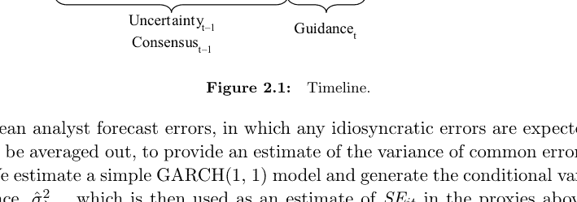

### 图 2.1：时间线。

平均分析师预测误差的时间序列，其中任何特有误差预计会被平均掉，以提供共同误差方差的估计。我们估计一个简单的 GARCH(1, 1) 模型并生成条件方差 $\hat{\sigma}^2_{t_h}$，然后将其用作上述代理变量中 $SE_{it}$ 的估计值。该程序提供了稳定、可靠且全面的分析师信息环境估计，可用于其他方法无法使用的情形，例如当公司运营受到 9/11、破产和大额重组费用等重大非预期事件影响时，以及当关注的构念是信息环境的变化时（Sheng 和 Thevenot，2012）。

我们检验分析师之间的披露前共同性和不确定性与管理层决定发布未来盈利指引之间的关联。由于我们关注管理层如何响应其公司的信息环境，我们首先讨论变量测量的时间安排。如图 2.1 所示，我们按顺序测量我们感兴趣的变量。信息环境变量是使用在季度 $t - 1$ 盈利公告前 90 天内发布的当前季度盈利分析师预测获得的，且该窗口不包括公告日。指引是使用季度 $t - 1$ 盈利公告与之后的 30 天之间管理层预测来测量的，其中公告日包含在此窗口内，因为管理层通常会将预测与盈利公告捆绑发布。⁸我们的目标是确定指引的发布是对分析师预测中先前信息的响应。然而，这是我们研究设计的局限性，因为也可以认为指引的发布部分是对盈利新闻的响应。然而，我们的主要结果并非归因于研究设计的这一方面，因为我们将样本限制为在季度 $t - 1$ 盈利公告后 5 天以上发布的指引时，仍获得一致的结果。

⁸指引的目标期间不受限制，但在稳健性检验中，我们将指引限制为仅针对季度 $t$，结果相似。

为检验我们的假设，我们估计以下回归模型：

Guide_{it} = β₀ + β₁* Uncert_{it-1} + β₂* Comm_{it-1} + βₖ* X_{it-1}^k + e_{it},  (2.20)

其中 Guide 在公司在季度 t − 1 盈利公告后 30 天内发布预测时等于 1，否则为 0，Uncert 和 Comm 分别是不确定性和共同性，均在季度 t − 1 盈利公告前测量，X^k 表示 k 个控制变量的向量，包括 PriorGuide、Prior8Guide、Assets、BM、FourthQ、Optimism、EPSVolat、Return、Loss、FSE、Following、Litigation、Restat 和 News，定义如下。控制变量以季度 t − 1 末为准进行测量。

我们遵循先前的指引研究并控制可能影响管理层预测行为的其他因素。现有研究表明，指引行为具有“粘性”，我们纳入了两个旨在控制公司指引历史的变量。PriorGuide 在公司在上一季度发布指引时等于 1，否则为 0，Prior8Guide 等于从 t − 8 到 t − 1 期间公司发布指引的季度数量。我们纳入 Assets，即季度 t − 1 末的总资产金额，因为规模更大的公司更可能发布指引。BM 是公司在季度 t − 1 末的权益账面价值除以市值，用于控制价值型与成长型公司的影响。FourthQ 是一个指示变量，若季度 t − 1 为第四季度则等于 1，因为管理层可能对第四季度不利的信息环境特征更敏感。我们明确纳入了分析师跟踪（Following）的控制。Following 是季度 t − 1 期间跟踪该公司的分析师数量，因为分析师跟踪更密集的公司更可能提供管理层指引（Ajinkya、Bhojraj 和 Sengupta，2005）。我们还纳入了盈利波动性（EPSVolat）、前期回报（Return）、前期亏损的存在（Loss）、管理层未能满足先前分析师预期程度（FSE）、诉讼风险（Litigation）以及重述发生率（Restat）的控制（Brochet、Faurel 和 McVay，2011）。⁹ EPSVolat 等于季度 t − 8 至 t − 1 期间每股季度盈利的标准差，并纳入其中，因为盈利更波动的公司不太可能发布

⁹ Brochet 等（2011）还包括重组指示变量。我们在主要分析中未控制重组，因为重组数据自 2001 年起才可用，这会减少样本。然而，我们的结果对纳入重组指示变量具有稳健性，其中 Restruct 在公司在季度 t − 1 报告重组费用时等于 1，并将样本限制为后期年份。


指引 (Waymire, 1985)。Return 等于季度 t − 1 的累计规模调整后回报，Loss 为季度 t − 8 至 t − 1 期间公司报告负盈余的季度百分比。这些变量控制业绩，因为 Miller (2002) 表明业绩良好的公司更可能发布指引。FSE 为季度 t − 4 至 t − 1 期间公司在季度盈利公告时未能达到分析师一致预测的季度百分比，并控制了历史上业绩令人失望的公司可能更不愿意发布指引的可能性 (Feng and Koch, 2010)。Litigation 在公司运营于高诉讼风险行业时等于 1，否则为 0。Restat 在公司在季度 t − 1 和 t 期间宣布重述时等于 1，否则为 0。Litigation 和 Restat 被纳入以控制当公司受此类不确定事件影响时管理者提供指引的激励或阻力。最后，News 等于季度 t − 1 盈利公告后 30 天内发布的季度 t 盈利的实际值与分析师一致预测之差，其中该期间至少有两位分析师提供预测，并按实际盈利的绝对值进行缩放。我们纳入此变量是因为管理者经常发布预测以 preempt 不利消息以避免法律后果 (Skinner, 1994; and Kasznik and Lev, 1995)。

由于我们许多连续变量存在偏态和异常观测值，因此我们使用排序变量。在每年，firm/quarters 根据连续变量，即 Uncert、Comm、Prior8Guide、Assets、BM、EPSVolat、Return、FSE、Following 和 News 分配十分位排名。十分位排名被缩放至 [0, 1] 并用于回归中的相应连续自变量，其中变量末尾的 “R” 表示排序变量。10 此外，我们遵循先前的指引研究并纳入行业和年份固定效应，并按公司聚类标准误。

10 我们的结果在我们使用原始变量或对仅取正值的变量（如 Uncert、Comm、Prior8Guide、Assets、BM、EPSVolat、Loss、FSE 和 Following）使用自然对数转换时在质上相似。

## 2.5 样本与描述性统计

### 2.5.1 样本

表 2.1 总结了我们的样本选择程序。我们的初始样本包括 1983-2010 期间在 I/B/E/S Detail tape 中拥有季度预测的所有美国公司。为了获得本文感兴趣的衡量指标，我们使用季度盈利公告前 90 天做出的分析师预测，其中盈利公告在季度结束后的 90 天内作出。如果分析师在此期间发布多个预测，我们仅保留最接近盈利公告日期的预测。为了计算我们的信息环境变量，我们要求每个 firm/quarter 至少有两位预测，并且在 1983-2010 时间段内有最少 40 个连续季度的观测值。这产生了来自 636 家独特公司的 36,919 个 firm/quarter 观测值。

此外，我们剔除 1997 年之前的观测值，因为 First Call Company Issued Guidelines 文件中的指引数据始于 1995 年，我们需要每个 firm/quarter 之前最多八个季度来计算先前指引的控制变量。此外，重述数据可追溯至 1997 年开始。我们还剔除共同性小于零的观测值，这些代表测量误差。这使我们在 1997-2010 期间剩下 19,477 个 firm/quarter 观测值，来自 618 家独特公司，构成用于我们初始分析分散与不确定性和共同性关系的样本。我们进一步剔除 51 家公司因控制变量数据不可用而产生的 4,054 个观测值。我们的最终样本

## 表 2.1：样本选择。

|  | 企业/季度 | 企业 |
|---|---|---|
| 1983-2010期间至少有40个连续季度的样本 | 36,919 | 636 |
| 减去1997年之前的企业/季度 | 17,442 | 18 |
| 初始样本 | 19,477 | 618 |
| 减去控制变量数据不可用的企业/季度 | 4,054 | 51 |
| 最终样本 | 15,423 | 567 |

|  | 企业/季度 | 百分比 |
|---|---|---|
| 初始样本 |  |  |
| Guide = 1 的企业/季度 | 5,621 | 28.86 |
| Guide = 0 的企业/季度 | 13,853 | 71.14 |
| 最终样本 |  |  |
| Guide = 1 的企业/季度 | 4,105 | 26.62 |
| Guide = 0 的企业/季度 | 11,318 | 73.38 |

注：我们的样本包括 1983-2010 期间在 I/B/E/S Detail tape 中拥有季度预测的所有美国公司，且在季度盈利公告前 90 天内至少有两位分析师预测。

## 表 2.2：描述性统计。

面板 A：全样本 (N = 15,423)

| 变量 | 均值 | 标准差 | Q1 | 中位数 | Q3 |
|---|---|---|---|---|---|
| Uncert | 0.089 | 1.634 | 0.001 | 0.002 | 0.010 |
| Comm | 0.784 | 0.219 | 0.688 | 0.860 | 0.951 |
| PublicPrec | 1,612.460 | 6,062.890 | 70.812 | 296.604 | 1,208.150 |
| PrivatePrec | 517.167 | 3,553.150 | 8.124 | 51.466 | 266.803 |
| Disp | 0.010 | 0.201 | 0.000 | 0.000 | 0.001 |
| PriorGuide | 0.305 | 0.460 | 0.000 | 0.000 | 1.000 |
| Prior8Guide | 2.411 | 3.032 | 0.000 | 1.000 | 5.000 |
| Assets | 42,214.630 | 153,984.850 | 2,576.750 | 7,700.320 | 24,639.000 |
| BM | 0.464 | 0.366 | 0.246 | 0.400 | 0.585 |
| FourthQ | 0.238 | 0.426 | 0.000 | 0.000 | 0.000 |
| EPSVolat | 0.511 | 0.789 | 0.145 | 0.270 | 0.556 |
| Return | 0.014 | 0.193 | -0.092 | 0.001 | 0.101 |
| Loss | 0.103 | 0.184 | 0.000 | 0.000 | 0.125 |
| FSE | 0.259 | 0.267 | 0.000 | 0.250 | 0.500 |
| Following | 16.167 | 6.476 | 11.000 | 15.000 | 20.000 |
| Litigation | 0.176 | 0.381 | 0.000 | 0.000 | 0.000 |
| Restat | 0.011 | 0.106 | 0.000 | 0.000 | 0.000 |
| News | -0.067 | 142.980 | -0.044 | 0.021 | 0.110 |

(续)

### 面板 B：按指引划分的样本

## 表 2.2：*(续)*

| 变量 | **Guide = 1** *(N = 4,105)* 均值 | 标准差 | Q1 | 中位数 | Q3 | **Guide = 0** *(N = 11,318)* 均值 | 标准差 | Q1 | 中位数 | Q3 | *t*检验 | Wilcoxon秩和检验 |
|---:|---:|---:|---:|---:|---:|---:|---:|---:|---:|---:|---:|---:|
| Uncert | 0.024 | 0.160 | 0.001 | 0.002 | 0.005 | 0.113 | 1.905 | 0.001 | 0.003 | 0.012 | 0.003 | <0.0001 |
| Comm | 0.771 | 0.223 | 0.668 | 0.848 | 0.944 | 0.789 | 0.217 | 0.697 | 0.865 | 0.953 | <0.0001 | <0.0001 |
| PublicPrec | 1,289.090 | 3,402.740 | 134.199 | 409.006 | 1,310.760 | 1,729.750 | 6,770.640 | 57.962 | 254.439 | 1,148.980 | <0.0001 | <0.0001 |
| PrivatePrec | 445.254 | 1,389.020 | 16.094 | 83.999 | 335.121 | 543.250 | 4,062.280 | 6.533 | 41.773 | 241.912 | 0.130 | <0.0001 |
| Disp | 0.003 | 0.056 | 0.000 | 0.000 | 0.001 | 0.012 | 0.232 | 0.000 | 0.000 | 0.001 | 0.019 | <0.0001 |
| PriorGuide | 0.770 | 0.421 | 1.000 | 1.000 | 1.000 | 0.137 | 0.343 | 0.000 | 0.000 | 0.000 | <0.0001 | <0.0001 |
| Prior8Guide | 6.337 | 2.283 | 5.000 | 8.000 | 8.000 | 0.987 | 1.737 | 0.000 | 0.000 | 1.000 | <0.0001 | <0.0001 |
| Assets | 30,640 | 82,478 | 3,225 | 9,878 | 27,288 | 46,413 | 172,566 | 2,405 | 7,076 | 23,607 | <0.0001 | <0.0001 |
| BM | 0.417 | 0.281 | 0.238 | 0.357 | 0.534 | 0.482 | 0.391 | 0.251 | 0.416 | 0.603 | <0.0001 | <0.0001 |
| FourthQ | 0.242 | 0.428 | 0.000 | 0.000 | 0.000 | 0.236 | 0.425 | 0.000 | 0.000 | 0.000 | 0.474 | 0.474 |
| EPSVolat | 0.414 | 0.557 | 0.136 | 0.236 | 0.472 | 0.547 | 0.855 | 0.149 | 0.282 | 0.592 | <0.0001 | <0.0001 |
| Return | 0.015 | 0.160 | −0.076 | 0.005 | 0.096 | 0.013 | 0.203 | −0.098 | −0.001 | 0.103 | 0.716 | 0.022 |
| Loss | 0.082 | 0.168 | 0.000 | 0.000 | 0.125 | 0.111 | 0.189 | 0.000 | 0.000 | 0.125 | <0.0001 | <0.0001 |
| FSE | 0.174 | 0.218 | 0.000 | 0.000 | 0.250 | 0.290 | 0.276 | 0.000 | 0.250 | 0.500 | <0.0001 | <0.0001 |
| Following | 17.722 | 6.463 | 13.000 | 17.000 | 22.000 | 15.602 | 6.388 | 11.000 | 15.000 | 20.000 | <0.0001 | <0.0001 |
| Litigation | 0.271 | 0.445 | 0.000 | 0.000 | 1.000 | 0.141 | 0.348 | 0.000 | 0.000 | 0.000 | <0.0001 | <0.0001 |


## 表 2.2：（续）

|  | Guide = 1 (N = 4,105) |  |  |  |  | Guide = 0 (N = 11,318) |  |  |  |  |  |  |
|---|---|---|---|---|---|---|---|---|---|---|---|---|
| 变量 | 均值 | 标准差 | Q1 | 中位数 | Q3 | 均值 | 标准差 | Q1 | 中位数 | Q3 | t检验 | Wilcoxon秩和检验 |
|---|---|---|---|---|---|---|---|---|---|---|---|---|
| Restat | 0.016 | 0.127 | 0.000 | 0.000 | 0.000 | 0.009 | 0.097 | 0.000 | 0.000 | 0.000 | 0.000 | 0.000 |
| News | -0.034 | 5.098 | -0.008 | 0.038 | 0.117 | -0.079 | 166.881 | -0.061 | 0.015 | 0.106 | 0.986 | <0.0001 |

注：Guide 等于 1 表示公司在盈利公告后 30 天内提供指引，否则为 0。Uncert 等于按 Sheng 和 Thevenot (2012) 修改的 BKLS 中的 V，在盈利公告前 90 天计算。Comm 等于按 Sheng 和 Thevenot (2012) 修改的 BKLS 中的 ρ，在盈利公告前 90 天计算。PublicPrec 等于按 Sheng 和 Thevenot (2012) 修改的 BKLS 中的 h，在盈利公告前 90 天计算。PrivatePrec 等于按 Sheng 和 Thevenot (2012) 修改的 BKLS 中的 s，在盈利公告前 90 天计算。Disp 等于盈利公告前 90 天分析师预测的样本方差。PriorGuide 等于 1 表示公司在上一季度发布了指引，否则为 0。Prior8Guide 等于 t−8 至 t−1 期间公司发布指引的季度数量。Assets 为季度 t−1 末的总资产金额。BM 为季度 t−1 末公司权益账面价值与其市值之比。FourthQ 为指示变量，若季度 t−1 为第四季度则等于 1。EPSVolat 等于季度 t−8 至 t−1 的季度每股收益的标准差。Return 等于季度 t−1 的累计规模调整后回报。Loss 为季度 t−8 至 t−1 期间公司报告负收益的季度百分比。FSE 为 t−4 至 t−1 期间公司在季度盈利公告时未能达到分析师一致预测的季度百分比。Following 为季度 t−1 期间跟踪该公司的分析师数量，因为分析师跟踪越多的公司更可能提供管理层指引。Litigation 若公司属于以下高诉讼风险行业之一：SIC 代码 2833-2836（生物技术）、3570-3577 和 7370-7374（计算机）、3600-3674（电子）、5200-5961（零售）以及 8731-8734（研发服务），且收益下降 20% 或以上，则等于 1，否则为 0。Restat 若公司在季度 t−1 和 t 期间宣布重述，则等于 1，否则为 0。News 等于季度 t−1 盈利公告后 30 天内发布的季度 t 盈利的实际值与分析师一致预测值之差，其中该期间至少有两名分析师提供预测，并按实际盈利的绝对值进行缩放。

## 表 2.3：皮尔逊（对角线上方）和斯皮尔曼（对角线下方）相关系数。

|  | (1) | (2) | (3) | (4) | (5) | (6) | (7) | (8) | (9) | (10) | (11) | (12) | (13) | (14) | (15) | (16) | (17) | (18) | (19) |
|---|---|---|---|---|---|---|---|---|---|---|---|---|---|---|---|---|---|---|---|
| Guide (1) | 1 | -0.17 | 0.03 | 0.17 | 0.11 | -0.17 | 0.61 | 0.57 | 0.01 | -0.14 | 0.01 | -0.05 | 0.01 | -0.07 | -0.15 | 0.06 | 0.15 | 0.03 | 0.05 |
| UncertR (2) | -0.17 | 1 | 0.21 | -0.97 | -0.83 | 0.75 | -0.11 | -0.18 | 0.18 | 0.51 | 0.00 | 0.46 | -0.06 | 0.24 | 0.24 | -0.23 | -0.14 | 0.02 | -0.04 |
| CommR (3) | 0.03 | 0.21 | 1 | -0.07 | -0.65 | -0.40 | -0.01 | -0.03 | 0.04 | 0.07 | -0.03 | 0.03 | 0.06 | 0.00 | -0.05 | -0.10 | -0.03 | 0.00 | 0.03 |
| PublicPrecR (4) | 0.17 | -0.97 | -0.06 | 1 |  | -0.82 | 0.10 | 0.17 | -0.17 | -0.50 | 0.00 | -0.44 | 0.08 | -0.23 | -0.24 | 0.21 | 0.13 | -0.02 | 0.04 |
| PrivatePrecR (5) | 0.11 | -0.83 | -0.64 |  | 1 | -0.34 | 0.08 | 0.14 | -0.14 | -0.42 | 0.01 | -0.36 | 0.02 | -0.19 | -0.15 | 0.23 | 0.12 | -0.02 | 0.02 |
| DispR (6) | -0.17 | 0.75 | -0.40 | -0.82 | -0.34 | 1 | -0.10 | -0.14 | 0.15 | 0.42 | 0.02 | 0.41 | -0.09 | 0.21 | 0.25 | -0.12 | -0.10 | 0.02 | -0.05 |
| PriorGuide (7) | 0.61 | -0.11 | -0.01 | 0.10 | 0.08 | -0.10 | 1 | 0.63 | -0.01 | -0.09 | 0.00 | -0.03 | -0.03 | -0.05 | -0.09 | 0.01 | 0.10 | 0.02 | 0.02 |
| Prior8GuideR (8) | 0.55 | -0.17 | -0.03 | 0.16 | 0.14 | -0.14 | 0.61 | 1 | 0.00 | -0.13 | 0.02 | -0.03 | -0.01 | -0.04 | -0.12 | 0.09 | 0.18 | 0.02 | 0.04 |
| AssetsR (9) | 0.01 | 0.18 | 0.04 | -0.17 | -0.14 | 0.15 | -0.01 | 0.00 | 1 | 0.10 | 0.01 | 0.09 | -0.02 | -0.12 | 0.00 | 0.27 | -0.18 | 0.01 | -0.06 |
| BMR (10) | -0.14 | 0.52 | 0.07 | -0.50 | -0.42 | 0.41 | -0.09 | -0.12 | 0.10 | 1 | 0.02 | 0.28 | -0.19 | 0.20 | 0.25 | -0.26 | -0.08 | 0.02 | -0.06 |
| Fourth (11) | 0.01 | 0.00 | -0.03 | 0.00 | 0.01 | 0.02 | 0.00 | 0.02 | 0.01 | 0.02 | 1 | 0.00 | -0.02 | 0.00 | -0.01 | 0.03 | -0.04 | -0.01 | -0.04 |
| EPSVolatR (12) | -0.05 | 0.46 | 0.03 | -0.44 | -0.36 | 0.41 | -0.03 | -0.02 | 0.09 | 0.28 | 0.00 | 1 | -0.01 | 0.40 | 0.10 | -0.16 | 0.04 | 0.03 | 0.04 |
| ReturnR (13) | 0.01 | -0.06 | 0.06 | 0.07 | 0.02 | -0.09 | -0.03 | -0.01 | -0.02 | -0.19 | -0.02 | -0.01 | 1 | -0.03 | -0.10 | 0.00 | -0.03 | -0.01 | 0.13 |
| Loss (14) | -0.08 | 0.26 | -0.01 | -0.22 | -0.18 | 0.23 | -0.05 | -0.03 | -0.10 | 0.22 | 0.00 | 0.51 | -0.03 | 1 | 0.14 | -0.10 | 0.19 | 0.04 | 0.07 |
| FSER (15) | -0.15 | 0.24 | -0.05 | -0.24 | -0.16 | 0.24 | -0.09 | -0.12 | 0.00 | 0.25 | -0.01 | 0.10 | -0.10 | 0.14 | 1 | -0.13 | -0.06 | 0.01 | -0.15 |
| FollowingR (16) | 0.05 | -0.23 | -0.10 | 0.21 | 0.23 | -0.11 | 0.01 | 0.08 | 0.27 | -0.26 | 0.03 | -0.16 | 0.00 | -0.11 | -0.13 | 1 | 0.16 | 0.01 | 0.02 |
| Litigation (17) | 0.15 | -0.14 | -0.03 | 0.13 | 0.12 | -0.10 | 0.10 | 0.18 | -0.18 | -0.08 | -0.04 | -0.03 | 0.15 | -0.06 | 0.16 | 0.16 | 1 | 0.03 | 0.03 |
| Restat (18) | 0.03 | 0.02 | 0.00 | -0.02 | -0.02 | 0.02 | 0.02 | 0.01 | 0.01 | 0.02 | -0.01 | 0.03 | -0.01 | 0.04 | 0.01 | 0.01 | 0.03 | 1 | -0.01 |
| NewsR (19) | 0.05 | -0.04 | 0.03 | 0.04 | 0.02 | -0.05 | 0.02 | 0.04 | -0.06 | -0.06 | -0.04 | 0.04 | 0.13 | 0.06 | -0.15 | 0.02 | 0.03 | -0.01 | 1 |

注：变量定义见表 2.2，变量名末尾的“R”表示将相应变量的十分位秩缩放到 0 到 1 之间。在 0.05 水平或更优水平下显著的相关系数以粗体呈现。

因变量。如果不确定性与因变量呈正相关而共同性呈负相关，则离散度的系数将产生正偏差，因为它会同时捕捉两种效应。如果不确定性和共同性都与因变量呈正相关，则系数将产生负偏差，更小甚至在统计上不显著，因为离散度将捕捉不确定性和共同性的净效应。在后续分析中，我们展示了在我们的设定中使用离散度作为分析师先验信息的代理时，如何导致有偏结果或错误推断。

## 2.6 实证结果

### 2.6.1 预测决策

我们在表 2.4 中展示了主要的多元逻辑回归结果。在 A 面板中，左侧（右侧）的列显示了指引与共同性及不确定性（共同信息和私人信息的精确度）之间的关系。我们的模型设定良好，伪 R 平方约为 60%。

与控制变量一致，两个先前指引度量的系数均为正且显著，与指引具有“粘性”一致。Loss 和 FSER 的负系数表明，过去表现不佳且未达到分析师预期的公司更不可能提供指引（Miller, 2002；以及 Feng 和 Koch, 2010）。与预期一致，BMR 的系数为负且显著。NewsR 的系数为正且显著。

此外，左侧的列显示指引与共同性（CommR）呈正相关，系数为 0.567，而指引与不确定性（UncertR）呈负相关，系数为 −0.477。我们的理论框架表明，当分析师开发私人信息的激励较高且其私人信息更精确时，管理层更倾向于发布指引。分析师信息共同性与盈利指引之间的正关联与我们的理论预测一致。这表明，当共同性较高时，分析师有更大的激励从公开披露中开发私人信息，而管理层也有激励满足分析师的特定需求。我们通过分别检验共同信息和私人信息的精确度来确认我们的推断。右侧的列显示管理层

11 这可能意味着，与坏消息相比，管理层更可能迅速披露好消息，希望其负面消息能在季度后期得到逆转（例如，Graham 等，2005）。


## 表 2.4：管理层指引作为分析师开发私人信息激励的反应分析。

### 面板 A：使用修正的 BKLS 代理变量

**因变量 = 指引**

| 变量 | 系数 | 边际效应 | 系数 | 边际效应 |
|---|---|---|---|---|
| 截距 | -2.970*** (76.24) | — | -3.403*** (30.21) | — |
| UncertR | -0.477** (4.93) | -0.030 | 0.254 (0.18) | 0.016 |
| CommR | 0.567*** (19.07) | 0.036 | — | — |
| PublicPrecR | — | — | 1.006** (4.44) | 0.064 |
| PrivatePrecR | — | — | -0.467* (3.75) | -0.030 |
| Priorguide | 0.967*** (95.74) | 0.061 | 0.975*** (97.81) | 0.062 |
| Prior8GuideR | 5.558*** (505.21) | 0.352 | 5.557*** (505.30) | 0.352 |
| AssetsR | 0.106 (0.15) | 0.007 | 0.095 (0.12) | 0.006 |
| BMR | -0.495** (5.51) | -0.031 | -0.497** (5.50) | -0.031 |
| fourthQ | 0.028 (0.20) | 0.002 | 0.019 (0.10) | 0.001 |
| EPSVolatR | 0.290 (2.26) | 0.018 | 0.278 (2.06) | 0.018 |
| ReturnR | -0.072 (0.51) | -0.005 | -0.069 (0.47) | -0.004 |
| Loss | -1.062*** (9.14) | -0.067 | -1.084*** (9.46) | -0.069 |
| FSER | -0.564*** (19.77) | -0.036 | -0.576*** (20.63) | -0.036 |
| FollowingR | 0.151 (0.56) | 0.010 | 0.142 (0.49) | 0.009 |
| Litigation | 0.134 (1.17) | 0.008 | 0.134 (1.16) | 0.008 |
| Restat | 0.104 (0.12) | 0.007 | 0.102 (0.12) | 0.006 |
| NewsR | 0.254** (6.21) | 0.016 | 0.262** (6.63) | 0.017 |
| 行业固定效应 | Yes | — | Yes | — |
| 年度固定效应 | Yes | — | Yes | — |
| 企业聚类标准误 | Yes | — | Yes | — |
| 指引 30 天后 = 0 | 11,318 | — | 11,318 | — |
| 指引 30 天后 = 1 | 4,105 | — | 4,105 | — |
| 伪 R 平方 | 0.60 | — | 0.60 | — |

## 表 2.4：*(续)*

### 面板 B：*使用预测离散度*

| 变量 | 系数 | 边际效应 |
|---|---|---|
| **因变量 = 指引** |  |  |
| 截距 | −2.751*** (66.79) | — |
| DispR | −0.739*** (23.87) | −0.047 |
| Prioriguide | 0.973*** (98.73) | 0.062 |
| Prior8GuideR | 5.538*** (509.90) | 0.354 |
| AssetsR | 0.124 (0.20) | 0.008 |
| BMR | −0.432** (4.41) | −0.028 |
| FourthQ | 0.031 (0.26) | 0.002 |
| EPSVolatR | 0.380** (4.06) | 0.024 |
| ReturnR | −0.067 (0.45) | −0.004 |
| Loss | −1.084*** (9.66) | −0.069 |
| FSER | −0.553*** (19.44) | −0.035 |
| FollowingR | 0.141 (0.49) | 0.009 |
| Litigation | 0.137 (1.20) | 0.009 |
| Restat | 0.099 (0.11) | 0.006 |
| NewsR | 0.278*** (7.62) | 0.018 |
| 指引 30 天后 = 0 | 11,398 | — |
| 指引 30 天后 = 1 | 4,140 | — |
| 伪 *R*-平方 | 0.60 | — |

*注释：* 所有变量均在表 2.2 和 2.3 中定义。我们纳入了行业和年度固定效应并报告了企业聚类标准误。卡方统计量列于系数下方括号内。***、**分别表示在 1% 和 5% 水平上显著。

更有可能在分析师共同信息精度高但其特有信息精度低时发布预测，这表明指引由分析师之间共同性所捕捉的共同信息的相对存在所触发。相比之下，分析师不确定性与盈余指引之间的负向关系结果与管理者增加披露以提供分析师为了解决不确定性所需的信息这一解释不一致。相反，该结果与分析师的高不确定性与管理者的不确定性相对应这一可能性一致，而管理者在面临低精度信息时不发布预测。

面板 B 呈现了使用预测离散度作为分析师披露前信息代理变量的结果。结果显示离散度与指引负相关，系数估计值为 −0.739（卡方统计量 = 23.87）。该系数的幅度大于面板 A 中报告的共同性或不确定性的系数。这与离散度同时捕捉了不确定性和共同性缺乏的影响一致，而当它们与关注变量指引相关时方向相反。如果在此情况下将离散度作为任一因素的代理，则对指引的相应效应可能被高估。

总体而言，我们的研究结果表明，管理层指引仅随着分析师披露前信息中包含的共同性而增加，而与不确定性水平无关。不确定性与指引之间的负向关系与理论框架一致，该框架将披露建模为分析师私人信息激励和管理层信息精度的函数。我们的结果表明，相关因素的存在（即管理层信息精度）可能使直接推断分析师不确定性（作为其开发新信息的激励的代理）如何影响管理者披露决策变得困难。分析师之间信息的共同性作为更可靠的预测先行指标，因为它仅捕捉分析师的私人信息激励。

## 2.6.2 事后市场信念修正

我们认为，随着分析师将其预测纳入特有信息的激励增加，分析师更有可能根据管理层盈余预测修订其预测。Barron 等人（2002）表明，随着更多分析师修订其预测，单个分析师预测中包含的新特有信息平均量增加。此外，分析师对披露的特有解读

导致更有信息的交易，只要投资者对分析师报告的需求随着公司披露水平的提高而增加（Bamber 等人，1999）。为验证这些论点，我们进一步检验分析师预测修订和交易量与分析师先前信息之间的关联。

## 表 2.5：分析师开发私人信息的激励分析。

### 面板 A：财报公告和管理层指引后修订分析师比例及交易量

|  | 财报公告后 |  |  | 指引后 |  |  |
|---|---|---|---|---|---|---|
|  | N | 均值 | 中位数 | N | 均值 | 中位数 |
| 修订分析师比例 | 19,477 | 0.65 | 0.70 | 6,120 | 0.69 | 0.76 |
| 交易量 | 18,303 | 0.08 | 0.05 | 5,796 | 0.09 | 0.06 |
| 如果指引发生在财报公告后 5 天以上 |  |  |  |  |  |  |
| 修订分析师比例 | 1,518 | 0.62 | 0.65 | 1,518 | 0.49 | 0.51 |
| 交易量 | 1,427 | 0.07 | 0.05 | 1,426 | 0.09 | 0.05 |

### 面板 B：指引后分析师预测修订和交易量的决定因素

| 因变量 | Frac | Volume |
|---|---|---|
| 截距 | 0.177* (1.813) | -0.015 (-0.350) |
| CommR | 0.019** (2.252) | 0.020*** (5.085) |
| UncertR | 0.037*** (3.255) | 0.047*** (8.875) |
| FourthQ | -0.013** (-2.298) | 0.001** (0.424) |
| FollowingR | 0.055*** (5.090) | -0.014*** (-2.850) |
| Losscurrent | 0.011 (0.862) | 0.018*** (3.101) |
| NewsR | -0.024*** (-2.806) | -0.016*** (-3.965) |
| 行业固定效应 | Yes | Yes |
| 年度固定效应 | Yes | Yes |
| 观测值 | 5,621 | 5,405 |
| R 平方 | 0.30 | 0.20 |

## 表 2.5：(续)

### 面板 C：使用预测离散度作为分析师开发私人信息激励的代理变量

| 因变量 | Frac | Volume |
|---|---|---|
| 截距 | 0.209** (2.14) | 0.030 (0.67) |
| DispR | 0.012 (1.29) | 0.008* (1.83) |
| FourthQ | -0.014** (-2.45) | 0.001 (0.40) |
| FollowingR | 0.045*** (4.31) | -0.025*** (-5.18) |
| Losscurrent | 0.012 (0.96) | 0.024*** (3.97) |
| NewsR | -0.022*** (-2.60) | -0.013*** (-3.36) |
| 行业固定效应 | Yes | Yes |
| 年度固定效应 | Yes | Yes |
| 观测值 | 5,674 | 5,453 |
| R 平方 | 0.296 | 0.177 |

注释：面板 A 报告了在给定季度跟踪该公司的所有分析师中修订预测的分析师比例的均值和中位数，以及财报公告后（AfterEA）和指引后（AfterGuide）5 天内按平均流通股数缩放的交易量。在面板 B 和面板 C 中，Frac 等于指引后 5 天内修订预测的分析师占跟踪该公司所有分析师的比例。Volume 为指引后 5 天内按平均流通股数缩放的总交易量。Losscurrent 在财报公告后 30 天内分析师平均预测为负时等于 1，否则为 0。所有其他变量均在表 2.2 和 2.3 中定义。模型包含行业和年度固定效应。T 统计量列于系数下方括号内。***、**、*分别表示在 1%、5% 和 10% 水平上显著。

表 2.5 的面板 A 提供了分析师在财报公告和管理层预测后 5 天内修订预测的比例的汇总统计。证据表明，大多数

分析师修订其预测以反映新信息的到来。修订分析师比例的均值（中位数）在指引后为 69（76）%，在财报公告后为 65（70）%。即使指引未与财报公告同时发生，修订分析师比例的均值（中位数）仍为 49（51）%。事后预测修订的高频率与管理者利用指引帮助分析师在其开发新私人信息的作用中一致。

面板 B 报告了分析师和投资者对管理层盈余预测的反应回归结果，根据指引后修订预测的分析师比例（Frac）和交易量（Volume）推断。对于 Frac 和 Volume，关于共同性的系数

该系数为正且具有统计显著性（p值<0.05），这表明，当分析师在披露前预测的共性程度较高时，会有更大比例的分析师发布新的后验预测，且交易量显著增加。这一发现表明，分析师因偏好独特、特质性的信息（即低共性）而从公开披露中开发自己的私人信息，这反过来又刺激了投资者对信息的差异化解读。此外，不确定性也与修正预测的分析师比例和交易量正相关，这意味着不确定性也会触发分析师和投资者在管理层盈利预测之后的信念修正。综合来看，我们的发现与公开公告因市场参与者持有不同的先验信念而产生特质性信念的结论一致（见Barron等，2002）。我们的结果证实了我们的猜想：分析师和投资者对管理层预测的反应取决于其先验信息的性质。

在面板C中，我们使用预测离散度作为分析师先验信息的替代代理变量。对于两个模型，离散度在统计上均不显著，这再次与离散度同时捕捉了分析师信息中的不确定性和共性这一事实一致。尽管如此，在此设定下，偏误向零移动，因为不确定性和共性对因变量的影响方向相同，而离散度与不确定性正相关、与共性负相关。

总体而言，我们的研究结果表明，共性和不确定性都反映了市场参与者开发私人信息的激励，并且与管理层决定发布预测后分析师的更多努力、新特质性信息的产生以及更多的交易活动相关。离散度未能代表分析师的激励，导致在市场反应随分析师先验信息变化方面得出错误的推断。综合来看，表2.4和表2.5的发现为管理层有动力发布盈利指引以迎合分析师需求的观点提供了证据。

## 2.6.3 管理层不确定性作为相关变量

接下来，我们提供证据表明管理层预测与分析师不确定性之间的反向关系是否与较低的r（即管理层信息的低精确度）相对应。我们首先检验管理层与分析师的不确定性是否相关。先前研究表明，预测的形式捕捉了管理层对未来信念的精确度（即他们的不确定性），与区间预测相比，点预测被认为反映了更大的管理层确定性（King等，1990；Hughes和Pae，2004）。我们将指引类型（GuideP）编码为：描述性预测为1，开放式预测为2，区间预测为3，点预测为4，而无指引时则为缺失值。我们预期管理层通过发布较不精确的指引来揭示其不确定性。

表2.6的面板A基于指引类型提供了分析师不确定性和离散度的均值与中位数（原始和排序变量）。最后两列给出了检验不同指引类型之间均值/中位数差异的p值：描述性预测与点预测，以及开放式预测与点预测。在所有检验中，开放式与点式盈利指引之间分析师不确定性的差异具有高度统计显著性，这表明分析师预测不确定性较低的公司管理层更有可能发布更精确的管理层预测。比较描述性预测和点预测得出了相似但较弱的结果，尽管描述性预测与数字预测有些不同，因此可能无法直接与其他管理层预测进行比较。面板B进一步给出了指引精确度与分析师不确定性之间的皮尔逊和斯皮尔曼相关系数。GuideP及其对数变换LGuideP始终与不确定性呈负相关且具有统计显著性。这些发现提供了分析师与管理层不确定性正相关的证据，表明不确定性与指引之间的反向关系可能反映了管理层信息的低精确度。

### 表2.6：分析师不确定性与管理层不确定性之间关系的分析

#### 面板A：按指引精确度划分的不确定性和离散度的均值与中位数

| 变量 | GuideP = . 均值 | GuideP = 1 均值 | GuideP = 2 均值 | GuideP = 3 均值 | GuideP = 4 均值 | t检验差异 GuideP = 1 对 GuideP = 4 | t检验差异 GuideP = 2 对 GuideP = 4 |
|---|---|---|---|---|---|---|---|
| Uncert | 0.118 | 0.137 | 0.104 | 0.029 | 0.017 | <0.0001 | 0.011 |
| UncertR | 0.530 | 0.484 | 0.536 | 0.394 | 0.421 | 0.035 | <0.0001 |

| 变量 | GuideP = . 中位数 | GuideP = 1 中位数 | GuideP = 2 中位数 | GuideP = 3 中位数 | GuideP = 4 中位数 | Wilcoxon检验差异 GuideP = 1 对 GuideP = 4 | Wilcoxon检验差异 GuideP = 2 对 GuideP = 4 |
|---|---|---|---|---|---|---|---|
| Uncert | 0.004 | 0.001 | 0.004 | 0.002 | 0.001 | 0.892 | <0.0001 |
| UncertR | 0.556 | 0.444 | 0.556 | 0.333 | 0.333 | 0.064 | <0.0001 |

#### 面板B：皮尔逊（对角线以上）和斯皮尔曼（对角线以下）相关系数

|  | GuideP | LGuideP | Uncert | UncertR |
|---|---|---|---|---|
| GuideP | 1 | 0.965 <0.0001 | -0.059 <0.0001 | -0.053 0.000 |
| LGuideP | 1.000 <0.0001 | 1 | -0.063 <0.0001 | -0.064 <0.0001 |
| Uncert | -0.048 0.001 | -0.048 0.001 | 1 | 0.096 <0.0001 |
| UncertR | -0.041 0.005 | -0.041 0.005 | 0.970 <0.0001 | 1 |

注：GuideP等于4表示管理层提供点预测，等于3表示区间预测，等于2表示开放式预测，等于1表示描述性预测。如果没有指引，则该值设为缺失（"."）。LGuideP是GuideP的对数变换。所有其他变量在表2.2和2.3中定义。面板A给出了给定变量按GuideP划分的均值和中位数。最后两列给出了GuideP等于4与GuideP等于1之间以及GuideP等于4与GuideP等于2之间的均值和中位数差异检验的p值。面板B给出了给定变量之间的皮尔逊和斯皮尔曼相关系数。显著性p值列于相关系数下方。

## 2.6.4 指引与共性和不确定性关系的横截面分析

接下来，我们探讨横截面变化以证实我们关于指引与共性和不确定性关系的猜想。首先，不确定性与指引之间的反向关系可能反映了管理层信息的低精确度（即较低的r）。然而，管理层对不确定性的反应可能取决于他们识别公司基本经济状况变化的能力。Trueman（1986）和Verrecchia（1990）认为，高管可能会因为对自己预测未来变化的能力缺乏信心，或担心不准确的不利影响（如诉讼风险增加和市场波动）而放弃披露。此外，Baik等（2011）发现证据表明，高能力的管理者更有可能发出信号表明其预期未来公司前景的能力。因此，我们可能预期，反向关系在

### 表2.6：分析师不确定性与管理层不确定性之间关系的分析

#### 面板A：按指引精确度划分的不确定性和离散度的均值与中位数

| 变量 | GuideP = . 均值 | GuideP = 1 均值 | GuideP = 2 均值 | GuideP = 3 均值 | GuideP = 4 均值 | t检验差异 GuideP = 1 对 GuideP = 4 | t检验差异 GuideP = 2 对 GuideP = 4 |
|---|---|---|---|---|---|---|---|
| Uncert | 0.118 | 0.137 | 0.104 | 0.029 | 0.017 | <0.0001 | 0.011 |
| UncertR | 0.530 | 0.484 | 0.536 | 0.394 | 0.421 | 0.035 | <0.0001 |

| 变量 | GuideP = . 中位数 | GuideP = 1 中位数 | GuideP = 2 中位数 | GuideP = 3 中位数 | GuideP = 4 中位数 | Wilcoxon检验差异 GuideP = 1 对 GuideP = 4 | Wilcoxon检验差异 GuideP = 2 对 GuideP = 4 |
|---|---|---|---|---|---|---|---|
| Uncert | 0.004 | 0.001 | 0.004 | 0.002 | 0.001 | 0.892 | <0.0001 |
| UncertR | 0.556 | 0.444 | 0.556 | 0.333 | 0.333 | 0.064 | <0.0001 |

#### 面板B：皮尔逊（对角线以上）和斯皮尔曼（对角线以下）相关系数

|  | GuideP | LGuideP | Uncert | UncertR |
|---|---|---|---|---|
| GuideP | 1 | 0.965 <0.0001 | -0.059 <0.0001 | -0.053 0.000 |
| LGuideP | 1.000 <0.0001 | 1 | -0.063 <0.0001 | -0.064 <0.0001 |
| Uncert | -0.048 0.001 | -0.048 0.001 | 1 | 0.096 <0.0001 |
| UncertR | -0.041 0.005 | -0.041 0.005 | 0.970 <0.0001 | 1 |

注：GuideP等于4表示管理层提供点预测，等于3表示区间预测，等于2表示开放式预测，等于1表示描述性预测。如果没有指引，则该值设为缺失（"."）。LGuideP是GuideP的对数变换。所有其他变量在表2.2和2.3中定义。面板A给出了给定变量按GuideP划分的均值和中位数。最后两列给出了GuideP等于4与GuideP等于1之间以及GuideP等于4与GuideP等于2之间的均值和中位数差异检验的p值。面板B给出了给定变量之间的皮尔逊和斯皮尔曼相关系数。显著性p值列于相关系数下方。

指引与不确定性之间在管理层预测未来的能力较弱（较强）时更为（不那么）显著。

其次，先前研究表明，频繁发布指引的公司与偶尔发布的公司相比，可能具有不同的预测能力和发布指引的动机。定期发布指引的公司投入更多资源进行预测，并随着从经验中学习而发布更准确的指引（Bhojraj等，2010）。更频繁且更精确的指引还有助于投资者更好地将未来盈利纳入价格（Choi等，2011）。因此，如果预测是偶尔发布而非例行发布，指引与不确定性之间的反向关系可能更为显著，这可能是因为频繁发布指引的公司能更好地应对信息不确定性。

最后，如果消息是坏消息，指引与不确定性之间的反向关系可能更为（不那么）显著，因为负面消息可能在信息发布前造成更大的不确定性。另一方面，我们预期管理层能力、预测频率和新闻内容对指引与共性之间关系的影响很小，而共性直接衡量了分析师开发与管理层信息精确度无关的独特信息的需求。

我们在表2.7中提供了关于指引与共性和不确定性关系的横截面证据。面板A根据管理者特定能力对全样本进行划分。Demerjian等（2012）使用数据包络分析创建了管理者特定能力得分（MA-Score）。我们根据MA-Score高于（低于）中位数将样本分为更有能力（能力较弱）的管理者子样本。我们发现，指引与不确定性之间的反向关系可归因于能力较弱的管理者，而无论能力如何，指引都随共性增加而增加。这一发现与以下解释一致：管理层预测是管理者自身信息不确定性及其预测公司基本面未来变化技能的函数。

面板B将全样本分为定期发布者和偶尔发布者子样本。遵循Brochet等（2011），我们将频繁发布指引的公司定义为在过去八个季度中至少四个季度提供指引的公司，而不频繁发布指引的公司是在过去八个季度中至少一个季度提供指引但不属于频繁发布者的公司。我们发现，不确定性仅与不频繁发布者的指引负相关，而共性与频繁和不频繁发布者的指引都正相关。这表明，对于更频繁提供指引的公司来说，高不确定性并不妨碍其发布指引，这与该组公司能更好地应对信息不确定性的预测一致。

面板C根据消息的符号（News）对预测进行划分。与我们在坏消息情景中不确定性更高的预测一致，我们发现，指引与不确定性之间的反向关系往往可归因于传达坏消息的预测，


而无论管理层面对的是好消息还是坏消息，共同性都会提高发布指引的概率。¹²

总体而言，我们的研究结果表明，不确定性与指引之间的反向关系是敏感的，并且仅限于一小部分公司，这些公司管理者能力较弱、预测不频繁且面临坏消息。我们的结果进一步支持了这样一种可能性：在检验分析师信息不确定性对指引的影响时，管理层信息精确度是一个相关的遗漏变量，导致难以根据分析师所拥有信息的性质来推断管理层如何发布预测。相比之下，共同性与指引之间的关系是稳健的，这进一步支持了共同性是衡量分析师开发私有信息动机的更可靠代理变量。

## 2.6.5 倾向得分匹配样本

我们对管理层预测与分析师先验信息之间关系的分析可能存在显性偏差。也就是说，可能存在其他一些与分析师的共同性和不确定性相关的系统性差异，这些差异可能影响提供指引的公司发布预测的决策。为了缓解这些担忧，我们进一步采用了一种替代方法，该方法对指引与分析师共同性/不确定性之间潜在关系函数形式的错误设定更为稳健。具体而言，我们使用倾向得分匹配配对研究设计，将披露环境相似但分析师共同性和不确定性程度不同的公司进行匹配。倾向得分程序使我们能够在多个维度上进行有效匹配，并且比使用公司规模和行业分类等少量变量的部分匹配计量方法更为稳健（例如，Armstrong等，2010；Lawrence等，2011）。

首先，我们估计了一个有序Logistic倾向得分模型，该模型表示在披露环境的可观测特征（即我们披露分析中的所有控制变量，包括年份和行业固定效应，如方程（2.1）所示）条件下，公司观察到分析师信息环境中共同性/不确定性处于高水平（即较高五分位数，即处理组）的概率。13 参照Armstrong等（2010），我们通过同时最小化倾向得分之间的差异并最大化共同性/不确定性水平之间的差异，在不放回的情况下确定匹配对。表2.8中的Panel A列示了基于分析师信息环境中共同性/不确定性配对水平的匹配对分布。各列显示每对匹配对中处理组（高共同性/不确定性）的五分位数，而行显示对照组（低共同性/不确定性）的五分位数。不足为奇的是，共同性/不确定性最高的五分位（第5五分位）具有更多的配对组合，而最低五分位则没有。

## 表2.8：分析师共同性/不确定性与管理层指引之间的关系：倾向得分匹配配对研究设计。

Panel A：共同性和不确定性五分位数的匹配对频数

| 对照组共同性五分位 | 处理组共同性五分位 |  |  |  |  |  |
|---|---|---|---|---|---|---|
| 对照组共同性五分位 | 1 | 2 | 3 | 4 | 5 | 合计 |
| 1 | 0 | 839 | 792 | 625 | 566 | 2,822 |
| 2 |  | 0 | 804 | 825 | 698 | 2,327 |
| 3 |  |  | 0 | 794 | 734 | 1,528 |
| 4 |  |  |  | 0 | 660 | 660 |
| 5 |  |  |  |  | 0 | 0 |
| 合计 |  | 839 | 1,596 | 2,244 | 2,658 | 7,337 |

| 对照组不确定性五分位 | 处理组不确定性五分位 |  |  |  |  |  |
|---|---|---|---|---|---|---|
| 对照组不确定性五分位 | 1 | 2 | 3 | 4 | 5 | 合计 |
| 1 | 0 | 1,197 | 528 | 336 | 159 | 2,220 |
| 2 |  | 0 | 1,012 | 567 | 328 | 1,907 |
| 3 |  |  | 0 | 1,092 | 626 | 1,718 |
| 4 |  |  |  | 0 | 1,103 | 1,103 |
| 5 |  |  |  |  | 0 | 0 |
| 合计 |  | 1,197 | 1,540 | 1,995 | 2,216 | 6,948 |

13 匹配模型不依赖特定的函数形式来提供处理效应的间接估计（Li和Prabhala，2007）。相反，匹配模型要求在估计倾向得分时包含全面的维度清单。

## 表2.8：（续）

Panel B：处理组（高共同性/不确定性）和对照组（低共同性/不确定性）的平均指引

| 高共同性五分位 | 低共同性五分位 | 配对数量 | 处理组平均指引 | 对照组平均指引 | 处理组与对照组差异的t统计量 |
|---|---|---|---|---|---|
| 5 | 4 | 660 | 0.264 | 0.232 | 1.339 |
| 5 | 3 | 734 | 0.285 | 0.243 | 1.837 |
| 5 | 2 | 698 | 0.278 | 0.261 | 0.724 |
| 5 | 1 | 566 | 0.311 | 0.214 | 3.735 |
| 4 | 3 | 794 | 0.312 | 0.283 | 1.262 |
| 4 | 2 | 825 | 0.293 | 0.244 | 2.280 |
| 4 | 1 | 625 | 0.267 | 0.272 | -0.191 |
| 3 | 2 | 804 | 0.279 | 0.252 | 1.186 |
| 3 | 1 | 792 | 0.269 | 0.293 | -1.062 |
| 2 | 1 | 839 | 0.247 | 0.244 | 0.113 |
| 汇总 | 汇总 | 7,337 | 0.449 | 0.436 | 3.433 |
| 5 | 4 | 1,103 | 0.131 | 0.184 | -3.458 |
| 5 | 3 | 626 | 0.155 | 0.225 | -3.179 |
| 5 | 2 | 328 | 0.183 | 0.204 | -0.691 |
| 5 | 1 | 159 | 0.195 | 0.170 | 0.579 |
| 4 | 3 | 1,092 | 0.237 | 0.277 | -2.155 |
| 4 | 2 | 567 | 0.242 | 0.259 | -0.685 |
| 4 | 1 | 336 | 0.310 | 0.259 | 1.454 |
| 3 | 2 | 1,012 | 0.312 | 0.261 | 2.559 |
| 3 | 1 | 528 | 0.290 | 0.299 | -0.337 |
| 2 | 1 | 1,197 | 0.362 | 0.381 | -0.973 |
| 汇总 | 汇总 | 6,948 | 0.250 | 0.267 | -2.307 |

注：分析师共同性/不确定性较高的观测值被标记为处理组，共同性/不确定性较低的观测值被标记为对照组。Panel A列示了根据分析师共同性/不确定性五分位逐一匹配的匹配对分布。Panel B通过检验处理组与对照组之间指引频率的差异，列示了管理层指引与分析师共同性/不确定性之间关系的结果。

接下来，我们进一步验证高/低共同性和不确定性组之间分别对应的7,337对和6,948对匹配样本的协变量平衡性（未列表报告）。我们发现匹配算法成功实现了平衡，因为公司在各个方面都相似。在Panel B中，我们检验了处理组与对照组样本之间管理层指引百分比的差异。对于合并的倾向得分匹配样本，我们的结果继续表明，分析师信息共同性水平越高，管理层发布预测的可能性越大（t统计量=3.43），而分析师不确定性水平越高，管理层发布预测的可能性越低（t统计量=−2.31）。在共同性/不确定性五分位的每一种可能配对中，关系方向大多成立，且共同性/不确定性较高的五分位（第5和第4五分位）相较于其匹配的较低共同性/不确定性五分位表现出更强的统计显著性。总体而言，在控制分析师共同性和不确定性高/低公司之间的公司特征与披露环境差异后，我们的结果仍然成立。

## 2.6.6 其他分析

我们通过几项额外分析来检验结果的稳健性。首先，我们考察了管理者在不确定性较高时是否可能避免披露其私有信息，以便利用这些私有信息，在不确定的环境中掩盖其知情的内部交易。然而，我们没有发现此类行为的证据；内部交易似乎并未集中于那些不确定性较高且不太可能提供指引的公司。

我们还加入了市场层面变量的额外控制变量，例如平均买卖价差和收益波动率。我们担心分析师变量可能捕捉了某些市场层面特征，如市场不确定性，而市场不确定性才是指引发布的真正驱动因素，并非分析师的动机。加入这些额外变量并未改变我们的结果，这表明我们的不确定性和共同性指标在市场层面构念之外，确实捕捉到了它们旨在衡量的分析师特征。此外，我们发现披露前的买卖价差和日收益率波动率与指引负相关。

我们的下一项补充分析考察管理者是否用另一种披露形式替代指引。我们的主要结果之一是，随着盈利预测不确定性的增加，管理层指引的可能性会降低。尽管管理者自身的不确定性增加，他们仍可能希望通过另一种潜在成本更低的披露形式来回应分析师开发私有信息的动机。因此，我们将电话会议视为管理者可能采用的另一种自愿披露形式，尤其是在其不确定性较高时。然而，我们没有发现任何证据表明管理层战略性地利用电话会议来满足分析师的信息需求；不确定性和共同性与提供电话会议的发生率均无关。

最后，我们考察了《公平披露规则》（Regulation FD）颁布前后时期的结果，发现这些关系在规则颁布后更强。这是符合预期的。


因为相对于FD条例出台前的时期，分析师在FD条例出台后的时期可能更多依赖公开披露来源，如业绩指引。然而，我们注意到，前期的数据有限，观察到的差异可能是由于使用规模小得多的FD条例前子样本导致检验效力不足。

## 2.7 结论

我们研究了分析师开发私有信息的激励如何影响公司自愿性预测披露决策及预测后果。研究结果显示，分析师的私有信息激励作为预测的前因变量，并影响后续的分析师预测修正和交易量。我们的结果表明，管理者在制定盈利预测时会考虑分析师需要哪些信息，以实现来自市场参与者的即时反应。我们还证明，与其他替代指标（如分析师不确定性和预测离散度）相比，直接衡量分析师异质信息相对重要性的指标（如分析师预测中的信息共性）能够为分析师私有信息激励与管理层盈利预测之间的相互作用提供更可靠的推断。

## 参考文献

Abarbanell, J., Lanen, W. and Verrecchia, R. (1995). 分析师预测作为实证研究中投资者信念的代理指标. *会计与经济学杂志*, 20, 31–60.

Amiram, D., Landsman, W. R., Owens, E. and Stubben, S. R. (2013). 高不确定性如何影响分析师预测？*商业、金融与会计杂志*, 45, 295–318.

Ajinkya, B., Bhojraj, S. and Sengupta, P. (2005). 外部董事、机构投资者与管理层盈利预测特征之间的关联. *会计研究杂志*, 43, 343–376.

Armstrong, C., Jagolinzer, A. and Larcker, D. (2010). 首席执行官股权激励与会计异常. *会计研究杂志*, 48, 225–271.

Baik, B., Farber, D. and Lee, S. (2011). CEO能力与管理层盈利预测. *当代会计研究*, 28, 1645–1668.

Balakrishnan, K., Billings, M. B., Kelly, B. and Ljungqvist, A. (2014). 塑造流动性：论自愿披露的因果效应. *金融学杂志*, 69, 2237–2278.

Bamber, L., Barron, O. and Stober, T. (1999). 差异化解读与交易量. *金融与定量分析杂志*, 34, 369–386.

Barron, O. E., Byard, D. and Kim, O. (2002). 盈余公告前后分析师信息的变化. *会计评论*, 77, 821–846.

Barron, O. E., Kim, O., Lim, S. C. and Stevens, D. E. (1998). 运用分析师预测衡量分析师信息环境的特征. *会计评论*, 73, 421–433.

Barron, O. E., Stanford, M. and Yu, Y. (2009). 关于分析师预测离散度与股票收益关系的进一步证据. *当代会计研究*, 26, 329–357.

Barry, C. and Jennings, R. (1992). 信息与分析师意见的多样性. *金融与定量分析杂志*, 27, 169–183.

Beyer, A. (2009). 资本市场价格、管理层预测与盈余管理. *会计评论*, 84, 1713–1747.

Beyer, A., Cohen, D., Lys, T. and Walther, B. (2010). 财务报告环境：近期文献综述. *会计与经济学杂志*, 50, 296–343.

Bhojraj, S., Libby, R. and Yang, H. (2010). 公司层面的指引分析：指引频率、指引特征与市场反应之间的关联. *康奈尔大学工作论文*.

Bollerslev, T. (1986). 广义自回归条件异方差. *计量经济学杂志*, 31, 307–327.

Brochet, F., Faurel, L. and McVay, S. (2011). 管理者特定效应对盈利指引的影响：对高层管理人员更替的分析. *会计研究杂志*, 49, 1123–1162.

Brochet, F., Miller, G. S. and Srinivasan, S. (2014). 分析师会跟踪跳槽的管理者吗？资本市场关系分析. *会计评论*, 89, 451–482.

Brown, L. (2001). 以往分析师预测准确性有多重要？*财务分析师杂志*, 57, 44–49.

Brown, L. D., Call, A. C., Clement, M. B. and Sharp, N. Y. (2014). 卖方金融分析师的“黑箱”内部. *会计研究杂志*, 53, 1–47.

Burgstahler, D. and Dichev, I. (1997). 避免盈利下降和亏损的盈余管理. *会计与经济学杂志*, 24, 99–126.

Batchelor, R. and Dua, P. (1993). 通货膨胀不确定性的调查与ARCH度量. *牛津经济学与统计学通报*, 55, 341–353.

Chen, S., Matsumoto, D. and Rajgopal, S. (2011). 沉默是金吗？对停止提供季度盈利指引的公司的实证分析. *会计与经济学杂志*, 51, 134–150.

Choi, J., Myers, L., Zang, Y. and Ziebart, D. (2011). 管理层每股收益预测是否使收益反映未来盈余？对管理层季度盈利指引持续性的启示. *会计研究评论*, 16, 143–182.

Clement, M., Frankel, R. and Miller, J. (2003). 确认管理层盈利预测、盈余不确定性与股票收益. *会计研究杂志*, 41, 653–679.

Clement, M. and Tse, S. (2005). 财务分析师特征与预测中的羊群行为. *金融学杂志*, 60, 307–341.

Cotter, J., Tuna, I. and Wysocki, P. (2006). 预期管理与可实现的业绩目标：分析师如何应对明确的盈利指引？*当代会计研究*, 23, 593–624.

Cowen, A., Groysberg, B. and Healy, P. (2006). 哪些类型的分析师机构更为乐观？*会计与经济学杂志*, 41, 119–146.

Davies, A. and Lahiri, K. (1995). 使用三维面板数据分析调查预测的新框架. *计量经济学杂志*, 68, 205–227.

Demerjian, P., Lev, B. and McVay, S. (2012). 量化管理者能力：一项新测度及其有效性检验. *管理科学*, 58, 1229–1248.

Dye, R. A. (1985). 非专有信息的披露. *会计研究杂志*, 23, 123–145.

Engle, R. F. (1983). 基于ARCH模型的美国通货膨胀方差估计. *货币、信贷与银行杂志*, 15, 286–301.

Feng, M. and Koch, A. S. (2010). 一朝被蛇咬，十年怕井绳：盈利指引结果与管理层指引策略之间的关系. *会计评论*, 85, 1951–1984.

Fischer, P. and Verrecchia, R. (1998). 相关预测误差. *会计研究杂志*, 36, 91–110.

Francis, J. and Philbrick, D. (1993). 分析师决策作为多任务环境的产物. *会计研究杂志*, 31, 216–230.

Frankel, R., Kothari, S. and Weber, J. (2006). 分析师研究信息含量的决定因素. *会计与经济学杂志*, 41, 29–54.

Fuller, J. and Jensen, M. C. (2002). 对华尔街说不：停止盈利游戏. *应用公司金融杂志*, 14, 41–46.

Giordani, P. and Soderlind, P. (2003). 通货膨胀预测不确定性. *欧洲经济评论*, 47, 1037–1059.

Graham, J., Harvey, C. and Rajgopal, S. (2005). 公司财务报告的经济影响. *会计与经济学杂志*, 40, 3–73.

Grossman, S. (1981). 产品保修与质量私人披露的信息角色. *法律与经济学杂志*, 24, 461–483.

Healy, P., Hutton, A. and Palepu, K. (1999). 持续增加的披露所带来的股票表现和中介变化. *当代会计研究*, 16, 485–520.

Hong, H., Kubik, J. and Solomon, A. (2000). 证券分析师的职业关注与盈利预测羊群行为. *兰德经济学杂志*, 31, 121–144.

Houston, J., Lev, B. and Tucker, J. W. (2010). 指引还是不指引？停止季度盈利指引的原因与后果. *当代会计研究*, 27, 143–185.

Hughes, J. S. and Pae, S. (2004). 精确信息的自愿披露. *会计与经济学杂志*, 37, 261–289.

Indjejikian, R. (1991). 昂贵信息解读对公司披露决策的影响. *会计研究杂志*, 29, 277–301.

Jung, W. O. and Kwon, Y. K. (1988). 当市场不确定管理者信息禀赋时的披露. *会计研究杂志*, 26, 146–153.

Kasznik, R. (1999). 论自愿披露与盈余管理之间的关联. *会计研究杂志*, 37, 57–81.

Kasznik, R. and Lev, B. (1995). 警告还是不警告：面临盈余意外的管理层披露. *会计评论*, 70, 113–134.

King, R., Pownall, G. and Waymire, G. (1990). 通过及时的管理层预测进行预期调整：回顾、综合与未来研究建议. *会计文献杂志*, 9, 113–144.

Lahiri, K. and Sheng, X. (2010). 用离散度衡量预测不确定性：缺失的一环. *应用计量经济学杂志*, 25, 514–538.

Lawrence, A., Minutti-Meza, M. and Zhang, P. (2011). 四大与非四大审计质量代理指标之间的差异能否归因于客户特征？*会计评论*, 86, 259–288.


Li, K. and Prabhala, N. (2007). 公司财务中的自选择模型。载于 *公司财务手册：实证公司财务*，编者 Eckbo, B.E.，37–86。荷兰阿姆斯特丹：Elsevier Science B.V.
Lim, T. (2001). 合理性与分析师预测偏差。*金融学杂志*，56，369–385。
Lopez, T. and Ree, L. (2002). 盈余意外信息含量中击败与未达到分析师预测的影响。*会计、审计与财务杂志*，17，155–184。
Markowitz, H. M. (1959). *投资组合选择：投资的有效多元化*，John Wiley & Sons，新泽西。
Matsumoto, D. (2002). 管理层避免负面盈余惊喜的激励。*会计评论*，77，483–514。
Matsunaga, S. and Park, C. W. (2001). 未达到季度盈余基准对首席执行官年度奖金的影响。*会计评论*，76，313–332。
Mikhail, M., Walther, B. and Willis, R. (1999). 预测准确性对证券分析师重要吗？*会计评论*，74，185–200。
Miller, G. S. (2002). 盈余表现与自愿性披露。*会计研究杂志*，40，173–204。
O’Brien, P., McNichols, M. and Lin, H. (2005). 分析师公正性与投资银行关系。*会计研究杂志*，43，623–650。
Pownall, G., Wasley, C. and Waymire, G. (1993). 管理层盈余预测不同类型对股价的影响。*会计评论*，68，896–912。
Pownall, G. and Waymire, G. (1989). 自愿性披露可信度与证券价格：来自管理层盈余预测的证据。*会计研究杂志*，27，227–245。
Richardson, S., Teoh, S. and Wysocki, P. (2004). 向可击败分析师预测的下行调整：股权发行与内部交易激励的作用。*当代会计研究*，26，885–924。
Sheng, X. and Thevenot, M. (2012). 盈余预测不确定性的新度量。*会计与经济学杂志*，53，21–33。
Shin, H. (1994). 新闻管理与企业价值。*兰德经济学杂志*，25，58–71。
Skinner, D. J. (1994). 企业为何自愿披露坏消息。*会计研究杂志*，32，38–60。
Soffer, L., Thiagarajan, S. and Walther, B. (2000). 盈余预告策略。*会计研究评论*，5，5–26。
Trueman, B. (1986). 管理者为何自愿发布盈余预测？*会计与经济学杂志*，8，53–71。
Verrecchia, R. E. (1990). 信息质量与自愿性披露。*会计与经济学杂志*，12，365–380。
Verrecchia, R. E. (2001). 关于披露的论文。*会计与经济学杂志*，32，97–180。
Waymire, G. (1985). 盈余波动性与自愿性管理层预测披露。*会计研究杂志*，23，268–295。
Waymire, G. (1986). 管理层自愿盈余预测前后分析师预测准确性的额外证据。*会计评论*，61，129–142。
Wu, J. and Zang, A. (2009). 并购期间财务分析师职业结果的决定因素。*会计与经济学杂志*，47，59–86。
Zhang, X. (2006). 信息不确定性与分析师预测行为。*当代会计研究*，23，565–590。

## 附录 2A：理论框架

一家公司在状态 \(i\) 下的内在盈余为 \(x_i\)，其中 \(i = H, L\) 表示自然状态，我们假设 \(x_H > x_L\)，即状态 \(H\) 被认为比状态 \(L\) 更有利。为简化起见，我们假设公司处于状态 \(H\) 和 \(L\) 的先验概率相等。公司的经理会获知一些私人但不完美的信息 \(\tilde{s}\)，该信息与内在盈余存在随机关联。由于其私人信息的不可验证性，经理没有可信的方式直接向资本市场传达 \(\tilde{s}\) 的价值。我们用参数 \(r \in (0,1]\) 来刻画 \(\tilde{s}\) 的整体质量，使得对于任意 \(s \in (0,1)\)，在基础状态下的条件密度 \(f(s | x_H)\) 和 \(f(s | x_L)\) 具有以下形式：

```
f(s|x_H, r) = (1 - r) + 2rs
f(s|x_L, r) = (1 + r) - 2rs.
```

在获知 \(\tilde{s}\) 之后，经理可以选择发布自愿性披露 \(D\)。然后在发布 \(D\)，如有的话，之后公司将被出售。随后，内在盈余将被揭示。如果内在盈余包含在 \(D\) 中，游戏结束。然而，如果内在盈余未包含在 \(D\) 中，经理将需要支付个人罚金 \(c\)。所有股东均假定为风险中性，且状态的二元性、状态的关联先验概率以及给定状态的信号的随机性均为共同知识。经理的目标是在自愿性披露阶段最大化其所占份额 \(\alpha\) 的股价，扣除因未达到预期而产生的预期罚金。参数 \(\alpha\) 被引入以捕捉管理层指引的市场需求。更大的 \(\alpha\) 可能通过分析师和投资者的信息需求来减弱披露带来的价格变化。

该设定相当标准。实证文献通常记录了管理层盈余预测的两种效应：在发行时对公司股价的影响（Pownall and Waymire, 1989；Pownall, Wasley, and Waymire, 1993），以及发行后的后果，如股价下跌（Matsumoto, 2002；Lopez and Ree, 2002）和经理因预测未实现而丧失奖金和声誉（Matsunaga and Park, 2001；Kasznik, 1999），或为避免未达到预测而进行的向上盈余管理（Burgstahler and Dichev, 1997；Soffer, Thiagarajan and Walther, 2000）。

由于自然状态是二元的，可能的自愿性披露只有两种：（1）D = {φ}，即沉默，在均衡中被解释为盈余为 \(x_L\) 或 \(x_H\)；以及（2）D = {x = x_H}，被解释为盈余为 \(x_H\)。¹⁶ 直观上，如果经理在自愿性披露阶段保持沉默，无论内在盈余为何都不会有罚金；然而，如果经理披露 D = {x = x_H}，而内在盈余最终为 \(x_L\)，经理将产生个人成本 \(c\)。公司的价格由新投资者根据经理的披露对公司价值的推断决定。我们推导出以下均衡。

断言：存在经理信息 \(\tilde{s}\) 的阈值 \(s^* \in (0,1)\)，经理采用切换策略：如果 \(s \ge s^*\)，他自愿披露盈余为 \(x_H\)，如果 \(s < s^*\)，他保持沉默；新投资者理性地预期经理的披露，并据此定价公司。此外，阈值 \(s^*\) 满足 \(s^* = (1+r)/(2r) - \alpha (x_H - x_L)/(2c)\)。此外，\(\partial s^*/\partial r = -1/(2r^2) < 0\)；\(\partial s^*/\partial c = (\alpha/c) (x_H - x_L)/(2c) > 0\)；且 \(\partial s^*/\partial \alpha = -(x_H - x_L)/(2c) < 0\)。

证明。我们假设经理在观察到噪声信号 \(s\) 时采用切换策略，即经理在观察到信号 \(s \ge s^*\) 时选择自愿披露盈余为 \(x_H\)，其中 \(s^*\) 是稍后内生决定的阈值，并在观察到私人信号 \(s < s^*\) 时选择保持沉默。基于该假设，投资者通过以下方式对自愿性披露做出反应并设定公司价格：

P(D = {x = x_H})
= x_H × p(x = x_H | D = {x = x_H})
+ x_L × [1 − p(x = x_H | D = {x = x_H})],      (2A.1)

¹⁶ D = {x ≥ x_L} 是另一个选项，但在均衡中，这将被解释为与沉默相同，即盈余至少为 \(x_L\)（或盈余为 \(x_L\) 或 \(x_H\)）。我们假设当经理在保持沉默与做出披露 D = {x ≥ x_L} 之间无差异时，他将保持沉默。

其中，

```
$$p(x = x_H|D = \{x = x_H\})$$
$$= \frac{p(D = \{x = x_H\}|x = x_H)p(x = x_H)}{p(D = \{x = x_H\})}$$
$$= \frac{p(D = \{x = x_H\}|x = x_H)p(x = x_H)}{\sum_{i=L}^{H} p(D = \{x = x_H\}|x = x_i)p(x = x_i)}.$$\quad(2A.2)
```

利用经理的假设策略，我们有

```
$$p(D = \{x = x_H\}|x = x_i) = p(s \ge s^*|x = x_i)$$
$$= \int_{s^*}^{1} f(s|x_i)ds \equiv 1 - F(s^*|x_i),$$\quad(2A.3)
```

其中 \(F(.)\) 是给定 \(x_i\) 时 \(\tilde s\) 的累积分布函数。

将式（2A.3）代入式（2A.2），我们得到

```
$$p(x = x_i|D = \{x = x_H\}) = \frac{[1 - F(s^*|x_i)]p_i}{\sum_{i=L}^{H}[1 - F(s^*|x_i)]p_i}.$$\quad(2A.4)
```

因此，我们有

```
$$p(D = \{x = x_H\})$$
$$= x_H \times \frac{(1 - F(s^*|x_H))p_H}{(1 - F(s^*|x_H))p_H + (1 - F(s^*|x_L))p_L}$$
$$+ x_L \times \frac{(1 - F(s^*|x_L))p_L}{(1 - F(s^*|x_H))p_H + (1 - F(s^*|x_L))p_L}$$
$$= \frac{1 + r s^*}{2}x_H + \frac{1 - r s^*}{2}x_L.$$\quad(2A.5)
```

类似地，我们有

```
$$p(D = \{\emptyset\}) = \frac{1 - r + r s^*}{2}x_H + \frac{1 + r - r s^*}{2}x_L.$$\quad(2A.6)
```

在该定价安排下，经理仅当其披露选择的预期收益超过披露相关的成本时才会采用阈值策略：

```
$$\alpha[P(D = \{x = x_H\}) - P(D = \{\emptyset\})]$$
$$\ge p(\text{the manager incurs a penalty }|s^*) * c.$$\quad(2A.7)
```

Based on the probability structure, we know that

p(the manager incurs a penalty | s^*)
= p(D = {x = x_H}, but x = x_L | s^*)
= 1 - p(x_H | s^*)
= \frac{1 + r - 2r s^*}{2}.
(2A.8)

Inserting equation (2A.8) into equation (2A.7), we show that the manager will choose to disclose D = {x = x_H} over keeping silence if and only if

s^* = \frac{1+r-\alpha}{2c} \frac{x_H - x_L}{r s^*}.

The comparative statics results can be obtained by taking the partial derivatives of the expression for s^* with respect to each argument directly.

## Appendix 2B: Estimation of the Conditional Variance \sigma^2_{\lambda_t} by GARCH Models
## 附录 2B：利用 GARCH 模型估计条件方差 \sigma^2_{\lambda_t}

### (1) GARCH(1, 1) model specification
### (1) GARCH(1, 1) 模型设定

The simple GARCH(1, 1) model specification at horizon h is
在 h 期时，简单的 GARCH(1, 1) 模型设定为

e_t = \phi_0 + \phi_1 \varepsilon_{t-1} + \dots + \phi_{h-1} \varepsilon_{t-(h-1)} + \varepsilon_t, \varepsilon_t | \Psi_{t-1} \sim N(0, \sigma^2_{\lambda_t}),
(2B.1)

\sigma^2_{\lambda_t} = \alpha_0 + \alpha_1 \varepsilon^2_{t-1} + \alpha_2 \sigma^2_{\lambda_{t-1}}.
(2B.2)

The mean equation in (2B.1) is written as a function of a constant, moving average terms, and an error term. Since \sigma^2_{\lambda_t} is the one-period ahead forecast variance based on past information set \Psi_{t-1}, it is called the conditional variance. The conditional variance equation specified in (2B.2) is a function of three terms: (i) a constant term, \alpha_0; (ii) news about volatility from the previous period, measured as the lag of the squared residual from the mean equation, \varepsilon^2_{t-1} (the ARCH term); and (iii) the last period's forecast variance, \sigma^2_{\lambda_{t-1}} (the GARCH term).
式 (2B.1) 中的均值方程写成常数、移动平均项和误差项的函数。由于 \sigma^2_{\lambda_t} 是基于过去信息集 \Psi_{t-1} 的一步前瞻预测方差，因此称为条件方差。式 (2B.2) 中指定的条件方差方程是三个项的函数：(i) 常数项 \alpha_0；(ii) 来自前一期的波动率新闻，以均值方程的平方残差滞后项 \varepsilon^2_{t-1} 衡量（ARCH 项）；以及 (iii) 上一期的预测方差 \sigma^2_{\lambda_{t-1}}（GARCH 项）。

### (2) Steps in estimating the conditional variance
### (2) 估计条件方差的步骤

1. For each firm, year and horizon, calculate the mean forecast error across analysts' earnings forecasts, e_{th}.17
1. 对每个公司、年份和期数，计算分析师盈利预测的平均预测误差 e_{th}.17
2. Remove the possible bias and autocorrelation in the mean forecast error, e_{th}, by fitting moving average (MA) models of varying order. Theoretically, optimal forecasts h steps ahead have dependence of order h - 1. Hence at Horizon 1 one should fit a MA(0), at Horizon 2 — a MA(1) and at Horizon 3 — a MA(2) model.
2. 通过拟合不同阶数的移动平均（MA）模型来消除平均预测误差 e_{th} 中的可能偏差和自相关。理论上，h 步前瞻的最优预测具有 h - 1 阶的依赖性。因此在第 1 期应拟合 MA(0)，第 2 期拟合 MA(1)，第 3 期拟合 MA(2) 模型。
3. Estimate the GARCH(1, 1) model.
3. 估计 GARCH(1, 1) 模型。
4. Generate the conditional variance \hat{\sigma}_{\lambda th}^2 using estimated model parameters.
4. 使用估计的模型参数生成条件方差 \hat{\sigma}_{\lambda th}^2。

### (3) Some implementation details
### (3) 一些实施细节

The pre-programmed routines for the estimation of GARCH models are contained in most software, including Stata, Eviews and SAS. Very often, equations (2B.1) and (2B.2) are estimated at the same time in the program such that steps 2 and 3 can be combined. For example, in Stata this is done by using the following command:
用于估计 GARCH 模型的预编程例程包含在大多数软件中，包括 Stata、Eviews 和 SAS。非常常见的是，式 (2B.1) 和 (2B.2) 在程序中同时估计，使得步骤 2 和 3 可以合并。例如，在 Stata 中可通过使用以下命令实现：

```
arch error, arch(1) garch(1) ma(h-1) [options]
```

where error is the mean forecast error, calculated in step 1.
其中 error 为步骤 1 中计算的平均预测误差。

Here we briefly discuss some implementation details involved in model estimation.
下面我们简要讨论模型估计涉及的一些实施细节。

- (1) *Distributional assumptions*: We estimate GARCH(1, 1) model by the method of maximum likelihood under the assumption that the errors are conditional normally distributed. Other distribution assumptions, such as t-distribution and the generalized error distribution, are also worth trying.
- (1) *分布假设*：我们在误差服从条件正态分布的假设下，采用最大似然法估计 GARCH(1, 1) 模型。其他分布假设，如 t 分布和广义误差分布，也值得尝试。
- (2) *Number of ARCH and GARCH terms*: We use one ARCH and one GARCH term, i.e., GARCH(1, 1) model. One can also try a GARCH(p, q) model, where p is the order of the moving average ARCH terms and q is the order of the autoregressive GARCH terms.
- (2) *ARCH 和 GARCH 项的数量*：我们使用一个 ARCH 项和一个 GARCH 项，即 GARCH(1, 1) 模型。也可以尝试 GARCH(p, q) 模型，其中 p 为移动平均 ARCH 项的阶数，q 为自回归 GARCH 项的阶数。
- (3) *Initial variance* \sigma_{\lambda0}^2: In our analysis we set the initial variance \sigma_{\lambda0}^2 using the unconditional variance in the sample. As a robustness check, we also set \sigma_{\lambda0}^2 using the backcasting procedure. The estimation results are similar.
- (3) *初始方差* \sigma_{\lambda0}^2：我们在分析中利用样本中的无条件方差设定初始方差 \sigma_{\lambda0}^2。作为稳健性检验，我们也使用回溯程序设定 \sigma_{\lambda0}^2。估计结果相似。
- (4) *Iterative estimation control*: We use the iterative algorithm, Marquardt, in our estimation. As is well known, the likelihood functions of GARCH models are not always well-behaved so that convergence may not be achieved with the default setting in the particular software. One can select another iterative algorithm, such as BHHH, increase the maximum number of iterations, or adjust the convergence criterion.
- (4) *迭代估计控制*：我们在估计中使用迭代算法 Marquardt。如众所周知，GARCH 模型的似然函数并不总是表现良好，因此在特定软件的默认设置下可能无法实现收敛。可以选择其他迭代算法，如 BHHH，增加最大迭代次数，或调整收敛标准。

## Chapter 3: A Potential Benefit of Increasing Book–Tax Conformity: Evidence from the Reduction in Audit Fees*
## 第 3 章：提高账税一致性的潜在益处：来自审计费用下降的证据*

Nan-Ting Kuo
Nan-Ting Kuo
Nankai University
南开大学
e-mail: kuonantin@hotmail.com
e-mail: kuonantin@hotmail.com

Cheng Few Lee
Cheng Few Lee
Rutgers University
罗格斯大学
e-mail: cflee@business.rutgers.edu
e-mail: cflee@business.rutgers.edu

*This chapter is an expansion of the paper "A potential benefit of increasing book–tax conformity: Evidence from the reduction in audit fees", which was published in *Review of Accounting Studies*, Vol. 21, pp. 1287–1326 (2016).
*本章是对论文 "A potential benefit of increasing book–tax conformity: Evidence from the reduction in audit fees" 的扩展，该论文发表于 *《会计研究评论》*, Vol. 21, pp. 1287–1326 (2016).*

### Contents
### 目录

- 3.1 Introduction ........................................ 152
- 3.1 引言 ........................................ 152
- 3.2 Hypothesis Development .............................. 156
- 3.2 假设发展 .............................. 156
    - 3.2.1 Country-level book–tax conformity and audit fees ...... 156
    - 3.2.1 国家层面账税一致性与审计费用 ...... 156
    - 3.2.2 Effect of firm-level book–tax differences on the association between audit fees and country-level book–tax conformity ................................. 159
    - 3.2.2 公司层面账税差异对审计费用与国家层面账税一致性之间关联的影响 ................................. 159
- 3.3 Research Design ..................................... 160
- 3.3 研究设计 ..................................... 160
    - 3.3.1 Measure of book–tax conformity ....................... 160
    - 3.3.1 账税一致性度量 ....................... 160
    - 3.3.2 Measure of book–tax difference ........................ 161
    - 3.3.2 账税差异度量 ........................ 161
    - 3.3.3 Empirical specification .............................. 162
    - 3.3.3 实证设定 .............................. 162
    - 3.3.4 Sample selection ..................................... 165
    - 3.3.4 样本选择 ..................................... 165
- 3.4 Empirical Results .................................... 166
- 3.4 实证结果 .................................... 166
    - 3.4.1 Descriptive statistics ............................... 166
    - 3.4.1 描述性统计 ............................... 166
    - 3.4.2 Main regression results ................................ 173
    - 3.4.2 主要回归结果 ................................ 173
    - 3.4.3 Effect of increased book-tax conformity on reducing audit effort ................................ 175
    - 3.4.3 提高账税一致性对降低审计工作量的影响 ................................ 175
    - 3.4.4 Effect of increased book-tax conformity on reducing audit risk ................................ 176
    - 3.4.4 提高账税一致性对降低审计风险的影响 ................................ 176
    - 3.4.5 Effect of reduced audit effort versus the effect of reduced audit risk on the negative relation between book-tax conformity and audit fees ................................ 179
    - 3.4.5 降低审计工作量效应与降低审计风险效应对账税一致性与审计费用之间负向关系的影响 ................................ 179
    - 3.4.6 Alternative test for the effect of reduced audit effort versus the effect of reduced audit risk ................................ 182
    - 3.4.6 降低审计工作量效应与降低审计风险效应的替代检验 ................................ 182
- 3.5 Robustness Tests and Additional Analysis ................................ 183
- 3.5 稳健性检验与额外分析 ................................ 183
    - 3.5.1 Robustness tests ................................ 183
    - 3.5.1 稳健性检验 ................................ 183
    - 3.5.2 Effects of institutional features other than book-tax conformity ................................ 185
    - 3.5.2 除账税一致性外的制度特征的影响 ................................ 185
    - 3.5.3 Tax avoidance versus financial accounting motives ................................ 188
    - 3.5.3 避税与财务会计动机 ................................ 188
- 3.6 Conclusion ................................ 191
- 3.6 结论 ................................ 191
- Bibliography ................................ 192
- 参考文献 ................................ 192
- Appendix 3A ................................ 195
- 附录 3A ................................ 195

### Abstract
### 摘要

Our study explores a possible benefit of conforming book income to taxable income. We expect that increased book-tax conformity can reduce audit fees by simplifying tax accruals and increasing tax authorities' monitoring, which reduce audit workload and audit risk, respectively. Consistent with our expectations, we find that a higher country level of required book-tax conformity leads to lower audit fees. Moreover, firm-level book-tax differences are positively associated with audit fees. We also find that the negative association between country level of required book-tax conformity and audit fees is mitigated among firms with larger book-tax differences. Our findings are robust to including country-level legal investor protection or other extra-legal institutions. Overall, our results suggest that one benefit of increasing book-tax conformity is the reduction in audit fees. In the appendix we extend our main empirical test by including firm fixed effects and clustering standard errors of regression coefficients, and we find that these do not change our conclusions.
我们的研究探讨了将账面收入与应税收入保持一致的可能益处。我们预期，提高账税一致性可以通过简化税务应计和增加税务当局的监督来降低审计费用，分别减少审计工作量和审计风险。与我们的预期一致，我们发现要求的账税一致性国家层面越高，审计费用越低。此外，公司层面的账税差异与审计费用呈正相关。我们还发现，国家层面要求的账税一致性与审计费用之间的负向关联在账税差异较大的公司中得到缓解。我们的发现对纳入国家层面的法律投资者保护或其他超法律制度具有稳健性。总体而言，我们的研究结果表明，提高账税一致性的一个益处是审计费用的降低。在附录中，我们通过纳入公司固定效应并对回归系数的标准误进行聚类来扩展主要实证检验，我们发现这些做法并未改变我们的结论。

### Keywords
### 关键词

Audit fee ● Book-tax conformity ● Book-tax difference ● Legal institution ● Extra-legal institution.
审计费用 ● 账税一致性 ● 账税差异 ● 法律制度 ● 超法律制度。

### 3.1 Introduction
### 3.1 引言

Our study explores whether increased country-level of required book-tax conformity results in lower audit fees. We also explore how firm-level book-tax differences affect the association between audit fees and country-level
我们的研究探讨了要求的账税一致性国家层面提高是否会导致审计费用降低。我们还探讨了公司层面的账税差异如何影响审计费用与国家层面

尊重，我们预期提高账税一致性的一项益处将是审计费用降低。

具体而言，提高一致性可以简化税务应计，从而减少审计工作量，因为税务应计给财务报表审计带来实质性复杂性。此外，提高一致性可以通过增加税务当局审查财务报表的激励来降低审计风险，从而减少管理者盈余管理的激励。其结果是财务报告操纵减少，意味着审计师承担的未能发现客户错报的风险更低。出于这些原因，我们预期账税一致性与审计费用之间存在负向关联。

此外，我们预期国家层面账税一致性与审计费用之间的负向关联在账税差异较大的企业中会得到缓解，因为企业层面的账税差异可能源于盈余管理或税收激进，并导致审计师的担忧。此外，国家层面一致性的提高通过凸显盈余管理及税收激进对企业层面账税差异的影响而加剧了这种审计师的担忧。

为检验我们的预期，我们将审计费用对国家层面账税一致性的衡量、企业层面账税差异、两者交互项以及若干企业层面和国家层面的审计费用决定因素进行回归。本研究使用国际数据，因为该环境不仅在账税一致性上存在显著差异，而且样本规模庞大，使得我们的结果比仅探索特定国家的研究更具普遍性（Hanlon et al., 2008）。遵循 Atwood et al. (2010)，我们用当前税费变动中无法被税前收益变动解释的部分来衡量账税一致性。

利用覆盖34个国家的136,209个企业-年观测值组成的面板数据，我们发现国家层面账税一致性与审计费用负相关。此外，企业层面账税差异与审计费用正相关，与 Hanlon et al. (2012) 的发现一致。我们还发现企业层面账税差异削弱了审计费用与国家层面账税一致性之间的负向关联。所有这些结果均与我们的预期一致。我们的结果表明，由于账税一致性提高而导致的审计费用减少在经济上是显著的。具体而言，我们衡量账税一致性的指标提高10%可解释约12,862美元的审计费用减少，这约占样本平均审计费用495,714美元的2.6%。

而政策制定者在考虑后果，尤其是使账面收益与应税收益一致的益处时。

其次，我们的研究通过引入审计费用的新决定因素而对审计文献做出了贡献。我们的结果表明，国家层面要求的账税一致性是降低审计费用的重要制度。虽然先前的研究发现国家层面的制度特征，例如审计师诉讼风险相关的法律制度（Choi et al., 2008, 2009），可以解释审计费用，但据我们所知，本研究首次证明账税一致性也可以解释这些费用。

最后，我们的结果表明，企业层面账税差异与审计费用之间的正向关联不仅在美国成立，在其他国家也成立。该发现将 Hanlon et al. (2012) 的工作扩展到国际背景。此外，我们发现法律和非法律制度在国家间的差异会影响企业层面账税差异与审计费用之间的关联。这些发现使我们的研究与 Hanlon et al. (2012) 的研究区别开来，并为文献带来新的见解。

本章其余部分组织如下。下一节阐述我们的假设。第3.3节描述我们的实证设计和样本选择。第3.4节讨论实证结果。第3.5节描述稳健性检验和额外分析，第3.6节作结论。

## 3.2 假设发展

### 3.2.1 国家层面账税一致性与审计费用

在双重报告制度下，财务会计收益和应税收益以不同的收入和费用确认标准为特征。该特征使管理者能够报告不同的账面和应税收入（例如，对账面和税务目的使用不同的折旧方法或使用年限），同时给财务报表审计带来实质性复杂性。通过消除此类报告自由裁量权，提高账税一致性可导致审计费用降低，原因有二。首先，提高一致性通过简化税务应计⁴（即减少递延税费）来减少审计工作量。其次，它通过激励税务

### 3.2.2 企业层面账税差异对审计费用与国家层面账税一致性之间关联的影响

在本节中，我们将企业层面账税差异纳入分析。我们预期国家层面账税一致性降低审计费用的效应在账税差异大的企业中会得到缓解，因为企业层面的账税差异可能源于盈余管理或税收激进，并导致审计师的担忧。

具体而言，Hanlon (2005) 指出，企业层面的账税差异可能源于税收激进、盈余管理，或由于不同的规则管理账面收益和应税收益的计算而产生的机械性原因。Hanlon et al. (2012) 发现账税差异与较高的审计费用相关，因为它们代表了盈余管理的可观察代理变量（Heltzer and Shelton, 2011）。Donohoe and Knechel (2014) 发现税收激进的企业支付更高的审计费用，因为其激进的税收立场可能受到税务当局的挑战，从而使审计师面临诉讼、监管和声誉成本。这些结果表明，审计师对客户的账税差异收取费用溢价，原因是对账税差异所体现的盈余管理或税收激进的担忧。9

此外，账税一致性消除了账面收益和应税收益计算中的差距。因此，由于国家层面账税一致性的提高，因机械性原因产生的企业层面账税差异减少，这使得企业层面的账税差异成为盈余管理或税收激进的明确迹象。此外，更高的账税一致性增加了税务当局挑战被审计者账税差异的激励（Mills, 1998; Chan et al., 2010）。10 此类挑战可为审计师引入额外的担忧，因为在要求水平更高的环境中，企业层面的账税差异

9 先前的研究表明，账税差异有助于识别财务困境的企业（Jones and Noga, 2009）或盈余造假企业（Ettredge et al., 2008）。由于这些行为增加了错报、重述和诉讼的风险（Heninger, 2001），审计师会调整其工作量和费用以控制由此产生的更高风险

10 Chan et al. (2010) 发现在中国高度账税一致的时期，账面与应税收入之间的差距可作为税收不合规的检测机制，因此更可能触发税务当局的检查。同样，Mills (1998) 发现更大的账税差异导致税务当局提出更多审计建议和要求的调整。

账税一致性更可能反映税收激进（Donohoe and Knechel, 2014）。

上述讨论表明，客户的账税差异导致审计师的担忧。当要求的账税一致性较高时，这种担忧更为突出，因为国家层面账税一致性的提高突出了盈余管理和税收激进对企业层面账税差异的影响。因此，我们预期国家层面要求的账税一致性与审计费用之间的负向关联在账税差异较大的企业中得到缓解。我们据此提出第二个假设如下。

H2: 其他条件不变的情况下，国家层面要求的账税一致性与审计费用之间的负向关系在账税差异较大的企业中得到缓解。

## 3.3 研究设计

### 3.3.1 账税一致性的衡量

检验本问题的理想研究设计在很大程度上取决于账税一致性的可靠代理变量。然而，先前衡量账税一致性的研究通常遵循基于对各国账税一致性主观评估的指标变量方法（Hung, 2001）。不幸的是，这种二分指标过于简化，其解释可能受到其他国家层面制度（例如法律渊源；Atwood et al., 2010）的影响。

为避免这一问题，我们遵循 Atwood et al. (2010) 基于当前税费中无法被税前账面收益解释的比例来衡量账税一致性。Atwood et al. 认为，在税前账面收益的特定水平下，允许在应税收入报告上具有更大灵活性的国家，其要求的账税一致性较低。因此，我们也将账税一致性定义为应税收入报告与税前账面收益不同的灵活性。我们用方程（3.1）中当前税费的条件方差来衡量账税一致性：

```
CTE = θ₀ + θ₁PTBI + θ₂ForPTBI + θ₃DIV + e, (3.1)
```


其中，$CTE$是当期所得税费用，包括国内和国外的当期所得税费用；¹¹ $PTBI$是税前账面收入；$ForPTBI$是估计的国外税前账面收入（国外所得税费用/总所得税费用 × $PTBI$）；$DIV$是总股息；$e$是扰动项。我们将$CTE$、$PTBI$、$ForPTBI$和$DIV$除以总资产进行规模化。

我们衡量账税一致性的指标，是基于对等式（3.1）进行国家-年度估计所得的均方根误差（RMSE）的规模化排名。等式（3.1）中的RMSE表示在给定$PTBI$水平下，模型未能解释的$CTE$的标准误差。RMSE反映了管理者在报告不同的账面收入和应税收入时所拥有的整体自由裁量程度。

虽然较高的RMSE对应较低的账税一致性，反之亦然，但我们使用降序排名，使得某一年最高的RMSE排在第0位，最低的排在第$n-1$位，其中$n$是当年包含的国家数量。然后我们除以$n-1$来缩放排名，使其范围在0到1之间。这个过程将排名转换为百分位数，该指标排名越高表示账税一致性越高。我们使用这种排名，因为根据Atwood等人（2010）的做法，包含的国家数量随年份变化，这种转换使账税一致性变量在年份间具有一致的规模。

## 3.3.2 账税差异的衡量

账税差异是公司报告的财务会计收入与应税收入之间的差距。先前文献将此差距计算为税前账面收入与估计应税收入之间的差额。因此，我们计算账税差异如下：

$$BTD = PTBI - CTE/STR, \qquad (3.2)$$

其中$BTD$是公司报告的账税差异，$STR$是公司母国的最高法定公司税率，$PTBI$和$CTE$的定义与等式（3.1）相同。

¹¹当当期所得税费用数据缺失时，如果国内和国外数据均可获得，我们通过总所得税费用减去递延所得税费用来推断。我们排除了缺少当期所得税费用且我们无法根据所需数据推断的观测值。

## 3.3.3 实证设定

遵循Hanlon等人（2012）的做法，我们的检验使用BTD的绝对值，因为正的或负的账税差异均表明存在盈余管理的可能性（Hanlon, 2005），其中负的账税差异可能源于管理层为了“洗大澡”而故意少报收益。由于数据可用性限制，我们进行检验的唯一方法是使用等式（3.2）来估计账税差异。此外，Atwood等人（2010）的指标在概念上是比单纯使用BTD更优的账税一致性代理变量，因为即使各国总体BTD水平相同，其税务机关对财务报表的审查程度仍可能存在差异。¹² 因此，Atwood等人（2010）的指标不仅仅反映BTD的影响。在这方面，我们的研究不仅仅是Hanlon等人（2012）工作的跨国设定。

我们使用以下回归检验我们的假设，其中系数的标准误通过Newey-West（1987）程序计算¹³：

AUDFEE = α₀ + α₁ BTC + α₂ Ln(BTD) + α₃ BTC · Ln(BTD)
+ ∑_{k=4}^{15} α_k FSCONTROL + ∑_{l=16}^{18} α_l CLCONTROL
+ 固定效应 + 误差项，

(3.3)

其中所有变量均定义于表3.1；FSCONTROL和CLCONTROL分别表示公司层面和国家层面的控制变量；

考虑以下示例。A国和B国各有三家代表性公司，报告相同的应税收入（100、200、300），但A国的账面收入为（100、200、300），B国为（100、300、200）。因此，A国的BTD值为（0、0、0），B国为（0、100、-100）。A国账面收入与应税收入之间的一致性关系表明，其税务机关对财务报表的审查程度将大于B国税务机关。请注意，两国的总体BTD均值和单位数均为零，这表明使用BTD无法区分税务机关的审查程度。相反，将应税收入对账面收入进行回归显示，A国的RMSE小于B国（0对122.47），这对应A国两种收入之间的关系比B国更一致。

我们使用Newey-West（1987）程序，因为在我们的研究设定中，时间序列独立的假设可能被违反，因为审计费用和某些解释变量（如BTC）可能存在自相关。

## 表3.1：变量的实证定义

| 变量 | 实证定义 | 数据来源 |
|---|---|---|
| **公司i在国家j第t年的因变量和检验变量** | | |
| $AUDFEE_{ijt}$ | = 以千美元计的审计费用自然对数 | Worldscope |
| $BTC_{jt}$ | = 由等式（3.1）的国家-年度估计所得的RMSE的规模化排名，其中规模化排名值介于0和1之间，值越高表示账税一致性越高 | Worldscope |
| $Ln(BTD)_{ijt}$ | = 税前账面收入与估计应税收入之间差额绝对值的自然对数，两种收入均以千美元计 | Worldscope$^a$ |
| **公司i在国家j第t年的公司特定控制变量（FSCONTROL）** | | |
| $Ln(ACC)_{ijt}$ | = 总应计项目绝对值（以千美元计）的自然对数，其中总应计项目以盈余与经营现金流之间的差额衡量 | Worldscope |
| $LNTA_{ijt}$ | = 年末总资产（以千美元计）的自然对数 | Worldscope |
| $INVREC_{ijt}$ | = 存货与应收账款之和除以总资产 | Worldscope |
| $LOSS_{ijt}$ | = 当公司报告净亏损时为1，否则为0 | Worldscope |
| $ROA_{ijt}$ | = 折旧前营业利润除以总资产 | Worldscope |
| $LEV_{ijt}$ | = 年末总负债与总资产之比 | Worldscope |
| $ISSUE_{ijt}$ | = 当公司在第t年通过向外部资本提供者发行债券或新股获得长期债务或股权融资时为1，否则为0 | Worldscope |
| $CROSS_{ijt}$ | = 当公司在外国交叉上市时为1，否则为0 | Worldscope |
| $NBS_{ijt}$ | = 业务分部数量加1的自然对数 | Worldscope |
| $NGS_{ijt}$ | = 地理分部数量加1的自然对数 | Worldscope |
| $BIG\text{-}N_{ijt}$ | = 当公司使用四大（5、6或8）审计师之一时为1，否则为0 | Worldscope |
| $OPINION_{ijt}$ | = 当公司未收到标准的无保留审计意见时为1，否则为0 | Worldscope |
| **国家j在第t年的国家层面控制变量（CLCONTROL）** | | |
| $DISCL_j$ | = 由CIFAR指数衡量的国家要求披露水平 | CIFAR |
| $GDP_{jt}$ | = 人均国内生产总值（以千美元计）的自然对数 | 世界银行统计数据 |
| $FDI_{jt}$ | = 外国直接投资占国内生产总值的比例 | 世界银行统计数据 |

注：$^a$计算$Ln(BTD)$需要每个国家的法定公司税率。我们遵循Atwood等人（2012）的做法，手动从毕马威（KPMG）在线摘要、普华永道（PricewaterhouseCoopers）在线信息、永道（Coopers & Lybrand）全球税务摘要指南以及经济合作与发展组织（OECD）网站收集这些法定税率。

AUDFEE是审计费用（以千美元计）的自然对数；BTC表示根据等式（3.1）估计的账税一致性水平；Ln(BTD)是根据等式（3.2）估计的账税差异绝对值的自然对数；固定效应表示行业和年份固定效应。

我们的主要检验变量是BTC和BTC · Ln(BTD)。BTC的系数（α1）捕捉账税一致性对审计费用的影响。假设H1预测BTC的系数为负，因为国家层面要求的账税一致性提高可以降低审计费用。BTC · Ln(BTD)的系数（α3）捕捉公司层面账税差异如何影响审计费用与国家层面账税一致性之间的关联。假设H2预测α3为正，因为审计费用与国家层面要求的账税一致性之间的负向关联在账税差异较大的公司中被削弱。

在等式（3.3）中加入Ln(BTD)缓解了Atwood等人（2010）的BTC指标仅捕捉BTD效应的担忧，尽管这种担忧在概念上不太可能，因为Atwood等人的BTC指标比BTD捕捉了更多关于账税一致性的影响。遵循Hanlon等人（2012）的做法，我们加入无符号总应计项目（Ln(ACC)）来控制客户复杂度和与盈余管理相关的审计风险，其中Ln(ACC)是总应计项目绝对值（以千美元计）的自然对数。

遵循Choi等人（2008，2009）的设定，我们加入总资产（以千美元计）的自然对数（LNTA）作为客户规模的代理变量，并加入存货与应收账款之和除以总资产（INVREC）作为客户复杂度的代理变量（Simunic, 1980）。为了进一步捕捉客户复杂度，我们加入业务分部数量加1的自然对数（NBS）、地理分部数量加1的自然对数（NGS），以及一个交叉上市虚拟变量（CROSS），当公司在外国交叉上市时取值为1。我们加入NBS、NGS和CROSS，因为运营或地理上多元化的公司以及交叉上市公司可能需要更复杂的审计。为了捕捉审计师承担的客户特定诉讼风险，我们加入以总负债除以总资产衡量的杠杆率（LEV）和一个亏损虚拟变量（LOSS），当公司报告净亏损时取值为1。我们加入一个发行证券虚拟变量（ISSUE），当公司发行债券或新股时取值为1，因为当公司参与股权或债券发行时，对高质量审计的需求和审计风险都更高。为了捕捉使用大型会计师事务所的费用溢价，我们加入一个虚拟变量（BIG-N）。


当公司使用四大（五大、六大或八大）审计师之一时，该变量等于1。公司盈利能力（ROA）和审计意见（OPINION）被用来作为客户财务困境的代理变量，其中ROA是折旧前营业利润除以总资产，OPINION是一个虚拟变量，当公司未收到标准无保留审计意见时等于1。

我们纳入三个可能影响审计费用跨国差异的国家层面控制变量：DISCL代表由国际财务分析与研究中心（CIFAR）制定的国家信息披露要求水平，较高的披露要求可能会带来更多的审计工作；GDP是人均国内生产总值（以千美元计）的自然对数，此处纳入是因为富裕国家和贫穷国家的审计费用可能不同；FDI是外国直接投资水平，定义为外国直接投资与国内生产总值之比，纳入是因为外国直接投资较多的国家对审计服务的需求可能不同。

## 3.3.4 样本选择

我们从Worldscope数据库检索所有所需的财务信息和审计费用数据。样本期间始于1996年，止于2012年。我们从1996年开始是因为1996年之前的审计费用数据仅适用于少数公司（Choi等，2008，2009）。账面-税收差异的计算需要各国的法定公司税率，我们遵循Atwood等（2012）的做法，从KPMG的在线摘要、PricewaterhouseCoopers的在线信息、Coopers & Lybrand的全球税务摘要指南以及经济合作与发展组织网站手工收集税率。这些法定公司税率包括联邦所得税税率以及州、省和其他地方政府所得税税率的平均影响。我们从世界银行公布的统计资料中提取人均国内生产总值和外国直接投资数据。各国的信息披露要求水平取自CIFAR指数。

我们的初始样本包括所有来自可获得计算BTC所需数据的国家的公司。我们遵循Atwood等（2012），删除当年缺乏至少20家具有可用数据公司来估计方程（3.1）的国家的所有公司-年度观测值。这一数据可用性标准比Atwood等（2010）的标准宽松，但它使我们的样本能够涵盖更多国家，从而在账面-税收一致性方面产生更多差异。如果我们遵循Atwood等（2010）更严格的数据标准，我们的结论不会改变。我们进一步排除无法获得法定税率或没有DISCL数据的国家-年度。我们删除总资产账面价值低于100万美元的观测值。¹⁴ 在进一步施加计算方程（3.3）中公司层面变量所需的数据要求后，我们获得了来自34个国家的136,209个公司-年度观测值。

各国家的公司-年度观测值数量见表3.2，从希腊的44个¹⁵到美国的48,809个¹⁶不等。各国观测值数量的巨大差异引发了一种担忧：我们的结果可能受到具有极端观测值数量的国家的过度影响。为缓解这一担忧，我们遵循Atwood等（2012），计算每个变量的国家-年度-行业中位数，并将所得中位数值代入方程（3.3）以重复我们的检验。这一过程产生了13,197个国家-年度-行业观测值的样本。虽然这一过程降低了任何特定国家对我们结果的影响，但它也消除了因变量和公司层面控制变量中的大部分差异。因此，我们主要依据全样本估计的结果得出推论，并将国家-年度-行业样本估计的结果视为补充证据。

¹⁴我们删除总资产账面价值低于100万美元的观测值，因为小公司通常处于成立阶段，其行为不同于普通公司。此外，我们的几个控制变量以总资产为分母进行缩放，总资产过小会导致极端值。

¹⁵一些国家（如希腊、巴西和智利）只有少量观测值。这是因为这些国家的审计费用信息缺失严重，在估计方程（3.3）时大幅减少了其可用观测值。由于它们最初具有足够的数据来估计BTC，我们将它们纳入样本以避免选择偏差。

¹⁶美国观测值数量众多，反映了最终规则S7-13-00《修订委员会审计师独立性要求》的影响，该规则要求所有美国证券交易委员会注册人在其委托声明书中披露支付的审计费用金额。

## 3.4 实证结果

### 3.4.1 描述性统计

表3.2列出了每个样本国家中方程（3.3）包含的所有变量的均值，以及它们的总均值。为了得到

## 表3.2：（续）

| 国家 | 观测值 | AUDFEE | BTC | Ln(BTD) | Ln(ACC) | LNTA | INVREC | LOSS | ROA | LEV | ISSUE | CROSS |
|---|---:|---:|---:|---:|---:|---:|---:|---:|---:|---:|---:|---:|
| 巴基斯坦 | 887 | 3.037 | 0.354 | 8.488 | 8.983 | 12.009 | 0.316 | 0.163 | 0.160 | 0.268 | 0.445 | 0.016 |
| 菲律宾 | 268 | 3.659 | 0.501 | 7.989 | 8.615 | 11.876 | 0.244 | 0.205 | 0.082 | 0.203 | 0.567 | 0.075 |
| 葡萄牙 | 150 | 6.619 | 0.994 | 10.288 | 11.149 | 14.343 | 0.228 | 0.147 | 0.080 | 0.409 | 0.907 | 0.113 |
| 新加坡 | 4809 | 4.806 | 0.410 | 8.635 | 9.143 | 12.182 | 0.325 | 0.199 | 0.069 | 0.230 | 0.734 | 0.114 |
| 南非 | 1998 | 6.207 | 0.171 | 9.550 | 9.789 | 12.883 | 0.291 | 0.171 | 0.117 | 0.198 | 0.814 | 0.215 |
| 西班牙 | 330 | 7.030 | 0.791 | 10.842 | 11.627 | 14.796 | 0.319 | 0.167 | 0.095 | 0.335 | 0.842 | 0.227 |
| 瑞典 | 2295 | 6.767 | 0.232 | 10.156 | 10.462 | 13.617 | 0.292 | 0.215 | 0.079 | 0.237 | 0.765 | 0.242 |
| 瑞士 | 1414 | 7.275 | 0.803 | 10.494 | 10.864 | 14.158 | 0.310 | 0.158 | 0.102 | 0.210 | 0.818 | 0.278 |
| 泰国 | 51 | 4.795 | 0.389 | 8.098 | 9.025 | 11.532 | 0.322 | 0.098 | 0.139 | 0.396 | 0.412 | 0.039 |
| 土耳其 | 54 | 4.811 | 0.680 | 8.317 | 8.816 | 11.836 | 0.434 | 0.278 | 0.066 | 0.158 | 0.537 | 0.056 |
| 英国 | 14077 | 5.642 | 0.113 | 8.345 | 8.663 | 11.681 | 0.275 | 0.352 | 0.033 | 0.186 | 0.757 | 0.058 |
| 美国 | 48809 | 6.696 | 0.034 | 9.801 | 10.000 | 12.844 | 0.237 | 0.339 | -0.002 | 0.260 | 0.878 | 0.392 |
| 均值（总计） | 136209 | 6.206 | 0.216 | 9.508 | 9.858 | 12.861 | 0.258 | 0.300 | 0.027 | 0.235 | 0.804 | 0.273 |
| 高BTC（>0.3） | 40708 | 5.677 | 0.531 | 9.254 | 9.891 | 13.066 | 0.311 | 0.212 | 0.077 | 0.235 | 0.739 | 0.161 |
| 低BTC（≤0.3） | 95501 | 6.183 | 0.088 | 9.386 | 9.606 | 12.523 | 0.243 | 0.337 | 0.013 | 0.234 | 0.830 | 0.320 |
| 差异的t值 |  | -44.030 | 569.896 | -9.371 | 19.194 | 37.292 | 56.715 | -46.375 | 28.819 | 0.402 | -38.971 | -61.146 |

## 表3.2：*（续）*

| 国家 | NBS | NGS | BIG-N | OPINION | GDP | FDI | DISCL |
|---|---:|---:|---:|---:|---:|---:|---:|
| 澳大利亚 | 1.260 | 0.909 | 0.537 | 0.150 | 10.609 | 0.030 | 80 |
| 奥地利 | 1.423 | 1.620 | 0.715 | 0.016 | 10.745 | 0.019 | 62 |
| 比利时 | 1.469 | 1.319 | 0.765 | 0.041 | 10.674 | 0.183 | 68 |
| 巴西 | 1.584 | 0.990 | 0.972 | 0.000 | 9.162 | 0.026 | 56 |
| 加拿大 | 1.229 | 1.082 | 0.840 | 0.050 | 10.662 | 0.032 | 75 |
| 智利 | 1.793 | 1.290 | 1.000 | 0.000 | 8.968 | 0.068 | 78 |
| 丹麦 | 1.516 | 1.282 | 0.952 | 0.015 | 10.720 | 0.027 | 75 |
| 芬兰 | 1.614 | 1.580 | 0.979 | 0.015 | 10.690 | 0.025 | 83 |
| 法国 | 1.440 | 1.370 | 0.681 | 0.016 | 10.567 | 0.023 | 78 |
| 德国 | 1.551 | 1.474 | 0.820 | 0.013 | 10.553 | 0.012 | 67 |
| 希腊 | 1.360 | 1.284 | 0.773 | 0.000 | 10.143 | 0.006 | 61 |
| 中国香港 | 1.638 | 1.170 | 0.669 | 0.053 | 10.276 | 0.224 | 73 |
| 爱尔兰 | 1.361 | 1.217 | 0.905 | 0.074 | 10.619 | 0.146 | 81 |
| 以色列 | 1.279 | 1.206 | 0.783 | 0.009 | 10.106 | 0.050 | 74 |
| 意大利 | 1.622 | 1.396 | 0.901 | 0.054 | 10.431 | 0.008 | 66 |
| 日本 | 1.659 | 1.105 | 0.819 | 0.012 | 10.624 | 0.002 | 71 |
| 韩国 | 1.378 | 1.098 | 0.652 | 0.003 | 10.019 | 0.004 | 68 |
| 马来西亚 | 1.737 | 0.962 | 0.572 | 0.027 | 8.700 | 0.031 | 79 |
| 墨西哥 | 1.766 | 1.446 | 0.937 | 0.000 | 9.022 | 0.023 | 71 |
| 荷兰 | 1.602 | 1.548 | 0.920 | 0.016 | 10.751 | 0.027 | 74 |
| 新西兰 | 1.211 | 0.925 | 0.943 | 0.009 | 10.029 | 0.024 | 80 |
| 挪威 | 1.342 | 1.357 | 0.916 | 0.014 | 11.141 | 0.030 | 75 |

*（续）*


## 表 3.2：(续)

| 国家 | NBS | NGS | BIG-N | OPINION | GDP | FDI | DISCL |
|---|---|---|---|---|---|---|---|
| 巴基斯坦 | 1.169 | 0.723 | 0.802 | 0.016 | 6.614 | 0.015 | 73 |
| 菲律宾 | 1.400 | 0.792 | 0.817 | 0.078 | 7.618 | 0.011 | 64 |
| 葡萄牙 | 1.736 | 1.399 | 0.913 | 0.047 | 9.959 | 0.033 | 56 |
| 新加坡 | 1.599 | 1.333 | 0.784 | 0.053 | 10.354 | 0.173 | 79 |
| 南非 | 1.508 | 1.066 | 0.815 | 0.021 | 8.569 | 0.016 | 79 |
| 西班牙 | 1.775 | 1.420 | 0.873 | 0.015 | 10.332 | 0.032 | 72 |
| 瑞典 | 1.493 | 1.515 | 0.983 | 0.014 | 10.659 | 0.048 | 83 |
| 瑞士 | 1.581 | 1.505 | 0.954 | 0.011 | 11.019 | 0.047 | 80 |
| 泰国 | 1.283 | 0.822 | 0.627 | 0.176 | 8.270 | 0.030 | 66 |
| 土耳其 | 1.333 | 0.719 | 0.222 | 0.019 | 9.098 | 0.024 | 58 |
| 英国 | 1.333 | 1.115 | 0.615 | 0.040 | 10.446 | 0.048 | 85 |
| 美国 | 1.366 | 1.117 | 0.704 | 0.078 | 10.682 | 0.016 | 76 |
| 平均值（总计） | 1.438 | 1.162 | 0.714 | 0.058 | 10.524 | 0.050 | 75.838 |
| 高 BTC（>0.3） | 1.604 | 1.209 | 0.762 | 0.028 | 10.081 | 0.057 | 74.053 |
| 低 BTC（≤0.3） | 1.386 | 1.123 | 0.696 | 0.068 | 10.544 | 0.045 | 77.235 |
| 差异的 t 值 | 89.521 | 31.120 | 24.783 | -29.996 | -128.791 | 25.031 | -120.743 |

注：变量的定义见表 3.1。

初步来看 *BTC* 的影响，我们将样本国家划分为高 *BTC* 组和低 *BTC* 组，以 *BTC* 大于 0.3 作为临界点，该临界点平衡了观测值和国家的数量。划分后的结果显示在表 3.2 的底部。

表 3.2 的一些结果值得注意。首先，审计费用（*AUDFEE*）在高 *BTC* 子样本中平均显著低于低 *BTC* 子样本（*t*-value = −44.030）。该结果提供了初步证据支持 H1，即较高的账税一致性与较低的审计费用相关。此外，*Ln(BTD)* 在高 *BTC* 子样本中显著低于低 *BTC* 子样本（*t*-value = −9.371），这可能是因为国家层面要求的账税一致性更高，企业产生账税差异的机会更少。高 *BTC* 子样本还呈现出显著更低的 *GDP* 和 *DISCL* 值以及更高的 *FDI* 值（*t*-values = −128.791、−120.743 和 25.031，分别），这些结果表明账税一致性较高的国家经济较不发达、要求的披露水平较低且外商投资更大。因此，有必要控制这些宏观经济因素，以避免 *BTC* 反映其影响。

表 3.3 报告了方程 (3.3) 中包含的变量之间的 Pearson 相关系数（对角线下方）和 Spearman 相关系数（对角线上方）。

## 表 3.3：相关矩阵。

| 变量 | AUDFEE | BTC | Ln(BTD) | Ln(ACC) | LNTA | INVREC | LOSS | ROA | LEV |
|---|---:|---:|---:|---:|---:|---:|---:|---:|---:|
| AUDFEE |  | −0.176 | 0.693 | 0.738 | 0.807 | 0.051 | −0.256 | 0.335 | 0.233 |
| BTC | −0.185 |  | −0.065 | 0.003 | 0.054 | 0.173 | −0.131 | 0.017 | 0.053 |
| Ln(BTD) | 0.681 | −0.066 |  | 0.780 | 0.775 | −0.137 | −0.088 | 0.189 | 0.259 |
| Ln(ACC) | 0.724 | −0.001 | 0.780 |  | 0.861 | −0.036 | −0.231 | 0.297 | 0.313 |
| LNTA | 0.789 | 0.055 | 0.775 | 0.858 |  | −0.020 | −0.398 | 0.364 | 0.315 |
| INVREC | −0.008 | 0.149 | −0.173 | −0.071 | −0.061 |  | −0.203 | 0.231 | 0.028 |
| LOSS | −0.240 | −0.124 | −0.079 | −0.228 | −0.400 | −0.171 |  | −0.629 | −0.027 |
| ROA | 0.185 | 0.080 | 0.074 | 0.179 | 0.324 | 0.105 | −0.384 |  | 0.024 |
| LEV | 0.038 | −0.003 | 0.078 | 0.082 | 0.022 | −0.007 | 0.078 | −0.198 |  |
| ISSUE | 0.244 | −0.122 | 0.235 | 0.215 | 0.226 | −0.081 | −0.008 | −0.014 | 0.063 |
| CROSS | 0.265 | −0.182 | 0.271 | 0.221 | 0.229 | −0.166 | 0.001 | 0.024 | −0.021 |
| NBS | 0.223 | 0.235 | 0.180 | 0.249 | 0.317 | 0.198 | −0.222 | 0.143 | −0.008 |
| NGS | 0.400 | 0.065 | 0.285 | 0.304 | 0.349 | 0.175 | −0.131 | 0.130 | −0.027 |
| BIG-N | 0.419 | 0.054 | 0.378 | 0.422 | 0.509 | −0.019 | −0.263 | 0.208 | −0.027 |
| OPINION | −0.155 | −0.084 | −0.094 | −0.153 | −0.251 | −0.063 | 0.222 | −0.274 | 0.142 |
| DISCL | −0.176 | −0.185 | −0.212 | −0.244 | −0.260 | −0.041 | 0.092 | −0.040 | −0.031 |
| GDP | 0.343 | −0.457 | 0.174 | 0.144 | 0.122 | −0.101 | 0.065 | −0.052 | 0.004 |
| FDI | −0.160 | 0.129 | −0.053 | −0.066 | −0.068 | 0.033 | −0.038 | 0.009 | −0.001 |

*(续)*

## 表 3.3：(续)

| 变量 | ISSUE | CROSS | NBS | NGS | BIG-N | OPINION | DISCL | GDP | FDI |
|---|---|---|---|---|---|---|---|---|---|
| AUDFEE | 0.257 | 0.240 | 0.220 | 0.399 | 0.454 | -0.170 | -0.182 | 0.346 | -0.208 |
| BTC | -0.122 | -0.224 | 0.237 | 0.086 | 0.064 | -0.094 | -0.199 | -0.421 | 0.092 |
| Ln(BTD) | 0.234 | 0.253 | 0.182 | 0.275 | 0.393 | -0.103 | -0.203 | 0.194 | -0.110 |
| Ln(ACC) | 0.216 | 0.207 | 0.255 | 0.292 | 0.436 | -0.157 | -0.235 | 0.158 | -0.151 |
| LNTA | 0.232 | 0.216 | 0.320 | 0.331 | 0.518 | -0.235 | -0.249 | 0.143 | -0.164 |
| INVREC | -0.067 | -0.164 | 0.236 | 0.236 | 0.011 | -0.084 | -0.070 | -0.119 | -0.021 |
| LOSS | -0.008 | 0.001 | -0.224 | -0.130 | -0.263 | 0.222 | 0.092 | 0.067 | 0.014 |
| ROA | 0.027 | 0.051 | 0.132 | 0.186 | 0.282 | -0.219 | -0.051 | 0.012 | -0.062 |
| LEV | 0.217 | -0.009 | 0.118 | 0.056 | 0.093 | 0.030 | -0.077 | -0.012 | -0.034 |
| ISSUE |  | 0.099 | 0.039 | 0.105 | 0.105 | -0.004 | -0.016 | 0.099 | -0.017 |
| CROSS |  |  | 0.099 | 0.010 | 0.086 | 0.129 | 0.003 | 0.042 | 0.173 |
| NBS |  |  |  | 0.034 | 0.004 | 0.208 | 0.149 | -0.106 | -0.138 |
| NGS |  |  |  |  | 0.103 | 0.085 | 0.208 | 0.210 | -0.099 |
| BIG-N |  |  |  |  |  | 0.105 | 0.129 | 0.146 | 0.210 |
| OPINION |  |  |  |  |  |  | -0.004 | 0.003 | -0.106 |
| DISCL |  |  |  |  |  |  |  | -0.020 | -0.025 |
| GDP |  |  |  |  |  |  |  |  | 0.131 |
| FDI |  |  |  |  |  |  |  |  |  |

注：变量的定义见表 3.1。Pearson 相关系数报告在对角线下方，Spearman 相关系数报告在对角线上方。所有报告的相关系数均在 1% 水平上统计显著，除粗体外。

所有报告的相关系数均在 1% 水平上统计显著，除粗体外。对于 Pearson 和 Spearman 相关系数，AUDFEE 与 BTC 均呈负相关，与 H1 一致。此外，Ln(BTD)、DISCL 和 GDP 与 BTC 均呈负相关，而 FDI 与 BTC 呈正相关。这些结果与表 3.2 中高、低 BTC 子样本的比较一致。控制变量之间的相关系数均不超过 0.7，除 Ln(BTD)、Ln(ACC) 和 LNTA 之间的相关外。未报告的结果显示，所有控制变量的方差膨胀因子均小于 10，因此多重共线性不是问题。

值得注意的是，Ln(BTD) 与 Ln(ACC) 高度相关，这可能是因为通过应计项目的盈余管理可能导致递延所得税费用（Philips et al., 2003）。Ln(BTD) 与 LNTA 之间的高相关性表明，我们的账税差异衡量可能反映了公司规模的影响。作为稳健性检验，我们在估计方程 (3.3) 时加入了 Ln(BTD) 与 LNTA 的交互项，我们发现结论保持不变。

## 3.4.2 主要回归结果

估计方程 (3.3) 的结果显示在表 3.4。我们在 Panel A 中使用全部样本进行回归，在 Panel B 中使用国家-年份-行业样本。

表 3.4 的第 (1) 列和第 (4) 列中，我们检验 BTC 对审计费用的主要影响。结果显示，在两列中 BTC 的系数均为负且在 1% 水平上统计显著，与 H1 一致。在第 (2) 列和第 (5) 列中，我们加入 Ln(BTD)，结果显示 BTC 的系数仍然为负且在 1% 水平上统计显著。加入 Ln(BTD) 后 BTC 仍具统计显著性，缓解了 BTC 仅仅捕捉公司层面账税差异影响的担忧。此外，Ln(BTD) 的系数为正且在 1% 水平上统计显著。该结果表明，账税差异对审计费用的积极影响不仅在美国成立，在其他国家也成立。该结果将 Hanlon et al. (2012) 的工作扩展到国际背景。

表 3.4 的第 (3) 列和第 (6) 列中，我们检验方程 (3.3) 的完整设定，结果显示 BTC · Ln(BTD) 的系数为正且在 1% 水平上显著，与 H2 一致，即国家层面要求的账税一致性与审计费用的负相关关系在账税差异较大的公司中得到缓解。此外，BTC 的系数仍然显著为负，而 Ln(BTD) 的系数仍然显著为正。

总体而言，表 3.4 的结果表明，国家层面要求的账税一致性是审计费用的重要决定因素，更高的账税一致性导致更低的审计费用。关于公司特定控制变量的系数，表 3.4 显示审计费用与客户规模（LNTA）、客户复杂性（Ln(ACC)、INVREC、CROSS、NBS 和 NGS）、客户特定风险（LOSS 和 LEV）、财务交易（ISSUE）、财务困境（ROA 和 OPINION）以及审计师质量（BIG4）相关。这些发现与之前的审计费用研究一致（例如 Simunic 1980）。此外，国家层面控制变量（DISCL、GDP、FDI）的系数在所有情况下均显著，与 Choi et al. (2008, 2009) 的结果一致。

我们使用表 3.4 第 (3) 列的结果来评估账税一致性提高的经济意义，因为这些结果是基于完整的回归设定和全部样本估计的。具体而言，我们在忽略年份和行业效应情况下，将第 (3) 列的回归结果在每个变量的均值处进行评估。我们发现 10% 的提高

## 表3.4：方程（3.3）的回归结果（因变量为AUD FEE，括号内为t值）

| 变量 | A组：全样本 | | | B组：国家-年度-行业样本 | | |
| | (1) | (2) | (3) | (4) | (5) | (6) |
| 截距 | -7.4813 (-34.99)** | -7.5034 (-35.69)** | -7.2344 (-33.84)** | -7.6229 (-29.64)** | -7.6108 (-29.92)** | -7.1872 (-26.34)** |
| BTC | -1.1214 (-71.66)** | -1.0942 (-69.92)** | -1.7984 (-36.08)** | -0.5906 (-13.07)** | -0.5684 (-12.64)** | -1.4855 (-9.43)** |
| Ln(BTD) |  | 0.0530 (19.74)** | 0.0351 (11.94)** |  | 0.0665 (7.64)** | 0.0232 (2.17)* |
| BTC · Ln(BTD) |  |  | 0.0450 (17.13)** |  |  | 0.0985 (6.09)** |
| Ln(ACC) | 0.0593 (22.16)** | 0.0446 (17.00)** | 0.0753 (14.55)** | 0.1022 (10.44)** | 0.0847 (8.61)** | 0.0841 (8.56)** |
| LNTA | 0.5447 (146.23)** | 0.5133 (120.67)** | 0.5142 (120.66)** | 0.5307 (46.86)** | 0.4905 (39.65)** | 0.4931 (39.83)** |
| INVREC | 0.5040 (27.20)** | 0.5378 (29.31)** | 0.5367 (29.22)** | 0.7193 (13.98)** | 0.7650 (14.92)** | 0.7651 (15.00)** |
| LOSS | 0.1811 (20.15)** | 0.1340 (14.84)** | 0.1313 (14.54)** | 0.1940 (6.25)** | 0.1400 (4.48)** | 0.1368 (4.38)** |
| ROA | -0.2016 (-7.70)** | -0.1717 (-7.43)** | -0.1742 (-7.47)** | 0.3209 (2.14)* | 0.3350 (2.29)* | 0.3402 (2.34)* |
| LEV | 0.0518 (5.74)** | 0.0497 (5.72)** | 0.0505 (5.77)** | -0.2534 (-3.33)** | -0.2429 (-3.27)** | -0.2328 (-3.15)** |
| ISSUE | 0.0889 (11.15)** | 0.0849 (10.67)** | 0.0830 (10.43)** | 0.1360 (4.71)** | 0.1302 (4.50)** | 0.1266 (4.38)** |
| CROSS | 0.1865 (24.50)** | 0.1742 (22.89)** | 0.1726 (23.84)** | 0.2221 (7.56)** | 0.2029 (7.00)** | 0.1935 (6.81)** |
| NBS | 0.1210 (14.19)** | 0.1255 (14.75)** | 0.1296 (15.22)** | 0.0165 (0.60) | 0.0240 (0.87) | 0.0270 (0.98) |
| NGS | 0.3902 (49.35)** | 0.3843 (48.78)** | 0.3821 (48.54)** | 0.5394 (21.82)** | 0.5238 (21.24)** | 0.5149 (20.80)** |
| BIG-N | 0.1446 (17.52)** | 0.1429 (17.37)** | 0.1499 (18.23)** | 0.0677 (2.53)* | 0.0695 (2.69)* | 0.0769 (2.92)** |
| OPINION | 0.0969 (6.98)** | 0.0798 (5.87)** | 0.0752 (5.53)** | 0.0694 (0.80) | 0.0618 (0.71) | 0.0502 (0.59) |
| DISCL | 0.0097 (14.62)** | 0.0100 (15.11)** | 0.0105 (16.06)** | 0.0124 (5.74)** | 0.0129 (6.00)** | 0.0127 (6.04)** |
| GDP | 0.4570 (62.29)** | 0.4586 (62.72)** | 0.4436 (59.06)** | 0.3896 (18.06)** | 0.3917 (18.36)** | 0.3888 (18.05)** |
| FDI | -1.9452 (-52.78)** | -2.0016 (-54.21)** | -2.0220 (-54.45)** | -1.5371 (-9.53)** | -1.6066 (-10.10)** | -1.6264 (-10.29)** |
| 观测值 | 136,209 | 136,209 | 136,209 | 13,197 | 13,197 | 13,197 |
| 调整后R² | 0.7554 | 0.7566 | 0.7571 | 0.7592 | 0.7607 | 0.7618 |

注：变量定义见表3.1。A组列示全样本的估计结果，B组列示国家-年度-行业样本的估计结果。括号内为t统计量。已包含年份和行业虚拟变量，但结果未列示。系数的标准误采用Newey-West（1987）程序计算。上标**和*分别表示在1%和5%水平上统计显著（双尾检验）。

## 提高账税一致性的潜在益处

BTC约可解释审计费用中12,862美元的减少17。18与未取对数的审计费用总体均值495,714美元相比，减少12,862美元意味着BTC平均每增加10%，平均审计费用下降2.6%。因此，提高账税一致性会导致经济上显著的审计费用下降。此外，Ln(BTD)每增加10%，约可解释审计费用增加2,755美元，这意味着每美元账税差异的审计费用溢价约为$0.002.19。与Hanlon等（2012）20推断的$0.0023相比，我们的结果似乎表明，非美国国家的账税差异审计费用溢价较低。

### 3.4.3 提高账税一致性对减少审计努力的影响

假设H1认为，账税一致性可以通过简化税收应计项目来减少审计努力。为验证我们的论点，我们以递延所得税费用绝对值（除以总资产）对BTC进行回归。我们发现BTC的系数为负，并在1%水平上显著。在考虑递延所得税费用的其他决定因素（如公司规模（LNTA）、资本密集度（总不动产、厂房和设备除以总资产）、存货密集度（存货除以总资产）以及总应计项目绝对值除以总资产）后，BTC的系数仍显著为负。这些结果支持了我们的论点：账税一致性可以通过减少递延所得税费用来简化税收应计项目，从而节省审计努力。

作为替代性分析，我们检验提高账税一致性是否缓解了税收复杂性因素对审计定价的影响。先前研究（Mills等，1998；Omer等，2006）表明，资本密集度较高、存货密集度较高以及业务分部数量（NBS）较多的企业面临更大的税收复杂性。21他们还发现税收复杂性影响审计定价。为此，我们重复方程（3.3），加入这些因素及其与BTC的交互项。我们发现它们交互项的系数均显著为负。这一发现表明，提高账税一致性可以简化税收复杂性，从而缓解税收复杂性因素对审计定价的影响。因此，账税一致性可以通过降低税收复杂性来节省审计努力。

21 税收复杂性是指在准备纳税申报表时遵守相关法规的复杂程度。例如，为了确定税收折旧和销售成本，企业可能需要为折旧资产和存货分别保留用于税务目的的额外记录。提高账税一致性可以减少这些记录的数量和复杂性。此外，业务分部较多的企业可能拥有更复杂的纳税申报表，而提高账税一致性可以降低这种复杂性。

### 3.4.4 提高账税一致性对减少审计风险的影响

假设H1认为，提高账税一致性会降低审计风险，因为它能阻止管理层操纵财务报告。为确认这一论点，我们检验提高账税一致性是否与财务重述的可能性负相关。先前文献表明，管理层对财务报告的操纵是重述的驱动因素（Callan等，2008；Choi等，2010；Ettredge等，2010）。如果提高账税一致性能够阻止操纵，我们预期更高的账税一致性与较低的重述可能性相关。由于重述代表审计失败（Raghunandan等，2003；Liu等，2009），若发现的结果与我们的预期一致，则表明提高账税一致性可以降低审计失败的可能性，从而降低审计风险。

为检验我们的预期，我们使用一个逻辑模型，将二元变量REST对BTC进行回归，其中REST在t+1年存在重述的公司-年度观测值设为1，否则为0。22我们的重述样本取自Worldscope数据库，并始于2002年，因为我们大多数样本国家在2002年之前没有重述数据。始于2002年使我们的样本量减少到105,253个。我们剔除了技术性重述，即与审计风险无关的重述。23参照先前研究（Romanus等，2008；Blankley等，2012），我们的逻辑回归包括以下重述的决定因素：公司规模（LNTA）、杠杆率（LEV）、亏损指示变量（LOSS）、证券发行指示变量（ISSUE）、市账比（MTB）以及年份固定效应。

为支持我们的论点，我们预期该逻辑回归中BTC的系数为负。我们的逻辑回归结果见表3.5。

表3.5的第（1）列显示，BTC的系数为负，并在1%水平上显著，与我们的预期一致。在第（2）列中，我们进一步加入Ln(BTD)，发现BTC的系数仍显著为负。这一发现缓解了关于BTC捕获公司层面账税差异对重述影响的担忧。Ln(BTD)的系数显著为正，表明账税差异较大的企业重述的可能性更大，这与Ettredge等（2008）的发现一致。

此外，一些研究（Kinney等，2004；Stanley和DeZoort，2007）发现审计费用与重述的可能性正相关，因为高费用水平可能通过对客户的经济纽带影响审计师的独立性。这一发现引发了担忧：BTC对重述的影响可能反映了审计费用的影响，因为表3.4表明BTC与审计费用相关。

为缓解这一担忧，表3.5的第（3）列在第（2）列的基础上进一步加入了审计费用（AUDFEE）。如第（3）列所示，加入


**表3.5：逻辑回归结果：账面-税收一致性对重述的影响（因变量REST）。**

| Variable | (1) | (2) | (3) | (4) |
|---|---|---|---|---|
| Intercept | -2.899<br>(-44.216)** | -2.831<br>(-42.456)** | -2.689<br>(-39.538)** | -1.979<br>(-7.749)** |
| BTC | -0.393<br>(-8.977)** | -0.360<br>(-8.162)** | -0.216<br>(-4.661)** | -1.137<br>(-4.476)** |
| Ln(BTD) |  | 0.038<br>(5.364)** | 0.032<br>(4.552)** | 0.028<br>(1.058) |
| AUD FEE |  |  | 0.086<br>(9.743)** | 0.031<br>(0.779) |
| LNTA | 0.100<br>(23.133)** | 0.068<br>(9.295)** | 0.019<br>(2.093)* | -0.003<br>(-0.092) |
| LOSS | 0.166<br>(7.301)** | 0.118<br>(4.833)** | 0.110<br>(4.488)** | 0.173<br>(1.837) |
| LEV | 0.387<br>(2.240)* | 0.033<br>(1.881) | 0.029<br>(1.674) | -0.099<br>(-1.589) |
| ISSUE | 0.164<br>(6.298)** | 0.156<br>(6.008)** | 0.148<br>(5.680)** | 0.080<br>(0.818) |
| MTB | 0.001<br>(0.416) | 0.001<br>(0.371) | 0.001<br>(0.317) | 0.001<br>(0.215) |
| Obs. | 105,253 | 105,253 | 105,253 | 7,218 |
| Pseudo-R² | 0.098 | 0.099 | 0.100 | 0.103 |

注：本表中的因变量为REST，若公司-年度观测值在第t+1年发生重述，则取值为1，否则为0。MTB为市净率。其余变量的定义见表3.1。括号内报告的是z统计量。第(4)列仅包含具有极端盈余管理（EM）的观测值，因为这些观测值的重述很可能反映管理层的有意操纵。回归中包含了年度虚拟变量，但结果未列示。我们使用传统修正琼斯模型估计未取绝对值的异常应计项目（ABACC），作为盈余管理的度量，并按国家-年度和每个两位数字SIC行业将重述样本分入ABACC十分位。如果某观测值的ABACC位于该国-年度对应两位数SIC行业的最高十分位，则定义该观测值具有极端盈余管理。上标**和*分别表示在1%和5%水平（双尾）上统计显著。

AUD FEE并不改变我们的结论。此外，AUD FEE的显著正系数表明，审计费用与重述可能性之间的正相关关系也适用于非美国公司。

我们认识到，表3.5第(1)至(3)列中BTC系数为负的另一种解释是，账面-税收一致性降低了税费计算的复杂性，而非抑制管理层对财务报告的操纵。为排除这种解释，我们在第(4)列中重复第(3)列的检验，但仅使用具有极端盈余管理高可能性的观测值，因为这些观测值的重述很可能是由财务报告操纵导致的，因而更符合我们的论点。我们估计未取绝对值的异常应计项目²⁴（ABACC）作为盈余管理的度量，并按国家-年度和每个两位数字标准行业分类（SIC）行业将重述样本分入ABACC十分位。如果某观测值的ABACC位于该国-年度对应两位数SIC行业的最高十分位，则定义该观测值具有极端盈余管理的高可能性。

如表3.5第(4)列所示，即使我们仅考虑可能由财务报告操纵导致的重述，BTC的系数仍显著为负。总体而言，表3.5的结果表明，较高的账面-税收一致性与较低的重述可能性相关。因此，这些结果支持了我们在H1中的论点，即提高账面-税收一致性可以降低审计风险。²⁵

### 3.4.5 审计投入减少效应与审计风险减少效应对账面-税收一致性与审计费用负相关关系的影响

第3.4.3节和第3.4.4节的结果表明，提高账面-税收一致性可以减少审计投入和审计风险。在这方面，将审计投入减少的效应与审计风险减少的效应分离开来，并探讨在提高账面-税收一致性降低审计费用的过程中，哪一种效应的解释力更强，将是有意义的。为了分离这两种效应，我们根据投资者法律保护水平将全样本划分为两个子样本，并分别对高保护子样本和低保护子样本重新估计方程(3.3)。这样做的理由如下。

当投资者保护较强时，税务机关审查的影响将不太明显，²⁶ 因此BTC应主要反映审计投入减少的效应。相比之下，当投资者保护较弱时，税务机关审查的影响将很显著，BTC应同时反映审计投入减少的效应和审计风险减少的效应。²⁷ 因此，高保护子样本中BTC的系数将主要反映审计投入减少的效应，而高保护与低保护子样本之间BTC系数的差异将反映审计风险减少的效应。

参照Choi和Wong（2007），我们使用一个综合指数（LAW）来衡量投资者法律保护，该指数等于反董事权利指数（Anti）的100%加上法治指数（Rule）和司法系统效率指数（EFF）平均值的50%。²⁸ 通过这种构造，LAW同时反映了法律监管质量及其执行质量，LAW值越大表示投资者法律保护越强。我们收集的Anti来自Djankov等人（2008），Rule和EFF来自La Porta等人（1998）。

然后，我们将全样本划分为高保护（LAW > 8）子样本和低保护（LAW ≤ 8）子样本（其中8是LAW的中位数），并据此估计方程(3.3)。高保护和低保护子样本的估计结果分别列示于表3.6的第(1)列和第(2)列。

如表3.6所示，BTC的系数在第(1)列和第(2)列中均为负且显著，并且低保护子样本的该系数显著小于高保护子样本。在这方面，高保护子样本的BTC系数（−0.7768）

24. 我们遵循传统的修正琼斯模型来估计异常应计项目。具体而言，修正琼斯模型按国家-年度对每个两位数字SIC行业（至少5个观测值）进行横截面估计，该模型将总应计项目对期初资产的倒数、经期初资产调整的销售收入变动额以及经期初资产调整的固定资产总额进行回归。修正琼斯模型的残差即为异常应计项目。

25. 对表3.5结果的一个潜在担忧是，BTC可能捕捉了其他国家层面的制度对重述的影响。为缓解这一担忧，我们在表3.5的检验中加入了表3.7所考虑的其他法律和法外制度特征，重新进行了检验。我们发现，加入额外的制度特征并不改变我们在表3.5中的结论。

26. 这一论点合理，因为强大的法律制度可能足以约束管理者，从而使税务机关审查对进一步抑制管理层操纵财务报告的作用有限。

27. 这一论点假设审计投入减少的效应在投资者高保护国家和低保护国家之间没有差异。这种假设是合理的，因为没有理由认为提高账面-税收一致性对简化税收应计项目的作用会因投资者法律保护的差异而有所不同。

28. 我们使用Anti的100%以及Rule和EFF平均值的50%，是因为Anti的取值范围为0到5，而Rule和EFF的取值范围为0到10。法律制度的质量不仅取决于法规的内容，还取决于这些法规是否得到适当执行。因此，我们使用Anti来衡量法律赋予投资者的权利内容，并使用Rule和EFF来衡量法律执行的质量。


## 表 3.6：按高或低投资者保护国家子样本分别估计的回归结果（因变量为 AUDFEE）。

| 变量 | (1) 高保护 (Law > 8) 系数 | t值 | (2) 低保护 (Law ≤ 8) 系数 | t值 |
|---|---|---|---|---|
| 截距 | -8.6989 | (-63.09)** | -9.9070 | (-49.00)** |
| BTC | -0.7768 | (-12.57)** | -2.4291 | (-22.73)** |
| Ln(BTD) | 0.0522 | (14.39)** | 0.0113 | (2.54)* |
| BTC · Ln(BTD) | 0.0024 | (0.35) | 0.1788 | (17.58)** |
| Ln(ACC) | 0.0475 | (16.09)** | 0.0656 | (15.53)** |
| LNTA | 0.4854 | (120.63)** | 0.4665 | (70.76)** |
| INVREC | 0.5574 | (29.25)** | 0.8107 | (32.43)** |
| LOSS | 0.0922 | (9.09)** | 0.1192 | (8.34)** |
| ROA | -0.1570 | (-5.89)** | -0.1565 | (-7.15)** |
| LEV | 0.0479 | (6.68)** | 0.0131 | (1.39) |
| ISSUE | 0.0648 | (7.98)** | 0.0542 | (3.38)** |
| CROSS | 0.1074 | (11.15)** | 0.1124 | (9.69)** |
| NBS | 0.1331 | (13.57)** | 0.2640 | (21.47)** |
| NGS | 0.4839 | (57.25)** | 0.4771 | (42.60)** |
| BIG-N | 0.1714 | (20.69)** | 0.1903 | (11.59)** |
| OPINION | -0.0039 | (-0.25) | 0.0609 | (3.11)** |
| DISCL | 0.0104 | (13.73)** | 0.0450 | (18.48)** |
| GDP | 0.5521 | (63.76)** | 0.4771 | (46.38)** |
| FDI | -1.3696 | (-36.41)** | -0.7314 | (-3.11)** |
| 观测值 |  | 76,732 |  | 59,477 |
| 调整后 R² |  | 0.7669 |  | 0.6906 |

注：变量 LAW 等于 Anti 值的 100% 加上 Rule 和 EFF 值的平均值的 50%，其中 Anti 为反董事权利指数，Rule 为法治指数，EFF 为司法系统效率指数。我们从 Djankov 等 (2008) 收集 Anti，并从 La Porta 等 (1998) 收集 Rule 和 EFF。LAW 指数大于八（等于或小于八）的国家被归类为高投资者保护（低投资者保护）。其余变量的定义见表 3.1。系数的标准误差采用 Newey-West (1987) 的程序计算。上标 ** 和 * 分别表示在 1% 和 5% 水平（双尾）上具有统计显著性。

反映了减少审计努力的效果，而高保护子样本与低保护子样本之间 BTC 系数的差异（−1.6523）反映了减少审计风险的效果。

因此，似乎由于税务机关审查导致审计风险降低的效果，能更好地解释账税一致性如何降低审计费用，而由于税项应计简化导致审计努力减少的效果则解释较少。29 这表明投资者保护较强的国家可能从提高账税一致性中获益较少，因为税务机关的审查效果有限。

表 3.6 中的一些结果值得注意。具体而言，Ln(BTD) 的系数在两个子样本中均为正且显著，但高保护子样本的系数大于低保护子样本的系数。如果审计定价反映了审计师对风险的评估，则该结果表明审计师在投资者保护较低的环境中工作时，对客户账税差异所蕴含的风险关注较少。在这方面，审计师可能在底层法律体系薄弱且无法约束他们的情况下未能发挥治理作用（Francis et al., 2003）。

此外，BTC · Ln(BTD) 的系数在两个子样本中均为正，但仅在低保护子样本中显著。该结果表明，当投资者法律保护薄弱时，提高账税一致性可以发挥替代投资者法律保护的作用，迫使审计师注意到其客户账税差异所蕴含的风险。相反，在投资者法律保护较强的环境中，审计师已被约束充分关注客户账税差异所蕴含的风险，因此提高账税一致性对进一步约束审计师的效果有限。

## 3.4.6 减少审计努力效应与减少审计风险效应的替代检验

在本节中，我们提出了第 3.4.5 节中所述的替代检验。具体而言，我们使用准备、申报和缴纳税款所需的时间（TIME）作为核实税费和税项应计所需审计努力的代理变量。世界银行为每个国家提供年度统计数据，说明企业准备、申报和缴纳税款所需的小时数

29 作为替代检验，我们通过基于 Dyck 和 Zingales (2004) 的感知税务合规指数（TAC）划分样本来重复表 3.6，以衡量税收执行的强度。税收执行力度强意味着税务机关在很大程度上监控财务报表（Hanlon et al., 2014），因此由于账税一致性导致的税务机关审查增加的效果将受到限制。在这方面，我们预期高执行子样本（TAC > 4.5）的 BTC 效应会不那么明显。与我们的预期一致，我们发现高执行子样本的 BTC 系数为 −0.7738，而高执行与低执行子样本之间 BTC 系数的差异为 −1.7820。该结果与表 3.6 中的结果相似，也表明减少审计风险的效果更能解释账税一致性如何降低审计费用。

企业准备、申报和缴纳税款所需的小时数。30 很可能较高的 TIME 代表完成纳税申报的复杂性增加，而这种复杂性意味着审计师需要做更多工作来核查纳税申报所依据的税费或税项扣除。在这方面，较高的 TIME 将与更大的审计努力相关联。31

我们的检验分为两个阶段。首先，我们将 BTC 对 TIME 的自然对数以及国家和年份固定效应进行回归。通过此设定，回归拟合值（BTCFit）代表与审计努力相关的账税一致性效应。在第二阶段，我们重复公式（3.3），并加入 BTCFit，其中加入 BTCFit 使 BTC 捕捉与审计风险相关的账税一致性效应。在这方面，我们发现 BTC 的系数为 −1.7237，BTCFit 的系数为 −0.8012，且两个系数均在 1% 水平上显著。BTC 的系数显著小于 BTCFit 的系数（Wald 检验 p 值 < 0.01）。该结果表明，账税一致性与审计风险相关的效应更能解释账税一致性如何降低审计费用，这与我们在表 3.6 中得出的结论一致。

## 3.5 稳健性检验和额外分析

### 3.5.1 稳健性检验

我们进行若干检验以检查实证结果的稳健性。首先，我们检验我们的结果是否对计算 BTC 的方法敏感。为允许 BTC 具有更多变化，我们要求每个国家-年份估计 BTC 时仅有 20 个可用观测值。在此，我们遵循 Atwood 等 (2010) 更严格的数据可得性标准，要求每个国家-年份至少有 40 个可用观测值，并使用新的 BTC 重复公式（3.3）。我们还通过剔除税前账面收益为负（即 PTBI < 0）的企业-年份观测值或当前税费为负（即 CTE < 0）的观测值来重新定义 BTC。我们发现以这些方式定义 BTC 并不会改变我们的结论，因此我们的发现对计算 BTC 的方法不敏感。

此外，我们使用未签名的 BTD 隐含假设审计师对正负账税差异给予同等关注，这可能与正账税差异更可能引起其关注的做法不一致。为解决此问题，我们根据 BTD 是否为正或负将样本分为两个子样本。然后我们分别对这两个子样本重复公式（3.3），并发现我们的结论对两个子样本均保持不变。因此我们的结果对使用未签名 BTD 具有稳健性。

我们还调查如果审计师根据上一年的账税差异为当年设定费用，我们的结果是否会发生变化。我们使用滞后的 BTD 替代当前的 BTD 来估计公式（3.3），并发现滞后 Ln(BTD) 的系数仍然显著为正，这与滞后账税差异也会影响当前审计费用一致。此外，BTC 和 BTC · 滞后 Ln(BTD) 的系数均显著且符号与我们的假设一致。

我们还考虑了行业调整后的 BTD。具体而言，账税差异的很大一部分可能是正常且与盈余管理或税收激进无关的，而正常的账税差异不应引起审计师的担忧。为解决此问题，我们使用行业调整后的 BTD 重复公式（3.3），并发现 Ln(BTC)、Ln(BTD) 和 BTC · Ln(BTD) 的系数均显著，符号与表 3.4 中的一致。

我们发现的一个潜在担忧是某些国家的样本集中可能影响我们的结果。例如，美国的观测值约占我们全部样本的三分之一，因此很可能美国企业主要驱动了我们的发现。为减轻这一担忧，我们通过排除美国；进一步排除香港、英国和日本；或从样本中剔除任一国家来重复公式（3.3）。我们发现这些变化均不影响我们的结论。

最后，我们评估 Atwood 等 (2010) 的 BTC 衡量是否仅捕捉了 BTD 的效应。在这方面，我们发现 BTC 与国家-年份中位数 Ln(BTD) 之间的相关性为 −0.1665，这表明它们之间的共线性问题并不严重。低相关性也表明 BTC 和 BTD 可能捕捉不同的效应。作为正式评估，我们创建了一个账税一致性衡量

> 我们通过从原始值中减去原始行业中位数来计算行业调整后的 BTD，然后取结果绝对值的自然对数，其中行业按其两位数 SIC 代码定义。

30 准备时间包括收集计算应纳税额所需全部信息所需的时间。申报时间包括完成所有必要的纳税申报表并提交相关申报所需的时间。支付时间考虑了通过网上或与税务机关支付所需的小时数。

31 当我们通过加入 TIME 的自然对数重复公式（3.3）时，我们发现其系数显著为正。该发现表明使用 TIME 来捕捉审计努力效应的可行性。


（BTC_{Ln(BTD)}），并采用国家-年度中位数Ln(BTD)的缩放降序排名。33

我们在表3.4的第（1）至（3）列中重复上述检验，加入BTC_{Ln(BTD)}后发现，BTC的系数在任何情况下仍显著为负。这一发现表明，BTC对审计费用具有超越BTC_{Ln(BTD)}效应的增量影响，因此BTC不太可能仅仅是捕获了BTD的效应。

此外，在第3.3.2节中，我们认为BTC在概念上是比BTD更优的账税一致性度量指标。为评估这一论点，我们用BTC_{Ln(BTD)}替换BTC，重复第3.4.4至3.4.6节的相同检验，得到以下结果。第一，当我们将表3.5第（4）列（第3.4.4节）中的BTC替换为BTC_{Ln(BTD)}时，34我们发现BTC_{Ln(BTD)}对重述可能性没有显著影响。第二，当我们将表3.6（第3.4.5节）中的BTC替换为BTC_{Ln(BTD)}时，35我们发现BTC_{Ln(BTD)}的系数在低保护子样本中并未显著小于高保护子样本。第三，当我们使用BTC_{Ln(BTD)}进行第3.4.6节的两阶段回归时，我们发现第二阶段回归中，由第一阶段回归估计的BTC_{Ln(BTD)}拟合值的系数显著为负，但BTC_{Ln(BTD)}的系数不显著。所有这些结果表明，BTC是比BTD更好的账税一致性度量指标。

33 具体而言，在给定年份，中位数Ln(BTD)最高的国家排名为零，最低的国家排名为n−1，其中n为当年包含的国家数量，我们除以n−1以对排名进行缩放。鉴于在账税一致性较高的国家中BTD通常较低，较大的BTC_{Ln(BTD)}值应意味着较高的账税一致性程度。

34 如注25所述，我们纳入了表3.7中考虑的法律和法外制度特征，以避免其他国家层面的制度混淆BTC_{Ln(BTD)}，因为考虑这些制度特征使我们的检验更加完整。

35 我们排除了Ln(BTD)，因为考虑到两者均基于BTD构建，纳入Ln(BTD)可能会混淆BTC_{Ln(BTD)}。

## 3.5.2 账税一致性以外的制度特征的影响

在本节中，我们检验表3.4中的发现在纳入其他国家层面的法律和法外制度变量后是否依然稳健。既有文献表明，国家层面的法律制度会影响审计师的决策方式（Choi and Wong, 2007; Choi et al., 2008, 2009）。在此方面，本节的检验缓解了以下担忧：账税一致性可能与其他国家层面的制度相关（Leuz et al., 2003），因此我们关于审计费用与BTC之间关联的发现可能虚假地反映了审计费用与其他国家层面制度之间的关联（Srinidhi et al., 2009）。

参照Haw et al. (2004)的做法，我们使用反董事权利指数（Anti）、法治指数（Rule）和司法系统效率指数（EFF）作为法律制度效应的代理变量。我们还通过使用税务合规感知（TAC）、产品市场竞争（COMP）和每日报纸人均发行量（News）来考虑法外制度的影响。我们从Dyck and Zingales (2004)中收集COMP、News和TAC的数据。

更强的法律和法外制度如何影响审计费用，事前并不明确。一方面，更强的制度可以约束管理者（Leuz et al., 2003; Dyck and Zingales, 2004; Haw et al., 2004），从而审计师会降低对客户公司的风险评估。在这方面，更强的制度可能会降低审计费用以及针对账税差异的审计费用溢价。另一方面，更强的制度也可能约束审计师（Francis et al., 2003），因为更强制度带来的更多监督提高了审计失败被发现的可能性。因此，更强的制度可能会增加审计费用以及针对账税差异的审计费用溢价。

考虑这些额外制度后的结果列示于表3.7。36 Panel A显示，在考虑这些制度后，BTC的系数为负且显著。这一结果表明，我们考虑的法律和法外制度并未混淆BTC。因此，表3.4中发现的审计费用与BTC之间的负向关系并非由这些制度驱动。Panel B列出了纳入这些制度变量及其与Ln(BTD)交互项的估计结果。与表3.4的结果一致，BTC的系数仍显著为负，BTC·Ln(BTD)的系数仍显著为正。

关于法律和法外制度对审计费用的影响，表3.7的Panel A显示，Anti、Rule、TAC和News的系数为负，而EFF和COMP的系数为正。然而，Panel B显示，所有这些制度的系数均为正，且除EFF·Ln(BTD)外，它们与Ln(BTD)的交互项均为正。这些

## 表3.7：加入国家层面制度变量对方程(3.3)的回归结果（因变量AUDFEE）。

| 变量 | Panel A 系数 | Panel A t值 | Panel B 系数 | Panel B t值 |
|---|---|---|---|---|
| 截距 | -11.4401 | (-45.20)** | -12.0542 | (-25.51)** |
| BTC | -0.9513 | (-18.10)** | -0.7556 | (-9.73)** |
| BTC·Ln(BTD) | 0.0264 | (8.99)** | 0.1050 | (2.13)* |
| Anti | -0.1065 | (-12.85)** | 0.0299 | (3.44)** |
| Anti·Ln(BTD) |  |  | 0.0436 | (16.83)** |
| Rule | -0.0989 | (-9.02)** | 0.5063 | (118.50)** |
| Rule·Ln(BTD) |  |  | 0.4907 | (26.89)** |
| EFF | 0.0943 | (5.91)** | 0.1278 | (14.25)** |
| EFF·Ln(BTD) |  |  | -0.1667 | (-7.21)** |
| TAC | -0.4053 | (-27.39)** | 0.0461 | (5.63)** |
| TAC·Ln(BTD) |  |  | 0.0530 | (6.68)** |
| COMP | 0.8032 | (51.34)** | 0.1366 | (17.81)** |
| COMP·Ln(BTD) |  |  | 0.1899 | (21.87)** |
| News | -0.0822 | (-19.94)** | 0.3512 | (44.55)** |
| News·Ln(BTD) |  |  | 0.1860 | (22.24)** |
| Ln(BTD) | 0.0509 | (9.65)** | 0.0753 | (5.68)** |
| Ln(ACC) | 0.0444 | (17.11)** | 0.0405 | (38.80)** |
| LNTA | 0.5053 | (119.00)** | 0.4240 | (26.34)** |
| INVREC | 0.4864 | (26.66)** | -0.1933 | (-3.85)** |
| LOSS | 0.1271 | (14.15)** | -0.2953 | (-10.30)** |
| ROA | -0.1667 | (-7.17)** | 0.0191 | (6.35)** |
| LEV | 0.0477 | (5.71)** | -0.1766 | (-6.23)** |
| ISSUE | 0.0527 | (6.62)** | 0.0078 | (2.62)** |
| CROSS | 0.1380 | (18.22)** | 0.2845 | (6.44)** |
| NBS | 0.1928 | (22.12)** | -0.0193 | (-4.58)** |
| NGS | 0.3560 | (45.23)** | -0.4228 | (-9.23)** |
| BIG-N | 0.1879 | (22.63)** | 0.0025 | (0.55) |
| OPINION | 0.0756 | (5.70)** | 0.8047 | (15.14)** |
| DISCL | 0.0395 | (38.83)** | -0.0023 | (-0.41) |
| GDP | 0.4335 | (27.63)** | 0.0050 | (0.52) |
| FDI | -0.1708 | (-3.42)** | -0.0092 | (-9.50)** |
| 观测值 |  | 134,368 |  | 134,368 |
| 调整R² |  | 0.7696 |  | 0.7702 |

注：对于法律制度变量，Anti为反董事权利指数，Rule为法治指数，EFF为司法系统效率指数。对于法外制度变量，TAC衡量税务合规感知，COMP衡量产品市场竞争水平，News为每日报纸人均发行量。我们分别从Djankov et al. (2008)中收集Anti的数值，从La Porta et al. (1998)中收集Rule和EFF的数值，从Dyck and Zingales (2004)中收集COMP、News和TAC的数值。有关这些变量的详细定义和度量方式，请参阅Haw et al. (2004)的附录。其余变量的定义见表3.1。年度和行业虚拟变量已包括，但未报告结果。系数的标准误采用Newey–West (1987)程序计算。上标**和*分别表示在1%和5%水平上统计显著（双尾检验）。


## 表 3.8：通过排除国家层面制度特征对 BTC 的影响来估计方程 (3.3) 的回归结果

| 面板 A (因变量 = BTC) | | | 面板 B (因变量 = AUDFEE) | | |
|---|---|---|---|---|---|
| 变量 | 系数 | t 值 | 变量 | 系数 | t 值 |
| Intercept | 3.3680 | (146.77)** | Intercept | -10.0347 | (-47.57)** |
| Anti | -0.0685 | (-41.72)** | BTC_residual | -1.3070 | (-16.85)** |
| Rule | -0.0465 | (-26.80)** | Ln(BTD) | 0.0617 | (22.50)** |
| EFF | -0.0249 | (-8.71)** | BTC_residual·Ln(BTD) | 0.0698 | (7.99)** |
| TAC | 0.0281 | (9.63)** | Ln(ACC) | 0.0478 | (17.79)** |
| COMP | -0.4366 | (-115.75)** | LNTA | 0.5065 | (116.45)** |
| News | 0.0422 | (71.13)** | INVREC | 0.5090 | (27.12)** |
|  |  |  | LOSS | 0.1266 | (13.69)** |
|  |  |  | ROA | -0.1678 | (-7.34)** |
|  |  |  | LEV | 0.0493 | (5.72)** |
|  |  |  | ISSUE | 0.1163 | (14.27)** |
|  |  |  | CROSS | 0.2140 | (27.10)** |
|  |  |  | NBS | 0.0770 | (8.69)** |
|  |  |  | NGS | 0.3431 | (42.52)** |
|  |  |  | BIG-N | 0.1132 | (13.27)** |
|  |  |  | OPINION | 0.0938 | (6.79)** |
|  |  |  | DISCL | 0.0153 | (22.35)** |
|  |  |  | GDP | 0.6448 | (81.43)** |
|  |  |  | FDI | -2.3478 | (-59.19)** |
| Obs. | 134,368 |  | Obs. | 134,368 |  |
| Adjusted R² | 0.5093 |  | Adjusted R² | 0.7443 |  |

注释：变量 BTC_residual 是将 BTC 对 Anti、Rule、EFF、TAC、COMP 和 News 进行回归后的回归残差。项 BTC_residual 表示在排除这些法律和非法律制度变量的影响后剩余的效果。对于法律制度变量，Anti 为反董事权利指数，Rule 为法治指数，EFF 为司法系统效率指数。对于非法律制度变量，TAC 衡量税收合规的感知，COMP 衡量产品市场竞争水平，News 为日报人均发行量。我们从 Djankov 等 (2008) 收集 Anti 的数值，Rule 和 EFF 来自 La Porta 等 (1998)，COMP、News 和 TAC 来自 Dyck 和 Zingales (2004)。这些变量的详细定义和度量请参阅 Haw 等 (2004) 附录。对于剩余变量的定义，请参见表 3.1。系数的标准误差采用 Newey-West (1987) 的程序计算。上标 ** 和 * 分别表示在 1% 和 5% 水平上具有统计显著性（双尾）。

为进行此检验，我们参考 Ayers 等 (2010) 和 Blaylock 等 (2012)，根据账面税差异是否由于盈余管理或税收激进，将样本分为两个子样本。然后我们分别对这两个子样本重复方程 (3.3)。如果 H2 适用于由于盈余管理而产生的账面税差异以及

## 表 3.9：与税收激进或盈余管理相关的账面税差异子样本的回归结果（因变量 AUDFEE）

| 变量 | (1) 税收激进 系数 | t 值 | (2) 盈余管理 系数 | t 值 |
|---|---|---|---|---|
| Intercept | -6.4152 | (-15.65)** | -7.8540 | (-26.40)** |
| BTC | -2.0417 | (-11.06)** | -1.8917 | (-12.90)** |
| Ln(BTD) | 0.0485 | (4.90)** | 0.0326 | (4.49)** |
| BTC · Ln(BTD) | 0.0582 | (3.34)** | 0.0707 | (4.69)** |
| LNTA | 0.4919 | (31.55)** | 0.5168 | (66.18)** |
| INVREC | 0.5560 | (12.43)** | 0.2472 | (5.79)** |
| LOSS | 0.1932 | (8.22)** | 0.1750 | (7.08)** |
| ROA | -0.1678 | (-4.04)** | -0.0993 | (-4.23)** |
| LEV | -0.0193 | (-1.83) | 0.0458 | (2.32)* |
| ISSUE | 0.0660 | (2.99)** | 0.1071 | (4.84)** |
| CROSS | 0.2367 | (8.72)** | 0.3407 | (14.49)** |
| NBS | 0.0513 | (1.91) | 0.0941 | (4.12)** |
| NGS | 0.3634 | (19.38)** | 0.3771 | (19.33)** |
| BIG-N | 0.1516 | (4.55)** | 0.1746 | (8.25)** |
| OPINION | 0.3058 | (0.88) | 0.0590 | (1.37) |
| DISCL | 0.0027 | (1.43) | 0.0130 | (6.87)** |
| GDP | 0.4930 | (11.98)** | 0.0525 | (27.93)** |
| FDI | -2.0198 | (-22.21)** | -2.0642 | (-21.07)** |
| Obs. |  | 14,018 |  | 13,647 |
| Adjusted R² |  | 0.6837 |  | 0.7456 |

注释：第 (1) 列给出税收激进子样本的估计结果，第 (2) 列给出盈余管理子样本的估计结果。我们使用 Atwood 等 (2012) 的税收规避度量 (TA) 作为税收激进的代理变量，其中 TA 为 t 至 t−2 年的税前账面收益乘以各年公司法定税率之和减去 t 至 t−2 年实际缴纳税款之和，以 t 至 t−2 年税前账面收益之和的百分比表示。我们用传统修正 Jones 模型估计异常应计项目 (ABACC) 作为盈余管理的度量。我们按国家-年份对每个两位数 SIC 行业的 TA（未签名的 ABACC）划分为四分位数，并将 TA（未签名的 ABACC）值位于该国家-年份两位数 SIC 行业顶部的四分位数的观测值识别为具有高税收规避（盈余管理）可能性的观测值。所有变量的定义均显示在表 3.1 中。系数的标准误差采用 Newey–West (1987) 的程序计算。上标 ** 和 * 分别表示在 1% 和 5% 水平上具有统计显著性（双尾）。

## 3.6 结论

我们的研究提供了证据表明，增加账面税遵从可能带来的益处是审计费用的降低。我们的实证结果表明，审计费用降低的幅度在经济上是显著的，其中我们样本平均审计费用约降低 2.6%，而我们的账面税遵从度量增加 10%。我们发现企业层面的账面税差异与审计费用呈正相关。我们还发现，国家层面要求的账面税遵从与审计费用的负相关关系在账面税差异较大的企业中得到缓解。

我们的研究联合检验了增加账面税遵从是否会降低审计工作量以及审计风险，以及审计师是否据此收取较低的费用。在这方面，我们发现增加账面税遵从与递延所得税费用降低以及财务重述可能性降低相关，这表明增加账面税遵从可以分别降低审计工作量和审计风险。因此，我们关于审计费用与账面税遵从之间负关系的发现归因于我们的论点，而不是其他混杂解释。我们的结果提供了关于增加账面税遵从的益处类型和幅度的具体结论。在这方面，我们的研究为账面税遵从与审计费用之间的关联提供了理论和实证指导。

## 参考文献

Atwood, T., Drake, M. and Myers, L. (2010). 账面税遵从、盈余持续性以及盈余与未来现金流之间的关联. Journal of Accounting and Economics, 50, 111–125.

Atwood, T., Drake, M., Myers, J. and Myers, L. (2012). 家国税收制度特征与公司税收规避：国际证据. The Accounting Review, 87, 1831–1860.

Ayers, B., Laplante, S. and McGuire, S. (2010). 信用评级与税收：账面税差异对评级变化的影响. Contemporary Accounting Research, 27, 359–402.

Badertscher, B., Phillips, J., Pincus, M. and Rego, S. (2009). 盈余管理策略与税收利益与检测风险之间的权衡：遵从与否？ The Accounting Review, 84, 63–97.

Blankley, A., Hurtt, D. and MacGregor, J. (2012). 异常审计费用与重述. Auditing: A Journal of Practice and Theory, 31(1), 79–96.

Blaylock, B., Gaertner, F. and Shevlin, T. (2015). 账面税遵从与盈余管理之间的关联. Review of Accounting Studies, 20, 141–172.

Blaylock, B., Shevlin, T. and Wilson, R. (2012). 税收规避、大额正暂时性账面税差异与盈余持续性. The Accounting Review, 87, 91–120.

Callan, J. L., Robb, S. and Segal, D. (2008). 亏损企业的收入操纵与重述. Auditing: A Journal of Practice and Theory, 27(2), 1–29.

Chan, K. H., Lin, K. Z. and Mo, P. L. L. (2010). 偏离以税为基础的会计是否会鼓励税收不合规？来自转型经济体的档案证据. Journal of Accounting and Economics, 50, 58–73.


Hanlon, M., Maydew, E. and Shevlin, T. (2008). 书税一致性的非预期后果：收益信息含量的丧失。 *会计与经济学杂志*, 46, 294–311.

Hanlon, M. and Shevlin, T. (2005). 公司所得税的书税一致性：问题的介绍。 *税收政策与经济*, Vol. 19. 国家经济研究局，剑桥，马萨诸塞州。

Haw, I., Hu, B., Hwang, L. and Wu, W. (2004). 最终所有权、收益管理以及法律与非法律制度。 *会计研究杂志*, 42, 423–462.

Heltzer, W. and Shelton, S. (2011). 书税差异与审计风险：来自美国的证据。 工作论文，DePaul University.

Heninger, W. (2001). 审计诉讼与异常应计之间的关联。 *会计评论*, 76(1), 111–126.

Hung, M. (2001). 会计准则与财务报表价值相关性：国际分析。 *会计与经济学杂志*, 30, 401–420.

Jones, A. and Noga, T. (2009). 书税差异作为财务困境指标。 工作论文，Bentley University.

Kinney, W., Palmrose, Z. and Scholz, S. (2004). 审计独立性、非审计服务与重述：美国政府是对的吗？ *会计研究杂志*, 42(3), 561–588.

La Porta, R., Lopez-de-Silanes, F., Shleifer, A. and Vishny, R. W. (1998). 法律与金融。 *政治经济学杂志*, 106, 1113–1155.

Leuz, C., Nanda, D. and Wysocki, P. (2003). 盈余管理与投资者保护：国际比较。 *金融经济学杂志*, 69, 505–527.

Liu, L., Raghunandan, K. and Rama, D. (2009). 财务重述与股东对审计师的追认。 *审计：实践与理论杂志*, 28(1), 225–240.

Mills, L. (1998). 书税差异与国税局调整。 *会计研究杂志*, 36, 343–356.

Mills, L., Erickson, M. M. and Maydew, E. L. (1998). 税务筹划投资。 *美国税务协会杂志*, 20, 1–19.

Mills, L., Newberry, K. and Trautman, W. (2002). 书税收入与资产负债表差异趋势。 *税务笔记*, 96, 1109–1124.

Newey, W. and West, K. (1987). 一个简单、正定、半正定、异方差和自相关一致的协方差矩阵。 *计量经济学*, 55, 703–708.

Omer, T. C., Bedard, J. C. and Falsetta, D. (2006). 审计师提供的税务服务：不断变化的监管环境的影响。 *会计评论*, 81, 1095–1117.

Petersen, M. A. (2009). 估计金融面板数据集中的标准误差：方法比较， *金融研究评论*, 22, 435–480.

Phillips, J., Pincus, M. and Rego, S. (2003). 盈余管理：基于递延所得税费用的新证据。 *会计评论*, 78(2), 491–521.

Plesko, G. (2002). 调节公司账面与纳税净收入，1996–1998 税务年度。 *SOI 公告*, 21(4), 1–16.

Plesko, G. (2006). 在美国参议院财政委员会的证词，13 June，华盛顿特区。

Raedy, J. S., Seidman, J. and Shackelford, D. A. (2011). 税务附注中是否有信息含量？ 工作论文，University of North Carolina.

Raghunandan, K., Read, W. J. and Whisenant, J. S. (2003). 非审计费用与重述财务报表之间关联的初步证据。 *会计视野*, 17(3), 223–234.

- Romanus, R., Maher, J. and Fleming, D. (2008). 审计师行业专业化、审计师变更与会计重述。 *会计视野*, 22(4), 389–413.

- Schwab, C. M. (2009). 自愿披露书税差异的决定因素和影响：来自收益新闻稿的证据。 博士论文，University of Texas at Austin.

- Shackelford, D. (2006). 在众议院筹款委员会选择性收入措施小组委员会的证词，May 9，华盛顿特区。

- Shackelford, D. and Shevlin, T. (2001). 会计中的实证税收研究。 *会计与经济学杂志*, 31, 321–387.

- Shevlin, T. (2002). 评论：公司避税与书税差异。 *税法评论*, 55, 427–443.

- Simunic, D. (1980). 审计服务定价：理论与证据。 *会计研究杂志*, 18, 161–190.

- Slemrod, J. (1997). 衡量大型企业的纳税人负担和态度：1996年和1992年。 提交给国税局协调检查项目的报告。 Office of Tax Policy Research 工作论文 No. 97-1.

- Slemrod, J. (2006). 对企业征税的（合规）成本。 工作论文，University of Michigan.

- Slemrod, J. and Blumenthal, M. (1996). 大企业的所得税合规成本。 *公共财政季刊*, 24, 411–438.

- Srinidhi, B., Lim, C. Y. and Yao, H. M. (2009). 国家层面法律、非法律和政治制度对审计的影响：审计专业化溢价的跨国分析。 *当代会计与经济学杂志*, 5, 34–46.

- Stanley, J. and DeZoort, F. (2007). 审计公司任期与财务重述：行业专业化和费用影响分析。 *会计与公共政策杂志*, 26(2), 131–159.

- Tendeloo, B. V. and Vanstraelen, A. (2008). 欧洲的盈余管理与审计质量：来自私人客户细分市场的证据。 *欧洲会计评论*, 17, 447–469.

- Thompson, S. B. (2011). 同时按公司和时间聚类的标准误差的简单公式。 *金融经济学杂志*, 99, 1–10.

- US Treasury. (2012). 企业税制改革总统框架，US Department of the Treasury，February，华盛顿特区。

- White, H. (1980). 异方差一致协方差矩阵估计量及异方差直接检验。 *计量经济学*, 48, 817–838.

- Yin, G. (2001). 认真对待公司避税：从历史中汲取教训。 *SMU 法律评论*, 54, 209–237.

## Appendix 3A

在本附录中，我们通过用公司固定效应替代行业固定效应来复制表3.4的第（2）列，结果呈现在表3.10的第（1）列。我们选择第（2）列是因为它包含了 *BTD*，这缓解了 *BTC* 捕捉公司特定书税差异影响的担忧。*CROSS* 和 *DISCL* 的结果被忽略，因为它们是不随时间变化的。结果显示 *BTC* 的系数仍然显著为负，这仍然与我们的论点一致。然而，

显著性水平大幅降低，其中 t 统计量从 −69.92 变为 −9.23。BTC 系数的大小也从 −1.0942 大幅降低到 −0.1657。其他变量如 BTD 也具有类似结果，即系数显著性和大小均降低。这些结果表明，审计费用决策的很大一部分是公司特定的，不能用可观察特征来解释，且公司固定效应解释了审计费用变异的很大一部分。这可以从模型解释力的显著提高看出，其中调整后的 R 平方从 0.7566 增加到 0.9113。

我们随后探讨聚类回归系数标准误差如何影响结果，其中表3.10的第（2）列通过在公司层面聚类标准误差扩展了第（1）列。按公司聚类不会改变我们的结论，其中 BTC 系数仍然显著为负，尽管显著性降低（t 统计量从 −9.23 变为 −6.45）。这表明样本公司之间的潜在相关性并不会过度高估 BTC 的 t 统计量。

表3.10的第（3）列通过在公司和年份两个层面聚类扩展了第（2）列。双向聚类的公式可参考 Thompson (2011)，其表明在最简单情况下，即存在公司和时间效应但没有持续的共同冲击时，OLS 估计量 β 的方差估计为（Petersen, 2009; Chen and Lee, 2018）：

Var(β) = V_firm + V_time,0 − V_white,0, (3A.1)

其中 V_firm 和 V_time,0 分别是按公司和时间聚类的估计方差，而 V_white,0 是通常的异方差稳健 OLS 方差矩阵（White, 1980）。

表3.10的第（3）列显示 BTC 系数在单尾 10% 水平上仅具边际显著性（t 统计量 = 1.53）。该结果表明双向聚类大幅降低了我们估计的效率。事实上，按时间聚类假定年份之间不存在相关性，但这一假定对于 BTC 来说不太可能成立，因为书税一致性的水平是国家政策，而国家政策通常保持不变且随时间变化不大。例如，美国在我们所有样本年份中 consistently 拥有 BTC 的最低排名。鉴于此，在我们的研究背景下按时间聚类是不高效的。


## 表 3.10：带企业固定效应和聚类效应的估计结果

|  | (1) | (2) | (3) |
|---|---|---|---|
| **BTC** | -0.1657<br>(-9.23)*** | -0.1657<br>(-6.45)*** | -0.1657<br>(-1.53) |
| **Ln(BTD)** | 0.0437<br>(12.35)*** | 0.0437<br>(9.39)*** | 0.0437<br>(5.94)*** |
| **Ln(ACC)** | 0.0483<br>(13.28)*** | 0.0483<br>(10.98)*** | 0.0483<br>(7.63)*** |
| **LNTA** | 0.4531<br>(128.79)*** | 0.4531<br>(61.49)*** | 0.4531<br>(37.12)*** |
| **INVREC** | 0.2162<br>(10.91)*** | 0.2162<br>(6.32)*** | 0.2162<br>(4.82)*** |
| **LOSS** | 0.0682<br>(12.59)*** | 0.0682<br>(9.60)*** | 0.0682<br>(9.99)*** |
| **ROA** | -0.1429<br>(-20.21)*** | -1.1429<br>(-7.38)*** | -1.1429<br>(-5.54)*** |
| **LEV** | 0.0469<br>(8.91)*** | 0.0469<br>(6.37)*** | 0.0469<br>(5.34)*** |
| **ISSUE** | 0.0205<br>(3.82)*** | 0.0205<br>(2.98)*** | 0.0205<br>(2.83)*** |
| **NBS** | 0.8668<br>(0.58) | 0.8668<br>(16.34)*** | 0.8668<br>(8.30)*** |
| **NGS** | 0.1782<br>(21.04) | 0.1782<br>(11.72)*** | 0.1782<br>(6.14)*** |
| **BIG-N** | -0.6496<br>(-1.39) | -0.6496<br>(-39.95)*** | -0.6496<br>(-8.88)*** |
| **OPINION** | 0.0619<br>(6.20)*** | 0.0619<br>(4.72)*** | 0.0619<br>(3.79)*** |
| **GDP** | 1.5617<br>(45.54)*** | 1.5617<br>(27.23)*** | 1.5617<br>(5.49)*** |
| **FDI** | 0.0364<br>(0.86) | 0.0364<br>(0.64) | 0.0364<br>(0.19) |
| **截距** | -8.2134<br>(-3.75)*** | -8.2134<br>(-28.18)*** | -8.2134<br>(-0.07) |
| **观测值** | 136,209 | 136,209 | 136,209 |
| **调整后 R²** | 0.9113 | 0.9113 | 0.9113 |

注：所有变量的定义见表 3.1。上标 ** 和 * 分别表示在 1% 和 5% 水平（双尾）上具有统计显著性。

本页特意留空

## 第 4 章
## 投资组合中的黄金：长期或短期分散化工具？
Fu-Lai Lin, Sheng-Yung Yang and Yu-Fen Chen

### 目录
- 4.1 引言 ........................................ 200
- 4.2 方法 .......................................... 204
- 4.2.1 小波方法的介绍 .................. 204
- 4.2.2 投资组合优化 ........................... 208
- 4.3 数据与初步分析 ....................... 208
- 4.3.1 数据 ............................................. 208
- 4.3.2 汇总统计 .............................. 209
- 4.3.3 滚动相关性 ............................. 210
- 4.4 实证结果 ................................... 212
- 4.4.1 小波功率谱分析 ................ 212
- 4.4.2 小波相干性分析 ..................... 214
- 4.4.3 最小方差投资组合中黄金的权重 ........................................ 216
- 4.5 结论 .......................................... 218
- 参考文献 ............................................ 221

对抗极端石油价格波动的安全港。Raza *et al.* (2018) 评估了在多尺度设定下商品期货对美国房地产投资组合的对冲表现。此外，Conover *et al.* (2009) 的实证证据表明，在贵金属中，黄金为美国股票投资组合提供了最大的投资组合绩效改善。因此，黄金在多元化投资组合中的作用一直是金融文献中的重要议题。

黄金在资产管理中目前非常热门。黄金通常被认为是一种避险商品，用以规避金融市场的风险，尤其是在短期内对冲货币价值。Reboredo (2013b) 采用 copulas 方法来检验黄金作为美国美元对冲或避险工具的作用。然而，从长期视角来看，普遍存在共识认为，尽管短期波动较大，黄金仍保留通胀对冲特性。因此，黄金作为对冲和分散资产投资组合的风险管理工具发挥作用（Sherman, 1986; Aggarwal and Soenen, 1988; Jaffe, 1989; Chua *et al.*, 1990; Dooley *et al.*, 1995; Johnson and Soenen, 1997; Capie *et al.*, 2005; Baur and Lucey, 2010）。显然，与其他金融资产缺乏相关性使黄金成为理想的投资组合分散化工具。然而，自 2000 年代初以来黄金及其他大宗商品的金融化已将大宗商品市场与其他金融市场（如债券和股票市场）整合在一起（Tang and Xiong, 2012）。另一方面，股票和债券的相对波动性随时间变化（Reilly, Wright, and Chan, 2000; Jones and Wilson, 2004）。因此，我们有兴趣研究股票和债券波动性性质的变化如何改变黄金在多元化投资组合中的作用。

如果投资的目的是积累资金以资助未来的支出，那么投资者就需要根据投资目标的不同生命周期满足不同的投资规划期限。文献中，Marshall (1994) 证实投资者的投资期限长短反映了其承担风险的意愿，随着期限缩短，投资者对风险性的感知会发生变化。换句话说，随着时间的推移和投资者的投资期限缩短，投资者会希望从更具风险的投资组合转向风险较小的投资组合。此外，Gunthorpe and Levy (1994) 指出，投资期限的差异主要反映了投资者交易成本的差异。因此，投资期限在最优投资组合构建中发挥的作用一直是投资组合管理的重要议题。学术研究已记录了各种投资期限对投资组合构成的影响（Gunthorpe and Levy, 1994; Levy and Spector, 1996; Bennyhoff, 2009）。鉴于投资者具有不同的时间期限，时间域变化的信息价值值得怀疑。因为最优投资组合权重由资产收益率的均值、方差和协方差决定，具有不同期限的投资者应关注收益率区间中的不同收益特征。然而，收益特征会随着不同时间区间而变化（Chua et al., 1990; Gunthorpe and Levy, 1994; Jones and Wilson, 2004）。因此，具有不同投资期限的投资者将具有不同的最优投资组合构成。

如上所述，金融资产的收益特征往往不是时间不变的，其特征在不同投资期限下遵循不同的模式。经验上，研究人员可以应用滚动窗口方法或多元 GARCH 家族模型来捕捉预定频率下的时变关系结构（Jones and Wilson, 2004; Chiang, Li, and Yang, 2015）。短期和长期的相互依赖关系可以通过使用不同频率的数据进行研究。然而，在这种设定下，用于计算最优权重的观测值数量会随着指定频率而变化。此外，无论使用低频还是高频数据，预定频率下的观测实现同时包含长期和短期信息。与使用不同频率数据的传统方法（Chua et al., 1990; Gunthorpe and Levy, 1994）不同，本研究中的小波分析将数据分解为不同的时间尺度分量以捕捉数据的不同周期特征。从这个角度来看，小波分析可以为投资者提供必要的数据来同时研究长期和短期动态，并有助于加深对不同频率下这些动态真实本质的理解。通过这种设定，本研究有助于我们识别不同类型、不同投资期限的投资者的投资组合分散化机会。

总体而言，本章的目的是探讨黄金在由股票和债券组成的分散化投资组合中的作用。此外，我们进一步应用小波分析来研究不同时间-频率尺度下的投资组合配置。也就是说，本章通过比较不同时间-频率尺度下的最优投资组合权重向量，考察投资期限如何影响投资组合配置。因此，结果应对具有长期或短期投资期限的个人投资者以及养老金计划和保险公司等长期投资者都具有兴趣。总之，本研究扩展了关于


这两篇论文都应用离散小波变换来捕捉各种资产之间的时频关系。Kim 和 In (2010) 分析了投资期限对股票和债券之间资产配置的影响。同样，In, Kim, 和 Gençay (2011) 研究了不同投资期限下价值型股票与成长型股票之间的投资组合配置。他们的研究结果都证实了投资期限在资产配置决策中起着重要作用。本章与这两篇论文在概念上有所不同：我们应用连续小波变换来考察黄金与其他资产之间短期和长期相关结构的变化如何影响黄金在多元化投资组合中的最优权重。在本研究中，由于连续小波分析能够提供对资产间风险特征和相关性特征更丰富的描述，我们的实证结果可以更深入地揭示黄金在多元化投资组合中所扮演的角色。

本章其余部分的结构安排如下。第4.2节介绍方法论。第4.3节介绍数据描述和初步分析。第4.4节给出实证结果及其启示。第4.5节以简要总结作为结论。

## 4.2 方法论

从投资者和投资组合管理者的角度来看，不同资产类别的风险特征和相关性结构是重要特征。此处，我们应用小波分析来捕捉不同资产在不同时频尺度上的这些特征。如前所述，由于消费模式不同，投资者可能具有不同的投资期限。不同的投资者有不同的投资组合管理需求。此处，我们还通过比较不同时频尺度下最小方差投资组合中的最优组合权重，来考察投资期限对最优投资组合构成的影响。

### 4.2.1 小波方法简介

与传统相关性方法不同，小波分析允许我们将数据分解到时频域，以捕捉数据的不同周期特征。它涉及将信号投影到一组正交分量上，类似于传统的傅里叶时间序列分析。主要区别在于，小波分析在时间和频率上都是局部化的，而标准傅里叶变换仅在频率上局部化。也就是说，小波分析展示函数的局部行为特征，而傅里叶变换展示函数的全局行为特征。在过去十年中，小波分析已成功应用于社会科学的许多研究。学者们通常熟悉离散小波变换和最大重叠离散小波变换，如 In、Kim 和 Gençay (2011) 以及 Baruník、Kočenda 和 Vácha (2016)。最近，连续小波变换在金融问题中的应用日益广泛 (Graham, Kiviaho, and Nikkinen, 2013; Lin, Chen, and Yang, 2016; Lin et al., 2018)。正如 Aguiar-Conraria 等人 (2008) 以及 Rua 和 Nunes (2009) 所指出的，连续小波分析相对于离散小波分析的一个主要优点是，我们无需定义小波（时间尺度）的数量，连续小波分析会根据数据的长度自动生成。这使我们能够轻松识别和解释模式或隐藏信息。因此，本文采用连续小波分析来评估资产收益关系的时变和频变特征。

通常，连续小波变换通过平移和伸缩由时间局部化的母小波导出的一些基本函数来分解时间序列。这些小波源于母小波 Ψ(t)，它可以表示为时间位置 τ（平移参数）和与频率相关的尺度 λ（伸缩参数）的函数。该小波可以定义为

$$\Psi_{\tau,\lambda}(t)=\frac{1}{\sqrt{\lambda}}\psi\left(\frac{t-\tau}{\lambda}\right),\tag{4.1}$$

其中母小波 Ψ(t) 是在时域和频域上均连续的函数。τ 用于在数据范围内平移函数，λ 用于改变母小波函数 Ψ 的时间尺度。这里的 1/λ 是归一化因子，用于确保能量归一化，从而使小波变换在不同时频尺度上具有可比性。因此，我们在时域上定义了一组双索引函数序列，一个索引对应时域中的位置，另一个索引对应尺度。要成为母小波，Ψ(t) 必须满足以下条件：其均值为零，即 ∫ ψ(t)dt = 0；其平方的积分为 1，即 ∫ ψ²(t)dt = 1；以及所谓的可容许性条件。

最常用的连续母小波是 Morlet 小波。Morlet 小波由一个复指数乘以一个高斯包络构成，定义如下：

```
Ψ(t) = π^{-1/4} e^{i ω t} e^{-t^2/2}, (4.2)
```

其中 ω 是控制高斯包络内振荡次数的参数。高斯包络对离中心更远的点赋予更小的权重，从而使该小波在时间上局部化。在实践中，如 Aguiar-Conraria 和 Soares (2011) 所建议，ω 通常设为 5 到 6 之间，以在时间和频率局部化之间取得良好平衡。此外，Morlet 小波包含一个由 e^{i ω t} 表示的复结构，该复结构位于由 e^{-t^2/2} 表示的高斯包络内。因此，我们可以从复部计算每个序列的小波变换的相位，从而获得时间序列在周期中位置的信息。

给定时间序列 x(t)，其关于母小波 Ψ 的连续小波变换可以表示为

```
W_X(τ, λ) = 1/√λ ∫_{-∞}^{+∞} x(t) ψ* ((t - τ)/λ) dt, (4.3)
```

其中 τ 是时间位置，λ 是与频率相关的尺度，(*) 表示复共轭。对于离散时间序列 x(t)，t = 1, …, T，我们有

```
W_X(τ, λ) = 1/√λ Σ_{t=1}^{T} x(t) ψ* ((t - τ)/λ). (4.4)
```

此处选择 Morlet 小波作为母小波。由于母小波 Ψ(t) 是复值的，相应的小波变换 W_X(τ, λ) 也是复值的。利用复值小波，我们可以分别从实部和虚部提取时间序列的幅度和相位信息。

由于我们感兴趣的是在某个时频尺度上提取时间序列 x(t) 的局部方差或波动性。小波变换的幅度可以为测量 x(t) 在某个时频尺度上的方差提供有用的工具。与傅里叶变换中使用的术语类似，小波功率谱（WPS）可以定义为小波变换幅度的平方。也就是说，可以将时间序列 x(t) 的小波功率谱定义为

```
WPS_X(τ, λ) = |W_X(τ, λ)|^2. (4.5)
```

### 4.2.2 投资组合优化

本章考察黄金在由债券和股票构成的多元化投资组合中所扮演的角色。通过最小化投资组合的方差来求解最优投资组合权重。传统的静态均值-方差投资组合选择模型依赖于样本均值和方差-协方差来确定最优投资组合权重。在此，我们考虑投资者在不同投资期限下寻求最小化实际收益方差的问题。最优投资组合权重 w(λ_j) 通过最小化特定频率 λ 和时间 j 下的投资组合全局方差获得。因此，我们求解以下问题：

min_w w(λ_j)' Σ(λ_j) w(λ_j),

∑_{i=1}^k w_i(λ_j) = 1   and   w_i ≥ 0,    (4.8)

此处，w_i(λ_j) = (w_1(λ_j), w_2(λ_j), …, w_k(λ_j)) 是在特定频率 λ 和时间 j 下投资于各资产的权重向量，Σ(λ_j) 是通过小波方法在特定时频尺度 λ_j 下模拟的投资组合方差-协方差矩阵。针对每个投资期限，我们给出最小风险目标投资组合的最优构成。通过比较不同时间尺度下的投资组合权重向量，我们可以分析持有期对投资组合配置的影响。总体而言，这将有助于投资者加深对这些关系在不同时间尺度下真实性质的理解。因此，这些结果对具有短期或长期投资期限的个人投资者以及养老金计划和保险公司等长期投资者都具有参考价值。

## 4.3 数据与初步分析

### 4.3.1 数据

本章的目的是评估黄金在传统股票和债券投资组合中的分散化作用。我们使用标准普尔500指数和美国十年期国债价格指数分别作为股票和债券价格指数的代理变量。黄金现货数据采用伦敦下午定盘价，以美元/盎司报价。使用从1990年1月5日至2013年5月17日的周度数据，共1220个观测值。所有数据均来自Datastream，收益率通过价格取对数差分后乘以100来衡量。


## 4.3.2 描述性统计

表4.1提供了股票、债券和黄金价格的初步统计结果。如表4.1的A组所示，整个样本期内股票、债券和黄金价格的平均值分别为974.61、120.68和590.84。偏度和峰度表明这些价格序列并非正态分布，而是右偏的。价格波动性通过变异系数（CV）来衡量，股票、债券和黄金的变异系数分别为0.39、0.11和0.71。在整个样本期内，黄金价格的波动远大于股票和债券市场。

当我们将样本划分为三个子样本期，分别见表4.1中的B组、C组和D组时，可以观察到以下含义。1990-2001年期间，黄金价格在每盎司338.28美元附近波动，并在2000年代初跌至每盎司254.27美元的低点。此外，如表4.1的D组所示，2008-2013年期间黄金价格的平均值为1284.99美元，远高于1990-2001年和2002-2007年期间的平均值。这反映了自2000年代初以来黄金近期牛市的证据。另一方面，自2002年以来，黄金价格的变异系数波动更大，约为1990-2001年第一个子时期数值的两倍。变异系数的结果表明，在过去14年中，黄金价格显著上涨。此外，标准普尔500指数在1990年至2001年期间波动更大，变异系数为0.51，超过其他两个子时期数值的三倍。

总体而言，通过变异系数衡量，我们可以发现自2000年代初以来，黄金收益率的波动远大于股票和债券市场。这一发现与Jaffe（1989）的结果一致，即黄金的标准差大于股票和债券的标准差。尽管黄金本身具有相当大的波动性，但Jaffe（1989）仍然发现，由于黄金与其他金融资产的相关性，引入黄金可以降低已经多元化投资组合的风险。然而，Tang和Xiong（2012）指出，由于大宗商品的金融化，大宗商品与其他金融收益率的相关性一直在增加。因此，一个有趣的问题出现了：黄金在多元化投资组合中所扮演的角色是否受到大宗商品市场金融化的影响。

表4.1：标准普尔500指数、债券和黄金的描述性统计。

|  | 最小值 | 最大值 | 平均值 | 标准差 | 变异系数（CV） | 偏度 | 峰度 |
|---|---|---|---|---|---|---|---|
| A组：整个样本期（1990年1月5日至2013年5月17日） |  |  |  |  |  |  | |
| S&P 500 | 300.03 | 1667.47 | 974.61 | 376.87 | 0.39 | -0.39 | 1.78 |
| 债券 | 98.84 | 158.77 | 120.68 | 12.91 | 0.11 | 1.08 | 3.95 |
| 黄金 | 254.27 | 1865.22 | 590.84 | 422.37 | 0.71 | 1.57 | 4.17 |
| B组：子样本1（1990年1月5日至2001年12月28日） |  |  |  |  |  |  | |
| S&P 500 | 300.03 | 1527.46 | 763.02 | 386.34 | 0.51 | 0.53 | 1.72 |
| 债券 | 98.84 | 129.25 | 112.22 | 6.07 | 0.05 | 0.07 | 2.44 |
| 黄金 | 254.27 | 420.28 | 338.28 | 45.96 | 0.14 | -0.31 | 1.65 |
| C组：子样本2（2002年1月4日至2007年12月28日） |  |  |  |  |  |  | |
| S&P 500 | 800.58 | 1561.80 | 1180.99 | 189.24 | 0.16 | 0.08 | 2.28 |
| 债券 | 111.85 | 134.51 | 121.06 | 4.31 | 0.04 | 0.04 | 2.52 |
| 黄金 | 280.12 | 845.45 | 472.75 | 140.65 | 0.30 | 0.67 | 2.30 |
| D组：子样本3（2008年1月4日至2013年5月17日） |  |  |  |  |  |  | |
| S&P 500 | 683.38 | 1667.47 | 1216.11 | 197.58 | 0.16 | -0.40 | 2.59 |
| 债券 | 121.21 | 158.77 | 139.10 | 11.04 | 0.08 | 0.35 | 1.69 |
| 黄金 | 731.57 | 1865.22 | 1284.99 | 328.87 | 0.26 | 0.01 | 1.52 |

注：本表提供了1990-2013年整个样本期内标准普尔500指数、十年期美国政府债券和黄金价格的初步统计，其中A组为整个样本期，B、C、D组分别为1990-2001年、2002-2007年和2008-2013年三个子样本期。

## 4.3.3 滚动相关性

在本小节中，图4.1提供了黄金、美国股票和美国债券收益率之间相关关系的初步分析。图4.1的A组展示了自1991年以来黄金、美国股票和美国债券收益率的一年滚动相关性。虽然图4.1的A组中虚线标出的黄金与美国股票之间的平均相关性为0.03，但图的特征表明，相关性围绕该平均值大幅波动。相关性估计值在−0.26至0.35之间变化，标准差为0.13。类似地，黄金与债券相关性的时变特征在图4.1的A组中也很明显。这里的发现提供了证据，表明黄金、美国股票和美国债券收益率之间的短期相关关系是动态的，而非静态的。值得注意的是，在动荡时期通常可以发现黄金与股票之间暂时性的负相关估计值，例如1991年的海湾战争石油危机、1997年的亚洲金融危机、2000年的互联网泡沫和2008年的信贷危机。这一发现与Baur和Lucey（2010）的结果一致，即黄金在危机时期通常被视为避险资产。这证实了黄金在股票投资组合中的分散化收益在最需要的时候能够很好地发挥作用。

## 投资组合中的黄金：长期还是短期分散化工具？

### A组：一年滚动收益率相关性

### B组：四年滚动收益率相关性

图4.1：黄金、标准普尔500指数和债券之间的收益率滚动相关性。

注：该图描绘了从1990年1月5日至2013年5月17日期间黄金、美国股票和美国债券之间的一年和四年滚动收益率相关性，共有1,220个观测值。一年和四年滚动相关性分别展示在A组和B组中。阴影区域代表危机时期，依次定义为1997-1998年的亚洲金融危机、2000-2001年的互联网泡沫、2008-2009年的次贷危机和2011年的主权债务危机。

在研究四年收益率相关关系时，也发现了时变相关性。特别是，长期（四年）相关性估计的结果表明，20世纪黄金与债券之间的负相关关系在2000年代至今转变为正相关关系。黄金与债券的相关性变为正，意味着黄金在债券投资组合中不再具有分散化收益，而是在债券下跌时反而会带来更高的风险。图4.1可以总结出两个主要发现。首先，这三种资产之间的两两相关性并非随时间恒定，而是随时间段而变化。其显著发现表明，短期时间框架下的两两相关性远高于长期时间框架下的相关性。其次，在危机时期通常可以发现黄金与股票之间暂时性的负相关估计值。这些发现为追求不同投资期限的投资者提供了有用的洞见。

## 4.4 实证结果

### 4.4.1 小波功率谱分析

这三种资产收益率的波动性由图4.2中估计的小波功率谱捕捉。小波谱为归因于局部事件的方差提供了更好的度量。小波谱中的局部极大值提供了关于重要特征或相干事件产生显著贡献的尺度的信息。如图4.2的A组所示，标准普尔500指数收益率在短期（一年）小波谱上平均最高，而债券收益率在这三种资产中最低。此外，在研究涵盖的危机时期（1997-1998年、2001-2002年、2008-2009年和2011年），以功率谱度量的短期股市波动性相对较高。特别是，黄金在市场动荡时期相对较低的波动性，与黄金为投资者提供避险需求的事实一致。总体而言，过去十年中三种资产收益率的短期功率谱显著增加。

观察图4.2 B组所示的长期小波功率谱，我们发现三种资产收益率的长期功率谱在过去十年中也显著增加。三种资产收益率波动性的增加与近几十年来金融市场和金融工具种类稳步增长的事实一致。此外，黄金的小波功率谱一直在增加。


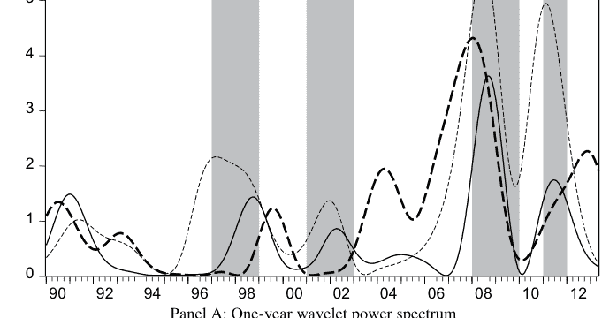

图A：一年小波功率谱

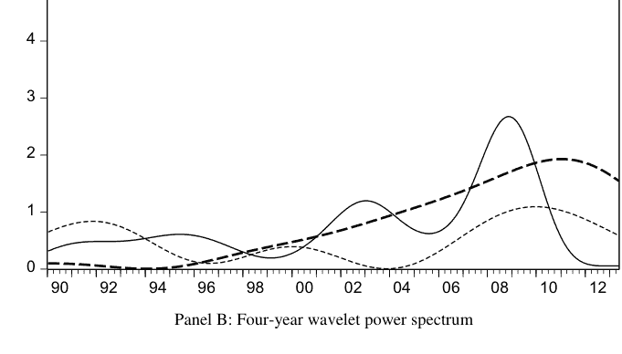

图B：四年小波功率谱

## 图4.2：黄金、标普500和债券收益的小波功率谱

注：本图展示了1990年1月5日至2013年5月17日期间黄金、标普500和债券收益的一年和四年小波功率谱，总计1220个观测值。一年和四年小波功率谱分别展示于图A和图B。阴影区域代表危机时期，依次为1997-1998年亚洲金融危机、2000-2001年互联网泡沫、2008-2009年次贷危机以及2011年主权债务危机。

## 相干性：黄金与股票

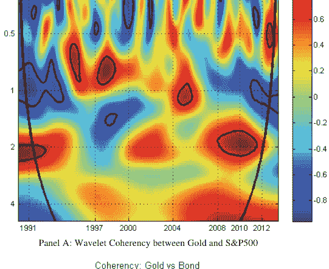

图A：黄金与标普500之间的小波相干性

## 相干性：黄金与债券

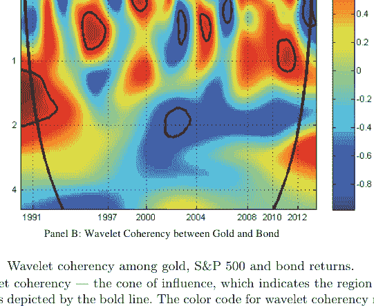

图B：黄金与债券之间的小波相干性

## 图4.3：黄金、标普500和债券收益之间的小波相干性

注：小波相干性——影响锥（表示受边缘效应影响的区域）用粗线描绘。小波相干性的颜色代码从蓝色（负相干性）到红色（正相干性）。图中粗黑连续线标出了经1000次蒙特卡洛模拟确定的在10%显著性水平下统计显著的小波相干性区域。横轴和纵轴分别表示时间和频率，频率已转换为年。

图4.3中的图A展示了黄金与债券收益之间的小波相干性。在高频带上存在显著的负相干性，而在1994年之前的低频带上观察到正相干性。然而，自2000年代初以来，黄金与债券收益之间的相干性在短期和长期关系中表现出不同的特征。在高频带上观察到显著的正相干性，表明黄金与债券在短期内存在正相关关系。这一发现意味着，当投资者的决策期限较短时，黄金在债券投资组合中的分散化功能不再可靠。相反，自2000年代初以来，黄金与债券在中期（两年频率）呈现出显著的负相关关系。长期与短期关系的差异对投资组合管理具有重要启示。我们可以得出结论：投资者的决策期限在决定是否将黄金纳入债券分散化投资组合方面起着关键作用。

## 4.4.3 黄金在最小方差投资组合中的权重

基于小波分析的框架，可以评估黄金在传统股票和债券投资组合中随时间的短期和长期作用。黄金、标普500指数和十年期美国国债的短期和长期最优权重分别来自一年和四年频率下的最小方差投资组合。表4.2提供了黄金、标普500指数和十年期美国国债的短期和长期最优权重的初步统计。如表4.2中的图A所示，整个样本期内黄金、股票和债券的短期最优权重均值分别为0.257、0.504和0.240。此外，整个样本期内黄金、股票和债券的长期最优权重均值分别为0.021、0.335和0.645。总体而言，结果表明，短期投资者应重点关注股票，而长期投资者应重点关注债券。此外，黄金短期和长期最优权重的波动性通过标准差来体现，分别为0.319和0.335。在整个样本期内，黄金短期和长期最优权重的波动均大于股票和债券权重的波动。

当我们把样本分成两个子样本期（分别见表4.2中的图B和图C）时，可以观察到以下启示。首先，如表4.2中的图B所示，1990-2000年期间黄金短期和长期最优权重的平均值分别为0.411和0.578，远高于2000-2013年期间的值。

## 投资组合中的黄金：长期还是短期分散化工具？

### 表4.2：黄金、标普500和债券最优权重的汇总统计

表4.2：黄金、标普500和债券最优权重的汇总统计

| 期限 | 工具 | 均值 | 中位数 | 标准差 | 第1四分位数 | 第3四分位数 |
| --- | --- | --- | --- | --- | --- | --- |
| 图A：整个样本期，1990年1月12日至2013年5月17日 | | | | | | |
| 一年 | 黄金 | 0.257 | 0.153 | 0.283 | 0.002 | 0.440 |
| 一年 | 标普500 | 0.504 | 0.531 | 0.246 | 0.306 | 0.642 |
| 一年 | 债券 | 0.240 | 0.185 | 0.232 | 0.038 | 0.386 |
| 四年 | 黄金 | 0.259 | 0.079 | 0.335 | 0.000 | 0.618 |
| 四年 | 标普500 | 0.265 | 0.294 | 0.159 | 0.133 | 0.385 |
| 四年 | 债券 | 0.477 | 0.545 | 0.274 | 0.382 | 0.621 |
| 图B：子样本1，1990年1月12日至1999年12月31日 | | | | | | |
| 一年 | 黄金 | 0.411 | 0.387 | 0.319 | 0.125 | 0.669 |
| 一年 | 标普500 | 0.498 | 0.504 | 0.288 | 0.276 | 0.737 |
| 一年 | 债券 | 0.091 | 0.027 | 0.152 | 0.000 | 0.084 |
| 四年 | 黄金 | 0.578 | 0.661 | 0.289 | 0.265 | 0.825 |
| 四年 | 标普500 | 0.171 | 0.183 | 0.135 | 0.014 | 0.307 |
| 四年 | 债券 | 0.251 | 0.139 | 0.249 | 0.000 | 0.529 |
| 图C：子样本2，2000年1月7日至2013年5月17日 | | | | | | |
| 一年 | 黄金 | 0.141 | 0.067 | 0.180 | 0.000 | 0.208 |
| 一年 | 标普500 | 0.508 | 0.547 | 0.210 | 0.317 | 0.608 |
| 一年 | 债券 | 0.351 | 0.294 | 0.219 | 0.198 | 0.443 |
| 四年 | 黄金 | 0.021 | 0.000 | 0.037 | 0.000 | 0.018 |
| 四年 | 标普500 | 0.335 | 0.352 | 0.138 | 0.243 | 0.443 |
| 四年 | 债券 | 0.645 | 0.603 | 0.135 | 0.548 | 0.722 |

注：本表提供了1990-2013年整个样本期（图A）以及1990-1999年和2000-2013年两个子样本期（图B和图C）内黄金、标普500和十年期美国国债短期和长期最优权重的初步统计。黄金的短期和长期最优权重分别来自一年和四年频率下的最小方差投资组合。

黄金长期权重的显著下降反映出，自2000年代初以来，黄金在投资组合中的作用大幅减弱。

此外，黄金短期和长期权重的时间路径如图4.4所示。首先，就短期全局最小方差（GMV）投资组合而言，我们可以发现在研究期间的危机阶段（1997-1998年、2001-2002年、2008-2009年和2011年），黄金的短期最优权重明显较高。当比较平静期与动荡期的短期GMV模式时，我们明显发现每次动荡期后黄金的权重都会下降。这一结果可能可以用动荡期间黄金的波动最小来解释，而波动性是GMV框架中试图构建不同资产时的主要因素之一。投资者长期以来一直认为黄金能够提供分散化收益，因为其收益特征和基本驱动因素与股票和债券等其他风险资产不同。然而，自2000年代初以来，商品金融化已将商品市场与债券和股票等金融市场整合在一起。因此，一个有趣的问题出现了：商品与金融收益之间日益增长的关联性如何影响黄金在由债券和股票构成的分散化投资组合中所扮演的角色？本研究采用连续小波变换分析来捕捉黄金与股票和债券等其他风险资产之间的短期和长期相关性特征。本章还使用1990年至2013年的美国股票、债券和黄金数据，研究从最小方差投资组合中获得的黄金最优权重。我们的分析得出以下结论。

首先，采用小波功率谱分析来捕捉黄金、股票和债券的短期和长期波动性。黄金短期波动性的证据表明，其波动性随时间存在显著差异，自2000年代初以来呈显著上升趋势。与黄金和股票的短期波动性比较证实，在市场动荡时期黄金的波动性相对较低，这与黄金为投资者提供避险需求的事实一致。值得注意的是，黄金的长期小波方差模式明显不同。黄金的长期波动性比股票增加得更多，而债券的长期波动性相对稳定。此外，债券和股票短期波动性的比较支持了自1990年代中期以来债券的波动性比股票增加得更多的观点。这一发现与Reilly、Wright和Chan（2000）以及Jones和Wilson（2004）的研究结果一致。因此，至少在短期内，股票比债券风险更高的论点似乎缺乏充分依据。然而，债券和股票的长期波动性表现出不同模式，长期来看股票比债券波动更大。总之，这些发现包括资产波动性性质的变化以及短期和长期波动性的差异，对分析师和投资组合管理者具有特殊启示。

其次，采用小波相干性分析来捕捉黄金、股票和债券之间的短期和长期依赖关系。黄金与股票收益之间的小波相干性实证结果表明，在危机时期，高频带上存在显著的负相干性。这一发现证实了黄金在金融不确定时期扮演避险角色的论点。然而，此外


除危机时期的短期负向关系外，负向关系仅在2000年代之前被观察到。相反，自2000年代初以来，尤其是在较低频率下，黄金与股票回报之间经常观察到正向关系。这些发现对黄金在股票多元化投资组合中发挥的作用提出了质疑。另一方面，黄金与债券回报之间的相干性表明，自2000年代初以来，黄金与债券的关系在短期和长期关系中表现出不同的行为。在较高频率下观察到显著的正相干性，表明黄金与债券在短期内存在正向关系。长期与短期关系的差异对投资组合管理具有重要意义。我们可以得出结论，投资者的决策期限在决定是否将黄金纳入债券多元化投资组合中起着至关重要的作用。总之，由于黄金与其他金融资产之间的相关性较低，黄金一直是投资组合中的有效分散工具，这是在全球化时代的一个重要特征，在该时代大多数金融资产类型之间的相关性急剧增加。然而，与其他大宗商品一样，黄金的金融化导致自2000年代初以来黄金与其他金融资产之间的相关性增加。此外，黄金与股票的关系以及黄金与债券的关系在短期和长期关系中均表现出不同的行为。这些发现对投资组合经理在确定是否将黄金纳入多元化投资组合方面具有重要意义。

最后，我们研究黄金在多元化投资组合中发挥的作用。黄金的最优投资组合权重是通过在时频尺度上最小化投资组合的全局方差获得的。通过这种设定，对于给定的频率，我们可以追踪黄金配置权重的时变情况。我们的实证研究结果显示，几乎没有证据表明黄金在传统股票和债券投资组合中是有效的分散工具，无论是按短期还是长期最小化投资组合方差来衡量。黄金作为资产投资的有吸引力的替代品这一观点似乎得不到数据的支持。研究结果表明，黄金的分散收益是不可靠的。正如预期的那样，我们的研究结果显示，在短期和长期内，由债券和股票组成的分散投资组合中黄金的最优配置权重一直在下降。唯一的例外是在危机时期，与股票和债券相比，黄金相对较低的波动性增加了黄金相对于债券和股票的吸引力。这一发现支持了黄金的主要贡献是在危机时期。其对投资组合的贡献在于其在金融危机期间保持价值的能力。总之，这些发现对投资组合经理具有重要意义。投资组合经理应认真考虑黄金作为多元化手段。

## 参考文献

- Aggarwal, R. and Soenen, L. (1988). 黄金市场的性质与效率. *投资组合管理杂志*, 14, 18–21.
- Aguiar-Conraria, L., Azevedo, N. and Soares, M. J. (2008). 使用小波分解货币政策的时间-频率效应. *Physica A：统计力学及其应用*, 387, 2863–2878.
- Aguiar-Conraria, L. and Soares, M. J. (2011). 连续小波变换：入门. NIPE 工作论文第 16 号 / 2011. University of Minho.
- Barro, R. J. and Misra, S. P. (2016). 黄金回报. *经济学报*, 126, 1293–1317.
- Barunik, J., Kočenda, E. and Vácha, L. (2016). 黄金、石油与股票：动态相关性. *国际经济学与金融评论*, 42, 186–201.
- Baur, D. G. and McDermott, T. K. (2010). 黄金是避风港吗？国际证据. *银行与金融杂志*, 34, 1886–1898.
- Baur, D. G. and Lucey, B. M. (2010). 黄金是避险工具还是避风港？对股票、债券和黄金的分析. *金融评论*, 45(3), 217–229.
- Beckmann, J., Berger, T. and Czudaj, R. (2015). 黄金对股票而言是避险工具还是避风港？平滑转换方法. *经济建模*, 48, 16–24.
- Belousova, J. and Dorfleitner, G. (2012). 从欧元投资者视角看大宗商品的多元化收益. *银行与金融杂志*, 36(9), 2455–2472.
- Bennyhoff, D. G. (2009). 时间多元化与基于期限的资产配置. *投资杂志*, 18(1), 45–52.
- Capie, F., Mills, T. C. and Wood, G. (2005). 黄金作为对美元的避险工具. *国际金融市场、机构与货币杂志*, 15, 343–352.
- Chiang, T. C., Li, J. and Yang, S.-Y. (2015). 动态股票-债券回报相关性与金融市场不确定性. *定量金融与会计评论*, 45, 59–88.
- Chkili, W. (2017). 黄金对伊斯兰股票市场走势是避险工具还是避风港？马尔可夫转换方法. *跨国金融管理杂志*, 42, 152–163.
- Chua, J., Sick, G. and Woodward, R. (1990). 利用黄金股进行多元化. *金融分析师杂志*, 46, 76–79.
- Conlon, T., Lucey, B. M. and Uddin, G. S. (2018). 黄金是对抗通胀的避险工具吗？小波时间尺度视角. *定量金融与会计评论*, 51(2), 317–345.
- Conover, C. M., Jensen, G. R., Johnson, R. R. and Mercer, J. M. (2009). 贵金属能否让你的投资组合闪耀？ *投资杂志*, 18, 75–86.
- Croux, C., Forni, M. and Reichlin, L. (2001). 经济变量共动性的度量：理论与实证. *经济与统计评论*, 83(2), 232–241.
- Dacorogna, M. M., Gencay, R., Muller, U. A., Olsen, R. B. and Pictet, O. V. (2001). 高频金融导论. Academic Press, San Diego, CA.
- Das, D., Kannadhasan, M., Al-Yahyaee, K. H. and Yoon, S. M. (2018). 亚洲黄金市场共动的 小波分析. *Physica A：统计力学及其应用*, 492, 192–206.
- Daskalaki, C. and Skiadopoulos, G. (2011). 投资者是否仍应将大宗商品纳入其投资组合？新证据. *银行与金融杂志*, 35(10), 2606–2626.
- Dooley, M. P., Isard, P. and Taylor, M. P. (1995). 汇率、国家特定冲击与黄金. *应用金融经济学*, 5, 121–129.
- Fuertes, A. M., Miffre, J. and Rallis, G. (2010). 大宗商品期货市场的战术配置：结合动量与期限结构信号. *银行与金融杂志*, 34, 2530–2548.
- Goetzmann, W. N., Li, L. and Rouwenhorst, K. G. (2005). 长期全球市场相关性. *商业杂志*, 78(1), 1–38.
- Graham, M., Kiviaho, J. and Nikkinen, J. (2013). 标准普尔500指数与大宗商品价格的短期与长期依赖性. *定量金融*, 13, 583–592.
- Grubel, H. (1968). 国际多元化投资组合：福利收益与资本流动. *美国经济评论*, 58, 1299–1314.
- Grubel, H. and Fadner, K. (1971). 国际股票市场的相互依存. *金融杂志*, 26(1), 89–94.
- Gunthorpe, D. and Levy, H. (1994). 投资组合构成与投资期限. *金融分析师杂志*, 50, 51–56.
- In, F., Kim, S. and Gencay, R. (2011). 投资期限对价值与成长策略间资产配置的影响. *经济建模*, 28(4), 1489–1497.
- Jaffe, J. (1989). 黄金与黄金股作为机构投资组合的投资. *金融分析师杂志*, 45, 53–59.
- Johnson, R. and Soenen, L. (1997). 黄金作为投资资产：不同国家的视角. *投资杂志*, 6, 94–99.
- Jones, C. P. and Wilson, J. W. (2004). 股票与债券波动性的变化特征. *金融分析师杂志*, 60(4), 100–113.
- Kim, S. and In, F. H. (2010). 投资组合配置与投资期限：多尺度方法. *定量金融*, 10(4), 443–453.
- Lin, F.-L., Chen, Y.-F. and Yang, S.-Y. (2016). 美元价值对石油和黄金价格重要吗？来自时频空间的动态分析. *国际经济学与金融评论*, 43, 59–71.
- Lin, F.-L., Yang, S.-Y., Marsh, T. and Chen, Y.-F. (2018). 股票与债券回报关系及股票市场不确定性：小波分析证据. *国际经济学与金融评论*, 55, 285–294.
- Levy, H. and Sarnat, M. (1970). 投资组合的国际多元化. *美国经济评论*, 60, 668–675.
- Levy, H. and Spector, Y. (1996). 跨资产与时间多元化. *投资组合管理杂志*, 28, 24–34.
- Marshall, J. F. (1994). 投资期限在最优投资组合排序中的作用（离散时间中的直观演示）. *金融评论*, 29(4), 557–576.
- Raza, N., Ali, S., Shahzad, S. J. H. and Raza, S. A. (2018). 大宗商品能否有效对冲房地产风险？非对称 DCC 方法. *资源政策*, 57, 10–29.
- Reboredo, J. C. (2013a). 黄金是对抗油价波动的避险工具还是避风港？ *资源政策*, 38(2), 130–137.
- Reboredo, J. C. (2013b). 黄金是对美元的避风港还是避险工具？对风险管理的启示. *银行与金融杂志*, 37(8), 2665–2676.
- Reilly, F. K., Wright, D. J. and Chan, K. C. (2000). 债券市场波动性与股票市场波动性的比较. *投资组合管理杂志*, 27, 82–92.


- Rua, A. (2010). 在时频空间中衡量共动。 *Journal of Macroeconomics*, 32, 685-691.
- Rua, A. and Nunes, L. C. (2009). 股票市场收益率的国际共动：小波分析。 *Journal of Empirical Finance*, 16, 632-639.
- Sherman, E. (1986). *黄金投资：理论与应用*。 Prentice Hall, New York.
- Tang, K. and Xiong, W. (2012). 指数投资与大宗商品的金融化。 *Financial Analysts Journal*, 68(6), 54-74.
- Van Hoang, T. H., Lahiani, A. and Heller, D. (2016). 黄金是对冲通胀的工具吗？来自非线性ARDL方法的新的证据。 *Economic Modelling*, 54, 54-66.

## 第5章：金融分析、规划与预测的计量经济学方法

Cheng Few Lee

### 目录

- 5.1 引言 ... 226
- 5.2 金融分析、规划与预测的同步性 ... 227
  - 5.2.1 同时计量经济模型的基本概念 ... 227
  - 5.2.2 会计信息的相互关系 ... 227
  - 5.2.3 财务政策的相互关系 ... 228
- 5.3 企业预算决策的同步性与动态性 ... 228
  - 5.3.1 内生变量与外生变量的定义 ... 228
  - 5.3.2 模型设定与应用 ... 229
- 5.4 SUR估计方法在财务分析与规划中的应用 ... 242
  - 5.4.1 企业相关变量在资本资产定价中的作用 ... 243
  - 5.4.2 资本结构在企业融资决策中的作用 ... 247
- 5.5 结构计量经济模型在财务分析与规划中的应用 ... 249
  - 5.5.1 简要回顾 ... 249
  - 5.5.2 AT&T的计量经济学规划模型 ... 249
- 5.6 规划与同时方程与计量经济学金融模型 ... 252
- 5.7 财务分析与商业政策决策 ... 253
- 5.8 结论 ... 255
- 参考文献 ... 255
- 附录5A：Johnson & Johnson作为案例研究 ... 257
  - 5A.1 引言 ... 257
  - 5A.2 公司运营研究 ... 258
  - 5A.3 公司财务绩效分析 ... 259
  - 5A.4 变量与时间范围 ... 266
  - 5A.5 模型与实证结果 ... 268

### 摘要

在本章中，我们首先回顾与联立方程相关的基本模型，如2SLS、3SLS和SUR。然后我们讨论如何估计不同类型的联立方程模型。该模型在财务分析、规划和预测中的应用也得到了探讨。企业预算的同步性和动态性以Johnson & Johnson的数据为例进行了详细探讨。

### 关键词

同时计量经济模型 • 内生变量 • 外生变量 • 两阶段最小二乘法 (2SLS) • SUR • 线性规划 • 目标规划 • 动态资本预算决策。

## 5.1 引言

在本章中，我们将展示如何使用计量经济学技术进行财务分析、规划和预测。计量经济学方法可分为单方程方法和联立方程方法。联立方程方法可以显式或隐式地考虑财务变量之间的相互关系。隐式方法使用估计技术来考虑一组方程之间的相互关系；这组方程并未明确指定其结构关系。然后，这组结构计量经济学关系可以分别或联合估计。

联立方程模型已在上一章中讨论过。此外，上一章还讨论了联立方程模型在金融研究中的一些应用。理解本章所需的基本概念将在第二节中讨论。在第5.3节中，企业预算决策的同步性与动态性问题将利用金融理论进行探讨。Spies的实证结果将被用来展示理论模型如何得以实证实施。第5.4节讨论Zellner（1962年）的 seemingly unrelated regression（SUR）技术如何用于财务分析与规划。值得注意的是，企业相关变量在资本资产定价中的作用以及资本结构在融资决策中的作用将得到较为详细的讨论。第5.5节探讨结构联立方程模型在财务规划与预测中的应用。第5.6节简要讨论了规划、联立方程和计量经济学方法之间的相互关系。第5.7节回顾并讨论了财务规划模型对战略商业决策的可能应用。最后，本章的结果将被总结。

## 5.2 金融分析、规划与预测的同步性

### 5.2.1 同时计量经济模型的基本概念

有两种替代方法，即隐式方法和显式方法，来处理会计信息与财务决策政策之间的相互关系。隐式方法使用同时估计一组回归方程的估计技术；显式方法使用设定技术来推导出一组结构方程。结构联立方程系统可以分别或同时估计。

在结构联立方程系统中，变量可分为内生变量和外生变量。遵循第4章，外生变量是系统的输入，并在方程系统之外确定。内生变量是在模型内部推导出来的，并使用关于外生变量的信息进行估计。在建立结构联立方程系统之前，应检验识别条件。遵循Theil（1971）、Johnston（1972）和第4章，一个方程应为恰好识别或过度识别，才能在实证分析中有意义地使用。

### 5.2.2 会计信息的相互关系

会计信息的主要来源已在Lee和Lee（2017，第2章）中讨论过，其中还讨论了财务比率确定过程的同步性。会计信息为财务规划与预测的规划方法和联立方程方法提供了主要输入。会计数据的同步性在于会计系统中资金来源应等于资金用途的要求。

### 5.2.3 财务政策的相互关系

投资政策、融资政策和股利政策的相互作用已在文献中从理论上进行了研究。这三种政策的相互关系是制定联立方程财务规划与预测模型的基本假设。同样，财务政策之间的相互关系也是使用隐式或显式联立方程计量经济学技术进行财务规划与预测的主要理论依据。然而，在计量经济学类型的财务规划与预测模型中，替代财务政策之间的相互关系被假定为随机而非确定性。

## 5.3 企业预算决策的同步性与动态性

### 5.3.1 内生变量与外生变量的定义

Greene（2017）已给出了内生变量和外生变量的定义。为了研究投资、融资和股利决策之间的相互关系，Spies（1974）开发了五个多元回归来描述五种替代财务管理决策的行为。堆叠技术，即普通最小二乘法（OLS）的一种变体，被Spies用来同时估计所有方程。^1 然后他用该模型证明投资、融资和股利政策通常在单个行业内或在整体制造业部门中是共同决定的。

通过部分调整模型，五个内生变量（见表5.1）通过使用来源等于用途的会计恒等式同时确定。该恒等式确保了

¹ 堆叠技术最初由de Leeuw（1965）提出，可以用SUR或约束SUR技术替代。 （参见以下章节和附录5A的细节。）应注意，这些技术本身可以从讲座中省略，而不影响计量经济学方法对财务分析与规划的实质。


## 表5.1：内生变量与外生变量。

- 1. 内生变量包括：

  - (a) \(X_{1,t} = DIV_t\) = 第 \(t\) 期支付的现金股利；

  - (b) \(X_{2,t} = IST_t\) = 第 \(t\) 期短期资产净投资；

  - (c) \(X_{3,t} = ILT_t\) = 第 \(t\) 期长期资产总投资；

  - (d) \(X_{4,t} = -DF_t\) = 第 \(t\) 期新增债务发行净收益的相反数；

  - (e) \(X_{5,t} = -EQF_t\) = 第 \(t\) 期新股发行净收益的相反数。

- 2. 外生变量包括：

  - (a) \(Y_t = \sum_{i=1}^{5} X_{i,t} = \sum X^*_{i,t}\)，其中 \(Y\) = 净利润 + 折旧备抵；这是“来源等于运用”恒等式的重新表述。

  - (b) RCB = 公司债券利率（对应于FR模型中的长期债务加权平均成本，以及WS模型中的平均利率参数）。

  - (c) RDP\(_t\) = 平均股利-价格比率（或股息收益率，与WS使用的市盈率以及戈登资本成本模型相关。股利-价格比率代表了投资者对无增长、不派息公司的预期收益率）。

  - (d) DEL\(_t\) = 债务权益比率。

  - (e) \(R_t\) = 公司预期能从其未来长期投资中获得的收益率（或内部收益率）。

  - (f) CU\(_t\) = 产能利用率（FR模型用它将资本需求滞后于销售百分比的变化；此处用于定义预期的 \(R_t\)）。

预算过程中每个组成部分（内生变量）的调整，不仅取决于该组成部分偏离其目标的距离，还取决于其他四个组成部分的同步调整。

## 5.3.2 模型设定与应用

### （a）资本预算的调整模型

资本预算问题是影响现代公司整体结构的问题；其解决方案决定了公司的根本性质。因此，资本预算在金融文献中得到了详尽的论述。在这些研究中，人们普遍认识到资本预算的各组成部分是联合决定的。投资、股利和融资决策通过“运用等于来源”恒等式联系在一起，这是一个简单的会计恒等式，要求所有投入资本或分配给股东的资本都必须得到说明。然而，尽管这种关系显而易见，但很少有研究尝试将其纳入计量经济模型。相反，该领域的大多数实证研究都是分别关注资本预算的各组成部分。本节旨在描述Spies（1974）的计量经济资本预算模型，该模型明确考虑了“运用等于来源”恒等式。

在其实证研究中，Spies将资本预算分解为五个基本组成部分：股利、短期投资、长期总投资、债务融资和新股权融资。前三个是资金运用，后两个是资金来源。股利组成部分包括支付给股东的所有现金付款，并且必须为非负。短期投资是公司在当期持有的短期资产的净变动。这些资产既包括存货，也包括短期金融资产，如现金、政府证券和贸易信贷。资本预算的这一组成部分可正可负。长期投资定义为当期长期资产总额的变动。因此，更换磨损设备被视为正投资。长期投资可以为负，但前提是长期资产的出售超过重置投资。

债务融资组成部分仅仅是公司负债的净变动。这些负债包括公司债券、银行贷款、应付税款和其他应付账款。由于公司既可以增加负债，也可以偿还现有负债，因此该变量可正可负。最后，新股权融资是股东权益的变动减去归属于留存收益的金额。这应代表通过出售新的普通股股份筹集的资本。尽管个别公司经常回购已售出的股票，但在加总时，该变量几乎总是正的。

第一步是建立一个理论模型，将最优资本预算描述为一组预定的经济变量。³ 这些变量中的第一个是现金流量的度量，即净利润加上折旧备抵。该变量记为 \(Y\)，只要决定生产、定价、广告、税收等的政策不能足够快地改变从而影响当期的收益，它就是外生的。由于本研究所用数据为季度数据，这一假设似乎并非不合理。还应注意到，“运用等于来源”

³ 该最优模型的理论推导见Spies（1971）的学位论文。

为了更好地理解该模型，让我们看一下方程（5.2）的展开形式：

\[
DIV_t^* = a_{10} + a_{11}Q_1 + a_{12}Q_2 + a_{13}Q_3 + a_{14}Y_t + a_{15}RCB_t + a_{16}RDP_t + a_{17}DEL_t + a_{18}R_t + a_{19}CU_t,
\]

\[
IST_t^* = a_{20} + a_{21}Q_1 + a_{22}Q_2 + a_{23}Q_3 + a_{24}Y_t + a_{25}RCB_t + a_{26}RDP_t + a_{27}DEL_t + a_{28}R_t + a_{29}CU_t,
\]

\[
ILT_t^* = a_{30} + a_{31}Q_1 + a_{32}Q_2 + a_{33}Q_3 + a_{34}Y_t + a_{35}RCB_t + a_{36}RDP_t + a_{37}DEL_t + a_{38}R_t + a_{39}CU_t,
\]

\[
-DF_t^* = a_{40} + a_{41}Q_1 + a_{42}Q_2 + a_{43}Q_3 + a_{44}Y_t + a_{45}RCB_t + a_{46}RDP_t + a_{47}DEL_t + a_{48}R_t + a_{49}CU_t,
\]

\[
-EQF_t^* = a_{50} + a_{51}Q_1 + a_{52}Q_2 + a_{53}Q_3 + a_{54}Y_t + a_{55}RCB_t + a_{56}RDP_t + a_{57}DEL_t + a_{58}R_t + a_{59}CU_t.
\]

尽管该模型本身并不能很好地描述实际的资本预算实践，但它可以与部分调整模型相结合，以推导出一个更现实的模型。

典型的公司无法灵活到每个季度都能实现这一最优资本预算。公司规划者通常不愿过多偏离其过去的股利、投资和融资水平。⁴ 这种行为最好通过部分调整模型来描述，如Lee和Lee（2017）第2章和第26章所讨论的那样。在这种模型中，资本预算既取决于最优预算，也取决于过去的实际预算。其最简单的形式是，部分调整模型使 \(X_i\) 从 \((t-1)\) 期到 \(t\) 期的水平变化成为其 \(t\) 期期望水平与 \((t-1)\) 期实际水平之差的函数。使用线性关系，这变为

\[
X_{i,t}=X_{i,t-1}+\delta_i(X_{i,t}^*-X_{i,t-1}),\tag{5.3}
\]

或

- (a) \(X_{1,t}=X_{1,t-1}+\delta_1(X_{1,t}^*-X_{1,t-1})\),
- (b) \(X_{2,t}=X_{2,t-1}+\delta_2(X_{2,t}^*-X_{2,t-1})\),
- (c) \(X_{3,t}=X_{3,t-1}+\delta_3(X_{3,t}^*-X_{3,t-1})\),
- (d) \(X_{4,t}=X_{4,t-1}+\delta_4(X_{4,t}^*-X_{4,t-1})\),
- (e) \(X_{5,t}=X_{5,t-1}+\delta_5(X_{5,t}^*-X_{5,t-1})\).

⁴ Bower（1970）对公司决策及其适应不断变化的环境的能力进行了有趣的讨论。

这假设公司会朝着其最优水平的方向调整流量变量 \(X_i\) 的水平。调整速度由参数 \(\delta_i\) 衡量。然而，方程（5.3）并未纳入“运用等于来源”恒等式。假设 \(X_{1,t}^*>X_{1,t-1}\)。如果 \(\delta_1<1\)，则 \(X_1\) 在 \(t\) 期不会完全调整，并将保持在低于其最优水平的状态。但“运用等于来源”恒等式确保

\[
\sum_{i=1}^{5}X_{i,t}^*=\sum_{i=1}^{5}X_{i,t}=Y_t.
\]

因此，\(X_1\) 低于期望水平的事实意味着至少有一个其他 \(X_i\) 高于其期望水平。假设正是 \(X_2\) 单独补偿了 \(X_1\) 的缓慢调整。那么，即使 \(X_{2,t}^*=X_{2,t-1}\)，我们也会有 \(X_{2,t}>X_{2,t-1}\)。事实上，

\[
X_{2,t}=X_{2,t-1}+(1-\delta_1)(X_{1,t}^*-X_{1,t-1}).
\]

“运用等于来源”恒等式的结果是，每个 \(X_i\) 的调整可能取决于每个 \(X_i\) 与其最优水平的距离，而不仅仅取决于其自身水平。方程（5.3）应改写为：

\[
X_{i,t}=X_{i,t-1}+\sum_{j=1}^{5}\delta_{ij}(X_{j,t}^*-X_{j,t-1})\quad(i=1,2,3,4,5),\tag{5.4}
\]

其中

\[
\sum_{i=1}^{5}\delta_{ij}=1.
\]

⁵ 对 \(\delta_{ij}\) 值的约束是“运用等于来源”恒等式的结果。将方程（5.4）对 \(i\) 求和得

\[
\sum_{i=1}^{5}X_{i,t}=\sum_{i=1}^{5}X_{i,t-1}+\sum_{i=1}^{5}\sum_{j=1}^{5}\delta_{ij}(X_{j,t}^*-X_{j,t-1}).
\]

这可改写为

\[
\sum_i(X_{i,t}-X_{i,t-1})=\sum_j(X_{j,t}^*-X_{j,t-1})\sum_i\delta_{ij}.
\]

恒等式确保 \(\sum_j X_{j,t}=\sum_j X_{j,t}^*\)，因此，

\[
\sum_i(X_{i,t}-X_{i,t-1})=\sum_j(X_{j,t}-X_{j,t-1})\sum_i\delta_{ij}.
\]

稍微改变符号，这变为

\[
\sum_j(X_{j,t}-X_{j,t-1})=\sum_j(X_{j,t}-X_{j,t-1})\sum_i\delta_{ij}
\]

或 \(1=\sum_i\delta_{ij}\).


将式 (5.4) 写成矩阵形式并与式 (5.2) 结合，我们得到

$$
\begin{aligned}
X_t &= X_{t-1} + D (X_t^* - X_{t-1}) \\
&= X_{t-1} + D (A Z_t - X_{t-1}) \\
&= X_{t-1} + D A Z_t - D X_{t-1} \\
&= (I - D) X_{t-1} + D A Z_t, \tag{5.5}
\end{aligned}
$$

其中 \(I\) 是 \(5 \times 5\) 单位矩阵，且

$$
D = \begin{bmatrix}
\delta_{11} & \delta_{12} & \cdots & \delta_{15} \\
\vdots & \vdots & & \vdots \\
\delta_{51} & \delta_{52} & \cdots & \delta_{55}
\end{bmatrix}.
$$

式 (5.5) 是一个隐式的、同时的、动态的资本预算模型。其展开形式见表 5.2。

**表 5.2：** 式 (5.5) 的展开形式。

$$
\begin{aligned}
X_1 = \mathrm{DIV}_t &= \mathrm{DIV}_{t-1} + \delta_{11}(\mathrm{DIV}_t^* - \mathrm{DIV}_{t-1}) + \delta_{12}(\mathrm{IST}_t^* - \mathrm{IST}_{t-1}) + \delta_{13}(\mathrm{ILT}_t^* - \mathrm{ILT}_{t-1}) + \delta_{14}(-\mathrm{DF}_t^* + \mathrm{DF}_{t-1}) + \delta_{15}(-\mathrm{EQF}_t^* + \mathrm{EQF}_{t-1}) \\
X_2 = \mathrm{IST}_t &= \mathrm{IST}_{t-1} + \delta_{21}(\mathrm{DIV}_t^* - \mathrm{DIV}_{t-1}) + \delta_{22}(\mathrm{IST}_t^* - \mathrm{IST}_{t-1}) + \delta_{23}(\mathrm{ILT}_t^* - \mathrm{ILT}_{t-1}) + \delta_{24}(-\mathrm{DF}_t^* + \mathrm{DF}_{t-1}) + \delta_{25}(-\mathrm{EQF}_t^* + \mathrm{EQF}_{t-1}) \\
X_3 = \mathrm{ILT}_t &= \mathrm{ILT}_{t-1} + \delta_{31}(\mathrm{DIV}_t^* - \mathrm{DIV}_{t-1}) + \delta_{32}(\mathrm{IST}_t^* - \mathrm{IST}_{t-1}) + \delta_{33}(\mathrm{ILT}_t^* - \mathrm{ILT}_{t-1}) + \delta_{34}(-\mathrm{DF}_t^* + \mathrm{DF}_{t-1}) + \delta_{35}(-\mathrm{EQF}_t^* + \mathrm{EQF}_{t-1}) \\
X_4 = -\mathrm{DF}_t &= -\mathrm{DF}_{t-1} + \delta_{41}(\mathrm{DIV}_t^* - \mathrm{DIV}_{t-1}) + \delta_{42}(\mathrm{IST}_t^* - \mathrm{IST}_{t-1}) + \delta_{43}(\mathrm{ILT}_t^* - \mathrm{ILT}_{t-1}) + \delta_{44}(-\mathrm{DF}_t^* + \mathrm{DF}_{t-1}) + \delta_{45}(-\mathrm{EQF}_t^* + \mathrm{EQF}_{t-1}) \\
X_5 = -\mathrm{EQF}_t &= -\mathrm{EQF}_{t-1} + \delta_{51}(\mathrm{DIV}_t^* - \mathrm{DIV}_{t-1}) + \delta_{52}(\mathrm{IST}_t^* - \mathrm{IST}_{t-1}) + \delta_{53}(\mathrm{ILT}_t^* - \mathrm{ILT}_{t-1}) + \delta_{54}(-\mathrm{DF}_t^* + \mathrm{DF}_{t-1}) + \delta_{55}(-\mathrm{EQF}_t^* + \mathrm{EQF}_{t-1})
\end{aligned}
$$

上文已论证，资本预算中每个组成部分的调整不仅取决于其自身与最优水平的差距，也取决于其他组成部分的差距。这意味着 \(D\) 的至少一些非对角元素不为零。事实是 \(X_i\) 是对可用资金的竞争性用途，通常会让人相信它们应该是负的。例如，如果股息低于其最优水平，我们可能会预期股息上升而投资下降。然而，与此同时，这类模型中的正常假设是 \(0 < \delta_{11} < 1\)。但我们已经看到对所有 \(j\) 都有 \(\sum_{i=1}^5 \delta_{ij} = 1\)。

因此，除非 \(\delta_{ij}\) 大于一，否则不可能使所有非对角元素都为负。这意味着 \(\delta_{ij}\) 系数的符号无法绝对确定。然而，需要指出的是，大多数公司持有流动资产的主要原因是为了促进这种类型的调整过程；流动资产的作用是为资本预算提供灵活性。因此，可以合理预期短期投资会吸收其他组成部分调整造成的松弛。回到股息的例子，我们预期短期投资会上升以确保 \(\sum_{i=1}^5 \delta_{i1} = 1\)。此时可能有 \(0 < \delta_{21} < 1\)，且 \(\delta_{31}, \delta_{41}, \delta_{51} < 0\)。尽管这不是公司可以选择的唯一调整过程，但它似乎是最可能的一种。

### (b) 一些实证结果

为了估计的目的，式 (5.5) 可以改写为

$$
X = B X_{t-1} + C Z_t + U_t, \tag{5.6}
$$

其中 \(B\) 是一个 \(5 \times 5\) 矩阵，\(C\) 是一个 \(5 \times 10\) 系数矩阵。\(D\) 和 \(A\) 的分量可由以下方程估计：

$$
D = I - B, \tag{5.7}
$$

$$
A = D^{-1} C. \tag{5.8}
$$

式 (5.6) 的展开形式见表 5.3。

**表 5.3：** 式 (5.6) 的展开形式。

$$
\begin{bmatrix}
\mathrm{DIV}_t\\
\mathrm{IST}_t\\
\mathrm{ILT}_t\\
-\mathrm{DF}_t\\
-\mathrm{EQF}_t
\end{bmatrix}
=
\begin{bmatrix}
b_{11} & b_{12} & b_{13} & b_{14} & b_{15} & c_{10} & c_{11} & c_{12} & c_{13} & c_{14} & c_{15} & c_{16} & c_{17} & c_{18} & c_{19}\\
b_{21} & b_{22} & b_{23} & b_{24} & b_{25} & c_{20} & c_{21} & c_{22} & c_{23} & c_{24} & c_{25} & c_{26} & c_{27} & c_{28} & c_{29}\\
b_{31} & b_{32} & b_{33} & b_{34} & b_{35} & c_{30} & c_{31} & c_{32} & c_{33} & c_{34} & c_{35} & c_{36} & c_{37} & c_{38} & c_{39}\\
b_{41} & b_{42} & b_{43} & b_{44} & b_{45} & c_{40} & c_{41} & c_{42} & c_{43} & c_{44} & c_{45} & c_{46} & c_{47} & c_{48} & c_{49}\\
b_{51} & b_{52} & b_{53} & b_{54} & b_{55} & c_{50} & c_{51} & c_{52} & c_{53} & c_{54} & c_{55} & c_{56} & c_{57} & c_{58} & c_{59}
\end{bmatrix}
\begin{bmatrix}
\mathrm{DIV}_{t-1}\\
\mathrm{IST}_{t-1}\\
\mathrm{ILT}_{t-1}\\
\mathrm{DF}_{t-1}\\
\mathrm{EQF}_{t-1}\\
I\\
Q_1\\
Q_2\\
Q_3\\
Y\\
RCB\\
RDP\\
DEL\\
R\\
CU
\end{bmatrix}
$$

所使用的估计程序是堆叠技术，该技术最早由 de Leeuw (1965) 提出。我们已经看到“用途等于来源”恒等式意味着

$$
\sum_{i=1}^5 X_{it} = Y_t \quad \text{for every period } t.
$$

为了将此纳入估计程序，估计量必须受到限制，使得在各方程之间，\(Y\) 的系数加总为一，而其他预定变量的系数加总为零。换句话说，我们必须确保

$$
\sum_{i=1}^5 b_{ij} = 0 \quad \text{for all } j,
$$

并且

$$
\sum_{i=1}^5 \hat{C}_{ik} = 0 \quad \text{for all } k \neq 4, \qquad
\sum_{i=1}^5 \hat{C}_{i4} = 1.
$$

这是一个简单的加总约束。[^6]

现在我们已经完成了对该模型性质的讨论，我们将考虑使用该模型的一些实证结果。虽然该模型的目的是为单个企业规划资本预算，但此处呈现的 Spies 的实证结果使用了行业数据而非单个企业的数据。我们将在附录 5A 中考虑该模型对单个企业的应用。

Spies 使用的数据主要取自《联邦贸易委员会-证券交易委员会制造业公司季度财务报告》，涵盖 1969 年。回归结果报告了制造业总体部门和十个行业子部门的情况。这些行业及其标准行业分类编号如下：

- 食品及相关产品 (20)
- 纺织厂产品 (22)
- 家具及固定装置 (25)
- 纸张及相关产品 (26)
- 化学品及相关产品 (28)
- 皮革及皮革制品 (31)
- 石材、粘土和玻璃制品 (32)
- 其他机械 (35)
- 电气机械、设备及用品 (36)
- 汽车及设备 (37)

该模型本应提供单个公司资本预算实践的真实图景，但 Spies 使用汇总数据对其进行了检验。他指出，没有理由期望该模型的参数对所有制造业公司，甚至对特定行业内的所有公司都相同。在理论上无法反驳这一论点。至少在理论上，单个企业的数据很可能会提供对该模型更好的检验。然而，这类数据可能会给此类实证研究带来严重问题。实际公司的资本预算决策往往受制于外部影响和考虑因素，这些因素无法用此类非常一般的模型来解释。例如，单个大型投资项目可能会在数个期间主导一家公司的整个资本预算。劳工谈判和反垄断行动等事项也可能影响资本预算决策。将所有这些因素纳入我们的一般模型将非常困难。因此，单个公司的资本预算往往与我们模型预测的结果大不相同。即使该模型是对该公司正常行为的准确描述，也可能出现这种情况。Spies 认为，与单个企业数据相比，汇总数据平滑了这些外部影响的效果。

\(\delta_{ij}\) 系数的估计值见 Spies (1974) 的表 5.1–5.5。在此处采用的估计程序中，为了保持加总约束，我们必须使用债务和股权融资值的负值。然而，在报告结果时，我们已调整这些系数的符号以消除这一惯例。换句话说，式 (5.5) 中的 \(X_t\) 和 \(X_{t-1}\) 向量已被调整，使 \(X' = (\mathrm{DIV}\ \mathrm{IST}\ \mathrm{ILT}\ \mathrm{DF}\ \mathrm{EQF})\)。这个转换后的方程系统与旧系统等价，且更容易解释。

Spies 使用了五张表来展示制造业总体部门和十个行业子部门的调整系数 \(\delta_{ij}\)。每张表都包含 \(i = 1,2,3,4,5\) 且给定 \(j\) 值时的 \(\delta_{ij}\) 估计值。例如，表 5.4 显示，如果制造业总体部门股息的最优水平超过上期实际水平 $1.00（即 \(\mathrm{DIV}_t^* - \mathrm{DIV}_{t-1} = 1\)），则股息将提高 $0.83。此外，短期投资将上升 $3.23，债务融资上升 $2.09，股权融资上升 $0.97。

表 5.4 包含 \(\mathrm{DIV}_t^* - \mathrm{DIV}_{t-1}\) 系数的估计值。股息的自身调整系数在第一列给出。其范围从化学工业的 0.1894 低值到“其他机械”的 1.2340 高值。三个行业的系数大于一，但没有一个与一有显著差异。除化学和造纸行业外，所有估计值都相当接近一。这表明大多数公司会相当迅速地将其股息调整至最优水平。

资本预算的其他组成部分也会对股息的非最优性做出调整。表 5.4 的第二列说明了

[^6]: 这一约束确保“用途等于来源”恒等式在估计方程中成立。首先，我们知道 \(\sum_i \iota_{ij}=1\)，因为

$$
\iota_{ij}=
\begin{cases}
1-b_{ij}, & i=j,\\
-b_{ij}, & i\neq j.
\end{cases}
$$

因此，

$$
\sum_i \iota_{ij}=1-\sum_i b_{ij}=1-0=1.
$$

此外，可以证明 \(X_t^*=Y_t\)。为此，只需证明

$$
\sum_j \iota_{jk}=
\begin{cases}
0, & \text{for all } k\neq 4,\\
1, & \text{for all } k=4.
\end{cases}
$$

注意 \(\iota_{ik}=\sum_j a_{ij}\iota_{jk}\)。由于我们已约束

$$
\sum_i C_{ik}=
\begin{cases}
0, & \text{for all } k\neq 4,\\
1, & \text{for all } k=4.
\end{cases}
$$

我们可以看到

$$
\sum_i C_{ik}
= \sum_i \sum_j a_{ij}\iota_{jk}
= \sum_j \left(\sum_i a_{ij}\right)\iota_{jk}
= \sum_j (1)\iota_{jk}
= \sum_j \iota_{jk}.
$$

因此，

$$
\sum_j \iota_{jk}=
\begin{cases}
0, & \text{for all } k\neq 4,\\
1, & \text{for all } k=4.
\end{cases}
$$

由此可见

$$
\sum_i X_{i,t} = X_t^* = Y_t.
$$


**表5.4：DIV*_t − DIV_{t-1} 的调整系数。**

| 行业 | ΔDIV_t | ΔIST_t | ΔILT_t | ΔDF_t | ΔEQF_t |
|---|---|---|---|---|---|
| 食品 | 1 | 2.8688 (4.14)<sup>a</sup> | -2.8688 (4.14) | 0 | 0 |
| 纺织 | 1.1156 (8.97) | 1.6469 (2.19) | 1.9930 (2.29) | 1.0763 (3.18) | -1.3041 (2.20) |
| 家具 | 0.9194 (12.09) | 2.9337 (2.34) | 0 | 0 | 2.8531 (3.58) |
| 造纸 | 0.2475 (0.37) | 0 | 6.1983 (5.30) | 1.8321 (1.76) | 3.6137 (2.96) |
| 化工 | 0.1894 (0.64) | 0.8106 (2.74) | 0 | 0 | 0 |
| 皮革 | 0.6412 (1.68) | 1.6059 (0.90) | 1.5603 (1.03) | 5.4753 (3.05) | -2.6679 (2.12) |
| 石材、黏土与玻璃 | 0.7037 (3.32) | 1.5594 (2.14) | -1.2631 (3.09) | 0 | 0 |
| 其他机械 | 1.2340 (5.22) | 3.7843 (5.37) | 0 | 4.0183 (5.23) | 0 |
| 电气机械 | 0.8355 (4.16) | 0 | 0 | -1.3451 (1.06) | 1.1806 (0.87) |
| 汽车 | 1.0158 (16.72) | 0.9799 (4.15) | -0.6723 (2.63) | 0 | 0.3234 (1.33) |
| 汇总 | 0.8328 (6.67) | 3.2308 (6.59) | 0 | 2.0902 (7.64) | 0.9734 (1.96) |

a 括号中的数字为 t 统计量。95% 显著性水平为 t = 1.96。未列出 t 统计量的条目表示相应变量的系数在回归中被省略。这些系数对于自身调整系数等于 1，对于其他系数等于 0。

资料来源：Spies, R.R. (1974). The dynamics of corporate capital budgeting. Journal of Finance, 29 (September), Table 1.（经许可重印。）

短期投资对此类非最优状态的反应是：除了两个零值外，所有估计值均为正且相对较大。这有力地支持了这样一种论点：公司积累流动资产是因为计划增加股息。另一方面，长期投资似乎向下调整。十个行业系数中有八个为负或零，其中一个正系数不显著。因此，证据表明，面对计划中的股息增加，长期投资可能会下降。由于投资必须与股息竞争资金，这一结果并不完全出人意料。只有造纸业非常大的正系数提供了相矛盾的证据。

按照同样的论证逻辑，显然债务融资和股权融资都应对预期中的股息增加而上升。十个行业的债务融资调整系数中有九个为正或零，另一个不显著。在股权融资方程中，十个系数中有八个为正或零。换言之，两种资金来源都会增加，以满足新的、自由化股息政策的融资需求。

其他四组部分调整系数的结果可以类似方式解释。Spies 的实证结果汇总见表5.5，该表显示，不同行业之间的调整系数惊人的一致（至少在符号方面）。当然，没有任何行业或整体的制造业部门与表5.5完全一致，但它们都在一定程度上遵循这一总体模式。因此，这一总体模式为财务经理揭示了各种财务相互关系。

**表5.5：结果汇总。**

|  | **DIV*_t – DIV_{t-1}** | **IST*_t – IST_{t-1}** | **ILT*_t – ILT_{t-1}** | **DF*_t – DF_{t-1}** | **EQF*_t – EQF_{t-1}** |
|---|---|---|---|---|---|
| ΔDIV | 接近 1 | 负（但不显著） | 负（但不显著） | 正（但不显著） | 正（但不显著） |
| ΔIST | 正且大 | 大于 1 | 正且大 | 负且大 | 负且大 |
| ΔILT | 负 | 负<sup>a</sup> | 介于 0 与 1 之间 | 正 | 正 |
| ΔDF | 正<sup>a</sup> | 正<sup>a</sup> | 正<sup>a</sup> | 接近 1 | 负 |
| ΔEQF | 正 | 正<sup>a</sup> | 正<sup>a</sup> | 负<sup>a</sup> | 接近 1 |

a 标有 a 的项目是指至少五个行业的估计系数被设为 0 的情况。由于存在大量不显著的估计值，我们关于这些系数符号的结论必须谨慎对待。

资料来源：Spies, R.R. (1974). The dynamics of corporate capital budgeting. Journal of Finance, 29 (September), Table 6.（经许可重印。）

利用方程（5.6），Spies 进行了一项简单模拟，以考察同时资本预算决策的动态性质。模拟结果如图5.1所示。

**图5.1：模拟结果。**

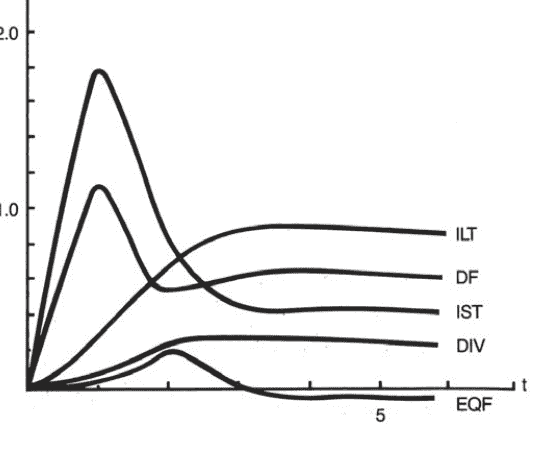

资料来源：Spies, R.R. (1974). The dynamics of corporate capital budgeting. Journal of Finance, 29 (September), Fig. 1.（经许可重印。）

图5.1描述了整体制造业部门总收益增加一个单位所导致的资本预算变化。每个组成部分与其初始水平之差对时间作图。所有其他外生变量均假定保持不变。调整过程似乎相当清晰。股息和长期投资缓慢而稳定地上升到新的最优水平。在最初几个季度，短期投资填补了这种缓慢调整造成的缺口。它在第一季度急剧上升，并在第二季度保持在最优水平之上。这仅仅意味着公司正在囤积流动资产，为更高的股息和长期投资水平做准备。债务融资在第一季度急剧上升，随后回落到新的最优水平。股权融资在较小程度上也呈现同样情况。到第四季度，资本预算的所有组成部分几乎都达到最优水平。这比大多数单方程模型所隐含的调整要快得多。这是完整部分调整模型最有趣的结果之一。

### （c）结语

总体而言，Spies 开发的模型表现相当好。证据有力地支持完整部分调整模型。对大多数行业而言，各个调整系数是合理的，而且所有系统都是稳定的。如果资本预算偏离均衡，股息和长期投资会稳定地向其均衡值移动。

债务和股权融资迅速变化，以帮助为其他调整提供资金，然后才移动到它们自身的均衡水平。最后，短期投资填补缺口。它迅速调整以补偿其他组成部分的较慢调整，并保持“资金来源等于资金运用”的恒等式。这种行为与实际的资本预算实践大体一致。

从 Spies 的实证结果中可以得出许多有趣的结论。第一个涉及股息在公司规划中的地位。显然，股息几乎立即调整到新的最优水平。应当指出，大多数公司的实际股息政策是不对称的。股息实际上是向下刚性的，而向上则灵活得多。我们的样本中盈利和股息快速增长时期的比重很可能影响对该调整速度的估计。无论如何，股息对资本预算任何其他组成部分的非最优状态都不会作出显著反应。股息水平对公司规划者至关重要，这一点似乎很清楚。证据有力地支持这样一种假设，即股息政策的确定几乎独立于资本预算的其他部分。

## 5.4 SUR 估计方法在财务分析与规划中的应用

Zellner（1962）提出了似不相关回归（SUR）技术。Telser（1964）使用迭代估计程序展示了 SUR 的过程。关于 SUR 的更详细信息可参见 Greene（2017）。SUR 已在财务分析与规划中得到广泛应用（Peterson, 1980）。Frecka 和 Lee（1983）使用 SUR 方法提高了确定动态财务比率调整过程的估计效率。Gilmer 和 Lee（1986）使用 SUR 检验股息效应争议。该应用的主要理由是，流动性、杠杆、营运和盈利比率的变动通常是相互关联的。Lee 和 Vinso（1980）使用 SUR 检验公司相关变量在资本资产定价中的作用。Taggart（1977）使用 SUR 方法研究资本结构在融资决策中的作用。在本节中，利用后两项研究来展示 SUR 方法如何用于改进财务分析与规划的实证结果。


## 5.4.1 公司相关变量在资本资产定价中的作用

Lee 和 Vinso (1980) 以及 Lee 和 Zumwalt (1981) 使用 SUR 方法研究了公司相关变量在资本资产定价中的作用。参照 Lee 和 Vinso 的研究，联立市场模型定义为

$$\begin{aligned}
R_{1t} &= \alpha_1 + \beta_1R_{mt} + \gamma_{11}X_{11} + \gamma_{12}X_{12} + \gamma_{13}X_{13} + E_{1t},\\
R_{2t} &= \alpha_2 + \beta_2R_{mt} + \gamma_{21}X_{21} + \gamma_{22}X_{22} + \gamma_{23}X_{23} + E_{2t},\\
&\vdots\\
R_{nt} &= \alpha_n + \beta_nR_{mt} + \gamma_{n1}X_{n1} + \gamma_{n2}X_{n2} + \gamma_{n3}X_{n3} + E_{nt},
\end{aligned} \tag{5.9}$$

其中

$R_{jt}$  第 $j$ 种证券在时间区间 $t$ 上的收益率 $(j=1,2,\ldots,n)$,

$R_{mt}$  市场指数在时间区间 $t$ 上的收益率,

$X_{j1t}$  第 $j$ 家公司在时间区间 $t$ 上的盈利指数 $(j=1,2,\ldots,n)$,

$X_{j2t}$  第 $j$ 家公司在时间区间 $t$ 上的杠杆指数 $(j=1,2,\ldots,n)$,

$X_{j3t}$  第 $j$ 家公司在时间区间 $t$ 上的股利政策指数 $(j=1,2,\ldots,n)$,

$\gamma_{jk}$  第 $j$ 个方程中第 $k$ 个公司相关变量的系数 $(k=1,2,3)$,

$\beta_j$  第 $j$ 个方程中市场收益率的系数,

$E_{jt}$  第 $j$ 个方程的扰动项，$\alpha_j$ 为截距 $(j=1,2,\ldots,n)$.

如果 $\gamma_{jk}$ 的估计系数不显著，且方程 (5.9) 的方差-协方差矩阵为对角矩阵，则得到 Sharpe (1963) 的对角模型，即：

$$R_{jt}=\alpha_j + \beta_j R_{mt} + E_{jt}. \tag{5.10}$$

为了检验此处提出的 SUR 收益生成过程（相对于通常的市场模型），使用了 1945–1973 年间七家石油公司的股票价格和公司相关变量（盈利指数、杠杆指数和股利政策指数）的年度数据来计算相关收益率。盈利指数定义为年度留存利润（留存收益加利息和优先股股利）除以总资产；杠杆指数定义为长期债务年度变化加上流通在外优先股年度变化除以总资产；股利政策指数定义为总股利年度变化除以权益账面价值。其他公司相关变量可以添加或替换此处使用的变量。每家公司的适当收益率都针对股利和股票拆分进行了调整。使用含股利的年度标准普尔指数 (SPI) 计算市场年度收益率。

为了检验方程 (5.9) 中设定的 SUR 市场模型的有效性，首先使用 OLS 估计七家石油公司的必要参数（见表 5.7）。可以看出，与 SUR 市场模型的 OLS 估计相关的七个 R² 中，有五个高于表 5.6 中所示的 Sharpe 模型的 R²。这些结果表明，公司相关变量增加了市场模型的解释力。这七家公司的残差相关系数矩阵（见表 5.8）表明，这些公司高度相关，因为有 10 个涉及全部七家公司的残差相关系数在 0.05 水平上显著异于零。SUR 估计方法可以提高某些估计量的效率。

表 5.7 还提供了利用 SUR 方法得到的参数估计。当 SUR 估计方法应用于市场模型时，在大多数情况下估计量的效率似乎有所提高。与 SUR 估计方法相关的收益通过回归系数的 t 统计量来衡量，因为 SUR 计算机程序不提供 SUR 估计方法的决定系数。SUR 的效率高于 OLS。因此，本文开发的 SUR 市场模型可以在提高市场模型解释力的同时，产生更有效的估计量。

SUR 市场模型的结果具有很大的直观吸引力。例如，作为加拿大公司的帝国石油与其他公司的相关性最低，这符合预期。在表 5.7 中，菲利普斯石油的残差与俄亥俄标准石油和太阳石油的残差高度相关，但 SUR 估计并未提高菲利普斯石油估计量的效率。一个可能的原因是，该公司的财务管理政策可能与石油行业其他公司的政策高度相关。当回归的解释变量与同行业其他回归的解释变量变得更加相似时，SUR 估计方法的收益将更小。虽然

### 表 5.6：石油行业的 OLS 和 SUR 估计

|  |  | α_j | β_j | γ_j1 | γ_j2 | γ_j3 | R̄² |
|---|---|---|---|---|---|---|---|
| R1 | OLS | -0.44 (1.64) | 0.76 (2.47)^b | 6.04 (1.72) | 0.45 (0.29) | -2.08 (-0.17) | 0.22 |
| R1 | SUR | -0.28 (1.18) | 0.76 (2.55)^b | 4.20 (1.36) | 0.86 (0.62) | -6.97 (-0.66) |  |
| R2 | OLS | -0.82 (-0.26) | 0.54 (1.31) | 1.06 (0.23) | -1.21 (-1.21) | 5.29 (0.27) | 0.02 |
| R2 | SUR | -0.16 (-0.80) | 0.58 (1.43) | 2.45 (0.85) | -0.81 (-1.27) | -8.50 (-0.67) |  |
| R3 | OLS | -0.22 (-1.72) | 1.12 (3.98)^b | 2.05 (1.42) | 2.51 (2.15)^b | -0.51 (-0.06) | 0.45 |
| R3 | SUR | -0.30 (2.63)^b | 1.08 (3.88)^b | 2.91 (2.39)^b | 2.66 (2.81)^b | -2.53 (-0.41) |  |
| R4 | OLS | -0.15 (-0.86) | 0.72 (3.05)^b | 2.10 (0.78) | -0.23 (-0.27) | 25.29 (1.81)^a | 0.30 |
| R4 | SUR | -0.05 (-0.35) | 0.64 (2.75)^b | -0.98 (-0.43) | 0.42 (0.58) | 26.35 (2.33)^b |  |
| R5 | OLS | -0.00 (-0.01) | 1.16 (2.08)^b | -0.75 (0.22) | 1.83 (1.34) | 15.60 (0.89) | 0.05 |
| R5 | SUR | -0.00 (-0.02) | 1.16 (2.30)^b | -0.86 (0.41) | 1.88 (2.49)^b | 0.91 (-0.95) |  |
| R6 | OLS | -0.14 (1.43) | 0.70 (3.09)^b | 0.68 (0.55) | 0.91 (1.30) | 62.20 (1.71) | 0.27 |
| R6 | SUR | -0.15 (1.99)^a | 0.70 (3.17)^b | 0.85 (1.01) | 0.90 (2.02)^b | 54.11 (2.40)^b |  |
| R7 | OLS | -0.11 (-0.91) | 1.01 (4.75)^b | 1.34 (0.78) | 0.64 (1.24) | 4.53 (0.75) | 0.46 |
| R7 | SUR | -0.06 (-0.58) | 1.01 (4.68)^b | 0.65 (0.42) | 0.96 (2.08)^b | 3.96 (0.74) |  |

^a 表示在双尾检验中至少达到 0.10 的显著性水平。
^b 表示在双尾检验中至少达到 0.05 的显著性水平。
*注：* t 值显示在相应系数下方的括号中。
*资料来源：* 摘自 Lee 和 Vinso（1980，表 3）。(版权所有 1980，Elsevier Science Publishing Co., Inc.，经出版商许可重印。)

这些结果是有趣的，但只有在回归模型的假设得到满足时，才能可信地看待它们。残差检验表明回归要求确实得到满足。因此，SUR 市场模型可用于确定公司相关变量的作用。

既然 SUR 市场模型的有效性已得到证实，Simkowitz 和 Logue (1973) 在资本资产定价中使用的三个公司相关变量就值得关注。这三个公司相关变量所起的作用是识别证券市场联立方程组，以及

### 表 5.7：石油行业的 OLS 参数估计——Sharpe 模型*

|  |  | α' | β' | R̄² |
|---|---|---|---|---|
| R₁ | 帝国石油 | 0.04 | 0.74 (2.66) | 0.18 |
| R₂ | 菲利普斯石油 | -0.01 | 0.65 (1.67) | 0.06 |
| R₃ | 壳牌石油 | -0.01 | 1.23 (4.24) | 0.38 |
| R₄ | 印第安纳标准石油 | 0.04 | 0.68 (2.86) | 0.20 |
| R₅ | 俄亥俄标准石油 | -0.02 | 0.87 (1.81) | 0.07 |
| R₆ | 太阳石油 | 0.01 | 0.62 (2.71) | 0.19 |
| R₇ | 加州联合石油 | 0.01 | 1.02 (4.67) | 0.43 |

注：t 值显示在相应系数下方的括号中。
资料来源：摘自 Lee 和 Vinso（1980，表 2）。(版权所有 1980，Elsevier Science Publishing Co., Inc.，经出版商许可重印。)

### 表 5.8：OLS 估计后的残差相关系数矩阵

|  | R₁ | R₂ | R₃ | R₄ | R₅ | R₆ | R₇ |
|---|---|---|---|---|---|---|---|
| R₁ | 1.00 | 0.17 | 0.16 | 0.44ᵃ | 0.55 | 0.11 | 0.14 |
| R₂ |  | 1.00 | 0.20 | 0.23 | 0.74ᵃ | 0.44ᵃ | -0.77 |
| R₃ |  |  | 1.00 | 0.16 | 0.35ᵃ | 0.57ᵃ | 0.21 |
| R₄ |  |  |  | 1.00 | 0.17 | 0.36ᵃ | 0.33ᵃ |
| R₅ |  |  |  |  | 1.00 | 0.66ᵃ | 0.62ᵃ |
| R₆ |  |  |  |  |  | 1.00 | 0.31ᵃ |
| R₇ |  |  |  |  |  |  | 1.00 |

注：ᵃ 表示在 0.05 显著性水平上显著。
资料来源：摘自 Lee 和 Vinso（1980，表 4）。(版权所有 1980，Elsevier Science Publishing Co., Inc.，经出版商许可重印。)

提高对角证券市场模型的解释力。这些相同的公司相关变量也明确包含在方程 (5.9) 所示的 SUR 市场模型中。利用市场模型的 SUR 估计，可以分析这些公司相关变量在收益生成过程中的重要性。盈利指数在解释壳牌石油的收益率方面显著；股利政策指数在解释壳牌石油、俄亥俄标准石油、太阳石油和加州联合石油的收益率方面显著。这些结果表明，两者


定义为：

ΔLDBT = α₁(LDBT* − LDBTₜ₋₁) + α₂(PCB* − PCBₜ₋₁ − RE)
        + α₃STOCKT + α₄RT + ε₁, (5.11)
ΔGSTK = β₁(LDBT* − LDBTₜ₋₁) + β₂(PCB* − PCBₜ₋₁ − RE)
        + β₃STOCKT + β₄RT + ε₂, (5.12)
STRET = η₁(LDBT* − LDBTₜ₋₁) + η₂(PCB* − PCBₜ₋₁ − RE)
        + η₄RT + ε₃, (5.13)
ΔLIQ = LIQ* + γ₂(TC* − TCₜ₋₁) + γ₃(ΔA − RE) + γ₄RT
        + ε₄, (5.14)
ΔSDBT = ΔLIQ* + λ₂(TC* − TCₜ₋₁) + λ₃(ΔA − RE) + λ₄RT
        + ε₅, (5.15)

其中

| 术语 | 定义 |
|---|---|
| LDBT* | bSTOCK (i/(i)) = 长期债务账面价值的目标， |
| STOCK | 股权市场价值， |
| b | LDM/STOCK = 目标债务权益比率， |
| LDM | 债务市场价值 = (LDBT)(i/(i))， |
| I/i | 长期债务未偿余额平均合同利率与长期债务当前新发行利率之间的比率， |
| LDBTₜ₋₁ | 前期长期债务账面价值， |
| PCB* | 永久资本（账面价值）= 净资本存量（NK）+ 营运资产的永久部分（NWA）， |
| PCBₜ₋₁ | 前期永久资本， |
| RE | 股票回购， |
| STOCKT | 股票市场时机变量 = 股权平均短期市场价值除以股权平均长期市场价值， |
| RT | 利率时机变量，商业票据利率最近两个季度变化的加权平均值（权重分别为 0.67 和 0.33）， |
| TC* | 目标短期资本 = 短期资产-流动资产， |
| TCₜ₋₁ | 前期短期债务， |
| ΔA | 总资产变动， |
| ΔLIQ* | 目标流动性资产变动。 |

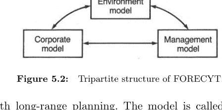

## 图 5.2：FORECYT 的三元结构。

与长期规划有关。该模型称为 FORECYT，是 Econometric forecasting Model for Corporate Policy Analysis for T（T 为 AT&T 的股票代码）的缩写。整体建模方法基于这样一个前提：经济状况决定了单个企业的需求，使其需求是外部决定的，而非由企业的供给能力创造。在此模型中，贝尔系统的需求被假定取决于企业外部的经济因素，而供给则是通过企业政策行动对需求的反应。

下述 FORECYT 具有三元结构（见图 5.2），由三个子模型组成，这些子模型进一步细分为模块，以便根据兴趣和数据允许的情况进行分解。三个子模型及其相关模块的流程图在图 5.3 中示出。

根据图 5.3 所示的流程图，三个子模型可详细讨论如下：

- (i) 环境模型是对企业所互动的“世界”或“环境”的构建。该模型包含 (a) 国家经济模块，(b) 监管模块，以及 (c) 价格-工资审查模块。
- (ii) 企业模型是对贝尔系统的计量经济学构建。该模型包含 (a) 需求模块，(b) 价格模块，(c) 资本市场模块，(d) 财务模块，(e) 收入模块，以及 (f) 生产（或供给）模块。
- (iii) 管理模型是一个逻辑构建，提供用于控制的政策变量（在输入模块中）并显示企业绩效指标（在输出模块中）。政策变量包括融资组合和要素组合；企业绩效指标包括每股收益和已实现回报率。

为了确定该 FORECYT，需要直接运用金融理论来确定资本市场模块和输入模块。毋庸置疑，使用这种企业决策模型肯定需要经济指标以及 AT&T 的市场和会计信息。

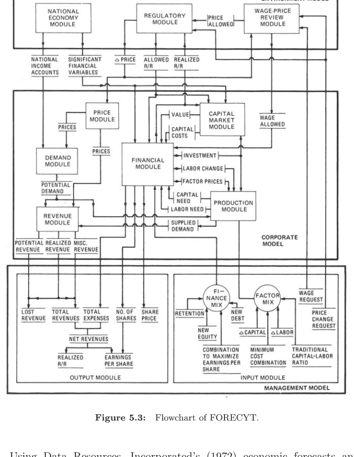

## 图 5.3：FORECYT 流程图。

使用 Data Resources, Incorporated's（1972 年）的经济预测和其他相关数据作为输入，DCC 为 AT&T 获得了某些有趣且有用的财务规划和预测结果。⁸ 其他更新

⁸来自其他计量经济学模型（如 Chase Econometric 和 Wharton Econometrics）的经济预测也可以用作企业分析规划和预测的输入。

概念和企业规划，使用汇总的经济预测结果，可在 Eckstein's（1981 年）关于企业规划决策支持系统的演讲中找到。

## 5.6 编程与联立方程与计量经济学财务模型

本章前面我们讨论了一些计量经济学财务规划模型。在本节中，我们将尝试将这些模型与财务规划模型的编程和联立方程方法进行比较。

两种编程方法被考察：线性规划和目标规划。这两种方法的主要区别之一是目标规划允许一个以上的目标函数，而线性规划不允许。任一方法都可用于营运资本管理和长期规划。

这两种编程方法也具有相似的基本结构。从数据库开始，基本财务报表用于对数据进行分类，然后利用金融理论来设定企业希望实现的目标和约束。这些目标和约束来自两个主要来源——企业的目标函数和企业的整体政策。

通常目标函数关注企业的估值；也就是说，企业通常的总体目标是股东财富最大化。至于主要政策，它们是投资、融资、股利和生产政策。这些政策由高层管理者制定，并受各种经济因素的影响。

在编程方法下，目标函数被明确识别，而在联立方程方法下，目标函数从方程组中隐含得出。

编程方法和联立方程方法都忽略了模型中使用变量的统计特性。这两种方法将数值视为确定性的。这促使人们关注计量经济学模型，后者将变量视为随机变量。计量经济学模型尝试以两种方式将单方程回归模型和联立方程模型整合为联立方程系统。

第一种方式是隐式方法，其中一组方程被组合在一起而没有特定的结构形式，例如 Zellner's seemingly
unrelated regression。第二种方式是显式方法，其中使用结构形式来改进设定以制定结构型联立方程系统。总之，编程方法、联立方程方法和计量经济学方法是财务分析、规划和预测的三种替代建模方法。这些模型在财务规划和预测中的相对经验表现仍有待研究。

## 5.7 财务分析与商业政策决策

传统上，商业政策采用案例方法，使用定性分析。然而，在过去十年左右，随着行业和国家计量经济学规划模型的使用增加，商业政策分析中使用定量分析已获得认可。问题是，企业应在制定其商业政策时如何利用财务规划模型？希望我们能够表明，财务培训对于深入理解商业政策很重要。

在他们的论文中，Duhaime 和 Thomas（1983）讨论了财务分析在战略管理中的作用问题。作者从企业角度评估财务管理，而不仅仅是财务术语，而是着眼于财务管理对整体企业目标的贡献，例如创新和增长、业务效率、维护、运营和盈利能力控制，以及对战略变化的灵活性。

Duhaime 和 Thomas 将战略管理定义为涵盖“企业确定、实施和维持企业资源和技能与其不断变化的环境所带来的机遇和威胁之间适当且理想的匹配的活动”。战略管理过程涉及以下步骤：(i) 识别问题和资源，(ii) 制定替代战略，(iii) 评估并从这些替代方案中选择，(iv) 实施所选战略，以及 (v) 监测和评估所采用战略的绩效。

财务规划可在战略管理的三个领域中使用：规划阶段、组织层级和企业战略类型。

规划阶段涵盖基本财务规划、基于预测的规划、外部导向规划和企业规划。


在组织层面，随着多元化和事业部制组织结构日益广泛采用，在评估备选多元化战略或组织结构时，财务规划模型的使用变得更加重要。

最后，公司战略类型涉及企业应进入哪些业务领域以及在这些业务中如何竞争的问题。

在描绘了战略管理的全貌之后，让我们考察财务方法在战略管理中的应用。在战略管理背景下，财务经理应将战略目标与公司长期资源相匹配，因为财务资源对于实现这些目标往往至关重要。

使用财务方法的一个问题是，其标准可能过于僵化，从而限制企业可能采取的合理选择。规范性财务理论还需要纳入行为变量和政治变量。

许多财务模型采用确定性方法，本质上属于“自下而上”，因为它们使用会计数据，是决策支持模型而非优化模型。这些模型非常复杂。

另一类对公司管理者非常有帮助的模型包括敏感性分析和风险分析模型，这些模型使管理者能够考察不同战略和不同投入的不同影响。风险分析可用于公司发展过程中，分析公司现有业务、选择新业务、新业务组合以及新业务与现有业务的组合。

战略风险分析应为企业管理者明确应考虑哪些备选方案，并审视不确定性对应急计划的影响。管理者希望初步分析能够促使对假设、价值和不确定性进行进一步调查，从而得出更好的解决方案。

财务方法的另一个用途是战略组合规划。该领域的一个流行模型是波士顿咨询公司开发的增长率-市场份额矩阵（见 Zakon (1968, 1976) 和 Hedley (1977)）。在该模型中，企业运营的市场由两个参数定义：市场增长率和相对市场份额。市场增长率是现金使用的代理指标，维持市场份额所需的投资是该市场增长率的函数。相对市场份额是现金生成的代理指标，竞争产品的盈利能力是其市场份额的函数。

## 财务分析、规划与预测的经济计量方法

规划模型也可用于分析重大决策，如收购、剥离和扩张。这些潜在变化可以根据其预期的财务效应和协同效应进行分析。

Duhaime 和 Thomas 在其重要论文中得出了几个结论。首先，他们指出，需要整合各种投资和融资模型，以形成整体财务战略。财务管理不仅应以盈利能力、效率和管控来衡量，还应以组织适应性和灵活性标准来衡量。

最后，Duhaime 和 Thomas 指出，战略管理不仅仅是战略财务管理；它还包括结构性不确定性以及行为和政治维度。

基于前几章讨论的信息、理论和方法，我们讨论了经济计量方法如何作为规划方法和联立方程方法的替代方案，用于财务规划和预测。我们使用 SUR 方法和结构联立方程方法来说明如何更有效地考虑不同财务政策变量之间的相互关系。此外，还表明财务规划和预测模型可以与环境模型和管理模型相结合，以支持业务政策决策。

- Anderson, W. H. L. (1964). 《公司财务与固定投资：一项经济计量研究》。哈佛商学院，波士顿。
- 强生公司年度报告，1950-2006。
- Baumol, W. J. (1959). 《经济动力学：导论》（第2版）。麦克米伦公司，纽约。
- Bower, J. L. (1970). 企业内部规划，《美国经济评论》，60，186-94。
- Brainard, W. C. 和 J. Tobin (1968). 财务模型构建中的陷阱，《美国经济评论》，58，99-122。
- Davis, B. E., Caccappolo, G. C. 和 Chaudry, M. A. (1973). 美国电话电报公司的经济计量规划模型，《贝尔经济学与管理科学杂志》，4，29-56。
- de Leeuw, F. (1965). 金融行为模型。载于《布鲁金斯学会美国季度经济模型》（James S. Duesenberry, Gary Fromm, L.R. Klein 和 E. Kuh），465-532。兰德·麦克纳利公司，芝加哥。

### 5A.3 公司财务绩效分析

研发活动对强生公司的业务非常重要，约占销售额的14%。公司在全球拥有约12.2万名员工，从事医疗保健领域广泛产品的研发、制造和销售。

表5A.2、5A.3A和5A.3B显示了强生公司1997年至2006年期间的资产负债表和共同比损益表。表5A.4和5A.5分析了公司业绩，体现在关键比率、趋势和杜邦分析中。

从表5A.4可以看出，公司的流动比率和速动比率相当充裕。然而，自2006年以来，这些比率略有下降。在考察应收账款和存货周转率时，可以看到应收账款周转率在同一时期一直在上升，这意味着强生公司正在缩短信用期以促进销售。存货周转率在十年间在8.3次至12.7次之间波动。换句话说，平均原材料和产成品库存约相当于半个月至一个月的销售额，这表明公司没有积压大量滞销存货；同时也持有足够存货以避免缺货。总体来看，强生公司似乎拥有相当充裕的营运资本和短期流动性状况。

长期杠杆状况可以通过考察债务权益比率来分析。从表5A.4中可以看出，虽然该比率自1999年以来一直在上升，但公司正在努力降低财务杠杆，2006年约为5%。虽然这表明财务风险很低，但也可能意味着公司没有利用财务杠杆，特别是因为公司的经营风险并不高，这一点在杜邦分析中可以看到。

对各种趋势的分析表明，销售额增长了逾两倍，且该时期内增长非常稳定。事实上，自1950年以来销售额一直在增长。利润与销售额增长保持同步，这是一个健康的信号。销售额的增长速度快于总投资和营运资本，这意味着强生公司更好地利用其产能和营运资本资金。粗略看一下资产负债表可以发现，营运资本增长较慢是由于流动负债增加所致，流动负债自1997年以来增长到原来的4倍。由于公司有能力在必要时偿还应付账款，这表明强生公司的债权人给予其更长的信用期，显示出对该公司稳定性的信心不断增强。

**表5A.2：资产负债表。**

|  | 1997 | 1998 | 1999 | 2000 | 2001 | 2002 | 2003 | 2004 | 2005 | 2006 |
| --- | --- | --- | --- | --- | --- | --- | --- | --- | --- | --- |
| *资产*（单位：百万美元） |  |  |  |  |  |  |  |  |  |  |
| (1) 应收账款 | 3329 | 3661 | 4233 | 4464 | 4630 | 5399 | 6574 | 6831 | 7010 | 8712 |
| (2) 存货 | 2516 | 2853 | 3095 | 2842 | 2992 | 3303 | 3588 | 3744 | 3959 | 4889 |
| (3) 其他流动资产 | 1819 | 2040 | 1993 | 2400 | 2879 | 3089 | 3310 | 3861 | 4287 | 5290 |
| (4) 流动资产合计（1+2+3） | 10563 | 11132 | 13200 | 15450 | 18473 | 19266 | 22995 | 27320 | 31394 | 22975 |
| (5) 固定资产总额 | 9444 | 10024 | 11046 | 11248 | 12458 | 14314 | 17052 | 18664 | 19716 | 24028 |
| (6) 减：折旧 | 3634 | 3784 | 4327 | 4277 | 4739 | 5604 | 7206 | 8228 | 8886 | 10984 |
| (7) 固定资产净额（5-6） | 5810 | 6240 | 6719 | 6971 | 7719 | 8710 | 9846 | 10436 | 10830 | 13044 |
| (8) 其他资产 | 5080 | 8839 | 9244 | 8900 | 12296 | 12580 | 15422 | 15561 | 15801 | 34537 |
| (9) 资产总计（4+7+8） | 21453 | 26211 | 29163 | 31321 | 38488 | 40556 | 48263 | 53317 | 58025 | 70556 |
| *负债* |  |  |  |  |  |  |  |  |  |  |  |
| (10) 普通股权益 | 12359 | 13590 | 16213 | 18808 | 24233 | 22697 | 26869 | 31813 | 37871 | 39318 |
| (11) 优先股 | 0 | 0 | 0 | 0 | 0 | 0 | 0 | 0 | 0 | 0 |
| (12) 股东权益（10+11） | 12359 | 13590 | 16213 | 18808 | 24233 | 22697 | 26869 | 31813 | 37871 | 39318 |
| (13) 流动负债 | 5283 | 8162 | 7454 | 7140 | 8044 | 11449 | 13448 | 13927 | 12635 | 19161 |
| (14) 长期负债 | 1126 | 1269 | 2450 | 2037 | 2217 | 2022 | 2955 | 2565 | 2017 | 2014 |
| (15) 其他负债 | 2685 | 3190 | 3046 | 3336 | 3994 | 4388 | 4991 | 5012 | 5502 | 10063 |
| (16) 负债总计 | 9094 | 12621 | 12950 | 12513 | 14255 | 17859 | 21394 | 21504 | 20154 | 31238 |
| (17) 营运资本（4-13） | 5280 | 2970 | 5746 | 8310 | 10429 | 7817 | 9547 | 13393 | 18759 | 3814 |


## 表5A.3A：共同比利润表（单位：百万美元）。

|  | 1997年 $ | 1997年 % | 1998年 $ | 1998年 % | 1999年 $ | 1999年 % | 2000年 $ | 2000年 % | 2001年 $ | 2001年 % |
|---|---:|---:|---:|---:|---:|---:|---:|---:|---:|---:|
| (1) 销售总额 | 22629 | 100 | 23657 | 100 | 27471 | 100 | 29139 | 100 | 33004 | 100 |
| (2) 销售成本 | 6085 | 26.89 | 6190 | 26.17 | 6998 | 25.47 | 7346 | 25.21 | 7931 | 24.03 |
| (3) 毛利润（1–2） | 16544 | 73.11 | 17467 | 73.83 | 20473 | 74.53 | 21793 | 74.79 | 25073 | 75.97 |
|  | **减：费用** |  |  |  |  |  |  |  |  |  |
| (4) 营业费用 | 10855 | 47.97 | 11176 | 47.24 | 13103 | 47.70 | 13801 | 47.36 | 15583 | 47.22 |
| (5) 利息费用 | 160 | 0.71 | 181 | 0.77 | 278 | 1.01 | 242 | 0.83 | 248 | 0.75 |
| (6) 总费用（4+5） | 11015 | 48.68 | 11357 | 48.01 | 13381 | 48.71 | 14043 | 48.19 | 15831 | 47.97 |
| (7) 营业利润（3–6） | 5529 | 24.43 | 6110 | 25.83 | 7092 | 25.82 | 7750 | 26.60 | 9242 | 28.00 |
| (8) 折旧 | 1067 | 4.72 | 1246 | 5.27 | 1444 | 5.26 | 1515 | 5.20 | 1605 | 4.86 |
| (9) 其他收入 | 114 | 0.50 | −595 | −2.52 | 105 | 0.38 | 387 | 1.33 | 261 | 0.79 |
| (10) 税前利润（7–8+9） | 4576 | 20.22 | 4269 | 18.05 | 5753 | 20.94 | 6622 | 22.73 | 7898 | 23.93 |
| (11) 税项 | 1273 | 5.63 | 1210 | 5.11 | 1586 | 5.77 | 1822 | 6.25 | 2230 | 6.76 |
| (12) 净利润（10–11） | 3303 | 14.60 | 3059 | 12.93 | 4167 | 15.17 | 4800 | 16.47 | 5668 | 17.17 |
| (13) 税率（11/10） |  | 28% |  | 28% |  | 28% |  | 28% |  | 28% |
| (14) 股息 | 1137 | 5.02 | 1305 | 5.52 | 1479 | 5.38 | 1724 | 5.92 | 2047 | 6.20 |
| (15) 留存收益（12–14） | 2166 | 9.57 | 1754 | 7.41 | 2688 | 9.78 | 3076 | 10.56 | 3621 | 10.97 |
| (16) 派息率（14/12） |  | 34% |  | 43% |  | 35% |  | 36% |  | 36% |

## 表5A.3B：共同比利润表（单位：百万美元）。

| 项目 | 2002年 $ | 2002年 % | 2003年 $ | 2003年 % | 2004年 $ | 2004年 % | 2005年 $ | 2005年 % | 2006年 $ | 2006年 % |
|---|---|---|---|---|---|---|---|---|---|---|
| (1) 销售总额 | 36298 | 100 | 41862 | 100 | 47348 | 100 | 50434 | 100 | 53194 | 100 |
| (2) 销售成本 | 8785 | 38.82 | 10307 | 43.57 | 11298 | 41.13 | 11861 | 40.70 | 12880 | 39.03 |
| (3) 毛利润（1-2） | 27513 | 61.18 | 31555 | 56.43 | 36050 | 58.87 | 38573 | 59.30 | 40314 | 60.97 |
| 减：费用： |  |  |  |  |  |  |  |  |  |  |
| (4) 营业费用 | 16173 | 71.47 | 18815 | 79.53 | 21063 | 76.67 | 23189 | 79.58 | 24558 | 74.41 |
| (5) 利息费用 | 258 | 1.14 | 315 | 1.33 | 323 | 1.18 | 165 | 0.57 | 181 | 0.55 |
| (6) 总费用（4+5） | 16431 | 72.61 | 19130 | 80.86 | 21386 | 77.85 | 23354 | 80.15 | 24739 | 74.96 |
| (7) 营业利润（3-6） | 11082 | 48.97 | 12425 | 52.52 | 14664 | 53.38 | 15219 | 52.23 | 15575 | 47.19 |
| (8) 折旧 | 1662 | 7.34 | 1869 | 7.90 | 2124 | 7.73 | 2093 | 7.18 | 2177 | 6.60 |
| (9) 其他收入 | -129 | -0.57 | -248 | -1.05 | 298 | 1.08 | 530 | 1.82 | 1189 | 3.60 |
| (10) 税前利润（7-8+9） | 9291 | 41.06 | 10308 | 43.57 | 12838 | 46.73 | 13656 | 46.87 | 14587 | 44.20 |
| (11) 税项 | 2694 | 11.91 | 3111 | 13.15 | 4329 | 15.76 | 3245 | 11.14 | 3534 | 10.71 |
| (12) 净利润（10-11） | 6597 | 29.15 | 7197 | 30.42 | 8509 | 30.97 | 10411 | 35.73 | 11053 | 33.49 |
| (13) 税率（11/10） |  | 29% |  | 30% |  | 34% |  | 24% |  | 24% |
| (14) 股息 | 2381 | 10.52 | 2746 | 11.61 | 3251 | 11.83 | 3793 | 13.02 | 4267 | 12.93 |
| (15) 留存收益（12-14） | 4216 | 18.63 | 4451 | 18.81 | 5258 | 19.14 | 6618 | 22.71 | 6786 | 20.56 |
| (16) 派息率（14/12） |  | 36% |  | 38% |  | 38% |  | 36% |  | 39% |

## 表5A.4：比率分析。

|  | 1997 | 1998 | 1999 | 2000 | 2001 | 2002 | 2003 | 2004 | 2005 | 2006 |
|---|---|---|---|---|---|---|---|---|---|---|
| 流动比率 | 2.00 | 1.36 | 1.77 | 2.16 | 2.30 | 1.68 | 1.71 | 1.96 | 2.48 | 1.20 |
| 速动比率 | 1.52 | 1.01 | 1.36 | 1.77 | 1.92 | 1.39 | 1.44 | 1.69 | 2.17 | 0.94 |
| 销售额/应收账款 | 6.80 | 6.46 | 6.49 | 6.53 | 7.13 | 6.72 | 6.37 | 6.93 | 7.19 | 6.11 |
| 销售额/存货 | 8.99 | 8.29 | 8.88 | 10.25 | 11.03 | 10.99 | 11.67 | 12.65 | 12.74 | 10.88 |
| 负债/权益 % | 9.11 | 9.34 | 15.11 | 10.83 | 9.15 | 8.91 | 11.00 | 8.06 | 5.33 | 5.12 |
| 趋势分析（1997年 = 100） |  |  |  |  |  |  |  |  |  |  |
| 销售趋势 | 100.0 | 104.5 | 121.4 | 128.8 | 145.8 | 160.4 | 185.0 | 209.2 | 222.9 | 235.1 |
| 净利润趋势 | 100.0 | 92.6 | 126.2 | 145.3 | 171.6 | 199.7 | 217.9 | 257.6 | 315.2 | 334.6 |
| 营运资本趋势 | 100.0 | 56.3 | 108.8 | 157.4 | 197.5 | 148.0 | 180.8 | 253.7 | 355.3 | 72.2 |
| 固定资产总额趋势 | 100.0 | 106.1 | 117.0 | 119.1 | 131.9 | 151.6 | 180.6 | 197.6 | 208.8 | 254.4 |
| 净资产趋势 | 100.0 | 110.0 | 131.2 | 152.2 | 196.1 | 183.6 | 217.4 | 257.4 | 306.4 | 318.1 |
| 总资产趋势 | 100.0 | 122.2 | 135.9 | 146.0 | 179.4 | 189.0 | 225.0 | 248.5 | 270.5 | 328.9 |
| 股息趋势 | 100.0 | 114.8 | 130.1 | 151.6 | 180.0 | 209.4 | 241.5 | 285.9 | 333.6 | 375.3 |
| 市盈率倍数 |  |  |  |  |  |  |  |  |  |  |
| 年度平均值 | 24.15 | 27.48 | 31.03 | 25.65 | 37.63 | 24.95 | 19.48 | 18.03 | 18.38 | 16.72 |
| 年末值 | 26.67 | 30.72 | 30.78 | 30.19 | 30.31 | 23.25 | 19.13 | 20.46 | 17.07 | 17.75 |
| 价格区间 |  |  |  |  |  |  |  |  |  |  |
| 最高 | 66.94 | 89.00 | 106.13 | 105.06 | 103.10 | 65.49 | 58.67 | 63.76 | 69.40 | 69.10 |
| 最低 | 49.75 | 64.00 | 78.06 | 67.38 | 50.00 | 41.85 | 48.73 | 49.50 | 60.04 | 56.80 |

## 表5A.5：杜邦分析。

| | 1997 | 1998 | 1999 | 2000 | 2001 | 2002 | 2003 | 2004 | 2005 | 2006 |
|---|---|---|---|---|---|---|---|---|---|---|
| 销售额/总资产 | 1.05 | 0.90 | 0.94 | 0.93 | 0.86 | 0.90 | 0.87 | 0.89 | 0.87 | 0.75 |
| 毛利润/销售额 % | 0.73 | 0.74 | 0.75 | 0.75 | 0.76 | 0.76 | 0.75 | 0.76 | 0.76 | 0.76 |
| 息税前利润/毛利润 % | 0.28 | 0.29 | 0.29 | 0.30 | 0.31 | 0.35 | 0.34 | 0.36 | 0.34 | 0.34 |
| 息税前利润/总资产 % | 0.22 | 0.19 | 0.20 | 0.21 | 0.20 | 0.24 | 0.23 | 0.24 | 0.23 | 0.19 |
| 净利润/息税前利润 % | 0.71 | 0.61 | 0.70 | 0.74 | 0.72 | 0.68 | 0.66 | 0.66 | 0.78 | 0.81 |
| 总资产/股东权益 | 1.74 | 1.93 | 1.80 | 1.67 | 1.59 | 1.79 | 1.80 | 1.68 | 1.53 | 1.79 |
| 净利润/股东权益 | 0.27 | 0.23 | 0.26 | 0.26 | 0.23 | 0.29 | 0.27 | 0.27 | 0.27 | 0.28 |
| 留存收益/净利润 % | 0.66 | 0.57 | 0.65 | 0.64 | 0.64 | 0.64 | 0.62 | 0.62 | 0.64 | 0.61 |
| 留存收益/股东权益 % | 0.18 | 0.13 | 0.17 | 0.16 | 0.15 | 0.19 | 0.17 | 0.17 | 0.17 | 0.17 |

使用的公式：
(销售额/总资产) × (毛利润/销售额) % × (息税前利润/毛利润) = (息税前利润/总资产) %
(息税前利润/总资产) % × (净利润/息税前利润) × (总资产/股东权益) = (净利润/股东权益)
(净利润/股东权益) % × (留存收益/净利润) = (留存收益/股东权益) %

从上述对强生公司运营和绩效的研究中可以看出，该公司拥有出色的业绩记录，尤其是上述行业和整体排名所证明的。此外，强生公司所属的医院用品行业是一个非常稳定的行业，不受周期性影响以及消费者品味和偏好变化等其他因素的影响。虽然研发是该行业的一个重要领域，但技术发展并非快到足以使该行业像电子行业等其他行业那样波动剧烈。

这项历史研究主要局限于过去十年，因为本节所做的观察将用于补充使用Spies模型进行的分析。还应指出，许多关于强生公司在2000年代表现的评论，同样适用于更早的时期。

## 5A.4 变量与时间范围

模型实证检验中使用的变量与Spies模型中的变量完全相同。以下部分解释了计算模型中使用的各个变量所遵循的方法。

### 5A.4.1 股息（DIV）

在计算该变量时，只考虑了普通股股息。优先股股息仅支付至1955年，因此，为保持一致性，优先股股息从当期现金流中扣除，而不加回普通股股息。此外，股票股息也未计入计算。

### 5A.4.2 短期投资（IST）

短期投资是公司在流动资产和其他短期资产持有量上的净变动。

### 5A.4.3 长期投资（ILT）

长期投资定义为固定资产总额和非流动有价证券的变动。

### 5A.4.4 债务融资（DF）

该组成部分只是公司负债（包括长期和流动负债）的净变动。


## 5A.4.5 权益融资（EQF）

股东权益变动额减去留存收益应计额，被用作权益融资的定义。尽管在研究期间未向公众发行新股，但已针对股票拆分、库存普通股变动以及因行使期权和股票补偿协议而向员工发行的股票进行了调整。

## 5A.4.6 现金流（Y）

该变量的计算方法是：将当期净利润加上折旧，并针对留存收益表中的其他非现金项目以及已支付的优先股股息进行调整。

## 5A.4.7 公司债券利率（RCB）

该变量未纳入模型，因为 Compustat 中不提供公司债券利率。

## 5A.4.8 债务权益杠杆（DEL）

该变量按每期期初的债务权益比率计算。

## 5A.4.9 股息价格比率（RDP）

该变量使用当期的平均股息价格比率。

## 5A.4.10 回报率（R）

收益变动与上一期长期投资之比被用作投资回报率的衡量指标。

## 5A.4.11 产能利用率（CU）

由于强生（J&J）是一家多产品公司，销售额与固定资产总额之比被用作产能利用率的代理指标。

## 5A.4.12 时间跨度

实证研究使用年度数据，时间跨度为 1950 年至 1979 年。

表 5A.6A 和表 5A.6B 列出了针对上述变量收集的数据。研究中省略了 1969 年的数据，因为强生（J&J）在那一年合并了其财务报表，将国外子公司纳入其中，这扭曲了该年度资金的来源与运用。

## 5A.5 模型与实证结果⁹,¹⁰

实证研究使用的模型是 Spies（1974）提出的回归模型。按照正文中的方程（5A.6），模型定义为

$X_t = B X_{t-1} + C Z + U_t,$
(5A.1)

其中

- $X_t$ 是一个 $5 \times 1$ 矩阵，包含以下变量：
- $X'_t$ 是 $(DIV_t\ IST_t\ ILT_t - DF_t - EQF_t)'$；
- $Z_t$ 是一个 $6 \times 1$ 矩阵，包含一个常数 (I)，其中 $Z'_t$ 是 $(1, Y_t\ RDP_t\ DEL_t\ R_t\ CU_t)'$；
- $B$ 是一个 $5 \times 5$ 系数矩阵，$C$ 是一个 $5 \times 6$ 系数矩阵；
- $U_t$ 是一个 $5 \times 1$ 矩阵，表示误差项。

由于使用的是年度数据，因此不使用虚拟变量来消除季节性。

“来源等于运用”恒等式意味着，对于每一期 $t$，$\Sigma_i X_{i,t} = Y_t$ 必须成立；这里 $X_{i,t}$ 定义为时期 $t$ 的 $X$ 矩阵中的第 $i$ 个变量。为了将其纳入估计过程，必须对估计量施加约束，使得在各方程之间，$Y$ 的系数之和为 1，而其他外生变量的系数之和为零。从代数角度看，这些约束可以表述为：

$\sum_{i=1}^{5} \hat{c}_{i2} = 1 \quad \text{and} \quad \sum_{i=1}^{5} \hat{b}_{ij} = \sum_{i=1}^{5} \hat{c}_{ik} = 0 \text{ for all } j \text{ and all } k \neq 2,$
(5A.2)

⁹ 本节使用的所有公式和变量定义均与正文第 5.3 节中的定义相同。

¹⁰ Taggart（1977）指出，叠加技术无法将资产负债表间的相互关系通过误差项进入模型的可能性考虑在内。Hsieh 和 Lee（1984）表明，约束 SUR 方法是叠加技术的推广形式。从概念上讲，可以通过对 SUR 模型的回归系数施加约束来得到约束 SUR。因此，约束 SUR 取代了 Spies（1974）所使用的叠加技术。请注意，理解 Spies 的动态资本预算模型并不需要了解 SUR 和约束 SUR 的估计过程。

## 表 5A.6A：输入数据

| 年份 | DIV | IST | ILT | DF | EQF | 年份 | DIV | IST | ILT | DF | EQF |
|------|------|------|------|------|------|------|------|------|------|------|------|
| 1949 | 2.52 | -8.96 | 2.24 | -7.97 | -5.49 | 1978 | 100.72 | 221.70 | 140.88 | 140.82 | 23.41 |
| 1950 | 3.98 | 7360.00 | 13.40 | 12.96 | -4.79 | 1979 | 122.20 | 216.69 | 274.90 | 205.77 | 55.96 |
| 1951 | 2.31 | 3.20 | 1.50 | -0.84 | -0.28 | 1980 | 136.90 | 252.83 | 215.72 | 186.09 | 18.66 |
| 1952 | 2.09 | 5.70 | -0.80 | 1.78 | -2.96 | 1981 | 158.60 | 231.20 | 246.70 | 219.10 | -50.20 |
| 1953 | 3.45 | 2.90 | -0.50 | -3.20 | 0.14 | 1982 | 182.40 | 50.90 | 338.27 | 117.60 | -19.43 |
| 1954 | 3.46 | 2.40 | 2.60 | 0.10 | -1.10 | 1983 | 204.60 | 204.00 | 47.93 | 24.90 | -57.37 |
| 1955 | 3.47 | 6.50 | 1.08 | 1.60 | -1.74 | 1984 | 219.90 | 56.60 | 23.28 | 174.40 | -389.13 |
| 1956 | 3.47 | -2.00 | 14.48 | 1.90 | 1.12 | 1985 | 233.20 | 382.80 | 98.66 | 134.80 | 38.42 |
| 1957 | 3.81 | 7.80 | 0.61 | -1.62 | 0.66 | 1986 | 244.70 | 305.10 | 160.27 | 1308.30 | -611.53 |
| 1958 | 3.61 | 6.40 | 2.84 | -0.32 | 0.62 | 1987 | 278.00 | 70.40 | 370.04 | 8.50 | 105.84 |
| 1959 | 4.74 | 9.00 | 8.71 | 2.08 | 4.92 | 1988 | 327.00 | 231.00 | 355.00 | 555.00 | -629.00 |
| 1960 | 5.93 | 4.70 | 8.68 | 2.89 | 0.64 | 1989 | 373.00 | 273.00 | 432.00 | 155.00 | -64.00 |
| 1961 | 5.95 | 4.90 | 12.62 | 2.30 | 4.86 | 1990 | 436.00 | 888.00 | 697.00 | 835.00 | 45.00 |
| 1962 | 5.98 | 4.60 | 6.30 | -0.88 | -0.22 | 1991 | 513.00 | 269.00 | 706.00 | 281.00 | -222.00 |
| 1963 | 6.63 | 11.00 | 5.78 | 2.54 | 0.20 | 1992 | 587.00 | 490.00 | 903.00 | 1826.00 | -898.00 |
| 1964 | 7.19 | 8.40 | 8.00 | 3.92 | -5.11 | 1993 | 659.00 | -206.00 | 355.00 | -39.00 | -731.00 |
| 1965 | 8.71 | 27.30 | 22.30 | 23.80 | 3.45 | 1994 | 727.00 | 1463.00 | 485.00 | 1872.00 | 275.00 |
| 1966 | 9.85 | 3.60 | 19.90 | 5.29 | -8.16 | 1995 | 827.00 | 1258.00 | 400.00 | 282.00 | 347.00 |
| 1967 | 11.11 | 28.70 | 14.60 | 6.53 | 6.71 | 1996 | 974.00 | 1432.00 | 548.00 | 346.00 | -122.00 |
| 1968 | 11.79 | 43.30 | 10.60 | 10.79 | 5.25 | 1997 | 1137.00 | 1193.00 | 96.00 | -80.00 | -643.00 |
| 1969 | 15.52 | 26.78 | 21.68 | 1.67 | 11.00 | 1998 | 1305.00 | 569.00 | 241.00 | 3527.00 | -523.00 |
| 1970 | 18.89 | 174.78 | 50.98 | 82.80 | 77.38 | 1999 | 1479.00 | 2068.00 | 522.00 | 329.00 | -65.00 |
| 1971 | 24.02 | 88.73 | 35.47 | 34.94 | 10.70 | 2000 | 1724.00 | 2250.00 | 223.00 | -437.00 | -481.00 |
| 1972 | 25.14 | 114.70 | 37.28 | 40.89 | 14.98 | 2001 | 2047.00 | 3023.00 | 2323.00 | 1742.00 | 1804.00 |
| 1973 | 29.88 | 77.46 | 131.12 | 72.13 | 16.99 | 2002 | 2381.00 | 793.00 | 1106.00 | 3604.00 | -5752.0 |
| 1974 | 41.79 | 110.86 | 105.40 | 85.59 | 11.17 | 2003 | 2746.00 | 3729.00 | 1685.00 | 3535.00 | -279.00 |
| 1975 | 49.18 | 111.48 | 34.35 | -5.65 | 16.84 | 2004 | 3251.00 | 4325.00 | 426.00 | 110.00 | -314.00 |
| 1976 | 61.01 | 120.36 | 58.86 | 28.11 | 6.73 | 2005 | 3793.00 | 4074.00 | 301.00 | -1350.0 | -560.00 |
| 1977 | 81.77 | 212.45 | 76.63 | 111.94 | 11.59 | 2006 | 4267.00 | -8419.0 | 4437.00 | 11084.0 | -5339.0 |

## 表 5A.6B：输入数据

| 年份 | Y | DEL | RDP | R | CU | 年份 | Y | DEL | RDP | R | CU |
|---|---|---|---|---|---|---|---|---|---|---|---|
| 1950 | 163562 | 8.05 | 1.63 | 30.87 | 2.778 | 1979 | 230.843 | 44.6637 | 2.52366 | 40.1784 | 4.4436 |
| 1951 | 3.23 | 34.2649 | 1.61798 | 18.3521 | 4.7892 | 1980 | 262 | 47.3051 | 2.23058 | 34.8091 | 4.16334 |
| 1952 | 2.94 | 35.0809 | 1.70213 | 17.8384 | 5.04737 | 1981 | 67.9 | 51.1294 | 2.29414 | 34.2099 | 4.04238 |
| 1953 | 3.7 | 29.5074 | 2.249 | 19.8 | 5.33244 | 1982 | -61.5 | 50.3702 | 1.95466 | 29.339 | 3.65097 |
| 1954 | 3.99 | 28.1263 | 2.12903 | 21.2584 | 5.13165 | 1983 | 61 | 47.4146 | 2.62997 | 25.0535 | 3.58043 |
| 1955 | 5.34 | 28.0099 | 2.10191 | 24.0127 | 5.55309 | 1984 | 16 | 54.8914 | 3.2526 | 25.7282 | 3.55951 |
| 1956 | 5.92 | 27.0749 | 2.20736 | 26.8784 | 4.59888 | 1985 | 293.098 | 52.0519 | 2.4228 | 30.3358 | 3.49003 |
| 1957 | 4.88 | 23.5878 | 2.0059 | 21.0175 | 4.74863 | 1986 | 216.9 | 108.085 | 2.09524 | 15.5301 | 3.65439 |
| 1958 | 3.52 | 21.6554 | 1.22371 | 19.9298 | 4.7102 | 1987 | -58 | 87.8336 | 2.15025 | 36.5037 | 3.56089 |
| 1959 | 5.75 | 20.7863 | 1.32231 | 23.3557 | 4.9703 | 1988 | -93 | 103.226 | 2.25551 | 36.727 | 3.61011 |
| 1960 | 5.11 | 21.2534 | 1.33779 | 20.8498 | 4.55423 | 1989 | -77 | 90.9113 | 1.88632 | 35.9827 | 3.42832 |
| 1961 | 5.19 | 20.6873 | 1.03627 | 19.8683 | 4.59637 | 1990 | 374 | 94 | 1.82578 | 33.2364 | 3.45919 |
| 1962 | 5.77 | 18.9179 | 1.36519 | 18.7054 | 4.63494 | 1991 | -237 | 86.8646 | 1.34498 | 35.324 | 3.39433 |
| 1963 | 7.08 | 18.8653 | 1.07843 | 19.9074 | 4.38462 | 1992 | 156 | 129.82 | 1.76238 | 21.2722 | 3.34216 |
| 1964 | 10.99 | 19.5993 | 1.07383 | 22.902 | 4.459 | 1993 | -373 | 119.864 | 2.2507 | 31.1053 | 3.20881 |
| 1965 | 16.34 | 27.4276 | 0.8418 | 26.7298 | 4.47358 | 1994 | 264 | 119.994 | 2.06393 | 32.8852 | 3.20448 |
| 1966 | 20.84 | 27.5443 | 0.96491 | 26.1516 | 4.42311 | 1995 | 565 | 97.6009 | 1.49708 | 36.492 | 3.62625 |
| 1967 | 23.793 | 26.3234 | 0.67215 | 25.9867 | 4.13365 | 1996 | 810 | 84.6622 | 1.47739 | 41.3314 | 3.82587 |
| 1968 | 30.63 | 26.1589 | 0.61033 | 28.6994 | 4.33723 | 1997 | 742 | 73.582 | 1.29032 | 43.8471 | 3.89484 |
| 1969 | 37.023 | 22.9665 | 0.47222 | 31.9695 | 4.25344 | 1998 | -826 | 92.8698 | 1.15648 | 40.097 | 3.79119 |
| 1970 | 50.964 | 32.3613 | 0.59649 | 40.7517 | 4.18981 | 1999 | 369 | 79.8742 | 1.1689 | 52.9479 | 4.08855 |
| 1971 | 65.113 | 33.3743 | 0.43655 | 39.7339 | 4.23275 | 2000 | 1048 | 66.5302 | 1.18025 | 57.1973 | 4.18003 |
| 1972 | 78.222 | 33.9194 | 0.34268 | 41.3766 | 4.37299 | 2001 | -520 | 58.8247 | 1.18443 | 65.7922 | 4.27568 |
| 1973 | 97.229 | 36.9335 | 0.46563 | 45.0989 | 4.41428 | 2002 | -864 | 78.6844 | 1.48017 | 60.3127 | 4.16739 |
| 1974 | 100.586 | 40.657 | 0.89645 | 35.1249 | 4.14812 | 2003 | 2483 | 79.6234 | 1.79055 | 59.7559 | 4.25168 |
| 1975 | 115.213 | 34.8153 | 0.94708 | 32.5037 | 4.2114 | 2004 | 3826 | 67.595 | 1.72658 | 61.9783 | 4.53699 |
| 1976 | 127.834 | 32.934 | 1.34615 | 34.2361 | 4.43747 | 2005 | 6852 | 53.2175 | 2.12146 | 73.55 | 4.65688 |
| 1977 | 160.822 | 36.5578 | 1.8241 | 37.5442 | 4.46691 | 2006 | -11972 | 79.4496 | 2.20388 | 76.4596 | 4.07804 |
| 1978 | 195.918 | 40.0712 | 2.30508 | 40.6681 | 4.43689 |  |  |  |  |  |  |


其中 b_ij 是 B 矩阵中对应第 i 行第 j 列的系数，c_ik 对应 C 矩阵中第 i 行第 k 列，c_i2 指的是文中第 5.3 节讨论的变量 Y_t 的列。

方程 (5A.1) 定义了五个多元回归，用于描述五个内生变量 DIV、IST、ILT、DF 和 EQF 的行为。这些多元回归的外生变量为 Y、DEL、RDP、R 和 CU。

根据表 5A.6A 和 5A.6B 所列数据，采用 OLS 和约束 SUR 方法估计五个多元回归的系数。OLS 回归结果列于表 5A.7A，SUR 结果列于表 5A.7B。在 10% 显著性水平下，有 10 个 OLS 回归系数估计值显著异于零。然而，在相同显著性水平下，有 14 个约束 SUR 系数估计值显著异于零。这意味着约束 SUR 方法的效率高于 OLS 方法。此外，表 5A.7B 的结果表明，DIV_t、DF_t 和 EQF_t 的实证结果比 IST_t 和 ILT_t 更显著。如果使用季度数据而非年度数据来估计这五个方程，我们预期实证结果的性能会大幅改善。考虑到 OLS 和 SUR 方法忽略了其他方程中包含的信息，我们使用两阶段最小二乘法来估计五个多元回归的系数。与 SUR 方法类似，表 5A.7C 显示，DIV_t、DF_t 和 EQF_t 的 2SLS 结果比 IST_t 和 ILT_t 的 2SLS 结果更显著。

最后，Spies (1974) 指出方程 (5A.1) 可用于在给定 Z_t 和 Z_{t-1} 的情况下预测 X_t。用于进行一期预测的模型可从方程 (5A.1) 中轻松推导得出，如下所示

```
X_{t-1} = B X_t + C Z_{t+1} + U_t
    = B^2 X_{t-1} + B C Z_t + C Z_{t+1} + B U_t + U_{t-1}.      (5A.3)
```

方程 (5A.3) 的预测应用留给学生自行使用表 5A.6A 和 5A.6B 中的数据进行。

## 表 5A.7A：1950-2006 年期间的 OLS 估计。

| X | 截距 | X₁,ₜ₋₁ | X₂,ₜ₋₁ | X₃,ₜ₋₁ | X₄,ₜ₋₁ | X₅,ₜ₋₁ | Y | DEL | RDP | R | CU |
|---|---|---|---|---|---|---|---|---|---|---|---|
| X₁,ₜ | -84.810 (-1.77) | 1.134* (131.34) | 0.002 (0.83) | 0.027* (2.35) | 0.003 (0.65) | 0.001 (0.31) | 0.000 (1.17) | -0.033 (-0.18) | -1.897 (-0.41) | 0.805* (2.00) | 14.757 (1.67) |
| X₂,ₜ | -4229.844 (-1.35) | -0.883 (-1.57) | 0.081 (0.45) | 0.416 (0.55) | 0.780* (2.55) | -0.175 (-0.63) | 0.057* (5.22) | 10.515 (0.90) | -131.906 (-0.43) | 33.828 (1.29) | 726.736 (1.26) |
| X₃,ₜ | 313.367 (0.30) | 0.520* (2.74) | -0.021 (-0.34) | 0.132 (0.52) | -0.325* (-3.15) | -0.182 (-1.94) | -0.002 (-0.61) | 2.256 (0.57) | -5.631 (-0.05) | 5.398 (0.61) | -110.324 (-0.57) |
| X₄,ₜ | 1646.386 (0.56) | 1.663* (3.13) | -0.140 (-0.82) | 0.691 (0.97) | -0.992* (-3.44) | -0.439 (-1.67) | -0.004 (-0.36) | 7.099 (0.65) | -193.664 (-0.67) | -27.856 (-1.13) | -191.113 (-0.35) |
| X₅,ₜ | -1273.649 (-0.69) | -0.908* (-2.74) | 0.081 (0.76) | -1.610* (-3.62) | 0.468* (2.61) | -0.251 (-1.54) | 0.003 (0.47) | 5.010 (0.73) | -28.205 (-0.16) | 21.725 (1.41) | 147.348 (0.43) |
| 合计 | -602.846 | 0.382 | -0.040 | -0.074 | -0.043 | -0.193 | 0.040 | 4.821 | -74.769 | 6.325 | 94.281 |

- 6.3.3 误差修正模型 (ECM) ........ 285
- 6.3.4 多重传递函数 ........ 285
- 6.4 组合预测模型实证分析 ........ 287
- 6.4.1 简单平均组合预测方法 ........ 288
- 6.4.2 最小误差组合预测方法 ........ 288
- 6.5 模型预测能力比较 ........ 288
- 6.5.1 MAPE 和 RMSE（附录 A） ........ 289
- 6.5.2 转折点方法（附录 6A.1、6A.2） ........ 289
- 6.6 结论 ........ 291
- 参考文献 ........ 292
- 附录 6A：预测评估 ........ 294
- 6A.1 转折点方法的原理 ........ 294
- 6A.2 转折点方法的可测量指标 ........ 295

### 摘要

本研究引入以下方法建立 TAIEX 预测模型：集成到 ARIMA-GARCH 模型的干预分析、ECM、集成到传递函数模型的干预分析、简单平均组合预测模型以及最小误差组合预测模型。结果表明，集成到传递函数模型的干预分析产生的预测模型比 ECM 和集成到 ARIMA-GARCH 模型的干预分析更准确。最小误差组合预测模型比非组合模型能更好地提高预测精度，同时保持稳健性。集成到传递函数模型的干预分析表明，TAIEX 受外部因素、INDU、汇率和消费价格指数的影响；因此，面对 TAIEX 的不同问题，政府可以采取一些宏观经济政策来实现政策目标。

### 关键词

- ARIMA-GARCH 模型
- 传递函数模型
- 干预
- 组合预测模型
- 异常值检测
- 误差修正模型
- MAPE
- RMSE
- 转折点方法。

## 6.1 引言

由于军事费用高、金融环境不佳以及严重通胀，台湾政府于 1949 年发行了首批证券，即自由债券。为了实施耕者有其田政策，1953 年发行了土地证券和公营股票。随着证券和股票在市场上流通，台湾证券交易所于 1962 年成立。证券交易所最初以人工柜台运作，1988 年使用计算机辅助柜台，1993 年 8 月后实现计算机自动化；因此，股价指数的涨跌成为人们日常关注的问题之一。根据 Tobin (1969)，q 定理表明，股价上涨将使公司能够扩大其有形资本并发展其经济；因此，在发达国家，股价指数是重要的经济指标。

台湾加权股价指数（以下简称 TAIEX）采用市值加权法计算。TAIEX 在 1987 年超过 1,000 点，1990 年超过 10,000 点；截至本文撰写时，12,682.41 为最高指数。历史上，其波动导致了各种经济、社会和政治环境中的起伏。TAIEX 是台湾经济的重要领先指标；因此，预测其趋势值得密切关注。本研究引入时间序列分析建立 TAIEX 预测模型并评估预测精度，以找到最佳的 TAIEX 预测模型。

根据 Umstead (1977)，实证研究表明，美国的经济增长与股价呈正相关（Cochrane, 1991; Fama, 1981; Kim, 2003; Schwert, 1990; Spiro, 1990）。被动信息假设、主动信息假设、融资假设和股市压力假设可以解释这一现象（Mauro, 2003）。在美国，约 52% 的股价波动可归因于市场因素¹（King, 1966）；在台湾这一比例为 69%（Lin, 1978）。其他因素包括行业因素和公司因素。在一些发达国家²，宏观经济因素在股价波动中很重要（Gabe, 2008）；因此，大多数研究人员使用不同时间序列方法来分析各国的股价（Chen, 2009; Chen and Chen, 2010; Hartmann and Pierdzioch, 2007; Jung and Boyd, 1996; Kanas, 2002; Mestel and Gurgul, 2003; Narayan, 2009; Li and Yang, 2017; Shang 2017）。

研究人员建立了 TAIEX 预测模型，使用 Box 和 Jenkins (1976) 提出的自回归积分滑动平均模型（ARIMA）、Bollerslev (1986) 以及 Hansen 和 Lunde (2005) 提出的广义自回归条件异方差（GARCH）、Johansen (1988) 提出的误差修正模型（ECM）、Box 和 Tiao (1975) 提出的干预分析、Fox (1972) 提出的异常值检测、Liu 和 Hanssens (1982) 提出的传递函数模型，以及 Bates 和 Granger (1969) 提出的组合预测方法

以及 Granger 和 Ramanathan（1984）。ARIMA、GARCH、ECM 和传递函数是时间序列分析中常用的方法，Chen 等（2003）也对其进行了完整介绍；常规模型的既定流程包括识别、估计、诊断检验和预测，预测方法见 Greene（2017）；在实证研究中，模型中应考虑外部事件。例如，亚洲金融危机始于泰国，随后蔓延至东南亚其他国家。即使是经济体系相对较强的国家，如新加坡、台湾和香港，也受到了影响（Lee, 2001）。证据表明，2007 年全球金融危机对台湾金融业造成了影响，银行、证券公司和保险公司因此遭受严重困境（Chen et al., 2011）。Forbes 和 Rigobon（2002）警告，美国的经济或金融波动会通过传染效应冲击其他国家；此外，Wang 和 Huang（2004）也指出，美国的金融波动会通过传染效应或溢出效应影响台湾。因此，异常值检测和干预分析应整合到建模过程中。台湾之所以能够从 1997 年的金融危机中成功恢复，是因为针对危机采取了有效且适当的财政和货币政策（Chen, 2000; Hsu, 2001）。事实上，所实施的政策在克服金融危机方面发挥了重要作用；因此，台湾政府在应对金融危机冲击时制定政策的方式值得深入研究。

根据 Liao 和 Lei（2012），研究人员进一步衡量了所有模型的预测准确率，并使用平均绝对百分比误差（MAPE）、均方根误差（RMSE）和转折点法选取预测能力最佳的模型作为 TAIEX 预测模型。此外，为了提高预测模型的准确性，本研究还讨论了 Bates 和 Granger（1969）、Granger 和 Ramanathan（1984）以及 Wei 和 Yang（2012）提出的组合预测方法。本研究中的模型提出了应对金融危机冲击的财政和货币政策建议，可能对台湾政府有用。

本文其余部分安排如下：第 6.2 节介绍模型构建；第 6.3 节讨论实证分析；第 6.4 节介绍组合预测模型，第 6.5 节比较模型的预测能力，最后第 6.6 节为结论。

## 6.2 模型
### 6.2.1 ARIMA-GARCH 模型
根据 Box 和 Tiao（1975），TAIEX 的 ARMA 模型可设定如下：$ln P_t = φ_1 ln P_{t−1} + ⋯ + φ_p ln P_{t−p} + ε_t + θ_1 ε_{t−1} + ⋯ + θ_q ε_{t−q}$，其中 $p$ 是自回归阶数，$q$ 是移动平均阶数，$φ_1, ⋯, φ_p$ 是自回归参数，$θ_1, ⋯, θ_q$ 是移动平均参数，$ε_t$ 是第 $t$ 期的残差。该模型也可表示为 ARMA(p, q)。该模型还可使用滞后符号表示，模型可表示为 $(1 − φ_1L^1 − ⋯ − φ_pL^p) ln P_t = (1 + θ_1L^1 − ⋯ − θ_qL^q)ε_t$，其中 $L$ 为滞后符号。模型最终可表示为 $φ_p(L)ln P_t = θ_q(L)ε_t$。

根据 Dickey 和 Fuller（1979），当序列不平稳时，我们需要对序列进行适当的差分，序列称为 ARIMA(p, d, q)，模型可表示为 $φ_p(L)Δ^d ln P_t = θ_q(L)ε_t$，其中 d 为差分阶数。

根据 Hansen 和 Lunde（2005），残差检验不一致意味着残差表现出异方差性问题。模型改进是必要的。GARCH 模型可行。模型为 $σ^2_{ε,t} = a_0 + a_1σ^2_{ε,t−1} + ⋯ + a_pσ^2_{ε,t−p} + ε_t + b_1ε^2_{t−1} + ⋯ + b_qε^2_{t−q}$，表示为 GARCH(p, q)。根据 Jeon 和 Taylor（2016）、Mohammadi（2017），该模型可应用于预测问题。

### 6.2.2 干预模型和异常值检测
Fox（1972）指出异常值会影响 ARIMA 模型。异常值有四种类型：

- 1. **加性异常值 (AO)**
此类异常值意味着事件仅影响一个时期，干预模型可设定为：$∇^d ln P_t = \frac{θ_q}{φ_p} ε_t + v_A I_t(T)$，其中 $v_A$ 为参数，$I_t(T)$ 为虚拟变量，设定为
$$I_t(T) = \begin{cases} 1, & t = T \\ 0, & t ≠ T. \end{cases}$$

- 2. **创新异常值 (IO)**
此类异常值意味着从 $T$ 起每个时期都会受到影响，干预模型可设定为：$∇^d ln P_t = \frac{θ_q}{φ_p}[ε_t + v_I I_t(T)]$，其中

模型可表示为：

$$\Delta^{d}\ln P_{t}=\sum_{i=1}^{n}\beta_{i}\Delta^{d}\ln X+v_{A}I_{1t}(T)+v_{I}I_{2t}(T)$$ $$\quad+\frac{1}{1-L}v_{L}I_{3t}(T)+\frac{1}{1-\delta L}v_{C}I_{4t}(T)+\frac{\theta_{q}(L)}{\phi_{p}(L)}\varepsilon_{t},$$

其中

$$I_{1t}(T)=\begin{cases}1 & t=T\\0 & t\neq T\end{cases},\; I_{2t}(T)=\begin{cases}1 & t\ge T\\0 & t<T\end{cases}=I_{3t}(T)=I_{4t}(T).$$

### 6.2.4 组合预测模型
根据 Granger 和 Ramanathan（1984）以及 Lin 等（2015），TAIEX 的组合预测模型有两种设定方式。一种是简单平均方式，另一种是最小误差方式。简单平均组合预测模型可表示为：ln \hat{P}^C = ω₁ ln \hat{P}^{M1} + ω₂ ln \hat{P}^{M2} + ⋯ + ω_k ln \hat{P}^{Mk}，其中 k 为模型数量，ω₁、ω₂、…、ω_k 为各模型的权重，在该模型中权重按平均值计算（ω₁ + ω₂ + ⋯ + ω_k）/k。最小误差组合预测模型可表示为：ln \hat{P}^C = ω₁ ln \hat{P}^{M1} + ω₂ ln \hat{P}^{M2} + ⋯ + ω_k ln \hat{P}^{Mk} + ε，在该模型中权重通过简单回归方法计算。

## 6.3 实证分析
设 P 为 TAIEX，D 为 INDU（道琼斯工业平均指数），E 为汇率，C 为消费者物价指数。为了消除数据单位的不一致性，对 TAIEX、INDU、汇率和消费者物价指数序列取自然对数并表示为 ln P、ln D、ln E、ln C。为了建立 TAIEX 的预测模型，研究人员使用了行政院主计总处³ 和台湾经济期刊⁴ 的时间序列数据。数据期间为 1991 年 1 月至 2012 年 1 月，共 258 个月的数据。

³行政院主计总处，（http://www.dgbas.gov.tw）。

⁴台湾经济期刊，（http://www.tej.com.tw/twsite）。

### 6.3.1 数据
各变量的基本统计量如表 6.1 所示。Dickey 和 Fuller（1979）使用单位根检验处理非平稳序列问题。根据表 6.2 所示的检验结果，所有序列在一次差分后均平稳。

为确认序列可用于构建多元传递函数模型，研究人员首先对序列进行格兰杰因果检验；根据结果，包括 INDU、汇率和消费者物价指数在内的多个时间序列领先于 TAIEX；然而，INDU、汇率和消费者物价指数彼此独立。根据 Granger 和 Newbold（1974），非平稳变量之间可能出现虚假回归；因此进行了检验

**表 6.1：** 各变量的基本统计量。

| 变量 | 描述 | 均值 | 最小值 | 中位数 | 最大值 | 标准差 |
|---|---|---|---|---|---|---|
| P | 台湾加权股价指数 | 6425.34 | 3274.30 | 6261.44 | 9891.21 | 1537.28 |
| D | 道琼斯工业平均指数 | 8465.74 | 3157.71 | 2736.40 | 9456.05 | 3157.71 |
| E | 汇率 | 30.67 | 24.65 | 31.83 | 35.11 | 3.08 |
| C | 消费者物价指数 | 95.06 | 75.89 | 95.78 | 108.01 | 7.95 |

*注释：* （1）序列期间为 1991 年 1 月至 2012 年 1 月。（2）消费者物价指数以 2006 年为 100。
*来源：* 由研究人员整理。

**表 6.2：** 单位根检验结果。

|  | 单位根检验 |  | 一阶差分后单位根检验 |  |
|---|---|---|---|---|
|  | t 统计量 | p 值 | t 统计量 | p 值 |
| ln P | 1.040 | 0.922 | -17.549 | 0.000*** |
| ln D | 2.754 | 0.999 | -17.941 | 0.000*** |
| ln E | -0.609 | 0.453 | -16.181 | 0.000*** |
| ln C | 3.848 | 1.000 | -20.705 | 0.000*** |

*注释：* （1）单位根检验 p 值表明所有变量均存在单位根。根据一阶差分后单位根检验 p 值，差分后单位根问题已不存在。（2）*** 系数表示在 1% 显著性水平上显著不同。
*来源：* 由研究人员整理。


根据Engle和Granger（1987）及Johansen（1988）提出的协整理论。根据Johansen协整检验结果，多个时间序列，如TAIEX、INDU、汇率和消费者物价指数，均存在协整关系。换言之，检验结果表明，这些时间序列之间的关系并非由伪回归造成。基于时间序列之间的关系，本研究建立了TAIEX的ECM和传递函数预测模型。

## 6.3.2 将干预分析整合到ARIMA-GARCH模型中

在建立ARIMA过程模型时，研究者首先确定序列的阶数：ARIMA(p,1,q) p < 5, q < 5。根据赤池信息准则（AIC）和施瓦兹信息准则（SIC）的选取标准，ARIMA(0,1,1)达到最小的AIC和SIC。在Ljung-Box Q检验中，残差无自相关，但Ljung-Box Q²检验显示残差不一致；换言之，残差表现出异方差性问题。研究者使用ARIMA(0,1,1)-GARCH(1,1)修正模型，但残差问题尚未完全解决。根据表6.3所示的异常值检测结果，模型检测到1997年7月和2007年7月的暂时变动（TC），以及1993年11月和2001年11月的加法异常值（AO）。

根据Box和Tiao（1975）的观点，当在特定时间点受到外部事件影响时，应在模型建立过程中纳入干预分析。因此，将检测到的1997年7月、2007年7月、1993年11月和2001年11月的外部事件纳入模型分析，以构建TAIEX模型，该模型可表示如下：

表6.3：异常值检测结果。

| 年份 | 月份 | 系数 | t值 | 异常值类型 |
|------|-------|--------|---------|---------------|
| 1993 | 11 | 0.329 | 5.05*** | AO |
| 1997 | 7 | -0.151 | -3.37*** | TC |
| 2001 | 11 | 0.329 | 5.05*** | AO |
| 2007 | 7 | -0.151 | -3.37*** | TC |

注：***系数表示在1%显著性水平下显著不等于零。
资料来源：研究者自行整理。

```
Δ^d ln P_t = v1(L) I1t + v2(L) I2t + v3(L) I3t + v4(L) I4t + (1 + θ) ε_t,
I1t = { 0  t ≠ Nov. 1993
        1  t = Nov. 1993 },
I2t = { 0  t < June 1997
        1  t ≥ July 1997 },
I3t = { 0  t ≠ Nov. 2001
        1  t = Nov. 2001 },
I4t = { 0  t < June 2007
        1  t ≥ July 2007 },
ε_t ~ N(0, σ²_{ε,t}),
σ²_{ε,t} = a0 + a1 σ²_{ε,t-1} - b1 ε_{t-1},   (6.1)
```

其中，v1(L),..., v4(L)为脉冲响应函数，I1t,..., I4t为二元变量。

根据表6.4所示的估计结果，将干预分析整合到模型后，残差符合白噪声；因此，使用整合了干预分析的ARIMA-GARCH模型所构建的TAIEX模型可表示如下：

```
Δ^d ln P_t = 0.333 I1t - 0.03 I2t + 0.234 I3t - 0.026 I4t + ε_t + 0.065 ε_{t-1},
ε_t ~ N(0, σ²_{ε,t}),
σ²_{ε,t} = 0.001 + 0.165 σ²_{ε,t-1} + 0.814 ε_{t-1}.   (6.2)
```

如模型(2)所示，1993年11月和2001年11月的外部事件对TAIEX产生了正向影响；而1997年7月和2007年7月则产生了负向影响。该模型初步确定在以下情形下运作：

- (1) 1993年11月，台湾证券交易委员会的外国直接投资增加至2亿美元，且台湾加入世界贸易组织的申请获得接受，TAIEX出现正向变动。
- (2) 随着1997年7月的亚洲金融危机和2007年7月的次贷危机，TAIEX出现负向变动。

表6.4：整合干预分析的ARIMA-GARCH模型估计结果。

|  | 系数 | 标准差 | t值 | R² | σₑ |
|---|---|---|---|---|---|
| w₁(L) | 0.333 | 0.065 | 5.112*** | 0.100 | 0.024 |
| w₂(L) | -0.030 | 0.015 | -2.041*** |  |  |
| w₃(L) | 0.234 | 0.066 | 3.572*** |  |  |
| w₄(L) | -0.026 | 0.016 | -1.622** |  |  |
| θ₁ | 0.065 | 0.054 | 2.198*** |  |  |
| a₀ | 0.001 | 0.000 | 2.528*** |  |  |
| a₁ | 0.165 | 0.033 | 4.964*** |  |  |
| b₁ | 0.814 | 0.029 | 28.036*** |  |  |

*注：* ***系数表示在1%显著性水平下显著不等于零。
*资料来源：* 研究者自行整理。

因此，波动性对坏消息比好消息更敏感（Maghrebi等，2006）。

## 6.3.3 误差修正模型（ECM）

一阶差分会造成信息损失；ECM中的误差修正项可以改善这种情况。研究者使用SIC方法选择滞后项；如表6.5所示，最优滞后项为2，ECM结果如表6.6所示。因此，由ECM构建的TAIEX模型可表示如下：

Δᵈ ln Pₜ = -0.605 Δᵈ ln Pₜ₋₁ - 0.294 Δᵈ ln Pₜ₋₂ + 0.271 Δᵈ ln Dₜ₋₁
    + 0.298 Δᵈ ln Dₜ₋₂ - 0.856 Δᵈ ln Eₜ₋₁ - 0.652 Δᵈ ln Eₜ₋₂
    - 1.478 Δᵈ ln Cₜ₋₁ - 1.541 Δᵈ ln Cₜ₋₂ - 0.044 ECₜ₋₁ + εₜ
εₜ ~ N(0, σ²ₑ,ₜ). (6.3)

表6.5：SIC结果。

|   | SIC |   | SIC |
|---|---|---|---|
|1|-16.192|6|-15.939|
|2|-16.315|7|-15.760|
|3|-16.264|8|-15.620|
|4|-16.178|9|-15.422|
|5|-16.044|10|-15.200|

注：ECM的最优滞后项应选择最小的SIC值。
资料来源：研究者自行整理。

表6.6：ECM估计结果。

|   | 系数 | 标准差 | t值 | R² | σ² |
|---|---|---|---|---|---|
|φ₁|-0.605|0.055|-11.015***|0.288|0.020|
|φ₂|-0.294|0.054|-5.501***||| 
|d₁|0.271|0.131|2.069***||| 
|d₂|0.298|0.123|2.424***||| 
|e₁|-0.856|0.377|-2.271***||| 
|e₂|-0.652|0.381|-1.712***||| 
|c₁|-1.478|0.985|-1.501**| || 
|c₂|-1.541|0.674|-2.287***||| 
|γ₁|-0.044|0.022|-1.954***|||

注：（1）***、**系数分别表示在1%和5%显著性水平下显著不等于零。（2）d₁、d₂、e₁、e₂、c₁、c₂、γ₁为参数符号。
资料来源：研究者自行整理。

## 6.3.4 多元传递函数

根据Liu和Hanssens（1982）及Kaylen（1986）提出的多元传递函数方法，研究者选取一个随机有效的ℓ值和一个合理的扰动项来估计多元传递函数。通过反复筛选和估计，研究者应用多元传递函数模型，直到残差自相关函数符合白噪声，且扰动项的参数估计值不接近1。由于序列在1997年7月、2007年7月、1993年11月和2001年11月受到外部事件影响，因此纳入干预分析以重构多元传递函数模型。根据表6.7所示的估计结果，模型参数值均显著，且残差符合白噪声。因此，将干预分析整合到多元传递函数模型中的TAIEX模型可表示如下：

```
Δᵈ ln Pₜ = 0.317 I₁ₜ − 0.024 I₂ₜ + 0.251 I₃ₜ − 0.019 I₄ₜ + 0.717 Δᵈ ln Dₜ
          − 1.035 Δᵈ ln Eₜ − 0.613 Δᵈ ln Cₜ₋₁ + εₜ + 0.172 εₜ₋₁,
εₜ ∼ N(0, σ²_{ε,t}).
(6.4)
```

表6.7：整合干预分析的传递函数模型估计结果。

|  | 系数 | 标准差 | t值 | R² | σ² |
|---|---|---|---|---|---|
| w1(L) | 0.317 | 0.053 | 5.951*** | 0.488 | 0.015 |
| w2(L) | -0.024 | 0.011 | -2.181*** |  |  |
| w3(L) | 0.251 | 0.054 | 4.672*** |  |  |
| w4(L) | -0.019 | 0.012 | -1.563** |  |  |
| d0 | 0.717 | 0.065 | 11.043*** |  |  |
| e0 | -1.035 | 0.196 | -5.272*** |  |  |
| c1 | -0.613 | 0.327 | -1.881** |  |  |
| θ1 | 0.172 | 0.055 | 3.153*** |  |  |

注：（1）***、**系数分别表示在1%和5%显著性水平下显著不等于零。（2）w1(L)、w2(L)、w3(L)、w4(L)、d0、e0、c1为参数符号。
资料来源：研究者自行整理。

在模型(4)中，INDU、汇率、消费者物价指数的变动会影响TAIEX。

初步确定该模型可在以下三种情形下运作：

- 1. INDU对TAIEX产生正向影响，主要是因为INDU是投资者观察的指标之一；当INDU波动时，TAIEX会受到影响。
- 2. 汇率对TAIEX产生负向影响，主要是因为汇率波动会影响外资。当汇率上升时，新台币贬值，外资流入股市的规模减少。
- 3. 消费者物价指数对TAIEX产生负向影响，主要是因为其波动会影响持有货币的机会成本。当消费者物价指数上升时，持有货币的机会成本增加，进而对TAIEX的投资也会减少。

## 6.4 组合预测模型的实证分析

为了提高预测精度，研究者建立了组合预测模型，采用Bates和Granger（1969）提出的简单平均组合预测法，以及Granger和Ramanathan（1984）提出的最小误差组合预测法。


## 表6.8：最小误差组合预测法的估计结果

|  | 系数 | 标准差 | t值 | R² | σ² |
|---|---|---|---|---|---|
| w_C | 0.082 | 0.043 | 1.907** | 0.652 | 0.008 |
| w_A | 0.172 | 0.055 | 3.127*** |  |  |
| w_E | 0.147 | 0.073 | 2.014** |  |  |
| w_T | 0.599 | 0.155 | 3.865*** |  |  |

注：(1) ***、** 表示系数在1%和5%显著性水平上显著异于零。(2) w_C、w_A、w_E、w_T为参数符号。
资料来源：研究者整理。

### 6.4.1 简单平均组合预测法

将集成干预分析的ARIMA-GARCH模型、ECM、集成干预分析的传递函数模型以等权重0.333进行组合，组合预测模型如下：

$$\ln \hat{P}_c^s = 0.333 \ln \hat{P}_{t+i}^A + 0.333 \ln \hat{P}_{t+i}^E + 0.333 \ln \hat{P}_{t+i}^T, \tag{6.5}$$

其中 $\hat{P}_c^s$ 是简单平均组合预测法的预测值，$\hat{P}_{t+i}^A$ 是集成干预分析的ARIMA-GARCH模型在 $t + i$ 期的预测值，$\hat{P}_{t+i}^E$ 是ECM在 $t + i$ 期的预测值，$\hat{P}_{t+i}^T$ 是集成干预分析的传递函数模型在 $t + i$ 期的预测值。

### 6.4.2 最小误差组合预测法

利用回归方法得到的系数如表6.8所示，组合预测模型如下：

## 6.5 模型预测能力比较

选取1991年1月至2011年6月的样本作为样本内数据，2011年7月至2012年6月的12个样本作为样本外数据。研究者利用样本内数据建立五个模型进一步预测样本外数据：集成干预分析的ARIMA-GARCH模型、ECM、集成干预分析的传递函数模型、简单平均组合预测模型和最小误差组合预测模型。基于预测值与实际值的差异，本文通过MAPE、RMSE和转折点法对五个模型的预测情况进行评估。

### 6.5.1 MAPE和RMSE（附录A）

根据表6.9，MAPE显示，集成干预分析的ARIMA-GARCH模型、ECM、集成干预分析的传递函数模型、简单平均组合预测模型和最小误差组合预测模型的MAPE均在5%以内，表明本文中所有模型均具有较高的预测能力。最小误差组合预测的RMSE最小，表明该模型在本文中具有最佳的预测能力。

### 6.5.2 转折点法（附录6A.1、6A.2）

基于预测数据与实际数据的方向差异，可以采用转折点法计算预测能力，如表6.10所示。该表显示，集成干预分析的传递函数模型和最小误差组合预测模型比其他模型具有更好的预测质量。表6.11和表6.12显示，预测效果最佳的期限为3个月和6个月，其次是9个月和12个月。

总而言之，集成干预分析的传递函数模型取得了良好的预测性能，而最小误差组合预测模型能够提高预测精度，并保持稳健性。根据研究结果，使用异常值检测能够有效识别时间序列中的外部影响；干预方法能够提高样本内模型的拟合度；此外，还能提高样本外预测精度并保持稳健性。

## 表6.9：各模型的MAPE和RMSE

|  | MAPE | RMSE |
|---|---|---|
| 集成干预分析的ARIMA-GARCH模型 | 1.794% | 2.367 |
| ECM | 1.748% | 2.415 |
| 集成干预分析的传递函数模型 | 1.334% | 1.795 |
| 简单平均组合预测模型 | 1.397% | 1.831 |
| 最小误差组合预测模型 | 1.241% | 1.527 |

*资料来源：研究者整理。*

## 表6.10：各模型预测能力分析

|  | RAF | RWF | RAWP | RIF |
|---|---|---|---|---|
| 集成干预分析的ARIMA-GARCH模型 | 0.444 | 0.111 | 4.000 | 0.444 |
| ECM | 0.444 | 0.111 | 4.000 | 0.444 |
| 集成干预分析的传递函数模型 | 0.777 | 0 | ∞ | 0.222 |
| 简单平均组合预测模型 | 0.444 | 0.111 | 4.000 | 0.444 |
| 最小误差组合预测模型 | 0.777 | 0 | ∞ | 0.222 |

注：(1) RAF为准确预测比率。RWF为最差预测比率。RAWP为准确预测与最差预测之比。RIF为不准确预测比率。(2) 良好的预测质量要求较高的RAF和RAWP，以及较低的RWF和RIF。资料来源：研究者整理。

## 表6.11：不同期限的预测能力分析——集成干预分析的传递函数模型

|  | RAF | RWF | RAWP | RIF | MAPE | RMSE |
|---|---|---|---|---|---|---|
| 预测3个月 | 1 | 0 | ∞ | 0 | 1.092% | 1.253 |
| 预测6个月 | 1 | 0 | ∞ | 0 | 1.112% | 1.333 |
| 预测9个月 | 0.777 | 0 | ∞ | 0.222 | 1.248% | 1.455 |
| 预测12个月 | 0.777 | 0 | ∞ | 0.222 | 1.334% | 1.795 |

资料来源：研究者整理。

## 表6.12：不同期限的预测能力分析——最小误差组合预测模型

|  | RAF | RWF | RAWP | RIF | MAPE | RMSE |
|---|---|---|---|---|---|---|
| 预测3个月 | 1 | 0 | ∞ | 0 | 0.886% | 1.026 |
| 预测6个月 | 1 | 0 | ∞ | 0 | 1.008% | 1.219 |
| 预测9个月 | 0.777 | 0 | ∞ | 0.222 | 1.114% | 1.316 |
| 预测12个月 | 0.777 | 0 | ∞ | 0.222 | 1.241% | 1.527 |

资料来源：研究者整理。

## 6.6 结论

在台湾，稳定的股票市场是经济发展的重要指标。在本研究中，研究者使用集成干预分析的ARIMA-GARCH模型、ECM、集成干预分析的传递函数模型、简单平均组合预测模型和最小误差组合预测模型，建立了台湾加权股价指数（TAIEX）预测模型。

根据结果，在数量指标方面，最小误差组合预测模型的预测能力最佳，其次是集成干预分析的传递函数模型；在质量指标方面，最小误差组合预测模型和集成干预分析的传递函数模型最佳。集成干预分析的传递函数模型比ECM和集成干预分析的ARIMA-GARCH模型具有更高的预测精度。最小误差组合预测模型在提高预测精度方面明显优于非组合模型。

在集成干预分析的传递函数模型中，TAIEX会受到外部因素和宏观经济因素的影响。外部因素包括1997年7月和2007年7月的临时变化，以及1993年11月和2001年11月的加法离群值，这主要归因于国际经济冲击和台湾的政策变化。宏观经济因素包括INDU、汇率和消费者价格指数。在本节中，我们讨论与政府政策相关的问题。

基于本文中集成干预分析的传递函数模型，如果政府希望维持TAIEX强势，可以保持货币坚挺并抑制通货膨胀。为保持货币坚挺，政府可以实施紧缩的货币政策。为抑制通货膨胀，政府可以采用紧缩的财政政策。

此外，如果政府官员认为股市泡沫可以防止类似1990年和1997年亚洲金融危机中的问题，政府可以通过扩张性货币政策使货币贬值。

鉴于TAIEX存在的各种问题，本节提到的政策可能是可行的；例如，坚挺的货币可以维持TAIEX强势并抑制通货膨胀，而货币贬值可以避免股市泡沫问题。


Spiro, P. S. (1990). 利率变化对股票价格波动性的影响. *投资组合管理杂志*, 16(2), 63–68.

Tobin, J. (1969). 货币理论的一般均衡方法. *货币、信贷与银行杂志*, 1(1), 15–29.

Umstead, D. A. (1977). 预测股票市场价格. *金融杂志*, 32, 427–441.

Wang, C. M. 和 Huang, B. N. (2004). 台湾股票、外汇市场与美国股票市场的相关性. *台湾经济预测与政策*, 34(2), 31–72.

Wei, X. 和 Yang, Y. (2012). 稳健预测组合. *计量经济学杂志*, 166(2), 224–236.

## 附录6A：预测评估

根据Hansen和Lunde（2005），实证分析中的损失函数有一些预测评估方法。如下所示：

(a) $\mathrm{MSE}_1=\frac{1}{n}\sum_{t=1}^{n}(\sigma_t-h_t)^2,\ \mathrm{MSE}_2=\frac{1}{n}\sum_{t=1}^{n}(\sigma_t^2-h_t^2)^2$,

(b) $\mathrm{MAE}_1=\frac{1}{n}\sum_{t=1}^{n}|\sigma_t-h_t|,\ \mathrm{MAE}_2=\frac{1}{n}\sum_{t=1}^{n}|\sigma_t^2-h_t^2|$.

除此之外，我们引入转折点方法来提高预测准确性。

### 6A.1 转折点方法的原理

转折点方法遵循以下四个概念：如果$P_t<P_{t-1}>P_{t-2}$，则表示为峰转折点（PTP）；如果$P_t>P_{t-1}<P_{t-2}$，则表示为谷转折点（TTP）；如果$P_t>P_{t-1}>P_{t-2}$，则表示为向上非转折点（UNTP）；如果$P_t<P_{t-1}<P_{t-2}$，则表示为向下非转折点（DNTP）。根据这四个概念，我们可以构建如下4*4矩阵：

|  | **实际** |  |  |  |
|---|---|---|---|---|
| **预测** | **PTP** | **TTP** | **UNTP** | **DNTP** |
| PTP | $f_{11}$ | $f_{12}$ | $f_{13}$ | $f_{14}$ |
| TTP | $f_{21}$ | $f_{22}$ | $f_{23}$ | $f_{24}$ |
| UNTP | $f_{31}$ | $f_{32}$ | $f_{33}$ | $f_{34}$ |
| DNTP | $f_{41}$ | $f_{42}$ | $f_{43}$ | $f_{44}$ |

### 6A.2 转折点方法的可测指标

4*4矩阵的可测指标包括：(a) 准确预测比率（RAF），(b) 最差预测比率（RWF），(c) 准确与最差预测比率（RAWP），(d) 不准确预测比率（RIF）。

RAF为$\frac{f_{11}+f_{22}+f_{33}+f_{44}}{\sum\sum f_{ij}}$，其中$i,j=1,2,3,4$；RWF为$\frac{f_{12}+f_{21}+f_{34}+f_{43}}{\sum\sum f_{ij}}$，其中$i,j=1,2,3,4$；RAWP为$\frac{f_{11}+f_{22}+f_{33}+f_{44}}{f_{12}+f_{21}+f_{34}+f_{43}}$，其中$i,j=1,2,3,4$；RIF为$\frac{f_{13}+f_{14}+f_{23}+f_{24}+f_{31}+f_{32}+f_{41}+f_{42}}{\sum\sum f_{ij}}$，其中$i,j=1,2,3,4$。为了获得最准确的预测模型，需要更高的RAF和RAWP，同时也需要最低的RWF和RIF。

## 第7章

## 期权边界确定的参数、半参数和非参数方法：回顾与比较

Cheng Few Lee and Peter Guangping Zhang

- 7.1 引言 ....................... 298
- 7.2 推导期权边界的参数和数学方法 ....................... 299
- 7.2.1 套利理论 ....................... 299
- 7.2.2 随机占优 ....................... 301
- 7.2.3 线性规划 ....................... 304
- 7.3 半参数和非参数方法 ....................... 308
- 7.3.1 半参数方法 ....................... 308
- 7.3.2 非参数方法 ....................... 310
- 7.4 预期收益的上界和下界 ....................... 311
- 7.5 基于前四阶矩的期权边界价格 ....................... 318
- 7.6 边界的有效性 ....................... 320
- 7.7 一些模拟结果 ....................... 324

7.8 总结与结论 . . . . . . . . . . . . 327

参考文献 . . . . . . . . . . . . . . . . . . . . . . . . 327

附录7A . . . . . . . . . . . . . . . . . . . . . . . . 332

### 摘要

基于Ritchken（1985）、Levy（1985）、Lo（1987）、Zhang（1994）、Jackwerth和Rubinstein（1996）等人的研究，本章讨论了利用分布的前两阶矩确定期权边界的替代方法。该方法包括随机占优法和线性规划法，然后我们讨论了用于期权边界确定的半参数方法和非参数方法。最后，我们通过扩展Zhang（1994）的研究，明确地同时考虑偏度和峰度，在给定前两阶矩、偏度和峰度的条件下，为期权预期收益的价格提供边界。

### 关键词

期权边界 ● 上界 ● 下界 ● 预期收益 ● 模拟 ● 偏度 ● 峰度 ● 随机占优 ● 线性规划 ● 非参数方法 ● 半参数方法 ● 套利理论。

### 7.1 引言

本章将首先回顾并比较用于确定期权边界的参数、半参数和非参数方法，然后研究参数方法如何通过扩展Zhang（1994）明确地同时纳入偏度和峰度，在给定前两阶矩、偏度和峰度的条件下，为期权的价格和预期收益提供边界。本文其余部分组织如下：第7.2节讨论推导期权边界的参数和数学方法，而第7.3节讨论半参数和非参数方法。

第7.4节讨论了基于前四阶矩的预期收益的上界和下界。然后，第7.5节通过以期权预期收益率的下界对预期收益边界进行折现，将期权预期收益的边界转化为期权价格的边界。在本节中，我们使用Grundy（1991）的期权预期收益率下界，而不是Lo（1987）使用的风险中性估值关系。为了检验我们边界的有效性，在第7.6节中，我们考虑在我们的问题中应用风险中性估值关系，将我们的边界与其他人的边界进行比较。第7.7节给出了一些使用给定参数值的模拟结果。第7.8节总结本章并包含一些结论性评述。

### 7.2 推导期权边界的参数和数学方法

本节详细讨论用于推导期权边界的主要数学方法。这些主要技术分为四大类：寻找套利条件、随机占优、线性规划、半参数和非参数方法。对于每一类，我们回顾其有影响的文献，并描述推导期权边界过程的基本概念。

### 7.2.1 套利理论

Merton（1973）通过寻找套利条件推导期权边界。在无套利假设和恒定无风险利率r的条件下，无需任何特定假设即可获得欧式期权的上界和下界，如下所示：

$$C^{E}_{\min}=\begin{cases}\max(S_0-Ke^{-rT},0),&\text{无股利情形}\\\max(S_0-D-Ke^{-rT},0),&\text{有股利情形}\end{cases},$$

和 $C^{E}_{\max}=S_0$, \tag{7.1}

$$P^{E}_{\min}=\begin{cases}\max(Ke^{-rT}-S_0,0),&\text{无股利情形}\\\max(D+Ke^{-rT}-S_0,0),&\text{有股利情形}\end{cases},$$

和 $P^{E}_{\max}=Ke^{-rT}$, \tag{7.2}

其中，$C^{E}_{\min}$和$C^{E}_{\max}$分别代表欧式看涨期权的下界和上界；$P^{E}_{\min}$和$P^{E}_{\max}$是欧式看跌期权的下界和上界。$S_0$是标的资产的当前价格，$K$表示执行价格，$D$表示股利支付。

在不对标的资产价格分布做任何假设的情况下，针对不支付股利的股票的美式期权的边界可以推导如下：

$$C^{A}_{\min}=\max(S_0-Ke^{-rT},0),\quad\text{和}\quad C^{A}_{\max}=S_0, \tag{7.3}$$

$$P^{A}_{\min}=\max(K-S_0,0),\quad\text{和}\quad P^{A}_{\max}=K. \tag{7.4}$$


其中 $C_{\min}^A$ 和 $C_{\max}^A$ 分别表示美式看涨期权的下界和上界，$P_{\min}^A$ 和 $P_{\max}^A$ 为美式看跌期权的下界和上界。

欧洲和美式看涨期权上界的推导是显而易见的。如果标的资产的当前价值不是这些上界的值，那么套利者可以通过购买看涨期权的当前标的资产并卖出看涨期权轻松获得无风险利润。欧洲和美式看跌期权的上界也可以通过同样的套利交易策略证明。

推导欧洲期权的下界时，我们考虑以下投资：

**组合 A。** *以价格 $C_0$ 购买一份执行价为 $K$ 的欧洲看涨期权并购买价值为 $K e^{-rT}$ 的债券*

**组合 B。** *以价格 $S_0$ 购买标的股票*

**组合 C。** *以价格 $P_0$ 购买一份执行价为 $K$ 的欧洲看跌期权并以价格 $S_0$ 购买标的股票*

**组合 D。** *购买价值为 $K e^{-rT}$ 的债券*

到期时，组合 B 和组合 D 的价值分别为 $S_T$ 和 $K$。组合 A 和组合 C 的价值为 $\max(S_T, K)$，其中当 $S_T > K$ 时组合 A 和组合 C 的价值为 $S_T$，当 $S_T \le K$ 时价值为 $K$。因此，除非组合 A 的当前价值至少与组合 B 相等，否则会出现套利机会。同理，组合 C 的价值应始终与组合 D 相等。因此，我们可以得到如下关系：

$C_0 + K e^{-rT} \ge S_0 \quad \text{and} \quad P_0 + S_0 \ge K e^{-rT},$ 
 或 
 $C_0 \ge S_0 - K e^{-rT} \quad \text{and} \quad P_0 \ge K e^{-rT} - S_0. \quad (7.5)$

然后，欧洲期权的下界被推导出来。由于在标的资产不支付股息的情况下，美式看涨期权永远不会提前行权，因此美式看涨期权的上、下界与欧洲看涨期权的界限相同。然而，美式看跌期权应大于 $K - S_0$，因为它可以在任何时候行权。Handley (2005) 研究了 Merton’s (1973) 方法向含股息期权的扩展。在套利机会框架下，含股息的欧洲和美式看涨期权的收紧上界由股息支付与执行价之间的比较决定。

## 7.2.2 随机占优

在随机占优中推导期权界限有两种方法：一种是利用二阶随机占优（SSD），另一种是考虑无风险资产的 SSD（称为带无风险资产的二阶随机占优，SSDR）。这两种方法将在以下两个小节中详细介绍。

### 7.2.2.1 二阶随机占优（SSD）

Perrakis 和 Ryan (1984) 期权界限的获得概念是寻找不同组合之间的二阶随机占优关系。二阶随机占优（SSD）允许在风险厌恶者之间对分布进行普遍排序。其判据如下：

> *设 X 和 Y 为两个随机变量，其累积分布分别为 F_X 和 F_Y。那么 F_X 当且仅当 ∫_{-∞}^{z}[F_Y(t) − F_X(t)]dt ≥ 0 对所有 z 成立时，通过二阶随机占优占优于 F_Y。*

任何风险厌恶的期望效用投资者都更喜欢二阶随机占优的投资而不是被占优的替代方案。

基于 Rubinstein's (1976) 的不确定收入流估值方程，Perrakis 和 Ryan (1984) 假设消费的标准化条件期望边际效用是价格变化（Y）的非递增函数。期权界限可以通过比较三个组合的价值获得。假设投资者拥有只能投资于以下其中一个组合的财富禀赋 S_0：

- **组合 A。** 以价格 S₀ 购买一股股票
- **组合 B。** 以价格 C₀ 购买一份执行价为 K 的股票看涨期权，并将 S₀ − C₀ 投资于无风险利率为 r 的无风险资产
- **组合 C。** 以价格 C₀ 购买 S₀/C₀ 份执行价为 K 的股票看涨期权

这三个不同组合的价值表示为 Y 的函数如下：

组合 A 的价值 = S₀ + Y
组合 B 的价值 = (S₀ − C₀)(1 + r) + Max(S₀ + Y − K, 0)
组合 C 的价值 = S₀/C₀ (Max(S₀ + Y − K, 0))。

通过比较组合 A 和组合 B 推导下界，通过比较组合 A 和组合 C 推导上界，单期欧洲看涨期权的界限可表示为

$C_{\min}^E = \text{Max}\left(0, S_0 + \frac{1}{1+r}\left[-K + \int_0^K F_Y(w - S_0)dw\right]\right), \quad (7.6)$

$C_{\max}^E = S_0 + \frac{S_0}{S_0 + E[Y]}\left[-K + \int_0^K F_Y(w - S_0)dw\right], \quad (7.7)$

其中 $F_Y(w - S_0)$ 是价格变化 $Y$ 在 $Y \in [-S_0, \infty)$ 时的累积概率分布。期权界限是初始股价 $S_0$、执行价 $K$、无风险利率 $r$ 以及股价变化分布 $F_Y(Y)$ 的函数。

以下，Perrakis (1986) 通过对单期回报（每美元投资于标的股票的回报）有限且具有严格正的下限的限制来收紧界限，从而扩展了 Perrakis 和 Ryan (1984) 的结果。此外，美式看跌期权的界限也在 Perrakis 和 Ryan (1984) 的框架内得到发展。

### 7.2.2.2 带无风险资产的二阶随机占优（SSDR）

不同于可通过应用二阶随机占优方法获得的 Perrakis 和 Ryan's (1984) 期权界限，Levy (1985) 应用带无风险资产的二阶随机占优（SSDR）概念来推导欧洲期权的上下界。Levy (1985) 假设投资者的偏好属于所有非递减凹效用函数的集合，且标的资产为消费贝塔非负的资产。设 $F_c$ 和 $F_s$ 为投资于欧洲看涨期权及其标的资产的终端财富的累积分布。如果允许以无风险利率借贷，这对于推导相对更窄的界限是关键假设，那么投资者可能会发现标的资产与无风险资产的任何组合都被欧洲看涨期权与无风险资产的某些组合所占优，即使在没有无风险资产的情况下 $F_c$ 和 $F_s$ 互不占优。也就是说，在存在无风险资产的情况下，如果每个风险厌恶投资者都更喜欢持有投资 $F_c$ 而不是投资 $F_s$，则 $F_c$ 被认为通过 SSDR 占优于 $F_s$。

因此，欧洲看涨期权的界限可以通过以下直觉获得：欧洲看涨期权的下界（上界）是以 $F_c$ ($F_s$) 恰好不占优于 $F_s$ ($F_c$) 的方式推导出来的。SSDR 的判据如下：

*设 $F_c$ 和 $F_s$ 为两个累积分布，其第 p 分位数分别为 $Q_{F_C}(p)$ 和 $Q_{F_S}(p)$。则 $F_c$ 当且仅当在 SSDR 中占优于 $F_s$ 时*

$$\inf_{0\le p < p_C} \frac{\int_0^p [Q_{F_S}(w)-r]dw}{\int_0^p [Q_{F_C}(w)-r]dw} \ge \sup_{p_C < p \le 1} \frac{\int_0^p [Q_{F_S}(w)-r]dw}{\int_0^p [Q_{F_C}(w)-r]dw},$$

*其中 $p_C$ 是满足 $\int_0^{p_C} [Q_{F_C}(w)-r]dw = 0$ 的值。*

Levy (1985) 证明欧洲看涨期权回报的累积分布 $F_c$ 当且仅当 $p_c \le p_S$ 时在 SSDR 中占优于其标的资产回报的累积分布 $F_s$，其中 $p_c$ 和 $p_s$ 是满足以下条件的解

$$\int_0^{p_c} [Q_{F_C}(w)-r]dw = 0 \quad \text{and} \quad \int_0^{p_S} [Q_{F_S}(w)-r]dw = 0. \tag{7.8}$$

然后，可以使用 Levy (1985)'s 占优理论求解欧洲看涨期权的下界 $C_{\min}^E$。为了避免这种占优，我们必须设 $p_c > p_S$。因此，可以求解使该条件成立的欧洲看涨期权价格 $C_0$，然后得出欧洲看涨期权的市场价格必须大于该值。利用这一推理，可以证明：

$$C_0 \ge C_{\min}^E = S_0 - \frac{K}{r} + \frac{1}{r p_C} \int_0^K (K - S_T) f(S_T) dS_T, \tag{7.9}$$

其中 $C_0$ 表示欧洲看涨期权的当前价格；$S_0$ 表示标的资产的当前价格，$S_T$ 是到期日 $T$ 时标的资产的未来价格；$K$ 和 $r$ 分别表示执行价和无风险利率；$p_c$ 是满足 $\int_0^{p_c}[Q_{F_C}(w)-r]dw = 0$ 的值且 $F_c$ 是欧洲看涨期权回报的累积分布。

类似地，欧洲看涨期权的上界 $C_{\max}^E$ 可以通过考虑 SSDR 中标的资产价格对欧洲看涨期权价格的占优来获得。利用 Levy (1985)'s 占优理论并设 $p_S > p_c$，欧洲看涨期权的上界 $C_{\max}^E$ 可表示为：

$$C_0 \le C_{\max}^E = \frac{S_0}{E(S_T)} \int_K^{\infty} (S_T - K) f(S_T) dS_T, \tag{7.10}$$


## 7.2.3 线性规划

其中，S_T 是标的资产在到期日 T 的未来价格；E(S_T) 是标的资产在到期日的期望值；C_0 表示欧式看涨期权的当前价格；S_0 表示标的资产的当前价格；K 和 r 分别代表执行价格和无风险利率。

一些经典的债务工具看跌期权可以视为具有标的利率凹性收益的看涨期权，因为债券价格是利率的递减凸函数。理解债券看涨期权的期权债券至关重要。因此，Henin 和 Pistre（1998）使用二阶随机占优论证来研究标的资产收益为凹函数的看涨期权。他们推导了期权价格的边界，这些期权的行权收益是标的资产与执行价格之差的凹函数。之后，Constantinides 和 Perrakis（2002）利用随机占优论证推导了更紧的欧式期权边界。他们利用由无风险债券、股票和欧式看涨（或看跌）期权构成的零净成本投资组合，并假设投资者偏好满足凹效用函数，从而推导出欧式期权价格的边界。他们的期权边界可以看作是从单期模型到多期经济体的推广，因为这些边界与交易频率无关。

Constantinides、Jackwerth 和 Perrakis（2009）利用理论随机占优方法检验标普500指数期权市场是否理性。在随机占优框架下，投资者是风险厌恶的，其偏好是最大化期望效用，该效用是财富的凹递增函数，且财富随股票收益单调递增。

线性规划的发展得益于其在经济和管理中的应用。线性规划问题的标准形式可以写成：

Maximize c^T x subject to A x ≤ b and x ≥ 0. (7.11)

换句话说，线性规划是一种在线性等式约束和线性不等式约束下优化线性目标函数的技术。任何满足线性规划问题约束的向量称为该问题的可行解。线性规划是应用数学的一个重要分支，可以解决各种各样的

标的资产与看涨期权在状态 i* 下的边界，其中 i* 的选择使得 s_{i*+1} > S_0/B_0 且 s_{i*} < S_0/B_0。

为了获得更窄的边界，需要额外假设。例如，除了投资者偏好更多财富而非更少之外，Ritchken（1985）假设投资者是风险厌恶的，并且存在一组事前共识概率对应各个状态：

e_i = π_i d_i,    i = 1, 2, 3, …, n,    (7.15)

其中 d_i 是状态贴现因子，随财富非增；π_i 是状态 i 发生的事前共识概率。通过求解下列线性规划问题，即可获得欧式看涨期权的边界：

Minimize (or Maximize) C_0 = Σ_{i=1}^n c_i π_i d_i,
subject to Σ_{i=1}^n s_i π_i d_i = S_0 and Σ_{i=1}^n π_i d_i = B_0
with d_1 ≥ d_2 ≥ d_3 ≥ … ≥ d_n ≥ 0,    (7.16)

其中 e_i 是纯状态 i 证券的当前价格，该证券在到期日如果状态 i 发生则支付 1 美元；s_i 是状态 i 下标的证券的价值；c_i 是状态 i 下欧式看涨期权的价值；d_i 是状态贴现因子，随财富非增；π_i 是状态 i 发生的事前共识概率；S_0 和 B_0 分别是标的证券和包含所有状态证券的投资组合的当前价值。

在 Ritchken（1985）之后，Ritchken 和 Kuo（1988）提出应用单期线性规划期权模型处理多期问题。Ritchken 和 Kuo（1988）得到了与 Ritchken（1985）相同的上界和更紧的下界。Ritchken 和 Kuo（1989）进一步考虑了对投资者施加三阶及以上随机占优准则的额外偏好限制。他们还在一个状态偏好框架中应用了递减绝对风险厌恶（DARA）占优规则。在这两个限制下，未能得到期权边界的闭式解析解，但给出了一个简单的数值例子。

关于期权价格的DARA下界的行为，Ritchken 和 Kuo（1989）并未完全探讨。Basso 和 Pianca（1997）分析了DARA占优的一般规则。他们求解了三种自然状态下的DARA优化问题，证明了最优解将非线性约束取等号。该解通过具有常数绝对风险厌恶（CARA）的类指数效用函数获得。

Basso 和 Pianca（1997）重新考虑了以下极大化和极小化问题：

$$\text{Minimize (or Maximize)}\quad C_0=\sum_{i=1}^{n}c_i e_i,$$

$$\text{subject to}\quad \sum_{i=1}^{n}s_i e_i=S_0\ \text{and}\ \sum_{i=1}^{n}e_i=B_0\ \text{with}\ (e_1,e_2,e_3,\ldots,e_n)\in D, \tag{7.17}$$

其中集合 $D$ 取决于所采用的随机占优规则，并由对效用函数所作的假设决定。例如，给定具有递减绝对风险厌恶（DARA）特征的效用函数，集合 $D$ 受以下约束：

$$e_i\ge 0,\quad i=1,2,\ldots,n$$

$$e_i\ge e_{i+1},\quad i=1,2,\ldots,n-1$$

$$e_i e_{i+2}\ge e_{i+1}^{2},\quad i=1,2,\ldots,n-2. \tag{7.18}$$

最近，Peña、Vera 和 Zuluaga（2009）证明，在给定其他类似期权价格的情况下，计算欧式篮子期权价格的锐利上下静态套利边界的问题也可以表述为一个线性规划。线性规划公式可以直接为上限（下限）问题提供超复制（次复制）策略。线性规划公式的对偶形式反过来产生能够复制给定期权价格的标的资产价格分布，以及新篮子期权价格的边界。在特殊情况下，当给定的期权价格是标的资产的香草期权价格时，他们证明了线性规划公式可以进一步简化。特别地，对于上限问题，他们推导出了篮子价格边界和相应超复制策略的闭式公式。此外，他们的线性规划方法可以有效地对其他特征建模，例如负权重篮子期权、买卖价差、交易成本和分散化约束。

## 7.3 半参数与非参数方法

到目前为止讨论的期权边界是通过“参数化”方法推导的。尽管 Perrakis 和 Ryan（1984）获得了具有非负 beta 性质的所有股票价格分布的边界，但边界的实际值取决于具体的股票价格分布。与 Perrakis 和 Ryan（1984）类似，Levy（1985）使用 SSDR 获得的边界也是参数化的。此外，Ritchken（1985）的线性规划方法也需要对状态概率进行参数化假设才能计算边界值。与前面讨论的方法不同，本节讨论的半参数和非参数方法不需要模型中的强假设，只需要历史数据即可推导期权边界。

### 7.3.1 半参数方法

与参数化方法不同，Lo（1987）开创了关于期权价格“半参数”边界的文献。Lo（1987）推导的期权边界仅取决于标的股票期末价格的均值和方差，而不取决于其整个分布，即它们是“半参数”的。

借助 Scarf（1958）提供的数学不等式，Lo（1987）推导了期权价格的边界。对于具有常数均值 $\mu$ 和常数标准差 $\sigma$ 的标的资产价格 $S_t$，欧式看涨期权的上界 $C_{\max}^E$ 可以写为

$C_{\max}^E = \begin{cases} \dfrac{\mu^2 (\mu - K) + \mu \sigma^2}{\mu^2 + \sigma^2} & \text{if } K \le \dfrac{\mu^2 + \sigma^2}{2\mu} \\ \dfrac{1}{2} \left[ \mu - K + \sqrt{(\mu - K)^2 + \sigma^2} \right] & \text{if } K > \dfrac{\mu^2 + \sigma^2}{2\mu} \end{cases}$ (7.19)

该方程的重要特征在于，看涨期权的上界仅取决于价格分布的前两阶矩。

Zhang（1994）利用标的股票价格连续分布的假设改进了 Lo（1987）的边界。假设期末股票价格 $S_T$ 的累积分布函数 $F(S_T)$ 满足以下矩条件：

$\int_{0}^{\infty} dF(S_T) = 1,\ \int_{0}^{\infty} S_T dF(S_T) = \mu,\ \int_{0}^{\infty} S_T^2 dF(S_T) = \mu^2 + \sigma^2.$ (7.20)


基于这些约束条件，欧式看涨期权的上限 $C_{\max}^E$ 和下限 $C_{\min}^E$ 可表示为：

$$C_{\max}^E = \frac{1}{2}\left[ \mu - K + \sqrt{(\mu - K)^2 + \sigma^2} \right],$$

$$C_{\min}^E = \begin{cases}
\mu - \dfrac{K\mu^2}{\mu^2 + \sigma^2} & \text{if } K \le \mu + \dfrac{\sigma^2}{\mu} \\
0 & \text{if } K > \mu + \dfrac{\sigma^2}{\mu}.
\end{cases}$$\tag{7.21}

李、张和李 (2002) 在张 (1994) 的矩条件基础上进一步扩展，引入第三阶和第四阶矩以捕捉标的股票价格的偏度和峰度特征，因为大多数实证研究表明股票收益率的分布通常具有厚尾特征并存在超额峰度。李等 (2002) 对欧式看涨期权上限的结果可分为三部分：

$$C_{\max}^E = \begin{cases}
\sigma \left( \dfrac{\eta\left(F_{S_T}(K)\right)^3}{a} \right)^{1/4} & \text{when } \mu = K \\
\kappa_4(\mu - K) & \text{when } \mu > K \\
\varpi_4(K - \mu) & \text{when } \mu < K,
\end{cases}$$\tag{7.22}

其中 $a = 1 + \left( \dfrac{F_{S_T}(K)}{1 - F_{S_T}(K)} \right)^3$ 且 $\eta$ 为标的资产价格分布的峰度。 $F_{S_T}(K)$ 表示当到期时 $S_T$ 等于执行价 $K$ 时标的资产的任意分布的累积函数； $\kappa_4$ 是四次方程 $a x^4 - 4 x^3 + 6 x^2 - 4 x + b = 0$ 的最大实根， $\varpi_4$ 是四次方程 $a x^4 + 4 x^3 + 6 x^2 + 4 x + b = 0$ 的最大实根， $b = 1 - \phi F^3(K)$， $\phi = \dfrac{\eta \sigma^4}{(\mu - K)^4} + \dfrac{4 K \sigma^3}{(\mu - K)^3} + \dfrac{6 \sigma^4}{(\mu - K)^2} + 1$。李等 (2002) 的高阶矩方法将在第 7.4–7.7 节中讨论。

除张 (1994) 和李等 (2002) 外，多篇论文试图扩展或推广 Lo (1987) 的方法。Grundy (1991) 通过考虑标的资产分布的高阶矩推导期权界。Grundy (1991) 的欧式看涨期权上限可在已知第 n 阶矩的值乘以标的资产当前价格的 n 次方应等于标的资产到期日价值的 n 次方的知识下推导得出。Boyle 和 Lin (1997) 将 Lo (1987) 的半参数方法应用于多个资产最大值上的欧式看涨期权和回溯期权。Bertsimas 和 Popescu (2002) 还通过考虑不同执行价的欧式看涨期权之间的相关性，扩展了 Lo (1987) 的欧式看涨期权上限。Lo (1987) 的方法也由 Gotoh 和 Konno (2002) 改进。他们提出了一种高效的切割平面算法，可有效求解依赖于前 n 个矩的界相关的半定规划问题。Chazal 和 Jouini (2008) 对前两个风险中性矩施加约束，并利用风险中性测度的一些定性信息以改进 Lo (1987) 的界。

## 7.3.2 非参数方法

用于推导期权界的非参数方法的优点在于期权定价框架中不对标的股票的分布、利率或波动率做任何假设。Rodriguez (2003) 使用非参数方法和单一分析框架推导期权界。Rodriguez (2003) 指出应用于期权界的各种不同方法可以视为单一分析框架，其综合体现在看涨期权界的推导上，而该界取决于其对应看跌期权的贴现因子。在单一分析框架下，欧式看涨期权价值的一般表达式可写为

$C_0 = S_0 - K e^{-rT} + R_p \int_0^K F(S_T) d(S_T), \qquad (7.23)$

其中 $r$ 为无风险利率， $F(S_T)$ 为标的股票价格的累积分布函数， $R_p$ 为其对应看跌期权的贴现因子。在给出看跌期权贴现因子的合适下界后，Rodriguez (2003) 提供了比以往工作更紧的下界。

Lin 等 (2012) 在非参数框架下推导出更紧的下界并重新解释了 Ritchken (1985) 的欧式期权上限。这些界中唯一使用的变量是期权的美元贝塔，其定义为期权价格与标的资产价格之间的协方差除以标的资产价格的方差。Lin 等 (2012) 利用带随机核的一般经典资产定价模型推导出时间 $t$ 下欧式看涨期权的下界如下：

$C_{t,min}^E = D_{t,T} E[C_T] + \beta_C \{ S_t - D_{t,T} E[S_T] \}, \qquad (7.24)$

## 参数、半参数和非参数方法

其中 β_C = Cov(C_T,S_T)/Var(S_T) 表示看涨期权的美元贝塔， D_{t,T} 为无风险贴现因子，若无风险利率为非随机，则可写为 D_{t,T} = e^{-r(T-t)}。欧式看跌期权的下界可由看跌期权-看涨期权平价推导如下：

P_t = C_t + D_{t,T} K - S_t ≥ C^E_{t,min} + D_{t,T} K - S_t = P^E_{t,min}. (7.25)

将欧式看涨期权的下界公式代入，可得

P^E_{t,min} = D_{t,T} E[P_T] + β_P {S_t - D_{t,T} E[S_T]}, (7.26)

其中 β_P = Cov(P_T,S_T)/Var(S_T) = 1 - β_C 表示看跌期权的美元贝塔，可由看涨期权的美元贝塔计算得出。通过直方图方法计算股票和期权的期望收益，可在非参数框架下获得欧式期权的下界。

为了明确考虑具有偏度和峰度的期权界，本节推导看涨期权和看跌期权期望收益的上下界。设 C(t) 为当前价格为 S(t) 的股票上执行价为 K、到期日为 T 的看涨期权的当前价格。看涨期权终值收益的当前期望为 R_C(t) = E_t [max[S(T) - K, 0]]，其中 E_t(·) 为当前时间 t 下的条件期望算子，且 T > t。我们的目标是在给定均值、方差、偏度和峰度的所有可能分布下，找到 R_C(t) 的最小上界和最大下界。该问题可形式化描述如下：

\bar{R}_c(t) = \Max \int_0^\infty \max[\tilde{S}(T) - K, 0] dF[\tilde{S}(T)], (7.27)

\int_0^\infty dF[\tilde{S}(T)] = 1, (7.28)

> ¹ Grundy (1991) 在给定总收益率分布的第 n 阶矩 (X) 的情况下获得了欧式看涨期权期望收益的上界。Grundy 的结果很有趣，但他仅考虑了两参数分布，而未考虑具有偏度和峰度的分布。

若不存在满足式 (7.28) 至式 (7.32) 的分布 F，则上界不存在；若仅存在一个满足式 (7.28) 至式 (7.32) 的分布 F，则为平凡情形，因为该唯一分布对应唯一的期望值。因此，最大期望收益式 (7.27) 只有在由式 (7.28) 至式 (7.32) 给出的 Stieltjes 问题解不唯一时才有意义。满足式 (7.28)-(7.32) 的分布不唯一的存在性可与 Zhang (1994) 类似地证明。式 (7.27) 的最小上界和最大下界的存在性和唯一性也可与 Zhang (1994) 类似地证明。

看跌期权期望收益 R_P(t) = E_t{max[K - S̃(T), 0]} 的上下界可类似推导。然而，这些界也可通过以下恒等式更方便地获得

max[K - \tilde{S}(T), 0] = K - \tilde{S}(T) + max[\tilde{S}(T) - K, 0]. (7.33)

如 Zhang (1994) 在前两个矩的情形下所做，已尝试寻找问题式 (7.27)-(7.32) 的闭式解。我们的问题涉及求解四次方程。尽管四次方程可用根式求解，但这些根没有方便的数学表达式。³ 因此，一般情况下我们需要使用计算机程序求解所涉及的四次方程，除非在 μ(t) = K 的罕见情形下。结果如下所示。

## 命题 7.1. 若 μ = K 且资产价格连续分布，则在已知前四个矩的所有可能分布下，受约束式 (7.28)-(7.32) 的 R_c(t) 和 R_p(t) 的上界为

R̄₄c1 = σ ( η F³(K) / a )¹ᐟ⁴ ,

和

R̄₄p1 = R̄₄c1 - μ + K,

其中

a = 1 + ( F(K) / (1 - F(K)) )³ > 1,

F(K) 是执行价格 K 处的累积函数值。

证明：见附录。□

## 推论 7.1.1. 当 F(K) = 1/2 时，R̃c1 取得最大值 ½η¹/⁴。

证明：对命题 7.1 中给出的 R̃C1 关于 F(K) 求导，可得

\frac{\partial \tilde{R}_{c1}}{\partial F(K)} = \frac{3s^{2}(1-s)^{2}[(1-s)^{2}+s^{2}](1-2s)}{(1-3s+s^{2})^{2}},

(7.34)

其中 s = F(K)，0 < s < 1。

可以证明，方程 (7.34) 右端的分母 (1 - 3s + s²)² 始终大于 1/16 > 0。因此，当 s < 1/2 时，方程 (7.34) 大于零；当 s = 1/2 时等于零；当 s > 1/2 时小于零。所以，R̃c1 在 s = F(K) = 1/2 处取得最大值。将 s = 1/2 代入 R̃c1 可得 ½η¹/⁴。□

命题 7.1 中给出的界限依赖于累积分布函数 F(·)。推论 7.1.1 类似于 Zhang (1994) 中的定理 7，该定理证明了 R̃c1(t) 的半参数上界。半参数界限 ½η¹/⁴ 不依赖于具体的分布函数 F(·)，并且始终大于任何依赖于分布的界限 X，唯一的例外是分布 F(K) = 1/2，此时 R̃c1(t) = ½η¹/⁴。这些结果是直观的，因为当掌握了关于累积函数 F(K) 的某些信息时，上界会变得更高。

## 命题 7.2. 如果 μ > K 且资产价格连续分布，则在已知前四阶矩的约束条件方程 (7.28)–(7.32) 下，Rc(t) 和 Rp(t) 的上界为

R̃c42 = x4(μ - K)，(7.35)

以及 R̃p42 = R̃c42(t) - μ + K，(7.36)

其中 x4 是四次方程的最大实根

```
a x^4 - 4 x^3 + 6 x^2 - 4 x + b = 0,
```

其中 b = 1 - θ F^3(K)，

$$\frac{\partial \bar{R}_{4c2}}{\partial \sigma} = 4w \left\{ \frac{\eta \sigma^3}{(\mu - K)^4} + \frac{K \sigma^2}{(\mu - K)^3} + \frac{3\sigma}{(\mu - K)^2} \right\},$$

$$\frac{\partial \bar{R}_{4c2}}{\partial K} = \frac{4w \sigma^3}{(\mu - K)^4} > 0,$$

以及

$$\frac{\partial \bar{R}_{4c2}}{\partial \eta} = \frac{w \sigma^4}{(\mu - K)^4},$$

其中

$$w = \frac{F^3(K)}{[4 (a x^3 - 3x_4^2 + 3x^4 - 1)]} > 0$$

且

$$w_1 = \frac{F^3(K)}{[4 (a x^3 - 3x_4^2 + 3x^4 - 1)]} < 0.$$

**证明：** 直接对方程 (7.35) 两边求导并利用所涉及的四次方程即可得证，$w$ 和 $w_1$ 的正性可由命题 7.2 的证明看出。□

推论 7.2.2 指出，虽然上界 $\bar{R}_{4c2}$ 可能随一阶矩 $\mu$ 和执行价格 $K$ 的增加而增加或减少，但它总是随偏度和峰度参数 $\kappa$ 和 $\eta$ 严格递增。对于正偏或轻微负偏的资产，上界 $\bar{R}_{4c2}$ 总是随二阶矩递增。下界 $\bar{R}_{4c2}$ 和上界 $\bar{R}_{4c2}$ 关于二阶矩 $\sigma$、偏度 $k$ 和峰度 $\eta$ 的变化方向总是相反。

## 命题 7.3. 如果 $\mu < K$ 且资产价格连续分布，则在已知前四阶矩的约束条件方程 (7.28)-(7.32) 下，$R_c(t)$ 和 $R_p(t)$ 在所有可能分布上的上界为

$$\bar{R}_{4c3} = y_4(K - \mu)，\qquad (7.37)$$

以及

$$\bar{R}_{4p3} = \bar{R}_{4c3} - \mu + K，\qquad (7.38)$$

其中 y_4 是四次方程的最大根

a y^4 + 4 y^3 + 6 y^2 + 4 y + b = 0，

其中 a 和 b 与命题 7.1 和 7.2 中的相同。

证明：见附录。

由于 x_4 和 y_4 没有一般的闭式解，我们必须使用计算机程序来求解关于 x_4 和 y_4 的四次方程。命题 7.2 和 7.3 中的两个四次方程是标准多项式方程，可以在任何计算机系统或个人计算机上方便地求解 x4 和 y4。因此，对于给定的参数 η、κ、σ、K 和 F(K)，这些界限很容易获得。

命题 7.2 和 7.3 中给出的界限依赖于具体的累积函数 F(·)，对于不同的函数 F(·)，这些界限具有不同的值。虽然我们无法获得 a x^4 - 4 x^3 + 6 x^2 - 4 x + b = 0 的闭式解 x_4 = x_4(F(K))，但类似于推论 7.1.1，我们有如下结果。

## 命题 7.4. 如果 μ > K，则存在唯一的 R̄_{4c2} 半参数上界的充要条件是 θ > 0，且该唯一的半参数上界由下式给出

```
R̄_{4p2sp} = [1 - G(μ,σ,κ,η,K)] {η σ^4 + 4 κ σ^3 (μ - K) + 6 σ^4 (μ - K)^2 + (μ - K)^4 }^{1/4}
```

该上界在所有可能的分布 F(K) 下始终大于命题 7.2 中给出的 R̄_{4c2}，唯一的例外是分布

F(K) = s = G(μ,σ,κ,η,K)

```
a (1 - s)^4 (1 - b) - 4 (1 - s)^3 (1 - b)^{3/4} s^{3/4} + 6 (1 - s)^2 (1 - b)^{1/2} s^{3/2} -4 (1 - s) (1 - b)^{1/4} s^{9/4} + b s^3 = 0

(7.39)
```

相应的期权半参数上界为

```
R̄_{4p2sp} = R̄_{4c2sp} - μ + K.
```

证明：见附录。

## 命题 7.6 (Grundy (1991))。

考虑对应于以下扩散过程的真实风险中性分布

$d s_t = \mu(S_t, t) S_t dt + \delta(S_t, t) S_t dz_t \qquad (7.41)$

和

$d s_t'' = r(t) S_t'' dt + \delta(S_t, t) S_t'' dz_t,$

其中 $z_t$ 是标准高斯–维纳过程。如果利率是非随机的⁴且 $\mu(\cdot) \ge r(t)$ 对所有 $t$ 成立，那么看涨期权在其存续期内的期望收益率至少为同期的无风险利率加一。

证明：见 Grundy (1991) 的命题 7.5。

## 命题 7.7 (Grundy (1991))。

如果命题 7.6 的条件满足且 $\frac{\partial C}{\partial t} < 0$，则看涨期权在其存续期内的期望收益率至少为标的股票在同一时期内的平均总收益率。

证明：见 Grundy (1991) 的命题 6。

命题 7.6 和 7.7 给出了看涨期权的最低期望收益率。利用这些收益率，我们可以将看涨期权期望 payoff 的上界转化为期权价格的上界，原因如下：

看涨期权价格 $C = \frac{\text{期望 payoff}}{1 + \text{看涨期权期望收益率}} \le \frac{\text{期望 payoff 上界}}{1 + \text{看涨期权期望收益率}} \le \frac{\text{期望 payoff 上界}}{\text{}(1 + \text{看涨期权期望收益率})\text{的下界}}$.

设 $\zeta$ 表示看涨期权在其存续期内的期望收益率下界⁵（如果命题 7.6 的条件满足，则 $\zeta$ = 看涨期权存续期内的无风险利率；如果命题 7.7 的条件满足，则 $\zeta$ = 标的股票的期望收益率

⁴Snow (1991) 在风险中性收益率随机的情况下提供了贴现因子的下界，但他的结果不能直接应用于我们的问题。然而，沿着类似方向开展进一步研究可能会很有趣。

⁵Bergman et al. (1996) 已使用该模型研究波动率变化的比较静态分析。

）。看涨期权和看跌期权的上界可以很容易地分别表示为 \bar{R}_{4ci}/(1 + \varsigma) 和 \bar{R}_{4pi}/(1 + \varsigma)，其中 i = 1, 2, 3。

## 7.6 界限的有效性

为了检验我们界限的有效性，本节将我们的界限与 Cox 和 Ross (1976) 以及 Schroder (1989) 在一般常数弹性波动率 (CEV) 模型中的期权价格进行比较。Lo (1987) 认为，利用期望 payoff 的界限和风险中性估值关系 (RNVR) 通常可以存在期权价格的界限，并指出了使用 RNVR 获得期权价格界限的实证困难。在本节中，我们使用一般 CEV 模型获得风险中性分布的界限，然后以风险中性收益率对这些界限进行贴现，从而获得期权价格的界限。

正如 Lo 所指出的，在二阶矩情形下使用 RNVR 是有问题的，因为当 Black–Scholes 价格也可以获得时，它需要相同的信息来获得二阶矩界限，因此在 RNVR 下二阶矩界限并不是很有用。然而，在四阶矩情形下，使用 RNVR 可以提供有效的界限，因为前四阶矩的结果是明确的，而 Black–Scholes 模型和 Cox–Ross 模型都没有明确考虑偏度和峰度。换句话说，当明确考虑前四阶矩而 Black–Scholes 和 Cox–Ross 模型不再成立时，即使在 RNVR 下，这些界限仍然有效。在一般 CEV 模型中，假设股票价格服从扩散过程⁶

```
dS = μ S dt + δ^{β/2} dz,
```

其中 β 是弹性参数，ζ 是标准维纳过程。如果 β = 2，该过程与著名的 Black–Scholes 模型所假设的对数正态过程相同。我们将尝试寻找 β < 2 和 β > 2 的期权界限。

在风险中性世界中，看涨期权和看跌期权的上界定义如下：

```
\hat{C}(S(t), t) = e^{-r \tau} \int_0^\infty \max[\tilde{S}(T) - K,0] dF''[S(T)]，(7.42a)
```

> 非中心 χ² 分布的累积分布函数见 Johnson 和 Kotz (1970)，第 132 页。


其中 $y = \alpha K^{2-\beta}$；$Q[s; v, \lambda]$ 是自由度为 $v = 2 + 2/(2 - \beta)$、非中心参数为 $\lambda = 2\xi$ 且下积分限为 $s$ 的非中心 $\chi^2$ 分布的补分布函数，且 $Q[s; v, \lambda] = 1 - F[s; v, \lambda]$。

利用方程 (7.43) 给出的密度函数，股票价格的非中心矩可以表示为

$M_i = S_t^i e^{i \mu \tau} \lambda^{-\frac{i-1}{2-\beta}} E\left(Y^{\frac{i-1}{2-\beta}}; v, \lambda\right), \quad (7.46)$

其中 $i = 1, 2, 3, 4, \dots$，$E\left(Y^{\frac{i-1}{2-\beta}}; v, \lambda\right)$ 是自由度为 $v = 2 + 2/(2 - \beta)$ 且非中心参数为 $\lambda = 2\xi$ 的非中心 $\chi^2$ 分布的 $\frac{i-1}{2-\beta}$ 阶矩。

非中心 $\chi^2$ 分布的非中心矩 $E\left(Y^{\frac{i-1}{2-\beta}}; v, \lambda\right)$ 可以利用该分布的矩生成函数计算$^{8,9}$

$M(\theta; v, \lambda) = (1 - 2\theta)^{-\frac{v}{2}} \exp\left(\frac{\lambda \theta}{1 - 2\theta}\right). \quad (7.47)$

在方程 (7.46) 给出的非中心矩基础上，我们可以按如下方式表示必要的矩参数（为简化起见，在非中心矩表达式中省略自由度和非中心参数）

$\mu(t) = S(t) e^{\mu \tau}, \quad (7.47a)$

$\sigma(t) = S(t) e^{\mu \tau} \left(\lambda^{-\frac{1}{2-\beta}} E\left(Y^{\frac{1}{2-\beta}} - 1\right)\right)^{1/2}, \quad (7.47b)$

$\kappa = \frac{\left(\lambda^{-\frac{2}{2-\beta}}\right)E\left(Y^{\frac{2}{2-\beta}}\right) - 3\lambda^{-\frac{1}{2-\beta}}E\left(Y^{\frac{1}{2-\beta}}\right) - 1}{\left[\left(\lambda^{-\frac{2}{2-\beta}}\right)E\left(Y^{\frac{2}{2-\beta}}\right) - 1\right]^{3/2}}, \quad (7.47c)$

$\eta = \frac{\left(\lambda^{-\frac{3}{2-\beta}}\right)E\left(Y^{\frac{3}{2-\beta}}\right) - 4\lambda^{-\frac{2}{2-\beta}}E\left(Y^{\frac{2}{2-\beta}}\right) + 6\lambda^{-\frac{2}{2-\beta}}E\left(Y^{\frac{1}{2-\beta}}\right) + 1}{\left[\left(\lambda^{-\frac{2}{2-\beta}}\right)E\left(Y^{\frac{2}{2-\beta}}\right) - 1\right]^2}. \quad (7.47d)$

⁸ 如果 $(i - 1)/(2 - \beta)$ 不是整数，则无法使用矩生成函数求得矩，必须采用数值积分。

⁹ 该表达式与 Schroder (1989) 脚注 2 中所指的方程 (20) 相同。我们使用此公式的原因是为了避免在某些 $(\beta > 2)^2$ 情况下自由度参数 $(2 - (2/(\beta - 2)))$ 为负。该公式可通过恒等式 $Q(2y;2; 2/(\beta-2),2\xi) + Q(2\xi; 2/(\beta-2),2y) = 1.$ 容易得到。

其中 $y = \alpha K^{2-\beta}$ 且 $Q[s; v, \lambda]$ 与方程 (7.45) 中给出的补分布函数相同。

遵循类似的步骤并使用 Emanuel 和 MacBeth 给出的上述密度函数，我们可以推导出资产价格的必要非中心矩

$$M_i = S_t^i e^{i\mu\tau} \lambda^{\frac{i}{\beta-2}} E\left(Y^{\frac{i}{2-\beta}}; v_2, \lambda\right), \tag{7.52}$$

其中 $i = 1,2,3,4,\ldots$，$E\left(Y^{\frac{i}{2-\beta}}; v_2, \lambda\right)$ 是自由度为 $v_2 = 2 + 2/(\beta - 2)$ 且非中心参数为 $\lambda = 2\xi$ 的非中心 $\chi^2$ 分布的 $\frac{i}{2-\beta}$ 阶矩。

在方程 (7.51) 给出的非中心矩基础上，我们可以按如下方式表示必要的矩参数（再次为简化起见省略自由度和非中心参数）

$$\mu(t) = S(t) e^{\mu\tau} \lambda^{\frac{1}{\beta-2}} E\left(Y^{\frac{1}{2-\beta}}\right), \tag{7.53a}$$

$$\sigma(t) = S(t) e^{\mu\tau} \lambda^{-\frac{1}{\beta-2}} \left(E\left(Y^{\frac{2}{2-\beta}}\right) - \left[E\left(Y^{\frac{1}{2-\beta}}\right)\right]^2\right)^{1/2}, \tag{7.53b}$$

$$\kappa = \frac{E\left(Y^{\frac{3}{2-\beta}}\right) - 3E\left(Y^{\frac{2}{2-\beta}}\right)E\left(Y^{\frac{1}{2-\beta}}\right) - 3\left[E\left(Y^{\frac{1}{2-\beta}}\right)\right]^3}{\left(E\left(Y^{\frac{2}{2-\beta}}\right) - \left[E\left(Y^{\frac{1}{2-\beta}}\right)\right]^2\right)^{3/2}} \tag{7.53c}$$

$$\eta = \frac{E\left(Y^{\frac{4}{2-\beta}}\right) - 4E\left(Y^{\frac{3}{2-\beta}}\right)E\left(Y^{\frac{1}{2-\beta}}\right) + 6E\left(Y^{\frac{2}{2-\beta}}\right)\left[E\left(Y^{\frac{1}{2-\beta}}\right)\right]^2 + \left[E\left(Y^{\frac{1}{2-\beta}}\right)\right]^4}{\left(E\left(Y^{\frac{2}{2-\beta}}\right) - \left[E\left(Y^{\frac{1}{2-\beta}}\right)\right]^2\right)^{3/2}}. \tag{7.53d}$$

在 $\beta < 2$ 的情况下，看涨期权和看跌期权价格的界限可与方程 (7.49) 和 (7.50) 类似地得到。

## 7.7 一些模拟结果

方程 (7.49a)–(7.49c) 推导出的界限的有效性可通过将方程 (7.49) 与 Cox–Ross (1976) 和 Schroder (1989) 给出的方程 (7.45) 中的期权定价公式进行比较来获得。然而，其有效性并不容易观察。由于方程 (7.45) 给出的期权定价公式以及方程 (7.49) 给出的公式的复杂性，我们几乎无法获得任何比较统计结果来比较界限与使用方程 (7.45) 的期权价格。

在本节中，我们尝试通过模拟使用 β = 1 和 1.5 的某些给定参数来展示其有效性。

当 β = 1 时，一般 CEV 随机过程变为 dS = μSdt + δS^{1/2}dz，这由 Cox 和 Ross (1976) 研究。当 β = 1.5 时，一般 CEV 随机过程变为 dS = μSdt + δS^{1/4}dz。

方程 (7.45) 和 (7.51) 给出的期权定价公式看起来很简单，实际上并不容易使用，因为通常很难获得非中心 χ² 分布的累积分布函数的值。表 7.1 给出了自由度 v = 2 + 2/(2 − β)；非中心参数 λ = 2ξ；Cox–Ross 和 Schroder 期权价格 C_CR 的值；Black–Scholes 期权价格 C_BS；以及我们的界限 Ĉ，给定当前股价 S_t = $50，扩散参数 δ = 0.10，到期时间 τ = 三个月 = ¼ 年，无风险收益率 = 10%。对于所选参数，非中心参数 λ 对 β = 1 和 1.5 来说都相当大。因为非中心 χ² 分布随着 λ 的

## 表 7.1：通过模拟的上界有效性。

**当前股价 S(t) = $50，扩散参数 δ = 0.10，到期时间 τ = T - t = 1/4 年，无风险收益率 = 10%**

**β = 1, v = 4, α = 790.0416, ε = 40502.08, λ = ε = 81004.16**

| K | 2y | C_CR | C_BS | Ĉ | Ĉ - C_CR | Ĉ - C_BS |
|---|---|---|---|---|---|---|
| 20 | 31601.66 | 30.49380 | 30.16597 | 30.49394 | 0.000138 | 0.327970 |
| 25 | 39502.08 | 25.61725 | 25.20746 | 25.61760 | 0.000348 | 0.410140 |
| 30 | 47402.49 | 20.74070 | 20.24896 | 20.74165 | 0.000954 | 0.574956 |
| 35 | 55302.91 | 15.86415 | 15.29045 | 15.86540 | 0.001253 | 0.574956 |
| 40 | 63203.32 | 10.98760 | 10.33194 | 10.98870 | 0.001098 | 0.656762 |
| 45 | 71103.74 | 6.111053 | 5.380447 | 6.111665 | 0.000611 | 0.731218 |
| 50 | 79004.16 | 1.207076 | 1.158981 | 2.066423 | 0.859346 | 0.907442 |

**β = 1.5, v = 6, α = 3184.041, ε = 22769.13, λ = ε = 45538.26**

| K | 2y | C_CR | C_BS | Ĉ | Ĉ - C_BS |
|---|---|---|---|---|---|
| 20 | 28443.15 | 30.49380 | 30.16597 | 30.49394 | 0.000138 | 0.327970 |
| 25 | 31800.41 | 25.61725 | 25.20746 | 25.61760 | 0.000348 | 0.410140 |
| 30 | 34835.60 | 20.74070 | 20.24896 | 20.74165 | 0.000954 | 0.492696 |
| 35 | 37626.75 | 15.86415 | 15.29045 | 15.86540 | 0.001253 | 0.574956 |
| 40 | 40402.7 | 10.98760 | 10.33194 | 10.98870 | 0.001098 | 0.656762 |
| 45 | 42662.72 | 6.111054 | 5.380447 | 6.111665 | 0.000610 | 0.731218 |
| 50 | 44972.57 | 1.284176 | 1.158981 | 1.357954 | 0.073777 | 0.198973 |

趋于无穷大¹⁰ 时，我们可以使用正态近似来计算非中心 χ² 分布分布函数的值。

首先，我们使用 α = −2μ{δ²(2 − β)(e^(2−β)μτ − 1)} 和 ξ = α{S_t^{2−β} e^(2−β)μτ} 计算方程 (7.43) 给出的密度函数的参数 α、ξ。接下来，我们使用 v = 2 + 2/(2 − β) 和 λ = 2ξ 计算非中心 χ² 分布的两个参数 v 和 λ。然后我们计算方程 (7.20) 分布函数的积分限 2y = 2αK^{2−β}。利用自由度、非中心参数 λ 和 2y 的值，我们可以将 2y 标准化为

$$\frac{\chi^2 - v - \lambda}{[2(v + \lambda)]^{1/2}} = \frac{2y - v - \lambda}{[2(v + 2\lambda)]^{1/2}} = z_1.$$

因此，当 λ → +∞ 保持固定时，Q(2y; v, λ) ≡ N(−z₁)。Q(2ξ; v, 2y) 类似地计算为 N(z₂)，其中 z₂ = (2ξ − v − 2y)/[2(v+4y)]^{1/2}。利用 Q(2y; v, λ) 和 Q(2ξ; v, 2y)，我们使用方程 (7.45) 计算了期权价格。

利用非中心 χ² 分布的两个参数 v = 2 + 2/(2 − β) 和 λ = 2ξ，我们使用方程 (7.47a)–(7.47d) 计算了界限所需的矩参数。在 β = 1 的情况下，非中心 χ² 分布的前三个矩 E(Y; v, λ)、E(Y²; v, λ) 和 E(Y³; v, λ) 给出在方程 (7.48a)–(7.48c) 中。然而，在 β = 1.5 的情况下，我们需要非中心 χ² 分布的第 2、4 和 6 阶矩 E(Y²; v, λ)、E(Y⁴; v, λ) 和 E(Y⁶; v, λ)。第 2 和第 4 阶矩给出在方程 (7.48b)–(7.48d) 中，然而第 6 阶矩必须使用矩生成函数推导。表达式 E(Y⁶; v, λ) 太长无法在此列出，我们将其放在附录末尾。利用这些矩参数，我们可以得到四次方程的参数。通过试错法求解四次方程并使用方程 (7.49a)，我们得到了我们的界限值 Ĉ。

表 7.1 显示，对于所选参数，界限相当紧密。从我们的计算中，我们了解到，虽然我们必须求解四次方程来获得界限，但求解四次方程可能比计算非中心 χ² 的分布函数值更容易。对于 CEV 模型，从 E(Y⁶; v, λ) 的表达式可以看出，获得必要的矩参数并不方便，


然而，对于大多数实证研究而言，这些矩参数可以通过市场数据进行估计。因此，我们的模型可能为计算期权价格提供了一种便捷的方法。

## 7.8 小结与结论

在本章中，我们回顾并比较了用于确定期权边界的参数、半参数和非参数方法，并通过扩展 Zhang (1994) 的研究，研究了参数方法如何显式地纳入偏度和峰度，从而在给定前两阶矩、偏度和峰度的条件下，为期权价格和预期收益提供边界。

我们还根据标的资产价格分布的前四阶矩，得到了期权价格和期权预期收益的上界。当标的资产价格的累积分布已知时，可以推导出紧致边界；当累积分布未知时，可以通过依赖于累积分布的紧致边界的最大值来获得半参数边界。本章的主要贡献是：（i）回顾了推导期权边界的替代方法；（ii）提供了在显式考虑偏度和峰度时为预期收益和期权价格提供有效边界的一种方法。

关于期权边界的更多信息，读者可以参考 Lee 等人（2019）、Mathur 和 Ritchken（1999）、Lin 等人（2012）、Kothari（2006）以及 Lee 等人（2013）的论文。

## 参考文献

阿希泽尔，N. I.（1965）。经典矩问题与分析中的若干相关课题。Fizmatgiz，莫斯科，1961；英译本，Hafner，纽约。

巴索，A.和皮安卡，P.（1997）。递减绝对风险厌恶与期权定价边界。管理科学，43，206–216。

巴索，A.和皮安卡，P.（2001）。具有标准风险厌恶偏好的期权定价边界。欧洲运筹学杂志，134，249–260。

本萨伊德，B.，莱斯纳，J.-P.，帕热斯，H.和沙因克曼，J.（1992）。考虑交易成本的衍生资产定价。数学金融学，2，63–86。

伯格曼，Y. Z.，格伦迪，B. D.和维纳，Z.（1996）。期权价格的一般性质。金融学杂志，51(5)，1573–1610。

贝纳多，A. E.和勒杜瓦，O.（2000）。收益、损失与资产定价。政治经济学杂志，108，144–172。

贝尔齐马斯，D.和波佩斯库，I.（2002）。期权与股票价格之间的关系：一种凸优化方法。运筹学，50，358–374。

伯克霍夫，G.和莱恩，S. M.（1953）。现代代数概览（修订版），112–115。麦克米伦公司，纽约。

布莱克，F.和斯科尔斯，M.（1973）。期权与公司负债的定价。政治经济学杂志，81，637–654。

布卢姆，M.（1971）。论风险评估。金融学杂志，26，1–10。

博勒斯列夫，T.（1986）。广义自回归条件异方差性。计量经济学杂志，31，307–327。

邦达连科，O.和隆加雷拉，I.（2004）。基准好交易边界：在期权定价随机波动率模型中的应用。工作论文，斯德哥尔摩经济学院。

博伊尔，P. P.和林，X. S.（1997）。基于多种资产的或有索取权边界。金融经济学杂志，46，383–400。

布伦南，M.（1979）。离散时间模型中的或有索取权定价。金融学杂志，34，53–68。

布罗迪，M.和德坦普尔，J.（1996）。美式期权估值：新边界、近似值与现有方法的比较。金融研究评论，9，1211–1250。

坎贝尔，J. Y.，罗，A. W.和麦金莱，A. C.（1997）。金融市场的计量经济学。普林斯顿大学出版社。

卡尔，P.，贾罗，R.和米内尼，R.（1992）。美式看跌期权的替代刻画。数学金融学，2，87–106。

乔杜里，M.和魏，J.（1994）。美式期货期权上界：一个注记。期货市场杂志，14，111–116。

乔杜里，M.（2006）。美式期权的上界。金融研究，23，161–191。

沙扎尔，M.和朱伊尼，E.（2008）。期权价格的均衡定价边界。数学与金融计量经济学，1，251–281。

陈，D. M.和韦尔奇，R. L.（1991）。芝加哥期权交易所的经验期权价格区间与期权的冗余性。金融与会计定量分析进展，第1(b)卷，161–182。

陈，R. R.和叶，S. K.（2002）。美式期权价格的解析上界。金融与定量分析杂志，37，117–135。

克里斯托弗森，P.，埃尔卡米，R.，费努，B.和雅各布斯，K.（2010）。具有条件异方差性和非正态性的期权估值。金融研究评论，23，2139–2183。

钟，S. L.和张，H. C.（2007）。美式期权价格的广义解析上界。金融与定量分析杂志，42，209–227。

钟，S. L.和王，Y. H.（2008）。货币交叉汇率期权的边界与价格。银行与金融杂志，32，631–642。

钟，T. Y.，韦尔奇，R. L.和陈，D. M.（1997）。关于连续股票交易之间CBOE期权交易价格的分布。定量金融与会计评论，9，269–288。

科克伦，J.和萨阿-雷克霍，J.（2000）。超越套利：不完备市场中的好交易资产价格边界。政治经济学杂志，108，79–119。

康斯坦丁尼德斯，G. M.和佩拉基斯，S.（2007）。存在摩擦的市场中美式期权价格的随机占优边界。金融评论，11，71–115。

康斯坦丁尼德斯，G. M.和佩拉基斯，S.（2002）。具有比例交易成本的多期经济中衍生品价格的随机占优边界。经济动力学与控制杂志，26，1323–1352。

康斯坦丁尼德斯，G. M.，杰克沃思，J. C.和佩拉基斯，S.（2009）。S&P 500指数期权的错误定价。金融研究评论，22，1247-1277。

康斯坦丁尼德斯，G. M.，切沃恩科，M.，杰克沃思，J. C.和佩拉基斯，S.（2011）。指数期货期权对风险厌恶投资者是否有利可图？经验证据。金融学杂志，66，1407-1437。

康斯坦丁尼德斯，G. M.和扎里福普洛，T.（1999）。具有比例交易成本和一般偏好的跨期经济中或有索取权价格的边界。金融与随机，3，345-369。

康斯坦丁尼德斯，G. M.和扎里福普洛，T.（2001）。具有比例交易成本和多种证券的跨期环境中衍生品价格的边界。数学金融学，11，331-346。

孔特，R.（2006）。模型不确定性及其对衍生工具定价的影响。数学金融学，16，519-547。

考克斯，J.（1975）。期权定价笔记I：方差扩散的常数弹性。未发表笔记。斯坦福大学商学院研究生院。

考克斯，J.和罗斯，S. A.（1976）。替代随机过程下期权的估值。金融经济学杂志，3（1-3月），145-166。

考克斯，J. C.，罗斯，S. A.和鲁宾斯坦，M.（1979）。期权定价：一种简化方法。金融经济学杂志，7，229-263。

德拉佩尼亚，V. H.，伊布拉吉莫夫，R.和乔丹，S.（2004）。期权边界。应用概率杂志，41A，145-156。

埃迪里辛赫，C.，奈克，V.和乌帕尔，R.（1993）。具有交易成本和交易限制的期权最优替代。金融与定量分析杂志，28，117-138。

伊曼纽尔，D. C.和麦克贝斯，J. D.（1982）。关于常数弹性方差看涨期权定价模型的进一步结果。金融与定量分析杂志，18（11月），533-554。

弗朗西斯，J.（1975）。偏度与投资者决策。金融与定量分析杂志，163-172。

弗雷，R.和辛，C. A.（1999）。随机波动率下欧式期权价格的边界。数学金融学，9，97-116。

后藤，J.和今野，H.（2002）。用半定规划界定期权价格：一种割平面算法。管理科学，48，666-678。

格伦迪，B.（1991）。期权价格与标的资产收益分布。金融学杂志，46(3)，1045-1069。

汉德利，J. C.（2005）。关于看涨期权的上界。衍生品研究评论，8，85-95。

赫宁，C.和皮斯特尔，N.（1998）。随机占优论证与广义凹期权价格的界定。期货市场杂志，18，629-670。

黄，J.和张，Z.（2009）。期权边界与二阶套利机会。工作论文。

黄，J.（2004）。期权定价边界与定价核的弹性。衍生品研究评论，7，25-51。

赫尔，J.和怀特，A.（1987）。具有随机波动率的资产期权的定价。金融学杂志，42，281-300。

杰克沃思，J. C.和鲁宾斯坦，M.（1996）。从期权价格中恢复概率分布。金融学杂志，51(5)，1611-1631。

约翰逊，N. L.和科茨，S.（1970）。统计学中的分布：连续单变量分布（第2卷）。霍顿·米夫林公司，波士顿。


Kaas, R., Dhaene, J. and Goovaerts, M. J. (2000). 随机变量和的上下界。Insurance: Mathematics and Economics, 27, 151–168.

Kane, A. (1982). 偏度偏好与投资组合选择。Journal of Financial and Quantitative Analysis, 17(1), 15–25.

Kimball, M. S. (1990). 小规模和大规模的预防性储蓄。Econometrica, 58, 53–73.

King, A. J., Koivu, M. and Pennanen, T. (2005). 校准的期权界限。International Journal of Theoretical and Applied Finance, 8, 141–159.

Kothari, V. (2006). 证券化：未来的金融工具。John Wiley & Sons (Asia) Pte Ltd, 新加坡.

Kraus, A. and Litzenberger, R. (1976). 偏度偏好与风险资产的估值。Journal of Finance, 1085–1100.

Krein, M. G. and Nudelman, A. A. (1977). 马尔可夫矩问题与极值问题 (第50卷)。数学专著译丛, American Mathematical Society, 罗德岛普罗维登斯.

Lee, C. F. and Wu, C. (1985). 峰度对风险平稳性的影响：一些经验证据。Financial Review, 20(4), 867–874.

Lee, C. F., Finnerty, J., Lee, J. C., Lee, A. C. and Wort, D. (2013). 证券分析、投资组合管理与金融衍生品, 第二版, World Scientific, 新加坡.

Lee, C. F., Zhang, P. and Lee, A. C. (2002). 具有偏度和峰度的期权价格及预期收益的界限。Advances in Quantitative Analysis of Finance and Accounting, 10, 117–138.

Lee, C. F., Tai, T., Zhong, Z. K. and Chuang, H. W. (2019). 期权界限：综述与比较。第24章, 《金融计量经济学手册：数学、统计与技术》, 即将出版.

Leland, H. E. (1985). 含交易成本的期权定价与复制。Journal of Finance, 40, 1283–1301.

Levy, H. (1985). 看跌期权和看涨期权价值的上下界：随机占优方法。Journal of Finance, 40, 1197–1271.

Lin, H. C., Chen, R. R. and Palmon, O. (2016). 解释波动率微笑：非参数与参数期权模型。Review of Quantitative Finance and Accounting, 46, 907–935.

Lin, H. C., Chen, R. R. and Palmon, O. (2012). 欧洲期权界限的非参数方法。Review of Quantitative Finance and Accounting, 38, 109–129.

Lo, A. W. (1987). 期权价格和预期收益的半参数上界。Journal of Financial Economics, 19, 373–387.

Lupu, R. (2006). 跳扩散过程中的多项式股票回报的期权界限 多跳过程的蒙特卡洛模拟。Romanian Journal of Economic Forecasting, 2, 58–71.

Masson, J. and Perrakis, S. (2000). 期权界限与波动率微笑的定价。Review of Derivatives Research, 4, 29–53.

Mathur, K. and Ritchken, P. (1999). 在绝对风险厌恶递减下的最小期权价格。Review of Derivatives Research, 3, 135–156.

Mello, A. and Pyo, U. (2006). 不完全市场中的极小极大资产价格界限。工作论文.

Merton, R. (1973). 合理期权定价理论。The Bell Journal of Economics and Management Science, 4, 141–183.

Nielsen, J. A. and Sandmann, K. (2003). 亚洲期权的定价界限。Journal of Financial and Quantitative Analysis, 38, 449–473.

Oancea, I. M. and Perrakis, S. (2007). 离散与连续时间中的随机占优与期权定价：一种替代范式。工作论文.

Peña, J., Vera, J. C. and Zuluaga, L. F. (2009). 通过线性规划对篮子期权价格的静态套利下界。Quantitative Finance, 10, 1–9.

Perrakis, S. (1986). 离散时间中的期权界限：美式看跌期权定价的扩展。The Journal of Business, 59, 119–141.

Perrakis, S. and Ryan, P. J. (1984). 离散时间中的期权定价界限。Journal of Finance, 39, 519–525.

Perrakis, S. and Ryan, P. J. (1986). 期权定价界限：比较分析、综合与扩展。工作论文, Faculty of Administration, University of Ottawa.

Perrakis, S. (1993). 扩散与混合过程中的多项式股票回报的期权定价。Canadian Journal of Administrative Sciences, 10, 68–82.

Perrakis, S. and Lefoll, J. (1997). 含交易成本的衍生资产定价：一种扩展。Computational Economics, 10, 359–376.

Perrakis, S. and Lefoll, J. (2000). 含交易成本和股息的期权定价与复制。Journal of Economic Dynamics and Control, 24, 1527–1561.

Perrakis, S. and Lefoll, J. (2004). 交易成本下的美式看跌期权。Journal of Economic Dynamics and Control, 28, 915–935.

Pinar, M. C. (2009). 模型不确定性度量与校准期权界限。Optimization, 58, 335–350.

Pyo, U. (2008). 不完全市场中的实物期权定价与界限。The Engineering Economist, 53, 4–41.

Ritchken, P. and Kuo, S. (1989). 关于随机占优与递减绝对风险厌恶期权定价界限。Management Science, 35, 51–59.

Ritchken, P. H. (1985). 关于期权定价界限。Journal of Finance, 40, 1219–1233.

Ritchken, P. H. and Kuo, S. (1988). 具有有限修订机会的期权界限。Journal of Finance, 43, 301–308.

Rodriguez, R. (2003). 期权定价界限：综合与扩展。Journal of Financial Research, 26, 149–164.

Rubinstein, M. (1976). 不确定收入流的估值与期权定价。Bell Journal of Economics and Management Science, 7, 407–425.

Ryan, P. J. (2000). 来自多个执行价格的更紧期权界限。Review of Derivatives Research, 4, 155–188.

Ryan, P. J. (2003). 来自同时到期期权序列的渐进期权界限。European Journal of Operational Research, 151, 193–223.

Samuelson, P. A. (1970). 以均值、方差和更高矩表示的投资组合分析基本近似定理。Review of Economic Studies, 37.

Scarf, H. (1958). 库存问题的极小极大解。《库存与生产数学理论研究》, 201–209.

Schroder, M. (1989). 计算恒定弹性方差期权定价公式。Journal of Finance, (March), 211–219.

Shohat, J. A. and Tamarkin, J. D. (1943). 矩问题, 数学调查，第II号。American Mathematical Society, 纽约.

Snow, K. N. (1991). 利用资产回报分布诊断资产定价模型。Journal of Finance, XLVI(3), 955–983.

Stutzer, M. (1996). 衍生证券估值的简单非参数方法。Journal of Finance, 51(5), 1633–1652.

Vanmaele, M., Deelstra, G., Liinev, J., Dhaene, J. and Goovaerts, M. J. (2006). 离散算术亚洲期权价格的界限。Journal of Computational and Applied Mathematics, 185, 51–90.

Widder, D. V. (1961). *高级微积分* 第二版, Prentice-Hall Inc.

Zhang, P. G. (1994). 期权价格和预期收益的界限。*定量金融与会计评论*, 4(2), 179–198.

Zuluaga, L. F., Peña, J. and Du, D. (2009). Lo 的欧洲看涨期权半参数界限的三阶扩展。*欧洲运筹学杂志*, 198, 557–570.

## 附录 7A

### 命题 7.1–7.3 的证明.

如果任意分布函数 $F(x)$ 是连续的，则 $0 \leq x < +\infty$ 与 $0 \leq F(x) < 1$ 之间存在一一对应关系，且 $F(x)$ 的逆函数唯一存在。令 $x = F^{-1}(s) = x(s)$ 且 $s = F(x)$。式 (7.3)–(7.7) 中的五个矩变为

\[
\int_0^1 1\,dF=1,\qquad \int_0^1 x\,dF=\mu,\qquad \int_0^1 (x-\mu)^2\,dF=\sigma^2,\qquad \int_0^1 (x-\mu)^3\,dF=k\sigma^3,
\]

\[
\int_0^1 (x-\mu)^4\,dF=\eta\sigma^4. \tag{7A.1}
\]

令 $Q(x)=\operatorname{Max}(x-K,0)$。$Q(x)$ 是 $x$ 的连续函数。利用 Schwarz 不等式（参见 Widder (1961, p. 364)），我们得到

\[
\left(\int_\beta^\alpha Q(x)\,dF\right)^2 \leq \left\{\int_\beta^\alpha [Q(x)]^2\,dF\right\}\left\{\int_\beta^\alpha 1^2\,dF\right\}
\\
= (\alpha-\beta)\int_\beta^\alpha [Q(x)]^2\,dF, \tag{7A.2}
\]

其中 $\alpha$ 和 $\beta$ 是满足 $\alpha \geq \beta$ 的任意实数。

利用式 (7A.2) 我们得到以下不等式

\[
(R_C)^2=\left\{\int_s^1 \operatorname{Max}(x-K,0)\,dF\right\}^2 \leq (1-s)\int_s^1 (x-K)^2\,dF. \tag{7A.3}
\]

对式 (7A.3) 两边平方并再次使用式 (7A.2) 得到

\[
(R_C)^4 \leq (1-s)^3\int_s^1 (x-K)^4\,dF,
\]

或

\[
\frac{(R_C)^4}{(1-s)^3}\leq\int_s^1 (x-K)^4\,dF. \tag{7A.4}
\]

同样地，我们得到看跌期权预期收益的不等式如下：

\[
\frac{(R_P)^4}{s^3}\leq\int_s^1 (x-K)^4\,dF. \tag{7A.5}
\]


将式(7A.4)和式(7A.5)的两边相加，并利用式(7A.1)，可得

$$
\frac{(R_C)^4}{(1-s)^3} + \frac{(R_P)^4}{s^3} \le \int_0^1 (x-K)^4 dF = \int_0^1 [(x-\mu)+(\mu-K)]^4 dF. \qquad(7A.6)
$$

将式(7A.6)展开并利用式(7A.1)，可得

$$
\frac{(R_C)^4}{(1-s)^3} + \frac{(R_P)^4}{s^3} \le \eta\sigma^4 + 4k\sigma^3(\mu - K) + 6\sigma^2 (\mu - K)^2 + (\mu - K)^4. \qquad(7A.7)
$$

对式(7A.7)两边取期望，可得

$$
R_P = R_C - (\mu - K). \qquad(7A.8)
$$

将式(7A.7)两边乘以 \(s^3 > 0\)，并将式(7A.8)代入式(7A.7)，可得如下不等式

$$
a(R_C)^4 - 4(\mu - K)(R_C)^3 + 6(\mu - K)^2(R_C)^2 - 4(\mu - K)^3 R_C + (\mu - K)^4 \le s^3[\eta\sigma^4 + 4k\sigma^3(\mu - K) + 6\sigma^2(\mu - K)^2 + (\mu - K)^4], \qquad(7A.9)
$$

当 \(\mu = K\) 时，式(7A.9)变为 \(a(R_C)^4 \le \eta s^3 \sigma^4\)，由此立即得到命题1。当 \(\mu > K\) 时，将式(7A.9)两边乘以 \(1/(K-\mu)^4\)，并令 \(x = R_C/(\mu - K)\)，可得

$$
a x^4 - 4x^3 + 6x^2 - 4x + b \le 0. \qquad(7A.10)
$$

当 \(\mu < K\) 时，将式(7A.9)两边乘以 \(1/(K-\mu)^4\)，并令 \(y = R_C/(K-\mu)\)，可得

$$
a y^4 + 4y^3 + 6y^2 - 4y + b \le 0. \qquad(7A.11)
$$

由于对所有 \(F(K)\) 都有 \(a > 1\)，多项式 \(a x^4 - 4x^3 + 6x^2 - 4x + b\) 在最大根 \(x_4\) 处必有正导数。因此，要使 \(a x^4 - 4x^3 + 6x^2 - 4x + b\) 非正，\(x\) 必须小于 \(x_4\)，即 \(x_4\) 是满足式(7A.10)的最大 \(x\)。同样的论证也可用于式(7A.11)。

### 命题7.4的证明

设 \(P(x) = a x^4 - 4x^3 + 6x^2 - 4x + b\)。由于 \(x_4\) 是 \(P(x)=0\) 的最大根，且对所有 \(F(K)>0\) 都有 \(a>1\)，多项式 \(P(x)\) 在 \(x_4\) 处必有正斜率；因此

$$
P'(x_4) = 4(ax_4^3 - 3x_4^2 + 3x_4 - 1) > 0. \qquad(7A.12)
$$

令 \(x_4 = \alpha(s)\) 表示由 \(P(x_4)=0\) 确定的隐函数。将 \(P(x_4)=0\) 两边对 \(s\) 求导，可得

$$
\frac{\partial\alpha(s)}{\partial s} = \frac{3s^2}{P'(x_4)}\left[\phi - \left(\frac{x_4}{1-s}\right)^4\right]. \qquad(7A.13)
$$

令式(7A.13)右端等于零，可得

$$
\alpha(s) = (1-s)\phi^{1/4}. \qquad(7A.14)
$$

对式(7A.13)两边求导，并利用式(7A.14)，可得

$$
\frac{\partial^2\alpha(s)}{\partial s^2} = -\frac{12s^2\phi}{(1-s)P'(x_4)}. \qquad(7A.15)
$$

式(7A.15)表明，\(x_4 = \alpha(s)\) 取得最大值（当 \(x_4 = \alpha(s)\) 达到最大值时，\(\bar R_{4C2}\) 同时达到最大值）的充要条件是 \(\phi > 0\)。对于正偏斜的资产价格，\(\kappa > 0\)，而 \(\kappa > 0\) 是 \(\phi > 0\) 的充分条件，但不是必要条件。当 \(\phi > 0\) 时，式(7A.15)为负表明 \(x_4 = \alpha(s)\) 在由式(7A.14)确定的 \(s\) 处达到最大值。式(7A.14)是 \(s = F(K)\) 的函数，它将 \(s\) 确定为 \(\phi\) 的函数；因此，使 \(x_4\) 达到最大值的 \(s = F(K)\) 的最优值可写为 \(F(K) = G(\mu, \sigma, \eta, K)\)。

$$
\begin{aligned}
E(Y^4;v,\lambda) ={}& (v+\lambda)^6 + 18(v+\lambda)^4(v+2\lambda)
 + 4(v+\lambda)^3[16(v+3\lambda)+3(v+2\lambda)]\\
&+(v+\lambda)^2[432(v+4\lambda)+96(v+3\lambda)+12(v+2\lambda)+48(v+2\lambda)^2]\\
&+640[(v+3\lambda)^2+(v+2\lambda)^2]+1440(v+\lambda)(v+4\lambda)\\
&+288(v+\lambda)(v+2\lambda)(v+3\lambda)+48(v+\lambda)(v+3\lambda)\\
&+2304(v+\lambda)(v+5\lambda)+288(v+2\lambda)(v+3\lambda)\\
&+288(v+\lambda)(v+4\lambda)+72(v+\lambda)(v+2\lambda)^2+3840(v+6\lambda).
\end{aligned}
$$

通过将两两相关性二值化构建而成。当股票数量变得非常大时，该网络可以用指数随机图模型来近似；在该模型下，市场网络的聚类系数是衡量股票市场集体相关性的自然候选指标。利用1996年1月至2009年8月期间的标准普尔500成分股样本，我们表明聚类系数可以作为波动率之外的另一种风险度量。此外，对高阶统计量的研究也揭示了熊市与牛市之间聚类效应的差异。

### 关键词

- 集体相关性
- 相关性崩溃
- 降维
- 配分函数
- 随机图

## 8.1 引言

衡量股票市场的波动率相对容易，而且波动率建模在过去几十年中取得了显著进展。与波动率相比，关于相关性得到公认的典型化事实相对较少。尤其是当考虑大量资产时，似乎很难对其相关结构进行描述。本文提出一种基于网络的方法来衡量市场的集体相关性。该度量在统计上稳定，并包含了市场中的聚类效应。实证研究表明，它有潜力像波动率指数一样用作风险度量。

相关性最重要的特征是它在危机期间上升，这通常被称为相关性崩溃。过去几年中，许多文献都试图解决这一问题，例如Karolyi和Stulz（1996）、Longin和Solnik（2001）、Forbes和Rigobon（2002）、Ang和Chen（2002）、Campbell等人（2002）、Dungey和Martin（2007）。然而，Campbell等人（2007）的近期研究将该现象归因于肥尾效应。在牛/熊市框架之外，Becker和Schmidt（2010）研究了一些股票对，并表明在牛市中相关性要么保持不变，要么增加。事实上，人们很早就知道资产价格的相关性是时变的。Engle（2002）提出的动态条件相关（DCC）模型及其许多变体在学术界和业界广泛用于预测和过滤相关性。因此，提出这样的问题似乎并不算雄心勃勃：股票市场中相关性与波动率之间是否存在某种函数关系？要回答这个问题，首先需要构建一个衡量集体相关性的度量。但这个度量应该是什么呢？

相关性与市场崩溃之间的关系提供了关键线索。一些研究者曾提出，大型市场崩溃可以用大型参与者的行为来解释，例如Gabaix等人（2003）和Khandani与Lo（2007）。也就是说，如果所有股票都被紧密捆绑，大型参与者的头寸变化就可能引发大型市场崩溃。在这种情况下，市场在崩溃前应表现出紧密的整合。另一方面，近来关于市场崩溃机制的理论发展集中于流动性的作用（Brunnermeier和Pedersen，2009；Huang和Wang，2009）。特别是，Brunnermeier和Pedersen分析了资产的市场流动性与交易者的融资流动性之间的联系，并提出流动性提供者的融资能力是流动性所有效应的关键驱动力。由于流动性提供者基本上执行逆向交易策略，他们的盈利能力和风险在很大程度上取决于资产收益的分布（Conrad和Kaul，1998）。因此，市场的整合程度与流动性提供者的融资密切相关，从而也与市场崩溃的可能性密切相关。

因此，仅仅汇总两两相关性不足以构建集体相关性度量。基本上，即使股票数量众多且时间序列较短，该度量也应在统计上稳定。最重要的是，它应能提供关于市场紧密度或相关性偏离其“通常”水平的信息。此外，它最好能够处理金融市场中普遍存在的聚类效应。

直观地看，分析相关矩阵有助于收集某些信息。然而，正如Laloux等人（1999）所指出的，由大量资产价格收益率计算得到的相关矩阵主要由噪声组成。因此，降维在处理相关性时至关重要。Araújo和Louçã（2007）提出了一种方法：先进行去噪，确定有效维度数，然后计算投影空间中的特征值，作为市场整合的指标。他们发现，市场结构指数异常高的水平通常对应于重大市场崩溃。

基于（去噪后的）相关矩阵的特征值方法提供了股票市场的宏观视角。它同时衡量了大量股票相关性的程度与幅度。然而，对于微观现象——股票在接近市场崩溃时如何相互作用——它提供的洞察较少。

另一种方法是将所有相关性按某些阈值进行二值化，从而得到一个网络或无向图。


通过它。这意味着，将每只股票视为一个顶点，若两只股票显著相关，则在图中的两个顶点之间建立一条边。Emmert-Streib 和 Dehmer (2010) 提出利用图编辑距离来量化两个连续时期网络之间的变化。他们还发现，图编辑距离的突变对应于市场崩盘。Peralta (2015) 也研究了无向股票网络，并认为一些基于网络的度量可以作为股票市场困境的先行指标。在此背景下，来自不同领域的研究人员提出了基于网络的投资组合选择和交易策略，例如 Peralta 和 Zareei (2016)、Lee 等人 (2018)、Wen 等人 (2018) 以及 Zhao 等人 (2018)。

另一方面，随机图理论可能有助于提取信息。当股票数量较多时，网络可以用指数随机图模型（ERGM）来近似。因此，聚类系数便成为汇总相关性的自然选择，它代表了通过网络局部结构对边是否存在进行预测的能力。此外，度分布的离散程度也很重要，因为它涉及市场结构的集中趋势。本文将通过1996年至2009年期间标普500指数成分股的一个样本来说明网络方法。可以容易地观察到指数已实现波动率与市场网络聚类系数之间的简单单调关系。此外，还发现，在市场平静时期，市场通常倾向于存在一些与大部分股票相关的核心股票。而当波动率较高时，整个市场则显得同质化。

本文其余部分安排如下。第8.2节简要介绍随机图的初步知识。第8.3节讨论市场网络的构建与性质。第8.4节提供实证研究，第8.5节给出结论。

## 8.2 随机图

网络或图G由有序对(V, E)组成，其中V是顶点集，E是连接顶点对的边集。图可以是有向的或无向的。本文仅考虑无向图。多元时间序列的格兰杰因果关系的图表示可参见Eichler (2007)。

在实际应用中，每个顶点代表一个主体或一个随机变量，边则揭示每对顶点之间的某种依赖关系。因此，网络方法为可视化大规模复杂系统的相关结构提供了一种简便途径。

如果两个顶点共享一条公共边，则它们互为邻居。一个顶点的度是它拥有的边数。如果图中任意一对顶点都相连，则该图是完全图。团是完全子图。k-星是指某个子集，其中k个顶点同时与一个特定顶点相邻。三角形对应于三个彼此相邻的顶点。

随机网络的边是随机产生的。最简单的随机网络是Erdős–Rényi模型，其中任何一条边的存在与否独立于其他边，且具有恒定概率p。因此，任意顶点度为x的概率为

$$P(X = x) = \binom{N-1}{x} p^x (1-p)^{N-1-x} \approx \frac{\lambda^x e^{-\lambda}}{x!}, \tag{8.1}$$

其中$\lambda = (N-1)p$，该近似依赖于N足够大。

当边并不独立时，图的概率函数可能相当复杂。边集E上的依赖图D可能有助于明确其依赖结构。其顶点集由所有对$\{i,j\} \in \binom{V}{2}$组成，当$E_{ij}$和$E_{lm}$在给定G的其余部分条件下存在依赖时，它们之间存在一条边。显然，依赖图是一个非随机图。

根据Hammersley–Clifford定理，随机图G的概率函数可刻画为

$$\Pr(G) \propto \exp \sum_{A \subseteq G} \alpha_A, \tag{8.2}$$

其中，当A是D的一个团时，$\alpha_A$为某个常数，否则为0。

马尔可夫图具有这样的依赖图D，对于不同的i,j,u,v，D中不相交的$E_{ij}$和$E_{uv}$之间不存在边。满足马尔可夫条件的随机图称为马尔可夫随机图。Frank和Strauss (1986) 加入了一个同质性条件，即对所有同构的图G，概率函数$\Pr(G)$相同，从而证明任何齐次无向马尔可夫图的概率可简化为

$$\Pr(G) \propto \exp\left( \alpha_0 T + \sum_k \alpha_k S_k \right), \tag{8.3}$$

其中T是三角形数，$S_1$是边数，$S_k$是k-星数。这一族图模型通常被称为指数族随机图（ERGM）或$p^*$模型。

然而，在评估这些度量时，应考虑资产相关性的一些特征。首先，相关性是时变的，过长时间序列可能导致过度平滑，从而无法提供自适应的信息。这意味着，当资产数量众多且相关矩阵变得奇异时，主成分或其非线性变体可能不是好的选择。第二，金融市场中通常存在聚类效应。考虑一种极端情形：同一聚类内所有对的相关性系数为ρ₀ > 0，而聚类之间的ρ₀ = 0。显然，在这种情况下，均值或中位数将是某个不同于ρ₀或0的常数，这可能会误导我们对市场结构的理解。

另一种方法是将所有相关系数二分。也就是说，我们只需识别那些具有显著联动性的股票对，而不必精确指定所有系数。这也摆脱了相关矩阵正定性的限制。显然，通过这一过程将得到一个网络或无向图。

### 8.3.1 构建市场网络

Emmert-Streib 和 Dehmer (2010) 提出了一种基于网络的方法来研究相关结构。他们通过分别检验以下关于相关系数的三个假设来构建网络：

- (A) H₀: ρ = 0 对 H₁: ρ ≠ 0；
- (B) H₀: ρ = 0 对 H₁: ρ < 0；
- (C) H₀: ρ = 0 对 H₁: ρ > 0。

当数据落入拒绝域时，每对股票之间存在一条边。利用以这种方式构建的网络，这两位作者计算了连续时期图的图编辑距离（GED）。图编辑距离是指一个图通过添加或删除顶点或边以与另一个图同构所需的最小变换成本。他们使用了道琼斯工业平均指数从1986年至2007年12月期间成分股的日收益数据，发现图编辑距离的大幅跃升对应于重大的市场危机。

注意，使用这样的度量隐式地假设了顶点（股票）可以互换。同时，只考虑了两个网络在结构上的差异，而完全忽略了一个图内部所含的信息。在本文中，我们修正了Emmert-Streib和Dehmer的方法，并关注某一特定时期网络所揭示的相关结构。

为了处理时间序列数据，我们使用GARCH(1,1)模型来过滤标准化新息。GARCH模型的参数在年末利用此前两年的数据进行估计。基于这些参数得到随后12个月的新息值。然后利用这些新息值计算相关系数。

在构建网络时，仅考虑假设(C)。原因有二。第一，根据资本资产定价模型（CAPM），同一股票市场中的资产应具有正相关。第二，实际中确实很少观察到显著负相关的股票对。此外，由于股票对数量庞大，这通常是一个多重检验问题。通常的做法是控制错误发现率，详细步骤可参见例如Efron (2004, 2007)以及Sun和Cai (2009)。

假设(C)也可以写为

(C') H₀: ρ = ρ₀ 对 H₁: ρ > ρ₀,

以便我们可以合理地平衡第一类和第二类错误。事实上，在进一步的应用中真正重要的是边的数量。边过多或过少都会导致网络几乎平凡。此外，在构建市场网络时，正态性假设并不总是必要的。虽然收益被假定服从某种任意分布，我们也可以用copula来近似股票对的联合分布。那么检验尾部依赖可能是一种适当的替代方法。

### 8.3.2 市场网络的性质

考虑一个有N个资产的市场。设z_t = (z_{1t},...,z_{Nt})'，t = 1,...,T，为时刻t的标准化新息向量，z_t的方差为Σ，其对角元素为1。设A为散点矩阵：

A = Σ_{t=1}^{T} (z_t - \bar{z})(z_t - \bar{z})',

其中 \bar{z} = 1/T Σ_{t=1}^{T} z_t。

则A服从Wishart分布：

$$f(A; \Sigma, N, T) = \frac{|A|^{(T-N-1)/2} \exp(-\frac{1}{2} \operatorname{tr} \Sigma^{-1} A)}{2^{NT/2} |\Sigma|^{T/2} \Gamma_N(T/2)}, \tag{8.5}$$

其中 Γ_N 为多元伽马函数，定义为

$$\Gamma_N(T/2) = \pi^{N(N-1)/4} \prod_{j=1}^{N} \Gamma\left(\frac{T}{2} + \frac{1 - j}{2}\right).$$

带有项 |A|，很容易看出一般情况下任意一对 (a_{ik}, a_{uv}) 都不是独立的，即使标准化收益率 (z_i, z_j, z_u, z_v) 是不相关的。

该性质也可以从几何观点很容易理解。考虑一个包含四只股票的市场。假设 (z_1, z_2, z_3, z_4)' 的联合分布服从多元正态分布。那么 z_i, i = 1, ..., 4, 可以被视为 T 维空间中的一个点。当向量 z_i 与 z_j 之间的夹角小于某个阈值时，(i, j) 对之间的边存在。因此我们可以将所有点映射到 (T − 1) 维球面上。图 8.1 说明了此示例。现在考虑在原假设下的条件概率

$$P(E_{12}, E_{34} \mid E_{13} = E_{14} = E_{23} = E_{24} = 0).$$

显然，即使两条边 E_{12} 和 E_{34} 没有共同顶点，在给定其余边的情况下它们仍然相互依赖。已知另外四条边不存在的信息，可以看出顶点集合 (1, 2) 和 (3, 4) 在球面上应相距一定距离。然而，当 E_{34} = 1 时，顶点 3 和 4 靠近，为顶点 1 和 2 分配的空间变得更大，从而 E_{12} = 1 的概率变得更低，反之亦然。因此，在股票数量有限的情况下，任意边对在给定其余边的情况下都是依赖的。

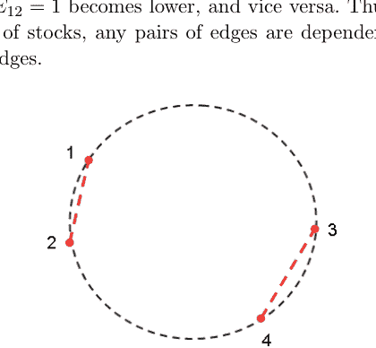

图 8.1：边的依赖性。四只股票映射到 (T−1) 维球面上。两条边 (1, 2) 和 (3, 4) 在 (E_{13}, E_{14}, E_{23}, E_{24}) 的条件下是条件依赖的。

跨市场的股票且无需假设单个股票具有不同的分布。示例可参见 Lo and MacKinlay (1990)，其中仅使用过去的收益来确定投资组合中的权重。

### 8.3.3 衡量股票市场的集体相关性

一个在许多电子商务中广泛应用的经验法则，例如 Facebook，可以如下：对于同时与他人相关联的两个主体，它们彼此相关的概率会更高。股票市场网络的类比是，与一只股票高度相关的两只股票往往高度相关。尽管此类论点在直觉上合理但经常被忽略，但对相关性的建模是有用的。

当市场中存在一定的聚类效应时，这一概念变得有意义。更具体地说，总是存在一些高度相关的股票对和一些不相关的股票对，而其他股票对则随时间变化。除了统计高度相关的股票对的数量外，更精细的方法是研究有多少候选对实际上显著相关。但哪一对股票可以被视为候选？当然，像行业部门这样的知识可能会揭示一些线索。但这种静态信息不足以描述动态系统。上述经验法则可以作为一种替代选择。

网络的聚类系数 (4) 实际上是对这一概念的良好实现。在整个网络上计算时，分母中的 2-星数量恰好表示根据获得的时间序列数据应为显著相关的候选股票对的数量。分子仅反映实现的候选数量。图 8.2 显示了概率函数 $P(E_{12}=1, E_{13}=1; \rho_{12}, \rho_{13}, \rho_{23})$ 在 $(\rho_{12}, \rho_{13})$ 不同取值下的等高线图，其中 $\rho_{23}=0$ 或 $0.5$。显然，计算聚类系数的权重放在实际相关性高的那些对上。

请注意，聚类系数不仅衡量相关性水平，还反映聚类效应。也就是说，它还涉及通过共同邻居对相关关系的可预测性，这是网络的局部属性。如果聚类效应确实存在，聚类系数将高于已连接边的比例。换句话说，当聚类效应较强时，市场高度一体化。

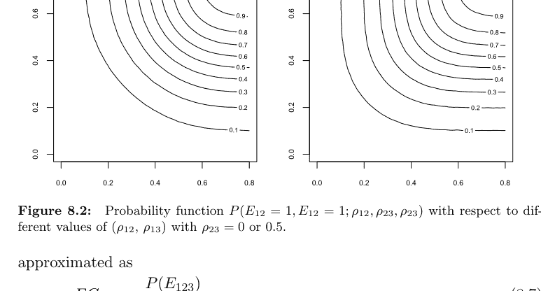

图 8.2：概率函数 $P(E_{12}=1, E_{13}=1; \rho_{12}, \rho_{13}, \rho_{23})$ 随 $(\rho_{12}, \rho_{13})$ 不同取值的变化，其中 $\rho_{23}=0$ 或 $0.5$。

对于非常大的 N 且在所有 ρ_{ij} 相等的均匀相关结构下，$C_{all}$ 的期望值和方差可近似为

$$EC_{all} \approx \frac{P(E_{123})}{P(E_{12}E_{13})}, \tag{8.7}$$

$$\mathrm{Var}(C_{all}) \approx \frac{P(E_{123}E_{456}) - P(E_{123})^2}{P(E_{12}E_{13})^2}
+ \frac{1}{4} \frac{P(E_{123})^2}{P(E_{12}E_{13})^4} \left(P(E_{12}E_{13}E_{45}E_{46}) - P(E_{12}E_{13})^2\right)
- \frac{2P(E_{123})}{P(E_{12}E_{13})^3} \left(P(E_{123}E_{45}E_{46}) - P(E_{123})P(E_{45}E_{46})\right). \tag{8.8}$$

请注意，其方差不会随着 $N$ 趋于无穷而收敛到零，因为所有相关对都是依赖的。相反，它趋于某个常数。图 8.3 显示了不同股票数量和显著性水平下的模拟结果。可以看出，聚类系数随着相关系数变化，但置信区间的宽度不会随这两个参数显著变化。

## 8.4 实证研究

在本研究中，我们使用来自标准普尔 500 指数成分的样本的日收益率进行数值说明。股票价格来自 Yahoo! Finance。这些数据包括 1996 年 1 月 2 日至 2009 年 8 月 31 日期间 389 家公司的 3441 个日价格。每家公司在此期间至少有 3400 个交易日。所有收益均已调整股息和拆股。收益的缺失值用 0 填充。

α = 0.01, N = 100

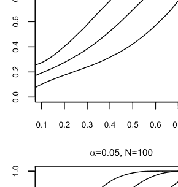

α = 0.01, N = 400

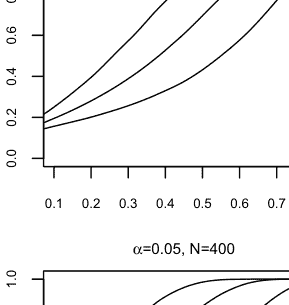

α = 0.05, N = 100

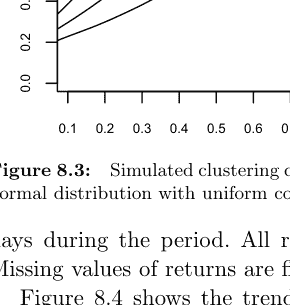

α = 0.05, N = 400

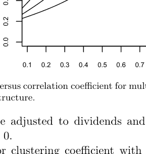

图 8.3：多元正态分布在均匀相关结构下模拟的聚类系数与相关系数的关系。

图 8.4 显示了显著性水平设为 5%、1% 和 0.5% 时聚类系数的趋势图。基本上三个时间序列具有相似的模式，但 5% 显著性水平的一个略向上偏移。这意味着与 1% 显著性水平相比的那些额外边倾向于产生更多三角形。这是股票市场中聚类效应的间接证据。此外，可以看出 1% 和 0.5% 的聚类系数趋势非常接近。将显著性水平设在此值附近可能是一个不错的选择。当然，最优选择仍值得进一步研究。

图 8.5 显示了 20 个随机样本（样本量为 100）的聚类系数的趋势图。一般来说，当聚类系数相对较低时，20 个聚类系数的多样性变得更大。这意味着当聚类系数较低时，市场“均匀性”较差。

1997-2009

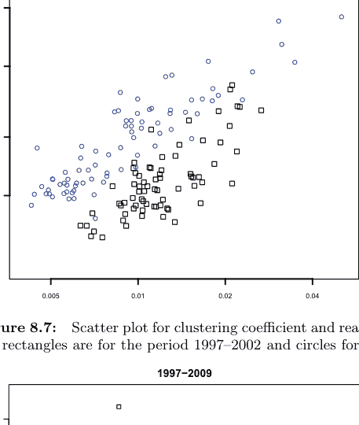

1997-2002

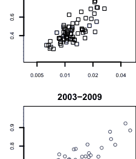

2003-2009

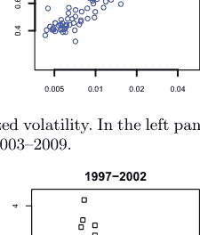

图 8.7：聚类系数与已实现波动率的散点图。左面板中，矩形为 1997-2002 年期间，圆形为 2003-2009 年。

1997-2009

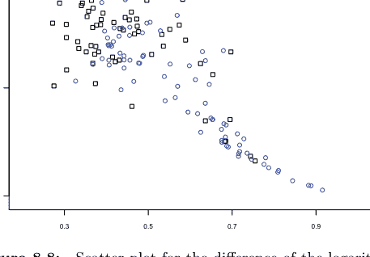

1997-2002

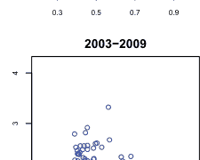

2003-2009

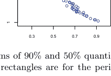

图 8.8：度数的 90% 和 50% 分位数对数差值与聚类系数的散点图。左面板中，矩形为 1997-2002 年期间，圆形为 2003-2009 年。


## 衡量大量股票的集体相关性

### 1997-2002

### 2003-2009

> 图 8.9：度数和聚类系数 90% 与 50% 分位数的对数之差的散点图。矩形由相应时期的实证数据得到。点是通过在正态性假设和均匀相关结构下模拟得到的。

市场是不均匀的，阈值约为 0.7。2002 年之后的时期，截断变得更清晰。

请注意，对数分位数之差在本质上是反向相关的。图 8.9 比较了来自真实数据以及在正态性假设和均匀相关结构下模拟的对数分位数之差。它说明了聚类系数较低时对数分位数之差的宽幅分布相当显著。

本文提出了一种网络方法来探索股票市场的相关结构。通过用指数随机图模型近似网络，它提供了一种降维的替代方法，同时考虑了大量股票。

同时，它可以在没有特定分布假设的情况下进行。最重要的是，这是一次将复杂系统联系起来的尝试。因为分布函数呈指数形式，因此式 (3) 中的归一化常数可以解释为在统计力学中起核心作用的配分函数。

市场网络的聚类系数衡量了通过邻域关系显著相关性的预测能力。它还隐含地反映了套利者的盈利能力，从而反映了做市商的融资流动性。实证研究表明，聚类系数与波动率之间存在正相关关系。这意味着聚类系数有潜力成为除波动率之外的一种替代风险度量。此外，网络方法确实可以揭示有关市场结构的大量信息。如第 8.4 节所示，牛市和熊市中存在相当不同的机制。开发识别市场状态的检验方法将是一项有趣的工作。为了使这一想法适用，未来研究中网络应在更高频率下构建。

网络方法可以激发大量扩展，在此方法下维度诅咒得到缓解。例如，利用短期时间序列确定因子数量是可能的。此外，网络建模提供了灵活性，可以在股票数量很大时容纳股票市场的可能结构。这些定量技术对于交易或资产配置的实际应用很有用。

## 致谢

作者感谢 Jin-Chuan Duan 教授和 Ruey S. Tsay 的有益讨论和建议。作者还感谢新加坡国立大学新加坡风险管理研究所、台湾科技部、国家理论科学中心和台湾国立交通大学辛屯丘中心的支持。

## 参考文献

- Ang, A. and Chen, J. (2002). 股票组合的非对称相关性. *金融经济学杂志*, 63, 443–494.
- Araújo, T. and Louçã, F. (2007). 崩盘的几何学。股票市场危机的动力学度量. *定量金融*, 7, 63–74.
- Becker, C. and Schmidt, W. (2010). 状态依赖的依赖关系：相关性的连续时间动力学. Available at SSRN: http://papers.ssrn.com/sol3/papers.cfm?abstract_id=1553115.
- Brunnermeier, M. and Pedersen, L. (2009). 市场流动性与融资流动性. *金融研究评论*, 22, 2201–2238.
- Campbell, R., Koedijk, K. and Kofman, P. (2002). 熊市中的相关性增加. *金融分析师*, 58, 87–94.
- Campbell, R., Forbes, C., Koedijk, K. and Kofman, P. (2007). 相关性增加还是只是厚尾？ Journal of Empirical Finance, 15, 287–309.
- Conrad, J. and Kaul, G. (1998). 交易策略的解剖. Review of Financial Studies, 11, 489–519.
- Dungey, M. and Martin, V. (2007). 危机期间金融市场联系的解开. Journal of Applied Econometrics, 22, 90–119.
- Efron, B. (2004). 大规模同时假设检验. Journal of the American Statistical Association, 99, 96–104.
- Efron, B. (2007). 相关性与大规模同时显著性检验. Journal of the American Statistical Association, 102, 93–103.
- Eichler, M. (2007). 多元时间序列的格兰杰因果与路径图. Journal of Econometrics, 137, 334–353.
- Emmert-Streib, F. and Dehmer, M. (2010). 识别道琼斯工业平均指数的关键金融网络：迈向基于网络的指数. Complexity, 16, 24–33.
- Engle, R. (2002). 动态条件相关性：多元广义自回归条件异方差模型的一个简单类别. Journal of Business & Economic Statistics, 20, 339–350.
- Forbes, K. and Rigobon, R. (2002). 没有传染，只有相互依赖：衡量股票市场共同运动. Journal of Finance, 57, 2223–2261.
- Frank, O. and Strauss, D. (1986). 马尔可夫图. Journal of the American Statistical Association, 81, 832–842.
- Gabaix, X., Gopikrishnan, P., Plerou, V. and Stanley, H. (2003). 金融市场波动中幂律分布的理论. Nature, 423, 267–270.
- Granger, C. (2008). 非线性模型：我们下一步去哪里——时变参数模型？ Studies in Nonlinear Dynamics & Econometrics, 12, Article 1.
- Hartmann, P., Straetmans, S. and de Vries C. (2004). 危机时期的资产市场联系. Review of Economics and Statistics, 86, 313–326.
- Hong, Y., Tu, J. and Zhou, G. (2007). 股票回报的非对称性：统计检验与经济评价. Review of Financial Studies, 20, 1547–1581.
- Huang, J. and Wang, J. (2009). 流动性与市场崩盘. Review of Financial Studies, 22, 2607–2643.
- Hunter, D. (2007). 社会网络的曲线指数族模型. Social Networks, 29, 216–230.
- Karolyi, G. and Stulz, R. (1996). 为什么市场会一起动？美日股票回报共同运动的调查. Journal of Finance, 51, 951–986.
- Khandani, A. and Lo, A. (2007). 2007 年 8 月量化交易发生了什么？ Journal of Investment Management, 5, 5–54.
- Laloux, L., Cizeau, P., Bouchaud, J. and Potters, M. (1999). 金融相关矩阵的噪声修饰. Physical Review Letters, 83, 1467–1470.
- Lee, T., Cho, J., Kwon, D. and Sohn, S. (2018). 基于金融网络指标的全球股票市场投资策略：使用机器学习技术. Expert Systems with Applications, 117, 228–242.
- Lo, A. and MacKinlay, A. (1990). 当逆向投资收益源于股票市场过度反应时？ Review of Financial Studies, 3, 175–205.
- Longin, F. and Solnik, B. (2001). 国际股票市场的极端相关性. Journal of Finance, 56, 649–676.
- Newman, M., Strogatz, S. and Watts, D. (2001). 具有任意分布的随机图及其应用. Physical Review E, 64, 026118.
- Newman, M. (2003). 复杂网络的结构与功能. SIAM Review, 45, 167–256.
- Okimoto, T. (2008). 国际股票市场非对称依赖结构的新证据. Journal of Financial and Quantitative Analysis, 43, 787–815.
- Pedersen, L. (2009). 当每个人都争相逃离时. International Journal of Central Banking, 5, 177–199.
- Peralta, G. (2015). 基于网络的度量作为市场不稳定性的领先指标：西班牙股票市场的案例. Journal of Network Theory in Finance, 1, 91–122.
- Peralta, G. and Zareei, A. (2016). 投资组合选择的网络方法. Journal of Empirical Finance, 38, 157–180.
- Penzer, J., Schmid, F. and Schmidt, R. (2011). 衡量金融市场中的大规模共同运动. Quantitative Finance, 11, 1–13.
- Ramchand, L. and Susmel, R. (1998). 主要股票市场间的波动率与交叉相关. Journal of Empirical Finance, 5, 397–416.
- Rodriguez, J. (2006). 衡量金融传染：一种 Copula 方法. Journal of Empirical Finance, 14, 401–423.
- Snijders, T., Pattison, P., Robins, G. and Handcock, M. (2006). 指数随机图模型的新规范. Sociological Methodology, 36, 99–153.
- Straetmans, S., Verschoor, W. and Wolff, C. (2008). 9/11 后美国股票市场极端波动. Journal of Applied Econometrics, 23, 17–42.
- Sun, W. and Cai, T. (2009). 依赖条件下的大规模多重检验. Journal of the Royal Statistical Society Series, B 71, 393–424.
- Tse, Y. and Tsui, A. (2002). 具有时变相关性的多元广义自回归条件异方差模型. Journal of Business & Economic Statistics, 20, 351–362.
- Wen, D., Ma, C., Wang, G. and Wang, S. (2018). 研究配对交易策略的特征：中国股票市场的网络视角. Physica A: Statistical Mechanics and its Applications, 505, 903–918.
- Zhao, L., Wang, G., Wang, M., Bao, W., Li, W. and Stanley, H. (2018). 股票市场作为时序网络. Physica A: Statistical Mechanics and its Applications, 506, 1104–1112.


## 第9章

## 基于交互强度的关键借款人识别

福阿德·阿列斯克罗夫，伊琳娜·安德烈夫斯卡娅，阿丽莎·尼基京娜
和谢尔盖·什维敦

### 目录

- 9.1 引言 ........................................ 356
- 9.2 长期交互情形的方法论 ........ 358
- 9.3 基于路径的S-长程交互指数 ............ 361
- 9.4 实证应用——国家评估 ............... 369
- 9.5 结论 ............................................ 377
- 致谢 .............................................. 377
- 参考文献 ................................................. 378

福阿德·阿列斯克罗夫
国立研究大学高等经济学院（HSE），俄罗斯科学院 V.A. 特拉佩兹尼科夫控制科学研究所（ICS RAS）
电子邮箱：alesk@hse.ru

伊琳娜·安德烈夫斯卡娅
国立研究大学高等经济学院（HSE），尼科洛·库萨诺大学
电子邮箱：irina.k.andrievskaia@gmail.com

阿丽莎·尼基京娜
国立研究大学高等经济学院（HSE）
电子邮箱：knurova.a.a@gmail.com

谢尔盖·什维敦
国立研究大学高等经济学院（HSE），俄罗斯科学院 V.A. 特拉佩兹尼科夫控制科学研究所（ICS RAS）
电子邮箱：shvydun@hse.ru

附录9A：短程交互情形的方法论 . . . . . . . . . . . . . . . . . . . 380

附录9B：基于模拟的S-长程交互中心性指数 . . . . . . . . . . . . . . . . . . . 382

附录9C：中心性度量 . . . . . . . . . . . . . . . . . . . . . . . 387

### 摘要

我们提出了一种评估金融机构或系统相互关联水平的新方法，因为目前文献中提出的度量指标并未充分考虑相互关联性的一个重要方面——参与者的群体交互。我们的方法基于权力指数和中心性分析，用于在贷款市场中识别关键借款人。该方法具有三个显著特征：考虑参与者之间的长程交互、参与者的属性，以及一个参与者受到其他参与者群体影响的可能性。这种方法使我们能够识别出经典中心性度量或其他指数无法检测到的系统重要性元素。我们采用所提出的方法分析了截至2015年第一季度的银行对外债权。利用我们的方法，我们识别出两类关键借款人：（a）具有高评级和良好信用记录的主要参与者；（b）中介型参与者，它们通过营造有利的投资条件和积极的商业环境，开展了大规模金融活动。

### 关键词

权力指数 • 关键借款人 • 系统重要性 • 相互关联性 • 中心性 • S-长程交互 • 路径

### 9.1 引言

美联储主席本·伯南克在美国国会作证时指出：“如果说这场危机有一个教训，那就是‘大到不能倒’的问题必须得到解决”（Bernanke, 2010）。因此，识别具有系统相关性的机构，尤其是银行，是评估金融稳定和加强宏观监管的关键任务。

系统重要性可以通过两种方式识别：一是使用基于指标的方法（参见 BCBS, 2013；ECB, 2006；IMF, 2010），二是考察机构对系统性风险的贡献（参见 Acharya et al., 2010；Adrian and Brunnermeier, 2010；Bluhm and Krahnen, 2014；Chan-Lau, 2010；Drehmann and Tarashev, 2011；Huang et al., 2012；Lehar, 2005；Segoviano and Goodhart, 2009；Tarashev et al., 2010；Zhou, 2010）。

相互关联性被认为是最相关的系统重要性指标之一（参见 Chan-Lau, 2010；ECB, 2010；IMF/BIS/FSB, 2009；Leon and Murcia, 2012；Brühl, 2017）。巴塞尔银行监管委员会（BCBS）提出了一种基于指标的方法，用于评估

## 基于交互强度的关键借款人识别

金融机构的相互关联水平（BCBS, 2013）。使用这种方法的其他例子还包括（ECB, 2014；IMF, 2015）。

评估相互关联水平的另一种方法是运用网络理论。在这种情况下，网络可以看作由节点（金融机构）和节点之间的连接（资本流）组成的系统。网络分析已被应用于股票所有权风险（Garlaschelli et al., 2005）、银行间市场和支付系统中传染与系统性风险的出现（Angelini et al., 1996；Furfine, 2003；Iori et al., 2008），也用于研究国家或国际层面金融体系的相互关联程度（Allen and Babus, 2009；Allen and Gale, 2000；Malik and Xu, 2017；Sun and Chan-Lau, 2017）。

为了衡量网络中节点的重要性程度，已有许多中心性指标被提出（Bonacich, 1972；Barrat et al., 2004；von Peter, 2007；Newman, 2010；Peltonen et al., 2015）。例如，IMF（2010）和 von Peter（2007）在全球金融体系框架内使用度中心性、接近中心性、介数中心性、中介度（仅 von Peter（2007）使用）和声望中心性（即 Bonacich 中心性），以揭示联系最紧密的银行业部门。这些中心性度量也广泛用于银行间市场研究（Akram and Christophersen, 2010；Bech and Atalay, 2008；Cajueroa and Tabak, 2008；Iori et al., 2008 等）以及全球银行网络分析（Minoui and Reyes, 2013；Aldasoro and Alves, 2017）。

评估网络中元素重要程度的其他尝试基于模拟机制。例如，通过将博弈论应用于随机主体模型，开发了一种企业动态模拟方法，用以分析商业环境中的不确定性（Ikeda et al., 2007；Giovanetti, 2012）。此外，模拟程序被广泛用于评估产业交易网络、产权关系、产业与创新集群的动态，以及对银行间市场和支付系统中的金融风险进行建模。

网络中关键节点识别的许多尝试源于合作博弈论。在这种情况下，网络被解释为一组相互作用的个体，它们对网络的总产出价值作出贡献，问题在于如何在它们之间分配所产生的价值。Myerson（1977）针对通信博弈提出了一种基于 Shapley–Shubik 指数（Shapley and Shubik, 1954）的度量。Myerson 值是网络博弈中的一种分配规则，其中每个个体的价值取决于该网络在有和没有该个体的情况下所产生的价值。已有若干研究尝试运用权力指数来识别具有系统重要性的金融机构（Tarashev et al., 2010；Drehmann and Tarashev, 2011；Garratt et al., 2012）。

然而，上述方法并未完全纳入参与者之间联系的强度，也完全没有考虑参与者对系统的群体影响。它们同样没有考虑参与者的个体参数。因此，本文旨在提出一种将所有这些不足都考虑在内的分析方法。

我们的方法论是在 Aleskerov et al.（2016）提出的方法基础上的扩展，该文作者提出了一种基于偏好的权力指数——我们称之为关键借款人指数（KBI）。该指数考虑了每个贷款方与其借款人之间的短程交互。我们对这一指数进行修改，以考虑长程交互，并提出使用长程交互中心性（LRIC）度量。

本文的贡献有两个方面。第一，我们为系统重要性分析文献做出贡献，提出了一种评估机构或系统相互关联水平的方法，该方法考虑了市场参与者之间的短程和长程交互。第二，我们为金融网络文献做出贡献，提出了一种可用于金融体系分析的中心性度量。

本文结构如下。我们在接下来两节中解释我们的方法论。第4节介绍所提方法的实证应用。第5节给出结论。

### 9.2 长期交互情形的方法论

在本节中，我们扩展 Aleskerov et al.（2016）提出的方法，以考虑系统参与者之间的长期交互（关于该方法论的更多细节，请参见附录9A）。我们的方法基于一个非常简单的观察。当我们考虑由贷款方和借款方组成的互联网络时，每个债权人的可持续性将受到其直接借款人的影响。此外，任何一个直接借款人也可能因其自身发放贷款的对象的破产而发生破产，也就是说，直接借款人和间接借款人都与原始债权人相关联。换言之，我们的方法使我们不仅能够在第一层级上考虑贷款方与借款方之间的交互，而且还能考虑更深层级的交互。


网络成员之间长程相互作用的考虑方式存在两种不同的思路。第一种是基于距离的方法，其中为每个成员考虑所有不同的路径并以某种方式汇总为单一值。第二种基于模拟的思想，我们分析单个成员及其组合对整个网络的影响（请参阅附录 9B 了解基于模拟方法的进一步细节）。这两种思路都易于解释，并且可以应用于不同的领域。

本节的目的是详细解释我们的方法并展示其在数值示例（见图 9.1）中的工作原理。我们考虑代理人借贷活动的一个复杂相互连接系统。边上的值表示一个代理人给予另一个代理人的贷款金额，网络结构对应于蝴蝶结表示。此外，该网络在结构上更接近实际存在的金融互动网络，因为代理人之间的联系更加多样化，且强连通分量较少。如前所述，我们提出了两种方法来寻找系统中的关键借款人。

与 KBI 的主要区别在于，现在考虑了每个贷款人的 s-长程借款人。在许多问题中，间接邻居的相互作用在整个系统中起着重要作用，因此需要

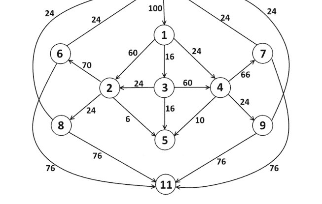

图 9.1：数值示例。

考虑这些联系。参数 s 定义了为每个贷款人检查多少“层”，它取决于问题，在一般情况下可以未指定，以便考虑所有可能的直接和间接邻居。

为描述所提出的方法，下面给出一些定义。

考虑一个成员集合 N，N = {1,...,n}，以及一个矩阵 A = [a_ij]，其中 i, j ∈ N 且 a_ij 是成员 i 向成员 j 的贷款。为简单起见，假设矩阵 A 已被转换，即如果 a_ij ≠ 0 则 a_ji = 0。

用 N_i 表示第 i 个成员的直接邻居集合，即 N_i = {j ∈ N: a_ij ≠ 0}。显然，成员 i 的直接邻居可能组的总数等于 2^{|N_i|}。

### 定义 1.
第 i 个成员的直接邻居组 Ω(i) ⊆ N_i 是关键的，如果 ∑_{j∈Ω(i)} a_{ij} ≥ q_i，其中 q_i 是第 i 个成员的预定义阈值。

### 定义 2.
成员 x ∈ Ω(i) 是关键的，如果 ∑_{j∈Ω(i)\{x}} a_{ij} < q_i。用 Ω_p(i) 表示组 Ω(i) 中的关键成员集合，即 Ω_p(i) = {y ∈ Ω(i) | ∑_{j∈Ω(i)\{y}} a_{ij} < q_i}。

对于我们的数值示例，系统中共有 11 个代理人（n = 11）：其中 9 个既是贷款人也是借款人，而剩下的两个元素是纯借款人。因此，我们可以形成大小为 11 × 11 的矩阵 A。当 q_i = 25% 时，每个元素的直接邻居集合 N_i 和关键组如表 9.1 所示。

当 q_1 = 25% 时，元素 1 的关键成员如表 9.2 所示。

### 表 9.1：数值示例的直接借款人和关键群体。

| 元素, i | 直接借款人, N_i | 关键组, Ω(i), q = 25% |
|---|---|---|
| 1 | {2, 3, 4} | {2}, {2, 3}, {2, 4}, {3, 4}, {2, 3, 4} |
| 2 | {5, 6, 8} | {6}, {5, 6}, {5, 8}, {6, 8}, {5, 6, 8} |
| 3 | {2, 4, 5} | {4}, {2, 4}, {2, 5}, {4, 5}, {2, 4, 5} |
| 4 | {5, 7, 9} | {7}, {5, 7}, {5, 9}, {7, 9}, {5, 7, 9} |
| 5 | ∅ | ∅ |
| 6 | {10, 11} | {11}, {10, 11} |
| 7 | {10, 11} | {11}, {10, 11} |
| 8 | {10, 11} | {11}, {10, 11} |
| 9 | {10, 11} | {11}, {10, 11} |
| 10 | {1} | {1} |
| 11 | ∅ | ∅ |

### 表 9.2：元素 1 的关键组和关键成员。

| 关键组, Ω(1) | 关键成员, Ω_p(1) |
|---|---|
| {2} | {2} |
| {2,3} | {2} |
| {2,4} | {2} |
| {3,4} | {3,4} |
| {2,3,4} | ∅ |

## 9.3 基于路径的 S-长程相互作用指数

让我们根据矩阵 A 和预定义阈值构造矩阵 C = [c_ij] 如下

c_ij = { a_ij / min_{Ω(i)⊆N_i | j∈Ω_p(i)} Σ_{l∈Ω(i)} a_il , if j ∈ Ω_p(i) ⊆ N_i ; 0, j ∉ Ω_p(i) ⊆ N_i }

其中 Ω(i) 是元素 i 的直接邻居的关键组，Ω(i) ⊆ N_i，且 Ω_p(i) 是元素 i 的关键组，Ω_p(i) ⊆ Ω(i)。矩阵 C 的构造与前几节描述的方法高度相关，因为有必要将系统的每个元素单独视为贷款人，而系统的其他参与者被视为借款人。这里唯一的差别是只考虑直接邻居的组。矩阵 C 的解释相当简单。如果 c_ij = 1，则借款人 j 对贷款人 i 具有最大影响，即对借款人 j 的贷款金额对贷款人 i 来说是关键的。相反，如果 c_ij = 0，则借款人 j 不直接影响贷款人 i。最后，值 0 < c_ij < 1 表示借款人 j 对贷款人 i 破产的影响程度。让我们根据基于路径的方法，以阈值 q = 25% 为数值示例构造矩阵 C = [c_ij]。例如，当我们想估计元素 1 的借款人的直接影响时，我们寻找一个最小的关键组，即从元素 1 出发的总贷款最低的关键组，其中特定借款人是关键的，然后估计直接影响 c_1j。根据表 9.1，元素 1 有 3 个直接借款人，因此元素 2 的最小关键组为 {2} 且 c_12 = 60/60 = 1。对于元素 3 和 4，最小关键组为 {3, 4} 且 c_13 = 16/(16 + 24) = 0.4，c_14 = 24/(16 + 24) = 0.6。

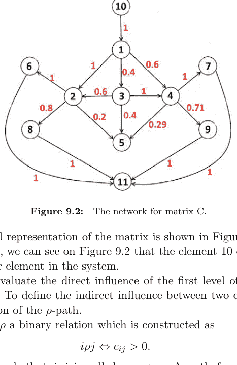

图 9.2：矩阵 C 的网络。

矩阵的图形表示如图 9.2 所示。

此外，我们可以在图 9.2 上看到元素 10 不影响系统中的任何其他元素。

因此，我们评估系统中每个元素的第一层直接影响。为了定义两个元素之间的间接影响，让我们给出 ρ-路径的定义。

用 ρ 表示一个二元关系，其构造如下

$i\rho j \Leftrightarrow c_{ij} > 0.$

满足 $i\rho j$ 的一对 $(i, j)$ 称为 $\rho$-步。从 $i$ 到 $j$ 的路径是从 $i$ 开始并以 $j$ 结束的有序步骤序列，使得每个步骤中的第二个元素与下一个步骤的第一个元素一致。如果路径中的所有步骤都属于同一关系 $\rho$，我们称其为 $\rho$-路径，即 $\rho$-路径是有序元素序列 $i, j_1, \dots, j_k, j$，使得 $i\rho j_1, j_1\rho j_2, \dots, j_{k-1}\rho j_k, j_k\rho j$。路径中的步骤数称为路径的长度。

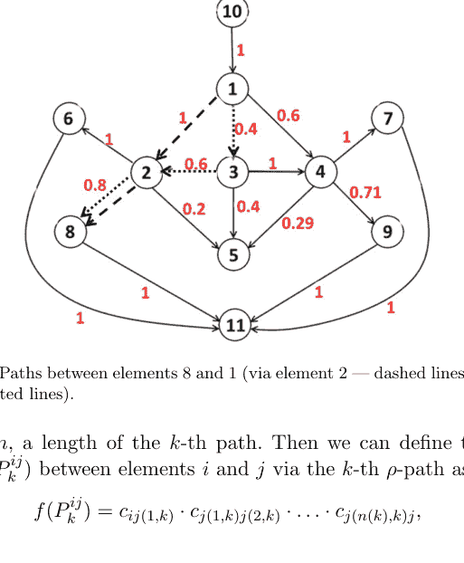

图 9.3：元素 8 和 1 之间的路径（经由元素 2 — 虚线，经由元素 2 和 3 — 点线）。

k = 1, …, m，为第 k 条路径的长度。然后我们可以通过第 k 条 ρ-路径定义元素 i 和 j 之间的间接影响 f(P_k^{ij}) 为

f(P_k^{ij}) = c_{ij(1,k)} · c_{j(1,k)j(2,k)} · … · c_{j(n(k),k)j}, (9.1)

或

f(P_k^{ij}) = min(c_{ij(1,k)}, c_{j(1,k)j(2,k)}, …, c_{j(n(k),k)j}), (9.2)

其中 j(l,k)，l = 1, …, n(k)，是第 k 条 ρ-路径上从 i 到 j 出现的第 l 个元素。

公式 (1) 和 (2) 的解释如下。根据公式 (9.1)，元素 j 通过第 k 条 ρ-路径 P_k^{ij} 对元素 i 的总影响被计算为位于 i 和 j 之间第 k 条 ρ-路径上元素之间直接影响的聚合值，而公式 (9.2) 将总影响定义为第 k 条 ρ-路径上任意元素之间直接影响的最小值。

图 9.4 提供了两个元素之间间接影响估计的简单示例。在第一种情况下，影响与路径上每个借款人破产的损失（风险）成比例，而在第二种情况下，影响等于元素 1 和 2 之间路径上借款人破产的最小风险。

有必要提到，在某些情况下没有必要考虑元素 i 和 j 之间所有可能的路径，即我们可以假设从某个路径长度 s 开始，间接相互作用不会影响初始


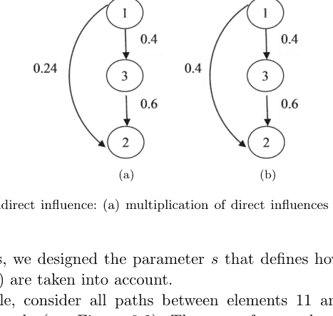

图9.4：间接影响：(a) 直接影响的乘积 和 (b) 最小直接影响。

成员。因此，我们设计了参数 s，用于定义需要考虑的层数（路径长度）。

例如，考虑数值示例（见图9.2）中元素11和1之间的所有路径。这些元素之间存在四条路径：11→8→2→1、11→9→4→1、11→8→2→3→1和11→9→4→3→1。如果参数 s = 3，那么我们将只关注前两条路径，而其他路径将不予考虑。

由于系统中两个元素之间可能存在许多路径，因此存在聚合不同路径影响的问题。为此，提出了几种方法来估计聚合后的间接影响。

聚合结果将构成一个新矩阵 C*(s) = [c_ij*(s)]。

- (1) 间接影响：路径影响之和
- $c_{ij}^*(s) = \min\left(1, \sum_{k: n(k) \le s} f(P_k^{ij})\right).$ (9.3)
- (2) 间接影响：最大路径影响
- $c_{ij}^*(s) = \max_{k: n(k) \le s} f(P_k^{ij}).$ (9.4)
- (3) 间接影响：阈值规则 (9.5)

阈值聚合在（Aleskerov 等，2007）中提出，其规则思想相当简单。假设我们有一组元素，每个元素用 n 个等级进行评估，这些等级可能有 m 个不同的值。然后我们可以为每个元素计算值 v1(k), v2(k), ..., vm(k)，这些值包含每个元素获得多少第 i 个（i = 1,...,m）等级的信息。然后根据阈值规则，如果 v1(x) < v1(y)，或者存在 d ≤ m，使得 v_h(x) = v_h(y) 对所有 h = 1,...,d - 1 成立，且 v_d(x) < v_d(y)，则元素 x V-支配元素 y。换句话说，

## 表9.3：间接影响路径聚合方法的可能组合。

| 路径影响 |  | 路径聚合 |  |  |
|---|---|---|---|---|
|  | 直接影响的乘积 | 路径影响之和 | 最大路径影响 | 阈值规则 |
|  |  | SumPaths | MaxPath | MultT |
|  | 最小直接影响 | — | MaxMin | MaxT |

对于我们的数值示例，我们可以用不同方式构造矩阵 C*，该矩阵表示总影响，并用于将各影响按权重聚合为单一向量。

例如，让我们计算元素5对元素1的影响。考虑从元素5到元素1的所有可能路径。它们如表9.4所示。

因此，我们现在可以通过不同方法将这些信息聚合为单一值。为了通过阈值规则比较不同路径，我们制定了以下直接影响等级。

## 等级：

- 0. $c_{ij}=0;$
- 1. $0 < c_{ij} \le 0.25;$
- 2. $0.25 < c_{ij} \le 0.5;$
- 3. $0.5 < c_{ij} \le 0.8;$
- 4. $0.8 < c_{ij} \le 1.$

现在我们可以根据阈值规则定义元素5和1之间的路径。注意，对于阈值规则，边上的值等于上述提出的等级。结果见表9.5。

总体结果见表9.6。

类似地，我们可以估计任何其他元素的影响，并根据不同方法构造矩阵 C*。结果见表9.7–9.11。

将矩阵 C*(s) 聚合为单一向量，以显示系统中每个元素的总影响，可以按照第9.2节中的方法，根据每个元素的权重（重要性）进行。

因此，我们可以看到，元素6、7和11被认为是系统中最重要的，而元素5的影响大于元素1和10的影响。

## 表9.4：元素5和1之间可能路径。

| 编号 | 路径 | 路径影响的乘积 | 最小直接影响 |
|---|---|---|---|
| 1 | 5 → 2 → 1<br>0.2   1 | 0.2 | 0.2 |
| 2 | 5 → 3 → 1<br>0.4   0.4 | 0.16 | 0.4 |
| 3 | 5 → 4 → 1<br>0.29   0.6 | 0.174 | 0.29 |
| 4 | 5 → 2 → 3 → 1<br>0.2   0.6   0.4 | 0.048 | 0.2 |
| 5 | 5 → 4 → 3 → 1<br>0.29   1   0.4 | 0.116 | 0.29 |

## 表9.5：阈值规则下的路径聚合，*s* = 3。

| 编号，*k* | 路径 | 路径（边上的等级） | 路径影响，*v(P*<sub>k</sub><sup>15</sup>*) |
|---:|---|---|---:|
| 1 | 5 → 2 → 1<br>0.2, 1 | 5 → 2 → 1<br>1, 1 | 66 |
| 2 | 5 → 3 → 1<br>0.4, 0.4 | 5 → 3 → 1<br>2, 2 | 33 |
| 3 | 5 → 4 → 1<br>0.29, 0.6 | 5 → 4 → 1<br>2, 2 | 21* |
| 4 | 5 → 2 → 3 → 1<br>0.2, 0.6, 0.4 | 5 → 2 → 3 → 1<br>1, 3, 2 | 84 |
| 5 | 5 → 4 → 3 → 1<br>0.29, 1, 0.4 | 5 → 4 → 3 → 1<br>2, 4, 2 | 33 |

## 表9.6：不同方法下元素5对元素1的总影响。

| 方法 | 考虑的路径编号 | 影响 |
|---|---:|---:|
| SumPaths | 1–5 | 0.698 |
| MaxPath | 1 | 0.2 |
| MaxMin | 2 | 0.4 |
| MultT | 3 | 0.174 |
| MaxT | 3 | 0.29 |

## 表9.7：数值示例的矩阵 C*（SumPaths）。

|  | 1 | 2 | 3 | 4 | 5 | 6 | 7 | 8 | 9 | 10 | 11 | 权重 |
|---|---|---|---|---|---|---|---|---|---|---|---|---|
| **1** | 0 | 1 | 0.40 | 1 | 0.70 | 1 | 1 | 0.99 | 0.71 | 0 | 1 | 0.11 |
| **2** | 0 | 0 | 0 | 0 | 0.20 | 1 | 0 | 0.80 | 0 | 0 | 1 | 0.11 |
| **3** | 0 | 0.60 | 0 | 1 | 0.81 | 0.60 | 1 | 0.48 | 0.71 | 0 | 1 | 0.11 |
| **4** | 0 | 0 | 0 | 0 | 0.29 | 0 | 1 | 0 | 0.71 | 0 | 1 | 0.11 |
| **5** | 0 | 0 | 0 | 0 | 0 | 0 | 0 | 0 | 0 | 0 | 0 | 0 |
| **6** | 0 | 0 | 0 | 0 | 0 | 0 | 0 | 0 | 0 | 0 | 1 | 0.11 |
| **7** | 0 | 0 | 0 | 0 | 0 | 0 | 0 | 0 | 0 | 0 | 1 | 0.11 |
| **8** | 0 | 0 | 0 | 0 | 0 | 0 | 0 | 0 | 0 | 0 | 1 | 0.11 |
| **9** | 0 | 0 | 0 | 0 | 0 | 0 | 0 | 0 | 0 | 0 | 1 | 0.11 |
| **10** | 1 | 1 | 0.40 | 1 | 0.70 | 1 | 1 | 0.99 | 0.71 | 0 | 1 | 0.11 |
| **11** | 0 | 0 | 0 | 0 | 0 | 0 | 0 | 0 | 0 | 0 | 0 | 0 |
| 总计 | 0.11 | 0.29 | 0.09 | 0.33 | 0.30 | 0.40 | 0.44 | 0.36 | 0.31 | 0 | 1 |  |
| 总计（归一化） | 0.03 | 0.08 | 0.02 | 0.09 | 0.08 | 0.11 | 0.12 | 0.10 | 0.09 | 0 | 0.27 |  

## 表9.8：数值示例的矩阵 C*（MaxPath）。

|  | 1 | 2 | 3 | 4 | 5 | 6 | 7 | 8 | 9 | 10 | 11 | 权重 |
|---|---|---|---|---|---|---|---|---|---|---|---|---|
| **1** | 0 | 1 | 0.40 | 0.60 | 0.20 | 1 | 0.60 | 0.80 | 0.42 | 0 | 1 | 0.11 |
| **2** | 0 | 0 | 0 | 0 | 0.20 | 1 | 0 | 0.80 | 0 | 0 | 1 | 0.11 |
| **3** | 0 | 0.60 | 0 | 1 | 0.40 | 0.60 | 1 | 0.48 | 0.71 | 0 | 1 | 0.11 |
| **4** | 0 | 0 | 0 | 0 | 0.29 | 0 | 1 | 0 | 0.71 | 0 | 1 | 0.11 |
| **5** | 0 | 0 | 0 | 0 | 0 | 0 | 0 | 0 | 0 | 0 | 0 | 0 |
| **6** | 0 | 0 | 0 | 0 | 0 | 0 | 0 | 0 | 0 | 0 | 1 | 0.11 |
| **7** | 0 | 0 | 0 | 0 | 0 | 0 | 0 | 0 | 0 | 0 | 1 | 0.11 |
| **8** | 0 | 0 | 0 | 0 | 0 | 0 | 0 | 0 | 0 | 0 | 1 | 0.11 |
| **9** | 0 | 0 | 0 | 0 | 0 | 0 | 0 | 0 | 0 | 0 | 1 | 0.11 |
| **10** | 1 | 1 | 0.40 | 0.60 | 0.20 | 1 | 0.60 | 0.80 | 0.42 | 0 | 1 | 0.11 |
| **11** | 0 | 0 | 0 | 0 | 0 | 0 | 0 | 0 | 0 | 0 | 0 | 0 |
| 总计 | 0.11 | 0.29 | 0.09 | 0.24 | 0.14 | 0.40 | 0.36 | 0.32 | 0.25 | 0 | 1 |  |
| 总计（归一化） | 0.03 | 0.09 | 0.03 | 0.08 | 0.04 | 0.12 | 0.11 | 0.10 | 0.08 | 0 | 0.31 |  

## 表9.9：数值示例的矩阵 C*（MaxMin）。

|  | 1 | 2 | 3 | 4 | 5 | 6 | 7 | 8 | 9 | 10 | 11 | 权重 |
|---|---|---|---|---|---|---|---|---|---|---|---|---|
| **1** | 0 | 1 | 0.40 | 0.60 | 0.40 | 1 | 0.60 | 0.80 | 0.60 | 0 | 1 | 0.11 |
| **2** | 0 | 0 | 0 | 0 | 0.20 | 1 | 0 | 0.80 | 0 | 0 | 1 | 0.11 |
| **3** | 0 | 0.60 | 0 | 1 | 0.40 | 0.60 | 1 | 0.60 | 0.71 | 0 | 1 | 0.11 |
| **4** | 0 | 0 | 0 | 0 | 0.29 | 0 | 1 | 0 | 0.71 | 0 | 1 | 0.11 |
| **5** | 0 | 0 | 0 | 0 | 0 | 0 | 0 | 0 | 0 | 0 | 0 | 0 |
| **6** | 0 | 0 | 0 | 0 | 0 | 0 | 0 | 0 | 0 | 0 | 1 | 0.11 |
| **7** | 0 | 0 | 0 | 0 | 0 | 0 | 0 | 0 | 0 | 0 | 1 | 0.11 |
| **8** | 0 | 0 | 0 | 0 | 0 | 0 | 0 | 0 | 0 | 0 | 1 | 0.11 |
| **9** | 0 | 0 | 0 | 0 | 0 | 0 | 0 | 0 | 0 | 0 | 1 | 0.11 |
| **10** | 1 | 1 | 0.40 | 0.60 | 0.40 | 1 | 0.60 | 0.80 | 0.60 | 0 | 1 | 0.11 |
| **11** | 0 | 0 | 0 | 0 | 0 | 0 | 0 | 0 | 0 | 0 | 0 | 0 |
| 总计 | 0.11 | 0.29 | 0.09 | 0.24 | 0.19 | 0.40 | 0.36 | 0.33 | 0.29 | 0 | 1 |  |
| 总计（归一化） | 0.03 | 0.09 | 0.03 | 0.07 | 0.06 | 0.12 | 0.11 | 0.10 | 0.09 | 0 | 0.30 |


**表9.10：** 数值示例MultT的矩阵\(C^*\)。

|   | 1 | 2 | 3 | 4 | 5 | 6 | 7 | 8 | 9 | 10 | 11 | 权重 |
|---|---:|---:|---:|---:|---:|---:|---:|---:|---:|---:|---:|---:|
| 1 | 0 | 1 | 0.40 | 0.60 | 0.18 | 1 | 0.60 | 0.80 | 0.42 | 0 | 1 | 0.11 |
| 2 | 0 | 0 | 0 | 0 | 0.20 | 1 | 0 | 0.80 | 0 | 0 | 1 | 0.11 |
| 3 | 0 | 0.60 | 0 | 1 | 0.40 | 0.60 | 1 | 0.48 | 0.71 | 0 | 1 | 0.11 |
| 4 | 0 | 0 | 0 | 0 | 0.29 | 0 | 1 | 0 | 0.71 | 0 | 1 | 0.11 |
| 5 | 0 | 0 | 0 | 0 | 0 | 0 | 0 | 0 | 0 | 0 | 0 | 0 |
| 6 | 0 | 0 | 0 | 0 | 0 | 0 | 0 | 0 | 0 | 0 | 1 | 0.11 |
| 7 | 0 | 0 | 0 | 0 | 0 | 0 | 0 | 0 | 0 | 0 | 1 | 0.11 |
| 8 | 0 | 0 | 0 | 0 | 0 | 0 | 0 | 0 | 0 | 0 | 1 | 0.11 |
| 9 | 0 | 0 | 0 | 0 | 0 | 0 | 0 | 0 | 0 | 0 | 1 | 0.11 |
| 10 | 1 | 1 | 0.40 | 0.60 | 0.18 | 1 | 0.60 | 0.80 | 0.42 | 0 | 1 | 0.11 |
| 11 | 0 | 0 | 0 | 0 | 0 | 0 | 0 | 0 | 0 | 0 | 0 | 0 |
| **总计** | 0.11 | 0.29 | 0.09 | 0.24 | 0.14 | 0.40 | 0.36 | 0.32 | 0.25 | 0 | 1 |  |
| **总计（归一化）** | **0.03** | **0.09** | **0.03** | **0.07** | **0.04** | **0.12** | **0.11** | **0.10** | **0.08** | **0** | **0.31** |  |

**表9.11：** 数值示例MaxT的矩阵\(C^*\)。

|   | 1 | 2 | 3 | 4 | 5 | 6 | 7 | 8 | 9 | 10 | 11 | 权重 |
|---|---:|---:|---:|---:|---:|---:|---:|---:|---:|---:|---:|---:|
| 1 | 0 | 1 | 0.40 | 0.60 | 0.29 | 1 | 0.60 | 0.80 | 0.60 | 0 | 1 | 0.11 |
| 2 | 0 | 0 | 0 | 0 | 0.20 | 1 | 0 | 0.80 | 0 | 0 | 1 | 0.11 |
| 3 | 0 | 0.60 | 0 | 1 | 0.40 | 0.60 | 1 | 0.60 | 0.71 | 0 | 1 | 0.11 |
| 4 | 0 | 0 | 0 | 0 | 0.29 | 0 | 1 | 0 | 0.71 | 0 | 1 | 0.11 |
| 5 | 0 | 0 | 0 | 0 | 0 | 0 | 0 | 0 | 0 | 0 | 0 | 0 |
| 6 | 0 | 0 | 0 | 0 | 0 | 0 | 0 | 0 | 0 | 0 | 1 | 0.11 |
| 7 | 0 | 0 | 0 | 0 | 0 | 0 | 0 | 0 | 0 | 0 | 1 | 0.11 |
| 8 | 0 | 0 | 0 | 0 | 0 | 0 | 0 | 0 | 0 | 0 | 1 | 0.11 |
| 9 | 0 | 0 | 0 | 0 | 0 | 0 | 0 | 0 | 0 | 0 | 1 | 0.11 |
| 10 | 1 | 1 | 0.40 | 0.60 | 0.29 | 1 | 0.60 | 0.80 | 0.60 | 0 | 1 | 0.11 |
| 11 | 0 | 0 | 0 | 0 | 0 | 0 | 0 | 0 | 0 | 0 | 0 | 0 |
| **总计** | 0.11 | 0.29 | 0.09 | 0.24 | 0.16 | 0.40 | 0.36 | 0.33 | 0.29 | 0 | 1 |  |
| **总计（归一化）** | **0.03** | **0.09** | **0.03** | **0.08** | **0.05** | **0.13** | **0.11** | **0.10** | **0.09** | **0** | **0.31** |  |

### 9.4 实证应用——国家评估

在本节中，将运用迄今为止概述的模型来评估银行体系的互联程度。我们试图在考虑各国银行体系互动强度的基础上，找出金融体系互联程度最高的国家。同时，我们也认识到现有数据的局限性。对跨境国家敞口的分析主要依赖于国家层面汇总的数据，因此忽略了银行层面的异质性。

数据来自国际清算银行（BIS）的统计数据。^1 更准确地说，我们使用BIS基于最终风险的合并银行统计数据。例如，假设A国的一家银行向B国的一家公司发放贷款，且该贷款由C国的一家银行提供担保。按最终风险口径，这笔贷款将被报告为对C国的债权，因为如果B国公司无法履行其义务，最终A国银行将面临C国担保银行的风险敞口。换言之，债权被分配到最终风险所在的国别。

BIS统计中的国外债权旨在分析国际活跃银行对各个国家和部门的敞口。部门分类包括：(a) 银行；(b) 官方部门，包括广义政府、中央银行和国际组织；(c) 非银行私营部门，包括非银行金融机构。

因此，我们的数据反映了第$i$个银行体系对$j$国不同部门借款人的国外债权，包括其全球合并的对$j$国直接跨境债权，以及其附属机构（子公司和分行）在$j$国对$j$国居民的持仓。数据涵盖报告国总部银行的表内债权以及部分表外敞口，提供了一种与银行自身风险管理系统一致的国家信用风险敞口度量。

报告国包括十国集团（G10）国家（比利时、加拿大、法国、德国、意大利、日本、荷兰、瑞典、瑞士、英国和美国），以及澳大利亚、奥地利、智利、芬兰、希腊、印度、爱尔兰、韩国、葡萄牙、西班牙和土耳其。

BIS合并银行统计数据除了银行国外债权信息外，还包括区域性国家分组（如发达国家的区域残差、离岸中心、非洲和中东、亚太、欧洲、拉丁美洲和加勒比地区，以及“未分配”债权）的汇总数据。当报告银行及其对手方的居住地国际收支概念无法适用时，BIS统计会使用这些头寸。在本文中，我们仅分析跨国关系，因此将这些分组以及国际金融组织的头寸从数据库中排除。

^1 表9D“按报告银行国籍划分的国外债权，最终风险口径”（http://www.bis.org/statistics/r_qa1509_hanx9d_u.pdf）。

因此，我们获得了一个数据库，涵盖截至2015年第一季度末拥有银行国外债权的22个国家和负有债务的198个国家。因此，基于这些数据构建的网络包含了国际借贷的所有信息，但不包括未报告国家之间的交易。根据BIS《统计公报》，我们的网络覆盖了最终风险口径下国外债权和其他潜在敞口总额的约94%。

分析的一个重要方面是为每个国家选择关键的贷款金额阈值水平。一种可行的定义方式是遵循巴塞尔委员会（BCBS，2013）关于大额风险暴露限额的建议（一级资本的25%）。在国际层面，当处理银行体系的借款时，选择合适的阈值水平（关键贷款金额）并不是那么显而易见。我们决定在网络边上放置的不是贷款本身，而是贷款额与贷款国国内生产总值（GDP）之比，以考虑贷款的相对规模。本文使用名义GDP。然而，GDP衡量指标可以替换为银行体系总资产或资本估算。因此，假设阈值 q 为名义GDP的10%。

这里的另一个重要问题是为阈值程序中的直接影响力值指定等级。在表9.12中，我们提出了以下我们认为适用于该情况的等级体系。

最高等级对应最高的影响力值，最低等级表示元素之间不存在影响力。

因此，我们可以根据我们的方法计算每个借款方的影响力值。表9.13列出了曾处于

**表9.12：** 直接影响力值等级描述。

| 等级 | 条件 | 描述 |
|---|---|---|
| 7 | $c_{ij}=1$ | 极高影响 |
| 6 | $0.92 \le c_{ij} < 1$ | 非常高的影响（解释类似于银行的资本充足率，当资产损失超过92%时，银行资本将降至零以下） |
| 5 | $0.85 \le c_{ij} < 0.92$ | 高影响（根据资本充足率的上限值，这是俄罗斯银行的标准程序） |
| 4 | $0.75 \le c_{ij} < 0.85$ | 平均影响 |
| 3 | $0.5 \le c_{ij} < 0.75$ | 中度影响 |
| 2 | $0.25 \le c_{ij} < 0.5$ | 低影响 |
| 1 | $0 < c_{ij} < 0.25$ | 极低影响 |
| 0 | $c_{ij}=0$ | 无影响 |


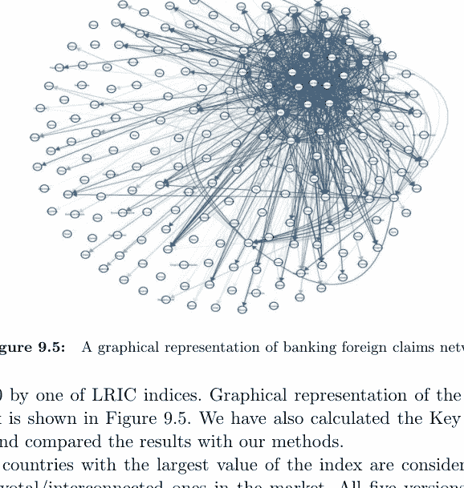

## 图9.5：银行外国债权网络的图形表示

按LRIC指数之一排名的前十名。建模网络的图形表示如图9.5所示。我们还计算了关键借款人指数，并将结果与我们的方法进行了比较。

指数值最大的国家被认为是市场中最关键/互联度最高的国家。LRIC的五个版本（SumPaths、MaxPath、MaxMin、MaxT、MultT）给出的排名几乎相似，而基于模拟的LRIC（Simul（有关该测度的更多细节，请参见附录9B））则显示出一些差异。然而，主要差异从TOP-10国家的中间部分开始。根据所有方法，TOP-2位置是稳定的，由美利坚合众国（美国）和香港占据。基于模拟的LRIC指数还将一些国家的排名分组，形成区域集群（斯堪的纳维亚、波罗的海国家、澳大利亚和新西兰）。

结果使我们得到两类国家。

首先，最高评级通常出现在大型且强大的经济体，如美国、英国和中国。它们拥有发达的金融体系，具有高度的可信度和主权评级。因此，它们的金融产品（银行存款或证券）吸引了大量投资者。这些结果与（IMF，2015）的发现一致，并可能为“大而不能倒”政策提供良好基础，当这些国家的金融部门可能成为全球系统性风险的来源并应受到更密切监控时。

然而，与上一节相反，我们可以识别出一组经济体量并不算大但也获得了最高LRIC值的国家。像香港、开曼群岛、新加坡和卢森堡这样的国家（地区）是“太互联而不能倒”经济体的典型例子。由于其有吸引力的商业环境、发达的基础设施、人力资本和良好的声誉，这些国家促使投资者将其资产配置到其金融体系中，从而使这些国家成为重要的借款方。这些国家出现在最高排名中乍一看似乎不正常，但这与我们最初的假设一致，即影响力最大的不仅是最庞大的市场参与者，还包括互联度最高的参与者。换言之，对这些国家而言，每一笔单独的现金流并不那么重要，但它们的组合对整个金融体系的稳定可能至关重要。例如，如果一个国家从网络中移除，我们很可能不会看到一连串的级联失败（因为与每个国家的交互量并不大），但这将导致金融流动重新定向到其他国家，从而影响整体金融稳定。

在这方面，有一个有趣的问题：结果对网络结构变化的敏感性如何。根据我们的估计，LRIC方法能够确定任何配置网络中的关键元素，也可用于分析网络配置的动态变化。

我们还使用了一系列现有的中心性度量来估算国家互联程度：加权度中心性、紧密中心性、介数中心性、PageRank和特征向量中心性。这些度量在附录9C中描述。中心性指数计算的结果如表9.14所示。

为了比较排名，我们使用了相关性分析。由于排名中的位置是一个顺序变量，为了评估不同排序的一致性，应使用除传统皮尔逊系数之外的其他秩相关系数。在我们的工作中，我们采用了Kendall度量（Kendall, 1970）的思想，它统计两个排名列表之间两两不一致的数量。此外，我们使用了Goodman和Kruskal γ秩系数，该系数表示数据按每个量排序时排序的相似性（Goodman和Kruskal，1954）。该系数计算为γ = (N_S − N_D)/(N_S + N_D)，其中N_S是在两个变量上按相同顺序排列的案例对数（一致对数量），N_D是在两个变量上按相反顺序排列的案例对数（相反对数量）。

然而，尽管大多数中心性度量和LRIC指数的相关系数相当高，但表9.15显示，与LRIC指数相比，经典中心性度量在识别第二组系统性重要国家（如开曼群岛、卢森堡、香港）方面表现较差。

## 9.5 结论

网络方法可应用于金融体系的不同部分，以刻画系统性风险。在我们的工作中，系统性风险网络模型已被应用于金融市场的一个特定部分——国际信贷市场。

我们探讨了衡量系统性重要性的两种方法：基于路径的远距离相互作用强度测量，以及基于模拟的远距离相互作用强度测量。该网络模型旨在帮助监管机构识别在任何特定危机期间“太大而不能倒”或“太互联而不能倒”的金融元素。所提出的方法能够识别那些乍一看不具有高系统性重要性、但对整个系统稳定性有显著影响的国家。此外，基于模拟的LRIC指数可成为识别区域金融集群的有用工具。

我们对假设示例进行了估算，并展示了跨境国家敞口的实证分析，以证明所提出方法的可行性。基于我们方法的实证结果与国际货币基金组织（IMF）和其他国际金融机构的结论一致。此外，这些结果使我们注意到一些国家的重要性，这些国家因其在全球金融中的中介作用而可能对整个系统的稳定产生强大影响。

## 致谢

我们感谢 Jane M Binner 教授、Logan Kelly 教授、Richard Anderson 教授和 John Duca 博士邀请我们参加由英格兰银行与伯明翰大学金融韧性研究中心于2017年5月23–24日联合主办的“金融服务指数、流动性与经济活动”会议，并感谢该会议的与会者提出的许多有益意见。第9.2–9.3节由俄罗斯科学基金会资助，资助号为№ 17–18-01651，用于国家研究型大学高等经济学院。

## 参考文献

Acharya, V. V., Pedersen, L. H., Philippon, T. and Richardson, M. (2010). Measuring Systemic Risk. Federal Reserve Bank of Cleveland. Working Paper No. 02.

Adrian, T. and Brunnermeier, M. (2010). CoVaR. Federal Reserve Bank of New York, Staff Report No. 348.

Akram, Q. F. and Christophersen C. (2010). Interbank Overnight Interest Rates — Gains from Systemic Importance. Norges Bank. Working Paper No. 11.

Aldasoro, I. and Alves, I. (2017). Multiplex interbank networks and systemic importance An application to European data. BIS. Working Papers No. 603.

Aleskerov, F., Andrievskaya, I. and Permjakova, E. (2016). Key Borrowers Detected By The Intensities of Their Short-Range Interactions. In Models, Algorithms, and Technologies for Network Analysis. From the 4th International Conference on Network Analysis, edited by V. A. Kalyagin, P. Koldanov and P. M. Pardalos, New York: Springer International Publishing.

Aleskerov, F. T., Yuzbashev, D. V. and Yakuba, V. I. (2007). Threshold Aggregation for Three-Graded Rankings. Automation and Remote Control (in Russian). No. 1. 147–152.

Aleskerov, F. T. (2006). Power Indices Taking into Account Agents’ Preferences. Eds. Simeone B. & Pukelsheim, F. Mathematics and Democracy, Springer, Berlin, 1–18.

Allen, F. and Gale, D. (2000). Financial Contagion. Journal of Political Economy, 108(1), 1–33.

Allen, F. and Babus, A. (2009). Networks in Finance. In Network-based Strategies and Competencies. Ed. Kleindorfer, P. & Wind, J. 367–382.

Angelini, P., Maresca, G. and Russo, D. (1996). Systemic risk in the netting system. Journal of Banking and Finance, 20, 853–868.

Barrat, A., Barthelemy, M., Pastor-Satorras R. and Vespignani A. (2004). The Architecture of Complex Weighted Networks. Proceedings of the National Academy of Sciences, 101(11), 3747–3752.

Basel Committee on Banking Supervision (BCBS) (2013). Global Systemically Important Banks: Updated Assessment Methodology and the Higher Loss Absorbency Requirement Consultative Document.

Bech, M. L. and Atalay, E. (2008). The Topology of the Federal Funds Market. Federal Reserve Bank of New York, Staff Report No. 354.

Bernanke, B. (2010). Causes of the Recent Financial and Economic Crisis. Testimony before the Financial Crisis Inquiry Commission (FCIC), September 2, 2010, Washington D.C.

Bluhm, M. and Krahnen, J. P. (2014). Systemic Risk in An Interconnected Banking System with Endogenous Asset Markets. Journal of Financial Stability, 13, 75–94.

Bonacich, P. (1972). Technique for Analyzing Overlapping Memberships. Sociological Methodology, 4, 176–185.

Bruhl, V. (2017). How to Define a Systemically Important Financial Institution — A New Perspective. Intereconomics, March 2017, 52(2), 107–110.

Cajueiro, D. O. and Tabak, B. M. (2008). The Role of Banks in the Brazilian Interbank Market: Does Bank Type Matter? Physica A: Statistical Mechanics and its Applications, 387(27), 6825–6836.

Chan-Lau, J. A. (2010). The Global Financial Crisis and its Impact on the Chilean Banking System. IMF Working Paper No. 108.

Drehmann, M. and Tarashev, N. (2011). Measuring the Systemic Importance of Interconnected Banks. Bank for International Settlements. Working Paper No. 342.


- ECB. (2010). (2010年6月). 金融稳定评论.
- ECB. (2006). (2006年12月). 金融稳定评论.
- ECB. (2014). 金融稳定评论.
- Furfine, C. (2003). 银行间风险敞口：量化传染风险. Journal of Money, Credit and Banking, 35, 111–128.
- Garlaschelli, D., Battiston, S., Castri, M., Servedio, V. D. P. and Caldarelli G. (2005). 市场投资的无标度拓扑. Physica A, 350, 491–499.
- Garratt, R., Webber, L. and Willison, M. (2012). 使用夏普利非对称权力指数衡量银行对系统性风险的贡献. Bank of England, Working Paper No. 468.
- Giovannetti, A. (2012). 产业集群中的金融传染：动态分析与网络模拟. University of Siena, Working Paper.
- Goodman, L. A. and Kruskal, W. H. (1954). 交叉分类的关联度量. Journal of the American Statistical Association, 49(268), 732–764.
- Huang, X., Zhou, H. and Zhu, H. (2012). 评估近期金融危机期间银行异质性组合的系统性风险. Journal of Financial Stability, 8(3), 193–205.
- Ikeda, Y., Kubo, O. and Kobayashi, Y. (2007). 基于博弈论随机主体的企业动态模拟. Physica A, 382, 138–148.
- IMF/BIS/FSB (2009). 评估金融机构、市场和工具系统重要性的指南：初步考虑. 提交给G-20财长和央行行长的报告.
- IMF (2010). 将金融部门评估规划下的稳定性评估纳入第四条磋商监督：背景材料.
- IMF (2015). 全球金融稳定报告. 货币与资本市场部关于市场发展和问题的报告.
- Iori, G., de Masi, G., Precup, O. V., Gabbi G. and Caldarelli, G. (2008). 意大利隔夜货币市场的网络分析. Journal of Economic Dynamics and Control, 32(1), 259–278.
- Kendall, M. (1970). 秩相关方法，第4版, Griffin, London.
- Lehar, A. (2005). 度量系统性风险：一种风险管理方法. Journal of Banking and Finance, 29(10), 2577–2603.
- Leon, C. and Murcia, A. (2012). 金融机构的系统重要性指数：主成分分析方法. Banco de la Republica (Central Bank of Colombia) Working Papers, No. 741.
- Malik, S. and Xu, T. T. (2017). 全球系统重要性银行和保险公司的关联性. IMF Working Papers, No. 17/210.
- Minoiu, C. and Reyes, J. A. (2013). 全球银行业的网络分析：1978-2010. Journal of Financial Stability, 9(2), 168-184.
- Myerson, R. B. (1977). 博弈中的图与合作. Mathematics of Operations Research, 2, 225–229.
- Newman, M. E. J. (2010). 网络：导论. Oxford University Press, Oxford, UK.
- Peltonen, T. A., Rancan, M. and Sarlin, P. (2015). 银行业关联性作为危机脆弱性, ECB Working Paper Series, N1866.
- Segoviano, M. A. and Goodhart C. (2009). 银行稳定性度量. IMF Working Paper No. 4.
- Shapley, L. S. and Shubik, M. (1954). 一种评估委员会体系中权力分配的方法. American Political Science Review, 48, 787–792.
- Sun, A. J. and Chan-Lau, J. (2017). 发达新兴市场经济体的金融网络与关联性. Quantitative Finance, 17(12), 系统性风险分析.
- Tarashev, N., Borio, C. and Tsatsaronis, K. (2010). 将系统性风险归因于单个机构. BIS Working Papers No. 308.
- von Peter, G. (2007). 国际银行中心：网络视角. BIS Quarterly Review.
- Zhou, C. (2010). 银行是否大到不能倒？衡量金融机构的系统重要性. International Journal of Central Banking.

## 附录9A：短程交互情形的方法

本节我们描述 (Aleskerov, et al., 2016) 提出的短程交互情形的方法。该方法基于 (Aleskerov, 2006) 建立的权力指数分析，并针对网络理论进行了调整。该指数被称为核心借款人指数（KBI），用于在贷款市场中找出最核心的借款人，以考虑金融交互的某些特定特征。

对于“一个纯贷款人、多个借款人/贷款人”的情形，为了确定每个借款人相对于该贷款人的影响，会对每个贷款人单独计算KBI。所提出指数的显著特点是它考虑了每个贷款人与其借款人之间的短程交互。换句话说，仅考虑直接邻居来估计对特定贷款人的直接和间接影响。

该方法包括若干步骤。首先，需要定义以下关键术语：

- *关键组*被解释为这样的组：其违约可能导致贷款人违约（而贷款人能够覆盖来自关键组之外成员困境的损失）。因此，如果组成员借款总额大于或等于预定义阈值，则该组是“关键”的。
- 如果某借款人被排除出关键组会使该组不再关键，则该借款人在该组中是*核心*的。
- *最核心*的借款人将是在更多关键组中具有核心作用、超过任何其他借款人的那个借款人。

下一步按如下方式估计主体间的关联强度 (Aleskerov et al., 2016):

```
f(i, w_l) = \frac{P_{li} + P'_{li}}{\sum_j P_{lj}}, \quad (9A.1)
```

其中 $f(i,w_l)$ — 主体间的关联强度，$w_l$ 是与贷款人 $l$ 相关的关键组，借款人 $i$ 在该组中是核心的，$P_{li}$ 是借款人 $i$ 从债权人 $l$ 获得的总*直接*贷款，$P'_{li}$ 是借款人 $i$ 从债权人 $l$ 获得的总*间接*贷款。

在这一阶段，仅考虑一阶（贷款人与借款人之间）的间接关联。

第三步是计算贷款人 $L$ 与借款人 $B_i$ 之间通过借款人 $B_j$ 的*间接*关联强度（或 $p_{ji}$），如下 (Aleskerov *et al.*, 2016):

$$p_{ji}=\begin{cases}\dfrac{P_{ji}}{\sum_k P_{Lk}}, & P_{ji}<P_{Lj},\quad l\ne j,\quad k=1,\ldots,3\\[6pt]&\hspace{4.5cm}(\text{borrowers of a Lender }L)\\[6pt]\dfrac{P_{Lj}}{\sum_k P_{Lk}}, & P_{ji}>P_{Lj},\quad i\ne j,\quad k=1,\ldots,3\\[6pt]&\hspace{4.5cm}(\text{borrowers of a Lender }L)\end{cases}\tag{9A.2}$$

以及 $L$ 与 $B_i$ 之间的*直接*关联：

$$p_{Li}=\dfrac{P_{Li}}{\sum_k P_{Lk}}.$$

因此，$L$ 与 $B_i$ 之间的总关联强度为：

$$f_{Li}=\sum_j p_{ji}+p_{Li}.\tag{9A.3}$$

这样，借款人 $i$ 的关联强度分别针对每个关键组计算，然后对所有可能的关键组进行汇总，如下：

$$\chi_i=\sum_{w_l}\frac{f(i,w_l)}{N_w},\tag{9A.4}$$

其中 $N_w$ — 组内借款人的数量。

*KBI* 随后计算如下：

$$\mathrm{KBI}=\frac{\chi_i}{\sum_j\chi_j}.\tag{9A.5}$$

每个借款人的指数值反映了其在该组中核心作用的大小。数值越高，该主体的核心性越强。最核心的借款人将是在更多关键组中具有核心作用、超过任何其他借款人的那个借款人。

对于“多个贷款人、多个借款人”的情形，KBI 在所有贷款人上进行汇总，并考虑每个贷款人总贷款的规模。

现在假设一些借款人（总数为 k₀）无法偿还贷款。那么，我们可以定义一个借款人列表（总数为 k₁），对于这些借款人而言，k₀ 个借款人构成关键组。类似地，我们可以定义一个借款人列表（总数为 k₂），对于这些借款人而言，k₀ + k₁ 个借款人构成关键组。该过程持续进行，直到达到预定义的阶段数上限 s 为止，或者存在一个阶段 r（在最坏情况下，当参数 s 未定义时，r 小于或等于网络直径）使得 kᵣ = 0。因此，如果我们假设 k₀ 个借款人无法偿还其贷款，则可以得出一个无法偿还其贷款的借款人列表（总数为 ∑ₗ₌₁ᵐⁱⁿ⁽ʳ,ˢ⁾ kₗ）。

例如，假设元素 5、6、9 无法偿还其贷款。那么我们可以定义哪些元素反过来将无法偿还其贷款（见表9.16）。

因此，元素 5、6 和 9 的破产将导致其他五个元素的破产。

类似地，我们可以假设任何其他无法偿还贷款的借款人组合，并定义所有破产借款人的列表。结果将构成一个新矩阵 C*(s) = [c*ᵢⱼ(s)]，该矩阵显示：如果我们假设借款人 j 无法偿还其自身贷款，借款人 i 无法偿还其贷款的情况占比为多少。

矩阵 C*(s) 的解释相当简单。如果 c* 值接近 1，则借款人 j 对借款人 i 非常关键。相反，如果 c* 值接近 0，则借款人 j 几乎不影响借款人 i。结果可以汇总成一个单一向量，显示系统中每个元素的总影响。

因此，我们可以为数值示例构造矩阵 C*(s) = [c*ᵢⱼ(s)]（见表9.17）。

该方法的一个关键优势是它能够准确考虑系统的所有连锁反应，即所谓的多米诺骨牌效应或传染效应。

**表9.16：** 组合 {5, 6, 9} 的模拟过程。

| 步骤 | 破产元素 | 元素总数 |
|------|---------|----------|
| 0 | {5, 6, 9} | k₀ = 3 |
| 1 | {2, 4} | k₁ = 2 |
| 2 | {1, 3} | k₂ = 2 |
| 3 | {10} | k₃ = 1 |


### 表 9.17：数值示例（模拟）的矩阵 C*。

|   | 1 | 2 | 3 | 4 | 5 | 6 | 7 | 8 | 9 | 10 | 权重 |
|---|---|---|---|---|---|---|---|---|---|---|---|
| 1 | 0.1 | 0.0 | 1 | 1 | 0.4 | 0.2 | 1 | 1 |  |  | 0.27 |
| 2 | 0.0 | 0.0 | 0 | 1 | 0 | 0 | 1 | 0 |  |  | 0.05 |
| 3 | 0.0 | 0.0 | 0 | 1 | 0 | 0 | 0 | 0 |  |  | 0.04 |
| 4 | 0.0 | 0.0 | 0 | 1 | 0 | 0 | 0 | 0 |  |  | 0.02 |
| 5 | 0.0 | 0.0 | 0 | 1 | 0.4 | 0.58 | 0.47 | 1 |  |  | 0.30 |
| 6 | 0.0 | 0.0 | 0 | 0 | 0 | 0 | 0 | 0 |  |  | 0.00 |
| 7 | 0.0 | 0.0 | 0 | 0 | 0 | 0 | 1 | 1 |  |  | 0.27 |
| 8 | 0.0 | 0.0 | 0 | 0 | 0 | 0 | 0 | 1 |  |  | 0.04 |
| 9 | 0.0 | 0.0 | 0 | 0 | 0 | 0 | 0 | 0 |  |  | 0.00 |
| 10 | 0.0 | 0.0 | 0 | 0 | 0 | 0 | 0 | 0 |  |  | 0.00 |
| 总计 | 0.27 | 0.0 | 0.27 | 0.69 | 0.23 | 0.23 | 0.74 | 0.89 |  |  |  |
| 总计（标准化） | 0.085 | 0.0 | 0.085 | 0.211 | 0.072 | 0.071 | 0.216 | 0.261 |  |  |  |

该方法的一个关键问题是第一阶段应选择哪些借款人。对于一般情况，我们可以让每个借款人被选择相同次数。然而，在实际问题中并非总是如此，因为不同要素的违约概率不同。这意味着这些概率可以在模拟阶段予以考虑。

该方法的另一个重要问题是如何为每个贷款人定义关键借款人。显然，对于贷款人 i 来说，可能存在一个规模为 $k^* \ll k_0$ 的借款人组，它们将形成一个关键群体，从而导致贷款人 i 破产。换句话说，并非所有 $k_0$ 个借款人对特定贷款人的影响都相同。因此，有必要在每次模拟阶段为每个贷款人 i 找到一个最小的关键借款人集合 $\Omega_p(i)$。目前，除了考虑从 $k_0$ 个元素的集合中取出所有可能子集之外，对此问题没有解决方案，这也是我们方法的一个缺点。

由于要素 5、6 和 9 的破产而导致破产的每个要素的关键借款人列表在表 9.18 中给出。

所提议想法的另一个缺点是计算复杂度很高，因为在模拟阶段我们需要考虑大量借款人组合，而这些借款人被假设为无法偿还其贷款。这导致 $k_0$ 的值应以某种方式受约束，这实际上是合理的，因为同时有大量借款人无法偿还贷款的概率非常小。能够降低计算

### 表 9.19：数值示例的中心性度量和关键借款人指数。

| 指标\代理 | 1 | 2 | 3 | 4 | 5 | 6 | 7 | 8 | 9 | 10 | 11 |
|---|---|---|---|---|---|---|---|---|---|---|---|
| 加权入度 | 100 | 84 | 16 | 84 | 32 | 70 | 66 | 24 | 24 | 96 | 304 |
| 加权出度 | 100 | 100 | 100 | 100 | 0 | 100 | 100 | 100 | 100 | 100 | 0 |
| 加权度差异 | 0 | 16 | 84 | 16 | -32 | 30 | 34 | 76 | 76 | 4 | -304 |
| 中心性度量 加权度 | 200 | 184 | 116 | 184 | 32 | 170 | 166 | 124 | 124 | 196 | 304 |
| 入接近中心性 | 0.0014 | 0.0012 | 0.001 | 0.001 | 0.001 | 0.001 | 0.001 | 0.001 | 0.001 | 0.0012 | 0.002 |
| 出接近中心性 | 0.001 | 0.0007 | 0.001 | 0.001 | 0.009 | 0.007 | 0.001 | 0.001 | 0.001 | 0.0011 | 0.009 |
| 中介中心性 | 45 | 23 | 0 | 17 | 0 | 10 | 10 | 0 | 0 | 43 | 0 |
| 特征向量中心性 | 0.61 | 0.57 | 0.28 | 0.47 | 0.07 | 0.7 | 0.65 | 0.56 | 0.55 | 0.64 | 1 |
| PageRank | 0.11 | 0.10 | 0.05 | 0.08 | 0.05 | 0.095 | 0.08 | 0.06 | 0.05 | 0.09 | 0.22 |
| 关键借款人指数，q = 25% | 0.11 | 0.10 | 0.01 | 0.11 | 0.01 | 0.10 | 0.10 | 0.01 | 0.01 | 0 | 0.44 |

还应注意，关键要素不一定必须位于链的末端，即扮演纯借款人的角色。最关键的要素也可能位于网络的中心。

## 附录 9C：中心性度量

度中心性是指一个节点与其他节点之间的联系数量。节点在多大程度上可以获得对他人的访问和/或影响，其中心性就越高。中心节点占据的结构位置（网络位置）可作为信息交换或其他资源交易的大量信息源或渠道，与其他节点进行交易。

网络 $g$ 中节点 $i$ 的度中心性 $C_i^d(g)$ 计算为

$$C_i^d(g) = \frac{\eta_i(g)}{n-1} = \frac{|N_i(g)|}{n-1} \in [0,1], \quad (9C.1)$$

其中 $\eta_i(g)$ 是邻接矩阵 $g = [g_{ij}]$ 中 $i$ 的度，$N_i(g)$ 是 $g$ 中 $i$ 的邻居集合，n 是顶点数。

有向图的度中心性有两种形式：入度中心性和出度中心性。据此，入度中心性是使用指向该节点的入链数量进行评估的，而出度则使用从该节点发出的出链数量。

对于系统性风险分析和贷款活动中的风险分配，加权入度中心性（WInDeg）表示市场上最活跃的借款人。需要强调的是，该度量缺乏有关每个借款人的邻居的链接数量的信息。两个借款人可以借入相同数量的资金，但如果一个借款人与更多贷款人相连，则该借款人失败带来的传染效应将高于另一个借款人失败带来的传染效应。加权出度中心性（WOutDeg）表示最活跃的贷款人，对于风险分析而言，表示具有最大金融资源和有吸引力的金融投资工具的借款人。与之前的度量一样，该度量不考虑链接数量的信息。加权度中心性只是直接连接到一个节点的其他节点数量，同时考虑边上的权重。它是贷款人金融活动的指标，显示其参与所有类型金融交易的程度。加权度差异的值，可以计算为加权出度中心性或加权入度中心性，显示了特定节点在系统中的总体作用。因此，对于系统性风险分析，所有要素可分为两组：净债权人（当 WInDeg > WOutDeg 时）或净借款人（WInDeg < WOutDeg）。在银行对外债权分析中，该度量的低值可以用两个因素来解释：直接对外投资的有吸引力的条件或政府财政援助计划的实现。在这两种情况下，流入量将显著高于流出量。

*中介中心性* 显示顶点在网络中任意两个节点之间的最短路径上出现的频率。节点 i 的中介中心性是所有参与者对 j 和 k 的所有配对的比例之和，其中参与者 i 参与了该配对的测地线，即

$$C_i^b(g) = \sum_{j<k} \frac{\sigma_{jk}(n_i)}{\sigma_{jk}}, \qquad (9C.2)$$

其中 $\sigma_{jk}(n_i)$ 是包含 $i \notin \{k,j\}$ 的 k 和 j 之间的测地线数量，$\sigma_{jk}$ 是 k 和 j 之间的测地线总数。在我们的工作中，它将以最大化最短路径上边的总和的方式构建。就贷款而言，它可以解释为借款人位于最受欢迎的资本转移渠道（任意借款人对之间具有最大资本流动的路径）上的频率的度量。

*接近度的水平* 显示节点在网络中的位置有多接近，或从特定节点可以多容易地到达网络中的其他节点。它可以定义为远度的倒数，而远度则是无向图中到所有其他节点的距离之和

$$C_i^C(g) = \frac{1}{\sum_{i\neq j} l_{ij}(g)}, \qquad (9C.3)$$

其中 $l_{ij}(g)$ 是 g 中 i 和 j 之间的测地距离。因此，节点越中心，其与其他所有节点的总距离越低。请注意，在无向图中，考虑从或到所有其他节点的距离是不相关的，而在有向图中，到一个节点的距离被认为是一个更有意义的中心性度量。在我们的工作中，它将以最大化路径上总资本流动的方式构建，并显示从网络中的其他节点到达特定节点有多容易。就贷款而言，它显示了最有效的金融中介机构，它们吸引了大量资源。

*特征向量中心性* 是网络中节点影响力的度量。它根据以下概念为网络中的所有节点分配相对分数：与高分节点的连接对所讨论节点的分数贡献大于与低分节点的同等连接。该值是通过求解线性系统 $v = A'v$ 获得的，其中 $v$ 是向量


节点 i 的重要性得分与邻接矩阵 A = [a_ij]。解由对应于特征值 1 的特征向量表示。

PageRank 是特征向量中心性度量的一种版本。该度量有不同的版本。其中一个版本中，网络节点中心性的值通过以下公式计算：

```
PR(i) = (1 - α) + α · ∑_j PR(j → i) / |N_j(g)| , (9C.4)
```

其中 PR(i) 是节点 i 的中心性值，α 是所谓的阻尼因子（通常设为 0.85），PR(j → i) 是与节点 i 有直接链接的节点 j 的中心性值，N_j(g) 是节点 j 的链接数。换言之，节点 i 的 PageRank 由每个与节点 i 有直接链接的节点 j 的 PageRank 决定。

## 第10章 应用多元平均*F*检验考察基于个股收益的资产定价模型相对表现

Shafiqur Rahman 和 Matthew J. Schneider

### 目录

- 10.1 引言 ... 392
- 10.2 多因子模型 ... 396
- 10.3 数据与研究方法 ... 401
  - 10.3.1 数据描述 ... 401
  - 10.3.2 平衡数据面板与非平衡数据面板 ... 402
  - 10.3.3 平均*F*检验 ... 402
  - 10.3.4 模拟分析 ... 405
- 10.4 实证分析 ... 407
  - 10.4.1 个股收益的汇总统计 ... 407
  - 10.4.2 模型绩效度量 ... 408
  - 10.4.3 平均*F*检验与定价误差的结果 ... 409
  - 10.4.4 模型的相对表现 ... 414
  - 10.4.5 方差膨胀因子分析 ... 418
  - 10.4.6 因子载荷与模型表现背后的驱动因素 ... 420
  - 10.4.7 行业内证券的 GRS 检验 ... 423
- 10.5 结论 ... 425
- 参考文献 ... 427

### 摘要

在检验不同资产定价模型相对表现的研究中使用的 Gibbons 等人（1989）标准多元检验要求股票数量小于时间序列观测值数量，这就意味着需要将股票分组为投资组合。这会造成个股层面信息的损失。我们应用一种新的统计检验来绕开这一问题。我们发现，与标准多元检验不同，Hwang 和 Satchell（2014）提出的多元平均 F 检验在区分相互竞争的模型方面具有更强的功效，并且不会一概拒绝被检验的模型。将多元平均 F 检验应用于资产定价模型相对表现的考察，结果表明一个包含市场、规模、正交价值、盈利能力、投资和动量因子的简约六因子模型优于所有其他模型。

### 关键词

多元*F*检验 ● 资产定价 ● 因子模型 ● 市场投资组合 ● 规模 ● 账面市值比 ● 动量 ● 投资 ● 盈利能力 ● 流动性风险 ● 因子载荷 ● GRS 检验

### 10.1 引言

过去 50 年来，已有大量研究工作考察资产收益变动与因子收益变动之间的关系。相互竞争的资产定价模型最早始于 Sharpe（1964）、Lintner（1965）和 Mossin（1966）提出的资本资产定价模型（CAPM），以及由 Ross（1976，1977）提出、后经 Huberman（1982）、Chamberlain 和 Rothschild（1983）、Chen 和 Ingersoll（1983）、Connor（1984）和 Ingersoll（1984）加以完善的套利定价理论（APT）。这些是用于解释资产收益横截面变动的事前模型。

在认识到 CAPM 显然无法解释资产收益的横截面变动之后，Fama 和 French（1993，2015）采取了不同的方法。作者利用资产价格与代表公司层面特征及相关风险的观测变量之间的关系，开发了多因子模型来解释资产收益的横截面变动。这些后一种模型属于事后模型或经验模型，它们观察股票价格行为并对其进行逆向工程，以识别哪些因子能够解释并预测股票收益的变动。[^1] Fama 和 French（1993，2015）通过将各自模型应用于按规模、账面市值比（B/M）以及其他相关财务变量形成的假设投资组合，来检验其模型的解释力。[^2] 然而，这些新颖但带有想象力的投资组合的收益在市场上并不能直接观测到。此外，除专业共同基金或交易所交易基金外，个人和机构投资者很少基于市值、B/M、市盈率（P/E）或其任何组合来构建投资组合。投资者通过跨市场、跨板块、跨行业等捆绑证券来构建投资组合，以实现最大程度的分散化。从实践角度看，几乎不可能复制投资者（包括个人和机构）的投资组合。资产定价模型的检验最好应用于可直接观测的个股收益。这将有助于投资者根据证券对模型中一个或多个因子的暴露来选择证券。

将证券分组为投资组合的主要原因是采用 Gibbons 等人（1989）提出的传统多元*F*检验，即通常所称的 GRS 检验。GRS 检验要求资产数量（*N*）不超过时间序列观测值数量（*T*）。这是因为当 *N* > *T* 时，资产收益的样本方差-协方差矩阵会变为奇异矩阵，无法求逆（Knight 和 Satchell，2005）。为绕开这一限制，由证券构建投资组合，从而确保 *N* < *T*。将证券分组为投资组合以满足 GRS 检验的条件，并不总能很好地达到这一目的。GRS 检验轻易拒绝了 Fama 和 French（2015，2016）所检验的所有模型。

将股票分组为投资组合的另一个动机是减少估计贝塔值时固有的变量误差（EIV）问题。由于不同证券的贝塔测量误差并非完全相关，分组可能会降低 OLS 估计量的渐近偏差（Litzenberger 和 Ramaswamy，1979）。随着证券数量（*N*）无界增长，变量误差偏差会减少并应趋近于零，因为投资组合的异质风险更小（Jegadeesh 等人，2015）。然而，将股票分组形成投资组合会损失与投资组合分组无关的个股横截面行为信息，从而导致效率下降。投资组合会分散并掩盖个股的相关风险和收益特征。Connor 和 Korajczyk（1988）指出，如果偏离与用于将资产分配到投资组合的属性有关，这种分组程序可能会掩盖被检验模型的重要偏离。

虽然创建投资组合会降低因子载荷估计的抽样变异性，但因子风险溢价的标准误实际上会增大（见 Roll，1977；Ang 等人，2009，2010；Hwang 和 Satchell，2014）。Ang 等人（2010）在分析上证明并在实证中展示，通过创建投资组合得到的更小的贝塔估计标准误并不会带来更小的横截面系数估计标准误。因子风险溢价估计的标准误由因子载荷和残差风险的横截面分布决定。创建投资组合会缩小贝塔的横截面离散度，从而破坏信息，并使估计系数的标准误膨胀（Ang 等人，2010）。此外，Lo 和 MacKinlay（1990）指出，当检验基于按经验驱动的特征（如规模、贝塔或账面市值比）排序构建的投资组合收益时，资产定价模型检验可能产生误导性推断。他们认为这些是“数据窥探”（data-snooping）的例子，而这种数据窥探可能导致原假设被过于频繁地拒绝，从而增加第一类错误。Kim（1995）指出，构建投资组合可能会导致个体资产之间横截面行为的有价值信息损失，因为横截面变动会被平滑掉。他认为在估计过程中使用所有可得的个股（不构建投资组合）是避免信息损失的有效方法。Ferson 等人（1999）指出，许多实证研究在资产定价模型检验中使用按属性排序的普通股投资组合收益来代表风险因子，其中属性是根据与股票收益横截面的经验观测关系来选择的。他们认为，即使这些属性与风险暴露完全无关，这种按属性排序的投资组合也可能提供有用的风险因子。Jegadeesh 等人（2015）指出，当使用投资组合而非个体资产时，会直接出现检验功效问题，因为维度降低了，即使用投资组合时的解释变量数量不可避免地少于使用个体资产时。Berk（2000）表明，将股票分组为投资组合以检验资产定价推断的标准做法，会在拒绝所考虑模型时引入偏差。处理这些问题的一个直接且更有效的方法，是在检验资产定价模型时使用个股，而不是使用按特征或属性排序的投资组合（Hwang 和 Lu，2007）。

本研究试图实证探索 Fama 和 French（2015）五因子模型的解释力，该模型是四因子模型的扩展版本。

[^1]: DeMuth（2014）将这种方法比作从最终目的地旧金山开始反向修筑一条横贯大陆的铁路。

[^2]: 研究人员已经使用数百个因子来解释预期收益的横截面变动。有关所用因子的更多细节及相关文献综述，参见 Harvey *et al.*（2016）。


是法玛和弗伦奇（1993）三因子模型由卡哈特（1997）所衍生的后继模型，以及由阿米哈德和门德尔松（1986）、帕斯托尔和斯坦博（2003）、科拉伊奇克和萨德卡（2008）、伊博特森等人（2013）、阿斯内斯（2014）、阿斯内斯等人（2015a）、伊博特森和伊兹奥雷克（2014）以及伊博特森和金（2015）等研究所启发的多项其他竞争性多因子模型。我们将这些模型应用于市场上易于观察到的单个证券或资产回报，这些回报反映了理性与非理性、知情与非知情的交易者和投资者的互动。利用单个股票可以更有效地检验特定因子是否承担显著的价格风险。

为了检验竞争性资产定价模型的有效性，我们使用黄和萨切尔（2014）开发的多元平均 *F*-检验来代替 GRS 检验。多元平均 *F*-检验的一个关键优势在于，它允许我们一次性针对所有单个证券检验每个竞争模型的解释力，而不会引入数据窥探偏差。因此，我们的结论可以直接说明因子对单个证券的解释力。这很重要，因为资产定价模型在单个证券上的表现无法从该模型相对于投资组合的表现中推断出来。安格等人（2010）指出，使用单个股票或投资组合可能会得出关于特定因子是否承担显著价格风险的截然不同结论。投资组合的结果仅用于衡量管理投资组合的事后表现或检测市场异常现象。因此，这些结果对根据因子敞口选择证券的投资者而言并无用处。与现有文献相比，我们工作的主要贡献在于检验竞争模型对单个证券的相对表现，并允许投资者基于我们的研究结果选择股票。我们的研究通过直接使用单个证券检验竞争模型的比较表现，填补了文献中的空白。[^3]我们的结果表明，一个简洁的六因子模型，包含市场、规模、正交价值/成长、盈利能力、投资和动量因子，优于其他模型，例如法玛和弗伦奇的五因子模型、一个不含价值/成长因子的五因子模型、一个包含动量和流动性因子的五因子模型，以及一个包含动量和价值/成长因子替代度量的六因子模型。我们还发现，平均 *F*-检验在区分竞争模型方面具有更强的检验力，并且不会像 GRS 检验那样完全拒绝被检验的模型。

本章其余部分安排如下。第 10.2 节讨论本章考虑的替代多因子资产定价模型，第 10.3 节讨论数据和方法，第 10.4 节详细呈现实证分析。第 10.5 节总结本章。

## 10.2 多因子模型

接下来，我们简要描述几种检验资产定价与因子之间关系的模型，作为我们研究中的比较对象。首先，法玛和弗伦奇（1993）开发了一个三因子模型来解释股票回报的横截面差异。在他们的模型中，投资组合或证券的超额回报由对三个因子的敏感性来解释：广泛市场超额回报、基于市值的一个因子以及基于股本账面市值比（B/M）的一个因子：

$$R_{it} - R_{ft} = a_i + b_i(R_{mt} - R_{ft}) + c_iSMB_t + d_iHML_t + e_{it}, \tag{10.1}$$

其中 $R_{it}$ 是期间 *t* 证券或投资组合 *i* 的回报，$R_{ft}$ 是无风险回报，$R_{mt}$ 是价值加权市场投资组合的回报，$SMB_t$ 是小盘股和大盘股多元化投资组合回报之间的差额，$HML_t$ 是高 B/M 股票（价值股）多元化投资组合与低 B/M 股票（成长股）多元化投资组合回报之间的差额，而 $e_{it}$ 是一个零均值扰动项。

杰加迪什和蒂特曼（1993）表明，中期回报倾向于持续；前一年回报较高的股票往往具有较高的未来回报。卡哈特（1997）通过增加一个因子来将杰加迪什和蒂特曼（1993）的一年动量异常纳入法玛和弗伦奇（1993）的三因子模型，从而开发了一个四因子模型：

$$R_{it} - R_{ft} = a_i + b_i(R_{mt} - R_{ft}) + c_iSMB_t + d_iHML_t + s_iMOM_t + e_{it}, \tag{10.2}$$

其中 $MOM_t$ 是过去 12 个月赢家（即回报高的股票）多元化投资组合与输家（即回报低的股票）多元化投资组合回报之间的差额。该模型是对法玛和弗伦奇（1993）三因子模型无法捕捉由动量投资策略导致的资产回报变异部分的回应，正如法玛和弗伦奇（1996）所承认的那样。

阿米哈德和门德尔松（1986）、阿米哈德（2002）以及许多其他研究人员证实了流动性对股票回报的影响。布伦南和苏布拉马尼亚姆（1996）以及乔迪亚等人（2001）证明，在控制了法玛和弗伦奇（1993）风险因子和动量因子后，必要回报与流动性风险衡量指标之间存在显著关系。帕斯托尔和斯坦博（2003）、阿恰里亚和佩德森（2005）以及萨德卡（2006）指出，流动性是解释资产回报的定价风险因子。帕斯托尔和斯坦博（2003）发现，预期股票回报在横截面上与回报对整体流动性波动的敏感性相关。科拉伊奇克和萨德卡（2008）发现，即使在纳入其他股票特征和风险因子，例如规模、价值/成长和动量后，流动性仍是证券回报横截面上的定价因子。贝恩-雷法埃尔等人（2015）指出，市场可能经历流动性的系统性冲击，而回报对此类冲击更敏感的股票会获得比敏感性较低的股票更高的回报。[^4]高保证金资产的必要回报更高，尤其是在融资流动性不足时期（弗拉齐尼和佩德森，2014）。阿什克拉夫特等人（2010）发现，当中央银行贷款活动降低保证金并增加市场流动性时，价格会上涨。阿恰里亚和佩德森（2005）发现，在流动性调整的资本资产定价模型中，证券的回报取决于其预期流动性，以及自身回报和流动性与市场回报和流动性的协方差。萨德卡（2006）发现美国股票的流动性衡量指标与动量之间存在正相关关系，并指出将流动性因子加入 CAPM 和法玛和弗伦奇三因子模型似乎显著提高了调整后 R²。阿斯内斯等人（2013）发现，全球范围内流动性风险与价值负相关，与动量正相关

[^3]: 值得注意的是，最近乔迪亚等人（2015）、加利亚尔迪尼等人（2016）以及杰加迪什等人（2015）使用了单个股票数据来检验资产定价模型。乔迪亚等人（2015）和加利亚尔迪尼等人（2016）侧重于从单个股票回报对因子载荷（贝塔）和公司特征的横截面回归中估计风险溢价。相反，我们通过关注回归截距（定价误差）的大小和显著性，提出了一种简单而直观的检验替代模型相对表现的方法。我们研究与杰加迪什等人（2015）之间的关键差异将在后面的章节中讨论。

[^4]: 贝恩-雷法埃尔等人（2015）将流动性溢价区分为两种类型：（i）特征流动性溢价，与交易该证券的交易成本相关；以及（ii）系统性流动性溢价，与股票回报对市场流动性冲击的敏感性相关。系统性流动性源于当市场流动性较低时股票价格下跌的不确定性。他们表明，在一系列技术和监管变化，例如十进制化之后，美国股票的特征流动性溢价在过去四十年中显著下降。相比之下，系统性流动性并未呈下降趋势，仍然显著定价，尤其是在纳斯达克股票中。


类别。Asness *等人*(2015b)指出，还有其他收益来源，其中之一就是流动性。

与Asness (2014)、Asness *等人*(2015a)以及Fama和French (2015)类似，Ibbotson *等人*(2013)和Ibbotson与Kim (2015)将流动性因子——由流动性最低与最高的四分之一股票投资组合收益之差（LMH）表示——分别对Fama和French (1993)的三因子模型和Carhart (1997)的四因子模型进行回归。在这些回归中，估计的截距或alpha较大、为正且统计显著，表明流动性因子在解释资产收益时的作用并未被其他因子所涵盖。受流动性在资产定价中重要性的显著发现所推动，我们在Carhart (1997)的四因子模型基础上加入一个由Ibbotson *等人*(2013)和Ibbotson与Kim (2015)构建的流动性因子：

$$R_{it}-R_{ft}=a_i+b_i(R_{mt}-R_{ft})+c_iSMB_t+d_iHML_t+q_iMOM_t+s_iLMH_t+e_{it}, \tag{10.3}$$

其中，LMH是一个多空组合的月度收益，该组合从流动性最低的四分之一股票收益中减去流动性最高的四分之一股票收益。Ibbotson *等人*(2013)和Ibbotson与Kim (2015)根据换手率将股票分为四组，换手率是年度内交易股数除以流通股数。换手率最高（最低）的股票流动性最强（最弱）。⁵ 将流动性因子加入模型的理由也源于Carhart (1997)，他在研究共同基金业绩时使用了流动性因子的一个版本。他的流动性因子模拟组合（VLMH）是低交易量股票与高交易量股票收益之差，且与市场、规模、价值/成长和动量这四个因子正交。他发现，共同基金组合的VLMH载荷估计与业绩密切相关。一年期收益最高的组合在VLMH上的载荷显著为负，表明基金中相对持有更多流动性较强的股票；而收益最差的组合载荷显著为正，表明相对持有更多流动性较弱的股票。

⁵ 另一种常用的流动性度量是Pastor和Stambaugh (2003)的流动性因子，该因子基于股票月度内的日收益和交易量。Ibbotson和Kim (2015)更倾向于使用基于换手率的流动性度量，因为换手率简单、易于度量，且对收益有显著影响。Ibbotson *等人*(2013)称之为流动性的“事前”度量。Lidzorek *等人*(2012)表明，换手率对美国共同基金收益具有更强的解释力。

Fama和French (2015)受Titman等人(2004)、Aharoni等人(2013)、Novy-Marx (2013)和Hou等人(2015b)等证据的启发指出，Fama和French (1993)的公式(10.1)中的三因子模型遗漏了股票收益中因盈利能力和投资而产生的许多变化。他们在Fama和French (1993)的三因子模型基础上增加两个因子，构建了五因子模型：

R_it − R_ft = a_i + b_i(R_mt − R_ft) + c_i SMB_t + d_i HML_t
+ p_i RMW_t + q_i CMA_t + e_it, (10.4)

其中，RMW_t是经营盈利能力强劲和疲弱的多元化股票投资组合收益之差，CMA_t是投资水平低（保守）和高（激进）公司的多元化股票投资组合收益之差。

Fama和French (2015)发现，在基于规模、账面市值比（B/M）、盈利能力和投资形成的投资组合中，不含HML的四因子模型与含HML的五因子模型表现同样出色。他们指出，HML在解释平均收益方面是冗余的，因为其影响已完全被其他因子所涵盖。HML的冗余性是基于五个因子中每个因子对其他四个因子的回归（Fama和French，2015，表10.6）。HML对其他因子回归的截距较小、为负，且统计上不显著。他们还建议用正交HML（OHML）替代HML，以捕捉其他因子未涵盖的额外价值溢价影响。

我们还致力于解释Fama和French (1993, 2015)未明确建模的异常之一，尽管Fama和French (2008)称动量为“近年来的中心舞台异常……一个无需怀疑的异常……最重要的市场异常”（Antonacci, 2015）。他们观察到与动量相关的异常收益无处不在。Schwert (2003)考察了所有已知的市场异常，并宣称动量是唯一一个在披露后持续存在且未消失的异常。我们通过剔除HML因子，并加入动量和正交HML因子，检验了Fama和French (2015)五因子模型的一个变体。正交HML因子是HML对R_m − R_f、SMB、RMW、CMA和MOM回归的截距与残差之和：

HML_t = α_i + b_i(R_mt − R_ft) + c_i SMB_t + p_i RMW_t
+ q_i CMA_t + s_i MOM_t + μ_it, (10.5)

$$R_{it} - R_{ft} = a_i + b_i(R_{mt} - R_{ft}) + c_i SMB_t + p_i RMW_t + q_i CMA_t$$ $$+ d_i OHML_t + s_i MOM_t + e_{it}, \tag{10.6}$$

其中，$OHML_t$为$\alpha_i + \mu_{it}$。

Asness (2014)和Asness等人(2015a)指出，以HML为代表的长期价值虽然被盈利能力和投资等其他来源所涵盖，但这并不会使价值因子无用或冗余。Asness等人(2015a)认为有两个因素导致了这一结论：(1) Fama和French (2015)的HML因子使用了严重滞后的价格；(2) Fama和French (2015)未能纳入动量因子，尽管有压倒性证据表明动量因子有助于解释收益。Asness和Frazzini (2013)、Asness (2014)及Asness等人(2015a)发现，Fama和French (1993, 2015)构建HML因子的方法是在每年6月30日更新一次价值，使用截至上一年12月31日的账面价值和市场价格。账面价值和市场价格在组合形成时已滞后6个月，在次年6月30日再平衡日期则滞后18个月。Asness和Frazzini (2013)指出，在动量交易不常见的早期，这种方法是合理的。他们认为，如今投资者广泛使用动量交易使得该方法变得次优。Asness和Frazzini (2013)构建了Fama和French (1993, 2015) HML因子的替代变量，称为HML_DEV，其使用上一年12月31日的账面价值和6月30日再平衡日的当前价格。此后，HML_DEV每月使用当前价格进行修订。⁶ Asness (2014)重复了Fama和French (2015)的表6，增加第六个动量因子，并用HML_DEV取代Fama和French (1993, 2015)的标准HML。他发现，HML_DEV和动量因子分别对其他五个因子回归的截距较大、为正且统计显著，并得出结论：在寻找最简洁而有效的资产定价模型时，六因子模型显然是必要的。本着Asness (2014)的精神，我们建议检验一个由Fama和French (2015)五因子加动量因子组成的六因子模型，并用Asness和Frazzini (2013)的HML_DEV替代标准HML：

$$R_{it} - R_{ft} = a_i + b_i(R_{mt} - R_{ft}) + c_i SMB_t + d_i HML_DEV_t + p_i RMW_t$$ $$+ q_i CMA_t + s_i MOM_t + e_{it}. \tag{10.7}$$

无论这里考虑到的哪个模型最终胜出，即具有最佳解释力，总体而言，因子模型尽管面临许多实证和理论挑战，仍能在一定程度上揭示风险与预期收益之间的关系。研究人员经常使用因子模型来评估管理组合（如共同基金和养老基金）的投资业绩（例如，Carhart, 1997；Kosowski等人，2006；Barras等人，2010；Fama和French, 2010），以及投资管理公司管理的股票型机构产品（Busse等人，2010）。因子模型也被用于解释资产定价模型无法捕捉的异常现象（Fama和French, 1996, 2016；Hou等人，2015b）。因子模型在指导不同投资组合策略的强度和显著性方面也有一定价值。因子模型的截距或alpha及其统计显著性可用于评估交易策略相对于适当基准的有效性。Sharpe (1988, 1992)引入的基于收益的风格分析使用因子模型来检测共同基金和对冲基金对各种投资风格的敞口，例如大盘股与小盘股、价值股与成长股、新兴市场等。

## 10.3 数据与研究方法

本节介绍本研究所用数据的信息，并详细描述用于检测备选模型中定价误差的多元检验。

### 10.3.1 数据描述

在本研究中，我们应用五个备选多因子模型来解释来自罗素3000指数的非金融股票样本的收益横截面变化。罗素3000指数覆盖了美国可投资股票市场约98%的市值。Fama和French (1992)指出，金融机构常见的高杠杆可能与对非金融机构的意义不同，对非金融机构而言，高杠杆更可能表明财务困境。我们的样本由罗素3000指数中的407只股票组成，这些股票在1990年1月至2014年12月的样本期内没有缺失的月度收益（300个月度观测值）。7 股票列表见

7 为了便于计算下一节讨论的平均F检验统计量，样本中每只股票必须具有相同数量的时间序列观测值（T）。这需要剔除样本期内存在缺失观测值的股票。


Russell 3000 指数来自 Russell Investments。样本股票的月度收益来自 CRSP 数据库收集。因子组合和无风险利率的月度收益来自 French 教授的在线数据库，而 Asness 和 Frazzini (2013) 的替代 HML 因子组合的月度观测值来自 AQR Capital Management 的在线数据库。⁸ 我们根据 Ibbotson 等人 (2013) 和 Ibbotson 和 Kim (2015) 的方法生成了流动性因子组合的月度观测值。

### 10.3.2 平衡面板与非平衡面板

对我们数据的一种可能的批评可能源于使用平衡数据面板，即在整个样本期内没有缺失观测值的股票样本，本研究中为 407 只证券。另一种选择是使用样本期内每年均无缺失数据的全部证券。换句话说，我们让 N 逐年变化。使用多元检验（GRS 或平均 F 检验）来检测模型中的平均定价误差（见 Fama and French, 2015, 2016; Hou et al., 2011, 2015a, 2015b）的一个要求是资产数量（N）在样本期内保持不变。上述研究通过纳入给定样本年份中没有缺失观测值的全部证券，然后根据样本期每年的属性将它们分组到固定数量的投资组合中来实现这一目标。尽管它们在理论上在每年使用了非平衡的证券面板，但通过形成投资组合导致平衡面板，它们放弃了相当多的证券特定信息。我们用平衡面板替代非平衡资产面板以避免证券特定信息的损失。从数百只个股得出的替代模型中平均定价误差的推断，比从受数据挖掘影响的数十个投资组合得出的推断在统计上更有意义。

### 10.3.3 平均 F 检验

本研究的重点在于比较替代模型在降低个股 alpha 方面的能力。Fama and French (2016) 指出，如果资产定价模型完全捕捉了预期收益，则在任何资产超额收益对模型因子收益的时间序列回归中，截距或 alpha 与零无法区分，无论是单个证券还是投资组合。

## 多元平均 F 检验的应用

我们的样本包含 407 只股票（N），超过了 300 个月的时间序列观测值（T），我们采用 Hwang and Satchell (2014) 的平均 F 检验来检测替代模型中的定价误差。为了解决当股票数量（N）超过时间序列观测值数量（T）时 GRS 统计量无法检验资产定价模型的问题，Hwang and Satchell (2014) 通过放松 T > N 的限制，开发了用于检验线性资产定价模型的平均 F 检验。由于允许 N 大于 T，平均 F 检验可以应用于数千只个股。这使我们能够避免将股票分组到投资组合中，并规避投资组合形成中的数据挖掘偏差。

我们现在描述 Hwang and Satchell (2014) 的平均 F 检验，并使用平均 F 检验检验替代模型的有效性。平均 F 检验统计量为

AF = T/N C ∑_{i=1}^N (â_i² / σ̂_i²)   (10.8)

其中 â_i² 是证券 i 的估计截距的平方，σ̂_i² 是证券 i 的估计残差方差，C 是一个 1 × 1 标量，等于 [1 + (r̄1, r̄2, ..., r̄k)Ω̂^{-1}(r̄1, r̄2, ..., r̄k)']，(r̄1, r̄2, ..., r̄k) 是因子平均收益的向量，Ω̂ 是因子收益的估计方差-协方差矩阵。平均 F 检验统计量的分布为 N 个 F 分布之和

AF ~ (1/N) ∑_{i=1}^N F_i(1, T - K - 1)   (10.9)

其中 F_i(1, T - K - 1) 是分子自由度为 1、分母自由度为 T - K - 1 的 F 分布。

平均 F 检验是一个多元 F 检验，其中假设两个证券的残差不相关。它是 Connor 和 Korajczyk (1988) 中 APT 模型误定价检验的一个特例，他们通过假设残差或特质收益在时间上独立但在截面上可能相关，对残差的协方差施加了先验限制。与 GRS 检验不同，平均 F 检验不需要 T > N，因为误差项方差-协方差矩阵的非对角元素被假设为零（Hwang and Satchell, 2014）。尽管这种放松假设误差在截面上不相关（这对于两个协方差很高的股票可能是一个问题），但它克服了 GRS 检验中协方差矩阵不可逆的缺点。然而，我们将在下一节考虑部门或行业内截面相关残差或特质收益的问题。证券残差之间协方差的排除（非对角元素）可以根据 Litzenberger 和 Ramaswamy (1979) 以及 Kim (1995) 的证据得到证实，他们提出了强调对角元素和个股的检验程序。Litzenberger 和 Ramaswamy (1979) 指出，证券之间残差的方差-协方差矩阵是块对角的，非对角块为零。他们的结论基于这样的假设（见 Fama, 1973; Gibbons, 1982），即证券收益在序列上不相关，使得 E(e_{it}, e_{js}) = 0 对于 t ≠ s, i = 1, ..., N, 和 t = 1, ..., T。⁹ Hwang and Satchell (2014) 指出，对于个股而言，协方差可能比对于投资组合而言不那么重要。他们还补充说，现代投资组合理论表明，特质误差的方差（对角元素）预计对个股的贡献更大，而投资组合可能主要由协方差驱动。Kim (1995) 发现了个股残差之间截面弱相关的假设的强有力支持。此外，两个证券通过它们与市场在单指数模型中的关系或与多指数模型中的因子关系相互关联。在 CAPM 框架内，这种关系在两个证券收益协方差的方程（σ_ij）中显现；

σ_ij = β_i β_j σ_m²
(10.10)

其中 β_i 是证券 i 的系统性风险度量，σ_m² 是市场收益的方差。在捕捉到证券的系统性风险之后剩下的就是其公司特定或非系统性风险。这就是证券收益或残差方差的随机或不可预测变化。产生此类变化的来源示例有公司 CEO 的健康状况、糟糕的管理、管理层变动、工厂关闭、停电、员工罢工、产品召回、供应链中断等。由于其随机性质，即使这些证券来自同一行业，因这些来源导致的两个证券收益的变化也不太可能相关。

直观上，平均 F 检验确定一组因子是否能够充分解释所有股票的收益。它通过将股票的平均定价误差与零截距股票的平均定价误差的自然变异性进行比较来检验这一假设。平均定价误差是所有股票截距值的加权平均统计量。每个股票的截距值是通过将股票收益对因子收益进行回归估计的。如果股票的平均定价误差过高，则平均 F 检验得出结论，平均而言，特定模型中的因子无法完全解释个股的超额收益。

更正式地说，因子是多因子模型中的预测变量，股票的平均定价误差是公式 (10.8) 中的 t 统计量，而零截距股票的平均定价误差的自然变异性则完全由公式 (10.9) 中的定义零分布表征。由于平均定价误差显然受股票数量（N）、观测值数量（T）和因子数量（K）的影响，零分布以 N、T 和 K 为条件。当 t 统计量的值落在零分布的右侧 10%、5%、1% 或 0.1% 尾部时，该 t 统计量被认为“过高”。

平均 F 检验的一个优点是，不能简单地认为如果所有股票都有较大的截距，则因子无法解释股票的平均定价误差（或拒绝原假设）。在任何线性回归中，都有两个估计值，即截距（股票的定价误差）和残差方差（均方误差或 MSE），这些均未被因子解释。平均 F 检验对 t 统计量的计算是可取的，因为任何单个股票定价误差的平方幅度都以 MSE 幅度的倒数加权。因此，具有较大残差方差的截距在拒绝原假设方面的强度小于具有较小残差方差的相同截距。这是因为残差方差较小的定价误差意味着对该定价误差有高度的信念，而 t 统计量对此给予了认可。此外，对截距进行平方使得无论定价误差为正还是为负，对拒绝原假设的认可都相等。

由于平均 F 检验需要为每只股票拟合一个普通最小二乘（OLS）模型，我们还要求因子数量（K）小于时间序列观测值数量（T）。为了计算平均 F 统计量，首先对 N 只证券的残差方差加权平方截距进行平均。然后，为了完成计算，

乘性调整针对样本量（T）、基于 K 因子均值向量的常数（C）以及它们的方差-协方差矩阵进行。方程（10.8）中的该 t 统计量随后与方程（10.9）中零假设的概率分布进行比较，该假设认为股票在 K 因子模型中截距为零。概率分布实际上是自由度为 1 和 T − K − 1 的 N 个 F 分布的平均值。N 个 F 统计量彼此独立。然而，由于该概率分布没有已知的闭式或解析解（参见 Hwang and Satchell, 2014, p. 467），我们使用 R 编程语言为每个 T、K 和 N 模拟 100,000 个值。模拟的进一步细节可在 Hwang and Satchell (2014) 中找到。

通常，对于每个模型 l，从方程（10.9）中的概率分布中随机抽取 10,000 或 100,000 个值。我们说明从以下分布中抽取一个抽样 S_{h_l} 的过程，其中 h_l = 1,2,...,100,000。对于每个 h_l，通过抽样 (T_l - K_l) N_l 个独立同分布的标准正态随机变量，均值为 0，标准差为 1，生成维度为 (T_l − K_l) × N_l 的随机矩阵 M_l。M_l 中每个元素 m_{i_l j_l} 被平方，并且列 j_l = 1,2,...,N_l 被平均，但不包括最后一行，\overline{m^2}_{j_l} = \frac{1}{T_l - K_l -1} \sum_{i=1}^{T_l - K_l -1} m_{i_l j_l}^2。然后，每个列的最后一个条目除以前面的平均值，\frac{m_{T_l - K_l, j_l}^2}{\overline{m^2}_{j_l}}，对于每个列 j_l。最后，这些分数在所有 N_l 上取平均，S_{h_l} = \frac{1}{N_l} \sum_{j_l=1}^{N_l} \frac{m_{T_l - K_l, j_l}^2}{\overline{m^2}_{j_l}}，其中 S_{h_l} 表示来自分布 AF_l ~ \frac{1}{N_l} \sum_{n_l=1}^{N_l} F_{n_l}(1, T_l - K_l -1) 的一个样本。S_{h_l} 表示在零假设成立时，即不存在定价误差时的样本平均 F 统计量。一旦上述模拟执行 100,000 次，抽样 S_{1_l}, S_{2_l},..., S_{100,000_l} 从低到高进行排序。这种排序使我们能够将平均 F 检验中的 t 统计量 \overline{AF}_l 与零概率分布的分位数进行比较。相应地，每个模型 l 产生一个 p 值，等于 \frac{\sum_{h_l=1}^{100,000} I(\overline{AF}_l < S_{n_l})}{100,000} 用于单侧检验，其中 I(\overline{AF}_l < S_{n_l}) 是指示函数，如果平均 F 统计量的值小于样本 S_{n_l}，则为 1，否则为 0。如果 p 值低于我们的 I 型错误率（例如，通常为 5% 或 10% 以偏好假阳性率），我们拒绝零假设偏差并得出结论，模型 l 中发现的因子无法完全解释样本期间内个股的超额回报。

平均 F 检验相对于 GRS 检验还有其他一些优势。首先，平均 F 检验对资产之间关系的小变化具有鲁棒性，这在股票之间的协方差矩阵不稳定时很有用，而这在金融市场中经常出现。其次，平均 F 检验通过用模型中未解释的残差方差加权来考虑对股票定价误差的信念程度。最后，也是最重要的，平均 F 检验避免了在将资产分组以强制 N 小于 T 从而使协方差矩阵可逆时 GRS 检验中的选择偏差（Knight and Satchell, 2005）。

## 10.4 实证分析

本节提供我们样本中股票月度回报的汇总统计信息，描述计算的各种衡量指标以比较和对比替代模型的相对表现和解释力，并呈现和分析我们的主要实证结果。尽管我们在实证分析中采用了 Hwang and Satchell (2014) 的平均 F 检验来克服标准 GRS 检验的不足，但我们的实证分析的重点与 Hwang and Satchell (2014) 截然不同。Hwang and Satchell (2014) 的重点完全在于检验平均 F 检验相对于 GRS 检验的优越性，针对的是 Fama and French (1993) 3 因子模型、Carhart (1997) 的 4 因子模型以及 Connor and Korajczyk (1988) 的主成分分析（PCA）模型。我们的实证分析的重点在于利用多种衡量指标以及平均 F 检验，检验由资产定价模型研究中最新的进展和发展所激励的几种资产定价模型的相对表现。我们仅将平均 F 检验作为与其他衡量指标结合使用的工具来检验替代模型的解释力。

### 10.4.1 个股回报的汇总统计

我们计算样本中股票的描述性统计并在表 10.1 中呈现。1990 年 1 月至 2014 年 12 月期间，我们样本中 407 只股票的平均月度回报率范围从 0.2324% 到 3.5513%，平均值为 1.4121%。月度回报的标准差从 2.8247% 到 34.2172% 不等，平均值为 10.4165%。看起来样本股票在风险-回报谱系中分布非常广泛（即多样化）。样本中股票的多样性有助于最大程度地减少样本中幸存者偏差的影响。由于并购和破产或清算而消失的股票被排除在我们的样本之外。这些股票可能具有较低或较高的回报，我们样本中回报分布谱系的较低和较高端的股票将代表这些缺失的股票。

| 平均月度回报率（百分比） | 值 |
|---|---|
| 均值 | 1.4121 |
| 最小值 | 0.2324 |
| 最大值 | 3.5513 |

| 月度回报的标准差 | 值 |
|---|---|
| 均值 | 10.4165 |
| 最小值 | 2.8247 |
| 最大值 | 34.2172 |

我们研究定价误差的程度并使用个股回报比较五种多因子资产定价模型的表现。这些模型是 Fama and French (2015) 5 因子模型（FF5）、无 HML 的 Fama–French 5 因子模型（FF4）、具有 Jagadeesh and Titman (1993) 动量因子和正交 HML（OHML）的 Fama–French 5 因子模型、具有 Asness and Frazzini (2013) 的 HML 和动量因子（HML_DEV）的 Fama–French 5 因子模型，以及具有 Ibbotson et al. (2013) 流动性因子和动量因子（LIQUID）的扩展 Fama and French (1993) 3 因子模型。表 10.2 列出了替代模型中包含的因子。

我们计算一系列衡量指标，包括 Fama and French (2015) 中采用的指标，以便比较和对比替代多因子资产定价模型的相对表现和解释力。与 Fama and French (2015) 类似，|α_i| 是样本中所有证券回归截距的平均绝对值。它是平均定价误差的衡量指标。我们计算截距绝对值与残差方差的比率。前者是对证券在超过补偿投资者系统风险所需超额回报之上的平均超额回报的估计。后者是模型未解释的证券的非系统性或可分散风险的代理。该比率旨在检验截距相对于证券残差方差的大小。它衡量模型解释证券回报横截面变化的能力。我们称之为修正的评级比率。它是为管理投资组合（如共同基金和对冲基金）计算的评级比率的变体，揭示了经理人每单位非系统性风险超过基于系统风险的超额回报的平均增值。¹⁰ 如果模型完全捕捉了证券的系统风险的所有要素，截距将相对于非系统性风险或残差方差而言相对较小。竞争模型的 Avg |α_i|、修正的评级比率、截距和 R² 的汇总统计数据在表 10.3 中呈现。

## 表 10.2：替代模型中的因子。

| 因子 | FF5 | FF4 | OHML | HML_DEV | LIQUID |
|---|---|---|---|---|---|
| RM | √ | √ | √ | √ | √ |
| SMB | √ | √ | √ | √ | √ |
| HML | √ |  |  |  | √ |
| OHML |  |  | √ |  |  |
| HML_DEV |  |  |  | √ |  |
| RMW | √ | √ | √ | √ |  |
| CMA | √ | √ | √ | √ |  |
| MOM |  |  | √ | √ | √ |
| LMH |  |  |  |  | √ |

注：该表列出了替代模型中的因子。这些因子是市场因子（RM）、规模因子（SMB）、价值因子（HML）、盈利能力因子（RMW）、投资因子（CMA）、动量因子（MOM）、流动性因子（LMH）、替代价值因子（HML_DEV）和正交价值因子（OHML）。替代模型是 Fama–French 5 因子模型（FF5）、无价值因子的 Fama–French 5 因子模型（FF4）、具有动量和正交价值因子的 Fama–French 5 因子模型（OHML）、具有动量和替代价值因子的 Fama–French 5 因子模型（HML_DEV），以及具有流动性和动量因子的扩展 Fama–French 3 因子模型（LIQUID）。

### 10.4.3 平均 F 检验结果和定价误差

我们计算平均 F 检验的 t 统计量以及 p 值（即获得大于该平均 F 检验统计量的概率

### 表 10.3：替代资产定价模型的相对表现。1990 年 1 月–2014 年 12 月：300 个月。

|  | FF5 | FF4 | OHML | HML_DEV | LIQUID |
|---|---:|---:|---:|---:|---:|
| **R²** |  |  |  |  |  |
| 平均 | 0.2655 | 0.2515 | 0.2770 | 0.2755 | 0.2683 |
| 最小值 | 0.0099 | 0.0028 | 0.0104 | 0.0131 | 0.0151 |
| 最大值 | 0.5657 | 0.5566 | 0.5659 | 0.5637 | 0.5654 |
| **截距 (Alpha)** |  |  |  |  |  |
| 平均 | 0.2197 | 0.1391 | 0.2932 | 0.2331 | 0.4321 |
| 最小值 | −1.2483 | −1.6296 | −1.1009 | −1.2786 | −0.8809 |
| 最大值 | 3.8124 | 3.9803 | 3.5908 | 3.6352 | 2.9391 |
| 显著为负 @ 0.05 水平 | 2 | 7 | 1 | 4 | 0 |
| 显著为负 @ 0.01 水平 | 1 | 2 | 0 | 2 | 0 |
| 显著为负 @ 0.001 水平 | 0 | 0 | 0 | 0 | 0 |
| 显著为正 @ 0.05 水平 | 23 | 26 | 25 | 30 | 41 |
| 显著为正 @ 0.01 水平 | 9 | 11 | 10 | 13 | 14 |
| 显著为正 @ 0.001 水平 | 3 | 5 | 2 | 4 | 3 |
| 平均 *t* 统计量 | 0.3260 | 0.1709 | 0.4365 | 0.3095 | 0.7354 |
| A \(\lvert \alpha_i \rvert\) | 0.4878 | 0.5380 | 0.4876 | 0.5256 | 0.5392 |
| **修正的评估比率** |  |  |  |  |  |
| 平均 | 0.0063 | 0.0066 | 0.0060 | 0.0063 | 0.0069 |
| 最小值 | 0.0000 | 0.0000 | 0.0000 | 0.0000 | 0.0000 |
| 最大值 | 0.0337 | 0.0307 | 0.0326 | 0.0313 | 0.0353 |
| **平均 *F* 检验** |  |  |  |  |  |
| 检验统计量 | 1.1147 | 1.3308 | 1.0943 | 1.2714 | 1.4251 |
| **100,000 次模拟的临界值阈值** |  |  |  |  |  |
| 0.10 水平 | 1.1267 | 1.1258 | 1.1266 | 1.1272 | 1.1252 |
| 0.05 水平 | 1.1512 | 1.1513 | 1.1510 | 1.1511 | 1.1501 |
| 0.01 水平 | 1.2017 | 1.1994 | 1.1994 | 1.1996 | 1.2003 |
| 0.001 水平 | 1.2571 | 1.2546 | 1.2558 | 1.2594 | 1.2571 |
| *P* 值 | 0.06846 | 0.00005 | 0.11065 | 0.00024 | 0.00000 |

> *注：* 表格列出了 Fama–French 5 因子模型 (FF5)、无 HML 的 Fama–French 5 因子模型 (FF4)、包含 Jegadeesh 和 Titman (1993) 动量因子和正交 HML 的 Fama–French 5 因子模型 (OHML)、包含 Asness 和 Frazzini (2013) 的 HML 和动量因子的 Fama–French 5 因子模型 (HML_DEV)，以及包含 Ibbotson *et al.* (2013) 流动性因子和动量因子的扩展 Fama–French 3 因子模型 (LIQUID) 的汇总统计量。遵循 Fama 和 French (2015)，A \(\lvert \alpha_i \rvert\) 是样本中所有证券回归截距的平均绝对值。评估比率是截距的绝对值除以残差方差。

observed if the null hypothesis of no pricing error is true) for each model. Following the methodology of Hwang and Satchell (2014), we run 100,000 Monte Carlo simulations for each model to generate the probability distribution to compare the computed average F-test statistic against. We then generate the critical value thresholds for rejecting the null hypothesis at the 0.001, 0.01, 0.05, and 0.10 significance levels for each model. We also run 10,000, and 1,000 Monte Carlo simulations for each model and the results, not reported in the chapter, are similar to those of 100,000 simulations. The average F-statistic as well as p-value and critical value thresholds from 100,000 simulations for all models are presented in Table 10.3. The average F-test fails to reject the null hypothesis of no pricing error for the 6-factor model with market, size, orthogonal value/growth, profitability, investment, and momentum factors (OHML model) and Fama and French’s (2015) five-factor (FF5) model with a p-value (i.e., the F-statistic is greater than the largest sampled value from each null distribution of 100,000 samples) of 0.11065 and 0.06846, respectively, and rejects the null hypothesis of no pricing error for the 6-factor model with momentum and an alternative measure of the value/growth factor (HML_DEV), the 5-factor model without the value/growth factor (FF4), and the augmented Fama and French (1993) 3-factor model with the liquidity and momentum factors (LIQUID) with a p-value of 0.00024, 0.00005, and 0.00000, respectively, at any significance level.

The results of our study show that the average F-test has superior power to discriminate among competing models and does not reject tested models altogether, unlike other multivariate tests with power such as the GRS test that considers asset pricing models as incomplete descriptions of or simplified propositions about expected returns and rejects them all (as in Fama and French, 2015, 2016). Additionally, and more importantly, our results are free from the information loss or the data-snooping biases associated with grouping securities into portfolios in order to reduce the errors-in-variables problem and to get around the restriction of the GRS test.

We also performed the robustness check for simulation results across sub-periods within the entire sample period. In order to test out how sensitive the average F-test results from simulations are to the length of sample period, we divided the most recent 24 years of monthly observations into three-year windows, and ran 10,000 simulations to calculate the average F-statistic and p-values for competing models in each three-year rolling window. These results are presented in Table 10.4. The results are fairly consistent across sub-periods and with the full sample period. The average F-test fails to reject the null hypothesis of no pricing error in the OHML model, the best performing model in the full sample period, in the largest number of sub-periods at all levels of significance, but FF5 and FF4 models are a close second, with HML_DEV and LIQUID models in fourth and fifth place, respectively.

### 表 10.4：3 年滚动窗口的平均 F 检验。1991 年 1 月–2014 年 12 月：288 个月。

| 期间 | 指标 | FF5 | FF4 | OHML | HML_DEV | LIQUID |
|---|---|---:|---:|---:|---:|---:|
| 1991–1993 | 检验统计量 | 1.3532 | 1.3076 | 1.2336 | 1.4377 | 1.7066 |
|  | 临界值阈值 |  |  |  |  |  |
|  | 0.10 水平 | 1.2044 | 1.2028 | 1.2095 | 1.2086 | 1.2040 |
|  | 0.05 水平 | 1.2295 | 1.2284 | 1.2354 | 1.2389 | 1.2288 |
|  | 0.01 水平 | 1.2861 | 1.2845 | 1.2906* | 1.2900 | 1.2849 |
|  | 0.001 水平 | 1.3445 | 1.3490* | 1.3392* | 1.3715 | 1.3511 |
|  | p 值 | 0.0005 | 0.0030 | 0.0243 | 0.0000 | 0.0000 |
| 1994–1996 | 检验统计量 | 1.1739 | 1.1731 | 1.1260 | 1.1404 | 1.2885 |
|  | 临界值阈值 |  |  |  |  |  |
|  | 0.10 水平 | 1.2047* | 1.2041* | 1.2095* | 1.2094* | 1.2056 |
|  | 0.05 水平 | 1.2317* | 1.2271* | 1.2346* | 1.2390* | 1.2327 |
|  | 0.01 水平 | 1.2937* | 1.2858* | 1.2906* | 1.2985* | 1.2878 |
|  | 0.001 水平 | 1.3651* | 1.3843* | 1.3560* | 1.3683* | 1.3519* |
|  | p 值 | 0.1018 | 0.0983 | 0.2502 | 0.2020 | 0.0049 |
| 1997–1999 | 检验统计量 | 1.0969 | 1.2721 | 0.9798 | 0.9677 | 0.8858 |
|  | 临界值阈值 |  |  |  |  |  |
|  | 0.10 水平 | 1.2031* | 1.2047 | 1.2083* | 1.2089* | 1.2053* |
|  | 0.05 水平 | 1.2325* | 1.2312 | 1.2364* | 1.2345* | 1.2324* |
|  | 0.01 水平 | 1.2843* | 1.2864* | 1.2923* | 1.2891* | 1.2914* |
|  | 0.001 水平 | 1.3497* | 1.3511* | 1.3615* | 1.3408* | 1.3473* |
|  | p 值 | 0.3586 | 0.0086 | 0.8912 | 0.9095 | 0.9929 |
| 2000–2002 | 检验统计量 | 1.5371 | 1.4713 | 1.6067 | 1.5416 | 1.2365 |
|  | 临界值阈值 |  |  |  |  |  |
|  | 0.10 水平 | 1.2046 | 1.2023 | 1.2080 | 1.2079 | 1.2035 |
|  | 0.05 水平 | 1.2314 | 1.2328 | 1.2333 | 1.2338 | 1.2297 |
|  | 0.01 水平 | 1.2916 | 1.2847 | 1.2923 | 1.2957 | 1.2872* |
|  | 0.001 水平 | 1.3561 | 1.3547 | 1.3459 | 1.3751 | 1.3442* |
|  | p 值 | 0.0000 | 0.0000 | 0.0000 | 0.0000 | 0.0203 |
| 2003–2005 | 检验统计量 | 1.1525 | 1.0259 | 1.2364 | 1.2416 | 1.5867 |
|  | 临界值阈值 |  |  |  |  |  |
|  | 0.10 水平 | 1.2033* | 1.2028* | 1.2123* | 1.2055 | 1.2045 |
|  | 0.05 水平 | 1.2306* | 1.2299* | 1.2405* | 1.2329 | 1.2304 |
|  | 0.01 水平 | 1.2834* | 1.2851* | 1.2953* | 1.2863* | 1.2908 |
|  | 0.001 水平 | 1.3382* | 1.3347* | 1.3617* | 1.3434* | 1.3428 |
|  | p 值 | 0.1523 | 0.6964 | 0.0280 | 0.0185 | 0.0000 |
| 2006–2008 | 检验统计量 | 0.9484 | 0.9368 | 0.8809 | 0.7885 | 1.0633 |
|  | 临界值阈值 |  |  |  |  |  |
|  | 0.10 水平 | 1.2039* | 1.2029* | 1.2058* | 1.2090* | 1.2032* |
|  | 0.05 水平 | 1.2301* | 1.2327* | 1.2308* | 1.2379* | 1.2283* |
|  | 0.01 水平 | 1.2799* | 1.2857* | 1.2807* | 1.2907* | 1.2914* |
|  | 0.001 水平 | 1.3531* | 1.3521* | 1.3523* | 1.3534* | 1.3699* |
|  | p 值 | 0.9444 | 0.9588 | 0.9942 | 0.9999 | 0.5254 |
| 2009–2011 | 检验统计量 | 1.2248 | 1.0665 | 1.5475 | 1.3385 | 1.2838 |
|  | 临界值阈值 |  |  |  |  |  |
|  | 0.10 水平 | 1.2075 | 1.2048* | 1.2088 | 1.2102 | 1.2052 |
|  | 0.05 水平 | 1.2331 | 1.2344* | 1.2356 | 1.2383 | 1.2338 |
|  | 0.01 水平 | 1.2783* | 1.2857* | 1.2842 | 1.3011 | 1.2965* |
|  | 0.001 水平 | 1.3386* | 1.3412* | 1.3556 | 1.3823 | 1.3508* |
|  | p 值 | 0.0309 | 0.4999 | 0.0000 | 0.0019 | 0.0063 |
| 2012–2014 | 检验统计量 | 1.2686 | 1.3540 | 1.2144 | 1.1574 | 1.9865 |
|  | 临界值阈值 |  |  |  |  |  |
|  | 0.10 水平 | 1.2062 | 1.2038 | 1.2086 | 1.2066* | 1.2045 |
|  | 0.05 水平 | 1.2341 | 1.2290 | 1.2378* | 1.2322* | 1.2321 |
|  | 0.01 水平 | 1.2823* | 1.2819 | 1.2936* | 1.2835* | 1.2889 |
|  | 0.001 水平 | 1.3443* | 1.3536 | 1.3485* | 1.3602* | 1.3650 |
|  | p 值 | 0.0075 | 0.0005 | 0.0442 | 0.1418 | 0.0000 |

> *注：* *在该显著性水平下未能拒绝无定价误差的原假设。
> 表格列出了 Fama–French 5 因子模型 (FF5)、无 HML 的 Fama–French 5 因子模型 (FF4)、包含 Jegadeesh 和 Titman (1993) 动量因子和正交 HML 的 Fama–French 5 因子模型 (OHML)、包含 Asness 和 Frazzini (2013) 的 HML 和动量因子的 Fama–French 5 因子模型 (HML_DEV)，以及包含 Ibbotson *et al.* (2013) 流动性因子和动量因子的扩展 Fama–French 三因子模型 (LIQUID) 的 3 年滚动窗口平均 F 统计量。


## 10.4.4 模型的相对表现

我们也对竞争模型的相对表现感兴趣。遵循 Fama 和 French (2015) 以及 Hou 等 (2015b) 的做法，我们现在将注意力转向基于表 10.3 中报告的各种指标评估备选资产定价模型的相对表现，以期识别最能解释证券收益横截面差异的模型。所有模型的平均 R² 在 0.2515 到 0.2770 之间。OHML 模型具有最高的平均 R²，但 HML_DEV 模型紧随其后排名第二，LIQUID 模型位居第三。总体而言，这些模型之间的平均 R² 值几乎难以区分。为了识别在解释资产收益横截面差异方面表现最好的模型，我们现在考虑平均截距的大小、截距绝对值、显著截距的数量，尤其是修正的评级比率。

如果资产定价模型的表现足够好，则截距对于所有资产而言应经济上很小且在统计上与零无显著差异 (Hou et al., 2015b)。我们看到平均截距最接近零的模型是 FF4 模型，即不含价值因子 (HML) 的 Fama 和 French 5 因子模型。第二名是 HML_DEV 模型，即采用 Asness 和 Frazzini (2013) 的 HML 并加入动量因子的 Fama 和 French (2015) 5 因子模型。第三和第四名分别是 FF5 和 OHML。最后一名是 LIQUID 模型。平均截距值从 FF4 模型的 0.1391 到 LIQUID 模型的 0.4320 不等。截距的平均绝对值 A|αi| 最低的是 OHML 模型，其次是紧随其后的 FF5。HML_DEV、FF4 和 LIQUID 模型分别位居第三、第四和第五名。OHML 和 FF5 模型在各种显著性水平下共享最少的显著截距数量，其次是 FF4、HML_DEV 和 LIQUID 模型，分别位居第三、第四和第五名。

从修正的评级比率来看，OHML 的平均值最低，而 FF5 和 HML_DEV 模型并列第二，其次是 FF4 和 LIQUID 模型分别位居第四和第五名。显而易见，截距平均绝对值、显著截距数量和修正评级比率这三个指标比平均截距值更能说明模型定价误差的程度。按这三个指标评判，OHML 表现最佳，它还具有所有竞争模型中最高的 R²、最低的 F 统计量和最高的 p 值。此外，OHML 模型包含了广为人知的动量因子，并通过用正交的 OHML 取代 HML 解决了价值因子的冗余问题。Fama 和 French (2015) 指出，即使考虑了其他因子的暴露后，平均收益中仍存在一个常被资金管理者追逐的大幅价值溢价。值得注意的是，Fama 和 French (2016) 使用 Fama 和 French (2015) 的方程 (10.4) 中的 5 因子模型和方程 (10.6) 中的 6 因子 OHML 模型来解释困扰资产定价模型的若干异常现象。尽管现有文献中已有压倒性证据表明动量因子在资产定价中的重要性，Fama 和 French (2015) 的 5 因子模型却排除了动量因子。可以推测 Fama 和 French (2015) 将盈利能力因子视为动量因子的替代品。Hou 等 (2015b) 发现，盈利能力因子——一个类似于 Fama 和 French (2015) 的 RMW 因子的因子——与动量因子的相关性为 0.50，这意味着它在解释平均收益方面发挥着与动量因子相似的作用。然而，French 教授的在线数据资料库在五个因子之外还估算并报告了动量因子，从而承认了动量因子在资产定价中的有用性。此外，Asness (2014) 使用 French 教授在线数据资料库的数据将动量因子对 Fama 和 French (2015) 的五个因子进行回归，截距很大、正且在统计上显著，这与 Fama 和 French (2015) 中 HML 对其他四个因子的回归截距不同。这进一步证明了在存在盈利能力和价值因子的情况下，动量因子在资产定价中具有独特的作用。Asness (2014) 指出，Fama 和 French (2015) 认为动量与价值的负相关性是其排除动量的理由之一，同时也是为了限制维度。(详见 Asness (2016))。

Fama 教授还指出，相较于低换手率策略，实施动量策略成本更高，他认为动量的较高换手率使得风险难以解释其高平均收益 (White, 2015)。Asness 等 (2015a) 也指出，动量是一种换手率高于其他一些策略（如价值）的策略，因此就出现了动量溢价是否能覆盖交易成本的问题。Korajczyk 和 Sadka (2004) 在考虑交易成本后研究了基于赢家动量策略的多头头寸盈利能力。特别是，他们估计在异常收益变得在统计上不显著或被降至零之前，一个基于动量的基金可以达到的规模。他们研究了几种交易成本模型和动量投资组合策略，发现某些动量策略的估计超额收益只有在单一基金经理的初始投资达到约 45 亿至 50 亿美元后才会消失。Berk 和 Binsbergen (2015) 认为，由于高换手率、相关的高交易成本以及实施动量策略所需的时间和精力，动量指数基金直到最近才出现。AQR Capital Management 于 2009 年推出了一只动量指数基金，最低投资额为 100 万美元，收取 75 个基点的费用，这接近 Berk 和 Binsbergen (2015) 中一篮子主动管理基金的平均费用。Frazzini 等 (2015) 利用大型机构投资者长期交易数据估算了动量、价值和规模策略的实际交易成本。他们的结论是，动量的每美元交易成本相当低，因此尽管换手率更高，动量仍能轻松承受交易成本。今天更低的交易成本当然会使动量更具可行性并更便宜地实施 (Asness, 2016)。Asness (2014) 和 Asness 等 (2015a) 指出，价值和动量都有效，但由于其负相关性，两者结合效果最佳。精心构建的价值策略能很好地分散动量（反之亦然），因此两者结合的策略远优于单独使用 (Asness and Frazzini, 2013)。

即使 OHML 模型增加了资产收益横截面差异的维度，它仍然是一个简约而有效的多因子资产定价模型。自 20 世纪 90 年代末以来，Carhart (1997) 的模型一直是分析并解释投资经理和投资策略表现的标准工具 (Swedroe and Berkin, 2015)。Carhart (1997) 的 4 因子模型包含了动量因子，用以解释 Fama 和 French (1993) 的 3 因子模型中遗漏的资产收益变化。动量因子在解释资产价格方面的重要性已被 Fama 和 French (1996 和 2008)、Schwert (2003)、Asness (2014, 2016) 以及 Asness 等 (2015a) 等人所承认。尽管动量因子是市场、规模和价值/成长因子的理想补充，但它不足以构成一个均衡资产定价模型。OHML 模型是 Carhart (1997) 4 因子模型的简单扩展，加入了正交 HML 以及 Fama 和 French (2015) 的盈利能力和投资因子。

值得注意的是，任何竞争模型中截距在 0.01、0.001 和 0.0001 水平上显著的比例均不超过 10%。截距的平均 t 统计量从 FF4 模型的 0.1709 到 LIQUID 模型的 0.7354 不等。许多投资者、分析师和交易员使用

资产定价模型回归中的正截距项（alpha）可作为初步筛选工具，用于挑选值得进一步分析的证券。它衡量的是证券的异常收益，即超出均衡资产定价模型预测水平的部分。就此而言，大多数相互竞争的模型对于投资者、分析师和交易者基于alpha的初步证券分析都具有参考价值。

我们关于Fama和French（2015）五因子模型的结果与Jegadeesh等人（2015）以及Hou等人（2015a）的结果并不一致。Jegadeesh等人（2015）采用了一种方法，允许在检验资产定价模型时使用个股而无需将其归入投资组合。为减少与估计贝塔相关的变量误差问题——该问题在个股层面似乎比在投资组合层面更为严重——他们使用了工具变量（IV）技术来解决EIV问题。他们的结果表明，在Fama和French（2015）五因子模型中，市场、SMB和HML风险被定价，而RMW和CMA风险在个股收益横截面上未被定价，且截距项在5%显著性水平上统计显著。

Hou等人（2015b）建立了一个由市场因子、规模因子、投资因子和盈利因子组成的实证模型，用以解释股票收益的横截面变化，并特别捕捉了困扰Fama和French（1993）三因子模型的大部分（但并非全部）异象。Hou等人（2015a）从理论和实证两方面比较了Hou等人（2015b）模型与Fama和French（2015）五因子模型。在他们的实证分析中，Hou等人（2015b）四因子模型在捕捉价格和盈利动能以及盈利异象方面优于Fama和French（2015）五因子模型。然而，Hou等人（2015a）的一个弱点是，证券按属性分组纳入投资组合，这会导致信息损失。我们没有使用个股检验Hou等人（2015b）模型的解释力，但Jegadeesh等人（2015）这样做了。他们表明，在Hou等人（2015b）模型中，市场和盈利风险被定价，而规模和投资风险在个股收益横截面上未被定价，且截距项在5%显著性水平上统计显著。当公司层面的规模和B/M特征被纳入第二阶段横截面回归时，市场和盈利风险的定价效应消失。

关于Jegadeesh等人（2015）的方法论，有几点需要评论。首先，IV技术要求工具变量具有某些性质，以获得参数的一致估计。Jegadeesh等人（2015）使用同一变量的不同样本观测值作为工具。如果解释变量存在测量误差或变量误差问题，它很可能与误差项相关。同一变量的不同样本观测值会遭受与原始变量相同的问题，这一弱点将使其无法成为良好的工具。其次，与针对投资组合的GRS检验（如Fama和French，2015、2016；Hou等人，2011、2015a、2015b）或针对个股的平均F检验（如我们的研究）不同，在采用工具变量的两阶段回归中，没有可比较的多元检验来判断模型的解释力并估计所有资产中定价误差的幅度（即平均定价误差）。这是因为带工具变量的第二阶段回归使用横截面数据。人们必须依赖第二阶段横截面回归中估计截距项的时间序列汇总统计量来推断统计显著性。

我们的结果在某种程度上与Barillas和Shanken（2018）相似，他们发现Hou、Xue和Zhang（2015a、2015b）以及Fama和French（2015、2016）的模型均被包含动能因子以及价值和盈利因子的各种模型所主导，从而拒绝了价值和动能因子冗余的假设。尽管如此，值得注意的是，本研究所用方法与Barillas和Shanken（2018）的方法有很大不同，后者在检验模型时使用了基于规模和动能或账面市值比和投资组合，这会导致个股层面信息损失的意外后果。

### 10.4.5 方差膨胀因子分析

方差膨胀因子（VIF）是衡量多重共线性的常用指标。它度量估计的回归系数方差被膨胀的程度，当预测变量或回归变量高度相关时，会导致估计结果不可靠和不稳定。对每个预测变量，通过将其对所有其他预测变量回归并得到R²来估计VIF。VIF就是该回归中一减R²的倒数。回归变量的VIF值越大，说明其问题越严重或共线性越强。根据经验法则，如果某个变量的VIF超过10，则该变量被视为高度共线（Belsley等，1980；Gujarati，2004）。然而，也有人认为VIF值超过5就应引起警惕（Allison，2012）。我们计算了所有五个模型中每个回归变量的VIF，VIF值列于表10.5中。只有LIQUID模型中的LMH因子VIF超过5。所有其他VIF均小于3，但HML_DEV模型中的价值因子除外，其VIF为3.6855。

**表10.5：各替代资产定价模型回归变量的方差膨胀因子（VIF）。1990年1月至2014年12月：300个月。**

| 因子 | FF5 | FF4 | OHML | HML_DEV | LIQUID | FF5 PLUS |
|---|---|---|---|---|---|---|
| 市场（RM） | 1.4123 | 1.3556 | 1.4464 | 1.4871 | 2.4902 | 2.5228 |
| 价值（HML） | 2.3021 |  | 1.0725 | 3.6855 | 2.1753 | 2.9815 |
| 规模（SMB） | 1.3312 | 1.3311 | 1.3399 | 1.3460 | 1.4762 | 1.6098 |
| 盈利（RMW） | 1.8273 | 1.4982 | 1.4982 | 1.6086 |  | 2.1022 |
| 投资（CMA） | 2.1979 | 1.1744 | 1.1765 | 2.0230 |  | 2.3749 |
| 动能（MOM） |  |  | 1.1514 | 2.9518 | 1.2283 | 1.2370 |
| 流动性（LMH） |  |  |  |  | 5.0376 | 5.8177 |

注：替代模型分别为Fama-French五因子模型（FF5）、不含HML的Fama-French五因子模型（FF4）、加入Jegadeesh和Titman（1993）动能因子和正交HML的Fama-French五因子模型（OHML）、加入Asness和Frazzini（2013）HML和动能因子的Fama-French五因子模型（HML_DEV），以及加入Ibbotson等人（2013）流动性因子和动能因子的增强型Fama-French三因子模型（LIQUID）。FF5 PLUS是加入动能和流动性因子的FF5。某因子的VIF是将其对所有其他预测变量回归后一减R²的倒数。

我们将流动性和动能因子加入FF5模型（表中列为FF5 PLUS模型），并计算了回归变量的VIF。流动性和动能因子的VIF分别为5.81778和1.23701。我们之前注意到美国股票流动性与动能之间存在正相关关系（Sadka，2006），以及价值与流动性之间存在负相关关系、流动性与动能之间存在正相关关系（在全球资产类别中）（Asness等，2013）。流动性对价值和动能的这些关系，加上LIQUID模型中LMH因子的VIF值较高，大大削弱了流动性因子在解释股票收益横截面变化方面的有效性。另一方面，动能因子的VIF值相对较低，这证明了其在资产定价模型中的稳固地位。

Hou等人（2015b）发现盈利因子与动能因子之间存在高度相关性。他们还追溯了投资与账面市值比之间的紧密经济联系，并发现HML与投资因子之间存在显著相关性。此外，Novy-Marx（2013）发现账面市值比与盈利之间存在某种关系。盈利企业往往是成长型企业，而不盈利企业往往是价值型企业。这些发现似乎表明因子投资组合之间存在相互依存关系，从而导致


多重共线性以及由此导致的系数估计和因子载荷失真。然而，在表现最优的OHML模型以及Fama和French（2015）的五因子模型中，预测变量的整体VIF值较低。这表明各因子之间不存在多重共线性或相互依赖。

鉴于现有文献有充分证据表明流动性因子在资产定价中的重要性，我们尝试重新启用LIQUID模型作为解释个股收益横截面差异的可行模型。为了解决LIQUID模型中流动性因子（LMH）VIF值过高的问题，类似于Carhart（1997）的做法，我们将LMH对市场、规模、价值/成长和动量这四个因子进行回归，从而对LMH进行正交化，然后用回归的截距与残差之和替换原LMH，即正交LMH（OLMH）。这使得VIF值从LMH的5.0376降至OLMH的1.0，但并未产生实质性改变。本章未报告的结果表明，在LIQUID模型中用OLMH替代LMH并未改善模型表现。平均F检验拒绝了修正后的LIQUID模型无定价误差的原假设，其中F统计量为1.4251，p值为0.0000，临界值阈值在0.10、0.05、0.01和0.001显著性水平下分别为1.1264、1.1505、1.1991和1.2588，数据来自100,000次模拟。这些结果补充了Fama和French（2015, 2016）的发现，他们测试了在五因子模型中添加Pástor和Stambaugh（2003）的流动性因子。但是，基于属性排序的投资组合在流动性因子上的载荷微不足道，回归截距的改善也可忽略不计，这意味着模型表现没有显著差异。

## 10.4.6 因子载荷与模型表现背后的驱动力

为了反思各备选模型相对表现背后的驱动力，我们考察了因子载荷。表10.6给出了竞争模型中各因子回归系数（即因子载荷或因子贝塔）的描述性统计。各备选模型中市场因子的回归系数大多为正且高度显著，因此未予展示。规模因子（SMB）的载荷在五个模型中难以区分。在所有模型中，约一半的SMB因子载荷显著为正，少数显著为负。四个模型中，价值/成长因子（HML或其变体OHML和HML_DEV）的平均载荷介于0.1923至0.3044之间。在所有四个模型中，显著为正的HML因子载荷数量多于显著为负的数量。在解释证券超额收益方面，规模因子的效力大约是价值/成长因子的两倍，并且除市场因子外，它是所有模型中最强的因子。四个模型中，盈利因子（RMW）和投资因子（CMA）的平均载荷分别介于0.2771至0.4034和0.1022至0.3848之间。在所有四个模型中，RMW和CMA的显著为正的因子载荷数量均多于显著为负的数量。在三个适用的模型中，动量因子的平均载荷为负，介于-0.1262至-0.0442之间。在这三个模型中，显著为负的动量因子载荷数量均多于显著为正的数量。这意味着在我们的样本中，中期赢家（即过去12个月收益率较高的股票）相对少于输家（即收益率较低的股票）。LIQUID模型中流动性因子（LMH）的平均因子载荷为0.0695，相对于该模型中的其他因子载荷而言非常小，且显著为正的流动性因子载荷多于显著为负的，表明我们的样本中流动性相对较高的股票较多。在解释LIQUID模型中的超额证券收益方面，流动性因子的效力约为动量因子的一半，且远低于价值/成长因子和规模因子。总体而言，OHML模型在规模、盈利、投资和动量因子上拥有最多的显著因子载荷。只有FF5模型在价值因子上的显著载荷数量高于OHML模型。这很合理，因为在OHML模型中，我们用正交HML替换了HML，正交HML捕捉了其他因子已解释部分之外价值因子的增量影响。

**表10.6：** 各备选资产定价模型的回归系数。1990年1月至2014年12月：300个月。

| 因子 | FF5 | FF4 | OHML | HML_DEV | LIQUID |
|:--- | ---: | ---: | ---: | ---: | ---: |
| **备选模型** |  |  |  |  |  |
| **规模（SMB）** |  |  |  |  |  |
| 平均 | 0.4616 | 0.4638 | 0.4811 | 0.4745 | 0.4206 |
| 最小 | -0.8111 | -0.8148 | -0.8088 | -0.7881 | -0.7552 |
| 最大 | 2.4239 | 2.4401 | 2.6319 | 2.5505 | 1.7504 |
| 显著为正 | 195 (170) | 195 (169) | 202 (178) | 200 (176) | 171 (149) |
| 显著为负 | 19 (12) | 18 (12) | 21 (10) | 22 (13) | 15 (11) |
| **价值/成长（HML/OHML/HML_DEV）** |  |  |  |  |  |
| 平均 | 0.2807 |  | 0.2049 | 0.1923 | 0.3044 |
| 最小 | -2.0574 |  | -2.2133 | -2.3706 | -1.1855 |
| 最大 | 2.2996 |  | 2.0465 | 2.1098 | 2.5748 |
| 显著为正 | 113 (89) |  | 97 (65) | 77 (55) | 119 (89) |
| 显著为负 | 22 (13) |  | 24 (15) | 17 (9) | 4 (2) |
| **盈利（RMW）** |  |  |  |  |  |
| 平均 | 0.2771 | 0.4034 | 0.4032 | 0.3554 |  |
| 最小 | -2.8177 | -3.4751 | -3.4741 | -3.1454 |  |
| 最大 | 1.4252 | 2.0888 | 2.0861 | 1.5971 |  |
| 显著为正 | 114 (94) | 187 (161) | 190 (164) | 165 (126) |  |
| 显著为负 | 9 (6) | 15 (11) | 16 (11) | 10 (9) |  |
| **投资（CMA）** |  |  |  |  |  |
| 平均 | 0.1022 | 0.3848 | 0.3722 | 0.2021 |  |
| 最小 | -1.8343 | -2.0581 | -2.0086 | -1.8761 |  |
| 最大 | 1.6031 | 2.5408 | 2.5258 | 1.9548 |  |
| 显著为正 | 24 (11) | 147 (118) | 147 (118) | 44 (24) |  |
| 显著为负 | 5 (3) | 11 (8) | 12 (8) | 4 (2) |  |
| **动量（MOM）** |  |  |  |  |  |
| 平均 |  |  | -0.1262 | -0.0442 | -0.1202 |
| 最小 |  |  | -1.4011 | -1.5675 | -1.2355 |
| 最大 |  |  | 0.5556 | 0.8655 | 0.7139 |
| 显著为正 |  |  | 10 (4) | 23 (8) | 9 (6) |
| 显著为负 |  |  | 86 (63) | 29 (17) | 77 (58) |
| **流动性（LMH）** |  |  |  |  |  |
| 平均 |  |  |  |  | 0.0695 |
| 最小 |  |  |  |  | -2.2857 |
| 最大 |  |  |  |  | 1.2723 |
| 显著为正 |  |  |  |  | 69 (41) |
| 显著为负 |  |  |  |  | 31 (23) |

*注：* 本表展示了以下模型的回归系数：Fama–French五因子模型（FF5）、不含HML的Fama–French五因子模型（FF4）、加入Jegadeesh和Titman（1993）动量因子与正交HML的Fama–French五因子模型（OHML）、加入Asness和Frazzini（2013）HML与动量因子的Fama–French五因子模型（HML_DEV），以及加入Ibbotson *等*（2013）流动性因子与动量因子的扩展Fama–French三因子模型（LIQUID）。显著性检验在0.01水平进行。括号内为*t*统计量大于3.0的个数，其对应显著性水平约为0.002。

OHML模型是对Fama和French（2015）五因子模型（FF5）的改进，除加入动量因子并用正交价值因子替换观测价值因子外，保留了FF5模型的大部分特征。在我们对个股的实证分析中，FF5模型排名第二，且从各种衡量标准来看，它优于其他三个竞争模型。FF5模型的p值第二大，F统计量第二低，无法拒绝该模型无定价误差的原假设。

我们进一步使用Harvey等（2016）推荐的标准考察了竞争资产定价模型的相对表现。作者指出，数百篇论文和数百个因子试图解释预期收益的横截面。鉴于这些广泛的数据

数据挖掘，在资产定价检验中，无论因子是源于理论还是纯经验练习，使用通常的统计显著性临界值（例如 t 统计量超过 2.0）都没有意义。他们认为新发现的因子需要跨越更高的门槛，t 统计量至少大于 3.0，这对应于 p 值为 0.27%。我们以此提高的标准检验了竞争模型。11 如表 10.6 所示，使用 t 统计量临界值为 3.0 时，OHML 模型具有最大数量的统计显著因子载荷（价值因子除外）。这与表 10.3 所示在显著性水平为 .001 时显著截距的最小数量（对应于 t 统计量为 3.291）、最低的 F 统计量以及最高的 p 值一起，为 OHML 模型提供了有力的支持。我们的实证结果表明，OHML 模型是一个可行的候选模型，可取代 Carhart（1997）的 4 因子模型作为均衡资产定价模型以及评估管理投资组合投资绩效的标准工具。我们的实证结果表明，简单地在 Fama 和 French（2015）方程（10.4）的 5 因子模型中加入动量因子并用正交价值因子取代传统价值因子，可在模型绩效上产生实质性改善，并在大量证券上产生统计显著的因子载荷，如表 10.6 所示。

## 10.4.7 行业内证券的 GRS 检验

平均 F 检验的一个假设是证券间的特质收益率不相关，导致残差的方差-协方差矩阵为块对角矩阵，非对角元素为零。我们现在放宽这一假设，以允许行业或部门内证券的残差存在横截面相关性。然而，不同部门或行业的公司仍被假设具有不相关的特质收益率。为实现这一点，我们采用 GRS 检验，与平均 F 检验不同，GRS 检验在计算 t 统计量时考虑了残差的方差-协方差矩阵。我们为每个具有大量证券样本的部门计算 GRS 统计量，以检测竞争模型中的平均定价误差

11 虽然他们的重点是横截面回归中的 t 统计量，但 Harvey 等人（2016）指出，他们的信息适用于金融的许多不同领域。他们引用了 Welch 和 Goyal（2008），后者研究了股息溢价预测，以及 Novy-Marx（2014），后者提出了预测异常回报的非常规变量，两者均使用时间序列回归。我们将 Harvey 等人（2016）的相同标准应用于我们的时间序列回归。

### 表 10.7：各部门替代模型的 GRS 统计量。1990 年 1 月–2014 年 12 月：300 个月。

| NAICS 行业代码 | FF5 | FF4 | OHML | HML_DEV | LIQUID |
|---|---|---|---|---|---|
| 21 | 1.0329 | 1.0097 | 0.9568 | 0.9191 | 0.9039 |
| 22 | 0.4982 | 0.4983 | 0.4479 | 0.4247 | 0.4349 |
| 31 | 0.4043 | 0.4554 | 0.4232 | 0.4364 | 0.5004 |
| 32 | 0.8623 | 0.9561 | 0.7917 | 1.0175 | 0.8392 |
| 33 | 0.8763 | 0.9138 | 0.8748 | 0.9722 | 0.9483 |
| 42 | 0.7108 | 0.8312 | 0.9241 | 0.9806 | 1.0743 |
| 44 | 0.9040 | 0.9962 | 1.0552 | 1.1720 | 1.3830 |
| 48 | 1.4375 | 1.1079 | 1.3139 | 0.9555 | 1.3236 |
| 51 | 1.8367** | 2.0591*** | 1.9276** | 2.1461*** | 2.0591*** |
| 52 | 0.6645 | 0.7247 | 0.5468 | 0.5590 | 0.4917 |

注释：*** 在 0.10、0.05 和 0.01 水平显著；** 在 0.10 和 0.05 水平显著。该表显示了各部门替代模型的 GRS 统计量。替代模型为 Fama-French 5 因子模型（FF5）、无 HML 的 Fama-French 5 因子模型（FF4）、包含 Jagadeesh 和 Titman（1993）动量因子和正交 HML 的 Fama-French 5 因子模型（OHML）、包含 Asness 和 Frazzini（2013）的 HML 和动量因子的 Fama-French 5 因子模型（HML_DEV），以及包含 Ibbotson 等人（2013）流动性因子和动量因子的扩展 Fama-French 3 因子模型（LIQUID）。

以及本研究中使用的其他衡量指标。然而，这些结果表明，GRS 检验在检测竞争模型定价误差方面的功效低于平均 F 检验，至少在单个证券层面如此，前者在区分这些模型的相对解释力方面似乎不如后者具有区分性。我们在单个证券层面捕获行业或部门内横截面相关的特质收益率的 GRS 检验结果与 Fama 和 French（2015、2016）以及 Hou 等人（2011、2015a、2015b）在组合层面的结果不一致。与这些研究不同，我们不对证券进行分组，因此不会丢失有关单个证券横截面行为的任何信息。

## 10.5 结论

大量研究试图使用多因子资产定价模型来解释资产回报的横截面差异。Harvey 等人（2016）指出，在过去 10 年中，至少有 316 种因子的各种组合被用来解释预期回报的横截面。我们试图回答哪些特征（因子）能提供关于平均回报的最佳信息且最重要的问题。为此，我们实证探讨了 Fama 和 French（2015）的 5 因子模型的解释力、包含动量和流动性因子的 Fama 和 French（1993）3 因子模型的 4 因子衍生版本的扩展版本、无价值/成长因子的 5 因子模型、包含动量和正交价值/成长因子的 6 因子模型，以及包含动量和价值/成长因子替代度量的 6 因子模型。我们发现，包含动量和正交价值/成长因子的 Fama 和 French（2015）5 因子模型的扩展版本在平均 F 检验和许多其他衡量指标方面优于所有其他模型。

为减少与贝塔估计相关的误差变量问题，先前的研究通过将证券分组为投资组合来检验资产定价模型，这引入了偏差。该偏差导致效率下降，原因是丢失了单个股票横截面行为的信息。我们的新方法通过将替代模型直接应用于单个证券来消除这种偏差。我们能够做到这一点，是因为使用了 Hwang 和 Satchell（2014）开发的替代多元 F 检验，而不是 Gibbons 等人（1989）提出的传统多元 F 检验。重要的是，我们的实现允许资产数量超过时间序列观测值数量。这些发现是对 Fama 和 French（1993、2015）以及 Hou 等人（2015a、2015b）的补充，因为这些作者仅使用基于属性形成的投资组合来评判资产定价模型，从而导致关于单个证券的信息丢失。我们的研究填补了文献中的空白，并直接使用单个证券检验模型的比较绩效。

我们的结果表明，OHML 模型，即根据 Jegadeesh 和 Titman（1993）以及 Carhart（1997）的动量和正交价值/成长因子扩展的简单 Fama 和 French 5 因子模型，具有最佳的解释力。与其他测试的模型相比，OHML 模型使用平均 F 检验最好地解释了单个证券的资产回报，因为它在所有五个模型中具有最低的平均 F 统计量。根据平均 F 检验，OHML 模型在样本证券中的截距接近于零，并且具有最佳的修正评估比率，这是独特性的一项重要衡量指标。此外，OHML 模型在 0.01 和 0.001 显著性水平下具有最少的显著截距。因此，我们得出结论，股票回报的可变性最好由市场、规模、正交价值/成长、生产率、投资和动量因子来解释。我们发现，带动量的 OHML 模型优于没有动量的 Fama 和 French（2015）5 因子模型，这引发了对后者有用性的质疑。根据 Asness

(2016)，动量为五因子模型增加了可观的收益。动量与价值负相关，并且在很大程度上独立于其他因子。对于业绩归因目的以及构建现实投资组合而言，动量应是任何股票收益因子模型的实用补充。

此外，我们发现OHML模型优于Fama和French（2015年）不含HML的五因子模型，这一发现令人感兴趣，并引发了关于剔除HML以解释资产收益横截面变化的合理性的疑问。此外，OHML模型中HML因子的方差膨胀因子（VIF）值较低，以及大量显著的因子载荷（407个中97个为正，24个为负）证实了正交价值因子在解释单个股票收益方面的增量和独特贡献。我们基于大量单个股票收益的结果提供了标准投资组合分析中缺失的某些清晰度。

## 参考文献

- Acharya, V. and Pedersen, L. (2005). 资产定价与流动性风险. Journal of Financial Economics, 77, 375–410.
- Aharoni, G., Grundy, B. and Zeng, Q. (2013). 股票收益与米勒-莫迪利亚尼估值公式：重访Fama French分析. Journal of Financial Economics, 110, 347–357.
- Allison, P. (2012). 何时可以安全地忽略多重共线性？ Statistical Horizons, http://www.statisticalhorizons.com.
- Amihud, Y. (2002). 非流动性与股票收益：横截面和时间序列效应. Journal of Financial Markets, 5, 31–56.
- Amihud, Y. and Mendelson, H. (1986). 资产定价与买卖价差. Journal of Financial Economics, 17, 223–249.
- Ang, A., Hodrick, R., Xing, Y. and Zhang, X. (2009). 高特质波动率与低收益：国际及美国进一步证据. Journal of Financial Economics, 91, 1–23.
- Ang, A., Liu, J. and Schwarz, K. (2010). 在因子模型检验中使用股票还是投资组合. http://finance.wharton.upenn.edu/~kschwarz/Portfolios.pdf.
- Antonacci, G. (2015). 双动量投资：一种实现更高收益且风险更低的创新策略. McGraw-Hill Education, New York.
- Ashcraft, A., Gârleanu, N. and Pedersen, L. (2010). 两种货币工具：利率与保证金比例. NBER Macroeconomics Annual, 25, 143–180.
- Asness, C. (2014). 我们的模型扩展到六因子，并在过程中避免了价值的冗余. Working Paper, AQR Capital Management.
- Asness, C. (2016). Fama论动量. Working Paper, AQR Capital Management.
- Asness, C. and Frazzini, A. (2013). HML细节中的魔鬼. Journal of Portfolio Management, 39, 49–67.
- Asness, C., Frazzini, A., Israel, R. and Moskowitz, T. (2015a). 事实、虚构与价值投资. Journal of Portfolio Management, 42, 34–52.
- Asness, C., Ilmanen, A., Israel, R. and Moskowitz, T. (2015b). 风格投资. Journal of Investment Management, 13, 27–63.
- Asness, C., Moskowitz, T. and Pedersen, L. (2013). 无处不在的价值与动量. Journal of Finance, 68, 929–985.
- Barras, L., Scaillet, O. and Wermers, R. (2010). 共同基金业绩中的错误发现：衡量估计阿尔法中的运气. Journal of Finance, 65, 179–216.
- Barillas, F. and Shanken, J. (2018). 比较资产定价模型. Journal of Finance, 73, 715–754.
- Belsley, D., Kuh, E. and Welsch, R. (1980). 回归诊断：识别有影响的数据和共线性来源. John Wiley and Sons, New York.
- Ben-Rephael, A., Kadan, O. and Wohl, A. (2015). 递减的流动性溢价. Journal of Financial and Quantitative Analysis, 50, 197–229.
- Berk, J. (2000). 厘清排序. Journal of Finance, 55, 407–427.
- Berk, J. and van Binsbergen, J. (2015). 衡量共同基金行业中的技能. Journal of Financial Economics, 118, 1–20.
- Brennan, M. and Subrahmanyam, A. (1996). 市场微观结构与资产定价：关于股票收益中非流动性补偿. Journal of Financial Economics, 41, 441–464.
- Busse, J., Goyal, A. and Wahal, S. (2010). 机构投资管理中的业绩与持续性. Journal of Finance, 65, 765–790.
- Carhart, M. M. (1997). 关于共同基金业绩的持续性. Journal of Finance, 52, 57–82.
- Chen, N. F. and Ingersoll, J. (1983). 具有有限资产的线性因子模型中的精确定价：注记. Journal of Finance, 38, 985–988.
- Chen, N. F., Roll, R. and Ross, S. A. (1986). 经济力量与股票市场. Journal of Business, 59, 383–403.
- Chordia, T., Subrahmanyam, A. and Anshuman, V. R. (2001). 交易活动与预期股票收益. Journal of Financial Economics, 59, 3–32.
- Chordia, T., Goyal, A. and Shanken, J. (2015). 个股的横截面资产定价：贝塔 vs 特征. https://papers.ssrn.com/sol3/papers.cfm?abstract_id=2549578.
- Connor, G. (1984). 统一的贝塔定价理论. Journal of Economic Theory, 34, 13–31.
- Connor, G. and Korajczyk, R. (1988). 平衡APT中的风险与收益：一种新检验方法的应用. Journal of Financial Economics, 21, 255–289.
- DeMuth, P. (2014). Fama和French的新五因子模型怎么了？神秘的新因子V. Forbes Online, (January 20). http://www.forbes.com/sites/phildemuth/2014/01/20/whats-up-with-fama-frenchs-new-5-factor-model-the-mysterious-new-factor-v.
- Fama, E. F. (1973). 关于市场模型和双参数模型的注记. Journal of Finance, 28, 1181–1185.
- Fama, E. F. and French, K. R. (1992). 预期股票收益的横截面. Journal of Finance, 47, 427–465.
- Fama, E. F. and French, K. R. (1993). 股票和债券收益中的共同风险因子. Journal of Financial Economics, 33, 3–56.
- Fama, E. F. and French, K. R. (1996). 资产定价异常的多因子解释. Journal of Finance, 51, 55–84.
- Fama, E. F. and French, K. R. (2008). 解析异常. Journal of Finance, 63, 1653–1678.
- Fama, E. F. and French, K. R. (2010). 共同基金收益横截面中的运气与技能. Journal of Finance, 65, 1915–1947.
- Fama, E. F. and French, K. R. (2015). 五因子资产定价模型. Journal of Financial Economics, 116, 1–22.
- Fama, E. F. and French, K. R. (2016). 用五因子模型解析异常. Review of Financial Studies, 29, 69–103.
- Ferson, W., Sarkissian, S. and Simin, T. (1999). 阿尔法因子资产定价模型：一个寓言. Journal of Financial Markets, 2, 49–68.
- Frazzini, A. and Pedersen, L. (2014). 做空贝塔. Journal of Financial Economics, 111, 1–25.
- Frazzini, A., Israel, R. and Moskowitz, T. (2015). 资产定价异常的交易成本. Working Paper, University of Chicago.
- Gagliardini, P., Ossola, E. and Scaillet, O. (2016). 大规模横截面股票数据集中的时变风险溢价. Econometrica, 84, 985–1046.
- Gibbons, M. (1982). 多元金融模型检验：一种新方法. Journal of Financial Economics, 10, 3–27.
- Gibbons, M., Ross, S. and Shanken, J. (1989). 给定投资组合有效性的检验. Econometrica, 57, 1121–1152.
- Greene, W. (2012). 计量经济学分析，第7版, Pearson Education, Inc., New Jersey.
- Gujarati, D. N. (2004). 基础计量经济学，第4版, McGraw-Hill, New York.
- Harvey, C., Liu, Y. and Zhu, H. (2016). …与预期收益的横截面. Review of Financial Studies, 29, 5–68.
- Hou, K., Karolyi, A. and Kho, B. (2011). 什么因子驱动全球股票收益？ Review of Financial Studies, 24, 2528–2548.
- Hou, K., Xue, C. and Zhang, L. (2015a). 新因子模型的比较. Fisher College of Business Working Paper, Columbus, Ohio State University.
- Hou, K., Xue, C. and Zhang, L. (2015b). 消化异常：一种投资方法. Review of Financial Studies, 28, 650–705.
- Huberman, G. (1982). 套利定价理论的一种简单方法. Journal of Economic Theory, 28, 183–191.
- Hwang, S. and Lu, C. (2007). 因子太多！我们都需要它们吗？ http://papers.ssrn.com/sol3/papers.cfm?abstract_id=972022.
- Hwang, S. and Satchell, S. (2014). 使用平均F检验对个股进行线性因子模型检验. European Journal of Finance, 20, 463–498.
- Ibbotson, R., Chen, Z., Kim, D. and Hu, W. (2013). 作为投资风格的流动性. Financial Analysts Journal, 69, 30–44.
- Ibbotson, R. and Idzorek, T. (2014). 流行度的维度. Journal of Portfolio Management, 40, 68–74.
- Ibbotson, R. and Kim, D. (2015). 作为投资风格的流动性：2015年更新，未发表论文. Zebra Capital Management.
- Idzorek, T., Xiong, J. and Ibbotson, R. (2012). 共同基金的流动性风格. Financial Analysts Journal, 68, 38–53.
- Ingersoll, J. (1984). 套利定价理论中的一些结果. Journal of Finance, 39, 1021–1039.
- Jegadeesh, N., Noh, J., Pukthuanthong, K., Roll, R. and Wang, J. (2015). 个别资产资产定价模型的实证检验：解决风险溢价估计中的误差变量偏差. http://papers.ssrn.com/sol3/papers.cfm?abstract_id=2664332.
- Jegadeesh, N. and Titman, S. (1993). 买入赢家卖出输家的收益：对股票市场效率的启示. Journal of Finance, 48, 93–130.
- Kim, D. (1995). 预期股票收益横截面中的变量误差问题. Journal of Finance, 50, 1605–1634.


## 参考文献

- Knight, J. and Satchell, S. (2005). *Linear Factor Models in Finance*. Elsevier Butterworth Heinemann, Amsterdam.
- Korajczyk, R. and Sadka, R. (2004). Are Momentum Profits Robust to Trading Costs? *Journal of Finance*, 59, 1039–1082.
- Korajczyk, R. and Sadka, R. (2008). Pricing the Commonality Across Measures of Liquidity. *Journal of Financial Economics*, 87, 45–72.
- Kosowski, R., Timmermann, A., Wermers, R. and White, H. (2006). Can Mutual Fund “Stars” Really Pick Stocks? New Evidence from a Bootstrap Analysis. *Journal of Finance*, 61, 2551–2595.
- Lintner, J. (1965). The Valuation of Risk Assets and the Selection of Risky Investments in Stock Portfolios and Capital Budgets. *Review of Economics and Statistics*, 47, 13–37.
- Litzenberger, R. and Ramaswamy, K. (1979). The Effect of Personal Taxes and Dividends on Capital Asset Prices: Theory and Empirical Evidence. *Journal of Financial Economics*, 7, 163–196.
- Lo, A. and MacKinlay, C. (1990). Data Snooping Biases in Tests of Financial Asset Pricing Models. *Review of Financial Studies*, 3, 431–468.
- Maddala, G. and Lahiri, K. (2010). Introduction to Econometrics, 4th Edition, John Wiley and Sons, Inc., New Jersey.
- Mossin, J. (1966). Equilibrium in a Capital Asset Market. *Econometrica*, 34, 768–783.
- Novy-Marx, R. (2013). The Other Side of Value: The Gross Profitability Premium. *Journal of Financial Economics*, 108, 1–28.
- Novy-Marx, R. (2014). Predicting Anomaly Performance with Politics, the Weather, Global Warming, Sunspots, and the Stars. *Journal of Financial Economics*, 112, 137–146.
- Pastor, L. and Stambaugh, R. (2003). Liquidity Risk and Expected Stock Returns. *Journal of Political Economy*, 111, 642–685.
- Roll, R. (1977). A Critique of the Asset Pricing Theory’s Tests: Part 1: On Past and Present Potential Testability of the Theory. *Journal of Financial Economics*, 4, 129–176.
- Ross, S. A. (1976). The Arbitrage Theory of Capital Asset Pricing. *Journal of Economic Theory*, 13, 341–360.
- Ross, S. A. (1977). Risk, Return, and Arbitrage. In *Risk and Return in Finance*, edited by I. Friend and J. Bicksler, Vol. 1, Ballinger, Cambridge, MA.
- Sadka, R. (2006). Momentum and Post-Earnings-Announcement Drift Anomalies: The Role of Liquidity Risk. *Journal of Financial Economics*, 80, 309–349.
- Schwert, G. W. (2002). Anomalies and Market Efficiency. NBER Working Paper No. 9277, National Bureau of Economic Research, Cambridge, Massachusetts.
- Sharpe, W. (1964). Capital Asset Prices, A Theory of Market Equilibrium Under Conditions of Risk. *Journal of Finance*, 19, 425–442.
- Sharpe, W. (1988). Determining a Fund’s Effective Asset Mix. *Investment Management Review*, 2, 59–69.
- Sharpe, W. (1992). Asset Allocation: Management Style and Performance Measurement. *Journal of Portfolio Management*, 18, 7–19.
- Swedroe, L. and Berkin, A. (2015). Is Outperforming the Market Alpha or Beta? *AAII Journal*, 37, 11–15.
- Titman, S., Wei, K. and Xie, F. (2004). Capital Investments and Stock Returns. *Journal of Financial and Quantitative Analysis*, 39, 677–700.
- Welch, I. and Goyal, A. (2008). A Comprehensive Look at the Empirical Performance of Equity Premium Prediction. *Review of Financial Studies*, 21, 1455–1508.
- White, A. (2015). Investors from the Moon: Fama. http://www.top1000funds.com/featured-homepage-posts/2015/12/11/investors-from-the-moon-fama.

## 第11章 对冲比率与时间序列分析*

陈圣贤  
国立政治大学  
email: sschenfn@nccu.edu.tw

李正福  
罗格斯大学  
email: cflee@business.rutgers.edu

克沙布·什雷斯塔  
莫纳什大学  
email: keshab.shrestha@monash.edu

*本章是对《期货对冲比率：综述》一文的更新和扩展，该文发表于*经济学与金融季评*第43卷，第433–465页（2003年）。

### 目录

- 11.1 引言 … 432
- 11.2 推导最优对冲比率的替代理论 … 435
  - 11.2.1 静态情况 … 436
  - 11.2.2 动态情况 … 442
  - 11.2.3 有生产和替代投资机会的情况 … 444
- 11.3 估计最优对冲比率的替代方法 … 445
  - 11.3.1 最小方差（MV）对冲比率的估计 … 446
  - 11.3.2 最优均值-方差和夏普对冲比率的估计 … 452
  - 11.3.3 最大期望效用对冲比率的估计 … 452
  - 11.3.4 基于均值扩展基尼（MEG）系数的对冲比率估计 … 452
  - 11.3.5 基于广义半方差（GSV）的对冲比率估计 … 454
- 11.4 对冲期限、期货合约到期、数据频率和对冲有效性 … 454
- 11.5 结论 … 457
- 参考书目 … 459
- 附录11A：理论模型 … 463
- 附录11B：实证模型 … 466
- 附录11C：S&P 500指数及其期货的月度数据 … 479

### 摘要

本章详细讨论静态和动态对冲比率。在静态分析中，我们讨论了最小方差对冲比率、夏普对冲比率和最优均值-方差对冲比率。此外，还使用了几种时间序列分析方法，如多元偏正态分布法、自回归条件异方差（ARCH）和广义自回归条件异方差（GARCH）方法、机制转换GARCH模型以及随机系数法，以说明如何估计对冲比率。

### 关键词

对冲比率 ● 最小方差对冲比率 ● CARA效用函数 ● 最优均值方差对冲比率 ● 夏普对冲比率 ● 最大均值扩展基尼系数对冲比率 ● 最优均值MEG对冲比率 ● 最小广义半方差对冲比率 ● 最小风险价值对冲比率 ● 多元偏正态分布法 ● ARCH方法 ● GARCH方法 ● 机制转换GARCH方法 ● 随机系数法 ● 协整与误差修正方法的有效性

### 11.1 引言

衍生证券（如期货合约）的最佳用途之一是套期保值。过去，学者和从业者对期货套期保值的问题表现出极大的兴趣。该领域的大量论文充分证明了这一点。

套期保值的主要理论问题之一涉及最优对冲比率的确定。然而，最优对冲比率取决于要优化的特定目标函数。许多不同的目标……（参见Crum等，1981；Lien和Tse，2000）。Lien和Tse（1998）表明，如果期货和现货收益服从联合正态分布，并且期货价格遵循纯鞅过程，那么最小GSV对冲比率将等于MV对冲比率。最后，Hung等人（2006）提出了一种相关的对冲比率，该比率在选择对冲比率时使对冲组合的风险价值（VaR）最小化。如果期货价格遵循纯鞅过程，该对冲比率也将等于MV对冲比率。

上述大多数研究（除Lence（1995, 1996）外）都忽略了交易成本以及其他证券的投资。Lence（1995, 1996）在模型中纳入交易成本和其他证券投资，推导出最优对冲比率。Lence使用CARA效用函数发现，在某些情况下最优对冲比率为零；也就是说，最优对冲策略是完全不对冲。

除了在推导最优对冲比率时使用不同的目标函数外，以往的研究在对冲比率的动态性质方面也有所不同。例如，一些研究假设对冲比率随时间保持不变。因此，这些静态对冲比率是使用无条件概率分布估计的（例如，参见Ederington，1979；Howard和D’Antonio，1984；Benet，1992；Kolb和Okunev，1992，1993；Ghosh，1993）。另一方面，有几项研究允许对冲比率随时间变化。在某些情况下，这些动态对冲比率使用与自回归条件异方差（ARCH）和广义自回归条件异方差（GARCH）等模型相关的条件分布来估计（例如，参见Cecchetti等，1988；Baillie和Myers，1991；Kroner和Sultan，1993；Sephton，1993a）。基于GARCH的方法最近被Lee和Yoder（2007）扩展，他们使用了机制转换模型。或者，可以通过考虑多期模型来使对冲比率动态化，其中允许不同时期的不同对冲比率。这是Lien和Luo（1993b）使用的方法。

在估计对冲比率时，目前使用许多不同的技术，从简单到复杂。例如，有些人使用普通最小二乘法（OLS）等简单方法（例如，参见Ederington，1979；Malliaris和Urrutia，1991；Benet，1992）。然而，其他人使用更复杂的方法，如条件异方差（ARCH或GARCH）方法（例如，参见Cecchetti等，1988；Baillie和Myers，1991；Sephton，1993a）、随机系数法（例如，参见Gramm…协整


方法（例如参见 Ghosh, 1993; Lien and Luo, 1993b; Chou et al., 1996），或协整-异方差方法（例如参见 Kroner and Sultan, 1993）。最近，Lien and Shrestha (2007) 建议使用小波分析来匹配数据频率与对冲期限。最后，Lien and Shrestha (2010) 也建议在估计最小方差对冲比率时使用多元偏态正态分布。

很明显，存在多种不同的推导和估计对冲比率的方法。本章回顾这些不同的技术和方法并检验它们之间的关系。

本章分为五个部分。第 11.2 节回顾了推导最优对冲比率的替代理论。第 11.3 节讨论了各种估计方法。本节分为五个小节。第 11.3.1 节讨论 MV 对冲比率的估计，第 11.3.2 节讨论最优均值-方差和夏普对冲比率的估计，第 11.3.3 节讨论最大期望效用对冲比率的估计，第 11.3.4 节讨论均值扩展基尼系数基于的对冲比率的估计，第 11.3.5 节讨论 GSV 基于的对冲比率的估计。第 11.4 节对对冲期限长度、期货合约到期日、数据频率和对冲有效性之间的关系进行了讨论。最后，在第 11.5 节我们提供总结和结论。

## 11.2 推导最优对冲比率的替代理论

对冲的基本概念是将现货市场和期货市场的投资组合在一起，形成一个将消除（或减少）其价值波动的投资组合。具体而言，考虑一个由 $C_s$ 单位的现货多头头寸和 $C_f$ 单位的期货空头头寸组成的投资组合。¹ 设 $S_t$ 和 $F_t$ 分别表示时间 $t$ 的现货价格和期货价格。由于期货合约用于减少现货头寸的波动，由此产生的投资组合被称为对冲组合。对冲组合的收益率 $R_h$ 给出为

R_h = (C_s S_t R_s - C_f F_t R_f) / (C_s S_t) = R_s - h R_f, (11.1a)

¹在不失一般性的情况下，我们假设期货合约的规模为一。

其中

$$h = \frac{C_f F_t}{C_s S_t}$$

是所谓的对冲比率，且

$$R_s = \frac{S_{t+1} - S_t}{S_t} \quad \text{and} \quad R_f = \frac{F_{t+1} - F_t}{F_t},$$

分别是现货和期货头寸的所谓单期收益率。有时，对冲比率是用价格变动（利润）而不是收益率来讨论的。在这种情况下，对冲组合的利润 $\Delta V_H$ 和对冲比率 $H$ 分别给出为

$$\Delta V_H = C_s \Delta S_t - C_f \Delta F_t \quad \text{and} \quad H = \frac{C_f}{C_s}, \qquad (11.1b)$$

其中 $\Delta S_t = S_{t+1} - S_t$ 且 $\Delta F_t = F_{t+1} - F_t$。

对冲的主要目标是选择最优对冲比率（$h$ 或 $H$）。如上所述，最优对冲比率将取决于要优化的特定目标函数。此外，对冲比率可以是静态的或动态的。在第 11.2.1 节和第 11.2.2 节中，我们将讨论静态对冲比率，然后讨论动态对冲比率。

需要注意的是，在上述设定中，现金头寸被假定为固定，我们只寻找最优期货头寸。大多数对冲文献假设现金头寸是固定的，这种设定适用于金融期货。然而，当我们处理商品期货时，初始现金头寸成为一个重要的决策变量，与生产决策相关。Lence (1995, 1996) 考虑的一种此类设定将在第 11.2.3 节中讨论。

### 11.2.1 静态情形

我们在此考虑对冲比率如果随时间保持不变则是静态的。本章回顾的静态对冲比率可以分为八类，如表 11.1 所示。我们将在以下小节中讨论它们各自。

### 11.2.1.1 最小方差对冲比率

最广泛使用的静态对冲比率是 MV 对冲比率。Johnson (1960) 通过最小化投资组合风险推导出该对冲比率，其中

风险由对冲组合价值变动的方差给出如下：

$$\operatorname{Var}(\Delta V_H)=C_s^2\operatorname{Var}(\Delta S)+C_f^2\operatorname{Var}(\Delta F)-2C_sC_f\operatorname{Cov}(\Delta S,\Delta F).$$

在这种情况下，MV 对冲比率给出为

$$H_j^*=\frac{C_f}{C_s}=\frac{\operatorname{Cov}(\Delta S,\Delta F)}{\operatorname{Var}(\Delta F)}. \tag{11.2a}$$

或者，如果我们使用定义 (1a) 并用 $\operatorname{Var}(R_h)$ 表示投资组合风险，则 MV 对冲比率通过最小化 $\operatorname{Var}(R_h)$ 得到，其为：

$$\operatorname{Var}(R_h)=\operatorname{Var}(R_s)+h^2\operatorname{Var}(R_f)-2h\operatorname{Cov}(R_s,R_f).$$

表 11.1：不同静态对冲比率的列表。

| Hedge ratio | Objective function |
|---|---|
| • MV 对冲比率 | 最小化 $R_h$ 的方差 |
| • 最优均值-方差对冲比率 | 最大化 $E(R_h)-\frac{A}{2}\operatorname{Var}(R_h)$ |
| • 夏普对冲比率 | 最大化 $\frac{E(R_h)-R_F}{\sqrt{\operatorname{Var}(R_h)}}$ |
| • 最大期望效用对冲比率 | 最大化 $E[U(W_1)]$ |
| • 最小 MEG 系数对冲比率 | 最小化 $\Gamma_v(R_h\nu)$ |
| • 最优均值-MEG 对冲比率 | 最大化 $E[R_h]-\Gamma_v(R_h\nu)$ |
| • 最小 GSV 对冲比率 | 最小化 $V_{\delta,\alpha}(R_h)$ |
| • 最大均值-GSV 对冲比率 | 最大化 $E[R_h]-V_{\delta,\alpha}(R_h)$ |
| • 在给定时间段 $\tau$ 上的最小 VaR 对冲比率 | 最小化 $Z_{\alpha}\sigma_h\sqrt{\tau}-E[R_h]\tau$ |

*Notes:*

1. $R_h$ = 对冲组合的收益率，  
   $E(R_h)$ = 对冲组合的预期收益率，  
   $\operatorname{Var}(R_h)$ = 对冲组合收益率的方差，  
   $\sigma_h$ = 对冲组合收益率的标准差，  
   $Z_{\alpha}$ = 标准正态分布在 $\alpha$ 处的左侧分位数的负值，  
   $A$ = 风险厌恶参数，  
   $R_F$ = 无风险证券的收益率，  
   $E(U(W_1))$ = 期末财富的期望效用，  
   $\Gamma_v(R_h\nu)$ = $R_h$ 的均值扩展基尼系数，  
   $V_{\delta,\alpha}(R_h)$ = $R_h$ 的广义半方差。

2. 在 $W_1$ 由公式 (11.17) 给出的情况下，最大期望效用对冲比率包括 Lence (1995, 1996) 考虑的对冲比率。

在这种情况下，MV 对冲比率给出为

$$h_J^* = \frac{\text{Cov}(R_s,R_f)}{\text{Var}(R_f)} = \rho \frac{\sigma_s}{\sigma_f}, \qquad (11.2b)$$

其中 $\rho$ 是 $R_s$ 与 $R_f$ 之间的相关系数，且 $\sigma_s$ 和 $\sigma_f$ 分别是 $R_s$ 和 $R_f$ 的标准差。

MV 对冲比率的有吸引力的特点是易于理解且计算简单。然而，一般来说，MV 对冲比率与均值-方差框架不一致，因为它忽略了对冲组合的预期收益率。对于 MV 对冲比率要与均值-方差框架一致，投资者需要无限风险厌恶，或者期货合约的预期收益率为零。

### 11.2.1.2 最优均值-方差对冲比率

各种研究在推导对冲比率时同时纳入了风险和收益。例如，Hsin et al. (1994) 推导出使以下效用函数最大化的最优对冲比率：

$$\max_{C_f} V(E(R_h),\sigma;A)=E(R_h)-0.5A\sigma_h^2, \qquad (11.3)$$

其中 $A$ 表示风险厌恶参数。很明显，该效用函数同时纳入了风险和收益。因此，基于该效用函数的对冲比率将与均值-方差框架一致。最优期货合约数量和最优对冲比率分别给出为

$$h_2 = -\frac{C_f^*F}{C_sS}= -\left[\frac{E(R_f)}{A\sigma_f^2}-\rho\frac{\sigma_s}{\sigma_f}\right]. \qquad (11.4)$$

与这种类型的对冲比率相关的一个问题是，为了推导最优对冲比率，我们需要知道个人的风险厌恶参数。此外，不同的个人会根据其风险厌恶参数的值选择不同的最优对冲比率。

由于 MV 对冲比率易于理解且计算简单，了解在什么条件下上述对冲比率会与 MV 对冲比率相同将是有趣且有用的。可以从公式 (11.2b) 和 (11.4) 看出，如果 $A \to \infty$ 或 $E(R_f)=0$，则 $h_2$ 将等于 MV 对冲比率 $h_J^*$。第一个条件只是无限风险厌恶个人的重述。然而，第二个条件不对风险厌恶施加任何条件，这很重要。它

意味着即使个人并非无限风险厌恶，MV 对冲比率也将与最优均值-方差对冲比率相同，前提是期货合约的预期收益为零（即期货价格遵循简单鞅过程）。因此，如果期货价格遵循简单鞅过程，则我们无需知道投资者的风险厌恶参数即可找到最优对冲比率。

### 11.2.1.3 夏普对冲比率

将投资组合收益纳入对冲策略的另一种方法是使用风险-收益权衡（夏普度量）标准。Howard 和 D’Antonio (1984) 通过最大化投资组合超额收益与其波动率之比来考虑期货合约的最优水平：

$$\max_{C_f}\theta=\frac{E(R_h)-R_F}{\sigma_h}, \tag{11.5}$$

其中 $\sigma_h^2=\operatorname{Var}(R_h)$ 且 $R_F$ 表示无风险利率。在这种情况下，最优期货头寸数量 $C_f^*$ 由下式给出

$$C_f^*=-C_s\frac{\left(\frac{S}{F}\right)\left(\frac{\sigma_s}{\sigma_f}\right)\left[\frac{\sigma_s}{\sigma_f}\left(\frac{E(R_f)}{E(R_s)-R_F}\right)-\rho\right]}{\left[1-\frac{\sigma_s}{\sigma_f}\left(\frac{E(R_f)\rho}{E(R_s)-R_F}\right)\right]}. \tag{11.6}$$

从最优期货头寸可以得到以下最优对冲比率：

$$h_3=-\frac{\left(\frac{\sigma_s}{\sigma_f}\right)\left[\frac{\sigma_s}{\sigma_f}\left(\frac{E(R_f)}{E(R_s)-R_F}\right)-\rho\right]}{\left[1-\frac{\sigma_s}{\sigma_f}\left(\frac{E(R_f)\rho}{E(R_s)-R_F}\right)\right]}. \tag{11.7}$$

再次，如果 $E(R_f)=0$，则 $h_3$ 简化为

$$h_3=\left(\frac{\sigma_s}{\sigma_f}\right)\rho, \tag{11.8}$$

这与 MV 对冲比率 $h^*$ 相同。

正如 Chen 等人 (2001) 所指出的，夏普比率是对冲比率的高度非线性函数。因此，方程 (11.7) 通过令一阶导数为零推导得出，可能导致使夏普比率最小化而非最大化的对冲比率。这在夏普比率关于对冲比率的二阶导数为正而非负时成立。此外，最优对冲比率可能未定义，如 Chen 等人 (2001) 遇到的情况，其中夏普比率随对冲比率单调递增。

### 11.2.1.4 最大期望效用对冲比率

到目前为止，我们讨论了仅纳入风险的对冲比率以及同时纳入风险和收益的对冲比率。纳入预期收益和风险以推导最优对冲比率的方法与均值-方差框架一致。然而，除非效用函数为二次或收益联合正态分布，否则这些方法可能与期望效用最大化原则不一致。因此，为了使对冲比率与期望效用最大化原则一致，我们需要推导最大化期望效用的对冲比率。然而，为了最大化期望效用，我们需要假设特定的效用函数。例如，Cecchetti 等人 (1988) 推导了最大化期望效用的对冲比率，其中效用函数假定为终端财富的对数。具体而言，他们推导了最大化以下期望效用函数的最优对冲比率：

$$\int_{R_s} \int_{R_f} \log[1 + R_s - h R_f] f(R_s, R_f) dR_s dR_f,$$

其中密度函数 $f(R_s, R_f)$ 假定为双变量正态。三阶线性双变量 ARCH 模型用于获得条件方差和协方差矩阵，并使用数值程序相对于对冲比率最大化目标函数。$^2$

### 11.2.1.5 最小均值扩展基尼系数对冲比率

这种推导最优对冲比率的方法与随机占优的概念一致，并涉及使用 MEG 系数。Cheung 等人 (1990)、Kolb 和 Okunev (1992)、Lien 和 Luo (1993a)、Shalit (1995) 以及 Lien 和 Shaffer (1999) 都考虑了这种方法。它最小化如下定义的 MEG 系数 $\Gamma_{\nu}(R_h)$：

$$\Gamma_{\nu}(R_h) = -\nu \text{Cov}\big(R_h, (1 - G(R_h))^{\nu-1}\big), \qquad (11.9)$$

其中 G 是累积概率分布，ν 是风险厌恶参数。注意 0 ≤ ν < 1 表示风险寻求者，ν = 1 表示风险中性投资者，且 ν > 1 表示风险厌恶投资者。Shalit (1995) 已证明，如果期货和现货收益联合正态分布，则最小-MEG 对冲比率将与 MV 对冲比率相同。

### 11.2.1.6 最优均值-MEG 对冲比率

而不是最小化 MEG 系数，Kolb 和 Okunev (1993) 另行考虑最大化如下定义的效用函数：

$U(R_h) = E(R_h) - \Gamma_{\nu}(R_h). \quad (11.10)$

基于方程 (11.10) 定义的效用函数的对冲比率被称为 M-MEG 对冲比率。MEG 与 M-MEG 对冲比率之间的区别在于 MEG 对冲比率忽略了对冲投资组合的预期收益。再次，如果期货价格遵循鞅过程（即 $E(R_f)=0$），则 MEG 对冲比率将与 M-MEG 对冲比率相同。

### 11.2.1.7 最小广义半方差对冲比率

近年来，确定对冲比率的新方法已被提出（参见 De Jong 等人，1997；Lien 和 Tse，1998，2000；Chen 等人，2001）。这种新方法基于 Fishburn (1977) 和 Bawa (1978) 讨论的 GSV 与期望效用之间的关系。在这种情况下，最优对冲比率通过最小化如下给出的 GSV 得到：

$V_{\delta,\alpha}(R_h) = \int_{-\infty}^{\delta} (\delta - R_h)^{\alpha} dG(R_h), \quad \alpha > 0, \quad (11.11)$

其中 $G(R_h)$ 是对冲投资组合收益 $R_h$ 的概率分布函数。参数 $\delta$ 和 $\alpha$（均为实数）分别代表目标收益和风险厌恶。风险的定义方式是投资者仅将低于目标收益（$\delta$）的收益视为有风险。可以证明（参见 Fishburn, 1977）$\alpha < 1$ 代表风险寻求投资者，而 $\alpha > 1$ 代表风险厌恶投资者。GSV 由于强调低于目标收益的收益，与管理者感知的风险一致（参见 Crum 等人，1981；Lien 和 Tse，2000）。此外，如 Fishburn (1977) 和 Bawa (1978) 所示，

对冲比率可以通过基于协方差（σ_sf）和方差（σ_f²）的当前（或条件）信息重新计算对冲比率而变得动态。这涉及基于条件信息（即 σ_sf | Ω_{t-1} 和 σ_f² | Ω_{t-1}）而不是无条件信息计算对冲比率。在这种情况下，MV 对冲比率由下式给出

h₁ | Ω_{t-1} = - σ_{sf} | Ω_{t-1} / σ_f² | Ω_{t-1}.

基于新信息的对冲比率调整可以使用 ARCH 和 GARCH 等条件模型（稍后讨论）或使用移动窗口估计方法来实现。

使对冲比率动态化的另一种方法是使用 Lee 和 Yoder (2007) 建议的状态转换 GARCH 模型（稍后讨论）。该模型假设两种不同的状态，每个状态都与一组不同的参数相关联，并且在实施此类方法时还必须估计状态转换的概率。或者，我们可以通过考虑多期模型来允许对冲比率在对冲期间发生变化，这是 Lien 和 Luo (1993b) 使用的方法。

Lien 和 Luo (1993b) 考虑具有 T 期规划期的对冲，并最小化规划期结束时的财富 W_T 的方差。考虑 C_{s,t} 为第 t 期开始时的现货头寸且相应的期货头寸由 C_{f,t} = -b_t C_{s,t} 给出的情况。规划期结束时的财富 W_T 然后由下式给出

W_T = W_0 + Σ_{t=0}^{T-1} C_{s,t} [S_{t+1} - S_t - b_t (F_{t+1} - F_t)]
= W_0 + Σ_{t=0}^{T-1} C_{s,t} [ΔS_{t+1} - b_t ΔF_{t+1}]. (11.15)

最优 b_t 由以下递归公式给出：

b_t = Cov(ΔS_{t+1}, ΔF_{t+1}) / Var(ΔF_{t+1}) + Σ_{i=t+1}^{T-1} (C_{s,i} / C_{s,t}) Cov(ΔF_{t+1}, ΔS_{i+1} + b_i ΔF_{t+i}) / Var(ΔF_{t+1}). (11.16)

从方程 (11.16) 可以明显看出，最优对冲比率 b_t 将随时间变化。多期对冲比率将与单期

方程 (11.16) 右边第二项导致的套期保值比率。然而，有趣的是，如果当前期货价格的变化与未来期货价格的变化或未来现货价格的变化相关，则多期套期保值比率将不同于单期比率。

### 11.2.3 生产和替代投资机会存在的情况

第 11.2.1 节和 11.2.2 节中考虑的所有模型都假设现货头寸是固定的或预先确定的，因此忽略了生产。正如前面提到的，这种假设对于金融期货可能是合适的。然而，当我们考虑商品期货时，应考虑生产，在这种情况下，现货头寸成为决策变量之一。在一篇重要章节中，Lence (1995) 将具有固定或预先确定现货头寸的模型扩展为包含生产的模型。在他的模型中，Lence (1995) 还纳入了投资无风险资产和其他风险资产、借款以及交易成本的可能性。我们将简要讨论 Lence (1995) 考虑的模型如下。

Lence (1995) 考虑了一个决策者，其效用是终端财富 U(W₁) 的函数，使得 U′ > 0 且 U″ < 0。在决策日期 (t = 0)，决策者将在终端日期 (t = 1) 以随机现金价格 P₁ 出售 Q 单位商品的生产。在决策日期，决策者可以按无风险贷款利率 (R_L − 1) 贷出 L 美元，按借款利率 (R_B − 1) 借入 B 美元，投资 I 美元于产生随机收益率 (R_I − 1) 的不同活动，并以期货价格 F₀ 卖出 X 手期货。期货交易的交易成本为每单位交易的商品支付 f 美元，于终端日期支付。因此，终端财富 (W₁) 由下式给出

```
W₁ = W₀ R = P₁ Q + (F₀ − F₁) X − f|X| − R_B B + R_L L + R_I I,  (11.17)
```

其中 R 是多元化投资组合的收益率。决策者将在以下限制条件下最大化期望效用：

```
W₀ + B ≥ v(Q)Q + L + I, 0 ≤ B ≤ k_B v(Q)Q, k_B ≥ 0,
L ≥ k_L F₀|X|, k_L ≥ 0, I ≥ 0,
```

其中 v(Q) 是平均成本函数，k_B 是代理人可以借入的最大金额（表示为其初始财富的比例），k_L 是期货合约的安全边际。

利用这一框架，Lence (1995) 引入了两种机会成本：替代（次优）投资的机会成本 ($c_{alt}$) 和估计风险的机会成本 ($e^{Bayes}$)。³ 设 $R_{opt}$ 为期望效用最大化策略的收益率，设 $R_{alt}$ 为特定替代（次优）投资策略的收益率。替代投资策略的机会成本 $c_{alt}$ 然后由下式给出

$E[U(W_0 R_{opt})] = E[U(W_0 R_{alt} + c_{alt})]. \tag{11.18}$

换句话说，$c_{alt}$ 是代理人投资于替代（次优套期保值）策略而非最优策略所需的最低确定净回报。使用 CARA 效用函数和一些模拟结果，Lence (1995) 发现期望效用最大化套期保值比率与 MV 套期保值比率有很大不同。他还表明，在某些条件下，最优套期保值比率为零；即最优策略是不进行套期保值。

同样，估计风险的机会成本 ($e^{Bayes}$) 定义如下：

$E_{\rho}[E(U\{W_0 [R_{opt}(\rho) - e_{\rho}^{Bayes}]\})] = E_{\rho}[E(U(W_0 R_{opt}^{Bayes}))], \tag{11.19}$

其中 $R_{opt}(\rho)$ 是代理人确切知道期货和现货价格之间相关性 ($\rho$) 值的期望效用最大化收益率，$R_{opt}^{Bayes}$ 是代理人仅知道相关性 $\rho$ 的分布的期望效用最大化收益率，而 $E_{\rho}[.]$ 是关于 $\rho$ 的期望。使用模拟结果，Lence (1995) 发现估计风险的机会成本可以忽略不计，因此使用复杂估计方法的使用价值可以忽略不计。

³我们对机会成本的讨论非常简要。我们希望将感兴趣的读者参考 Lence (1995) 以获取详细讨论。我们还想指出生产可以是随机的，如 Lence (1996) 所做。

## 11.3 估计最优套期保值比率的替代方法

在第 11.2 节中，我们讨论了推导最优套期保值比率的不同方法。然而，为了在实践中应用这些最优套期保值比率，我们需要估计这些套期保值比率。估计它们的方法有多种。在本节中，我们简要讨论这些估计方法。

### 11.3.1 *估计最小方差 (MV) 套期保值比率*

### 11.3.1.1 *OLS 方法*

估计 MV 套期保值比率的传统方法涉及使用 OLS 技术（例如，参见 Junkus 和 Lee, 1985）将现货价格的变化回归到期货价格的变化。具体而言，回归方程可以写成

$$\Delta S_t = a_0 + a_1 \Delta F_t + e_t, \tag{11.20}$$

其中 MV 套期保值比率的估计值 $H_t$ 由 $a_1$ 给出。OLS 技术相当稳健且易于使用。然而，为了使 OLS 技术有效且高效，必须满足与 OLS 回归相关的假设。假设未完全满足的一种情况是回归中的误差项是异方差的。这种情况将在后面讨论。

正如 Myers 和 Thompson (1989) 指出的，OLS 方法的另一个问题是它使用无条件样本矩而不是使用当前可用信息的条件样本矩。他们建议在方程 (11.2a) 中使用条件协方差和条件方差。在这种情况下，最优套期保值比率的条件版本（方程 (11.2a)）将采用以下形式：

$$H_J^* = \frac{C_f}{C_s} = \frac{\operatorname{Cov}(\Delta S, \Delta F)\mid\Omega_{t-1}}{\operatorname{Var}(\Delta F)\mid\Omega_{t-1}}. \tag{11.20a}$$

假设当前信息 $(\Omega_{t-1})$ 包含变量向量 $(X_{t-1})$，并且现货和期货价格变化由以下均衡模型生成：

$$\Delta S_t = X_{t-1}\alpha + u_t$$

$$\Delta F_t = X_{t-1}\beta + v_t.$$

在这种情况下，MV 套期保值比率的最大似然估计量由下式给出（参见 Myers 和 Thompson, 1989）

$$\hat{h}\mid X_{t-1} = \frac{\hat{\sigma}_{uv}}{\hat{\sigma}_v^2}, \tag{11.21}$$

其中 $\hat{\sigma}_{uv}$ 是残差 $u_t$ 和 $v_t$ 之间的样本协方差，而 $\hat{\sigma}_v^2$ 是残差 $v_t$ 的样本方差。通常，从方程 (11.20) 获得的 OLS 估计量将不同于由

方程 (11.22) 给出的估计量。对于两个估计量相同，现货和期货价格必须由以下模型生成：

$$\Delta S_t = \alpha_0 + u_t, \quad \Delta F_t = \beta_0 + v_t.$$

换句话说，如果现货和期货价格遵循随机游走，则有漂移或无漂移，两个估计量将相同。否则，从 OLS 回归 (11.20) 估计的套期保值比率将不是最优的。现在，我们展示如何使用 SAS 以 OLS 方法估计套期保值比率。

SAS 应用：基于附录 11C 中给出的月度标准普尔 500 指数及其期货，我们在本节中使用方程 (11.20) 中的 OLS 方法估计套期保值比率。通过使用 SAS 回归过程我们获得了以下程序代码和实证结果。

```
proc reg data = sp500monthly;
model C_spot = C_future;
ods output ParameterEstimates = estimates_ols;
run;
```

| 变量 | DF | 估计值 | 标准误 | t值 | Probt |
|---|---|---|---|---|---|
| Intercept | 1 | 0.10961 | 0.28169 | 0.39 | 0.6976 |
| C_future | 1 | 0.98795 | 0.00535 | 184.51 | <0.0001 |

C_spot — 自 2000 年 1 月 1 日至 2015 年 7 月 31 日的月度现货收益率变化。

C_future — 自 2000 年 1 月 1 日至 2015 年 7 月 31 日的月度期货收益率变化。

### 11.3.1.2 多元偏态正态分布方法

估计 MV 套期保值比率的另一种方法涉及假设现货价格和期货价格遵循多元偏态正态分布，如 Lien 和 Shrestha (2010) 所建议。偏态正态分布下的协方差矩阵估计可能不同于通常正态分布下的协方差矩阵估计，从而导致 MV 套期保值比率估计不同。设 Y 为 k 维随机

向量。然后 Y 被称为具有偏态正态分布，如果其概率密度函数如下所示：

$$
f_Y(y) = 2\phi_k(y,\Omega_Y)\Phi(\alpha^t y)
$$

其中 $\alpha$ 是一个 $k$ 维列向量，$\phi_k(y,\Omega_Y)$ 是均值为零且相关矩阵为 $\Omega_Y$ 的 $k$ 维标准正态随机变量的概率密度函数，而 $\Phi(\alpha^t y)$ 是在 $\alpha^t y$ 处求值的 1 维标准正态随机变量的概率分布函数。

## 11.3.1.3 ARCH 和 GARCH 方法

自 ARCH 和 GARCH 模型发展以来，用于估计对冲比率的 OLS 方法已得到推广，以考虑公式 (11.20) 中误差项的异方差性。在这种情况下，而不是使用无条件样本方差和协方差，GARCH 模型中的条件方差和协方差用于估计对冲比率。如上所述，这种技术允许在对冲期间更新对冲比率。

考虑以下双变量 GARCH 模型（参见 Cecchetti et al., 1988; Baillie and Myers, 1991）：

$$
\begin{bmatrix} \Delta S_t \\ \Delta F_t \end{bmatrix} = \begin{bmatrix} \mu_1 \\ \mu_2 \end{bmatrix} + \begin{bmatrix} e_{1t} \\ e_{2t} \end{bmatrix} \iff \Delta Y_t = \mu + e_t,
$$

$$
e_t|\Omega_{t-1} \sim N(0, H_t), \quad H_t = \begin{bmatrix} H_{11,t} & H_{12,t} \\ H_{12,t} & H_{22,t} \end{bmatrix},
$$

$$
\operatorname{vec}(H_t) = C + A \operatorname{vec}(e_{t-1} e'_{t-1}) + B \operatorname{vec}(H_{t-1}). \tag{11.22}
$$

时间 $t$ 的条件 MV 对冲比率由 $h_{t-1} = H_{12,t}/H_{22,t}$ 给出。该模型允许对冲比率随时间变化，从而产生一系列对冲比率，而不是整个对冲期限的单一对冲比率。公式 (11.22) 表示一个 GARCH 模型。如果 $B$ 等于零，则该 GARCH 模型将简化为 ARCH。

SAS 应用：基于附录 11C 中给出的月度标准普尔 500 指数及其期货，我们在本节中使用公式 (11.22) 中的 ARCH 和 GARCH 方法来估计对冲比率。

```text
proc autoreg data = sp500monthly;
model C_spot = C_future / nlag=2 garch=(q=1,p=1) maxit=50;
ods output ParameterEstimates=estimate_autoreg;
run;
```

| 变量 | DF | 估计值 | 标准误 | t值 | Probt |
|---|---|---|---|---|---|
| Intercept | 1 | 0.0563 | 0.009424 | 5.97 | <0.0001 |
| C_future | 1 | 0.9997 | 0.000461 | 2167.28 | <0.0001 |
| AR1 | 1 | 0.9944 | 0.007702 | 129.12 | <0.0001 |
| AR2 | 1 | 1.0042 | 0.015 | 66.86 | <0.0001 |
| ARCH0 | 1 | 0.005013 | 0.005881 | 0.85 | 0.394 |
| ARCH1 | 1 | 0.8427 | 0.1154 | 7.3 | <0.0001 |
| GARCH1 | 1 | 0.589 | 0.0371 | 15.88 | <0.0001 |

- C_spot — 自 2000 年 1 月 1 日至 2015 年 7 月 31 日的月度现货收益率变化。
- C_future — 自 2000 年 1 月 1 日至 2015 年 7 月 31 日的月度期货收益率变化。

该模型可以扩展以包括一种以上的现金和期货合约（参见 Sephton, 1993a）。例如，考虑一个由现货小麦 ($S_{1t}$)、现货油菜籽 ($S_{2t}$)、小麦期货 ($F_{1t}$) 和油菜籽期货 ($F_{2t}$) 组成的投资组合。我们然后有以下多变量 GARCH 模型：

$$
\begin{bmatrix}\Delta S_{1t}\\\Delta S_{2t}\\\Delta F_{1t}\\\Delta F_{2t}\end{bmatrix}=\begin{bmatrix}\mu_1\\\mu_2\\\mu_3\\\mu_4\end{bmatrix}+\begin{bmatrix}e_{1t}\\e_{2t}\\e_{3t}\\e_{4t}\end{bmatrix}\iff\Delta Y_t = \mu + e_t,\quad e_t|\Omega_{t-1} \sim N(0, H_t).
$$

MV 对冲比率可以使用上面描述的类似技术进行估计。例如，条件 MV 对冲比率由现货和期货价格变化之间的条件协方差除以期货价格变化的条件方差给出。现在，我们展示如何使用 SAS 根据 ARCH 和 GARCH 模型估计对冲比率。

## 11.3.1.4 状态转换 GARCH 模型

上文讨论的 GARCH 模型可以通过允许状态转换而进一步扩展，如 Lee 和 Yoder (2007) 所建议的。在该模型下，数据生成过程可以处于由状态变量 $s_t = \{1, 2\}$ 表示的两种状态或体制之一，假定其遵循一阶马尔可夫过程。状态转移概率假定遵循逻辑分布，其中转移概率由下式给出

$$
\Pr(s_t = 1|s_{t-1} = 1) = \frac{e^{p_0}}{1 + e^{p_0}} \quad \text{and} \quad \Pr(s_t = 2|s_{t-1} = 2) = \frac{e^{q_0}}{1 + e^{q_0}}
$$

条件协方差矩阵由下式给出

$$
H_{t,s_t} = \begin{bmatrix} h_{1,t,s_t} & 0 \\ 0 & h_{2,t,s_t} \end{bmatrix} \begin{bmatrix} 1 & \rho_{t,s_t} \\ \rho_{t,s_t} & 1 \end{bmatrix} \begin{bmatrix} h_{1,t,s_t} & 0 \\ 0 & h_{2,t,s_t} \end{bmatrix}
$$

其中

$$
h_{1,t,s_t}^2 = \gamma_{1,s_t} + \alpha_{1,s_t} e_{1,t-1}^2 + \beta_{1,s_t} h_{1,t-1}^2
$$

$$
h_{2,t,s_t}^2 = \gamma_{2,s_t} + \alpha_{2,s_t} e_{2,t-1}^2 + \beta_{2,s_t} h_{2,t-1}^2
$$

$$
\rho_{t,s_t} = (1 - \theta_{1,s_t} - \theta_{2,s_t}) \rho + \theta_{1,s_t} \rho_{t-1} + \theta_{2,s_t} \phi_{t-1}
$$

$$
\phi_{t-1} = \frac{\sum_{j=1}^2 \varepsilon_{1,t-j} \varepsilon_{2,t-j}}{\sqrt{\left(\sum_{j=1}^2 \varepsilon_{1,t-j}^2\right)\left(\sum_{j=1}^2 \varepsilon_{2,t-j}^2\right)}},
$$

$$
\varepsilon_{i,t} = \frac{e_{i,t}}{h_{it}}, \quad \theta_1,\theta_2 \ge 0 \quad \text{and} \quad \theta_1 + \theta_2 \le 1.
$$

一旦条件协方差矩阵被估计，时变条件 MV 对冲比率由现货和期货收益率之间的协方差与期货收益率的方差之比给出。

## 11.3.1.5 随机系数方法

处理异方差性还有另一种方法。这涉及使用 Grammatikos 和 Saunders (1983) 建议的随机系数模型。该模型采用公式 (11.20) 的以下变体：

$$
\Delta S_t = \beta_0 + \beta_t \Delta F_t + e_t, \tag{11.23}
$$

其中对冲比率 $\beta_t = \bar{\beta} + v_t$ 假定为随机。这种随机系数模型在某些情况下可以提高对冲策略的有效性。然而，即使在估计对冲比率时可以对随机性进行修正，该技术也不允许在时间上更新对冲比率。

## 11.3.1.6 协整与误差修正方法

到目前为止描述的技术没有考虑到现货价格和期货价格序列可能是非平稳的可能性。如果这些序列具有单位根，则会引发不同的问题。如果两个序列如 Engle 和 Granger (1987) 所定义的那样是协整的，则回归方程 (11.20) 将被错误设定，并且必须在方程中包含误差修正项。由于套利条件将现货和期货价格联系在一起，它们在长期内不能相差太远。因此，如果两个序列都遵循随机游走，则我们期望这两个序列是协整的，在这种情况下我们需要估计误差修正模型。这需要使用协整分析。

协整分析涉及两个步骤。首先，每个序列必须进行单位根检验（例如，参见 Dickey 和 Fuller, 1981; Phillips 和 Perron, 1988）。其次，如果发现两个序列都具有单一单位根，则必须进行协整检验（例如，参见 Engle 和 Granger, 1987; Johansen 和 Juselius, 1990; Osterwald-Lenum, 1992）。

如果现货价格和期货价格序列被发现是协整的，则对冲比率可以分两步估计（参见 Ghosh, 1993; Chou et al., 1996）。第一步涉及以下协整回归的估计：

$$
S_t = a + bF_t + u_t. \tag{11.24}
$$

第二步涉及以下误差修正模型的估计：

$$
\Delta S_t = \rho u_{t-1} + \beta \Delta F_t + \sum_{i=1}^{m}\delta_i \Delta F_{t-i} + \sum_{j=1}^{n}\theta_j \Delta S_{t-j} + e_t. \tag{11.25}
$$

其中 $u_t$ 是来自协整回归的残差序列。对冲比率的估计由 $\beta$ 的估计给出。一些研究人员（例如，参见 Lien 和 Luo, 1993b）假设长期协整关系为 $(S_t - F_t)$，并估计以下误差修正模型：

$$
\Delta S_t = \rho(S_{t-1} - F_{t-1}) + \beta \Delta F_t + \sum_{i=1}^{m}\delta_i \Delta F_{t-i} + \sum_{j=1}^{n}\theta_j \Delta S_{t-j} + e_t. \tag{11.26}
$$

另外，Chou et al. (1996) 建议按如下方式估计误差修正模型：

$$
\Delta S_t = \alpha \hat{u}_{t-1} + \beta \Delta F_t + \sum_{i=1}^{m}\delta_i \Delta F_{t-i} + \sum_{j=1}^{n}\theta_j \Delta S_{t-j} + e_t. \tag{11.27}
$$

其中 $\hat{u}_{t-1} = S_{t-1} - (a + bF_{t-1})$；即，序列 $\hat{u}_t$ 是公式 (11.24) 的估计残差序列。对冲比率由公式 (11.26) 中的 $\beta$ 给出。


Kroner和Sultan（1993）将误差修正模型与Cecchetti等人（1988）以及Baillie和Myers（1991）所考虑的GARCH模型相结合，以估计最优对冲比率。具体而言，他们使用以下模型：

```
\[\begin{bmatrix} \Delta \log_e (S_t) \\ \Delta \log_e (F_t) \end{bmatrix} = \begin{bmatrix} \mu_1 \\ \mu_2 \end{bmatrix} + \begin{bmatrix} \alpha_s (\log_e (S_{t-1}) - \log_e (F_{t-1})) \\ \alpha_f (\log_e (S_{t-1}) - \log_e (F_{t-1})) \end{bmatrix} + \begin{bmatrix} e_{1t} \\ e_{2t} \end{bmatrix}, (11.28)\]
```

### 11.3.2 最优均值-方差和夏普对冲比率的估计

最优均值-方差和夏普对冲比率分别由公式（11.4）和（11.7）给出。这些对冲比率可以通过简单地将理论矩替换为样本矩来估计。例如，预期收益可以用样本平均收益代替，标准差可以用样本标准差代替，相关系数可以用样本相关系数代替。

### 11.3.3 最大预期效用对冲比率的估计

最大预期效用对冲比率涉及预期效用的最大化。这需要估计现货和期货价格变化的分布。一旦估计出分布，就需要使用数值技术来获得最优对冲比率。Cecchetti等人（1988）描述了一种这样的方法，他们使用ARCH模型来估计所需的分布。

### 11.3.4 基于均值扩展基尼（MEG）系数的对冲比率估计

MEG对冲比率涉及最小化以下MEG系数：

```
\[\Gamma_v(R_h) = -v \Cov[R_h, (1 - G(R_h))^{v-1}].\]
```

为了估计MEG系数，我们需要估计累积概率密度函数G(R_h)。累积概率密度函数通常通过对对冲组合的观测收益进行排序来估计。该过程的详细描述可在Kolb和Okunev（1992）中找到，我们在此简要描述该过程。

累积概率分布通过使用秩进行估计，如下所示：

$$G(R_{h,i}) = \frac{\operatorname{Rank}(R_{h,i})}{N},$$

其中$N$是样本容量。一旦我们得到概率分布函数序列，就可以通过将理论协方差替换为样本协方差来估计MEG，如下所示：

$$\Gamma_{\nu}^{\mathrm{sample}}(R_h) = -\frac{\nu}{N}\sum_{i=1}^{N}(R_{h,i}-\bar{R}_h)\left((1-G(R_{h,i}))^{\nu-1}-\Theta\right), \tag{11.29}$$

其中

$$\bar{R}_h = \frac{1}{N}\sum_{i=1}^{N}R_{h,i} \quad\text{and}\quad \Theta = \frac{1}{N}\sum_{i=1}^{N}(1-G(R_{h,i}))^{\nu-1}.$$

最优对冲比率现在由使估计的MEG最小化的对冲比率给出。由于没有解析解，需要运用数值方法来获得最优对冲比率。这种方法有时被称为经验分布法。

或者，可以使用Shalit（1995）提出的工具变量（IV）方法来求MEG对冲比率。Shalit的方法为MEG对冲比率提供了以下解析解：

$$h^{\mathrm{IV}} = \frac{\operatorname{Cov}\left(S_{t+1},[1-G(F_{t+1})]^{\nu-1}\right)}{\operatorname{Cov}\left(F_{t+1},[1-G(F_{t+1})]^{\nu-1}\right)}.$$

值得注意的是，IV方法要有效，期末财富（$W_{t+1}$）的累积分布函数应与期货价格（$F_{t+1}$）的累积分布相似，即$G(W_{t+1}) = G(F_{t+1})$。Lien和Shaffer（1999）发现基于IV的对冲比率（$h^{\mathrm{IV}}$）与最小MEG对冲比率存在显著差异。

Lien和Luo（1993a）提出了一种估计MEG对冲比率的替代方法。该方法涉及使用非参数核函数而不是上述建议的秩函数来估计累积分布函数。

关于M-MEG对冲比率的估计，可以遵循经验分布法或非参数核方法来估计MEG系数。然后可以使用数值方法来估计使方程（11.10）给出的目标函数最大化的对冲比率。

### 11.3.5 基于广义半方差（GSV）的对冲比率估计

GSV可以通过使用以下样本对应式从样本中进行估计：

$$V_{\delta,\alpha}^{\mathrm{sample}}(R_h)=\frac{1}{N}\sum_{i=1}^{N}(\delta-R_{h,i})^{\alpha}U(\delta-R_{h,i}), \qquad (11.30)$$

其中

$$U(\delta-R_{h,i})=\begin{cases}1 & \text{for } \delta\ge R_{h,i},\\0 & \text{for } \delta<R_{h,i}.\end{cases}$$

与MEG技术类似，可以通过选择使样本GSV $V_{\delta,\alpha}^{\mathrm{sample}}(R_h)$ 最小化的对冲比率来估计最优GSV对冲比率。可以使用数值方法来搜索最优对冲比率。类似地，可以通过最小化方程（11.12）给出的均值-风险函数来获得M-GSV对冲比率，其中对冲组合的预期收益被替换为样本平均收益，GSV被替换为样本GSV。

也可以使用Lien和Tse（2000）提出的核密度估计方法来估计GSV，并可使用数值技术来找到最优GSV对冲比率。除了核方法，还可以采用条件异方差模型来估计密度函数。这是Lien和Tse（1998）使用的方法。

## 11.4 对冲期限、期货合约到期日、数据频率与对冲有效性

在本节中，我们讨论对冲期限（对冲期间）的长度、期货合约的到期日、数据频率（例如日度、周度、月度或季度）与对冲有效性之间的关系。

由于可以用于对冲的期货合约有很多（具有不同的到期日），问题在于MV对冲比率是否取决于所用期货合约的到期时间。

Lee、Bubnys和Lin（1987）发现，随着到期日的临近，MV对冲比率会增大。这意味着，如果我们使用临近到期的期货合约进行对冲，那么MV对冲比率将比使用到期日较长的期货合约所得到的更大。

除了使用不同到期日的期货合约外，我们还可以使用不同频率的数据来估计MV对冲比率。例如，用于估计最优对冲比率的数据可以是日度、周度、月度或季度的。同时，对冲期限可以从几小时到一个月以上。问题是所使用的数据频率与对冲期限的长度之间是否存在关系。

Malliaris和Urrutia（1991）以及Benet（1992）利用方程（11.20）和周度数据来估计最优对冲比率。根据Malliaris和Urrutia（1991）的研究，当对冲期限为1周时，事前对冲比对冲期限为4周时更有效。Benet（1992）发现，较短的对冲期限（4周）与较长的对冲期限（8周和12周）相比，在事前检验中更有效。这些实证结果似乎与以下论点一致：在估计MV对冲比率时，对冲期限的长度必须与所使用的数据频率相匹配。

将对冲期限的长度与数据频率相匹配存在一个潜在问题。例如，考虑对冲期限为3个月（一个季度）的情况。在这种情况下，我们需要使用季度数据来匹配对冲期限的长度。换句话说，在估计方程（11.20）时，我们必须使用现货和期货价格的季度变化。因此，如果我们有5年的数据，那么我们将有19个非重叠的价格变化，样本容量为19。然而，如果对冲期限是1周而不是3个月，那么对于同样的5年数据，我们将得到约260个非重叠的价格变化（样本容量为260）。因此，匹配方法会导致较长对冲期限的样本容量减少。

解决这个问题的一种方法是使用重叠的价格变化。例如，Geppert（1995）在估计基于回归的MV对冲比率时，对k期对冲期限采用k期差分。由于Geppert（1995）使用约13个月的数据来估计对冲比率，他采用重叠差分以消除由差分引起的样本容量减少。然而，这将导致观测值之间存在相关性，而不是独立观测值，并且需要使用

在套期保值比率估计中回归的自相关误差问题。

为了消除自相关误差问题，Geppert（1995）提出了一种基于协整和单位根过程的方法。我们将简要描述他的方法。假设现货和期货价格均为单位根过程且是协整的。在这种情况下，期货和现货价格可以用以下过程描述（参见 Stock and Watson, 1988；Hylleberg and Mizon, 1989）：

$$S_t = A_1 P_t + A_2 \tau_t, \tag{11.31a}$$ $$F_t = B_1 P_t + B_2 \tau_t, \tag{11.31b}$$ $$P_t = P_{t-1} + w_t, \tag{11.31c}$$ $$\tau_t = \alpha_1 \tau_{t-1} + v_t, \quad 0 \le |\alpha_1| < 1, \tag{11.31d}$$

其中 $P_t$ 和 $\tau_t$ 是驱动现货和期货价格的永久性和暂时性因素，而 $w_t$ 和 $v_t$ 是白噪声过程。注意 $P_t$ 遵循纯随机游走过程，而 $\tau_t$ 遵循平稳过程。$k$ 期套期保值期限的 MV 套期保值比率随后由下式给出（参见 Geppert, 1995）

$$H_j^* = \frac{A_1 B_1 k \sigma_w^2 + 2 A_2 B_2 \left(\frac{1-\alpha^k}{1-\alpha^2}\right) \sigma_v^2}{B_1^2 k \sigma_w^2 + 2 B_2^2 \left(\frac{1-\alpha^k}{1-\alpha^2}\right) \sigma_v^2}. \tag{11.32}$$

使用公式（11.32）代替非重叠价格变化的回归的一个优点是，它避免了与非重叠差分相关的样本量减少问题。

将数据频率与套期保值期限相匹配的另一种方法是使用小波将时间序列分解为不同频率，如 Lien 和 Shrestha 2007 年所建议的。该分解可以在不损失样本量的情况下进行（详见 Lien and Shrestha, 2007）。例如，日度现货和期货收益率序列可以用最大重叠离散小波变换（MODWT）进行分解，如下所示：

$$R_{s,t} = B_{J,t}^s + D_{J,t}^s + D_{J-1,t}^s + \cdots + D_{1,t}^s$$ $$R_{f,t} = B_{J,t}^f + D_{J,t}^f + D_{J-1,t}^f + \cdots + D_{1,t}^f$$

其中 $D_{j,t}^s$ 和 $D_{j,t}^f$ 分别是时间尺度长度为 $2^{j-1}$ 天的现货和期货收益率序列。$^4$ 同样，$B_{J,t}^s$ 和 $B_{J,t}^f$ 表示对应于 $2^J$ 天及更长时间尺度的现货和期货收益率序列。现在，我们可以运行以下回归来找到与套期保值期限等于 $2^{j-1}$ 天相对应的套期保值比率：

$D_{j,t}^s = \theta_{j,0} + \theta_{j,1} D_{j,t}^f + e_j,$ (11.33)

其中套期保值比率的估计值由 $\theta_{j,1}$ 的估计值给出。

## 11.5 结论

本章中，我们回顾了推导最优套期保值比率的各种方法，如附录 11A 所述。这些方法可分为基于均值-方差的方法、基于期望效用最大化的方法、基于 MEG 系数的方法和基于 GSV 的方法。所有这些方法都将导致与传统 MV 套期保值比率相同的套期保值比率，如果期货价格遵循纯鞅过程且期货和现货价格联合正态分布。然而，如果这些条件不成立，则基于各种方法的套期保值比率将不同。

MV 套期保值比率是最被理解且使用最广泛的套期保值比率。由于 MV 套期保值比率的统计特性众所周知，可以对 MV 套期保值比率进行统计假设检验。例如，我们可以检验最优 MV 套期保值比率是否与朴素套期保值比率相同。由于 MV 套期保值比率忽略了预期收益，除非期货价格遵循纯鞅过程，否则它与均值-方差分析不一致。此外，如果鞅和正态性条件不成立，则 MV 套期保值比率与期望效用最大化原则不一致。随后是均值-方差套期保值比率。即使该套期保值比率在推导最优套期保值比率时纳入了预期收益，除非正态性条件成立或效用函数为二次，否则它与期望最大化原则不一致。

为了使套期保值比率与期望效用最大化原则一致，我们可以通过最大化期望效用来推导最优套期保值比率。然而，要实施这种方法，我们需要假设特定的效用函数，并需要对收益分布做出假设。因此，不同的效用函数将导致不同的最优套期保值比率。此外，这类套期保值比率的解析解未知，需要应用数值方法。

近期在推导最优套期保值比率方面提出了新的方法。这些包括基于 MEG 的套期保值比率、基于半方差的套期保值比率和基于 VaR 的套期保值比率。这些套期保值比率与二阶随机占优原则一致。因此，从与期望效用最大化原则一致且对效用函数假设很少的角度来看，这类套期保值比率非常普遍。唯一的要求是边际效用为正且效用函数的二阶导数为负。然而，这两种套期保值比率都不会导致唯一的套期保值比率。例如，基于 MEG 的套期保值比率取决于风险厌恶参数（ν），而基于半方差的套期保值比率取决于风险厌恶参数（α）和目标收益（δ）。然而，需要注意的是，从半方差作为风险度量与个人感知的风险一致的角度来看，基于半方差的套期保值比率具有一定的吸引力。同样的论点也可适用于基于 VaR 的套期保值比率。

就最优套期保值比率的推导而言，几乎所有推导均未纳入交易成本。此外，这些推导不允许投资于现货和相应期货合约以外的证券。如 Lence（1995）所示，一旦我们放宽这些传统假设，所得到的最优套期保值比率可能与在传统假设下得到的结果大不相同。Lence（1995）的结果基于特定的效用函数以及关于收益分布的一些其他假设。尚不清楚此类结果是否适用于基于 MEG 系数的套期保值比率以及基于半方差的套期保值比率。

本章中，我们还回顾了估计最优套期保值比率的各种方法，如附录 11B 所述。就传统 MV 套期保值比率的估计而言，文献中提出了大量方法。这些方法从简单的回归方法到具有状态转换的复杂协整异方差方法不等，部分估计方法还包括核密度函数方法以及经验分布方法。除许多基于均值-方差的套期保值比率外，估计涉及数值技术的应用。这与大多数最优套期保值比率公式没有封闭形式解析表达式这一事实有关。再次需要提到的是，基于其特定模型，Lence（1995）发现复杂和精细的估计方法的值可以忽略不计。尚不清楚此类结果是否适用于基于 MEG 系数的套期保值比率以及基于半方差的套期保值比率。

本章中，我们还讨论了最优 MV 套期保值比率与套期保值期限之间的关系。我们认为这种关系尚未得到充分探索，未来可以进一步发展。例如，我们想知道当套期保值期限变长时，最优套期保值比率是否会接近朴素套期保值比率。

从本次综述中我们学到的主要一点是，如果期货价格遵循纯鞅过程且收益联合正态分布，则所有不同的套期保值比率都与传统 MV 套期保值比率相同，后者计算简单且易于理解。然而，如果这两个条件不成立，则存在许多最优套期保值比率（取决于试图优化的目标函数），并且没有单一的最优套期保值比率明显优于其他比率。因此，需要进一步研究以统一这些不同的套期保值比率方法。

对于对该领域研究感兴趣的人，我们最后想指出，需要很好地理解金融经济理论和计量经济学方法。此外，良好的数据分析和计算机编程背景也将有所帮助。

## 参考文献

Baillie, R. T. and Myers, R. J. (1991). 最优商品期货套期保值的双变量 GARCH 估计. Journal of Applied Econometrics, 6, 109–124.

Barbi, M. and Romagnoli, S. (2014). 估计最优套期保值比率的基于 Copula 的分位数风险度量方法. Journal of Futures Markets, 34, 658–675.

Bawa, V. S. (1978). 安全第一、随机占优与最优投资组合选择. Journal of Financial and Quantitative Analysis, 13, 255–271.

Benet, B. A. (1992). 套期保值期限长度与期货套期保值的事前有效性：外汇风险交叉套期保值的案例. Journal of Futures Markets, 12, 163–175.

Cechetti, S. G., Cumby, R. E., and Figlewski, S. (1988). 最优期货套期保值的估计. Review of Economics and Statistics, 70, 623–630.

Chen, S. S., Lee, C. F. and Shrestha, K. (2001). 关于确定套期保值比率的均值-广义半方差方法. Journal of Futures Markets, 21, 581–598.

Chen, Y. T., Ho, K. Y. and Tzeng, L. Y. (2014). 风险最小化的现货-期货套期保值比率. Journal of Banking and Finance, 40, 154–164.


Cheung, C. S., Kwan, C. C. Y. and Yip, P. C. Y. (1990). 期权和期货的套期保值有效性：均值-基尼方法. 期货市场杂志, 10, 61–74.

Chou, W. L., Fan, K. K. and Lee, C. F. (1996). 使用日经指数期货进行套期保值：传统模型与误差修正模型之比较. 经济与金融季刊, 36, 495–505.

Conlon, T. and Cotter, J. (2012). 小波分解动态多尺度套期保值的实证分析. 期货市场杂志, 32, 272–299.

Conlon, T., Cotter, J. and Gençay, R. (2016). 商品期货套期保值、风险厌恶与套期保值期限. 欧洲金融杂志, 22, 1534–1560.

Crum, R. L., Laughhunn, D. L. and Payne, J. W. (1981). 风险寻求行为及其对金融模型的影响. 金融管理, 10, 20–27.

D'Agostino, R. B. (1971). 中等和大样本正态性的全方位检验. Biometrika, 58, 341–348.

Dark, J. (2015). 采用马尔可夫转换向量误差修正 FIEGARCH 和 FIAPARCH 的期货套期保值. 银行与金融杂志, 61, S269–S285.

De Jong, A., De Roon, F. and Veld, C. (1997). 替代模型和套期保值策略下货币期货的样本外套期保值有效性. 期货市场杂志, 17, 817–837.

Dickey, D. A. and Fuller, W. A. (1981). 含单位根的自回归时间序列的似然比统计量. 计量经济学, 49, 1057–1072.

Ederington, L. H. (1979). 新期货市场的套期保值绩效. 金融学杂志, 34, 157–170.

Engle, R. F. and Granger, C. W. (1987). 协整与误差修正：表示、估计与检验. 计量经济学, 55, 251–276.

Fishburn, P. C. (1977). 与低于目标回报相关的风险的均值-风险分析. 美国经济评论, 67, 116–126.

Geppert, J. M. (1995). 期货合约套期保值有效性与投资期限长度之间关系的统计模型. 期货市场杂志, 15, 507–536.

Ghosh, A. (1993). 股票指数期货套期保值：误差修正模型的估计与预测. 期货市场杂志, 13, 743–752.

Grammatikos, T. and Saunders, A. (1983). 外汇期货的稳定性和套期保值绩效. 期货市场杂志, 3, 295–305.

Hilal, S., Poon, S. and Tawn, J. (2011). 套期保值黑天鹅：标普500与VIX中的条件异方差性和尾部依赖. 银行与金融杂志, 35, 2374–2387.

Howard, C. T. and D'Antonio, L. J. (1984). 套期保值有效性的风险-回报度量. 金融与定量分析杂志, 19, 101–112.

Hsin, C. W., Kuo, J. and Lee, C. F. (1994). 比较外汇期货与期权套期保值有效性的新度量. 期货市场杂志, 14, 685–707.

Hung, J. C., Chiu, C. L. and Lee, M. C. (2006). 采用零价值风险套期保值比率进行套期保值. 应用金融经济学, 16, 259–269.

Hylleberg, S. and Mizon, G. E. (1989). 协整与误差修正机制. 经济学杂志, 99, 113–125.

Jarque, C. M. and Bera, A. K. (1987). 观测值和回归残差正态性检验. 国际统计评论, 55, 163–172.

Phillips, P. C. B. and Perron, P. (1988). 时间序列回归中单位根检验. Biometrika, 75, 335–346.

Rutledge, D. J. S. (1972). 套期保值者对期货合约的需求：以美国大豆综合体应用为案例的理论框架. 食品研究所研究, 11, 237–256.

Salvador, E. and Aragó, V. (2014). 指数期货合约套期保值有效性的度量：动态模型是否优于静态模型？一种体制转换方法. 期货市场杂志, 34, 374–398.

Sephton, P. S. (1993a). 在温尼伯商品交易所进行小麦和油菜籽套期保值. 应用金融经济学, 3, 67–72.

Sephton, P. S. (1993b). 温尼伯商品交易所的最优套期保值比率. 加拿大经济学杂志, 26, 175–193.

Shalit, H. (1995). 期货市场的均值-基尼套期保值. 期货市场杂志, 15, 617–635.

Stock, J. H. and Watson, M. W. (1988). 共同趋势检验. 美国统计协会杂志, 83, 1097–1107.

Working, H. (1953). 重新审视套期保值. 农场经济学杂志, 35, 544–556.

## Appendix 11A: (Continued)

| References | Return definition and objective function | Summary |
| --- | --- | --- |
| Lien and Luo (1993b) | Ret1 O₉ | 本章推导了多期套期保值比率，其中套期保值比率在套期保值期间允许发生变化。本章提出的方法仍属于均值-方差套期保值比率。 |
| Lence (1995) | O₄ | 本章推导了期望效用最大化的套期保值比率，其中终端财富取决于多元化投资组合的回报，该组合包括现货商品的生产、无风险资产投资、风险资产投资以及借款。它还纳入了交易成本。 |
| De Jong, De Roon, and Veld (1997) | Ret2 O₇ (also uses O₁ and O₃) | 本章推导了使 GSV 最小化的最优套期保值比率。它还将 GSV 套期保值比率与均值-方差套期保值比率以及夏普套期保值比率进行比较。它使用 E₁（用于均值-方差套期保值比率）、E₃（用于夏普套期保值比率）和 E₄（用于 GSV 套期保值比率）作为套期保值有效性的度量。 |
| Chen, Lee, and Shrestha (2001) | Ret1 O₈ | 本章推导了使风险-回报函数最大化的最优套期保值比率，该函数由 U(R_h) = E[R_h] - V_{δ,α}(R_h) 给出。该方法可被视为对 De Jong 等人（1997）使用的 GSV 方法的扩展。 |
| Hung, Chiu, and Lee, M. C. (2006) | Ret2 O₁₀ | 本章推导了使 VaR 最小化的最优套期保值比率，套期保值期限长度为 τ，由 Z_α σ_h √τ - E[R_h]τ 给出。 |

**Notes**

### A. Return model:

(Ret1) ΔV_H = C_s ΔP_s + C_f ΔP_f ⇒ hedge ratio = H = C_f / C_s , C_s = 现货商品单位 and C_f = 期货合约单位

(Ret2) R_h = R_s + h R_f , R_s = (S_t - S_{t-1}) / S_{t-1}

(a) R_f = (F_t - F_{t-1}) / F_{t-1} ⇒ hedge ratio: h = C_f / C_s

(b) R_f = (F_t - F_{t-1}) / S_{t-1} ⇒ hedge ratio: h = C_f / C_s .

### B. Objective function:

- (O₁) 最小化 Var(R_h) = C_s²σ_s² + C_f²σ_f² + 2C_sC_fσ_sf or Var(R_h) = σ_s² + h²σ_f² + 2hσ_sf
- (O₂) 最大化 E(R_h) − ½ Var(R_h)
- (O₃) 最大化 [E(R_h)−R_F]/Var(R_h)（夏普比率），R_F = 无风险利率
- (O₄) 最大化 E[U(W)]，U(.) = 效用函数，W = 终端财富
- (O₅) 最小化 Γ_v(R_h)，Γ_v(R_h) = −v Cov(R_h, (1 − F(R_h))^{v−1})
- (O₆) 最大化 E[R_h] − Γ_v(R_h)
- (O₇) 最小化 V_{δ,α}(R_h) = ∫_{-∞}^{δ} (δ − R_h)^α dG(R_h)，α > 0
- (O₈) 最大化 U(R_h) = E[R_h] − V_{δ,α}(R_h)
- (O₉) 最小化 Var(W_t) = Var(∑_{t=1}^{T} C_{st}ΔS_t + C_{ft}ΔF_t)
- (O₁₀) 最小化 Z_α σ_h √τ − E[R_h] τ.

### C. Hedging effectiveness:

- (E₁) e = (1 − Var(R_h)/Var(R_s))
- (E₂) e = R_h^{ce} − R_s^{ce}，R_h^{ce}（R_s^{ce}）= 套期保值（未套期保值）投资组合的确定等价回报
- (E₃) e = [E(R_h)−R_F]/Var(R_h) ÷ [E(R_s)−R_F]/Var(R_s) or e = [E(R_h)−R_F]/Var(R_h) − [E(R_s)−R_F]/Var(R_s)
- (E₄) e = 1 − V_{δ,α}(R_h)/V_{δ,α}(R_s).

## 新课题研究方向：AI 智能体在文档自动化中的应用

本文旨在探讨 AI 智能体如何提高文档生成的效率与准确性。重点覆盖任务分解、工具调用、结果校验与人工介入等环节。

- 文档解析
- 信息抽取
- 结构化输出
- 自动校对

在实施过程中，需要重点关注数据的隐私保护与模型的可解释性。

> 智能体不应只是执行指令，还应理解意图并主动验证结果。

| 环节 | 工具 | 输出 |
| --- | --- | --- |
| 解析 | OCR | 文本块 |
| 抽取 | LLM | 结构化字段 |
| 校验 | 规则引擎 | 质量报告 |

后续工作将围绕多轮交互与反馈闭环展开，进一步探索智能体在复杂文档场景中的协同能力。

| Author | Market/Data | Description |
| --- | --- | --- |
| Lee, Bubnys, and Lin (1987) | S&P 500, NYSE, Value Line (1983) [daily data] | 本章检验均值-方差套期保值比率的时间稳定性。研究发现，随着期货合约到期日的临近，套期保值比率会增加。本章还进行了函数形式检验，发现对离散以及连续价格变化率的回归具有支持。 |
| Cecchetti, Cumby, and Figlewski (1988) | Treasury bond, Treasury bond futures (1/1978–5/1986) [monthly data] | 本章通过最大化期望效用推导出套期保值比率。采用三阶线性双变量 ARCH 模型得到条件方差和协方差矩阵。采用数值程序相对于套期保值比率最大化目标函数。由于 ARCH，套期保值比率随时间变化。研究发现套期保值比率随时间变化且在绝对值上显著小于均值-方差套期保值比率（后者也随时间变化）。E₂（确定等价）用于衡量绩效有效性。所提出的效用最大化套期保值比率优于均值-方差套期保值比率。 |
| Cheung, Kwan, and Yip (1990) | Swiss franc, Canadian dollar, British pound, German mark, Japanese yen (9/1983–12/1984) [daily data] | 本章使用均值-基尼系数（v = 2）和均值-方差方法分析期权和期货作为套期保值工具的有效性。它考虑了均值-方差和期望回报均值-基尼系数前沿。它还考虑了均值-方差和最小均值-基尼系数套期保值比率。均值-方差和最小均值-基尼方法表明期货是更好的套期保值工具。然而，均值-方差前沿表明期货是更好的套期保值工具，而均值-基尼前沿表明期权是更好的套期保值工具。 |
| Baillie and Myers (1991) | Beef, Coffee, Corn, Cotton, Gold, Soybean (contracts maturing in 1982 and 1986) [daily data] | 本章在估计均值-方差套期保值比率时使用双变量 GARCH 模型（M₂）。由于所用模型为条件模型，因此估计了套期保值比率的时间序列。发现均值-方差套期保值比率遵循单位根过程。牛肉的套期保值比率发现以零为中心。E₁用作套期保值有效性度量。GARCH 基于套期保值比率的样本内和样本外有效性与恒定套期保值比率进行了比较。发现 GARCH 基于套期保值比率相比恒定套期保值比率显著更好。 |


## 附录 11B：（续）

| 参考文献 | 商品 | 摘要 |
|---|---|---|
| Malliaris and Urrutia (1991) | 英镑、德国马克、日本日元、瑞士法郎、加拿大元 (3/1980–12/1988) [每周数据] | 本章使用回归自相关误差模型来估计五种货币的 MV 对冲比率。利用重叠移动窗口，对冲比率和对冲有效性的时间序列在事后（样本内）和事前（样本外）情况下均被估计。E₁ 用于衡量事后情况下的对冲有效性，而平均回报率用于衡量对冲有效性。具体而言，接近零的平均回报率用于表示表现更好的对冲策略。在事后情况下，4 周对冲期限相比 1 周对冲期限更有效。然而，在事前情况下则发现相反的结果。 |
| Benet (1992) | 澳大利亚元、巴西克鲁塞罗、墨西哥比索、南非兰特、中国元、芬兰马克、爱尔兰镑、日本日元 (8/1973–12/1985) [每周数据] | 本章考虑使用多个期货合约进行直接对冲和交叉对冲。对于次要货币，交叉对冲从事后到事前的表现显著下降。MV 对冲比率在各期之间发生变化，除日本日元的直接对冲外。在事前情况下，对冲有效性似乎与估计期长度无关。然而，有效性随着对冲期长度的增加而下降。 |
| Kolb and Okunev (1992) | 玉米、铜、金、德国马克、标准普尔 500 (1989) [每日数据] | 本章估计 MEG 对冲比率 (M_v)，v 范围从 2 到 200。在风险参数 v 较低时（v 为 2 至 5），MEG 对冲比率接近 MV 对冲比率。对于较高的 v 值，两种对冲比率差异较大。对冲比率随风险厌恶参数的增加而增加，适用于标准普尔 500、玉米和黄金。然而，对于铜和德国马克，对冲比率随风险厌恶参数的增加而下降。对冲比率在较高风险水平下趋于更稳定。 |

| 参考文献 | 商品 | 摘要 |
|---|---|---|
| Ghosh (1993) | S&P 期货、S&P 指数、道琼斯工业平均指数、纽约证券交易所综合指数 (1/1990-12/1991) [每日数据] | 所有变量均发现存在单位根。对于全部三个指数，均使用相同的标准普尔 500 期货合约（交叉对冲）。使用 Engle-Granger 两步检验，发现标准普尔 500 期货价格与三个现货价格均存在协整关系：标准普尔 500、DJIA 和 NYSE。对冲比率使用误差修正模型 (ECM) (M4) 估计。与 Ederington 模型相比，来自 ECM 的对冲比率的样本外表现更好。 |
| Sephton (1993a) | 饲料小麦、油菜籽期货 (1981–1982 作物年度) [每日数据] | 本章发现现货和期货（对数）价格均存在单位根，但期货与现货（对数）价格之间不存在协整关系。对冲比率使用四变量 GARCH(1,1) 模型计算。对冲比率的时间序列被发现是平稳的。投资组合方差的减少被用作对冲有效性的衡量指标。研究发现，基于 GARCH 的对冲比率相比传统 MV 对冲比率表现更好。 |
| Sephton (1993b) | 饲料小麦、饲料大麦、油菜籽期货 (1988/1989) [每日数据] | 本章发现现货和期货（对数）价格均存在单位根，但期货与现货（对数）价格之间不存在协整关系。单变量 GARCH 模型显示期货的平均回报率与零无显著差异。然而，从双变量 GARCH 模型来看，油菜籽的平均回报率显著。对于油菜籽，使用均值-方差效用函数来寻找不同风险厌恶参数下的最优对冲比率。基于双变量 GARCH 模型的对冲比率时间序列被发现是平稳的。使用多元 GARCH 所获得的效用收益随着风险厌恶程度的增加而下降。 |
| Kroner and Sultan (1993) | 英镑、加拿大元、德国马克、日本日元、瑞士法郎 (2/1985–2/1990) [每周数据] | 本章使用带 GARCH 误差的误差修正模型 (M5) 来估计五种货币的 MV 对冲比率。由于使用了条件模型，MV 对冲比率的时间序列被估计。样本内和样本外的证据均表明，本章提出的对冲策略可能优于传统策略。 |

| 作者 | 资产 / 期间 | 摘要 |
|---|---|---|
| Hsin, Kuo, and Lee (1994) | 英镑、德国马克、日元、瑞士法郎 (1/1986-12/1989) [每日数据] | 本章通过最大化目标函数 O₂ 推导出最优均值-方差对冲比率。考虑 14、30、60、90 和 120 个日历日的对冲期限，以比较期权和期货合约的对冲有效性。研究发现期货合约的表现优于期权合约。 |
| Shalit (1995) | 黄金、白银、铜、铝 (1/1977-12/1990) [每日数据] | 本章表明，如果价格联合正态分布，则 MEG 对冲比率将与 MV 对冲比率相同。MEG 对冲比率使用工具变量法估计。本章进行正态性检验以及检验 MEG 对冲比率是否与 MV 对冲比率不同。它还发现，对于大量期货合约，正态性不成立，且 MEG 对冲比率与 MV 对冲比率不同。 |
| Geppert (1995) | 德国马克、瑞士法郎、日本日元、标准普尔 500、市政债券指数 (1/1990-1/1993) [每周数据] | 本章使用 OLS 以及协整方法估计不同对冲期限长度下的 MV 对冲比率。样本内结果表明，对于两种方法，对冲有效性均随对冲期限长度的增加而增加。样本外结果表明，一般而言，有效性（基于 Malliaris 和 Urrutia (1991) 提出的方法）随着对冲期限长度的减少而下降。这对本章提出的回归方法和分解方法都适用。然而，分解方法在均值和方差方面似乎比回归方法表现更好。 |
| De Jong, De Roon, and Veld (1997) | 英镑 (12/1976-10/1993)、德国马克 (12/1976-10/1993)、日本日元 (4/1977-10/1993) [每日数据] | 本章比较三种货币的 MV、GSV 和 Sharpe 对冲比率。它还使用不重叠的 90 天期间计算样本外对冲有效性，其中前 60 天用于估计对冲比率，剩余 30 天用于计算样本外对冲有效性。然后发现 naive 对冲比率的表现优于基于模型的对冲比率。 |

| 参考文献 | 商品 | 摘要 |
|---|---|---|
| Lien and Tse (1998) | 日经股票平均指数 (1/1989–8/1996) [每日数据] | 本章表明，如果现货和期货价格的变化率呈双变量正态分布，且期货价格遵循鞅过程，则 GSV（称为下偏矩）对冲比率将与 MV 对冲比率相同。使用双变量非对称幂 ARCH 模型的一个版本来估计条件联合分布，然后用于估计时变 GSV 对冲比率。本章发现 GSV 对冲比率随时间显著变化且与 MV 对冲比率不同。 |
| Lien and Shaffer (1999) | 日经 (9/1986–9/1989)、标准普尔 (4/1982–4/1985)、东证指数 (4/1990–12/1993)、韩国综合股价指数 (5/1996–12/1996)、恒生指数 (1/1987–12/1989)、IBEX (4/1993–3/1995) [每日数据] | 本章实证检验 Shalit (1995) 使用的排序假设。排序假设认为期货价格的排序与财富的排序相同。本章基于 Shalit (1995) 使用的 IV 方法估计 MEG 对冲比率以及真实 MEG 对冲比率。真实 MEG 对冲比率使用核方法而非排序方法估计的累积概率分布计算得出。本章发现通过 IV 方法获得的 MEG 对冲比率与真实 MEG 对冲比率不同。此外，真实 MEG 对冲比率导致 MEG 系数显著小于基于 IV 的 MEG 对冲比率。 |
| Lien and Tse (2000) | 日经股票平均指数 (1/1988–8/1996) [每日数据] | 本章使用非参数核估计方法估计不同参数值下的 GSV 对冲比率。核方法与经验分布方法进行比较。研究发现一种方法得到的对冲比率与另一种方法得到的对冲比率没有差异。Jarque–Bera (1987) 检验表明，现货和期货价格的变化不服从正态分布。 |


## 附录 11B：（续）

| 作者 | 数据 | 描述 |
|---|---|---|
| Chen、Lee 和 Shrestha（2001） | 标准普尔 500 指数
（1982年4月–1991年12月）
[周度数据] | 本章提出使用 M-GSV 套期保值比率。本章估计了 MV、最优均值-方差、Sharpe、MEG、GSV、M-MEG 和 M-GSV 套期保值比率。Jarque–Bera（1987）检验和 D’Agostino（1971）D 统计量表明，价格变化不服从正态分布。此外，研究发现期货价格变化的期望值显著不为零。还发现，对于高风险厌恶水平，M-MEG 套期保值比率收敛于 MV 套期保值比率，而 M-GSV 套期保值比率收敛于更低的值。 |
| Hung、Chiu 和 Lee（2006） | 标准普尔 500 指数
（1997年1月–1999年12月）
[日度数据] | 本章提出在推导最优套期保值比率时最小化 VaR。研究发现现货收益率与期货收益率之间存在协整关系，并使用带有误差修正项的双变量常数相关 GARCH(1,1) 模型。本章将所提出的套期保值比率与 MV 套期保值比率以及 Hsin、Kuo 和 Lee（1994）提出的套期保值比率（HKL 套期保值比率）进行了比较。还发现所提出的套期保值比率的表现与 HKL 套期保值比率相似。最后，对于高风险厌恶水平，所提出的套期保值比率收敛于 MV 套期保值比率。 |
| Lee 和 Yoder（2007） | 日经 225 和恒生指数期货
（1989年1月–2003年12月）
[周度数据] | 本章提出了机制转换时变相关 GARCH 模型，并将所得的套期保值比率与常数相关 GARCH 和时变相关 GARCH 进行了比较。研究发现，对于这两种合约，所提出的模型在样本内和样本外均优于其他两种套期保值比率。 |
| Lien 和 Shrestha, K（2007） | 23 种不同的期货合约（样本期取决于合约）
[日度数据] | 本章提出基于小波的套期保值比率来计算不同套期保值期限（1 天、2 天、4 天、8 天、16 天、32 天、64 天、128 天；以及 256 天及以上）的套期保值比率。研究发现，基于小波的套期保值比率和基于误差修正的套期保值比率均大于 MV 套期保值比率。基于小波的套期保值比率的表现随套期保值期限的延长而提高。 |

| 参考文献 | 商品 | 摘要 |
|---|---|---|
| Lien 和 Shrestha, K（2010） | 22 种不同的期货合约（样本期取决于合约）[日度数据] | 本章提出了基于偏正态分布的套期保值比率（SKN 套期保值比率）。它还估计了半方差（下偏矩，LPM）套期保值比率和 MV 套期保值比率等其他套期保值比率。研究发现，SKN 套期保值比率不同于基于正态分布的 MV 套期保值比率。对于多头套期保值者，SKN 套期保值比率优于 LPM 套期保值比率，尤其是在样本外的情况下。 |

注：

## A. 最小方差套期保值比率：

### A.1. OLS：

(M₁)：ΔSₜ = a₀ + a₁ΔFₜ + eₜ：套期保值比率 = a₁

Rₛ = a₀ + a₁R_f + eₜ：套期保值比率 = a₁

### A.2. 多元偏正态分布：

(M₂)：假定收益率向量 Y = [Rₛ; R_f] 服从协方差矩阵为 V 的偏正态分布：

套期保值比率 = H_skn = V(1,2) / V(2,2)

### A.3. ARCH/GARCH：

(M₃)：[ΔSₜ; ΔFₜ] = [μ₁; μ₂] + [e₁ₜ; e₂ₜ]，eₜ|Ωₜ₋₁ ~ N(0, Hₜ)，Hₜ = [[H₁₁,ₜ H₁₂,ₜ]; [H₁₂,ₜ H₂₂,ₜ]]，套期保值比率 = H₁₂,ₜ / H₂₂,ₜ

### A.4. 机制转换 GARCH：

(M₄)：转移概率由下式给出：

Pr(sₜ = 1 | sₜ₋₁ = 1) = e^{p₀} / (1 + e^{p₀}) 且 Pr(sₜ = 2 | sₜ₋₁ = 2) = e^{q₀} / (1 + e^{q₀})

GARCH 模型：双序列 GARCH 模型，其中第一个序列为期货收益率。

H_{t,sₜ} = \begin{bmatrix} h_{1,t,sₜ} & 0 \\ 0 & h_{2,t,sₜ} \end{bmatrix} \begin{bmatrix} 1 & \rho_{t,sₜ} \\ \rho_{t,sₜ} & 1 \end{bmatrix} \begin{bmatrix} h_{1,t,sₜ} & 0 \\ 0 & h_{2,t,sₜ} \end{bmatrix}

h²_{1,t,sₜ} = γ_{1,sₜ} + α_{1,sₜ} e²_{1,t-1} + β_{1,sₜ} h²_{1,t-1}，

h²_{2,t,sₜ} = γ_{2,sₜ} + α_{2,sₜ} e²_{2,t-1} + β_{2,sₜ} h²_{2,t-1}

ρ_{t,sₜ} = (1 - θ_{1,sₜ} - θ_{2,sₜ}) ρ + θ_{1,sₜ} ρ_{t-1} + θ_{2,sₜ} φ_{t-1}

φ_{t-1} = \frac{\sum_{j=1}^{2} ε_{1,t-j} ε_{2,t-j}}{\sqrt{\left(\sum_{j=1}^{2} ε_{1,t-j}^{2}\right)\left(\sum_{j=1}^{2} ε_{2,t-j}^{2}\right)}}, \; ε_{i,t} = e_{i,t} / h_{it}, \; θ₁,θ₂ ≥ 0 且 θ₁ + θ₂ ≤ 1, \quad \text{套期保值比率} = \frac{H_{t,sₜ}(1,2)}{H_{t,sₜ}(2,2)}

### A.5. 随机系数：

(M₅)：ΔSₜ = β₀ + βₜ ΔFₜ + eₜ

βₜ = \bar{β} + vₜ，套期保值比率 = \bar{β}

## 附录 11B：（续）

```
(M6): S_t = a + bF_t + u_t
```

```
\Delta S_t = \rho u_{t-1} + \beta \Delta F_t + \sum_{i=1}^m \delta_i \Delta F_{t-i} + \sum_{j=1}^n \theta_j \Delta S_{t-j} + e_j, EC Hedge ratio = \beta
```

```
(M7): \begin{bmatrix} \Delta \log_e (S_t) \\ \Delta \log_e (F_t) \end{bmatrix} = \begin{bmatrix} \mu_1 \\ \mu_2 \end{bmatrix} + \begin{bmatrix} \alpha_s (\log_e (S_{t-1}) - \log_e (F_{t-1})) \\ \alpha_f (\log_e (S_{t-1}) - \log_e (F_{t-1})) \end{bmatrix} + \begin{bmatrix} e_{1t} \\ e_{2t} \end{bmatrix}, e_t | \Omega_{t-1} \sim N(0, H_t), H_t = \begin{bmatrix} H_{11,t} & H_{12,t} \\ H_{12,t} & H_{22,t} \end{bmatrix}
```

套期保值比率 = h_{t-1} = H_{12,t}/H_{22,t}

```
(M8): S_t = A_1 P_t + A_2 \tau_t, F_t = B_1 P_t + B_2 \tau_t, P_t = P_{t-1} + w_t, \tau_t = \alpha_1 \tau_{t-1} + v_t, 0 \leq |\alpha_1| < 1
```

```
Hedge ratio for k-period investment horizon = H_j^* = \frac{A_1 B_1 k \sigma_w^2 + 2 A_2 B_2 \left( \frac{1 - \alpha_1^k}{1 - \alpha_1^2} \right) \sigma_v^2 }{B_1^2 k \sigma_w^2 + 2 B_2^2 \left( \frac{1 - \alpha_1^k}{1 - \alpha_1^2} \right) \sigma_v^2 }
```

```
(M9): Hedge ratio = h_2 = - \frac{C_f^* F}{C_s^* S} = - \left[ \frac{E(R_f)}{A \sigma_f^2} - \rho \frac{\sigma_s}{\sigma_f} \right], where the moments E[R_f], \sigma_s and \sigma_f are estimated by sample moments.
```

## C. *Sharpe 套期保值比率：*

(M₁₀)：套期保值比率 = \(h_3=-\frac{\left(\frac{\sigma_S}{\sigma_f}\right)\left[\frac{\sigma_S}{\sigma_f}\frac{E(R_f)}{E(R_S)}-\rho\right]}{\left[1-\frac{\sigma_S}{\sigma_f}\frac{E(R_f)}{E(R_S)}\right]}\)，其中矩和相关性由其样本对应值估计。

## D. *基于均值-基尼系数的套期保值比率：*

(M₁₁)：通过数值最小化以下 MEG 系数来估计套期保值比率，其中累积概率分布函数使用秩函数进行估计：

\[
\hat{I}_{\nu}(R_h)=-\frac{\nu}{N}\sum_{i=1}^{N}(R_{h,i}-\bar{R}_h)\left((1-G(R_{h,i}))^{\nu-1}-\Theta\right).
\]

(M₁₂)：通过数值求解一阶条件来估计套期保值比率，其中累积概率分布函数使用秩函数进行估计。

(M₁₃)：通过数值求解一阶条件来估计套期保值比率，其中累积概率分布函数使用核估计法进行估计。

(M₁₄)：通过数值最大化以下函数来估计套期保值比率：

\[
U(R_h)=E(R_h)-I_{\nu}(R_h),
\]

其中期望值和 MEG 系数用其样本对应值替代，且累积概率分布函数使用秩函数进行估计。

## E. 基于广义半方差的套期保值比率：

(M₁₅)：通过数值最小化以下样本广义套期保值比率来估计套期保值比率：

$$V_{\delta,\alpha}^{\text{sample}}(R_h)=\frac{1}{N}\sum_{i=1}^{N}(\delta-R_{h,i})^{\alpha}U(\delta-R_{h,i}),\text{ where }U(\delta-R_{h,i})=\begin{cases}1 & \text{for }\delta\ge R_{h,i}\\0 & \text{for }\delta<R_{h,i}\end{cases}.$$

(M₁₆)：通过数值最大化以下函数来估计套期保值比率：

$$U(R_h)=R_h-V_{\delta,\alpha}^{\text{sample}}(R_h).$$

## E. 最小风险价值（VaR）套期保值比率：

(M₁₇)：通过最小化以下 VaR 来估计套期保值比率：

$$\text{VaR}(R_h)=Z_{\alpha}\sigma_h\sqrt{\tau}-E[R_h]\tau$$

所得的套期保值比率由下式给出：

$$h^{\text{VaR}}=\rho\frac{\sigma_s}{\sigma_f}-E[R_f]\frac{\sigma_s}{\sigma_f}\sqrt{\frac{1-\rho^2}{Z_{\alpha}^2\sigma_f^2-E[R_f]^2}.$$


## 附录 11C：(续)

| 日期 | SPOT | FUTURES | C_spot | C_future |
|---|---|---|---|---|
| 2003M06 | 974.5 | 973.3 | 15.81 | 16 |
| 2003M07 | 990.31 | 989.3 | 17.7 | 18.4 |
| 2003M08 | 1008.01 | 1007.7 | -12.04 | -13.6 |
| 2003M09 | 995.97 | 994.1 | 54.74 | 55.4 |
| 2003M10 | 1050.71 | 1049.5 | 7.49 | 8.3 |
| 2003M11 | 1058.2 | 1057.8 | 53.72 | 52.8 |
| 2003M12 | 1111.92 | 1110.6 | 19.21 | 19.3 |
| 2004M01 | 1131.13 | 1129.9 | 13.81 | 14.7 |
| 2004M02 | 1144.94 | 1144.6 | -18.73 | -19.7 |
| 2004M03 | 1126.21 | 1124.9 | -18.91 | -18.8 |
| 2004M04 | 1107.3 | 1106.1 | 13.38 | 14.2 |
| 2004M05 | 1120.68 | 1120.3 | 20.16 | 20.1 |
| 2004M06 | 1140.84 | 1140.4 | -39.12 | -39.3 |
| 2004M07 | 1101.72 | 1101.1 | 2.52 | 3 |
| 2004M08 | 1104.24 | 1104.1 | 10.34 | 10.8 |
| 2004M09 | 1114.58 | 1114.9 | 15.62 | 15.4 |
| 2004M10 | 1130.2 | 1130.3 | 43.62 | 43.8 |
| 2004M11 | 1173.82 | 1174.1 | 38.1 | 39.6 |
| 2004M12 | 1211.92 | 1213.7 | -30.65 | -32 |
| 2005M01 | 1181.27 | 1181.7 | 22.33 | 22.4 |
| 2005M02 | 1203.6 | 1204.1 | -23.01 | -20.2 |
| 2005M03 | 1180.59 | 1183.9 | -23.74 | -25.4 |
| 2005M04 | 1156.85 | 1158.5 | 34.65 | 33.8 |
| 2005M05 | 1191.5 | 1192.3 | -0.17 | 3.2 |
| 2005M06 | 1191.33 | 1195.5 | 42.85 | 41.3 |
| 2005M07 | 1234.18 | 1236.8 | -13.85 | -15.4 |
| 2005M08 | 1220.33 | 1221.4 | 8.48 | 12.9 |
| 2005M09 | 1228.81 | 1234.3 | -21.8 | -24.5 |
| 2005M10 | 1207.01 | 1209.8 | 42.47 | 41.3 |
| 2005M11 | 1249.48 | 1251.1 | -1.19 | 3.7 |
| 2005M12 | 1248.29 | 1254.8 | 31.79 | 28.8 |
| 2006M01 | 1280.08 | 1283.6 | 0.58 | -1.2 |
| 2006M02 | 1280.66 | 1282.4 | 14.17 | 20.9 |
| 2006M03 | 1294.83 | 1303.3 | 15.78 | 12.6 |
| 2006M04 | 1310.61 | 1315.9 | -40.52 | -43.8 |
| 2006M05 | 1270.09 | 1272.1 | 0.11 | 7.3 |
| 2006M06 | 1270.2 | 1279.4 | 6.46 | 2.4 |
| 2006M07 | 1276.66 | 1281.8 | 27.16 | 23.8 |
| 2006M08 | 1303.82 | 1305.6 | 32.03 | 39.8 |
| 2006M09 | 1335.85 | 1345.4 | 42.09 | 37.8 |
| 2006M10 | 1377.94 | 1383.2 | 22.69 | 19.7 |
| 2006M11 | 1400.63 | 1402.9 | 17.67 | 25.5 |
| 2006M12 | 1418.3 | 1428.4 | 19.94 | 14.6 |
| 2007M01 | 1438.24 | 1443 | -31.42 | -34.1 |
| 2007M02 | 1406.82 | 1408.9 | 14.04 | 22.3 |
| 2007M03 | 1420.86 | 1431.2 | 61.51 | 57.2 |
| 2007M04 | 1482.37 | 1488.4 | 48.25 | 44.5 |
| 2007M05 | 1530.62 | 1532.9 | -27.27 | -17.5 |
| 2007M06 | 1503.35 | 1515.4 | -48.08 | -53.5 |
| 2007M07 | 1455.27 | 1461.9 | 18.72 | 14.8 |
| 2007M08 | 1473.99 | 1476.7 | 52.76 | 61.4 |
| 2007M09 | 1526.75 | 1538.1 | 22.63 | 16.8 |
| 2007M10 | 1549.38 | 1554.9 | -68.24 | -71.2 |
| 2007M11 | 1481.14 | 1483.7 | -12.79 | -6.5 |
| 2007M12 | 1468.35 | 1477.2 | -89.8 | -97.6 |
| 2008M01 | 1378.55 | 1379.6 | -47.92 | -48.3 |
| 2008M02 | 1330.63 | 1331.3 | -7.93 | -7.3 |
| 2008M03 | 1322.7 | 1324 | 62.89 | 62 |
| 2008M04 | 1385.59 | 1386 | 14.79 | 14.6 |
| 2008M05 | 1400.38 | 1400.6 | -120.38 | -119.5 |
| 2008M06 | 1280 | 1281.1 | -12.62 | -14 |
| 2008M07 | 1267.38 | 1267.1 | 15.45 | 15.5 |
| 2008M08 | 1282.83 | 1282.6 | -116.47 | -113.6 |
| 2008M09 | 1166.36 | 1169 | -197.61 | -201.7 |
| 2008M10 | 968.75 | 967.3 | -72.51 | -72 |
| 2008M11 | 896.24 | 895.3 | 7.01 | 4.8 |
| 2008M12 | 903.25 | 900.1 | -77.37 | -77.6 |
| 2009M01 | 825.88 | 822.5 | -90.79 | -88.3 |
| 2009M02 | 735.09 | 734.2 | 62.78 | 60.6 |
| 2009M03 | 797.87 | 794.8 | 74.94 | 75.2 |
| 2009M04 | 872.81 | 870 | 46.33 | 48.1 |
| 2009M05 | 919.14 | 918.1 | 0.18 | -2.6 |
| 2009M06 | 919.32 | 915.5 | 68.16 | 68.9 |
| 2009M07 | 987.48 | 984.4 | 33.14 | 35.3 |
| 2009M08 | 1020.62 | 1019.7 | 36.46 | 33.2 |
| 2009M09 | 1057.08 | 1052.9 | -20.89 | -19.9 |
| 2009M10 | 1036.19 | 1033 | 59.44 | 61.8 |
| 2009M11 | 1095.63 | 1094.8 | 19.47 | 15.9 |
| 2009M12 | 1115.1 | 1110.7 | -41.23 | -40.3 |
| 2010M01 | 1073.87 | 1070.4 | 30.62 | 33 |
| 2010M02 | 1104.49 | 1103.4 | 64.94 | 61.8 |
| 2010M03 | 1169.43 | 1165.2 | 17.26 | 18.2 |
| 2010M04 | 1186.69 | 1183.4 | -97.28 | -94.9 |
| 2010M05 | 1089.41 | 1088.5 | -58.7 | -61.9 |
| 2010M06 | 1030.71 | 1026.6 | 70.89 | 71.7 |
| 2010M07 | 1101.6 | 1098.3 | -52.27 | -50 |
| 2010M08 | 1049.33 | 1048.3 | 91.87 | 88.4 |
| 2010M09 | 1141.2 | 1136.7 | 42.06 | 43 |
| 2010M10 | 1183.26 | 1179.7 | -2.71 | -0.1 |
| 2010M11 | 1180.55 | 1179.6 | 77.09 | 73.4 |
| 2010M12 | 1257.64 | 1253 | 28.48 | 29.4 |
| 2011M01 | 1286.12 | 1282.4 | 41.1 | 43.7 |
| 2011M02 | 1327.22 | 1326.1 | -1.39 | -5.1 |
| 2011M03 | 1325.83 | 1321 | 37.78 | 38.7 |
| 2011M04 | 1363.61 | 1359.7 | -18.41 | -15.8 |
| 2011M05 | 1345.2 | 1343.9 | -24.56 | -28.4 |
| 2011M06 | 1320.64 | 1315.5 | -28.36 | -27.1 |
| 2011M07 | 1292.28 | 1288.4 | -73.39 | -70.7 |
| 2011M08 | 1218.89 | 1217.7 | -87.47 | -91.7 |
| 2011M09 | 1131.42 | 1126 | 121.88 | 123.3 |
| 2011M10 | 1253.3 | 1249.3 | -6.34 | -3.3 |
| 2011M11 | 1246.96 | 1246 | 10.64 | 6.6 |
| 2011M12 | 1257.6 | 1252.6 | 54.81 | 55.6 |
| 2012M01 | 1312.41 | 1308.2 | 53.27 | 56.2 |
| 2012M02 | 1365.68 | 1364.4 | 42.79 | 38.8 |
| 2012M03 | 1408.47 | 1403.2 | -10.56 | -9.6 |
| 2012M04 | 1397.91 | 1393.6 | -87.58 | -84.4 |
| 2012M05 | 1310.33 | 1309.2 | 51.83 | 47.2 |
| 2012M06 | 1362.16 | 1356.4 | 17.16 | 18.2 |
| 2012M07 | 1379.32 | 1374.6 | 27.26 | 30.5 |
| 2012M08 | 1406.58 | 1405.1 | 34.09 | 29.1 |
| 2012M09 | 1440.67 | 1434.2 | -28.51 | -27.4 |
| 2012M10 | 1412.16 | 1406.8 | 4.02 | 7.6 |
| 2012M11 | 1416.18 | 1414.4 | 10.01 | 5.7 |
| 2012M12 | 1426.19 | 1420.1 | 71.92 | 73.2 |
| 2013M01 | 1498.11 | 1493.3 | 16.57 | 20 |
| 2013M02 | 1514.68 | 1513.3 | 54.51 | 49.4 |
| 2013M03 | 1569.19 | 1562.7 | 28.38 | 29.5 |
| 2013M04 | 1597.57 | 1592.2 | 33.17 | 36.8 |
| 2013M05 | 1630.74 | 1629 | -24.46 | -29.7 |
| 2013M06 | 1606.28 | 1599.3 | 79.44 | 81.2 |
| 2013M07 | 1685.72 | 1680.5 | -52.75 | -49.2 |
| 2013M08 | 1632.97 | 1631.3 | 48.58 | 43 |
| 2013M09 | 1681.55 | 1674.3 | 74.99 | 76.7 |
| 2013M10 | 1756.54 | 1751 | 49.27 | 53.1 |
| 2013M11 | 1805.81 | 1804.1 | 42.55 | 37 |
| 2013M12 | 1848.36 | 1841.1 | -65.77 | -64.5 |
| 2014M01 | 1782.59 | 1776.6 | 76.86 | 81 |
| 2014M02 | 1859.45 | 1857.6 | 12.88 | 7 |
| 2014M03 | 1872.33 | 1864.6 | 11.62 | 13.3 |
| 2014M04 | 1883.95 | 1877.9 | 39.62 | 43.6 |
| 2014M05 | 1923.57 | 1921.5 | 36.66 | 30.9 |
| 2014M06 | 1960.23 | 1952.4 | -29.56 | -27.6 |
| 2014M07 | 1930.67 | 1924.8 | 72.7 | 76.6 |
| 2014M08 | 2003.37 | 2001.4 | -31.09 | -35.9 |
| 2014M09 | 1972.28 | 1965.5 | 45.77 | 45.9 |
| 2014M10 | 2018.05 | 2011.4 | 49.51 | 54.9 |
| 2014M11 | 2067.56 | 2066.3 | -8.66 | -13.9 |
| 2014M12 | 2058.9 | 2052.4 | -63.91 | -64 |
| 2015M01 | 1994.99 | 1988.4 | 109.51 | 114.4 |
| 2015M02 | 2104.5 | 2102.8 | -36.61 | -42 |
| 2015M03 | 2067.89 | 2060.8 | 17.62 | 18.1 |
| 2015M04 | 2085.51 | 2078.9 | 21.88 | 27.1 |
| 2015M05 | 2107.39 | 2106 | -44.28 | -51.6 |
| 2015M06 | 2063.11 | 2054.4 | 40.73 | 44 |

本页特意留空

## 第12章

跨期资本资产定价模型在国际公司金融中的应用*

Jow-Ran Chang, Mao-Wei Hung and Cheng Few Lee

目录
- 12.1 引言 ................................. 486
- 12.2 Campbell 的跨期资本资产定价模型 .................. 488
- 12.2.1 非期望效用 ........................ 488
- 12.2.2 对数线性预算约束 ................ 489
- 12.2.3 欧拉方程 ............................ 491
- 12.2.4 将消费从资产定价模型中剔除 ......................................... 492
- 12.3 跨期国际资本资产定价模型 ................ 492
- 12.3.1 国际环境下的投资组合选择 493
- 12.3.2 跨期国际资产定价模型 ......................................... 496
- 12.3.3 实证方法 ........................ 501

Jow-Ran Chang
国立清华大学
e-mail: jrchang@mx.nthu.edu.tw

Mao-Wei Hung
国立台湾大学
e-mail: mwhung@ntu.edu.tw

Cheng Few Lee
罗格斯大学
e-mail: cflee@business.rutgers.edu

*本章是对论文“跨期国际资产定价模型：理论与实证证据”的更新和扩展，该论文发表于《欧洲金融管理》，第 11 卷，第 173–194 页（2005 年）。


- 12.3.4 区分汇率风险与跨期对冲风险 ............ 510
- 12.4 结论 ................................................ 514
- 参考文献 .................................................... 515

### 摘要

本章详细讨论了跨期资产定价模型和国际资产定价模型（IAPM）。在跨期资产定价模型中，我们讨论了 Campbell（1993）模型，该模型假设投资者具有 Kreps-Porteus 效用，并将消费从模型中替换掉。此外，我们扩展了 Campbell（1993）模型，发展出一个跨期国际资产定价模型。我们证明了预期国际资产收益由市场风险、市场对冲风险、汇率风险和汇率对冲风险的加权平均决定。使用多元 GARCH 过程对我们跨期 IAPM 的条件版本进行检验，结果支持该资产定价模型。我们发现汇率风险对国际股票收益定价很重要，而且其重要性远高于跨期对冲风险。

**关键词**
国际金融 • 资产定价 • 货币风险 • 跨期 • 对数线性预算约束 • 欧拉方程 • 非期望效用。

## 12.1 引言

Solnik（1974）以及 Adler 和 Dumas（1983）的理论性国际资产定价模型（IAPM）一直被用作国际金融领域的基准（例如，Harvey，1991；Lewis，2011；Bekaert 等，2016）。¹ 人们普遍认为，问题的跨期性质是重要的考虑因素（Merton，1973；Stulz，1981）。² 事实上，在国际背景下，如果投资者对冲其对投资机会集预期变动的敞口，那么除了市场风险和货币风险之外，市场对冲风险和货币对冲风险也应该被定价。作为第一步，Dumas 和 Solnik（1995）试图实证评估汇率风险溢价与跨期对冲溢价之间的相对重要性。³ 他们指出（第 476 页）：

> 我们目前无法用足够的资产进行检验。但我们可以在两类模型之间进行一次“赛马”，以确定哪一个是我们的首要任务：如同跨期经典 APM 那样引入对冲风险溢价，还是如同静态国际 APM 那样引入汇率风险溢价。

Merton（1973）提出了跨期 CAPM，并表明如果资产是根据保守的长期投资者的一阶条件来定价，那么在均衡状态下，资产应提供较低的平均回报。Campbell（1993）发展了一个国内资产定价模型，在该模型中，假设投资者具有 Kreps–Porteus 效用，并已将消费从模型中替换掉（例如，Campbell 和 Vuolteenaho，2004；Campbell 等，2010；Campbell 等，2013；Campbell 等，2018）。⁴ 他证明了任何资产收益与消费增长的条件协方差，可以用该资产收益与市场收益的条件协方差以及未来市场收益预期的修正项来表示。我们将 Campbell（1993）模型扩展到通货膨胀率时变的国际框架。我们采用递归偏好，这种偏好将投资者对风险的态度与其在国际资产定价中用未来消费替代当前消费的意愿分离开来。⁵ 我们的模型对终生消费函数的 von Neumann–Morgenstern 期望效用进行定价。这意味着跨期替代和风险厌恶这两个不同概念由同一个参数来刻画。我们的模型除了对市场风险和市场对冲风险定价外，还对汇率风险和汇率对冲风险定价。市场对冲风险是资产收益与关于所有未来市场收益贴现值的新息的协方差，而汇率对冲风险是资产收益与关于所有未来货币收益贴现值的新息的协方差。

我们的主要结果可总结如下。第一，预期国际资产收益可以表示为消费风险、通货膨胀风险和市场风险的加权平均。第二，我们使用预算约束的对数线性近似将消费替换掉，得到不包含消费的跨期国际资产定价模型。我们表明，预期国际资产收益由市场风险、市场对冲风险、汇率风险和汇率对冲风险的加权平均决定。第三，我们使用多元 GARCH 过程估计并检验了我们跨期 IAPM 的条件版本。证据支持跨期资产定价模型的国际版本。与 Dumas 和 Solnik（1995）以及 De Santis 和 Gerard（1998）一致，我们发现在国际股票收益定价中，汇率风险很重要。此外，汇率风险远比跨期对冲风险重要。

本文其余部分的结构安排如下。第 12.2 节概述了 Campbell（1993）的模型。第 12.3.1 节推导了投资者具有同质偏好的国际资产定价模型。第 12.3.2 节构建了一个投资者消费偏好存在国家间异质性的模型，以推导出广义跨期国际资产定价模型。第 12.3.3 节讨论了计量经济学方法。第 12.3.4 节对汇率风险与跨期风险的贡献进行了比较。第 12.4 节总结全文。

## 12.2 Campbell 的跨期 CAPM

本节描述 Campbell（1993）的跨期 CAPM。为了完整起见，我们首先回顾 Weil（1989）以及 Epstein 和 Zin（1991）提出的非期望效用理论。然后，我们使用预算约束的对数线性近似来推导本文所使用的国际资产定价模型。

### 12.2.1 非期望效用

我们考虑一个纯交换经济，其中有一个无限期生存的代表性代理人，通过选择消费和投资组合构成来实现效用最大化。经济中只有一种商品和 N 种资产。假设该经济中的代理人对时间彩票中不确定性解决的时点并不是无差异的。该代理人的偏好被假设由以下递归形式表示：
$$V_t = W(C_t, \mu[\tilde{V}_{t+1}|I_t]),\tag{12.1}$$
其中 $V(.,.)$ 是加总函数，$C_t$ 是 t 时期的消费水平，$E_t$ 是给定 t 时期信息集下的数学期望。如 Kreps 和 Porteus（1978）所示，如果 $V(.,.)$ 在其第二个自变量上是凸的，则代理人偏好提前解决时间彩票中的不确定性。相反，如果 $V(.,.)$ 在其第二个自变量上是凹的，则代理人偏好推迟解决时间彩票中的不确定性。

加总函数进一步参数化为
$$V_t = \left[(1 - \beta)C_t^{1-1/\sigma} + \beta(E\tilde{V}_{t+1}^{1-\gamma})^{\frac{1-1/\sigma}{1-\gamma}}\right]^{\frac{1}{1-1/\sigma}} = \left\{(1 - \beta)C_t^{(1-\gamma)/\theta} + \beta(E_t\tilde{V}_{t+1}^{1-\gamma})^{1/\theta}\right\}^{\theta/(1-\gamma)}.\tag{12.2}$$
其中参数 $\beta$ 是代理人的主观时间贴现因子，$\gamma$ 可以被解释为 Arrow–Pratt 相对风险厌恶系数。还可以证明，$\sigma$ 度量跨期替代弹性。在这一参数化中，代理人对不确定性解决时点的偏好由参数 $\gamma$ 和 $\sigma$ 决定。例如，如果代理人的相对风险厌恶系数（$\gamma$）大于其跨期替代弹性的倒数（$1/\sigma$），那么他偏好提前解决不确定性。相反，如果代理人的跨期替代弹性的倒数大于其相对风险厌恶系数，那么他偏好推迟解决不确定性。如果 $\gamma$ 等于 $1/\sigma$，代理人的效用变为等弹性 von Neumann–Morgenstern 效用，他对不确定性解决的时点是无差异的。

此外，根据 Giovannini 和 Weil（1989），$\theta$ 定义为 $\theta = (1 - \gamma)/[1 - (1/\sigma)]$。有三个特例值得一提。第一，当 $\gamma \to 1$ 时，$\theta \to 0$。第二，当 $\sigma \to 1$ 时，$\theta \to \infty$。第三，当 $\gamma = 1/\sigma$ 时，$\theta = 1$。在这种情况下，方程（12.2）变为 von Neumann–Morgenstern 期望效用
$$V_t = \left[(1 - \beta)E_t\sum_{j=1}^{\infty}\beta^{j}C_{t+j}^{1-\gamma}\right]^{\frac{1}{1-\gamma}}.\tag{12.3}$$

### 12.2.2 对数线性预算约束

我们现在转向代表性投资者预算约束的刻画，该投资者可以将其财富投资于 $N$ 种资产。总回报率


第 i 项资产在期间 t 持有期间的回报由 $R_{i,t+1}$ 给出。设

$R_{m,t+1} \equiv \sum_{i=1}^{N} \alpha_{i,t} R_{i,t+1}, \quad (12.4)$

表示市场组合的回报率，且 $\alpha_{i,t}$ 是投资者在期间 t 持有在第 i 项资产中的总财富比例。$\alpha_{i,t}$ 中只有 $N-1$ 个独立元素，因为约束

$\sum_{i=1}^{N} \alpha_{i,t} = 1, \quad (12.5)$

对所有 $t$ 成立。代表性代理人的动态预算约束可以表示为

$W_{t+1} = R_{m,t+1}(W_t - C_t), \quad (12.6)$

其中 $W_{t+1}$ 是投资者在时间 t 的财富。方程 (12.6) 中的预算约束是非线性的，因为减法和乘法的相互作用。投资者可以通过交易风险资产来影响未来的消费流。Campbell 通过将方程 (12.6) 除以 $W_t$，取对数，然后在平均对数消费/财富比率 $\log \frac{C}{W}$ 附近使用一阶泰勒展开来线性化预算约束。如果我们定义参数 $\rho = 1 - \exp(c_t - w_t)$，则跨期预算约束的近似为

$\Delta w_{t+1} \cong r_{m,t+1} + k + \left(1 - \frac{1}{\rho}\right)(c_t - w_t), \quad (12.7)$

其中变量的对数形式用小写字母表示，$k$ 为常数。

将方程 (12.7) 与以下等式结合：

$\Delta w_{t+1} = \Delta c_{t+1} + (c_t - w_t) - (c_{t+1} - w_{t+1}), \quad (12.8)$

我们得到对数消费-财富比率 $c_t - w_t$ 的差分方程。Campbell 表明，如果对数消费-财富比率是平稳的，即 $\lim_{j \to \infty} \rho^{j}(c_{t+j} - w_{t+j}) = 0$，则近似可以写为

$c_{t+1} - E_t c_{t+1} = (E_{t+1} - E_t) \sum_{j=0}^{\infty} \rho^{j} r_{m,t+1+j} - (E_{t+1} - E_t) \sum_{j=1}^{\infty} \rho^{j} \Delta c_{t+1+j}. \quad (12.9)$

方程 (12.9) 可用于表达今天消费的向上意外是由今天财富回报的意外决定的，或

在每个国家都有一个代表性代理人，然后汇总以获得国际资产定价模型。

## 12.3.1 国际环境下的投资组合选择

我们考虑一个由 $L+1$ 个国家组成的世界和一组 $S$ 只股票证券。所有回报均以第 $L+1$ 个国家的货币（计价货币）超过无风险利率来衡量。为便于讨论，我们定义以下术语：

- $\pi_t$ 在时间 t 以第 $L+1$ 个国家的货币表示的价格水平。
- $R_{i,t}$ 在时间 t 证券 i 的实际回报。
- $R_{i,t}^N$ 在时间 t 证券 i 的名义回报。
- $C_t$ 在时间 t 的实际消费。
- $C_t^N$ 在时间 t 的名义消费。
- $R_{m,t}$ 在时间 t 市场组合的实际回报。
- $R_{m,t}^N$ 在时间 t 市场组合的名义回报。

在此设定下，最优解可以通过指定实际定价核 $M_{t+1}$ 得到：

$1 = E_t(R_{i,t+1} M_{t+1}), \quad (12.17)$

其中 $E_t$ 是在投资者在时间 t 可获得的信息条件下取期望值函数。

注意，在完全预见下，实际回报通过费雪平价方程将名义回报与通胀联系起来，

$R_{i,t+1}^N \frac{\pi_t}{\pi_{t+1}} = R_{i,t+1}, \quad (12.18)$

我们得到通胀率随时间变化下的定价公式，$1 = E_t\left(R_{i,t+1}^N \frac{\pi_t}{\pi_{t+1}} M_{t+1}\right). \quad (12.19)$ 此外，假设投资者具有 Kreps-Porteus 效用。根据 Epstein 和 Zin (1989)，可以证明定价核具有以下形式：$M_{t+1}=\beta\left\{\left(\frac{C_{t+1}}{C_t}\right)^{\frac{-1}{\sigma}}\right\}^{\theta}\{R_{m,t+1}\}^{\theta-1}, \quad (12.20)$ 其中参数 $\beta$ 是代理人的主观时间贴现因子，$\theta$ 定义为 $\theta = (1 - \gamma)/[1 - (1/\sigma)]$，且 $\gamma$ 可解释为 Arrow-Pratt 相对风险厌恶系数。还可以证明

$\sigma$ 衡量跨期替代弹性。例如，如果代理人的相对风险厌恶系数 $\gamma$ 大于（小于）其跨期替代弹性的倒数 $1/\sigma$，则他更偏好早期（晚期）不确定性的解决。如果 $\gamma$ 等于 $1/\sigma$，代理人的效用变为等弹性 von Neumann–Morgenstern 效用，他对不确定性解决的时间无差异。

将方程 (12.20) 代入方程 (12.19)，我们得到

$$1=E_t\left[R^N_{i,t+1}\frac{\pi_t}{\pi_{t+1}}\beta\left\{\left[\frac{C^N_{t+1}/\pi_{t+1}}{C^N_t/\pi_t}\right]^{-1/\sigma}\right\}^{\theta}\left\{R^N_{m,t+1}\frac{\pi_t}{\pi_{t+1}}\right\}^{\theta-1}\right]. \tag{12.21}$$

方程 (12.21) 是基本定价公式。基于方程 (12.21)，我们将遵循 Campbell (1993) 将消费从定价公式中代出。

当 $\gamma=1/\sigma$ 时，在随机通胀假设下，时间可加期望效用模型的 Euler 方程也可得到：

$$1=E_t\left\{R^N_{i,t+1}\frac{\pi_t}{\pi_{t+1}}\beta\left[\frac{C^N_{t+1}/\pi_{t+1}}{C^N_t/\pi_t}\right]^{-1/\sigma}\right\}. \tag{12.22}$$

另一个特例是对数风险偏好，其中 $\gamma=1/\sigma=1$。此时，固定通胀下的 Euler 方程与随机通胀下的 Euler 方程相同，可写为两种代数上相同的函数形式：

$$1=E_t\left\{R^N_{i,t+1}\beta\left[\frac{C^N_{t+1}}{C^N_t}\right]^{-1}\right\}. \tag{12.23}$$

或

$$1=E_t\left\{\frac{R^N_{i,t+1}}{R^N_{m,t+1}}\right\}. \tag{12.24}$$

在这种情况下，决定跨期可替代性的参数 $\sigma$ 不能从这些方程中识别。因此，在对数风险偏好下，非期望效用模型和期望效用模型的 Euler 方程之间没有区别。

如果我们假设资产价格和消费联合对数正态分布，或者假设资产价格和消费条件同方差并使用二阶泰勒展开，则

实际 Euler 方程 (12.21) 的对数版本可以表示为：

0 = θ log β − (θ/σ)E_t Δc_{t+1} + (θ − 1)E_t r_{m,t+1} + E_t r_{i,t+1} + θ((1/σ) − 1)E_t Δπ_{t+1} + ½[(θ/σ)² V_{cc} + (θ − 1)² V_{mm} + V_{ii} − 2(θ/σ)(θ − 1)V_{cm} − 2(θ/σ)V_{ci} + 2(θ − 1)V_{im}] + ½{[(θ((1/σ)−1))]² V_{ππ} − 2θ²(1/σ)((1/σ)−1)V_{πc} + 2θ(θ−1)((1/σ)−1)V_{πm} + 2θ((1/σ)−1)V_{πi}} (12.25)

其中小写字母用于表示对数，V_cc 表示 var_t(Δc_{t+1})，V_jj 表示 var_t(r_{j,t+1}) ∀j = i,m，V_cj 表示 cov_t(Δc_{t+1}, r_{j,t+1}) ∀j = i,m，V_im 表示 cov_t(r_{i,t+1}, r_{m,t+1})，V_iπ = cov_t(r_{i,t+1}, r_{π,t+1})，且 r_{π,t+1} = Δ ln(π_{t+1})。在方程 (12.25) 中，我们不假设资产价格和消费条件同方差。换句话说，方程 (12.25) 中的条件二阶矩是时变的。

用市场组合代替资产 i 并重新排列，我们得到预期消费增长与市场组合预期回报以及预期价格水平增长之间的关系：

E_t Δc_{t+1} = σ log β + ½[(θ/σ)V_{cc} + θσ V_{mm} + 2(1−σ)θ((1/σ)−1)V_{ππ}] − ½[2θ V_{cm} + 2θ((1/σ)−1)V_{πc} − 2θ(1−σ)V_{πm}] + σ E_t r_{m,t+1} + (1−σ)E_t r_{π,t+1} = θ log β + ½(θ/σ) var_t[Δc_{t+1} − σ r_{m,t+1} + (1−σ)Δπ_{t+1}] + σ E_t r_{m,t+1} + (1−σ)E_t r_{π,t+1}. (12.26)

如前所述，方程 (12.26) 中的第二项现在不是常数。方程 (12.26) 表明，在调整方程 (12.26) 中的第一项和第二项后，消费增长与预期市场回报和预期通胀线性相关。此外，这两个变量的系数之和为一。

当我们从一般版本中减去方程 (12.25) 的无风险版本时，我们得到

$E_t r_{i,t+1} - r_{f,t+1} = -\frac{V_{ii}}{2} + (\theta/\sigma)V_{ic} + (\theta - (\theta/\sigma))V_{i\pi} + (1 - \theta)V_{im}, \quad (12.27)$

其中 $r_{f,t+1}$ 是对数无风险名义利率。如果通胀是固定的或已知 *ex ante*，则该结果与 Campbell (1993) 相同。方程 (12.27) 显示，资产的预期超额对数回报是其自身方差的线性组合，由 Jensen 不等式产生，以及三个协方差的加权平均。消费、通胀和市场的权重分别为 $\theta/\sigma$、$(\theta - (\theta/\sigma))$ 和 $(1 - \theta)$，其和为 1。这是 Campbell 模型与我们随机通胀模型最重要的差异之一。

如果目标函数是时间可分离的幂效用函数，则可以得到消费 CAPM 定价公式对数线性版本的实际函数形式

$E_t r_{i,t+1} - r_{f,t+1} = -\frac{V_{ii}}{2} + (1/\sigma)V_{ic} + (1 - (1/\sigma))V_{i\pi}, \quad (12.28)$

消费和通胀的权重分别为 $1/\sigma$ 和 $(1 - (1/\sigma))$，其和也为一。然而，当相对风险厌恶系数 $\gamma = 1$ 时，$\theta = 0$，模型可简化为对数线性静态 CAPM 的实际函数形式，其与对数线性静态 CAPM 的名义结构相同。

## 12.3.2 跨期国际资产定价模型

世界上的代表性代理人可以将他的财富投资于 $Q(= L + S)$ 项资产，其中包括 $L$ 种货币和 $S$ 只股票。货币可被视为以非计价货币计价的名义银行存款。在通胀随时间变化的情况下，代表性代理人的动态预算约束可以写为

$\frac{W_{t+1}}{\pi_{t+1}} = R_{m,t+1}^N \frac{\pi_t}{\pi_{t+1}} \left( \frac{W_t}{\pi_t} - \frac{C_t^N}{\pi_t} \right), \quad (12.29)$

其中 $W_{t+1}$ 是投资者在时间 $t+1$ 的名义财富。方程 (12.29) 中的预算约束是非线性的，因为减法和乘法的相互作用。

遵循 Campbell (1993)，我们通过将方程 (12.29) 除以 $W_t$，取对数，然后使用一阶


接下来，我们将方程（12.33）乘以 η^l，其中 η^l = 1/γ^l，然后对所有投资者进行加权平均，权重为投资者的相对财富。⁷

$$E_t r_{i,t+1} - r_{f,t+1} = -\frac{V_{ii}}{2} + \frac{1}{\eta^m}V_{im}^l + \left(\frac{1}{\eta^m} - 1\right)\sum_l \omega^l V_{ih}^l$$ $$\quad + \left(1 - \frac{1}{\eta^m}\right)\sum_l \omega^l V_{i\pi}^l + \left(1 - \frac{1}{\eta^m}\right)\sum_l \omega^l V_{ih\pi}^l,\tag{12.34}$$

其中，

$$\eta^m = \left(\sum_l W^l \eta^l\right)/\left(\sum_l W^l\right)\quad\text{and}\quad \omega^l = \frac{(1 - \gamma^l)W^l}{\sum_l (1 - \gamma^l)W^l}.$$

缺点在于，方程（12.34）的第三、第四和第五项是不可观测的。在国际背景下，它们包含了证券 i 与异质性投资者的市场回报预测率、通胀率和通胀预测率之间的协方差。这些协方差以投资者的财富和（1减去其相对风险厌恶系数）为权重。由于无法衡量每个个体的相对风险厌恶系数，我们无法使用按财富和相对风险厌恶系数加权的平均市场回报预测率、通胀率或通胀预测率。但是，如果同一国家的所有个体使用相同的平减指数，并以国家财富加权平均相对风险厌恶系数代替个体风险厌恶系数，那么每个国家将汇总为一项。

由此得出了几个有趣且直观的结果。第一，国际资产的风险溢价经过其自身方差的一半调整后，与以下几项协方差相关：（a）市场组合；（b）来自不同国家投资者的贴现预期未来市场回报的新息总和；（c）不同国家的通胀总和；（d）不同投资者通胀新息的总和，并使用不同国家的预期未来通胀值进行贴现。这些权重分别为 1/η^m、1/η^m − 1、1 − 1/η^m、1 − 1/η^m，它们之和为1。⁸

第二，国际资产的定价无需参照其与消费增长的协方差。第三，由于消费已被替代掉，风险容忍度系数 η^m 是进入资产定价模型——方程（12.34）——的唯一偏好参数。

如果我们愿意做进一步的简化假设，就能得到一个更简洁的结果。具体而言，如果投资者对当前和未来的市场组合回报具有相同的预期，那么我们可以对所有投资者按相对财富权重取平均，从而得到跨期国际资产定价模型的一个简化版本：

$$E_t r_{i,t+1} - r_{f,t+1} = -\frac{V_{ii}}{2} + \gamma^m V_{im} + (\gamma^m - 1)V_{ih} + (1 - \gamma^m)\sum_l \omega^l V_{i\pi}^l + (1 - \gamma^m)\sum_l \omega^l V_{ih\pi}^l$$ (12.35)

其中

$$\gamma^m = \left(\sum_l W^l \gamma^l\right)/\left(\sum_l W^l\right)\quad\text{and}\quad \omega^l = \frac{(1 - \gamma^l)W^l}{\sum_l (1 - \gamma^l)W^l}.$$

在我们的模型中，以 L+1 国货币计量的通胀率包含了国内通胀率以及本币与 L+1 国货币之间的汇率变动。因此，我们应将用 L+1 国货币计量的通胀率分解为 l 国通胀率与汇率变动百分比。我们假设 π^{L+1} 是以 L+1 国货币计量的 l 国价格水平，π^l 是以 l 国货币计量的 l 国价格水平，S 是以 L+1 国货币表示的 l 国货币的价格，即 S $(L + 1)/$(l)。

$$\frac{\pi_{t+1}^{L+1}}{\pi_t^{L+1}} = \frac{\pi_{t+1}^l}{\pi_t^l} * \frac{S_{t+1}}{S_t},$$

$$\Delta \ln(\pi_{t+1}^{L+1}) = \Delta \ln(\pi_{t+1}^l) + \Delta \ln(S_{t+1}),$$

$$r_{\pi^{L+1},t+1} = r_{\pi^l,t+1} + r_{e,t+1},$$

$$V_{i,\pi^{L+1}}^l = V_{i,\pi^l}^l + V_{i,e}^l.$$

因此，通胀风险包括以本币计量的通胀风险和汇率风险。如果国内通胀是一个稳定变量，那么 π 中唯一的随机成分就是计价货币与投资者本国货币之间汇率的相对变动。此时，V_{iπ}^l 是资产 i 对汇率风险暴露的纯粹度量，而 V_{ihπ}^l 是资产 i 对冲投资者 l 所在国汇率风险的风险敞口度量。

方程（12.35）还表明汇率风险不同于套期保值风险。实际上，如果 V_{ih} 和 V_{iπ}^l 显著较大，那么它们对预期收益的贡献取决于 γ^m 是否不等于1。这可能是 Dumas 和 Solnik（1995）认为汇率风险溢价可能等同于跨期风险溢价的原因。然而，他们的猜想是基于国际模型与跨期模型之间的实证“赛马”检验。

## 12.3.3 实证方法

### 12.3.3.1 向量自回归模型

我们采用 Campbell（1991）的向量自回归（VAR）方法，构建一个状态变量系统来估计市场套期保值组合和货币套期保值组合。我们假设市场指数回报 r_m 是 K 维状态变量向量 z_t 的第一个元素，货币存款回报 r_{e,t}^l 是第 l+1 个元素，其中 l = 1, 2, …, L。z_t 的其他元素在 t 期末是市场已知的，并且与未来市场回报和货币存款回报的预测有关。此外，我们假设 z_t 中的所有变量都已去除均值，并且向量 z_t 服从一阶 VAR。

$$z_{t+1} = \Psi z_t + u_{t+1}, \tag{12.36}$$

其中 Ψ 是 VAR 的 K × K 伴随矩阵。将 VAR 表示为一阶形式并不具有限制性，因为高阶 VAR 总可按 Schwarz（1978）讨论的方式堆叠成一阶伴随形式。于是我们可以使用一阶 VAR 生成未来回报的简单多期预测：

$$E_t z_{t+1+i} = \Psi^{i+1} z_t. \tag{12.37}$$

定义 K 维常数向量 e1，其第 1 个元素为 1，其余元素为 0。于是 r_{m,t} = e1' z_t，且 r_{m,t+1} - E_t r_{m,t+1} = e1' u_{t+1}。再定义另一个 K 维常数向量 e_l，其第 l+1 个元素为 1，其余元素为 0。于是 r_{e,t}^l = e_l' z_t，且 r_{e,t+1}^l - E_t r_{e,t+1}^l = e_l' u_{t+1}。

因此，市场回报预测修正的贴现总和为

$$\begin{aligned}
(E_{t+1} - E_t) \sum_{j=1}^{\infty} \rho^j r_{m,t+1+j} &= e1' \sum_{j=1}^{\infty} \rho^j \Psi^j u_{t+1} \\
&= e1' \rho \Psi (\mathbf{I} - \rho \Psi)^{-1} u_{t+1} \\
&= \theta_h' u_{t+1},
\end{aligned} \tag{12.38}$$

其中 \(\theta'_h\) 定义为 \(e1'\rho\Psi(\mathbf{I}-\rho\Psi)^{-1}\)，它衡量每个状态变量在预测市场未来回报时的重要性。

类似地，货币存款回报预测修正的贴现总和为

\[
\begin{aligned}
(E_{t+1}-E_t)\sum_{j=1}^{\infty}\rho^j r^l_{e,t+1+j}
&=e_l'\sum_{j=1}^{\infty}\rho^j\Psi^j u_{t+1}\\
&=e_l'\rho\Psi(\mathbf{I}-\rho\Psi)^{-1}u_{t+1}\\
&=\theta'_e u_{t+1}.
\end{aligned}
\tag{12.39}
\]

其中 \(\theta'_e\) 定义为 \(e_l'\rho\Psi(\mathbf{I}-\rho\Psi)^{-1}\)，它衡量每个状态变量在预测货币存款未来回报时的重要性。

因此，方程（12.34）现在可以写成

\[
\begin{aligned}
E_t r_{i,t+1}-r_{f,t+1}
={}&-\frac{V_{ii}}{2}+\gamma V_{im}+(1-\gamma)\sum_{l=1}^{L}\omega^l V^l_{ie}\\
&+\sum_{k=1}^{K}\left[(\gamma-1)\theta_{h,k}+(1-\gamma)\sum_{l=1}^{L}\omega^l\theta^l_{e,k}\right]V_{ik}.
\end{aligned}
\tag{12.40}
\]

我们定义 \(V_{ik}\equiv\operatorname{var}(r_{i,t+1},u_{k,t+1})\)，其中 \(u_{k,t+1}\) 是 \(u_{t+1}\) 的第 \(k\) 个元素。方程（12.40）意味着，经 Jensen 不等式调整后的资产 \(i\) 的预期对数超额收益与回报和 \(K\) 个因子的协方差呈线性关系。对因子风险价格的一组约束是国际资产定价模型中跨期优化问题最重要的贡献。

### 12.3.3.2 计量经济学设定

方程（12.35）似乎是实证研究跨期国际资产定价模型（IAPM）时最自然的关系式，因为它考虑了投资者在构建投资组合时对新获得信息的使用，从而考虑了他的对冲策略。该模型要求方程（12.35）对所有资产成立，包括市场组合、市场套期保值组合、货币组合和货币套期保值组合。因此，我们假设

---

⁷ 我们遵循 Adler 和 Dumas（1983）来处理国际资产定价中加总的内在问题。

⁸ 市场对冲风险是来自不同国家的投资者的市场组合的加权平均值。这与 Campbell（1993）的国内对应情况不同。


每种资产收益均满足以下定价限制方程组

E_t r_{1,t+1} - r_{f,t+1} = - V_{11}/2 + γ V_{1m} + (γ - 1) V_{1h} + (1 - γ) ∑_{l=1}^{L} ω^l V_{1e}^l

+ (1 - γ) ∑_{l=1}^{L} ω^l V_{1eh}^l,

⋮

E_t r_{N,t+1} - r_{f,t+1} = - V_{NN}/2 + γ V_{Nm} + (γ - 1) V_{Nh}

+ (1 - γ) ∑_{l=1}^{L} ω^l V_{Ne}^l + (1 - γ) ∑_{l=1}^{L} ω^l V_{Neh}^l,  (12.41)

其中，我们用 V_{ie} 和 V_{ieh} 替换了方程(12.35)中的 V_{iπ} 和 V_{iπh}，因为经验证据表明，对于我们的样本国家而言，国内通货膨胀的波动相对于汇率变化几乎可以忽略不计。⁹

令 r_t 表示包含 N 个风险资产的 N × 1 时间序列向量，r_i ∀ i = 1, …, N。在矩阵表示法中，方程(12.41)和(12.36)可以用随机对数超额收益重新表示为

[ z_t ; r_t - r_{f,t} i ] = [ Φ z_{t-1} ; -1/2 h_{d,t} + γ h_{m,t} + (γ - 1) h_{h,t} + (1 - γ) h_{e,t} + (1 - γ) h_{eh,t} ] + [ u_t ; ξ_t ],

ε_t = [ u_t ; ξ_t ] | I_{t-1} ~ N(0, H_t),

H_t : (K + N) × (K + N) = [ H^{11}_{K×K}  H^{12}_{K×N} ; H^{21}_{N×K}  H^{22}_{N×N} ],  (12.42)

其中，i 是元素全为 1 的 N × 1 向量，H_t 是资产收益的条件协方差矩阵，h_{d,t} 是 H^{22}_{N×N} 的对角元素，表示每个风险资产的条件方差；h_{m,t} 是 H_{N×K}^{21} 的第 1 列，表示每个资产与市场组合的条件协方差；h_{h,t} = ∑_{k=1}^K θ_{h,k} h_{k,t} 表示每个资产与市场对冲组合的条件协方差；h_{e,t} = ∑_{l=1}^L ω^l h_{l+1,t} 表示每个资产与货币组合的条件协方差；h_{eh,t} = ∑_{l=1}^L ω^l ∑_{k=1}^K θ^l_{e,k} h_{k,t} 表示每个资产与货币对冲组合的条件协方差；h_{k,t} 是 H_{N×K}^{21} 的第 k 列，h_{l+1,t} 是 H_{N×K}^{21} 的第 l+1 列。

⁹请注意，DeSantis 和 Gerard（1998）做了相同的简化。我们的数据集也与他们的数据集类似。

我们实施了作为方程(12.42)特例的三种资产定价约束检验。首先，我们检验条件 CAPM 的有效性，该模型意味着 γ 必须显著不同于零。原假设 γ = 0 被拿来与备择假设 γ ≠ 0 进行检验。其次，我们检验市场对冲风险、汇率风险和汇率对冲风险作为资产定价模型中的重要因素。该检验意味着方程(12.42)中的 γ 不等于 1。否则，资产的风险溢价仅由资产与市场组合的协方差决定。正如 12.3.2 节的理论模型所讨论的，如果我们只检验市场对冲风险 V_{ih} 和货币风险 V_{ie} 的价格，我们会发现这两种风险值会同时显著或不显著，因为它们都取决于相对风险厌恶 γ 是否不同于 1。因此，我们最终想知道在规模上哪种风险最重要。

方程(12.42)直接源自跨期 IAPM 体系。为了实施上述假设的检验，必须指定方程(12.42)中方差-协方差结构的动态过程。本文采用基于 Ding 和 Engle（1994）工作的多元 GARCH 过程来获得该模型的可检验版本。

为简便起见，我们假设创新向量 ε_t 服从常见的 GARCH(1,1) 过程。因此，时变条件协方差矩阵可以参数化为

H_t = Γ + a ε_{t-1} ε'_{t-1} a' + b H_{t-1} b' , (12.43)

其中 Γ、a 和 b 是 (N + K) × (N + K) 的参数矩阵。由于未知参数数量庞大，模型难以估计。在实践中，有必要进一步限制 H_t 的设定，以获得数值上可处理的公式。一个有用的特例是假设 a 和 b 都被限制为对角矩阵。在这种参数化下，ε_{i,t} 和 ε_{j,t} 之间的条件协方差只取决于 ε_{i,t-1} · ε_{j,t-1} 的过去值，而不取决于……的乘积或平方

## 12.3.3.3 数据和实证结果

我们使用摩根士丹利资本国际（MSCI）报告的美国、英国、德国、日本和世界投资组合的月度美元计价指数收益，来研究所提出的国际资产定价模型。样本期从 1980 年 1 月到 1997 年 12 月。我们还使用伦敦银行间市场提供的美元、英镑、德国马克和日元一个月期存款的欧洲货币利率。

表 12.1 报告了以美元计算、超过欧洲美元利率收益的股票指数和欧洲货币利率对数收益的描述性统计。这些描述性统计包括均值、标准差、偏度、峰度以及 Bera 和 Jarque（1982）统计量。均值、波动率和相关性的规模与之前其他研究中记录的非常相似。峰度值表明

表 12.1：超额对数收益的汇总统计量。

超额收益

|  | 权重^a | 均值(*100) | 标准差(*100) | 偏度 | 峰度 | B-J |
|---|---|---|---|---|---|---|
| US | 0.35 | 0.3283 | 4.3762 | -1.0290** | 5.0485** | 266.2657** |
| UK | 0.11 | 0.2540 | 5.8702 | -0.4888* | 1.9517** | 42.6871** |
| Germany | 0.04 | 0.1934 | 6.1322 | -0.4682* | 1.3120* | 23.2785** |
| Japan | 0.31 | 0.1374 | 7.0080 | 0.0385 | 0.3476* | 1.1354* |
| World | 1 | 0.2255 | 4.2165 | -0.7831* | 2.4313** | 74.9264** |

工具变量

|  | 均值(*100) | 标准差(*100) | 最大值 | 最小值 |
|---|---|---|---|---|
| World(-1) | 0.2173 | 4.2076 | 10.5096 | -20.1767 |
| £(-1) | 0.0518 | 3.4764 | 14.2591 | -12.6903 |
| DM(-1) | -0.1401 | 3.5097 | 7.8664 | -10.8948 |
| Y(-1) | 0.0462 | 3.5450 | 10.9511 | -11.0821 |
| TB | -0.1078 | 0.0901 | 0.0441 | -0.3916 |
| DIV | -90.0291 | 31.0668 | -4.2420 | -146.9676 |

注：* 和 ** 分别表示在 5% 和 1% 的水平上统计显著。^a 截至 1990 年 12 月 31 日。

第一个面板报告了四个国家和市场投资组合的月度美元计价对数收益的汇总统计量。第二个面板报告了工具变量的汇总统计量（月度百分比），包括 30 天美国国库券收益（TB）和月度 MSCI 世界股息收益率的对数（DIV）。所有收益均为超过月度欧洲美元利率的收益。样本期为 1980 年 1 月至 1997 年 12 月。

表 12.1 的第二个面板报告了状态变量的描述性统计。我们选取了一组文献中广泛使用的状态变量。这些工具变量包括月度 MSCI 世界股息收益率的对数（DIV）和 1 个月期美国国库券利率（TB），二者均为超过月度欧洲美元利率的利率。已发现这些变量能够衡量投资者在市场中设定价格时所使用的信息。例如，Campbell（1996）发现股息收益率对未来股票收益具有一定的预测能力。类似地，Fama 和 Schwert（1977）、Ferson（1989）以及 Ferson 和 Harvey（1991）发现，短期国库券利率（TB）能够预测股票和债券的月度收益。

我们首先构建状态变量的动态行为。表 12.2 报告了一阶滞后 VAR 中系数的估计值。第一行

### 表 12.2：VAR 汇总：风险因子的动态。

| 被解释变量/解释变量 | World(-1) | £(-1) | DM(-1) | Y(-1) | TB(-1) | DIV(-1) | R² |
|---|---|---|---|---|---|---|---|
| World | 0.0088<br>(0.0740) | -0.1758<br>(0.1198) | 0.1488<br>(0.1288) | 0.1207<br>(0.1099) | -1.4335<br>(3.6347) | 0.0100<br>(0.0053) | 0.0234 |
| £ | -0.0730<br>(0.0612) | 0.1345<br>(0.0990) | -0.0352<br>(0.1064) | 0.0034<br>(0.0908) | 3.2940<br>(3.0035) | -0.0045<br>(0.0044) | 0.0216 |
| DM | -0.1467<br>(0.0613) | 0.0439<br>(0.0993) | 0.0475<br>(0.1067) | 0.0178<br>(0.0911) | 3.0623<br>(3.0114) | -0.0015<br>(0.0044) | 0.0374 |
| Y | -0.0030<br>(0.0626) | -0.0347<br>(0.1013) | 0.0951<br>(0.1088) | 0.0599<br>(0.0929) | -1.4571<br>(3.0719) | 0.0029<br>(0.0045) | 0.0166 |
| TB | 0.0011<br>(0.0009) | -0.0018<br>(0.0015) | 0.0023<br>(0.0016) | -0.0018<br>(0.0013) | 0.7481<br>(0.0460) | 0.0002<br>(0.0001) | 0.8584 |
| DIV | -0.2714<br>(0.1469) | 0.1034<br>(0.2378) | 0.1212<br>(0.2556) | -0.1537<br>(0.2181) | -13.6528<br>(7.2113) | 0.9928<br>(0.0106) | 0.9924 |

注：括号内为标准误。

我们采用 Campbell（1991）的向量自回归（VAR）方法。我们假设实际市场指数收益率和货币组合收益率是状态变量向量 z_t 的第一和第二个元素。z_t 的其他元素是在时期 t 期末市场已知的、与预测未来市场收益率相关的变量。此外，我们假设向量 z_t 服从一阶 VAR

z_{t+1} = Φ z_t + u_{t+1}.


其对应的*p*值为0.000。这意味着我们可以拒绝如下假设：市场对冲需求、汇率风险和货币对冲需求不是国际股票收益定价的重要因素。换言之，条件预期国际资产收益同时随市场波动率、市场对冲波动率、货币波动率和货币对冲波动率而变化。这一证据支持了跨期国际资产定价模型。

由资产收益与市场收益的传统协方差所产生的风险价格为 $\gamma + (\gamma - 1)\theta_{h1} + (1 - \gamma)\sum_{l=1}^{L}\theta_{e1}^{l}$，其中 $\theta_{h1}$ 是 $\theta_h$ 的第一个元素，$\theta_{e1}^{l}$ 是 $\theta_e$ 的第一个元素。因此，该模型在相对风险厌恶系数 $\gamma$ 与各类风险价格之间建立了独特的联系。

## 12.3.4 *从跨期对冲风险中分离汇率风险*

在上一节中，我们使用计量经济学方法检验相对风险厌恶系数 $\gamma$ 是否不等于1。结果表明，取决于相对风险厌恶系数 $\gamma$ 是否不等于1的三个风险成分，均能显著解释美国、英国、德国和日本股票收益的横截面差异。然而，我们希望了解它们的相对重要性。表12.4报告了美国、英国、德国和日本股票市场风险变量的均值。传统的国际CAPM仅使用市场风险和汇率风险对资产进行定价，而跨期模型还同时对市场对冲风险和汇率对冲风险进行补偿。表12.4显示了关于国际股票收益风险特征的一些显著结果。首先，我们比较各股票市场的市场风险溢价和汇率风险溢价。对于美国股票市场，市场风险对解释收益非常重要，而汇率风险较小且不显著。在其他三个股票市场中，我们发现虽然汇率风险的重要性低于市场风险，但它仍然是解释股票市场收益的重要因素。这些发现与Dumas和Solnik（1995）以及De Santis和Gerard（1998）的结果一致，他们也发现汇率风险对国际股票收益定价具有重要意义。

其次，Dumas和Solnik（1995）声称汇率风险可能充当市场对冲风险的代理变量。表12.4还允许我们对市场对冲风险溢价与汇率风险溢价的规模进行比较。除美国股票市场外，汇率风险溢价相对于市场对冲风险溢价高度显著。这可能是因为我们使用美元作为计价货币，因此汇率风险对美国股票市场的重要性较低。因此，我们可以得出结论：如果购买力平价（PPP）被违反，在国际资产定价模型中汇率风险是比对冲风险更重要的因素。这意味着Chang和Hung（1999）以及Hodrick等人（1999）关于对冲风险在国际资产定价模型中具有重要性的结论，应在存在汇率风险的情况下重新评估。

## **表12.4：** 风险溢价汇总。

|  | TP | MP | MHP | CP | CHP |
|---|---:|---:|---:|---:|---:|
| **美国** |  |  |  |  |  |
| 均值 | 4.3681 | 5.4035 | −1.3546 | 0.0579 | 0.2610 |
| 标准差 | 1.0023 | 1.7551 | 1.3885 | 0.2067 | 0.2118 |
| **英国** |  |  |  |  |  |
| 均值 | 5.1384 | 6.9687 | −1.2515 | −0.7548 | 0.1760 |
| 标准差 | 1.1164 | 1.7529 | 1.3188 | 0.2218 | 0.2401 |
| **德国** |  |  |  |  |  |
| 均值 | 4.3776 | 5.6133 | −0.2906 | −0.9761 | 0.0316 |
| 标准差 | 1.3628 | 1.7056 | 1.4192 | 0.2919 | 0.2468 |
| **日本** |  |  |  |  |  |
| 均值 | 6.7094 | 8.0265 | −0.7827 | −0.9013 | 0.3688 |
| 标准差 | 1.7167 | 2.2407 | 1.5124 | 0.2163 | 0.2773 |

*注：* 本表报告了风险溢价的年化均值和标准差。总溢价（TP）是市场溢价（MP）、市场对冲溢价（MHP）、货币溢价（CP）和货币对冲溢价（CHP）之和。风险溢价的定义如下：

TP = γ cov(rᵢ,ₜ, rₘ,ₜ) + (γ − 1) cov(rᵢ,ₜ, rₕ,ₜ) + (1 − γ) ∑ₗ ωˡ cov(rᵢ,ₜ, rᵉ,ₜˡ)

+ (1 − γ) ∑ₗ ωˡ cov(rᵢ,ₜ, rᵉʰ,ₜˡ)

MP = γ cov(rᵢ,ₜ, rₘ,ₜ)    MHP = (γ − 1) cov(rᵢ,ₜ, rₕ,ₜ)

CP = (1 − γ) ∑ₗ ωˡ cov(rᵢ,ₜ, rᵉ,ₜˡ)  CHP = (1 − γ) ∑ₗ ωˡ cov(rᵢ,ₜ, rᵉʰ,ₜˡ).

第三，DeSantis和Gerard（1998）解释了负的汇率风险：由于货币可以对冲购买力平价偏离，投资者愿意放弃较大的预期收益而接受较小的预期收益。然而，这是一种同期对冲关系。表12.4显示，市场风险溢价为正，市场对冲风险溢价为负，除美国外汇率风险溢价为负，而汇率对冲风险为正。除了汇率风险溢价与市场风险溢价之间的同期对冲关系外，市场对冲风险溢价和汇率对冲风险溢价是对市场风险溢价和汇率风险溢价的两种跨期对冲。这是因为未来的市场和未来货币收益可以对冲市场和货币收益。

为了检验样本期内市场对冲风险与汇率风险之间的差异，我们在图12.1–12.4中绘制了这两种风险。我们观察到，与1987年和1990年的市场大幅下跌相关的市场对冲风险大幅增加。然而，市场对冲风险的规模小于市场风险的规模。这是因为我们将汇率风险和汇率对冲风险从市场对冲风险中分离出来，因此汇率风险和汇率对冲风险的成分吸收了市场对冲风险中的部分信息。此外，在所有股票市场中，市场对冲风险的形态与汇率风险的形态不同。有时我们发现市场对冲风险与汇率风险呈负相关关系，而在其他时候它们呈正相关关系。因此，Dumas和Solnik（1995）关于汇率风险可能等同于跨期风险的结论需要重新评估。

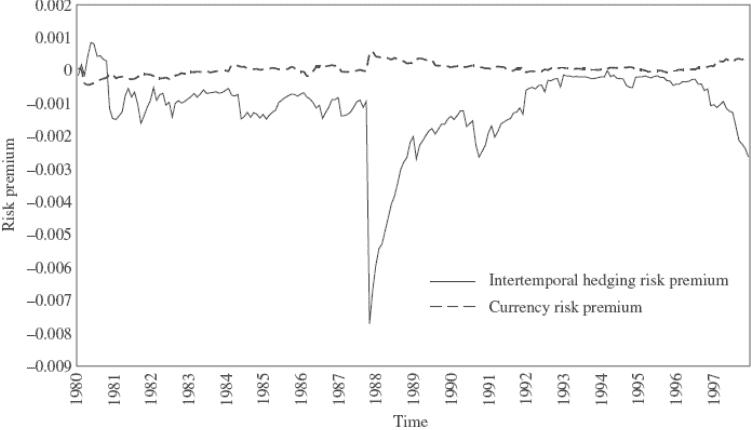

图12.1：风险溢价：美国股票。

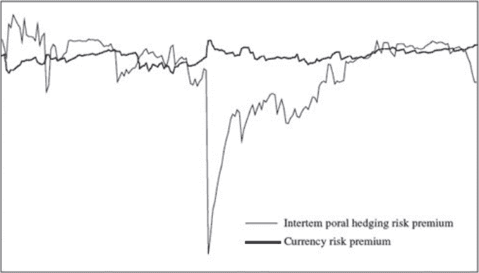

**图12.2：** 风险溢价：英国股票。

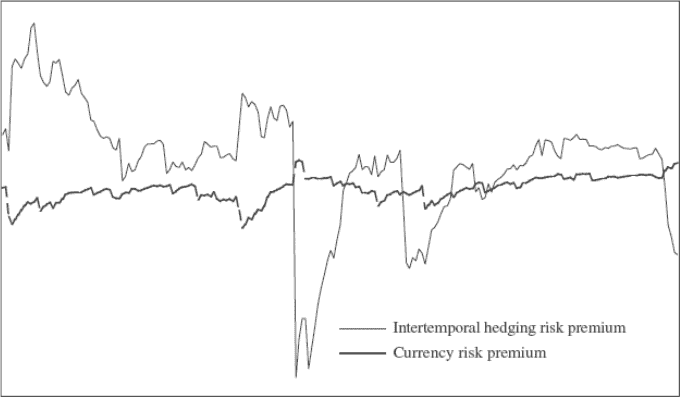

**图12.3：** 风险溢价：德国股票。

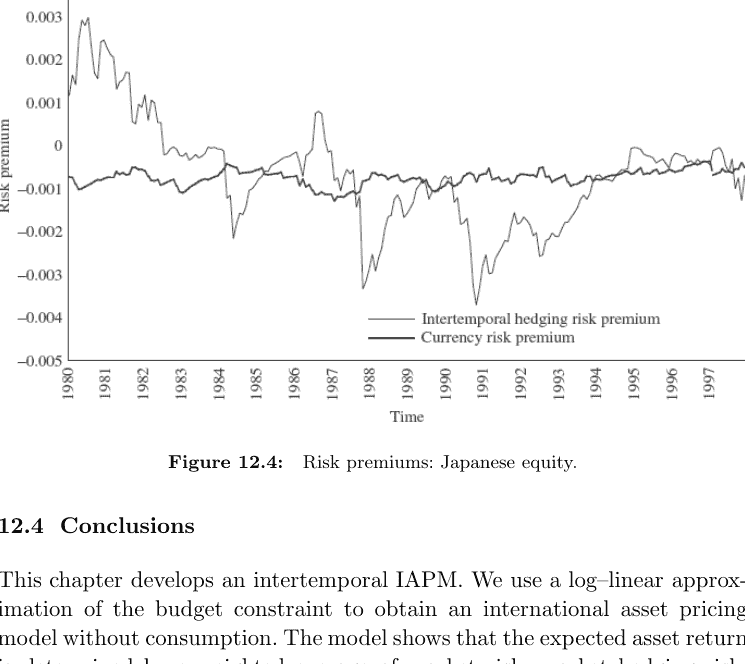

图12.4：风险溢价：日本股票。

## 12.4 结论

本章构建了一个跨期国际资产定价模型（IAPM）。我们使用预算约束的对数线性近似，得到了一个不依赖消费的国际资产定价模型。该模型表明，预期资产收益由市场风险、市场对冲风险、汇率风险和汇率对冲风险的加权平均决定。权重仅与相对风险厌恶系数相关，且权重之和为1。我们的结果可以与Stulz（1981）以及Adler和Dumas（1983）的开创性工作形成对照。他们假设投资机会集是恒定的，因此他们的模型无法处理市场对冲风险和汇率对冲风险。在我们的模型中，市场对冲风险的价格等于汇率风险价格的负值。这可能就是Dumas和Solnik（1995）认为汇率风险等同于市场对冲风险的原因。然而，他们的猜想基于国际模型与跨期模型之间的“赛马式”检验。

在实证方面，我们针对美国、英国、德国和日本股票市场检验了我们的动态国际资产定价模型。我们的国际模型是一个四因子模型，其中资产定价不仅使用其与市场组合和货币存款收益的协方差，还使用其与市场对冲组合和货币对冲组合的协方差。


考虑到投资集合的变化。证据支持市场风险在国际环境中重要的假设。此外，我们可以拒绝市场套期保值需求、汇率风险和货币套期保值需求不是国际股票回报定价的重要因素的假设。因此，证据支持跨期资产定价模型的国际版本。

最后，我们表明汇率风险不同于市场套期保值风险，且汇率风险与市场套期保值风险之间的关系可能是正的也可能是负的。这表明汇率风险和市场套期保值风险是国际资产定价中的两种不同风险，其中汇率风险比市场套期保值风险重要得多。

## 参考文献
Adler, M. and Dumas, B. (1983). 国际投资组合选择与公司金融：综合. Journal of Finance, 38, 925-984.
Bansal, R. D., Hsieh, H. and Viswanathan, S. (1993). 国际套利定价的新方法. Journal of Finance, 48, 1719-1747.
Bekaert, G., Harvey, C. R., Kiguel, A. and Wang, X. (2016). 全球化与资产回报. Annual Review of Financial Economics, 8, 221-288.
Bera, A. K. and Jarque, C. M. (1982). 模型设定检验：一种同时方法. Journal of Econometrics, 20, 59-82.
Bollerslev, T. and Wooldridge, J. M. (1992). 具有时变协方差的动态模型中的拟最大似然估计与推断. Econometrics Reviews, 11, 143-172.
Brusa, F., Ramadorai, T. and Verdelhan, A. (2015). 国际资本资产定价模型的再审视. Working Paper.
Campbell, J. Y. (1991). 股票回报的方差分解. Economic Journal, 101, 157-179.
Campbell, J. Y. (1993). 无需消费数据的跨期资产定价. American Economic Review, 83, 487-512.
Campbell, J. Y. (1996). 理解风险与回报. Journal of Political Economy, 104, 298-345.
Campbell, J., Giglio, S. and Polk, C. (2013). 艰难时期. Review of Asset Pricing Studies, 3, 95-132.
Campbell, J. Y., Giglio, S., Polk, C. and Turley, R. (2018). 具有随机波动率的跨期资本资产定价模型. Journal of Financial Economics, 128(2), 207-233.
Campbell, J., Polk, C. and Vuolteenaho, T. (2010). 成长还是魅力？股票回报中的基本面与系统性风险. Review of Financial Studies, 23, 305-344.
Campbell, J. and Vuolteenaho, T. (2004). 坏贝塔，好贝塔. American Economic Review, 94, 1249-1275.
Carrieri, F. (2001). 自由化对欧盟市场风险和货币风险的影响. European Financial Management, 7, 259-290.
Chan, K. C., Karolyi, G. A. and Stulz, R. M. (1992). 全球金融市场与美国股票的风险溢价. Journal of Financial Economics, 32, 137-167.
Chang, J. R. and Hung, M. W. (2000). 具有时变套期保值风险的国际资产定价模型. Review of Quantitative Finance and Accounting, 15, 235–257.
Cumby, R. E. (1990). 消费风险与国际股票回报：一些经验证据. Journal of International Money and Finance, 9, 182–192.
De Santis, G. and Gerard, B. (1997). 具有时变风险的国际资产定价与投资组合分散化. Journal of Finance, 52, 1881–1912.
De Santis, G. and Gerard, B. (1998). 货币风险的溢价有多大？. Journal of Financial Economics, 49, 375–412.
Ding, Z. and Engle, R. F. (1994). 大规模条件协方差矩阵建模、估计与检验. Working Paper, University of California at San Diego.
Dumas, B. and Solnik, B. (1995). 外汇汇率风险的世界价格. Journal of Finance, 50, 445–479.
Epstein, L. G. and Zin, S. E. (1989). 替代、风险厌恶以及消费和资产回报的时序行为：理论框架. Econometrica, 57, 937–969.
Epstein, L. G. and Zin, S. E. (1991). 替代、风险厌恶以及消费和资产回报的时序行为：实证分析. Journal of Political Economy, 99, 263–286.
Fama, E. F. and French, K. R. (2012). 国际股票回报中的规模、价值与动量. Journal of Financial Economics, 105, 457–472.
Fama, E. F. and French, K. R. (1998). 价值与成长：国际证据. Journal of Finance, 53, 1975–1999.
Fama, E. F. and Schwert, G. W. (1977). 资产回报与通胀. Journal of Financial Economics, 5, 115-146.
Ferson, W. (1989). 预期证券回报、风险与利率水平的变化. Journal of Finance, 44, 1191–1217.
Ferson, W. and Harvey, C. R. (1991). 经济风险溢价的变动. Journal of Political Economy, 99, 385–415.
Ferson, W. and Harvey, C. R. (1993). 国际股票回报的风险与可预测性. Review of Financial Studies, 6, 527–567.
Giovannini, A. and Weil, P. (1989). 资本资产定价模型中的风险厌恶与跨期替代. NBER, 2824.
Harvey, C. R. (1991). 协方差风险的世界价格. Journal of Finance, 46, 111–157.
Hodrick, R. J., Ng, D. and Sengmueller, P. (2000). 国际动态资产定价模型. International Tax and Public Finance, 6(4), 597–620.
Kreps, D. and Porteus, E. (1978). 不确定性的时间解析与动态选择理论. Econometrica, 46, 185–200.
Korajczyk, R. and Viallet, C. (1989). 国际资产定价的实证研究. Review of Financial Studies, 2, 553–585.
Lewis, K. K. (2011). 全球资产定价. Annual Review of Financial Economics, 3, 435–466.
Merton, R. C. (1973). 跨期资本资产定价模型. Econometrica, 41, 867–887.
Narayana, K. (1990). 将相对风险厌恶系数与跨期替代弹性分离：一个无关性结果. Journal of Finance, 45, 175–190.
O'Brien, T. and Dolde, W. (2000). 货币指数全球资本资产定价模型. European Financial Management, 6, 7–18.
Restoy, F. (1991). 收益随时间变化下的最优投资组合政策. Unpublished Manuscript, Harvard University.

## 跨期资本资产定价模型在国际公司金融中的应用
> Ross, S. A. (1976). 资本资产定价的套利理论. Journal of Economic Theory, 13, 341–360.
> Solnik, B. (1997). 外汇风险的世界价格：一些综合性评论. European Financial Management, 3, 9–22.
> Solnik, R. E. (1974). 国际资本市场的均衡模型. Journal of Economic Theory, 8, 500–524.
> Stulz, R. M. (1981). 国际资产定价模型. Journal of Financial Economics, 9, 383–406.
> Stulz, R. M. (1984). 国际环境下的资本资产定价：导论. Journal of International Business Studies, Winter, 55–73.
> Svensson, L. E. O. (1989). 连续时间下非期望效用下的投资组合选择. Economics Letters, 30, 313–317.
> Weil, P. (1989). 股权溢价之谜与无风险利率之谜. Journal of Monetary Economics, 24, 401–421.

本页特意留空

## 第13章
## 什么驱动国际分散化收益的变动？跨国分析
Wan-Jiun Paul Chiou and Kuntara Pukthuanthong

### 目录
- 13.1 引言 .................................................. 520
- 13.2 方法论 ............................................... 524
- 13.3 数据 ............................................................... 527
- 13.3.1 国家指数 ........................................ 527
- 13.3.2 经济变量 ................................... 527
- 13.4 市场一体化与分散化收益 ........ 538
- 13.4.1 国际市场是否随时间变得更加一体化？ 538
- 13.4.2 国际分散化收益的动态 ... 540
- 13.5 解释分散化收益的时间变化 ... 546
- 13.5.1 什么决定夏普比率收益的大小？ ... 546
- 13.5.2 什么决定分散化收益的风险降低？ ..................................................... 551
- 13.5.3 什么影响已实现的收益？ .................... 553
- 13.6 哪些经济决定因素在分散化收益中重要？ ............................................................ 553

Wan-Jiun Paul Chiou
Northeastern University
e-mail: w.chiou@northeastern.edu

Kuntara Pukthuanthong
University of Missouri
e-mail: pukthuanthongk@missouri.edu


13.7 结论 ........................................ 558
参考书目 ............................................. 559
附录13A：多元化收益决定因素的多重共线性检验 .............................. 562

### 摘要

在本章中，我们表明，随着世界日益一体化，全球多元化的收益随着时间的推移仍然保持为正且具有经济意义。回归分析和解释力检验均表明，以多因素模型调整后的$R^2$衡量的国际一体化，对多元化收益的影响比相关性更为深远。我们的结果支持Roll (2013)的论点，即$R^2$而非相关性是衡量市场一体化的适当指标。我们考察了市场一体化决定因素（如违约风险、通货膨胀、TED利差、过去本地股票市场收益、流动性以及国内投资组合的相对表现）对潜在多元化收益的影响。

### 关键词

多元化收益 • 投资约束 • 国际投资组合。

## 13.1 引言

国际多元化的有效性已得到充分证明。¹ 随着过去几十年全球市场日益一体化，与资产管理相关的几个关键问题出现：国际多元化对本地投资者的收益是否仍然显著？经济动态和市场一体化如何影响各国多元化收益的时变特征？显然，这些问题对学术界和华尔街都具有吸引力，尤其是在金融危机期间。由于传统模型未考虑投资组合的可行性和收益的时间动态，因此在最优多元化中考虑这些因素对于设计实际策略至关重要。在本章中，我们(i)在考虑可行性的同时，分析全球市场一体化对多元化收益时变性影响；(ii)探讨经济动态如何影响各国本地投资者的多元化收益；(iii)研究这些动态的经济意义和解释力。

¹ 更详细的讨论参见Cosset和Suret (1995)；De Roon等人 (2001)；De Santis和Gerard (1997)；Fletcher和Marshall (2005)；French和Poterba (1991)；Goetzmann等人 (2005)；Griffin和Karolyi (1998)；Harvey (1995)；Li等人 (2003)；McDowell (2018a)，McDowell (2018b)，Mullen和Berrill (2017)，Novomestky (1997)和Obstfeld (1994)。

### 什么因素驱动国际多元化收益的变化？

近期研究发现的市场中两种相互矛盾的力量，使得国际一体化与多元化收益之间的关系成为一个悬而未决的问题。各市场之间缺乏完美的商业周期同步性是多元化的基础。随着市场日益一体化，本地资产中全球系统性风险的比例增加，但可通过全球多元化抵消的特异性波动比例却减少（例如，Christoffersen等人，2012；Parsley和Schlag，2007；McDowell，2018a）。由于各国的不可分散风险对全球最优投资组合中的总体波动性产生更强影响，导致多元化收益下降。这种市场一体化与多元化收益之间的负相关关系被学术界和从业者所假定。然而，随着市场开放，国内市场的预期收益率已经下降（例如，Ang等人，2009；Bekaert和Harvey，2003；Bekaert等人，2005；Bekaert等人，2009），这应对全球多元化的收益产生积极影响。我们研究市场一体化的决定因素，如价格水平、增长、利率、风险溢价以及金融市场的动态，如何影响国际多元化收益。Driessen和Laeven (2007)得出结论，从国际国家风险指南(ICRG)评级中估计的政治风险是多元化收益的唯一关键决定因素。其他研究，包括Bekaert等人 (2011)和Christoffersen等人 (2012)，考察了市场一体化的决定因素。由于市场一体化和多元化收益可能是内生决定的，我们应用工具变量和GMM。

本文与以往研究的不同之处在于，我们在控制影响国际多元化的其他变量的同时，研究市场一体化与多元化收益之间的关系。文献表明，过去半个世纪国际市场的日益一体化（例如，Errunza等人，1992；Bekaert和Harvey，1995；Bae等人，2003，2003；Stulz和Williamson，2003；Bekaert等人，2005；De Jong和De Roon，2003，2005；Goetzmann等人，2005；Bekaert等人，2007；Pukthuanthong和Roll，2009）。但没有一项研究表明，在控制相关经济变量的影响时，市场一体化对多元化收益的影响。

市场一体化很难用一个因素来描述。我们的研究采用了Pukthuanthong和Roll (2009)开发的一个直接衡量指标，即通过对多个因素进行回归得到的R²，这些因素通过主成分(PC)分析获得，以解释被覆盖的部分。正如Bekaert等人 (2011)、Bekaert和Wang (2009)以及Carrieri等人 (2013)所建议的，我们发现一体化的模式因国家而异。

我们进一步分析了用于刻画商业周期的经济变量对21个发达国家和13个新兴市场多元化收益的影响。

我们发现，在控制各种经济变量时，市场一体化在解释多元化收益方面比相关性更具统计和经济显著性。当资产在投资组合中具有低或负相关性时，多元化被认为是有效的。然而，相关性和其他基于相关性的指标一直受到严厉批评。Bekaert等人 (2009)认为，相关性是分析国际多元化收益和国际金融市场一体化的重要概念，但不是这两个概念的完美衡量标准。Pukthuanthong和Roll (2009)也提到，两个国家广义金融市场指数收益之间的简单相关性可能无法很好地衡量其经济一体化。Carrieri等人 (2007)和Christoffersen等人 (2012)建议，相关性不能提供整体市场一体化的完整而准确的度量。当使用单一因子的相关性时，仅仅是简化了，未能通过纳入完整的协方差矩阵来充分解释风险结构。Carrieri等人 (2007)和Pukthuanthong和Roll (2009)一致认为，应该使用多个因子来衡量一体化。然后，我们将市场一体化和相关性都作为多元化的决定因素，并比较它们的影响。

为了检验多元化收益与市场一体化之间的关系，我们开发了模拟收益和相关性直接衡量全球多元化收益的方法，考察其动态，并进一步分析全球和本地经济因素如何影响广泛国家的多元化收益。De Roon等人 (2001)、Eun等人 (2010)、Ehling和Ramos (2006)、Eiling等人 (2012)、Harvey (1995)、Li等人 (2003)、Mullen和Berrill (2017)以及Pástor和Stambaugh (2000)已经表明，在不允许卖空的情况下，国内投资者可以通过纳入其他市场的资产来提高投资绩效。与Bekaert和Urias (1996)、Chiou (2009)以及Driessen和Laeven (2007)类似，我们使用夏普比率的增加和波动率的降低来估计均值-方差收益。我们的衡量标准考虑了与低资产多样性多元化策略不可行性。非负权重的最优策略在以往的实证研究中被广泛采用；然而，这些投资组合忽视了世界范围内市场规模和可投资性的异质性。此外，具有极端

多头和/或空头头寸可能引发资产收益率波动率和相关性的显著变化。Green 和 Hollifield (1992) 以及 Jagannathan 和 Ma (2003) 从风险控制角度评估投资组合约束，并证明权重约束会降低投资组合收益的波动率并提高资产配置的可行性。Brunnermeier 和 Pedersen (2005) 以及 Wagner (2011) 对投资组合策略中的流动性进行建模，并记录其对相关结构和风险管理有效性的影响。为考虑不可行性，我们根据各国的市值对投资组合权重施加限制。³ 我们使用事前和已实现均值-方差以及波动率来衡量分散化收益。本研究使用 MSCI 数据的优势在于它直接处理最优投资组合中的可行性和多样性问题。具体而言，MSCI 在创建指数时考虑了诸如规模、调整后市值、流动性要求、交易期限要求等各种要求。⁴

本文的主要发现如下。国际分散化的收益随时间变化，但尽管全球金融市场一体化程度不断提高，仍持续存在。回归分析和解释力检验均显示，市场一体化（调整后 R² 和相关性）与分散化收益呈负相关；然而，R² 在统计上和经济上更显著。我们发现与经济周期相关的变量，如通胀、国家风险、流动性、股票市场规模以及国内投资组合在世界市场的相对表现，与海外投资的潜在价值显著相关。我们的经济考察扩展到包括发达经济体的分析，因为此类限制可能暂时或永久性地实施。例如，在 2008 年金融危机期间，包括澳大利亚和美国在内的许多工业化国家限制了卖空。股票市场的可投资性是指外国投资者在国内市场像本地投资者一样交易的程度以及资产流动性的程度。详情请参见 Bae 等人，(2004)。

³除这些问题外，许多国家禁止外国投资者卖空和/或持有超过公司股份的特定比例。例如，在智利，外资对上市公司的所有权不得超过 10%，在韩国不得超过 25%，在台湾不得超过 10%。尽管巴西对外资更为开放，但国际机构持有的投票股份不得超过 49%。我们未考虑这些禁令。详细讨论请参见 Solnik 和 McLeavey (2009)。

⁴投资者可以使用 MSCI iShares 或交易所交易基金（ETF）来复制结果。关于 MSCI 指数在国际投资中的更详细讨论，请参见 Chakrabarti 等人 (2005)。

## 国际分散化收益变化的驱动因素？

权重约束以确保投资组合多样性。换句话说，投资者在配置资产时会考虑该国在世界市场中的相对市场规模。允许卖空和多样化投资（SS + DV(U)）的投资组合权重子集可以描述为

P_{SS+DV(U)} = {w_p ∈ S : 0 ≤ w_i ≤ U_w(Cap)_i ≤ 1, i = 1,2,...,N}, U > 1, (13.2)

其中 w(Cap)_i 是各国 i 在世界中的市值比例，U 是大于 1 的任意实数。如果投资者希望投资组合接近市值加权投资组合，或进行朴素分散化，可以将 U 设得较低。设置较高的 U 意味着对低多样性有很大的容忍度以及可能的流动性不足。当互补松弛条件、原约束和梯度方程得到满足时，最优权重可通过应用 Kuhn–Tucker 条件求解。

在有效前沿上，最大夏普比率（MSR）代表分散化所能实现的最优均值-方差效率。具体而言，

MSR_{SS+DV(U)} = max_{w_p} {(w_p^T μ)/(w_p^T V w_p)^{1/2} | w_p ∈ P_{SS+DV(U)}}. (13.3)

对于任何国内市场 i 的投资者，全球分散化带来的单位风险收益最大增幅为

δ_{i,SS+DV(U)} = MSR_{SS+DV(U)} - SR_i, (13.4)

其中 SR_i 是国家 i 国内投资组合的夏普比率。

国际分散化收益的第二个衡量指标是波动率的最大降低。Elton 等人 (2007) 认为，由于预期收益的可预测性不足，投资者可能寻求最小化投资组合方差。在这种情况下，投资者可能希望构建最小方差投资组合（MVP）。

¹由于外国投资者的所有权限制很常见，尤其是在发展中国家，具有较大 U 的最优解可能无法在资产配置管理中使用。例如，根据最优投资组合，非负约束有效前沿建议在 1993 年至 1996 年期间将 7.5% 至 62.5% 的资金投入智利，而智利约占世界资本化的 0.35%。尽管权重上限的选择可以是任意的，但需要同时考虑结果的可行性以及投资组合管理的灵活性。为了呈现效率，我们通过将 U 设为 3、5 和 10 来报告超配投资约束下分散化收益的变化。其他结果可向作者索取。

MVP 的权重可以表征为

w_{MVP,SS + DV(U)} = { w_p : min_{ {w_p} } [ w_p^T V w_p | w_p ∈ P_{SS + DV(U)} ] }.  (13.5)

在各种投资约束下进行国际分散化所带来的波动率最大降低为

ε_{i,SS + DV(U)} = σ_i − σ_{MVP(SS + DV(U))}.  (13.6)

第三个衡量指标是评估最优投资组合的样本外表现。由于收益估计不佳（例如 DeMiguel 等人，2009），评估最优投资组合的实际表现对学术界和华尔街都有益。对于不了解优化技术的朴素投资者而言，市值加权资产配置可能是一种可行的全球分散化策略。我们使用过去 5 年的月度收益构建国际分散化投资组合，以获得已实现的最高夏普比率（RMSR）。我们按以下方式计算每个月 RMSR 投资组合的夏普比率

SR_{RMSR} = μ_{RMSR} / σ_{RMSR},  (13.7)

其中 μ_{RMSR} 和 σ_{RMSR} 分别是实施 MSR 投资组合权重所实现的已实现超额收益和波动率。对于希望全球分散化其投资组合的朴素投资者，她根据上一年末的市值权重确定其财富的分配。已实现市值加权（RMVW）投资组合的夏普比率为

SR_{RMVW} = μ_{RMVW} / σ_{RMVW},  (13.8)

其中 μ_{RMVW} 和 σ_{RMVW} 分别是市值加权投资组合的超额收益和波动率。对于国际市场投资组合的持有者，RMSR 投资组合带来的均值-方差增幅为

ψ = SR_{RMSR} − SR_{RMVW}.  (13.9)

我们使用过去 60 个月的月度收益构建全球有效前沿，并通过每月再平衡最优投资组合来衡量全球分散化收益。我们计算过去 5 年的月度收益用于估计，每月再平衡投资组合，并衡量收益的动态变化。

## 13.3 数据

### 13.3.1 国家指数

本研究使用了 1988 年至 2011 年期间可获得的 21 个发达国家和 13 个发展中国家的摩根士丹利资本国际（MSCI）指数的美元计价月度收益。美国 90 天国库券收益率是无风险利率的代理指标。市值数据来自世界交易所联合会。

表 13.1 显示了本研究中的样本国家。市值增长最大的国家是芬兰、葡萄牙、印度尼西亚和土耳其。各地区内部国家之间的市值增长存在相当大的差异。发达国家的股票市场 consistently 占世界股票市场价值的 90% 以上。此外，这些市场的股票收益之间存在相当大的跨区域差异。与 Bekaert 和 Harvey (2003) 一致，发达国家的风险调整后收益平均高于新兴市场，原因在于其波动率的差异。

表 13.1 还展示了各市场风险调整后表现的时间变化。各国均值-方差效率的非同步变动意味着进行全球分散化的国内投资者可能获得潜在收益。例如，在 1998 年，存在五个市场（全部为发达市场）具有最大均值-方差效率，以及六个市场（全部位于东亚）具有最小效率。这表明，由于经济周期在各市场间的差异，本地投资者可以通过在其他国家进行最优资金配置来避免在其本国市场的损失。

### 13.3.2 经济变量

表 13.2 报告了我们用于分析国际分散化收益影响的变量。样本期为 1993 年 1 月至 2011 年 12 月。这些变量在先前的研究中被记录为与经济周期相关。其中一些衡量经济不稳定性和增长，而另一些则描述投资者对经济增长的前景。表 13.2 还显示了对全球分散化收益的预期影响符号、数据来源、参考文献和数据频率。

第一组是对价格水平变化的衡量。价格水平的上升可能引发经济不稳定。我们分析其影响


## 表13.1：国际市场的市值与表现。

### A组：发达国家

| 国家 | 市值增长率（%） | 市值权重（%） | 平均收益率（%） | 地区 | 均值 | 标准差 | 偏度 | 峰度 | 最大值 | 时间 | 最小值 | 时间 |
|---|---|---|---|---|---|---|---|---|---|---|---|---|
| 澳大利亚 | 14.19 | 1.84 | 10.31 | 大洋洲 | 0.0805 | 0.1427 | 1.392 | 1.400 | 0.5826 | Oct-07 | -0.0768 | Oct-01 |
| 奥地利 | 10.27 | 0.22 | 4.66 | 中/西欧 | -0.0336 | 0.2221 | 1.211 | 0.111 | 0.6345 | Oct-07 | -0.1474 | Jun-00 |
| 比利时 | 12.37 | 0.28 | 7.31 | 中/西欧 | 0.0977 | 0.1576 | 0.251 | -0.986 | 0.4814 | Aug-98 | -0.1600 | Apr-03 |
| 加拿大 | 12.96 | 2.97 | 9.46 | 北美洲 | 0.0779 | 0.1306 | 1.085 | 1.075 | 0.5651 | Nov-06 | -0.1013 | Aug-94 |
| 瑞士 | 10.96 | 2.39 | 10.37 | 中/西欧 | 0.1504 | 0.1519 | 0.044 | -0.903 | 0.4437 | Mar-98 | -0.1761 | Apr-03 |
| 德国 | 8.19 | 3.57 | 7.81 | 中/西欧 | 0.0751 | 0.1246 | 0.465 | 0.113 | 0.4263 | Jan-08 | -0.1817 | Apr-03 |
| 丹麦 | 13.22 | 0.36 | 11.67 | 中/西欧 | 0.0955 | 0.1421 | 1.256 | 1.623 | 0.6147 | Oct-07 | -0.1176 | Apr-03 |
| 西班牙 | 14.72 | 1.97 | 8.41 | 中/西欧 | 0.0728 | 0.1423 | 0.838 | 0.283 | 0.5552 | Oct-07 | -0.1151 | Apr-03 |
| 芬兰 | 27.07 | 0.50 | 7.45 | 北欧 | 0.0688 | 0.1461 | 0.088 | -0.872 | 0.3894 | Apr-00 | -0.2306 | Jan-93 |
| 法国 | 8.79 | 6.70 | 8.18 | 中/西欧 | 0.0944 | 0.1126 | 0.655 | 0.156 | 0.4369 | Oct-07 | -0.1215 | Apr-03 |
| 英国 | 4.47 | 8.03 | 7.43 | 中/西欧 | 0.0865 | 0.1483 | 0.165 | -0.709 | 0.4550 | Oct-07 | -0.2397 | Apr-03 |
| 香港 | 16.56 | 2.91 | 11.06 | 东亚 | 0.0666 | 0.1253 | 0.404 | -0.871 | 0.4203 | Nov-07 | -0.1160 | Oct-02 |
| 爱尔兰 | 5.82 | 0.24 | 3.10 | 中/西欧 | 0.0413 | 0.1692 | 0.130 | -0.797 | 0.4253 | Apr-98 | -0.2674 | Oct-11 |
| 意大利 | 10.31 | 1.83 | 3.80 | 南欧 | 0.0259 | 0.1163 | 0.892 | 0.277 | 0.4183 | Oct-07 | -0.1408 | Dec-11 |
| 日本 | 3.22 | 12.92 | -0.48 | 东亚 | -0.0575 | 0.1060 | 1.129 | 0.892 | 0.2590 | Nov-07 | -0.2288 | Sep-98 |
| 荷兰 | 15.21 | 0.35 | 9.09 | 中/西欧 | 0.1598 | 0.1631 | -0.036 | -1.149 | 0.4257 | May-98 | -0.1839 | Apr-03 |
| 挪威 | 16.87 | 0.36 | 9.94 | 北欧 | 0.0286 | 0.1401 | 0.975 | 0.221 | 0.4855 | Oct-07 | -0.1555 | Nov-02 |
| 新西兰 | 5.33 | 0.12 | 5.31 | 大洋洲 | 0.0365 | 0.1661 | 0.352 | -0.991 | 0.4504 | Aug-07 | -0.1948 | Oct-01 |
| 新加坡 | 15.43 | 0.74 | 8.60 | 东亚 | 0.0762 | 0.1504 | 0.821 | 0.383 | 0.5229 | Sep-07 | -0.1756 | Sep-98 |
| 瑞典 | 12.78 | 0.62 | 11.62 | 北欧 | 0.0582 | 0.1336 | 0.472 | -0.949 | 0.4515 | Oct-07 | -0.1228 | Oct-02 |
| 美国 | 7.75 | 43.56 | 9.14 | 北美洲 | 0.1394 | 0.1791 | 0.093 | -1.341 | 0.4454 | May-98 | -0.1862 | Mar-09 |

## 表13.2：经济与金融变量。

| 变量 | 定义 | 预期符号 | 参考文献/数据来源/频率 |
|---|---|---|---|
| **价格水平变化** |  |  |  |
| Δ WPI_t | 以全部商品生产者价格指数衡量的价格水平变化。 | −/+ | Global Financial Data; Fama and Gibbons (1984); Fama and Schwert (1977); Fama (1981); Pesaran and Timmermann (1995)/Global Financial Data/频率：年度 |
| *通货膨胀* | 以美国消费者价格指数衡量的价格水平变化。 | −/+ | Campbell (1987); Fama (1981); Fama and Gibbons (1984); Fama and Schwert (1977); Panchenko and Wu (2009); Rapach et al. (2005)/Global Financial Data/频率：年度 |
| **名义部门增长/全球流动性** |  |  |  |
| G_M1 | 以M1的自然对数差衡量的狭义货币增长率。 | −/+ | Rapach et al. (2005)/Global Financial Data/频率：年度 |
| **实体部门增长** |  |  |  |
| *失业率* | 失业率。 | + | Global Financial Data; Rapach et al. (2005); Fama (1981); Pesaran and Timmermann (1995)/Global Financial Data/频率：年度 |
| Δ GDP | 工业生产指数或GDP增长的对数差。 | − | Rapach et al. (2005); Bekaert, et al. (2005)/Global Financial Data和WDI/频率：年度 |
| *中学入学率* | 总入学人数（不论年龄）与官方对应中学教育年龄段人口之比。 | − | Lehkonen (2014)/WDI/频率：年度 |
| *预期寿命对数* | 如果出生时的死亡率模式在其一生中保持不变，新生儿预期存活的年数。 | − | Lehkonen (2014)/WDI/频率：年度 |
| *人口增长率* | 总人口增长率，统计所有居民，不论法律地位或国籍。 | −/+ | Lehkonen (2014)/WDI/频率：年度 |
| **风险溢价与债务收益率** |  |  |  |
| *违约风险溢价* | 穆迪已发行Aaa与Baa公司债券收益率之差。 | + | Campbell, Hilscher, and Szilagyi (2008); Vassalou and Xing (2004)/美联储/频率：月度与年度 |
| *期限风险溢价* | 美国政府90天国库券二级市场收益率与美国30年期政府债券收益率之差。 | + | Campbell (1987); Fama and Gibbons (1984); Rapach et al. (2005)/美联储/频率：月度与年度 |
| *过去本地股票市场收益率* | 国家层面市场组合从12月到12月的滞后年收益率。 | − | Lehkonen (2014)/Datastream/频率：月度与年度 |
| *TED利差* | 90天欧洲美元合约与90天国库券二级市场合约的利率差。 | + | Lehkonen (2014)/美联储/频率：月度与年度 |
| *国库券收益率* | 政府90天国库券二级市场收益率。 | −/+ | Campbell (1987)/美联储/频率：月度与年度 |
| *长期国债收益率* | 10年期政府债券收益率。 | −/+ | Campbell (1987)/美联储/频率：月度与年度 |
| **金融发展** |  |  |  |
| *股息率* | 股息/价格比率。 | − | Fama and French (1988); WDI/频率：月度与年度 |
| *换手率* | 股票市场换手率或股票交易额/市值。 | − | Global Financial Data和WDI/频率：年度 |
| *市盈率* | 股价/盈利比率。 | − | Campbell (1987); Fama and French (1988); Goyal and Welch (2003)/频率：月度与年度 |
| *市值/GDP* | 市值/GDP。 | − | WDI/频率：年度 |
| *上市公司数量* | 国家证券交易所上市公司数量的对数。 | − | WDI/频率：年度 |
| *私人信贷/GDP* | 私人信贷规模与GDP之比，其中私人信贷指向私人部门提供的金融资源，如贷款、购买非股权证券、贸易信贷及其他构成偿还债权的应收款项。 | − | King and Levine (1993); Atje and Jovanovic (1993)/WDI/频率：年度 |
| **国际金融市场** |  |  |  |
| *汇率风险* | 美元贸易加权指数变动的年化日波动率。标准差使用前100个日数据计算。 | + | Campa and Fernandes (2006); Campbell *et al.* (2008); De Santis and Gerard (1998)/Datastream/频率：月度与年度 |
| *相关系数* | 国内投资组合与其他33个国家在60个月内的皮尔逊相关系数均值。 | − | Datastream/频率：月度与年度 |
| *市场一体化* | 采用Pukthuanthong和Roll（2009）主成分方法得到的调整后$R^2$，该方法将国家股票指数收益率对十个全球因子进行回归。 | − | Pukthuanthong and Roll (2009)/Datastream/频率：月度与年度 |
| *RSR$_{国家X}$* | 国内投资组合相对于国际市场的相对夏普比率。具体而言，$RSR_{国家X} = [(SR_{国家X} - SR_{Min})/(SR_{Max} - SR_{Min})]$，其中$SR_{Max}$和$SR_{Min}$分别代表世界市场中夏普比率的最大值和最小值。 | − | Datastream/频率：月度与年度 |


## 表 13.2：（续）

| 变量 | 定义 | 预期符号 | 参考文献/数据来源/频率 |
|---|---|---|---|
| **市场开放度** |  |  |  |
| *股票市场开放度* | 该指标基于国际金融公司（IFC）可投资指数成分股的市场资本总额与各国IFC全球指数成分股的市场资本总额之比。IFC可投资指数代表可供外国投资者投资的国内股票组合，而全球指数衡量各国的整体市场组合。比值为1意味着该市场的所有股票均向外国投资者开放，而比值为0则表明该市场对外国人完全封闭。 | − | Bekaert *等人*（2012）/新兴市场数据库，标普/Compustat/频率：年度 |
| *贸易/GDP* | 商品和服务进出口总额除以国内生产总值。 | + | Campa和Fernandes（2006）；Campbell *等人*（2008）；De Santis和Gerard（1998）/世界发展指标/频率：年度 |
| *贸易开放度* | Wacziarg和Welch（2008）开发了这一指标，考虑五个因素：平均关税税率达到40%或以上；1970年代和1980年代黑市汇率相对于官方汇率贬值20%或以上；非关税壁垒覆盖40%或以上的贸易；国家对主要出口实行垄断；社会主义经济体制。若某国符合其中任一标准，则该值为0，否则为1。 | − | Bekaert *等人*（2012）/Wacziarg和Welch（2008）/频率：年度 |
| *资本账户开放度* | 该指标取值介于0和1之间。Chinn和Ito对国际货币基金组织《汇率安排与汇率限制年度报告》中列出的资本账户限制应用了标准化主成分分析。 | − | Chinn和Ito（2008）/频率：年度 |
| **制度环境** |  |  |  |
| *国家风险* | 国际国家风险指南（ICRG）的国家风险衡量政治风险（包括腐败、法律与秩序传统等因素）、金融和经济风险。 | + | Driessen和Laeven（2007）；Bekaert和Harvey（1997）/ICRG/频率：年度 |
| *投资概况* | ICRG政治风险子成分。衡量其他政治、经济和金融风险成分未涵盖的投资风险因素，包含三个子成分，评分0–4：合同可行性/征收、利润汇回、支付延迟。最高12分表示风险极低。 |  | Lehkonen（2014）/ICRG/频率：年度 |
| *腐败* | ICRG政治风险子成分。衡量政治体系内部的腐败程度，评分范围为0–6，分数越高表示腐败程度越低。 |  | Lehkonen（2014）/ICRG/频率：年度 |

*注：* 本表列出了表13.6、13.7和13.8中用作多元化收益决定因素的变量、其定义、与多元化收益关系的预期符号、相关论文参考文献、数据来源以及数据频率。数据时间为1988年1月至2011年12月。

零售商品价格水平（居民消费价格指数）和工业品价格水平（批发价格指数）的变化。8 价格水平变化对多元化收益的影响难以先验确定。随着通货膨胀上升，本币价值应贬值，出口商因而受益。出口经济体应从通胀上升中获益。当国内市场表现良好时，多元化的收益较小。尽管如此，通胀对进口经济体和购买力具有负面影响，因为消费者必须为相同数量的商品支付更多费用。通胀越高，这方面的多元化收益越大。

第二组是名义部门增长，以货币供应量的自然对数差表示。运用与价格水平变化相同的概念，货币供应量对多元化收益可能产生负面或正面影响。第三组是实际部门增长。也就是说，我们进一步研究经济发展（如失业率和GDP增长）如何影响多元化收益。较低的GDP增长和较高的失业率会降低本地股权价值，从而增加多元化收益。我们还包括中学入学率、对数预期寿命和人口增长。这些变量的增加使经济受益，从而降低多元化收益。

第四组捕捉风险溢价和债务收益率。为了理解商业周期的影响，我们纳入了违约和期限风险溢价、过去本地股票市场回报、TED利差、国库券收益率和长期国债收益率。违约风险溢价按BAA级公司债收益率减去AAA级公司债收益率计算，期限风险溢价按30年期国债收益率与3个月期国库券收益率之差计算。违约风险溢价和期限风险溢价越高，多元化收益越高。为了代表国际投资者的动量投资，我们纳入了过去本地股票市场回报，定义为国家层面市场组合的滞后年回报；为了捕捉全球信用风险，我们纳入TED利差，即90天欧洲美元合约利率与90天国库券二级市场合约利率之差。本地股票市场回报和全球信用风险的增加会降低多元化收益。为了捕捉债务收益率，我们纳入长期国债和国库券收益率。尽管较高的债务收益率可能意味着国内经济状况良好，从而降低多元化收益，但较高的基准利率也会导致本地证券价值下降。⁹

接下来，我们研究与国内金融市场发展的关联。为了衡量国内股票市场发展，我们考虑了股息收益率、市场换手率、市盈率（PE）、市值占GDP比重以及国内交易所上市股票数量。为了捕捉银行业的发展，我们纳入了私人信贷占GDP的比重。国内金融市场质量越高意味着多元化收益越低。此外，我们纳入了国内市场相对国际市场的经济状况对多元化收益的影响。变量包括汇率风险、国内市场与其他国家的相关系数、Pukthuanthong和Roll（2009）的整合度量R²，以及国内投资组合相对于国际市场的相对夏普比率（RSR）。我们构建了X国投资组合相对于世界市场的RSR如下：

RSR_国家X = [SR_国家X − SR_最小)/(SR_最大 − SR_最小)]， (13.10)

其中SR_最大和SR_最小分别代表世界市场中国家夏普比率的最大值和最小值。如图13.1所示，跨国比较指标衡量国内投资组合相对于世界其他地区的风险调整后表现，并且可以随时间变化。汇率风险应增加多元化收益，而较高的RSR应降低潜在的多元化收益。

捕捉市场开放度的一组变量包括贸易占GDP比重、贸易开放度、股票市场开放度和资本账户开放度。与Bekaert（1995）以及Edison和Warnock（2003）类似，一个经济体股票市场开放度值为1意味着外国人可以获得本地市场交易的所有股票，值为0意味着外国人无法获得任何本地交易的股票。这些数据对若干国家不可得，并且时间范围限于20世纪90年代初至2008年（从90年代中期开始有部分数据）。该变量仅适用于新兴市场，因为数据来自IFC的新兴市场数据库。因此，我们假设在整个样本期内，发达市场的股票市场是完全开放的。贸易占GDP比重是进出口总额占国内生产总值的百分比。


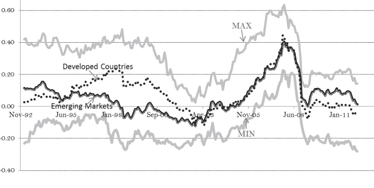

## 图 13.1：国家投资组合的夏普比率范围。

注释：该图显示了不同国家夏普比率范围的时间序列，以及发达国家和新兴市场的夏普比率均值。

国内产品。此外，我们采用萨克斯等人（1995）和瓦恰尔格与韦尔奇（2008）基于以下五个方面构建的二元指标，包括主要出口商品的国家垄断、社会主义经济制度、较高的关税、广泛的非关税壁垒以及较大的黑市汇率溢价。零值表示一个国家符合这些方面，而一则意味着该国家完全封闭。该指标截止于2001年，因此并未覆盖我们整个样本期。我们假设一旦国家经济开放后就不会再封闭。在我们的样本中，发达市场在整个样本期内都是开放的。

关于贸易开放度，我们采用萨克斯等人（1995）和瓦恰尔格与韦尔奇（2008）基于以下五个方面构建的二元指标，包括主要出口商品的国家垄断、社会主义经济制度、较高的关税、广泛的非关税壁垒以及较大的黑市汇率溢价。零值表示一个国家符合这些方面，而一则意味着该国家完全封闭。该指标截止于2001年，因此并未覆盖我们整个样本期。我们假设一旦国家经济开放后就不会再封闭。在我们的样本中，发达市场在整个样本期内都是开放的。

对于资本账户开放度，我们采用 Chinn 和 Ito（2008）的金融开放度指数。它适用于我们样本中大多数国家。该变量取自国际货币基金组织《汇率安排和汇率管制年度报告》（AREAER），用于衡量资本账户交易方面的监管限制。Chinn 和 Ito（2008）将其衡量为决定资本开放度的变量的标准化的主成分。指数值越高，表明该国对跨境交易的开放程度越高。我们将该指数标准化为单位区间。

最后一组衡量制度环境。Driessen 和 Laeven（2007）指出，由国际国家风险指南（ICRG）评级估计的国家风险是决定分散化收益的唯一关键决定因素。我们在检验中纳入了该变量。

## 13.4 市场整合与分散化收益

### 13.4.1 国际市场是否随时间变得更加整合？

Pukthuanthong 和 Roll（2009）考虑了广泛国家样本中的世界整合水平。具体而言，他们将每日国家指数收益率回归到其全球主成分（PCs），这些主成分由自1973年以来在 Datastream 中有数据的国家构建。其中有17个代表世界市场。对于1974年之前的17个国家队列中的每个成员，在将其排除在计算之外后，为每个国家单独估计主成分。例如，当研究对象国家为日本时，协方差矩阵和主成分仅根据除日本外的16个国家的同期日收益率加上来自两个北美国家的滞后日收益率计算。¹⁰ 当加拿大或美国为研究对象国家时，使用其他16个国家进行计算，但滞后收益率只有一个，分别是美国或加拿大的。按上述方式排除国家旨在避免任何怀疑，即一个国家的收益率对全球因子的回归会因该国在主成分中权重过高而产生偏差。我们采用其方法并获得截至2011年的 PC 数据。采用这种方法，R² 衡量的是指数收益率中由全球因子解释的比例。

10 两个北美国家的滞后日收益率考虑了时区差异。

表 13.3 提供了在数据可得年份期间，各国 R² 对线性时间趋势回归的斜率 t 统计量。似乎存在广泛共享的市场整合增加，但我们并不声称这些时间趋势拟合在各国之间是独立的。发达市场的全球市场整合程度高于新兴市场。

## 表 13.3：来自全球因子模型的调整后 R² 的时间趋势及相关系数。

| 国家 | 年数 | 调整后 R² t 统计量 | 相关系数 t 统计量 |
|---|---|---|---|
| **发达市场** |  |  |  |
| Australia | 15.01 | 7.29 | 2.25 |
| Austria | 15.01 | 3.08 | 1.16 |
| Belgium | 15.01 | 7.35 | 5.28 |
| Canada | 19.01 | 1.82 | 1.92 |
| Denmark | 18.01 | 3.95 | 3.26 |
| Finland | 8.00 | 3.11 | 2.03 |
| France | 15.01 | 8.03 | 9.36 |
| Germany | 23.01 | 7.96 | 9.67 |
| Hong Kong | 23.01 | 5.43 | 5.21 |
| Ireland | 15.01 | 4.95 | 1.93 |
| Italy | 15.01 | 8.64 | 4.16 |
| Japan | 15.01 | 4.04 | 2.46 |
| Netherlands | 15.01 | 6.62 | 7.97 |
| New Zealand | 15.01 | 1.84 | 0.49 |
| Norway | 8.00 | 3.74 | 3.25 |
| Singapore | 15.01 | 3.00 | 1.39 |
| Spain | 14.00 | 11.89 | 11.39 |
| Sweden | 8.01 | 7.05 | 4.04 |
| Switzerland | 15.01 | 4.93 | 4.80 |
| United Kingdom | 23.01 | 7.17 | 4.71 |
| United States | 23.01 | 4.07 | 1.61 |
| **新兴市场** |  |  |  |
| Argentina | 5.59 | 1.14 | 0.94 |
| Brazil | 4.73 | 5.38 | 5.79 |
| Chile | 2.89 | 2.35 | 2.45 |
| Greece | 8.01 | 3.82 | 1.15 |
| Indonesia | 13.06 | 3.27 | -0.98 |
| Malaysia | 8.00 | -2.64 | -2.15 |
| Mexico | 8.01 | 3.76 | 2.20 |
| Philippines | 8.00 | 2.15 | 2.24 |
| Portugal | 8.00 | 3.44 | 1.88 |
| South Korea | 13.01 | 9.24 | 4.43 |
| Taiwan | 13.01 | 4.09 | 4.39 |
| Thailand | 8.00 | 0.38 | 0.11 |
| Turkey | 8.00 | 2.69 | 2.45 |

注释：当一个国家在某一日历年度至少有50个可用的日收益率时，其该年度以美元计价的收益率将回归到由前一年度协方差矩阵估计的10个全球因子上，该协方差矩阵基于 Pukthuanthong 和 Roll（2009）所述的17个主要国家、“1974年前队列”的收益率构建的样本外主成分。由此得到的每个国家的调整后 R 平方随后被拟合为所有可得年份的简单线性时间趋势。每个国家与世界其他地区的相关性被估计并拟合为所有可得年份的简单线性时间趋势。第三列和第四列分别报告了来自调整后 R 平方和相关性回归的时间趋势系数 t 统计量。第二列报告了可得年份数。

对于有足够年份拟合线性时间趋势的21个发达国家，19个的 t 统计量为正且超过2.0，另外两个也有正的时间趋势但仅在10%显著性水平下。平均时间趋势 t 统计量为5.52。对于13个新兴国家，10个的 t 统计量为正且超过2.0，一个具有负的时间趋势，另外两个具有为正但不显著的时间趋势。平均时间趋势 t 统计量为3.01。

其中，欧洲国家在这20个样本年期间彼此之间的整合程度大幅提高，表现出非常强的时间趋势。法国、德国、意大利和西班牙的 t 统计量均超过八。其他一些显著的整合增加包括韩国、瑞典和英国。然而，与增强整合的总体趋势相比，也存在一些明显的例外。一个国家在其 R² 上表现出显著负的时间趋势，马来西亚，这可能并不令人意外。总体而言，R² 显示我们样本中的大多数国家随时间与世界市场整合。

为了将 R² 与相关性进行比较，我们展示了各国与世界其他地区的相关性对时间趋势回归的斜率 t 统计量。21个发达国家中有15个的 t 统计量为正且超过2.0，平均时间趋势 t 统计量为4.21。对于13个新兴国家，七个的 t 统计量为正且超过2.0，一个具有在10%水平上显著的正时间趋势，三个具有为正但不显著的时间趋势，两个具有负的时间趋势。平均时间趋势 t 统计量为1.92。总体而言，相关性时间趋势的 t 统计量低于 R² 时间趋势的 t 统计量。该证据支持 Roll（2013）和 Pukthuanthong 和 Roll（2009）的理论论点，即市场之间的相关性可能非常低；尽管它们受相同的共同影响驱动，因而完全整合或 R² 等于1.0。结果表明相关性和 R² 捕捉了市场整合的不同动态。

### 13.4.2 国际分散化收益的动态

在本节中，我们展示了分散化收益的统计数据及其随时间的变化。国际市场之间风险调整后收益的非同步变动表明，本地投资者可以通过投资外国资产来提高其投资组合的均值-方差效率。有效前沿的形状和大小因市场之间均值-方差效率和整合的历时性偏差而变化。考虑到国家投资组合位置的变化，我们

重新平衡最优投资组合并衡量跨国本地投资者的分散化收益。有效前沿的波动反映了均值-方差效率的时间变化以及世界经济的商业周期。

表 13.4 显示了任何国内投资者国际分散化的潜在收益。由于数值有界，我们采用截尾 *t* 统计量（Barr and Sherrill, 1999）检验其与零的差异。平均而言，无卖空的国际分散化使夏普比率提高 0.30，波动率降低 4.50%，已实现风险回报提高 0.13。整个样本显示，其中 70% 的夏普比率增幅大于 0.2。同样，就波动率降低的分散化收益而言，我们样本中有 58% 的波动率下降幅度在 3% 至 5% 之间，而 36% 的样本波动率下降幅度大于 5%。已实现回报的结果则呈现出不同的情况。约 60% 的样本通过已实现夏普比率衡量的分散化收益为正，高于简单价值加权策略。RMSR 投资组合（\(\psi\)）带来的均值-方差增幅由于预测性差而波动较大。总体而言，结果显示，随着一体化程度的提高，分散化收益逐渐减弱但并未完全消除。已实现的夏普比率增幅没有明显模式。截尾 *t* 检验的结果表明，分散化的 *ex ante* 收益在统计上显著，但已实现回报并非如此。

图 13.2 展示了潜在收益的时间序列及其长期平滑曲线（H–P），该曲线由 Hodrick 和 Prescott（1997）提出，用于美国投资者。在各种多样性条件下，收益朝同一方向变动，但规模不成比例。分散化的经济价值为正，尽管似乎随时间变化。A 至 D 面板中的夏普比率收益和 E 至 H 面板中的波动率收益揭示了不同的情况。对于 \(\delta\)，分散化收益在 1993 年至 2000 年间下降，但在 2000 年至 2007 年间大幅上升，并在 2008 年次贷危机以来下降。这与先前的证据一致，即在熊市期间市场高度一体化。

E 至 H 面板中以波动率降低衡量的分散化收益（\(\varepsilon\)）遵循不同的模式。分散化收益 \(\varepsilon\) 从 1995 年 7 月至 2000 年增加，在 2003 年至 2008 年间下降，但在 2008 年后略有增加。在熊市期间，单个资产的波动率增加，投资组合的风险仍可通过有效的分散化策略降低，尽管风险降低的幅度较小。\(\delta\) 与 \(\varepsilon\) 的相反变动表明，分散化目标在均值-方差效率改善与波动率降低之间存在权衡。然而，一些进一步的实证检验有助于识别影响分散化收益幅度的因素。

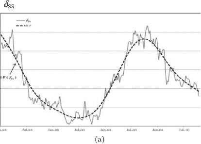

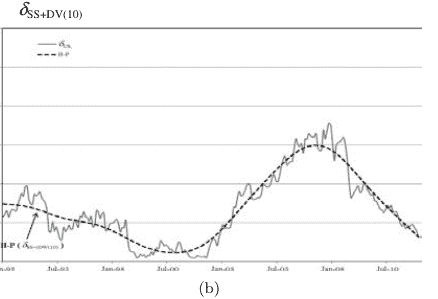

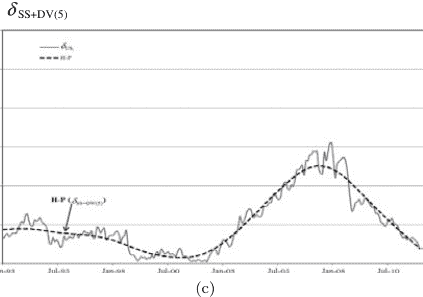

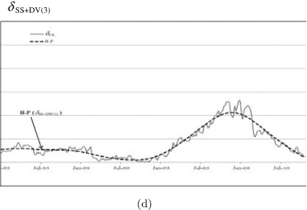

**图 13.2：（续）**

## 图 13.2：国际分散化收益的时间序列。

注：该图显示了在卖空（SS）和各种卖空加多样性（SS+DV(U)）投资组合下对美国投资者的国际分散化收益的时间序列。对美国投资者的国际分散化收益通过投资 MSR 投资组合的夏普比率增加（δ_SS + DV(U) = MSR_SS + DV(U) − SR_Countryx）、投资 MVP 的波动率下降（ε_US + DV(U) = σ_MVR(SS + DV(U))）以及实现 MSR 投资组合的夏普比率增加 ψ = SR_RMSR − SR_RMVW 来评估。最优投资组合是利用过去 60 个月的数据在各种投资约束下构建的。长期趋势由 Hodrick 和 Prescott（1997）提出的滤波器对每个时间序列进行说明和平滑（H-P(.)）。

## 13.5 解释分散化收益的时间变化

迄今为止，我们已表明尽管市场日益一体化，投资者仍可从国际分散化中受益。在本节中，我们进一步评估经济因素对国际投资潜在收益的影响程度。具体而言，我们有兴趣确定通胀、经济增长、风险以及国内和国际金融市场的动态如何影响分散化的潜在价值。此外，我们比较了衡量市场一体化的 R² 和相关性对分散化收益的影响。在本节中，我们使用回归框架来分析经济和金融变量对分散化收益的影响。

表 13.5 显示了每个时间序列的统计数据。由于在估计有效前沿时存在重叠回报，每次对分散化收益的评估都与其一期滞后在 1% 显著水平上呈正相关。对于滞后大于一期的情况，自相关性的经济和统计显著性微不足道。Phillips–Perron（PP）和 Dickey–Fuller（DF）检验的统计结果表明，对于夏普比率收益的每个时间序列，都应拒绝单位根假设。这些发现表明回归中应考虑一期滞后。

### 13.5.1 什么决定了夏普比率收益的大小？

均值-方差图掩盖了分散化的收益，因为它隐含地将固定的国内投资组合与全球有效前沿进行比较。相反，国内 SR 随时间变化，因此全球 MSR 投资组合需要定期重新平衡。由于分散化带来的回报变化和波动率变化在不同情景下各不相同，我们只能通过实证检验来确定收益的大小。

我们首先分析均值-方差效率收益（δ）。由于投资者可以在多因子世界中重新平衡投资组合以具有相同的风险特征，分散化仅取决于在重新加权后因子无法解释的特有风险。具体而言，我们使用 PP 不平衡面板数据并考虑以下回归模型：

$\delta_{j,t} = \alpha + \beta' \delta_{j,t-1} + \sum_{i=1}^{N} \gamma' x_{j,i,t} + \xi_{j,i,t}, \qquad (13.11)$

和

$\varepsilon_{j,t} = a + b' \varepsilon_{j,t-1} + \sum_{i=1}^{N} c' x_{j,i,t} + \zeta_{j,i,t}, \qquad (13.12)$

其中 $\delta$ 是夏普比率的增加，$\varepsilon$ 是波动率的下降，分别定义在方程（13.4）和（13.6）中。$\alpha$ 和 $a$ 为常数，$x_i$ 是表 13.2 中描述的国家 $j$ 的第 $i$ 个自变量。我们使用不平衡面板数据普通最小二乘法（OLS）联合估计所有国家的模型，但通过按国家索引聚类标准误差来考虑横截面依赖性。完整的自变量集合显示在表 13.2 中。所包含的变量总体上高度相关，因此对完整模型的估计会产生大量不显著的自变量并给结果带来噪声。我们应用一般到特定算法（见 Bekaert et al., 2011; Bekaert et al., 2012; Hendry and Krolzig, 2005）来减少解释分散化收益变化的变量数量。该算法包括多个步骤以消除系数不显著的变量。具体而言，我们使用所有自变量估计模型（13.11）和（13.12），然后消除统计显著性最低且未达到 15% 显著性水平的变量。我们设置较高的显著性水平以保守地保留潜在重要变量。我们继续估计模型并排除单个变量，同时检验已排除的变量是否应被纳入。考虑到表 13.5 显示的结果，为控制分散化收益的自回归特性，所有回归中都包含一期滞后。

表 13.6 报告了因变量为夏普比率增加 $\delta$ 的回归结果。我们考虑了卖空约束和投资多样性为 10 的分散化收益，因为在各种情景中这是最实用的。为简洁起见，$\alpha$、$a$、$\beta$ 和 $b$ 未报告。首先，我们使用市场一体化（$R^2$）和相关性这两个关键自变量分别在不同回归中估计模型（13.11）和（13.12）。所有变量均已标准化。列 2 和列 3 的结果显示，$R^2$ 的一个标准差增加使分散化

## 表 13.6：风险调整后溢价增加的非平衡面板数据回归。

| 因变量回归类型 | δ_SS+DV(10) OLS |  | δ_SS+DV(10) OLS |  | δ_SS+DV(10) IV |  |
|---|---|---|---|---|---|---|
| 相关性 | -0.122<br>(-2.543) |  | -0.141<br>(-2.579) |  | -0.118<br>(-1.831) |  |
| 市场一体化 | -0.256<br>(-3.341) |  | -0.240<br>(-3.212) |  | -0.235<br>(-3.271) |  |
| ΔWPI₁ |  | 0.085<br>(1.968) | 0.083<br>(1.747) | 0.087<br>(2.420) | 0.096<br>(2.234) |  |
| 通胀 |  | 0.119<br>(2.268) | 0.110<br>(2.270) | 0.129<br>(2.396) | 0.114<br>(2.482) |  |
| G_M1 |  | -0.264<br>(-0.364) | -0.035<br>(-0.450) | -0.215<br>(-0.255) | -0.029<br>(-0.325) |  |
| 失业率 |  | 0.082<br>(1.920) | 0.083<br>(1.790) | 0.099<br>(2.297) | 0.084<br>(2.248) |  |
| GDP 增长 |  | -0.211<br>(-0.334) | -0.012<br>(-0.344) | -0.243<br>(-0.409) | -0.012<br>(-0.377) |  |
| TED 价差 |  | 0.106<br>(2.065) | 0.075<br>(1.653) | 0.125<br>(2.513) | 0.061<br>(1.512) |  |
| 国家风险 |  | 0.055<br>(1.598) | 0.063<br>(1.591) | 0.058<br>(1.954) | 0.072<br>(1.811) |  |
| 股票市场开放度 |  | -0.029<br>(-0.682) | -0.422<br>(-0.728) | -0.035<br>(-0.850) | -0.395<br>(-0.584) |  |
| P/E |  | 0.020<br>(0.524) | 0.040<br>(0.571) | 0.019<br>(0.468) | 0.040<br>(0.407) |  |
| 股息收益率 |  | 0.067<br>(1.406) | 0.065<br>(1.450) | 0.060<br>(1.002) | 0.058<br>(1.292) |  |
| 换手率 |  | -0.091<br>(-2.002) | -0.101<br>(-2.292) | -0.080<br>(-1.830) | -0.095<br>(-1.760) |  |
| 预期寿命对数 |  | -0.030<br>(-0.954) | -0.500<br>(-0.849) | -0.027<br>(-0.700) | -0.513<br>(-1.051) |  |
| 上市公司数量 |  | -0.031<br>(-0.750) | -0.051<br>(-0.866) | -0.034<br>(-0.813) | -0.044<br>(-0.756) |  |
| 汇率风险 |  | -0.072<br>(-1.520) | -0.067<br>(-1.321) | -0.059<br>(-1.079) | -0.057<br>(-0.936) |  |
| RSR |  | -0.336<br>(-4.068) | -0.295<br>(-4.041) | -0.335<br>(-3.030) | -0.310<br>(-4.777) |  |
| 工具变量的 F 检验（p 值） |  |  |  |  | 0.002 |  |
| Hansen-Sargan 检验（p 值） |  |  |  |  | 0.25 |  |
| 调整后 R² | 0.082 | 0.052 | 0.912 | 0.896 | 0.887 | 0.821 |
| 概率 (β_Corr = β_Market integration) | 0.005 |  | 0.026 |  | 0.014 |  |

注释：本表报告了第 2 至 5 列的普通最小二乘（OLS）回归系数以及第 6 和 7 列使用工具变量的回归。ICRG 的投资概况被用作国家风险、市场一体化和相关性的工具变量。因变量是在卖空限制下多样性为 10 的夏普比率增加值 δ，如公式（13.2）所述。自变量在表 13.2 中描述。常数项和一期滞后系数未报告。

收益，而相关性标准差增加仅减少 12% 的分散化收益。结果表明相关性的经济显著性较低；尽管如此，相关性在 5% 水平上具有统计显著性。第（4）和（5）列包含了文献中记录的分散化收益的其他决定因素。市场一体化和相关性仍然高度显著，但前者更显著。通胀、TED 价差、换手率以及当地投资组合在世界市场中的相对表现（RSR）对均值-方差效率的收益具有显著的解释力。具体而言，通胀高、全球信贷风险或 TED 价差高、失业率高、换手率低、股票市场回报率低的经济体从分散化中获益更多。

存在一种可能性，即因变量和自变量都是内生决定的。解释市场一体化的变量可能也解释分散化收益。Driessen 和 Laeven（2007）认为国家风险可能是内生的，因此在夏普比率增加的横截面回归中使用法律渊源（La Porta 等，1998）作为工具变量。然而，法律渊源不是时变的，我们的回归形式是非平衡面板数据，但不是一个有效的工具变量（Atanasov 和 Black，2015）。我们使用腐败作为国家风险的工具变量，该变量按每年为每个国家提供。我们还使用 ICRG 开发的投资概况作为 R² 和相关性的工具变量。投资概况捕捉了其他经济、政治和金融风险成分未涵盖的投资风险因素。Lehkonen（2014）表明投资概况是市场一体化的关键决定因素。投资概况提高市场一体化。国家风险和腐败也来自 ICRG。应用工具变量的第 6 和 7 列的结果在质量上与第 4 和 5 列的结果相似。遵循 Driessen 和 Laeven（2007），我们执行识别工具的联合显著性 F 检验和过度识别限制的 Hansen-Sargan 检验，以检验我们对工具选择的合理性。Hansen-Sargan 检验的原假设是工具变量与误差项不相关，且被排除的工具变量已正确从估计方程中排除。如果 Hansen-Sargan 检验被拒绝，则工具选择值得怀疑。两个检验都支持将腐败和投资概况作为国家风险和市场一体化的工具变量。F 检验表明腐败和投资概况解释了国家风险和市场一体化的大部分变异。Hansen-Sargan 检验在常规显著性水平下未被拒绝。另一个担忧是我们的自变量是否存在多重共线性。^{11} 我们对分散化收益的解释变量应用方差膨胀因子（VIF），其低于 5，而 5 是多重共线性问题存在的阈值。结果在附录中报告。最后一行报告了相关性和 *R*² 系数差异的 *F 检验* 的 *p 值*，表明它们显著不同。*R*² 的系数显著更高。

除了 OLS 和工具变量回归外，我们还应用广义矩估计（GMM）回归来检验结果的稳健性。没有理论支持这些变量服从高斯分布。与其它估计量不同，GMM 不需要扰动项的精确分布信息。此外，使用 GMM 不存在高维度和多个混合模型可能带来的显著问题。结果在质量上仍然相似，因此未报告。

## 13.5.2 *什么决定了分散化收益的风险降低？*

表 13.7 提供了以波动率降低（*ε*）衡量的分散化收益的实证结果。结果显示相关性和 *R*² 均降低分散化收益，但 *R*² 的经济显著性更高。*R*² 标准差增加 1 个单位会使分散化收益减少 30%，而相关性标准差增加仅使分散化收益减少 18%。在控制其他决定因素并应用工具变量后，结果表明股息收益率、换手率和国内股票回报较高的经济体从分散化中获得的波动率降低最多。表 13.7 底部的 *p 值* 表明在所有回归模型中，*R*² 比相关性是分散化收益更重要的决定因素。*F* 检验和 Hansen–Sargan 检验表明，我们选择腐败作为国家风险的工具变量，以及投资概况作为市场一体化（和相关性）的工具变量是有效的。

从理论上讲，随着全球市场变得 *更一体化*，可通过分散化抵消的全球非系统性波动会减少。国内资产的全球系统性风险将对全球分散化投资组合的波动性产生更强的影响，因此市场一体化

## 表 13.7：风险下降的非平衡面板数据回归。

| 因变量回归类型 | ε_SS+DV(10) OLS | ε_SS+DV(10) OLS | ε_SS+DV(10) IV |
|---|---|---|---|
| 相关性 | -0.176<br>(-2.693) | -0.159<br>(-2.425) | -0.161<br>(-2.700) |
| 市场一体化 | -0.309<br>(-4.011) | -0.305<br>(-3.926) | -0.282<br>(-3.709) |
| ΔWPI1 | 0.047<br>(1.253) | 0.050<br>(1.118) | 0.044<br>(1.007) |
| 通胀 | 0.062<br>(1.633) | 0.082<br>(1.775) | 0.072<br>(2.025) |
| G_M1 | 0.094<br>(2.015) | 0.110<br>(2.237) | 0.092<br>(1.627) |
| 失业率 | 0.038<br>(0.852) | 0.028<br>(0.703) | 0.038<br>(0.793) |
| GDP 增长 | -0.017<br>(-0.223) | -0.006<br>(-0.231) | -0.017<br>(-0.157) |
| TED 价差 | 0.002<br>(0.100) | 0.001<br>(0.084) | 0.002<br>(0.110) |
| 国家风险 | -0.233<br>(-0.491) | -0.025<br>(-0.526) | -0.206<br>(-0.416) |
| 股票市场开放度 | -0.002<br>(-0.099) | -0.002<br>(-0.089) | -0.002<br>(-0.124) |
| P/E | -0.020<br>(-0.229) | -0.003<br>(-0.183) | -0.021<br>(-0.255) |
| 股息收益率 | -0.303<br>(-2.994) | -0.263<br>(-3.795) | -0.281<br>(-2.831) |
| 换手率 | -0.316<br>(-2.971) | -0.132<br>(-2.172) | -0.319<br>(-3.394) |
| 预期寿命对数 | -0.033<br>(-0.731) | -0.021<br>(-0.640) | -0.032<br>(-0.654) |
| 上市公司数量 | -0.002<br>(-0.130) | -0.004<br>(-0.124) | -0.002<br>(-0.113) |
| 汇率风险 | 0.029<br>(0.709) | 0.035<br>(0.755) | 0.025<br>(0.567) |
| RSR | -0.358<br>(-4.353) | -0.347<br>(-4.408) | -0.396<br>(-4.851) |
| 工具变量的 F 检验（p 值） |  |  | 0.004 |
| Hansen-Sargan 检验（p 值） |  |  | 0.19 |
| 调整后 R² | 0.075 | 0.060 | 0.806 |
| 概率 (β_Corr = β_Market integration) | 0.006 | 0.004 | 0.011 |

注释：本表报告了第 2 至 5 列的普通最小二乘（OLS）回归系数以及第 6 和 7 列使用工具变量的回归。ICRG 的投资概况被用作国家风险、市场一体化和相关性的工具变量。因变量是卖空限制下多样性为 10 的分散化收益带来的风险下降 ε_s，如公式（13.2）所述。自变量在表 13.2 中描述。常数项和一期滞后系数未报告。


降低ε。请注意，市场一体化并不意味着所有国家对所有要素价格的变化都会作出相同方向的反应。例如，油价上涨对石油出口国可能是利好，但对石油进口国则可能是利空。由于国内市场对全球总体风险可能产生正面或负面影响，我们无法先验地判断最小波动率（MV）会上升还是下降。结果表明，总体而言，全球一体化降低了投资者的ε。

## 13.5.3 什么因素影响已实现收益？

为了检验我们研究结果的稳健性，我们进行了回归分析，以展示由方程（13.9）确定的已实现均值-方差效率收益如何受到上述经济与金融因素的影响。样本外结果应该会引起资产经理的关注，因为我们的实证发现显示了事前分散化投资组合策略能否产生更高的盈利能力。

表13.8展示了已实现风险调整后溢价增加的回归结果。样本外检验的结果证实了我们的总体结论。也就是说，R²与分散化收益的关联度比相关性更高。通货膨胀、TED利差、国家风险、换手率以及本地投资组合在世界市场中的相对表现（RSR）对均值-方差效率收益具有显著的解释力。与表13.6中的样本内检验相反，国家风险增加了分散化收益。p值表明，R²比相关性更适合作为市场一体化的度量指标；不过，其显著性低于样本内检验的结果。我们通过工具变量的F检验和Hansen–Sargan检验得出了相同的结论。

## 13.6 哪些经济决定因素对分散化收益至关重要？

第13.5节展示了决定分散化收益的若干变量。然而，哪些载荷因子对分散化收益的大小更为关键？经济决定因素对分散化收益的解释力有多大？理解这一问题有助于投资者在制定针对具有不同特征的其他国家的国际投资策略时，对变量进行优先级排序。在本节中，我们采用Bekaert等人（2011）提出的方法，对每个自变量对分散化收益的影响进行两项检验。

### 表13.9：对分散化收益的影响。

|  | δ_SS+DV(10) | ε_SS+DV(10) |
|---|---|---|
| ΔWPI₁ | 0.0648 | 0.0751 |
| 通货膨胀 | 0.0623 | 0.0551 |
| G_M1 | -0.0254 | 0.0234 |
| 失业率 | 0.0451 | 0.0462 |
| GDP增长 | -0.0078 | -0.0088 |
| 违约风险溢价 | 0.0885 | 0.0713 |
| 期限风险溢价 | 0.0507 | -0.0594 |
| 股票市场开放度 | -0.0174 | -0.0194 |
| 国债收益率 | -0.0665 | 0.0637 |
| 市盈率 | 0.0154 | -0.0179 |
| 股息率 | 0.0209 | -0.0249 |
| 换手率 | -0.0005 | -0.0004 |
| 交易量 | -0.1358 | -0.1219 |
| 上市公司数量 | -0.0155 | -0.0145 |
| 汇率风险 | -0.0015 | 0.0017 |
| RSR | -0.3799 | -0.3284 |
| 相关性 | -0.0157 | -0.0187 |
| 市场一体化 | -0.2024 | -0.0698 |

注：该表报告了各分散化收益决定因素在发生一个标准差大小的变化时的影响。分散化收益定义为风险调整后溢价的增加，计算方式为δ_SS+DV(U) = δ_MSR(SS+DV(U)) − δ_CountryX；风险的减少计算方式为ε_SS+DV(U) = ε_CountryX − ε_MVP(SS+DV(U))。自变量见表13.2的描述。常数项和一期滞后项的系数未报告。

表13.9显示了当自变量发生一个标准差变化时分散化收益的变化。为了使检验与表13.6至表13.8一致，我们对具有10种多样性且存在卖空限制的数值进行了此分析。使用其他多样性所得到的结果在性质上类似。与前面各节的回归分析一致，相对夏普比率对两种分散化收益度量都是最重要的因素。对于风险调整后溢价的增加（δ），相对夏普比率之后依次是调整后的R²、交易量、违约风险溢价和国债收益率。换手率、汇率风险、GDP增长和市盈率的重要性最低。对于风险的减少（ε），相对夏普比率之后依次是交易量、WPI增长、违约风险溢价和调整后的R²，而换手率、汇率风险、GDP增长和上市公司数量对风险减少的影响最弱。相比之下，表13.6中A组的回归分析显示，相对夏普比率、交易量、违约风险溢价和调整后的R²分别是风险调整后溢价增加的最显著解释变量，而RSR、交易量、通货膨胀和调整后的R²是风险减少的最显著变量。总体而言，回归分析与贡献分析的结果在性质上类似。相对夏普比率、调整后的R²、交易量和违约风险溢价是分散化收益最显著的决定因素。

此外，我们检验每个自变量解释了分散化收益中的多少变动，以及它们各自的贡献是多少。我们将R²估计为

$\frac{\text{Var}(\hat{\delta}_{j,t})}{\text{Var}(\delta_{j,t})}$

其中

$\hat{\delta}_{j,t}= \hat{a}_k + \hat{\beta}\delta_{j,t-1} + \sum_{i=1}^{N} \hat{\gamma}_{j,i,t}$

且$x_{j,i,t}$是国家$j$在时间$t$的第$i$个自变量。分母为

$\text{Var}(\delta_{j,1}) = \frac{1}{J}\sum_{j=1}^{J}\frac{1}{T_j}\sum_{t=1}^{T_j}\left(\hat{\delta}_{j,t} - \bar{\hat{\delta}}\right)^2$

其中

$\bar{\hat{\delta}} = \frac{1}{J}\sum_{j=1}^{J}\frac{1}{T_j}\sum_{t=1}^{T_j}\hat{\delta}_{j,t}$

分子定义为 $\text{Var}(\hat{\delta}_{j,t}) = \frac{1}{J}\sum_{j=1}^{J}\frac{1}{T}\sum_{t=1}^{T_j}\left(\hat{\delta}_{j,t} - \bar{\hat{\delta}}\right)^2$，其中 $\bar{\hat{\delta}} = \frac{1}{J}\sum_{j=1}^{J}\frac{1}{T}\sum_{t=1}^{T_j}\hat{\delta}_{j,t}$

然后，我们通过下面的协方差来估计每个自变量对总体分散化收益的贡献。设

$\text{Cov}(\hat{\delta}_{j,t}, \hat{\gamma}_i x_{j,i,t}) = \frac{1}{J}\sum_{j=1}^{J}\frac{1}{T_j}\sum_{t=1}^{T_j}\hat{\gamma}_i\left(\hat{\delta}_{j,t} - \bar{\hat{\delta}}\right)^2\left(x_{j,i,t} - \bar{x}_i\right), \qquad (13.13)$

## 什么因素驱动国际分散化收益的变动？

其中$\bar{x}_i$是变量$x_{i,j}$在国家和时间上的均值。这些协方差之和应恰好等于预测的分散化收益的方差，即

$\sum_i \frac{\text{Cov}(\hat{\delta}_{j,t}, \hat{\gamma}_i x_{j,i,t})}{\text{Var}(\hat{\delta}_{j,t})} = 1$，

其中$i$是第$i$个自变量。

表13.10中的结果表明，一体化度量$R$-squared（−28%）、RSR（7%）、违约风险溢价（38%）、失业率（24%）和期限风险溢价（26%）对夏普比率增加的总变动贡献最大。对于风险的减少，$R$-squared（−25%）、违约风险溢价（34%）和RSR（13%）是风险减少变动的主要贡献者。WPI增长、通货膨胀和失业率

| 变量 | $\delta_{SS+DV(10)}$ | $\varepsilon_{SS+DV(10)}$ |
|----------|---------------------|------------------------|
| $\Delta$WPI | 0.2626 | 0.4046 |
| 通货膨胀 | 0.2601 | 0.4665 |
| $G_{M1}$ | -0.0085 | 0.2412 |
| 失业率 | 0.2423 | 0.3124 |
| GDP增长 | -0.0098 | -0.1385 |
| 违约风险溢价 | 0.3767 | 0.3381 |
| 期限风险溢价 | 0.2552 | -0.0064 |
| 股票市场开放度 | -0.0082 | -0.0007 |
| 国债收益率 | -0.0015 | 0.0237 |
| 市盈率 | 0.0053 | -0.0039 |
| 股息率 | 0.0012 | -0.1473 |
| 换手率 | -0.0065 | -0.1057 |
| 交易量 | -0.0024 | -0.0062 |
| 上市公司数量 | -0.0072 | -0.0066 |
| 汇率风险 | -0.0012 | 0.0212 |
| RSR | -0.0736 | -0.1276 |
| 相关性 | -0.0011 | -0.0098 |
| 市场一体化 | -0.2825 | -0.2515 |
| 调整后R² | 0.6239 | 0.5714 |

注：该表报告了每个决定因素对预测分散化收益的贡献；预测分散化收益定义为风险调整后溢价的增加，计算方式为$\delta_{SS+DV(U)} = \delta_{MSR(SS+DV(U))} - \delta_{CountryX}$；风险的减少计算方式为$\varepsilon_{SS+DV(U)} = \varepsilon_{CountryX} - \varepsilon_{MVP(SS+DV(U))}$。自变量见表13.2的描述。常数项和一期滞后项的系数未报告。


利率也解释了夏普比率上升和风险下降变化中的很大一部分。尽管不同国家的多元化收益存在显著的时间变化，但结果显示我们的预测模型对夏普比率的上升解释了62%，对风险的下降解释了57%。

解释力检验证实了市场一体化（调整后R²）而非市场相关性对多元化收益的优越影响。此外，我们表明RSR和违约风险在决定收益方面发挥的作用比其他因素更为关键。我们提供了关于影响国际多元化收益的因素的比单纯回归分析更稳健的结果。经验证据有助于投资者在全球投资中优先考虑决策变量。

## 13.7 结论

我们分析了各种经济决定因素（包括市场一体化）对多元化收益时间变化的影响，同时考虑最优投资组合的可行性。我们的多元化收益衡量指标具体考虑了投资组合多样性，而我们的市场一体化衡量指标同时考虑了各市场中时变的收益和风险结构。我们发现，尽管全球金融市场一体化程度不断提高，国际多元化对国内投资者的收益仍然存在。结果在使用事前和实际的均值-方差和波动率的多元化收益衡量指标时保持一致。回归分析和解释力检验证实了市场一体化相对于相关性对多元化收益的优越影响。此外，我们发现RSR和违约风险等一些重要因素在决定收益方面发挥着关键作用。稳健的经验证据表明投资者应优先考虑全球投资中的决策变量。

我们在考虑策略可行性的同时评估了国际多元化对不同国家本地投资者的收益。多元化传统上被认为在资产或投资组合相关性较弱时有效。我们的结果支持文献中认为多因子模型中的R²比相关性更适合作为市场一体化衡量指标。尽管R²和相关性显著降低多元化收益，但R²在统计和经济上更显著。投资者和学者应从我们关于经济周期对全球多元化有效性影响的发现中受益。未来研究可考虑交易成本。

## 参考文献

- Ang, A., Hodrick, R. J., Xing, Y. and Zhang, X. (2009). 高特质波动率与低回报：国际及美国进一步证据。 *Journal of Financial Economics*, 91, 1–23.
- Atanasov, V. and Black, B. (2015). 基于冲击的因果推断在公司金融研究中的应用。 *Critical Financial Review*, Forthcoming.
- Atje, R. and Jovanovic, B. (1993). 股票市场与发展。 *European Economic Review*, 37, 632–640.
- Bae, K., Chan, K. and Ng, A. (2004). 可投资性与回报波动率。 *Journal of Financial Economics*, 71, 239–263.
- Bae, K., Karolyi, G. A. and Stulz, R. M. (2003). 衡量金融传染的新方法。 *Review of Financial Studies*, 16, 717–763.
- Barr, D. R. and Sherrill, E. (1999). 截尾正态分布的均值与方差。 *The American Statistician*, 53, 357–361.
- Bekaert, G., Ehrmann, M., Fratzscher, M. and Mehl, A. (2012). 全球危机与股票市场传染。 NBER Working paper No. 17121.
- Bekaert, G. and Harvey, C. R. (1995). 时变世界市场一体化。 *Journal of Finance*, 50, 403–444.
- Bekaert, G. and Harvey, C. R. (2003). 新兴市场金融。 *Journal of Empirical Finance*, 10, 3–56.
- Bekaert, G., Harvey, C. and Ng, A. (2005). 市场一体化与传染。 *Journal of Business*, 78, 39–70.
- Bekaert, G., Harvey, C., Lundblad, C. and Siegel, S. (2007). 成长机会与市场一体化。 *Journal of Finance*, 62, 1081–1138.
- Bekaert, G., Harvey, C., Lundblad, C. and Siegel, S. (2011). 什么分割了股票市场？ *Review of Financial Studies*, 24, 3841–3890.
- Bekaert, G., Hodrick, R. J. and Zhang, X. (2009). 国际股票回报共同运动。 *Journal of Finance*, 64, 2591–2626.
- Bekaert, G. and Urias, M. S. (1996). 多元化、一体化与新兴市场封闭式基金。 *Journal of Finance*, 51, 835–869.
- Bekaert, G. and Wang, X. (2009). 全球化与资产价格。 Working paper, Columbia University.
- Bera, A. K. and Park, S. Y. (2008). 利用最大熵原理进行最优投资组合多元化。 *Econometric Reviews*, 27, 484–512.
- Brandt, M. W. (1999). 投资组合与消费选择估计：条件欧拉方程方法。 *Journal of Finance*, 54, 1609–1646.
- Brunnermeier, M. K. and Pedersen, L. H. (2005). 掠夺性交易。 *Journal of Finance*, 60, 1825–1864.
- Campa, J. and Fernandes, N. (2006). 国际投资组合多元化收益的来源。 *Journal of Empirical Finance*, 13, 417–443.
- Campbell, J. (1987). 股票回报与期限结构。 *Journal of Financial Economics*, 18, 373–399.
- Campbell, J. Y., Hilscher, J. and Szilagyi, J. A. N. (2008). 探寻困境风险。 *Journal of Finance*, 63, 2899–2939.
- Carrieri, F., Errunza, V. and Hogan, K. (2007). 随时间表征世界市场一体化。 *Journal of Financial and Quantitative Analysis*, 42, 915–940.
- Carrieri, F., Chaieb, I. and Errunza, V. (2013). 隐性壁垒对全球化重要吗？ *Review of Financial Studies*, 26, 1694–1739.
- Chakrabarti, R., Huang, W., Jayaraman, N. and Lee, J. (2005). MSCI指数变动的价格与成交量效应：性质与原因。 *Journal of Banking and Finance*, 29, 1237–1264.
- Chen, N., Roll, R. and Ross, S. (1986). 经济力量与股票市场。 *Journal of Business*, 59, 383–403.
- Chen, Z. and Wang, Y. (2008). 双边相干风险度量及其在现实投资组合优化中的应用。 *Journal of Banking and Finance*, 32, 2667–2673.
- Chinn, M. D. and Ito, H. (2008). 金融开放度的新衡量指标。 *Journal of Comparative Policy Analysis*, 10, 309–322.
- Chiou, W. (2009). 投资约束下的国际多元化收益：一个随时间变化的视角。 *Journal of Multinational Financial Management*, 19, 93–110.
- Christoffersen, P., Errunza, V., Jacobs, K. and Langlois, H. (2012). 国际多元化的潜力正在消失吗？动态Copula方法。 *Review of Financial Studies*, 25, 3711–3751.
- Cosset, J. and Suret, J. (1995). 政治风险与国际投资组合多元化的收益。 *Journal of International Business Studies*, 26, 301–318.
- De Jong, F. and De Roon, F. A. (2005). 时变市场一体化与新兴市场的预期回报。 *Journal of Financial Economics*, 78, 583–613.
- DeMiguel, V., Garlappi, L. and Uppal, R. (2009). 最优与朴素多元化：1/N投资组合策略有多低效？ *Review of Financial Studies*, 22, 1915–1953.
- De Roon, F. A., Nijman, T. E. and Werker, B. J. (2001). 在卖空限制和交易成本下检验均值-方差跨期：新兴市场案例。 *Journal of Finance*, 56, 721–742.
- De Santis, G. and Gerard, B. (1997). 时变风险下的国际资产定价与投资组合多元化。 *Journal of Finance*, 52, 1881–1912.
- De Santis, G. and Gerard, B. (1998). 货币风险溢价有多大？ *Journal of Financial Economics*, 49, 375–412.
- Driessen, J. and Laeven, L. (2007). 国际投资组合多元化收益：来自本地视角的跨国证据。 *Journal of Banking and Finance*, 31, 1693–1712.
- Edison, H. J. and Warnock, F. E. (2003). 资本管制强度的简单衡量指标。 *Journal of Empirical Finance*, 10, 81–103.
- Ehling, P. and Ramos, S. (2006). 地理与行业多元化：约束很重要。 *Journal of Empirical Finance*, 13, 396–416.
- Eiling, E., Gerard, B., Hillion, P. and De Roon, F. (2012). 国际投资组合多元化：货币、行业和国家效应再探。 *Journal of International Money and Finance*, 31, 1249–1478.
- Elton, E. J., Gruber, M. J., Brown, S. J. and Goetzmann, W. N. (2007). *现代投资组合理论与投资分析*. John Wiley & Sons: New Jersey.
- Errunza, V., Losq, E. and Padmanabhan, P. (1992). 一体化、温和分割与分割假说的检验。 *Journal of Banking and Finance*, 16, 949–972.
- Eun, C. L., Lai, S., De Roon, F. and Zhang, Z. (2010). 利用因子基金进行国际多元化。 *Management Science*, 56(9), 1500–1518.
- Fama, E. (1981). 股票回报、实际经济活动、通胀与货币。 *American Economic Review*, 71, 545–65.
- Fama, E. and French, K. (1988). 股息收益率与预期股票回报。 *Journal of Financial Economics*, 22, 3–25.


- Fama, E. 和 French, K. (1989). 商业状况与股票和债券的预期回报. Journal of Financial Economics, 25, 23-49.
- Fama, E. 和 Gibbons, M. (1984). 通货膨胀预测的比较. Journal of Monetary Economics, 13, 327-348.
- Fama, E. 和 Schwert, G. (1977). 资产回报与通货膨胀. Journal of Financial Economics, 5, 115-146.
- Fletcher, J. 和 Marshall, A. (2005). 国际多元化收益的实证研究. Journal of International Financial Markets, Institutions and Money, 15, 455-468.
- French, K. R. 和 Poterba, J. M. (1991). 投资者多元化与国际股票市场. American Economic Review, 81, 222-226.
- Goetzmann, W. N., Li, L. F. 和 Rouwenhorst, K. G. (2005). 长期全球市场相关性. Journal of Business, 78, 1-38.
- Goyal, A. 和 Welch, I. (2003). 用股息率预测股权溢价. Management Science, 49, 639-654.
- Green, R. C. 和 Hollifield, B. (1992). 均值-方差有效投资组合何时能够充分分散？ Journal of Finance, 47, 1785-1809.
- Griffin, J. 和 Karolyi, G. A. (1998). 再探市场产业结构在国际多元化策略中的作用. Journal of Financial Economics, 50, 351-373.
- Harvey, C. (1995). 新兴市场的可预测风险与回报. Review of Financial Studies, 8, 773-816.
- Hendry, D. F. 和 Krolzig, H. M. (2005). 自动GETS建模的性质. The Economic Journal, 115, C32-C61.
- Hodrick, R. J. 和 Prescott, E. (1997). 战后美国商业周期：一项实证研究. Journal of Money, Credit, and Banking, 29, 1-16.
- Jagannathan, R. 和 Ma, T. S. (2003). 大型投资组合中的风险降低：为什么施加错误的约束是有帮助的. Journal of Finance, 58, 1651-1683.
- La Porta, R., Lopez-de-Silanes, F., Shleifer, A. 和 Vishny, R. (1998). 法律与金融. Journal of Political Economy, 106, 1113-1155.
- Li, K., Sarkar, A. 和 Wang, Z. (2003). 受投资组合约束的新兴市场的多元化收益. Journal of Empirical Finance, 10, 57-80.
- Markowitz, H. (1952). 投资组合选择. Journal of Finance, 7, 77-91.
- McDowell, S. (2018a). 应用于国际多元化的估计误差减少策略的实证评估. Journal of Multinational Financial Management, 44, 1-13.
- McDowell, S. (2018b). 权重约束下国际多元化的收益：跨国研究. Quarterly Review of Economics and Finance, 69, 99-109.
- Mullen, C. 和 Berrill, J. (2017). 单一国家公司：投资于没有外国销售公司的多元化收益. Financial Analysts Journal, 73, 116-132.
- Novomestky, F. (1997). 一个动态、全球多元化、指数中性的合成资产配置策略. Management Science, 43, 998-1016.
- Obstfeld, M. (1994). 风险承担、全球多元化与增长. American Economic Review, 84, 1310-1329.
- Panchenko, V. 和 Wu, E. (2009). 新兴市场中时变的市场一体化以及股票和债券收益的一致性. Journal of Banking and Finance, 33, 1014-1021.
- Pástor, L. 和 Stambaugh, R. (2000). 比较资产定价模型：一个投资视角. Journal of Financial Economics, 56, 335-381.

- 14.5 结论 ........................................ 579
- 参考文献 ........................................... 580

### 摘要

Markowitz (1952) 提出的现代投资组合理论是投资管理的基石，但其应用面临挑战，因为最优投资组合权重对资产收益率均值和协方差的估计极为敏感。作为一种精细的改进，Black–Litterman 投资组合模型允许最优投资组合权重依赖于隐含市场均衡收益与投资者观点的结合（Black 和 Litterman, 1991）。然而，Black–Litterman 模型的绩效与投资者观点以及估计的协方差矩阵密切相关。为了克服这些问题，我们首先提出一个预测回归来形成投资者观点，其中资产收益率对其滞后值和市场收益率进行回归。其次，受波动率聚集、厚尾分布和杠杆效应等典型特征的启发，我们通过异方差模型来估计资产收益率的协方差。使用台湾股市五个行业指数的实证分析表明，所提出的投资组合在累计收益方面优于现有投资组合。

**关键词**

Markowitz 现代投资组合理论 • Black–Litterman 模型 • GARCH 模型 • EGARCH 模型 • 投资者观点 • 波动率聚集。

## 14.1 引言

Markowitz (1952) 为现代投资组合理论提供了框架，在该框架中，资产收益率可以被假定为独立同分布的多变量正态向量，其均值为 μ，协方差为 Σ。在实践中，投资理论寻求分散风险的投资组合。然而，直接实施 Markowitz 模型具有挑战性，因为最优权重对资产均值和协方差的估计极为敏感，并且可能得到角点解，这与投资组合分散化的直觉相悖。例如，Chopra 等人 (1993) 和 Brianton (1998) 已经表明，参数中的估计误差会严重影响优化后的投资组合和有效前沿。此外，Michaud (1989) 指出，Markowitz 模型可能会导致输入参数假设中的误差效应被最大化。

Black 和 Litterman (1991) 通过结合隐含市场均衡收益和投资者观点改进了 Markowitz 模型，使得估计的均值和协方差被调整以更实际地反映市场行为。利用贝叶斯公式，给定投资者观点的收益率是隐含市场均衡收益与投资者观点之间的加权平均值。当投资者对其观点有更高的置信水平时，给定投资者观点的加权平均收益率往往更接近投资者观点，反之亦然。

文献中对 Black–Litterman (BL) 模型的详细阐述已有广泛研究。例如，Christodoulakis (2002) 和 Walters (2014) 提供了如何使用贝叶斯公式推导 BL 模型的详细说明；Idzorek (2004) 总结了推导 BL 模型参数的分步指南；标准的 BL 模型又被 Black 和 Litterman (1992) 以及 He 和 Litterman (1999) 进一步扩展。另一方面，O’toole (2013) 从风险预算的角度重新审视了 BL 模型，以富有洞察力和直观的方式揭开了 BL 模型的神秘面纱。与 BL 模型类似，Jurczenko 和 Teiletche (2018) 引入了一个分析框架，允许投资者在基于风险的投资解决方案之上添加主动观点。

BL 模型的使用需要指定投资者的观点，这些观点是主观的，因此依赖于具体问题。例子包括 Meucci (2010) 中的简单统计方法和 Beach 和 Orlov (2007) 中的广义自回归条件异方差模型。因此，为了为 BL 模型的应用提供一个简单而有效的方案，我们首先提出一个预测回归来形成投资者观点，其中资产收益率对其自身的滞后值和市场收益率进行回归。

因为资产收益率的协方差矩阵的估计至关重要，所以已经研究了各种估计协方差矩阵的方法 (Guo 等人 (2017))。简单的估计量，如对角线估计量或常数相关估计量，通常被用作比较的基准。前者假设资产收益率两两不相关，而后者假设每对资产收益率具有相同的相关系数 (Elton and Gruber, 1973)。协方差矩阵可以通过线性因子模型来估计，这有助于减少模型参数的数量。例子包括 Avellaneda 和 Lee (2010)、Chen 等人 (1986)、Sharpe (1963) 以及 Torun 等人 (2011)。

除了上述方法之外，Litterman 和 Winkelmann (1998) 使用高盛的衰减率协方差矩阵模型进行投资组合优化和风险管理。Ledoit 和 Wolf (2003b) 通过样本协方差矩阵和单指数协方差矩阵的最优加权平均来估计股票收益的协方差矩阵。Ledoit 和 Wolf (2003a) 以及 Ledoit 和 Wolf (2003b) 考虑了一种收缩估计量，用于

协方差矩阵，它结合了样本协方差和任意协方差估计量，其中混合权重可通过交叉验证获得。然而，Disatnik和Benninga（2007）表明，就全局最小方差投资组合的*事后*标准差而言，使用更复杂的收缩估计量并没有统计上显著的增益。

为了估计协方差，我们对台湾股票市场的五个行业指数进行了仔细的探索性数据分析。结果表明，收益率表现出典型特征，如波动率聚集、厚尾分布和杠杆效应。因此，我们使用异方差模型来估计时变协方差矩阵。

本章其余部分的结构如下。14.2节回顾了BL模型，并提出了一种预测回归来形成投资者的观点。此外，同时考虑了投资者的绝对观点和相对观点。14.3节提出了一种动态估计协方差矩阵的方法，以纳入收益中的异方差性。14.4节总结了实证分析。14.5节给出结论。

## 14.2 预备知识

我们首先回顾BL模型。然后，我们给出确定隐含市场均衡收益和投资者观点的程序。

### 14.2.1 *布莱克-利特曼模型*

BL模型使用贝叶斯公式，将投资者对一项或多项资产预期收益的主观观点与隐含市场均衡收益相结合，形成新的预期收益混合估计。详细阐述请参见Meucci（2010）、Satchell和Scowcroft（2000）、Idzorek（2004）、Walters（2014）及其中的参考文献。

考虑一个包含m种证券或资产类别的市场。假设它们的收益服从正态分布 $r_t = (r_{1t}, \ldots, r_{mt})'$。

$$r = N(\mu, \Sigma). \tag{14.2.a}$$

预期收益 $\mu$ 服从

$$\mu = N(\pi, \Sigma_\pi = \tau\Sigma). \tag{14.2.b}$$

此外，$\mu$ 的协方差矩阵与收益的协方差 $\Sigma$ 成正比，即 $\Sigma_\pi = \tau\Sigma$。关于 $\tau$ 的选择，请参考Black和Litterman（1992）、He和Litterman（1999）、Satchell和Scowcroft（2000）以及Allaj（2013）。在本文中，$\tau$ 设为0.025（Idzorek, 2004）。

BL模型反向利用资产市值权重来获得隐含市场均衡收益

$$\pi = \lambda \Sigma \omega^{M},$$
(14.2.c)

其中，$\lambda$ 是表示风险厌恶系数的常数，$\Sigma$ 是资产的 $m \times m$ 协方差矩阵，投资组合中的市值权重 $\omega^{M} = (\omega^{M}_1, \ldots, \omega^{M}_m)'$ 是一个 $m \times 1$ 向量，由以下方程计算：

$$\omega_i^{M} = \frac{P_iQ_i}{\sum_{i=1}^{m} P_iQ_i},$$
(14.2.d)

对于 $i = 1, \ldots, m$。这里，$P_i$ 是第i种资产的市场价格，$Q_i$ 是第i种资产的流通股数。

为了构建投资者预期收益的观点，BL模型认为观点的期望与参数 $\mu$ 相关。因此，观点 $v$ 的不确定性是一个随机向量，服从：

$$v\mid\mu \sim N(P\mu,\Omega),$$
(14.2.e)

其中，$P$ 是表示 $K$ 个观点的 $K \times m$ 矩阵，协方差矩阵 $\Omega$ 量化了投资者对其观点的置信水平。为简化数学处理，假设

$$\Omega = \tau P\Sigma P',$$
(14.2.f)

其中常数 $\tau$ 刻画了观点置信度的不确定性。我们指出，$\tau$ 的取值没有规则。例如，Almadi等人（2014）将 $\tau$ 设为1，Michaud等人（2013）将 $\tau$ 设为 $1/T$，其中 $T$ 是收益观测值的数量。在本文中，我们设 $\tau = 0.025$ 以表明对投资者观点有相对较高的置信度（Idzorek, 2004）。

给定预期收益 $\mu$ 和投资者观点 $v$，贝叶斯公式得出以下关于收益的关键公式：

$$r\mid v,\,\Omega \sim N(\mu_{BL},\Sigma_{BL}),$$
(14.2.g)

其中

$$\mu_{BL} = \pi + \tau\Sigma P'\left(\tau P\Sigma P' + \Omega\right)^{-1}(v - P\pi),$$
(14.2.h)

$$\Sigma_{BL} = (1+\tau)\Sigma - \tau^2\Sigma P'\left(\tau P\Sigma P' + \Omega\right)^{-1}P\Sigma.$$
(14.2.i)

在给定投资者观点 $v$ 和对观点的置信度 Ω 的情况下，收益仍服从均值为 μ_BL、协方差为 Σ_BL 的正态分布。这里，μ_BL 和 Σ_BL 通过纳入观点 Pμ ~ N(v, Ω)，对参考模型 r ~ N(μ, Σ) 中收益的系数进行了修正。这些公式的推导可参见Meucci（2010）。最后，BL模型中的最优投资组合权重求解以下约束优化问题：

max_ω ω′ μ_BL − λ/2 ω′ Σ_BL ω
s.t. Σ_{i=1}^m ω_i = 1, ω_i ≥ 0.  (14.2.j)

### 14.2.2 观点选择

P 是一个 K × m 矩阵，表示每个观点中各资产的权重，它展示了投资者对 m 个资产的 K 个观点（Walters, 2014）。在本文中，我们考虑两类观点：绝对观点和相对观点。此外，不同作者计算各种矩阵来表示权重；He和Litterman（1999）以及Idzorek（2004）使用了市值加权方案，而Satchell和Scowcroft（2000）在其示例中使用了等权重方案。

现在，我们提出一个预测回归模型，作为建立投资者对每项资产收益观点的一部分。在预测回归模型中，t时刻的资产收益是因变量，解释变量包括t − 1时刻的资产收益和t时刻的市场收益。

令 r_it 表示第i项资产在t时刻的收益，r_t^M 表示t时刻的市场收益。那么，r_it 被建模为如下预测回归：

r_it = α_i + β_i1 r_i(t−1) + β_i2 r_t^M + ε_it,
ε_it ~ i.i.d. N(0, σ²), i = 1, …, m, t = 1, …, T.  (14.2.k)

回顾资本资产定价模型（CAPM）假设
r_it = α_i + β_i r_t^M + ε_it,  (14.2.l)
其中 ε_it ~ i.i.d. N(0, σ²)。通过实证分析，我们在文中对CAPM进行了推广，如方程（14.2.k）所示，加入了一个滞后因变量。实际上，方程（14.2.k）中的预测回归与Cartwright和Lee（1987）中包含滞后因变量的标准市场模型一致，该研究考虑了49只美国股票。

第 $i$ 项资产在时刻 $t$ 的预期收益，记为 $\hat{r}_{i,t}$，通过方程（14.2.k）中的模型计算：

$\hat{r}_{it} = \hat{\alpha}_i + \hat{\beta}_{i1} r_{i(t-1)} + \hat{\beta}_{i2} r_t^M ,\; i = 1,\dots,m,\; t = 1,\dots,T.\quad (14.2.m)$

投资者观点 $v$ 通过下式获得：

$v = P \hat{r}_t,\quad (14.2.n)$

其中，$\hat{r}_t = (\hat{r}_{1t},\dots,\hat{r}_{mt})'$，而 $\hat{r}_{i,t}$ 由方程（14.2.m）给出。

#### 14.2.2.1 绝对观点

对于绝对观点，$P$ 定义为 $m$ 维单位矩阵，它显示了m个观点中每项资产的权重。具体地，$P$ 为：

$P_{m\times m} = \begin{bmatrix}1 & 0 & \cdots & 0\\0 & 1 & \cdots & 0\\\vdots & \vdots & \ddots & \vdots\\0 & 0 & \cdots & 1\end{bmatrix}.\quad (14.2.o)$

在绝对观点下，投资者对每项单一资产的预期收益持有观点。

#### 14.2.2.2 相对观点

另一种定义 $P$ 的方法称为相对观点，它是一个 $1 \times m$ 向量，在方程（14.2.p）中给出。我们首先使用方程（14.2.k）中的预测回归模型来确定每项资产的预期收益。然后，根据预期收益从低到高对这些资产进行排序。假设第 $i$ 项资产具有最高预期收益，第 $j$ 个变量具有最低预期收益。$P$ 处处为零，但在第 $i$ 个变量处取值为1，在第 $j$ 个变量处取值为 $-1$。

例如，一个投资组合中包含五项资产；根据其预期收益从低到高排序。假设第一项资产的预期收益最高，而第五项资产的预期收益最低。那么 $P$ 设为：

$P_{1\times m} = [1\quad 0\quad 0\quad 0\quad -1].\quad (14.2.p)$

因此，投资者仅对投资组合中的第一项和第五项资产持有相对观点。相对观点表明投资者只关注收益最高或最低的资产。


## 14.3 我们的研究方法

第 14.3.1 节解释了数据的统计特征，这些特征促使引入 GARCH 型模型来调整标准 BL 模型。第 14.3.2 节使用波动率的异方差信息实施投资组合配置。

### 14.3.1 数据与动机

时间 t 的收益定义为 $r_t = \ln(p_t) - \ln(p_{t-1})$，其中 $p_t$ 为时间 t 的收盘价。本文以台湾的五个行业指数作为研究样本，数据取自台湾经济期刊。研究期间为 2010/01/06 至 2014/12/31，使用了 1240 个日收益的数据集。

图 14.1 显示这五个收益没有显著趋势，并提供了波动率聚集和杠杆效应的经验证据。

表 14.1 提供了汇总统计，包括均值、标准差、最大值、最小值、偏度、峰度、式 (14.2.k) 中预测回归的 $R^2$、对数收益的 Ljung–Box $Q$ 检验异方差性以及 Engle 的 ARCH 检验。

观察期内食品行业指数的预期收益最高，钢铁行业指数最低。纺织行业指数的标准差最高，食品行业指数位居第三，钢铁行业指数最低。金融行业指数的最高收益与最低收益之间的差异最大，而钢铁行业指数的差异最小。

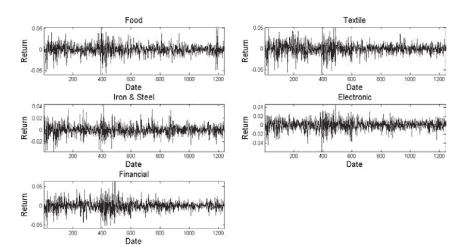

图 14.1：五个行业指数收益的时间序列图。

表 14.1：本表列出了五个行业指数收益的基本汇总统计、式 (14.2.k) 中预测回归拟合的 R²，以及滞后 10 的 Ljung-Box Q 检验异方差性和 Engle ARCH 检验的 t 统计量。

| 行业 | 市场 | 食品 | 纺织 | 铁钢 | 电子 | 金融 |
|---|---|---|---|---|---|---|
| 均值 | 0.0002 | 0.0005 | 0.0003 | -0.0001 | 0.0001 | 0.0002 |
| 标准差 | 0.0099 | 0.0121 | 0.0131 | 0.0089 | 0.0107 | 0.0129 |
| 最大值 | 0.0456 | 0.0551 | 0.0526 | 0.045 | 0.0477 | 0.0666 |
| 最小值 | -0.0558 | -0.0579 | -0.0595 | -0.0366 | -0.0574 | -0.0578 |
| 偏度 | -0.4085 | -0.0135 | -0.177 | 0.1212 | -0.3229 | -0.0455 |
| 峰度 | 5.5593 | 5.9805 | 5.3989 | 5.3694 | 4.8625 | 6.0743 |
| R² |  | 0.5003 | 0.5954 | 0.4966 | 0.9172 | 0.7575 |
| Ljung-Box Q(10) |  | 175.1303* | 176.3671* | 123.0557* | 202.9977* | 219.5338* |
| ARCH 检验(10) |  | 89.5639* | 87.287* | 72.6929* | 102.7902* | 104.7472* |

注：* 表示在 0.05 水平上显著。

从偏度和峰度来看，这些指数收益似乎呈偏态且厚尾。Ljung-Box Q 检验和 Engle 的 ARCH 检验表明这些指数收益表现出异方差性。

各种经验证据表明资产收益具有随时间变化的条件方差、波动率聚集和厚尾分布（Mandelbrot, 1963; Morgan, 1976）。更好地理解波动率有助于投资决策和市场稳定。与恒定波动率模型相比，GARCH 模型允许对诸如时变波动率和波动率聚集等特征进行建模。

除了这些非正式的图之外，均值调整后的残差被用于通过滞后 10 的 Ljung-Box 检验和 Engle 检验来检验 ARCH 效应。Ljung-Box 检验考虑的原假设是收益的平方残差不存在自相关。Engle 的 ARCH 检验是一种拉格朗日乘子检验，原假设为不存在条件异方差性。表 14.1 中的检验结果表明，根据 Ljung-Box 检验和 Engle 的 ARCH 检验，这五个指数的所有收益均表现出 GARCH 效应。

现在，我们考虑三种 GARCH 模型。对于收益序列 r_t 如果

```
r_t = μ_t + a_t,  (14.3.a)

a_t = σ_t ε_t,  (14.3.b)

σ_t² = α₀ + β₁ σ_{t-1}² + α₁ a_{t-1}²,  (14.3.c)
```

(EWMA) 方法，因为它不需要估计衰减因子，但估计的时变波动率和相关性与使用 EWMA 方法得到的模式相似。

令 $r_t = (r_{1t}, \dots, r_{mt})'$ 表示时间 t 时 m 个资产的收益向量。Tsay (2010) 表明多元 GARCH 模型可用于估计条件协方差矩阵，表示为

$$\Sigma_t = [\Sigma_{ijt}] = \operatorname{Cov}(r_t|F_{t-1}), \tag{14.3.h}$$

其中 $\Sigma_{ijt}$ 是 $\Sigma_t$ 的第 $i$ 行第 $j$ 列，$F_{t-1}$ 是到时间 $t-1$ 可用的信息，Cov 为协方差算子。为简化起见，我们遵循 Tsay (2013) 使用单变量 GARCH 模型来估计时间 t 的条件协方差矩阵。

条件协方差矩阵 $\Sigma_t$ 的对角元素是时间 t 时第 $i$ 个收益的条件方差。为了估计 $\Sigma_{iit}$，我们首先用特定的 GARCH 模型估计时间 t 时第 $i$ 个收益的条件波动率，记为 $\sigma_{it}$。这里我们假设

$$r_{it} = a_{it}, \tag{14.3.i}$$

$$a_{it} = \sigma_{it}\varepsilon_{it}, \tag{14.3.j}$$

其中 $\varepsilon_{it}$ 为 $i = 1, \dots, m$ 且 $t = 1, \dots, T$ 的创新。我们通过在 GARCH 模型下使用序列 $r_{it}$ 的最大似然估计来估计 $\sigma_{it}$，记为 $\hat\sigma_{it}$。然后，我们估计 $\Sigma_{iit}$ 为

$$\hat\Sigma_{iit} = \hat\sigma_{it}^2. \tag{14.3.k}$$

为了估计 $\Sigma_{ijt}$，注意

$$V(r_{it}+r_{jt}) = V(r_{it}) + 2\operatorname{Cov}(r_{it},r_{jt}) + V(r_{jt}) = \Sigma_{iit} + 2\Sigma_{ijt} + \Sigma_{jjt}, \tag{14.3.l}$$

$$V(r_{it}-r_{jt}) = V(r_{it}) - 2\operatorname{Cov}(r_{it},r_{jt}) + V(r_{jt}) = \Sigma_{iit} - 2\Sigma_{ijt} + \Sigma_{jjt}, \tag{14.3.m}$$

其中 $V(\cdot)$ 为方差算子。因此我们得到

$$\Sigma_{ijt} = \frac{V(r_{it}+r_{jt}) - V(r_{it}-r_{jt})}{4}. \tag{14.3.n}$$

现在，$V(r_{it}+r_{jt})$ 和 $V(r_{it}-r_{jt})$ 使用两个人工时间序列 $r_{ijt}^+ = r_{it}+r_{jt}$ 和 $r_{ijt}^- = r_{it}-r_{jt}$ 进行估计。类似地，r_{ijt}^+ 和 r_{ijt}^- 的条件波动率分别估计，记为 \hat{\sigma}_{ijt}^+ 和 \hat{\sigma}_{ijt}^-。然后，我们估计 V(r_{it} + r_{jt}) 和 V(r_{it} - r_{jt}) 为

$$V(r_{it} + r_{jt}) = \hat{\sigma}_{ijt}^{+2}, \tag{14.3.o}$$ $$V(r_{it} - r_{jt}) = \hat{\sigma}_{ijt}^{-2}. \tag{14.3.p}$$

最后，我们估计 \hat{\Sigma}_{ijt} 为

$$\hat{\Sigma}_{ijt} = \frac{\hat{V}(r_{it} + r_{jt}) - \hat{V}(r_{it} - r_{jt})}{4}. \tag{14.3.q}$$

## 14.4 实证分析

本节使用台湾五个行业指数的日收盘值来证明我们提出的异方差 BL 模型的优越性。回顾第 3.1 节，我们收集了 2010/01/06 至 2014/12/31 台湾股市五个主要行业指数的收盘指数日对数收益，包括食品、纺织、钢铁、电子和金融行业，共计 1024 个观测值。根据台湾证券交易所（TSE）2018/1/23 的数据，74% 的市值由这五个行业组成：电子行业（56%）、金融行业（13%）、食品行业（2%）、纺织行业（2%）和钢铁行业（2%），如图 14.2 所示。因此，台湾股市主要由这五个主要行业组成，它们大致涵盖整个股市，使得逆向优化成为可能。

### 14.4.1 研究计划

首先，我们考虑投资者的三种风险偏好类别：轻度风险厌恶（λ = 1）、中度风险厌恶（λ = 5）和严重风险厌恶（λ = 10）。

现在，我们提出如下动态滚动窗口方案。滚动窗口由两部分组成：大小为 N_train 天的训练期和大小为 N_hold 天的持有期。因此，滚动窗口的大小为 (N_train + N_hold) 天。给定一个滚动窗口，我们使用训练期的数据来估计参数并获得最优投资组合权重，然后形成投资组合并在持有期持有，以根据各种策略汇总统计衡量其表现。然后，我们将滚动窗口向前移动 N_hold 天，并重复上述程序直至研究期结束。


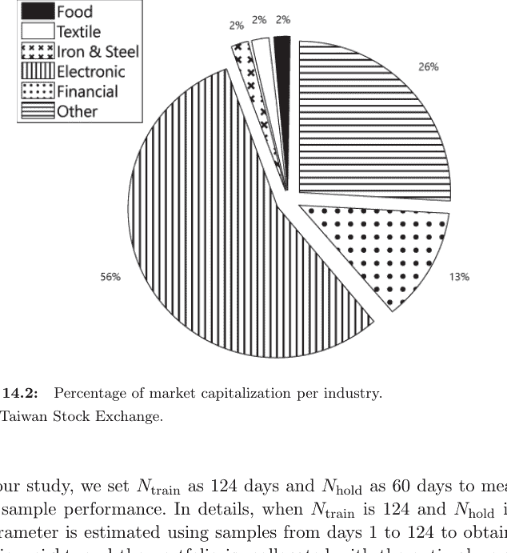

图 14.2：各行业市值占比。

来源：台湾证券交易所。

在我们的研究中，我们将 N_train 设为 124 天，N_hold 设为 60 天以衡量样本外表现。具体而言，当 N_train 为 124 且 N_hold 为 60 时，参数利用第 1 天至第 124 天的样本估计以获得投资组合权重，且投资组合以最优投资组合权重重新配置并持有接下来 60 天，即第 125 天至第 184 天。然后我们将滚动窗口向前移动 60 天。下一次迭代使用第 61 天至第 184 天的样本估计参数并获得最优投资组合权重，且投资组合以更新后的投资组合权重持有接下来 60 天，即第 185 天至第 234 天。

通过重复此程序，构建了总计 1240 天的动态调整投资组合配置。我们指出将 N_hold 选择为 60 是主观的。然而，我们的实证分析表明，这可以合理地避免频繁交易并控制交易成本。如何选择 N_train 和 N_hold 超出了本文的范围。

为了比较，我们首先将 1/N 投资组合作为基准。1/N 投资组合对每个资产使用等权重。此外，我们考虑 Markowitz 投资组合。Markowitz 模型也称为均值-方差模型，因为其投资组合权重是基于各资产的预期收益（均值）和风险（标准差）来选择的。

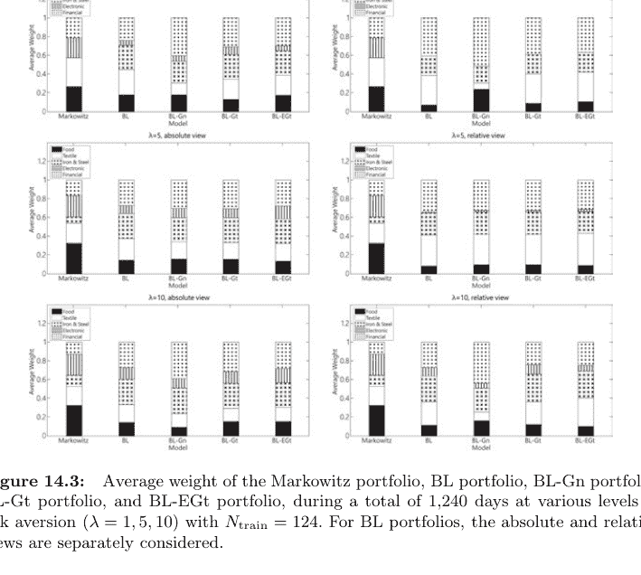

图 14.3：在总计 1,240 天内，Markowitz 投资组合、BL 投资组合、BL-Gn 投资组合、BL-Gt 投资组合和 BL-EGt 投资组合在不同风险厌恶水平（λ = 1, 5, 10）下的平均权重，N_train = 124。对于 BL 投资组合，绝对和相对观点分别考虑。

图 14.4 绘制了 N_train 为 124 天时每 60 天 10 个投资组合的累计收益。

就投资者的观点而言，一般而言，BL 投资组合在平均收益和夏普比率方面，相对观点优于绝对观点。当风险厌恶系数为中性时，具有相对观点的 BL-EGt 投资组合具有最高的平均收益和夏普比率（分别为 22.11% 和 1.26%）。

BL-EGt 投资组合的平均收益和夏普比率略高于 BL-Gt 和 BL-Gn 投资组合，但显著高于 BL 投资组合。所有投资组合的贝塔值均小于 1。这表明这些投资组合收益相对于市场收益波动性更小。

最后，BL-EGt 和 BL-Gt 投资组合在平均收益和夏普比率方面均优于 1/N 和 Markowitz 投资组合。具体而言，BL-EGt 投资组合占优于 BL-Gt 投资组合。

## 表 14.2：在三种风险厌恶水平（λ = 1, 5, 10）下，N_train = 124 时，1/N 投资组合、Markowitz 投资组合、BL 投资组合、BL-Gn 投资组合、BL-Gt 投资组合和 BL-EGt 投资组合的策略汇总统计。

| 投资组合 | 平均收益 | 标准差 | 贝塔 | 夏普比率 |
|---|---|---|---|---|
| λ = 1 | | | | |
| 1/N | 0.1115 | 0.1422 | 0.8708 | 0.7225 |
| Markowitz | 0.0656 | 0.1859 | 0.9544 | 0.3057 |
|  | 绝对 | 相对 | 绝对 | 相对 | 绝对 | 相对 | 绝对 | 相对 |
| BL | 0.1289 | 0.1436 | 0.163 | 0.175 | 0.8077 | 0.9031 | 0.7363 | 0.7705 |
| BL-Gn | -0.0075 | 0.0353 | 0.1969 | 0.1978 | 0.9517 | 0.9372 | -0.0827 | 0.1341 |
| BL-Gt | 0.1606 | 0.1655 | 0.1613 | 0.1735 | 0.8341 | 0.8779 | 0.9412 | 0.9032 |
| BL-EGt | 0.1336 | 0.1919 | 0.1638 | 0.1743 | 0.8269 | 0.8469 | 0.762 | 1.0507 |
| λ = 5 | | | | |
| 1/N | 0.1115 | 0.1422 | 0.8708 | 0.7225 |
| Markowitz | 0.1062 | 0.1813 | 0.947 | 0.5372 |
|  | 绝对 | 相对 | 绝对 | 相对 | 绝对 | 相对 | 绝对 | 相对 |
| BL | 0.1493 | 0.2052 | 0.1572 | 0.165 | 0.8134 | 0.8271 | 0.8935 | 1.1909 |
| BL-Gn | 0.1578 | 0.2098 | 0.1599 | 0.1652 | 0.8357 | 0.8253 | 0.9316 | 1.2165 |
| BL-Gt | 0.1611 | 0.2128 | 0.16 | 0.1655 | 0.8362 | 0.8256 | 0.9514 | 1.2328 |
| BL-EGt | 0.1721 | 0.2211 | 0.1604 | 0.1679 | 0.8438 | 0.8364 | 1.0178 | 1.2643 |
| λ = 10 | | | | |
| 1/N | 0.1115 | 0.1422 | 0.8708 | 0.7225 |
| Markowitz | 0.1041 | 0.1738 | 0.9163 | 0.5483 |
|  | 绝对 | 相对 | 绝对 | 相对 | 绝对 | 相对 | 绝对 | 相对 |
| BL | 0.1735 | 0.1591 | 0.1536 | 0.1584 | 0.8073 | 0.7947 | 1.0719 | 0.9485 |
| BL-Gn | 0.0011 | -0.0142 | 0.1758 | 0.1807 | 0.9271 | 0.9072 | -0.0437 | -0.1274 |
| BL-Gt | 0.185 | 0.1598 | 0.1558 | 0.158 | 0.831 | 0.7962 | 1.131 | 0.9556 |
| BL-EGt | 0.2056 | 0.1776 | 0.1547 | 0.1601 | 0.8342 | 0.8021 | 1.2727 | 1.0544 |

注：对于 BL 投资组合，绝对和相对观点分别考虑。

基于式 (14.2.k) 中的预测回归，具有绝对观点的投资者提出 m 个观点，其中每个观点为每个资产分配一个预期收益。在这种情况下，每个资产收益会根据投资者的观点进行调整，而这种调整可能不会提高可预测性。相反，相对观点只提出一个观点：该观点代表预期收益最高资产与预期收益最低资产之间的差异。我们的实证分析表明，在许多情况下，采用相对观点的 BL 模型投资组合在平均收益方面优于采用绝对观点的投资组合，并突出了使用相对观点的益处。

相对观点在精神上类似于动量策略（Chan et al., 1996），其中股票首先按其收益排名分为五个收益水平，投资组合由在最高收益水平股票上的多头头寸和在最低收益水平股票上的空头头寸组成。因此

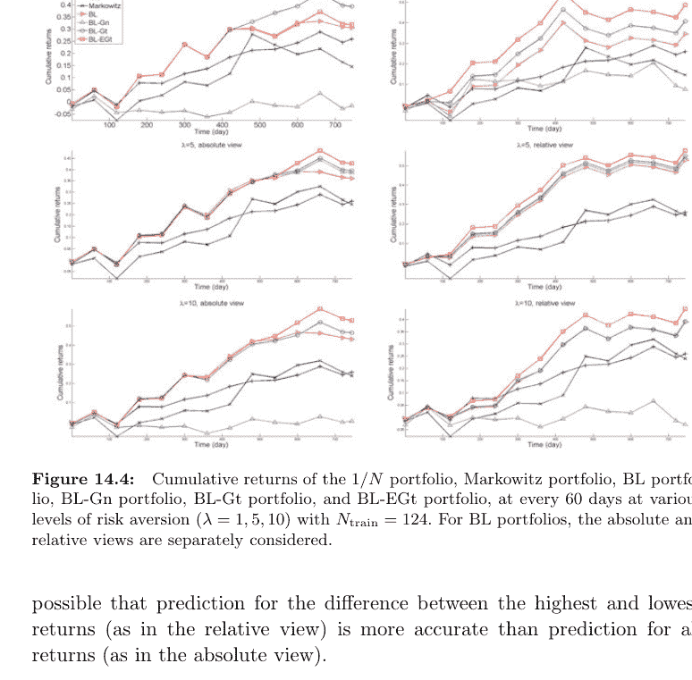

图 14.4：在不同风险厌恶水平（λ = 1, 5, 10）下，N_train = 124 时，每 60 天 1/N 投资组合、Markowitz 投资组合、BL 投资组合、BL-Gn 投资组合、BL-Gt 投资组合和 BL-EGt 投资组合的累计收益。对于 BL 投资组合，绝对和相对观点分别考虑。

可能对最高和最低收益之间的差异（即相对观点）的预测比对所有收益（即绝对观点）的预测更准确。

## 14.5 结论

在早期研究中，投资组合权重被确定以匹配 Markowitz 的投资组合效率。近来，投资者对市场收益的预测已被用于构建更具竞争力的投资组合。例如，Black-Litterman 采用了新模型，而 Idzorek (2004) 增加了对预期收益的乐观观点以提高投资组合效率。本文旨在通过异方差模型提出更复杂的协方差矩阵估计方案，从而改进标准 BL 投资组合。

本文比较了 10 个投资组合，包括 1/N 投资组合、Markowitz 投资组合和八个版本的 BL 投资组合。实证分析应用于台湾的五个行业指数。

对于 BL 模型，使用标准 i.i.d. 正态模型和三种类型的 GARCH 模型来估计协方差矩阵。此外，在 BL 模型中分别引入了绝对和相对观点。我们的实证分析表明，对于轻度至中度风险厌恶的投资者，采用相对观点的 BL 投资组合优于采用绝对观点的投资组合。此外，采用 EGARCH 模型的 BL 投资组合，无论是绝对观点还是相对观点，均优于标准 BL 投资组合。

## 参考文献

Allaj, E. (2013). The Black-Litterman Model: A Consistent Estimation of the Parameter Tau. *Financial Markets and Portfolio Management*, 27, 217-251.
Almadi, H., Rapach, D. E. and Suri, A. (2014). Return Predictability and Dynamic Asset Allocation: How Often Should Investors Rebalance? *Journal of Portfolio Management*, 40, 16-27.
Avellaneda, M. and Lee, J. H. (2010). Statistical Arbitrage in the US Equities Market. *Quantitative Finance*, 10, 761-782.
Beach, S. L. and Orlov, A. G. (2007). An Application of the Black-Litterman Model with EGARCH-M-Derived Views for International Portfolio Management. *Financial Markets and Portfolio Management*, 21, 147-166.
Black, F. and Litterman, R. (1991). Asset Allocation: Combining Investors' Views with Market Equilibrium. *Journal of Fixed Income*, 1, 7-18.
Black, F. and Litterman, R. (1992). Global Portfolio Optimization. *Financial Analysts Journal*, 48, 28-43.
Brianton, G. (1998). Portfolio Optimization. *Risk Management and Financial Derivatives: A Guide to the Mathematics*, Vol. 4, 1st edition, Palgrave (trade), 39-44.
Cartwright, P. and Lee, C. F. (1987). Time Aggregation and the Estimation of the Market Model: Empirical Evidence. *Journal of Business and Economic Statistics*, 5, 131-143.
Chan, L. K. C., Jegadeesh, N. and Lakonishok, J. (1996). Momentum Strategies. *Journal of Finance*, 51, 1681-1713.
Chen, N., Roll, R. and Ross, S. (1986). Economic Forces and the Stock Market. *Journal of Business*, 59, 383-403.
Chopra, V. K., Hensel, C. R. and Turner, A. L. (1993). Massaging Mean-Variance Inputs: Returns from Alternative Global Investment Strategies in the 1980s. *Management Science*, 39, 845-855.
Christodoulakis, G. A. (2002). Bayesian Optimal Portfolio Selection: The Black-Litterman Approach. *Goldman Sachs Fixed Income Research paper*.
Disatnik, D. and Benninga, S. (2007). Shrinking the Covariance Matrix-Simpler is Better. *Journal of Portfolio Management*, 33, 56-63.
Elton, E. and Gruber, M. (1973). Estimating the Dependence Structure of Share Prices. *Journal of Finance*, 28, 1203-1232.
Guo, X., Lai, T., Shek, H. and Wong, S. (2017). *Quantitative Trading: Algorithms, Analytics, Data, Models, Optimization*. 1st Edition, New York: Chapman and Hall/CRC.
He, G. and Litterman, R. (1999). The Intuition Behind Black-Litterman Model Portfolios. *Goldman Sachs Fixed Income Research paper*.
Idzorek, T. (2004). A Step-By-Step Guide to the Black-Litterman model. Working paper.
Jurczenko, E. and Teiletche, J. (2018). Active Risk-Based Investing. *Journal of Portfolio Management*, 44, 56-65.


Ledoit, O. 和 Wolf, M. (2003a). 《亲爱的，我把样本协方差矩阵缩小了》. 《投资组合管理杂志》, 30, 110–119.
Ledoit, O. 和 Wolf, M. (2003b). 《股票收益协方差矩阵的改进估计及其在投资组合选择中的应用》. 《实证金融杂志》, 10, 603–621.
Litterman, R. 和 Winkelmann, K. (1998). 《估计协方差矩阵》. 高盛，风险管理系列.
Mandelbrot, B. (1963). 《某些投机性价格的变动》. 《商业杂志》, 36, 394–419.
Markowitz, H. (1952). 《投资组合选择》. 《金融杂志》, 7, 77–91.
Meucci, A. (2010). 《布莱克-利特曼方法》. 《数量金融百科全书》(R. Cont. 编), 第1版, 196–199, 纽约: Wiley.
Michaud, R. O. (1989). 《马科维茨优化之谜：“优化”是最优的吗？》. 《金融分析师杂志》, 45, 31–42.
Michaud, R. O. 和 Esch, D. N. (2013). 《解构布莱克-利特曼：如何获得你早已知道自己想要的投资组合》. 《投资管理杂志》, 11, 6–20.
Morgan, I. G. (1976). 《股票价格与异方差性》. 《商业杂志》, 49, 496–508.
Nelson, B. (1991). 《资产收益中的条件异方差：一种新方法》. 《计量经济学：计量经济学会杂志》, 59, 347–370.
O’toole, R. (2013). 《布莱克-利特曼模型：风险预算视角》. 《资产管理杂志》, 14, 2–13.
Satchell, S. 和 Scowcroft, A. (2000). 《布莱克-利特曼模型揭秘：管理量化与传统投资组合构建》. 《资产管理杂志》, 1, 138–150.
Sharpe, W. (1963). 《投资组合分析的简化模型》. 《管理科学》, 9, 277–293.
Torun, M., Akansu, A. 和 Avellaneda, M. (2011). 《多频率下的投资组合风险》. 《IEEE信号处理杂志》, 28, 61–71.
Tsay, R. S. (2010). 《金融时间序列分析》, 第3版, Hoboken, NJ: Wiley.
Tsay, R. S. (2013). 《使用R进行金融数据分析导论》, 第3版. Wiley: Hoboken, NJ.
Walters, J. (2014). 《布莱克-利特曼模型详解》. 可在SSRN获取：http://ssrn.com/abstract=1314585.

## 第15章
### 公平存款保险定价：结构模型方法

Tzu Tai
Mezocliq, LLC
电子邮件：tzutai30@gmail.com

Cheng Few Lee
罗格斯大学
电子邮件：cflee@business.rutgers.edu

Tian-Shyr Dai
国立交通大学
电子邮件：cameldai@mail.nctu.edu.tw

Keh Luh Wang
国立交通大学
电子邮件：lkwang@mail.nctu.edu.tw

Hong-Yi Chen
国立政治大学
电子邮件：fnhchen@nccu.edu.tw

### 目录
- 15.1 引言 . . . . . . . . . . . . . . . . . . . . . . . . . . . . . . . . . . . 584
- 15.2 方法论 . . . . . . . . . . . . . . . . . . . . . . . . . . . . . . . . . . 587
- 15.3 模拟结果 . . . . . . . . . . . . . . . . . . . . . . . . . . . . . . . . 593
- 15.3.1 参数分析 . . . . . . . . . . . . . . . . . . . . . . . . . . . . 593
- 15.3.2 道德风险问题 . . . . . . . . . . . . . . . . . . . . . . . . . . 595
- 15.4 总结与未来研究 . . . . . . . . . . . . . . . . . . . . . . . . . . 599
- 参考文献 . . . . . . . . . . . . . . . . . . . . . . . . . . . . . . . . . . . . 600

Tzu Tai
Mezocliq, LLC
电子邮件：tzutai30@gmail.com

Cheng Few Lee
罗格斯大学
电子邮件：cflee@business.rutgers.edu

Tian-Shyr Dai
国立交通大学
电子邮件：cameldai@mail.nctu.edu.tw

Keh Luh Wang
国立交通大学
电子邮件：lkwang@mail.nctu.edu.tw

Hong-Yi Chen
国立政治大学
电子邮件：fnhchen@nccu.edu.tw

### 摘要

在本章中，我们提出了基于阶梯树模型和障碍期权的结构模型，以根据存款保险合同的约束条件并考虑破产成本来评估公平存款保险费。首先，我们证明 Brockman 和 Turle（2003）的存款保险模型是我们模型的一个特例。其次，模拟结果表明，保险公司应采用宽容政策而非严格的关闭监管政策，以避免破产成本带来的损失。适当的存款保险费可以缓解宽容政策所引发的潜在道德风险问题。我们的模拟结果可作为各银行以及联邦存款保险公司（FDIC）风险管理的参考。

### 关键词

存款保险 • FDIC • 破产 • 道德风险 • 保险费 • 树模型 • 障碍期权 • 政策

### 15.1 引言

银行的主要职能是向借款人发放贷款并从公众吸收存款。银行不仅面临所贷资金的违约风险和市场风险，还面临所借资金的提款风险（O'Hara, 1983）。Diamond 和 Dybvig (1983) 指出，银行作为金融中介，通过将非流动资产转换为流动负债来提供活期存款合同，从而增加流动性。然而，存款合同可能导致实际的经济损害。在银行挤兑期间，储户因预期银行倒闭而恐慌并立即提取存款。因此，即使是健康的银行也可能因储户的恐慌而破产。在这种情况下，银行收回贷款，终止其投资项目，从而造成实际的经济损害。为了维持储户对银行经营的信心，Diamond 和 Dybvig (1983) 指出，政府提供的存款保险可以消除银行挤兑问题。Gorton 和 Pennacchi (1990) 也表明，受保存款合同吸引了那些因信息不对称而遭受交易损失的不知情投资者。然而，存款保险可能带来道德风险问题。Laeven (2002) 认为，储户监督银行行为的动力减弱，因此银行可能默许地承担过度风险。VanHoose (2007) 断言，存款保险的公平定价可以缓解道德风险问题。然而，LeRoy 和 Singhania (2013) 得出结论，无法消除存款保险所隐含的道德风险扭曲。Gan 和 Wang (2013) 指出，存款保险的必要性和重要性因国家而异，并发现低收入国家提供更多的保险保护。此外，Shy 等人 (2016) 表明，有限的存款保险可能会削弱银行之间的竞争，导致总福利下降。

自2007年8月次贷危机爆发以来，由于许多处于财务和流动性困境的金融机构引发了储户恐慌，公平存款保险费定价再次成为重要议题。联邦存款保险公司（FDIC）应在金融机构宣告破产时，通过调整适当的存款保险费来权衡抵消救助计划的成本以及接管存款账户业务和部分债务的成本。鉴于存款保险风险在金融机构中发挥的关键作用，本项目的目的是研究存款保险的公允价值定价。

关于存款保险，保险人必须是政府或其代理机构之一，例如FDIC。因此，受保存款可以被视为无风险资产。存款保险保证所有提取存款的人都能获得承诺的回报，从而给保险人带来成本。因此，像FDIC这样的保险人将收取存款保险费，作为存款保险损失的补偿。Blocher 等人 (2003) 讨论指出，从银行收取的不同水平的保险费基于FDIC建立的风险评估体系。从1991年的《联邦存款保险公司改进法》（FDICIA）开始，首个与风险相关的保费制度被分为九种情形，这取决于资本水平和监管评级¹（FDIC, 2006）。Blocher 等人 (2003) 表明，存款保险的评估费率根据经济形势随时间波动。由于次贷危机中大量金融机构破产，FDIC损失了巨额存款保险基金，用于接管破产银行和保护储户财富。因此，FDIC为应对金融海啸提高了存款保险费。这一证据表明，存款保险定价在金融危机中尤为重要，并应根据基于风险的方案进行调整（Horvitz, 1983; Kane 1986）。Karas 等人 (2013)

¹监管评级通常基于CAMELS评级。CAMELS评级是银行检查中各项构成评级的首字母缩写：资本（Capital）、资产（Asset）、管理（Management）、盈利（Earnings）、流动性（Liquidity）和市场风险敏感性（Sensitivity to market risk）。每个构成要素的评级从1（最好）到5（最差），然后根据这些构成评级为银行分配整体综合评级，即CAMELS评级。


利用俄罗斯银行的数据进行实证研究，并表明在金融危机情况下，存款保险可以抑制储户的恐慌。政策制定者应警惕存款保险在金融危机中的影响。

评估存款保险费的模型可分为三大类：银行失败预测方法、简化形式方法和结构化方法。银行失败预测方法的优势在于确定在基于风险的存款保险制度中应使用哪些变量（Sinkey, 1975; Avery et al., 1985; Calomiris and Jaremski, 2016）。在此框架下，logit模型估计银行失败的概率。Hwang等人（1997）利用逻辑回归来识别显著导致银行失败的财务比率。他们发现与股权资本、盈利能力和流动性相关的财务比率对银行失败概率有显著影响。然后，公平存款保险费可以通过失败概率乘以清算成本来计算。Thomson（1991）指出，非存款负债与现金及投资证券的比率显著影响银行失败。然而，Thomson（1991）指出logit估计对不均匀抽样频率问题并不敏感。Thomson（1992）应用两步logit回归来模拟银行监管机构的关闭决策。第一步是银行市场价值对会计数据的回归，第二步是基于第一步估计的银行市场价值以及FDIC关闭资不抵债银行能力的约束，进行逻辑回归预测银行失败。

关于简化形式方法论，Duffie等人（2003）提出了基于简化形式的存款保险定价方法，并声称该方法无需处理保险合同的确切形式，因为它不依赖于银行的负债结构或审计过程。在银行资本结构内捕捉保险合同的监管规定是困难的，特别是对于非公开交易的银行（Falkenheim and Pennacchi, 2002）。Duffie等人（2003）指出，公平市场存款保险费率可以表示为银行短期信用利差与保险公司在失败时每美元评估存款的预期损失（相对于债券投资者在失败时每美元本金的预期损失）的乘积。尽管简化形式模型可以解决存款保险合同对存款保险费评估的影响，但有太多参数需要估计，这可能会影响结果的准确性。

大多数研究通过结构化方法估计公平市场FDIC保险费，该方法通常将公司资产及其资产波动性建立在股票价格之上（Black and Scholes, 1973; Black and Cox, 1976; Merton, 1977; Leland, 1994; Anderson and Sundaresan, 2000; Brockman and Turle, 2003; Episcopos, 2008）。

## 公平存款保险定价：结构模型方法

Merton（1977）首次提出了存款保险与看跌期权之间关系的见解。如果银行资产无法满足存款金额，银行将资不抵债并一无所有。所有剩余资产属于债务持有人，即储户。当银行发生资不抵债时，存款保险的保险人应向储户支付银行资产与存款之间的差额。因此，存款保险合同可以被视为以银行资产为标的、执行价格等于存款的看跌期权。Marcus和Shaked（1984）采用Merton模型对具有恒定比例股息的保险费进行定价。他们的实证结果表明FDIC收取的存款保险费过高。

存款保险费通过障碍期权模型进行评估（Brockman and Turle, 2003; Episcopos, 2008）。然而，以往研究中使用的障碍期权模型忽视了存款保险合同的限制，因此，提出了基于障碍期权模型和Stair Tree模型的结构模型方法，以处理破产成本、对储户的有限赔偿、离散监控银行状况以及基于风险评估系统对不同金融机构的保险费调整。这样我们就能构建一个公平的保险费体系，并计算合理的隐含障碍临界点，以判断FDIC的监管政策是严格还是宽容。模拟结果表明，保险人应采用宽容政策而非严格政策进行关闭监管，以避免破产成本造成的损失。此外，适当的存款保险费可以缓解宽容政策带来的潜在道德风险问题。

本章组织如下。在第15.2节中，提出了一个符合存款保险合同限制和破产成本的、基于障碍期权模型和Stair Tree模型的结构模型。第15.3节讨论了模拟分析的结果。最后，第15.4节包含总结和未来研究。

一开始，BT模型展示了经典的结构模型，即障碍期权闭式解，将股权价值视为向下敲出看涨期权（DOC）

$$\text{DOC}(H,X)=V N(a)-X e^{-rT} N\left(a-\sigma\sqrt{T}\right)-V\left(\frac{H}{V}\right)^{2\eta} N(b)$$ $$+X e^{-rT}\left(\frac{H}{V}\right)^{2\eta-2} N\left(b - 2\sigma\sqrt{T}\right),\qquad (15.1),$$

其中，$V$是银行资产的当前市场价值，$X$是在$T$年内对储户的承诺支付，$H$是关闭障碍，$N$是标准正态累积分布函数，$r$是无风险利率。

其中

$a = \begin{cases}
\dfrac{\ln(V/X)+(r+\sigma^2/2)T}{\sigma\sqrt{T}} & X \ge H\\
\dfrac{\ln(V/H)+(r+\sigma^2/2)T}{\sigma\sqrt{T}} & X < H
\end{cases}$

$b = \begin{cases}
\dfrac{\ln(H^2/VX)+(r+\sigma^2/2)T}{\sigma\sqrt{T}} & X \ge H\\
\dfrac{\ln(H/V)+(r+\sigma^2/2)T}{\sigma\sqrt{T}} & X < H
\end{cases}$

$\eta = r/\sigma^2 + 1/2.$

根据用DOC捕捉银行股权，银行的剩余资产将等于

$$V - \text{DOC}(H,X)=V - C(X)+\text{DIC}(H,X)$$ $$=X e^{-rT}-P(X)+\text{DIC}(H,X),\qquad (15.2),$$

其中，$C(X)$是欧式看涨期权，$P(X)$是执行价格为$X$的欧式看跌期权；DIC $(H,X)$是障碍为$H$的向下敲入看涨期权（DIC）。第一项是完全保险下保险（储户）的现值；最后两项构成FDIC的总价值：通过接管失败银行，FDIC获得DIC $(H,X)$，但因其在到期日向储户支付保险金的责任而损失$P(X)$。

然而，BT模型难以捕捉银行监管的所有实际范围，因此需要简化假设，例如，无股息、无税收、无破产成本、无保险费、恒定波动率和持续监控。例如，FDIC存款保险的合同是按季度确定的。根据金融机构的季度财务报表，FDIC通过评估基于风险的评估体系水平来收取保险费。因此，结构模型的连续假设似乎不适合存款保险的评估。合同限制在实践条款中的另一个例子是FDIC在一定程度上保护储户。当破产发生时，存款保险不涵盖其他金融产品。

考虑到上述情况，我们提供了一种基于Stair Tree模型和BT模型概念的新型离散结构模型，以在障碍期权框架内对FDIC进行定价。换句话说，我们的扩展结构方法可以通过增加监管限制来修改BT模型。该模型不仅允许基于风险评估系统对不同金融机构的保险费进行调整，还考虑了破产成本的损失和对储户的有限赔偿。这样我们就能构建一个公平的保险费体系，并计算合理的隐含障碍临界点，以判断FDIC的监管政策是严格还是宽容。

银行资产在定期申报财务报告和重要公告时被离散监控。因此，我们结合了构建Stair Tree（见Dai, 2009）及其推广（见Dai and Lyuu, 2010）的技术，在审计时监控银行资产，并在资产触及关闭障碍时处理银行失败。（评估股权价值（DOC）的扩展结构方法示例如图15.1所示。初始银行资产S(0)是树的起始节点，与三叉树连接，然后合并一系列二叉树，直到下一个离散监控时间。在监控时间，如果银行资产低于障碍，FDIC将接管银行，因此银行失败时股东将一无所有。在向受保存款人承诺支付的到期日，股东在支付存款后获得银行资产的剩余价值。

Episcopos（2008）通过添加恒定破产成本和保险费来扩展BT模型；然而，不可忽视的是，破产成本和保险费取决于资产价值和障碍。破产成本在银行违约时发生。在接管管理中，由于清算过程的成本，FDIC仅在银行关闭时获得银行资产的一定比例。此外，在保险条款中，FDIC规定受保存款机构按季度支付保险费


先前的研究调查了银行审计期间破产标准的假设。在及时纠正行动（PCA）和关闭规则下，即当银行未能达到最低资本充足水平时发生破产，FDIC 可以接管银行并对其负债负责。根据宽容政策，违约银行可以被允许在监督下运营。关于关闭政策，宽容是指在银行被关闭之前给予其恢复偿付能力的时间。Ronn 和 Verma（1986）认为，在宽容范围内，资产低于存款负债的银行的保险人会注入资金，然后银行不会立即被清算。将宽容政策纳入期权定价模型的框架，Ronn 和 Verma（1986）指出存款保险费被低估了。Allen 和 Saunders（1993）指出，在考虑宽容政策的情况下，存款保险的价值可以被视为可赎回的永久性美式看跌期权的价值。他们表明，存款保险费随着宽松的关闭政策而增加。Lee 等人（2005）提出了公平存款保险的公式，并指出存款保险的公平价值随着严格政策的实施而下降，这与 Allen 和 Saunders（1993）的结果一致。

由于 FDIC 有权设定关闭政策，使得当银行资产触及监管关闭点时存款保险合同到期，存款保险可以被评估为一种下行触及敲出型期权，其中屏障可以被视为监管关闭规则。Brockman 和 Turtle（2003）指出，公司证券的估值可以被视为一种路径依赖的屏障期权模型（BT 模型）。Episcopos（2008）利用 BT 模型来定价存款保险费。在银行监管中，权益的价值由一个以失败临界点为屏障的下行触及敲出看涨期权给出。与权益相反，FDIC 的或有资产价值可以被视为下行触及敲入看涨期权，而 FDIC 支付负债、通常是存款的义务可以被视为银行资产上的欧式看跌期权。Hwang 等人（2009）通过将破产成本作为银行资产回报波动率的函数添加到屏障期权模型中来对存款保险进行定价。他们将破产成本明确纳入存款保险的定价框架，使得屏障期权方法更接近现实的关闭政策和监管宽容。

在基本的 FDIC 存款保险合同中，FDIC 在每个季度的开始时从每个存续的已投保金融机构收取存款保险费。因此，FDIC 可能在本季度收取保费，并在下一季度接管失败的银行而没有存款保险费。另一方面，如果结构模型假设连续监控，该假设是不现实的，因为金融机构的会计信息只能按季度观察。虽然在实际条款中 FDIC 会为多种存款账户提供保险资金，包括支票和储蓄账户、货币市场存款账户和存款证（CDs）。FDIC 不承保股票、债券或证券等其他金融产品，并且仅在限额内保护每个存款人。²

本章的目的是结合上述 FDIC 合同的所有实际条款，并考虑对存款人的保险覆盖限制。在此，我们在图 15.2 中说明了扩展结构方法的简单示例，以在现实中实现 FDIC 的价值，包括保险费和破产成本：

保险费的假设按季度支付，如图 15.2 中监控时间和初始节点处的星号所示。当银行资产跌破关闭屏障时，FDIC 将接管该银行；因此，银行股东的价值转移给 FDIC。此时，间接破产成本发生，银行资产突然下跌。在到期时，如果银行资产足以支付存款，FDIC 将获得利润；否则，由于有限覆盖监管，FDIC 将因承诺支付给存款保险的比例而损失保险基金。

此外，未来的研究正在进行，以找到隐含屏障作为最佳屏障，使 FDIC 平均不盈不亏，即

$P(X) = DIC(H, X).$ (15.4)

如果我们考虑破产和保险费，隐含屏障的确定遵循以下方程：

$P(X) + BC(H, X) = DIC(H, X) + IP(H).$ (15.5)

关于监管政策、公平保险费和破产成本的更多讨论将在未来进行。

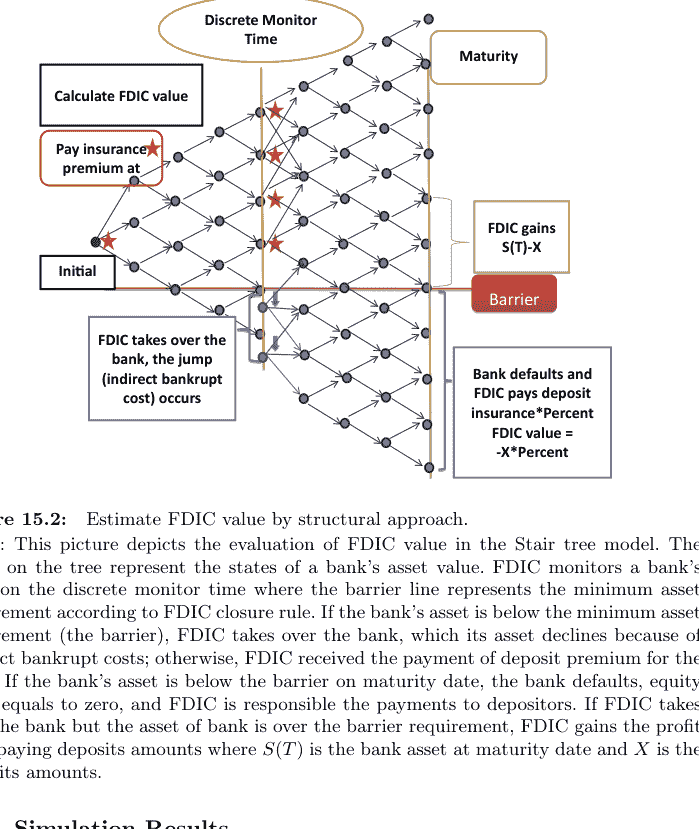

## 图 15.2：通过结构方法估计 FDIC 价值。

注释：这张图片描绘了 Stair 树模型中 FDIC 价值的评估。树上的节点代表银行资产价值的状态。FDIC 在离散的监控时间监控银行的资产，其中屏障线代表根据 FDIC 关闭规则的最低资产要求。如果银行的资产低于最低资产要求（屏障），FDIC 将接管该银行，其资产因间接破产成本而下降；否则，FDIC 将收到该银行的存款保费支付。如果银行的资产在到期日低于屏障，银行违约，权益价值等于零，FDIC 有责任向存款人支付款项。如果 FDIC 接管银行但银行资产超过屏障要求，FDIC 在支付存款金额后获得利润，其中 S(T) 是到期日的银行资产，X 是存款金额。

## 15.3 模拟结果

在本节中，我们通过与 BT 模型结果一致的参数分析来展示我们模型的准确性。其次，由于 FDIC 价值与屏障水平之间的关系，必须考虑道德风险问题。

### 15.3.1 参数分析

图 15.3 和 15.4 显示了我们在扩展结构模型中的收敛特性，并且可以准确生成银行资本监管中的屏障期权价值（Episcopos，2008）。

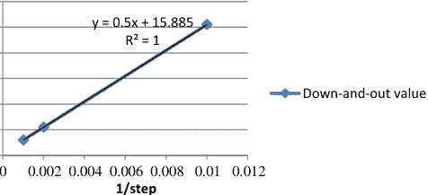

**图 15.3：** 下行触及敲出看涨期权的评估。

*注释：* 这张图片描绘了我们结构方法的数值结果收敛到 Brockman 和 Turtle（2003）论文中的闭式解。DOC 值代表银行的权益价值作为下行触及敲出看涨期权，步长是 Stair Tree 模型中的时间间隔。这里的参数设置为银行资产的当前市场价值为 $100，承诺向存款人支付 $90，关闭规则的监管屏障为 $90，银行资产波动率为 0.2，利率为 10%，到期日为 1 年。

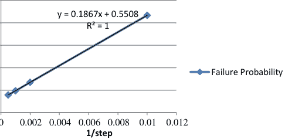

**图 15.4：** 银行失败概率的估计。

*注释：* 这张图片描绘了我们结构方法的数值结果收敛到 Brockman 和 Turtle（2003）论文中的闭式解。失败概率代表银行破产的可能性，步长是 Stair Tree 模型中的时间间隔。这里的参数设置为银行资产的当前市场价值为 $100，承诺向存款人支付 $90，关闭规则的监管屏障为 $90，银行资产波动率为 0.2，利率为 5%，到期日为 1 年。

与表 15.1 中的相同参数相比，我们数值方法中下行触及敲出看涨期权的价值收敛于 15.885（通过线性回归计算），这接近其闭式公式的值（15.8853）；银行失败概率的收敛值 0.5508 也与 BT 模型计算的闭式值 0.5508 相同。

参数分析总结在表 15.1 中，其中总结了我们的数值结果和我们的基准 BT 模型。很明显，该

扩展的结构性方法说明了 BT 模型中封闭式解的价值。表 15.1 中存在一个关于消除道德风险效应的有趣论点；它指出 FDIC 价值会随着资产波动率的增加而累积。Episcopos（2008）还解释了波动率上升对实际股权价值（下行触及敲出看涨期权）的负面影响，从而声称“总股权”价值的上升将从股东转移到 FDIC。然而，Episcopos（2008）没有考虑 FDIC 的违约风险。FDIC 的总价值由或有资产（下行触及敲入期权）和对存款人的承诺付款（欧式看跌期权）组合而成。如果股东权益向 FDIC 的转换速度缓慢，FDIC 的资产价值无法承担存款的支付，但股东仍可获得部分资产价值；因此道德风险仍然存在。

### 15.3.2 道德风险问题

通过研究 FDIC 价值与关闭规则政策之间的关系，即关闭壁垒的水平，解决存款保险中道德风险有另一种方法。在不考虑破产成本的情况下，图 15.5 显示了在宽容监管政策下道德风险的存在。也就是说，当银行资产风险增加时，更低的关闭壁垒会导致 FDIC 价值下降。图 15.5 的 Panel A 显示了银行风险水平和关闭壁垒对 FDIC 价值的整体影响。Panel B 作为 Panel A 横截面的一部分，描述了在资产风险增加时，在较低壁垒下 FDIC 价值下降且道德风险发生。相反，在较高壁垒下，FDIC 价值的增加伴随着资产风险的增加。这意味着严格的监管政策会减少道德风险。因此，在不考虑破产成本的假设下，FDIC 应采用严格的监管政策来监控银行的状态。

**Panel A：FDIC 价值与壁垒和波动率的关系图**

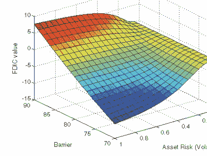

**Panel B：Panel A 的横截面**

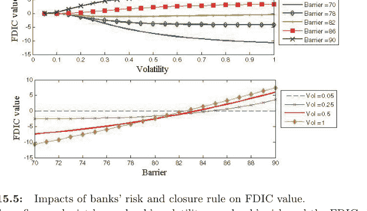

**图 15.5：** 银行风险和关闭规则对 FDIC 价值的影响。

*注释：* 这些图说明了在存款保费恒定的情况下，银行的波动率作为银行风险以及 FDIC 关闭规则作为壁垒如何影响 FDIC 价值。参数设定为银行资产的当前市场价值为 $100，对存款人的承诺付款为 $90，利率为 10% 和到期日为 1 年。

然而，如果考虑破产成本，监管政策应从严格监管改为宽松监管。图 15.6 显示了在结构性方法中纳入破产成本时 FDIC 价值的巨大下降。图 15.6 的 Panels A 和 B 分别衡量间接破产成本和直接破产成本对 FDIC 价值的影响。当银行资产在监控时间触及壁垒时，会发生间接破产成本。直接破产成本发生在银行资产在到期日触及壁垒时。通过比较 Panels A 和 B 中的 FDIC 价值，间接破产成本造成的损失高于直接破产成本。这些数值结果与之前研究的实证工作一致（参见 Altman, 1984；Branch, 2002）。无论是哪种破产成本，两幅图都显示在较低的关闭壁垒下 FDIC 价值更高；因此，根据图 15.6，FDIC 应采取宽松的关闭规则以避免破产成本的损失。

**Panel A：间接破产成本与 FDIC 价值**

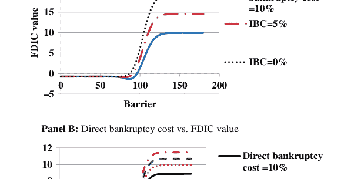

**Panel B：直接破产成本与 FDIC 价值**

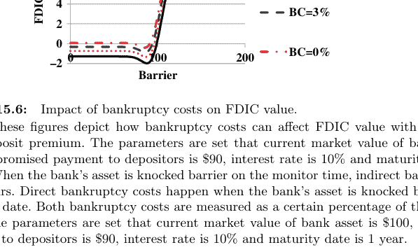

**图 15.6：** 破产成本对 FDIC 价值的影响。

*注释：* 这些图说明了在存款保费恒定的情况下，破产成本如何影响 FDIC 价值。参数设定为银行资产的当前市场价值为 $100，对存款人的承诺付款为 $90，利率为 10% 和到期日为 1 年。当银行资产在监控时间触及壁垒时，会发生间接破产成本。直接破产成本发生在银行资产在到期日触及壁垒时。两种破产成本均以银行资产的某一百分比衡量。

综合分析 FDIC 价值如图 15.7 所示，考虑了存款的有限覆盖、间接和直接破产成本以及银行风险。当壁垒足够高时，FDIC 可能在时间开始时立即接管银行。

因此，根据公式（15.3），FDIC 价值的上限可推导为欧式看涨期权减去欧式看跌期权，其中存款保费和破产成本的价值为零。我们已证明我们的结构模型可以复制 BT 模型中封闭式解的结果。此外，图 15.7 显示了定价模型中连续监控与离散监控假设下 FDIC 价值的明显差异。因此，在接受之前论文中的建议和评论之前，我们应仔细检查和测试存款保险保费的定价方法。最后，破产成本是定价存款保险保费中的重要问题，因为它们会急剧降低 FDIC 价值，如图 15.7 所示。因此，为了避免破产成本造成的损失，FDIC 在监控银行状态时应采用宽容政策而非严格的关闭政策。

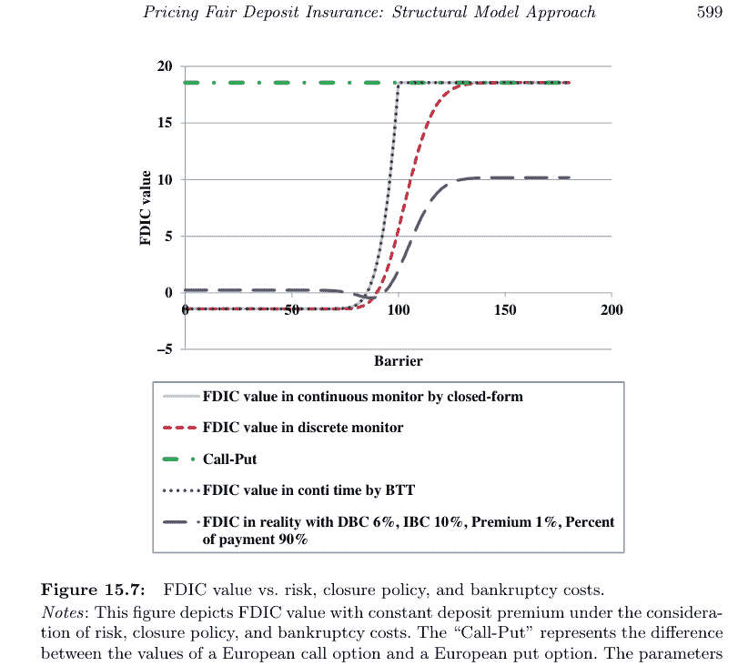

**图 15.7。** 该图描绘了在考虑风险、关闭政策和破产成本的情况下，存款保费恒定时的 FDIC 价值。“Call-Put”代表欧式看涨期权与欧式看跌期权价值之差。参数设定为银行资产的当前市场价值为 $100，对存款人的承诺付款为 $90，利率为 10% 和到期日为 1 年。“DBC”和“IBC”分别代表直接破产成本和间接破产成本，分别为银行资产价值的 6% 和 10% 。“Premium”代表存款保费作为存款金额的某一百分比的恒定值，“Percent of payment”代表银行失败时对存款人的有限覆盖付款。也就是说，存款人获得的价值等于“percent of payment”乘以存款总额。

本章利用结构模型方法对存款保险保费进行定价，并讨论宽容政策与关闭监管之间的关系。我们将壁垒期权框架与 Stair Tree 方法相结合，其中破产成本被设定为银行资产的比例，有限保险覆盖被视为银行存款的百分比。我们的结构模型不仅处理

## 参考文献

- Branch, B. (2002). 破产成本：综述. International Review of Financial Analysis, 11, 39–57.
- Brockman, P. and Turtle, H. J. (2003). 企业证券估值的壁垒期权框架. Journal of Financial Economics, 67, 511–529.
- Calomiris, C. W. and Jaremski, M. (2016). 存款保险：理论与事实. Annual Review of Financial Economics, 8, 97–120.
- Dai, T.-S. (2009). 使用 Stair Tree 对支付离散或路径依赖股息的股票进行有效期权定价. Quantitative Finance, 9, 827–838.
- Dai, T.-S. (2010). 二项-三项树：一种简单而高效精确的期权定价模型. Journal of Derivatives, 17, 7–24.
- Diamond, D. and Dybvig, P. (1983). 银行挤兑、存款保险与流动性. Journal of Political Economy, 91, 401–419.
- Duffie, D., Jarrow, R., Purnanandam, A. and Yang, W. (2003). 存款保险的市场定价. Journal of Financial Services Research, 24, 93–119.
- Episcopos, A. (2008). 壁垒期权框架下的银行资本监管. Journal of Banking and Finance, 32, 1677–1686.
- FDIC (2006). 规则与法规. Federal Register, 71(230), 69323–69326.
- Falkenheim, M. and Pennacchi, G. (2003). 私人银行存款保险成本：一种市场可比方法. Journal of Financial Services Research, 24, 121–148.
- Gan, L. and Wang, G. W. Y. (2013). 部分存款保险与银行中的道德风险. International Journal of Commerce and Management, 23, 8–23.
- Gorton, G. and Pennacchi, G. (1990). 金融中介与流动性创造. Journal of Finance, 45, 49–71.
- Horvitz, P. (1983). 反对风险调整存款保险保费的案例. Housing Finance Review, 2, 253–264.
- Hwang, D.-Y., Lee, C. F. and Liaw, T. K. (1997). 银行失败与存款保险保费预测. International Review of Economics and Finance, 6, 317–334.
- Hwang, D.-Y., Shie, F.-S., Wang, K. and Lin, J.-C. (2009). 考虑破产成本和关闭政策的存款保险定价. Journal of Banking and Finance, 33, 1909–1919.
- Karas, A., Pyle, W. and Schoors, K. (2013). 存款保险、银行业危机与市场纪律：存款流动和利率的自然实验证据. Journal of Money, Credit and Banking, 45(1), 179–200.
- Kane, E. (1986). 存款保险中的表象与现实：改革的案例. Journal of Banking and Finance, 10, 175–188.
- Laeven, L. (2002). 存款保险价值的国际证据. Quarterly Review of Economics and Finance, 42, 721–732.
- Lee, S. C., Lee, J. P. and Yu, M. T. (2005). 银行资本宽容与存款保险估值. Canadian Journal of Administrative Sciences, 22, 220–229.
- Leland, H. (1994). 公司债务价值、债券契约与最优资本结构. Journal of Finance, 49, 1213–1252.
- LeRoy, S. F. and Singhania, R. (2013). 银行存款保险：对投资组合和风险资产均衡估值的含义. Working paper.
- Marcus, A. J. and Shaked, I. (1984). 使用期权定价估计对 FDIC 存款保险的估值. Journal of Money, Credit and Banking, 16, 446–460.
- Merton, R. C. (1977). 存款保险和贷款担保成本的解析推导. Journal of Banking and Finance, 1, 3–11.
- Merton, R. C. (1978). 有监督成本时的存款保险成本. Journal of Business, 51, 439–452.


O'Hara, M. (1983). 银行公司的动态理论。*金融学杂志*, 38, 127–140.

Ronn, E. I. and Verma, A. K. (1986). 定价风险调整存款保险：一种基于期权的模型。*金融学杂志*, 41, 871–895.

Sinkey, J. F. (1975). 问题银行特征的多元统计分析。*金融学杂志*, 30, 21–36.

Shy, O., Stenbacka, R. and Yankov, V. (2016). 有限存款保险覆盖与银行竞争。*银行与金融杂志*, 71, 95–108.

Thomson, J. B. (1991). 预测1980年代的银行倒闭。*经济评论，克利夫兰联邦储备银行*, 27, 9–20.

Thomson, J. B. (1992). 建模银行监管者的关闭选择：一种两步Logit回归方法。*金融服务研究杂志*, 6, 5–23.

VanHoose, D. (2007). 资本监管下银行行为理论。*银行与金融杂志*, 31, 3680–3697.

处置效应在金融市场中存在，可通过个人和/或专业投资者层面的数据得到证实（Odean, 1998; Barber and Odean, 1999; Garvey and Murphy, 2004; Dhar and Ning, 2006; Barber et al., 2007; Chong, 2009; Ammann et al., 2012; Frino et al., 2015; Wulfmeyer, 2016; Muhl and Talpsepp, 2018; Leal et al., 2018）。¹ 此外，一系列实验室文献发现受试者表现出处置效应偏差（Weber and Camerer, 1998; Wong et al., 2006; Da Costa et al., 2008, 2013; Fischbacher et al., 2014; Rau, 2014; Ploner, 2017; Kohsaka et al., 2017）。一些研究进一步表明处置效应与投资业绩呈负相关（Odean, 1998; Weber and Camerer, 1998; Garvey and Murphy, 2004; Wong et al., 2006; Chong, 2009; Ammann et al., 2012; Leal et al., 2018）。

对处置效应的真实检验通常难以通过真实市场数据进行，因为投资者的决策在真实市场中无法控制或观察（Weber and Camerer, 1998; Da Costa et al., 2013）。此外，汇总数据无法直接洞察个体投资者的决策过程（Richards et al., 2018）。因此，当一些使用投资者层面或市场层面数据的研究采用认知/情感偏差来解释处置效应时，其联系仍然模糊。只有极少数研究尝试检验认知/情感偏差与处置效应之间的关系，而这些研究通常只突出单一偏差，例如后悔规避（例如，Fogel and Berry, 2006; Lin et al., 2006）或自我控制（Fischbacher et al., 2014; Richards et al., 2017）。与现有文献不同，本研究采用多种认知/情感偏差，并提出一个概念模型，同时检验认知/情感偏差、处置效应与投资业绩之间的关系。

基于既有研究，本研究采用心理账户、后悔规避和自我控制（偏差）来探究这些偏差是否会影响处置效应，从而导致业绩不佳。此外，先前的文献表明人口统计变量可能会影响投资者的行为决策（Barber and Odean, 2001; Da Costa et al., 2008, 2013; Rau, 2014; Lu et al., 2016）。因此，本研究还检验性别和婚姻状况是否调节认知/情感偏差与处置效应之间的关系。此外，从实证结果来看，本研究可以提出能够减轻投资者偏差并降低处置效应的战略启示。

¹ 一些研究使用汇总的市场层面数据并提供证据表明投资者表现出处置效应偏差，例如 Kaustia (2004)、Czarnitzki and Stadtmann (2005) 以及 Croonenbroeck and Matkovskyy (2014)。

本研究采用问卷调查收集定量数据，并进一步采用 SEM 方法检验所提出的概念模型。SEM 方法在营销研究中被广泛使用，通常与消费者的认知失调相关（例如，感知价值、感知服务质量等）。这些失调是潜在变量，由观测变量（即问题项目）衡量。许多营销研究采用 SEM 方法来检验认知失调对特定产品和服务接受度的影响（Kleijnen et al., 2004; Olorunniwo et al., 2006; Soureli et al., 2008; Theron et al., 2008; Tu et al., 2011; Fernando and Alben, 2015）。与认知失调类似，认知/情感偏差是潜在变量，这意味着 SEM 方法适用于检验这些偏差是否影响投资者行为（MacCallum and Austin, 2000; McDonald and Ho, 2002）。据我所知，迄今为止只有极少数研究在检验处置效应时使用了 SEM 方法。

本研究的结果发现心理账户和后悔规避是显著影响处置效应的偏差，从而导致业绩不佳。心理账户是影响处置效应的最重要因素。因此，前景理论（S形价值函数）可以作为期望效用理论（期望效用函数）的替代方案来解释投资者的行为决策。然而，没有证据表明投资者的自我强加纪律有效运作，这意味着投资者存在自我控制偏差。调节分析的发现表明，女性投资者和已婚者更可能受到心理账户的影响，而男性投资者和单身者更容易受到后悔规避的影响。此外，女性投资者似乎具有更大的处置效应偏差。

本研究提供了若干实质性贡献。首先，与既有文献不同，本研究检验多种认知/情感偏差，以揭示这些偏差与处置效应之间的关系。其次，本研究采用适当的方法进行估计程序。SEM 方法可以为模型设定提供更高的精确度，并增加对决策和实质性假设检验所提出衡量标准的信心。最后，基于实证结果，本研究强调了若干战略启示，可能有助于投资者、金融机构和监管机构分别制定投资策略、推广其金融产品和服务以及改善财务纪律。

本研究的组织如下：第 16.2 节概述假设，第 16.3 节说明所提出的概念模型和问卷，第 16.4 节讨论实证结果，第 16.5 节提供结论性评论和战略启示。

## 16.2 假设

行为金融理论表明认知/情感偏差导致投资者的行为偏差，例如处置效应、承诺升级和羊群效应。遵循 Shefrin and Statman (1985)，本研究采用三种认知/情感偏差，主要包括心理账户、后悔规避和自我控制，以探究这些偏差是否导致处置效应。²

### 16.2.1 心理账户

心理账户是一种认知偏差，指投资者用来框定和评估其结果（收益和损失）的隐性方法。损失厌恶意味着投资者对损失比收益更敏感。Kahneman and Tversky (1979) 采用确定性效应、反射效应和隔离效应来证明 S 形价值函数。根据 S 形价值函数，投资者相对于参照点将结果框定为不同的账户（收益和损失）并表现出损失厌恶。因此，心理账户是前景理论的核心要素。

Thaler (1985, 1999) 将 S 形价值函数扩展以纳入复合结果，并用其总结四个原则，即分离收益、整合损失、用较大收益抵消损失以及分离“银边”，而消费者使用心理账户以使其最快乐的方式框定结果。Barberis and Huang (2001) 指出，投资者对单个股票波动的损失厌恶程度高于对股票组合波动的损失厌恶，这意味着投资者使用狭窄框架的方法。Rabin and Thaler (2001) 还认为，具有近视损失厌恶的投资者更可能使用狭窄框架而非更宽泛的方法来做出决策。正如

> 由于关注认知/情感偏差，本研究不包括影响处置效应的非心理因素，例如税收动机（Shefrin and Statman, 1985; Odean, 1998; Barber and Odean, 1999; Dhar and Zhu, 2006）、均值回归（Odean, 1998; Wong et al., 2006; Hung and Yu, 2006）。


因此，这些研究表明投资者会采用心理账户进行决策。

Shefrin和Statman（1985）指出，投资者将盈利股票（风险厌恶）和亏损股票（风险寻求）归入不同账户，并运用心理账户来解释处置效应。Thaler（1999）指出，心理账户的一个预测是，投资者会持续持有亏损股票，因为以亏损结清账户是痛苦的。此外，尽管许多研究采用前景理论来说明处置效应，但它们并未明确采用认知/情感偏差来解释这一行为偏差（例如，Weber和Camerer，1998；Dhar和Zhu，2006；Da Costa等，2008；Dacey和Zielonka，2009；Kohsaka等，2017）。由于心理账户与前景理论密切相关，它更可能是一种影响投资者决策的认知偏差。本研究遵循Shefrin和Statman（1985）的观点，假设心理账户对处置效应有正向影响。假设16.1如下所示：

**假设16.1：** 心理账户正向影响处置效应。

### 16.2.2 后悔规避

后悔是一种情感偏差，由不作为和作为构成。不作为是指未执行通常预期应执行的行为，而作为是指执行了导致某些损失的行为。根据传统理论，当投资决策导致糟糕结果时，不作为与作为所产生的后悔感并无差异。然而，行为金融学认为，不作为与收益减少相关，而作为与损失增加相关。基于S形价值函数，作为比不作为产生更强的后悔感（Fogel和Berry，2006；Wong和Kwong，2007；Huang和Zeelenberg，2012）。

如果股票价格明天下跌，投资者会后悔现在持有盈利股票；如果股票价格明天上涨，投资者会后悔现在卖出亏损股票（Shefrin和Statman，1985；Lin等，2006；Barber等，2007；Chong，2009）。因此，后悔感可能有助于解释为什么投资者会推迟卖出亏损股票并加速卖出盈利股票（Shiller，1999；Summers和Duxbury，2012）。Lin等（2006）指出，后悔感受到相对于参考点的损失（收益）的影响，而非损失（收益）大小的影响。Fogel和Berry（2006）认为，对投资决策的满意度并非仅仅是结果的函数，并得出结论：预期后悔可能导致投资者表现出处置效应偏差。因此，这些研究表明，后悔规避可以解释处置效应。

Garvey和Murphy（2004）指出，专业交易者通常一起交易，即自营交易团队，这意味着交易者之间的竞争可能会以团队整体绩效为代价，增强追求自豪感和避免后悔的倾向。Chong（2009）发现，出于对后悔的恐惧，投资者更倾向于抛售盈利的IPO而非亏损的IPO。Lai等（2010）发现，买入信号域的交易量和换手率均高于卖出信号域，并得出结论：市场交易者对后悔的恐惧导致了处置效应。Shefrin和Statman（1985）、Barber和Odean（1999）、Wong等（2006）以及Barber等（2007）指出，处置效应可能与减少预期后悔高度相关，并进一步采用后悔规避来解释处置效应。因此，本研究假设后悔规避对处置效应有正向影响。假设16.2如下所示：

**假设16.2：** 后悔规避正向影响处置效应。

### 16.2.3 自我控制

自我控制偏差会因自律不足而使投资者无法追求其长期和总体目标（Thaler和Shefrin，1988；Thaler和Benartzi，2004；Pompian，2006）。Thaler和Shefrin（1981）、Shefrin和Statman（1985）以及Statman（1995）认为，投资者可以同时是理性的计划者和情绪化的执行者，并在决策时表现出内心冲突。Shefrin和Statman（1985）指出，处置效应是一个自我控制问题，或者说理性计划者与情绪化执行者之间的冲突。他们认为，执行者与后悔和自豪的情绪相关，这导致投资者持有亏损股票以推迟后悔情绪，并实现盈利股票以加速自豪感。

为了防止执行者采取短视行为，计划者需要一些心理技巧来影响执行者的行为。这些技巧通过改变执行者的偏好和明确监督其行为来改变其激励。然而，当监督成本较高时，建议投资者采用自我设定的经验法则，以限制执行者的自由裁量范围（Thaler和Shefrin，1981）。Shefrin和Statman（1985）、Garvey和Murphy（2004）、Locke和Mann（2005）、Wong等（2006）以及Richards等（2017）指出，一旦预先设定的损失（收益）水平达到，可以通过采用自动规则和机制（如止损（止盈）指令）强制实现损失（收益），从而最大限度地减少执行者对实现亏损的抵制。Weber和Camerer（1998）以及Da Costa等（2008）表明，刻意出售比自动出售具有更大的处置效应。Fischbacher等（2014）发现，止损指令和止盈指令都能减少处置效应。因此，本研究假设自我控制（纪律）对处置效应有负向影响。假设16.3如下所示：

**假设16.3：** 自我控制（纪律）负向影响处置效应。

### 16.2.4 处置效应与投资绩效

Shefrin和Statman（1985）、Odean（1998）、Barber和Odean（1999）以及Leal等（2018）指出，处置效应较强的个人投资者表现出较差的绩效。Garvey和Murphy（2004）、Locke和Mann（2005）以及Choe和Eom（2009）发现，处置效应较强的专业投资者表现不佳。Chong（2009）发现，投资者倾向于持有亏损的IPO，而亏损IPO的事后表现并未显著优于其初始表现。尽管一些使用基金经理数据的研究未发现处置效应与投资绩效之间的负向联系（Cici，2012；Ammann等，2012），但本研究聚焦个人投资者的行为，因此假设处置效应对投资绩效的影响是负向的。假设16.4如下所示：

**假设16.4：** 处置效应负向影响投资绩效。

### 16.2.5 调节效应

人口统计变量可能会影响投资者的行为决策。Dhar和Ning（2006）认为，均值并不能说明全部问题，并发现投资者特征会影响处置效应。Barber和Odean（2001）使用投资者层面的数据来检验性别是否影响投资者的决策，并得出结论：单身女性表现出最谨慎的投资态度。Barber等（2007）和Frino等（2015）发现，女性投资者比男性投资者更倾向于实现收益而非亏损。Wong等（2006）、Da Costa等（2008）、Rau（2014）和Kohsaka等（2017）通过实验室实验考察性别是否干扰处置效应，发现女性受试者具有更强的处置效应。

Wong等（2006）考察了婚姻状况是否影响处置效应，发现结果不显著。然而，已婚投资者与单身投资者养家的经济压力可能不同。Lu等（2016）发现，对冲基金经理在婚姻事件期间容易受到处置效应的影响。因此，本研究进一步考察性别和婚姻状况是否分别调节认知/情感偏差与处置效应之间的关系。假设16.5如下所示：

**假设16.5：** 性别（婚姻状况）调节认知/情感偏差与处置效应之间的关系。

## 16.3 研究方法

### 16.3.1 概念模型

基于相关研究，本研究采用三种偏差，即心理账户（MA）、后悔规避（RA）和自我控制（SC），同时考察认知/情感偏差、处置效应（DE）与投资绩效（PF）之间的关系。本研究还检验性别和婚姻状况是否分别调节认知/情感偏差与处置效应之间的关系。所提出的概念模型如图16.1所示。本研究采用结构方程模型（SEM）方法和最大似然法原则来检验所提出的概念模型，并使用拟合优度、效度和信度等指标，在进行共同方法变异检验后检验估计模型是否有效。

一个完整的SEM模型由两个测量模型和一个结构模型组成（Byrne，1998），如下所示：

```
x = λ_x ξ + δ,    (16.1)
y = λ_y η + ε,    (16.2)
η = β η + γ ξ + ζ.    (16.3)
```

测量模型考察观测变量（即问题项）与潜变量之间的关系，通过因子载荷衡量，如方程（16.1）和（16.2）所示。方程（16.1）显示了外生观测变量（x）所反映的因子载荷（λ_x）

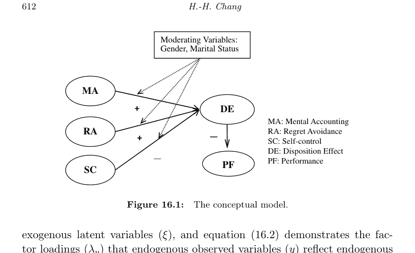

外生潜变量（ξ），方程（16.2）展示了因子载荷（λy），即内生观测变量（y）反映内生潜变量（η）。δ和ε表示测量误差。如方程（16.3）所示，结构模型检验潜变量之间的路径关系，其中外生潜变量（ξ）可以影响内生潜变量（η），而内生潜变量（η）可以相互影响。β和γ表示路径系数，ζ为误差项。

本研究中，MA、RA 和 SC 为外生潜变量，而 DE 和 PF 为内生潜变量。如图 16.1 所示的拟议概念模型与结构模型一致，且每个路径关系构成一个假设。因此，本研究主要提出了四个假设，如第 16.2.1–16.2.4 节所述。此外，本研究增加了假设 16.5 以检验调节效应。SEM 方法进一步在附录 16A 中阐述。

本研究基于行为金融文献为每个构念（即认知/情绪偏差和处置效应）设计问题项目，并通过问卷调查收集定量数据。问卷采用七点李克特量表，范围从 1（强烈不同意）到 7（强烈同意）。此外，本研究通过将股票回报划分为七个区间来衡量投资绩效，这与七点李克特量表一致。这些问题项目是通过对行为金融文献的全面回顾确定的，并由五家证券公司的资深经理进行预测试。因此，问卷被认为具有表面效度。所有项目均列于附录 16B。

本研究采用非随机抽样。问卷于 2009 年 3 月通过一家证券公司分发至其在台湾各地的分支机构。具有投资经验的受访者被要求回答相关问题。本研究获得 805 份回复，回复率为 89%。在剔除缺失值后，最终有效样本包括 761 名受访者。在 761 名受访者中，55.5% 和 45.5% 分别为男性 and 女性。婚姻状况比例中已婚和单身分别为 53.4% 和 46.6%。

这些受访者分为早期受访者和晚期受访者两组，并利用 t 检验分析两组在李克特量表问题上的回答。Connors 和 Elliot（1994）发现两组早期和晚期受访者的多数回答之间没有差异。因此，本研究中无应答偏差问题得到缓解。此外，本研究进行 Harman 的单因子检验，以通过探索性因子分析（EFA）检验大多数问题项目是否共同解释一个一般因子。研究发现，单一因子解释了大部分方差（36.04%），低于常见的 50% 值（Podsakoff et al., 2003; Chen et al., 2012）。1 因子 CFA（验证性因子分析）的结果也显示卡方增量显著（Δχ² = 929.32，Δdf = 3，p 值 = 0.000）（Podsakoff et al., 2003; Chen et al., 2012）。因此，共同方法偏差不是本研究中的显著问题。

## 16.4 经验结果

### 16.4.1 拟合优度

本研究使用 LISREL 软件估计拟议概念模型中的参数，并采用最大似然估计原理检验拟议模型。初步结果表明拟议模型有改进的可能，因为 GFI（0.85）小于推荐值 0.9。因此，执行持续的交互式设定过程以完善测量（Chang et al., 2004）。

表 16.1 报告了模型-数据拟合指数。绝对指数、增量指数和简约指数用于检验模型-数据拟合，并指示数据在多大程度上可由拟议模型表示。RMSEA 值小于 0.08，GFI 等于常见的 0.9 值，且 χ²/df 值小于阈值 5。

**表 16.1：拟合优度。**

| 指标 | 统计值 | 阈值 |
|---|---|---|
| 绝对拟合指数 |  |  |
| χ² /df | 338.21 /97 = 3.48 | <5 |
| RMSEA | 0.057 | <0.1 |
| GFI | 0.90 | >0.9 |
| 增量拟合指数 |  |  |
| AGFI | 0.87 | >0.9 |
| NFI | 0.91 | >0.9 |
| NNFI | 0.90 | >0.9 |
| CFI | 0.92 | >0.9 |
| RFI | 0.89 | >0.9 |
| IFI | 0.92 | >0.9 |
| 简约拟合指数 |  |  |
| PGFI | 0.65 | >0.5 |
| PNFI | 0.74 | >0.5 |

因此，绝对指数显示拟议模型是合适的（Hair et al., 1998; McDonald and Ho, 2002）。此外，参考增量和简约拟合指数，除 AGFI 和 RFI 外，所有指数均高于常见阈值。因此，这些发现表明拟议模型是有效的。

### 16.4.2 效度和信度

测量模型检验观测变量反映潜变量的因子载荷，并使用因子载荷的 t 检验来检验聚合效度并评估每个观测变量（即问题项目）是否有效地反映其潜变量（即因子构念）（Anderson and Gerbing, 1988; Raine-Eudy, 2000）。如表 16.2 所示，构念的每个因子载荷均显示高度显著的 t 统计量，从而表明测量模型中所有问题项目对其各自构念提供了良好的测量。平均方差抽取（AVE）和组合信度（CR）用于评估测量模型的构念信度（Bagozzi and Yi, 1998）。AVE 评估构念捕获的方差量，CR 反映测量每个构念的问题项目的内部一致性。因此，所有 AVE 值均高于推荐值 0.5，所有 CR 值均高于常见的 0.7 阈值。此外，表 16.3 显示区分效度得到满足。每个构念的 AVE 平方根值是

**表 16.3：区分效度。**

|  | MA | RA | SC | DE | PF |
|---|---:|---:|---:|---:|---:|
| MA | **0.74**<sup>a</sup> |  |  |  |  |
| RA | 0.41 | **0.77** |  |  |  |
| SC | 0.22 | 0.38 | **0.84** |  |  |
| DE | 0.48 | 0.37 | 0.14 | **0.73** |  |
| PF | −0.07 | −0.05 | −0.02 | −0.15 | **0.84** |

*注释：* MA：心理账户；RA：遗憾规避；SC：自我控制；DE：处置效应；PF：投资绩效。 <sup>a</sup>对角线值代表每个构念平均方差抽取（AVE）的平方根。非对角线值是构念之间的相关系数平方。

显示受访者感到“过早卖出获利股票的遗憾”、“持有亏损股票过久的遗憾”以及“持有亏损股票的遗憾更大”。这些感受意味着投资者容易受到遗憾情绪的影响并倾向于避免遗憾（Shefrin and Statman, 1985; Fogel and Berry, 2006）。SC 构念报告受访者更可能设定“止损订单”和“止盈订单”，并执行“止损”和“止盈”。这些规则表明投资者试图通过自我设定的规则来减轻自我控制偏差。

用于衡量处置效应的问题项目包括“持有亏损股票且未实现亏损的经历”、“卖出获利股票的经历多于卖出亏损股票的经历”以及“卖出获利股票并持有亏损股票的经历”。这些经历意味着投资者有过早卖出获利股票并长期持有亏损股票的倾向。在绩效构念中，受访者展示其已实现收益和账面收益的水平。

### 16.4.3 路径关系

路径系数用于评估结构模型是否得到证实。如表 16.4 和图 16.2 所示，MA 和 RA 分别对 DE 具有显著的正向影响。SC 对 DE 具有负向影响但不显著。因此，本研究的结果无法拒绝假设 16.1 和 16.2。

MA 对 DE 具有直接影响（路径系数 = 0.41，*t*-值 = 4.71），这表明投资者将收益和损失视为不同的心理账户，并以比亏损股票更快的速度实现其获利股票。遗憾规避对 DE 具有直接影响（路径系数 = 0.19，*t*-值 = 2.83），这意味着遗憾规避会产生

**表16.4：路径关系。**

| 路径关系 | 系数 | t值 | 假设 |
|---|---|---|---|
| MA → DE | 0.41*** | 4.71 | 接受 |
| RA → DE | 0.19*** | 2.83 | 接受 |
| SC → DE | -0.03 | -0.59 | 拒绝 |
| DE → PF | -0.20*** | -3.08 | 接受 |

注：MA：心理账户；RA：后悔规避；SC：自我控制；DE：处置效应；PF：投资绩效。***：在1%水平上显著。

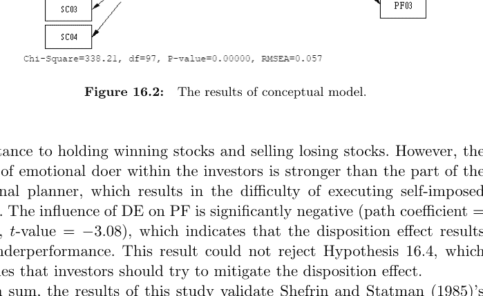

**图16.2：概念模型的结果。**

对持有盈利股票和卖出亏损股票的抗拒。然而，投资者内部情绪化执行者的部分强于理性规划者的部分，这导致自我设定的规则难以执行。DE对PF的影响显著为负（路径系数 = -0.2，t值 = -3.08），这表明处置效应会导致业绩不佳。该结果无法拒绝假设16.4，意味着投资者应尽力减轻处置效应。

总之，本研究结果验证了Shefrin和Statman（1985）的推论，即心理账户和后悔规避会导致处置效应。此外，MA是影响处置效应最显著的偏差，这表明前景理论（S形价值函数）可以替代预期效用理论（预期效用函数）来解释投资者行为。

### 16.4.4 调节效应结果

表16.5显示，所有RMSEA、χ²/df和GFI的值分别小于阈值0.085、5和0.9，这意味着数据-模型拟合对每个子组都是适当的。将女性（已婚）组的路径系数设为与男性（单身）组相等，以重复估计过程。得到女性（已婚）组的新χ²统计量，并与女性（已婚）组的原始χ²进行比较。若Δχ²显著，则存在调节效应（Johnson，1999）。

对于女性组，Δχ²（Δdf = 3）为14.48（新χ² = 291.39，原始χ² = 276.91），大于阈值（Δχ²0.05,3 = 7.815）。因此，性别可能调节认知/情感偏差与处置效应之间的关系。对于已婚组，Δχ²（Δdf = 3）为18.79（新χ² = 430.68，原始χ² = 411.89），大于阈值（Δχ²0.05,3 = 7.815）。因此，婚姻状况可能调节认知/情感偏差与处置效应之间的关系。

本研究还提供证据表明，女性投资者和已婚投资者（路径系数分别为0.51和0.44）更可能使用心理账户来做决策，而男性投资者和单身投资者（路径系数分别为0.34和0.27）更容易受到后悔情绪的影响。此外，当本研究结合认知/情感偏差对处置效应的影响时，总直接效应显示女性投资者比男性投资者有更强的处置效应（0.67对0.49），这与Da Costa等人（2008）、Rau（2014）以及Kohsaka等人（2017）的研究一致。然而，处置效应可能在单身投资者和已婚投资者之间没有差异（0.58对0.57）。

**表16.5：调节效应汇总。**

|  | **男性** *(N = 336)* | **女性** *(N = 425)* | **单身** *(N = 353)* | **已婚** *(N = 408)* |
|---|---|---|---|---|
| RMSEA | 0.019 | 0.066 | 0.053 | 0.083 |
| χ²/df | 108.63/97 = 1.12 | 276.91/97 = 2.85 | 194.44/97 = 2.01 | 411.89/97 = 4.20 |
| GFI | 0.93 | 0.92 | 0.90 | 0.91 |
| MA → DE | 0.21* (1.91) | 0.51*** (4.82) | 0.37*** (2.89) | 0.44*** (4.23) |
| RA → DE | 0.34*** (2.96) | 0.19** (2.10) | 0.27* (1.89) | 0.19** (2.13) |
| SC → DE | -0.06 (-0.75) | -0.03 (-0.36) | -0.07 (-0.73) | -0.05 (-0.71) |
| 总直接效应 | 0.49 | 0.67 | 0.57 | 0.58 |
| χ²/df（新） |  | 291.39/100 = 2.91 |  | 430.68/100 = 4.31 |
| Δχ²（Δdf） |  | 14.48(3) |  | 18.79(3) |

注：MA：心理账户；RA：后悔规避；SC：自我控制；DE：处置效应；PF：投资绩效。t值显示在括号中。*、**、***分别表示在10%、5%和1%水平上显著。

## 16.5 结论与战略启示

### 16.5.1 结论

行为金融研究使用投资者层面数据或实验室实验来检验处置效应。这些研究发现处置效应存在于金融市场中，并用认知/情感偏差来解释这种行为偏差。与以往使用投资者层面数据或实验室实验的研究不同，本研究通过问卷调查收集定量数据，并采用SEM方法检验认知/情感偏差、处置效应和投资绩效之间的关系。研究结果表明，所提出的模型具有良好的拟合优度、收敛效度、构念信度和区分效度，这意味着该模型是有效的。

本研究结果提供证据表明，心理账户和后悔规避分别对处置效应有显著的正向影响。此外，处置效应对投资绩效有显著的负向影响。这些发现意味着认知/情感偏差会导致行为偏差，进而导致业绩不佳。由于心理账户在影响处置效应方面起着最重要的作用，前景理论可能成为预期效用理论的替代，以解释投资者行为。然而，结果没有提供证据表明自我设定的规则是有效的。

调节效应分析结果表明，女性投资者和已婚投资者更可能使用心理账户做决策，而男性投资者和单身投资者更容易受到后悔情绪的影响。当综合考虑心理账户和后悔规避对处置效应的影响时，本研究发现女性投资者比男性投资者更倾向于过早卖出盈利股票、过久持有亏损股票。

### 16.5.2 战略启示

#### 16.5.2.1 投资者

本研究结果可为投资者提供一些战略启示。虽然可以采用自我设定的规则来减轻处置效应，但投资者在执行这些规则时更可能遇到困难，因为情绪化的执行者往往比理性的规划者更强大。因此，投资者（尤其是女性）可以选择嵌入合同义务的产品，例如带有期权的合约，以帮助限制执行者的自由裁量权。此外，建议投资者（尤其是男性）投资由多种股票组成的产品，因为具有分散化特征的产品可以降低收益波动并缓解投资者的后悔感（Statman, 1995）。例如，交易所交易基金（ETF）可能是投资者减少后悔感的更好选择（Statman, 1995; Redhead, 2010）。基于本研究结果，投资者容易受到心理账户的影响，这意味着投资者在做决策时应从不同角度判断事物。

#### 16.5.2.2 金融机构

金融机构应了解其客户的情境（即“了解你的客户情境”；KYCC），并为客户提供合适的产品。为响应用户减少认知/情感偏差的需求，金融机构可以提供有助于投资者实现自我控制和减少后悔情绪的产品。此外，金融机构应向潜在客户提供多功能产品，因为投资者将不同的功能视为不同的心理账户（收益），并且偏好多重收益的分离，这使他们最满意（Thaler, 1985, 1999）。这可能是保险公司经常提供具有附加功能（如储蓄功能）的人寿保险单，而银行更倾向于发行组合卡而非单一功能卡的原因。本研究结果提供证据表明，投资者（尤其是女性）可能更喜欢多功能产品，这意味着金融机构应向客户提供一揽子产品和服务。投资者的后悔情绪受其责任大小的影响（Statman, 1995），这表明投资者投资共同基金比自主投资承担的责任更小（Chang et al., 2016）。因此，金融机构可以设计能够降低投资者责任感的金融产品，以减轻其后悔情绪。


## 16.5.2.3 监管当局

本研究的结果对当局也具有重要意义。例如，证券交易所可以推出一些可持续性指数，如企业社会责任（CSR）指数，供投资者和金融机构参考。尤其是，金融机构可以利用这些指数创建ETF产品。如上所述，由于波动风险较低，ETF可以帮助投资者缓解其后悔情绪。监管当局鼓励金融机构设计能够帮助投资者缓解其自我控制偏差的产品。此外，自行投资的增加凸显了监管当局在提高投资者对其交易偏差认识方面的作用。

本研究成功检测到影响处置效应的认知/情感偏差。由于问卷调查于2009年3月启动，大多数投资者在2008年金融危机期间遭受了相当大的损失。本研究的未来扩展可以研究投资者在牛市中的行为，以确定认知/情感偏差、处置效应与投资绩效之间的关系。

## 参考文献

Ammann, M., Ising, A. and Kessler, S. (2012). 处置效应与共同基金绩效. *应用经济金融*, 22, 1–19.

Anderson, J. C. and Gerbing, D. W. (1988). 结构方程模型在实践中的应用：综述与推荐的两阶段方法. *心理公报*, 103(2), 411–423.

Bagozzi, R. P. and Yi, Y. (1988). 关于结构方程模型的评价. *市场营销科学学报*, 16(1), 76–94.

Barber, B. M. and Odean, T. (1999). 错误信念的勇气. *财务分析期刊*, 55(6), 41–55.

Barber, B. M. and Odean, T. (2001). 男孩就是男孩：性别、自信与普通股投资. *经济学季刊*, 116(1), 261–289.

Barber, B. M., Lee, Y. T., Liu, Y. J. and Odean, T. (2007). 整体投资者是否不愿实现损失？来自台湾的证据. *欧洲财务管理*, 13(3), 423–447.

Barberis, N. and Huang, M. (2001). 心理账户、损失厌恶与个人股票回报. *金融学杂志*, 56(4), 1247–1292.

Byrne, B. M. (1998). *利用LISREL、PRELIS和SIMPLIS进行结构方程建模：基本概念、应用与编程*. Lawrence Erlbaum Associates Publishers: Mahwah, NJ.

Chang, C. J., Torkzadeh, G. and Dhillon, G. (2004). 重新审视互联网商务成功度量模型. *信息与管理*, 41(5), 577–584.

Chang, T. Y., Solomon, D. H. and Westerfield, M. M. (2016). 寻找替罪羊：委托、认知失调与处置效应. 金融学杂志, 71(1), 267-302.

Chen, C. C., Lin, M. M. and Chen, C. M. (2012). 探讨网站特征与组织吸引力之间关系的作用机制. 国际人力资源管理杂志, 23(4), 867-885.

Choe, H. and Eom, Y. (2009). 期货市场中的处置效应与投资绩效. 期货市场杂志, 29(6), 496-522.

Chong, F. (2009). 马来西亚交易所中的处置效应与短线交易者. 行为金融学杂志, 10, 152-157.

Cici, G. (2012). 共同基金交易中处置效应的普遍性. 金融与定量分析杂志, 47(4), 795-820.

Connors, J. J. and Elliot, J. (1994). 教师对农业科学和自然资源课程的认知. 农业教育杂志, 35(4), 15-19.

Croonenbroeck, C. and Matkovskyy, R. (2014). 随时间变化的投资建议需求：处置效应的再审视. 应用金融经济学, 24(4), 235-240.

Czarnitzki, D. and Stadtmann, G. (2005). 处置效应——投资者杂志购买行为的经验证据. 应用金融经济学, 1, 47-51.

Da Costa Jr. Newton, Carlos Mineto, and Sergio Da Silva (2008). 处置效应与性别. 应用经济学快报, 15, 411-416.

Da Costa Jr. Newton, Marco Goulart, Cesar Cupertino, Jurandir Macedo Jr., and Sergio Da Silva (2013). 处置效应与投资者经验. 银行与金融杂志, 37, 1669-1675.

Dacey, R. and Zielonka, P. (2008). 处置效应的详细前景理论解释. 行为金融学杂志, 9(1), 43-50.

Dhar, R. and Zhu, N. (2006). 近距离观察：处置效应的个体层面分析. 管理科学, 52(5), 726-740.

Fernando, A. R. and Albena, P. (2015). 青少年财务行为的赋权模型. 消费者事务杂志, 49(3), 550-575.

Fischbacher, U., Hoffmann, G. and Schudy, S. (2014). 止损和止盈指令对处置效应的因果影响. 研究论文系列, No. 89. Thurgau Institute of Economics and Department of Economics at the University of Konstanz. 1-34.

Fogel, S. O. and Berry, T. (2006). 处置效应与个人投资者决策：后悔与反事实替代的作用. 行为金融学杂志, 7(2), 107-116.

Frino, A., Lepone, G. and Wright, D. (2015). 投资者特征与处置效应. 太平洋地区金融杂志, 31, 1-12.

Garvey, R. and Murphy, A. (2004). 专业交易者是否太慢于实现损失？. 财务分析师期刊, 60(4), 35-43.

Hair, J. F. Jr., Anderson, R. E., Tatham, R. L. and Black, W. C. (1998). 多元数据分析，第5版. Prentice-Hall: Englewood Cliffs, NJ.

Huang, W. H. and Zeelenberg, M. (2012). 投资者后悔：期望在比较现实与可能结果中的作用. 判断与决策, 7(4), 441-451.

Hung, M. W. and Yu, H. Y. (2006). 处置效应的异质模型. 应用经济学, 38(18), 2147-2157.

Johnson, J. L. (1999). 工业分销渠道中的战略整合：将企业间关系作为战略资产进行管理. 市场营销科学学会杂志, 27(1), 4-18.

Kahneman, D. and Tversky, A. (1979). 前景理论：风险决策分析. *计量经济学*, 47(2), 263–292.

Kaustia, M. (2004). 处置效应的市场整体影响：来自IPO交易量的证据. *金融市场杂志*, 7(2), 207–235.

Kleijnen, M., Wetzels, M. and Ruyter, K. D. (2004). 无线金融的消费者接受度. *金融服务营销杂志*, 8(3), 206–217.

Kohsaka, Y., Mardyła, G., Takenaka, S. and Tsutsui, Y. (2017). 处置效应与敏感性递减：基于模拟实验股票市场分析. *行为金融学杂志*, 18(2), 189–201.

Lai, H. W., Chen, C. W. and Huang, C. S. (2010). 技术分析、投资心理与流动性供给：来自台湾股票市场的证据. *新兴市场金融与贸易*, 46(5), 18–38.

Leal, C. C., Loureiro, G. and Armada, M. J. R. (2018). 卖出赢家、买入输家：个人投资者对其持仓的心理决策规则. *欧洲财务管理*, 24, 362–386.

Lin, C. H., Huang, W. H. and Zeelenberg, M. (2006). 投资者后悔中的多重参照点. *经济心理学杂志*, 27, 781–792.

Locke, P. R. and Mann, S. C. (2005). 专业交易者纪律与交易处置. *金融经济学杂志*, 76, 401–444.

Lu, Y., Ray, S. and Teo, M. (2016). 有限注意力、婚姻事件与对冲基金. *金融经济学杂志*, 122, 607–624.

MacCallum, R. C. and Austin, J. T. (2000). 结构方程模型在心理学研究中的应用. *心理学年鉴*, 51, 201–226.

McDonald, R. P. and Ho, M. R. (2002). 结构方程分析报告的原则与实践. *心理方法*, 7, 64–82.

Muhl, S. and Talpsepp, T. (2018). 困境时期的更快学习：市场条件如何影响处置效应. *经济学与金融季刊*, 68, 226–236.

Odean, T. (1998). 投资者是否不愿实现损失？. *金融学杂志*, 53(5), 1775–1798.

Olorunniwo, F., Hsu, M. K. and Udo, G. F. (2006). 服务质量、客户满意度与服务工厂中的行为意向. *服务营销杂志*, 20(1), 59–72.

Ploner, M. (2017). 坚持持有？处置效应的实验分析. *判断与决策*, 11(2), 117–128.

Podsakoff, P. M., Mackenzie, S. B., Lee, J. Y. and Podsakoff, N. P. (2003). 行为研究中的共同方法偏差：文献批判性综述与推荐补救措施. *应用心理学杂志*, 88(5), 879–903.

Pompian, M. M. (2006). *行为金融与财富管理*. John Wiley & Sons.

Rabin, M. and Thaler, R. H. (2001). 风险厌恶中的异常现象. *经济展望杂志*, 15(1), 219–232.

Raine-Eudy, R. (2000). 使用结构方程模型检验差异性信度和效度：实证演示. *结构方程模型*, 7(1), 124–141.

Rau, H. A. (2014). 处置效应与损失厌恶：性别差异重要吗？. *经济学快报*, 123, 33–36.

Redhead, K. (2010). 指数基金的行为视角. *金融服务专业人员杂志*, 64(4), 54–61.

Richards, D. W., Rutterford, J., Kodwani, D. G. and Fenton-O'Creevy, M. (2017). 股票市场投资者对止损的使用与处置效应. *欧洲金融杂志*, 23(2), 130–152.


## 结构方程模型在行为金融中的应用

其中，x是外生观测变量的q×1向量，q是与ξ相关的x的个数。ξ表示外生潜变量的n×1向量，n表示ξ的个数。Λx是x对ξ的回归系数的q×n矩阵，δ是x的测量误差的q×1向量。

```
y = Λ_y η + ε, (16A.2)
```

其中，y是内生观测变量的p×1向量，p是与η相关的y的个数。η表示内生潜变量的m×1向量，m表示η的个数。Λy是y对η回归系数的p×m矩阵，ε是y的测量误差的p×1向量。

结构模型用于检验潜变量之间的路径关系，由方程（16A.3）表示：

```
η = Bη + Γξ + ζ, (16A.3)
```

其中，B是结构关系中η变量的系数m×m矩阵，其对角线为零，且I−B应为非奇异矩阵。Γ表示ξ变量的系数m×n矩阵，ζ表示η和ξ之间结构关系中的方程误差m×1向量。

此外，结构方程模型中的随机成分被假定满足以下最小假设：δ与ξ不相关，ε与η不相关，ζ与ξ不相关，且ζ、ε和δ彼此不相关。协方差矩阵包括cov(ξ) = Φ (n × n)、cov(ζ) = Ψ (m × m)、cov(δ) = Θ_δ (q × q)和cov(ε) = Θ_ε (p × p)。SEM所隐含的观测协方差矩阵表示如下：

```
Σ = Cov(y) = (
  Λ_y A (Γ Φ Γ' + Ψ) A' Λ_y' + Θ_ε    Λ_y A Γ Φ Λ_x'
  Λ_x Φ Γ' A' Λ_y'     Λ_x Φ Λ_x' + Θ_δ 
), (16A.4)
where A = (I - B)^{-1}.
```

在本研究中，测量模型由21个观测变量组成：14个外生观测变量（x）和7个内生观测变量（y）。结构模型由五个潜变量组成：三个外生潜变量（即ξ = MA、RA和SC）和两个内生潜变量（即η = DE和PF）。

## 附录16B：调查问卷

| 代码 | 项目 |
|------|------|
| MA01 | 如果我有两只股票，一只亏损新台币15元，另一只亏损新台币5元，我会感觉总亏损为新台币20元。 |
| MA02 | 如果我有两只股票，每只盈利新台币10元，我会感觉这比一只盈利新台币20元要好。 |
| MA03 | 如果我有两只股票，一只盈利新台币3元，另一只亏损新台币10元，我会觉得庆幸自己仍有新台币3元的盈利。 |
| MA04 | 如果我有两只股票，一只盈利新台币10元，另一只亏损新台币4元，我会觉得只有新台币6元的总盈利（更倾向于将大盈利和小亏损整合在一起）。 |
| RA01 | 我后悔过早卖出盈利股票。 |
| RA02 | 我后悔持有亏损股票时间过长。 |
| RA03 | 我投资A股票并获得丰厚回报；然而，我发现B股票的回报比A股票更好，我会觉得这项股票投资是错误的决定。 |
| RA04 | 我对持有亏损股票的后悔程度远大于对卖出盈利股票的后悔程度。 |
| SC01 | 我认为股票投资必须设置止损单。 |
| SC02 | 我认为股票投资必须设置止盈单。 |
| SC03 | 我认为我能够以合适的价格执行止损。 |
| SC04 | 我认为我能够以合适的价格执行止盈。 |
| SC05 | 我认为我能够执行止损策略。 |
| SC06 | 我认为我能够执行止盈策略。 |
| DE01 | 当盈利股票价格上涨一段时间后，我有卖出盈利股票并实现收益的经验。 |
| DE02 | 当亏损股票价格下跌一段时间后，我有持有亏损股票而不实现亏损的经验。 |
| DE03 | 我卖出盈利股票的经验比卖出亏损股票的经验更多。 |
| DE04 | 我有卖出盈利股票并持有亏损股票的经验。 |
| PF01 | 过去六个月我的未实现投资收益为：A. 低于−20%，B. −20%至−10%，C. −10%−0%，D. 持平，E. 0−10%，F. 10%−20%，G. 高于20%。 |
| PF02 | 过去六个月我的已实现投资收益为：A. 低于−20%，B. −20%至−10%，C. −10%−0%，D. 持平，E. 0−10%，F. 10%−20%，G. 高于20%。 |
| PF03 | 过去六个月我的未实现和已实现投资收益为：A. 低于−20%，B. −20%至−10%，C. −10%−0%，D. 持平，E. 0−10%，F. 10%−20%，G. 高于20%。 |

降低成本并增加银行监管资本（见第17.2节回顾）。本研究扩展了早期采用文献，考察另一个动机：美国银行控股公司（以下简称BHCs或银行）是否通过早期采用披露信息并传递其质量，以更好地获取外部融资。¹此外，本研究还考察早期采用BHCs在早期采用后是否经历了更好的外部资金增长。

企业自愿披露与其更好进入资本市场的动机之间的关联在经济学上是直观的，并已在理论上得到证明（例如，Leland和Pyle，1977；Myers和Majluf，1984；Suijs，2007）。现有信息披露文献表明，需要外部融资的企业可以通过可信的披露减少因信息不对称而产生的逆向选择成本，从而更好地进入资本市场。²早期采用作为一种自愿披露形式，使企业能够以可信的方式，比与新会计公告相关的外部财务报告要求更早地披露信息。因此，企业可能选择早期采用会计准则以更好地进入资本市场。

对银行业早期采用行为的关注有三方面。首先，银行监管机构一直强调提高银行业的信息透明度，以促进金融部门的市场纪律和估值（例如，Bushman和Williams，2012；Estrella，2004；Pasiouras等，2006）。然而，现有研究在考察银行信息披露的决定因素和资本市场后果方面十分有限。³近期关于银行资本结构的研究表明，银行在融资决策方面与其非银行同行非常相似。⁴Gropp和Heider（2010）表明，银行已从存款转向非存款负债为其资产负债表增长融资。由于银行本质上是不透明的机构，而且它们不断需要

¹一家银行控股公司被定义为“一家拥有和/或控制一家或多家美国银行的公司，或一家拥有或控制一家或多家银行并拥有控股权益的公司。一家银行控股公司也可能拥有另一家银行控股公司，而后者又拥有或控制一家银行。”（来源：http://www.ffiec.gov/）

²尽管现有披露研究没有将银行作为研究对象，但文献中的见解仍然适用于银行。银行受到监管机构审查的事实并不妨碍银行通过自愿披露技术更好地获得外部融资。更多讨论见第17.3节。

³这种有限的调查部分归因于传统观点，即银行资本监管主导银行的融资决策，且银行作为信息不敏感的债务创造者（例如，Admati等，2011；Gorton，2010）。

⁴例如，参见Berlin（2009）、Flannery和Rangan（2008）以及Gropp和Heider（2010）。

盈利企业选择披露以更好地获得外部融资。这一预测也与银行资本结构文献一致，即银行盈利能力与银行杠杆率呈负相关（例如，Berlin，2009；Gropp和Heider，2010）。

类似地，反信号理论认为，高质量企业选择不通过额外嘈杂信息发出信号或反信号，以将自己与中等质量企业区分开来（例如，Feltovich等，2002）。然而，中等质量企业选择通过额外嘈杂信息发出信号，以将自己与低质量企业区分开来。由于早期采用决策可能不是银行可用的唯一信息信号，高质量银行可能选择反信号（即不提前采用），以将自己与中等质量银行区分开来，从而更好地获得外部融资。综上所述，上述讨论表明，早期采用（一种自愿披露形式）的可能性与银行盈利能力呈负相关。

除了盈利能力，自愿披露研究提出企业风险作为企业更好获得外部融资激励的另一个代理变量，并认为其与披露决策正相关。Lang和Lundholm（1993）认为，如果企业业绩波动性代表了投资者与管理者之间的信息不对称，那么风险较高的企业更有可能选择披露以减少因信息不对称而产生的逆向选择成本。因此，与没有披露相比，风险企业可以通过自愿披露以更低的资本成本更好地获得外部融资。Suijs（2007）在理论上提出，披露的可能性随着企业未来业绩的不确定性（即企业风险状况）的增加而增加。上述讨论表明，早期采用的可能性与银行的风险状况正相关。

我进一步考察银行通过信息披露和信号/反信号来更好地获得外部融资的动机（以银行盈利能力和风险状况为代理）是否取决于信息被揭示的方式（即确认与披露）。先前研究表明，由于契约效应和加强审计，管理者和财务报表使用者对确认与披露的处理方式不同（例如，Amir和Ziv，1997b；Mitra和Hossain，2009；Choudhary，2011；Cheng和Smith，2013）。特别是，带有确认规则的会计准则会产生损益影响，并增加管理者机会主义地报告契约中所使用价值的动机，而对已确认价值的严格审计则会减少此类动机。由于银行盈利能力指标可能通过确认的损益影响受到管理者机会主义的影响


规则但不是披露规则，预计银行盈利能力更好地代表了银行在披露规则情况下对外部融资更好获取的需求。因此，我预期银行通过提前采用来获得更好外部融资的动机在仅有披露要求的会计准则情况下最为明显（即，提前采用可能性与银行盈利能力（风险特征）之间的负（正）关系都应成立）。

我使用 Logit 回归来检验银行盈利能力与银行风险特征与提前采用决策之间的关联，通过考察 1995 年 1 月至 2008 年 3 月期间发布的 16 项会计准则的 462 家美国银行控股公司（BHCs）的提前采用决策。一致于银行通过披露来更好地获取外部融资的动机，我发现银行盈利能力（银行风险特征）与提前采用可能性之间存在负（正）关系。研究结果也与高质量银行选择不提前采用会计准则以向外部融资提供者反向传递其质量的观点一致。我进一步发现，反向传递效应在仅有披露要求的会计准则的提前采用决策背景下得到最好支持。结果补充了先前关于管理者对确认和披露区别对待以及财务报表使用者更重视已确认价值而非披露价值的研究。额外分析显示，更好获取资本市场的动机在与金融工具相关的会计准则的提前采用案例中尤为明显，而这些准则被认为对银行业更为关键。

为提供提前采用后资本市场后果的证据，我检验在准则发布日期与其生效日期之间（即检验期），控制银行盈利能力和风险特征后，提前采用银行是否通常比其匹配的延迟采用银行经历更高的资金增长。结果显示，在经济扩张期间发生的检验期中，提前采用者通常比匹配的延迟采用者经历更高的资金增长，而在这些时期银行最有动机获取外部融资。提前采用者与匹配延迟采用者之间无保险债务增长的差异似乎可以解释研究结果，这与银行资本结构文献一致（例如，Bolton and Freixas, 2006；Ashcraft, 2008；Gropp and Heider, 2010）。总体而言，结果与银行为更好地获取资本市场而采取提前采用决策的动机有关这一观点一致。

本研究在多个方面扩展并补充了银行文献和先前的提前采用研究。首先，本研究将更好地获取外部融资的激励引入为提前采用的新原因，并记录了银行披露在银行融资活动中的作用。与为提前采用而通过应计效应（即未实现持有损益）增加银行监管资本的动机（Beatty, 1995）相反，我研究银行是否提前采用会计准则以披露信息并传递其质量，从而更好地获取债务或股权资本形式的外部融资。本研究显示，银行的会计准则提前采用率很少，提前采用率从零到 20% 不等。尽管如此，本研究中关于提前采用者立即改善获取资本市场能力的事后证据强化了银行更好地获取外部融资的激励在解释其提前采用决策中的重要性。

## 外部融资需求与会计准则的提前采用

其次，本研究调查了允许提前采用的若干会计准则，而 Beatty（1995）及先前研究每次仅考察一项准则。据我所知，这是首个利用 BHCs 的大量提前采用数据并系统考察 BHCs 提前采用决策的研究。多准则设定使我能够在考虑会计准则的不同收益效应、准则特定特征和宏观经济条件的情况下，提供银行提前采用决策及其后续融资活动差异的证据。⁷

最后，银行盈利能力与提前采用决策负相关以及银行风险特征与提前采用决策正相关的证据表明提前采用决策存在反向传递效应（Feltovich et al., 2002）。先前的会计研究将信号理论（Spence, 1973）与管理者的会计方法选择联系起来，但结果不一（例如，Eakin and Gramlich, 2000；Aboody et al., 2004）。反向传递理论所暗示的一个潜在解释在于会计方法选择传递企业质量的好坏。本研究是首个识别银行提前采用决策的反向传递效应，因为它记录了提前采用银行不一定是最不冒险且最盈利的银行。

第 17.2 节回顾了相关的提前采用文献，第 17.3 节提出了假设。第 17.4 节描述了研究设计和

在本研究中，我使用银行盈利能力和风险特征作为银行外部融资激励的代理变量，并考察该激励对提前采用决策的影响。因此，多准则设定能够进行有力的检验并提高结果的普适性。

仅要求披露的会计准则的提前采用决策，因为积极的会计理论无法解释管理者对没有收益影响或合同效应的会计准则的提前采用决策。更广泛的自愿披露文献在银行业也缺乏证据。随着与金融工具有关的会计准则数量不断增加，市场参与者呼吁金融部门提高透明度，考察银行自愿披露的决定因素和后果至关重要。本研究旨在通过考察 BHCs 提前采用会计准则以披露信息、传递其质量的激励，从而更好地获取外部融资（即提前采用的决定因素和资本市场后果），补充提前采用文献以及更广泛的自愿披露文献。

## 17.3 假设

我从信息披露的角度考虑银行提前采用的动机，因为银行本质上是固有不透明的机构，且不断需要资金。近期关于银行资本结构的研究表明，银行在融资决策上与非银行同行相当相似（例如，Flannery and Rangan, 2008；Gropp and Heider, 2010；Berlin, 2011）。然而，银行受银行监管监督；它们需要保持充足资本并向银行监管机构展示其有效管理银行资产负债表及相关风险的能力（例如，Berger et al., 1995；Estrella, 2004；Berger et al., 2008；Greenlaw et al., 2008）。⁹ 在监管下，银行有充分激励保持良好资本化，以获得诸如更少监管审查和更多

⁹ 银行控股公司的监管评级体系被称为 BOPEC（Bank subsidiaries, Other nonbank subsidiaries, Parent company, Earnings, and Capital adequacy）（Hirtle and Lopez, 1999）。尽管美联储在监督过程中强调风险管理，但这一要素并未直接反映在 BOPEC 的名称中。因此，2004 年 12 月，美联储将评级体系修订为 RFI/C(D)（风险管理（R）；财务状况（F）；母公司及非存款类子公司（统称非存款类实体）对子存款机构的潜在影响（I）；综合评级（C）基于对其管理状况和财务状况的评估和评级以及对其子存款机构未来潜在风险的评估；存款机构（D））。修订后的评级体系于 2005 年 1 月 1 日生效（Federal Reserve Board, 2004）。


## 外部融资需求与会计准则的提前采用

运营灵活性。当银行的财务状况恶化时，即使在尚未被归类为资本不足之前，它也会面临日益严厉的监管制裁，以及根据1991年《联邦存款保险公司改进法》被提前关闭的威胁。此外，如果银行资本不充足，迅速筹集股权资本往往代价高昂（Furlong and Kwan, 2007; Gropp and Heider, 2010）。因此，维持资本水平和管理风险对银行至关重要。为此，银行有动机披露信息或发出质量信号，以便在必要时更好地进入资本市场，从而确保其业务的持续增长。[10]

银行的外部融资需求各不相同。因此，为更好地获得外部融资而进行自愿披露的预期净收益/成本，会因银行对外部资金的需求不同而有所差异。已有的自愿披露研究表明，企业盈利能力与企业的披露决策相关。具体而言，企业盈利能力可以代表企业传递有利信息或更好地获得外部融资的动机。就企业传递有利信息的动机而言，普遍存在的披露理论和实证研究表明，当企业的私人信息变得更为有利时，企业更有可能选择披露以降低信息不对称（例如，Dye, 1986; Lang and Lundholm, 1993, 2000）。对这种理论预测和实证结果的一般解释是，披露成本非零。[11]

就企业更好地获得外部融资的动机而言，已有研究表明，企业盈利能力与企业更好地获得外部融资的动机负相关，因此也与自愿披露负相关（例如，Myers and Majluf, 1984; Francis et al., 2005）。直观来看，企业既可以通过内部产生现金流，也可以通过外部获取资本来为其运营或投资提供资金。然而，低利润企业通过内部产生现金流的能力有限，因此外部融资成本对其尤为重要。所以，与高利润企业相比，低利润企业更有动机选择披露以降低外部融资成本。Suijs (2007) 建立了模型，研究当企业不确定投资者对披露将作何反应时，企业如何调整其自愿披露政策以从投资者那里获得更多资本。该模型提出了一个部分披露均衡，即企业隐藏高利润、披露低利润。其直觉是，与低利润企业相比，高利润企业无需披露即可轻松地在资本市场筹集资金。因此，低利润企业比高利润企业更有动机选择自愿披露。

反向信号理论提出了类似的思路：高质量（中等质量）企业选择不（选择）通过额外的噪声信息来发出质量信号，以将自己与中等质量（低质量）企业区分开来（Feltovich et al., 2002）。该均衡的内在机制是，高质量企业有足够信心，即使没有额外的噪声信息，也不会被误认为低质量企业；中等质量企业则发现模仿高质量企业的策略成本高昂，且有可能被误认为低质量企业。由于提前采用决定可能并不是银行可用的唯一信息信号，高质量银行可能选择反向信号（即不提前采用），以将自己与中等质量银行区分开来，从而更好地获得外部融资。

前述研究基于需要股权融资的工业企业。这些研究提供的见解很容易适用于旨在更好地进行外部融资的银行。银行既可以通过受保存款，也可以通过未受保债务进行债务融资。然而，由于受保存款受到存款保险的明确保障，这些债务工具基本上不受银行违约风险的影响，因此在信息上不敏感（例如，Admati et al., 2011）。另一方面，未受保债务并非不受银行违约风险影响，且可能因信息不对称而受到逆向选择问题的损害（Lucas and McDonald, 1992）。潜在或现有的未受保债务提供者可能会因担心银行拥有优越的私人信息，而对购买或续购银行出售的未受保债务证券犹豫不决。因此，银行的盈利能力越高，资本提供者对其偿债能力的担忧就越少。在提前采用并非唯一信息信号的信息环境中，高利润银行因此比低利润银行更缺乏通过提前采用来改善外部融资的动机。[12]

> 12 此外，高利润企业通过不披露其可能低于信息接收者对其盈利能力预期的私人信息，避免任何引起信息接收者负面反应的可能性。

总之，上述讨论表明，当企业盈利能力代表更好地获得外部融资（传递有利信息）的动机时，自愿披露与企业盈利能力之间存在负（正）相关关系。尽管这些结果与现有关于企业披露与企业盈利能力之间关系的实证研究相冲突，但它们仍然支持这样一种观点，即当预期收益超过成本时，就会出现自愿披露。因此，以银行盈利能力衡量的银行更好地获得外部融资的动机是否推动其提前采用决定，是一个实证问题。我以另一种形式对银行盈利能力提出如下假设：

### H1：提前采用的可能性与银行盈利能力负相关。

自愿披露研究也引发了企业风险与企业更好地获得外部融资动机之间的关联。在一项实证研究中，Lang and Lundholm (1993) 认为，如果企业业绩波动性（即企业风险）代表了投资者与管理者之间的信息不对称，那么业绩波动性高的企业更有可能选择披露以缓解信息不对称。此外，研究发现，企业可以通过自愿披露降低债务和股权资本成本，从而改善外部融资（例如，Botosan, 1997; Sengupta, 1998; Botosan and Plumlee, 2002）。已有的银行资本结构文献确立了银行风险与资本结构之间的负相关关系。特别是，银行风险预计与银行杠杆率负相关，因为对于面临较高债务逆向选择成本的高风险银行而言，维持更大的资本缓冲以及避免债务融资（由于关于风险的更大信息不对称）至关重要（例如，Estrella, 2004; Barth et al., 2008; Gropp and Heider, 2010; Halov and Heider, 2011）。因此，为了更好获得外部融资，风险状况较高的银行更有可能披露信息以降低关于风险的信息不对称。因此，上述讨论意味着企业风险状况与自愿披露之间存在正相关关系。由于提前采用是一种自愿披露形式，风险状况较高的银行预计更有可能选择提前采用以更好地获得外部融资。我以另一种形式对银行风险状况提出如下假设：

### H2：提前采用的可能性与银行风险状况正相关。

到目前为止，关于提前采用决定与银行更好地获得外部融资需求（以银行盈利能力和风险状况衡量）之间关联的讨论，并未考虑信息如何揭示（确认或披露）。然而，已有研究表明，管理层对确认价值和披露价值的处理方式不同，因为确认价值比披露价值受到更严格的审计，并可能影响当期或未来收益（例如，Amir and Ziv, 1997b; Mitra and Hossain, 2009; Choudhary, 2011; Cheng and Smith, 2013）。特别是，针对要求确认的新会计准则，报告收益中的管理层机会主义会出现两种相反的影响。其一是，管理层可能更有动机去机会主义地报告（无论是调低还是调高）作为合同基础的确认价值，而披露价值较少受到管理层机会主义的影响，因为不存在相关的合同效应。另一种影响是，管理层在确认价值中的机会主义可能会减少，因为确认价值相对于披露价值受到严格审计。由于银行盈利能力衡量指标可能通过确认规则的收入效应受到管理层机会主义的影响，因此银行盈利能力在多大程度上代表通过信息披露和信号来更好地获得外部融资的需求尚不清楚。因此，我预计，当会计准则对财务报表正文没有影响时，银行通过提前采用来更好地获得外部融资的动机会最为明显。我以另一种形式提出如下假设：

### H3：银行为了更好获得外部融资而披露信息并发出质量信号的动机，在仅包含披露要求的会计准则提前采用中最为明显。

鉴于需要资金的银行可能选择提前采用以更好地获得外部融资，一个有趣的实证问题是，提前采用的银行在提前采用之后是否确实能更好地获得外部融资（即资本市场后果）。因此，我以另一种形式对更好地获得外部融资提出如下假设：


## 外部融资需求与会计准则的提前采用

### 17.4.2 提前采用决策模型与预测：假设1-3

为检验假设1和假设2，我使用极大似然估计法估计以下Logit模型：

```
(17.1)

EARLY_{ij} = \beta_0 + \beta_1 ROA_{ij} + \beta_2 RPCERTAINTY_{ij} + \beta_3 ROA_RPCERTAINTY_{ij} + \beta_4 AFSOFINV_{ij} + \beta_5 LOANRISK_{ij} + \beta_6 EXPOSUREDER_{ij} + \beta_7 CREDITRISKDER_{ij} + \beta_8 NONINTCHG_{ij} + \beta_9 BADNEWS_{ij} + \beta_{10} CONTRACT_{ij} + \beta_{11} SIZE_{ij} + \beta_{12} LEVERAGE_{ij} + \beta_{13} T1LEV_{ij} + \beta_{14} DROE_{ij} + \beta_{15} NIEFF_{ij} + \beta_{16} DROE_NIEFF_{ij} + \beta_{17} MKTHERF_{ij} + \beta_{18} DISCLOSURE_{ij} + \beta_{19} REG_POS_{ij} + \beta_{20} REG_UN_{ij} + \beta_{21} PAGE_{ij} + \sum_N \beta_N YEAR_N + \varepsilon_{ij}.
```

因变量 EARLYij 在银行控股公司i提前采用会计准则j时取值为1，否则为0。YEARN 是一个指示变量，若该会计准则发布于N年则取值为1，否则为0。我加入年份固定效应，以控制会计准则发布前后宏观经济条件的影响。其他变量将在下文讨论并在附录17B中定义。

根据假设1，第一组测试变量与银行盈利能力相关。我用ROA衡量银行盈利能力，该指标为非经常项目前收益与总资产之比，并根据新准则采用后首个季度末可比银行的平均ROA进行了调整。我预期提前采用与ROA之间存在负向关系。

15 我将资产回报率按资产规模相近的美国商业银行的平均资产回报率进行调整，以剔除特定时期宏观经济条件的影响。为了确定资产规模相近的美国商业银行组别，我按总资产将美国商业银行分为三组：第一组（Peer 1）的总资产低于10亿美元；第二组（Peer 2）的总资产介于10亿至100亿美元之间；第三组（Peer 3）的总资产超过100亿美元。如果某银行控股公司的总资产介于10亿至100亿美元之间，我使用第二组（Peer 2）商业银行的平均资产回报率进行调整。该调整后的指标还可作为市场尚未预期到的信息的代理变量。此指标的缺点是没有控制银行盈利能力指标的时间序列特性。

我还检验了如Suijs（2007）所述，当高利润银行更确定披露后会获得正面反应时，是否更可能选择提前采用。也就是说，为了检验提前采用与*ROA*之间的负向关系是否随着反应确定性水平的提高而减弱，我加入了一个反应确定性的代理变量，并使其与*ROA*交互。反应确定性*RPCERTAINTY*的衡量方式为：在会计准则公告日之前的过去12个季度中，银行资产回报率高于可比银行平均资产回报率的次数占比。¹⁶ 反应确定性水平越高，意味着银行在披露其业绩后越确定会获得正面反应。因此，在已知自身业绩的条件下，当银行越确定披露后会获得正面反应时，它就越有可能披露其盈利能力。因此，我预期提前采用与*RPCERTAINTY*以及*ROA_RPCERTAINTY*（*ROA*与*RPCERTAINTY*的交互项）之间存在正向关系。

¹⁶ 无论反应确定性的衡量期间长短（从4个季度到20个季度不等），结果都相似。选择规模相近的美国商业银行的平均盈利能力作为基准，是因为它可以作为投资者对银行盈利能力的先验预期的合理代理变量。分析师的每股收益预测也可用作构建反应确定性的另一个基准。然而，使用分析师预测会使样本观测值减少一半以上。因此，我选择使用美国商业银行的平均资产回报率作为基准。

根据假设2，第二组测试变量与银行风险状况相关。我从四个维度评估银行风险状况：

- 利率风险（*AFSOFINV*）
- 贷款组合的信用风险（*LOANRISK*）
- 衍生品的风险暴露与信用风险（*EXPOSUREDER*和*CREDITRISKDER*）
- 非利息收入相关的操作风险（*NONINTCHG*）

*AFSOFINV*是可供出售证券（不含权益性证券）与总投资证券之比，为便于解释乘以(−1)。可供出售证券占总投资证券比例越高的银行，在管理利率风险方面拥有更大的财务灵活性，因此其利率风险越低（例如，Beatty, 1995; Hodder *et al.*, 2002; Papiernik *et al.*, 2004）。*LOANRISK*是贷款损失准备与平均贷款之比，为便于解释乘以(−1)。它衡量银行管理层为整个贷款组合在未来的贷款核销情况下所建立的缓冲规模。贷款损失准备与平均贷款比率较高的银行，其信用风险较低、贷款质量较高，预期损失确认的延迟也较少（例如，Eccher *et al.*, 1996, 103; Docking *et al.*, 2000; Kanagaretnam *et al.*, 2003; Yang, 2009; Beatty and Liao, 2011）。*EXPOSUREDER*是除买入期权以外的衍生品名义本金总额与总资产之比。^17 *CREDITRISKDER*是一个指示变量，当场外交易（OTC）衍生品的名义本金总额大于交易所交易衍生品时取值为1，否则为0。^18 *NONINTCHG*是过去六个季度非利息收入的平均季度增长率。非利息收入增长的波动性远高于净利息收入增长，这主要是由于交易收入的波动性较大。此外，研究表明，来自非利息活动的收入占比越高，风险调整后收益越低，无力偿债风险越高（例如，Stiroh, 2004; Demirgüç-Kunt and Huizinga, 2010; Chunhachinda and Li, 2014）。因此，来自非利息活动的收入占比越高的银行，其操作风险也越高（例如，Zhao and He, 2014）。除*CREDITRISKDER*外，所有风险代理指标均按资产规模相近的美国商业银行的相应平均风险代理指标进行了调整。这一调整控制了宏观经济条件对银行风险管理或风险承担行为的影响。我预期提前采用与银行风险状况之间存在正向关系。

我控制了先前银行、提前采用和自愿披露文献所建议的几个变量。具体而言，我控制了银行披露先发制人的坏消息的动机（*BADNEWS*）、银行是否持有利率衍生品（*CONTRACT*）^19、银行规模（*SIZE*）^20、银行进入资本市场的倾向（*LEVERAGE*）^21，以及银行的监管

^17 买入期权被排除在计算之外，因为买入期权的金融风险暴露仅限于其在财务报表中确认的账面价值（Nissim and Penman, 2007）。

^18 交易所交易的衍生品合约具有极小的信用风险，因为交易所充当每份合约的对手方（Nissim and Penman, 2007）。因此，与交易所交易衍生品相比，场外交易衍生品占比越高的银行，其衍生品信用风险也越高。

^19 银行持有衍生品可能是为了管理利率风险，也可能是为了投机（例如，Chen *et al.*, 2008; Siregar *et al.*, 2013; Chang *et al.*, 2018）。

^20 规模效应通常主要归因于政治可见性（例如，Moyer, 1990; Scott, 1991; Ali and Kumar, 1994）。大公司和小公司之间会计选择的差异也可能源于其他原因，如合规成本、信息生产成本和诉讼风险（例如，Sami and Welsh, 1992; Cao and Narayanamoorthy, 2011）。

^21 *LEVERAGE*是总负债与总资产之比。银行越容易进入资本市场，提前采用会计准则所带来的收益就越低（例如，Aboody *et al.*, 2004）。


资本充足率（T1LEV），²² 银行管理层为最大化当前和未来薪酬的激励（DROE 和 DROE_NIEFF）、采用的预期收益影响（NIEFF），²³ 以及市场竞争/专有成本（MKTHERF）。²⁴

我还在早期采用决策模型中控制了标准特征的三个维度：（1）披露要求（DISCLOSURE），（2）对监管资本计算的影响（REG_POS 和 REG_UN），以及（3）实施成本（PAGE）。披露要求涉及会计准则是否仅要求附注披露或在财务报表本身中确认。先前的研究表明，财务报表使用者对附注中的披露的重视程度低于财务报表中的披露，因为附注披露仅受标准审计约束，并且不影响当前或未来收益（例如，Amir and Ziv, 1997a, 1997b; Espahbodi et al., 2002; Choudhary, 2011）。此外，银行通过提前采用仅要求附注披露的准则来灵活管理其监管资本并无益处。相反，为了更好地进入资本市场，银行可能会从

²²Beatty（1995）和 Hodder 等（2002）的研究结果表明，监管资本比率越高，银行为促进监管资本管理而提前采用会计准则的可能性越小。此外，银行持有的股权缓冲越大，银行债务的信息敏感性越低（Admati et al., 2011）。因此，资本比率较高的银行披露更多信息的动机低于资本比率较低的银行。

²³遵循先前的早期采用研究（例如，Ali and Kumar, 1994; Gujarathi and Hoskin, 2003），我使用 DROE_NIEFF 作为银行管理层为最大化当前和未来薪酬而推迟采用收益增加型会计准则的激励的代理变量，并使用 NIEFF 来捕捉采用的预期收益影响。ROE 极端的银行管理者不太可能提前采用收益增加型会计准则，因为这不太可能对奖金薪酬的计算产生影响。我预期早期采用与 NIEFF 之间存在正（负）关系，与 DROE_NIEFF 之间存在负关系。

²⁴MKTHERF 被纳入模型有两个原因。首先，市场竞争可能解释了银行盈利能力与早期采用之间的负相关关系。具体而言，在高度集中的市场（即具有垄断力量）中运营的银行往往具有较高的盈利能力。另一方面，在竞争性市场中运营的银行的盈利能力往往低于具有垄断力量的银行（例如，Özyıldırım, 2010）。这一讨论表明盈利能力与市场集中度之间存在正相关关系，因此存在潜在的相关遗漏变量问题。为缓解该问题，我在模型中纳入了市场集中度（MKTHERF）的衡量指标。其次，自愿披露文献表明，专有成本可能阻止企业进行披露（例如，Graham et al., 2005; Beyer et al., 2010）。专有成本的一个常用衡量指标是市场集中度水平（例如，Botosan and Harris, 2000; Sengupta, 2004; Berger, 2011）。

对上述四种情景分别建模，可显示由确认规则引发的管理层机会主义是否会影响银行盈利能力，从而作为银行获得外部融资更好渠道需求的代理指标。

```
EARLY_{ij} = \beta_0 + \beta_1 ROA_{ij} + \beta_2 RPCERTAINTY_{ij} \ + \beta_3 ROA_RPCERTAINTY_{ij} + \beta_4 AFSOFINV_{ij} \ + \beta_5 LOANRISK_{ij} + \beta_6 EXPOSURERDER_{ij} \ + \beta_7 CREDITRISKDER_{ij} + \beta_8 NONINTCHG_{ij} \ + \beta_9 BADNEWS_{ij} + \beta_{10} CONTRACT_{ij} \ + \beta_{11} SIZE_{ij} + \beta_{12} LEVERAGE_{ij} + \beta_{13} T1LEV_{ij} \ + \beta_{14} DROE_{ij} + \beta_{15} MKTHERF_{ij} + \sum_N \beta_N YEAR_N + \varepsilon_{ij}.
```

所有变量的定义如前所述。除 T1LEV 和 DROE 外，系数预测在四种收益影响情景下与之前讨论的相同。特别是，对于仅有披露要求的会计准则，我对 T1LEV 没有方向性预测，因为银行通过提前采用此类准则来灵活管理其监管资本并无益处。我预期早期采用与 DROE 之间对于收益递减效应（收益递增效应）的会计准则存在正（负）关系，以反映银行管理人员的奖金薪酬。然而，对于收益影响事先不确定的且仅有披露要求的会计准则，我对 DROE 没有方向性预测。

### 17.4.3 早期采用者与晚期采用者在融资活动方面的比较：假设 4

银行盈利能力和风险特征决定了银行信息披露的动机，从而影响其获得外部融资的更好渠道，自然而然出现的问题是，银行早期采用者是否在事后经历了资金增长。我在会计准则的发布日期与生效日期之间（即测试期）检验我的第四个假设，在此期间，会计准则的采用被视为自愿披露。

假设 1 和 2 表明，盈利能力高且风险特征低的银行不太可能自愿披露信息，因为它们对筹集资金的担忧较少。因此，具有高盈利能力和低风险特征的晚期银行采用者很可能在未提前采用的情况下，其融资活动增长与早期银行采用者相当。为解决此问题，我将每个早期采用者与在准则发布日前最近一季度末具有可比盈利能力和风险特征的晚期采用者进行匹配。26 此外，银行的融资策略总体上可能随宏观经济状况而变化（例如，Bolton and Freixas, 2006）。例如，经济扩张期间贷款需求增加，因此银行对资金的需求增加。另一方面，经济收缩期间贷款需求下降，因此银行对资金的需求下降。因此，我预期在经济扩张的测试期间，早期采用者的资金增长将高于匹配的晚期采用者。研究方法概述见附录 17C，结果在第 17.5.3 节讨论。

## 17.5 结果

### 17.5.1 描述性统计

表 17.1 按银行规模（小型、中型和大型）以及每个样本会计准则的早期采用状态列示了样本分布。小型 BHC 是总样本中最大的群体（51%），其次是中型 BHC（38%）和大型 BHC（11%）。平均而言，3.5% 的小型 BHC、3.8% 的中型 BHC 和 10.4% 的大型 BHC 选择提前采用样本会计准则。早期采用率在同业之间和准则之间存在差异。例如，没有大型 BHC 提前采用 SFAS 第 133 号（FASB, 1998），而 22% 的小型 BHC 和 16% 的中型 BHC 选择提前采用该准则。SFAS 第 123R 号（FASB, 2004）是另一个极端情况，仅有 0.9% 的小型 BHC 选择提前采用。就 SFAS 第 157 号（FASB, 2006）而言，16.7% 的大型 BHC 选择提前采用该准则，而约 5% 的小型和中型 BHC 选择提前采用。

表 17.2 面板 A 提供了分析中使用的变量的描述性统计。一般而言，大约 4.4% 的 BHC-准则观测值选择提前采用。ROA 分布无偏态，均值为

26 我使用本研究中考察的资产回报率和风险指标（即利率风险、贷款组合信用风险、衍生品敞口和信用风险以及非利息收入活动运营风险的代理变量）作为匹配参数。所有指标均为原始指标，未根据美国商业银行同业的平均指标进行调整。


## 表17.2：描述性统计

### 面板A：样本统计量（N = 3,640）

| 变量 | 均值 | 标准差 | 第25百分位 | 中位数 | 第75百分位 |
|---|---|---|---|---|---|
| EARLY | 0.044 | 0.205 | 0 | 0 | 0 |
| ROA | -0.0003 | 0.003 | -0.001 | -0.0001 | 0.001 |
| RPCERTAINTY | 0.412 | 0.258 | 0 | 0.375 | 0.625 |
| AFSOFINV | -0.015 | 0.225 | -0.152 | -0.091 | 0.062 |
| LOANRISK | 0.002 | 0.005 | 0.000 | 0.003 | 0.005 |
| EXPOSUREDER | -0.010 | 1.972 | -0.040 | -0.003 | -0.001 |
| CREDITRISKDER | 0.396 | 0.489 | 0 | 0 | 1 |
| NONINTCHG | -0.032 | 0.437 | -0.076 | -0.042 | -0.010 |
| BADNEWS | 0.538 | 0.499 | 0 | 1 | 1 |
| CONTRACT | 0.388 | 0.487 | 0 | 0 | 1 |
| SIZE | 11.150 | 1.685 | 10.050 | 10.850 | 11.940 |
| LEVERAGE | 0.908 | 0.024 | 0.899 | 0.911 | 0.922 |
| T1LEV | 0.084 | 0.028 | 0.067 | 0.082 | 0.096 |
| DROE | 0.498 | 0.500 | 0 | 0 | 1 |
| MKTHERF | 0.134 | 0.088 | 0.047 | 0.122 | 0.217 |

### 面板B：早期采纳者与晚期采纳者的样本统计量（均值和中位数）

| 变量 | 早期采纳者（N = 160） |  | 晚期采纳者（N = 3,480） |  | t检验p值 | Wilcoxon检验p值 |
|---|---|---|---|---|---|---|
| | 均值 | 中位数 | 均值 | 中位数 | | |
| ROA | -0.0007 | -0.0003 | -0.0003 | -0.0001 | 0.088 | 0.060 |
| RPCERTAINTY | 0.384 | 0.313 | 0.413 | 0.375 | 0.160 | 0.117 |
| AFSOFINV | 0.043 | -0.036 | -0.018 | -0.094 | 0.001 | 0.000 |
| LOANRISK | 0.003 | 0.003 | 0.002 | 0.0025 | 0.097 | 0.068 |
| EXPOSUREDER | 1.014 | -0.008 | -0.057 | -0.003 | 0.000 | 0.005 |
| CREDITRISKDER | 0.588 | 1 | 0.388 | 0 | 0.000 | 0.000 |
| NONINTCHG | 0.103 | -0.038 | -0.039 | -0.042 | 0.000 | 0.220 |
| BADNEWS | 0.625 | 1 | 0.534 | 1 | 0.024 | 0.024 |
| CONTRACT | 0.556 | 1 | 0.380 | 0 | 0.000 | 0.000 |
| SIZE | 11.760 | 10.930 | 11.120 | 10.840 | 0.000 | 0.140 |
| LEVERAGE | 0.909 | 0.913 | 0.908 | 0.911 | 0.688 | 0.576 |
| T1LEV | 0.078 | 0.076 | 0.085 | 0.082 | 0.002 | 0.001 |
| DROE | 0.456 | 0 | 0.500 | 0 | 0.283 | 0.282 |
| MKTHERF | 0.127 | 0.074 | 0.134 | 0.123 | 0.304 | 0.099 |

注：早期采纳者与晚期采纳者之间均值和中位数差异的p值基于双尾检验。变量定义见附录17B。

EARLY接近于零。RPCERTAINTY的取值范围为0到1，均值分布为0.412。这一数据表明，平均而言，样本银行在披露其业绩（如10Q/K报告）后，对获得积极回应的确定性并不高。AFSOFINV的统计量显示，超过一半的BHC标准观测值将其总投资组合中更大比例持有于可供出售证券，超过其同行银行。EXPOSUREDER的取值范围为−2.5至42.6，这表明即使经过同行银行衍生品活动的调整后，各银行的衍生品活动仍然存在显著差异。结果显示，40%的银行持有的场外交易（OTC）衍生品合约多于交易所交易衍生品合约。约54%的总体样本观测值的业绩相对于同行银行较低，39%的BHC标准观测值涉及与利率相关的衍生品合约。LEVERAGE的均值为0.908，这符合银行业预期，而T1LEV的中位数表明至少75%的银行的一级杠杆资本比率高于5%（即银行被归类为资本充足的必要条件之一）。DROE的均值按构造约为0.5。最后，MKTHERF的取值范围为0.023至0.363，这表明银行所处的市场竞争环境差异很大（从低集中度到高集中度）。

表17.2的面板B通过t检验和Wilcoxon检验比较了早期银行采纳者与晚期银行采纳者之间分析所用变量的均值和中位数差异。大多数差异显著且与预测一致。例如，与预测一致，早期银行采纳者的ROA在均值和中位数上均在5%水平上显著小于晚期银行采纳者（单尾检验）。此外，早期采纳者的AFSOFINV、EXPOSUREDER、CREDITRISKDER和NONINTCHG均值在1%水平上显著大于晚期采纳者（单尾检验）。

## 17.5.2 与早期采纳会计准则可能性相关的发现

表17.3显示了对方程（17.1）进行估计的结果。关于假设1，ROA与早期采纳的可能性显著负相关。这一结果表明，盈利能力更强、对从资本提供者处吸引资金顾虑较少的银行，不太可能早期采纳会计准则。ROA_RPCERTAINTY的系数显著为正，表明响应确定性水平对早期采纳与银行盈利能力之间的负向关系具有调节作用。ROA的标准化系数表明，在RPCERTAINTY为零的情况下，ROA每增加一个标准差，几率比（早期采纳与晚期采纳之比）下降17.6%。总之，假设1得到了结果的支持。

## 表17.3：早期采纳决策模型——所有准则（N = 3,640）

**因变量：EARLY**

| 变量 | 预测 | 系数 | %StdX | z统计量 |
|---|---|---|---|---|
| 假设1： |  |  |  |  |
| ROA | − | −67.710 | −17.60 | −1.95** |
| RPCERTAINTY | + | 0.052 | 1.40 | 0.12 |
| ROA_RPCERTAINTY | + | 191.500 | 29.70 | 2.04** |
| 假设2： |  |  |  |  |
| AFSOFINV | + | 0.900 | 22.50 | 2.34*** |
| LOANRISK | + | 74.670 | 42.40 | 2.74*** |
| EXPOSUREDER | + | 0.085 | 18.30 | 4.16*** |
| CREDITRISKDER | + | 0.370 | 19.80 | 1.37* |
| NONINTCHG | + | 0.257 | 11.90 | 4.02*** |
| 控制变量： |  |  |  |  |
| BADNEWS | ± | 0.301 | 16.20 | 1.18 |
| CONTRACT | ± | 0.496 | 27.30 | 1.98** |
| SIZE | ± | 0.136 | 25.80 | 1.47 |
| LEVERAGE | ± | −9.184 | −19.80 | −1.44 |
| T1LEV | − | −7.464 | −19.10 | −1.37* |
| DROE | ± | 0.069 | 3.50 | 0.34 |
| NIEFF | + | −0.135 | −7.60 | −0.19 |
| DROE_NIEFF | − | −0.643 | −23.90 | −1.75** |
| MKTHERF | ± | 1.611 | 15.10 | 1.05 |
| DISCLOSURE | ± | 0.242 | 10.90 | 0.89 |
| REG_POS | + | 4.412 | 128.90 | 4.33*** |
| REG_UN | − | −1.991 | −48.40 | −2.90*** |
| PAGE | − | −0.007 | −29.90 | −1.15 |
| 年度固定效应 |  | 是 |  |  |
| 聚类数 |  | 462 |  |  |
| 伪R² |  | 0.24 |  |  |

注：***、**、*分别表示在1%、5%和10%水平上显著（除非有预测方向，否则均为双尾检验）。该表报告了使用logit回归估计以下模型的结果，标准误在银行层面进行聚类。变量定义见附录17B。

EARLY_ij = β0 + β1 ROA_ij + β2 RPCERTAINTY_ij + β3 ROA_RPCERTAINTY_ij + β4 AFSOFINV_ij + β5 LOANRISK_ij + β6 EXPOSUREDER_ij + β7 CREDITRISKDER_ij + β8 NONINTCHG_ij + β9 BADNEWS_ij + β10 CONTRACT_ij + β11 SIZE_ij + β12 LEVERAGE_ij + β13 T1LEV_ij + β14 DROE_ij + β15 NIEFF_j + β16 DROE_NIEFF_ij + β17 MKTHERF_ij + β18 DISCLOSURE_j + β19 REG_POS_j + β20 REG_UN_j + β21 PAGE_j + Σ_N β_N YEAR_N + ε_ij.

关于假设2，除CREDITRISKDER外，银行风险状况的所有衡量指标均以预测符号在1%水平上显著，而CREDITRISKDER在10%水平上显著。结果表明，投资组合利率风险较高、贷款组合信用风险较高、衍生品敞口和信用风险较大以及运营风险较高的银行更有可能早期采纳。AFSOFINV、LOANRISK、EXPOSUREDER和NONINTCHG的标准化系数表明，每个变量每增加一个标准差，几率比分别增加22.5%、42.4%、18.3%和11.9%。因此，假设2得到了结果的支持。

关于鼓励/阻碍早期采纳的会计准则特征，正如预测的那样，对监管资本计算有积极影响的准则（REG_POS）和对监管资本计算影响不确定的准则（REG_UN）均以预测符号在1%水平上显著。因此，与不能提供这种机会的准则相比，银行更有可能早期采纳一项使其能够将监管资本提高至最优水平的准则，但不太可能早期采纳一项可能对银行资本产生向上或向下双向影响的准则。未发现PAGE的显著影响。

关于控制变量，T1LEV在10%水平上显著为负。这一发现表明，如果银行的监管资本比率较高，则其选择早期采纳来管理监管资本的可能性较低。DROE_NIEFF在5%水平上与早期采纳的可能性显著负相关。这一发现表明，ROE处于极端四分位数区间的银行不太可能早期采纳增加收入的准则，因为采纳不太可能对奖金薪酬计算产生影响。DROE和NIEFF均不显著。不显著的结果加上显著的DROE_NIEFF表明，DROE和NIEFF对早期采纳决策的影响由其交互项共同捕获。最后，市场集中度（MKTHERF）在统计上不显著。

表17.4显示了在会计准则的不同收入效应下对方程（17.2）进行估计的结果。关于银行盈利能力，在一种情景下，早期采纳的可能性与ROA显著负相关：即当会计准则仅要求披露时。这种负向关系受到RPCERTAINTY的调节，且在


### 表17.4：基于会计准则收入效应的早期采用决策模型（假设3）

| 变量 | 预测 | 系数 | z统计量 | 预测 | 系数 | z统计量 |
|---|---|---|---|---|---|---|
| **具有收入递减效应的会计准则¹** |  |  |  | **具有收入递增效应的会计准则²** |  |  |
| *假设1* |  |  |  |  |  |  |
| ROA | - | -77.280 | -0.36 | - | 517.400 | 0.77 |
| RPCERTAINTY | + | 1.149 | 0.75 | + | 0.417 | 0.34 |
| ROA_RPCERTAINTY | + | 658.7 | 1.54* | + | -270.868 | -0.20 |
| *假设2* |  |  |  |  |  |  |
| AFSOFINV | + | 0.664 | 0.79 | + | -0.527 | -0.54 |
| LOANRISK | + | 292.0 | 2.18** | + | 74.640 | 1.38* |
| EXPOSUREDER | + | -0.250 | -0.43 | + | 0.062 | 0.80 |
| CREDITRISKDER | + | 2.087 | 2.76*** | + | 1.814 | 3.28*** |
| NONINTCHG | + | -10.790 | -4.17 | + | 0.589 | 0.23 |
| *控制变量* |  |  |  |  |  |  |
| BADNEWS | ± | -0.523 | -0.66 | ± | 0.558 | 0.81 |
| CONTRACT | ± | -1.135 | -1.44 | ± | -0.085 | -0.12 |
| SIZE | ± | -0.696 | -1.69* | ± | 0.454 | 2.26** |
| LEVERAGE | ± | -3.312 | -0.10 | ± | -35.730 | -0.90 |
| T1LEV | - | -24.10 | -0.84 | - | -16.480 | -0.46 |
| DROE | + | -0.059 | -0.06 | - | -0.387 | -0.62 |
| MKTHERF | ± | -8.703 | -1.08 | ± | -1.670 | -0.22 |
| 年份固定效应 |  | 是 |  |  | 是 |  |
| N |  | 1,015 |  |  | 348 |  |
| 伪R² |  | 0.26 |  |  | 0.43 |  |

### 表17.4：基于会计准则收入效应的早期采用决策模型（假设3）（续）

| 变量 | 预测 | 系数 | z统计量 | 预测 | 系数 | z统计量 |
|---|---|---|---|---|---|---|
| **具有事前不确定收入效应的会计准则³** |  |  |  | **具有披露要求的会计准则⁴** |  |  |
| *假设1* |  |  |  |  |  |  |
| ROA | - | 37.410 | 0.32 | - | -65.580 | -1.67** |
| RPCERTAINTY | + | 0.178 | 0.33 | + | -1.853 | -1.75 |
| ROA_RPCERTAINTY | + | 41.730 | 0.18 | + | 164.700 | 1.59* |
| *假设2* |  |  |  |  |  |  |
| AFSOFINV | + | 1.480 | 3.73*** | + | 1.100 | 1.15 |
| LOANRISK | + | 59.450 | 1.53* | + | 89.950 | 1.74** |
| EXPOSUREDER | + | 0.162 | 3.63*** | + | 0.072 | 2.08** |
| CREDITRISKDER | + | -0.265 | -0.88 | + | -0.044 | -0.10 |
| NONINTCHG | + | -0.999 | -1.18 | + | 0.341 | 4.50*** |
| *控制变量* |  |  |  |  |  |  |
| BADNEWS | ± | 0.617 | 1.89* | ± | 0.058 | 0.12 |
| CONTRACT | ± | 0.486 | 1.57 | ± | 1.940 | 3.69*** |
| SIZE | ± | 0.045 | 0.42 | ± | 0.034 | 0.24 |
| LEVERAGE | ± | -7.958 | -1.51 | ± | -14.650 | -1.87* |
| T1LEV | - | -0.047 | -0.78 | ± | -12.220 | -1.67* |
| DROE | ± | 0.054 | 0.23 | ± | -0.397 | -0.95 |
| MKTHERF | ± | -2.139 | -1.50 | ± | 5.938 | 2.08** |
| 年份固定效应 |  | 是 |  |  | 是 |  |
| N |  | 1,398 |  |  | 879 |  |
| 伪R² |  | 0.14 |  |  | 0.27 |  |

注：***、**、* 分别表示在1%、5%和10%的水平上显著（除非有预测，否则采用双尾检验）。本表报告了使用logit回归并采用异方差校正稳健标准误估计以下模型的结果。变量定义见附录17B。

EARLY_ij = β₀ + β₁ROA_ij + β₂RPCERTAINTY_ij + β₃ROA_RPCERTAINTY_ij + β₄AFSOFINV_ij + β₅LOANRISK_ij + β₆EXPOSUREDER_ij + β₇CREDITRISKDER_ij + β₈NONINTCHG_ij + β₉BADNEWS_ij + β₁₀CONTRACT_ij + β₁₁SIZE_ij + β₁₂LEVERAGE_ij + β₁₃T1LEV_ij + β₁₄DROE_ij + β₁₅MKTHERF_ij + Σ_N β_N YEAR_N + ε_ij.

1. 具有收入递减效应的会计准则包括SFAS第121号、SFAS第123号、SFAS第143号、SFAS第144号和SFAS第123R号。
2. 具有收入递增效应的会计准则包括SFAS第122号和SFAS第146号。
3. 具有事前不确定收入效应的会计准则包括SFAS第133号、SFAS第142号、SFAS第155号、SFAS第156号和SFAS第159号。
4. 具有披露要求的会计准则包括SFAS第132号、SFAS第132R号、SFAS第157号和SFAS第161号。

数据表明，平均而言，银行在经济扩张期比在经济收缩期更有可能选择提前采用（分别为5.9%和1.3%）。此外，数据显示，除了具有收入递减效应的会计准则外，无论会计准则的收入效应如何，银行在经济扩张期都比经济收缩期更有可能选择提前采用。进一步来看，数据显示银行最有可能在经济扩张期提前采用具有收入递增效应的会计准则（20.3%），而在经济收缩期最有可能采用仅具有披露要求的会计准则（2.4%）。总体而言，该表与以下论断一致：银行在经济扩张期最有动力自愿披露信息，以便更好地获取外部融资。

图17.1比较了在测试期间，早期采用者与匹配的后期采用者在资金增长方面的差异，这些资金增长归因于受保存款的变化、受保存款以外负债的变化以及优先股和普通股及相关盈余的变化。

### 图17.1：早期银行采用者与匹配的后期银行采用者资金增长的比较

注：此图显示了银行早期采用者与匹配的后期采用者在会计准则发布日之间（即测试期间）的融资活动。银行的融资活动包括受保存款的变化、受保存款以外负债的变化以及优先股和普通股的变化。资金增长定义为受保存款、受保存款以外负债以及优先股和普通股之和的变化，并以测试期间的总资产进行缩放。对于每项会计准则的每个早期银行采用者，根据银行盈利能力（即资产收益率）和本章考察的风险因素，相应地匹配一个后期银行采用者。面板a（面板b）展示了经济处于扩张期（收缩期）的测试期间内早期和后期银行采用者的融资活动。经济扩张和收缩的定义见NBER网站（http://www.nber.org/cycles/cyclesmain.html）。

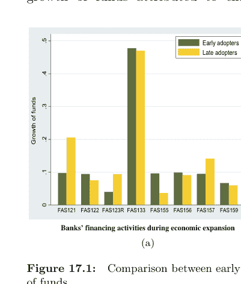

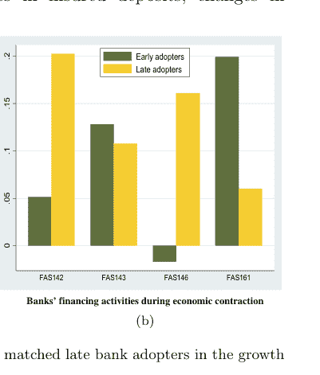

为了更清楚地说明，我分别展示了测试期间发生在经济扩张期（面板a）和经济收缩期（面板b）的银行资金增长情况。面板（a）显示，在大多数情况下（八种情况中的五种，且全部与金融工具相关的会计准则有关），早期银行采用者的资金增长平均高于其匹配的后期采用者。另一方面，面板（b）并未如预期那样显示早期采用者与匹配的后期采用者之间资金增长的特定趋势。

表17.6报告了每项准则下资金总增长的三个主要组成部分的均值（为便于比较，均以总资产进行缩放）：（1）受保存款的变化（CHDEPOSIT），（2）受保存款以外负债的变化（CHOTD），以及（3）优先股和普通股的变化（CHEQUITY）。这表明，早期采用者与匹配后期采用者之间的资金增长均值差异，主要归因于在经济扩张期测试期间受保存款以外负债增长的均值差异（即八种情况中有六种为正向均值差异）。<sup>28</sup> 就经济意义而言，早期采用者与匹配后期采用者之间受保存款以外负债增长的均值差异范围从–2.9%到6.3%。在提前采用SFAS第122号和SFAS第155号的情况下，这些差异分别在10%和5%的水平上显著。至于股本（即优先股和普通股的变化），在经济扩张期或收缩期的测试期间，早期采用者与匹配后期采用者之间的资本增长似乎没有特定的趋势。

### 表17.6：早期银行采用者与匹配的后期银行采用者资金增长及增长组成部分的比较（假设4）

| 变量 | n | CHTOTAL 早期 | CHTOTAL 后期 | CHTOTAL 差异 | CHDEPOSIT 早期 | CHDEPOSIT 后期 | CHDEPOSIT 差异 | CHOTD 早期 | CHOTD 后期 | CHOTD 差异 | CHEQUITY 早期 | CHEQUITY 后期 | CHEQUITY 差异 |
|---|---|---|---|---|---|---|---|---|---|---|---|---|---|
| *经济扩张期发布的会计准则* |  |  |  |  |  |  |  |  |  |  |  |  |  |  |
| FAS 121 | 3 | 0.097 | 0.205 | -0.108 | 0.042 | 0.111 | -0.069 | 0.056 | 0.084 | -0.029 | 0.000 | 0.010 | -0.010 |
| FAS 122 | 27 | 0.094 | 0.074 | 0.020 | 0.049 | 0.052 | -0.003 | 0.042 | 0.020 | 0.022* | 0.004 | 0.003 | 0.001 |
| FAS 123R | 2 | 0.040 | 0.094 | -0.054 | 0.017 | 0.080 | -0.063 | 0.023 | 0.013 | 0.010 | 0.000 | 0.001 | -0.001 |
| FAS 133 | 41 | 0.478 | 0.469 | 0.009 | 0.265 | 0.258 | 0.007 | 0.196 | 0.195 | 0.001 | 0.016 | 0.017 | 0.000 |
| FAS 155 | 6 | 0.096 | 0.036 | 0.061* | 0.033 | 0.036 | -0.003 | 0.060 | -0.003 | 0.063** | 0.003 | 0.004 | -0.001 |
| FAS 156 | 22 | 0.099 | 0.090 | 0.009 | 0.053 | 0.056 | -0.003 | 0.036 | 0.029 | 0.007 | 0.010 | 0.006 | 0.004 |
| FAS 157 | 22 | 0.095 | 0.141 | -0.046 | 0.070 | 0.090 | -0.020 | 0.020 | 0.043 | -0.023 | 0.005 | 0.008 | -0.003 |
| FAS 159 | 22 | 0.067 | 0.059 | 0.008 | 0.051 | 0.045 | 0.006 | 0.012 | 0.006 | 0.006 | 0.003 | 0.008 | -0.005 |
| *经济收缩期发布的会计准则* |  |  |  |  |  |  |  |  |  |  |  |  |  |  |
| FAS 142 | 2 | 0.052 | 0.202 | -0.151 | 0.011 | 0.123 | -0.112 | 0.041 | 0.056 | -0.015 | 0.000 | 0.024 | -0.024 |
| FAS 143 | 4 | 0.128 | 0.108 | 0.020 | 0.151 | 0.084 | 0.067 | -0.021 | 0.018 | -0.039 | -0.002 | 0.006 | -0.008 |
| FAS 146 | 2 | -0.017 | 0.161 | -0.178 | 0.030 | 0.079 | -0.049 | -0.047 | 0.070 | -0.117 | 0.000 | 0.012 | -0.012 |
| FAS 161 | 7 | 0.199 | 0.060 | 0.139 | 0.089 | 0.127 | -0.038 | 0.088 | -0.072 | 0.159* | 0.023 | 0.005 | 0.018** |

注：CHTOTAL衡量的是银行在测试期间受保存款、受保存款以外负债以及优先股和普通股之和的变化，并以总资产进行缩放。CHDEPOSIT（CHOTD、CHEQUITY）衡量的是银行在测试期间受保存款的变化（受保存款以外负债的变化、优先股和普通股的变化），并以总资产进行缩放。

**差异在5%水平上显著（单尾检验，即差异 =（早期 – 后期）被预测为正）。
*差异在10%水平上显著（单尾检验，即差异 =（早期 – 后期）被预测为正）。


经济收缩。29 这一结果与现有银行业文献一致，即银行筹集股权资本的成本相对较高，因此并非银行总资金增长的主要驱动因素（例如，Zimmer 和 McCauley，1991；Bolton 和 Freixas，2006；Admati 等，2011；Miles 等，2013）。此外，该结果与 Gropp 和 Heider（2010）的结论一致，即银行已转向未保险债务为其资产负债表增长提供资金。总而言之，在经济扩张期的测试期间，早期采用银行似乎比匹配的晚期采用银行经历了更高的资金增长。因此，假设 4 得到结果的支持。

## 17.5.4 补充分析

先前分析可能引起的一个担忧是，银行可能不是检验与金融工具无关的会计准则早期采用决策的最理想群体。因此，我分别对（1）与金融工具相关的会计准则（即 SFAS 第 122 号、SFAS 第 133 号、SFAS 第 155 号、SFAS 第 156 号、SFAS 第 157 号、SFAS 第 159 号和 SFAS 第 161 号）和（2）本研究考察的所有其他会计准则估计了早期采用决策模型。表 17.7 报告了研究结果。结果表明，银行更好地获取外部融资的动机主要解释了银行对与金融工具相关的会计准则的早期采用决策，因为在与金融工具无关的会计准则子样本中，假设 1 和假设 2 均未得到支持。这些发现与第 17.5.3 节中关于早期采用者融资活动的观察一致：早期采用者的资金增长高于匹配的晚期采用者，尤其是在与金融工具相关的会计准则（即 SFAS 第 122 号、SFAS 第 133 号、SFAS 第 155 号、SFAS 第 159 号和 SFAS 第 161 号）的情况下。由于在与金融工具无关的所有其他会计准则中，更好地获取外部融资的动机并不明显，因此自然可以推断，早期采用者不一定比匹配的晚期采用者经历更高的资金增长。这一推断可在图 17.1 中观察到。

我还考虑了银行盈利能力与风险状况对早期采用可能性的潜在交互效应。事前，高风险状况的银行预计会有较高的盈利能力。然而，事后高风险状况的银行不一定享有高盈利能力。为了检验银行盈利能力是否以及在多大程度上调节银行风险状况对银行早期采用决策的积极影响，我估计了带有额外交互项的方程（17.1）。具体来说，我在方程（17.1）中加入了银行盈利能力（ROA）与风险状况（AFSOFINV、LOANRISK、EXPOSUREDER、CREDITRISKDER 和 NONINTCHG）之间的交互项。在未列表的结果中，我发现除 AFSOFINV 外，每个风险因素对早期采用可能性的边际效应都会随着银行盈利能力的提高而降低。结果总体表明，银行风险状况对早期采用可能性的边际效应为正值，且在银行盈利能力较低时更高。

## 17.6 结论

我研究了美国银行控股公司（BHC）是否通过早期采用来披露信息并传递其质量信号，以更好地进入资本市场。我发现早期采用的可能性与银行盈利能力呈负相关，与银行风险状况呈正相关。在会计准则收入效应的条件下，我发现更好地获取外部融资的动机在解释仅具有披露要求的会计准则的早期采用决策时最为明显。最后，结果表明，在测试期间，尤其是在经济扩张期，早期采用者的资金增长高于匹配的晚期采用者。这些发现强化了这样一种观点，即在早期采用的背景下，银行自愿披露信息是为了更好地获取外部融资。

本研究对学术和实践受众都具有吸引力。从学术角度来看，本研究通过为早期采用提供额外的动机，对现有的早期采用文献以及管理者出于资本市场原因的自愿披露决策这一研究路线进行了补充。我的研究也可能引起银行业和银行监管机构的兴趣。由于在早期采用决策中存在反信号作用，银行在评估是否早期采用会计准则时可能会三思而后行。由于银行受到银行监管机构的密切审查，保持盈利增长和实施健全的风险管理对银行的运营至关重要。因此，未来的研究可以通过分析银行随时间推移的早期采用决策或其他类型的自愿披露，来获取关于银行未来财务绩效的启示。未来的研究还可以检验早期采用通过提供新信息从而更好地进入资本市场的动机是否适用于其他行业。

- FASB（1993）。对某些债务和权益证券投资的会计处理。SFAS 第 115 号。诺沃克，康涅狄格州：FASB。
- FASB（1995）。长期资产减值及待处置长期资产的会计处理。SFAS 第 121 号。诺沃克，康涅狄格州：FASB。
- FASB（1995）。抵押贷款服务权的会计处理——FASB 第 65 号公告的修订。SFAS 第 122 号。诺沃克，康涅狄格州：FASB。
- FASB（1995）。股票薪酬的会计处理。SFAS 第 123 号。诺沃克，康涅狄格州：FASB。
- FASB（1998）。雇主关于养老金和其他退休后福利的披露——FASB 第 87、88 和 106 号公告的修订。SFAS 第 132 号。诺沃克，康涅狄格州：FASB。
- FASB（1998）。衍生工具和套期活动的会计处理。SFAS 第 133 号。诺沃克，康涅狄格州：FASB。
- FASB（2001）。商誉和其他无形资产。SFAS 第 142 号。诺沃克，康涅狄格州：FASB。
- FASB（2001）。资产报废义务的会计处理。SFAS 第 143 号。诺沃克，康涅狄格州：FASB。
- FASB（2001）。长期资产减值或处置的会计处理。SFAS 第 144 号。诺沃克，康涅狄格州：FASB。
- FASB（2002）。与退出或处置活动相关成本的会计处理。SFAS 第 146 号。诺沃克，康涅狄格州：FASB。
- FASB（2003）。雇主关于养老金和其他退休后福利的披露——FASB 第 87、88 和 106 号公告的修订。SFAS 第 132R 号。诺沃克，康涅狄格州：FASB。
- FASB（2004）。股份支付。SFAS 第 123R 号。诺沃克，康涅狄格州：FASB。
- FASB（2006）。某些混合金融工具的会计处理——FASB 第 133 和 140 号公告的修订。SFAS 第 155 号。诺沃克，康涅狄格州：FASB。
- FASB（2006）。金融资产服务的会计处理——FASB 第 140 号公告的修订。SFAS 第 156 号。诺沃克，康涅狄格州：FASB。
- FASB（2006）。公允价值计量。SFAS 第 157 号。诺沃克，康涅狄格州：FASB。
- FASB（2007）。金融资产和金融负债的公允价值选择权——包括 FASB 第 115 号公告的修订。SFAS 第 159 号。诺沃克，康涅狄格州：FASB。
- FASB（2008）。衍生工具和套期活动的披露——FASB 第 133 号公告的修订。SFAS 第 161 号。诺沃克，康涅狄格州：FASB。
- Flannery, M. 和 Rangan, K.（2008）。是什么导致了 20 世纪 90 年代的银行资本积累？《金融评论》，12，391–429。
- Francis, J.、Khurana, I. 和 Pereira, R.（2005）。世界各地的披露激励与资本效应。《会计评论》，80（4），1125–1162。
- Frank, M. 和 Goyal, V.（2008）。债务的权衡理论与啄序理论。载于《公司金融手册：实证公司金融》，第 2 卷，E. Eckbo 主编。阿姆斯特丹：爱思唯尔，第 135–202 页。
- Frankel, R.、McNichols, M. 和 Wilson, G.（1995）。自愿性披露与外部融资。《会计评论》，70（1），135–150。
- Furlong, F. 和 Kwan, S.（2007）。二十年後的稳健银行经营：提出了什么，采纳了什么。亚特兰大联邦储备银行《经济评论》，92（1&2），1–23。
- Gorton, G.（2010）。被看不见的手扇了耳光：2007 年的恐慌。牛津大学出版社。
- Graham, J.、Harvey, C. 和 Rajgopal, S.（2005）。公司财务报告的经济影响。《会计与经济学杂志》，40，3–73。


Nissim, D. and Penman, S. (2007). 银行行业的公允价值会计. 哥伦比亚商学院, 会计与证券分析卓越中心, 专题论文系列.

Özyıldırım, S. (2010). 中介利差、银行监管与金融稳定. 太平洋盆地金融市场与政策评论, 13(4), 517–537.

Papirnik, J., Meier, H. and Rozen, E. (2004). 公允价值会计对证券投资组合重组的效应. 银行会计与金融, 18, 19–25.

Pasiouras, F., Gaganis, C. and Zopounidis, C. (2006). 银行监管、监管、市场结构和银行特征对单个银行评级的影响：跨国分析. 定量金融与会计评论, 27, 403–438.

Ramesh, K. and Revsine, L. (2001). 监管成本和契约成本对银行在其他退休后员工福利会计方法选择上的影响. 会计与经济学杂志, 30, 159–186.

Sami, H. and Welsh, M. (1992). 养老金会计准则 SFAS No. 87 的早期和晚期采用者的特征. 当代会计研究, 9(1), 212–236.

Schipper, K. (2003). 以原则为基础的会计准则. 会计视野, 17(1), 61–72.

Scott, T. (1991). SFAS No. 87 下的养老金披露：理论与证据. 当代会计研究, 8(1), 62–81.

Sengupta, P. (1998). 公司披露质量与债务成本. 会计评论, 73, 459–474.

Sengupta, P. (2004). 披露时点：季度收益发布日期的决定因素. 会计与公共政策杂志, 23, 457–482.

Siregar, D., Anandarajan, A. and Hasan, I. (2013). SFAS 133 后的商业银行及其衍生工具披露的价值相关性：来自美国的证据. 太平洋盆地金融市场与政策评论, 16(1), 1350004 (28 pages). (DOI: http://dx.doi.org/10.1142/S0219091513500045)

Skinner, D. (1994). 企业为何自愿披露坏消息. 会计研究杂志, 32(1), 38–60.

Spence, M. (1973). 就业市场信号. 经济学季刊, 87(3), 355–374.

Stiroh, K. (2004). 银行业多元化：非利息收入是答案吗？ 货币、信贷与银行杂志, 36(5), 853–882.

Suijs, J. (2007). 当企业不确定投资者反应时自愿披露信息. 会计与经济学杂志, 43, 391–410.

Watts, R. and Zimmerman, J. (1986). 正向会计理论, Englewood Cliffs, NJ/ Prentice-Hall.

Wooldridge, J. (2000). 估计动态、不可观察效应面板数据模型的框架，可能对未来解释变量产生反馈. 经济学快报, 68, 245–250.

Yang, D. (2009). 通过会计应计项目与财务政策的信号传递：来自银行贷款损失准备和股息变化的证据. 太平洋盆地金融市场与政策评论, 12(3), 377–402.

Zhao, R. and He, Y. (2014). 银行放松管制的会计含义：格拉姆-里奇-布莱利法案（1999）的事件研究. 定量金融与会计评论, 42, 449–468.

Zimmer, S. and McCauley, R. (1991). 银行资本成本与国际竞争. 纽约联邦储备银行季刊, 15 (Winter), 33–59.

## 附录 17A：1995年1月至2008年3月的会计准则

| 会计准则 | 发布日期（或最早采用日期） | 生效日期（适用于该日期之后的财政年度） | 采用的潜在收益影响 | 仅披露？ | 监管核心资本计算是否发生变化？ | 页数 |
|---|---|---|---|---|---|---|
| **No. 121** 长期资产减值会计及待处置长期资产 | 1995年3月 | 1995年12月15日 | – |  |  | 47 |
| **No. 122** 按揭服务权会计——对财务会计准则委员会第65号声明的修订 | 1995年5月 | 1995年12月15日 | + |  | 是 | 35 |
| **No. 123** 股权支付补偿会计 | 1995年10月 | 1995年12月15日 | – |  |  | 89 |
| **No. 132** 雇主关于养老金和其他退休后福利的披露——对财务会计准则委员会第87、88和106号声明的修订 | 1998年2月 | 1998年12月15日 | N/A | 是 |  | 29 |
| **No. 133** 衍生工具和套期活动会计 | 1998年6月 | 2000年6月15日 | ? |  | 是 | 176 |
| **No. 142** 商誉和其他无形资产 | 2001年3月15日 | 2001年12月15日 | ? |  |  | 75 |
| **No. 143** 资产退役义务会计 | 2001年6月 | 2002年6月15日 | – |  |  | 49 |
| **No. 144** 长期资产减值或处置会计 | 2001年8月 | 2001年12月15日 | – |  |  | 65 |

## 附录 17A：（续）

| 会计准则 | 发布日期（或最早采用日期） | 生效日期（适用于该日期之后的财政年度） | 采用的潜在收益影响 | 仅披露？ | 监管核心资本计算是否发生变化？ | 页数 |
|---|---|---|---|---|---|---|
| No. 146 退出或处置活动相关成本会计 | 2002年6月 | 2002年12月31日 | + |  |  | 25 |
| No. 132R 雇主关于养老金和其他退休后福利的披露——对财务会计准则委员会第87、88和106号声明的修订 | 2003年12月 | 2003年12月15日 | N/A | 是 |  | 40 |
| No. 123R 基于股份的支付 | 2004年12月 | 2005年6月15日 | – |  |  | 171 |
| No. 155 某些混合金融工具会计——对财务会计准则委员会第133和140号声明的修订 | 2006年2月 | 2006年9月15日 | ? | 是 |  | 18 |
| No. 156 金融资产服务会计——对财务会计准则委员会第140号声明的修订 | 2006年3月 | 2006年9月15日 | ? |  |  | 114 |
| No. 157 公允价值计量 | 2006年9月 | 2007年11月15日 | N/A | 是 |  | 86 |
| No. 159 金融资产和金融负债的公允价值选择——包括对财务会计准则委员会第115号声明的修订 | 2007年2月 | 2007年11月15日 | ? |  |  | 36 |
| No. 161 关于衍生工具和套期活动的披露——对财务会计准则委员会第133号声明的修订 | 2008年3月 | 2008年11月15日 | N/A | 是 |  | 32 |

## 附录 17B：提前采用决策的 Logit 模型

| 变量名称 | 变量定义 |
|---|---|
| **因变量** | |
| *EARLY* | 一个指示变量，如果银行控股公司提前采用会计准则则等于1，否则等于0。提前采用信息来自10Q/K文件。 |
| **检验变量** | |
| **假设1——盈利能力：** | |
| *ROA* | *ROA* 由新会计准则采用后的第一个季度末的收入（亏损）在扣除非经常项目和其他调整（BHCK4300）后除以总资产（BHCK2170）（资产回报率）衡量，并根据具有相似银行资产规模的美国商业银行的平均资产回报率进行调整（以 RIAD4300 ÷ RCFD2170 衡量）。 |
| *RPCERTAINTY* | 在会计准则公告日期之前的过去12个季度中，银行资产回报率高于同业商业银行平均资产回报率的次数百分比。 |
| *ROA_RPCERTAINTY* | *ROA* 与 *RPCERTAINTY* 之间的交互项。 |
| **假设2——风险特征：** | |
| *(a) 利率风险* | |
| *AFSOFINV* | 可供出售证券（不含权益证券）的比例（BHCK1773 – BHCKA511）占总投资证券（BHCK1773 + BHCK1754）的比例，根据同业商业银行的平均 *AFSOFINV* 进行调整（以 [RCFD1773 – RCFDA511] ÷ [RCFD1773 + RCFD1754] 衡量）。该衡量指标随后乘以（–1），以显示比例越高，利率风险越高。 |
| *(b) 信用风险* | |
| *LOANRISK* | 季度末贷款和租赁损失准备金（BHCK3123）与平均季度贷款和租赁（BHCK3516）的比率，根据同业商业银行的平均 *LOANRISK* 进行调整（以 RCFD3123 ÷ RCFD3516 衡量）。该衡量指标随后乘以（–1），以显示比率越高，贷款组合的信用风险越高。 |
| *(c) 衍生工具的敞口和信用风险* | |
| *EXPOSUREDER* | 对衍生合约的敞口水平（*EXPOSUREDER*）由除已购期权外的衍生合约名义总额（即期货合约、远期合约、已售期权和互换）与总资产（BHCK2170）的比率衡量，并根据同业商业银行的平均 *EXPOSUREDER* 进行调整。 |


## 附录 17B：(续)

| 变量名称 | 变量定义 |
|---|---|
| CREDITRISKDER | 一个指示变量，若场外衍生品合约（即远期、场外期权和互换）的名义总额大于交易所交易衍生品合约（即期货合约和交易所交易期权），则等于1，否则为0。 |
| (d) 运营风险 |  |
| NONINTCHG | 过去六个季度非利息收入（BHCK4079）的平均季度增长率，已根据同期同业商业银行（RIAD4079）的平均 NONINTCHG 进行调整。 |
| 控制变量 |  |
| BADNEWS | 一个指示变量，若 ROA 小于零则等于1，否则为0。 |
| CONTRACT | 一个指示变量，若一家 BHC 持有利率衍生品合约则等于1，否则为0。 |
| SIZE | 总收入的对数。总收入定义为总利息收入（BHCK4107）与总非利息收入（BHCK4079）之和。 |
| LEVERAGE | 总负债（BHCK2948）除以总资产（BHCK2170）。 |
| T1LEV | 一级杠杆比率计算为一级资本（BHCK8274）除以杠杆资本用途的平均总资产（BHCKA224）。 |
| DROE | DROE 是一个指示变量，若某 BHC 在基准季度的 ROE 处于样本 BHC ROE 分布的最高或最低四分位，则等于1，否则为0。ROE 计算为扣除非经常性项目和其他调整前的收入（亏损）（BHCK4300）除以上一季度末的总权益资本（BHCK3210）。 |
| NIEFF | 该变量在预期样本会计准则的采用对收入产生积极影响时编码为1，若预期对收入产生负面影响则编码为−1，若收入影响无法事前确定或会计准则仅有披露要求则编码为0。 |
| DROE_NIEFF | DROE 与 NIEFF 之间的交互项。 |
| MKTHERF | MKTHERF 由同一地理区域内运营的商业银行的市场份额平方和衡量（基于总利息收入 RIAD4107 和总非利息收入 RIAD4079）。遵循 Moyer（1990），我将地理区域划分为五个：东部、东南部、中西部、西南部和西部。 |
| DISCLOSURE | 一个指示变量，若会计准则仅要求披露则等于1，否则为0。 |
| REG_POS | 一个指示变量，若会计准则的颁布可能导致一级资本计算规则发生变化且对一级资本产生积极影响（即 SFAS 第122号），则等于1；否则为0。 |
| REG_UN | 一个指示变量，若会计准则的颁布可能导致一级资本计算规则发生变化且对一级资本的影响不确定（即 SFAS 第133号和 SFAS 第155号），则等于1；否则为0。 |
| PAGE | 样本会计准则发布时的页数。 |

注：除另有说明外，所有变量均在标准公告日期前的最新季度末或就最新季度（基准季度）进行衡量。例如，对于2006年3月宣布的FAS 156，所有变量均衡量2005年第四季度或截至2005年第四季度末的数据。

## 附录 17C：研究设计概述

本研究考察了462家 BHC 在1995年1月1日至2008年3月31日期间宣布的16项会计准则的提前采用决策（3,640个 BHC-准则观测值）。具体而言，它研究 BHC 是否选择提前采用会计准则以披露信息/传递其质量以更好地获取外部融资。为了衡量 BHC 为更好地获取外部融资而进行信息披露/传递的动机，我使用了既有文献中建议的银行盈利能力和风险状况。我估计了以下 Logit 模型（非平衡静态二元面板数据分析），使用最大似然估计并在银行层面聚类标准误，以检验假设1和假设2：

$$EARLY_{ij} = \beta_0 + \beta_1 ROA_{ij} + \beta_2 RPCERTAINTY_{ij} + \beta_3 ROA\_RPCERTAINTY_{ij} + \beta_4 AFSOFINV_{ij} + \beta_5 LOANRISK_{ij} + \beta_6 EXPOSUREDER_{ij} + \beta_7 CREDITRISKDER_{ij} + \beta_8 NONINTCHG_{ij} + \beta_9 BADNEWS_{ij} + \beta_{10} CONTRACT_{ij} + \beta_{11} SIZE_{ij} + \beta_{12} LEVERAGE_{ij} + \beta_{13} T1LEV_{ij} + \beta_{14} DROE_{ij} + \beta_{15} NIEFF_j + \beta_{16} DROE\_NIEFF_{ij} + \beta_{17} MKTHERF_{ij} + \beta_{18} DISCLOSURE_j + \beta_{19} REG\_POS_j + \beta_{20} REG\_UN_j + \beta_{21} PAGE_j + \Sigma_N \beta_N YEAR_N + \varepsilon_{ij}. \tag{17C.1}$$

因变量 *EARLY_ij* 在 BHC *i* 提前采用会计准则 *j* 时等于1，否则为0。*YEAR_N* 是一个指示变量，若会计准则在第 *N* 年发布则等于1，否则为0。所有其他变量均定义于附录17B。作为对假设1的检验，感兴趣的检验变量是 *ROA*；β₁预期为负值。为了检验假设2，检验变量为 *AFSOFINV*、*LOANRISK*、*EXPOSUREDER*、*CREDITRISKDER* 和 *NONINTCHG*；其相应系数预期为正值。静态 Logit 模型假设在给定协变量的情况下响应变量（即提前采用决策）之间相互独立，且回归量中不包含滞后响应变量。

为检验为更好地获取外部融资而进行信息披露/传递的动机是否会随着准则采用的潜在收入效应而变化（即假设3），以下 Logit 模型（非平衡静态二元面板数据分析）使用异方差校正标准误估计，并分别针对具有（1）收入下降效应、（2）收入增加效应、（3）*事前* 不确定的收入效应和（4）仅披露要求的会计准则进行估计：

*EARLY_ij* = β₀ + β₁*ROA_ij* + β₂*RPCERTAINTY_ij*  
+ β₃*ROA_RPCERTAINTY_ij* + β₄*AFSOFINV_ij*  
+ β₅*LOANRISK_ij* + β₆*EXPOSUREDER_ij*  
+ β₇*CREDITRISKDER_ij* + β₈*NONINTCHG_ij*  
+ β₉*BADNEWS_ij* + β₁₀*CONTRACT_ij* + β₁₁*SIZE_ij*  
+ β₁₂*LEVERAGE_ij* + β₁₃*T1LEV_ij* + β₁₄*DROE_ij*  
+ β₁₅*MKTHERF_ij* + Σ_N β_N *YEAR_N* + ε_ij.   (17C.2)

所有变量均定义于附录17B。为了检验假设3，预计 *ROA*、*AFSOFINV*、*LOANRISK*、*EXPOSUREDER*、*CREDITRISKDER* 和 *NONINTCHG* 在仅有披露要求的会计准则情况下最符合预测。

与静态 Logit 模型不同，动态 Logit 模型在协变量中包含滞后响应变量以及特定于每个 BHC 的固定/随机效应，并假设当前响应变量在条件独立于其他先前滞后响应变量。此外，对于具有随机效应的动态 Logit 模型，必须已知响应变量的初始观测值（例如，Heckman，1981a，1981b，1981c；Wooldridge，2000；

Bartolucci and Farcomeni，2009；Bartolucci and Nigro，2012）。动态 Logit 模型的优点在于能够解释响应变量的动态性并解决回归量的潜在内生性问题（例如，Baghatasarian and Mamatzakis，2018）。在本研究中，由于所考察的会计准则性质各不相同，当前提前采用决策与之前提前采用决策相关的可能性较小。未来研究可以探索在提前采用决策的背景下，使用动态 Logit 模型与静态 Logit 模型得到的系数估计的一致性程度。

本页特意留空

## 第18章

### 利用社交媒体通过广义学习改进股票市场预测

Xi Zhang 和 Philip S. Yu

### 目录

- 18.1 引言 ........................................ 678
- 18.2 利用投资者社交网络进行股票预测 .... 680
  - 18.2.1 概述 ........................................ 680
  - 18.2.2 数据描述和特征 ............ 682
  - 18.2.3 股票价格走势预测 .............. 687
  - 18.2.4 实验 ..................................... 692
- 18.3 基于张量的信息融合方法用于股票波动率预测 ................................ 696
  - 18.3.1 概述 ........................................ 696
  - 18.3.2 预备知识 ................................... 698
  - 18.3.3 框架 ................................... 700
  - 18.3.4 耦合矩阵和张量分解 .......... 706
  - 18.3.5 实验 ..................................... 709
- 18.4 多源多实例学习用于市场综合指数走势 ............................ 717
  - 18.4.1 概述 ........................................ 717

Xi Zhang
北京邮电大学
e-mail: zhangx@bupt.edu.cn

Philip S. Yu
伊利诺伊大学芝加哥分校
e-mail: psyu@uic.edu


- 18.4.2 预备知识 ... 718
- 18.4.3 多源多实例模型 ... 722
- 18.4.4 特征提取 ... 726
- 18.4.5 实验 ... 728
- 18.5 小结 ... 733
- 参考文献 ... 733

### 摘要

本章讨论如何利用各种网络信息来改进股市预测。我们首先讨论投资者社交网络对股市的影响，然后提出多种信息融合方法，即基于张量的模型和多实例学习模型，将网络信息与量化信息相整合，以提高预测能力。

### 关键词

- 股票预测
- 事件抽取
- 信息融合
- 社交网络
- 情感分析
- 量化分析
- 股票相关性

## 18.1 引言

传统的股市预测方法通常利用股票的历史价格相关数据来预测其未来走势。随着Web 2.0的繁荣，越来越多的投资者参与网络活动，实时获取和分享股票相关信息。同时，专家和有影响力人士发布的股票观点，由于影响力通过互联网的快速传播，能够影响他人的决策。其影响是双重的。一方面，网络上的事件信息和用户情绪可以很大程度上影响股票价格。例如，白宫爆炸的虚假谣言导致股票短暂暴跌（Johnson, 2013）。另一方面，股价的剧烈波动可能导致相关信息的产生和传播（例如来自权威机构的观点），这反过来又会影响公众对未来投资策略的看法。因此，这为研究者利用网络信息促进股票分析提供了前所未有的机会。

受到网络丰富数据的启发，近期一些工作尝试利用新闻文章和社交媒体来改进预测。有效指标，例如与股票相关的事件以及人们对市场和股票的情绪，已被证明在股票波动中发挥重要作用，并被提取出来输入预测模型以提高预测准确性。然而，以往方法的一个主要局限是这些指标仅从单一来源获得，其可靠性可能较低，或者来自多个数据源，但多源数据之间的相互作用和相关性在很大程度上被忽略了。

在本章中，我们提出利用“宽泛学习”（broad learning）的思想来进行股市预测。宽泛学习意味着融合来自不同来源的信息。为此，我们探索各种网络信息来源并提取有效指标。此外，我们不是将每个数据源单独处理，而是研究它们对股票价格变动的联合影响。然而，由于数据源之间的隐式关系以及网络数据（如新闻事件和用户讨论）的稀疏性，这一问题具有挑战性。为解决这些问题，我们提出了一系列机器学习模型，以有效融合异构数据并捕捉其内在联系。在真实股市数据上的实验表明，与只使用单一数据源的方法相比，我们的模型能够显著提高预测能力。

本章组织如下。18.2节研究从投资者社交网络中提取的投资者感知是否对股市预测有用。我们使用两个数据源，即社交媒体（即雪球¹）和量化交易数据，利用现成的机器学习模型对市场中的每只股票进行预测。18.3节介绍了一种新颖的基于张量的计算框架，通过融合三类信息源，即社交媒体（即股吧²）、新闻标题和量化交易数据，来有效预测股票价格变动。由于新闻事件的稀疏性，与处理所有股票的18.2节不同，我们只选择中国股票指数（CSI）100中的股票。18.4节开发了多实例学习（MIL）模型的一个扩展，能够有效整合来自多个来源的特征以进行更准确的预测。我们同样使用与18.3节相同的三个数据源，但不再针对每只特定股票抽取新闻事件和情绪，而是分析整个市场的宏观新闻事件和情绪，并对市场综合指数走势进行预测。表18.1总结了这三节的区别。

表18.1：三节中预测方法的比较。

|  | 数据源 | 目标 | 学习方法 |
|---|---|---|---|
| --- | --- | --- | --- |
| 18.2节 | 雪球、量化指标 | 市场中的每只股票 | SVM、MLP |
| 18.3节 | 股吧、新闻、量化指标 | CSI 100中的每只股票 | 张量分解的扩展 |
| 18.4节 | 雪球、新闻、量化指标 | 市场综合指数 | 多实例学习的扩展 |

## 18.2 利用投资者社交网络进行股票预测³

### 18.2.1 概述

诸如Twitter、微博、Facebook和LinkedIn等社交网络吸引了数百万用户发布和获取信息，这些网络已被多种研究广泛探讨（Kwak et al., 2010; Su et al., 2016; Anderson et al., 2015; Viswanath et al., 2009）。除了这些通用社交网络之外，还有一类更小、更专注于特定受众的网站。这里我们关注一个面向交易者和投资者设计的社交网站——雪球。雪球是专为中国股市投资者打造的社交网络，已吸引数百万用户。雪球允许投资者在类似Twitter的平台上分享观点，或发布他们的投资组合，展示其交易操作和收益。与那些通用社交网络不同，雪球上几乎所有的信息都与股票相关，这使其成为收集投资者感知的自然数据源，这些感知可能对中国的股市预测有用。

早期关于股市预测的文献基于有效市场假说（EMH）和随机游走理论（Fama, 1965）。然而，在现实中投资者的反应可能并不支持随机游走模型。行为经济学提供了大量证据表明，金融决策在很大程度上受情绪驱动。社会整体的乐观或悲观程度会影响投资者的决策（Prechter, 1999; Nofsinger, 2005）。此外，投资者对股票相关性的感知也可能是一个潜在的预测因子。企业之间可能在经济上相互关联（King, 1966; Pindyck and Rotemberg, 1993）。因此，由于投资者基于对这种相关性的感知而作出的投资反应，某只股票的价格变动有可能影响其同类股票。


图18.1：雪球推文数量与交易量和换手率的对比。

情绪和感知是心理构造，因此在档案分析中难以衡量。新闻文章一直是文本内容分析的主要来源。例如，新闻文章被用来分析公众情绪（Li et al., 2014），借此可以预测股票价格变动。然而，这类内容有一个明显的缺点：新闻文章直接反映的是作者的情绪，而不是投资者的情绪。在线社交平台为我们提供了更直接的数据，并为探索用户的情绪和感知创造了机会。近期研究发现（Bollen et al., 2011），从Twitter信息流中提取的集体情绪可用于提高道琼斯工业平均指数（DJIA）的预测准确性。Facebook的国民幸福总值（GNH）指数被证明能够预测美国股市的日收益率和交易量的变化（Karabulut, 2013）。Al Nasseri等人（2015）报告了StockTwits（一个专门用于交流交易相关观点的类Twitter平台）数据对股票价格行为的可预测性。

大多数现有研究都聚焦于美国股市，而对某些新兴国家（如中国）的关注不足。中国股市是低效的，呈现出相当明显的非随机游走模式（Darrat and Zhong, 2000）。中国股市（称为A股

市场）在投资者结构上与其他主要市场显著不同。具体而言，与其他以机构投资者为主的主要股票市场不同，中国市场中的散户投资者所占比例更高。重要的是，散户投资者更倾向于买入而非卖出吸引他们注意力的股票，因此更容易受到新闻或其他社交媒体（Barber and Odean, 2008）的影响。因此，我们基于一个专门为投资者设计的、类似Twitter的中国社交平台——即雪球（Xueqiu）——的独特数据集来研究中国股市，旨在填补文献中的这一空白。

为了证明雪球与中国股市的紧密关联，图18.1(a)展示了2014年11月至2015年5月间雪球上所有股票的每日发布推文量以及A股市场的每日成交量。可以观察到，这两条曲线的波动趋势表现出很强的同步性，尤其是在高成交量波动发生时。当我们观察个股时，每日推文量的变动与每日换手率的变动之间的同步性仍然存在，如图18.1(b)所示，其中以雪球上最受欢迎的股票之一——中信证券为例。基于雪球的推文，我们通过从雪球中提取两类网络来构建关于集体情绪和感知的特征：一类是用户网络，另一类是用户感知的股票网络。我们在A股市场中所有活跃股票（超过2,000只）上评估了我们的方案，表明这是一种可行的方法。

## 18.2.2 数据描述与特征

雪球成立于2010年，最初主要关注美国股市。自2014年以来，越来越多的人关注A股市场。截至2015年底，已有数百万注册用户。雪球使投资者能够在一个类似Twitter的平台上分享观点，即用户可以发帖、回复或转发他人的内容。此外，每个用户可以关注其他用户或被其他用户关注，关注者数量在一定程度上体现了其权威性。上市公司的管理人员和官方机构通常会在雪球上发布权威公告。除了公告和观点之外，许多投资者还会发布自己的投资组合，展示其交易操作和收益。与Twitter或微博等一般社交网络不同，雪球上几乎所有的信息都与股票相关，使其成为收集投资者感知的自然数据源。

### 18.2.2.1 数据集

我们获取了从2010年12月至2015年5月所有用户和推文的完整数据集，其中包含来自2,780只股票（截至2015年7月共2,780只）的1,839万条推文和277万用户。随后，我们将分析限制在2014年11月至2015年5月这一区间，原因有二。首先，由于数据的某些特征（如关注者图）不断演变，我们必须在假设这些特征在此时期内保持稳定的前提下选择相对较短的区间。其次，在此期间A股市场非常活跃，导致市场指标大幅波动，雪球上也有大量讨论推文。我们分析的数据集包含来自284,000名活跃用户的648万条推文，抓取的信息如下：

- **用户。** 我们抓取了用户ID、关注者数量、关注者列表以及已发布推文的数量。
- **推文。** 对于推文，我们不仅记录内容，还记录相关属性，例如推文ID、发布时间、回复和转发时间。我们还记录转发行为，包括新推文的ID和转发用户的ID。

### 18.2.2.2 数据特征

我们首先对数据集进行结构分析，观察到的特征有助于我们更好地理解雪球，并促进我们的预测任务。

### 关注者数量分布：

我们首先考察关注者数量的分布。如图18.2所示，x轴表示每个用户的关注者数量，y轴表示互补累积分布函数（CCDF）。加号（+）线表示我们数据集的结果，而实线表示指数为−0.624、R² = 0.982的幂律分布。可以观察到，当x ≤ 10⁴时，分布曲线与幂律分布拟合良好。转折点出现在x = 10⁴处，之后带有“+”符号的曲线迅速下降。原因是284,000名用户中只有0.44%的用户拥有超过10⁴的关注者，这使得曲线难以与所有其他用户保持一致。

### 关注者数量与转发数量对比：

当一条推文被转发时，其影响力得以传播。转发数量体现了其影响力。通常，名人发布的推文很容易被转发。我们试图展示关注者数量与转发数量之间的关系。


图18.2：关注者数量分布。

散点图如图18.3所示，其中x轴表示关注者数量，y轴表示转发数量。可以观察到，当关注者数量x超过1.2 × 10⁴时，转发数量大于1 × 10³，这表明由关注者数量足够多（超过10⁴）的名人发布的推文更容易被大量转发。此外，随着关注者数量的增加，转发数量呈线性增长，尤其是当x > 10⁴时。

### 18.2.2.3 情绪与A股指标

为了研究推文情绪与股票价格之间的相关性，我们首先从推文中提取情绪，并使用朴素贝叶斯算法推断情绪。推文分为三类：负面、正面和中性。负面和正面推文用于构建第i天的情绪指数，其定义为

S_i = 0.5 - [ p_i / sum_{i=1}^N p_i ] / [ p_i / sum_{i=1}^N p_i + n_i / sum_{i=1}^N n_i ]


图18.3：关注者数量与转发数量对比。


图18.4：A股指数变化率与情绪指数对比。

其中N是日期数，P_i和n_i分别是第i天的正面和负面推文数量。

在图18.4中，实线表示2014年12月至2015年5月的情绪指数，虚线表示同一时间间隔内A股指数（即上证综合指数）的变化率。如果这两条曲线共同演变，则表明雪球上推文所呈现的情绪与A股指数相关。

正面情绪通常伴随着股价上涨，反之亦然，这是合理的。可以观察到，在许多时间区间内，这两条曲线表现出相似的波动趋势，尤其是在A股指数曲线的峰值或谷底。例如，2015年1月19日，A股指数下跌7.7%，情绪指数也大幅下跌，表明投资者情绪强烈负面。

### 18.2.2.4 用户感知的股票相关性

获取股票相关性的常用方法是使用标准行业分类方案或历史价格序列。然而，在这项工作中，我们通过雪球提取用户感知的相关性。其优势在于，除了显式且静态的相关性之外，我们还可以获得潜在或即时的相关性，例如由同一事件驱动但并非属于同一行业的关联股票。

为了获得此类相关性，我们收集同一条推文中提到的所有成对股票。在预处理中，我们删除了提到超过五个连续股票代码的推文，因为此类推文通常对我们的任务没有多大意义。表18.2分别显示了与招商银行、乐视、网宿科技和贵州茅台共同提及频率最高的前五只股票。可以观察到，与招商银行相关的前五只股票均为金融公司，前三名是与招商银行规模相似的银行，第四名是平安，一家涉及平安银行的综合金融公司。中国最大的证券公司中信证券位居第五。对于股票乐视，相关股票则比较多样。乐视是一家主要产品为智能电视和视频服务的公司，而东方财富是一家提供财经新闻和数据的网站。虽然它们不属于同一行业，但被投资者视为中国创业板的代表公司，因此经常共同出现。

**表18.2：** 前五位共现统计。

| 招商银行 | 乐视 | 网宿科技 | 贵州茅台 |
|---|---|---|---|
| 1 兴业银行 | 东方财富 | 乐视 | 招商银行 |
| 2 浦发银行 | 同花顺 | 掌趣科技 | 泸州老窖 |
| 3 民生银行 | 中信证券 | 贵州茅台 | 平安 |
| 4 平安 | 新松机器人 | 光环新网 | 格力 |
| 5 中信证券 | 华谊兄弟 | 新松机器人 | 浦发银行 |


对于网宿科技和贵州茅台，它们相关性最强的股票也不局限于同一行业。因此，可以总结出，从雪球获得的用户感知相关性能够捕获以往方法难以观察到的隐含相关性。相关性可能导致股票价格的共同演变，我们的工作就是研究从雪球提取的这种相关性是否对我们的预测任务有效。

## 18.2.3 股票价格走势预测

我们将股票价格走势预测建模为一个二分类问题。然后，我们讨论如何从三种不同类型的信息源中提取特征。之后，我们评估分类模型，以验证来自雪球的信息的有效性。

### 18.2.3.1 问题定义

股票价格的变动仅发生在交易日，因此我们将单个交易日定义为我们预测模型的时间粒度。一个交易日定义为从上一日的收盘时间（即下午3:00）到当日收盘时间。我们要预测当日收盘价相对于前一日收盘价是上涨还是下跌。给定目标股票 s_i，其连续有效交易日序列构成交易日向量 T⃗_i = (t_1^i, t_2^i, t_3^i, ..., t_n^i)，其中 n 是 T⃗_i 中交易日的数量，由数据集的范围决定。注意，不同的股票会有不同的交易日向量。

对于某个交易日 t_j^i，我们定义特征向量 x⃗_j^i，它由在交易日 t_j^i 为股票 S_i 提取的特征组成。该特征向量也是预测模型的输入。形式化地，给定股票 S_i 及其特征向量 x⃗_j^i，股票价格走势预测问题被建模为：

y_j^i = f(x⃗_j^i) = { 1, 如果 s_i 的价格在 t_{j+1}^i 上涨
0, 否则, } (18.1)

其中 y_j^i 是预测函数 f(x⃗_j^i) 的结果，表示股票 S_i 在下一个交易日 t_{j+1}^i 的价格走势方向。

### 18.2.3.2 特征提取

受第18.2.2节数据分析的启发，我们挖掘来自雪球和股票市场的丰富知识，以构成输入特征向量 x⃗_j，并将特征分为三类：个股特征、情感特征和股票相关性特征。

### 个股特征：

用于股票预测的常见信息包括公司特定因素，以及用于技术分析的历史价格和时间序列价格（Taylor 和 Xu，1997；Taylor，2007）。我们选取了以往文献中显示出预测能力的股票的一些关键特征（Li *等人*，2014；Fama 和 French，1992）：股票价格、成交量、换手率和市盈率（P/E）。注意，不同股票的股价和成交量的绝对值差异很大，因此我们使用变化率代替。此外，不仅包括日变化，还包括5日移动平均线的变化。

### 情感特征：

在本研究中，我们为每只股票在每个交易日推导情感指数。首先，对于数据集中的所有推文，我们将其分为三类：正面、中性和负面，并且只使用正面和负面推文来推导情感特征。统计正面和负面类别中的推文数量是衡量每种情感强度的直观方法。然而，这种计数方法意味着每条推文被平等对待，因此具有相同的权重。事实上，由于用户的权威性不同，不同的推文可能具有不同的影响力。因此，将用户的权威性作为每条推文的权重是合理的。

给定从雪球提取的用户网络，PageRank 是对每个用户进行加权的自然方法。为了得到 PageRank 分数，我们首先根据数据集构建用户网络。注意，与社交网络中静态的好友链接不同，这里构建的用户网络是一个动态的转发网络。具体而言，当用户在雪球上发布推文或转发他人的推文时，可以构建出一个用户转发网络。图18.5显示了2015年5月29日的用户网络示例。在该网络中，每个节点代表一个用户，并以其用户ID标记，边代表两个用户之间的转发行为。我们的数据集中共有A股市场141个交易日，因此构建了141个用户网络。对于每个网络，我们计算每个顶点的PageRank值。如图18.5所示，节点越大，用户的PageRank值越大。

对于有向用户网络中的用户 u_t，给定一个包含 K_t 个用户（记为节点 u1, u2, …, uK_t）且转发了 u_t 推文的用户集合 U_t，其


**图18.5：** 用户网络示例。

PageRank 值可以计算为

$$PR(u_t) = \sum_{u_i \in U_t} \frac{PR(u_i)}{L(u_i)}, \tag{18.2}$$

其中 $L(u_i)$ 是从 $u_i$ 出发的出链数量。此后，每条推文 $x$ 的权重即为发布该推文的用户 $u(x)$ 的权重，那么加权计数为

$$PositiveCount = \sum_{x} PR(u(x)),$$

$$NegativeCount = \sum_{y} PR(u(y)), \tag{18.3}$$

其中 $x$ 和 $y$ 分别表示正面推文和负面推文。

对于给定的股票 $S_i$ 和某个交易日 $t_j^i$，我们首先计算其正面计数和负面计数，然后将它们合并为一个情感分数，记为 $SC_j^i$，即

$$SC_j^i = \frac{PositiveCount_j^i}{PositiveCount_j^i + NegativeCount_j^i}. \tag{18.4}$$

显然，$SC_j^i \in [0,1]$，且 $SC_j^i$ 越大，整体情绪越正面。$SC_j^i$ 被用作我们预测模型的情感特征。

### 股票相关性特征：

股票之间的用户感知相关性是从雪球可以获得的另一种知识（Arai *等人*，2015）。其直觉是，具有强相关性的股票可能在价格上表现出联动。在我们的工作中，如果股票被同一条推文共同提及，则认为它们是相关股票。形式化地，我们将股票网络定义为无向图 $G = \{V,E\}$。节点集合 $V$ 由股票组成，$e_{u,v} \in E$ 表示股票节点 $u$ 和 $v$ 之间的边，边的权重是最近 3 天内的共现次数。由于这种相关性具有时间敏感性（Wichard *等人*，2004），我们为 141 个交易日构建了 141 个股票网络。

具体而言，对于给定的股票 $S_i$ 和交易日 $j$，令 $r_j^{i,k}$ 表示在第 $j$ 天股票 $S_i$ 与 $S_k$ 之间边的权重。为了使相关性更具针对性和意义，我们过滤掉 $r_j^{i,k} < 2$ 的非信息边（$r_j^{i,i}$ 除外，注意 $r_j^{i,i} = 1$）。对于股票网络中未连接的任何两只股票（即 $S_m$ 和 $S_n$），$r_j^{m,n} = 0$。

然后以 $r_j^{i,k}$ 作为权重，我们可以将其与股票 $S_k$ 的个股特征 $f_k$ 相结合，得到第 $j$ 天的相关性特征，即

$$corr(f)_j^i = \frac{\sum_{k=1}^N r_j^{i,k} f_k}{\sum_{k=1}^N r_j^{i,k}}, \tag{18.5}$$

其中，$N$ 是数据集中的股票数量，$f_k$ 是股票 $S_k$ 的一个个股特征。以换手率和股票价格变化率为例，我们可以得到

$$corr(turnover)_j^i = \frac{\sum_{k=1}^N r_j^{i,k} turnover_k}{\sum_{k=1}^N r_j^{i,k}}, \tag{18.6}$$

$$corr(price\_change)_j^i = \frac{\sum_{k=1}^N r_j^{i,k} price\_change_k}{\sum_{k=1}^N r_j^{i,k}}.$$

### 18.2.3.3 预测方法

给定特征向量后，我们应用统计学习方法获取预测结果。具体来说，给定一个包含 $n$ 个样本的训练集，形式为 $(\vec{x_1}, y_1), \dots, (\vec{x_n}, y_n)$，其中 $y_i$ 为 $+1$ 或 $-1$。类别 $+1$ 表示股票价格将上涨，而类别 $-1$ 表示股票价格将下跌。$\vec{x_i}$ 是某只特定股票在某一天的特征向量，包含用于训练模型的特征。

为获得预测结果，我们考虑了支持向量机（SVM）（Boser *等人*，1992）和多层感知器（MLP）（Hinton，1987；Rumelhart *等人*，1988）两种算法。以往大多数工作使用线性模型来预测股票市场（Xie *等人*，2013；Luss 和 D'Aspremont，2015；Kogan *等人*，2009）。然而，特征与股票价格走势之间的关系可能比线性关系更为复杂。因此，我们在 SVM 中使用 RBF 核而非线性核，并且

结果还表明，使用 RBF 核优于使用线性核。此外，我们还利用 MLP 模型来学习隐藏且复杂的关系。MLP 是一种前馈人工神经网络模型，可将输入数据集映射到一组适当的输出。MLP 由有向图中的多层节点组成，每一层与下一层全连接。在我们的工作中，模型结构使用一个隐藏层，并使用 sigmoid 作为激活函数。标准反向传播算法用于神经网络的监督训练。

特征提取与预测的过程如算法 1 所示。

### 算法 1 特征提取与预测的过程

```
Input: Users U and tweets X from Xueqiu, firm-specific factors F of stock S_i at trading day t_j^i
Output: Stock movement y_j^i at next trading day t_{j+1}^i
function SPECIFICFEATURE(F, s_j^i)
    Extracting firm-specific features: f_j^i ← F for stock s_j^i at t_j^i;
    return f_j^i
end function
function SENTIMENTSCORE(X, U, s_i)
    Counting the number of tweets in the positive category (i.e., x) and negative category (i.e., y) respectively;
    Constructing the user forwarding network;
    PageRank value for user u_t : PR(v_t) ← Σ PR(u_i)/L(u_i);
    Positive weighted count: PositiveCount ← Σ_x PR(u(x))
    Negative weighted count: NegativeCount ← Σ_y PR(u(y))
    Sentiment Score: SC_j^i ← PositiveCount_j^i / (PositiveCount_j^i + NegativeCount_j^i);
    return SC_j^i
end function
function RELATEDNESSFEATURE(f_j^i, X, s_i)
    Constructing the stock network: G = {V, E};
    Correlation between stock s_i and s_k : r_j^{i,k} ← (Σ_{k=1}^N r_j^{i,k} f_k) / (Σ_{k=1}^N r_j^{i,k});
    Relatedness feature: corr(f_k)_j^i, f_k is a specific feature of stock k;
    return corr(f_k)_j^i
end function
function PREDICTION(f_j^i, SC_j^i, corr(f)^i_j)
    Combining features into a vector: x⃗_j^i ← {f_j^i, SC_j^i, corr(f)_j^i};
    Predicting stock movement: y_j^i ← SVM(x⃗_j^i)(or y_j^i ← MLP(x⃗_j^i));
    return y_j^i
end function
```

## 18.2.4 实验

我们进行实验以评估从雪球获取的特征在预测股票价格变动方面的有效性。

### 18.2.4.1 实验设置

我们使用了 2014 年 11 月至 2015 年 5 月的雪球数据。目标股票从 A 股市场的所有股票中选取，需满足两个要求：(1) 该股票在此期间有超过 10 个交易日；(2) 关于该股票的推文数量每天超过 10 条。雪球中的垃圾内容可能会给我们的分析和预测任务带来较大噪声。为了检测垃圾内容，我们确定了 10 个特征（包括内容中数字的百分比、用户的粉丝数等），并使用逻辑回归来识别它们。然后，我们为每只股票提取雪球相关特征（情感特征和股票关联特征）。股票特定特征则是从通过 TuShare⁴ 获得的历史信息中提取的。雪球上每条推文的情感由 SnowNLP⁵ 分类，这是一个开源的中文文本处理工具包。最终，我们从数据集中获得了约 35.7K 个有效的测试样本。

我们使用 SVM（带 RBF 核）和 MLP 作为预测模型。最后一个月的样本将用作训练集，以预测下一个月每个交易日的股票价格变动。例如，当 2014 年 11 月的样本用作训练集时，2014 年 12 月的交易日即为相应的测试集。预测通过两个常用指标进行评估：分类准确率（ACC）和 ROC 曲线下面积（AUC）。ACC 对数据偏斜非常敏感。当某个类别出现的频率极高时，使用对多数类进行预测的分类器可以获得较高的准确率。因此，我们也使用 AUC 来避免数据偏斜带来的偏差。尽管我们的数据并非严重偏斜，我们仍使用 AUC 进行比较。在对所有这些测试集进行预测后，我们将所有 AUC 和 ACC 结果汇总为一个总体输出。

### 18.2.4.2 预测结果

根据先前的研究（Li 等，2014；Fama 和 French，1992），股票特定特征对于股票预测至关重要，因此我们采用仅使用股票特定特征的预测方法（即 SVM 和 MLP）作为基线。为了验证从雪球中提取的知识是否对股票预测有效，我们将同时使用股票特定特征和雪球特征（即情感特征和股票关联特征）的预测方法与基线进行了对比评估。


图 18.6：使用仅含股票特定特征（SSF）的 SVM 和 MLP 与同时含有 SSF 和雪球特征的预测结果。

结果如图 18.6 所示。可以观察到，在给定相同的预测模型（SVM 或 MLP）的情况下，涉及雪球特征的方法在 ACC 和 AUC 指标上均持续优于仅涉及股票特定特征的方法。这证实了从雪球中提取的投资者感知有助于股票预测。这也表明，中国社交媒体能够反映投资者在中国股市中的观点和行为。此外，MLP 模型比 SVM 模型取得了更好的性能，部分原因在于有效学习了特征与价格变动之间的隐藏关系。基于上述分析，我们可以观察到特征和算法都会对性能产生影响。

### 18.2.4.3 特征重要性分析

特征重要性分析研究在预测任务中各种特征的重要性。从宏观角度来看，我们首先研究源自不同类型知识的特征的重要性。


图 18.7：使用 SVM 在不同特征组合上训练的预测结果。

图 18.7 展示了不同特征组的预测结果。毫不奇怪，股票特定特征对股票预测非常有用。仅使用股票特定特征即可在 ACC 上达到 0.57，在 AUC 上达到 0.54。情感特征和股票关联特征都有帮助，且情感特征比股票关联特征发挥更重要的作用。当我们将所有特征放在一起时，ACC 方面的预测结果与同时使用情感特征和股票特定特征时相同，但 AUC 方面的结果可以得到进一步改善。原因在于 ACC 未考虑数据集的不平衡性。AUC 的改善表明，添加股票关联特征可以提高我们模型的判别能力。

然后，我们从微观角度研究特征的重要性。为了评估特征如何对预测结果做出贡献，我们使用随机森林模型来获取特征重要性的排序（Genuer 等，2010），如表 18.3 所示。

**表 18.3：** 最重要的 10 个特征。

| 特征 |
| --- |
| 股票价格变动率 |
| 股票 MA5 值 |
| 股票换手率变动率 |
| 股票交易量变动率 |
| 情感得分 |
| 股票交易量 5 日均值 |
| 情感推文数量（正面） |
| 关联股票加权平均值（MA5） |
| 情感推文数量（负面） |
| 情感推文数量（中性） |

很明显，股票特定特征是模型中影响最大的特征类型，因为前 4 个特征都属于该类型。在考虑附加特征时，情感特征比股票关联特征更重要，这与上文图 18.7 中的特征分析一致。在情感特征中，情感得分是最关键的，它不仅包含推文内容，还包含用户网络的结构。关联股票加权平均值（MA5）位列前 10 个特征之中，表明它也对我们的任务有用。

### 18.2.4.4 总结

我们通过以下观察结果来总结实验结论：

- 1. 从雪球中提取的知识对股票预测有用。结果表明，通过利用雪球的知识，ACC 和 AUC 方面的预测结果都能得到持续改善。先前的研究显示了情感在美国股市预测中的有效性。我们的研究证实，从雪球中提取的情感对中国股市同样有效。此外，我们还观察到用户感知的股票关联在股票预测中的有效性。
- 2. 股票特定特征对预测任务至关重要。仅使用股票特定特征的预测结果和特征重要性分析都表明，股票特定特征是我们任务中最重要的特征。
- 3. 情感特征比股票关联特征更有用。一个可能的原因是用户感知的股票关联比情感更稀疏。在推文中，只有少数股票会与其他股票同时被提及，尤其考虑到我们的股票网络是时间敏感的，即只考虑最近 3 天的共现。尽管存在稀疏性，预测结果对于市场中几乎全部股票来说都相当不错。


## 18.3 基于张量的信息融合方法用于股票波动率预测⁶

### 18.3.1 概述

先前的研究表明，诸如企业收购和盈利公告等新闻事件会对股价产生显著影响（Cutler et al., 1989; Tetlock et al., 2008; Luss and d’Aspremont, 2015; Xie et al., 2013; Wang and Hua, 2014; Peng and Jiang, 2015），并且提出了基于事件的股票预测技术以从网络新闻中提取事件来指导股票投资（Ding et al., 2014, 2015, 2016）。然而，其预测能力受到以下挑战的限制。首先，从网络收集的与股票相关的事件信息非常稀疏。虽然网络新闻日益丰富，但从网络新闻中可提取的事件数量仍然有限。此外，事件通常存在于难以提取的非结构化文本中。此外，同一事件可能被不同网站以不同方式描述，因而容易被识别为不同事件，导致稀疏性增加。其次，缺乏有效的方法来分析事件并定量衡量其对股价的影响。例如，对于收购事件，微软收购领英导致微软股价下跌。相比之下，英特尔收购阿尔特拉导致英特尔股价上涨。因此，仅依赖事件进行预测是不够的。

除事件外，情绪在决策中也发挥着重要作用。行为经济学中的先前研究表明，财务决策显著受情绪和情绪状态驱动。例如，社会整体的乐观或悲观程度会影响投资者的决策（Prechter, 1999; Nofsinger, 2005）。由于自然语言处理（NLP）技术的最新进展， sentiment-driven 股票预测技术也被提出，通过从社交媒体中提取公众情绪指标（Bollen et al., 2011; Nguyen and Shirai, 2015; Feldman et al., 2011），其中股票的积极情绪可能预示价格上涨趋势，而消极情绪更可能意味着价格下跌趋势。然而，仅依赖情绪进行预测也不充分。例如，在假期，人们的情绪往往积极，但这可能并不能真正反映其投资观点。

为解决上述挑战，我们提出结合从网络新闻中提取的与股票相关的事件和社交媒体上的用户情绪。此外，除了第 18.2 节中考虑的情绪外，我们在本节中引入新闻事件，因此数据源更加异构。然后需要有效的<|message|>信息集成技术来联合建模其影响。然而，集成来自多个异构且相互关联的来源的信息极其困难。具体而言，信息可能具有不同的时间尺度（例如，小时、天、月）和不同的结构（例如，新闻中的事件、社交媒体上的情绪）。一种常见的集成策略是将来自多个来源的特征连接成一个复合特征向量。然而，这种线性预测模型假设来自不同数据源的特征彼此独立。实际上，除了线性效应外，还有来自多个来源之间相互作用的耦合效应。例如，特定事件（例如，违约）通常会导致特定情绪（例如，负面情绪）。此外，即使在单个数据源内部，不同特征之间也可能存在相互作用。例如，在定量数据中，两只股票及其对应行业的价格走势可能高度相关。显然，隶属于同一行业的股票比来自无关行业的股票更频繁地共同演化。

在本节中，我们提出了一种新颖的基于张量的计算框架，通过融合各种信息源有效地预测股票价格走势。为此，我们广泛收集了可大致分为三类与股票相关的信息，即来自金融数据提供商的定量信息（例如，历史股价）、来自网络媒体的事件特定信息以及来自社交媒体的情绪信息。我们提出了一种耦合矩阵和张量分解方案来集成定量股价数据、情绪特定数据以及事件特定数据。通过协作分解的低秩矩阵，我们可以通过在稀疏张量中补全缺失值来有效预测股票走势。该方案考虑了股票之间的相关性，并提供了一种强大的工具，通过隐式共享知识和显式侧信息同时协同学习所有任务，从而实现更好的预测性能。

### 18.3.2 预备知识

#### 18.3.2.1 张量分解与重构

在本部分，我们简要介绍数学符号和张量运算。张量是推广向量和矩阵概念的高阶数组。在本工作中，我们使用三阶张量，表示三维数组。标量是零阶张量，用小写字母表示，例如 $a$。向量是一阶张量，用粗体小写字母表示，例如 $\mathbf{a}$。矩阵是二阶张量，用粗体大写字母表示，例如 $\mathbf{X}$，而三阶张量用花体字母表示，例如 $\mathcal{A}$。向量 $\mathbf{a}$ 的第 $i$ 个分量记为 $a_i$，矩阵 $\mathbf{X}$ 的元素 $(i, j)$ 记为 $x_{ij}$，而三阶张量 $\mathcal{A}$ 的元素 $(i, j, k)$ 记为 $a_{ijk}$。矩阵 $\mathbf{X}$ 的第 $i$ 行和第 $j$ 列分别记为 $\mathbf{x}_{i:}$ 和 $\mathbf{x}_{:j}$。或者，矩阵的一行 $\mathbf{x}_{i:}$ 也可以记为 $\mathbf{x}_i$。

张量 $\mathcal{A} \in \mathbb{R}^{N \times M \times L}$ 的范数定义为

\[
\|\mathcal{A}\| = \sqrt{\sum_{i=1}^{N} \sum_{j=1}^{M} \sum_{k=1}^{L} a_{i,j,k}^{2}}
\]

这类似于矩阵 Frobenius 范数，对于矩阵 $\mathbf{X}$ 记为 $\|\mathbf{X}\|$。张量 $\mathcal{X} \in \mathbb{R}^{I_1 \times I_2 \times I_3}$ 与矩阵 $\mathbf{U} \in \mathbb{R}^{I_n \times J}$ 的 $n$-模式乘积，记为 $\mathcal{X} \times_n \mathbf{U}$，是一个大小为 $I_1 \times \cdots \times I_{n-1} \times J \times I_{n+1} \times \cdots \times I_N$ 的张量，其元素为

\[
(\mathcal{X} \times_n \mathbf{U})_{i_1 \dots i_{n-1} j i_{n+1} \dots i_N} = \sum_{i_n=1}^{I_n} x_{i_1 i_2 \dots i_N} u_{i_n j}.
\]

张量 $\mathcal{A} \in \mathbb{R}^{N \times M \times L}$ 的 Tucker 分解定义为：

\[
\mathcal{A} = \mathcal{X} \times_1 \mathbf{U} \times_2 \mathbf{V} \times_3 \mathbf{W}
\]

这里，$\mathbf{U} \in \mathbb{R}^{N \times R}$、$\mathbf{V} \in \mathbb{R}^{M \times S}$ 和 $\mathbf{W} \in \mathbb{R}^{L \times T}$ 是因子矩阵，可视为每个模式中的主成分。张量 $\mathcal{X} \in \mathbb{R}^{R \times S \times T}$ 是核心张量，其条目显示不同分量之间的相互作用程度。重构张量是通过核心张量和三个因子矩阵相乘得到的。可以观察到，张量分解和重构更新了每个现有条目的值以指示其重要性，并填充一些新条目以显示潜在关系。总的来说，张量分解可以被视为矩阵分解的扩展。在分解过程中，数据可以投影到子空间中，其中包含潜在显著性。

#### 18.3.2.2 耦合属性值相似度

为了利用股票相关性来促进预测，需要相似度度量来获得此类相关性。传统的相似度度量通常假设对象的属性彼此独立，并且在计算相似度时不考虑属性之间的相互作用。然而，耦合效应在广泛的应用中存在于不同属性之间。我们以两个电影相关属性、演员和类型为例。演员成龙在动作电影中出现的频率高于其他类型，而演员吉姆·凯瑞更可能在喜剧电影中扮演角色。因此，除了考虑属性内部的内耦合相似度外，还应涉及不同属性之间的<|message|>间耦合相似度。

形式上，大量具有相同特征的数据对象可以通过此类信息表 $S = \langle U, A, V, f \rangle$ 组织，其中 $U = \{u_1, u_2, \ldots, u_m\}$ 是实例集合，$A = \{a_1, a_2, \ldots, a_n\}$ 是每个实例的 $n$ 属性集合。$V_j$ 是特征 $a_j$ 的所有值的集合，且 $f_j: U \to V_j$ 是一个映射函数，返回实例的属性 $a_j$ 的值。接下来我们介绍一种计算内耦合和间耦合相似度的方法。

**内耦合属性值相似度 (IaAVS)。** 根据 Wang et al. (2011)，属性值的频率分布可以揭示值相似度。属性 $a_j$ 的值 $x$ 和 $y$ 之间的内耦合相似度 $\delta_j^{Ia}(x, y)$ 定义为

\[
\delta_j^{Ia}(x,y) = \frac{|g_j(x)| \cdot |g_j(y)|}{|g_j(x)| + |g_j(y)| + |g_j(x)| \cdot |g_j(y)|},
\]

其中 $g_j: V_j \to 2^U$ 是一个映射函数，返回属性 $a_j$ 的值是 $x$ 的实例集合。因此，$g_j(x)$ 定义为

\[
g_j(x) = \{ u_i \mid f_j(u_i) = x, 1 \le j \le n, 1 \le i \le m \}.
\]

**间耦合属性值相似度 (IeAVS)。** 属性 $a_j$ 的值 $x$ 和 $y$ 之间的间耦合属性值相似度 $\delta_j^{Ie}(x, y)$ 是除自身外的所有其他属性的相对相似度 $\delta_{j|k}(x, y)$（稍后给出）的聚合。

\[
\delta_j^{Ie}(x,y) = \sum_{k=1, k \ne j}^{n} \alpha_k \, \delta_{j|k}(x,y),
\]

其中 $\alpha_k$ 是属性 $a_k$ 的权重参数，$\sum_{k=1}^{n} \alpha_k = 1$，$\alpha_k \in [0, 1]$。相对相似度 $\delta_{j|k}(x, y)$ 表示值 $x$

对属性 $a_j$ 的 $x$ 与 $y$，基于其他属性 $a_k$。于是我们有

$$\delta_{j|k}(x,y)=\sum_{w\in\cap}\min\{P_{k|j}(\{w\}|x),P_{k|j}(\{w\}|y)\}$$

其中 $w\in W$，且 $W$ 是第 $k$ 个属性值子集，因此 $W\subseteq V_k$。$w\in\cap$ 表示 $w\in\varphi_{j\to k}(x)\cap\varphi_{j\to k}(y)$，且 $\varphi_{j\to k}:V_j\to2^{V_k}$ 是一个映射函数，返回属性 $a_j$ 的值为 $x$ 的实例的属性 $a_k$ 的值子集，即

$$\varphi_{j\to k}(x)=f_k^*(g_j(x))$$

其中 $f^*(\cdot)$ 与 $f(\cdot)$ 的不同之处在于，函数 $f^*(\cdot)$ 的输入是实例集合而不是单个实例。$P_{k|j}(\{w\}|x)$ 是 $\{w\}$ 关于 $x$ 的信息条件概率。$P_{k|j}(W|x)$ 可通过下式获得

$$P_{k|j}(W|x)=\frac{|g_k^*(W)\cap g_i(x)|}{|g_i(x)|}$$

这里，$g_k^*(W)$ 是以集合 $W$ 为输入的 $g_k(x)$ 的变体。特别地，$g_k^*(W)$ 将属性 $a_k$ 值集合 $W$ 映射到实例集合，即

$$g_k^*(W)=\{u_i\mid f_i(u_i)\in W,1\le k\le n,1\le i\le m\}$$

关于耦合属性值相似性的更详细介绍，可参考 Wang et al. (2011) 和 Li et al. (2015a)。

## 18.3.3 The framework

我们采用历史股票量化数据、网络新闻文章和社会媒体数据构建三阶张量以及两个辅助矩阵，以模拟它们对股价走势的联合影响。整体系统框架如图 18.8 所示，由四个主要部分组成：（1）基于股票量化数据构建股票量化特征矩阵；（2）利用多源数据构建股票相关性矩阵；（3）从新闻文章和社会媒体中提取事件和情感以构建股票走势张量；（4）耦合矩阵和张量分解用于股票价格走势预测。重构的张量将是系统的输出并用于进行股票预测。我们将在本节中描述前三个部分，最后一个部分将在下一小节中介绍。


Figure 18.8: 我们股票预测模型的系统框架。

### 18.3.3.1 Building the stock quantitative feature matrix

第一步是构建股票量化特征矩阵，其两个维度分别为股票 ID 和量化特征。对于每只股票 $i$，量化特征表示为向量 $x_i = (x_{i1}, x_{i2}, \ldots, x_{ik}, \ldots, x_{iK})$，其中 $K$ 为特征数量，$x_{ik}$ 为第 $k$ 个特征的值。然后我们对所有特征进行归一化并汇总，形成股票量化矩阵 $X \in \mathbb{R}^{N\times K}$，其中 $N$ 为股票数量。

基于之前的研究（Fama and French, 1993; Li et al., 2015b），我们选择了四个常见的量化特征，即换手率、市盈率（P/E）比率、市净率（P/B）比率和市现率（PCF）比率。每个特征在一定程度上可以从一个方面反映公司的状况和估值，它们的组合可以从全面角度描绘公司的估值。这就是为什么我们用各种量化特征构建矩阵的原因。对该矩阵进行分解后，每只股票将由一个向量（嵌入）表示，可以预期相似的股票将具有相近的量化特征向量。

### 18.3.3.2 Building the stock correlation matrix

股票可以从多个角度相关，例如它们可能属于同一行业，或涉及同一主题（例如受益于降息），或在历史上价格共同演变而没有明确关系。两只股票之间的相关性可以通过它们的相似性来描述。传统的相似度度量通常要求对象由数值特征描述，并通过反映数据值关系的几何类比来衡量其相似度。然而，这些度量的基本假设是特征服从独立同分布（iid），表明它们只考虑特征内部的耦合相似性，而忽略了特征之间的依赖关系（Wang et al., 2011）。在此，我们通过考虑特征之间的耦合效应来提取股票之间的耦合相关性，记为耦合股票相关性。为比较目的，我们还开发了另外三种计算相关性的方法，详细描述如下。

#### Coupled stock correlation

在复杂的股票分析等应用中，不同特征之间通常存在耦合效应。为了捕捉此类效应，受之前工作的启发（Wang et al., 2011; Li et al., 2015a），我们应用耦合股票相似度（CSS）度量，同时考虑属性内值之间的内部交互和属性之间的外部交互来计算股票之间的相关性。注意，这与上一节使用社交媒体用户感知获得股票相关性的方法不同。

耦合股票相关性的思想如图 18.9 所示。给定股票属性空间 $S_a = \langle S, A, V, f\rangle$，其中 $S = \{s_1, s_2, \ldots, s_n\}$ 是股票集合，$A = \{a_1, a_2, \ldots, a_m\}$ 是股票的属性集合，$V_k$ 是特征 $a_k$ 的所有值的集合，$V_{ik}$ 是股票 $s_i$ 的特征 $a_k$ 的值，且 $f_k : S \to V_k$ 是一个映射函数，返回股票的属性 $a_k$ 的值。那么两只股票 $s_i$ 和 $s_j$ 之间的 CSS 可以定义为

$$CSS(i,j)=\sum_{k}\delta_k^{Ia}(V_{ik},V_{jk})*\delta_k^{Ie}(V_{ik},V_{jk}),\tag{18.7}$$

其中 $V_{ik}$ 和 $V_{jk}$ 分别是股票 $s_i$ 和 $s_j$ 上特征 $k$ 的值，$\delta_k^{Ia}(V_{ik},V_{jk})$ 是属性 $a_k$ 的内部耦合属性值相似度，$\delta_k^{Ie}(V_{ik},V_{jk})$ 是可基于其他耦合属性计算的外部耦合属性值相似度。公式（18.7）的理论分析和计算方法的细节可参考第 18.3.2.2 节和文献（Wang et al., 2011）。

为了推导 $CSS(i,j)$，所使用的属性集可以表示为元组 $s_{it}=(p_{it},c_{it})$，其中 $s_{it}$ 是第 $t$ 天股票 $i$ 的状态。$s_{it}$ 有两个属性：（1）$p_{it}$ 为第 $t$ 天股票 $i$ 的价格变动方向，1 表示上涨而 -1 表示下跌；（2）$c_{it}$ 表示第 $t$ 天股票 $i$ 所属行业的指数变动方向。类似地，$c_{it}$ 的值为上涨时为 1，下跌时为 -1。然后我们每天为每对股票 $s_i,s_j$ 计算 $CSS(i,j)$，并在训练期间（我们案例中为 9 个月）对所有 $CSS(i,j)$ 取平均值。


Figure 18.9: 耦合股票相似度。

#### Co-evolving direction correlation

我们还尝试通过简单统计其价格走势中共同演化的次数来学习两只股票之间的相关性。特别是，对于每对股票，如果它们的收盘价与前一交易日的收盘价相比都上涨（或下跌），则称它们在该天共同演化。给定一个时间段（例如一年），两只股票共同演化的天数越多，它们的相关性越密切。形式上，假设两只股票 $s_i$ 和 $s_j$ 共同演化的天数为 $N$，交易总天数为 $M$，它们之间的相关系数为 $N/M$，这也是股票相关性矩阵 $\mathbf{Z}$ 中元素 $z_{ij}$ 的值。

#### Co-evolving p-change correlation

股票在交易日 $i$ 的 p-change 值定义为其在第 $i$ 天和前一天（$i-1$）收盘价之间的变化率。通过将每个股票在一段时间内所有交易日的 p-change 组合起来，我们可以为每个股票获得一条 p-change 曲线。然后应用皮尔逊相关系数基于它们的 p-change 曲线来衡量每对股票的共同演化 p-change 相关性。该度量同时考虑波动方向和波动范围以反映共同演化走势。

#### User-perceived correlation

除通过股票量化数据获得相关性外，我们还可以提取用户感知的

通过雪球（一个类似 Twitter 的投资者社交网络）获取股票间相关性⁷。为获得此类相关性，我们收集同一推文中提到的所有股票对，然后移除提及超过五个连续股票代码的推文，因为此类推文通常对我们的任务不传达有用信息。

采用上述方法，我们得到每对股票的相关系数。随后，将这些系数归一化并填入股票相关性矩阵 Z ∈ R^{N×N}，其中元素 z_{ij} 是股票 i 和股票 j 之间的归一化相关值。z_{ij} 越大表示股票 i 和 j 之间的相关性越高。请注意，本节中描述的每种单独方法都可提供一个相关性矩阵，作为我们耦合矩阵和张量分解模型的输入；我们将根据评估结果凭经验选择最佳方法。

## 18.3.3.3 构建股票走势张量

我们使用一个张量来表示从多个数据源收集的股票 ID、事件和情绪。原因是事件的后果通常很复杂，因此仅依赖事件不足以做出良好预测。例如，收购公告在不同情况下可能是正面新闻或负面新闻。为解决此问题，从社交媒体中提取的情绪——代表公众对事件的判断——可以成为有效的补充。具体来说，正面情绪通常表明该事件对股票有利，而负面情绪则相反。

形式上，我们构建一个三阶张量 A ∈ R^{N×M×L}，其三个维度分别是股票 ID、事件类别和社交情绪极性。注意，无事件发生也被视为一种事件类型。接下来，我们将分别展示如何从网络新闻和社交媒体中提取事件和情绪。

### 事件提取

先前工作 (Ding et al., 2014) 表明，与新闻内容相比，新闻标题更有利于提取事件。因此，我们从新闻标题中提取事件。在标题中，我们使用动词或动名词来表示事件，因为它们包含的信息量较大。例如，在新闻标题“Microsoft to acquire LinkedIn”中，动词“acquire”能很好地表示该事件。注意，我们不考虑标题中的主语或宾语，因为在我们的网络新闻数据源中，新闻文章已分配给相关股票，这些股票即为事件的主语或宾语。数据源将在第 18.3.5.1 节中描述。

为了提取事件，我们首先使用结巴分词⁸（一个用于文本分割的开源 Python 组件）将新闻标题切分为单词。接下来，针对每个词性标注，我们提取新闻标题中的动词和动名词。如果我们直接使用提取出的动词和动名词（在我们的案例中超过 6,000 个）来构建张量，该张量将极其稀疏，从而无法获得良好的预测准确率。我们观察到，许多标题实际上指的是同一类型的事件，但落入不同的事件类别。例如，“Microsoft to acquire LinkedIn”和“Microsoft to buy LinkedIn”这两个标题可被视为同一事件，但使用了不同动词。为解决此问题，我们检查提取出的动词和动名词语料，并使用语言学知识库知网 (Dong, 2011) 对同义词进行聚类。为进一步降低事件类别的维度，我们接着基于词嵌入对事件类别进行聚类。具体而言，我们使用 word2vector (Mikolov et al., 2013b) 结合中文财经新闻语料 (Zhang et al., 2016) 训练领域特定的词嵌入，维度数设为 100。随后，我们应用 k-means 方法对嵌入进行聚类，得到 500 个簇，这是凭经验设定的。簇过多可能导致张量过度稀疏，而簇过少则可能不足以将不同类型的事件划分为不同类别。请注意，词嵌入无法区分反义词，即反义词可能落入同一簇。例如，在股票市场语境中，“上涨”和“下跌”的嵌入向量可能彼此接近（因此处于同一簇），但它们对股票走势表示截然不同的含义。因此，需要人工校正以将同一簇中的反义词分离到不同簇中。由于同一簇中共有 97 个反义词，我们创建了 97 个新簇，最终新闻标题被划分为 597 个事件类别。

### 情绪提取

对于每只股票，我们通过提取投资者社交媒体上的用户帖子，分析其每天的公众情绪极性（即正面或负面）。我们采用 Li 等人 (2015b) 提出的方法计算公众情绪，该方法主要利用以下信息：每条帖子的发布时间、标题、点击数和评论数。与 Li 等人 (2015b) 不同，我们基于 NTUSD (Ku and Chen, 2007) 开发了一个专注于金融社交媒体的专用情绪词典。新情绪词典包含大量金融领域内具有情绪极性的词语，例如上涨、下跌、上升和下降。为获得帖子的情绪极性，我们首先使用结巴分词对帖子进行分词，并使用情绪词典提取情绪词。随后，我们计算每只股票每天的正面和负面情绪值。情绪值计算公式如下：

$S_{it}^+ = \sum_{j=0}^{K} \frac{P_{jt}}{L_{jt}} \times W_{jt},$

其中 $S_{it}^+$ 是股票 $i$ 在第 $t$ 天的正面情绪值，$P_{jt}$ 是第 $j$ 条帖子在第 $t$ 天为股票 $i$ 发布的正面情绪词数量，$L_{jt}$ 是第 $j$ 条帖子在第 $t$ 天的情绪词总数，$W_{jt}$ 是第 $j$ 条帖子的权重，表示其对社交媒体的影响程度，可由点击数和评论数计算。详细计算方法可参考 Li 等人 (2015b)。最后，通过将某只股票的正面情绪值与负面情绪值之差与预定义阈值进行比较，可以得到该股票在某一天的情绪极性。

在提取了每只股票每天的事件和情绪后，我们可以为所有股票构建每个交易日上的股票走势张量。张量中条目（$a_{nml}=1$ 或 $-1$）的正（负）值表示，当事件 $m$ 发生且同时公众情绪为 $l$ 时，股票 $n$ 的价格上涨（下跌）。然而，由于单只股票的事件稀疏性，该张量过于稀疏。因此，我们将过去一段较长时间内的张量聚合成一个更稠密的历史张量。具体而言，每天张量中的对应条目值将被聚合为一个上涨概率，表示当某只股票遇到特定事件类别和特定情绪极性时，其价格上涨的概率。例如，给定过去 10 个交易日的 10 个张量，如果条目 $a_{nml}$ 在所有 10 个张量中有六个“+1”和四个“−1”，我们就说它的上涨概率为 0.6。聚合之后，由于股票走势张量对于精确分解而言仍然稀疏，我们接下来应用股票相关性矩阵和股票量化特征矩阵辅助其分解，这将在下一节中描述。

## 18.3.4 耦合矩阵和张量分解

在第 18.3.3.3 节中，我们已经展示了如何构建股票走势张量。尽管已经应用多种技术来降低事件类别的维度，但张量仍然非常稀疏，因为与每只股票相关的事件数量相当有限。因此，仅分解张量在做出非常精确的预测方面效果不佳。为解决此问题，可以引入来自其他数据源的辅助信息。在本工作中，额外信息包括股票相关性和股票量化特征，它们位于两个矩阵中，即股票量化特征矩阵 X 和股票相关性矩阵 Z。这种耦合模型的主要思想是通过要求 X、A 和 Z 在联合矩阵和张量分解模型中共享低秩矩阵，从而在它们之间传播信息。我们也可以从多任务学习的角度来阐述该模型：不是独立执行每个股票预测任务，而是通过多个任务之间的共性和共享知识同时共同学习多个任务。在我们的工作中，多个任务通过股票相关性及其量化特征相连接。这背后的直觉是，如果两只股票高度相关，则一只股票上发生的事件很可能对另一只股票产生类似的影响。

接下来，我们介绍如何协作地分解矩阵和张量。具体而言，给定一个非常稀疏的股票走势张量 A，我们尝试通过与股票量化特征矩阵 X 和股票相关性矩阵 Z 协作分解来补全 A。如图 18.10 所示，


图 18.10：耦合矩阵和张量分解。


**X** ∈ *P*^{N×K} 是股票量化特征矩阵，**Z** ∈ *P*^{N×N} 是股票相关性矩阵，其中 *N* 是股票数量，*M* 是事件类型（类别）数量，*L* 是情感极性数量，即正面和负面，*K* 是量化特征的数量。张量 *A* 可以分解为 *X* ×₁ *U* ×₂ *V* ×₃ *W*，其中核心张量为 *X* ∈ *P*^{R₁×R₂×R₃}，三个因子化低秩矩阵为 **U** ∈ *P*^{N×R₁}、**V** ∈ *P*^{M×R₂}、**W** ∈ *P*^{L×R₃}，分别表示股票、事件和情感的低秩潜在因子。**X** 可以分解为 **X** = **U** × **F**，其中 **F** ∈ *P*^{R₁×K} 是量化特征的低秩因子矩阵。

由于我们的模型采用耦合矩阵和张量分解来补全张量，重构后得到的条目需要接近其真实值。为了实现这一目标，我们定义以下目标函数以最小化分解误差：

Λ(U,V,W,X,F) = ½‖A − X ×₁ U ×₂ V ×₃ W‖² + λ₁/2 ‖X − UF‖² + λ₂/2 tr(Uᵀ L_Z U) + λ₃/2 (‖U‖² + ‖V‖² + ‖W‖² + ‖X‖² + ‖F‖²), (18.8)

其中 ‖A − X ×₁ U ×₂ V ×₃ W‖² 用于控制张量 A 的分解误差，‖X − UF‖² 用于控制 **X** 的因子化误差，tr(·) 表示矩阵迹，‖U‖² + ‖V‖² + ‖W‖² + ‖X‖² + ‖F‖² 是正则化惩罚以避免过拟合。**L_Z** = **D** − **Z** 是股票相关性图的拉普拉斯矩阵，其中 **D** 是对角矩阵，其对角元素 d_ii = Σ_j z_ij。并且 tr(**Uᵀ L_Z U**) 可以通过公式 (18.9) 得到，其中相关性较高的两个股票 s_i 和 s_j（即 z_ij 较大），在矩阵 **U** 中向量 u_i 和 u_j 之间的距离也应更接近。

½ Σ_{i,j} ‖u_i − u_j‖₂² z_ij = Σ_{i,j} u_i z_ij u_iᵀ − Σ_{i,j} u_i z_ij u_jᵀ = Σ_i u_i d_ii u_iᵀ − Σ_{i,j} u_i z_ij u_jᵀ = tr(**Uᵀ (D − Z) U**) = tr(**Uᵀ L_Z U**). (18.9)

目标函数对所有变量 **U**、**V**、**W**、X、**F** 来说不是联合凸的。因此，我们使用逐元素优化算法，通过梯度下降（Karatzoglou et al., 2010; Wang et al., 2015）迭代独立更新矩阵和张量中的每个条目。每个变量的梯度推导如下：

$$\nabla_{u_i} \Lambda = (X \times_1 u_i^T \times_2 v_j^T \times_3 w_k^T - a_{ijk}) X \times_2 v_j^T \times_3 w_k^T$$ $$+ \lambda_1 (u_i F - x_i) F^T + \lambda_2 (L_Z U)_i + \lambda_3 u_i,$$
$$\nabla_{v_j} \Lambda = (X \times_1 u_i^T \times_2 v_j^T \times_3 w_k^T - a_{ijk}) X \times_1 u_i^T \times_3 w_k^T + \lambda_3 v_j,$$
$$\nabla_{w_k} \Lambda = (X \times_1 u_i^T \times_2 v_j^T \times_3 w_k^T - a_{ijk}) X \times_1 u_i^T \times_2 v_j^T + \lambda_3 w_k,$$
$$\nabla_X \Lambda = (X \times_1 u_i^T \times_2 v_j^T \times_3 w_k^T - a_{ijk}) u_i \circ v_j \circ w_k + \lambda_3 X,$$
$$\nabla_F \Lambda = \lambda_1 u_i^T (u_i F - x_i) + \lambda_3 F.$$

学习过程的详细算法如算法 2 所示。

## 算法 2 耦合矩阵和张量分解

**输入：** 张量 $A$，矩阵 $X$、$Z$，误差阈值 $\varepsilon$
**输出：** 低秩矩阵 $U$、$V$、$W$、$F$，核心张量 $X$

1: 将 $\eta$ 设为梯度下降的步长，迭代次数
2: 用小随机值初始化 $U \in P^{N \times R_1}$、$V \in P^{M \times R_2}$、$W \in P^{L \times R_3}$、$F \in P^{R_1 \times K}$、$Z \in P^{N \times N}$ 以及核心张量 $X \in P^{R_1 \times R_2 \times R_3}$，$t = 0$
3: $d_{ii} = \sum_i z_{ij}$
4: $L_Z = D - Z$
5: 对于每个 $a_{ijk} \neq 0$ 执行
6: 获取 $\nabla_{u_i} \Lambda$、$\nabla_{v_j} \Lambda$、$\nabla_{w_k} \Lambda$、$\nabla_X \Lambda$、$\nabla_F \Lambda$
7: $u_i^{t+1} = u_i^t - \eta \nabla_{u_i^t} \Lambda$
8: $v_j^{t+1} = v_j^t - \eta \nabla_{v_j^t} \Lambda$
9: $w_k^{t+1} = w_k^t - \eta \nabla_{w_k^t} \Lambda$
10: $X^{t+1} = X^t - \eta \nabla_{X^t} \Lambda$
11: $F^{t+1} = F^t - \eta \nabla_{F^t} \Lambda$
12: 结束循环
13: 当 $(Loss^t - Loss^{t-1} > \varepsilon)$ 时
14: 迭代执行步骤 5 – 12
15: $t = t + 1$
16: 结束循环
17: 返回 $U,V,W$ 和 $F$

## 18.3.5 实验

### 18.3.5.1 数据收集与描述

我们在 2015 年 1 月 1 日至 2015 年 12 月 31 日期间，对中国 A 股股票市场数据和香港股票市场数据这两个数据集上评估我们提出的方法。对于 A 股市场，我们从中国股票指数（CSI）100 中选择 78 只股票，并从网络媒体和社交媒体收集相应的事件信息和情感极性。

由于在此期间网络上的信息非常有限，其余 22 只股票未被纳入实验。对于香港市场，由于香港市场的散户投资者比 A 股市场少得多，与香港股票相关的社交网络推文数量不如 A 股股票。因此，我们仅选择 13 只推文数量相对较多的热门股票进行实验。9 接下来我们详细介绍数据的收集方法如下：

### 量化数据：

两个数据集的股票量化数据均来自 Wind，这是一家在中国广泛使用的金融信息服务提供商。我们选择的指标是股票换手率、市盈率、市净率和市现率，这些是股票交易和估值中常用的指标，构成了股票量化特征矩阵。此外，我们还收集收盘价和行业指数以计算耦合股票相关性。

### 网络新闻数据：

我们从 Wind 分别收集了 A 股股票和香港股票的 76,445 篇和 7,284 篇新闻文章，包括 2015 年的标题和发布时间。每篇文章都分配给相应的股票。这些网络新闻最初由 Wind 从中国主要财经新闻网站汇总，例如 http://finance.sina.com.cn 和 http://www.hexun.com。然后对这些标题进行处理以提取事件，如第 18.3.3.3 节所述。该数据在 Zhang and Yunjia (2017) 中公开可用。

### 社交媒体数据：

A 股股票的情感是从 Guba 提取的。Guba 是一个活跃的金融社交媒体，投资者可以在此发布意见，每只股票都有自己的讨论区。总共，我们为 78 只股票收集了 2015 年 1 月 1 日至 2015 年 12 月 31 日期间的 6,163,056 条帖子。对于每条帖子，内容、用户 ID、标题、评论数和点击数以及发布时间都被提取。我们也已将此数据集公开（Zhang and Yao, 2011）。此外，我们从 Xueqiu 爬取了 2015 年关于 13 只香港股票的 3,191 条推文。由于 Xueqiu 上关于香港股票的讨论比 Guba 多，我们从 Xueqiu 收集与香港股票相关的情感信息。

在实验中，我们使用前 9 个月的数据作为训练集，最后 3 个月的数据作为测试集。对于 A 股数据集，所有样本中 47.1% 呈现上升趋势，而 52.3% 呈现下降趋势

和 0.6% 保持不变。对于香港股票市场数据，所有样本中 54.9% 呈现上升趋势，而 42.3% 呈现下降趋势，2.8% 保持不变。为了消除障碍并获得确定的价格变动趋势，我们将变动范围阈值设为 2%。具体来说，当某只股票在交易日的价格变化比率大于 2%（或小于 −2%）时，其价格变动方向被视为上涨（或下跌）。否则，该样本被视为小幅波动（或持平）并从我们的实验中排除。因此，我们的预测任务可以被视为二分类任务，可以通过二元分类器解决。

### 18.3.5.2 比较方法与指标

以下基线和我们所提模型的变体用于比较。

- **SVM：** 我们直接将股票量化特征、事件模式特征和情感模式特征连接成线性向量，并将其用作 SVM 预测的输入。
- **PCA+SVM：** 应用主成分分析（PCA）技术来降低原始连接向量的维度，然后将新向量用作 SVM 的输入。
- **TeSIA：** Li et al. (2015b) 提出基于张量的学习方法是最先进的基线，利用多源信息。具体来说，它使用三阶张量来建模公司模式、事件模式和情感模式数据。注意，他们为每只股票的每个交易日构建一个独立的张量，而不考虑股票之间的相关性。
- **CMT：** CMT 表示我们提出的模型，即两个辅助矩阵和一个张量一起分解。注意，股票相关性矩阵可以通过四种方法获得。默认的 CMT 使用耦合股票相关性方法。我们还将评估使用其他股票相关性矩阵的 CMT 方法，包括共同演化方向相关性、共同演化 p 变化相关性和用户感知相关性。
- **CMT-Z：** 为了研究股票相关性矩阵 Z 的有效性，我们使用没有 Z 的 CMT 作为基线。
- **CMT-Z-X：** 为了研究两个辅助矩阵 X 和 Z 的有效性，我们仅使用张量分解作为基线。

遵循之前的研究（Ding et al., 2015; Xie et al., 2013）标准衡量指标为准确率（ACC）和 Matthews 相关系数

（ACC 和 MCC）被用作评估指标。这两个指标的值越大表示性能越好。

ACC 是股价走势预测中最有用的指标之一，但当两个类别的规模差异很大时，它可能会有所不足。当类别分布不均衡时，MCC 比 ACC 更有用。MCC 本质上是一个介于 −1 和 +1 之间的相关系数值。+1 表示完美预测，0 表示不比随机预测好，−1 表示预测与观测完全不一致。MCC 的定义如下：

$MCC = \frac{TP \times TN - FP \times FN}{\sqrt{(TP+FP)(TP+FN)(TN+FP)(TN+FN)}}, \quad (18.10)$

其中，$TP$ 是真正例的数量，$TN$ 是真负例的数量，$FP$ 是假正例的数量，$FN$ 是假负例的数量，这些值来自混淆矩阵。

## 18.3.5.3 预测结果

表18.4显示了测试期间所有78只股票和13只香港市场股票的平均走势预测准确率。对于中国股票市场，可以看出我们提出的CMT取得了最佳性能，ACC为62.5%，MCC为0.409。SVM方法的性能最差，表明仅使用特征的线性组合无法捕捉耦合效应，而耦合效应对于提升性能至关重要。PCA+SVM的性能优于SVM，这主要是因为PCA可以去除一些噪声。CMT的性能优于CMT-Z，表明股票相关性信息起着重要作用。类似地，CMT-Z的性能优于CMT-Z-X，验证了股票量化特征矩阵的有效性。因此，这两个辅助矩阵

**表18.4：** 走势方向预测结果

| 方法 | 中国A股ACC | 中国A股MCC | 香港ACC | 香港MCC |
|---|---|---|---|---|
| SVM | 55.37% | 0.014 | 55.13% | 0.08 |
| PCA+SVM | 57.50% | 0.104 | 56.07% | 0.092 |
| TeSIA | 60.63% | 0.190 | 60.38% | 0.205 |
| CMT-Z-X | 59.03% | 0.162 | 59.36% | 0.137 |
| CMT-Z | 60.25% | 0.306 | 60.29% | 0.252 |
| CMT | 62.50% | 0.409 | 61.73% | 0.331 |

为股票预测提供了有效的知识。还可以看出，与TeSIA相比，CMT的准确率提高了3%，MCC显著提高了115%。我们还在香港股票市场数据集上评估了我们的方法，预测结果与A股数据集类似。这表明多任务学习思想可以成功应用于股票预测问题，从而显著提高预测准确率。

除了在预测准确率上优于TeSIA外，我们的方法需要调整的参数也远少于TeSIA。注意，TeSIA忽略了股票之间的关系，将每只股票的预测视为单任务回归学习。由于不同股票具有不同特征，为所有股票学习一个共同的回归函数可能无法达到最佳性能。因此，TeSIA需要分别为不同股票学习不同的回归函数。结果，TeSIA中需要调整的参数数量与股票数量呈线性关系，而由于市场上股票数量庞大，这是不可行的。

## 18.3.5.4 不同股票相关性方法的结果

由于股票相关性矩阵可以通过不同方法获得，我们在我们的框架中比较了它们的性能，结果如表18.5所示。可以观察到，对于这两个数据集，耦合股票相关性方法在ACC和MCC方面都优于所有其他方法。这意味着考虑属性之间的耦合效应确实有助于获得更真实的股票间相关性，并最终带来更好的预测能力。作为对比，对于中国A股股票，使用用户感知相关性的性能在MCC方面排名第二，在ACC方面排名第三，表明从社交网络获得的此类信息也可以用于捕获有效的相关性。这是合理的，因为用户帖子中股票之间的共现关系实际上在某种程度上是

**表18.5：不同股票相关性方法的结果。**

| 方法 | 中国A股ACC | 中国A股MCC | 香港ACC | 香港MCC |
|---|---|---|---|---|
| 无股票相关性矩阵 | 60.25% | 0.306 | 60.29% | 0.252 |
| 共同演化方向相关性 | 62.06% | 0.382 | 61.39% | 0.290 |
| 共同演化p-change相关性 | 60.91% | 0.300 | 61.22% | 0.205 |
| 用户感知相关性 | 61.64% | 0.402 | 60.77% | 0.263 |
| 耦合股票相关性（CMT） | 62.50% | 0.409 | 61.73% | 0.331 |

基本面分析的结果，并代表了股票市场散户投资者的集体智慧。此外，这种带有社交媒体上下文的关联比其他定量方法更容易解释。然而，将用户感知相关性用于香港股票数据的效果不如中国A股数据。可能的原因是我们选择的香港股票数量以及与香港股票相关的社交媒体数据量少于中国A股股票，因此获得的香港股票相关性可能不如A股股票准确。对于这两个数据集，使用共同演化方向相关性的性能优于共同演化p-change相关性。它们之间的区别在于，p-change相关性还考虑了价格波动幅度。因此，这表明在有效挖掘相关性方面，走势方向比走势幅度更重要。与没有股票相关性矩阵作为输入的方法相比，几乎所有带股票相关性的方法都表现出更好的性能，验证了这种知识在股票预测中的有效性。

## 18.3.5.5 参数敏感性

在所提出的模型方程（2）中有三个主要参数 λ₁、λ₂ 和 λ₃。接下来我们进行实验，研究这些参数对模型性能的影响。为了找到最佳参数设置，我们首先固定两个参数的值，然后调整第三个参数的值。在发现一个参数的最佳设置后，我们接下来以同样方式调整另一个参数。经过几次迭代，我们就可以找到最佳参数设置。图18.11(a)–18.11(c)分别显示了三个参数对模型性能的影响。对于每张图，我们固定两个参数的最佳设置，并调整第三个参数的值。可以观察到，当 λ₁ 在 [0.21, 0.71] 内、λ₂ 在 [0.21, 0.71] 内、λ₃ 在 [0.01, 0.4] 内时，两个数据集的准确率都相对稳定。

## 18.3.5.6 股票相关性矩阵案例研究

为了展示股票相关性结果的有效性和可解释性，我们从A股中选取两只股票——三一重工（股票代码600031）和中国铁建（股票代码601186）作为两个示例，展示它们与其他股票的相关性。具体来说，使用耦合股票相似度方法，与三一重工相关性最高的前10只股票列于表18.6中。可以看出


图18.11：λ₁、λ₂ 和 λ₃ 的敏感性分析。x轴表示参数的不同取值，y轴表示测试准确率。

表18.6：与三一重工相关性最高的前10只股票。

| 排名 | 代码 | 名称 | 行业 | 相关性 |
|---|---|---|---|---|
| 1 | 600150.SH | 中国船舶工业股份有限公司 | 机械 | 0.806 |
| 2 | 601989.SH | 中国船舶重工股份有限公司 | 机械 | 0.800 |
| 3 | 601766.SH | 中国中车股份有限公司 | 机械 | 0.773 |
| 4 | 601668.SH | 中国建筑股份有限公司 | 建筑 | 0.659 |
| 5 | 601618.SH | 中国冶金科工股份有限公司 | 建筑 | 0.616 |
| 6 | 601600.SH | 中国铝业股份有限公司 | 材料 | 0.615 |
| 7 | 600010.SH | 内蒙古包钢钢联股份有限公司 | 材料 | 0.613 |
| 8 | 601088.SH | 中国神华能源股份有限公司 | 能源 | 0.612 |
| 9 | 601699.SH | 中国电力建设股份有限公司 | 建筑 | 0.608 |
| 10 | 601186.SH | 中国铁建股份有限公司 | 建筑 | 0.607 |


## 表 18.7：三一重工相关性最低的前五只股票。

| 排名 | 代码 | 名称 | 行业 | 相关性 |
|------|------|------|----------|-------------|
| 1 | 600518.SH | Kangmei Pharmaceutical Co., Ltd. | 医疗 | 0.183 |
| 2 | 300104.SZ | Leshi Internet Information & Technology Corp., Beijing | 互联网 | 0.200 |
| 3 | 600637.SH | Shanghai Oriental Pearl Media Co., Ltd. | 媒体 | 0.202 |
| 4 | 601727.SH | Shanghai Electric Group Co., Ltd. | 家电 | 0.227 |
| 5 | 600050.SH | China United Network Communications Co., Ltd. | 电信 | 0.233 |

## 表 18.8：中国铁建相关性最高的前 10 只股票。

| 排名 | 代码 | 名称 | 行业 | 相关性 |
|------|------|------|----------|-------------|
| 1 | 601390.SH | China Railway Group Limited | 建筑 | 0.894 |
| 2 | 601800.SH | China Communications Construction Co., Ltd. | 建筑 | 0.869 |
| 3 | 601668.SH | China State Construction Engineering Co., Ltd. | 建筑 | 0.862 |
| 4 | 601669.SH | Power Construction Co., Ltd. | 建筑 | 0.852 |
| 5 | 601618.SH | Metallurgical Corporation of China Ltd. | 建筑 | 0.831 |
| 6 | 601818.SH | China Everbright Bank Co., Ltd. | 银行 | 0.602 |
| 7 | 000001.SZ | Ping An Bank Co., Ltd. | 银行 | 0.583 |
| 8 | 601766.SH | CRRC Co., Ltd. | 机械 | 0.569 |
| 9 | 600015.SH | Hua Xia Bank Co., Ltd. | 银行 | 0.563 |
| 10 | 600031.SH | Sany Heavy Industry Co., Ltd. | 机械 | 0.554 |

最相关的股票（前 3 名）属于与三一相同的行业类别（即机械），其相关性值大于 0.7。其他相关股票不属于同一行业，但它们与机械行业的上下游相关，相关性值在 0.6 到 0.7 之间。表 18.7 显示了与三一相关性最低的前五只股票，这些都是相关性值低于 0.2 的无关股票。对于表 18.8 和表 18.9 中显示的中国铁建的相关性结果也可以得到类似的观察。因此，相关性值具有良好的可解释性，并在我们的框架中发挥着重要作用。

## 表 18.9：中国铁建相关性最低的前五只股票。

| 排名 | 代码 | 名称 | 行业 | 相关性 |
|------|------|------|----------|-------------|
| 1 | 600518.SH | Kangmei Pharmaceutical Co., Ltd. | 医疗 | 0.112 |
| 2 | 600893.SH | AVIC Aviation Engine Corporation PLC | 航空航天 | 0.144 |
| 3 | 600637.SH | Shanghai Oriental Pearl Media Co., Ltd. | 媒体 | 0.146 |
| 4 | 002024.SZ | Suning Commerce Group Co., Ltd. | 电子零售 | 0.160 |
| 5 | 601727.SH | Shanghai Electric Group Co., Ltd. | 家电 | 0.189 |

## 18.4 用于市场综合指数走势的多源多实例学习¹⁰

### 18.4.1 概述

在本节中，我们旨在学习一个用于描述股票市场指数波动的预测模型，例如道琼斯指数或 SSE（上海证券交易所）综合指数。请注意，这一目标与第 18.2 节和第 18.3 节中旨在预测每只个股走势的研究不同。我们仍然通过利用各种来源的数据进行广义学习，即历史定量数据、社交媒体和网络新闻。我们提取的核心特征包括来自新闻的事件表示和来自社交媒体的情感，这些特征针对的是整体市场而非个股。

为了进行预测，首先，我们提出了一种从短文本中捕捉事件的新方法。与第 18.3 节中采用的仅考虑句子中动词或动名词的事件抽取方法不同，这里我们通过考虑整个句子的结构信息来建模事件，旨在捕捉更有效的事件信息。具体来说，结构化事件被提取出来，然后用作受限玻尔兹曼机（RBM）预训练的输入。之后，RBM 的输出向量被用作最近提出的 sentence2vec 框架（Le and Mikolov, 2014）的输入，以实现事件嵌入作为特征。其次，我们提出了多实例学习（MIL）模型的扩展，该模型可以有效地整合事件嵌入、情感和历史定量数据以实现准确预测。与第 18.3 节中提出的基于张量的模型相比，我们在此不考虑股票相关性，因为我们对市场指数进行预测。因此，可以从各种数据源为整体市场提供丰富的数据，而不存在个股存在的稀疏性问题。此外，MIL 模型的一个好处是它可以识别导致综合指数变化的具体因素（即前兆），使预测更具可解释性。图 18.12 显示了我们模型识别的前兆示例，带数字的点表示导致 2016 年 1 月 26 日指数变化的事件的概率估计。我们在两年数据集上评估了我们的框架，结果表明我们的方案可以优于最先进的基线。


图 18.12：导致 2016 年 1 月 26 日上证综合指数变化的已识别新闻事件示例。x 轴为时间线。左侧 y 轴为每个事件导致目标变化的概率。右侧 y 轴为上海证券交易所的综合指数。

### 18.4.2 预备知识

我们介绍多实例学习（MIL）、受限玻尔兹曼机（RBM）[Smolensky (1986)] 和 sentence2vec（Le and Mikolov, 2014）。

#### 18.4.2.1 多实例学习

多实例学习（MIL）范式是一种弱监督学习形式。训练实例被排列在通常称为包或组的集合中。标签为整个组提供，而不是为单个实例提供。

负包不包含任何正实例，但正包至少包含一个正实例（Dietterich et al., 1997）。标准的 MIL 假设可以放宽以适应特定应用，例如，正包和负包因其实例分布而不同。Amores（2013）给出了 MIL 中各种应用和不同方法的比较。常见的 MIL 方法用于预测组级标签。然而，Liu et al.（2012）提出了一种方法来识别实例级标签，特别是基于 K 近邻（K-NN）的组中关键实例的标签。Kotzias et al.（2015）根据评论的标签预测句子的标签，可用于检测情感。与我们最相关的工作是 Ning et al.（2016），他们通过嵌套多实例学习提出了一个事件预测框架。然而，它仅使用一个数据源和简单的事件特征，可能不足以进行股票市场预测。

#### 18.4.2.2 RBM

受限玻尔兹曼机（RBM）是一种生成式随机人工神经网络，已应用于各种应用，例如降维（Hinton and Salakhutdinov, 2006）和分类（Larochelle and Bengio, 2008）。给定一组输入数据，RBM 可以估计该组输入上的概率分布。图 18.13 显示了 RBM 的结构，其中包含两层神经网络。第一层称为可见层或输入层，第二层为隐藏层。该 RBM 网络在可见层中有 m 个可见节点，在隐藏层中有 n 个隐藏节点。m 个可见节点彼此独立，每个节点仅与 n 个隐藏节点相关，同样，每个隐藏节点也仅与可见节点相关。


图 18.13：RBM 的图形表示。


我们将 **w**_{n×m} 表示为可见节点与隐藏节点之间边的权重矩阵，**b** 和 **c** 分别是可见节点和隐藏节点的偏置向量。在我们的模型中，每个事件可以用 one-hot 编码表示为 m 维向量，这就是 RBM 中的可见层。我们的目标是估计 n 维隐藏层以尽可能逼近输入层。然后隐藏层将被设为 sentence2vec 中的初始向量。

对于每个可见层，能量模型被应用于学习对应隐藏层的分布。具体来说，每个可见节点与每个隐藏节点之间的连接结构具有能量，RBM 能量函数定义为

$$E(\mathbf{v},\mathbf{h}) = -\sum_{i=1}^{n}\sum_{j=1}^{m} w_{ij}v_j h_i - \sum_{j=1}^{m} b_j v_j - \sum_{i=1}^{n} c_i h_i. \tag{18.11}$$

请注意 {**w**, **b**, **c**} 是 RBM 的参数。然后我们可以得到 **v** 和 **h** 的联合概率为

$$P(\mathbf{v},\mathbf{h}) = \frac{e^{-E(\mathbf{v},\mathbf{h})}}{\sum_{\mathbf{v},\mathbf{h}} e^{-E(\mathbf{v},\mathbf{h})}}. \tag{18.12}$$

利用联合概率，我们可以通过计算 $P(\mathbf{v},\mathbf{h})$ 的边缘分布来估计 $P(\mathbf{v})$ 和 $P(\mathbf{h}|\mathbf{v})$。

$$P(\mathbf{v}) = \frac{\sum_{\mathbf{h}} e^{-E(\mathbf{v},\mathbf{h})}}{\sum_{\mathbf{v},\mathbf{h}} e^{-E(\mathbf{v},\mathbf{h})}}, \tag{18.13}$$ $$P(\mathbf{h}|\mathbf{v}) = \frac{e^{-E(\mathbf{v},\mathbf{h})}}{\sum_{\mathbf{h}} e^{-E(\mathbf{v},\mathbf{h})}}. \tag{18.14}$$

为了尽可能拟合输入数据，我们将通过最大化 $\log P(\mathbf{v})$ 来估计 RBM 的参数。令 $\theta$ 表示参数 {**w**, **b**, **c**}，则 $\log P(\mathbf{v})$ 的导数可通过 $$\frac{\partial \log P(\mathbf{v})}{\partial \theta} = E_{P(\mathbf{h}|\mathbf{v})}\left[-\frac{\partial E(\mathbf{v},\mathbf{h})}{\partial \theta}\right] - E_{P(\mathbf{h},\mathbf{v})}\left[-\frac{\partial E(\mathbf{v},\mathbf{h})}{\partial \theta}\right]. \tag{18.15}$$ 作为一种概率图模型，RBM 可以通过 Gibbs 采样或 CD（对比散度）等采样算法求解。最后，我们可以得到隐藏节点的分布，该分布将被设为 sentence2vec 的初始向量。

## 18.4.2.3 Sentence2vec

word2vec 模型（Mikolov et al., 2013a）用于学习词的向量表示，称为“word embeddings”。word2vec 模型之一是连续词袋（CBOW）模型，它根据源上下文词（“the cat sits on the”）预测目标词（例如“mat”）。受此思想启发，提出了 sentence2vec 以学习句子的表示。与 word2vec CBOW 模型相比，其差异在于

- (1) 在训练过程中会添加句子 id，以便训练语料库中的每个句子都有唯一的 id。句子 id 也会被映射为一个向量，称为句子向量，这就是我们想要的最终向量。在每个句子中，句子向量的维度与词向量相同。
- (2) 在训练过程中，句子向量和上下文的词向量将被连接作为 softmax 的输入。我们在图 18.14 中展示了 sentence2vec 的结构。句子向量代表当前上下文中缺失的信息，可以作为句子主题的记忆。因此，每次预测词的概率时（即图 18.14 中的 w(t)），我们都会使用整个句子的语义信息。
- (3) 训练后，将获得句子向量，并将其用作所提模型的特征。


图 18.14：sentence2vec 的框架。

## 表 18.10：我们模型中的符号。

| 符号 | 定义 |
|---|---|
| ∑ = {Γ} | 一个包含 n 个 Γ 的集合 |
| S = {G} | 一个包含 n 个 G 的集合 |
| {Γ} = {C_i}, i ∈ {1,…,t} | 多源超组 |
| G = {Ξ_i}, i ∈ {1,…,t} | 新闻超组：t 个“组”的集合 |
| C_i = {X_i, d_i, s_i} | Γ 的一个元素 |
| Ξ_i = {x_ij}, j ∈ {1,…,n_i} | G 的一个元素，n_i 为组 Ξ_i 中实例的数量 |
| x_ij ∈ R^{V×1} | 新闻的 V 维向量，Ξ_i 中的第 j 个实例 |
| p_{ij} ∈ [0,1] | 新闻超组中组 Ξ_i 内 x_ij 为正的概率 |
| p_{m−i} ∈ [0,1] | 新闻超组中新闻组 i 为正的概率 |
| d_i ∈ R^{3×1} | 第 i 天股票市场数据的 3 维向量，（平均价格、市场指数变化和换手率） |
| s_i ∈ R^{2×1} | 第 i 天的 2 维情感向量（正面和负面） |
| p_{d−i} ∈ [0,1] | 第 i 天股票市场数据对多源超组标签为正的概率 |
| p_{s−i} ∈ [0,1] | 第 i 天情感对多源超组标签为正的概率 |
| P_i ∈ [0,1] | 第 i 天多源信息（即新闻、股票量化数据和情感数据）为正的概率 |
| Π ∈ [0,1] | 多源超组的估计概率 |
| Y ∈ {−1,+1} | 多源超组标签 |

## 18.4.3 多源多实例模型¹¹

我们首先陈述并形式化问题，然后提出多源多实例（M-MI）框架及其相应的学习过程。在详细介绍我们的框架之前，我们定义了一些重要符号，如表 18.10 所示。

### 18.4.3.1 问题陈述

股票市场受各种因素影响，如交易量、新闻事件和投资者的情绪。因此，仅依赖单一数据源（例如历史交易数据）不足以做出准确预测。我们的研究目的是开发一种多源数据集成方法来预测股票市场指数走势。具体来说，给定一组经济新闻、社交帖子和历史交易数据，


图 18.15：我们提出的模型系统框架。

我们重点关注中国上证综合指数走势的预测。框架如图 18.15 所示。此外，我们旨在识别对最终指数走势具有决定性影响的关键因素，这些因素可能是有影响力的新闻、集体情绪或历史交易数据中的重要量化指标。这些关键因素是进一步分析的支持证据，被称为指数走势的前兆。

形式上，为了预测 t+k 天的股票市场价格走势，我们假设每天 i（i < t）有一组新闻文章，记为 Ξ_i。连续 t 天的新闻文章组被组织成超组 G = {Ξ_1, …, Ξ_t}。t+k 天的股票市场走势变化可表示为 y_{t+k} ∈ {−1, +1}，其中 +1 表示指数上涨，−1 表示指数下跌。除了新闻文章外，第 i 天的情感和量化指标（分别记为 s_i 和 d_i）也被考虑在内。然后预测问题可以建模为数学函数 f(G, s_{1:t}, d_{1:t}) → y_{t+k}，表示我们将多源信息映射到从第 t 天起 k 天后的指标（即标签），其中 k 是我们旨在预测的超前天数。

在学习过程中，为每条输入信息获得一个权重，该权重揭示了该信息表示目标日市场指数上涨或下跌的概率。这样，我们能够识别前兆集合，即概率值高于给定阈值 τ 的新闻文章、情感或量化信号的集合。

### 18.4.3.2 提出的方法

我们提出的预测方法基于多实例学习算法，即一组实例被赋予组标签，这些标签被假设为实例级标签的关联函数（例如 OR、平均值）。我们的工作进一步区分了实例级标签，

组级标签、新闻超组标签和多源超组标签。我们工作的一个目标是预测多源超组标签（即我们工作中的目标标签），该标签表示股市指数的上涨或下跌，同时我们还可以估计实例级概率，表明特定实例与指数走势（即目标标签）的相关程度，以及揭示特定来源与指数走势相关程度的来源特定概率。对于给定的一天，我们首先使用逻辑函数对第 i 天新闻文章 j 的实例级概率 $p_{ij}$ 与目标标签进行建模，即

$$p_{ij} = \sigma(\mathbf{w}_m^T \mathbf{x}_{ij}) = \frac{1}{1 + e^{-\mathbf{w}_m^T \mathbf{x}_{ij}}}, \tag{18.16}$$

其中 $\mathbf{w}_m$ 表示新闻文章的权重向量。$p_{ij}$ 概率越高，文章 j 与目标标签的相关性越大。如果概率大于预先确定的阈值 $\tau$，则文章 j 被识别为先兆。给定一天 i 的所有新闻文章的概率可以计算为每篇新闻文章概率的平均值，即

$$\mathbf{p}_{m-i} = \frac{1}{n_i} \sum_{j=1}^{n_i} p_{ij}. \tag{18.17}$$

除了新闻文章外，我们还分别对第 i 天的股票量化数据的概率 $\mathbf{p}_{d-i}$ 和情绪的概率 $\mathbf{p}_{s-i}$ 进行建模，

$$\mathbf{p}_{d-i} = \sigma(\mathbf{w}_d^T \mathbf{d}_i) = \frac{1}{1 + e^{-\mathbf{w}_d^T \mathbf{d}_i}}, \tag{18.18}$$

$$\mathbf{p}_{s-i} = \sigma(\mathbf{w}_s^T \mathbf{s}_i) = \frac{1}{1 + e^{-\mathbf{w}_s^T \mathbf{s}_i}}, \tag{18.19}$$

其中 $\mathbf{w}_d$ 表示 $\mathbf{d}_i$ 的权重向量，$\mathbf{w}_s$ 表示 $\mathbf{s}_i$ 的权重向量。然后我们对第 i 天多源信息的概率 $P_i$ 进行建模为

$$P_i = \theta_0 \mathbf{p}_{m-i} + \theta_1 \mathbf{p}_{d-i} + \theta_2 \mathbf{p}_{s-i} = \boldsymbol{\theta} (\mathbf{p}_{m-i}, \mathbf{p}_{d-i}, \mathbf{p}_{s-i})^T, \tag{18.20}$$

其中 $\theta_0$、$\theta_1$ 和 $\theta_2$ 分别表示 $\mathbf{p}_{m-i}$、$\mathbf{p}_{d-i}$ 和 $\mathbf{p}_{s-i}$ 的权重，我们用 $\boldsymbol{\theta}$ 表示源权重向量。然后我们将多源超组的概率建模为 $t$ 天概率的平均值，即

$$\Pi = \frac{1}{t} \sum_{i=1}^{t} P_i. \tag{18.21}$$

由于新闻文章的影响通常持续数天，我们假设连续两天的概率本质上相似，

这可以通过最小化以下成本来表示：

$$g(C_i, C_{i-1}) = (P_i - P_{i-1})^2.\tag{18.22}$$

给定一组真实标签 Y，我们然后定义以下目标函数来聚合所有成本，即

$$J(\mathbf{w}_m, \mathbf{w}_d, \mathbf{w}_s, \boldsymbol{\theta}) = \frac{\beta}{n} \sum_{\Gamma \in \Sigma} f(\Gamma, Y, \mathbf{w}_m, \mathbf{w}_d, \mathbf{w}_s, \boldsymbol{\theta})$$ 
$$\quad + \frac{1}{n} \sum_{C_i, C_{i-1} \in \Gamma; \Gamma \in \Sigma} \frac{1}{t} \sum_{i=1}^{t} g(C_i, C_{i-1}, \mathbf{w}_m, \mathbf{w}_d, \mathbf{w}_s, \boldsymbol{\theta})$$ 
$$\quad + \frac{1}{n} \sum_{\mathbf{x}_{ij} \in \Xi_i; \Xi_i \in G; G \in S} \frac{1}{t} \sum_{i=1}^{t} \frac{1}{n_i} \sum_{j=1}^{n_i} h(\mathbf{x}_{ij}, \mathbf{w}_m)$$ 
$$\quad + \lambda_m R(\mathbf{w}_m) + \lambda_d R(\mathbf{w}_d) + \lambda_s R(\mathbf{w}_s) + \lambda_\theta R(\boldsymbol{\theta}),\tag{18.23}$$

其中 $f(\Gamma, Y, \mathbf{w}_m, \mathbf{w}_d, \mathbf{w}_s, \boldsymbol{\theta}) = -I(Y = 1) \log \Pi - I(Y = -1) \log(1 - \Pi)$ 是表示预测标签与真实标签之间差异的对数似然函数。这里 $I(\cdot)$ 是指示函数。

$h(\mathbf{x}_{ij}, \mathbf{w}_m) = \max(0, m_0 - \operatorname{sgn}(p_{ij} - p_0) \mathbf{w}_m^T \mathbf{x}_{ij})$ 表示实例级成本。这里，sgn 是符号函数；$m_0$ 是用于在特征空间中将正实例和负实例与超平面分离的关键间隔参数；$p_0$ 是用于确定实例正性的阈值参数。

$R(\mathbf{w}_m)$、$R(\mathbf{w}_d)$、$R(\mathbf{w}_s)$ 和 $R(\boldsymbol{\theta})$ 是正则化项，$\beta$ 和 $\lambda$ 是控制该函数的常数。

## 18.4.3.3 Model learning

模型学习的目标是估计参数 $\mathbf{w}_m$、$\mathbf{w}_d$、$\mathbf{w}_s$ 和 $\boldsymbol{\theta}$ 以最小化方程 (18.23) 中显示的成本。我们从 $\Sigma$ 中随机选择一个集合 $(\Gamma, Y)$，并使用在线随机梯度下降优化。$J(\mathbf{w}_m)$ 关于 $\mathbf{w}_m$ 的梯度可以计算为

$$\nabla J(\mathbf{w}_m) = \frac{\partial J(\mathbf{w}_m)}{\partial \mathbf{w}_m} = - \frac{Y - \Pi}{\Pi(1 - \Pi)} \frac{\beta}{t} \sum_{i=1}^{t} \frac{\theta_0}{n_i} \sum_{j=1}^{n_i} p_{ij}(1 - p_{ij}) \mathbf{x}_{ij}$$ 
$$\quad + \frac{1}{t} \sum_{i=1}^{t} 2(P_i - P_{i-1}) \frac{\theta_0}{n_i} \sum_{j=1}^{n_i} p_{ij}(1 - p_{ij}) \mathbf{x}_{ij}$$

$$-\frac{1}{t}\sum_{i=1}^{t}2(P_i-P_{i-1})\frac{\theta_0}{n_{i-1}}\sum_{j=1}^{n_{i-1}}p_{(i-1)j}(1-p_{(i-1)j})\mathbf{x}_{(i-1)j}$$
$$-\frac{1}{t}\sum_{i=1}^{t}\frac{1}{n_i}\sum_{j=1}^{n_i}\operatorname{sgn}(p_{ij}-p_0)\mathbf{x}_{ij}(o_{ij})+\lambda_m\mathbf{w}_m.\tag{18.24}$$

$J(\mathbf{w}_d)$ 关于 $\mathbf{w}_d$ 的梯度为

$$\nabla J(\mathbf{w}_d)=\frac{\partial J(\mathbf{w}_d)}{\partial\mathbf{w}_d}=-\frac{Y-\Pi}{\Pi(1-\Pi)}\frac{\beta\theta_1}{t}\sum_{i=1}^{t}\mathbf{p}_{d-i}(1-\mathbf{p}_{d-i})\mathbf{d}_i$$
$$+\frac{\theta_1}{t}\sum_{i=1}^{t}2(P_i-P_{i-1})\mathbf{p}_{d-i}(1-\mathbf{p}_{d-i})\mathbf{d}_i$$
$$+\frac{\theta_1}{t}\sum_{i=1}^{t}2(P_i-P_{i-1})\mathbf{p}_{d-(i-1)}(1-\mathbf{p}_{d-(i-1)})\mathbf{d}_{(i-1)}+\lambda_d\mathbf{w}_d.\tag{18.25}$$

我们省略 $\nabla J(\mathbf{w}_s)$ 的结果，因为它可以像方程 (18.25) 中那样以类似的方式计算。$J(\mathbf{\theta})$ 关于 $\mathbf{\theta}$ 的梯度为

$$\nabla J(\mathbf{\theta})=\frac{\partial J(\mathbf{\theta})}{\partial\mathbf{\theta}}=-\frac{Y-\Pi}{\Pi(1-\Pi)}\frac{\beta}{t}\sum_{i=1}^{t}(\mathbf{p}_{m-i},\mathbf{p}_{d-i},\mathbf{p}_{s-i})^T$$
$$+\frac{1}{t}\sum_{i=1}^{t}2(P_i-P_{i-1})(\mathbf{p}_{m-i},\mathbf{p}_{d-i},\mathbf{p}_{s-i})^T$$
$$-\frac{1}{t}\sum_{i=1}^{t}2(P_i-P_{i-1})(\mathbf{p}_{m-(i-1)},\mathbf{p}_{d-(i-1)},\mathbf{p}_{s-(i-1)})^T+\lambda_\theta\mathbf{\theta}.\tag{18.26}$$

## 18.4.4 Feature extraction

在这里，我们介绍如何从原始文本中提取结构化特征，更具体地说，从新闻文章中提取事件表示并从社交媒体帖子中提取情绪，这些作为我们 M-MI 框架的输入。

### 18.4.4.1 Event feature extraction

NLP 技术最近的进展使得能够构建更准确的具有结构的事件模型。我们首先使用句法分析方法提取句子的

主要结构信息，然后将其作为 RBM 的输入。RBM 的输出将是一个预训练向量，用于作为 sentence2vec 的输入，然后获得事件表示。该过程在图 18.16 中描述。

- (1) **Structured event extraction.** 使用文本解析器 HanLP 10,12 我们可以捕获中文句子的句法结构，如图 18.16 所示的三层树。根节点表示核心动词，第二层的节点分别是动词的主语和宾语。主语的子节点是句子中最接近主语的修饰语，宾语的子节点也是如此。然后我们将这些核心词连接起来作为结构信息来表示事件信息。
- (2) **Training with RBM.** 然后我们将结构化事件映射为向量。为了使向量更好地重构原始事件，我们使用 RBM 作为预训练模块。原因是直接使用 sentence2vec 对结构化事件进行事件表示训练可能会陷入局部最小值。
- (3) **Training with sentence2vec.** 最后，我们使用 sentence2vec 神经概率语言模型来获得事件表示。


图 18.16：从一段宏观新闻中提取结构化事件。


## 18.4.4.2 情感抽取

为了从社交网络的帖子中抽取情感，我们使用 LDA-S 方法，这是一种我们之前提出的用于获得短文本主题特定情感的潜在狄利克雷分配（LDA）模型的扩展。直觉在于，丢弃主题地抽取情感可能是不够的，因为情感极性通常取决于主题或领域（Zhao et al., 2010）。换句话说，完全相同的词对于不同主题可能表达不同的情感极性。例如，在“low speed”短语中，观点词“low”在交通相关主题中可能具有负面倾向。然而，如果它出现在食品相关主题的“low fat”短语中，该词通常属于积极情感极性。因此，抽取与不同主题对应的情感有可能提高情感分类的准确性。所提出的 LDA-S 模型可以同时推断短文本的情感分布和主题分布。LDA-S 模型包含两个步骤。第一步旨在获得每篇帖子的主题分布，然后将主题设为概率最大的那个。第二步获取每篇帖子的情感分布。LDA-S 的细节可参考 Zhang et al. (2017b)。

在本工作中，我们采用名为 NTUSD（Ku and Chen, 2007）的情感词表，其中包含 4,370 个负面词和 4,566 个正面词。如果一个词是形容词但不在情感词表中，则该词的情感标签设为中性。如果一个词是名词，则被视为主题词。否则，被视为背景词。对于每个主题，我们区分来自两种情感极性的观点词分布，即正面或负面。

## 18.4.5 实验

我们对所提模型与多个基线进行了广泛的性能评估。

### 18.4.5.1 数据收集与描述

我们收集了 2015 年 1 月 1 日至 2016 年 12 月 31 日的股市相关信息，并将其分为两个数据集，一个用于 2015 年，另一个用于 2016 年。数据集包含三个来源，即历史量化数据、新闻和社交网络中的帖子，具体介绍如下：

- **量化数据：** 量化数据的来源是 Wind,¹³，中国广泛使用的金融信息服务提供商。我们收集的数据是每个交易日上证综合指数的平均价格、市场指数变化和换手率。
- **新闻数据：** 我们通过 Wind 收集包含标题和发布时间的新闻文章，分别在 2015 年和 2016 年获得 38,727 篇和 39,465 篇新闻文章。新闻文章由 Wind 从中国主要财经新闻网站汇总，例如 http://finance.sina.com.cn 和 http://www.hexun.com。我们处理新闻标题而非整篇文章来抽取事件，因为新闻文章的主要主题通常在标题中概括。
- **社交媒体数据：** 情感是从 Xueqiu 爬取的帖子中抽取的。我们共收集了 2015 年 1 月 1 日至 2016 年 12 月 31 日的 6,163,056 条帖子。对于每篇帖子，我们获取发布时间戳和内容。

对于每个交易日，如果股市指数上涨，则为正例，否则为负例。我们随机使用 90% 的实例作为训练集，剩余 10% 作为测试集。我们通过变化的提前天数和历史天数来评估模型的性能。提前天数指的是模型预测提前的天数，历史天数表示多源信息被利用的天数范围。我们使用的评估指标为 F1-score 和准确率（ACC）。

### 18.4.5.2 比较方法

以下基线和我们所提模型的变体被实现用于比较。我们框架的完整实现命名为多源多实例（M-MI）模型。

- **SVM：** 标准支持向量机被用作基本预测方法。在训练过程中，分配给每个实例和每个组的标签与其多源超组标签相同。在预测阶段，我们获得每个宏观新闻的预测标签，然后将标签平均作为超组的最终标签。
- **nMIL：** 嵌套多实例学习（nMIL）模型（Ning et al., 2016）是最先进的基线。在该模型中，仅使用一个数据源，即新闻文章进行预测，并且忽略了情感和历史量化指标的影响。
- **O-MI：** 开放信息抽取多实例（O-MI）学习模型在事件抽取模块上与 MMI 不同。它采用之前提出的事件抽取方法（Ding et al., 2014），并使用 Open IE（例如 Banko et al., 2007; Etzioni et al., 2011; Fader et al., 2011）从句子中抽取事件元组。事件元组（$O_1$, $P$, $O_2$, $T$）可以用元素（除 $T$ 外）的组合表示（$O_1$, $P$, $O_2$, $O_1 + P$, $P + O_2$, $O_1 + P + O_2$）。$P$ 表示句子的谓语动词，$O_1$（即主语）是 $P$ 左侧最近的名词短语，$O_2$（即宾语）是 $P$ 右侧最近的名词短语。$T$ 是时间戳。结构化事件元组随后由 sentence2vec 处理以获得事件表示。请注意，情感数据和量化数据也在该模型中使用。
- **WoR-MI：** 无 RBM 多实例（WoR-MI）学习模型也是 M-MI 框架的一部分。它与 M-MI 的不同之处在于它在没有 RBM 模块的情况下工作，因此 sentence2vec 模块使用原始结构化事件而不是预训练向量进行输入。

为了公平比较，我们使用相同的实例集合和相同的参数设置来评估不同方法。在我们的方案和基线中，如果多源超组的估计概率小于 0.5，则将预测标签设为 −1；否则，将预测标签设为 1。所有实验均在双核 Xeon E5-2690 v2 处理器上进行。

### 18.4.5.3 预测结果

表 18.11 显示了我们方案和基线的性能。我们将历史天数和提前天数均设为 1。我们可以观察到 M-MI 超过了所有基线，而 SVM 方法表现最差，表明仅用超组标签标记每篇新闻文章是无效的。还可以观察到 M-MI、O-MI 和 WoR-MI 超过了 nMIL，表明仅依赖单一新闻数据源不足以进行预测。M-MI 和 WoR-MI 的表现优于 O-MI，表明我们框架中使用的结构化事件抽取模块和 RBM 预训练模块都是有效的。结果还显示，与 nMIL 相比，M-MI 在 2015 年和 2016 年的 F-1 分别提高了 6.9% 和 7.9%，而准确率分别提高了 4.9% 和 5.2%。

### 表 18.11：预测结果（历史天数 = 1，提前天数 = 1）。

| 方法 | 2015 F-1 | 2015 ACC | 2016 F-1 | 2016 ACC |
|---|---|---|---|---|
| SVM | 0.568 | 0.547 | 0.550 | 0.534 |
| nMIL | 0.578 | 0.559 | 0.554 | 0.539 |
| O-MI | 0.589 | 0.567 | 0.563 | 0.555 |
| WoR-MI | 0.595 | 0.581 | 0.592 | 0.568 |
| M-MI | 0.618 | 0.594 | 0.598 | 0.583 |


### 图 18.17：2015 年随历史天数变化的 F-1 分数。

图 18.17 和 18.18 显示了在训练中历史天数变化时（提前天数保持为 1）所有比较模型的 F-1 分数。历史天数从 1 变到 5，结果显示 M-MI 一直优于其他模型。我们还可以观察到，随着历史天数的不断增加，F-1 先上升后下降。可能的原因是，某一天发布的新闻、情感和量化指标的影响会在一段时间（2 或 3 天）后迅速衰减。因此，过时的信息应赋予较小的权重甚至被丢弃。幸运的是，我们的学习过程可以自动为影响较弱的信息分配较小的权重，从而缓解影响衰减问题。


## 图 18.18：2016 年不同历史天数的 F-1 分数。

## 表 18.12：2015 年 M-MI 在不同提前天数下的 F-1 分数。

|  | 提前天数 = 1 | 提前天数 = 2 | 提前天数 = 3 |
|---|---|---|---|
| 历史天数 = 1 | 0.618 | 0.586 | 0.568 |
| 历史天数 = 2 | 0.629 | 0.589 | 0.573 |
| 历史天数 = 3 | 0.620 | 0.577 | 0.558 |
| 历史天数 = 4 | 0.614 | 0.557 | 0.548 |
| 历史天数 = 5 | 0.600 | 0.552 | 0.548 |

## 表 18.13：2016 年 M-MI 在不同提前天数下的 F-1 分数。

|  | 提前天数 = 1 | 提前天数 = 2 | 提前天数 = 3 |
|---|---|---|---|
| 历史天数 = 1 | 0.598 | 0.577 | 0.553 |
| 历史天数 = 2 | 0.601 | 0.580 | 0.560 |
| 历史天数 = 3 | 0.603 | 0.563 | 0.548 |
| 历史天数 = 4 | 0.592 | 0.551 | 0.544 |
| 历史天数 = 5 | 0.588 | 0.545 | 0.539 |

为了了解我们能多早预测指数走势，我们在表 18.12 和表 18.13 中分别展示了 M-MI 模型在 2015 年和 2016 年提前天数从 1 到 3、历史天数从 1 到 5 时的 F-1 分数。我们观察到，随着提前天数的增加，我们模型的预测性能会下降。这可以解释为股票市场通常会及时反映可用信息。换言之，最新信息会立即反映在指数变化中，从而使预测更加准确。

## 18.5 小结

本章从概念上和分析上评估了社交媒体在股市预测中的 usefulness。我们对各种信息来源进行了统计分析，并提出了一组广义学习模型，以融合异构数据，即社交媒体数据、新闻文章数据和量化交易数据，从而做出准确的预测。我们从各种数据源中提取了有效指标，并证明它们在股票波动中发挥着重要作用。对真实世界数据的评估证明了这些方法的有效性。本章提供了一种新的范式和学习系统，可以利用 Web 信息进行股市分析，这是大数据时代金融投资所必需的。

## 参考文献

Al Nasseri, A., Tucker, A. and de Cesare, S. (2015). Big Data Analysis of Stocktwits to Predict Sentiments in the Stock Market. In Discovery Science (Springer), 13-24.

Amores, J. (2013). Multiple Instance Classification: Review, Taxonomy and Comparative Study, Artificial Intelligence, 201, 81-105.

Anderson, A., Huttenlocher, D., Kleinberg, J., Leskovec, J. and Tiwari, M. (2015). Global Diffusion via Cascading Invitations: Structure, Growth, and Homophily. In Proceedings of the 24th International Conference on World Wide Web, International World Wide Web Conferences Steering Committee, 66-76.

Arai, Y., Yoshikawa, T. and Iyotomi, H. (2015). Dynamic Stock Correlation Network. Procedia Computer Science, 60, 1826-1835.

Banko, M., Cafarella, M. J., Soderland, S., Broadhead, M. and Etzioni, O. (2007). Open Information Extraction from the Web, in IJCAI, 7, 2670-2676.

Barber, B. M. and Odean, T. (2008). All that Glitters: The Effect of Attention and News on the Buying Behavior of Individual and Institutional Investors. Review of Financial Studies, 21(2), 785-818.

Bollen, J., Mao, H. and Zeng, X. (2011). Twitter Mood Predicts the Stock Market. Journal of Computational Science, 2(1), 1-8.

Boser, B. E., Guyon, I. M. and Vapnik, V. N. (1992). A Training Algorithm for Optimal Margin Classifiers, In Proceedings of the fifth annual workshop on Computational learning theory (ACM), 144-152.

Cutler, D. M., Poterba, J. M. and Summers, L. H. (1989). What Moves Stock Prices, J. Portf. Manag. 15, 4-12.

Darrat, A. F. and Zhong, M. (2000). On Testing the Random Walk Hypothesis: A Model Comparison Approach, Financial Review, 35(3), 105-124.

Dietterich, T. G., Lathrop, R. H. and Lozano-Pérez, T. (1997). Solving the Multiple Instance Problem with Axis-parallel Rectangles. Artificial Intelligence 89(1), 31–71.

Ding, X., Zhang, Y., Liu, T. and Duan, J. (2014). Using Structured Events to Predict Stock Price Movement: An Empirical Investigation. In The Conference on Empirical Methods on Natural Language Processing (EMNLP-14), 1415–1425.

Ding, X., Zhang, Y., Liu, T. and Duan, J. (2015). Deep Learning for Event-driven Stock Prediction. In Proceedings of the 24th International Joint Conference on Artificial Intelligence (IJCAI-15), 2327–2333.

Ding, X., Zhang, Y., Liu, T. and Duan, J. (2016). Knowledge-driven Event Embedding for Stock Prediction. In Proceedings of the 26th International Conference on Computational Linguistics (COLING-16), 2133–2142.

Dong, Z. (2011). Hownet Knowledge Database, http://www.keenage.com/, (accessed 17.01.15).

Etzioni, O., Fader, A., Christensen, J., Soderland, S. and Mausam, M. (2011). Open Information Extraction: The Second Generation, IJCAI, 11, 3–10.

Fader, A., Soderland, S. and Etzioni, O. (2011). Identifying Relations for Open Information Extraction. In Proceedings of the Conference on Empirical Methods in Natural Language Processing (Association for Computational Linguistics), 1535–1545.

Fama, E. F. (1965). The Behavior of Stock-market Prices. The Journal of Business 38(1), 34–105.

Fama, E. F. and French, K. R. (1992). The Cross-section of Expected Stock Returns. The Journal of Finance, 47(2), 427–465.

Fama, E. F. and French, K. R. (1993). Common Risk Factors in the Returns on Stocks and Bonds. Journal of Financial Economics, 33(1), 3–56.

Feldman, R., Rosenfeld, B., Bar-Haim, R. and Fresko, M. (2011). The Stock Sonar: sentiment Analysis of Stocks based on a Hybrid Approach. In Twenty-Third IAAI Conference.

Genuer, R., Poggi, J.-M. and Tuleau-Malot, C. (2010). Variable Selection Using Random Forests. Pattern Recognition Letters, 31(14), 2225–2236.

Hinton, G. E. (1987). Learning Translation Invariant Recognition in a Massively Parallel Network. In International Conference on Parallel Architectures and Languages Europe, Springer, 1–13.

Hinton, G. E. and Salakhutdinov, R. R. (2006). Reducing the Dimensionality of Data with Neural Networks. Science, 313(5786), 504–507.

Johnson, S. C. (2013). Analysis: False White House Tweet Exposes Instant Trading Dangers, http://www.reuters.com/article/us-usa-markets-tweet-idUSBRE93M1FD20130423, (accessed 17.01.14).

Karabulut, Y. (2013). Can Facebook Predict Stock Market Activity? In AFA 2013 San Diego Meetings Paper.

Karatzoglou, A., Amatriain, X., Baltrunas, L. and Oliver, N. (2010). Multiverse Recommendation: N-dimensional Tensor Factorization for Context-aware Collaborative Filtering. In Proceedings of the Fourth ACM Conference on Recommender Systems, ACM, 79–86.

King, B. F. (1966). Market and Industry Factors in Stock Price Behavior. The Journal of Business, 39(1), 139–190.

Kogan, S., Levin, D., Routledge, B. R., Sagi, J. S. and Smith, N. A. (2009). Predicting Risk from Financial Reports with Regression. In Proceedings of Human Language Technologies: The 2009 Annual Conference of the North American Chapter of the Association for Computational Linguistics, Association for Computational Linguistics, 272–280.

Kotzias, D., Denil, M., De Freitas, N. and Smyth, P. (2015). From Group to Individual Labels Using Deep Features. In Proceedings of the 21st ACM SIGKDD International Conference on Knowledge Discovery and Data Mining, ACM, 597–606.

Ku, L.-W. and Chen, H.-H. (2007). Mining Opinions from The Web: Beyond Relevance Retrieval. J. American Soc. Inf. Science Tech. 58(12), 1838–1850.

Kwak, H., Lee, C., Park, H. and Moon, S. (2010). What is Twitter, a Social Network or a News Media? In Proceedings of the 19th international conference on World wide web ACM, 591–600.

Larochelle, H. and Bengio, Y. (2008). Classification Using Discriminative Restricted Boltzmann Machines. In Proceedings of the 25th international conference on Machine learning ACM, 536–543.

Le, Q. V. and Mikolov, T. (2014). Distributed Representations of Sentences and Documents. In ICML, 14, 1188–1196.

Li, F., Xu, G. and Cao, L. (2015a). Coupled Matrix Factorization within Non-iid Context. In Pacific-Asia Conference on Knowledge Discovery and Data Mining, Springer, 707–719.

Li, Q., Jiang, L., Li, P. and Chen, H. (2015b). Tensor-based Learning for Predicting Stock Movements. AAAI, 1784–1790.

Li, Q., Wang, T., Li, P., Liu, L., Gong, Q. and Chen, Y. (2014). The Effect of News and Public Mood on Stock Movements. Information Sciences, 278, 826–840.

Liu, G., Wu, J. and Zhou, Z.-H. (2012). Key Instance Detection in Multi-instance Learning. In Asian Conference on Machine Learning, 253–268.

Luss, R. and d'Aspremont, A. (2015). Predicting Abnormal Returns from News Using Text Classification. Quantitative Finance, 15(6), 999–1012.

Mikolov, T., Chen, K., Corrado, G. and Dean, J. (2013a). Efficient Estimation of Word Representations in Vector Space, arXiv preprint arXiv:1301.3781.

Mikolov, T., Sutskever, I., Chen, K., Corrado, G. S. and Dean, J. (2013b). Distributed Representations of Words and Phrases and their Compositionality. In Advances in Neural Information Processing Systems, 3111–3119.

Nguyen, T. H. and Shirai, K. (2015). Topic Modeling based Sentiment Annual Analysis on Social Media for Stock Market Prediction. In Proceedings of the 53rd Annual Meeting of the Association for Computational Linguistics.

Ning, Y., Muthiah, S., Rangwala, H. and Ramakrishnan, N. (2016). Modeling Precursors for Event Forecasting via Nested Multi-instance Learning. In ACM SIGKDD Conferences on Knowledge Discovery and Data Mining, 1095–1104.

Nofsinger, J. R. (2005). Social Mood and Financial Economics. The Journal of Behavioral Finance, 6(3), 144–160.

Peng, Y. and Jiang, H. (2015). Leverage Financial News to Predict Stock Price Movements Using Word Embeddings and Deep Neural Networks, arXiv preprint arXiv:1506.07220

Pindyck, R. S. and Rotemberg, J. J. (1993). The Comovement of Stock Prices. The Quarterly Journal of Economics, 1073–1104.

Prechter, R. R. (1999). The Wave Principle of Human Social Behavior and the New Science of Socionomics, Vol. 1 (New Classics Library).

Rumelhart, D. E., McClelland, J. L., Group, P. R. et al. (1988). Parallel Distributed Processing, Vol. 1 (IEEE).

Smolensky, P. (1986). Parallel Distributed Processing: Vol. 1: Foundations, edited by D. E. Rumelhart, J. L. McClelland, MIT Press, Cambridge, 194–281.

Su, Y., Zhang, X., Philip, S. Y., Hua, W., Zhou, X. and Fang, B. (2016). Understanding Information Diffusion Under Interactions. IJCAI, 3875–3881.


Taylor, S. J. (2007). 金融时间序列建模 (Stephen J. Taylor, 金融时间序列建模（第二版）, 世界科学出版社).

Taylor, S. J. 和 Xu, X. (1997). 一百万条外汇报价中的增量波动率信息. 实证金融杂志, 4(4), 317-340.

Tetlock, P. C., Saar-Tsechansky, M. 和 Macskassy, S. (2008). 不仅仅是文字：量化语言以衡量企业基本面. 金融杂志 63, 3, pp. 1437-1467.

Viswanath, B., Mislove, A., Cha, M. 和 Gummadi, K. P. (2009). 论Facebook中用户交互的演化. 载于第二届ACM在线社交网络研讨会论文集 (ACM), 37-42.

Wang, C., Cao, L., Wang, M., Li, J., Wei, W. 和 Ou, Y. (2011). 无监督学习中的耦合名义相似性. 载于第20届ACM国际信息与知识管理会议论文集 (CIKM-11), ACM, 973-978.

Wang, S., He, L., Stenneth, L., Yu, P. S. 和 Li, Z. (2015). 利用社交媒体进行全市交通拥堵评估. 载于第23届SIGSPATIAL国际地理信息系统进展会议论文集, ACM, 34.

Wang, W. Y. 和 Hua, Z. (2014). 用于从财报电话会议预测金融风险的半参数高斯Copula回归模型. 载于第51届计算语言学协会年会 (ACL-14), 1155-1165.

Wichard, J. D., Merkwirth, C. 和 Ogorzałek, M. (2004). 检测股票市场中的相关性. Physica A：统计力学及其应用, 344(1), 308-311.

Xie, B., Passonneau, R. J., Wu, L. 和 Creamer, G. G. (2013). 用于预测股票价格走势的语义框架. 载于第51届计算语言学协会年会论文集, 873-883.

Zhang, X., Shi, J., Wang, D. 和 Fang, B. (2017a). 利用投资者社交网络预测中国市场股票走势.

Zhang, X., Su, Y., Qu, S., Xie, S., Fang, B. 和 Yu, P. S. (2017b). IAD：社交网络中的交互感知扩散框架. 技术报告, 北京邮电大学, 可信计算与服务重点实验室.

Zhang, X. 和 Yao, Y. (2011). 股吧数据集, https://pan.baidu.com/s/1i5zAW h3, (访问日期：17.01.15).

Zhang, X., Yao, Y., Ji, Y. 和 Fang, B. (2016). 基于签名压缩度量的高效快速近似重复检测. 工程数学问题 2016.

Zhang, X. 和 Yunjia, Z. (2017). 金融网络新闻数据集, https://pan.baidu.com/s/1mhCLJ Ji, (访问日期：17.01.15).

Zhang, X., Zhang, Y., Wang, S., Yao, Y., Fang, B. 和 Yu, P. S. (2018). 通过异构信息融合改进股票市场预测. 基于知识的系统, 143, 236-247. doi:https://doi.org/10.1016/j.knosys.2017.12.025, http://www.sciencedirect.com/science/article/pii/S0950705117306032.

Zhao, W. X., Jiang, J., Yan, H. 和 Li, X. (2010). 使用Maxent-Ida混合模型联合建模方面和观点. 载于2010年自然语言处理实证方法会议论文集, 计算语言学协会, 56-65.

## 第19章

## 在全球股票市场中获取Alpha：市场因子分解与市场特征

Subhransu S. Mohanty

### 目录

- 19.1 引言 . . . . . . . . . . . . . . . . . . . . . . . . . . . . . . . . . . . 738
- 19.1.1 市场风险、因子风险与Alpha的来源 . . . . 739
- 19.2 数据集 . . . . . . . . . . . . . . . . . . . . . . . . . . . . . . . . . . . . . . . 741
- 19.3 使用资本资产定价模型（CAPM）与市场因子模型 . . . . . . . . . . . . . . . . . . . 742
- 19.3.1 资本资产定价模型（CAPM） . . . . . . . . . . 742
- 19.3.2 Fama–French三因子模型 . . . . . . . . . . . . 743
- 19.3.3 Carhart四因子模型 . . . . . . . . . . . . . . . 744
- 19.3.4 Fama和French五因子模型 . . . . . . . . . . . . 745
- 19.3.5 Asness、Frazzini和Pedersen的五因子和六因子模型 . . . . . . . . . . . . . . . . . . . . . . . . . . . . . 746
- 19.4 运用市场与市场因子模型：适用与不适用之处（数据分析与解释） . . . . 747
- 19.4.1 市场特征：市场风险与因子风险 . . . . . . . . . . . . . . . . . . . . . . . . . . . . . . . . . . . . . 748

可基于风险的差异进行分散，而不是持有风险不可分散的市场。

因此，我们假设每一位投资者都希望构建一个由风险资产最优组合构成的、能够最大化收益的投资组合。只有当投资者对风险资产存在损失担忧时，才会在投资组合中持有现金。用凯恩斯的流动性偏好理论和现金需求弹性来说，这解释了投资者的投机动机。

### 19.1.1 市场风险、因子风险与Alpha的来源

尽管资产价格行为的起源是随机游走理论，但对其独立增量假设（Cootner）和平稳性（Osborne）存在批评。同样，Sharpe-Lintner的资本资产定价模型（CAPM）作为现代资本市场理论中最重要的进展，也因在Markowitz的均值-方差优化框架内假设投资者收益预期的同质性而受到批评。尽管该模型预测持有资产的预期超额收益与其收益和市场投资组合的协方差（即"beta"）成正比，但Black、Jensen和Scholes的实证研究表明，"低beta"资产平均获得较高的收益，而"高beta"资产平均获得较低的收益。此外，正如Tobin所言，"在给定风险水平下，投资者总是偏好更大的预期收益而非更小的预期收益"。效用理论学者、行为金融研究者和心理学家对投资者多样化的风险与收益偏好有多种解释。其次，该模型还假设单一时期，即投资机会集不随时间变化，尽管在现实中它们确实会变化。跨期研究表明，资产和市场的风险与收益及其相关性会随时间变化。尽管如此，CAPM为资产收益之间的关系提供了坚实基础，并解释了资产收益变异的很大一部分。

持续的学术和非学术实证研究表明，存在许多与资产及其市场的风险-收益效率相悖的异常现象。Merton（1973）指出，多达四个未指明的状态变量会导致市场风险无法捕捉的风险溢价。由于这些未指明的状态变量尚未被识别和度量，后来的实证研究大多通过因子投资组合来产生超额收益（Alpha），这些因子组合在相关的多因子有效集内，与市场投资组合和无风险资产一起，提供了对未知状态变量的不同风险暴露组合。其中著名的有Fama–French三因子模型、Carhart四因子模型、Fama–French五因子模型以及Asness和Frazzini的六因子模型。所有这些模型都非常直观，并为市场风险提供了额外的横截面风险-收益维度。这些因子包括规模、价值、动量、盈利能力、投资、质量和低beta。这些因子之间可能存在某种相互关系，因为它们之间也可能存在一些共同特征。事实上，许多这些因子已被执业投资经理用于获取超额收益，随后，指数开发商开始创建因子特定（风格）指数，以便投资者和投资经理可以通过获取与这些因子相关的风险溢价倾斜来获得增强Alpha的替代途径。因子Alpha的分解还有助于以更细粒度和更准确的方式衡量和监控投资组合的风险暴露和业绩归因。

综上所述，在市场背景下和风险-收益效率框架内，规模因子（Small Minus Big — SMB）通常将市场分为两个部分：小盘和大盘。因此它涵盖了整个市场，在我们的案例中，即国家市场的代表——指数。类似地，估值因子（High minus Low — HML）将整个市场分为两个部分，即基于其账面市值比。当考虑这两个因子时，我们评估这些因子beta对整体市场风险的影响，而且这些因子之间存在相互关系，因为无论在小盘还是大盘公司中，都可能出现高估值或低估值的情况。一般而言，小公司被认为比大公司更具风险，因为它们的流动性较低，尽管其中一些可能盈利能力很强、经营稳定且增长更快。同样，高账面市值比虽然在技术上指向未来可能带来更好的回报，但也可能是由于较高的收益留存政策、没有足够的机会进一步增长等原因造成的。因此，这两个因子（SMB和HML）的beta对市场风险的影响可能是正的，也可能是负的。

另外两个因子，如RMW（盈利能力溢价）和CMA（投资溢价），为股票特征提供了另一个维度，即盈利能力更强的公司预计比盈利能力较弱的公司具有更高的估值，而高账面权益增长意味着较低的估值

growth. 这两个因素，RMW 和 CMA 可被视为 HML 中价值溢价的子因素。

在 AFP 的模型中，QMJ（quality minus junk）因子或质量溢价在盈利能力上增加了一些额外参数，例如成长（利润增长的股票价格更高）、安全性（既有基于收益的安全性衡量，即相对于市场风险的波动风险，也有基于基本面的衡量指标，如低杠杆、低盈利波动性和低信用风险的股票）以及派息率（更高的派息意味着管理层代理问题减少）。

市场动量因子本应涵盖整个市场，即基本上提高市场是否过热（高估）、低估或与其中上市公司的财务健康成长保持一致的可预测性。因此，当动量作为因子贝塔加入时，正向动量总是会增加市场风险，反之亦然。

同样，逆向押注贝塔（BAB）因子解释了一般市场环境下的流动性偏好、流动性融资风险和投资组合约束。据此，低贝塔股票具有较高的预期回报，而将低贝塔股票与高贝塔股票进行对冲会消除部分市场风险。

所有上述因子在横截面上但本质上相互依存，随时间变化，并且可能有助于界定国家/市场特定的系统性（市场）风险和因子（维度特有）风险。本文尝试借助因子阿尔法及其相关风险来分析国家特有的特有风险，以便在全球股票投资环境中，投资者能够区分各国股票市场并以最大化投资组合表现的策略对其进行定位。

## 19.2 数据集

我们使用了从可获得日期起至 2016 年 12 月的 MSCI 全球股票市场标准价格月度指数数据（ACWI 及其国家成分）。因此，我们的分析结果将反映 MSCI 采用的构建方法。所有这些指数均以美元计价，我们使用了美国 3 个月期国库券作为无风险利率。我们使用了 CRSP 数据带与 Compustat/XpressFeed 全球数据库的联合价格和会计数据，涵盖 22 个发达市场和 21 个新兴市场。所有投资组合回报均以美元计，且未进行货币对冲。超额回报高于美国国债票据利率。每个国家形成一组投资组合，汇总时按各国投资组合以国家滞后（t − 1）市值加权计算。

## 19.3 使用资本资产定价模型（CAPM）和市场因子模型

### 19.3.1 资本资产定价模型（CAPM）

资本资产定价模型（CAPM）建立在单期时间框架和无风险资产下的 Markowitz 均值-方差-有效前沿命题之上。它主张所有风险厌恶的投资者只选择在给定预期回报下方差最小或在给定方差下预期回报最大的有效投资组合。Sharpe-Lintner 版本假设存在无风险利率，而 Fischer Black 版本的 CAPM 允许无限卖空。两者都意味着贝塔，即资产回报与市场协方差相对于市场方差，是解释资产或投资组合预期回报差异的充分指标，并且贝塔与预期回报之间的关系为正。无风险利率是 Sharpe-Lintner 版本中的截距，但 Black 版本仅要求预期市场回报大于与市场不相关的资产的预期回报。

我们使用以下重述的 CAPM 来检验全球股票市场的市场风险和超额回报：

CAPM: R_a = R_rf + B_mkt × (R_mkt − R_rf) + α, (19.1)

其中 R_a = 风险资产回报，R_rf = 无风险资产回报，B_mkt = 市场因子载荷（对市场风险的敞口），R_mkt = 市场回报，Alpha = 相对于基准的超额回报。

遵循均值-方差有效性命题，发现了许多横截面和时变异常，表明市场异常以各种形式存在于全球不同市场。无论是基于时间段，例如特定日、周和月；或基于规模，例如大、中、小；或基于不同分类如风格（成长/价值/动量），或跨不同行业，或由实质性公告如收益、分红等触发的重大回报异常，都与有效市场假说（EMH）的三种形式相矛盾。除了对 CAPM 检验提出的争议之外，大多数异常都被引用并在 Fama 的早期工作中详细讨论，可归为

在解释日本股票平均回报的横截面方面发挥了重要作用。Basu（1983）表明，盈余-价格比率（E/P）在同时包含规模和市场风险的检验中，有助于解释美国股票平均回报的横截面。Ball（1978）认为 E/P 是预期回报中未命名因子的综合代理；E/P 很可能对具有更高风险和预期回报的股票更高，无论风险的未命名来源为何。

根据 Fama，虽然平均回报与规模、杠杆、E/P 和账面市值比之间的单变量关系很强，但在多元检验中，规模与平均回报的负向关系以及账面市值比与平均回报的正向关系是稳健的，这表明（a）市场风险似乎无法很好地解释股票平均回报的横截面，且（b）规模与账面市值比的组合似乎吸收了杠杆和 E/P 在平均股票回报中的作用。Fama-French 三因子模型通过实证检验强调，小市值减大市值（规模效应）和高账面市值比减低账面市值比（价值效应）维度因子效应可以提升投资组合回报。

我们使用以下重述的 Fama-French 三因子模型来检验全球股票市场的市场和因子风险及超额回报：

3-Factor Model: R_a = R_rf + B_mkt × (R_mkt − R_rf) + B_smb × SMB + B_hml × HML + α, (19.2)

其中 R_a = 资产回报，R_rf = 无风险回报，B_mkt = 市场因子载荷（对市场风险的敞口，与 CAPM 贝塔不同），R_mkt = 市场回报，B_smb = 规模因子载荷（对规模风险的敞口程度），SMB = 小市值减大市值（规模溢价），B_hml = 价值因子载荷（对价值风险的敞口程度），HML = 高减低（价值溢价）以及 α = 相对于基准的超额回报。

### 19.3.3 Carhart 的 4 因子模型

1993 年，Jegadeesh 和 Titman 发现，买入过去表现良好的股票并卖出过去表现不佳的股票，在 3 至 12 个月的持有期内可产生显著的正回报，且相对强弱策略的盈利能力并非源于其系统性风险。捕捉上述发现，Carhart（1997）关于 1962 年 1 月至 1993 年 12 月美国股票市场共同基金股票回报持续性的研究在 Fama 和 French 的三因子模型基础上增加了一个额外因子，形成 4 因子模型，其前提是股票回报在短期至中期往往表现出某种正的自相关性。因此，遵循买入过去赢家、卖出过去输家的规则的投资策略可在短期内产生异常回报。被称为动量异常，赢家与输家投资组合之间的差异提供了 1 年动量因子的显著载荷和可观的时间序列变化。

我们使用以下重述的 Carhart 4 因子模型在全球股票市场中检验上述内容：

```
4-factor model: R_a = R_rf + B_mkt × (R_mkt − R_rf) + B_smb × SMB
+ B_hml × HML + B_mom × UMD + α, (19.3)
```

其中 R_a = 资产回报，R_rf = 无风险回报，B_mkt = 市场因子载荷（对市场风险的敞口，与 CAPM 贝塔不同），R_mkt = 市场回报，B_smb = 规模因子载荷（对规模风险的敞口程度），SMB = 小市值减大市值（规模溢价），B_hml = 价值因子载荷（对价值风险的敞口程度），HML = 高减低（价值溢价），B_mom = 动量因子载荷（对动量的敞口程度），UMD = 上升减下降（动量溢价）以及 α = 相对于基准的超额回报。

### 19.3.4 Fama 和 French 5 因子模型

Fama 和 French 的 5 因子模型受其早期关于三因子模型的工作启发，并借鉴 Gordon 的股息贴现模型以及从未来股息流推导出的预期回报与内部收益率之间关系的重新合理化，认为盈利能力和投资可能对股票回报具有可预测性。其理论结合了先前发现：高盈利能力股票表现优于（Novy-Marx, 2013），回购股票往往表现良好（Baker and Wurgler, 2002; Pontiff and Woodgate, 2008; McLean et al., 2009），成长型公司优于成长不佳的公司（Mohanram, 2005），以及高应计公司更可能遭受随后的收益失望，其股票往往跑输低应计的同行（Sloan, 1996; Richardson et al. 2005）。

我们使用以下重述的 Fama-French 5 因子模型在全球股票市场中检验上述内容：

```
5-factor model: R_a = R_rf + B_mkt × (R_mkt − R_rf) + B_smb × SMB
+ B_hml × HML + B_rmw × RMW + B_cma
× CMA + α, (19.4)
```


其中，Ra = 资产收益，Rf = 无风险收益，Bmkt = 市场载荷因子（市场风险敞口，区别于CAPM贝塔），Rmkt = 市场收益，Bsmb = 规模载荷因子（规模风险敞口水平），SMB = 小减大（规模溢价），Bhml = 价值载荷因子（价值风险敞口水平），HML = 高减低（价值溢价），Brmw = 盈利载荷因子，RMW = 强减弱（盈利溢价），Bcma = 投资载荷因子，CMA = 保守减激进（保守投资溢价），α = 相对于基准的超额收益。

## 19.3.5 Asness、Frazzini和Pedersen的五因子与六因子模型

Asness、Frazzini和Pedersen通过多项研究发现，杠杆会增加风险，因此低风险投资具有更高的预期收益（BAB），优质股票的收益高于垃圾股票（优质减垃圾，QMJ）。他们对嵌入式杠杆的研究表明，具有嵌入式杠杆的资产类别提供较低的风险调整后收益，并且在横截面上，较高的嵌入式杠杆与较低的收益相关。一个做多低嵌入式杠杆证券、做空高嵌入式杠杆证券的投资组合能获得巨大的异常收益。

此外，借鉴已知会计变量与收益异象之间的关系，例如低贝塔与股票、债券、信用和期货的高阿尔法相关（Black et al., 1972; Frazzini and Pedersen, 2013），股息增长变量作为市场质量变量（Campbell and Shiller, 1988; Vuolteenaho, 2002; Fama and French, 2008），以及现金流贝塔对价格水平的影响（Cohen et al., 2009），低杠杆公司具有高阿尔法（George and Hwang, 2010; Penman et al., 2007），高信用风险公司往往表现不佳（Altman, 1968; Ohlson, 1980; Campbell et al., 2008），他们发现市盈率的横截面变化可以由质量来解释，并且质量可以复活规模效应。他们的研究结果表明，质量的价格为正但相当低，并且优质减垃圾因子具有负的市场贝塔，可以产生高收益。这两个因子BAB和QMJ为基于风险的解释提供了进一步的维度，并在五因子模型中通过扩展Fama–French三因子模型进行了检验，此后又在六因子模型中通过将这两个因子加入Carhart的四因子模型（以动量为因子）进行了检验。

我们在全球股票市场上用以下复现的模型检验上述内容：

AFP五因子模型：$R_a = R_{rf} + B_{mkt} \times (R_{mkt} - R_{rf}) + B_{smb} \times SMB$ 
$+ B_{hmlwlab} \times HML - WLAB^1 + B_{qmj} \times QMJ + B_{bab} \times BAB + \alpha,$ (19.5)

AFP六因子模型：$R_a = R_{rf} + B_{mkt} \times (R_{mkt} - R_{rf}) + B_{smb} \times SMB$ 
$+ B_{hmlwlab} \times HML - WLAB + B_{mom} \times MOM^2 + B_{qmj} \times QMJ$ 
$+ B_{bab} \times BAB + \alpha,$ (19.6)

其中，$R_a$ = 资产收益，$R_{rf}$ = 无风险收益，$B_{mkt}$ = 市场载荷因子（市场风险敞口，区别于CAPM贝塔），$R_{mkt}$ = 市场收益，$B_{smb}$ = 规模载荷因子（规模风险敞口水平），$SMB$ = 小减大（规模溢价），$B_{hmlwlab}$ = 价值载荷因子（无前视偏差的价值风险敞口水平），$HML-WLAB$ = 高减低（无前视偏差的价值溢价），$B_{mom}$ = 动量载荷因子（动量敞口水平），$MOM$ = 上涨减下跌（动量溢价），$B_{qmj}$ = 质量载荷因子，$QMJ$ = 优质减垃圾因子（质量溢价），$B_{bab}$ = 低贝塔载荷因子，$BAB$ = 反贝塔因子（低风险异象），$\alpha$ = 相对于基准的超额收益。

## 19.4 使用市场和市场因子模型：何处有效，何处无效（数据分析与解读）

以下章节对CAPM及研究中所有市场因子模型的回归结果进行分析，以考察各种市场因子风险、市场特征的影响，评估市场模型在特定市场中的有效性，以及它们在提升各市场阿尔法方面的贡献。这些结果呈现在表19.1、表19.2以及图表19I和19II中。

### 19.4.1 市场特征：市场风险与因子风险

### 19.4.1.1 发达市场

在澳大利亚，整体市场更具风险收益效率，因为CAPM模型产生了最高的阿尔法。通过因子贝塔无法获取额外的阿尔法，尽管SMB、HML和RMW因子贝塔的影响在统计上显著（t值大于2）。从FF三因子、CH四因子和FF五因子模型可以看出，MOM因子具有正贝塔，CMA因子具有负贝塔。对AFP五因子模型的分析表明，HML-WLAB和BAB因子贝塔均具有统计显著性，但在AFP六因子模型中，随着MOM因子正贝塔的加入以及QMJ因子负贝塔的增大，BAB因子贝塔降至较低显著水平。有趣的是，与其他所有模型相比，AFP模型中的市场风险有所下降，但未能产生最高的阿尔法。因此，如果选择由盈利驱动的动量型优质股票，市场或许有潜力获取强劲的价值溢价（贝塔为0.4，t值为3.403），并且可以通过减少对激进型和垃圾型股票的风险敞口来降低市场风险。然而总体而言，这些因子的交互关系大多已包含在市场风险中，指数投资可能被证明是更好的选择。

奥地利：与澳大利亚类似，奥地利股票市场也具有风险收益效率，CAPM产生的阿尔法最高，其次是AFP五因子模型和AFP六因子模型，尽管市场风险最低的是AFP五因子模型，然后是AFP六因子模型。FF三因子、CH四因子和FF五因子模型显示，与上述三个模型相比，市场风险有所增加，且正SMB、HML、RMW和负CMA贝塔的影响具有统计显著性。在AFP五因子模型中，HML-WLAB和BAB因子贝塔为正且统计显著，而SMB因子贝塔变得不显著，QMJ因子贝塔仍为负。因此，可以得出结论：在奥地利，采用纳入价值溢价和盈利驱动的成长股并避开激进成长股的低风险策略可能会带来更好的结果，并且

## 表19.1：发达市场。

| 国家 | 开始日期 | 结束日期 | 贝塔 | 阿尔法 | R² | 市场收益-无风险收益 | 规模因子 | 价值因子 | 阿尔法 | R² |
|---|---|---|---|---|---|---|---|---|---|---|
| 澳大利亚 | 1991年1月 | 2016年12月 | 1.11 | -0.14% | 63.30% | 1.13 | 0.33 | 0.23 | -0.25% | 65.00% |
| t值 |  |  | 23.114 | -0.688 |  | 23.71 | 3.308 | 2.569 | -1.231 |  |
| 奥地利 | 1991年1月 | 2016年12月 | 1.19 | -0.56% | 49.70% | 1.27 | 0.53 | 0.97 | -0.98% | 59.90% |
| t值 |  |  | 17.518 | -1.927 |  | 20.588 | 4.064 | 8.405 | -3.699 |  |
| 比利时 | 1991年1月 | 2016年12月 | 1.02 | -0.22% | 56.10% | 1.05 | -0.12 | 0.32 | -0.34% | 58.10% |
| t值 |  |  | 19.915 | -0.997 |  | 20.579 | -1.101 | 3.36 | -1.559 |  |
| 加拿大 | 1991年1月 | 2016年12月 | 1.07 | -0.10% | 67.10% | 1.07 | 0.26 | 0.02 | -0.12% | 68.00% |
| t值 |  |  | 25.152 | -0.536 |  | 25.157 | 2.949 | 0.198 | -0.647 |  |
| 丹麦 | 1991年1月 | 2016年12月 | 1 | 0.16% | 55.80% | 1.01 | 0.19 | 0.2 | 0.07% | 56.80% |
| t值 |  |  | 19.8 | 0.733 |  | 20.026 | 1.81 | 2.079 | 0.312 |  |
| 芬兰 | 1991年1月 | 2016年12月 | 1.46 | 0.08% | 46.80% | 1.41 | -0.29 | -0.53 | 0.31% | 48.70% |
| t值 |  |  | 16.5 | 0.222 |  | 16.075 | -1.596 | -3.22 | 0.830 |  |
| 法国 | 1991年1月 | 2016年12月 | 1.16 | -0.24% | 74.20% | 1.18 | -0.17 | 0.17 | -0.30% | 75.20% |
| t值 |  |  | 29.836 | -1.429 |  | 30.351 | -2.147 | 2.396 | -1.791 |  |
| 德国 | 1991年1月 | 2016年12月 | 1.26 | -0.24% | 70.90% | 1.27 | -0.07 | 0.07 | -0.26% | 71.00% |
| t值 |  |  | 27.475 | -1.208 |  | 27.268 | -0.753 | 0.846 | -1.315 |  |
| 荷兰 | 1991年1月 | 2016年12月 | 1.13 | -0.16% | 75.10% | 1.15 | -0.09 | 0.26 | -0.26% | 76.50% |
| t值 |  |  | 30.588 | -1.002 |  | 31.599 | -1.221 | 3.827 | -1.650 |  |
| 中国香港 | 1991年1月 | 2016年12月 | 1.07 | 0.09% | 39.30% | 1.07 | 0.24 | 0 | 0.08% | 39.70% |
| t值 |  |  | 14.157 | 0.287 |  | 13.999 | 1.519 | -0.003 | 0.242 |  |
| 爱尔兰 | 1991年1月 | 2016年12月 | 1.09 | -0.46% | 53.90% | 1.13 | 0.13 | 0.43 | -0.64% | 56.30% |
| t值 |  |  | 19.038 | -1.897 |  | 19.876 | 1.109 | 4.069 | -2.653 |  |
| 以色列 | 1993年1月 | 2016年12月 | 0.89 | -0.22% | 33.00% | 0.83 | 0.36 | -0.81 | 0.11% | 43.50% |
| t值 |  |  | 11.861 | -0.694 |  | 11.787 | 2.432 | -6.282 | 0.359 |  |
| 意大利 | 1991年1月 | 2016年12月 | 1.18 | -0.51% | 48.90% | 1.21 | 0.14 | 0.46 | -0.70% | 51.00% |
| t值 |  |  | 17.231 | -1.743 |  | 17.878 | 1.02 | 3.594 | -2.403 |  |
| 日本 | 1991年1月 | 2016年12月 | 0.92 | -0.50% | 49.30% | 0.93 | 0.26 | 0.14 | -0.57% | 50.40% |
| t值 |  |  | 17.372 | -2.206 |  | 17.505 | 2.324 | 1.41 | -2.495 |  |
| （续） |  |  |  |  |  |  |  |  |  |  |


## 表19.1：（续）

| 国家 | 开始日期 | 结束日期 | Beta | Alpha | R² | Rm-Rf | SMB | HML | Alpha | R² |
| 新西兰 | Jan-91 | Dec-16 | 0.98 | -0.20% | 43.20% | 1 | 0.19 | 0.34 | -0.34% | 44.80% |
| t统计量 | | | 15.341 | -0.722 | | 15.765 | 1.453 | 2.845 | -1.256 | |
| 挪威 | Jan-91 | Dec-16 | 1.36 | -0.32% | 59.40% | 1.4 | 0.44 | 0.53 | -0.56% | 62.70% |
| t统计量 | | | 21.29 | -1.194 | | 22.589 | 3.364 | 4.564 | -2.114 | |
| 葡萄牙 | Jan-91 | Dec-16 | 1.03 | -0.55% | 43.90% | 1.05 | 0.21 | 0.23 | -0.65% | 44.80% |
| t统计量 | | | 15.579 | -1.933 | | 15.748 | 1.53 | 1.84 | -2.274 | |
| 西班牙 | Jan-91 | Dec-16 | 1.27 | -0.25% | 60.10% | 1.3 | 0 | 0.35 | -0.39% | 61.40% |
| t统计量 | | | 21.629 | -1.003 | | 22.137 | 0.015 | 3.146 | -1.551 | |
| 瑞典 | Jan-91 | Dec-16 | 1.37 | 0.00% | 65.90% | 1.35 | 0.25 | -0.35 | 0.13% | 67.90% |
| t统计量 | | | 24.476 | 0.013 | | 24.338 | 2.194 | -3.36 | 0.543 | |
| 瑞士 | Jan-91 | Dec-16 | 0.83 | 0.16% | 56.30% | 0.86 | -0.24 | 0.32 | 0.04% | 60.20% |
| t统计量 | | | 19.967 | 0.888 | | 21.269 | -2.807 | 4.219 | 0.248 | |
| 英国 | Jan-91 | Dec-16 | 0.94 | -0.34% | 74.50% | 0.96 | -0.23 | 0.2 | -0.41% | 76.90% |
| t统计量 | | | 30.13 | -2.543 | | 31.724 | -3.651 | 3.603 | -3.151 | |
| 美国 | Jan-91 | Dec-16 | 0.88 | 0.06% | 81.80% | 0.87 | -0.39 | -0.15 | 0.14% | 85.70% |
| t统计量 | | | 37.317 | 0.560 | | 40.88 | -8.803 | -3.829 | 1.529 | |
| 全球 | Jan-91 | Dec-16 | 0.98 | -0.18% | 98.50% | 0.98 | -0.19 | 0 | -0.17% | 99.40% |
| t统计量 | | | 143.314 | -6.315 | | 220.233 | -20.671 | 0.178 | -9.122 | |

| 国家 | 开始日期 | 结束日期 | CH4 Rm-Rf | CH4 SMB | CH4 HML | CH4 MOM | CH4 Alpha | CH4 R² | FF5 Rm-Rf | FF5 SMB | FF5 HML | FF5 RMW | FF5 CMA | FF5 Alpha | FF5 R² |
| 澳大利亚 | Jan-91 | Dec-16 | 1.14 | 0.32 | 0.25 | 0.05 | -0.30% | 65.10% | 1.2 | 0.44 | 0.19 | 0.47 | -0.11 | -0.44% | 66.20% |
| t统计量 | | | 22.993 | 3.173 | 2.725 | 0.927 | -1.411 | | 20.091 | 4.078 | 1.457 | 2.922 | -0.627 | -2.066 | |
| 奥地利 | Jan-91 | Dec-16 | 1.29 | 0.51 | 1 | 0.08 | -1.05% | 60.10% | 1.29 | 0.66 | 1.21 | 0.67 | -0.69 | -1.18% | 63.20% |
| t统计量 | | | 20.067 | 3.904 | 8.386 | 1.117 | -3.858 | | 17.2 | 4.844 | 7.346 | 3.265 | -3.268 | -4.373 | |
| 比利时 | Jan-91 | Dec-16 | 1.06 | -0.13 | 0.34 | 0.04 | -0.38% | 58.10% | 1.17 | 0.06 | 0.25 | 0.77 | 0.03 | -0.65% | 60.70% |
| t统计量 | | | 19.919 | -1.177 | 3.423 | 0.711 | -1.680 | | 18.7 | 0.56 | 1.835 | 4.523 | 0.181 | -2.89 | |
| 加拿大 | Jan-91 | Dec-16 | 1.08 | 0.26 | 0.02 | 0.02 | -0.13% | 68.00% | 0.94 | 0.19 | 0.49 | -0.1 | -0.9 | 0.03% | 71.70% |
| t统计量 | | | 24.192 | 2.881 | 0.29 | 0.359 | -0.712 | | 18.458 | 2.02 | 4.372 | -0.701 | -6.301 | 0.154 | |
| 丹麦 | Jan-91 | Dec-16 | 1.02 | 0.19 | 0.21 | 0.03 | 0.04% | 56.80% | 1.04 | 0.26 | 0.25 | 0.31 | -0.21 | -0.04% | 57.60% |
| t统计量 | | | 19.308 | 1.74 | 2.121 | 0.454 | 0.199 | | 16.301 | 2.232 | 1.822 | 1.808 | -1.171 | -0.173 | |
| 芬兰 | Jan-91 | Dec-16 | 1.43 | -0.31 | -0.49 | 0.07 | 0.25% | 48.80% | 1.28 | -0.42 | -0.12 | -0.29 | -0.59 | 0.52% | 49.40% |
| t统计量 | | | 15.607 | -1.67 | -2.889 | 0.722 | 0.641 | | 11.584 | -2.11 | -0.507 | -0.966 | -1.882 | 1.309 | |
| 法国 | Jan-91 | Dec-16 | 1.19 | -0.18 | 0.2 | 0.05 | -0.34% | 75.30% | 1.19 | -0.15 | 0.23 | 0.2 | -0.08 | -0.36% | 75.40% |
| t统计量 | | | 29.416 | -2.261 | 2.601 | 1.073 | -1.990 | | 24.374 | -1.701 | 2.135 | 1.468 | -0.568 | -2.027 | |
| 德国 | Jan-91 | Dec-16 | 1.28 | -0.08 | 0.08 | 0.02 | -0.28% | 71.00% | 1.25 | -0.08 | 0.22 | 0.07 | -0.25 | -0.25% | 71.30% |
| t统计量 | | | 26.196 | -0.782 | 0.896 | 0.303 | -1.347 | | 21.176 | -0.792 | 1.692 | 0.435 | -1.488 | -1.199 | |
| 荷兰 | Jan-91 | Dec-16 | 1.16 | -0.1 | 0.27 | 0.02 | -0.27% | 76.50% | 1.21 | -0.03 | 0.16 | 0.24 | 0.17 | -0.37% | 76.90% |
| t统计量 | | | 30.389 | -1.265 | 3.796 | 0.451 | -1.707 | | 26.365 | -0.415 | 1.577 | 1.931 | 1.318 | -2.255 | |
| 香港 | Jan-91 | Dec-16 | 1.07 | 0.24 | 0 | 0 | 0.08% | 39.70% | 0.98 | 0.19 | 0.36 | -0.02 | -0.71 | 0.17% | 41.00% |
| t统计量 | | | 13.406 | 1.505 | 0 | 0.011 | 0.232 | | 10.169 | 1.104 | 1.702 | -0.075 | -2.617 | 0.493 | |
| 爱尔兰 | Jan-91 | Dec-16 | 1.12 | 0.14 | 0.41 | -0.03 | -0.61% | 56.30% | 1.14 | 0.16 | 0.46 | 0.19 | -0.12 | -0.71% | 56.50% |
| t统计量 | | | 18.894 | 1.16 | 3.762 | -0.503 | -2.462 | | 15.905 | 1.243 | 2.925 | 0.967 | -0.603 | -2.745 | |
| 以色列 | Jan-93 | Dec-16 | 0.83 | 0.35 | -0.8 | 0.03 | 0.08% | 43.60% | 0.73 | 0.29 | -0.61 | -0.26 | -0.42 | 0.26% | 44.20% |
| t统计量 | | | 11.432 | 2.356 | -5.916 | 0.42 | 0.255 | | 8.145 | 1.827 | -3.164 | -1.07 | -1.691 | 0.800 | |
| 意大利 | Jan-91 | Dec-16 | 1.22 | 0.14 | 0.46 | 0.02 | -0.71% | 51.00% | 1.14 | 0.05 | 0.62 | -0.26 | -0.29 | -0.56% | 51.30% |
| t统计量 | | | 17.178 | 0.985 | 3.506 | 0.215 | -2.384 | | 13.225 | 0.33 | 3.287 | -1.105 | -1.207 | -1.812 | |
| 日本 | Jan-91 | Dec-16 | 0.94 | 0.25 | 0.16 | 0.05 | -0.61% | 50.50% | 0.97 | 0.24 | -0.2 | -0.3 | 0.58 | -0.53% | 52.60% |
| t统计量 | | | 16.993 | 2.214 | 1.567 | 0.77 | -2.604 | | 14.645 | 1.974 | -1.41 | -1.699 | 3.143 | -2.246 | |

## 表19.1：（续）

| 国家 | 开始日期 | 结束日期 | CH-4 FACTOR Rm-Rf | CH-4 FACTOR SMB | CH-4 FACTOR HML | CH-4 FACTOR MOM | CH-4 FACTOR Alpha | CH-4 FACTOR R² | FF-5 FACTOR Rm-Rf | FF-5 FACTOR SMB | FF-5 FACTOR HML | FF-5 FACTOR RMW | FF-5 FACTOR CMA | FF-5 FACTOR Alpha | FF-5 FACTOR R² |
| 新西兰 | Jan-91 | Dec-16 | 0.99 | 0.2 | 0.32 | -0.04 | -0.31% | 44.80% | 1.08 | 0.33 | 0.36 | 0.62 | -0.2 | -0.58% | 46.60% |
| t统计量 | | | 14.963 | 1.498 | 2.596 | -0.478 | -1.111 | | 13.555 | 2.323 | 2.08 | 2.865 | -0.892 | -2.014 | |
| 挪威 | Jan-91 | Dec-16 | 1.43 | 0.41 | 0.58 | 0.12 | -0.67% | 63.10% | 1.4 | 0.51 | 0.74 | 0.48 | -0.59 | -0.70% | 64.50% |
| t统计量 | | | 22.206 | 3.149 | 4.868 | 1.691 | -2.453 | | 18.271 | 3.668 | 4.42 | 2.304 | -2.731 | -2.517 | |
| 葡萄牙 | Jan-91 | Dec-16 | 1.06 | 0.21 | 0.24 | 0.03 | -0.67% | 44.80% | 1.11 | 0.28 | 0.15 | 0.3 | 0.04 | -0.78% | 45.10% |
| t统计量 | | | 15.175 | 1.477 | 1.859 | 0.337 | -2.287 | | 13.093 | 1.819 | 0.786 | 1.312 | 0.157 | -2.579 | |
| 西班牙 | Jan-91 | Dec-16 | 1.3 | 0 | 0.34 | 0 | -0.39% | 61.40% | 1.25 | -0.06 | 0.47 | -0.16 | -0.2 | -0.30% | 61.60% |
| t统计量 | | | 21.175 | 0.023 | 2.998 | -0.066 | -1.492 | | 16.765 | -0.479 | 2.902 | -0.805 | -0.966 | -1.106 | |
| 瑞典 | Jan-91 | Dec-16 | 1.33 | 0.27 | -0.38 | -0.07 | 0.19% | 68.00% | 1.28 | 0.18 | -0.24 | -0.24 | -0.23 | 0.25% | 68.10% |
| t统计量 | | | 23.045 | 2.304 | -3.519 | -1.048 | 0.770 | | 18.312 | 1.442 | -1.548 | -1.257 | -1.178 | 0.978 | |
| 瑞士 | Jan-91 | Dec-16 | 0.87 | -0.25 | 0.34 | 0.05 | 0.00% | 60.30% | 0.91 | -0.16 | 0.27 | 0.3 | 0.1 | -0.08% | 60.70% |
| t统计量 | | | 20.673 | -2.904 | 4.325 | 0.982 | 0.014 | | 17.928 | -1.743 | 2.464 | 2.153 | 0.691 | -0.446 | |
| 英国 | Jan-91 | Dec-16 | 0.96 | -0.23 | 0.21 | 0.01 | -0.42% | 76.90% | 1.03 | -0.12 | 0.26 | 0.57 | -0.12 | -0.61% | 79.40% |
| t统计量 | | | 30.501 | -3.671 | 3.573 | 0.423 | -3.159 | | 28.357 | -1.818 | 3.234 | 5.791 | -1.156 | -4.696 | |
| 美国 | Jan-91 | Dec-16 | 0.86 | -0.38 | -0.17 | -0.04 | 0.18% | 85.80% | 0.84 | -0.4 | 0.03 | 0.05 | -0.22 | 0.16% | 85.90% |
| t统计量 | | | 38.841 | -8.567 | -4.153 | -1.667 | 1.876 | | 31.501 | -8.249 | 0.506 | 0.695 | -2.856 | 1.690 | |
| 全球 | Jan-91 | Dec-16 | 0.98 | -0.19 | 0 | 0 | -0.17% | 99.40% | 0.99 | -0.19 | 0.03 | 0.04 | -0.01 | -0.18% | 99.40% |
| t统计量 | | | 210.796 | -20.433 | 0.009 | -0.58 | -8.732 | | 173.591 | -18.44 | 2.757 | 2.644 | -0.463 | -8.905 | |


| 国家 | 开始日期 | 结束日期 | Rm-Rf | SMB | HML-DEV | QMJ | BAB | Alpha | R² | Rm-Rf | SMB | HML-DEV | MOM | QMJ | BAB | Alpha | R² |
|---|---|---|---|---|---|---|---|---|---|---|---|---|---|---|---|---|---|
| 澳大利亚 | 1991年1月 | 2016年12月 | 0.96 | 0.1 | 0.24 | -0.18 | 0.27 | -0.28% | 48.60% | 0.98 | 0.13 | 0.4 | 0.2 | -0.21 | 0.19 | -0.40% | 49.00% |
| *t统计量* |  |  | 12.256 | 0.726 | 2.927 | -0.975 | 2.905 | -1.032 |  | 12.441 | 0.958 | 3.403 | 1.894 | -1.165 | 1.847 | -1.444 |  |
| 奥地利 | 1991年1月 | 2016年12月 | 0.99 | 0.13 | 0.48 | -0.14 | 0.6 | -0.62% | 42.90% | 1.01 | 0.17 | 0.67 | 0.23 | -0.18 | 0.51 | -0.76% | 43.30% |
| *t统计量* |  |  | 10.301 | 0.772 | 4.759 | -0.648 | 5.362 | -1.835 |  | 10.481 | 0.993 | 4.616 | 1.805 | -0.829 | 4.118 | -2.207 |  |
| 比利时 | 1991年1月 | 2016年12月 | 1.12 | -0.18 | 0.26 | 0.33 | 0.28 | -0.49% | 55.60% | 1.12 | -0.17 | 0.29 | 0.04 | 0.32 | 0.26 | -0.51% | 55.60% |
| *t统计量* |  |  | 16.785 | -1.555 | 3.739 | 2.144 | 3.566 | -2.085 |  | 16.676 | -1.486 | 2.92 | 0.449 | 2.085 | 3.042 | -2.131 |  |
| 加拿大 | 1991年1月 | 2016年12月 | 0.86 | 0.07 | 0.04 | -0.36 | 0.07 | 0.00% | 65.10% | 0.86 | 0.08 | 0.06 | 0.02 | -0.37 | 0.06 | -0.02% | 65.10% |
| *t统计量* |  |  | 16.18 | 0.79 | 0.645 | -2.963 | 1.141 | -0.024 |  | 16.058 | 0.824 | 0.685 | 0.329 | -2.977 | 0.895 | -0.099 |  |
| 丹麦 | 1991年1月 | 2016年12月 | 0.84 | 0.12 | 0.14 | -0.15 | 0.18 | 0.19% | 47.60% | 0.84 | 0.12 | 0.16 | 0.02 | -0.15 | 0.18 | 0.18% | 47.60% |
| *t统计量* |  |  | 12.139 | 0.953 | 1.948 | -0.915 | 2.269 | 0.781 |  | 12.041 | 0.969 | 1.494 | 0.197 | -0.929 | 1.972 | 0.714 |  |
| 芬兰 | 1991年1月 | 2016年12月 | 1.15 | -0.2 | -0.16 | -0.21 | -0.38 | 0.71% | 42.50% | 1.15 | -0.21 | -0.22 | -0.07 | -0.2 | -0.35 | 0.75% | 42.50% |
| *t统计量* |  |  | 10.692 | -1.059 | -1.401 | -0.855 | -2.962 | 1.868 |  | 10.519 | -1.111 | -1.326 | -0.491 | -0.8 | -2.478 | 1.929 |  |
| 法国 | 1991年1月 | 2016年12月 | 1.18 | -0.19 | 0.09 | 0.18 | -0.04 | -0.11% | 64.20% | 1.19 | -0.18 | 0.16 | 0.1 | 0.16 | -0.08 | -0.17% | 64.40% |
| *t统计量* |  |  | 19.43 | -1.82 | 1.354 | 1.259 | -0.556 | -0.512 |  | 19.42 | -1.662 | 1.781 | 1.167 | -1.136 | -0.996 | -0.768 |  |
| 德国 | 1991年1月 | 2016年12月 | 1.1 | -0.023 | 0.18 | -0.1 | -0.11 | 0.08% | 57.10% | 1.13 | -0.2 | 0.34 | 0.21 | -0.14 | -0.19 | -0.05% | 57.60% |
| *t统计量* |  |  | 15.281 | -1.812 | 2.334 | -0.605 | -1.262 | 0.308 |  | 15.494 | -1.545 | 3.142 | 2.103 | -0.817 | -2.036 | -0.183 |  |
| 荷兰 | 1991年1月 | 2016年12月 | 1.02 | -0.27 | 0.2 | -0.04 | 0.08 | -0.15% | 69.90% | 1.03 | -0.26 | 0.24 | 0.05 | -0.05 | 0.06 | -0.18% | 69.90% |
| *t统计量* |  |  | 20.819 | -3.108 | 3.793 | -0.332 | 1.383 | -0.859 |  | 20.732 | -2.981 | 3.224 | 0.818 | -0.413 | 0.909 | -1.024 |  |
| 香港 | 1991年1月 | 2016年12月 | 1.03 | 0.05 | 0.19 | 0.02 | -0.04 | 0.11% | 38.20% | 1.05 | 0.08 | 0.34 | 0.2 | -0.02 | -0.12 | -0.01% | 38.60% |
| *t统计量* |  |  | 10.674 | 0.273 | 1.823 | 0.07 | -0.326 | 0.310 |  | 10.795 | 0.457 | 2.344 | 1.495 | -0.081 | -0.926 | -0.042 |  |
| 爱尔兰 | 1991年1月 | 2016年12月 | 1.01 | -0.07 | 0.25 | -0.18 | 0.32 | -0.59% | 54.70% | 1.02 | -0.07 | 0.27 | 0.02 | -0.18 | 0.31 | -0.61% | 54.70% |
| *t统计量* |  |  | 12.116 | -0.496 | 3.012 | -0.912 | 3.469 | -2.251 |  | 11.944 | -0.428 | 2.095 | 0.232 | -0.906 | 2.932 | -2.219 |  |
| 以色列 | 1993年1月 | 2016年12月 | 0.65 | 0.05 | -0.62 | -0.66 | -0.19 | 0.59% | 45.10% | 0.61 | -0.03 | -0.84 | -0.24 | -0.67 | -0.07 | 0.75% | 45.70% |
| *t统计量* |  |  | 5.657 | 0.228 | -6.29 | -2.476 | -1.637 | 1.718 |  | 5.316 | -0.155 | -5.344 | -1.827 | -2.534 | -0.514 | 2.126 |  |
| 意大利 | 1991年1月 | 2016年12月 | 0.99 | -0.21 | 0.18 | -0.35 | 0.18 | -0.26% | 44.50% | 1 | -0.2 | 0.25 | 0.09 | -0.36 | 0.15 | -0.32% | 44.60% |
| *t统计量* |  |  | 11.082 | -1.34 | 1.861 | -1.676 | 1.753 | -0.840 |  | 11.075 | -1.236 | 1.828 | 0.744 | -1.742 | 1.276 | -0.988 |  |
| 日本 | 1991年1月 | 2016年12月 | 0.97 | -0.15 | -0.13 | -0.15 | 0.2 | -0.31% | 52.00% | 0.96 | -0.18 | -0.24 | -0.13 | -0.13 | 0.26 | -0.23% | 52.30% |
| *t统计量* |  |  | 13.795 | -1.247 | -1.818 | -0.953 | 2.451 | -1.250 |  | 13.498 | -1.415 | -2.283 | -1.416 | -0.806 | 2.822 | -0.892 |  |

## 表19.1：（续）

| 国家 | 开始日期 | 结束日期 | Rm-Rf | SMB | HML-DEV | QMJ | BAB | Alpha | R² | Rm-Rf | SMB | HML-DEV | MOM | QMJ | BAB | Alpha | R² |
|---|---|---|---|---|---|---|---|---|---|---|---|---|---|---|---|---|---|
| 新西兰 | 1991年1月 | 2016年12月 | 0.93 | 0.08 | 0.29 | 0.01 | 0.44 | −0.67% | 36.60% | 0.92 | 0.08 | 0.28 | −0.01 | 0.01 | 0.44 | −0.67% | 36.60% |
| t统计量 |  |  | 9.96 | 0.517 | 2.935 | 0.037 | 4.031 | −2.064 |  | 9.847 | 0.503 | 1.986 | −0.072 | 0.044 | 3.682 | −1.989 |  |
| 挪威 | 1991年1月 | 2016年12月 | 1.07 | −0.01 | 0.21 | −0.51 | 0.32 | −0.19% | 54.50% | 1.1 | 0.03 | 0.41 | 0.25 | −0.55 | 0.22 | −0.34% | 55.00% |
| t统计量 |  |  | 12.804 | −0.082 | 2.382 | −2.611 | 3.285 | −0.642 |  | 13.046 | 0.191 | 3.239 | 2.19 | −2.892 | 2.072 | −1.132 |  |
| 葡萄牙 | 1991年1月 | 2016年12月 | 0.86 | −0.18 | 0.01 | −0.44 | 0.38 | −0.67% | 41.10% | 0.84 | −0.22 | −0.1 | −0.12 | −0.44 | 0.43 | −0.59% | 41.20% |
| t统计量 |  |  | 8.558 | −1.032 | 0.098 | −1.832 | 3.412 | −2.139 |  | 8.256 | −1.211 | −0.624 | −0.891 | −1.848 | 3.423 | −1.789 |  |
| 西班牙 | 1991年1月 | 2016年12月 | 1.2 | −0.2 | 0.27 | −0.05 | 0.02 | −0.15% | 57.00% | 1.21 | −0.19 | 0.29 | 0.03 | −0.05 | 0.01 | −0.17% | 57.10% |
| t统计量 |  |  | 15.565 | −1.469 | 3.269 | −0.266 | 0.26 | −0.545 |  | 15.45 | −1.416 | 2.503 | 0.323 | −0.297 | 0.099 | −0.604 |  |
| 瑞典 | 1991年1月 | 2016年12月 | 1.13 | 0.14 | −0.05 | −0.28 | −0.21 | 0.53% | 62.00% | 1.13 | 0.13 | −0.11 | −0.07 | −0.27 | −0.18 | 0.57% | 62.00% |
| t统计量 |  |  | 15.613 | 1.1 | −0.674 | −1.68 | −2.486 | 2.080 |  | 15.363 | 0.998 | −1.003 | −0.743 | −1.595 | −1.94 | 2.194 |  |
| 瑞士 | 1991年1月 | 2016年12月 | 0.87 | −0.32 | 0.14 | 0.07 | 0.22 | −0.05% | 54.20% | 0.87 | −0.32 | 0.13 | −0.01 | 0.08 | 0.22 | −0.05% | 54.30% |
| t统计量 |  |  | 15.543 | −3.273 | 2.436 | 0.573 | 3.278 | −0.272 |  | 15.359 | −3.266 | 1.564 | −0.178 | 0.588 | 3.044 | −0.223 |  |
| 英国 | 1991年1月 | 2016年12月 | 1.05 | −0.2 | 0.22 | 0.26 | 0.09 | −0.49% | 68.60% | 1.06 | −0.18 | 0.32 | 0.12 | 0.24 | 0.04 | −0.56% | 68.90% |
| t统计量 |  |  | 22.015 | −2.394 | 4.509 | 2.345 | 1.597 | −2.943 |  | 22.14 | −2.151 | 4.491 | 1.872 | 2.152 | 0.665 | −3.305 |  |
| 美国 | 1991年1月 | 2016年12月 | 0.91 | −0.15 | 0.11 | 0.2 | −0.18 | 0.02% | 77.00% | 0.91 | −0.14 | 0.14 | 0.04 | 0.19 | −0.2 | 0.00% | 77.00% |
| t统计量 |  |  | 26.518 | −2.447 | 3.066 | 2.549 | −4.521 | 0.193 |  | 26.382 | −2.322 | 2.738 | 0.845 | 2.45 | −4.455 | −0.007 |  |
| 全球 | 1991年1月 | 2016年12月 | 1 | −0.19 | 0.07 | 0.07 | −0.02 | −0.17% | 98.40% | 1 | −0.19 | 0.07 | 0 | 0.07 | −0.02 | −0.18% | 98.40% |
| t统计量 |  |  | 110.075 | −12.079 | 6.919 | 3.249 | −1.968 | −5.479 |  | 108.968 | −11.945 | 4.948 | 0.199 | 3.208 | −1.866 | −5.371 |  |

部分动量风险也可以被捕获。然而，正如CAPM市场贝塔所解释的，整体市场能够以更好的方式捕获这些风险，因此在奥地利，指数投资也可能是一个更优的选择。

## 比利时：

与澳大利亚和奥地利类似，比利时股票市场同样是风险收益有效的，且CAPM产生的Alpha最高。此外，与前两个市场相反，它的市场贝塔也是最低的。有趣的是，根据所有模型，该市场的HML、RMW、QMJ和BAB因子贝塔均具有高度统计显著性且为正，而SMB因子贝塔为负但不太显著，只有在FF五因子模型中SMB在一定程度上转为正值。所有这些观察结果表明，尽管市场具有正动量，且投资于盈利、优质、价值和低风险股票可能带来更好的结果，但在不考虑这些维度贝塔的情况下，整体市场风险更低，能够提供更好的结果。因此，在该市场中，指数投资同样更为可取。

## 加拿大：

在加拿大，FF五因子模型产生的Alpha最高，其中CMA因子的负贝塔最高且具有统计显著性，其次是具有统计显著性的正HML和SMB贝塔。有趣的是，RMW因子贝塔也为负。上述种种表明，该市场存在估值过度现象，尤其是在以投资因子为主导的成长型公司中。AFP模型的结果进一步支持了这一发现：AFP模型在SMB和HML-WLAB因子上产生较小但为正的贝塔，而QMJ贝塔为负且具有统计显著性。此外，该市场具有正动量，BAB因子为正但不具有统计显著性。因此，尽管市场动量为正，但确实存在估值过度，尤其是在高度投资主导的垃圾股中。

## 丹麦：

就丹麦而言，基于FF三因子模型，只有HML具有统计显著的贝塔；而在FF五因子模型中，SMB的影响具有统计显著性，同时HML和RMW因子贝塔较高且为正，CMA具有负的因子贝塔。该市场动量为正；然而，当我们应用AFP的五因子和六因子模型时，在不包含动量因子的情况下，BAB因子具有统计显著性，且HML-WLAB因子对Alpha显示出显著影响，而QMJ的因子贝塔为负。因此，在高价值细分领域投资于低风险和盈利驱动的优质股票，并避免估值过高的投资驱动型垃圾股，可以提升Alpha。

## 芬兰：

在芬兰，AFP六因子模型产生的Alpha最高，其次是AFP五因子模型、FF五因子模型、FF三因子


## 芬兰
模型和 CH 4 因子模型，按此顺序。CAPM 产生最低的 Alpha。有趣的是，在芬兰，所有因子维度贝塔均为负，即 SMB、HML、RMW、CMA、BAB 和 QMJ。MOM 因子贝塔在 CH 4 因子模型中略为正，但在 AFP 6 因子模型中转为负。因子贝塔也降低了市场风险，除 MOM 因子贝塔外。然而，只有 HML（FF 3 因子中 t 统计量 –3.22，CH 4 因子中 t 统计量 –2.89）、SMB（FF 5 因子中 t 统计量 –2.11）和 BAB（AFP 5 因子和 6 因子模型中 t 统计量分别为 –2.962 和 –2.5）贝塔在统计上显著。因此，对于芬兰，我们认为非常低风险的策略只会增强 Alpha。

## 法国
在法国，AFP 5 因子模型提供了最佳结果，其次是 AFP 6 因子模型，尽管 CAPM 将市场风险降至最低。法国具有正且在统计上显著的 HML 因子贝塔、正的 MOM 因子贝塔，以及根据 FF 3 因子、CH 4 因子模型和 FF 5 因子模型结果的在统计上显著的负 SMB 因子贝塔。观察结果还显示，由于 FF 5 因子模型中负的 CMA 或投资因子贝塔，负的 SMB 因子贝塔有所改善。这表明由于投资因子主导的估值预期更高，一些大盘股可能被高估。根据 AFP 模型，没有任何因子贝塔在统计上显著，尽管它们产生了正的 HML-WLAB、RMW、QMJ 和 MOM 贝塔以及负的 SMB 和 BAB 贝塔。这表明在法国，在价值板块中，由盈利能力和质量因子主导的股票将提供最佳结果，而低风险策略可能不合适。

## 德国
在德国，AFP 5 因子模型同样产生最高的 Alpha，其次是 AFP 6 因子模型，它们按此顺序将市场风险降至最低。对所有模型得出的因子贝塔进行回顾显示，FF 3 因子、CH 4 因子和 FF 5 因子模型没有任何在统计上显著的因子贝塔，且 SMB 贝塔为负，而 HML 和 MOM 贝塔为正。当盈利能力（RMW）和投资（CMA）因子加入 FF 5 因子模型时，HML 因子贝塔在负的 CMA 和正的 RMW 贝塔下变得略为明显，市场风险略有下降。然而，AFP 5 因子模型显示 HML-WLAB 因子贝塔在统计上显著，且 SMB、QMJ 和 BAB 因子贝塔为负，它将市场风险降至所有因子模型中的最低。有趣的是，当 MOM 因子加入 AFP 6 因子模型时，HML-WLAB 因子贝塔上升，同时伴随负且在统计上显著的 BAB 贝塔以及同样在统计上显著的正 MOM 贝塔。
QMJ 因子的负贝塔在 AFP 6 因子模型中也略有增加。这意味着不带前瞻偏差的 HML 因子，或价值策略在德国可能效果最佳。

## 荷兰
荷兰的股票市场或多或少与德国相似，尽管 AFP 5 因子模型产生最高的 Alpha 并将市场风险降至最低。CAPM 产生第二高的 Alpha，尽管与 AFP 6 因子模型相比市场风险更高。有趣的是，在 AFP 因子模型中，SMB 因子具有在统计上显著的负因子贝塔，而在 CH 4 因子、FF 3 因子和 FF 5 因子模型中，它为负但不显著且逐渐下降。另一方面，HML 因子贝塔在 FF 3 因子和 CH 4 因子模型中非常高、正且在统计上显著，但在 RMW 和 CMA 因子贝塔为正的情况下，下降至不显著水平。这表明与价值溢价相关的高风险被分配到盈利能力和投资因子风险的溢价上。AFP 模型显示 HML-WLAB 因子贝塔为正且在统计上显著，BAB 因子贝塔为正，QMJ 贝塔为负，MOM 因子贝塔为很小的正值。

这些观察结果表明，在价值板块存在错价机会，通常出现在质量良好、波动性较低、同时受高盈利能力和激进投资政策驱动的股票中，尽管一些大型公司可能被高估。由于市场呈动量正向，它增加了市场风险。因此，以质量、盈利能力和保守投资因子为基础对股票进行排名的价值策略可能提供最佳结果。

## 香港
在香港，FF 5 因子模型提供最高的 Alpha 且市场风险最低，其次是 AFP 5 因子模型和 CAPM，按此顺序。市场呈动量正向但不具统计显著性，且 SMB 和 HML 因子贝塔也为正。然而，一旦加入 RMW 和 CMA 因子，HML 因子贝塔在 FF 5 因子模型中从 FF 3 因子模型中的小幅负贝塔改善为高且正的因子贝塔，主要是由于 CMA 或投资因子的在统计上显著的负贝塔以及 RMW 或盈利因子贝塔为负但不具统计显著性。有趣的是，在 AFP 6 因子模型中，HML-WLAB 因子贝塔从 AFP 5 因子模型中高但不具统计显著性的贝塔转为在统计上显著，而 MOM 因子产生第二高的正贝塔，同时 QMJ 因子贝塔转为负，负的 BAB 因子贝塔加剧至更高水平。这些观察结果显示
在香港，存在投资主导的高风险、低质量成长股的估值过度驱动，这些股票也呈动量正向，尽管在价值股和大盘股中存在一些错价机会。

## 爱尔兰
在爱尔兰，AFP 5 因子和 6 因子模型的贝塔最低，按此顺序，且也低于 CAPM 贝塔；尽管如此，后者模型提供了最高的 Alpha。技术上，AFP 模型显示大型公司存在高估，因为 SMB 贝塔在 AFP 5 因子和 6 因子模型中转为负值，而在 FF 3 因子、CH 4 因子和 FF 5 因子模型中为正值。此外，账面市值比或价值溢价（HML 和 HML-WLAB）均在所有模型中具有在统计上显著的正贝塔，而 RMW（盈利因子）贝塔为正，CMA（投资因子）贝塔在 FF 5 因子模型中为负。根据 AFP 模型，QMJ（质量因子）贝塔为负，BAB（低风险因子）贝塔为正且在统计上显著。所有这些都表明，一些大型公司可能存在高估情况，由投资而非盈利增长所主导。因此，尽管根据 CAPM 市场风险更具风险回报效率，但低风险、由盈利主导且账面市值比高的股票组合在爱尔兰股票市场中可能是更好的策略。

## 以色列
在以色列，市场风险在 AFP 6 因子模型中最低，该模型将 Alpha 最大化至 0.75%，HML-WLAB 贝塔非常高且在统计上显著为负，其次是 QMJ。有趣的是，所有其他因子贝塔包括 BAB 因子均为负。这表明所有这些因子策略都会导致市场风险降低，尽管在 AFP 5 因子模型中，SMB 因子为正并使市场风险增加 4 个基点。根据 FF 5 因子模型，SMB 因子具有更高的正贝塔，HML 因子贝塔在统计上显著为负，CMA 因子贝塔为负但程度较轻，RMW 因子贝塔为负且较小，尽管与 AFP 模型相比市场风险仍然较高。这在 FF 3 因子和 CH 4 因子模型中在统计上显著的正 SMB 因子贝塔和负 HML 因子贝塔中也很明显，这进一步增强了市场风险。因此，该市场可能存在一些更大的公司风险更高，因为它们可能缺乏质量，其估值可能由投资和动量因子驱动。

## 意大利
在意大利股票市场中，与其他模型相比，市场风险在 AFP 5 因子模型中降至最低，SMB 和 QMJ 因子贝塔为负，HML-WLAB 和 BAB 贝塔为正

因素。AFP 6因子模型显示，一旦加入 MOM 因子为正的贝塔，市场风险会略微上升。然而，市场风险在 CH 4因子模型中最高，其 HML 贝塔非常高且在统计上显著为正，且 MOM 贝塔为正。FF 5因子模型显示，通过剔除盈利能力不佳的公司（RMW 贝塔为负）和投资回报效率高的公司（CMA 贝塔为负），可以在一定程度上降低市场风险。因此，集中投资于高账面市值比、质量较高但风险较低的股票的策略，可能带来更好的回报。

## 日本：
在日本，AFP 6因子模型在最低市场风险下产生最高的 Alpha，因为其 BAB 因子贝塔在统计上显著为正，HML-WLAB 因子贝塔在统计上显著为负，并且在一定程度上得益于 MOM、SMB 和 QMJ 因子贝塔为负的贡献。 ironically，根据 FF 5因子模型，日本市场具有非常高且在统计上显著为正的 CMA 因子贝塔、较高的 SMB 因子正贝塔，以及 HML 和 RMW 因子贝塔为负。在 FF 3因子和 CH 4因子模型中，SMB、HML 和 MOM 因子均具有正贝塔，并增加市场风险。因此在日本，只有通过关注低风险并保守投资于公司才能提升 Alpha，因为错价机会仅存在于低风险类别（BAB 因子）和 CMA 因子中，而市场已将与 HML、QMJ、SMB、RMW 和 MOM 相关的风险计入其中。

## 新西兰：
新西兰的股票市场风险回报效率相当高，因为 CAPM 在最低风险下产生最高的 Alpha，其次是 CH 4因子模型，因为 MOM 因子贝塔为负。在所有因子模型中，HML 因子无论是否包含前瞻偏差都在统计上显著且贝塔为正。此外，在 FF 5因子模型中，SMB 以及 RMW 因子贝塔也在统计上显著为正。同样，在 AFP 5因子和 6因子模型中，BAB 因子贝塔高、正且在统计上显著。有趣的是，尽管在 AFP 模型中，市场风险随着强劲的 BAB 因子显著下降，但它们并未产生超额 Alpha。这表明，由强劲盈利增长和低风险股票推动的高账面市价比可能提供更好的 Alpha，尽管在该市场中指数投资可能比选股更优。

## 挪威：
在挪威，AFP 5因子模型将市场风险降至最低，并凭借其高、正且在统计上显著的 HML-WLAB 和 BAB 因子贝塔，以及高、负且在统计上显著的 QMJ 因子贝塔，产生最高的 Alpha。尽管 CAPM 产生第二高的 Alpha，但 AFP 6因子模型有趣地提供了第二低的市场贝塔，这归因于其高、正且在统计上显著的 MOM 贝塔。CH 4因子模型显示市场具有正动量，而 FF 5因子模型显示 HML、RMW 和 SMB 因子贝塔非常高、正且在统计上显著，而 CMA 因子贝塔非常高、负且在统计上显著。在 AFP 5因子模型中，SMB 因子贝塔为负，但当在 AFP 6因子模型中加入 MOM 因子时，其转为正。这表明一些大型且激进增长的公司可能因动量而被高估，而在高账面市价比板块中，可能存在一些具有正动量的股票的错价机会，这些股票质量良好且波动率也低。

## 葡萄牙：
葡萄牙的股票市场或多或少与挪威的股票市场相似。尽管 CAPM 模型产生最高的 Alpha，但其市场贝塔为 1.03，高于 AFP 模型的市场贝塔。由于 BAB 贝塔为正且在统计上显著，以及 QMJ、SMB、HML-WLAB 和 MOM 因子贝塔为负，AFP 6因子模型中的市场风险大幅降低。我们还观察到，在 AFP 5因子模型中，HML-WLAB 的小正贝塔在加入 MOM 因子后变为负。这些观察也得到了 FF 3因子、CH 4因子和 FF 5因子模型结果的支持，这些结果显示，在这三个模型中加入 SMB、HML、MOM、RMW 和 CMA 因子贝塔后，市场风险增加，因为所有这些因子都对市场风险产生正向贡献。因此，在葡萄牙，指数投资可能是一个更好的策略，尽管大型、低账面市值比和垃圾股中可能存在高估情况。

## 西班牙：
在西班牙，CAPM 模型产生 1.27 的市场贝塔，在 FF 3因子和 CH 4因子模型中上升至 1.3。这两个后者模型突出了 HML 因子贝塔的统计显著性、非常小的正 SMB 贝塔以及小的负 MOM 贝塔。在 FF 5因子模型中，市场贝塔略降至 1.25，CMA、RMW 和 SMB 因子贝塔为负，尽管 HML 因子贝塔仍高度统计显著且为正。AFP 5因子模型产生最高的 Alpha，其 HML-WLAB 因子贝塔在统计上显著为正，BAB 因子贝塔虽小但为正，因为 SMB 和 QMJ 因子贝塔为负，部分市场风险得以消除。在 AFP 6因子模型中，由于 MOM 因子贝塔虽小但为正，市场风险略有上升。因此，在西班牙，如果在大型公司板块中避免高估的垃圾股，高账面市价比股票可以产生超额回报。

## 瑞典：
在瑞典，AFP 6因子模型降低市场风险并将 Alpha 提升至最高。有趣的是，其 BAB、QMJ、HML-WLAB 和 MOM 因子的贝塔为负，仅 SMB 因子贝塔为正。在不含 MOM 因子的 AFP 5因子模型中，BAB 因子贝塔同样为负且在统计上显著。这也得到了 FF 5因子模型中 HML、RMW 和 CMA 因子贝塔为负、仅 SMB 因子贝塔为正的支持，尽管它们均未达到统计显著性。与 CAPM 模型市场贝塔相比，FF 3因子和 CH 4因子模型的市场贝塔分别逐步降低 2 个基点，但这两个模型均显示 SMB 因子贝塔在统计上显著为正，HML 因子贝塔在统计上显著为负。因此，在瑞典，高估情况可能出现在账面市价比低、盈利能力也低且遵循激进投资政策的股票中。一些大盘股可能存在错价机会，但不一定是低风险的。

## 瑞士：
在瑞士，CAPM 模型在最低市场风险下产生最高的 Alpha；而 FF 3因子模型凭借其非常高且在统计上显著为正的 HML 因子贝塔，以及在统计上显著为负的 SMB 因子贝塔，产生第二高的 Alpha。在 CH 4因子模型中，SMB 和 HML 因子贝塔进一步增加，且 MOM 因子贝塔为正。在 FF 5因子模型中，市场风险进一步加剧，HML 和 RMW 因子贝塔为正且在统计上显著，CMA 因子贝塔虽不显著但为正，尽管 SMB 因子贝塔仍为负。在 AFP 模型中，BAB 和 HML-WLAB 因子贝塔为正且在统计上显著，而 SMB 因子贝塔转为统计显著为负，QMJ 和 MOM 因子贝塔分别具有较不显著的正负值。这表明在具有强劲盈利增长并伴随一定投资增长的高账面市价比公司中存在错价机会。这些公司在质量上也可能更好，且风险也可能较低。

## 英国（UK）：
英国市场也与瑞士市场相似，CAPM 贝塔在所有模型中最低，且产生最高的 Alpha。所有因子模型均显示 SMB 因子贝塔在统计上显著为负，HML/HML-WLAB 因子贝塔在统计上显著为正。在上述基础上，FF 5因子模型

显示出非常高、正向且在统计上显著的 RMW 因子贝塔以及一些负向的 CMA 因子贝塔，而 AFP 模型显示出在统计上显著且正向的 QMJ 因子贝塔以及一些正向的 MOM 和 BAB 因子贝塔。这表明在一些大型公司中存在投资驱动的估值过高情况，但整体市场更具风险回报效率，指数投资可能是该市场的更好选择，尽管对高价值股票进行盈利能力、质量和低风险参数的选择性股票筛选进行押注，也可能效果良好。

### 美国 (US):
美国市场与英国和瑞士市场略有不同，因为它在 CH 4 因子模型中产生了最高的阿尔法，其动量因子贝塔为负，其次是 FF 5 因子模型，尽管后者的市场风险因子最低。有趣的是，SMB 和 HML 因子贝塔在这两个模型中均为负值且在统计上显著，前者在所有模型中最高。此外，在 FF 5 因子模型中，投资因子（CMA）具有高负向且在统计上显著的贝塔，而 RMW 因子具有正向贝塔。这也得到了以下事实的支持：在 AFP 6 因子模型中，QMJ 具有正向且在统计上显著的因子贝塔，高正向且在统计上显著的 HML-WLAB 因子贝塔，一些正向的 MOM 因子贝塔以及负向且在统计上显著的 BAB 因子贝塔。因此，在美国市场中，由盈利增长而非投资增长引领的高账面市值比质量股票将提供最佳结果，这些股票也可能具有一定的正向动量。

## 19.4.1.2 新兴市场
新兴市场的回归结果在表 19.2 中呈现。

### 巴西：
在巴西，CAPM 贝塔为 1.63，而当在 FF-3 和 CH-4 模型中加入因子贝塔时，市场风险分别上升至 1.65 和 1.66，阿尔法值则分别下降，按此顺序。使用 CAPM 产生 0.65% 阿尔法的市场风险，在加上规模因子（SMB）和价值因子（HML）的正向贝塔后，增加了 2 个基点，因为它们与市场风险呈正相关。因此，阿尔法减少了 8 个基点，这表明在考虑小市值减大市值股票的回报差（规模效应）和高账面市值比减低账面市值比股票的回报差（价值效应）时，巴西的市场风险被放大了近 4 倍。当我们加入动量因子时

### 表 19.2：新兴市场
| 国家 | 开始日期 | 结束日期 | 贝塔 | 阿尔法 | R² | Rm-Rf | SMB | HML | 阿尔法 | R² |
|---|---|---|---|---|---|---|---|---|---|---|
| 巴西 | Jan-91 | Dec-16 | 1.63 | 0.65% | 32.40% | 1.65 | 0.17 | 0.17 | 0.57% | 32.50% |
| *t 统计量* |  |  | *12.177* | *1.133* |  | *12.11* | *0.605* | *0.660* | *0.979* |  |
| 智利 | Jan-91 | Dec-16 | 0.85 | 0.22% | 27.10% | 0.86 | 0.4 | 0.12 | 0.15% | 28.50% |
| *t 统计量* |  |  | *10.739* | *0.651* |  | *10.801* | *2.41* | *0.809* | *0.437* |  |
| 中国 | Jan-93 | Dec-16 | 1.13 | -0.52% | 24.50% | 1.14 | 0.46 | 0.22 | -0.63% | 25.50% |
| *t 统计量* |  |  | *9.628* | *-1.022* |  | *9.672* | *1.874* | *0.998* | *-1.229* |  |
| 哥伦比亚 | Jan-93 | Dec-16 | 0.8 | 0.38% | 14.70% | 0.85 | 0.73 | 0.68 | 0.05% | 19.50% |
| *t 统计量* |  |  | *7.015* | *0.760* |  | *7.537* | *3.074* | *3.258* | *0.105* |  |
| 埃及 | Jan-95 | Dec-16 | 0.86 | 0.49% | 15.20% | 0.87 | 0.71 | 0.17 | 0.40% | 17.50% |
| *t 统计量* |  |  | *6.858* | *0.883* |  | *6.898* | *2.698* | *0.746* | *0.734* |  |
| 希腊 | Jan-91 | Dec-16 | 1.46 | -1.21% | 35.10% | 1.52 | 0.56 | 0.84 | -1.58% | 38.90% |
| *t 统计量* |  |  | *12.943* | *-2.523* |  | *13.757* | *2.403* | *4.043* | *-3.324* |  |
| 匈牙利 | Jan-95 | Dec-16 | 1.6 | 0.25% | 43.80% | 1.65 | 0.48 | 0.54 | 0.03% | 45.80% |
| *t 统计量* |  |  | *14.288* | *0.511* |  | *14.688* | *2.06* | *2.631* | *0.063* |  |
| 印度 | Jan-93 | Dec-16 | 1.04 | 0.13% | 27.60% | 1.02 | 1.04 | -0.21 | 0.17% | 34.80% |
| *t 统计量* |  |  | *10.451* | *0.294* |  | *10.589* | *5.126* | *-1.184* | *0.411* |  |
| 印度尼西亚 | Jan-91 | Dec-16 | 1.26 | -0.05% | 19.80% | 1.31 | 0.86 | 0.58 | -0.33% | 22.60% |
| *t 统计量* |  |  | *8.753* | *-0.085* |  | *9.1* | *2.857* | *2.163* | *-0.542* |  |
| 马来西亚 | Jan-91 | Dec-16 | 0.8 | -0.10% | 18.20% | 0.82 | 0.58 | 0.24 | -0.23% | 20.60% |
| *t 统计量* |  |  | *8.312* | *-0.248* |  | *8.503* | *2.882* | *1.316* | *-0.556* |  |
| 墨西哥 | Jan-91 | Dec-16 | 1.18 | 0.29% | 36.50% | 1.17 | 0.29 | -0.13 | 0.32% | 37.20% |
| *t 统计量* |  |  | *13.357* | *0.755* |  | *13.113* | *1.544* | *-0.790* | *0.841* |  |
| 秘鲁 | Jan-93 | Dec-16 | 0.97 | 0.57% | 21.70% | 0.99 | 0.76 | 0.27 | 0.42% | 24.90% |
| *t 统计量* |  |  | *8.913* | *1.208* |  | *9.107* | *3.347* | *1.367* | *0.886* |  |

### 表 19.2：（续）
| 国家 | 开始日期 | 结束日期 | 贝塔 | 阿尔法 | R² | Rm-Rf | SMB | HML | 阿尔法 | R² |
|---|---|---|---|---|---|---|---|---|---|---|
| 菲律宾 | Jan-91 | Dec-16 | 0.89 | 0.16% | 19.30% | 0.91 | 0.28 | 0.26 | 0.04% | 20.10% |
| t 统计量 |  |  | 8.610 | 0.360 |  | 8.723 | 1.273 | 1.331 | 0.087 |  |
| 波兰 | Jan-93 | Dec-16 | 1.64 | 0.28% | 28.40% | 1.67 | 1.13 | 0.51 | 0.01% | 31.80% |
| t 统计量 |  |  | 10.659 | 0.418 |  | 10.966 | 3.531 | 1.829 | 0.010 |  |
| 俄罗斯 | Jan-95 | Dec-16 | 1.81 | 0.69% | 28.80% | 1.84 | 0.39 | 0.31 | 0.57% | 29.20% |
| t 统计量 |  |  | 10.290 | 0.898 |  | 10.275 | 1.036 | 0.934 | 0.723 |  |
| 南非 | Jan-93 | Dec-16 | 1.19 | 0.00% | 43.80% | 1.2 | 0.71 | 0.29 | -0.16% | 47.60% |
| t 统计量 |  |  | 14.944 | 0.000 |  | 15.474 | 4.366 | 2.016 | -0.461 |  |
| 韩国 | Jan-91 | Dec-16 | 1.36 | -0.05% | 30.30% | 1.35 | 0.7 | -0.14 | -0.03% | 32.30% |
| t 统计量 |  |  | 11.595 | -0.091 |  | 11.498 | 2.857 | -0.618 | -0.060 |  |
| 台湾 | Jan-91 | Dec-16 | 1.04 | -0.21% | 26.40% | 1.04 | 0.63 | 0.08 | -0.27% | 28.60% |
| t 统计量 |  |  | 10.537 | -0.490 |  | 10.6 | 3.074 | 0.438 | -0.647 |  |
| 泰国 | Jan-91 | Dec-16 | 1.19 | -0.07% | 23.10% | 1.18 | 0.34 | -0.02 | -0.08% | 23.50% |
| t 统计量 |  |  | 9.643 | -0.140 |  | 9.515 | 1.323 | -0.081 | -0.159 |  |
| 土耳其 | Jan-91 | Dec-16 | 1.5 | 0.28% | 18.20% | 1.44 | -0.2 | -0.76 | 0.60% | 19.50% |
| t 统计量 |  |  | 8.308 | 0.369 |  | 7.914 | -0.533 | -2.244 | 0.773 |  |
| 捷克共和国 | Jan-95 | Dec-16 | 1 | -0.03% | 28.70% | 1.04 | 0.92 | 0.52 | -0.25% | 35.20% |
| t 统计量 |  |  | 10.258 | -0.063 |  | 10.977 | 4.655 | 2.985 | -0.594 |  |

| 国家 | 开始日期 | 结束日期 | CH4 Rm-Rf | CH4 SMB | CH4 HML | CH4 MOM | CH4 阿尔法 | CH4 R² | FF5 Rm-Rf | FF5 SMB | FF5 HML | FF5 RMW | FF5 CMA | FF5 阿尔法 | FF5 R² |
|---|---|---|---|---|---|---|---|---|---|---|---|---|---|---|---|
| 巴西 | Jan-91 | Dec-16 | 1.66 | 0.16 | 0.19 | 0.04 | 0.53% | 32.50% | 1.53 | 0.15 | 0.81 | 0.28 | -1.23 | 0.61% | 34.20% |
| t 统计量 |  |  | 11.676 | 0.566 | 0.713 | 0.286 | 0.886 |  | 8.959 | 0.481 | 2.157 | 0.605 | -2.568 | 0.999 |  |
| 智利 | Jan-91 | Dec-16 | 0.81 | 0.44 | 0.04 | -0.17 | 0.30% | 29.30% | 0.82 | 0.41 | 0.32 | 0.12 | -0.49 | 0.15% | 29.30% |
| t 统计量 |  |  | 9.861 | 2.63 | 0.249 | -1.904 | 0.866 |  | 8.151 | 2.256 | 1.444 | 0.425 | -1.734 | 0.412 |  |
| 中国 | Jan-93 | Dec-16 | 1.07 | 0.53 | 0.08 | -0.3 | -0.37% | 26.80% | 0.96 | 0.44 | 0.98 | 0.14 | -1.51 | -0.48% | 29.20% |
| t 统计量 |  |  | 8.749 | 2.155 | 0.351 | -2.239 | -0.703 |  | 6.441 | 1.654 | 3.06 | 0.36 | -3.654 | -0.907 |  |
| 哥伦比亚 | Jan-93 | Dec-16 | 0.78 | 0.8 | 0.54 | -0.3 | 0.31% | 21.00% | 0.85 | 0.84 | 0.92 | 0.59 | -0.75 | -0.10% | 21.60% |
| t 统计量 |  |  | 6.661 | 3.369 | 2.515 | -2.339 | 0.629 |  | 5.919 | 3.312 | 2.984 | 1.536 | -1.861 | -0.191 |  |
| 埃及 | Jan-95 | Dec-16 | 0.87 | 0.7 | 0.18 | 0.01 | 0.39% | 17.50% | 0.83 | 0.89 | 0.69 | 1.08 | -1.38 | 0.11% | 23.30% |
| t 统计量 |  |  | 6.59 | 2.656 | 0.74 | 0.095 | 0.692 |  | 5.183 | 3.217 | 2.043 | 2.584 | -3.079 | 0.190 |  |
| 希腊 | Jan-91 | Dec-16 | 1.49 | 0.58 | 0.78 | -0.12 | -1.47% | 39.10% | 1.39 | 0.5 | 1.33 | 0 | -1.04 | -1.46% | 40.30% |
| t 统计量 |  |  | 12.928 | 2.495 | 3.625 | -0.917 | -3.022 |  | 10.017 | 1.982 | 4.358 | -0.013 | -2.659 | -2.925 |  |
| 匈牙利 | Jan-95 | Dec-16 | 1.7 | 0.44 | 0.63 | 0.17 | -0.13% | 46.20% | 1.57 | 0.54 | 0.93 | 0.41 | -0.95 | -0.03% | 47.40% |
| t 统计量 |  |  | 14.438 | 1.862 | 2.923 | 1.375 | -0.250 |  | 10.8 | 2.161 | 3.054 | 1.091 | -2.342 | -0.063 |  |
| 印度 | Jan-93 | Dec-16 | 1.01 | 1.04 | -0.23 | -0.03 | 0.20% | 34.80% | 1.03 | 1.15 | -0.07 | 0.56 | -0.66 | 0.01% | 36.80% |
| t 统计量 |  |  | 10.081 | 5.116 | -1.221 | -0.304 | 0.469 |  | 8.455 | 5.327 | -0.251 | 1.735 | -1.928 | 0.016 |  |
| 印度尼西亚 | Jan-91 | Dec-16 | 1.32 | 0.85 | 0.6 | 0.05 | -0.38% | 22.60% | 1.41 | 1.15 | 0.74 | 1.21 | -0.74 | -0.77% | 25.40% |
| t 统计量 |  |  | 8.803 | 2.795 | 2.163 | 0.318 | -0.600 |  | 7.891 | 3.563 | 1.888 | 2.496 | -1.465 | -1.196 |  |
| 马来西亚 | Jan-91 | Dec-16 | 0.82 | 0.59 | 0.23 | -0.03 | -0.21% | 20.60% | 0.86 | 0.68 | 0.26 | 0.42 | -0.28 | -0.39% | 21.40% |
| t 统计量 |  |  | 8.074 | 2.885 | 1.196 | -0.237 | -0.485 |  | 7.037 | 3.096 | 0.972 | 1.254 | -0.817 | -0.882 |  |
| 墨西哥 | Jan-91 | Dec-16 | 1.19 | 0.27 | -0.1 | 0.08 | 0.26% | 37.40% | 1.06 | 0.22 | 0.26 | -0.09 | -0.77 | 0.45% | 38.40% |
| t 统计量 |  |  | 12.772 | 1.445 | -0.554 | 0.732 | 0.649 |  | 9.431 | 1.084 | 1.044 | -0.288 | -2.415 | 1.103 |  |
| 秘鲁 | Jan-93 | Dec-16 | 1.04 | 0.72 | 0.36 | 0.19 | 0.25% | 25.50% | 1.01 | 0.84 | 0.24 | 0.27 | -0.2 | 0.31% | 25.20% |
| t 统计量 |  |  | 9.212 | 3.13 | 1.751 | 1.577 | 0.510 |  | 7.272 | 3.387 | 0.786 | 0.714 | -0.526 | 0.625 |  |


### 表 19.2（续）

| 国家 | 开始日期 | 结束日期 | CH-4 因子 Rm-Rf | CH-4 因子 SMB | CH-4 因子 HML | CH-4 因子 MOM | CH-4 因子 Alpha | CH-4 因子 R² | FF-5 因子 Rm-Rf | FF-5 因子 SMB | FF-5 因子 HML | FF-5 因子 RMW | FF-5 因子 CMA | FF-5 因子 Alpha | FF-5 因子 R² |
|---|---|---|---|---|---|---|---|---|---|---|---|---|---|---|---|
| 菲律宾 | 1991年1月 | 2016年12月 | 0.86 | 0.32 | 0.17 | -0.19 | 0.21% | 20.70% | 0.97 | 0.4 | 0.27 | 0.47 | -0.17 | -0.14% | 20.70% |
| t 统计量 |  |  | 7.932 | 1.458 | 0.835 | -1.602 | 0.454 |  | 7.315 | 1.679 | 0.922 | 1.296 | -0.46 | -0.298 |  |
| 波兰 | 1993年1月 | 2016年12月 | 1.68 | 1.12 | 0.53 | 0.03 | -0.02% | 31.80% | 1.68 | 1.14 | 0.37 | 0 | -0.08 | -0.02% | 31.70% |
| t 统计量 |  |  | 10.578 | 3.473 | 1.808 | 0.191 | -0.034 |  | 8.545 | 3.263 | 0.865 | -0.007 | -0.137 | -0.033 |  |
| 俄罗斯 | 1995年1月 | 2016年12月 | 1.86 | 0.37 | 0.34 | 0.08 | 0.50% | 29.30% | 1.43 | 0.34 | 1.83 | 0.42 | -2.99 | 0.80% | 35.40% |
| t 统计量 |  |  | 9.889 | 0.975 | 1.003 | 0.377 | 0.618 |  | 6.375 | 0.874 | 3.871 | 0.709 | -4.755 | 0.998 |  |
| 南非 | 1993年1月 | 2016年12月 | 1.23 | 0.69 | 0.34 | 0.11 | -0.25% | 47.90% | 1.28 | 0.82 | 0.14 | 0.38 | -0.01 | -0.33% | 48.10% |
| t 统计量 |  |  | 15.237 | 4.177 | 2.284 | 1.252 | -0.732 |  | 12.781 | 4.614 | 0.642 | 1.42 | -0.018 | -0.927 |  |
| 韩国 | 1991年1月 | 2016年12月 | 1.24 | 0.79 | -0.33 | -0.41 | 0.33% | 34.40% | 1.37 | 0.79 | -0.13 | 0.33 | -0.27 | -0.16% | 32.70% |
| t 统计量 |  |  | 10.3 | 3.245 | -1.465 | -3.098 | 0.656 |  | 9.259 | 2.935 | -0.596 | 0.809 | -0.653 | -0.295 |  |
| 台湾 | 1991年1月 | 2016年12月 | 0.96 | 0.7 | -0.07 | -0.32 | 0.01% | 30.40% | 0.92 | 0.55 | 0.43 | -0.17 | -0.78 | -0.13% | 29.60% |
| t 统计量 |  |  | 9.467 | 3.432 | -0.379 | -2.883 | 0.028 |  | 7.429 | 2.451 | 1.578 | -0.516 | -2.236 | -0.283 |  |
| 泰国 | 1991年1月 | 2016年12月 | 1.12 | 0.4 | -0.14 | -0.26 | 0.14% | 24.30% | 1.27 | 0.51 | -0.01 | 0.73 | -0.23 | -0.37% | 24.50% |
| t 统计量 |  |  | 8.646 | 1.533 | -0.581 | -1.804 | 0.261 |  | 8.114 | 1.811 | -0.039 | 1.718 | -0.52 | -0.649 |  |
| 土耳其 | 1991年1月 | 2016年12月 | 1.3 | -0.08 | -1.02 | -0.55 | 1.09% | 21.30% | 1.14 | -0.41 | 0.39 | -0.24 | -1.96 | 0.97% | 21.90% |
| t 统计量 |  |  | 6.914 | -0.22 | -2.911 | -2.637 | 1.368 |  | 4.993 | -0.989 | 0.788 | -0.387 | -3.056 | 1.180 |  |
| 捷克共和国 | 1995年1月 | 2016年12月 | 1.05 | 0.91 | 0.53 | 0.03 | -0.27% | 35.20% | 0.91 | 0.89 | 0.85 | 0.02 | -0.9 | -0.17% | 36.90% |
| t 统计量 |  |  | 10.525 | 4.569 | 2.929 | 0.275 | -0.640 |  | 7.444 | 4.208 | 3.288 | 0.071 | -2.624 | -0.381 |  |

| 国家 | 开始日期 | 结束日期 | Rm-Rf | SMB | HML-DEV | QMJ | BAB | Alpha | R² | Rm-Rf | SMB | HML-DEV | MOM | QMJ | BAB | Alpha | R² |
|---|---|---|---|---|---|---|---|---|---|---|---|---|---|---|---|---|---|
| 巴西 | 1991年1月 | 2016年12月 | 1.24 | 0.1 | 0.08 | -0.49 | 0.16 | 0.84% | 19.10% | 1.26 | 0.12 | 0.18 | 0.1 | -0.48 | 0.12 | 0.77% | 19.10% |
| t 统计量 |  |  | 5.694 | 0.331 | 0.42 | -1.25 | 0.797 | 1.085 |  | 5.669 | 0.387 | 0.569 | 0.392 | -1.216 | 0.534 | 0.976 |  |
| 智利 | 1991年1月 | 2016年12月 | 0.7 | 0.23 | 0.16 | -0.08 | 0.04 | 0.25% | 24.40% | 0.66 | 0.18 | -0.09 | -0.26 | -0.11 | 0.14 | 0.42% | 25.50% |
| t 统计量 |  |  | 6.829 | 1.567 | 1.704 | -0.456 | 0.374 | 0.681 |  | 6.378 | 1.213 | -0.63 | -2.229 | -0.622 | 1.339 | 1.140 |  |
| 中国 | 1993年1月 | 2016年12月 | 1.18 | 0.23 | 0.16 | 0.14 | 0.12 | -0.90% | 26.30% | 1.12 | 0.18 | -0.16 | -0.35 | 0.11 | 0.26 | -0.69% | 27.40% |
| t 统计量 |  |  | 7.383 | 1.02 | 1.207 | 0.525 | 0.826 | -1.620 |  | 6.971 | 0.805 | -0.786 | -2.036 | 0.399 | 1.657 | -1.234 |  |
| 哥伦比亚 | 1993年1月 | 2016年12月 | 0.55 | 0.41 | 0.54 | -0.18 | 0.23 | 0.13% | 19.90% | 0.52 | 0.38 | 0.33 | -0.22 | -0.2 | 0.32 | 0.26% | 20.40% |
| t 统计量 |  |  | 3.627 | 1.911 | 4.243 | -0.688 | 1.727 | 0.241 |  | 3.35 | 1.76 | 1.682 | -1.556 | -0.772 | 2.154 | 0.483 |  |
| 埃及 | 1995年1月 | 2016年12月 | 0.35 | -0.34 | 0.11 | -1.16 | 0.42 | 0.92% | 18.20% | 0.33 | -0.35 | 0 | -0.13 | -1.16 | 0.47 | 0.98% | 18.30% |
| t 统计量 |  |  | 2.07 | -1.418 | 0.821 | -3.883 | 2.75 | 1.525 |  | 1.937 | -1.466 | -0.018 | -0.677 | -3.893 | 2.774 | 1.609 |  |
| 希腊 | 1991年1月 | 2016年12月 | 0.92 | -0.02 | 0.24 | -0.65 | 0.34 | -0.68% | 21.10% | 0.89 | -0.05 | 0.09 | -0.17 | -0.67 | 0.41 | -0.57% | 21.30% |
| t 统计量 |  |  | 5.407 | -0.063 | 1.588 | -2.122 | 2.168 | -1.139 |  | 5.176 | -0.197 | 0.358 | -0.844 | -2.178 | 2.315 | -0.934 |  |
| 匈牙利 | 1995年1月 | 2016年12月 | 1.24 | -0.07 | 0.1 | -0.78 | 0.51 | 0.17% | 42.70% | 1.24 | -0.06 | 0.14 | 0.04 | -0.78 | 0.49 | 0.15% | 42.70% |
| t 统计量 |  |  | 7.944 | -0.501 | 0.775 | -2.845 | 3.645 | 0.315 |  | 7.867 | -0.282 | 0.661 | 0.229 | -2.834 | 3.196 | 0.275 |  |
| 印度 | 1993年1月 | 2016年12月 | 0.72 | 0.48 | -0.07 | -0.47 | 0.23 | 0.16% | 28.90% | 0.7 | 0.46 | -0.19 | -0.13 | -0.48 | 0.29 | 0.24% | 29.10% |
| t 统计量 |  |  | 5.257 | 2.531 | -0.622 | -1.985 | 1.965 | 0.335 |  | 5.026 | 2.421 | -1.088 | -0.898 | -2.037 | 2.158 | 0.492 |  |
| 印度尼西亚 | 1991年1月 | 2016年12月 | 1.1 | 0.45 | 0.26 | 0.05 | 0.25 | 0.11% | 13.80% | 1.1 | 0.45 | 0.26 | 0 | 0.05 | 0.25 | 0.11% | 13.80% |
| t 统计量 |  |  | 5.167 | 1.498 | 1.34 | 0.119 | 1.254 | 0.151 |  | 5.083 | 1.479 | 0.857 | 0.007 | 0.119 | 1.115 | 0.146 |  |
| 马来西亚 | 1991年1月 | 2016年12月 | 0.78 | 0.25 | 0.12 | 0.06 | 0.18 | -0.35% | 18.00% | 0.78 | 0.25 | 0.11 | -0.01 | 0.06 | 0.18 | -0.34% | 18.00% |
| t 统计量 |  |  | 6.407 | 1.466 | 1.089 | 0.288 | 1.544 | -0.805 |  | 6.292 | 1.438 | 0.651 | -0.053 | 0.282 | 1.401 | -0.775 |  |
| 墨西哥 | 1991年1月 | 2016年12月 | 1.1 | 0.16 | -0.06 | -0.27 | 0.06 | 0.58% | 37.30% | 1.09 | 0.15 | -0.09 | -0.03 | -0.28 | 0.08 | 0.60% | 37.30% |
| t 统计量 |  |  | 9.473 | 0.962 | -0.584 | -1.301 | 0.595 | 1.412 |  | 9.277 | 0.914 | -0.545 | -0.225 | -1.312 | 0.632 | 1.425 |  |
| 秘鲁 | 1993年1月 | 2016年12月 | 0.65 | 0.21 | 0 | -0.56 | 0.37 | 0.56% | 20.90% | 0.66 | 0.23 | 0.09 | 0.1 | -0.55 | 0.33 | 0.50% | 21.00% |
| t 统计量 |  |  | 4.285 | 1.004 | -0.022 | -2.134 | 2.834 | 1.062 |  | 4.32 | 1.061 | 0.45 | 0.604 | -2.09 | 2.257 | 0.933 |  |
| 菲律宾 | 1991年1月 | 2016年12月 | 0.9 | -0.02 | 0.2 | 0.01 | 0.17 | -0.19% | 19.30% | 0.87 | -0.06 | 0.01 | -0.21 | -0.01 | 0.25 | -0.06% | 19.80% |
| t 统计量 |  |  | 6.844 | -0.123 | 1.697 | 0.055 | 1.369 | -0.416 |  | 6.514 | -0.329 | 0.04 | -1.349 | -0.045 | 1.831 | -0.122 |  |
| 波兰 | 1993年1月 | 2016年12月 | 1.19 | 0.22 | 0.04 | -0.61 | 0.31 | 0.34% | 24.50% | 1.2 | 0.22 | 0.08 | 0.04 | -0.61 | 0.29 | 0.31% | 24.50% |
| t 统计量 |  |  | 5.488 | 0.718 | 0.207 | -1.638 | 1.634 | 0.449 |  | 5.432 | 0.733 | 0.278 | 0.19 | -1.62 | 1.372 | 0.406 |  |
| 俄罗斯 | 1995年1月 | 2016年12月 | 1.61 | 0.17 | 0 | -0.27 | 0.27 | 0.41% | 27.10% | 1.56 | 0.14 | -0.28 | -0.3 | -0.28 | 0.38 | 0.56% | 27.50% |
| t 统计量 |  |  | 6.553 | 0.509 | 0.007 | -0.631 | 1.214 | 0.466 |  | 6.302 | 0.419 | -0.862 | -1.109 | -0.656 | 1.571 | 0.632 |  |
| 南非 | 1993年1月 | 2016年12月 | 0.92 | 0.18 | 0.07 | -0.32 | 0.19 | -0.02% | 37.90% | 0.95 | 0.21 | 0.28 | 0.23 | -0.3 | 0.09 | -0.15% | 38.60% |
| t 统计量 |  |  | 7.956 | 1.105 | 0.77 | -1.635 | 1.835 | -0.047 |  | 8.185 | 1.298 | 1.905 | 1.835 | -1.524 | 0.821 | -0.379 |  |
| 韩国 | 1991年1月 | 2016年12月 | 0.95 | 0.34 | 0.24 | -0.08 | -0.38 | 0.25% | 25.90% | 0.92 | 0.3 | 0.07 | -0.19 | -0.11 | -0.3 | 0.38% | 26.20% |
| t 统计量 |  |  | 6.245 | 1.584 | 1.78 | -0.308 | -2.672 | 0.471 |  | 5.965 | 1.4 | 0.306 | -1.072 | -0.387 | -1.904 | 0.687 |  |
| 台湾 | 1991年1月 | 2016年12月 | 0.76 | 0.34 | 0.4 | -0.15 | -0.06 | 0.03% | 19.20% | 0.73 | 0.31 | 0.23 | -0.18 | -0.17 | 0.01 | 0.15% | 19.50% |
| t 统计量 |  |  | 5.026 | 1.604 | 2.924 | -0.539 | -0.434 | 0.058 |  | 4.777 | 1.43 | 1.089 | -0.999 | -0.611 | 0.062 | 0.268 |  |
| 泰国 | 1991年1月 | 2016年12月 | 1.26 | 0.32 | 0.26 | 0.37 | 0.04 | -0.45% | 24.00% | 1.22 | 0.26 | -0.02 | -0.3 | 0.34 | 0.16 | -0.26% | 24.60% |
| t 统计量 |  |  | 8.193 | 1.479 | 1.894 | 1.339 | 0.29 | -0.836 |  | 7.798 | 1.204 | -0.096 | -1.689 | 1.214 | 1.019 | -0.462 |  |
| 土耳其 | 1991年1月 | 2016年12月 | 0.66 | -0.36 | 0.22 | -1.18 | -0.37 | 1.60% | 14.20% | 0.58 | -0.46 | -0.31 | -0.56 | -1.24 | -0.15 | 1.96% | 15.20% |
| t 统计量 |  |  | 2.697 | -1.026 | 0.982 | -2.646 | -1.625 | 1.839 |  | 2.327 | -1.321 | -0.887 | -1.963 | -2.795 | -0.574 | 2.219 |  |
| 捷克共和国 | 1995年1月 | 2016年12月 | 0.57 | 0.26 | 0.14 | -0.65 | 0.25 | 0.12% | 28.40% | 0.59 | 0.27 | 0.3 | 0.17 | -0.64 | 0.19 | 0.04% | 28.80% |
| t 统计量 |  |  | 4.226 | 1.372 | 1.255 | -2.734 | 2.075 | 0.253 |  | 4.355 | 1.46 | 1.676 | 1.142 | -2.71 | 1.394 | 0.075 |  |


## China:

在中国，CH-4 因子模型具有最高的 Alpha，尽管其市场风险相比 FF-5 以及所有其他模型都更高。进一步观察到，SMB 因子的统计显著的正贝塔和 MOM 因子的统计显著的负贝塔，可以比任何其他组合更有效地提升 Alpha，尽管在 FF-5 因子模型中，HML 和 CMA 贝塔也具有统计显著性。CMA 因子的高负贝塔与 HML 因子的高正贝塔相反，表明与高账面市值比股票相关的风险与回报不成比例。在 AFP 的 5 因子和 6 因子模型中，剔除前瞻偏差的 HML 因子贝塔和 MOM 因子贝塔再次具有统计显著性。中国的 CMA 因子与市场风险之间存在显著的直接关系（t 统计量为 −3.654），其次依次为 MOM 和 HML，因此可以通过押注 SMB、QMJ、RMW 和 BAB 因子来提升 Alpha。有趣的是，带有前瞻偏差的 HML 中的误定价影响非常高，Fama–French 的 HML 因子与 Asness–Frazzini 和 Pedersen 的因子之间存在显著差异。这也意味着中国是一个成长型市场，质量价值股可能存在误定价，由盈利因子驱动而非投资因子。因此，优先选择低波动性的此类价值股可获得更好的结果。应避免 MOM（t 统计量为 −2.04）。

## Colombia:

在哥伦比亚，CAPM 贝塔提供了最高的 Alpha，整体市场在风险回报方面更为有效。其后是 CH-4 因子，具有统计显著的负动量贝塔。FF 3 因子、CH-4 因子和 FF 5 因子模型的 SMB 和 HML 因子贝塔也具有统计显著性，而在 AFP 5 因子模型中，只有价值溢价贝塔（剔除前瞻偏差的 HML）具有统计显著性，AFP 6 因子模型中，只有 BAB 贝塔具有统计显著性。有趣的是，在 AFP 的 5 因子模型中加入 QMJ 和 BAB 因子，以及在 AFP 的 6 因子模型中额外加入 MOM 后，市场贝塔大幅下降。因此，哥伦比亚似乎是一个小型市场，其中跨维度因子风险非常普遍。可以考虑构建一个包含 SMB、HML 和 BAB 因子的模型，并有或无 MOM 因子，以确定是否能进一步提升 Alpha 价值，尽管指数投资是一个合适的选择。

## Egypt:

在埃及，CAPM 贝塔为 0.86，在 AFP 5 因子模型中显著降低至 0.35，在 AFP 6 因子模型中降低至 0.33，这两个模型具有非常高的统计显著负向维度贝塔（6 因子为 −1.16，t 统计量为 −3.893；5 因子为 −1.16，t 统计量为 −3.883）的 QMJ，以及非常高的统计显著正向维度贝塔（6 因子为 +0.47，t 统计量为 +2.774；5 因子为 +0.42，t 统计量为 +2.75）的 BAB 因子。这突出了埃及中质量股和低风险策略对 Alpha 的积极影响，其价值翻倍，并在 AFP 的 6 因子和 5 因子模型中分别接近翻倍，与 CAPM Alpha 相比。有趣的是，在 FF-3 和 CH-4 因子情况下，市场风险增加，因为只有 SMB 因子具有统计显著性。在 FF-5 模型中，SMB、HML 和 RMW 因子贝塔均较高且为正值，而 CMA 因子贝塔具有非常高且统计显著的负值，t 统计量为 −3.079。因此，如果 QMJ 也代表埃及股票市场上市公司盈利能力和投资政策，那么在小型以及高价值质量股中采用低风险策略将提供更好的结果。

## Greece:

在希腊，CAPM 市场贝塔非常高，为 1.46，并在 FF-3 和 CH-4 因子模型中分别进一步提高至 1.52 和 1.49，同时 SMB 和 HML 因子的贝塔为统计显著的正值。尽管在 FF-5 因子模型中，由于 HML 因子贝塔统计显著为正且 CMA 因子贝塔统计显著为负，市场风险略有下降，但负 Alpha 值略低于 FF-3 和 CH-4 模型，且远高于 CAPM 的负 Alpha。只有在 AFP 5 因子模型中将 QMJ 和 BAB 因子加入 SMB 和 HML，并在其 6 因子模型中加入 MOM 后，负 Alpha 才显著降低至 0.68，并进一步降至 0.57，突出了希腊股票市场中质量和低风险策略的优势。在这两种情况下，QMJ 和 BAB 因子贝塔均高且具有统计显著性。HML 因子贝塔在 FF 5 因子模型中非常高且具有统计显著性，可能由于存在前瞻偏差，因为它在 AFP 模型中急剧下降至统计不显著水平。因此，在希腊，在质量和价值股中做空贝塔或采用低风险策略（BAB 的 t 统计量为 2.32），并避免由动量和投资因子驱动的大型垃圾股，可能提供增强的 Alpha。

## Hungary:

匈牙利的市场结构或多或少与希腊相似，尽管 CAPM 模型更为有效，因为它具有最高的 Alpha。AFP 5 因子和 6 因子模型凭借其统计显著的 QMJ 和 BAB 因子贝塔产生了比 FF 3 因子、CH 4 因子和 FF 5 因子模型更好的 Alpha。此外，这些因子贝塔将市场风险降低至 1.24，与 FF 3 因子和 CH-4 因子模型相比。这表明与规模、价值和动量溢价相关的因子风险，尽管在 FF 3 因子、CH 4 因子和 FF 5 因子模型中具有统计显著性，但对市场风险具有互补影响。CMA 因子高且统计显著的负贝塔的影响在一定程度上降低了市场风险，但不及 AFP 5 因子和 6 因子模型中 QMJ 和 BAB 因子贝塔的影响。这意味着可能存在一些公司遵循激进的投资政策，但未产生与其投资相称的回报。因此，在匈牙利，QMJ 和 BAB 因子效果最佳，市场风险因 CMA、QMJ 和 SMB 因子而加剧。HML 和 MOM 策略可能存在一定收益，但程度较小。总体而言，指数投资可能是更好的选择。

## India:

印度通常是一个成长市场，其中 SMB 因子贝塔在所有模型中都非常高且具有统计显著性。市场风险在 FF 3 因子中稀释了 1 个基点，在 CH 4 因子中稀释了 1 个基点，在 FF 5 因子中增加了 1 个基点，但在 AFP 5 因子中显著下降了 31 个基点，在 AFP 6 因子模型中进一步下降了 33 个基点。总体分析显示，印度的价值溢价不存在，或最多因其负贝塔而存在过度。CMA 因子以其负贝塔带走了大部分超额价值溢价。然而，规模溢价得到了统计显著的低风险溢价（BAB 因子贝塔）的补充，同时 QMJ 具有非常高且统计显著的负贝塔，因此 Alpha 值几乎是 CAPM Alpha 的两倍。因此，印度的市场无效性存在于小型公司和低风险细分市场。因此，印度是一个可以通过采用 SMB（t 统计量 2.42）和 BAB（t 统计量 2.16）策略获得额外 Alpha 来源的广阔市场。

## Indonesia:

在印度尼西亚，FF 3 因子和 CH 4 因子模型中的 SMB 和 HML，以及 FF 5 因子模型中的 HML 和 RMW，增加了统计显著的维度风险至市场风险，因为随着这些因子的加入，市场风险上升，因此 Alpha 进一步被稀释。有趣的是，AFP 5 因子和 6 因子模型因子贝塔虽统计不显著，但与 FF 5 因子模型的市场风险相比，显著降低了 30 个基点的市场风险，从而增强

阿尔法从负值区间 0.77% 上升至正值区间 0.11%。观察发现，由于印尼是一个小型市场，SMB（规模）、HML（价值）和 RMW（盈利能力）板块如果在进一步选股时考虑到低风险（BAB）和质量（QMJ）因素，可以增加正阿尔法。

## Malaysia:

在马来西亚，CAPM beta 在提供更好阿尔法方面似乎更有效，尽管从 FF 3 因子、CH 4 因子和 FF 5 因子模型观察到 SMB 具有统计上显著的维度 beta。有趣的是，AFP 5 因子和 AFP 6 因子模型并未提供维度 beta 对阿尔法影响的任何统计上显著的迹象，尽管它们在一定程度上降低了市场风险。总体而言，我们可以说 SMB、HML-WLAB 和 BAB 维度 beta 对降低市场风险具有一定影响，如果在 SMB 和 HML 板块内将投资风险（负 CMA beta）和动量风险（负 MOM beta）降至最低，则阿尔法可以进一步增强。

## Mexico:

在墨西哥，尽管 CAPM、FF 3 因子、CH 4 因子和 FF 5 因子模型突出了 SMB、HML、RMW 和 MOM 因子 beta 对市场风险的整体影响，但似乎只有统计上显著的负 CMA 因子 beta 的影响可能降低了整体市场风险。然而，与 AFP 的 5 因子和 6 因子模型相比，这些模型未能产生超额回报。在后者模型中，SMB 与 BAB 结合 HML-LAB（无前瞻偏差）以及高负 QMJ beta 的组合，在增强阿尔法方面效果更好。这也表明前瞻偏差的影响也相当大。因此，专注于具有盈利增长但无前瞻偏差的小型公司，以及专注于大型优质股票的低风险策略并避免垃圾股和投资驱动型高风险股票，可以增强阿尔法。

## Peru:

在秘鲁，FF 3 因子、CH 4 因子和 FF 5 因子模型中 SMB beta 非常高且统计上显著，尽管它们增加了市场风险而未能增强阿尔法。另一方面，AFP 5 因子和 6 因子模型通过高且统计上显著的 QMJ 和 BAB 因子 beta 显著降低了市场风险。尽管这些因素消除了与小型公司相关的超过三分之二的风险，但它们产生的阿尔法并非最高，因为 CAPM 模型产生的阿尔法最高。因此，整体市场似乎比因子 beta 可能带来的贡献更有效，我们得出结论，对秘鲁而言，指数投资可能是更好的选择。

## Philippines:

在菲律宾，没有任何因子 beta 具有统计显著性，尽管 SMB、HML（包括 HML-WLAB）、MOM、RMW 和 BAB 因子 beta 相当高，值得一提。如观察所示，CH 4 因子模型产生了最高的阿尔法，并通过从 SMB 和 HML 因子中剔除非常高的负动量风险，将市场风险降至最低。有趣的是，CAPM 产生了第二高的阿尔法。在 AFP 5 因子和 6 因子模型之间，后者效果更好，因为由于高负 MOM 因子 beta 和高且正的 BAB 因子 beta，相当一部分市场风险被消除。因此，在该市场中，低风险和盈利能力因子在 SMB 和 HML 板块内将有效，而无需利用动量收益。

## Poland:

在波兰，AFP 5 因子产生最佳阿尔法，其次是 AFP 6 因子模型，其 QMJ 和 BAB 因子 beta 相当高但不具有统计显著性，因为它们大幅降低了市场风险。两个模型也都受 HML-WLAB 因子影响。CAPM 模型产生第三大阿尔法。因此，质量和低风险因子对该市场最为重要。另一方面，尽管 FF 3 因子、CH 4 因子和 FF 5 因子模型表明 SMB 因子具有统计上显著的 beta，但所有因子的整体影响并未改善阿尔法。因此，以质量为排序参数的低风险策略，尤其是在精选的小型和高账面市价股票中，可能提供最佳结果。

## Russia:

在俄罗斯，FF 5 因子模型极大地增强了阿尔法并将市场风险降至最低，而 CAPM 产生了第二好的阿尔法，尽管其市场风险高于 AFP 模型。FF 5 因子模型具有非常高且统计上显著的负 CMA 因子 beta（−2.99，t 统计量 −4.755）以及高且统计上显著的正 HML beta（1.83，t 统计量 3.871），表明在由盈利增长而非投资驱动增长引领的高账面市价股票中存在相当大的错价机会。同样，AFP 模型的結果显示，无前瞻偏差的 HML beta 从 1.83 水平显著下降至 0 和 −0.28 水平，而 MOM 因子 beta 转为负值，并在 AFP 5 因子和 6 因子模型中分别出现负 QMJ 因子 beta。这表明垃圾股和动量驱动的低账面市价股票存在高估。因此，集中于低风险、高账面市价且盈利的小型股票可能提供最佳结果。

## South Africa:

在南非，CAPM 模型产生最佳阿尔法，其次是 AFP 5 因子和 6 因子模型。AFP 5 因子模型具有高但不具统计显著性的负 QMJ 因子 beta，以及高但不具统计显著性的正 BAB 因子 beta。CH 4 因子和 FF 5 因子模型描绘了 SMB 和 HML 因子 beta 的统计显著影响，以及正 RMW 因子 beta 高但不具统计显著性的影响。有趣的是，CH 4 因子和 AFP 6 因子模型中的动量风险也是正的。因此，在该市场中，某种程度的动量风险是可取的，并且可能盈利驱动型股票具有价值。这也表明可能有相当一部分小型股票是垃圾股。南非是一个典型的市场，其中市场风险以更有效率的风险回报方式计入了所有因子风险，因此指数投资可能是一个更好的选择，尽管在风险厌恶且非常精选的基础上，一些具有稳健盈利增长的大型价值股票也可能增强阿尔法。

## South Korea:

在该市场中，AFP 6 因子模型提供最佳结果，其次是 AFP 5 因子模型。如从这两个模型观察到的，BAB 因子 beta 与许多其他市场相反，在后者模型中为负且统计显著。无前瞻偏差的 HML 因子很高；然而，在加入具有负 beta 的动量因子后，其影响减弱。通常，CH 4 因子模型由于其高且统计显著的正 SMB 因子 beta，以及高且统计显著的负 MOM 因子 beta，提供第三高的阿尔法。同样，FF 3 因子和 5 因子也显示出非常高统计显著的正 SMB 因子 beta 以及一些正的 RMW 或盈利能力 beta。总体而言，该市场受 HML（带前瞻偏差）、MOM 和 CMA 影响很大，甚至不适合低风险策略。因此，回报增强机会只能在精选的大型和高账面市价且盈利的股票中发现，而动量投资可能应避免。

## Taiwan:

在台湾，市场风险被降低且阿尔法被提升至最高，AFP 6 因子模型最佳，其次是 AFP 5 因子模型和 CH 4 因子模型。如观察所示，通过消除动量风险可以降低市场风险（MOM 因子 beta 在 AFP 6 因子模型中为负，在 CH 4 因子模型中为负且统计显著）。此外，在 AFP 5 因子模型中，无前瞻偏差的 HML 因子 beta 为正且统计显著，但在 AFP 6 因子模型中由于负的 MOM 和 QMJ 因子 beta 下降至不显著水平。BAB 因子在 AFP 5 因子和 6 因子模型中分别具有负 beta 和非常小的正 beta。有趣的是，SMB 因子在 FF 3 因子、CH 4 因子和 FF 5 因子模型中具有统计显著的正 beta，但在 AFP 5 因子和 6 因子模型中下降至统计不显著水平。FF 5 因子模型还提供统计显著的负 CMA 因子 beta 和负 RMW 因子 beta。因此，在小型和高账面市价板块中进行低波动性的股票选择可能提供增强的阿尔法。

## Thailand:

在泰国，CH 4 因子模型提供最高阿尔法和最低市场风险，其贡献来自其高且负的 MOM 因子 beta、负的 HML 因子 beta 和正的 SMB 因子 beta。CAPM 提供第二高的阿尔法，尽管其市场风险排名第三。其他模型的结果显示没有任何因子具有统计显著性。有趣的是，HML-WLAB 在 AFP 5 因子模型中具有高且正的 beta，在加入 MOM 因子后，在 AFP 6 因子模型中转为小幅负 beta。因此，主要集中于 SMB 板块并投资于优质且盈利的公司将提供最佳结果，因为该市场中可能存在一些由盈利因子驱动的优质、小型和低波动性股票。

## Turkey:

在土耳其，AFP 6 因子模型通过降低大量市场风险将阿尔法提升至最高，其所有因子 beta 均为负，其中 QMJ 因子 beta 最高且统计显著。AFP 5 因子模型产生第二高的阿尔法，其 HML-WLAB 因子 beta 为正。因此，MOM 因子是降低市场风险的关键因素，因为它使 HML-WLAB 因子 beta 在 AFP 6 因子模型中转为负值。MOM 和 HML 因子 beta 在 CH 4 因子模型中也为负且统计显著，而后者在 FF 3 因子模型中为负且统计显著。这表明一些低账面市价股票可能具有高动量关联，应避免。有趣的是，在 FF 5 因子模型中，CMA 因子 beta 也高、统计显著且为负；RMW 因子 beta 为负，SMB 因子 beta 为负。因此，

土耳其似乎是一个过热的市场，尤其是在激进成长型公司板块，投资回报与市场风险不成比例。

**捷克共和国：** 在捷克共和国，AFP 5因子模型产生最高阿尔法，其次是其6因子模型，通过大幅降低市场风险实现这一点，因为QMJ具有高且统计显著的负因子贝塔，而BAB因子具有高且统计显著的正贝塔。其次，在FF 3因子、CH 4因子和FF 5因子模型中，SMB和HML因子贝塔均高且统计显著，其中后者还具有高且统计显著的负CMA因子贝塔。总体而言，该市场在缺乏质量且可能高度投机的激进成长股中出现了高估情况。因此，在大型和高账面市值比股票中采取低风险策略将提供最佳结果。

## 19.4.2 因子载荷与阿尔法增强

在淘金热之后，追逐阿尔法已成为全球股票市场中学者和从业者之间最大的狂热。专家们开发了许多不同的模型，既从投资者的角度（需求）出发，也从资产的角度（供给）出发，包括影响金融资产需求和供给的外部因素。他们的大部分努力都集中在增强阿尔法或超额回报上。我们在此考虑的各种市场模型都是逻辑金融推理的产物。

### 19.4.2.1 已开发市场

从上述6个模型在22个已开发市场的回归结果中获得的阿尔法显示出非常有趣但各不相同的结果，如图示19I所示。

CAPM在8个市场（澳大利亚、奥地利、比利时、爱尔兰、新西兰、葡萄牙、瑞士和英国）产生了最高阿尔法。其后是AFP 5因子模型在7个市场（丹麦、法国、德国、荷兰、意大利、挪威和西班牙）具有最高阿尔法。AFP 6因子模型在4个市场（芬兰、以色列、日本和瑞典）产生了最高阿尔法。Carhart 4因子模型在最大的股票市场：美国产生了最高阿尔法，其数值高于Fama-French 5因子模型、Fama-French 3因子模型和CAPM，按此顺序。因此，如果我们遵循有效市场假说，前8个CAPM阿尔法最高的市场可能是最有效率的市场，因为市场风险解释了它们大部分特征，而其他市场则容易受到特定因子风险的影响。

我们在图示19I：B中展示了一张图表，描绘了因子模型在已开发市场中相对于CAPM产生阿尔法的优势，以便读者能够深入了解因子模型在哪些市场有效，在哪些市场无效。

## 图示 19I：A 已开发市场：CAPM 与因子模型阿尔法。

| 国家 | CAPM | FF-3 因子 | CH-4 因子 | FF-5 因子 | AFP-5 因子 | AFP-6 因子 |
|---|---|---|---|---|---|---|
| 澳大利亚 | -0.14% | -0.25% | -0.30% | -0.44% | -0.28% | -0.40% |
| 奥地利 | -0.56% | -0.98% | -1.05% | -1.18% | -0.62% | -0.76% |
| 比利时 | -0.22% | -0.34% | -0.38% | -0.65% | -0.49% | -0.51% |
| 加拿大 | -0.10% | -0.12% | -0.13% | 0.03% | 0.00% | -0.02% |
| 丹麦 | 0.16% | 0.07% | 0.04% | -0.04% | 0.19% | 0.18% |
| 芬兰 | 0.08% | 0.31% | 0.25% | 0.52% | 0.71% | 0.75% |
| 法国 | -0.24% | -0.30% | -0.34% | -0.36% | -0.11% | -0.17% |
| 德国 | -0.24% | -0.26% | -0.28% | -0.25% | 0.08% | -0.05% |
| 荷兰 | -0.16% | -0.26% | -0.27% | -0.37% | -0.15% | -0.18% |
| 香港 | 0.09% | 0.08% | 0.08% | 0.17% | 0.11% | -0.01% |
| 爱尔兰 | -0.46% | -0.64% | -0.61% | -0.71% | -0.59% | -0.61% |
| 以色列 | -0.22% | 0.11% | 0.08% | 0.26% | 0.59% | 0.75% |
| 意大利 | -0.51% | -0.70% | -0.71% | -0.56% | -0.26% | -0.32% |
| 日本 | -0.50% | -0.57% | -0.61% | -0.53% | -0.31% | -0.23% |
| 新西兰 | -0.20% | -0.34% | -0.31% | -0.58% | -0.67% | -0.67% |
| 挪威 | -0.32% | -0.56% | -0.67% | -0.70% | -0.19% | -0.34% |
| 葡萄牙 | -0.55% | -0.65% | -0.67% | -0.78% | -0.67% | -0.59% |
| 西班牙 | -0.25% | -0.39% | -0.39% | -0.30% | -0.15% | -0.17% |
| 瑞典 | 0.00% | 0.13% | 0.19% | 0.25% | 0.53% | 0.57% |
| 瑞士 | 0.16% | 0.04% | 0.00% | -0.08% | -0.05% | -0.05% |
| 英国 | -0.34% | -0.41% | -0.42% | -0.61% | -0.49% | -0.56% |
| 美国 | 0.06% | 0.14% | 0.18% | 0.16% | 0.02% | 0.00% |

| 阿尔法排名 | 颜色代码图例 | CAPM | FF-3 因子 | CH-4 因子 | FF-5 因子 | AFP-5 因子 | AFP-6 因子 |
|---|---|---|---|---|---|---|---|
| 最高阿尔法 |  | 8 | 0 | 1 | 2 | 7 | 4 |
| 第二高阿尔法 |  | 2 | 4 | 1 | 1 | 8 | 6 |
| 第三高阿尔法 |  | 7 | 3 | 4 | 3 | 1 | 5 |
| 第四高阿尔法 |  | 2 | 9 | 4 | 5 | 4 | 1 |
| 第五高阿尔法 |  | 0 | 5 | 7 | 0 | 1 | 3 |
| 最低阿尔法 |  | 3 | 1 | 5 | 11 | 1 | 3 |
|  |  | 22 | 22 | 22 | 22 | 22 | 22 |

## 在全球股票市场中寻找阿尔法

## 图示 19I：B 已开发市场中的阿尔法增强：市场因子模型相对于CAPM阿尔法的超额阿尔法。

- 美国
- 英国
- 瑞士
- 瑞典
- 西班牙
- 葡萄牙
- 挪威
- 新西兰
- 日本
- 意大利
- 以色列
- 爱尔兰
- 香港
- 荷兰
- 德国
- 法国
- 芬兰
- 丹麦
- 加拿大
- 比利时
- 奥地利
- 澳大利亚


从上述6个模型在21个新兴市场的回归结果中获得的阿尔法显示出非常有趣但与已开发市场截然不同的结果，如图示19II所示。

我们的研究结果显示，在新兴市场中，AFP 6因子模型在9个市场（智利、埃及、希腊、印度、印度尼西亚、墨西哥、韩国、台湾和土耳其）产生了最高阿尔法。CAPM在5个市场（哥伦比亚、匈牙利、马来西亚、秘鲁和南非）产生了最高阿尔法，AFP 5因子模型在4个市场（巴西、印度尼西亚、波兰和捷克共和国）产生了最高阿尔法；CH 4因子模型在3个市场（中国、菲律宾和泰国）。而Fama–French的3因子模型在任何新兴市场中均未产生更高阿尔法；其5因子模型在俄罗斯一个市场中产生了最高阿尔法。因此根据有效市场假说，新兴市场发展较不成熟且容易受到因子风险（贝塔）影响，除了可能哥伦比亚、匈牙利、马来西亚、秘鲁和南非，它们似乎更有效率。

我们在图示19II：B中展示了一张图表，描绘了因子模型在新兴市场中相对于CAPM产生阿尔法的优势，以便读者能够了解因子模型在哪些国家有效，在哪些国家无效。

## 图示 19II：A 新兴市场：CAPM 与因子模型阿尔法。

| 国家 | CAPM | FF-3 因子 | CH-4 因子 | FF-5 因子 | AFP-5 因子 | AFP-6 因子 |
|---|---|---|---|---|---|---|
| 巴西 | 0.65% | 0.57% | 0.53% | 0.61% | 0.84% | 0.77% |
| 智利 | 0.22% | 0.15% | 0.30% | 0.15% | 0.25% | 0.42% |
| 中国 | -0.52% | -0.63% | -0.37% | -0.48% | -0.90% | -0.69% |
| 哥伦比亚 | 0.38% | 0.05% | 0.31% | -0.10% | 0.13% | 0.26% |
| 埃及 | 0.49% | 0.40% | 0.39% | 0.11% | 0.92% | 0.98% |
| 希腊 | -1.21% | -1.58% | -1.47% | -1.46% | -0.68% | -0.57% |
| 匈牙利 | 0.25% | 0.03% | -0.13% | -0.03% | 0.17% | 0.15% |
| 印度 | 0.13% | 0.17% | 0.20% | 0.01% | 0.16% | 0.24% |
| 印度尼西亚 | -0.05% | -0.33% | -0.38% | -0.77% | 0.11% | 0.11% |
| 马来西亚 | -0.10% | -0.23% | -0.21% | -0.39% | -0.35% | -0.34% |
| 墨西哥 | 0.29% | 0.32% | 0.26% | 0.45% | 0.58% | 0.60% |
| 秘鲁 | 0.57% | 0.42% | 0.25% | 0.31% | 0.56% | 0.50% |
| 菲律宾 | 0.16% | 0.04% | 0.21% | -0.14% | -0.19% | -0.06% |
| 波兰 | 0.28% | 0.01% | -0.02% | -0.02% | 0.34% | 0.31% |
| 俄罗斯 | 0.69% | 0.57% | 0.50% | 0.80% | 0.41% | 0.56% |
| 南非 | 0.00% | -0.16% | -0.25% | -0.33% | -0.02% | -0.15% |
| 韩国 | -0.05% | -0.03% | 0.33% | -0.16% | 0.25% | 0.38% |
| 台湾 | -0.21% | -0.27% | 0.01% | -0.13% | 0.03% | 0.15% |
| 泰国 | -0.07% | -0.08% | 0.14% | -0.37% | -0.45% | -0.26% |
| 土耳其 | 0.28% | 0.60% | 1.09% | 0.97% | 1.60% | 1.96% |
| 捷克共和国 | -0.03% | -0.25% | -0.27% | -0.17% | 0.12% | 0.04% |

| 阿尔法排名 | 颜色代码图例 | CAPM | FF-3 因子 | CH-4 因子 | FF-5 因子 | AFP-5 因子 | AFP-6 因子 |
|---|---|---|---|---|---|---|---|
| 最高阿尔法 |  | 5 | 0 | 4 | 3 | 9 | 1 |
| 第二高阿尔法 |  | 4 | 0 | 8 | 5 | 3 | 1 |
| 第三高阿尔法 |  | 6 | 6 | 2 | 2 | 4 | 1 |
| 第四高阿尔法 |  | 1 | 8 | 2 | 1 | 4 | 5 |
| 第五高阿尔法 |  | 4 | 4 | 1 | 4 | 1 | 4 |
| 最低阿尔法 |  | 1 | 3 | 4 | 6 | 0 | 9 |
|  |  | 21 | 21 | 21 | 21 | 21 | 21 |


## 图表 19II：新兴市场中的 B Alpha 增强：市场因子模型相对于 CAPM Alpha 的超额 Alpha。


□ AFP-6 因子 □ AFP-5 因子 ■ FF-5 因子 □ CH-4 因子 ■ FF-3 因子

## 19.5 因子风险的结论与相关性

为了给读者提供市场特征、因子风险相关性以及推荐投资策略的概览，我们提供了发达市场的汇总图表，见图表 19III：A，以及新兴市场的图表 19III：B。

### 19.5.1 发达市场

就各种市场因子模型及其对市场风险的影响而言，可以观察到，在研究的 22 个发达市场中，AFP 5因子模型在 10 个国家将市场风险降至最低，其中 7 个国家产生了最高的 Alpha。 其次是 AFP 6因子模型，它在 5 个国家将市场风险降至最低，其中 4 个国家产生了最高的 Alpha。 CAPM 在 5 个国家的市场风险最低，但在 8 个国家的 Alpha 最高。 与上述相比，FF 5因子模型在 2 个国家产生最低的市场风险，在 2 个国家产生最高的 Alpha。

## 图表 19III：A 发达市场。

| 国家 | 产生最高 alpha 的模型 | 统计显著的市场因子 | 推荐投资策略 |
|---|---|---|---|
| 澳大利亚 | CAPM | 正向：SMB, HML, RMW, HML-WLAB, BAB | 指数投资，注重盈利增长的质量和低风险 |
| 奥地利 | CAPM | 正向：SMB, HML, RMW, HML-WLAB, BAB 负向：CMA | 指数投资，低风险策略，兼具价值溢价和盈利增长 |
| 比利时 | CAPM | 正向：HML, RMW, HML-WLAB, QMJ, BAB | 指数投资，低风险策略，兼具价值溢价和盈利增长 |
| 加拿大 | FF 5因子 | 正向：SMB, HML 负向：CMA, QMJ | 股票选择，基于价值和质量的策略，聚焦小盘股，应避免高风险和垃圾股 |
| 丹麦 | AFP 5因子 | 正向：SMB, HML, BAB | 股票选择，低风险、以盈利驱动的高价值策略 |
| 芬兰 | AFP 6因子 | 负向：SMB, HML, BAB | 低风险策略 |
| 法国 | AFP 5因子 | 负向：SMB 正向：HML | 股票选择，以高价值、质量和盈利能力为标准 |
| 德国 | AFP 5因子 | 正向：HML-WLAB, MOM 负向：BAB | 价值策略，兼顾市场中性 |
| 荷兰 | AFP 5因子 | 正向：HML, HML-WLAB 负向：SMB | 高价值大盘股 |
| 香港 | FF 5因子 | 正向：HML-WLAB 负向：CMA | 保守型高价值股票 |
| 爱尔兰 | CAPM | 正向：HML, HML-WLAB, BAB | 价值与低风险策略 |
| 以色列 | AFP 6因子 | 正向：SMB 负向：HML, HML-WLAB, QMJ | 避免低价值垃圾股 |
| 意大利 | AFP 5因子 | 正向：HML | 价值策略 |
| 日本 | AFP 6因子 | 正向：SMB, CMA, BAB 负向：HML-WLAB | 低风险且稳健增长的股票 |
| 新西兰 | CAPM | 正向：SMB, HML, HML-WLAB, BAB | 指数投资，高价值、低风险、以盈利驱动增长的股票 |
| 挪威 | AFP 5因子 | 正向：SMB, HML, RMW, HML-WLAB, MOM, BAB 负向：CMA, QMJ | 高价值、低风险、以盈利驱动增长的股票 |
| 葡萄牙 | CAPM | 正向：BAB | 指数投资，低风险策略 |
| 西班牙 | AFP 5因子 | 正向：HML, HML-WLAB | 价值策略 |
| 瑞典 | AFP 6因子 | 正向：SMB 负向：HML, BAB | 股票选择，聚焦小盘股、盈利能力及保守投资策略 |
| 瑞士 | CAPM | 正向：HML, RMW, HML-WLAB, BAB 负向：SMB | 价值策略，兼具盈利和投资驱动增长 |
| 英国 | CAPM | 正向：HML, RMW, HML-WLAB, QMJ, BAB 负向：SMB | 指数投资，高价值、低风险、以盈利驱动增长的股票 |
| 美国 | CH 4因子 | 正向：HML-WLAB, QMJ 负向：SMB, HML, BAB, CMA | 质量价值股 |

## 图表 19III：B 新兴市场。

| 国家 | 产生最高 alpha 的模型 | 统计显著的市场因子 | 推荐策略 |
|---|---|---|---|
| 巴西 | AFP 5因子 | 正向：HML 负向：CMA | 价值、质量、盈利能力、低风险 |
| 智利 | AFP 6因子 | 正向：SMB 负向：MOM | 小盘、质量、低风险 |
| 中国 | CH 4因子 | 正向：SMB, HML 负向：MOM, CMA | 小盘、价值、质量、低风险 |
| 哥伦比亚 | CAPM | 正向：SMB, HML, HML-WLAB, BAB 负向：MOM | 指数投资、价值、低风险 |
| 埃及 | AFP 6因子 | 正向：SMB, HML, RMW, BAB 负向：CMA, QMJ | 低风险、质量、盈利、价值 |
| 希腊 | AFP 6因子 | 正向：SMB, HML, RMW, BAB 负向：CMA, QMJ | 低风险、质量、盈利、价值 |
| 匈牙利 | CAPM | 正向：SMB, HML, BAB 负向：CMA, QMJ | 低风险、小盘、价值 |
| 印度 | AFP 6因子 | 正向：SMB, BAB 负向：QMJ | 小盘且低风险 |
| 印度尼西亚 | AFP 5因子, AFP 6因子 | 正向：SMB, HML, RMW | 小盘、价值、盈利 |
| 马来西亚 | CAPM | 正向：SMB | 小盘 |
| 墨西哥 | AFP 6因子 | 负向：CMA | 低风险、大盘、质量 |
| 秘鲁 | CAPM | 正向：SMB, BAB 负向：QMJ | 指数投资、小盘、低风险 |
| 菲律宾 | CH 4因子 | 无显著因子 | 低风险、盈利 |
| 波兰 | AFP 5因子 | 正向：SMB | 小盘、低风险、质量 |
| 俄罗斯 | FF 5因子 | 正向：HML 负向：CMA | 价值、盈利能力、低风险 |
| 南非 | CAPM | 正向：SMB, HML | 指数投资、小盘、价值 |
| 韩国 | AFP 6因子 | 正向：SMB 负向：MOM, BAB | 小盘、盈利且低风险 |
| 台湾 | AFP 6因子 | 正向：SMB, HML-WLAB 负向：MOM, CMA | 小盘、动量、价值、低风险 |
| 泰国 | CH 4因子 | 无显著因子 | 避免动量 |
| 土耳其 | AFP 6因子 | 负向：HML, MOM, CMA, QMJ | 过热 |
| 捷克共和国 | AFP 5因子 | 正向：SMB, HML, BAB 负向：CMA, QMJ | 小盘、低风险、价值 |
| 世界 | CAPM | 正向：HML, HML-WLAB, RMW, QMJ 负向：SMB | 价值、盈利且质量 |

因此，与风险回报效率框架相反，我们发现，在 22 个发达市场中有 19 个市场中，较低的市场风险导致更高的超额回报，这是一个重大的异常现象。 然而，尽管在大多数市场中，AFP 模型降低了市场风险（15 个国家）和增强了 Alpha（11 个国家），但也非常有趣的是，CAPM 在发达市场中仅次于产生超额回报。 我们发现，每个市场的构成和趋势即使在很长的时间范围内也是独特的，因此在所有市场中都无法采用普遍的资产配置方法。

考虑到因子对市场风险的影响，HML 因子无论是否具有前瞻性偏差都是最普遍的因子，在 FF 3因子和 CH 4因子模型的情况下，在 22 个发达市场中有 17 个市场的统计显著贝塔值；在 AFP 5因子和 6因子模型的情况下，在 22 个发达市场中有 13 个市场；在 FF 5因子模型的情况下，在其中一半市场中。

HML 因子的贝塔值也大多为正值，除了根据 FF 3因子模型，芬兰、香港、以色列、瑞典和美国这 5 个市场。 在 CH 4因子中加入 MOM 因子、FF 5因子模型中的 RMW 和 CMA 因子以及 AFP 5因子中的 QMJ 和 BAB 因子和 AFP 6因子模型中的 QMJ、BAB 和 MOM 之后，HML 的负贝塔值会被这些因子的负贝塔值全部或一个或多个负贝塔值所抵消。 因此可以得出结论，盈利能力、投资和质量因子可能对高减低账面市价因子或价值溢价做出了贡献，并且价值溢价中的一部分也可能具有正向动量（例如，在 CH 4因子模型中由正向动量贝塔值补偿）。

第二普遍的因子是 BAB 因子，因为在 AFP 5因子模型的情况下，它在 13 个市场中产生统计显著的贝塔值，在 AFP 6因子模型的情况下，在 11 个市场中产生统计显著的贝塔值。 有趣的是，在这 8 个市场中，根据 AFP 5因子模型，BAB 具有负贝塔值，在这 7 个市场中，根据 AFP 6因子模型，BAB 具有负贝塔值。 在这些市场中大多数，由于负 BAB 因子风险，市场风险也下降，因此增强了 Alpha。

根据 FF 3因子和 CH 4因子模型的观察，规模因子 SMB 是发达市场中第三普遍的因子，因为它在 11 个市场中产生统计显著的贝塔值，其统计显著性在 FF 5因子模型中下降到 8 个市场，在 AFP 模型中进一步下降到 4 个市场。

RMW 因子的贝塔值在 14 个市场中为正值，并在 7 个市场中具有统计显著性，例如英国、瑞士、挪威、新西兰，

比利时、奥地利和澳大利亚。顺带一提，有 8 个市场的 RMW 贝塔为负，但均无统计显著性。

另一方面，CMA 因子贝塔在 17 个市场为负，在另外 5 个市场为正，且在奥地利、加拿大、香港、挪威和美国为负且具有统计显著性，但在日本为正且具有统计显著性。

我们发现根据 AFP 5 因子和 6 因子模型，负的 QMJ 因子贝塔分别出现在 15 个市场和 16 个市场，正的 QMJ 因子贝塔分别出现在 7 个市场和 6 个市场，其中加拿大、以色列和挪威的 QMJ 因子贝塔为负且具有统计显著性，而比利时、英国和美国的 QMJ 因子贝塔为正且具有统计显著性。

### 19.5.2 新兴市场

就新兴市场而言，其中大多数并非风险/收益有效，或 CAPM 贝塔并非市场风险的真实衡量。做空贝塔（或低风险策略）具有正贝塔，并在除韩国、台湾和土耳其外的 18 个新兴市场中提升了阿尔法。这凸显了新兴市场的风险性。它在埃及、希腊、匈牙利、秘鲁和捷克共和国等 5 个市场中为正且具有统计显著性，在印度亦然（在加入动量后，印度在 AFP 6 因子模型中具有负且统计显著的 QMJ 贝塔）。我们还观察到，当将动量溢价加入模型时，低风险策略的显著负贝塔被稀释到足以使其在台湾转为正的程度。因此，在新兴市场之间配置资金时，低风险策略可能提供额外的增量回报，尽管在韩国、台湾和土耳其违背此类策略可能带来更好的回报。

通常，新兴市场由小型公司驱动，因为它们是成长型市场。因此，在 FF 3 因子和 CH 4 因子模型中，SMB 因子在 21 个市场中的 14 个为正且具有统计显著性，在 FF 5 因子模型中在希腊的显著性略低。在 AFP 的 5 因子和 6 因子模型中，SMB 因子失去了大部分显著性，除印度外在印度仍具有统计显著性，表明小型公司板块存在强烈的低估。AFP 模型还表明，在埃及、希腊、匈牙利、菲律宾和土耳其等国家，小型公司存在高估情况，因为它们具有负的因子贝塔。投资因子（CMA）是下一个普遍存在的因子，在 10 个市场中具有统计显著且较高的数值。有趣的是，CMA 因子在所有新兴市场中均为负，这表明投资驱动的增长在这些新兴市场的大多数中过度推动了估值，以至于在俄罗斯、中国、埃及、土耳其、希腊、巴西、捷克共和国、土耳其等国出现了高度狂热的过度反应，而相比之下，南非、波兰、菲律宾、秘鲁、韩国、泰国、智利和印度等其他新兴市场则相对温和。这也可以解释为投资因子驱动的价格回报低于市场预期，或者换句话说，这些经济体可能存在一些重大的结构性问题影响了投资因子，导致实际回报显著低于预期。因此，投资因子贝塔增加了所有新兴市场的市场风险。

HML 因子也是一个非常重要因子，以至于根据 FF 3 因子、CH 4 因子和 FF 5 因子模型，它在 21 个新兴市场中的 8 个中较高且具有统计显著性。它在大多数新兴市场中大多为正贝塔因子，除印度、墨西哥、韩国、泰国和土耳其外。

观察到动量作为因子也增加了市场风险，并在韩国、台湾、土耳其、哥伦比亚和中国等 5 个市场中具有统计显著且高度负值。根据 CH 4 因子模型，动量在 21 个新兴市场中的 11 个中贝塔为负，在 AFP 6 因子模型中进一步扩大到 14 个。因此，可以注意到，以动量为导向的回报策略可能不是新兴市场的正确策略。

盈利能力作为因子的影响在大多数国家为风险正向，但仅在 2 个国家具有统计显著性——埃及和印度尼西亚。然而，它在墨西哥、波兰、台湾和土耳其为风险负向。在多因子设定下，虽然其他因子也会影响该因子，通常这意味着盈利能力因子贝塔的正风险可以降低大多数这些市场的市场风险并提升阿尔法，而在前面提到的 4 个市场中则恰恰相反。它还表明，与其他市场相比，这 4 个市场存在盈利能力过度驱动的情况。埃及和印度尼西亚可能是能够充分获取盈利能力溢价的最佳国家。

观察到尽管 HML 在 FF 3 因子、CH 4 因子和 FF 5 因子模型中的 8 个市场中高度统计显著，但 HML-WLAB 显示在 AFP 模型中价值溢价的显著性大部分丧失，除哥伦比亚和台湾外在此两个市场中该因子贝塔仍保持统计显著。因此，当通过考虑同日期的历史收益和价格从样本数据中剔除前瞻偏差时，大部分价值影响消失。然而，我们对价值风险正向或风险负向国家的观察保持不变，价值溢价仍然是一个非常重要的因子贝塔。

所有发现中最有趣的是 QMJ 因子贝塔在 21 个新兴市场中的 7 个中具有统计显著性。此外，质量溢价在盈利能力因子上增加了诸如成长、安全性和高派息率等若干因子，在大多数国家为风险负向，仅在中国、马来西亚、印度尼西亚、菲律宾和泰国为风险正向。这表明在这 5 个市场中，垃圾股推动了估值，而在其他 16 个市场中，质量溢价仍然成立，并将以其正风险溢价提升阿尔法。

总体而言，对于新兴市场，AFP 6 因子模型将 21 个国家中的 17 个的市场风险降低，从而显著提升了阿尔法，而 FF 5 因子贝塔的组合将 3 个市场——中国、墨西哥和俄罗斯——的市场风险降低，而 CH 4 因子贝塔仅将泰国市场的市场风险降至最低。

就全球股票市场整体（发达市场和新兴市场）而言，有趣的是，所有模型产生的阿尔法大致相等，市场风险也相似。然而，SMB 因子具有最明显且统计显著的负贝塔，其次是正且统计显著的 HML-WLAB 贝塔（HML 贝塔）、统计显著的正 QMJ 贝塔、统计显著的正 RMW 贝塔、负但较高的 BAB 贝塔、较小但负的 CMA 贝塔以及非常微小的正动量贝塔。这表明在全球股票市场中，大型公司被高估且最受追捧，即使市场存在一定的正动量。因此，价值溢价加上盈利能力和质量因子可以产生超额回报并伴随一定程度的动量。低波动性可能与由激进投资政策主导的部分大盘股相关。

## Bibliography

- Asness, C. S., Frazzini, A. and Pedersen, L. H. (2012). 杠杆厌恶与风险平价, *Financial Analysts Journal*, 68(1), 47-59.
- Asness, C. S., Frazzini, A. and Pedersen, L. H. (2017). 质量减去垃圾, *Working Paper* (Available at http://dx.doi.org/10.2139/ssrn.2312432).
- Carhart, M. M. (1997). 关于共同基金业绩的持续性. *Journal of Finance*, 52(1), 57-82.
- Cootner, P. (1964). 股票价格：随机与系统性变化, *The Random Character of Stock Market Prices*, MIT Press, Cambridge, MA, pp. 231-252.
- Fama, E. F. and French, K. R. (2015). 五因子资产定价模型, *Journal of Financial Economics*, 116, 1-22.


- Fama, E. F. (1970). 有效资本市场：理论与实证工作综述，*《金融杂志》*, 25(2), 383–417.

- Fama, E. F. (1991). 有效资本市场：II，*《金融杂志》*, 46(5), 1593.

- Fama, E. F. (1998). 市场效率、长期回报与行为金融学，*《金融经济学杂志》*, 49(3), 283–306.

- Black, F., Jensen, M. C. and Scholes, M. (1972). 资本资产定价模型：一些实证检验，*《资本市场理论研究》*, Praeger出版社, 79–121.

- Frazzini, A. 和 Pedersen, L. H. (2014). 押注贝塔，*《金融经济学杂志》*, 111, 1–25.

- Hicks, J. R. (1939). *《价值与资本》*, 牛津大学出版社, 第126页.

- Jegadeesh, N. 和 Titman, S. (1993). 买入赢家并卖出输家的回报：对股票市场效率的启示，*《金融杂志》*, 48, 65–91.

- Jensen, M. C. (1986). 自由现金流、公司金融与并购的代理成本，*《美国经济评论》*, 76(2), 323–329.

- Markowitz, H. (1959). 投资组合选择：投资的有效分散化，John Wiley & Sons出版社，纽约.

- Markowitz, H. (1991). 投资组合理论的基础，*《金融杂志》*, 46, 469–477.

- Merton, R. C. (1973). 跨期资本资产定价模型，*《计量经济学》*, 41, 867–887.

- Osborne, M. F. M. (1959). 股票市场中的布朗运动，运筹学，145–173.

- Tobin, J. (1958). 作为风险行为的流动性偏好，*《经济研究评论》*, 25(2), 65–86.

### 第20章：基于支持向量机的信用风险分析方法

Jianping Li, Mingxi Liu, Cheng Few Lee and Dengsheng Wu

### 目录

- 20.1 引言 …… 793
- 20.2 支持向量机 …… 796
  - 20.2.1 标准支持向量机 …… 796
  - 20.2.2 特征提取方法 …… 797
  - 20.2.3 SVM的核函数 …… 800
  - 20.2.4 超参数优化方法 …… 800
- 20.3 数据与基于SVM的方法 …… 805
  - 20.3.1 数据 …… 805
  - 20.3.2 基于SVM的方法 …… 806
- 20.4 实验结果 …… 808
  - 20.4.1 实验结果——不同基于SVM的模型 …… 809
  - 20.4.2 实验结果——基于SVM的模型与其他主要模型 …… 810
  - 20.4.3 实验结果——不同基于SVM方法的计算复杂度 …… 811
- 20.5 结论 …… 812
- 参考文献 …… 813
- 附录20A：数据标准化方法 …… 818
- 附录20B：基于SVM方法的详细步骤 …… 818

Jianping Li
中国科学院科技战略咨询研究院
e-mail: ljp@casipm.ac.cn

Mingxi Liu
中国科学院科技战略咨询研究院
e-mail: liumingxi@casipm.ac.cn

Cheng Few Lee
罗格斯大学
e-mail: cflee@business.rutgers.edu

Dengsheng Wu
中国科学院科技战略咨询研究院
e-mail: wds@casipm.ac.cn

### 摘要

信用风险分析是一个经典而关键的问题，一直受到学术研究者和金融机构的广泛关注。通过对借款人的准确分类，它使金融机构能够制定贷款策略，以获得最优利润并规避潜在风险。实际上，近几十年来，已有多种不同的分类方法被广泛用于解决这一问题。由于信用数据具有样本量小、非线性等特性，支持向量机（SVM）显示出其优势，并被广泛使用了几十年。SVM采用结构风险最小化（SRM）原则，能够避免“维度灾难”，具有很强的泛化能力。在本研究中，我们系统地回顾和分析了信用风险分析领域基于SVM的方法，这些方法分别由特征提取方法、SVM核函数选择和超参数优化方法组成。为了验证目的，使用了两个UCI信用数据集和一个真实信用数据集来比较基于SVM的方法与其他常用分类方法的有效性。实验结果表明，采用高斯核和ES超参数优化方法的自适应Lq SVM模型（ES-ALqG-SVM）优于本研究中列出的所有其他模型，其在两个UCI数据集上的平均分类准确率分别达到90.77%和75.21%。此外，基于SVM的方法的分类准确率通常优于或等于其他类型的方法，如See5、DT、MCCQP和其他流行算法。此外，在模型选择相同惩罚形式时，基于高斯核的SVM模型比使用线性和多项式核函数的模型表现出更好的分类准确率，而基于Lq的方法的分类准确率通常优于或等于基于L1和L2的方法。另外，对于特定的SVM模型，与网格搜索（GS）、粒子群优化（PSO）和模拟退火（SA）相比，采用进化策略（ES）进行超参数优化，在保证更高准确率的前提下，可有效减少计算时间。

### 关键词

支持向量机 • 特征提取 • 核函数选择 • 超参数优化 • 信用风险分类.

### 20.1 引言

信用风险分析是一个经典而关键的问题，一直受到学术研究者和金融机构的广泛关注（例如，参见Altman和Saunders, 1997；Crouhy等, 2000；Gilchrist和Mojon, 2018；Kumar等, 2016）。信用风险分析的主要任务是建立一个模型，能够区分好客户和坏客户。一般来说，其目的是利用过去的信用数据集，学习对未来区分两类借款人普遍适用的规则，同时使误报和漏报的错误数最小化。在过去几十年中，为了应对信用风险分析、风险评估和风险管理的重要挑战，人们引入了许多方法（例如，参见Abdou等, 2008；Angelini等, 2008；Grace和Williams, 2016；Guo等, 2016；Oreski和Oreski, 2014；Maldonado等, 2017）。一般来说，统计方法和基于神经网络的方法是其中最常见的范式（例如，参见Baesens等, 2003；Doumpos等, 2002；Laha, 2007；Lin, 2009；Yu等, 2008；Yu等, 2018）。

支持向量机（SVM）方法最早由Vapnik（1995）提出，由于其良好的泛化性能和坚实的理论基础，已被广泛应用于信用评估（例如，参见Chen等, 2009；Li等, 2004；Zhang等, 2015）以及其他领域，如模式分类、生物信息学和文本分类（例如，参见Diederich等, 2007；Jindal等, 2016；Kumar和Gopal, 2009；Langone等, 2015；Mitra等, 2007；Vanitha等, 2015）。特别是，由于信用数据具有样本量小、非线性等特性，SVM显示出其优于许多其他分类方法的优势。SVM采用结构风险最小化（SRM）原则，能够避免“维度灾难”，具有很强的泛化能力。尽管其坚实的理论基础已被证明（例如，参见Vapnik, 1995；Vapnik, 1998），但标准SVM仍存在若干缺点。近年来，人们从不同角度提出了多种SVM变体来改进标准SVM方法，如LS-SVM、L1SVM、LqSVM等（例如，参见Chen等, 2007, 2011；Debnath等, 2005；Li等, 2007, 2012；Müller等, 2001；Sánchez, 2003；Suykens和Vandewalle, 1999；Wang等, 2003）。总体而言，特征提取方法、SVM核函数选择和超参数优化方法是基于SVM的方法在算法过程中的三个最重要组成部分。


特征提取是机器学习算法发展中的一个关键问题，也是有效构建模型的关键。特征提取涉及减少描述大型数据集所需的资源量。在分析复杂数据时，主要问题之一来自所涉及的变量数量。包含大量变量的分析通常需要大量的内存和计算能力；还可能导致分类算法对训练样本过拟合，而对新样本的泛化能力较差。特征提取是构造变量组合以绕过这些问题，同时仍能以足够精度描述数据的方法的总称。对于基于SVM的方法，已经开发了几种不同的特征提取方法。例如，正则化方法已被广泛用于SVM中的自动特征选择。例如，L1SVM使用L1正则化进行特征提取，将模型参数的绝对值之和添加到目标函数中（例如，参见Gao et al., 2011; Zhu et al., 2004）。与标准SVM方法相比，它对不必要复杂性的模型细节进行惩罚，通过使大多数系数为0来关注最相关的特征，从而避免对用于训练的数据过拟合。由于L1对异常值不太敏感，许多研究者选择L1惩罚来提高泛化性能，并在具有冗余样本或异常值的数据集上取得了更好的结果（例如，参见Bradley and Mangasarian, 2000; Müller et al., 2001; Sánchez, 2003）。然而，值得注意的是，如果数据集是非稀疏结构的，则不建议使用L1惩罚SVM。考虑到惩罚形式应与原始数据结构保持一致而非固定不变，Liu等人提出了一种自适应Lq SVM，该SVM由数据驱动，自适应地选择最优惩罚（例如，参见Liu et al., 2007, 2011）。

核函数是增强SVM分类能力的另一种有效方法。对于标准的线性可分问题，SVM试图优化泛化性能，通过最大间隔分类器分离数据，这可以转化为一个带约束的二次优化问题。然而，现实生活中的数据非常复杂，大多数原始信用数据不是线性可分的，因此需要将输入空间映射到更高维的特征空间，以使数据线性可分（例如，参见Chen et al., 2009; Müller et al., 2001; Vapnik, 1995）。此外，由于核函数的引入，可以避免在内积计算过程中通常出现的维度灾难。随着人们越来越关注从数据结构中学习核函数，核函数被引入SVM用于非线性变换，以提高分类精度（例如，参见Müller et al., 2001）。许多研究者观察到，核函数大大提高了SVM的性能（例如，参见Jiang et al., 2017; Li et al., 2012; Müller et al., 2001; Sánchez, 2003; Shankar et al., 2018; Wang et al., 2003）。

此外，基于SVM的方法还需要考虑超参数优化。在这些方法中，有许多超参数需要同时优化，例如使用自适应L_q范数时的惩罚函数范数、正则化因子、核函数参数等。除了模型的分类精度外，还应同时考虑计算复杂度。实际上，信用数据是海量数据，这使得随着训练数据规模的增加，计算时间增加，SVM的性能下降。因此，需要引入一些超参数优化方法来降低信用分析的计算复杂度。网格搜索（GS）方法是参数选择问题中最传统、最可靠的优化方法（例如，参见Syarif et al., 2016）。为了选择最优的SVM参数，GS通过在较大范围内以固定步长变化SVM参数，基于特定标准评估每个参数组合的性能，最终找到最佳设置来实施。然而，随着参数数量的增加，网格规模将急剧增加。它是一种穷举搜索方法，非常耗时（例如，参见Huang and Wang, 2006; Syarif et al., 2016）。考虑到计算成本，还可以使用其他几种参数优化方法，如进化策略（ES）、粒子群优化（PSO）和模拟退火（SA）。

总之，为了提高信用分类的性能并控制计算成本，特征提取方法、核函数选择方法和超参数优化方法的不同组合可能表现出不同的特征，并适用于不同的信用数据集。在本章中，使用两个UCI信用数据集和一个真实信用数据集来比较基于SVM的方法与其他常用分类方法的效果。

本章分为五个部分。20.2节回顾了标准SVM方法以及使用该算法时的三个重要组成部分，包括特征提取方法、SVM的核函数选择和超参数优化方法。20.3节介绍了用于比较不同方法分类精度的三个数据集，以及基于SVM的方法在信用风险分析中的整体计算框架。使用不同基于SVM的模型与其他流行模型相比的实验结果见20.4节。最后在20.5节得出结论，并对未来研究提出建议。

## 20.2 支持向量机

### 20.2.1 标准支持向量机

支持向量机的一般形式用于解决二分类问题。给定一组信用数据样本点 \(G = \{(x_i, y_i)\}_{i=1}^n\)，其中 \(x_i \in R^m\) 是第i个输入记录，\(y_i \in \{1, -1\}\) 是相应的观测结果，SVM的主要目标是找到一个最优分离超平面，该超平面可以表示为 \(\langle w, x\rangle + b = 0\)，以最大化分离间隔（其到每个类最近数据点的距离），并最小化经验分类误差（例如，参见Vapnik, 1995）。考虑到原始数据可能包含一些噪声，使得所有点线性不可分，可以引入非负松弛变量。因此，寻求最优分离超平面的问题可以转化为以下优化问题：

$$
\min \; \frac{1}{2}\|w\|^2 + C \sum_{i=1}^n \xi_i
$$
$$
\text{s.t. } y_i(w^T \phi(x_i) + b) \ge 1 - \xi_i
$$
$$
\xi_i \ge 0, \quad i = 1, \ldots, n \quad (20.1)
$$

其中变量 \(\xi_i\) 是非负松弛变量，表示分类误差；正则化参数 \(C\) 是一个常数，表示最大间隔与最小经验风险之间的权衡，在使用该分类算法之前应经验性地选择。

上述二次优化问题可以通过转换为拉格朗日函数来求解：

$$
L(w, b, \xi, \alpha) = \frac{1}{2}\|w\|^2 + C \sum_{i=1}^n \xi_i - \sum_{i=1}^n \alpha_i (y_i(w^T \phi(x_i) + b) - 1 + \xi_i) - \sum_{i=1}^n \theta_i \xi_i, \quad (20.2)
$$

其中 \(\alpha_i, \theta_i\) 表示拉格朗日乘子；\(\alpha_i \ge 0\) 且 \(\theta_i \ge 0\)。

在最优解处，利用Karush–Kuhn–Tucker最优性条件，我们有以下鞍点方程：

$$
\frac{\partial L}{\partial w} = 0, \quad \frac{\partial L}{\partial b} = 0 \quad \text{and} \quad \frac{\partial L}{\partial \xi_i} = 0,
$$

结合(20.2)，我们得到以下方程：

$$
w = \sum_{i=1}^{n} \alpha_i y_i \phi(x_i), \quad \sum_{i=1}^{n} \alpha_i y_i = 0 \quad \text{and} \quad \alpha_i = C - \theta_i, \quad i = 1, \ldots, n. \quad (20.3)
$$

将(20.3)代入(20.2)，并用核函数 \(K(x_i,x_j)\) 替换 \((\phi(x_i)\cdot\phi(x_j))\)，我们得到原问题的对偶优化问题：

$$
\max \; \sum_{i=1}^{n}\alpha_i - \frac{1}{2}\sum_{i=1}^{n}\sum_{j=1}^{n}\alpha_i \alpha_j y_i y_j K(x_i,x_j),
$$
$$
\text{s.t.} \; \sum_{i=1}^{n}\alpha_i y_i = 0,
$$
$$
0 \le \alpha_i \le C, \quad i = 1, \ldots, n. \quad (20.4)
$$

求解对偶优化问题时，解 \(\alpha_i\) 决定了最优超平面的参数。这导致决策函数表示为

$$
f(x) = \operatorname{sgn}\left(\sum_{i=1}^{n} y_i \alpha_i K(x_i,x) + b\right), \quad (20.5)
$$

其中 \(b = y_i - \sum_{i=1}^{n} y_i\alpha_i K(x_i,x_j)\)，对于某个 \(j\)，\(\alpha_i \le C\)。

通常，在分类问题中，只有一小部分拉格朗日乘子 \(\alpha_i\) 大于零。具有非零 \(\alpha_i^{*}\) 的训练向量称为支持向量，也就是说，最优决策超平面仅依赖于支持向量。最后，决策函数可以写成如下形式：

$$
f(x) = \operatorname{sgn}\left(\sum_{i \in SV} y_i \alpha_i^{*} k(x_i,x) + b^{*}\right). \quad (20.6)
$$

### 20.2.2 特征提取方法

在机器学习领域，特征提取是从原始数据集的初始集合开始，提取旨在具有信息性和非冗余性的有效特征的第一步也是关键一步，它有助于后续的学习和泛化步骤，并且在某些情况下会导致


更好的可解释性（例如，参见 Hira 和 Gillies, 2015；Wiatowski 和 Bölcskei, 2018）。从另一个角度来看，处理大量变量通常需要大量的计算能力，并且可能导致分类算法面临过拟合问题，降低模型的泛化能力（例如，参见 Chen et al., 2011；Frohlich et al., 2004；Li et al., 2012；Liu et al., 2007；Suykens and Vandewalle, 1999）。实际上，存在几种不同的特征提取方法，例如主成分分析（PCA）、奇异值分解（SVD）、多维尺度分析（MDS）、等距特征映射（Isomap）等。在所有这些特征提取方法中，正则化方法是通过在目标函数中对模型添加惩罚项而在近期研究中有效且经常使用的方法（例如，参见 Gao et al., 2011；Liu et al., 2007；Maldonado et al., 2017）。这里，我们主要采用 $L_1$、$L_2$ 和自适应 $L_q$ 正则化方法。

### 20.2.2.1 L1 和 L2 正则化

一般而言，使用 PCA、SVD、MDS 时存在一个常见问题，即需要长期经验和专业知识来将若干参数设置为合适的值。因此，嵌入式特征选择策略近年来受到了越来越多的关注。在这些嵌入式方法中，特征选择和模型构建被结合到一个单一的优化步骤中。换句话说，目标函数包含一个正则化项，该项约束无意义和冗余特征的权重为零，从而有效地将其关闭。模型参数向量 $w$ 的 $p$-范数通常用作正则化项，其计算公式如下：

$$
\|w\|_p = \left( \sum_{i=1}^m |w_i|^p \right)^{1/p}. \qquad (20.7)
$$

一般而言，现在经常使用的正则化项是 $p = 1$ 和 $p = 2$，分别称为 $L_1$（Lasso）和 $L_2$（Ridge regression）正则化。相应的形式如下：

$$
\|w\|_1 = \sum_{i=1}^m |w_i|. \qquad (20.8)
$$

$$
\|w\|_2 = \left( \sum_{i=1}^m |w_i|^2 \right)^{1/2}. \qquad (20.9)
$$

实际上，考虑到 $L_2$ 正则化项的二次形式，在学习过程中模型的权重不会被精确地设为零，因此不会进行显式的特征选择。另一方面，由于其线性形式，$L_1$ 正则化会导致稀疏模型，其中许多特征的权重被严格设为零，从而实现有效的特征选择（例如，参见 Chen et al., 2011；Li et al., 2012）。

当同时考虑特征选择和模型构建时，二元分类问题的标准 SVM 可以更改如下：

$$
\min_{f} \frac{1}{n} \sum_{i=1}^{n} l\big(f(x_i), y_i\big) + \lambda \|w\|_{2}^{2}, \qquad (20.10)
$$

其中 $l\big(f(x_i), y_i\big) = [1 - y_i f(x_i)]_{+}$ 是凸的铰链损失；$\|w\|_{2}^{2}$，即 $f$ 的 $L_{2}$ 罚项，是作为 $f$ 的粗糙度惩罚的正则化项，而 $\lambda > 0$ 是一个控制由 $l$ 测量的数据拟合程度与 $\|w\|_{2}^{2}$ 方面的 $f$ 复杂性之间权衡的参数。

### 20.2.2.2 自适应 $L_q$ 正则化

实际上，不同的数据往往具有不同的结构，可能适合不同类型的惩罚形式。换句话说，固定的惩罚形式会影响模型的性能。2007 年，Liu 等人提出了一种自适应 $L_q$ 罚 SVM，以为不同数据结构找到最佳惩罚 $q$（例如，参见 Liu et al., 2007）。

基于 SVM 模型（例如，参见 Vapnik, 1995），自适应 $L_q$ 罚 SVM 可以简要描述为

$$
\min \frac{1}{n} \sum_{i=1}^{n} c(-y_i)[1 - y_i f(x_i)]_{+} + \lambda \|w\|_{q}^{q}, \qquad (20.11)
$$

其中 $f(x)$ 是决策函数，$c(+1)$ 和 $c(-1)$ 分别是假阳性和假阴性的代价。与标准二元 SVM 不同，有两个参数 $\lambda$ 和 $q$ 需要调优。参数 $\lambda$ 在非自适应 SVM 中发挥相同作用，控制最小化铰链损失与对 $f$ 的惩罚之间的权衡，而参数 $q$ 决定 $f$ 上的惩罚函数。这里，$q \in (0,2)$ 被视为调优参数，可以与 $\lambda$ 一起由数据自适应选择。最佳 $q$ 取决于数据结构的性质。如果输入存在许多噪声属性，则选择 $q \le 1$ 的 $L_q$ 罚，因为它会自动选择重要属性并去除噪声属性。否则，如果所有属性都很重要，通常使用 $q > 1$ 以避免任何属性的删除。

## 20.2.3 SVM 的核函数

近年来，由于基于 SVM 的方法日益流行，核函数受到了越来越多的关注，特别是（例如，参见 Chen et al., 2011, 2018；Li et al., 2012；Sánchez, 2003；Wang et al., 2003）。通过核函数，研究人员可以将数据映射到更高维的空间中，在该空间中数据可以更容易分离或结构更好。核函数的思想是使操作在输入空间中执行，而不是在潜在的高维特征空间中执行（例如，参见 Ravale et al., 2015）。因此，内积不需要在特征空间中计算。总之，核函数的原理是特征空间中的内积在输入空间中具有等价的核，可以用以下公式说明：

$$
K(x, y) = \langle \phi(x), \phi(y) \rangle. \qquad (20.12)
$$

通常，对这种映射也没有约束，甚至可能导致无限维空间。常用的核函数包括线性、多项式、高斯和 sigmoid 核，分别如（20.13）、（20.14）、（20.15）和（20.16）所示。

$$
K(x, y) = x \cdot y + c \quad \text{for } c \ge 0, \qquad (20.13)
$$

$$
K(x, y) = (\gamma(x \cdot y) + c)^d \quad \text{for } \gamma > 0,\ d \in \mathbb{N},\ c \ge 0, \qquad (20.14)
$$

$$
K(x, y) = \exp(-\gamma \|x - y\|^2) \quad \text{for } \gamma > 0, \qquad (20.15)
$$

$$
K(x, y) = \tanh(\gamma(x \cdot y) + c) \quad \text{for } \gamma > 0,\ c \ge 0. \qquad (20.16)
$$

每个核函数都有其自身的特点，适用于不同类型的数据集。例如，多项式核允许我们对特征组合进行建模，最高到多项式的阶数。高斯核函数允许我们挑选出圆（或超球面），与之相比，线性核仅允许挑选出直线（或超平面）。观察到核函数中存在一些参数可能会影响 SVM 模型的分类能力，这是在选择核函数时另一个重要因素。在我们的研究中，考虑到信用数据集的结构，我们主要采用线性核函数、多项式核函数和高斯核函数。

## 20.2.4 超参数优化方法

显然，使用基于 SVM 的方法时需要确定几种不同的超参数，例如惩罚项的范数、不同核函数中的参数等。在机器学习中，可以并且建议搜索超参数空间以获得最佳交叉验证分数。作为一个关键且必要的过程，研究人员提出了几种不同的超参数优化方法（例如，参见 Mantovani et al., 2015；Xia et al., 2017）。超参数优化的主要目标是减少计算复杂度，从而加快算法的执行时间，同时保持模型的准确性。在基于 SVM 的方法框架中，我们主要可以选择四种不同的超参数优化方法，分别是网格搜索（GS）、粒子群优化（PSO）、模拟退火（SA）和进化策略（ES）。

### 20.2.4.1 网格搜索 (GS)

网格搜索方法是一种暴力搜索方法（例如，参见 Moreover, 2014；Syarif et al., 2016）。超参数使用最小值（下界）、最大值（上界）和步数来指定。也就是说，超参数以固定步长在广泛的值范围内变化，并且每种组合的性能使用某种性能度量进行评估。例如，如果有两个超参数需要确定，一个参数有 M 种取值，另一个参数有 N 种取值，那么网格搜索算法的主要思想是选择第一个参数的 M 个值和另一个参数的 N 个值，并构建大小为 $M \times N$ 的网格。对于基于 SVM 的方法，网格搜索使用交叉验证（CV）技术作为性能指标来优化 SVM 参数（C、γ、degree 等）。目标是识别良好的超参数组合，以便分类器能够准确预测未知数据。

该方法的优点在于不同超参数组合的完整性。然而，SVM 参数优化的最大问题之一是没有 C 和 γ 值的确切范围。我们认为参数范围越宽，网格搜索方法找到最佳参数组合的可能性就越大。此外，虽然最终可以使用该方法实现最优参数，但在训练过程中存在大量的计算。例如，如果我们选择优化 5 个参数，每个参数 10 步，则总组合数为 10⁵，这需要大量的时间。由于计算复杂性，网格搜索仅适用于很少参数的调整。


### 20.2.4.2 粒子群优化 (PSO)

粒子群优化是一种群智能优化方法，可通过模拟社会昆虫的各种群体行为并利用群体中个体之间的信息交互与合作来实现（例如参见 Demidova et al., 2016; Ghamisi and Benediktsson, 2015; Kennedy and Eberhart, 2011; Zhang et al., 2015）。与进化算法类似，PSO 使用由个体（称为粒子）组成的种群（称为群体）进行搜索，这些个体在迭代中不断更新。这些粒子根据几个简单的公式在搜索空间中移动。粒子的移动受其自身在搜索空间中已知的最佳位置以及整个群体的最佳已知位置的引导。该过程重复进行，通过这样做希望但不能保证最终会发现令人满意的解。为了发现最优解，每个粒子根据两个因素改变其搜索方向，即其自身先前的最佳经验（P_best）和所有其他成员的最佳经验（G_best）。一般而言，具体到优化问题，粒子的起点或可能解是随机分布的，随着迭代优化，这些粒子在搜索空间中不断变化，最终聚集在最优解附近。

具体而言，每个粒子的移动是其自身初始速度与两个随机加权影响的组合：个体主义，即返回其先前最佳位置的倾向，以及向邻域先前最佳位置移动的倾向（例如参见 Sands et al., 2015）。某个粒子的移动可表示如下（例如参见 Shi and Eberhart, 1999）：

v_{id}^{t+1} = w v_{id}^{t} + c_1 ψ_1 (p_{id}^{t} - x_{id}^{t}) + c_2 ψ_2 (p_{gd}^{t} - x_{id}^{t}), (20.17)

其中 v_{id}^{t} 是第 i 个粒子在 d 维度的速度分量，x_{id}^{t} 是第 i 个粒子在 d 维度的位置分量，c_1、c_2 是个体和社会常数加权因子，p_i 是粒子迄今为止达到的最佳位置，p_g 是粒子邻居迄今为止达到的最佳位置，ψ_1、ψ_2 是介于 0 和 1 之间的随机加权因子，w 是惯性权重。

PSO 有一些缺点：（1）容易陷入局部极值点而无法得到正确结果；（2）虽然 PSO 提供了全局搜索的可能性，但不能保证收敛到全局最优。因此，PSO 算法通常适用于一类具有多个局部极值且不需要高精度解的高维优化问题。

### 20.2.4.3 模拟退火 (SA)

模拟退火算法顾名思义，与热力学中的退火过程相似。在给定的初始温度下，随着温度降低，算法将在多项式时间内找到问题的近似最优解（例如参见 González-Mancha et al., 2017; Kirkpatrick et al., 1983; Lin et al., 2008; Welsh, 1988）。模拟退火算法以一定的概率接受比当前解更差的解，因此有可能跳出局部最优解并达到全局最优解。一般而言，模拟退火算法的工作方式如下。在每个时间步，算法随机选择一个接近当前解的解，衡量其质量，然后根据新解比当前解更好或更差的事实，在两种概率中选择其一来决定是否移动到该解或保留当前解。在搜索过程中，温度从初始正值逐渐降低到零并影响这两种概率：在每一步，移动到更好的新解的概率要么保持为 1，要么向正值变化；相反，移动到更差的新解的概率逐渐向零变化。

模拟退火算法的实现步骤如下（例如参见 Liu et al., 2013）：

- 1. 设 x 表示模型中的某个参数。设定参数 x 的变化范围，在范围内随机选择初始解并计算相应的目标值 E(x₀)；设定初始温度 T₀ 和最终温度 T_f，产生一个随机数 ε ∈ (0,1) 作为概率阈值，设定冷却规律：T(t + 1) = γ × T(t)，其中 0 < γ < 1 为退火因子，t 为迭代次数。
- 2. 在温度 T 条件下，对当前解进行扰动 Δx，将产生新的解 x′ = x + Δx。计算目标值 E(x′) 和 E(x) 之间的差值：ΔE(x) = E(x′) − E(x)。
- 3. 若 ΔE(x) < 0，即目标值更低，则接受新解 x′；若 ΔE(x) > 0，则计算概率 p = exp(−ΔE/(K′ × T))，其中 K′ 是一个通常取值为 1 的常数，T 为温度。若 p > ε，则接受 x′ 作为新解。当 x′ 被接受时令 x = x′。
- 4. 在一定温度下重复（3）。按照温度降低原则缓慢冷却至 T。
- 5. 重复步骤（2）–（4）直至满足收敛条件。

就 SVM 方法中的超参数调优而言，此处的目标值 E(x) 将由 MAPE 值改变。SA 的优点是局部搜索能力强且运行时间短。然而，其缺点是全局搜索能力较差且易受参数影响。

### 20.2.4.4 进化策略 (ES)

作为进化算法（EA）的重要类别之一，进化策略（ES）由于其自适应搜索能力，常被用作优化工具，能够快速而良好地引导搜索朝向最优点（例如参见 Li et al., 2012; Papageorgiou and Groumpos, 2005; Rechenberg, 1973; Schwefel, 1975; Suykens and Vandewalle, 1999）。ES 算法有三个基本操作，分别是变异、重组和选择。ES 由基本进化周期的多次迭代构成，该周期由上述三个步骤组成（例如参见 Beyer and Schwefel, 2002; Liu et al., 2006; Papadrakakis and Lagaros, 2003）。此外，适应度函数是评估搜索结果的标准，对 ES 也非常重要。适应度值高的染色体有较高的概率被保留到下一代。

ES 算法有两个主要特征：（1）进化策略中的自然选择以确定方式进行，这与遗传算法和进化规划中的随机选择方法不同；（2）进化策略中提供了重组算子，但进化策略中的重组与遗传算法中的交换不同。即，它不是交换个体的某一部分，而是绑定每个个体；每个新个体都包含两个旧个体的相应信息（例如参见 Burges, 1998; Li et al., 2011; Mersch, 2007; Wei et al., 2011）。

ES 算法由基本进化周期的多次迭代构成，具有三个基本操作：变异、重组和选择。ES 算法的基本进化周期的过程如下（例如参见 Li et al., 2012）：

- (1) **突变：** ES 变异的机制是通过进行扰动来实现，即向其参数向量（染色体）添加服从高斯分布的随机数。

    设 ($p_1,\dots,p_n$) 为包含 $n$ 个参数的染色体。则变异算子定义为：

    $$p_t^{g+1}=p_t^{g}+N(0,\varepsilon_t^{g+1})\tag{20.18}$$

    其中策略参数 $\varepsilon_t$ 实际上是变异的步长，$g$ 为世代数。参数 $\varepsilon_t$ 也将按如下方式演化：

    $$\varepsilon_t^{g+1}=\varepsilon_t^{g}\exp(\tau N(0,1))\tag{20.19}$$

    其中 $\tau$ 是控制 $\varepsilon_t$ 自适应速度的学习率。
- (2) **重组：** 重组过程将从 ρ 个亲本中繁殖出一个子代。具体而言，ES 有两种重组技术：离散重组和中间重组。离散重组为子代的每个分量随机选择来自 ρ 个亲本的相关分量。相比之下，中间重组给所有 ρ 个亲本以同等的繁殖权利。子代取 ρ 个亲本向量的平均值作为其值。当变量为离散时，我们需要执行舍入操作。
- (3) **选择：** 这种选择技术有两种，一种是逗号选择法，记为 $(\mu,\theta)$，另一种是加号选择法，记为 $(\mu+\theta)$。对于 $(\mu,\theta)$ 选择，只能选择 θ 个子代个体，而亲本个体不被选入集合。这种选择技术会遗忘亲本代的信息。因此，我们可以避免在局部最优点上过早收敛。然而，加号选择 $(\mu+\theta)$ 从包含亲本和子代的选择集合中进行选择。它可以确保最佳个体存活并保留它们。

最后，适应度函数是评估搜索结果的标准，对 ES 也非常重要。适应度值高的染色体有较高的概率被保留到下一代。在我们的研究中，我们将使用 SVM 方法的总分类准确率作为适应度函数。

## 20.3 数据和 SVM 方法

### 20.3.1 数据

近几十年来，信用风险分析一直是研究的热点，并且已经使用了多个标准化数据集用于比较


**表20.1：三个信用数据集的基本信息。**

| 数据集 | ACD | GCD | AMCD |
|---|---|---|---|
| 实例总数 | 690 | 1000 | 5000 |
| 良好实例数 | 383 | 700 | 4185 |
| 不良实例数 | 307 | 300 | 815 |
| 属性数量 | 14 | 24 | 65 |
| 类别数量 | 2 | 2 | 2 |

不同模型在给定空间和时间下的性能。显著例子包括澳大利亚信用数据集（ACD）和德国信用数据集（GCD），我们可以从UCI机器学习库（http://archive.ics.uci.edu/ml）下载。ACD共有690个实例，其中包含383个良好实例和307个不良实例。GCD共有1000个实例，其中包含700个良好实例和300个不良实例。ACD和GCD的属性数量分别为14和24，远少于实例数量。显然，这两个数据集是平衡数据集，其正负样本大小基本相同。此外，我们还使用了美国商业银行的真实信用数据集（AMCD）来比较不同模型的分类能力。特别地，AMCD共有5000个实例，其中包含4185个良好实例和815个不良实例。值得注意的是，AMCD中不良实例的比例相对较低，仅为16.3%。因此，AMCD是典型的不平衡数据集，更接近实际情况。我们在实验中使用的这三个数据集已在表20.1中描述。

### 20.3.2 基于SVM的方法

为了利用基于SVM的方法对良好和不良借款人进行分类，应构建如图20.1所示的整体框架。


**图20.1：** 在信用风险分析中使用基于SVM方法的流程图。

如图20.1所示，分类问题的具体算法步骤如下：

- **1. 数据收集与整理：** 在此步骤中，不同属性的所有值都应进行归一化，即将所有值映射到[0, 1]。当不同属性之间的数值水平差异较大时，如果直接使用原始数据进行分析，模型将在很大程度上受到那些数值水平较高的属性的影响。因此，为了保证结果的可靠性，有必要对原始数据进行归一化。这可有效避免因维度不同而产生的误差。通常，min–max归一化方法是常用方法，具体计算过程可参见附录20A。

- **2. 为SVM选择合适的特征提取方法：** 在本研究中，我们主要关注对模型复杂度施加惩罚的正则化方法。因此，在此步骤中，我们将选择合适的正则化方法，为SVM模型提取重要且有效的特征。具体来说，我们可以从$L_1$、$L_2$和自适应$L_q$中选择某种正则化方法。

- **3. 选择合适的核函数：** 基于数据的内在结构，我们可以选择第20.2.3节中介绍的不同核函数。一般来说，如果特征数量远大于样本量，或者特征数量和样本量都很大，那么线性核函数会更好。此外，高斯核函数通常用于特征数量远小于样本量的情况。

- **4. 选择合适的超参数优化方法：** 面对我们之前确定的某种惩罚项与核函数的组合，可以使用GS、PSO、SA或ES方法来实现超参数优化过程。一般来说，不同的超参数优化方法本身有不同数量的参数需要预先确定；因此，我们应根据当前数据集结构选择合适的方法。

- **5. 训练与预测过程：** 为了获得独立的测试集，我们将整个数据集随机分成两部分，对应比例分别为80%和20%。在多次随机划分训练集和测试集后，SVM模型的训练和预测将进行多次，直到获得令人满意的准确率。换言之，使用通过上述(2)、(3)和(4)步骤组合构建的SVM模型，我们可以实现模型训练和预测。

总体而言，我们可以通过上述五个步骤，利用基于SVM的方法对信用数据集进行分类。对于不同的特征提取方法、核函数和超参数优化方法的每一种组合，都有一种对应的基于SVM的算法。例如，我们可以用GS-$L_1$G-SVM表示由$L_1$正则化方法、高斯核函数和GS超参数优化方法组成的算法。

具体来说，整个算法的详细过程可参见本章附录20B。

## 20.4 实验结果

为保证预测结果的有效性，将数据集随机划分为训练集和独立测试集，对应比例分别为80%和20%。对于某种基于SVM的方法，即特征提取方法、核函数和超参数优化方法的特定组合，在训练SVM模型以选择二分类数据集的超参数时，我们在实验中采用了5折交叉验证。通过5折交叉验证，每个样本都用于验证由训练集中其他样本训练出的模型。然后我们在测试集上使用该具有最优参数的模型进行分类。因此，我们可以获得相应的平均验证准确率并避免过拟合。我们使用Matlab R2015b进行所有计算。

性能通过第一类准确率（T1）、第二类准确率（T2）和总体准确率（T）来衡量。它们分别表示正确分类的良好样本百分比、正确分类的不良样本百分比以及总体正确分类百分比。公式如下（例如，参见Chen等，2011；Li等，2012）：

$$\text{Total Accuracy (T)} = \frac{TP + TN}{TP + FN + TN + FP},$$

$$\text{Type 1 Accuracy (T1)} = \frac{TP}{TP + FN},$$

$$\text{Type 2 Accuracy (T2)} = \frac{TN}{TN + FP},$$

其中TP是正确分类的良好信用样本数量；TN是正确分类的不良实例数量；FN是被错误分类的良好信用样本数量；FP是被错误分类的不良样本数量。

### 20.4.1 实验结果——不同的基于SVM的模型

首先，我们比较了由之前构建的框架得出的几种不同基于SVM的模型的结果，这些模型是不同惩罚形式（$L_1$、$L_2$和自适应$L_q$）、不同核函数（线性、多项式、高斯和Sigmoid）以及不同超参数优化方法（GS、PSO、SA、ES）的组合。理论上，在我们的计算框架下共有48种不同的方法。然而，实际上许多方法显然不适合信用数据集。例如，线性核函数可能不适合非线性分类任务。最后，经过比较和选择，在三个信用数据集（ACD、GCD和AMCD）上基于SVM模型且精度相对较高的实验结果如表20.2所示。

实验结果表明，基于高斯核的SVM模型比使用线性和多项式核函数的模型具有更好的准确率，并且基于$L_q$的方法的分类准确率通常优于或等于基于$L_1$和$L_2$的方法。至于超参数优化方法，基于ES的方法和基于GS的方法通常优于其他方法，如PSO和SA。


## 表 20.2：基于 SVM 的模型在 ACD、GCD 和 AMCD 上的实验结果。

| 方法 | ACD T1(%) | ACD T2(%) | ACD T(%) | GCD T1(%) | GCD T2(%) | GCD T(%) | AMCD T1(%) | AMCD T2(%) | AMCD T(%) |
|---|---|---|---|---|---|---|---|---|---|
| GS-L1G-SVM | 73.44 | 77.87 | 75.03 | 66.22 | 62.67 | 64.99 | 60.33 | 71.15 | 65.00 |
| PSO-L1G-SVM | 74.09 | 77.56 | 75.08 | 65.77 | 62.22 | 63.35 | 68.55 | 60.44 | 64.46 |
| SA-L1G-SVM | 73.68 | 71.18 | 72.12 | 60.57 | 67.33 | 62.20 | 67.00 | 60.23 | 64.34 |
| ES-L1G-SVM | 70.99 | 76.69 | 73.56 | 83.00 | 44.67 | 65.20 | 63.21 | 67.48 | 65.67 |
| GS-L2G-SVM | 82.13 | 86.21 | 84.06 | 73.43 | 50.67 | 68.80 | 74.33 | 70.15 | 72.30 |
| PSO-L2G-SVM | 79.40 | 81.72 | 80.57 | 90.57 | 27.00 | 71.50 | 69.67 | 73.45 | 71.17 |
| SA-L2G-SVM | 81.00 | 85.52 | 83.38 | 74.38 | 72.00 | 73.50 | 68.11 | 75.77 | 72.25 |
| ES-L2G-SVM | 81.78 | 84.33 | 82.25 | 74.00 | 68.00 | 71.25 | 69.09 | 73.45 | 72.26 |
| GS-ALqG-SVM | 87.72 | 89.18 | 88.10 | 75.60 | 72.00 | 75.00 | 66.89 | 80.35 | 74.01 |
| PSO-ALqG-SVM | 85.97 | 84.35 | 86.60 | 74.34 | 70.17 | 73.50 | 68.66 | 73.45 | 70.65 |
| SA-ALqG-SVM | 85.72 | 87.18 | 86.10 | 68.60 | 72.62 | 70.60 | 70.98 | 75.77 | 72.34 |
| ES-ALqG-SVM | 93.21 | 86.58 | 90.77 | 70.38 | 86.20 | 75.21 | 72.37 | 80.15 | 73.77 |

## 20.4.2 实验结果 — 与其他主要模型的基于 SVM 的模型

除基于 SVM 的方法外，我们还在两个 UCI 数据集上将一些基于 SVM 的模型与八种其他研究人员提出的主要信用分析模型进行了比较，即线性判别分析（LDA）、基于决策的 See5、逻辑回归（LogR）、决策树（DT）、k 最近邻分类器（k-NN）其中 k = 10、MCCQP、SVM light 和 MK-MCP。LDA、See5、LogR、DT、k-NN、MCCQP、SVM light 的结果来自之前的研究（例如参见 Li et al., 2011；Peng et al., 2008），MK-MCP 来自 Wei 的研究成果（例如参见 Wei, 2008）。在两个 UCI 数据集（ACD 和 GCD）上的实验结果如表 20.3 所示。

实验结果表明，基于 SVM 的方法的分类准确率通常优于或等于其他类型的方法，如 See5、DT、MCCQP 和其他流行算法。采用高斯核和 ES 超参数优化方法的自适应 Lq SVM 模型（ES-ALqG-SVM）在本研究列出的所有其他模型中表现最佳，其在两个 UCI 数据集上的平均总分类准确率分别可达到 90.77% 和 75.21%。就 ACD 而言，ES-ALqG-SVM 在总准确率和 I 类准确率方面表现最佳，即 90.77% 和 93.21%；II 类准确率为 86.58%，也具有竞争力。就 GCD 而言，ES-ALqG-SVM 的结果也令人满意。尽管 I 类准确率略低，但 II 类准确率和总准确率令人满意。II 类准确率为 86.2%，为最佳；总准确率为 75.21%，虽然不是最佳，但优于流行的 LDA、See5、DT、k-NN、MCCQP、SVM light 和 MK-MCP。总的来说，ACD 和

表 20.3：基于 SVM 的模型与其他模型在 ACD 和 GCD 上的实验结果。

| 方法 | ACD |  |  | GCD |  |  |
|---|---|---|---|---|---|---|
|  | T1(%) | T2(%) | T(%) | T1(%) | T2(%) | T(%) |
| LDA | 80.68 | 92.18 | 85.8 | 72.57 | 71.33 | 72.20 |
| See5 | 87.99 | 84.69 | 86.52 | 84.00 | 44.67 | 72.20 |
| LogR | 86.32 | 85.90 | 86.09 | 88.14 | 50.33 | 76.80 |
| DT | 80.13 | 87.21 | 84.06 | 77.43 | 48.67 | 68.80 |
| k-NN | 54.40 | 81.72 | 69.57 | 90.57 | 27.00 | 71.50 |
| MCCQP | 87.00 | 85.52 | 86.38 | 74.38 | 72.00 | 73.50 |
| SVM light | 18.03 | 90.65 | 44.83 | 77.00 | 42.00 | 66.50 |
| MK-MCP | 87.58 | 90.91 | 88.70 | 75.60 | 72.00 | 75.00 |
| GS-$L_2$G-SVM | 82.13 | 86.21 | 84.06 | 73.43 | 50.67 | 68.80 |
| GS-AL$_q$G-SVM | 87.72 | 89.18 | 88.10 | 75.60 | 72.00 | 75.00 |
| ES-AL$_q$G-SVM | 93.21 | 86.58 | 90.77 | 70.38 | 86.20 | 75.21 |

GCD 的实验结果表明，基于 ES 的 ALqG-SVM 模型相对于其他流行模型具有较强的竞争力。总的来说，基于 SVM 的方法的平均分类准确率足够具有竞争力，这种方法是对信用风险分析问题的一种有效且稳健的手段。

## 20.4.3 实验结果 — 不同基于 SVM 方法的计算复杂度

为了比较这些不同基于 SVM 方法的计算速度，我们还比较了在计算机上完成分类任务所花费的时间，这可以用 CPU 时间来表示。CPU 时间表示每个算法在训练集内运行 5 折交叉验证所需的时间。在我们的实验中，平均 CPU 时间是 10 次训练运行的平均时间（5 折交叉验证重复 10 次），如表 20.4 所示。实际上，与 SVM 模型内部的训练和预测过程相比，大部分 CPU 时间将花费在超参数优化过程中。在所有基于 SVM 的方法中，ALqG-SVM 方法明显是最耗时的，因为与基于 L1 或 L2 范数的方法相比，它有更多需要同时优化的超参数。为了保持一致，我们选择高斯核函数和 Lq 正则项来比较所有基于 SVM 方法的计算复杂度。表 20.4 显示了在二分类数据集上应用不同超参数优化方法时，5 折训练过程的结果。

## 表 20.4：不同超参数优化方法的实验结果。

| 方法 | ACD | GCD | AMCD |
|---|---|---|---|
| 基于 ES 的 T1(%) | 93.21 | 70.38 | 72.37 |
| 基于 ES 的 T2(%) | 86.58 | 86.20 | 80.15 |
| 基于 ES 的 T(%) | 90.77 | 75.21 | 73.77 |
| 基于 ES 的平均 CPU 时间(s) | 128 | 220 | 23022 |
| 基于 GS 的 T1(%) | 87.72 | 75.60 | 66.89 |
| 基于 GS 的 T2(%) | 89.18 | 72.00 | 80.35 |
| 基于 GS 的 T(%) | 88.10 | 75.00 | 74.01 |
| 基于 GS 的平均 CPU 时间(s) | 18545 | 43788 | 253300 |
| 基于 PSO 的 T1(%) | 85.97 | 74.34 | 68.66 |
| 基于 PSO 的 T2(%) | 84.35 | 70.17 | 73.45 |
| 基于 PSO 的 T(%) | 86.60 | 73.50 | 70.65 |
| 基于 PSO 的平均 CPU 时间(s) | 158 | 244 | 25211 |
| 基于 SA 的 T1(%) | 85.72 | 68.60 | 70.98 |
| 基于 SA 的 T2(%) | 87.18 | 72.62 | 75.77 |
| 基于 SA 的 T(%) | 86.10 | 70.60 | 72.34 |
| 基于 SA 的平均 CPU 时间(s) | 207 | 458 | 32311 |

实验结果表明，基于 ES 的 AL_q G-SVM 可以显著加快训练过程。显然，基于 GS 的方法会花费最多的时间，因为它必须尝试所有不同参数的可能组合。对于某个 SVM 模型而言，与 GS、PSO 和 SA 相比，利用 ES 进行超参数优化可以在保证更高准确率的前提下有效减少计算时间。总的来说，实验结果证实，基于 ES 的 AL_q G-SVM 既能获得令人满意的性能，又能节省大量时间。因此，当涉及到通常具有大量样本的真实世界数据集时，它将是一个极佳的选择。

## 20.5 结论

信用风险分析，换句话说，通过大量数据对好坏借款人进行分类是一个关键且经典的问题。随着机器学习的发展，已有多种不同的分类方法被用于解决这一问题，其中基于 SVM 的方法显示出其强大的能力。在本研究中，我们系统地回顾并分析了信用风险分析领域中的基于 SVM 的方法论，其分别由特征提取方法、SVM 的核函数选择和超参数优化方法组成。为了验证基于 SVM 方法的准确性和有效性，我们在三个信用数据集上实现了这些不同方法。通过实验结果，我们得出了以下三个主要结论。

首先，在信用风险分析领域中，当选择特征提取方法、核函数和超参数优化方法的合适组合时，基于 SVM 的方法通常显示出更好或相等的分类能力，这是一种非常有效的信用风险分析实现方法。根据我们的实验结果，采用高斯核的自适应 L_q SVM 模型（AL_qG-SVM）方法优于本研究列出的所有其他模型，它可以根据样本数据的特征和结构动态调整惩罚函数的范数。其次，与线性核函数和多项式核函数相比，高斯核函数在解决非线性分类问题时具有优势，它将数据映射到高维空间以更好地分离数据，同时选择模型的相同惩罚形式。第三，当参数空间非常庞大时，基于进化策略（ES）的超参数优化方法可以大幅节省计算时间，同时获得良好的准确率。

仍有一些问题未得到解决。一方面，不同数据集会有不同的结构和内部特征，未来需要测试更多其他数据集以验证和扩展基于 SVM 的方法。此外，如何使模型更具可解释性以用于信用决策也需要在未来进行研究。随着深度学习方法的发展，已提出了几种无监督特征学习方法，这可以进一步减少主观性。如何将基于 SVM 的方法与深度学习方法相结合以利用各自的优势是未来关注的另一个有趣问题。

## 参考文献

Abdou, H., Pointon, J. and El-Masry, A. (2008). Neural Nets Versus Conventional Techniques in Credit Scoring in Egyptian Banking. Expert Systems with Applications, 35, 1275–1292.
Altman, E. I. and Saunders, A. (1997). Credit Risk Measurement: Developments Over the Last 20 Years. Journal of Banking & Finance, 21(11–12), 1721–1742.
Angelini, E., di Tollo, G. and Roli, A. (2008). A Neural Network Approach for Credit Risk Evaluation. The Quarterly Review of Economics and Finance, 48, 733–755.
Baesens, B., Gestel, T. V., Viaene, S., et al. (2003). Benchmarking State-of-the-Art Classification Algorithms for Credit Scoring. Journal of the Operational Research Society, 54(6), 627–635.


Beyer, H. G. and Schwefel, H. P. (2002). 进化策略——综合介绍. 自然计算, 1(1), 3-52.

Bradley, P. S. and Mangasarian, O. L. (2000). 通过线性支持向量机进行大规模数据判别. 优化方法与软件, 13(1), 1–10.

Burges, C. (1998). 模式识别支持向量机教程. 数据挖掘与知识发现, 2(2), 121–167.

Chang, C. C. and Lin, C. J. (2011). LIBSVM：支持向量机库. ACM 智能系统与技术汇刊, 2:27:1-27:27.

Chen, W. M., Ma, C. Q. and Ma, L. (2009). 利用混合支持向量机技术挖掘客户信用. 应用专家系统, 36, 7611-7616.

Chen, W., Pourghasemi, H. R. and Naghibi, S. A. (2018). 中国利用不同核函数的支持向量机和熵数据挖掘模型制作的滑坡易发性地图的比较研究. 工程地质与环境通报, 77(2), 647-664.

Chen, Z. Y., Li, J. P. and Wei, L. W. (2007). 用于从癌组织基因表达数据中进行特征选择和规则提取的多核支持向量机方案. 医学人工智能, 41(2), 161–175.

Chen, Z. Y., Li, J. P., Wei, L. W., Xu, W. X. and Shi, Y. (2011). 基于多核SVM的面向多任务的基因表达数据分析数据挖掘系统. 应用专家系统, 38(10), 12151-12159.

Crouhy, M., Galai, D. and Mark, R. (2000). 当前信用风险模型的比较分析. 银行与金融杂志, 24(1-2), 59-117.

Debnath, R., Muramatsu, M. and Takahashi, H. (2005). 用于大规模问题的二阶锥规划高效支持向量机学习方法. 应用智能, 23(3), 219-239.

Demidova, L., Nikulchev, E. and Sokolova, Y. (2016). 基于改进粒子群优化的SVM分类器. arXiv 预印本 arXiv:1603.08296, 2016.

Diederich, J. H., Al-Ajmi, A. and Yellowlees, P. (2007). Ex-ray：数据挖掘与心理健康. 应用软计算, 7, 923-928.

Doumpos, M., Kosmidou, K., Baourakis, G., et al. (2002). 利用多准则分层判别方法进行信用风险评估：比较分析. 欧洲运筹学杂志, 138(2), 392-412.

Frohlich, H., Chapelle, O. and Scholkopf, B. (2004). 使用遗传算法进行支持向量机的特征选择. 人工智能工具国际期刊, 13, 791-800.

Gao, S., Ye, Q. and Ye, N. (2011). 1-范数最小二乘双支持向量机. 神经计算, 74(17), 3590-3597.

Ghamisi, P. and Benediktsson, J. A. (2015). 基于遗传算法与粒子群优化混合的特征选择. IEEE 地球科学与遥感快报, 12(2), 309-313.

Gilchrist, S. and Mojon, B. (2018). 欧元区的信用风险. 经济学杂志, 128(608), 118-158.

González-Mancha, J. J., Frausto-Solís, J., Valdez, G. C., et al. (2017). 利用模拟退火和支持向量回归进行金融时间序列预测. 组合优化问题与信息学国际期刊, 8(2), 10-18.

Grace, A. M. and Williams, S. O. (2016). 信用风险评估中神经网络与模糊逻辑技术的比较分析. 智能信息技术国际期刊, 12(1), 47-62.

Gunn, S. R. (1998). 用于分类和回归的支持向量机，工程学院、科学与数学学院电子与计算机科学学院，技术报告.

Guo, Y., Zhou, W., Luo, C., et al. (2016). P2P借贷投资决策的基于实例的信用风险评估. 欧洲运筹学杂志, 249(2), 417–426.

Hira, Z. M. and Gillies, D. F. (2015). 应用于微阵列数据的特征选择和特征提取方法的综述. 生物信息学进展, 2015.

Huang, C. L. and Wang, C. J. (2006). 基于GA的支持向量机特征选择与参数优化. 应用专家系统, 31(2), 231–240.

Jiang, H., Ching, W. K., Cheung, W. S., et al. (2017). 用于乳腺癌结局预测的Hadamard核SVM. BMC 系统生物学, 11(7), 138.

Jindal, A., Dua, A., Kaur, K., et al. (2016). 智能电网窃电检测的决策树与SVM数据分析. IEEE 工业信息学报, 12(3), 1005–1016.

Kennedy, J. and Eberhart, R. (2011). 粒子群优化. 1995 IEEE 国际神经网络会议论文集，（澳大利亚珀斯），11月27日-12月，4(8)，1942–1948，第4卷.

Kirkpatrick, S., Gelatt, C. D. and Vecchi, M. P. (1983). 模拟退火优化. 科学, 220(4598), 671–680.

Kumar, M. A. and Gopal, M. (2009). 用于模式分类的最小二乘双支持向量机. 应用专家系统, 36, 7535–7543.

Kumar, V., Natarajan, S., Keerthana, S., et al. (2016). 点对点借贷系统中的信用风险分析. IEEE 知识工程与应用国际会议, 2016, 193–196.

Laha, A. (2007). 通过集成模糊规则分类技术和k-nn方法构建信用评分上下文分类器. 先进工程信息学, 21, 281–291.

Langone, R., Alzate, C., Ketelaere, B. D., et al. (2015). 基于LS-SVM的谱聚类与回归用于预测工业机器维护. 人工智能工程应用, 37, 268–278.

Li, J. P., Liu, J. L., Xu, W. X. and Shi, Y. (2004). 支持向量机方法在信用评估中的应用. 计算机科学讲义, 3039, 892–899.

Li, J. P., Chen, Z. Y., Wei, L. W., Xu, W. X. and Kou, G. (2007). 通过最小二乘支持向量机进行特征选择. 信息技术与决策制定国际期刊, 6(4), 671–686.

Li, J. P., Wei, L. W., Li, G. and Xu, W. X. (2011). 基于进化策略的多核多准则规划方法：信用决策案例. 决策支持系统, 51(2), 292–298.

Li, J. P., Li, G., Sun, D. X., et al. (2012). 用于信用风险分析的基于进化策略的自适应Lq惩罚高斯核支持向量机. 应用软计算, 12(8), 2675–2682.

Lin, S. L. (2009). 银行业信用风险的一种新的两阶段混合方法. 应用专家系统, 36, 8333–8341.

Lin, S. W., Lee, Z. J., Chen, S. C., et al. (2008). 利用模拟退火方法进行支持向量机参数确定与特征选择. 应用软计算, 8(4), 1505–1512.

Liu, J., Niu, D., Zhang, H., et al. (2013). 风速预测：结合模拟退火的改进SVM算法. 中南大学学报, 20(2), 451–456.

Liu, J. L., Li, J. P., Xu, W. X. and Shi, Y. (2011). 加权LQ自适应最小二乘支持向量机分类器——鲁棒与稀疏近似. 应用专家系统, 38(3), 2253–2259.

Liu, R. M., Liu, E., Yang, J., Li, M. and Wang, F. L. (2006). 通过结合进化策略与网格搜索优化SVM超参数. 控制与信息科学讲义, 344, 712-721.

Liu, Y. F., Zhang, H. H., Park, C. and Ahn, J. (2007). 具有自适应LQ惩罚的支持向量机. 计算统计与数据分析, 51, 6380-6394.

Maldonado, S., Bravo, C., Lopez, J., et al. (2017). 信用评分中基于利润的特征选择与SVM分类的集成框架. 决策支持系统, 104, 113-121.

Maldonado, S., Montoya, R. and López, J. (2017). 联合分析的嵌入式异构特征选择：使用L1惩罚的SVM方法. 应用智能, 46(4), 775-787.

Mantovani, R. G., Rossi, A. L. D., Vanschoren, J., et al. (2015). SVM超参数调优中随机搜索的有效性. 国际神经网络联合会议，IEEE，2015，1-8.

Mersch, B., Glasmachers, T., Meinicke, P. and Igel, C. (2007). 用于检测细菌基因起始的序列核的进化优化. 神经系统国际期刊, 17(5), 369-381.

Mitra, V., Wang, C. J. and Banerjee, S. (2007). 文本分类：最小二乘支持向量机方法. 应用软计算, 7, 908-914.

Moreover. (2014). 基于网格搜索方法的短期风电功率预测支持向量回归. 应用数学杂志, 2014(1-4), 1-11.

Müller, K. R., Mika, S., Rätsch, G., Tsuda, K. and Schölkopf, B. (2001). 基于核的学习算法导论. IEEE 神经网络汇刊, 12(2), 181-201.

Oreski, S. and Oreski, G. (2014). 信用风险评估中基于遗传算法的特征选择启发式方法. 应用专家系统, 41(4), 2052-2064.

Papadrakakis, M. and Lagaros, N. D. (2003). 结构优化的软计算方法. 应用软计算, 3, 283-300.

Papageorgiou, E. I. and Groumpos, P. P. (2005). 一种使用进化算法训练模糊认知图的新混合方法. 应用软计算, 5, 409-431.

Peng, Y., Kou, G., Shi, Y. and Chen, Z. X. (2008). 信用数据分析的多准则凸二次规划模型. 决策支持系统, 44, 1016-1030.

Ravale, U., Marathe, N. and Padiya, P. (2015). 基于特征选择的K均值与RBF核函数混合异常入侵检测系统. 计算机科学程序, 45, 428-435.

Rechenberg, I. (1973). 进化策略，依据生物进化原理优化技术系统. Frommann-Holzboog, 斯图加特，德国.

Sánchez V. D. (2003). 高级支持向量机与核方法. 神经计算, 55, 5-20.

Sands, T. M., Tayal, D., Morris, M. E., et al. (2015). 利用粒子群优化的支持向量机进行稳健股票价值预测. IEEE 进化计算大会, 2015, 3327-3331.

Schwefel, H. P. (1975). 进化策略与数值优化，博士论文，柏林工业大学，德国.

Shankar, K., Lakshmanaprabu, S. K., Gupta, D., et al. (2018). 基于最优特征的多核SVM甲状腺疾病分类方法. 超级计算杂志, 2018, 1-16.


Shi, Y. and Eberhart, R. C. (1999). 粒子群优化的实证研究. 1999年IEEE大会论文集, 3, 1945–1950.
Sun, D. X., Li, J. P. and Wei, L. W. (2008). 使用高斯核自适应LQ惩罚SVM的信用风险评估. 东南大学学报, 24, 33-36.
Suykens, J. A. K. and Vandewalle, J. (1999). 最小二乘支持向量机分类器. 神经计算快报, 9, 293-300.
Syarif, I., Prugel-Bennett, A. and Wills, G. (2016). 使用网格搜索和遗传算法优化SVM参数以提高分类性能. TELKOMNIKA (电信计算电子与控制), 14(4), 1502-1509.
UCI机器学习库. Irvine, CA: 加州大学信息与计算机科学学院. http://archive.ics.uci.edu/ml/datasets.html.
Vanitha, C. D. A., Devaraj, D. and Venkatesulu, M. (2015). 使用支持向量机和基于互信息的基因选择进行基因表达数据分类. 计算机科学程序, 47, 13-21.
Vapnik, V. N. (1995). 统计学习理论的本质. Springer, New York.
Vapnik, V. N. (1998). 统计学习理论. Addison-Wesley, Reading, MA.
Wang, W. J., Xu, Z. B., Lu, W. Z. and Zhang, X. Y. (2003). 分类和回归中高斯核中扩展参数的确定. 神经计算, 55, 643-663.
Wei, L. W., Chen, Z. Y., Li, J. P. and Xu, W. X. (2007). 稀疏且鲁棒的最小二乘支持向量机：线性规划公式. IEEE灰色系统与智能服务国际会议论文集, 54-58.
Wei, L. W. (2008). 基于多目标规划的数据挖掘分类模型研究及其应用. 博士论文.
Wei, L. W., Chen, Z. Y. and Li, J. P. (2011). 基于进化策略的自适应L_p LS-SVM. 信息科学, 181(14), 3000-3016.
Welsh, D. J. A. (1988). 模拟退火：理论与应用. 应用数学学报, 12(1), 108-111.
Wiatowski, T. and Bölcskei, H. (2018). 用于特征提取的深度卷积神经网络的数学理论. IEEE信息理论汇刊, 64(3), 1845-1866.
Xia, Y., Liu, C., Li, Y. Y., et al. (2017). 使用贝叶斯超参数优化的信用评分提升决策树方法. 专家系统与应用, 78, 225-241.
Yu, L., Wang, S. Y. and Lai, K. K. (2008). 基于多阶段神经网络集成学习方法的信用风险评估. 专家系统与应用, 34, 1434-1444.
Yu, L., Zhou, R., Tang, L. and Chen, R. D. (2018). 基于DBN的重采样SVM集成学习范式用于不平衡数据的信用分类. 应用软计算, 69, 192-202.
Zhang, L., Hu, H. and Zhang, D. (2015). 基于SVM的供应链金融中小企业信用风险评估模型. 金融创新, 1(1), 14.
Zhang, Y., Wang, S. and Ji, G. (2015). 粒子群优化算法及其应用的全面综述. 工程中的数学问题, 2015.
Zhu, J., Rosset, S., Tibshirani, R., et al. (2004). 1-范数支持向量机. 神经信息处理系统进展, 2004, 49-56.

## 附录 20A：数据归一化方法

在数据归一化步骤中，我们利用最小-最大归一化方法，也称为0-1归一化方法，来处理信用数据。

对于原始样本数据的某一属性，设 x_i (i = 1,2,...,n) 表示该属性的第 i 个样本值，x_i* (i = 1,2,...,n) 表示归一化后的对应值，则最小-最大归一化方法的公式如下：

x_i* = (x_i - min) / (max - min)

其中 min 表示样本的最小值，max 表示样本的最大值。经过此归一化过程后，该属性的所有值将被转换到 [0, 1] 范围内。

## 附录 20B：基于SVM方法论的详细流程

本章构建了一个基于SVM的方法论框架，该框架结合了不同种类的特征提取方法、核函数和超参数优化方法。下面将介绍基于SVM方法论的详细流程：

- (1) 对于某个数据集，我们首先利用附录 20A 中介绍的方法对原始数据进行归一化。然后，我们随机选择整个数据集的 80% 作为机器学习过程中使用的训练集，其余 20% 作为测试集。在某种基于SVM方法的整个过程中，此随机划分将重复进行 10 次，目的是获得算法的平均分类准确率。

- (2) 接下来，根据训练集的数据结构，我们选择某种基于SVM的方法来实现分类任务，选择流程如下：
  - (a) 首先，我们确定将使用哪种惩罚形式，从备选的 L1、L2 和 Lq 中选择。对于 L1 和 L2 方法，我们使用名为 LIBSVM 的相应 Matlab 工具箱（版本 3.22，发布于 2016 年 12 月 22 日），该工具箱由 Chang 和 Lin 于 2011 年提出（例如，参见 Chang and Lin, 2011）。对于 Lq 方法，我们可以使用 Liu 等人在 2007 年提出的 Matlab 代码的一部分（例如，参见 Liu et al., 2007）。
  - (b) 其次，我们确定将使用哪种核函数，从备选的线性、多项式、高斯和 sigmoid 核函数中选择。实际上，每当我们选择某种核函数时，只需在 SVM 分类器的 Matlab 代码中选择相应的参数即可。
  - (c) 第三，我们确定将使用哪种超参数优化方法，从备选的 GS、PSO、SA 和 ES 中选择。每种方法都有不同数量的参数需要设置。例如，GS 方法需要初始化 SVM 方法中出现的每个参数的最小值和最大值，以及参数搜索过程中使用的步长。此外，最优超参数将通过交叉验证的准确率来选择。因此，k 折交叉验证的 k 值也需要事先设定。

上述 a、b 和 c 三个步骤之后，我们可以得到 48 种不同的基于 SVM 的方法，可在下表 20B.1 中找到。实际上，在本章中，只有 12 种具有高斯核函数的方法适用于信用数据集。也就是说，其他核函数的方法的分类准确率明显低于具有高斯核函数的方法。

- (3) 到目前为止，我们已经确定了某种基于 SVM 的方法。例如，ES-ALqG-SVM 是由自适应 L_q 形式、高斯核函数和 ES 方法组合生成的基于 SVM 的算法。然后我们可以在训练集上使用该算法来训练我们的分类模型，其中将构建最优模型。最后，我们可以在原始数据集的测试集上使用该模型来计算平均分类准确率。

对于归一化的训练集、归一化的测试集和某种基于 SVM 的方法，算法的整体流程如下：

- (1) 确定在 SVM 训练过程中将被优化的超参数。对于不同的基于 SVM 的方法，超参数的数量是不同的。表 20B.2 显示了将被调整的相应超参数。此外，这些参数的波动范围也应确定。在我们的研究中，我们设定 λ ∈ [2^{-8},2^{8}]，σ² ∈ [2^{-8},2^{8}]，q ∈ [0.1,0.2,...,2]，d ∈ [1,2,3] 且 γ ∈ [2^{-8},2^{8}]。

- (2) 除了基于 SVM 方法的超参数外，不同的超参数优化方法中还有若干参数需要事先确定。这些参数列在

### 表 20B.1：48 种不同的基于 SVM 的方法。

| 方法 | 惩罚形式 | 核函数 | 超参数优化方法 |
|---|---|---|---|
| GS-L1L-SVM | L1 | 线性 | GS |
| PSO-L1L-SVM | L1 | 线性 | PSO |
| SA-L1L-SVM | L1 | 线性 | SA |
| ES-L1L-SVM | L1 | 线性 | ES |
| GS-L2L-SVM | L2 | 线性 | GS |
| PSO-L2L-SVM | L2 | 线性 | PSO |
| SA-L2L-SVM | L2 | 线性 | SA |
| ES-L2L-SVM | L2 | 线性 | ES |
| GS-ALqL-SVM | Lq | 线性 | GS |
| PSO-ALqL-SVM | Lq | 线性 | PSO |
| SA-ALqL-SVM | Lq | 线性 | SA |
| ES-ALqL-SVM | Lq | 线性 | ES |
| GS-L1G-SVM | L1 | 高斯 | GS |
| PSO-L1G-SVM | L1 | 高斯 | PSO |
| SA-L1G-SVM | L1 | 高斯 | SA |
| ES-L1G-SVM | L1 | 高斯 | ES |
| GS-L2G-SVM | L2 | 高斯 | GS |
| PSO-L2G-SVM | L2 | 高斯 | PSO |
| SA-L2G-SVM | L2 | 高斯 | SA |
| ES-L2G-SVM | L2 | 高斯 | ES |
| GS-ALqG-SVM | Lq | 高斯 | GS |
| PSO-ALqG-SVM | Lq | 高斯 | PSO |
| SA-ALqG-SVM | Lq | 高斯 | SA |
| ES-ALqG-SVM | Lq | 高斯 | ES |
| GS-L1P-SVM | L1 | 多项式 | GS |
| PSO-L1P-SVM | L1 | 多项式 | PSO |
| SA-L1P-SVM | L1 | 多项式 | SA |
| ES-L1P-SVM | L1 | 多项式 | ES |
| GS-L2P-SVM | L2 | 多项式 | GS |
| PSO-L2P-SVM | L2 | 多项式 | PSO |
| SA-L2P-SVM | L2 | 多项式 | SA |
| ES-L2P-SVM | L2 | 多项式 | ES |
| GS-ALqP-SVM | Lq | 多项式 | GS |
| PSO-ALqP-SVM | Lq | 多项式 | PSO |
| SA-ALqP-SVM | Lq | 多项式 | SA |
| ES-ALqP-SVM | Lq | 多项式 | ES |
| GS-L1S-SVM | L1 | Sigmoid | GS |
| PSO-L1S-SVM | L1 | Sigmoid | PSO |
| SA-L1S-SVM | L1 | Sigmoid | SA |
| ES-L1S-SVM | L1 | Sigmoid | ES |
| GS-L2S-SVM | L2 | Sigmoid | GS |
| PSO-L2S-SVM | L2 | Sigmoid | PSO |
| SA-L2S-SVM | L2 | Sigmoid | SA |
| ES-L2S-SVM | L2 | Sigmoid | ES |
| GS-ALqS-SVM | Lq | Sigmoid | GS |
| PSO-ALqS-SVM | Lq | Sigmoid | PSO |
| SA-ALqS-SVM | Lq | Sigmoid | SA |
| ES-ALqS-SVM | Lq | Sigmoid | ES |


Input: credit dataset D
Output: optimal penalty parameter q, hyper-parameters and classification results

Set: g is the number of generations in ES method;
ρ is the number of parents in ES method;
μ is the size of parent pool in ES method;
θ is the number of offspring individuals;

Initialize:
- regularization parameter $p_m^{(0)}(1) \leftarrow \lambda$;
- penalty parameter $p_m^{(0)}(2) \leftarrow q$;
- kernel parameter $p_m^{(0)}(3) \leftarrow \sigma^2$;
- strategy parameter $\tilde{\varepsilon}_l^{(0)}$;
- self-adaptation learning rate $\tau$;
- fitness measure $F(p_m^{(0)})$

For each repeat g
For each offspring l from 1 to θ
- 1. Choose a parent family, $\sigma_l \leftarrow marriage(\delta_l^{(g)}, \rho)$
- 2. Recombine parameters, endogenous strategy parameters $\varepsilon_l \leftarrow \varepsilon$ recombination$(\sigma_l)$, object parameters $p_l \leftarrow p$ recombination$(\sigma_l)$
- 3. Parameter mutation, strategy parameters $\tilde{\varepsilon}_l \leftarrow \varepsilon$ mutation$(\varepsilon_l)$, object parameter $\tilde{p}_l \leftarrow p$ mutation$(p_l, \tilde{\varepsilon}_l)$
- 4. Let $k \leftarrow 1$, $\tilde{x}_i \leftarrow [1, x_i^T]^T$, $\eta \leftarrow [b, \tilde{\omega}_1^T]^T$, initialize coefficients $b^0$ and $\tilde{\omega}^0$
- 5. Let $\eta^{(0)} \leftarrow \eta^{(k)}$, compute $\eta^{(k+1)} \leftarrow \arg\min_{\eta} F(\eta) = \eta^T Q (k(\tilde{x}, \tilde{y}))\eta + \eta^T L$
- 6. Let $k \leftarrow k + 1$, repeat (5) until convergence
- end
- 7. Generate offspring population, $\delta_o^{(g)} \leftarrow \{(p_l^{(g)}, \varepsilon_l^{(g)}, F(p_l^{(g)})), l = 1, \dots, \theta\}$
- 8. Select new parent population $(\mu, \theta): \delta_t^{(g+1)} \leftarrow selection(\delta_o^{(g)}, \mu)$
- 9. Let $g \leftarrow g + 1$, IF the outputs are optimal or the termination criteria are satisfied THEN stop
- end.

## 第21章
### 会计和金融背景下的数据挖掘应用

Wikil Kwak, Yong Shi and Cheng Few Lee

### 目录
- 21.1 萨班斯-奥克斯利法案后的破产预测：使用财务比率和当前数据挖掘方法 . . . . . 825
- 21.1.1 引言 . . . . . . . . . . . . . . . . . . . . . . 825
- 21.1.2 背景与先前研究 . . . . . . . . . . . . . . 826
- 21.1.3 样本数据、变量和实证结果 . . . . . 828
- 21.1.4 摘要与结论 . . . . . . . . . . . . . . . . 834
- 21.2 1997年金融危机后韩国企业的破产预测：使用多准则线性规划数据挖掘方法 . . . . . . . . . . 835
- 21.2.1 引言 . . . . . . . . . . . . . . . . . . . . . . 835
- 21.2.2 背景 . . . . . . . . . . . . . . . . . . . . . . 836

Wikil Kwak
内布拉斯加大学奥马哈分校
e-mail: wkwak@unomaha.edu

Yong Shi
内布拉斯加大学奥马哈分校
中国科学院
e-mail: yshi@unomaha.edu

Cheng Few Lee
罗格斯大学
e-mail: cfee@business.rutgers.edu

## 21.1 萨班斯-奥克斯利法案后的破产预测：使用财务比率和当前数据挖掘方法

### 21.1.1 引言

当前信息技术的发展在不同领域以各种格式创建了被称为大数据的大型数据集。这在会计和金融领域尤其如此，我们处理由会计信息系统产生的大量财务和非财务数据（Murthy and Geerts, 2017）。个性化客户服务推动了数据库、信息处理和知识提取方面的研究和应用。数据挖掘是从大数据中提取有用信息和模式的过程。商业数据挖掘的目标是发现以前未知的个体模式，可用于做出商业决策。一般而言，数据挖掘涉及三个步骤（Bharati and Ramageri, 2010; Chen et al., 2016）：探索、模式识别和部署。探索包括数据清洗和转换。重要变量和特性在此步骤中确定。模式识别是建模和模型验证的步骤。最后，部署将模型应用于实时数据。人工神经网络包括一类神经网络及其处理非线性数据的能力（Chen et al., 2016）。

支持向量机（SVM）、决策树和 k-means 等各种算法和技术用于知识发现。近期，Lahmiri（2016）在其比较数据挖掘研究中提出 SVM 是破产预测研究中最佳方法。它们可分为监督学习和无监督学习。分类和回归分析是监督学习中最常见的方法，而无监督学习中最常见的方法是聚类。当底层数据通常是非线性和非平稳时，SVM 有效（Chen et al., 2016）。

分类是最常见的数据挖掘方法，它使用一组预标记的数据集来训练模型以进行未来预测。欺诈检测和风险分析是该技术应用的经典示例。SVM 和决策树是分类中最著名的算法。SVM 由 Vladimir Vapnik 开发，主要用于分类问题的应用，尽管它也可以用于回归分析（Cortes and Vapnik, 1995）。该算法通过找到最合适的超平面来实现分类，这些超平面能够在训练数据集中成功区分类别。超平面的决策是最大化不同类别中最近点之间的距离。SVM 的算法学习过程可表述为优化问题。决策树使用二叉树的格式总结模式（Safavian and Landgrebe, 1991）。由于决策树的结果易于理解，它常用于运营管理。决策树从根节点自上而下构建。构建决策树的过程就是寻找提供最高信息增益的节点。信息增益基于在特定节点（属性）上分割后熵的减少。

聚类是识别相似对象类别的方法。聚类与分类不同，因为聚类中的训练对象未标记。k-means 算法是聚类中最流行的算法，用于根据欧几里得距离将观测值划分为 k 个簇（Wagstaff et al., 2001）。设计迭代算法以找到使组内离散最小化且组间距离最大化的簇。

基于案例的推理可以通过回忆类似经验来解决新问题并提供建议。它基于 K 近邻（KNN）原则，即相似输入应具有相同输出（Chen et al., 2016）。

数据挖掘最近在商业应用背景下变得流行，其技术在整体预测率方面变得更加强大。审计公司很快将把大数据分析引入审计流程（Rose et al., 2017）。如果我们将数据挖掘工具应用于房利美抵押贷款组合，我们本可以在金融危机期间减少违约（Mamonov and Benbunan-Fich, 2017）。我们在多项研究中应用最当前的数据挖掘工具，并尝试展示会计和金融背景下的数据挖掘应用。本文介绍了破产研究的数据挖掘应用，并总结了我们的发现和未来研究方向。

### 21.1.2 背景与先前研究

Altman（1968）使用多元判别分析预测破产。另一项重要研究是 Ohlson（1980），其使用了 Logit 模型。他的模型不需要对破产先验概率或预测变量分布做出任何假设。

Gupta et al.（1990）提出了线性目标规划，但由于计算复杂性，其方法可能不实用。决策树

Hammersley 等 (2008) 使用对 SOX 第 302 条披露的股价反应得出了结果。他们发现，第 302 条披露中披露的内部控制缺陷的信息含量取决于内部控制缺陷的因素，例如其严重性、可审计性以及披露的模糊性。本研究的结果表明，投资者会对内部控制缺陷存在的信息做出反应，因此我们研究的结果可能通过更好地预测哪些公司将进入破产来使投资者受益。

我们在本研究中使用了 13 种最先进的数据挖掘工具，包括决策树方法进行比较。

### 21.1.3 样本数据、变量和实证结果

在本文中，我们使用 DirectEDGAR (2015) 确定了在 2008 年和 2009 年申请破产的 130 家公司。这些是 SOX 在各公司财务报表上全面实施的年份。然后我们确定了数量超过两倍的对照公司，这些公司没有破产申请。我们的对照公司与破产公司根据规模和两位数行业代码进行匹配。我们的最终样本由 306 个公司-年观测值组成，这些观测值在 DirectEDGAR 和 Compustat 中使用 Form 10-K 文件提供了可用的财务和其他数据。

在选择可能有助于预测财务报告破产的变量时，我们纳入了 Altman (1968) 和 Ohlson (1980) 的变量，因为这些变量在先前的研究中已被证明对破产预测有用，如本文第 21.2 节所述。此外，我们还纳入了先前破产研究提出的内部控制缺陷、股息支付和股票回报变量（例如，Duffie 等，2007；Sun，2007；Shumway，2001）。

表 21.1 显示了描述性统计。如表 21.1 所示，除规模、经营资金流/总负债、CHIN（收入变化）、市值/总债务、销售额/总资产和回报变量外，破产公司与非破产公司之间的所有变量都相当不同。根据我们的结果，破产公司的负债与总资产比率更高，流动负债与流动资产比率更大，经常出现亏损，总负债与总资产比率高于 1，内部控制缺陷更多，且更频繁地错过股息。相比之下，破产公司的营运资本与总资产比率较低，净利润与总资产比率更负，息税前利润与总资产比率更负，留存收益与总资产比率更负。

**表 21.1：第一部分：描述性数据。**

**破产 = 1**

| 变量 | N | 均值 | 标准差 | 最小值 | 最大值 | t 差异统计量 |
|---|---|---|---|---|---|---|
| SIZE | 130 | 3.036415 | 0.670017 | 1.066699 | 4.251368 | 1.87984 |
| TDEBT_TA | 130 | 0.522197 | 0.372747 | 4.8E-05 | 2.365381 | 6.539735*** |
| WCA_TA | 130 | 0.003749 | 0.365557 | -2.35556 | 0.573819 | -5.29695*** |
| CL_CA | 130 | 1.325495 | 1.917049 | 0.139244 | 13.66695 | 3.459551*** |
| NI_TA | 130 | -0.12756 | 0.238387 | -1.36716 | 0.544211 | -4.98748*** |
| FU_TL | 130 | 33.56841 | 347.9683 | -52.72 | 3949.74 | -0.69753 |
| LOSS | 130 | 0.815385 | 0.389486 | 0 | 1 | 11.59204*** |
| OENEG | 130 | 0.084615 | 0.279385 | 0 | 1 | 2.97523*** |
| CHIN | 130 | -3.04477 | 27.96642 | -198.828 | 110.2286 | -1.24302 |
| EBIT_TA | 130 | -0.01393 | 0.130669 | -0.92413 | 0.171389 | -5.49235*** |
| MKV_TD | 130 | 42.64569 | 410.2507 | 0.000499 | 4648.89 | -1.34875 |
| SALES_TA | 130 | 1.234936 | 0.857946 | 0.016094 | 4.438618 | 1.823911 |
| RE_TA | 130 | -0.59322 | 1.167781 | -7.32708 | 0.469771 | -5.04411*** |
| IC | 130 | 0.207692 | 0.407225 | 0 | 1 | 4.712419*** |
| DIV | 128 | 0.757813 | 0.430091 | 0 | 1 | 3.380889*** |
| RETX | 28 | -0.48858 | 0.938442 | -2.37081 | 1.085964 | -1.83609 |

**非破产 = 0**

| 变量 | N | 均值 | 标准差 | 最小值 | 最大值 |
|---|---|---|---|---|---|
| SIZE | 306 | 2.898546 | 0.767627 | -0.2204 | 5.30122 |
| TDEBT_TA | 306 | 0.291959 | 0.228544 | 1.31E-05 | 1.080334 |
| WCA_TA | 306 | 0.185622 | 0.21494 | -0.66999 | 0.824403 |
| CL_CA | 306 | 0.728434 | 0.680917 | 0.093013 | 9.784977 |
| NI_TA | 306 | -0.00602 | 0.218965 | -2.18817 | 0.588664 |
| FU_TL | 306 | 83.02064 | 1119.38 | -78.3581 | 19433.31 |
| LOSS | 306 | 0.313726 | 0.464766 | 0 | 1 |
| OENEG | 306 | 0.009804 | 0.09869 | 0 | 1 |
| CHIN | 304 | 0.004126 | 0.068398 | -0.24818 | 0.365246 |
| EBIT_TA | 306 | 0.071082 | 0.181967 | -2.15954 | 0.888582 |
| MKV_TD | 306 | 386.9547 | 4421 | 0.001869 | 75722.15 |
| SALES_TA | 306 | 1.081045 | 0.667693 | 0.080171 | 3.137091 |
| RE_TA | 306 | -0.01265 | 0.91857 | -11.4386 | 1.557583 |
| IC | 306 | 0.03268 | 0.178088 | 0 | 1 |
| DIV | 306 | 0.598039 | 0.491097 | 0 | 1 |
| RETX | 212 | -0.15298 | 0.643907 | -4.07103 | 1.608485 |

**表 21.1：（续）**

注释：* ：p < 0.10；** ：p < 0.05；*** ：p < 0.001。

变量说明：

- Size = Log（总资产/国内生产总值）；
- TDEBT_TA = 总负债/总资产；
- WCA_TA = 营运资本除以总资产；
- CL_CA = 总流动负债/总流动资产；
- NI_TA = 净利润/总资产；
- FU_TL = 经营资金/总负债；
- LOSS = 如果净利润 < 0 或滞后（净利润）< 0 则为 1；否则为 0；
- OENEG = 如果 TL/TA > 1 则 OENEG = 1；否则 OENEG = 0；
- CHIN = （净利润 - 滞后（净利润））/ [绝对值（净利润）+ 绝对值（滞后净利润）]；
- EBIT_TA = 息税前利润/总资产；
- MKV_TD = 股权市值/总债务账面价值；
- SALES_TA = 销售额/总资产；
- RE_TA = 留存收益/总资产；
- IC = 如果披露内部控制弱点则为 1，否则为 0；
- DIV = 如果股息缺失则为 1，否则为 0；并且
- RETX = 公司的年度市场回报率。

规模变量相似，因为我们根据规模和行业匹配了对照公司。我们样本公司中接近破产的公司缺少大量股票市场回报数据；然而，由于缺失值，该变量并不显著。

表 21.2 展示了我们使用 13 个预测模型对两年的结果。面板 A 显示了仅使用 13 个财务比率的结果，而面板 B 显示了使用 13 个财务比率和其他变量的结果。两种结果相似，我们将重点关注使用所有变量。

作为验证手段，13 个数据挖掘模型的分类结果与 11 个性能指标进行了比较（Peng 等，2009）。

分类模型有五个类别，分别是树、函数、贝叶斯分类器、懒惰分类器和规则。对于树类别，我们使用回归树（CART）、朴素贝叶斯树和 C4.5。函数类别使用线性逻辑分析、径向基函数（RBF）网络、顺序优化（SMO）、SVM 和神经网络。贝叶斯类别包括贝叶斯网络和朴素贝叶斯。懒惰分类器

**表 21.2：Panel A：使用 13 个财务比率的分类结果。**

| 算法 | AUC | 总体准确率 | F 测度 | 平均绝对误差 | Kappa | TPR | FPR | TNR | FNR | 精确率 | 召回率 | 训练时间 | 测试时间 |
|---|---|---|---|---|---|---|---|---|---|---|---|---|---|
| decision table | 0.88 | 85.11 | 0.78 | 0.22 | 0.67 | 0.79 | 0.12 | 0.88 | 0.21 | 0.78 | 0.79 | 0.19 | 0 |
| simple CART | 0.85 | 83.84 | 0.77 | 0.21 | 0.65 | 0.79 | 0.13 | 0.87 | 0.21 | 0.76 | 0.79 | 0.19 | 0 |
| Jrip | 0.83 | 83.21 | 0.77 | 0.21 | 0.64 | 0.81 | 0.16 | 0.84 | 0.19 | 0.73 | 0.81 | 0.07 | 0 |
| logistic | 0.87 | 81.33 | 0.72 | 0.2 | 0.58 | 0.72 | 0.14 | 0.86 | 0.28 | 0.74 | 0.72 | 0.28 | 0 |
| J48 | 0.81 | 85.1 | 0.77 | 0.16 | 0.66 | 0.74 | 0.09 | 0.91 | 0.26 | 0.81 | 0.74 | 0.04 | 0 |
| bayesnet | 0.93 | 84.45 | 0.78 | 0.16 | 0.66 | 0.8 | 0.14 | 0.86 | 0.2 | 0.77 | 0.8 | 0.01 | 0 |
| naivebayes | 0.74 | 42.06 | 0.54 | 0.58 | 0.09 | 0.96 | 0.86 | 0.14 | 0.04 | 0.39 | 0.96 | 0.01 | 0 |
| multilayer perceptron | 0.86 | 81.33 | 0.73 | 0.21 | 0.59 | 0.74 | 0.15 | 0.85 | 0.26 | 0.73 | 0.74 | 9.36 | 0 |
| nbtree | 0.89 | 83.53 | 0.76 | 0.19 | 0.63 | 0.78 | 0.13 | 0.87 | 0.22 | 0.75 | 0.78 | 4.45 | 0 |
| SMO | 0.74 | 76.84 | 0.65 | 0.23 | 0.48 | 0.65 | 0.17 | 0.83 | 0.35 | 0.67 | 0.65 | 0.13 | 0 |
| RBFNetwork | 0.61 | 66.45 | 0.13 | 0.42 | 0.07 | 0.14 | 0.06 | 0.94 | 0.86 | 0.15 | 0.14 | 0.07 | 0 |
| libSVM | 0.66 | 75.6 | 0.48 | 0.24 | 0.36 | 0.34 | 0.03 | 0.97 | 0.66 | 0.88 | 0.34 | 0.15 | 0.01 |
| ibk | 0.76 | 78.75 | 0.68 | 0.21 | 0.52 | 0.68 | 0.16 | 0.84 | 0.32 | 0.69 | 0.68 | 0 | 0.01 |

**表 21.2：Panel B：使用所有变量的分类结果。**

| 算法 | AUC | 总体准确率 | F 测度 | 平均绝对误差 |
|---|---|---|---|---|
| decision table | 0.89 | 83.52 | 0.75 | 0.23 |
| simple CART | 0.82 | 83.22 | 0.75 | 0.22 |
| Jrip | 0.83 | 83.51 | 0.77 | 0.2 |
| logistic | 0.86 | 80.69 | 0.72 | 0.21 |
| J48 | 0.82 | 85.42 | 0.78 | 0.16 |

(Continued)


## 表 21.2：（续）

| 算法 | AUC | 总体准确率 | F值 | 平均绝对误差 |
|---|---|---|---|---|
| bayesnet | 0.94 | 85.42 | 0.8 | 0.15 |
| naivebayes | 0.74 | 42.68 | 0.55 | 0.57 |
| multilayer perceptron | 0.87 | 77.56 | 0.68 | 0.23 |
| nbtree | 0.88 | 81.94 | 0.73 | 0.19 |
| SMO | 0.73 | 75.58 | 0.63 | 0.24 |
| RBFNetwork | 0.63 | 66.13 | 0.17 | 0.42 |
| libSVM | 0.65 | 74.97 | 0.47 | 0.25 |
| ibk | 0.77 | 78.43 | 0.68 | 0.22 |

| Kappa | TPR | FPR | TNR | FNR | 精确率 | 召回率 | 训练时间 | 测试时间 |
|---|---|---|---|---|---|---|---|---|
| 0.63 | 0.75 | 0.12 | 0.88 | 0.25 | 0.77 | 0.75 | 0.23 | 0 |
| 0.63 | 0.76 | 0.13 | 0.87 | 0.24 | 0.76 | 0.76 | 0.21 | 0 |
| 0.64 | 0.8 | 0.14 | 0.86 | 0.2 | 0.76 | 0.8 | 0.09 | 0 |
| 0.57 | 0.71 | 0.14 | 0.86 | 0.29 | 0.73 | 0.71 | 0.28 | 0 |
| 0.67 | 0.78 | 0.11 | 0.89 | 0.22 | 0.8 | 0.78 | 0.04 | 0 |
| 0.68 | 0.83 | 0.13 | 0.87 | 0.17 | 0.78 | 0.83 | 0.02 | 0 |
| 0.1 | 0.96 | 0.85 | 0.15 | 0.04 | 0.4 | 0.96 | 0.01 | 0 |
| 0.51 | 0.7 | 0.19 | 0.81 | 0.3 | 0.67 | 0.7 | 10.07 | 0 |
| 0.6 | 0.76 | 0.15 | 0.85 | 0.24 | 0.71 | 0.76 | 5.37 | 0 |
| 0.45 | 0.64 | 0.18 | 0.82 | 0.36 | 0.65 | 0.64 | 0.08 | 0 |
| 0.08 | 0.15 | 0.08 | 0.92 | 0.85 | 0.23 | 0.15 | 0.08 | 0 |
| 0.35 | 0.33 | 0.03 | 0.97 | 0.67 | 0.87 | 0.33 | 0.11 | 0.01 |
| 0.52 | 0.7 | 0.17 | 0.83 | 0.3 | 0.67 | 0.7 | 0 | 0.01 |

变量描述：

AUC: 接收者操作特征曲线下面积；
Overall Accuracy: 正确分类为破产企业的百分比；
F-measure: 精确率和召回率的调和平均数；
Mean Absolute Error: 预测值与真实概率的偏差；
Kappa: 衡量多分类器系统中集成成员之间相似性的指标；
TPR: 真阳性率（%）；
FPR: 假阳性率（%）；
TNR: 真阴性率（%）；
FNR: 假阴性率（%）；
Precision: 被分类为故障易发模块且确实为故障易发的模块数量；
Recall: 正确分类的故障易发模块百分比；
Time Training: 训练时间（秒）；和
Time Testing: 测试时间（秒）。

## 表 21.2：（续）

算法描述：

- Decision Table: 决策表规则；
- Simple CART: 简单分类与回归树；
- Jrip: 重复增量剪枝规则；
- Logistic: 线性逻辑回归函数；
- J48: C4.5 决策树；
- Bayesnet: 贝叶斯网络；
- Naivebayes: 朴素贝叶斯；
- Multilayer perceptron: 神经网络函数；
- Nbtree: 朴素贝叶斯树；
- SMO: 序列最小优化函数；
- RBFNetwork: 径向基函数网络；
- LibSVM: 支持向量机函数；和
- Ibk: K-最近邻惰性。

使用 K-最近邻。我们使用决策表和重复增量剪枝来产生错误减少（RIPPER）用于规则类别（Peng et al., 2009）。这些分类器各有优缺点，我们希望看看哪些方法在我们的破产背景下表现更好。关于执行这些数据挖掘技术中的每一种，请参考 Olson 和 Shi（2007）。

我们使用 11 项性能指标来评估分类性能：总体准确率、真阳性、假阳性、真阴性、假阴性、精确率、召回率、F值、AUC、Kappa 统计量（KapS）和平均绝对误差（MAE）得分。准确率是使用最广泛的分类性能指标之一。它等于数据集中/类中正确预测记录数与总记录数的比率。总体准确率 = (TN+TP)/(TP+FP+FN+TN)，真阳性率/灵敏度 = TP/(TP+FN)，假阳性率 = FP/(FP+TN)，真阴性率/特异性 = TN/(FP+TN)，假阴性率 = FN/(FN+TP)，其中 TP、FP、TN 和 FN 定义如下。

- TP（真阳性）：正确分类的破产企业数量。
- FP（假阳性）：被错误分类为破产企业的非破产企业记录数量。
- TN（真阴性）：正确分类的非破产企业数量。
- FN（假阴性）：被错误分类为非破产企业的破产企业数量。

Type-I 和 Type-II 错误也是使用上述定义的 TP、FP、TN 和 FN 的比率。Type-I 错误等于 $\frac{FN}{FN+TN}$，而 Type-II 错误 = $\frac{FP}{FP+TP}$。预测研究中涉及两种类型的错误（Type-I 和 Type-II）。Type-I 错误是指假拒绝错误。例如，在破产预测研究中，我们拒绝企业为非破产企业的原假设，即使该企业是破产企业。这种类型的错误对决策者来说将非常昂贵。Type-II 错误是假接受错误。例如，我们预测企业为破产企业，即使该企业是非破产企业。在 Type-II 错误的情况下，误分类的成本不如 Type-I 错误情况下严重。对于我们的研究，我们关注 Type-I 错误，因为误分类的成本可能很显著。接收者操作特征（ROC）衡量 TP 和 FP 率之间的权衡，ROC 曲线下面积（AUC）显示分类器的准确性，面积越大，分类器越好。有关其他指标，请参考 Peng et al.（2009）。

由于训练结果表明分类模型对训练集的拟合程度如何，而测试结果反映了分类模型的真实预测能力，以下表格仅总结了测试集的 11 项指标。对所有分类器应用标准的 10 折交叉验证过程。对 LDA 应用标准的留一法验证过程。

根据使用所有变量的两年总体准确率，Bayesnet 显示总体准确率为 85.42%，AUC 为 94%。接下来，使用 C4.5 的 J48 决策树显示总体准确率为 85.42%，其次是决策表，总体准确率为 83.52%。有趣的是，仅使用 13 个财务比率时，决策表的总体准确率为 85.11%，而使用所有变量时为 83.52%。在其他情况下，使用所有变量的分类器的总体准确率通常更高。因此，我们在进一步讨论中关注总体变量的结果。对于 Bayesnet，F 值为 80%，平均绝对误差为 0.15，Kappa 率为 68%，精确率为 78%，召回率为 83%，训练时间为 0.02，测试时间接近 0。总体而言，我们的顶级数据挖掘模型非常有效且高效，使用 2008 年和 2009 年美国数据的总体预测率接近 85%。大多数先前的研究显示，使用各种方法的破产预测率低于 85%，我们的结果表明 SOX 实施后的破产预测率高于 SOX 实施前的水平。

## 21.1.4 总结和结论

在本文中，我们使用 13 种数据挖掘方法来预测 SOX 实施后使用 2008-2009 年美国数据、13 个财务比率以及内部控制弱点、分红支付和市场回报变量的破产。数据挖掘方法最近已应用于多个破产预测研究（Kwak et al., 2012a, 2012b）。即使使用庞大的金融数据库进行大样本量，该方法已被证明是稳健且强大的。与 SOX 实施前的先前破产研究相比，我们破产研究中 Bayesnet 方法的总体准确性更好。

根据总体准确率和 AUC，Bayesnet 和决策表是有希望的分类器，但根据 Type-I 和 Type-II 错误率，Bayesnet 是我们破产背景下最好的分类器。Bayesnet 的 Type-I 错误率为 16.35%（决策表为 23.15%），Type-II 错误率为 13.54%（决策表为 13.79%），我们根据表 54.2 面板 B 使用所有变量计算得出。Type-I 错误率对决策者来说成本更高。我们可能需要添加更多数据和变量来改进我们的研究。我们可以将类似的方法应用于其他会计或金融背景，例如使用其他国家数据的破产预测（例如 Kwak et al., 2012a, 2014），预测内部控制弱点（例如 Kwak et al., 2009），审计师变更和审计意见预测研究。

## 21.2 1997 年金融危机后韩国企业的破产预测：使用多准则线性规划数据挖掘方法

### 21.2.1 引言

最近，许多数据挖掘应用已用于商业领域，例如个人信用卡违约预测、消费者购买模式预测和企业破产预测。作为数据挖掘的主要任务之一，基于多准则数学规划的分类在商业应用中具有众多用途，尤其是在信用风险分析中（Peng et al., 2008）。我们研究的目的是提出一种多准则线性规划（MCLP）方法，使用 1997 年金融危机后韩国的财务数据预测企业破产。韩国 1997 年金融危机源于银行业的外汇短缺，但与中国相比，高杠杆率和劳动力成本增加也是其财务问题的主要促成因素（Kim and Lee, 2002）。在这场金融危机后，企业破产显著增加，这一情况为我们的破产研究提供了机会。

数据挖掘可以通过关联、分类、聚类和预测来实现。从数学角度来看，数据算法的

数据挖掘可以通过二分类或归纳决策树、统计学和神经网络来实现。我们的模型使用数据挖掘中的一种预测机制。像我们的破产预测研究这样的预测模型，其目标是根据过去的财务数据预测未来的结果。破产预测是一个有趣的课题，因为监管者、投资者、贷款人、审计师、管理层、银行家、员工以及公众等各种利益相关者都对破产企业如何处理感兴趣。我们使用韩国财务数据，试图预测韩国资本市场环境下的破产企业，该环境与美国资本市场可能相同也可能不同，尤其是自1997年韩国金融危机以来。

神经网络方法和决策树方法在破产预测中的应用是最近才提出的，但我们的研究使用数据挖掘中的MCLP方法进行企业破产预测。我们的MCLP数据挖掘方法已应用于信用卡组合管理（Kou等，2005）。该方法已被证明即使在大样本量下使用庞大的财务数据库也是稳健而强大的（Peng等，2008）。在我们的企业破产预测研究中，MCLP方法的结果很有前景，因为该方法比使用财务数据的传统多元判别分析或逻辑回归分析表现更好。

本文组织如下：下一节介绍破产研究的背景。第三节介绍MCLP数据挖掘模型。第四节描述数据收集程序并报告实证结果。最后一节总结我们的发现和未来研究方向。

## 21.2.2 背景

Altman（1968）在使用多元判别分析进行破产预测研究方面做出了开创性工作。Mossman等人（1998）随后将财务比率与现金流变量进行了比较，并确认现金流变量在预测破产方面也很有用。

另一项主要研究是Ohlson（1980）使用logit模型的研究。他的方法可能易于应用，因为该模型不需要关于破产先验概率或预测变量分布的任何假设。Grice和Ingram（2001）使用33家制造企业的小样本，并以相等的破产和非破产企业样本量（使用1958年至1961年的样本）检验了Altman（1968）的研究，报告总体准确率为83.5%。然而，Altman模型在1988-1991年测试期间的整体正确分类率降至57.8%。

Gupta等人（1990）提出线性目标规划作为判别分析的替代方法。然而，这种方法在当时可能不适合大规模数据库。Sung等人（1999）提出决策树方法，用于开发针对正常经济条件和危机经济条件的破产预测模型。他们发现在不同的经济条件下，不同的比率是显著的。因此，经济条件是破产预测研究中的重要因素。使用1991-1998年韩国数据，他们的模型在正常条件下破产预测准确率为72.4%，在危机条件下为66.7%。Shin和Lee（2002）使用1995年至1997年264家韩国中型制造企业，提出了破产预测建模中的遗传算法（GA）。他们的方法能够提取易于用户理解的规则，如同专家系统。其训练样本和保留样本的准确率均为80.8%。然而，该研究仅使用了制造业，预测准确率可能存在向上偏差。此外，与大多数GA研究一样，该模型的计算成本可能很高，并且无法保证最优性。Park和Han（2002）提出了一种基于案例推理（CBR）的方法，其特征权重由层次分析法（AHP）得出，用于破产预测，因为AHP将财务比率和非财务变量都纳入模型。他们报告即使在纳入非财务数据后，准确率也达到84.52%。Chi和Tang（2006）使用24个变量进行logit分析，预测率为85%。韩国的破产法由《韩国企业重组法》管辖。该法案背后的想法是支持陷入财务困境的企业并鼓励重组。大多数企业重组成功并在此后继续存在（Kim和Kim，1999）。因此，在韩国，破产企业的定义是，根据《韩国企业重组法》提出破产申请但未能重组的企业。

所有以往的破产研究都因缺乏理论而受到批评，但我们的重点应该是预测准确性、模型的灵活性以及易于使用真实世界的数据且没有计算复杂性困难。最著名的破产研究是Altman和Ohlson的研究，我们的研究使用他们的财务变量。这些变量取自每家破产企业在提出破产申请前一年的财务报表。如果我们想提高预测精度，我们可以很容易地添加现金流变量或将财阀（chaebol）作为二分变量，因为财阀或商业集团主导着韩国经济（Bongini等，2000）。

我们假设 −∑i αi 的理想值为 α* > 0，∑i βi 的理想值为 β* > 0。那么，如果 −∑i αi > α*，我们将遗憾测度定义为 −dα+ = ∑i αi + α*；否则为0。如果 −∑i αi > α*，遗憾测度定义为 dα− = α* + ∑i αi；否则为0。因此，我们有 (i) α* + ∑i αi = dα− − dα+，(ii) |α* + ∑i αi| = dα− − dα+，以及 (iii) dα−, −dα+ ≥ 0。类似地，我们推导出 β* − ∑i βi = dβ− − dβ+，|β* − ∑i βi| = dβ− + dβ+，以及 dβ−, dβ+ ≥ 0（见表21.2）。一个MCLP模型逐渐演化为：

(e) 最小化 dα− + dα+ + dβ− + dβ+
约束条件：
α* + ∑i αi = dα− − dα+,
β* − ∑i βi = dβ− − dβ+,
Ci X = b + αi − βi, Ci ∈ B,
Ci X = b − αi + βi, Ci ∈ N,

其中 Ci, α*, β* 为给定值，X 和 b 无约束，αi, βi, dα−, dα+, dβ−, dβ+ ≥ 0。

通过求解上述问题来确定MCLP分类方法的数据分离。已经开发了两个版本的实际软件来在大规模数据库上实现MCLP方法。第一个版本基于著名的商业SAS平台（SAS/OR, 1990）。在该软件中，使用包括SAS线性规划过程的SAS代码来求解(e)并产生数据分离。第二个版本的软件用C++语言编写，在Linux平台上运行（见Kou和Shi, 2002）。

目前，SAS系统在大企业的数据分析中更受欢迎，SAS版本在SAS环境下进行数据挖掘分析很有用。然而，Linux版本顺应未来信息技术趋势，也已开发了Linux版本的MCLP分类软件。

## 21.2.4 数据收集与研究设计

我们通过互联网从公共来源收集了1997年至2003年韩国破产企业的名单，并按照规模和两位行业代码，匹配了平均数量为破产企业两倍以上的对照企业，以模拟真实世界的破产情况。我们的样本企业大多来自1997年和1998年，即韩国金融危机之后不久（1997年：22家，1998年：19家，1999年：7家，2000年：8家，2001年：6家，2002年：1家，2003年：2家）。在此期间，申请破产的企业几乎翻了一番，但其中一半的破产企业经历了停工和重组，并在政府资金支持下幸存下来。我们没有将这些企业纳入样本。最终样本包括65家破产企业和130家非破产企业，这些企业数据可得，并且是在韩国证券交易所公开上市的企业。财务数据也来自公共数据库，如通过互联网搜索获得的公司年报。韩国企业破产很少见，因为财阀集团内部企业之间存在交叉持股和成员企业之间的内部资金转移。他们希望保护财阀的声誉。有时政府会通过投入公共资金来防止上市公司破产，以保护陷入困境企业员工的就业。这种结构非常类似于日本企业系列（keiretsu）制度。然而，1997年的金融危机不同，当时有许多企业破产。

我们在破产预测研究中使用了Altman（1968）的5个比率变量和Ohlson（1980）的9个变量。我们的模型足够灵活，借助现有数据挖掘工具和计算机能力，可以毫不费力地添加更多变量。

我们首先使用5个变量逐年运行我们的MCLP数据挖掘模型，与Altman（1968）在其原始研究中所做的一致。我们想将我们的研究结果与Altman的研究结果进行比较，以展示我们研究的预测准确性。然后，我们像Ohlson（1980）在其研究中那样，使用九个变量运行我们的MCLP数据挖掘模型。我们的目标是证明我们的模型相对于Altman和Ohlson模型的有效性。关于MCLP数据挖掘的详细讨论，请参阅Olson和Shi（2007）。

表21.3展示了描述性统计。面板A显示了破产企业每个变量的均值、标准差、最小值和最大值。破产企业的平均规模为国内生产总值的1.9%，非破产企业为2.6%。破产企业的总负债大于总资产。破产企业的营运资本占总资产的−1.7%，流动负债高出1.25倍。这些比率表明破产企业的流动性存在问题。破产企业的净利润为−8.9%，经营活动现金流占总负债的−1.2%。与前一年相比，净利润变化为67%的负值。留存收益占总资产的−6.2%，息税前利润为−8%。权益市场价值仅为总债务账面价值的15%，销售额占总资产的81%。与……相比，大多数这些变量在破产企业中显示出更差的比率。


### 表 21.3：1997 年至 2003 年间韩国破产与非破产样本企业的预测变量描述性统计。

**面板 A：破产企业**

| 变量 | N | 平均值 | 标准差 | 最小值 | 最大值 |
|---|---|---|---|---|---|
| Size | 65 | 0.0019 | 0.0050 | 0.00 | 0.0352 |
| TL/TA | 65 | 1.0307 | 1.5402 | 0.0891 | 13.1025 |
| WCA/TA | 65 | -0.0171 | 0.3307 | -0.9217 | 1.4548 |
| CL/CA | 65 | 1.2492 | 0.6936 | 0.2389 | 3.6691 |
| NI/TA | 65 | -0.0893 | 0.1480 | -0.6504 | 0.0850 |
| FU/TL | 65 | -0.0120 | 0.0890 | -0.3590 | 0.3082 |
| INTWO | 65 | 0.8615 | 0.3481 | 0.00 | 1.00 |
| OENEG | 65 | 0.1538 | 0.3636 | 0.00 | 1.00 |
| CHIN | 64 | -0.6743 | 1.4041 | -5.3980 | 1.00 |
| RE/TA | 65 | -0.0616 | 0.1947 | -0.9425 | 0.1917 |
| EBIT/TA | 65 | -0.0801 | 0.1535 | -0.6503 | 0.2102 |
| MKV/TD | 65 | 0.1512 | 0.1538 | 0.0002 | 0.8643 |
| SALE/TA | 65 | 0.8137 | 1.1411 | 0.1153 | 9.5923 |

**面板 B：非破产企业**

| 变量 | N | 平均值 | 标准差 | 最小值 | 最大值 | t值¹ |
|---|---|---|---|---|---|---|
| Size | 130 | 0.0026 | 0.0062 | 0.0001 | 0.0429 | 0.80 |
| TL/TA | 130 | 0.7133 | 0.6851 | 0.1982 | 8.2152 | -1.58 |
| WCA/TA | 130 | 0.0463 | 0.3524 | -3.2444 | 0.6624 | 1.23 |
| CL/CA | 130 | 0.9735 | 0.5163 | 0.1691 | 3.5770 | -2.84*** |
| NI/TA | 130 | 0.0209 | 0.0474 | -0.3050 | 0.1924 | 5.86*** |
| FU/TL | 130 | 0.0286 | 0.1419 | -0.6446 | 1.0662 | 2.43** |
| INTWO | 130 | 0.1231 | 0.3298 | 0.00 | 1.00 | -14.21*** |
| OENEG | 130 | 0.0154 | 0.1236 | 0.00 | 1.00 | -2.99*** |
| CHIN | 129 | -0.1508 | 1.0011 | -8.1049 | 1.00 | 2.68*** |
| RE/TA | 130 | 0.1352 | 0.1249 | -0.0101 | 0.5953 | 7.42*** |
| EBIT/TA | 130 | 0.0301 | 0.0541 | -0.2625 | 0.2498 | 5.62*** |
| MKV/TD | 130 | 0.1436 | 0.1472 | 0.0073 | 1.1594 | -0.33 |
| SALE/TA | 130 | 1.0521 | 1.0416 | 0.1580 | 11.5462 | 1.42 |

注释：¹用于检验破产企业与非破产企业之间均值差异的t值。  
*: p < 0.10; **: p < 0.05; ***: p < 0.001.

**变量说明：**

- Size = 总资产/国内生产总值；
- TL/TA = 总负债/总资产（Ohlson（1980）比率）；
- WCA/TA = 营运资本/总资产（Altman（1968）比率和 Ohlson（1980）比率）；
- CL/CA = 流动负债总额/流动资产总额（Ohlson（1980）比率）；
- NI/TA = 净利润/总资产（Ohlson（1980）比率）；
- FU/TL = 经营资金/总负债（Ohlson（1980）比率）；
- INTWO = 如果 净利润 <0 或 滞后（净利润）<0 则 INTWO = 1；否则 INTWO = 0（Ohlson（1980）虚拟变量）；
- OENEG = 如果 TL/TA >1 则 OENEG = 1；否则 OENEG = 0（Ohlson（1980）虚拟变量）；
- CHIN = （净利润-滞后（净利润））/ [绝对值（净利润）+ 绝对值（滞后净利润）]（Ohlson（1980）比率）；
- RE/TA = 留存收益/总资产（Altman（1968）比率）；
- EBIT/TA = 息税前利润/总资产（Altman（1968）比率）；
- MKV/TD = 股权市场价值/总债务账面价值（Altman（1968）比率）；
- SALE/TA = 销售额/总资产（Altman（1968）比率）。

非破产企业。正如面板 B 最后 一列所示，破产企业与非破产企业之间的所有变量均存在显著差异，除了规模、总负债/总资产比率、营运资本/总资产比率、股权市场价值/总债务账面价值比率以及销售额/总资产比率。规模变量没有显著差异，因为我们根据规模和行业匹配了对照企业。由于韩国在 1997 年已陷入外汇危机，其他不显著的变量在破产或非破产企业中相似。股权市场价值/总债务账面价值与 Kwak 等人（2006b）的日本破产研究显著不同。总的来说，韩国和日本共享相同的文化和社会经济背景，资本市场环境非常相似。例如，日本的 keiretsu 与韩国的 chaebol 相似。有趣的是，韩国破产企业的流动负债/流动资产比率为 1.25，日本破产企业为 1.19。净利润对总资产为韩国破产企业 -8.9%（日本为 -5.4%），连续年份净利润为负（86% 对 76%），销售额/总资产为 81.34%（80.80%）。这些变量相似，因为日本和韩国都经历了金融危机。

### 表 21.4：使用破产前一年测量的各种财务预测变量对韩国企业（65 家破产企业和 130 家非破产企业）1997 年至 2003 年的 MCLP 模型可预测性。

**面板 A：Altman（1968）的五个预测变量**

| 所有年份 | N | 正确数 | 正确百分比 | 错误百分比 |
|---|---|---|---|---|
| Type-I | 65 | 56 | 86.2 | 13.8 |
| Type-II | 130 | 114 | 87.7 | 12.3 |
| 总体预测率 |  |  | 87.2% | 12.8% |

**面板 B：Ohlson（1980）的九个预测变量**

| 所有年份 | N | 正确数 | 正确百分比 | 错误百分比 |
|---|---|---|---|---|
| Type-I | 65 | 45 | 69.2 | 30.8 |
| Type-II | 130 | 118 | 90.8 | 9.2 |
| 总体预测率 |  |  | 83.6% | 16.4% |

**面板 C：Altman（1968）和 Ohlson（1980）预测变量的组合**

| 所有年份 | N | 正确数 | 正确百分比 | 错误百分比 |
|---|---|---|---|---|
| Type-I | 65 | 57 | 87.7 | 12.3 |
| Type-II | 130 | 116 | 89.2 | 10.8 |
| 总体预测率 |  |  | 88.7% | 11.3% |

表 21.4 面板 A 显示了我们使用 Altman 的 5 个变量的 MCLP 模型结果。在我们的研究中，我们使用 Altman 的 5 个变量尝试了 MCLP 数据挖掘方法，并使用了更多数量的对照企业，因为 Altman 使用相同数量对照企业的方法被 Ohlson 等人批评为预测错误率存在向上偏差。总体预测率为 87.2%。Altman 在其原始研究中报告了 95% 的预测率，但在 1980 年代的保留样本中该比率下降到 78.4%（Begley 等，1996）。从这些结果来看，我们的 MCLP 模型表明，我们的方法在仅使用财务数据甚至在金融危机中进行破产预测时更加高效和有效。特别是，我们的模型具有 13.8% 的 Type-I 错误率。Type-I 错误是将破产企业误分类为非破产企业，Type-II 错误是将非破产企业误分类为破产企业。在破产预测中，Type-I 错误的成本比 Type-II 错误的成本更重要。例如，由于 Type-I 错误，投资者和债权人会因破产企业遭受实际经济损失，但 Type-II 错误不会造成实际损失（Takahashi 等，1984）。

从表 21.4 面板 B 的结果来看，我们发现 Ohlson 的 9 变量模型不如 Altman 的模型有效，因为总体预测率为 83.6%。对于 Ohlson 的模型，Type-I 错误高于 Altman 的模型。表 21.4 面板 C 报告了两种模型的组合以及 88.7% 的总体预测率。据预期，这是最好的模型，Type-I 错误率仅为 12.3%。总体而言，我们的 MCLP 数据挖掘模型非常高效，与其他模型相比预测率合理良好。

### 21.2.5 总结与结论

在本文中，我们使用了 MCLP 数据挖掘方法来预测破产，并将我们的结果与 Altman 和 Ohlson 的模型结果进行了比较，使用了 1997--2003 年韩国破产企业在 1997 年金融危机后的财务数据。MCLP 数据挖掘方法最近已应用于信用卡组合管理（Shi 等，2002）。即使使用庞大的财务数据库进行大样本量，该方法已被证明是实用且强大的。我们破产预测研究中 MCLP 方法的结果是有希望的，因为该方法使用财务数据比传统的 Altman（1968）的多元判别分析或 Ohlson（1980）的 Logit 分析表现更好。类似的方法可以应用于其他会计领域，例如欺诈检测、逃税检测以及针对财务困境企业的审计规划工具。

我们研究的局限之一是仅使用 1997--2003 年韩国金融危机后的破产数据。然而，正如之前的破产研究所示，在动荡时期使用财务数据会出现向下偏差。另一个局限是破产企业数据大多来自 1997 年和 1998 年，我们的结果无法推广到其他时间段或其他国家。因此，在解释我们的结果时应谨慎。

我们的下一步研究将比较我们的 MCLP 数据挖掘方法与决策树方法，以了解哪种方法在破产预测中更高效、更有效。

### 21.3 中国企业的破产预测：比较数据挖掘工具与 Logit 分析

### 21.3.1 引言

中国资本市场自经济改革开始以来迅速增长。资本市场促进了市场导向型经济资源的开发和配置，导致商业竞争加剧。中国资本市场激烈的竞争不可避免地导致一些企业失败。过去的研究记录了美国的企业失败，

但是，关于中国企业破产的学术研究数量相对较少（Kwak et al., 2006a; Mansi et al., 2012）。在本研究中，我们采用数据挖掘和Logit模型两种方法来研究使用1999–2007年中国财务数据的破产预测。我们还研究了美国破产模型在不同社会经济背景下的有效性。

财务报表数据在预测破产中的有用性已在不同国家得到检验。公司破产对投资者来说可能是财务上的灾难，因此，银行家、投资者和监管机构等利益相关者有兴趣通过破产预测模型来评估破产风险。与大多数亚洲公司（如韩国或日本公司）一样，中国公司的破产率较低，因为政府通常深度参与破产程序，而且中国的破产法鼓励相关各方进行协商，而不是将清算作为解决财务困境的方式（Fan et al., 2008）。此外，地方政府的保护导致中国的破产案件较少（Huang and Wang, 2009）。本研究使用中国公司数据来预测中国资本市场的破产，由于社会经济或政治环境的不同，中国资本市场可能与美国资本市场有所不同。

我们的数据挖掘和Logit分析结果表明，整体预测率低于美国和其他国家研究中的预测率。我们需要在未来的研究中调查中国企业破产预测率较低的原因。然而，总体结果表明，先前美国破产研究中使用的财务变量在中国商业环境下仍然有效。本文的结构如下：下一节回顾了先前的破产研究以及相关的数据挖掘和Logit研究。第21.3.3节描述了数据收集过程。第21.3.4节展示了我们的结果。第21.3.5节总结并归纳了本文的局限性以及未来的研究方向。

## 21.3.2 文献综述

数据挖掘是一种基于过去数据来预测业务问题的工具，例如破产、信用卡违约和消费者购买行为（Chan and Lewis, 2002）。最近，Song et al. (2010) 在一项中国破产研究中提出了一种基于遗传算法（GA）的方法和统计过滤方法来选择支持向量机的最佳特征。Chen and Hu (2011) 在预测台湾破产时采用了偏好排序组织方法，使用Altman（1968）的五个比率。Peat and Jones (2012) 引入了一种神经网络模型来预测破产，Sung et al. (1999) 使用决策树方法进行破产预测。此外，Alali and Romero (2013) 通过应用24个因素进行了传统的生存分析来预测美国商业银行的倒闭。

Altman（1968）使用多元判别分析（MDA）基于财务比率预测破产。Altman et al. (1977) 后来提出了ZETA模型，但在应用该模型时，他们关于数据呈正态分布的假设可能存在问题。

Ohlson（1980）使用了Logit模型，该模型不需要对破产的先验概率或预测变量的分布作任何假设。关于先验概率和群体分布知识的假设使得上述两种技术在破产预测研究中受到很大限制。Grice and Ingram (2001) 使用一个小样本（33家制造业公司，并有相同数量的对照公司）对Altman（1968）的研究进行了实证复制，报告总准确率为83.5%。然而，使用1988–1991年测试期的Altman模型显示，总体正确分类率降至57.8%。Begley et al. (1996) 还使用1980年代的数据重新估计了Altman（1968）和Ohlson（1980）的模型，并报告在截止点为0.061时，Ohlson模型的I类错误率为29.2%，II类错误率为14.9%。这里，I类错误指错误拒绝错误。对于破产预测模型，我们将一家公司误判为非破产公司，即使这家公司实际上是破产公司。在破产案例中，这种成本高于II类错误成本。他们建议，这两个模型的准确率在不同时间段应用时会下降，但Ohlson模型是更优的选择。此外，Altman（1968）的模型可能因选择数量匹配的对照公司而产生向上偏差。Shumway (2001) 提出了一个使用时间序列数据的生存模型，但在大多数破产案例中，公司在接近破产期间的财务数据和其他变量不可用。因此，在大多数会计或金融文献中，Logit模型是首选。

Pompe and Feelders (1997) 通过实验比较了机器学习、神经网络和统计方法在破产预测中的应用。然而，他们的结果并不能确定哪种方法优于其他方法。Shin and Lee (2002) 在破产预测建模中提出了一种遗传算法（GA），该方法能够提取出易于用户理解的规则，类似于专家系统。他们的破产预测准确率在训练样本和保留样本上均为80.8%。Park and Han (2002) 提出了一种基于案例推理（CBR）的方法，特征权重由层次分析法（AHP）得出，用于破产预测，因为AHP将财务比率和非财务变量都纳入模型中。他们报告准确率为84.52%。然而，由于韩国在1997年经历了经济动荡，我们不能将这项研究推广到美国或其他国家的公司。

McKee (2000) 建议使用粗糙集理论来开发破产预测模型。神经网络可以被描述为一个“黑箱”模型，决策者可能无法理解。然而，粗糙集模型易于理解，并有一组真实示例作为支持。当属性是连续变量时，粗糙集分析能提供更好的结果。在这种情况下，非财务变量不容易纳入。此外，McKee的研究假设破产和非破产错误分类的成本相等。正如Nanda and Pendharkar (2001) 所建议的，GA在降低I类错误成本方面表现最佳。他们使用40家样本公司1987–1995年的数据，报告说在决策者明确纳入I类和II类错误成本的情况下，目标规划和GA的正确分类率最高，达到65%。这是一个更现实的假设。在现实世界中，破产案例中I类错误成本远高于II类错误成本。

本研究的目的是通过比较数据挖掘工具与Logit分析，使用中国财务数据来检验Altman（1968）和Ohlson（1980）先前使用的一组财务变量在预测中国企业失败方面的有效性。由于社会、文化和政治差异，中国资本市场可能与美国市场不同。中国资本市场经历了从计划经济向市场导向经济的重大转型。中国企业的私有化对中国企业没有积极影响（Wai-Ming and Lam, 2004）。中国文化使人们为未来的不确定性储蓄更多，因此可能有大量资金投入。到目前为止，大部分投资由国有银行体系进行。银行体系过去由中央银行控制，但现在对其管理决策拥有更多的独立控制权。最近由“国务院”发布的资本市场改革“关于资本市场健康发展的指导意见”旨在使中国的资本市场更加多元化、结构化和透明化。

本研究使用调查数据。与大多数先前研究一样，我们的财务数据是公司宣布破产前1年的数据。我们通过实证检验我们的Logit模型和数据挖掘工具是否使用……来扩展文献。


中国金融数据的预测表现与美国金融数据同样有效。

## 21.3.3 数据收集与研究设计

我们的数据集来自国家统计局（NBS）。《年度工业生产调查》涵盖了1999年至2007年间所有国有企业和年销售额至少500万元的私营企业。每年，我们通过查找表明破产的经营状态来识别破产企业。我们删除了2001年和2004年的观测值，因为在这些年份中，我们的调查数据将破产企业与其他退出企业合并标记为“注销”。我们检查了数据一致性，并排除了信息缺失的观测值。我们还通过删除财务变量上下各1%的数值来排除异常值，因为异常值的过度影响可能导致结果误导。最终样本包含1999年至2007年间基于规模和行业配对的394家破产企业和726家对照企业。

## 21.3.4 实证结果

表21.5（A组和B组）列出了1999年至2007年间中国破产企业与非破产企业的描述性统计。首先看流动性指标，破产企业的总负债/总资产（TL/TA）和总流动负债/流动资产（CL/CA）的均值显著高于非破产企业。破产企业的营运资本/总资产（WCA/TA）的均值远低于非破产企业。其次，与非破产对照企业相比，破产企业在净利润（NI_TA）、留存收益（RE_TA）和销售额（SALE_TA）方面的盈利能力比率较差。总之，我们的结果表明，破产企业存在流动性和财务绩效问题。我们的发现与以往研究中记载的文献一致（Ni等，2014）。

表21.6列出了使用已定义财务变量的logit模型结果。表21.6的A组报告了使用Ohlson变量的结果。如A组所示，CL_CA、OENEG和CHGIN变量的系数显著，总体预测率为66.70%。该比率低于大多数美国研究。B组显示了使用Altman的5个变量的结果，其中RE/TA和Sales/TA变量显著。我们发现，正如预期，该模型的总体预测率为65.35%。C组显示了结合Ohlson和Altman变量的结果，除RE/TA外，上述所有变量均显著。该变量可能与Sales/TA变量相关。在此组合模型中，总体预测率为67.23%。

### 表21.5：1999年至2007年中国破产企业的描述性统计

| 变量 | N | 均值 | 标准差 | 最小值 | 最大值 | t值 |
|---|---|---|---|---|---|---|
| **A组：破产企业** | | | | | | |
| Total Capital | 394 | 235.0711 | 300.0165 | 5.7838 | 2,003.43 | 0.1201 |
| Size | 394 | 4.8317 | 1.1793 | 1.7551 | 7.6188 | 0.6618 |
| TL_TA | 394 | 0.723 | 0.3464 | 0.008 | 2.8207 | 4.4920*** |
| WCA_TA | 394 | 0.0055 | 0.3665 | -1.7621 | 0.8353 | -3.4676*** |
| CL_CA | 394 | 1.6717 | 3.6393 | 0 | 46.2741 | 3.2162*** |
| OENEG | 394 | 0.1904 | 0.3931 | 0 | 1 | 5.1837*** |
| NI_TA | 394 | 0.0212 | 0.1413 | -0.6839 | 1.3664 | -3.2109*** |
| INTWO | 394 | 0.2335 | 0.4236 | 0 | 1 | 2.0109** |
| RE_TA | 394 | -0.0209 | 0.3617 | -2.3477 | 0.875 | -3.5272*** |
| BV_TD | 394 | 2.0444 | 9.374 | -0.6455 | 140.5453 | -0.0102 |
| SALE_TA | 394 | 1.574 | 1.9421 | 0 | 16.937 | -2.5667 |
| CHGIN | 394 | -0.0753 | 0.7211 | -1 | 1 | -3.6549*** |
| TP_TL | 394 | 0.3436 | 1.7398 | -0.7528 | 22.5 | -1.9219* |
| **B组：非破产企业** | | | | | | |
| Total Capital | 726 | 232.8161 | 300.0925 | 5.0771 | 2,475.82 | |
| Size | 726 | 4.7832 | 1.1573 | 1.684 | 7.7878 | |
| TL_TA | 726 | 0.6304 | 0.296 | 0.0172 | 2.7258 | |
| WCA_TA | 726 | 0.0809 | 0.3088 | -1.3054 | 0.8805 | |
| CL_CA | 726 | 1.068 | 1.0826 | 0 | 15.1672 | |
| OENEG | 726 | 0.0758 | 0.2648 | 0 | 1 | |
| NI_TA | 726 | 0.0519 | 0.1717 | -0.6586 | 1.9939 | |
| INTWO | 726 | 0.1818 | 0.386 | 0 | 1 | |
| RE_TA | 726 | 0.0553 | 0.313 | -2.825 | 0.7628 | |
| BV_TD | 726 | 2.05 | 7.3443 | -0.4183 | 126.57 | |
| SALE_TA | 726 | 1.9129 | 2.3879 | 0 | 22.8649 | |
| CHGIN | 726 | 0.0815 | 0.6151 | -1 | 1 | |
| TP_TL | 726 | 0.657 | 3.7058 | -0.7897 | 80.1 | |

注：¹ 用于检验破产企业与非破产企业均值差异的t值，*: p < 0.10 **: p < 0.05 ***: p < 0.01。

### 变量说明：

- Size = 总资产/国内生产总值；
- TL_TA = 总负债/总资产；
- OENEG = 如果TL/TA >1，则OENEG = 1；否则OENEG = 0；
- WCA_TA = 营运资本除以总资产；
- CL_CA = 总流动负债/总流动资产；
- NI_TA = 净利润/总资产；
- TP_TL = 息税前利润/总负债；
- RE_TA = 留存收益/总资产；
- BV_TD = 权益市场价值/总债务账面价值；
- SALE_TA = 销售额/总资产；
- INTWO = 如果净利润<0或滞后净利润<0，则INTWO = 1；否则INTWO = 0；
- CHGIN = (净利润-滞后净利润)/[净利润绝对值 + 滞后净利润绝对值]。

### 表21.6：1999年至2007年logit分析的可预测性

A组：使用Ohlson的8个变量的Logit回归

最大似然估计分析

| 参数 | 估计值 | 标准误 | Wald卡方 | Pr > Chi-q |
|---|---|---|---|---|
| 截距 | -0.9336 | 0.3528 | 7.0011 | 0.0081 |
| WCA_TA | 0.2518 | 0.2433 | 1.0707 | 0.3008 |
| Size | -0.0039 | 0.0551 | 0.005 | 0.9434 |
| TL_TA | 0.1822 | 0.2932 | 0.3862 | 0.5343 |
| CL_CA | 0.1002 | 0.0482 | 4.3235 | 0.0376 |
| NI_TA | -0.717 | 0.4875 | 2.1627 | 0.1414 |
| INTWO | 0.0137 | 0.1744 | 0.0062 | 0.9373 |
| OENEG | 0.8647 | 0.2498 | 11.9784 | 0.0005 |
| CHGIN | -0.3172 | 0.1025 | 9.5771 | 0.002 |
| 最大重标定R方 | 0.0682 | | | |
| 观测数 | 1120 | | | |

B组：使用Ohlson的8个变量的总体预测率

| | 正确 | 错误 | 合计 |
|---|---|---|---|
| 破产 | 65 | 329 | 394 |
| 非破产 | 682 | 44 | 726 |
| 总体预测率 | 0.6669 | | |

C组：使用Altman的5个变量的Logit回归

| 参数 | 估计值 | 标准误 | Wald卡方 | Pr > Chi-q |
|---|---|---|---|---|
| 截距 | -0.4268 | 0.0825 | 26.7337 | <.0001 |
| WCA_TA | -0.1694 | 0.1786 | 0.8994 | 0.3429 |
| RE_TA | -0.4851 | 0.1842 | 6.9401 | 0.0084 |
| TP_TL | -0.0093 | 0.0432 | 0.0459 | 0.8303 |
| BV_TD | 0.00075 | 0.0103 | 0.0053 | 0.942 |
| SALE_TA | -0.0999 | 0.0339 | 8.6995 | 0.0032 |
| 最大重标定R方 | 0.0335 | | | |
| 观测数 | 1120 | | | |

D组：使用Altman的5个变量的总体预测率

| | 正确 | 错误 | 合计 |
|---|---|---|---|
| 破产 | 14 | 380 | 394 |
| 非破产 | 718 | 8 | 726 |
| 总体预测率 | 0.6535 | | |

### 表21.6：（续）

E组：使用Altman和Ohlson组合变量的Logit回归

| 参数 | 估计值 | 标准误 | Wald卡方 | Pr > Chi-q |
|---|---|---|---|---|
| 截距 | -0.5487 | 0.3958 | 1.922 | 0.1656 |
| WCA_TA | 0.2228 | 0.2424 | 0.8448 | 0.358 |
| RE_TA | -0.0868 | 0.2251 | 0.1487 | 0.6997 |
| TP_TL | -0.0052 | 0.0442 | 0.0139 | 0.906 |
| BV_TD | 0.00155 | 0.0109 | 0.0201 | 0.8874 |
| SALE_TA | -0.0885 | 0.0397 | 4.9643 | 0.0259 |
| Size | -0.0502 | 0.0598 | 0.7057 | 0.4009 |
| TL_TA | 0.1436 | 0.3303 | 0.1889 | 0.6638 |
| CL_CA | 0.0944 | 0.0467 | 4.0859 | 0.0432 |
| NI_TA | -0.0148 | 0.5722 | 0.0007 | 0.9793 |
| INTWO | 0.0016 | 0.1753 | 0.0001 | 0.9927 |
| OENEG | 0.8432 | 0.2546 | 10.9692 | 0.0009 |
| CHGIN | -0.3284 | 0.1025 | 10.2684 | 0.0014 |
| 最大重标定R方 | 0.0749 | | | |
| 观测数 | 1120 | | | |

F组：使用Altman和Ohlson组合变量的总体预测率

| | 正确 | 错误 | 合计 |
|---|---|---|---|
| 破产 | 71 | 323 | 394 |
| 非破产 | 682 | 44 | 726 |
| 总体预测率 | 0.6723 | | |

表21.7显示了数据挖掘模型的预测率。决策树、朴素贝叶斯、简单Logistic、神经网络和最近邻的总体预测率分别为65.18%、63.66%、68.04%、65.89%和62.95%。最近邻的预测率最差。从这些结果可以看出，使用数据挖掘方法的中国企业破产预测模型与传统logit模型相似。由于中国的宏观经济因素，总体预测率低于其他研究。从我们的实证结果来看，中国企业的破产预测模型的有效性与我们传统的logit分析和数据挖掘模型同样有效。通常，从数据挖掘模型的输出中，由于“黑箱”的存在，我们无法判断哪个因素对预测率有贡献。


表21.7：数据挖掘模型的预测率：所有变量均通过最小-最大归一化进行标准化：x' = (x − min)/(max − min)。因此所有值都在[0, 1]之间。附件为归一化后的数据。

| 方法 | 准确率 | 混淆矩阵 |
|---|---|---|
| 决策树 | 65.1786% | a b <- 被分类为<br>600 126 \| a = 非破产<br>264 130 \| b = 破产 |
| 朴素贝叶斯 | 63.6607% | a b <- 被分类为<br>622 104 \| a = 非破产<br>303 91 \| b = 破产 |
| 简单逻辑回归 | 68.0357% | a b <- 被分类为<br>676 50 \| a = 非破产<br>308 86 \| b = 破产 |
| 神经网络 | 65.8929% | a b <- 被分类为<br>569 157 \| a = 非破产<br>225 169 \| b = 破产 |
| 最近邻 | 62.9464% | a b <- 被分类为<br>556 170 \| a = 非破产<br>245 149 \| b = 破产 |

注：训练集中有726个非破产案例和394个破产案例。评估采用10折交叉验证。

过程。然而，logit分析可以显示哪些因素有助于提高预测率，并且管理者或其他决策者可以轻松关注其公司的财务因素。如果有纵向数据，生存模型也是如此。

## 21.3.5 摘要与结论

本文采用Logit模型和数据挖掘模型来预测中国的破产。利用1999–2007年中国破产数据，我们的结果表明，当前存在流动性问题的中国企业和利润下滑的企业更有可能申请破产。总体预测率低于Kwak等人（2006b, 2012）所展示的先前美国、日本或韩国破产研究的结果。然而，Altman（1968）和Ohlson（1980）开发的财务变量在判定中国企业失败方面表现相当良好。此外，在中国商业环境下，传统Logit模型与其他数据挖掘模型同样有效。中国的资本市场已变得更加动态和多样化。我们可能需要纳入生产率提升和有效战略实施，以改善中国企业的破产预测率（Bryan等，2013）。

此外，我们可以使用Shumway（2001）建议的时间序列数据和宏观经济因素来改进我们的破产模型（Nam等，2008）。本研究的局限性包括使用了1999年至2007年的数据子集。为确保测试样本的纯净，我们删除了2001年和2004年的观测值。我们的结果可能是由“选择偏差”导致的。因此，应谨慎解读我们的结果。未来研究可使用近期数据（2008–2014）来调查中国的破产情况。

财务报表的轨迹数据将捕捉公司的发展演变，并识别轨迹模式。因此，轨迹挖掘可能是一个未来的研究方向（Chen等，2016）。大数据环境对会计和金融行业而言既是挑战也是机遇，我们应培养未来的会计和金融专业人士，让他们学习和熟悉大数据分析（Richins等，2017）。

## 参考文献

Alali, F. 和 Romero, S. (2013). 失败美国商业银行的特征：一项探索性研究. 会计与金融, 53, 1149–1174.

Altman, E. (1968). 财务比率、判别分析与公司破产预测. 金融杂志, 23, 589–609.

Altman, E., Haldeman, R. G. 和 Narayanan, P. (1977). ZETA分析：识别公司破产风险的新模型. 银行与金融杂志, 1(1), 29–54.

Baek, J. 和 Cho, S. (2003). 使用自联想神经网络对韩国企业进行信用风险破产预测, IEEE计算智能金融工程国际会议, 香港.

Begley, J., Ming, J. 和 Watts, S. (1996). 20世纪80年代的破产分类错误：Altman与Ohlson模型的实证分析. 会计研究评论, 1, 267–284.

Bharati, M. 和 Ramageri, M. (2010). 数据挖掘技术与应用.

Bongini, P., Ferri, G. 和 Hahm, H. (2000). 韩国的公司破产：只有强者才能生存？金融评论, 35, 31–50.

Bryan, D., Fernando, G. D. 和 Tripathy, A. (2013). 破产风险、生产率与企业战略. 会计与金融评论, 12(4), 309–326.

Chan, C. 和 Lewis, B. (2002). 数据挖掘基础入门. 信息系统管理, 56–60.

Chen, H. 和 Hu, Y. (2011). 具有非加性偏好指数的单层感知机及其在破产预测中的应用. 国际不确定性、模糊性与基于知识系统杂志, 19(5), 843–861.

Chen, N., Ribeiro B. 和 Chen, A. (2016). 金融信用风险评估：近期综述. 人工智能评论, 45, 1–23.

Chi, L. 和 Tang, T. (2006). 破产预测：Logit分析在出口信用风险中的应用. 澳大利亚管理杂志, 31, 17–27.

Cortes, C. 和 Vapnik, V. (1995). 支持向量机. 机器学习, 20(3), 273–297.

Deshmukh, A., Romine, J. 和 Siegel, P. (1997). 评估管理舞弊风险的警示信号度量与组合：模糊集方法. *管理金融*, 23, 35–48.

DirectEDGAR, Academic EDGAR+ LLC. (2015). 内布拉斯加州奥马哈市北55街2008号，68104.

Duffie, D., Saita, L. 和 Wang, K. (2007). 基于随机协变量的多期公司违约预测. *金融经济学期刊*, 83, 635–665.

Elish, K. O. 和 Elish, M. O. (2008). 使用支持向量机预测有缺陷倾向的软件模块. *系统软件杂志*, 81, 649–660.

Fan, J., Huang, J. 和 Zhu, N. (2008). 没有破产的困境：新兴市场视角. 工作论文.

Fanning, K., Cogger, K. O. 和 Srivastava, R. (1995). 管理舞弊检测：神经网络方法. *会计、金融与管理中的智能系统*, 4, 113–126.

Fisher, I. E., Garnesy, M. R. 和 Hughes, M. E. (2016). 会计、审计与金融中的自然语言处理：文献综述与未来研究路线图. *会计、金融与管理中的智能系统*, 23, 157–214.

Freed, N. 和 Glover, F. (1986). 评估解决两类判别问题的备选线性规划模型. *决策科学*, 17, 151–162.

Grice, J. S. 和 Ingram, R. W. (2001). Altman破产预测模型的普适性检验. *商业研究杂志*, 54, 53–61.

Gupta, Y. P., Rao, R. P. 和 Baggi, P. K. (1990). 线性目标规划作为多元判别分析的替代方法：一个注记. *商业、金融与会计杂志*, 17, 593–598.

Hammersley, J. S., Myers, L. A. 和 Shakespeare, C. (2008). 市场对2002年《萨班斯-奥克斯利法案》第302条下内部控制缺陷披露及缺陷特征的反应. *会计研究评论*, 13, 141–165.

Huang, J. 和 Wang, H. (2009). 中国的政府保护与企业风险管理. *中国经济*, 42(2), 7–29.

Kim, M. 和 Kim, M. (1999). 关于破产申请结果决定因素的注记：来自韩国的证据. *商业金融与会计杂志*, 26(7), 997–1011.

Kim, J. K. 和 Lee, C. H. (2002). 韩国企业部门的资不抵债与金融危机. *亚太经济杂志*, 7(2), 267–281.

Korvin, A. D., Shipley, M. 和 Omer, K. (2004). 基于计算机的会计信息系统中内部控制威胁的风险评估：基于模糊集理论的实用方法. *会计、金融与管理中的智能系统*, 12, 139–152.

Kou, G., Liu, X., Peng, Y., Shi, Y., Wise, M. 和 Xu, W. (2003). 数据挖掘的多准则线性规划方法；模型、算法设计与软件开发. *优化方法与软件*, 18, 453–473.

Kou, G., Peng, Y., Shi, Y., Wise, M. 和 Xu, W. (2005). 通过多准则线性规划发现信用卡持有者行为. *运筹学年鉴*, 135(1), 261–274.

Kou, G. 和 Shi, Y. (2002). 基于Linux的多线性规划分类程序：1.0版. 内布拉斯加大学奥马哈分校信息科学与技术学院，美国内布拉斯加州奥马哈市68182.


- Kwak, W., Eldridge, S., Shi, Y. and Kou, G. (2009). 萨班斯-奥克斯利法案后利用多准则线性规划和其他数据挖掘方法预测内部控制系统中的重大缺陷. 《应用商业研究杂志》, 25, 105-118.
- Kwak, W., Shi, Y. and Cheh, J. (2006a). 利用多准则线性规划数据挖掘方法进行企业破产预测. 《投资分析与投资组合管理进展》, 2, 27-49.
- Kwak, W., Shi, Y., Eldridge, S. W. and Kou, G. (2006b). 日本企业的破产预测：利用多准则线性规划数据挖掘方法. 《国际商业智能与数据挖掘杂志》, 1(4), 401-416.
- Kwak, W., Shi, Y. and Kou, G. (2012a). 1997年金融危机后韩国企业的破产预测. 《定量金融与会计评论》, 38, 441-453.
- Kwak, W., Shi, Y. and Kou, G. (2012b). 萨班斯-奥克斯利法案后利用最新数据挖掘方法预测破产. 《商业与经济研究杂志》, 10, 233-242.
- Kwak, W., Cheng, X., Ni, J., Shi, Y., Gong, G. and Yan, N. (2014). 中国企业的破产预测：数据挖掘工具与Logit分析比较. 《现代会计与审计杂志》, 10, 1030-1037.
- Lahmiri, S. (2016). 特征选择、数据挖掘与金融风险分类：比较研究. 《会计、金融与管理智能系统》, 23, 265-275.
- Mamonov, S. and Benbunan-Fich, R. (2017). 我们能从过去的错误中学到什么？从房利美抵押贷款组合数据挖掘中汲取的教训. 《房地产研究杂志》, 39(2), 235-262.
- Mansi, S. A., Maxwell, W. F. and Zhang, A. J. (2012). 破产预测模型与债务成本. 《固定收益杂志》, 21(4), 25-42.
- McKee, T. E. (2000). 通过粗糙集理论开发破产预测模型. 《会计、金融与管理智能系统国际杂志》, 9, 159-173.
- Mihalovic, M. (2016). 破产预测中多元判别分析与Logit模型的性能比较. 《经济与社会学》, 9(4), 104-118.
- Min, J. H. and Lee, Y. (2005). 利用支持向量机(SVM)进行破产预测——核函数参数的最优选择. 《专家系统与应用》, 28, 603-614.
- Mossman, C., Bell, G., Swartz, L. M. and Turtle, H. (1998). 破产模型的实证比较. 《金融评论》, 33, 35-53.
- Murthy, U. S. and Geerts, G. L. (2017). 基于REA本体将大数据映射到会计信息系统要素的模型. 《信息系统杂志》, 31(3), 45-64.
- Nam, C., Kim, T., Park, N. and Lee, H. (2008). 利用纳入时间与宏观经济依赖性的离散时间持续期模型进行破产预测. 《预测杂志》, 27(6), 493-506.
- Nanda, S. and Pendharkar, P. (2001). 破产预测中最小化误分类成本的线性模型. 《会计、金融与管理智能系统国际杂志》, 10, 155-168.
- Ni, J., Kwak, W., Cheng, X. and Gong, G. (2014). 中国企业破产的决定因素. 《太平洋盆地金融市场与政策评论》, 17(2), 1-23.
- Ohlson, J. (1980). 财务比率与破产的概率预测. 《会计研究杂志》, 18, 109-131.
- Olson, D. and Shi, Y. (2007). *《商业数据挖掘导论》*, McGraw-Hill Irwin.
- Park, C. S. and Han, I. (2002). 利用层次分析法得出的特征权重进行破产预测的案例推理. *《专家系统与应用》*, 23, 255–264.
- Peat, M. and Jones, S. (2012). 在企业破产预测中使用神经网络组合信息集. *《会计、金融与管理智能系统》*, 19, 90–101.
- Peng, Y., Kou, G., Shi, Y. and Chen, Z. (2008). 信用数据分析的多准则凸二次规划模型. *《决策支持系统》*, 44(4), 1016–1030.
- Peng, Y., Kou, G., Wang, G., Wong, H. and Ko, F. (2009). 软件风险管理分类器的实证评估. *《信息技术与决策制定国际杂志》*, 8, 749–767.
- Pompe, P. P. M. and Feelders, J. (1997). 利用机器学习、神经网络和统计方法预测企业破产. *《土木工程微型计算机》*, 12, 267–276.
- Richins, G., Stapleton, A., Stratopoulos, T. C. and Wong, C. (2017). 大数据分析：会计职业的机会还是威胁？ *《信息系统杂志》*, 31(3), 63–79.
- Rose, A. M., Rose, J. M., Sanderson, K. and Thibodeau, J. C. (2017). 审计公司应在何时将大数据分析引入审计流程？ *《信息系统杂志》*, 31(3), 81–99.
- Safavian, S. R. and Landgrebe, D. (1991). 决策树分类器方法综述. *《IEEE系统、人与控制论汇刊》*, 21(3), 660–674.
- Sarbanes-Oxley Act (2002). 《公众公司会计改革与投资者保护法》. Pub. L. 107-204, 116 Stat. 745. Washington, DC: Government Printing Office.
- SAS/OR (1990). *《用户指南》*, SAS Institute Inc., Cary, N.C.
- Shi, Y. (2001). *《多准则多约束水平线性规划：概念、技术与应用》*. River Edge, New Jersey: World Scientific Publishing.
- Shi, Y., Peng, Y., Xu, W. and Tang, X. (2002). 通过多准则线性规划进行数据挖掘：信用卡组合管理的应用. *《信息技术与决策制定国际杂志》*, 1(1), 131–151.
- Shi, Y., Wise, M., Luo, M. and Lin, Y. (2001). 信用卡组合管理中的数据挖掘：多准则决策方法. In M. Koksalan and S. Zionts (Eds.), *《新千年的多准则决策制定》*, pp. 427–436.
- Shi, Y. and Yu, P. L. (1989). 目标设定与妥协解. In B. Karpak and S. Zionts (Eds.), *《利用微型计算机进行多准则决策制定与风险分析》*, Berlin: Springer-Verlag, pp. 165–204.
- Shin, K. S. and Lee, Y. J. (2002). 破产预测建模中的遗传算法应用. *《专家系统与应用》*, 23, 321–328.
- Shumway, T. (2001). 更准确地预测破产：一个简单的风险模型. *《商业杂志》*, 74, 101–124.
- Song, X., Ding, Y., Huang, J. and Ge, Y. (2010). 金融危机预测中支持向量机的特征选择：中国案例研究. 《专家系统》, 27(4), 299–310.
- Sun, L. (2007). 破产预测中审计师意见与统计模型的再评估. *《定量金融与会计评论》*, 28, 55–78.
- Sung, T. K., Chang, N. and Lee, G. (1999). 数据挖掘中的建模动态：破产预测的解释性方法. *《管理信息系统杂志》*, 16, 63-85.
- Takahashi, K., Kurokawa, Y. and Watase, K. (1984). 日本的企业破产预测. *《银行与金融杂志》*, 8, 229-247.
- Wagstaff, K., et al. (2001). 具有背景知识的约束k均值聚类. *《ICML》*, 1.
- Wai-Ming, F. and Lam, K. C. K. (2004). 私有化与绩效：中国企业的经验. *《中国经济》*, 37(4), 5-27.

| 章节 | 页码 |
| --- | --- |
| 22.4 数据与描述性统计 | 870 |
| 22.4.1 样本选择 | 870 |
| 22.4.2 描述性统计 | 871 |
| 22.5 实证结果 | 874 |
| 22.5.1 萨班斯-奥克斯利法案前后时期的结果 | 874 |
| 22.5.2 额外分析 | 877 |
| 22.6 结论 | 885 |
| 参考文献 | 887 |

### 摘要

本章利用面板阈值回归模型探究审计领域两个最深刻的问题：首先，经济捆绑是否会损害审计质量，其次，SOX对某些非审计服务的禁止是否会缓解费用与审计师独立性之间的关联。经验证据表明，确实存在一个阈值，一旦非审计服务超过该阈值就会损害审计质量。此外，在SOX禁止旨在缓解审计师与其客户经济捆绑的某些非审计服务之后，该阈值尚未下降，这表明当局所做的努力总体上收效甚微。研究结果促使我们思考是否应严格审查费用结构以及由管理层酌情聘用审计师的现有做法，以保障审计质量。

### 关键词

审计费用 ● 审计师独立性 ● 审计师声誉 ● 非审计费用 ● 阈值回归模型。

## 22.1 引言

已有大量研究调查了审计师与其客户之间发生的经济捆绑 DeAngelo 1981; Simunic 1984; Frankel et al., 2002; Krishnamurthy et al., 2006，或审计师是否愿意冒失去客户的风险来保护其声誉资本 DeFond et al., 2002; Chung and Kallapur, 2003; Larcker and Richardson, 2004; Ashbaugh et al., 2003。本工作讨论了经济捆绑、行为文献和声誉资本，但先前的结果好坏参半且不确定。此外，关于非审计服务的法规基于这样一种假设，即审计师愿意以牺牲其独立性为代价来保留支付大量非审计费用的客户。换句话说，监管机构假设提供非审计服务可以加强审计师与其客户的经济捆绑，从而增加审计师的

屈从于客户压力的激励。其他支持声誉资本概念的研究基于这样的假设，即声誉损失和诉讼成本是审计师最主要的考量，并且它们可能鼓励审计师保持独立性（DeFond et al., 2002）。尽管大客户会造成更大的经济依赖，但当审计师拥有多个此类客户时，对单一客户的依赖就会减少。因此，客户数量的增加会缓解经济依赖问题（Reynolds and Francis, 2001）。

本研究旨在调查提供非审计服务是否会降低审计师的独立性。特别是，本研究确定在何种情况下经济依赖的利益超过声誉和潜在诉讼风险，导致审计师对客户采取更宽松的态度。之前的研究仅使用了线性回归模型，无法识别费用与盈余管理之间的非线性关联。因此，本文的主要目的是应用由 Hansen（1999）提出的面板门槛回归模型，以探讨酌情应计与非审计费用之间是否存在非线性关系，或审计师行为与酌情应计之间的关系是否存在结构性变化。通过使用面板门槛回归模型，我们可以找到审计师声誉关注与经济纽带之间的权衡点。

门槛回归模型在经济学中被广泛使用，例如在非线性时间序列文献中普遍存在的门槛自回归模型。Hansen（1996, 1999, 2000）开发了一系列用于回归背景下门槛估计的统计理论。该技术可以通过使用必须外生且连续的门槛变量，将样本客观地划分为子样本。我们使用 FEERATIO（非审计费用与总费用之比）作为门槛变量，并且门槛值在多个子样本中具有显著性。

为了研究美国证券交易委员会禁止审计师事务所为其客户提供某些类型的非审计服务以维护其独立性的影响，我们检查了 SOX 前后数据。我们使用酌情应计的绝对值，这是衡量管理层对盈余管理的蓄意干预的最佳指标（Warfield et al., 1995; Francis et al., 1999）。遵循 Frankel et al.（2002）中包含的审计费用互补规范，我们使用非审计费用（RANKNON）和审计费用（RANKAUD），它们以每个审计师的每个客户的百分位排名衡量，最后一个规范（RANKTOT）是每个审计师的每个客户的总审计费用百分位排名，用于捕捉审计和非审计费用的综合激励效应。我们还应用自助法来获得门槛变量的门槛值（Hansen, 1999），并且门槛效应的实证结果表明，酌情应计与审计师服务之间的关联是非线性的，并且在 SOX 前后两个时期都存在结构性变化。

我们总结测试结果如下。SOX 前时期的结果显示，非审计费用和总费用与盈余管理呈正相关，但审计费用仅在门槛值以下的子样本中与盈余管理呈负相关，这表明审计质量仅在门槛变量 FEERATIO 小于 0.67095 时得到改善。这些发现支持了购买更多非审计服务的公司会从其审计师那里获得更宽松处理的担忧。关于 SOX 后时期的结果显示，当 FEERATIO 高于 0.298917 时，非审计服务显著为正，表明非审计费用是对审计师独立性的主要威胁。具体而言，当非审计费用比率高于 0.298917 时，独立性受到损害，这意味着失去经济租金的机会成本高于潜在的诉讼和声誉成本。

为了完成稳健性检验，我们还进行了几项额外的测试以扩展结果。首先，我们表明，当我们使用不同的样本期间时，我们的结果基本保持不变。其次，我们将我们的方法应用于五大审计师事务所样本，发现结果与我们的主要发现一致。第三，我们替换了不同的经济纽带变量，发现结果保持不变。

SOX 的最终目标是改善审计独立性，最具争议性的变化是非审计服务的禁止。这对审计职业产生了重大影响，尽管相关的审计费用增加对审计质量没有帮助。具体而言，结果显示，减少的非审计费用仍然导致屈从于客户要求的更大激励，从而损害审计师独立性。

本章其余部分安排如下。第 22.2 节简要回顾了先前研究中的一些实证问题。第 22.3 节讨论了本文采用的方法。第 22.4 节讨论了数据来源、样本和描述性统计。第 22.5 节介绍了实证结果，而第 22.6 节提供了本工作的结论。

## 22.2 先前文献

进入 21 世纪之交的会计丑闻之后，监管机构、市场参与者和学者都将注意力集中在审计师提供的非审计服务是否损害其审计质量上。2000 年 11 月，美国证券交易委员会（SEC）发布了其《委员会审计师独立性要求的修订》，要求公司在 2001 年 2 月 5 日及之后的代理声明中披露支付给现任审计师的费用信息。SEC 对非审计服务提供的增长损害审计师事务所独立性的担忧基于这样一个前提，即提供此类服务会增加支付给审计师事务所的费用，从而增加其对客户的经济依赖（Ashbaugh et al., 2003）。

然而，关于非审计服务和审计师独立性的研究结果是混合的。解释审计师行为存在两种不同观点，其中一种关注经济依赖，如 DeAngelo 的工作（1981）所述，该工作认为经济租金源于审计师随时间的学习或施加给客户的转换成本。因此，审计师必须权衡避免诉讼和声誉损失的成本与失去可能与特定审计业务相关的经济租金的机会成本（Abbott et al., 2003）。如果特定客户更为重要，从而可在审计师事务所中造成更大的经济依赖，那么审计师事务所就有更大的激励屈从于客户压力，包括允许盈余管理的压力。Simunic（1984）认为，由审计和非审计服务联合提供造成的“知识溢出”可能导致超出 DeAngelo（1981）所述的增量经济租金。Firth（1997）认为，新信息系统的安装会带来额外的咨询机会；例如，近期实施了新信息系统的公司可能需要协助开发由该系统产生的相关财务报告。因此，在 SOX 201 中，一些服务被禁止为超出审计师执业范围，包括财务信息系统设计和实施。Frankel et al.（2002）开发了三个互补变量，以检验审计费用是否与盈余管理以及此类费用披露的市场反应相关联。他们的数据收集自 2001 年 2 月至 2001 年 6 月的 SEC 文件，发现购买非审计服务与酌情应计之间存在显著正相关，以及审计费用与盈余管理行为之间存在显著负相关。然而，他们发现总费用支付之间没有关联

盈余管理指标。总之，他们的研究结果表明，审计费用和非审计费用会产生不同的激励效应。类似地，Krishnamurthy 等人（2006）指出，当未来客户关系带来的预期收入超过相关的声誉损失，并且行使独立判断会冒着失去这一收入流的风险时，审计人员更有可能损害其独立性。因此，审计人员与其客户之间牢固的经济联系会削弱独立性。他们编制了安达信客户的全面样本，并研究了审计人员声誉的下降是否会影响股市对其审计质量的认知。实证结果显示，当安达信被起诉的消息公布时，市场反应为负面。重要的是，当提供更多非审计服务使得审计独立性受损的可能性更大时，市场反应更为负面。Lim 和 Tan（2007）提供了证据表明，审计质量取决于审计师的专业化程度。他们发现，非审计服务水平的提高与由专家（非专家）审计的客户所出具的持续经营意见的发生率呈显著正相关（不相关）。Kinney 和 Libby（2002）指出，审计费用和非审计费用可能影响审计师的独立性。然而，Srinidhi 和 Gul（2007）提供了证据表明，非审计费用与应计质量存在显著负相关，而审计费用与应计质量之间存在显著正相关。他们的研究结果表明，非审计费用导致经济绑定和审计质量下降，而审计费用则导致应计质量提高。

另一个问题是声誉保护，它从不同角度探讨同一主题。多项研究发现，提供非审计服务可以增加审计师对声誉资本的投入，而审计师不太可能为了满足任何一个客户的需求而损害这种资本（Reynolds and Francis, 2001；Chung and Kallapur, 2003；Ashbaugh et al., 2003）。Reynolds 和 Francis（2001）研究了五大会计师事务所个别执业办公室内的审计师激励，以检验审计师是否因经济依赖而在大型客户面前损害其独立性，并将这种依赖度量为基于客户规模。他们发现，五大会计师事务所的审计师对大型客户的报告更为保守，因为他们面临更大的诉讼风险，并指出声誉保护体现在审计师的报告决策中，这与先前研究中的论点相反（例如，Frankel et al., 2002；Firth, 1997）。Chung 和 Kallapur（2003）使用客户费用和非审计费用除以审计事务所在美国的收入的比率作为客户重要性的衡量指标，以研究其与异常应计项目的关联。他们没有发现异常应计项目与任何客户重要性衡量指标之间存在统计显著关联。与 Frankel 等人（2002）类似，Ashbaugh 等人（2003）使用了自由裁量应计项目作为盈余管理的替代变量，但指出在对这些项目进行公司业绩调整后，没有证据表明审计师因客户购买相对更多的非审计服务而违反其独立性。

与上述使用与盈余管理相关的因素的论文不同，DeFond 等人（2002）用审计师出具持续经营审计意见的倾向替代了审计师独立性。他们使用了 1,158 家困境企业来检验非审计服务是否威胁审计师独立性，并发现没有显著证据支持对经济依赖的担忧。他们的研究结果还显示，持续经营意见与总费用或审计服务费用之间不存在关联。Kinney 等人（2004）发现重述与非审计费用之间不存在或存在负相关关系。Larcker 和 Richardson（2004）认为声誉问题是审计师行为的主要决定因素。在他们的论文中，他们使用潜类别混合模型分析支付给审计师的费用与盈余质量之间的关系，并发现非审计费用与总费用比率之间存在统计上的正相关，且在他们的样本中 8.5% 存在应计行为。审计师不太可能允许其财务依赖程度最大的公司出现异常应计项目。Craswell 等人（2002）提供了证据表明，审计师费用依赖程度不影响审计师出具无保留审计意见的倾向。这些研究结果表明，审计师似乎愿意出具修改或保留意见，而不论客户对审计师的经济重要性如何。Li（2009）分析了 2001 年（SOX 前）和 2003 年（SOX 后）的财务困境上市公司样本。实证结果表明，2001 年审计费用、非审计费用或总费用与持续经营意见之间不存在统计显著关联。然而，2003 年的结果显示审计费用（和总费用）与持续经营意见之间存在正相关关系。

多项研究已在美国以外的国家检验了这些问题。例如，Hay 等人（2006）迈出了第一步，研究新西兰审计师提供非审计服务时的独立性问题。他们的结果显示审计费用与非审计费用之间存在正相关关系，并且他们还检验了审计意见与非审计费用水平之间的关系，结果显示审计意见的保留或修改与非审计费用之间不存在显著关系。Ferguson 等人（2004）认为，特定客户的非审计服务费用与英国公司的自由裁量应计项目增加以及重述可能性相关。此外，Duh 等人（2009）研究了向审计客户提供非审计服务是否损害审计师独立性，以及 Procomp 丑闻后审计师独立性是否有所改善。使用台湾 2003 年和 2004 财年的公开披露费用数据，他们记录到非审计费用比率的系数在 2003 年为负且显著，但在 2004 年不显著。他们的结果与审计师在获取服务费用与避免诉讼和声誉损失之间进行权衡的观点一致。尽管 2002 年《萨班斯-奥克斯利法案》（SOX）禁止了大多数非审计服务（NAS），但它并未限制审计师向其审计客户提供税务 NAS（Alsadoun et al., 2018）。他们通过检验投资者对审计师提供的税务 NAS 的认知——反映在隐含权益资本成本中——填补了文献空白。他们的结果显示，投资者要求为为其审计师办公室产生更多税务 NAS 收入的客户支付更高的权益资本成本。他们的研究结果表明，投资者似乎对税务 NAS 持负面看法，因为税务 NAS 存在惩罚性和现金流风险。Lisic 等人（2018）研究了会计师事务所咨询收入占总收入的比例与审计质量以及投资者对审计质量的认知之间的关系。他们发现的证据表明，在 SOX 之前，会计师事务所咨询收入比例越高，对审计质量和投资者对审计质量的认知均产生负面影响。然而，他们没有发现 SOX 之后会计师事务所咨询收入与审计质量或投资者对审计质量的认知之间存在统计显著关联。

## 22.3 研究方法

### 22.3.1 修改的琼斯模型

本节描述了本文采用的方法。盈余管理通常关注公司使用的自由裁量应计项目。与以往研究一致，我们使用自由裁量应计项目作为审计质量的代理变量（Frankel et al., 2002；Chung and Kallapur, 2003；Ashbaugh et al., 2003；Larcker and Richardson, 2004）。修改的琼斯模型由 Dechow 等人（1995）建立，用于检测盈余

管理。Bartov 等 (2001) 的研究结果表明，修正 Jones 模型提供了检验盈余管理最有力的检验方法，因此我们使用它来衡量自由裁量应计项目。该模型将正常应计项目估计为收入变动减去应收账款以及财产、厂房和设备价值变动的函数。在修正 Jones 模型中，非自由裁量应计项目在事件年度（即假设存在盈余管理的年度）进行估计，如公式 (22.1) 所示。

```
$NDA_t = \alpha_1(1/A_{t-1}) + \alpha_2[(\Delta REV_t - \Delta REC_t)/A_{t-1}] + \alpha_3(PPE_t/A_{t-1}),$ (22.1)
```

其中 $NDA_t$ 是以滞后总资产为尺度的第 $t$ 年非自由裁量应计项目；$\Delta REV_t$ 是第 $t$ 年收入减去第 $t - 1$ 年收入；$\Delta REC_t$ 是第 $t$ 年净应收账款减去第 $t - 1$ 年净应收账款；$PPE_t$ 是第 $t$ 年末的固定资产、厂房和设备总额；$A_{t-1}$ 是第 $t - 1$ 年末的总资产；$\alpha_1, \alpha_2, \alpha_3$ 为企业特定参数。

企业特定参数的估计值来自原始 Jones 模型，如估计期间公式 (22.2) 所示：

```
$TA_t/A_{t-1} = a_1(1/A_{t-1}) + a_2(\Delta REV_t/A_{t-1}) + a_3(PPE_t/A_{t-1}) + \varepsilon_t,$ (22.2)
```

其中 $a_1, a_2,$ 和 $a_3$ 表示 $\alpha_1, \alpha_2, \alpha_3$ 的 OLS 估计值。$TA_t$ 为第 $t$ 年的总应计项目。$\varepsilon_t$ 为残差，表示企业特定的总自由裁量应计项目。因此，由上式可得自由裁量应计项目，如公式 (22.3) 所示：

```
$DA_t = TA_t - \left(\hat{a}[1/A_{t-1}] + \hat{b}_1[\Delta REV_t - \Delta REC_t] + \hat{b}_2[PPE_t]\right).$ (22.3)
```

## 22.3.2 Panel threshold regression model

Hansen (1999) 提出了一系列适用于面板数据阈值回归模型的计量经济学技术，并规定个体观测值可以根据观测变量的值划分为不同的类别。他推导出渐近分布理论，通过反转似然比统计量构建阈值的置信区间，并评估阈值效应的统计显著性。阈值变量用于将样本划分为两组，应为外生变量且具有连续分布 (Hansen, 1999)。

面板阈值回归模型的形式如公式 (22.4) 和 (22.5) 所示，或如以下公式 (22.6) 所指定：

```
y_{i,t} = \mu_i + \beta_1 x_{i,t} + e_{i,t} \quad q_{i,t} < \gamma, \tag{22.4}

y_{i,t} = \mu_i + \beta_2 x_{i,t} + e_{i,t} \quad q_{i,t} \ge \gamma, \tag{22.5}

y_{i,t} = \mu_i + \beta_1 x_{i,t} I(q_{i,t} < \gamma) + \beta_2 x_{i,t} I(q_{i,t} \ge \gamma) + e_{i,t}, \tag{22.6}
```

其中 y_{i,t} 为因变量，x_{i,t} 为回归变量向量。阈值变量 q_{i,t} 可能是 x_{i,t} 的一个元素，并用于以阈值 γ 将样本划分为两组。I(·) 为指示函数，当括号内的描述为真时取值为 1，否则为零。显然，斜率系数 β's 取决于给定的阈值 γ。因此，确定阈值效应是否具有统计显著性非常重要。因此，我们提出无阈值效应的假设为

```
H_0: \beta_1 = \beta_2.
```

在原假设下，阈值 γ 无法识别，因此经典检验具有非标准分布 (Hansen, 1999)。Hansen (1996) 开发了自助法程序，根据公式 (22.7) 模拟似然比检验的渐近分布。F_1 的渐近分布是非标准的，并且支配 χ_k^2 分布。Hansen (1996) 表明，自助法程序可达到一阶渐近分布，因此 p 值渐近有效。

```
F_1 = \frac{S_0 - S_1(\hat{\gamma})}{\hat{\sigma}^2}, \tag{22.7}
```

其中 S_0 为原假设的平方误差函数之和，S_1 为备择假设的平方误差函数之和。如果阈值效应显著，则检验估计的 \hat{γ} 是否为阈值 γ 真值的相合估计。Hansen (1999) 提出了似然比统计量来形成 γ 的置信区间，如公式 (22.8) 所示：

```
LR_1(\gamma) = \frac{S_1(\gamma) - S_1(\hat{\gamma})}{\hat{\sigma}^2}, \tag{22.8}
```

其中 S_1(γ) 为阈值 γ 真值的平方误差函数之和，S_1(\hat{γ}) 为估计 \hat{γ} 的平方误差函数之和。公式 (22.6) 中只有一个阈值；在某些应用中

可能存在多个阈值，如公式 (22.9) 所示

y_{i,t} = μ_i + β₁ x_{i,t} I(q_{i,t} ≤ γ₁) + β₂ x_{i,t} I(γ₁ < q_{i,t} ≤ γ₂) + β₃ x_{i,t} I(γ₂ < q_{i,t}) + e_{i,t}, (22.9)

其中 γ₂ 为第二个阈值，且阈值按 γ₁ < γ₂ 排序。然而，在公式 (22.9) 的背景下，可能不存在、存在一个或存在两个阈值。相同的逻辑似乎适用于多阈值模型。本文重点关注单阈值模型；关于双阈值模型的相关统计问题也在 Hansen (1999) 中讨论。

## 22.3.3 Regression model and variable definitions

与以往研究一致，我们使用以下多元回归来解决我们的研究问题。¹

ABSDACC = β₀ + β₁ AUDVAR + β₂ CFO + β₃ ABSCFO + β₄ ACC + β₅ ABSACC + β₆ LEVERAGE + β₇ GROWTH + β₈ LOGMVE + β₉ INST + β₁₀ ROA + ε, (22.10)

其中

- ABSDACC = 自由裁量应计项目的绝对值；
- AUDVAR = 费用变量的替代设定，(1) RANKTOT，或 (2) RANKNON 和 RANKAUD；
- RANKTOT = 按审计师划分的总费用百分位排名；
- RANKNON = 按审计师划分的非审计费用百分位排名；
- RANKAUD = 按审计师划分的审计费用百分位排名；
- CFO = 经营现金流，以平均总资产折算；
- ABSCFO = 经营现金流的绝对值，以平均总资产折算；
- ACC = 总应计项目，等于净利润减去经营现金流，以平均总资产折算；
- ABSACC = 总应计项目的绝对值，等于净利润减去经营现金流，以平均总资产折算；
- LEVERAGE = 总负债与总资产之比；
- GROWTH = 市净率；

¹ 与 Ashbaugh 等 (2003) 类似，我们从 FJN 模型中剔除了审计任期，因为该变量没有增加任何解释力。

LOGMVE = 股权市场价值的自然对数；
INST = 机构持股比例；
ROA = 净利润除以平均总资产；
FEERATIO = 非审计费用与总费用之比，阈值变量；
ε = 误差项。

Frankel 等 (2002) 提出的审计费用设定也在本文中使用：按审计师划分的非审计费用金额 (RANKNON) 和审计费用金额 (RANKAUD) 的百分位排名，可捕捉客户对审计师的财务重要性。总费用是衡量审计师对客户经济依赖性的更合适指标，因此按审计师划分的每家公司披露的总费用金额的百分位排名 (RANKTOT) 被纳入我们的分析。RANKAUD 和 RANKTOT 的百分位排名对于处于最高（最低）百分位的公司分别给出排名 100 (1)。FEERATIO 由非审计费用与总费用之比定义，且结果连续且外生，因此它是我们的阈值变量。衡量盈余管理的最佳指标是应计项目的未签名（绝对）值 (Francis et al., 1999)，因此我们的因变量是自由裁量应计项目的绝对值 (ABSDACC)，用于衡量增盈和减盈盈余管理的影响。

与 Frankel 等 (2002) 相同，我们纳入了这些变量来衡量公司绩效，且全部以平均总资产折算：经营现金流 (CFO)、经营现金流的绝对值 (ABSCFO)、总应计项目 (ACC) 及其绝对值 (ABSACC)。我们还使用资产回报率 (ROA)，定义为净利润除以平均总资产，以及总负债与总资产之比 (LEVERAGE) 来控制公司的财务状况。市净率是增长的代理变量及其自然对数，INST 是机构持有的代理变量。

## 22.4 Data and Descriptive Statistics

### 22.4.1 Sample selection

我们将样本选择汇总在表 22.1 中，我们的初始样本在审计费用数据库 Audit Analytics 中识别，该数据库包含自 2001 年 1 月 1 日以来 SEC 注册人在电子申报中披露的所有费用数据。与 Frankel 等 (2002) 一样，我们从样本公司组中排除了金融机构（SIC 代码 6000–6999）。由于 SEC 已禁止审计公司为其客户提供九种非审计服务

**表22.1：** 样本选择。

| 样本选择 | 观测值 |
|---|---:|
| SOX前时期样本：2000–2002年间观测到的1,230家公司 | 3,690 |
| SOX后时期样本：2003–2007年间观测到的128家公司 | 640 |

自2003年起，由于财务信息系统设计和实施相关服务（FISDI费用）被禁止，我们使用不含FISDI费用的SOX前后数据，并将样本分为两组以研究该禁令的影响。由于阈值回归模型是为平衡面板设计的，我们选取了2000–2002年（SOX前时期）观测到的1,230家公司作为子样本。此外，还有128家公司在2003–2007年（SOX后时期）被观测。

## 22.4.2 描述性统计

表22.2列出了样本公司基于后续回归所用变量的描述性统计，并比较了SOX前和SOX后时期的变量。在SOX前时期，FEERATIO为42%，但在SOX后时期变为20%。这一变化显著（p值小于0.01）。相比之下，RANKNON的差异不显著。然而，SOX后时期RANKTOT和RANKAUD的均值高于SOX前时期，且这些增加在统计上显著。ABSDACC均值的变化表明，由修正Jones模型计算的可操纵应计利润绝对值在两个时期均不显著。表22.2还显示，SOX前时期FEERATIO的均值和中位数均为42%，高于SOX后时期的20%。ABSACC、INST和ROA的均值和中位数在两个时期没有差异。然而，SOX后时期CFO的均值为负。

表22.3提供了样本中费用的数据。在SOX前时期，非审计费用的均值（中位数）为709,577美元（175,000美元），总费用的均值（中位数）为1,286,653美元（430,328美元）。在SOX后时期，审计费用和总费用的均值（中位数）分别为1,785,522美元（560,000美元）和2,332,104美元（689,100美元）。其他/杂项费用的均值为392,548美元，是SOX前时期非审计费用构成中最大的部分。SOX前时期审计师的主要收入来源是非审计费用（约占总费用的55%），而在SOX后时期，审计费用占总费用的最大部分（约77%）。

两个时期之间这三个费用变量的差异显著（p值<0.01）。我们的数据表明，近年来非审计费用有所下降，而审计费用大幅增加（Asthana等，2009）。我们的结果中SOX后时期审计费用的增加与近期文献一致（Ettredge等，2007；Li，2009）。

## 表22.2：因变量和自变量的描述性统计。

| 变量 | SOX前时期 n = 3,690 均值 | 中位数 | SOX后时期 n = 640 均值 | 中位数 | p值 t检验 | Wilcoxon |
|---|---|---|---|---|---|---|
| ABSDACC | 0.12 | 0.08 | 0.12 | 0.07 | 0.52 | 0.08 |
| DACC | -0.05 | -0.06 | -0.02 | -0.03 | <0.01 | <0.01 |
| FEERATIO | 0.42 | 0.42 | 0.2 | 0.16 | <0.01 | <0.01 |
| RANKTOT | 44 | 40 | 60 | 63 | <0.01 | <0.01 |
| RANKNON | 57 | 58 | 55 | 55 | 0.10 | 0.15 |
| RANKAUD | 40 | 35 | 62 | 67 | <0.01 | <0.01 |
| CFO | 0.03 | 0.07 | -0.02 | 0.05 | <0.01 | <0.01 |
| ABSCFO | 0.15 | 0.10 | 0.18 | 0.1 | <0.05 | 0.74 |
| ACC | -0.11 | -0.07 | -0.07 | -0.05 | <0.01 | <0.01 |
| ABSACC | 0.13 | 0.08 | 0.13 | 0.06 | 0.63 | <0.01 |
| LEVERAGE | 0.5 | 0.48 | 0.58 | 0.48 | <0.01 | 0.53 |
| GROWTH | 1.58 | 0.85 | 2.23 | 1.28 | <0.01 | <0.01 |
| INST | 0.16 | 0.14 | 0.15 | 0.1 | 0.26 | <0.01 |
| ROA | -0.11 | 0.01 | -0.11 | 0.02 | 0.99 | <0.05 |

- ABSDACC = 可操纵应计利润的绝对值；
- DACC = 可操纵应计利润的值；
- FEERATIO = 非审计费用与总费用的比率；
- RANKTOT = 按审计师划分的总费用百分位排名；
- RANKNON = 按审计师划分的非审计费用百分位排名；
- RANKAUD = 按审计师划分的审计费用百分位排名；
- CFO = 经营活动现金流量，除以平均总资产；
- ABSCFO = 经营活动现金流量的绝对值，除以平均总资产；
- ACC = 总应计利润，等于净利润减去经营活动现金流量，除以平均总资产；
- ABSACC = 总应计利润的绝对值，等于净利润减去经营活动现金流量，除以平均总资产；
- LEVERAGE = 总负债与总资产的比率；
- GROWTH = 权益的市场价值；
- LOGMVE = 权益市场价值的自然对数；
- INST = 机构持有的股份百分比；
- ROA = 净利润除以平均总资产。

## 表22.3：SOX前和SOX后时期审计师费用的描述性统计。

| 变量 | SOX前时期 n = 3,690 均值 | 中位数 | SOX后时期 n = 640 均值 | 中位数 | p值 t检验 | Wilcoxon |
|---|---|---|---|---|---|---|
| 审计费用 | 577,076 | 225,000 | 1,785,522 | 560,000 | <0.01 | <0.01 |
| 审计相关费用 | 112,043 | 0 | 238,257 | 16,563 | <0.01 | <0.01 |
| FISDI费用 | 0 | 0 | 0 | 0 | 1 | 1 |
| 福利计划相关费用 | 8,629 | 0 | 271 | 0 | 0.01 | <0.01 |
| 税务相关费用 | 196,358 | 0 | 232,760 | 30,833 | 0.172 | <0.01 |
| 其他/杂项费用 | 392,548 | 55,000 | 75,293 | 0 | <0.01 | <0.01 |
| 非审计费用合计 | 709,577 | 175,000 | 546,581 | 84,212 | <0.01 | <0.01 |
| 费用合计 | 1,286,653 | 430,328 | 2,332,104 | 689,100 | <0.01 | <0.01 |

注：审计费用 = 包括根据GAAS进行审计或审阅所需的所有费用。该类别还可能包括通常只有独立会计师才能合理提供的服务，如安慰函、法定审计、鉴证服务、同意书以及协助和审阅提交给SEC的文件。

审计相关费用 = 通常是指传统上由独立会计师提供的鉴证及相关服务（例如尽职调查服务）。更具体地说，这些服务包括但不限于：员工福利计划审计、与并购相关的尽职调查、与收购相关的会计咨询和审计、内部控制审查、法律或法规未要求的鉴证服务，以及有关财务会计和报告标准的咨询。

福利计划相关费用 = 通常，这些费用构成审计相关费用总额的一部分。如果注册人将其审计相关费用逐项列出，并披露与福利计划审计相关的费用，则福利计划费用将从审计相关费用总额中扣除，并填入此字段。

FISDI费用 = 财务信息系统设计和实施相关费用。目前，主审会计师被禁止提供此类服务。随着SEC规则33-8183的实施，这些费用现已成为其他费用的组成部分。

税务相关费用 = 通常，该类别包括税务合规、税务规划和税务咨询的费用。税务合规通常涉及编制原始和修订后的纳税申报表、退税申请和纳税规划服务。税务规划和税务咨询涵盖多种服务，包括协助税务审计和上诉、与并购相关的税务建议、员工福利计划以及向税务机关请求裁定或技术建议。该类别不包括与审计相关的服务。

其他/杂项费用 = 所有其他审计师费用。请注意，在SEC规则33-8183实施之前，该类别包括税务相关费用和审计相关费用。

非审计费用合计 = 审计相关费用、福利计划相关费用、FISDI费用、税务相关费用和其他/杂项费用的总和。

费用合计 = 审计费用与非审计费用合计之和。某一年度费用合计为零的行，是由于注册人披露了当年聘请的独立会计师，但未披露相应的审计师费用。


## 表 22.4：皮尔逊相关表。

|  | ABSDACC | DACC | FEERATIO | RANKTOT | RANKNON | RANKAUD |
|---|---|---|---|---|---|---|
| ABSDACC | 0.080 | 0.066 | -0.141 | -0.081 | -0.187 |
| DACC | 0.133 | 0.090 | 0.027 | 0.048 | 0.001* |
| FEERATIO | 0.007* | -0.011* | 0.485 | 0.746 | 0.167 |
| RANKTOT | -0.188 | -0.005* | -0.002* | 0.875 | 0.915 |
| RANKNON | -0.132 | -0.012* | 0.546 | 0.652 | 0.655 |
| RANKAUD | -0.199 | -0.015* | -0.231 | 0.952 | 0.486 |
| CFO | -0.205 | -0.015* | 0.068 | 0.216 | 0.139 | 0.206 |
| ABSCFO | 0.260 | -0.029* | -0.100 | -0.247 | -0.187 | -0.219 |
| ACC | -0.092 | 0.143 | 0.016* | 0.119 | 0.076 | 0.105 |
| ABSACC | 0.205 | -0.008* | -0.028* | -0.119 | -0.075 | -0.112 |
| LEVERAGE | 0.082 | -0.130 | -0.009* | 0.104 | 0.048* | 0.102 |
| GROWTH | 0.169 | -0.009* | -0.056* | -0.191 | -0.106 | -0.178 |
| INST | -0.195 | 0.002* | -0.095 | 0.373 | 0.155 | 0.418 |
| ROA | -0.217 | 0.142 | 0.037* | 0.220 | 0.131 | 0.209 |

对角线上方为 SOX 前时期相关系数，下方为 SOX 后时期相关系数

注：* 表示显著性水平 > 0.10。所有其他系数在 0.10 水平或更低水平下显著。

表 22.4 针对 SOX 前后两个时期的独立变量和因变量的相关表。结果表明 FEERATIO 与 RANKNON 呈高度正相关。ABSDACC 在两个时期的皮尔逊相关中均与 RANKTOT、RANKAUD 和 RANKNON 呈负相关。我们还检验了方差膨胀因子 VIF，回归中最高值为 SOX 前时期 4.27，SOX 后时期 6.5，表明这些结果不存在多重共线性问题。

## 22.5 实证结果

### 22.5.1 SOX 前后时期的结果

如果经济纽带是影响审计师独立性的主要因素，那么审计师不会对其所有客户的独立性都造成损害，因为并非所有客户的经济重要性都相同，且审计师关注保护其声誉。此外，审计师事务所还有其他激励来保护其声誉并最小化诉讼风险，因此在考虑是否损害其独立性时存在诸多因素。

为了找出声誉保护与经济纽带之间的权衡点，我们应用面板阈值回归模型 Hansen, 1999 来研究审计师行为与酌情应计之间的关系是否存在结构性变化。如第 22.3 节所述，我们使用 FEERATIO 作为阈值变量，并检验阈值值是否显著。p 值通过自助法重复 300 次获得，若显著则存在结构性变化。因此我们在每个时期找到结构性变化，阈值效应汇总于表 22.5。单阈值检验结果显著，自助法 p 值为 0.001，阈值在 FEERATIO 等于 0.67095 时达到。

另一方面，我们发现当 FEERATIO 为 0.197239 时，单阈值检验显著 p 值 = 0.013333，且在 SOX 后时期，当 FEERATIO 为 0.298917 时，双阈值检验也强烈显著，自助法 p 值为 0.037，因此我们可以得出结论，SOX 后时期存在两个阈值的强有力证据。

**表 22.4：（续）。**

|  | CFO | ABSCFO | ACC | ABSACC | LEVERAGE | GROWTH | INST | ROA |
|---|---:|---:|---:|---:|---:|---:|---:|---:|
| ABSDACC | −0.250 | 0.262 | −0.271 | 0.352 | −0.040 | 0.205 | −0.100 | −0.274 |
| DACC | 0.005* | −0.116 | 0.312 | −0.251 | −0.151 | 0.097 | 0.071 | 0.199 |
| FEERATIO | 0.090 | −0.074 | 0.019* | −0.029 | −0.045 | 0.064 | 0.246 | 0.098 |
| RANKTOT | 0.234 | −0.197 | 0.025* | −0.069 | 0.185 | −0.112 | 0.364 | 0.163 |
| RANKNON | 0.197 | −0.173 | 0.026* | −0.065 | 0.100 | −0.068 | 0.342 | 0.149 |
| RANKAUD | 0.226 | −0.189 | 0.028 | −0.077 | 0.224 | −0.149 | 0.322 | 0.149 |
| CFO |  | −0.591 | 0.086 | −0.182 | −0.076 | −0.238 | 0.249 | 0.647 |
| ABSCFO | −0.761 |  | −0.147 | 0.226 | 0.067 | 0.417 | −0.131 | −0.473 |
| ACC | 0.190 | −0.248 |  | −0.820 | −0.129 | −0.033 | 0.051 | −0.640 |
| ABSACC | −0.259 | 0.310 | −0.627 |  | 0.145 | 0.051 | −0.104 | −0.608 |
| LEVERAGE | −0.404 | 0.526 | −0.146 | 0.246 |  | −0.116 | −0.086 | −0.203 |
| GROWTH | −0.608 | 0.708 | −0.253 | 0.251 | 0.350 |  | 0.072 | −0.168 |
| INST | 0.233 | −0.171 | 0.061* | −0.161 | −0.071 | −0.142 |  | 0.195 |
| ROA | 0.811 | −0.711 | 0.643 | −0.518 | −0.416 | −0.617 | 0.195 |  |

**表 22.5：阈值效应检验。**

**Panel A：SOX 前时期样本**

*单阈值检验*

|  |  |
|---|---:|
| 阈值估计 | 0.67095 |
| *p*值 | 0.001 |

**Panel B：SOX 后时期样本**

*单阈值检验*

|  |  |
|---|---:|
| 阈值估计 | 0.197239 |
| *p*值 | 0.013 |

*双阈值检验*

|  |  |
|---|---:|
| 阈值估计 | 0.298917 |
| *p*值 | 0.037 |

*注释：* (1) *p*值由 300 次自助法重复获得。

(2) 阈值变量为 FEERATIO，其定义为非审计服务费除以总费用。

表 22.6 所示的检验结果用于检验 SOX 前时期酌情应计作为盈余管理代理变量与审计师费用之间是否存在非线性关系。基于公式 22.6，每个子样本按 FEERATIO 分组，使用表 22.5 中的阈值值。

## 表 22.6：酌情应计回归的汇总统计。

**SOX 前时期样本 2000–2002**

ABS DACC = β₀ + β₁ AUDVAR + β₂ CFO + β₃ ABSCFO + β₄ ACC + β₅ ABSACC + β₆ LEVERAGE + β₇ GROWTH + β₈ INST + β₉ ROA + ε

| Variable | Feeratio <=0.67095 Model 1 | Feeratio <=0.67095 Model 2 | Feeratio >0.67095 Model 1 | Feeratio >0.67095 Model 2 |
|---|---|---|---|---|
| RANKTOT | **0.00057** (0.001) |  | **0.0018** (0.0002) |  |
| Ranknon |  | **0.0008** (<0.0001) |  | **0.002** (<0.0001) |
| RANKAUD |  | **-0.0004** (0.034) |  | -0.0007 (0.275) |
| CFO | -0.036 (0.071) | -0.035 (0.085) | -0.260 (0.001) | -0.245 (0.002) |
| ABSCFO | 0.112 (<0.0001) | 0.111 (<0.0001) | 0.175 (0.025) | 0.196 (0.012) |
| ACC | -0.092 (<0.0001) | -0.092 (<0.0001) | -0.216 (0.002) | -0.186 (0.007) |
| ABSACC | 0.132 (<0.0001) | 0.129 (<0.0001) | 0.134 (0.011) | 0.141 (0.007) |
| LEVERAGE | 0.017 (0.108) | 0.018 (0.095) | -0.073 (0.287) | -0.082 (0.232) |
| GROWTH | 0.002 (0.125) | 0.002 (0.183) | 0.018 (0.0003) | 0.017 (0.001) |
| LOGMVE | 0.022 (<0.0001) | 0.022 (<0.0001) | 0.018 (0.205) | 0.015 (0.288) |
| INST | -0.135 (0.001) | -0.129 (0.002) | -0.340 (0.004) | -0.285 (0.016) |
| ROA | 0.050 (<0.0001) | 0.048 (<0.0001) | 0.216 (<0.0001) | 0.198 (<0.0001) |
| R² | 0.106 | 0.113 | 0.205 | 0.217 |
| Adj-R² | 0.103 | 0.109 | 0.191 | 0.202 |

注释：
- (1) 括号内的数值为 p 值。
- (2) 所有变量定义见表 22.2。
- (3) 阈值变量为 FEERATIO，其定义为非审计服务费除以总费用。

如果审计师与客户之间的经济纽带主导了声誉和诉讼效应，则 RANKNON 和 RANKTOT 的系数应为正。表 22.6 中 RANKTOT 和 RANKNON 的结果表明，在 SOX 前时期，非审计服务与酌情应计的绝对值呈正相关。此外，FEERATIO>0.67095 回归中 RANKTOT 和 RANKNON 的系数高于 FEERATIO>0.67095 回归中的系数，表明提供更多审计服务可能导致审计师为留住客户而损害其独立性。然而，RANKAUD 仅在 FEERATIO<=0.67095 模型中为负且显著 p 值=0.034，而当 FEERATIO>0.67095 时系数不显著 p 值=0.275。这表明在 SOX 前时期，当客户购买更多非审计服务时，审计师更为宽松。在控制变量中，CFO、ABSCFO、ACC、ABSACC、LOGMVE、INST 和 ROA 与 ABSDACC 在 5% 显著性水平或更好水平下相关。

表 22.7 提供了 SOX 后时期回归估计结果，根据表 22.5 该时期存在两个阈值。估计值为 0.197239 和 0.298917，因此样本被分为三个子样本。RANKTOT 之间的关联不显著，结果表明支付给审计师的费用构成是相关的，但费用总额不是 Frankel et al., 2002。FEERATIO<=0.197239 回归中 RANKAUD 的系数为负且显著，表明在该子样本中审计费用仅与较少的盈余管理相关。0.197239<FEERATIO<=0.298917 子样本中 RANKTOT、RANKNON 和 RANKAUD 不显著，但在 FEERATIO>0.298917 回归中 RANKNON 为正且显著 p 值 = 0.002，这表明购买更多非审计服务的公司更可能对其盈余管理行为被容忍。此外，在该子样本中，审计服务并未改善审计质量。这表明在该子样本中经济纽带更为重要，潜在诉讼成本和声誉损失的成本并未超过经济租金。

### 22.5.2 额外分析

本节报告一系列额外检验的结果。

### 22.5.2.1 2000-2007 年样本

我们在表 22.8 中的额外检验考察了样本中酌情应计绝对值与审计师费用之间的关系


## 表22.7：自由裁量应计项目回归的汇总统计量。
### 萨班斯-奥克斯利法案后时期样本（2003–2007）
ABSDACC = β₀ + β₁AUDVAR + β₂CFO + β₃ABSCFO + β₄ACC + β₅ABSACC + β₆LEVERAGE + β₇GROWTH + β₈INST + β₉ROA + ε

| 变量 | 费用比率≤0.197239 模型1 | 模型2 | 0.197239<费用比率≤0.298917 模型1 | 模型2 | 费用比率>0.298917 模型1 | 模型2 |
|---|---|---|---|---|---|---|
| RANKTOT | -0.001 (0.180) |  | -0.0004 (0.478) |  | 0.00003 (0.972) |  |
| RANKNON |  | -0.0001 (0.858) |  | -0.001 (0.958) |  | 0.002 (0.002) |
| RANKAUD |  | -0.001 (0.080) |  | -0.0003 (0.623) |  | -0.0004 (0.437) |
| CFO | -0.130 (0.042) | -0.134 (0.037) | -0.018 (0.894) | -0.020 (0.880) | 0.342 (0.034) | 0.306 (0.049) |
| ABSCFO | 0.038 (0.410) | 0.037 (0.423) | 0.147 (0.241) | 0.137 (0.281) | 0.189 (0.152) | 0.288 (0.029) |
| ACC | -0.120 (0.029) | -0.122 (0.027) | -0.009 (0.924) | 0.002 (0.988) | 0.430 (0.001) | 0.423 (0.001) |
| ABSACC | -0.017 (0.638) | -0.016 (0.66) | 0.098 (0.113) | 0.107 (0.089) | -0.014 (0.869) | 0.005 (0.948) |
| LEVERAGE | 0.068 (0.012) | 0.070 (0.01) | 0.114 (0.056) | 0.114 (0.058) | -0.026 (0.685) | -0.038 (0.531) |
| GROWTH | -0.001 (0.826) | -0.001 (0.820) | -0.014 (0.149) | -0.014 (0.145) | 0.002 (0.910) | -0.006 (0.687) |
| LOGMVE | 0.018 (0.242) | 0.018 (0.249) | 0.061 (0.007) | 0.064 (0.005) | -0.003 (0.896) | -0.003 (0.861) |
| INST | -0.480 (<0.0001) | -0.467 (0.0001) | -0.244 (0.125) | -0.248 (0.121) | -0.206 (0.196) | -0.070 (0.660) |
| ROA | 0.152 (0.002) | 0.155 (0.002) | 0.000 (0.998) | -0.005 (0.958) | -0.290 (0.001) | -0.282 (0.001) |
| R² | 0.089 | 0.093 | 0.150 | 0.157 | 0.271 | 0.330 |
| Adj-R² | 0.065 | 0.066 | 0.074 | 0.073 | 0.213 | 0.271 |

- (1) 括号中的数值为p值。
- (2) 所有变量定义见表22.2。
- (3) 阈值变量为FEERATIO，定义为非审计服务费用除以总费用。

样本来自2000年至2007年。阈值效应检验结果显示，当FEERATIO = 0.356391（p值 = 0.0167）时存在两个阈值，以及FEERATIO = 0.675945，p值为0.0033。回归结果显示在表22.8中，且当FEERATIO高于0.356391时RANKNON显著为正，但在FEERATIO>0.675945回归中RANKNON的系数高于0.356391 < FEERATIO ≤ 0.675945回归中的系数。

## 表22.8：自由裁量应计项目回归的汇总统计量。
### 样本来自2000–2007
ABSDACC = β0 + β1 AUDVAR + β2 CFO + β3 ABSCFO + β4 ACC + β5 ABSACC + β6 LEVERAGE + β7 GROWTH + β8 INST + β9 ROA + ε

| 变量 | 费用比率 ≤0.356391 模型1 | 费用比率 ≤0.356391 模型2 | 0.356391<费用比率 ≤0.675945 模型1 | 0.356391<费用比率 ≤0.675945 模型2 | 费用比率>0.675945 模型1 | 费用比率>0.675945 模型2 |
|---|---|---|---|---|---|---|
| RANKTOT | -0.00002 (0.814) |  | 0.0001 (0.461) |  | 0.001 (0.053) | |
| RANKNON |  | 0.0001 (0.194) |  | 0.0004 (0.003) |  | 0.001 (0.003) |
| RANKAUD |  | -0.0001 (0.339) |  | -0.0001 (0.543) |  | 0.0002 (0.438) |
| CFO | -0.049 (0.031) | -0.049 (0.031) | -0.029 (0.347) | -0.026 (0.398) | -0.786 (<0.0001) | -0.736 (<0.0001) |
| ABSCFO | 0.042 (0.020) | 0.041 (0.020) | 0.094 (0.002) | 0.095 (0.002) | 0.183 (0.023) | 0.192 (0.016) |
| ACC | -0.058 (0.009) | -0.057 (0.010) | 0.007 (0.834) | 0.010 (0.767) | -0.483 (<0.0001) | -0.442 (<0.0001) |
| ABSACC | 0.222 (<0.0001) | 0.221 (<0.0001) | 0.193 (<0.0001) | 0.192 (<0.0001) | 0.295 (<0.0001) | 0.269 (<0.0001) |
| LEVERAGE | -0.027 (<0.0001) | -0.027 (<0.0001) | -0.029 (0.010) | -0.027 (0.019) | -0.022 (0.654) | -0.007 (0.885) |
| GROWTH | -0.002 (0.182) | -0.002 (0.151) | -0.0004 (0.872) | -0.001 (0.716) | 0.020 (<0.0001) | 0.019 (0.003) |
| LOGMVE | 0.016 (<0.0001) | 0.016 (<0.0001) | 0.018 (0.001) | 0.020 (0.0002) | -0.0004 (0.976) | 0.003 (0.836) |
| INST | -0.044 (0.097) | -0.040 (0.135) | -0.128 (0.001) | -0.105 (0.008) | -0.141 (0.126) | -0.097 (0.306) |
| ROA | 0.047 (0.003) | 0.047 (0.003) | 0.035 (0.076) | 0.033 (0.086) | 0.651 (<0.0001) | 0.592 (<0.0001) |
| R² | 0.069 | 0.070 | 0.112 | 0.118 | 0.261 | 0.270 |
| Adj-R² | 0.067 | 0.067 | 0.106 | 0.111 | 0.242 | 0.249 |

注释：
- (1) 括号中的数值为p值。
- (2) 所有变量定义见表22.2。
- (3) 阈值变量为FEERATIO，定义为非审计服务费用除以总费用。

这些结果表明，当客户购买更多非审计服务时，审计师会做出有利的报告。RANKTOT在FEERATIO>0.675945时为正且显著，揭示当FEERATIO高于0.356391时非审计费用与盈余管理相关，但当FEERATIO大于0.675945时总费用确实损害了审计师独立性。

## 22.5.2.2 2003年至2005年样本
由于萨班斯-奥克斯利法案后时期（2003–2007）的观察样本公司仅有128家，我们还对萨班斯-奥克斯利法案后时期的2003年至2005年样本年份进行了检验。该萨班斯-奥克斯利法案后时期有1,953个观察样本公司，阈值效应检验结果显示当FEERATIO = 0.185584（p值 = 0.05）时存在两个阈值，以及FEERATIO = 0.190323，p值为0.087。阈值值小于2003年至2007年的阈值。回归结果显示在表22.9中，当FEERATIO高于0.190323时RANKNON和RANKTOT显著为正。RANKAUD的系数不显著，但与之相反，在2003-2007年阈值值以下的子样本中它是显著为负的。

## 22.5.2.3 五大审计师样本
既有研究认为，五大审计师比非五大审计师更不可能屈从于客户压力（Francis et al., 1999）。因此我们调查了五大审计师与其客户自2000–2002年，即萨班斯-奥克斯利法案前时期的关系。当FEERATIO = 0.68872时阈值检验显著（p值 = 0.03667）。表22.10显示，在FEERATIO<=0.68872的子样本中RANKAUD为负且显著，这意味着审计费用仅在特定情况下降低盈余管理。尽管如此，RANKTOT和RANKNON在两个子样本中均显著为正，且FEERATIO>0.68872回归中的系数几乎是FEERATIO<=0.68872回归中系数的两倍。结果表明，当客户购买更多非审计服务时，审计师可以容忍更多的自由裁量应计项目。

## 22.5.2.4 客户重要性的不同衡量
为了完成我们检验的实证结果，我们使用客户重要性的不同衡量作为我们的阈值变量。如既有研究所述，我们使用客户费用占审计公司总收入的比率作为客户重要性的代理变量（Chung and Kallapur, 2003）。我们还使用另一个衡量审计师损害独立性激励的代理变量，即客户非审计费用占审计公司美国总收入的比率。TOTALRATIO²定义为客户总费用占审计公司

## 表22.9：自由裁量应计项目回归的汇总统计量。
### 样本来自2003年至2005年
ABSDACC = β0 + β1 AUDVAR + β2 CFO + β3 ABSCFO + β4 ACC + β5 ABSACC + β6 LEVERAGE + β7 GROWTH + β8 INST + β9 ROA + ε

| 变量 | 费用比率 ≤0.185584 模型1 | 费用比率 ≤0.185584 模型2 | 0.185584<费用比率 ≤0.190323 模型1 | 0.185584<费用比率 ≤0.190323 模型2 | 费用比率 >0.190323 模型1 | 费用比率 >0.190323 模型2 |
|---|---|---|---|---|---|---|
| RANKTOT | 0.0002 (0.253) |  | 0.0001 (0.937) |  | **0.0004** (0.019) |  |
| RANKNON |  | 0.0001 (0.401) |  | -0.0007 (0.597) |  | **0.0003** (0.040) |
| RANKAUD |  | 0.0002 (0.262) |  | 0.00003 (0.979) |  | 0.0002 (0.129) |
| CFO | 0.028 (0.157) | 0.0284 (0.156) | -0.759 (0.051) | -0.8173 (0.046) | 0.120 (<0.0001) | 0.1197 (<0.0001) |
| ABSCFO | 0.058 (0.004) | 0.0583 (0.004) | -0.0003 (0.999) | 0.0515 (0.837) | 0.029 (0.220) | 0.0291 (0.216) |
| ACC | 0.123 (<0.0001) | 0.1232 (<0.0001) | -0.718 (0.059) | -0.7692 (0.052) | 0.159 (<0.0001) | 0.1575 (<0.0001) |
| ABSACC | 0.2138 (<0.0001) | 0.2135 (<0.0001) | 0.089 (0.691) | 0.0650 (0.776) | 0.195 (<0.0001) | 0.1942 (<0.0001) |
| LEVERAGE | 0.004 (0.484) | 0.004 (0.483) | 0.168 (0.231) | 0.1795 (0.197) | 0.040 (<0.0001) | 0.0405 (<0.0001) |
| GROWTH | -0.002 (0.334) | -0.002 (0.333) | 0.024 (0.001) | 0.0242 (0.001) | -0.003 (0.105) | -0.0027 (0.092) |
| LOGMVE | 0.021 (0.001) | 0.021 (0.001) | 0.011 (0.789) | 0.0115 (0.783) | 0.010 (0.071) | 0.0099 (0.061) |
| INST | -0.03 (0.542) | -0.03 (0.539) | 0.439 (0.236) | 0.4514 (0.227) | -0.081 (0.030) | -0.0769 (0.040) |
| ROA | 0.0001 (0.987) | 0.0003 (0.976) | 0.461 (0.074) | 0.5116 (0.057) | -0.010 (0.135) | -0.0101 (0.147) |
| R² | 0.054 | 0.055 | 0.366 | 0.369 | 0.059 | 0.060 |
| Adj-R² | 0.051 | 0.051 | 0.256 | 0.247 | 0.057 | 0.057 |

注释：
- (1) 括号中的数值为p值。
- (2) 所有变量定义见表22.2。
- (3) 阈值变量为FEERATIO，定义为非审计服务费用除以总费用。

总收入，且NONRATIO³定义为客户非审计费用占审计公司总收入的比率。表22.11展示了当TOTALRATIO为2003年至2007年的阈值变量时回归的结果。该样本中有一个阈值，RANKAUD的系数仅在TOTALRATIO<=0.023726时显著为负。


## 表22.10：操纵性应计利润回归的汇总统计
### 样本：2000年至2002年四大审计事务所
ABS DACC = β₀ + β₁ AUDVAR + β₂ CFO + β₃ ABSCFO + β₄ ACC + β₅ ABSACC + β₆ LEVERAGE + β₇ GROWTH + β₈ INST + β₉ ROA + ε

| 变量 | Feeratio<=0.68872 模型1 | Feeratio<=0.68872 模型2 | Feeratio>0.68872 模型1 | Feeratio>0.68872 模型2 |
|---|---|---|---|---|
| RANKTOT | **0.0007** (0.001) |  | **0.0015** (0.003) |  |
| RANKNON |  | **0.0008** (<0.0001) |  | **0.0016** (0.000) |
| RANKAUD |  | **-0.0004** (0.028) |  | -0.0006 (0.325) |
| CFO | -0.050 (0.020) | -0.047 (0.028) | -0.202 (0.013) | -0.189 (0.019) |
| ABSCFO | 0.119 (<0.0001) | 0.117 (<0.0001) | 0.065 (0.428) | 0.082 (0.319) |
| ACC | -0.101 (<0.0001) | -0.102 (<0.0001) | -0.182 (0.009) | -0.157 (0.024) |
| ABSACC | 0.120 (<0.0001) | 0.116 (<0.0001) | 0.167 (0.002) | 0.171 (0.001) |
| LEVERAGE | 0.031 (0.016) | 0.033 (0.012) | 0.0001 (0.999) | -0.007 (0.920) |
| GROWTH | 0.002 (0.190) | 0.002 (0.259) | 0.019 (0.001) | 0.017 (0.001) |
| LOGMVE | 0.029 (<0.0001) | 0.028 (<0.0001) | 0.018 (0.236) | 0.016 (0.287) |
| INST | -0.161 (0.000) | -0.151 (0.000) | -0.267 (0.030) | -0.218 (0.080) |
| ROA | 0.051 (<0.0001) | 0.049 (<0.0001) | 0.215 (<0.0001) | 0.200 (<0.0001) |
| R² | 0.112 | 0.117 | 0.200 | 0.210 |
| Adj-R² | 0.119 | 0.114 | 0.183 | 0.192 |

注：
- (1) 括号内的数值为p值。
- (2) 所有变量的定义见表22.2。
- (3) 阈值变量为FEERATIO，其定义为非审计服务费用除以总费用。

我们使用NONRATIO作为另一个阈值变量，实证结果见表22.12和22.13。表22.12展示了2003年至2007年样本的结果，当NONRATIO<=0.8370326时，RANKAUD显著为负。结果与表22.11相同，

## 表22.11：操纵性应计利润回归的汇总统计
### 样本：2003年至2007年
ABS DACC = β₀ + β₁ AUDVAR + β₂ CFO + β₃ ABSCFO + β₄ ACC + β₅ ABSACC + β₆ LEVERAGE + β₇ GROWTH + β₈ INST + β₉ ROA + ε

| 变量 | Totalratio ≤0.023726 模型1 | Totalratio ≤0.023726 模型2 | Totalratio >0.023726 模型1 | Totalratio >0.023726 模型2 |
|---|---|---|---|---|
| RANKTOT | -0.001 (0.196) |  | -0.0001 (0.703) |  |
| RANKNON |  | 0.0015 (0.182) |  | 0.0002 (0.533) |
| RANKAUD |  | -0.0019 (0.080) |  | -0.0005 (0.140) |
| CFO | -0.162 (0.326) | -0.1503 (0.359) | -0.084 (0.153) | -0.0876 (0.134) |
| ABSCFO | 0.025 (0.853) | 0.0366 (0.787) | 0.044 (0.243) | 0.0436 (0.251) |
| ACC | 0.086 (0.611) | 0.1360 (0.426) | -0.123 (0.011) | -0.1261 (0.009) |
| ABSACC | -0.032 (0.814) | 0.0134 (0.924) | 0.058 (0.049) | 0.0593 (0.044) |
| LEVERAGE | 0.429 (<0.0001) | 0.4078 (<0.0001) | 0.034 (0.106) | 0.0379 (0.075) |
| GROWTH | -0.021 (0.148) | -0.0221 (0.121) | 0.001 (0.859) | 0.0005 (0.874) |
| LOGMVE | 0.072 (0.057) | 0.0767 (0.044) | 0.017 (0.111) | 0.0167 (0.110) |
| INST | -0.577 (0.075) | -0.6010 (0.062) | -0.367 (<0.0001) | -0.3438 (<0.0001) |
| ROA | 0.030 (0.712) | 0.0244 (0.764) | 0.096 (0.058) | 0.0985 (0.051) |
| R² | 0.345 | 0.359 | 0.068 | 0.073 |
| Adj-R² | 0.277 | 0.284 | 0.051 | 0.053 |

注：
- 1. 括号内的数值为p值。
- 2. 所有变量的定义见表22.2。
- 3. 阈值变量为TOTALRATIO，其定义为客户总费用占审计事务所总收入的比率。

审计服务仅在阈值以下的样本中降低操纵性应计利润的绝对值。表22.13的结果表明，RANKNON的系数在两个子样本中均为正且显著，但NONRATIO>7.528733回归中的系数高于NONRATIO<=7.528733回归。RANKAUD也仅为负，并且

## 表22.12：操纵性应计利润回归的汇总统计
### 样本：SOX后时期（2003年至2007年）
ABS DACC = β₀ + β₁ AUDVAR + β₂ CFO + β₃ ABSCFO + β₄ ACC + β₅ ABSACC + β₆ LEVERAGE + β₇ GROWTH + β₈ INST + β₉ ROA + ε

| 变量 | Nonratio<=0.8370326 模型1 | Nonratio<=0.8370326 模型2 | Nonratio>0.8370326 模型1 | Nonratio>0.8370326 模型2 |
|---|---|---|---|---|
| RANKTOT | -0.001 (0.146) |  | 0.002 (0.512) |  |
| RANKNON |  | 0.0002 (0.603) |  | 0.0004 (0.840) |
| RANKAUD |  | -0.0007 (0.062) |  | -0.0014 (0.363) |
| CFO | 0.035 (0.488) | 0.0322 (0.526) | 1.252 (0.400) | 0.4761 (0.786) |
| ABSCFO | 0.051 (0.206) | 0.0522 (0.194) | -0.190 (0.609) | 0.1124 (0.797) |
| ACC | 0.034 (0.412) | 0.0310 (0.461) | 1.166 (0.363) | 0.6065 (0.683) |
| ABSACC | 0.001 (0.966) | 0.0019 (0.946) | 0.957 (0.214) | 0.8012 (0.361) |
| LEVERAGE | 0.071 (0.002) | 0.0721 (0.002) | -0.048 (0.817) | 0.0477 (0.806) |
| GROWTH | -0.006 (0.065) | -0.0058 (0.075) | -0.049 (0.464) | -0.0365 (0.642) |
| LOGMVE | 0.025 (0.021) | 0.0239 (0.028) | 0.052 (0.693) | 0.0399 (0.793) |
| INST | -0.401 (<0.0001) | -0.3823 (<0.0001) | 0.214 (0.900) | 0.4578 (0.811) |
| ROA | -0.003 (0.922) | 0.0002 (0.996) | -1.196 (0.360) | -0.7936 (0.607) |
| R² | 0.061 | 0.063 | 0.794 | 0.814 |
| Adj-R² | 0.045 | 0.046 | 0.450 | 0.406 |

注：
- 1. 括号内的数值为p值。
- 2. 所有变量的定义见表22.2。
- 3. 阈值变量为NONRATIO，其定义为来自客户的非审计费用占审计事务所总收入的比率。

在NONRATIO<=7.528733回归中显著。结果与我们的主要发现一致，费用与盈余管理之间存在结构性变化，当客户购买更多非审计服务时，审计师容忍更多的操纵性应计利润。

## 表22.13：操纵性应计利润回归的汇总统计
### 样本：2000年至2007年
ABS DACC = β₀ + β₁ AUDVAR + β₂ CFO + β₃ ABSCFO + β₄ ACC + β₅ ABSACC + β₆ LEVERAGE + β₇ GROWTH + β₈ INST + β₉ ROA + ε

| 变量 | Nonratio <=7.528733 模型1 | Nonratio <=7.528733 模型2 | Nonratio >7.528733 模型1 | Nonratio >7.528733 模型2 |
|---|---|---|---|---|
| RANKTOT | 0.0001 (0.333) |  | 0.001 (0.428) |  |
| RANKNON |  | 0.0004 (<0.0001) |  | 0.0019 (0.025) |
| RANKAUD |  | -0.0001 (0.077) |  | -0.0009 (0.234) |
| CFO | -0.066 (0.000) | -0.0631 (0.001) | -0.128 (0.505) | -0.2025 (0.275) |
| ABSCFO | 0.047 (0.002) | 0.0474 (0.002) | 0.171 (0.394) | 0.1149 (0.557) |
| ACC | -0.055 (0.002) | -0.0515 (0.004) | 0.241 (0.234) | 0.3082 (0.111) |
| ABSACC | 0.203 (<0.0001) | 0.2005 (<0.0001) | 0.476 (0.010) | 0.5486 (0.003) |
| LEVERAGE | -0.031 (<0.0001) | -0.0287 (<0.0001) | 0.002 (0.987) | 0.0035 (0.967) |
| GROWTH | 0.000 (0.737) | -0.0001 (0.904) | -0.012 (0.504) | -0.0153 (0.386) |
| LOGMVE | 0.015 (<0.0001) | 0.0172 (<0.0001) | -0.030 (0.471) | -0.0147 (0.722) |
| INST | -0.097 (<0.0001) | -0.0793 (0.000) | 0.196 (0.587) | 0.2779 (0.424) |
| ROA | 0.066 (<0.0001) | 0.0636 (<0.0001) | 0.014 (0.837) | 0.0392 (0.558) |
| R² | 0.079 | 0.082 | 0.345 | 0.422 |
| Adj-R² | 0.077 | 0.081 | 0.167 | 0.245 |

注：
- 1. 括号内的数值为p值。
- 2. 所有变量的定义见表22.2。
- 3. 阈值变量为NONRATIO，其定义为来自客户的非审计费用占审计事务所总收入的比率。

## 22.6 结论
本文扩展并强化了关于审计师独立性与非审计服务的日益增长的研究文献。经济租金源于审计师随时间积累的学习效应或施加于客户的转换成本（DeAngelo, 1981）。因此，审计师必须权衡报告财务错报的成本（与潜在诉讼和声誉损失相关）与失去此类工作可能带来的经济租金的机会成本。我们研究的目的是衡量经济纽带，以调查审计师在做出损害其独立性的决策时，经济依赖与声誉保护之间是否存在权衡点。我们使用面板阈值回归模型（Hansen, 1999）来检验这一问题，并获得新的证据以更准确地解释这种关联。此外，检验2002年《萨班斯-奥克斯利法案》（SOX）实施后费用与审计师独立性之间的关联也很重要（Li, 2009）。因此，我们通过比较SOX前（2000-2002年）和SOX后（2003-2007年）期间审计师提供服务的效应，来检验SOX对审计师独立性的影响。我们检验了以修正琼斯模型计算的操纵性应计利润（作为盈余管理的代理变量）与审计费用之间的关系。本文结果表明，在SOX之前，非审计服务损害了审计质量；然而，在SOX后时期，只有当FEERATIO高于阈值时，非审计服务才与盈余管理相关。我们的结果支持这样一种观点：经济依赖会导致审计师损害其独立性，并为了留住有价值的客户而放宽报告（Reynolds and Francis, 2001）。根据我们描述性统计的结果（表22.3），审计费用大幅增加，但两个时期之间操纵性应计利润绝对值的平均值没有显著差异（表22.2）。我们预期，由于SOX实施后会计行业的严格审查，审计师独立性将得到改善。不幸的是，由于审计事务所是营利性企业，它们不一定以更大的收益为代价来追求诚信。尽管在SOX后时期，审计费用已成为审计师的主要收入来源，但非审计服务仍然可能损害审计质量。据我们所知，这是第一篇使用面板阈值回归模型来识别经济依赖与声誉保护之间关系的论文。我们以不同于以往论文的视角看待这一问题，并使用更多样本年份（2000-2007年）来证明操纵性应计利润与非审计费用之间存在结构性变化。总之，我们为文献中关于审计师独立性与...之间的结构变化和非线性关系的问题提供了答案。


审计师提供的服务旨在解决关于非审计费用是否损害审计独立性的当前尚无定论的发现。

## Bibliography

- Abbott, L. J., Parker, S., Peters, G. F. and Raghunandan, K. (2003). 审计费用、非审计费用和审计委员会的实证研究. Contemporary Accounting Research, 20(2), 215–234.
- Alsadoun, N., Naiker, V., Navissi, F. and Sharma, D. S. (2018). 审计师提供的税务非审计服务与股权资本隐含成本. AUDITING: A Journal of Practice & Theory, 37(3), 1–24.
- Ashbaugh, H., LaFond, R. and Mayhew, B. W. (2003). 非审计服务是否损害审计独立性？进一步证据. The Accounting Review, 78(3), 611–639.
- Asthana, S., Balsam, S. and Kim, S. (2009). 安然、安达信和萨班斯-奥克斯利法案对美国审计服务市场的影响. Accounting Research Journal, 22(1), 4–26.
- Bartov, E., Gul, F. A. and Tsui, J. S. L. (2001). 自由裁量应计模型与审计资格. Journal of Accounting and Economics, 30(3), 421–452.
- Chung, H. and Kallapur, S. (2003). 客户重要性、非审计服务与异常应计. The Accounting Review, 78(4), 931–955.
- Craswell, A., Stokes, D. J. and Laughton, J. (2002). 审计独立性与费用依赖性. Journal of Accounting and Economics, 33, 253–275.
- DeAngelo, L. (1981). 审计独立性、低价投标与披露监管. Journal of Accounting and Economics, 3(2), 113–27.
- Dechow, P., Sloan, R. and Sweeney, A. (1995). 盈余管理的识别. The Accounting Review, 70(2), 193–225.
- DeFond, M., Raghunandan, K. and Subramanyam, K. R. (2002). 非审计服务费用是否损害审计独立性？来自持续经营审计意见的证据. Journal of Accounting Research, 40(4), 1247–74.
- Duh, R. R., Lee, W. C. and Hua, C. Y. (2009). 非审计服务与审计独立性：对 Procomp 效应的检验. Review of Quantitative Finance and Accounting, 32, 33–59.
- Ettredge, M., Li, C. and Scholz, S. (2007). 萨班斯-奥克斯利时代的审计费用与审计师解聘. Accounting Horizons, 21(4), 371–386.
- Ferguson, A., Seow, G. and Young, D. (2004). 非审计服务与盈余管理：英国证据. Contemporary Accounting Research, 21(14), 813–841.
- Firth, M. (1997). 会计师事务所向其审计客户提供非审计服务的状况. Contemporary Accounting Research, 14(Summer), 1–21.
- Francis, J. R., Maydew, E. L. and Sparks, H. C. (1999). 六大审计师在应计项目可信报告中的作用. Auditing: A Journal of Practice & Theory, 18, 17–34.
- Frankel, R., Johnson, M. and Nelson, K. (2002). 审计独立性与盈余质量. The Accounting Review, 77(Supplement), 71–105.
- Ghosh, A., Kallapur, S. and Moon, D. (2009). 审计与非审计费用以及资本市场对审计独立性的认知. Journal of Accounting Public Policy, 28, 369–385.
- Geiger, M. A., Raghunandan, K. and Rama, D. V. (2005). 破产与先前审计师意见之间关联的近期变化. Auditing: A Journal of Practice & Theory, 24(1), 21–35.
- Hansen, B. E. (1996). 在原假设下 nuisance 参数未被识别时的推断. Econometrica, 64(2), 413-430.
- Hansen, B. E. (1999). 非动态面板中的阈值效应：估计、检验与推断. Journal of Econometrics, 93, 345-368.
- Hansen, B. E. (2000). 样本分割与阈值估计. Econometrica, 68(3), 575-603.
- Hay, D., Knechel, R. and Li, V. (2006). 非审计服务与审计独立性：新西兰证据. Journal of Business Finance and Accounting, 33(5&6), 715-734.
- Kinney, W. R., Palmrose, Z. V. and Scholz, S. W. (2004). 审计独立性、非审计服务与重述：美国政府是对的吗？ Journal of Accounting Research, 42, 561-588.
- Krishnamurthy, S., Zhou, J. and Zhou, N. (2006). 审计师声誉、审计独立性以及安达信起诉对其客户公司股价的影响. Contemporary Accounting Research, 23(Summer), 465-490.
- Li, C. (2009). 客户重要性是否影响办公室层面的审计独立性？来自持续经营意见的实证证据. Contemporary Accounting Research, 26(Spring), 201-230.
- Lim, C. Y. and Tan, H. T. (2008). 非审计服务费用与审计质量：审计专业化的影响. Journal of Accounting Research, 46(1), 199-246.
- Lisic, L. L., Myers, L. A., Pawlewicz, R. and Seidel, T. A. (2018). 会计师事务所咨询收入是否影响审计质量？来自 SOX 前后时期的证据. Contemporary Accounting Research, Accepted article. Published online 12 June 2018.
- Larcker, D. F. and Richardson, S. A. (2004). 支付给审计师事务所的费用、应计选择与公司治理. Journal of Accounting Research, 42(3), 625-658.
- Palmrose, Z. V. (1986). 非审计服务对审计服务定价的影响：进一步证据. Journal of Accounting Research, 24(Autumn), 405-21.
- Parkash, M. and Venable, C. (1993). 被审计单位对审计独立性的激励：非审计服务的案例. The Accounting Review, 68(1), 113-33.
- Rama, D. V. and Read, W. J. (2006). 四大会计师事务所的辞职与审计服务市场. Accounting Horizons, 20(2), 97-109.
- Reynolds, J. K. and Francis, J. R. (2001). 规模重要吗？大客户对办公室层面审计师报告决策的影响. Journal of Accounting and Economics, 30, 375-400.
- Securities and Exchange Commission (SEC). (2000). 最终规则：修订委员会的审计师独立性要求. Washington, D.C.: Government Printing Office.
- Simunic, D. (1984). 审计、咨询与审计独立性. Journal of Accounting Research, 22(Autumn), 679-702.
- Srinidhi, B. N. and Gul, F. A. (2007). 审计师非审计费用与审计费用对应计质量的差异化影响. Contemporary Accounting Research, 24, 595-629.
- Warfield, T. D., Wild, J. J. and Wild, K. L. (1995). 管理层持股、会计选择与盈余的 informativeness. Journal of Accounting and Economics, 20, 61-91.

## Abstract

本文对构成东盟经济共同体的10个国家（文莱、柬埔寨、印度尼西亚、老挝、马来西亚、缅甸、菲律宾、新加坡、泰国和越南）的贸易平衡进行了分析。为此，我们使用了标准单位根检验以及分数阶整分和协整方法。后者技术比基于整数阶差分的方法更具一般性，并允许对序列的动态设定具有更大的灵活性。基于单位根的结果对于序列的整阶性非常不确定。事实上，使用分数阶整分，平稳性 I(0) 和非平稳性 I(1) 两个假设在所有情况下都被明确拒绝，整阶介于0和1之间，从而显示出长记忆和均值回归行为。聚焦于国家之间双变量长期均衡关系，一个必要条件是两个序列必须显示相同的整阶程度。该条件在大量情况下得到满足。我们观察到一些可能满足协整关系的情形，主要涉及柬埔寨、印度尼西亚、马来西亚和菲律宾等国家。

**关键词**
分数阶整分 ● 长期记忆 ● 贸易平衡 ● 东盟.

## 23.1 Introduction

自1967年成立以来，贸易一直是东盟成员国增长的重要因素。对于该地区而言，成员国之间的贸易是推动一体化努力的重要驱动力，这些努力将在未来几年最终导致东盟经济共同体（AEC）的建立。这一一体化的生产基地，商品和服务将在其中自由流动，有望提升东盟的竞争力和增长前景，迈向光明未来。然而，在东盟内部，市场准入、边境管理、基础设施和商业环境等方面仍存在许多贸易壁垒。这些壁垒往往以显著的方式提高贸易成本，损害东盟出口的竞争力。它们阻止各国充分获得贸易收益，并阻碍该地区的进一步一体化，而该地区仍然非常碎片化。这些事实对每个国家的贸易水平具有影响，因此我们有意分析其商品贸易平衡。

在本文中，我们采用分数阶整分和协整技术，对东盟十个成员国的贸易价值数据进行计量经济学分析。我们这样做的目的是从统计角度得出结论，即东盟成员国是否构成一个同质的贸易集团，该集团可为东盟经济共同体提供坚实的基础。The

用于分析上述问题的研究方法基于分数积分和协整的概念，其比基于整数阶微分的其他经典方法更为一般。此外，区域性冲击可能需要相当长的时间才能通过贸易平衡传导，而贸易平衡本身可能具有均值回归性，但其方差仍可能非平稳，在这种背景下，基于单位根和整数阶微分协整的经典方法显然是不合适的。尽管如此，基于单位根检验和经典（非分数）协整技术的标准方法也将在本稿中实施。

文章结构如下：第23.2节论述东盟共同体的历史以及证明经济一体化的理由；第23.3节对已进行的分析东盟共同体宏观经济结构的计量经济学研究进行了简要总结；第23.4节简要描述了论文中使用的方法。第23.5节介绍数据和主要实证结果，而第23.6节总结全文。

## 23.2 History of the ASEAN
## 23.2 东盟的历史

东南亚国家联盟，即东盟，于1967年8月8日在泰国曼谷成立，东盟创始国印度尼西亚、马来西亚、菲律宾、新加坡和泰国签署了《东盟宣言》（曼谷宣言）。随后文莱达鲁萨兰国于1984年1月7日加入，越南于1995年7月28日加入，老挝人民民主共和国和缅甸于1997年7月23日加入，柬埔寨于1999年4月30日加入，形成了今天的10国联盟。推动这些东亚国家之间实现更大经济一体化的主要力量包括其经济扩张、地理邻近性、有吸引力的潜在商业网络，以及它们之间更低的运输和交易成本。日本作为世界经济强国的崛起，加上越南战争后美国在该地区影响力的减弱，也发挥了相当大的作用。

1960年代期间，曾多次尝试建立东南亚国家间的协会均告失败。东南亚协会（ASA）由马来亚（现为马来西亚的一部分）、菲律宾和泰国组成，于1961年7月31日在曼谷成立。最初，菲律宾和马来亚寻求建立一个类似欧洲经济共同体的组织；然而他们同意了坚持建立松散结构协会的泰国。印度尼西亚作为不结盟的支持者，不愿加入一个可能对其自身利益政治上过于强大或其在其中几乎没有实际作用的组织。显然因此需要一个新的组织。

Maphilindo，即马来亚、菲律宾和印度尼西亚的组合名称，于1963年7月正式成立。由于参与国利益不同而运作不佳，最终因军事争端而失败。东南亚条约组织（SEATO）成立于1954年，是一个旨在防御合作的国际组织，也因其成员国在追求共同政策上缺乏一致性而失败。还有其他几个组织，如亚洲太平洋理事会（ASPAC），或东南亚区域合作协会（SEAARC），均未取得成功。

东盟共同体的基础并非建立在争端解决机制之上，因此不是集体安全协议，因为创始人不希望东盟被视为其失败前身那样的政治盟友之间的军事集团。成立东盟的一些动机包括1960年代对外部势力的信任下降或不信任，以及对经济发展的渴望。该集团在文莱达鲁萨兰国于1984年1月8日成为第六个成员国时扩大，几乎是在其获得独立后的一周内。1995年7月28日，越南成为第七个成员国。老挝和缅甸（缅甸）两年后于1997年7月23日加入。柬埔寨本应与老挝和缅甸一起加入，但其加入因国内政治冲突而推迟。后来在政府稳定后于1999年4月30日加入。

1990年代期间，该集团在成员数量和进一步一体化的推动上均有所增加。1990年，马来西亚提议成立东亚经济集团，由当时东盟成员以及中华人民共和国、日本和韩国组成，意图抵消美国在亚太经济合作组织（APEC）以及整个亚洲地区日益增长的影响力。然而该提议因美国和日本的强烈反对而失败。尽管如此，成员国仍继续努力实现进一步一体化，东盟十加三（中国、日本和韩国）于1997年成立。1992年，有效共同优惠关税（CEPT）计划签署，作为逐步取消关税的时间表，并旨在提高该地区作为面向世界市场的生产基地的竞争优势。该法律将作为东盟自由贸易区的框架。1997年东亚金融危机后，马来西亚的提议在泰国清迈得以复兴，呼吁东盟以及东盟十加三国经济之间实现更好的整合。

自1967年成立以来，贸易一直是东南亚国家联盟（东盟）成员增长的重要因素。如今，东盟10个成员国跨越超过170万平方英里——超过美国本土的一半——包括超过6.26亿人口，经济价值约为2012年的2.4万亿美元。成员国之间的贸易是推动一体化努力的重要动力，这些努力将在未来几年很快 culminate in the creation of the ASEAN Economic Community（AEC）。这就是我们决定基于分数积分和协整方法，对东盟10个成员国的贸易值数据进行计量经济学分析的原因。

## 23.3 Literature Review
## 23.3 文献综述

对东盟成员国的宏观经济结构进行了若干计量经济学研究。以下我们提供这些研究的简要总结。

Ibrahim（2009）进行了 Gregory 和 Hansen（1996）的协整检验，考虑了东盟+3国家若干金融时间序列的结构性断点，结果发现东南亚市场危机后区域内金融市场一体化没有显著改善，从而得出结论认为1997年危机后引入和实施的措施可能并未有效影响该地区的金融市场一体化。

Ali 和 Janor（2007）研究了结构性断点的影响，显示亚洲金融危机引发的断点具有显著影响，并强调在这些市场检验一体化时应用多元协整技术的重要性。

Ismail、Sanusi 和 Kusairi（2012）研究了东盟国家金融市场之间新的联动模式，应用协整和向量误差修正模型（VECM），发现各国金融市场活动在短期和长期都存在一定的联动。

随着东盟经济在近年向更紧密的经济一体化发展，汇率安排已成为一个重要的区域性关切，尤其是在1997–1998年货币危机之后。Gharleghi 等（2015）

使用了增广 Dickey-Fuller (ADF) 和 Phillips-Perron (PP) 单位根检验以及 Johansen-Juselius (JJ) 协整方法来确定东盟国家汇率之间是否存在协整关系。他们的结果显示，仅在危机后时期存在唯一的协整向量，表明东盟汇率之间存在长期均衡关系。

Ahmad et al. (2013) 对 1960 年至 2010 年间若干东盟宏观经济时间序列的单位根假设和结构性断点进行了全面检验，使用内生断点 ADF 型单位根检验，发现宏观经济时间序列的冲击是暂时的，这些冲击会回归其长期趋势增长率。Cortinhas (2006) 调查了东盟国家之间的结构性冲击是否随时间变得更加对称，从而表明该地区是否正为引入共同货币政策做好更好准备。Bun et al. (2009) 研究了自由贸易区对双边贸易流的影响，将各种实证模型应用于东盟自由贸易协定 (AFTA) 案例。其他使用单位根和协整方法研究东盟经济的近期论文还包括，[content]
使用了增广 Dickey-Fuller (ADF) 和 Phillips-Perron (PP) 单位根检验以及 Johansen-Juselius (JJ) 协整方法来确定东盟国家汇率之间是否存在协整关系。他们的结果显示，仅在危机后时期存在唯一的协整向量，表明东盟汇率之间存在长期均衡关系。

Ahmad et al. (2013) 对 1960 年至 2010 年间若干东盟宏观经济时间序列的单位根假设和结构性断点进行了全面检验，使用内生断点 ADF 型单位根检验，发现宏观经济时间序列的冲击是暂时的，这些冲击会回归其长期趋势增长率。Cortinhas (2006) 调查了东盟国家之间的结构性冲击是否随时间变得更加对称，从而表明该地区是否正为引入共同货币政策做好更好准备。Bun et al. (2009) 研究了自由贸易区对双边贸易流的影响，将各种实证模型应用于东盟自由贸易协定 (AFTA) 案例。其他使用单位根和协整方法研究东盟经济的近期论文还包括，among others, Ogawa and Wang (2012, 2013), Narayan et al. (2014), Chien et al. (2015), Wang (2015) 和 Chong et al. (2017)。

## 23.4 方法论

在时间序列分析中，平稳性问题对于进行统计推断至关重要。然而，大多数宏观经济时间序列在行为上表现出非平稳性。消除非平稳性的传统方法通常基于时间决定的函数，或者取一阶（或二阶）差分，或两者结合。事实上，差分（有或无确定性成分）成为一种标准做法，尤其是在 Nelson 和 Plosser (1982) 的开创性论文之后。在该论文中，作者发现，使用 Fuller (1976) 和 Dickey 和 Fuller (1979) 的检验，所考察的 14 个美国宏观经济序列中除一个之外都包含单位根。此后，开发了许多更强大的检验统计量用于单位根分析（Phillips and Perron, 1988；Elliott et al., 1996；Ng and Perron, 2001；等），在某些情况下包括一个或多个结构性断点（Zivot and Andrews, 1992；Perron, 1997；Lumsdaine and Papell, 1997；Lee and Strazicich, 2003；等）。在此背景下，对具有单位根的序列进行差分以使其平稳的做法变得普遍。单位根模型向多元情形的自然推广是通过协整概念，最初由 Engle 和 Granger (1987) 提出，后由 Johansen (1991, 1995) 等人扩展。

本文采用上述一些方法以及时间序列分析中其他较新的发展，这些发展允许我们考虑非整数阶的差分。因此，上述模型只是更一般设定中的特例，其中使序列平稳 I(0) 所需的差分数不是整数（通常为 1），而是分数值。在这种情况下，我们称时间序列为分数阶整分或 I(d)，其中差分参数 d 可以是任意实数值。¹

分数阶整分过程由 Granger (1980)、Granger 和 Joyeux (1980) 以及 Hosking (1981) 引入，表明许多经济序列在零频率处具有较大的谱密度函数，提示需要进行差分。然而，取一阶差分后，谱在零频率处显示接近零的值，表明过度差分。

过程 $x_t$ 被称为 I(d)，如果它可以表示为

$(1 - L)^d x_t = u_t, \quad t = 0, \pm1, \dots \tag{23.1}$

其中 $x_t = 0$ 对 $t \le 0$ 成立，且 $d > 0$，其中 $L$ 为滞后算子（$L x_t = x_{t-1}$），而 $u_t$ 为 $I(0)$，为本研究目的定义为协方差平稳过程，其谱密度函数为正且有限。当参数 $d$ 不是整数时，式 (23.1) 左侧的多项式可按其二项式展开展开，使得对所有实数 $d$：

$(1 - L)^d = \sum_{j=0}^{\infty} \psi_j L^j = \sum_{j=0}^{\infty} \binom{d}{j} (-1)^j L^j = 1 - dL + \frac{d(d - 1)}{2} L^2 - \dots ,$

因此

$(1 - L)^d x_t = x_t - d x_{t-1} + \frac{d(d - 1)}{2} x_{t-2} - \dots .$

在此背景下，$d$ 在指示序列依赖程度方面发挥着关键作用。因此，$d$ 的值越高，观测值之间的关联程度越高。式 (23.1) 中 $d > 0$ 的过程表现出长记忆特性，因其在时间上相距甚远的观测值之间存在很强的关联而得名。这些过程还以自相关以缓慢的超几何速率衰减以及在原点处无界的谱密度函数为特征。² 若 d = 0，序列为 0 阶整分，I(0)。若 0 < d < 0.5，序列表现出长记忆且平稳，若 d ≥ 0.5，序列则为非平稳³ 且若 d = 1 则序列为 1 阶整分或 I(1)。需要注意的是，如果时间序列为 I(d) 且 d < 1，序列是“均值回归”的，意味着影响序列的冲击在长期内会消失。相反，如果序列为 I(d) 且 d ≥ 1，则不是均值回归的，冲击最终可能永远留在序列中。

Robinson (1978) 和 Granger (1980) 基于异质自回归 (AR) 过程的聚合为这些模型的使用提供了依据。另见 Chambers (1998)。Gil-Alana 和 Hualde (2009) 对分数阶整分及其在经济时间序列中的应用进行了更新的综述。

非平稳是指部分和的方差随 d 增大而增大。

存在多种估计和检验分数差分参数 d 的方法。有些是参数化的，而另一些是半参数化的，可在时域或频域中指定。本文首先使用参数化频域 Whittle 估计方法 (Dahlhaus, 1989)，并结合检验程序 (Robinson, 1994)，该程序基于 Lagrange Multiplier (LM) 原理，并同样使用频域中的 Whittle 函数。后一种方法具有即使在非平稳情形下（即 d ≥ 0.5）仍然有效的优点，其函数形式在附录 A 中给出。此外，我们还采用半参数方法进行分析，其中不对 I(0) 误差项施加函数形式。这里我们使用频域中的局部 Whittle 估计，基于退化为零的频率带。该方法 (Robinson, 1995a) 在附录 B 中有详细描述。

### 23.4.1 分数协整

上述 I(d) 模型的 multivariate 扩展指的是分数协整概念。广义上，给定两个实数 d、b，向量 zt 的分量被称为 d、b 阶协整，记为 zt ~ CI(d,b)，如果：

- (i) zt 的所有分量均为 I(d)，
- (ii) 存在向量 α ≠ 0 使得 st = α'zt ~ I(γ) = I(d-b)，b > 0。

这里，α 和 s_t 分别称为协整向量和误差。这里我们采用以下策略：我们首先单独估计序列的整分阶数，除之前的方法外，还使用 Robinson (1995b)、Kim 和 Phillips (1999, 2006)、Velasco (1999b) 等人提出的对数周期图型估计量。⁴ 接下来，我们通过将 Robinson 和 Yajima (2002) 统计量适配于对数周期图估计，来检验双变量系统中整分阶数的同质性（即 H₀: d_x = d_y），其中 d_x 和 d_y 现在是两个单独序列的整分阶数。检验统计量的函数形式可在 Gil-Alana 和 Hualde (2009) 中找到。在最后一步，我们执行 Marinucci 和 Robinson (2001) 的无协整 Hausman 检验，将 d_x 的估计值 d̂_x 与 Robinson (1995b) 的更有效双变量估计进行比较，后者利用了 d_x = d_y = d_* 的信息（见附录 C）。

这些方法是对 Geweke 和 Porter-Hudak (GPH, 1983) 较早提出的基于对数周期图回归的方法的推广。

我们进行了上述协整分析，因为东盟成员国进行的贸易大部分是在该共同体内部进行的。我们认为应进一步开展研究，以期在东盟+3 国家之间发现类似关系，东盟+3 国家是指东盟经济共同体的 10 个成员国加上中国、日本和韩国。

## 23.5 数据与实证结果

本研究中，我们分析东盟 10 个成员国各自以美元计的商品贸易余额的月度数据。每个序列由 276 个数据值组成，时间范围从 1990 年 1 月至 2012 年 12 月，涵盖 23 年期间。在撰写本文时，近期数据不可用，因此我们决定使用该样本进行研究。所有数据均来自东盟统计，即东盟的官方统计数据源 (www.asean.org/resources/asean-statistics)。在表 23.1 中，我们展示了每个序列的汇总统计值，并在图 23.1 中提供了东盟 10 个成员国商品贸易余额演变的图形表示。


## 表 23.1：汇总统计量。

|  | 均值 | 中位数 | 最小值 | 最大值 | 标准差 | 偏度 | 峰度 |
|---|---|---|---|---|---|---|---|
| BRUNEI | 0.2198 | 0.1800 | -0.6211 | 0.8852 | 0.2090 | 0.3552 | 1.0277 |
| CAMBODIA | -0.0666 | -0.0194 | -0.9121 | 0.5561 | 0.1812 | -2.1521 | 6.2948 |
| INDONESIA | 1.1091 | 0.8162 | -1.8839 | 3.6832 | 0.9344 | 0.3400 | -0.3834 |
| LAOS | -0.0521 | -0.0292 | -0.3365 | 0.0016 | 0.0601 | -2.3766 | 5.8461 |
| MALAYSIA | 1.4036 | 1.4903 | -1.1445 | 4.8998 | 1.2951 | 0.2659 | -0.7689 |
| MYANMAR | 0.0362 | -0.0083 | -0.6340 | 1.0088 | 0.1867 | 1.2499 | 4.2896 |
| PHILIPPINES | -0.4240 | -0.4313 | -1.6580 | 1.1450 | 0.4492 | 0.3501 | 0.6101 |
| SINGAPORE | 0.9890 | 0.6746 | -1.3008 | 5.8752 | 1.6059 | 0.6156 | 1.6594 |
| THAILAND | -0.09422 | -0.1443 | -5.0715 | 3.5377 | 1.0825 | -0.2085 | 2.4961 |
| VIETNAM | -0.4494 | -0.2795 | -2.8500 | 1.1020 | 0.6138 | -1.3174 | 2.4961 |


## 图 23.1：时间序列图。

## 图 23.1（续）

### 菲律宾

### 新加坡

### 泰国

### 越南

首先，我们进行标准的单位根检验程序。具体而言，我们使用 ADF（Dickey 和 Fuller，1979）以及 Phillips 和 Perron（1988）方法，这些是文献中最常用的检验之一。在除柬埔寨之外的所有情形（无回归项、仅含截距项、截距项加线性趋势）中，使用 PP 检验都可以拒绝单位根的原假设，这意味着这些序列可以被认为是平稳的；然而，通过 ADF 检验，我们仅在马来西亚、缅甸、泰国和越南的情形中找到了平稳性的证据，而在其他情形中，我们无法拒绝单位根原假设。这两种检验对应各个国家的 p 值可在附录 D.5 的表 23.A1 中找到。

> 5 使用其他单位根/平稳性方法（如 Kwiatkowski 等人（KPSS，1992）和 Ng 和 Perron（2001））时也发现了同样的矛盾证据。

（Wolters，1994；Lee 和 Schmidt，1996）。在本文中，我们关注后一类备择模型，并指出分数积分将经典单位根模型作为其特殊情形包含在内。

在分数积分的背景下，我们考虑以下模型：

$$y_t = \beta_0 + \beta_1 t + x_t, \quad t = 1,2,\dots \tag{23.2}$$

$$(1 - L)^d x_t = u_t, \quad t = 1,2,\dots, \tag{23.3}$$

其中，$y_t$ 是观测到的时间序列；$\beta_0$ 和 $\beta_1$ 分别是截距和线性时间趋势对应的系数，$x_t$ 被假定为 $I(d)$，其形式可以是白噪声、Bloomfield 型自相关扰动；并且考虑到所研究序列的月度性质，我们还对 $u_t$ 施加了月度季节性 AR(1) 结构。

我们报告文献中考察的三种标准情形下的分数差分参数 d，即无确定性项的情形（即在未差分方程（23.2）中先验地设定 $\beta_0 = \beta_1 = 0$），仅包含常数项的情形（$\beta_0$ 未知，且先验地设定 $\beta_1 = 0$），以及常数项加线性时间趋势的情形（$\beta_0$ 和 $\beta_1$ 均未知）。$^6$ 这些值是通过使用 Robinson（1994）的检验进行网格搜索，并选择产生最小统计量的 $d$ 值而获得的。$^7$ 除了估计值，我们还使用 Robinson（1994）的参数检验给出了 $d$ 的不可拒绝值的 95% 置信区间。白噪声扰动情形的结果列于表 23.2 中。

## 表 23.2：基于白噪声扰动的结果。

**（a）d 的估计值及 95% 置信区间**

| 国家 | 无确定性项 | 仅含截距项 | 线性时间趋势 |
|---|---|---|---|
| BRUNEI | 0.39 (0.34, 0.46) | 0.41 (0.36, 0.47) | **0.35 (0.28, 0.43)** |
| CAMBODIA | 0.79 (0.71, 0.89) | **0.78 (0.71, 0.89)** | 0.79 (0.71, 0.89) |
| INDONESIA | 0.54 (0.49, 0.61) | **0.55 (0.50, 0.61)** | 0.55 (0.49, 0.61) |
| LAOS | 0.57 (0.52, 0.64) | 0.57 (0.51, 0.64) | **0.56 (0.50, 0.63)** |
| MALAYSIA | 0.53 (0.49, 0.59) | 0.55 (0.51, 0.60) | **0.48 (0.42, 0.56)** |
| MYANMAR | 0.28 (0.23, 0.34) | 0.28 (0.23, 0.34) | **0.24 (0.18, 0.32)** |
| PHILIPPINES | 0.56 (0.49, 0.65) | **0.55 (0.48, 0.64)** | 0.55 (0.48, 0.64) |
| SINGAPORE | 0.50 (0.46, 0.55) | 0.44 (0.41, 0.48) | **0.31 (0.26, 0.37)** |
| THAILAND | 0.45 (0.39, 0.52) | **0.44 (0.36, 0.51)** | 0.44 (0.37, 0.51) |
| VIETNAM | 0.77 (0.64, 0.94) | **0.77 (0.64, 0.94)** | 0.77 (0.66, 0.94) |

**（b）所选模型的估计系数**

| 国家 | d（95% 区间） | 截距（t 值） | 时间趋势（t 值） |
|---|---|---|---|
| BRUNEI | 0.35 (0.28, 0.43) | 0.0325 (2.53) | 0.00158 (4.33) |
| CAMBODIA | 0.78 (0.71, 0.89) | -0.00271 (-2.36) | — |
| INDONESIA | 0.55 (0.50, 0.61) | 0.4541 (2.33) | — |
| LAOS | 0.56 (0.50, 0.63) | 0.00392 (2.19) | -0.00068 (-3.91) |
| MALAYSIA | 0.48 (0.42, 0.56) | -0.01702 (-2.01) | 0.00121 (3.36) |
| MYANMAR | 0.24 (0.18, 0.32) | -0.059 (-2.20) | 0.00070 (2.34) |
| PHILIPPINES | 0.55 (0.48, 0.64) | -0.3665 (-1.98) | — |
| SINGAPORE | 0.31 (0.26, 0.37) | 3.068 (10.84) | -0.0154 (-8.90) |
| THAILAND | 0.44 (0.36, 0.51) | -0.372 (-1.97) | — |
| VIETNAM | 0.77 (0.64, 0.94) | -0.152 (-2.46) | — |

*注：* 粗体表示根据确定性项确定的显著情形。

我们在此表中首先注意到，所有 $d$ 的估计值（以及所有置信区间）都大于 0 且小于 1，从而为分数积分提供了证据。首先关注确定性项，我们观察到，对于半数国家（文莱、老挝、马来西亚、缅甸和新加坡），似乎需要线性时间趋势（在文莱、马来西亚和缅甸的情形中斜率系数为正，而在另外两个国家老挝和新加坡中为负（见表 23.2b）），而对于其余五个国家（柬埔寨、印度尼西亚、菲律宾、泰国和越南），仅包含截距项似乎就足以描述确定性部分。如果观察所选模型的积分阶数估计值，我们会发现最低的积分阶数出现在缅甸（0.24）、新加坡（0.31）和文莱（0.35），而最高的值出现在越南（0.77）和柬埔寨（0.78）。由于所考察的 10 个序列的积分阶数均低于 1，我们可以得出结论：这些序列呈现均值回归行为，因此我们可以从统计上预测外部冲击不会对这些序列产生永久性影响。这可以被视为东盟各国同质性的第一个良好指标。

> 请注意，即使对于这两个国家（越南和柬埔寨），单位根原假设（d = 1）也会被拒绝，转而支持均值回归（d < 1）。这是基于其相应表格中报告的置信区间。

## 表 23.3：基于（Bloomfield）自相关扰动的结果。

**（a）d 的估计值及 95% 置信区间**

| 国家 | 无确定性项 | 仅含截距项 | 线性时间趋势 |
|---|---|---|---|
| BRUNEI | 0.45 (0.37, 0.58) | 0.47 (0.41, 0.59) | **0.38 (0.27, 0.54)** |
| CAMBODIA | 0.72 (0.62, 0.87) | 0.72 (0.61, 0.86) | **0.72 (0.62, 0.86)** |
| INDONESIA | 0.80 (0.66, 0.97) | **0.82 (0.67, 0.99)** | 0.82 (0.67, 0.99) |
| LAOS | 0.67 (0.56, 0.80) | 0.66 (0.55, 0.79) | **0.65 (0.55, 0.79)** |
| MALAYSIA | 0.68 (0.58, 0.85) | 0.70 (0.59, 0.87) | **0.65 (0.49, 0.87)** |
| MYANMAR | 0.35 (0.27, 0.44) | 0.35 (0.27, 0.44) | **0.28 (0.19, 0.42)** |
| PHILIPPINES | 0.59 (0.47, 0.77) | **0.55 (0.44, 0.72)** | 0.55 (0.44, 0.72) |
| SINGAPORE | 0.87 (0.77, 1.01) | **0.78 (0.67, 0.91)** | 0.74 (0.61, 0.90) |
| THAILAND | 0.57 (0.47, 0.71) | **0.56 (0.45, 0.69)** | 0.56 (0.44, 0.69) |
| VIETNAM | 0.39 (0.26, 0.61) | **0.43 (0.30, 0.62)** | 0.41 (0.23, 0.62) |

**（b）所选模型的估计系数**

| 国家 | d（95% 区间） | 截距（t 值） | 时间趋势（t 值） |
|---|---|---|---|
| BRUNEI | 0.38 (0.27, 0.54) | 0.0418 (2.67) | 0.00153 (3.80) |
| CAMBODIA | 0.72 (0.62, 0.86) | 0.0130 (2.18) | -0.00118 (-2.64) |
| INDONESIA | 0.82 (0.67, 0.99) | 0.2688 (2.49) | — |
| LAOS | 0.65 (0.55, 0.79) | -0.001 (-2.05) | -0.00074 (-2.80) |
| MALAYSIA | 0.65 (0.49, 0.87) | 0.034 (2.09) | 0.0111 (2.56) |
| MYANMAR | 0.28 (0.19, 0.42) | -0.053 (-2.93) | 0.00066 (1.97) |
| PHILIPPINES | 0.55 (0.44, 0.72) | 1.8615 (3.18) | — |
| SINGAPORE | 0.78 (0.67, 0.91) | 1.8277 (2.99) | — |
| THAILAND | 0.56 (0.45, 0.69) | -0.263 (-2.17) | — |
| VIETNAM | 0.43 (0.30, 0.62) | -0.152 (-2.46) | — |

*注：* 粗体表示根据确定性项确定的显著情形。

表 23.3 重点关注通过使用 Bloomfield（1973）的指数谱模型处理自相关误差的情形。这是一种对 I(0) 过程进行建模的非参数方法，产生的自相关像 AR 情形一样呈指数衰减，并且非常适合分数积分的情境（Gil-Alana，2004）。因此，它可以用较少的参数近似 ARMA 结构。再次从确定性项开始，我们注意到，现在柬埔寨的情形需要时间趋势，而新加坡则不需要，其他四种情形与上表一致。d 的估计值范围介于 0.28（缅甸）和 0.38（文莱）之间，以及 0.72（柬埔寨）、0.78（新加坡）和 0.82（印度尼西亚）之间；与之前的白噪声扰动情形一样，这两个经典假设……


对应于平稳性 I(0) 和非平稳性 I(1) 都被明确拒绝，而分别支持 d > 0 和 d < 1。因此，我们再次在序列中发现了长记忆和均值回归行为的证据。聚焦于区间，我们观察到所有不拒绝的 d 值均在区间 (0, 1) 内，这意味着长记忆 (d > 0) 和均值回归 (d < 1) 行为。

最后，采用季节性（月度）AR(1) 结构，结果显示在表 23.4 中，与表 23.2 中白噪声扰动情况下报告的结果非常相似，其中 d 的估计值从 0.24（缅甸）、0.30（新加坡）和 0.34（文莱）变化到 0.78（柬埔寨）和 0.79（越南）。表 23.5 按误差项的设定显示了每个序列的积分阶数的汇总。

## 表 23.4：基于季节性月度 AR(1) 扰动的结果

### (a) d 的估计值和 95% 置信区间

|  | 无确定性项 | 截距项 | 线性时间趋势 |
|---|---|---|---|
| 文莱 | 0.39 (0.33, 0.46) | 0.41 (0.35, 0.47) | **0.34 (0.27, 0.43)** |
| 柬埔寨 | 0.78 (0.70, 0.88) | **0.78 (0.70, 0.88)** | 0.78 (0.70, 0.88) |
| 印度尼西亚 | 0.55 (0.49, 0.61) | **0.55 (0.49, 0.62)** | 0.55 (0.49, 0.62) |
| 老挝 | 0.54 (0.48, 0.61) | 0.54 (0.49, 0.61) | **0.52 (0.46, 0.59)** |
| 马来西亚 | 0.53 (0.48, 0.59) | 0.55 (0.50, 0.60) | **0.48 (0.42, 0.57)** |
| 缅甸 | 0.28 (0.23, 0.35) | 0.29 (0.23, 0.35) | **0.25 (0.18, 0.32)** |
| 菲律宾 | 0.52 (0.45, 0.62) | **0.51 (0.43, 0.60)** | 0.51 (0.44, 0.60) |
| 新加坡 | 0.47 (0.43, 0.51) | 0.42 (0.38, 0.46) | **0.30 (0.25, 0.36)** |
| 泰国 | 0.43 (0.37, 0.51) | **0.43 (0.38, 0.50)** | 0.42 (0.37, 0.50) |
| 越南 | 0.79 (0.65, 0.97) | **0.79 (0.66, 0.97)** | 0.79 (0.66, 0.97) |

### (b) 所选模型的系数估计值

|  | d（95% 区间） | 截距（t 值） | 时间趋势（t 值） |
|---|---|---|---|
| 文莱 | 0.34 (0.27, 0.43) | 0.0295 (5.52) | 0.0016 (4.51) |
| 柬埔寨 | 0.78 (0.70, 0.88) | −0.0034 (−2.02) | — |
| 印度尼西亚 | 0.55 (0.49, 0.62) | 0.4543 (2.91) | — |
| 老挝 | 0.52 (0.46, 0.59) | 0.0065 (3.35) | −0.00066 (−4.52) |
| 马来西亚 | 0.48 (0.42, 0.57) | −0.170 (−2.61) | 0.0121 (5.90) |
| 缅甸 | 0.25 (0.18, 0.32) | −0.058 (−2.13) | 0.00069 (2.24) |
| 菲律宾 | 0.51 (0.43, 0.60) | −0.3844 (−2.28) | — |
| 新加坡 | 0.30 (0.25, 0.36) | 3.086 (11.27) | −0.0155 (−9.29) |
| 泰国 | 0.43 (0.38, 0.50) | −0.366 (−1.96) | — |
| 越南 | 0.79 (0.66, 0.97) | −0.521 (−1.99) | — |

注：粗体表示根据确定性项显著的情形。

## 表 23.5：按 d 的估计值汇总的结果

|  | 白噪声 | Bloomfield | 月度 AR(1) |
|---|---|---|---|
| 文莱 | 0.35 (0.28, 0.43) | 0.38 (0.27, 0.54) | 0.34 (0.27, 0.43) |
| 柬埔寨 | 0.78 (0.71, 0.89) | 0.72 (0.62, 0.86) | 0.78 (0.70, 0.88) |
| 印度尼西亚 | 0.55 (0.50, 0.61) | 0.82 (0.67, 0.99) | 0.55 (0.49, 0.62) |
| 老挝 | 0.56 (0.50, 0.63) | 0.65 (0.55, 0.79) | 0.52 (0.46, 0.59) |
| 马来西亚 | 0.48 (0.42, 0.56) | 0.65 (0.49, 0.87) | 0.48 (0.42, 0.57) |
| 缅甸 | 0.24 (0.18, 0.32) | 0.28 (0.19, 0.42) | 0.25 (0.18, 0.32) |
| 菲律宾 | 0.55 (0.48, 0.64) | 0.55 (0.44, 0.72) | 0.51 (0.43, 0.60) |
| 新加坡 | 0.31 (0.26, 0.37) | 0.78 (0.67, 0.91) | 0.30 (0.25, 0.36) |
| 泰国 | 0.44 (0.36, 0.51) | 0.56 (0.45, 0.69) | 0.43 (0.38, 0.50) |
| 越南 | 0.77 (0.64, 0.94) | 0.43 (0.30, 0.62) | 0.79 (0.66, 0.97) |

## 表 23.6：半参数“局部”Whittle 对 d 的估计

|  | 10 | 14 | 15 | 16 | 17 | 20 | 25 | 30 |
|---|---|---|---|---|---|---|---|---|
| 文莱 | 0.500 | 0.500 | 0.500 | **0.521** | 0.516 | 0.536 | 0.500 | 0.500 |
| 柬埔寨 | 1.164 | 1.047 | 1.103 | **1.154*** | 1.187 | 1.016 | 0.914 | 0.878 |
| 印度尼西亚 | 0.854 | 0.720 | 0.764 | **0.814*** | 0.847 | 0.949 | 0.813 | 0.992 |
| 老挝 | 1.253 | 1.164 | 1.194 | **1.202*** | 1.154 | 0.908 | 0.726 | 0.771 |
| 马来西亚 | 0.766 | 0.597 | 0.583 | **0.583** | 0.608 | 0.657 | 0.662 | 0.575 |
| 缅甸 | 0.967 | 0.794 | 0.773 | **0.758** | 0.736 | 0.703 | 0.575 | 0.500 |
| 菲律宾 | 1.069 | 0.925 | 0.869 | **0.888*** | 0.902 | 0.833 | 0.567 | 0.526 |
| 新加坡 | 0.842 | 0.990 | 0.953 | **1.006*** | 1.054 | 0.931 | 0.822 | 0.782 |
| 泰国 | 1.279 | 0.869 | 0.871 | **0.904*** | 0.939 | 0.855 | 0.768 | 0.824 |
| 越南 | 0.504 | 0.590 | 0.634 | **0.666** | 0.695 | 0.754 | 0.769 | 0.624 |
| 95% I(1) 下限 | 0.739 | 0.780 | 0.787 | **0.794** | 0.800 | 0.816 | 0.835 | 0.849 |
| 95% I(1) 上限 | 1.260 | 1.219 | 1.212 | **1.205** | 1.199 | 1.184 | 1.164 | 1.150 |

注：粗体表示 m = 16 = (T)^{0.5}。带 * 表示在 5% 水平上存在单位根的证据。

除上述参数方法外，我们还采用了 Robinson (1995a) 在附录 B 中描述的半参数“局部”Whittle 方法。基于该方法的结果显示在表 23.6 中。

我们对 m 的一组选定值呈现结果。聚焦于 m = 16 = (T)^{0.5}，这是大多数实证应用中通常采用的值，我们观察到在若干国家（柬埔寨、印度尼西亚、老挝、菲律宾、新加坡和泰国）单位根原假设无法被拒绝，而对于其他所有国家，d 的估计值严格小于 1，从而显示出均值回归。尽管如此，此处的 结果似乎对带宽参数数值的设定非常敏感。

## 表 23.7：成对关系中积分阶数同质性的检验

| 国家 | BRUN | CAMB | INDO | LAOS | MALS | MYAN | PHIL | SING | THAI | VIETN |
|---------|------|------|------|------|------|------|------|------|------|-------|
| 文莱 | N.A. | No | No | No | Yes | Yes | No | Yes | Yes | Yes |
| 柬埔寨 | No | N.A. | Yes | Yes | Yes | No | Yes | Yes | Yes | Yes |
| 印度尼西亚 | No | Yes | N.A. | Yes | Yes | No | Yes | Yes | Yes | No |
| 老挝 | No | Yes | Yes | N.A. | Yes | No | Yes | Yes | Yes | Yes |
| 马来西亚 | Yes | Yes | Yes | Yes | N.A. | No | Yes | Yes | Yes | Yes |
| 缅甸 | Yes | No | No | No | No | N.A. | No | No | No | Yes |
| 菲律宾 | No | Yes | Yes | Yes | Yes | No | N.A. | Yes | Yes | Yes |
| 新加坡 | Yes | Yes | Yes | Yes | Yes | No | Yes | N.A. | No | No |
| 泰国 | Yes | Yes | Yes | Yes | Yes | No | Yes | Yes | N.A. | Yes |
| 越南 | Yes | Yes | No | Yes | Yes | Yes | Yes | No | Yes | N.A. |

注：BRUN = 文莱；CAMB = 柬埔寨；INDO = 印度尼西亚；LAOS = 老挝；MALS = 马来西亚；MYAN = 缅甸；PHIL = 菲律宾；SING = 新加坡；THAI = 泰国，和 VIETN = 越南。

“YES” 表示在 5% 水平上相等积分阶数的原假设成立，而 N.A. 表示不适用。

表 23.7 聚焦于通过 Robinson 和 Yajima (2002) 方法检验序列成对表示中的同质性条件，如上所述。请记住，这是双变量表示中协整的必要条件。执行该方法时，尽管我们未显示统计量的具体值，我们在表 23.7 中用“YES”表示两个序列在 5% 水平上显示出相似的积分阶数的情况。

我们观察到，对于大多数国家，成对表示中相等积分阶数的假设无法被拒绝。主要例外是文莱，特别是缅甸。对于前者，我们仅发现五个国家满足协整的初始条件（马来西亚、缅甸、新加坡、泰国和越南），这可能是文莱相对于其邻国的贸易力量相对较小的迹象。对于缅甸，该条件仅在文莱和越南的情况下得到满足，这证明了其在近年来的封闭经济。对于剩余国家我们发现了大量潜在协整关系的情况，9 这可能是该地区国家之间同质性的另一个良好迹象。在表 23.8 中，我们根据积分阶数的同质性展示了这些潜在关系

> 请注意，由于表 23.1 中结果显示缺乏单位根，我们不基于标准协整方法进行分析。


## 表 23.8：潜在的协整关系。

| 国家 | 可能存在协整关系的国家 |
|---|---|
| 文莱 | 马来西亚、缅甸、新加坡、泰国和越南 |
| 柬埔寨 | 印度尼西亚、老挝、马来西亚、菲律宾、新加坡、泰国和越南 |
| 印度尼西亚 | 柬埔寨、老挝、马来西亚、菲律宾、新加坡和泰国 |
| 老挝 | 柬埔寨、印度尼西亚、马来西亚、菲律宾、新加坡、泰国和越南 |
| 马来西亚 | 文莱、柬埔寨、印度尼西亚、老挝、菲律宾、新加坡、泰国和越南 |
| 缅甸 | 文莱和越南 |
| 菲律宾 | 柬埔寨、印度尼西亚、老挝、马来西亚、新加坡、泰国和越南 |
| 新加坡 | 文莱、柬埔寨、印度尼西亚、老挝、马来西亚、菲律宾和泰国 |
| 泰国 | 文莱、柬埔寨、印度尼西亚、老挝、马来西亚、菲律宾、新加坡和越南 |
| 越南 | 文莱、柬埔寨、老挝、马来西亚、缅甸、菲律宾和泰国 |

整合阶数。具体如下：印度尼西亚与柬埔寨；老挝与印度尼西亚和柬埔寨；马来西亚与文莱、柬埔寨、印度尼西亚和老挝；缅甸与文莱；菲律宾与柬埔寨、印度尼西亚、老挝和马来西亚；新加坡与文莱、柬埔寨、印度尼西亚、老挝、马来西亚和菲律宾；泰国与文莱、柬埔寨、印度尼西亚、老挝、马来西亚、菲律宾和新加坡；最后，越南与文莱、柬埔寨、老挝、马来西亚、缅甸、菲律宾和泰国。

表 23.9 展示了通过 Marinucci 和 Robinson（2001）的 Hausman 检验，对不存在协整的原假设与分数协整的备择假设进行检验的结果。每种情况下的前两个值分别对应各个序列的 t 统计量，而最低值则是在假设各序列整合阶数相等的情况下，从序列的二元表示中获得的 d 估计值。

我们首先观察到，协整的证据是部分的，因为没有一种情况能在两个分别针对各序列的统计量中都获得协整证据。尽管如此，我们确实观察到许多情况存在部分分数协整的证据，即在两个序列中的任何一个中，无协整的原假设都被拒绝。这些情况如下：印度尼西亚与柬埔寨；老挝与印度尼西亚和柬埔寨；马来西亚与文莱、柬埔寨和印度尼西亚；缅甸与文莱；菲律宾与印度尼西亚和马来西亚；新加坡与柬埔寨、印度尼西亚、马来西亚和菲律宾；泰国与柬埔寨、印度尼西亚和菲律宾；最后，越南与柬埔寨和菲律宾。

## 表 23.9：检验两两关系中整合阶数的同质性。

|  | BRUN | CAMB | INDO | LAOS | MALS | MYAN | PHIL | SING | THAI | VIETN |
|---|---|---|---|---|---|---|---|---|---|---|
| 柬埔寨 | N.A. | ---<br>0.01 |  |  |  |  |  |  |  |  |
| 印度尼西亚 | N.A. | **4.30**<br>0.54<br>1.32 | ---<br>0.01 |  |  |  |  |  |  |  |
| 老挝 | N.A. | **8.89**<br>0.46<br>**8.98** | **8.30**<br>0.57<br>0.33 | ---<br>0.05 | 0.65 |  |  |  |  |  |
| 马来西亚 | 2.24<br>0.22<br>1.33 | **4.79**<br>0.53 | **13.60**<br>0.50 | 0.01<br>0.55 | --- |  |  |  |  |  |
| 缅甸 | **7.03**<br>0.15 | N.A. | N.A. | N.A. | N.A. | --- |  |  |  |  |
| 菲律宾 | N.A. | 1.33<br>0.48<br>0.05 | **9.68**<br>0.55<br>0.47 | 0.21<br>0.52<br>0.65 | **11.17**<br>0.54<br>1.60 | N.A. | --- |  |  |  |
| 新加坡 | 1.33<br>0.28<br>0.00 | **17.22**<br>0.36<br>0.85 | **26.91**<br>0.37<br>0.01 | 2.99<br>0.41<br>0.05 | **4.30**<br>0.30<br>0.01 | N.A. | **7.65**<br>0.31<br>0.47 | --- |  |  |
| 泰国 | 0.47<br>0.44<br>2.10 | **17.22**<br>0.36<br>0.17 | **20.21**<br>0.43<br>0.86 | 2.60<br>0.42<br>0.01 | 0.33<br>0.43<br>0.26 | N.A. | **3.84**<br>0.38<br>**6.71** | 2.24<br>0.43<br>0.04 | --- |  |
| 越南 | 0.87<br>0.29 | **11.68**<br>0.39 | N.A. | 0.17<br>0.52 | 0.17<br>0.44 | 1.81<br>0.38 | 1.54<br>0.31 | N.A. | 0.09<br>0.41 | --- |

注：N.A. 表示不适用。前两个值分别指使用 Marinucci 和 Robinson（2001）的 Hausman 检验得到的 Hx 和 Hy 的 t 统计量。第三个值是 d* 的估计值。χ²₁(5%) = 3.84。加粗表示在 5% 显著性水平下拒绝无协整原假设的情况。

## 23.6 结论

在本文中，我们通过使用分数整合和协整技术，考察了构成东盟经济共同体的10个国家的贸易收支的统计性质，从而研究了东盟国家之间的经济关系。这些技术比那些完全基于整数差分阶数的技术更为一般，因此将这些标准技术作为分数框架中具有特殊意义的特例包含在内。

我们首先进行了几种单位根检验方法，结果关于单位根的存在性非常不确定，这可能是由于这些序列是分数整合的，整合阶数在0和1之间。事实上，我们的结果（基于频域中的 Whittle 函数）在所有考察的情况下都明确拒绝了 I(0) 平稳性和 I(1) 非平稳性这两个假设。这一结果与对扰动项所做的假设无关。

这一结果的一个有趣含义是，东盟国家的贸易收支是均值回归的（d < 1），冲击在长期内会消失。因此，在出现负面冲击的情况下，无需采取强力措施，因为序列将自行恢复到其原始趋势。

在第二步中，我们还考察了两两关系中各国之间存在协整关系的可能性。为此，一个必要条件是这两个序列必须表现出相同的整合阶数。在许多情况下，这一条件得到了满足。

我们观察到一些可能满足协整的关系，主要涉及柬埔寨、印度尼西亚、马来西亚和菲律宾等国。然而，对于其他国家，只能找到部分协整结果。

值得指出的是，分数协整只是研究东盟国家间关系时的一种可能性。此外，像 Nielsen 和 Johansen（2012）提出的那种完全多元分数协整方法也可以用于这些数据。重新计算更新样本量的检验可能也是合适的，例如考虑到欧洲债务危机。

在未来的工作中，我们打算研究结构断裂的可能性，考察金融危机（2008年）或东亚危机（1997年）的影响如何影响 d 参数的估计，因为这些事件最终可能使差分参数的估计向上偏误，从而暗示冲击可能比实际情况需要更长的时间才能消失。

我们可以通过以下方式结束本文：从实证的角度来看，东盟经济共同体的建立具有相当良好的贸易基础，因为其成员国贸易收支对应的序列并未表现出爆炸性行为，并且在若干情况下表现出相似的差分水平。还可观察到国家之间存在一定的协整水平，这可以被视为一个积极信号，存在长期均衡关系，这些关系虽具持久性但均值回归；然而，应付出更多努力来实施能够加强东盟国家之间这些协整关系的政策。此外，其他方法，例如考察数据中周期性存在的可能性，应在未来的论文中进行研究。

## 致谢

Luis A. Gil-Alana 教授衷心感谢经济与竞争力部（Ministerio de Economía y Competitividad，ECO2017-85503-R）的财政支持。两位作者感谢编辑 Cheng-Lee 的所有宝贵意见。

## 参考文献

- Abadir, K. M., Distaso, W. and Giraitis, L. (2007). 非平稳扩展局部 Whittle 估计. Journal of Econometrics, 141, 1353–1384.
- Ahmad, Z., Ling, T. Y., Nor, A. H. S. M. and Saud, N. A. (2013). 单位根与结构断裂检验：来自部分东盟宏观经济时间序列的证据. International Journal of Trade, Economics and Finance, 4(4).
- Ali, R. and Janor H. (2007). 东盟五国市场的金融一体化：基于双变量和多变量协整方法的金融危机效应. Investment Management and Financial Innovations, 4(4).
- Azali, M. and Chin, L. (2013). 东盟+3国家的金融一体化：汇率趋同的证据. International Journal of Business and Social Science, 4(17).
- Bloomfield, P. (1973). 标量时间序列谱中的指数模型. Biometrika, 60, 217–226.
- Bun, M., Klaassen, F. and Tan, R. (2009). 自由贸易区与区域内贸易：以东盟为例. Singapore Economic Review, 54, 319–334.
- Campbell, J. Y. and Perron, P. (1991). 陷阱与机遇：宏观经济学家应该了解的单位根. NBER Macroeconomics Annual, 6,0100, 1141–1201.


Ibrahim, S. (2009). 东亚金融一体化：允许结构突变并考虑区域制度作用的协整检验. 国际经济学与管理杂志, 3(1), 184–203.

Ismail, A. G., Sanusi, N. A. and Kusairi, S. (2012). 东盟国家的股票市场与实际利率：它们存在协整关系吗？美国当代国际研究杂志, 2(11).

Johansen, S. (1991). 高斯向量自回归模型中协整向量的估计与假设检验. 计量经济学, 59(6), 1551–1580.

Johansen, S. (1995). 协整向量自回归模型的基于似然的推断. 牛津大学出版社.

Kim, C. and Phillips, P. C. B. (1999). 分数协整模型的完全修正估计. 耶鲁大学未刊稿.

Kim, C. and Phillips, P. C. B. (2006). 对数周期图回归：非平稳情形. 考尔斯基金会讨论稿，第1597号.

Kwiatkowski, D., Phillips, P. C. B., Schmidt, P. and Shin, Y. (1992). 检验平稳性原假设相对于单位根备择假设：我们有多大把握认为经济时间序列存在单位根？计量经济学杂志, 54, 159-178.

Lee, D. and Schmidt, P. (1996). 论KPSS平稳性检验对分数积分备择假设的功效. 计量经济学杂志, 73(1), 285-302.

Lee, J. and Strazicich, M. C. (2003). 具有两个结构突变的最小LM单位根检验. 经济学与统计学评论, 85, 1082-1089.

Lumsdaine, R. L. and Papell, D. H. (1997). 多重趋势突变与单位根假设. 经济学与统计学评论, 79(2), 212-218.

Maharaj, E. A., Galagedera, U. A. and Don P. T. (2011). 亚太股票市场可预测吗？来自基于小波的分数积分估计量的证据. 国际社会、管理、经济与商业工程杂志, 5(11).

Marinucci, D. and Robinson, P. M. (2001). 半参数分数协整分析. 计量经济学杂志, 105, 225-247.

Narayan, S., Sriananthakumar, S. and Islam, S. Z. (2014). 新兴亚洲经济体股市一体化：模式与原因. 经济建模, 39, 19-31.

Nelson, C. R., Piger, J. and Zivot, E. (2001). 马尔可夫区制转换与单位根检验. 商业与经济学统计杂志, 19, 404-415.

Nelson, C. R. and Plosser, C. I. (1982). 宏观经济时间序列中的趋势与随机游走. 货币经济学杂志, 10, 139-162.

Nielsen, M. O. and Johansen, S. (2012). 分数协整向量自回归模型的似然推断. 计量经济学, 80, 2667-2732.

Ng, S. and Perron, P. (2001). 滞后长度选择与具有良好水平和功效的单位根检验的构造. 计量经济学, 69, 1519-1554.

Ogawa, E. and Wang, Z. (2012). 基于购买力平价并经巴拉萨-萨缪尔森效应调整的AMU偏差指标. RIETI讨论稿系列12 E-078.

Ogawa, E. and Wang, Z. (2013). 东亚货币合作体系：基于AMU偏差指标与生产率增长率. 世界经济杂志, 36, 3-25.

Parke, W. R. (1999). 什么是分数积分. 经济学与统计学评论, 81(4), 632-638.

Perron, P. (1997). 宏观经济变量中趋势函数突变的进一步证据. 计量经济学杂志, 80(2), 355-385.

Phillips, P. C. B. and Perron, P. (1988). 时间序列回归中单位根的检验. 生物计量学, 75(2), 335-346.

Phillips, P. C. B. and Shimotsu, K. (2004). 非平稳与单位根情形下的局部Whittle估计. *统计学年刊*, 32, 656–692.

Robinson, P. M. (1978). 随机系数自回归模型的统计推断. *斯堪的纳维亚统计杂志*, 5, 163–168.

Robinson, P. M. (1994). 非平稳假设的有效检验. *美国统计协会杂志*, 89, 1420–1437.

Robinson, P. M. (1995a). 长程依赖的高斯半参数估计. *统计学年刊*, 23, 1630–1661.

Robinson, P. M. (1995b). 长程依赖时间序列的对数周期图回归. *统计学年刊*, 23, 1048–1072.

Robinson, P. M. and Yajima, Y. (2002). 分数系统中协整秩的确定. *计量经济学杂志*, 106, 217–241.

Velasco, C. (1999a). 非平稳时间序列的高斯半参数估计. *时间序列分析杂志*, 20, 87–127.

Velasco, C. (1999b). 非平稳对数周期图回归. *计量经济学杂志*, 91, 299–323.

Velasco, C. (2003). 分数协整的高斯半参数估计. *时间序列分析杂志*, 24, 345–378.

Wang, Z. (2015). 使用单位根检验与协整检验分析东亚货币的平稳性. *日本货币与金融经济学杂志*, 3, 30–59.

Zivot, E. and Andrews, D.W.K. (1992). 关于大崩溃、油价冲击与单位根假设的进一步证据. *商业与经济统计杂志*, 10(10), 251–270.

## 附录23A：Robinson（1994）的参数检验

Robinson（1994）提出的t统计量基于拉格朗日乘数（LM）原理，其表达式为

r̂ = n^{1/2} / σ̂² Â^{-1/2} â

其中n为样本容量，且

â = -2π/n Σ_{j=1}^{n-1} ψ(λ_j) g(λ_j; τ̂)^{-1} I(λ_j); σ̂² = 2π/n Σ_{j=1}^{n-1} g(λ_j; τ̂)^{-1} I(λ_j);

 = 2/n ( Σ_{j=1}^{n-1} ψ(λ_j)² - Σ_{j=1}^{n-1} ψ(λ_j) ε(λ_j)^T x Σ_{j=1}^{n-1} ε(λ_j) ε(λ_j)^T ) x Σ_{j=1}^{n-1} ε(λ_j) ψ(λ_j),

ψ(λ_j) = log |2 sin λ_j/2|; ε(λ_j) = ∂/∂τ log g(λ_j; τ̂);

λ_j = 2π j / n; τ̂ = argmin_{τ ∈ T*} σ²(τ),

其中T*是R^q欧氏空间中的紧子集。I(λ_j)是在原假设下评估的u_t的周期图，g是与u_t的谱密度函数相关的已知函数，即$f = (\sigma^2/2\pi)g$。因此，如果$u_t$是白噪声，则$g = 1$。

## 附录23B：Robinson（1995）的半参数Whittle方法

在此方法中，$d$的估计量由下式隐式定义：

```
\hat{d} = \arg\min_d \left( \log \overline{C}(d) - 2d \frac{1}{m} \sum_{j=1}^m \log \lambda_j \right),
```

其中 $d \in (-1/2, 1/2)$；$\overline{C}(d) = \frac{1}{m} \sum_{j=1}^m I(\lambda_j) \lambda_j^{2d}$，$\lambda_j = \frac{2\pi j}{n}$，$\frac{1}{m} + \frac{m}{n} \to 0$。这里$m$是带宽参数，$I(\lambda_j)$是时间序列$x_t$的周期图，其表达式为：

```
I(\lambda) = \frac{1}{2\pi n} \left| \sum_{t=1}^n x_t e^{i \lambda_j t} \right|^2 .
```

在四阶矩有限及其他温和条件下，Robinson（1995a）证明了：

```
\sqrt{m} (\hat{d} - d_o) \to_d N(0, 1/4) as n \to \infty,
```

其中$d_o$是$d$的真值，且唯一额外要求是$m \to \infty$的速度慢于$n$。Velasco（1999a）以及Phillips和Shimotsu（2004）分别证明了该估计量在$d \in (-0.5, 1]$和$d \in (-0.5, 0.75)$范围内具有一致性及渐近正态性，并有$m^{1/2}(\hat{d}-d_o) \to_d N(0, 1/4)$。Velasco（2003）证明了$\hat{d}$在应用于估计的协整误差时的一致性。此外，还采用了其他半参数方法，一些基于Whittle函数（Kim和Phillips，1999；Velasco，1999a；Abadir等，2007），另一些基于对数周期图（Robinson，1995b；Velasco，1999b），所得结果非常相似。

## 附录23C：分数协整：Marinucci和Robinson（2001）

Marinucci和Robinson（2001）证明：

```
H_{ix} = 8m \left( \hat{d}_* - \hat{d}_i \right)^2 \to_d \chi^2_1 as \frac{1}{m} + \frac{m}{n} \to 0,
```

其中，$n$指样本容量，$m < [n/2]$是带宽数，趋于无穷大但速度慢于$n$；$\hat{d}_i$（$i = 1$和$2$）是原始序列的单变量估计值，$\hat{d}_*$是在$d_x = d_y$假设下通过双变量模型获得的约束估计值。具体而言，

$\hat{d}_* = -\frac{\sum_{j=1}^{s^*} 1_2' \hat{\Omega}^{-1} Y_j v_j}{2 1_2' \hat{\Omega}^{-1} 1_2 \sum_{j=1}^{s^*} v_j^2}$

其中$1_2$表示$(2 \times 1)$的全1向量，$\hat{\Omega}$是估计的方差协方差矩阵，$Y_j = [\log I_{xx}(\lambda_j), \log I_{yy}(\lambda_j)]^T$，$\lambda_j = 2\pi j/n$，$j = 1,2,\dots n$为傅里叶频率；此外，对任意序列$\xi_t$和$\zeta_t$，定义离散傅里叶变换和互周期图如下：

$w_\xi(\lambda) = \frac{1}{\sqrt{2\pi n}} \sum_{t=1}^n \xi_t e^{i\lambda t},\quad I_{\xi\zeta}(\lambda) = w_\xi(\lambda) w_\zeta^T(-\lambda),\quad I_\xi(\lambda) = I_{\xi\xi}(\lambda)$

且$v_j = \log j - \frac{1}{s} \sum_{j=1}^{s^*} \log j$。

上述极限分布是以启发式方式给出的，但作者认为其可信度已足以使该检验值得认真考虑。

## 附录23D：单位根检验

### 增广迪基-富勒检验的p值

| ADF检验 | 无回归项 | 截距 | 截距和时间趋势 |
|---|---|---|---|
| 文莱 | 0.6993 | 0.7726 | 0.7726 |
| 柬埔寨 | 0.6438 | 0.8906 | 0.9563 |
| 印度尼西亚 | 0.1764 | 0.3078 | 0.8094 |
| 老挝 | 0.9492 | 0.9862 | 0.9916 |
| 马来西亚 | 0.6095 | 0.6416 | 0.0255* |
| 缅甸 | 0.0046* | 0.0432* | 0.0357* |
| 菲律宾 | 0.1399 | 0.0741 | 0.2160 |
| 新加坡 | 0.1182 | 0.6705 | 0.1109 |
| 泰国 | 0.0396* | 0.2567 | 0.6668 |
| 越南 | 0.0462* | 0.1184 | 0.3331 |

注：*：在5%显著性水平下存在平稳性的证据。


## Phillips–Perron 检验的 p 值

| PP检验 | 无回归变量 | 截距 | 截距和时间趋势 |
|---|---|---|---|
| 文莱 | 0.0158* | 0.0000* | 0.0000* |
| 柬埔寨 | 0.2643 | 0.4674 | 0.5585 |
| 印度尼西亚 | 0.0336* | 0.0001* | 0.0000* |
| 老挝 | 0.8008 | 0.5949 | 0.0010* |
| 马来西亚 | 0.3278 | 0.1529 | 0.0000* |
| 缅甸 | 0.0000* | 0.0000* | 0.0000* |
| 菲律宾 | 0.0022* | 0.0000* | 0.0000* |
| 新加坡 | 0.0031* | 0.0015* | 0.0000* |
| 泰国 | 0.0000* | 0.0000* | 0.0000* |
| 越南 | 0.0060* | 0.0041* | 0.0109* |

注：*：在5%水平下存在平稳性的证据。

此页有意留空。

## 手动修订收购文件

此面板适用于收购（Lexbridge）数据室中的所有文档，当您从“操作”面板中选择了“文档”磁贴后即可使用。

手动作者：

- 主页
- 清单/数据室
- 交易管理

在收购数据室中，手动修订文档将永久性地隐藏文档中的机密信息。

某些段落属保密内容，且当事人无权获取与您的案件无关的特定部分。


要开始修订过程，请单击此面板右上角的“标记”按钮。单击后，您将进入修订模式，可在文档中选择要遮盖的部分。

要确认修订是否完成，请参阅此菜单中的“隐藏和取消隐藏”选项卡。

选择文档中需要隐藏的部分后，您可以单击“修订”按钮，永久移除文档中所有隐藏的部分。

## 高级隐藏设置

在此面板中，您可以指定文档对外部协作者是部分可见还是完整可见。

所有修订操作都将记录在事件日志中，该日志覆盖事项的整个生命周期。

注意：这些过程不可逆转。如果您不确定，建议使用“隐藏/取消隐藏”功能。

- 24.3.2 风险中性测度的存在与无套利 . . . . . . . . . . . . . . . . . . . . . . . 934
- 24.3.3 存在摩擦的金融市场交易 . . . . . . . . . . . . . . . . . . . . . . . . 935
- 24.4 美式期权和亚式期权的期权边界 . . . . . . . . . . . . . . . . . . . . . . . . . . . . . 936
- 24.4.1 美式期权边界 . . . . . . . . . . . . . . . . . . . . . . . . . . . . 936
- 24.4.2 亚式期权边界 . . . . . . . . . . . . . . . . . . . . . . . . . . . . 937
- 24.5 实证应用 . . . . . . . . . . . . . . . . . . . . . . . . . . . . . . . . 937
- 24.5.1 股票与股票指数 . . . . . . . . . . . . . . . . . . . . . . . . . 938
- 24.5.2 指数期货 . . . . . . . . . . . . . . . . . . . . . . . . . . . . . . 939
- 24.5.3 外汇汇率 . . . . . . . . . . . . . . . . . . . . . . . . . . . . . . 939
- 24.5.4 实物期权 . . . . . . . . . . . . . . . . . . . . . . . . . . . . . . 940
- 24.6 结论 . . . . . . . . . . . . . . . . . . . . . . . . . . . . . . . . . . 940
- 参考文献 . . . . . . . . . . . . . . . . . . . . . . . . . . . . . . . . . . . 941
- 附录24A：期权边界的数学推导 . . . 944
- 附录24B：期权边界的收紧技术 . . . . 945
- 附录24C：其他期权边界 . . . . . . . . . . . . . . . . 945

### 摘要

本文首先回顾了确定期权边界的替代方法。这些方法包括针对欧式期权的随机占优法、线性规划法、半参数法和非参数法。然后讨论了美式期权和亚式期权的边界。最后，我们讨论了在股票和股票指数、指数期货、外汇汇率和实物期权中的实证应用。

### 关键词

期权边界 • 随机占优 • 线性规划 • 半参数 • 非参数 • 不完全市场 • 美式期权 • 欧式期权。

## 24.1 引言

期权定价是衍生品文献中的核心问题。在Black和Scholes（1973）以及Merton（1973）的开创性论文之后，过去几十年中开发的期权定价模型呈爆炸式增长。一些研究者并未提出新的期权定价模型，而是基于对价格分布、投资者偏好和/或市场摩擦的温和假设，以及不完全市场的存在性，建立了期权边界。然而，与关于替代期权定价模型的丰富综述研究相比，目前尚无一篇综述论文对主要理论模型和方法进行全面回顾和比较，以及

(3) 存在摩擦的市场交易（例如，Henin和Pistre，1998；Constantinides和Zariphopoulou，1999，2001；Masson和Perrakis，2000；Constantinides和Perrakis，2002；Constantinides等人，2009）。

在讨论了上述各种方法之后，我们接下来回顾这些方法如何被应用于收紧美式期权和其他期权的边界。在总结了各类期权的边界之后，我们调查了将理论期权边界应用于不同衍生品市场的实证研究。还简要描述了每篇论文中使用的重要结果和数据。与许多关于欧式期权边界的研究相比，最近涉及美式期权和其他期权扩展或实证应用的论文才刚刚出现。

本文的其余部分安排如下：第24.2节总结了推导期权边界的不同数学技术。第24.3节讨论了收紧欧式期权边界的不同方法。第24.4节回顾了美式期权和其他期权的期权边界。期权边界的实证应用见第24.5节。我们随后在第24.6节中得出结论。

## 24.2 推导期权边界的数学技术

在本节中，详细讨论了用于推导期权边界的主要数学方法。主要技术分为四大类：寻找套利条件、随机占优、线性规划、半参数和非参数方法。对于每一类，我们回顾其有影响力的论文，并描述获得期权边界的推导过程的基本概念。

### 24.2.1 套利理论

Merton（1973）通过寻找套利条件推导出期权边界。在无套利假设和恒定无风险利率r下，无需任何特定假设即可获得欧式期权的上下界，如下所示：

$C_{\min}^E = \begin{cases} \max(S_0 - K e^{-rT}, 0) & \text{无股息情况} \\ \max(S_0 - D - K e^{-rT}, 0) & \text{有股息情况,} \end{cases}$
以及 $C_{\max}^E = S_0,$
(24.1)

$$P_{\min}^{E}=\begin{cases}\max\left(K e^{-rT}-S_{0},0\right) & \text{无股息情况}\\\max\left(D+K e^{-rT}-S_{0},0\right) & \text{有股息情况},\end{cases}$$ 以及 $P_{\max}^{E}=K e^{-rT}$, (24.2)

其中 $C_{\min}^{E}$ 和 $C_{\max}^{E}$ 分别表示欧式看涨期权的下界和上界；$P_{\min}^{E}$ 和 $P_{\max}^{E}$ 是欧式看跌期权的下界和上界。$S_{0}$ 是标的资产的当前价格，$K$ 表示执行价格，$D$ 表示股息支付。

在不对标的资产价格分布作任何假设的情况下，对于不支付股息的股票上的美式期权，其边界可以推导如下：

$C_{\min}^{A}=\max\left(S_{0}-K e^{-rT},0\right),\quad\text{以及}\quad C_{\max}^{A}=S_{0},\qquad(24.3)$
$P_{\min}^{A}=\max\left(K-S_{0},0\right),\quad\text{以及}\quad P_{\max}^{A}=K,\qquad(24.4)$

其中 $C_{\min}^{A}$ 和 $C_{\max}^{A}$ 分别表示美式看涨期权的下界和上界，$P_{\min}^{A}$ 和 $P_{\max}^{A}$ 是美式看跌期权的下界和上界。

欧式看涨期权和美式看涨期权上界的推导是平凡的。如果当前标的资产不等于这些上界的值，那么套利者可以通过购买看涨期权的当前标的资产并卖出看涨期权来轻松赚取无风险利润。欧式看跌期权和美式看跌期权的上界也可以用同样的套利交易策略来证明。

为了推导欧式期权的下界，我们考虑以下投资组合：

- 投资组合A：以价格 $C_{0}$ 购买执行价格为 $K$ 的欧式看涨期权，并购买价值为 $K e^{-rT}$ 的债券
- 投资组合B：以价格 $S_{0}$ 购买标的股票
- 投资组合C：以价格 $P_{0}$ 购买执行价格为 $K$ 的欧式看跌期权，并以价格 $S_{0}$ 购买标的股票
- 投资组合D：购买价值为 $K e^{-rT}$ 的债券

到期时，投资组合B和投资组合D的价值分别为 $S_{T}$ 和 $K$。投资组合A和投资组合C的价值将为 $\max(S_{T},K)$，其中如果 $S_{T}>K$，则投资组合A和C的价值为 $S_{T}$；如果 $S_{T}\le K$，则价值为 $K$。因此，除非投资组合A的当前价值至少与投资组合B一样大，否则将


构成套利机会。同样地，组合 C 的价值应始终等于组合 D。因此，我们可以得到如下关系：

$$C_0 + K e^{-rT} \ge S_0 \quad \text{and} \quad P_0 + S_0 \ge K e^{-rT'}$$

or

$$C_0 \ge S_0 - K e^{-rT} \quad \text{and} \quad P_0 \ge K e^{-rT} - S_0. \quad (24.5)$$

然后，欧式期权的下界被推导出来。由于在标的资产不支付股息的情况下，美式看涨期权永远不会提前行权，因此美式看涨期权的上下界与欧式看涨期权的界限相同。然而，美式看跌期权应大于 $K - S_0$，因为它可以在任何时候行权。Handley (2005) 研究了 Merton's (1973) 方法向含股息期权的扩展。在套利机会框架下，含股息的欧式和美式看涨期权的收紧上界由股息支付与行权价之间的比较决定。

## 24.2.2 随机占优

随机占优中推导期权界限有两种方法：一种是利用二阶随机占优（SSD），另一种是使用考虑无风险资产的 SSD（称为带无风险资产的二阶随机占优，SSDR）。本节将详细介绍这两种方法。

### 24.2.2.1 二阶随机占优（SSD）

Perrakis 和 Ryan (1984) 期权界限的获得概念是寻找不同组合之间的二阶随机占优关系。二阶随机占优（SSD）允许对风险厌恶者之间的分布进行普遍排序。其判据如下所述：

> 设 X 和 Y 为两个随机变量，其累积分布分别为 F_X 和 F_Y。那么 F_X 当且仅当 $\int_{-\infty}^{z} [F_Y(t) - F_X(t)] dt \ge 0$ 对所有 z 成立时，按二阶随机占优支配 F_Y。

任何风险厌恶的期望效用投资者都更偏好二阶随机占优的投资，而非被支配的替代方案。

基于 Rubinstein's (1976) 关于不确定收入流估值的方程，Perrakis 和 Ryan (1984) 假设消费的标准化条件期望边际效用是价格变动（Y）的非递增函数。期权界限可以通过比较三个组合的价值来获得。假设投资者拥有财富禀赋 S0，只能投资于以下组合之一：

- *组合 A:* 按价格 S0 持有 1 股股票
- *组合 B:* 按价格 C0 持有 1 份股票看涨期权，行权价为 K，且 S0 − C0 投资于无风险利率为 r 的无风险资产
- *组合 C:* 按价格 C0 持有 S0/C0 份股票看涨期权，行权价为 K

这三个不同组合的价值表示为 Y 的函数如下：

- *组合 A 的价值* = S0 + Y.
- *组合 B 的价值* = (S0 − C0)(1 + r) + Max(S0 + Y − K, 0).
- *组合 C 的价值* = S0/C0 (Max(S0 + Y − K, 0)).

通过比较组合 A 和 B 来推导下界，并比较组合 A 和组合 C 来推导上界，单期欧式看涨期权的界限可表示为

$$C_{\min}^E = \max\left(0, S_0 + \frac{1}{1+r}\left[-K + \int_0^K F_Y(w - S_0) dw\right]\right), \quad (24.6)$$

$$C_{\max}^E = S_0 + \frac{S_0}{S_0 + E[Y]} \left[-K + \int_0^K F_Y(w - S_0) dw\right], \quad (24.7)$$

其中 $F_Y(w - S_0)$ 是价格变动 $Y$ 在 $Y \in [-S_0, \infty)$ 时的累积概率分布。期权界限是初始股价 $S_0$、行权价 $K$、无风险利率 $r$ 以及股价变动分布 $F_Y(Y)$ 的函数。

随后，Perrakis (1986) 在 Perrakis 和 Ryan (1984) 的结果基础上，通过对单期收益率（每美元投资于标的股票的收益率）有限且具有严格正的下限的限制来收紧界限。此外，美式看跌期权的界限也在 Perrakis 和 Ryan (1984) 的框架内得到发展。

### 24.2.2.2 带无风险资产的二阶随机占优（SSDR）

不同于可通过应用二阶随机占优方法获得的 Perrakis 和 Ryan's (1984) 期权界限，Levy (1985) 应用带无风险资产的二阶随机占优（SSDR）概念来推导欧式期权的上下界。Levy (1985) 假设投资者的偏好属于所有非递减凹效用函数的集合，且标的资产为消费贝塔非负的资产。设 $F_c$ 和 $F_s$ 为投资于欧式看涨期权及其标的资产的终值财富的累积分布。如果允许按无风险利率借贷，这是在推导相对更窄界限的关键假设，那么投资者可能会发现，标的资产与无风险资产的任何组合都被欧式看涨期权与无风险资产的某些组合所支配，即使在没有无风险资产的情况下 $F_c$ 也不支配 $F_s$。也就是说，在存在无风险资产的情况下，如果每个风险厌恶投资者都更偏好持有投资 $F_c$ 而非投资 $F_s$，则 $F_c$ 被认为在 SSDR 中支配 $F_s$。

因此，欧式看涨期权界限可以通过以下直觉获得：欧式看涨期权的下界（上界）是在 $F_c$（$F_s$）恰好不支配 $F_s$（$F_c$）的方式下推导的。SSDR 的判据如下所述：

> 设 $F_c$ 和 $F_s$ 为两个累积分布，其第 $p^{th}$ 分位数分别为 $Q_{F_C}(p)$ 和 $Q_{F_S}(p)$。则 $F_c$ 在 SSDR 中支配 $F_s$ 当且仅当
>
> $$\inf_{0\le p<p_C}\frac{\int_0^p[Q_{F_S}(w)-r]dw}{\int_0^p[Q_{F_C}(w)-r]dw}\ge\sup_{p_C<p\le1}\frac{\int_0^p[Q_{F_S}(w)-r]dw}{\int_0^p[Q_{F_C}(w)-r]dw}$$
>
> 其中 $p_C$ 是求解 $\int_0^{p_C}[Q_{F_C}(w)-r]dw=0$ 的值。

Levy (1985) 证明欧式看涨期权回报的累积分布 $F_c$ 在 SSDR 中支配其标的资产回报的累积分布 $F_s$ 当且仅当 $p_c \le p_s$，其中 $p_c$ 和 $p_s$ 是求解

$$\int_0^{p_c}[Q_{F_C}(w)-r]dw=0\quad\text{and}\quad\int_0^{p_S}[Q_{F_S}(w)-r]dw=0.\tag{24.8}$$

的值。

欧式看涨期权的下界 $C_{\min}^E$ 然后可使用 Levy (1985)'s 支配理论求解。为了避免此类支配，我们必须设 $p_c > p_S$。因此，可以求解使该条件成立的欧式看涨期权价格 $C_0$，然后得出欧式看涨期权的市场价格必须大于该值。利用这一推理，可得

$$C_0 \ge C_{\min}^E = S_0 - \frac{K}{r} + \frac{1}{r p_C} \int_0^K (K - S_T) f(S_T) dS_T, \quad (24.9)$$

其中 $C_0$ 表示欧式看涨期权的当前价格；$S_0$ 表示标的资产的当前价格，$S_T$ 是到期日 $T$ 时标的资产的未来价格；$K$ 和 $r$ 分别代表行权价和无风险利率；$p_c$ 是求解 $\int_0^{p_c} [Q_{F_c}(w) - r] dw = 0$ 的值且 $F_c$ 是欧式看涨期权回报的累积分布。

类似地，欧式看涨期权的上界 $C_{\max}^E$ 可通过考虑 SSDR 中标的资产价格对欧式看涨期权价格的支配来获得。利用 Levy (1985)'s 支配理论并设 $p_S > p_c$，欧式看涨期权的上界 $C_{\max}^E$ 可表示为¹

$$C_0 \le C_{\max}^E = \frac{S_0}{E(S_T)} \int_K^\infty (S_T - K) f(S_T) dS_T, \quad (24.10)$$

其中 $S_T$ 是到期日 $T$ 时标的资产的未来价格；$E(S_T)$ 是到期日时标的资产的期望值；$C_0$ 表示欧式看涨期权的当前价格；$S_0$ 表示标的资产的当前价格；$K$ 和 $r$ 分别代表行权价和无风险利率。

一些经典的债务工具看跌期权可视为标的利率具有凹收益的看涨期权，因为债券价格是利率的递减凸函数。理解债券看涨期权的期权界限至关重要。因此，Henin 和 Pistre (1998) 使用二阶随机占优论证来研究收益为标的资产的凹函数的看涨期权。他们推导出期权价格的界限，其行权收益是标的资产与行权价之差的凹函数。后来，Constantinides 和 Perrakis (2002) 利用随机占优论证推导出欧式期权的更紧界限。他们利用由无风险债券、股票以及欧式看涨（或看跌）期权组成的零净成本组合，并假设投资者偏好为凹效用函数来推导

> ¹ 详细推导过程可参见 Levy's (1985) paper。


欧洲期权价格的界限。它们的期权界限可以被视为单期模型向多期经济的推广，因为它们与交易频率无关。

Constantinides 等 (2009) 利用理论随机占优方法检验标准普尔 500 指数期权市场是否理性。在随机占优框架下，投资者厌恶风险，其偏好是最大化其期望效用，该效用是财富的凹且递增函数，且财富随股票回报单调递增。

## 24.2.3 线性规划

线性规划的发展是由其在经济学和管理学中的应用所驱动的。线性规划问题的标准形式可以写成

Maximize c^T x subject to A x ≤ b and x ≥ 0. (24.11)

换句话说，线性规划是在满足线性等式和线性不等式约束条件下对线性目标函数进行优化的技术。满足线性规划问题约束的任何向量 x 称为该问题的可行解。线性规划是应用数学的一个重要分支，可解决各种优化问题。线性规划的最大优点是如果存在最优解，它总是能达到最优解。

Ritchken (1985) 提出使用对时间偏好、风险厌恶和状态概率施加约束的线性规划。在某些特定假设下，欧式看涨期权的价格可以被视为待优化的目标函数并由线性规划表述。然后，欧式看涨期权的下界和上界可以通过线性规划问题中目标函数的最小化和最大化得到。

在不完全市场中，状态证券的价格不是唯一的。为了复制 Merton (1973) 的结果，Ritchken (1985) 假设投资者总是偏好多于少，这意味着如果该特定状态发生，则在到期日支付 $1 的特定纯状态证券的当前价格具有正值。因此，期权界限是通过求解以下线性规划问题得到的

Minimize (or Maximize) C0 = Σ_{i=1}^n c_i e_i, (24.12)
其中 $e_i$ 是在到期日如果状态 $i$ 发生则支付 $1 的纯状态 $i$ 证券的当前价格；$s_i$ 是状态 $i$ 下基础证券的价值；$c_i$ 是状态 $i$ 下欧式看涨期权的价值；$d_i$ 是随财富非递增的状态贴现因子；$\pi_i$ 是状态 $i$ 发生的先验共识概率；$S_0$ 和 $B_0$ 分别是基础证券和包含所有状态证券的投资组合的当前价值。

Ritchken (1985)、Ritchken 和 Kuo (1988) 提出将单期线性规划期权模型应用于处理多期。Ritchken 和 Kuo (1988) 得到与 Ritchken (1985) 相同的上界和更紧的下界。Ritchken 和 Kuo (1989) 进一步考虑投资者在三阶或更高阶随机占优标准下的额外偏好限制。他们还在状态偏好背景下应用递减绝对风险厌恶 (DARA) 占优规则。在这两种限制下，期权界限的闭式解析解未得到，但给出了一个简单的数值示例。

Ritchken 和 Kuo (1989) 并未完全探索期权价格的 DARA 下界的行为。Basso 和 Pianca (1997) 分析了 DARA 占优的一般规则。他们在三种自然状态的情况下求解 DARA 优化问题，证明最优解使非线性约束作为等式成立。该解是通过具有恒定绝对风险厌恶 (CARA) 的指数型效用函数得到的。

Basso 和 Pianca (1997) 重新考虑以下最大化和最小化问题：

Minimize (or Maximize) $C_0 = \sum_{i=1}^n c_i e_i$,
subject to $\sum_{i=1}^n s_i e_i = S_0$ and $\sum_{i=1}^n e_i = B_0$
with $(e_1, e_2, e_3, \dots, e_n) \in D$, (24.17)

其中集合 $D$ 取决于采用的随机占优规则，并由对效用函数所做的假设决定。例如，给定具有递减绝对风险厌恶 (DARA) 特征的效用函数，集合 $D$ 受以下约束：
- $e_i \geq 0$, $i = 1,2,\dots,n$
- $e_i \geq e_{i+1}$, $i = 1,2,\dots,n-1$
- $e_i e_{i+2} \geq e_{i+1}^2$, $i = 1,2,\dots,n-2$

## 确定期权界限的替代方法：综述与比较 929

近年来，Peña 等 (2009) 表明，计算给定其他类似期权价格的欧式篮子期权价格的尖锐上、下静态套利界限的问题也可以表述为线性规划。线性规划表述 readily 产生上界 (下界) 问题的超复制 (次复制) 策略。线性规划表述的对偶对应物反过来产生复制给定期权价格的基础资产价格分布，以及新篮子期权价格的界限。在给定期权价格为基础资产的香草期权价格的特殊情况下，他们表明线性规划表述允许进一步简化。特别是，对于上界问题，他们推导出篮子价格界限的闭式公式以及相应的超复制策略。此外，他们的线性规划方法允许高效建模附加特征，例如具有负权重的篮子期权、买卖价差、交易成本和分散化约束。

到目前为止讨论的期权界限是由“参数”方法推导的。尽管 Perrakis 和 Ryan (1984) 为具有非负贝塔性质的所有股票价格分布获得了界限，但界限的实际值取决于特定的股票价格分布。与 Perrakis 和 Ryan (1984) 类似，Levy (1985) 使用 SSDR 获得的界限也是参数方法。此外，Ritchken (1985) 的线性规划方法也需要对状态概率进行参数假设来计算界限值。与之前讨论的方法相比，半参数和非参数方法不需要模型中的强假设，只需历史数据即可推导出期权界限。

不同于参数方法，Lo (1987) 发起了关于期权价格“半参数”界限的文献。Lo (1987) 推导的期权界限仅取决于终值股票价格的均值和方差，而不取决于其整个分布，即它们是“半参数”的。

Lo (1987) 依赖 Scarf (1958) 提供的数学不等式推导出期权价格的边界。对于具有恒定均值 μ 和恒定标准差 σ 的基础资产价格 S_t，欧式看涨期权的上界 $C_{\max}^E$ 可以写成

$C_{\max}^E = \begin{cases} \dfrac{\mu^2(\mu-K)+\mu\sigma^2}{\mu^2+\sigma^2} & \text{if } K \le \dfrac{\mu^2+\sigma^2}{2\mu} \\ \dfrac12\left[\mu - K + \sqrt{(\mu - K)^2 + \sigma^2}\right] & \text{if } K > \dfrac{\mu^2+\sigma^2}{2\mu}. \end{cases}$ (24.19)

该方程的重要特征是看涨期权的上界仅取决于价格分布的前两个矩。

Zhang (1994) 通过假设基础股票价格连续分布来改进 Lo (1987) 的界限。假设终值股票价格 $S_T$ 具有累积分布 $F(S_T)$ 满足矩条件

$\int_0^{\infty} dF(S_T)=1,\ \int_0^{\infty} S_T dF(S_T)=\mu,\ \int_0^{\infty} S_T^2 dF(S_T)=\mu^2+\sigma^2.$ (24.20)

基于这些约束，欧式看涨期权的上界 $C_{\max}^E$ 和下界 $C_{\min}^E$ 可以得到为

$C_{\max}^E = \dfrac12\left[\mu - K + \sqrt{(\mu - K)^2 + \sigma^2}\right],$ 
$C_{\min}^E = \begin{cases} \mu - \dfrac{K\mu^2}{\mu^2+\sigma^2} & \text{if } K \le \mu + \dfrac{\sigma^2}{\mu} \\ 0 & \text{if } K > \mu + \dfrac{\sigma^2}{\mu}. \end{cases}$ (24.21)

Lee 等 (2002) 通过纳入第三和第四矩来进一步扩展 Zhang (1994) 的矩条件，以捕捉基础股票价格的偏度和峰度特征，因为大多数实证研究表明股票回报的分布通常是厚尾且超峰。Lee 等 (2002) 对欧式看涨期权上界的结果可分为三部分

$C_{\max}^E = \begin{cases} \sigma\left(\dfrac{\eta\left(F_{S_T}(K)\right)^3}{a}\right)^{1/4} & \text{when } \mu = K \\ \kappa_4(\mu - K) & \text{when } \mu > K \\ \varpi_4(K - \mu) & \text{when } \mu < K, \end{cases}$ (24.22)

其中 $a = 1+\left(\dfrac{F_{S_T}(K)}{1-F_{S_T}(K)}\right)^3$ 且 $\eta$ 是基础资产价格分布的峰度。$F_{S_T}(K)$ 表示当 $S_T$ 在到期时等于执行价格 $K$ 时基础资产的任何分布的累积函数；$\kappa_4$ 是二次方程的最大实根：最大实根的

四次方程 $ax^4 - 4x^3 + 6x^2 - 4x + b = 0$，其中 $\overline{\omega}_4$ 是四次方程 $ax^4 + 4x^3 + 6x^2 + 4x + b = 0$ 的最大实根，$b = 1 - \phi F^3(K)$，$\phi = \frac{\eta \sigma^4}{(\mu - K)^4} + \frac{4K \sigma^3}{(\mu - K)^3} + \frac{6 \sigma^4}{(\mu - K)^2} + 1$。

除了Zhang（1994）和Lee等人（2002）之外，还有一些论文试图扩展或推广Lo（1987）的方法。Grundy（1991）通过考虑标的资产分布的更高矩来推导期权边界。Grundy（1991）对欧式看涨期权上界的推导基于以下已知事实：第$n$阶矩的值乘以标的资产当前价格的$n$次幂，应等于到期日标的资产价值的$n$次幂。Boyle和Lin（1997）将Lo（1987）的半参数方法应用于以多个资产最大值为标的的欧式看涨期权和回溯期权。Bertsimas和Popescu（2002）还通过考虑不同执行价格的欧式看涨期权之间的相关性，扩展了Lo（1987）的欧式看涨期权上界。Gotoh和Konno（2002）也对Lo（1987）的方法进行了改进。他们提出了一种高效的割平面算法，可以有效地求解与依赖于前$n$阶矩的边界相关的半定规划问题。Chazal和Jouini（2008）对前两个风险中性矩施加约束，并利用关于风险中性测度的一些定性信息来改进Lo（1987）的边界。

## 24.2.4.2 非参数方法

在期权定价框架中，非参数方法用于推导期权边界的优点是无需对标的股票分布、利率或波动率作任何假设。Rodriguez（2003）使用非参数方法和单一分析框架推导期权边界。Rodriguez（2003）指出，应用于期权边界的各种不同方法可以被视为单一分析框架，其综合体现在看涨期权边界的推导上，该边界依赖于相应看跌期权的贴现因子。单一分析框架中欧式看涨期权价值的一般表达式可写为：

$C_0 = S_0 - K e^{-rT} + R_p \int_{0}^{K} F(S_T) d(S_T), \qquad (24.23)$

其中，$r$为无风险利率，$F(S_T)$为标的股票价格的累积分布函数，$R_p$为相应看跌期权的贴现因子。给定看跌期权贴现因子的合适下界，Rodriguez（2003）提供了比以前研究更紧的下界。

Lin等人（2012）在非参数框架下推导了更紧的下界，并重新诠释了Ritchken（1985）的欧式期权上界。这些边界中使用的唯一变量是期权的美元贝塔（dollar beta），其定义为期权价格与标的资产价格之间的协方差除以标的资产价格的方差。Lin等人（2012）利用带随机核的一般经典资产定价模型，推导出欧式看涨期权在时间$t$的下界如下：

$C_{t,\min}^{E} = D_{t,T} E[C_T] + \beta_C \{S_t - D_{t,T} E[S_T]\},$

其中，$\beta_C = \frac{\text{Cov}(C_T,S_T)}{\text{Var}(S_T)}$表示看涨期权的美元贝塔，$D_{t,T}$为无风险贴现因子，如果无风险利率是非随机的，则可写为$D_{t,T} = e^{-r(T-t)}$。欧式看跌期权的下界可通过看跌-看涨平价推导如下：

$P_t = C_t + D_{t,T} K - S_t \geq C_{t,\min}^{E} + D_{t,T} K - S_t = P_{t,\min}^{E}.$

代入欧式看涨期权的下界公式，可以得到：

$P_{t,\min}^{E} = D_{t,T} E[P_T] + \beta_P \{S_t - D_{t,T} E[S_T]\},$

其中，$\beta_P = \frac{\text{Cov}(P_T,S_T)}{\text{Var}(S_T)} = 1 - \beta_C$表示看跌期权的美元贝塔，可以通过看涨期权的美元贝塔计算得出。通过使用直方图方法计算股票和期权的期望收益，即可在非参数框架下获得欧式期权的下界。

## 24.3 收紧欧式期权边界的方法

在本节中，我们回顾了以往试图通过增加投资者偏好假设、增加对定价核的限制、选择某些风险中性测度以及增加金融市场摩擦来收紧欧式期权边界的研究。同时，还详细讨论了存在摩擦的市场中欧式期权的收紧边界。

### 24.3.1 对投资者偏好和定价核的限制

投资者行为及其相关定价核（称为状态依存的贴现因子或随机贴现因子）的假设，为寻找更紧的期权边界铺平了道路（Perrakis和Ryan，1984；Levy，1985；Ritchken，1985；Ritchken和Kuo，1989；Mathur和Ritchken，1999；Basso和Pianca，1997，2001；Mello和Pyo，2006，2008）。Kimball（1990）深入且严谨地讨论了标准风险厌恶概念，以解释投资者会减少当前支出并为未来收入的不确定性储蓄更多。因此，以往的论文通常假设市场中的投资者是风险厌恶的，以获得更窄的期权边界。例如，Levy（1985）使用了非递减凹效用函数，Ritchken和Kuo（1989）以及Basso和Pianca（1997）使用了递减绝对风险厌恶（DARA）假设，Basso和Pianca（2001）应用了标准风险厌恶（SRA）规则，Mathur和Ritchken（1999）则使用了非递增绝对风险厌恶效用函数。

如果给定投资者偏好（效用函数），则每个状态下的定价核可以通过该状态下财富的贴现边际效用除以期望边际效用来构造。因此，我们可以使用这个定价核来评估包括期权在内的所有证券。结合无套利假设，可以通过搜索由定价核决定的最小和最大期权价格来获得期权边界（Ritchken，1985；Ritchken和Kuo，1989；Basso和Pianca，1997，2001；Mello和Pyo，2006）。Mello和Pyo（2006）和Pyo（2008）采用极小极大偏差法，根据决策者的风险偏好推导实物期权的边界。

将定价核技术应用于期权边界推导的另一种方式是研究定价核的特征。Bernardo和Ledoit（2000）通过将定价核与投资超额收益的得失比联系起来，提出了期权的“得失比边界”，即超额收益的正期望值与其负期望值之比。通过最大化得失比，可以获得更窄的期权边界。Cochrane和Saa-Requejo（2000）将定价核的波动性与夏普比率联系起来，提出了期权的“好交易边界”，即下（上）期权边界是在定价核波动率小于期权夏普比率的约束下期权价格的最小化（最大化）。Bondarenko和Longarela（2004）进一步修正了标的资产遵循随机波动率模型的期权的“好交易边界”。Huang（2004）利用定价核的弹性推广了期权边界，并表明当标的资产服从对数正态分布时，Cochrane和Saa-Requejo（2000）的方法是其方法的一个特例。Christoffersen等人（2010）表明，使用二次等价鞅测度（EMM）和GARCH框架也可以推导期权价格的“好交易边界”。

### 24.3.2 风险中性测度的存在性与无套利性

除了通过给定投资者偏好来追求更紧的期权边界外，还有另一种方法可以在风险中性测度（也称为等价鞅测度）下追求更窄的边界。在无套利且完备的金融市场中，如果标的资产的价格过程已被指定，则期权的价格可以通过风险中性测度下其贴现现金流的期望值来评估。例如，通过假设标的资产服从对数正态分布，Black和Scholes（1973）以及Merton（1973）可以得到欧式期权的闭式解公式。

然而，由于缺乏关于标的资产动态的精确信息，并不存在唯一指定的风险中性测度来准确评估期权价格。Chazal和Jouini（2008）采用对偶方法，在标的资产动态未指定时推导欧式看涨期权的上界。Ryan（2000）不对分布和投资者偏好施加限制，而是基于具有相同到期日的现有期权集合分析套利机会。通过使用Ritchken（1985）的线性规划方法，Ryan（2000）中期权的边界受到标的资产、无风险资产以及其他具有相同标的资产和相同到期日的可观察期权价格的约束。

另一个研究方向考虑标的资产的波动以寻找更紧的期权边界（Christoffersen等人，2010）。许多研究利用随机波动率模型或其他先进方法来精确捕捉标的资产的变动，然后根据这一设定假设获得期权价格（Hull和White，1987）。Frey和Sin（1999）在无套利假设下，针对一大类随机波动率模型确定了可能的欧式期权价格集合的最大值和最小值。Lupu（2006）使用蒙特卡洛模拟来估计标的资产服从跳跃-扩散过程时更紧的期权边界。Oancea和Perrakis（2007）还扩展了Perrakis和Ryan（1984）的随机占优方法，在标的资产分别服从跳跃-扩散过程、随机波动率模型或GARCH过程的不同假设下推导更窄的期权定价边界。然而，标的资产动态模型的不确定性可能会招致模型风险问题（Cont，2006）。因此，在标的资产指定价格过程下对期权边界进行校准应当被考虑（King等人，2005；Pinar，2009）。


## 24.3.3 存在摩擦的金融市场中的交易

在不完全市场中，使用无套利论证对期权定价时会遇到诸如动态复制策略的交易成本等摩擦问题（Leland, 1985; Bensaid et al., 1992; Edirisinghe et al., 1993），期权定价界限的推导亦然（Henin and Pistre, 1998; Constantinides and Zariphopoulou, 1999, 2001; Masson and Perrakis, 2000; Constantinides and Perrakis, 2002; Constantinides et al., 2009）。本节回顾了一些研究，这些研究考察了通过加入诸如交易成本或买卖价差等市场不完善因素的考虑而得到的更紧的界限。

Henin and Pistre (1998) 使用这种随机占优方法推导出纳入交易成本和标的资产股息支付的欧式凹期权价格的界限。凹期权是指其执行收益是对标的资产与执行价格之差的凹函数。欧式凹期权的界定条件仅取决于已调整股息的股票价格的最终分布。由于其欧式特性，交易成本仅影响复制策略的初始成本。Masson 和 Perrakis (2000) 未直接处理交易成本，而是通过考虑期权价格的买卖价差来追求更紧的期权界限。他们的上界和下界分别遵循与观察到的卖出价和买入价期权价格的隐含波动率相关的两种不同的风险中性分布。

许多研究集中分析在具有比例交易成本的不完全市场中的期权界限。Constantinides 和 Zariphopoulou (1999, 2001) 推导出具有比例交易成本和投资者偏好的期权价格界限。Constantinides 和 Perrakis (2002) 在随机占优框架下扩展了 Constantinides 和 Zariphopoulou (1999, 2001) 的方法。他们的看涨期权保留售价的紧上界与买卖股票的交易成本有关。另一方面，他们对看跌期权保留购买价格的紧下界也基于交易成本和债券收益率等因素。该界限公式的优点如下：
-   这些欧式期权的界限可以被视为单期模型向多期经济的推广，因为它们与交易频率无关；
-   看跌期权（看涨期权）的售价上界（下界）可由看涨期权（看跌期权）的售价上界（下界）以及看跌期权-看涨期权平价推导得出。
此外，欧式期权价格的界限也可用于计算隐含波动率界限。Constantinides 和 Perrakis (2002) 显示了欧式期权界限的隐含波动率偏斜，即上界和下界的隐含波动率均随执行价与价格比率的增加而下降。Constantinides 等 (2009) 还在假设交易者的资产由无风险债券、随时间支付现金股息的股票和欧式期权组成的前提下，将交易频率、买卖价差和交易成本所涉及的市场摩擦纳入欧式期权界限的推导中。他们得出结论，S&P 500 指数期权市场不理性，因为实证结果违反了随机占优。详细结果在实证应用部分讨论。

## 24.4 美式期权和亚式期权的期权界限

本节详细回顾了以往研究美式期权、亚式期权、货币交叉汇率期权和实物期权的期权界限的研究。

### 24.4.1 美式期权界限

美式期权估值不仅需要考虑期权定价问题本身，还需要同时确定提前行权边界。由于美式期权不存在闭式函数，大多数先前的论文使用格子模型来估计美式期权。格子模型是一种树模型，其节点用于表示标的资产的时间和状态空间，以便近似美式期权价格。实际实施涉及数值方法，在存在多个状态变量时可能变得计算负担沉重。Carr、Jarrow 和 Myneni (1992) 将美式看跌期权的上界推导为欧式看跌期权加上固定溢价。Chaudhury 和 Wei (1994) 研究了美式期货期权的界限。Broadie 和 Detemple (1996) 使用格子模型推导出美式看涨期权的下界，其中美式看涨期权的最佳行权边界被设为二叉树上的一个节点。Perrakis (1986) 应用 Perrakis 和 Ryan (1984) 的界限来获得可在二叉模型中表示的美式看跌期权界限。

与格子方法中的沉重计算负担相比，Chen 和 Yeh (2002) 在随机利率、随机波动率和跳跃模型下推导出了闭式上界。Chung 和 Chang (2007) 进一步推广了 Chen 和 Yeh (2002) 的上界，以解决利率小于股息收益率时美式期权上界不足的情况。他们还将上界扩展到具有多个标的资产的美式期权。Handley (2005) 利用套利策略推导出具有多个已知股息的美式看涨期权上界。美式看涨期权的套利策略类似于标的资产收到的股息与在除息日前到期前行使的美式看涨期权价值之间的权衡决策。基于这一见解，Handley (2005) 推导出美式看涨期权的上界，该上界取决于收到的股息价值与合约执行价格的比较。

此外，一些研究在不完全市场中获得了更紧的美式期权界限。Perrakis 和 Lefoll (1997, 2000, 2004) 在格子方法框架下研究了具有比例交易成本的美式期权界限。Constantinides 和 Perrakis (2007) 在随机占优框架下将 Constantinides 和 Zariphopoulou (1999, 2001) 的界限扩展到具有交易成本的美式期权市场。

### 24.4.2 亚式期权界限

亚式期权是一种奇异期权，其价格由整个期间标的资产价格的平均值决定，而不仅仅取决于到期日的资产价格。尽管亚式期权没有闭式解，但亚式期权的界限可以通过复制包含其他相关金融衍生品的投资组合来推导。Nielsen 和 Sandmann (2003) 将亚式看涨期权的界限表示为延迟支付欧式看涨期权的投资组合，其取决于亚式期权的执行价格。通过使用看跌期权-看涨期权平价，亚式看跌期权的界限也可以推导出来。Vanmaele 等 (2006) 在假设标的资产服从对数正态分布的前提下研究亚式期权的界限。他们采用 Kaas 等 (2000) 提出的随机变量和的界限方法，然后获得可计算的亚式期权界限。亚式期权界限不仅可以适当评估亚式期权的价格，还可以应用于套期保值策略。Nielsen 和 Sandmann (2003) 以及 Vanmaele 等 (2006) 还讨论了基于其亚式期权界限的对冲头寸。

## 24.5 实证应用

本节我们综述了在实证工作中应用期权界限的论文。每个研究中的数据和主要结果都简要描述，并按标的资产市场分类。

### 24.5.1 股票和股票指数

以股票市场为标的资产的期权在学术界和业界都是研究和定价最多的。因此，期权界限可用于对标的资产在股票市场交易的期权进行定价。Chung 等 (1997) 使用 1987 年至 1989 年以股票价格或指数为标的资产的期权数据来检验 Chen 和 Welch (1991) 提出的单一价格法则，即如果期权可由其标的股票复制，则期权是冗余的。根据 Chung 等 (1997) 的主要结果，他们发现当标的资产保持不变时，股票和指数期权交易量的分布被限制在狭窄范围内。期权交易价格带的狭窄宽度不仅证实了 Chen 和 Welch (1991) 的单一价格法则，也支持使用期权界限在无需复杂期权模型的情况下对期权价格进行定价的合理性。

期权定价界限也可转换为 Black-Scholes 隐含波动率的界限，以比较股票期权的隐含波动率并检验市场效率。Cochrane 和 Saa-Requejo (2000) 使用 1996 年 6 月、9 月和 12 月底到期的 S&P 500 指数期权，将其隐含波动率与其期权界限的隐含波动率进行比较。结果显示，Cochrane 和 Saa-Requejo 的界限仅对平价期权有效。Masson 和 Perrakis (2000) 使用 1993-1995 年间 S&P 500 观察到的卖出价和买入价看涨期权的隐含波动率，得到紧的期权界限，其中只有不到 0.2% 的观测值落在这些界限之外。Constantinides、Jackwerth 和 Perrakis (2009) 利用基于 Constantinides 和 Perrakis (2002) 期权界限模型的隐含波动率标准来检验 S&P 500 指数期权市场是否理性。这是首次大规模的 S&P 500 实证研究，考察 1986-2006 年间观察到的 1 个月 S&P 500 指数期权价格的横截面是否与各种经济模型一致，这些模型明确允许动态不完全市场和承认交易成本和买卖价差的不完善市场。他们同时使用了股票收益的无条件分布和条件分布，以避免 Black-Scholes-Merton (BSM) 模型中 S&P 500 指数期权不匹配的问题归因于指数收益对数正态分布的假设。股票收益的无条件分布基于历史数据；另一方面，股票收益的条件分布可以通过三种不同方式计算：GARCH(1, 1) 过程、Black-Scholes 隐含波动率方法或芝加哥期权交易所波动率指数(VIX) 数据。他们的结果显示了大量随机占优违例，

并且，这些违背在崩盘前减少，但在崩盘后增加。这意味着期权市场并未随着时间的推移变得更加理性，尤其是在崩盘之后。特别地，实证发现：期权边界的隐含波动率在崩盘前呈现微笑形态，但在崩盘后变得陡峭。此外，与利用期权隐含波动率信息的方法不同，Lin等（2012）在非参数框架下运用期权价格与其标的价格之间的关系来推导期权边界。Lin等（2012）利用1988年6月至1991年12月期间的标准普尔500指数看涨期权价格和标准普尔500指数价格，估计标准普尔500指数期权的边界，发现有10%的观测值违背下边界。

### 24.5.2 指数期货

Constantinides等（2011）利用Constantinides和Perrakis（2009）推导的随机占优边界作为标普500指数期货市场上美式期权交易策略的基准；该边界在推导美式期权边界时考虑了包含买卖价差和交易成本的不完备、非完美市场。Constantinides等（2011）仅以期权边界的违背作为交易信号，检验1983年至2006年间标普500指数期货期权是否能够获利。他们的主要发现如下：（1）美式看涨期权的买价存在显著的上边界违背，而美式看跌期权则没有。（2）当期权违背上（下）边界时卖出（买入）期权的交易策略，在标普500指数期货美式期权市场中能够获利。由于不依赖于标普500指数期货的给定概率分布，Constantinides等（2011）的实证结果不受标的资产收益的估计误差和模型错误设定问题的影响。

### 24.5.3 外汇汇率

Chung和Wang（2008）在风险中性条件下推导了货币交叉汇率期权的边界。通过使用无套利定价方法，货币交叉汇率期权的边界可以表示为另外两个与相关美元汇率挂钩的货币期权的组合。Chung和Wang（2008）利用1999年3月11日至2001年1月11日的每日场外（OTC）货币期权价格，分别使用美元/英镑（$/£）和美元/欧元（$/€）两种货币期权，检验了欧元/英镑（€/£）货币交叉汇率期权的边界。结果表明，货币交叉汇率期权的边界对其市场价格具有很强的解释力。因此，交叉汇率期权的市场价格与其边界之间的持续关系可应用于对冲策略。

### 24.5.4 实物期权

由于实物期权涉及资本预算决策，与其他期权具有明显不同的特征，决策者的风险偏好是实物期权边界定价的重要影响因素。Mello和Pyo（2006）以及Pyo（2008）采用结合风险厌恶效用函数的极小极大偏差方法，在不完全市场中获得了实物期权边界。他们的数值结果表明，他们的极小极大边界比其他两种方法——Bernardo和Ledoit（2000）的损益比边界以及Cochrane和Saa-Requejo（2000）的好交易边界——更有效且更窄。

## 24.6 结论

在本文中，我们对期权边界进行了全面的文献综述。期权边界通常可以在对投资者偏好和/或标的资产价格过程假设较少的情况下获得。关于期权边界的研究可以按推导边界的数学技术或收紧边界的不同方法进行分类。推导期权边界最重要的数学方法包括寻找套利条件、随机占优、线性规划以及半参数和非参数方法。期权价格边界可以通过多种方法进一步收紧，包括：对投资者偏好或定价核施加限制、选择风险中性测度以及考虑市场摩擦。我们还调查了将期权边界应用于不同实证研究的文献。虽然实证研究集中于股票市场中标的资产的期权，但其结果得出的总体结论是：无套利方法和随机占优方法的违背在实证工作中是一个值得关注的问题。这些期权边界也被证明在许多领域十分有用，例如提供期权价格的定性性质以及筛选市场数据以发现错误定价。

据我们所知，这是讨论期权边界演变的最完整综述论文。我们希望它能作为研究者继续开发更紧的期权边界的基础，并推动期权边界在不同实证环境中的未来应用。

## 参考文献

Basso, A. 和 Pianca, P. (1997). 递减绝对风险厌恶与期权定价边界，《管理科学》，43，206-216.

Basso, A. 和 Pianca, P. (2001). 标准风险厌恶偏好下的期权定价边界，《欧洲运筹学杂志》，134，249-260.

Bensaid, B., Lesne, J.-P., Pagès, H. 和 Scheinkman, J. (1992). 含交易成本的衍生资产定价，《数学金融学》，2，63-86.

Bernardo, A. E. 和 Ledoit, O. (2000). 收益、损失与资产定价，《政治经济学杂志》，108，144-172.

Bertsimas, D. 和 Popescu, I. (2002). 期权与股票价格之间的关系：一种凸优化方法，《运筹学》，50，358-374.

Black, F. 和 Scholes, M. S. (1973). 期权与公司负债的定价，《政治经济学杂志》，81，637-654.

Blume, M. (1971). 风险评估，《金融杂志》，26，1-10.

Bondarenko, O. 和 Longarela, I. (2004). 基准好交易边界：期权定价随机波动模型的应用，工作论文，斯德哥尔摩经济学院.

Boyle, P. P. 和 Lin, X. S. (1997). 基于多种资产的或有索取权边界，《金融经济学杂志》，46，383-400.

Brennan, M. (1979). 离散时间模型中的或有索取权定价，《金融杂志》，34，53-68.

Broadie, M. 和 Detemple, J. (1996). 美式期权估值：新边界、近似方法及现有方法的比较，《金融研究评论》，9，1211-1250.

Carr, P., Jarrow, R. 和 Myneni, R. (1992). 美式看跌期权的替代刻画，《数学金融学》，2，87-106.

Chaudhury, M. 和 Wei, J. (1994). 美式期货期权上界：评论，《期货市场杂志》，14，111-116.

Chaudhury, M. (2006). 美式期权的上界，《金融研究》，23，161-191.

Chazal, M. 和 Jouini, E. (2008). 期权价格的均衡定价边界，《数学与金融经济学》，1，251-281.

Chen, R. R. 和 Yeh, S. K. (2002). 美式期权价格的解析上界，《金融与定量分析杂志》，37，117-135.

Christoffersen, P., Elkamhi, R., Feunou, B. 和 Jacobs, K. (2010). 条件异方差与非正态性下的期权估值，《金融研究评论》，23，2139-2183.

Chen, D. M. 和 Welch, R. L. (1991). 芝加哥期权交易所的实证期权价格带与期权的冗余性，《金融与会计定量分析进展》，1(b)，161-182.

Chung, S. L. 和 Chang, H. C. (2007). 美式期权价格的广义解析上界，《金融与定量分析杂志》，42，209-227.

Chung, S. L. 和 Wang, Y. H. (2008). 货币交叉汇率期权的边界与价格，《银行与金融杂志》，32，631-642.

Chung, T. Y., Welch, R. L. 和 Chen, D. M. (1997). 芝加哥期权交易所期权交易价格在连续股票交易之间的分布，《定量金融与会计评论》，9，269-288.

Cochrane, J. 和 Saa-Requejo, J. (2000). 超越套利：不完全市场中的好交易资产价格边界，《政治经济学杂志》，108，79-119.

Constantinides, G. M. 和 Perrakis, S. (2002). 具有比例交易成本的多期经济中衍生品价格的随机占优边界，《经济动力学与控制杂志》，26，1323-1352.

Constantinides, G. M. 和 Zariphopoulou, T. (1999). 具有比例交易成本和一般偏好的跨期经济中或有索取权价格边界，《金融与随机》，3，345-369.

Constantinides, G. M. 和 Zariphopoulou, T. (2001). 具有比例交易成本和多种证券的跨期环境中衍生品价格边界，《数学金融学》，11，331-346.

Constantinides, G. M. 和 Perrakis, S. (2007). 摩擦市场中美式期权价格的随机占优边界，《金融评论》，11，71-115.

Constantinides, G. M., Jackwerth, J. C. 和 Perrakis, S. (2009). 标普500指数期权的错误定价，《金融研究评论》，22，1247-1277.

Constantinides, G. M., Czerwonko, M., Jackwerth, J. C. 和 Perrakis, S. (2011). 指数期货期权对风险厌恶投资者有利可图吗？实证证据，《金融杂志》，66，1407-1437.

Cont, R. (2006). 模型不确定性及其对衍生工具定价的影响，《数学金融学》，16，519-547.

Cox, J. C., Ross, S. A. 和 Rubinstein, M. (1979). 期权定价：一种简化方法，《金融经济学杂志》，7，229-263.

De la Peña, V. H., Ibragimov, R. 和 Jordan, S. (2004). 期权边界，《应用概率杂志》，41A，145-156.

Edirisinghe, C., Naik, V. 和 Uppal, R. (1993). 含交易成本和交易限制的期权最优替换，《金融与定量分析杂志》，28，117-138.

Frey, R. 和 Sin, C. A. (1999). 随机波动下欧式期权价格的边界，《数学金融学》，9，97-116.

Grundy, B. D. (1991). 期权价格与标的资产收益分布，《金融杂志》，48，1045-1069.

Gotoh, J. 和 Konno, H. (2002). 用半定规划界定期权价格：一种割平面算法，《管理科学》，48，666-678.

Handley, J. C. (2005). 看涨期权的上界，《衍生品研究评论》，8，85-95.

Hull, J. 和 White, A. (1987). 随机波动率资产的期权定价，《金融杂志》，42，281-300.

Huang, J. (2004). 期权定价边界与定价核的弹性，《衍生品研究评论》，7，25-51.

Huang, J. 和 Zhang, Z. (2009). 期权边界与二阶套利机会，工作论文.

Henin, C. 和 Pistre, N. (1998). 随机占优论证与广义凹性期权价格的界定，《期货市场杂志》，18，629-670.

Jackwerth, J. C. 和 Rubinstein, M. (1996). 从期权价格恢复概率分布，《金融杂志》，51(5)，1611-1631.


Kaas, R., Dhaene, J. 和 Goovaerts, M. J. (2000). 随机变量和的上下界, 《保险：数学与经济》, 27, 151–168.
Kimball, M. S. (1990). 小规模与大规模中的预防性储蓄, 《计量经济学》, 58, 53–73.
King, A. J., Koivu, M. 和 Pennanen, T. (2005). 校准期权边界, 《国际理论与应用金融杂志》, 8, 141–159.
Lee, C. F., Zhang, P. 和 Lee, A. C. (2002). 具有偏度和峰度的期权价格与预期收益的边界, 《金融与会计定量分析进展》, 10, 117–138.
Leland, H. E. (1985). 考虑交易成本的期权定价与复制, 《金融杂志》, 40, 1283–1301.
Levy, H. (1985). 看跌期权和看涨期权价值的上下界：随机占优方法, 《金融杂志》, 40, 1197–1218.
Lin, H. C., Chen, R. R. 和 Palmon, O. (2012). 欧式期权边界的非参数方法, 《定量金融与会计评论》, 38, 109–129.
Lo, A. W. (1987). 期权价格与预期收益的半参数上界, 《金融经济学杂志》, 19, 373–387.
Lupu, R. (2006). 跳扩散过程中多项式股票收益的期权边界——多跳过程的蒙特卡罗模拟, 《罗马尼亚经济预测杂志》, 2, 58–71.
Masson, J. 和 Perrakis, S. (2000). 期权边界与波动率微笑定价, 《衍生品研究评论》, 4, 29–53.
Mathur, K. 和 Ritchken, P. (1999). 递减绝对风险厌恶下的最小期权价格, 《衍生品研究评论》, 3, 135–156.
Mello, A. 和 Pyo, U. (2006). 不完全市场中的极小极大资产价格边界, 工作论文.
Merton, R. C. (1973). 理性期权定价理论, 《贝尔经济学与管理科学杂志》, 4, 141–183.
Nielsen, J. A. 和 Sandmann, K. (2003). 亚式期权的定价边界, 《金融与定量分析杂志》, 38, 449–473.
Oancea, I. M. 和 Perrakis, S. (2007). 离散和连续时间中的随机占优与期权定价：一种替代范式, 工作论文.
Perrakis, S. 和 Ryan, P. J. (1984). 离散时间中的期权定价边界, 《金融杂志》, 39, 519–525.
Perrakis, S. (1986). 离散时间中的期权边界：扩展与美式看跌期权定价, 《商业杂志》, 59, 119–125.
Perrakis, S. (1993). 扩散和混合过程中多项式股票收益的期权定价, 《加拿大管理科学杂志》, 10, 68–82.
Perrakis, S. 和 Lefoll, J. (1997). 考虑交易成本的衍生资产定价：一种扩展, 《计算经济学》, 10, 359–376.
Perrakis, S. 和 Lefoll, J. (2000). 考虑交易成本和股利的期权定价与复制, 《经济动力学与控制杂志》, 24, 1527–1561.
Perrakis, S. 和 Lefoll, J. (2004). 交易成本下的美式看跌期权, 《经济动力学与控制杂志》, 28, 915–935.
Peña, J., Vera, J. C. 和 Zuluaga, L. F. (2009). 基于线性规划的组合期权价格的静态套利下界, 《定量金融》, 10, 1–9.
Pinar, M. C. (2009). 模型不确定性度量与校准期权边界, 《优化》, 58, 335–350.
Pyo, U. (2008). 不完全市场中的实物期权定价与边界, 《工程经济学家》, 53, 4–41.

## 附录24B：期权边界的收紧技术

### 一般期权边界
Merton (1973, 《贝尔经济学与管理科学杂志》)

### 投资者偏好限制
Ritchken 和 Kuo (1989, *《金融杂志》*)
Mathur 和 Ritchken (1999, *《衍生品研究评论》*)
Basso 和 Pianca (2001, *《欧洲运筹学杂志》*)
Mello 和 Pyo (2006, *《工作论文》*)

### 定价核限制
Cochrane 和 Saa-Requejo (2000, *《政治经济学杂志》*)
Huang (2004, *《衍生品研究评论》*)
Lupu (2006, *《罗马尼亚经济预测杂志》*)

### 风险中性测度的选择
Avellaneda 等 (1995, *《应用数学金融》*)
Avellaneda 和 Parra (1996, *《应用数学金融》*)
Cont (2006, *《数学金融》*)
Chazal 和 Jouin (2008, *《数学与金融经济学》*)
Pinar 和 Mustafa (2009, *《优化》*)

### 使用其他交易证券的观测价格
Edirisinghe, Naik 和 Uppal (1993)
Ryan (2000, *《衍生品研究评论》*)

## 附录24C：其他期权边界

### 其他期权边界

### 美式期权边界
Carr, Jarrow 和 Myneni (1992, *《数学金融》*)
Chaudhury 和 Wei (1994, *《金融市场杂志》*)
Chen 和 Yeh (2002, *《金融与定量分析杂志》*)
Chung 和 Chang (2007, *《金融与定量分析杂志》*)
Chung, Hung 和 Wang (2010, *《银行与金融杂志》*)

### 亚式期权边界
Nielsen 和 Sandmann (2003, *《金融与定量分析杂志》*)
Vanmaele, Deelstra, Lindsey, Dhaene 和 Goovaerts (2006, *《计算与应用数学杂志》*)

### 货币交叉汇率期权边界
Chung 和 Wang (2008, *《银行与金融杂志》*)

### 实物期权
Pyo (2007, *《工作论文》*)

此页有意留空

## 第25章

## 金融改革与外国和国内银行关系对企业价值的差异化影响

Hai-Chin Yu, Cheng Few Lee 和 Ben J. Sopranzetti

### 目录

- 25.1 引言 ................................... 948
- 25.2 台湾银行业改革与金融整合背景 ................................... 952
- 25.3 数据 ................................... 954
- 25.4 外国银行关系对企业绩效的影响 ................................... 959
- 25.4.1 实证结果与分析 ................................... 964
- 25.4.2 边际影响 ................................... 966
- 25.4.3 处理异常值：分位数回归分析 ................................... 967

外国银行作为外部机构，最初并不拥有这种软信息，而是在做出贷款决策时主要使用普遍可获取的“硬”信息（Berger 和 Udell，2002）。由于这种信息劣势，外国银行可能比国内银行更不愿意向信息不透明的借款人放贷（Dell’Ariccia 和 Marquez，2004），因此它们的贷款行为可能会产生对利益相关者具有价值的独特信息。银行债务是新兴市场企业资本结构中如此重要的一部分，而且我们有理由怀疑使用外国银行债务可能向市场提供有关企业质量的有用信号，因此研究国内和国外银行关系对借款人绩效的潜在差异化影响可能很有意义。²

如果不考虑贷款协议中抵押品的使用，任何对新兴市场银行贷款的分析都是不完整的。抵押品条款在新兴市场中被普遍使用，在发达市场中也很常见。Avery 等人（1998）记载，在美国，约90%的小企业贷款（按美元价值计算）都有抵押品担保（参见1998）。Berger 和 Udell（1998）报告称，美国小企业获得的银行贷款中有92%以抵押品为担保，他们认为抵押品有助于降低信用风险并提高贷款效率。尽管这些比例在发达世界已经很高，但在新兴市场中这些比例接近百分之百。信贷市场研究者将抵押品的使用解释为一种规避潜在逆向选择问题的手段（Bester，1985；Chan 和 Kanatas，1985；Besanko 和 Thakor，1987a，1987b），或是一种规避借贷双方之间可能存在的潜在道德风险问题的手段（Boot 等人，1991）。一些研究将抵押品视为借款人特征的函数（Jimenez 等人，2006），并记录了抵押品与借款人风险之间的负相关关系。另一些研究指出，许多外生因素可能影响抵押品的使用，例如市场竞争（Besanko 和 Thakor，1987a）、关系型贷款（Sharpe，1990；Rajan，1992），以及作为借款人的筛选成本（Manove 和 Padilla，1999，2001）。我们发现，企业层面的外国资产是减少借款人与贷款人之间界限的重要机制，从而提高了银团贷款市场的资本获取能力。Houston 等人（2017）发现，拥有外国资产的企业更有可能选择外国牵头银行，并且从该银行获得的贷款具有更优越的定价条款。

在新兴市场——以及本文的重点，尤其是台湾——即使是小额银行贷款也普遍要求抵押品；因此，企业几乎没有能力根据其提供抵押品的意愿来区分自己。如上所述，外国银行不拥有国内银行所拥有的相同软信息；因此，它们面临更大的逆向选择问题。外国银行向借款人提供选择：要么提供更多抵押品以获得较低利率，要么提供较少抵押品以获得较高利率。高质量企业可以通过其愿意将其宝贵资产作为外国贷款抵押品来传递其质量信号。高质量企业可能更倾向于较高的抵押品水平——鉴于其违约的可能性较低——以及较低的利率；因此，分离均衡随之出现。所以，使用外国银行债务抵押品的企业可能是在向市场传递它们是高质量的。因此，人们可能会预期，股东可能会以积极的方式看待为外国银行贷款提供的抵押品，而将为国内银行贷款提供的抵押品视为要么传达很少信息，要么可能代表潜在逆向选择问题的负面信号。

随着新兴市场开始成熟，外部外国资本开始流入，政府有时会通过发起（往往是全面性的）金融改革来回应，这些改革提高了金融系统的复杂性。这些改革试图确保投资者保护、允许交易顺利开展、改善竞争，并防范金融系统中的灾难性系统性风险。金融系统复杂性提高的好处之一是国内银行从外国同行那里获取知识资本和人力资本。因此，国内银行变得更加成熟。相比之下，外国银行开始积累软信息，并且能够更好地理解当地市场状况。这些结果与以下论点一致：地理扩张通过减少对特定地方风险的敞口来降低风险；而与以下论点不一致：扩张总体上通过降低银行控股公司（BHCs）监控贷款和管理风险的能力来增加风险。Goetz 等人（2016）发现，地理扩张通过减少对特定地方风险的总体敞口来降低银行风险。因此，随着时间的推移，本地银行关系与外国银行关系所包含信息之间的差异可能会缩小，外国银行债务的使用对企业绩效的任何现有差异化影响也可能会随之缩小。尽管最近有论文提供了关于……影响的证据

外资银行进入对国内商业*银行*的成本竞争力和绩效的影响——参见 Chen and Liao (2011)、Manlagñit (2011) 和 Xu (2001)——迄今为止尚未有论文研究金融改革对以银行为关键融资来源的企业的影响。具体而言，没有研究考察使用外资银行债务与国内银行债务对企业绩效的差异化影响是否发生变化。本文试图在这一领域做出贡献。

为研究这一问题，我们需要来自一个既拥有足够外资银行渗透率又经历了重大金融改革的新兴市场的数据。我们选择的市场是台湾。台湾的独特性在于它提供了可信、详细的信用数据，而这些数据在许多其他新兴市场中并不存在。³ 即使在我们的数据样本的早期年份，台湾也拥有足够的外资银行渗透率以进行有意义的探索。此外，1994年，台湾政府启动了一项战略，旨在逐步将台湾从一个新兴金融市场转变为区域性亚洲金融中心。为此，政府提出了战略“Manufacturing Industry is the Root and Financial Industry is the Leaf”，该战略逐步对金融部门进行了改革。⁴ 尽管1994年的改革很有帮助，但2002年和2004年的台湾银行改革才是台湾从新兴市场向发达市场转型中最关键的事件。自2002年和2004年金融改革实施以来，台湾已发展成为世界上最重要的经济体之一，也是重要的区域金融中心。现代台湾的人均GDP超过$24,000。⁵ 其高科技产业排名第四，仅次于美国，

³ 在2004年“Credit Reporting System Project”中由世界银行集团出版，台湾的联合信用信息中心（JCIC）在68个国家中“public credit registry”排名第1（基于信息收集规则、信息分发范围、信息获取以及信息质量）。台湾的联合信用信息中心（JCIC）是台湾唯一从金融机构收集信用数据的信用报告机构，也是亚洲首家同时收集个人和企业正面和负面信用数据的机构。此外，台湾的银行须按季度公布重要指标，如：信息 of Capital Adequacy, Asset Quality, Management, Earnings, Liquidity, and Sensitivity to Risk (CAMELS)。联合信用信息中心（JCIC）成立于1975年，隶属于台北银行公会，负责金融机构之间信用数据的收集、处理和交换。在其17年的运营中，JCIC通过按用户付费的方式为成员机构提供准确优质的信用信息服务。

⁴ 参见 Wu (2008) 对台湾政府战略的精彩解释。

⁵ *来源：* 国际货币基金组织，2017年世界经济展望。

2003年，台湾财政部对银行分行的全新设立实施了禁令。令人毫不意外的是，2004年的第二次台湾银行改革重点在于兼并收购。金融改革具有四重目的。第一是将台湾银行业整合，使其拥有三家市场份额均超过10%的大型台湾银行。第二是将国有银行数量减少50%。第三是大幅减少金融控股公司的数量。第四是营造一个有利于外资银行对台湾银行跨境投资增加的环境。

尽管有四个目标，但台湾金融改革建立在九大支柱之上。第一支柱是金融监督委员会的成立：一个负责监督台湾金融机构的独立监管机构。第二支柱是金融改革工作组的成立，也称为行政院，其职责是提出银行、资本市场、保险公司方面的改革，并界定和界定何构成金融犯罪。这些改革的目的是增强台湾金融部门的竞争。第三支柱如上所述，是改善台湾金融机构整体资产质量的举措。2002年至2003年间，台湾政府成功将不良贷款比率削减近50%。第四支柱始于《金融机构合并法》（2000年），随后以《金融控股公司法》为顶点，该法允许通过成立台湾金融控股公司实现前所未有的行业整合。总计发生了超过68起收购。因此，台湾银行变得越来越大，集中度也在提高。第五支柱是放松资本管制。⁸ 台湾政府取消了对有意投资台湾证券市场的外国投资者施加的许多限制。他们废除了过时的Qualified Foreign Institutional Investor制度，并开始放松证券市场管制。目标是鼓励外国投资进入台湾证券市场。第一轮改革结束时，外资流入总额超过$66 billion，几乎是改革前2.5 × 高。金融改革的第六支柱是台湾证券市场的交易创建

⁸ Jimenez 等（2017）发现动态拨备可以平滑信贷供给周期，在困难时期可以有助于增强借款人的绩效。

系统。第一个系统是场外期权交易系统。此外，政府成立了证券期货投资者保护中心以及担保基金，并建立了台湾政府债券交易系统。金融改革的第七支柱是颁布与资产证券化相关的法律——包括金融资产和房地产。这使得台湾银行最终能够证券化并出售其贷款，进而大幅增加了国内银行贷款额。金融改革的第八支柱是为保险公司和其他许多金融机构建立基于风险的资本要求。其意图是帮助稳定并确保台湾金融机构的偿付能力。金融改革的第九个也是最后一个支柱是对银行和金融法律的全面改革，以允许对金融犯罪行为者施加更严格、更严厉的处罚。结果，这些措施使得台湾银行体系在改革前与改革后存在实质性差异。研究外资银行业务关系对企业绩效的影响是否以及如何可能受到这些 sweeping 改革的影响是很有意义的。

## 25.3 数据

所使用的数据来自三个独立来源：*台湾经济期刊*（TEJ）财务报告数据库、TEJ贷款信息数据库和TEJ所有权结构数据库。我们的样本涵盖1991年至2005年的15年期间。观测值完全由在台湾证券交易所（TSE）上市的非金融企业组成。我们排除了金融企业，因为它们的资产和负债结构与非金融企业存在实质性差异。我们还剔除了财务报告中存在明显错误的企业，例如债务为负或销售额为负的企业。我们还排除了在样本期间短期和长期债务或其他必需变量数据缺失的企业。最终总数为8,877个有效年-企业观测值，起始潜在数量为9,690个观测值。

对于样本中的每家企业，TEJ提供截至每个财政年末的损益表、资产负债表以及借贷相关信息。然而，TEJ贷款数据库不包括有关企业与银行关系的信息。我们通过检查 long-styled

财务报表。⁹,¹⁰ 那些从事租赁、金融信托或其他形式金融中介的贷款银行会被剔除，不计入银行关系数量。因此，这里的“银行”指企业每年向其借款的“商业银行”。“外国银行”是指在外国注册、设立或运营的商业银行，以便为其跨国企业客户提供更多服务。这些银行必须同时遵守母国和东道国的法规。“外国银行债务”是指我们样本中的一家企业向台湾的某家外国银行借款（贷款）。

贷款数据库报告了企业债权人身份、信贷金额，以及在给定企业年度内贷款是否有抵押品担保。与现有研究相比，我们的数据提供的维度信息比Sheard (1989)、Hoshi等人(1990)以及Kang和Shivdasani (1997)仅考虑最大债权人的研究更为丰富。除了这些更丰富的银行关系数据外，本研究还纳入了管理层、董事会和大股东的持股比例以供进一步检验。根据台湾1990年《证券交易法》，我们将大股东定义为持股超过已发行股份总数3%的股东。

表25.1呈现了全样本的汇总统计。整个样本的Tobin's Q平均值为1.56，但偏度很大（3.95）。这意味着需要小心处理，以免异常值使任何实证结果产生偏斜——论文后面将作更多说明。然而，从这一单变量分析中可以看出，那些使用外国银行债务的企业似乎具有显著更高的Tobin's Q（1.71对1.43）。

9. 我们的银行关系数据收集自台湾证券交易委员会（TSEC）。与其他国家的企业一样，台湾上市公司被要求向证券交易委员会披露其资产负债表、损益表和现金流量表。在披露这三份公开财务报表的同时，台湾上市公司还被要求附上一份“长式”财务报表，描述这三份报表中每一个项目是如何编制的详细说明。这份长式财务报表虽然不向公众公开，但可以通过申请并复印获得。一份完整的长式财务报表记录了每笔贷款交易的信息，如贷款利率、贷款银行名称、贷款规模和贷款期限。因此，我们能够统计在样本期内一家上市公司向多少家银行借款。尤其需要注意的是，这份补充报告中所列项目并不统一。有些企业尽可能提供详细信息，而有些企业则只披露一般信息，并未具体说明各笔银行贷款，尽管披露了贷款银行名称。

10. Ongena和Yu (2017)发现，银行关系数量与企业经营的行业数量有关。

### 表25.1：全样本及按有无外资银行借款划分的子样本的汇总统计

| 变量 | N | 均值 | 中位数 | 偏度 | 峰度 | 无外资银行借款的企业 [1] 均值 | 有外资银行借款的企业 [2] 均值 | t检验 p值 [1]-[2] | 有单一外资银行借款的企业 [3] 均值 | 有多个外资银行借款的企业 [4] 均值 | t检验 p值 [3]-[4] |
|:---|---:|---:|---:|---:|---:|---:|---:|---:|---:|---:|---:|
| TOBINQ | 5911 | 1.56 | 1.30 | 3.95 | 43.28 | 1.43 | 1.71 | 0.000 | 1.48 | 1.57 | 0.000 |
| LOGNB | 7222 | 5.59 | 4.00 | 1.81 | 7.56 | 4.42 | 7.97 | 0.000 | 7.21 | 5.35 | 0.000 |
| NUMFB | 2363 | 3.22 | 2.00 | 2.74 | 13.28 | — | 3.22 | — | 1.00 | 4.67 | 0.000 |
| BD/TD | 7214 | 0.61 | 0.67 | -0.43 | 1.89 | 0.65 | 0.52 | 0.000 | 0.58 | 0.61 | 0.000 |
| PD/TD | 7214 | 0.24 | 0.14 | 1.04 | 3.01 | 0.22 | 0.28 | 0.000 | 0.27 | 0.23 | 0.360 |
| NBD/TD | 7214 | 0.10 | 0.00 | 2.78 | 9.67 | 0.13 | 0.03 | 0.000 | 0.04 | 0.11 | 0.000 |
| FBD/TD | 7214 | 0.06 | 0.00 | 3.83 | 19.99 | 0.00 | 0.17 | 0.000 | 0.11 | 0.05 | 0.000 |
| COLLATDB | 6997 | 0.84 | 1.00 | -1.91 | 4.63 | 0.85 | 0.83 | 0.044 | 0.84 | 0.85 | 0.915 |
| COLLATFB | 6997 | 0.11 | 0.00 | 2.46 | 7.03 | 0.00 | 0.33 | 0.000 | 0.25 | 0.09 | 0.000 |
| AGE | 8777 | 21.18 | 20.00 | 0.37 | 2.48 | 20.79 | 21.67 | 0.000 | 25.07 | 20.72 | 0.520 |
| LOGTA | 8771 | 6.50 | 6.51 | -0.20 | 4.33 | 6.43 | 6.60 | 0.000 | 6.75 | 6.48 | 0.000 |
| LEVERAGE | 7214 | 0.25 | 0.23 | 0.65 | 3.66 | 0.24 | 0.27 | 0.000 | 0.27 | 0.24 | 0.911 |
| CAPEX/TA | 8298 | 0.06 | 0.03 | 1.65 | 14.54 | 0.06 | 0.06 | 0.138 | 0.05 | 0.06 | 0.001 |
| RD/SALES | 7906 | 0.03 | 0.01 | 38.24 | 1760.02 | 0.03 | 0.02 | 0.000 | 0.01 | 0.03 | 0.182 |
| FATA | 8770 | 0.32 | 0.30 | 0.48 | 2.54 | 0.32 | 0.32 | 0.000 | 0.34 | 0.32 | 0.014 |
| GROWTH | 8463 | 0.74 | 0.11 | 49.29 | 2943.89 | 0.86 | 0.59 | 0.126 | 0.59 | 0.20 | 0.108 |
| CF/TA | 8372 | 0.09 | 0.08 | -2.69 | 52.60 | 0.07 | 0.10 | 0.000 | 0.08 | 0.09 | 0.000 |
| NWC/TA | 8401 | 0.05 | 0.04 | -0.40 | 7.96 | 0.05 | 0.05 | 0.000 | 0.03 | 0.05 | 0.744 |
| EBITSD | 8042 | 396746.30 | 96966.70 | 12.01 | 199.55 | 282412.90 | 552368.60 | 0.000 | 551181.30 | 377722.30 | 0.093 |
| DIV/TA | 8372 | 0.01 | 0.00 | 3.12 | 18.20 | 0.01 | 0.02 | 0.000 | 0.01 | 0.01 | 0.052 |

注：本表报告了按企业是否有外资银行借款以及债务来自单一/多个外资银行分类的企业特征的汇总统计及t检验差异。***、**和*分别表示系数在1%、5%和10%的水平上显著不为零。TOBINQ是市账比（总资产账面价值减去权益账面价值加上权益市场价值，再除以总资产账面价值）；LOGNB是企业借款银行数量的对数；NUMFB是企业借款的外资银行数量；CONCENT是向每家银行借款企业的平均银行债务比率；BD/TD是银行债务与总债务的比率。NBD/TD是非银行私人债务（包括来自保险公司、金融公司和租赁公司的借款）与总债务的比率。PD/TD是公共债务（包括公司债券、有担保或无担保可转换债券、商业票据和银行承兑汇票等）与总债务的比率。FBD/TD是外国银行债务除以总债务。COLLATDB和COLLATFB都是虚拟变量，分别表示借款是否必须以国内银行和外国银行作为担保。AGE是企业首次注册成立以来的年数。LOGTA是企业总资产的自然对数。LEVERAGE是杠杆率，即总负债除以总资产。FATA是固定资产比率，即不动产、厂房和设备净值除以总资产。CAPEX/TA是资本支出比率，即资本支出除以总资产；RD/SALES是研发支出比率，即研发支出除以企业总净销售额；GROWTH是销售额的一年增长率；CF/TA是现金流量比率，以现金流量除以总资产衡量；NWC/TA是净营运资本除以总资产；EBITSD是息税前利润的标准差；DIV/TA是股息比率，以总现金股息除以总资产衡量；TRCI是TEJ的信用评级得分，这些得分范围从1到10，其中“1”代表最高质量，“10”代表最差。

平均银行关系数量为5.59，但与Q值的结果类似，使用外国债务的企业与不使用外国债务的企业之间存在显著差异。完全向台湾银行借款的企业平均银行关系数量为4.42，而同时也向外国银行借款的企业相应数量为7.97（显著更高）。

我们样本中的平均企业杠杆率为25%，银行债务占总债务的平均比率为61%。仅向国内银行借款的企业其平均银行债务占总债务比率（65%）略高于同时向外国银行借款的企业（52%）。公共债务则相反。虽然公共债务占总债务的平均比率为24%，但向外国银行借款的企业其债务中有更大比例来自公共市场（28%对22%）。非银行私人债务平均而言在我们样本企业的资本结构中占比小得多。非银行私人债务占总债务的平均百分比仅为10%。我们再次看到，向外国银行借款的企业与不向外国银行借款的企业之间在这一比率上存在差异。不向外国银行借款的企业其非银行私人债务占总债务的平均百分比为13%，而向外国银行借款的企业仅为3%。外国银行债务占总债务的平均比率为6%，但解读这一数字需要谨慎，因为对于没有外国银行债务的企业，该比率显然为零。对于那些确有外国银行债务的企业，外国银行债务占总债务的平均百分比为17%——一个不可忽视的百分比。外国银行债务并非所有台湾企业都能轻易获得，这一事实表明，使用这类债务可能是能够获得它的那些企业的一种质量信号。

抵押品似乎在我们样本的企业中几乎普遍使用：样本中84%的企业在本地银行关系中使用抵押品。无论企业是否向外国银行借款，这一比率都异常稳定。样本中企业的平均年龄为21.18年，不向外国银行借款的企业（20.79年）与向外国银行借款的企业（21.67年）之间差异很小。总资产对数平均值为6.50，向外国银行借款的企业（6.60）略大于仅向本地银行借款的企业（6.43）。

资本支出与总资产之比、研发支出与销售额之比、固定资产与总资产之比以及净


## 表25.2：横截面债务所有权结构分析——银行债务、公共债务、非银行私人债务与外国银行债务

| 所有权比例 | 公开持有的债务比例 | 非银行私人贷款机构持有的债务比例 | 银行持有的债务比例 | 外国银行持有的债务比例 |
|---|---|---|---|---|
| 全样本（n = 7,214） |  |  |  |  |
| 均值 | 0.24 | 0.0098 | 0.61 | 0.056 |
| 中位数 | 0.14 | 0.000 | 0.67 | 0.00 |
| 四分位距 | 0.40 | 0.03 | 0.59 | 0.03 |
| 有部分公共债务的企业（n = 4,704） |  |  |  |  |
| 均值 | 0.36 | 0.06 | 0.52 | 0.05 |
| 中位数 | 0.30 | 0.00 | 0.55 | 0.00 |
| 四分位距 | 0.40 | 0.03 | 0.48 | 0.04 |
| 无公共债务的企业（N = 2,510） |  |  |  |  |
| 均值 |  | 0.16 | 0.77 | 0.07 |
| 中位数 |  | 0.00 | 1.00 | 0.00 |
| 四分位距 |  | 0.05 | 0.37 | 0.00 |
| 有部分银行债务的企业（N = 6,686） |  |  |  |  |
| 均值 | 0.24 | 0.06 | 0.66 | 0.05 |
| 中位数 | 0.14 | 0.00 | 0.71 | 0.00 |
| 四分位距 | 0.40 | 0.01 | 0.53 | 0.03 |
| 无银行债务的企业（N = 528） |  |  |  |  |
| 均值 | 0.26 | 0.64 |  | 0.09 |
| 中位数 | 0.00 | 0.90 |  | 0.00 |
| 四分位距 | 0.57 | 0.83 |  | 0.03 |
| 有部分非银行私人债务的企业（n = 1,425） |  |  |  |  |
| 均值 | 0.23 | 0.29 | 0.44 | 0.04 |
| 中位数 | 0.14 | 0.12 | 0.44 | 0.00 |
| 四分位距 | 0.37 | 0.44 | 0.62 | 0.014 |
| 无非银行私人债务的企业（n = 2,451） |  |  |  |  |
| 均值 | 0.24 |  | 0.69 | 0.07 |
| 中位数 | 0.14 |  | 0.78 | 0.00 |
| 四分位距 | 0.42 |  | 0.53 | 0.04 |
| 有部分外国银行债务的企业（n = 4,853） |  |  |  |  |
| 均值 | 0.28 | 0.03 | 0.52 | 0.17 |
| 中位数 | 0.23 | 0.00 | 0.54 | 0.09 |
| 四分位距 | 0.40 | 0.009 | 0.42 | 0.195 |
| 无外国银行债务的企业（n = 2,361） |  |  |  |  |
| 均值 | 0.22 | 0.13 | 0.65 |  |
| 中位数 | 0.08 | 0.00 | 0.77 |  |
| 四分位距 | 0.36 | 0.06 | 0.64 |  |

更广泛的债权人基础。因此，尽管文献一致认为银行关系数量与企业绩效之间存在某种关系，但我们无法明确断言这种关系的预期性质（正向或负向）。

比起考察（并控制）银行关系数量对企业绩效的影响，我们更感兴趣的是检验使用国内银行债务相对于外国银行债务是否会对绩效产生不同的影响。如果更为成熟的外国银行拥有更优秀的信贷筛选和监控技能，并且主要依据硬信息放贷，而非国内银行通常依赖的软信息，那么市场可能会从企业能够获得外国银行债务这一事实中发现某些有价值的信息。因此，我们预期使用外国银行债务与企业绩效之间存在正向关系。

我们还希望衡量企业债务集中在某一特定银行的程度对企业绩效的影响。Sharpe（1990）、Rajan（1992）或Greenbaum等人（1989）认为，当企业过多的债务来自单一贷款人时，可能会出现“锁定”成本；尤其是当这种集中来自与该企业有长期关系的贷款人时更是如此。这些锁定成本是贷款人从借款人那里榨取的、具有价值破坏性的准租金。我们试图用变量CONCENT来捕捉银行放贷的集中度，该变量定义为银行债务占总资产的比例除以银行关系数量。我们的预期是，企业债务对某一特定银行的集中程度与企业绩效之间存在负向关系。

如表25.1所报告，台湾国内银行贷款中有84%有抵押品担保。抵押条款在新兴市场中被广泛使用，甚至在发达市场中也普遍存在。Avery等人（1998）记录到，在美国，约90%的小企业贷款（按美元价值计算）以抵押品作为担保。Berger和Udell（1998）报告称，美国小企业获得的银行贷款中有92%以抵押品为支撑，他们认为抵押品有助于降低信用风险并提高贷款效率。尽管这些比例在发达世界已经很高，但在新兴市场中这一比例接近100%。因此，新兴市场的企业几乎无法通过其向本地银行提供抵押品的意愿来使自己与众不同。

然而，外国银行向借款人提供了选择：要么提供更多抵押品以换取较低利率，要么提供较少抵押品而承担较高利率。高质量企业可以通过愿意将其优质资产作为外国贷款的抵押品来传递其质量信号。高质量企业可能更倾向于提供较高水平的抵押品——鉴于其违约可能性较低——并以此换取较低的利率。低质量企业可能担心失去抵押品，并发现模仿的成本过高。因此，分离均衡随之出现。因此，使用外国银行债务抵押的企业可能是在向市场传递其高质量的信号。基于这一原因，人们可能会预期股东会将针对外国银行贷款的抵押视为积极信号，而将针对国内银行贷款的抵押视为传递信息很少或没有信息。为检验这一点，我们加入了本地银行和外国银行抵押的虚拟变量，以考察外国银行抵押是否对绩效产生与本地银行抵押不同的影响。¹¹ COLLATDB和COLLATFB是虚拟变量，分别在国内和国外公司借款有抵押品担保时取值为1。

我们以普通最小二乘回归分析开始分析。托宾Q是我们的企业绩效衡量指标。托宾Q已被广泛用作企业增长机会以及价值或绩效的代理变量。Lang等人（1989）、Howe等人（1992）、Doukas（1995）以及Szewczyk等人（1996）是众多为此目的使用Q的文献中的一部分。与这些先前文献类似，我们通过将权益市场价值与债务账面价值相加，再除以权益账面价值与债务账面价值之和来计算Q。

我们的回归模型如方程（25.1）所示：

TOBINQ_{it} = γ₀ + γ₁LOGNB_{it} + γ₂CONCENT_{it} + γ₃PD/TD_{it}
+ γ₄NBD/TD_{it} + γ₅FBD/TD_{it} + γ₆COLLATDB_{it}
+ γ₇COLLATFB_{it} + γ₈AGE_{it} + γ₉LOGTA_{it}

¹¹借款人可能还有其他使用抵押品的原因。信贷市场研究者将抵押品的使用解释为要么是为了避免潜在逆向选择问题（Bester, 1985; Chan and Kanatas, 1985; Besanko and Thakor, 1987a, 1987b），要么是为了避免借款人与贷款人之间可能存在的潜在道德风险问题（Boot et al., 1991）。一些研究者将抵押品视为借款人特征的函数（Jimenez et al., 2006），并记录了抵押品与借款人风险之间的负向关系。其他人则探讨了许多可能影响抵押品使用的外生因素，如市场竞争（Besanko and Thakor, 1987a）、关系型贷款（Sharpe, 1990; Rajan, 1992），以及作为借款人的筛选成本（Manove and Padilla, 1999, 2001）。

## 金融改革与差异化影响

```
+ γ10LEVERAGEit + γ11FA/TAit + γ12GROWTHit
+ γ13CAPEX/TAit + γ14RD/SALESit + γ15EBITSDit
+ γ16DIV/TAit + γ17MOit + γ18MO2it + εt. (25.1)
```

除上述变量（LOGNB和CONCENT）外，回归还采用了一组传统的控制变量。较老的企业通常更为稳定，可能拥有较小的增长机会（以及较低的Q值），因此我们使用变量AGE来控制企业年龄，该变量为自企业首次注册以来的年数。企业规模被纳入模型，因为大企业可能比小企业更成功地开发新技术（Chauvin and Hirshey, 1993），从而产生不同的Q值。此外，Rajan和Zingales（1995）发现企业规模是违约概率的代理变量。我们的规模代理变量是LOGTA，即企业总资产的自然对数。我们通过纳入传统杠杆率（LEVERAGE）来控制整体杠杆。更有效率的企业可能拥有更优的绩效，因此我们通过纳入FA/TA（固定资产占总资产的比例）来控制效率。我们通过纳入变量GROWTH（过去一年的销售增长）来控制销售增长。Houston和James（1996）发现托宾Q取决于未来的增长机会，而这些机会往往受到资本支出的影响；因此，我们通过纳入资本支出比率CAPEX/TA（资本支出除以总资产）来控制这一因素。最后，Lang和Stulz（1994）以及Chen和Steiner（2000）发现研发支出也与托宾Q正相关；为此，我们纳入研发支出比率RD/SALES，即研发支出与总净销售额之比。其他控制变量包括ROA（资产收益率）、盈利波动性EBITDA（前3年EBIT的标准差）以及股利支付率DIV/TA（以现金股利总额除以总资产衡量）。我们还纳入了公共债务占总债务的百分比（PD/TD）、非银行债务占总债务的百分比（NBD/TD）以及外国银行债务占总债务的百分比（FBD/TD）。为控制可能归因于管理层所有权的绩效差异，我们纳入了管理层持有的权益百分比及其平方项（分别为MO和MO2）。

> 12 该科目不包括所有非金融负债，如应付账款、养老金准备、递延税款以及其他未来负债准备。


## 25.4.1 实证结果与分析

OLS回归分析的结果见表25.3。银行关系数量对数的系数LOGNB为负且显著，这表明在控制其他相关因素的情况下，银行关系数量与企业绩效之间存在负相关关系。这一结果与Yu等人（2011）、Degryse和Ongena（2001）以及Bhattacharya和Chiesa（1995）的研究一致，但与Von Rheinbaben和Ruckes（1998）的结论相反。我们的结果意味着，当银行关系数量增加时，可能存在潜在的搭便车问题。

外国银行债务与国内银行债务相比，对企业绩效具有正向的差异化影响。除一个债务变量外，所有债务变量的系数均为负且显著。只有外国银行债务与总债务之比的系数为正且显著。这意味着绩效较好的企业可能正在从其他融资来源转向外国银行债务。有趣的是，在控制外国银行债务的使用后，所有其他类型的债务——尤其是公共债务和银行债务——都与较差的绩效相关。这一结果与Blackwell和Kidwell（1988）以及Johnson（1997）的结论并不一致，后者认为使用公共债务与更好的绩效相关，但这些论文没有研究新兴市场，也没有考虑外国银行债务的差异化影响。

**表25.3：** 外国银行债务对企业绩效影响的结果。

| 系数 | Tobin's Q | Tobin's Q | Tobin's Q | Tobin's Q | Tobin's Q |
|---|---|---|---|---|---|
| LOGNB | -0.291*** (0.013) |  |  |  | -0.109*** (0.021) |
| CONCENT | -3.232*** (0.37) |  |  |  | -1.035** (0.46) |
| PD/TD | -0.328*** (0.043) |  |  |  | -0.173*** (0.049) |
| NBD/TD | -0.489*** (0.083) |  |  |  | -0.0629 (0.088) |
| FBD/TD | 0.958*** (0.087) |  |  |  | 0.544*** (0.11) |
| COLLATDB |  | -0.236*** (0.032) |  |  | 0.0332 (0.034) |
| COLLATFB |  | 0.175*** (0.035) |  |  | 0.0894** (0.039) |
| COLLATDB/BDTD |  |  | -0.175*** (0.033) |  |  |
| COLLATDB/FDTD |  |  | 0.906*** (0.13) |  |  |
| AGE |  |  |  | -0.0148*** (0.0010) | -0.0125*** (0.0011) |
| LOGTA |  |  |  | -0.00102 (0.026) | 0.0881*** (0.030) |
| LEVERAGE |  |  |  | -1.587*** (0.074) | -0.889*** (0.11) |
| FATA |  |  |  | -0.120* (0.062) | -0.457*** (0.065) |
| GROWTH |  |  |  | 0.0709*** (0.013) | 0.0637*** (0.012) |
| CAPEX/TA |  |  |  | 1.746*** (0.15) | 1.608*** (0.16) |
| RD/SALES |  |  |  | 0.995*** (0.30) | 1.344*** (0.28) |
| EBITSD |  |  |  | 3.41e-09 (8.24e-09) | 7.01e-09 (7.78e-09) |
| DIV/TA |  |  |  | 0.446 (0.53) | 0.371 (0.56) |
| MO |  |  |  |  | 1.151*** (0.28) |
| MO2 |  |  |  |  | -1.120*** (0.42) |
| 常数项 | 2.084*** (0.036) | 1.661*** (0.029) | 1.558*** (0.021) | 2.169*** (0.17) | 1.332*** (0.20) |
| 观测值 | 4808 | 4976 | 4973 | 4923 | 3910 |
| R² | 0.13 | 0.01 | 0.02 | 0.19 | 0.23 |

*注：* 括号内表示显著性水平。***、**和*分别表示系数在1%、5%和10%的水平上显著异于零。

在此表中，LOGNB是公司借款银行数量的自然对数；CONCENT是向每家银行借款的公司的平均银行债务比率；NBD/TD是非银行私人债务与总债务之比；PD/TD是公共债务与总债务之比；FBD/TD是外国银行债务除以总债务。COLLATDB和COLLATFB均为虚拟变量，当借款分别由国内银行和外国银行提供抵押时取值为1。AGE是公司首次成立以来的年数。LOGTA是公司总资产的自然对数。LEVERAGE是总负债除以总资产。FATA是固定资产比率，即不动产、厂房和设备净值除以总资产。GROWTH是销售额的年度增长率；CAPEX/TA是资本支出比率，即资本支出除以总资产；RD/SALES是研发支出比率，即研发支出除以公司总净销售额；DIV/TA是股利比率，以现金股利总额除以总资产衡量；EBITSD是盈利波动性，以这三年的息税前利润标准差衡量。MO和MO2分别表示管理层持有的股权比例及其平方。

企业的债务集中于任何特定银行的程度与企业绩效之间存在负相关关系。CONCENT——即银行债务除以总资产后再除以银行关系数量的比率——的系数为负且显著，这表明借款集中度较高的企业往往表现较差。

国内银行抵押品的系数与零没有显著差异。由于国内银行抵押品几乎被普遍要求提供。13它似乎所含信息很少。然而，与之相反，外国银行抵押品指示变量的系数为正且显著。这一结果与外国银行抵押品可能代表高质量信号的观念一致。

控制变量的系数大部分与预期相符。年龄、杠杆率和固定资产比例的系数为负且显著。相比之下，规模、增长率、资本支出比率和研发支出比率的系数为正且显著。EBITSD和派息不显著。管理层持股比例的系数符号为正且显著，而其平方项的系数为负且显著。这意味着管理层持股与托宾Q之间存在凹形关系（这一结果在文献中已有充分记载）。

## 25.4.2 边际影响

接下来，我们考察使用外国银行债务和外国银行债务抵押对企业绩效的边际影响。表25.4给出了两组结果。第一组是托宾Q一阶差分对公司的外国银行债务与总债务之比进行一元回归得到的边际影响。第二组是托宾Q一阶差分对外国银行抵押变量进行一元回归得到的边际影响。从表25.4可以看出，外国银行债务与总债务之比每增加1%，托宾Q将增加1.03。这一结果在统计上显著，并且具有如此经济量级的结果是相当可观的。外国银行抵押使用率每增加1%的边际影响为正，但与零没有显著差异。

**表25.4：** 外国银行债务价值对企业绩效的边际效应。

| 变量 | dy/dx | 标准误 | z | P > z | [95% 置信区间] | X |
|---|---|---|---|---|---|---|
| FBD/TD | 1.03074 | 0.07951 | 12.96 | 0.000 | 0.8749, 1.18657 | 0.063645 |
| COLLATFB* | 0.00628 | 0.03585 | 0.18 | 0.861 | -0.063989, 0.076545 | 0.127086 |

*注：* 本表列出了外国银行债务和外国银行抵押品对企业绩效的平均边际效应，因变量*y*为托宾Q，自变量*x*为FBD/TD（外国银行债务比率）和COLLATFB（如果公司的外国银行债务有抵押，则为1的虚拟变量），*y*的拟合值为1.4858666；(*) *dy/dx*是虚拟变量从0到1的离散变化的边际效应。

## 25.4.3 处理异常值：分位数回归分析

从表25.1可以看出，托宾Q的分布是偏斜的，因此人们可能会担心直接的OLS回归分析可能存在问题，因为异常值可能会驱动结果。为了解决这个问题，我们采用分位数回归分析。基于均值的分析程序（如普通最小二乘回归）比基于中位数的程序（如分位数估计量，其对异常值赋予的权重低于OLS估计量）对异常值更敏感。因此，使用基于中位数的分位数估计量将大大缓解任何潜在的异常值相关问题。

分位数回归分析的使用由Koenker和Bassett（1978）首创。他们方程的一般形式为$y_i = \beta'_{q}x_i + u_{qi}$，其创新之处在于系数随分位数变化。根据分位数的不同，该程序会对残差赋予权重，以减轻异常值的影响。这可能导致系数与普通最小二乘法有显著差异，在普通最小二乘法中，对残差的唯一约束是它们的和为零。在本节中，我们估计了5%、25%、50%、75%和95%分位数的模型系数。一组自举实验的结果见表25.5。

我们首先进一步检验企业绩效与银行关系数量之间的关系。系数


## 表 25.5：外资银行债务和外资银行抵押对企业绩效影响的分位数回归结果

| 系数 | Q5 | Q25 | Q50 | Q75 | Q95 |
|---|---|---|---|---|---|
| LOGNB | 0.0116 (0.015) | -0.0243 (0.016) | -0.0762*** (0.020) | -0.124*** (0.030) | -0.302*** (0.069) |
| CONCENT | 0.349 (0.35) | -0.396 (0.56) | -0.955 (0.61) | -0.928 (0.65) | -1.123 (1.50) |
| PD/TD | 0.102*** (0.030) | 0.0649* (0.035) | 0.0253 (0.048) | -0.158* (0.087) | -0.754*** (0.11) |
| NBD/TD | 0.00704 (0.068) | -0.0281 (0.054) | -0.0720 (0.074) | -0.0932 (0.12) | -0.307 (0.20) |
| FBD/TD | 0.109 (0.097) | 0.273*** (0.077) | 0.666*** (0.17) | 0.836*** (0.23) | 1.058 (0.82) |
| COLLATDB | -0.0182 (0.018) | 0.00345 (0.019) | 0.0133 (0.032) | 0.0181 (0.061) | 0.168** (0.070) |
| COLLATFB | 0.0410** (0.016) | 0.0390** (0.018) | 0.0763** (0.038) | 0.110** (0.044) | -0.0148 (0.091) |
| AGE | -0.00137** (0.00069) | -0.00497*** (0.00084) | -0.00769*** (0.00079) | -0.0112*** (0.0012) | -0.0188*** (0.0035) |
| LOGTA | -0.0132 (0.018) | 0.0395*** (0.015) | 0.0239 (0.021) | 0.0496 (0.036) | 0.245** (0.11) |
| LEVERAGE | 0.112* (0.067) | -0.0693 (0.088) | -0.297*** (0.089) | -0.762*** (0.12) | -1.816*** (0.36) |
| FATA | -0.132*** (0.045) | -0.222*** (0.031) | -0.285*** (0.037) | -0.359*** (0.061) | -0.500*** (0.14) |
| GROWTH | 0.0161 (0.012) | 0.0294 (0.023) | 0.122*** (0.047) | 0.186*** (0.056) | 0.252* (0.15) |
| CAPEX/TA | 0.602*** (0.100) | 0.881*** (0.087) | 1.064*** (0.13) | 1.388*** (0.22) | 1.430*** (0.32) |
| RD/SALES | 0.588 (0.38) | 1.143** (0.52) | 1.218*** (0.44) | 2.865*** (0.66) | 5.774** (2.25) |
| EBITSD | 0.0000000181** (8.43e-09) | 0.0000000108** (4.39e-09) | 0.0000000135* (7.28e-09) | 0.0000000179* (9.64e-09) | -4.86e-09 (0.000000027) |
| DIV/TA | 2.542*** (0.55) | 3.080*** (0.43) | 2.478*** (0.37) | 0.965 (0.59) | -3.153** (1.39) |
| MO | 0.261 (0.16) | 0.616*** (0.11) | 0.651*** (0.15) | 0.694** (0.28) | 1.800* (0.94) |
| MO2 | -0.0324 (0.29) | -0.691*** (0.15) | -0.756*** (0.21) | -0.770 (0.50) | -1.560 (1.97) |
| CONSTANT | 0.665*** (0.12) | 0.702*** (0.11) | 1.275*** (0.13) | 1.777*** (0.20) | 2.022*** (0.68) |
| Observations | 3910 | 3910 | 3910 | 3910 | 3910 |
| Pseudo-R Squared | 0.065 | 0.088 | 0.125 | 0.169 | 0.240 |

注：括号内表示显著性水平。***、** 和 * 分别表示系数在 1%、5% 和 10% 水平上显著不同于零。

LOGNB 在 Q5 除外对所有分位数均为负值，并在所有 Q 分位数上单调递减。它在 Q50、Q75 和 Q95 上具有统计显著性。这一结果表明，随着银行关系数量的增加，可能存在价值破坏性的搭便车监督问题。该问题在高 Q 企业中尤为明显。

转向控制变量，结果符合预期。AGE 的系数为负、显著且在 Q 上单调递减。我们样本中较老企业往往表现不如较年轻企业。以总资产对数作为代理的规模，对 Q25 的价值具有统计上为正但经济上较弱的影响，但在第 95 分位数上具有实质性的经济影响。对于最高 Q 企业，较大的资产基础与更好的绩效相关。如预期，CAPEX/TA 和研发支出的系数为正、显著且在 Q 上单调递增。固定资产占总资产比率的系数在各处均为负、具有统计显著性且在 Q 上单调递减。股息占总资产比率的系数对除第 75 和第 95 分位数外的所有分位数均为正且显著。在第 95 分位数上为负且显著。最后，管理层持股比例的系数对 Q5 除外的每个分位数均为正且显著，其平方在各处均为负但仅在 Q25 和 Q50 上显著。

表 25.5 表明 Tobin’s Q 在杠杆比率上为凹形且单调递减。对于 Q5，即低增长企业，杠杆比率的系数为正且显著，但对 Q25 迅速转为负，然后对所有其他分位数均为负且显著。Q95 中的关系在经济上尤其重要。市场似乎奖励在资本结构中使用更多债务的低增长企业，但对最高增长企业予以严厉惩罚。同样，公债占总债务比率的系数也呈凹形且按分位数单调递减。它对 Q5 和 Q25 为正且显著，对 Q50 不显著，对 Q75 和 Q95 为负且显著。

我们发现外资银行监督为股东增加价值的有力证据。外资银行债务占总债务比率的系数在各处均为正、单调递增，且对 Q5 和 Q95 这两个极端分位数之外的所有分位数均显著。似乎在控制本地、公债和非公债存在的情况下，外资银行债务具有绩效增强作用。

最后，国内银行抵押的系数对 Q95 除外的每个分位数均不显著不同于零。这意味着对国内银行债务使用抵押几乎不提供有关企业绩效的信息，除最高增长企业外。这并不令人惊讶，因为抵押几乎普遍被台湾国内银行要求。然而，外资银行抵押的系数则相反。在这里，该系数对 Q95 除外的每个分位数均为正且显著。高质量的台湾企业使用抵押进行外资银行借款作为一种展示其质量的方式。

## 25.5 与不同类型债务使用相关的因素

我们接下来考察影响企业在其资本结构中使用不同种类债务的因素：国内银行债务、公债、非银行私人债务和外资银行债务。因变量是每种类型债务占我们样本中企业所持总债务的百分比。由于不同种类债务的各比例之和必须等于一，我们采用 seemingly unrelated regression 分析。为此，我们将方程系统 (25.2) 指定为

$$\%\text{ each type of debt}_{it}=\alpha_0+\alpha_1AGE_{it}+\alpha_2LOGTA_{it}+\alpha_3LEVERAGE_{it}$$
$$\quad+\alpha_4ROA_{it}+\alpha_5FA/TA_{it}+\alpha_6GROWTH_{it}$$
$$\quad+\alpha_7CF/TA_{it}+\alpha_8NWC/TA_{it}+\alpha_9CAPEX/TA_{it}$$
$$\quad+\alpha_{10}RD/SALES_{it}+\alpha_{11}EBITDA_{it}$$
$$\quad+\alpha_{12}DIV/TA_{it}+\alpha_{13}COLLATDB_{it}$$
$$\quad+\alpha_{14}COLLATFB_{it}+\varepsilon_{it}, \tag{25.2}$$

其中 $\sum_{i=1}^{4}\text{ Proportion Of Each Type Of Debt}_{it}=1$

表 25.6 呈现了每种比例的 seemingly unrelated regression 分析结果。存在显著差异。年龄与企业使用更高比例公债的倾向之间存在正相关；然而，国内债务比例则相反，且对非银行私人债务或外资银行债务似乎影响不大。规模更大的企业倾向于使用更多公债和外资银行债务，但国内银行债务的比例较小。高杠杆比率企业更倾向于使用更多公债和非银行债务，但使用国内和外资债务的倾向较低。固定资产较多的企业更倾向于使用本地银行债务，而使用公债的倾向较低。净营运资本占总资产比例较高的企业倾向于使用较少的本地和外资银行债务，但使用更多公债。收益波动较大的企业倾向于使用更高比例的本地银行债务，但公债和外资银行债务的比例较低。


### 表25.6：不同债务所有权与公司特征的似不相关回归结果。

| 系数 | DBD/TD | PD/TD | NBD/TD | FBD/TD |
|---|---|---|---|---|
| AGE | -0.000851** (0.00039) | 0.000901** (0.00036) | 0.000154 (0.00024) | -0.000217 (0.00017) |
| LOGTA | -0.139*** (0.010) | 0.103*** (0.0093) | -0.00534 (0.0062) | 0.0406*** (0.0044) |
| LEVERAGE | -0.450*** (0.036) | 0.435*** (0.033) | 0.0567*** (0.022) | -0.0449*** (0.015) |
| ROA | -0.174 (0.23) | -0.284 (0.21) | 0.424*** (0.14) | 0.0336 (0.099) |
| FA/TA | 0.182*** (0.031) | -0.180*** (0.029) | -0.0125 (0.019) | 0.00983 (0.013) |
| GROWTH | 0.00166* (0.00089) | -0.00173** (0.00082) | 0.000315 (0.00054) | -0.000236 (0.00039) |
| CF/TA | 0.348 (0.23) | 0.121 (0.21) | -0.384*** (0.14) | -0.0867 (0.099) |
| NWC/TA | -0.114*** (0.031) | 0.112*** (0.028) | 0.0324* (0.019) | -0.0312** (0.013) |
| CAPEX/TA | 0.0192 (0.057) | -0.0471 (0.052) | 0.0166 (0.035) | 0.0110 (0.025) |
| RD/SALES | -0.00815 (0.11) | 0.158 (0.10) | -0.0264 (0.067) | -0.125*** (0.048) |
| EBITSD | 0.0000000134*** (3.15e-09) | -9.16e-09*** (2.91e-09) | 1.16e-10 (1.93e-09) | -4.33e-09*** (1.37e-09) |
| DIV/TA | -0.627*** (0.22) | 0.642*** (0.20) | 0.0834 (0.13) | -0.0891 (0.095) |
| TCRI | 0.0376*** (0.0031) | -0.0286*** (0.0029) | 0.00486** (0.0019) | -0.0137*** (0.0014) |
| COLLATDB | 0.201*** (0.011) | -0.0862*** (0.011) | -0.115*** (0.0071) |  |
| COLLATFB |  |  |  | 0.00920*** (0.0019) |
| 常数项 | 1.235*** (0.073) | -0.266*** (0.067) | 0.163*** (0.044) | -0.127*** (0.031) |
| 观测值 | 5008 | 5008 | 5008 | 5008 |
| R平方 | 0.23 | 0.14 | 0.06 | 0.09 |

注释：括号内为标准误；*** p < 0.01，** p < 0.05，* p < 0.1。

本表展示了似不相关回归结果，其中DBD/TD是国内银行债务占总债务的比例；PD/TD是公共债务占总债务的比例；NBD/TD是非银行私人债务占总债务的比例；FBD/TD是外国银行债务占总债务的比例。AGE是自公司首次注册成立以来的年数。LOGTA是公司总资产的自然对数。LEVERAGE是总负债除以总资产。FA/TA是固定资产比率，即不动产、厂房和设备净值除以总资产。GROWTH是销售额的一年增长率；CAPEX/TA是资本支出比率，即资本支出除以总资产；RD/SALES是研发支出比率，即研发支出除以公司总净销售额；CF/TA是现金流量比率，以现金流量除以总资产衡量；NWC/TA是净营运资本除以总资产；DIV/TA是股利比率，以现金股利总额除以总资产衡量；ROA指资产收益率；TCRI是TEJ的信用评级分数，分数范围从1到10，其中1为最高质量，10为最差质量。EBITSD是盈利波动性，即这三年息税前利润的标准差。COLLATDB和COLLATFB都是虚拟变量，分别当国内和国外银行贷款有抵押时取值为1。

然而，或许最有趣的是，信用评级较差的公司更可能使用国内银行债务或非银行私人债务，而不太可能使用公共债务或外国银行债务。向本地银行借款的公司往往需要提供抵押品。公共债务和非银行私人债务则不是这样。显然，外国银行抵押的系数为正，因为只有外国银行要求其外国银行贷款提供抵押。总之，我们发现使用这四种不同类型债务的公司特征之间存在显著差异。

## 25.6 金融改革的影响

本节提供了一些证据，说明随着台湾金融改革的到来，外国银行债务的使用及其抵押品对公司绩效的影响如何发生变化；这场改革有效地将台湾的银行体系从新兴市场转变为更加成熟的体系。[^14] 我们展示了一项伪事件研究，以表明台湾银行业日益成熟如何影响了外国与国内银行关系对公司绩效的差异。我们想强调，由于数据限制，本节的结果仅是提示性的，并不代表严格的分析。

表25.7展示了金融改革对公司绩效的结果。结果分为两个部分：改革前和改革后。我们对第一次（2002年）和第二次（2004年）金融改革都进行了这一分析。我们重点关注外国银行债务占总债务比率的系数。虽然分析的效力非常有限，但结果仍然非常有趣。如表25.7所示，在改革前

### 表25.7：金融改革、外国银行债务与公司绩效：第一次和第二次金融改革前后。

| 系数 | 首次改革前1 | 首次改革前2 | 首次改革后1 | 首次改革后2 | 第二次改革前1 | 第二次改革前2 | 第二次改革后1 | 第二次改革后2 |
|---|---|---|---|---|---|---|---|---|
| LOGNB | -0.350*** (0.020) | -0.0986*** (0.031) | -0.153*** (0.014) | -0.0972*** (0.019) | -0.329*** (0.016) | -0.111*** (0.024) | -0.124*** (0.020) | -0.0947*** (0.026) |
| CONCENT | -4.289*** (0.60) | -0.00233 (0.74) | -1.661*** (0.32) | -0.709** (0.36) | -3.960*** (0.47) | -0.502 (0.57) | -0.918** (0.40) | -0.0919 (0.46) |
| PD/TD | -0.526*** (0.062) | -0.146** (0.073) | -0.0686 (0.043) | -0.160*** (0.044) | -0.424*** (0.050) | -0.132** (0.058) | -0.0200 (0.061) | -0.173*** (0.061) |
| NBD/TD | -0.468*** (0.12) | 0.0812 (0.12) | -0.467*** (0.082) | -0.320*** (0.083) | -0.448*** (0.099) | 0.0464 (0.10) | -0.438*** (0.11) | -0.327*** (0.11) |
| FBD/TD | 0.605*** (0.12) | 0.650*** (0.12) | -0.0431 (0.14) | -0.0811 (0.13) | 0.732*** (0.10) | 0.713*** (0.10) | 0.00198 (0.20) | -0.0963 (0.18) |
| COLLATDB | -0.0101 (0.052) | -0.0150 (0.050) | -0.173*** (0.031) | -0.0522* (0.029) | -0.0262 (0.041) | -0.0258 (0.040) | -0.187*** (0.042) | -0.0511 (0.039) |
| COLLATFB | 0.120*** (0.046) | 0.0958** (0.045) | 0.0926** (0.047) | 0.0899** (0.043) | 0.144*** (0.040) | 0.136*** (0.038) | 0.0952 (0.070) | 0.0497 (0.063) |
| AGE |  | -0.0155*** (0.0016) |  | -0.00758*** (0.00091) |  | -0.0140*** (0.0012) |  | -0.00610*** (0.0012) |
| LOGTA |  | 0.0226 (0.043) |  | 0.0628** (0.027) |  | 0.00519 (0.034) |  | 0.118*** (0.038) |
| LEVERAGE |  | -1.609*** (0.17) |  | -0.0828 (0.100) |  | -1.322*** (0.14) |  | 0.0784 (0.14) |
| FA/TA |  | -0.208** (0.096) |  | -0.325*** (0.058) |  | -0.219*** (0.076) |  | -0.230*** (0.080) |
| GROWTH |  | 0.0830*** (0.018) |  | 0.0623*** (0.013) |  | 0.0789*** (0.016) |  | 0.0471*** (0.014) |
| CAPEX/TA |  | 1.458*** (0.22) |  | 0.911*** (0.14) |  | 1.678*** (0.18) |  | 0.943*** (0.19) |
| RD/SALES |  | 3.460*** (0.63) |  | 0.547*** (0.21) |  | 1.935*** (0.46) |  | 0.375 (0.24) |
| EBITSD |  | -1.91e-10 (0.0000000016) |  | 5.61e-09 (6.17e-09) |  | -4.75e-09 (0.0000000011) |  | 1.36e-09 (8.00e-09) |
| DIV/TA |  | -0.634 (1.05) |  | 5.784*** (0.44) |  | 0.0135 (0.74) |  | 6.431*** (0.58) |
| 常数项 | 2.427*** (0.066) | 2.331*** (0.27) | 1.662*** (0.043) | 1.204*** (0.18) | 2.268*** (0.054) | 2.303*** (0.21) | 1.571*** (0.058) | 0.655*** (0.25) |
| 观测值 | 2944 | 2792 | 1864 | 1848 | 3874 | 3717 | 934 | 923 |
| R平方 | 0.13 | 0.23 | 0.10 | 0.28 | 0.14 | 0.23 | 0.09 | 0.29 |

注释：括号内为显著性水平。***、**和*分别表示系数在1%、5%和10%的水平上显著不为零。LOGNB是公司借款银行数量的对数函数；CONCENT是公司向每家银行借款的平均银行债务比率；NBD/TD是非银行私人债务占总债务的比率；PD/TD是公共债务占总债务的比率；FBD/TD是外国银行债务除以总债务。AGE是自公司首次注册成立以来的年数。LOGTA是公司总资产的对数函数规模。LEVERAGE是杠杆率，即总负债除以总资产。FA/TA是固定资产比率，即不动产、厂房和设备净值除以总资产。GROWTH是销售额的一年增长率；CAPEX/TA是资本支出比率，即资本支出除以总资产；RD/SALES是研发支出比率，即研发支出除以公司总净销售额；CF/TA是现金流量比率，以现金流量除以总资产衡量；NWC/TA是净营运资本除以总资产；DIV/TA是股利比率，以现金股利总额除以总资产衡量；ROA指资产收益率；TCRI是TEJ的信用评级分数，分数范围从1到10，其中1为最高质量，10为最差质量。EBITSD是盈利波动性，即这三年息税前利润的标准差。COLLATDB和COLLATFB都是虚拟变量，如果借款分别需要向国内银行和国外银行提供抵押，则取值为1。

[^14]: 参见Wu (2008)对台湾银行业改革及其对台湾银行业影响的精彩解释。


在金融改革之前，使用外国银行债务显著提高了绩效。然而，改革实施后，外国银行关系对企业绩效的积极影响消失，并变为负值，但与零无显著差异。有趣的是，尽管改革前，本土贷款使用抵押品对绩效有负面影响但不显著，改革后该系数仍为负，但现在变得显著。这意味着市场对台湾企业使用抵押品持负面看法。相比之下，外国银行抵押品的系数在改革前后均为正且显著。这些结果与以下观点一致：台湾银行改革提高了台湾银行机构和整个金融体系的成熟度。台湾银行开始与外国同行相似，因此，从外国银行关系的独特性中可能获得的一些价值被侵蚀了。

## 25.7 结论

本文考察了外国银行关系对新兴市场企业绩效的影响，尤其是台湾企业。本文发现，在控制其他形式的债务融资和企业特征的情况下，使用外国银行债务与绩效提升相关。此外，本文研究了抵押品在国内与外国银行关系中的作用。虽然国内银行使用抵押品与更好的绩效无关，但外国银行使用抵押品与更好的绩效相关。这一结果支持了外国银行抵押品是企业质量的信号机制这一观点，因为存在一种分离均衡：高质量企业为了获得较低的融资成本而提供抵押品，而低质量企业则因担心失去抵押品而不愿效仿。

本文还讨论了台湾金融改革，并提供了一些证据，说明改革如何影响了外国银行关系与绩效之间的关系。台湾金融改革的实施旨在提高台湾金融市场的流动性、安全性和成熟度。这一事件开启了台湾金融市场从新兴市场向更加成熟的金融市场转变的进程。毫不奇怪，金融改革实施后，外国银行关系对企业绩效的积极有益影响大幅减弱。总之，我们的结果与以下观点一致：外国银行关系为新兴市场企业创造价值，因为外国银行的监督创造了超出国内新兴市场银行所能提供的价值。此外，台湾的数据表明，随着新兴市场日益成熟和复杂化，来自外国银行关系的绩效提升将逐渐减弱。

## 参考文献

- Avery, R. B., Bostic, R. W. 和 Samolyk, K. A. (1998). 《个人财富在小企业融资中的作用》. Journal of Banking and Finance, 22, 1019–1061.
- Berger, A. N., Udell, G. F. 和 Building, F. M. H. (1998). 《小企业融资经济学：私募股权和债务市场在金融增长周期中的作用》. SSRN 工作论文.
- Besanko, D. 和 Thakor, A. V. (1987a). 《信息不对称下信贷市场的竞争均衡》. Journal of Economic Theory, 42(1), 167–182.
- Besanko, D. 和 Thakor, A. V. (1987b). 《抵押品与配给：垄断和竞争信贷市场中的分类均衡》. International Economic Review, 28, 671–689.
- Bester, H. (1985). 《信息不完善信贷市场中的筛查与配给》. American Economic Review, 75, 850–855.
- Bhattacharya, S. 和 Chiesa, G. (1995). 《专有信息、金融中介与研究激励》. Journal of Financial Intermediation, 4, 328–357.
- Billett, M. T., Garfinkel, J. A. 和 O'Neal, E. S. (1998). 《银行业中市场纪律与监管纪律的成本》. Journal of Financial Economics, 48, 333–358.
- Blackwell, D. W. 和 Kidwell, D. S. (1988). 《债务公开销售与私募配售之间成本差异的研究》. Journal of Financial Economics, 22, 253–278.
- Bolton, P. 和 Scharfstein, D. S. (1996). 《最优债务结构与债权人数量》. The Journal of Political Economy, 104, 1–25.
- Boot, A. W. A., Thakor, A. V. 和 Udell, G. F. (1991). 《担保贷款与违约风险：均衡分析、政策含义和实证结果》. The Economic Journal, 101, 458–472.
- Boot, A. W. A. (2000). 《关系型银行业务：我们知道什么？》. Journal of Financial Intermediation, 9, 7–25.
- Berger, A. N. 和 Udell, G. F. (2002). 《小企业信贷可得性与关系型贷款：银行组织结构的重要性》. Economic Journal, 112, F32–F53.
- Chan, Y. S. 和 Kanatas, G. (1985). 《不对称估值与抵押品在贷款协议中的作用》. Journal of Money, Credit and Banking, 17, 84–95.
- Chauvin, K. W. 和 Hirschey, M. (1993). 《广告、研发支出与企业市场价值》. Financial Management, 22, 128–140.
- Chen, C. R. 和 Steiner, T. L. (2000). 《托宾q、管理层持股与分析师关注：一个非线性联立方程模型》. Journal of Economics and Business, 52, 365–382.
- Chen, S.-H. 和 Liao, C.-C. (2011). 《外国银行比国内银行更盈利吗？银行业市场结构、治理和监管的母国与东道国效应》. Journal of Banking and Finance, 35(4), 819–839.
- Degryse, H., Havrylchyk, O., Jurzyk, E. 和 Kozak, S. (2012). 《新兴市场的外国银行进入、信贷配置和贷款利率：来自波兰的经验证据》. Journal of Banking and Finance, 36(11), 2949–2959.
- Degryse, H. 和 Ongena, S. (2001). 《银行关系与企业盈利能力》. Financial Management, 30(1), 231–266.
- Dell'Ariccia, G. 和 Marquez, R. (2004). 《信息与银行信贷配置》. Journal of Financial Economics, 72, 185–214.
- Diamond, D. W. (1991). 《监督与声誉：银行贷款与直接发行债务之间的选择》. Journal of Political Economy, 99, 689.
- Doukas, J. (1995). 《过度投资、托宾q与外国收购的收益》. Journal of Banking and Finance, 19, 1285–1303.
- Fama, E. F. (1985). 《银行有何不同？》. Journal of Monetary Economics, 15, 29–39.
- Goetz, M., Laeven, L. 和 Levine, R. (2016). 《银行的地理扩张会降低风险吗？》. Journal of Financial Economics, 120(2), 346–362.
- Hoshi, T., Kashyap, A. 和 Scharfstein, D. (1990). 《银行在降低日本财务困境成本中的作用》. Journal of Financial Economics, 27, 67–88.
- Houston, J., Itzkowitz, J. 和 Naranjo, A. (2017). 《跨境借贷：银团贷款市场中的外国资产、贷款人选择与贷款定价》. Journal of Corporate Finance, 42, 315–334.
- Houston, J. 和 James, C. (1996). 《银行信息垄断与私人和公共债务债权的组合》. The Journal of Finance, 51, 1863–1889.
- Howe, K. M., He, J. 和 Kao, G. W. (1992). 《一次性现金流量公告与自由现金流量理论：股票回购和特别股息》. Journal of Finance, 47, 1963–1975.
- Jiménez, G., Ongena, S., Peydró, J. L. 和 Salas, J. S. (2007). 《货币政策的危险时期：两千三百万笔银行贷款对货币政策影响信用风险承担有何启示？》 工作论文.
- Jiménez, G., Salas, V. 和 Saurina, J. (2006). 《抵押品的决定因素》. Journal of Financial Economics, 81, 255–281.
- Jiménez, G., Ongena, S., Peydró, J. L. 和 Salas, J. S. (2017). 《宏观审慎政策、逆周期银行资本缓冲与信贷供给：来自西班牙动态拨备实验的证据》. Journal of Political Economy, 125, 2126–2177.
- Johnson, S. A. (1997). 《公司债务所有权结构决定因素的实证分析》. Journal of Financial and Quantitative Analysis, 32, 47–69.
- Kang, J. K. 和 Shivdasani, A. (1997). 《日本企业绩效下滑期间的公司重组》. Journal of Financial Economics, 46, 29–65.
- Lang, L., Ofek, E. 和 Stulz, R. M. (1996). 《杠杆、投资与企业增长》. Journal of Financial Economics, 40, 3–29.
- Lang, L., Stulz, R. M. 和 Walkling, R. A. (1989). 《管理层绩效、托宾Q与成功要约收购的收益》. Journal of Financial Economics, 24, 137–154.
- Lin, H. (2011). 《外国银行进入与企业获得银行信贷：来自中国的证据》. Journal of Banking and Finance, 35(4), 1000–1010.
- Manlagñit, M. (2011). 《外国银行存在的经济效应：来自菲律宾的证据》. Journal of International Money and Finance, 30(6), 1180–1194.


- Manove, M., Padilla, A. J. and Pagano, M. (2001). Collateral Versus Project Screening: A Model of Lazy Banks. The RAND Journal of Economics, 32, 726–744.
- Manove, M. and Padilla, A. J. (1999). Banking (Conservatively) with Optimists. RAND Journal of Economics, 30, 324–350.
- Ongena, S. and Yu, Y. (2017). Firm Industry Affiliation and Multiple Bank Relationships. Journal of Financial Services Research, 51, 1–17.
- Rajan, R. and Winton, A. (1995). Covenants and Collateral as Incentives to Monitor. Journal of Finance, 50, 1113–1146.
- Rajan, R. G. and Zingales, L. (1995). What Do We Know About Capital Structure? Some Evidence from International Data. Journal of Finance, 50, 1421–1460.
- Rajan, R. G. (1992). Insiders and Outsiders: The Choice Between Informed and Arm's-Length Debt. Journal of Finance, 1367–1400.
- Ramakrishnan, R. T. S. and Thakor, A. V. (1984). Information Reliability and A Theory of Financial Intermediation. Review of Economic Studies, 51, 415–432.
- Sharpe, S. A. (1990). Asymmetric Information, Bank Lending and Implicit Contracts: A Stylized Model of Customer Relationships. Journal of Finance, 45, 1069–1087.
- Sheard, P. (1989). The Main Bank System and Corporate Monitoring and Control in Japan. Journal of Economic Behavior & Organization, 11, 399–422.
- Slovin, M. B., Sushka, M. E. and Ferraro, S. R. (1995). A Comparison of the Information Conveyed by Equity Carve-Outs, Spin-Offs, and Asset Sell-Offs. Journal of Financial Economics, 37, 89–104.
- Szewczyk, S. H., Tsetsekos, G. P. and Zantout, Z. (1996). The Valuation of Corporate R&D Expenditures: Evidence from Investment Opportunities and Free Cash Flow. Financial Management, 25, 105–110.
- von Rheinbaben, J. and Ruckes, M. (1998). A Firm’s Optimal Number of Bank Relationships and the Extent of Information Disclosure. University of Mannheim, Working Paper.
- Wu, Wei-Hsiung (2008). The Second Financial Reform and the Development of Financial Industry in Taiwan. Review of Pacific Basin Financial Markets and Policies, 11(1), 75–97.
- Xu, Y. (2011). Towards a More Accurate Measure of Foreign Bank Entry and its Impact on Domestic Banking Performance: The Case of China. Journal of Banking and Finance, 35(4), 886–901.
- Yosha, O. (1995). Information Disclosure Costs and the Choice of Financing Source. Journal of Financial Intermediation, 4, 3–20.
- Yu, Hai-Chin, Sopranzetti, B. and Lee, C. F. (2012). Multiple Banking Relationships, Managerial Ownership Concentration and Firm Value: A Simultaneous Equations Approach. Quarterly Review of Economics and Finance, 52(3), 286–297.

- 参考文献 . . . . . . . . . . . . . . . . . . . . . . . . . . . . . . . . . . . 1016
- 附录26A：季节性序列的Holt–Winters预测模型 . . . . . . . . . . . . . . . 1016
- 附录26B：组合预测法 . . . . . . . . . . . . . . . 1021

### 摘要

在本章中，我们首先讨论经典的时间序列成分模型，然后讨论移动平均和经过季节性调整的时间序列。接着讨论线性和对数线性时间趋势回归。我们还回顾了自回归预测模型以及ARIMA模型。最后，讨论了组合预测。

### 关键词

- 自回归预测模型
- 同步指标
- 横截面数据
- 周期性成分
- 指数平滑
- 指数平滑常数
- Holt–Winters预测模型
- 不规则成分
- 滞后指标
- 领先指标
- 均方误差
- 移动平均百分比
- 季节性成分
- 季节性指数
- 季节性指数法
- 时间序列数据
- 趋势成分
- 趋势-周期成分
- 交易日成分
- X-11模型

## 26.1 引言

时间序列分析是金融研究中最重要的工具之一。在本章中，我们将讨论传统的时间序列分析技术。在下一章中，我们将讨论处理异方差性并应用于估计期货合约套期保值比率的现代时间序列分析模型。

我们可以同时纳入时间序列和横截面数据，并在经济和商业决策中应用统计分析技术。时间序列数据是来自某个可量化（或定性）事件、随时间记录的任何数据集。例如，我们每天阅读报纸，可以获得随时间变化的道琼斯工业平均指数（DJIA）。按时间顺序排列的DJIA指数值序列就构成了时间序列数据。其他类型的时间序列数据包括通货膨胀率、消费者价格指数、贸易差额以及公司年度利润等。

**横截面数据**是对个体、个体群体、物体或地理区域*在某一特定时间*的观测。例如，1991年*N*家公司的每股价格就是一组横截面数据。另一方面，通用汽车公司随时间变化的每股价格*P_t*（*t* = 1, 2, …, *T*）则是一组时间序列数据。

本章的目的是描述时间序列分析的各个组成部分，并讨论基于时间序列数据的经济和商业预测的替代方法。26.2节讨论时间序列三种成分的经典描述。26.3节讨论移动平均和经过季节性调整的时间序列。26.4节讨论线性和对数线性时间趋势回归。26.5节讨论指数平滑与预测。26.6节将讨论自回归预测模型。26.7节讨论ARIMA模型。26.8节讨论组合预测。最后，26.9节对本章进行总结。附录26A介绍季节性序列的Holt–Winters预测模型。附录26B讨论组合预测。

## 26.2 经典时间序列成分模型

多种因素导致了时间序列数据随时间的相互依存性；这些因素是趋势因素、季节性因素和商业周期因素。例如，一家成长型公司当前的收益往往高于其刚结束期间的收益，当然，下一期的预期收益也会高于当前收益。因此，任何相邻收益之间的相关性都是正的，这是由于趋势因素造成的。季节性因素也促成了时间序列数据的相互依存性。第四季度的零售额占百货公司全年总销售额的很大一部分。这一季节性因素使得每年第四季度的销售额与任何其他年份第四季度的销售额高度相关。商业周期是时间序列模型中相互依存性的另一个原因。简而言之，传统上认为时间序列的总变动由四个基本成分组成：趋势成分、季节性成分、周期性成分和不规则成分。我们现在将详细讨论这四个成分。

### 26.2.1 趋势成分

趋势是一种随时间相当稳定地增长或下降的模式。例如，强生公司（Johnson & Johnson）的每股收益（EPS）随时间呈现出两个独立的趋势（或二次趋势）（见表26.1和图26.1）。其中一个趋势是从2001年到2007年，另一个是从2008年到2010年。

表26.1：强生公司每股收益。

| 年份 | 每股收益（EPS） |
|------|-----|
| 2001 | 1.87 |
| 2002 | 2.2 |
| 2003 | 2.42 |
| 2004 | 2.87 |
| 2005 | 3.5 |
| 2006 | 3.76 |
| 2007 | 3.67 |
| 2008 | 4.62 |
| 2009 | 4.45 |
| 2010 | 4.85 |


图26.1：强生公司每股收益。

### 26.2.2 季节性成分

季节性现象在商业世界中十分普遍。零售商可以指望12月份的销售额高于任何其他月份；股票回报率通常在1月份高于大多数其他月份——这就是“一月效应”。

表26.2和图26.2显示了IBM公司在44个季度（2000年第一季度至2010年第四季度）的每股收益。该表为所有季度的季节性行为提供了证据。第四季度的数值往往相对较高，而第一季度的数值相对较低。这种季节性行为在图26.2中表现得相当明显，图中一个明显的模式几乎每年都会重复出现。

### 26.2.3 周期性成分与商业周期

周期模式是与季节性行为无关的长期振荡模式。它们不一定是规则的，而是遵循相当平滑的上升和下降模式，每次波动持续超过2或3年。图26.3展示了2000—2010年期间标普500综合指数的周期模式，该模式将在后文讨论


**表26.2：IBM公司季度每股收益。**

| 年份 | 第一季度 | 第二季度 | 第三季度 | 第四季度 |
|------|-----------|-----------|-----------|-----------|
| 2000 | 0.85 | 1.95 | 3.06 | 4.58 |
| 2001 | 1.02 | 2.22 | 3.21 | 4.69 |
| 2002 | 0.75 | 1.01 | 2.01 | 3.13 |
| 2003 | 0.8 | 1.8 | 2.84 | 4.42 |
| 2004 | 0.81 | 1.84 | 2.77 | 4.48 |
| 2005 | 0.86 | 2.02 | 2.97 | 4.99 |
| 2006 | 1.09 | 2.4 | 3.87 | 6.15 |
| 2007 | 1.23 | 2.8 | 4.5 | 7.32 |
| 2008 | 1.67 | 3.67 | 5.79 | 9.07 |
| 2009 | 1.71 | 4.04 | 6.47 | 10.12 |
| 2010 | 2 | 4.64 | 7.49 | 11.69 |


**图26.2：IBM季度每股收益。**

下一章将详细讨论。图26.4显示了2000-2010年期间欧洲美元存款、美国存单（CDs）和国库券的3个月期利率月度数据的周期性模式。¹

¹ 欧洲美元是指存放在美国以外的任何美元。在图26.4的底部部分，“利差”是两种不同利率之间的差异。例如，2010年11月，欧洲美元利率为0.40%，高于美国存单利率（0.27%）和国库券利率（0.14%）。


**图26.3：标普500综合指数，2000年1月至2010年12月。**


**图26.4：欧洲美元存款、美国存单和美国国库券的3个月期利率，2000-2010年（月度数据）。**

美国国家经济研究局（NBER）和美国商务部已经指定了一系列时间序列作为周期性复苏和衰退的统计性商业指标。这些时间序列被分为三组。²第一组是所谓的先行指标，例如标普500普通股价格指数。这些序列通常在经济活动的类似转折点之前达到其周期性转折点。第二组是**同步指标**，例如失业率、工业生产指数和以当前美元计算的国民生产总值（GNP）。第三组是**滞后指标**，例如制造业单位产出劳动成本指数、商业支出以及新厂房和设备。一个特定的指标序列被视为整体经济活动的先行指标、同步指标或滞后指标，取决于该序列的周期性成分是倾向于先于、同步于还是滞后于整体经济的周期性行为。

### 26.2.4 不规则成分

时间序列变化中的最后一个成分是由意外事件引入的不规则因素。例如，收购要约的宣布可能导致目标公司股价在一天内跳涨20%或更多。1987年10月19日，对中东战争爆发的担忧以及对贸易赤字和反收购立法的忧虑导致了股市的剧烈下跌。1990年8月3日伊拉克入侵科威特，使得全球股市在一周内下跌超过10%。这些不规则因素突然出现，并对时间序列行为产生暂时性影响。

**例26.1：时间序列成分的图形表示。**

在图26.5中，莱文巴赫和克利里展示了一组时间序列数据如何被分解为三个成分。图26.5a是原始数据序列的图。图26.5b呈现了该序列的趋势成分（长期趋势加周期性影响）。数据明显呈上升趋势。图26.5c呈现了数据的季节性成分，而不规则成分出现在图26.5d中。

总体而言，一组时间序列数据 $x_t$ 可以用方程（26.1）的加法模型或方程（26.2）的乘法模型来描述。

$$x_t = T_t + C_t + S_t + I_t,$$

$$x_t = T_t S_t C_t I_t,$$

其中，$T_t$ 是趋势成分，$C_t$ 是周期成分，$S_t$ 是季节成分，$I_t$ 是不规则成分。


**图26.5：时间序列分解。**

资料来源：H. Levenbach 和 J. P. Cleary（1984）*现代预测者*（纽约：终身学习出版社），第50页。

就时间序列成分而言，对于长期规划和决策，企业高管主要专注于预测趋势变动。对于中期规划——比如说，大约2到5年——商业周期的波动也至关重要。对于短期规划以及运营决策和控制的目的，还必须考虑季节性变化。在本章接下来的四节中，我们将分析这些时间序列因素（成分），并了解如何对它们进行预测。

## 26.3 移动平均和季节调整时间序列

在本节中，我们解释移动平均法如何用于平滑时间序列数据。我们还讨论移动平均及相关技术如何用于获得季节调整时间序列数据。

### 26.3.1 移动平均

移动平均通常与数据平滑相关。对时间序列进行平滑处理可以降低季节性和不规则性的影响。因此，平滑后的数据能揭示更多关于季节趋势和商业周期的信息。最常见的移动平均方法是未加权移动平均法，在平滑过程中，数据的每个值都被赋予相同的权重。对于时间序列 $x_1,\dots,x_n$，进行3项未加权移动平均的公式为

$$z_t = \left(\frac{1}{3}\right)\sum_{i=0}^{2} x_{t-i}\quad(t=3,\dots,n).\tag{26.3}$$

类似地，$k$ 项未加权移动平均可写为

$$z_t = (1/k)\sum_{i=0}^{k-1} x_{t-i}\quad(t=k,\dots,n).\tag{26.4}$$

另外，加权移动平均可以用来代替未加权移动平均。$k$ 项加权移动平均可以定义为

$$z_t = \sum_{i=0}^{k-1} w_{t-i}x_{t-i}\quad(t=k,\dots,n),\tag{26.5}$$

其中

$$\sum_{i=0}^{k-1} w_{t-i}=1.$$

$w_{t-i}$ 被称为权重，它们之和为1。如果 $w_{t-i}$ 的和不为1，则可以用一组新的权重 $(w^*_{t-i})$ 进行归一化，使其总和为1。未加权移动平均是加权移动平均的一个特例，其中 $w_i = 1/k$ 对所有 $i$ 成立。加权平均计算的一个例子出现在表26.3中。这里第（1）列和第（2）列分别表示观测值（$x_{t-i}$）和权重（$w_i$)。第（3）列表示 $x_{t-i}w_{t-i}$。从表26.3中，我们得到

$$z_t = \sum_{i=0}^{3} x_{t-i}w_{t-i} = 0.0501.$$

移动平均的重要应用之一是对季节性时间序列数据去除季节性，这将在下一节讨论。

**表26.3：加权平均。**

| (1) 观测值，$x_{t-i}$ | (2) 权重，$w_{t-i}$ | (3) $x_{t-i}w_{t-i}$ |
|---|---|---|
| 0.035 | 0.10 | 0.0035 |
| 0.002 | 0.30 | 0.0006 |
| 0.100 | 0.25 | 0.0250 |
| 0.060 | 0.35 | 0.0210 |
|  | 1.00 | 0.0501 加权平均 |

### 26.3.2 季节指数与季节调整时间序列

在26.2节中，我们注意到许多商业和经济时间序列包含很强的季节成分。对于月度或季度数据，通常需要去除这一成分。本节演示如何使用移动平均过程来去除季节成分并进行相关分析。

假设我们有一个带有季节成分的季度时间序列 $x_t$。那么我们可以应用方程（26.6）来去除季节成分，该方程通过在方程（26.4）中令 $k = 4$ 得到。

$$z_t = \left(\frac{1}{4}\right)\sum_{i=0}^{3} x_{t-i} \quad (t = 4, \dots, n). \quad (26.6)$$

**例26.2：强生公司季度每股收益的季节调整。**

对于表26.4中给出的强生公司2000年第一季度至2010年第四季度期间的季度每股收益数据，4季度移动平均序列的第一个数是

$$\frac{0.86 + 1.8 + 2.68 + 3.3}{4} = 2.16,$$

第二个数是

$$\frac{1.8 + 2.68 + 3.3 + 1.0}{4} = 2.195.$$

完整序列见表26.4的第（3）列。

这个4季度移动平均时间序列没有季节性，因为它总是基于这样的值，即每个“季节”在新序列的每个单独观测值中都有体现（见图26.6）。然而，移动平均序列各成员在时间上的位置与原始序列各成员的位置并不完全对应。实际上，第一个


**表 26.4：** Johnson & Johnson 从 2000 年第一季度到 2010 年第四季度的实际 \(x_t\) 和中心化 4 点移动平均 \(z_t^*\) 每股收益。

| (1) t | (2) 每股收益，\(x_t\) | (3) 4 点移动平均，\(z_t\) | (4) 中心化 4 点移动平均，\(z_t^*\) |
|---:|---:|---:|---:|
| 1 | 0.86 |  |  |
| 2 | 1.8 | 2.16 |  |
| 3 | 2.68 | 2.195 | 2.1775 |
| 4 | 3.3 | 1.995 | 2.095 |
| 5 | 1.0 | 1.7025 | 1.84875 |
| 6 | 1.0 | 1.345 | 1.52375 |
| 7 | 1.51 | 1.245 | 1.295 |
| 8 | 1.87 | 1.2825 | 1.26375 |
| 9 | 0.6 | 1.3375 | 1.31 |
| 10 | 1.15 | 1.42 | 1.37875 |
| 11 | 1.73 | 1.445 | 1.4325 |
| 12 | 2.2 | 1.43 | 1.4375 |
| 13 | 0.7 | 1.4475 | 1.43875 |
| 14 | 1.09 | 1.5025 | 1.475 |
| 15 | 1.8 | 1.5375 | 1.52 |
| 16 | 2.42 | 1.6825 | 1.61 |
| 17 | 0.84 | 1.8475 | 1.765 |
| 18 | 1.67 | 1.96 | 1.90375 |
| 19 | 2.46 | 1.99 | 1.975 |
| 20 | 2.87 | 2.03 | 2.01 |
| 21 | 0.96 | 2.085 | 2.0575 |
| 22 | 1.83 | 2.2125 | 2.14875 |
| 23 | 2.68 | 2.25 | 2.23125 |
| 24 | 3.38 | 2.31 | 2.28 |
| 25 | 1.11 | 2.3925 | 2.35125 |
| 26 | 2.07 | 2.4875 | 2.44 |
| 27 | 3.01 | 2.4325 | 2.46 |
| 28 | 3.76 | 2.4025 | 2.4175 |
| 29 | 0.89 | 2.36 | 2.38125 |
| 30 | 1.95 | 2.3375 | 2.34875 |
| 31 | 2.84 | 2.4325 | 2.385 |
| 32 | 3.67 | 2.5575 | 2.495 |
| 33 | 1.27 | 2.7575 | 2.6575 |
| 34 | 2.45 | 2.995 | 2.87625 |
| 35 | 3.64 | 2.995 | 2.995 |
| 36 | 4.62 | 2.99 | 2.9925 |
| 37 | 1.27 | 2.99 | 2.99 |
| 38 | 2.43 | 2.9475 | 2.96875 |
| 39 | 3.64 | 3.04 | 2.99375 |
| 40 | 4.45 | 3.155 | 3.0975 |
| 41 | 1.64 | 3.28 | 3.2175 |
| 42 | 2.89 | 3.38 | 3.33 |
| 43 | 4.14 |  |  |
| 44 | 4.85 |  |  |


**图 26.6：** 每股收益与移动平均值。

4 季度移动平均值将位于第二季度和第三季度日期之间居中。因此，方程 (26.6) 中指出的 4 季度移动平均序列应重写为以下之一

\[
z_{t-0.5} = \left(\frac{1}{4}\right) \sum_{i=-2}^{1} x_{t+i} \quad (t = 3,4,\ldots,n-2). \tag{26.7}
\]

或

\[
z_{t+0.5} = \left(\frac{1}{4}\right) \sum_{i=-1}^{2} x_{t+i} \quad (t = 2,3,\ldots,n-2). \tag{26.7a}
\]

然后，位置调整（中心化）移动平均序列可以写为

\[
z_t^* = \frac{z_{t-0.5} + z_{t+0.5}}{2} \quad (t = 3,4,\ldots,n-2). \tag{26.8}
\]

当

\[
t = 3,\ z_3^* = \frac{z_{2.5} + z_{3.5}}{2} = \frac{x_1 + 2x_2 + 2x_3 + 2x_4 + x_5}{8}.
\]

位置调整的移动平均值，\(z_t^*\)，给出在表 26.4 的第 (4) 列。\(x_t\) 和 \(z_t^*\) 都呈现在图 26.6 中。

如果我们假设季节性模式随时间非常稳定，我们可以使用方程 (26.8) 得到的定位调整移动平均数据来计算季节调整序列。为此，我们首先需要将原始数据 \((x_t)\) 除以定位调整的移动平均值 \((z_t^*)\) 以获得 **移动平均百分比**。即，

\[
\text{Percentage of moving average (PMA)} = 100\left(\frac{x_t}{z_t^*}\right). \tag{26.9}
\]

Johnson & Johnson 每股收益的 PMA 呈现在表 26.5 的第 (4) 列。

在我们的例子中，PMA 的第一个观测值为

\[
100\left(\frac{x_3}{z_3^*}\right) = 100\left(\frac{2.68}{2.1775}\right) = 123.0769.
\]

我们假设对于任何给定季度，每年季节性的影响都是使观测值相对于没有季节性影响时的情况按恒定比例提高或降低（**季节指数**）。然后我们使用所谓的 **季节指数法** 来消除季节成分。

让我们探讨计算表 26.5 第 (5) 列中列出的季节指数的逻辑和程序。通过将 \(z_t^*\) 除以 \(x_t\)，我们可以明确地写出移动平均百分比为

\[
100\left(\frac{x_t}{z_t^*}\right) = \frac{100T_tC_tS_tI_t}{T_tC_t} = 100S_tI_t. \tag{26.10}
\]

Johnson & Johnson 每股收益的 \(100S_tI_t\) 序列呈现在图 26.7 中。该序列包含季节性和不规则成分。下一步是从 \(100(x_t/z_t^*)\) 中消除不规则变动的影响。我们通过取表 26.6 中所示的同一季度移动平均百分比数字的中位数来实现这一点。第一季度到第四季度的中位数分别为 47.400、84.122、121.152 和 149.278。这些中位数的总和为 401.953。希望 4 个指数的总和为 400，以便它们平均为 100%，因此我们将每个指数乘以一个调整因子 (400/401.953)，使 4 个季度季节指数的总和等于 400。季节指数呈现在表 26.5 的第 (5) 列。³ 将季节指数除以原始季度数据并将结果乘以 100，我们得到表 26.5 第 (6) 列和图 26.8 中呈现的调整序列。

³ 也可以使用均值而不是中位数来计算季节指数。

**表 26.5：（续）**

| (1) 日期 | (2) 每股收益，\(x_t\) | (3) \(z_t^*\) | (4) \(100(x_t / z_t^*)\) | (5) 季节指数 | (6) 调整后每股收益 [第 (2) 列 ÷ 第 (5) 列] × 100 |
|---|---:|---:|---:|---:|---:|
| 2009.4 | 4.45 | 3.0975 | 143.6642 | 148.5528 | 2.995568 |
| 2010.1 | 1.64 | 3.2175 | 50.97125 | 47.1702 | 3.476772 |
| 2010.2 | 2.89 | 3.33 | 86.78679 | 83.71375 | 3.45224 |
| 2010.3 | 4.14 |  |  | 120.5633 | 3.433882 |
| 2010.4 | 4.85 |  |  | 148.5528 | 3.264833 |


**图 26.7：** Johnson & Johnson 的 \(100(x_t / z_t^*)\) 比率趋势。

这种季节调整的季节指数方法向我们展示了一种可能且简单的方法来解决消除季节成分的问题。然而，在实践中，它通常可以通过计算机解决。诸如消费者价格指数、就业率和失业率等重要的政府月度和季度经济数据具有强烈的季节性成分，政府机构通常以未调整和调整后的形式公布这些数据。官方美国政府出版物中使用的季节调整程序是基于移动平均法的 Census X-11 方法。⁴ 在下一节中，我们将研究时间趋势回归。

**表 26.6：** Johnson & Johnson 公司每股收益季节指数的计算。

| 年份 | 1 | 2 | 3 | 4 | 合计 |
|---|---:|---:|---:|---:|---:|
| 2000 |  |  | 123.077 | 157.518 |  |
| 2001 | 54.091 | 65.628 | 116.602 | 147.972 |  |
| 2002 | 45.802 | 83.409 | 120.768 | 153.043 |  |
| 2003 | 48.653 | 73.898 | 118.421 | 150.311 |  |
| 2004 | 47.592 | 87.722 | 124.557 | 142.786 |  |
| 2005 | 46.659 | 85.166 | 120.112 | 148.246 |  |
| 2006 | 47.209 | 84.836 | 122.358 | 155.533 |  |
| 2007 | 37.375 | 83.023 | 119.078 | 147.094 |  |
| 2008 | 47.789 | 85.180 | 121.536 | 154.386 |  |
| 2009 | 42.475 | 81.853 | 121.587 | 143.664 |  |
| 2010 | 50.971 | 86.787 |  |  |  |
| 中位数 | 47.400 | 84.122 | 121.152 | 149.278 | 401.953 |
| 季节指数 | 47.170 | 83.714 | 120.563 | 148.553 | 400.000 |


**图 26.8：** Johnson & Johnson 调整后的每股收益 (EPS)。

## 26.4 线性与对数线性时间趋势回归

如果时间序列预计随时间线性变化，则可以在方程 (26.11) 中定义的简单线性回归模型用于将时间序列，\(x_t\)，与时间 \(t\) 关联，并且最小二乘线用于预测未来值 \(x_t\)。

\[
x_t = \alpha + \beta t + \varepsilon_t. \tag{26.11}
\]

如果 \(x_t\) 与 \(t\) 之间的关系是乘性的而不是加性的，那么通过取自然对数转换 \(x_t\) 可以使关系线性化。例如，设 \(x_0\) 和 \(x_t\) 分别为该公司在基年和第 \(t\) 年的销售额。然后，基本关系是

\[
x_t = x_0 e^{g t}
\]

其中 \(x_0\) 是基年销售额，\(g\) 是增长率，\(t\) 是以期数表示的时间长度。然后，通过自然对数变换，我们得到

\[
\begin{aligned}
\log_e x_t &= \log_e (x_0 e^{g t}) \\
&= \log_e x_0 + g t, \tag{26.12}
\end{aligned}
\]

其中 \(\log_e\) 是自然对数算子。方程 (26.12) 可以定义为对数线性回归模型，⁵

\[
\log_e x_t = \alpha' + \beta' t + \varepsilon'_t, \tag{26.13}
\]

其中

\[
\alpha' = \log_e x_0
\]

\[
\beta' = g = \text{growth rate of a firm's sales}
\]

表 26.7 中给出的 JNJ 年度销售数据（1980–2010）用于展示方程 (26.12) 如何用于预测 JNJ 的未来销售额，以及方程 (26.13) 如何用于估计 JNJ 历史销售额的增长率。

### 例 26.3：预测销售额和估计增长率。

假设 Johnson & Johnson 公司有兴趣预测未来 6 年每年的销售收入。公司的销售经理还希望估计销售收入的历史增长率。

为了做出预测并评估其可靠性，我们必须为表 26.7 中列出的销售收入数据构建时间序列模型。数据的图示（图 26.9）显示出线性增长趋势。因此，可以使用方程 (26.11) 中定义的时间趋势线性回归来进行预测。通过最小二乘法，我们得到以销售额 (\(x_t\)) 和时间间隔 (\(t\)) 表示的最小二乘模型为

\[
\hat{x}_t = \hat{\alpha} + \hat{\beta} t = -7965.026 + 2089.257 t,
\]

其中 \(R^2 = .903\)。


**表26.7：强生公司年度销售额。**

| 年份 | 销售额，$x_t$（单位：百万） | $t$ |
|------|----------------------------|-----|
| 1980 | $4,837.38$ | 1 |
| 1981 | $5,399.00$ | 2 |
| 1982 | $5,760.87$ | 3 |
| 1983 | $5,972.87$ | 4 |
| 1984 | $6,124.50$ | 5 |
| 1985 | $6,421.30$ | 6 |
| 1986 | $7,002.90$ | 7 |
| 1987 | $8,012.00$ | 8 |
| 1988 | $9,000.00$ | 9 |
| 1989 | $9,757.00$ | 10 |
| 1990 | $11,232.00$ | 11 |
| 1991 | $12,447.00$ | 12 |
| 1992 | $13,753.00$ | 13 |
| 1993 | $14,138.00$ | 14 |
| 1994 | $15,734.00$ | 15 |
| 1995 | $18,842.00$ | 16 |
| 1996 | $21,620.00$ | 17 |
| 1997 | $22,629.00$ | 18 |
| 1998 | $23,657.00$ | 19 |
| 1999 | $27,471.00$ | 20 |
| 2000 | $29,139.00$ | 21 |
| 2001 | $33,004.00$ | 22 |
| 2002 | $36,298.00$ | 23 |
| 2003 | $41,862.00$ | 24 |
| 2004 | $47,348.00$ | 25 |
| 2005 | $50,434.00$ | 26 |
| 2006 | $53,194.00$ | 27 |
| 2007 | $61,035.00$ | 28 |
| 2008 | $63,747.00$ | 29 |
| 2009 | $61,897.00$ | 30 |
| 2010 | $61,587.00$ | 31 |

该最小二乘线如图26.9所示，直线模型的结果如图26.10所示。我们现在可以通过方程(26.13)定义的对数线性回归模型预测2011–2016年的销售额。对数线性回归模型的销售额预测及相应的95%预测区间如图26.11所示。虽然图中不易察觉，但随着我们尝试预测更远的未来，预测区间会变宽。这与直觉一致，即短期预测应比长期预测更可靠。

## 26.5.1 简单指数平滑

预测如下：

$$
\hat{x}_{t+1} = s_t = \alpha x_t + (1 - \alpha) s_{t-1}, \tag{26.15}
$$

其中$\hat{x}_{t+1}$是下一期的预测值。换句话说，$\hat{x}_{t+1}$表示为平滑常数乘以$x_t$加上$(1 - \alpha)$乘以$s_{t-1}$。

如果一家公司的经理在1990年（$t = 1$）只知道其公司当前销售额等于$x_1 = 5{,}000$单位，且当前销售额已被预测为$s_0 = 5{,}100$单位，那么他或她可以使用方程(26.15)预测1991年的销售额。如果我们选择$\alpha = 0.30$作为平滑常数，则根据方程(26.15)，1991年的销售额预测为

$$
\hat{x}_2 = s_1 = (0.30)(5{,}000) + (1 - 0.30)(5{,}100) = 5{,}070 \text{ units}
$$

将方程(26.15)改写为

$$
\hat{x}_{t+1} = s_t = s_{t-1} + \alpha (x_t - s_{t-1}), \tag{26.16}
$$

这意味着简单指数平滑是$s_{t-1}$与预测误差$(x_t - s_{t-1})$的加权平均，权重分别为1和$\alpha$。术语“指数平滑”指的是$s_t$可以表示为具有指数递减权重的加权平均，下面我们对此进行说明。

我们将$s_{t-1}$和$s_{t-2}$的表达式代入方程(26.15)中定义的$s_t$表达式，得到

$$
s_{t-1} = \alpha x_{t-1} + (1 - \alpha) s_{t-2}
$$

$$
s_{t-2} = \alpha x_{t-2} + (1 - \alpha) s_{t-3}.
$$

反复将$s_{t-2}$和$s_{t-1}$代入方程(26.15)可得

$$
\begin{aligned}
s_t &= \alpha x_t + (1 - \alpha) s_{t-1} \\
&= \alpha x_t + \alpha (1 - \alpha) x_{t-1} + (1 - \alpha)^2 s_{t-2} \\
&= \alpha x_t + \alpha (1 - \alpha) x_{t-1} + \alpha (1 - \alpha)^2 x_{t-2} + (1 - \alpha)^3 s_{t-3}.
\end{aligned}
$$

对$s_{t-k}$（其中$k = 2, 3, \ldots, t$）进行连续代入，得到

$$
s_t = \left[ \alpha \sum_{k=0}^{t-1} (1 - \alpha)^k x_{t-k} \right] + (1 - \alpha)^t s_0 \quad (0 < \alpha < 1), \tag{26.17}
$$

其中$s_0$是平滑值的初始估计。

**表26.8：J&J和IBM的每股收益（EPS）简单指数平滑（$\alpha = 0.3$）。**

**IBM**

| t | $x_t$ | $s_t$ |
|---|-------|-------|
| 2000 | 4.58 | 4.58 |
| 2001 | 4.45 | 4.541 |
| 2002 | 2.10 | 3.8087 |
| 2003 | 4.40 | 3.98609 |
| 2004 | 5.03 | 4.299263 |
| 2005 | 4.96 | 4.497484 |
| 2006 | 6.20 | 5.008239 |
| 2007 | 7.32 | 5.701767 |
| 2008 | 9.07 | 6.712237 |
| 2009 | 10.12 | 7.734566 |
| 2010 | 11.69 | 8.921196 |

**J&J**

| t | $x_t$ | $s_t$ |
|---|-------|-------|
| 2000 | 3.45 | 3.45 |
| 2001 | 1.87 | 2.976 |
| 2002 | 2.20 | 2.7432 |
| 2003 | 2.42 | 2.64624 |
| 2004 | 2.87 | 2.713368 |
| 2005 | 3.50 | 2.949358 |
| 2006 | 3.76 | 3.19255 |
| 2007 | 3.67 | 3.335785 |
| 2008 | 4.62 | 3.72105 |
| 2009 | 4.45 | 3.939735 |
| 2010 | 4.85 | 4.212814 |

**IBM**

$s_{2000} = x_{2000} = 4.58$

$s_{2001} = 0.3(4.45) + 0.7(4.58) = 4.541$

$\vdots$

$s_{2010} = 0.3(11.69) + 0.7(7.734566) = 8.921196$

**J&J**

$s_{2000} = x_{2000} = 3.45$

$s_{2001} = 0.3(1.87) + 0.7(3.45) = 2.976$

$\vdots$

$s_{2010} = 0.3(4.85) + 0.7(3.939735) = 4.212814$

以查看哪种方法在预测时间序列的历史变动方面最为成功。例如，我们可以计算$\alpha$取0.3、0.4、0.5和0.7时的平滑序列，并计算这四种不同$\alpha$值下的预测**均方误差（MSE）**，

$$
\text{MSE} = \frac{\sum_{t=1}^{n} (x_t - \hat{x}_t)^2}{n}, \qquad (26.18)
$$

其中$x_t$和$\hat{x}_t$分别是实际值和预测值。然后使用使该MSE最小的$\alpha$值来预测未来值。


## 26.5.2 非季节性序列的Holt–Winters预测模型⁷

⁷季节性序列的Holt–Winters预测模型将在附录26B中讨论。

上一节讨论的简单指数平滑技术没有识别时间序列中的趋势。在本节中，我们将通过显式识别时间序列中的趋势来推广方程(26.15)中定义的简单指数平滑模型。Holt–Winters预测模型由指数平滑分量（$s_t$）和趋势分量（$T_t$）组成。趋势分量用于计算指数平滑值。这里$s_t$和$T_t$可以写为

$$
s_t = \alpha x_t + (1 - \alpha)(s_{t-1} + T_{t-1}), \qquad (26.19a)
$$

$$
T_t = \beta(s_t - s_{t-1}) + (1 - \beta)T_{t-1}, \qquad (26.19b)
$$

其中$\alpha$和$\beta$是两个平滑常数，每个都在0和1之间。我们通过使用平滑分量的最近变化[由$(s_t - s_{t-1})$表示]与上一期的时间趋势估计（由$T_{t-1}$表示）的加权平均来估计序列的趋势分量。计算Holt–Winters分量的步骤如下：

1. 选择一个介于0和1之间的指数平滑常数$\alpha$。$\alpha$的小值赋予时间序列当前值较少的权重，而赋予过去较多的权重。$\alpha$的大值赋予序列当前值较多的权重。
2. 选择一个介于0和1之间的趋势平滑常数$\beta$。$\beta$的小值赋予序列水平的当前变化较少的权重，而赋予过去趋势较多的权重。较大的值赋予序列最近趋势更多的权重。
3. 通过以下两种替代方法之一估计趋势的第一个观测值$T_1$。
   - **方法1：**令$T_1 = 0$。如果时间序列中有大量观测值，此方法为趋势提供了足够的初始估计。
   - **方法2：**使用前五个（或大约五个）观测值，通过以下线性时间趋势回归线估计初始趋势

     $$
     x_t = a + bt + e_t.
     $$

     然后使用估计的斜率$\hat{b}$作为第一个趋势观测值；即$T_1 = \hat{b}$。
4. 按如下方式从时间序列计算分量$s_t$和$T_t$：

$$
s_1 = x_1
$$

$$
T_1 = 0 \text{ or } \hat{b}
$$

$$
s_2 = \alpha x_2 + (1 - \alpha)(s_1 + T_1)
$$

$$
T_2 = \beta(s_2 - s_1) + (1 - \beta)T_1
$$

$$
\vdots
$$

$$
s_t = \alpha x_t + (1 - \alpha)(s_{t-1} + T_{t-1})
$$

$$
T_t = \beta(s_t - s_{t-1}) + (1 - \beta)T_{t-1}.
$$


表26.8所列的J&J和IBM的每股收益（EPS）数据，展示了如何利用方程(26.19a)和(26.19b)所定义的预测模型进行数据分析。

## 示例26.5：使用霍尔特-温特斯模型估计J&J和IBM的EPS

现在，我们使用霍尔特-温特斯模型对表26.9中J&J和IBM的EPS数据进行指数平滑。首先用前5个观测值来估计趋势分量的第一项。J&J和IBM的EPS估计斜率分别为0和1.275。令α = 0.3，β = 0.2。按照步骤4中所列的霍尔特-温特斯分量公式，我们计算得到

| J&J | IBM |
|---|---|
| s₁ = x₁ = 3.45 | s₁ = x₁ = 4.58 |
| T₁ = 0 | T₁ = 0.085 |
| s₂ = 0.3(1.87) + 0.7(3.45 + 0) = 2.976 | s₂ = 0.3(4.45) + 0.7(4.58 + 0.085) = 4.6005 |
| T₂ = 0.2(2.976 − 3.45) + 0.8(0) = −0.0948 | T₂ = 0.2(4.6005 − 4.58) + 0.8(0.085) = 0.0721 |
| ⋮ | ⋮ |

其余计算以完全相同的方式进行。J&J和IBM的所有s_t和T_t值均列于表26.9中。

这些EPS水平和趋势的估计值如何用于预测未来观测值呢？给定序列x₁,x₂,…,xₙ，最新的EPS水平和趋势估计值分别为sₙ和Tₙ。进行预测时，我们假设最新趋势将从最新水平继续延续。一般而言，站在时间n，展望未来m个时期，我们定义向前m期的预测为

x̂ₜ₊ₘ = sₜ + mTₜ. (26.20)

如果Tₜ = 0，则该预测退化为示例26.3中讨论的简单指数平滑预测。基于此公式和表26.9给出的信息，我们计算未来预测值。

表26.9：IBM和J&J的EPS及其按霍尔特-温特斯预测模型计算的平滑序列。

| t | $x_t$ | $s_t$ | $T_t$ |
|---|---|---|---|
|  |  | IBM |  |
| 2000 | 4.58 | 4.58 | 0.085 |
| 2001 | 4.45 | 4.6005 | 0.0721 |
| 2002 | 2.1 | 3.90082 | -0.08226 |
| 2003 | 4.4 | 3.992995 | -0.04737 |
| 2004 | 5.03 | 4.270937 | 0.017693 |
| 2005 | 4.96 | 4.490041 | 0.057975 |
| 2006 | 6.2 | 5.043611 | 0.157094 |
| 2007 | 7.32 | 5.836494 | 0.284252 |
| 2008 | 9.07 | 7.005522 | 0.461207 |
| 2009 | 10.12 | 8.26271 | 0.620403 |
| 2010 | 11.69 | 9.725179 | 0.788816 |
|  |  | J&J |  |
| 2000 | 3.45 | 3.45 | 0 |
| 2001 | 1.87 | 2.976 | -0.0948 |
| 2002 | 2.2 | 2.67684 | -0.13567 |
| 2003 | 2.42 | 2.504818 | -0.14294 |
| 2004 | 2.87 | 2.514313 | -0.11245 |
| 2005 | 3.5 | 2.731301 | -0.04657 |
| 2006 | 3.76 | 3.007314 | 0.01795 |
| 2007 | 3.67 | 3.218685 | 0.056634 |
| 2008 | 4.62 | 3.678723 | 0.137315 |
| 2009 | 4.45 | 4.006227 | 0.175353 |
| 2010 | 4.85 | 4.382105 | 0.215458 |

J&J和IBM的预测值如下：

**J&J**
$s_{2011} = 4.382105 + 0.215458 = 4.597563$
$s_{2012} = 4.382105 + (2)(0.215458) = 4.813021$
$= 4.813021$
$s_{2013} = 4.382105 + (3)(0.215458) = 5.028479$
$= 5.028479$

**IBM**
$s_{2011} = 9.725179 + 0.788816 = 10.514$
$s_{2012} = 9.725179 + (2)(0.788816) = 11.30281$
$= 11.30281$
$s_{2013} = 9.725179 + (3)(0.788816) = 12.09163$
$= 12.09163$

图26.14和图26.15分别展示了J&J和IBM的数据序列以及三个预测值。

最后，注意平滑常数（α和β）的选择会影响预测的精度。在实践中，我们可以尝试若干不同的α和β值，以判断哪些值在预测时间序列的历史变动时最为成功。同样，预测均方误差


**图26.14：** 基于霍尔特-温特斯模型的J&J年度每股收益及预测值。


**图26.15：** 基于霍尔特-温特斯模型的IBM年度每股收益及预测值。

（如方程(26.18)所定义）可以作为判断α和β取值是否适合预测未来观测值的基准。

## 26.6 自回归预测模型⁸

时间序列分析总是会揭示出各元素之间存在某种程度的相关性。例如，某公司当前的销售额可能与前期的销售额相关，甚至与之前几个时期的销售额相关。

⁸应当指出，第26.5节的指数平滑模型和本文所述的自回归模型都是Box和Jenkins提出的自回归积分滑动平均（ARIMA）模型的特殊情形。不过，Box-Jenkins方法超出了本书的讨论范围。

在这种情况下，我们可以将时间序列$x_t$对其过去值的某种组合进行回归，从而得出预测方程。

假设我们尝试利用前一期观测值来预测$x_t$的值。预测方程为

$\hat{x}_t = a_0 + a_1 x_{t-1}, \qquad (26.21)$

其中$a_0$和$a_1$是最小二乘回归估计值。这称为一阶**自回归预测模型**，即AR(1)。如果时间序列的当前值取决于最近两期的观测值，我们可以使用模型

$\hat{x}_t = a_0 + a_1 x_{t-1} + a_2 x_{t-2}, \qquad (26.22)$

其中$a_0$、$a_1$和$a_2$是最小二乘回归估计值。这称为二阶自回归模型，即AR(2)。一般而言，p阶自回归模型AR(p)可表示为

$\hat{x}_t = a_0 + a_1 x_{t-1} + a_2 x_{t-2} + \cdots + a_p x_{t-p}, \qquad (26.23)$

其中$a_0, a_1, a_2, \ldots, a_p$是最小二乘回归估计值。

在下面的示例中，使用强生公司的季度销售数据来展示自回归模型如何用于预测。

## 示例26.6：强生公司销售额预测

表26.10和图26.16给出了强生公司从2000年第一季度到2010年第四季度的季度销售数据。

利用表26.10中的数据，我们运行AR(1)、AR(2)和AR(3)模型。

AR(1): Sales$_t$ = 552.7913 + 0.9703 sales$_{t-1}$
(0.026)
$R^2$ = 0.9719, (26.24)
AR(2): Sales$_t$ = 586.6586 + 0.9106 sales$_{t-1}$ + 0.0580 sales$_{t-2}$
(0.1623) (0.1590)
$R^2$ = 0.9702. (26.25)
AR(3): Sales$_t$ = 737.5405 + 0.8987 sales$_{t-1}$ - 0.1082 sales$_{t-2}$
(0.1616) (0.2220)
+ 0.1697 sales$_{t-3}$
(0.1603)
$R^2$ = 0.9698. (26.26)

在方程(26.24)–(26.26)中，系数下方括号内的数值为标准误。

## 表26.10：强生公司季度销售数据（2000年第一季度至2010年第四季度）

| 季度 | $S_t$ | $S_{t-1}$ | $S_{t-2}$ | $S_{t-3}$ |
|---|---|---|---|---|
| 2000Q1 | 7440 |  |  |  |
| 2000Q2 | 7670 | 7440 |  |  |
| 2000Q3 | 7438 | 7670 | 7440 |  |
| 2000Q4 | 7298 | 7438 | 7670 | 7440 |
| 2001Q1 | 7855 | 7298 | 7438 | 7670 |
| 2001Q2 | 8179 | 7855 | 7298 | 7438 |
| 2001Q3 | 8058 | 8179 | 7855 | 7298 |
| 2001Q4 | 8225 | 8058 | 8179 | 7855 |
| 2002Q1 | 8743 | 8225 | 8058 | 8179 |
| 2002Q2 | 9073 | 8743 | 8225 | 8058 |
| 2002Q3 | 9079 | 9073 | 8743 | 8225 |
| 2002Q4 | 9403 | 9079 | 9073 | 8743 |
| 2003Q1 | 9821 | 9403 | 9079 | 9073 |
| 2003Q2 | 10333 | 9821 | 9403 | 9079 |
| 2003Q3 | 10454 | 10333 | 9821 | 9403 |
| 2003Q4 | 11254 | 10454 | 10333 | 9821 |
| 2004Q1 | 11559 | 11254 | 10454 | 10333 |
| 2004Q2 | 11484 | 11559 | 11254 | 10454 |
| 2004Q3 | 11553 | 11484 | 11559 | 11254 |
| 2004Q4 | 12752 | 11553 | 11484 | 11559 |
| 2005Q1 | 12832 | 12752 | 11553 | 11484 |
| 2005Q2 | 12762 | 12832 | 12752 | 11553 |
| 2005Q3 | 12230 | 12762 | 12832 | 12752 |
| 2005Q4 | 12610 | 12230 | 12762 | 12832 |
| 2006Q1 | 12992 | 12610 | 12230 | 12762 |
| 2006Q2 | 13363 | 12992 | 12610 | 12230 |
| 2006Q3 | 13157 | 13363 | 12992 | 12610 |
| 2006Q4 | 13682 | 13157 | 13363 | 12992 |
| 2007Q1 | 15037 | 13682 | 13157 | 13363 |
| 2007Q2 | 15131 | 15037 | 13682 | 13157 |
| 2007Q3 | 14910 | 15131 | 15037 | 13682 |
| 2007Q4 | 15957 | 14910 | 15131 | 15037 |
| 2008Q1 | 16194 | 15957 | 14910 | 15131 |
| 2008Q2 | 16450 | 16194 | 15957 | 14910 |
| 2008Q3 | 15921 | 16450 | 16194 | 15957 |
| 2008Q4 | 15182 | 15921 | 16450 | 16194 |
| 2009Q1 | 15026 | 15182 | 15921 | 16450 |
| 2009Q2 | 15239 | 15026 | 15182 | 15921 |
| 2009Q3 | 15081 | 15239 | 15026 | 15182 |
| 2009Q4 | 16551 | 15081 | 15239 | 15026 |
| 2010Q1 | 15631 | 16551 | 15081 | 15239 |
| 2010Q2 | 15330 | 15631 | 16551 | 15081 |
| 2010Q3 | 14982 | 15330 | 15631 | 16551 |
| 2010Q4 | 15644 | 14982 | 15330 | 15631 |


**图 26.16：** 强生公司的季度销售数据。

表 26.10 清楚地表明，用于运行 AR(1)、AR(2) 和 AR(3) 的观测值分别为 43、42 和 41。因此，根据中心极限定理，参数估计量除以其标准误差近似服从标准正态分布。

根据括号中所示的标准误差和参数估计量，我们可以计算每个回归斜率的 Z 统计量。在附录 A 的表 A3 中查阅这些 Z 统计量可知，AR(1)、AR(2) 和 AR(3) 模型中 $sales_{t-1}$ 的系数在显著性水平 $\alpha = 0.05$ 下与零显著不同。因此，我们得出结论，自回归过程可用于预测强生公司的季度销售额。

将相关季度销售数据代入 AR(1)、AR(2) 和 AR(3) 模型，我们得到 2011 年第一季度的以下三种替代销售预测。将 $sales_{t-1} = 15644$ 代入公式 (26.24)，我们得到 AR(1) 预测。

```
Sales2011Q1 = 552.7913 + 0.9703(15644) = 15732.
```

将 $sales_{t-1} = 15644$ 和 $sales_{t-2} = 14982$ 代入公式 (26.25)，我们得到 AR(2) 预测。

```
Sales2011Q1 = 586.6586 + 0.9106(15644) + 0.0580(14982) = 15700.72.
```

将 $sales_{t-1} = 15644$、$sales_{t-2} = 14982$ 和 $sales_{t-3} = 15330$ 代入公式 (26.26)，我们得到 AR(3) 预测。

```
Sales2011Q1 = 737.5405 + 0.8987(15644) - 0.1082(14982) + 0.1697(15330) = 15777.44.
```

为了确定应选择哪个模型，我们可以使用平均绝对相对预测误差（MARPE）来查看哪个模型的误差最小。

$$
MARPE = \frac{|\hat{S}_t - S_t|}{S_t}, \tag{26.27}
$$

其中 $\hat{S}_t$ 表示时间段 $t$ 的销售预测，$S_t$ 表示时间段 $t$ 的实际报告销售额。

## 26.7 ARIMA 模型

在上一节中我们讨论了自回归模型。本节将讨论 ARIMA 模型，该模型将自回归模型与移动平均模型相结合。ARIMA 模型是一类用于预测时间序列数据的模型之一。最好从研究所有可能时间序列中最简单的一种——纯随机序列开始。纯随机序列有时被称为白噪声或随机游走模型。数学上，这样的序列可以用以下方程描述：

$$
y_t = a_t, \tag{26.28}
$$

其中序列 $a_t$ 假定均值为零，与其过去值无关，并且随时间具有恒定方差。数学上，这些假设可概括为

- (i) $E(a_t) = 0$,
- (ii) $E(a_t a_{t-i}) = 0$ 对所有 $t$ 和 $i \neq 0$ 成立，
- (iii) $Var(a_t) = \sigma_a^2$ 对所有 $t$ 成立。

修改公式 (26.28) 使序列围绕非零均值 $\delta$ 集中，序列现在可描述如下：

$$
y_t = \delta + a_t. \tag{26.29}
$$

公式 (26.29) 是一个可用于表示经济和金融中许多不同时间序列的模型。例如，在有效市场中，一系列股价可能预期在恒定均值附近随机波动。因此，在时间段 $t$ 观察到的实际股价等于其平均价格加上时间段 $t$ 的某种随机冲击。

现在的问题是如何对纯随机序列建模。幸运的是，名为 Wold 分解的定理提供了答案。Wold 分解证明，任何平稳时间序列（如果序列围绕恒定均值居中，则为平稳）可视为确定性分量和随机分量的总和。该定理指出，时间序列可以由无限阶过去随机冲击的加权平均生成。

这种模型被称为无限阶移动平均，可用以下方程表示：

$$
y_t = \delta + \Theta_1 a_{t-1} + \Theta_2 a_{t-2} + \cdots + \Theta_{\infty} a_{t-\infty} + a_t, \tag{26.30}
$$

其中 $\delta$ = 过程的均值；$a_{t-\infty}$ = $\infty$ 个时期前发生的随机冲击；$\Theta_{\infty}$ = 将 $\infty$ 个时期前的随机冲击与 $y$ 的当前值联系起来的参数。

刚刚讨论的移动平均模型不应与本章前面讨论的移动平均概念混淆。以前，术语移动平均用于指特定天数内股价的算术平均值。使用移动平均这一术语是因为平均值会不断更新以包含最新的数据系列。在时间序列分析中，移动平均过程是指由过去随机冲击的加权平均生成的序列。

由于不可能估计无限阶模型，实践中最好指定有限阶模型。零均值的 $q$ 阶移动平均过程可表示如下：

$$
y_t = \Theta_1 a_{t-1} + \ldots + \Theta_q a_{t-q} + a_t. \tag{26.31}
$$

移动平均过程并不是建模平稳时间序列的唯一方法。再次考虑无限阶移动平均过程：

$$
y_t = \Theta_1 a_{t-1} + \Theta_2 a_{t-2} + \ldots + a_t. \tag{26.32}
$$

公式 (26.32) 可以用误差项 $a_t$ 重写：

$$
a_t = y_t - \Theta_1 a_{t-1} - \Theta_2 a_{t-2} - \cdots. \tag{26.33}
$$

由于公式 (26.33) 本质上是递归的，很容易为 $a_{t-1}$ 生成一个表达式：

$$
a_{t-1} = y_{t-1} - \Theta_1 a_{t-2} - \Theta_2 a_{t-3} - \cdots. \tag{26.34}
$$

将 $a_{t-1}$ 的表达式代入公式 (26.33)：

$$
\begin{aligned}
a_t &= y_t - \Theta_1(y_{t-1} - \Theta_1 a_{t-2} - \Theta_2 a_{t-3} - \cdots) - \Theta_2 a_{t-2} - \Theta_3 a_{t-3} - \cdots \\
&= y_t - \Theta_1 y_{t-1} + (\Theta_1^2 - \Theta_2) a_{t-2} + (\Theta_1 \Theta_2 - \Theta_3) a_{t-3} + \cdots.
\end{aligned} \tag{26.35}
$$

通过为 $a_{t-2}, a_{t-3}, \ldots$ 生成表达式并将其代入公式 (26.35)，$a_t$ 可以用 $y_t$ 的过去值表示：

$$
a_t = y_t + \phi_1 y_{t-1} + \phi_2 y_{t-2} + \cdots. \tag{26.36}
$$

将公式 (26.36) 按 $y_t$ 重排：

$$
y_t = -\phi_1 y_{t-1} - \phi_2 y_{t-2} - \cdots + a_t, \tag{26.37}
$$

其中 $\phi_1 = -\Theta_1$ 且 $\phi_2 = \Theta_1^2 - \Theta_2$。

公式 (26.37) 被称为无限阶自回归过程。术语自回归指的是 $y_t$ 用其自身过去值 $y_{t-1}, y_{t-2}, \dots, y_{t-p}$ 表示这一事实。

再次，由于不可能估计无限阶模型，指定了有限阶的近似模型。$p$ 阶自回归过程可表示如下：

$$
y_t = -\phi_1 y_{t-1} - \cdots - \phi_p y_{t-p} + a_t. \tag{26.38}
$$

因此，平稳时间序列可以用两种方式表示：（1）作为移动平均过程，其中序列可表示为过去随机冲击的加权平均，或（2）作为自回归过程，其中序列可表示为其过去值的加权平均。第三种可能性是序列可能涉及两种过程的某种组合。该过程被称为混合自回归移动平均（ARMA）过程。

无限阶 ARMA 过程可表示如下：

$$
y_t = \Theta_1 a_{t-1} + \Theta_2 a_{t-2} + \cdots - \phi_1 y_{t-1} - \phi_2 y_{t-2} - \cdots + a_t. \tag{26.39}
$$

再次，为了使估计成为可能，必须指定有限阶的 ARMA 过程。ARMA $(p, q)$ 过程可表示如下：

$$
y_t = \Theta_1 a_{t-1} + \cdots + \Theta_q a_{t-q} - \phi_1 y_{t-1} - \cdots - \phi_p y_{t-p} + a_t. \tag{26.40}
$$

到目前为止，讨论主要集中在平稳时间序列的估计上。假设感兴趣的过程不是平稳的。幸运的是，非平稳序列通常可以通过适当转换数据使其平稳。将非平稳序列转换为平稳序列最流行的方法是通过差分序列。例如，假设序列 $y_1, y_2, \dots, y_t$ 是非平稳的。通过对序列进行差分，创建了一个新序列 $Z_1, Z_2, \dots, Z_{t-1}$。新序列可定义为

- (i) $Z_1 = y_2 - y_1$
- (ii) $Z_2 = y_3 - y_2$
- ...
- (iii) $Z_{t-1} = y_t - y_{t-1}$

如果序列 $Z_t$ 是非平稳的，可能需要对序列 $Z_t$ 进行差分。

对已进行差分的序列建模被称为自回归积分移动平均（ARIMA）过程。对 ARIMA 建模的详细讨论超出了本书的范围；尽管如此，


## 时间序列分析：成分、模型与预测

先简要概述ARIMA建模程序是合适的。（关于ARIMA程序的详细信息，见Nelson（1973）或Nazem（1988）。）

ARIMA过程包括以下三个步骤：（1）识别，（2）估计和（3）预测。

第一步是识别合适的模型。识别涉及确定使序列平稳所需的差分阶数，并确定过程的形式（ARIMA或ARMA）及阶数。

在确定合适的模型后，需要估计参数φ1,…,φp,Θ1,…,Θq。ARIMA过程的最后一步是利用该模型进行预测。通常，模型的充分性通过在样本内使用模型进行预测来检验。这样可以比较预测值与实际值。如果确定模型是充分的，则该模型可用于预测序列的未来值。关于ARIMA模型的进一步讨论可参见Hamilton（1994）和Tsay（2010）。

从复杂的多方程回归技术到相当天真的外推法或直观估计，各种方法都被用于产生预测。Bessler和Brandt（1979）考察了三种替代程序，用于预测猪、牛和肉鸡价格的随时间变化的季度观测值，以及基于这三种程序的各种线性组合的复合预测。预测这些价格的替代方法是计量经济模型、时间序列（ARIMA）和专家意见。

Bessler和Brandt将选定的绩效指标（均方误差和转折点）应用于1976年第一季度至1979年第二季度期间每种方法的预测，所得结果表明，没有一种方法始终优于或劣于其他两种方法。就均方误差而言，基于ARIMA过程的预测对猪和牛价格最低，而计量经济模型对肉鸡价格给出的均方误差预测最低。

平均预测误差是通过取高估总和与低估总和之差的平均值来确定的。负号表示平均预测序列高于实际序列的均值；正号表示平均预测值偏低。平均绝对预测误差就是预测误差绝对值的平均值。

基于各方法预测的复合预测通过三种程序形成：最小方差、自适应加权和简单平均复合。所有三种复合预测方案的经验结果产生的绩效水平至少与任何单项预测一样好，通常要好得多。特别是，对三种商品中的每一种，将最佳单项预测方法的均方误差与最佳复合预测的均方误差进行比较。三种商品的复合预测误差平均比最佳单项预测的误差低14%。

计量经济模型本质上基于特定商品潜在经济行为系统的表示。这些表示试图识别并建模共同决定市场价格和数量的相关供需因素。

作为统计预测模型的替代方案，可以获得基于专家意见的预测。这些预测代表了关于特定行业、商品或股票的知识积累。在许多方面，专家的预测类似于计量经济或ARIMA模型的预测，因为它们包含了来自相同数据源的许多相同信息。然而，专家意见的限制性或结构性较弱，因为专家可以改变分配给不同信息位的权重，或者可以相对容易地选择从中提取数据的来源。此外，这些专家预测能够纳入无法以数据形式包含在更定量模型中的信息。

认识到大多数预测都包含一些在其他预测中未使用的信息，似乎组合预测很可能经常优于任何单项预测。Bessler和Brandt（1981）基于复合加权方案构建了复合预测。Bessler和Brandt使用各种检验或绩效指标来评估计量经济、ARIMA、专家意见和复合方法的价格预测。在单变量指标中，他们使用均方误差、平均预测误差和平均绝对预测误差。均方误差是一种非参数统计量，用于衡量单项预测误差与实际值的偏差大小。由于误差经过平方，大误差会显著降低方法的绩效。

跟踪实际价格序列和预测价格序列变动的绩效指标称为跟踪指标。跟踪指标的例子包括与正确预测的转折点相比，遗漏或错误预测的转折点数量。尽管这些指标不会表明哪种预测方法最接近实际序列，但当预测者有兴趣了解序列何时可能从当前模式向上或向下转折时，它们特别有用。

Bessler和Brandt的研究没有发现任何特定的预测方法在绩效指标方面普遍优越。尽管ARIMA模型在三种商品中的两种上表现最佳，但就均方误差标准而言，它在第三种商品上的表现最差。复合预测方法的均方误差低于或几乎不低于最佳单项方法。更重要的是，复合预测方法在任何情况下都不会产生与最差单项方法一样大的误差。

绩效评估的结果表明，预测者应认真考虑使用复合预测技术。替代预测方法使用各种不同的信息来源以及吸收信息和生成预测的手段，这种多样性可以通过复合预测来捕捉，这一想法不仅在理论上具有吸引力，而且在Bessler和Brandt的研究中得到了一定程度上的经验证实。Lee等人（1986）使用复合预测技术来预测贝塔系数。结果发现，就均方误差而言，复合预测优于会计贝塔预测和市场贝塔预测。附录10B详细介绍了复合预测方法。

## 26.9 结论

在本章中，我们考察了时间序列成分分析和几种预测方法。时间序列的主要成分包括趋势成分、循环成分、季节成分和不规则成分。为了分析这些时间序列成分，我们使用移动平均法获得季节性调整后的时间序列。在研究了时间序列成分分析之后，我们详细讨论了几个预测模型。这些预测模型包括线性时间趋势回归、简单指数平滑、无季节性的Holt-Winters预测模型、有季节性的Holt-Winters预测模型以及自回归预测。

许多因素决定任何预测模型的能力。这些因素包括预测的时间跨度、数据方差的稳定性，以及趋势、季节或循环成分的存在。在本章中，我们还讨论了ARIMA模型和复合预测模型。

## 参考文献

Brandt, J. 和 Bessler, D. A.（1981）。复合预测：美国生猪价格的应用，《美国农业经济学杂志》，63(1), 135–140。

Greene, W. H.（2017）。计量经济分析，第8版，新泽西：Prentice Hall。

Hamilton, J. D.（1994）。时间序列分析。普林斯顿大学出版社。

Lee, C. F. 和 John C. Lee（2017）。财务分析、规划与预测：理论与应用。第3版。世界科学出版社，新加坡。

Lee, C. F., Lee, J. C. 和 Lee, A. C.（2013）。商业与金融经济学统计，第3版。施普林格，纽约。

Lee, C. F., Finnerty, J., Lee, J., Lee, A. C. 和 Wort, D.（2013）。证券分析、投资组合管理与金融衍生品。世界科学出版社，新加坡。

Lee, C. F., Newbold, P., Finnerty, J. E. 和 Chu, C. C.（1986）。基于会计、市场和复合的贝塔预测：方法与启示。《金融评论》，21, 51-68。

Tsay, R. S.（2010）。金融时间序列分析，第3版，Wiley。

## 附录26A：季节性序列的Holt–Winters预测模型

在本附录中，我们将把第26.5节讨论的Holt-Winters预测模型推广到考虑季节性的存在。与非季节情形一样，我们分别使用$x_t$、$s_t$和$T_t$表示在时间$t$的观测值、水平和趋势估计。$F_t$用于表示季节因子，因此如果时间序列每年包含$L$个时期，则上一时期相应时期的季节因子为$F_{t-L}$。季节性序列的Holt–Winters方法可以用以下三个方程表示：

$s_t = \alpha \left( \frac{x_t}{F_{t-L}} \right) + (1 - \alpha)(s_{t-1} + T_{t-1}) \quad (26A.1)$

$T_t = \beta(s_t - s_{t-1}) + (1 - \beta)T_{t-1} \quad (26A.2)$

$F_t = \gamma \left( \frac{x_t}{s_t} \right) + (1 - \gamma)F_{t-L}, \quad (26A.3)$

其中$\alpha$、$\beta$和$\gamma$是平滑常数，其值设定在0和1之间。

在方程（26A.1）中，项$s_{t-1} + T_{t-1}$表示在1个时期之前形成的、对时间$t$水平的估计。当新的观测值$x_t$可用时，此估计会被更新。然而，这里需要通过将观测值除以该时期季节因子的最新可用估计$F_{t-L}$来消除季节性对该观测值的影响。趋势的更新方程，即方程（26A.2），与之前使用的方程——正文中的方程26.19b——完全相同。


最后，季节因子由公式 (26A.3) 估计。来自前一年的最新因子估计值为 $F_{t-L}$。然而，将新观测值 $x_t$ 除以水平估计值 $s_t$ 表明季节因子为 $x_t/s_t$。季节因子的新估计值则是这两个量的加权平均值。

通过 Holt–Winters 预测模型对季节性序列进行预测的程序与非季节性序列相似。这里对特定月份的预测包含了全部三个平滑方程的影响。$m$ 期后的预测为

$\hat{x}_{t+m} = (s_t + mT_t)(F_{t+m-L}).\tag{26A.4}$

如果不存在季节性——即 $F_{t+m-L} = 1$，则该公式简化为正文中公式 (26.20)。

我们将使用文中表 26.4 中列出的强生公司 (J&J) 2000 年第一季度至 2010 年第四季度期间的季度数据，以演示公式 26A.1、26A.2、26A.3 和 26A.4 如何用于指数平滑和预测。

## 示例 26A.1 J&J 季度 EPS 的 Holt–Winters 预测模型。

文中表 26.4 和图 26.6 清楚地表明，强生公司在 2000–2010 年期间的季度 EPS 表现出显著的季节性。尤其是第四季度的 EPS 明显高于其他三个季度。

带有季节性的 Holt–Winters 预测模型用于确定每个时间段的平滑值 $s_t$ 和预测值 $\hat{x}$。平滑常数为 $\alpha = 0.2$，$\beta = 0.3$，$\gamma = 0.3$。

首先，我们使用前三年数据来确定季节指数。依据公式 (26.9)，我们在表 26A.1 的第 (4) 列中以前三年数据表示移动平均百分比 (PMA)。表 26A.2 显示了根据前 3 年数据计算季节指数的程序。这些指数为

第一季度 = 0.503   第二季度 = 0.751
第三季度 = 1.207   第四季度 = 1.539

这些就是 1999 年 $F_t$ 的四个值。

前 3 年的数据经过季节性调整得到 $d_t$；见表 26A.1 的第 (6) 列。通过这些

### 表 26A.1：就前 12 个季度数据而言，J&J 的季节指数和季节调整后 EPS。

| 日期 | $x_t$ | $z_t^*$ | $x_t/z_t^*$ | 季节指数 | 季节调整后 EPS，$d_t$ |
|---|---|---|---|---|---|
| 2000.1 | 0.86 |  |  | 0.503173 | 1.709154 |
| 2 | 1.8 |  |  | 0.750721 | 2.397696 |
| 3 | 2.68 | 2.1775 | 1.230769 | 1.207303 | 2.219824 |
| 4 | 3.3 | 2.095 | 1.575179 | 1.538804 | 2.144523 |
| 2001.1 | 1 | 1.84875 | 0.540906 | 0.503173 | 1.987389 |
| 2 | 1 | 1.52375 | 0.656276 | 0.750721 | 1.332053 |
| 3 | 1.51 | 1.295 | 1.166023 | 1.207303 | 1.250722 |
| 4 | 1.87 | 1.26375 | 1.479723 | 1.538804 | 1.21523 |
| 2002.1 | 0.6 | 1.31 | 0.458015 | 0.503173 | 1.192433 |
| 2 | 1.15 | 1.37875 | 0.834089 | 0.750721 | 1.531861 |
| 3 | 1.73 |  |  | 1.207303 | 1.432946 |
| 4 | 2.2 |  |  | 1.538804 | 1.429682 |

### 表 26A.2：J&J EPS 季节指数的计算。

| 年份 | 第一季度 | 第二季度 | 第三季度 | 第四季度 | 合计 |
|---|---|---|---|---|---|
| 2000 |  |  | 1.231 | 1.575 |  |
| 2001 | 0.541 | 0.656 | 1.166 | 1.480 |  |
| 2002 | 0.458 | 0.834 |  |  |  |
| 中位数 | 0.499 | 0.745 | 1.198 | 1.527 | 3.970 |
| 季节指数 | 0.503 | 0.751 | 1.207 | 1.539 | 4.000 |

12 个值进行简单时间趋势线性回归得到

$$\hat{d}_t = 2.192966 - 0.08298t$$

值 $\hat{b} = 0.08298$ 成为 $T_0$ 的初始趋势估计。最后，1999 年第四季度的初始平滑值为

$$s_0 = [a + b(0)](\text{initial seasonal index for fourth quarter})$$ $$= (2.192996)(1.539) = 3.374543$$

$s_0$ 的该估计值成为 2000 年各季度的预测值，如表 26A.3 的第 (6) 列所示。

### 表 26A.3：使用带季节性的 Holt-Winters 模型求解 (α = 0.2, β = 0.3, γ = 0.3)。

| t | x_t | T_t | F_t | s_t | x̂_t | x_t - x̂_t |
|---|---|---|---|---|---|---|
|  |  |  | 0.503173 |  |  |  |
|  |  |  | 0.750721 |  |  |  |
|  |  |  | 1.207303 |  |  |  |
|  |  | -0.08298 | 1.538804 | 3.374543 |  |  |
| 1 | 0.86 | -0.17792 | 0.438941 | 2.975085 | 1.656227 | -0.79623 |
| 2 | 1.8 | -0.20189 | 0.724233 | 2.717271 | 2.09989 | -0.29989 |
| 3 | 2.68 | -0.21962 | 1.172438 | 2.456271 | 3.03683 | -0.35683 |
| 4 | 3.3 | -0.22515 | 1.523465 | 2.218224 | 3.441764 | -0.14176 |
| 5 | 1 | -0.20804 | 0.453593 | 2.050102 | 0.874843 | 0.125157 |
| 6 | 1 | -0.23572 | 0.678411 | 1.749802 | 1.334081 | -0.33408 |
| 7 | 1.51 | -0.24929 | 1.129111 | 1.46885 | 1.775169 | -0.26517 |
| 8 | 1.87 | -0.24881 | 1.525832 | 1.221142 | 1.857959 | 0.012041 |
| 9 | 0.6 | -0.22779 | 0.490191 | 1.042416 | 0.441041 | 0.158959 |
| 10 | 1.15 | -0.17496 | 0.823116 | 0.99073 | 0.552653 | 0.597347 |
| 11 | 1.73 | -0.13197 | 1.331536 | 0.959054 | 0.921098 | 0.808902 |
| 12 | 2.2 | -0.09509 | 1.762796 | 0.950032 | 1.261986 | 0.938014 |
| 13 | 0.7 | -0.0607 | 0.559727 | 0.969558 | 0.419086 | 0.280914 |
| 14 | 1.09 | -0.03578 | 0.905841 | 0.991931 | 0.748093 | 0.341907 |
| 15 | 1.8 | -0.01204 | 1.453671 | 1.035285 | 1.273149 | 0.526851 |
| 16 | 2.42 | 0.008934 | 1.898087 | 1.09316 | 1.803772 | 0.616228 |
| 17 | 0.84 | 0.032852 | 0.605039 | 1.181821 | 0.616872 | 0.223128 |
| 18 | 1.67 | 0.070587 | 1.007842 | 1.340457 | 1.100301 | 0.569699 |
| 19 | 2.46 | 0.087461 | 1.520538 | 1.467289 | 2.051194 | 0.408806 |
| 20 | 2.87 | 0.084899 | 1.885506 | 1.54621 | 2.951051 | -0.08105 |
| 21 | 0.96 | 0.082233 | 0.601062 | 1.622222 | 0.986885 | -0.02688 |
| 22 | 1.83 | 0.088911 | 1.023434 | 1.726716 | 1.717821 | 0.112179 |
| 23 | 2.68 | 0.085726 | 1.509804 | 1.805008 | 2.760729 | -0.08073 |
| 24 | 3.38 | 0.079839 | 1.861778 | 1.871112 | 3.564991 | -0.18499 |
| 25 | 1.11 | 0.073586 | 0.593272 | 1.930107 | 1.172642 | -0.06264 |
| 26 | 2.07 | 0.07472 | 1.025748 | 2.007475 | 2.050647 | 0.019353 |
| 27 | 3.01 | 0.069407 | 1.49426 | 2.064483 | 3.143705 | -0.13371 |
| 28 | 3.76 | 0.062548 | 1.837582 | 2.111027 | 3.97283 | -0.21283 |
| 29 | 0.89 | 0.022143 | 0.546244 | 2.038891 | 1.289522 | -0.39952 |
| 30 | 1.95 | 0.012544 | 1.006337 | 2.029037 | 2.1141 | -0.1641 |
| 31 | 2.84 | 0.004085 | 1.46915 | 2.013386 | 3.050653 | -0.21065 |
| 32 | 3.67 | 0.002868 | 1.833139 | 2.013415 | 3.707269 | -0.03727 |
| 33 | 1.27 | 0.021389 | 0.565719 | 2.07802 | 1.101383 | 0.168617 |
| 34 | 2.45 | 0.041499 | 1.043702 | 2.166442 | 2.112714 | 0.337286 |
| 35 | 3.64 | 0.05768 | 1.51119 | 2.261878 | 3.243796 | 0.396204 |
| 36 | 4.62 | 0.069723 | 1.870561 | 2.359699 | 4.252072 | 0.367928 |
| 37 | 1.27 | 0.058653 | 0.555249 | 2.392524 | 1.374369 | -0.10437 |
| 38 | 2.43 | 0.051278 | 1.031013 | 2.426592 | 2.558299 | -0.1283 |
| 39 | 3.64 | 0.047127 | 1.501008 | 2.464035 | 3.744531 | -0.10453 |
| 40 | 4.45 | 0.039196 | 1.846676 | 2.484723 | 4.697282 | -0.24728 |
| 41 | 1.64 | 0.064978 | 0.57719 | 2.609861 | 1.401404 | 0.238596 |
| 42 | 2.89 | 0.072672 | 1.042762 | 2.700485 | 2.757794 | 0.132206 |
| 43 | 4.14 | 0.071771 | 1.499056 | 2.770155 | 4.162532 | -0.02253 |
| 44 | 4.85 | 0.058836 | 1.812537 | 2.798809 | 5.248116 | -0.39812 |

## 时间序列分析：成分、模型和预测


## 附录 26B：复合预测方法

大多数预测包含一些独立于其他预测所包含的信息的信息；因此，预测的组合往往会优于任何单一预测。

Nelson (1973) 已证明，无偏预测的复合预测是无偏的。对于 n 个无偏个体预测 X(i = 1,2,...,n)，其权重为 a_i，每个权重大于或等于零且所有权重之和为一，以及复合预测 X，X 的值则表示为

```
X = \sum_{i=1}^n a_i X_i \quad \sum_{i=1}^n a_i = 1, a_i \ge 0.
```

$X$ 的期望值为

$$E(X)=E\left(\sum_{i=1}^{n}a_iX_i\right)=\sum_{i=1}^{n}a_iE(X_i)=\sum_{i=1}^{n}a_i(\mu_x)=\mu_x,$$

其中 $\mu_x$ 是 $X_i$ 的期望值。因此，$n$ 个无偏预测组合的期望值本身也是无偏的。

然而，如果形成一个包含 $n$ 个预测的组合，其中 $m$ 个是有偏的，那么结果通常是一个有偏的组合预测。设第 $i$ 个有偏预测的期望值表示为 $E(X_i)=\mu_x+\epsilon_i$，则组合偏差可表示如下：

$$E(X)=\sum_{i=1}^{n}a_iE(X_i)$$
$$=\sum_{i=1}^{m}a_i(\mu_x+\epsilon_i)+\sum_{i=m+1}^{n}a_i(\mu_x)$$
$$=\mu_x+\sum_{i=1}^{m}a_i\epsilon_i.$$

由 $m$ 个有偏预测组成的组合，其偏差由各个预测偏差的某种组合给出。这表明，只有当 $\sum_{i=1}^{m}a_i\epsilon_i=0$ 时，有偏预测的组合才可能是无偏的。特别是，将两个预测（一个具有正偏差，一个具有负偏差）组合起来，通过适当选择权重，可以得到无偏的组合。然而，对于不能相互抵消的有偏预测，并且假设不希望给有偏预测分配零权重，则可以选择多种权重组合，每种组合都能产生无偏的组合。

权重的选择可以遵循多种方法。这些方法从略显天真的经验法则到更复杂的加法规则。一种经验法则是，当有多个备选预测可用但每个预测的历史表现未知时，可以通过求它们的简单平均值来组合所有预测。

某些加法规则可以将计量经济模型和ARIMA预测组合成如下形式的线性组合预测：

$$A_t = B_1(\text{Econometric})_t + B_2(\text{ARIMA})_t + \epsilon_t, \qquad (26\text{B}.1)$$

其中
- $A_t$ = 第 $t$ 期的实际值；
- $B_1$ 和 $B_2$ = 固定系数；
- $\epsilon_t$ = 组合预测误差。

## 时间序列分析：组成部分、模型与预测

对 (26B.1) 进行最小二乘拟合，需要使误差在 $B_1$ 和 $B_2$ 取值上的总和最小化，因此，它提供了样本期内最小均方误差线性组合预测。在计量经济模型和ARIMA预测各自都是无偏的情况下，(26B.1) 可以改写为

$$A_t = B(\text{Econometric}) + (1 - B)(\text{ARIMA})_t + \epsilon_t . \qquad (26\text{B}.2)$$

(26B.2) 中 $B$ 的最小二乘估计为

$$\hat{B} = \frac{\sum_{t=1}^{N} [(ECM)_t - (ARIMA)_t][A_t - (ARIMA)_t]}{\sum_{t=1}^{N} [(ECM)_t - (ARIMA)_t]^2}, \qquad (26\text{B}.3)$$

其中 $(ECM)_t$ 和 $(ARIMA)_t$ 分别表示来自计量经济模型和ARIMA模型的预测值。可以看到，式 (26B.3) 是ARIMA预测误差 $[A_t - (ARIMA)_t]$ 对两个预测之差的回归系数。这看起来相当合理：两个预测之差对 $(ARIMA)_t$ 所产生的误差的解释能力越强，赋予 $(Econometric)_t$ 的权重就越大。

组合预测可以看作预测的组合（投资组合）。如果计量经济模型和ARIMA模型的误差分别记为 $u_{1t}$ 和 $u_{2t}$，则根据 (26B.2)，组合预测误差为

$$\epsilon_t = B(u_{1t}) + (1 - B)(u_{2t}). \qquad (26\text{B}.4)$$

组合误差是个体误差的加权平均。目标是在给定其期望值的条件下，使加权平均的方差最小化。对于预测组合而言，如果个体预测是无偏的，则加权平均的期望值总是为零；或者可以通过添加适当的常数使其期望值为零。

在有限样本观测值上最小化组合误差方差，可得到 $B$ 的估计：

$$\hat{B} = \frac{s_1^2 - s_{12}}{s_1^2 + s_2^2 - 2 s_{12}}, \qquad (26\text{B}.5)$$

其中 $s_1^2$、$s_2^2$ 和 $s_{12}$ 分别是 $u_{1t}$ 的样本方差、$u_{2t}$ 的样本方差以及 $u_{1t}$ 和 $u_{2t}$ 的样本协方差。对于大样本，或者当方差 $\text{Var}(u_{1t})$、$\text{Var}(u_{2t})$ 和协方差 $\text{Cov}(u_{1t}, u_{2t})$ 已知时，式 (26B.5) 变为

\[ B = \frac{\text{Var}(u_{2t}) - \text{Cov}(u_{1t},u_{2t})}{\text{Var}(u_{1t}) + \text{Var}(u_{2t}) - 2\text{Cov}(u_{1t},u_{2t})} \]

可以看出，最小方差权重不仅取决于各误差的方差，还取决于个体误差之间的协方差。在协方差保持不变的情况下，ARIMA误差的方差相对于计量经济误差的方差越大，赋予计量经济预测的权重就越大。

## 金融计量经济学、数学、统计与机器学习手册

第2卷

此页有意留白

## 金融计量经济学、数学、统计与机器学习手册

## 第2卷

### 编辑

Cheng Few Lee
美国罗格斯大学

John C. Lee
美国PBBEF研究中心

## 世界科技出版公司

新泽西 • 伦敦 • 新加坡 • 北京 • 上海 • 香港 • 台北 • 金奈 • 东京

*出版者*

世界科技出版有限公司
5 Toh Tuck Link, Singapore 596224
*美国办事处：* 27 Warren Street, Suite 401-402, Hackensack, NJ 07601
*英国办事处：* 57 Shelton Street, Covent Garden, London WC2H 9HE

## 美国国会图书馆出版编目数据

名称：Lee, Cheng F., 编辑 | Lee, John C., 编辑
题名：金融计量经济学、数学、统计与机器学习手册（共4卷）/ 由 Cheng Few Lee（美国罗格斯大学）与 John C. Lee（美国PBBEF研究中心）编辑
说明：新泽西：世界科技出版公司，2020.
标识符：LCCN 2019013810 | ISBN 9789811202384（套） | ISBN 9789811202414（第1卷） | ISBN 9789811202421（第2卷） | ISBN 9789811202438（第3卷） | ISBN 9789811202445（第4卷）
主题：LCSH: 计量经济学--手册、指南等 | 金融--统计方法--手册、指南等
分类：LCC HB139 .H3634 2020 | DDC 332.01/5195--dc23
LC记录可查阅：https://lccn.loc.gov/2019013810

## 英国图书馆出版编目数据

本书的目录记录可从英国图书馆获得。

版权所有 © 2021 世界科技出版有限公司

*保留所有权利。未经出版商书面许可，不得以任何形式或任何方式（电子或机械，包括影印、录制或任何现有或将来发明的信息存储检索系统）复制本书或其任何部分。*

如需影印本卷中的材料，请通过Copyright Clearance Center, Inc., 222 Rosewood Drive, Danvers, MA 01923, USA支付影印费。在此情况下，无需获得出版商的影印许可。

如需任何可用的补充材料，请访问
https://www.worldscientific.com/worldscibooks/10.1142/11335#t=suppl

文字编辑：Aanand Jayaraman/Yulin Jiang

排版：Stallion Press
电子邮件：enquiries@stallionpress.com

新加坡印刷

## 前言

金融计量经济学、数学、统计与机器学习已成为金融和会计领域实证与理论研究非常重要的工具。计量经济学方法是进行资产定价、公司金融、期权与期货以及财务会计研究的重要工具。本研究中使用的计量经济学方法包括：单一方程多元回归、联立回归、面板数据分析、时间序列分析、谱分析、非参数分析、半参数分析、GMM分析等方法。

投资组合理论与管理研究使用了不同的统计分布，如正态分布、稳定分布和对数正态分布。期权与期货研究使用了二项分布、对数正态分布、非中心卡方分布、泊松分布等。审计研究使用抽样调查技术来确定审计中的抽样误差和非抽样误差。

除金融计量经济学外，金融数学和金融技术对上述所有主题的理论研究和实际应用也很重要。

基于我们在金融计量经济学、数学、统计和技术领域多年从事行业工作、教学、研究、编写教材和编辑期刊的经验，本手册将回顾、讨论并整合金融计量经济学、数学、统计与机器学习的理论、方法和实践问题。本手册共有131章。第1章介绍金融计量经济学、数学、统计和机器学习，并说明读者如何使用本手册。

以下各章由知名作者撰写，可按以下16个主题分类。

- (i) 财务会计与审计（2、3、17、22、30、32、53、54、105、130）


- (ii) 共同基金与对冲基金 (12, 87, 91, 108, 125)
- (iii) 公司财务 (45, 46, 49, 59, 67, 76, 96, 97)
- (iv) 资产定价 (10, 12, 19, 48, 62, 64, 70, 79, 81, 82, 98, 99, 100, 114, 122, 129)
- (v) 期权 (7, 15, 24, 27, 33, 34, 40, 42, 50, 51, 83, 84, 85, 86, 89, 102, 103, 106, 109, 110, 128)
- (vi) 投资组合分析 (4, 13, 14, 43, 47, 80, 81, 82, 88, 93, 104, 121)
- (vii) 风险管理 (9, 15, 20, 35, 38, 39, 44, 50, 57, 58, 61, 65, 72, 73, 78, 101, 107, 127, 131)
- (viii) 国际金融 (13, 52, 56, 60)
- (ix) 投资与行为金融 (16, 18, 30, 31, 36, 42, 68, 69, 74, 87, 90, 94, 95, 103, 118, 119, 121, 123)
- (x) 银行管理 (25, 63, 66, 71, 117)
- (xi) 事件研究 (53, 67)
- (xii) 期货与指数期货 (11, 89, 92)
- (xiii) 金融计量经济学 (2, 3, 4, 5, 6, 10, 11, 22, 23, 25, 26, 28, 29, 32, 37, 48, 55, 56, 60, 62, 63, 70, 75, 79, 90, 92, 94, 95, 98, 99, 100, 107, 108, 111, 112, 113, 116, 123, 124, 125, 129)
- (xiv) 金融数学 (24, 27, 34, 40, 41, 49, 54, 86, 96, 97, 102, 104, 106, 109, 110, 128)
- (xv) 金融统计 (7, 8, 16, 19, 33, 35, 36, 38, 39, 52, 57, 58, 59, 61, 64, 65, 68, 69, 72, 73, 74, 77, 78, 85, 93, 113, 114, 115, 118, 120)
- (xvi) 金融机器学习 (14, 20, 21, 31, 39, 43, 44, 46, 55, 56, 84, 101, 112, 117, 119, 127)

在编写本手册时，首先，我们要感谢本手册顾问委员会成员和撰稿人。此外，我们谨此感谢我们的编辑 Yulin Jiang 先生、Aanand Jayaraman，我们的助理 Natalie Krawczyk 和 Yuanyuan Xiao，以及我们的秘书 Rita Liu 提供的 extensive help。

毫无疑问，成品中存在一些错误，既有印刷错误也有概念性错误。我邀请读者将建议、评论、批评和更正发送给作者，罗格斯大学金融与经济学系的 Cheng F. Lee 教授，电子邮件地址为 cflee@business.rutgers.edu。

May 2020

**Cheng Few Lee**

**John C. Lee**

## 顾问委员会
- **Ivan Brick** 罗格斯大学，新泽西州立大学，美国
- **Stephen Brown** 纽约大学，美国
- **Charles Q. Cao** 宾夕法尼亚州立大学，美国
- **Wayne Ferson** 波士顿学院，美国
- **Lawrence R. Glosten** 哥伦比亚大学，美国
- **Martin J. Gruber** 纽约大学，美国
- **Richard E. Kihlstrom** 宾夕法尼亚大学，美国
- **E. H. Kim** 密歇根大学，美国
- **Robert McDonald** 西北大学，美国
- **Ehud I. Ronn** 德克萨斯大学奥斯汀分校，美国
- **ChunChi Wu** 纽约州立大学布法罗分校，美国

本页特意留空

Professor Lee 在 2013 年 5 月获得了国际信息技术与定量管理科学院（IAITQM）的 Siwei Cheng 定量管理奖。过去 47 年来，Professor Lee 已培养了超过 100 名金融和会计领域的博士生。最近，Professor Lee 出版了他的自传，题为 *From East to West — Memoirs of a Finance Professor on Academia, Practice, and Policy*（由 World Scientific Publishing Co. 于 2017 年出版）。

**John C. Lee** 是微软认证专业人员，擅长 Microsoft Visual Basic 和 Microsoft Excel VBA。他拥有伊利诺伊大学厄巴纳-香槟分校的会计学学士和硕士学位。John 在商业和技术领域拥有超过 20 年的工作经验，曾担任会计师、审计师、系统分析师和商业软件开发人员。他是 *Essentials of Excel VBA, SAS, and MINITAB for Statistical and Financial Analysis* 的主要作者，该书于 2017 年由 Springer 出版。这本书是 *Statistics of Business and Financial Economics* 的配套教材，他也是该书的合著者之一。此外，他还出版了 *Financial Analysis, Planning and Forecasting, Third Edition*（与 Cheng Few Lee 合著）。John 曾担任大通曼哈顿银行的高级技术官和美林证券的助理副总裁。目前，他是 PBBEF 研究中心的 Director。

## 第一卷目录
Preface
v

Advisory Board
vii

About the Editors
ix

List of Contributors
xxxiii

1. 金融计量经济学、数学、统计学与机器学习导论
C. F. Lee
1

2. 管理者是否利用盈利预测来满足他们认为分析师的需求？
O. Barron, J. Cao, X. Sheng, M. Thevenot and B. Xin
101

3. 提高账税一致性的潜在益处：审计费用下降的证据
N.-T. Kuo and C. F. Lee
151

4. 投资组合中的黄金：长期或短期分散化工具？
F.-L. Lin, S.-Y. Yang and Y.-F. Chen
199

5. 金融分析、规划与预测的计量经济学方法
C. F. Lee
225

6. 台湾加权股价指数预测表现：更新与扩展
*D.-Y. Ji, H.-Y. Chen and C. F. Lee* 275

7. 期权定界的参数、半参数和非参数方法：综述与比较
*C. F. Lee and P. G. Zhang* 297

8. 衡量大量股票的集体相关性
*W.-F. Niu and H. H.-S. Lu* 335

9. 通过互动强度检测关键借款人
*F. Aleskerov, I. Andrievskaya, A. Nikitina and S. Shvydun* 355

10. 应用多元平均 F 检验评估资产定价模型在个股回报下的相对表现
*S. Rahman and M. J. Schneider* 391

11. 套期比率与时间序列分析
*S.-S. Chen, C. F. Lee and K. Shresth* 431

12. 际期 CAPM 在国际公司金融中的应用
*J.-R. Chang, M.-W. Hung and C. F. Lee* 485

13. 什么驱动国际分散化收益的差异？跨国分析
*W.-J. P. Chiou and K. Pukthuanthong* 519

14. 基于预测回归得到的观点下的异方差 Black-Litterman 投资组合优化模型
*W.-H. Lin, H.-W. Teng and C.-C. Yang*
563

15. 公平存款保险定价：结构模型方法
*T. Tai, C. F. Lee, T.-S. Dai, K. L. Wang and H.-Y. Chen*
583

16. 结构方程模型在行为金融中的应用：处置效应的研究
*H.-H. Chang*
603

17. 外部融资需求与会计准则的早期采纳：来自银行业的证据
*S. I-L. Wang*
627

18. 通过广义学习利用社交媒体改进股市预测
*X. Zhang and P. S. Yu*
677

19. 全球股票市场的阿尔法来源：市场因子分解与市场特征
*S. S. Mohanty*
737

20. 基于支持向量机的信用风险分析方法
*J. Li, M. Liu, C. F. Lee and D. Wu*
791

21. 会计与金融背景下的数据挖掘应用
*W. Kwak, Y. Shi and C. F. Lee*
823

22. 审计师声誉关注与经济依赖之间的权衡——阈值回归方法
*F.-C. Lin, C.-C. Chien, C. F. Lee, H.-C. Lin and Y.-C. Lin*
859

23. 东盟经济共同体：基于分数阶整合并协整的分析
*L. A. Gil-Alana and H. Carcel* 889

24. 确定期权界限的替代方法：综述与比较
*C. F. Lee, Z. Zhong, T. Tai and H. Chuang* 917

25. 金融改革与外资与本土银行业务关系对企业价值的差异化影响
*H.-C. Yu, C. F. Lee and B. J. Sopranzetti* 947

26. 时间序列分析：成分、模型与预测
*C. F. Lee* 979

## 第二卷目录
*Preface* v

*Advisory Board* vii

*About the Editors* ix

*List of Contributors* xxxiii

27. 伊藤微积分与 Black–Scholes 期权定价模型的推导 1025
*G. Chalamandaris and A. G. Malliaris*

28. Durbin–Wu–Hausman 设定检验 1075
*R. H. Patrick*

29. 大衰退期间美国超额回报中的跳跃溢出与风险效应 1109
*J. Schlossberg and N. R. Swanson*

30. 盈利预测与修正、价格动量与基本面数据：金融异常现象的进一步探索 1151
*J. Guerard and A. Mark*

31. 按网络结构洞对分析师进行排名 1211
*R.-J. Guo, Y. Lu and L. Xie*


- 32. 账面-税收差异与CEO薪酬之间的关联
  *K.-W. Lee and G. H.-H. Yeo* 1245

- 33. 随机波动率模型：伪造波动率微笑
  *D. Diavatopoulos and O. Sokolinskiy* 1271

- 34. 熵双资产期权
  *T. Sebehela* 1295

- 35. 资本结构与股票收益率的联合决定因素：LISREL模型方法
  *H.-Y. Chen, C. F. Lee and T. Tai* 1345

- 36. 地理贸易集团之间和内部股市联动性的时频小波分析
  *B. Kaffel and F. Abid* 1399

- 37. 处理测量误差的替代方法
  *H.-Y. Chen, A. C. Lee and C. F. Lee* 1439

- 38. 在银行风险整合中同时捕捉多重依赖特征：一种混合Copula框架
  *X. Zhu, J. Li and D. Wu* 1485

- 39. 计算金融中的GPU加速
  *C.-H. Han* 1519

- 40. VIX真的衡量收益波动率吗？
  *K. V. Chow, W. Jiang and J. Li* 1533

- 41. 跳跃扩散模型中破产时预期折现罚金的ODE方法
  *Y.-T. Chen, C. F. Lee and Y.-C. Sheu* 1561

- 42. 投资者情绪如何影响看涨与看跌期权的隐含风险中性分布？
  *W.-M. Szu, Y.-C. Wang and W.-R. Yang* 1599

- 43. 智能投资组合理论与优势投资：商业与市场周期以及行业与地点轮动的交汇
  *H. Pan* 1637

- 44. 基于进化策略的自适应L_q惩罚高斯核支持向量机用于信用风险分析
  *J. Li, G. Li, D. Sun and C. F. Lee* 1675

- 45. 产品市场竞争与CEO薪酬基准
  *I. E. Brick and D. Palia* 1695

- 46. 现金转换系统的均衡率分析：公司子公司的案例
  *W. Chen, B. Melamed, O. Sokolinskiy and B. S. Sopranzetti* 1725

- 47. 市场投资组合是否均值-方差有效？
  *R. Grauer* 1763

- 48. 基于消费的资产定价：前景理论与习惯形成
  *J.-Y. Wang and M.-W. Hung* 1789

- 49. 企业活动随时间的成本最小化融资综合模型
  *M. C. Gupta* 1821

- 50. 结构性信用风险模型的实证研究及其在违约预测中的应用：回顾与新证据
  *H.-H. Lee, R.-R. Chen and C. F. Lee* 1845

- 51. 常数弹性方差期权定价模型的实证表现 — 1903
  *R. R. Chen, C. F. Lee and H.-H. Lee*

- 52. 外汇市场的跳跃行为：泰铢分析 — 1943
  *J.-R. Chang, M.-W. Hung, C. F. Lee and H.-M. Lu*

- 53. 条件异方差下盈余公告系统性风险的修正 — 1969
  *C.-C. Chien, C. F. Lee and S.-C. Chiu*

- 54. 模糊集在国际转让定价及其他商业决策中的应用 — 1991
  *W. Kwak, Y. Shi, H. Lee and C. F. Lee*

- 55. 区分卖方分析师技能与运气的时序自助抽样模拟方法 — 2011
  *C. Su and H. Zhang*

- 56. 金融行业员工对新技术的接受 — 2053
  *V. Belousova, V. Solodkov, N. Chichkanou and E. Nikifourova*

- 57. 确定工业债券评级的替代方法：理论与实证证据 — 2081
  *L.-J. Kao and C. F. Lee*

- 58. 长记忆效应对下行风险与股票收益关系的实证研究 — 2107
  *C. Y.-H. Chen and T. C. Chiang*

- 59. 可转换债券连续转换分析：一种递归生存方法
  *L.-J. Kao, L.-S. Chen and C. F. Lee* — 2141

- 60. 欧元区银行CDS利差的决定因素
  *M.-E. K. Agoraki, D. A. Georgoutsos and G. T. Moratis* — 2161

- 61. 零利率下限附近使用主成分分析的动态期限结构模型
  *J. Juneja* — 2199

- 62. 测量误差对投资组合系统性风险和业绩度量的影响
  *C. F. Lee and F. C. Jen* — 2251

- 63. 银行净核销率预测：PLS方法
  *J. R. Barth, S. Joo, H. Kim, K. B. Lee, S. Maglic and X. Shen* — 2265

- 64. 滤波方法在资产定价中的应用
  *H. Chang and Y. Wu* — 2303

- 65. 相对风险厌恶估计量的抽样分布：理论与应用
  *M. J. Karson, D. C. Cheng and C. F. Lee* — 2323

## 第3卷目录

*前言* v
*顾问委员会* vii
*编辑简介* ix
*撰稿人名单* xxxiii

- 66. 社交媒体、银行关系与企业价值 2337
  *C.-H. Chao and H.-C. Yu*

- 67. 样条、热度与IPO：总量IPO发行与业绩度量的进展 2373
  *Z. A. Smith, M. A. M. Al Janabi and M. Z. Mumtaz*

- 68. 样本量、投资期限和市场状况对综合业绩度量有效性的影响：一种推广 2399
  *S.-N. Chen and C. F. Lee*

- 69. 夏普业绩度量与其风险代理之间的抽样关系：样本量、投资期限与市场状况 2419
  *S.-N. Chen and C. F. Lee*

- 70. 资产价格动态的VG NGARCH与GARJI模型比较 2437
  *L.-J. Kao and C. F. Lee*

- 71. 智能手机和平板电脑用户为何采用移动银行？ 2461
  *V. Belousova and N. Chichkanov*

- 72. 综合收益风险测度的非参数推断 2485
  *H. Tsai, H.-C. Ho and H.-Y. Chen*

- 73. 金融中的Copula与尾部依赖 2499
  *W.-C. Lai and K.-L. Goh*

- 74. 最大平方夏普比率的一些改进估计量 2525
  *S. K. Choy and B.-q. Yang*

- 75. 变量误差与逆回归 2547
  *S. Rahman and C. F. Lee*

- 76. 财务顾问在并购中的作用：国内外顾问是否存在差异？ 2565
  *K.-S. Chuang*

- 77. 判别分析、因子分析与主成分分析：理论、方法与应用 2599
  *C. F. Lee*

- 78. 信用分析、债券评级预测与违约概率估计 2635
  *C. F. Lee*

- 79. 市场模型、CAPM与Beta预测 2673
  C. F. Lee

- 80. 效用理论、资本资产配置与马科维茨投资组合选择模型 2713
  C. F. Lee

- 81. 单指数模型、多指数模型与投资组合选择 2757
  C. F. Lee

- 82. 夏普业绩度量和特雷诺业绩度量在投资组合分析中的应用 2801
  *P. Chiou and C. F. Lee*

- 83. 期权与期权策略：理论与实证结果 2839
  *C. F. Lee*

- 84. 期权定价模型的决策树与Microsoft Excel方法 2885
  *J.-R. Chang and J. Lee*

- 85. 统计分布、欧式期权、美式期权与期权边界 2929
  *C. F. Lee*

- 86. 推导希腊字母的比较静态分析方法：理论与应用 2965
  *C. F. Lee and Y. Xiao*

- 87. 基本面分析、技术分析与共同基金业绩 3001
  *C. F. Lee*

- 88. 债券投资组合管理、互换策略、久期与凸性 3059
  *C. F. Lee*

- 89. 合成期权、投资组合保险与或有免疫 3099
  *C. F. Lee*

- 90. 替代性证券估值模型：理论与实证结果 3143
  *C. F. Lee*

- 91. 不透明性、陈旧定价、极端边界分析与对冲基金业绩：解读报告的对冲基金回报 3193
  *Z. A. Smith, M. A. M. Al Janabi and M. Z. Mumtaz*

- 92. 黄金现货与期货价格之间是否存在分位数协整？ 3219
  *H.-C. Yu, C.-J. Lee and D.-T. Hsieh*

- 93. 考虑夏普比率抽样误差的贝叶斯投资组合均值-方差有效性检验 3241
  *L.-J. Kao, H. C. Soo and C. F. Lee*

- 94. 营收动量是驱动还是顺应盈利或价格动量？ 3263
  *H.-Y. Chen, S.-S. Chen, C.-W. Hsin and C. F. Lee*

- 95. 区分赢家与输家的技术、基本面和综合信息 3319
  *H.-Y. Chen, C. F. Lee and W.-K. Shih*


## 第4卷目录

- 前言 v
- 顾问委员会 vii
- 关于编辑 ix
- 作者名单 xxxiii

- 96. 不确定性下的最优支付比率与灵活性假说：理论与经验证据<br>*C. F. Lee, M. C. Gupta, H.-Y. Chen and A. C. Lee*<br>3367
- 97. 可持续增长率、最优增长率与最优支付比率：联合优化方法<br>*H.-Y. Chen, M. C. Gupta, A. C. Lee and C. F. Lee*<br>3413
- 98. 资产定价模型双重回归检验中的横截面相关测量误差<br>*T. Gramespacher, A. Bänziger and N. Hilber*<br>3465
- 99. 非均衡价格调整下的资产定价：理论与经验证据<br>*C. F. Lee, C.-M. Tsai and A. C. Lee*<br>3491

- 100. 具有供给效应的动态资本资产定价模型：理论与实证结果<br>*C. F. Lee, C.-M. Tsai and A. C. Lee*<br>3517
- 101. 使用五种替代机器学习方法预测信用卡违约的估计程序<br>*H. W. Teng and M. Lee*<br>3545
- 102. 推导期权定价模型的替代方法：综述与比较<br>*C. F. Lee, Y. Chen and J. Lee*<br>3573
- 103. 中国的期权价格与股市动量<br>*J. Li, Y. Yao, Y. Chen and C. F. Lee*<br>3619

- 104. 具有卖空和交易成本的最优投资组合模型的进展：方法与有效性<br>*W.-J. P. Chiou and J.-R. Yu*<br>3649
- 105. 迈向新IFRS 16租赁准则的路径：租赁会计重组如何被不同倡导团体接受？<br>*C. Blecher and S. Kruse*<br>3675
- 106. Black-Scholes和CEV期权定价模型的隐含方差估计：综述与比较<br>*C. F. Lee, Y. Chen and J. Lee*<br>3703
- 107. 危机对股市可预测性的影响<br>*R. Mohnot*<br>3737
- 108. 真正的好基金和坏基金各有多少？<br>*W. Ferson and Y. Chen*<br>3753
- 109. 常弹性方差期权定价模型：整合与详细推导<br>*Y. L. Hsu, T. L. Lin and C. F. Lee*<br>3829
- 110. 债券价格的积分方程方法及其在信用利差中的应用<br>*Y.-T. Chen, C. F. Lee and Y.-C. Sheu*<br>3849
- 111. 样本选择问题及应用<br>*H.-L. Chuang and S.-Y. Chiu*<br>3867
- 112. 时间序列与神经网络分析<br>*K. C. Tseng, O. Kwon and L. C. Tjung*<br>3887

- 113. 非正态数据的协方差回归模型<br>*T. Zou, R. Luo, W. Lan and C.-L. Tsai*<br>3933
- 114. 在加法和乘法假设下时间聚集对贝塔值和R²估计的影响：理论结果与经验证据<br>*Y. Xiao, Y. Tang and C. F. Lee*<br>3947
- 115. 大样本理论<br>*S. Poshakwale and A. Mandal*<br>3985
- 116. 测量误差对股息和投资决策联立方程估计的影响<br>*C. F. Lee and F.-L. Lin*<br>4001
- 117. 银行业中的大数据与人工智能<br>*T. R. Yu and X. Song*<br>4025
- 118. 新兴股票市场金融一体化的非参数检验<br>*K. Yang, S. Wahab, B. Kolluri and M. Wahab*<br>4043
- 119. 算法分析师（ALAN）——人工智能即服务内容的应用<br>*T. Hong, D. Lee and W. Wang*<br>4075
- 120. 生存分析：理论与金融应用<br>*F. Gao and X. He*<br>4087
- 121. 股票市场的流动性定价<br>*D. Du and O. Hu*<br>4119

- 130. 使用路径分析整合会计与非财务信息：以互联网股票收入驱动因素为例<br>*A. Kozberg*<br>4441
- 131. 社区银行业监管的影响：风险与竞争<br>*G. McKee and A. Kagan*<br>4473
- *作者索引* 4509
- *主题索引* 4587
- *参考文献索引* 4613

## 作者名单

| 姓名 | 所属机构 |
|---|---|
| Fathi Abid | University of Sfax, Tunisia |
| Maria-Eleni K. Agoraki | Athens University of Economics and Business, Athens, Greece |
| Mazin A. M. Al Janabi | EGADE Business School, Tecnologico de Monterrey, Santa Fe Campus, Mexico City, Mexico |
| Fuad Aleskerov | National Research University Higher School of Economics (HSE), Moscow, Russia<br>V.A. Trapezhnikov Institute of Control Sciences of Russian Academy of Sciences (ICS RAS), Moscow, Russia |
| Irina Andrievskaya | National Research University Higher School of Economics (HSE), Moscow, Russia<br>University Niccolo Cusano, Roma, Italy |
| Armin Bänziger | Zurich University of Applied Sciences, Winterthur, Switzerland |
| Orie Barron | Penn State University, PA, USA |
| James R. Barth | Auburn University, Auburn, AL, USA |
| Veronika Belousova | National Research University Higher School of Economics (HSE), Moscow, Russia |
| Christian Blecher | Kiel University, Kiel, Germany |
| Ivan E. Brick | Rutgers Business School at Newark and New Brunswick, Rutgers University, USA |
| Jian Cao | Florida Atlantic University, FL, USA |
| Hector Carcel | Bank of Lithuania, Vilnius, Lithuania |
| George Chalamandaris | Athens University of Economics and Business, Athens, Greece |
| Jow-Ran Chang | National Tsing Hua University, Hsinchu, Taiwan |
| Hsin-Hue Chang | Ming Chuan University, Taipei, Taiwan |
| Hao Chang | Rutgers Business School at Newark and New Brunswick, Rutgers University, USA |
| Chia-Hui Chao | Hsing Wu University, New Taipei, Taiwan |
| Yu-Fen Chen | Da-Yeh University, Changhua, Taiwan |
| Hsiao-Yin Chen | Kainan University, Taoyuan City, Taiwan |
| Sheng-Syan Chen | National Chengchi University, Taipei, Taiwan |
| Hong-Yi Chen | National Chengchi University, Taipei, Taiwan |
| Yu-Ting Chen | National Chiao Tung University, Hsinchu, Taiwan |
| Weiwei Chen | Rutgers Business School at Newark and New Brunswick, Rutgers University, USA |
| Ren-Raw Chen | Fordham University, New York, NY, USA |
| Cathy Yi-Hsuan Chen | Humboldt-Universität, Berlin, Germany |
| Li-Shya Chen | Department of Statistics, National Chengchi University, Taipei, Taiwan |
| Son-Nan Chen | Shanghai Advanced Institute of Finance (SAIF), Shanghai Jiao Tong University, Shanghai, China |
| Hung-Yin Chen | Chung Yuan Christian University, Taoyuan City, Taiwan |
| Yibing Chen | Asset Allocation & Research Department, National Council for Social Security Fund, China |
| Yong Chen | Texas A&M University, College Station, TX, USA |
| Peimin Chen | Southwestern University of Finance and Economics, Chengdu, China |
| Po-Jung Chen | National Taiwan University, Taipei, Taiwan |
| Peter Huaiyu Chen | Youngstown State University, Youngstown, OH, USA |
| David C. Cheng | University of Alabama, Tuscaloosa, AL |
| Thomas C. Chiang | Drexel University, Philadelphia, PA, USA |
| Nikolay Chichkanov | National Research University Higher School of Economics (HSE), Moscow, Russia |
| Chin-Chen Chien | National Cheng Kung University, Tainan, Taiwan |
| Wan-Jiun Paul Chiou | Northeastern University, Boston, MA, USA |
| She-Chih Chiu | National Taipei University, Taipei, Taiwan |
| Shih-Yung Chiu | Soochow University, Taipei, Taiwan |
| K. Victor Chow | West Virginia University, Morgantown, West Virginia, USA |
| Siu Kai Choy | King’s College London, London, UK |
| Hongwei Chuang | Tohoku University, Sendai, Miyagi Prefecture, Japan |
| Kai-Shi Chuang | Tunghai University, Taichung, Taiwan |
| Hwei-Lin Chuang | National Tsing Hua University, Hsinchu, Taiwan |
| Tian-Shyr Dai | National Chiao Tung University, Hsinchu, Taiwan |
| Dean Diavatopoulos | Seattle University, Seattle, WA, USA |
| Ding Du | Office of the Comptroller of the Currency, USA |
| Wayne Ferson | University of Southern California, Los Angeles, CA, USA |
| Liam A. Gallagher | Dublin City University, Dublin, Ireland |
| Feng Gao | Rutgers Business School at Newark and New Brunswick, Rutgers University, USA |
| Dimitris A. Georgoutsos | Athens University of Economics and Business, Athens, Greece |
| Luis Alberiko Gil-Alana | University of Navarra, Pamplona, Spain |
| Kim-Leng Goh | University of Malaya, Kuala Lumpur, Malaysia |
| Thomas Gramespacher | Zurich University of Applied Sciences, Winterthur, Switzerland |
| Robert Grauer | Simon Fraser University, Canada |
| William H. Greene | New York University, New York, NY, USA |
| John Guerard | McKinley Capital Management, LLC |
| Re-Jin Guo | University of Illinois at Chicago, Chicago, IL, USA |
| Manak C. Gupta | Temple University, Philadelphia, PA, USA |
| Chuan-Hsiang Han | National Tsing Hua University, Hsinchu, Taiwan |
| Xiaomin He | Taiho Oncology, Inc. |
| Norbert Hilber | Zurich University of Applied Sciences, Winterthur, Switzerland |
| Hwai-Chung Ho | Academia Sinica, Taipei, Taiwan; National Taiwan University, Taipei, Taiwan |
| Ted Hong | Beyondbond, Inc. |
| Der-Tzon Hsieh | National Taiwan University, Taipei, Taiwan |
| Chin-Wen Hsin | Yuan Ze University, Taoyuan City, Taiwan |
| Ying-Lin Hsu | National Chung Hsing University, Taichung, Taiwan |
| Ou Hu | Youngstown State University, Youngstown, OH, USA |
| Mao-Wei Hung | National Taiwan University, Taipei, Taiwan |


| 姓名 | 所属机构 |
|---|---|
| Mao-Wei Hung | 国立台湾大学，台北，台湾 |
| Mark C. Hutchinson | 科克大学学院，科克，爱尔兰 |
| Frank C. Jen | 纽约州立大学布法罗分校，布法罗，纽约州，美国 |
| Deng-Yuan Ji | 中原基督教大学，桃园市，台湾 |
| Wanjun Jiang | 北京大学，北京，中国 |
| Sunghoon Joo | 奥本大学，奥本，阿拉巴马州，美国 |
| Januj Juneja | 圣地亚哥州立大学，圣地亚哥，加利福尼亚州，美国 |
| Bilel Kaffel | 斯法克斯大学，突尼斯 |
| Lie-Jane Kao | 精算数学与统计系，赫瑞瓦特大学马来西亚分校，布城，马来西亚 |
| Marvin J. Karson | 新罕布什尔大学，达勒姆，新罕布什尔州，美国 |
| Hyeongwoo Kim | 奥本大学，奥本，阿拉巴马州，美国 |
| Bharat Kolluri | 哈特福德大学，西哈特福德，康涅狄格州，美国 |
| Anthony Kozberg | 亨特学院，纽约，纽约州，美国 |
| Stephanie Kruse | 亨特学院，纽约，纽约州，美国 |
|  | 基尔大学，基尔，德国 |
| Nan-Ting Kuo | 南开大学，天津，中国 |
| Wikil Kwak | 内布拉斯加大学奥马哈分校，奥马哈，内布拉斯加州，美国 |
| Ojoung Kwon | 加州州立大学弗雷斯诺分校，弗雷斯诺，加利福尼亚州，美国 |
| Wing-Choong Lai | 马来亚大学，吉隆坡，马来西亚 |
| Wei Lan | 西南财经大学，成都，中国 |
| Cheng Few Lee | 罗格斯商学院金融与经济学系，新泽西州纽瓦克和新不伦瑞克，罗格斯大学，美国 |
| Kin-Wai Lee | 南洋商学院，南洋理工大学，新加坡 |
| Alice C. Lee | State Street，马萨诸塞州，美国 |
| Han-Hsing Lee | 国立交通大学，新竹，台湾 |
| Heeseok Lee | 韩国科学技术院，大田广域市儒城区，韩国 |
| Kang Bok Lee | 奥本大学，奥本，阿拉巴马州，美国 |
| Chia-Ju Lee | 中原基督教大学，桃园市，台湾 |

## 贡献者名单

**Michael Lee** 计算机科学、智能与建模与仿真方向，佐治亚理工学院，美国

**John Lee** PBBEF研究中心，美国

**Daniel Lee** Beyondbond, Inc.

**Jianping Li** 中国科学院科技战略咨询研究院，北京，中国

**Jingrui Li** 西弗吉尼亚大学，摩根敦，西弗吉尼亚州，美国

**Gang Li** 中国科学院科技战略咨询研究院，北京，中国

**Fu-Lai Lin** 大叶大学，彰化，台湾

**Wei-Hung Lin** 利兹大学，利兹，英国

**Fang-Chi Lin** 国立屏东大学，屏东，台湾

**Hsuan-Chu Lin** 国立成功大学，台南，台湾

**Yu-Cheng Lin** 国立高雄科技大学，高雄，台湾

**Tsung-I Lin** 国立中兴大学，台中，台湾

**Mingxi Liu** 中国科学院科技战略咨询研究院，北京，中国

**Min (Shirley) Liu** 布鲁克林学院，纽约市立大学，布鲁克林，纽约州，美国

**Sheen Liu** 华盛顿州立大学，普尔曼，华盛顿州，美国

**Henry Horng-Shing Lu** 国立交通大学，新竹，台湾

**Yingda Lu** 伊利诺伊大学芝加哥分校，芝加哥，伊利诺伊州，美国

**Hsin-min Lu** 国立台湾大学，台北，台湾

**Ronghua Luo** 西南财经大学，成都，中国

**Stevan Maglic** Regions Bank，伯明翰，阿拉巴马州，美国

**A. G. Malliaris** 洛约拉大学芝加哥分校商学院，芝加哥，伊利诺伊州，美国

**Anandadeep Mandal** 伯明翰大学，英国

**Andrew Mark** GlobeFlex Capital, LP

**Benjamin Melamed** 罗格斯大学新泽西州立商学院，美国

**Tatsuyoshi Miyakoshi** 法政大学，东京，日本

**Subhransu S. Mohanty** 圣弗朗西斯管理与研究学院，孟买，印度

| 姓名 | 所属机构 |
|---|---|
| Rajesh Mohnot | 迪拜米德塞克斯大学，迪拜，阿联酋 |
| George T. Moratis | 雅典经济与商业大学，雅典，希腊 |
| Muhammad Z. Mumtaz | 巴基斯坦国立科技大学，伊斯兰堡，巴基斯坦 |
| Ekaterina Nikiforova | 国立研究大学高等经济学院，莫斯科，俄罗斯 |
| Alisa Nikitina | 国立研究大学高等经济学院，莫斯科，俄罗斯 |
| Wei-Fang Niu | 国立交通大学，新竹，台湾 |
| John O'Brien | 科克大学学院，科克，爱尔兰 |
| Darius Palia | 罗格斯大学新泽西州立商学院，美国 |
| Heping Pan | 重庆金融学院智能金融研究中心，重庆，中国；成都大学商学院金融研究中心，成都，中国；Swingtum Prediction，澳大利亚 |
| Robert H. Patrick | 罗格斯大学新泽西州立商学院，美国 |
| Sunil Poshakwale | 克兰菲尔德大学，英国 |
| Kuntara Pukthuanthong | 密苏里大学哥伦比亚分校，哥伦比亚，密苏里州，美国 |
| Shafiqur Rahman | Rubicon Global Advisors，波特兰，俄勒冈州，美国 |
| Jessica Schlossberg | 罗格斯大学新泽西州立商学院，美国 |
| Matthew J. Schneider | 德雷塞尔大学，费城，宾夕法尼亚州，美国 |
| Tumellano Sebehela | 威茨大学建筑经济与管理学院，约翰内斯堡，南非 |
| Xuan Shen | Regions Bank，伯明翰，阿拉巴马州，美国 |
| Xuguang Sheng | 美国大学，华盛顿特区，美国 |
| Yuan-Chung Sheu | 国立交通大学，新竹，台湾 |
| Yong Shi | 内布拉斯加大学奥马哈分校，奥马哈，内布拉斯加州，美国；中国科学院，北京，中国 |
| Wei-Kang Shih | 公众公司会计监督委员会，华盛顿特区，美国 |

## 贡献者名单

- **Yi-Cheng Shih**
  国立台北大学，台北，台湾

- **Junji Shimada**
  青山学院大学，东京，日本

- **Keshab Shresth**
  马来西亚莫纳什大学，马来西亚

- **Sergey Shvydun**
  国立研究大学高等经济学院，莫斯科，俄罗斯
  V.A. Trapeznikov Institute of Control Sciences of Russian Academy of Sciences (ICS RAS)，莫斯科，俄罗斯

- **Zachary A. Smith**
  圣利奥大学，圣利奥，佛罗里达州，美国

- **Oleg Sokolinskiy**
  罗格斯大学新泽西州立商学院，美国

- **Vasily Solodkov**
  国立研究大学高等经济学院，莫斯科，俄罗斯

- **Xuehu (Jason) Song**
  加州州立大学斯坦尼斯劳斯分校，图洛克，加利福尼亚州，美国

- **Huei Ching Soo**
  精算数学与统计系，赫瑞瓦特大学马来西亚分校，布城，马来西亚

- **Ben J. Soprancetti**
  罗格斯大学新泽西州立商学院，美国

- **Chen Su**
  纽卡斯尔大学商学院，英国

- **Dongxia Sun**
  中国科学院科技战略咨询研究院，北京，中国

- **Ting Sun**
  新泽西学院，尤因，新泽西州，美国

- **Norman R. Swanson**
  罗格斯大学新泽西州立商学院，美国

- **Wen-Ming Szu**
  国立高雄科技大学，高雄，台湾

- **Tzu Tai**
  Mezocliq, LLC，美国

- **Yushan Tang**
  罗格斯大学新泽西州立商学院，美国

- **Huei-Wen Teng**
  国立交通大学，新竹，台湾

- **Maya Thevenot**
  佛罗里达大西洋大学，佛罗里达州，美国

- **Luna C. Tjung**
  Credit Suisse AG

- **Hengshiu Tsai**
  中央研究院，台北，台湾

- **Chiung-Min Tsai**
  中国中央银行，台北，台湾

- **Chih-Ling Tsai**
  加州大学戴维斯分校，戴维斯，加利福尼亚州，美国

- **K.C. Tseng**
  加州州立大学弗雷斯诺分校，弗雷斯诺，加利福尼亚州，美国

| 姓名 | 所属机构 |
|---|---|
| Yoshihiko Tsukuda | 东北大学，仙台，宫城县，日本 |
| Miklos A. Vasarhelyi | 罗格斯大学新泽西州立商学院，美国 |
| Susan Wahab | 哈特福德大学，西哈特福德，康涅狄格州，美国 |
| Mahmoud Wahab | 哈特福德大学，西哈特福德，康涅狄格州，美国 |
| Keh Luh Wang | 国立交通大学，新竹，台湾 |
| Sophia I-Ling Wang | 加州州立大学富勒顿分校，富勒顿，加利福尼亚州，美国 |
| Yi-Chen Wang | 国立高雄科技大学，高雄，台湾 |
| Jr-Yan Wang | 国立台湾大学，台北，台湾 |
| Wenching Wang | Beyondbond, Inc. |
| Chunchi Wu | 纽约州立大学布法罗分校，布法罗，纽约州，美国 |
| Dengsheng Wu | 中国科学院科技战略咨询研究院，北京，中国 |
| Yangru Wu | 罗格斯大学新泽西州立商学院，美国 |
| Yuanyuan Xiao | 罗格斯大学新泽西州立商学院，美国 |
| Lingling Xie | 复旦大学，上海，中国 |
| Baohua Xin | 多伦多大学，多伦多，加拿大 |
| Sheng-Yung Yang | 国立中兴大学，台中，台湾 |
| Chi-Chun Yang | 中原基督教大学，桃园市，台湾 |
| Wan-Ru Yang | 国立高雄大学，高雄，台湾 |
| Bu-qing Yang | 上海财经大学，上海，中国 |
| Ke Yang | 哈特福德大学，西哈特福德，康涅狄格州，美国 |
| Yanzhen Yao | 中国科学院科技战略咨询研究院，北京，中国 |
| Gillian Hian-Heng Yeo | 南洋商学院，南洋理工大学，新加坡 |
| Philip S. Yu | 伊利诺伊大学芝加哥分校，芝加哥，伊利诺伊州，美国 |


- 于海钦 — 台湾桃园市中原大学
- 余景容 — 台湾南投县国立暨南国际大学
- T. 罗伯特·余 — 美国威斯康星州白水市威斯康星大学白水分校
- 彼得·张 — 美国罗格斯大学纽瓦克与新不伦瑞克分校罗格斯商学院
- 张希 — 中国北京邮电大学
- 张汉雄 — 英国林肯大学林肯国际商学院
- 张颖 — 中国成都西南财经大学
- 钟兆东 — 美国罗格斯大学纽瓦克与新不伦瑞克分校罗格斯商学院
- 朱小倩 — 中国北京中国科学院科技战略咨询研究院
- 邹涛 — 澳大利亚堪培拉澳大利亚国立大学

## 第27章
## 伊藤微积分与布莱克–斯科尔斯期权定价模型的推导
乔治·查拉曼达里斯 和 A. G. 马利亚里斯

### 目录
- 27.1 引言 . . . . . . . . . . . . . . . . . . . . . . . . . . . . . . . . 1026
- 27.2 伊藤过程与金融建模 . . . . . . . . . . . . . . . . . . . . . 1027
- 27.3 伊藤引理 . . . . . . . . . . . . . . . . . . . . . . . . . . . . . . 1034
- 27.4 股价行为的随机微分方程方法 . . . . . . . . . . . . . . . . . . . . . . . . 1037
- 27.5 期权的定价 . . . . . . . . . . . . . . . . . . . . . . . . . . . . 1040
- 27.6 期权定价再探 . . . . . . . . . . . . . . . . . . . . . . . . . . 1043
- 27.7 扩展风险中性论证：鞅方法 . . . . . . . . . . . . . . . . . . 1050
- 27.8 关于期权定价的评述 . . . . . . . . . . . . . . . . . . . . . 1061
- 27.9 小结 . . . . . . . . . . . . . . . . . . . . . . . . . . . . . . . . 1064
- 参考文献 . . . . . . . . . . . . . . . . . . . . . . . . . . . . . . . . 1064

## 附录27A：推导布莱克–斯科尔斯期权定价模型的另一种方法 ........ 1067
### 附录27A.1：假设与预期最终期权价格的现值 ........ 1068
### 附录27A.2：最终股票价格的偏期望现值 ........ 1069
### 附录27A.3：不确定性下执行价格的现值 ........ 1073

### 摘要
本章的目的是阐述某些相对较新的数学发现，这些发现通常称为随机微积分，或更具体地称为伊藤微积分，并说明它们在期权定价中的应用。随机微积分的数学方法将通过著名的布莱克–斯科尔斯–默顿模型的替代推导来加以说明。本章选题的出发点是为了让读者直观地理解某些在金融经济学中得到重要应用的概率方法。

### 关键词
随机微积分 ● 伊藤引理 ● 期权定价 ● 鞅

### 27.1 引言
本章的目的是阐述某些相对较新的数学发现，这些发现通常统称为随机微积分（或更具体地称为伊藤微积分），描述一些更现代的方法，并说明它们在期权定价中的应用。本章选题的出发点是为了让读者直观地理解某些在金融经济学中得到重要应用的概率方法。对这些思想的严格阐述，在 Malliaris (1983) 中有简要介绍，在 Malliaris and Brock (1982)、Duffie (1996) 或 Karatzas and Shreve (2005) 中有更详尽的论述。Lamberton and Lapeyre (2007)、Øksendal (2007) 和 Neftci (2000) 也是关于随机微积分的有用书籍。

伊藤微积分最初源于 N. Wiener 于1923年关于随机积分的纯数学问题，由日本概率论学者伊藤清在1944年至1951年间发展起来。二十年后，Merton (1973)、Black 和 Scholes (1973) 等经济学家开始使用伊藤随机微分方程来描述资产价格的行为。Black–Scholes–Merton 的研究结果很快在 Harrison and Kreps (1979) 和 Duffie and Huang (1985–1986) 的基础上，在资产定价基本定理的更大框架内得到推广。根据这一定理，无套利机会与鞅测度和鞅过程的概念联系起来。由于随机微积分如今已被金融经济学家经常使用，因此有必要关注其数学含义、其在经济建模中的适用性、其在经济建模中的应用，以及其在金融中的应用。

### 27.2 伊藤过程与金融建模
*随机微积分是对连续时间中随机变化的数学处理，不同于处理确定性变化的普通微积分。*

本节直观地定义布朗运动（或维纳过程）、伊藤积分和伊藤方程，并讨论其对金融建模的适用性。

连续时间随机模型的基本构建模块和“引擎”是布朗运动，它以英国植物学家罗伯特·布朗的名字命名，因为他观察到花粉颗粒在水中的随机运动。

形式上，维纳过程是一个随机过程 Z(t,w) : [0, ∞) × Ω → R，其增量在统计上独立且服从正态分布，均值为零，方差等于时间增量。换句话说，对于每对不相交的时间区间 [t1,t2]、[t3,t4]，例如 t1 < t2 ≤ t3 < t4，增量 Z(t4,w) − Z(t3,w) 和 Z(t2,w) − Z(t1,w)（也称为白噪声）是独立的、正态分布的随机变量，其均值为

E[Z(t3,w) − Z(t4,w)] = E[Z(t2,w) − Z(t1,w)] = 0,      (27.1)

以及各自的方差

Var[Z(t4,w) − Z(t3,w)] = t4 − t3,
Var[Z(t2,w) − Z(t1,w)] = t2 − t1.      (27.2)

按照惯例，假设在时间 t = 0 时维纳过程为零，即 Z(0,w) = 0。

维纳过程被广泛用于涉及各种噪声系统的数学模型，例如扩散粒子的运动、随机控制扰动或金融市场中资产价格的行为。它之所以广受欢迎的主要原因是，如果系统中的噪声是由大量独立的随机变化引起的，那么中心极限定理预测净结果将服从正态分布。

布朗运动非常重要的性质如下：

- 它的路径是*连续的*：事实上，人们可以把布朗运动看作离散时间随机游走的连续时间极限，而离散时间随机游走当然具有不连续性。如果我们假设，对于这个随机游走，相继的随机增量的长度与它们之间时间间隔的平方根成正比，那么当我们将该时间间隔的长度推向零时，我们就消除了原始离散时间随机游走的不连续性，从而得到其连续极限——维纳过程。然而，当我们减小考察维纳过程的时间间隔的长度时，其观测路径始终保持“锯齿状”，且永远不会平滑。

- 它是*有限的*：它不会随时间间隔的变化而爆炸，也不会退化为一个固定点。直观地说，这也意味着它需要无限长的时间才能到达无穷远，而只有零时间才能确保完全没有运动。然而，几乎可以肯定的是，在某个时刻它会到达一个有界的具体目标。

- 它是一个*马尔可夫过程*：这意味着，给定直到 τ < t 的信息时，Z(t) 的条件分布仅取决于其在 τ 处的值 Z(τ)，而不取决于过去的值。换句话说，该过程对其路径没有记忆，其未来值的分布仅取决于其当前值。

- 它是一个*鞅过程*：这意味着，给定直到 τ < t 的信息，Z(t) 在该信息下的条件期望为 Z(τ)。换句话说，对其未来值的最佳估计是过程的当前值。

稍后，我们将看到，布朗运动的最后两个特征与 Fama（1970, 1991）提出的“有效市场”弱式相关。

在构建随机微积分框架的下一步逻辑是定义伊藤积分：其形式为 I(w) = ∫_a^b σ(s) · dZ(s, w)，其中 σ(s) 是时间或过程的可积函数，满足适当的正则性和可积性条件，这些条件超出了本章的范围，s 表示过程的时间维度，第二个参数 w 表示作为随机变量从随机集合 Ω 中取值的随机元素。我们将采用一种直观的方法来处理随机微积分，而不是在此给出其严格数学构造的技术条件。感兴趣的读者可以


有关更详细、更完整且篇幅更长的推导，可参见 Oksendal (2007)、Karatzas and Shreve (2005) 或 Bjork (1998)。

构造随机积分的基本思想是对时间区间 $[a, b]$ 进行分割，并用一个在每个基本时间区间 $[t_k, t_{k+1}]$ 上分段恒定的函数（或过程）$\sigma_n(t)$ 来逼近函数（或过程）$\sigma(t)$。

然后，这个近似的 Itô 积分类似于黎曼积分定义为

$I_n(w) = \int_a^b \sigma_n(s) dZ(s, w) = \sum_{k=0,n-1} \sigma_n(t_k) \cdot [Z(t_{k+1}, w) - Z(t_k, w)].$

(27.3)

关键在于，要在每个无穷小的时间区间 $[t_k, t_{k+1}]$ 的左端点处对 $\sigma_n(t)$ 求值。这一特点体现了随机事件建模背后的信息流：尽管 $\sigma_n(t)$ 本身可能是一个随机变量，但它的值必须在每个区间开始时已知，从而唯一的不确定性来源就是维纳过程前向增量的实现。这一特点不仅在数学上至关重要，而且正如我们稍后将看到的，在经济上也很关键。

现在显然可以看出，整体时间区间的分割越细，分段常数函数对原始函数 $\sigma(t)$ 的逼近就越好。Itô 积分是通过将分割的细度推向无穷来定义的。当这种情况发生，并且假定适当的技术条件得到满足时，该积分就定义为如下极限

$I(w) = \int_a^b \sigma(s) dZ(s, w) = \lim_{n \to \infty} \int_a^b \sigma_n(s) dZ(s, w).$

(27.4)

一旦积分定义完成，大量重要结果也随之而来。然而，就我们的目的而言，只需要强调三点：

- 1. 每一个基本 Itô 积分 $\int_a^b \sigma_n(s) \cdot dZ(s, w)$ 都是一个定义良好的随机变量 $I_n(w)$，其值既依赖于函数 $\sigma(t)$，也依赖于作为积分变量的布朗运动路径。当然，$\sigma(t)$ 的值很可能依赖于从时间 $t = 0$ 到时间 $t$ 的布朗运动已实现路径。

- 2. 基本 Itô 积分的序列收敛到一个定义良好的随机变量 $I(w)$，因此 Itô 积分本身可以被视为一个随机变量。

- 3. 如果 $\sigma(t)$ 是时间的确定性函数，那么可以证明 Itô 积分服从正态分布，均值为零，方差为
$$\operatorname{var}\left[\int_{0}^{t} \sigma(s) dZ(s,w)\right] = \int_{0}^{t} \sigma(s)^{2} ds. \tag{27.5}$$

这里需要注意，第二个积分是一个非随机的、关于时间的简单积分。

上述结果对于理解通过蒙特卡洛模拟进行数值积分的方法至关重要：无需解析地计算 Itô 积分，而是可以通过其分布进行抽样，并计算样本抽取的平均值。

在拥有一个简洁的随机性和不确定性模型之后，我们接下来转向随机微积分的核心概念——Itô 过程。它可以用积分方程描述如下

$S(t,w) = S(0) + \int_{0}^{t} \mu[u,S(u,w)] \cdot du + \int_{0}^{t} \sigma[u,S(u,w)] \cdot dZ(u,w). \tag{27.6}$

尽管上面的写法在数学上更有意义，但它通常以其简写形式呈现为随机微分方程

$dS(t,w) = \mu[t,S(t,w)] dt + \sigma[t,S(t,w)] dZ(t,w), \tag{27.7}$

这与常微分方程 $dS(t)/dt = \mu[t,S(t)]$ 类似。如果随机变量 $dS(t,w)$ 能由方程 (27.7) 表示，则该随机过程就是 Itô 过程。第一项 $\mu[t,S(t,w)] dt$ 是 $S(t,w)$ 在时间 $t$ 的期望变化。第二项 $\sigma[t,S(t,w)] dZ(t,w)$ 反映不确定项。

## Itô 微积分与 Black-Scholes 期权定价模型的推导

虽然一开始使用的是真实随机变量 S(t, w) : [0, ∞) × Ω → R，即一个定义域为 [0, ∞) × Ω、值域为实数的函数——但方程 (27.7) 表达的不是 S(t, w) 的值，而是将其无穷小差分 dS(t, w) 表示为两个项的函数。例如，在金融学中，S(t, w) 表示在时间 t 的股票价格，该价格受到由随机元素 w 描述的经济状态的影响；而 (27.7) 则表达在时间 t 由随机元素 w 影响的股价微小变化 dS(t, w)。这种微小差分的数学含义可以解释如下：dS(t, w) 可以看作当 Δt 趋近于零时，大的有限差分 ΔS(t, w) 的极限。注意 ΔS(t, w) = S(t + Δt, w) − S(t, w)，其中 Δt 表示时间的变化量。因此，Itô 方程表达了某个变量随时间连续发生的随机变化。

此外，这些随机变化由两项之和给出。第一项 μ[t, S(t, w)] 称为 Itô 方程的漂移分量，在金融学中用于计算随机变量 S(t, w) 变化的瞬时期望值。注意，μ[t, S(t, w)] 作为计算统计均值所使用的函数，同时受时间和随机性的影响。如果在给定时间 t，想要得到 dS(t, w) 的期望变化（表示为 E[dS(t, w)]），可以通过计算 E {μ[t, S(t, w)] dt} 来回答。

第二项 σ[t, S(t, w)]dZ(t, w) 是两个因子的乘积。每个因子都很重要，需要特别关注。第一个因子 σ[t, S(t, w)] 用于计算随机变量 S(t, w) 变化的瞬时标准差；它是时间 t 和 S(t, w) 取值范围二者的函数。当 σ[t, S(t, w)] 平方以计算瞬时方差时，它通常被称为扩散系数；它度量 dS(t, w) 在给定时刻的变化幅度。

这两个因子已分别描述；下面给出 σ[t, S(t, w)] 与 dZ(t, w) 乘积的直观解释。由于 σ[t, S(t, w)] 度量 dS(t, w) 的瞬时标准差或波动率，并且如前所述，无穷小布朗运动增量 dZ(t, w) 根据定义是纯随机的，均值为零，方差为 dt，因此 σ[t, S(t, w)]dZ(t, w) 的表达式是两个独立随机变量的乘积。然而，在时间 t，给定 t 和 S(t) 后，瞬时波动率 σ(t, S(t)) 是精确已知的。这一属性将 σ(t, S(t)) 过程刻画为适应的过程。在这种情况下，在特定时间 t，我们可以把这个随机变量视为确定性的，因为此时唯一真正未知的

就是维纳过程的*前向*增量 $dZ(t)$。因此，我们取

$E[\sigma(t,S(t,w))dZ(t,w)] = \sigma(t,S(t,w)) \cdot E[dZ(t,w)] = 0,$  (27.8)

$Var[\sigma(t,S(t,w))dZ(t,w)] = \sigma^2(t,S(t,w)) \cdot Var[dZ(t,w)]$
$= \sigma^2(t,S(t,w)) \cdot dt.$  (27.9)

因此，乘积 $\sigma[t,S(t,w)]dZ(t,w)$ 是一个随机变量，其均值和方差由方程 (27.8) 和 (27.9) 给出，对于给定的时间 $t$ 和自然状态 $w$，它产生一个实数。这个数可能为正也可能为负，取决于 $dZ(t,w)$ 的值，因为 $\sigma[t,S(t,w)]$ 表示标准差的度量，始终为正。此外，乘积 $\sigma[t,S(t,w)]dZ(t,w)$ 的大小取决于这两项中每一项的大小，尽管第一个因子起到尺度的作用，第二个因子起到随机性实现的作用。事实上，Itô 模型的方法论基础在于：标准化的不确定性生成器 $dZ(t,w)$（提供一次随机抽取的实现）被不确定性大小 $\sigma[t,S(t,w)]$ 相乘/缩放，从而产生*不确定性总贡献*。因此，$\sigma[t,S(t,w)]dZ(t,w)$ 描述了由波动率产生的总波动，这种波动率被纯随机性放大或缩小。

这一分析解释了为什么由 $dZ(t,w)$ 给出的不确定性在乘积 $\sigma[t,S(t,w)]dZ(t,w)$ 中被建模为一个乘法因子：再次重申，不确定性的乘法建模允许生成高于或低于瞬时期望值的 $dS(t,w)$ 值，具体取决于不确定性的实现是正还是负。换句话说，乘积 $\sigma[t,S(t,w)]dZ(t,w)$ 可以看作不确定性对 $dS(t,w)$ 的总贡献，而这种不确定性是两个因子的乘积：变化的瞬时标准差和纯随机的白噪声。

现在可以汇集 Itô 过程的概念组成部分，以对其在金融学中的含义给出更一般的解释。如果在给定时间 $t$，正在评估资产价格在下一个交易区间内可能出现的未来变化，则这种变化可以分解为两个不重叠的组成部分：*预期*变化和*非预期*变化。预期变化 $E[dS(t,w)]$ 由 $E\{\mu[t,S(t,w)] \cdot dt\}$ 描述，而非预期变化由 $E\{\sigma[t,S(t,w)]dZ(t,w)\}$ 给出，两者均由方程 (27.8-27.9) 计算得出。如前所述，即使瞬时漂移 $\mu(t,S(t,w))$ 和波动率 $\sigma(t,S(t,w))$ 都可能是随机变量（因为它们本身依赖于随机变量 $S(t,w)$），在时间 $t$ 处，我们


评估股票过程的下一无穷小变化，两者均为已知。因此，瞬时不确定性或无法预期的新信息仅通过 dZ(t, w) 进入模型。于是，由数学家建立的方程 (27.7) 出色地体现了金融建模的精髓，因为它涉及金融学中的三个重要概念：均值、标准差和随机性。

然而，方程 (27.7) 体现金融学精髓不仅在于它涉及均值、标准差和随机性，更重要的是，它还表达了现代金融理论的关键方法论要素。在一篇精妙的论文中，Merton (1982) 指出了 Itô 方程在现代金融中具有适用性的几个基础性概念：

- 1. 在 Itô 方程中加入维纳过程作为不确定性的生成器，使得即使交易区间变得极短，不确定性也不会消失。在现实世界的金融市场中，不确定性是连续演化的，而 dZ(t, w) 捕捉了这种不确定性，因为即使 Δt 变得越来越小，dZ(Δt, w) 的值也不为零。另一方面，随着交易区间的增加，不确定性也在增加，但始终以时间缩放的方式增加，因为根据定义

Var[Z(t + Δt, w) − Z(t, w)] = Δt.

- 2. Itô 方程在所有时刻都包含不确定性。这意味着不确定性存在于所有交易期间。
- 3. 由 μ[t, S(t, w)] dt 描述的变率是有限的，不确定性不会导致项 σ[t, S(t, w)] · dZ(t, w) 变为无界。Itô 方程的这些概念与现实世界中观测到的有限均值、有限方差和不确定性（它通过不断取得有限值而良好演化）是一致的。
- 4. 最后，在 Itô 方程中唯一重要的就是当前时刻 t，这源于维纳运动的马尔可夫性。换言之，过去与未来是独立的。这一概念在数学上表达了经济市场有效性的思想，即对过去价格行为的了解并不能使人们在未来获得超额收益。

示例问题 27.2.1 提供了进一步的说明。

### 示例问题 27.2.1

考虑以下描述给定股票价格的 Itô 过程的示例。

dS(t, w) = 0.001 S(t, w) dt + 0.025 S(t, w) dZ(t, w).

若两边同除以 S(t, w)，

$$\frac{dS(t, w)}{S(t, w)} = 0.001\ dt + 0.025\ dZ(t, w),\qquad (27.10)$$

该式给出了股票价格的比例变化。假设 dt 等于一个交易期间，例如一天。通过在方程 (27.10) 中使用适当的系数，dt 可以表示为一秒。在方程 (27.10) 中，每日期望比例变化由下式给出

$$E\left[\frac{dS(t, w)}{S(t, w)}\right] = E\left[0.001\ dt + 0.025\ dZ(t, w)\right] = 0.001,\qquad (27.11)$$

这意味着在任何给定交易日，股票价格预期变化 0.1%。比例变化的标准差为 σ = 0.025 或 2.5%。

在给定交易期间实际发生的情况取决于不确定性（由均值为零、方差为 1 的正态分布随机变量 dZ(t, w) 建模）的演化。根据正态分布的性质可以推断，尽管方程 (27.11) 表明每日预期比例变化为 0.001，但每日比例变化介于 0.001 ± (1)(0.025) 之间的概率为 68.26%，介于 0.001 ± (2)(0.025) 之间的概率为 95.46%，介于 0.001 ± (3)(0.025) 之间的概率为 99.74%。

此示例展示了 Itô 方程如何将交易区间 dt、股票价格预期变化 μ、股票波动率 σ 和纯不确定性 dZ(t, w) 结合起来以描述资产价格的变化。稍后将使用同一示例来描述股票价格 S(t, w) 的行为。方程 (27.7) 仅近似地说明股票价格的无穷小比例变化，而方程 (27.6) 中的解将给出股票价格的精确演化。

## 27.3 Itô 引理

前两节讨论了 Itô 过程，既包括其直观的数学意义，也包括其金融解释。本节简要介绍随机微分中的 Itô 引理。回到 Itô 方程 (27.6)

$$S(t, w) = S(0, w) + \int_{0}^{t} \mu(u, w)\ du + \int_{0}^{t} \sigma(u, w)\ dZ(u, w),\qquad (27.12)$$

我们得到了用原始随机变量 S(t, w) 而非无穷小差（微分形式）描述的 Itô 过程，如方程 (27.6) 所示。假设一个随机过程由方程 (27.6) 给出，并通过令 Y(t, w) = u[t, S(t, w)] 形成一个新的过程 Y(t, w)。由于随机分析研究连续时间中的随机变化，于是产生了一个问题：dY(t, w) 是什么？这个问题对数学分析和金融学都很重要。答案由 Itô 引理给出。

### Itô 引理

考虑非随机连续函数 u(t, S) : [0, ∞) × R → R，并假设它具有连续偏导数 u_t、u_S 和 u_SS。

设

Y(t, w) = u[t, S(t, w)]  (27.13)

且

dS(t, w) = μ[t, S(t, w)] dt + σ[t, S(t, w)] dZ(t, w).  (27.14)

则过程 Y(t, w) 具有由下式给出的微分

dY(t, w) = {u_t[t, S(t, w)] + u_S[t, S(t, w)] μ[t, S(t, w)] + ½ u_SS[t, S(t, w)] σ²[t, S(t, w)]} dt + u_S[t, S(t, w)] σ[t, S(t, w)] dZ(t, w).  (27.15)

证明见 Gikhman and Skorokhod (1969: 387–389)，该引理的推广可见 Arnold (1974: 90–99)。此外，Baxter and Rennie (1996) 和 Wilmott (2001) 中给出了该引理的启发式推导。此处的分析仅限于三点评论。

- 1. Itô 引理是一个有用的结果，因为它允许计算任意函数的随机微分，而该函数的自变量是一个本身被假定具有随机微分的随机过程。在这方面，Itô 公式与普通微积分中的链式法则同样有用。
- 2. 给定一个相对于给定维纳过程 Z(t, w) 的随机过程 S(t, w)，并令 Y(t, w) = u[t, S(t, w)] 为一个新过程，Itô 公式给出 Y(t, w) 的随机微分，其中 dY(t, w) 是相对于同一个维纳过程给出的，也就是说，两个过程具有相同的不确定性来源。
- 3. 对 Itô 引理证明的考察表明，它由高等微积分中泰勒定理的应用以及若干概率论论证组成，以确立某些量收敛于适当的积分。因此，可以通过应用泰勒定理来得到 Itô 公式，而不必记住方程 (27.15) 中的具体结果。更具体地说，Y(t, w) = u[t, S(t, w)] 的微分（其中 S(t, w) 是一个微分由方程 (27.14) 给出的随机过程）可以使用泰勒定理和以下乘法规则计算

$$dt \times dt = 0, \quad dZ \times dZ = dt, \quad dt \times dZ = 0, \qquad (27.16)$$

即

$$dY = u_t dt + u_S dS + \frac{1}{2} (dS)^2 = u_t dt + u_S (\mu dt + \sigma dZ) + \frac{1}{2} u_{SS} (\mu dt + \sigma dZ)^2.$$

通过执行这些乘法并利用方程 (27.16) 中的规则，即可得到方程 (27.15)。

乘法规则 (27.16) 也是轻松将 Itô 引理应用于多元函数的一个非常好的指南。实际上，在更一般的情形中，我们有若干 Itô 过程 X_i（i = 1, ..., N），它们由 m 个独立的维纳过程驱动

$$dX_i(t) = \mu_i (X_i, t) \cdot dt + \sum_{k=1,\dots,m} \sigma_{ik} (X_i, t) \cdot dZ_k(t, w), \qquad (27.17)$$

以及一个依赖于其值的函数 Y = f(t, X_1, X_2, ..., X_N)。则 Itô 引理的多元形式为

$$dY(t) = \frac{\partial f}{\partial t} \cdot dt + \sum_{i=1:N} \frac{\partial f}{\partial X_i} \cdot dX_i + \frac{1}{2} \sum_{i,j=1:N} \frac{\partial^2 f}{\partial X_i \partial X_j} \cdot dX_i \cdot dX_j. \qquad (27.18)$$

现在，我们可以使用一组扩展的乘法规则

$$dt \cdot dt = 0,$$
$$dt \cdot dZ_i = 0,$$
$$dZ_i(t, w) \cdot dZ_i(t, w) = dt,$$
$$dZ_i(t, w) \cdot dZ_j(t, w) = 0, \quad i \neq j, \qquad (27.19)$$

借助这些规则，我们可以计算这些过程的多元函数。如果驱动 X_i 的维纳过程不是独立的而是相关的，则相应的乘法规则只需改为

$$dZ_i(t, w) \cdot dZ_j(t, w) = \rho_{ij} \cdot dt, \quad i \neq j. \qquad (27.20)$$


作为方程 (27.7) 的特例，考虑所谓的“几何布朗运动”，

$$ dS(t,w)=\mu S(t,w)dt+\sigma S(t,w)dZ(t,w), \qquad (27.24) $$

其中 $\mu$ 和 $\sigma$ 如示例问题 27.2.1 中所述为常数。假设方程 (27.24) 描述了某只股票的价格行为，且 $S(0,w)$ 已给出。方程 (27.24) 的解 $S(t,w)$ 由下式给出

$$ S(t,w)=S(0,w)\exp\big[\big(\mu-\tfrac12\sigma^2\big)t+\sigma Z(t,w)\big]. \qquad (27.25) $$

为证明方程 (27.25) 的行为是方程 (27.24) 的解，按如下方式使用伊藤引理。首先，从方程 (27.25) 开始，它对应于函数 $Y(t,w)$。在此情况下，方程 (27.25) 是 $t$ 和 $Z(t,w)$ 的函数，且代替方程 (27.24)

$$ dZ(t,w)=0\cdot dt+1\cdot dZ(t,w). $$

接下来，计算用 $S_t$、$S_Z$ 和 $S_{ZZ}$ 表示的一阶和二阶偏导数

$$ S_t(t,w)=\Big(\mu-\frac{\sigma^2}{2}\Big)S(t,w), $$ $$ S_Z(t,w)=\sigma S(t,w), $$ $$ S_{ZZ}(t,w)=\sigma^2 S(t,w). $$

汇总这些结果并使用方程 (27.15) 可得出方程 (27.24) 成立

$$ dS(t,w)=\Big[\Big(\mu-\frac{\sigma^2}{2}\Big)S(t,w)+\sigma S(t,w)\cdot0+\frac{\sigma^2}{2}S(t,w)\cdot1\Big]dt+\sigma S(t,w)\cdot1\cdot dZ(t,w)=\mu S(t,w)dt+\sigma S(t,w)dZ(t,w). $$

该结果不仅在数学上很有趣；在金融学中，这意味着，假设股票价格由方程 (27.24) 中的伊藤过程给出，则方程 (27.25) 也成立。为了检验方程 (27.25) 是否准确描述现实世界中的股票价格，将其改写为对数变化（或对数收益率）的形式

$$ \ln\frac{S(t,w)}{S(0,w)}=\Big(\mu-\frac{\sigma^2}{2}\Big)t+\sigma Z(t,w), \qquad (27.26) $$

它是一个随机变量，正态分布，均值为 $(\mu-\sigma^2/2)t$，方差为 $\sigma^2 t$。这意味着如果股票价格遵循伊藤过程，则其具有对数正态概率分布。这种股票价格的分布是合理的，因为它与现实一致，其中负股票价格是不可能的；最坏的情况是股票价格降至零，但这需要无限时间。

方程 (27.25) 是蒙特卡洛模拟的概念基石，它在大多数情况下用于更奇异¹或路径依赖²期权的定价：在任意给定未来时间复制股票价格过程的分布，只需生成大量均值为零、方差为 $t$ 的正态分布随机数，并反复应用 (27.23)，将其代入 $dZ(t, w)$。当然，实际上，蒙特卡洛模拟的正确应用涉及关于漂移或波动率项的某些复杂性，我们将在后面讨论。另一种看待 (27.26) 的方式也源于应用通常的连续复利收益率 $z_i$ 的约定，即 $S(t + \Delta t) = S(t) \cdot e^{z_i}$。

连续复利收益率依次相加即可得到较长时间间隔的收益率，如 $S(T) = S(0) \cdot e^{z1+z2+\cdots+zn}$。

实证证据促使我们假设这些收益率是独立同分布的（不对它们的分布做额外假设），从而确保股票价格遵循随机游走，这一特性与 Fama (1970, 1991) 中的有效市场概念密切相关。此外，如上所述，股票收益率经实证观察到的有限均值和波动率迫使我们再施加两个假设，即随着时间间隔变小，连续复利股票收益率的均值和方差随时间缩放。Cox 和 Miller (1990) 利用中心极限定理证明，如果这四个假设成立，则连续复利股票收益率呈正态分布，因此股票价格呈对数正态分布。

有关对数正态随机分布性质的详细分析，参见 Cox 和 Rubinstein (1985: 201–204)；有关股票价格变动经验分布的参考文献列表，参见 Cox 和 Rubinstein (1985: 485–488)。示例问题 27.4.1 提供了进一步的说明。

## Sample Problem 27.4.1

本问题的分析将最近两个章节的结果应用于示例问题 27.2.1 中的例子。假设方程 (27.10) 被方程 (27.27) 取代。则方程 (27.25) 描述了方程 (27.10) 的解

```
S(t, w) = S(0, w) exp[(0.001 - 0.025²/2)t + 0.025Z(t, w)].
```

由方程 (27.27)，可得到股票价格在均值、方差、时间和不确定性影响下的精确演化。使用方程 (27.27) 对 $t = 1$ 进行计算，

```
E [ln S(t,w)/S(0,w)] = (μ - σ²/2)t = [0.001 - (0.025)²/2](0.1) = 0.0006875
```

```
Var [S(t,w)/S(0,w)] = σ²t = (0.025)²(0.1) = 0.000625
```

这意味着对于给定的交易日，股票价格预计会经历 $0.068\%$ 的连续变化，标准差为 $0.025\%$。对任意 $t$ 计算方程 (27.28) 和 (27.29) 很容易；同样的计算在方程 (27.21) 中则难以轻易进行。

## 27.5 The Pricing of an Option

期权是一种合同，给予在特定时间内在一定条件下买入或卖出资产的权利。最简单的期权类型是欧式看涨期权，它是在给定日期以指定价格买入某只股票的合同。期权到期的日期称为到期日（到期期限）和期权行权时为股票支付的价格称为行权价（敲定价或执行价）。

从经济分析的角度来看，关于看涨期权定价的几个命题似乎很明确。期权价值随着股票价格的上涨而增加。如果股票价格远高于行权价，则期权几乎肯定会被行使；反之，如果股票价格远低于行权价，则期权价值接近于零，期权将到期而不被行使。如果到期日远在未来，期权的价值将大致等于股票价格。如果到期日非常临近，期权的价值将大致等于股票价格减去行权价，如果股票价格低于行权价则为零。总体而言，期权的价值比股票价格更波动，且期权的相对波动率取决于股票价格和到期期限。

期权定价问题的首次严格表述和求解由 Black 和 Scholes (1973) 以及 Merton (1973) 完成。考虑用 $C$ 表示的股票期权，其在时间 $t$ 的价格可写为

$$C(t,w)=C[t,S(t,w)],\tag{27.30}$$

其中 $C$ 是二阶连续可微函数。这里 $S(t,w)$ 是期权所基于的某只股票的价格。该股票的价格假设遵循伊藤随机微分方程

$$dS(t,w)=\mu[t,S(t,w)]dt+\sigma[t,S(t,w)]dZ(t,w).\tag{27.31}$$

假设作为简化情况，$\mu[t,S(t,w)]=\mu S(t,w)$ 且 $\sigma[t,S(t,w)]=\sigma S(t,w)$。为书写方便，$w$ 在各种表达式中被省略，有时 $t$ 也被省略。因此，方程 (27.31) 变为

$$dS(t)=\mu S(t)dt+\sigma S(t)dZ(t).\tag{27.32}$$

考虑一位投资者构建由股票、股票期权和无风险资产（例如政府债券）组成的投资组合，无风险收益率为 $r$。投资组合的名义价值，用 $P(t)$ 表示，为

$$P(t)=N_{1}(t)S(t)+N_{2}C(t)+Q(t),\tag{27.33}$$

其中 $N_{1}$ 是股票的股数，$N_{2}$ 是看涨期权的数量，$Q$ 是投资于无风险债券的美元价值。

假设股票不支付股息或其他分红。根据伊藤引理，利用方程 (27.30) 和 (27.32)，看涨期权价格的微分为

$$\begin{aligned}dC&=C_{t}dt+C_{S}dS+\tfrac12C_{SS}dS^{2}\\&=\left(C_{t}+C_{S}\mu S+\tfrac12C_{SS}\sigma^{2}S^{2}\right)dt+C_{S}\sigma S\,dZ\tag{27.34}\\&=\mu_{C}Cdt+\sigma_{C}C\,dZ.\end{aligned}$$


注意，在公式(27.34)中，

$$\mu_C C = C_t + C_S \mu S + \tfrac12 C_{SS} \sigma^2 S^2 \tag{27.35}$$
$$\sigma_C C = C_S \sigma S. \tag{27.36}$$

换句话说，$\mu_C C$ 是看涨期权价格的预期变化，而 $\sigma_C^2 C^2$ 是这种变化在单位时间内的方差。伊藤引理简单地表明，如果看涨期权价格是遵循伊藤过程的现货股票价格的函数，那么看涨期权价格也遵循伊藤过程，其均值和标准差参数比股票价格的参数更复杂。看涨期权的伊藤过程由公式(27.35)和(27.36)给出。

投资组合价值的无穷小变化 $dP$ 是由资产价格的变化引起的。这是因为只有在考虑资产价格变化之后，各自的持有量才会被重新平衡，也就是说，再平衡策略是可料的。在数学上，这表示为 $dN_1 = dN_2 = 0$，由此得到

$$dP = N_1 (dS) + N_2 (dC) + dQ$$
$$= (\mu dt + \sigma dZ) N_1 S + (\mu_C dt + \sigma_C dZ) N_2 C + r Q \, dt. \tag{27.37}$$

设 $w_1$ 为投资于股票的比例，$w_2$ 为投资于期权的比例，$w_3$ 为投资于无风险资产的比例。如前所述，$w_1 + w_2 + w_3 = 1$，即所有可用资金都投资于某种类型的资产，并且动态策略始终保持自融资。令 $w_1 = N_1 S / P$，$w_2 = N_2 C / P$，$w_3 = Q / P = 1 - w_1 - w_2$。则公式(27.37)变为

$$\frac{dP}{P} = (\mu dt + \sigma dZ) w_1 + (\mu_C dt + \sigma_C dZ) w_2 + (r \, dt) w_3. \tag{27.38}$$

在分析中引入了经济均衡（也称为风险中性或无偏好定价）的概念。这一概念在建模融资行为中起着重要作用，对其恰当表述被认为是金融分析中的一项重大突破。

更具体地说，设计比例 $w_1, w_2$ 使得该头寸对所有 $t \ge 0$ 都是无风险的，即令 $w_1$ 和 $w_2$ 满足

$$\operatorname{Var}\left(\frac{dP}{P}\right) = \operatorname{Var}(w_1 \sigma dZ + w_2 \sigma_C dZ) = 0. \tag{27.39}$$

使用与第27.5节相同的记号，公式(27.46)与公式(27.33)的不同之处在于删除了项 $Q(t)$。现在关注组合中的两种资产，即股票和看涨期权——利用公式(27.46)和(27.34)，组合价值的变化为

$$dP = N_1 dS + N_2 dC = N_1 dS + N_2[(C_t + \frac12 C_{SS}\sigma^2 S^2)dt + C_S dS]. \tag{27.47}$$

注意 $dN_1 = dN_2 = 0$，因为在任何给定的时间点，股票和期权的数量已经由上一次再平衡确定。对于任意数量的股票和期权，公式(27.47)表明组合名义价值的变化 $dP$ 是随机的，因为 $dS$ 是一个随机变量。假设股票和看涨期权的数量选择为

$$\frac{N_1}{N_2} = -C_S. \tag{27.48}$$

注意公式(27.48)中的 $C_S$ 表示对冲比率，称为 Delta。于是 $N_1 dS + N_2 C_S dS = 0$，将公式(27.48)代入公式(27.47)得到

$$dP = -N_2 C_S dS + N_2[(C_t + \frac12 C_{SS}\sigma^2 S^2)dt + C_S dS] = N_2(C_t + \frac12 C_{SS}\sigma^2 S^2)dt. \tag{27.49}$$

在公式(27.49)中令 $N_2 = 1$，并注意到在均衡状态下，无风险组合的收益率必须等于无风险利率 $r(t)$，否则我们就人为构造了一个收益率高于（或低于）可交易无风险资产的无风险资产。因此，

$$\frac{dP}{P} = r \, dt. \tag{27.50}$$

公式(27.50)可用于推导期权价值的偏微分方程。在公式(27.49)中进行必要的代入：

$$\frac{(C_t + \frac12 C_{SS}\sigma^2 S^2)dt}{-C_S S + C} = r \, dt,$$

经过整理即可得到公式(27.45)。注意，期权定价方程是一个二阶线性抛物型偏微分方程。公式(27.45)的边界条件由资产的设定决定。对于只能在到期日 $t^*$ 以执行价格 $X$ 行使的期权，边界条件为

$$C(t, S = 0) = 0, \tag{27.51}$$
$$C(t = t^*, S) = \text{Max}(0, S - X). \tag{27.52}$$

注意，公式(27.51)说明，如果在任意日期 $t$ 股票价格为零，则看涨期权价格为零；公式(27.52)说明，在到期日 $t = t^*$，看涨期权价格必须等于零与股票价格和执行价格之差两者中的较大者。

令 $T = t^* - t$，期权定价方程在边界条件下的解为

$$C(T, S, \sigma^2, X, r) = S N(d_1) - \frac{X}{e^{rT}} N(d_2), \tag{27.53}$$

其中 $N$ 表示标准正态分布累积函数，即：

$$N(y) = \frac{1}{\sqrt{2\pi}} \int_{-\infty}^{y} e^{-x^2/2} dx.$$

在公式(27.53)中，$T$ 是到期时间（以年为单位），$d_1$ 和 $d_2$ 由下式给出：

$$d_1 = \frac{\ln(S/X) + (r + \frac{1}{2}\sigma^2)T}{\sigma\sqrt{T}} \tag{27.54}$$
$$d_2 = \frac{\ln(S/X) + (r - \frac{1}{2}\sigma^2)T}{\sigma\sqrt{T}} \tag{27.55}$$
$$= d_1 - \sigma\sqrt{T}.$$

可以证明：

$$\frac{\partial C}{\partial T} > 0, \quad \frac{\partial C}{\partial S} > 0, \quad \frac{\partial C}{\partial \sigma^2} > 0, \quad \frac{\partial C}{\partial X} < 0, \quad \frac{\partial C}{\partial r} > 0. \tag{27.56}$$

这些偏导数印证了期权价格的直观特征，正如第27.5节开头所述。更具体地说，这些偏导数表明：

- 1. 股票价格上涨，期权价格也随之上涨。此外，如果股票价格远高于期权的执行价，期权就会开始表现得像股票本身，其相对于股票价格的敏感度趋于1，即 $\partial C / \partial S \to 1$。
- 2. 标的股票的方差率上升，期权价格也随之上升。
- 3. 执行价格越高，预期收益越低。
- 4. 利率上升，期权价值上升。
- 5. 到期时间越长，期权价格越高。

## 伊藤微积分与布莱克-斯科尔斯期权定价模型的推导

值得注意的是，公式(27.53)中的两项具有经济含义。第一项 $S N(d_1)$ 表示在 $S(t^*) > X$ 条件下获得股票的现值。第二项给出在 $S(t^*) > X$ 条件下支付执行价格的现值。在无不确定性且 $\sigma = 0$ 的特殊情况下，注意

$$N(d_1) = N(d_2) = N(\infty) = 1,$$
$$C = S(t) - e^{-r(t^* - t)} X,$$

也就是说，若 $S(t^*) > X$，看涨期权的价值等于股票当前价值与执行价格贴现值之差；否则，看涨期权价格为零。当 $\sigma \neq 0$ 时，即存在不确定性且股票价格波动时——公式(27.61)中的两项分别乘以 $N(d_1)$ 和 $N(d_2)$，以根据当前的不确定性调整看涨期权价格。这两个概率也可以给出经济解释。如前所述，$N(d_1)$ 称为 Delta；它是看涨期权价格对股票价格的偏导数。$N(d_2)$ 给出看涨期权处于价内状态的概率，如公式(27.59)所示。

假设经济中的投资者具有风险中性偏好，就可以在不使用随机微分方程的情况下推导出布莱克-斯科尔斯公式。Garven（1986）已经证明，推导公式(27.53)需要正态分布和对数正态分布以及基础微积分的知识，如附录27A所示。示例问题27.6.1提供了进一步说明。

### 示例问题 27.6.1

公式(27.53)表明，布莱克-斯科尔斯期权定价模型是仅五个变量的函数：$T$（到期时间）、$S$（股票价格）、$\sigma^2$（股票价格的瞬时方差率）、$X$（执行价格）和 $r$（无风险利率）。在这五个变量中，只有方差率需要估计；其他四个变量可直接观测。下面给出一个简单示例来说明公式(27.53)的使用。可观测变量的取值取自2007年9月20日的彭博数据。

9月19日（星期三），IBM股票收盘价为116.67美元。要估计同年10月19日（星期五）到期、执行价格为115美元的看涨期权价格，需要估计无风险利率和瞬时方差。无风险利率的估计既可以通过使用

美国国库券买入价与卖出价报价的平均值，或来自与期权到期日大致相同的存款的货币市场报价。该特定日期一个月存款的利率为5.14875%。唯一缺失的信息是股票价格的瞬时方差。

已经提出了多种不同的技术来估计瞬时方差。在这方面，必须提到 Latané 和 Rendleman（1976）的研究；他们在假设投资者似乎按照 Black–Scholes 模型对期权进行定价的前提下，推导出实际看涨期权价格中隐含的连续价格相对回报的标准差。在示例中，隐含方差是通过使用 10 月 20 日 IBM 期权在行权价为 $120 时的实际看涨期权价格来求解瞬时方差的估计值而计算的。更具体地说，使用数值搜索来近似 Black–Scholes 公式隐含的标准差，参数如下：股票价格 S = 116.67，行权价 X = 120，到期时间 T = 30/365 = 0.0822，无风险利率 r = 0.0514875，看涨期权价格 C = 2.00。近似的隐含标准差被发现为 σ = 23.82%。例如，可以使用 Excel 等简单的电子表格来计算这种“implied volatility”，使用“solver”或“goal seek”工具。这样，只需写出 Black–Scholes 公式，并将波动率设为“changing variable”，使得“target variable”——计算的期权价格——等于其市场价格。

澄清之后，示例如下：给定 S = 116.67，X = 115，T = 0.0822，r = 0.0514875，且 σ = 23.82%，我们使用公式（27.37）计算 C。利用公式（27.38）和（27.39）我们计算

$d_1 = \frac{\ln(116.67/115) + \left(0.0514875 + \frac{0.2382^2}{2}\right) \cdot 0.0822}{0.2382 \cdot \sqrt{0.0822}} = 0.30722,$

$d_2 = \frac{\ln(116.67/115) + \left(0.0514875 - \frac{0.2382^2}{2}\right) \cdot 0.0822}{0.2382 \cdot \sqrt{0.0822}} = 0.238922.$

使用 Excel 函数 Normsdist ($d_i$) 我们可以计算累积标准化正态分布。因此我们计算看涨期权溢价，

$C = 116.67 \cdot N(0.30722) - 115 \cdot \exp(-0.0514875 \cdot 0.0822) \cdot N(0.238922) = 4.34.$

计算出的看涨期权价格为 $4.34，介于 Bloomberg 报告的看涨期权价格的实际 bid–offer $4.30–$4.50 之间。

这个简单的例子展示了如何在模型的假设下使用 Black–Scholes 模型对看涨期权进行定价。该示例仅用于说明目的，并且在很大程度上依赖于方差的隐含估计、其随时间的不变性以及模型的所有其他假设。估计隐含瞬时方差的适当性最终是一个经验问题，正如整个 Black-Scholes 定价公式一样。Boyer 和 Ananthanarayanan（1977）研究了在期权估值模型中使用方差估计的影响，并表明这种程序会产生有偏的期权价值。然而，这种偏差的幅度并不大。Chiras 和 Manaster（1978）将期权价格的隐含波动率与从历史数据估计的波动率进行了比较，发现后者是更好的预测。

还必须做出一个额外的说明。在本例中，计算出的看涨期权价格与实际看涨期权价格的接近程度，并不一定是 Black–Scholes 模型有效性的证据。早期的广泛实证工作旨在研究看涨期权市场价格与 Black-Scholes 预测的价格之间的比较，显示出该模型在市场中稳健性的积极证据（参见 MacBeth 和 Merville（1979）以及 Bhattacharya（1980））。例如，Chiras 和 Manaster（1978）还研究了买入低波动率期权并卖出高波动率期权的策略是否产生超额回报。他们的证据支持 Black-Scholes 模型。

然而，1987 年的市场崩盘揭示了其在预测异常市场状况方面的局限性。事实上，像明显的“volatility smile”³ 或违背资产回报对数正态分布假设的日价格跳跃等现象的出现，要求有替代模型以更简洁和一般的方式解释所有市场价格。

寻找这些新模型的方向转向了局部波动率模型（参见例如 Derman-Kani 和 Zhou（1996））、资产跳跃模型（参见 Merton（1992））或随机波动率模型（Dupire（1994），Heston（1991））。不幸的是，为了涵盖例如更一般和更现实的——不完全市场的情况（参见 Pliska（1997），Britten-Jones 和 Neuberger（1996））而需要的这些模型的更大范围，显著增加了其复杂性，从而模糊了它们的直观内容：与 Black–Scholes 模型所依赖的单一不可观察参数——波动率——相比，这些模型需要估计（“calibration”）与价格以通常难以处理的方式相关的更多参数。

³Volatility smile 是一种模式，即远离 At-the-Money 行权价的行权价的隐含波动率 consistently 较高，相对于 ATM 隐含波动率，也就是说，使用 Black-Scholes 方程反向求解，以便从不同行权价的期权市场价格中恢复隐含波动率，就会发现每个行权价会产生不同的数值——参见 Das 和 Sundaram（1997）进行实证研究。

仅此一点，再加上 Black–Scholes 模型的概念透明度和稳健性，使其至今仍在许多期权市场中，尤其是交易更简单期权且交易量非常大的更流动的市场中，被从业者广泛使用。意识到其局限性的交易者通常比那些可能被更复杂但更晦涩的模型所产生的虚假安全感所迷惑的交易者更有效地处理其“out of model”不可预测风险。Taleb（1997）描述了许多案例，提供了这一事实的证据。

Several textbooks such as Hull（2006），Chance（2006）and McDonald（2005）extend the discussion above of the Black–Scholes model and give numerous applications and examples.

## 27.7 Extending the Risk-Neutral Argument: The Martingale Approach

继 Harrison–Kreps（1979）、Harrison–Pliska（1981）和 Cox–Ross（1976）的工作之后，提出了一种比我们在第 27.6 节中描述的每次建立无风险复制投资组合更一般的定价衍生品的方法。虽然发展鞅方法的数学需要一些抽象测度论的基础知识，这超出了本章的范围，但在本节中我们将尝试给出这种方法的简单直观解释。

我们已经提到了鞅过程的概念。假设在每个时间 t，我们可以收集有关该资产的全部“flow of information”，即到时间 t 为止已知的一切。这个信息流在形式上由所谓的 filtration {F_t}_{t≥0} 象征。随机过程 X(t) 被称为鞅，如果它满足关系

E[X(t)|F_s] = X(s). (27.63)

换句话说，如果在收集到时间 s 为止的所有可用信息后，过程在任何未来时间的价值的最佳预测与其当前价值无异，则该过程为鞅。当然，这一事实让人联想到（弱形式）有效市场假说的主要特征：过去和现在的信息都包含在资产的当前价格中。

现在假设我们有一个股票，其价格 S(t) 是我们希望定价的衍生品的基础。为简单起见，我们让 S(t) 遵循由 Itô 随机微分方程描述的几何布朗运动

dS(t) = μ · S(t, w) · dt + σ · S(t, w) · dZ(t, w). (27.64)

除以 S(t, w) 我们得到其价格的初等比例变化等于

dS(t, w)/S(t, w) ≈ d(ln S(t, w)) = μ · dt + σ · dZ(t, w). (27.65)

假设我们以美元计算其价格，其预期比例变化（对数变化）将为

E[ dS(t)/S(t, w) ] = μ · dt (27.66)

其方差等于

Var[ dS(t)/S(t, w) ] = σ² · dt. (27.67)

还假设我们不以当前美元衡量股票价格，而是相对于随时间确定性增长的可交易资产来衡量。那可以例如是今天交易的零息债券，它在时间 T 支付 1 美元，有恒定收益率 R，并在今天以 P(0, t) 交易。

因此，与其查看时间 t 的美元股票价格 S(t)，我们查看归一化的“stock per zero coupon bond price” S(t)/P(t,T)，零息债券被称为 numeraire asset。将股票价格以零息债券而非美元衡量的区别如下：今天的 1 美元（几乎可以肯定）比未来时间 T 的 1 美元更有价值，仅仅因为它们代表时间/现金流二维空间中的不同现金流，事实上它们是不同的资产。另一方面，我们的零息债券在直到且包括时间 T 的所有时间都代表相同的索赔和相同的现金流，即在所有时间都保持为单一资产。因此，在第一种情况下，我们将同一工具相对于两个不同的资产进行衡量，而在第二种情况下，我们将其相对于单一资产一致地衡量。


在风险中性世界中，其中的投资者只关心预期收益，而忽略不同资产所伴随的不同风险，因此，跨越该经济体的所有资产的预期收益都应相等。这意味着，在该世界中，投资者将预期股票价值相对于计价单位资产不会出现未来的增长（或减少）（假设两种资产均不提供收入），因为他们不承担任何风险，也就没有理由预期相对于该资产的任何增长，因此股票-计价单位比率的期望值等于其当前价值。更正式地，在风险中性世界中

```
E \left[ \frac{S(T)}{P(T, T)} \bigg| F_0 \right] = \frac{S(0)}{P(0, T)}
```

又因为我们例子中 P(T, T) = 1，

```
E[S | F_0] = \frac{S(0)}{P(0, T)}.
```

因此，我们得知在这个风险中性世界中，标准化的股票过程服从一个鞅过程，这转化为如下的伊藤过程

```
d \left( \frac{S(t)}{P(t, T)} \right) = 0 \cdot dt + \sigma \cdot \left( \frac{S(t)}{P(t, T)} \right) \cdot d\tilde{Z}(t, w),
```

其中 d\tilde{Z}(t, w) 是一个维纳过程。当然，我们并不假设所有投资者都是风险中性的，也不假设经济体中所有资产都以相同速率增长，更不假设股票价格按（27.70）增长。这更像是一种简化估值的“技巧”。实际上，我们可以把（27.68）写成

```
E^Q \left[ \frac{S(T)}{P(T, T)} \bigg| F_0 \right] = \int_{-\infty}^{+\infty} \frac{S(T, w)}{P(T, T)} \cdot f_{w, T | F_0}(T, w | F_0) \cdot dw = \frac{S(0)}{P(0, T)}
```

其中 f_{w,T|F_0}(T, w | F_0) 是股票价格 S(T, w) 在 T 时刻的条件密度函数，上式对所有可能的随机事件 w ∈ Ω 进行积分。可以证明，如果存在唯一的密度函数满足（27.71），那么市场就是无套利且完备的，也就是说，所有在 T 时刻产生收益的股票或有索取权都可以通过两种资产之间的唯一动态交易策略来复制。更重要的是，如果这样的唯一密度函数存在，那么复制性动态交易策略就是“可预测的”——它在每一步 t → t + dt 中，以当时已知变量（如 S(t)、σ(S, t)）为条件来决定——并且“自融资”——从 t = 0 到索取权到期日的时间演进过程中，无需注入新的财富。

感兴趣的读者可以参阅 Musiela–Rutkowski (1997)、Karatzas–Shreve (2005) 或 Lamberton–Lapeyre (2007)，以了解鞅方法用于衍生品定价的严格处理。此外，Rebonato (1998, 2002) 对用于构建相对更高级利率模型的鞅方法也给出了非常详尽的阐述。

方程（27.68）是鞅方法以及现代定价方法的基石。一般来说，该方法包含以下步骤：

- 1. 首先，我们寻找一个计价单位资产，以便能够以该资产为参照来表达相关函数的未来收益。例如，如果期权在 T 时刻有现金收益，那么计价单位资产的一个自然选择是持续展期的货币市场账户，或是在 T 时刻到期的零息债券。另一方面，如果期权的交割物是一个在 T 时刻开始的互换，那么自然选择应当是一个远期起始年金，其支付与互换的支付保持一致。
- 2. 接下来，我们应用方程（27.68），寻找满足该方程的密度函数。也就是说，我们寻找使期权标的资产的折现价格过程成为鞅过程的“测度”。这个密度函数/测度也被称为风险中性测度，并通常用一个大写字母（如 Q）表示。然后，我们将所有关于该测度的期望写为
E^Q [ S(T)/P(T,T) | F_0 ] = S(0)/P(0,T)。 (27.72)
- 3. 如果这个测度 Q 存在且唯一，那么市场在 Pliska (1997) 意义下是完备的。一旦找到它，就可以通过计算一个简单的期望来对所有基于该折现资产的或有索取权进行定价。此外，每一个或有索取权的价格过程都可以通过动态交易这两种资产以唯一方式复制。事实上，所有在 T 时刻产生收益的或有索取权 X (S(T)/P(T,T)) 都只是标的工具的一个确定性函数。这使我们得出结论：该索取权的折现收益也是一个鞅过程。因此，它可以由下式定价
V(0,S(0))/P(0,T) = E^Q [ X(S(T))/P(T,T) | F_0 ]。 (27.73)

显然，对于不同的资产，如果将其定义为计价单位资产，所诱导出的测度也会不同。然而，在完备市场中，所有测度对或有索取权计算出的价格都是相同的。

寻找这种风险中性测度的方法源自以下论证：我们要构建标准化股票价格 \frac{S(t)}{P(t,T)} 的随机微分方程，也就是说，我们要计算 d(\frac{S(t)}{P(t,T)})。

在我们的例子中，零息债券价格是确定性的，也就是说，它可以被视为一个波动率为零的随机过程，应用乘积法则可得

```
d \left( \frac{S(t)}{P(t,T)} \right) = S(t) \cdot d \left( \frac{1}{P(t,T)} \right) + \frac{1}{P(t,T)} \cdot dS(t). \quad (27.74)
```

当然，一般情况下，计价单位资产不一定是确定性的。应用伊藤引理并结合方程（27.8–27.9）的乘法规则，可以帮助我们处理一般情况。然而为了简便起见，我们在阐述中选择使用确定性的计价单位资产。我们使用连续复利约定来表示零息债券价格（P(t,T)=e^{-R(T-t)}），从而将方程（27.74）写成

```
d \left( \frac{S(t)}{P(t,T)} \right) = S(t) \cdot \left( \frac{-R}{P(t,T)} \right) \cdot dt + \frac{1}{P(t,T)} \cdot dS(t)
```

再按照方程（27.64）替换 dS(t)，我们最终得到

```
d \left( \frac{S(t)}{P(t,T)} \right) = S(t) \cdot \left( \frac{-R}{P(t,T)} \right) \cdot dt + \frac{1}{P(t,T)} \cdot (\mu \cdot S(t) \cdot dt + \sigma \cdot S(t) \cdot dZ(t))
```

```
d \left( \frac{S(t)}{P(t,T)} \right) = \left( \frac{S(t)}{P(t,T)} \right) \cdot (\mu - R) \cdot dt + \left( \frac{S(t)}{P(t,T)} \right) \cdot \sigma \cdot dZ(t) = \left( \frac{S(t)}{P(t,T)} \right) \cdot \sigma \cdot \left( \frac{\mu - R}{\sigma} \cdot dt + dZ(t) \right). \quad (27.75)
```

由此可见，所谓的“测度变换”只不过是要使 \frac{\mu - R}{\sigma} \cdot dt + dZ(t) = \tilde{d}Z(t) 成为一个维纳过程，从而使得方程（27.75）根据上述内容成为一个鞅过程。从方程（27.75）可以看出，方程（27.64）与（27.75）之间的差别只在于过程的漂移项，因为两个过程的波动率是相同的。

此外，由于标准化股票价格是鞅，方程（27.31）变为

$$\frac{S(t)}{P(t,T)}=\frac{S(0)}{P(0,T)}\cdot\exp\left\{-\frac{\sigma^2}{2}t+\sigma\cdot\widetilde{Z}(t)\right\} \Rightarrow$$
$$S(t)=P(t,T)\cdot\frac{S(0)}{P(0,T)}\cdot\exp\left\{-\frac{\sigma^2}{2}t+\sigma\cdot\widetilde{Z}(t)\right\}.$$  (27.76)

这里值得指出的是，鞅定价方法的通用性在于这样一个事实：计价单位资产——在 Black–Scholes 经济体中与确定性利率挂钩的可交易工具——在一般情况下可以是随机的。事实上，任何资产都可以用作计价单位资产，只要市场是完备的且不存在套利机会，方程（27.73）就会产生一个满足该方程的唯一概率密度函数。

人们可以观察到固定收益定价与鞅方法之间的相似性：在一个完备且无套利的固定收益市场中，所有债券、互换、远期利率协议（FRA）及其他线性工具都隐含着一个独特的期限结构，该结构恰好能对所有这些工具进行定价。这种观点在期权市场上的推广是：如果类似的条件也适用于该市场（完备且无套利），那么就存在一个独特的密度函数，能够精确地为市场上所有期权定价。

## 示例问题 27.7.1：用鞅方法推导看涨期权的 Black–Scholes 公式。

让我们将计价单位资产定义为零息债券 $P(t,T)=e^{-r(T-t)}$，其到期日与期权的到期日 $T$ 一致。期权的收益为 $\max(S(T)-K,0)$。

根据上述内容，令 $Q$ 为风险中性测度，使得折现股票过程 $\frac{S(t)}{P(t,T)}$ 是一个鞅，从而

$$E^Q\left[\frac{S(T)}{P(T,T)}\mid F_0\right]=\frac{S(0)}{P(0,T)}.$$  (27.77)

在该测度下，所有关于股票价格的折现或有索取权也都是鞅，再结合方程（27.76），我们得到

$$\frac{C}{P(0,T)}=E^Q\left[\frac{\max(S(T)-K,0)}{P(T,T)}\mid F_0\right]$$


C = P(0,T) · E^Q
× [ max ( S(0)/P(0,T) · exp{ -σ²T + σ · Z̃(T) } - K, 0 ) | F0 ]
= P(0,T) · E^Q
× [ max ( S(0) · exp{ (R - σ²/2) T + σ · Z̃(T) } - K, 0 ) | F0 ]

现在 Z̃(t) = Z(t) - Z(0) 是维纳过程的增量，即，它服从均值为零、方差等于 T 的正态分布，即，

C = P(0,T) · ∫_{-∞}^∞ { max ( S(0) · exp{ (R - σ²/2) T + σ · y √T } - K, 0 ) · exp(-y²/2) / √(2π) } dy

期权仅在最终股价大于执行价时才行权，即，

S(0) · exp{ (R - σ²/2) T + σ · y √T } ≥ K
⇒ exp{ (R - σ²/2) T + σ · y √T } ≥ K/S(0)
⇒ -(R - σ²/2) T - σ · y √T ≤ ln(S(0)/K)
⇒ y ≥ - [ln(S(0)/K) + (R - σ²/2) T] / (σ √T) = -d₂

于是我们可以将式 (27.79) 写成

C = P(0,T) · ∫_{-d₂}^∞ { [S(0) · exp{ (R - σ²/2) T + σ · y √T } - K] · exp(-y²/2) / √(2π) } dy

## 伊藤演算与 Black-Scholes 期权定价模型的推导

= P(0, T) · 1/√(2π) · ∫_{-d₂}^∞ { S(0) · exp{ -y²/2 + σ · y · √T + (R - σ²/2) T } } dy - P(0, T) · 1/√(2π) · ∫_{-∞}^{d₂} K · exp(-y²/2) dy = I₁ - I₂. (27.81.)

第一个积分通过“配方法”计算。事实上，-y²/2 + σ · y · √T + (R - σ²/2) T = -1/2 · [y² - 2 · σ · y · √T - 2 · R · T + σ² · T] = -1/2 · [(y - σ√T)² - 2 · R · T]. (27.82.)

我们采用变量替换 x = y − σ√T ⇒ y = x + σ√T 且 I₁ 变为 I₁ = P(0, T) · S(0) · exp(R · T) · 1/√(2π) · ∫_{-(d₂+σ√T)}^{∞} exp(-½ · x²) dx = S(0) · N(d₁). (27.83.)

第二个积分简单地等于 I₂ = P(0, T) · K · N(d₂)，从而得到 Black–Scholes 结果。 (27.84.)

### 例题 27.7.2：定价交换一种资产为另一种资产的期权。

设我们考虑两种可交易的资产，其价格分别为 X(t) 和 Y(t)，不提供收益。在本节中我们定价的期权允许我们，如果持有资产 X(t)，则将其交换为 Y(t)，即期权的收益为 max(Y(t) − X(t), 0)。我们还假设期权的到期日为 T。

计价资产的自然选择是 X(t)——我们持有的资产。由于两种资产均可交易且无股息，式 (27.72) 告诉我们存在唯一的密度函数/测度 Q 满足

E^Q [Y(T)/X(T) | F_0] = Y(0)/X(0). (27.85.)

这是确保该比率当前价格公平的密度函数。

为简化起见，我们令两种资产的动态由以下伊藤过程描述
dX(t) = μ_X · X(t) · dt + σ_X · X(t) · dZ_1(t),
dY(t) = μ_Y · Y(t) · dt + σ_Y · ρ · Y(t) · dZ_1(t) + σ_Y · ρ̄ · Y(t) · dZ_2(t). (27.86.)

在式 (27.86) 中，驱动维纳过程 Z_1(t) 和 Z_2(t) 是独立的。然而，我们注意到尽管 X(t) 仅由 Z_1(t) 驱动，Y(t) 则同时受两者驱动。结果是 Y(t) 的收益率与 X(t) 的收益率相关。事实上，根据相关系数的定义很容易验证

E [dX(t)/X(t) · dY(t)/Y(t)] / sqrt{E[(dX(t)/X(t) - μ_X dt)^2] · E[(dY(t)/Y(t) - μ_Y dt)^2]} = σ_X · σ_Y · ρ / (σ_X · σ_Y) = ρ. (27.87.)

很容易验证两个维纳过程之和本身也是一个维纳过程
dZ(t) = ρ · dZ_1(t) + ρ̄ · dZ_2(t) (27.88.)
其中 ρ̄ = sqrt(1 - ρ²)，因为新过程的连续增量
- 与前一个增量相互独立，
- 服从正态分布，
- 均值为 0，标准差为 sqrt(t)。

根据前述，我们现在知道这些 SDE 的解为

X(t) = X(0) · exp { (μ_X - σ_X²/2) · t + σ_X · Z_1(t) },
Y(t) = Y(0) · exp { (μ_Y - σ_Y²/2) · t + σ_Y · ρ · Z_1(t) + σ_Y · ρ̄ · Z_2(t) }.

$$Y(t)=Y(0)\cdot\exp\left\{\left(\mu_Y-\frac{\sigma_Y^2}{2}\right)\cdot t+\sigma_Y\cdot\rho\cdot Z_1(t)+\sigma_Y\cdot\bar{\rho}\cdot Z_2(t)\right\}.$$ \tag{27.89.}

将式 (27.89) 中的方程相除得到比率

$$\frac{Y(t)}{X(t)}=\frac{Y(0)}{X(0)}\cdot\exp\left\{\left(\mu_Y-\mu_X-\left(\frac{\sigma_Y^2}{2}-\frac{\sigma_X^2}{2}\right)\right)\cdot t+(\sigma_Y\cdot\rho-\sigma_X)\cdot Z_1(t)+\sigma_Y\cdot\bar{\rho}\cdot Z_2(t)\right\}.$$ \tag{27.90.}

如果我们把 (27.90) 视为二元函数 $u=f(Z_1,Z_2)$ 并应用伊藤引理 (27.18) 以及 (27.19) 的乘法规则，则有

$$d\left(\frac{Y(t)}{X(t)}\right)=\frac{\partial f}{\partial t}\cdot dt+\frac{\partial f}{\partial Z_1}\cdot dZ_1+\frac{\partial f}{\partial Z_2}\cdot dZ_2+\frac{1}{2}\frac{\partial^2f}{\partial Z_1^2}\cdot dt+\frac{1}{2}\frac{\partial^2f}{\partial Z_2^2}\cdot dt.$$ \tag{27.91.}

偏导数如下所示，从 (27.92a) 到 (27.92e)

$$\frac{\partial f}{\partial t}=\left(\mu_Y-\mu_X-\left(\frac{\sigma_Y^2}{2}-\frac{\sigma_X^2}{2}\right)\right)\cdot\frac{Y(t)}{X(t)},$$ \tag{27.92a.}

$$\frac{\partial f}{\partial Z_1}=(\sigma_Y\cdot\rho-\sigma_X)\cdot\frac{Y(t)}{X(t)},$$ \tag{27.92b.}

$$\frac{\partial f}{\partial Z_2}=\sigma_Y\cdot\bar{\rho}\cdot\frac{Y(t)}{X(t)},$$ \tag{27.92c.}

$$\frac{\partial^2f}{\partial Z_1^2}=(\sigma_Y\cdot\rho-\sigma_X)^2\cdot\frac{Y(t)}{X(t)},$$ \tag{27.92d.}

$$\frac{\partial^2f}{\partial Z_2^2}=\sigma_Y^2\cdot\bar{\rho}^{\,2}\cdot\frac{Y(t)}{X(t)}.$$ \tag{27.92e.}

我们代入 (27.91) 得到资产比率的随机微分方程，即

$$\frac{d\left(\frac{Y(t)}{X(t)}\right)}{\frac{Y(t)}{X(t)}}=\left[\mu_Y-\mu_X-\left(\frac{\sigma_Y^2}{2}-\frac{\sigma_X^2}{2}\right)+\frac{1}{2}(\sigma_Y\cdot\rho-\sigma_X)^2+\frac{1}{2}\sigma_Y^2\cdot\bar{\rho}^{\,2}\right]\cdot dt+(\sigma_Y\cdot\rho-\sigma_X)\cdot dZ_1+\sigma_Y\cdot\bar{\rho}\cdot dZ_2.$$ \tag{27.93.}

该式表示以资产 $\frac{Y(t)}{X(t)}$ 为标的、执行价等于 1 的简单看涨期权。

此外，该资产的动态满足 Black–Scholes 模型的假设，这意味着如果我们进行以下替换即可应用公式：

$\frac{Y(t)}{X(t)} \to S(t)$ $1 \to K$ $1 \to P(t,T)$
$\bar{\sigma} \to \sigma$ $0 \to R.$
(27.98.)

这样我们得到结果

$\frac{V(0)}{X(0)} = \frac{Y(0)}{X(0)} N(d_1) - N(d_2)$
(27.99.)

其中

$d_1 = \frac{\ln\left(\frac{Y(0)}{X(0)}\right) + \frac{\bar{\sigma}^2}{2}T}{\bar{\sigma} \cdot \sqrt{T}}$ $d_2 = \frac{\ln\left(\frac{Y(0)}{X(0)}\right) - \frac{\bar{\sigma}^2}{2}T}{\bar{\sigma} \cdot \sqrt{T}}.$
(27.100.)

## 27.8 期权定价的评述

有关期权定价早期文献的回顾，可参见 Smith (1976, 1979) 的两篇论文。在此对 Black–Scholes 期权定价模型作几点评述，以阐明其意义及其局限性。

首先，本文所报告的原始推导的欧式看涨期权的 Black–Scholes 模型基于若干简化假设。

- 1. 股价遵循伊藤方程。
- 2. 市场连续运行。
- 3. 买卖期权或标的股票没有交易成本。
- 4. 没有税收。
- 5. 无风险利率已知且恒定。
- 6. 没有卖空限制。

多位研究者通过修改这些假设对原始 Black–Scholes 模型进行了扩展。Merton (1973) 将模型推广到包括股息支付、执行价变动以及随机利率的情况。Roll (1977) 解决了当标的股票在期权到期前已知支付股息时，可在到期前行权的看涨期权的估值问题。

Ingersoll (1976) 研究了资本利得与收入差异化税收的影响，而 Scholes (1976) 确定了期权税收处理对定价模型的影响。此外，Merton (1976) 和 Cox and Ross (1976) 表明，如果股价变动是不连续的，在某些假设下估值模型仍然成立。

Derman 等人 (1996) 用局部波动率的概念取代了波动率恒定的假设——波动率以依赖于资产价格的方式是随机性的，但也并非完全随机，因为这种依赖是确定的。该假设有助于解释波动率微笑的存在，但结果缺乏经济直觉。沿着不同的方向，Hull 和 White (1987) 研究了随机波动率的影响以及扩展模型拟合市场价格的简约能力。此外，Leland (1985) 研究了在期权复制中引入交易成本的后果。这些以及对原始 Black–Scholes 分析的其他修改表明，该模型对其基本假设的放松具有相当的稳健性。

其次，值得重申的是，伊藤演算的使用以及通过建立无风险套期保值组合而得出的适当均衡概念的重要见解，使得 Black 和 Scholes 得到了期权定价的闭式解。在该闭式解中，多个变量并未出现，例如 (1) 股票的预期收益率，(2) 期权的预期收益率，(3) 投资者的风险偏好度量，(4) 投资者预期，以及 (5) 整个资本市场的均衡条件。

第三，Black–Scholes 定价模型已找到众多应用。其中包括：(1) 对企业的债务和股权定价；(2) 公司政策的影响，特别是并购和规模扩张对企业债务和股权相对价值的影响；(3) 可转换债券的定价；(4) 承销合同的定价；(5) 租赁的定价；以及 (6) 保险的定价。Smith (1976, 1979) 总结了大多数应用并指出了原始参考文献。另见 Brealey and Myers (1996)。

第四，Black (1976) 表明，股票的原始看涨期权公式可以很容易地修改以用于期货看涨期权的定价。公式为

C(T, F, σ², X, r) = e^{-rT}[F N(d₁) − X N(d₂)],      (27.101.)

d₁ = [ln(F/X) + ½ σ² T] / [σ √T],      (27.102.)

$$d_2 = \frac{\ln(F/X) - \frac{1}{2}\sigma^2 T}{\sigma\sqrt{T}}. \qquad (27.103)$$

在式 (27.101) 中，\(F\) 现在表示当前期货价格。其余四个变量与之前相同：到期时间、标的期货价格的波动率、执行价格和无风险利率。请注意，式 (27.101) 与式 (27.53) 仅有一点不同：将原式 (27.53) 中的 \(S\) 用 \(e^{-rT}F\) 替换，即可得到式 (27.101)。这之所以成立，是因为期货合约的投资额为零，导致式 (27.102) 和 (27.103) 中的利率项消失。另一种容易得出相同结论的方法是，将到期日为期权到期日的零息债券定义为计价资产。以此计价资产为基准，贴现后的期货价格过程在风险中性测度下无漂移。

第五，Harrison 和 Kreps (1979) 以及 Kreps (1981, 1982) 的三篇重要论文讨论了与期权定价套利理论相关的一些基础性问题。需要考虑的重要一点是：能够频繁交易证券可以使少数多期证券覆盖许多自然状态。在 Black-Scholes 理论中，有两种证券和无数个不可数自然状态，但由于存在无限多次交易机会且不确定性得以良好化解，市场实际上是完备的。因此，即使证券数量远少于自然状态数量，市场也是完备的，风险得以有效分配。Harrison 和 Kreps (1979) 的一个有趣结果是，当存在无限多次交易机会时，某些自融资交易策略可以凭空创造出东西。倍投策略是这一现象的著名例证。Harrison 和 Kreps 引入了简单策略的概念以消除免费午餐，并推测非负财富约束可能排除倍投策略。Duffie 和 Huang (1985) 将可容许策略解释为简单策略序列的极限，并对交易策略使用了可积性条件。

这些后来的论文有助于发展鞅方法，并建立了完备市场中无套利与给定计价资产下唯一鞅测度存在之间的等价性。关于此问题以及市场不完备对定价的影响的非常清晰的讨论，可参见 Pliska (1997)。在此方向上的第一个结果，在连续时间设定下，由 Stricker (1990) 和 Ansel 与 Stricker (1992) 得到。这些结果随后由 Delbaen (1992)、Schweizer (1992)、Lakner (1993)、Delbaen 和 Schachermayer (1994) 等人向各个方向扩展。对鞅方法的非常详尽且严谨的阐述见 Musiela 和 Rutkowski (1997)，而该方法的更具启发性的应用可参见 Rebonato (1998, 2004)。

有关大量实证检验的详细综述，可参见 Galai (1983) 关于股票期权，Shastri 和 Tandon (1986) 以及 Bodurtha 和 Courtadon (1987) 关于货币期权，以及 Chance (1986) 关于指数期权市场价格。

最后，有关众多奇异期权定价的分析结果，可参见 Haug (1998)。

## 27.9 摘要

本章讨论了随机演算（伊藤演算）的基本概念和方程，它已成为理解金融理论和实践的非常有用的工具。通过使用这些概念和方程，Black 和 Scholes 如何推导出其著名的期权定价模型，以及鞅测度的更现代方法，也得到了说明。虽然本章并非理解证券分析和投资组合管理基本要素所必需，但对于接受过高等数学训练的人来说，了解高等数学如何在金融中应用是有益的。

## 参考文献

- Ansel, J. P. and Stricker, C. (1992). 鞅律、密度与 Föllmer-Schweizer 分解. Ann. Inst. H. Poincaré Probab. Statist., 28, 375-392.
- Arnold, L. (1974). 随机微分方程：理论与应用, John Wiley & Sons.
- Baxter, M. and Rennie, A. (1996). 金融演算, Cambridge University Press.
- Bhattacharya, M. (1980). 理想条件下的 Black-Scholes 公式经验性质. Journal of Financial and Quantitative Analysis, 15, 1081-1105.
- Björk, T. (1998). 连续时间套利理论, Oxford University Press.
- Black, F. and Scholes, M. (1973). 期权和公司负债的定价. Journal of Political Economy, 81, 637-654.
- Black, F. (1976). 商品合约的定价. Journal of Financial Economics, 3, 167-178.
- Bodurtha, J. N. and Courtadon, G. R. (1987). 在外汇期权市场对美式期权定价模型的检验. Journal of Financial and Quantitative Analysis, 22, 153-168.
- Boyle, P. P. and Ananthanarayanan, A. L. (1977). 方差估计对期权估值模型的影响. Journal of Financial Economics, 5, 375-387.
- Brealey, R. and Myers, S. (1996). 公司理财原理, 第5版, McGraw-Hill.
- Brennan, M. and Schwartz, E. (1979). 债券定价的连续时间方法. Journal of Banking and Finance, 3, 133-155.
- Brennan, M. and Schwartz, E. (1978). 或有索取权定价中出现的有限差分方法与跳跃过程：综合. Journal of Financial and Quantitative Analysis, 13, 461-474.
- Britten-Jones, M. and Neuberger, A. (1996). 不完备市场中的套利定价. Applied Mathematical Finance, 3, 347-363.
- Chance, D. M. (1986). 指数认购期权定价的实证检验. Advances in Futures and Options Research, 1, pt. A, 141-166.
- Chance, D. (2006). 衍生品与风险管理导论, Thomson South-Western.
- Chiras, D. and Manaster, S. (1978). 期权价格的信息含量及市场效率检验. Journal of Financial Economics, 6, 213-234.
- Courtadon, G. (1982). 期权估值的更精确有限差分近似. Journal of Financial and Quantitative Analysis, 17, 697-705.
- Cox, D. R. and Miller, H. D. (1990). 随机过程理论, Chapman & Hall.
- Cox, J. C. and Ross, S. A. (1976). 备选随机过程的期权估值. Journal of Financial Economics, 3, 145-226.
- Cox, J. C., Ross, S. A. and Rubinstein, M. (1979). 期权定价：一种简化方法. Journal of Financial Economics, 7, 229-236.
- Cox, J. C. and Rubinstein, M. (1985). 期权市场, Prentice-Hall.
- Das, S. R. and Sundaram, R. K. (1997). 微笑与撇嘴：期限结构视角. Working Paper, Harvard Business School and Stern School of Business, NYU.
- Delbaen, F. (1992). 资产价格连续有界时鞅测度的表示. Mathematical Finance, 2.
- Delbaen, F. and Schachermayer, W. (1994). 资产定价基本定理的一般版本. Mathematische Annalen, 300, 463-520.
- Derman, E., Kani, I. and Zhou, J. (1996). 局部波动率曲面：揭示指数期权价格中的信息. Financial Analysts Journal.
- Duffie, D. and Huang, C. (1985). 通过少数长期证券的连续交易实现 Arrow-Debreu 均衡. Econometrica, 53, 1337-1356.
- Duffie, D. (1996). 动态资产定价理论, 第2版. Princeton University Press.
- Dupire, B. (1994). 带微笑的定价. Risk, 7, 32-39.
- Fama, E. (1970). 有效资本市场：理论与实证工作的综述. Journal of Finance, 25, 383-417.
- Fama, E. (1991). 有效资本市场：II. Journal of Finance, 46, 1575-1617.
- Galai, D. (1983). 期权定价模型的实证检验综述. In Option Pricing, ed. M. Brenner. Lexington Books, 45-80.
- Garven, J. R. (1986). Black-Scholes 期权定价公式推导的教学笔记. The Financial Review, 21, 337-44.
- Gikhman, I. and Skorokhod, A. V. (1969). 随机过程理论导论, Saunders.
- Harrison, J. M. and Kreps, D. M. (1979). 多期证券市场中的鞅与套利. Journal of Economic Theory, 20, 381-408.
- Harrison, J. and Pliska, S. (1981). 连续交易理论中的鞅与随机积分. Stochastic Processes and Their Applications, 2, 261-271.
- Haug, E. G. (1998). 期权定价公式, McGraw-Hill.
- Heston, S. L. (1993). 具有随机波动率期权的闭式解及其在债券和货币期权中的应用. Review of Financial Studies, 6, 327-343.


J. 赫尔和A. 怀特（1987）。随机波动率资产期权的定价。金融学杂志，42，281–300.
J. 赫尔（2006）。期权、期货及其他衍生品，第六版，培生普伦蒂斯霍尔.
J. E. 英格索尔（1976）。双重目的基金的理论与实证研究：或有债权与分析的运用。金融经济学杂志，3，83–123.
K. 伊藤和H. 麦基恩（1964）。扩散过程及其简单路径，学术出版社.
R. 贾罗和A. 拉德（1982）。任意随机过程的近似期权估值。金融经济学杂志，10，347–370.
R. 贾罗和A. 拉德（1983）。期权定价，R. D. 欧文.
R. 贾罗、X. 金和D. 马丹（1999）。资产定价第二基本定理。数学金融学，9，255–273.
I. 卡拉察斯和S. 什里夫（2005）。布朗运动与随机微积分，第八次修订印刷版，施普林格.
D. M. 克雷普斯（1981）。具有无限多商品的经济中的套利与均衡。数理经济学杂志，8，15–35.
D. M. 克雷普斯（1982）。多期证券与风险的有效配置：对布莱克–斯科尔斯期权定价模型的一个评论。载于《信息与不确定性经济学》，J. J. 麦考尔编，芝加哥大学出版社.
P. 拉克纳（1993）。一类右连续过程的鞅测度。数学金融学，3，43–53.
D. 兰伯顿和B. 拉佩尔（2007）。应用于金融的随机微积分导论，查普曼与霍尔.
H. A. 拉塔内和R. J. 伦德尔曼（1976）。期权价格中隐含的股票价格比率的标准推导。金融学杂志，31，369–381.
C. F. 李、Y. 陈和J. 李（2016）。推导期权定价模型的替代方法：回顾与比较。定量金融与会计评论，47(2)，417–451.
C. F. 李、H. Y. 陈、A. C. 李和J. 李（2019）。金融计量经济学、数学、统计理论、方法与应用，施普林格，即将出版.
H. E. 利兰（1985）。考虑交易成本的期权定价与复制。金融学杂志，40，1283–1301.
J. D. 麦克贝斯和L. J. 默维尔（1979）。布莱克–斯科尔斯看涨期权定价模型的实证检验。金融学杂志，34，1173–1186.
A. 马利亚里斯和W. A. 布罗克（1982）。经济学与金融中的随机方法，北荷兰.
A. G. 马利亚里斯（1983）。金融决策中的伊藤微积分。工业与应用数学学会评论，25，482–496.
R. 麦克唐纳（2005）。衍生品市场，培生艾迪生韦斯利.
R. C. 默顿（1976）。标的股票收益非连续时的期权定价，金融经济学杂志，3，125–144.
R. C. 默顿（1973）。理性期权定价理论。贝尔经济学与管理科学杂志，4，141–183.
R. C. 默顿（1975）。从连续时间视角看金融理论。金融与定量分析杂志，10，659–674.
R. C. 默顿（1982）。论连续时间模型的数学与经济学假设。载于《金融经济学：保罗·库特纳纪念文集》，W. F. 夏普和C. M. 库特纳编。普伦蒂斯霍尔，第19–51页.
R. C. 默顿（1992）。*连续时间金融*，威利-布莱克威尔.
M. 穆谢拉和M. 鲁特科夫斯基（1997）。*金融建模中的鞅方法*，施普林格出版社.
S. 内夫奇（2000）。*金融衍生品数学导论*，学术出版社.
B. 奥克森达尔（2007）。*随机微分方程*，第五版。施普林格出版社.
S. R. 普利斯卡（1997）。*数理金融导论*，布莱克威尔.
R. 雷博纳托（1998）。*利率期权模型*，第二版。约翰威利.
R. 雷博纳托（2002）。*利率衍生品的现代定价*，普林斯顿大学出版社.
R. 雷博纳托（2004）。*波动率与相关性：完美对冲者与狐狸*，第二版。威利.
R. 罗尔（1977）。已知股息股票的非保护美式看涨期权的解析估值公式。*金融经济学杂志*，5，251–281.
M. 鲁宾斯坦（1976）。不确定收入流的估值与期权定价。*贝尔经济学杂志*，7，407–425.
M. 斯科尔斯（1976）。税收与期权定价。*金融学杂志*，31，319–332.
M. 施魏策尔（1992）。一般资产价格的鞅密度。*数理经济学杂志*，21，363–378.
K. 沙斯特里和K. 坦登（1986）。外币期权的估值：一些实证结果。*金融与定量分析杂志*，21，377–392.
C. W. 史密斯（小）（1976）。期权定价：综述。*金融经济学杂志*，3，3–51.
C. W. 史密斯（小）（1979）。期权定价分析的应用。载于*金融经济学手册*，J. L. 比克斯勒编，北荷兰.
C. 斯特里克（1990）。套利与鞅律。*Ann. Inst. H. Poincaré Probab. Statist.*，26，451–460.
N. 塔勒布（1997）。*动态对冲*，约翰威利父子.
P. 威尔莫特（2000）。*保罗·威尔莫特论数量金融*，约翰威利父子.

## 附录27A：推导布莱克–斯科尔斯期权定价模型的另一种方法

也许人们不清楚为什么在金融课程通常假设投资者是风险厌恶型的情况下，却假定投资者具有风险中性偏好。之所以可以做出这一简化假设，是因为投资者能够通过将看涨期权与其标的证券组合构建无风险投资组合。由于构建无风险对冲对投资者偏好的约束仅限于非饱和性，期权的估值及其标的资产的估值将独立于投资者的风险偏好。因此，看涨期权在风险中性经济中的交易价格将与在风险厌恶或风险偏好经济中的交易价格相同。

### 附录27A.1：假设与预期期权到期价格的现值

为了推导布莱克–斯科尔斯公式，假设不存在交易成本、保证金要求和税收；所有股票均可无限分割；并且可以实现连续交易。同时还假设经济是风险中性的。

在Cox和Ross（1976）以及Rubinstein（1976）的风险中性假设下，今天的期权价格可以通过用无风险利率对期权到期价格的期望值进行贴现来确定。如前所见，到期看涨期权价格只能取两个值：如果看涨期权到期实值，则为 $S_t - X$；如果看涨期权到期虚值，则为0。因此，今天的看涨期权价格为

$C = \exp(-rt) \text{Max}(S_t - X, 0),$ (27.A.1)

其中，$C$是看涨期权的市场价值，$r$是无风险利率，$t$是到期时间，$S_t$是标的股票在时刻$t$的市场价值，$X$是执行价格或敲定价格。

方程(27.A.1)表明，今天看涨期权的价值将是$S_t - X$或0两者中的较大者。如果在时刻$t$的股票价格高于执行价格，看涨期权将到期实值。这仅仅意味着拥有看涨期权的投资者将会行权。无论期权持有者是否愿意实际持有股票，期权都会被行权。如果投资者希望拥有股票，获得股票最便宜的方式就是行权。如果投资者不希望持有股票，他或她仍然会行权并立即在市场上出售股票。由于投资者支付的价格（$X$）低于其出售股票的价格（$S_t$），投资者立即获得$S_t - X$的利润。如果股票价格（$S_t$）低于执行价格（$X$），期权将到期虚值。这是因为在购买股票时，投资者会发现从市场上购买股票比行权更便宜。

假设看涨期权到期实值，则预期到期期权的现值等于预期到期股票价格与执行价格之差的现值，如方程(27.A.2)所示：

$C = \exp(-rt) E[\text{Max}(S_t - X, 0)]$
$= \exp(-rt) \int_x^\infty (S_t - X) h(S_t) dS_t ,$ (27.A.2)

其中 $h(S_t)$ 是 $S_t$ 的对数正态密度函数。为了求解 (27A.2) 中的积分，将其改写为两个积分之差

$$C = \exp(-rt)\left[\int_x^{\infty} S_t h(S_t) dS_t - X \int_x^{\infty} h(S_t) dS_t\right]$$
$$= E_x(S_t) \cdot \exp(-rt) - X \cdot \exp(-rt) \cdot [1 - H(X)],$$ (27A.3)

其中 $E_x(S_t)$ 是 $S_t$ 的偏期望值，从下方截断于 $x$，而 $H(X)$ 是 $S_t \le X$ 的概率。

公式 (27A.3) 表明，认购期权的价值是偏期望股票价格的现值（假设期权在价内到期）减去行权价格的现值（根据期权到期时股票价格低于行权价格的概率进行调整）。终端股票价格 $S_t$ 可改写为当前价格 ($S$) 与 $t$ 期对数正态分布的价格比率 $S_t/S$ 的乘积，即 $S_t = S(S_t/S)$。公式 (27A.3) 也可以改写为：

$$C = \exp(-rt)\left[ S \int_{x/s}^{\infty} \frac{S_t}{S} g\left(\frac{S_t}{S}\right)\left(\frac{dS_t}{S}\right) - X \int_{x/s}^{\infty} g\left(\frac{S_t}{S}\right)\left(\frac{dS_t}{S}\right)\right]$$
$$= S \exp(-rt)E_{x/S}\left(\frac{S_t}{S}\right) - X \exp(-rt)\left[1 - G\left(\frac{X}{S}\right)\right],$$ (27A.4)

其中 $g(S_t/S)$ 是 $S_t/S$ 的对数正态密度函数；$E_{x/S}(S_t/S)$ 是 $S_t/S$ 的偏期望值，从下方截断于 $x/S$；$G(X/S)$ 是 $S_t/S \le X/S$ 的概率。

## 附录 27A.2: *终端股票价格偏期望值的现值*

公式 (27A.4) 右边通过分别考虑两个积分来求解。第一个积分 $S \exp(-rt)E_{x/S}(S_t/S)$ 可通过假设标的股票的回报率遵循平稳随机游走来求解，即

$$\frac{S_t}{S} = \exp(Kt),$$ (27A.5)

其中 $K$ 是标的股票每单位时间的回报率。对公式 (27A.5) 两边取自然对数得到

$$\ln\left(\frac{S_t}{S}\right) = (Kt).$$

现在合并两个指数

$$\exp\left\{ -\frac12 t \left[ (K^2 - 2\mu_K K + \mu_K^2 - 2\sigma_K^2 K)/\sigma_K^2 \right] \right\}.$$

现在用 $\exp\left(-\frac12 \sigma_K^2 t\right)$ 乘以并除以该结果得到

$$\exp\left\{ -\frac12 t \left[ (K^2 - 2\mu_K K + \mu_K^2 - 2\sigma_K^2 K + \sigma_K^4 - \sigma_K^4)/\sigma_K^2 \right] \right\}.$$

接下来重新排列并合并项得到

$$\exp\left\{\left(-\frac12 t\right)\left[(K - \mu_K - \sigma_K^2)^2 - \sigma_K^4 - 2\mu_K\sigma_K^2\right]/\sigma_K^2\right\}
= \exp\left[(\mu_K + \frac12\sigma_K^2) t\right] \exp\left\{ -\frac12 [K t - (\mu_K + \sigma_K^2) t]^2/\sigma_K^2 t \right\}.$$ 
(27A.8)

在公式 (27A.8) 中，$\exp\left[(\mu_K + \frac12\sigma_K^2) t\right] = E(S_t/S)$，为 $t$ 期对数正态分布价格比率 $S_t/S$ 的均值。因此，公式 (27A.7) 变为

$$S \exp(-r t) E_{x/S}\left(\frac{S_t}{S}\right) = S E\left(\frac{S_t}{S}\right) \exp(-r t) (2\pi\sigma_K^2 t)^{-1/2}
\times \int_{\ln(x/S)}^{\infty} \exp(K t)
\exp\left\{ -\frac12 [K t - (\mu_K + \sigma_K^2) t]^2/\sigma_K^2 t \right\}.$$ 
(27A.9)

由于在风险中性经济中均衡回报率是无风险利率，$E(S_t/S)$ 可改写为 $\exp(r t)$

$$S E\left(\frac{S_t}{S}\right) \exp(-r t) = S \exp(r t) \exp(-r t)
= S.$$

因此，公式 (27A.9) 变为

$$S \exp(-r t) E_{x/S}\left(\frac{S_t}{S}\right)
= S (2\pi\sigma_K^2 t)^{-1/2} \int_{\ln(x/S)}^{\infty} \exp\left\{ -\frac12 [K t - (\mu_K + \sigma_K^2) t]^2/\sigma_K^2 t \right\} t \, dK.$$ 
(27A.10)

为完成 Black–Scholes 公式这一部分的简化，定义标准正态随机变量 $y$

$$y = [Kt - (\mu_K + \sigma_K^2) t]/\sigma_K t^{1/2}.$$

求解 $Kt$ 得到

$$Kt = (\mu_K + \sigma_K^2) t + \sigma_K t^{1/2} y$$

因此

$$t\,dK = \sigma_K t^{1/2} dy.$$

通过从 $Kt$ 到 $y$ 的变换，积分的下限变为

$$[\ln(x/S) - (\mu_K + \sigma_K^2) t]/\sigma_K t^{1/2}.$$

通过注意到风险中性经济的假设意味着，进一步简化被积函数

$$\exp[(\mu_K + \frac12 \sigma_K^2) t] = \exp(rt).$$

两边取自然对数得到

$$(\mu_K + \frac12 \sigma_K^2) t = (rt).$$

因此，$(\mu_K + \frac12 \sigma_K^2) t = (r + \frac12 \sigma_K^2) t.$

积分的下限现在为

$$-[\ln(S/x) + (r + \frac12 \sigma_K^2) t]/\sigma_K t^{1/2} = -d_1.$$

将其代入公式 (27A.10) 并进行 $y$ 变换得到

$$S \exp(-rt)E_{x/S}\left(\frac{S_t}{S}\right) = S \int_{-d_1}^{\infty} \exp(-\frac12 y^2)/(2\pi)^{1/2} dy.$$

由于 $y$ 是标准正态随机变量（分布关于零对称），积分限可以互换

$$S \exp(-rt)E_{x/S}\left(\frac{S_t}{S}\right) = S \int_{\infty}^{-d_1} \exp(-\frac12 y^2)/(2\pi)^{1/2} dy = S N(d_1), \qquad (27A.11)$$

两边取自然对数得到

(μ_K + ½σ_K²) t = rt

或

μ_K t = (r - ½σ_K²) t.

因此，积分的下限变为

−[ln(S/x) + (r - ½σ_K²) t]/σ_K t^{1/2} = −(d_1 - σ_K t^{1/2})

= −d_2.

代入得到

x exp(−rt)[1 − G(X/S)] = x exp(−rt) ∫_{−d_2}^∞ exp[−½ Z²]/(2π)^{1/2} dZ

= x exp(−rt) ∫_{−∞}^{d_2} exp[−½ Z²]/(2π)^{1/2} dZ

= x exp(−rt) N(d_2),

其中 N(d_2) 是在 Z = d_2 处求值的标准正态累积分布函数。

将公式 (27A.11) 和 (27A.13) 代入公式 (27A.4) 完成 Black–Scholes 公式的推导：

C = S N(d_1) − X exp(−rt) N(d_2). (27A.14)

本附录提供了 Black–Scholes 认购期权定价公式的简单推导。在风险中性假设下，Black–Scholes 公式仅使用微积分和对正态及对数正态分布的基本知识推导得出。

> > 合抱之木，生于毫末；九层之台，起于累土；千里之行，始于足下。
> >
> > ——老子

- DWH 也可以应用于检验替代理论模型（例如 Chermak 和 Patrick, 2001）。
- 滞后被解释变量中的错误函数形式和同期相关性——序列相关模型。
- 检验有影响的异常值（Dehon 等, 2009）。

本章介绍 Durbin、Wu 和 Hausman (DWH) 设定检验，并提供其应用示例。背景文献在下一节简要讨论。然后我们介绍该检验的一般发展，讨论检验的一般实施、计算问题，并提供 IV 和面板数据应用及结果解释的示例。

## 28.2 背景

存在两种不同的设定错误形式：

- 1. 条件均值 E(y|Ω) 可能不等于 βX，这主要涉及参数估计的偏差和不一致性，以及
- 2. 误差和常数方差可能不独立（扰动是非球形的，即异方差和/或自相关），影响标准误估计的效率。

由于 2 以 1 为条件，第一种设定错误是设定检验中的自然起点。DWH 检验用于检验 1 下的设定错误，它们检查可能导致估计量中心趋势偏移的设定错误，即它们关注正交性，E(X'e)=0 或在大样本中 plim (X'e / T)=0。因此如果估计量无偏，则设定错误会导致偏差。如果估计量有偏但一致，则错误会导致不同的偏差和不一致。例如，工具变量 (IV) 估计量提供一致的参数估计，但效率损失。因此自然会产生一个问题：解释变量与误差之间是否存在统计依赖？如果是，如上所述，IV 将提供一致的参数估计，而 LS 估计将有偏且不一致。如果不是，LS 和 IV 都提供一致的参数估计，但 LS 将是首选估计量，因为它相对有效。

Durbin (1954) 开发了一种比较 LS 和 IV 参数估计的设定检验，以解决这一 LS 与 IV 设定问题。尽管应用不广，Leviatan (1963) 和 Lee (1973) 经验性地应用了 Durbin 的设定检验。


“Durbin–Wu–Hausman (DWH) tests” 的搜索提供了 3,810 条命中结果，其中大部分是最近的。这里我们将这些检验称为 DWH 检验。

## 28.3 Durbin–Wu–Hausman (DWH) 检验

DWH 检验基于对比向量。一般而言，考虑两个估计量提供的参数向量 $\hat\theta$ 和 $\tilde\theta$ 并检验

$H_0: \ \text{plim}\left(\hat\theta - \tilde\theta\right)=0 \ \text{versus}\ H_A: \ \text{plim}\left(\hat\theta - \tilde\theta\right)\neq0.$

如果在原假设下，根-$T$一致估计量之间的差是根-$T$一致的，则其依分布收敛，均值为 $\mathbf{0}$ 且极限分布为正态分布

$\sqrt{T}\left(\hat\theta - \tilde\theta\right) \xrightarrow{d} N\left[\mathbf{0}, \Omega\left(\hat\theta - \tilde\theta\right)\right],$

其中 $\Omega\left(\hat\theta - \tilde\theta\right)$ 是极限分布中方差-协方差矩阵的对比。DWH 检验统计量随后由下式给出

$m = \left(\hat\theta - \tilde\theta\right)'\left(\frac{\Omega\left(\hat\theta - \tilde\theta\right)}{T}\right)^{-1}\left(\hat\theta - \tilde\theta\right) \sim \chi^2(q). \quad (28.1)$

即，$m$ 在原假设下渐近服从 $\chi^2(q)$，其中 $q$ 是在所考虑的两个模型间比较的参数个数（与潜在内生变量相关）。当 $m > \chi^2_{\alpha}(q)$ 时，在显著性水平 $\alpha$ 下拒绝原假设。

在工具变量的背景下，例如，如果原始的 $X$ 变量是有效的工具变量（即它们与同期误差不相关），则 LS 估计量是一致的，并且优于使用其他有效工具变量的 IV 估计量。由于两者此时具有相同的概率极限，两者都提供一致的参数估计，因此估计量之间的偏好随后基于参数标准误的效率。

一般而言，为进行检验我们需要一个一致估计

$\Omega\left(\tilde\theta - \hat\theta\right) = \text{var}\left[\hat\theta\right] + \text{var}\left[\tilde\theta\right] - 2\text{cov}\left[\hat\theta, \tilde\theta\right]. \quad (28.2)$

不幸的是，该表达式右边最后的量可能难以计算。然而，如果原假设模型中的估计量 $\tilde{\theta}$ 是有效的，则 $\operatorname{var}[\hat{\theta}]=\operatorname{cov}[\hat{\theta},\tilde{\theta}]$，从而得到 $\Omega(\tilde{\theta}-\hat{\theta})=\operatorname{var}[\tilde{\theta}]-\operatorname{var}[\hat{\theta}]$ (Hausman, 1978; Hausman and Taylor, 1981; Holly, 1982)。DWH 统计量随后简化为

$$m=(\tilde{\theta}-\hat{\theta})'\left(\operatorname{var}[\tilde{\theta}]-\operatorname{var}[\hat{\theta}]\right)^{-1}(\tilde{\theta}-\hat{\theta})\sim\chi^2(q),\tag{28.3}$$

该式需要参数估计的估计渐近方差矩阵，但不需要它们之间的协方差，因此相对容易计算。

如果模型中只有一个潜在内生变量 $\theta_j$，则检验统计量变为

$$m_j=(\hat{\theta}_j-\tilde{\theta}_j)^2\left(SE^2_{\tilde{\theta}_j}-SE^2_{\hat{\theta}_j}\right)^{-1}\sim\chi^2(1),\tag{28.4}$$

其中 $SE_i$ 表示各自的参数标准误。

## 28.4 实现 DWH 检验

为实现 DWH 检验，构造参数向量 $\beta$ 的两个估计量 $\hat{\beta}_0$ 和 $\hat{\beta}_A$，使得

- $\hat{\beta}_0$ 在 $H_0$ 下一致且有效，但在 $H_A$ 下不一致。
- $\hat{\beta}_A$ 在 $H_0$ 和 $H_A$ 下均一致，但在 $H_0$ 下无效。

只要存在如此表征的两个估计量，就可以使用该检验。例如，

$$\hat{\beta}_0=(X'BX)^{-1}X'BY,\tag{28.5}$$

和

$$\hat{\beta}_A=(X'AX)^{-1}X'AY,\tag{28.6}$$

其中 A 和 B 是秩 $\geq K$ 的 $T\times T$ 矩阵，使得估计量满足上述条件。计算参数对比向量

$$\begin{aligned}
\hat{\beta}_A-\hat{\beta}_0&=(X'AX)^{-1}X'AY-(X'BX)^{-1}X'BY,\\
&=(X'AX)^{-1}X'A\left[I-X(X'BX)^{-1}X'B\left((X'AX)^{-1}X'A\right)\right]Y.
\end{aligned}\tag{28.7}$$

为说明，考虑经典的线性参数模型

**Y** = **X**β + **e**  (28.8)

其中
**Y** = (Y₁,…,Y_N)' 是一个 N × 1 向量，
**X** = (**X**₁,…, **X**_N)' = N × K 矩阵，其中至少有一个 X_i 与 e_i 相关（同期相关），
β = (β₁,…,β_K)' 是一个 K × 1 向量，
**e** = (e₁,…,e_N)' 是一个 N × 1 向量，且
**e** ∼ IID (0,σ²)。

由于我们考虑的是 OLS，**B** 在 (28.5) 中指定为 T × T 单位矩阵，因此 β̂_OLS = (**X**'**X**)⁻¹ **X**'**Y**。

令 H₀ 表示无设定偏误的原假设，H_A 表示特定形式设定偏误的备择假设。

为了在模型 (28.8) 上使用 OLS 并获得无偏参数估计，我们规定 **X** 与 **e** 独立，因此具体的原假设和备择假设为

H₀ : **X** 与 **e** 独立。
H_A : **X** 与 **e** 不独立。

为实现 DWH 检验以比较 OLS 与替代估计量，计算各自参数的对比向量

β̂_A − β̂_OLS = (**X**'**A** **X**)⁻¹ **X**'**A** **Y** − (**X**'**X**)⁻¹ **X**'**Y** = (**X**'**A** **X**)⁻¹ **X**'**A** **M**_X **Y**,  (28.9)

其中 **M**_X = **I** − **P**_X 且 **P**_X = **I** − **X**(**X**'**X**)⁻¹ **X**' 是 T × T 对称幂等投影矩阵。即，

- 对于某个 T × L 矩阵 **Z**，**M**_Z **X** 是将 **X** 的每一列对 **Z** 回归得到的残差的 T × K 矩阵，且
- **P**_Z **X** 是将 **X** 的每一列对 **Z** 回归得到的预测值的 T × K 矩阵。

**A** 的选择取决于所考虑的问题，例如，

- **A** = **P**_Z ⇒ β̂_A 是使用 **Z** 作为工具变量的 β 的 2SLS 估计。
- **A** = **M**_D ⇒ β̂_A 是面板数据 FE 估计量。

为说明后者，定义 D 为 NT × N 的虚拟变量矩阵，使得对于 i = 1, …, N 和 t = 1, …, T，对应于观测值 it 的行，以及对于 j = 1, …, N 的列，当 i = j 时元素等于 1，否则为 0。令 MD 表示投影矩阵 I – D(D'D)−1D'。固定效应估计量为

β̂_FE = ((M_D X)'(M_D X))^{-1}(M_D X)'(M_D y) = (X'M_D X)^{-1}X'M_D y.
(28.10)

FE 估计量的更多细节在第 28.10 节下面给出。比较 FE 与 OLS 的对比向量为

β̂_FE − β̂_OLS = (X'M_D X)^{-1}X'M_D Y − (X'X)^{-1}X'Y
= (X'M_D X)^{-1}X'M_D[I−X(X'X)^{-1}X']Y
= (X'M_D X)^{-1}X'M_D M_X Y.
(28.11)

如果指定的模型 (28.8) 正确，则由对比向量 (28.9) 可得，

p lim (β̂_A − β̂_OLS) = 0.
(28.12)

由于 (X′AX)^{-1} 是满秩的 K × K 矩阵，对比向量将具有 p lim = 0 当且仅当

p lim (X'AM_X Y / T) = 0.
(28.13)

为比较 OLS 与 2SLS，将 X 分区为 [X_1 X_2]，其中 X_1 是潜在内生变量的 K × q 子矩阵，X_2 是外生变量的 K × (K − q) 子矩阵。假设我们有一组工具变量

Z = [Z^* X_2],
(28.14)

其中 Z 是 T × L 的识别工具变量矩阵，(L ≥ K) ⇒ A = P_Z，且 Z^* 是不包含在 X_2 中的工具变量矩阵。回顾，我们希望确定

p lim (X'P_Z M_X Y / T) = 0.
(28.15)

由于 $\mathbf{X}'\mathbf{P}_Z\mathbf{M}_X$ 的某些列将与 $\mathbf{0}$ 相同（因为 $\mathbf{Z}$ 和 $\mathbf{X}$ 有共同的 $\mathbf{X}_2$），我们可以将注意力限制在

$$\operatorname{plim}\left(\frac{\mathbf{X}'\mathbf{P}_Z\mathbf{M}_X\mathbf{Y}}{T}\right)=\operatorname{plim}\left(\frac{\hat{\mathbf{X}}'\mathbf{M}_X\mathbf{Y}}{T}\right)=0. \tag{28.16}$$

因此在许多应用中，该检验随后可通过对人工回归中 $q$ 个参数向量 $\delta$ 进行 $F$ 检验来进行

$$\mathbf{Y}=\mathbf{X}\boldsymbol{\beta}+\hat{\mathbf{X}}_1\boldsymbol{\delta}+\text{residuals}, \tag{28.17}$$

其中 $\hat{\mathbf{X}}_1$ 是通过将 $\mathbf{X}_1$ 对 $\mathbf{Z}$ 回归得到的预测值，即 $\hat{\mathbf{X}}_1=\mathbf{Z}(\mathbf{Z}'\mathbf{Z})^{-1}\mathbf{Z}'\mathbf{X}_1=\mathbf{P}_Z\mathbf{X}_1$。式 (28.17) 是 $F$ 检验的非约束模型，而 (28.8) 是约束模型，因此

$$F=\frac{(\mathrm{ESS}_R-\mathrm{ESS}_U)/q}{\mathrm{ESS}_U/(T-K-q)}. \tag{28.18}$$

在 $H_0$ 下可将其视为 $F(q,T-K-q)$ 随机变量，因为 $qF\sim\chi_q^2$。参见 Davidson and MacKinnon (1989) 和 MacKinnon (1992) 了解更多细节，他们表明大多数这些检验都可以使用人工回归进行。

## 28.5 稳健 DWH 检验

上述原假设中估计量的有效性要求可以放宽。例如，如果有理由使用稳健标准误，则估计量不是完全有效的，因此上述 DWH 检验的形式不适用。如果原假设中的估计量不是有效的，则可使用辅助回归直接估计（Davidson and MacKinnon, 1989; MacKinnon, 1992）或配对自助法（Cameron and Trivedi, 2005）来估计 $\operatorname{var}(\hat{\theta}-\tilde{\theta})$，特别是式 (28.2) 右边最后的项。附录中提供了示例。

## 28.6 示例：LS 与 IV 估计量

假设我们想要估计函数

$$c_i^*=\beta_1+\beta_2y_i^*+e_i. \tag{28.19}$$


其中 $c_i^*$ 和 $y_i^*$ 是分析中真实但不可观测的变量，即横截面 $i = 1, \dots, 20$ 中的消费和收入。样本见附录中的表28A.1。此分析仅用于说明目的，更多数据将提高我们大样本估计量和检验的精度。假设 $c_i$ 和 $y_i$ 的观测数据存在测量误差，并与真实值的关系如下：

$c_i = c_i^* + v_i$  (28.20)

以及

$y_i = y_i^* + u_i,$  (28.21)

其中 $v_i \sim N(0, \sigma_v^2)$，$u_i \sim N(0, \sigma_u^2)$。除上述观测数据外，我们还有两个潜在工具变量 $i_i$ 和 $g_i$ 的数据。方程(28.19)分别用最小二乘法和工具变量法进行估计，使用的工具变量如下：

- (i) $i_i$
- (ii) $g_i$
- (iii) $i_i$ 和 $g_i$

除非另有说明，下文计算均使用STATA。

表28.1给出了模型的LS估计结果（忽略了测量误差），得到模型 $\hat{c}_t = 1.472 + 0.823 y_t$。常数项和斜率参数均高度显著（p值分别为0.005 < 0.05和0.00 < 0.05）。$R^2 = 0.99$ 表明 $c_t$ 围绕其均值的变动有99%可由估计模型解释。$\hat{\sigma}_{LS}^2 = \frac{SSE}{T-K} = \frac{1.1496}{20-2} = 0.0639$。如果只考虑LS估计结果，模型拟合看似良好，但这将忽略测量误差以及由此导致的LS估计量参数偏误。

使用该模型和样本进行LS估计时，我们是否维持了一个偏离数据生成过程的假设？请考虑表28.2中对LS估计结果进行的Ramsey RESET检验。

RESET检验结果表明不能拒绝原假设，这被解释为不存在导致参数估计偏误的显著函数形式问题的指标。我们从上述信息中已知应预期存在测量误差，但RESET检验没有能力捕捉这种参数偏误的原因。RESET检验最适用于检测与模型中预测变量的高阶值相关的函数形式/遗漏变量问题。它不能检测模型中所有偏误来源。根据非样本信息（数据生成过程的性质），我们知道存在测量误差，下面的DWH检验也支持这一点。检验的功效很重要，而我们对所建模的具体数据生成过程的了解对于获得一致且有效的估计量至关重要。

接下来，考虑使用IV来解决参数偏误（测量误差的结果）。IV估计针对以下各替代工具变量设定：

- (i) i_i
- (ii) g_i
- (iii) i_i 和 g_i

## 表28.1：OLS估计结果。

```
. regress c y
```

| 来源 | SS | 自由度 | MS |
|---|---|---|---|
| 模型 | 124.037966 | 1 | 124.037966 |
| 残差 | 1.14964696 | 18 | .063869275 |
| 总计 | 125.187613 | 19 | 6.58882175 |

观测值数量 = 20
F(1, 18) = 1942.06
Prob > F = 0.0000
R方 = 0.9908
调整R方 = 0.9903
均方根误差 = .25272

| c | 系数 | 标准误 | t | P>|t| | [95% 置信区间] |
|---|---|---|---|---|---|
| y | .8228901 | .0186728 | 44.07 | 0.000 | .7836599 | .8621203 |
| _cons | 1.471811 | .4635378 | 3.18 | 0.005 | .4979544 | 2.445668 |

```
. estat vce
```

回归模型系数的协方差矩阵

| e(V) | y | _cons |
|---|---|---|
| y | .00034868 |  |
| _cons | -.00859101 | .21486729 |

## 表28.2：Ramsey RESET检验。

```
. estat ovtest
```

使用c的拟合值幂次的Ramsey RESET检验
原假设：模型没有遗漏变量
F(3, 15) = 2.38
Prob > F = 0.1100

## 表28.3：使用工具变量 i_i 的IV估计结果。

```
. ivregress 2sls c (y=i)
```

工具变量(2SLS)回归
观测值数量 = 20
Wald chi2(1) = 1309.76
Prob > chi2 = 0.0000
R方 = 0.9893
均方根误差 = .25906

| c | 系数 | 标准误 | z | P>|z| | [95% 置信区间] |
|---|---|---|---|---|---|
| y | .7904662 | .0218417 | 36.19 | 0.000 | .7476571 | .8332752 |
| _cons | 2.270704 | .5412674 | 4.20 | 0.000 | 1.209839 | 3.331568 |

被工具变量：y
工具变量：i

## 表28.4：使用工具变量 g 的IV估计结果。

```
. ivregress 2sls c (y=g)
```

工具变量(2SLS)回归
观测值数量 = 20
Wald chi2(1) = 1421.71
Prob > chi2 = 0.0000
R方 = 0.9893
均方根误差 = .25924

| c | 系数 | 标准误 | z | P>|z| | [95% 置信区间] |
|---|---|---|---|---|---|
| y | .7903045 | .0209599 | 37.71 | 0.000 | .7492238 | .8313852 |
| _cons | 2.274688 | .5196747 | 4.38 | 0.000 | 1.256144 | 3.293231 |

被工具变量：y
工具变量：g

表28.3至28.5提供了使用上述替代工具变量的IV估计结果。下文分别称其为IV1、IV2和IV3。对于这三个IV估计，我们都得到近似模型

ĉ_i = 2.27 + 0.79 y_i，

其中各替代IV参数估计仅在超出此处所显示的两位小数之后才有差异，且所有参数估计都高度显著（p值为0.0<0.05）。

σ̂²_IV = (RMSE)² = 0.067，其中各替代IV参数估计仅在超出此处所显示的三位小数之后才有差异。

## 表28.5：使用工具变量 i 和 g 的IV估计结果。

```
. ivregress 2sls c (y=i g)
```

工具变量(2SLS)回归
观测值数量 = 20
Wald chi2(1) = 1453.09
Prob > chi2 = 0.0000
R方 = 0.9893
均方根误差 = .25919

| c | 系数 | 标准误 | z | P>|z| | [95% 置信区间] |
|---|---|---|---|---|---|
| y | .7903539 | .0207336 | 38.12 | 0.000 | .7497167 | .8309911 |
| _cons | 2.27347 | .5141331 | 4.42 | 0.000 | 1.265787 | 3.281152 |

被工具变量：y
工具变量：i g

## 表28.6：估计结果与DWH检验汇总。

| 估计量（工具变量） | 变量 | β | 标准误 | DWH |
|---|---|---|---|---|
| LS | y | 0.8229 | 0.0187 | |
| LS | 常数项 | 1.4718 | 0.4635 | |
| IV1(i_i) | y | 0.7905 | 0.0218 | 8.1886 |
| IV1(i_i) | 常数项 | 2.2707 | 0.5413 | |
| IV2(g_i) | y | 0.7903 | 0.0210 | 11.7142 |
| IV2(g_i) | 常数项 | 2.2747 | 0.5197 | |
| IV3(i_i, g_i) | y | 0.7904 | 0.0207 | 13.0356 |
| IV3(i_i, g_i) | 常数项 | 2.2735 | 0.5141 | |

显然，LS结果 ĉ_i = 1.472 + 0.823 y_i 与IV结果有很大差异（参见表28.6中的DWH统计量以便比较），如果工具变量有效（即与解释变量相关但与误差不相关），IV估计量将提供一致的参数估计。现在可以进行若干种同期相关检验的变体。

为了使用LS估计模型，我们设定X与e独立。如果X与e不独立，我们使用IV以获得一致的参数估计。具体的原假设和备择假设为

H_LS : X与e独立。
H_IV : X与e不独立。

为了实施DWH检验，根据上述发展，我们需要构造两个估计量 $\hat{\beta}_{\text{LS}}$ 和 $\hat{\beta}_{\text{IV}}$，使得

- $\hat{\beta}_{\text{LS}}$ 在 $H_{\text{LS}}$ 下是一致且有效的，但在 $H_{\text{IV}}$ 下不一致。
- $\hat{\beta}_{\text{IV}}$ 在 $H_{\text{LS}}$ 和 $H_{\text{IV}}$ 下都是一致的，但在 $H_{\text{LS}}$ 下不是有效的。

在这种情况下，LS在原假设下是一致且有效的，但如果**X**和**e**不独立则不一致。IV在原假设和备择假设下都是一致的，但在原假设下不是有效的。

由于 $y$ 是被工具变量，我们感兴趣的是将其与每个IV估计值比较时对应的参数。我们可以按如下方式估计每种情况下该参数的Hausman统计量：

$m = \frac{\left(\hat{\beta}_{2,\text{IV}} - \hat{\beta}_{2,\text{LS}}\right)^2}{\text{var}\left(\hat{\beta}_{2,\text{IV}}\right) - \text{var}\left(\hat{\beta}_{2,\text{LS}}\right)} = \frac{\left(\hat{\beta}_{2,\text{IV}} - \hat{\beta}_{2,\text{LS}}\right)^2}{SE\left(\hat{\beta}_{2,\text{IV}}\right)^2 - SE\left(\hat{\beta}_{2,\text{LS}}\right)^2}.$

计算得到的DWH统计量见表28.6。在0.05显著性水平下，$\chi^2(1)$的临界值为3.84。

将计算得到的统计量与$\chi^2(1)$临界值比较，在将LS与任何一个IV估计值比较时都拒绝了原假设。因此，LS参数估计是有偏且不一致的，$e_i$与$y_i$之间存在同期相关。IV对与$y_i$相关的$\beta$产生一致的估计。请记住，DWH检验的解释是同期相关是否对$\hat{\beta}$的估计产生显著影响（而不是$e_i$和$y_i$是否同期相关）。

以下是检验将解释变量（本例中的$y$）视为外生变量是否有效的另外两种检验形式：Durbin得分检验和Wu-Hausman检验。

两个检验都拒绝了原假设，因此将$y$视为内生变量（这与上面将LS与IV估计值比较的DWH检验结果一致）。从上面的DWH检验结果中，我们知道应该使用IV估计量而不是LS，以便获得一致的参数估计（LS估计是有偏的）。但我们应该使用哪种工具变量设定呢？首先，我们通常知道，工具变量与被工具变量的相关性越高，IV估计量越有效。从结果（比较表28.7中的标准误）来看，$g_i$与$y_i$的相关性似乎比$i_i$更高。其次，如上所述，所有IV估计值都非常接近。从理论上我们知道，IV3应该最有效，因为我们的工具变量数量多于被工具变量。上述经验结果也支持这一点，因为我们确实看到IV3的标准误略小于其他IV估计。


### 表 28.7a：Durbin 和 Wu-Hausman 检验形式

. estat endogenous

内生性检验
原假设：变量是外生的

Durbin（得分）chi2(1) = 19.592（p = 0.0000）
Wu-Hausman F(1,17) = 816.386（p = 0.0000）

### 表 28.7b：检验过度识别约束

. estat overid

过度识别约束检验：

Sargan（得分）chi2(1) = .000264（p = 0.9870）
Basmann chi2(1) = .000225（p = 0.9880）

## 28.7 检验过度识别工具的有效性

由于模型是过度识别的，我们可以检验过度识别约束。原假设意味着过度识别工具是有效的，Sargan 检验和 Basmann 检验都得出相同的结论，即不拒绝原假设。这些检验与上述 DWH 检验结果一致，并进一步支持选择表 28.5 中的 IV3 估计。

## 28.8 面板数据估计量

为简便起见，考虑线性（参数线性）模型

$y_{it} = \mathbf{X}_{it}\beta + e_{it}, \quad i = 1,\dots,N,\ t = 1,\dots,T, \qquad (28.22)$

其中 $\mathbf{X}_{it}$ 是 $1 \times k$ 维自变量向量，$\beta$ 是 $k \times 1$ 维参数向量，$e_{it}$ 是误差项。假设数据按顺序排列，即第一个横截面的所有观测值排在最前面，依此类推，则观测值 $it$ 对应的行是第 $T(i-1)+t$ 行。

如果 $E(e_{it}|\mathbf{X}_{it}) = 0$，则 (28.22) 可以用 OLS 估计，若 $e_{it}$ 是独立同分布的，则该估计是有效的。然而，对于面板数据，独立同分布假设很可能不成立：

-   影响横截面 $i$ 在 $\forall$ $t = 1,\dots,T$ 期间的冲击意味着 $e_{it}$ 与 $e_{is}$ 之间存在相关性（$\forall$ $t \neq s$）。
-   在特定 $t$ 时刻影响所有横截面 $i = 1, …, N$ 的冲击意味着 $e_{it}$ 与 $e_{jt}$ 之间存在相关性（∀ i ≠ j）。
-   ⇒ LS 非有效，协方差矩阵的估计不一致。

如果 $E(e_{it}|\mathbf{X}_{it}) \neq 0$，则 LS 不一致（例如，如果 $\mathbf{X}_{it}$ 包含滞后因变量且 $e_{it}$ 存在自相关）。

## 28.9 误差成分模型

两种最常用的面板数据建模方法将 (28.22) 中的误差项设定为由各个独立的冲击组成，例如，

e_it = u_t + v_i + ε_it, (28.23)

其中 u_t 是时间 t 的不可观测效应，v_i 影响所有横截面观测值 i，ε_it 是影响观测值 it 的常见误差。

通常假定 u_t、v_i 和 ε_it 分别在所有 t、i 和 it 之间是独立的。

## 28.10 固定效应（FE）模型

在估计模型时，u_t 和 v_i 被设定为 FE 或 RE。

-   **固定效应（FE）**：待估计的参数，可以使用虚拟变量（即所谓的 LSDV 估计量）或通过组均值差分和 LS 来估计。
-   **随机效应（RE）**：e_it 的协方差矩阵被设定为 u_t、v_i 和 ε_it 方差的函数。可以使用 FGLS、ML 或 GMM 估计量进行估计。

效应的联合假设检验可以用 F 检验（针对 FE 模型）或 Wald、LR 或 LM 检验（针对 RE 模型）进行。Durbin、Wu、Hausman 检验可用于在 FE 和 RE 模型设定之间进行选择。

为便于后续说明，在误差成分设定 (28.23) 中令 u_t = 0。这意味着我们只考虑特定于横截面的冲击，而不考虑特定于时间的冲击。则该模型为

**y** = **X**β + **D**γ + ε, E(εε') = σ_ε²**I**_NT, (28.24)

其中 **y** 和 ε 是 NT 维向量，**D** 是 NT × N 的虚拟变量矩阵，其元素在对应于观测值 it（$i = 1,\ldots,N$，$t = 1,\ldots,T$）的行和列 $j$（$j = 1,\ldots,N$）处，当 $i = j$ 时等于 1，否则为 0。N 维向量 $\gamma$ 的典型元素为 $v_i$，因此 NT 维向量 $D\gamma$ 在对应于观测值 it 的行中取值为 $v_i$。因此，**D** 的每一行恰好有一个元素等于 1，这意味着每个元素都为 1 的 NT 维向量 $\mathbf{\iota}$ 是 **D** 各列的线性组合。参数向量 $\gamma$ 度量了*固定效应* $v_i$ 的影响。它们必须与误差 $\varepsilon_{it}$ 独立，但可以与 $\mathbf{X}$ 变量相关。无论如何，固定效应模型 (28.24)（在条件于 $\gamma$ 的意义上解释）意味着以下矩条件成立：

$$E\left(\mathbf{X}_{it}'\left(y_{it}-\mathbf{X}_{it}\beta-v_i\right)\right)=0 \quad\text{and}\quad E\left(y_{it}-\mathbf{X}_{it}\beta-v_i\right)=0. \tag{28.25}$$

FE 估计量 (28.10) 基于这些矩条件。根据 Frisch 和 Waugh（1933）以及 Lovell（1963），我们有所谓的 Frisch–Waugh–Lovell 定理。(28.24) 中 $\beta$ 的 OLS 估计量可以通过将 $\mathbf{M}_{D}\mathbf{y}$（$\mathbf{y}$ 对 $\mathbf{D}$ 回归的残差）对 $\mathbf{M}_{D}\mathbf{X}$（$\mathbf{X}$ 的每一列对 $\mathbf{D}$ 回归的残差矩阵）进行回归得到。这引出了 (28.10) 中给出的固定效应估计量。对于任何 NT 维向量 $\mathbf{x}$，组均值为 $\bar{x}_i = \frac{1}{T}\sum_{t=1}^{T}x_{it}$。容易验证，向量 $\mathbf{M}_{D}\mathbf{X}$ 的 it 元素等于对组均值的离差，即 $x_{it}-\bar{x}_i$。

在线性（参数线性）FE 模型中，充分统计量是组均值（如果给定 $i$ 的样本分布不依赖于该参数，则称统计量对该参数是充分的）。由于 (28.10) 中的所有变量都左乘了 $\mathbf{M}_{D}$，因此该估计量只使用关于 $N$ 个组中每一组均值周围变异的信息，这就是为什么它被称为组内估计量。如果 $\mathbf{X}$ 和 $\mathbf{D}$ 是外生的（即解释变量与误差项之间没有同期相关性），则该估计量是无偏的。如果 LS 假设成立，则 FE 估计量是 BLUE（高斯-马尔可夫定理成立）。

FE 估计量的一个优点是易于计算（如果对与 $\mathbf{D}$ 相关的参数不感兴趣，只需计算每个变量的 $N$ 个组均值即可）。仅当对 $\hat{\gamma}$ 的估计感兴趣时，才需要指定虚拟变量。多重共线性可能是一个问题。如果 $\mathbf{X}$ 变量能被 $\mathbf{D}$ 中的虚拟变量很好地解释，那么由于 $\mathbf{X}$ 与 $\mathbf{D}$ 之间的相关性，FE 将无法精确估计 $\beta$。完全的多重共线性会禁止某些设定。FE 估计量不能用于在每个横截面内保持不变的解释变量，因为这样的变量将与虚拟变量矩阵 $\mathbf{D}$ 的列完全共线。

## 28.11 随机效应（RE）模型

如果 **X** 和 $v_i$ 是独立的，则可以通过应用 RE 估计量来提高 FE 估计量的效率（回忆 FE 模型要求的是 $\varepsilon_{it}$ 与 **X** 和 $v_i$ 独立）。RE 还允许估计与横截面上固定的变量相关的参数（这些变量与固定效应完全相关，因此它们的参数无法用 FE 估计）。

如果随机效应与 **X** 变量相关，则 RE 不一致。例如，考虑一个对个体工人进行观测的面板，一个可观测的变量如薪酬，可能与一个对计量经济学家来说不可观测的变量如努力程度或能力相关，而该变量隐含地进入了特定个体误差 $v_i$。

如果 **X** 和 $v_i$ 独立，那么

$$E(e_{it} | \mathbf{X}_{it}) = E(v_i + \varepsilon_{it} | \mathbf{X}_{it}) = 0, \tag{28.26}$$

因为 $v_i$ 和 $\varepsilon_{it}$ 都独立于 **X**。注意 (28.26) 正是意味着混合 OLS 模型 (28.22) 能提供无偏参数估计的条件。

然而，对 (28.22)（混合回归模型）的 OLS 估计并非有效，因为 $e_{it}$ 不是独立同分布的。如果 $v_i$ 是独立同分布的 $(0, \sigma_v^2)$，我们可以计算 $e_{it}$ 的协方差矩阵，因此有了“随机效应”这一术语。根据误差成分 $e_{it} = u_t + v_i + \varepsilon_{it}$，为简单起见假设冲击是独立的且 $u_t = 0$，可得

$$\begin{aligned}
\text{Var}(e_{it}) &= \sigma_v^2 + \sigma_\varepsilon^2 \\
\text{Cov}(e_{it}e_{jt}) &= \sigma_v^2 \forall t \text{ 且 } i \neq j, \\
\text{Cov}(e_{it}e_{js}) &= 0 \forall i,j \text{ 且 } t \neq s,
\end{aligned}\tag{28.27}$$

这定义了 GLS 估计所需的 $NT \times NT$ 协方差矩阵 $\Omega$ 的元素。该假设允许横截面之间存在异方差性和同期相关性，但排除了误差之间的滞后相关性（无自相关）。如果数据按横截面单位排列成 $N$ 块，每块包含 $T$ 个观测值，则该矩阵具有如下形式：

$$\Omega = \begin{bmatrix}
\Sigma_1 & 0 & \cdots & 0 \\
0 & \Sigma_2 & \ddots & \vdots \\
\vdots & \ddots & \ddots & 0 \\
0 & \cdots & 0 & \Sigma_N
\end{bmatrix}, \tag{28.28}$$


其中

$$\sum_i \equiv \begin{bmatrix} \sigma_\varepsilon^2 + \sigma_v^2 & \sigma_v^2 & \cdots & \sigma_v^2 \\ \sigma_v^2 & \ddots & \ddots & \vdots \\ \vdots & \ddots & \ddots & \sigma_v^2 \\ \sigma_v^2 & \cdots & \sigma_v^2 & \sigma_\varepsilon^2 + \sigma_v^2 \end{bmatrix}\tag{28.29}$$

是 $T \times T$ 矩阵，主对角线上为 $\sigma_v^2 + \sigma_\varepsilon^2$，其余位置为 $\sigma_v^2$，且 $\mathbf{i}$ 为全为1的 $T$ 维向量。

要得到 $\beta$ 的 GLS 估计值，我们需要知道 $\sigma_\varepsilon^2$ 和 $\sigma_v^2$，或者至少知道它们的比率，因为 GLS 估计只需要 $\Omega$ 在因子意义下被一致设定即可。因此为了得到可行 GLS 估计，我们需要该比率的一致估计。幸运的是，通过估计固定效应模型 (28.24) 总是可以找到 $\sigma_\varepsilon^2$ 的一致估计，因为无论 $N$ 和 $T$ 如何变化，只要 $NT \to \infty$，就有 $NT$ 个残差。将 (28.24) 的残差平方和 $SSE_{FE}$ 除以 $NT - N - K$ 可得到 $\sigma_\varepsilon^2$ 的无偏且一致估计，因为该模型的误差项只是 $\varepsilon_{it}$。但 $\sigma_v^2$ 的自然估计量，即 $\hat\gamma$ 元素的样本方差，除非 $N \to \infty$ 否则不一致（因此 RE 估计量在小样本下存在问题）。

如果 $NT \to \infty$ 且 $N \to \infty$，则 $\sigma_v^2$ 可以一致估计。从回归开始

$$\mathbf{P_D y} = \mathbf{P_D X}\beta + \text{residuals},\tag{28.30}$$

其中 $\mathbf{P_D} \equiv \mathbf{I} - \mathbf{M_D}$ 且 $\mathbf{M_D}$ 表示投影矩阵 $\mathbf{I} - \mathbf{D}(\mathbf{D' D})^{-1}\mathbf{D'}$，得到组间估计量：

$$\hat\beta_{BG} = (\mathbf{X' P_D X})^{-1} \mathbf{X' P_D y},\tag{28.31}$$

该估计量仅基于 $N$ 个观测值，因为每个组内所有观测值的变量都相同。只有当 $N > K$ 时才存在，因为矩阵 $\mathbf{X' P_D X}$ 的秩最多为 $N$。它被称为组间估计量，因为它仅使用组均值之间的变化。

如果随机效应模型的限制不满足，则 $\hat\beta_{BG}$ 估计量若存在，一般是有偏且不一致的。为此，无偏性和一致性要求矩条件

$$E\big((\mathbf{P_D X})'_{it}(y_{it} - \mathbf{X}_{it}\beta)\big) = 0,\tag{28.32}$$

其中 $(\mathbf{P_D X})_{it}$ 是 $NT \times K$ 矩阵 $\mathbf{P_D X}$ 中标记为 $it$ 的行。由于 $y_{it} - \mathbf{X}_{it}\beta = v_i + \varepsilon_{it}$ 且 $\varepsilon_{it}$ 与 (28.32) 中的其他一切独立，该条件等价于 $v_i$ 与矩阵 $\mathbf{X}$ 的元素之间不存在相关性。

组间回归 (28.30) 中误差项的方差为 $\sigma_v^2 + \sigma_\varepsilon^2/T$。因此，如果我们将其作为 $N$ 个观测值的回归运行，将得到的残差平方和除以 $N - K$，然后减去 $\sigma_\varepsilon^2/T$，即可得到 $\sigma_v^2$ 的一致估计。如果该估计为负，Greene (2018) 等人提供了可尝试的估计协方差分量的替代方法，但在此情况下我们可能不应该估计 RE 模型。

RE 模型的 FGLS 估计量是组内（FE，公式 (28.10)）与组间估计量 (28.31) 的矩阵加权平均。Fuller 和 Battese (1973, 1974) 表明，RE 模型的 GLS 估计量可通过使用变换后的数据进行 OLS 得到，即

$$(I - \lambda P_D) y = (I - \lambda P_D) X\beta + \text{residuals}, \tag{28.33}$$

其中标量

$$\lambda \equiv 1 - (T\sigma_v^2/\sigma_\varepsilon^2 + 1)^{-1/2} = 1 - (\sigma_\varepsilon^2/(T\sigma_v^2 + \sigma_\varepsilon^2))^{1/2} \tag{28.34}$$

且在 (28.34) 中使用上述一致的方差估计量。如果 $\lambda = 0$，则该估计量只是 OLS；如果 $\lambda = 1$，则为 FE（组内）估计量。只要 $\lambda \in (0,1)$，RE GLS 估计量比 FE 估计量 (28.10) 以及 OLS 混合估计量更有效。

## 28.12 FE 与 RE 模型的 DWH 检验

在估计模型时，效应被指定为以下两种之一：

- **固定效应 (FE)**：待估计的参数，可使用虚拟变量（所谓的 LSDV 估计量）或通过组均值差分和 LS 进行估计。
- **随机效应 (RE)**：$e_{it}$ 协方差矩阵被指定为 $u_t$、$v_i$ 和 $\varepsilon_{it}$ 方差的函数，FGLS 通常用于估计。

效应的联合假设检验可使用 F 检验（针对 FE 模型）或 Wald、LR 或 LM 检验（针对 RE 模型）进行。DWH 检验可用于在 FE 和 RE 模型设定之间进行选择：

- 如果效应与 X 不相关，RE 一致且有效，FE 一致但无效。
- 如果效应与 X 相关，则 FE 一致且有效，而 RE 不一致。

尽管 (28.35) 中的 DWH 检验统计量是在 RE 和 FE 面板估计的背景下给出的，但这在其他方面是该检验的相对一般形式。

$$m = (\hat{\beta}_{RE} - \hat{\beta}_{FE})' (\hat{\Omega}_{FE} - \hat{\Omega}_{RE})^{-1} (\hat{\beta}_{RE} - \hat{\beta}_{FE}) \sim \chi^2_K, \qquad (28.35)$$

其中 $\hat{\beta}_{RE}$ 是 RE 参数估计量的向量，$\hat{\beta}_{FE}$ 是 FE 参数估计量的向量，两者大小均为 $k$，且 $\hat{\Omega}_{FE}$ 和 $\hat{\Omega}_{RE}$ 是 FE 和 RE 估计量的协方差矩阵（或待检验参数子集的子矩阵）的一致估计。DWH 检验统计量 $m$ 在原假设 $H_0$：RE 残差与 X 不相关下具有 $K$ 个自由度。拒绝原假设意味着 FE 将是首选估计量，因为 RE 参数估计量不一致（至少一个解释变量与误差结构中的随机效应相关）。如果不拒绝原假设，虽然在一致性方面 FE 与 RE 没有偏好，但 RE 会优于 FE，因为 RE 产生相对有效的标准误。

## 28.13 示例：FE 与 RE 模型的 DWH 检验

在对 CAPM 理论的早期检验中，Fama 和 MacBeth (1973) 使用了两步估计过程：

- 1. 使用每个资产的时间序列数据为每个资产估计单独的回归，用于估计 $\beta_i$。
- 2. 对每个时间点，使用横截面数据估计

$$R_{it} - R_{ft} = \theta_0 + \theta_1 \beta_i + e_i, \qquad (28.36)$$

其中 $R_{it} - R_{ft} \equiv$ 资产 $i$ 在时间 $t$ 的超额收益，$\beta_i$ 为估计的贝塔值，$\theta_0$ 和 $\theta_1$ 为待估计的参数。Fama 和 MacBeth 对每个时间段分别估计第二阶段并计算参数估计量的平均值以进行假设检验。然而，也可以使用面板数据方法来进行第二阶段分析。

来自 Brooks (2014) 的 2,500 家英国企业在 11 年间的年度收益和估计贝塔值数据用于估计 (28.36) 的 FE 和 RE 设定，并将这些估计与使用混合数据 OLS 得到的结果以及彼此进行比较。DWH 检验用于在这些替代设定之间进行选择。

### 表 28.8：描述性统计。

```
. xtset firm_ident year
    panel variable:  firm_ident (unbalanced)
    time variable:  year, 1996 to 2006, but with gaps
    delta:  1 unit
```

```
. xtsum
```

| 变量 | 均值 | 标准差 | 最小值 | 最大值 | 观测数 |
|---|---|---|---|---|---|
| firm_ident 总体 | 1202.03 | 760.7828 | 7 | 2500 | N = 8846 |
|   组间 |  | 746.4677 | 7 | 2500 | n = 1729 |
|   组内 |  | 0 | 1202.03 | 1202.03 | T-bar = 5.11625 |
| return 总体 | .0023468 | .0523089 | -1.004813 | .7063541 | N = 8846 |
|   组间 |  | .0413786 | -1.004813 | .1430406 | n = 1729 |
|   组内 |  | .0455726 | -.8868756 | .657898 | T-bar = 5.11625 |
| beta 总体 | 1.10561 | .203133 | .6608706 | 1.611615 | N = 8846 |
|   组间 |  | .1720483 | .6801993 | 1.611615 | n = 1729 |
|   组内 |  | .1311724 | .4633172 | 1.678019 | T-bar = 5.11625 |
| year 总体 | 2000.208 | 3.068311 | 1996 | 2006 | N = 8846 |
|   组间 |  | 2.205441 | 1996 | 2006 | n = 1729 |
|   组内 |  | 2.392355 | 1995.108 | 2005.208 | T-bar = 5.11625 |

样本的描述性统计在表 28.8 中。下面是使用 STATA 的估计结果：

- 1. 混合 LS 模型（表 28.9），
- 2. FE 模型（一方向，截面效应）
  - a. 效应的 F 检验在表 28.13 中，
- 3. RE 模型（一方向，截面效应）在表 28.11 中，
  - a. 效应的 LM 检验（表 28.12），
- 4. 用于在 FE 和 RE 设定之间选择的 DWH 检验（表 28.14）。

自然地，其他设定（例如时间效应）也可以估计并比较。

表 28.9 中的混合回归结果在通常水平上没有显著的估计值，且表 28.10 中的 Ramsey RESET 检验结果表明参数估计无偏，即使混合


### 表 28.9：合并回归。

```
. regress return beta
```

| 来源 | SS | df | MS |
|---|---|---|---|
| 模型 | .000084304 | 1 | .000084304 |
| 残差 | 24.2017921 | 8,844 | .002736521 |
| 总计 | 24.2018765 | 8,845 | .002736221 |

观测数 = 8,846; F(1, 8844) = 0.03; Prob > F = 0.8607; R-squared = 0.0000; Adj R-squared = -0.0001; Root MSE = .05231

| return | 系数 | 标准误 | t | P>\|t\| | [95% 置信区间] |
|---|---|---|---|---|---|
| beta | .0004806 | .0027382 | 0.18 | 0.861 | -.004887 | .0058482 |
| _cons | .0018154 | .0030781 | 0.59 | 0.555 | -.0042184 | .0078492 |

### 表 28.10：合并回归模型的 Ramsey RESET 检验。

```
. ovtest
```

Ramsey RESET 检验使用 return 的拟合值的幂
Ho: 模型没有遗漏变量
F(3, 8841) = 1.36
Prob > F = 0.2521

模型的设定忽略了样本中的任何未观测异质性。

为了检验 RE 模型中随机效应的显著性，我们发现 LM 统计量（=1.54）在表 28.12 中在 10.72% 水平上显著。鉴于此结果，随机效应具有边际显著性。

F(1728, 7116) 的 0.05 临界值为 1.064（或使用 F 检验打印的概率），因此所有固定效应联合为零的原假设被拒绝。固定效应高度显著。

DWH 检验结果表明，原假设在 0.011 的显著性水平上被拒绝，这意味着随机效应与模型中包含的解释变量之间存在同期相关性。因此 RE 参数估计不一致。鉴于此，FE 模型是适当的设定，因为 RE 模型参数估计可能不一致。

### 表 28.11：随机效应（RE）模型。

```
. xtreg return beta
```

随机效应 GLS 回归
分组变量: firm_ident

观测数 = 8,846
组数 = 1,729

R-sq:
  within = 0.0012
  between = 0.0001
  overall = 0.0000

每组观测数:
  min = 1
  avg = 5.1
  max = 11

corr(u_i, X) = 0 (assumed)

Wald chi2(1) = 2.80; Prob > chi2 = 0.0944

| return | 系数 | 标准误 | z | P>\|z\| | [95% 置信区间] |
|---|---|---|---|---|---|
| beta | -.0054027 | .0032305 | -1.67 | 0.094 | -.0117344 | .0009289 |
| _cons | .0063386 | .0036912 | 1.72 | 0.086 | -.000896 | .0135733 |

sigma_u = .02854326; sigma_e = .05077864; rho = .24010397 (由于 u_i 的方差比例)

### 表 28.12：随机效应的 LM 检验。

```
. xttest0
```

Breusch 和 Pagan 随机效应的拉格朗日乘子检验

return[firm_ident,t] = Xb + u[firm_ident] + e[firm_ident,t]
```

估计结果：

|  | Var | sd = sqrt(Var) |
|---|---|---|
| return | .0027362 | .0523089 |
| e | .0025785 | .0507786 |
| u | .0008147 | .0285433 |

检验：Var(u) = 0
chibar2(01) = 1.54
Prob > chibar2 = 0.1072

### 表 28.13：固定效应估计。

```
. xtreg return beta, fe
```

固定效应（within）回归
分组变量: firm_ident

R-sq:
  within = 0.0012
  between = 0.0001
  overall = 0.0000

corr(u_i, Xb) = -0.0971

观测数 = 8,846
组数 = 1,729

每组观测数:
  min = 1
  avg = 5.1
  max = 11

F(1,7116) = 8.33; Prob > F = 0.0039

| return | 系数 | 标准误 | t | P>\|t\| | [95% 置信区间] |
|---|---|---|---|---|---|
| beta | -.0118795 | .0041161 | -2.89 | 0.004 | -.0199484 | -.0038107 |
| _cons | .0154809 | .0045828 | 3.38 | 0.001 | .0064973 | .0244645 |

sigma_u = .04144764; sigma_e = .05077864; rho = .39985014 (由于 u_i 的方差比例)

F 检验所有 u_i=0: F(1728, 7116) = 1.31; Prob > F = 0.0000

```
. est sto FE
```

### 表 28.14：RE 与 FE 的 DWH 检验。

```
. hausman FE RE
```

系数

|  | (b) FE | (B) RE | (b-B) Difference | sqrt(diag(V_b-V_B)) S.E. |
|---|---|---|---|---|
| beta | -.0118795 | -.0054027 | -.0064768 | .0025508 |

b = 在 Ho 和 Ha 下一致；由 xtreg 得到
B = 在 Ha 下不一致，在 Ho 下有效；由 xtreg 得到

检验：Ho：系数差异不系统

chi2(1) = (b-B)'[(V_b-V_B)^(-1)](b-B) = 6.45
Prob>chi2 = 0.0111

## 28.14 摘要与结论

本章介绍了 DWH 设定检验并提供了其应用的 IV 和面板数据示例。DWH 检验比较替代的参数估计，可以用于辨别内生性问题（遗漏变量、测量误差/变量误差和同时性）、错误的功能形式以及滞后因变量中的同期相关性——序列相关模型、检验模型的替代估计量以及检验替代理论模型。提供了实证应用，说明了 DWH 检验在比较 LS、IV、FE、RE 和 GMM 估计量中的使用。在计量经济学分析中使用 DWH 检验可以获得很多收益而损失很少。

## 参考文献

- Ahn, S. C. and Low, S. (1996). 具有合并截面-时间序列数据的回归模型的 Hausman 检验的重新表述. Journal of Econometrics, 71(1-2), 309-319.
- Amini, S., Delgado, M. S., Henderson, D. J. and Parmeter, C. F. (2012). 固定 vs 随机：四十年后的 Hausman 检验. In Badi H. Baltagi, et al., (eds.), Essays in Honor of Jerry Hausman. Emerald Publishing Limited.
- Arellano, M. (1993). 关于面板数据中相关效应的检验. Journal of Econometrics, 59, 87-97.
- Basmann, R. L. (1960). 关于广义经典线性可识别性检验统计量的有限样本分布. Journal of the American Statistical Association, 55, 650-59.
- Brooks, C. (2014). 金融计量经济学导论, 3rd ed. Cambridge University Press.
- Cameron, A. C. and Trivedi, P. K. (2005). 微观计量经济学：方法与应用, Cambridge University Press.
- Chermak, J. M. and Patrick, R. H. (2001). 可耗竭资源理论的微观计量经济学检验. Journal of Environmental Economics and Management, 42(1), 82-103.
- Dastoor, D. K. (2005). 关于基于广义逆的某些渐近检验统计量的任意性. Econometrics Journal, 8, 292-305.
- Davidson, R. and MacKinnon, J. G. (1987). 隐含备择假设与检验统计量的局部功效. Econometrica, 55(6), 1305-1329.
- Davidson, R. and MacKinnon, J. G. (1984a). 基于人工线性回归的模型设定检验. International Economic Review, 25, 485-502.
- Davidson, R. and MacKinnon, J. G. (1984b). Logit 和 Probit 模型的便捷设定检验. Journal of Econometrics, 25, 241-262.
- Davidson, R. and MacKinnon, J. (1989). 使用人工回归检验一致性. Econometric Theory, 5(3), 363-384.
- Davidson, R. and Zinde-Walsh, V. (2017). 设定检验的进展. Canadian Journal of Economics, 50(5), 1595-1631.
- Dehon, C., Gassner, M. and Verardi, V. (2009). 检测回归分析中影响性离群值的 Hausman 型检验. Economics Letters, 105, 64-67.
- Durbin, J. (1954). 变量中的误差. Review of the International Statistical Institute, 22, 23-32.
- Fama, E. F. and MacBeth, J. D. (1973). 风险、收益与均衡：实证检验. Journal of Political Economy, 81(3), 607-636.
- Frondel, M. and Vance, C. (2010). 固定、随机还是介于两者之间？面板数据估计量的 Hausman 设定检验变体. Economics Letters, 107, 327-329.
- Fuller, W. A. and Battese, G. E. (1973). 具有交叉误差结构的线性模型估计的变换. Journal of the American Statistical Association, 68, 626-632.
- Fuller, W. A. and Battese, G. E. (1974). 具有交叉误差结构的线性模型的估计. Journal of Econometrics, 2, 67-78.
- Greene, W. H. (2018). 计量经济学分析, 8th ed. Prentice Hall: New Jersey.
- Hausman, J. A. (1978). 计量经济学中的设定检验. Econometrica, 46, 1251-1276.
- Hausman, J. A. and McFadden, D. L. (1984). 多项 Logit 模型的设定检验. Econometrica, 52, 1219-1240.
- Hausman, J. A. and Taylor, W. E. (1981). 广义设定检验. Economics Letters, 8, 239-245.
- Holly, A. (1982). 对 Hausman 设定检验的评注. Econometrica, 49, 749-759.
- Holly, A. (1987). 设定检验：概述. In T.F. Bewley (ed.), Advances in Economics and Econometrics: Theory and Applications. Vol 1, pp. 59-97, Cambridge University Press.
- Hui-shyong, C. and Lee, C. F. (1977). 使用合并时间序列和截面数据检验财务分析中的企业和时间效应. Journal of Financial and Quantitative Analysis, 12(3), 457-471.
- Lee, C. F. (1973). 变量误差估计程序及其在资本资产定价模型中的应用. Ph.D. dissertation (State University of New York at Buffalo).
- Lee, C. F., Gupta, M. C., Chen, H. Y. and Lee, A. C. (2011). 不确定性下的最优支付比率与灵活性假说：理论与经验证据. Journal of Corporate Finance, 17, 483-501.
- Liviatan, N. (1963). 基于重访储蓄研究的永久收入假说检验. In C. Christ (ed.), Measurement in Economics. Stanford: Stanford University Press.
- MacKinnon, James G. (1992). 模型设定检验与人工回归. Journal of Economic Literature, 30, 102-146.
- Nakamura, A. and Nakamura, M. (1981). 关于 Durbin、Wu 和 Hausman 提出的若干设定误差检验之间的关系. Econometrica, 49(6), 1583-1588.
- Newey, W. (1985). 广义矩估计设定检验. Journal of Econometrics, 29, 229-256.
- Pace, R. K. and LeSage, J. P. (2008). 空间 Hausman 检验. Economics Letters, 101: 282-284.
- Pesaran, M. Hashem and Richard J. Smith (1990). 线性单方程模型中估计与正交性检验的统一方法. Journal of Econometrics, 44, 41-66.
- Ramsey, J. B. (1969). 经典线性平方分析中的设定误差检验. Journal of the Royal Statistical Society, Series B, 31, 350-371.
- Ramsey, J. B. (1974). 通过设定误差检验进行经典模型选择. In P. Zarembka (ed.), Frontiers of Econometrics. New York: Academic Press.
- Ramsey, J. B. and Schmidt, P. (1976). 设定误差检验中 OLS 和 BLUS 残差使用的进一步结果. Journal of the American Statistical Association, 71, 389-390.
- Ruud, P. (1989). 计量经济学中的设定检验. Econometric Reviews, 3, 211-242.


Wooldridge, J. M. (2010). *截面数据与面板数据的计量经济学分析*, 第2版. MIT Press.

Wu, D. (1973). 随机回归量与扰动项之间独立性的替代检验. *Econometrica*, 41, 733-775.

Wu, D. (1974). 随机回归量与扰动项之间独立性的替代检验：有限样本结果. *Econometrica*, 42, 529-546.

## 附录 28A：IV 示例数据与模型 GMM 估计

另一种方法来解决该问题，同时也能导致一致的参数估计，GMM，也可用于估计上述模型，甚至更多。下面使用 GMM 估计了 LS 模型和上述全部四个 IV 模型。结果可以与上述结果类似地解释，且估计值在本质上相同，在某些情况下完全相同。稳健标准误意味着异方差一致标准误（STATA 中的默认值）。如果模型是恰好识别的，即待估计参数的个数与 GMM 估计中使用的矩条件个数相同，则 GMM 权重矩阵的设定无关紧要。

**表 28A.1：数据。**

| 观测值 | i | g | c | y |
|---|---|---|---|---|
| 1 | 1.5 | 0.5 | 15.3 | 17.3 |
| 2 | 1.4 | 0.6 | 19.91 | 21.91 |
| 3 | 1.5 | 0.7 | 20.94 | 22.96 |
| 4 | 1.4 | 0.8 | 19.66 | 21.86 |
| 5 | 1.5 | 0.9 | 21.32 | 23.72 |
| 6 | 1.4 | 1 | 18.33 | 20.73 |
| 7 | 1.6 | 1 | 19.59 | 22.19 |
| 8 | 1.5 | 1.1 | 21.3 | 23.9 |
| 9 | 1.6 | 1.2 | 20.93 | 23.73 |
| 10 | 1.6 | 1.2 | 21.64 | 24.44 |
| 11 | 1.7 | 1.3 | 21.9 | 24.9 |
| 12 | 1.6 | 1.4 | 20.5 | 23.5 |
| 13 | 1.8 | 1.4 | 22.83 | 26.05 |
| 14 | 1.7 | 1.5 | 23.49 | 26.69 |
| 15 | 1.9 | 1.5 | 24.2 | 27.6 |
| 16 | 1.8 | 1.6 | 23.05 | 26.45 |
| 17 | 2 | 1.6 | 24.01 | 27.61 |
| 18 | 1.9 | 1.7 | 25.83 | 29.43 |
| 19 | 2 | 1.8 | 25.15 | 28.95 |
| 20 | 2 | 1.8 | 25.06 | 28.86 |

### 使用异方差一致标准误的 GMM 中的 LS.

```
. gmm (c-{B1}*y-{B0}), instruments(y)
```

第 1 步
迭代 0: GMM 准则 Q(b) = 479.1339
迭代 1: GMM 准则 Q(b) = 8.715e-23
迭代 2: GMM 准则 Q(b) = 7.633e-32

第 2 步
迭代 0: GMM 准则 Q(b) = 2.439e-30
迭代 1: GMM 准则 Q(b) = 2.439e-30

GMM 估计

参数个数 = 2
矩条件个数 = 2
初始权重矩阵：未调整
GMM 权重矩阵：稳健
观测数 = 20

|  | 系数 | 稳健标准误 | z | P>|z| | [95% 置信区间] |
|---|---|---|---|---|---|
| /B1 | .8228901 | .0205302 | 40.08 | 0.000 | .7826517 | .8631285 |
| /B0 | 1.471811 | .5383418 | 2.73 | 0.006 | .4166806 | 2.526942 |

方程 1 的工具变量：y _cons

### GMM 使用工具变量 i 和稳健（异方差一致）标准误。

```
. gmm (c-{B1}*y-{B0}), instruments(i)
```

第 1 步
迭代 0: GMM 准则 Q(b) = 477.32698
迭代 1: GMM 准则 Q(b) = 1.561e-22
迭代 2: GMM 准则 Q(b) = 7.126e-31

第 2 步
迭代 0: GMM 准则 Q(b) = 6.706e-30
迭代 1: GMM 准则 Q(b) = 4.294e-30

GMM 估计
参数个数 = 2
矩条件个数 = 2
初始权重矩阵：未调整
GMM 权重矩阵：稳健
观测数 = 20

|  | 系数 | 稳健标准误 | z | P>|z| | [95% 置信区间] |
|---|---|---|---|---|---|
| /B1 | .7904662 | .0200564 | 39.41 | 0.000 | .7511563 | .829776 |
| /B0 | 2.270704 | .5372718 | 4.23 | 0.000 | 1.21767 | 3.323737 |

方程 1 的工具变量：i _cons

稳健标准误小于上述相应 IV 回归中的标准误（回归 2）。请注意，如果 GMM 权重矩阵未调整，例如：

```
. gmm (c-{B1}*y-{B0}), instruments(i) wmatrix(unadjusted)
```

第 1 步
迭代 0: GMM 准则 Q(b) = 477.32698
迭代 1: GMM 准则 Q(b) = 1.561e-22
迭代 2: GMM 准则 Q(b) = 7.126e-31

第 2 步
迭代 0: GMM 准则 Q(b) = 1.062e-29
迭代 1: GMM 准则 Q(b) = 1.281e-30

GMM 估计

参数个数 = 2
矩条件个数 = 2
初始权重矩阵：未调整
GMM 权重矩阵：未调整
观测数 = 20

|  | 系数 | 标准误 | z | P>|z| | [95% 置信区间] |
|---|---|---|---|---|---|
| /B1 | .7904662 | .0218417 | 36.19 | 0.000 | .7476571 | .8332752 |
| /B0 | 2.270704 | .5412674 | 4.20 | 0.000 | 1.209839 | 3.331568 |

方程 1 的工具变量：i _cons

### GMM 使用工具变量 g 和稳健权重矩阵（异方差一致标准误）。

```
. gmm (c-{B1}*y-{B0}), instruments(g)
```

第 1 步
迭代 0: GMM 准则 Q(b) = 477.70946
迭代 1: GMM 准则 Q(b) = 3.321e-23
迭代 2: GMM 准则 Q(b) = 7.181e-32

第 2 步
迭代 0: GMM 准则 Q(b) = 5.349e-31
迭代 1: GMM 准则 Q(b) = 5.349e-31 (回退)

GMM 估计

参数个数 = 2
矩条件个数 = 2
初始权重矩阵：未调整
GMM 权重矩阵：稳健
观测数 = 20

|  | 系数 | 稳健标准误 | z | P>|z| | [95% 置信区间] |
|---|---|---|---|---|---|
| /B1 | .7903045 | .029183 | 27.08 | 0.000 | .7331068 | .8475022 |
| /B0 | 2.274688 | .7609081 | 2.99 | 0.003 | .7833354 | 3.76604 |

方程 1 的工具变量：g _cons

### GMM 使用工具变量 i 和 g 以及异方差一致标准误（HCSE）。

```
. gmm c-{B1}*y-{B0}, instruments(i g)
```

第 1 步
迭代 0: GMM 准则 Q(b) = 477.81278
迭代 1: GMM 准则 Q(b) = 8.883e-07
迭代 2: GMM 准则 Q(b) = 8.883e-07

第 2 步
迭代 0: GMM 准则 Q(b) = .00001198
迭代 1: GMM 准则 Q(b) = 5.950e-06
迭代 2: GMM 准则 Q(b) = 5.950e-06

GMM 估计

参数个数 = 2
矩条件个数 = 3
初始权重矩阵：未调整        观测数 = 20
GMM 权重矩阵：稳健

|  | 系数 | 稳健标准误 | z | P>|z| | [95% 置信区间] 下限 | [95% 置信区间] 上限 |
|---|---|---|---|---|---|---|
| /B1 | .7905504 | .0185088 | 42.71 | 0.000 | .7542739 | .8268269 |
| /B0 | 2.268368 | .492706 | 4.60 | 0.000 | 1.302682 | 3.234054 |

方程 1 的工具变量：i g _cons

请注意，我们也可以通过使用 ivregress 得到这些结果，甚至更多。

```
. ivregress gmm c (y=i g)
```

工具变量 (GMM) 回归        观测数 = 20
Wald 卡方(1) = 1824.34
Prob > chi2 = 0.0000
R-squared = 0.9893
Root MSE = .25896
GMM 权重矩阵：稳健

| c | 系数 | 稳健标准误 | z | P>|z| | [95% 置信区间] 下限 | [95% 置信区间] 上限 |
|---|---|---|---|---|---|---|
| y | .7905504 | .0185088 | 42.71 | 0.000 | .7542739 | .8268269 |
| _cons | 2.268368 | .492706 | 4.60 | 0.000 | 1.302682 | 3.234054 |

被工具化的：y
工具变量：i g

```
. estat vce
```

ivregress 模型系数协方差矩阵

| e(V) | y | _cons |
|---|---|---|
| y | .00034257 |  |
| _cons | -.00009018 | .24275918 |

```
. estat endogenous
```

内生性检验（正交性条件）
Ho: 变量是外生的

GMM C 统计量 chi2(1) = 8.10296 (p = 0.0044)

### GMM 中的过识别限制。

如果过识别模型的<|message|>参数使用最优 GMM 估计，则可以检验过识别工具变量的有效性。（如果矩条件个数等于待估计参数个数，则无法进行此类检验。）该检验通常被称为 Hansen (1982) 的 J 统计量，其服从自由度等于过识别限制个数的 χ² 分布。它等于 GMM 目标函数在最优参数值处的优化值。该检验还有其他几个名称，包括过识别限制检验、Hansen 检验、Sargan 检验和 Hansen–Singleton 检验。

```
.estat overid
```

过识别限制检验：

Hansen 的 J 卡方(1) = .000119 (p = 0.9913)

检验统计量服从 χ²(1) 分布，因为过识别限制的个数为 3 − 2 = 1。鉴于 p = 0.9913 > 0.05，不拒绝原假设 H₀ : E { z′ ( c − β̂₀ − β̂₁ y ) } = 0，因此过识别限制是有效的。请注意，该检验并不意味着所有工具变量都有效，它仅检验过识别工具变量的有效性。如果原假设被拒绝，其含义是工具变量无效（它们不满足正交性条件）。

对于恰好识别的回归（矩条件个数与待估计参数个数相同），步数或迭代次数无关紧要。然而，如果矩条件个数多于待估计参数个数，则迭代可以改善结果。比较下面的一步和迭代结果与上面直接给出的两步结果。特别是，请注意，与一步估计相比，两步和进一步迭代估计的标准误明显更小。


## 使用工具变量 i 和 g 的 GMM：一步估计与 HCSE

```
. gmm (c-{B1}*y-{B0}), onestep instruments(i g)
```

第 1 步
迭代 0：GMM 准则 Q(b) = 477.81278
迭代 1：GMM 准则 Q(b) = 8.883e-07
迭代 2：GMM 准则 Q(b) = 8.883e-07

GMM 估计

参数数量 = 2
矩条件数量 = 3
初始权重矩阵：未调整
观测值数量 = 20

|  | 系数 | 稳健标准误 | z | P>|z| | [95% 置信区间] |  |
|---|---|---|---|---|---|---|
| /B1 | .7903539 | .0258336 | 30.59 | 0.000 | .7397209 | .8409869 |
| /B0 | 2.27347 | .6795236 | 3.35 | 0.001 | .941628 | 3.605311 |

方程 1 的工具变量：i g _cons

## 使用工具变量 i 和 g 的迭代 GMM，以及 HCSE

```
. gmm (c-{B1}*y-{B0}), igmm instruments(i g)
```

第 1 步
迭代 0：GMM 准则 Q(b) = 477.81278
迭代 1：GMM 准则 Q(b) = 8.883e-07
迭代 2：GMM 准则 Q(b) = 8.883e-07

第 2 步
迭代 0：GMM 准则 Q(b) = .00001198
迭代 1：GMM 准则 Q(b) = 5.950e-06
迭代 2：GMM 准则 Q(b) = 5.950e-06

第 3 步
迭代 0：GMM 准则 Q(b) = 5.974e-06
迭代 1：GMM 准则 Q(b) = 5.974e-06

第 4 步
迭代 0：GMM 准则 Q(b) = 5.974e-06
迭代 1：GMM 准则 Q(b) = 5.974e-06
迭代 GMM 权重矩阵收敛
迭代 GMM 参数向量收敛

GMM 估计

参数数量 = 2
矩条件数量 = 3
初始权重矩阵：未调整
GMM 权重矩阵：稳健
观测值数量 = 20

|  | 系数 | 稳健标准误 | z | P>|z| | [95% 置信区间] |  |
|---|---|---|---|---|---|---|
| /B1 | .7905505 | .0185087 | 42.71 | 0.000 | .7542741 | .826827 |
| /B0 | 2.268365 | .4927057 | 4.60 | 0.000 | 1.302679 | 3.23405 |

方程 1 的工具变量：i g _cons

使用工具变量 i 和 g 且采用一步估计的 GMM 得到的估计与使用工具变量 i 和 g 的 IV 估计相同。例如，将下面的 IV 结果与上面的 GMM 一步估计结果进行比较。

## 使用工具变量 i 和 g 的 IV，以及 HCSE

```
. ivregress 2sls c (y=i g), vce(robust)
```

观测值数量 = 20
Wald chi2(1) = 935.99
概率 > chi2 = 0.0000
R 方 = 0.9893
均方根误差 = .25919

| c | 稳健系数 | 标准误 | z | P>|z| | [95% 置信区间] |  |
|---|---|---|---|---|---|---|
| y | .7903539 | .0258336 | 30.59 | 0.000 | .7397209 | .8409869 |
| _cons | 2.27347 | .6795236 | 3.35 | 0.001 | .941628 | 3.605311 |

内生变量：y

工具变量：i g

## 第 29 章

## 大衰退期间美国超额收益的跳跃溢出与风险效应*

Jessica Schlossberg 和 Norman R. Swanson

### 目录

- 29.1 引言 . . . . . . . . . . . . . . . . . . . . . . . . . . . . . 1110
- 29.2 跳跃检验与跳跃分解方法 . . . . . . . . . . . . . . . . . . . 1113
  - 29.2.1 模型设定 . . . . . . . . . . . . . . . . . . . . . . . . . . . . . . . 1113
  - 29.2.2 跳跃检验 . . . . . . . . . . . . . . . . . . . . . . . . . . . . . . . 1114
  - 29.2.3 跳跃分解 . . . . . . . . . . . . . . . . . . . . . . . . . . . . . . . 1122
- 29.3 实证方法 . . . . . . . . . . . . . . . . . . . . . . . . . . . . . . 1123
  - 29.3.1 跳跃溢出效应建模 . . . . . . . . . . . . . . . . . . . . . . . . . 1124
  - 29.3.2 跳跃对超额收益贡献的建模 . . . . . . . . . . . . . . . . . . . 1126
- 29.4 实证结果 . . . . . . . . . . . . . . . . . . . . . . . . . . . . . . 1127

Jessica Schlossberg
罗格斯大学经济系
电子邮箱：jessicaschlossberg@gmail.com
Norman R. Swanson
罗格斯大学经济系
电子邮箱：nswanson@econ.rutgers.edu
*本章是为《金融计量经济学、数学、统计和机器学习手册》准备的；我们感谢编辑 Cheng Few Lee 的有用评论。此外，我们也受益于 Valentina Corradi、Yuan Liao、John Landon-Lane、Bruce Mizrach 和 Xiye Yang 的评论。

在股票和固定收益市场的数据中，发现有新闻发布的日子比没有新闻的日子出现更多的大跳跃。Evans（2011）发现，1998年7月至2006年6月间美国期货市场中约三分之一的跳跃与美国宏观经济新闻公告有关，并且这些新闻公告会导致大跳跃。Jiang 和 Verdelhan（2011）发现，公告前的流动性冲击可用于预测国债市场中的跳跃，因此对资产定价很有用。Lee 和 Mykland（2008）应用非参数检验来寻找股票市场中的跳跃。他们的结果表明，由于个股的跳跃与公司特定的新闻事件相关，因此应该针对个股期权和指数期权应用不同的定价模型。Lahaye 等人（2011）关注期货市场，发现期货市场中跳跃的大小、频率和时间与经济冲击有关。Bollerslev 等人（2008）考察了个股和整体市场指数中的跳跃。他们得出结论，共同跳跃的存在和模式为跳跃与宏观经济新闻公告之间的关系提供了证据。在货币市场中也可以看到类似的结果。例如，Chatrath 等人（2014）发现跳跃与新闻公告之间存在相关性。他们还发现了共同跳跃的证据。一些作者关注国际市场而不只是国内市场。例如，Asgharian 和 Bengtsson（2006）关注美国市场和几个欧洲市场，发现在具有共同特征（如产业结构或地理位置）的国家中存在显著的跳跃溢出效应。Asgharian 和 Nossman（2011）考察了几个地区股票市场中的跳跃，并得出结论：欧洲本地市场受到美国市场的影响。Jawadi 等人（2015）使用非参数计量经济学方法检验传染假说，并提供了三个欧洲市场与美国市场之间跳跃相关性的证据。Lahaye 等人（2010）发现工资公告在股票和债券期货市场中很重要，而贸易相关新闻往往在汇率市场中引发共同跳跃。Aït-Sahalia 和 Xiu（2016）提供了强有力的证据，表明金融危机与资产二次变差的增加之间存在相关性。

在本文中，我们从三个方面扩展了 Asgharian 和 Bengtsson（2006）、Asgharian 和 Nossman（2011）、Jawadi 等人（2015）以及 Aït-Sahalia 和 Xiu（2016）的研究结果。首先，我们的研究集中于2008年金融危机期间美国的国内跳跃溢出效应。特别地，我们考察了九个市场部门之间的跳跃溢出效应。其次，我们根据跳跃的大小对跳跃进行分解，并使用不同大小的跳跃来研究金融市场交互作用。通过使用截断来识别（小跳跃和大跳跃），我们能够研究不同的经济冲击如何影响美国市场。这一点很重要，因为宏观经济新闻事件通常会导致大跳跃，而许多（资产）价格变动与小跳跃有关。我们的方法对跳跃的原因不作先验假设，而是专注于不同跳跃（例如，在不同市场部门中）之间的关系。第三，我们关注跳跃对解释超额收益的重要性。

遵循现有大量金融跳跃文献所使用的方法，我们研究跳跃传播的方法基于非参数工具的使用。具体而言，我们应用非参数跳跃检验和分解方法（后文将详细讨论）来刻画跳跃。然后我们进行两项回归分析。在第一项分析中，我们检验了跳跃溢出在不同市场部门之间存在的假设。我们的主要发现如下。首先，影响多个市场的大跳跃溢出效应似乎与重大新闻和事件相关，并且可能具有行业特定性。这是因为众所周知，大跳跃与意外重大新闻和事件有关。其次，总跳跃溢出效应与大跳跃溢出效应相似，因为大跳跃通常主导跳跃过程。第三，在2008-2009年衰退开始前，观测到强烈的大跳跃溢出效应和总跳跃溢出效应，并在2008年减弱；而随着衰退的展开，小跳跃溢出效应加剧。这可以通过大跳跃和小跳跃的不同来源来解释。这也与跳跃受市场中交易者行为影响的假说一致。最后，来自 XLF（即金融部门）的跳跃在我们的发现中并不是主要角色，这可能与预期相反。这一点在一定程度上可以用跨市场部门未被建模的非线性相关性来解释，例如。

在第二项回归分析中，我们研究了跳跃对超额收益的贡献。我们发现，在超额收益模型中，跳跃在统计上是显著的。此外，我们观察到在2008年和2009年，跳跃对行业超额收益的贡献急剧增加。这提供了证据表明跳跃在资产定价中很重要，尤其是在动荡时期。

本文其余部分的组织如下。第29.2节回顾了非参数跳跃检验和分解方法。第29.3节概述了我们的数据分析中使用的实证方法。第29.4节包含了我们的实证结果。最后，第29.5节给出了结论。


...[/content]中。我们直接输出。

需要确保没有重复原文。我们只输出译文。

另外注意原文中有些地方有"and"单独成段，我们保留。

现在写最终答案。[content]
对于任意分割序列 $t_0 = 0 < t_1 < \cdots < t_n = t$，当 $\delta \to 0$ 时，有 $\sup_i\{t_{i+1}-t_i\} \to 0$。因此，

$$\mathrm{RV}_t \xrightarrow{\mathbb{P}} [Y]_t$$

其中$P$表示依概率收敛。因此，已实现二次变差（QV）表示为：

$$\mathrm{QV} = [Y_\delta]_t = \sum_{i=1}^{t/\delta} r_{i,t}^2. \tag{29.4}$$

另一个重要的度量称为积分波动率，其定义为 $\int_0^t \sigma_u^2 du$。当资产价格在固定区间 $[0,T]$ 上连续时：

$$[Y]_t \xrightarrow{\mathbb{P}} \int_0^t \sigma_u^2 du, \tag{29.5}$$

而当资产价格在 $[0,T]$ 上还具有不连续成分时（如方程（29.1）所示）：

$$[Y]_t \xrightarrow{\mathbb{P}} \int_0^t \sigma_u^2 du + \sum_{u \le t} (\Delta Y_u)^2, \tag{29.6}$$

其中 $\sum_{u \le t} (\Delta Y_u)$ 是一个纯跳跃过程，时间 $s$ 处的跳跃定义为 $\Delta Y_t = Y_u - Y_{u-}$。这里，$\sum_{u \le t} (\Delta Y_u)^2$ 是跳跃成分的变差。

## 29.2.2 跳跃检验

自2002年以来，关于跳跃检验的文献一直很活跃。在构建变量的跳跃和连续成分的已实现度量之前，检验过程中是否存在跳跃尤其有用。关于该领域的早期相关讨论，参见Andersen等人（2002）、Chernov等人（2003），以及Aït-Sahalia（2002）和Johannes（2004）。在本文中，我们讨论了三种不同的检验，包括：基于双幂变差的检验（Barndorff-Nielsen和Shephard，2006a、2006b、2006c；Huang和Tauchen，2005；Andersen等人，2007；Lee和Mykland，2008）；基于互换方差的检验（Jiang和Oomen，2008）；以及基于截断幂变差的检验（Aït-Sahalia和Jacod，2008、2009a、2009b；Lee和Hanning，2010）。我们还讨论了一种所谓的长时间跨度跳跃检验（Corradi等人，2018），该检验是一致的（上述固定时间跨度检验不一致，因为随着样本量的增加，检验功效不会趋于1）。

### 29.2.2.1 双幂变差检验

在方程（29.1）的假设下，方程（29.6）表明，如果理论积分波动率能够被恰当估计，则可以通过QV与已实现积分波动率之间的差异来度量跳跃。这是支撑基于双幂变差的检验的关键思想。Barndorff-Nielsen和Shephard（2004）建议使用双幂变差来估计积分波动率。Barndorff-Nielsen和Shephard（2006a）提出了多种基于双幂变差的跳跃检验统计量。

方程（29.3）中定义的二次变差是幂变差的一个特例。此外，s次幂变差定义为

$\{Y\}_t^{[s]} = p \lim_{\delta \to 0} \delta^{1 - s/2} \sum_{i=1}^{t/\delta} |r_{i,t}|^s,$

其中 $s > 0$。双幂变差过程定义为

$\{Y\}_t^{[s_1,s_2]} = p \lim_{\delta \to 0} \delta^{1 - (s_1 + s_2)/2} \sum_{i=1}^{[t/\delta] - 1} |r_{i,t}|^{s_1} |r_{i+1,t}|^{s_2},$

其中 $s_1, s_2 > 0$。当 $s_1 = s_2 = 1$ 时，$\{Y\}_t^{[1,1]}$ 可以使用已实现双幂变差（BV）进行一致估计，定义如下：

$BV_t = \{Y_\delta\}_t^{[1,1]} = \sum_{i=2}^{[t/\delta]} |r_{i-1,t}| |r_{i,t}|. \quad (29.7)$

Barndorff-Nielsen和Shephard（2004）表明，幂变差和双幂变差可以表示为

$\mu^{-1} \{Y\}_t^{[s]} = \begin{cases} \int_0^t \sigma_u^s du & s \in (0,2), \\ [Y]_t & s = 2, \\ \infty & s > 2, \end{cases}$

以及

$\mu_{s_1}^{-1} \mu_{s_2}^{-1} \{Y\}_t^{[s_1,s_2]} = \begin{cases} \int_0^t \sigma_u^{s_1 + s_2} du & \max(s_1,s_2) \in (0,2), \\ x_t^* & \max(s_1,s_2) = 2, \\ \infty & \max(s_1,s_2) > 2, \end{cases}$

其中 $x_t^*$ 是某个随机过程。

以及

$$\hat{H} = \frac{\delta^{-1/2}}{\sqrt{\eta QPV_t / BV_t^2}} \left( \frac{\mu_1^{-2} BV_t}{QV_t} - 1 \right) \xrightarrow{d} N(0,1).$$

使用这些检验进行推断很简单，因为两个检验统计量都具有极限标准正态分布。显然，比率 $\frac{\int_0^t \sigma_u^4 du}{\mu_1^{-4} BV^2} \ge 1/t$，Barndorff-Nielsen和Shephard（2006a）建议用调整后的比率跳跃检验替换 $\hat H$：

$$\hat{J} = \frac{\delta^{-1/2}}{\sqrt{\eta \max\left(t^{-1} \frac{QPV_i}{BV_i^2}\right)}} \left( \frac{\mu_1^{-2} BV_t}{QV_t} - 1 \right) \xrightarrow{d} N(0,1). \tag{29.10}$$

Huang和Tauchen（2005）、Andersen等人（2007）使用标普指数数据、汇率和债券收益率，并通过蒙特卡洛模拟，分析了基于双幂变差的跳跃检验的统计性质。他们建议使用日度统计量 $z_{TP,t}$ 来逐日检验跳跃，其中

$$z_{TP,t} = \frac{RV_t - BV_t}{\sqrt{(v_{bb} - v_{qq}) \frac{1}{N} TP_t}} \xrightarrow{d} N(0,1) \tag{29.11}$$

其中 $v_{qq}=2$，$v_{bb}=\left(\frac{\pi}{2}\right)^2 + \pi - 3$。这里，已实现三次幂四次性（TP）定义并估计如下：

$$TP_t = \delta^{-1} \mu_{4/3}^{-3} \sum_{j=3}^{1/\delta} |r_{i-2,t}|^{4/3} |r_{i-1,t}|^{4/3} |r_{i,t}|^{4/3} \xrightarrow{\mathbb{P}} \int_0^t \sigma_u^4 du. \tag{29.12}$$

此外，$\delta^{-1/2} \begin{pmatrix} RV_t - \int_0^t \sigma_u^2 du \\ BV_t - \int_0^t \sigma_u^2 du \end{pmatrix}$ 的渐近协方差为 $\Pi \int_0^t \sigma_u^4 du$，其中

$$\text{Var}(u^2) \cdot 2 \mu_1^{-2} \text{Cov}(u^2, |u||u'|)$$

$$\Pi = (2\mu_1^{-2} \text{Cov}(u^2, |u||u'|) \mu_1^{-4} (\text{Var}(|u||u'|) + 2\text{Cov}(|u||u'|, |u'||u''|)))$$

$$= \begin{pmatrix} v_{qq} & v_{qb} \\ v_{qb} & v_{bb} \end{pmatrix}$$

直观上，当不存在跳跃时，互换方差与已实现方差之间的差异应无法与零区分；而当存在跳跃时，该差异将反映方差互换的复制误差，从而实现跳跃检测。互换方差定义为

$$SwV_t = 2 \sum_{i=1}^{t/\delta} (R_{i,t} - r_{i,t}),$$

其中 $R_{i,t} = \frac{P_{i,t}}{P_{i-1,t}} - 1$，$r_{i,t} = Y_{i,t} - Y_{i-1,t}$。

这些作者提出了三种类型的互换方差跳跃检验。即，他们提出了差值检验 $\frac{1}{\sqrt{\Omega_{SwV}}} (SwV_t - RV_t) \xrightarrow{d} N(0,1)$

对数检验 $\frac{BV*N}{\sqrt{\Omega_{SwV_t}}} (\ln SwV_t - \ln RV_t) \xrightarrow{d} N(0,1)$

以及比率检验 $\frac{BV*N}{\sqrt{\Omega_{SwV_t}}} (\ln SwV_t - \ln RV_t) \xrightarrow{d} N(0,1)$

其中 $\Omega_{SwV_t} = \frac{\mu_6}{9} \frac{N^3 \mu_6^{-s}}{N - s +1} \sum_{i=0}^{N-s} \prod_{k=1}^{s} |r_{i+1}|^{6/s} N = \frac{t}{\delta}$，且对于 $x \sim N(0,1)$，$\mu_s = E(|x|^s)$。建议将 $s$ 设为4或6（作为 $\Omega_{SwV_t}$ 的稳健估计）。

Jiang和Oomen（2008）提供的蒙特卡洛模拟证据表明，他们的$SwV$检验比上述双幂变差检验对跳跃更敏感，但在实践中估计六阶矩的要求可能具有挑战性。他们还对超高采样频率下的跳跃进行了有益的讨论，并指出在检验跳跃时需要考虑市场微观结构噪声。

### 29.2.2.3 截断幂变差检验

Aït-Sahalia和Jacod（2012）定义的截断s次已实现幂变差表示如下：

$$B(s,u,\delta) = \sum_{i=1}^{t/\delta} |r_{i,t}|^s I_{\{|r_{i,t}| \le u\}}.$$

这里，截断水平 $u$ 设为 $b\delta^{\omega}$，其中常数 $\omega \in (0,1/2)$，$b > 0$，这使得 $u$ 收缩到0。如上所述，$\delta$ 是采样频率。在此框架中，ω < 1/2 确保所有增量“主要”包含布朗运动成分。注意，当 $u$ 设为无穷大时，截断已实现幂变差变为 $B(s, \infty, \delta)$，此时不进行截断。

当 δ → 0 时，B(s, ∞, δ) 依概率收敛如下：

$$\left\{ \begin{array}{ll} s > 2 \text{ all } Y_t \Rightarrow B(s,\infty,\delta) \xrightarrow{\mathbb{P}} J(s), \\ \text{all } s \text{ on } \Omega_T^c \Rightarrow \dfrac{\delta^{1 - s/2}}{\mu_1^s} B(s,\infty,\delta) \xrightarrow{\mathbb{P}} \int_0^t |\sigma_u|^s du, \end{array} \right.$$

其中 μ₁ˢ 是标准正态随机变量的s阶绝对矩，Ω_T^c = {Y在[0,T]上连续} 是在[0,T]上逐路径定义的集合。此外，定义 Ω_T^W = {Y在[0,T]上具有维纳成分} 和 Ω_T^J = {Y在[0,T]上具有跳跃}，这些也是在[0,T]上逐路径定义的附加集合。

他们推荐使用以下检验统计量：

$$AJ(s,k,\delta) = \frac{B(s,\infty,k\delta)}{B(s,\infty,\delta)},$$

其中 s > 2，k > 2 是控制采样频率的整数。这些作者证明

$$AJ(s,k,\delta) \to \begin{cases} 1 & \text{在 } \Omega_T^J \text{ 上}, \\ k^{s/2 - 1} & \text{在 } \Omega_T^c \cap \Omega_T^W \text{ 上}, \end{cases}$$

Ω_T^c ∩ Ω_T^W 表示 Y_t 在[0,T]上连续且具有维纳成分。因此，当存在跳跃时，变差收敛到有限极限，因此比率 AJ(s,k,δ) 趋于1；而当没有跳跃时，变差收敛到0，因此 AJ(s,k,δ) 趋于一个大于1的极限，该极限取决于 k 的选择。本质上，该检验比较了使用不同采样频率的积分方差估计量，其动机是当存在跳跃时，采样频率不应影响估计量。

Lee和Hannig（2010）也利用截断幂变差，开发了一种对无限活动跳跃稳健的跳跃检测检验。他们的检验与Lee和Mykland（2008）开发的检验非常相似，尽管Lee和Mykland检验旨在对泊松型（有限活动）跳跃具有检验功效。即，他们建议使用

$$\mathrm{LH}(ti) = \frac{r_{i,t}}{\hat{\sigma}_{i,t}\,\delta^{1/2}} \xrightarrow{d} N(0,1)$$


$$\hat{\sigma}_{i,t}^{1/2} = \frac{\delta^{-1}}{K} \sum_{j=i-K}^{i-1} r_{j-m+1,t}^{2} I\{|r_{j-m+1,t}| \le g\delta^{\omega}\},$$

其中 δ 为采样频率，g > 0，0 < ω < 1/2，且 K 为窗口大小，通常设为 bδ^c，其中 −1 < c < 0，b 为常数。根据 Lee 和 Hannig 的建议，g = 1.2，ω = 0.47，K = bδ^c，其中 −1 < c < 0，b 为某个常数。

## 29.2.2.4 Long-time span jump tests

在 Aït-Sahalia (2002, 2012) 的工作基础上，Corradi 等人 (2018) 构建了一种跳跃检验，通过考察数据生成过程中的强度参数来检测数据中的跳跃。特别是，他们为原假设即跳跃的概率为零开发了一种跳跃检验。该检验基于已实现的三阶矩，并使用随时间跨度增加的观测值。该检验为第 29.2.2.3 节中讨论的标准有限时间跨度跳跃检验提供了一种替代方案，并旨在检测数据生成过程中的跳跃，而非在固定时间跨度上检测已实现的跳跃。他们还提供了自激发检验（即强度参数是常数还是强度遵循 Hawkes 扩散过程，如 Andersen 等人, 2002；Aït-Sahalia 等人, 2015 所讨论）。

设

$$\hat{\mu}_{3,T,\delta} = \frac{1}{T}\sum_{k=1}^{n-1}\left(Y_{(k+1)\delta} - Y_{k\delta} - \frac{Y_{n\delta} - Y_{\delta}}{n}\right)^{3} - \frac{1}{T^{+}}\sum_{k=1}^{n^{+}-1}\left(Y_{(k+1)\delta} - Y_{k\delta} - \frac{Y_{n^{+}\delta} - Y_{\delta}}{n^{+}}\right)^{3} 1\{|Y_{(k+1)\delta} - Y_{k\delta}| \le \tau(\delta)\}, \tag{29.13}$$

其中 τ(δ) 为截断参数，δ 为采样频率，T 和 T⁺ 为时间跨度（其中 T⁺/T → ∞），且 n = T/δ 和 n⁺ 类似定义，但表示观测次数，如 CSS (2018) 中所述。现在，定义检验无跳跃原假设的统计量如下：

$$S_{T,\delta} = \frac{T^{1/2}}{\delta}\hat{\mu}_{3,T,\delta} \xrightarrow{d} N(0,\omega_{0}), \tag{29.14}$$

其中 ω₀ 在 CSS (2018) 中定义。

该检验不仅对常数和自激发强度有功效，而且对仿射跳跃扩散也有功效，例如强度是波动率的仿射函数。在正跳跃强度备择假设下，统计量的方差为更高阶，因此无法构造在所有假设下都一致的方差估计量。因此，作者构造了 $S_{T,\delta}$ 方差的估计量，该估计量在无跳跃原假设下一致，在（备择假设的并集下）以概率有界。这是通过使用阈值方差估计量实现的，该估计量过滤掉了跳跃成分的贡献。特别地，定义

$$\hat{\sigma}^2_{\lambda,T,\delta}=\frac{1}{T\delta^2}\sum_{k=0}^{n-1}\left(Y_{(k+1)\delta}-Y_{k\delta}-\frac{Y_{n\delta} - Y_{\delta}}{n}\right)^3 I\{|Y_{(k+1)\delta}-Y_{k\delta}|\le \tau(\delta)\}.\tag{29.15}$$

由此可得该跳跃检验的 t 统计量版本为

$$t_{\lambda,T,\delta}=\frac{S_{T,\delta}}{\hat{\sigma}_{\lambda,T,\delta}}. $$

## 29.2.3 Jump decompositions

在我们的实证应用中，我们利用 Aït-Sahalia 和 Jacod (2012) 中讨论的跳跃分解方法，以便将二次变差分解为连续成分和跳跃成分。此外，我们还考虑了第 29.2.4 节中讨论的大跳跃成分和小跳跃成分。当考虑截断的 s 阶已实现幂变差时，如果幂次 s<2，则过程中的连续成分占主导，而如果 s>2，则跳跃成分占主导。当 s=2 时，两个成分对过程的影响相等。因此，我们可以通过将已实现幂变差分解为连续和跳跃成分来获得关于二次变差的重要信息，如下所示：

连续成分 $(QVC)$ 占总 QV 的百分比 $=\frac{B(2,u,\delta)}{B(2,\infty,\delta)}$，

跳跃成分 $(QVJ)$ 占总 QV 的百分比 $=1-\frac{B(2,u,\delta)}{B(2,\infty,\delta)}.\tag{29.16}$

在我们的实证部分，我们使用 Aït-Sahalia 和 Jacod (2012) 可用代码中使用的 $u$ 值。我们表示由于跳跃而产生的变差

（即增量“大于”u）为

$$U(s, u, \delta) = \sum_{i=1}^{t/\delta} |r_{i,t}|^{s} I\{|r_{i,t}| > u\}$$

$$= B(s, \infty, \delta) - B(s, u, \delta).$$

基于该指标的跳跃分解可计算为

大跳跃成分 ($QVJL$) 占 QV 的百分比

$$= \frac{U(2, \epsilon, \delta)}{B(2, \infty, \delta)},$$

小跳跃成分 ($QVJS$) 占 QV 的百分比

$$= \frac{B(2, \infty, \delta) - B(2, u, \delta) - U(2, \epsilon, \delta)}{B(2, \infty, \delta)}.$$ 
(29.17)

大跳跃截止水平为 $\epsilon = b\delta^{\omega}$，该水平是任意选择的，通过尝试多个 $\epsilon$ 值。$^3$ 在我们的分析中，我们设 $b = 3$ 和 $b = 5$。我们考虑以下变体：$QVJ$、$QVJL3$、$QVJL5$、$QVJS3$ 和 $QVJS5$（其中“3”和“5”值对应于我们在实证分析中使用的 $b$ 值）。

## 29.3 Empirical Methodology

本章进行了两项实验。在第一个实验中，通过进行回归分析来检验“跳跃溢出效应”，其中检验了九只 SPDR 行业 ETF 中二次跳跃变差之间的因果联系（有关完整细节，请参见第 29.4.1 节）。在第二个实验中，检验了我们所考察的每个行业的超额收益与九个行业所有跳跃变差之间的因果联系。超额收益定义为资产的日对数收益率与市场的日对数收益率之差。我们使用基于标准普尔500的 ETF SPY 来获得市场的对数收益率。

我们采用金融中的逐年比较 YoY 方法来比较结果，这意味着结果是基于每个日历年进行比较。更具体地说，对于每个实验，我们为每个日历年拟合向量自回归 VAR 和线性自回归模型。此外，我们按跳跃类型对分析进行分类（总跳跃、大跳跃、小跳跃），如上所述。总结来说，我们的数据集中有五种跳跃类型（$QVJ$、$QVJL3$、$QVJL5$、$QVJS3$、QVJS5）、九个市场行业和六个日历年。因此，我们对每个实验都有 270 个模型。

### Table 29.1: Experimental setup.

| 样本期间 | 2005年1月3日至2010年12月31日 |
|---|---|
| 采样频率 | 五分钟 |
| 回归估计方案 | VAR/线性回归估计，时间跨度等于一个日历年 |
| 跳跃类型 | 总跳跃（QVJ）、截止水平 b = 3 的大跳跃（QVJL3）、截止水平 b = 5 的大跳跃（QVJL5）、截止水平 b = 3 的小跳跃（QVJS3）、截止水平 b = 5 的小跳跃（QVJS5） |
| 评估标准 | 使用5%水平 t 检验显著的系数求和 |
| 步骤1：跳跃检验 | 在样本期间的每个交易日检验跳跃。为此，应用第29.2.2.1节中描述的基于双幂变差的检验 z_TP,t，显著性水平 α = 5%。原假设是没有跳跃存在 |
| 步骤2：跳跃分解 | 对于在步骤1中拒绝原假设的交易日，应用第29.2.3节中的分解方法以提取当日的 QVJ、QVJL3、QVJL5、QVJS3 和 QVJS5。对于在步骤1中未拒绝原假设的交易日，跳跃二次变差设为0 |
| 步骤3a：跳跃溢出分析 | 按日历年拟合第29.3.1节中的模型，针对不同的跳跃类型 |
| 步骤3b：跳跃对超额收益的贡献 | 按日历年拟合第29.3.2节中的模型，针对不同的跳跃类型 |

表 29.1 总结了本文使用的实验设置。首先，我们对样本中的每个交易日运行 Ĵ 检验，并记录拒绝无跳跃原假设的日期。其次，我们使用第 29.2.3 节中描述的方法，以便在拒绝原假设的交易日获得 QVJ、QVJL3、QVJL5、QVJS3 和 QVJS5。在未拒绝原假设的日子里，QVJ = QVJL3 = QVJL5 = QVJS3 = QVJS5 = 0，因为不存在跳跃。最后，我们使用日数据和第 29.3.1 节和 29.3.2 节中描述的两个回归模型，对每个日历年进行回归分析。

### 29.3.1 Modeling jump spillover effects

跳跃溢出效应衡量给定行业中的跳跃（Granger）是否导致其他行业的跳跃。在我们的实证实验中，我们拟合线性 VAR 模型以检验此类效应。在我们的汇总结果中（即表 29.3 和 29.4），我们收集给定

在 95% 置信水平下显著不同于零的系数（基于 t 检验的应用），取这些系数的绝对值，并报告其总和，对我们 VAR 中的每个回归而言。该总和代表给定板块对其他板块之一的跳跃溢出效应。我们拟合的 VAR 模型如下：

Sector_{1,t,h} = β_{1,0,h} + Σ_{j=1}^9 Σ_{k=1}^{22} β_{1,j,k,h} Sector_{j,t-k,h} + ε_{1,t,h}
Sector_{2,t,h} = β_{2,0,h} + Σ_{j=1}^9 Σ_{k=1}^{22} β_{2,j,k,h} Sector_{j,t-k,h} + ε_{2,t,h}
Sector_{3,t,h} = β_{3,0,h} + Σ_{j=1}^9 Σ_{k=1}^{22} β_{3,j,k,h} Sector_{j,t-k,h} + ε_{3,t,h}
Sector_{4,t,h} = β_{4,0,h} + Σ_{j=1}^9 Σ_{k=1}^{22} β_{4,j,k,h} Sector_{j,t-k,h} + ε_{4,t,h}
Sector_{5,t,h} = β_{5,0,h} + Σ_{j=1}^9 Σ_{k=1}^{22} β_{5,j,k,h} Sector_{j,t-k,h} + ε_{5,t,h}
Sector_{6,t,h} = β_{6,0,h} + Σ_{j=1}^9 Σ_{k=1}^{22} β_{6,j,k,h} Sector_{j,t-k,h} + ε_{6,t,h}
Sector_{7,t,h} = β_{7,0,h} + Σ_{j=1}^9 Σ_{k=1}^{22} β_{7,j,k,h} Sector_{j,t-k,h} + ε_{7,t,h}
Sector_{8,t,h} = β_{8,0,h} + Σ_{j=1}^9 Σ_{k=1}^{22} β_{8,j,k,h} Sector_{j,t-k,h} + ε_{8,t,h}
Sector_{9,t,h} = β_{9,0,h} + Σ_{j=1}^9 Σ_{k=1}^{22} β_{9,j,k,h} Sector_{j,t-k,h} + ε_{9,t,h}

其中 Sector_{i,t,h} 是第 i 个市场板块在年份 h 的时间 t 的跳跃成分的变动，i = 1,...,9 代表我们的九个市场板块。Sector_{j,t-k,h} 是第 j 个市场板块在年份 h 的跳跃成分变动的第 k 个滞后值，j = 1,...,9 代表九个市场板块。这里，h = 2005,...,2010 表示公历年份。上述模型中用作回归量的变动为 QVJ、QVJL3、QVJL5、QVJS3 和 QVJS5。β_{i,0,h} 是年份 h 中市场板块 i 的截距。β_{i,j,k,h} 表示在年份 h 中第 i 个板块回归中第 j 个板块第 k 个滞后跳跃的系数。显然，βs 量化了给定年份的因果或溢出效应。滞后阶数的选择基于赤池信息准则（AIC）的使用。此外，我们认为跳跃溢出效应可以持续很长时间，特别是至少一个月（即 22 个交易日）。我们对 AIC 的使用证实了我们的选择（即我们发现大多数板块的 k = 22）。进行了增广 Dickey–Fuller 检验以确保 Sector_{i,t,h} 为平稳。采用最大似然法估计模型。如前所述，市场板块 j 对市场板块 i（j ≠ i）的跳跃溢出效应计算为 ∑_{k=1}^{k=22} |β*_{i,j,k,h}|，其中 |β*_{i,j≠i,k,h}| 若基于 5% 水平 t 检验不显著不同于零则设为零。市场板块 j 在年份 h 的跳跃溢出效应的总和随后为 ∑_i ∑_{k=1}^{k=22} |β*_{i,j,k,h}|，且 j ≠ i。

值得注意的是，本节讨论的 VAR 模型中每个方程共有 199 个参数。这在我们的实证分析中并不构成问题，因为我们在估计的每年回归中使用的日观测数量远大于 199。然而，鉴于回归量之间存在多重共线性，且回归量数量庞大，对我们分析中单个系数大小进行信息性解释是不可行的。因此，我们对这些回归的解释基于系数大小的汇总，如上所述。解决此问题的另一种方法是利用机器学习、降维和收缩方法，以减少上述 VAR 中方程所使用的回归量集合的维度。有关进一步讨论和参考文献，请参阅 Kim and Swanson (2014, 2018)。这留给未来的研究。

### 29.3.2 对超额收益中跳跃贡献的建模

我们对超额收益中跳跃风险的评估衡量了跳跃对市场板块收益超额收益的影响。我们拟合一个线性模型以量化每个市场板块的跳跃风险。我们的表格结果以与基于跳跃溢出效应分析的结果相同的方式呈现。线性模型构建方式与第 29.3.1 节中的方程类似，只是因变量现在是超额市场板块收益而非跳跃变动，且自变量是跳跃变动和滞后超额市场板块收益的组合：

Sector EX_{i,t,h} = β_{i,0,h} + γ_{i,1,h} Sector EX_{i,t-1,h}
+ ∑_{j=1}^{9} ∑_{k=0}^{k=22} β_{i,j,k,h} Sector_{j,t-k,h} + ε_{i,t,h},

其中 Sector EX_{i,t,h} 是第 i 个市场板块在年份 h 的时间 t 的超额收益，其他变量和系数如上所述。市场板块 j 对市场板块 i 的超额收益的跳跃贡献水平计算为 C ∑_{k=0}^{k=22} |β*_{i,j,k,h}|，其中 |β*_{i,j,k,h}| 若基于 5% 水平 t 检验的应用不显著不同于零则设为零，且 C 是一个常数，用于调整贡献水平，因为 βs 非常接近于零。市场板块 j 在年份 h 的总跳跃贡献水平随后为 C ∑_i ∑_{k=0}^{k=22} |β*_{i,j,k,h}|，其中 C = 10^17。

## 29.4 实证结果

### 29.4.1 数据

我们通过 Wharton 研究数据服务门户从 TAQ 数据库获取 2005 年 1 月至 2010 年 12 月期间的日毫秒交易数据。为减少微观结构噪声效应，我们遵循惯例选择五分钟的采样频率，这大约产生每天 78 个观测值。当在确切时间戳没有价格时，我们使用可用的最接近价格。

我们的数据集包括九只 SPDR 市场板块 ETF。这九只板块 ETF 为 XLY（可选消费板块）、XLP（必需消费板块）、XLE（能源板块）、XLF（金融板块）、XLV（医疗保健板块）、XLI（工业板块）、XLB（材料板块）、XLK（科技板块）和 XLU（公用事业板块）。根据 SPDR 网站，XLY 包括媒体、零售（专业、多线、互联网和目录）、酒店、餐饮和休闲、纺织品、服装和奢侈品、家庭耐用品、汽车、汽车零部件、分销商、休闲产品和多元化消费服务等行业的公司。XLP 包括食品和必需品、零售、家庭用品、食品产品、饮料、烟草和个人用品。XLE 包括石油、天然气和可消耗燃料以及能源设备和服务公司。XLF 包括多元化金融服务、保险、银行、资本市场、抵押房地产投资信托（REITs）、消费金融以及储蓄和抵押贷款金融。XLV 包括制药、医疗设备和用品、医疗保健提供者和服务、生物技术、生命科学工具和服务以及医疗保健技术公司。XLI 包括航空航天和国防、工业集团、海洋、交通基础设施、机械、公路和铁路、空运和物流、商业服务和供应、专业服务、电气设备、建筑和工程、贸易公司和分销商、航空公司以及建筑产品等广泛行业。XLB 包括化工、金属和采矿、纸浆和林产品、容器和包装以及建筑材料等公司的集合。XLK 包括技术硬件、存储和外设、软件、综合电信服务、通信设备、半导体和半导体设备、互联网软件和服务、IT 服务、电子设备、仪器和组件以及无线电信服务公司。最后，XLU 包括电力公用事业、水务公用事业、多元化公用事业、独立电力生产商和能源交易商以及燃气公用事业公司。2015 年，SPDR 推出了一个针对房地产管理和开发以及 REITs（不包括抵押 REITs）的新的 ETF，但由于我们的分析在 2005 年至 2010 年之间，我们将该新的板块 ETF 从我们的数据集中排除。

对于超额收益计算，我们从 Yahoo Finance 以日频率下载了标准普尔 500 指数挂钩 ETF（SPY）和九只市场板块 ETF，期间为 2005 年 1 月至 2010 年 12 月。

### 29.4.2 实证发现

请参阅第 29.3.1 节和第 29.3.2 节以讨论我们的实证设置。如该节所述，表 29.3 和 29.4 中的表格结果收集了在 95% 置信水平下显著不同于零的给定板块中跳跃变量的系数（基于 t 检验的应用），取这些系数的绝对值，并对我们 VAR 中的每个回归报告其总和。⁴ 因此，对于我们的九个市场板块中的每一个，可以评估其他八个板块对该板块的影响。我们基于 QVJL5 和 QVJS5 的结果被发现无信息，因此本文中仅对包含 QVJ、QVJL3 和 QVJS3 的回归呈现表格结果。⁵ 这并不令人惊讶，鉴于表 29.2 中呈现的发现，其中可以看到 QVJL5 通常为 0，表明 QVJL5 计算中使用的截止水平无信息。⁶ 有趣的是，表 29.2 还表明，跳跃在给定交易日可以贡献高达二次变差的 80% 或低至 20%。这表明市场板块经常受到导致跳跃的冲击。然而，应该注意的是，大跳跃通常主导二次变差，少数例外情况除外，例如 1 月 11 日和 2 月 8 日。

在转向表 29.3 和 29.4 中结果的讨论之前，请注意图 29.1–29.3 按板块、按年份绘制跳跃溢出效应，

⁴ 完整的回归结果可应要求提供，此处为简洁起见省略。

⁵ 完整结果可应要求提供。

⁶ 表 29.2 仅包含 2005 年前六周的结果。当为 2005 年其余时间以及样本中其他日历年构建 QVJL5 时发现了类似结果。


## 表29.2：XLB板块二次变动的分解。

| 日期 | QVJ | QVJL3 | QVJL5 | QVJS3 | QVJS5 |
|---|---|---|---|---|---|
| 1/3/2005 | 0.4352 | 0.2521 | 0 | 0.1831 | 0.4352 |
| 1/4/2005 | 0.2594 | 0 | 0 | 0.2594 | 0.2594 |
| 1/5/2005 | 0.84 | 0.8006 | 0.7301 | 0.0394 | 0.1099 |
| 1/6/2005 | 0.3481 | 0.1494 | 0 | 0.1987 | 0.3481 |
| 1/7/2005 | 0.3668 | 0.2417 | 0 | 0.1251 | 0.3668 |
| 1/10/2005 | 0.5789 | 0.3394 | 0 | 0.2395 | 0.5789 |
| 1/11/2005 | 0.5809 | 0.2611 | 0 | 0.3198 | 0.5809 |
| 1/12/2005 | 0.577 | 0.4163 | 0.2563 | 0.1607 | 0.3207 |
| 1/13/2005 | 0.3918 | 0.2224 | 0 | 0.1694 | 0.3918 |
| 1/14/2005 | 0.5241 | 0.2987 | 0 | 0.2254 | 0.5241 |
| 1/18/2005 | 0.6349 | 0.3646 | 0 | 0.2703 | 0.6349 |
| 1/19/2005 | 0 | 0 | 0 | 0 | 0 |
| 1/20/2005 | 0.5473 | 0.419 | 0 | 0.1283 | 0.5473 |
| 1/21/2005 | 0.3142 | 0.1824 | 0 | 0.1318 | 0.3142 |
| 1/24/2005 | 0.5531 | 0.387 | 0.387 | 0.1661 | 0.1661 |
| 1/25/2005 | 0.7079 | 0.5185 | 0.5185 | 0.1894 | 0.1894 |
| 1/26/2005 | 0.4206 | 0.2352 | 0 | 0.1854 | 0.4206 |
| 1/27/2005 | 0.5888 | 0.3594 | 0.3594 | 0.2294 | 0.2294 |
| 1/28/2005 | 0.3973 | 0.2494 | 0 | 0.1479 | 0.3973 |
| 1/31/2005 | 0.4323 | 0.3689 | 0.3689 | 0.0634 | 0.0634 |
| 2/1/2005 | 0.4831 | 0.3397 | 0.3397 | 0.1434 | 0.1434 |
| 2/2/2005 | 0.45 | 0.1362 | 0 | 0.3138 | 0.45 |
| 2/3/2005 | 0 | 0 | 0 | 0 | 0 |
| 2/4/2005 | 0.3565 | 0.1941 | 0 | 0.1624 | 0.3565 |
| 2/7/2005 | 0.4154 | 0.1396 | 0 | 0.2758 | 0.4154 |
| 2/8/2005 | 0.505 | 0 | 0 | 0.505 | 0.505 |
| 2/9/2005 | 0.7931 | 0.7931 | 0.6389 | 0 | 0.1542 |
| 2/10/2005 | 0.5243 | 0 | 0 | 0.5243 | 0.5243 |
| 2/11/2005 | 0.5517 | 0.2765 | 0 | 0.2752 | 0.5517 |
| 2/14/2005 | 0.3892 | 0.3229 | 0.3229 | 0.0663 | 0.0663 |
| 2/15/2005 | 0.3822 | 0 | 0 | 0.3822 | 0.3822 |
| 2/16/2005 | 0.4734 | 0 | 0 | 0.4734 | 0.4734 |
| 2/17/2005 | 0.629 | 0.4126 | 0.4126 | 0.2164 | 0.2164 |
| 2/18/2005 | 0 | 0 | 0 | 0 | 0 |

注：本表显示了2005年1月至2005年3月期间，二次变动（QV）中由总跳跃、b = 3截止水平跳跃和b = 5截止水平跳跃所贡献的百分比。为简洁起见，其他时间段和行业板块的类似结果未列出，但可应要求提供。

## 表29.3：九只SPDR行业ETF的跳跃溢出分析。

### a：基于2005年跳跃变动数据的分析结果

**来自各板块的滞后QVJ**

| QVJ | XLB | XLE | XLF | XLI | XLK | XLP | XLU | XLV | XLY |
|---|---|---|---|---|---|---|---|---|---|
| XLB | NA | 0.000 | 0.000 | 0.440 | 0.000 | 0.000 | 0.000 | 0.000 | 0.000 |
| XLE | 0.336 | NA | 0.705 | 1.474 | 1.040 | 0.359 | 0.731 | 0.538 | 0.505 |
| XLF | 2.040 | 0.000 | NA | 0.000 | 0.000 | 0.436 | 0.000 | 0.000 | 1.716 |
| XLI | 0.472 | 0.000 | 0.000 | NA | 0.000 | 0.000 | 0.399 | 0.000 | 0.873 |
| XLK | 0.757 | 0.000 | 0.000 | 0.894 | NA | 0.431 | 0.000 | 0.365 | 0.399 |
| XLP | 0.000 | 0.000 | 0.000 | 0.309 | 0.348 | NA | 0.000 | 0.000 | 0.352 |
| XLU | 0.000 | 0.992 | 0.000 | 0.000 | 0.000 | 0.498 | NA | 0.501 | 0.575 |
| XLV | 0.324 | 0.478 | 0.000 | 0.000 | 0.000 | 0.415 | 0.478 | NA | 0.000 |
| XLY | 0.000 | 0.000 | 0.000 | 0.000 | 0.000 | 0.362 | 0.000 | 0.440 | NA |

**来自各板块的滞后QVJL3**

| QVJL3 | XLB | XLE | XLF | XLI | XLK | XLP | XLU | XLV | XLY |
|---|---|---|---|---|---|---|---|---|---|
| XLB | NA | 0.000 | 0.000 | 0.000 | 0.000 | 0.469 | 0.430 | 0.394 | 0.000 |
| XLE | 0.461 | NA | 0.000 | 0.000 | 0.254 | 0.219 | 0.000 | 0.000 | 0.465 |
| XLF | 0.000 | 0.000 | NA | 0.590 | 0.000 | 0.512 | 0.000 | 0.000 | 0.000 |
| XLI | 0.808 | 1.300 | 0.000 | NA | 0.000 | 0.609 | 0.977 | 0.420 | 0.000 |
| XLK | 0.283 | 1.020 | 0.000 | 0.257 | NA | 0.000 | 0.317 | 0.000 | 0.486 |
| XLP | 0.000 | 0.796 | 0.000 | 0.273 | 0.000 | NA | 0.000 | 0.664 | 0.000 |
| XLU | 0.000 | 0.649 | 0.000 | 0.390 | 0.000 | 0.463 | NA | 0.463 | 0.664 |
| XLV | 0.790 | 2.259 | 0.000 | 0.677 | 0.000 | 1.652 | 0.779 | NA | 0.454 |
| XLY | 0.792 | 0.000 | 0.911 | 0.000 | 0.476 | 0.866 | 0.710 | 0.000 | NA |

**来自各板块的滞后QVJS3**

| QVJS3 | XLB | XLE | XLF | XLI | XLK | XLP | XLU | XLV | XLY |
|---|---|---|---|---|---|---|---|---|---|
| XLB | NA | 0.502 | 0.865 | 0.406 | 0.443 | 0.000 | 1.378 | 0.941 | 0.000 |
| XLE | 0.000 | NA | 0.703 | 0.934 | 0.000 | 0.338 | 0.656 | 0.584 | 1.032 |
| XLF | 0.000 | 0.000 | NA | 0.000 | 0.382 | 0.000 | 0.000 | 0.000 | 0.000 |
| XLI | 1.132 | 2.847 | 0.325 | NA | 0.394 | 1.853 | 0.437 | 0.383 | 0.496 |
| XLK | 0.000 | 0.000 | 0.000 | 0.000 | NA | 0.000 | 0.000 | 0.000 | 0.000 |
| XLP | 0.000 | 0.525 | 0.391 | 0.000 | 0.347 | NA | 0.415 | 0.000 | 0.000 |
| XLU | 0.859 | 0.000 | 0.754 | 1.168 | 0.578 | 0.748 | NA | 0.000 | 0.735 |
| XLV | 0.000 | 0.416 | 0.361 | 0.000 | 0.000 | 0.000 | 0.000 | NA | 0.365 |
| XLY | 0.000 | 0.000 | 0.000 | 0.000 | 0.330 | 0.000 | 0.340 | 1.229 | NA |

## 表29.3：（续）

### b：基于2006年跳跃变动数据的分析结果

**来自各板块的滞后QVJ**

| QVJ | XLB | XLE | XLF | XLI | XLK | XLP | XLU | XLV | XLY |
|---|---|---|---|---|---|---|---|---|---|
| XLB | NA | 0.362 | 0.000 | 0.347 | 0.508 | 0.766 | 0.929 | 1.836 | 0.772 |
| XLE | 0.861 | NA | 0.000 | 0.000 | 0.000 | 0.000 | 0.000 | 0.402 | 0.608 |
| XLF | 1.233 | 0.768 | NA | 0.398 | 0.588 | 2.179 | 0.328 | 0.966 | 0.780 |
| XLI | 0.000 | 0.338 | 0.369 | NA | 0.000 | 0.000 | 0.819 | 0.000 | 1.107 |
| XLK | 1.046 | 0.522 | 0.806 | 0.000 | NA | 1.003 | 0.806 | 1.117 | 1.633 |
| XLP | 0.000 | 0.000 | 0.000 | 0.000 | 0.000 | NA | 0.000 | 0.000 | 0.000 |
| XLU | 0.558 | 0.000 | 0.000 | 0.000 | 0.343 | 0.000 | NA | 0.000 | 0.000 |
| XLV | 0.364 | 1.707 | 0.000 | 0.000 | 0.581 | 1.679 | 0.000 | NA | 0.396 |
| XLY | 0.839 | 0.000 | 0.000 | 0.281 | 0.000 | 0.379 | 0.350 | 0.000 | NA |

**来自各板块的滞后QVJL3**

| QVJL3 | XLB | XLE | XLF | XLI | XLK | XLP | XLU | XLV | XLY |
|---|---|---|---|---|---|---|---|---|---|
| XLB | NA | 0.000 | 0.875 | 0.404 | 1.168 | 0.420 | 0.431 | 0.000 | 0.490 |
| XLE | 0.000 | NA | 1.100 | 0.000 | 0.000 | 0.000 | 0.000 | 0.000 | 0.000 |
| XLF | 0.000 | 1.223 | NA | 1.816 | 0.317 | 2.329 | 0.520 | 0.849 | 1.359 |
| XLI | 0.000 | 0.000 | 0.348 | NA | 0.000 | 0.354 | 0.000 | 0.000 | 0.000 |
| XLK | 0.000 | 0.000 | 1.028 | 0.000 | NA | 0.000 | 0.428 | 0.000 | 0.000 |
| XLP | 0.000 | 0.000 | 0.000 | 0.557 | 0.000 | NA | 0.535 | 0.000 | 0.499 |
| XLU | 3.211 | 2.889 | 2.807 | 1.741 | 4.453 | 3.005 | NA | 1.136 | 2.840 |
| XLV | 0.000 | 0.000 | 0.000 | 0.000 | 0.000 | 0.000 | 0.000 | NA | 0.000 |
| XLY | 0.291 | 0.532 | 1.352 | 0.320 | 0.000 | 1.501 | 0.000 | 0.567 | NA |

**来自各板块的滞后QVJS3**

| QVJS3 | XLB | XLE | XLF | XLI | XLK | XLP | XLU | XLV | XLY |
|---|---|---|---|---|---|---|---|---|---|
| XLB | NA | 0.820 | 0.000 | 0.823 | 0.694 | 0.000 | 0.703 | 0.335 | 1.205 |
| XLE | 0.457 | NA | 0.000 | 0.000 | 0.964 | 0.000 | 0.424 | 0.000 | 1.308 |
| XLF | 0.882 | 0.500 | NA | 0.000 | 0.000 | 0.343 | 0.000 | 0.000 | 0.000 |
| XLI | 0.745 | 0.000 | 0.310 | NA | 0.000 | 0.797 | 0.000 | 0.000 | 0.000 |
| XLK | 0.516 | 0.962 | 0.787 | 0.325 | NA | 0.450 | 0.835 | 0.325 | 0.500 |
| XLP | 1.181 | 0.714 | 1.184 | 0.391 | 0.670 | NA | 0.415 | 0.916 | 0.405 |
| XLU | 0.457 | 0.000 | 0.000 | 0.000 | 0.337 | 0.364 | NA | 0.357 | 1.140 |
| XLV | 0.000 | 0.000 | 0.000 | 0.000 | 0.000 | 0.000 | 0.000 | NA | 0.000 |
| XLY | 0.000 | 0.503 | 0.311 | 0.000 | 0.338 | 0.000 | 0.363 | 0.465 | NA |

## 表29.3：（续）

### c：基于2007年跳跃变动数据的分析结果

**来自各板块的滞后QVJ**

| QVJ | XLB | XLE | XLF | XLI | XLK | XLP | XLU | XLV | XLY |
|---|---|---|---|---|---|---|---|---|---|
| XLB | NA | 0.000 | 0.000 | 0.000 | 0.370 | 0.403 | 0.000 | 0.000 | 0.000 |
| XLE | 0.458 | NA | 0.000 | 0.000 | 0.000 | 0.360 | 0.000 | 0.363 | 0.888 |
| XLF | 1.168 | 0.459 | NA | 0.334 | 1.033 | 0.732 | 0.000 | 0.000 | 0.838 |
| XLI | 1.557 | 0.587 | 0.000 | NA | 0.000 | 0.599 | 0.433 | 0.902 | 0.000 |
| XLK | 0.000 | 0.352 | 0.445 | 0.357 | NA | 0.465 | 0.000 | 0.372 | 0.511 |
| XLP | 0.000 | 0.583 | 0.525 | 0.000 | 0.481 | NA | 0.000 | 0.459 | 0.000 |
| XLU | 1.037 | 0.445 | 0.544 | 0.425 | 1.316 | 0.947 | NA | 0.000 | 1.019 |
| XLV | 0.468 | 1.062 | 0.548 | 0.000 | 0.377 | 0.488 | 0.000 | NA | 1.007 |
| XLY | 0.342 | 0.437 | 0.532 | 0.000 | 0.346 | 1.087 | 0.739 | 0.000 | NA |

**来自各板块的滞后QVJL3**

| QVJL3 | XLB | XLE | XLF | XLI | XLK | XLP | XLU | XLV | XLY |
|---|---|---|---|---|---|---|---|---|---|
| XLB | NA | 0.609 | 0.000 | 0.000 | 0.000 | 0.462 | 0.373 | 0.000 | 0.000 |
| XLE | 1.402 | NA | 1.075 | 1.216 | 0.336 | 0.428 | 0.802 | 0.634 | 0.788 |
| XLF | 0.463 | 0.000 | NA | 0.000 | 0.000 | 0.000 | 0.470 | 0.000 | 0.000 |
| XLI | 0.000 | 1.232 | 0.000 | NA | 0.815 | 0.521 | 0.000 | 0.000 | 0.573 |
| XLK | 0.787 | 0.691 | 0.599 | 1.037 | NA | 0.000 | 0.551 | 0.623 | 0.000 |
| XLP | 0.582 | 1.412 | 0.522 | 0.000 | 1.015 | NA | 0.446 | 0.550 | 0.598 |
| XLU | 0.000 | 1.601 | 0.452 | 0.000 | 0.000 | 2.060 | NA | 0.000 | 0.000 |
| XLV | 0.000 | 0.000 | 0.000 | 0.000 | 0.000 | 0.993 | 0.469 | NA | 0.000 |
| XLY | 0.566 | 0.994 | 0.749 | 0.889 | 0.441 | 0.000 | 0.418 | 0.321 | NA |

**来自各板块的滞后QVJS3**

| QVJS3 | XLB | XLE | XLF | XLI | XLK | XLP | XLU | XLV | XLY |
|---|---|---|---|---|---|---|---|---|---|
| XLB | NA | 0.827 | 0.406 | 0.364 | 0.977 | 0.325 | 1.072 | 0.364 | 0.738 |
| XLE | 0.429 | NA | 0.000 | 0.000 | 0.365 | 0.406 | 0.000 | 0.000 | 0.000 |
| XLF | 0.858 | 0.877 | NA | 0.248 | 1.178 | 0.805 | 1.207 | 1.474 | 0.772 |
| XLI | 0.496 | 0.400 | 0.545 | NA | 0.000 | 0.000 | 0.000 | 0.000 | 0.954 |
| XLK | 0.514 | 1.079 | 0.938 | 0.958 | NA | 1.591 | 0.399 | 0.863 | 1.792 |
| XLP | 0.000 | 0.000 | 0.000 | 0.000 | 0.000 | NA | 0.000 | 0.000 | 0.000 |
| XLU | 1.761 | 2.184 | 0.441 | 0.659 | 0.326 | 1.228 | NA | 0.840 | 0.000 |
| XLV | 0.444 | 0.000 | 0.980 | 0.385 | 0.000 | 0.378 | 0.000 | NA | 0.000 |
| XLY | 0.351 | 0.000 | 0.000 | 0.000 | 0.317 | 0.775 | 0.000 | 0.000 | NA |


## 表 29.3：（续）

### d：基于 2008 年跳跃变异数据分析的结果

**滞后 QVJ 来自**

| QVJ | XLB | XLE | XLF | XLI | XLK | XLP | XLU | XLV | XLY |
|---|---|---|---|---|---|---|---|---|---|
| XLB | NA | 0.000 | 0.000 | 0.000 | 0.000 | 0.000 | 0.000 | 0.000 | 0.000 |
| XLE | 0.000 | NA | 0.000 | 0.000 | 0.542 | 0.833 | 0.000 | 0.366 | 0.884 |
| XLF | 0.000 | 0.000 | NA | 0.000 | 0.000 | 0.000 | 0.522 | 1.086 | 0.651 |
| XLI | 0.000 | 0.000 | 0.274 | NA | 0.786 | 0.000 | 0.000 | 0.000 | 0.000 |
| XLK | 0.354 | 0.332 | 0.000 | 0.000 | NA | 0.000 | 0.000 | 0.447 | 0.000 |
| XLP | 0.000 | 0.000 | 0.392 | 0.442 | 0.000 | NA | 0.000 | 0.000 | 0.000 |
| XLU | 0.000 | 0.375 | 0.000 | 0.000 | 0.919 | 0.000 | NA | 0.414 | 0.000 |
| XLV | 0.385 | 0.000 | 0.286 | 0.000 | 0.000 | 0.872 | 0.390 | NA | 0.428 |
| XLY | 0.000 | 0.000 | 0.000 | 0.000 | 0.741 | 0.674 | 0.000 | 0.504 | NA |

**滞后 QVJL3 来自**

| QVJL3 | XLB | XLE | XLF | XLI | XLK | XLP | XLU | XLV | XLY |
|---|---|---|---|---|---|---|---|---|---|
| XLB | NA | 0.000 | 0.000 | 0.000 | 0.000 | 0.470 | 0.000 | 0.000 | 0.000 |
| XLE | 0.540 | NA | 0.396 | 0.433 | 0.563 | 1.193 | 0.390 | 0.342 | 1.059 |
| XLF | 0.000 | 0.000 | NA | 0.000 | 0.000 | 0.000 | 0.000 | 0.000 | 0.520 |
| XLI | 1.028 | 0.448 | 0.324 | NA | 2.220 | 1.131 | 1.140 | 1.214 | 1.910 |
| XLK | 1.884 | 1.740 | 1.172 | 0.969 | NA | 1.402 | 0.361 | 0.294 | 0.974 |
| XLP | 0.414 | 1.043 | 0.000 | 1.241 | 0.617 | NA | 0.000 | 0.000 | 0.000 |
| XLU | 0.374 | 0.656 | 0.445 | 0.000 | 1.302 | 0.000 | NA | 0.462 | 1.139 |
| XLV | 0.000 | 0.000 | 0.000 | 0.000 | 0.000 | 0.000 | 0.000 | NA | 0.000 |
| XLY | 0.360 | 0.000 | 0.324 | 0.000 | 0.000 | 0.000 | 0.000 | 0.000 | NA |

**滞后 QVJS3 来自**

| QVJS3 | XLB | XLE | XLF | XLI | XLK | XLP | XLU | XLV | XLY |
|---|---|---|---|---|---|---|---|---|---|
| XLB | NA | 0.451 | 0.875 | 0.918 | 0.665 | 0.797 | 0.654 | 0.716 | 1.377 |
| XLE | 0.378 | NA | 0.000 | 0.468 | 0.942 | 0.000 | 0.000 | 0.000 | 0.000 |
| XLF | 0.408 | 0.360 | NA | 0.887 | 0.334 | 0.434 | 1.284 | 0.000 | 0.752 |
| XLI | 2.109 | 0.743 | 0.660 | NA | 1.563 | 0.825 | 1.303 | 0.353 | 0.302 |
| XLK | 0.531 | 0.000 | 0.456 | 0.000 | NA | 0.000 | 0.000 | 0.000 | 0.413 |
| XLP | 0.426 | 1.114 | 1.363 | 0.000 | 0.000 | NA | 0.560 | 1.791 | 0.865 |
| XLU | 0.494 | 0.432 | 0.462 | 0.489 | 0.312 | 0.998 | NA | 0.495 | 0.399 |
| XLV | 0.000 | 0.469 | 0.358 | 1.333 | 0.000 | 2.151 | 0.383 | NA | 0.366 |
| XLY | 0.440 | 0.000 | 0.000 | 0.000 | 1.391 | 0.000 | 0.517 | 0.386 | NA |

## 表 29.3：（续）

### e：基于 2009 年跳跃变异数据分析的结果

**滞后 QVJ 来自**
| QVJ | XLB | XLE | XLF | XLI | XLK | XLP | XLU | XLV | XLY |
|---|---|---|---|---|---|---|---|---|---|
| XLB | NA | 1.112 | 0.000 | 0.000 | 0.000 | 0.000 | 0.000 | 0.684 | 0.419 |
| XLE | 0.726 | NA | 0.000 | 0.545 | 0.000 | 0.900 | 0.474 | 0.830 | 0.697 |
| XLF | 1.000 | 0.000 | NA | 0.000 | 0.000 | 0.471 | 0.896 | 1.565 | 0.521 |
| XLI | 0.355 | 0.557 | 0.000 | NA | 0.000 | 0.000 | 0.920 | 0.442 | 1.173 |
| XLK | 0.000 | 0.703 | 0.801 | 0.000 | NA | 0.000 | 0.000 | 0.357 | 0.000 |
| XLP | 0.819 | 0.377 | 0.653 | 0.291 | 0.000 | NA | 1.095 | 0.418 | 0.000 |
| XLU | 0.370 | 0.400 | 1.139 | 0.367 | 1.035 | 0.347 | NA | 0.398 | 1.048 |
| XLV | 0.331 | 0.375 | 1.125 | 0.409 | 0.000 | 0.000 | 0.482 | NA | 0.963 |
| XLY | 0.762 | 0.000 | 0.384 | 0.705 | 0.000 | 0.000 | 0.000 | 0.331 | NA |

**滞后 QVJL3 来自**
| QVJL3 | XLB | XLE | XLF | XLI | XLK | XLP | XLU | XLV | XLY |
|---|---|---|---|---|---|---|---|---|---|
| XLB | NA | 2.769 | 4.471 | 1.648 | 2.612 | 0.819 | 0.418 | 1.719 | 1.762 |
| XLE | 0.716 | NA | 0.340 | 0.365 | 0.501 | 0.283 | 1.406 | 0.642 | 1.471 |
| XLF | 0.000 | 0.529 | NA | 0.436 | 0.000 | 0.000 | 0.000 | 1.451 | 1.459 |
| XLI | 0.905 | 0.431 | 0.861 | NA | 1.092 | 0.396 | 0.000 | 0.539 | 0.526 |
| XLK | 0.344 | 0.440 | 0.389 | 0.431 | NA | 0.000 | 0.000 | 0.387 | 0.000 |
| XLP | 0.000 | 0.969 | 0.997 | 1.038 | 1.226 | NA | 0.000 | 0.000 | 0.484 |
| XLU | 0.000 | 0.000 | 1.048 | 0.000 | 0.000 | 0.000 | NA | 0.429 | 1.423 |
| XLV | 0.548 | 0.000 | 0.000 | 0.000 | 0.000 | 0.000 | 0.000 | NA | 0.000 |
| XLY | 0.000 | 0.000 | 0.000 | 0.000 | 0.000 | 0.000 | 0.000 | 0.000 | NA |

**滞后 QVJS3 来自**
| QVJS3 | XLB | XLE | XLF | XLI | XLK | XLP | XLU | XLV | XLY |
|---|---|---|---|---|---|---|---|---|---|
| XLB | NA | 0.000 | 0.000 | 0.463 | 0.000 | 0.000 | 0.000 | 0.000 | 0.439 |
| XLE | 0.426 | NA | 0.387 | 0.000 | 0.371 | 0.456 | 0.506 | 0.881 | 0.506 |
| XLF | 0.587 | 0.267 | NA | 0.801 | 0.328 | 0.000 | 0.694 | 0.323 | 0.000 |
| XLI | 0.000 | 0.000 | 0.845 | NA | 0.791 | 0.000 | 0.000 | 0.000 | 0.421 |
| XLK | 0.419 | 0.000 | 0.000 | 0.000 | NA | 0.000 | 0.000 | 0.000 | 0.000 |
| XLP | 0.000 | 0.000 | 0.000 | 0.000 | 0.000 | NA | 0.000 | 0.000 | 0.000 |
| XLU | 0.000 | 1.039 | 0.436 | 0.000 | 0.000 | 1.265 | NA | 0.000 | 0.904 |
| XLV | 3.408 | 1.108 | 1.112 | 2.649 | 0.000 | 2.390 | 0.830 | NA | 3.510 |
| XLY | 0.967 | 0.000 | 0.000 | 0.332 | 0.000 | 0.517 | 0.313 | 0.431 | NA |

## 表 29.4：（续）

### b：基于 2006 年跳跃变异数据分析的结果

滞后 QVJ 来自

| 超额收益 | XLB | XLE | XLF | XLI | XLK | XLP | XLU | XLV | XLY |
|---|---|---|---|---|---|---|---|---|---|
| XLB | 0.000 | 1.523 | 0.000 | 0.000 | 0.000 | 0.000 | 0.955 | 1.458 | 0.000 |
| XLE | 0.000 | 1.653 | 1.611 | 1.189 | 0.000 | 0.000 | 1.239 | 1.530 | 1.063 |
| XLF | 0.000 | 0.575 | 0.218 | 0.000 | 0.000 | 0.000 | 0.214 | 0.308 | 0.227 |
| XLI | 0.000 | 0.703 | 0.000 | 0.621 | 0.274 | 0.000 | 0.249 | 0.648 | 0.644 |
| XLK | 0.468 | 1.203 | 0.728 | 0.447 | 0.390 | 0.000 | 0.782 | 2.108 | 0.385 |
| XLP | 0.871 | 2.522 | 0.000 | 0.769 | 0.000 | 0.000 | 0.924 | 1.287 | 0.930 |
| XLU | 0.000 | 0.938 | 0.509 | 0.000 | 0.000 | 0.000 | 0.328 | 0.000 | 0.000 |
| XLV | 1.025 | 2.615 | 1.225 | 2.476 | 0.000 | 1.209 | 0.816 | 2.492 | 1.836 |
| XLY | 0.000 | 1.308 | 0.000 | 0.000 | 0.000 | 0.000 | 0.459 | 0.847 | 0.000 |

滞后 QVJL3 来自

| 超额收益 | XLB | XLE | XLF | XLI | XLK | XLP | XLU | XLV | XLY |
|---|---|---|---|---|---|---|---|---|---|
| XLB | 0.000 | 0.000 | 0.001 | 0.000 | 0.000 | 0.000 | 0.000 | 0.763 | 0.000 |
| XLE | 0.000 | 0.000 | 0.000 | 0.000 | 0.000 | 0.000 | 0.000 | 0.000 | 0.000 |
| XLF | 0.000 | 0.000 | 0.226 | 0.227 | 0.000 | 0.192 | 0.000 | 0.160 | 0.000 |
| XLI | 0.000 | 0.000 | 0.000 | 0.000 | 0.000 | 0.000 | 0.000 | 0.000 | 0.000 |
| XLK | 0.000 | 0.000 | 0.000 | 0.369 | 0.000 | 0.373 | 0.000 | 0.000 | 0.000 |
| XLP | 0.000 | 0.000 | 0.000 | 0.952 | 0.000 | 0.847 | 0.000 | 0.000 | 0.000 |
| XLU | 0.000 | 0.000 | 0.000 | 0.000 | 0.000 | 0.000 | 0.000 | 0.268 | 0.000 |
| XLV | 0.000 | 0.000 | 0.000 | 0.972 | 0.000 | 0.931 | 0.000 | 0.000 | 0.000 |
| XLY | 0.000 | 0.000 | 0.000 | 0.544 | 0.000 | 0.515 | 0.000 | 0.346 | 0.000 |

滞后 QVJS3 来自

| 超额收益 | XLB | XLE | XLF | XLI | XLK | XLP | XLU | XLV | XLY |
|---|---|---|---|---|---|---|---|---|---|
| XLB | 3.959 | 0.000 | 1.660 | 1.620 | 0.000 | 0.000 | 0.000 | 0.000 | 0.000 |
| XLE | 2.108 | 0.000 | 1.954 | 0.000 | 0.000 | 0.000 | 1.588 | 0.000 | 0.000 |
| XLF | 0.421 | 0.000 | 0.402 | 0.000 | 0.000 | 0.000 | 0.000 | 0.000 | 0.000 |
| XLI | 0.503 | 0.000 | 0.000 | 0.000 | 0.000 | 0.000 | 0.419 | 0.000 | 0.540 |
| XLK | 0.000 | 0.000 | 0.742 | 0.000 | 0.000 | 0.000 | 0.000 | 0.000 | 0.000 |
| XLP | 0.000 | 0.000 | 2.825 | 1.580 | 0.000 | 1.526 | 1.160 | 1.290 | 0.000 |
| XLU | 0.615 | 0.000 | 0.000 | 0.000 | 0.000 | 0.000 | 0.000 | 0.000 | 0.000 |
| XLV | 1.973 | 0.000 | 1.581 | 1.263 | 0.000 | 0.000 | 0.000 | 0.000 | 1.695 |
| XLY | 1.026 | 0.000 | 0.981 | 0.000 | 0.000 | 0.000 | 0.000 | 0.000 | 0.000 |

## 表 29.4：（续）

### c：基于 2007 年跳跃变异数据分析的结果

**滞后 QVJ 来自**

| 超额收益 | XLB | XLE | XLF | XLI | XLK | XLP | XLU | XLV | XLY |
|---|---|---|---|---|---|---|---|---|---|
| XLB | 0.000 | 0.000 | 0.000 | 1.107 | 1.732 | 1.317 | 0.000 | 0.000 | 1.737 |
| XLE | 2.423 | 0.000 | 0.000 | 1.226 | 1.969 | 1.218 | 0.949 | 0.988 | 0.000 |
| XLF | 0.000 | 0.000 | 0.000 | 0.850 | 1.432 | 1.046 | 0.000 | 0.000 | 0.000 |
| XLI | 0.630 | 0.433 | 0.154 | 0.184 | 1.084 | 0.696 | 0.312 | 0.126 | 0.285 |
| XLK | 0.220 | 0.447 | 0.405 | 0.337 | 1.100 | 0.747 | 0.241 | 0.522 | 0.588 |
| XLP | 0.000 | 0.000 | 0.000 | 0.281 | 0.528 | 0.346 | 0.000 | 0.000 | 0.000 |
| XLU | 0.000 | 0.000 | 0.299 | 0.207 | 0.000 | 0.229 | 0.000 | 0.000 | 0.000 |
| XLV | 0.000 | 0.000 | 0.000 | 0.407 | 0.716 | 0.474 | 0.000 | 0.000 | 0.000 |
| XLY | 0.227 | 0.000 | 0.000 | 0.000 | 0.195 | 0.365 | 0.000 | 0.229 | 0.000 |

**滞后 QVJL3 来自**

| 超额收益 | XLB | XLE | XLF | XLI | XLK | XLP | XLU | XLV | XLY |
|---|---|---|---|---|---|---|---|---|---|
| XLB | 0.000 | 0.000 | 1.431 | 0.000 | 0.000 | 0.000 | 1.954 | 0.000 | 0.000 |
| XLE | 0.000 | 0.000 | 0.000 | 0.000 | 0.000 | 0.000 | 1.575 | 0.000 | 0.000 |
| XLF | 0.000 | 0.000 | 1.228 | 1.041 | 0.000 | 0.000 | 1.567 | 0.000 | 1.063 |
| XLI | 0.000 | 0.830 | 0.246 | 0.204 | 0.462 | 0.279 | 0.553 | 0.203 | 0.263 |
| XLK | 0.000 | 0.647 | 0.274 | 0.454 | 0.466 | 0.274 | 0.688 | 1.003 | 0.312 |
| XLP | 0.000 | 0.000 | 0.412 | 0.405 | 0.000 | 0.000 | 0.936 | 0.372 | 0.000 |
| XLU | 0.000 | 0.338 | 0.727 | 0.000 | 0.353 | 0.000 | 0.311 | 0.000 | 0.000 |
| XLV | 0.000 | 0.000 | 0.582 | 0.000 | 0.000 | 0.000 | 0.670 | 0.000 | 0.000 |
| XLY | 0.299 | 0.000 | 0.000 | 0.287 | 0.000 | 0.215 | 0.271 | 0.000 | 0.000 |

**滞后 QVJS3 来自**

| 超额收益 | XLB | XLE | XLF | XLI | XLK | XLP | XLU | XLV | XLY |
|---|---|---|---|---|---|---|---|---|---|
| XLB | 7.860 | 1.975 | 0.000 | 0.000 | 1.544 | 0.000 | 0.000 | 1.717 | 1.509 |
| XLE | 6.079 | 1.941 | 1.503 | 0.000 | 2.799 | 3.131 | 1.891 | 1.348 | 3.072 |
| XLF | 10.805 | 1.864 | 1.592 | 0.968 | 2.285 | 2.943 | 2.824 | 1.563 | 2.512 |
| XLI | 0.364 | 0.245 | 0.000 | 0.221 | 0.252 | 0.516 | 0.191 | 0.456 | 1.001 |
| XLK | 1.757 | 0.000 | 0.638 | 0.554 | 0.614 | 0.864 | 0.257 | 0.350 | 0.263 |
| XLP | 1.816 | 0.459 | 0.000 | 0.684 | 0.767 | 0.488 | 0.000 | 0.371 | 0.387 |
| XLU | 1.251 | 0.920 | 0.902 | 0.698 | 0.000 | 0.296 | 0.617 | 0.297 | 1.007 |
| XLV | 3.968 | 0.732 | 0.000 | 0.992 | 1.569 | 1.312 | 1.214 | 0.779 | 0.708 |
| XLY | 1.530 | 0.328 | 0.916 | 0.602 | 0.937 | 0.463 | 1.036 | 0.680 | 1.175 |


## 表 29.4：(续)

### d：基于 2008 年跳跃变异数据分析的结果

**来自滞后 QVJ**

| 超额收益 | XLB | XLE | XLF | XLI | XLK | XLP | XLU | XLV | XLY |
|---|---|---|---|---|---|---|---|---|---|
| XLB | 0.000 | 0.000 | 5.318 | 0.000 | 4.341 | 3.399 | 0.000 | 1.608 | 1.908 |
| XLE | 0.180 | 0.181 | 0.000 | 0.000 | 0.238 | 0.439 | 0.506 | 0.232 | 0.562 |
| XLF | 0.000 | 0.000 | 1.027 | 1.727 | 2.185 | 1.332 | 0.000 | 1.506 | 1.655 |
| XLI | 0.000 | 0.000 | 2.541 | 0.000 | 3.953 | 2.262 | 0.000 | 1.251 | 1.302 |
| XLK | 0.000 | 0.000 | 0.000 | 0.000 | 2.929 | 1.719 | 0.883 | 0.905 | 0.921 |
| XLP | 0.000 | 0.000 | 1.543 | 0.000 | 2.607 | 1.926 | 0.000 | 1.040 | 1.178 |
| XLU | 0.000 | 0.000 | 2.030 | 2.575 | 4.329 | 2.347 | 0.000 | 1.414 | 1.269 |
| XLV | 0.475 | 0.000 | 1.311 | 2.587 | 0.690 | 0.632 | 0.000 | 0.617 | 0.514 |
| XLY | 0.236 | 0.000 | 0.213 | 0.000 | 0.000 | 0.000 | 0.264 | 0.614 | 0.242 |

**来自滞后 QVJL3**

| 超额收益 | XLB | XLE | XLF | XLI | XLK | XLP | XLU | XLV | XLY |
|---|---|---|---|---|---|---|---|---|---|
| XLB | 5.715 | 0.000 | 2.583 | 3.032 | 5.530 | 4.535 | 1.943 | 1.743 | 0.000 |
| XLE | 1.281 | 1.313 | 0.859 | 0.579 | 1.000 | 1.406 | 1.444 | 1.091 | 2.059 |
| XLF | 4.947 | 0.000 | 2.197 | 0.000 | 5.508 | 4.302 | 1.937 | 4.035 | 2.151 |
| XLI | 3.733 | 0.000 | 3.287 | 1.878 | 3.944 | 3.163 | 1.281 | 2.695 | 1.432 |
| XLK | 3.010 | 0.000 | 2.435 | 1.422 | 4.264 | 2.420 | 0.998 | 2.035 | 0.000 |
| XLP | 4.862 | 0.000 | 2.879 | 2.745 | 5.331 | 2.809 | 1.325 | 3.687 | 1.220 |
| XLU | 11.193 | 6.285 | 12.577 | 6.376 | 12.264 | 9.282 | 3.588 | 7.181 | 6.544 |
| XLV | 2.184 | 0.000 | 1.688 | 1.000 | 2.170 | 0.867 | 0.658 | 1.655 | 0.736 |
| XLY | 1.857 | 0.930 | 1.460 | 0.525 | 1.752 | 1.698 | 1.173 | 1.053 | 2.737 |

**来自滞后 QVJS3**

| 超额收益 | XLB | XLE | XLF | XLI | XLK | XLP | XLU | XLV | XLY |
|---|---|---|---|---|---|---|---|---|---|
| XLB | 3.633 | 10.667 | 0.000 | 0.000 | 3.759 | 0.000 | 2.744 | 0.000 | 0.000 |
| XLE | 0.000 | 0.000 | 0.000 | 0.000 | 0.708 | 0.000 | 0.413 | 0.000 | 0.000 |
| XLF | 6.898 | 12.000 | 6.824 | 3.493 | 8.858 | 0.000 | 9.562 | 0.000 | 0.000 |
| XLI | 4.361 | 7.352 | 0.000 | 0.000 | 2.854 | 0.000 | 0.000 | 0.000 | 0.000 |
| XLK | 1.699 | 5.255 | 0.000 | 0.000 | 1.884 | 0.000 | 1.311 | 0.000 | 0.000 |
| XLP | 6.263 | 7.300 | 0.000 | 2.283 | 2.396 | 0.000 | 3.993 | 0.000 | 1.487 |
| XLU | 4.972 | 8.400 | 0.000 | 0.000 | 2.950 | 0.000 | 2.149 | 0.000 | 0.000 |
| XLV | 0.000 | 4.595 | 0.000 | 1.529 | 0.000 | 0.000 | 2.839 | 0.000 | 2.124 |
| XLY | 0.000 | 0.000 | 0.000 | 0.000 | 0.433 | 0.462 | 0.000 | 0.524 | 0.000 |

## 表 29.4：(续)

### e：基于 2009 年跳跃变异数据分析的结果

**来自滞后 QVJ**

| 超额收益 | XLB | XLE | XLF | XLI | XLK | XLP | XLU | XLV | XLY |
|---|---|---|---|---|---|---|---|---|---|
| XLB | 3.134 | 2.922 | 4.434 | 0.885 | 4.933 | 0.000 | 5.807 | 5.157 | 3.197 |
| XLE | 4.841 | 8.950 | 8.662 | 2.693 | 4.988 | 2.398 | 7.035 | 8.543 | 6.908 |
| XLF | 6.728 | 11.083 | 13.736 | 2.934 | 19.275 | 0.000 | 22.079 | 13.582 | 4.253 |
| XLI | 0.498 | 0.596 | 1.025 | 0.186 | 1.079 | 0.207 | 0.781 | 0.521 | 0.326 |
| XLK | 1.820 | 2.210 | 3.418 | 0.607 | 3.155 | 0.000 | 4.279 | 2.682 | 1.731 |
| XLP | 3.794 | 4.623 | 6.767 | 1.311 | 7.525 | 0.000 | 8.664 | 4.891 | 4.562 |
| XLU | 5.691 | 6.468 | 8.408 | 1.749 | 11.409 | 0.000 | 13.116 | 8.053 | 0.000 |
| XLV | 2.246 | 3.715 | 4.685 | 2.274 | 5.347 | 0.000 | 6.222 | 2.176 | 3.128 |
| XLY | 2.803 | 2.517 | 3.111 | 0.616 | 3.735 | 0.000 | 4.903 | 2.843 | 0.924 |

**来自滞后 QVJL3**

| 超额收益 | XLB | XLE | XLF | XLI | XLK | XLP | XLU | XLV | XLY |
|---|---|---|---|---|---|---|---|---|---|
| XLB | 0.000 | 1.485 | 3.585 | 1.735 | 1.946 | 0.000 | 1.316 | 0.892 | 5.074 |
| XLE | 2.131 | 1.387 | 5.301 | 4.211 | 3.337 | 0.000 | 3.726 | 0.000 | 3.405 |
| XLF | 9.185 | 18.613 | 19.640 | 21.273 | 21.665 | 4.287 | 11.449 | 0.000 | 27.862 |
| XLI | 0.370 | 0.000 | 0.839 | 0.543 | 0.000 | 0.398 | 0.680 | 0.235 | 0.000 |
| XLK | 1.816 | 1.208 | 2.630 | 2.423 | 1.658 | 0.000 | 1.120 | 0.000 | 1.670 |
| XLP | 1.784 | 2.315 | 4.898 | 2.714 | 3.328 | 0.000 | 4.365 | 0.000 | 5.484 |
| XLU | 5.593 | 3.598 | 11.883 | 11.540 | 8.914 | 2.704 | 9.382 | 0.000 | 9.509 |
| XLV | 1.545 | 2.170 | 6.682 | 4.529 | 4.627 | 0.000 | 3.995 | 0.000 | 7.153 |
| XLY | 2.169 | 1.350 | 5.418 | 4.540 | 1.795 | 2.110 | 2.493 | 0.720 | 3.666 |

**来自滞后 QVJS3**

| 超额收益 | XLB | XLE | XLF | XLI | XLK | XLP | XLU | XLV | XLY |
|---|---|---|---|---|---|---|---|---|---|
| XLB | 0.000 | 2.242 | 2.132 | 0.000 | 1.925 | 0.000 | 0.000 | 4.873 | 4.227 |
| XLE | 0.000 | 1.936 | 1.638 | 0.000 | 1.724 | 3.211 | 0.000 | 3.033 | 5.869 |
| XLF | 0.000 | 8.467 | 0.000 | 0.000 | 7.602 | 0.000 | 0.000 | 0.000 | 7.216 |
| XLI | 0.665 | 0.555 | 2.065 | 1.788 | 0.946 | 1.129 | 2.226 | 2.216 | 1.831 |
| XLK | 0.000 | 1.664 | 0.000 | 0.000 | 1.426 | 2.825 | 0.000 | 0.000 | 1.575 |
| XLP | 3.026 | 0.000 | 0.000 | 0.000 | 2.583 | 0.000 | 0.000 | 0.000 | 5.777 |
| XLU | 0.000 | 8.165 | 8.282 | 0.000 | 0.000 | 8.443 | 0.000 | 14.484 | 15.314 |
| XLV | 0.000 | 2.357 | 3.009 | 0.000 | 2.489 | 0.000 | 0.000 | 6.500 | 2.714 |
| XLY | 0.000 | 3.119 | 0.000 | 0.000 | 1.368 | 3.170 | 0.000 | 1.556 | 5.798 |

## 表 29.4：(续)

### f：基于 2010 年跳跃变异数据分析的结果

**来自滞后 QVJ**

| 超额收益 | XLB | XLE | XLF | XLI | XLK | XLP | XLU | XLV | XLY |
|---|---|---|---|---|---|---|---|---|---|
| XLB | 0.000 | 0.000 | 0.000 | 2.205 | 0.000 | 0.000 | 0.000 | 0.000 | 0.000 |
| XLE | 0.000 | 0.000 | 3.229 | 6.696 | 0.000 | 0.000 | 0.000 | 0.000 | 0.000 |
| XLF | 0.000 | 0.000 | 1.105 | 2.479 | 0.000 | 0.000 | 0.000 | 0.000 | 0.000 |
| XLI | 0.000 | 0.000 | 1.067 | 1.728 | 0.000 | 0.000 | 0.000 | 0.000 | 0.000 |
| XLK | 0.000 | 0.000 | 1.371 | 1.431 | 0.000 | 0.610 | 0.000 | 0.000 | 0.614 |
| XLP | 0.000 | 0.000 | 0.000 | 2.384 | 0.000 | 0.000 | 0.000 | 0.000 | 0.000 |
| XLU | 0.000 | 0.000 | 0.000 | 0.727 | 0.000 | 0.000 | 0.000 | 0.000 | 0.929 |
| XLV | 0.332 | 0.000 | 0.693 | 0.348 | 0.000 | 0.000 | 0.000 | 0.000 | 0.000 |
| XLY | 0.000 | 0.000 | 3.671 | 5.368 | 0.000 | 2.236 | 0.000 | 0.000 | 0.000 |

**来自滞后 QVJL3**

| 超额收益 | XLB | XLE | XLF | XLI | XLK | XLP | XLU | XLV | XLY |
|---|---|---|---|---|---|---|---|---|---|
| XLB | 0.000 | 0.000 | 0.000 | 0.000 | 0.000 | 0.000 | 0.000 | 0.000 | 0.000 |
| XLE | 0.000 | 0.000 | 0.000 | 4.984 | 0.000 | 0.000 | 0.000 | 0.000 | 0.000 |
| XLF | 0.000 | 0.000 | 0.000 | 0.000 | 0.000 | 0.000 | 0.000 | 0.000 | 0.000 |
| XLI | 0.000 | 0.000 | 0.000 | 0.000 | 0.000 | 0.000 | 0.000 | 0.000 | 0.000 |
| XLK | 0.000 | 0.000 | 0.000 | 0.000 | 0.000 | 0.000 | 0.000 | 0.000 | 0.000 |
| XLP | 0.000 | 0.000 | 0.000 | 0.000 | 0.000 | 0.000 | 0.000 | 0.000 | 0.000 |
| XLU | 0.000 | 0.000 | 0.000 | 0.000 | 0.000 | 0.000 | 0.000 | 0.000 | 0.000 |
| XLV | 0.000 | 0.000 | 0.000 | 0.000 | 0.000 | 0.000 | 0.000 | 0.483 | 0.000 |
| XLY | 0.000 | 0.000 | 0.000 | 0.000 | 0.000 | 0.000 | 0.000 | 0.000 | 0.000 |

**来自滞后 QVJS3**

| 超额收益 | XLB | XLE | XLF | XLI | XLK | XLP | XLU | XLV | XLY |
|---|---|---|---|---|---|---|---|---|---|
| XLB | 0.000 | 0.000 | 0.000 | 0.000 | 0.000 | 0.000 | 0.721 | 0.000 | 0.000 |
| XLE | 0.000 | 0.000 | 0.000 | 4.551 | 0.000 | 4.809 | 0.000 | 4.007 | 0.000 |
| XLF | 0.000 | 0.000 | 0.000 | 0.000 | 0.000 | 0.000 | 1.693 | 1.505 | 0.000 |
| XLI | 0.000 | 0.000 | 0.000 | 0.000 | 0.000 | 0.819 | 0.948 | 0.825 | 0.811 |
| XLK | 0.000 | 0.000 | 0.000 | 0.000 | 0.000 | 0.000 | 0.000 | 0.000 | 0.000 |
| XLP | 0.000 | 0.000 | 0.000 | 0.000 | 0.000 | 0.000 | 0.000 | 0.000 | 0.000 |
| XLU | 0.000 | 0.000 | 0.000 | 0.000 | 0.000 | 0.000 | 1.174 | 0.000 | 1.087 |
| XLV | 0.000 | 0.000 | 0.000 | 0.000 | 0.000 | 0.000 | 0.000 | 0.000 | 0.000 |
| XLY | 0.000 | 2.272 | 12.386 | 9.018 | 7.471 | 8.746 | 10.176 | 10.696 | 3.685 |

注：条目为来自给定部门的滞后跳跃对表中第一列所列每个部门的超额收益的影响（见条目第一行）的“超额收益的总体跳跃效应”。超额收益的总体跳跃效应是统计显著（在 5% 水平上，基于 t 统计量的应用）的系数在滞后项上的绝对系数幅度的汇总总和，这些系数与表中第一列所列每个部门相关的回归相关，针对表中条目第一行所列部门的回归中的所有滞后项。更多细节请参阅第 29.3 节。


### 图29.1：各年度的大跳跃溢出效应。

注：该图基于表29.3的结果，按行业和年度汇总了大（QVJLβ）跳跃溢出效应。NA视为0。图中的每个色块代表行业j在第h年的溢出效应，计算方式为∑_i ∑_{k=1}^{22} |β*_{i,j,k,h}| (j ≠ i)，如第29.3.1节所述。


### 图29.2：各年度的小跳跃溢出效应。

注：该图基于表29.3的结果，按行业和年度汇总了小（QVJSβ）跳跃溢出效应。参见图29.1的注释。


### 图29.3：各年度的总跳跃溢出效应。

注：该图基于表29.3的结果，按行业和年度汇总了总（QVJ）跳跃溢出效应。参见图29.1的注释。

基于表29.3，对这些图的考察表明，总体而言，所有行业之间都存在跳跃溢出效应。有趣的是，总跳跃溢出效应在2005、2006和2007年大于2008年；大跳跃溢出效应在2006年最强，而小跳跃溢出效应在2008年达到峰值。这表明，不同幅度的跳跃在行业间的传导是不对称的，并且取决于经济状况。最后，请注意，没有任何年份的总跳跃溢出效应明显少于其他年份。但在考察跳跃通过超额收益的传播时，情况并非如此。图29.4至图29.6基于表29.4绘制了各年度跳跃对超额收益的贡献水平。有趣的是，即使粗略查看这些图也会发现，在我们分析所覆盖的年份中，2008年和2009年的超额收益受大跳跃和小跳跃的影响都远比其他年份显著。实际上，在2005、2006、2007和2010年，大跳跃与超额收益几乎没有相关性；而在2008和2009年，则存在显著的超额收益-跳跃溢出。因此，跳跃变动对超额收益的影响是大衰退的清晰指标，而在考虑跳跃溢出效应时则不能这样说。

现在我们来讨论表29.3和表29.4。通过检视这些表中的结果，可以得出若干明确的结论。首先，考虑表29.3。


### 图29.4：各年度大跳跃对超额收益的贡献水平。

注：该图基于表29.4的结果，按行业和年度汇总了大（QVJLS）溢出效应。图中的每个色块代表行业j在第h年的跳跃贡献水平，计算方式为C∑i ∑_{k=0}^{22} |βi,j,k,h|，如第29.3.2节所述。


### 图29.5：各年度小跳跃对超额收益的贡献水平。

注：该图基于表29.4的结果，按行业和年度汇总了小（QVJS）溢出效应。参见图29.4的注释。


### 图29.6：各年度总跳跃对超额收益的贡献水平。

注：该图基于表29.4的结果，按行业和年度汇总了总（QVJ）溢出效应。参见图29.4的注释。

第一，各行业的大跳跃溢出效应似乎与当时发生的行业相关重大事件相吻合。例如，XLI、XLK和XLP在2006年表现出最强的大跳跃溢出效应，其中XLI和XLP的大跳跃溢出可能与当时动荡的房地产市场有关。根据RealtyTrac发布的一份报告，全国止赎申请总数从2005年的约885,000件上升到2006年的1,259,118件，增幅超过42%。出于同样的原因，2006年XLF的大跳跃溢出效应也相当强劲。就XLK而言，2006年常被称为“科技泡沫”之年。例如，YouTube在2006年以16.5亿美元的价格被出售。此外，2006年有六家知名科技公司提交了IPO申请，但其中只有一家盈利。而且，不少科技公司的股价在2006年初之前一路飙升，此后大幅下挫。2009年，XLF、XLV和XLY表现出最强的溢出效应。类似的新闻事件也可以用来解释其他许多大溢出效应发生的情况。

第二，小跳跃溢出效应与大跳跃效应有很大不同。大多数行业在2007年至2010年间表现出最强的溢出效应。大跳跃与小跳跃之间的这种差异，或许可以最好地解释为大跳跃和小跳跃成因不同的结果：大跳跃与重大新闻和事件相关，而小跳跃则可能是高频交易和公司特定事件等因素造成的。

第三，总跳跃溢出效应（包括大跳跃和小跳跃）耐人寻味。例如，值得注意的是，2008年对所有行业来说都是相对平静的一年，因为没有任何行业在这一年表现出最强的溢出效应。这可能与2008年是衰退高峰、恐慌主导市场从而引发流动性问题有关（Reavis, 2012）。这些问题反过来又可能影响了溢出效应发生的容易程度。

第四，同比比较显示，整个美国市场的大跳跃溢出效应和总跳跃溢出效应在2006年达到峰值，在2008年触底。小跳跃溢出效应从2006年开始上升，2008年达到峰值，2009年下降，2010年再次回升。这很耐人寻味，因为2006年是“放缓”之年。据美国进步中心（Center for American Progress）称，2006年美国经济增长和消费增长双双下降，这是三年多来的首次，表明市场某些领域存在较高风险。图29.1至图29.3清晰地展示了这一模式。9

再进一步深入分析，表29.3的结果并未显示在衰退之前XLF的跳跃主导了溢出效应。这与我们的预期不同，因为金融业是衰退的主要原因。我们反而观察到，大跳跃溢出效应和总跳跃溢出效应在2006年达到峰值，并在2008年触底。这意味着，在大衰退之前，市场波动更大，但不一定仅集中在金融业。

现在来看表29.4中的结果。同样，检视该表中的结果可以得出若干明确的结论。

第一，在衰退前后，大跳跃和总跳跃对超额收益的贡献几乎没有（见表29.4及图29.4和图29.6）。此外，大跳跃贡献仅在2008年和2009年期间较为普遍。这为以下观点提供了证据：在资产定价中，尤其是在波动的市场中，跳跃（特别是大跳跃）不应被忽视。第二，小跳跃贡献水平在所有抽样年份都相当显著，并在2007年至2009年间有所增强（见表29.4及图29.5）。同样值得注意的是，尽管大跳跃和总跳跃溢出效应在衰退期间有所减弱，但跳跃对超额收益的影响却在加剧，如前所述。最后，与溢出效应的情况类似，我们没有观察到XLF的跳跃对超额收益的贡献大于其他行业的跳跃。

## 29.5 结论

本章首先回顾了跳跃检验和方差分解方法。随后，本文进行了一项实证分析，考察了2008-2009年大衰退前后六年期间九个市场板块中的跳跃溢出效应。总体而言，早在2006年就已经可以看到强劲的大跳跃和总跳跃溢出效应（即一个板块的跳跃（格兰杰）引起另一个板块的跳跃），并随着衰退的展开而减弱。小跳跃的情况则相反。特别是，2008年是大跳跃和总跳跃溢出效应最弱的年份，却是小跳跃最强的年份。这可以通过考察不同规模跳跃的成因来理解。大跳跃溢出效应似乎与重大新闻和事件相关，而小跳跃溢出效应则更难解释，似乎与异质主体和公司特定特征更相关。关于跳跃对超额收益的贡献，在2008年和2009年以外的年份，总跳跃和大跳跃贡献接近于零。这为跳跃在危机时期资产定价中发挥重要作用提供了有力证据。

## 参考文献

Aït-Sahalia, Y. (2002). Telling From Discrete Data Whether The Underlying Continuous-Time Model is a Diffusion. *The Journal of Finance*, 57, 2075-2112.
Aït-Sahalia, Y. and Jacod, J. (2008). Fisher's Information for Discretely Sampled Lévy Processes. *Econometrica*, 76, 727-761.
Aït-Sahalia, Y. and Jacod, J. (2009a). Testing for Jumps in a Discretely Observed Process. *The Annals of Statistics*, 37, 184-222.
Aït-Sahalia, Y. and Jacod, J. (2009b). Estimating the Degree of Activity of Jumps in High Frequency Data. *The Annals of Statistics*, 37, 2202-2244.
Aït-Sahalia, Y. and Jacod, J. (2011). Testing Whether Jumps have Finite or Infinite Activity. *The Annals of Statistics*, 39, 1689-1719.


- Aït-Sahalia, Y. 和 Jacod, J. (2012). 分析资产收益的谱：高频数据中的跳跃与波动成分. Journal of Economic Literature, 50, 1007–1050.
- Aït-Sahalia, Y., Cacho-Diaz, J. 和 Laeven, R. J. (2015). 使用相互激发的跳跃过程建模金融传染. Journal of Financial Economics, 117, 585–606.
- Aït-Sahalia, Y. 和 Xiu, D. (2016). 资产类别间相关性上升：责任在波动还是跳跃，还是两者兼有？ Journal of Econometrics, 194, 205–219.
- Andersen, T. G., Benzoni, L. 和 Lund, J. (2002). 连续时间股票收益模型的实证研究. The Journal of Finance, 57, 1239–1284.
- Andersen, T. G. 和 Bollerslev, T. (1998). 回应怀疑者：标准波动率模型确实能提供准确的预测. International Economic Review, 39, 885–905.
- Andersen, T. G., Bollerslev, T., Diebold, F. X. 和 Vega, C. (2003). 宏观公告的微观效应：外汇市场的实时价格发现. American Economic Review, 93, 38–62.
- Andersen, T. G., Bollerslev, T., Diebold, F. X. 和 Labys, P. (2003). 实际波动率的建模与预测. Econometrica, 71, 579–625.
- Andersen, T. G., Bollerslev, T. 和 Diebold, F. X. (2007). 加大难度：在收益波动率的度量、建模和预测中包含跳跃成分. The Review of Economics and Statistics, 89, 701–720.
- Andersen, T. G., Bollerslev, T., Diebold, F. X. 和 Labys, P. (2010). 参数与非参数波动率度量.
- Aït-Sahalia, Y. 和 Hansen, L. P. (主编). (2009). 金融计量经济学手册, 北荷兰出版社, 阿姆斯特丹.
- Asgharian, H. 和 Bengtsson, C. (2006). 国际股票市场中的跳跃溢出. Journal of Financial Econometrics, 4, 167–203.
- Asgharian, H. 和 Nossman, M. (2011). 国际股票市场间的风险传染. Journal of International Money and Finance, 30, 22–38.
- Barndorff-Nielsen, O. E. 和 Shephard, N. (2001). 基于非高斯奥恩斯坦-乌伦贝克的模型及其在金融经济学中的一些应用. Journal of the Royal Statistical Society: Series B (Statistical Methodology), 63, 167–241.
- Barndorff-Nielsen, O. E. 和 Shephard, N. (2002a). 实际波动率的计量分析及其在估计随机波动率模型中的应用. Journal of the Royal Statistical Society: Series B (Statistical Methodology), 64, 253–280.
- Barndorff-Nielsen, O. E. 和 Shephard, N. (2002b). 利用已实现方差估计二次变差. Journal of Applied Econometrics, 17, 457–477.
- Barndorff-Nielsen, O. E. 和 Shephard, N. (2003). 已实现幂变差与随机波动率模型. Bernoulli, 9, 243–265.
- Barndorff-Nielsen, O. E. 和 Shephard, N. (2004a). 具有随机波动率与跳跃的幂变差和双幂变差. Journal of Financial Econometrics, 2, 1–37.
- Barndorff-Nielsen, O. E. 和 Shephard, N. (2006a). 使用双幂变差检验金融经济学中跳跃的计量方法. Journal of Financial Econometrics, 4, 1–30.
- Barndorff-Nielsen, O. E. 和 Shephard, N. (2006b). 跳跃对收益和已实现方差的影响：时间变形Lévy过程的计量分析. Journal of Econometrics, 131, 217–252.
- Barndorff-Nielsen, O. E. 和 Shephard, N. (2006c). 幂变差与时间变换. Theory of Probability and Its Applications, 50, 1–15.
- Barndorff-Nielsen, O. E., Graversen, S. E. 和 Shephard, N. (2004b). 幂变差与随机波动率：综述与若干新结果. Journal of Applied Probability, 41, 133–143.
- Barndorff-Nielsen, O. E., Graversen, S. E., Jacod, J., Podolskij, M. 和 Shephard, N. (2006). 连续半鞅已实现幂变差和双幂变差的中心极限定理. 载于《从随机微积分到数理金融》, 33–68. Springer, 柏林, 海德堡.
- Barndorff-Nielsen, O. E., Shephard, N. 和 Winkel, M. (2006). 存在跳跃时多幂变差的极限定理. Stochastic Processes and Their Applications, 116, 796–806.
- Bollerslev, T., Law, T. H. 和 Tauchen, G. (2008). 风险、跳跃与分散化. Journal of Econometrics, 144, 234–256.
- Corradi, V., Silvapulle, M. J. 和 Swanson, N. R. (2018). 检验跳跃及跳跃强度路径依赖. Journal of Econometrics, 204(2), 248–267.
- Evans, K. P. (2011). 日内跳跃与美国宏观经济新闻公告. Journal of Banking and Finance, 35, 2511–2527.
- Huang, X. (2015). 宏观经济新闻公告、金融市场波动率与跳跃. Mimeo, Working Paper 2015–097, 美国联邦储备委员会.
- Huang, X. 和 Tauchen, G. (2005). 跳跃对总价格方差的相对贡献. Journal of Financial Econometrics, 3, 456–499.
- Jawadi, F., Louhichi, W. 和 Cheffou, A. I. (2015). 检验与建模国际股票市场间的跳跃传染：一种非参数日内方法. Journal of Financial Markets, 26, 64–84.
- Jiang, G. J. 和 Oomen, R. C. (2008). 在资产价格存在噪声观测时检验跳跃：一种“互换方差”方法. Journal of Econometrics, 144, 352–370.
- Jiang, G. J., Lo, I. 和 Verdelhan, A. (2011). 信息冲击、流动性冲击、跳跃与价格发现：来自美国国债市场的证据. Journal of Financial and Quantitative Analysis, 46, 527–551.
- Kim, H. H. 和 Swanson, N. R. (2014). 使用数据降维方法预测金融和宏观经济变量：新的实证证据. Journal of Econometrics, 178, 352–367.
- Kim, H. H. 和 Swanson, N. R. (2018). 使用简约因子、机器学习、变量选择与收缩方法挖掘大数据. International Journal of Forecasting, 34, 339–354.
- Lahaye, J., Laurent, S. 和 Neely, C. J. (2011). 跳跃、共跳与宏观公告. Journal of Applied Econometrics, 26, 893–921.
- Lee, S. S. 和 Mykland, P. A. (2008). 金融市场中的跳跃：一种新的非参数检验与跳跃动态. Review of Financial Studies, 21, 2535–2563.
- Lee, S. S. 和 Hannig, J. (2010). 从Lévy跳跃扩散过程中检测跳跃. Journal of Financial Economics, 96, 271–290.
- Mancini, C. (2004). 一般泊松扩散模型跳跃特征的估计. Scandinavian Actuarial Journal, 2004, 42–52.
- Mancini, C. (2006). 估计具有Lévy型跳跃的随机波动率模型中的积分波动率. Working Paper, 佛罗伦萨大学.
- Reavis, C. (2012). 2008年全球金融危机：贪婪、恐惧与寡头的作用. MIT Sloan Management Review, 16, 1–22.
- Todorov, V. 和 Tauchen, G. (2011). 波动率跳跃. Journal of Business & Economic Statistics, 29, 356–371.

## 第30章

### 盈利预测与修正、价格动量与基本面数据：金融异象的进一步探索\*

John Guerard  
McKinley Capital Management，LLC  
电子邮箱：JGuerard@mckinleycapital.com

Andrew Mark  
GlobeFlex Capital，LP  
电子邮箱：Andrew.Mark@globeflex.com

\*McKinley Capital Management，LLC声明：本文所表达的观点和意见仅代表作者本人，可能不代表或反映McKinley Capital Management，LLC的观点和意见。本文所包含的所有信息均被认为来源于可靠渠道，但无法保证其准确性。本文仅供参考，是为学者以及金融专业人士和机构读者准备的，并不代表具体的金融服务或投资建议。

GlobeFlex Capital LP声明：本文所表达的观点和意见仅代表作者本人，可能不代表或反映GlobeFlex Capital，LP的观点和意见。本文所包含的所有信息均被认为来源于可靠渠道，但无法保证其准确性。本文仅供参考，是为学者以及金融专业人士和机构读者准备的，并不代表具体的金融服务或投资建议。

### 目录

- 30.1 引言 ... 1152
- 30.2 我们在2002年所知道的：对分析师预测、修正与广度的检验 ... 1153


- 30.3 预期收益建模的文献综述及股票选股模型的演进 ........ 1158
- 30.4 APT 与 Axioma 风险模型：构建均值-方差有效前沿 ........ 1166
- 30.5 金融世界自 2003 年（或 2010 年）以来是否发生了变化？实证结果 ........ 1175
- 30.6 摘要与结论 ........ 1204
- 致谢 ........ 1205
- 参考文献 ........ 1205

## Abstract

盈利预测数据一直是超额收益的稳定且高度统计显著的来源。本章讨论了一个由盈利预测、修正和广度组成的复合模型 CTEF，即预测盈利加速模型，该模型于 1997 年开发用于识别定价错误的股票。我们的最重要结果是，预测盈利加速变量在全球金融危机后时期产生了统计显著的主动收益和特定收益。仅靠盈利修正和预测收益率在过去 7–20 年并未提升收益，导致许多金融观察人士宣称盈利研究已过时。我们不同意！此外，盈利预测模型在股票选股的复合模型中补充了基本面数据（盈利、账面价值、现金流、销售额、股息、流动性）和价格动量策略。复合模型策略的超额收益在国际股票中高于美国股票。Guerard 和 Mark（2003）中报告的模型在其发表后时期高度统计显著，包括繁荣、衰退和高度波动的市场状况。

## Keywords

投资组合理论 ● 投资组合构建 ● 投资组合管理 ● 盈利预测 ● 盈利修正 ● 投资组合优化。

## 30.1 Introduction

本研究的目的是记录一个由盈利预测、修正和广度组成的复合模型 CTEF 的有效性，即预测盈利加速模型，该模型于 1997 年开发，并在其发表后时期持续产生统计显著的主动收益和特定收益。预测盈利加速变量在全球金融危机后时期产生了统计显著的主动收益和特定收益。盈利、价格动量和基本面数据的复合模型是美国和国际市场中阿尔法的稳定来源。超额收益在国际股票中高于美国股票。美国市场比国际市场更有效率。本研究由五个部分组成。该模型在繁荣、衰退和高度波动的市场条件下均有效。第一部分阐述了我们在 2002 年对盈利预测、盈利预测与基本面变量的复合建模以及用于创建和监控优化投资组合有效性的风险模型的认知。第二部分是对复合模型中使用的基本面变量、盈利预测模型和价格动量变量的简要文献综述。第三部分考察了在全球金融危机后时期分析中使用的 APT 和 Axioma 风险模型。第四部分探讨自 2003 年后或全球金融危机后时期，自下而上选股者的世界是否发生变化。第五部分提出总结、结论以及关于未来研究和测试的思考。

## 30.2 我们在 2002 年所知：分析师预测、修正和广度的检验

2001 年 9 月，GlobeFlex 需要创建一个内部盈利预期模型。其变量供应商的办公室（以及备份设施）在“9/11”袭击中被毁。研究计划是利用机构风险模型创建一个基于盈利的变量。构建该变量是必要的，因为分析师预测修正的变量与股票收益高度统计相关。读者可参阅第 30.3 节以获取金融分析师预测文献综述的摘要。利用分析师预测、预测修正和广度（预测修正方向）变量进行股票选择，并将其与机构风险模型集成以构建投资组合，是通过估计一个预测盈利加速的复合模型实现的——该模型是 Guerard 等（1997）发表的专有增长模型——并将其作为倾斜因子用于投资组合优化系统，例如 Rudd 和 Rosenberg（1979）以及 Rudd 和 Clasing（1982）所述的 BARRA 系统，或 Blin 等（1997）所述的 APT 系统。由 John Guerard 领导项目的 GlobeFlex 虚拟研究团队和由 Andrew Mark 领导项目的 GlobeFlex 投资组合管理团队与 Barra 的 Dan Stefek 以及 APT 的 John Blin 合作，迅速开发了该变量和投资组合。由此产生的 CTEF 变量使用 Institutional Brokerage System, Inc.（I/B/E/S）在 1990–2001 年期间的数据开发，并在 2002 年初投入使用。让我们简要回顾 BARRA 风险模型及其在现实投资组合优化中的应用。

Barr Rosenberg 和 Walt McKibben（1973）估计了证券贝塔值和标准差的决定因素。Rosenberg 和 McKibben 创建了 32 个变量和 578 家公司的样本，以估计 1954-1970 年期间贝塔值和标准差的决定因素。股票标准差的 17 年统计显著的正向决定因素为每股收益增长率的标准差、杠杆、残差风险和股份周转率。股票标准差的 17 年统计显著的负向决定因素为会计贝塔、股息支付率、规模（总资产的对数）和标准普尔质量变量。

对于贝塔值，Rosenberg 和 McKibben 发现正向且统计显著的决定因素为 EPS 增长的标准差、股份周转率、标准普尔质量评级、市价账面倍数、杠杆、速动比率和历史贝塔值。¹ Rosenberg 和 McKibben 报告称负向且统计显著的决定因素为最近年度报告盈利的百分比变化、股息削减、总资产中固定资产的占比以及低价。Rosenberg 和 McKibben（1973）的估计构成了 Rosenberg 额外市场成分研究（1974）的基础，在该研究中，证券特定风险可建模为财务描述符或公司已知财务特征的函数。Rosenberg 和 McKibben 报告了在 1954-1970 年期间与贝塔值统计相关的财务特征。这些统计显著的因素成为 BARRA 模型的基础，即主要机构风险模型。显著变量为：

- (1) 每股收益的最新年度比例变化；
- (2) 流动性，以速动比率衡量；
- (3) 杠杆，以高级债务与总资产比率衡量；
- (4) 增长，以每股收益的增长衡量；
- (5) 账面市值比；

¹ Markowitz（1952, 1959）建立了投资组合选择的风险-收益权衡分析。Sharpe（1964）、Lintner（1965）和 Mossin（1966）独立发展了资本资产定价模型，其中投资组合收益是投资组合贝塔、市场收益敏感性的函数。股票和投资组合收益是无风险利率和贝塔的函数。Black 等（1972）报告称，高贝塔证券具有显著负截距，而低贝塔证券具有显著正截距，这与传统 CAPM 形式相反。为解决 CAPM 的缺陷，开发了多因子风险模型。Barr Rosenberg 主导了其中大部分研究。Rosenberg 等（1975）、Rosenberg 和 Marathe（1976, 1979）、Rudd 和 Rosenberg（1979, 1980）以及 Rudd 和 Clasing（1982）在最初的 Rosenberg MFM 框架上进行了扩展。读者特别被引至 Rosenberg 和 Marathe（1976），因为伯克利金融项目的工作论文具体报告了 USE1 描述符的底层方程。


## 盈利预测与修订、价格动量及基本面数据 1155

- (6) 历史贝塔；
- (7) 股票价格的对数；
- (8) 每股收益增长率的标准差；
- (9) 每美元总资产的毛厂房；和
- (10) 股份换手率。

1975 年，Barr Rosenberg 及其同事推出了通常记为 USE1 的 BARRA 美国股票模型。² BARRA USE1 模型中有 39 个行业变量。数据是如何被操纵和/或标准化以用于 BARRA USE1 模型？首先，原始数据通过减去均值并除以变量标准差进行标准化；然而，所减去的均值是 S&P 500 中所有证券每个描述符的按市值加权平均值。相关的变量标准差不是每个变量的宇宙标准差，而是市值超过 5,000 万美元的公司的变量标准差。最后一步转换发生在标准化描述符被缩放使其值高于 S&P 500 均值一个标准差时。每个月，季度内的月度股票回报作为标准化描述符的函数进行回归。如果公司与 S&P 500 公司典型，则大多数缩放后的描述符值和系数应大约为零。

BARRA USE1 模型预测风险，这需要评估公司对经济事件的反应，而这些反应由公司的基本面衡量。BARRA 模型中有六个描述符或风险指数。这些描述符主要是基于 Rosenberg 和 McKibben（1973）中统计显著的变量的复合变量。Rudd 和 Clasing（1982）是关于 BARRA 股票模型如何构建的优秀参考。BARRA 是一个专有模型；也就是说，复合模型权重未披露。因此，市场波动性指数中有九个因子，包括历史贝塔、历史 sigma 估计、三个月的股份换手率、交易量、普通股价格的对数、历史阿尔法估计，以及一年累计波动范围，但没有系数，就无法复制该模型。可以将投资经理的变量与风险指数相关联，我们将在本章后面讨论这一点。盈利波动性指数包括盈利方差、现金流方差以及盈利与价格的协变性。低估值与不成功指数包括每股收益增长、近期盈利变化、相对强弱（价格动量变量）、账面价值与价格比率、派息削减和权益回报。不成熟与小型指数包括总资产对数、市值对数以及净厂房/普通股权益。成长导向指数包括股息与收益比率（派息率）、股息收益率、总资产增长、收益-价格（ep）倍数以及过去五年的典型 ep 比率。格雷厄姆和多德低市盈率投资经理会“加码”成长导向指数，并且只有当投资组合权重与“成长”指数成分的权重不同时，才会为投资者提供正的资产选择（良好的选股）。财务风险指数包括杠杆、债务资产比率和现金流与流动负债比率。

月度残差风险因子是通过将残差回报（股票超额回报减去预测贝塔乘以市场超额回报）相对于六个风险指数和行业虚拟变量进行回归计算的。³

参见 Rudd 和 Clasing（1982，第 115 页），了解 USE1 描述符。

国内的 BARRA E3（USE3，有时也记为 US-E3）模型，经过约 15 年的研究和演进，使用 13 个因子或系统性风险来源。额外市场因子风险来源为波动性、动量、规模、规模非线性、交易活动、成长、盈利收益率、价值、盈利变化、杠杆、货币敏感性、股息收益率和非估计宇宙。根据 BARRA 2002 年的在线广告，我们花费了大量时间研究 BARRA USE1 和 USE3 模型，因为 100 家最大投资经理中有 70 家使用了 BARRA USE3 模型。

BARRA 模型从 Rudd 和 Clasing（1982）中讨论的 USE1 模型演进到 1998 年的 USE3 模型。我们提出两个问题：（1）USE3 与 USE1 有何不同；以及为什么这对资产选择很重要？有很多变化，对许多读者都很重要。USE3 在盈利收益率指数中使用了分析师对当年和一年后每股收益的预测，该指数与历史和 12 个月追踪的收益-价格倍数一起使用。分析师预测的标准差是盈利波动性成分的组成部分。（价格）动量、市账率（记为“价值”）和股息收益率是各自独立的风险指数。

让我们使用基于 I/B/E/S 的（共识）预测盈利、盈利修订以及一年后（FY1）和两年后（FY2）预测每股收益 eps 修订方向的估计盈利预测成分来讨论 BARRA 多因子模型及其风险指数。Guerard 和 Mark（2003）将复合盈利预测模型称为 CTEF 模型。⁴

CTEF 模型是通过结合盈利预测、预测修订和修订广度创建和估计的。Guerard 等人（1993）报告称，在 1985–1991 年期间，日本股票的盈利预测将 Markowitz 有效前沿每年推出了超过 250 个基点。Guerard 等人（1997）报告称，将盈利预测、预测修订和修订广度结合成一个变量可以增强投资组合超额回报。读者可参考 Bruce 和 Epstein（1994）以获取关于盈利预测的优秀文章集。Ramnath 等人（2008）对盈利预测文献及其在会计和金融假设检验中的使用进行了杰出的最新综述。

CTEF 是盈利动量的模型。CTEF 模型不仅产生了高于其组成部分的回报和风险调整后回报，而且在 1990-2001 年期间的 Russell 3000 宇宙中，其资产选择高于且比其组成部分更具统计显著性。这一讨论很有用，因为它涵盖了 BARRA 风险指数中变量的问题。参见表 30.1，了解 Russell 3000 盈利成分的结果，其中通过在单个和成分 CTEF 变量上倾斜产生了约 100 只股票的投资组合。一年后和两年后的预测每股收益 FEP1 和 FEP2 提供了负面但统计不显著的资产选择。总主动回报为正，但不具统计显著性。资产选择为负面，因为 FEP 变量在风险指数上产生了正且统计显著的载荷；特别是盈利收益率指数。FEP 变量在盈利收益率风险指数上的因子载荷并不意外，因为 USE3 中的盈利收益率因子指数包含了预测收益-价格变量。因此，FEP 变量没有多因子模型收益。请注意，分析师预测中行业变量也没有统计显著的回报。

月度修订变量，即 RV 变量，如前所述，由于分析师修订被纳入 USE3 模型，未提供统计显著的总主动回报或资产选择能力。广度变量 BR 尽管存在统计显著的风险指数载荷，仍产生了统计显著的总主动回报和资产选择。广度变量载荷于盈利收益率和成长风险指数。Guerard 和 Mark（2003）研究了 BR1 因子风险指数载荷。BR1 变量使投资组合经理具有正的平均主动风险敞口

表 30.1：复合盈利预测变量的组成部分，1990-2001 年 Russell 3000 宇宙。

| R3000 盈利 | 总主动 | T 统计量 | 资产选择 | T 统计量 | 风险指数 | T 统计量 |
|---|---|---|---|---|---|---|
| 分析 |  |  |  |  |  |  |
| FEP1 | 2.14 | 1.61 | -1.18 | -1.17 | 4.20 | 4.42 |
| FEP2 | 1.21 | 0.91 | -1.43 | -1.35 | 3.33 | 3.35 |
| RV1 | 0.76 | 0.69 | 0.34 | 0.42 | 0.92 | 1.46 |
| RV2 | 1.40 | 1.37 | 1.09 | 1.31 | 0.81 | 1.42 |
| BR1 | 2.59 | 2.83 | 1.85 | 2.43 | 1.08 | 2.15 |
| BR2 | 2.43 | 2.36 | 1.51 | 1.75 | 1.09 | 2.04 |
| CTEF | 2.87 | 2.81 | 2.07 | 2.66 | 1.19 | 1.70 |


盈利收益率指数包含了分析师预测的盈利价格比和历史盈利价格比。BR1倾斜产生了对规模和非线性（定义为标准化市值的立方）的负的且统计显著的平均敞口。这一结果与分析师修正对较小市值证券更为有效相一致。BR1变量倾斜使得投资组合经理对成长因子指数产生了正的且统计显著的敞口，该指数由股息支付率增长率、过去五年总资产和每股收益增长率、最近一年盈利增长以及资本结构变动性组成。CTEF变量产生了统计显著的总主动收益和资产选择。CTEF变量在风险指数上的载荷在10%水平上统计显著，这是因为其在盈利收益率和非线性规模指数上的载荷，如其广度成分一样。见表30.2。

在多元因子模型框架下，CTEF模型提供了统计显著的资产选择。

Guerard和Mark（2003）的CTEF测试使用了Frank Russell大市值股票池（Russell 1000）、中市值（Russell Mid Cap）、小市值（Russell 2000）以及中小市值（Russell 2500）。在R3000股票池中较小股票中发现了更高的超额收益、更强的资产选择和股票市场无效性。

Guerard和Mark使用Bloch等人（1993）的加权潜在根回归模型（WLRR）估计了一个九因子回归模型，以识别股票收益的决定因素。该模型在稳健回归和潜在根回归中使用了Beaton–Tukey（1974）双平方过程来解决多重共线性问题。CTEF和WLRR模型产生了高度统计显著的主动收益和资产选择。

在本次分析中，我们将展示在1997–2016年期间，预测盈利加速如何在全球和美国股票池中产生高度统计显著的股票选择。使用CTEF、REG8、REG9CTEF和REG10模型优化的投资组合在非美国股票中产生更高的主动收益和特定收益，而只有CTEF在美国市场有效。

## 30.3 预期收益建模文献综述与股票选择模型的演进

对于证券估值和预期收益的构建有许多不同的方法。人们寻求选择预期收益输入，这些输入是

### 表30.2：CTEF变量因子敞口，Russell 1000股票池。

### 归因分析
对风险指数收益的年化贡献

| 收益来源 | 平均主动敞口 | 平均 [1] | 变动 [2] | 合计 [1+2] | 风险（%标准差） | 信息比率 | T统计量 |
|---|---|---|---|---|---|---|---|
| 波动性 | -0.01 | 0.01 | -0.07 | -0.06 | 0.17 | -0.32 | -1.12 |
| 动量 | 0.12 | -0.07 | 0.08 | 0.01 | 0.60 | 0.03 | 0.11 |
| 规模 | -0.20 | 0.36 | -0.09 | 0.27 | 0.93 | 0.24 | 0.83 |
| 规模非线性 | -0.02 | 0.02 | 0.03 | 0.05 | 0.10 | 0.44 | 1.52 |
| 交易活跃度 | 0.00 | 0.00 | 0.01 | 0.01 | 0.11 | 0.11 | 0.37 |
| 成长 | -0.05 | 0.05 | 0.03 | 0.08 | 0.14 | 0.48 | 1.65 |
| 盈利收益率 | 0.13 | 0.66 | -0.12 | 0.55 | 0.40 | 1.20 | 4.13 |
| 价值 | 0.06 | 0.03 | 0.02 | 0.06 | 0.17 | 0.30 | 1.03 |
| 盈利变动 | 0.02 | -0.02 | 0.00 | -0.03 | 0.10 | -0.21 | -0.73 |
| 杠杆 | 0.06 | -0.01 | -0.04 | -0.04 | 0.17 | -0.23 | -0.80 |
| 货币敏感性 | -0.02 | 0.01 | -0.05 | -0.04 | 0.11 | -0.32 | -1.11 |
| 收益率 | 0.04 | 0.01 | -0.04 | -0.04 | 0.14 | -0.24 | -0.81 |
| 非估计股票池 | 0.00 | 0.00 | 0.01 | 0.01 | 0.04 | 0.20 | 0.68 |
| 总计 |  |  |  | 0.82 | 1.16 | 0.62 | 2.13 |

与股票收益统计相关。Subramanian等人（2016）将预期收益变量分为估值、动量和成长。预期收益输入通常由被称为异象的变量组成，这些变量可用作投资组合构建过程的输入，以产生跑赢市场的投资组合。早期证券分析和股票选择的方法涉及使用基于报告收益和其他财务数据（如账面价值、现金流、销售额、净营运资本）的估值技术。Graham和Dodd（1934）建议根据市盈率（P/E）买入股票。他们建议，如果股票的市盈率超过市场市盈率倍数的1.5倍，则不应购买该股票。Graham和Dodd建立了市盈率标准，随后Williams（1938）对此进行了讨论，他撰写的专著影响了Harry Markowitz对投资组合构建的思考。有趣的是，Graham和Dodd是在大萧条最严重的时候提出低市盈率模型的。Basu（1977）报告了支持低市盈率模型的证据。研究人员已经不满足于仅使用一两个标准价值比率（EP和BP），而是包括了现金价格比（CP）和/或销售价格比（SP）等。关于2002年之前各价值比率和变量对股票收益横截面的影响，已有大量文献。

在季度中使用了八个因子，

⁶ Levy（1999，第434页）将市盈率、市净率和市销率列为会计异象。Levy还讨论了股息收益率作为一个（正向）股票异象。Malkiel（1996）引用了支持买入低市盈率、低市净率和高股息收益率股票以获得良好表现的证据，前提是低市盈率股票具有适度的增长前景（第204–210页）。Malkiel谈到了“双重红利”；也就是说，如果增长发生，收益增加，市盈率倍数可能上升，推动价格进一步上涨。当然，如果增长未能实现，收益和市盈率倍数都可能下降。


在测试期间，无论是日本还是美国。第三，他们研究了逐期投资组合调整，发现更严格的换手率和再平衡触发条件导致价值型策略的投资组合收益更高。最后，Markowitz 和 Xu（1994）开发了一种数据挖掘检验。7 除检验数据挖掘假设外，该检验还可用于估计和评估最佳检验模型与模拟策略平均值之间的预期差异。我们在本分析中将八因子模型称为 REG8，或 Markowitz 模型。

关于公司盈利预测变量和模型的有效性研究，可参见 Bruce 和 Epstein（1994）。8 分析师对每股收益（eps）的预测、eps 修订以及 eps 预测修订方向于 1972 年 7 月被纳入机构经纪人估值服务（I/B/E/S）印刷数据库。I/B/E/S 数据库在国内有自 1976 年 1 月起的计算机可读数据，在国际上有自 1987 年 1 月起的数据，参见 Brown（2000）。我们在本节中提供证据表明 I/B/E/S 数据库一直是高度统计显著超额收益的来源。我们请读者参考 Brown（2000），其中包含约 570 篇 I/B/E/S 研究的摘要。分析师预测变量长期提升了投资组合收益。

7 Bloch 等（1993）在 1991 年撰写了他们的手稿。在八因子回归模型最初估计时，国际机构估值经纪服务（I/B/E/S）仅有四年历史，自 1987 年起开始，且数据不足以进行模型构建和检验，使得包含盈利预测的模型无法通过 Markowitz 和 Xu（1994）数据挖掘校正检验。

8 Bruce 和 Epstein 以及 Brown 的著作包含了盈利预测及其所致超额收益的丰富历史。研究者如 Elton、Gruber 和 Gultekin，他们开发了 I/B/E/S 数据库并发表了初始研究（1981、1984）以及 Hawkins 等（1984）。Elton 等（1981）的论文是盈利预测和证券分析中最具影响力的分析之一。

Hawkins 等（1984）报告了在 1975–1980 年期间具有最大正月度盈利修订的国内股票的大幅超额收益。Wheeler（1994）开发并检验了一种仅限美国的股票策略，其中分析师预测修订广度，定义为向上预测修订数量减去向下预测修订数量，除以估计总数，是选股的标准。Wheeler 发现广度策略具有统计显著的超额收益。因此，到 1994 年，每股盈利预测、盈利预测修订和盈利预测广度均已被证实。Guerard 等（1997）创建了一个复合预测变量，由共识分析师预测、预测修订和广度变量组成，他们将其称为专有增长变量 PRGR，并报告称该复合盈利变量作为第九个变量加入八因子模型后，平均相对权重为 33%。这一结果与 Lakonishok 等（1994）的发现相辅相成，表明按排名排序的投资组合收益具有显著的价值和成长成分。Guerard（1997）报告了（相同）共识盈利效率变量 CTEF 相对于分析师修订、预测盈利收益率和广度在产生超额收益方面的主导地位。

Womack（1996）、Guerard 等（1997）、Hong 等（2000）、Hong 和 Kubik（2003）以及 Guerard 等（2015）是数千篇关于分析师预测效率及其如何提升投资组合收益的研究之一。

Guerard 和 Mark（2003）检验了方程（30.2）作为选股模型，我们将其称为 REG9CTEF。

TR_{t+1} = a_0 + a_1 EP_t + a_2 BP_t + a_3 CP_t + a_4 SP_t + a_5 REP_t
          + a_6 RBP_t + a_7 RCP_t + a_8 RSP_t + a_9 CTEF_t + e_t,      (30.2)

其中 EP 为 [每股收益]/[每股价格] = 收益-价格比率，BP 为 [每股账面价值]/[每股价格] = 账面-价格比率，CP 为 [每股现金流]/[每股价格] = 现金流-价格比率，SP 为 [每股净销售额]/[每股价格] = 销售-价格比率，REP 为 [当前 EP 比率]/[过去五年平均 EP 比率]，RBP 为 [当前 BP 比率]/[过去五年平均 BP 比率]，RCP 为 [当前 CP 比率]/[过去五年平均 CP 比率]，RSP 为 [当前 SP 比率]/[过去五年平均 SP 比率]，CTEF 为共识每股收益 I/B/E/S 预测、修订和广度，e 为随机分布的误差项。

价格动量变量对股票收益横截面的影响文献同样十分丰富。价格动量，或股票市场价格的非随机特征，自 Bachelier 于 1900 年起就被研究，但 1964 年之前大部分早期研究的可用性在 Cootner（1964）中变得更加便捷。⁹ Conrad 等（1991）、Conrad 和 Kaul（1993）、Conrad 和 Kaul（1998）以及 Lo 等（2000）等有影响力的近期研究者扩展了技术分析和价格动量文献。对我们的分析而言最重要的是，Conrad 和 Kaul（1998）报告了股票收益在极短期内、一周或一个月内的均值回归，以及动量在中期持续存在，推动股票价格在 1926-1988 年和 1926-1989 年期间的 3、6、9、12 和 18 个月时间视窗内走高。¹⁰ Jagadeesh 和 Titman 基于六个月的正价格动量构建投资组合，持有六个月，在 1965–1989 年期间获得 12.01% 的超额收益。中期动量是一个重要且持续的风险溢价。在非常长期，Conrad 和 Kaul（1998）中的 24 和 36 个月，动量收益变得非常负面。Lo 等（2000）对 1962–1996 年期间的技术分析进行了决定性研究，发现技术形态产生了增量收益，尤其对纳斯达克股票而言。价格动量和技术分析变量长期提升了投资组合收益。

⁹经典的 Cootner 编辑文集重印了 Bachelier（译文）、Kendall、Osborne、Working、Cowles、Granger、Fama、Mandelbrot 和 Samuelson 等人的著作。有趣的是，这些研究者发表于经济、商业、统计、运筹学和工业管理期刊。Cootner 文集的论文报告了有效和无效市场的证据。

¹⁰CTEF 的二阶效应是，预测的盈利加速对 Conrad–Kaul 中期动量、3-12 个月具有正向敞口，且 CTEF 产生统计显著的中期动量因子贡献。

Guerard 等（2012）加入了 Guerard 等（1997）的复合盈利预测变量 CTEF 和 Fama 和 French（1998）的 PM122 变量，定义为 P(t−2)/P(t−12)，以创建用于美国预期收益的 10 因子选股模型，他们将其称为 USER 模型。¹¹ 见方程（30.3）。

```
TR_{t+1} = a_0 + a_1 EP_t + a_2 BP_t + a_3 CP_t + a_4 SP_t + a_5 REP_t + a_6 RBP_t
    + a_7 RCP_t + a_8 RSP_t + a_9 CTEF_t + a_{10} PM_t + e_t,    (30.3)
```

其中 EP 为 [每股收益]/[每股价格] = 收益-价格比率，BP 为 [每股账面价值]/[每股价格] = 账面-价格比率，CP 为 [每股现金流]/[每股价格] = 现金流-价格比率，SP 为 [每股净销售额]/[每股价格] = 销售-价格比率，REP 为 [当前 EP 比率]/[过去五年平均 EP 比率]，RBP 为 [当前 BP 比率]/[过去五年平均 BP 比率]，RCP 为 [当前 CP 比率]/[过去五年平均 CP 比率]，RSP 为 [当前 SP 比率]/[过去五年平均 SP 比率]，CTEF 为共识每股收益 I/B/E/S 预测、修订和广度，PM 为价格动量，e 为随机分布的误差项。

Guerard 等（2013）和 Guerard 等（2013）估计了 10 因子模型，涵盖 1997 年 1 月至 2011 年 12 月期间 FactSet 数据库中的所有全球股票。他们将全球预期收益模型称为 GLER 模型。GLER 模型在相应期间产生了高度统计显著的主动收益，且股票选择优于 USER 模型。¹²


关于金融异象的近期文献由Levy（1999）、Fama和French（2008）、Levy（2012）、Guerard*等人*（2013、2014、2015）以及Jacobs和Levy（2017）进行了总结。

## 30.4 APT与Axioma风险模型：构建均值-方差有效前沿

John Blin*等人*（1997）和Guerard（2012）证明了APT、SunGard APT和FIS APT系统在投资组合构建与管理中的有效性。让我们回顾一下APT的投资组合构建方法。投资组合中证券权重$w$的估计是Markowitz投资组合管理方法的首要计算。现在将从不同的角度来考虑证券权重的问题。证券权重是投资组合市场价值中投资于单个证券的比例：

$$
w_s = \frac{\mathrm{MV}_s}{\mathrm{MV}_p}, \qquad (30.4)
$$

其中$w_s$是证券$s$在投资组合中的权重，$\mathrm{MV}_s$是投资组合中证券$s$的价值，$\mathrm{MV}_p$是投资组合的总市场价值。

证券的主动权重是通过从投资组合$p$中的证券权重中减去（指数）基准$b$中的证券权重来计算的。

Blin和Bender在其APT风险模型中基于预测波动率创建了一个多因子风险模型。

$$
\sigma_p = \sqrt{52\left(\left(\sum_{i=1}^{s} w_i\beta_{i,c}\right)^2 + \sum_{i=1}^{s} w_i^2\epsilon_{i,w}^2\right)}, \qquad (30.5)
$$

其中$\sigma_p$是年度投资组合回报的预测波动率；$C$是风险模型中统计成分的数量；$w_i$是证券$i$在投资组合中的权重；$\beta_{i,c}$是证券$i$对风险成分$c$的载荷（beta）；$\epsilon_{i,w}$是证券$i$的周度特定波动率。

Blin和Bender的系统性波动率是年度投资组合标准差的预测，表示为每个证券的系统性APT成分的函数。系统性风险是投资组合beta平方乘以市场方差。

$$
\sigma_{\beta p} = \sqrt{52 \sum_{c=1}^{C} \left( \sum_{i=1}^{s} w_i \beta_{i,c} \right)^2}.
$$

投资组合特定波动率是与每个证券特定回报相关的年化标准差的预测。

$$
\sigma_{\varepsilon p} = \sqrt{52 \sum_{i=1}^{s} w_i^2 \varepsilon_{i,w}^2}.
$$

跟踪误差（te）是应用于基金（或投资组合策略）主动回报的波动率度量，这些基金（或策略）相对于（或对照）一个基准（通常是一个指数）进行指数化。投资组合跟踪误差定义为一年内投资组合回报减去基准回报的标准差。

$$
\sigma_{te} = \sqrt{E(((r_p - r_b) - E(r_p - r_b))^2)},
$$

其中$\sigma_{te}$是年化跟踪误差，$r_p$是实际投资组合年度回报，$r_b$是实际基准年度回报。

APT报告的跟踪误差是当前投资组合相对于当前基准在未来一年的预测跟踪误差。

$$
\sigma_{te} = \sqrt{52 \left( \left( \sum_{c=1}^{C} \left( \sum_{i=1}^{s} (w_{i,p} - w_{i,b}) \beta_{i,c} \right) \right)^2 + \sum_{i=1}^{s} (w_{i,p} - w_{i,b})^2 \varepsilon_{i,w}^2 \right)}.
$$

投资组合的系统性跟踪误差是投资组合主动（年度）回报的预测，该回报是证券回报与APT风险模型成分相关的函数。

$$
\sigma_{\beta te} = \sqrt{52 \sum_{c=1}^{C} \left( \sum_{i=1}^{s} (w_{i,p} - w_{i,b}) \beta_{i,c} \right)^2}.
$$

投资组合特定跟踪误差可写为与每个证券特定行为相关的年度投资组合主动回报的预测。

$$
\sigma_{\varepsilon te} = \sqrt{52 \sum_{i=1}^{s} (w_{i,p} - w_{i,b})^2 \varepsilon_{i,w}^2}.
$$

证券的边际波动率，即投资组合波动率敏感性的度量，与特定证券权重的变化相关。我们必须知道每个证券对投资组合风险的相对贡献。APT边际证券波动率可写为

$$
\partial_s = \frac{\sqrt{52\left(\sum_{c=1}^{C}\beta_{s,c}\left(\sum_{i=1}^{s}w_i\beta_{i,c}\right)+w_s\varepsilon_{s,w}^2\right)}}{\sqrt{52\left(\sum_{c=1}^{C}\left(\sum_{i=1}^{s}w_i\beta_{i,c}\right)^2+\sum_{i=1}^{s}w_i^2\varepsilon_{i,w}^2\right)}}.\tag{30.12}
$$

边际证券系统性波动率是投资组合系统性波动率相对于证券权重的偏导数。通俗地说，边际跟踪误差衡量跟踪误差相对于证券主动权重的边际变化的敏感性。如果对某证券的头寸导致投资组合波动率上升，则该证券被认为对风险产生正贡献。当证券降低投资组合波动率时，例如持有负beta证券的多头头寸或持有正beta证券的空头头寸，则产生负贡献。显然，对风险的贡献取决于证券权重以及证券对整体投资组合的beta。证券对跟踪误差的贡献$\xi_s$反映了该证券对投资组合跟踪误差的贡献，同时考虑了在主动投资组合层面未被分散的证券回报。

投资组合风险价值（VaR）是投资组合在一年内可能产生的预期最大损失。APT衡量投资组合风险的指标，用于估计一年内投资组合回报可能偏离基准回报的幅度，称为TaR，或“在险跟踪”（Tracking-at-Risk）™。

$$
T_p^V = \sqrt{\left(\frac{1}{\sqrt{1-x}}\sigma_s\right)^2 + \left(\sqrt{2}\,\mathrm{erf}^{-1}(x)\sigma_\varepsilon\right)^2},\tag{30.13}
$$

其中$T_p^V = \text{TaR}^{\text{TM}}$，$x = \text{Desired confidence level of TaR}^{\text{TM}}$，$\sigma_s = \text{Portfolio systematic tracking error}$，$\mathrm{erf}^{-1}(x) = \text{inverse error function}$，以及$\sigma_\varepsilon = \text{Portfolio specific tracking error}$。

TaR由系统性成分和特定成分组成。跟踪风险误差的经济意义是什么？首先，TaR帮助资产管理者评估下行风险。其次，通过优化那些系统性风险比特定风险更重要的投资组合，相比等权系统性风险和特定风险或仅使用总风险（Markowitz, 1959），可以产生更高的信息比率（IR）。TaR专门针对股票收益分布中的肥尾问题。第三，随着投资组合变得分散，投资组合回报的*R*平方统计量上升，最优的TaR与相对跟踪误差之比上升到1.645（非系统性风险权重为0.345）。¹³

¹³与John Blin及作者在APT纽约办公室的个人交谈，2002年2月。APT表明，在保持跟踪误差不变的情况下，随着系统性风险在总方差中的上升，TaR也会上升。John Blin教会我们，肥尾现象在正态分布中比人们可能预想的要频繁得多（2002年）。正态分布将超出三个标准差以外的回报限制在1%的案例（单尾），而Bienayme–Chebyshev定理允许多达11%的案例位于三个标准差之外。Wright（2007）推广了APT和Nassim Taleb的肥尾分析。

在1987-1997年期间，Blin和Bender开发了一个APT软件系统，该系统基于3.5年的周度股票回报数据估计了20因子的协方差beta模型。Blin和Bender的套利定价理论（APT）模型遵循了Ross的因子建模理论，但Blin和Bender估计了20到24个正交因子的beta。在每一个时间点估计比实际需要更多的因子并无害处，只要这20个正交因子确实是正交的。Dhrymes*等人*（1984）和Dhrymes*等人*（1985）估计了四个因子。Blin和Bender从未试图用经济变量来识别他们的因子。

我们将APT均值-方差在险跟踪误差优化称为MVT aR。APT优化器最大化夏普比率，即投资组合超额回报相对于投资组合标准差，参见Sharpe（1966, 1992）。¹⁴作者报告了在美国和非美国市场中，APT TaR投资组合取得了高度统计显著的投资组合结果。¹⁵

¹⁴投资组合构建有多种标准。首先，投资组合的几何平均数随时间最大化（Markowitz, 1959, 1976, 2002）、Latane（1959）和Levy（2017）。应最大化夏普比率（ShR）（Sharpe, 1966, 1970, 1992）。Grinold和Kahn（1999）使用信息比率（IR）作为投资组合构建的目标并加以最大化，该比率衡量残差回报与残差风险之比。

¹⁵Guerard（2012）构建了一个变化风险厌恶水平的等主动权重（EAW）有效前沿。EAW过程允许投资组合中的证券权重偏离基准权重不超过2%，这是一个基于Markowitz的增强指数跟踪（EIT）程序的过程。投资组合构建过程在初始投资组合创建后使用8%的月度换手率，以及全球每次150个基点的交易成本，国内125个基点。MQ优化投资组合的表现优于美国市场（此处定义为罗素3000成长指数，R3G）和全球市场（此处定义为摩根士丹利资本国际（MSCI）所有国家世界成长（ACWG）指数）。指数回报通常被称为基准，记为B。美国分析师覆盖的股票在1998年1月至2009年12月期间根据月度MQ标准进行排名。MQ增强超额回报的来源包括对规模（购买较小市值证券）、盈利收益率、财务杠杆、价值、动量风险指数和资产选择的暴露。资产选择在统计上显著。


Guerard 等 (2013) 和 Guerard 等 (2015) 报告了在 1997–2011 年期间，APT MVTaR 优化分析对 CTEF 在全球市场的超额收益（和特定收益）有效性具有高度统计显著性，而 Guerard 等 (2014) 报告了在相应时间段内 CTEF 在美国市场的有效性。

在 1998-2009 年期间，Russell 3000 Growth 宇宙中，lambda 为 500 的估计下，显著性水平为 10%。MQ 模型的资产选择在 1998-2009 年期间的 ACWG 宇宙中在 5% 水平上具有统计显著性，并超过了 MQ 模型在 R3G 宇宙中的资产选择。全球市场历史上比美国市场效率更低（Bloch 等，1993）。总之，在 2000 年 11 月至 2009 年 12 月期间，MQ 选择模型在美国产生的资产选择为 269 个基点（在 10% 水平上具有统计显著性），在全球市场为 590 个基点（在 5% 水平上具有统计显著性）。新兴市场 EM 对许多投资者而言成为可投资的宇宙，EM 扩大了 McKinley Capital Management (MCM) 投资者的风险回报权衡。

16 Axioma 稳健风险模型手册，2010 年 1 月。

另一种可商用的风险模型是 Axioma 风险模型。Axioma 稳健风险模型¹⁶ 是一种多因子风险模型，沿袭了 Barra 模型的传统。Axioma 提供美国和全球的基础和统计风险模型。Axioma 风险模型使用多种统计技术来高效估计因子。贝塔估计的普通最小二乘残差（OLS）不是同方差的；也就是说，当使用 OLS 最小化平方残差之和来估计因子时，会发现大资产的波动性低于小资产。收益的恒定方差并未发现。Axioma 使用加权最小二乘（WLS）回归，该回归将资产残差按资产市值平方根进行缩放（作为残差方差倒数的代理）。使用 Huber M 估计量的稳健回归解决了异常值的问题和难题。（渐近）主成分分析（PCA）用于估计统计风险因子。用于估计因子的资产子集，以及暴露和因子收益被应用于其他资产。

Axioma 提出了两种技术来解决所谓的已实现跟踪误差低估问题，尤其是在 2008 年金融危机期间。第一种技术被称为 Alpha 对齐因子 AAF，它认识到可能存在缺失的系统性风险因子，并在不完全重新校准风险模型的情况下，最大程度地弥补了在 alpha 因子中显式考虑潜在系统性风险的不足。在此过程中，AAF 方法不仅提高了风险预测的准确性，而且弥补了最优投资组合效率不足的问题。第二种技术被称为定制风险模型 CRM，它提出通过结合预期收益和风险模型中使用的因子来创建定制风险模型，该方法并未解决由于约束而产生的因子对齐问题。¹⁷

投资组合优化的朴素应用会无意中放大错配的来源。优化后的投资组合低估了与风险模型不对齐的预期收益部分所未知的系统性风险。因此，它会过度配置与风险因子不相关的预期收益部分。基于客户数据的真实主动投资组合测试平台中的经验证据清楚地表明，上述未知的系统性风险是整体系统性风险的重要组成部分，应予以适当处理。Saxena 和 Stubbs (2012) 报告称，USER 模型和 Axioma 风险模型中使用的收益价格比（E/P）和账面价格比（B/P）的平均错配系数分别为 72% 和 68%。虽然预期收益模型和风险模型是任何主动策略不可或缺的组成部分，但还有第三个组成部分，即用于构建投资组合的约束集合。Saxena 和 Stubbs (2012) 提出应通过额外的辅助因子来扩充风险方差-协方差矩阵 C 以完善风险模型。扩充后的风险模型形式为

$C_{\text{new}} = C + \sigma_{\underline{\alpha}}^{2} \underline{\alpha} \cdot \underline{\alpha}' + \sigma_{\underline{\gamma}}^{2} \underline{\gamma} \cdot \underline{\gamma}'$, (30.14)

17  several practitioners have decided to perform a “post-mortem” analysis of mean–variance portfolios, attempted to understand the reasons for the deviation of ex post performances from ex ante targets, and used their analysis to suggest enhancements to mean–variance optimization inputs, in order to overcome the discrepancy. Lee and Stefek (2008) 和 Saxena 和 Stubbs (2012) 将其定义为因子对齐问题（FAP），该问题源于用于预测预期收益、风险和约束的因子之间复杂交互作用。¹⁷ 在预测预期收益完全是前瞻性活动的同时，风险预测侧重于解释收益的横截面可变性，主要是使用历史数据。预期收益建模者关注权益收益过程的第一矩，而风险建模者关注第二矩。这些最终目标的差异不可避免地引入了预期收益和风险的不同因子。即使对于“相同”的因子，预期收益和风险建模者也可能出于良好理由选择不同的定义。约束在确定最优投资组合构成方面发挥重要作用。大多数现实中的量化策略都有其他约束来模拟最优投资组合的理想特征。例如，客户可能出于道德原因不愿投资于受益于酒精、烟草或赌博活动的股票，或可能限制其投资组合周转以减少税收负担。

其中 α 是 alpha 对齐因子（AAF），σ_α 是 α 的估计系统性风险，γ 是约束的辅助因子，σ_γ 是 γ 的估计系统性风险。Alpha 对齐因子 α 是与风险模型因子不相关的预期收益模型的单位化部分，即正交分量。Saxena 和 Stubbs (2012) 报告称，AAF 过程推动了传统风险模型估计的有效前沿。Saxena 和 Stubbs (2015) 将扩充回归模型中的 alpha 称为隐含 alpha。根据 Saxena 和 Stubbs (2015)，基础风险模型 BRM 假设与 X-共同风险因子不相关的任何因子投资组合仅具有特有风险。Z 是与基础风险模型中缺失的系统性风险因子相关的暴露矩阵，风险模型未能考虑对 Z 因子有暴露的投资组合的系统性风险。Saxena 和 Stubbs (2015) 报告称，与其真实系统性风险相比，特有风险仅有少量增量。

Saxena 和 Stubbs (2012) 将其 AAF 方法应用于 USER 模型，基于上述策略在 2001–2009 年期间对 σ 的各种跟踪误差值进行月度回测，σ 从 {4%，5%，…，8%} 中选取。对于 σ 的每个值，回测在两个设置上运行，这两个设置在所有方面都相同，只有一个例外，即只有第二个设置使用了 AAF 方法（σ_α = 20%）。Axioma 的基础中期内风险模型（US2AxiomaMH）用于模拟主动风险约束。Saxena 和 Stubbs (2012) 分析了 alpha、隐含 alpha 和最优投资组合的错配系数的时间序列，发现几乎 40–60% 的 alpha 与风险因子不对齐。隐含 alpha 的对齐特征明显优于 alpha。其他方面表明，上述策略的约束，尤其是仅做多约束，在遏制错配问题方面发挥了积极作用。此外，alpha 和隐含 alpha 的正交分量不仅具有系统性风险，而且系统性风险的幅度与 US2AxiomaMH 中中位风险因子相关的系统性风险相当。Saxena 和 Stubbs (2012) 显示了各种风险目标水平下的预测和已实现主动风险，并指出在未采用 AAF 方法时风险预测存在显著的向下偏差。已实现的收益风险前沿

18 所示的偏差统计量是用于衡量风险预测准确性的统计指标；如果事前风险预测无偏，则偏差统计量应接近 1.0。显然，未借助 AAF 方法获得的偏差统计量显著高于 95% 置信区间，这表明优化投资组合的风险预测向下偏差在统计上显著。AAF 方法


表明使用 AAF 方法不仅提高了风险预测的准确性，还使事后前沿向上移动，从而改善了事后绩效。换言之，AAF 方法承认系统性风险因素可能被遗漏，并在不完全重新校准风险模型的情况下尽最大可能进行修正，该风险模型明确考虑了 alpha 因素中的潜在系统性风险。在此过程中，AAF 方法不仅提高了风险预测的准确性，还弥补了最优投资组合效率不足的问题。19 Saxena 和 Stubbs（2015）扩展了他们 2012 年发表在《Journal of Investing》上的研究，并报告了正的前沿利差。

Guerard 等人（2015）在 1997—2011 年期间测试了 CTEF 和基于 10 因子回归的全球预期收益模型 GLER。作者报告称，几何均值和夏普比率随目标跟踪误差的增加而上升；然而，信息比率在 3%–6% 的较低跟踪误差区间内更高，且最优投资组合中平均至少包含 200 只股票。他们报告称，基于主成分的统计风险模型（如 SunGard APT 和 Axioma）比使用我们变量的基本面风险模型能产生更有效的权衡曲线。在较高的目标跟踪误差下，风险被大幅低估；在基本面风险模型和统计风险模型测试中，AAF 都产生了更高的夏普比率和信息比率，尤其是在 7%–10% 的目标跟踪误差范围内。Axioma 统计风险模型对 CTEF 而言已经足够，而带有 20% AAF 的 Axioma 统计模型对 GLER 模型而言是最优的。

马科维茨（1952, 1959）的投资组合构建方法旨在识别有效前沿，即在给定风险水平下收益最大化的点，或在给定收益水平下风险最小化的点。投资组合的预期收益 E(Rp) 通过将证券权重与其各自的预期收益相乘后求和来计算。投资组合标准差为加权协方差之和。

``` 
E(R_p) = \sum_{i=1}^N x_i E(R_i) = \sum_{i=1}^N x_i \mu_i, 
 \sigma_p^2 = \sum_{i=1}^N \sum_{j=1}^N x_i x_j c_{ij},
```

其中 μ 是预期收益向量，C 是方差—协方差矩阵，x 是投资组合权重。有效前沿可通过以下公式描出：

``` 
minimize_{x_i \ge 0, x_i \le \bar u} x^T C x - \lambda \mu^T x,
```

其中 λ 是风险—收益权衡参数，ū 是固定上限。

然而，随着证券数量 N 的增加，方差—协方差的数量增加得更快，达到 N × (N + 1)/2。这导致需要通过因子模型来估计 C，其中证券 j 在时间 t 的个股收益 R_j（省略时间下标 t）可写成如下形式：

``` 
R_j = \sum_{k=1}^K \beta_{jk} \tilde f_k + \tilde e_j.
```

证券 j 的非因子或资产特定收益 \tilde e_j 是在剔除 K 个因子的估计影响后的证券残差风险。f_k 是因子 k 的收益率。因子模型将 C 简化为系统性风险协方差与对角特定方差之和：

``` 
C = \beta C_{f,f'} \beta' + \Sigma.
```

如果投资者更关心跟踪某一特定基准，则方程（30.17）中的均值—方差优化可以重新表述为均值—方差风险跟踪误差（MVTaR）优化：

最小化 (x − x_b)^T C(x − x_b) − λμ^T(x − x_b) （30.20）

其中 x_b 是基准的权重向量。

可以通过添加等主动权重约束（EAW）来增强跟踪：

|x_j − (x_b)_j| ≤ y，对所有 j。 （30.21）

方程（30.21）中带约束的 MVTA 将被称为 EAW-TaR。相对于 MVTA，EAWTaR 优化技术提高了信息比率，因为它降低了已实现跟踪误差。21 我们认为，EAWTaR 优化技术创建的投资组合与半方差和偏度应用是一致的。

## 30.5 金融世界是否已从 2003 年（或 2010 年）改变？实证结果

对于“全球增长专家”（如 McKinley Capital Management, LLC，2006a, b）的全球建模涉及使用更大的动量权重和预测盈利加速因子。在本分析中，我们报告两个股票池的结果：美股市场的罗素 3000 指数股票；以及 (2) 国际股票的 MSCI 全部国家世界指数（除美国，ACWexUS）和 EAFE 股票池的成分股。我们的数据来源是 FactSet Worldscope 数据库。REG8、REG9CTEF 和 REG10 模型使用 FactSet 数据库针对美国、ACWexUS 和 EAFE 股票在 1997—2016 年期间及其子期间进行估计。此外，我们使用 Beaton–Tukey 双平方程序来估计模型的稳健回归估计。我们使用潜在根回归来解决多重共线性问题。WLRR 分析与 Leamer 关于多重共线性的贝叶斯分析（1973, 1978）以及 Lin 等人（2011）的分析非常相似。

我们创建了预测盈利加速增长变量和公司出口变量。我们的分析覆盖 1996 年 12 月至 2016 年 11 月期间。我们的模拟条件假设 8% 的月度换手率、35 个基点的阈值持仓、在  

21 Markowitz 提醒研究人员，他开创性的《投资组合选择》（1959）第 9 章将半方差引入投资组合构建。金融研究人员，如 Konno 等人（1993）、Konno 等人（1993）、King（1993）以及 Kijima 和 Ohnishi（1993），研究了包括半方差在内的替代风险建模技术，以增强风险—收益权衡。

均值—方差（MV）优化中证券权重的 4% 上限，以及 ITG 交易成本。22

Guerard 等人（2015）报告了投资策略测试的三个层次。23 在本分析中，我们局限于信息系数（ICs）和有效前沿的 I 级和 II 级测试。我们寻求最大化几何均值（GM）、信息比率（IR）和夏普比率（ShR）。在第 30.2 节和第 30.3 节中，我们追溯了 CTEF、REG8、REG9CTEF 和 REG10 的模型发展。我们将这些变量从低到高排序，99 为最优，并将排序后的 CTEF 称为 CTEF（RCTEF）。在美股股票池中，使用罗素 3000 股票，我们估计了 REG10，也称为美国预期收益（US Expected Returns, USER），参见 Guerard、Xu 和 Gultekin（2012）以及 Guerard、Markowitz 和 Xu（2014）。如果我们考察 1996 年 12 月至 2016 年 11 月及其 15 年、10 年、5 年、3 年和 1 年子时期内的 IC，我们在表 30.3 中报告，排序后的 CTEF 在 20 年期以及 15 年、10 年、5 年、3 年期间中拥有最高的信息系数，且在这些期间内具有统计显著性。排序后的 CTEF 之后通常是 REG9CTEF，在大多数期间内几乎总是显著的。在美国，REG10 通常排名第三，REG8 排名第四。RCTEF、REG9CTEF 和 USER 的五分位价差在 20 年内每年接近 15%–17%。排序后的盈利价格比（REP）和排序后的账面价值价格比（RBP）也包括在内，但通常不具有统计显著性，见表 30.3。就十分位顶部减底部的价差而言，REG10、REG9CTEF 和 RCTEF 领先，见表 30.3。投资组合应该多久换手一次？Bloch 等人（1993）主张较低的换手率以最大化几何均值，我们同意！我们在表 30.4 中报告，10% 和 20% 的月度换手率能最大化几何均值。TO (10) 意味着 5% 买入和 5% 卖出（或双向往返换手）。换手率超过 10% 的买入

22 ITG 估计我们 2011—2015 年的每边交易成本约为 60 个基点。

23 第一层次是策略的信息系数（IC），其中后续的排序收益作为排序金融策略的函数进行回归。回归系数即为 IC，它是一个随机分布变量，用于检验单个变量或复合模型策略的统计显著性。第二层次的投资测试是在考虑交易成本的情况下，通过改变 lambda 或目标跟踪误差来估计马科维茨有效前沿。第三层次测试是应用 Markowitz 和 Xu（1994）的数据挖掘修正（DMC）来检验该策略是否与任何可能使用的模型在统计上存在差异。此外，DMC 检验的回归系数表明，在其他条件不变的情况下，有多少超额收益可以持续到未来。


## 表30.3：（续）

| 模型名称 | 期间（年） | D1收益率 | D10收益率 | Q1收益率 | Q5收益率 | D1-U | Q1-U | D1-D10 | Q1-Q5 | Q1信息比率 | Q1信息比率的T统计量 | IC | IC的T统计量 | 起始日期至2016年11月30日 |
|---|---|---|---|---|---|---|---|---|---|---|---|---|---|---|
| RBP | 5 | 11.1 | 14.2 | 11.6 | 15.4 | -4.1 | -3.6 | -3.1 | -3.8 | -0.21 | -0.08 | 0.00 | -0.40 | 12/31/11 |
| RCTEF | 5 | 22.6 | 8.1 | 21.0 | 9.5 | 7.5 | 5.8 | 14.5 | 11.4 | 1.07 | 0.60 | 0.05 | 4.87 | 12/31/11 |
| REG10 | 5 | 17.2 | 8.0 | 17.1 | 10.7 | 2.3 | 2.2 | 9.2 | 6.4 | 0.41 | 0.23 | 0.04 | 2.71 | 12/31/11 |
| REG8 | 5 | 14.9 | 12.1 | 15.7 | 11.6 | 0.0 | 0.7 | 2.9 | 4.1 | 0.17 | 0.09 | 0.03 | 2.04 | 12/31/11 |
| REG9CTEF | 5 | 18.3 | 13.2 | 18.2 | 9.8 | 3.4 | 3.3 | 5.2 | 8.4 | 0.54 | 0.28 | 0.04 | 3.22 | 12/31/11 |
| REP | 5 | 14.5 | 14.8 | 15.1 | 14.8 | -1.0 | -0.4 | -0.3 | 0.3 | 0.11 | 0.06 | 0.02 | 1.82 | 12/31/11 |
| RFEP1 | 5 | 19.2 | 10.2 | 19.1 | 10.7 | 4.1 | 4.1 | 9.0 | 8.4 | 0.60 | 0.29 | 0.05 | 3.92 | 12/31/11 |
| RBP | 3 | 2.7 | 3.1 | 3.2 | 5.3 | -4.9 | -4.5 | -0.4 | -2.2 | 0.37 | -0.10 | 0.00 | 0.02 | 12/31/13 |
| RCTEF | 3 | 15.0 | -2.7 | 13.9 | 0.2 | 7.5 | 6.4 | 17.7 | 13.7 | 0.73 | 0.30 | 0.06 | 4.15 | 12/31/13 |
| REG10 | 3 | 9.7 | -4.0 | 10.0 | 0.2 | 2.6 | 2.9 | 13.7 | 9.8 | 0.17 | 0.07 | 0.04 | 2.20 | 12/31/13 |
| REG8 | 3 | 6.9 | 0.0 | 7.9 | 0.6 | -0.2 | 0.8 | 6.8 | 7.3 | -0.09 | -0.03 | 0.03 | 1.44 | 12/31/13 |
| REG9CTEF | 3 | 10.9 | 2.1 | 11.0 | -1.7 | 4.0 | 4.0 | 8.8 | 12.7 | 0.28 | 0.11 | 0.05 | 2.43 | 12/31/13 |
| REP | 3 | 5.6 | 4.7 | 6.7 | 5.4 | -3.1 | -2.0 | 0.9 | 1.3 | -0.26 | -0.10 | 0.03 | 1.76 | 12/31/13 |
| RFEP1 | 3 | 9.2 | -2.4 | 11.1 | -1.4 | 2.1 | 4.0 | 11.6 | 12.5 | 0.27 | 0.09 | 0.06 | 2.95 | 12/31/13 |
| RBP | 1 | 29.1 | 12.1 | 24.5 | 13.0 | 7.9 | 3.3 | 17.1 | 11.5 | 0.65 | 0.08 | 0.03 | 1.37 | 12/31/15 |
| RCTEF | 1 | 25.6 | 17.4 | 24.1 | 17.8 | 5.2 | 3.6 | 8.3 | 6.2 | 1.49 | 0.30 | 0.03 | 1.54 | 12/31/15 |
| REG10 | 1 | 23.3 | -1.6 | 24.0 | 6.4 | 3.8 | 4.5 | 24.9 | 17.7 | 1.25 | 0.24 | 0.05 | 1.31 | 12/31/15 |
| REG8 | 1 | 30.4 | -9.0 | 27.6 | 0.5 | 11.4 | 8.6 | 39.3 | 27.1 | 1.52 | 0.27 | 0.07 | 1.89 | 12/31/15 |
| REG9CTEF | 1 | 29.5 | 0.7 | 28.7 | 0.3 | 10.5 | 9.7 | 28.8 | 28.5 | 1.65 | 0.30 | 0.07 | 2.05 | 12/31/15 |
| REP | 1 | 23.3 | 17.8 | 22.5 | 18.4 | 1.7 | 0.9 | 5.5 | 4.1 | 1.20 | 0.23 | 0.04 | 1.12 | 12/31/15 |
| RFEP1 | 1 | 27.0 | 17.2 | 27.7 | 11.9 | 7.0 | 7.6 | 9.8 | 15.8 | 1.29 | 0.21 | 0.07 | 1.70 | 12/31/15 |

## 表30.4：美国投资组合统计。

### RCTEF — JGAM 20年 — 罗素3000；等权重；包含交易成本

5亿美元，MV.25，#125，等权重，最少10只，无约束
12/31/96 -12/31/2016

| 指标 | TO(200) | TO(100) | TO(80) | TO(60) | TO(40) | TO(30) | TO(20) | TO(10) |
|---|---|---|---|---|---|---|---|---|
| 夏普比率 | 32% | 32% | 33% | 37% | 44% | 49% | 48% | 50% |
| 信息比率 | -0.228 | -0.236 | -0.217 | -0.118 | 0.047 | 0.162 | 0.139 | 0.235 |
| 已实现标准差 | 19% | 19% | 19% | 19% | 19% | 19% | 19% | 19% |
| 已实现跟踪误差 | 7.7% | 7.7% | 7.6% | 7.6% | 7.2% | 6.9% | 6.9% | 6.4% |
| 年化收益率 | 6% | 6% | 6% | 7% | 8% | 9% | 9% | 9% |
| P/S换手率 | 389% | 384% | 373% | 334% | 238% | 177% | 121% | 66% |
| 换手率 | 792% | 783% | 759% | 680% | 487% | 367% | 256% | 146% |
| 多头换手率 | 795% | 786% | 762% | 683% | 487% | 367% | 256% | 149% |
| 空头换手率 | 3% | 3% | 3% | 3% | 0% | 0% | 0% | 3% |
| 交易胜率 | 0.575 | 0.5749 | 0.5754 | 0.5879 | 0.61 | 0.6343 | 0.6504 | 0.707 |
| 总回报 | 2.2725 | 2.2342 | 2.3277 | 2.8428 | 3.8306 | 4.5802 | 4.4186 | 5.0013 |
| 最大回撤 | 0.6515 | 0.6513 | 0.6483 | 0.6399 | 0.6073 | 0.5983 | 0.6074 | 0.6145 |
| 回撤检测阈值 | 0.05 | 0.05 | 0.05 | 0.05 | 0.05 | 0.05 | 0.05 | 0.05 |
| 超过阈值的回撤次数 | 14 | 14 | 13 | 16 | 16 | 19 | 16 | 17 |

### REG9CTEF — JGAM 20年 — 罗素3000；等权重；包含交易成本

5亿美元，MV.25，#125，等权重，最少10只，无约束
12/31/96 -12/31/2016

| 指标 | TO(200) | TO(100) | TO(80) | TO(60) | TO(40) | TO(30) | TO(20) | TO(10) |
|---|---|---|---|---|---|---|---|---|
| 夏普比率 | 39% | 39% | 39% | 40% | 44% | 49% | 50% | 53% |
| 信息比率 | -0.068 | -0.065 | -0.066 | -0.062 | 0.04 | 0.139 | 0.178 | 0.277 |
| 已实现标准差 | 19% | 19% | 19% | 19% | 18% | 18% | 18% | 18% |
| 已实现跟踪误差 | 7.6% | 7.6% | 7.5% | 7.5% | 7.3% | 7.2% | 7.0% | 6.8% |
| 年化收益率 | 7% | 7% | 7% | 7% | 8% | 9% | 9% | 10% |
| P/S换手率 | 271% | 271% | 270% | 264% | 226% | 177% | 122% | 67% |
| 换手率 | 555% | 554% | 553% | 541% | 464% | 365% | 257% | 146% |
| 多头换手率 | 557% | 557% | 556% | 544% | 466% | 365% | 260% | 149% |
| 空头换手率 | 3% | 3% | 3% | 3% | 3% | 0% | 3% | 3% |
| 交易胜率 | 0.5923 | 0.5926 | 0.5917 | 0.5926 | 0.6001 | 0.6134 | 0.6348 | 0.6837 |
| 总回报 | 3.1224 | 3.1441 | 3.1352 | 3.1609 | 3.7949 | 4.45 | 4.7139 | 5.4276 |
| 最大回撤 | 0.64 | 0.6384 | 0.6388 | 0.6374 | 0.6125 | 0.5916 | 0.5927 | 0.5769 |
| 回撤检测阈值 | 0.05 | 0.05 | 0.05 | 0.05 | 0.05 | 0.05 | 0.05 | 0.05 |
| 超过阈值的回撤次数 | 18 | 18 | 18 | 17 | 18 | 19 | 19 | 20 |

### REG8 — JGAM 20年 — 罗素3000；等权重；包含交易成本

5亿美元，MV.25，#125，等权重，最少10只，无约束
12/31/96 -12/31/2016

| 指标 | TO(200) | TO(100) | TO(80) | TO(60) | TO(40) | TO(30) | TO(20) | TO(10) |
|---|---|---|---|---|---|---|---|---|
| 夏普比率 | 44% | 44% | 44% | 44% | 44% | 44% | 46% | 56% |
| 信息比率 | 0.046 | 0.054 | 0.057 | 0.05 | 0.05 | 0.043 | 0.085 | 0.356 |
| 已实现标准差 | 19% | 19% | 19% | 19% | 19% | 19% | 18% | 18% |
| 已实现跟踪误差 | 7.5% | 7.5% | 7.5% | 7.5% | 7.5% | 7.3% | 7.1% | 6.7% |
| 年化收益率 | 8% | 8% | 8% | 8% | 8% | 8% | 8% | 10% |
| P/S换手率 | 192% | 192% | 191% | 191% | 183% | 164% | 122% | 64% |
| 换手率 | 397% | 397% | 396% | 395% | 379% | 341% | 257% | 142% |
| 多头换手率 | 397% | 397% | 396% | 395% | 379% | 341% | 257% | 142% |
| 空头换手率 | 0% | 0% | 0% | 0% | 0% | 0% | 0% | 0% |
| 交易胜率 | 0.6026 | 0.6031 | 0.6033 | 0.6039 | 0.6051 | 0.6085 | 0.6201 | 0.6778 |
| 总回报 | 3.8356 | 3.8905 | 3.9115 | 3.8633 | 3.865 | 3.8115 | 4.075 | 6.0512 |
| 最大回撤 | 0.6102 | 0.6096 | 0.6093 | 0.6124 | 0.6147 | 0.6099 | 0.6003 | 0.5703 |
| 回撤检测阈值 | 0.05 | 0.05 | 0.05 | 0.05 | 0.05 | 0.05 | 0.05 | 0.05 |
| 超过阈值的回撤次数 | 19 | 19 | 19 | 19 | 19 | 19 | 20 | 20 |

### REG10 — JGAM 20年 — 罗素3000；等权重；包含交易成本

5亿美元，MV.25，#125，等权重，最少10只，无约束
12/31/96 -12/31/2016

| 指标 | TO(200) | TO(100) | TO(80) | TO(60) | TO(40) | TO(30) | TO(20) | TO(10) |
|---|---|---|---|---|---|---|---|---|
| 夏普比率 | 36% | 35% | 35% | 36% | 42% | 45% | 50% | 56% |
| 信息比率 | -0.197 | -0.199 | -0.198 | -0.186 | -0.038 | 0.03 | 0.157 | 0.334 |
| 已实现标准差 | 18% | 18% | 18% | 18% | 18% | 18% | 18% | 18% |
| 已实现跟踪误差 | 7.2% | 7.2% | 7.2% | 7.1% | 6.9% | 6.7% | 6.6% | 6.3% |
| 年化收益率 | 6% | 6% | 6% | 7% | 8% | 8% | 9% | 10% |
| P/S换手率 | 310% | 310% | 309% | 297% | 231% | 177% | 121% | 64% |
| 换手率 | 634% | 634% | 632% | 608% | 476% | 367% | 257% | 143% |
| 多头换手率 | 634% | 634% | 632% | 608% | 476% | 367% | 259% | 143% |
| 空头换手率 | 0% | 0% | 0% | 0% | 0% | 0% | 3% | 0% |
| 交易胜率 | 0.5852 | 0.5852 | 0.5865 | 0.5868 | 0.5999 | 0.6119 | 0.639 | 0.7004 |
| 总回报 | 2.4816 | 2.4713 | 2.4768 | 2.5434 | 3.3221 | 3.7106 | 4.5017 | 5.6859 |
| 最大回撤 | 0.6335 | 0.6339 | 0.6334 | 0.6313 | 0.6155 | 0.5967 | 0.5815 | 0.5375 |
| 回撤检测阈值 | 0.05 | 0.05 | 0.05 | 0.05 | 0.05 | 0.05 | 0.05 | 0.05 |
| 超过阈值的回撤次数 | 14 | 13 | 14 | 14 | 16 | 18 | 21 | 23 |


## RCTEF — JGAM 20年 — 罗素3000；等权重；±4%；含交易成本

**5亿美元，MV.25，#125，等权重，最少10只，无约束**
**1996年12月31日 - 2016年12月31日**
**RCTEF 换手率**

|  | TO(200) | TO(100) | TO(80) | TO(60) | TO(40) | TO(30) | TO(20) | TO(10) |
| --- | --- | --- | --- | --- | --- | --- | --- | --- |
| 夏普比率 | 29% | 30% | 31% | 35% | 41% | 46% | 51% | 54% |
| 信息比率 | -0.316 | -0.294 | -0.269 | -0.187 | -0.032 | 0.09 | 0.206 | 0.297 |
| 已实现标准差 | 19% | 19% | 19% | 18% | 18% | 18% | 18% | 19% |
| 已实现跟踪误差 | 7.7% | 7.6% | 7.6% | 7.5% | 7.4% | 7.2% | 7.1% | 7.0% |
| 年化收益率 | 5% | 6% | 6% | 6% | 8% | 9% | 9% | 10% |
| P/S 换手率 | 406% | 396% | 381% | 336% | 237% | 177% | 122% | 66% |
| 换手率 | 826% | 807% | 777% | 684% | 486% | 367% | 257% | 147% |
| 多头换手率 | 826% | 807% | 777% | 684% | 486% | 367% | 257% | 147% |
| 空头换手率 | 0% | 0% | 0% | 0% | 0% | 0% | 0% | 0% |
| 交易胜率 | 0.5549 | 0.556 | 0.5574 | 0.5599 | 0.5711 | 0.5749 | 0.588 | 0.6171 |
| 总回报 | 1.8822 | 1.9788 | 2.0927 | 2.4892 | 3.342 | 4.1185 | 4.9475 | 5.6304 |
| 最大回撤 | 0.622 | 0.6206 | 0.6186 | 0.6116 | 0.5993 | 0.5962 | 0.5967 | 0.5881 |
| 回撤检测阈值 | 0.05 | 0.05 | 0.05 | 0.05 | 0.05 | 0.05 | 0.05 | 0.05 |
| 超过阈值的回撤次数 | 14 | 14 | 14 | 15 | 17 | 17 | 18 | 17 |

## 表30.4：（续）

### REG9CTEF — JGAM 20年 — 罗素3000；等权重；±4%；含交易成本

|  | TO(200) | TO(100) | TO(80) | TO(60) | TO(40) | TO(30) | TO(20) | TO(10) |
| --- | --- | --- | --- | --- | --- | --- | --- | --- |
| 夏普比率 | 40% | 40% | 40% | 40% | 42% | 43% | 47% | 51% |
| 信息比率 | -0.077 | -0.079 | -0.077 | -0.069 | -0.04 | -0.004 | 0.083 | 0.201 |
| 已实现标准差 | 18% | 18% | 18% | 18% | 18% | 18% | 18% | 18% |
| 已实现跟踪误差 | 7.8% | 7.8% | 7.7% | 7.7% | 7.6% | 7.5% | 7.3% | 7.1% |
| 年化收益率 | 7% | 7% | 7% | 7% | 8% | 8% | 8% | 9% |
| P/S 换手率 | 273% | 273% | 271% | 265% | 227% | 177% | 122% | 67% |
| 换手率 | 558% | 557% | 554% | 540% | 464% | 365% | 256% | 146% |
| 多头换手率 | 558% | 557% | 554% | 540% | 464% | 365% | 256% | 146% |
| 空头换手率 | 0% | 0% | 0% | 0% | 0% | 0% | 0% | 0% |
| 交易胜率 | 0.573 | 0.5736 | 0.5734 | 0.5745 | 0.5758 | 0.5868 | 0.6063 | 0.6452 |
| 总回报 | 3.0625 | 3.0488 | 3.0616 | 3.1097 | 3.2891 | 3.5104 | 4.0743 | 4.8959 |
| 最大回撤 | 0.6054 | 0.6055 | 0.6053 | 0.6005 | 0.5852 | 0.5898 | 0.5773 | 0.564 |
| 回撤检测阈值 | 0.05 | 0.05 | 0.05 | 0.05 | 0.05 | 0.05 | 0.05 | 0.05 |
| 超过阈值的回撤次数 | 18 | 18 | 18 | 18 | 18 | 19 | 19 | 19 |

## 表30.4：（续）

### REG10 — JGAM 20年 — 罗素3000；等权重；±4%；含交易成本

**5亿美元，MV.25，#125，等权重，最少10只，无约束**
**1996年12月31日 - 2016年12月31日**
**REG10 换手率**

|  | TO(200) | TO(100) | TO(80) | TO(60) | TO(40) | TO(30) | TO(20) | TO(10) |
| --- | --- | --- | --- | --- | --- | --- | --- | --- |
| 夏普比率 | 34% | 35% | 35% | 35% | 39% | 44% | 50% | 51% |
| 信息比率 | -0.233 | -0.228 | -0.226 | -0.213 | -0.127 | -0.014 | 0.136 | 0.2 |
| 已实现标准差 | 18% | 18% | 18% | 18% | 18% | 18% | 18% | 18% |
| 已实现跟踪误差 | 7.4% | 7.4% | 7.4% | 7.4% | 7.2% | 7.0% | 6.9% | 6.9% |
| 年化收益率 | 6% | 6% | 6% | 6% | 7% | 8% | 9% | 9% |
| P/S 换手率 | 312% | 311% | 310% | 295% | 231% | 176% | 121% | 66% |
| 换手率 | 638% | 638% | 634% | 605% | 476% | 367% | 256% | 148% |
| 多头换手率 | 638% | 638% | 634% | 605% | 476% | 367% | 256% | 157% |
| 空头换手率 | 0% | 0% | 0% | 0% | 0% | 0% | 0% | 9% |
| 交易胜率 | 0.5596 | 0.5601 | 0.5612 | 0.5606 | 0.5705 | 0.5791 | 0.5949 | 0.637 |
| 总回报 | 2.2829 | 2.3047 | 2.3144 | 2.3863 | 2.8286 | 3.4578 | 4.3915 | 4.8448 |
| 最大回撤 | 0.625 | 0.6239 | 0.6245 | 0.6222 | 0.6056 | 0.5932 | 0.5679 | 0.5949 |
| 回撤检测阈值 | 0.05 | 0.05 | 0.05 | 0.05 | 0.05 | 0.05 | 0.05 | 0.05 |
| 超过阈值的回撤次数 | 16 | 16 | 16 | 16 | 18 | 20 | 24 | 25 |

我们的变量是毁灭性的。在表30.5中，我们报告了月度Axioma归因统计；在RCTEF的情况下，该统计表明预测的盈利加速变量在中期动量（0.257）、成长（0.151）和价值（0.469）上具有载荷。等权重的RCTEF、REG8、REG9CTEF和REG10投资组合在20年期间产生了约300–350个基点的特质回报，见表30.5。在美国投资组合中，等权重的125只股票投资组合优于均值-方差（MV）4%的投资组合。24 在概括性归因分析验证中，FactSet的Bijan Beheshti与作者合作，对这些美国投资组合进行了Axioma归因分析，表30.6报告显示，唯一排名的CTEF变量RCTEF在美国产生了统计上显著的投资组合主动总回报和股票特质回报。REG8、REG9CTEF和REG10投资组合在2003年1月至2016年11月期间产生了统计上显著的投资组合主动总回报，但股票特质回报不显著。

在非美国和EAFE股票池中，我们估计REG10，也称为全球预期收益（Global Expected Returns），它使用全球所有股票，即GLER，参见Guerard等人（2014, 2015）。如果我们考察2002年1月至2016年11月期间的IC，以及其10年、5年、3年和1年的子时期，我们在表30.7中报告，排名后的CTEF在非美国金融变量中具有最高的信息系数。REG9CTEF和REG10具有统计显著性，仅略低于RCTEF。单独的REP和RBP以及预测的一年期预期盈利收益率R_FEP1则远没有那么有效。RCTEF、REG9CTEF和REG10非美国投资组合产生更高的IC、更高的五分位价差，参见表30.7。非美国投资组合的换手率受到约束，参见表30.8。RCTEF、REG9CTEF和REG10产生约400–500个基点的主动回报和约250个基点的特质回报，参见表30.9。非美国投资组合在加入REG8、REG9和REG10因子后，比美国投资组合提供了更多的股票选择。在非美国投资组合中，风险股票选择效应的t统计量通过排名后的CTEF达到最大化，参见表30.10。对于REG8、REG9CTEF和REG10，风险股票选择效应的t统计量具有统计显著性，尽管非美国投资组合中风险股票选择效应的t统计量仅在

24 Levy和Duchin（2010）认为，如果事前参数估计可用（机构投资者确实可以使用），那么马科维茨均值-方差优化是首选；如果不可用，那么《巴比伦塔木德》智者关于等权重投资组合（即“1/N”规则，其中N是资产数量）的理论，符合持有有限数量股票的个人理性投资策略。

## 表30.5：美国投资组合归因

### JGAM 20年 — 罗素3000；等权重

| 行标签 | RCTEF 主动暴露 | RCTEF 主动回报* | RCTEF 跟踪误差 | REG8 主动暴露 | REG8 主动回报* | REG8 跟踪误差 | REG9CTEF 主动暴露 | REG9CTEF 主动回报* | REG9CTEF 跟踪误差 | REG10 主动暴露 | REG10 主动回报* | REG10 跟踪误差 |
| --- | --- | --- | --- | --- | --- | --- | --- | --- | --- | --- | --- | --- |
| 因子 |  | 5.57% | 4.34% |  | -4.51% | 4.89% |  | 3.26% | 4.56% |  | 5.07% | 4.31% |
| 行业 | -0.003 | 0.00% | 2.02% | -0.004 | 0.00% | 2.28% | -0.003 | 0.00% | 2.36% | -0.004 | 0.00% | 2.28% |
| 风格 | 0.625 | 7.23% | 3.80% | 0.364 | 1.73% | 4.28% | 0.399 | 6.12% | 3.84% | 0.465 | 6.88% | 3.59% |
| 股息率 | 0.017 | -0.06% | 0.04% | 0.302 | 0.64% | 0.13% | 0.170 | 0.60% | 0.04% | 0.142 | 0.39% | 0.03% |
| 汇率敏感度 | 0.020 | 0.70% | 0.04% | -0.005 | -0.12% | 0.06% | -0.008 | 0.17% | 0.07% | -0.009 | 0.43% | 0.06% |
| 成长 | 0.169 | -0.01% | 0.09% | -0.018 | -0.10% | 0.07% | 0.069 | 0.20% | -0.05% | 0.072 | 0.18% | -0.01% |
| 杠杆 | 0.164 | -1.04% | 0.19% | 0.081 | -0.86% | 0.17% | 0.046 | -0.58% | 0.13% | 0.026 | -0.33% | 0.15% |
| 流动性 | 0.083 | 0.13% | -0.28% | 0.187 | 0.32% | -0.57% | 0.131 | 0.54% | -0.53% | 0.130 | 0.39% | -0.54% |
| 市场敏感度 | -0.147 | 3.62% | 1.35% | -0.195 | 3.43% | 1.28% | -0.185 | 3.67% | 1.39% | -0.187 | 3.44% | 1.48% |
| 中期动量 | 0.239 | 3.13% | 0.63% | -0.343 | 0.00% | 1.38% | -0.146 | 0.00% | 0.79% | 0.059 | -0.46% | 0.33% |
| 净资产收益率 | 0.037 | 0.95% | 0.11% | -0.163 | -6.53% | 0.17% | -0.093 | -2.58% | 0.06% | -0.090 | -2.08% | 0.06% |
| 规模 | -0.533 | 1.46% | 3.32% | -0.521 | 0.63% | 3.38% | -0.478 | 0.98% | 3.13% | -0.465 | 1.09% | 3.01% |
| 价值 | 0.462 | 5.48% | 0.29% | 0.924 | 6.85% | 1.37% | 0.835 | 6.83% | 1.15% | 0.745 | 6.06% | 0.86% |
| 波动率 | 0.114 | -3.98% | -0.23% | 0.114 | -4.49% | -0.27% | 0.059 | -0.23% | -0.13% | 0.043 | 0.44% | -0.09% |
| 市场 | -0.003 | 1.81% | 0.17% | -0.004 | 0.98% | 0.15% | -0.003 | 1.43% | 0.16% | -0.004 | 1.39% | 0.20% |
| 市场截距 | -0.003 | 1.81% | 0.17% | -0.004 | 0.98% | 0.15% | -0.003 | 1.43% | 0.16% | -0.004 | 1.39% | 0.20% |
| 股票特质 |  | 3.45% | 2.75% |  | 3.94% | 2.77% |  | 3.49% | 2.65% |  | 2.48% | 2.61% |


## JGAM 15 年 — Russell 3000；等权重

| 行标签 | RCTEF 主动敞口 | RCTEF 主动回报* | RCTEF 跟踪误差 | REG8 主动敞口 | REG8 主动回报* | REG8 跟踪误差 | REG9CTEF 主动敞口 | REG9CTEF 主动回报* | REG9CTEF 跟踪误差 | REG10 4.0 主动敞口 | REG10 4.0 主动回报* | REG10 4.0 跟踪误差 |
|---|---|---|---|---|---|---|---|---|---|---|---|---|
| 因子 |  | 6.03% | 3.80% |  | 2.98% | 3.93% |  | 4.72% | 3.67% |  | 4.76% | 3.48% |
| 行业 | -0.004 | 0.00% | 1.84% | -0.005 | 0.00% | 1.96% | -0.004 | 0.00% | 2.09% | -0.005 | 0.00% | 2.19% |
| 风格 | 0.700 | 6.65% | 3.28% | 0.427 | 4.25% | 3.36% | 0.416 | 6.02% | 2.97% | 0.495 | 6.35% | 2.62% |
| 股息收益率 | -0.007 | 0.16% | 0.13% | 0.205 | 0.19% | 0.12% | 0.080 | 0.27% | 0.10% | 0.089 | 0.33% | 0.11% |
| 汇率敏感性 | -0.004 | 0.02% | 0.09% | -0.010 | -0.12% | 0.11% | -0.022 | -0.05% | 0.11% | -0.021 | 0.04% | 0.11% |
| 增长 | 0.211 | 0.42% | 0.10% | 0.031 | -0.04% | -0.05% | 0.111 | 0.27% | -0.13% | 0.115 | 0.23% | -0.01% |
| 杠杆 | 0.152 | -0.57% | 0.12% | 0.023 | -0.24% | 0.05% | -0.016 | -0.06% | -0.01% | -0.072 | 0.06% | 0.10% |
| 流动性 | 0.092 | 0.47% | -0.24% | 0.195 | 0.27% | -0.42% | 0.138 | 0.36% | -0.43% | 0.096 | 0.30% | -0.29% |
| 市场敏感性 | -0.122 | 1.40% | 1.18% | -0.144 | 1.53% | 0.86% | -0.142 | 1.76% | 1.02% | -0.190 | 1.81% | 1.45% |
| 中期动量 | 0.274 | 2.54% | 0.66% | -0.299 | -2.60% | 0.92% | -0.117 | -1.00% | 0.44% | 0.095 | 0.39% | 0.17% |
| 净资产收益率 | 0.049 | 0.78% | 0.11% | -0.110 | -1.35% | 0.13% | -0.069 | -0.90% | 0.05% | -0.062 | -0.59% | 0.02% |
| 规模 | -0.515 | 4.22% | 2.82% | -0.486 | 3.57% | 2.66% | -0.436 | 3.40% | 2.42% | -0.327 | 2.44% | 1.84% |
| 价值 | 0.426 | 3.19% | 0.21% | 0.889 | 4.43% | 1.30% | 0.806 | 4.47% | 1.08% | 0.749 | 3.86% | 0.76% |
| 波动率 | 0.145 | -6.01% | -0.24% | 0.134 | -3.54% | -0.19% | 0.083 | -1.86% | -0.20% | 0.024 | -0.29% | -0.10% |
| 市场 | -0.004 | 1.15% | 0.24% | -0.005 | 0.30% | 0.24% | -0.004 | 0.78% | 0.24% | -0.005 | 0.68% | 0.31% |
| 市场截距 | -0.004 | 1.15% | 0.24% | -0.005 | 0.30% | 0.24% | -0.004 | 0.78% | 0.24% | -0.005 | 0.68% | 0.31% |
| 个股特定 |  | 2.44% | 2.42% |  | 0.70% | 2.37% |  | 0.53% | 2.26% |  | -2.46% | 2.61% |

## 表 30.5：(续)

### JGAM 20 年 — Russell 3000；等权重；+/-4%

| 行标签 | RCTEF 4.0 主动敞口 | RCTEF 4.0 主动回报* | RCTEF 4.0 跟踪误差 | REG8 4.0 主动敞口 | REG8 4.0 主动回报* | REG8 4.0 跟踪误差 | REG9CTEF 4.0 主动敞口 | REG9CTEF 4.0 主动回报* | REG9CTEF 4.0 跟踪误差 | REG10 4.0 主动敞口 | REG10 4.0 主动回报* | REG10 4.0 跟踪误差 |
|---|---|---|---|---|---|---|---|---|---|---|---|---|
| 因子 |  | 1.83% | 4.06% |  | 1.27% | 4.69% |  | 4.46% | 4.41% |  | 5.72% | 4.16% |
| 行业 | -0.010 | 2.49% | 2.34% | -0.003 | 0.00% | 2.42% | -0.003 | 0.00% | 2.54% | -0.004 | 0.00% | 2.45% |
| 风格 | 0.862 | 0.00% | 3.19% | 0.458 | 3.67% | 3.95% | 0.474 | 6.42% | 3.53% | 0.534 | 7.14% | 3.28% |
| 股息收益率 | 0.095 | 1.26% | -0.02% | 0.356 | 0.83% | 0.16% | 0.229 | 0.84% | 0.09% | 0.179 | 0.78% | 0.06% |
| 汇率敏感性 | 0.000 | -1.42% | 0.05% | -0.004 | 0.02% | 0.05% | -0.020 | 0.21% | 0.04% | -0.004 | 0.42% | 0.06% |
| 增长 | 0.151 | -1.67% | 0.14% | -0.014 | -0.01% | 0.11% | 0.074 | 0.27% | -0.04% | 0.073 | 0.23% | 0.02% |
| 杠杆 | 0.163 | 1.21% | 0.25% | 0.086 | -0.88% | 0.19% | 0.043 | -0.39% | 0.15% | 0.012 | -0.34% | 0.19% |
| 流动性 | 0.156 | 1.79% | -0.49% | 0.155 | 0.15% | -0.51% | 0.103 | 0.44% | -0.43% | 0.100 | 0.33% | -0.43% |
| 市场敏感性 | -0.152 | 0.00% | 1.48% | -0.222 | 3.53% | 1.54% | -0.217 | 3.44% | 1.61% | -0.220 | 3.38% | 1.70% |
| 中期动量 | 0.257 | 5.04% | 0.75% | -0.327 | 0.00% | 1.30% | -0.135 | -0.90% | 0.72% | 0.074 | -0.03% | 0.31% |
| 净资产收益率 | 0.082 | 1.60% | 0.20% | -0.152 | -5.31% | 0.12% | -0.077 | -1.75% | 0.05% | -0.079 | -1.54% | 0.02% |
| 规模 | -0.382 | 0.00% | 2.46% | -0.434 | 0.57% | 2.88% | -0.387 | 0.95% | 2.61% | -0.369 | 1.04% | 2.45% |
| 价值 | 0.469 | 8.36% | 0.32% | 0.953 | 6.92% | 1.38% | 0.847 | 6.34% | 1.14% | 0.761 | 5.72% | 0.87% |
| 波动率 | 0.023 | 1.69% | 0.01% | 0.062 | -1.32% | -0.26% | 0.015 | 0.83% | -0.02% | 0.006 | 1.26% | 0.05% |
| 市场 | -0.010 | 2.16% | 0.37% | -0.003 | 1.28% | 0.18% | -0.003 | 1.09% | 0.20% | -0.004 | 1.26% | 0.23% |
| 市场截距 | -0.010 | 2.16% | 0.37% | -0.003 | 1.28% | 0.18% | -0.003 | 1.09% | 0.20% | -0.004 | 1.26% | 0.23% |
| 个股特定 |  |  | 3.02% |  | 3.56% | 3.24% |  | 1.71% | 3.09% |  | 1.35% | 3.00% |

## JGAM 15 年 — Russell 3000；等权重；+/-4%

| 行标签 | RCTEF 4.0 主动敞口 | RCTEF 4.0 主动回报* | RCTEF 4.0 跟踪误差 | REG8 4.0 主动敞口 | REG8 4.0 主动回报* | REG8 4.0 跟踪误差 | REG9CTEF 4.0 主动敞口 | REG9CTEF 4.0 主动回报* | REG9CTEF 4.0 跟踪误差 | REG10 4.0 主动敞口 | REG10 4.0 主动回报* | REG10 4.0 跟踪误差 |
|---|---|---|---|---|---|---|---|---|---|---|---|---|
| 因子 |  | 1.40% | 3.51% |  | 3.91% | 3.80% |  | 4.83% | 3.58% |  | 4.76% | 3.48% |
| 行业 | -0.007 | 2.24% | 2.40% | -0.005 | 0.00% | 2.11% | -0.005 | 0.00% | 2.26% | -0.005 | 0.00% | 2.19% |
| 风格 | 0.957 | -6.72% | 2.69% | 0.469 | 5.06% | 3.10% | 0.421 | 6.23% | 2.71% | 0.495 | 6.35% | 2.62% |
| 股息收益率 | 0.062 | -0.34% | 0.08% | 0.253 | 0.34% | 0.14% | 0.127 | 0.49% | 0.11% | 0.089 | 0.33% | 0.11% |
| 汇率敏感性 | -0.026 | -0.27% | 0.12% | -0.014 | -0.08% | 0.10% | -0.038 | -0.05% | 0.07% | -0.021 | 0.04% | 0.11% |
| 增长 | 0.203 | -2.16% | 0.16% | 0.034 | 0.00% | 0.00% | 0.109 | 0.20% | -0.07% | 0.115 | 0.23% | -0.01% |
| 杠杆 | 0.148 | -0.08% | 0.20% | 0.025 | -0.27% | 0.07% | -0.040 | 0.06% | 0.01% | -0.072 | 0.06% | 0.10% |
| 流动性 | 0.168 | -0.71% | -0.39% | 0.153 | 0.21% | -0.34% | 0.098 | 0.33% | -0.29% | 0.096 | 0.30% | -0.29% |
| 市场敏感性 | -0.127 | -3.77% | 1.34% | -0.185 | 1.83% | 1.21% | -0.185 | 1.90% | 1.32% | -0.190 | 1.81% | 1.45% |
| 中期动量 | 0.296 | 3.35% | 0.79% | -0.290 | -2.59% | 0.88% | -0.106 | -0.94% | 0.37% | 0.095 | 0.39% | 0.17% |
| 净资产收益率 | 0.101 | 1.98% | 0.24% | -0.105 | -1.17% | 0.09% | -0.054 | -0.62% | 0.05% | -0.062 | -0.59% | 0.02% |
| 规模 | -0.347 | 0.00% | 1.94% | -0.395 | 2.98% | 2.19% | -0.339 | 2.64% | 1.92% | -0.327 | 2.44% | 1.84% |
| 价值 | 0.430 | 6.64% | 0.18% | 0.917 | 4.54% | 1.28% | 0.817 | 4.18% | 1.04% | 0.749 | 3.86% | 0.76% |
| 波动率 | 0.049 | 0.28% | -0.15% | 0.077 | -1.41% | -0.26% | 0.031 | -0.32% | -0.14% | 0.024 | -0.29% | -0.10% |
| 市场 | -0.007 | 1.38% | 0.38% | -0.005 | 0.51% | 0.28% | -0.005 | 0.63% | 0.30% | -0.005 | 0.68% | 0.31% |
| 市场截距 | -0.007 | 1.38% | 0.38% | -0.005 | 0.51% | 0.28% | -0.005 | 0.63% | 0.30% | -0.005 | 0.68% | 0.31% |
| 个股特定 |  | 0.00% | 2.68% |  | -0.92% | 2.84% |  | -1.83% | 2.69% |  | -2.46% | 2.61% |

## 表 30.6：美国投资组合归因摘要。

|  |  | 投资组合 | REG10_NC | REG10_NC_4 | REG9_CTEF_NC | REG9_CTEF_NC_4 | REG8_NC | REG8_NC_4 | RCTEF_NC | RCTEF_NC_4 |
|---|---|---|---|---|---|---|---|---|---|---|
|  |  | 投资组合总回报 | 14.41 | 13.98 | 14.15 | 13.68 | 13.96 | 13.76 | 15.59 | 15.69 |
|  |  | 基准总回报 | 7.92 | 7.92 | 7.92 | 7.92 | 7.92 | 7.92 | 7.92 | 7.92 |
|  |  | 主动总回报 | 6.49 | 6.06 | 6.23 | 5.76 | 6.04 | 5.83 | 7.67 | 7.77 |
|  |  | 因子效应 | 6.44 | 6.22 | 5.78 | 6.28 | 5.08 | 5.32 | 5.91 | 5.02 |
|  |  | 风险因子效应 T 统计量 | 5.16 | 5.31 | 4.51 | 4.76 | 4.04 | 3.83 | 5.76 | 4.91 |
|  |  | 个股特定效应 | 0.05 | -0.16 | 0.45 | -0.52 | 0.96 | 0.52 | 1.76 | 2.75 |
|  |  | 风险个股特定效应 T 统计量 | 0.71 | 0.22 | 0.96 | 0.25 | 1.20 | 1.27 | 2.41 | 2.62 |
|  |  | 总效应 | 6.49 | 6.06 | 6.23 | 5.76 | 6.04 | 5.83 | 7.67 | 7.77 |
| 风险归因 | 市场 | 累计因子影响 | -0.05 | -0.04 | -0.08 | -0.06 | -0.09 | -0.09 | -0.12 | -0.06 |
| 风险归因 | 市场 | 因子影响 T 统计量 | -0.44 | -0.47 | -0.61 | -0.53 | -0.64 | -0.58 | -0.77 | -0.50 |
| 风险归因 | 股息收益率 | 累计因子影响 | -0.04 | -0.04 | 0.08 | 0.13 | 0.04 | 0.05 | 0.05 | 0.08 |
| 风险归因 | 股息收益率 | 因子影响 T 统计量 | -0.30 | 0.05 | 0.93 | 1.17 | 0.64 | 0.59 | 0.44 | 0.47 |
| 风险归因 | 盈利收益率 | 累计因子影响 | 1.89 | 1.93 | 1.90 | 2.03 | 1.45 | 1.62 | 1.51 | 1.44 |
| 风险归因 | 盈利收益率 | 因子影响 T 统计量 | 7.26 | 6.75 | 6.90 | 6.64 | 6.60 | 6.36 | 6.25 | 5.75 |
| 风险归因 | 汇率敏感性 | 累计因子影响 | 0.05 | 0.04 | 0.02 | -0.01 | 0.02 | 0.00 | 0.05 | 0.07 |
| 风险归因 | 汇率敏感性 | 因子影响 T 统计量 | 0.78 | 0.99 | 0.23 | 0.04 | -0.00 | -0.07 | 1.17 | 1.09 |
| 风险归因 | 增长 | 累计因子影响 | 0.02 | 0.03 | 0.01 | -0.00 | 0.01 | 0.06 | -0.02 | -0.05 |
| 风险归因 | 增长 | 因子影响 T 统计量 | 0.77 | 0.89 | 0.56 | 0.50 | 0.52 | 0.95 | -0.21 | -0.53 |
| 风险归因 | 杠杆 | 累计因子影响 | 0.15 | 0.21 | 0.13 | 0.21 | 0.10 | 0.16 | -0.01 | 0.04 |
| 风险归因 | 杠杆 | 因子影响 T 统计量 | 1.46 | 1.27 | 1.07 | 1.47 | 0.71 | 0.81 | 0.30 | 0.73 |
| 风险归因 | 流动性 | 累计因子影响 | 0.30 | 0.35 | 0.22 | 0.30 | 0.14 | 0.22 | 0.27 | 0.21 |
| 风险归因 | 流动性 | 因子影响 T 统计量 | 6.09 | 3.96 | 6.02 | 5.26 | 3.20 | 2.80 | 5.30 | 3.76 |
| 风险归因 | 市场敏感性 | 累计因子影响 | 1.39 | 1.49 | 1.23 | 1.42 | 1.38 | 1.44 | 0.87 | 0.96 |
| 风险归因 | 市场敏感性 | 因子影响 T 统计量 | 2.60 | 2.44 | 2.43 | 2.32 | 2.86 | 2.35 | 2.43 | 2.19 |
| 风险归因 | 中期动量 | 累计因子影响 | 0.03 | 0.07 | -0.49 | -0.41 | -0.68 | -0.80 | 0.87 | 0.72 |
| 风险归因 | 中期动量 | 因子影响 T 统计量 | 0.29 | 0.61 | -1.88 | -1.67 | -2.54 | -2.60 | 2.47 | 1.70 |
| 风险归因 | 中盘股 | 累计因子影响 | -0.37 | -0.36 | -0.35 | -0.34 | -0.37 | -0.34 | -0.34 | -0.24 |
| 风险归因 | 中盘股 | 因子影响 T 统计量 | -2.74 | -1.02 | -2.51 | -2.82 | -3.23 | -3.22 | -3.42 | -3.21 |
| 风险归因 | 盈利能力 | 累计因子影响 | -0.19 | -0.25 | -0.26 | -0.13 | -0.32 | -0.41 | -0.18 | -0.43 |
| 风险归因 | 盈利能力 | 因子影响 T 统计量 | -2.82 | -3.44 | -4.51 | -4.99 | -6.08 | -7.13 | -4.34 | -7.41 |
| 风险归因 | 规模 | 累计因子影响 | 4.69 | 3.91 | 4.37 | 3.96 | 4.17 | 3.96 | 3.61 | 2.92 |
| 风险归因 | 规模 | 因子影响 T 统计量 | 5.27 | 5.62 | 5.21 | 5.59 | 5.17 | 5.40 | 5.42 | 5.60 |
| 风险归因 | 价值 | 累计因子影响 | 1.04 | 0.98 | 1.03 | 1.10 | 1.16 | 1.24 | 0.42 | 0.34 |
| 风险归因 | 价值 | 因子影响 T 统计量 | 5.35 | 4.95 | 4.75 | 4.94 | 4.54 | 4.60 | 5.26 | 5.59 |
| 风险归因 | 波动率 | 累计因子影响 | -0.91 | -0.51 | -0.92 | -0.43 | -0.90 | -0.54 | -0.72 | -0.61 |
| 风险归因 | 波动率 | 因子影响 T 统计量 | -4.13 | -2.40 | -4.60 | -1.92 | -4.02 | -1.78 | -4.52 | -2.94 |
| 风险归因 | 行业 | 累计因子影响 | -1.56 | -1.60 | -1.10 | -1.29 | -1.04 | -1.26 | -0.36 | -0.37 |
| 风险归因 | 行业 | 因子影响 T 统计量 | -1.86 | -1.56 | -1.69 | -1.68 | -1.50 | -1.81 | -0.69 | -0.38 |


## 表 30.7：五分位价差，非美国股票的信息系数。

| 模型名称 | 期间（年） | 投资范围 | 宇宙回报 | Q1-U | Q1-Q5 | Q1 IR | Q1 IR 的 t 统计量 | IC | IC 的 t 统计量 | Q1 百分比占比 > 投资范围 | 开始日期 |
|---|---|---|---|---|---|---|---|---|---|---|---|
| RCTEF | 17 | ACWI ex us | 11.3 | 7.4 | 14.4 | 0.90 | 0.57 | 0.050 | 8.26 | 68.7 | 1/31/02 |
| REG9CTEF | 17 | ACWI ex us | 10.1 | 7.9 | 16.3 | 0.84 | 0.52 | 0.046 | 7.96 | 69.3 | 1/31/02 |
| REG10 | 17 | ACWI ex us | 10.0 | 6.8 | 14.2 | 0.83 | 0.55 | 0.042 | 7.42 | 67.6 | 1/31/02 |
| RFEP1 | 17 | ACWI ex us | 10.6 | 6.7 | 12.8 | 0.68 | 0.36 | 0.035 | 4.28 | 56.4 | 1/31/02 |
| REG8 | 17 | ACWI ex us | 10.4 | 4.9 | 11.4 | 0.73 | 0.46 | 0.027 | 4.05 | 58.7 | 1/31/02 |
| REP | 17 | ACWI ex us | 11.5 | 1.3 | 3.3 | 0.59 | 0.36 | 0.012 | 2.35 | 50.3 | 1/31/02 |
| RBP | 17 | ACWI ex us | 11.5 | -0.8 | -1.8 | 0.40 | 0.20 | -0.013 | -1.37 | 43.6 | 1/31/02 |
| RCTEF | 15 | ACWI ex us | 11.3 | 7.4 | 14.4 | 0.90 | 0.57 | 0.050 | 8.26 | 68.7 | 1/31/02 |
| REG9CTEF | 15 | ACWI ex us | 10.1 | 7.9 | 16.3 | 0.84 | 0.52 | 0.046 | 7.96 | 69.3 | 1/31/02 |
| REG10 | 15 | ACWI ex us | 10.0 | 6.8 | 14.2 | 0.83 | 0.55 | 0.042 | 7.42 | 67.6 | 1/31/02 |
| RFEP1 | 15 | ACWI ex us | 10.6 | 6.7 | 12.8 | 0.68 | 0.36 | 0.035 | 4.28 | 56.4 | 1/31/02 |
| REG8 | 15 | ACWI ex us | 10.4 | 4.9 | 11.4 | 0.73 | 0.46 | 0.027 | 4.05 | 58.7 | 1/31/02 |
| REP | 15 | ACWI ex us | 11.5 | 1.3 | 3.3 | 0.59 | 0.36 | 0.012 | 2.35 | 50.3 | 1/31/02 |
| RBP | 15 | ACWI ex us | 11.5 | -0.8 | -1.8 | 0.40 | 0.20 | -0.013 | -1.37 | 43.6 | 1/31/02 |
| RCTEF | 10 | ACWI ex us | 5.1 | 4.7 | 10.4 | 0.43 | 0.21 | 0.039 | 5.51 | 63.3 | 12/31/06 |
| REG9CTEF | 10 | ACWI ex us | 4.2 | 5.1 | 12.6 | 0.39 | 0.18 | 0.031 | 4.23 | 61.7 | 12/31/06 |
| REG10 | 10 | ACWI ex us | 4.0 | 3.8 | 9.9 | 0.36 | 0.18 | 0.027 | 3.95 | 58.3 | 12/31/06 |
| RFEP1 | 10 | ACWI ex us | 4.2 | 4.2 | 10.2 | 0.30 | 0.12 | 0.020 | 1.96 | 50.8 | 12/31/06 |
| REG8 | 10 | ACWI ex us | 4.4 | 3.1 | 8.9 | 0.32 | 0.15 | 0.015 | 1.65 | 50.8 | 12/31/06 |
| REP | 10 | ACWI ex us | 5.4 | 1.0 | 3.6 | 0.26 | 0.12 | 0.011 | 1.60 | 46.7 | 12/31/06 |
| RBP | 10 | ACWI ex us | 5.5 | 0.3 | 1.0 | 0.20 | 0.08 | -0.011 | -0.88 | 45.8 | 12/31/06 |
| RCTEF | 3 | ACWI ex us | 1.0 | 6.0 | 13.9 | 0.50 | 0.21 | 0.053 | 4.33 | 66.7 | 12/31/13 |
| REG9CTEF | 3 | ACWI ex us | -0.8 | 4.5 | 13.5 | 0.23 | 0.09 | 0.034 | 2.17 | 55.6 | 12/31/13 |
| REG10 | 3 | ACWI ex us | -0.3 | 4.2 | 10.2 | 0.27 | 0.12 | 0.026 | 1.97 | 61.1 | 12/31/13 |
| REP | 3 | ACWI ex us | 0.9 | 1.8 | 4.2 | 0.17 | 0.06 | 0.016 | 1.34 | 47.2 | 12/31/13 |
| RFEP1 | 3 | ACWI ex us | -0.9 | 3.8 | 11.7 | 0.17 | 0.06 | 0.017 | 0.88 | 50.0 | 12/31/13 |
| REG8 | 3 | ACWI ex us | -0.2 | 1.6 | 6.8 | 0.09 | 0.03 | 0.010 | 0.57 | 44.4 | 12/31/13 |
| RBP | 3 | ACWI ex us | 0.7 | -1.0 | 0.1 | -0.01 | 0.00 | -0.011 | -0.47 | 50.0 | 12/31/13 |
| REG9CTEF | 1 | ACWI ex us | 6.9 | 8.6 | 19.5 | 0.93 | 0.20 | 0.067 | 2.26 | 58.3 | 12/31/15 |
| RBP | 1 | ACWI ex us | 9.3 | 16.8 | 27.1 | 1.28 | 0.22 | 0.068 | 2.05 | 83.3 | 12/31/15 |
| REG8 | 1 | ACWI ex us | 6.2 | 9.1 | 22.5 | 0.89 | 0.18 | 0.062 | 1.87 | 58.3 | 12/31/15 |
| REG10 | 1 | ACWI ex us | 8.2 | 7.5 | 10.1 | 1.01 | 0.23 | 0.051 | 1.86 | 75.0 | 12/31/15 |
| RFEP1 | 1 | ACWI ex us | 10.2 | 6.3 | -0.9 | 0.94 | 0.18 | 0.050 | 1.23 | 50.0 | 12/31/15 |
| REP | 1 | ACWI ex us | 9.3 | 4.9 | 1.9 | 0.80 | 0.16 | 0.020 | 1.04 | 58.3 | 12/31/15 |
| RCTEF | 1 | ACWI ex us | 9.2 | 3.4 | 4.1 | 0.81 | 0.18 | 0.017 | 0.97 | 58.3 | 12/31/15 |

## 表 30.8：非美国投资组合统计数据。

### 国际 JGAM 20 年 — ACWI ex US；等权重；含交易成本

|  | INTL RCTEF |  | INTL REG9CTEF |  | INTL REG8 |  | INTL REG 10 |  |
|---|---|---|---|---|---|---|---|---|
|  | TO(20) | ACWI ex US | TO(20) | ACWI ex US | TO(20) | ACWI ex US | TO(20) | ACWI ex US |
| 夏普比率 | 72% | 38% | 72% | 38% | 57% | 38% | 71% | 38% |
| 信息比率 | 0.784 |  | 0.827 |  | 0.421 |  | 0.77 |  |
| 已实现标准差 | 14% | 16% | 14% | 16% | 15% | 16% | 14% | 16% |
| 已实现跟踪误差 | 5.3% |  | 5.0% |  | 5.1% |  | 5.0% |  |
| 年化收益率 | 10% | 6% | 10% | 6% | 8% | 6% | 10% | 6% |
| P/S 周转率 | 120% |  | 120% |  | 119% |  | 121% |  |
| 周转率 | 260% |  | 263% |  | 264% |  | 261% |  |
| 多头周转率 | 260% |  | 263% |  | 264% |  | 261% |  |
| 空头周转率 | 0% |  | 0% |  | 0% |  | 0% |  |
| 交易盈亏 | 0.6444 |  | 0.6051 |  | 0.595 |  | 0.6261 |  |
| 总回报 | 3.3841 | 1.4595 | 3.3536 | 1.4595 | 2.3069 | 1.4595 | 3.1825 | 1.4595 |
| 最大回撤 | 0.6462 | 0.6083 | 0.6149 | 0.6083 | 0.5956 | 0.6083 | 0.6193 | 0.6083 |
| 回撤检测阈值 | 0.05 |  | 0.05 |  | 0.05 |  | 0.05 |  |
| 超过阈值的回撤次数 | 8 | 10 | 8 | 10 | 7 | 10 | 9 | 10 |

### 国际 JGAM 20 年 — ACWI ex US；等权重；+/-4%；含交易成本

| 指标 | INTL RCTEF TO(20) | INTL RCTEF ACWI ex US | INTL REG9CTEF TO(20) | INTL REG9CTEF ACWI ex US | INTL REG8 TO(20) | INTL REG8 ACWI ex US | INTL REG 10 TO(20) | INTL REG 10 ACWI ex US |
|---|---|---|---|---|---|---|---|---|
| 夏普比率 | 79% | 38% | 73% | 38% | 59% | 38% | 70% | 38% |
| 信息比率 | 0.86 |  | 0.863 |  | 0.489 |  | 0.731 |  |
| 已实现标准差 | 14% | 16% | 15% | 16% | 15% | 16% | 14% | 16% |
| 已实现跟踪误差 | 5.8% |  | 5.2% |  | 5.4% |  | 5.2% |  |
| 年化收益率 | 11% | 6% | 11% | 6% | 9% | 6% | 10% | 6% |
| P/S 周转率 | 120% |  | 120% |  | 120% |  | 120% |  |
| 周转率 | 261% |  | 261% |  | 262% |  | 259% |  |
| 多头周转率 | 261% |  | 261% |  | 262% |  | 259% |  |
| 空头周转率 | 0% |  | 0% |  | 0% |  | 0% |  |
| 交易盈亏 | 0.6135 |  | 0.6079 |  | 0.6089 |  | 0.599 |  |
| 总回报 | 3.9027 | 1.4595 | 3.5604 | 1.4595 | 2.5381 | 1.4595 | 3.1462 | 1.4595 |
| 最大回撤 | 0.6244 | 0.6083 | 0.5975 | 0.6083 | 0.5799 | 0.6083 | 0.6143 | 0.6083 |
| 回撤检测阈值 | 0.05 |  | 0.05 |  | 0.05 |  | 0.05 |  |
| 超过阈值的回撤次数 | 10 | 10 | 11 | 10 | 10 | 10 | 9 | 10 |

## 表 30.8：（续）
### 国际 JGAM 20 年 — EAFE；等权重；含交易成本

|  | INTL RCTEF |  | INTL REG9CTEF |  | INTL REG8 |  | INTL REG 10 |  |
|---|---|---|---|---|---|---|---|---|
|  | TO(20) | EAFE | TO(20) | EAFE | TO(20) | EAFE | TO(20) | EAFE |
| 夏普比率 | 49% | 33% | 50% | 33% | 38% | 33% | 50% | 33% |
| 信息比率 | 0.427 |  | 0.478 |  | 0.103 |  | 0.431 |  |
| 已实现标准差 | 17% | 18% | 17% | 18% | 17% | 18% | 16% | 18% |
| 已实现跟踪误差 | 5.7% |  | 5.7% |  | 5.6% |  | 5.5% |  |
| 年化收益率 | 8% | 6% | 8% | 6% | 6% | 6% | 8% | 6% |
| P/S 周转率 | 122% |  | 122% |  | 121% |  | 122% |  |
| 周转率 | 258% |  | 258% |  | 259% |  | 258% |  |
| 多头周转率 | 258% |  | 258% |  | 259% |  | 258% |  |
| 空头周转率 | 0% |  | 0% |  | 0% |  | 0% |  |
| 交易盈亏 | 0.6579 |  | 0.6169 |  | 0.6067 |  | 0.6386 |  |
| 总回报 | 2.2027 | 1.2867 | 2.3473 | 1.2867 | 1.4821 | 1.2867 | 2.1778 | 1.2867 |
| 最大回撤 | 0.6672 | 0.6041 | 0.6146 | 0.6041 | 0.6235 | 0.6041 | 0.6363 | 0.6041 |
| 回撤检测阈值 | 0.05 |  | 0.05 |  | 0.05 |  | 0.05 |  |
| 超过阈值的回撤次数 | 7 | 10 | 8 | 10 | 7 | 10 | 9 | 10 |

### 国际 JGAM 20 年 — EAFE；等权重；+/-4%；含交易成本

|  | INTL RCTEF TO(20) | INTL RCTEF EAFE | INTL REG9CTEF TO(20) | INTL REG9CTEF EAFE | INTL REG8 TO(20) | INTL REG8 EAFE | INTL REG 10 TO(20) | INTL REG 10 EAFE |
|---|---|---|---|---|---|---|---|---|
| 夏普比率 | 49% | 33% | 48% | 33% | 35% | 33% | 48% | 33% |
| 信息比率 | 0.403 |  | 0.423 |  | 0.047 |  | 0.386 |  |
| 已实现标准差 | 17% | 18% | 17% | 18% | 17% | 18% | 16% | 18% |
| 已实现跟踪误差 | 6.1% |  | 5.4% |  | 5.9% |  | 5.6% |  |
| 年化收益率 | 8% | 6% | 8% | 6% | 6% | 6% | 8% | 6% |
| P/S 周转率 | 122% |  | 122% |  | 121% |  | 122% |  |
| 周转率 | 258% |  | 259% |  | 258% |  | 258% |  |
| 多头周转率 | 258% |  | 259% |  | 258% |  | 258% |  |
| 空头周转率 | 0% |  | 0% |  | 0% |  | 0% |  |
| 交易盈亏 | 0.6242 |  | 0.621 |  | 0.6193 |  | 0.622 |  |
| 总回报 | 2.2214 | 1.2867 | 2.1523 | 1.2867 | 1.378 | 1.2867 | 2.0976 | 1.2867 |
| 最大回撤 | 0.6674 | 0.6041 | 0.6507 | 0.6041 | 0.6212 | 0.6041 | 0.6197 | 0.6041 |
| 回撤检测阈值 | 0.05 |  | 0.05 |  | 0.05 |  | 0.05 |  |
| 超过阈值的回撤次数 | 7 | 10 | 10 | 10 | 7 | 10 | 9 | 10 |


## 表 30.9：非美国投资组合归因。

### INTL JGAM 14 YR — ACWI ex US；等权重

| 行标签 | RCTEF 主动敞口 | RCTEF 主动回报* | RCTEF 跟踪误差 | REG8 主动敞口 | REG8 主动回报* | REG8 跟踪误差 | REG9 CTEF 主动敞口 | REG9 CTEF 主动回报* | REG9 CTEF 跟踪误差 | REG10 主动敞口 | REG10 主动回报* | REG10 跟踪误差 |
|---|---|---|---|---|---|---|---|---|---|---|---|---|
| 因子 |  | 4.47% | 3.75% |  | 2.96% | 3.68% |  | 4.33% | 3.61% |  | 4.29% | 3.53% |
| 行业 | 0.003 | 0.85% | 0.95% | 0.003 | 0.44% | 1.31% | 0.004 | 1.25% | 1.11% | 0.004 | 1.09% | 1.13% |
| 风格 | 0.720 | 3.69% | 2.06% | 0.463 | 3.10% | 2.21% | 0.581 | 3.98% | 1.99% | 0.691 | 4.68% | 1.98% |
| 汇率敏感性 | 0.086 | -0.11% | -0.06% | 0.045 | 0.01% | -0.03% | 0.064 | -0.01% | -0.04% | 0.058 | -0.07% | -0.04% |
| 成长 | 0.131 | 0.36% | 0.17% | 0.123 | -0.05% | -0.06% | 0.144 | 0.12% | 0.04% | 0.138 | 0.15% | 0.10% |
| 杠杆 | 0.060 | -0.13% | 0.08% | 0.144 | -0.20% | 0.25% | 0.079 | -0.23% | 0.16% | 0.058 | -0.04% | 0.09% |
| 流动性 | -0.019 | -0.81% | 0.18% | -0.009 | -0.80% | 0.15% | -0.033 | -1.01% | 0.20% | -0.026 | -1.03% | 0.21% |
| 中期动量 | 0.287 | 2.30% | 0.85% | -0.284 | -1.20% | 0.56% | -0.074 | 0.18% | 0.31% | 0.168 | 1.15% | 0.51% |
| 短期动量 | 0.065 | -1.30% | 0.34% | 0.000 | -0.49% | 0.21% | 0.029 | -1.29% | 0.24% | 0.027 | -0.32% | 0.18% |
| 规模 | -0.324 | 2.03% | 1.66% | -0.349 | 1.76% | 1.62% | -0.306 | 1.90% | 1.55% | -0.292 | 1.98% | 1.53% |
| 价值 | 0.389 | 2.18% | -0.03% | 0.785 | 3.13% | 0.80% | 0.687 | 3.48% | 0.58% | 0.567 | 3.25% | 0.23% |
| 波动率 | 0.044 | -1.28% | 0.14% | 0.008 | 0.12% | 0.25% | -0.010 | 0.32% | 0.42% | -0.008 | -0.07% | 0.56% |
| 市场 | 0.003 | 1.33% | -0.09% | 0.003 | 0.63% | -0.06% | 0.004 | 1.31% | -0.09% | 0.004 | 1.40% | -0.10% |
| 全球市场 | 0.003 | 1.33% | -0.09% | 0.003 | 0.63% | -0.06% | 0.004 | 1.31% | -0.09% | 0.004 | 1.40% | -0.10% |
| 个股特定 |  |  | 2.41% |  |  | 2.46% |  |  | 2.38% |  |  | 2.36% |

### INTL JGAM 14 YR — ACWI ex US；等权重；+/-4%

| 行标签 | RCTEF 4.0 |  |  | REG8 4.0 |  |  | REG9 CTEF 4.0 |  |  | REG10 4.0 |  |  |
|---|---|---|---|---|---|---|---|---|---|---|---|---|
|  | 主动敞口 | 主动回报* | 跟踪误差 | 主动敞口 | 主动回报* | 跟踪误差 | 主动敞口 | 主动回报* | 跟踪误差 | 主动敞口 | 主动回报* | 跟踪误差 |
| 因子 |  | 5.02% | 3.90% |  | 3.29% | 3.65% |  | 4.69% | 3.62% |  | 4.23% | 3.58% |
| 行业 | 0.004 | 0.87% | 0.94% | 0.003 | 0.11% | 1.47% | 0.003 | 0.85% | 1.30% | 0.004 | 0.51% | 1.23% |
| 风格 | 0.744 | 4.17% | 2.16% | 0.533 | 3.49% | 2.19% | 0.606 | 4.51% | 1.98% | 0.710 | 5.03% | 2.00% |
| 汇率敏感性 | 0.079 | -0.12% | -0.02% | 0.039 | 0.02% | -0.02% | 0.054 | 0.01% | -0.02% | 0.053 | -0.05% | -0.01% |
| 成长 | 0.157 | 0.51% | 0.15% | 0.129 | 0.01% | -0.05% | 0.163 | 0.15% | 0.01% | 0.159 | 0.23% | 0.09% |
| 杠杆 | 0.020 | -0.09% | 0.04% | 0.140 | -0.26% | 0.22% | 0.012 | -0.41% | 0.09% | -0.010 | -0.03% | 0.09% |
| 流动性 | -0.031 | -1.03% | 0.21% | -0.006 | -0.90% | 0.11% | -0.035 | -1.21% | 0.19% | -0.026 | -1.08% | 0.19% |
| 中期动量 | 0.302 | 2.44% | 0.91% | -0.266 | -1.28% | 0.49% | -0.060 | 0.27% | 0.24% | 0.180 | 1.31% | 0.53% |
| 短期动量 | 0.072 | -1.98% | 0.39% | 0.003 | -0.70% | 0.22% | 0.031 | -1.32% | 0.24% | 0.028 | -0.25% | 0.18% |
| 规模 | -0.291 | 2.14% | 1.56% | -0.289 | 1.71% | 1.45% | -0.229 | 1.72% | 1.28% | -0.232 | 1.76% | 1.33% |
| 价值 | 0.436 | 2.38% | 0.01% | 0.841 | 3.48% | 0.78% | 0.752 | 3.88% | 0.59% | 0.626 | 3.35% | 0.25% |
| 波动率 | -0.002 | -0.46% | 0.50% | -0.057 | 0.50% | 0.63% | -0.081 | 0.92% | 0.87% | -0.068 | 0.38% | 0.88% |
| 市场 | 0.004 | 1.61% | -0.12% | 0.003 | 0.96% | -0.07% | 0.003 | 1.69% | -0.07% | 0.004 | 1.94% | -0.09% |
| 全球市场 | 0.004 | 1.61% | -0.12% | 0.003 | 0.96% | -0.07% | 0.003 | 1.69% | -0.07% | 0.004 | 1.94% | -0.09% |
| 个股特定 |  |  | 3.02% |  |  | 3.06% |  |  | 2.98% |  |  | 2.92% |

(续)

## 表 30.9：（续）

### INTL JGAM 14 YR — EAFE；等权重

| 行标签 | RCTEF 主动敞口 | RCTEF 主动回报* | RCTEF 跟踪误差 | REG8 主动敞口 | REG8 主动回报* | REG8 跟踪误差 | REG9 CTEF 主动敞口 | REG9 CTEF 主动回报* | REG9 CTEF 跟踪误差 | REG10 主动敞口 | REG10 主动回报* | REG10 跟踪误差 |
|---|---|---|---|---|---|---|---|---|---|---|---|---|
| 因子 |  | 3.01% | 3.29% |  | 1.73% | 3.39% |  | 3.01% | 3.25% |  | 3.20% | 3.29% |
| 行业 | 0.002 | 0.69% | 1.28% | 0.001 | -0.02% | 1.33% | 0.002 | 0.70% | 1.22% | 0.002 | 0.73% | 1.15% |
| 风格 | 0.738 | 3.35% | 1.96% | 0.420 | 3.14% | 2.02% | 0.604 | 4.07% | 1.79% | 0.658 | 4.55% | 1.84% |
| 汇率敏感性 | 0.083 | -0.02% | -0.02% | 0.034 | 0.06% | -0.02% | 0.050 | 0.08% | -0.02% | 0.038 | 0.04% | -0.01% |
| 成长 | 0.161 | 0.28% | 0.18% | 0.126 | 0.02% | -0.04% | 0.158 | 0.18% | 0.04% | 0.152 | 0.21% | 0.09% |
| 杠杆 | 0.082 | -0.02% | 0.11% | 0.145 | -0.11% | 0.27% | 0.107 | -0.17% | 0.20% | 0.079 | -0.01% | 0.13% |
| 流动性 | 0.032 | -0.41% | 0.14% | 0.031 | -0.48% | 0.17% | 0.013 | -0.61% | 0.15% | 0.006 | -0.57% | 0.14% |
| 中期动量 | 0.272 | 1.54% | 0.86% | -0.254 | -0.51% | 0.55% | -0.042 | 0.69% | 0.31% | 0.160 | 1.23% | 0.49% |
| 短期动量 | 0.051 | 0.05% | 0.28% | -0.006 | 0.12% | 0.22% | 0.022 | -0.16% | 0.21% | 0.018 | 0.35% | 0.14% |
| 规模 | -0.309 | 1.73% | 1.48% | -0.350 | 1.64% | 1.53% | -0.307 | 1.73% | 1.45% | -0.303 | 1.83% | 1.49% |
| 价值 | 0.292 | 1.65% | -0.10% | 0.634 | 2.53% | 0.59% | 0.565 | 2.80% | 0.41% | 0.476 | 2.59% | 0.09% |
| 波动率 | 0.073 | -0.88% | 0.30% | 0.061 | -0.04% | 0.13% | 0.038 | 0.22% | 0.22% | 0.032 | 0.07% | 0.34% |
| 市场 | 0.002 | 0.91% | -0.05% | 0.001 | 0.38% | 0.02% | 0.002 | 0.92% | -0.03% | 0.002 | 1.00% | 0.00% |
| 全球市场 | 0.002 | 0.91% | -0.05% | 0.001 | 0.38% | 0.02% | 0.002 | 0.92% | -0.03% | 0.002 | 1.00% | 0.00% |
| 个股特定 |  |  | 2.35% |  |  | 2.45% |  |  | 2.35% |  |  | 2.34% |

## 表 30.10：非美国模型主动和风险个股特定回报的 Brinson 归因分析验证。

| 描述 | MV, RCTEF | MV, REG8 | MV, REG9 CTEF | MV, REG10 |
|---|---|---|---|---|
| ACWI_JG_INTL vs. MSCI 所有国家世界除美国指数 |  |  |  |  |
| 时间段：1/2004 – 12/2016 |  |  |  |  |
| 主动总回报 | 7.33 | 3.78 | 9.77 | 10.54 |
| 对回报的主动贡献 | 7.33 | 3.78 | 9.77 | 10.54 |
| Brinson 归因配置效应 | 1.25 | -1.86 | 5.17 | 3.51 |
| 选择效应 | 8.87 | 9.86 | 10.08 | 10.85 |
| 交互效应 | -2.79 | -4.22 | -5.48 | -3.82 |
| 总效应 | 7.33 | 3.78 | 9.77 | 10.54 |
| 风险因子效应 | -1.36 | -1.79 | 2.03 | 5.32 |
| 风险个股特定效应 | 8.69 | 5.57 | 7.74 | 5.23 |
| 总效应 | 7.33 | 3.78 | 9.77 | 10.54 |
| 风险因子效应 T 统计量 | -0.47 | -1.30 | 0.01 | 0.92 |
| 风险个股特定效应 T 统计量 | 2.72 | 2.05 | 2.53 | 1.88 |
| 汇率累积因子影响 | -0.09 | -0.02 | 0.01 | 0.01 |
| 敏感性因子影响 T 统计量 | -1.12 | -0.56 | -0.20 | -0.09 |
| 成长累积因子影响 | 0.77 | 0.23 | 0.66 | 0.81 |
| 因子影响 T 统计量 | 4.62 | 2.39 | 5.36 | 6.07 |
| 杠杆累积因子影响 | 0.74 | 0.17 | 0.21 | 0.37 |
| 因子影响 T 统计量 | 2.30 | 1.09 | 1.32 | 1.36 |
| 流动性累积因子影响 | -0.01 | -0.10 | -0.08 | -0.06 |
| 因子影响 T 统计量 | 0.13 | -0.69 | -0.56 | -0.30 |
| 中期动量累积因子影响 | 0.50 | -1.47 | -1.49 | -0.83 |
| 因子影响 T 统计量 | 1.23 | -7.54 | -4.92 | -2.12 |
| 风险归因动量短期累积因子影响 | -0.91 | -0.69 | -0.98 | -0.59 |
| 因子影响 T 统计量 | -1.64 | -2.24 | -2.65 | -1.09 |
| 规模累积因子影响 | -0.03 | -0.04 | 0.23 | 0.48 |
| 因子影响 T 统计量 | 0.26 | -0.19 | -0.25 | 0.73 |
| 价值累积因子影响 | 1.01 | 1.32 | 1.54 | 1.39 |
| 因子影响 T 统计量 | 4.00 | 6.79 | 5.80 | 5.35 |
| 波动率累积因子影响 | -0.45 | -0.17 | -0.18 | -0.32 |
| 因子影响 T 统计量 | -0.97 | -0.20 | -0.46 | -0.81 |
| 市场累积因子影响 | 0.00 | -0.05 | -0.03 | -0.05 |
| 因子影响 T 统计量 | -0.15 | -0.28 | -0.16 | -0.31 |
| 本地累积因子影响 | 0.08 | -0.00 | -0.00 | 0.01 |
| 因子影响 T 统计量 | 0.77 | 0.00 | 0.03 | 0.86 |
| 行业累积因子影响 | -0.67 | -0.36 | 1.95 | 2.68 |
| 因子影响 T 统计量 | -0.54 | -0.88 | 1.86 | 2.06 |
| 国家累积因子影响 | -1.98 | -1.51 | -0.80 | -0.53 |
| 因子影响 T 统计量 | -0.72 | -0.99 | -0.09 | 0.11 |
| 货币累积因子影响 | -0.32 | 0.90 | 0.99 | 1.94 |
| 因子影响 T 统计量 | -0.50 | 0.14 | -0.10 | 0.26 |


## 表 30.11：CTEF 布尔信号归因分析 Axioma 归因结果汇总。

| 投资宇宙 | 模型 | 主动回报 (t) | 特定回报 (t) | 因子贡献 (t) | 信息系数 | 跟踪误差 |
|---|---|---|---|---|---|---|
| **时间段：1/2003–12/2016** | | | | | | |
| XUS | CTEF | 8.15 (5.12) | 5.02 (5.12) | 3.13 (2.03) | 1.37 | 6.45 |
| R3 | CTEF | 6.88 (4.23) | 7.24 (9.75) | −0.36 (−0.21) | 0.92 | 7.52 |
| **时间段：1/2012–12/2016** | | | | | | |
| XUS | CTEF | 3.14 (1.44) | 3.52 (4.00) | −0.38 (−0.18) | 0.64 | 4.87 |
| R3 | CTEF | 5.84 (1.82) | 4.53 (4.82) | 1.32 (0.45) | 0.81 | 7.19 |

10% 显著性水平。表 30.6 和 30.10 对于比较美国和非美国投资组合最为重要。只有排名 CTEF 在美国具有统计显著性，而排名 CTEF、REG8、REG9CTEF 和 REG10 在总主动回报和风险股票选择回报中具有统计显著性。

在结束均值-方差分析讨论之前，有必要回应 Brennan 和 Lo（2012）的文章，其关于投资组合优化的文章将被视为现代经典。在脚注中，Brennan 和 Lo 重复了从业者的评论，他们声称 MV 分析会产生荒谬的解决方案。根据我们的经验，使用我们的变量，这并不是一个有效的说法。对 2003 年 1 月至 2016 年 12 月期间进行了一项简单测试。我们为 Russell 3000（R3）和世界可投资除美国外（XUS）指数成分股生成月度排名 CTEF 变量。我们更倾向于买入排名较高的股票，85–99，并卖出得分较低的股票，例如 70.25 R3 和 XUS 模型正确地对股票进行排名；也就是说，买入排名超过 85 的 R3 股票，以等权重投资组合持有，直到其月度排名 CTEF 评分跌破 70，产生了 6.88% 的年化主动回报，由高度统计显著的股票选择（特定回报）组成，见表 30.11。类似的测试，即买入排名超过 85 的 XUS 股票，以等权重投资组合持有，直到其月度排名 CTEF 评分跌破 70，产生了 8.15% 的年化主动回报，见表 30.11。我们将“买入、持有、卖出”测试称为布尔信号测试。布尔信号“85 点买入、70 点卖出”的 XUS 和 R3 投资组合在 Axioma 归因系统中进行分析，并在 2003–2016 年期间以及 2012–2016 年全球金融危机后期间产生高度统计显著的主动回报和特定回报。事实上，在 GFC 后时期，所有排名 CTEF 主动回报均为特定回报。在 2003–2016 年期间，所有 R3 排名 CTEF 主动回报（6.88%）均为特定回报（7.24%）；而非美国排名 CTEF 主动回报（8.15%）的大部分为特定回报（5.02%）。我们认为布尔信号测试证实了 MV 应用的有效性。26 世界正在变化；但作为自下而上的量化选股者，我们报告称，Guerard 和 Mark（2003）中在 1990–2001 年具有统计显著性的 MV 模型在 1996–2016 年、2003–2017 年以及全球金融危机后期间仍然具有统计显著性。模型不可能完美，但它们可以，并且对从业者而言，应该具有统计显著性。我们已展示了预测盈利加速如何在非美国和美国股票投资宇宙中产生高度统计显著的股票选择。CTEF、REG8、REG9CTEF 和 REG10 模型优化的投资组合在非美国股票中产生更高的主动回报和特定回报，而在美国只有 CTEF 有效。

## 30.6 摘要与结论

我们报告了一个股票选择模型和一个盈利预测模型，该模型在美国股票 1997–2016 年、非美国股票 2002 年 12 月至 2016 年 11 月期间产生统计显著的资产选择。我们报告两种 Markowitz 均值-方差优化变体和等权重技术对于产生有效前沿特别有效。我们展示了预测盈利加速如何在全球和美国股票投资宇宙中产生高度统计显著的股票选择。CTEF、REG8、REG9CTEF 和 REG10 模型优化的投资组合在非美国股票中产生更高的主动回报和特定回报，而在美国只有 CTEF 有效。CTEF 和 PM 在非美国股票中补充了原始的八因子 Markowitz 模型。自 Guerard 和 Mark（2003）以来，市场和股票选择模型是否发生了变化？CTEF、REG9CTEF、REG10 仍然主导大多数其他模型，包括 Guerard 等（2018）中测试的 36 个模型，包括全球金融危机后时期。展望未来，额外的盈利分析，例如盈利电话会议记录中的信息，Gillam 等（2015）报告称，盈利电话会议记录包含的信息为将其纳入投资组合构建过程提供了统计支持。

> 26 布尔信号分析中未包含交易成本。安德鲁·洛教授在与作者的私人通信中同意我们关于 MV 方法的观点。

## 致谢

ITG 的 Ian Domowitz 博士和 Cheng Few Lee 教授阅读了本文稿的早期草稿，并提供了极其有用的建议和修改。作者感谢一位匿名读者对风险跟踪误差提供了宝贵的见解。任何剩余错误由作者负责。

## 参考文献

Asness, C., Moskowitz, T. and Pedersen, L. (2013). 价值与动量无处不在. Journal of Finance, 68, 929-985.
Basu, S. (1977). 与市盈率相关的普通股投资业绩：市场效率检验. Journal of Finance, 32, 663-682.
Beaton, A. E. and Tukey, J. W. (1974). 幂级数拟合，即多项式，以银行光谱数据为例说明. Technometrics, 16, 147-185.
Black, F., Jensen, M. C. and Scholes, M. (1972). 资本资产定价模型：一些实证结果. In M. C. Jensen, (ed)., 资本市场理论研究. New York: Praeger Publishers.
Bloch, M., Guerard Jr. J. B., Markowitz, H. M., Todd, P. and Xu, G.-L. (1993). 美国和日本股票市场某些方面的比较. Japan and the World Economy, 5, 3-26.
Borkovec, M., Domowitz, I., Kiernan, B. and Serbin, V. (2010). 投资组合优化与交易成本. Journal of Investing, 19, 63-76.
Brennan, T. J. and Lo, A. (2011). 不可能的前沿. Management Science, 56, 905-923.
Brush, J. (2001). 价格动量：二十年研究努力. Columbine Newsletter.
Brush, J. and Boles, K. E. (1983). 相对强势与 CAPM 的预测能力. Journal of Portfolio Management.
Bruce, B. and Epstein, C. B. (1994). *企业盈利分析手册*. Probus Publishing Company, Chicago.
Connor, G. and Korajczyk, R. A. (2010). 投资组合与资产定价理论中的因子模型. In J. Guerard (ed.), *投资组合构建手册：当代 Markowitz 技术应用*. New York: Springer.
Conrad, J. and Kaul, G. (1998). 交易策略解剖. Review of Financial Studies, 11, 489-519.
Conrad, J. and Kaul, G. (1993). 长期市场过度反应或复合回报偏差. Journal of Finance, 59, 39-63.
Conrad, J. and Kaul, G. (1991). 短期视野个股回报的构成. Journal of Financial Economics, 29, 365-384.
Conrad, J. and Kaul, G. (1989). 短期预期回报中的均值回归. Review of Financial Studies, 2, 225-240
Connor, G., Goldberg, L. and Korajczyk, R. A. (2010). *投资组合风险分析*. Princeton: Princeton University Press.
Cootner, P. (1964). 股票市场价格的随机性. Cambridge: MIT Press.
Dhrymes, P. J., Friend, I. and Gultekin, N. B. (1984). 套利定价理论实证证据的批判性再审视. Journal of Finance, 39, 323-346.
Dhrymes, P. J. (2017). *初级计量经济学*, 2nd ed. New York: Springer.
Dimson, E. (1988). *股票市场异常现象*. Cambridge: Cambridge University Press.
Dremen, D. (1979). *逆向投资策略*. New York: Random House.
Dremen, D. (1998). *逆向投资策略：新一代*. New York: Simon and Schuster.
Elton, E. J., Gruber, M. J. and Gultekin, M. (1981). 预期与股价. *Management Science*, 27, 975-987.
Elton, E. J., Gruber, M. J. and Gultekin, M. (1983). 专业预期：准确性与错误诊断. *Journal of Financial and Quantitative Analysis*.
Elton, E. J., Gruber, M. J., Brown, S. J. and Goetzman, W. N. (2007). *现代投资组合理论与投资分析*, 7th ed. John Wiley & Sons, Inc.
Fama, E. F. and MacBeth, J. D. (1973). 风险、回报与均衡：实证检验. Journal of Political Economy, 81, 607-636.
Fama, E. F. and French, K. R. (1992). 预期股票回报的横截面差异. Journal of Finance, 47, 427-465.
Fama, E. F. and French, K. R. (1995). 收益与回报中的规模与账面市值比因子. Journal of Finance, 50, 131-155.
Fama, E. F. and French, K. R. (2008). 解析异常现象. Journal of Finance, 63, 1653-1678.
Gillam, R. A., Guerard, Jr. J. B. and Cahan, R. (2015). 新闻量信息：超越盈利预测的全球股票选择模型. International Journal of Forecasting, 31, 575-581.
Grinold, R. and Kahn, R. (1999). *主动投资组合管理*. New York: McGraw-Hill/Irwin.
Graham, B. and Dodd, D. (1934). *证券分析：原则与技术*, 1st ed. New York: McGraw-Hill Book Company.
Graham, B., Dodd, D. and Cottle, S. (1962). *证券分析：原则与技术*, 4th ed. New York: McGraw-Hill Book Company.
Graham, B. (1973). *聪明的投资者*. New York: Harper and Row.
Guerard, Jr. J. B. and Stone, B. K. (1992). 年度企业盈利的综合预测. In *Research in Finance* 10. In A. Chen, Editor.
Guerard, Jr. J. B., Gultekin, M. and Stone, B. K. (1997). 基础数据和分析师盈利广度、预测和修正在高效投资组合构建中的作用. In A. Chen, (ed.) *Research in Finance*, 15.
Guerard, Jr. J. B. and Mark, A. (2003). 高效投资组合的优化：研发二次项的案例. In *Research in Finance*, 20, A. Chen, editor.
Guerard, Jr. J. B. (2012). 全球盈利预测效率, in J. Kensinger (ed.), *Research in Finance*, 28.
Guerard, Jr. J. B., Xu, G. and Gultekin, M. N. (2012). 动量投资：过去、现在与未来. Journal of Investing, 21, 68-80.
Guerard, Jr. J. B., Rachev, R. T. and Shao, B. (2013). *高效全球投资组合：大数据与投资宇宙*. IBM Journal of Research and Development 57, No. 5, Paper 11.
Guerard, Jr. J. B., Markowitz, H. M. and Xu, G. (2015). 全球股票选择模型中的盈利预测及高效投资组合构建与管理. International Journal of Forecasting, 31, 550-560.
Guerard, Jr. J. B. (2016). 全球市场投资：大数据与稳健回归应用. Frontiers in Applied Mathematics and Statistics, 1-16.
Guerard, Jr. J. B., Gillam, R. A., Markowitz, H. M., Xu, G., Deng, S. and Wang, E. (2018). 中国股票的数据挖掘校正检验. Interfaces, 48, 108-120.


- Gunst, R. F., Webster, J. T. and Mason, R. L. (1976). 最小二乘法与潜在根回归估计量的比较。Technometrics, 18, 75–83.
- Harvey, C. R., Lin, Y. and Zhu, H. (2016). ...预期收益率的横截面。Review of Financial Studies, 29(1), 5–69.
- Harvey, C. R. (2017). 总统致辞：金融经济学的科学展望。Journal of Finance, 72, 1399–1440.
- Hastie, T., Tibshirani, R. and Friedman, J. (2016). 统计学习基础：数据挖掘、推断与预测，第2版。纽约：Springer.
- Haugen, R. A. and Baker, N. (1996). 预期收益率决定因素的共同性。Journal of Financial Economics, 41, 401–440.
- Haugen, R. and Baker, N. (2010). 案情终结。在 J. B. Guerard（编），《投资组合构建手册：马科维茨技术的当代应用》。纽约：Springer.
- Hawkins, E. H., Chamberlain, S. C. and Daniel, W. E. (1984). 盈利预期与证券价格。Financial Analysts Journal, 40(5), 24–38.
- Hong, H. and Kubik, J. D. (2003). 分析分析师：职业担忧与有偏的盈利预测。Journal of Finance, 58, 313–351.
- Hong, H., Kubik, J. D. and Solomon, A. (2000). 证券分析师的职业担忧与盈利预测的羊群行为。Rand Journal of Economics, 31, 121–144.
- Jacobs, B. I. and Levy, K. (1988). 厘清股票回报规律：新见解与投资机会。Financial Analysts Journal, 44, 18–43.
- Jacobs, B. I. and Levy, K. (2017). 股票管理：现代量化投资的艺术与科学，第2版。纽约：McGraw-Hill.
- Jagadeesh, N. and Titman, S. (1993). 买入赢家卖出输家的回报：对股票市场效率的启示。Journal of Finance, 48, 65–91.
- Korajczyk, R. A. and Sadka, R. (2004). 动量收益是否对交易成本具有稳健性？Journal of Finance, 59, 1039–1082.
- Keane, M. P. and Runkle, D. E. (1998). 金融分析师对企业利润的预测是否理性？The Journal of Political Economy, 106, 768–805.
- Kijima, M. and Ohnishi, M. (1993). 多项投资机会下风险厌恶与财富效应对最优投资组合的均值-风险分析。在 Konno, H., Luenberger, D. G., and Mulvey, J. M.（编），《金融工程》。Annals of Operations Research, 45, 147–163.
- King, A. J. (1993). 不确定性下投资组合优化的非对称风险度量与跟踪模型。在 Konno, H., Luenberger, D. G. and Mulvey, J. M.（编），《金融工程》。Annals of Operations Research, 45, 165–177.
- King, B. F. (1966). 股票价格行为中的市场与行业因素。Journal of Business, 39, 139–191.
- Konno, H., Pliska, S. R. and Suzuki, K. I. (1993). 具有渐近准则的最优投资组合。在 H. Konno, D. G. Luenberger and J. M. Mulvey（编），《金融工程》。Annals of Operations Research, 45, 187–204.
- Konno, H., Shirakawa, H. and Yamazaki, H. (1993). 均值-绝对偏差-偏度投资组合优化模型。在 H. Konno, D. G. Luenberger, and J. M. Mulvey（编），《金融工程》。Annals of Operations Research, 45, 205–230.
- Kuhn, M. and Johnson, K. (2013). 应用预测建模。纽约：Springer.
- Lakonishok, J., Shleifer, A. and Vishny, R. W. (1994). 逆向投资、外推与风险。Journal of Finance, 49, 1541–1578.
- Latane, H. A. (1959). 风险性投资选择标准。Journal of Political Economy, 67, 144–155.
- Leamer, E. E. (2012). 情境很重要：对 Jerome H. Friedman《快速稀疏回归与分类》的评注。International Symposium of Forecasting, 28, 741–748.
- Leamer, E. E. (1978). 模型设定搜索：基于非实验数据的临时推断。纽约：Wiley.
- Leamer, E. E. (1973). 多重共线性：贝叶斯解释。Review of Economics and Statistics, 55, 371–380.
- Leamer, E. E. (1972). 一类信息先验与分布滞后分析。Econometrica, 40, 1059–1081.
- Lee, J. H. and Stefek, D. (2008). 风险因子会吞噬阿尔法吗？Journal of Portfolio Management, 34(4), 12–25.
- Lesmond, D. A., Schill, M. J. and Zhou, C. (2004). 交易利润的虚幻本质。Journal of Financial Economics, 71, 349–380.
- Levy, H. (1999). 投资导论，第2版。辛辛那提：South-Western College Publishing.
- Levy, H. and Duchin, R. (2010). 马科维茨均值-方差规则与塔木德分散化建议。在 J. B. Guerard（编），《投资组合构建手册：马科维茨技术的当代应用》。纽约：Springer.
- Levy, M. (2012). 21世纪的资本资产定价模型。剑桥：Cambridge University Press.
- Lin, D., Foster, D. P. and Ungar, L. H. (2011). VIF 回归：大数据快速回归算法。Journal of the American Statistical Association, 106, 232–247.
- Lintner, J. (1965). 风险资产的估值与股票投资组合和资本预算中风险投资的选择。Review of Economics and Statistics, 47, 51–68.
- Lo, A. W., Mamaysky, H. and Wang, J. (2000). 技术分析基础：计算算法、统计推断与实证实现。Journal of Finance, 60, 1705–1764.
- Malkiel, B. (1996). 漫步华尔街，第6版。纽约：W. W. Norton & Company.
- Markowitz, H. M. (1952). 投资组合选择。Journal of Finance, 7, 77–91.
- Markowitz, H. M. (1959). 投资组合选择：投资的有效分散。Cowles Foundation Monograph No. 16。纽约：John Wiley & Sons.
- Markowitz, H. (1987). 投资组合选择与资本市场中的均值-方差分析。伦敦：Basil Blackwell.
- Markowitz, H. M. (1976). 长期投资：旧规则的新证据。Journal of Finance, 31, 1273–1286.
- Markowitz, H. M. and Xu, G. L. (1994). 数据挖掘修正。Journal of Portfolio Management, 21, 60–69.
- Markowitz, H. M. (2013). 风险-回报分析。纽约：McGraw-Hill.
- Maronna, R. A., Martin, R. D. and Yohai, V. J. (2006). 稳健统计：理论与方法。纽约：Wiley.
- Menchero, J., Morozov, A. and Shepard, P. (2010). 全球股票建模。在 J. B. Guerard（编），《投资组合构建手册：马科维茨技术的当代应用》。纽约：Springer.
- Mossin, J. (1966). 资本资产市场的均衡。Econometrica, 34, 768–783.
- Mossin, J. (1973). 金融市场理论。恩格尔伍德悬崖，新泽西：Prentice-Hall, Inc.
- Ramnath, S., Rock, S. and Shane, P. (2008). 金融分析师预测文献：分类及进一步研究的建议。International Journal of Forecasting, 24, 34–75.
- Roll, R. (1979). 检验投资组合的先验均值-方差效率，在 E. Elton and M. J. Gruber（编），《投资组合理论：25年后》。阿姆斯特丹：North-Holland Publishing Company.
- Rosenberg, B. and McKibben, W. (1973). 普通股中系统风险与特有风险的降低。Journal of Financial and Quantitative Analysis, 8, 317–333.
- Rosenberg, B. (1974). 证券回报协方差中的超市场成分。Journal of Financial and Quantitative Analysis, 9, 263-274.
- Rosenberg, B. and Marathe, V. (1979). 资本资产定价假说的检验。在 H. Levy（编），《金融研究》第1卷。
- Ross, S. A. (1976). 资本资产定价的套利理论。Journal of Economic Theory, 13, 341–360.
- Ross, S. A. and Roll, R. (1980). 套利定价理论的实证研究。Journal of Finance, 35(2), 1071–1103.
- Rudd, A. and Rosenberg, B. (1979). 现实的投资组合优化。在 E. Elton and M. J. Gruber（编），《投资组合理论：25年后》。阿姆斯特丹：North-Holland Publishing Company.
- Rudd, A. and Clasing, H. K. (1982). 现代投资组合理论：投资管理原理。霍姆伍德，伊利诺伊：Dow-Jones Irwin.
- Saxena, A. and Stubbs, R. A. (2012). 使用 USER 模型进行因子对齐的实证案例研究。Journal of Investing, 21, 25-44.
- Sharpe, W. F. (1964). 资本资产价格：风险条件下的市场均衡理论。Journal of Finance, 19, 425-442.
- Sivaramakrishnan, K. and Stubbs, R. A. (2013). 通过定制风险模型改进投资流程：GLER 模型的案例研究。Journal of Investing, 22, 129–147.
- Stone, B. K. and Guerard, Jr., J. B. (2010). 隔离和评估股票市场回报预测模型投资组合绩效潜力的研究方法及举例。在 J. B. Guerard（编），《投资组合构建手册：马科维茨技术的当代应用》。纽约：Springer.
- Subramanian, S., Suzuki, D., Makedon, A. and Carey, J. (2013). 投资组合经理选股指南。Bank of America Merrill Lynch。2013年3月。
- Wheeler, L. B. (1994). 一致盈利预期的变化及其对股票回报的影响。在 B. Bruce and C. B. Epstein（编），《企业盈利分析手册》。芝加哥：Probus.
- Williams, J. B. (1938). 投资价值理论。剑桥：Harvard University Press.
- Wright, C. (2007). 尾部故事；你的风险模型是否讲述了全部故事？CFA Institute Magazine, 36–49.
- Wormald, L. and van der Merwe, M. (2012). 投资组合构建的约束优化。Journal of Investing, 21, 44-59.


本页特意留空

## 第31章

## 基于网络结构洞对分析师进行排名

Re-Jin Guo, Yingda Lu and Lingling Xie

### 目录

- 31.1 引言 . . . . . . . . . . . . . . . . . . . . . . 1212
- 31.2 文献综述 . . . . . . . . . . . . . . . . . . . . 1215
- 31.2.1 分析师排名文献 . . . . . . . . . . . . 1215
- 31.2.2 结构洞的社会网络研究 . . . . . . . . 1217
- 31.3 假设发展 . . . . . . . . . . . . . . . . . . 1218
- 31.4 数据与变量构建 . . . . . . . . . . . . . 1221
- 31.4.1 分析师覆盖网络 . . . . . . . . . . . . 1221
- 31.4.2 网络结构洞的度量 . . . . . . . . . 1223
- 31.4.3 分析师属性 . . . . . . . . . . . . . 1226
- 31.4.4 分析师绩效指标 . . . . . . . . . . 1227
- 31.5 回归分析 . . . . . . . . . . . . . . . . . 1232
- 31.5.1 公告盈利预测的超额回报回归分析 . . . . . . . . . 1232
- 31.5.2 分析师职业发展回归分析 . . . 1239

Re-Jin Guo
伊利诺伊大学芝加哥分校
e-mail: rguo@uic.edu

Yingda Lu
伊利诺伊大学芝加哥分校
e-mail: yingdalu@uic.edu

Lingling Xie
复旦大学
e-mail: xiell16@fudan.edu.cn

### 摘要

本文提出了一种新颖的方法，利用由覆盖相同公司而相互连接的同行分析师构建的网络中的位置对分析师进行排名。我们假设占据网络结构洞的分析师能够通过更好地获取同行分析师的知识和信息财富与多样性来产生更高质量的股票研究。我们报告了一致的经验证据，表明由网络结构洞识别出的高排名分析师对股价的影响能力更强。此外，这些分析师倾向于发布及时的观点，但不一定是更准确或更一致的盈利预测。占据结构洞的分析师往往经验更丰富，在大型券商工作时对股价的影响更大，并且获得更好的职业发展回报。

### 关键词

分析师覆盖网络 • 结构洞 • 高排名分析师 • 预测及时性 • 社会网络研究。

### 31.1 引言

既有文献表明，股票分析师在金融市场中作为信息中介发挥着重要作用，其专长在于跟踪行业并为选定公司提供研究覆盖。分析师发布的观点，如盈利预测和投资建议，被证明对价格和交易量有显著影响（例如，Stickel, 1992；Womack, 1996；Chen et al., 2005；Bradley et al., 2014；Loh and Stulz, 2011；2018）。此外，分析师覆盖可以改变股票交易的资讯环境并影响公司的实际运营（例如，Kelly and Ljungqvist, 2012；Cohen et al., 2013；Harford et al., 2017；Jia et al., 2017；Merkley et al., 2017）。

在分析师群体中，部分人被认可为明星或领头分析师。例如，《机构投资者》杂志每年通过向主要资产管理机构的研究主管和首席投资官征求投票来对分析师进行排名。入选全明星分析师名单的分析师薪酬丰厚，在市场上备受推崇。这些高排名分析师， presumably 基于其天赋能力、行业特定人力资本，或通过承销关系或社会网络获取信息方面的比较优势，在分析某些股票方面具有比较优势，将比其他分析师对投资者的决策产生更大影响，并对股票的价格和交易量产生更大影响。

文献已记录了通过比较其盈利预测的各种特征对股票价格的反应来对分析师进行排名的方法。先前的研究表明，股票价格对具有更准确盈利预测的分析师所做的预测修正反应更大（Park and Stice, 2000；Hong and Kubik, 2003；Jackson, 2005），对更及时的预测反应更大（Cooper et al., 2001；Jegadeesh and Kim, 2010；Loh and Stulz, 2011），以及对更一致的预测反应更大（Hilary and Hsu, 2013）。然而，基于预测数据仅按准确性、及时性或一致性对分析师进行排名各有其局限性。基于盈利预测准确性的排名可能受到羊群效应的困扰，因为跟随者分析师可以搭便车利用领头（高排名）分析师发布的信息。也有人指出，分析师有时更倾向于以牺牲预测准确性为代价发布及时或更一致的预测（Schipper, 1991；Clement and Tse, 2003）。另有，Cooper et al. (2001) 提出按预测及时性对分析师进行排名。然而，预测及时性的排名高度依赖模型，具有主观的参数设定。最后，基于预测一致性的排名可能需要长期的盈利预测数据，本质上对年轻和新分析师存在偏见。

本文利用一种基于分析师覆盖数据网络结构的新方法对分析师进行排名。我们的研究关注的是分析师并非孤立工作，而是与同行分析师一起生产信息并为客户竞争。这些同行分析师可以形成一个有价值的知识和信息网络，可能提高分析师的绩效及其在行业中的排名。我们假设如果分析师处于网络位置，能够更好地获取同行分析师的知识和信息财富，她如何能够产生更高质量的股票研究。

为检验我们的假设，我们基于分析师覆盖数据构建了一个网络，将覆盖相同公司（s）的分析师（节点）联系起来。当两位分析师覆盖相同公司（s）时，他们会从彼此对公司披露的评估和判断以及与公司管理层的对话中学习。同时，他们也会从彼此获取的市场、行业和宏观经济信息中学习。从每个个体分析师的角度来看，她将能够获取并受益于从覆盖相同公司（s）的同行分析师那里收集的信息的聚合，增量于她自己的信息。此外，还存在网络效应。从每个个体分析师 i 的角度来看，她不仅可以直接从覆盖相同公司（s）的同行分析师 j 学习，还可以间接从分析师 j 从其同行那里收集的信息中学习。因此，分析师在网络中的位置可能很重要。能够获取来自同行的多样且丰富的资讯的网络位置将有助于分析师做出更好、更及时的投资建议（Leone and Wu, 2007）。¹ 我们遵循 Burt (2003) 并使用“结构洞”的度量来衡量分析师在覆盖网络中获取互补资源或信息的位置。正如 Burt (2003) 所指出的，在网络中跨越结构洞的经济主体处于控制信息和资源流动的关键位置。因此，如果如我们假设的那样，同行分析师之间存在信息共享和学习，那么占据更多结构洞的分析师发布的盈利预测应对股价产生更大影响。

我们报告的经验证据与我们的预测一致。占据更多结构洞的分析师在发布盈利预测时对股价的影响大于其他分析师。该影响在经济上和统计上都显著。结构洞（以网络约束衡量）增加一个标准差，将导致对盈利预测公告的股价反应增加 21.6%。此外，我们检验了结构洞度量与分析师绩效指标即盈利预测准确性、及时性和一致性之间的关系。虽然结构洞度量与预测准确性和一致性没有明显关系，但它与预测及时性呈正相关且显著。

我们进一步检验了按结构洞度量识别的高排名分析师的一些重要属性。我们的结果表明，占据更多结构洞的分析师经验更丰富。此外，分析师在结构洞中的位置在分析师在大型券商工作时发挥更重要的作用。因为小型券商的分析师出于必要性必须覆盖更多公司，且可用支持资源较少，他们将从其网络位置中获益较少。Ke and Yu (2006) 报告称，公司管理层更倾向于与在大型券商工作的分析师合作，这使得在大型券商工作的分析师在结构洞位置获取更多信息方面具有很大优势。最后，我们的结果表明，跨越更多结构洞的分析师具有更好的职业结果，并且在分析师职业生涯中更有可能后来转到更大的券商。

¹ 另有，处于结构洞位置的分析师可以简单地从其所覆盖公司组合所产生的信息中受益。为控制此类效应，我们在回归分析中控制了分析师提供覆盖的公司数量。


我们的研究在多个方面对文献有所贡献。首先，本文补充了关于分析师排名的实证文献。以往研究基于盈利预测的各种特征对分析师进行排名，而我们利用分析师覆盖网络结构中一个新的且重要的特征来衡量分析师的信息收集能力。此外，我们提供了网络方法论的一种新应用，以揭示分析师重叠覆盖中所蕴含的信息。我们的结果支持了Burt（2003）的观点，即占据结构洞位置主体的信息优势在分析师职业中至关重要。

本文其余部分结构如下。第31.2节回顾了关于分析师排名和网络结构洞的文献。第31.3节基于结构洞度量提出了我们对分析师排名的假设。第31.4节介绍数据收集、描述网络构建，并定义结构洞度量以及实证分析中使用的其他变量。第31.5节呈现我们关于结构洞对分析师盈利预测发布所引起股价反应影响的实证分析结果，以及结构洞与其他分析师排名方法的比较。第31.6节总结我们的研究。

## 31.2 文献综述

我们的论文提供了一种基于分析师覆盖网络中结构洞度量来对分析师进行排名的新方法。本节简要回顾了以往关于分析师排名的文献以及关于结构洞的社会网络研究。

### 31.2.1 分析师排名相关文献

以往研究提出了多种定量方法来对分析师进行排名。这些方法与投资界所使用的方法有所不同。例如，《机构投资者》杂志通过向主要资金管理机构的研报主管和首席投资官进行问卷调查来对分析师进行排名。虽然这些投资专业人士最有可能了解表现最佳的分析师，但调查结果可能存在偏差，会倾向于奖励那些从业时间较长或积极向客户拉票的分析师。

据推测，排名靠前或领先的分析师是那些公开发表意见比其他分析师更具信息含量、且更有能力影响价格的分析师。以往论文利用盈利预测准确性来评估分析师的能力。例如，Park和Stice（2000）发现，市场对预测历史更准确的分析师所作预测修正的价格反应，大于对其他分析师所作修正的反应。然而，这种公司特定预测能力的价格效应并不会外溢到同一分析师跟踪的其他公司。Hong和Kubik（2003）及Jackson（2005）表明，提供更准确预测的分析师更可能获得更高声誉并晋升到更好的经纪公司。Leone和Wu（2007）用盈利预测准确性来衡量分析师绩效，并发现分析师的全明星排名与其盈利预测准确性之间存在正相关关系。其他论文也提供了类似发现（例如，Stickel，1992；Sinha等，1997；Gu和Wu，2003；Gleason和Lee，2003；Clement和Tse，2005）。

由于跟随（低排名）分析师可以利用高排名分析师先前发布的信息来更新其预测，使用预测准确性来识别优秀分析师可能因分析师之间的“羊群行为”而存在问题。其他研究指出，预测及时性而非预测准确性可能是更好的分析师排名衡量指标。在对某一选定公司提供研究覆盖的分析师中，具备（不可观测的）优于其他分析师的收集和处理信息能力的分析师能够提出初始的准确盈利预测，而其他分析师则有动机延迟其预测，以纳入那位（领先）分析师所产生信息。Cooper等（2001）比较了使用预测及时性和预测准确性来识别领先分析师，发现只有预测及时性才是分析师排名的有效方法。Clement和Tse（2003）也表明预测及时性对投资者很重要，它会影响股价对分析师预测修正的反应。Jegadeesh和Kim（2010）以及Loh和Stulz（2011）使用与Cooper等（2001）相同的方法计算预测及时性，并报告市场对更及时发布预测的分析师反应更强。

Hilary和Hsu（2013）认为，分析师预测的有用性应基于分析师提供一致预测的程度，而非以预测值与实际盈利绝对距离所衡量的预测准确性。由于一致的盈利预测误差允许对已实现盈利进行可预测的转换，且投资者更容易揭示系统性偏差，因此提供一致预测误差的分析师所作出的盈利预测对价格的影响应大于其他分析师的预测。Hilary和Hsu（2013）报告了一致的证据，表明一致的分析师更有能力影响股价，更不可能被降级，且更有可能被提名为全明星分析师。

### 31.2.2 关于结构洞的社会网络研究

文献中的三种方法（预测准确性、预测及时性和预测一致性）可能存在问题。首先，预测准确性可能不是识别高排名分析师的有效方法，因为跟随分析师可以搭高排名分析师所发布信息的便车。然而，预测及时性的排名高度依赖模型，其预测及时性计算中的参数设定带有主观性和任意性。预测一致性的度量需要计算标准差，这要求有较长的盈利预测历史。这种数据要求固有地不利于将年轻和新分析师识别为顶尖表现者。

我们的论文采用了一种新的分析师排名方法。我们使用结构洞度量（社会网络研究中发展的一个概念）来对分析师进行排名。我们回顾了以下关于结构洞的以往研究。

由具有亲属关系、相似行为或观点的人所构成的“群体”，往往关注群体内部而非外部的活动，这一观点已在社会科学研究中得到充分记载（Granovetter，1973；Blau，1977；Burt，2003）。Granovetter（1973）提出了“弱联系”的概念来代表群体间关系：具有强联系的主体是关系紧密群体的一部分，他们彼此大多认识；而具有弱联系的主体则指那些彼此认识可能性小得多的熟人。Granovetter（1973）提出，只有弱联系才能在不同群体之间搭建桥梁并传递信息，而强联系则加强群体内部的连接。Blau（1977）考察了弱联系的重要性，并指出没有弱联系，整个社会可能会分崩离析。

Burt（1992）进一步深入探讨了弱联系的影响，并发展了结构洞的概念。该论文指出，由于人们倾向于关注自己群体内部的活动，在群体间的信息流中存在一个“结构洞”作为间隙。同时，处于结构洞位置并通过搭建桥梁连接两个独立群体的主体，可以随着时间的推移促进各群体主体之间的信息共享。用Granovetter（1973）的术语来说，处于结构洞位置的主体与不同群体构建“弱联系”，并能够控制这些群体之间的信息流动。因此，处于结构洞位置并与不同独立群体拥有多重联系的主体，更有可能及早获取多样化和全面的信息，从而在发现好想法方面拥有竞争优势（Burt，1992）。

Burt（2003）利用一项美国电子公司的调查，报告称占据更多结构洞的人能提出更有价值的想法。Ahuja（2000）、Goyal和Vega-Redondo（2007）、Leonardi和Bailey（2011）以及Burt等（2013）提供了类似证据，即占据结构洞的人提供了非冗余的联系。多样化和独特的信息使他们更有可能产生新想法。

近期研究已开始将结构洞的思想应用于金融领域。Ahuja（2000）基于对化学和材料行业的详细档案研究构建了一个网络，利用三类数据来源来识别联系活动。该论文报告称，获取多样化信息类型对企业有利。Zaheer和Bell（2005）基于董事和管理层联系考察了加拿大共同基金公司的网络。结果表明，占据更多结构洞的企业更有能力利用其内部能力来提升绩效。

我们的论文利用一个由对上市公司提供重叠研究覆盖的分析师所构建的网络。对于许多分析师来说，他们的分工是基于行业的，专注于相似的关注公司以及特定的市场和宏观经济信息集。换句话说，分析师可能表现出社会科学研究中早先记载的“群体”行为模式。如果情况如此，在网络中占据更多结构洞的分析师能够搭建桥梁连接不同群体。这些分析师能够获取来自不同群体的同行分析师的信息和知识，并获得关于市场、行业和公司的更多多样化信息。因此，我们假设那些（占据更多结构洞的）分析师更有可能发布更有价值的预测。

## 31.3 研究假设

本节基于网络结构洞度量提出了我们对分析师排名的假设。具有优越信息收集和处理能力的分析师应能更及时地提供更好的投资意见并影响股价（例如，Cooper等，2001；Hong和Kubik，2003；以及Hilary和Hsu，2013）。随着时间的推移，这些分析师可以赢得其作为顶级或明星分析师的声誉，并受到高度评价。


在投资界享有声誉并在职业中获得高额薪酬。先前的研究已记录了与高排名分析师相关的若干属性。Leone 和 Wu（2007）报告称，由掌握行业知识的分析师发布的预测在买方看来更受重视。Bradley 等（2017）指出，具有行业工作经验的分析师在成为该行业分析师后，对增长的预测能力和对公司战略的评估能力更强。分析师与经济中其他主体的联系也会影响其表现。例如，与管理层的社会联系会影响分析师的预测行为和覆盖决策（例如，Westphal 和 Clement，2008；Cohen 等，2010；Brochet 等，2014）。

然而，分析师并非孤立工作，很少有研究考察竞争性同行分析师之间的互动如何影响市场中的信息聚合过程。本研究明确地在由具有重叠公司覆盖范围的同行分析师构建的网络中对这种潜在互动进行建模。分析师不仅从公司披露和管理层获取信息，还可能从与同行的对话或研究成果中收集更多信息（Gomes 等，2017）。因此，我们预期当两名分析师覆盖同一家公司时，分析师对之间会就公司、行业或任何相关宏观经济进展共享信息。

根据 Burt（2003）的观点，具有相似行为和观点的个体形成一个群体并专注于群体内部的活动。这种“群体”结构使信息在群体内部比群体之间更同质，并在群体间的信息流动中产生“结构洞”。如果主体处于结构洞的位置，他们将建立连接不同群体的桥梁，并在这些群体间的信息流动中发挥控制作用。类似地，当分析师在网络中占据更多结构洞时，他们可以从同行分析师那里获取关于市场、行业和公司的更多元信息，并发布更有价值的预测。因此，占据更多结构洞的分析师将具有更大的推动股价的能力，并且更有可能在职业中获得高排名。

我们通过将超额股票回报对结构洞衡量指标与分析师盈利预测的意外成分的交互项进行回归，来检验结构洞可用于对分析师进行排名的假设。如果投资者更看重占据更多结构洞（以更低的约束度衡量）的分析师发布的盈利预测，则交互项的系数将显著为负。我们在第 31.4 节详细讨论网络约束变量。我们使用前一年的数据计算结构洞衡量指标，以消除分类程序对同期超额回报的任何依赖。假设 1 如下所示：

## 假设 1：*占据更多结构洞的分析师在新公布的盈利预测后具有更大的推动股价的能力。*

分析师可以战略性地将自己置于结构洞的位置。鉴于每位分析师都在有限的时间和注意力约束下工作，更有经验的分析师可以通过将自己置于能够获取更多元、更多样信息来源的位置而获得最大收益。类似地，分析师如果在大型券商工作，在需要将时间和注意力分配到多样化的信息和知识来源时，可获得更多资源和支持。因此，我们基于上述论点提出假设 2。

## 假设 2：*占据更多结构洞的分析师比其他分析师更有可能经验丰富和/或在大型券商工作。*

已提出多种方法根据分析师盈利预测的准确性、及时性和一致性对分析师进行排名。如果所有这些方法捕捉到的分析师（不可观察的）信息处理能力与网络结构洞相同的信息，则按这些方法进行的分析师排名将与基于结构洞的排名呈正相关。我们遵循 Cooper 等（2001）计算分析师盈利预测的准确性和及时性，并将盈利预测准确性排名处于前十分位的分析师归类为准确性领先者，而将及时性检验统计量在 10% 水平上显著的分析师归类为及时性领先者。我们还遵循 Hilary 和 Hsu（2013）计算盈利预测一致性，其报告称发布更一致预测的分析师更有可能成为顶级分析师。因此，我们检验被确定为准确性或及时性领先者的分析师是否更有可能占据更多结构洞。此外，我们考察分析师按盈利预测一致性排名与按网络结构洞排名之间的相关性。假设 3 如下。

## 假设 3：*被确定为准确性或及时性领先者的分析师比其他分析师占据更多结构洞。按盈利预测一致性和结构洞对分析师的排名呈正相关。*

Stickel（1992）和 Hong 和 Kubik（2003）报告称，更准确的分析师会因更好的职业结果而获得回报，而 Hilary 和 Hsu（2013）发现，与更一致的盈利预测相关的分析师更有可能被提名为全明星分析师。在我们的设定中，如果占据更多结构洞的分析师在职业中排名靠前，他们将比其他人拥有更好的职业发展。在大型券商工作的分析师被认为具有更高的声誉并获得更好的薪酬。我们使用特定券商的分析师数量来衡量券商规模（Hong 和 Kubik，2003），并假设占据更多结构洞的分析师在职业生涯后期更有可能转至规模更大的券商。假设 4 如下。

## 假设 4：*占据更多结构洞的分析师在未来的职业生涯中更有可能转至规模更大的券商。*

## 31.4 数据和变量构建

本节描述分析师覆盖网络的构建，讨论数据收集并呈现样本的汇总统计。

### 31.4.1 分析师覆盖网络

先前的研究表明，同行分析师之间的信息交流和传播可以是对做出准确盈利预测的重要投入。分析师与同行的竞争不仅体现在其对公司管理层的接触上，还体现在任何对为投资者提供准确投资意见和建议具有经济相关性的信息上。对于覆盖同一公司的同行分析师而言，由于他们在电话会议、投资会议和公司访问中的共同出现，互动不可避免且自然产生。为了捕捉同行分析师之间信息共享的这种效应，我们构建了一个分析师覆盖网络，其中每位分析师构成一个节点，如果分析师对覆盖同一只或多只股票，则分析师节点之间相连（连接），连接（关联）的权重为该对同时覆盖的公司数量。

为了构建分析师覆盖网络，我们从 I/B/E/S 的详细历史文件中收集了 1994 年 1 月至 2016 年 12 月期间的 FY1 预测数据。我们仅在分析师对该公司提供至少三次年度盈利预测时，才保留某一年中的分析师-公司记录。³ 在我们的样本期间，样本包括 17,794 名个人分析师，他们在

³我们排除了根据 Hilary 和 Hsu（2013）描述的程序错误分配至公告日期的分析师年度 EPS 记录。

### 表 31.1：汇总统计。

| 年份 | 分析师数量 | 公司数量 | 平均覆盖公司数 | 分析师对数量 |
|------|-------------------|----------------|--------------------------------|------------------------|
| 1994 | 2293 | 3861 | 7.77 | 39436 |
| 1995 | 2476 | 4159 | 7.82 | 44321 |
| 1996 | 2704 | 4509 | 7.34 | 43487 |
| 1997 | 3030 | 4812 | 6.97 | 46695 |
| 1998 | 3220 | 4668 | 6.98 | 53307 |
| 1999 | 3393 | 4412 | 6.51 | 56108 |
| 2000 | 3296 | 4141 | 6.50 | 56832 |
| 2001 | 3276 | 3595 | 6.59 | 59642 |
| 2002 | 3228 | 3735 | 6.69 | 53969 |
| 2003 | 3297 | 3677 | 6.72 | 56599 |
| 2004 | 3478 | 4029 | 7.30 | 65492 |
| 2005 | 3461 | 4249 | 7.88 | 67841 |
| 2006 | 3542 | 4349 | 8.08 | 70621 |
| 2007 | 3613 | 4479 | 8.16 | 72196 |
| 2008 | 3489 | 4329 | 8.39 | 71464 |
| 2009 | 3294 | 4113 | 8.76 | 71627 |
| 2010 | 3548 | 4183 | 8.75 | 82862 |
| 2011 | 3737 | 4063 | 8.64 | 88393 |
| 2012 | 3561 | 4062 | 9.17 | 85813 |
| 2013 | 3606 | 4157 | 9.26 | 89734 |
| 2014 | 4620 | 4634 | 7.79 | 94588 |
| 2015 | 4891 | 4689 | 7.67 | 99520 |
| 2016 | 4601 | 4524 | 7.81 | 93188 |
| 平均 | 3551.09 | 4241.92 | 7.75 | 68705.88 |

注：该表列出了 1994–2016 年期间每年分析师总数、公司数量、分析师平均覆盖公司数以及在同一年覆盖至少一家公司的分析师对数量。

在 1,092 家不同的券商工作并覆盖 14,115 家公司。平均而言，分析师在一年内跟踪约 7.75 家公司，标准差为 6.82 家。虽然有些分析师在一年内仅覆盖一家公司，但少数分析师覆盖超过 40 家公司。表 31.1 展示了 1994–2016 年期间网络中分析师数量、公司数量和分析师对数量（当两名分析师同时覆盖至少一家公司时）。我们的结果表明，在样本期间，分析师数量从 2,293 大幅增加到 4,601，而公司数量和分析师平均覆盖公司数在这几年中保持相当稳定。分析师对数量从 39,436 迅速增加到 93,188，部分原因是职业中分析师数量的增加。


## 31.4.2 网络结构洞的度量

然后，我们将分析师-公司数据与CRSP合并，以获取股价和回报信息，并与Compustat合并以收集财务记录。在后续分析中，我们使用Compustat中的两位数字全球行业分类标准（GICS）代码，因为GICS分类在从业者中被广泛使用（Bhojraj et al., 2003）。

我们利用社会科学网络研究中发展的技术，分析这些按年构建的分析师覆盖网络中的信息流。具体而言，我们衡量每位分析师在网络中的位置，并主要关注处于“结构洞”位置的分析师。结构洞是社会网络研究中最重要的概念之一，广泛应用于心理学和信息学。结构洞描述了两个群体之间缺乏桥梁连接的状态。当行动者占据结构洞时，他们能够更早地看到信息、更广泛地观察，并在群体之间传递信息。处于结构洞位置的人更可能接触多元化的知识基础，从而产生“好想法”（Burt, 2003）。在我们的情境中，我们预期占据结构洞的分析师处于有利位置，能够接触到分析师社区中多样化且全面的信息。

我们选择约束度（Burt, 1992）作为主要衡量指标，以捕捉分析师覆盖网络中每个节点的聚合信息流程度。约束度较低的分析师在覆盖公司研究范围重叠的同行中拥有更多直接和间接联系。同行分析师，即覆盖相同公司的分析师，可能对不同行业和公司组合提供研究覆盖。在我们的设定中，同行分析师不仅可能分享公司层面的信息，还可能分享相关的潜在宏观经济和行业信息。此外，还存在网络效应。例如，尽管分析师A与其他券商的分析师同行（即她的直接联系对象）互动和竞争更为激烈，但这些同行可能覆盖其他公司，因此可以从自己的直接联系中学习，如此类推。我们使用结构洞指标作为分析师在网络中传递的信息集大小或广度的代理变量，从而考虑分析师间接联系带来的高阶依赖和效应。在现代相互关联的经济中，这类信息可能特别有价值，因为经济各部门看似无关的发展可能会相互影响（Mansharamani, 2012）。

已有多种指标被提出来评估复杂网络中的结构洞程度。在本文中，我们使用“约束度”作为结构洞的主要衡量指标，因为它是最广泛使用的（Burt, 1992; Zaheer and Bell, 2005; Yu et al., 2018）。网络约束度有效地衡量了一个节点缺乏结构洞访问的程度（Burt, 1992），其定义如下：

$C_i = \sum_{j} \left( p_{ij} + \sum_{q} p_{iq} p_{qj} \right)^{2}, \quad i \neq q \neq j \text{ and } j, q \in \rho(i), \qquad (31.1)$

其中 $\rho(i)$ 是节点 $i$ 的邻居集合，$p_{ij}$ 是从 $i$ 到 $j$ 的直接联系比例。$\sum_{q} p_{iq} p_{qj}$ 是 $i$ 通过所有 $q$ 到 $j$ 的间接联系之和。网络约束度衡量节点视野受限的程度。如果 $i$ 只有少量联系人，或者联系人之间高度连接，则 $i$ 的约束度通常更高。一个节点的网络约束指数越高，它占据的结构洞就越少。

网络约束度变量 $C_i$ 衡量节点 $i$ 获取网络中其他节点可用信息的受限程度。下面的例子展示了如图31.1所示的简单网络中约束度的计算。

在图31.1中，节点A的约束度为1/3，而节点B、C和D的约束度均为1。假设信息只能沿着连接节点的链路传播，那么图31.1中的节点A位于网络的结构洞：节点B、C和D只能从A获取信息，如果A消失，它们将失去从其他节点获取信息的能力。因此，节点B、C和D受到A的“约束”。在我们的分析师覆盖网络中，处于节点B、C、D位置的分析师将依赖节点A的分析师来获取彼此的信息。因此，节点A的分析师通过占据较低约束度的位置，能够从其他三位分析师那里获得更多非冗余信息。


图31.1：一个简单网络。

在回归分析中，我们还使用有效规模和中介中心性作为结构洞的替代衡量指标。节点i的有效规模是其网络规模（直接连接的数量）减去其网络中的冗余度。它估计联系人j与节点i的其他联系人之间的冗余程度，计算公式如下：

$$ES_i = \sum_{j}[1 - \sum_{q} p_{iq} m_{jq}], \quad q \neq i, j, \tag{31.2}$$

其中 $p_{iq}$ 是 $i$ 与 $q$ 的联系占其所有联系的比例。$m_{jq}$ 是 $j$ 与 $q$ 的互动除以 $j$ 与任何人的最强关系（如果 $j$ 与 $q$ 有联系，则此值为1，否则为0）。乘积 $p_{iq} m_{jq}$ 之和衡量了 $i$ 与 $j$ 的关系中相对于 $i$ 与其他主要联系人的关系而言冗余的部分。


为了说明图31.1中有效规模的概念，我们在节点B和C之间添加一条边。添加这条边后，从节点A到节点C存在一条冗余路径：A → B → C，从节点A到节点B也存在一条冗余路径：A → C → B。从A到B和从A到C的冗余路径均为 $\frac{1}{3} * 1 = \frac{1}{3}$，因此节点A的有效规模为 $3 - 2/3 = 7/3$。有效规模衡量了网络中的非冗余部分，节点的有效规模越大，所占据的结构洞越多。

中介中心性是一种使用“最短路径”概念的中心性度量。对于网络中的每一对节点，至少存在一条最短路径。每个节点的中介中心性是经过该节点的最短路径数量与最短路径总数之比。节点$i$的中介中心性计算公式如下：

$$\text{betweenness}_i = \sum_{s \neq i \neq t} \frac{\sigma_{st}(i)}{\sigma_{st}}, \tag{31.3}$$

其中 $\sigma_{st}$ 是从节点 $s$ 到节点 $t$ 的最短路径总数，而 $\sigma_{st}(i)$ 是经过节点 $i$ 的这类路径数量。中介中心性越高的节点占据的结构洞越多。

为了说明图31.1网络中的中介中心性概念，节点A位于连接任意节点对的所有最短路径上，而节点B、C、D均不满足。A的中介中心性为1，B、C、D的中介中心性均为0。当一个节点位于更多连接网络中节点的最短路径上时，它更有可能控制网络中传输的信息流。

我们在样本期1994-2016年间，每年为每位分析师计算约束度、有效规模和中介中心性这些结构洞指标。我们使用前一年（t-1）的结构洞指标对分析师进行排序，以消除我们的分类程序对t年超额收益的任何依赖。

## 31.4.3 分析师特征

在本节中，我们描述分析中所使用的分析师特征变量。我们将当年结构洞指标前十分位数的分析师认定为领先（排名靠前的）分析师。在表31.2所示的结果中，我们将这些排名靠前的分析师的工作经验和所属券商与其他分析师进行比较。

我们使用从分析师首次出现在I/B/E/S盈利预测数据库中到测量年份的年数，来表示分析师在该年的从业经验。表31.2的结果表明，按结构洞指标排序的前十分位数分析师比其他分析师经验更丰富。平均而言，这些排名靠前的分析师在职业中比其他人资深约三年。

然后，我们使用券商雇佣的分析师数量来衡量券商规模（Hong and Kubik, 2003），并考察那些占据更多结构洞的排名靠前分析师是否倾向于在大型券商工作。表31.3展示了前十分位数分析师与其他分析师之间券商规模的差异。结果表明，两组之间券商规模平均而言没有显著差异。然而，在较大券商工作的分析师可能获得更多资源（Ke and Yu, 2006）。这些分析师在占据结构洞时，处理丰富信息集会更加容易。因此，当分析师在大型券商工作时，结构洞位置可能发挥更大的作用。我们将在第31.5.1节检验这一假设。


**表31.2：分析师属性：经验。**

| 年 | 高排名分析师：前十分位 | 其他 | 差异 |
|------|--------------------------------|--------|------------|
| 1994 | 8.89 | 6.94 | 1.95 |
| 1995 | 9.07 | 7.48 | 1.60 |
| 1996 | 9.88 | 7.59 | 2.29 |
| 1997 | 10.45 | 7.53 | 2.93 |
| 1998 | 11.20 | 7.92 | 3.28 |
| 1999 | 11.21 | 8.34 | 2.86 |
| 2000 | 11.95 | 8.64 | 3.31 |
| 2001 | 11.96 | 8.67 | 3.29 |
| 2002 | 11.86 | 8.45 | 3.41 |
| 2003 | 11.95 | 8.85 | 3.10 |
| 2004 | 12.33 | 9.19 | 3.13 |
| 2005 | 12.62 | 9.70 | 2.92 |
| 2006 | 12.55 | 9.97 | 2.57 |
| 2007 | 13.38 | 9.89 | 3.49 |
| 2008 | 13.01 | 9.42 | 3.59 |
| 2009 | 13.37 | 9.40 | 3.97 |
| 2010 | 13.62 | 9.32 | 4.29 |
| 2011 | 13.67 | 9.35 | 4.32 |
| 2012 | 14.01 | 9.59 | 4.42 |
| 2013 | 14.14 | 9.80 | 4.34 |
| 2014 | 12.08 | 8.01 | 4.07 |
| 2015 | 12.58 | 8.06 | 4.52 |
| 2016 | 12.35 | 8.77 | 3.58 |
| 平均 | 12.09 | 8.73 | 3.36 |

注：我们使用分析师首次出现在 I/B/E/S 盈利预测数据库中的年份到测量年份之间的年数来代表该分析师当年的经验。对于样本期间的每一年，我们计算具有结构洞度量前十分位的最高排名分析师与其他分析师的经验变量的平均值。

## 31.4.4 分析师绩效指标

既往文献提出了多种分析师绩效衡量指标：盈利预测准确性（Hong and Kubik, 2003; Jackson, 2005）、及时性（Cooper et al., 2001; Jegadeesh and Kim, 2010; Loh and Stulz, 2011）以及一致性（Hilary and Hsu, 2013）。本小节中，我们描述了如何构建这些绩效衡量指标，并将利用网络结构洞度量的做法与这三种衡量指标进行比较。

**表31.3：分析师属性：经纪商规模。**

| 年 | 高排名分析师：前十分位 | 其他 | 差异 |
|---|---|---|---|
| 1994 | 85.902 | 84.93 | 0.972 |
| 1995 | 93.963 | 95.496 | -1.533 |
| 1996 | 74.489 | 74.944 | -0.455 |
| 1997 | 62.649 | 61.621 | 1.028 |
| 1998 | 62.049 | 69.624 | -7.575 |
| 1999 | 75.795 | 67.739 | 8.056 |
| 2000 | 87.027 | 88.602 | -1.575 |
| 2001 | 106.735 | 115.375 | -8.64 |
| 2002 | 96.264 | 92.146 | 4.118 |
| 2003 | 73.797 | 72.23 | 1.567 |
| 2004 | 69.529 | 72.626 | -3.097 |
| 2005 | 72.684 | 73.355 | -0.671 |
| 2006 | 69.284 | 75.471 | -6.187 |
| 2007 | 79.473 | 79.903 | -0.43 |
| 2008 | 80.089 | 73.832 | 6.257 |
| 2009 | 58.668 | 61.048 | -2.38 |
| 2010 | 58.643 | 60.543 | -1.9 |
| 2011 | 67.755 | 65.246 | 2.509 |
| 2012 | 59.489 | 66.835 | -7.346 |
| 2013 | 68.51 | 65.538 | 2.972 |
| 2014 | 62.983 | 68.314 | -5.331 |
| 2015 | 73.795 | 67.393 | 6.402 |
| 2016 | 73.513 | 69.658 | 3.855 |
| 平均 | 74.48196 | 74.88996 | -0.408 |

注：我们使用经纪商雇佣的分析师人数作为经纪商规模。对于样本期间的每一年，我们计算具有结构洞度量前十分位的最高排名分析师与其他分析师的经纪商规模变量的平均值。

### 31.4.4.1 预测准确性

既往研究（Park and Stice, 2000; Hong and Kubik, 2003; Jackson, 2005）表明，能力更强的分析师会发布更准确的盈利预测。我们按照 Cooper et al. (2001) 中的程序计算每位分析师在给定年份的盈利预测准确性。首先，我们计算分析师 i 在日期 t 对公司 j 的百分比预测误差，即预测误差除以绝对实际收益的比率。其次，我们通过将百分比预测误差回归到分析师盈利预测公告日期之间的持续时间来计算残差预测误差

**表31.5：结构洞、预测准确性、及时性和一致性。**

**Panel A：预测准确性与结构洞**

|  | 约束 | 约束排名 |
|---|---|---|
| 准确性领先者 | 0.1314 | 1546.5 |
| 其他分析师 | 0.1299 | 1563.7 |
| 差异 | 0.0015 (1.52) | -16.8 (-1.35) |

**Panel B：预测及时性与结构洞**

|  | 约束 | 约束排名 |
|---|---|---|
| 及时性领先者 | 0.1169 | 1537.9 |
| 其他分析师 | 0.1366 | 1639.2 |
| 差异 | -0.0197*** (-17.62) | -101.3*** (-12.16) |

**Panel C：预测一致性与结构洞**

|  | 约束 | 约束排名 |
|---|---|---|
| SD（预测误差） | 0.00123 (0.53) | 0.00706 (1.48) |
| SD（预测误差）排名 | -0.0016194 (-0.54) | -0.0032789 (-1.21) |
| 预测一致性（cons） | 0.0006229 (0.47) | 0.005723 (1.32) |

注：Panel A 提供了准确性领先者与其他分析师的平均约束（以及约束排名）的统计数据，以及两组之间的差异。Panel B 提供了及时性领先者与其他分析师的平均约束（以及约束排名）的统计数据，以及两组之间的差异。Panel C 提供了约束（以及约束排名）与预测一致性衡量指标之间的相关系数。t 统计量列于括号中。***、** 和 * 分别表示 1%、5% 和 10% 的显著性水平。

表31.5 显示，准确性领先者与其他分析师之间的约束没有显著差异，表明发布更准确盈利预测的最高排名分析师不一定比其他分析师占据更多的结构洞。我们还比较了准确性领先者与其他分析师之间约束排名的差异。上述结果仍然成立。总的来说，按盈利预测准确性识别的最高排名分析师并不占据更多结构洞。

### 31.4.4.2 预测及时性

Cooper et al. (2001) 提出使用盈利预测及时性来识别领先分析师。预测及时性是使用以下程序计算的。首先，我们使用公式计算分析师在给定年份的 K 个预测中每个预测之前或之后的 N 个预测所需的累计天数：

$$T_0 = \sum_{k=1}^{K} \sum_{i=1}^{N} t_{ik}^0, \tag{31.4}$$

$$T_1 = \sum_{k=1}^{K} \sum_{i=1}^{N} t_{ik}^1, \tag{31.5}$$

其中 $t_{ik}^0$ 和 $t_{ik}^1$ 分别表示预测 i 比所选分析师的第 k 个预测早或晚的天数。然后为每位分析师计算以下检验统计量：

$$\text{LFR} = \frac{T_0}{T_1}. \tag{31.6}$$

Cooper et al. (2001) 将 LFR 统计量在 10% 水平上显著的分析师识别为最高排名分析师。需要注意的是，(31.4) 和 (31.5) 中参数 $N$ 的选择没有理论依据。我们选择 $N = 3$ 和 $N = 5$ 来研究结构洞度量与分析师预测及时性之间的关系。我们使用 $N = 3$ 通过 LFR 比率来识别及时性领先者。表31.4 提供了 1994-2016 样本期间及时性领先者的数量以及及时性领先者占分析师总数的百分比。平均而言，及时性领先者占分析师总人口的 23%，是样本期间准确性领先者百分比的两倍。我们随后检验及时性领先者与其他分析师之间结构洞度量（约束和约束排名）的差异。表31.5 的 Panel B 中的结果表明，及时性领先者占据的结构洞比其他分析师更多，及时性领先者的约束显著小于其他分析师的约束。当选择 $N = 5$ 并重复分析时，结果相似。

Hilary and Hsu (2013) 提出应使用预测一致性来对分析师进行排名，因为具有更一致盈利预测的分析师对股价的影响更大。我们按照 Hilary and Hsu (2013) 计算预测一致性并检验预测一致性与结构洞度量之间的关系。预测一致性（cons）按如下方式计算。首先，我们计算分析师 i 对公司 j 的预测误差以及从分析师 i 为公司 j 发布首次覆盖开始的年份的预测误差的标准差。其次，我们根据这些预测误差的标准差对覆盖公司 j 的所有分析师进行排名。最后，我们按如下方式计算覆盖公司 j 的分析师的预测一致性（cons）排名：

cons = 1 − (rank − 1)/(number of analysts following the firm − 1). (31.7)

为了检验盈利预测一致性与结构洞度量之间的关系，我们计算每位分析师在她跟踪的所有公司中的平均预测误差、平均排名、平均 cons。同样，我们还为每位分析师计算平均（网络）约束和基于（网络）约束的排名。表31.5 的 Panel C 提供了结构洞度量与预测一致性之间的相关分析结果。我们的结果表明，预测一致性度量与结构洞之间没有显著相关性。换句话说，在我们的样本期间，占据更多结构洞的分析师不会发布更一致的盈利预测。

总之，我们的分析表明，及时性领先者更有可能占据更多结构洞。然而，与较高的结构洞度量相关的分析师不会发布更准确或更一致的盈利预测。我们的结果更符合 Cooper et al. (2001) 的结果，即预测及时性是排名分析师的更好方法，而预测准确性则不是。

## 31.5 回归分析

### 31.5.1 盈利预测公告的超额收益回归分析

分析师绩效的最终衡量标准是她推动股价的能力。为了检验我们关于使用结构洞度量对分析师进行排名的假设，我们对异常股票收益进行回归分析。被解释变量是盈利预测公告日 t、次日 t + 1 以及两天后 t + 2 的超额股票收益（经市场收益调整）。我们还使用 3 天期间的累计超额收益作为被解释变量。我们的回归模型指定为

如下。

```
XR_{i,j,t} = α₀ + α₁ Hole_{i,t-1} + α₂ SUE_{i,j,t} + α₃ Hole_{i,t-1} * SUE_{i,j,t}
+ α₄ degree_{i,t-1} + α₅ degree_{i,t-1} * SUE_{i,j,t} + α₆ X_{j,t-1}^k + e_t.
(31.8)
```

在模型设定 (31.8) 中，因变量 XR 分别表示预测日期 t、当日 t + 1、两天后 t + 2 的超额股票回报（已按市场回报调整），以及 3 天期间的累计超额回报。约束及其基于约束的排名用于衡量结构洞 (Hole)。Degree 是给定分析师与其他同行分析师的直接联系数量。我们在此控制网络度数，以排除占据更多结构洞的分析师因覆盖的公司比其他人多而对股票回报产生影响的可能性。X_{j,t-1}^k 表示一组控制变量，包括回归中的市账率 (MTB)、财务杠杆 (leverage)、资产回报率 (ROA)、公司资产的对数、股份交易百分比 (turnover)。已宣布盈利预测中的意外成分 SUE 按照 (Cooper et al., 2001) 中的程序计算：

```
SUE = (FEPS_{it} - CF_{t-1}) / σ(CF_{t-1}),
(31.9)
```

其中 FEPS_{it} 是分析师 i 在日期 t 对每股收益的 FY1 预测。CF_{t-1} 是共识预测，计算为过去 90 天内针对某家公司所有 FY1 预测的平均值。变量 σ(CF_{t-1}) 是日期 t 时分析师盈利预测的标准差。

在所有回归中，我们还控制年份、分析师和公司固定效应，并按公司聚类计算标准误差。如果 Hole 与 SUE 的交互项系数显著为负，将与假设 1 一致，即占据更多结构洞的分析师具有更大的推动股价的能力，从而结构洞衡量指标可用于对分析师进行排名。

表 31.6 报告了以约束作为结构洞衡量指标的回归结果。在第 1 列中，constraint*SUE 的系数为 −0.069998，t 统计量为 −3.48。该交互项的系数在第 2 列和第 3 列中也显著，但远小于第 1 列的系数，表明占据更多结构洞的分析师的新盈利预测信息主要在公告日被投资者吸收，对股价的影响在随后几天迅速下降。此外，我们使用

## 表 31.6：回归分析：超额股票回报与分析师结构洞。

|  | **XR_t** | **XR_{t+1}** | **XR_{t+2}** | **Car** |
|---|---|---|---|---|
| **截距** | -0.005939***<br>(-12.91) | -0.0003620*<br>(-1.90) | -0.0005077***<br>(-3.10) | -0.006810***<br>(-11.54) |
| **结构洞** | -0.001480***<br>(-4.49) | -0.0005987***<br>(-4.17) | -0.0001851*<br>(-1.71) | -0.002263***<br>(-5.11) |
| **盈利意外** | 0.013370<br>(1.46) | 0.0019304<br>(1.27) | 0.0004319<br>(1.37) | 0.015732<br>(1.45) |
| **结构洞*盈利意外** | -0.069998***<br>(-3.48) | -0.0144061***<br>(-2.93) | -0.0012878**<br>(-2.11) | -0.085691***<br>(-3.44) |
| **度数** | 8.2987950***<br>(3.87) | 2.15651994**<br>(2.06) | -3.2041466<br>(-0.38) | 1.029***<br>(3.37) |
| **度数*盈利意外** | -4.1404636**<br>(-2.43) | -6.9785802**<br>(-2.33) | -9.864686*<br>(-1.71) | -4.936**<br>(-2.43) |
| **市账率** | -0.004385**<br>(-1.96) | -0.0012184<br>(-0.80) | -0.0035713***<br>(-3.44) | -0.009176***<br>(-2.90) |
| **杠杆率** | -0.306859***<br>(-5.91) | -0.1562119***<br>(-6.54) | -0.0605591***<br>(-3.46) | -0.523557***<br>(-7.29) |
| **ROE** | -0.008344<br>(-0.09) | -0.00768906<br>(-1.19) | -0.0133697<br>(-0.25) | -0.098620<br>(-0.51) |
| **规模** | 0.081163***<br>(13.53) | 0.0157146***<br>(6.34) | 0.0114410***<br>(5.48) | 0.108333***<br>(13.79) |
| **换手率** | 0.000652<br>(0.87) | 0.0004414<br>(0.88) | 0.0001589<br>(0.47) | 0.001252<br>(1.27) |
| **R 平方** | 0.003996 | 0.000517 | 0.000069 | 0.003763 |
| **调整后 R 平方** | 0.003992 | 0.000513 | 0.000065 | 0.003759 |
| **观测数** | 2526937 | 2526937 | 2526937 | 2526937 |

注释：本表报告了将公告日超额股票回报对分析师结构洞进行回归的结果。因变量 XR_t、XR_{t+1}、XR_{t+2} 分别为预测日期 t、当日 t + 1、两天后 t + 2 的超额股票回报（已按市场回报调整），以及 3 天期间的累计超额回报。变量 constraint 被用作结构洞衡量指标 (Hole)。已宣布盈利预测中的意外成分 SUE 按公式 (31.9) 计算。Degree 是给定分析师与其他同行分析师的直接联系数量。其他控制变量包括市账率 (MTB)、财务杠杆 (leverage)、资产回报率 (ROA)、公司资产的对数以及股份交易百分比 (turnover)。t 统计量以括号形式呈现，其中 ***, ** 和 * 分别表示 1%、5% 和 10% 的显著性水平。

约束进行回归分析。表 31.7 报告了使用约束排名变量的回归分析的类似结果，这些结果支持假设 1。

除了约束变量外，我们还使用有效规模和中介中心性作为结构洞的替代衡量指标。表 31.8 和 31.9 展示了使用有效规模和中介

## 表 31.7：回归分析：超额股票回报与排名结构洞。

|  | $XR_t$ | $XR_{t+1}$ | $XR_{t+2}$ | Car |
|---|---|---|---|---|
| Intercept | 0.032**<br>(15.38) | 0.011***<br>(9.14) | -0.00059***<br>(5.98) | -0.00021**<br>(-2.05) |
| Hole | -0.0061<br>(-0.27) | 0.0024<br>(0.18) | -0.020<br>(-1.56) | 0.0036<br>(0.26) |
| SUE | 0.092***<br>(3.13) | 0.021***<br>(4.11) | 0.018***<br>(2.8) | 0.022<br>(1.27) |
| Hole*SUE | -0.2602***<br>(-3.12) | -0.850**<br>(-2.35) | -0.32*<br>(-1.98) | -0.3832**<br>(-2.19) |
| Degree | -0.36**<br>(-2.1) | -0.0042<br>(-0.04) | 0.13<br>(1.45) | -0.034<br>(-0.32) |
| Degree*SUE | -31.94***<br>(-4.35) | -7.95*<br>(-1.80) | -2.20<br>(-0.54) | -7.27<br>(-1.64) |
| MTB | -1.04<br>(-1.01) | 8.47<br>(0.14) | -3.14*<br>(-1.81) | -9.52<br>(-0.79) |
| Leverage | 1.37*<br>(1.86) | -1.56***<br>(-3.53) | 1.21**<br>(2.53) | -1.92<br>(-0.22) |
| ROE | 1.97***<br>(2.74) | 8.94***<br>(3.15) | 2.47***<br>(51.33) | 2.86***<br>(33.17) |
| Size | -2.07***<br>(-3.70) | -1.36***<br>(-4.06) | 1.53***<br>(5.66) | -3.44***<br>(-5.24) |
| Turnover | -2.02***<br>(-8.57) | -4.95***<br>(-3.48) | -1.37***<br>(-15) | -2.52***<br>(-9.10) |
| Year | YES | YES | YES | YES |
| Analyst | YES | YES | YES | YES |
| Firm | YES | YES | YES | YES |
| Clustered by firm | YES | YES | YES | YES |
| R square | 0.00072 | 0.000452 | 0.000064 | 0.003825 |
| Adjusted R square | 0.00072 | 0.000448 | 0.000063 | 0.003817 |
| Obs. | 2526937 | 2526937 | 2526937 | 2526937 |

注释：本表报告了将公告日超额股票回报对分析师结构洞进行回归的结果。因变量 XR_t、XR_{t+1}、XR_{t+2} 分别为预测日期 t、当日 t + 1、两天后 t + 2 的超额股票回报（已按市场回报调整），以及 3 天期间的累计超额回报。变量 constraint ranking 被用作结构洞衡量指标 (Hole)。已宣布盈利预测中的意外成分 SUE 按公式 (31.9) 计算。Degree 是给定分析师与其他同行分析师的直接联系数量。其他控制变量包括市账率 (MTB)、财务杠杆 (leverage)、资产回报率 (ROA)、公司资产的对数以及股份交易百分比 (turnover)。t 统计量以括号形式呈现，其中 ***, ** 和 * 分别表示 1%、5% 和 10% 的显著性水平。

中心性的回归结果，分别。交互项 Hole *SUE 的系数在所有回归中均显著为正。再次，结果支持假设 1，即占据更多结构洞的分析师对股价的影响更大。


### 表 31.8：回归分析：超额股票回报与有效规模。

|  | **XR_t** | **XR_{t+1}** | **XR_{t+2}** | **CAR** |
|---|---|---|---|---|
| **截距** | -0.006567*** (-13.67) | -0.006529*** (-3.35) | -0.000561*** (-3.31) | -0.007782*** (-12.67) |
| **结构洞** | -0.00232*** (-3.63) | -0.0013805*** (-4.27) | -0.000032 (-0.11) | -0.00373*** (-4.48) |
| **SUE** | 0.026758** (2.23) | 0.0042372** (2.52) | 0.000869* (1.93) | 0.031864** (2.29) |
| **结构洞\*SUE** | 0.000365** (2.26) | 0.000601** (2.53) | 0.000013** (2.28) | 0.000438** (2.32) |
| **度数** | 26.890179* (1.79) | 1.1961435 (0.15) | -12.482467** (-2.00) | 15.576398 (0.73) |
| **度数\*SUE** | -22.884809 (-1.55) | -2.7492632 (-1.26) | -0.824258 (-1.54) | -26.45691 (-1.53) |
| **财务变量** | 是 | 是 | 是 | 是 |
| **年份** | 是 | 是 | 是 | 是 |
| **分析师** | 是 | 是 | 是 | 是 |
| **公司** | 是 | 是 | 是 | 是 |
| **按公司聚类** | 是 | 是 | 是 | 是 |
| **R 平方** | 0.00072 | 0.000452 | 0.000064 | 0.003825 |
| **调整后 R 平方** | 0.00072 | 0.000448 | 0.000063 | 0.003817 |
| **观测值** | 2526937 | 2526937 | 2526937 | 2526937 |

注：本表报告了将公告日超额股票回报对分析师结构洞进行回归的结果。因变量 XR_t、XR_{t+1}、XR_{t+2} 分别为预测日 t、当日 t + 1、当日 t + 2 的超额股票回报（已按市场回报调整），以及 3 日期间的累计超额回报。有效规模变量被用作结构洞度量（Hole）。公告盈利预测中的意外成分 SUE 按公式（31.9）计算。Degree 为给定分析师与其他同行分析师的直接联系数量。其他控制变量包括市净率（MTB）、财务杠杆（leverage）、资产回报率（ROA）、公司资产的对数以及股份成交百分比（turnover）。t 统计量以括号形式呈现，其中 ***、** 和 * 分别表示 1%、5% 和 10% 的显著性水平。

如第 31.4.3 节所述，在我们的样本期间，更有经验的分析师更有可能占据更多的结构洞。表 31.7-31.9 中对股票回报的影响是否可由占据网络结构洞的分析师属性驱动尚不明确。为排除这种可能性，我们在回归中加入了经验以及经验与结构洞度量的交互项。经验按给定盈利预测的年份减去分析师首次发布盈利预测的年份计算。表 31.10 的结果表明 experience\*SUE 的系数显著为正，表明分析师经验对影响股票回报具有显著效应。Hole\*SUE 的系数继续显著为负，进一步支持结构洞可用于对分析师进行排名。我们还使用约束的排名来衡量结构洞，结果仍然显著。

### 表 31.9：回归分析：超额股票回报与中介中心性。

|  | **XR_t** | **XR_{t+1}** | **XR_{t+2}** | **CAR** |
|---|---|---|---|---|
| **截距** | -0.006332*** (-13.49) | -0.000527*** (-2.75) | -0.000554*** (-3.35) | -0.007413*** (-12.32) |
| **结构洞** | -0.016599* (-1.66) | 0.004573 (0.79) | -0.008440* (-1.7) | -0.020507 (-1.48) |
| **SUE** | 0.015540** (2.18) | 0.002381** (2.31) | 0.000465 (1.49) | 0.018385** (2.20) |
| **结构洞\*SUE** | 3.8989*** (2.65) | 0.76439563* (1.85) | 0.1565532*** (3.11) | 4.81984948** (2.56) |
| **度数** | 11.873416 (0.74) | -10.72118 (-1.28) | -10.287473 (-1.58) | -9.132958 (-0.39) |
| **度数\*SUE** | -15.411652 (-1.43) | -1.605838 (-0.92) | -0.566681 (-1.3) | -17.582875 (-1.38) |
| **财务变量** | 是 | 是 | 是 | 是 |
| **年份** | 是 | 是 | 是 | 是 |
| **分析师** | 是 | 是 | 是 | 是 |
| **公司** | 是 | 是 | 是 | 是 |
| **按公司聚类** | 是 | 是 | 是 | 是 |
| **R 平方** | 0.002371 | 0.000319 | 0.000068 | 0.003763 |
| **调整后 R 平方** | 0.002366 | 0.000313 | 0.000063 | 0.003759 |
| **观测值** | 2526937 | 2526937 | 2526937 | 2526937 |

注：本表报告了将公告日超额股票回报对分析师结构洞进行回归的结果。因变量 XR_t、XR_{t+1}、XR_{t+2} 分别为预测日 t、当日 t + 1、当日 t + 2 的超额股票回报（已按市场回报调整），以及 3 日期间的累计超额回报。中介中心性变量被用作结构洞度量（Hole）。公告盈利预测中的意外成分 SUE 按公式（31.9）计算。Degree 为给定分析师与其他同行分析师的直接联系数量。其他控制变量包括市净率（MTB）、财务杠杆（leverage）、资产回报率（ROA）、公司资产的对数以及股份成交百分比（turnover）。t 统计量以括号形式呈现，其中 ***、** 和 * 分别表示 1%、5% 和 10% 的显著性水平。

如第 31.4.3 节所述，工作于大型经纪商的分析师更有可能拥有资源和支持来处理占据结构洞时接收到的丰富多样信息。因此，当分析师在大型经纪商工作时，结构洞的位置可能发挥更大的作用。我们构建了一个虚拟变量“brokerage”，对于在大型经纪商工作的分析师取值为 1，否则为 0。

### 表 31.10：回归分析：超额股票回报、约束、经验和经纪商规模。

|  | **XR_t** | **XR_{t+1}** | **XR_{t+2}** | **CAR** |
|---|---|---|---|---|
| **截距** | -0.0064*** (-10.77) | -0.0004 (-1.54) | -0.0009723 (-4.00) | -0.0082*** (-10.45) |
| **结构洞** | -0.0015*** (-4.48) | -0.0006*** (-4.13) | -0.0002065* (-1.90) | -0.0208 (-1.50) |
| **SUE** | -0.016 (-1.23) | -0.0086** (-2.15) | 0.0004058 (0.25) | -0.024111 (-1.43) |
| **结构洞\*SUE** | -0.06114*** (-3.12) | -0.01124** (-2.3) | -0.0012798 (-1.57) | -0.073658*** (-3.02) |
| **度数** | 79.1936*** (3.70) | 20.6632* (1.96) | -5.5922413 (-0.67) | -15.052 (-0.64) |
| **度数\*SUE** | -36.559** (-2.30) | -5.2451* (-1.87) | -0.9830981 (-1.72) | -17.585 (-1.38) |
| **经验** | 0.0063 (1.29) | 0.000115 (0.39) | 0.0000620*** (2.73) | 0.00011** (2.08) |
| **经验\*SUE** | 0.00392* (1.75) | 0.0014** (2.29) | 0.0000036 (0.02) | 0.005330* (1.85) |
| **SUE\*经纪商** | -0.091593*** (-7.57) | -0.0156600*** (-5.26) | -0.0045429*** (-2.59) | -0.118836*** (-7.81) |
| **约束\*SUE** | -0.042568 (-1.26) | -0.0063805 (-1.21) | -0.0028873 (-1.18) | -0.051885 (-1.32) |
| **约束\*SUE\*经纪商** | -0.0113213*** (-3.07) | -0.0211458*** (-3.05) | -0.0040018* (-1.71) | -0.138407*** (-3.16) |
| **财务变量** | 是 | 是 | 是 | 是 |
| **年份** | 是 | 是 | 是 | 是 |
| **分析师** | 是 | 是 | 是 | 是 |
| **公司** | 是 | 是 | 是 | 是 |
| **按公司聚类** | 是 | 是 | 是 | 是 |
| **R 平方** | 0.004058 | 0.000538 | 0.000076 | 0.002297 |
| **调整后 R 平方** | 0.004053 | 0.000533 | 0.000070 | 0.002292 |
| **观测值** | 2526937 | 2526937 | 2526937 | 2526937 |

注：本表报告了将公告日超额股票回报对分析师结构洞进行回归的结果。因变量 XR_t、XR_{t+1}、XR_{t+2} 分别为预测日 t、当日 t + 1、当日 t + 2 的超额股票回报（已按市场回报调整），以及 3 日期间的累计超额回报。约束变量被用作结构洞度量（Hole）。公告盈利预测中的意外成分 SUE 按公式（31.9）计算。Degree 为给定分析师与其他同行分析师的直接联系数量。其他控制变量包括市净率（MTB）、财务杠杆（leverage）、资产回报率（ROA）、公司资产的对数以及股份成交百分比（turnover）。经验和经纪商规模（brokerage）定义如表 31.2 和 31.3。t 统计量以括号形式呈现，其中 ***、** 和 * 分别表示 1%、5% 和 10% 的显著性水平。


对于在大型券商（券商规模高于平均水平）工作的分析师取 1，否则取 0。我们在回归中加入了该虚拟变量以及“券商”、结构洞度量和 SUE 的交互项。表 31.10 中的结果报告了交互项 constraint*SUE*broker 的系数显著为负，表明结构洞的位置在分析师在大型券商工作时可能发挥更大的作用。当我们在回归中使用约束的秩变量时，结果相似。

### 31.5.2 分析师职业发展的回归分析

31.5.1 小节的结果表明，投资者对占据更多结构洞的分析师宣布的新盈利预测反应更强烈。能够为投资者提供有价值信息的分析师也更有可能在职业生涯中获得更好的发展。假设 4 预测，占据更多结构洞的分析师更有可能转而为规模更大的券商工作。我们通过估计以下回归模型来检验假设 4：

```
Career_{i,t+1} = α0 + α1 Hole_{i,t} + α2 Experience_{i,t} + α3 Accuracy_{i,t}
+ α4 Cover_{i,t} + α5 Cons_{i,t} + α6 Timeliness_{i,t} + e_{i,t}.
(31.10)
```

在模型 (31.10) 中，因变量 Career_{i,t+1} 是一个虚拟变量，如果分析师 i 在 t+1 年被更大的券商聘用则取值为 1，否则为 0。我们使用分析师 i 在 t 年的网络约束和约束的秩变量作为结构洞度量。Accuracy_{i,t} 按照 Cooper et al. (2001) 计算，并由分析师 i 在 t 年所做所有盈利预测准确性的平均值得出。Cons_{i,t} 是分析师 i 在 t 年的平均预测一致性度量（在 (31.7) 中计算）。Timeliness_{i,t} 是分析师 i 在 t 年的平均 LFR（在 (31.6) 中计算）。我们还加入了遵循 Hilary and Hsu (2013) 的控制变量：Experience_{i,t} 是分析师首次出现在 I/B/E/S 盈利预测数据库中的年份与 t 年之间年数的对数；Cover_{i,t} 是分析师 i 在 t 年跟踪的公司数量的对数。

结果列于表 31.11。在第 (1) 列中，我们使用 constraint 作为结构洞度量。constraint 的系数显著为负，t 统计量为 −5.48，表明占据更多结构洞的分析师更有可能晋升到规模更大的券商工作，而其他分析师则不然。相比之下，Accuracy、Cons 和 Timeliness 的系数均不显著。第 (2) 列给出了使用约束的秩变量作为结构洞度量的结果。该系数的

### 表 31.11：结构洞对分析师职业发展的影响。

|  | (1) | (2) |
|---|---|---|
| **截距** | -2.1939*** (3.56) | -1.9137*** (2.62) |
| **结构洞** | -0.749*** (-5.48) | -0.00017*** (-9.45) |
| **经验** | 0.1103*** (6.96) | 0.1071*** (6.70) |
| **准确性** | -0.00313 (-0.47) | -0.00478 (-0.71) |
| **覆盖** | -0.0172 (-1.15) | -0.0523*** (-3.28) |
| **一致性** | -0.063 (-0.02) | 0.0005 (0.13) |
| **及时性** | -0.0134 (-1.59) | -0.0131 (-1.54) |
| **年份** | YES | YES |
| **分析师** | YES | YES |
| **按分析师聚类** | YES | YES |
| **伪 R 平方** | 0.0021 | 0.0032 |
| **观测值** | 77937 | 77937 |

*Notes:* 因变量 Career$_{i,t+1}$ 是一个虚拟变量，如果分析师 $i$ 在 $t+1$ 年被更大的券商聘用则取值为 1，否则为 0。我们使用分析师 $i$ 在 $t$ 年的网络约束和约束的秩变量作为结构洞度量。Experience$_{i,t}$ 是分析师首次出现在 I/B/E/S 盈利预测数据库中的年份与 $t$ 年之间年数的对数。Accuracy$_{i,t}$ 是分析师 $i$ 在 $t$ 年所做所有盈利预测准确性的平均值。Cover$_{i,t}$ 是分析师 $i$ 在 $t$ 年跟踪的公司数量的对数。Cons$_{i,t}$ 是分析师 $i$ 在 $t$ 年的平均预测一致性度量（在 (31.7) 中计算）。Timeliness$_{i,t}$ 是分析师 $i$ 在 t 年的平均 LFR（在方程 (31.6) 中计算）。$t$ 统计量列于括号内，***、** 和 * 分别表示 1%、5% 和 10% 显著性水平。

constraint 秩变量的系数仍然显著为负，而 Accuracy、Cons 和 Timeliness 的系数继续不显著。总之，在控制了先前报道会影响分析师职业发展的其他变量后，占据结构洞的分析师也更有可能获得更好的后续职业发展。

## 31.6 结论

一群特定的分析师，通常被称为领头或明星分析师，在投资界备受推崇，并在职业上获得丰厚报酬。这些分析师的意见发布和更新因此可以显著推动股价。先前的研究提出通过盈利预测的准确性、及时性和一致性来识别这些高排名分析师。我们的论文通过利用和揭示由具有重叠公司覆盖面的同行分析师构建的网络中嵌入的信息，脱离了关于顶级分析师识别的既有文献。

我们基于分析师覆盖数据构建网络，将覆盖同一家或多家公司的分析师（节点）联系起来，并使用结构洞来衡量分析师获取信息的能力。我们的研究关注的是分析师并非孤立工作，而是与同行分析师一起产生信息并竞争客户这一事实。我们假设，如果分析师能够更好地获取同行分析师的知识财富，就能产生更高质量的股票研究。当分析师选择覆盖一家公司时，她不仅在过程中与公司管理层交换信息，还可以从同行分析师那里获取市场信息、行业趋势以及处理信息的方法。这些同行分析师可以形成一个有价值的知识和信息网络，可能提高分析师的表现及其在职业中的排名。在这样的网络中，如果分析师占据结构洞的位置，她将从非冗余、更全面的信息中受益。

我们报告了经验证据，表明由网络结构洞识别的高排名分析师对股价的影响更显著。我们研究中识别出的高排名分析师倾向于发布更及时的研究意见，但不一定是更准确或更一致的盈利预测。占据结构洞的分析师经验更丰富，且在大型券商工作时对股价的影响更大。最后，我们的结果表明，跨越更多结构洞的分析师更有可能通过转到规模更大的券商的工作而获得更好的职业发展。

我们的论文通过提出基于分析师覆盖数据对分析师进行排名的替代方法，为文献做出了贡献。我们的结果表明，同行分析师之间的信息共享在经验上是显著的，并且分析师可以战略性地选择某些公司进行覆盖。分析师覆盖网络中信息共享对公司绩效和公司政策的潜在影响有待未来更多的研究。

## 参考文献

Ahuja, G. (2000). Collaboration Networks, Structural Holes, and Innovation: A Longitudinal Study. Administrative Science Quarterly, 45, 425-55.

Bhojraj, S., Lee, C. M. C. and Oler, D. K. (2003). What’s My Line? A Comparison of Industry Classification Schemes for Capital Market Research. Journal of Accounting Research, 41, 745-774.

Blau, P. M. (1977). Inequality and heterogeneity: A primitive theory of social structure. New York: Free Press.

Bradley, D., Clarke, J., Lee, S. and Ornthan... (2014). Are analysts’ Recommendations Informative? Intraday Evidence on the Impact of Time Stamp Delays. The Journal of Finance 69, 645–673.

Bradley, D., Gokkaya, S. and Liu, X. (2017). Before an Analyst Becomes an Analyst: Does Industry Experience Matter? The Journal of Finance, 72, 751–792.

Brochet, F., Miller, G. S. and Srinivasan, S. (2013). Do Analysts Follow Managers Who Switch Companies? An Analysis of Relationships in the Capital Markets. The Accounting Review, 89, 451–482.

Burt, R. S. (1992). Structural holes: the social structure of competition. Cambridge, Mass: Harvard University Press.

Burt, R. S. (1999). The Social Capital of Opinion Leaders. The Annals of the American Academy of Political and Social Science, 566, 37–54.

Burt, R. S. (2004). Structural Holes and Good Ideas. American Journal of Sociology, 110, 349–399.

Burt, R. S., Kilduff, M. and Tasselli, S. (2013). Social Network Analysis: Foundations and Frontiers on Advantage. Annual review of psychology, 64, 527–547.

Chen, Q., Francis, J. and Jiang, W. (2005). Investor Learning about Analyst Predictive Ability. Journal of Accounting and Economics, 39, 3–24.

Clement, M. B. and Tse, S. Y. (2005). Financial Analyst Characteristics and Herding Behavior in Forecasting. The Journal of Finance, 60, 307–341.

Cohen, L., Frazzini, A. and Malloy, C. (2010). Sell-Side School Ties. The Journal of Finance, 65, 1409–1437.

Cohen, L., Lou, D. and Malloy, C. (2013). Playing Favorites: How Firms Prevent the Revelation of Bad News. NBER working paper.

Cooper, R. A., Theodore, E. Day and Craig, M. Lewis (2001). Following the Leader: A Study of Individual Analysts’ Earnings Forecasts. Journal of Financial Economics, 61, 383–416.

Freeman, L. C. (1997). A Set of Measures of Centrality Based on Betweenness. Sociometry, 35–41.

Gleason, C. A. and Lee, C. M. C. (2003). Analyst Forecast Revisions and Market Price Discovery. The Accounting Review, 78, 193–225.

Gomes, A. R., Gopalan, R., Leary, M. T. and Marcet, F. (2017). Analyst Coverage Networks and Corporate Financial Policies. SSRN working paper.

Goyal, S. and Vega-Redondo, F. (2007). Structural Holes in Social Networks. Journal of Economic Theory, 137, 460–492.

Granovetter, M. S. (1973). The Strength of Weak Ties. Social Networks, 78, 1360–1380.

Gu, Z. and Wu, J. (2003). Earnings Skewness and Analyst Forecast Bias. Journal of Accounting and Economics, 35, 5–29.

Harary, F., Norman, R. and Cartwright, D. (1965). Structural Models: An Introduction to the Theory of Directed Graphs. New York, 118.

Harford, J., Jiang, F., Wang, R. and Xie, F. (2017). Analyst Career Concerns, Effort Allocation, and Firms’ Information Environment. SSRN working paper.

Hilary, G. and Hsu, C. (2013). Analyst Forecast Consistency. The Journal of Finance, 68, 271–297.

Hong, H. and Kubik, J. D. (2003). Analyzing the Analysts: Career Concerns and Biased Earnings forecasts. The Journal of Finance, 58, 313–351.

Jackson, A. R. (2005). Trade Generation, Reputation, and Sell-Side Analysts. The Journal of Finance, 60, 673–717.


Jegadeesh, N. and Kim, W. (2010). 分析师是否从众？对建议和市场反应的分析。 *金融研究评论*, 23, 901–937.

Jia, C., Wang, Y. and Xiong, W. (2017). 市场分割与本地和外国投资者对分析师建议的差异化反应。 *金融研究评论*, 30, 2972–3008.

Ke, B. and Yu, Y. (2006). 发布有偏盈余预测对分析师获取管理层信息和生存的影响。 *会计研究杂志*, 44, 965–999.

Kelly, B. and Ljungqvist, A. (2012). 检验不对称信息资产定价模型。 *金融研究评论*, 25, 1366–1413.

Leonardi, P. M. and Bailey, D. E. (2017). 识别和推销好点子：网络表达与离岸创新中心的形成。 *管理学发现*, 3, 116–144.

Leone, A. J. and Wu, J. S. (2007). 成为超级明星需要什么？来自机构投资者对金融分析师排名的证据。 SSRN working paper.

Loh, R. K. and Stulz, R. M. (2011). 分析师建议变更何时具有影响力？ *金融研究评论*, 24, 593–627.

Loh, R. K. and Stulz, R. M. (2018). 卖方研究在坏时期是否更有价值？ *金融学杂志*, 73, 959–1013.

Mansharamani, V. (2012). 颂扬通才, HBR Blog Network. *哈佛商业评论*, 4.

Merkley, K., Michaely, R. and Pacelli, J. (2017). 卖方分析师行业范围重要吗？对分析师报告偏见、准确性和信息含量的检验。 *金融学杂志*, 72, 1285–1334.

Park, C. W. and Stice, E. K. (2000). 分析师预测能力与预测修正的股价反应。 *会计研究评论*, 5, 259–272.

Sinha, P., Brown, L. D. and Das, S. (1997). 对金融分析师差异化盈余预测准确性的重新检验。 *当代会计研究*, 14, 1–42.

Stickel, S. E. (1992). 证券分析师中的声誉与绩效。 *金融学杂志*, 47, 811–836.

Westphal, J. D. and Clement, M. B. (2008). 高层管理人员与证券分析师关系中的社会政治动态：施惠、互惠与分析师股票建议。 *管理学学报*, 51, 873–897.

Womack, K. L. (1996). 经纪分析师的建议是否具有投资价值？ *金融学杂志*, 51, 137–167.

Yu, H., Cao, X., Liu, Z. and Li, Y. (2017). 基于复杂网络中改进的结构洞识别关键节点。 *Physica A: Statistical Mechanics and its Applications*, 486, 318–327.

Zaheer, A. and Bell, G. G. (2005). 从网络位置中获益：企业能力、结构洞与绩效。 *战略管理杂志*, 26, 809–882.

本页特意留空

## 第32章

## 会计与税务差异与首席执行官薪酬之间的关联

Kin-Wai Lee and Gillian Hian-Heng Yeo

### 目录

- 32.1 引言 . . . . . . . . . . . . . . . . . . . . . . . . . . . . . . . 1246
- 32.2 假设发展 . . . . . . . . . . . . . . . . . . . . . . . . . . . . . . 1249
- 32.3 数据与方法 . . . . . . . . . . . . . . . . . . . . . . . . . . . . . 1252
- 32.3.1 样本选择 . . . . . . . . . . . . . . . . . . . . . . . . . . 1252
- 32.3.2 方法 . . . . . . . . . . . . . . . . . . . . . . . . . . . . . . 1252
- 32.4 结果 . . . . . . . . . . . . . . . . . . . . . . . . . . . . . . . . 1254
- 32.4.1 内生性 . . . . . . . . . . . . . . . . . . . . . . . . . . . . 1263
- 32.4.2 额外检验 . . . . . . . . . . . . . . . . . . . . . . . . . . 1266
- 32.5 结论 . . . . . . . . . . . . . . . . . . . . . . . . . . . . . . . 1266
- 参考文献 . . . . . . . . . . . . . . . . . . . . . . . . . . . . . . . . 1268

### 摘要

我们检验会计与税务差异对首席执行官薪酬的影响。我们认为首席执行官可以机会主义地行使《一般公认会计原则》中的自由裁量权，提高会计收益而不影响应纳税所得额，从而提高其薪酬。我们检验数据以确定哪种竞争假说占主导——效率或寻租。

Kin-Wai Lee
Nanyang Business School, Nanyang Technological University
e-mail: akwlee@ntu.edu.sg

Gillian Hian-Heng Yeo
Nanyang Business School, Nanyang Technological University
e-mail: ahhyeo@ntu.edu.sg

在效率假说下，董事会利用会计与税务差异中的信息来消除首席执行官人为夸大会计收益的企图，因此首席执行官薪酬与会计与税务差异负相关。在寻租假说下，首席执行官获得了薪酬设定过程的有效控制权，因此他们在股东和董事几乎没有监督的情况下自行设定薪酬。董事不利用会计与税务差异中的信息来消除首席执行官的盈余操纵企图，这导致首席执行官薪酬与会计与税务差异呈正相关。与效率假说一致，我们发现首席执行官薪酬与会计与税务差异负相关，这表明董事利用会计与税务差异中的信息来减少过度的首席执行官薪酬。我们还发现，强大的公司治理结构加强了首席执行官薪酬与会计与税务差异之间的负相关关系。具体而言，内部人股权所有权高且董事会独立董事比例高的公司在会计与税务差异较大时首席执行官薪酬较低。

### 关键词

CEO薪酬 ● 会计与税务差异 ● 效率假说 ● 寻租假说 ● 盈余管理 ● 公司治理。

### 32.1 引言

先前的研究已检验投资者是否利用会计与税务差异中的信息来评估盈余质量（Clemons and Shevlin, 2016; Edwards et al., 2016; Mills and Newberry, 2001; Blaylock et al., 2017; Phillips et al., 2003; Hanlon, 2003; Shevlin et al., 2017）。具体而言，这些研究表明，大额的正向会计与税务差异（会计收益大于应纳税所得额）似乎预示着盈余质量较低，投资者利用会计与税务差异中的信息来检测盈余管理并评估盈余持续性。我们在确定首席执行官薪酬的背景下检验会计与税务差异的使用。该背景很重要，因为“过度首席执行官薪酬”的支持者认为首席执行官控制了薪酬流程并为自己谋取个人利益（Bertrand and Mullainathan, 2001; Bebchuk and Fried, 2003）。迄今为止，尚无实证证据表明董事会是否利用会计与税务差异中的信息来确定首席执行官薪酬。本文研究首席执行官薪酬与会计与税务差异之间的关联。本研究中研究的第二个研究问题是公司治理结构与会计与税务差异对首席执行官薪酬的影响之间的交互作用。

遵循 Edwards et al. (2016)、Phillips et al. (2003) 和 Shevlin et al. (2017)，我们认为首席执行官可以机会主义地行使一般公认会计原则中的自由裁量权，将会计收益向上管理而不影响当前应纳税所得额，从而提高

本文对文献做出了四项贡献。首先，我们为利用会计与税务差异推断盈余质量的研究流派做出了贡献（Clemons and Shevlin, 2016; Blaylock et al., 2017）。而先前的研究检验投资者是否利用会计与税务差异中的信息来评估盈余持续性，我们关注的是企业总体上，尤其是董事会，是否利用会计与税务差异中的信息来确定首席执行官薪酬。了解首席执行官薪酬与会计与税务差异之间的联系很重要，因为人们越来越批评首席执行官通过机会主义地向上管理会计收益来为自己谋取个人利益，从而增加自己的薪酬而损害股东利益。其次，我们的研究还补充了先前发现薪酬委员会确实会干预高管薪酬设定的研究（Dechow et al., 1994; Gaver and Gaver, 1998; Duru et al., 2002; Adut et al., 2003）。这一研究流派记录了薪酬委员会如何使高管薪酬免受可能提升企业价值的活动（如企业重组和研究与开发）当期收益的不利影响。我们发现首席执行官薪酬与大额负向会计与税务差异呈正相关，这表明薪酬委员会使首席执行官薪酬免受降低收益的会计与税务差异的影响。此外，我们的结果表明首席执行官薪酬与大额正向会计与税务差异负相关，这表明薪酬委员会并非狭隘地关注增加收益的会计与税务差异。第三，我们扩展了 Core et al. (1999) 的发现，即具有过度首席执行官薪酬的公司具有较弱的公司治理结构。我们发现强大的公司治理结构加强了首席执行官薪酬与会计与税务差异之间的负相关关系，这表明具有强大公司治理结构的公司更有可能利用会计与税务差异中的信息来减轻过度的首席执行官薪酬。最后，我们还为关于使用税前与税后盈余补偿首席执行官的决定因素的研究做出了贡献（Newman, 1989; Atwood et al., 1998; Dhaliwal et al., 2000; Phillips et al., 2003）。这些研究发现，具有更大税收规划机会的公司更有可能使用税后绩效指标。我们通过检验首席执行官薪酬与会计与税务差异之间的关联来扩展这一研究。我们表明，不同的薪酬组成部分（如薪金、现金薪酬和基于股票的薪酬）与会计与税务差异负相关。

本文其余部分安排如下。第 32.2 节讨论相关研究并提出假设。第 32.3 节描述样本选择程序和研究方法。第 32.4 节介绍结果。我们在第 32.5 节总结并得出结论。


## 账目与税务差异与首席执行官薪酬之间的关联

## 32.2 假设发展

先前的研究（Blaylock et al., 2017; Clemons and Shevlin, 2016; Hanlon, 2003; Lev and Nissim, 2004）表明，大额的正向账目与税务差异（会计收入大于应税收入）似乎预示着较低的盈利质量，且投资者利用账目与税务差异中的信息来评估盈利持续性。Phillips et al. (2003) 还显示递延税费（随账目与税务差异增加而增加）作为检测盈余管理的指标的增量有用性。

先前的研究记录了薪酬委员会确实会干预高管薪酬的设定。Dechow et al. (1994) 和 Gaver and Gaver (1998) 发现薪酬委员会会保护高管薪酬免受可能增值重组的对当期收益的不利影响。Adut et al. (2003) 通过记录薪酬委员会在确定干预程度以保护高管薪酬免受这些费用影响时，会评估个别重组的背景，从而扩展了这一分析。具体而言，薪酬委员会似乎会：

-   完全抵消长期任职首席执行官的初始和后续重组费用，前提是公司在紧接的两年内未记录费用，
-   如果公司在当前费用前的2年内报告过先前的重组费用，则不对短期任职首席执行官承担的后续重组费用提供保护，
-   并部分抵消其他类别的重组费用。

他们将证据解释为表明薪酬委员会在重组费用更可能具有机会主义的背景下，对首席执行官施加薪酬惩罚。Duru et al. (2002) 提供了证据表明公司会保护首席执行官薪酬免受研发和广告支出等战略支出带来的减收影响。

董事会是管理绩效的重要监督机制。Fama and Jensen (1983) 认为声誉考虑和管理劳动力市场为董事提供了适当监督公司绩效的激励。由于难以观察管理努力，董事可能会使用管理努力的可观察信号。先前的研究通常将首席执行官薪酬建模为两个绩效信号的函数：会计收益和股价（Lambert and Larcker, 1987; Banker and Datar, 1989; Sloan, 1993）。在绩效信号选择中的一个重要问题是信号反映管理绩效的精确度。鉴于管理层对公认会计原则的自由裁量权以及盈余管理的证据，盈利质量是影响收益衡量管理绩效精确度的重要因素。我们认为董事在确定首席执行官薪酬时可能会利用账目与税务差异中的信息来评估盈利质量。因此，如果首席执行官机会主义地行使其对公认会计原则的自由裁量权，以提高会计收入而不影响当前应税收入，董事会会利用账目与税务差异中的信息来撤销此类人为夸大会计收入的尝试。因此，效率假说预测首席执行官薪酬与导致会计收入超过应税收入的账目与税务差异呈负相关。

**H1a:** *在效率假说下，首席执行官薪酬与账目与税务差异呈负相关。*

Bertrand and Mullainathan (2001) 提出了一种替代性的寻租观点，即首席执行官获得了对薪酬设定过程本身的有效控制。由于董事会独立性缺乏等固化问题以及薪酬流程的复杂性，许多首席执行官实际上可以自行设定薪酬，而几乎不受董事和股东的监督。首席执行官的薪酬水平随后受其担心引起董事或股东注意的恐惧所制约。Bertrand and Mullainathan 研究的结果与 skim 假说一致：首席执行官薪酬对“幸运美元”的敏感度与对“一般美元”的敏感度相同。² 在 skim 观点下，首席执行官可以通过授予期权来为自己支付薪酬，而不影响公司的当前收益，如果股东主要关注报告的收益，那么期权授予就是一种不易引起不必要注意的轻松 skim 方式。因此，给自己更多期权的首席执行官完全不需要降低薪酬的其他组成部分。Bertrand and Mullainathan 还发现，在治理良好的公司中，skim 现象较少，因为这些公司限制了首席执行官捕获薪酬流程的能力。

> ²相比之下，在代理模型下，薪酬不应对运气做出反应，因为根据定义，首席执行官无法影响运气。将薪酬与运气挂钩不会提供更好的激励；它只会增加合同的风险（Holmstrom, 1979）。

其他研究也提供了首席执行官机会主义地影响其薪酬条款的证据。Aboody and Kasznik (2000) 发现首席执行官操纵公司自愿披露的时间以最大化其基于股票的薪酬。他们的结果表明，首席执行官倾向于在计划的期权授予前后加速坏消息的公告并延迟好消息的公告。这种策略确保与坏消息到来相关的公司股价下跌发生在授予日期之前，而与好消息到来相关的股价上涨发生在授予日期之后。Yermack (1997) 记录了首席执行官在有利的收益公告前机会主义地安排股票期权授予。³

> ³Aboody and Kasznik (2000) 与 Yermack (1997) 之间的主要区别在于，Aboody and Kasznik 关注具有计划期权授予的公司，而 Yermack 研究的是不对期权进行固定时间授予的公司。

寻租假说基于与 Bertrand and Mullainathan (2001) 中讨论的 skim 假说相似的论点。因此，在寻租假说下，我们认为首席执行官获得了薪酬流程的有效控制，董事在确定首席执行官薪酬时不会利用账目与税务差异中的信息来撤销首席执行官的盈余操纵尝试。因此，首席执行官获得了私人利益，因为其薪酬与账目与税务差异呈正相关。

Core et al. (1999) 发现，在控制了首席执行官薪酬水平的标准经济决定因素后，当公司治理结构效果较差时，首席执行官获得更高的薪酬。关于董事会变量，他们发现当首席执行官也是董事会主席、董事会规模较大且董事会中“灰色”董事较多时，首席执行官薪酬更高。关于所有权变量，他们记录了首席执行官薪酬与首席执行官的股权所有权以及拥有至少 5% 股权的外部大股东的存在呈负相关。

在我们的研究中，我们预测具有强有力公司治理结构的公司更可能利用账目与税务差异中的信息来确定首席执行官薪酬，而弱公司治理结构的公司则较少。在效率假说下，我们预测强有力的公司治理结构将加强薪酬与账目与税务差异之间的负相关关系。

该模型与 Core et al. (1999) 在研究首席执行官薪酬决定因素时使用的模型非常相似。TOTPAY 是支付给首席执行官的总薪酬除以财政年度开始时的总资产。BTD 是暂时性账目与税务差异。为计算递延税费，我们使用联邦和境外递延税费的总和（Compustat 项目 269 和项目 270），在缺失时，我们使用总递延税费（Compustat 项目 50）。为估算公司的暂时性账目与税务差异，我们将递延税费除以样本期间的法定税率（35%）。我们将暂时性账目与税务差异按财政年度开始时的总资产进行缩放，以减轻潜在的异方差问题。在效率假说（H1a）下，我们认为首席执行官薪酬与账目与税务差异呈负相关，因此我们预测系数 β1 为负。相比之下，在寻租假说下，我们预测首席执行官薪酬与账目与税务差异呈正相关，因此我们预期系数 β1 为正。因此，哪种假说占主导地位是一个实证问题。

### 32.3.2.1 控制变量

先前的研究表明，大型公司和运营复杂的公司将需要更高质量的管理者并支付更高的均衡工资（Smith and Watts, 1992）。我们用公司销售额的自然对数（SIZE）来衡量公司规模和复杂性。我们用权益市值与账面权益之比（MKTBK）来衡量公司的增长机会。标准的代理模型表明薪酬水平与公司绩效呈正相关。公司绩效使用资产回报率（ROA）和普通股的年度市场回报率（RETURN）来衡量。理论模型（Lambert and Larcker, 1987; Banker and Datar, 1989）表明公司风险也是薪酬水平的重要决定因素。我们使用过去5年的资产回报率标准差（STDROA）和过去5年的普通股回报率标准差（STDRET）来控制公司风险。

首席执行官薪酬与公司内部人士持有的普通股比例呈负相关，表明更高的股权所有权降低了代理成本（Core et al., 1999）。此外，过去的研究表明，像机构投资者这样在公司中拥有大量股权持有的大股东在监督公司方面发挥着重要作用（Shleifer and Vishny, 1997）。Hartzell and Starks (2003) 发现机构


## 表 32.1：描述性统计。

|  | 平均值 | 第25百分位数 | 第50百分位数 | 第75百分位数 | 标准差 |
|---|---:|---:|---:|---:|---:|
| TOTPAY | 0.00353 | 0.00097 | 0.00203 | 0.00411 | 0.00462 |
| BTD | 0.00419 | −0.01104 | 0.00439 | 0.02114 | 0.03418 |
| SALE($ Million) | 4,806 | 507 | 1,222 | 3,445 | 14,912 |
| MKT BK | 3.32091 | 1.72009 | 2.53167 | 3.99674 | 2.59398 |
| ROA | 0.13292 | 0.086416 | 0.12074 | 0.16736 | 0.07134 |
| RETURN | 0.14771 | −0.11072 | 0.10213 | 0.34975 | 0.40148 |
| STDROA | 0.02654 | 0.00104 | 0.00192 | 0.00334 | 0.02497 |
| STDRET | 0.36629 | 0.2620 | 0.34 | 0.4365 | 0.13961 |
| INSIDE | 0.07968 | 0.0066 | 0.02425 | 0.0951 | 0.12909 |
| INSTI | 0.56776 | 0.4644 | 0.61175 | 0.7406 | 0.23792 |
| CEODUAL | 0.6342 | 0 | 1 | 1 | 0.48169 |
| BOARDSZ | 8.52 | 7 | 9 | 11 | 3.68 |
| OUTDIR (%) | 66.653 | 60 | 75 | 85.714 | 27.851 |

项目 269 和 270) 且缺失时，我们使用总递延所得税费用（Compustat 项目 50）。

SALES = 销售额（百万美元）（Compustat 项目 12）。

MKT BK = 股权市值（Compustat 项目 199 × Compustat 项目 25）除以普通股股东的股东权益（Compustat 项目 60）。

ROA = 年初总资产的折旧后营业收入（Compustat 项目 178）除以年初总资产。

RETURN = 财政年度的股票回报。

STDROA = 过去 5 年资产回报率的标准差。

STDRET = 过去 5 年股票回报百分比的标准差。

INSIDE = 公司内部人士持有的股份数量除以已发行普通股数量。

INSTI = 机构股东持有的股份数量除以已发行普通股数量。

CEODUAL = 一个二元变量，如果首席执行官同时担任董事会主席则等于 1，否则为 0。

BOARDSZ = 董事会董事人数。

OUTDIR = 董事会外部董事的比例。

我们将账税差异划分为五分位数。POSBTD 是一个二元变量，对于当年企业中经缩放的临时性账税差异位于最高五分位数的企业年度，取值为 1（正向账税差异），否则为 0。NEGBTD 是一个二元变量，对于当年企业中经缩放的临时性账税差异位于最低五分位数的企业年度，取值为 1（负向账税差异），否则为 0。

表 32.2 提供了变量之间的 Spearman 相关系数。TOTPAY 与 BTD 之间的相关性为负且在 1% 水平上显著。与效率假说一致，CEO 薪酬与账税差异呈负相关。

表 32.3 展示了 CEO 薪酬对账税差异及其他决定因素的回归。第 (1) 列中，因变量为薪资，第 (2) 列中，因变量为包括薪资和奖金的现金薪酬。这为与先前研究（如 Core et al. (1999)）进行比较提供了基准，后者使用薪资和现金薪酬作为薪酬水平代理变量。第 (3) 列中，因变量为股票薪酬，定义为授予 CEO 的期权和限制性股票除以年初总资产。第 (4) 列中，因变量为 TOTPAY，计算为 CEO 在当年获得的薪资、奖金、长期激励支付、授予期权、授予限制性股票和其他年度薪酬之和除以年初总资产。对于 CEO 薪酬的全部四种衡量指标，BTD 的系数均为负且显著。因此，与效率假说一致，CEO 薪酬与账税差异呈负相关。此外，该结果在薪资、现金薪酬和股票薪酬等不同薪酬组成部分中保持一致。为了评估该结果的经济显著性，我们考虑了第 (4) 列中账税差异增加对总薪酬的影响。基于平均资产 4,886 百万美元，账税差异增加一个标准差会使 CEO 总薪酬减少 1.04 百万美元。因此，该结果具有经济显著性，因为我们样本中 CEO 薪酬的平均值为 4 百万美元。

总体而言，控制变量的方向符合预期。大型企业、盈利企业以及具有高增长机会的企业往往具有更高的 CEO 薪酬。以 ROA 标准差和普通股回报标准差为代理的企业风险与薪酬呈正相关。总薪酬与内部人股权持有呈负相关。这与先前研究结果一致（Lambert, 1993；Core et al., 1999），即更高的内部人持股会降低代理成本。与 Hartzell 和 Starks (2003) 一致，薪资和现金薪酬与机构股东的集中持股呈负相关，但总薪酬未发现相关性。与 Core et al. (1999) 一致，CEO 同时担任董事会主席的企业薪酬更高。与预测相反，也与 Yermack (1996) 认为大型董事会无效的论点相悖，薪酬与董事会规模呈负相关。董事会外部董事的比例似乎对 CEO 薪酬影响不大。⁴

## 表 32.2：Spearman 相关系数。

|  | TOTPAY | BTD | SIZE | MKTBK | ROA | RETURN | STDROA | STDRET | INSIDE | INSTI | CEODUAL | BOARDSZ | OUTDIR |
|---|---|---|---|---|---|---|---|---|---|---|---|---|---|
| TOTPAY | 1 |  |  |  |  |  |  |  |  |  |  |  | |
| BTD | -0.108 (<0.01) | 1 |  |  |  |  |  |  |  |  |  |  | |
| SIZE | 0.641 (<0.01) | -0.057 (<0.01) | 1 |  |  |  |  |  |  |  |  |  | |
| MKTBK | 0.118 (<0.01) | -0.092 (<0.01) | -0.105 (<0.01) | 1 |  |  |  |  |  |  |  |  | |
| ROA | 0.260 (<0.01) | -0.084 (<0.01) | 0.071 (<0.01) | 0.575 (<0.01) | 1 |  |  |  |  |  |  |  | |
| RETURN | 0.0879 (<0.01) | -0.036 (<0.01) | -0.021 (<0.01) | 0.368 (<0.01) | 0.152 (<0.01) | 1 |  |  |  |  |  |  | |
| STDROA | 0.196 (<0.01) | -0.031 (0.04) | 0.136 (<0.01) | 0.064 (<0.01) | 0.008 (0.60) | -0.032 (0.04) | 1 |  |  |  |  |  | |
| STDRET | 0.471 (<0.01) | -0.065 (<0.01) | 0.412 (<0.01) | -0.066 (<0.01) | -0.033 (0.02) | -0.074 (<0.01) | 0.296 (<0.01) | 1 |  |  |  |  | |
| INSIDE | 0.228 (<0.01) | -0.023 (0.11) | 0.326 (<0.01) | -0.021 (<0.01) | 0.084 (<0.01) | 0.008 (0.54) | -0.031 (0.04) | 0.207 (<0.01) | 1 |  |  |  | |
| INSTI | 0.069 (<0.01) | 0.014 (0.37) | -0.086 (<0.01) | 0.074 (<0.01) | 0.038 (<0.01) | 0.087 (<0.01) | 0.091 (<0.01) | 0.089 (<0.01) | -0.023 (0.12) | 1 |  |  | |
| CEODUAL | -0.081 (<0.01) | 0.045 (<0.01) | -0.163 (<0.01) | 0.038 (<0.01) | -0.001 (0.91) | 0.002 (0.89) | 0.022 (0.13) | -0.093 (<0.01) | 0.011 (0.45) | 0.179 (<0.01) | 1 |  | |
| BOARDSZ | -0.318 (<0.01) | 0.058 (<0.01) | -0.417 (<0.01) | 0.056 (<0.01) | -0.037 (0.02) | -0.012 (0.41) | -0.062 (<0.01) | -0.294 (<0.01) | -0.048 (<0.01) | 0.077 (<0.01) | 0.165 (<0.01) | 1 | |
| OUTDIR | -0.097 (<0.01) | 0.036 (0.02) | -0.154 (<0.01) | 0.059 (<0.01) | -0.021 (0.15) | 0.029 (0.05) | 0.053 (<0.01) | -0.137 (<0.01) | -0.034 (0.03) | 0.175 (<0.01) | 0.234 (<0.01) | 0.469 (<0.01) | 1

*注：* 请参阅表 32.1 的图例以获取变量定义。括号中报告的是相关系数为零的原假设的 p 值。

在表 32.4 中，我们检验正向账税差异和负向账税差异对 CEO 薪酬是否具有不同的影响。每年，我们根据账税

## 表 32.4：CEO 薪酬对正负临时性账税差异的回归。

|  |  | (1) 薪资 | (2) 现金薪酬 | (3) 股票薪酬 | (4) 总薪酬 |
|---|---|---|---|---|---|
| Intercept | ? | 0.00339 (27.15)*** | 0.00482 (19.96)*** | −0.00038 (−0.05) | 0.00554 (8.01)*** |
| POSBTD | +/− | −0.00003 (−1.37)* | −0.00006 (−1.45)* | −0.00016 (−1.39)* | −0.00021 (−1.67)** |
| NEGBTD | +/− | 0.00003 (1.05) | 0.00009 (1.79)** | 0.00029 (2.19)** | 0.00046 (2.74)*** |
| SIZE | + | 0.00041 (37.64)*** | 0.00059 (33.34)*** | 0.00035 (9.41)*** | 0.00102 (20.87)*** |
| MKTBK | + | −0.00001 (−3.02)*** | −0.00005 (−5.57)*** | 0.00024 (6.42)*** | 0.00018 (4.48)*** |
| ROA | + | 0.00224 (9.19)*** | 0.00643 (14.22)*** | 0.00166 (1.57)* | 0.00885 (5.69)*** |
| RETURN | + | 0.00001 (1.66)* | 0.00001 (8.47)*** | −0.00001 (−0.16) | 0.00001 (3.32)*** |
| STDROA | ? | 0.00002 (2.17)** | 0.00001 (0.33) | 0.00003 (1.50)* | 0.00001 (1.15) |
| STDRET | ? | 0.00069 (6.46)*** | 0.00151 (7.08)*** | 0.00809 (12.69)*** | 0.00951 (13.43)*** |

(Continued)

⁴ 混合普通最小二乘结果的统计显著性可能受到误差项序列相关性的影响。当使用广义矩估计法（Hansen, 1982）重新估计混合方程 (32.1) 时，我们获得了在本质上相似的结果，该方法产生的标准误差不受连续观测值的序列相关性和横截面异方差性的影响。


## 表 32.4：(续)

|  | (1) 薪资 | (2) 现金薪酬 | (3) 基于股票的薪酬 | (4) 总薪酬 |
|---|---|---|---|---|
| INSIDE – | 0.00025 (2.89)*** | 0.00042 (2.56)*** | -0.00103 (-3.05)*** | -0.00088 (-1.82)** |
| INSTI – | -0.00044 (-9.31)*** | -0.0052 (-5.95)*** | 0.00109 (4.63)*** | 0.00049 (1.63)* |
| CEODUAL + | 0.00013 (5.71)*** | 0.00024 (5.77)*** | -0.0001 (-0.01) | 0.00025 (2.01)** |
| BOARDSZ + | -0.00001 (-0.08) | -0.00001 (-0.74) | -0.00005 (-2.76)*** | -0.00005 (-2.36)*** |
| OUTDIR – | 0.0001 (2.03)** | 0.0001 (0.78) | 0.0001 (0.35) | 0.0001 (0.64) |
| N | 7,816 | 7,816 | 7,816 | 7,816 |
| 调整后 R² | 51.76% | 43.57% | 21.60% | 32.14% |

注释：样本包括 1994 年至 2010 年的 7,816 个 CEO-年的薪酬数据。薪资为支付给 CEO 的薪资除以年初总资产。现金薪酬为薪资加奖金除以年初总资产。基于股票的薪酬为当年授予 CEO 的期权和限制性股票除以年初总资产。总薪酬为当年支付给 CEO 的薪资、奖金、长期激励支付、授予的期权、授予的限制性股票和其他年薪之和除以年初总资产。POSBTD 是一个二元变量，对于当年按规模调整的临时账税差异处于各年企业最高五分位（正账税差异）的企业年，取值为一，否则为零。NEGBTD 是一个二元变量，对于当年按规模调整的临时账税差异处于各年企业最低五分位（负账税差异）的企业年，取值为一，否则为零。其他变量定义见表 32.1 注。表中报告的回归包括年份和行业指示变量（未列示）。括号中的 t 统计量基于 White（1980 年）的异方差一致标准误。***、**、* 分别表示在系数符号被预测时单尾检验的 1%、5% 和 10% 显著性水平，以及其他情况下双尾检验。

差异。我们创建两个变量来捕捉大额正账税差异和大额负账税差异。POSBTD 是一个二元变量，对于当年按规模调整的临时账税差异处于各年企业最高五分位（正账税差异）的企业年，取值为一，否则为零。NEGBTD 是一个二元变量，对于当年按规模调整的临时账税差异处于各年企业最低五分位（负账税差异）的企业年，取值为一，否则为零。回想一下，效率假说预测 POSBTD 系数的符号为负，NEGBTD 系数的符号为正。另一方面，寻租假说预测 POSBTD 系数的符号为正，NEGBTD 系数的符号为负。POSBTD 的系数为负，表明具有大额正账税差异的企业更可能具有较低的 CEO 薪酬。在大额正账税差异表明会计盈余质量较低的程度上，结果表明，CEO 通过对财务会计流程的自由裁量权来夸大盈余，似乎不会获得过高的薪酬。相比之下，NEGBTD 的正系数表明，具有大额负账税差异的企业更可能具有较高的 CEO 薪酬。在大额负账税差异表明会计盈余质量较高的程度上，即使会计盈余低于应税收入，CEO 也会获得更高的薪酬报酬。总体而言，结果支持效率假说。董事会似乎在确定 CEO 薪酬时并不狭隘地固守会计盈余。因此，董事似乎在设定 CEO 薪酬时使用了账税差异中的信息。

为研究公司治理对 CEO 薪酬与临时账税差异之间关联的影响，我们将公司治理变量与账税差异进行交互。表 32.5 展示了 CEO 薪酬对账税差异与公司治理变量之间交互作用的回归。在第（1）列中，我们纳入了账税差异与所有权变量之间的交互作用，在第（2）列中，我们纳入了账税差异与董事会结构之间的交互作用。第（3）列包含完整模型。在所有模型中，

## 表 32.5：CEO 薪酬对临时账税差异与公司治理变量交互作用的回归。

| 变量 | 符号 | (1) | (2) | (3) |
|---|---|---|---|---|
| 截距 |  | 0.00567 (8.22)*** | 0.00567 (8.22)*** | 0.0057 (8.27)*** |
| BTD | +/- | -0.00445 (-0.68) | -0.01824 (-2.88)*** | -0.01319 (-1.72)** |
| BTD*INSIDE | - | -0.03746 (-2.65)*** |  | -0.03809 (-2.65)*** |
| BTD*INSTI | - | 0.00208 (0.20) |  | -0.00328 (-0.29) |
| BTD*CEODUAL | + |  | 0.00062 (0.13) | 0.00062 (0.14) |
| BTD*BOARDSZ | + |  | 0.00028 (0.36) | 0.00009 (0.12) |
| BTD*OUTDIR | - |  | -0.00014 (-1.70)** | -0.00016 (-1.82)** |

## 表 32.5：(续)

| 变量 | 符号 | (1) | (2) | (3) |
|---|---|---|---|---|
| SIZE | + | 0.00103 (21.03)*** | 0.00102 (20.99)*** | 0.00102 (21.11)*** |
| MKTBK | + | 0.00019 (4.59)*** | 0.00018 (4.52)*** | 0.00019 (4.59)*** |
| ROA | + | 0.00876 (5.65)*** | 0.00891 (5.74)*** | 0.00881 (5.68)*** |
| RETURN | + | 0.00001 (3.27)*** | 0.00001 (3.34)*** | 0.00001 (3.32)*** |
| STDROA | ? | 0.00003 (1.17) | 0.00003 (1.11) | 0.00003 (1.12) |
| STDRET | ? | 0.00955 (13.55)*** | 0.00959 (13.57)*** | 0.00958 (13.58)*** |
| INSIDE | − | −0.00078 (−1.58)* | −0.00086 (−1.79)** | −0.00076 (−1.53)* |
| INSTI | − | 0.00047 (1.56)* | 0.00048 (1.59) | 0.00048 (1.58)* |
| CEODUAL | + | 0.00026 (2.06)** | 0.00025 (1.96)** | 0.00025 (1.99)** |
| BOARDSZ | + | −0.00005 (−2.33)** | −0.00005 (−2.38)** | −0.00005 (−2.28)** |
| OUTDIR | − | 0.00001 (0.57) | 0.00001 (0.40) | 0.00001 (0.31) |
| N |  | 7,816 | 7,816 | 7,816 |
| 调整后 R² |  | 32.23% | 32.20% | 32.31% |

注释：样本包括 1994 年至 2010 年的 7,816 个 CEO-年的薪酬数据。因变量为总薪酬，即当年支付给 CEO 的薪资、奖金、长期激励支付、授予的期权、授予的限制性股票和其他年薪之和除以年初总资产。其他变量定义见表 32.1 注。表中报告的回归包括年份和行业指示变量（未列示）。括号中的 t 统计量基于 White（1980 年）的异方差一致标准误。***、**、* 分别表示在系数符号被预测时单尾检验的 1%、5% 和 10% 显著性水平，以及其他情况下双尾检验。

因变量为年初总资产除的 CEO 总薪酬。BTD 系数捕捉在公司治理结构薄弱的企业中账税差异的主要效应。一般而言，BTD 系数为负，表明在公司治理结构薄弱的企业中，CEO 薪酬与账税差异呈负相关。公司治理变量与账税差异之间的交互作用捕捉了在给定账税差异的情况下，公司治理对 CEO 薪酬的增量效应。我们的结果表明，强有力的公司治理结构加强了负

## 表 32.6：CEO 薪酬与临时账税差异之间的内生性。

### 面板 A 因变量为总薪酬

| 变量 | 预期符号 | (1) 2SLS | (2) 3SLS | (3) SUR |
|---|---|---|---|---|
| 截距 |  | 0.00602 (9.86)*** | 0.00610 (10.32)*** | 0.00573 (9.85)*** |
| BTD | +/- | -0.03855 (-4.70)*** | -0.04412 (-5.44)*** | -0.01162 (-6.96)*** |
| SIZE | + | 0.00103 (20.24)*** | 0.00102 (20.70)*** | 0.00102 (20.94)*** |
| MKTBK | + | 0.00015 (5.05)*** | 0.00019 (6.38)*** | 0.00019 (6.90)*** |
| ROA | + | 0.00823 (8.16)*** | 0.00741 (7.46)*** | 0.00837 (8.66)*** |
| RETURN | + | 0.00001 (3.05)*** | 0.00001 (3.38)*** | 0.00001 (3.68)*** |
| STDROA | +/- | 0.00004 (1.59) | 0.00003 (1.45) | 0.00003 (1.45) |
| STDRET | +/- | 0.00924 (16.61)*** | 0.00921 (17.23)*** | 0.00955 (18.12)*** |
| INSIDE | - | -0.00101 (-2.13)** | -0.00094 (-2.11)** | -0.00091 (-2.02)*** |
| INSTI | - | 0.00056 (2.05)** | 0.00046 (1.42) | 0.00051 (1.13) |
| CEODUAL | + | 0.00031 (2.42)** | 0.00022 (1.81)** | 0.00022 (1.82)** |
| BOARDSZ | + | -0.00005 (-1.16) | -0.00005 (-1.25) | -0.00005 (-1.27) |
| OUTDIR | - | 0.00001 (0.68) | 0.00001 (0.88) | 0.00001 (0.85) |
| 调整后 R² |  | 30.75% | 23.53% | 23.07% |

### 面板 B 因变量为临时账税差异

| 变量 | 预期符号 | (1) 2SLS | (2) 3SLS | (3) SUR |
|---|---|---|---|---|
| 截距 | ? | -0.01458 (-3.89)*** | -0.01348 (-3.64)*** | -0.01383 (-3.73)*** |
| TOTPAY | +/- | -0.32205 (-1.42)* | -0.27488 (-1.22) | -0.65710 (-5.93)*** |
| ROA | + | -0.02137 (-2.84)*** | -0.02011 (-2.67)*** | -0.01677 (-2.35)** |
| SALECHG | + | -0.00014 (-5.84)*** | -0.00018 (-7.42)*** | -0.00014 (-5.89)*** |
| TANGIBLE | + | 0.01413 (10.15)*** | 0.01391 (10.26)*** | 0.01379 (10.14)*** |


## 表 32.6：（续）

| NETGROSSPPE | + | 0.00298 | 0.02874 | 0.03026 |
|---|---|---|---|---|
|  |  | (7.14)*** | (7.15)*** | (7.26)*** |
| 调整后 R² |  | 7.51% | 23.53% | 23.07% |

注释：样本包括 1994 年至 2010 年间 7,816 个 CEO-年的薪酬数据。在面板 A 中，因变量为总薪酬，即 CEO 在当年获得的薪金、奖金、长期激励支付、授予的期权、授予的限制性股票和其他年薪的总和，除以年初的总资产。在面板 B 中，因变量为临时账税差异（BTD）。表中报告的回归包括年份和行业指示变量（未列示）。其他变量定义请参见表 32.1 图例。括号中的 t 统计量基于 White（1980）的异方差一致标准误。***、**、* 分别表示在系数符号可预测时单尾检验的 1%、5% 和 10% 显著性水平，以及其他情况下双尾检验的显著性水平。

其中 ROA 为折旧后营业收入除以年初总资产，SALECHG 为销售变动，TANGIBLE 为净不动产、厂房及设备除以总资产，NETGROSSPPE 为净不动产、厂房及设备除以毛不动产、厂房及设备。

Manzon 和 Plesko（2002）认为账税差异与企业的盈利能力、其增长率、资产基础中有形资产的比例以及其不动产、厂房及设备的年龄呈正相关。我们简要解释方程（32.2）中解释变量背后的原理。盈利能力强的企业可以更有效地利用税收抵扣和税收抵免。销售产生的应计项目可能因两种制度之间的收入确认差异而在税务和财务报告之间存在差异。不动产、厂房及设备的税务折旧年限由税法规定，而财务报告目的的不动产、厂房及设备的折旧年限则由管理层判断决定。如果税务目的的折旧年限低于财务报告中使用的折旧年限，可税收入在资产寿命的早期将低于会计收入，而在资产寿命的后期则高于会计收入。因此，我们预计 BTD 将与使用毛不动产、厂房及设备与资产比率衡量的可折旧资产利用率呈正相关。此外，拥有较年轻资产的企业（以净不动产、厂房及设备与毛不动产、厂房及设备比率为代理变量）更可能具有更大的账税差异。⁵

⁵与 Manzon 和 Plesko（2001）不同，我们排除了净经营亏损作为账税差异的决定因素，因为我们的样本选择程序已明确排除了具有净经营亏损的企业。

表 32.6 的结果表明，在控制内生性问题后，CEO 薪酬仍与账税差异负相关。我们的结果对替代估计方法具有稳健性：两阶段最小二乘法（第 1 列）、三阶段最小二乘法（第 2 列）和 seemingly unrelated regression（第 3 列）方法。回归中其他变量的结果与表 32.3 中报告的结果相似。因此，我们关于账税差异对 CEO 薪酬影响的发现对于将账税差异视为内生变量是稳健的。

## 32.4.2 额外检验

我们进行了若干稳健性检验。首先，我们将所有变量在第 1 和第 99 百分位进行 Winsorize，并发现我们的结果对异常值不敏感。其次，我们考虑并购对 CEO 薪酬的影响。Bliss 和 Rosen（2001）发现银行并购对 CEO 薪酬有净正面影响，即使并购导致收购银行的股价下跌。他们发现大多数并购增加了 CEO 的整体财富，通常以股东为代价。为解决并购对 CEO 薪酬的影响，我们从证券数据公司数据库中识别出所有已完成的并购，并从样本中删除所有并购。我们的结果（未列示）在质量上相似——CEO 薪酬与临时账税差异负相关。第三，我们的企业有多项观测值，这表明 t 统计量可能被高估。为缓解此问题，我们对每个企业可用的所有观测值取平均值，然后在回归中使用观测值的平均值。我们的推断不受影响。第四，CEO 变动可能影响会计收益，从而影响薪酬。Pourciau（1993）提供了与高管变动相关的盈余管理的证据。她发现，新任高管以在高管变动当年降低收益、次年提高收益的方式管理应计项目，而离任高管则在任期的最后一年记录降低收益的应计项目。为解决高管变动可能影响我们结果的担忧，我们从样本中排除了在抽样期间加入或离开企业的全部 CEO。CEO 薪酬仍与账税差异表现出统计上显著的负相关关系。

## 32.5 结论

我们检验了关于 CEO 薪酬与账税差异关联的两种竞争性假设：效率假设和寻租假设。根据效率假设，董事会利用账税差异中的信息来抵消人为夸大会计收入的此类尝试。因此，CEO 薪酬与账税差异负相关。根据寻租假设，CEO 有效控制薪酬设定过程，从而在股东和董事几乎没有监督的情况下自行设定薪酬。董事不利用账税差异中的信息来抵消 CEO 试图进行的盈余操纵。因此，CEO 获得私人利益，其薪酬与账税差异正相关。

我们发现 CEO 薪酬与账税差异负相关。这为效率假设提供了证据：董事似乎利用账税差异信息来设定 CEO 薪酬。这一结果在薪金、奖金和股票薪酬等不同薪酬组成部分中一致。我们还研究了大额账税差异对 CEO 薪酬的影响。结果表明，CEO 薪酬与大额正账税差异负相关，而与大额负账税差异正相关。这提供了额外的证据支持效率假设，因为董事似乎在企业存在大额正账税差异（会计收入大于应税收入）时不会奖励 CEO。此外，董事似乎将 CEO 薪酬从大额负账税差异的收入减少效应中保护起来。

我们还提供了证据表明，具有强有力公司治理结构的企业限制了 CEO 捕获薪酬流程的能力。具体而言，我们记录了内部人持股高且董事会外部董事比例高的企业在账税差异较大时 CEO 薪酬较低。

我们的研究包含若干贡献。首先，我们为利用账税差异推断盈余质量的研究流做出了贡献。虽然先前的研究考察投资者是否利用账税差异信息来评估盈余持续性，但我们提供了证据表明，企业总体上，尤其是董事会，利用账税差异信息来确定 CEO 薪酬。其次，我们补充了先前发现董事将 CEO 薪酬从收入减少活动负面后果中保护起来的研究（Dechow et al., 1994; Gaver and Gaver, 1998; Adut et al., 2003）。具体而言，我们的结果表明，董事将 CEO 薪酬从大额负账税差异的收入减少效应中保护起来。此外，我们记录了董事在企业


存在较大的正账面-税收差异。第三，我们还扩展了Core等人（1999）的发现，即首席执行官薪酬过高的企业往往具有薄弱的公司治理结构。我们的研究结果表明，强大的公司治理结构加强了首席执行官薪酬与账面-税收差异之间的负相关关系，这表明公司治理结构完善的企业更可能利用账面-税收差异中的信息来缓解过高的首席执行官薪酬。

## 参考文献

Aboody, D. and Kasznik, R. (2000). CEO Stock Option Awards and the Timing of Corporate Voluntary Disclosures. Journal of Accounting & Economics, 29(1), 73.

Adut, D., Cready, W. and Lopez, T. (2003). Restructuring Charges and CEO Cash Compensation: A Reexamination. The Accounting Review, 78(1), 169–192.

Atwood, T. J., Omer, T. C. and Shelly, M. K. (1998). Capital Restructuring and Accounting Compliance Costs: The Case of Publicly Traded Partnerships. Journal of Accounting Research, 36(2), 365–378.

Banker, R. D. and Datar, S. M. (1989). Sensitivity, Precision, and Linear Aggregation of Signals. Journal of Accounting Research, 27(1), 21–39.

Bebchuk, L. and Fried, J. (2003). Executive Compensation as an Agency Problem. The Journal of Economic Perspectives, 17(3), 1–71.

Bertrand, M. and Mullainathan, S. (2001). Are CEOs Rewarded for Luck? The Ones without Principals are. The Quarterly Journal of Economics, 116(3), 901–932.

Blaylock, B., Gaertner, F. and Shevlin, T. (2017). Book-tax Conformity and Capital Structure. Review of Accounting Studies, 22(2), 903–932.

Bliss, R. and Rosen, R. (2001). CEO Compensation and Bank Mergers. Journal of Financial Economics, 61(1), 107–138.

Byrd, J. W. and Hickman, K. A. (1992). Do Outside Directors Monitor Managers? Evidence from Tender Offer Bids. Journal of Financial Economics, 32(2), 195–221.

Clemons, R. and Shevlin, T. (2016). The Tax Policy Debate: Increasing the Policy Impact of Academic Tax Accounting Research. Journal of the American Taxation Association, 38(1), 29–37.

Core, J. E., Holthausen, R. W. and Larcker, D. F. (1999). Corporate Governance, Chief Executive Officer Compensation, and Firm Performance. Journal of Financial Economics, 51(3), 371–406.

Dechow, P., Huson, M. and Sloan, R. (1994). The Effect of Restructuring Charges on Executives’ Cash Compensation. Accounting Review, 69(1), 138–156.

Dhaliwal, D. S., Wilkins, M. S. and Trezevant, R. H. (2000). Test of a Deferred Tax Explanation of the Negative Association between the LIFO Reserve and Firm Value. Contemporary Accounting Research, 17(1), 41–59.

Duru, A., Iyengar, R. and Thevaranjan, A. (2002). The Shielding of CEO Compensation from the Effects of Strategic Expenditures. Contemporary Accounting Research, 19(2), 175–193.

Edwards, A., Schwab, C. and Shevlin, T. (2016). Financial Constraints and Cash Tax Savings. The Accounting Review, 91(3), 859–881.

Fama, E. F. and Jensen, M. C. (1983). Separation of Ownership and Control. Journal of Law and Economics, 26(2), 301–325.

Gaver, J. and Gaver, K. (1998). The Relation between Nonrecurring Accounting Transactions and CEO Cash Compensation. Accounting Review, 73(2), 235–253.

Hanlon, M. (2003). What can we Infer about a Firm’s Taxable Income from its Financial Statements?. National Tax Journal, 56(4), 831–854.

Hansen, L. (1982). Large Sample Properties of Generalized Method of Moments Estimators. Econometrica, 50, 1029–1054.

Hartzell, J. C. and Starks, L. T. (2003). Institutional Investors and Executive Compensation. The Journal of Finance, 58(6), 2351–2374.

Hermalin, B. E. and Weisbach, M. S. (1991). The Effects of Board Composition and Direct Incentives on Firm Performance. Financial Management, 20(4), 101–112.

Ittner, C. D. and Larcker, D. F. (2001). Assessing Empirical Research in Managerial Accounting: A Value-based Management Perspective. Journal of Accounting and Economics, 32(1–3), 349.

Jensen, M. (1993). The Modern Industrial Revolution, Exit, and the Failure of Internal Control Systems. Journal of Finance, 48, 831–880.

Lambert, R. A. (1993). The Use of Accounting and Security Price Measures of Performance in Managerial Compensation Contracts: A Discussion. Journal of Accounting and Economics, 16(1–3), 101–124.

Lambert, R. A. and Larcker, D. F. (1987). Executive Compensation Effects of Large Corporate Acquisitions. Journal of Accounting and Public Policy, 6(4), 231–243.

Lev, B. and Nissim, D. (2004). Taxable Income as an Indicator of Earnings Quality. The Accounting Review, 79(4), 1039–1074.

Manzon, G. B. and Plesko, G. A. (2002). The Relation between Financial and Tax Reporting Measures of Income. Tax Law Review, 55(2), 175–214.

Mills, L. F. and Newberry, K. J. (2001). The Influence of Tax and Nontax Costs on Book-tax Reporting Differences: Public and Private Firms. The Journal of the American Taxation Association, 23(1), 1–18.

Newman, H. A. (1989). Selection of Short-Term Accounting-Based Bonus Plans. The Accounting Review, 64(4), 758–773.

Phillips, J., Pincus, M. and Rego, S. O. (2003). Earnings Management: New Evidence based on Deferred Tax Expense. The Accounting Review, 78(2), 491–521.

Pourciau, S. (1993). Earnings Management And Nonroutine Executive Changes. Journal of Accounting and Economics, 16(1), 317–336.

Rosenstein, S. and Wyatt, J. G. (1990). Outside Directors, Board Independence, and Shareholder Wealth. Journal of Financial Economics, 26(2), 175–191.

Shevlin, T., Thornock, J. and Williams, B. (2017). An Examination of Firms’ Responses to Tax Forgiveness. Review of Accounting Studies, 22(2), 577–607.

Shleifer, A. and Vishny, R. W. (1997). A Survey of Corporate Governance. The Journal of Finance, 52(2), 737–783.

Smith, C. and Watts, R. (1992). The Investment Opportunity Set and Corporate Financing, Dividend and Compensation Policies. Journal of Financial Economics, 32, 263–292.

Yermack, D. (1996). Higher Market Valuation of Companies with a Small Board of Directors. Journal of Financial Economics, 40(2), 185–211.

Yermack, D. (1997). Good Timing: CEO Stock Option Awards and Company News Announcements. The Journal of Finance, 52(2), 449–476.

此页有意留空

## 第33章

### 随机波动率模型：伪造微笑*

Dean Diavatopoulos and Oleg Sokolinskiy†

### 目录

- 33.1 引言 . . . . . . . . . . . . . . . . . . . . . . . . . . . . . . . . . . . 1272
- 33.2 随机波动率模型中的方差 . . . . . . . . . . . . . . . . . 1274
- 33.3 校准方差的实证检验 . . . . . . . . . . . . . . . . . . 1277
- 33.3.1 数据集 . . . . . . . . . . . . . . . . . . . . . . . . . . . . . . . . 1278
- 33.3.2 内部一致性 . . . . . . . . . . . . . . . . . . . . . . . . . . . . . 1281
- 33.3.3 外部一致性 . . . . . . . . . . . . . . . . . . . . . . . . . . . . . 1284
- 33.4 结论 . . . . . . . . . . . . . . . . . . . . . . . . . . . . . . . . . . . 1289
- 参考文献 . . . . . . . . . . . . . . . . . . . . . . . . . . . . . . . . . . . 1289
- 附录33A：随机波动率模型简述 . . . . . . . . . . . . . . . . 1291

Dean Diavatopoulos
西雅图大学阿尔伯斯商业与经济学院金融学助理教授
电子邮箱：diavatod@seattleu.edu

Oleg Sokolinskiy
罗格斯大学纽瓦克与新不伦瑞克分校，罗格斯商学院
电子邮箱：oleg.sokolinskiy@gmail.com

*本分析及结论由作者提出，不代表研究团队其他成员或联邦储备系统理事会成员的立场。

†Oleg Sokolinskiy在罗格斯大学罗格斯商学院（纽瓦克与新不伦瑞克）任教期间完成了本章工作。他目前受雇于联邦储备委员会。

### 摘要

期权价格的随机波动率模型将方差视为一个变量。然而，此类模型的应用需要对市场价格进行校准，而这往往将方差视为一个优化参数。如果方差代表一个变量，期权定价模型应反映其历史演变的测度不变特征。相反，如果方差是用来生成隐含波动率曲面所需特征的参数，那么随机波动率模型就失去了与方差历史演变的联系。本章获得的证据表明，随机波动率模型中的方差是一种人为构造，用于赋予生成的隐含波动率曲面所需的属性。

### 关键词

- 随机波动率 • 隐含波动率微笑/偏斜/曲面 • 已实现波动 • 校准 • 期权定价。

### 33.1 引言

波动率的动态本质在Engle（1982）的开创性工作中得到确认，并在ARCH模型中得以体现。此外，期权市场领域的研究使人们自然地将方差视为一个价格过程，因而它本身就是一个随机过程。Hull和White（1987）、Scott（1987）以及Wiggins（1987）的贡献表明，设定随机波动率如何能增进我们对期权价格的理解。至少自Heston（1993）模型引入以来，随机波动率模型已成为金融工程的主力工具。纯随机波动率模型的显著变体包括Heston和Nandi（2000）、Christoffersen等人（2009）的著作。因此，理解其特点和局限性对于衍生品头寸的准确定价和风险管理至关重要。本章关注的是随机波动率模型中的方差过程究竟是（i）一个针对未被观测到的真实方差的模型，还是（ii）作为一种人为构造，将观察到的市场价格特征赋予理论模型价格，从而使模型能够校准到观察到的隐含波动率曲面。对方差在随机波动率模型中作用的第一种解释使其成为一个变量，而第二种解释使其成为一个参数。因此，本文通过聚焦随机波动率模型的机制，补充了以Bates（1996）、Bakshi等人（1997）和Dumas等人（1998）等代表性工作为代表的期权定价模型绩效的现有文献。具体而言，Bates（1996）和Bakshi等人（1997）指出了随机波动率模型缺乏一致性。本章以两种方式补充了他们的结果。首先，它依赖于每日重新校准的模型参数轨迹以及滚动窗口计量经济学估计


与其对应物相比。这种选择阐明了校准参数与统计估计参数的相对动态。它还更好地考虑了数据生成过程可能发生的变动。其次，高频计量经济学的发展和数据可用性的提高使得可以使用准确的非期权衍生方差度量，这为模型一致性提供了另一个检验。所获得的见解可用于解释随机波动率模型及其替代方案的相对表现。

一方面，随机波动率模型的数学表述强烈暗示方差是一个变量。另一方面，随机波动率模型的应用需要对平价期权的市场价格进行校准，在此过程中方差通常被纳入优化参数的集合。必须弄清随机波动率框架内的方差是否代表真实的未观测方差，还是模型的某个参数，可能与基础过程的特征相分离。这种区分对随机波动率模型的理论和实践具有实质性影响。如果方差是一个变量，人们会倾向于受方差历史演化启发的模型。相反，如果方差是一个参数，是获得灵活理论隐含波动率曲面的工具，那么就没有任何必要将其以任何方式与真实方差的历史演化联系起来。因此，随机波动率模型成为有效的“似为”模型，与Dupire（1994）以及Derman和Kani（1994）的局部波动率曲面模型类似。在后一种情况下，研究工作应集中于对期权市场价格的校准，而不考虑基础资产相关统计矩的历史演化。

为确定随机波动率模型中的方差代表变量还是参数，本章聚焦于原型Heston（1993）随机波动率模型。实证研究检验了一系列旨在区分方差过程两种替代观点之间的假设。实证研究的 methodology 如下。首先，将Heston模型校准至S&P 500指数期权合约在一系列交易日中的市场价格，对应的校准方差过程作为求解该优化问题的结果而出现。接下来，将校准方差的特征与从高频收益中获得的方差度量的特征进行对比。Andersen等人（2001）的已实现变异度量是文献中评估一段时间内过程方差的标准基准。因此，我们将其用作方差的主要计量经济学估计。由于基础资产随机过程的跳跃贡献可能显著（参见Huang和Tauchen，2005；Andersen等人，2007等），我们对样本进行winsorize处理。此外，我们还包括基于双幂变异的稳健性检验，双幂变异是Barndorff-Nielsen和Shephard（2004）引入的连续变异度量。

本文的主要结果表明，校准的方差过程缺乏内部一致性。即，它无法被校准随机波动率模型所假设的随机微分方程充分描述。此外，有强有力的证据表明，校准的方差度量与统计估计的方差度量的特征在实质上存在差异，这种差异不能归因于概率测度变化。这些结果导致得出结论：随机波动率模型中的方差是一种人为装置，用于为模型产生的理论隐含波动率曲面赋予期望的特性。这一结论对随机波动率模型框架内创新的梯度具有影响。

本章其余部分组织如下。第33.2节介绍了随机波动率建模理论并提出可区分方差两种替代观点的假设。第33.3节实证检验了Heston（1993）随机波动率模型的内部和外部一致性。第33.4节作结论。

## 33.2 随机波动率模型中的方差

本文使用Heston（1993）随机波动率模型，这是事实上的行业标准。在风险中性概率测度Q下制定，受市场价格校准驱动，模型包含两个随机微分方程（SDEs）：

dS_t = r_{RN} S_t dt + sqrt(V_t) S_t dW_{s,t}^Q,

dV_t = λ(V_t - \bar{v}) dt + η sqrt(V_t) dW_{v,t}^Q,  (33.1)

dW_{s,t}^Q dW_{v,t}^Q = ρ dt.

Heston模型有两个变量——基础资产价值S_t及其方差V_t。每个变量均根据随机微分方程演化，该方程由一系列参数描述：r_{RN}用于S_t的演化；λ、\bar{v}、η用于V_t的演化；ρ进一步关联两个SDE中布朗运动W_{i,t}^Q（i = s,v）。Heston模型的流行很大程度上归功于通过逆变换获得欧式看涨和看跌期权的计算便利性。为说明变换定价方法，遵循Carr和Madan（1999）我们重现

以K执行价、距到期τ年的看涨期权价格，$SV_{K,\tau}^{\text{call}}$：

$SV_{K,\tau}^{\text{call}} = \frac{\exp(-\alpha k)}{\pi} \int_{0}^{+\infty} e^{-i v k} \psi_{\tau}(v) \, dv,$ (33.2)

其中$k = \log K$，$\alpha > 0$选定以确保可积性且

$\psi_{\tau}(v) = \frac{e^{-r\tau} \phi_{\tau}(v - (\alpha + 1)i)}{\alpha^{2} + \alpha - v^{2} + (2\alpha + 1) v i},$

其中$\phi_{\tau}(u) = \int_{-\infty}^{+\infty} e^{i u s} q_{\tau}(s) \, ds$是在风险中性概率密度$q_{\tau}$下$\log S_t$的特征函数。与Heston（1993）中的原始表述不同，式（33.2）中的表达式允许更稳定且数值上更准确的解。

当模型校准至市场数据时，变量与参数之间的区别可能变得模糊。基础资产的当前价值$S_t$可观测，而其方差$V_t$通常作为校准的产物获得。校准包括最小化定价误差函数：

$\min_{\Psi, V_t} \sum_{i=1}^{N} w_i \text{err}\{P_{K_i,\tau_i} - SV_{K_i,\tau_i}(\Psi,S_t,V_t)\},$ (33.3)

其中$\Psi = \{\lambda, \bar{v}, \eta, \rho\}$，N为校准数据集中期权合约的数量，$w_i > 0$为期权i对应的权重，$\text{err}\{\}$为单个期权的误差函数，$P_{K_i,\tau_i}$为期权i的市场价格，$SV_{K_i,\tau_i}(\Psi, S_t, V_t)$为根据Heston模型得出的理论价格，$w_i$为分配给期权i校准误差的权重。因此，在校准过程中，方差$V_t$与参数受到同等对待。记$\{\lambda^c, \bar{v}^c, \eta^c, \rho^c\}$为求解校准问题（33.3）的参数值。

考虑将Heston模型校准至一系列交易日$t = 0, \ldots, T$上期权合约的市场价格。校准优化问题（33.3）每天独立求解，因此不强制校准方差过程$\{V_t^{SV}\}_{t=0}^T$遵循式（33.1）的Heston隐含动态。校准方差源自风险中性概率测度下式（33.1）的设定；然而，如果方差是一个变量，其观测动态必须与实际概率测度$\mathbf{P}$下的对应方程一致。自然地，概率测度的变化会导致校准方差$\{V_t^{SV}\}_{t=0}^T$在实际概率测度下的动态产生影响。更精确地说，根据Girsanov定理，方差的波动率$\eta$以及创新之间的瞬时相关性$\rho$在测度变化下是不变的。


在测度变换下，漂移项无需保持不变。因此，假设方差是一个变量，$\{V_t^{SV}\}_{t=0}^T$ 必须满足

$$d\log S_t = \mu dt + \sqrt{V_t^{SV}}\, dW_{s,t}^P,$$

$$dV_t^{SV} = (a + b V_t^{SV})dt + \eta^c \sqrt{V_t^{SV}}\, dW_{v,t}^P,$$

$$dW_{s,t}^P dW_{v,t}^P = \rho^c dt, \tag{33.4}$$

其中 $W_{i,t}^P$ （$i=s,v$）是瞬时相关的布朗运动，$\mu$、$a$、$b$ 是各过程在实际概率测度下的漂移参数。由于测度变换操作的原因，重点在于 $\eta^c$ 和 $\rho^c$，而漂移项与当前研究基本无关。除非校准后的方差序列 $\{V_t^{SV}\}_{t=0}^T$ 满足 (33.4)，否则模型在内部是不一致的。

考虑以下欧拉离散化的时间序列随机波动率模型设定：

$$\log S_{t+1} - \log S_t = \mu \Delta t + \sigma \sqrt{V_t} \Delta t \epsilon_{s,t}^P,$$

$$V_{t+1} - V_t = (a + b V_t^{SV}) \Delta t + \eta \sqrt{V_t} \Delta t \epsilon_{v,t}^P,$$

$$\mathrm{Cor}(\epsilon_{s,t}^P, \epsilon_{v,t}^P) = \rho, \tag{33.5}$$

其中 $\epsilon_{i,t}^P$ （$i=s,v$）遵循标准正态分布 $N(0,1)$。为了在识别时间序列离散性质的同时检验模型的内部一致性，我们提出以下假设：

**H1. 内部一致性。** *校准后的方差序列 $\{V_t^{SV}\}_{t=0}^T$ 在实际概率测度 $\mathbf{P}$ 下满足 (1) 的欧拉离散化形式，其中 $\sigma=1$，且 $\{\eta,\rho\}=\{\eta^c,\rho^c\}$ 是校准问题 (33.3) 的解。*

将 (1) 中的 $V_t$ 解释为标的资产的真实方差，要求校准后的时间序列 $\{V_t^{SV}\}_{t=0}^T$ 具备与基于高频数据的方差的计量经济估计相同的一些性质。回顾一下，虽然测度变换下漂移项无需保持不变，但根据 Girsanov 定理（以及相关的扩散不变原理），方差的波动率 $\eta$ 和新息之间的瞬时相关性 $\rho$ 不受测度变换的影响。因此，我们再次将重点放在 $\eta$ 和 $\rho$ 上，而不是漂移项。令 $\{V_t^{RV}\}_{t=0}^T$ 表示基于高频收益率数据的方差过程的计量经济估计。

**H2. 外部一致性：瞬时相关性和方差波动率。** *方差的计量经济估计时间序列和校准方差时间序列，即 $\{V_t^{RV}\}_{t=0}^T$ 和 $\{V_t^{SV}\}_{t=0}^T$，都满足具有相同瞬时相关性和方差波动率参数的离散化随机波动率模型（遵循 (33.5) 中的设定）。*

由于校准方差基于收盘价，$V_t^{SV}$ 被用于解释下一个交易日 $t+1$ 的收益率。相比之下，计量经济已实现波动度量刻画的是同一交易日内的收益率，这自然地源于其构造算法。因此，针对方差的已实现度量的离散化随机波动率模型需在时间指数上做相应的平移。假设 1 涉及 Heston 模型的内部一致性，而假设 2 则涉及校准方差序列与统计估计方差序列动态之间的外部一致性。

参数的值可能受测度变换的影响，但变量的值在两种概率测度下必须相同。研究（参见 Andersen 等，2007）表明，标的过程中跳跃的存在性不能被拒绝，但纯随机波动率模型缺少跳跃活动。然而，对于期限较长的期权合约，跳跃实际上会提高波动率水平，但可能不会显著影响隐含波动率偏斜（参见 Rebonato，2004）。如果 $V_t$ 是生成匹配期权市场价格隐含波动率曲面的工具，那么校准方差序列通常会超过波动的连续成分，并紧密跟随总波动度量。

**H3. 外部一致性：方差水平。** *平均校准方差超过平均波动的连续成分，并接近平均已实现波动。*

假设 3 应与关于方差风险溢价的结果区分开来，方差风险溢价是不同概率测度下未来累积波动率期望之间的差异。

## 33.3 校准方差的实证检验

在本节中，我们对所提出的假设进行实证检验，并试图阐明方差在期权定价随机波动率模型中的作用。

### 33.3.1 数据集

**期权价格。** 数据集的第一部分包括在 CBOE 交易的 S&P 500 指数（代码：SPX）的期权合约。所有关于期权价格、S&P 500 指数水平、利率和股息收益率的数据均通过 Wharton Research Data Services 从 OptionMetrics 数据库获得。期权数据跨越从 2011 年 4 月 29 日到 2016 年 4 月 29 日的时间段，对应五年的观测数据。² 实证研究的第一阶段是将 Heston 随机波动率模型校准到 S&P 500 指数期权合约的市场价格。正如广泛记载的那样（参见 Gatheral，2006），随机波动率模型能够恢复具有足够剩余期限的期权合约的市场价格。因此，Heston 模型仅校准到剩余期限至少为 0.10 年的期权市场价格。剩余期限超过 0.75 年的超长期期权也被排除在样本之外。样本仅包含在报告收盘价的当日交易的期权，并且其买入价大于零。为了减少非流动性期权的影响，我们将样本限制在成交量和未平仓合约量处于前三个四分位数的期权。此外，深度价外和深度价内期权（现货货币性超过 1.20 或低于 0.80）被从样本中剔除。³ 最后，我们对数据在 99% 分位数处进行了缩尾处理，以减轻标的 S&P 500 指数跳跃的影响。

Heston 模型按日重新校准，这是行业标准做法。校准误差由最小化的 IVRMSE 目标函数表示（由 Christoffersen 等人 (2009) 等人倡导）：

$$\text{IVRMSE}(\Psi_t, V_t) = \sqrt{\frac{1}{N_t}\sum_{i=1}^{N_t}\frac{\left(P_{K_i,\tau_i}(t) - SV_{K_i,\tau_i}(\Psi_t, S_t, V_t)\right)^2}{\left(\partial C^{BS}/\partial \sigma^{BS}\right)^2}}, \tag{33.6}$$

其中 $\Psi_t = \{\lambda_t, \bar{v}_t, \eta_t, \rho_t\}$，$N_t$ 是对应于给定交易日 $t$ 的校准数据集中的期权合约数量，$P_{K_i,\tau_i}(t)$ 是期权 $i$ 的市场价格，$SV_{K_i,\tau_i}(\Psi_t, S_t, V_t)$ 是使用参数 $\Psi_t$ 从 Heston 模型获得的理论价格。⁴

### 方差的计量经济度量

数据集的第二部分包括 S&P 500 指数方差的高频计量经济估计。具体来说，我们考虑已实现波动率 $RV$、已实现核估计 $RK$ 和双幂次变差 $BPV$。这些度量来自 Oxford-Man Institute 的 realized library（版本 0.3），Heber 等人 (2009)。当计量经济波动度量不可用的日子，必须将其排除在考虑范围之外。

随着高频交易的出现以及随之而来的充足日内收益率数据的可得性，估计金融收益率序列的变差不再需要借助潜在变量模型（如 Engle (1982) 的原始 ARCH 模型或其随机波动率对应模型，参见 Kim 等，1998）。特别是，基于随机过程的路径性质，Andersen 等人 (2001) 引入了已实现波动率，作为一种在给定时间段内（例如一个交易日）的无模型方差度量：

$$RV_t = \sum_{i=0}^{N-1} \left[\log \left( \frac{S_{t+(i+1)\delta}}{S_{t+i\delta}} \right) \right]^2, \tag{33.7}$$

其中 $t$ 是交易日 $t$ 的开始时间，$\delta > 0$ 反映日内采样频率，$t+N\delta$ 对应于交易日 $t$ 的结束时间。在没有买卖价差的无摩擦市场中，人们倾向于尽可能频繁地采样数据。然而，市场微观结构噪声的存在使得选择较低的采样频率成为最优。遵循常见做法，我们使用基于 5 分钟收益率构建的已实现波动率度量。作为稳健性检验，我们也考虑了 Barndorff-Nielsen 等人 (2008) 提出的已实现核估计（使用 Parzen 权重函数）。最后，为了分离跳跃的影响，我们使用 Barndorff-Nielsen 和 Shephard (2004) 的双幂次变差度量来量化波动的连续成分。表 33.1 包含了校准的随机波动率模型参数（$\eta$ 和 $\rho$ 列）、校准方差序列（$V_t^{SV}$ 列）以及方差的计量经济估计（$V_t^{RV}$ 和 $V_t^{RK}$ 列）及其连续成分（$V_t^{BPV}$ 列）的汇总统计。

校准后的 Heston 模型参数表现出预期的符号和大小。特别是，瞬时相关性的平均值和中位数都接近 $-0.77$，这产生了负的隐含波动率偏斜。此外，校准的瞬时相关性从未为正。校准的方差波动率始终为正且不接近于零，这自然地支持了具有伴随隐含波动率偏斜的随机波动率设定。


**表33.1：汇总统计量：校准参数与已实现变差的度量。**

|  | η | ρ | $V_t^{SV}$ | $V_t^{RV}$ | $V_t^{RK}$ | $V_t^{BPV}$ |
|---|---:|---:|---:|---:|---:|---:|
| 均值 | 0.690 | -0.775 | 0.026 | 0.020 | 0.017 | 0.014 |
| 标准差 | 0.222 | 0.065 | 0.024 | 0.041 | 0.030 | 0.027 |
| 最小值 | 0.426 | -1.000 | 0.006 | 0.000 | 0.001 | 0.000 |
| 25%分位 | 0.546 | -0.813 | 0.013 | 0.005 | 0.005 | 0.004 |
| 50%分位 | 0.632 | -0.767 | 0.018 | 0.010 | 0.009 | 0.007 |
| 75%分位 | 0.746 | -0.736 | 0.026 | 0.020 | 0.018 | 0.014 |
| 最大值 | 2.045 | -0.125 | 0.174 | 0.941 | 0.502 | 0.545 |


**图33.1：校准方差、已实现变差与双幂次变差。**

注：黑色实线对应已实现变差，灰色虚线对应校准方差，点线对应双幂次变差。

为了补充表33.1中的汇总统计量，图33.1描绘了校准方差$V_t^{SV}$，以及已实现变差$V_t^{RV}$和双幂次变差$V_t^{BPV}$。虽然校准方差的均值和中位数较高，但已实现变差乃至双幂次变差的标准差远大于校准方差的标准差。我们还确认，将隔夜对数收益的平方加入计量经济度量不会产生定性影响。校准方差与已实现变差的汇总统计量之间的比较，使人们对Heston模型的外部一致性产生了怀疑，下文将对此进行正式研究。甚至有人可能假设波动率过程本身存在跳跃，类似于Eraker等人（2003）的思路。已实现核度量的均值略低于已实现变差，但中位数$V_t^{RK}$远小于中位数$V_t^{RV}$。由于双幂次变差$V_t^{BPV}$排除了跳跃对变差的贡献，其均值和中位数均低于已实现变差。

为便于参考，表33.2汇总了本文使用并详细描述的记号。

**表33.2：校准和估计参数时间序列的记号。**

| 记号 | 说明 |
|---|---|
| $V_t^{SV}$ | 校准方差 |
| $V_t^{RV}$ | 已实现变差 |
| $\rho^c_t$ | 校准的瞬时相关参数 |
| $\eta^c_t$ | 校准的方差波动率参数 |
| $\eta^{SV}_t$ | 拟合于校准方差$V_t^{SV}$的波动率模型(33.5)的方差波动率参数 |
| $\rho^{SV}_t$ | 拟合于校准方差$V_t^{SV}$的波动率模型(33.5)的瞬时相关参数 |
| $\sigma^{SV}_t$ | 拟合于校准方差$V_t^{SV}$的波动率模型(33.5)的波动率尺度参数 |
| $\eta^{RV}_t$ | 拟合于已实现变差$V_t^{RV}$的波动率模型(33.5)的方差波动率参数 |
| $\rho^{RV}_t$ | 拟合于已实现变差$V_t^{RV}$的波动率模型(33.5)的瞬时相关参数 |
| $\sigma^{RV}_t$ | 拟合于已实现变差$V_t^{RV}$的波动率模型(33.5)的波动率尺度参数 |

## 33.3.2 内部一致性

首先，我们通过检验假设1来研究Heston随机波动率模型的内部一致性。为此，我们使用极大似然（ML）估计技术，将离散化时间序列模型设定(33.5)拟合到校准方差$V_t^{SV}$。由于Heston期权定价模型每日重新校准，因此产生了参数时间序列$\{\eta^c_t, \rho^c_t\}$。为了与Heston模型每日重新校准相对应，时间序列模型也使用500个观测值的滚动窗口每日重新估计。

**(a) 瞬时相关**

**(b) 方差波动率**

**图33.2：校准参数以及由拟合于校准方差的离散SV时间序列模型得到的估计值。**

注：实线对应$\rho^{SV}_t$（面板(a)）和$\eta^{SV}_t$（面板(b)），阴影区域覆盖95%置信区间。虚线描绘的是校准参数$\rho^c_t$（面板(a)）和$\eta^c_t$（面板(b)）的时间序列。

以及相应的次（右）纵轴。总的来说，期权市场中的偏斜在幅度和变化上都远大于SV模型(33.5)针对校准方差所暗示的水平。总之，我们获得了足够的证据来拒绝Heston SV模型的内部一致性，如假设1所概述的。


**(a) 偏斜：ρ η**


**(b) Wald检验和p值**

**图33.3：校准偏斜和Wald检验。**

注：(a) 实线描绘校准偏斜$\eta^c_t \cdot \rho^c_t$，虚线描绘由拟合于校准方差的模型(33.5)得到的偏斜$\eta^{SV}_t \cdot \rho^{SV}_t$。(b) 黑色实线描绘Wald检验的p值，灰色虚线描绘统计量。

## 33.3.3 外部一致性

接下来，我们研究Heston随机波动率模型的外部一致性。为此，我们首先将相同的Euler离散化SV模型设定(33.5)分别拟合到校准方差和实际方差的计量经济度量。在这两种情况下，(33.5)均通过极大似然法估计。同样，模型基于500个观测值的滚动窗口每日重新估计。在本节中，我们研究估计出的瞬时相关和方差波动率参数是否因模型所基于的数据不同而不同。

回顾表33.3中的第一组列（标记为SV）包含拟合于校准方差$V_t^{SV}$的模型(33.5)的瞬时相关（ρ列）、方差波动率（η列）和波动率尺度（σ列）参数估计的汇总统计量。类似地，第二组列（标记为RV）包含拟合于已实现变差RV的模型(33.5)相同参数的汇总统计量。图33.4描绘了从Euler离散化随机波动率模型(33.5)中获得的参数估计，该模型分别拟合于已实现变差和校准方差：面板(a)描绘瞬时相关$\{\rho^{RV}_t, \rho^{SV}_t\}$，面板(b)描绘方差波动率$\{\eta^{RV}_t, \eta^{SV}_t\}$。图中的阴影区域覆盖95%置信区间。为了更好地说明参数的相对动态，$\{\rho^{RV}_t, \eta^{RV}_t\}$绘制在主纵轴上，而$\{\rho^{SV}_t, \eta^{SV}_t\}$绘制在次纵轴上。两个轴的不同刻度清楚地表明基于不同数据输入得到的参数估计值在量级上的不匹配：与使用已实现变差得到的拟合相比，将模型拟合到校准方差会产生量级大得多的负瞬时相关和显著更小的方差波动率。这些参数水平上的差异显然显著，因为相应的95%置信区间很少重叠（回想一下主纵轴和次纵轴刻度的差异）。已实现变差的更大不稳定性明显导致了方差波动率的更高估计。然而，这种效应不能归因于标的资产的跳跃，这一点已通过将模型仅拟合到变差的连续部分（用双幂次变差捕获）得到验证。值得注意的是，$\eta^{SV}_t$和$\eta^{RV}_t$两者的方差波动率总体演变相似：先下降，再稳定，然后增长。然而，瞬时相关参数$\rho^{SV}_t$和$\rho^{RV}_t$的演变没有明显的共性。这些观察结果成为反对Heston随机波动率模型外部一致性的证据，即假设2所描述的。

期权市场中的隐含波动率偏斜由瞬时相关与方差波动率的乘积驱动。图33.5（面板(a)）表明，由拟合于已实现变差的模型(33.5)产生的偏斜，在定性动态上遵循由相同模型设定拟合于校准方差所产生的偏斜；然而，前者的量级远小于后者，且表现出更大的不稳定性。为了进一步


(a) 偏度：\(\rho\eta\)


(b) Wald 检验和 p 值

**图 33.5：偏度和 Wald 检验。**

注：(a) 实线图示偏度，\(\{\eta_t^{RV}\cdot\rho_t^{RV}\}\)，由拟合已实现变差的模型 (33.5) 得到。虚线图示偏度，\(\{\eta_t^{SV}\cdot\rho_t^{SV}\}\)，由拟合校准方差的模型 (33.5) 得到。(b) 实黑线图示 Wald 检验的 p 值，而虚灰线图示统计量。

为检验 Heston SV 模型的外部一致性，我们对假设 \(\eta_t^{SV}\rho_t^{SV} = \eta_t^{RV}\rho_t^{RV}\) 进行滚动 Wald 检验。图 33.5（面板 (b)）描绘了 Wald 检验统计量和相应的 p 值。所分析的时间段包含假设可以被拒绝也可以不被拒绝的区间。然而，假设被拒绝的相当多的交易日数量仍对 Heston SV 模型的外部一致性提出了质疑。


**图 33.6：拟合校准方差和已实现变差的离散化 SV 时间序列模型中的波动率尺度参数。**

注：黑线对应 \(\{\sigma^{RV}_t\}\)，而虚线图示 \(\{\sigma^{SV}_t\}\)。阴影区域覆盖相应的 95% 置信区间。\(\{\sigma^{RV}_t\}\) 是拟合已实现变差的波动率模型 (33.5) 的参数，而 \(\{\sigma^{SV}_t\}\) 是拟合校准方差的波动率模型 (33.5) 的参数。\(\{\sigma^{RV}_t\}\) 绘制在主垂直轴（左侧）上，而 \(\{\sigma^{SV}_t\}\) 绘制在次垂直轴（右侧）上。

图 33.6 描绘了从时间序列随机波动率模型 (33.5) 获得的波动率尺度估计，该模型分别拟合已实现变差和校准方差：\(\{\sigma^{RV}_t\}\) 是拟合 \(RV_t\) 的模型 (33.5) 的参数，而 \(\{\sigma^{SV}_t\}\) 是拟合校准方差的模型 (33.5) 的参数。再次，为了更清晰地描绘其相对动态，\(\{\sigma^{RV}_t\}\) 绘制在主垂直轴（左侧）上，\(\{\sigma^{SV}_t\}\) 绘制在次垂直轴（右侧）上。虽然 \(\{\sigma^{RV}_t\}\) 和 \(\{\sigma^{SV}_t\}\) 的水平明显不同，但其动态模式相似。\(\{\sigma^{SV}_t\}\) 的 95% 置信区间几乎完全位于 1 以下，这表明校准方差高估了底层过程的实际变差，从而使假设 3 无效。

最后，为检验对底层资产跳跃的稳健性，我们还使用双幂变差捕捉的连续变差的计量经济学度量来估计模型 (33.5)。表 33.3 中的最后一组列包含了拟合双幂变差 \(\{V^{BPV}_t\}\) 的模型 (33.5) 的参数估计。拟合模型至 \(V^{RV}_t\) 和 \(V^{BPV}_t\) 所得的瞬时相关参数相当相似，而拟合至 \(V^{BPV}_t\) 的模型表明波动率的波动率估计远更小。关于波动率的波动率估计的后一观察是可预期的，因为 \(V^{BPV}_t\) 仅捕捉变差的连续成分，而跳跃往往导致 \(V^{RV}_t\) 的高值。出于同样的原因，当模型拟合至 \(V^{BPV}_t\) 时，波动率尺度 \(\sigma\) 更高。沿着校准方差与已实现变差比较所设定的模板进行分析，会得到同样导致拒绝 Heston 模型外部一致性的结果。最后，用已实现核方差估计 \(V^{RK}_t\) 代替分析中已实现变差 \(V^{RV}_t\) 得到的结论在定性上相似。

本文提供了证据表明，随机波动率模型中的方差并不满足所假设的模型动态。因此，基于随机波动率模型的校准方差是再现隐含波动率曲面所需特征的人工装置。此外，它并不反映底层收益真实方差的动态。因此，仅对期权合约的市场价格进行校准并不会产生在风险中性概率测度下与方差实际演化一致的过程。这些结果强调了对衍生资产市场价格和相应底层资产实际过程进行联合校准的挑战。校准方差与真实方差之间的不协调也可能为校准随机波动率模型的参数不稳定性提供现成的解释。

## 参考文献

- Andersen, T., Bollerslev, T. and Diebold, F. (2007). 粗化处理：测量、建模和预测收益率波动率时纳入跳跃成分. The Review of Economics and Statistics, 89, 701–720.
- Andersen, T., Bollerslev, T., Diebold, F. and Labys, P. (2001). 已实现汇率波动率的分布. Journal of the American Statistical Association, 96(453), 42–55.
- Bakshi, G., Cao, C. and Chen, Z. (1997). 备选期权定价模型的实证表现. The Journal of Finance, 52, 2003–2049.
- Barndorff-Nielsen, O., Hansen, P., Lunde, A. and Shephard, N. (2008). 在存在噪声的情况下设计已实现核以衡量股票价格的 ex post 变动. Econometrica, 76, 1481–1536.
- Barndorff-Nielsen, O. E. and Shephard, N. (2004). 具有随机波动率和跳跃的幂变差和双幂变差. Journal of Financial Econometrics, 2(1), 1–37.
- Bates, D. (1996). 跳跃与随机波动率：隐含于德国马克期权中的汇率过程. Review of Financial Studies, 9, 69–108.
- Black, F. and Scholes, M. (1973). 期权和公司负债的定价. Journal of Political Economy, 81, 631–659.
- Carr, P. and Madan, D. (1999). 使用快速傅里叶变换进行期权估值. Journal of Computational Finance, 2(4), 61–73.
- Christoffersen, P., Heston, S. and Jacobs, K. (2009). 指数期权微笑的形状和期限结构：为何多因子随机波动率模型效果如此好. Management Science, 55, 1914–1932.
- Cox, J. (1975). 期权定价注记 1：扩散的恒定弹性. Unpublished Note.
- Cox, J. C., Ingersoll, J. E. and Ross, S. A. (1985). 利率期限结构理论. Econometrica, 53(2), 385–407.
- Derman, E. and Kani, I. (1994). 乘着微笑. Risk, 7, 32–39.
- Dumas, B., Fleming, J. and Whaley, R. (1998). 隐含波动率函数：实证检验. The Journal of Finance, 53, 2059–2106.
- Dupire, B. (1994). 带微笑定价. Risk, 7, 18–20.
- Engle, R. (1982). 自回归条件异方差及对英国通胀方差的估计. Econometrica, 50, 987–1007.
- Eraker, B., Johannes, M. and Polson, N. (2003). 波动率和收益中跳跃的影响. The Journal of Finance, 58(3), 1269–1300.
- Gatheral, J. (2006). 波动率曲面：实务指南. Wiley Finance. John Wiley & Sons, Inc.
- Guo, J.-H. and Hung, M.-W. (2007). 关于 Heston 随机波动率模型中不连续性问题的注记. Applied Mathematical Finance, 14(4), 339–345.
- Hagan, P. S., Kumar, D., Lesniewski, A. S. and Woodward, D. E. (2002). 管理微笑风险. The Best of Wilmott, 1, 249–296.
- Heber, G., Lunde, A., Shephard, N. and Sheppard, K. (2009). 牛津-曼彻斯特研究所已实现库（版本 0.3）. Oxford-Man Institute, University of Oxford.
- Heston, S. (1993). 具有随机波动率的期权的闭式解及其在债券和货币期权中的应用. The Review of Financial Studies, 6, 327–343.
- Heston, S. and Nandi, S. (2000). 闭式 GARCH 期权估值模型. The Review of Financial Studies, 13, 585–625.
- Huang, X. and Tauchen, G. (2005). 跳跃对总价格方差的相对贡献. Journal of Financial Econometrics, 3, 456–499.
- Hull, J. and White, A. (1987). 具有随机波动率资产的期权定价. Journal of Finance, 42, 281–300.
- Jones, C. S. (2003). 随机波动率的动态：来自标的和期权市场的证据. Journal of Econometrics, 116(1-2), 181–224.
- Kim, S., Shephard, N. and Chib, S. (1998). 随机波动率：似然推断与 ARCH 模型的比较. The Review of Economic Studies, 65(3), 361–393.
- Lee, C.-F. and Sokolinskiy, O. (2015). R2GAM 随机波动率模型：灵活性与校准. Review of Quantitative Finance and Accounting, 45(3), 463–483.
- Lord, R. (2010). 评论：《关于 Heston 随机波动率模型中不连续性问题的注记》. Applied Mathematical Finance, 17(4), 373–376.
- Lord, R. and Kahl, C. (2010). Heston 类模型中的复对数. Mathematical Finance, 20(4), 671–694.
- Lorig, M., Pagliarani, S. and Pascucci, A. (2015). 多因子局部-随机波动率模型的显式隐含波动率. Mathematical Finance.


Matytsin, A. (1999). 建模波动率和波动率衍生品。载于哥伦比亚金融数学从业者会议。
Matytsin, A. (2000). 波动率微笑的微扰分析。工作论文。
Merton, R. C. (1976). 标的股票收益不连续时的期权定价。《金融经济学杂志》，3(1-2)，125-144。
Rebonato, R. (2004). 波动率相关性。John Wiley & Sons Ltd.，第二版。
Scott, L. (1987). 方差随机变化时的期权定价：理论、估计与应用。《金融与定量分析杂志》，22，419-438。
Wiggins, J. (1987). 随机波动率下的期权价值。《金融经济学杂志》，19，351-372。
Wharton Research Data Services. “OptionMetrics” wrds.wharton.upenn.edu.

## 附录 33A：随机波动率模型的简要回顾

波动率被 Black 和 Scholes (1973) 认为是期权定价的核心变量。在 Black-Scholes 框架中，波动率被假设为确定性过程。随机性通过驱动标的资产的布朗运动进入模型。后续研究，从 Merton (1976) 开始，认识到了跳跃的存在。另一研究脉络，由 Cox (1975) 的常弹性方差 (CEV) 模型发起，将随机波动率视为适应性随机过程并研究了波动率的不同函数形式。期权定价的另一种方法允许方差过程受其自身随机源的影响。不含跳跃成分的随机波动率模型的一般形式为：

```
dS_t = r_{RN} S_t dt + f(S_t, V_t) dW_{s,t}^Q,

dV_t = μ_V(V_t) dt + g(V_t) dW_{v,t}^Q,

dW_{s,t}^Q dW_{v,t}^Q = ρ dt, (33A.1)
```

其中 r_{RN} 是风险中性漂移参数，f(S_t, V_t) 是标的资产方程中的扩散函数，g(V_t) 是方差方程中的扩散函数，W_{i,t}^Q (i = {s, v}) 是风险中性测度 Q 下的布朗运动，ρ 是瞬时相关系数。

Hull 和 White (1987)、Scott (1987) 以及 Wiggins (1987) 是启动随机波动率研究的原始贡献。虽然 Hull 和 White (1987) 将股票和方差过程都假设为对数正态，Scott (1987) 则对数方差假设为 Ornstein-Uhlenbeck 过程，其中 μ_V(V_t) = -λ(V_t - v̄) 且 g(V_t) = γ，其中 λ、v̄ 和 γ 为正常数。

随机波动率模型在 Heston (1993) 模型中获得了学术界和业界的广泛认可，该模型几乎与整个随机波动率模型类别同义。Heston 模型采用 Cox et al. (1985) 的方差过程，即 μ_V(V_t) = −λ(V_t − v̄) 且 g(V_t) = η√V_t，其中常数 η > 0。Heston (1993) 在复平面上以积分形式给出了欧式看涨和看跌期权的解。Guo 和 Hung (2007)、Lord (2010) 以及 Lord 和 Kahl (2010) 进一步研究了 Heston 模型特征函数表示的改进，以提高期权价格解的数值稳定性。Carr 和 Madan (1999) 基于快速傅里叶变换的方法进一步简化了 Heston 模型校准到观测市场价格的计算算法。

随机波动率模型的另一个重要变体是 Hagan 等人 (2002) 的 SABR，其形式为：

```
dF_t^T = a_t (F_t^T)^β dW_{s,t}^Q

da_t = η a_t dW_{a,t}^Q

 dW_{s,t}^Q dW_{a,t}^Q = ρ dt
(33A.2)
```

其中 F_t^T 是 T 期远期价格，a_t — 为波动率过程，W_{i,t}^Q (i = {s, a}) 是风险中性测度 Q 下的布朗运动，β 和 η 为参数。注意 SABR 框架 (33A.2) 的第二个方程是针对波动率过程，而非方差过程。此外，远期价格方程中的项 a_t (F_t^T)^β 有效地使 SABR 成为 CEV 和随机波动率模型的结合。

Christoffersen 等人 (2009) 通过纳入驱动方差过程的多个因子进一步扩展了随机波动率模型类别，有效地得出以下规范：

```
dS_t = r_{RN} S_t dt + √V_{1,t} S_t dW_{s,1,t}^Q + √V_{2,t} S_t dW_{s,2,t}^Q

dV_{1,t} = −λ_1 (V_{1,t} − v̄_1) dt + η_1 √V_{1,t} dW_{v,1,t}^Q

dV_{2,t} = −λ_2 (V_{2,t} − v̄_2) dt + η_2 √V_{2,t} dW_{v,2,t}^Q

dW_{s,1,t}^Q dW_{v,1,t}^Q = ρ_1 dt      dW_{s,2,t}^Q dW_{v,2,t}^Q = ρ_2 dt

dW_{s,1,t}^Q dW_{s,2,t}^Q = 0          dW_{s,1,t}^Q dW_{v,2,t}^Q = 0

dW_{s,2,t}^Q dW_{v,1,t}^Q = 0          dW_{v,1,t}^Q dW_{v,2,t}^Q = 0
(33A.3)
```

其中 λ_i、v̄_i、η_i、ρ_i (i = {1,2}) 为参数，W_{i,j,t}^Q (i = {s,v}, j = {1,2}) 是风险中性测度 Q 下的布朗运动。在规范 (33A.3) 中，方差过程是两个建模过程 V_{1,t} 和 V_{2,t} 的总和。

Jones (2003) 采取了另一种方法，通过使 (33A.1) 中的瞬时相关系数 ρ 成为由方差 V_t 驱动的适应性随机过程，从而推广了 Heston 模型。然而，Lee 和 Sokolinskiy (2015) 证明，即使是该模型的受限版本，校准也可能变得棘手。

在计量经济学应用中广义自回归条件异方差 (GARCH) 模型取得成功之后，Heston 和 Nandi (2000) 开发了一种 GARCH 类型的期权定价模型，对欧式期权具有封闭形式解。Heston 和 Nandi (2000) 方法的一个有趣特征是其在离散交易环境下的表述。

跳跃活动可整合到随机波动率中，以实现对隐含波动率曲面较短到期部分更好的拟合。特别是，SVJ 模型（见 Gatheral，2006）允许价格过程出现跳跃：

dS_t = r_{RN} S_t dt + √V_t S_t dW_{s,t}^Q + (e^{α+δ ε_t} − 1) S_t dN_t,

dV_t = −λ(V_t − v̄) dt + η√V_t dW_{v,t}^Q,

dW_{s,t}^Q dW_{v,t}^Q = ρ dt,  (33A.4)

其中 dN_t 是泊松过程，ε_t 是标准正态随机变量，α 和 δ 是跳跃幅度参数。Matytsin (1999) 和 Matytsin (2000) 考虑了 SVJJ 模型，该模型同时容纳价格和方差过程的跳跃。

最后，Lorig 等人 (2015) 对隐含波动率曲面开发了渐近展开，这使得一般随机波动率模型可以直接拟合到观测到的隐含波动率曲面。

本页故意留空

本章中的跳跃由泊松过程说明。此外，在存在多个跳跃的情况下，泊松过程可以扩展为 Cox 过程。结果表明，交易所期权的不完备性会导致溢价，进而提高期权价值，而对冲策略则显示出混合型的结果。

+   BS Model • Cox process • Exchange option • Inverse Fourier transform and Poisson process • Synthetic hedging • Margrabe model.

## 34.1 引言

对于期权市场的日内投资者（即交易员）而言，关键问题是如何对模型进行定价、对冲和校准以最大化投资机会。本章重点关注熵式两资产期权（以下简称 e2AO）的三个问题。两资产期权——通常称为交易所期权——是其中一种最复杂的奇异期权，部分原因在于其有两个标的资产。然后，e2AO 的复杂性甚至超过交易所期权，因为前者具有熵的性质。熵意味着期权因与股票跳跃相关的风险而更具风险。此外，两资产期权通常以连续方式定价，但 e2AO 采用离散形式。离散定价在对冲衍生品方面效果良好，但参见 Hutchinson 等人，1994。第二，将连续期权转换为离散形式可能会增加基差风险（Trigeorgis，1996）。大问题是当存在股票跳跃时，期权及其相关参数的分布是什么？

大量实证研究表明，股票收益包括相关产品（即期权）在内呈现尖峰厚尾或肥尾特征（Yan，2011）。此外，她指出，这些肥尾的一个原因就是股票跳跃。

通常，当将多个股票放在一起时，跳跃会变得更高。一种以更高的股票跳跃为特征的金融产品或资产是两资产期权或交易所期权。由一个以上资产的相互作用导致波动率较高的现象早已被 Masset 和 Wallmeier (2010) 所说明。

交易所期权可以追溯到 1978 年的 William Margrabe。尽管有 Margrabe (1978) 公式，但在不完备市场中定价期权时仍存在不足。其原因之一是 Margrabe 公式是一个连续方程，这在现实中并不总是成立，尤其是在定价实际期权时。因此，本章扩展了 Margrabe 公式，使其适用于存在股票跳跃时定价期权的情况。根据 Smith, Jr. (1976)，连续模型无法捕捉跳跃。后一原则

将适用于 Margrabe 模型。本章中的跳跃与交换期权相关或相关。正如电力期权一样，Margrabe 公式允许适当的指数化、灵活性和适当的参数化（参见 Blenman 和 Clark，2005）。在本章中，Margrabe 公式允许不灵活的参数化，而此前尚未被探索。上述列出的特征等使得将不完备性纳入 Margrabe 公式变得有趣，因为原始公式并未纳入不完备性。

尽管连续定价被广泛认可，但在市场不完备时对资产进行定价时仍存在局限性。连续定价会存在局限性的典型情况之一是在不完备市场中对期权进行定价。正确地在不完备市场中对资产进行定价之所以有趣的一个原因是，不完备市场中的对冲是不完美的。在一个完备的世界中，可以完整计算期权曲面。后者意味着在不完备市场中准确定价期权是一项挑战。本章扩展了 Margrabe 公式，使其适用于不完备性（即 Lévy 过程）下的期权定价。Lévy 过程是具有漂移的布朗运动（BM）过程。

定价期权时的不完备性问题并非确定；然而，从一般意义上讲，它意味着要么与资产价格相关的并非所有信息都已纳入价格，要么目前尚未对该资产撰写所有可能的产品。使用泊松过程的优势在于，如果在任何给定时间股票价格出现多次跳跃，则泊松过程会变成 Cox 过程¹——与 Hawkes 过程相同。另一方面，Eraker（2004）指出，跳跃模型的优势在于它们能够捕捉黑天鹅（即罕见事件），例如 1987 年的崩盘，并且它们被正确参数化。资产价格的跳跃和正偏度是不完备市场中期权的常见特征（参见 Lambrecht 和 Perraudin，2003）。Applebaum（2004：1339）指出，“Gaussian and Poisson measures give rise to extreme points of the convex cone of all characteristic exponents”。在不完备市场中对期权定价的其他优势包括寻找均衡、预期回报和期权的行权时间。假定跳跃呈正态分布。后一种现象可以追溯到 Scott（1997）。

本研究引发的问题包括风险溢价是增加还是减少期权价值，是否存在稳健的跳跃型双资产期权定价和对冲技术，谁从该期权中受益，最后，跳跃风险（即 kappa，κ）是否会增加期权价值？普遍认为，跳跃说明了期权与其某些参数之间的反向关系（Bates，1996）。本章的贡献正是要应对这些挑战。贡献的核心在于，Margrabe 公式被扩展以捕捉价格跳跃。对期权定价时考虑跳跃的优势如下；
- reduces model risk (see Cont, 2006)
- introduce incentives to limit excessive risk-taking (see Ronn and Verna, 1986)
- proper accounting of benefits and losses (see Lint and Pennings, 1998)
总体而言，跳跃发生在异质环境中。导致股票跳跃的因素包括收益、价格变化、回报、股息、时间、随机扰动和股票风险。上述提及的某些因素与 Margrabe 公式的参数同义。因此，将 Margrabe 公式扩展以捕捉股票跳跃是很有趣的。Margrabe 公式包括纳入泊松过程。最后，导致股票跳跃的跳跃可能由政治或金融事件引发。与假设跳跃可分散的 Merton（1976）不同²，本章假设跳跃不可分散，因为这些跳跃将“固有”于合并实体。此外，这些跳跃是离散的，而与 Merton 不同。Scott（1997：419）指出，“to handle the extreme observations associated with the crash, one must use a model with discrete jumps”。另一方面，Yan（2011）认为跳跃很少发生，估计它们需要长期的时间序列样本，这很难找到，而且大样本本身存在误差问题。从原则上讲，该模型是平价时间型模型。后者陈述的原因是，已有大量模型用于在不同价差水平下对期权进行定价，尽管在这些价差水平下的适用性尚未确定。

与本章最接近的研究是 Cheang 和 Chiarella（2011）的研究。他们扩展了 Margrabe 公式，使其适用于资产由跳跃扩散（JD）过程驱动的情况——该过程由 Robert Merton 于 1976 年提出。也就是说，Cheang 和 Chiarella（2011）使用 JD 过程下的交换期权，而本章探讨的是包括 JD 过程在内的任何随机性下的交换期权。与在连续环境中对交换期权进行定价的 Cheang 和 Chiarella（2011）不同，本章将环境离散化，以便同一 Margrabe 模型可用于对冲。Cheang 和 Chiarella（2011）还使用了货币市场账户作为计价单位环境。从不太科学的角度来看，很难确定泊松过程的依赖性，因为在合并中，某些事件相关而其他事件不相关。后者是未来研究的一个方向。合并跳跃与其它事件的跳跃在许多方面都是独特的，包括合并跳跃在某种意义上是预先确定的，即合并公司在合并向市场宣布之前就已同意合并。

本章其余部分结构如下。第 34.2 节回顾期权定价文献。第 34.3 节介绍公式化。第 34.4 节介绍对冲策略，第 34.5 节总结本章。

## 34.2 文献综述

导致股票价格跳跃的原因从股票市场实际发生的事件到这些股票市场的不完备性不等。虽然对于事件没有争议，这些事件通常很少发生，但股票市场的不完备性往往是一个宽泛的定义。导致股票市场不完备的原因包括新信息、非对称环境以及本应在这些股票市场中提供的产品不可用。例如，南非提供的期权产品完全是指数性质的，即股票指数上的单只股票期货。这意味着南非期权市场本质上是不完备的。因此，不完备性和罕见事件都会导致股票市场中股票价格跳跃。在批评先前研究时，本章探讨了不完备性、导致股票价格跳跃的罕见事件以及不完备市场中对冲的文献。

### 34.2.1 在不完备市场中定价证券

根据 Smith, Jr.（1976）的说法，期权公式要么是特设的，要么是均衡公式。交换期权公式属于均衡公式组。用通俗的话说，均衡模型是基于扎根理论的模型。在探讨先前研究时，本章仅关注均衡期权公式，因为它们与 Margrabe 公式相似。Benninga 和 Mayshar（2000）、Shackleton 和 Wojakowski（2002）以及 Lambrecht 和 Perraudin（2003）探讨了股票市场不完备时的均衡期权公式。

Benninga 和 Mayshar（2000）探讨了存在多方主体（即异质性）和不同风险水平时的期权。Benninga 和 Mayshar（2000）提出的一个观点是，投资者并不持有相同的财富构成。他们假设市场在两期期间是 Arrow–Debreu（AD）完备的。AD 表明必须有一组价格假设，使得经济中每种资产的总供给等于总需求。鉴于每个消费者都有不同的效用函数，似乎不可能模仿整个市场价格。Benninga 和 Mayshar（2000：11）指出，“as noted in the previous section, it is not possible to find a “representative consumer” who can mimic market prices for any possible set of aggregate endowments (Y_n); we therefore look for preferences which can mimic the prices in the given economy”。

Davis（1998）在给定特定效用函数的情况下应用了不完备市场中的期权定价。他从 BS 原理推导出初始原理。在建模中，他在给定特定边际替代率的情况下提出了一个特定时间的效用函数。为了使函数有定义，他提出了一个由实函数组成的引理。在最大值点，引理类似于 Radon–Nikodym 导数。然后，Davis（1998）使用一个与维纳过程无关的标准离散模型。因此，该模型纳入了马尔可夫过程。标准模型呈指数形状。为了更高级的建模，他将随机过程扩展以包括维纳过程，其中离散过程由债券、股票和财富支撑。这导致了一个由于股票漂移而产生跳跃的模型。当他纳入交易成本时，股票进一步跳跃。类似的过程将在本章的公式化部分中说明。最后，由于环境的不完备性出现了套利机会。

关于在消费者经济异质时对期权定价，Benninga 和 Mayshar（2000）指出，风险厌恶程度较低的消费者不太关心下行风险保护。这对应于占优消费和高状态下的定价消费。对于具有异质偏好的期权定价，他们指出经济将产生与同质经济相似的价格。在期权定价理论（OPT）背景下，Benninga 和 Mayshar（2000）的发现在使用价外期权时尤为明显，尤其是在看跌期权中。他们进一步校准了其发现。校准结果表明，在异质经济中，深度价外期权更昂贵。价外期权昂贵的另一个原因是它们很少被交易。校准期权的波动率微笑（即隐含波动率）呈对数正态分布；然而，整体分布曲线呈正态形状。此外，结果表明分布曲线具有肥尾。

Shackleton 和 Wojakowski（2002）以及 Lambrecht 和 Perraudin（2003）举例说明了市场不完备时的最优均衡模型。


Shackleton 和 Wojakowski（2002）专门研究了永久美式期权，而 Lambrecht 和 Perraudin（2003）则关注战略性期权行为。Shackleton 和 Wojakowski（2002）的核心在于预期收益率和预期行权时间如何影响均衡模型的优化性。所示例的永久期权为风险中性扩散，具有停止阈值、风险中性停止时间的密度以及最优停止。项目和期权收益均被考虑在内。Shackleton 和 Wojakowski（2002）的研究结果表明，均衡模型的预期收益率为常数，随时间不变，取决于无风险利率、收益率、股息收益率以及标的资产的波动率。有趣的是，实物期权的概率随时间变化；因此，用于定价实物期权的模型应具有灵活处理行权概率的能力。

Lambrecht 和 Perraudin（2003）认为，如果采用延迟投资策略，最优投资时间往往晚于折现现金流现值首次超过零的日期。他们进一步认为，若不引入摩擦就无法进行谈判。在构建其最优均衡模型时，他们假设了非战略性企业。其他假设包括抢先威胁、不完全触发水平以及与不完全市场中均衡模型一致的特征。Lambrecht 和 Perraudin（2003）的研究结果表明，存在与帕累托分布一致的均衡映射和等弹性情形。抢先威胁的效果与等待投资的机会成本相同。校准后，ratio³ 的值表明，当两家企业成本相同且信息完全时，期权价值确实被破坏。根据 Lambrecht 和 Perraudin（2003），后一论断意味着期权价值在市场不完全时更高。此外，企业中的股票跳跃表明“profit risk”与本企业呈正相关，而与竞争对手呈负相关。最后，平均而言负向跳跃小于正向跳跃。

Xu（2006）将完全期权定价扩展到不完全市场。在她的研究中，她并未消除完全对冲，而是允许在到期时进行部分对冲并存在风险残差。Xu（2006）在其定价中纳入了两个原则；（i）鞅测度 和（ii）效用定价。后一原则的原因是为了使价格在整个交易期间保持不变。在风险测度的建模方面，她（i）建立了模型，（ii）定义了风险测度定价，并（iii）构建了风险测度的性质。在建立模型时，假设整个交易过程遵循随机过程，即现货价格遵循局部鞅过程，负债和收益的风险测度概率介于正负无穷之间。在定义风险测度时，卖出价和买入价被概述。并且在构建风险测度时，不同的引理被纳入定价。价格被概述为受超对冲和低对冲策略的限制。此外，她在其定价中嵌入了效用理论。该分析探讨了如何使用短缺风险测度进行定价，其中短缺是指为使交易头寸可接受而注入以最小化负债的最小金额。研究结果表明，她的方法是主观的，每个企业都可以量身定制其交易策略，包括风险控制。此外，承担高风险的交易者并不一定比风险厌恶的交易者更有利。另一方面，在存在证券买卖的情况下，Xu（2006）的方法提供了更好的方法。总的来说，她的结果适用于欧式期权。

Gârleanu 等人（2009）对期权价格的需求压力效应进行了建模。他们研究的要旨是当风险无法完全对冲时，风险厌恶的做市商对期权的竞争性定价。在 Gârleanu 等人（2009）中，做市商可以在离散时间任意交易期权合约。本研究涵盖的代理人是终端用户。据他们认为，需求压力应影响期权价格，并应导致具有正收益的最优对冲。他们估计，更大的做市商头寸应导致利润和/或损失在 $100 million 至 –$100 million 之间变化，六年样本期间的累计金额约为 $800 million。需求压力的模型是离散时间无限期经济。证券价格是内生决定的。此外，Gârleanu 等人（2009）假设经济由两个代理人组成：做市商和终端用户。首先，他们具有恒定绝对效用函数，其“线性”财富演化。进一步，他们假设价格由竞争性马尔可夫过程支撑。

Gârleanu 等人（2009）中的第一个引理假设价格在均衡水平确定。其后有两个命题；命题一关于终端用户需求压力，命题二是当需求为零时，在给定价格的情况下。关于需求压力效应的理论结果表明，需求会影响期权价格。关于对冲头寸，基于定理一，他们发现对冲头寸具有一定的期望的最优水平。定价核是“unhedgeable”。并且定价核降低衍生品的价格，进而诱使做市商买入衍生品。他们还研究了凸性，这表明期权的凸性应与标的资产相似。为了查看终端用户在不同时间对其需求支付的总价格，他们对衍生品进行向量化。向量化表明终端用户支付的价格取决于需求压力。

Gârleanu 等人（2009）还研究了特定情形；（i）无法连续对冲，（ii）标的价格跳跃，以及（iii）随机波动率风险。后者的说明是为了协助实施。第一种情形，（i）表明“unhedgeable”头寸发生变化，（ii）举例说明了由高跳跃特征的非完美对冲，（iii）表明对冲更为复杂，模型需要增加现实性。关于做市商的均衡数量，他们假设整体做市商是风险厌恶的。对于实证部分，数据来自三个来源；（i）1996年至2001年期间芝加哥期权交易所（CBOE）所有 SPX 期权的收盘空头和多头未平仓合约，（ii）OptionMetrics LLC 的 Ivy DB 数据集，时间与 CBOE 数据相同，以及（iii）来自证券研究价格中心（CRSP）的日收益。

Gârleanu 等人（2009）的实证结果表明，当看跌期权处于价外（OTM）时，净需求集中在货币价值处。非市场需求为大负值。其次，整个货币价值范围内的需求会影响隐含波动率。因此，需求影响价格，进而转化为波动率。第三，需求与 kappa 呈正相关。第四，风险随需求增加。最后，期权夏普比率高达 0.85。也就是说，这些期权存在阿尔法。需要注意的是，夏普比率高于 0.50 的情况很少发生。指数期权具有较高的正终端用户需求，而股票期权平均似乎具有负终端用户需求。

## 34.2.2 股票跳跃对证券的影响

### 34.2.2.1 金融事件或参数的动态

第一个研究股票价格跳跃对期权影响的文章是 Merton（1976）。根据 Merton（1976），当价格动态本质上是非随机时，BS 解是不合适的。他认为股票价格的跳跃源于（i）价格的正常变化，以及（ii）由于新信息到来而导致的异常变化。需要注意的是，Merton（1976）提出的这两点与本章考虑的股票市场不完全性无关。在对股票价格跳跃进行建模时，假设价格遵循几何 BM。此外，股票跳跃要么特定于企业，要么特定于行业。他进一步说明了在存在跳跃和不存在跳跃的情况下的概率。


Merton（1976）的研究结果表明，股票回报中的跳跃成分代表非系统性风险。而 Merton（1976）推导出的主要公式是 BS 解，但其利率成分更大。根据 Merton（1976），期权价格会随着利率的上升而增加。此外，该情景下的概率是有条件的，取决于期权存续期内是否发生泊松跳跃。鉴于其文章具有理论性，他勾勒出了一种可能的实证情景。首先，他发现其他条件不变时，股票价格跳跃的存在会使期权更有价值。

Scott（1997）推导出了跳跃扩散过程下欧式期权的封闭式期权定价公式。根据 Scott（1997），在先前的研究中，跳跃源于普通跳跃和随机波动率，而他的研究纳入了所有这些要素。为了使定价更“优雅”，他使用了傅里叶变换。Scott（1997）指出，跳跃会增加期权中的风险溢价，这一现象将在公式部分中得到说明。在建模部分，他采用指数模型来为由两个维纳过程驱动的欧式期权定价。推导出的 Margrabe 模型采用了类似的方法。

基于利率与股票价格之间的关系；结果显示 (i) 股票价格平方变化存在显著正相关关系，(ii) 利率与股票变化之间存在显著负相关，(iii) 波动率与股票价格变化之间存在显著负相关。此外，样本峰度在股市崩盘后急剧增加。他认为，未纳入跳跃的模型将无法说明后一种现象。此外，Scott（1997）将他的模型校准至二阶、三阶和四阶矩（方差、偏度和峰度）。校准的核心是纳入风险溢价。模型校准后结果有所改善。另一方面，这些期权是使用蒙特卡洛模拟（MCS）进行估值的。根据 MCS 结果，基于皮尔逊相关系数（ρ）可观察到以下情况。首先，负的 ρ 会导致价外（价内）看跌期权（看涨期权）价值更高，而价内（价外）看跌期权（看涨期权）价值更低。其次，期权价值会随着股票跳跃的增加而增加。

Pan（2002）探讨了影响标普500指数期权风险溢价的因素。她认为期权风险溢价的理解有限。影响风险溢价的三个不同因素是 (i) 扩散性价格冲击，(ii) 价格跳跃，以及 (iii) 扩散性波动率冲击。她允许跳跃风险溢价取决于市场波动率。Pan（2002）指出，在期权定价时若未考虑跳跃，会导致期权定价错误。在建模中，她采用了 Bates 的特征函数崩盘后分布，该分布由 David Bates 根据 2000 年标普500期货期权价格推断得出。该模型由两个随机过程驱动，具有两个重要特征，即随机波动率和价格跳跃。此外，该模型纳入了跳跃风险不确定性的溢价，并且模型主要关注跳跃幅度不确定性的风险溢价。为估计目的，Pan（2002）使用了隐含状态广义矩估计量（GMM）估计器和最优矩选择。所使用的模型代表跳跃风险溢价（SVJ0）、波动率风险溢价（SV）和无风险溢价（SV0）。在全部三个模型上，Pan（2002）使用时间序列进行了联合实际估计和风险中性动态分析。

Pan（2002）中使用的数据是来自伯克利期权数据库（BODB）的现货和期权联合数据，涵盖芝加哥期权交易所（CBOE）交易大厅的完整交易活动。数据时间为 1989 年 1 月至 1996 年 12 月，按每周交易日计算。Pan（2002）的结果显示，对于 SV 模型，波动率风险溢价为正且显著。而在 SV0 模型中，现货价格与期权价格之间存在紧张关系。当波动率风险溢价从 10% 上升至 20% 时，跳跃风险溢价几乎翻倍，而波动率风险仅小幅增加。她进一步同时估计了跳跃和波动率风险溢价。两种风险溢价均为正值。此外，风险溢价存在于标的股票价格中。总体而言，股票风险溢价补偿了对跳跃的风险厌恶。曲线的偏度趋向于厚尾（即高峰度）。跳跃更为多样化，没有特定模式。

Eraker（2004）研究了不同波动率模型如何对股票价格动态以及期权和股票市场联合数据做出反应。尽管联合期权各不相同，但期权现象本质上是统一的，这在它们之间带来了一定的相似性。根据 Eraker（2004），先前关于时变波动率模型和跳跃模型的实证研究尚未证明其在实践中的适用性。并且跳跃对股票价格没有影响。Eraker（2004）中使用的数据是标普500期权合约样本。在该样本中，来自 CBOE 的每日收盘价。完整样本由 22,500 个期权组成，他将其缩小至 1987 年 1 月 1 日至 1990 年 12 月 31 日期间 1,006 个交易日记录的 3,270 个合约。样本被随机缩小的原因是大型数据集需要过多的计算时间。定价模型从基础随机波动率（SV）模型、带跳跃的随机波动率（SVJ）模型、允许波动率跳跃的随机波动率模型（SVCJ）到具有状态依赖相关跳跃的随机波动率（SVSCJ）不等。SVSCJ 是一个一般性情形。

## 34.2.2.2 *非金融事件或参数的动态*

Kim 和 Mei（2001）展示了波动率——期权定价的主要参数——在意外新闻传导至股票市场时，特别是香港时的行为。股票跳跃的主要驱动因素是政治新闻。他们用于对恒生指数政治风险定价的政治参数为；(i) 1997 年后香港的民主问题，(ii) 中国的最惠国贸易地位，以及 (iii) 中国的人权发展和政治改革。为了理解所选参数，香港自 1842 年起曾是英国殖民地，自 1898 年起；签署了一项为期 99 年的“租借”协议，赋予英国政府对香港的权利。转折点在 1982 年，当时玛格丽特·撒切尔签署了一项新协议，允许中国在 1997 年接管香港。该协议允许香港实行双重政府制度，基于英国和中国法律；即“一个国家两个制度”。尽管签署了协议，仍发生了显著的政治事件，1989 年的六四民主运动以及克里斯·帕滕于 1992 年 10 月提出的立法改革。

在建模股票跳跃时，Kim 和 Mei（2001）采用了 GARCH（1,1）模型，并在此基础上引入了成分滤波器。GARCH（1,1）的优势在于它具有一个捕捉时变长期波动率的成分以及一个泊松过程，后者用于解释尖峰。本章中使用的 Margrabe 模型出于本段所述原因纳入了泊松过程。滤波器成分用于时变低频。此外，滤波器有助于以创新方式捕捉预测误差。

Kim 和 Mei（2001）的实证结果表明，股票跳跃将波动率引导至股票市场的特定方向。波动率持续性为 0.937，这支持了该模型在本研究中适当的观点。当考虑滤波器成分时，带滤波器的 GARCH（1,1）远强于不带滤波器的 GARCH（1,1）。跳跃的估计概率约为 3.3%。所有政治事件对股票均产生因果效应，且均具有统计显著性。此外，研究结果表明，传统期权定价模型不合适，因为它们未纳入股票跳跃效应，并且基于连续价格变动的动态止损/对冲策略在股票跳跃存在时可能无效，并可能导致不可预见的损失。

Turvey（2001）对加拿大安大略省的天气衍生品进行了定价，并认为天气衍生品和保险适用于农业保险。Turvey（2001）的核心在于天气衍生品可用于

非计量经济学评估显示，1993年以色列经济衰退是由于股市泡沫而非恐怖袭击。并且在1990年代下半年，以色列市场与美利坚合众国（USA）变得密切相关，因为美国是以色列最大的贸易伙伴。此后，他们使用了计量经济学分析，格兰杰因果检验证实了标普500与TA100指数之间的正相关。计量经济学分析的核心问题是“所有恐怖袭击都一样吗？”对于2000年9月27日，Chow检验证实了结构性断点，可解释为“恐怖袭击对股市的总体影响”。进一步分析表明，以色列经济衰退是由于经济环境恶化。恐怖袭击，尤其是巴勒斯坦的，对股市产生了永久的负面影响，但对外汇市场没有影响。此外，恐怖袭击降低了企业的预期利润。最后，股市有效吸收了恐怖袭击新闻。

Nikkinen 和 Vähämäa（2010）探讨了恐怖主义对股市情绪的影响。与以往研究不同，他们关注基于效用概率密度函数的隐含期权价格的行为。后一原则将在本章的套期保值策略中采用。为了评估恐怖主义的影响，Nikkinen 和 Vähämäa（2010）使用了FTSE100指数在2001年9月11日纽约和华盛顿特区袭击、2004年3月11日马德里袭击以及2005年7月7日伦敦袭击期间的隐含密度函数。数据的期间为2000年1月4日至2005年12月30日。数据涵盖1,535个交易日。为了减少交易噪声，首先，他们排除了交易期少于五天的期权，其次，他们仅使用平价（ATM）和价外（OTM）期权，因为实值（ITM）期权的流动性最低。正如 Scott（1997）一样，Nikkinen 和 Vähämäa（2010）认为“噪声”无法对冲。

在建模时，他们使用了贴现的风险中性概率密度函数。鉴于后一陈述中的方程是离散的，他们使用三次样条将其转换为连续形式。此外，三次样条能够处理最小化问题。在呈现结果时，首先，他们呈现基本描述性统计，说明恐怖袭击并非远程执行。总体而言，隐含的FTSE期权价格呈负偏态且尾部肥厚。这些隐含期权的波动率飙升。关键日期的概率较大且更尖锐。关键日期（即2001年9月11日、2004年3月11日和2005年7月7日）的变化均为负值且呈负偏态。为了检验结果的稳健性，Nikkinen 和 Vähämäa（2010）使用了多元回归、ARCH（0）、ARCH（1）和GARCH（1）。FTSE100上所有模型的结果均为正且具有统计显著性，除了袭击日，其为负且具有统计显著性。因此，袭击对隐含期权价格产生不利影响，且隐含峰度倾向于在袭击后上调。

## 34.2.2.3 *期权动态*

Chiras 和 Manaster（1978）拆解了期权价格上的信息含量。起点是考虑股息的BS模型，由 Robert Merton 提出。尽管在 Merton（1976）中股息是连续的，但这不符合现实，因为股息本质上是离散的。Chiras 和 Manaster（1978）认为先前的期权定价研究使用股票回报的历史标准差（SDHIST）来定价期权，这是先前研究的一个缺陷。此外，他们指出，观察到的期权与计算出的期权之间的差异将反映在SDHIST与汇总市场波动率之间的差异中。Marcato *等.*（2018）说明了同样的现象。为了克服这一缺陷，他们估计了隐含标准差（ISDs）。他们特别对ISDs进行了加权。尽管加权有其自身优势，但加权隐含标准差（WISDs）往往不收敛。Marcato *等.*（2018）表明，在计算隐含波动率期间存在迭代过程时，这些隐含波动率往往会收敛。ISDs的优势在于它们基于当前市场价格；因此，ISDs反映了理想环境下的当前波动率。使用历史波动率时，期权的低估（高估）非常常见（Chiras 和 Manaster，1978）。这种错误定价导致套利机会。

Chiras 和 Manaster（1978）中的核心假设是，隐含波动率比历史波动率更能预测未来股票回报。数据来自CBOE，23个月观测期，从1973年6月开始到1975年4月结束。在1973-1974年期间发生了股市崩盘，道琼斯工业平均指数的股价损失超过45%，尽管在大多数研究中股价变化以价值表示。股息被转换为连续形式以使其与BS模型一致。Chiras 和 Manaster（1978）的结果表明，SDHISTs解释了约26%的股票回报，而WISDs解释了32%的股票回报。此外，波动率随时间推移而下降。这与波动率理论一致。因此，最初投资者对公司了解甚少，此时波动率往往较高，但随着时间推移，投资者对该公司了解更多；因此，波动率下降。就波动率而言，ISDs与WISDs之间存在很大差异。这是可以预期的，因为WISDs说明了平均波动率，而ISDs显示特定时间点的波动率。Chiras 和 Manaster（1978）并未确认波动率增加是否具有统计显著性。卡方检验本可以确认增加是否具有统计显著性。本研究忽略了相互相关性和自回归。部分结果可能因股市崩盘的影响而失真。

Chiras 和 Manaster（1978）进一步研究了该特定时期的交易策略。并且基于交易策略，ISDs因（i）非同时数据、（ii）不当的模型设定和市场低效率而存在很大差异。另一方面，市场低效率解释了本研究中的高套利。此外，他们推导出一个方程，说明应“出售多少期权以抵消股价的瞬时变化”。交易希腊字母是动态的且不断变化。Sebehela（2016）发现了类似的结果。最后，信息规模影响了期权价格及相关参数。

其他独特跳跃包括方差伽马（V.G.），其中一项研究V.G.的是Madan 和 Seneta（1990）。基本上，V.G.填补了BM和Praetz t分布⁵未能考虑的空白，分别是（i）考虑长尾性和（ii）在存在连续时间随机过程时对基础资产的一致性。尽管V.G.考虑了长尾性，但它无法解释非顺序跳跃。这是e2AO解决的一个角度。Madan 和 Seneta（1990）简单地将V.G.描述为路径连续时的BM。在构建V.G.模型时，他们关注七个问题；（i）V.G.单位期分布，（ii）V.G.分布的矩和参数解释，（iii）峰度变化的影响，（iv）V.G.与Praetz t的关系，（v）矩方法估计，（vi）参数的最大似然估计，（vii）V.G.模型对股市回报的经验相关性，（viii）密度的幂级数表示，以及（ix）V.G.的多元扩展。对于（i），核心问题是伽马的分布具有密度和该密度的函数，且没有闭式解。关于V.G.分布的矩和参数解释，关键在于该分布具有超额峰度，且V.G.本质上是指数型的。峰度变化的影响表明，随着gamma上升，原点附近的概率也随之上升，而V.G.与Praetz t之间的关系显示gamma

⁵Praetz t分布假设gamma是随机变量，从而导致t分布。


随机结果服从 $t$ 分布。矩是无偏的，这排除了特定类型的分布。经验上，V.G.模型描述了每日股票市场收益。当使用贝塞尔函数时，V.G.具有闭式解。V.G.的多元扩展具有条件期望函数，且斜率取决于方差。

V.G.中的随机过程随时间随机变化，该过程产生盈亏。此外，随机过程具有短期和长期运动，并具有复合泊松近似。Madan 和 Seneta（1990）的实证结果表明，当峰度增加时，V.G.期权价格高于 BS 值。后者与跳跃的存在一致。此外，结果显示，峰度与 V.G. 期权之间的关系对于平价期权与价内或价外期权相似。

Bates（1996）开发了一个模型，用于在系统性跳跃和波动率风险下，对随机波动率/跳跃扩散过程定价美式外汇期权。Bates（1996）中分析的期权是1984年1月至1991年6月期间的德国马克（DM）期权，数据来自费城证券交易所（PHLX）第79页。他认为，关于外汇期权的前期研究表明存在条件矩和无条件矩。此外，‘对数差分汇率的无条件分布是尖峰的’。当关系为反向时；通常存在超额峰度。

他提出了一个随机波动率/跳跃-扩散模型。在该模型中，偏度源于汇率或波动率冲击之间的相关性，或源于非零平均跳跃。对于峰度，它要么源于波动的波动率，要么源于实质性的跳跃成分。Bates（1996）中的随机模型具有平方根方差，Bates（1996）指出平方根方差的优点是（i）它允许系统性波动率风险，且（ii）该过程为外汇期权定价生成了解析解。他进一步提出了风险中性概率测度下的终端收益，以及一种遵循恒定波动率几何布朗运动的汇率看涨期权。后者模型与本章推导的模型相似，将在章节后面展示。从62500德国马克的日期起，最终数据包括19689笔交易（11952份看涨期权；7737份看跌期权）。为估计，他使用了无约束的隐含参数，包括（i）给定日所有到期日的隐含波动率的 BS 模型，（ii）隐含波动率每日下行或上行斜率期限结构的确定性波动率模型（DV），（iii）隐含偏度与超额峰度与期权到期日成反比的确定性波动率/跳跃-扩散模型（DVJD），（iv）偏度与超额峰度与期权到期日成正比的随机波动率模型（SV），以及（v）允许偏度与超额峰度混合到期日效应的随机波动率/跳跃-扩散模型（SVJD）。根据 Bates（1996），前三种模型是特设的和/或非均衡模型。非一般均衡模型没有理论基础；因此，其结果应谨慎解读。此外，Bates（1996）指出，在非均衡模型中，与适当基础期货的不完美同步表明存在独立的异方差残差。

结果表明，当 DM 模型相对于 BS 模型放宽时，期限结构趋于平坦。Bates（1996：85）指出，“隐含波动率期限结构对于低（高）短期隐含波动率呈向上（向下）倾斜的趋势在定性上与假设的波动率均值回归一致”。在存在偏度和/或尖峰分布的情况下，DVJD、SV 和 SVJD“规范进一步提高了模型拟合期权价格的能力”。基于非嵌套的 DVJD 和 SV 模型，随机波动率模型体现了“跳跃模型特征的强逆关系”。条件标准误差相对较大。矩在1984–1987年期间呈偏态，但在1988–1991年期间呈对称。SVJD 提高了拟合期权价格的能力。最大似然显示期权价格存在噪声。最后，参数稳定性的证据表明，本研究中使用的期权模型面临与 ARCH/GARCH 对应模型相同的问题。

## 34.2.3 不完全市场中的对冲

Buraschi 和 Jackwerth（2001）对1987年股市崩盘前后的波动率微笑进行了定价。他们认为确定性波动率模型容纳了灵活的波动率曲面且未引入额外风险因子。一方面，确定性波动率的这一特征适合对冲，但在存在跳跃时，确定性波动率模型可能不适合动态对冲。关于对冲的先前研究认为，BS 模型应放宽，使其适用于不同情景下的对冲。Buraschi 和 Jackwerth（2001）的研究大致关注两种方法；（i）确定性波动率和（ii）随机模型。本章结合了两种方法的特征。后者方法的优雅之处在于其灵活且动态，而且可用于大多数证券的对冲。关于确定性波动率，Buraschi 和 Jackwerth（2001）指出其具有以下优势；（i）这些模型中的市场动态是完整的，（ii）实际上，它们捕捉了时变波动率以及参数和/或资产之间的相关性，且（iii）易于拟合微笑并校准确定性波动率。

在建模波动率时，首先 Buraschi 和 Jackwerth（2001）提出了期权价格的鞅情形。因此，他们允许无套利环境。目标是满足由概率空间表示的世界。在定义无套利环境时，他们指出这意味着一价定律且存在正核。后一种现象导致对数正态过程。对数正态过程（ξ_T）的均值为零，方差等于 μ²。然后，核复制组合

⎧ ln(m_{t,t+Δt}) = 1/2 μ/(rσ²) (μ - σ²) ln( β_{t+Δt}/β_t ) + (-μ/σ²) ln( S_{t+Δt}/S_t ) ⎫ = β' R*_{t+Δt}

由标的资产和现金账户 B_t 组成，其中 B_{t+Δt} = e^{rΔt} B_t。R*_{t+Δt} 是构成基础的二维对数收益率向量。核复制组合的另一个优点是它具有条件期望。条件期望的优点一方面是它是一个期望值，另一方面是其概率性质（参见 Sebehela, 2015a）。Buraschi 和 Jackwerth（2001）认为，当跳跃在核复制组合中定价时，该跳跃将成为额外的风险因子。本章表明，除了跳跃是额外风险因子的事实外，跳跃是一种风险溢价，可提高期权的整体回报。

Buraschi 和 Jackwerth（2001）使用的数据是伯克利期权数据库，其中包含1986年4月2日至1995年12月29日期间在 CBOE 交易的标普500指数的逐分钟欧洲期权报价和交易。作者的目标是识别（i）指数，（ii）无风险利率，（iii）具有不同行权价/指数水平比率（货币性）的若干期权以及（iv）恒定到期日。指数通常被交易者用作基准，利率是期权定价的一个关键输入，而不同到期日的期权用于外推确定性和随机波动率。对于套利违规，他们排除了期权超过200美分和期货超过20美分的任何期权。此外，他们将期权限制为距价外不超过4%的期权。研究结果如下。首先，除深度价外期权外，期权显示线性模式。他们认为这是因为深度价外期权流动性很强。


BS 期权。Buraschi 和 Jackwerth（2001）进一步做了无条件检验，结果表明，额外风险因子并未被平价期权和标的资产所捕捉。在崩盘之前，非平价期权是冗余的。在条件检验中，他们提出了四个模型。前两个模型本质上是确定性的，模型3和模型4则以标的资产的条件去均值水平来表达。模型4包含标的资产的条件创新的平方项。Buraschi 和 Jackwerth（2001）指出，模型4在BM原理下是确定性的，这使模型4能够产生源于随机波动率的聚集效应。结果证实，即使在崩盘前后存在较高的无条件情形，也存在较低的无条件情形。基于（i）小样本性质和（ii）带测量误差的小样本性质的稳健性检验，重复了先前的发现。

Goldstein 等人（2013）是一项罕见的研究，因为它厘清了不同参与者（特别是交易者）具有不同动机时的价格信息含量。他们在研究中表明，市场分割特征对市场效率和资产价格的其他方面产生了“意想不到的后果”。在交易机会的核心，一些交易者在进行投机，另一些交易者则在对冲其头寸。Goldstein 等人（2013）认为，所有这些都会增加过度波动。就现实世界的例子而言，他们聚焦于国际市场，该市场中流行的策略是对冲基金采用的全球宏观策略。在全球宏观策略中，常见策略包括股票、固定收益、货币和期货市场的多空头寸。Goldstein 等人（2013）认为，全球宏观策略主要关注不同国家的整体经济和政治观点。而信贷违约互换（CDS）的规模也相当大，据 Goldstein 等人（2013）所述。在CDS市场中，策略包括现金公司债券的买入持有策略、对冲基金和自营交易台。第三是可转换债券市场，债券在未来可以转换为公司股票。第四是股指期货市场，流行策略是指数套利（Goldstein 等人，2013），即“同时买入（或卖出）股指期货，同时卖出（或买入）该指数中的股票”。最后，他们列出了人力资本与创业（HCE），以及投资于人力资本的公司。而且卖空HCE非常普遍。他们有两类理性交易者——投资机会集相对较小的交易者：（i）S类交易者（例如个人或共同基金），以及投资机会集相对较大的交易者：（ii）L类交易者。市场是分割的，导致S类交易者只交易资产A，而L类交易者交易所有资产。两类交易者中都既有知情交易者，也有不知情交易者。

## 熵双资产期权

在推导模型时，Goldstein 等人（2013）重点关注（i）环境，（ii）资产支付与信息结构，以及（iii）时间线。在环境部分，时间是离散的，有三个时点（t = 0, 1, 2）。他们设定的时点如下：时点1，金融市场开放，有三种可交易资产（即一种无风险资产和两种风险资产）。在时点2，每单位交付一美元，无风险资产为零净供给。进一步在时点2，资产A的支付为v̂_A，资产B的支付为v̂_B。他们假设这两种资产是相关的。关于资产支付与信息结构，Goldstein 等人（2013）假设适当的关注将得到资产的基本价值（θ̂）。而且这两种资产的期望是独立的。鉴于作者假设这两种资产是相关的，这一点令人惊讶。也许他们假设期望独立是为了更容易对冲头寸。时间线与本段前述一致。

为了用现实世界验证他们的模型，他们将其与不同市场进行协调，包括商品期货市场中的投机与对冲。他们假设L类交易者是主要农作物供应商，而S类交易者是投机者。其他市场（国际市场、CDS、可转换债券、股指期货、人力资本与创业）已在前文列出。在推进并将其模型与现实世界匹配的过程中，他们探讨了（i）交易与价格，以及（ii）投机、对冲与价格信息含量。他们提出这样的观点：知情的S类交易者知道资产A和B的基本面和价格，而不知情的S类交易者只知道资产A和B的价格。基于常绝对风险厌恶（CARA）和正态分布，风险资产的最优投资为 D^L_A( θ̂, p̂_A, p̂_B) = \frac{\hat{\theta}\hat{p}_A}{\gamma(1-\rho^2)\sigma_A^2} - \frac{\rho(\phi\hat{\theta} - \hat{p}_B)}{\gamma(1-\rho^2)\sigma_A\sigma_B} 和 D^L_B( θ̂, p̂_A, p̂_B) = \frac{\hat{\theta}\hat{p}_B}{\gamma(1-\rho^2)\sigma_B^2} - \frac{\rho(\phi\hat{\theta} - \hat{p}_A)}{\gamma(1-\rho^2)\sigma_A\sigma_B}。他们指出，在这两个公式中，第一项代表基于投机的交易，第二项是出于对冲动机的交易。知情的S类交易者拥有信息集，但交易集有限；不知情的S类交易者则观察价格。关于市场出清，他们指出存在多重均衡。关于投机、对冲与价格信息含量，Goldstein 等人（2013）指出，随着新信息在市场中的传播，知情交易者比不知情交易者更快地解读信息。然后他们指出，对于大多数资产类别，资本成本类似于每单位持有成本的期货风险溢价。为了使投机、对冲与价格信息含量落到实处，他们将期货风险溢价纳入模型。尽管在 Goldstein 等人（2013）中，风险溢价更像是一个风险因子，但在本研究中，风险溢价对套利机会具有影响。因此，风险溢价越高，套利机会越多。关于对冲监管，他们认为风险溢价会导致对冲基金采取动态策略。关于衍生品交易的影响，一直存在重大争论，尤其是CDS导致股市崩盘或引发次贷危机的论点。最后，他们研究了学习互补性、多重性和价格跳跃。对于后一种现象，他们说明它会增加风险溢价。类似的现象在e2AO中也可观察到。

Goldstein 等人（2013）的结果表明，他们的模型捕捉了现代金融市场的相对分割、缓慢变动但信息相对整合且快速变动的特征，以及交易者积极利用这些信息的情况。因此，股票市场的分割创造了动态机会。e2AO也体现了类似的动态性。

## 34.3 公式构建

当投资者在资产上卖出期权时，重要的是让投资者从该期权投资中获得最大收益。为了获得尽可能好的价值，投资者需要最小化这些期权投资中固有的风险。最小化风险的方法之一是对冲投资头寸。为了更全面地概述跳跃式交换期权的应用，本章同时阐述了跳跃式交换期权的定价和对冲。

### 34.3.1 Margrabe 模型的定价

当市场完备时，带持有成本的 Margrabe 公式如下：

C[S1, S2, τ] = K S1 e^{y1 τ} N(d1) − S2 e^{y2 τ} N(d2), (34.1)

其中

d1 = [ln(K S1 / S2) + ((y1 − y2 + σp²)/2) τ] / (σp √τ), (34.2)
d2 = d1 − σp √τ, (34.3)
σ̂p = √[σ1^2 + σ2^2 − 2 σ1 σ2 ρ_{1,2}], (34.4)

其中 C 是看涨期权多头，y1(y2) 是收购（目标）公司的持有成本。持有成本是连续无风险利率（r）与股息收益率（γ）之间的差额。无风险利率和股息收益率被视为随机的，而不是时变的，在

为了适应其变异性，并协调每个模型参数，以便充分地解释跳跃性风险溢价。将无风险利率和股息视为随机变量的做法在 Pan（2002）中已有先例。注意，\(C\) 也可以被解释为看跌期权 \(P\)，因为 Margrabe 公式同时为并购期间收购方行使的看涨期权和目标公司放弃的看跌期权定价。\(S_1\)（\(S_2\)）是收购方（目标公司）的价格，服从对数正态分布。Tau（即 \(\tau\)）是距离并购完成剩余的时间，\(\sigma_1\)（\(\sigma_2\)）是收购方（目标公司）的波动率。并购公司的合并波动率为 \(\hat{\sigma}_p\)，\(\rho_{1,2}\) 是并购公司之间的相关系数。\(N(d_1)\)（\(N(d_2)\)）是积分上限为 \(d_1\)（\(d_2\)）的单变量累积正态分布函数。\(K\) 是并购中的换股比率，即收购方每持有一股所换取的目标公司股票数量。尽管 Margrabe 公式是连续的，但先前研究从未明确解释过的事情之一是 Margrabe 公式的参数。假设价格服从对数正态过程（即遵循几何布朗运动，geometric BM），从而价格不可能为负。所有指数参数都是连续的。鉴于 \(d_1\)（\(d_2\)）和 \(N(d_1)\)（\(N(d_2)\)）的输入是连续的，因此 \(d_1\)（\(d_2\)）和 \(N(d_1)\)（\(N(d_2)\)）也是连续的。因此，将对双资产期权公式进行修改，使其适用于不完全市场中的期权定价。

鉴于 \(S_1\) 和 \(S_2\) 在完全市场中是连续的，那么在不完全市场中，应对它们进行调整，使其包含跳跃。遵循 Lévy 过程的股票价格可以表示为

$$S(t + \Delta t) = S(t) e^x \tag{34.5}$$

其中，\(S(t)\) 是 \(t\) 时刻的价格，\(S(t + \Delta t)\) 是 \(t + \Delta t\) 时刻的价格，\(x\) 是在小时间间隔 \(\Delta t\) 内对数价格变动的幅度，此外，\(-\infty < \langle x \rangle < +\infty\)。方程 (34.5) 中的 \(x\) 遵循指数变动。指数的优雅之处在于它们适用于对数变动，这与期权的变动是一致的。使用 Lévy 过程的好处在于，一方面 Margrabe 公式保持其连续形式，另一方面它又包含了股票跳跃。在第一种情况下，所选的鞅测度 \(Q\) 是泊松过程。强度为 \(\lambda > 0\) 的泊松过程 \(N_\lambda = (N_\lambda(t), t \ge 0)\) 是一个特征为 \((0, 0, \lambda\delta_1)\) 的 Lévy 过程，其中 \(\delta_1\) 是集中在 1 处的 Dirac 质量。与 Merton（1976）一样，本章将泊松过程定义为“新”信息的到达。如果方程 (34.5) 遵循 Cox 过程，则 \(\delta_1 > 1\)，且方程 (34.5) 中的其余参数取相同的量值。\(N_\lambda\) 取正整数。因此，泊松过程为

$$P\{N_\lambda(t)=n\} = \frac{e^{-\lambda t}(\lambda t)^n}{n!}. \tag{34.6}$$

\(N_\lambda\) 的路径在每个有限区间上是分段常数，在随机时间 \(\tau_n = \inf\{t \ge 0, N_\lambda(t)=n\}\) 处具有大小为 1 的可预测跳跃。Applebaum（2004）在说明泊松过程时采用了类似的原则。在并购期间，特别是当只有一个出价时，股价变动往往趋于稳定。Rossi 和 Volpin（2004）之前已经说明了这一现象。因此，当 Margrabe 公式为泊松过程时，其看涨期权为

$$C(S_1,S_2,\tau,K,\sigma,r,\gamma,y) = \mathbb{E}_Q\left[\underbrace{\left(\frac{e^{-\lambda t}(\lambda t)^n}{n!}\right)}_{PP}\left(S(t)-K\right)^+ | \mathcal{F}_s\right], \tag{34.7}$$

其中，\(\mathbb{E}\) 表示看涨期权的期望，\(Q\) 是过程 \(S\) 的鞅测度，\(PP\) 代表泊松过程，\(\mathcal{F}_s\) 表示时刻 \(s\) 的信息滤波。注意，\(\mathcal{F}_s\) 不仅是与时刻 \(s\) 信息相关的滤波过程，而且还包含了截至时刻 \(s\) 的先前信息。这意味着也包含了 \(t < s\) 的时刻 \(t\) 的信息。方程 (34.7) 中的引理类似于 Blenman 和 Clark（2005）在其第一个证明中所使用的引理。鉴于跳跃出现在 \(S_1/S_2\)、\(y\)（因为它包含 \(r\) 和 \(\gamma\)）以及 \(\sigma\)（它随价格变化而变化）中，因此当方程 (34.1) 纳入泊松过程时，它将变为

$$C_p(S_1,S_2,\tau) = \left(\frac{e^{-\lambda t}(\lambda t)^n}{n!}\right)\underbrace{K S_1 e^{y_1 \tau} N(d_1) - S_2 e^{y_2 \tau} N(d_2)}_{\text{MCO}}, \tag{34.8}$$

其中，\(C_p\) 是由泊松过程支撑的看涨期权，MCO 是 Margrabe 看涨期权，其余参数与之前相同。直观地看，方程 (34.8) 可以被解释为跳跃（如泊松过程所示）乘以交换期权（如 Margrabe 公式所示）。虽然方程 (34.8) 看起来简单，但它相当动态。与 Schmutz（2011）一样，本章允许 \(\tau\) 是随机的。后一种现象使方程 (34.8) 能够“捕捉”直至正无穷大的期权价值。据本文作者所知，这是第一个能够捕捉直至正无穷大的期权价值的 Margrabe 型模型。如果假设泊松过程随到期时间变化，则时间 \(t\) 变为 \(\tau\)。另一方面，时间变化会产生一致性。在房地产投资信托（REIT）行业中，一个常见现象是股价只有一次跳跃。因此，当周期和强度都等于 1 时，方程 (34.8) 变为

$$= (e^{-\tau}(\tau))(K S_1 e^{y_1 \tau} N(d_1) - S_2 e^{y_2 \tau} N(d_2)) \tag{34.9}$$

将方程 (34.9) 整体相乘得到：

$$= K S_1 e^{y_1 \tau - \tau}(\tau) N(d_1) - S_2 e^{y_2 \tau - \tau}(\tau) N(d_2) \tag{34.10}$$

在理想情况下（即 \(K = 1:1\)），对方程 (34.10) 进行因式分解得到：

$$= S_1 e^{\tau(y_1 - 1)}(\tau) N(d_1) - S_2 e^{\tau(y_2 - 1)}(\tau) N(d_2). \tag{34.11}$$

注意，持有成本通常为正；然而，在经济衰退中，它们可能为负。因此，净持有成本可正可负，方程 (34.11) 可以重写为

$$= S_1 e^{\pm y_1 \tau}(\tau) N(d_1) - S_2 e^{\pm y_2 \tau}(\tau) N(d_2). \tag{34.12}$$

方程 (34.12) 的推导类似于 Finnerty（2015，附录A）中的推导。对方程 (34.12) 进行因式分解得到：

$$C_{pp} = \tau e^{\tau(\pm y_1 \pm y_2)}(S_1 N(d_1) - S_2 N(d_2)), \tag{34.13}$$

其中，\(e^{\tau(\pm y_1 \pm y_2)}\) 是贴现因子，类似于债券贴现因子。方程 (34.13) 是 Margrabe 公式遵循泊松过程时的情形，它仅适用于股价跳跃且仅当股价跳跃遵循泊松过程时为交换期权定价。方程 (34.13) 类似于用于货币期权定价的常数波动率 GBM 公式（参见 Bates，1996）。方程中的 \(\tau\) 表明，\(C_p\) 在不同时期考虑了股票跳跃，这一现象与方程 (34.1) 不一致。其次，方程 (34.13) 中的总体持有成本为正。由此可知，在其他条件相同的情况下，方程 (34.13) 中的 \(C_p\) 比方程 (34.1) 中的 \(C\) 更慢地趋近于零，因为总体正的持有成本具有最大化效应。当比较方程 (34.13) 和 (34.1) 时，这两个方程之间的“关键”区别在于正溢价 \(e^{\tau(\pm y_1 \pm y_2)}\)。也就是说，本章阐述了贴现因子的变化如何影响方程 (34.13) 的值。方程 (34.13) 对效用偏好无差异。当采用双资产期权的特例，即 \(S_1\) 和 \(S_0\)（之前由 Cox 等人（1985）和 Scott（1997）使用过）时，未分解的方程 (34.13) 为：

$$= S_1 e^{\pm y_1 \tau}(\tau) N(d_1). \tag{34.14}$$

所得方程 (34.14) 是当且仅当基础资产为 \(S_1\) 和 \(S_0\) 时期权的定价，它说明了在给定期权合约时间内，以无风险利率作为计价单位时处于价内状态的概率。方程 (34.14) 可能适用的一种情形是，并购已事先达成协议，并且已为交易支付了部分资金。尽管方程 (34.14) 是一个非对数公式，但它表示期权的价值状态，类似于 Yan（2011）。其次，方程 (34.14) 类似于 BS 解右侧的第一项，只是多了“额外”的时间和风险溢价参数。第三，它也与 Merton（1976）中的方程 (17) 相似。这两个推论是合理的，因为 Merton（1976）中的方程 (17) 和本章中的方程 (34.14) 都源自 BS 公式的巧妙之处。

当期权被行使时，它是投资者为最大化回报而采取的策略的核心。本章从 Hackbarth 和 Morellec（2008）中汲取了这些可行使性概念。附录 34A 表明，e2AO 的可行使性为 1.28 e2AO。这解释了为什么风险套利具有非常高的回报和波动性（后一点可从 Hackbarth 和 Morellec 2008 中推断得出）。这种可行使性期权在许多方面不同于 Hackbarth 和 Morellec（2008）中的期权，包括动态性和对风险套利的解释。在熊市（牛市）中，风险套利与市场回报呈正（负）相关——Mitchell 和 Pulvino（2001）。超额回报的其他部分可能由 e2AO 中蕴含的期权性所支撑。此外，Hackbarth 和 Morellec（2008）表明，贝塔动态性支撑了强劲的表现——高回报和高波动性。

无论模型属于哪个领域和/或学科，其核心要素之一是准确预测价格的能力。本章以先发制人的能力为基础，因为这提高了模型的定价、对冲和校准能力——Fishman（1988）。Fishman（1988）提出的论点是，竞标者会提出高溢价（先发制人），以确保交易能够达成。高溢价可以高达 49%——Fishman（1988）。Fishman（1988）认为，并购公司具有联合分布。本章基于后一论断展开。两个具有联合概率的事件可以表示为 \(P(A \cap B)\)。因此，\(A\) 将有自己独立的区域或圆圈，\(B\) 也有自己独立的圆圈。由 \(A\) 和 \(B\) 共同共享的区域就是方程 (34.13) 中的联合分布区域。联合概率是


如下所示说明；P(A ∩ B) = P(A) + P(B) − P(A ∪ B)。联合概率的后一部分是 A 和 B 中任一发生的组合概率。Sebehela（2018）说明在理想世界中 P(A ∪ B) 为 0.22；在相同情况和理想世界中，P(A) 和 P(B) 具有相同的发生概率。这就意味着 P(A ∩ B) = 0.78。也就是说，e2AO 的概率具有 0.78 的先发能力。此外，0.78 不应被解读为 e2AO 定价的积分。那么，如何在 e2AO 中建模 0.78 呢？基于 Fishman’s（1988）的类比，如果没有竞争性出价，则收益由 min{max(ρoccurrence, target value), acquirer value} 给出。技术上，在 e2AO 中，收购方在合并期间的损失实际上是目标方获得的。因此，目标方和收购方的价值相等。假设这些合并价值由 Y 表示。那么收益变为 min{max(ρoccurrence, Y), Y}——e2AO 的先发公式。后一个公式与 Fishman（1988）相似，只是 Fishman（1988）中收购方和目标方的价值不相等。此外，min{max(ρoccurrence, Y), Y} 比 Fishman（1988）的公式收敛更快，因为相似参数比不相似参数促进更快的收敛——Sebehela（2015a）。

## 34.4 对冲策略

对冲是使两者之间具有负相关性的资产更接近，而分散化则是使两者之间至少具有零皮尔逊相关性的资产之间产生“距离”。在探索对冲时，本章采用了已提出来的对冲定义。解释对冲与分散化之间的区别的原因是这些术语往往被互换使用。鉴于本章的主要贡献是纳入跳跃，本章重点关注 Margrabe 模型中股票跳跃的对冲。最简单的对冲方式是在投资组合中采取相反但等于当前头寸的头寸。Sebehela（2015a）采用了相同的原则。

Gennotte 和 Leland（1990）对市场“崩盘”进行了建模解释，并根据 Brady 委员会调和了大量证据。他们的研究核心集中于 1987 年 10 月 17 日的股市崩盘。他们认为，实务界和学术界对导致股市崩盘的原因有不同的看法。Brady 委员会的发现之一是机构抛售导致价格下跌。尽管对导致价格下跌的原因有合理的解释，但存在两个主要批评：
- （i）相对较小的对冲量如何能显著压低价格，

### 熵两资产期权

过程和投资者的效用呈指数形状。在静态建模中，他们组合了欧洲看涨期权、看跌期权和远期障碍复制组合。障碍（B）小于执行价（K）。障碍的期望遵循鞅过程。此后，Ilhan 和 Sircar（2006）使用组合的静态-动态策略在不完全市场中对冲障碍期权。大致而言，他们认为“适当”的对冲应包括持续交易看跌期权和标的资产。后一种策略在完全市场中会完美运作，但在不完全市场中则不会。为了处理市场的非完全性，Ilhan 和 Sircar（2006）提出了以下措施：
- （i）投资者应在零时刻以美元市场价格出售额外的看跌期权，并且
- （ii）通过创建最大期望效用函数消除对偶性问题。

然后，他们将静态-动态对冲策略应用于随机波动率模型，其中维纳过程由两个随机过程驱动。他们对随机波动率模型进行了上限设定，因为无界情景可能导致期权价值为零。为了处理定价中的无差异性，他们采用了 Radon–Nikodym 导数公式。结果表明，最优静态策略的特征为（i）Fenchel–Legendre 变换，以及（ii）最优动态策略的特征为与期权结合的无差异价格。因此，最优策略是静态和动态策略的组合。最后，鉴于存在路径依赖特征，还应考虑回溯期权和亚式期权。

Carr 和 Wu（2014）探索了标准期权的静态对冲。他们研究的优雅之处在于研究结果可以应用于其他奇异期权，最可能是路径依赖期权。他们认为静态对冲对于连续和不连续的动态价格都有效。后一原则适用于本章，因为本章探索了股票价格存在跳跃时的对冲策略。此外，Carr 和 Wu（2004）认为当流动性枯竭时，动态对冲是不合适的。在设计模型时，他们做出了许多假设，包括无摩擦市场和无套利。他们对多头看涨期权使用简单的记号，对冲技术为 delta。本章不考虑 delta 对冲，因为 delta 无法处理跳跃。“Rather, this outperformance is due to the fact that delta hedging is inherently incapable of dealing with jumps of random size in the underlying security price movement”, Carr 和 Wu（2014）：5。

定理 1 在无套利且具有马尔可夫假设的情况下应用标准看涨期权。此外，定理 1 说明加权函数与即期价格和时间无关。风险管理技术在很大程度上与时间相关，因为他们希望了解在不同区间对冲的情况。他们在 Carr 和 Wu（2014）中的方程（7）所示的推导例证了价值函数可以由债券头寸、执行价为 F 的远期合约、到期时间为 u 的看涨和看跌期权连续体表示，其权重由某些导数给出。为了最小化对冲产生的误差，他们纳入了：
- （i）使用高斯求积规则的有限逼近，以及
- （ii）MCS。

Carr 和 Wu（2014）的结果表明，两种（即使用期权的静态和以标的为基础的动态）策略的对冲误差中，动态策略的对冲误差大于静态策略。随着求积节点减少，逼近误差增加。基于非马尔可夫扩散 Heston–Nandi（从这里 HN–Steven Heston 和 Saikat Nandi 于 2000 年推导出闭式 GARCH 期权定价模型）模型和 Heston 随机波动率（从这里 HV–Steven Heston 于 1993 年推导出标的资产波动率演化的公式）模型的对冲比较显示“discretization error becomes dominating source of the hedging error”。此外，当价格随机时，动态对冲惨败。当考虑模型不确定性和误设的影响时，动态对冲仍然失败。对于 Merton 跳跃模型，动态对冲产生负误差，而与大幅波动的方向无关。他们进一步在 delta 对冲中重新平衡频率，结果显示标准误差约为 0.88–0.93，并且没有显示出对重新平衡频率的依赖性。平价期权往往会增加对冲误差。

### 34.4.1 适用性

对冲，无论是动态还是静态，都在模型中对冲风险溢价的背景下进行说明。对风险溢价的对冲应最小化期权价值。其次，推导了一个新的 Margrabe 对冲模型，该模型适用于对冲跳跃式互换期权。这是研究的另一个贡献。从较少量化的角度来看，减少损失的方式是通过降低投资者的成本，这意味着所投资的投资的价格“下降”。其思想是模型应在一般背景下能够对冲跳跃式互换期权，而不受特定对冲策略的限制。Ilhan 和 Sircar（2006）采用了类似的方法，即在动态和静态对冲之间寻找折中对冲策略。本章假设价格遵循标准维纳：

dS_t = μ S_t dt + σ S_t dW_t,    S_0 = S.    (34.15)

对于常数 μ、σ > 0 且 W 为标准维纳过程。Ilhan 和 Sircar (2006) 在市场完备时采用了相同的原理。鉴于本章涉及不完备市场，维纳过程变为

$$ dS_t = e^{\tau(\pm y_1 \pm y_2)} \left( \underbrace{\mu S_t dt}_{\text{part 1}} + \underbrace{\sigma S_t dW_t}_{\text{part 2}} \right), \quad S_0 = S, \tag{34.16} $$

其中 S 为即期价格。且 S0 = S 意味着 S 可以在任意时间点。方程 (34.16) 在考虑离散跳跃时为维纳过程。期权具有前瞻性，期权卖方希望在“未来”对冲该风险溢价。因此，本章出于对冲原因引入了标准远期合约。类似现象在 Ilhan 和 Sircar (2006) 以及 Carr 和 Wu (2014) 中也被采用。方程 (34.16) 具有 JD 模型的一些特征。典型的 JD 模型由以下公式给出：

$$ dS_t = \underbrace{\mu S_{t-} dt}_{\text{similar to part 1 of eq. (34.16)}} + \underbrace{\sigma S_{t-} dZ_t}_{\text{similar to part 2 of eq. (34.16)}} + S_t dJ_t, \; i \in \{1,2\} $$

其中 Z_t 为布朗运动，J_t = \sum_{i=1}^{N_t} Y_i 为复合泊松过程，其中跳跃价格规模 Y_i 独立同分布且服从分布 F，跳跃次数 N_t 为强度为 λ 的泊松过程。方程 (34.16) 与 JD 模型的区别在于 S 服从布朗运动——任何类型的随机性，而在 JD 模型中 S 服从几何布朗运动。也就是说，就运动而言，方程 (34.16) 比 JD 模型更具包容性。JD 模型的 J_t 部分为复合参数（这意味着每次跳跃都翻倍）；然而，并非每次跳跃都会使前一次跳跃翻倍。在某些情况下，跳跃可能会以小数位增加（参见 Wurgler 和 Zhuravskaya, 2002）。也就是说，方程 (34.16) 的精妙之处在于它能够在任何环境下解释任何形式和性质的股票跳跃。JD 模型无法解释后一种现象。在对冲方面，本研究适用的策略假设了一组对冲策略的子集，该子集广泛适用于在泊松过程下对冲任何资产类别。

## 命题 1：(远期合约对冲)。

$$ f(t, S, \pm y_1 \pm y_2) = e^{\tau(\pm y_1 \pm y_2)} S_t. \tag{34.17} $$

*首先，远期合约的加入使对冲策略得以推广。其次，它使策略更具现实性，因为最终结果至少可以适用于不同的证券。为了简化方程 (34.17)，假设 ±y1 ±y2 = a，但在最终方程中；风险溢价将被重新代入该方程。因此，方程 (34.17) 可以写成*

$f(t,S,a)=e^{a\tau}S_t.$
(34.18)

在时间 t，只需简单地与风险溢价反向，即 −a。因此，

$f(t,S,a)=e^{(a-a)t}S_t.$
(34.19)

当风险溢价相互抵消时，方程 (34.19) 变为：

$f(t,S,a)=e^{t}S_t.$
(34.20a)

方程 (34.19) 是标准远期合约，当投资者对合约中 prevailing 的风险溢价采取负头寸时，但实际上风险溢价并未消失，因为它仍然是合约的一部分。理想情况下，方程 (34.20) 应包含风险溢价。因此，当考虑风险溢价时，命题 1 似乎与 Margrabe 模型不一致。当考虑风险溢价时，方程 (34.20) 变为：

$f(t,S,\pm y_1 \pm y_2)=e^{t}S_t.$
(34.20b)

## 命题 2：(使用希腊字母对冲，具体为 rho 和 phi)。

第二个命题关注 Rho 和 phi，因为风险溢价由连续无风险利率与股息收益率之差构成。Sebehela (2016) 在 REIT 行业的交易所期权中探讨了包括 rho 和 phi 在内的希腊字母。结果表明，phi call 随着交易接近到期而增加，而 phi put 则相反。在同一期间，rho 大多为 put 而非 call。Benhamou (2003) 指出，希腊字母不仅在风险管理和对冲中很重要，而且在产品定价中也很重要。用非金融术语来说，整体 rho (phi) 似乎由 call 和 put rhos (phis) 组成，因为这两个 rhos (phis) 朝不同方向拉动。然后，本章将 rho 和 phi 分开用于对冲策略。

### 命题 2(a)：(Rho 对冲)。

Rho 对冲通常是其他希腊字母的一部分。Benhamou (2003) 探讨了在建模希腊字母时使用 Malliavin 加权。他认为希腊字母通常使用有限差分法建模，但在计算崎岖参数并重新定价时，会出现两个误差；(i) 通过有限差分的导数函数，以及 (ii) 数值计算。在他的建模中，他基于 Malliavin 原理推导出新的希腊字母公式。

方程 (34.30) 也可以解释为熵交换期权的对冲总成本。与 Scott (1997) 认为期权跳跃无法对冲不同，本研究表明交易所期权的跳跃可以被对冲。这意味着方程 (34.30) 可用于标准期权和路径依赖的外来期权。后一种说明是新颖的。鉴于方程 (34.30) 是一个期权，且风险溢价应在期权环境中，研究人员探索了风险溢价的另一面（即代数）。

此外，风险下降是因为密度函数（即概率）低于其对应的单变量累积正态密度函数（即整数）。因此，方程 (34.30) 与风险溢价下降（上升）从而增加后续期权价值和对冲价值的观点一致。后一种说法与 OPT 同义。另一方面，由于风险溢价的存在，即 e^(±y1 ±y2)，对冲规模会增加，除非风险溢价为负。后一种说法由表 34.1 说明：

表 34.1 中值得关注的观察结果如下：

- (a) 当风险溢价为正且递增时，指数变为递增的正非整数。
- (b) 当风险溢价为负且递减时，指数变为递减的正非整数。

这两个陈述支持 OPT。根据表 34.1，风险溢价越负，乘数效应（即指数因子）就越低，该因子用于乘以总对冲。鉴于负（正）风险溢价主要出现在熊（牛）市（参见 Sebehela, 2015a），方程 (34.30) 适用于熊市和牛市。也就是说，

表 34.1：指数行为。

| 正值 | 指数 (+) | 负值 | 指数 (-) |
|---|---|---|---|
| 0.1 | 1.105 | -0.1 | 0.905 |
| 0.2 | 1.221 | -0.2 | 0.819 |
| 0.3 | 1.350 | -0.3 | 0.741 |
| 0.4 | 1.492 | -0.4 | 0.670 |
| 0.5 | 1.649 | -0.5 | 0.607 |
| 0.6 | 1.822 | -0.6 | 0.549 |
| 0.7 | 2.014 | -0.7 | 0.497 |
| 0.8 | 2.226 | -0.8 | 0.449 |
| 0.9 | 2.460 | -0.9 | 0.407 |
| 1 | 2.718 | -1 | 0.368 |

方程 (34.30) 能够根据市场条件自行定制，这也是其优雅之处之一。

## 34.4.2 合成对冲

为了说明方程 (34.30) 的有效性，本章使用了一个合成示例。合成示例在定价和对冲中已被使用，如 Merton (1976) 所示。而在某些情况下，合成示例已被证明是说明投资产品定价和对冲应用的最佳方法。本章仅关注价内期权（包括看涨和看跌），因为只有交易的期权才会被对冲。表 34.2 说明了当到期时间接近到期日且单位风险溢价为零时风险溢价从正变负时的总对冲价值。

尽管表 34.2 中的分析基于任意数字，但结果揭示了有趣的发现；(i) 所有对冲随着期权接近到期而增加。这可能是因为基差风险一直滚动到到期日以及跳跃交易所期权固有的风险溢价的结合。有趣的是，当净风险溢价为正时，总对冲为最低，而当风险溢价为负时，总对冲为最高水平。因此，正溢价具有最小化效应，负溢价具有最大化效应。后一种说法违反直觉，因为人们本应期望相反的情况发生。这更像是“赢家诅咒”案例。解释赢家诅咒的可能原因之一是部分正溢价用于补偿期权投资者。另一方面，负溢价在捕捉反向偏斜或波动率微笑方面具有优势（Pan, 2002）。其次，很少有投资者在风险溢价为负时投资。负风险溢价似乎与价外期权相似，因为期权风险增加是由于这些期权在实践中很少交易。同样的现象可以从 Pan (2002) 中推断出来。为了更深入了解总对冲，整理了总对冲值的图表，图 34.1。

- (a) 总看涨对冲（即看涨 delta）几乎在风险溢价为正、负和零时趋于平坦。
- (b) 按降序排列，看涨 delta 最高时风险溢价为负，其次为风险溢价为零，最后为风险溢价为正。


## 熵两资产期权

### 表 34.2：总对冲

### 买入看涨期权

| τ | S_τ | X | y₁ | y₂ | d₁ | d₂ | H_total : RP+ | H_total : RP- | H_total : RP0 |
|---|---|---|---|---|---|---|---|---|---|
| 1.00 | 100 | 200 | 0.05 | 0.25 | 1.000 | 0.200 | 163.84 | 212.56 | 191.83 |
| 0.95 | 110 | 200 | 0.06 | 0.24 | 0.960 | 0.240 | 161.32 | 216.87 | 193.23 |
| 0.90 | 120 | 200 | 0.07 | 0.23 | 0.920 | 0.280 | 159.09 | 220.48 | 194.35 |
| 0.85 | 130 | 200 | 0.08 | 0.22 | 0.880 | 0.320 | 157.29 | 223.55 | 195.35 |
| 0.80 | 140 | 200 | 0.09 | 0.21 | 0.840 | 0.360 | 156.07 | 226.23 | 196.38 |
| 0.75 | 150 | 200 | 0.10 | 0.20 | 0.800 | 0.400 | 155.57 | 228.65 | 197.55 |
| 0.70 | 160 | 200 | 0.11 | 0.19 | 0.760 | 0.440 | 155.90 | 230.93 | 199.00 |
| 0.65 | 170 | 200 | 0.12 | 0.18 | 0.720 | 0.480 | 157.18 | 233.19 | 200.84 |
| 0.60 | 180 | 200 | 0.13 | 0.17 | 0.680 | 0.520 | 159.52 | 235.53 | 203.18 |
| 0.55 | 190 | 200 | 0.14 | 0.16 | 0.640 | 0.560 | 163.02 | 238.05 | 206.12 |
| 0.50 | 200 | 200 | 0.15 | 0.15 | 0.600 | 0.600 | 167.76 | 240.85 | 209.74 |
| 0.45 | 210 | 200 | 0.16 | 0.14 | 0.560 | 0.640 | 173.84 | 244.00 | 214.15 |
| 0.40 | 220 | 200 | 0.17 | 0.13 | 0.520 | 0.680 | 181.34 | 247.60 | 219.40 |
| 0.35 | 230 | 200 | 0.18 | 0.12 | 0.480 | 0.720 | 190.32 | 251.71 | 225.59 |
| 0.30 | 240 | 200 | 0.19 | 0.11 | 0.440 | 0.760 | 200.86 | 256.40 | 232.77 |
| 0.25 | 250 | 200 | 0.20 | 0.10 | 0.400 | 0.800 | 213.02 | 261.74 | 241.01 |
| 0.20 | 260 | 200 | 0.21 | 0.09 | 0.360 | 0.840 | 226.85 | 267.78 | 250.36 |
| 0.15 | 270 | 200 | 0.22 | 0.08 | 0.320 | 0.880 | 242.42 | 274.58 | 260.90 |
| 0.10 | 280 | 200 | 0.23 | 0.07 | 0.280 | 0.920 | 259.77 | 282.19 | 272.65 |
| 0.05 | 290 | 200 | 0.24 | 0.06 | 0.240 | 0.960 | 278.95 | 290.64 | 285.67 |
| 0.00 | 300 | 200 | 0.25 | 0.05 | 0.200 | 1.000 | 300.00 | 300.00 | 300.00 |

### 买入看跌期权

| τ | S_τ | X | y₁ | y₂ | d₁ | d₂ | H_total : RP+ | H_total : RP- | H_total : RP0 |
|---|---|---|---|---|---|---|---|---|---|
| 1.00 | 300 | 320 | 0.05 | 0.25 | 1.00 | 0.20 | 642.70 | 720.66 | 687.48 |
| 0.95 | 290 | 320 | 0.06 | 0.24 | 0.96 | 0.24 | 552.88 | 641.76 | 603.94 |
| 0.90 | 280 | 320 | 0.07 | 0.23 | 0.92 | 0.28 | 470.98 | 569.21 | 527.41 |
| 0.85 | 270 | 320 | 0.08 | 0.22 | 0.88 | 0.32 | 396.72 | 502.74 | 457.62 |
| 0.80 | 260 | 320 | 0.09 | 0.21 | 0.84 | 0.36 | 329.83 | 442.09 | 394.32 |
| 0.75 | 250 | 320 | 0.10 | 0.20 | 0.80 | 0.40 | 270.08 | 387.01 | 337.25 |
| 0.70 | 240 | 320 | 0.11 | 0.19 | 0.76 | 0.44 | 217.22 | 337.27 | 286.18 |
| 0.65 | 230 | 320 | 0.12 | 0.18 | 0.72 | 0.48 | 171.03 | 292.65 | 240.89 |
| 0.60 | 220 | 320 | 0.13 | 0.17 | 0.68 | 0.52 | 131.33 | 252.94 | 201.19 |
| 0.55 | 210 | 320 | 0.14 | 0.16 | 0.64 | 0.56 | 97.90 | 217.95 | 166.86 |
| 0.50 | 200 | 320 | 0.15 | 0.15 | 0.60 | 0.60 | 70.57 | 187.51 | 137.74 |
| 0.45 | 190 | 320 | 0.16 | 0.14 | 0.56 | 0.64 | 49.17 | 161.43 | 113.66 |
| 0.40 | 180 | 320 | 0.17 | 0.13 | 0.52 | 0.68 | 33.55 | 139.57 | 94.45 |
| 0.35 | 170 | 320 | 0.18 | 0.12 | 0.48 | 0.72 | 23.54 | 121.76 | 79.96 |
| 0.30 | 160 | 320 | 0.19 | 0.11 | 0.44 | 0.76 | 19.01 | 107.88 | 70.06 |
| 0.25 | 150 | 320 | 0.20 | 0.10 | 0.40 | 0.80 | 19.82 | 97.78 | 64.60 |
| 0.20 | 140 | 320 | 0.21 | 0.09 | 0.36 | 0.84 | 25.86 | 91.34 | 63.48 |
| 0.15 | 130 | 320 | 0.22 | 0.08 | 0.32 | 0.88 | 37.00 | 88.45 | 66.56 |
| 0.10 | 120 | 320 | 0.23 | 0.07 | 0.28 | 0.92 | 53.14 | 89.00 | 73.74 |
| 0.05 | 110 | 320 | 0.24 | 0.06 | 0.24 | 0.96 | 74.17 | 92.88 | 84.92 |
| 0.00 | 100 | 320 | 0.25 | 0.05 | 0.20 | 1.00 | 100.00 | 100.00 | 100.00 |

注：在本表中，H_total : RP+、H_total : RP- 和 H_total : RP0 分别表示净风险溢价为正、负和零时的情况。总对冲一直计算到 τ 到期，买入看涨期权和买入看跌期权均处于实值状态，因为期权风险在期权交易时即被对冲，标的价格是任意的，因为行权价被选择使得两个期权均处于实值状态，风险溢价是任意的，且 d₁ 和 d₂ 互为镜像，最后选择的任意货币性使得概率介于 0 和 1 之间。

### 图 34.1：总对冲


注：在本图中，Ht_RP+C（Ht_RP+P）为看涨期权（看跌期权）风险溢价为正时的对冲总值，Ht_RP-C（Ht_RP-P）为看涨期权（看跌期权）风险溢价为负时的对冲总值，Ht_RP0C（Ht_RP0P）为看涨期权（看跌期权）风险溢价为零时的对冲总值。

- (c) 基于陈述 (a) 和 (b)，(i) 当风险溢价为负时，看涨期权 delta 最大化总对冲，(ii) 当风险溢价为正时，看涨期权 delta 最小化总对冲。且 (iii) 当风险溢价为零时，看涨期权 delta 呈线性。后者似乎支持对看涨期权 delta 的校准。
- (d) 总看跌期权对冲（即看跌期权 delta）在风险溢价为正、负和零时均为凸形。
- (e) 基于陈述 (d)，(i) 当风险溢价为负时，delta 对冲最大化总对冲，(ii) 当风险溢价为正时，看跌期权 delta 最小化总对冲，且 (iii) 当风险溢价为零时，总对冲介于风险溢价为正和为负的情况之间。
- (f) 无论风险溢价为正、负或零，看跌期权 delta 产生的套利机会都多于看涨期权 delta。Sebehela（2016）中也可以推断出同样的现象。
- (g) 除对冲外，看涨期权和看跌期权 delta 也可用于交易环境，因为可以赚取无风险利润。

图 34.1 的 y 轴为对冲总值，x 轴为 τ。当 τ 在 1.00 到 0.06 之间时，大部分风险存在于看跌期权中；此后，风险主要存在于看涨期权中。鉴于交换期权出现在并购（M&A）案例中，当企业在并购早期阶段进行谈判时，被收购方股东会竭尽全力争取“过度补偿”，在并购交易条款达成一致后，风险转移到收购方股东身上，以确保并购交易成功完成。也就是说，总对冲图解释了后一种现象。Sebehela（2015a）中也可以得出类似的结论。最小化期权定价误差的一种方法是将期权价值除以其标的价格。本章采用同样的原则来最小化表 34.2 中总对冲值产生的总对冲误差。总对冲值被除以各自的标的价格。表 34.3 说明了最小化前后的那些对冲误差。

表 34.3 中的误差被假定为独立的，因为这消除了聚类效应。与 Pan（2002）不同，后者将误差衡量为隐含波动率与市场波动率之差，本章衡量的是周期性变化误差，因为人们希望找到误差中的误差。表 34.3 的面板 A（B）说明，在误差最小化前（后），误差在 τ 较长（较短）时趋于较低（较大），并且误差随着 τ 接近到期而增加（减少）。尽管将总对冲值除以各自标的价格的最小化原则似乎并未减少误差，这与既往的衍生品误差最小化研究相反，然而如表 34.3 面板 B 所示的技术，随着 τ 接近到期而最小化误差。其次，误差主要在看涨期权中最小化。

### 表 34.3：最小化误差

**面板 A：最小化前误差**

| τ | H_total : RP+ C | H_total : RP- C | H_total : RP0 C | H_total : RP+ P | H_total : RP- P | H_total : RP0 P |
|---|---|---|---|---|---|---|
| 1.00 | 0.00% | 0.00% | 0.00% | 0.00% | 0.00% | 0.00% |
| 0.95 | -1.54% | 2.02% | 0.73% | -13.98% | -10.95% | -12.15% |
| 0.90 | -1.39% | 1.67% | 0.58% | -14.81% | -11.30% | -12.67% |
| 0.85 | -1.13% | 1.39% | 0.52% | -15.77% | -11.68% | -13.23% |
| 0.80 | -0.77% | 1.20% | 0.52% | -16.86% | -12.06% | -13.83% |
| 0.75 | -0.32% | 1.07% | 0.60% | -18.12% | -12.46% | -14.47% |
| 0.70 | 0.21% | 1.00% | 0.73% | -19.57% | -12.85% | -15.14% |
| 0.65 | 0.82% | 0.98% | 0.93% | -21.26% | -13.23% | -15.82% |
| 0.60 | 1.49% | 1.00% | 1.16% | -23.22% | -13.57% | -16.48% |
| 0.55 | 2.19% | 1.07% | 1.45% | -25.45% | -13.83% | -17.06% |
| 0.50 | 2.91% | 1.17% | 1.76% | -27.91% | -13.97% | -17.45% |
| 0.45 | 3.62% | 1.31% | 2.10% | -30.32% | -13.91% | -17.49% |
| 0.40 | 4.31% | 1.47% | 2.45% | -31.78% | -13.54% | -16.90% |
| 0.35 | 4.95% | 1.66% | 2.82% | -29.84% | -12.76% | -15.34% |
| 0.30 | 5.54% | 1.86% | 3.18% | -19.25% | -11.40% | -12.39% |
| 0.25 | 6.05% | 2.08% | 3.54% | 4.29% | -9.36% | -7.78% |
| 0.20 | 6.50% | 2.31% | 3.88% | 30.46% | -6.58% | -1.75% |
| 0.15 | 6.86% | 2.54% | 4.21% | 43.09% | -3.16% | 4.86% |
| 0.10 | 7.16% | 2.77% | 4.50% | 43.61% | 0.62% | 10.79% |
| 0.05 | 7.38% | 3.00% | 4.78% | 39.58% | 4.36% | 15.16% |
| 0.00 | 7.55% | 3.22% | 5.02% | 34.82% | 7.66% | 17.76% |
| Mean | 2.97% | 1.66% | 2.16% | -5.35% | -8.76% | -8.16% |
| Median | 2.91% | 1.47% | 1.76% | -16.86% | -11.68% | -13.23% |
| Min | -1.54% | 0.00% | 0.00% | -31.78% | -13.97% | -17.49% |
| Max | 7.55% | 3.22% | 5.02% | 43.61% | 7.66% | 17.76% |
| Std Dev | 3.18% | 0.77% | 1.59% | 25.96% | 6.45% | 11.04% |
| Kurt | -160.00% | -2.26% | -128.44% | -60.07% | 80.88% | 42.79% |
| Skew | 3.45% | 28.99% | 44.71% | 100.88% | 141.30% | 131.21% |

**面板 B：最小化后误差**

| τ | H_total : RP+ C | H_total : RP- C | H_total : RP0 C | H_total : RP+ P | H_total : RP- P | H_total : RP0 P |
|---|---|---|---|---|---|---|
| 1.00 | 0.00% | 0.00% | 0.00% | 0.00% | 0.00% | 0.00% |
| 0.95 | -10.49% | -7.25% | -8.43% | -11.01% | -7.88% | -9.12% |
| 0.90 | -9.60% | -6.81% | -7.80% | -11.77% | -8.14% | -9.55% |
| 0.85 | -8.74% | -6.40% | -7.22% | -12.65% | -8.41% | -10.02% |
| 0.80 | -7.86% | -6.03% | -6.66% | -13.66% | -8.68% | -10.52% |
| 0.75 | -6.97% | -5.67% | -6.11% | -14.84% | -8.96% | -11.05% |
| 0.70 | -6.05% | -5.32% | -5.56% | -16.22% | -9.22% | -11.61% |
| 0.65 | -5.11% | -4.96% | -5.01% | -17.84% | -9.46% | -12.16% |
| 0.60 | -4.15% | -4.61% | -4.46% | -19.73% | -9.64% | -12.69% |
| 0.55 | -3.19% | -4.25% | -3.89% | -21.90% | -9.73% | -13.11% |
| 0.50 | -2.23% | -3.88% | -3.33% | -24.31% | -9.67% | -13.32% |
| 0.45 | -1.31% | -3.51% | -2.76% | -26.65% | -9.38% | -13.14% |
| 0.40 | -0.43% | -3.14% | -2.20% | -27.99% | -8.74% | -12.29% |
| 0.35 | 0.39% | -2.76% | -1.65% | -25.71% | -7.63% | -10.36% |
| 0.30 | 1.14% | -2.38% | -1.12% | -14.20% | -5.87% | -6.91% |
| 0.25 | 1.81% | -2.00% | -0.60% | 11.25% | -3.32% | -1.64% |
| 0.20 | 2.40% | -1.63% | -0.11% | 39.78% | 0.09% | 5.27% |
| 0.15 | 2.90% | -1.26% | 0.35% | 54.10% | 4.29% | 12.92% |
| 0.10 | 3.33% | -0.90% | 0.77% | 55.58% | 9.00% | 20.02% |
| 0.05 | 3.68% | -0.55% | 1.16% | 52.27% | 13.85% | 25.63% |
| 0.00 | 3.96% | -0.22% | 1.52% | 48.30% | 18.43% | 29.53% |


注意，方程(34.38)中的$x$是一个影响和/或作用于风险溢价的变量。也就是说，方程(34.38)表明风险溢价呈指数形态。此外，风险溢价是动态的，因为它受到$x$的影响。注意，$x$序列的选择使得积分收敛。Sebehela (2015b)采用了同样的原理。当方程(34.38)中的$a$被实际风险溢价替换时，方程(34.38)变为

$$f(x):=F^{-1}[\hat{f}(a_{it})](x)=\frac{1}{4\pi}e^{i(\pm y_1\pm y_2)^2_{it}x}. \tag{34.39}$$

方程(34.39)是一种连续风险溢价，它导致交换期权发生跳跃。另一方面，方程(34.39)表明风险溢价呈二次形态，即几何类公式。在几何学中，二次方程的正确参数化会得到 $x=\frac{-b\pm\sqrt{b^2-4ac}}{2a}$。这意味着风险溢价可以写成 $x$，其中 $x$ 代表未知数，而 $a$、$b$、$c$ 为常数，且 $a$ 不等于 0。后一种原理是新颖的。

## 34.5 结论

总而言之；第一，本章给出了泊松过程下交换期权定价的公式。与第一种情况不同，当期权在泊松过程下定价时，不对称性进一步减小。第二，泊松过程提高了期权溢价。第三，双资产期权的动态性增强。第四，跳跃型双资产期权的对冲是动态的，因为它兼具动态对冲和静态对冲的特征。第五，如逆傅里叶变换所示，风险溢价在适用性和表现方式上均更具动态性。最后，e2AO 并不公式化或刻板，不像其他期权模型那样将收益/波动率限制在特定分布、特定形态、特定情境且缺乏灵活性。

本研究的第一个启示是，在不完全市场中为交换期权定价时存在正溢价。这一正溢价提升了交换期权的价值。第二，动态 Margrabe 公式并非针对特定行业和/或特定板块。后一种说法意味着它可用于来自不同行业的多种产品。第三，Margrabe 公式中包含的双变量现象被扩展为囊括股票跳跃所产生的溢价。跳跃期权的动态性使人们能够对跳跃式 Margrabe 期权进行定价、对冲和校准。

## 致谢

感谢 Cheng Few Lee 和 Kangzhen Xie（第 26 届 PBF EAM 会议讨论人）的有益评论和建议，这些意见改进了本章。

## 参考文献

- Applebaum, D. (2004). Lévy Process — From Probability Theory to Finance and Quantum. Notices of the American Mathematical Society, 51(11), 1339–1347.
- Bates, D. S. (1996). Jumps and Stochastic Volatility: Exchange Rate Processes Implicit in Deutsche Mark Options. Review of Financial Studies, 9(1), 69–107.
- Benhamou, E. (2003). Optimal Malliavin Weighting Function for the Computation of the Greeks. Mathematical Finance, 13(1), 37-53.
- Benninga, S. and Mayshar, J. (2000). Heterogeneity and Option Pricing. Review of Derivatives Research, 4(1), 7–27.
- Black, F. and Scholes, M. (1973). The Pricing of Options and Corporate Liabilities. Journal of Political Economy, 81(3), 637–654.
- Blenman, L. P. and Clark, S. P. (2005). Power Exchange Options. Finance Research Letters, 2(2), 97–100.
- Buraschi, A. and Jackwerth, J. (2001). The Price of a Smile: Hedging and Spanning in Option Markets. Review of Financial Studies, 14(2), 495–527.
- Caldana, R. and Fusai, G. (2013). A General Closed-Form Spread Option Pricing Formula. Journal of Banking & Finance, 37(12), 4893–4906.
- Carr, P. and Wu, L. (2014). Static Hedging of Standard Options. Journal of Financial Economics, 114(1), 3–46.
- Černý, A. and Kallsen, J. (2007). On the Structure of General Mean-Variance Hedging Strategies. Annals of Probability, 35(4), 1479–1531.
- Cheang, G. H. and Chiarella, C. (2011). Exchange Options Under Jump-Diffusion Dynamics. Applied Mathematical Finance, 18(3), 245–276.
- Chiras, D. P. and Manaster, S. (1978). The Information Content of Option Prices and a Test of Market Efficiency. Journal of Financial Economics, 6(2–3), 213–234.
- Cont, R. (2006). Model Uncertainty and its Impact on the Pricing of Derivative Instruments. Mathematical Finance, 16(3), 519–547.
- Cox, J. C., Ingersoll, J. E. and Ross, S. A. (1985). A Theory of the Term Structure of Interest Rates. Econometrica, 53(2), 385–408.
- Davis, M. H. A. (1998). Option pricing in incomplete markets, in Mathematics of Derivative Securities, M. A. H. Dempster and S. R. Pliska (Eds.), Cambridge University Press, 216–226.
- Eldor, R. and Melnick, R. (2004). Financial Markets and Terrorism. European Journal of Political Economy, 20(2), 367–386.
- Eraker, B. (2004). Do Stock Prices and Volatility Jump? Reconciling Evidence from Spot and Option Prices. Journal of Finance, LIX (3), 1367–1403.
- Finnerty, J. D. (2015). Valuing Convertible Bonds and the Option to Exchange Bonds for Stock. Journal of Corporate Finance, 31(C), 91–115.
- Fishman, M. J. (1988). A Theory of Preemptive Takeover Bidding. Rand Journal of Economics, 88–101.
- Gârleanu, N., Pedersen, L. H. and Poteshman, A. M. (2009). Demand-Based Option Pricing. Review of Financial Studies, 22(10), 4259–4299.
- Gennotte, G. and Leland, H. (1990). Market Liquidity, Hedging and Crashes. American Economic Review, 80(5), 999–1021.
- Goldstein, I., Li, Y. and Yang, L. (2013). Speculation and Hedging in Segmented Markets. Review of Financial Studies, 27(3), 881–922.
- Hackbarth, D. and Morellec, E. (2008). Stock Returns in Mergers and Acquisitions. Journal of Finance, 63(3), 1213–1252.
- Hajmohammadi, M. R., Shariat zadeh, O. J., Moulod, M. and Nouraz, S. S. (2014). Phi and Psi Shaped Conductive Routes for Improved Cooling and Heating Generating Piece. International Journal of Thermal Sciences, 77(3), 66–74.
- Hutchinson, J. M., Lo, A. W. and Poggio, T. (1994). A Nonparametric Approach to Pricing and Hedging Derivative Securities via Learning Networks. Journal of Finance, 49(3), 851–889.
- Ilhan, A. and Sircar, R. (2006). Optimal Static-Dynamic Hedges for Barrier Options. Mathematical Finance, 16(2), 359–385.
- Kim, H. Y. and Mei, J. P. (2001). What Makes the Stock Market Jump? An Analysis of Political Risk on Hong Kong Stock Returns. Journal of International Money & Finance, 20(7), 1003–1016.
- Lambrecht, B. and Perraudin, W. (2003). Real Options and Preemption Under Incomplete Markets. Journal of Economic Dynamics & Control, 27(4), 619–643.
- Lint, O. and Pennings, E. (1998). R&D as an Option on Market Introduction. R&D Management, 28(4), 279–287.
- Madan, D. B. and Seneta, E. (1990). The Variance Gamma (VG) Model for Share Market Returns. Journal of Business, 63(4), 511–524.
- Marcato, G., Sebehela, T. and Campani, C. H. (2018). Volatility Smiles When Information is Lagged in Prices. North American Journal of Economics & Finance, https://doi.org/10.1016/j.najef.2018.03.004.
- Margrabe, W. (1978). The Value of an Option to Exchange One Asset for Another. Journal of Finance, 33(1), 177–186.
- Masset, P. and Wallmeier, M. (2010). A High-Frequency Investigation of the Interaction between Volatility and DAX Returns. European Financial Management, 16(3), 327–344.
- Merton, R. C. (1976). Option Pricing When Underlying Stock Returns are Discontinuous. Journal of Financial Economics, 3(1–2), 125–144.
- Mitchell, M. and Pulvino, T. (2001). Characteristics of Risk and Return in Risk Arbitrage. Journal of Finance, 56(6), 2135–2175.
- Nikkinen, J. and Vähämäa, S. (2010). Terrorism and Stock Sentiment. Financial Review, 45(2), 263–275.
- Pan, J. (2002). The Jumpy-Risk Premia Implicit in Options: Evidence from an Integrated Time-Series Study. Journal of Financial Economics, 63(1), 3–50.
- Ronn, E. I. and Verma, A. K. (1986). Pricing Risk-Adjusted Deposit Insurance: An Option-Based Model. Journal of Finance, 41(4), 871–895.
- Rossi, S. and Volpin, P. F. (2004). Cross-Country Determinants of Mergers and Acquisitions. Journal of Financial Economics, 74(2), 277–304.
- Schmutz, M. (2011). Semi-Static Hedging for Certain Margrabe-Type Options with Barriers. Quantitative Finance, 11(7), 979–986.
- Scott, L. O. (1997). Pricing Stock Options in a Jump-Diffusion Model with Stochastic Volatility and Interest Rates: Applications of Fourier Inversion Methods. Mathematical Finance, 7(4), 413–426.
- Sebehela, T. (2015a). Exchange Options in the REIT Industry. Ph.D. Thesis, University of Reading, UK.


Sebehela, T. (2015b). 合理融资收购。 *Journal of Business & Economics*, 81(C), 1–20.
Sebehela, T. (2016). 投资组合形成记忆。 *Annals of Financial Economics*, 9(3), 1650010.
Sebehela, T. (2018). 交换期权中的条件性。 WITS University Working Paper; https://ssrn.com/author=1458396.
Shackleton, M. and Wojakowski, R. (2002). Merton 风格实物期权的预期回报与行权时间。 *Journal of Business Finance & Accounting*, 29(3-4), 541–555.
Smith, Jr., C. W. (1976). 期权定价：综述。 *Journal of Financial Economics*, 3(1-2), 3–51.
Trigeorgis, L. (1996). *实物期权：资源配置中的管理灵活性与战略*. MIT Press, USA.
Turvey, C. G. (2001). 农业特定事件风险的天气衍生品。 *Review of Agricultural Economics*, 23(2), 333–351.
Wurgler, J. and Zhuravskaya, E. (2002). 套利是否平坦化股票需求曲线？ *Journal of Business*, 75(4), 583–608.
Xu, M. (2006). 不完全市场中的风险度量定价与套期保值。 *Annals of Finance*, 2(1), 51–71.
Yan, S. (2011). 跳跃风险、股票回报与隐含波动率微笑的斜率。 *Journal of Financial Economics*, 99(1), 216–233.

## 附录 34A

### 附录 34A.1: *e2AO 可行性*

Hackbarth 和 Morellec (2008) 考虑了两家公众公司 B 和 T，其资本存量分别为 K_B 和 K_T，股票市场估值分别为 S_B 和 S_T。根据作者的说法，现金流是随机的。并购的动态模型为

$S_B(X,Y) = K_B X + G_B(X,Y) \quad \text{and} \quad S_T(X,Y) = K_T X + G_T(X,Y), \tag{34A.1}$

其中，右边（RHS）的第一项是现有资产产生的现金流的现值，用每单位资本的 X 和 Y 表示，第二项是与潜在重组相关的盈余。e2AO 的主要方程是方程 (34.13)。本章使用方程 (34.13) 来说明方程 (34.13) 的可行性，基于本节前面所示的 Hackbarth 和 Morellec (2008) 原理，市场资本化（caps），但本章关注的是期权部分。当期权被纳入时，公式用 V(X,Y) 表示，即合并价值公司——Hackbarth 和 Morellec (2008)：

$V(X,Y) = K_B X + K_T Y + \alpha (X - Y) K_T, \tag{34A.2}$

其中参数 $\alpha > 0$ 表示收购后目标公司价值的改善。“在行使合并期权时，竞标公司放弃其在公司中的索取权，价值为 K_B X，换取新实体的一定比例 ξ，扣除沉没实施成本，价值为 ξ[V(X,Y) − ωY K_T]” 根据 (Hackbarth and Morellec, 2008: 1218)。在收购时支付的实施沉没成本比例由 ω 表示。现在，方程 (34.13) 中的期权索取权是什么？Marcato 等 (2018) 指出，为了使合并得以进行，必须发生趋同，而趋同发生在分式看跌期权（F）被提出时。并且 F 可以在 0 到 1 之间任意取值。可行性由货币性决定（概率为 0.90）——Sebehela (2015a)。0.90 的 NormsInv 为 1.28，而在概率为 0.50 时，NormsInv 为 0。在后一点，期权价值为 0。在概率为 0.60 时，NormsInv 为 0.25——这意味着收购方为一份看涨期权支付约 0.25——e2AO 情况下的看跌期权亦同。这意味着基于 Sebehela (2015a) 的可行性为 e2AO 的 1.28。

## 第 35 章

## 资本结构与股票回报率的共同决定因素：
LISREL 模型方法

Hong-Yi Chen, Cheng Few Lee and Tzu Tai

### 目录

- 35.1 导论 . . . . . . . . . . . . . . . . . . . 1346
- 35.2 资本结构和股票回报的决定因素 . . . . 1349
- 35.2.1 资本结构的决定因素 . . . . . . . . . . . . 1349
- 35.2.2 资本结构和股票回报的共同决定因素 . . . . . . . . . . . . 1357
- 35.3 方法论与 LISREL 系统 . . . . . . . . . . . . 1360
- 35.3.1 SEM 方法 . . . . . . . . . . . . 1360
- 35.3.2 LISREL 系统中 SEM 方法的说明 . . . 1363
- 35.3.3 多指标多原因（MIMIC）模型 . 1363
- 35.3.4 验证性因子分析（CFA） . . . . . . . . . . 1366
- 35.4 数据与实证分析 . . . . . . . . . . . . . 1369
- 35.4.1 数据 . . . . . . . . . . . . . . . . . . 1369
- 35.4.2 通过带 CFA 的 SEM 分析资本结构的决定因素 1370
- 35.4.3 通过 MIMIC 模型分析资本结构的决定因素 . 1375
- 35.4.4 通过带 CFA 的 SEM 分析资本结构和股票回报的共同决定因素 . . . . . . . . . . . . 1379
- 35.4.5 资本结构和股票回报共同决定因素的稳健性 . . . . . . . . . . 1387
- 35.5 结论 . . . . . . . . . . . . . . . . . . . 1393
- 参考文献 . . . . . . . . . . . . . . . . . . 1394
- 附录 35A：可观察变量的 Compustat 代码 . . . . . 1396

### 摘要

我们建立了资本结构和股票回报的联合决定模型。具体而言，我们将管理投资自主权理论纳入结构方程模型与验证性因子分析，以联合决定资本结构和股票回报。除了以往研究中引入的属性外，我们还引入了影响公司融资决策的指标，如管理层 Entrenchment、宏观经济因素、政府金融政策和定价因素。实证结果表明，股票回报、资产结构、成长、行业分类、独特性、波动性、财务评级、盈利能力、政府金融政策和管理层 Entrenchment 是资本结构的主要因素。

### 关键词

LISREL • 结构方程模型（SEM） • 验证性因子分析（CFA） • 资本结构。

### 35.1 导论

关于资本结构的丰富研究表明，最优资本结构由与财务困境和代理问题的边际成本、税收盾牌的收益以及自由现金流问题的减少相关的权衡决定。（参见 Grossman 和 Hart, 1982；Stulz 和 Johnson, 1985；Rajan 和 Zingales, 1995；Parrino 和 Weisbach, 1999；Frank 和 Goyal, 2009）。Fischer 等 (1989) 建立了一个动态资本结构模型，摆脱了静态杠杆率的设定。Fischer 等 (1989) 和 Halling 等 (2016) 的实证结果支持其理论框架，即债务权益比随时间变化；因此，他们建议公司的融资决策应在动态设定框架下进行分析。DeAngelo 和 Roll (2015) 显示资本结构存在较大不稳定性，表明目标杠杆率随时间变化。然而，Leary 和 Roberts (2005) 认为，重新平衡资本结构的调整成本在资本结构决定因素中很重要。虽然债务权益比应遵循动态资本结构框架，但由于调整成本，公司可能不会频繁改变其杠杆率。因此，如果其杠杆率保持在最优范围内，公司的资本结构不会随时间改变。为了在杠杆率的最优范围内捕捉资本结构的决定因素，传统的线性回归分析可能不是研究资本结构的合适方法，因为在回归中，自变量（资本结构的决定因素）的估计直接影响因变量（杠杆率）。换句话说，如果决定因素存在测量误差，则估计的相关系数将有偏。Leary 和 Roberts (2014) 证明，同行公司在决定资本结构和财务政策方面通常发挥重要作用。事实上，公司的融资决策是对同行公司的融资决策以及在较小程度上对其特征的响应。

此外，以往研究中提出的多数理论资本结构模型基于理论变量；然而，这些变量在现实世界中通常不可观察。因此，许多研究使用财务报表中的会计项目作为代理来替代理论推导的变量。在回归分析中，以会计项目作为不可观察理论属性的代理所估计的参数会引起问题。首先，可观察代理与潜变量之间存在测量误差。¹ 根据公司金融中之前的理论文献，理论变量可以用一个或多个观察变量作为代理形成。然而，没有明确的规则来分配可观察变量作为潜变量的完美代理的独特权重。其次，由于资本结构中的不可观察属性，研究人员可以根据不同的资本结构理论和经济解释选择不同的会计项目来衡量同一属性。在这两种情况下，将这些观察变量用作理论解释潜变量都会在资本结构决定因素的分析中引起误差变量问题。Joreskog 和 Goldberger (1975)、Joreskog (1977) 以及 Joreskog 和 Sorbom (1981, 1989) 发展了结构方程模型（SEM），以分析作为指标的观察变量与作为资本结构选择属性的潜变量之间的关系。

Titman 和 Wessels (1988) 首先利用 LISREL 系统基于 SEM 框架分析资本结构选择的决定因素。

¹在统计学中，潜变量（与可观察变量相反）是指不能直接观察到的变量，而是通过数学模型从其他可观察（直接测量）的变量中推断出来的。


尽管 Titman 和 Wessels（1988）应用 SEM 分析资本结构选择的因素，但他们的大多数结果在解释资本结构决定因素方面并不显著。Maddala 和 Nimalendran（1996）指出模型设定存在问题是 Titman 和 Wessels（1988）研究结果不佳的原因，并提出多指标多原因（MIMIC）模型以改善结果。因此，Chang 等人（2009）使用 MIMIC 模型估计资本结构决定因素，并将结果与 Titman 和 Wessels（1988）所得结果进行比较。Chang 等人（2009）发现，MIMIC 模型在估计资本结构决定因素方面优于 Titman 和 Wessels（1988）的 SEM 模型。此外，采用 SEM 结合验证性因子分析（CFA）方法，Yang 等人（2010）将股票回报纳入资本结构决定因素的联立方程中。基于台湾股市的证据，研究人员发现企业的资本结构与其股票回报相关且应同时决定。

本章的主要目的是研究资本结构的决策是否与文献中记录的财务理论相关，以及资本结构是否与股票收益率同时相互关联。具体而言，我们试图证实公司金融文献中关于财务困境与代理成本之间的权衡理论、啄序理论以及不对称信息下的信号传递理论。为了检验这些理论，我们采用 SEM 结合 CFA 方法将观测变量分类为若干组（属性），并检验 McDonald（1983）关于短期公债与私债通过宏观经济因素的内生供给关系。此外，Dittmar 和 Thakor（2007）提出的经理投资自主权理论可通过资本结构与股票回报的联立方程得到验证。

本章有三个主要发现。第一，我们发现企业的杠杆与其股票回报的交互作用应在资本结构研究中明确考虑。也就是说，只有在将股票回报纳入资本结构决策时，我们才能找到关于资本结构决策的显著理论属性。第二，我们的实证结果也证实了公债与私债之间的内生供给关系。企业杠杆比率与总公债发行量之间的负向关系与 McDonald（1983）的理论一致。因此，我们的发现可视为 Miller（1977）资本结构理论的延伸。第三，我们还展示了必要性和重要性

### 表 35.1：决定资本结构的属性和指标。

| 属性 | 指标 |
|---|---|
| 资产结构 | 无形资产/总资产 (INT_TA) |
|  | 存货加固定资产总额/总资产 (IGP_TA) |
| 非债务税收抵免 | 投资税收抵免/总资产 (ITC_TA) |
|  | 折旧/总资产 (D_TA) |
|  | 非债务税收抵免/总资产 (NDT_TA) |
| 成长 | 资本支出/总资产 (CE_TA) |
|  | 总资产增长率 (GTA) |
|  | 研发费用/销售额 (RD_S) |
| 独特性 | 研发费用/销售额 (RD_S) |
|  | 销售费用/销售额 (SE_S) |
|  | 离职率 (QR) |
| 行业分类 | SIC 代码 (IDUM) |
| 规模 | 销售额的自然对数 (LnS) |
| 波动性 | 经营收入百分比变动的标准差 (SIGOI) |
| 盈利能力 | 经营收入/销售额 (OI_S) |
|  | 经营收入/总资产 (OI_TA) |
| 资本结构 | 长期债务/权益市值 (LT_MVE) |
|  | 短期债务/权益市值 (ST_MVE) |
|  | 可转换债务/权益市值 (C_MVE) |
|  | 长期债务/权益账面价值 (LT_BVE) |
|  | 短期债务/权益账面价值 (ST_BVE) |
|  | 可转换债务/权益账面价值 (C_BVE) |

注：本表列出 Titman 和 Wessels（1988）建议的可能影响企业资本结构的属性。属性包括资本结构、资产结构、非债务税收抵免、成长、独特性、行业分类、规模、波动性和盈利能力。属性的指标，即可观测变量，也一并列出。指标中的括号为 LISREL 系统中使用的记号。

具体而言，我们引入研发费用占总资产的比率作为成长的指标，离职率作为行业分类的指标，ROA、ROE 和经营收入的变异系数作为波动性的指标，以及长期债务、短期债务和可转换债务占总资产的比率作为资本结构的指标。此外，我们引入额外的财务评级属性，包括阿尔特曼 Z 分数、标准普尔国内长期发行人信用评级和标准普尔投资信用评级。然后我们使用验证性因子分析（CFA）方法检验观测变量是否能有效衡量属性。额外的指标和财务评级属性在表 35.2 中描述。

### 表 35.2：决定资本结构的额外属性和指标。

| 属性 | 指标 |
|---|---|
| 成长 | 研发费用/总资产 (RD_TA) |
| 行业分类 | 离职率 (QR) |
| 波动性 | ROA 变异系数 (CV_ROA) |
|  | ROE 变异系数 (CV_ROE) |
|  | 经营收入变异系数 (CV_OI) |
| 财务评级 | 阿尔特曼 Z 分数 (Z_Score) |
|  | 标准普尔国内长期发行人信用评级 (SP_Rate) |
|  | 标准普尔投资信用评级 (SP_INV) |
| 资本结构 | 长期债务/总资产市值 (LT_MVA) |
|  | 短期债务/总资产市值 (ST_MVA) |
|  | 可转换债务/总资产市值 (C_MVA) |
|  | 长期债务/总资产账面价值 (LT_BVA) |
|  | 短期债务/总资产账面价值 (ST_BVA) |
|  | 可转换债务/总资产账面价值 (C_BVA) |

注：本表列出可能影响企业资本结构的额外属性和指标。具体而言，我们引入研发费用占总资产的比率作为成长的指标，离职率作为行业分类的指标，ROA、ROE 和经营收入的变异系数作为波动性的指标，阿尔特曼 Z 分数、标准普尔国内长期发行人信用评级和标准普尔投资信用评级作为财务评级的指标，以及长期债务、短期债务和可转换债务占总资产的比率作为资本结构的指标。指标中的括号为 LISREL 系统中使用的记号。

### 35.2.1.1.1 资产结构

根据权衡理论和代理成本理论，拥有较大有形和抵押资产的企业可能具有较低的破产风险、不对称信息和代理成本。Myers 和 Majluf（1984）指出，拥有较大抵押资产的公司倾向于发行更多有担保债务以降低经理与外部投资者之间信息不对称带来的成本。此外，Jensen 和 Meckling（1976）以及 Myers（1977）指出，杠杆企业的投资不足问题存在代理成本。高杠杆企业倾向于进行次优投资，这只会使股东受益并从债券持有人处攫取利润。因此，抵押资产与债务比率呈正相关。Rampini 和 Viswanathan（2013）构建了一个动态代理模型并强调抵押资产作为企业资本结构决定因素的重要性。

根据 Titman 和 Wessels（1988），无形资产占总资产的比率（INT_TA）和存货加固定资产总额占


设备与总资产之比（IGP_TA）被视为评估资产结构属性的指标。

### 35.2.1.1.2 非债务税盾

DeAngelo和Masulis（1980）扩展了Miller（1977）的模型，以分析非债务税盾提高企业债务成本的影响。Bowen等人（1982）发现，他们关于非债务税盾对资本结构影响的实证研究与DeAngelo和Masulis（1980）的最优债务模型一致。Graham（2000）考察了债务发行对税盾收益的影响，发现利息支付的减税价值相当显著。然而，尽管债务利息的可减免税收能够增加破产可能性较低的企业的收益，但规模较大、盈利能力较强、流动性较高的企业在融资时却较少使用债务。Lin和Flannery（2013）研究了个人税是否影响债务和股权融资成本，发现个人税是资本结构的重要决定因素。Lin和Flannery（2013）还表明，2003年的减税政策对企业杠杆率有负向影响。

按照Titman和Wessels（1988）以及Fama和French（2002）的研究，非债务税盾的指标包括投资税收抵免与总资产之比（ITC_TA）、折旧与总资产之比（D_TA）以及非债务税盾与总资产之比（NDT_TA），其中非债务税定义为34%的公司税率。²

### 35.2.1.1.3 成长性

根据Titman和Wessels（1988）的研究，我们使用资本支出与总资产之比（CE_TA）、总资产增长率（GTA）和研发投入与销售收入之比（RD_S）作为成长性属性的指标。同时，将研发投入与总资产之比（RD_TA）加入这些属性中，以在CFA中检验构念信度。³

²由于减税政策是一个特殊事件，很难逐年找到所有股东的个人税指标。因此，我们将个人税对资本结构的影响留待未来研究。

³由于CE_TA和GTA的分母都是总资产，RD_TA可能会减少SEM中的尺度问题。因此，我们在成长性中加入RD_TA，以检验RD_TA的收敛效度是否优于RD_S。

Titman和Wessels（1988）认为，成长机会只能增加企业价值，而不能作为抵押品或产生应税收入；因此，可以观察到成长机会与债务之间的负向关系。

### 35.2.1.1.4 独特性和行业分类

此外，独特性的指标包括研发投入与销售收入之比（RD_S）和销售费用与销售收入之比（SE_S）。Titman（1984）指出，独特性与债务呈负相关，因为当企业清算时，独特性较高的企业会使其客户、供应商和工人承担寻找替代产品、买家和工作的相对较高成本。此外，Dhaliwal等人（2016）表明，客户基础越集中的企业，由于供应商风险上升，其股权成本也越高。

Titman（1984）以及Titman和Wessels（1988）认为，生产机器和设备的企业清算成本较高，因此更有可能发行较少的债务。因此，SIC代码（IDUM）可以作为行业分类属性的代理变量。Graham（2000）使用基于销售额和资产的赫芬达尔指数来衡量行业集中度（Phillips，1995；Chevalier，1995），并利用SIC代码的虚拟变量来衡量产品独特性。Graham（2000）证明，企业的产品越独特，其使用的债务就越少。在此，我们引入一个虚拟变量，对制造业企业（SIC代码3400至4000）赋值为1，对其他企业赋值为0。

离职率（QRs）同时用于独特性和行业分类，以代表人力资本成本。美国劳工统计局使用离职率来追踪各行业内离职人数。因此，离职率可用于衡量行业的独特性。具体而言，低离职率隐含地象征着较高的职位特定成本，即工人发现在同一行业寻找替代工作的成本很高。因此，我们预期离职率与债务比率呈负相关。

### 35.2.1.1.5 规模

规模属性的指标用销售收入的自然对数（LnS）衡量。企业的融资成本可能与企业规模有关，因为小企业的非银行债务融资成本更高（参见Bevan和Danbolt，2002）。因此，规模应与债务水平正相关。

### 35.2.1.1.6 波动性与财务评级

以往关于动态资本结构模型的文献主要关注债务税盾收益与财务困境成本之间的权衡（例如，Fisher等，1989；Leland，1994；Leland和Toft，1996）。发行债务带来的税收收益可能被财务困境成本所抵消。因此，Graham（2000）使用经MacKie-Mason（1990）修正的Altman（1968）Z值来衡量破产风险，并表明债务保守政策与Z值正相关。这一发现意味着，使用较少债务的企业可以避免财务困境。在此，我们使用Altman（1986）的Z值（Z_Score）作为财务评级的指标。

此外，波动性属性通过营业利润百分比变化的标准差（SIGOI）、ROA的变异系数（CV_ROA）、ROE的变异系数（CV_ROE）和营业利润的变异系数（CV_OI）来衡量。盈利波动较大意味着发生财务困境的可能性较高；因此，为避免破产，盈利波动性较大的企业将持有较少的债务。此外，我们可以间接证实Lambrecht和Myers（2012）提出的股利支付与资本结构目标调整模型不具有共存性。Lambrecht和Myers（2012）从理论上证明，当存在目标负债率时，非平滑的股利支付会增加净收益的波动性。因此，如果在我们的实证研究中波动性属性显著，则可能意味着负债率会被调整到目标水平，而股利支付不会被平滑。

此外，我们考虑了由标准普尔（S&P）长期信用评级（SP_Rate）和标准普尔投资级信用评级（SP_INV）衡量的债务发行成本。⁴高水平的财务评级可以降低债务发行成本。因此，根据优序融资理论，财务评级水平应与杠杆率正相关。

### 35.2.1.1.7 盈利能力

Myers（1977）提出的优序融资理论表明，企业在筹集资本时更倾向于使用内部融资而非外部融资。盈利能力较强的企业拥有相对更多的留存收益，因此发行债务的可能性较小。因此，盈利能力与债务水平负相关。相反，为避免自由现金流问题，盈利企业可能会增加借款。利息和本金支付将减少自由现金流，并缓解盈利企业潜在的代理问题。因此，根据Jensen（1986）的代理成本理论，资本结构与盈利能力之间存在正相关关系。按照Titman和Wessels（1988）的研究，盈利能力的指标包括营业利润与销售收入之比（OI_S）和营业利润与总资产之比（OI_TA）。

## 35.2.1.2 宏观经济因素

McDonald（1983）扩展了Miller（1977）的理论，并研究了政府财务决策对资本结构的影响。McDonald（1983）模型的均衡表明，企业债务与财富之比与政府债务与财富之比呈负相关。这一发现意味着，联邦借款的减少将导致企业债务权益比上升。

以往研究证实了政府杠杆与私人部门债务之间的负向关系（参见Greenwood等，2010；Greenwood和Vayanos，2010、2014；Bansal等，2011；Krishnamurthy和Vissing-Jorgensen，2012；Graham等，2015）。Bansal等人（2011）提出了一个均衡模型，以说明短期公共债务与私人债务之间的内生供给关系。研究人员运用向量自回归（VAR）进行实证研究，并证实了其模型的预测，即政府杠杆上升会导致私人债务下降。Krishnamurthy和Vissing-Jorgensen（2012）表明，政府杠杆与公司债券利差之间存在负相关关系，其中公司债券利差是AAA级公司债券收益率与长期国债收益率之差。当公共债务供给减少时，公司债券利差的扩大意味着公司债务供给的增加。这一证据与Greenwood等人（2010）的发现一致，即私人债务的发行似乎会因政府债务供给的变化而发生转移。Graham等人（2015）同时使用宏观经济因素和企业特征来研究资本结构的决定因素，发现政府杠杆（债务与GDP之比）——定义为公众持有的联邦债务与GDP之比——是总体杠杆率变动的重要决定因素，而总体杠杆率定义为总债务与总账面价值之比。


基于前人的文献，我们使用债务占GDP比率（D_GDP）、公司债券利差（Spread）和公共债务总额（TPD）作为资本结构宏观属性的指标。我们预期 D_GDP 和 TPD 与杠杆比率呈负相关，且杠杆比率与 Spread 之间的相关性为负。

## 35.2.1.3 管理者特征

Berger et al. (1997) 构建了一个衡量管理者 Entrenchment 的指标以研究管理者与股东之间的代理问题；即管理者更倾向于发行较少债务以谋取自身私人利益，而非追求有利于股东的最优资本结构。Berger et al. (1997) 发现债务使用量随着 CEO 持有的期权和股票、董事人数的对数以及外部董事比例的增加而减少，但随着 CEO 任期的延长而增加。Graham (2000) 使用了 Berger et al. (1997) 的相同变量来衡量管理者 Entrenchment；结果与 Berger et al. (1997) 的发现相似，即强烈的管理者 Entrenchment 会导致企业债务使用量下降。用于衡量管理者 Entrenchment 的变量是 CEO 持有的股票和期权、CEO 的工作年限和任期、董事人数的对数，以及外部董事比例。

Bhagat et al. (2011) 构建了一个纳入税收效应、破产成本和管理者特征的动态资本结构模型，并研究管理者特征对企业资本结构的影响。研究者纳入了管理者与股东之间代理问题的概念，因此其模型可视为权衡理论和代理冲突问题的应用，该模型利用税收效应和破产成本作为外部因素、管理者特征作为内部因素来分析企业的融资决策。研究者发现管理者特征是资本结构决策的重要决定因素，且管理者的能力与总债务比率（总债务/总资产）负相关，其实证工作的结果与模型推断一致。变量 CEO 现金薪酬、CEO 现金薪酬与资产比率、CEO 任期、CEO 任期除以 CEO 年龄以及 CEO 持股（CEO 持有的普通股股份数加上 CEO 持有的期权数）将被用作 CEO 能力的代理变量，以检验管理者-股东代理冲突对企业融资决策的影响。

## 资本结构与股票收益率的共同决定因素

Lambrecht and Myers (2012) 基于股利政策与管理者租金之间的关系构建了债务动态理论。在研究者的模型框架中，由于股利支付政策的平滑性，可能无法实现目标债务比率。研究者建议将管理薪酬作为管理者租金的代理变量，以研究代理成本如何影响支付、投资和债务政策。本章中，我们可以研究管理者租金对资本结构的影响。

在此，我们使用 CEO 任期除以 CEO 年龄（Tenu_age）、CEO 任期的对数（log_Tenu）、CEO 总薪酬的对数（log_TC）、CEO 奖金（百万美元）（Bonus）、董事人数的对数（log_Dir）和外部董事比例（Out_Dir）作为管理者特征的指标。由于管理者的能力和强烈的管理者 Entrenchment 都会导致债务使用量下降，企业管理者特征预期与该企业的杠杆呈负相关。

## 35.2.2 资本结构与股票回报的共同决定因素

Marsh (1982) 分析了英国公司融资决策的实证研究，发现其资本结构受其股价的严重影响。

Baker and Wurgler (2002) 提供了经验证据，表明企业的资本结构与其历史股价显著相关。企业在股价相对较高时（市净率高）倾向于发行股权，在股价相对较低时回购股权。然而，Baker and Wurgler (2002) 中使用的回归方程似乎并不非常适合描述资本结构与股价之间的关系。股价和资本结构同时变化，因为股价会响应投资者对融资和投资决策的看法，而管理者在做出融资决策时会同时考虑股价反应和企业的长期股权价值，反之亦然。因此，我们可以使用同时结构方程来研究资本结构与股价之间的关系。

Welch (2004) 研究公司是否根据股价变化调整其资本结构。Welch (2004) 发现股价是动态资本结构的主要因素。然而，企业不会调整其资本结构以响应股价变化。Jenter (2005) 和 Jenter et al. (2011) 提供了企业融资活动受其股价影响的不同方面。

Jenter et al. (2011) 证明管理者试图通过公司融资活动利用其股权的错误定价。这种行为在管理者与外部投资者之间的代理问题下被称为“time to market”。管理者与投资者之间的不同信念会导致市场时机行为（Jung and Subramanian, 2014）。Yang (2013) 估计了信念差异对企业杠杆比率的影响，并声称市场时机行为对资本结构具有显著影响。强烈的投资者信念（较高的股价）导致企业杠杆下降。

Dittmar and Thakor (2007) 提出了一种新的理论，称为“管理者投资自主权”，以解释企业的股价和资本结构是同时决定的。“自主权”意味着当投资者与管理者做出的投资和融资决策不一致的可能性较低时，企业股价较高，反之亦然。由于管理者会考虑股东对投资和资本融资决策的反应，管理者可以将股价作为投资者是否同意资本预算决策的信号。研究者的实证发现支持了这样一种观点：当其股价较高时，企业更倾向于发行股权而非债务作为外部融资来源。

对于股票收益率，我们使用企业根据其年报发布日期的年度收盘价来计算年度股票回报率。在此，我们将流动性和价值作为股票回报的属性加入。流动性指标来自 Pastor and Stambaugh (2003) 的整体流动性创新（PS_Innov）、整体流动性水平（PS_Level）和交易流动性因子（PS_Vwf）。价值指标为市场超额回报（mktrf）、小盘股减大盘股（smb）、高账面市值比减低账面市值比（hml）、使用一个月期国库券利率的无风险利率（rf）和动量（umd）。5 此外，企业特征属性中的增长和盈利能力预期会直接影响股价。因此，我们将这两个属性设为股票回报和资本结构的共同决定因素。所有指标和属性均在表 35.3 中描述。

我们在表 35.4 中总结了上述属性与资本结构之间的关系。描述属性如何影响资本结构的相关理论也一并呈现。

## 表 35.3：共同决定资本结构的全部属性和指标

| 属性 | 指标 |
|---|---|
| 资产结构 (AtStruct) | 无形资产/总资产 (INT_TA) |
| 资产结构 (AtStruct) | 存货加固定资产总额/总资产 (IGP_TA) |
| 非债务税收抵免 (Nd_tax) | 投资税收抵免/总资产 (ITC_TA) |
| 非债务税收抵免 (Nd_tax) | 折旧/总资产 (D_TA) |
| 非债务税收抵免 (Nd_tax) | 非债务税收抵免/总资产 (NDT_TA) |
| 增长 (Growth) | 资本支出/总资产 (CE_TA) |
| 增长 (Growth) | 总资产增长率 (GTA) |
| 增长 (Growth) | 研发/销售收入 (RD_S) |
| 增长 (Growth) | 研发/总资产 (RD_TA) |
| 独特性 (Unique) | 研发/销售收入 (RD_S) |
| 独特性 (Unique) | 销售费用/销售收入 (SE_S) |
| 独特性 (Unique) | 离职率 (QR) |
| 行业分类 (Industry) | SIC 代码 (IDUM) |
| 行业分类 (Industry) | 离职率 (QR) |
| 规模 (Size) | 销售额的自然对数 (LnS) |
| 波动性 (Vol) | 经营收入百分比变化的标准差 (SIGOI) |
| 波动性 (Vol) | ROA 变异系数 (CV_ROA) |
| 波动性 (Vol) | ROE 变异系数 (CV_ROE) |
| 波动性 (Vol) | 经营收入变异系数 (CV_OI) |
| 盈利能力 (Profit) | 经营收入/销售收入 (OI_S) |
| 盈利能力 (Profit) | 经营收入/总资产 (OI_TA) |
| 财务评级 (Rate) | 阿尔特曼 Z 值 (Z_Score) |
| 财务评级 (Rate) | 标准普尔国内长期发行人信用评级 (SP_Rate) |
| 财务评级 (Rate) | 标准普尔投资信用评级 (SP_INV) |
| 宏观经济因素 (Macroeco) | 债务占GDP比率 (D_GDP) |
| 宏观经济因素 (Macroeco) | 公司债券利差 (Spread) |
| 宏观经济因素 (Macroeco) | 公共债务总额 (TPD) |
| 管理者特征 (Manager) | CEO 任期/CEO 年龄 (Tenu_age) |
| 管理者特征 (Manager) | CEO 任期的自然对数 (log_Tenu) |
| 管理者特征 (Manager) | CEO 总薪酬的自然对数 (log_TC) |
| 管理者特征 (Manager) | CEO 奖金（百万美元） (Bonus) |
| 管理者特征 (Manager) | 董事人数的自然对数 (log_Dir) |
| 管理者特征 (Manager) | 外部董事比例 (Out_Dir) |
| 流动性 (Liquid) | 整体流动性创新 (PS_Innov) |
| 流动性 (Liquid) | 整体流动性水平 (PS_Level) |
| 流动性 (Liquid) | 交易流动性因子 (PS_Vwf) |
| 价值 (Value) | 小盘股减大盘股 (smb) |
| 价值 (Value) | 高账面市值比减低账面市值比 (hml) |
| 价值 (Value) | 市场超额回报 (mktrf) |
| 价值 (Value) | 无风险利率 (rf) |
| 价值 (Value) | 动量 (umd) |


## 表35.3：（续）

| 属性 | 指标 |
|---|---|
| 资本结构（CapStruc） | 长期债务/权益市场价值（LT_MVE）<br>短期债务/权益市场价值（ST_MVE）<br>可转换债务/权益市场价值（C_MVE）<br>长期债务/权益账面价值（LT_BVE）<br>短期债务/权益账面价值（ST_BVE）<br>可转换债务/权益账面价值（C_BVE）<br>长期债务/总资产市场价值（LT_MVA）<br>短期债务/总资产市场价值（ST_MVA）<br>可转换债务/总资产市场价值（C_MVA）<br>长期债务/总资产账面价值（LT_BVA）<br>短期债务/总资产账面价值（ST_BVA）<br>可转换债务/总资产账面价值（C_BVA） |
| 股票回报率（StReturn） | 年股票回报率（SR） |

注：本表列示了可能影响公司资本结构和股票回报的属性。属性包括资本结构、股票回报、资产结构、非债务税盾、成长性、独特性、行业分类、规模、波动性、盈利能力、财务评级、宏观经济因素、管理者特征、流动性和价值。同时列出了属性的指标，即可观测变量。指标中的括号内为LISREL系统中使用的符号。

## 35.3 方法论与LISREL系统

在本节中，我们介绍结构方程建模（SEM）方法，并给出一个路径图的示例，以展示SEM框架中结构模型和测量模型的结构。随后，通过MIMIC模型及其路径图展示研究资本结构决定因素的替代方法。最后，提供CFA以改进SEM框架测量模型中指标与潜变量之间关系的解释。

### 35.3.1 SEM方法

SEM包含以下三个方程：

结构模型：η = βη + Φξ + ζ    (35.1)
y的测量模型：y = Λy η + v    (35.2)
x的测量模型：x = Λξ + δ    (35.3)

## 表35.4：属性与资本结构理论之间的关系。

| 资本结构理论 | StReturn | AtStruct | Nd_tax | Growth | Industry | Unique | Size | Vol_Rate | Profit | Macroeco | Manager |
|---|---|---|---|---|---|---|---|---|---|---|---|
| 管理层投资自主权 | – |  |  |  |  |  |  |  |  |  |  |
| 代理成本理论 |  | + |  | – |  |  |  |  | + |  | – |
| 税收利益 |  |  | + |  |  |  |  |  |  |  |  |
| 优序融资理论 |  |  |  |  |  |  |  |  | – |  |  |
| 政府金融政策 |  |  |  |  |  |  |  |  |  | – |  |
| 杠杆便利性 |  | + |  | – |  |  |  |  |  |  |  |
| 财务困境成本 |  | + |  | – | – | – | + | – |  |  |  |

注：本表列示了各属性与资本结构相关联的渠道。属性包括股票回报率（StReturn）、资产结构（AtStruct）、成长性（Growth）、行业（Industry）、独特性（Uni_Ind）、波动性（Vol_Rate）、盈利能力（Profit）、宏观经济因素（Macroeco）和管理者特征（Manager）。相应的金融理论包括管理层投资自主权、代理成本理论、税收利益理论、优序融资理论、政府金融政策、杠杆便利性和财务困境成本。


## 图35.1：SEM方法的路径图。

注：本图展示了结构方程建模系统的路径图。SEM公式具体如下：β = [0 β1; 0 0], Φ = [Φ1 0; 0 Φ2], Λy = [Λy1 Λy2; 0 Λy3], Λ = [Λ1 0; 0 Λ2; Λ3 Λ4]，其中Λy1、Λy2、Λy3、Λ1、Λ2、Λ3和Λ4表示未知因子载荷；β1、Φ1和Φ2表示未知回归权重；v1、v2、δ1、δ2和δ3表示测量误差；ζ1和ζ2表示误差项。

x是作为属性指标的可观测自变量矩阵；y是作为资本结构指标的可观测因变量矩阵。ξ是作为属性的潜变量矩阵；η是将资本结构决定因素（属性的线性函数）与资本结构（y）联系起来的潜变量。

图35.1展示了SEM方法路径图的一个示例，其中可观测自变量x = (x1, x2, x3)'位于矩形中；可观测因变量y = (y1, y2)'位于六边形中；椭圆中的变量η = (η1, η2)'、ξ = (ξ1, ξ2)'表示潜变量；相应的扰动集合为ζ = (ζ1, ζ2)'、v = (v1, v2)'；以及δ = (δ1, δ2, δ3)'。

结构模型可以指定为结合方程(35.1)和(35.2)的方程组。由此，我们可以得到Titman和Wessels（1988）中的结构模型如下：y = Γξ + ε。 (35.4)

在本文中，会计科目可视为可观测自变量（x），它们是作为潜变量（ξ）的属性之原因，而代表资本结构指标的债务权益比是可观测因变量（y）。

SEM方法的最大似然估计方法的拟合函数为 F = log |Σ| + tr (S Σ^{-1}) − log |S| − (p + q), (35.5)

其中S为观测协方差矩阵，Σ为模型隐含协方差矩阵，p为自变量（x）个数，q为因变量（y）个数。

### 35.3.2 LISREL系统中SEM方法的说明

SEM由两部分组成：测量模型和结构模型。测量模型分析是作为属性的潜变量与作为指标的可观测变量之间的假定关系。例如，资本支出/总资产（CE_TA）和研发支出/销售收入（RD_S）是成长性属性（Growth）的指标。在测量模型中，两个指标都被假定存在与成长性属性相关的测量误差。此外，结构模型呈现了未观测变量与结果之间的关系。例如，属性与资本结构之间的关系由结构模型表示，而资本结构与其指标（通过债务权益比和债务资产比估计）之间的关系则由测量模型建模。

基于13个作为资本结构潜变量的属性、39个资本结构选择和股票回报决定因素的指标、3个资本结构指标和1个股票回报指标，方程(35.3)描述的SEM测量模型如图35.2所示。⁶ 方程(35.4)结构模型的路径图见图35.3，其中x、y和ξ的变量定义与表35.3相同。

### 35.3.3 多指标多原因（MIMIC）模型

MIMIC模型是一种特殊的SEM，它利用潜变量来研究指标与这些潜变量原因之间的关系。MIMIC模型包含以下两个方程：

η = γx + ζ,  (35.6)
y = λ η + v,  (35.7)

其中η是将资本结构决定因素（x）与资本结构（y）联系起来的潜变量矩阵；x是可观测自变量矩阵，作为η的原因；y是可观测因变量矩阵，作为η的指标；ζ和ν是误差项。在本章中，η中只有一个潜变量，称为杠杆。

图35.4展示了MIMIC模型路径图的一个示例，其中可观测自变量x = (x1, x2, x3)'位于矩形中，可观测因变量y = (y1, y2)'位于六边形中；椭圆中的变量η = (η1, η2)'表示潜变量，相应的扰动集合为ζ = (ζ1, ζ2)'和ν = (ν1, ν2)'。

在本章中，方程(35.6)和(35.7)的MIMIC模型如图35.5所示，其中矩阵x和y的变量定义与表35.3相同。

x = [x1; x2; x3; .; .; x36; x37; x38; x39],   ξ = [AtStruct; Nd_tax; Growth; Unique; Industry; Size; Vol; Profit; Rate; Macroeco; Manager; Liquidity; Value]

| x1 | INT_TA | x11 | OI_S | x21 | IDUM | x31 | Out_Dir |
| x2 | NDT_TA | x12 | SP_INV | x22 | CV_ROE | x32 | PS_Innov |
| x3 | RD_TA | x13 | ITC_TA | x23 | Z_Score | x33 | PS_Level |
| x4 | LnS | x14 | GTA | x24 | Spread | x34 | PS_Vwf |
| x5 | CV_OI | x15 | QR | x25 | TPD | x35 | Smb |
| x6 | SP_Rate | x16 | CV_ROA | x26 | Tenu_Age | x36 | Hml |
| x7 | IGP_TA | x17 | OI_TA | x27 | log_Tenu | x37 | Mk trf |
| x8 | CE_TA | x18 | D_GDP | x28 | log_TC | x38 | rf |
| x9 | SE_S | x19 | D_TA | x29 | Bonus | x39 | umd |
| x10 | SIGOI | x20 | RD_S | x30 | Log_Dir |  |  |

## 图35.2：在SEM中结合CFA共同决定资本结构和股票回报的可观测变量矩阵及对应属性。

注：本图展示了结构方程建模系统中所使用的属性和指标。(a)和(b)说明了方程(3)所示的测量模型。(c)显示了方程(2)所示的测量模型。


Λ = \begin{bmatrix} Λ_1 & 0 & 0 & 0 & 0 & 0 & 0 & 0 & 0 & 0 & 0 & 0 & 0 \\ Λ_2 & 0 & 0 & 0 & 0 & 0 & 0 & 0 & 0 & 0 & 0 & 0 & 0 \\ 0 & Λ_3 & 0 & 0 & 0 & 0 & 0 & 0 & 0 & 0 & 0 & 0 & 0 \\ 0 & Λ_4 & 0 & 0 & 0 & 0 & 0 & 0 & 0 & 0 & 0 & 0 & 0 \\ 0 & Λ_5 & 0 & 0 & 0 & 0 & 0 & 0 & 0 & 0 & 0 & 0 & 0 \\ 0 & 0 & Λ_6 & 0 & 0 & 0 & 0 & 0 & 0 & 0 & 0 & 0 & 0 \\ 0 & 0 & Λ_7 & 0 & 0 & 0 & 0 & 0 & 0 & 0 & 0 & 0 & 0 \\ 0 & 0 & Λ_8 & Λ_{10} & 0 & 0 & 0 & 0 & 0 & 0 & 0 & 0 & 0 \\ 0 & 0 & Λ_9 & 0 & 0 & 0 & 0 & 0 & 0 & 0 & 0 & 0 & 0 \\ 0 & 0 & 0 & Λ_{11} & 0 & 0 & 0 & 0 & 0 & 0 & 0 & 0 & 0 \\ 0 & 0 & 0 & Λ_{12} & Λ_{13} & 0 & 0 & 0 & 0 & 0 & 0 & 0 & 0 \\ 0 & 0 & 0 & 0 & Λ_{14} & 0 & 0 & 0 & 0 & 0 & 0 & 0 & 0 \\ 0 & 0 & 0 & 0 & 0 & 1 & 0 & 0 & 0 & 0 & 0 & 0 & 0 \\ 0 & 0 & 0 & 0 & 0 & 0 & Λ_{15} & 0 & 0 & 0 & 0 & 0 & 0 \\ 0 & 0 & 0 & 0 & 0 & 0 & Λ_{16} & 0 & 0 & 0 & 0 & 0 & 0 \\ 0 & 0 & 0 & 0 & 0 & 0 & Λ_{17} & 0 & 0 & 0 & 0 & 0 & 0 \\ 0 & 0 & 0 & 0 & 0 & 0 & Λ_{18} & 0 & 0 & 0 & 0 & 0 & 0 \\ 0 & 0 & 0 & 0 & 0 & 0 & 0 & Λ_{19} & 0 & 0 & 0 & 0 & 0 \\ 0 & 0 & 0 & 0 & 0 & 0 & 0 & Λ_{20} & 0 & 0 & 0 & 0 & 0 \\ 0 & 0 & 0 & 0 & 0 & 0 & 0 & 0 & Λ_{21} & 0 & 0 & 0 & 0 \\ 0 & 0 & 0 & 0 & 0 & 0 & 0 & 0 & Λ_{22} & 0 & 0 & 0 & 0 \\ 0 & 0 & 0 & 0 & 0 & 0 & 0 & 0 & Λ_{23} & 0 & 0 & 0 & 0 \\ 0 & 0 & 0 & 0 & 0 & 0 & 0 & 0 & 0 & Λ_{24} & 0 & 0 & 0 \\ 0 & 0 & 0 & 0 & 0 & 0 & 0 & 0 & 0 & Λ_{25} & 0 & 0 & 0 \\ 0 & 0 & 0 & 0 & 0 & 0 & 0 & 0 & 0 & Λ_{26} & 0 & 0 & 0 \\ 0 & 0 & 0 & 0 & 0 & 0 & 0 & 0 & 0 & 0 & Λ_{27} & 0 & 0 \\ 0 & 0 & 0 & 0 & 0 & 0 & 0 & 0 & 0 & 0 & Λ_{28} & 0 & 0 \\ 0 & 0 & 0 & 0 & 0 & 0 & 0 & 0 & 0 & 0 & Λ_{29} & 0 & 0 \\ 0 & 0 & 0 & 0 & 0 & 0 & 0 & 0 & 0 & 0 & Λ_{30} & 0 & 0 \\ 0 & 0 & 0 & 0 & 0 & 0 & 0 & 0 & 0 & 0 & Λ_{31} & 0 & 0 \\ 0 & 0 & 0 & 0 & 0 & 0 & 0 & 0 & 0 & 0 & Λ_{32} & 0 & 0 \\ 0 & 0 & 0 & 0 & 0 & 0 & 0 & 0 & 0 & 0 & 0 & Λ_{33} & 0 \\ 0 & 0 & 0 & 0 & 0 & 0 & 0 & 0 & 0 & 0 & 0 & Λ_{34} & 0 \\ 0 & 0 & 0 & 0 & 0 & 0 & 0 & 0 & 0 & 0 & 0 & Λ_{35} & 0 \\ 0 & 0 & 0 & 0 & 0 & 0 & 0 & 0 & 0 & 0 & 0 & 0 & Λ_{36} \\ 0 & 0 & 0 & 0 & 0 & 0 & 0 & 0 & 0 & 0 & 0 & 0 & Λ_{37} \\ 0 & 0 & 0 & 0 & 0 & 0 & 0 & 0 & 0 & 0 & 0 & 0 & Λ_{38} \\ 0 & 0 & 0 & 0 & 0 & 0 & 0 & 0 & 0 & 0 & 0 & 0 & Λ_{39} \\ 0 & 0 & 0 & 0 & 0 & 0 & 0 & 0 & 0 & 0 & 0 & 0 & Λ_{40} \\ 0 & 0 & 0 & 0 & 0 & 0 & 0 & 0 & 0 & 0 & 0 & 0 & 0 \\ 0 & 0 & 0 & 0 & 0 & 0 & 0 & 0 & 0 & 0 & 0 & 0 & 0 \\ 0 & 0 & 0 & 0 & 0 & 0 & 0 & 0 & 0 & 0 & 0 & 0 & 0 \\ 0 & 0 & 0 & 0 & 0 & 0 & 0 & 0 & 0 & 0 & 0 & 0 & 0 \\ 0 & 0 & 0 & 0 & 0 & 0 & 0 & 0 & 0 & 0 & 0 & 0 & 0 \\ 0 & 0 & 0 & 0 & 0 & 0 & 0 & 0 & 0 & 0 & 0 & 0 & 0 \end{bmatrix}, δ = \begin{bmatrix} δ_1 \\ δ_2 \\ δ_3 \\ δ_4 \\ δ_5 \\ δ_6 \\ δ_7 \\ δ_8 \\ δ_9 \\ δ_{10} \\ δ_{11} \\ δ_{12} \\ δ_{13} \end{bmatrix}

(b)

η = \begin{bmatrix} CapStruc \\ StReturn \end{bmatrix}, y = \begin{bmatrix} LT\_MVA \\ ST\_MVA \\ C\_MVA \\ SR \end{bmatrix}, Λ_y = \begin{bmatrix} λ_1 & 0 \\ λ_2 & 0 \\ λ_3 & 0 \\ 0 & 1 \end{bmatrix}, ν = \begin{bmatrix} ν_1 & 0 \\ ν_2 & 0 \\ ν_3 & 0 \\ 0 & 0 \end{bmatrix}

(c)

图35.2：（续）


图35.3：资本结构与股票收益共同决定因素的结构模型路径图。

注：该图展示了联合决定资本结构与股票收益的结构方程建模系统的路径图。

### 35.3.4 验证性因子分析（CFA）

在SEM框架中，测量模型中使用CFA是为了检验数据是否拟合一个基于以往文献理论的假设测量模型。CFA通常被用作SEM中评估所设计测量模型的第一步，因为它是一种理论驱动的分析，用于评估先验假设与观测变量和潜变量之间关系中的参数估计之间的一致性。如果CFA显示测量模型的确认度较差，则SEM结果将表明拟合不佳；该模型将被拒绝，参数估计将无法解释。因此，我们应利用CFA来调整SEM中观测变量与潜变量之间的关系，随后根据模型拟合统计量的评估来得出结论。7

CFA可以通过所提出的测量理论的构念效度来评估所设计模型的确认度。两种主要的效度——收敛效度和区分效度——是构念效度的重要组成部分，构念效度是指一组测量项目在多大程度上实际反映测量模型中的理论潜构念。评估收敛效度有三种方法：因子载荷、平均方差提取值（AVE）和组合信度（CR）。一般来说，因子载荷（参数估计值）大于临界值0.5，这意味着潜变量能够恰当解释观测变量，且测量模型具有良好的收敛效度。潜变量的平均方差提取值（AVE）和组合信度（CR）的计算公式如下：

AVE = Σλ² / (Σλ² + Σθ)   (35.8)
CR = (Σλ)² / ((Σλ)² + Σθ)   (35.9)

其中，λ表示潜变量的标准化因子载荷（标准化参数估计值），θ表示与该潜变量相关的观测变量的指标误差方差。在LISREL系统中，我们可以获得观测变量的平方复相关系数（SMC）。SMC值可视为线性回归分析中的决定系数R²，观测变量的θ值等于1减去该观测变量的SMC值。如果潜变量的AVE和CR大于0.5，则该潜变量在测量模型中的设置是合理的，且模型对该潜变量具有良好的收敛效度。

此外，有三种方法可以衡量测量模型的区分效度。第一种方法是将原始测量模型与限制测量模型进行比较，后者将两个潜变量之间的相关系数固定为1.00。第二，设置限制测量模型的替代方法是将模型中的两个潜变量合并为一个潜变量。如果原始模型与限制模型的卡方值之差显著，则该测量模型具有较好的区分效度，且潜变量之间存在显著差异，能够在SEM中代表不同的特征。⁸ 第三种方法是比较潜变量的AVE值与两个潜变量之间相关系数的平方；如果两个潜变量之间相关系数的平方大于这两个潜变量的AVE值，则这些潜变量能够良好地表现出区分特征。

⁸ 原始测量模型与限制模型之间卡方值差异的5%和1%显著性值分别为3.841和6.635。


注：该图展示了方程式（5）和（6）的MIMIC模型的路径图。

| 编号 | 变量 | 编号 | 变量 | 编号 | 变量 | 编号 | 变量 |
|------|------|------|------|------|------|------|------|
| x1 | INT_TA | x11 | OL_S | x21 | IDUM | x31 | Out_Dir |
| x2 | NDT_TA | x12 | SP_INV | x22 | CV_ROE | x32 | PS_Innov |
| x3 | RD_TA | x13 | ITC_TA | x23 | Z_Score | x33 | PS_Level |
| x4 | LnS | x14 | GTA | x24 | Spread | x34 | PS_Vwf |
| x5 | CV_OI | x15 | QR | x25 | TPD | x35 | Smb |
| x6 | SP_Rate | x16 | CV_ROA | x26 | Tenu_Age | x36 | Hml |
| x7 | IGP_TA | x17 | OL_TA | x27 | log_Tenu | x37 | Mkrf |
| x8 | CE_TA | x18 | D_GDP | x28 | log_TC | x38 | rf |
| x9 | SE_S | x19 | D_TA | x29 | Bonus | x39 | umd |
| x10 | SIGOI | x20 | RD_S | x30 | Log_Dir |  |  |

图35.5：MIMIC模型中资本结构与股票收益率的决定因素矩阵。

注：该图展示了多指标多原因（MIMIC）模型中使用的属性和指标。

## 35.4 数据与实证分析

在本节中，我们介绍本章所使用的数据。此外，我们展示了资本结构决定因素的实证结果，并研究了资本结构与股票收益率的联合决定因素。我们使用带有CFA和MIMIC模型的SEM来说明结构方程建模方法，并比较其结果。最后，我们将把我们的结果与Titman和Wessels（1988）、Chang等人（2008）以及Yang等人（2010）的实证结果进行比较。

### 35.4.1 数据

我们从COMPUSTAT收集公司会计数据、年末股价和S&P信用评级。⁹ 我们分别从Corporate Library、美联储理事会和美国劳工部劳工统计局获取管理者特征、宏观经济因素和离职率。我们还从WRDS的Fama-French投资组合与因子数据集中收集了Pastor和Stambaugh（2003）的三个流动性因子以及Fama-French三因子。¹⁰ 波动性指标通过以下方式衡量：

⁹ Compustat中的会计变量及其对应的数据项见附录A。

¹⁰ 由于Fama-French投资组合与因子数据集中的数据是月度数据，我们按日历日期将这些数据与其他数据合并。因为这些因子用于预测股票


前五年的数据。剔除那些在变量上记录不完整且总资产为负值的公司。因此，在 2001 年至 2012 年的样本期间，我们获得了总共 3118 个样本。

## 35.4.2 使用 SEM 与 CFA 的资本结构决定因素

在此，我们使用 SEM 与 CFA 来确定资本结构。资本结构决定因素的结构模型的概念图如图 35.6 所示。在 CFA 检验中，我们剔除某些指标以解决协方差矩阵中的奇异性问题，并合并某些属性以满足区分效度和聚合效度衡量标准。¹¹ 我们将独特性与行业分类属性合并为一个名为“Uni_Ind”的属性，以解决共线性问题，因为这些属性的指标相似。我们还将波动率和财务评级属性合并为一个属性“Vol_Rate”，因为这两个属性都用于衡量财务困境成本。经过 CFA 调整后，23 个指标和九个属性被引入 SEM 以确定资本结构。¹² 测量模型参数的估计值和属性的估计协方差矩阵分别列于表 35.5 和 35.6 中。

除 Growth 和 Size 的指标外，指标作为属性的代理均显著。根据表 35.6，资产结构与无债务税收抵免高度相关，因为它们的指标密切相关。例如，无债务税收抵免的折旧指标（D_TA）与资产结构的固定资产净值指标（IGP_TA）呈正相关。属性的高相关性会在估计模型时造成问题。此外，潜在变量数量过多以及缺乏使用对应其属性的独特权重的指标也可能导致结果较弱（Maddala and Nimalendran, 1996）。因此，如果我们删除资产

¹¹卡方值 = 6905.61，自由度 = 252，标准化拟合指数（NFI）= 0.79，比较拟合指数（CFI）= 0.79，近似均方根误差（RMSEA）= 0.092，均方根残差（RMR）= 0.15，标准化 RMR = 0.076，拟合优度指数（GFI）= 0.85。由于样本量过大，卡方的不显著值不能作为模型拟合的良好指标。基于 CFA 准则，CFI、GFI、RMSEA 和 RMR 显示我们的模型是可以接受的。

¹²我们最初引入 31 个指标来分析资本结构决定因素。然而，协方差矩阵不是正定的并导致奇异性问题。因此，我们删除了与其它指标高度相关的某些观测变量。


图 35.6：资本结构决定因素的结构模型概念图。

注：该图展示了确定资本结构的结构方程模型系统中的结构模型。

## 表 35.5：测量模型：使用 SEM 与 CFA 确定资本结构时属性的因子载荷。

| 变量 (x) | 资产结构 | 无债务税盾 | 增长 | 独特性-行业 | 规模 | 波动率-评级 | 盈利能力 | 宏观经济 | 管理者 | σ²_δ |
|---|---|---|---|---|---|---|---|---|---|---|
| INT_TA | 0.11*** (32.81) |  |  |  |  |  |  |  |  | 0.03 |
| IGP_TA | −0.41*** (−82.35) |  |  |  |  |  |  |  |  | −0.03 |
| ITC_TA |  | >−0.01*** (−4.46) |  |  |  |  |  |  |  | <0.01 |
| D_TA |  | −0.17*** (−23.73) |  |  |  |  |  |  |  | 0.02 |
| NDT_TA |  | 0.01*** (6.40) |  |  |  |  |  |  |  | <0.01 |
| CE_TA |  |  | −0.02 (−1.49) |  |  |  |  |  |  | <0.01 |
| GRA |  |  | 0.01 (1.22) |  | −0.01 (−0.57) |  |  |  |  | 0.09 |
| RD_TA |  |  | <0.01 (1.23) |  |  |  |  |  |  | <0.01 |
| SE_S |  |  |  | 0.05*** (19.30) |  |  |  |  |  | 0.01 |
| QR |  |  |  | −0.03*** (−18.61) |  |  |  |  |  | 0.01 |
| IDUM |  |  |  | 0.18*** (18.95) |  |  |  |  |  | 0.16 |
| LnS |  |  |  |  | −0.31 (−0.63) |  |  |  | 0.33 (1.41) | 1.72 |
| OLS |  |  |  |  |  |  | 0.07*** (31.00) |  |  | 0.01 |

| 变量 | 详情 |
|---|---|
| OL_TA | 0.07*** (52.73)  <0.01 |
| D_GDP | 0.15*** (60.78)  <0.01 |
| TPD | 0.35*** (71.13)  -0.01 |
| TEnu_Age | -0.13*** (-49.73)  <0.01 |
| Log_Tenu | -0.33*** (-41.63)  0.05 |
| Out_Dir | 0.02*** (11.15)  0.01 |
| Log_Dir | 0.01*** (4.50)  0.01 |
| CV_ROE | -1.62*** (-22.64)  13.93 |
| SP_Rate | 2.18*** (40.47)  5.52 |
| Z_Score | -1.40*** (-40.81)  2.23 |

注：该表列出了使用 SEM 与 CFA 确定资本结构时测量模型的估计参数。不可观测的属性，即潜在变量，为资产结构（AtStruct）、无债务税收抵免（Nd_tax）、增长（Growth）、独特性（Uni_Ind）、规模（Size）、波动率（Vol_Rate）、盈利能力（Profit）、宏观经济因素（Macroeco）和管理者特征（Manager）。潜在变量和可观测指标的详细定义见表 35.3。括号内为相应的 t 统计量。*、** 和 *** 分别表示在 10%、5% 和 1% 水平上的统计显著性。

## 表 35.6：使用 SEM 与 CFA 确定资本结构时属性的估计协方差矩阵。

|  | 资产结构 | 无债务税盾 | 增长 | 独特性-行业 | 规模 | 波动率-评级 | 盈利能力 | 宏观经济 |
|---|---|---|---|---|---|---|---|---|
| 无债务税盾 | 0.98*** (25.28) |  |  |  |  |  |  |  |
| 增长 | -0.29 (-0.45) | -0.48 (-0.45) |  |  |  |  |  |  |
| 独特性-行业 | 0.55*** (22.04) | 0.36*** (9.54) | -0.03 (-0.45) |  |  |  |  |  |
| 规模 | -0.35 (-0.44) | -0.83 (-0.45) | 0.35 (0.31) | 0.52 (0.45) |  |  |  |  |
| 波动率-评级 | -0.14*** (-7.18) | -0.19*** (-6.87) | 0.32 (0.44) | -0.18*** (-4.97) | 0.57 (0.45) |  |  |  |
| 盈利能力 | 0.08*** (5.42) | 0.12*** (5.99) | -0.26 (-0.45) | -0.01 (-0.29) | -0.22 (-0.45) | -0.68*** (-36.57) |  |  |
| 宏观经济 | -0.01 (-1.04) | -0.05*** (-3.05) | -0.23 (-0.45) | 0.18*** (8.41) | -0.01 (-0.16) | 0.04*** (2.74) | -0.02*** (-2.03) |  |
| 管理者 | -0.05*** (-3.36) | -0.04* (-1.84) | 0.67 (0.45) | -0.06** (-2.26) | 0.35 (-0.33) | 0.11*** (5.68) | -0.05*** (-3.48) | -0.06*** (-5.59) |

注：该表列出了使用 SEM 与 CFA 确定资本结构时测量模型的不可观测属性的标准化协方差矩阵。不可观测属性，即潜在变量，包括资产结构（AtStruct）、无债务税收抵免（Nd_tax）、增长（Growth）、独特性（Uni_Ind）、规模（Size）、波动率（Vol_Rate）、盈利能力（Profit）、宏观经济因素（Macroeco）和管理者特征（Manager）。括号内为相应的 t 统计量。*、** 和 *** 分别表示在 10%、5% 和 1% 水平上的统计显著性。

结构或无债务税收抵免属性。我们还将删除某些不显著的属性，例如增长或规模，以检验在验证性因子分析下结果是否更显著。

表 35.7 介绍了使用 SEM 与 CFA 确定资本结构的结构模型结果。我们发现盈利能力对资本结构在短期或长期方面均有显著影响。盈利能力与资本结构之间的正向关系与啄序理论（Myers, 1977）和自由现金流理论（Jensen, 1986）不一致。更可能的是，盈利企业可能会利用内部资金和债务来投资盈利机会并避免代理成本（Stulz, 1990）。波动率和财务评级仅影响基于市场价值的短期杠杆比率。这一证据表明，尽管信用风险会影响股价波动，但破产成本可能不会改变长期目标杠杆比率。这一证据也与 Welch（2004）的论点一致，即企业不会根据其波动的股价调整目标杠杆比率。

## 35.4.3 使用 MIMIC 模型的资本结构决定因素

为增强对资本结构因素的解释，我们使用 MIMIC 模型来减少潜在变量。基于市场价值的资本结构决定因素的标准化估计值由图 35.7 中的路径图说明。在 MIMIC 模型中，仅有一个潜在变量（属性），即资本结构（CapStruc），所有观测变量均为资本结构的指标。为了比较 MIMIC 模型与 SEM 与 CFA 的表现，我们使用与 SEM 与 CFA 确定资本结构时相同的指标。表 35.8 介绍了 MIMIC 模型在市场价值基础和账面价值基础上的结果。拟合优度指标、均方根残差和近似均方根误差显示，由于潜在变量的减少，MIMIC 模型表现优于 SEM 与 CFA。13

13 卡方值 = 678.80，自由度 = 46，NFI = 0.98，CFI = 0.98，RMSEA =0.066，RMR = 0.0013，标准化 RMR = 0.029，GFI = 0.98。由于样本量过大，卡方的不显著值不能作为模型拟合的良好指标。基于 CFA 准则，CFI、GFI、RMSEA 和 RMR 显示我们的模型是可以接受的。MIMIC 模型中的拟合优度指标 RMR 和 RMSEA 以及 SEM 与 CFA 中的较小值显示 MIMIC 模型表现优于 SEM 与 CFA。


**表 35.7：结构模型：使用 SEM 与 CFA 确定资本结构的估计。**

*属性对资本结构的总效应*

| CapStruc | AtStruct | Nd_tax | Growth | Uni_Ind | Size | Vol_Rate | Profit | Macroeco | Manager |
|---|---|---|---|---|---|---|---|---|---|
| CapStruc_MV | -3.55 (-0.41) | 3.10 (0.46) | 0.19 (0.28) | 0.23 (0.19) | 0.13 (0.51) | 1.25** (2.34) | 0.28** (2.28) | -0.01 (-0.09) | -0.10 (-0.73) |
| LT_MVA | -0.30 (-0.41) | 0.26 (0.46) | 0.02 (0.28) | 0.02 (0.19) | 0.01 (0.51) | 0.11 (0.51) | 0.02** (2.28) | > -0.01 (-0.09) | -0.01 (-0.73) |
| ST_MVA | -0.01 (-0.41) | 0.01 (0.46) | <0.01 (0.28) | <0.01 (0.19) | <0.01 (0.51) | <0.01** (2.13) | <0.01** (2.09) | > -0.01 (-0.09) | > -0.01 (-0.72) |
| C_MVA | -0.04 (-0.41) | 0.03 (0.46) | <0.01 (0.28) | <0.01 (0.19) | <0.01 (0.51) | 0.01 (0.30) | <0.01** (2.25) | > -0.01 (-0.09) | > -0.01 (-0.73) |
| CapStruc_BV | -4.18 (-0.27) | 3.42 (0.28) | -0.16 (-0.22) | 0.53 (0.23) | 0.04 (0.36) | 1.27 (1.33) | 0.54** (2.33) | -0.04 (-0.19) | 0.05 (0.29) |
| LT_BVA | -0.45 (-0.27) | 0.37 (0.28) | -0.02 (-0.22) | 0.06 (0.23) | <0.01 (0.36) | 0.14 (1.33) | 0.06** (2.33) | > -0.01 (-0.19) | 0.01 (0.29) |
| ST_BVA | 0.02 (0.27) | -0.01 (-0.28) | <0.01 (0.22) | 0.01 (0.23) | <0.01 (0.36) | 0.02 (1.31) | > -0.01** (-2.04) | <0.01 (0.19) | > -0.01 (-0.29) |
| C_BVA | -0.05 (-0.27) | 0.04 (0.28) | > -0.01 (-0.22) | 0.01 (0.23) | <0.01 (0.36) | 0.02 (1.31) | 0.01** (2.24) | > -0.01 (-0.19) | <0.01 (0.29) |

注：本表列出了确定资本结构时 SEM 与 CFA 结构模型的估计系数。潜变量是基于市场价值和账面价值的资本结构（CapStruc_MV 和 CapStruc_BV）。长期、短期和可转换杠杆比率是资本结构的指标。不可观测属性包括资产结构（AtStruct）、非债务税收盾（Nd_tax）、成长（Growth）、独特性（Uni_Ind）、规模（Size）、波动性（Vol_Rate）、盈利能力（Profit）、宏观经济因素（Macroeco）和经理特征（Manager）。潜变量和可观测指标的详细定义见表 35.3。括号内为相应的 t 统计量。*, ** 和 *** 分别表示在 10%、5% 和 1% 水平上的统计显著性。


**图 35.7：确定资本结构时 MIMIC 模型结果的路径图。**

注：本图展示了确定资本结构时 MIMIC 模型的路径图。

表 35.8 显示，至少有一个属性指标，非债务税收盾、成长、独特性、波动性和宏观经济因素可以解释基于市场和账面价值的资本结构。规模和盈利能力属性仅对账面价值基础上的杠杆比率具有显著影响。此外，经理特征仅影响基于市场价值的资本结构。而且，根据 SEM 与 CFA 以及 MIMIC 模型的结果，基于市场和账面价值的长期债务比率具有相对较高的

**表 35.8：MIMIC 模型中资本结构决定因素的标准化估计。**

| 属性 | 指标 | 市场价值估计 | 市场价值 t 统计量 | 账面价值估计 | 账面价值 t 统计量 |
|---|---|---|---|---|---|
| AtStruct | INT_TA | 0.30*** | (12.99) | 0.24*** | (15.24) |
| AtStruct | IGP_TA | 0.68*** | (14.26) | 0.42*** | (12.72) |
| Nd_tax | ITC_TA | 0.02 | (1.41) | 0.01 | (0.77) |
| Nd_tax | D_TA | -0.43*** | (-11.51) | -0.22*** | (-8.51) |
| Nd_tax | NDT_TA | 0.04** | (2.37) | 0.03** | (2.15) |
| Growth | CE_TA | -0.09*** | (-4.00) | -0.03** | (-2.11) |
| Growth | GTA | -0.05*** | (-3.04) | -0.02* | (-1.75) |
| Growth | RD_TA | 0.02 | (1.09) | 0.02* | (1.71) |
| Uni_Ind | SE_S | 0.02 | (1.23) | 0.03** | (2.11) |
| Uni_Ind | QR | -0.04* | (-1.80) | >0.01 | (0.22) |
| Uni_Ind | IDUM | -0.14*** | (-7.45) | -0.08*** | (-6.67) |
| Size | LnS | >-0.01 | (-0.20) | -0.07*** | (-4.37) |
| Profit | OI_S | -0.04* | (-1.89) | -0.04*** | (-2.78) |
| Profit | OI_TA | -0.04 | (-1.50) | 0.20*** | (10.49) |
| Macroeco | D_GDP | 0.13* | (1.95) | 0.31*** | (6.72) |
| Macroeco | TPD | -0.19*** | (-2.75) | -0.36*** | (-7.73) |
| Manager | Tenu_Age | 0.05 | (1.50) | >-0.01 | (-0.01) |
| Manager | Log_Tenu | -0.01 | (-0.40) | 0.01 | (0.46) |
| Manager | Out_Dir | -0.05** | (-2.54) | 0.01 | (0.56) |
| Manager | Log_Dir | -0.04* | (-1.89) | <0.01 | (0.13) |
| Vol_Rate | CV_ROE | -0.04** | (-2.02) | -0.02 | (-1.28) |
| Vol_Rate | SP_Rate | 0.44*** | (17.00) | 0.20*** | (11.36) |
| Vol_Rate | Z_Score | -0.54*** | (-23.29) | -0.39*** | (-24.28) |

注：本表列出了确定资本结构时 MIMIC 模型的标准化因子载荷。使用基于市场价值和基于账面价值的资本结构。不可观测属性包括资产结构比率、非债务税收盾比率、成长衡量指标、独特性衡量指标、独特性因素、规模衡量指标、盈利能力衡量指标、宏观经济因素、经理特征和波动性衡量指标。潜变量和可观测指标的详细定义见表 35.3。括号内为相应的 t 统计量。*, ** 和 *** 分别表示在 10%、5% 和 1% 水平上的统计显著性。

因子载荷在资本结构中。这一发现可能意味着资本结构因素更关注长期而非短期杠杆比率。

尽管 MIMIC 模型在确定资本结构时具有更好的拟合优度指标，但一些指标的影响与理论预测不一致。例如，根据 Jensen 和 Meckling（1976）、Myers（1977）以及 Rampini 和 Viswanathan（2013）的论点，抵押资产应与公司的资本结构负相关。然而，MIMIC 模型显示，存货加固定资产总额占总资产的比率（INT_TA）与资本结构呈正相关。此外，DeAngelo 和 Masulis（1980）、Bowen 等（1982）以及 Graham（2000）表明非债务税收盾与资本结构负相关，而非债务税收盾占总资产的比率（NDT_TA）对资本结构具有显著的正向影响。鉴于 MIMIC 模型的结果与理论预测不一致，我们有兴趣建立一个在确定资本结构时具有更好解释力的结构方程模型。

## 35.4.4 通过 SEM 与 CFA 联合决定资本结构和股票回报

Dittmar 和 Thakor（2007）认为公司的股价及其资本结构是同时决定的。因此，我们引入一个 SEM 与 CFA 来联合确定资本结构和股票回报。我们最初在结构方程模型中引入了 39 个指标。为了获得具有更好解释力的结构方程模型，我们根据前述 SEM 和 MIMIC 模型中资本结构决定因素的结果，对属性和指标做出了一定的调整。具体而言，我们剔除了非债务税收盾（Nd_tax）属性，因为其与资产结构（AtStruct）高度相关，以避免出现非正定协方差矩阵或奇异性问题。我们还根据表 35.5 中的不显著结果剔除了规模属性。调整后，用于联合决定资本结构和股票回报的 SEM 与 CFA 模型中有 27 个指标和 10 个属性。资本结构和股票回报的联合决定因素的概念图和结构模型估计如图 35.8 所示。测量模型的估计参数和属性的估计协方差矩阵分别列于表 35.9 和 35.10。

表 35.11 展示了使用 SEM 与 CFA 联合确定资本结构和股票回报的结构模型结果。在此，我们根据表 35.4 中列出的每个属性的资本结构理论，对表 35.11 的同时结果进行分析。与 Rampini 和 Viswanathan（2013）的代理成本理论一致，我们发现资产结构与资本结构负相关。此外，成长机会与资本结构负相关，这也


卡方值=7901.41，自由度=374，P值=0.00000，RMSEA=0.080

## 图35.8：资本结构与股票收益联合决定因素的结构模型概念图及估计结果

注：此图展示了在联合决定资本结构与股票收益中，结构方程建模系统的结构模型估计结果。

## 表35.9：测量模型：基于CFA的SEM在联合决定资本结构与股票收益中的属性因子载荷

| 变量（x） | AtStruct | Growth | Industry | Unique | Vol_Rate | Profit | Macroeco | Manager | Value | Liquid | σ²_δ |
|---|---|---|---|---|---|---|---|---|---|---|---|
| INT_TA | 0.12*** (36.78) |  |  |  |  |  |  |  |  |  | 0.02 |
| IGP_TA | -0.36*** (-56.12) |  |  |  |  |  |  |  |  |  | 0.01 |
| CE_TA |  | -1.64*** (-4.39) |  |  |  |  |  |  |  |  | <0.01 |
| GTA |  | 1.00 |  |  |  |  |  |  |  |  | 0.09 |
| RD_TA |  | 0.01* (1.88) |  |  |  |  |  |  |  |  | <0.01 |
| SE_S |  |  |  | 0.08*** (10.75) |  |  |  |  |  |  | 0.01 |
| QR |  |  | -0.05*** (-14.20) | 0.02*** (5.19) |  |  |  |  |  |  | <0.01 |
| IDUM |  |  | 0.29*** (22.41) |  |  |  |  |  |  |  | 0.12 |
| CV_ROE |  |  |  |  | 1.08*** (22.39) |  |  |  |  |  | 13.83 |
| SP_Rate |  |  |  |  | -1.26*** (-33.85) |  |  |  |  |  | 1.86 |
| Z_Score |  |  |  |  | 1.00 |  |  |  |  |  |  |
| OLS |  |  |  |  |  | 0.06*** (28.48) |  |  |  |  | 0.01 |
| OI_TA |  |  |  |  |  | 0.08*** (50.24) |  |  |  |  | >0.01 |
| D_GDP |  |  |  |  |  |  | 0.11*** (23.10) |  |  |  | 0.01 |

## 表35.9：（续）

**属性（潜在变量）**

| 变量（x） | AtStruct | Growth | Industry | Unique | Vol_Rate | Profit | Macroeco | Manager | Value | Liquid | σ²_δ |
|---|---|---|---|---|---|---|---|---|---|---|---|
| TPD |  |  |  |  |  |  | 0.48*** (27.42) |  |  |  | -0.12 |
| Tenu_Age |  |  |  |  |  |  |  | 0.13*** (48.16) |  |  | <0.01 |
| Log_Tenu |  |  |  |  |  |  |  | 0.32*** (39.34) |  |  | 0.05 |
| Bonus |  |  |  |  |  |  |  | > -0.01 (-0.02) |  |  | 2.91 |
| Out_Dir |  |  |  |  |  |  |  | -0.02*** (-11.37) |  |  | 0.01 |
| Log_Dir |  |  |  |  |  |  |  | -0.01*** (-4.57) |  |  | 0.01 |
| PS_Innov |  |  |  |  |  |  |  |  |  | 0.19*** (4.39) | -0.03 |
| PS_Level |  |  |  |  |  |  |  |  |  | 0.02*** (4.23) | <0.01 |

| 变量 | Value | Liquid | σ²_δ |
|---|---|---|---|
| PS_Vwf |  | > -0.01*** (-3.17) | <0.01 |
| Mktrf | <0.01*** (8.02) | 0.05*** (63.70) | <0.01 |
| Smb |  | 0.01*** (31.78) | <0.01 |
| Hml |  | 0.01*** (23.08) | <0.01 |
| Umd |  | -0.03*** (-33.68) | 6.55 |

注：此表呈现了基于CFA的SEM在联合决定资本结构与股票收益中的测量模型估计参数。不可观测的属性（潜在变量）包括资产结构（AtStruct）、成长性（Growth）、行业（Industry）、独特性（Uni_Ind）、波动性（Vol_Rate）、盈利能力（Profit）、宏观经济因素（Macroeco）、管理者特征（Manager）、价值因素（Value）和流动性（Liquid）。潜在变量和可观测指标的详细定义见表35.3。括号内为相应的t统计量。*、**和***分别表示在10%、5%和1%的水平上统计显著。

## 表35.10：基于CFA的SEM在联合决定资本结构与股票收益中的属性估计协方差矩阵

|  | AtStruct | Growth | Industry | Unique | Vol_Rate | Profit | Macroeco | Manager | Value |
|---|---|---|---|---|---|---|---|---|---|
| Growth | 0.02*** (4.45) |  |  |  |  |  |  |  |  |
| Industry | 0.53*** (19.40) | 0.01*** (4.30) |  |  |  |  |  |  |  |
| Unique | 0.56*** (10.27) | 0.01*** (3.93) | 0.44*** (8.19) |  |  |  |  |  |  |
| Vol_Rate | 0.19*** (5.30) | <0.01** (2.37) | 0.09* (1.71) | 0.65*** (8.74) |  |  |  |  |  |
| Profit | 0.08*** (4.78) | <0.01*** (2.58) | -0.05** (-2.25) | 0.13*** (4.91) | 0.94*** (27.85) |  |  |  |  |
| Macroeco | 0.01 (1.45) | >-0.01** (-2.19) | -0.02** (-2.26) | -0.02* (-1.68) | -0.05*** (-4.21) | 0.01** (2.28) |  |  |  |
| Manager | -0.05*** (-3.25) | >-0.01*** (-3.78) | -0.07*** (-2.96) | 0.01* (1.70) | -0.16*** (-5.22) | -0.05*** (-3.45) | 0.03*** (5.21) |  |  |
| Value | -0.02 (-1.25) | <0.01* (1.89) | <0.01 (0.23) | <0.01 (-0.14) | 0.08*** (3.22) | -0.01 (-0.95) | -0.25*** (-10.36) | -0.07*** (-4.94) |  |
| Liquid | 0.01 (1.21) | <0.01* (1.68) | 0.03*** (2.85) | -0.01 (-1.04) | -0.01 (-1.01) | -0.01* (-1.64) | -0.03*** (-3.49) | -0.02*** (-2.97) | 0.10*** (3.74) |

注：此表呈现了基于CFA的SEM在联合决定资本结构与股票收益时，测量模型中不可观测属性的标准化协方差矩阵。不可观测的属性（潜在变量）包括资产结构（AtStruct）、成长性（Growth）、行业（Industry）、独特性（Uni_Ind）、波动性（Vol_Rate）、盈利能力（Profit）、宏观经济因素（Macroeco）、管理者特征（Manager）、价值因素（Value）和流动性（Liquid）。括号内为相应的t统计量。*、**和***分别表示在10%、5%和1%的水平上统计显著。

## 表35.11：结构模型：基于CFA的SEM在联合决定资本结构与股票收益中的估计结果

|  | CapStruc | StReturn | AtStruct | Growth | Industry | Unique | Vol_Rate | Profit | Macroeco | Manager | Value | Liquid |
|---|---|---|---|---|---|---|---|---|---|---|---|---|
| **（市场价值）** |  |  |  |  |  |  |  |  |  |  |  |  |
| CapStruc |  | -0.22*** (-6.60) | -0.16 (-1.55) | -2.06** (-2.51) | -0.27*** (-4.91) | 0.59*** (3.62) | -1.19*** (-12.08) | 0.58*** (6.59) | -0.05*** (-5.53) | -0.07* (-1.89) |  |  |
| StReturn | 0.03*** (2.60) |  |  | -0.89*** (-3.33) |  |  |  | 0.02* (1.70) |  |  | 0.07*** (8.64) | 0.01* (1.81) |
| LT_MVA |  | -0.02*** (-6.65) | -0.01 (-1.55) | -0.16** (-2.28) | -0.02*** (-4.90) | 0.05*** (3.62) | -0.10*** (-12.07) | 0.05*** (6.55) | >-0.01*** (-5.53) | -0.01* (-1.89) |  |  |
| ST_MVA |  | -0.01*** (-4.69) | >-0.01 (-1.51) | -0.01** (-2.16) | >-0.01*** (-3.95) | <0.01*** (3.18) | >-0.01*** (-5.82) | <0.01*** (4.66) | >-0.01*** (-4.25) | >-0.01* (-1.82) |  |  |
| C_MVA |  | >-0.01*** (-5.95) | >-0.01 (-1.54) | -0.02** (-2.25) | >-0.01*** (-4.61) | 0.01*** (3.49) | -0.01*** (-8.97) | 0.01*** (5.89) | >-0.01*** (-5.11) | >-0.01* (-1.87) |  |  |
| **（账面价值）** |  |  |  |  |  |  |  |  |  |  |  |  |
| CapStruc |  | -0.04 (-1.02) | -0.20** (-2.10) | -0.83 (-1.26) | -0.23*** (-4.81) | 0.57*** (3.68) | -0.87*** (-9.95) | 0.61*** (7.65) | -0.05*** (-5.68) | -0.07** (-2.19) |  |  |
| StReturn | 0.03** (2.12) |  |  | -0.92*** (-3.55) |  |  |  | 0.01 (0.82) |  |  | 0.07*** (8.41) | 0.01* (1.81) |
| LT_BVA | >-0.01 (-1.02) |  | -0.02** (-2.10) | -0.09 (-1.20) | -0.03*** (-4.81) | 0.07*** (3.68) | -0.10*** (-9.96) | 0.07*** (7.65) | -0.01*** (-5.68) | -0.01** (-2.19) |  |  |
| ST_BVA | <0.01 (0.99) |  | <0.01* (1.78) | <0.01 (1.13) | <0.01*** (2.76) | >-0.01** (-2.48) | >0.01*** (3.19) | >-0.01*** (-3.08) | >0.01*** (2.90) | <0.01* (1.84) |  |  |
| C_BVA | >-0.01 (-1.03) |  | >-0.01** (-2.03) | -0.01 (-1.18) | >-0.01*** (-4.07) | 0.01*** (3.32) | -0.01*** (-6.07) | 0.01*** (5.41) | >-0.01*** (-4.58) | >-0.01** (-2.11) |  |  |

注：此表呈现了基于CFA的SEM在决定资本结构与股票收益中的结构模型估计系数。潜在变量为股票收益（StReturn）以及基于市场价值和账面价值的资本结构（Capstruc_MV和Capstruc_BV）。长期、短期和可转换杠杆比率是资本结构的指标。不可观测的属性（潜在变量）包括资产结构（AtStruct）、成长性（Growth）、行业（Industry）、独特性（Uni_Ind）、波动性（Vol_Rate）、盈利能力（Profit）、宏观经济因素（Macroeco）、管理者特征（Manager）、价值因素（Value）和流动性（Liquid）。潜在变量和可观测指标的详细定义见表35.3。括号内为相应的t统计量。*、**和***分别表示在10%、5%和1%的水平上统计显著。


与代理成本理论一致，即高增长企业的代理成本较高，因此可以观察到高增长企业的债务比率较低。此外，行业属性的负估计参数表明，清算成本较高的企业倾向于发行较少的债务。

然而，与财务困境成本理论不一致的是，我们没有发现独特性属性与资本结构之间存在负相关关系。Burdett (1978) 声称，工人辞职只是因为发现了更好的工资报价。在他的理论中，辞职率可以被视为工资辞职率。工人不会积累企业特定的人力资本，因为他们在开始受雇之前就已经了解一份工作。因此，辞职率与提供高工资的高增长企业呈负相关。结合先前关于高增长企业通常发行较少债务的发现，较低的辞职率因此可能与较低的债务相关。由此，独特性属性与企业杠杆之间的关系为正。

我们还发现盈利能力与资本结构之间存在显著的正相关关系。这一发现表明，与啄序理论一致，如果留存收益不足以进行投资，企业可能会为有利可图的投资机会举债。此外，盈利企业在债务上的交易成本和发行成本较低。因此，盈利企业将利用更多的杠杆投资于盈利机会，这与代理成本的降低以及债务发行成本的低廉相一致。

除了企业特征属性之外，我们发现宏观经济因素对资本结构有显著的负面影响。这种负相关关系证实了 McDonald (1983) 的理论，即政府杠杆的增加将导致私人债务的减少。此外，管理者属性与企业杠杆之间的负相关性与代理成本理论一致。强大的管理层防御和管理者的能力会导致债务减少，因为管理者更偏好私人利益而非股东利润。

对于资本结构与股票收益率之间的同时性关系，债务的使用可以降低信息不对称问题，因此债务发行可以被视为对股东的积极信号。因此，Ross (1977) 认为，杠杆的增加将导致股票收益的增加。然而，根据 Dittmar 和 Thakor (2007) 提出的“管理层投资自主权”理论以及 Yang (2013) 中的“市场择时行为”现象，高股价将导致债务使用的减少。因此，在表35.11中，股票收益率在市场价值基础上对资本结构有负面影响，而不是在账面价值基础上。这一发现可能表明，高

## Table 35.12: 各属性对长期债务比率和股票收益率的结构系数估计

|  | LT_MVA | StReturn | AtStruct | Growth | Industry | Unique | Vol_Rate | Profit | Macroeco | Manager | Value | Liquid |
|---|---|---|---|---|---|---|---|---|---|---|---|---|
| StReturn | 0.03** (2.20) |  |  | -0.90*** (-3.38) |  |  |  | 0.01 (1.45) |  |  | 0.07*** (8.62) | 0.01* (1.77) |
| LT_MVA |  | -0.02*** (-5.37) | -0.01 (-1.46) | -0.17*** (-2.60) | -0.03*** (-5.82) | 0.04*** (3.30) | -0.10*** (-12.69) | 0.05*** (6.92) | > -0.01*** (-5.51) | -0.01*** (-2.57) |  |  |
| StReturn | 0.28** (2.14) |  |  | -0.91*** (-3.52) |  |  |  | 0.01 (0.82) |  |  | 0.07*** (8.42) | 0.01* (1.85) |
| LT_BVA |  | > -0.01 (-1.58) | 0.18 (1.04) | 0.01 (1.49) | -0.22*** (-5.17) | 0.04** (2.24) | -0.07*** (-7.69) | > -0.01 (-0.70) | -0.01*** (-3.64) | -0.02** (-2.14) |  |  |

注：本表展示了使用带有CFA的SEM结构模型确定资本结构时的估计系数。潜在变量是股票收益率（StReturn）以及基于市场价值和账面价值的长期债务比率（LT_MVA 和 LT_BVA）。长期、短期和可转换杠杆比率是资本结构的指标。不可观测的属性（潜在变量）包括资产结构（AtStruct）、成长性（Growth）、行业（Industry）、独特性（UniInd）、波动性（Vol_Rate）、盈利能力（Profit）、宏观经济因素（Macroeco）、管理者特征（Manager）、价值因素（Value）和流动性（Liquid）。潜在变量和可观测指标的详细定义见表35.3。相应的t统计量在括号中。*、** 和 *** 分别表示在10%、5%和1%的水平上具有统计显著性。

## Table 35.13: MIMIC模型和2SLS方法中资本结构与股票收益率的联合决定因素估计

### 面板A：市场价值基础

| 属性 | 指标 | MIMIC模型 LT_MVA | MIMIC模型 StReturn | 2SLS方法 LT_MVA | 2SLS方法 StReturn |
|---|---|---|---|---|---|
| CapStruc | LT_MVA |  | 0.16*** (5.12) |  | 0.56*** (3.83) |
| StReturn | SR | -0.17*** (-8.66) |  | -0.12*** (-5.05) |  |
| AtStruct | INT_TA | 0.95*** (10.63) |  | 0.11*** (8.40) |  |
| AtStruct | IGP_TA | 0.51*** (9.72) |  | 0.07*** (8.86) |  |
| Growth | CE_TA | -1.11*** (-3.44) | -1.31*** (-3.93) | -0.22*** (-4.23) | -0.72*** (-3.87) |
| Growth | GTA | -0.06 (-1.37) | 0.17*** (2.68) | <0.01 (0.37) | 0.09*** (2.66) |
| Growth | RD_TA | 0.70 (0.42) | -2.42 (-1.06) | -0.09 (-0.35) | -1.46 (-1.14) |
| Industry | IDUM | -0.29*** (-9.14) |  | -0.04*** (-7.70) |  |
| Unique | QR | 0.18 (0.98) |  | 0.02 (0.65) |  |
| Unique | IDUM | -0.08 (-0.73) |  | 0.01 (0.66) |  |
| Vol_Rate | CV_ROE | >-0.01 (-0.368) |  | >-0.01 (-0.23) |  |
| Vol_Rate | SP_Rate | 0.11*** (20.90) |  | 0.02*** (15.84) |  |
| Vol_Rate | Z_Score | -0.20*** (-22.49) |  | -0.02*** (-18.01) |  |
| Profit | OI_S | 0.02 (0.11) | -0.08 (-0.41) | 0.02 (0.73) | -0.03 (-0.28) |
| Profit | OI_TA | -0.37 (-1.19) | 0.97** (2.40) | -0.04 (-0.83) | 0.39* (1.72) |

### 面板A：市场价值基础

| 属性 | 指标 | MIMIC模型 LT_MVA | MIMIC模型 StReturn | 2SLS方法 LT_MVA | 2SLS方法 StReturn |
|---|---|---|---|---|---|
| Macroeco | D_GDP | 1.65*** (5.09) |  | 0.39*** (5.47) |  |
| Macroeco | TPD | -0.90*** (-5.77) |  | -0.20*** (-5.86) |  |
| Manager | Tenu_Age | 0.02 (0.08) |  | >-0.01 (-0.05) |  |
| Manager | Log_Tenu | 0.04 (0.64) |  | <0.01 (0.38) |  |
| Manager | Bonus | -0.02** (-2.42) |  | >-0.01 (-1.50) |  |
| Manager | Out_Dir | -0.38** (-2.42) |  | -0.04** (-1.98) |  |
| Manager | Log_Dir | -0.05 (-0.32) |  | <0.01 (0.15) |  |
| Value | Mktrf |  | 3.32*** (4.30) |  | 1.82*** (4.22) |
| Value | Smb |  | 0.17 (0.18) |  | 0.11 (0.19) |
| Value | Hml |  | 5.48*** (5.23) |  | 2.99*** (5.10) |
| Value | Umd |  | 1.72*** (4.02) |  | 0.95*** (3.97) |
| Liquid | PS_Innov |  | 0.68* (1.86) |  | 0.38* (1.87) |
| Liquid | PS_Level |  | -1.34*** (-2.95) |  | -0.77*** (-3.02) |
| Liquid | PS_Vwf |  | 0.84 (1.24) |  | 0.45 (1.18) |

### 面板B：账面价值基础

| 属性 | 指标 | MIMIC模型 LT_BVA | MIMIC模型 StReturn | 2SLS方法 LT_BVA | 2SLS方法 StReturn |
|---|---|---|---|---|---|
| CapStruc | LT_BVA |  | 0.12*** (4.18) |  | 0.45*** (3.58) |
| StReturn | SR | -0.08*** (-3.65) |  | -0.06** (-2.25) |  |
| AtStruct | INT_TA | 1.24*** (12.53) |  | 0.16*** (11.70) |  |
|  | IGP_TA | 0.58*** (9.95) |  | 0.08*** (9.62) |  |
| Growth | CE_TA | -0.36 (-1.00) | -1.32*** (-4.00) | -0.09 (-1.55) | -0.73*** (-3.95) |
|  | GTA | -0.04 (-0.76) | 0.16*** (2.63) | > -0.01 (-0.06) | 0.09*** (2.63) |
|  | RD_TA | 3.62** (1.96) | -3.09 (-1.37) | 0.40 (1.55) | -1.74 (-1.38) |
| Industry | IDUM | -0.24*** (-6.69) |  | -0.03*** (-6.41) |  |
| Unique | QR | 0.34* (1.65) |  | 0.04 (1.51) |  |
|  | IDUM | 0.34*** (2.94) |  | 0.05*** (3.16) |  |
| Vol_Rate | CV_ROE | <0.01 (0.31) |  | <0.01 (0.34) |  |
|  | SP_Rate | 0.10*** (16.75) |  | 0.01*** (13.30) |  |
|  | Z_Score | -0.23*** (-23.96) |  | -0.03*** (-22.30) |  |
| Profit | OI_S | -0.10 (-0.59) | -0.06 (-0.32) | -0.01 (-0.29) | -0.03 (-0.26) |
|  | OI_TA | 3.29*** (9.51) | 0.32 (0.90) | 0.44*** (9.21) | 0.14 (0.73) |


## 表35.13：（续）

### B组：账面价值基础

| 属性 | 指标 | MIMIC模型 LT_BVA |  | MIMIC模型 StReturn |  | 2SLS方法 LT_BVA |  | 2SLS方法 StReturn |  |
|---|---|---|---|---|---|---|---|---|---|
| 宏观经济 | D_GDP | 2.97*** | (8.27) |  |  | 0.48*** | (6.33) |  |  |
| 宏观经济 | TPD | -1.71*** | (-9.82) |  |  | -0.27*** | (-7.36) |  |  |
| 管理层 | Tenu_Age | 0.01 | (0.06) |  |  | <0.01 | (0.01) |  |  |
| 管理层 | Log_Tenu | 0.06 | (0.79) |  |  | 0.01 | (0.70) |  |  |
| 管理层 | Bonus | -0.03*** | (-3.51) |  |  | -0.01*** | (-3.11) |  |  |
| 管理层 | Out_Dir | 0.06 | (0.33) |  |  | 0.01 | (0.35) |  |  |
| 管理层 | Log_Dir | -0.20 | (-1.24) |  |  | -0.02 | (-1.00) |  |  |
| 价值 | Mktrf |  |  | 3.15*** | (4.13) |  |  | 1.75*** | (4.11) |
| 价值 | Smb |  |  | 0.15 | (0.15) |  |  | 0.09 | (0.16) |
| 价值 | Hml |  |  | 5.14*** | (4.98) |  |  | 2.86*** | (4.94) |
| 价值 | Umd |  |  | 1.71*** | (4.05) |  |  | 0.95*** | (4.01) |
| 流动性 | PS_Innov |  |  | 0.67* | (1.84) |  |  | 0.37* | (1.84) |
| 流动性 | PS_Level |  |  | -1.38*** | (-3.07) |  |  | -0.78*** | (-3.08) |
| 流动性 | PS_Vwf |  |  | 0.70 | (1.05) |  |  | 0.39 | (1.04) |

注：本表展示了MIMIC模型在决定资本结构中的标准化因子载荷。使用了市场价值基础和账面价值基础的资本结构。不可观测属性包括资产结构比率、非债务税盾比率、增长指标、独特性指标、独特性因素、规模指标、盈利能力指标、宏观经济因素、管理层特征和波动性指标。潜在变量和可观测指标的具体定义见表35.3。相应的t统计量在括号中。*、**和***分别表示在10%、5%和1%水平上具有统计显著性。

相同，但估计权重差异很大。我们推测由于变量误差问题，2SLS方法估计的因子载荷被低估。因此，可以观察到MIMIC模型中估计系数较大，而两个模型中的显著因素是一致的。

表35.13的结果表明，使用MIMIC模型替代2SLS模型之前，应先消除MIMIC模型中的测量变量误差问题。然而，MIMIC模型无法很好地识别各因素对长期杠杆决策的影响，这与资本结构理论不一致。因此，我们建议在考察资本结构与股票收益的共同决定因素时，有必要为资本结构设置潜在属性。

## 35.5 结论

本章利用包含CFA的SEM方法展示了不可观测属性如何影响资本结构。具体来说，我们将2001年至2012年间的样本应用于包含CFA的SEM系统，并共同确定资本结构和股票收益。我们进行了全面分析，以验证与会计信息、宏观经济和管理者特征相关的重要因素对资本结构的影响是否与先前文献中讨论的公司金融理论一致。

实证结果表明，只有盈利能力、波动性和财务评级是资本结构决策的显著属性，而当我们同时确定资本结构和股票收益时，所有属性都成为显著的决定因素。这一发现表明，在资本结构研究中必须考虑公司杠杆与其股价之间的相互作用。除了先前理论中关于财务困境与代理成本之间权衡的证明外，我们的结果还证实了公共债务与私人债务之间的内生供给关系。此外，杠杆比率与股票收益之间的相互关系验证了在管理者与投资者之间存在信息不对称假设下的信号理论。只有股票收益对基于市场价值的杠杆比率有显著的负面影响，这支持了Welch（2004）的观点：尽管股价在动态资本结构中很重要，但公司不会因股价的变化而重新调整其资本结构。

总之，本章展示了设置潜在属性在澄清和确认资本结构理论方面的优势。我们建议使用带有CFA的SEM来捕捉公司杠杆决策的适当因素。在未来研究中，如果相关信息可用，可以在资本结构和股票收益共同决定因素的研究中考虑个人所得税（Lin和Flannery，2013）以及管理者与外部投资者之间的信念差异（Yang，2013）。

## 参考文献

- Altman, E. I. (1968). 财务比率、判别分析与公司破产预测. 《金融杂志》, 23, 589–609.
- Baker, M. P. and Wurgler, J. (2002). 市场择时与资本结构. 《金融杂志》, 57, 1–32.
- Bansal, R., Coleman, W. J. and Lundblad, C. T. (2011). 内生流动性供给. 工作论文.
- Berger, P. G., Ofek, E. and Yermack, D. L. (1997). 管理层防御与资本结构决策. 《金融杂志》, 52, 1411–1438.
- Bevan, A. A. and Danbolt, J. (2002). 英国资本结构及其决定因素——分解分析. 《应用金融经济学》, 12, 159–170.
- Bhagat, S., Bolton, B. and Subramanian, A. (2011). 管理者特征与资本结构：理论与证据. 《金融与定量分析杂志》, 46, 1581–1627.
- Bowen, R. M., Daley, L. A. and Huber, C. C. Jr. (1982). 行业间杠杆差异存在性及其决定因素的证据. 《财务管理》, 4, 10–20.
- Burdett, K. (1978). 员工求职与辞职率理论. 《美国经济评论》, 68, 212–220.
- Chang, C., Lee, A. and Lee, C. F. (2009). 资本结构选择的决定因素：结构方程建模方法. 《经济学与金融季刊评论》, 49, 197–213.
- Chevalier, J. (1995). 杠杆收购超市是否收费更高？杠杆收购对超市定价影响的实证分析. 《金融杂志》, 50, 1095–1112.
- DeAngelo, H. and Masulis, R. (1980). 公司税与个人税下的最优资本结构. 《金融经济学杂志》, 8, 3–27.
- DeAngelo, H. and Roll, R. (2015). 公司资本结构有多稳定？ 《金融杂志》, 70, 373–418.
- Dhaliwal, D., Judd, J. S., Serfling, M. and Shaikh, S. (2016). 客户集中风险与股权资本成本. 《会计与经济学杂志》, 61, 23–48.
- Dittmar, A. and Thakor, A. (2007). 公司为何发行股票？ 《金融杂志》, 62, 1–54.
- Fama, E. F. and French, K. R. (1992). 预期股票收益的横截面. 《金融杂志》, 47, 427–465.
- Fama, E. F. and French, K. R. (2002). 关于股利和债务的权衡理论与优序融资预测的检验. 《金融研究评论》, 15, 1–33.
- Fischer, E., Heinkel, R. and Zechner, J. (1989). 动态资本结构选择：理论与检验. 《金融杂志》, 44, 19–40.
- Maddala, G. S. and Nimalendran, M. (1996). 金融模型中的变量误差问题. 《统计手册》, 14, Elsevier Science Publishers B. V., 507-528.
- MacKie-Mason, J. (1990). 税收是否影响公司融资决策？ 《金融杂志》, 45, 1471-1493.
- Marsh, P. (1982). 股票与债务的选择：一项实证研究. 《金融杂志》, 37, 121-144.
- McDonald, R. (1983). 政府债务与私人杠杆：米勒定理的扩展. 《公共经济学杂志》, 22, 303-325.
- Miller, M. (1977). 债务与税收. 《金融杂志》, 32, 261-275.
- Myers, S. C. (1977). 公司借款的决定因素. 《金融经济学杂志》, 5, 146-175.
- Myers, S. C. and Majluf, N. (1984). 当公司拥有投资者所不具备的信息时，公司的融资与投资决策. 《金融经济学杂志》, 13, 187-221.
- Parrino, R. and Weisbach, M. (1999). 衡量股东间冲突引起的投资扭曲. 《金融经济学杂志》, 52, 3-42.
- Pastor, L. and Stambaugh, R. (2003). 流动性风险与预期股票收益. 《政治经济学杂志》, 111, 642-685.
- Phillips, G. (1995). 债务增加与行业产品市场：实证分析. 《金融经济学杂志》, 37, 189-238.
- Rajan, R. G. and Zingales, L. (1995). 我们对资本结构了解多少？来自国际数据的一些证据. 《金融杂志》, 50, 1421-1460.
- Rampini, A. A. and Viswanathan, S. (2013). 抵押品与资本结构. 《金融经济学杂志》, 109, 466-492.
- Stulz, R. (1990). 管理层自由裁量权与最优融资政策. 《金融经济学杂志》, 26, 3-27.
- Stulz, R. and Johnson, H. (1985). 担保债务分析. 《金融经济学杂志》, 14, 501-521.
- Titman, S. (1984). 资本结构对公司清算决策的影响. 《金融经济学杂志》, 13, 137-151.
- Titman, S. and Wessels, R. (1988). 资本结构选择的决定因素. 《金融杂志》, 43, 1-19.
- Welch, I. (2004). 资本结构与股票收益. 《政治经济学杂志》, 112, 106-131.
- Yang, C. C., Lee, C. F., Gu, Y. X. and Lee, Y. W. (2010). 资本结构与股票收益的共同决定——LISREL方法：台湾股票市场的实证检验. 《经济学与金融季刊评论》, 50, 222-233.
- Yang, B. (2013). 异质信念与市场择时的动态资本结构. 《公司金融杂志》, 22, 254-277.

## 附录35A：可观测变量的Compustat代码

本附录介绍了Compustat中会计变量的数据项。变量包括总资产、无形资产、存货、不动产、厂房和设备总额、投资税收抵免、折旧、所得税、营业利润、利息支付、资本支出、净利润、营运资本、留存收益、研发费用、销售额、销售费用、SIC代码、短期债务、长期债务、可转换债务、权益账面价值、流通在外


股票、每股账面价值、股权市值、财政年度末收盘价、NAICS代码。

| 变量 | 代码 | 变量 | 代码 |
|---|---|---|---|
| 总资产 | AT | 研发费用 | RDIP |
| 无形资产 | INTAN | 销售额 | SALE |
| 存货 | INVT | 销售费用 | XSGA |
| 不动产、厂房和设备总额 | PPEGT | SIC代码 | SIC |
| 投资税收抵免 | ITCB | 短期债务 | DLC |
| 折旧 | DPACT | 长期债务 | DLTT |
| 所得税 | TXT | 可转换债务 | DCVT |
| 营业利润 | EBIT | 账面权益价值 | SEQ |
| 利息支付 | XINT | 流通股数 | CSHO |
| 资本支出 | CAPX | 每股账面价值 | BKVLPS |
| 净利润 | NI | 股权市值 | MKVALT |
| 营运资本 | WCAP | 财政年度收盘价 | PRCC_F |
| 留存收益 | RE | NAICS代码 | NAICS |

此页有意留白

小波多重互相关和小波相干性。结果显示，在所有投资期限和时间内，贸易集团内部和贸易集团之间均存在正相关，而且股票收益之间的关联随时间尺度的增加而增强，这意味着国际分散化收益在全球化的世界市场中已基本消失。此外，我们发现危机时期和非危机时期在低频下都存在高度的联动性，这表明股票市场收益之间存在根本性的联系。最后，多重互相关分析显示，股票市场在所有小波尺度和所有滞后阶数上均呈正相关，并揭示法国股票市场在低频和高频上可能是其他欧洲及世界主要股票市场的潜在领先者或跟随者。

### 关键词
国际股票市场联动 • 小波相关 • 小波多重互相关 • 小波相干性。

## 36.1 引言

第二次世界大战接近尾声时，世界市场以商品、服务和资本自由流动的诸多障碍为特征。始于1970年发达国家、1980年下半年发展中国家的放松管制政策，消除了各地区间贸易和投资流动的障碍。自《关税与贸易总协定》（GATT）成立以来（该协定于1995年1月1日被世界贸易组织（WTO）取代），许多政府一直支持消除传统贸易壁垒。经济和金融市场自由化导致了国际股票市场一体化的不断增强（Bekaert and Harvey, 2002; Forbes and Chinn, 2004; Chambet and Gibson, 2008; Phuan et al., 2009; Beine and Candelon, 2011; Paramati et al., 2015, 2016; Chuang and Karamatov, 2018）。此外，技术创新降低了与外国资产相关的交易成本，从而促进了跨境金融流动的增加，这又促进了国际股票市场一体化（Zimmermann et al., 2003; Sharma and Seth, 2012; Theodorou, 2017）。欧盟（EU）、北美自由贸易协定（NAFTA）、东南亚国家联盟（ASEAN）和亚太经济合作组织（APEC）等区域贸易集团的形成也增强了国际股票市场一体化（Kim et al., 2005; Bartram et al., 2007; Hooy and Goh, 2014; Kaur et al., 2017）。上述力量（市场自由化、先进技术和区域经济集团）加上跨国公司和全球社交网络，迅速促进了市场全球化。全球化可以定义为世界范围内的市场一体化，它导致生产和收入增加，并扩大了国际投资组合分散化的可能性。然而，它也可能促进各国经济变量（如商业周期和资产价格）的同步化（Beine et al., 2010; Wälti, 2011; Asgharian et al., 2013; Ductor and Leiva-Leon, 2016），这会影响股票市场的动态相互依存关系，并促进金融危机或所谓危机传染的传播。

过去三十年发生了一系列对区域和全球经济表现产生重大影响的金融危机：1994年墨西哥比索贬值危机、1997年东亚危机、1998年俄罗斯崩溃、1999年巴西贬值、1998-2002年阿根廷经济危机、2008年美国次贷危机和2015年中国股市崩盘。图36.1显示，例如：（i）1994年，墨西哥股市崩盘；这一下跌迅速蔓延至其他市场：欧洲、美国和亚洲股市。（ii）1997年，香港市场崩溃迅速影响了世界主要股市。（iii）2001年底，阿根廷市场崩塌；这一暴跌迅速反映在全球主要市场中。（iv）2008年9月，全球股市在雷曼兄弟破产后下跌。（v）2015年中国的动荡时期影响了全球主要股市。

这些简要观察表明，市场崩溃正迅速从世界一个股市蔓延至另一个股市。本研究的核心问题包括：这些联系本质上是暂时的还是永久的？世界主要股市在动荡期和稳定期是否表现出高度的相互依存，并因此随着时间推移趋于同步变动？随着世界日益全球化，国际投资者是否仍然存在全球分散化机会？联动程度是否因投资期限而异？


图36.1：股市指数。

国际股票市场的联动性是金融领域的一个重大问题，对国际投资组合分散化具有重要意义（Rua and Nunes, 2009）。由于全球化，世界各地的分散化策略不断增长，投资者对国际分散化的兴趣超过了对国内投资组合的兴趣。根据Williams（1938）和Markowitz（1952）的观点，分散化的目标是通过持有非正相关的股票组合来降低投资组合风险。任何投资组合的总风险都由系统性风险（市场风险）和非系统性风险（特质风险）组成。Sharpe（1964）在其开创性论文中解释说，国内分散化可以消除投资组合中的特定风险，因此只剩下系统性风险。然而，国际分散化能够降低系统性风险，从而降低了由外国资产和国内资产构成的投资组合的总风险（Grubel, 1968; Grubel and Fadner, 1971; Solnik, 1974; Odier and Solnik, 1993; Hui, 2005; Solnik and Mcleavey, 2009; Berger et al., 2011, 2013; Stepien and Su, 2012; Syamala and Wadhwa, 2016）。

国内外股市之间的联动性是国际投资组合分散化收益的关键决定因素。因此，国际投资者需要了解股市之间的相互依存程度，以便更好地评估区域和全球分散化的潜在收益。自从Grubel（1968）关于基于两种资产相互依存的国际分散化收益的开创性论文以来，许多研究者一直关注国际股市联动性。该领域的一些研究分析了国家股市之间的相关性（Longin and Solnik, 1995, 2001; Forbes and Rigobon, 2002; Brooks and Del Negro, 2004; Chelly-Steely, 2005; Kearney and Poti, 2006; Carrieri et al., 2007; Blackburn and Chidambaran, 2011; Mark, 2014; Chiang et al., 2016; Teti et al., 2017）。另一组研究使用了资产定价模型（Stulz, 1981a, 1981b; Solnik, 1983; Barari, 2004; Bekaert et al., 2005; De Jong and De Rong, 2005; Hunter, 2006; Tai, 2007; Panchenko and Wub, 2009; Zaimovic et al., 2017）。还有一条研究路线应用协整分析来考察股市之间是否存在长期关系（Huang et al., 2000; Ng, 2002;

## 股票市场联动性的时间-频率小波分析

Yang et al., 2003; Glezakos et al., 2007; Fraser and Oyefeso, 2005; Psillaki and Margaritis, 2008; An and Brown, 2010; Palamalai et al., 2013; Guidi and Ugur, 2014; Patel, 2017; Vo and Ellis, 2018).

上述引用的研究举例说明了股票市场在时域上的关系。然而，在这一研究领域考虑频域，会使联动性分析更加全面，对投资者也更有用。事实上，根据Müller等（1997）的观点，股票市场由在不同时间尺度上运作的异质投资者组成，他们的投资期限从短期到长期不等。因此，在投资策略中选择短期或长期倾向时，基于频率的联动性评估对投资者至关重要（Smith，2001）。短期投资期限与投机活动相关，而长期投资期限与投资活动相关。为了从时间和频率两个维度理解股票市场之间的关系，我们参考了经济物理学领域，这是一个利用物理学思想处理经济系统的学科。¹ 本章采用小波方法进行研究。² 这种方法具有在时域上显示时间序列变化而不丢失频域信息的优势。因此，小波分析同时考虑了这两个域，并提供了一个统一的框架来检验时频域中的联动性。

本章旨在通过小波相关、小波相干和小波多重互相关来研究时频域中区域内和区域间股票市场的关系。小波相关探讨两个资产之间的依赖程度。小波相干探讨两个序列之间的相似程度，并揭示相位和领先-滞后关系。互相关函数不仅同时考虑两个或多个序列，还考虑时间平移。小波多重互相关研究多个资产内部的相关性，并确定哪个市场可能领先或跟随其他市场。本研究考察了13个欧盟发达股票市场、2个北美发达资本市场、6个拉丁美洲发展中股票市场、10个亚洲发展中股票市场、1个亚洲发达股票市场、2个欧洲发达资产市场以及另一个发达股票市场之间的股票市场联动性。本章的其余部分安排如下：第36.2节介绍数据、描述性统计，并介绍小波变换、小波相干、相关、互相关和多重互相关的概念。在第36.3节中，我们展示小波计算的结果。最后，第36.4节总结主要发现。

¹ 物理学在复杂系统处理方面有着悠久传统。这就是为什么在Stanley等人（1999）的研究之后，经济问题引起了物理学家的极大兴趣。

² 近期研究已使用小波分析来评估市场相互依存性：Gallegati（2008）、Rua和Nunes（2009）、Graham等（2012）、Madaleno和Pinho（2012）、Kiviaho等（2014）、Shah等（2015）以及Shah和Deo（2016）。本章的特殊之处在于研究三个区域集团（欧盟、亚洲和美国股票市场）内部及之间的股票市场联动程度。此外，本章使用了小波相干和小波多重互相关。

### 36.2 数据描述与方法

#### 36.2.1 描述性统计

我们的数据集包含13个欧盟发达股票市场（法国、德国、西班牙、荷兰、比利时、意大利、希腊、奥地利、丹麦、芬兰、葡萄牙、英国和瑞典）、2个北美发达股票市场（美国和加拿大）、6个拉丁美洲发展中资本市场（阿根廷、墨西哥、智利、秘鲁、哥伦比亚和委内瑞拉）、1个亚洲发达股票市场（日本）、10个亚洲发展中股票市场（香港、新加坡、印度、印度尼西亚、韩国、泰国、中国、台湾、斯里兰卡和马来西亚）、2个欧洲发达股票市场（挪威和瑞士）以及另一个发达股票市场（澳大利亚）的每日股票指数。³

样本包含5674个日度观测值，时间跨度从1993年12月31日到2015年9月30日。数据来自DataStream数据库、Quandl金融、经济数据和Investing.com。我们使用股票价格指数的对数价格变化来解决非同步交易的问题：

r_t = Log(P_t / P_{t-1}), (36.1)

其中P_t和P_{t−1}分别表示t时刻和t−1时刻的股票价格指数。

为了检验指数收益分布，我们首先进行描述性统计。⁴ 在研究期间，除希腊、日本和泰国以外，所有其他市场均呈现正的平均日收益率。该组中平均日收益率最高的是委内瑞拉（0.001185），其次是阿根廷（0.000498）、墨西哥（0.000492）、印度（0.000379）、丹麦（0.000371）、印度尼西亚（0.000347）、哥伦比亚（0.000327）、芬兰（0.000309）、瑞典（0.000308）和斯里兰卡（0.000307）。平均日收益率最低的是希腊（−4.954 × 10^-5）、日本（−2.946 × 10^-7）、葡萄牙（2.873 × 10^-5）、马来西亚（4.228 × 10^-5）、奥地利（5.165 × 10^-5）、新加坡（5.615 × 10^-5）、台湾（6.793 × 10^-5）、意大利（8.513 × 10^-5）和香港（9.899 × 10^-5）。这些统计结果表明，拉丁美洲发展中股票市场的表现优于其他区域股票市场。

波动性最大的股票市场是阿根廷，标准差为0.0217，其次是希腊（0.0199）、中国（0.0196）、泰国（0.01909）、芬兰（0.01901）、瑞典（0.0179）、韩国（0.0172）、委内瑞拉（0.0167）、香港（0.0162）和奥地利（0.0161）。波动性最小的市场是智利，标准差为0.0086，其次是澳大利亚（0.0096）、哥伦比亚（0.0101）、加拿大（0.0105）和秘鲁（0.0106）。此外，除委内瑞拉、墨西哥、智利、瑞典、香港、泰国、中国、斯里兰卡和马来西亚外，其他所有股票收益均为负偏态。这意味着股票的巨大负收益比巨大的正收益更为明显。偏度最高的是委内瑞拉（2.3200），而峰度统计显示所有股票收益序列均为尖峰态。超额峰度最高的是马来西亚（55.069），其次是委内瑞拉（43.189）和中国（23.975）。收益序列的分布不是正态分布，所有情况的峰度均超过3，且偏度不等于零。另一方面，Jarque-Bera统计量及其p值强烈拒绝正态分布的原假设。

股票市场收益的相关矩阵显示，所有股票市场收益之间的相关系数均为正。最强的相关性出现在法国和荷兰之间（0.8905），其次是法国和德国（0.8630）、法国和西班牙（0.8428）、法国和意大利（0.8256）、美国和加拿大（0.7171）、加拿大和墨西哥（0.5248）以及香港和日本（0.4791）。最弱的相关性出现在委内瑞拉和斯里兰卡之间（0.0036），其次是委内瑞拉和希腊（0.0203）、委内瑞拉和印度（0.0256）、委内瑞拉和丹麦（0.0293）、委内瑞拉和奥地利（0.0372）、委内瑞拉和美国（0.0529）以及委内瑞拉和比利时（0.0658）。因此，我们注意到委内瑞拉与世界上大多数股票市场的相关性较弱。此外，我们注意到区域集团内部的相关性较高。事实上，欧盟发达股票市场呈现最高的相关系数（0.3032至0.8905），其次是亚洲发展中股票市场（0.2511至0.4671）和拉丁美洲发展中股票市场（0.1934至0.4387）。区域集团之间的相关性也很高。实际上，相关系数的范围为0.1473至0.5560。

⁴ 为节省篇幅，我们没有报告股票收益序列的描述性统计系数。不过，如有需要可提供表格。

#### 36.2.2 方法

在本研究中，我们使用小波方法来考察全球股票市场收益之间的关联性。本节简要概述小波分析方法。该方法的基本思想是将时间序列分解到时频域中。在小波方法下，通常有两种分解方式：离散小波变换（DWT）和连续小波变换（CWT）。DWT在经济学和金融学中的应用由Gençay等（2001a、2001b、2005）、Gallegati和Gallegati（2007）、Gallegati（2008）、Ozun和Cifter（2010）以及Habimana（2017）等人完成。近年来，CWT被用于经济和金融数据分析，相关研究包括Aguiar-Conraria等（2008）、Vacha和Barunik（2012）、Vacha等（2013）、Aguiar-Conraria和Soares（2014）、Sousa等（2014）、Filip等（2016）、Kristoufek等（2016）以及Das等（2018）。在本研究中，为了转换股票市场收益序列，我们使用CWT（小波相干分析）和DWT（小波相关和小波多重互相关）。在介绍小波相关、小波相干和小波多重互相关之前，我们首先给出小波的基本定义。

##### 36.2.2.1 小波

小波源自称为母小波ψ(t)的函数，该函数在时域和频域中都是局部化的，并且它是

定义为⁵

$$\psi_{\tau,s}(t)=\frac{1}{\sqrt{|s|}}\psi\left(\frac{t-\tau}{s}\right),\quad s,\tau\in R, s\neq0,\tag{36.2}$$

其中 $s$ 是尺度参数（伸缩因子），它控制小波的长度，而 $\tau$ 表示时域（平移参数），它控制小波的位置。

小波函数的均值必须为零；其平方的积分等于一，并且必须满足可容许条件。

## 36.2.2.2 连续小波变换

时间序列 $x(t)$ 的连续小波函数定义为

$$W_x(\tau,s)=\frac{1}{\sqrt{|s|}}\int_{-\infty}^{\infty}x(t)\psi^{*}\left(\frac{t-\tau}{s}\right)dt,\tag{36.3}$$

其中 $*$ 表示复共轭。

在实证应用中，需要对母小波做出选择。本章使用的母小波是 Morlet 小波，最早由 Goupillaud 等（1984）提出，并且是连续小波分析中最常用的复小波。对于中心频率值大于或等于五的情况，其由以下方程定义：

$$\psi_{\eta}(t)=\pi^{-\frac{1}{4}}e^{i\eta t}e^{\left(-\frac{t^2}{2}\right)},\tag{36.4}$$

其中 $i=\sqrt{-1}$ 是虚数，$\eta$ 表示小波的中心频率。

在本研究中，我们使用 $\eta=6$ 的 Morlet 小波，对于特征提取目的而言，这是一个不错的选择，因为它在时间和频率定位之间提供了良好的平衡（Rua 和 Nunes，2009）。

## 36.2.2.3 小波相干性

本研究中使用的小波相干性（WC）是一种强大的工具，用于描述两个时间序列之间的相互作用并检验它们在联合时频域中的共同运动。推导 WC 的第一步是计算交叉小波变换（CRWT）。两个时间序列 x(t) 和 y(t) 的 CRWT 定义如下（Liu，1994）：

$$W_{xy}(\tau,s)=W_x(\tau,s)W_y^*(\tau,s)\tag{36.5}$$

其中 $W_x$ 和 $W_y$ 分别是原始序列 $x(t)$ 和 $y(t)$ 的连续小波变换，且符号 * 表示复共轭。

为了在时间和频率域中描述两个时间序列的局部协方差，Liu（1994）将交叉小波功率（CRWP）定义如下：

$$CRWP_{xy}=|W_{xy}(\tau,s)|\tag{36.6}$$

在定义了 CRWT 和 CRWP 之后，平方小波相干性（SWC）可以定义为平滑后交叉小波谱的平方绝对值，除以每个时间序列的平滑后单个小波功率谱的乘积的归一化值（Torrence 和 Compo，1998）：

$$R_{xy}^2(\tau,s)=\frac{|S(s^{-1}W_{xy}(\tau,s))|^2}{S(s^{-1}|W_x(\tau,s)|^2)S(s^{-1}|W_y(\tau,s)|^2)}\tag{36.7}$$

其中 $S$ 是一个平滑算子。

根据 Grinsted 等（2004），$S$ 定义如下：

$$S(W)=S_{\text{scale}}(S_{\text{time}}(W(s)))\tag{36.8}$$

其中 $S_{\text{scale}}$ 是沿小波尺度的平滑，$S_{\text{time}}$ 表示在时间上的平滑。

SWC 系数范围从 0 到 1，可以被视为两个时间序列在时频域中的平方局部相关系数。SWC 的高系数表明两个时间序列之间存在强烈的共同运动。

## 36.2.2.4 相位

平方 WC 无法区分正负相关并识别两个时间序列之间的领先-滞后关系。因此，Torrence 和 Webster（1999）定义了 WC 相位差：

$$\phi_{xy}(\tau,s)=\tan^{-1}\left(\frac{\Im\{S(s^{-1}W_{xy}(\tau,s))\}}{\Re\{S(s^{-1}W_{xy}(\tau,s))\}}\right)\tag{36.9}$$

其中 $\Im$ 和 $\Re$ 分别是虚部算子和实部算子。

相位差在 WC 图上用箭头表示。零相位表示两个序列一起运动。如果箭头指向右（左），则时间序列同相（反相），即它们分别正相关或负相关。如果箭头指向右上（左上），这表明研究序列同相（反相），并且第一个（第二个）时间序列领先于第二个（第一个）时间序列（Aguiar-Conraria 和 Soares，2014）。

## 36.2.2.5 小波相关性

为了研究不同投资期限内股票市场收益率之间的相关性和交叉相关性，我们应用 DWT 对股票市场收益率序列进行逐尺度分解。DWT 采用两组函数：父函数或尺度函数，表示时间序列的长尺度平滑分量；母函数或小波函数，表示偏离平滑分量的偏差。以下方程分别定义这些函数：

$$\varphi_{j,t}(x)=\frac{1}{(2)^{j/2}}\varphi\left(\frac{x-t}{2^{j}}\right),\tag{36.10}$$ $$\psi_{j,t}(x)=\frac{1}{(2)^{j/2}}\psi\left(\frac{x-t}{2^{j}}\right).\tag{36.11}$$

父函数和母函数分别与低通和高通滤波器相关联：

$$\varphi(t)=\sqrt{2}\sum_{k=0}^{N}g(k)\varphi(2t-k),\tag{36.12}$$ $$\psi(t)=\sqrt{2}\sum_{k=0}^{N}h(k)\varphi(2t-k),\tag{36.13}$$

其中 $g(k)$ 是低通滤波器，$h(k)$ 是高通滤波器，$\varphi(2t-k)$ 是父小波，$N$ 是时间序列的长度。

DWT 的第 $j$ 级小波系数（$W_{j,t}$）和尺度系数（$V_{j,t}$）定义为

$$W_{j,t}=\sum_{\ell=0}^{L_j-1}h_{j,\ell}X_{2^{j}(t+1)-1-\ell\mod N},\tag{36.14}$$ $$V_{j,t}=\sum_{\ell=0}^{L_j-1}g_{j,\ell}X_{2^{j}(t+1)-1-\ell\mod N},\tag{36.15}$$

其中 $L$ 是滤波器的长度，且 $L_j=(2^{j}-1)(L-1)+1$。

DWT 存在一些缺点。例如，经过 DWT 处理为 J 级的时间序列样本量应为 2^J 的整数倍，并且该方法不是平移不变的。最大重叠离散小波变换（MODWT）消除了 DWT 的局限性，因为它可以应用于所有样本量并且是平移不变的（Percival 和 Walden，2000）。MODWT 获得的第 j 级小波系数（W_{j,t}）和尺度系数（V_{j,t}）定义如下：

$$\tilde{W}_{j,t}= \sum_{\ell=0}^{L_j-1} \tilde{h}_{j,\ell} X_{(t-\ell)\bmod N}, \tag{36.16}$$

$$\tilde{V}_{j,t}= \sum_{\ell=0}^{L_j-1} \tilde{g}_{j,\ell} X_{(t-\ell)\bmod N}, \tag{36.17}$$

其中 L 是滤波器的长度且 L_j = (2^j -1)(L -1)+1，\tilde{h}_{j,\ell}= h_{j,\ell}/2^{j/2}，\tilde{g}_{j,\ell}= g_{j,\ell}/2^{j/2}，h 是高通滤波器，g 是低通滤波器。

在本章中，为了估计小波相关性，我们通过 MODWT 进行时-尺度分解分析，使用 Daubechies（1988，1992）长度为 L = 8 的最小不对称滤波器，通常表示为 LA(8)，该滤波器在经济和金融应用中似乎是最受欢迎的（Ranta，2010）。

随机过程 {X} 在水平 j 且尺度为 \lambda_j = 2^{j-1} 的小波方差定义如下（Percival，1995；Gençay 等，2001；Gallegati 和 Gallegati，2007；Gallegati，2012）：

$$\sum_{j=1}^{\infty} \sigma_X^2(\lambda_j)= \sigma_X^2, \tag{36.18}$$

其中 \sigma_X^2(\lambda_j) 表示由于尺度 \lambda_j 上的变化而对过程总变异性的贡献。

该关系意味着小波方差将时间序列的方差分解为与不同尺度相关联的方差分量。尺度 \lambda_j 的小波方差是第 j 级小波系数的方差：

$$\sigma_X^2(\lambda_j)= \operatorname{var}\{\tilde{W}_{j,t}^2\}. \tag{36.19}$$

基于 MODWT 的小波方差的无偏估计量为

$$\tilde{\sigma}_X^2(\lambda_j)= \frac{1}{\tilde{N}_j} \sum_{t=L_j-1}^{N-1} \tilde{W}_{j,t}^2, \tag{36.20}$$

其中 $\tilde N_j = N - L_j + 1 > 0$ 是尺度 $\lambda_j$ 上的最大重叠系数数量，且 $L_j = (2^j - 1)(L - 1) + 1$ 是第 $j$ 级的小波滤波器长度。

两个随机过程 {$X$ 和 $Y$} 在尺度 $\lambda_j$ 且水平为 $j$ 的小波协方差定义为 {$X$ 和 $Y$} 的小波系数之间的协方差，即

$\gamma_{XY}(\lambda_j) = \mathrm{Cov}\left(\tilde W_{j,t}^X, \tilde W_{j,t}^Y\right). \tag{36.21}$

协方差的无偏估计量为（Whitcher 等，1999，2000；Gallegati，2012）：

$\tilde\gamma_{XY}(\lambda_j) = \frac{1}{\tilde N_j} \sum_{t=L_j-1}^{N-1} \tilde W_{j,t}^{(X)} \tilde W_{j,t}^{(Y)}. \tag{36.22}$

两个随机过程 {$X$ 和 $Y$} 在尺度 $\lambda_j$ 且水平为 $j$ 的小波相关性定义为小波协方差 $\gamma_{XY}(\lambda_j)$ 与其小波方差平方根的比值，即

$\rho_{XY}(\lambda_j) = \frac{\gamma_{XY}(\lambda_j)}{\nu_X(\lambda_j) \nu_Y(\lambda_j)}. \tag{36.23}$

其中 $\nu_X^2(\lambda_j)$ 和 $\nu_Y^2(\lambda_j)$ 分别是 $X$ 和 $Y$ 的小波方差，且 $|\rho_{XY}(\lambda_j)| \le 1.$

小波相关性的无偏估计量为

$\tilde\rho_{XY}(\lambda_j) = \frac{\tilde\gamma_{XY}(\lambda_j)}{\tilde\nu_X(\lambda_j) \tilde\nu_Y(\lambda_j)}. \tag{36.24}$

## 36.2.2.6 小波多重交叉相关

为了更好地理解所考察的多元变量的整体统计关系，我们还使用了 Fernández-Macho（2012a）以及 Polanco-Martínez 和 Fernández-Macho（2014）开发的小波多重交叉相关（WMCC）。首先，我们定义 Fernández-Macho（2012a）提出的小波多重相关（WMC）。Fernández-Macho（2012a）将 WMC 定义为从多元随机过程 $X_t = (x_{1t}, x_{2t}, \dots, x_{nt})$ 计算得到的一组单一多尺度相关性。在每个尺度 $\lambda_j$ 上，作者将 WMC 计算为小波系数 $W_{jt} = (w_{1jt}, w_{2jt}, \dots, w_{njt})$ 的线性组合的回归决定系数平方根，其中该决定系数最大。因此，为了计算 WMC，Fernández-Macho（2012a）首先应用

对每个时间序列应用 MODWT 以获得小波系数；然后作者按如下方式计算 WMC：

$\varphi_X(\lambda_j)=\sqrt{1-\frac{1}{\max \operatorname{diag} P_j^{-1}}}$ (36.25)

其中 $P_j$ 是 $W_{jt}$ 的 $(n \times n)$ 相关矩阵，且 max diag(.) 运算符选择自变量对角线中的最大元素。

小波 WMC 系数可以用小波方差和协方差⁶ 表示：

$\varphi_X(\lambda_j)=\operatorname{Corr}(w_{ijt},\hat w_{ijt})=\frac{\operatorname{Corr}(w_{ijt},\hat w_{ijt})}{\sqrt{\operatorname{Var}(w_{ijt})\operatorname{Var}(\hat w_{ijt})}}$ (36.26)

其中 $w_{ij}$ 被选为使 $\varphi_X(\lambda_j)$ 最大化，而 $\hat w_{ij}$ 是在尺度 $\lambda_j$ 下将 $w_{ij}$ 对其余小波系数进行回归时的拟合值。

同样地，允许在每个尺度 $\lambda_j$ 上观测值与拟合值之间存在滞后，WMCC 定义如下：

$\varphi_{X,\kappa}(\lambda_j)=\operatorname{Corr}(w_{ijt},\hat w_{ijt+\kappa})=\frac{\operatorname{Corr}(w_{ijt},\hat w_{ijt+\kappa})}{\sqrt{\operatorname{Var}(w_{ijt})\operatorname{Var}(\hat w_{ijt+\kappa})}}$ (36.27)

其中 $\kappa$ 是在每个尺度 $\lambda_j$ 上作为准则变量选择的变量的观测值与拟合值之间的滞后。

WMC 的一致估计量为：

$\tilde\varphi_X(\lambda_j)=\operatorname{Corr}(\tilde w_{ijt},\hat{\tilde w}_{ijt})=\frac{\operatorname{Corr}(\tilde w_{ijt},\hat{\tilde w}_{ijt})}{\sqrt{\operatorname{Var}(\tilde w_{ijt})\operatorname{Var}(\hat{\tilde w}_{ijt})}}$ (36.28)

其中 $\tilde w_{ij}$ 满足将 $\tilde w_{ij}$ 对回归变量集合 $\{\tilde w_{kj},k\neq i\}$ 进行回归时使决定系数最大化，且 $\hat w_{ij}$ 为拟合值。

同样地，WMCC 的一致估计量由下式给出

$\tilde\varphi_{X,\kappa}(\lambda_j)=\operatorname{Corr}(\tilde w_{ijt},\hat{\tilde w}_{ijt+\kappa})=\frac{\operatorname{Corr}(\tilde w_{ijt},\hat{\tilde w}_{ijt+\kappa})}{\sqrt{\operatorname{Var}(\tilde w_{ijt})\operatorname{Var}(\hat{\tilde w}_{ijt+\kappa})}}$ (36.29)

⁶有关详细解释，请参阅原始参考文献（Fernández-Macho, 2012a）。

## 36.3 结果与讨论

本节中，我们应用第 36.2.2 节所述的小波方法来研究时间-频率域中全球股票市场收益率之间的联系。计算使用 Fernández-Macho (2012b) 开发的 wavemulcor R 包以及 Polanco-Martínez (2015) 开发的 W2CWM2C R 包执行。

图 36.2 显示了六个欧盟股票市场收益率在每个时间尺度上的小波相关性：法国（C1）、德国（C2）、西班牙（C3）、荷兰（C4）、比利时（C5）和意大利（C6）。图中使用的尺度表示小波相关系数的强度，从弱相关到强相关。同时，与零显著不同的小波相关系数（在 95% 置信区间内）以叠加在图上的表格形式报告。

如图 36.2 所示，六个欧盟股票市场在所有频率上都高度相关，相关系数范围为 0.65 至 0.95。这可以解释为欧盟国家一体化不断增强的结果，因此欧盟股票市场在短期和长期投资期限内趋于同步波动。六个欧盟股票市场内部国际分散化带来的潜在收益预计在短期或长期内均无法发挥作用，突显了区域股票市场一体化的论点。法国、德国和比利时的指数收益率与荷兰在所有小波尺度上高度相关；相关系数在 0.81 至 0.95 之间，在 5% 水平上显著。


图 36.2：欧盟股票市场收益率之间的小波相关性。

接下来，我们尝试检验在给定的时间尺度上，欧洲某一个股票市场的收益率是否在不同的时间滞后下影响另一个欧洲股票市场的收益率。图 36.3 显示了 13 个发达欧洲股票市场收益率（奥地利、丹麦、芬兰、法国、德国、挪威、西班牙、瑞典、荷兰、英国、比利时、希腊和葡萄牙）在不同小波尺度上、领先和滞后最高达 36 个交易日的小波多重交叉相关性。每个小波尺度图在其右上角显示了使多重相关性相对于其余变量的线性组合最大化的变量，从而指示整个系统的潜在领先者或跟随者。红色线条对应于 95% 置信区间的上限和下限。


图 36.3：13 个发达欧洲股票收益率的小波多重交叉相关性。

图 36.3 显示欧洲股票市场在所有小波尺度和所有滞后下均为正相关。该图表明法国在低频和高频下是其他欧洲股票市场的潜在领先者或跟随者。该图显示，直至第 1 层，即四天，不存在领先-滞后效应。然而，随着尺度增加到第 2 层及以上，欧洲股票市场收益率之间出现领先-滞后效应，且潜在国家对其他市场的影响程度基于尺度水平。事实上，例如，对于 4–8 天的投资期限，法国股票市场收益率的变化会在两天后影响其他欧洲股票市场的收益率；对于 16–32 天的投资期限，法国股票市场收益率的变化会在八天后影响其他欧洲市场的收益率。该分析对投资组合风险管理至关重要，因为法国股票市场收益率的变化为国际投资者提供了关于对其他欧洲市场收益率影响的信息，从而使国际投资者有足够时间管理和再平衡其投资组合。此外，我们还注意到相关性随着连续滞后而减弱，在短期投资期限内趋于零，而在长期投资期限内保持较高水平。

六个欧盟股票市场（法国、德国、西班牙、荷兰、比利时和意大利）的小波多重交叉相关性在图 36.4 中报告。

图 36.4 显示最强的小波相关值集中在零的第一时间滞后，并从最低时间尺度持续到 64–128 天的投资期限，相关值约为 0.98。此外，在第七尺度，强交叉相关值集中在约五天的滞后，并表现出不对称性（右偏），表明法国股票市场在 128–256 天的投资期限内领先于其他欧盟股票市场。图 36.4 显示，如果六个欧盟国家的股票市场是一场和谐的交响乐，那么指挥就是法国。

图 36.5 显示了法国和德国股票市场收益率之间的相似程度、相位关系和领先-滞后关系。白色轮廓显示 5% 显著性水平。“影响锥”即边缘效应变得重要之处也以较浅的阴影显示。相干性的颜色阴影范围从（接近零的低相干性）到（接近一的高相干性）。相位和领先-滞后关系之间


图 36.4：六个欧洲联盟股票收益率的小波多重交叉相关性。

每个两个序列之间的关系由箭头表示。本章中，为研究股票市场收益率之间的相干性，时间尺度轴被划分为高频、中频和低频（Bogdanova, 2014）。事实上，高频被认为跨度为两天至三个月，并代表给定时间序列中的随机成分。该随机成分反过来又受新闻驱动。因此，如果两个市场受相同新闻影响，则在危机和非危机时期都将观察到高频的强共同运动。中频跨度为三个月至一年，表示存在传染现象。低频由基本面投资者驱动，表示市场的相互依存性，适用于一年以上的投资期限。

从图 36.5 可以看出，在低频下自研究期开始就观察到强共同运动，并持续到研究期结束。法国和德国在长期投资期限内高度共同运动表明二者存在基本面关系以及长期频率下股票市场收益率高度一体化，这增加了危机传播的概率。检查中频时，我们注意到一些高度


图 36.5：法国与德国股票收益率之间的小波相干性。

在某些时间段出现共同运动。这些强关系对应于某些危机时期：俄罗斯金融危机（观测值在 1000 至 1500 之间）、次贷危机（观测值在 3500 至 4000 之间）以及欧洲主权债务危机（观测值在 4500 至 5000 之间）。这意味着通过基本关系存在从一个国家向另一个国家传染风险的迹象。此外，图 36.5 显示出稳定的共同运动和关系。确实，在整个样本中，我们注意到法国和德国指数收益率之间存在正相关，表明在整个投资期限内股票市场收益率趋于同步变动，其中法国指数领先于德国指数。在几乎所有的时间和频率段内都观察到零相位差。

图 36.6 显示了七个新兴亚洲股票市场收益率在各时间尺度上的小波相关性：香港（C1）、印度（C2）、印度尼西亚（C3）、韩国（C4）、新加坡（C5）、台湾（C6）和马来西亚（C7）。

图 36.6 显示亚洲股票市场收益率呈现出 0.11 至 0.82 的正相关，且七个股票市场在短期和长期投资期限内趋于同步变动，这降低了国际分散投资的机会。将图 36.2 与图 36.6 进行比较，我们注意到亚洲股票市场似乎比欧盟股票市场整合程度更低。在低频段（128-256 天）观察到较高的相关值，相关系数范围为 0.57 至 0.82。与其他亚洲股票市场不同，香港和新加坡市场在长短期频率上高度相关，其中相关系数在 0.59 至 0.78 之间，在 5% 水平上显著。


图 36.6：七个新兴亚洲市场收益率之间的小波相关性。

接下来，我们对 11 个亚洲股票市场收益率（日本、香港、新加坡、印度、印度尼西亚、韩国、台湾、斯里兰卡、泰国、中国和马来西亚）进行小波多重交叉相关分析（图 36.7）。

图 36.7 显示亚洲股票市场在所有小波尺度和所有滞后下均为正相关。与 2 至 4 天投资期限相对应的尺度一的交叉相关系数为零。然而，当小波尺度增加到第二级时，亚洲股票市场之间的领先-滞后效应变得明显，其中日本市场在所有小波层级上都是其他亚洲市场的潜在领先者或跟随者。与欧盟股票市场类似，我们注意到相关性随着滞后次数的增加而减弱，在短期投资期限内趋于零，而在长期投资期限内保持较高水平。

不含日本的亚洲股票市场（香港、新加坡、印度、印度尼西亚、韩国、台湾和马来西亚）的小波多重交叉相关性（图 36.8）显示，香港股票市场在 2 至 4 天和 4 至 8 天的投资期限内充当其他亚洲市场的潜在领先者或跟随者，而新加坡股票市场则在 8 至 16 天、16-32 天、32-64 天和 64-128 天的投资期限内充当其他亚洲市场的潜在领先者或跟随者。


图 36.7：11 个亚洲股票市场收益率的小波多重交叉相关性。

图 36.9 考察了不含日本的七个新兴亚洲股票市场（香港、印度、印度尼西亚、韩国、新加坡、台湾和马来西亚）的小波多重交叉相关性。图 36.9 显示最强的小波相关值集中在第一个时间滞后为零处，并从最低时间尺度持续到 16-32 天的投资期限，相关值约为 0.9。此外，在第六和第八尺度上，强交叉相关值集中在约一和三天的时间滞后处，并表现出不对称性（右偏），表明新加坡和香港股票市场分别领先于亚洲国家的第一个和第二个投资期限。在第七尺度上，另一个强相关值集中在约 -3 天的时间滞后处，并表现出不对称性（左偏），表明韩国落后于亚洲国家。图 36.9 显示在 128-256 天的投资期限内，亚洲股票市场几乎完全正向整合。


图 36.8：不含日本的亚洲股票市场的小波多重交叉相关性。

图 36.10 显示了香港和新加坡股票市场收益率之间的相似程度和相位关系。

与法国和德国股票市场类似，图 36.10 显示在研究期的开始直至结束期间，香港和新加坡在低频段存在强烈的共同运动，因此这些股票市场在长期投资期限内高度整合。该发现意味着香港股票市场的危机发生很可能通过基本关系传导至新加坡市场。这可以通过考察中频段得到验证。我们注意到从 1994 年初直至样本结束，中频段出现了一些强联系，这表明传染过程始于 1994 年墨西哥危机。此外，我们在所有时间和尺度上注意到香港和新加坡指数收益率之间存在正相关，表明亚洲市场趋于同步变动，其中有时香港指数领先，有时新加坡指数领先。例如，在约 1024 天的尺度上，从 1995 年 1 月至 2005 年 7 月，新加坡指数领先，而从 2005 年 7 月至样本结束，香港指数领先。相位差为零的现象尤其在 512-1024 天和 1024-2048 天的尺度上被观察到。


图 36.9：七个发展中亚洲市场收益率的小波多重交叉相关性。

图 36.11 显示了五个发展中拉丁美洲股票市场收益率在各时间尺度上的小波相关性：阿根廷（C1）、墨西哥（C2）、智利（C3）、秘鲁（C4）和哥伦比亚（C5）。

将图 36.11 与图 36.2 和 36.6 进行比较，我们注意到拉丁美洲股票市场是整合程度最低的区域市场。图 36.11 显示拉丁美洲股票市场收益率呈现出 0.15 至 0.78 的正相关，因此五个股票市场趋于同步变动，这降低了拉丁美洲市场内部的国际分散投资可能性。相关系数的值表明，拉丁美洲股票市场之间最高的相關性出现在 128-256 天的尺度上，相关系数范围为 0.49 至 0.78。阿根廷与墨西哥在 16 个交易日以上高度相关。


图 36.10：香港与新加坡股票收益率之间的小波相干性。


图 36.11：五个发展中拉丁美洲股票市场收益率之间的小波相关性。

图 36.12 考察了八个美洲股票市场收益率（美国、加拿大、阿根廷、墨西哥、智利、秘鲁、哥伦比亚和委内瑞拉）的小波多重交叉相关性。

与欧洲和亚洲区域交易集团类似，图 36.12 显示美洲股票市场在所有小波尺度和所有滞后下均为正相关。与 2 至 4 天投资期限相对应的尺度一的交叉相关系数为零。然而，当小波尺度达到第二级时，美洲股票市场之间的领先-滞后效应变得明显，其中美国市场在所有小波上都是其他拉丁美洲市场的潜在领先者或跟随者，除了第六级加拿大领先-滞后于其他市场。相关性随着滞后次数的增加而减弱，在短期投资期限内趋于零，而在长期投资期限内保持较高水平。


图 36.12：美洲股票市场收益率的小波多重交叉相关性。

图 36.13 描述了五个发展中拉丁美洲股票市场收益率（阿根廷、墨西哥、智利、秘鲁和哥伦比亚）的小波多重交叉相关性。

从图 36.13 中，我们注意到阿根廷和墨西哥收益率指数是使所有小波尺度上相对于其余变量的线性组合的多重交叉相关性最大化的变量。图 36.13 显示最强的小波相关值集中在第一个时间滞后为零处，并从最低时间尺度持续到一个


## 图36.13：五个发展中拉丁美洲股票市场的小波多元互相关。

在4-8天的投资期限和32-64天的尺度上。此外，在尺度8上，一个强互相关值位于约三天的时滞处，并呈现不对称性（右偏），这表明墨西哥股市领先于其他拉丁美洲股市。此外，在尺度4、5和7上，强互相关值位于约-1、-2和-6天的时滞处，并呈现不对称性（左偏），这表明墨西哥股市落后于其他拉丁美洲股市。我们注意到，在128-256天的投资期限上，拉丁美洲股市几乎完全正整合。

与法国和德国股市、香港和新加坡股市类似，图36.14显示阿根廷和墨西哥在低频上存在强烈的联动，几乎持续到样本图谱的末尾。因此，这些股市在长期投资期限上高度整合。我们注意到，从1994年初到样本末期，在中频上出现了一些强联动区域，这表明存在传染的迹象。此外，我们注意到在所有时间和尺度上，阿根廷与...


## 图36.15：法国、德国、比利时、瑞士、加拿大、美国、日本、香港、新加坡和澳大利亚指数收益的小波多元互相关。

MSCI全球指数。(iii)法国、日本、美国、MSCI全球指数、MSCI新兴市场指数和MSCI EAFE指数。

我们注意到，从图36.15可以看出，最强的小波相关值位于第一个时滞零点，从最低时间尺度持续到64-128天的投资期限，并且所有投资期限的相关值都接近1。这意味着全球主要股票市场在时滞等于0时几乎完全整合，并且倾向于同步变动。这可被解释为世界经济金融全球化不断加深的结果，全球化导致全球股票市场之间的多元化机会减少，因此，Grubel（1968）、Levy和Sarnat（1970）、Solnik（1974）早期研究中所提出的国际多元化收益在全球化世界中已基本消失。

此外，图36.15显示，法国与其余股票市场的线性组合在所有小波尺度上实现了最大的多元相关，因此，法国对其他股票市场的影响最大，或者受其他股票市场波动的影响最大。这可能是由于在考察期内，法国资本市场随着外国投资流的大幅增加而扩张，因为法国致力于鼓励外国投资。事实上，法国的投资监管简单，外国投资者可获得一系列财政激励。根据美国国务院《法国投资环境声明，2015》，法国是世界上外国投资的主要目的地之一。法国的正式投资制度是世界上限制最少的制度之一，没有对外国实体投资进行广泛审查。法国对外国投资的限制在20世纪90年代逐渐消失。自那时以来，投资规则得到自由化，首先是针对欧盟内的商业投资，随后是所有外国投资。图36.16和图36.17描绘了1994年至2015年期间法国外国组合投资（FPI）资产和负债⁷的演变。⁸

图36.16显示，股票和投资基金份额资产在2007年达到了826859.433百万美元的历史最高水平，与1994年相比增加了773114.578百万美元，增长率等于21.561%。2015年，其价值为717687.371百万美元。债务证券资产（图36.16）达到


## 图36.16：外国组合投资资产。

⁷资产对应于法国居民收购外国证券；然而，负债对应于非居民收购法国证券。

⁸数据来源于国际货币基金组织（《国际金融统计》）。


## 图36.17：外国组合投资负债。


## 图36.18：股票和投资基金份额资产的增长率。

其最高价值在2009年达到2337127.572百万美元，与1994年相比增加了2205952.862百万美元，增长率等于19.723%。2015年，其价值为1801048.386百万美元。关于负债（图36.17），2015年股票和投资基金份额与债务证券的价值分别为853477.655百万美元和2505710.549百万美元，增长率分别为10.128%和10.762%。

接下来，我们将法国的FPI流动演变与德国、日本和美国进行比较（图36.18和图36.19）。

图36.18描绘了股票和投资基金份额资产的增长率。我们注意到，法国在或多或少的长时间内拥有最高的增长率，平均增长率约为15.986%。排名第二的是


## 图36.19：股票和投资基金份额负债的增长率。

美国紧随其后，平均增长率为14.684%，随后是日本和德国，增长率分别为14.209%和11.199%。就负债而言（图36.19），我们注意到在大多数年份，日本和美国拥有最高的增长率，而法国和德国几乎具有相同的增长率。日本和美国的平均增长率分别为15.939%和15.728%；然而，德国和法国的平均增长率分别为13.915%和13.699%。

从前面的段落中，我们试图通过考察世界一些主要国家的外国组合投资规模，找出为什么法国与主要股票市场的线性组合呈现最大多元相关。可以注意到，法国资本市场以外国资本流动的大规模运动为特征，这使得法国成为本研究期间强相关的主要责任国。这一分析促使我们审视英国（UK）在2016年6月23日脱欧决定之前期间相对于主要市场的FPI情况。下表总结了1994年至2015年FPI的演变。

关于FPI负债（表36.1），我们注意到，2007年后，英国失去了第一的位置，其平均增长率几乎与法国和美国相同。关于FPI资产（表36.1），在所考虑的整个期间内，英国的平均增长率为8.956%，而截至2007年为14.662%。自2008年以来观察到的FPI增长率恶化，可能是英国考虑离开欧盟的原因之一。

## 表36.1：FPI的平均增长率。

|  | FPI负债 |  | FPI资产 |  |
|---|---|---|---|---|
|  | 1994-2007(%) | 1994-2015(%) | 1994-2007(%) | 1994-2015(%) |
| 法国 | 17.9631 | 12.0469 | 24.4006 | 14.5321 |
| 德国 | 16.3220 | 9.4951 | 18.0803 | 11.9308 |
| 英国 | 18.0882 | 12.0416 | 14.6625 | 8.9564 |
| 美国 | 16.4780 | 12.6353 | 17.3966 | 13.1214 |


## 图36.20：法国、日本、美国和MSCI全球指数收益的小波多元互相关。

图36.20和图36.21描绘了在MSCI全球、MSCI新兴市场和MSCI EAFE指数存在的情况下，全球主要股票市场之间的关系。

图36.20显示，在MSCI全球指数存在的情况下，美国和法国分别负责低频和高频的强相关。美国出现在法国旁边，可能是因为超过一半（59.49%）


图 36.21：法国、日本、美国、MSCI 世界、MSCI 新兴市场和 MSCI EAFE 指数收益率的小波多重交叉相关性。

MSCI 世界指数的市值中由美国公司持有，相比之下法国公司为 3.95%。这表明，一方面，世界指数的存在加强了美国股市的地位，另一方面，尽管其在 MSCI 世界指数中的市值非常弱，法国股市作为领先者或跟随者的持续性仍然存在。图 36.21 显示，MSCI 新兴市场、MSCI 世界和 MSCI EAFE 指数的存在降低了其他股市的影响，而后两者是其他主要世界股票市场的潜在领先者或跟随者。

## 36.4 结论

评估股票市场回报之间相互依赖程度对于希望在国际上分散投资的全球投资者非常有用。本章通过小波技术研究了欧洲、美国和亚洲股票市场之间以及内部的共同运动。小波分析的优点在于能够在统一的框架中同时在时域和频域中检验关系。我们的数据为日度股票回报，涵盖 1993 年 12 月 31 日至 2015 年 9 月 30 日，共计 5674 个观测值。我们发现：(i) 主要世界股票市场在所有投资期限以及危机和平稳时期都趋于同向运动，且回报联系随时间尺度增加，这表明国际多元化收益在经济贸易集团内部和之间已基本消失。(ii) 拉丁美洲股票市场是最不一体化的区域股票市场，而欧盟股票市场是最一体化的。(iii) 股票市场回报之间存在一种根本关系，在整个样本的低频段表现出高度的共同运动，这促进了金融危机从一个国家向另一个国家的传播。(iv) 区域股票市场内部和之间的领先-滞后关系，这是国际投资者在突发变化时管理投资组合的关键决定因素，且法国股市在所有小波尺度上都有可能领先或滞后于其他主要世界股票市场。(v) 多重交叉相关性随滞后次数减弱，在短期投资期限内趋于零，而在长期投资期限内保持较高水平。

## 参考文献

Addison, P. S. (2002). 《图解小波变换手册：科学与工程、医学和金融中的入门理论与应用》，CRC Press.

Aguiar-Conraria, L., Azevedo, N. and Soares, M. J. (2008). 使用小波分解货币政策的时间-频率效应。《Physica A：统计力学及其应用》，387(12)，2863-2878.

Aguiar-Conraria, L. and Soares, M. J. (2014). 连续小波变换：超越单变量和双变量分析。《经济调查杂志》，28(2)，344-375.

An, L. and Brown, D. (2010). 美国与金砖国家之间股票市场一体化：单位根和协整检验的证据。《国际研究研究杂志》，16(1)，15-24.

Asgharian, H., Hess, W. and Liu, L. (2013). 国际股票市场联系的空间分析。《银行与金融杂志》，37(12)，4738-4754.

Barari, M. (2004). 拉丁美洲股票市场一体化：时变一体化指数分析。《金融分析国际评论》，13(5)，649-668.

Bartram, S. M., Taylor, S. J. and Wang, Y. H. (2007). 欧元与欧洲金融市场依赖性。《银行与金融杂志》，31(5)，1461-1481.

Beine, M. and Candelon, B. (2011). 自由化与新兴经济体间股票市场共同运动。《定量金融》，11(2)，299-312.

Beine, M., Cosma, A. and Vermeulen, R. (2010). 全球一体化的阴暗面：尾部依赖性增强。《银行与金融杂志》，34(1)，184-192.

Bekaert, G. and Harvey, C. R. (2002). 新兴市场金融研究：展望未来。*新兴市场评论*，3(4)，429-448.

Bekaert, G., Harvey, C. R. and Ng, A. (2005). 市场一体化与传染。*商业杂志*，78(1)，39-69.

Berger, D., Pukthuanthong, K. and Yang, J. J. (2011). 具有前沿市场的国际多元化。*金融经济学杂志*，101(1)，227-242.

Berger, D., Pukthuanthong, K. and Yang, J. J. (2013). 前沿市场的多元化收益能否被均值-方差投资者实现？可投资基金的证据。*投资组合管理杂志*，39(4)，36-48.

Blackburn, D. W. and Chidambaran, N. K. (2011). 世界股票市场共同运动是否在变化？工作论文，可在 SSRN 获取：http://dx.doi.org/10.2139/ssrn.2024770.

Bogdanova, B. (2014). 如果新的俄罗斯病毒爆发，全球金融稳定是否受到威胁？载于*第三届伊万卡·佩特科娃博士年度学术奖论文集*，http://www.epi-bg.org/images/Award_IP/boryana_bogdanova_epi2014_eng.pdf.

Brooks, R. and Del Negro, M. (2004). 国家股票市场间共同运动的上升：市场一体化还是 IT 泡沫？*经验金融杂志*，11(5)，659-680.

Carrieri, F., Errunza, V. and Hogan, K. (2007). 随时间表征世界市场一体化。*金融与定量分析杂志*，42(4)，915-940.

Chambet, A. and Gibson, R. (2008). 新兴市场的金融一体化、经济不稳定与贸易结构。*国际货币与金融杂志*，27(4)，654-675.

Chelly-Steely, P. L. (2005). 利用平滑转换分析建模股票市场一体化：东欧股票市场研究。*国际货币与金融杂志*，24(5)，818-831.

Chen, W. Y. (2016). 美国健康进步与经济增长：连续小波分析。*经验经济学*，50(3)，831-855.

Chiang, T. C., Lao, L. and Xue, Q. (2016). 中国与全球股票市场之间的共同运动：基于总量和行业数据的证据。*定量金融与会计评论*，47(4)，1003-1042.

Chuang, H. and Karamatov, N. (2018). 国际金融流动如何影响股票市场？*应用经济学快报*，25(21)，1535-1546.

Das, D., Kannadhasan, M., Yahyaee, K. H. and Yoon, S. M. (2018). 亚洲黄金市场共同运动的小波分析。*Physica A：统计力学及其应用*，492(15)，192-206.

Daubechies, I. (1988). 紧支撑小波的正交基。*纯粹与应用数学通讯*，41(7)，909-996.

Daubechies, I. (1992). 《小波十讲》。SIAM；工业与应用数学学会.

De Jong, F. and De Roon, F. A. (2005). 新兴市场中时变市场一体化与预期回报。*金融经济学杂志*，78(3)，583-613.

Ductor, L. and Leiva-Leon, D. (2016). 全球商业周期相互依赖的动态。*国际经济学杂志*，102，110-127.

Fernández-Macho, J. (2012a). 小波多重相关与交叉相关：欧元区股票市场多尺度分析。*Physica A：统计力学及其应用*，391(4)，1097-1104.

Fernandez-Macho, J. (2012b). Wavemulcor：多重相关的波函数例程。*R 软件包*，https://cran.r-project.org/package=wavemulcor.

Fernandez, V. (2005). 国际 CAPM 与基于小波的风险价值分解。*非线性动态与计量经济学研究*，9(4)，1–37.

Filip, O., Janda, K., Kristoufek, L. and Zilberman, D. (2016). 生物燃料在全球大宗商品和金融市场中的作用动态与演变。*自然能源*，1，文章编号：16169.

Forbes, K. J. and Rigobon, R. (2002). 无传染，仅相互依赖：衡量股票市场共同运动。*金融杂志*，57(5)，2223–2261.

Forbes, K. J. and Chinn, M. D. (2004). 随时间推移的金融市场全球联系的分解。*经济与统计评论*，86(3)，705–722.

Fraser, P. and Oyefeso, O. (2005). 美国、英国和欧洲股票市场一体化。*工商金融与会计杂志*，32(1–2)，161–181.

Gallegati, M. and Gallegati, M. (2007). 七国集团国家产出的小波方差分析。*非线性动态与计量经济学研究*，11(3)，1558–3708.

Gallegati, M. (2008). 股票回报与总体经济活动的小波分析。*计算统计与数据分析*，52(6)，3061–3074.

Gallegati, M. (2012). 基于小波的金融市场传染检验方法。*计算统计与数据分析*，56(11)，3491–3497.

Gençay, R., Selçuk, F. and Whitcher, B. (2001a). 外汇波动率的尺度特性。*Physica A：统计力学及其应用*，289(1–2)，249–266.

Gençay, R., Selçuk, F. and Whitcher, B. (2001b). 通过小波多尺度区分日内季节性。*Physica A：统计力学及其应用*，289(3–4)，543–556.

Gençay, R., Selçuk, F. and Whitcher, B. (2002). 《金融与经济学中小波及其他滤波方法导论》，圣地亚哥：学术出版社.

Gençay, R., Selçuk, F. and Whitcher, B. (2005). 多尺度系统性风险。*国际货币与金融杂志*，24(1)，55–70.

Glezakos, M., Merika, A. and Kalogirou, H. (2007). 主要世界股票交易所的相互依赖：雅典证券交易所如何受到影响？*国际金融与经济学研究杂志*，7，24–39.

Goupillaud, P., Grossman, A. and Morlet, J. (1984). 地震信号分析中的周期-八度及相关变换。*地球物理勘探*，23(1)，85–102.

Graham, M., Kiviaho, J. and Nikkinen, J. (2012). 22 个新兴股票市场的一体化：三维分析。*全球金融杂志*，23(1)，34–47.

Grinsted, A., Moore, J. C. and Jevrejeva, S. (2004). 交叉小波变换和小波相干性在地球物理时间序列中的应用。*地球物理中的非线性过程*，11，561–566.

Grubel, H. G. (1968). 国际多元化投资组合：福利收益与资本流动。*美国经济评论*，58(5)，1299–1314.

Grubel, H. G. and Fadner, K. (1971). 国际股票市场的相互依赖。*金融杂志*，26(1)，89–94.

Guidi, F. and Ugur, M. (2014). 东南欧股票市场分析：协整与投资组合多元化收益的证据。*国际金融市场、机构与货币杂志*，30，119–136.

Habimana, O. (2019). 流动性效应与货币中性的小波多分辨率分析。*计算经济学*，53(1)，85–110.

Hooy, C. W. and Goh, K. L. (2014). 市场、国家和世界效应对区域股票市场一体化的影响。*印尼资本市场评论*，2(1)，1–17.

Huang, B. N., Yang, C. W. and Hu, J. W. S. (2000). 美国、日本与华南增长三角之间股票市场的因果关系与协整。*金融分析国际评论*，9(3)，281–297.


Hui, T. K. (2005). 投资组合多样化：一种因子分析方法。应用金融经济学，15(12)，821–834.

Hunter, D. M. (2006). 后自由化时期股票市场一体化的演变——以拉丁美洲为例。国际货币与金融杂志，25(5)，795–826.

Kaur, G., Sarin, V. 和 Dhami, J. K. (2017). 出口与GDP之间的因果关系：来自BIMSTEC地区的经验证据。见 B. Kamaiah 等（编），《经济学与金融当前问题》，施普林格，新加坡。

Kearney, C. 和 Poti, V. (2006). 欧洲股票市场的相关性动态。国际商业与金融研究，20(3)，305–321.

Kim, S. J., Moshirian, F. 和 Wu, E. (2005). 欧洲货币联盟推动的股票市场动态一体化：实证分析。银行与金融杂志，29(10)，2475–2502.

Kiviaho, J., Nikkinen, J., Piljak, V. 和 Rothovius, T. (2014). 欧洲前沿股票市场的联动动态。欧洲金融管理，20(3)，574–595.

Kristoufek, L., Janda, K. 和 Zilberman, D. (2016). 乙醇相关价格的联动：来自巴西和美国的证据。全球变化生物学·生物能源，8(2)，346–356.

Levy, H. 和 Sarnat, M. (1970). 投资组合的国际多样化。美国经济评论，60(4)，668-675.

Liu, P. C. (1994). 小波谱分析与海洋风浪。小波分析及其应用，4，151–166.

Longin, F. 和 Solnik, B. (1995). 国际股票收益的相关性是否恒定：1960–1990？国际货币与金融杂志，14(1)，3–26.

Longin, F. 和 Solnik, B. (2001). 国际股票市场的极端相关性。金融杂志，56(2)，649–676.

Madaleno, M. 和 Pinho, C. (2012). 国际股票市场指数的联动：新视角。国际金融与经济杂志，17，89–102.

Mark, S. (2014). 1987年股市崩盘后世界股票收益的跨期联动。欧洲商业、经济与会计杂志，2(1)，27–39.

Markowitz, H. (1952). 投资组合选择。金融杂志，7(1)，77–91.

Müller, U., Dacorogna, M. M., Dave, R. D., Olsen, R. B., Pictet, O. V. 和 Weizsäcker, J. E. (1997). 不同时间分辨率的波动性——分析市场成分的动态。实证金融杂志，4(2–3)，213–239.

Ng, T. H. (2002). 东南亚股票市场的关联性。亚洲经济杂志，16(4)，353–377.

Odier, P. 和 Solnik, B. (1993). 国际资产配置的经验。金融分析师杂志，49(2)，63-78.

Ozun, A. 和 Cifter, A. (2010). 分析汇率对利率影响的小波网络模型。经济研究杂志，37(4)，405–418.

Palamalai, S., Kalaivani, M. 和 Devakumar, C. (2013). 新兴亚太市场的股票市场联动。SAGE Open，1–15.

Panchenko, V. 和 Wu, E. (2009). 新兴市场中时变的市场一体化与股票和债券收益的一致性。银行与金融杂志，31(6)，1014–1021.

Paramati, S. R., Gupta, R. 和 Roca, E. (2015). 澳大利亚与其贸易伙伴之间的股票市场相互依存：贸易强度是否重要？应用经济学，47(49)，5303–5319.

Paramati, S., Roca, E. 和 Gupta, R. (2016). 经济一体化与股票市场动态联动：澳大利亚与亚洲背景下的证据。应用经济学，48(44)，4210–4226.

Patel, R. J. (2017). 股票市场间的联动与一体化：14个国家的实证研究。印度金融杂志，11(9)，53-66.

Percival, D. (1995). 关于小波方差的估计。生物计量学，82(3)，619-631.

Percival, D. 和 Walden, A. (2000). 《时间序列分析的小波方法》，剑桥：剑桥大学出版社。

Phuan, S. M., Lim, K. P. 和 Ooi, A. Y. (2009). 东盟五国的金融自由化与股票市场一体化。国际商业研究，2(1)，100-111.

Polanco-Martínez, J. M. 和 Fernández-Macho, F. J. (2014). W2CWM2C软件包：描述、特征与应用。科学与工程计算，16(6)，68-78.

Polanco-Martínez, J. M. (2015). W2CWM2C：用于小波（交叉）相关和小波多重（交叉）相关分析的图形工具。R软件包，https://CRAN.R-project.org/package=W2CWM2C.

Psillaki, M. 和 Margaritis, D. (2008). 国际股票市场的长期相互依存与动态联动：来自法国、德国和美国的证据。货币、投资与银行杂志，4，59-73.

Ramsey, J. B. (2002). 小波在经济学与金融中的应用：过去与未来。非线性动力学与计量经济学研究，6(3)，1-29.

Ranta, M. (2010). 金融时间序列的小波多分辨率分析。瓦萨大学，瓦萨学报 223，统计学 5.

Rua, A. 和 Nunes, L. (2009). 股票市场收益的国际联动：小波分析。实证金融杂志，16(4)，632-639.

Shah, A., Deo, M. 和 King, W. (2015). 通过小波多尺度分析刻画印度与亚洲新兴股票市场之间的联动。东亚经济一体化杂志，19(2)，189-220，SSRN：https://ssrn.com/abstract=2627458.

Shah, A. 和 Deo, M. (2016). 印度股票市场的一体化：时频角度的分析。经济一体化杂志，31(1)，183-205.

Sharma, A. 和 Seth, N. (2012). 股票市场一体化文献综述：全球视角。金融市场定性研究，4(1)，84-122.

Sharpe, W. F. (1964). 资本资产价格：风险条件下的市场均衡理论。金融杂志，19(3)，425-442.

Smith, K. L. (2001). 1987年崩盘前后环太平洋股票市场的频域分析。跨国金融管理杂志，11(1)，69-87.

Solnik, B. (1974). 为什么不进行国际分散投资而非国内分散投资？金融分析师杂志，51(1)，89-94.

Solnik, B. (1983). 国际套利定价理论。金融杂志，38(2)，449-457.

Solnik, B. 和 Mcleavy, D. (2009). 《全球投资》，培生·普伦蒂斯·霍尔，波士顿。

Sousa, R., Aguiar-Conraria, L. 和 Soares, M. J. (2014). 碳金融市场：CO₂价格的时频分析。Physica A：统计力学及其应用，414，118-127.

Stanley, H. E., Amaral, L. A. N., Canning, D., Gopikrishnan, P., Lee, Y. 和 Liu, Y. (1999). 经济物理学：物理学家能为经济科学做贡献吗？Physica A：统计力学及其应用，269(1)，156-169.

Stepien, E. 和 Su, Y. (2012). 国际投资组合与货币对冲：波兰投资者的视角。管理金融，38(7)，660-677.

Stulz, R. M. (1981a). 国际资产定价模型。金融经济学杂志，9(4)，383–406.

Stulz, R. M. (1981b). 论国际投资壁垒的影响。金融杂志，36(4)，923–934.

Syamala, S. R. 和 Wadhwa, K. (2016). 金融危机与国际投资组合多样化：主成分分析方法。理论经济学快报，6(2)，338–346.

Tai, C. S. (2007). 市场一体化与传染效应：来自亚洲新兴股票和外汇市场的证据。新兴市场评论，8(4)，264–283.

Teti, E., Dell'Acqua, A., Etro, L. 和 Ruilei, J. (2017). 国际投资组合多样化。国际会计与金融杂志，7(4)，352–382.

Theodorou, P. (2017). 世界贸易组织与激励创新：针对中国市场的增长概要方法。见 S. Sindakis, P. Theodorou（编），《创业增长的全球机遇：企业内部与企业间的合作竞争和知识动态》（C部分，第20章：合作竞争与增长的政治、生态和社会范畴），英国：Emerald出版有限公司，第441–452页。

Torrence, C. 和 Compo, G. P. (1998). 小波分析实用指南。美国气象学会公报，79(1)，61–78.

Torrence, C. 和 Webster, P. J. (1999). ENSO-季风系统的年代际变化。气候杂志，12(8)，2679–2690.

Vacha, L. 和 Barunik, J. (2012). 再论能源商品的联动：来自小波相干分析的证据。能源经济学，34(1)，241–247.

Vacha, L., Janda, K., Kristoufek, L. 和 Zilberman, D. (2013). 生物燃料-燃料-粮食系统的时频动态。能源经济学，40，233–241.

Vo, X. V. 和 Ellis, C. (2018). 国际金融一体化：越南与发达国家之间的股票收益联动和波动传导。新兴市场评论，36，19–27.

Wälti, S. (2011). 股票市场同步性与货币一体化。国际货币与金融杂志，30(1)，96–110.

Whitcher, B., Guttorp, P. 和 Percival, D. B. (1999). 交叉协方差和交叉相关的小波估计量的数学基础。技术报告第38号。国家统计与环境研究中心。西雅图

Whitcher, B., Guttorp, P. 和 Percival, D. B. (2000). 协方差的小波分析及其在大气时间序列中的应用。地球物理研究杂志·大气，105(D11)，14941–14962.

Williams, J. B. (1938). 《投资价值理论》，马萨诸塞州剑桥：哈佛大学出版社。

Yang, J., Kolari, J. W. 和 Min, I. (2003). 股票市场一体化与金融危机：以亚洲为例。应用金融经济学，13(7)，477–486.

Zaimovic, A., Arnaut-Berilo, A. 和 Mustafic, A. (2017). 东南欧股票市场的投资组合多样化。经济与商业杂志，12(1)，126–135.

Zhou, J. (2012). REIT收益与波动性国际联动的多尺度分析。房地产金融与经济学杂志，45(4)，1062–1087.

Zimmermann, H., Drobetz, W. 和 Oertmann, P. (2003). 《全球资产配置：新方法与应用》，约翰·威利父子出版公司，新泽西州霍博肯。同时在加拿大出版。


本页特意留空

## 第37章
## 处理测量误差的替代方法*
Hong-Yi Chen, Alice C. Lee and Cheng Few Lee
### 目录
- 37.1 引言 . . . . . . . . . . . . . . . . . . . . . . . 1440
- 37.2 不同情况下的含误变量效应 . . . . . . . 1442
  - 37.2.1 双变量正态情形 . . . . . . . . . . . . . . . . . . . 1442
  - 37.2.2 多变量情形 . . . . . . . . . . . . . . . . . . . . . 1443
- 37.3 变量存在误差时的估计方法 . . . . . . . . . . . . . . . . . . . . . . 1445
  - 37.3.1 经典估计方法 . . . . . . . . . . . . . 1446
  - 37.3.2 分组方法 . . . . . . . . . . . . . . . . . . . . . 1449
  - 37.3.3 工具变量方法 . . . . . . . . . . . . . 1451
  - 37.3.4 数学方法 . . . . . . . . . . . . . . . . . . 1454
  - 37.3.5 最大似然方法 . . . . . . . . . . . . . . 1456
  - 37.3.6 LISREL 和 MIMIC 方法 . . . . . . . . . 1458
  - 37.3.7 贝叶斯方法 . . . . . . . . . . . . . . . . . 1460
- 37.4 误差变量模型在金融研究中的应用 . . . . . . . . . . . . . . . . . . . . . . 1461
- 37.4.1 资本成本 . . . . . . . . . . . . . . . . . . . . . . . 1462
- 37.4.2 资本资产定价模型 . . . . . . . . . . . . . . . . 1468
- 37.4.3 资本结构 . . . . . . . . . . . . . . . . . . . . . . 1476
- 37.4.4 投资方程中的测量误差 . . . . . . 1476
- 37.5 结论 . . . . . . . . . . . . . . . . . . . . . . . . . . . . . 1479
- 参考文献 . . . . . . . . . . . . . . . . . . . . . . . . . . . . . . . 1480

Hong-Yi Chen
国立政治大学
e-mail: fnhchen@nccu.edu.tw

Alice C. Lee
PBBEF 研究中心
e-mail: alice.finance@gmail.com

Cheng Few Lee
罗格斯大学
e-mail: cflee@business.rutgers.edu

*本章是对题为“Alternative errors-in-variables models and their applications in finance research”的论文的更新和扩展，该论文发表于《The Quarterly Review of Economics and Finance》，第58卷，213-227页（2015年）。

### 摘要
设定误差和测量误差是金融研究中的两个主要问题。本章的主要目的是（i）回顾并扩展现有的含误变量（EIV）估计方法，包括经典方法、分组方法、工具变量方法、数学规划方法、最大似然方法、LISREL 方法和贝叶斯方法；（ii）研究 EIV 估计方法如何被用于金融相关研究，例如资本成本、资本结构、投资方程以及检验资本资产定价模型；以及（iii）对 Almeida 等人（2010）使用的方法给出更详细的解释。

### 关键词
贝叶斯方法 ● 资本资产定价模型 ● 资本结构 ● 经典方法 ● 资本成本 ● 变量含误 ● 分组方法 ● 工具变量方法 ● 投资方程 ● 数学规划方法 ● 最大似然方法 ● 测量误差 ● LISREL 方法。

## 37.1 引言
设定误差和测量误差是将计量经济学模型应用于经济和金融研究时的两个主要问题。Miller 和 Modigliani（1966）以及 Roll（1969）的研究是应用含误变量（EIV）模型于其实证工作中的最早金融相关研究之一。Miller 和 Modigliani（1966）表明，在确定资本成本时，预期平均收益是不可观测的，使用会计估计的收益作为代理可能会导致测量误差问题。Roll（1969，1977）以及 Lee 和 Jen（1978）表明，以股票市场指数表示的观测市场收益率是存在误差测量的，因为股票市场指数并不包括投资者可以投资的所有资产。Roll（1969，1977）认为检验资本资产定价模型会受到 EIV 问题的影响，并得出结论无法完成对该理论的正确且无歧义的检验。Lee 和 Jen（1978）在理论上已表明，贝塔估计值和 Jensen 绩效衡量指标如何会受到市场收益率和无风险利率的恒定和随机测量误差的影响。其他问题，如资本结构和投资函数的确定也遭受 EIV 问题。¹

了解金融相关研究中存在测量误差问题，随后大量文献试图减轻测量误差带来的有偏结果。对于资本成本估计问题，Miller 和 Modigliani（1966）使用工具变量方法解决测量误差问题，并在确定资本成本时获得一致估计量。Zellner（1970）和 Lee 和 Wu（1989）也使用各种估计方法来处理估计资本成本时潜在的 EIV 问题。对于资本资产定价检验问题，Lee 和 Jen（1978）认为市场回报和贝塔系数都受到测量误差的影响，并展示了贝塔系数如何被估计。Lee（1984）表明，最概括的贝塔估计可以分解为三个组成部分；设定误差导致的偏差、测量误差导致的偏差以及交互偏差。因此，资本资产定价模型失败的证据或新风险因素的发现可能源于模型设定错误或 EIV 问题。Gibbons 和 Ferson（1985）、Green（1986）、Roll 和 Ross（1994）以及 Diacogiannis 和 Feldman（2013）认为存在误差的市场组合衡量是一个低效组合，并展示了低效基准如何影响理论 CAPM 推导。对于资本结构决定因素问题，Titman 和 Wessel（1998）、Change 等人（2009）以及 Yang 等人（2010）应用结构方程模型来研究资本结构决定因素。对于投资函数中 Tobin’s Q 相关的测量误差问题，Erickson 和 Whited（2000）使用广义矩方法（GMM）来获得检验 q 理论的一致估计量。最近，Almeida 和 Campello（2010）提出了一种替代工具方法来处理 Tobin’s Q 中的测量误差问题并支持 q 理论。

本章的主要目的是研究现有的 EIV 估计方法并讨论这些估计方法如何在金融研究中使用。我们首先展示 EIV 问题如何影响回归模型中的估计量。我们进一步提供七种处理 EIV 问题的替代估计方法。经典方法、分组方法、工具变量方法、数学规划方法、最大似然方法、LISREL 方法和贝叶斯方法将被讨论并从原始简单回归情形扩展到多元回归情形。最后，我们对各种研究进行调查并研究由资本成本、资本资产定价模型、资本结构和投资方程相关的 EIV 问题产生的影响。我们还研究此类研究中使用的校正模型以减轻测量误差带来的问题。

本章研究 EIV 估计方法如何在金融研究中使用。第 37.2 节展示了经典 EIV 问题以及它们如何影响线性回归模型的估计量。第 37.3 节提供了七种处理 EIV 问题的替代校正方法。第 37.4 节介绍了 EIV 问题对资本成本、资产定价、资本结构和投资决策的实证研究的影响。最后，第 37.5 节提出了结论。

## 37.2 不同情况下的含误变量效应
### 37.2.1 双变量正态情形
假设我们有一个双变量结构关系

$$V_i = \alpha + \beta U_i.\tag{37.1}$$

$V_i$ 和 $U_i$ 都是不可观测的，而我们可以观测到 $Y_i = V_i + \eta_i$ 和 $X_i = U_i + \varepsilon_i$。我们假设

- (a) $\varepsilon_i \sim N(0, \sigma_1^2)$ 且 $\eta_i \sim N(0, \sigma_2^2)$。
- (b) $E(\varepsilon_i U_i)=0$, $E(\varepsilon_i V_i)=0$, $E(\varepsilon_i \eta_i)=0$, $E(\eta_i U_i)=0$, 且 $E(\eta_i V_i)=0$。
- (c) $U_i \sim N(E(X), \sigma_U^2)$ 且 $V_i \sim N(\alpha + \beta E(X), \beta^2 \sigma_U^2)$。

测量误差对 $\alpha$ 和 $\beta$ 估计的影响可如下所示：

- (a) $\operatorname{plim}\hat{\beta}= \dfrac{\beta \sigma_U^2}{\sigma_U^2 + \sigma_1^2}$,  (37.2a)
- (b) $\operatorname{plim}\hat{\alpha}= E(Y) - \dfrac{\beta \sigma_U^2}{\sigma_U^2 + \sigma_1^2} E(X)$.  (37.2b)

这意味着 $\beta$ 和 $\alpha$ 的渐近偏差为

- (a) $\operatorname{plim}\hat{\beta} - \beta = \dfrac{-\beta \sigma_1^2}{\sigma_U^2 + \sigma_1^2}$,  (37.3a)
- (b) $\operatorname{plim}\hat{\alpha} - \alpha = \dfrac{\beta \sigma_1^2}{\sigma_U^2 + \sigma_1^2} E(X)$.  (37.3b)


方程 (37.3) 表明 $\hat{\beta}$ 存在向下偏误，而 $\hat{\alpha}$ 存在向上偏误。

## 37.2.2 多元情形

假设我们有一个三元结构关系

$$W_i = \alpha + \beta U_i + \gamma V_i.$$ (37.4)

$W_i, U_i,$ 和 $V_i$ 均不可观测，但我们可以观测到 $Z_i = W_i + \tau_i, X_i = U_i + \varepsilon_i,$ 和 $Y_i = V_i + \eta_i$。$U_i$ 和 $V_i$ 具有联合正态分布，其方差分别为 $\sigma_U^2$ 和 $\sigma_V^2$，相关系数为 $\rho_{UV}$。在观测变量 $X, Y,$ 和 $Z$ 中，观测误差 $\varepsilon, \eta,$ 和 $\tau$ 是独立的正态变量，均值为零，方差为 $\sigma_1^2, \sigma_2^2, \sigma_3^2$。$X, Y,$ 和 $Z$ 具有多元正态分布。

### 37.2.2.1 经典情形

经典情形下，测量误差对 $\beta$ 和 $\gamma$ 估计的影响可由下式看出：

$$\operatorname{plim} \hat{\beta} = \frac{(\sigma_V^2 + \sigma_2^2)\sigma_{WU} - (\sigma_{UV}\sigma_{WV})}{(\sigma_U^2 + \sigma_1^2)(\sigma_V^2 + \sigma_2^2) - (\sigma_{UV})^2}, \tag{37.5a}$$ $$\operatorname{plim} \hat{\gamma} = \frac{(\sigma_U^2 + \sigma_1^2)\sigma_{WV} - (\sigma_{WU}\sigma_{UV})}{(\sigma_U^2 + \sigma_1^2)(\sigma_V^2 + \sigma_2^2) - (\sigma_{UV})^2}. \tag{37.5b}$$

由式 (37.5a) 和 (37.4)，$\hat{\beta}$ 和 $\hat{\gamma}$ 的渐近偏误可定义为

$$\operatorname{plim} \hat{\beta} - \beta = \frac{\sigma_{WU}\sigma_2^2 - \beta(\sigma_U^2\sigma_2^2 + \sigma_V^2\sigma_1^2 + \sigma_1^2\sigma_2^2)}{(\sigma_U^2\sigma_V^2 - \sigma_{UV}^2) + \sigma_U^2\sigma_2^2 + \sigma_V^2\sigma_1^2 + \sigma_1^2\sigma_2^2}, \tag{37.6a}$$ $$\operatorname{plim} \hat{\gamma} - \gamma = \frac{\sigma_{WV}\sigma_1^2 - \gamma(\sigma_U^2\sigma_2^2 + \sigma_V^2\sigma_1^2 + \sigma_1^2\sigma_2^2)}{(\sigma_U^2\sigma_V^2 - \sigma_{UV}^2) + \sigma_U^2\sigma_2^2 + \sigma_V^2\sigma_1^2 + \sigma_1^2\sigma_2^2}. \tag{37.6b}$$

$\hat{\beta}$ 和 $\hat{\gamma}$ 偏误的方向可按如下处理：

- 在假设 Cov $(UV) = 0$ 的条件下
  - (i) 若 $\sigma_1^2 = 0, \quad \sigma_2^2 > 0,$
    - (a) $\operatorname{plim} \hat{\beta} - \beta = \frac{\sigma_2^2(\sigma_{WU} - \beta\sigma_U^2)}{\sigma_U^2(\sigma_V^2 + \sigma_2^2)} = 0,$ (37.7a)
    - (b) $\operatorname{plim} \hat{\gamma} - \gamma = \frac{-\gamma\sigma_U^2\sigma_2^2}{\sigma_U^2(\sigma_V^2 + \sigma_2^2)} = \frac{-\gamma\sigma_2^2}{(\sigma_V^2 + \sigma_2^2)}.$ (37.7b)

方程 (37.7a) 表明 $\hat{\beta}$ 是 $\beta$ 的渐近无偏估计量，而方程 (37.7b) 表明 $\hat{\gamma}$ 是 $\gamma$ 的向下偏误估计量。

- (ii) 若 $\sigma_1^2 > 0$, $\sigma_2^2 = 0$,  
  - (a) $\text{plim } \hat{\beta} - \beta = \frac{-\beta \sigma_1^2}{\sigma_V^2(\sigma_U^2 + \sigma_1^2)}$,  (37.8a)  
  - (b) $\text{plim } \hat{\gamma} - \gamma = \frac{\sigma_1^2(\sigma_{WV} - \gamma \sigma_V^2)}{\sigma_V^2(\sigma_U^2 + \sigma_1^2)} = 0.$  (37.8b)

根据方程 (37.8a)，方程 (37.8b) 可用于得出关于 $\hat{\beta}$ 和 $\hat{\gamma}$ 偏误的一些有意义的结论。

- (iii) 最后，若 $\sigma_1^2 > 0$, $\sigma_2^2 > 0$,  
  - (a) $\text{plim } \hat{\beta} - \beta = -\frac{\beta \sigma_1^2}{\sigma_U^2 + \sigma_1^2}$,  (37.9a)  
  - (b) $\text{plim } \hat{\gamma} - \gamma = -\frac{\gamma \sigma_2^2}{\sigma_V^2 + \sigma_2^2}.$  (37.9b)

在此情形下，$\hat{\beta}$ 和 $\hat{\gamma}$ 均为 $\beta$ 和 $\gamma$ 的向下偏误估计量。

- 假设 $\text{Cov}(UV) \neq 0$  
  - (i) 若 $\sigma_1^2 = 0$, $\sigma_2^2 > 0$,  
    - (a) $\text{plim } \hat{\beta} - \beta = \gamma b_{VU} \left(\frac{\sigma_2^2}{\sigma_2^2 + \sigma_V^2(1 - R_{UV}^2)}\right)$,  (37.10a)  
    - (b) $\text{plim } \hat{\gamma} - \gamma = \frac{-\gamma \sigma_2^2}{\sigma_V^2 - b_{VU} + \sigma_2^2}$,  (37.10b)  
    其中 $b_{VU}$ 是将 $V$ 对 $U$ 回归的辅助回归系数，$R_{UV}^2$ 是 $U$ 与 $V$ 之间的相关系数。  
    方程 (37.10a) 表明 $\hat{\beta}$ 偏误的方向取决于 $\gamma$ 和 $b_{VU}$ 的符号；方程 (37.10b) 表明除非 $(\sigma_V^2 - b_{VU} + \sigma_2^2)$ 大于零，否则 $\hat{\gamma}$ 是 $\gamma$ 的向下偏误估计量。  
  - (ii) 若 $\sigma_1^2 > 0$, $\sigma_2^2 = 0$,  
    - (a) $\text{plim } \hat{\beta} - \beta = \frac{-\beta \sigma_1^2}{\sigma_U^2 - b_{UV} + \sigma_1^2}$,  (37.11a)  
    - (b) $\text{plim } \hat{\gamma} - \gamma = \beta b_{UV} \left(\frac{\sigma_1^2}{\sigma_1^2 + \sigma_U^2(1 - R_{UV}^2)}\right) = 0$,  (37.11b)  
    其中 $b_{UV}$ = 将 $U$ 对 $V$ 回归的辅助回归系数。

- (iii) 若 $\sigma_1^2 > 0, \quad \sigma_2^2 > 0,$

  - (a) $\operatorname{plim} \hat{\beta} - \beta = \frac{\gamma b_{VU} - \frac{\beta}{\sigma_V^2}(\sigma_V^2 \sigma_1^2 + \sigma_1^2 \sigma_2^2)}{\sigma_V^2 - b_{UV} + \sigma_2^2 + \frac{(\sigma_V^2 \sigma_1^2 + \sigma_1^2 \sigma_2^2)}{\sigma_V^2}}, \quad (37.12a)$

  - (b) $\operatorname{plim} \hat{\gamma} - \gamma = \frac{\beta b_{VU} - \frac{\gamma}{\sigma_V^2}(\sigma_U^2 \sigma_2^2 + \sigma_1^2 \sigma_2^2)}{\sigma_U^2 - b_{UV} + \sigma_1^2 + \frac{\sigma_V^2 \sigma_1^2 + \sigma_1^2 \sigma_2^2}{\sigma_V^2}}. \quad (37.12b)$

由方程 (37.12a) 和 (37.12b) 可见，$\hat{\beta}$ 和 $\hat{\gamma}$ 偏误的方向是不确定的。

### 37.2.2.2 约束经典情形

若我们施加约束 $\beta + \gamma = 1$，并假设只有 $V$ 存在测量误差，则 (37.10a) 应重写为

$\operatorname{plim} \hat{\beta} - \beta = \frac{\sigma_\eta^2 (1 - \beta)}{\sigma_U^2 + \sigma_V^2 - 2\sigma_{UV} + \sigma_\eta^2}. \quad (37.13)$

该情形的渐近偏误可分析如下：

- (i) 若 $\beta > 0$，则当 $\beta = 1$ 时 $\hat{\beta}$ 无偏，当 $\beta < 1$ 时 $\hat{\beta}$ 向上偏误，当 $\beta > 1$ 时 $\hat{\beta}$ 向下偏误。
- (ii) 若 $\beta < 0$，则 $\hat{\beta}$ 总是向上偏误。

关于可靠性系数，Cochran (1970) 已证明，被解释变量和解释变量的测量误差会降低多元相关性并增加残差方差。此外，他还指出，好的预测公式比差的预测公式对测量误差更敏感。此外，从测量误差对简单回归系数和残差方差影响的分析来看，一般可以得出结论，如果变量存在测量误差，则简单回归系数的 $t$ 统计量会向下偏误。

## 37.3 变量存在误差时的估计方法

本节将讨论替代的 EIV 估计方法，包括经典方法、分组方法、工具变量方法、数学方法、极大似然方法、LISREL 方法和贝叶斯方法。此外，我们将从简单回归扩展到多元回归。

### 37.3.1 经典估计方法

### 37.3.1.1 简单回归分析的经典方法

一般而言，经典方法考虑三种情形：(i) σ₁² 或 σ₂² 已知；(ii) λ = σ₂² / σ₁² 已知；以及 (iii) σ₁² 和 σ₂² 已知。我们可以根据方程 (37.2) 在每种可能情况下得到 β 的估计：

(i)  $\hat{\beta} = \frac{S_{XY}}{S_{XX} - \sigma_1^2}$, 当 $\sigma_1^2$ 已知时。 (37.14)

$\hat{\beta} = \frac{S_{YY} - \sigma_2^2}{S_{XY}}$, 当 $\sigma_2^2$ 已知时。 (37.15)

(ii) $\hat{\beta} = \frac{(S_{YY} - \lambda S_{XX}) + \{ (S_{YY} - \lambda S_{XX})^2 + 4\lambda S_{XY} \}^{1/2}}{2 S_{XY}}$, 当 $\lambda = \frac{\sigma_2^2}{\sigma_1^2}$ 已知时。 (37.16)

(iii) 当 σ₁² 和 σ₂² 均已知时，Kendall 和 Stuart (1961) 将其视为过度识别的情形，除非引入 $U_i$ 和 $V_i$ 之间非零的协方差。Barnett (1967) 遵循 Kiefer (1964) 的建议并推导出 $\hat{\beta}$ 的一致估计量为方程 (37.17) 的实根之一。

$\hat{\beta}^4 - \left( \frac{1}{b_2} - \frac{\lambda}{b_1} - 2\lambda b_2 \right) \hat{\beta}^3 - 3\lambda \left( 1 - \lambda \frac{b_2}{b_1} \right) \hat{\beta}^2 + \lambda^2 \left( \lambda \frac{b_2}{b_1^2} - \frac{1}{b_1} - 2b_2 \right) \hat{\beta} - \lambda^3 \frac{b_2}{b_1} = 0$, (37.17)

其中 $S_{XX} = \frac{\sum_{i=1}^n (X_i - \bar{X})^2}{n}$, $S_{YY} = \frac{\sum_{i=1}^n (Y_i - \bar{Y})^2}{n}$, $S_{XY} = \frac{\sum_{i=1}^n (X_i - \bar{X})(Y_i - \bar{Y})}{n}$, $m_{XX} = Var(X) = \sigma_U^2 + \sigma_1^2$, $m_{YY} = Var(Y) = \beta^2 \sigma_U^2 + \sigma_2^2$, $m_{XY} = Cov(X,Y) = \beta \sigma_U^2$, $b_1 = \frac{m_{XY}}{m_{XX}}$, $b_2 = \frac{m_{XY}}{m_{YY}}$, 和 $\lambda = \frac{\sigma_2^2}{\sigma_1^2}$。

已证明方程 (37.17) 的有意义解与方程 (37.12a) 相同。已知 σ₁² 和 σ₂² 的优势在于可以得到 $\hat{\beta}$ 的更有效估计量。

方程 (37.14) 至 (37.17) 的分析为我们提供了两个重要含义

- (i) 如果只有 U 或 V 存在测量误差，则我们知道 β 的最大似然估计量等价于拟合最小二乘


需要考虑三种情况：

(a) 当σ₁² → 0时，λ → 0，那么在这种情况下，由方程(37.19)可知
\hat{β} = (-S_XY S_YZ + S_XZ S_YY) / (S_XX S_YY - S_XY²)。  (37.20)

(b) 当σ₃² → 0时，λ → ∞，在这种情况下，由(37.20)可知
\hat{β} = (-S_ZZ S_YY - S_YZ²) / (S_XZ S_YY + S_XY S_YZ)。  (37.21)

(c) 当σ₁² > 0且σ₃² > 0时，则
\hat{β} = [k₁ ± sqrt(k₁² + 4λ k₀²)] / (2λ k₀)。  (37.22)

当β确定后，γ也可以被估计。在β和γ都被估计后，α可由下式估计
\hat{α} = \bar{Z} - \hat{β} \bar{X} - \hat{γ} \bar{Y}。  (37.23)

（情形ii）当Z、X和Y均存在观测误差时。
(a) σ₁²和σ₂²均已知。
我们可以得到如下两个正规方程：
S_XZ = β(S_XX - \hat{σ}₁²) + γ S_XY。  (37.24)
S_YZ = β S_XZ + γ(S_YY - \hat{σ}₂²)。  (37.25)

用克莱默法则解方程（37.24）和（37.25），我们得到
\hat{β} = [S_XZ S_YY - S_XY S_YZ - S_XZ \hat{σ}₂²] / [S_XX S_YY - \hat{σ}₁² S_YY - \hat{σ}₂² S_XX + \hat{σ}₁² \hat{σ}₂² - (S_XY)²]。  (37.26)
\hat{γ} = [S_YZ S_XX - S_XZ S_YY - S_YZ \hat{σ}₁²] / [S_XX S_YY - \hat{σ}₁² S_YY - \hat{σ}₂² S_XX + \hat{σ}₁² \hat{σ}₂² - (S_XY)²]。

(b) \hat{σ}₂² = λ₁ \hat{σ}₁² 和 \hat{σ}₃² = λ₂ \hat{σ}₁² 均已知。
我们可以将β的估计量作为下列三次方程的一个实根得到
\hat{β}³ H₃ + \hat{β}² H₂ + \hat{β} H₁ + H₀ = 0。  (37.27)
其中

```
H₃ = S_{XY}² S_{YZ} - M S_{XY} S_{YZ} - λ₁ S_{XY} S_{XZ}²
```

```
H₂ = -S_{YZ}² + 2λ₂ S_{XY} S_{YZ} + M T S_{YZ} - M λ₂ S_{XY} S_{YZ} - λ₁ S_{XZ}² S_{YZ} + 2λ₁ T S_{XZ} S_{XY}
```

```
H₁ = λ₂² S_{XY}³ - 2λ₂ S_{XY} S_{YZ}² + M T λ₂ S_{XY} + λ₂ S_{XY} S_{YZ} + λ₂ M S_{YZ} S_{XZ} - λ₁ λ₂ S_{XZ}² S_{XY} + 2λ₁ S_{XY} S_{XZ}² - λ₁ T² S_{XY}
```

```
H₀ = λ₂² S_{YZ} S_{XY} + λ₂² S_{XZ} S_{XY} + λ₁ λ₂ S_{XZ}² S_{YZ} + T λ₁ λ₂ S_{XZ} S_{XY} - 2λ₁ λ₂ T S_{XZ} S_{XY}
```

当λ₂ = 0时，方程（37.27）将化简为关于β̂的二次方程。

## 37.3.1.3 约束经典方法

在经典情形（情形ii）下，如果我们只知道σ̂₂ = σ̂₁λ，那么我们可以通过施加β + γ = 1来识别β和γ。

我们可以得到关于β̂的二次方程

```
β̂²(1 - λ)S_{XY} + β̂(S_{YZ} - λ S_{XZ} + 2λ S_{XY} + S_{YY} - λ S_{XX}) + (λ S_{XZ} - λ S_{XY}) = 0.
```

当λ = 0时，方程（37.28）将化简为β̂ S_{XY} = -[S_{YZ} + S_{YY}]，即β̂ = - (S_{YZ} + S_{YY}) / S_{XY}。

施加β + γ = 1这一约束，在进行多元回归时有助于识别回归系数，但同时也应认识到，如果无约束估计不满足β + γ = 1这一约束，则约束回归技术会使回归系数的估计产生偏误。Theil（1971）已对约束回归技术的优缺点进行了较为详细的讨论。

## 37.3.2 分组方法

根据方程（37.30）所描述的结构关系

```
V_i = a + b U_i.
```

H.-Y. Chen, A. C. Lee & C. F. Lee

$V_i$和$U_i$均不可观测，只有$Y_i = V_i + \eta_i$和$X_i = U_i + \varepsilon_i$可以被观测。当使用$Y_i$和$X_i$来研究$V_i$和$U_i$之间的关系时，存在EIV偏误。

Wald（1940）提出了一种双投资组合分组方法，用于处理因变量和自变量均存在测量误差时的EIV问题。他建议通过将观测值分组为投资组合来减少测量误差。在Wald的双投资组合分组方法中，他将自变量按降序或升序排列，并将观测值分为两组，两组数量相等，同时适用于因变量和自变量；因此，市场模型的第一步估计量，即估计的β风险，可以写成：

```
\hat{b} = \frac{( \bar{Y}_1 - \bar{Y}_2 )}{( \bar{X}_1 - \bar{X}_2 )},
```

其中$\bar{X}_1$和$\bar{X}_2$分别是第一组和第二组自变量的算术平均值；$\bar{Y}_1$和$\bar{Y}_2$分别是第一组和第二组因变量的算术平均值。

分组方法广泛应用于金融相关研究。例如，为了在测试资产定价模型时最小化EIV问题，Black等人（1972）、Blume和Friend（1973）、Fama和MacBeth（1973）以及Lizenberger和Ramaswamy（1979）使用两阶段程序和k投资组合分组方法来检验资本资产定价模型。通过将证券组合成投资组合，收益中大部分公司特定成分可以被分散掉，贝塔估计的精度将得到提高。因此，分组方法可以缓解估计贝塔中测量误差所引起的问题。

然而，分组方法也受到一些局限性的影响。首先，分组方法会缩小第一步中估计量的取值范围，并降低统计功效。为缓解这一问题，在两阶段程序中，分组方法建议首先按第一步估计量对证券进行排序。然后通过将具有相同水平的第一步估计量的证券分组来形成投资组合。其次，根据投资组合数量，第一步估计量的偏误和方差之间存在权衡。Shanken（1992）认为，分组方法可能导致投资组合贝塔的变动更大。随着投资组合数量（N）的增加，偏误的幅度变大，而估计量的方差变小，反之亦然；因此，可能存在一个最优投资组合数量，使均方误差达到最小。更具体地，当风险溢价

通过在测试资本资产定价模型时对截面回归估计值取时间序列均值来估计时，风险溢价估计的均方误差将由其偏误主导，因为随着测试期变长，其方差会单调递减。第三，为第二阶段估计而构造投资组合可能会导致关于个股截面行为的有价值信息损失，因为截面变异会被平滑掉。第四，Ahn等人（2009）认为，分组方法虽然可以减轻测量误差，但使用不同的投资组合分组方法可能会产生不同的结果。

尽管分组方法存在上述局限性，但它仍然有一些明显的优点。在第二阶段的截面回归中，用经济术语解释结果很直接。通过检验公司特征（如公司规模和账面市值比）能否解释公司间的收益来考察模型误设也很方便。此外，分组方法直观且易于应用于实际数据。因此，分组方法在许多实证研究中仍然受到青睐。

## 37.3.3 工具变量法

Durbin（1954）提出了一种工具变量法来处理回归模型中的EIV问题。在工具变量法中，工具变量$T_i$是一个已知与$V_i$和$U_i$相关的可观测变量，但与$\eta_i$和$\varepsilon_i$独立。然后$b$可以通过下式估计

$$\hat{b}=\frac{\sum_{i=1}^{n}(T_i-\bar{T})(Y_i-\bar{Y})}{\sum_{i=1}^{n}(T_i-\bar{T})(X_i-\bar{X})}=\frac{\sum_{i=1}^{n}(T_i-\bar{T})(U_i-\bar{U})+\sum_{i=1}^{n}(T_i-\bar{T})(\eta_i-\bar{\eta})}{\sum_{i=1}^{n}(T_i-\bar{T})(V_i-\bar{V})+\sum_{i=1}^{n}(T_i-\bar{T})(\varepsilon_i-\bar{\varepsilon})}. \tag{37.32}$$

如果$\operatorname{plim}\sum_{i=1}^{n}(T_i-\bar{T})(U_i-\bar{U})$存在，那么$\hat{b}$是$b$的一致估计量，因为$\varepsilon_i$和$\eta_i$均与$T_i$独立。方程（37.32）可以写成如下矩阵形式：

$$\begin{bmatrix}\hat{\alpha}\\\hat{\beta}\end{bmatrix}=(\mathbf{T}'\mathbf{X})^{-1}\mathbf{T}'\mathbf{Y}, \tag{37.33}$$

其中$\mathbf{T}' = \begin{bmatrix} 1 & 1 & 1 & \cdots & 1 \\ T_1 & T_2 & T_3 & \cdots & T_n \end{bmatrix}$，$\mathbf{X}' = \begin{bmatrix} 1 & 1 & 1 & \cdots & 1 \\ X_1 & X_2 & X_3 & \cdots & X_n \end{bmatrix}$，且$\mathbf{Y}' = [Y_1\; Y_2\; Y_3\; \cdots\; Y_n]$。

然而，要找到一个与$\eta_i$和$\varepsilon_i$不相关、同时又与$V_i$和$U_i$高度相关的工具变量是困难的。Durbin（1954）建议，如果$U_i$的顺序与$X_i$的顺序相同，那么更好的工具变量是$T_i = i$，其中$X_i$按大小排序。也就是说，

$T' = \begin{bmatrix} 1 & 1 & 1 & \cdots & 1 \\ 1 & 2 & 3 & \cdots & n \end{bmatrix}$ 和 $X' = \begin{bmatrix} 1 & 1 & 1 & \cdots & 1 \\ X_1 & X_2 & X_3 & \cdots & X_n \end{bmatrix}$。

该变量将产生比分组的估计更有效的估计。如果我们令$X_i$大于其中位数时$T_i = 1$，$X_i$等于其中位数时$T_i = 0$，$X_i$小于其中位数时$T_i = -1$，那么工具变量法的估计量将与Wald的两组分组法的估计量相同。因此，Wald的两组分组法是工具变量法的一个特例。换句话说，工具变量法比分组法更具一般性。

Griliches和Hausman（1986）提出了一种工具变量方法来减少测量误差导致的偏误。在面板数据框架中，他们证明，如果测量误差$\varepsilon_{i,t}$在$i$和$t$上独立同分布（i.i.d），且不可观测的自变量存在序列相关，则工具变量估计量是一致的。当$T$有限且$N$趋于无穷时，使用不可观测自变量的滞后项或滞后项差分作为工具变量可以得到一致估计量。

然而，Griliches和Hausman的独立同分布假设过强。Bjorn（2000）进一步放宽了Griliches和Hausman的独立同分布假设，转而假设回归元具有$\tau$期移动平均过程。Bjorn（2000）表明，使用至少滞后$\tau - 2$期的变量作为工具变量，可以消除移动平均过程的记忆，并获得一致估计量。

Lewbel（1997）表明，模型数据的简单函数可以用作两阶段最小二乘（TSLS）估计的工具变量。当没有其他工具变量可用时，此类工具变量可用于识别和估计，或提高效率。

给定带有测量误差的标准线性回归模型：

$Y_i = a + b'W_i + cX_i + e_i$，以及（37.34）

$$Z_i = d + X_i + v_i, \tag{37.35}$$

其中，对 $i = 1, \dots, n$，$Y_i$、$W_i$ 和 $Z_i$ 是可观测的，而 $X_i$、$e_i$ 和 $v_i$ 是不可观测的。由方程（37.34）和（37.35）可知

$$Y_i = \alpha + b'W_i + cZ_i + \varepsilon_i. \tag{37.36}$$

然而，由于 $Z_i$ 和 $\varepsilon_i$ 都依赖于 $v_i$，因此通过OLS回归得到的 $b$ 和 $c$ 的估计量是不一致的。Lewbel（1997）指出，使用工具变量 1、$W_i$ 和 $q_i$ 进行TSLS可以获得一致估计量，其中 $q_i$ 是某个工具变量向量，它与 $X_i$ 相关，但与 $e_i$ 和 $v_i$ 不相关。$q_i$ 可以选择为

- $q_{1i} = (G_i - \bar{G})$
- $q_{2i} = (G_i - \bar{G})(Z_i - \bar{Z})$
- $q_{3i} = (G_i - \bar{G})(Y_i - \bar{Y})$
- $q_{4i} = (Y_i - \bar{Y})(Z_i - \bar{Z})$
- $q_{5i} = (Z_i - \bar{Z})^2$
- $q_{6i} = (Y_i - \bar{Y})^2$

其中，对任意给定的函数 $G$，$G_i = G(W_i)$，且 $\bar{S}$ 表示变量 $S_i$ 的样本均值（$S_i$ 可以是 $Y_i$、$Z_i$ 或 $G_i$）。

Lewbel（1997）进一步将工具变量法实证应用于检验专利申请相对于研发（R&D）支出的弹性。他发现，使用TSLS工具变量模型，估计出的弹性非常接近于1。因此，TSLS工具变量模型能够减轻测量误差的影响，并证实专利与研发之间的关系。

此外，Erickson 和 Whited（2000，2002）提出了两步广义矩方法（GMM）估计量，利用了从可精确测量的回归元所获残差的高阶矩中包含的过度识别信息。基于高于二阶的残差矩进行GMM估计，要求对GMM协方差矩阵进行显式调整，以反映使用的是估计残差，而非由总体回归定义的真实残差这一事实。Erickson 和 Whited（2000）表明，在蒙特卡洛模拟中，使用高达七阶矩得到的估计量表现良好。

Almeida 等人（2010）使用蒙特卡洛模拟并实证检验投资模型，以比较 Biorn（2000）提出的工具变量法和广义矩方法的表现。他们发现，当自变量存在测量误差时，工具变量法比广义矩方法能获得更一致、更有效的估计量，而测量误差会导致实证研究中的证据较弱。

然而，合适的工具变量难以获得，这会导致实证研究中的证据较弱。Lewbel（2012）提出了一种在无法获得工具变量时处理回归模型中测量误差问题的新方法。在误差异方差的假设下，Lewbel（2012）表明，含有测量误差回归元的回归模型可以通过TSLS或GMM进行识别和估计。

## 37.3.4 数学方法

### 37.3.4.1 双变量情形

Deming（1943）、York（1966）和 Clutton-Brock（1967）提出了一种迭代加权回归方法。Deming（1943）提出，通过最小化下式中的总和，可以得到方程（37.1）的最佳直线：

```
S = \sum_i \{ w(X_i) (\hat{U}_i - X_i)^2 + w(Y_i) (\hat{V}_i - Y_i)^2 \}, \quad (37.37)
```

其中，\hat{U}_i 和 \hat{V}_i 是 X_i 和 Y_i 的调整值，它们使方程（37.37）中的总和达到最小值。由于我们要求 \hat{U}_i 和 \hat{V}_i 位于最佳直线上，因此必须有

```
\hat{V}_i = \alpha + \beta \hat{U}_i, \quad (i = 1, \cdots , n). \quad (37.38)
```

w(X_i) 和 w(Y_i) 都是各观测值的权重，它们分别与其测量误差的方差成反比。

如果这些 \hat{U}_i、\hat{V}_i、\alpha 和 \beta 的值使 S 达到最小值，则有

```
\beta^3 \sum_i \frac{k_i^2}{w(X_i)} - 2\beta^2 \sum_i \frac{k_i^2 y_i}{w(X_i)} - \beta \left\{ \sum_i k_i x_i - \sum_i \frac{k_i^2 y_i}{w(X_i)} \right\} + \sum_i k_i x_i y_i = 0, \quad (37.39)
```

其中，x_i = X_i - \bar{X}，y_i = Y_i - \bar{Y}，\bar{X} = \sum k_i X_i / \sum k_i，\bar{Y} = \sum k_i Y_i / \sum k_i，k_i = w(Y_i)/[\beta^2 w(X_i) + w(Y_i)]。

方程（37.39）是 York（1966）推导出的最小二乘三次方程。为求解方程（37.39），先给 \beta 赋一个初始值以估计 k_i。在求得方程（37.39）的根之后，将其中一个合法解赋给 \beta，用以估计 k_i，并再次求 \beta 的新解。类似的过程反复迭代，直到获得收敛的解。

这一数学方法涉及在针对真实值调整的最大似然函数条件下对函数参数进行估计。该方法在三个方面不同于经典方法。第一，每个观测值的测量误差方差不同。第二，采用加权回归方法。第三，通过迭代过程来获得一致估计量。

可以证明，在某些条件下，数学规划方法会退化为经典方法。

下面讨论 X_i 和 Y_i 的三种特殊情况。

（i）只有 Y_i 存在EIV问题。

在这种情况下，我们对没有EIV问题的 X_i 赋予更大的权重，于是 w(X_i)=∞，k_i = w(Y_i)。我们可以求解最小二乘三次方程

```
β = Σ_i w(Y_i) x_i y_i / Σ_i w(Y_i) x_i² , (37.40)
```

这就是 Y_i 对 X_i 加权回归的估计系数。

（ii）只有 X_i 存在EIV问题。

在这种情况下，我们对没有EIV问题的 Y_i 赋予更大的权重，于是 w(Y_i)=∞，k_i = w(X_i)/β²。我们可以按如下方式求解最小二乘三次方程

```
β = Σ_i w(X_i) y_i² / Σ_i w(X_i) x_i y_i , (37.41)
```

这就是 Y_i 对 X_i 加权回归的逆估计系数。

（iii）X_i 和 Y_i 都存在EIV问题，且 w(X_i)/w(Y_i)=c。

最小二乘三次方程变为

```
β² + β {c Σ_i k_i x_i² - Σ_i k_i y_i²} / Σ_i k_i x_i y_i - c = 0. (37.42)
```

### 37.3.4.2 多变量情形

Lee（1973）将 Deming（1943）、York（1966）和 Clutton-Brock（1967）提出的双变量数学规划方法推广到三变量情形。我们定义 w(Z_i)、w(X_i) 和 w(Y_i) 分别为 Z_i、X_i 和 Y_i 各观测值的权重。假设 W、U 和 V 是

Kim（1995，1997，2010）进一步提供了一种最大似然方法，用于修正资产定价模型检验中的EIV问题。基于两阶段资本资产定价模型，Kim（1995）表明，在多因子资产定价模型检验中，EIV会导致存在测量误差的自变量被低估，而没有测量误差的自变量被高估。为了修正EIV偏差，Kim（1995）提取了关于可从第一步获得的特质误差方差与测量误差方差之间关系的额外信息，并将这些额外信息纳入资本资产定价模型检验的第二步。在市场模型扰动项同方差的假设下，Kim（1995）表明，可以通过最大似然方法获得截面回归系数传统最小二乘估计量的修正因子。因此，可以得到多因子资产定价模型检验的闭式估计量。

假设多因子资产定价模型的第一步和第二步分别为

$$R_{i,t}=\alpha_i+\beta_iR_{m,t}+e_{i,t},\tag{37.45}$$

和

$$R_{i,t}=\gamma_{0,t}+\gamma_{1,t}\hat{\beta}_{i,t-1}+\gamma_{2,t}V_{i,t-1}+e_{i,t},\tag{37.46}$$

其中，$\beta_{i,t-1}$ 是带有测量误差的市场风险因子，$V_{i,t-1}$ 是证券 $i$ 在 $t-1$ 时刻不存在测量误差的风险因子。第二步中的调整估计量可以写成如下形式：

$$\hat{\gamma}_{1t}=\frac{M+\left[M^2+4\delta_t m_{\hat{\beta}\hat{\beta}}^2\left(1-\left(\hat{\rho}_{RV}\hat{\rho}_{\hat{\beta}V}/\hat{\rho}_{R\hat{\beta}}\right)\right)^2\right]^{1/2}}{2m_{R\hat{\beta}}\left(1-\left(\hat{\rho}_{RV}\hat{\rho}_{\hat{\beta}V}/\hat{\rho}_{R\hat{\beta}}\right)\right)}$$

$$\hat{\gamma}_{2t}=\left(m_{RV}-\hat{\gamma}_{1t}m_{\hat{\beta}V}\right)/m_{VV},\tag{37.47}$$

$$\hat{\gamma}_{0t}=\tilde{R}_t-\hat{\gamma}_{1t}\tilde{\beta}_{t-1}-\hat{\gamma}_{2t}\tilde{V}_{t-1},$$

其中

$$M=m_{RR}\left(1-\hat{\rho}_{RV}^{2}\right)-\delta_t m_{\hat{\beta}\hat{\beta}}\left(1-\hat{\rho}_{\hat{\beta}V}^{2}\right),$$

$$m_{xy}=\frac{1}{N}\sum_{i=1}^{N}\sum_{j=1}^{N}w_{ij}(x_i-\bar{x})(y_j-\bar{y})\Big/\sum_{i=1}^{N}\sum_{j=1}^{N}w_{ij},$$

$$\bar{x}=\sum_{i=1}^{N}\sum_{j=1}^{N}w_{ij}x_i\Big/\sum_{i=1}^{N}\sum_{j=1}^{N}w_{ij},$$


$\bar{y} = \sum_{i=1}^{N} \sum_{j=1}^{N} w_{ij} \tilde{x}_i / \sum_{i=1}^{N} \sum_{j=1}^{N} w_{ij}$

$w_{ij}$ 是第一步残差方差逆矩阵 $\hat{\Sigma}_{\varepsilon}^{-1}$ 的 $(i, j)$ 元素，且

$\hat{\rho}_{xy}^2 = m_{xy} / (m_{xx} m_{yy})^{1/2}$.

因此，最大似然法可以纠正对无测量误差变量相关估计系数高估的问题。此外，最大似然法估计的截距的绝对值通常小于传统最小二乘法估计的截距的绝对值。

## 37.3.6 LISREL 和 MIMIC 方法

Goldberger (1972) 从概念上将 LISREL 模型描述为因子分析和计量经济学模型的结合。此外，Anderson (1963) 和 Mandansky (1964) 已表明因子分析是误差变量 (EIV) 方法的广义形式。本节将回顾并讨论 LISREL 和 MIMIC 方法如何用于处理金融研究中的 EIV 问题。

线性联立方程系统在金融和会计相关研究中被广泛使用。然而，联立方程方法的严重局限性是 EIV 问题。例如，公司金融中资本结构的理论决定因素可归因于不可观测的构念，这些构念在实证研究中通常通过多种可观测指标或代理变量来衡量。这些可观测指标或代理变量可被视为带有测量误差的潜变量的度量。Maddala 和 Nimalendran (1996) 表明将这些指标用作理论解释变量可能会导致 EIV 问题。Bentler (1983) 还强调当变量存在测量误差时，传统联立方程模型的估计结果没有意义。因此，潜变量协方差结构模型被提出并应用于公司金融。Titman 和 Wessels (1988)、Chang 等 (2009) 以及 Yang 等 (2010) 缓解了代理变量的测量问题，并应用结构方程模型（如 LISREL 模型和 MIMIC 模型）来确定资本结构决策。Maddala 和 Nimalendran (1996) 使用结构方程模型来检验盈余意外对股价、交易量和买卖价差的影响。

Goldberger (1972) 和 Jöreskog 和 Goldberger (1975) 开发了一个具有单一指标和多个原因的结构方程模型


图 37.1：简化的 MIMIC 模型的路径图。

潜变量，MIMIC 模型，并获得了参数的最大似然估计。图 37.1 显示了简化的 MIMIC 模型的路径图，其中矩形框中的变量表示可观测变量，而椭圆形框中的变量为潜构念。在此图中，可观测变量 X₁、X₂ 和 X₃ 是潜变量 η 的原因，而 Y₁、Y₂ 和 Y₃ 是 η 的指标。在我们的研究中，X 表示资本结构 (η) 的决定因素，然后由 Y 来衡量。

Jöreskog 和 Sörbom (1989) 表明完整的结构方程 (LISREL 模型) 可以限制为 MIMIC 模型。本文讨论结构模型并展示结构模型如何被限制为 MIMIC 模型。

### 37.3.6.1 结构模型（LISREL 模型）

结构方程模型由两个子模型组成——结构子模型和测量子模型。结构模型可定义为

η = ΓX + ζ,  (37.48)
Y = Λ_y η + ε,  (37.49)

其中 Y 是潜变量 η 的指标向量，X 是 η 的原因向量。

潜变量 η 由一组可观测的外生原因 X = (x₁, x₂, …, x_q)′ 和扰动 ζ 线性决定。潜变量 η 进而线性决定一组可观测的内生指标 Y = (y₁, y₂, …, y_p)′ 以及相应的扰动集合 ε = (ε₁, ε₂, …, ε_p)′。²

²Stapleton (1978) 进一步发展了具有更多潜变量的 MIMIC。

### 37.3.6.2 MIMIC 模型

将式 (37.48) 代入式 (37.49)，我们得到简化形式

$$Y = \Lambda_y \eta + \varepsilon = \Lambda_y (\gamma' X + \zeta) + \varepsilon = \Pi' X + z. \tag{37.50}$$

在结构方程建模中，因变量对指标的总效应可衡量为直接效应和间接效应的总和。由于 MIMIC 模型是结构方程模型的简化形式，MIMIC 模型的总效应在式 (37.50) 中记为 Π′，仅来自间接效应。

由于潜变量的尺度未知，因子不确定性是 MIMIC 模型中常见的难题，如同其他结构方程模型一样。通过任意改变潜变量的尺度，我们可以从简化形式中获得无限的参数估计。然而，通过固定潜变量的尺度，可以解决不确定性问题。通常采用两种方法来固定潜变量的尺度。一种方法是标准化，即为每个潜变量分配单位方差；另一种方法是为每个潜变量固定一个非零系数为 1。

就参数估计而言，Jöreskog 和 Goldberger (1975) 采用标准化方法处理因子不确定性问题，并在结构方程建模中使用最大似然估计方法来估计参数。模型参数的最大似然估计在拟合函数最小化时获得，如下所示：

$$F = \log \|\Sigma\| + \operatorname{tr}(S \Sigma^{-1}) - \log \|S\| - (p - q), \tag{37.51}$$

其中 Σ 是总体协方差矩阵，S 是模型隐含协方差矩阵，p 是外生可观测变量的数量，q 是内生可观测变量的数量。

拟合函数的最小化可通过 Jöreskog 和 Goldberger (1981) 提供的 LISREL 程序完成。

## 37.3.7 贝叶斯方法

Zellner (1970) 使用贝叶斯方法处理包含不可观测自变量的回归关系估计中的测量问题。Zellner (1970) 表明贝叶斯方法可以在有限样本下获得最优估计。多项研究使用贝叶斯方法检验资本成本（如 Lee 和 Wu, 1989）和资产定价模型（如 McCulloch 和 Rossi, 1991；Geweke 和 Zhou, 1996；Ang 和 Chen, 2007；以及 Cederburg 和 O’Doherty, 2015）。

Cederburg 和 O’Doherty (2015) 引入分层贝叶斯方法，并使用美国企业层面数据重新检验资本资产定价模型下的金融异常现象。贝叶斯方法可以一步同时估计所有参数，有效避免由两阶段资本资产定价检验引起的估计量的误差变量问题。他们的实证发现表明 CAPM 异常的经济重要性被高估了。

Cederburg 和 O’Doherty (2015) 使用贝叶斯方法同时估计以下三个方程系统的系数。

```
r_{i,t,y} = α_{i,y} + β_{i,y} r_{m,t,y} + ε_{i,t,y}, where ε_{i,t,y} ~ N(0, σ²_{r_{i,y}}), (37.52)
α_{i,y} = X_{i,y} + η_{i,y}, where η_{i,y} ~ N(0, σ²_{α,i,y}) and (37.53)
δ_y = \bar{δ} + ν_y, where ν_y ~ MVN(0, V), (37.54)
```

其中 r_{i,t,y} 是时期 y 内第 t 个月企业 i 的超额回报，r_{m,t,y} 表示时期 y 内第 t 个月市场的月度超额回报。α_{i,y} 和 δ_y 是潜变量。X_{i,y} 是一个包含常数和在时期 y 期间可观测的企业特征的向量。该模型允许企业层面的 β 在每个时期 y 变化。

除了处理误差变量问题外，使用贝叶斯方法检验资本资产定价模型还有几个优势。首先，贝叶斯方法允许 β 随时期和企业变化，并控制与企业层面 β 相关固有的不确定性。其次，贝叶斯方法可以修改股票回报和市场回报的分布假设。第三，贝叶斯推断无需使用渐近近似，因此可在有限样本下使用。第四，贝叶斯方法考虑了所有模型参数相关的参数不确定性。

## 37.4 误差变量模型在金融研究中的应用

在过去的四十多年里，替代的 EIV 方法已被用于纠正资本成本、资产定价模型和资本结构研究中实证结果相关的估计偏差。本文回顾这四类研究，即资本成本、资产定价模型、资本结构和投资方程。金融研究中使用的 EIV 模型将被讨论


## 表37.1：（续）

| 研究 | 问题 | 方法 | 结果 |
|---|---|---|---|
| Lee (1977) | CAPM检验 | Wald分组/工具变量法 | - 对市场收益的测量误差进行调整（第一步）。<br>- 估计的风险溢价大于已实现的风险溢价。<br>- 拒绝CAPM。 |
| Litzenberger 和 Ramaswamy (1979) | CAPM检验 | MLE、OLS、GLS（个股） | - 税前预期收益率与系统性风险和股息率呈线性关系。<br>- MLE可以在不损失效率的情况下获得一致估计量。<br>- 由于γ̂0不为零，CAPM被拒绝。 |
| Cheng 和 Grauer (1980) | CAPM检验 | 分组（20组）、价格水平检验（不变法则） | - 不变法则框架或证券市场线均无法容纳CAPM在每个时期可能成立的情况。<br>- 拒绝CAPM。 |
| Gibbons (1982) | CAPM检验 | 一步高斯-牛顿法（40组） | - 高斯-牛顿法可以提高估计风险溢价的精度。<br>- 拒绝CAPM。 |
| Titman 和 Wessels (1988) | 资本结构的决定因素 | LISREL模型 | - 八个关于资本结构决定因素的命题中，四个未得到支持。<br>- 公司的资本结构与其非债务税盾、收益波动性、资产抵押价值和未来增长没有显著关系。 |
| Lee 和 Wu (1989) | 资本成本的决定因素 | MLE | - 获得了更好的资本成本估计。 |
| MacKinlay 和 Richardson (1991) | CAPM检验 | GMM | - 均值-方差有效性的结论因设定而异。 |
| Shanken (1992) | CAPM检验 | MLE（个股） | - 用于处理第二步横截面回归估计中因贝塔测量误差导致的小样本偏差。<br>- 该调整对Fama和MacBeth（1973）的结论影响不大。<br>- 支持CAPM。 |
| Almeida 等 (2010) | 检验q理论 | GMM和工具变量法 | - 此外，资本结构和股票收益是相互决定的。<br>- GMM的估计量在不同设定下不稳定，且不具有经济意义。<br>- 简单工具变量法的估计量稳健且符合q理论。 |
| Cederburg 和 O'Doherty (2015) | CAPM检验 | 贝叶斯方法 | - 超额收益与市场风险之间存在正相关关系。<br>- 支持CAPM。 |

其中V是公司发行的所有证券的市场价值总和，τc是公司税率，D是公司债务的市场价值，X̄是当前资产产生的平均年收入的预期水平。

Miller和Modigliani（1966）所涉及的问题及其提供的解决方案说明了回归估计中几个重要问题。首先，必须对公司在价值中的增长成分变量进行某种可量化的估计。Miller和Modigliani（1966）用于投资机会水平的变量是资产五年线性平均增长率乘以当前总资产。应当指出，该代理变量是由当时公用事业行业存在的稳定投资模式所建议的；不应期望它普遍适用于所有类型的行业。

其次，实证研究（例如Gordon，1962）表明，同一行业内市场资本化率随公司规模的变化而系统性变化。因此，加入了一个常数系数a0来体现规模效应，而收益变量的系数可以被视为该行业的边际资本化率。因此，常数系数的大小和符号包含有关平均资本化率的信息。如果符号为负，则边际率将低于平均率，从而得出结论：资本化率往往随着公司规模的增大而上升。

第三，只有误差项方差恒定，并且自变量与误差项之间的协方差为零时，才能获得普通最小二乘法（OLS）系数的有效且无偏估计。在回归中，误差项的标准差不是常数，而是随公司规模成比例变化。

为避免回归残差的异方差性，必须对方程进行调整，以补偿大公司的主导影响。Miller和Modigliani（1966）使用加权最小二乘法将误差项的标准差调整为与公司规模相适应（将每个变量除以总资产的账面价值）。因此，方程（37.55）可以调整为

$$\frac{(V - \tau_c D)}{A} = \frac{a_0}{A} + a_1 \overline{X} \frac{(1 - \tau_c)}{A} + a_2 \frac{\Delta \overline{A}}{A} + u, \qquad (37.56)$$

其中u = ε/A。通过这种重新表述，回归方程预期是齐次的，即没有常数项，并且使用总资产项A来避免异方差性。

除异方差性之外，另一个问题是与收益项相关的潜在测量误差。由于预期平均收益本质上是不可观测的，因此必须使用会计报告中的收益估计代替。因此，当用可观测的估计值替代时，价值与预期收益之间的真实关系意味着一个联立方程组

$$V_i^* = \alpha X_i^* + \sum_{j} \beta_j Z_{ij} + u_i, \qquad (37.57)$$

$$X_i = X_i^* + v_i, \qquad (37.58)$$

$$X_i^* = \sum_{j} \delta_j Z_{ij} + w_i, \qquad (37.59)$$

其中 $V_i^* = \frac{V_i - \tau_c D_i}{A_i}$, $X_i^* = \frac{\overline{X}(1 - \tau_c)}{A_i}$（真实的预期收益）；$v_i$ 是与当前收益相关的测量误差；$X_i$ 是来自会计报告的可观测收益估计；$Z_{ij}$ 是决定收益的其他相关变量。

公司价值由该方程组表示。方程（37.57）-（37.59）涉及预期收益和一组可能与公司预期收益相关的解释变量。此外，回归中使用的收益变量仅近似于预期收益的真实值，并随测量误差$v_i$而变化。该方程组表示由外生变量$Z_j$共同决定两个内生变量$V^*$和$X$的联立关系。在回归

$$V_i^* = \alpha X_i + \sum \beta_j Z_{ij} + u_i', \qquad (37.60)$$

中，系数将存在偏误。收益系数$\alpha$将存在向下偏误。

为了纠正联立方程偏误，Miller和Modigliani（1966）采用工具变量法。在该方法中，内生变量$X$首先对所有工具变量$Z_j$进行回归，以获得各系数的估计值。然后利用这些估计值构建一个新变量$\hat{X}_i^*$，即

$$\hat{X}_i^* = \sum \hat{\delta}_j Z_{ij} \qquad (37.61)$$

根据$Z_j$的选择，新的收益估计$\hat{X}_i^*$应相对不受测量误差的影响。然后，它可以作为收益变量用于第二阶段回归。由此得到的$\alpha$和$\beta$的估计值可以证明是一致的。

Miller和Modigliani（1966）假设常数项实际上为零。下面我们展示了直接最小二乘法和两阶段估计法得到的常数项估计值。通过两阶段过程减少估计偏误似乎也支持常数项为零的假设。Miller和Modigliani（1966）指出，在直接最小二乘法情况下常数项显著异于零的原因是收益的测量误差较大。而两阶段过程减小了这种误差。

| 年份 | 直接法 | 两阶段法 |
|------|--------|-----------|
| 1957 | 0.164 | 0.004 |
| 1956 | 0.057 | 0.054 |
| 1954 | 0.274 | 0.072 |

Higgins（1974）推导并检验了一个有限增长模型，用于估计1960年至1968年间电力公用事业行业的资本成本和股价。他认为，权益的市场价值与权益的账面价值、收益、股息和净资产变动有关。其线性关系可表示为

$$\frac{S}{A} = a_0 + a_1 \frac{1}{A} + a_2 \frac{Y}{A} + a_3 \frac{r\pi G_p}{A} + a_4 \frac{\pi G_p}{A} + e, \qquad (37.62)$$


其中，S 为权益市场价值；A 为总资产账面价值；Y 为流量收益的趋势值；r 为流量收益除以权益账面价值的趋势值；G_p 为 1950–1960 年间公用事业服务区人口的年化增长率；π 为权益账面价值/总资产。

趋势值是指通过对该变量最近五年的数据关于时间进行回归所得的当期估计值，即 Y = a + bt + e，其中 t 为以年为单位的时期。Higgins（1974）假设变量的观测值由真实成分和随机因素构成。如果这些随机因素的均值为零且序列不相关，则平滑程序可以减少潜在的度量误差。实证结果表明，对历史人口趋势进行外推优于传统的资本变动方法，且股价并不像通常所认为的那样是股利的正函数。

Zellner（1970）提出了最大似然法、工具变量法和贝叶斯方法来处理潜在的变量误差问题。Zellner（1970）表明，在处理变量误差问题时，他的方法比传统工具变量法利用了更多信息。Lee 和 Wu（1989）进一步运用 Zellner 的方法重新检验了 Miller 和 Modigliani（1966）对公用事业行业资本成本的估计，并获得了更好的资本成本估计值。

## 37.4.2 资本资产定价模型

由 Sharpe（1964）、Lintner（1965）和 Mossin（1966）提出的资本资产定价模型（CAPM）表明，证券的预期收益与其市场风险（β）呈正线性相关，且市场风险足以解释证券的预期收益。Black 等人（1972）、Fama 和 MacBeth（1973）等人使用两步法检验 CAPM。第一步，通过时间序列市场模型估计每只证券的贝塔值。第二步，使用估计出的贝塔值检验贝塔值与证券预期收益之间的线性关系。由于估计的贝塔值存在度量误差（估计误差）问题，因此第二步中存在 EIV 问题。EIV 问题会影响对贝塔解释力和贝塔风险估计收益率的估计。更具体地说，EIV 问题会导致与贝塔风险相关的系数被低估。尽管资产定价检验的两步法中存在 EIV 问题，但大多数研究者并未谨慎地使用复杂的计量经济学和统计方法来处理这类问题。

为了检验 CAPM，我们首先使用市场模型估计每只证券的贝塔值。

$R_{i,t} = \alpha_i + \beta_i R_{m,t} + e_{i,t}. \tag{37.64}$

为了减少度量误差问题的影响，Black 等人（1972）在资本资产定价模型检验中采用了分组方法。Black 等人（1972）在每年一月份使用每只证券前五年的月度收益，通过市场模型获得排序前贝塔值。然后根据排序前贝塔值对证券进行排序，并分为 10 个投资组合。随后每个组合的 12 个月月度收益按等权重计算。下一年的 12 个月月度组合收益再次根据下一年的排序前贝塔值计算。这一过程从 1931 年 1 月重复至 1965 年 1 月。每个投资组合的排序后贝塔值通过市场模型，使用相应的 420 个月月度组合收益进行估计。

在第二步中，使用估计的排序后贝塔值来检验贝塔值与预期收益之间的线性关系。那么检验 CAPM 的第二步回归可以写为

$R_i - R_f = \gamma_0 + \gamma_1 \hat{\beta}_i + \varepsilon_i. \tag{37.65}$

Black 等人（1972）将 10 个投资组合的 35 年月度平均收益对 10 个投资组合的排序后贝塔值进行回归。其横截面回归结果表明，估计的截距项（$\hat{\gamma}_0$）显著异于零，估计的斜率项（$\hat{\gamma}_1$）显著异于估计期间的平均市场溢价。尽管结果支持系统性风险与预期收益之间的线性关系，但由于截距项非零且横截面回归中的市场溢价较低，CAPM 无法成立。

- 投资组合的估计贝塔值具有显著更小的度量误差
- 投资组合度量误差的方差远小于单个证券度量误差的方差
- 分组方法的使用可以调整生存偏差问题

为了应对度量误差问题，Blume 和 Friend（1973）在检验资本资产定价模型时也采用了分组方法。分组方法的优点在于：（1）投资组合的估计贝塔值具有显著更小的度量误差；（2）投资组合度量误差的方差远小于单个证券度量误差的方差；（3）分组方法的使用可以调整生存偏差问题。与 Black 等人（1972）使用的分组方法不同，Blume 和 Friend（1973）在检验 CAPM 时，第二步仅使用五年的时期。每只证券的排序前贝塔值通过市场模型，使用前五年的月度数据获得。然后根据排序前贝塔值将证券分配到 12 个投资组合中。每个投资组合的排序后贝塔值通过市场模型，使用随后五年各投资组合和市场指数的月度收益获得。在第二步中，Blume 和 Friend（1973）使用随后五年的时期进行横截面回归分析。他们获取每只证券的五年平均月度收益，并将平均月度收益对相应的排序后贝塔值进行回归。Blume 和 Friend（1973）的分组方法表明，纽约证券交易所上市普通股的平均收益与贝塔值之间的关系近似线性，这表明 CAPM 及其相关的卖空假设可能成立。

除了检验系统性风险与预期收益之间的线性关系外，Fama 和 MacBeth（1973）在第二步中提供了横截面回归方程（37.66），以检验非系统性效应以及系统性风险与预期收益之间的线性关系。

$$R_{i,t} = \gamma_{0,t} + \gamma_{1,t}\beta_{i,t} + \gamma_{2,t}\beta_{i,t}^{2} + \gamma_{3,t}s_{i,t} + \varepsilon_{i,t}, \qquad (37.66)$$

其中，$R_{i,t}$ 为证券 $i$ 在 $t$ 时刻的收益率，$\beta_{i,t}$ 为证券 $i$ 在 $t$ 时刻的贝塔值，$s_{i,t}$ 为证券 $i$ 在 $t$ 时刻的特质风险。如果资本资产定价成立，则 $\gamma_{0,t} = r_{f,t}$，$\gamma_{1,t} = R_{m,t} - r_{f,t}$，$\gamma_{2,t} = 0$，$\gamma_{3,t} = 0$，其中 $r_{f,t}$ 为 $t$ 时刻的无风险收益率，$R_{m,t}$ 为 $t$ 时刻的市场收益率。在 Fama 和 MacBeth（1973）的分组方法中，每只证券的排序前贝塔值也通过市场模型，使用 1926 年至 1929 年的月度数据获得，然后根据排序前贝塔值将证券分配到 20 个投资组合中。使用从 1930 年至第 $k - 1$ 年的后续月度数据，重新计算用于第 $k$ 年的每只证券的贝塔值。每个投资组合的排序后贝塔值是各投资组合中个别贝塔值的简单平均。在每个月，进行如下横截面回归：

$$R_{p,t} = \gamma_{0,t} + \gamma_{1,t}\beta_{p,t} + \gamma_{2,t}\beta_{p,t}^{2} + \gamma_{3,t}s_{p,t} + \varepsilon_{p,t}, \qquad (37.67)$$

其中，$R_{p,t}$ 为投资组合 $p$ 在 $t$ 时刻的收益率，$\beta_{p,t}$ 为投资组合 $p$ 在 $t$ 时刻的贝塔值，$s_{i,t}$ 为投资组合 $p$ 内证券从 1930 年至第 $t - 1$ 年的平均特质风险。与使用一段时间内的投资组合平均收益和系统性风险不同，Fama 和 MacBeth（1973）的分组方法使用逐月第二步回归，允许估计系数（如估计的无风险利率和估计的市场溢价）逐期变化。因此，他们通过对估计量 $\hat{\gamma}_{0,t}$ 取时间序列平均值作为 $\gamma_0$ 的最终估计值来获得 $\hat{\gamma}_0$，通过对估计量 $\hat{\gamma}_{1,t}$ 取时间序列平均值作为 $\gamma_1$ 的最终估计值来获得 $\hat{\gamma}_1$，以此类推。然后使用 $\hat{\gamma}_1$ 来检验


贝塔风险显著为正，且 \tilde{\gamma}_0 用于检验截距是否为零。如果资本资产定价模型成立，我们预期得到显著为正的价格溢价 (\tilde{\gamma}_1) 以及不显著的截距项 (\tilde{\gamma}_0)。Jagannathan 等 (2009) 表明，横截面估计量的时间序列平均值以概率收敛于估计量的真实值。尽管其结果支持 CAPM，表明系统性风险与预期回报之间存在线性关系，但市场溢价的时间序列平均值的较低水平表明，在 Fama 和 MacBeth (1973) 的分组方法之后，测量误差问题仍然存在。

考虑到市场收益率和无风险收益率的测量误差，Lee (1977) 使用两种 EIV 估计方法，即 Wald 的两组分组方法和 Durbin 的工具变量方法，来调整资本资产定价检验第一步中的估计贝塔风险。尽管纠正了由不可观察的市场收益率引起的测量误差，Lee (1977) 发现资本资产定价模型的预测能力仍然较差。

Litzenberger 和 Ramaswamy (1979) 推导出 CAPM 的税后版本并表明，在均衡状态下，证券的税前预期回报与其系统性风险和股息收益率呈线性关系。Litzenberger 和 Ramaswamy (1979) 进一步实证检验了如下所示的税前和税后版本的 CAPM。

税前：$R_{i,t} - r_{f,t} = \gamma_{0,t} + \gamma_{1,t}\beta_{i,t} + \varepsilon_{i,t}$，and (37.68)

税后：$R_{i,t} - r_{f,t} = \gamma_{0,t} + \gamma_{1,t}\beta_{i,t} + \gamma_{2,t}(d_{i,t} - r_{f,t}) + \varepsilon_{i,t}$，(37.69)

其中 $R_{i,t}$ 是时间 $t$ 上证券 $i$ 的收益率，$\beta_{i,t}$ 和 $d_{i,t}$ 分别是时间 $t$ 上证券 $i$ 的贝塔风险和股息收益率。如果资本资产定价模型的税后版本成立，我们将预期 $\gamma_{0,t} > 0$，$\gamma_{1,t} > 0$，且 $\gamma_{2,t} > 0$。

Litzenberger 和 Ramaswamy (1979) 指出，虽然分组方法可以消除未观察到的贝塔的测量误差问题，但分组方法会导致效率下降，因为丢失了与单个证券相关的信息。不同于分组方法，Litzenberger 和 Ramaswamy (1979) 在第二步回归中使用最大似然估计来检验资本资产定价模型的税前和税后版本。尽管最大似然估计量是一致的，平均风险溢价很小且与零无显著差异。

鉴于两步 CAPM 检验中的 EIV 偏差，Gibbons (1982) 引入了一步 Gauss-Newton 程序并使用最大似然方法来获得系统性风险估计价格。由于一步 Gauss-Newton 程序在回归模型中不使用估计的贝塔作为解释变量，因此可以避免估计贝塔的测量误差问题。Shanken (1992) 表明，在 CAPM 检验的第二步使用广义最小二乘法 (GLS) 可以得到与 Gibbons (1982) 最大似然方法得到的 Gauss-Newton 估计量相同的估计量。Gibbons (1982) 表明 Gauss-Newton 程序提高了估计风险溢价的精度，但拒绝了市场投资组合的均值-方差有效性。

Shanken (1992) 通过使用最大似然估计提供了两步估计量的改进版本，发现 Fama 和 MacBeth 的两步程序高估了第二步中估计量的精度，因此为第二步回归中的估计量提供了调整后的标准误差。Jagannathan 和 Wang (1998) 进一步放宽了 Shanken 关于资产回报条件同方差的假设，通过广义最小二乘法推导出第二步估计量的更一般标准误差。

尽管 Black 等 (1972) 和 Fama 和 MacBeth (1973) 在 1926 年至 1968 年的早期年份发现贝塔风险与股票回报之间存在显著的正相关关系，Fama 和 French (1992) 发现贝塔风险与股票回报之间的正相关关系在 1963 年至 1990 年期间消失。此外，Fama 和 French (1992) 使用双向排序分组方法控制规模效应，发现贝塔风险与预期回报之间存在弱关系。在得出资本资产定价模型在近年不成立的结论之前，可能需要考虑的一个原因是，测量误差问题无法通过分组方法完全消除，且 CAPM 检验的结果可能取决于投资组合构建技术（例如，Ahn 等，2009）。

为了解决检验 CAPM 时的 EIV 问题，Kim (1995) 提出了一种最大似然方法，提取与测量误差方差和特质误差方差之间关系相关的信息，并将此类信息纳入资本资产定价模型检验第二步的最大似然估计中。在市场模型的扰动项同方差的假设下，可以获得横截面回归系数传统最小二乘估计量的校正因子。

尽管 Kim (1995) 的最大似然方法只能处理第一遍中估计贝塔的 EIV 问题，最大似然方法除了可以检验资本资产定价模型外，还可以检验多因子资产定价模型。Kim (1995) 使用最大似然方法重新检验 CAPM 和多因子资产定价模型，发现对市场贝塔风险的作用支持更多，对企业规模的作用支持更少。他的结果表明，在纠正 EIV 问题后，突出的风险因子（例如，规模、市净率和动量因子）可能对横截面股票回报产生不同的解释力。

MacKinlay 和 Richardson (1991) 使用广义矩方法 (GMM) 检验均值-方差有效性。他们从理论上表明，当股票回报条件同方差时，GMM 的估计量与最大似然方法的估计量是等价的，但 GMM 可以通过一步估计系数来避免 EIV 问题。实证和模拟结果表明，关于市场指数均值-方差有效性的结论对模型设定很敏感。

Chen (2011) 对检验 CAPM 中的各种 EIV 估计方法进行了实证检验，包括分组方法、工具变量方法和最大似然方法。第一遍中市场回报的潜在测量误差问题和第二遍中估计的贝塔均可通过分组方法或工具变量方法得到校正。Chen (2011) 表明，在纠正 EIV 问题后，实证结果支持市场贝塔在资本资产定价模型中的作用。

为了解决检验 CAPM 和 APT 时相关的测量误差问题，Lee 等 (2015) 和 Wei (1984，第 7 章) 使用 MIMIC 模型检验 APT 是否优于 CAPM。CAPM 可以用 MIMIC 模型重写为联立方程模型

$$\tilde{r}_i = \beta_i \tilde{r}_m^* + \tilde{u}_i$$
$$\tilde{r}_m^* = \tilde{r}_m + \tilde{e}_m, \quad (i = 1, \ldots, N), \tag{37.70}$$

其中 $\tilde{r}_i$ 是证券 $i$ 的已实现超额回报（总回报减去无风险利率）的离差形式，$\tilde{r}_m$ 是纽约证券交易所综合指数的已实现超额回报，而 $\tilde{r}_m^*$ 是市场投资组合的不可观察超额回报。存在 $N$ 个方程将单个证券（或投资组合）回报与不可观察的真实市场回报联系起来，以及一个将不可观察的真实市场投资组合回报与已实现回报联系起来的方程

纽约证券交易所综合指数的。在从方程（37.70）的联立方程组获得估计的贝塔值之后，将证券收益对其β进行横截面回归以检验CAPM，如下所示：

$$r_{it} = \hat{a}_{0t} + \hat{a}_{1t}\beta_i, \qquad (37.71)$$

其中，$r_{it}$ 是证券 $i$ 在时间 $t$ 的超额收益，$\hat{a}_{0t}$ 是截距的估计值（假设为零），$\hat{a}_{1t}$ 是市场风险溢价的估计值。使用四种不同的估计程序，即平稳OLS、非平稳OLS、GLS和MLE，来估计方程（37.71）。

基于MIMIC模型的检验模型可以写成

$$\tilde{r}_i = b_{i1}\tilde{f}_1 + \cdots + b_{ik}\tilde{f}_k + \tilde{u}_i, \quad (i = 1,\ldots,N),$$ $$\tilde{f}_j = a_{j1}\tilde{I}_1 + \cdots + a_{jp}\tilde{I}_p + \tilde{e}_j, \quad (j = 1,\ldots,k)\ \text{and}\ (h = 1,\ldots,p),$$ $$(37.72)$$

其中，$\tilde{f}_j$ 是第 $j$ 个不可观测因子，$\tilde{I}_h$ 是第 $h$ 个宏观经济指标。该联立方程组包含 $N$ 个收益方程和 $k$ 个因子方程。使用 Jöreskog 和 Sörbom (1981) 的 LISREL 计算机程序来估计方程（37.72）中的参数 $a$ 和 $b$。同时，通过将证券收益对其风险（即 $b$）进行回归，使用横截面回归来检验 APT，并估计无风险利率和因子风险溢价。方程（37.72）中的系数 $a$ 可用来解释因子与指标之间的关系。

Lee等人（2015）和Wei（1984）的主要结论如下：

- (i) APT优于CAPM。
- (ii) 通过在市场组合上允许测量误差而从MIMIC模型估计的贝塔值，并未显著改善OLS贝塔估计。
- (iii) 在横截面回归中，MLE估计量比OLS和GLS估计量表现更好，因为MLE估计量考虑了贝塔中的测量误差。
- (iv) 实证结果支持Stambaugh（1982）的观点，即CAPM检验的推断对替代市场指数不敏感。
- (v) 市场变量在检验资本资产定价关系中起主要作用。

## 37.4.3 资本结构

Titman和Wessels（1988）、Chang等人（2009）以及Yang等人（2010）在研究资本结构理论时，使用结构方程模型（如LISREL模型和MIMIC模型）来缓解代理变量的测量问题。Titman和Wessels（1988）使用LISREL方法研究资本结构的决定因素。在结构方程模型中，他们使用与八个潜在变量相关的15个指标，并对系数矩阵设置了105个限制。然而，实证结果并不支持八个命题中的四个关于资本结构决定因素的命题。具体而言，他们的结果表明，公司的资本结构与其非债务税盾、收益波动性、资产抵押价值和未来增长没有显著关系。结果不佳的一个可能原因是，实证研究中使用的指标并未充分反映金融理论所暗示的属性的性质。

因此，Chang等人（2009）应用带有改进指标的MIMIC模型重新审视Titman和Wessels（1988）关于资本结构决定因素的研究。Chang等人（2009）考察了以下七个指标因素：增长、盈利能力、抵押价值、波动性、非债务税盾、独特性和行业。他们的实证结果表明，增长是资本结构影响最大的决定因素，其次是盈利能力，然后是抵押价值。在同时因果框架下，他们提出的七个构念作为资本结构的决定因素对资本结构决策具有显著影响。

Yang等人（2010）应用LISREL模型寻找资本结构和股票收益的决定因素，并估计不可观测属性对资本结构决策和股票收益的影响。Yang等人（2010）使用杠杆比率和股票收益作为两个内生变量，以及11个潜在因子作为外生变量，发现股票收益、预期增长、独特性、资产结构、盈利能力和行业分类是资本结构的主要决定因素，而杠杆、预期增长、盈利能力、公司价值和流动性可以解释股票收益。此外，资本结构和股票收益是相互决定的。

## 37.4.4 投资方程中的测量误差

由Lucas和Prescott（1971）以及Mussa（1977）提出的现代q理论表明，资本的影子价值，即边际q，是公司管理者对新资本品对未来利润的边际贡献的预期。因此，边际q应概括与投资决策相关的所有因素的影响。Lucas和Prescott（1971）以及Hayashi（1982）表明，边际 $q$ 与平均 $q$ 的相等是在规模报酬不变和完全竞争的假设下成立的。由于边际 $q$ 在现实世界中不可观测，大多数实证研究采用Lucas和Prescott（1971）以及Hayashi（1982）的假设，使用平均 $q$ 代替边际 $q$ 来检验 $q$ 理论。此外，如果金融市场对资本的估值等于管理者估值，那么平均 $q$ 应等于一个可观测值，即托宾 $q$，定义为市场价值与重置价值之比。大多数实证研究使用托宾 $q$ 作为边际 $q$ 的代理变量来检验投资 $q$ 理论。然而，他们的实证结果与 $q$ 理论不一致（例如，Fazzari等，1988；Schaller，1990；Blundell等，1992；Gilchrist和Himmelberg，1995）。⁴

Fazzari等人（1988）提出的模型为

$I_{it}/K_{it} = \eta_i + \beta q_{it}^* + \alpha CF_{it}/K_{it} + u_{it}, \qquad (37.73)$

其中，$I_{it}$ 表示公司 $i$ 在时间 $t$ 的投资，$K_{it}$ 是公司 $i$ 在时间 $t$ 的资本存量，$q_{it}^*$ 是边际 $q_{it}$，$CF_{it}$ 是公司 $i$ 在时间 $t$ 的现金流，$\eta_i$ 是公司特定效应，$u_{it}$ 是扰动项。

Almeida等人（2010）表明，带有测量误差的自变量 $q_{it}^*$ 的OLS估计系数将向下偏误，而没有测量误差的自变量 $CF_{it}/K_{it}$ 的OLS估计系数将向上偏误。根据方程（37.73），如果其中一个自变量存在测量误差而另一个自变量没有测量误差，则估计系数的渐近偏误可以定义为

$\displaystyle \operatorname{plim} \hat{\beta} - \beta = \frac{-\beta \sigma_{\varepsilon}^2}{\sigma_{CF/K}^2 - b_{CF/K,q^*}^2 + \sigma_{\varepsilon}^2}, \text{ and} \qquad (37.74)$

$\displaystyle \operatorname{plim} \hat{\alpha} - \alpha = \beta b_{CF/K,q^*} \left( \frac{\sigma_{\varepsilon}^2}{\sigma_{\varepsilon}^2 + \sigma_{CF/K}^2 (1 - R_{CF/K,q^*}^2)} \right), \qquad (37.75)$

其中，$\sigma_{CF/K}^2$ 是 $CF/K$ 的方差，$\sigma_{\varepsilon}^2$ 是不可观测的边际 $q$ 与可观测的平均 $q^*$ 之间误差项的方差，$b_{CF/K,q^*}$ 是将 $q^*$ 对 $CF/K$ 回归的辅助回归系数，$R_{CF/K,q^*}^2$ 是 $q^*$ 与 $CF/K$ 之间的相关系数。我们知道

$\sigma_{CF/K}^2 - b_{CF/K,q^*}^2 + \sigma_{\varepsilon}^2$ 通常为正，因此 $q^*$ 的估计系数存在向下偏误。此外，$CF/K$ 的估计系数的偏误方向将取决于 $\beta$ 和 $b_{CF/K,q^*}$ 的符号。鉴于 $q$ 与现金流正相关，我们可以得出Almeida等人（2010）的结论：$\hat{\beta}$ 向下偏误，$\hat{\alpha}$ 向上偏误。

Erickson和Whited（2000）认为，边际q的测量误差可能导致实证q模型中的不同含义。他们引入EIV模型重新审视Fazzari等人（1988）的实证工作。通过使用广义矩方法（GMM），Erickson和Whited（2000）获得了利用观测回归变量联合分布的三阶及更高阶矩所包含信息的一致估计量。通过利用矩方程数量多于参数所提供的信息，可以提高估计量的精度和一致性。结果表明，现金流并不影响公司的财务决策，即使对财务受限的公司也是如此，并且在考虑测量误差的情况下，q理论成立。

Almeida等人（2010）使用蒙特卡洛模拟和实际数据，比较了广义矩方法与工具变量方法在处理投资方程中测量误差问题时的表现。在蒙特卡洛模拟中，他们发现当数据存在个体固定效应、异方差性或没有高度偏度时，Erickson和Whited（2000）提出的GMM估计量对于存在测量误差和不存在测量误差的回归元都是有偏的。相比之下，在相同条件下，工具变量方法得到的估计量相当无偏。Almeida等人（2010）进一步使用GMM和工具变量方法实证检验了Fazzari等人（1988）引入的投资方程。Almeida等人（2010）采用Biorn（2000）的方法，在检验投资方程时使用变量的滞后值作为工具变量。实证结果表明，广义矩方法的估计量在不同设定下不稳定且在经济上无意义，而简单工具变量方法的估计量则稳健且符合q理论。Almeida等人（2010）得出结论，工具变量方法产生更一致的估计量，并支持投资方程中的q理论。

Peters和Taylor（2017）发现托宾q也有助于解释无形投资。此外，他们表明，托宾q对实物投资和无形投资的解释程度大致相同，并且从公司层面的数据来看，它对总投资的解释程度甚至更好。与实物资本相比，无形资本对投资变化的调整更慢


## 处理测量误差的替代方法

机会。经典q理论在拥有更多无形资本的公司和年份中表现更好：总投资甚至实物投资都能更好地被托宾q解释，并且对现金流的敏感度更低。在宏观层面上，托宾q对无形投资的解释力是实物投资的许多倍。他们提出了一个简单的、新的托宾q代理指标，该指标考虑了无形资本，并表明它是实物和无形投资机会的更优代理。他们的研究暗示，因变量仅使用存在测量误差的实物资产；因此，无形资产也应包含在自变量中。在他们的研究中，他们表明，相对于仅将有形资产作为因变量（传统研究如此），如果将无形资产和有形资产都纳入因变量，R平方将增加约30%。换句话说，他们的研究表明因变量的测量误差会影响R平方的估计，这一点已被Cochran（1970）指出。

### 37.5 结论

在本章中，我们研究了与变量误差（EIV）问题相关的理论问题。我们还回顾了EIV方法在金融研究中的实证应用。换句话说，我们回顾并讨论了现有的EIV估计方法，以及金融领域的实证研究如何应用这些估计方法。我们首先展示了EIV问题如何影响回归模型中自变量的系数。在理论上，我们回顾并扩展了处理EIV问题的经典方法和数学规划方法。然后，我们讨论了处理EIV问题的分组法和工具变量法。此外，我们还讨论了最大似然法和LISREL法。

此外，我们还回顾并研究了替代EIV模型如何应用于实证金融研究。我们发现，关于资本成本、资产定价、资本结构和投资方程的实证研究已使用替代EIV方法来改进这些问题的实证结果。本章的读者不仅能够理解金融中的重要研究主题，还能认识到测量误差问题如何影响这些研究主题的实证工作结果。最后，我们建议未来与金融相关的实证研究应更加努力地处理EIV问题，以获得更稳健的实证结果。在下一章中，我们将讨论如何使用本章讨论的EIV模型来检验资本资产定价模型。

## 参考文献

Ahn, D., Conrad, J. and Dittmar, R. F. (2009). Basis Asset. Review of Financial Studies, 22, 5122-5174.
Aigner, D. J. (1974). MSE Dominance of Least Squares with Errors of Observation. Journal of Econometrics, 2, 365-372.
Almeida, H., Campello, M. and Galvao, A. F. Jr. (2010). Measurement Errors in Investment Equations. Review of Financial Studies, 23, 3279-3328.
Anderson, T. W. (1963). The Use of Factor Analysis in the Statistical Analysis of Multiple Time Series. Psychometrika, 28, 1-25.
Banz, R. W. (1981). The Relationship between Return and Market Value of Common Stocks. Journal of Financial Economics, 9, 3-18.
Barnett, V. D. (1967). A Note on Linear Structural Relationship when Both Residual Variances are Known. Biometrika, 54, 670-672.
Bentler, P. M. (1983). Some Contributions to Efficient Statistics in Structural Models: Specification and Estimation of Moment Structures. Psychometrika, 48, 493-517.
Bjorn, E. (2000). Panel Data with Measurement Errors: Instrumental Variables and GMM Procedures Combining Levels and Differences. Econometric Reviews, 19, 391-424.
Black, F. (1972). Capital Market Equilibrium with Restricted Borrowing. Journal of Business, 50, 80-83.
Black, F., Jensen, M. C. and Scholes, M. (1972). The Capital Asset Pricing Model: Some Empirical Tests. Studies in the Theory of Capital Markets, New York: Praeger, pp. 79-121.
Blume, M. E. and Friend, I. (1973). A New Look at the Capital Asset Pricing Model. Journal of Finance, 28, 19-33.
Blundell, R., Bond, S., Devereux, M. and Schiantarelli, F. (1992). Investment and Tobin's q: Evidence from company panel data. Journal of Econometrics, 51, 233-257.
Brennan, M. J. (1970). Taxes, Market Valuation and Corporate Financial Policy. National Tax Journal, 23, 417-427.
Brennan, M. J. (1979). The Pricing of Contingent Claims in Discrete Time Models. The Journal of Finance, 34, 53-68.
Brennan, M. J. and Schwartz, E. S. (1977). Convertible Bonds: Valuation and Optimal Strategies for Call and Conversion. The Journal of Finance, 32, 1699-1715.
Brown, S. J. and Warner, J. B. (1980). Measuring Security Price Performance. Journal of Financial Economics, 8, 205-258.
Carhart, M. M. (1997). On Persistence in Mutual Fund Performance. Journal of Finance, 52, 57-82.
Cederburg, S. and O'Doherty, M. S. (2015). Asset-Pricing Anomalies at the Firm Level. Journal of Econometrics, 186, 113-128.
Chang, C., Lee, A. C. and Lee, C. F. (2009). Determinants of Capital Structure Choice: A Structural Equation Modeling Approach. Quarterly Review of Economics and Finance, 49, 197-213.
Chen, H. Y. (2011). Momentum Strategies, Dividend Policy, and Asset Pricing Test. Ph.D. dissertation, State University of New Jersey, Rutgers.
Chen, Hong-Yi, Alice C. Lee, and Cheng Few Lee, (2015). Alternative Errors-in-Variables Models and Their Applications in Finance Research. The Quarterly Review of Economics and Finance, 58, 213-227.
Chordia, T. and Shivakumar, L. (2006). Earnings and Price Momentum. Journal of Financial Economics, 80, 627-656.
Clutton-Brock, M. (1967). Likelihood Distributions for Estimating Functions When Both Variables are Subject to Error. Technometrics, 9, 261-269.
Cochran, W. G. (1970). Some Effects of Errors of Measurement on Multiple Correlation. Journal of the American Statistical Association, 65, 22-34.
Deming, W. E. (1943). Statistical Adjustment of Data. New York: John Wiley and Sons.
Diacogiannis, G. and Feldman, D. (2013). Linear Beta Pricing with Inefficient Benchmarks. Quarterly Journal of Finance, 3(1), 1350004.
Durbin, J. (1954). Errors in Variables. Review of the International Statistical Institute, 22, 23-32.
Erickson, T. and Whited, T. (2000). Measurement Error and The Relationship Between Investment and q. Journal of Political Economy, 108, 1027-1057.
Erickson, T. and Whited, T. (2002). Two-Step GMM Estimation of the Errors-in-Variables Model Using Higher-Order Moments. Econometric Theory, 18, 776-799.
Fama, E. F. and French, K. R. (1992). The Cross-Section of Expected Stock Returns. Journal of Finance, 47, 427-466.
Fama, E. F. and MacBeth, J. D. (1973). Risk, Return and Equilibrium: Empirical Tests. Journal of Political Economy, 81, 607-636.
Fabozzi, F. J. and Francis, J. C. (1978). Beta as a Random Coefficient. Journal of Financial and Quantitative Analysis, 13, 101-116.
Fazzari, S., Hubbard, R. G. and Petersen, B. (1988). Financing Constraints and Corporate Investment. Brookings Papers on Economic Activity, 1, 141-195.
Gibbons, M. R. (1982). Multivariate Tests of Financial Models: A New Approach. Journal of Financial Economics, 10, 3-27.
Gibbons, M. R. and Ferson, W. (1985). Testing Asset Pricing Models with Changing Expectations and An Unobservable Market Portfolio. Journal of Financial Economics, 14, 217-236.
Gilchrist, S. and Himmelberg, C. P. (1995). Evidence on The Role of Cash Flow for Investment. Journal of Monetary Economics, 36, 541-572.
Goldberger, A. S. (1972). Structural Equation Methods in the Social Sciences. Econometrica, 40, 979-1001.
Gordon, M. J. (1962). The Investment, Financing and Valuation of the Corporation. Richard D. Irwin, Homewood, IL.
Green, R. (1986). Benchmark Portfolio Inefficiency and Deviations from the Security Market Line. Journal of Finance, 41, 295-312.
Griliches, Z. and Hausman, J. A. (1986). Errors in Variables in Panel Data. Journal of Econometrics, 31, 93-118.
Hayashi, F. (1982). Tobin's Marginal q and Average q: A Neoclassical Interpretation. Econometrica, 50, 213-224.
Higgins, R. C. (1974). Growth, Dividend Policy and Capital Cost in the Electric Utility Industry. Journal of Finance, 29, 1189-1201.
Jagannathan, R., Skoulakis, G. and Wang, Z. (2009). The analysis of the cross section of security returns, in Y. Aït-Sahalia and L. Hansen, ed.: Handbook of Financial Econometrics (North-Holland) 2, 73-134.
Jagannathan, R. and Wang, Z. (1998). An Asymptotic Theory for Estimating Beta-Pricing Models Using Cross-Sectional Regression. Journal of Finance, 53, 1285-1309.
Jöreskog, K. G. and Goldberger, A. S. (1975). Estimation of a Model with Multiple Indicators and Multiple Causes of a Single Latent Variable. Journal of the American Statistical Association, 70, 631-639.
Jöreskog, K. G. and Sörbom, D. (1978). LISREL: Analysis of linear structural relationships by the method of maximum likelihood (Version IV). Chicago: National Educational Resources, Inc.
Kendall, M. G. and Stuart, A. (1958). The Advanced Theory of Statistics, I. London: Griffin.
Kendall, M. G. and Stuart, A. (1961). The Advanced Theory of Statistics, II. London: Griffin.


Kiefer, J. (1964). 肯德尔和斯图尔特《高级统计理论》第二卷的评述. 《数理统计年刊》 35, 1371–1380.

Kim, D. (1995). 预期股票收益率截面中的变量测量误差问题. 《金融学杂志》, 50, 1605–1634.

Kim, D. (1997). 对预期股票收益率截面中公司规模、市净率和盈余价格的重新检验. 《金融与定量分析杂志》, 32, 463–489.

Kim, D. (2010). 资产定价检验中变量测量误差问题的相关议题. 收录于《定量金融与风险管理手册》，C. F. Lee, A. C. Lee, and J. Lee, 编：Springer.

Lee, C. F. (1973). 变量测量误差估计程序及其在资本资产定价模型中的应用. 博士论文, 纽约州立大学布法罗分校.

Lee, C. F. (1975). 变量存在误差时的三种不同估计方法. 工作论文.

Lee, C. F. (1977). 绩效衡量、系统性风险与变量测量误差估计方法. 《经济学与商业杂志》, 122–127.

Lee, C. F. (1984). 贝塔估计的随机系数与变量测量误差模型：方法与应用. 《商业研究杂志》, 12, 505–516.

Lee, C. F., Chen, C. R. (1982). 贝塔稳定性与趋势：变均值响应回归模型的应用. 《经济学与商业杂志》, 34, 201–206.

Lee, C. F. and Chen, S. N. (1979). 重新检验风险分解方法与风险-收益关系检验的随机系数模型. 《金融评论》, 14, 65–65.

Lee, C. F. and Chen, S. N. (1980). 重新检验风险分解方法与风险-收益关系检验的随机系数模型. 《经济学与商业季刊》, 34, 201–206.

Lee, C. F. and Chen, S. N. (1984). 关于复合绩效衡量指标的测量误差与排序. 《经济学与商业季刊评论》, 24, 6–17.

Lee, C. F. and Jen, F. C. (1978). 测量误差对投资组合系统性风险和绩效衡量指标的影响. 《金融与定量分析杂志》, 13, 299–312.

Lee, C. F. and Cheng, D. C. (1986). Ramsey 设定误差检验与市场模型的替代设定：方法与应用. 《经济学与商业季刊评论》, 26, 6–24.

Lee, C. F., Wei, K. C. and Chen, H. Y. (2015). 资产定价的多因子多指标方法：方法与经验证据. 收录于《金融计量经济学与统计手册》，Cheng F. Lee and John Lee, 编：Springer, Singapore.

Lee, C. F. and Wu, C. C. (1989). 使用 Zellner 的变量测量误差模型重新检验电力公用事业行业的 MM 估值模型. 《财务规划与预测进展》, 3, 63–73.

Lewbel, A. (1997). 在无额外数据可用的情况下为存在测量误差的回归构建工具变量，并应用于专利与研发. 《计量经济学》, 65, 1201–1213.

Lewbel, A. (2012). 利用异方差性识别和估计被误测和内生回归量模型. 《商业与经济统计杂志》, 30, 67–80.

Lewellen, J. and Nagel, S. (2006). 条件 CAPM 无法解释资产定价异常. 《金融经济学杂志》, 82, 289–314.

Lewellen, J., Nagel, S. and Shanken, J. (2010). 对资产定价检验的怀疑性评估. 《金融经济学杂志》, 96, 175–194.

Lintner, J. (1965). 风险资产的估值与股票投资组合和资本预算中风险投资的选择. 《经济学与统计评论》, 47, 13–37.

Litzenberger, R. and Ramaswamy, K. (1979). 个人税收和股息对资本资产价格的影响：理论与经验证据. 《金融经济学杂志》, 7, 163–195.

Lo, A. W. and MacKinlay, C. A. (1990). 金融资产定价模型检验中的数据窥探偏差. 《金融研究评论》, 3, 431–467.

Lucas Jr., R. E. and Prescott, E. C. (1971). 不确定性下的投资. 《计量经济学》, 39, 659–681.

MacKinlay, A. C. and Richardson, M. P. (1991). 使用广义矩方法检验均值-方差有效性. 《金融学杂志》, 46, 511–527.

Maddala, G. S., and Nimalendran, M. (1996). 金融模型中的变量测量误差问题. 收录于《统计学手册》，G. S. Maddala and C. R. Rao 编：New York. Elsevier Science.

Madansky, A. (1964). 因子分析中的工具变量. 《心理测量学》, 29, 105–113.

McCallum, B. T. (1972). 省略误差和测量误差导致的相对渐近偏差. 《计量经济学》, 40, 757–758.

Miller, M. H. and Modigliani, F. (1966). 1954–57 年电力公用事业行业资本成本的若干估计. 《美国经济评论》, 56, 333–391.

Mossin, J. (1966). 资本资产市场的均衡. 《计量经济学》, 34, 768–783.

Mussa, M. (1977). 外部和内部调整成本与总投资和企业投资理论. 《经济学》, 44, 163–178.

Peters, R. H. and Taylor, L. A. (2017). 无形资本与投资-q 关系. 《金融经济学杂志》, 123, 251–272.

Reinganum, M. R. (1981). 资本资产定价的设定错误：基于盈余收益率和市场价值的经验证据异常. 《金融经济学杂志》, 9, 19–46.

Richardson, D. H. and Wu, D. M. (1970). 变量误差模型中的最小二乘与分组方法估计. 《美国统计协会杂志》, 65, 724–784.

Roll, R. (1969). 将夏普模型拟合到时间序列数据时的偏差. 《金融与定量分析杂志》, 4, 271–289.

Roll, R. (1977). 对资产定价理论检验的批判；第一部分：关于该理论的过去和潜在可检验性. 《金融经济学杂志》, 4, 129–176.

Roll, R. and Ross, S. A. (1994). 预期收益率与贝塔之间的截面关系. 《金融学杂志》, 49, 101–121.

Schaller, H. (1990). 利用美国企业数据重新检验投资的 Q 理论. 《应用计量经济学杂志》, 5, 309–325.

Shanken, J. (1992). 关于贝塔定价模型的估计. 《金融研究评论》, 5, 1–33.

Shanken, J. and Zhou, G. (2007). 贝塔定价模型的估计与检验：替代方法及其在模拟中的表现. 《金融经济学杂志》, 84, 40–86.

Sharpe, W. F. (1964). 资本资产价格：风险条件下的市场均衡理论. 《金融学杂志》, 19, 425–442.

Stapleton, D. C. (1978). 利用 MIMIC 模型分析政治参与数据. 收录于 K. F. Schuessler 编：《社会学方法论》. Jossey-Bass, San Francisco, CA.

Stambaugh, R. (1982). 关于从两参数模型检验中排除资产的敏感性分析. *《金融经济学杂志》*, 10, 237–268.

Titman, S. and Wessels, R. 资本结构选择的决定因素. *《金融学杂志》*, 43, 1–19.

Theil, H. (1971). *《计量经济学原理》*. Toronto, NY. Toronto: John Wiley & Sons.

Wald, A. (1940). 当两个变量均存在误差时直线拟合. *《数理统计年刊》*, 11, 284–300.

Wei, K. C. (1984). 套利定价理论与广义跨期资本资产定价模型：理论与经验证据. 博士论文. 伊利诺伊大学厄巴纳-香槟分校.

Yang, C. C., Lee, C. F., Gu, Y. X. and Lee, Y. W. (2010). 资本结构与股票回报的共同决定——LISREL 方法：台湾股票市场的经验证据. *《经济学与金融季刊评论》*, 50, 222–233.

York, D. (1966). 直线的最小二乘拟合. *《加拿大物理学杂志》*, 44, 1079–1086.

Zellner, A. (1970). 包含不可观测变量的回归关系的估计. *《国际经济评论》*, 11, 441–454.

## 第38章

## 同时捕捉银行风险整合中的多重依赖特征：混合 Copula 框架

Xiaoqian Zhu, Jianping Li and Dengsheng Wu

## Contents

- 38.1 引言 . . . . . . . . . . . . . . . . . . . . . . . . . . . . . . . 1486
- 38.2 文献综述 . . . . . . . . . . . . . . . . . . . . . . . . . . . . . 1489
- 38.3 混合 Copula 框架 . . . . . . . . . . . . . . . . . . . . . . . . 1492
- 38.3.1 混合 Copula 的说明 . . . . . . . . . . . . . . . . . . 1492
- 38.3.2 混合 Copula 的构建 . . . . . . . . . . . . . . . . . . 1493
- 38.3.3 基于混合 Copula 的风险整合 . . . . . . . . . . . . 1498
- 38.4 实证研究 . . . . . . . . . . . . . . . . . . . . . . . . . . . . . 1500
- 38.4.1 数据描述 . . . . . . . . . . . . . . . . . . . . . . . . 1501

Xiaoqian Zhu
中国科学院科学发展研究所
e-mail: zhuxq@casipm.ac.cn

Jianping Li
中国科学院科学发展研究所
e-mail: ljp@casipm.ac.cn

Dengsheng Wu
中国科学院科学发展研究所
e-mail: wds@casipm.ac.cn


38.4.2 实证结果 . . . . . . . . . . . . . . . . 1504
38.4.3 结果分析 . . . . . . . . . . . . . . . . 1507
38.5 结论 . . . . . . . . . . . . . . . . . . . . . 1513
参考文献 . . . . . . . . . . . . . . . . . . . . . . 1513
附录38A：单个Copula . . . . . . . . . . . 1516
附录38B：边际分布 . . . . . . . . . . . . 1517

### 摘要

本章提出了一种用于整合不同类型银行风险的混合Copula框架，该框架能够全面捕捉银行风险相依性的非线性、尾部相依性、尾部不对称性和结构不对称性。我们分析了混合Copula为何非常适合银行风险整合，讨论了如何构建合适的混合Copula，并给出了使用混合Copula的详细步骤。在实证分析中，该框架被用于建模中国银行的信用风险、市场风险和操作风险之间的相依结构。与另外七种主要方法的比较有力地证明了所构建混合Copula的有效性，并有助于揭示风险相依建模中若干重要的陷阱和误解。

### 关键词
银行风险 ● 信用风险 ● 市场风险 ● 操作风险 ● 风险管理 ● 风险相依 ● 风险整合 ● 简单求和法 ● 方差–协方差法 ● 混合Copula ● 巴塞尔银行监管委员会 ● 尾部相依性.

## 38.1 引言

银行风险整合对研究者和实践者来说始终是一个巨大的挑战，因为各类银行风险之间的相关性非常复杂（巴塞尔银行监管委员会，BCBS，2010；Baker和Filbeck，2015）。商业银行面临多种类型的风险，如信用风险、市场风险和操作风险（BCBS，2006）。这些风险并非相互独立；相反，它们彼此之间有着内在联系（Breuer等，2010；Imbierowicz和Rauch，2014）。这一点在银行的日常业务中很早就显而易见，并在2007年次贷危机爆发时被充分认识到（Hartmann，2010；Gagliardini和Gourieroux，2013）。因此，在整合不同类型的风险时，准确描述它们之间的相依性极为重要（BCBS，2010；Grundke，2013）。然而，银行风险之间的相依结构相当难以捕捉，因为它具有四个复杂的特征，即非线性、尾部相依性、尾部不对称性和结构不对称性。

非线性是银行风险相依性的一个典型特征。非线性的对立面是线性，线性是现代金融中最普遍的概念之一（Embrechts等，1999）。线性相关性虽然在计算上方便且易于理解，但在建模相依性时通常首先被想到。然而，草率地假设线性是有问题的，因为现实世界中的相依风险往往远离椭圆分布（Embrechts等，1999；Weiß和Scheffer，2015）。随着银行参与越来越多的复杂业务和产品，越来越多的证据表明银行风险相依性不属于线性范畴（Brockmann和Kalkbrener，2010）。

尾部相依性是银行风险相依性的另一个典型特征，也是一个非常重要的特征。尾部相依性衡量所有风险类型同时处于极端状态的概率。金融领域存在尾部相依性的有力证据（Weiß和Scheffer，2015；Koliai，2016）。巴塞尔银行监管委员会观察到，在压力情境下，无论是不同风险类型还是同一风险类型内的大额损失往往同时发生（BCBS，2010）。Hu（2006）也预计当风险处于极端水平时，相依性会显著增强。此外，尾部相依性现在受到广泛关注，部分原因是风险价值（VaR）已成为最流行的风险度量工具之一（Jorion，2007）。作为一种基于分位数的度量，VaR与风险分布的尾部结构密切相关。因此，从业者中观察到的一个明显趋势是希望在风险整合模型中更准确地捕捉尾部相依性（BCBS，2010）。

尾部不对称性是银行风险相依性的第三个典型特征。尾部相依性可以分为上尾相依性和下尾相依性，这两者并不总是同时存在。即使同时存在，它们也常常不相等。人们普遍观察到，金融市场更有可能一起崩盘，而不是一起繁荣（Bartram和Wang，2015）。在糟糕时期观察到的负面风险结果比在好时期观察到的有利结果更多（BCBS，2010）。Chen和Tu（2013）也指出，银行风险的联合极端负值总是多于联合极端正值。这些表明，对于银行风险，上尾相依性通常强于下尾相依性。尾部相依性及其不对称性涉及银行风险的尾部行为，在风险度量中起着重要作用。

结构不对称性是银行风险相依性的第四个典型特征。它指的是不同银行风险对之间的相互作用明显不同且不对称。银行面临多种类型的风险，如信用风险、市场风险和操作风险，其中任意两类风险都彼此相关（Baker和Filbeck，2015）。然而，由于它们的来源和交互机制各不相同，它们之间的相依性通常存在差异（Brockmann和Kalkbrener，2010）。例如，人们普遍认为信用风险与市场风险之间的相关性，与操作风险和这两类风险之间的相关性有很大不同（Rosenberg和Schuermann，2006；国际金融风险研究所基金会和首席风险官论坛，IFRI/CRO，2007）。一般来说，结构对称性通常只存在于那些性质统一且以相同方式交互的风险之间，例如同质风险的信用组合（BCBS，2010）。

本章提出了一个混合Copula框架来描述各类银行风险之间的相依性，该框架能够全面捕捉相依结构的四个典型特征。具体而言，通过合理组合具有不同特征捕捉能力的单个Copula，可以构建出能够捕捉所有特征的混合Copula。然后，混合Copula可用于描述不同类型风险之间的相依结构，并将它们整合为银行的总风险。据我们所知，这是首个构建混合Copula来建模银行风险相依性的工作。在实证研究中，所提出的方法被用于描述中国银行的信用风险、市场风险和操作风险之间的相依性。与另外七种主要方法的比较有力地证明了所构建混合Copula的有效性，并有助于揭示风险相依建模中一些重要的陷阱和误解。

本章其余部分的结构安排如下。第38.2节回顾了主要的风险整合方法及其捕捉银行风险相依性典型特征的能力。第38.3节介绍了基于混合Copula的风险整合框架。第38.4节将所提出的框架应用于捕捉中国银行信用风险、市场风险和操作风险的相依结构。第38.5节介绍了本研究的主要结论，并概述了未来可能的研究方向。

## 38.2 文献综述

迄今为止，已经出现了许多风险整合方法来对不同类型风险之间的相依结构进行建模（Böcker和Hillebrand，2009；Kretzschmar等，2010；Grundke，2010；Bellini，2013）。在这些方法中，简单求和法、方差–协方差法和Copula方法被公认为三种主要方法（BCBS，2010；Baker和Filbeck，2015）。这些方法各有优势，以不同的方式对风险相依性进行建模。表38.1总结了这些主要的风险整合方法及其捕捉风险相依性典型特征的能力。

简单求和法出现得最早，是一种简单且高度易处理的风险类型整合方式（Li等，2015）。该方法假设所有风险彼此完全线性相关，并通过简单相加来整合风险。换句话说，它认为所有风险间相关系数均等于1，且每个风险成分获得相等的权重。因此，它无法捕捉非线性相依、尾部相依性和尾部不对称性。此外，由于所有相关系数相等，它也无法捕捉结构不对称性。由于其过度简化的假设，它的表现最差，无法捕捉所有典型特征，因此简单求和法一列中的所有符号均为“×”。

方差–协方差法则更进一步，引入线性相关性来考虑不同类型风险之间的相互作用（BCBS，2010）。在该方法中，计算线性相关系数并将其用于将各个风险成分整合为总风险。在相依性建模方面，线性相关性通常最先被想到，因此该方法一直被视为最基本、最传统的风险整合方法，受到IFRI/CRO（2007）调查的超过75%银行的青睐。通过允许不同类型风险之间存在不同的相关系数，方差–协方差法可以捕捉相关结构中的不对称性，因此该方法最后一行符号为“√”。然而，线性相关系数显然无法捕捉风险之间的非线性相互作用，更不用说尾部相依性和尾部不对称性了。这一重大缺陷限制了它在许多情况下的进一步使用。

目前，Copula方法在学术界和工业界都引起了广泛关注，因为它允许丰富的交互模式（Brechmann等，2014；Maciag等，2016）。该方法使用Copula函数来描述风险之间的相依性。给定一个特定的Copula，


## 表 38.1：主要风险整合方法及其捕捉风险依赖特征的能力

| 风险依赖的主要特征 | 简单求和方法 | 方差-协方差法 | 高斯 | t | Gumbel | Clayton | Frank |
|---|---|---|---|---|---|---|---|
| 非线性依赖 正向 | × | × | √ | √ | √ | √ | √ |
| 非线性依赖 负向 |  |  |  |  | × | × |  |
| 尾部行为 尾部依赖 上侧 |  |  |  | √ | √ | × |  |
| 尾部行为 尾部依赖 下侧 | × | × | × | √ | × | √ | × |
| 尾部行为 尾部不对称 |  |  |  | × | √ | √ |  |
| 结构不对称 | × | √ | √ | √ | × | × | × |

注：符号“√”表示该方法能够捕捉相应的特征，符号“×”表示该方法无法捕捉相应的特征。

各种类型的边际风险分布可以结合起来生成多元分布。与线性相关不同，Copula 捕捉随机向量固有的完整依赖结构。不同的 Copula 表现出不同的尾部依赖，从尾部独立到尾部依赖不等，以及不同类型的非对称性（Chen and Tu, 2013），这使得可以整合涉及各种依赖结构的风险。在所有类型的 Copula 中，常用的 Copula 包括来自椭圆形 Copula 家族的高斯 Copula 和 t Copula，以及来自阿基米德 Copula 家族的 Gumbel Copula、Clayton Copula 和 Frank Copula（Cherubini et al., 2004; Koliai, 2016）。这五种 Copula 的具体数学表达式见附录 38A。有关这些 Copula 的更详细描述，请参阅 Cherubini et al. (2004)。

高斯 Copula 在实践中非常流行，最初是由于许多金融建模应用中普遍假设正态性以及其易于理解。然而，它不允许尾部依赖，在尾部行为的行中标记为“×”，这是使其成为不太理想候选者的主要缺点（Kole et al., 2007; Tang and Valdez, 2006; Hua, 2017）。关于学生 t Copula 在建模金融风险方面作为高斯 Copula 替代方案的有用性的大量文献与其能够纳入尾部依赖的能力有关（Tang and Valdez, 2006）。它通常被选用来将明确的尾部依赖程度纳入整合风险分布中。一般而言，除非相关矩阵的非对角元素全部相同，否则椭圆形 Copula 不具有对称结构（BCBS, 2010）。然而，一个缺点是尾部具有很强的对称性（Weiß and Scheffer, 2015），这导致 t Copula 在尾部不对称行中仅出现一个“×”。

一些阿基米德 Copula 被积极使用，因为它们允许不对称的尾部依赖。例如，Gumbel Copula 在右尾表现出强关联，而 Clayton Copula 在左尾表现出强关联。然而，这两种 Copula 的一个主要缺陷是它们无法捕捉负依赖（Jaworski et al., 2009; Viebig and Poddig, 2010），因此两种 Copula 的负非线性依赖行标记为符号“×”。Frank Copula 可以捕捉正负非线性依赖；然而，尾部无法观察到明显的关联。阿基米德类 Copula 的另一个显著缺点是其结构高度对称（Tang and Valdez, 2006; Koliai, 2016）。这种对称性限制了这些 Copula 的使用，只能聚合风险均匀且以相同方式相互作用的风险，例如同质风险的信用组合。它们无法用于模拟不对称行为，而这在不同风险中相当常见（BCBS, 2010），因此表 38.1 中所有阿基米德 Copula 的最后一行均标记为“×”。

上述分析表明，没有任何主要的风险整合方法能够同时捕捉风险依赖的所有典型特征。在这些方法中，Copula 方法，特别是 t Copula，最接近目标。我们注意到，虽然没有单一 Copula 灵活到足以捕捉所有特征，但它们各有特点，因此它们的混合可能适用于所有情况。Nelsen (1999) 证明 Copula 的混合也是 Copula。通过仔细选择混合中的成分 Copula，可以构建一个灵活到足以生成大多数依赖模式的模型（Lai and Tseng, 2010; Chen and Tu, 2013）。因此，本章提出混合 Copula 框架，以全面捕捉典型特征，从而准确模拟风险之间的依赖结构。

## 38.3 混合 Copula 框架

在本节中，提出的混合 Copula 框架将详细介绍。首先介绍混合 Copula 的原理。然后构建能够全面捕捉银行风险依赖典型特征的混合 Copula。最后介绍银行风险整合的混合 Copula 方法的详细步骤。

### 38.3.1 混合 Copula 的说明

Copula 的思想早在 19 世纪就已在统计学中提出，而关于 Copula 的现代理论可追溯到大约 50 年前 Sklar (1959) 定义 Copula 并提供其一些基本性质时。尽管在统计学中已有悠久历史，但 Copula 直到最近才应用于金融市场。Embrechts et al. (1999) 和 Li (2000) 是最早在风险管理领域推广 Copula 使用的人之一。此后，该领域的研究发展非常迅速。混合 Copula 比 Copula 出现得晚得多，到目前为止也受到的关注要少得多。Nelsen (1999) 证明 Copula 的混合也是 Copula。我们所知的最早关于应用混合 Copula 的研究是 Hu 的 (2006) 研究，其后 Hong et al. (2007)、Rodriguez (2007)、Chen and Tu (2013)、Weiß and Scheffer (2015) 以及一些其他使用混合 Copula 的研究逐渐出现。据我们所知，我们的工作首次使用混合 Copula 整合不同类型的银行风险。

混合 Copula 是若干个单独 Copula 的凸组合，在一些研究中也称为混合 Copula 或 M-Copula（Turgutlu and Ucer, 2010）。混合 Copula 的函数可表述为式 (38.1)。

```
$$C_{mix}(u_1, u_2, ..., u_n | \theta) = \sum_{k=1}^{s} w_k C_k(u_1, u_2, ..., u_n | \theta_k), \qquad (38.1)$$
```

其中 {C_k(u_1, u_2, ..., u_n | θ_k)} 是一系列已知 Copula，其未知参数为 {θ_k}，而 {w_k}_{k=1}^s 为权重，满足 0 ≤ w_k ≤ 1 且 Σ_{k=1}^s w_k = 1，k = 1, ..., s。记混合 Copula 中的全部参数为 θ，即 θ = (θ_1, ..., θ_s, w_1, ..., w_s)^T。混合 Copula 有助于分离依赖程度的概念和依赖结构的概念，体现为两组不同的参数，即关联参数和权重参数（Hu, 2006）。关联参数，用 (θ_1, ..., θ_s)^T 表示，是控制每个 Copula 函数中依赖程度的参数，而权重参数，用 (w_1, ..., w_s)^T 表示，是反映我们应赋予相应 Copula 的可信度的形状参数。例如，如果第 m 个 Copula 是数据的最合适结构，则我们期望 w_m 接近 1（Cai et al., 2008）。

使用混合 Copula 模型的最大优势在于它可以嵌套不同的 Copula 形状，即混合 Copula 可以捕捉不同的依赖结构模式。因此，它对依赖关系的建模更灵活，并且比单个 Copula 能提供更好的依赖结构描述（Hu, 2006; Cai et al., 2008）。换句话说，混合 Copula 可以整合其成分 Copula 的依赖捕捉能力。例如，包含高斯和 Gumbel Copula 的混合 Copula 可以通过允许可能的右尾依赖来改进单一高斯依赖结构（Cai et al., 2008）。一般而言，混合 Copula 模型能够生成不属于某个特定现有 Copula 家族的依赖结构。通过仔细选择混合中的成分 Copula，可以构建一个简单但灵活到足以生成大多数依赖模式的模型（Chen and Tu, 2013）。

### 38.3.2 混合 Copula 的构建

理想的银行风险整合 Copula 应该能够全面捕捉风险依赖的典型特征。然而，正如第 38.2 节

如前所述，没有常用的单一 Copula 能实现这一目标。因此，本节旨在通过合理混合若干单一 Copula 来提出该问题的解决方案。

如表 38.2 所示，候选 Copula 包括四种流行的 Copula，即高斯 Copula、t Copula、Gumbel Copula 和 Clayton Copula。这些 Copula 各有优缺点，分别用符号“√”和“×”表示。Frank Copula 被排除在外，因为它相对于另外四种 Copula 没有任何优势。混合 Copula 嵌套了其组成 Copula 的依赖结构。在这种情况下，Copula 的混合是其特征捕捉能力的组合。例如，如果一个 Copula 在某项特征上为“×”，另一个 Copula 在该特征上为“√”，则它们的混合在该特征上也将为“√”。因此，通过仔细选择组成 Copula，可以构造出全部为“√”的混合 Copula。

### (1) t-Gumbel Copula

在这些候选 Copula 中，我们首先选择 t Copula，因为它可以捕捉大多数类型的特征。表 38.2 中唯一的“×”显示了其唯一的弱点，即尾部不对称。因此，能够捕捉尾部不对称的 Copula 将成为一个很好的搭档。如表 38.2 所示，Clayton Copula 和 Gumbel Copula 分别对下尾和上尾相关性具有高度敏感性，在尾部不对称行中被标记为“√”。当银行风险处于极端大值时，通常会观察到显著更强的依赖性，因此最终选择了 Gumbel Copula。t Copula 与 Gumbel Copula 的混合预计能够捕捉银行风险依赖性的所有典型特征。它被称为 t-Gumbel Copula，定义为式 (38.2)。

$$C_{\mathrm{t\text{-}Gumbel}}(u_1, u_2, \ldots, u_n \mid w_t, w_{Gu}, \nu, R, \alpha) = w_t C_t(u_1, u_2, \ldots, u_n \mid \nu, R) + w_{Gu} C_{\mathrm{Gumbel}}(u_1, u_2, \ldots, u_n \mid \alpha), \tag{38.2}$$

其中 \(w_t, w_{Gu} \in [0,1]\) 且 \(w_t + w_{Gu} = 1\)。参数 \((\nu, R, \alpha)\) 是反映依赖程度的关联参数，而 \((w_t, w_{Gu})\) 是反映依赖结构的权重参数。

根据 Nelsen (1999)，就 Copula \(C\) 而言，上尾和下尾相关系数 \(\lambda^U\) 和 \(\lambda^L\) 为：

\[
\lambda^U = \lim_{u\to 1} \frac{1 - 2u + C(u,u,\ldots,u)}{1-u}, \tag{38.3}
\]

\[
\lambda^L = \lim_{u\to 0} \frac{C(u,u,\ldots,u)}{u}. \tag{38.4}
\]

**表 38.2：构建的混合 Copula 及其捕捉风险依赖特征的能力。**

| 风险依赖的主要特征 | 候选个体 Copula：高斯 | 候选个体 Copula：t | 候选个体 Copula：Gumbel | 候选个体 Copula：Clayton | 混合 Copula：t-Gumbel | 混合 Copula：Gaussian-Gumbel | 混合 Copula：Gaussian-Gumbel-Clayton |
|---|---|---|---|---|---|---|---|
| 非线性依赖 正 | √ | √ | √ | √ | √ | √ | √ |
| 非线性依赖 负 | √ | √ | × | × | √ | √ | √ |
| 尾部行为 尾部相关 上 | × | √ | √ | × | √ | √ | √ |
| 尾部行为 尾部相关 下 | × | √ | × | √ | √ | × | √ |
| 尾部行为 尾部不对称 | × | × | √ | √ | √ | √ | √ |
| 结构不对称 | √ | √ | × | × | √ | √ | √ |

注：符号“√”表示该方法可以捕捉相应特征，符号“×”表示该方法无法捕捉相应特征。

因此，t-Gumbel Copula 的上尾和下尾相关系数 \(\lambda_{t-\text{Gumbel}}^U\) 和 \(\lambda_{t-\text{Gumbel}}^L\) 可推导如下。

\[
\begin{aligned}
\lambda_{t-\text{Gumbel}}^U
&= \lim_{u\to1} \frac{1 - 2u + C_{t-\text{Gumbel}}(u,u,\ldots,u)}{1 - u}, \tag{38.5}\\
&= \lim_{u\to1} \frac{1 - 2u + w_t C_t(u,u,\ldots,u) + w_{Gu} C_{\text{Gumbel}}(u,u,\ldots,u)}{1 - u}, \tag{38.6}\\
&= w_t \lim_{u\to1} \frac{1 - 2u + C_t(u,u,\ldots,u)}{1 - u} + w_{Gu} \lim_{u\to1} \frac{1 - 2u + C_{\text{Gumbel}}(u,u,\ldots,u)}{1 - u}, \tag{38.7}\\
&= w_t \lambda_t^U + w_{Gu} \lambda_{Gu}^U, \tag{38.8}\\
&= w_t \lambda_t^U + w_{Gu} \cdot \left(2 - 2^{1/\alpha}\right), \tag{38.9}
\end{aligned}
\]

\[
\begin{aligned}
\lambda_{t-\text{Gumbel}}^L
&= \lim_{u\to0} \frac{C_{t-\text{Gumbel}}(u,u,\ldots,u)}{u}, \tag{38.10}\\
&= \lim_{u\to0} \frac{w_t C_t(u,u,\ldots,u) + w_{Gu} C_{\text{Gumbel}}(u,u,\ldots,u)}{u}, \tag{38.11}\\
&= w_t \lim_{u\to0} \frac{C_t(u,u,\ldots,u)}{u} + w_{Gu} \lim_{u\to0} \frac{C_{\text{Gumbel}}(u,u,\ldots,u)}{u}, \tag{38.12}\\
&= w_t \lambda_t^L + w_{Gu} \lambda_{Gu}^L, \tag{38.13}\\
&= w_t \cdot \lambda_t^L, \tag{38.14}
\end{aligned}
\]

其中 \(\lambda_t^U\) 和 \(\lambda_t^L\) 分别是 t Copula 的上尾和下尾相关系数，而 \(\lambda_{Gu}^U\) 和 \(\lambda_{Gu}^L\) 分别是 Gumbel Copula 的上尾和下尾相关系数。\(\lambda_t^U\) 和 \(\lambda_t^L\) 的复杂表达式可参见 Nikoloulopoulos et al. (2009)。如式 (38.9) 和 (38.14) 所示，t-Gumbel Copula 既可捕捉上尾也可捕捉下尾相关性，且上尾相关性强于下尾相关性。

### (2) Gaussian–Gumbel copula

高斯 Copula 已被充分理解，并在多种应用中得到检验，直到其无法描述尾部行为的局限性被完全认识到。为了考虑可能的上尾相关性，选择 Gumbel Copula 来改进单一高斯依赖结构。然而，对于该混合，在下尾相关性行中仍存在“×”符号，因为两个组成 Copula 都无法建模该特征。高斯 Copula 与 Gumbel Copula 的混合被称为 Gaussian–Gumbel Copula，定义为式 (38.15)。

$$C_{\mathrm{Gaussian\text{-}Gumbel}}(u_1, \ldots, u_n \mid w_{Ga}, w_{Gu}, R, \alpha) = w_{Ga} C_{\mathrm{Gaussian}}(u_1, \ldots, u_n \mid R) + w_{Gu} C_{\mathrm{Gumbel}}(u_1, \ldots, u_n \mid \alpha), \tag{38.15}$$

其中 \(w_{Ga}, w_{Gu} \in [0,1]\) 且 \(w_{Ga} + w_{Gu} = 1\)。参数 \((R, \alpha)\) 是关联参数，而 \((w_{Ga}, w_{Gu})\) 是权重参数。

类似地，Gaussian–Gumbel Copula 的上尾和下尾相关系数分别如式 (38.16) 和 (38.17) 所示。它只能捕捉上尾相关性。

\[
\lambda^U_{\mathrm{Gaussian\text{-}Gumbel}} = w_{Ga} \lambda^U_{Ga} + w_{Gu} \lambda^U_{Gu} = w_{Gu} \cdot \left(2 - 2^{1/\alpha}\right), \tag{38.16}
\]

\[
\lambda^L_{\mathrm{Gaussian\text{-}Gumbel}} = w_{Ga} \lambda^L_{Ga} + w_{Gu} \lambda^L_{Gu} = 0. \tag{38.17}
\]

### (3) Gaussian–Gumbel–Clayton copula

三个或三个以上的 Copula 可以混合以体现更大的灵活性。一般而言，组成 Copula 越多，其混合越灵活。例如，为了进一步覆盖可能的下尾相关性，可以将 Clayton Copula 添加到高斯和 Gumbel Copula 的混合中。与 Gaussian–Gumbel Copula 相比，该三 Copula 混合实际上嵌套了更强的捕捉敏感下尾相关性的能力，并在表 38.2 中全部为“√”。高斯 Copula、Gumbel Copula 和 Clayton Copula 的混合被称为 Gaussian–Gumbel–Clayton Copula，定义为式 (38.18)。

$$C_{\mathrm{Gaussian\text{-}Gumbel\text{-}Clayton}}(u_1, \ldots, u_n \mid w_{Ga}, w_{Gu}, w_C, R, \alpha, \beta) = w_{Ga} C_{\mathrm{Gaussian}}(u_1, \ldots, u_n \mid R) + w_{Gu} C_{\mathrm{Gumbel}}(u_1, \ldots, u_n \mid \alpha) + w_C C_{\mathrm{Clayton}}(u_1, \ldots, u_n \mid \beta), \tag{38.18}$$

其中 \(w_{Ga}, w_{Gu}, w_C \in [0,1]\) 且 \(w_{Ga} + w_{Gu} + w_C = 1\)。参数 \((R, \alpha, \beta)\) 是关联参数，而 \((w_{Ga}, w_{Gu}, w_C)\) 是权重参数。

此外，类似地，Gaussian–Gumbel–Clayton Copula 的上尾和下尾相关系数如式 (38.19) 和 (38.20) 所示。它可以捕捉上尾和下尾相关性，但这两种尾部相关性是不对称的。

\[
\lambda^U_{\mathrm{Gaussian\text{-}Gumbel\text{-}Clayton}} = w_{Ga} \lambda^U_{Ga} + w_{Gu} \lambda^U_{Gu} + w_C \lambda^U_C = w_{Gu} \cdot \left(2 - 2^{1/\alpha}\right), \tag{38.19}
\]

\[
\lambda^L_{\mathrm{Gaussian\text{-}Gumbel\text{-}Clayton}} = w_{Ga} \lambda^L_{Ga} + w_{Gu} \lambda^L_{Gu} + w_C \lambda^L_C = w_C \cdot 2^{-1/\beta}. \tag{38.20}
\]

本节共构建了三种混合 Copula，其中 t-Gumbel Copula 能够以最少的 Copula 组成全面捕捉风险依赖的典型特征，被认为最适合建模银行风险依赖。为比较，次优的 Gaussian–Gumbel Copula 和 Gaussian–Gumbel–Clayton Copula 也被构建。与单一 Copula 相比，混合 Copula 更灵活，具有更强的特征捕捉能力；然而值得注意的是，增加更多的组成 Copula 也会增加模型的复杂性并引入额外参数，导致模型估计和应用的计算成本和工作量增加。

## 38.3.3 Mixture copula-based risk integration

由于混合 Copula 也是 Copula，它们可以耦合边缘分布以恢复联合分布。具体而言，类似于 Copula 方法，混合 Copula 也可以将不同类型的银行风险整合为总风险。如图 38.1 所示，使用混合 Copula


图 38.1：基于混合 Copula 的风险整合框架。


为了捕捉边际风险之间的依赖关系，总风险分布可通过蒙特卡洛模拟推导得出。因此，VaR 可基于总风险分布计算。

混合 copula 基于风险集成的详细程序如算法 38.1 所示，其包含三个阶段，共七个步骤。阶段 1 为蒙特卡洛模拟准备边际风险分布和 copula。阶段 2 通过蒙特卡洛模拟模拟总风险分布。阶段 3 从总风险分布计算 VaR。假设有 n 种个体风险 (r1, r2, ..., rn) 需要整合，蒙特卡洛模拟次数为 N。接下来，各步骤将详细解释如下。

### 算法 38.1：混合 copula 基于风险集成的程序。

- **阶段 1：准备工作**
  - 步骤 1：估计边际风险分布 (F1, F2, ..., Fn)
  - 步骤 2：估计混合 copula C
- **阶段 2：蒙特卡洛模拟**
  - 步骤 3：从混合 copula C 中抽取均匀随机变量的联合样本 (u1, u2, ..., un)
  - 步骤 4：将样本 (u1, u2, ..., un) 转换 into 风险损失样本 (s1, s2, ..., sn) = (F1⁻¹(u1), F2⁻¹(u2), ..., Fn⁻¹(un))
  - 步骤 5：将步骤 4 的所有损失相加得出整合损失 L = s1 + s2 + ⋯ + sn
  - 步骤 6：重复步骤 3 至步骤 5 N 次，得出 N 个模拟整合损失 L1, L2, ..., LN
- **阶段 3：计算**
  - 步骤 7：从整合损失 L1, L2, ..., LN 计算 VaR

阶段 1 为准备阶段，包括步骤 1 和 2。步骤 1 估计风险类型 (r1, r2, ..., rn) 的边际分布 (F1, F2, ..., Fn)。一般而言，采用诸如 Kolmogorov-Smirnov 检验（简称 KS 检验）的拟合优度检验来为经验风险数据序列寻找最合适的分布，并使用最大似然估计来估计参数。步骤 2 使用最合适的 copula C 来建模风险类型 (r1, r2, ..., rn) 之间的依赖结构。与步骤 1 类似，copula 类型众多，因此首先需要拟合优度检验来确定依赖结构的最佳拟合。混合 copula 的常用检验方法包括 χ² 检验、Cramer-von Mises 检验和 Anderson-Darling 检验 (Hu, 2006; Kole et al., 2007; Genest et al., 2009; Grundke and Polle, 2012; Weiß, 2014)。此外，Dempster 等人 (1977) 的期望最大化 (EM) 算法通常用于实现混合 copula 的最大似然估计 (Cai et al., 2008)。

阶段 2 为蒙特卡洛模拟阶段，包括步骤 3–6。在步骤 3 中，从混合 copula C 中抽取均匀随机变量的联合样本 (u1, u2, …, un)。然后，步骤 4 使用边际风险的逆函数 (F1⁻¹, F2⁻¹, …, Fn⁻¹) 将样本 (u1, u2, …, un) 转换 into 模拟风险损失样本 (s1, s2, …, sn)。步骤 5 将所有模拟风险损失 (s1, s2, …, sn) 相加得到总损失 L。步骤 6 重复步骤 3 至步骤 5 N 次，得出 N 个模拟总损失 L1, L2, …, LN。

当模拟次数达到一定阈值时，模拟经验分布与实际分布非常接近。模拟次数越大，模拟总风险分布越接近实际分布，所需要的计算时间也越长。为了平衡模拟精度和时间成本，一般认为模拟次数 N 应符合公式 (38.21)。

N × α × (1 − α) ≥ 50, (38.21)

其中 α 为置信水平。为风险管理目的，置信水平一般设定大于 90%。BCBS (2006) 认为银行应持有足够的经济资本以抵御千年一遇的损失规模，并建议 99.9% 为合适的置信水平。因此，在许多研究中，模拟次数通常设定为 100,000 (Jorion, 2007; Li et al., 2015)。

阶段 3 为计算阶段，仅包括步骤 7。步骤 7 从总损失 L1, L2, …, LN 计算 VaR。大量来自蒙特卡洛模拟的总损失 L1, L2, …, LN 构成总损失的经验分布，据此可计算 VaR 或其他风险度量。VaR 衡量在给定时间范围内特定概率下的最大损失。由 J.P. Morgan 开创，已成为金融风险中使用的标准度量 (Jorion, 2007; Hull, 2012)。给定损失的平稳分布，置信水平 α ∈ (0,1) 下的 VaR 定义为使得损失 L 超过 l 的概率不大于 (1 − α) 的最小数 l：

VaR = inf{ l : P(L ≥ l) ≤ (1 − α) }. (38.22)

## 38.4 实证研究

在本实证研究中，构建的混合 copula 用于描述中国银行信用风险、市场风险和操作风险之间的依赖结构，并将这三种风险整合为中国银行业的总风险。混合 copula 的结果与另外七种主要风险整合方法进行比较以验证其有效性。

### 38.4.1 数据描述

本实证研究使用的数据为中国银行的信用风险、市场风险和操作风险数据。巴塞尔协议第一支柱所涵盖的信用、市场和操作风险是银行面临的三大主要风险 (BCBS, 2006)。然而，这些风险数据的缺乏一直是障碍。许多研究从学术研究、专家判断、调查和外部数据库寻求风险数据 (Rosenberg and Schuermann, 2006; Aas et al., 2007; Li et al., 2015)。然而，通常只能获得分散的风险统计或单一风险类型的数据。因此，一些其他研究尝试为这些风险寻找代理变量 (BCBS, 2010; Li et al., 2018)。财务报表较为完整地呈现了银行的业绩，其中所有收益和损失均被记录并定期汇总为损益表。因此，越来越多的研究将损益表项目映射到这些风险类型。

市场风险是指资产价值或价格变动所带来的潜在损失，例如利率、汇率、股价和商品价格波动所致 (BCBS, 2001)，在美国银行的损益表中以“交易收入”很好地体现 (Rosenberg and Schuermann, 2006; Inanoglu and Jacobs, 2009)。然而，与美国银行不同，中国银行的财务报表中没有直接的“交易收入”项目。金融投资净收益、汇兑净收益和投资性房地产公允价值变动之和被用作市场风险的代理。信用风险定义为借款人或交易对手未能履行其义务所造成的潜在损失 (BCBS, 1999)，通常被认为接近拨备的含义 (Kuritzkes and Schuermann, 2007)。操作风险定义为因内部流程、人员和系统不足或失败或外部事件而导致的直接或间接损失风险 (BCBS, 2006)。非经营性费用是其相对合适的代理 (Inanoglu and Jacobs, 2009)。

与前述方法相比，此类方法能够获得各种银行风险类型的数据，从而提供相对全面的数据集。然而值得注意的是，财务报表按季度或半年频率披露，因此单一银行的数据通常不足以在实证研究中进行准确的模型估计。解决此问题的常见方案是将不同银行的风险值汇总在一起，研究整个银行业的总体状况。例如，Rosenberg and Schuermann (2006) 汇总了 1994Q1 至 2002Q4 的 17 家银行控股公司的季度数据。Kuritzkes and Schuermann (2007) 收集了 1986Q2 至 2005Q1 的 Y-9C 监管报告中所有银行的数据。因此，与这些研究一致，我们也将不同银行的风险值汇总在一起构建实证数据集。

由于所有风险代理均来自财务报表，本实证研究的样本仅包括定期发布财务报告的中国上市银行。虽然中国仅有 16 家上市银行，但其总资产在 2016 年占中国银行业整体的 53%。16 家中国上市银行及其缩写如表 38.3 所示。这些银行大多在 2007 年后上市，同一年度也实施了新的会计准则，因此我们的数据收集始于 2007 年。此外，为消除规模效应，盈亏数据除以风险加权资产，后者每半年更新一次。最终，数据包括 16 家银行的所有观测值，时间跨度为 2007 年至 2016 年，按半年频率。

为检验中国上市银行信用风险、市场风险和操作风险之间的依赖结构是否具有第 38.1 节讨论的四个典型特征，给出了图 38.2 和 38.3。图 38.2 显示了成对风险之间的散点图，可观察到两个特征。三种风险对之间的相关关系均为非线性的，且彼此不同，这验证了非线性和结构不对称的存在。图 38.3 显示了在另一风险给定条件下某一风险的期望，其中 u_credit risk, u_market

**表 38.3：中国 16 家上市商业银行样本。**

| 编号 | 银行 | 编号 | 银行 |
|---|---|---|---|
| 1 | Industrial and Commercial Bank of China (ICBC) | 9 | Huaxia Bank (HXB) |
| 2 | China Construction Bank (CCB) | 10 | Industrial Bank (IB) |
| 3 | Bank of China (BOC) | 11 | China Everbright Bank (CEB) |
| 4 | Agricultural Bank of China (ABC) | 12 | China Minsheng Bank (CMBC) |
| 5 | Bank of Communications (BOCOM) | 13 | China CITIC Bank (CITIC) |
| 6 | China Merchants Bank (CMB) | 14 | Bank of Beijing (BOBJ) |
| 7 | Ping An Bank (PAB) | 15 | Bank of Ningbo (BONB) |
| 8 | SPD Bank (SPDB) | 16 | Bank of Nanjing (BONJ) |


Figure 38.2: 中国银行风险两两之间的散点图。


Figure 38.3: 在给定另一风险的情况下某一风险的期望值。


u_credit risk、u_market risk 和 u_operational risk 表示信用风险、市场风险和操作风险的边缘累积分布函数的值。E(u_credit risk)、E(u_market risk) 和 E(u_operational risk) 分别表示 u_credit risk、u_market risk 和 u_operational risk 的均值。在图 38.3 的第一个子图中，线条上下波动，未显示出明显趋势。在第二个子图中，当信用风险较大时，操作风险也预期较大，这意味着信用风险和操作风险在其较大极值时存在显著的强依赖性。同样，第三个子图中的线条也表明市场风险和操作风险之间存在较强的上尾依赖性。相比之下，在第二个子图和第三个子图中，当某一风险接近较小极值时，另一风险并不预期也变小，因此这两种风险对之间没有明显的下尾依赖性。图 38.3 显示了尾部依赖性和尾部不对称性的存在。总之，图 38.2 与图 38.3 共同表明，中国银行风险之间的依赖性确实具有非线性、结构不对称、尾部依赖性和尾部不对称性的特征。

## 38.4.2 实证结果

信用风险、市场风险和操作风险的汇总统计量如表 38.4 所示。请注意，在本实证研究中，损失以正值表示，而收益以负值表示。正态分布的偏度和峰度分别为 0 和 3。如表 38.4 所示，这三种风险类型都远离正态分布，尤其是信用风险。信用风险的偏度和峰度分别为 6.02 和 58.85，表明信用风险的分布具有尖峰厚尾特征且右尾较胖。操作风险的分布也呈尖峰厚尾且右偏，偏度为 2.67，峰度为 10.20。市场风险的偏度非常接近 0，表明其分布形状对称，但也呈尖峰厚尾，峰度为 11.56。

Table 38.4: 信用、市场和操作风险的汇总统计量。

| 风险类型 | 最小值 | 最大值 | 均值 | 中位数 | 标准差 | 偏度 | 峰度 |
|---|---|---|---|---|---|---|---|
| 信用风险 | 7.22e-4 | 2.14e-1 | 2.59e-2 | 2.30e-2 | 1.78e-2 | 6.02 | 58.85 |
| 市场风险 | -5.71e-2 | 5.05e-2 | -5.71e-3 | -4.34e-3 | 1.02e-3 | -0.92 | 11.56 |
| 操作风险 | 1.50e-5 | 4.54e-3 | 6.21e-4 | 3.87e-4 | 6.33e-5 | 2.67 | 10.20 |

Note: SD 为标准差。

混合 Copula 基于风险整合的第一步是为信用风险、市场风险和操作风险分布找到合适的拟合。表 38.4 显示三种风险类型均为尖峰厚尾且尾部较重。因此，采用一些常用的尖峰厚尾分布来拟合这三种风险分布，并使用 Kolmogorov–Smirnov 检验（KS 检验）——一种最常用的拟合优度检验——来确定哪种分布最适合这三种风险类型。拟合分布包括正态分布、对数正态分布、指数分布、帕累托分布、伽马分布、威布尔分布、广义双曲分布（GHD）、广义误差分布（GED）、偏广义误差分布（SGED）和广义帕累托分布（GPD）。请注意，GHD、GED 和 SGED 用于拟合风险数据的自然对数，其余分布则直接用于拟合风险数据。

KS 检验结果表明，在所有这些常用分布中，SGED 最适合信用风险，t 分布最适合市场风险，对数正态分布最适合操作风险。这三种分布、其估计参数以及 KS 检验结果如表 38.5 所示。由于篇幅限制，其他分布的结果未列出。

Table 38.5: 信用、市场和操作风险的最佳拟合分布。

| 风险类型 | 分布 | 估计参数 | D 值 | P 值 |
|---|---|---|---|---|
| 信用风险 | SGED | σ = 0.57, μ = −6.11, k = 0.96, λ = 0.90 | 0.04 | 0.83 |
| 市场风险 | t | ν = 2 | 0.04 | 0.83 |
| 操作风险 | Lognormal | μ̃ = −10.08, σ̃ = 0.90 | 0.05 | 0.62 |

Note: 有关三种分布的具体数学表达式和参数定义，请参见附录 38B。所有参数均通过最大似然估计得到。

对于 KS 检验，P 值越大，理论分布拟合经验数据的能力越好，通常以 0.05 作为阈值。表 38.5 显示，SGED、t 分布和对数正态分布的 P 值分别为 0.83、0.83 和 0.62，均远大于 0.05，表明这些分布非常好地拟合了三种风险类型。图 38.4 展示了信用风险、市场风险和操作风险的直方图及其在表 38.5 中的最佳拟合分布。在图 38.4 中，拟合分布的形状与相应的直方图非常相似，这进一步证明 SGED、t 分布和对数正态分布确实非常好地拟合了三种风险类型。

Histogram of Credit risk

Skewed Generalized Error Distribution


Histogram of Market risk

t distribution


Histogram of Operational risk

Lognormal distribution


Figure 38.4: 信用风险、市场风险和操作风险的直方图及其对应的拟合分布。

第二步是使用适当的混合 Copula 来建模信用风险、市场风险和操作风险之间的依赖关系。第 38.3 节的分析推断，t Copula 与 Gumbel Copula 的混合可以最好地捕捉银行风险之间的依赖关系，因此 t-Gumbel Copula 用于建模中国银行三种风险类型之间的依赖关系。估计结果如表 38.6 所示。估计参数包括两个 Copula 分量的权重参数及其各自的关联参数。与 Hu (2006) 等一些研究的结果相比，t Copula 和 Gumbel Copula 的权重分别为 0.42 和 0.58，相对均衡；其关联参数也不接近暗示独立性的数值。这表明两种 Copula 在建模依赖结构中都发挥着重要作用，均不可省略。

在确定三种风险类型的边缘分布并估计混合 Copula 之后，可通过蒙特卡洛模拟使用步骤 3-6（第 38.3.3 节）推导出总风险分布。最后，可使用步骤 7 计算总风险的 VaR。为了整体比较，计算了置信水平为 90%、95%、99%、99.9% 和 99.97% 的 VaR，因此根据公式 38.5，蒙特卡洛模拟次数设为 10,000,000 次。请注意，银行风险通常以一年为时间 horizons 的 VaR 来衡量，但本实证研究中使用的数据为半年频率。因此，我们需要将半年 VaR 换算为年度 VaR。

一种简单但广泛使用的方法是将半年 VaR 乘以 2 的平方根（一年包括 2 个半年）（Hull, 2012）。然而，这种简单的缩放方法仅在全年两半的损失服从均值为零的独立同分布正态分布时才成立。在其他情况下，它是一种近似。在本研究中，为了获得准确的年度 VaR，在每次蒙特卡洛模拟中重复进行步骤 3–5 两次，以生成两个模拟的半年损失。然后，将这两个损失相加


## 表38.6：t-Gumbel copula 在信用风险、市场风险和操作风险相依性建模中的参数估计

|  | 成分copula | 权重参数 | 关联参数 |
|---|---|---|---|
| t-Gumbel copula | t copula | $w_t = 0.42$ | $R = \begin{pmatrix}1 & -0.71 & 0.49 \\ & 1 & -0.17 \\ & & 1\end{pmatrix}$, $\nu = 12$ |
|  | Gumbel copula | $w_{Gu} = 0.58$ | $\alpha = 1.24$ |

注：有关t-Gumbel copula中这些参数的定义，见第38.3.2节。具体而言，−0.71是信用风险与市场风险的相关系数，0.49是信用风险与操作风险的相关系数，−0.17是市场风险与操作风险的相关系数。

## 表38.7：基于t-Gumbel copula的中国银行总风险

| 置信水平 | 90% | 95% | 99% | 99.9% | 99.97% |
|---|---|---|---|---|---|
| 总风险 | 0.80 | 0.99 | 1.64 | 3.65 | 5.77 |

注：总风险的单位为%，以风险加权资产为分母。

以得出一个年度损失。重复该过程10,000,000次，最终可以基于10,000,000次模拟的年度损失计算出年度VaR。这样，表38.7给出了不同置信水平下一年期总风险。

随着置信水平的增加，总风险的VaR变大，从0.80%到5.77%不等。一般而言，置信水平的选择取决于银行的目标信用评级。BCBS建议经济资本要求应设定为在99.9%置信水平下抵御一年期的损失，这大致相当于A级公司债券的违约风险（BCBS，2006）。中国银行业监督管理委员会（CBRC）也将99.9%设定为标准置信水平。因此，在该置信水平下，中国上市银行的总风险为3.65%，这为经济资本配置提供了参考。

## 38.4.3 结果分析

为了检验所构建的混合copula能否令人满意地刻画三类风险之间的相依结构，我们全面比较了这些混合copula与其他七种主要风险整合方法的表现。

### 38.4.3.1 *有效性与效率比较*

在本小节中，我们使用五类主要的单一copula和所构建的三个混合copula（见第38.3.2节）来描述中国银行信用、市场和操作风险之间的相依结构，然后从有效性和效率两个角度对它们进行比较。表38.8展示了它们的参数估计、效率比较结果和有效性比较结果。

为了评估所构建混合copula的有效性，我们使用了最广泛的拟合优度检验之一——Cramer–von Mises检验，来检验这些混合copula能否准确描述三类风险之间的相依结构。所有方法的检验结果列于表38.8的最后一列。与其他拟合优度检验一致，P值越大，copula对相依结构的拟合越好，阈值同样为0.05。拟合优度检验结果的比较揭示了几项重要且有趣的发现。

一个值得注意的发现是，所有单一copula均未通过拟合优度检验，包括t copula。如表38.8所示，五类主要copula——高斯copula、t copula、Gumbel copula、Clayton copula和Frank copula——的P值分别为0.00、0.02、0.00、0.00和0.01，均远小于0.05，表明使用这些copula来描述三类风险之间的相依结构是不合适的。此外，t copula的P值最大，这与第38.3.2节的理论分析很好地吻合，也证明t copula确实是单一copula中的最佳选择。最有趣的是，这一发现揭示了一个重要陷阱。也就是说，尽管copula方法现在被广泛认为是风险相依建模的主要方法，但在本例中，包括t copula在内的所有copula都被拟合优度检验强烈拒绝。通常选择t copula就像从一支跛脚的队伍中挑选将军。copula方法的有效性令人质疑。

相反，另一个发现是，所有混合copula都通过了拟合优度检验。具体而言，t-Gumbel copula、高斯–Gumbel–Clayton copula和高斯–Gumbel copula的P值分别为0.37、0.26和0.14，均远大于0.05。这表明这三个混合copula都能很好地模拟相依结构，为混合copula方法的有效性提供了有力证据。此外，t-Gumbel混合copula表现最佳，其P值最大，高达0.37，其次是
高斯–Gumbel–Clayton copula（0.26）和高斯–Gumbel copula（0.14），这很好地印证了第38.3.2节的分析，即t-Gumbel copula能够捕捉风险相依的整体典型特征，高斯–Gumbel–Clayton copula的能力稍弱，而高斯–Gumbel copula的能力最弱。

## 表38.8：五类主要单一copula与所提出的三个混合copula的综合比较

|  | Copula | 权重参数 | 关联参数 | 参数个数 | 估计时间（秒） | 拟合优度检验（P值） |
|---|---|---|---|---|---|---|
| 单一copula | 高斯 | — | $R = \begin{pmatrix}1 & -0.04 & 0.28 \\ & 1 & 0.05 \\ & & 1\end{pmatrix}$ | 3 | 0.01 | 0.00 |
|  | $t$ | — | $R = \begin{pmatrix}1 & -0.04 & 0.28 \\ & 1 & 0.05 \\ & & 1\end{pmatrix}$, $\nu = 5$ | 4 | 0.05 | 0.02 |
|  | Gumbel | — | $\alpha = 1.09$ | 1 | 0.13 | 0.00 |
|  | Clayton | — | $\beta = 0.15$ | 1 | 0.03 | 0.00 |
|  | Frank | — | $\lambda = 0.58$ | 1 | 0.08 | 0.01 |
|  | $t$-Gumbel | $w_t = 0.42$, $w_{Gu} = 0.58$ | $R = \begin{pmatrix}1 & -0.71 & 0.49 \\ & 1 & -0.17 \\ & & 1\end{pmatrix}$, $\nu = 12$, $\alpha = 1.24$ | 7 | 15.42 | 0.37 |
| 混合copula | 高斯–Gumbel–Clayton | $w_{Ga} = 0.41$, $w_{Gu} = 0.35$, $w_c = 0.24$ | $R = \begin{pmatrix}1 & -0.66 & 0.54 \\ & 1 & -0.26 \\ & & 1\end{pmatrix}$, $\alpha = 1.50$, $\beta = 0.03$ | 8 | 16.37 | 0.26 |
|  | 高斯–Gumbel | $w_{Ga} = 0.53$, $w_{Gu} = 0.47$ | $R = \begin{pmatrix}1 & -0.59 & 0.50 \\ & 1 & -0.17 \\ & & 1\end{pmatrix}$, $\alpha = 1.23$ | 6 | 13.18 | 0.14 |

注：单一copula中参数的定义见附录38A。混合copula的定义见第38.3.2节。所有计算均使用R在配备Intel(R) Core(TM) i5-2400 CPU @ 3.10GHz、4 GB内存、Windows 7环境的计算机上完成。

为了对混合copula进行更全面的评估，我们还分析了这些方法的计算效率。计算时间越长，效率越低。如第38.3.1节所述，与单一copula相比，混合copula不仅包含所有成分copula的关联参数，还包含额外的权重参数。因此，参数数量的增加不可避免地导致估计时间增加。表38.8显示了每类copula的参数个数和相应的估计时间。所有参数均采用极大似然法并结合EM算法进行估计。

如表38.8所示，高斯copula、t copula、Gumbel copula、Clayton copula和Frank copula的参数个数分别为3、4、1、1和1，估计时间分别为0.01、0.05、0.13、0.03和0.08秒，其估计时间均远小于1秒。相比之下，三个混合copula的时间成本显著更高。t-Gumbel copula包含两个权重参数和五个关联参数，共七个参数，估计耗时15.42秒。与t-Gumbel copula相比，高斯–Gumbel–Clayton copula多一个权重参数，共需估计八个参数，耗时16.37秒，略长于t-Gumbel copula。高斯–Gumbel copula需要估计2个权重参数和四个关联参数，共六个参数，耗时13.18秒，少于前两个混合copula。

总之，拟合优度检验表明，与单一copula相比，混合copula捕捉不同类型风险之间相依性的能力显著提高。更多的成分copula可以带来更大的灵活性；然而，由于涉及的参数更多，计算成本也会增加。因此，构建合适的混合copula的正确方法是以尽可能少的copula数量覆盖整体特征。

### 38.4.3.2 整合风险比较

精确相依建模的目标是获得准确的银行整合风险。因此，将混合copula整合得到的总风险与七种主要方法的结果进行比较。这七种主要方法


方法包括简单求和法、方差-协方差法以及五种单变量 copula 方法（表 38.1）。简单求和方法通过简单相加来整合风险。方差-协方差法通过引入相关矩阵来考虑不同类型之间的相互作用。表 38.9 显示了中国银行信用风险、市场风险和操作风险的线性相关系数。具体而言，信用风险与市场风险之间的相关系数为 −0.23，信用风险与操作风险之间为 0.24，市场风险与操作风险之间为 0.03。

图 38.5 显示了在 99.9% 置信水平下，由全部 10 种方法计算得到的中国银行总风险 VaR。如图 38.5 所示，*t*-Gumbel copula 的结果为 3.65%。第 38.3.2 节的理论分析推断 *t*-Gumbel copula 可以全面

**表 38.9：** 中国银行信用风险、市场风险和操作风险之间的线性相关系数。

|  | 信用风险 | 市场风险 | 操作风险 |
|---|---:|---:|---:|
| 信用风险 | 1 | −0.23 | 0.24 |
| 市场风险 |  | 1 | 0.03 |
| 操作风险 |  |  | 1 |


**图 38.5：** 由七种主要方法和三种混合 copula 整合的总风险。

*注：* 这些方法的参数在表 38.8 和 38.9 中给出。总风险的单位为 %，分母为风险加权资产。

捕捉风险类型之间依赖结构的典型特征，而拟合优度检验（第 38.4.3.1 节）表明其确实表现最佳。因此，由 t-Gumbel copula 整合的总风险被认为在这些方法中最为准确。一种方法的结果越接近 t-Gumbel copula，该方法捕捉依赖结构的能力就越好。

在所有方法中，其他两种混合 copula 的结果，即 Gaussian–Gumbel–Clayton copula 为 3.67% 和 Gaussian–Gumbel copula 为 3.62%，与 t-Gumbel copula 最为接近，这表明这两种方法的依赖捕捉能力仅次于 t-Gumbel copula。这也完全符合分析，即这两种方法可以捕捉表 38.2 中大部分特征，并在拟合优度检验中排名第二和第三。Gaussian–Gumbel copula 的结果不如 Gaussian–Gumbel–Clayton copula 接近，因为加入 Clayton copula 使混合更具灵活性，从而提高了其捕捉依赖结构的能力。

对于单变量 copula，很容易观察到没有一种方法非常接近 t-Gumbel copula。Gaussian copula、Clayton copula 和 Frank copula 估计的总风险分别为 3.49%、3.50% 和 3.51%，彼此非常接近。t copula 和 Gumbel copula 的结果分别为 3.55% 和 3.76%，明显大于前三种 copula 的结果，主要是因为它们能够捕捉尾部相关性而前三种 copula 不能。在所有单变量 copula 方法中，t copula 的结果最接近 t-Gumbel copula，主要是因为它能够捕捉更多典型特征（第 38.2 节）。拟合优度检验结果也显示 t copula 优于其他单变量 copula。

对于最后两种主要方法，方差-协方差法的结果为 3.16%，明显小于所有其他方法，主要是因为它只能捕捉风险之间的线性相关性而忽略了非线性依赖的后果。值得注意的是，简单求和方法的结果为 3.63%，与 t-Gumbel copula 的结果非常接近。然而，这并不意味着简单求和方法能够很好地捕捉依赖结构；它只是本次实证分析中的一种特殊情况。

整合结果与我们的理论分析和有效性检验结果高度一致。方法能够捕捉的特征越多，其对依赖结构的建模就越好，风险整合也越准确。1996 年的巴塞尔资本协定 II 和 2011 年的协定 III 保留了 1988 年资本充足率框架的关键要素，包括

银行需持有至少相当于其风险加权资产 8% 的总资本的一般要求。中国银行业监督管理委员会也采用这一标准来监管中国银行。值得注意的是，本次实证研究中这些方法计算的总风险值均小于 4%。从这个角度来看，中国上市银行配置的经济资本可能足以覆盖其总风险。然而，严格来说，这些结果可能低估了中国银行的总风险，因为本研究使用的数据来自银行的财务报表，而会计科目不能保证是这些风险的完美代理。

## 38.5 结论

本章的主要贡献有三点。首先，我们全面总结了各类银行风险之间依赖结构的典型特征。其次，我们彻底分析了主要风险整合方法捕捉这些典型特征的能力。第三，我们提出了一个混合 copula 框架来捕捉银行风险之间依赖结构的整体典型特征。在实证分析中，所构建的混合 copula 被应用于描述中国银行信用风险、市场风险和操作风险之间的依赖结构并将这些风险整合为总风险。混合 copula 的结果与另外七种主要风险整合方法进行比较以验证其有效性。

实证结果为所构建混合 copula 的有效性提供了有力证据。与其他主要方法相比，三种混合 copula 在拟合优度检验中表现最佳，特别是 t-Gumbel copula，这表明适当 copula 的混合可以更好地建模风险之间的依赖结构。此外，实证结果也有助于揭示风险依赖建模中的一些重要陷阱和误解。copula 方法目前非常流行，被广泛认可为领先的风险整合方法，特别是 t copula。然而，在本次实证分析中，五种流行的单变量 copula 都未通过拟合优度检验，表明 copula 方法不应在银行风险整合中不受质疑。

## 参考文献

Aas, K., Dimakos, X. K. and Oksendal, A. (2007). 风险资本汇总. 风险管理, 9(2), 82-107.
Baker, H. K. and Filbeck, G. (2015). 投资风险管理. New York: Oxford University Press.

Bartram, S. M. and Wang, Y. H. (2015). 欧洲金融市场依赖性：行业分析. Journal of Banking & Finance, 59, 146-163.

Basel Committee on Banking Supervision (1999). 信用风险建模：当前实践与应用. Bank for International Settlements.

Basel Committee on Banking Supervision (2001). 风险管理实践与监管资本：跨部门比较. Bank for International Settlements.

Basel Committee on Banking Supervision (2006). 资本计量与资本标准的国际趋同：修订框架. Bank for International Settlements.

Basel Committee on Banking Supervision (2010). 风险聚合建模的发展. Bank for International Settlements.

Bellini, T. (2013). 整合银行风险建模：自下而上的统计框架. European Journal of Operational Research, 230(2), 385-398.

Böcker, K. and Hillebrand, M. (2009). 市场与信用风险的相互作用：跨风险相关性与风险聚合分析. Journal of Risk, 11(4), 3-29.

Brechmann, E., Czado, C. and Paterlini, S. (2014). 操作风险损失的灵活依赖建模及其对总资本要求的影响. Journal of Banking & Finance, 40, 271-285.

Breuer, T., Jandačka, M., Rheinberger, K. and Summer, M. (2010). 市场和信用风险的经济资本累加是否意味着保守的风险评估？ Journal of Banking & Finance, 34(4), 703-712.

Brockmann, M. and Kalkbrener, M. (2010). 关于风险聚合. Journal of Risk, 12(3), 45-68.

Cai, Z., Chen, X., Fan, Y. and Wang, X. (2008). Copula 的选择及其在金融中的应用. Unpublished manuscript, University of North Carolina at Charlotte, Charlotte, USA.

Chen, Y. H. and Tu, A. H. (2013). 使用条件 Copula 估计对冲投资组合 VaR：模型风险的例证. International Review of Economics and Finance, 27, 514-528.

Cherubini, U., Luciano, E. and Vecchiato, W. (2004). 金融中的 Copula 方法. Chichester: John Wiley & Sons.

Dempster, A. P., Laird, N. M. and Rubin, D. B. (1977). 通过 EM 算法从不完整数据中进行最大似然估计. Journal of the Royal Statistical Society, Series B, 39(1), 1-38.

Embrechts, P., McNeil, A. and Straumann, D. (1999). 相关性：陷阱与替代方案. Journal of Risk, 12(5), 69-71.

Gagliardini, P. and Gourieroux, C. (2013). 随机转移模型中的相关风险与传染. Journal of Economic Dynamics & Control, 37, 2241-2269.

Genest, C., Remillard, B. and Beaudoin, D. (2009). Copula 的拟合优度检验：综述与功效研究. Insurance: Mathematics and Economics, 44, 199-213.

Grundke, P. (2010). 整合风险管理的自上而下方法：它们的准确性如何？ European Journal of Operational Research, 203(3), 662-672.

Grundke, P. and Polle, S. (2012). 危机与风险依赖性. European Journal of Operational Research, 223, 518-528.

Grundke, P. (2013). 实践中整合风险度量的可靠性. Journal of Risk, 15(3), 87-110.

Hartmann, P. (2010). 市场与信用风险的相互作用. Journal of Banking & Finance, 34(4), 697-702.

Hong, Y., Tu, J. and Zhou, G. (2007). 股票收益的不对称性：统计检验与经济评价. Review of Financial Studies, 20(5), 1547-1581.


## 参考文献

- Hu, L. (2006). 跨金融市场的依赖模式：混合 Copula 方法。 *应用金融经济学*, 16(10), 717–729.
- Hua, L. (2017). 关于具有上下全范围尾部依赖的双变量 Copula。 *保险：数学与经济学*, 73, 94–104.
- Hull, J. C. (2012). *风险管理与金融机构*, 第3版. Hoboken: John Wiley & Sons.
- Imbierowicz, B. and Rauch, C. (2014). 银行中流动性风险与信用风险之间的关系。 *银行与金融杂志*, 40, 242–256.
- Inanoglu, H. and Jacobs, M. (2009). 风险聚合与敏感性分析模型：银行经济资本的应用。 *风险与金融管理杂志*, 2, 118–189.
- International Financial Risk Institute Foundation and Chief Risk Officer Forum (2007). 来自联合 IFRI/CRO 论坛关于经济资本实践与应用调查的见解。 KPMG Business Advisory Services.
- Jaworski, P., Durante, F., Härdle, W. and Rychlik, T. (2009). Copula 理论及其应用。 Springer-Verlag Berlin Heidelberg.
- Jorion, P. (2007). *风险价值：管理金融风险的新基准*, 第3版. New York: McGraw-Hill.
- Kole, E., Koedijk, K. and Verbeek, M. (2007). 风险管理中的 Copula 选择。 *银行与金融杂志*, 31(8), 2405–2423.
- Kolia, L. (2016). 极端风险建模：金融压力测试的 EVT-配对 Copulas 方法。 *银行与金融杂志*, 70, 1–22.
- Kretzschmar, G., McNeil, A. J. and Kirchner, A. (2010). 资本充足率的综合模型：银行为何资本不足。 *银行与金融杂志*, 34(12), 2838–2850.
- Kuritzkes, A. and Schuermann, T. (2007). 我们对银行风险的了解、未知和无法得知的：来自前线的视角。 In Diebold, F. X., Doherty, N. and Herring, R. J. (eds.), *金融风险管理中的已知、未知与不可知*, Princeton: Princeton University Press.
- Lai, Y. and Tseng, J. C. (2010). 中国股票市场在全球股票市场中的作用：避风港还是对冲工具？ *国际经济学与金融评论*, 19, 211–218.
- Li, D. X. (2000). 关于违约相关性：Copula 函数方法。 *固定收益杂志*, 9(4), 43–54.
- Li, J., Zhu, X., Wu, D., Lee, C. F., Feng, J. and Shi, Y. (2015). 关于信用、市场和操作风险的聚合。 *定量金融与会计评论*, 44(1), 161–189.
- Li, J., Wei, L., Lee, C. F., Zhu, X. and Wu, D. (2018). 基于财务报表的银行风险聚合。 *定量金融与会计评论*, 50(3), 673–694.
- Maciag, J., Hesse, F., Boeve, R. and Pfingsten, A. (2016). 使用不同 Copulas 聚合市场风险和信用风险时风险度量的比较。 *风险杂志*, 18(5), 101–136.
- Nelsen, R. B. (1999). Copulas 导论。 Springer, New York.
- Nikoloulopoulos, A. K., Joe, H. and Li, H. (2009). 多元 t Copulas 的极值性质。 *Extremes*, 12(2), 129–148.
- Rodriguez, J. C. (2007). 衡量金融传染：Copula 方法。 *实证金融杂志*, 14(3), 401–423.
- Rosenberg, J. V. and Schuermann, T. (2006). 具有偏态、厚尾风险的综合风险管理的一般方法。 *金融经济学杂志*, 79(3), 569–614.
- Sklar, A. (1959). n 维分布函数及其边缘。 *巴黎大学统计研究所出版物*, 8, 229–231.
- Tang, A. and Valdez, E. A. (2006). 经济资本与使用 Copulas 的风险聚合。 Paper presented at the 28th International Congress of Actuaries, Paris, France.
- Turgutlu, E. and Ucer, B. (2010). 全球多元化是否合理？通过混合 Copula 方法从新兴股票市场获得的证据。 *应用经济学*, 42, 647–658.
- Viebig, J. and Poddig, T. (2010). 使用极值理论和 Copula 理论对对冲基金策略的极端回报和不对称依赖结构建模。 *风险杂志*, 13(2), 23–55.
- Weiß, G. N. F. (2014). 使用异常值检测方法和拟合优度检验识别混合 Copula 分量。 *风险杂志*, 16(4), 61–101.
- Weiß, G. N. F. and Scheffer, M. (2015). 混合配对 Copula 构造。 *银行与金融杂志*, 54, 175–191.

## 附录 38A：单个 Copula

假设 $u_1, u_2, \dots, u_N$ 服从一元标准均匀分布，然后，本章提到的五种流行 Copula 如下介绍。

- (1) 高斯 Copula 表示为

  $C_{\text{Gaussian}}(u_1, u_2, \dots, u_N | R) = \Phi_R(\Phi^{-1}(u_1), \Phi^{-1}(u_2), \dots, \Phi^{-1}(u_N)), \quad (38A.1)$

  其中 $\Phi_R$ 表示相关系数矩阵为 $R$ 的标准多元高斯分布函数，$\Phi^{-1}$ 表示标准一元高斯分布的逆函数。 高斯 Copula 具有零尾部相关性，通常被视为比较的基准。

- (2) $t$ Copula 表示为

  $C_t(u_1, u_2, \dots, u_N | \nu, R) = t_{\nu,R}(t_{\nu}^{-1}(u_1), t_{\nu}^{-1}(u_2), \dots, t_{\nu}^{-1}(u_N)), \quad (38A.2)$

  其中 $t_{\nu,R}$ 表示自由度为 $\nu$ 且相关系数矩阵为 $R$ 的 $t$ 分布函数，$t_{\nu}^{-1}$ 表示 $t$ 分布函数的逆函数。 $t$ Copula 在右尾和左尾表现出相同的依赖性。 自由度越大，$t$ Copula 的尾部相关性越弱。 事实上，高斯 Copula 是当自由度趋近于 $\infty$ 时 $t$ Copula 的极限情况。

- (3) Gumbel Copula 表示为

  $C_{\text{Gumbel}}(u_1, u_2, \dots, u_N | \alpha) = \exp\left\{ -\left[\sum_{n=1}^{N}(-\ln u_n)^{\alpha}\right]^{\frac{1}{\alpha}}\right\}, \quad \alpha \in [1, \infty), \quad (38A.3)$

  其中 $\alpha$ 越大，依赖性越重。 具体而言，$\alpha = 1$ 表示独立 Copula，而当 $\alpha$ 趋近于 $\infty$ 时，我们得到完全依赖 Copula。 Gumbel Copula 在右尾的依赖性大于左尾。

- (4) Clayton Copula 表示为

  $C_{\text{Clayton}}(u_1, u_2, \dots, u_N|\beta) = \left(\sum_{n=1}^{N} u_n^{-\beta} - N + 1\right)^{-\frac{1}{\beta}}, \quad \beta \in (0,\infty),$ (38A.4)

  其中 $\beta$ 越大，依赖性越重。 具体而言，当 $\beta$ 趋近于 0 时，我们得到独立 Copula，而当 $\beta$ 趋近于 $\infty$ 时，我们得到完全依赖 Copula。 Clayton Copula 在左尾的依赖性大于右尾。

- (5) Frank Copula 表示为

  $C_{\text{Frank}}(u_1, u_2, \dots, u_N|\lambda) = -\frac{1}{\lambda} \ln\left(1 + \frac{\prod_{n=1}^{N} (e^{-\lambda u_n} - 1)}{(e^{-\lambda} - 1)^{N-1}}\right), \quad \lambda \neq 0,$ 当 $N \ge 3, \lambda \in (0,\infty),$ (38A.5)

  其中 Frank Copula 在 $\lambda$ 等于 $-\infty$ 时显示完全负相关，在 $\lambda$ 等于 $\infty$ 时显示完全正相关，在 $\lambda$ 等于 0 时显示独立。 Frank Copula 只能捕捉对称依赖性，对左尾或右尾依赖性不敏感。

## 附录 38B：边缘分布

本章边际风险拟合的三种分布如下介绍。

- (1) 偏斜广义误差分布 Skewed Generalized Error Distribution (SGED) 表示为

  $f(x|\mu,\sigma,k,\lambda)=\frac{C}{\sigma}\exp\left\{-\frac{1}{[1+\operatorname{sgn}(x-\mu+\delta\sigma)\lambda]^{k}\theta^{k}\sigma^{k}}|x-\mu+\delta\sigma|^{k}\right\},$ (38B.1)

  其中 $C = \frac{k}{2\theta}\Gamma\left(\frac{1}{k}\right)^{-1}, \quad \theta = \Gamma\left(\frac{1}{k}\right)^{\frac{1}{2}}\Gamma\left(\frac{3}{k}\right)^{-\frac{1}{2}} S(\lambda)^{-1}, \quad \delta = 2\lambda A S(\lambda)^{-1},$ $S(\lambda)=\sqrt{1+3\lambda^{2}-4A^{2}\lambda^{2}}, \quad A = \Gamma\left(\frac{2}{k}\right)\Gamma\left(\frac{1}{k}\right)^{-\frac{1}{2}}\Gamma\left(\frac{3}{k}\right)^{-\frac{1}{2}},$ (38B.2)

  $\mu = E(x)$ 和 $\sigma$ 分别是随机变量 $x$ 的期望值和标准差，sgn 是符号函数，Γ 是 Gamma 函数。 形状参数 $k$ 决定密度函数的高度和尾部，约束条件为 $k > 0$，而 $\lambda$ 是密度的偏度参数，约束条件为 $-1 < \lambda < 1$。 特别地，当 $k = 2$ 且 $\lambda = 0$ 时，SGED 分布变为标准正态分布。

- (2) 学生 $t$ 分布表示为

  $$f(x) = \frac{\Gamma\left(\frac{\nu+1}{2}\right)}{\sqrt{\nu\pi}\,\Gamma\left(\frac{\nu}{2}\right)} \left(1 + \frac{x^2}{\nu}\right)^{-\frac{\nu+1}{2}}, \qquad (38B.3)$$

  其中 $\nu$ 是自由度，$\Gamma$ 是 Gamma 函数。 学生 $t$ 分布是统计学中常见的分布，其形状由参数 $\nu$ 决定。

- (3) 对数正态分布表示为

  $$f(x|\mu,\sigma) = \frac{1}{\sqrt{2\pi}\,\sigma x} \exp\left\{ -\frac{(\ln x - \mu)^2}{2\sigma^2} \right\}, \; x > 0, \mu > 0, \sigma > 0, \qquad (38B.4)$$

  其中 $\mu$ 和 $\sigma$ 分别是 $\ln x$ 的均值和标准差。 对数正态分布是保险和操作风险中用于建模较大索赔和操作风险损失的标准分布之一。


## 第39章

## 计算金融中的 GPU 加速

Chuan-Hsiang Han

### 目录

- 39.1 引言，1520
- 39.2 Matlab 中的 GPU 计算，1521
- 39.3 计算金融中的基本示例，1522
  - 39.3.1 示例 I：求解线性方程，1523
  - 39.3.2 示例 II：快速傅里叶变换，1524
  - 39.3.3 示例 III：蒙特卡洛模拟，1525
- 39.4 隐含波动率的翼模型校准，1529
- 39.5 结论，1531
- 参考文献，1531

### 摘要

过去十年中，图形处理单元（GPU）计算在科学与技术应用方面的最新进展已显示出巨大的影响。然而，GPU 计算在金融领域的应用讨论较少，可能阻碍金融科技的发展，金融科技是一个新兴且颠覆性的领域，专注于提高我们当前金融系统的效率。本章旨在提高人们对金融中 GPU 计算的关注，首先通过实证研究三种基本计算方法（包括求解线性系统、快速傅里叶变换和蒙特卡洛模拟）的性能。然后，利用高频交易期货和期权数据探讨了翼模型对隐含波动率的快速校准。在 Matlab 计算环境下，该校准的执行时间至少减少了 60%。这一发现使得能够披露即时市场变化，从而可以建立金融市场的实时监控，用于交易或风险管理目的。

### 关键词

GPU • 并行计算 • Matlab • 计算金融 • 隐含波动率 • 高频数据。

## 39.1 引言

中央处理器（CPU）包含多个且强大的核心。每个 CPU 核心都针对串行处理进行了优化设计。相比之下，图形处理单元（GPU）可能由数百或数千个核心组成。这些核心高度结构化，适用于并行处理。请参阅图 39.1 中 CPU 与 GPU 结构之间的图示比较。

与 CPU 较长的历史相比，GPU 是加速计算性能的新型革命性设备。GPU 由 Nvidia 于 1999 年首次制造，设计用于计算机图形渲染。在 Nvidia 于 2006 年推出 GPU 的低级编程语言——Compute Unified Device Architecture（CUDA）之后，科学家和工程师发现许多繁重的计算任务可通过 GPU 得到显著改进。

GPU 计算是指使用 CPU 与 GPU 协同进行快速计算，将数值算法的并行部分卸载到 GPU，而算法的串行部分在 CPU 上执行。当计算任务具有大规模并行性时，协同 GPU 计算可能成为仅使用 CPU 计算的加速器，但受内存访问和消息传递的限制。也就是说，在 CPU 系统内存和 GPU 共享内存之间传输数据所花费的时间对 GPU 计算效率至关重要。

因此，当数值算法满足以下两个标准时，GPU 计算可以实现高性能：

- （1）大规模并行化——大量指令可以独立执行（针对多组数据）。
- （2）内存可访问性——总体计算加速受 CPU 系统内存与 GPU 共享内存之间数据传输量的限制，因为内存访问速度慢。


图 39.1：CPU 系统与 GPU 系统核心数量的比较。资源：Nvidia。

除了算法的特性之外，用 CUDA 编写计算机程序仍然具有挑战性，并且通常需要微调过程以针对特定应用和 GPU 配置优化数值性能。专业开发人员确实能够使用 CUDA¹ 代码为其 GPU 计算获得非凡的加速。

¹ 有关 CUDA 的 GPU 计算的良好资源可参见 http://www.nvidia.com/object/cuda_home_new.html。

本章结构如下。第 39.2 节中，我们采用商业软件 Matlab 作为测试计算环境。² 介绍了 Matlab GPU 计算的一般概念。

² 其他公共开源平台如 R 或 Python 也可用于 GPU 计算。

在第 39.3 节中，Matlab GPU 命令 được说明并解释了它们如何轻松改进计算金融中的典型数值示例。这些示例包括两种确定性方案，如线性求解器和快速傅里叶变换，以及一种随机方案——蒙特卡洛模拟。在第 39.4 节中，针对来自 TAIFEX 的高频交易期货和期权价格集实现了隐含波动率的实时计算和翼模型校准。³ 提供了 CPU 与 GPU 计算之间的数值比较。

最后我们得出结论。

## 39.2 Matlab 中的 GPU 计算

2010 年，在 Mathworks 和 Nvidia 的共同努力下，GPU 计算功能被加入到 Matlab 的并行计算工具箱中。内置的 GPU 启用函数⁴ 允许开发人员仅通过 Matlab 这一高级编程语言利用强大的 GPU 计算。在科学和工程领域，已有许多成功的应用领域使用此计算框架。⁵

当 Matlab 的 GPU 启用函数在 GPU 上执行时，数据必须从 Matlab 工作区传输到 GPU 设备内存。命令 gpuArray 提供特定数组类型用于此类数据传输，然后 GPU 启用函数可以处理这些数据。命令 gather 将存储在 GPU 中的计算结果返回到 Matlab 工作区。Matlab 中 GPU 计算的流程如下：


请注意，当输入原始数据较大时，例如大型矩阵，用户需要检查这些数据是否超过 GPU 的内存限制。通过运行 gpuDevice，可以从 GPU 设备检索名称、总内存和可用内存等信息。

Matlab GPU 编程的优点是用户只需在其原始 Matlab 代码中添加几个命令即可轻松利用 GPU 计算。缺点包括只有有限的 Matlab 函数是 GPU 启用的，并且 Matlab GPU 的计算效率低于用 CUDA 编写的代码。当某人想在 GPU 上执行整个函数时，Matlab 函数 arrayfun⁶ 就是为此目的而设计的。

在第 39.3 节中，讨论了几个源自计算金融的标准示例。仅演示 gpuArray 以在 Matlab CPU 命令和 GPU 命令之间进行清晰比较。

## 39.3 计算金融中的基本示例

量化金融中使用的三种流行计算方法包括但不限于（I）数值偏微分方程的线性求解器，（II）傅里叶变换方法，以及（III）蒙特卡洛模拟。接下来我们演示 Matlab GPU 计算在与这些方法相关的示例上的应用及其相对于 Matlab CPU 计算的加速性能。

### 39.3.1 示例 I：求解线性方程

线性方程的解通常代表许多问题的首阶近似。在计算金融中，线性方程可能源于数值偏微分方程（PDEs）、优化、回归等。这里我们特别讨论数值 PDE 方法（Lamberton and Lapeyre, 2011）。根据随机金融理论，一些金融衍生品的价格可以用 PDE 的解来描述。

隐式有限差分格式是求解定价 PDE 的准确且稳定的方法。该格式诱导出具有特定结构的线性方程。这些线性方程的解是对应定价 PDE 解的离散近似。

给定一个可逆矩阵 A 和一个相同维度的向量 b，线性方程 Ax = b 的解可以通过以下命令行获得

```matlab
>> x = A\b;   % on CPU
```

在 Matlab 中，此计算由 CPU 执行。为了利用 Matlab 中的 GPU 计算，用户只需通过将矩阵 A 和向量 b 传输到 GPU 来创建 GPUArrays，但仍使用与 CPU 相同的命令行。以下是 Matlab 用户在 GPU 中求解线性方程可以执行的操作：

```matlab
>> gA = gpuArray(A); gb = gpuArray(b); gx = gA\gb;   % on GPU
>> x = gather(gx)   % on CPU
```

它表明，通过简单地更改输入的数组类型，MATLAB 用户能够为其应用程序实现 GPU 计算。

图 39.2 展示了在 x 轴上显示各种维度的相同随机矩阵 A 和随机向量 b 的情况下，GPU 计算相对于传统 CPU 计算的加速性能。当维度 n = 1000 时，我们设置

```matlab
>> n = 1000;
>> A = rand(n); b = rand(n,1);
```

然后，可以使用之前的命令行通过 CPU 计算或 GPU 计算求解线性方程。我们记录其计算时间。从 n = 1000 到 8000 的各种维度的加速比显示在图 39.2 中。


## 加速


图 39.2：当随机向量大小 n 从 1000 到 8000 时的 GPU 加速性能。

### 39.3.2 示例 II：快速傅里叶变换

傅里叶变换方法可用于在各种金融模型下刻画期权价格（Kienitz and Wetterau, 2012）。快速傅里叶变换（FFT）被应用并成为金融领域的主要计算方法。

让我们通过考虑大小为 n 的随机向量及其 FFT 来介绍 CPU 和 GPU 在 Matlab 中的基本指令。下一行显示了 Matlab CPU 的编程方式：

```
>> n = 2^16; T = rand(n,1); F = fft(T); % on CPU.
```

要在 GPU 上执行相同的操作，请记住必须使用命令 gpuArray 将数据从 MATLAB 工作区传输到 GPU 设备内存。然后可以执行 fft，这是一个 GPU 启用函数。可以使用命令 gather 将存储在 GPU 上的结果传回 CPU 以进行进一步的串行操作。

```
>> gT = gpuArray(T); gF = fft(gT); % on GPU
>> F = gather(gF);  % on CPU.
```

值得注意的是，在这个特定示例中，GPU 上 FFT 的运行时间可能小于 CPU 和 GPU 之间传输数据所需的时间。这意味着数据传输可能会降低 GPU 计算的整体性能。

图 39.3 显示了通过 FFT 对 Heston 模型下欧洲期权定价的加速性能（Carr and Madan, 1999）。在 CPU（Intel Core i5-3230M 处理器，2.6 GHz）和 GPU（Geforce GT635M）下实现了 CPU 和 GPU 计算的执行时间比较。


图 39.3：当离散化大小 n 从 2^12 到 2^21 时的 GPU 加速性能。

显然可以看出，当 x 轴上显示的离散化大小 n 很小时，GPU 的整体性能比 CPU 差。

### 39.3.3 示例 III：蒙特卡洛模拟

前两个示例，求解线性方程和 FFT，涉及确定性数值方法。本节中，考虑了随机计算，即蒙特卡洛模拟。

基本蒙特卡洛方法计算从独立同分布中抽取的大量随机样本的算术平均值。其大样本的独立性很好地符合 GPU 计算的大规模并行化标准。GPU 计算在蒙特卡洛模拟上经常能看到巨大的数值性能。

进行了两个案例研究，用于在 CPU 和 GPU 计算上运行蒙特卡洛模拟。第一个案例涉及联合违约概率的估计问题，与风险问题相关。第二个示例涉及普通期权定价问题，与定价问题相关。风险和定价问题构成了量化金融领域的重要组成部分。

### 39.3.3.1 案例 I：多元正态下的联合违约概率估计

我们考虑联合违约概率的估计：

$p = E[I(\vec{X} < \vec{D})] = E\left[ \prod_{i=1}^{n} I(X_i < D_i) \right].$

其中违约资产向量 $\vec{X} = (X_1, X_2, \dots, X_n)' \in \mathcal{R}^{n \times 1}$ 假定为中心正态分布 $\vec{X} \sim \mathcal{N}(\vec{0}, \Sigma)$，$\Sigma$ 的维度为 $n$，其违约阈值向量记为 $\vec{D} = (D_1, D_2, \dots, D_n)' \in \mathcal{R}^{n \times 1}$。为简单起见，在下面的 Matlab 实验中我们进一步假设 $\vec{D} = d \times \underbrace{(1, \dots, 1)'}_{n \times 1}$。更一般的分布和相关的（高效）重要性采样可以在作者的工作中找到。

该案例研究的 Matlab 代码如下，分别用于 CPU 和 GPU 计算。

```
%Parameters and variables
d = -1; rho = 0.25;
n = 5;
Nrepl = 750000;  %total number of simulation
```

| Matlab CPU 计算 | Matlab GPU 计算 |
|---|---|
| Sigma = rho*ones(n,n) + (1-rho)*eye(n); T = chol(Sigma); X_MC = randn(Nrepl,size(T,1)) * T; MC = prod(1*(X_MC < d*ones(Nrepl,n)),2); P_MC = mean(MC); SE_MC = std(MC) / sqrt(Nrepl); | Sigma = rho*gpuArray.ones(n,n) + (1-rho)*gpuArray.eye(n); T = chol(Sigma); X_MC = gpuArray.randn(Nrepl,size(T,1)) * T; MC = prod(1*(X_MC < d*gpuArray.ones(Nrepl,n)),2); P_MC_g = mean(MC); SE_MC_g = std(MC) / sqrt(Nrepl); P_MC = gather(P_MC_g); SE_MC = gather(SE_MC_g); |

图 39.4 显示了该案例研究在各种维度下的加速性能。GPU 计算比 CPU 计算更高效。应该指出 Matlab 的命令 mvncdf.m 提供了相同的计算，但它不是 GPU 启用函数。该函数仅限于 25 维，而不适用于我们上面展示的蒙特卡洛模拟。

### 39.3.3.2 案例 II：基本蒙特卡洛方法下的欧洲期权定价

考虑欧洲看涨期权价格的估计：

$$p = E[e^{-rT} (S_T - K)^+ | S_0 = S0].$$

## 加速


股票价格过程 $S_t$ 受 Black–Scholes 模型支配：$dS_t = r S_t dt + \sigma S_t dW_t$，初始价格为 $S_0 = S_0$。参数 $r$ 和 $\sigma$ 分别表示无风险利率和波动率。变量 $T$ 和 $K$ 分别表示欧洲期权的到期时间和执行价格。

GPU 计算下的基本蒙特卡洛（BMC）估计如下所示。

```
NSteps=100; %time domain discretization size for geometric Brownian motion
Nrepl=100000; %number of simulation for Monte Carlo

%model parameters and variables
T=1; %time to maturity
r=0.05; %risk-free interest rate
sigma=0.3; %volatility
S0=50; %initial stock price
K=55; %call strike price

% stock price simulations
dt=T/NSteps;
nudt=(r-0.5*sigma^2)*dt;
sqdt=sqrt(dt);
sidt=sigma*sqdt;
RandMat=randn(Nrepl,NSteps);
Increments=nudt+sidt*RandMat;
LogPaths=cumsum(log(S0)*gpuArray.ones(Nrepl,1), Increments,2);
SPaths=exp(LogPaths);
```

```
%samples of European call payoff
SPaths(:,1)=[];  %get rid of starting points
CashFlows=exp(-r*T).*max(0,SPaths(:,NSteps)-K);  %samples of discounted payoffs

%calculate sample mean and standard error
price=mean(CashFlows)      %sample mean
var=cov(CashFlows)/Nrepl;
std=sqrt(var);      %standard error
```

从那些红色标记的命令中移除 gpuArray 即可得到 CPU 编程。一种额外的方差缩减技术称为鞅控制变量（MCV）方法（Fouque and Han, 2007），尽管这里省略了细节，可用于显著提高估计的准确性。然而，MCV 的计算时间比 BMC 长。MCV 与 GPU 的结合显示出提高准确性（MCV 与 BMC 相比）和减少计算时间（GPU 与 CPU 相比）的巨大潜力。

表 39.1 记录了不同估计方法下的数值性能和运行时间：BMC 和 MCV 在不同的计算框架下：CPU 和 GPU。可以观察到 MCV 算法与 GPU 计算的结合表现最佳。GPU 上 MCV 的运行时间大约等于 CPU 上 BMC 的运行时间，但前者的准确性远高于后者。这可以通过由 MCV 降低方差和由 GPU 增大样本量带来的“标准误差缩减”来理解。

在 Han 和 Lin (2014) 中，在更复杂的随机波动率模型下可以找到类似的结论，其中为 GPU 实现了 CUDA。高效数值算法与并行计算结构的协同作用展示了显著的计算性能。

## 表 39.1：CPU 和 GPU 计算的执行时间和数值结果。

|  | BMC | 时间 | MCV | 时间 |
|---|---|---|---|---|
| CPU | 168.9960
(2.9736) | 0.125410 s | 167.2062
(0.1281) | 0.405542 s |
| GPU | 167.8563
(3.0303) | 0.090116 s | 167.1935
(0.1280) | 0.185130 s |

注释：括号中的数字表示标准误差。硬件配置：CPU：Core i7 950（4 核 3.06 GHz），GPU：NVIDIA GeForce GTX 690（3072 个 CUDA 核心，915 MHz）。

## 39.4 隐含波动率的翼模型校准

期权价格的隐含波动率是一个唯一求解一维非线性根查找问题的量。它由 Black–Scholes 型公式定义（Hull, 2010），其中除波动率外的所有模型参数以及相应的期权价格均假定为固定。一旦求解出一组具有相同到期日的隐含波动率，这些波动率作为执行价格函数的图形就成为一条曲线，称为隐含波动率曲线。翼模型提供了一种参数化方法来最好地拟合隐含波动率曲线。翼模型的一种简单形式利用执行价格的二次多项式作为函数来回归隐含波动率。

与诸如随机波动率或跳跃扩散等其他校准模型相比（Kienitz and Wetterau, 2012），翼模型较为简单，缺乏动态一致性，可能精度较低，但可以在相当短的时间内计算。因此，翼模型仍然是交易员和风险控制人员进行市场估值的流行方法。它可用于实时监控以观察金融动态的日内变化。其中一个应用是建立期货和期权交易所的价格稳定系统（Han, 2017）。

随着主要交易所期货和期权交易频率的急剧增加，需要快速计算翼模型对隐含波动率曲线的校准以获取实时市场信息。GPU 计算能够在两个方面加速整个校准过程。它们包括（1）隐含波动率的快速计算，以及（2）使用二次多项式进行回归。第一个方面的原因是隐含波动率可以独立计算。这一特性与 GPU 的并行结构非常匹配。对于第二个方面，事实证明用于回归的 Matlab 函数被授予为 GPU 启用函数。由于这两个方面的优势，使用 GPU 计算可以预期效率的提高。

测试数据包括 2015 年 8 月 25 日在 TAIFEX 交易的台湾指数期权（TXO）所有临近月份看涨期权价格及其相关指数期货价格（TX），后者与标的物具有相同的到期日。这些资产价格每秒给出一次。（年化无风险利率（r）为 0.5%。）数据流动性是一个典型问题，因此绝对值 delta 大于 0.1 的深度价外期权被排除在外。我们比较 CPU 和 GPU 计算的执行时间，并观察 GPU 是否确实能大幅减少计算时间。


**图 39.5：** TXO 数据隐含波动率的翼模型校准。

如第 39.2 节所述，在 Matlab 实验环境下，期货和期权价格的时间序列数据必须重新定位到 GPUarray。⁷ 由于用于隐含波动率计算的典型 Matlab 求解器 `blsimpv.m` 并非 GPU 启用函数，因此引入了二分⁸法来计算隐含波动率。至于对隐含波动率曲线的翼模型校准，如果更新的隐含波动率数量少于 6，则我们使用翼模型的先前估计参数⁹。

图 39.5 显示了两条隐含波动率曲线及其拟合的翼模型。这些是在两个不同时间点即 11:10:26 和 11:10:57 分别校准的结果。

在我们 2015 年 8 月 25 日的数据集中，共有超过 120,000 个看涨 TXO 期权价格。我们的任务是每秒拟合一次翼模型，因此在 TAIFEX 每交易日约为 18,000 次。表 39.2 是加速前后 GPU 并行计算时间的表格。

从表 39.2 可以看出，平均每次翼模型校准，传统 CPU 计算和 GPU 计算框架分别需要 49 ms（0.049 s = 875.34/18,000 次）和仅 20 ms（0.02 s = 352.82/18,000 次）。使用翼模型拟合隐含波动率曲线的 GPU 并行加速效果显著。它减少了约 60% 的计算时间。由于 Matlab 在 GPU 上的性能低于 CUDA，如果实现 CUDA，我们可以预期获得更高的效率。

⁷Stock = gpuArray(stock); call_data = gpuArray(call_data).

⁸如果改用牛顿法，我们将获得更显著的加速效果。然而，二分法更稳定。

⁹Matlab 中的 polyfit 函数可以以二次形式拟合数据，并且它也是 GPU 启用函数，可直接由 GPU 用于加速。

表 39.2：CPU 和 GPU 计算在隐含波动率计算和翼模型校准上的执行时间、数值结果和硬件配置比较。

|  | CPU 时间 | GPU 时间 | 时间减少 |
|---|---|---|---|
| 隐含波动率计算 | 总计 14.78 s（每个期权价格 0.123 ms） | 总计 0.53 s（每个期权价格 0.004 ms） | 96.06% |
| 翼模型校准 | 总计 875.34 s（每次校准 49 ms） | 总计 352.82 s（每次校准 20 ms） | 60.35% |
| 硬件模型 | CPU: Intel®Core(TM) i5-6300HQ | GPU: NVIDIA GeForceGTX950M（核心总数：640） |  |
| 软件 | Matlab | Matlab |  |

## 39.5 结论

工程师、科学家和金融量化分析师已成功在其领域应用中采用 GPU 技术。然而，GPU 的编程语言 CUDA 属于低级语言，需要有关硬件设备的技术知识。只需付出最小的努力，Matlab 用户即可通过使用 gpuArrays 和 GPU 启用函数来利用 GPU 的强大功能来加速 MATLAB 操作。我们举例说明了计算金融中的几个典型示例，并发现 Matlab GPU 计算是有益的。为比较提供了 Matlab CPU 和 GPU 的动手代码。此外，还提供了高频下翼模型对隐含波动率的快速校准。它可以在建立期权交易交易所的价格稳定系统方面发挥关键作用。

## 参考文献

Carr, P. and Madan, D. (1999). 使用快速傅里叶变换的期权评估。计算金融期刊, 24, 61–73。
Fouque, J. P. and Han, C. H. (2007). 具有随机波动率的期权定价的鞅控制变量方法。ESAIM 概率与统计, 11, 40-54。
Han, C. H. (2017). 高频下股票期货和期权的即时定价模型研究。技术报告（中文），TAIFEX。
Han, C. H. and Lin, Y.-T. (2014). GPU 上的加速方差缩减方法。*第 20 届 IEEE 并行与分布式系统国际会议论文集。*
Hull, J. (2011). *期权、期货及其他衍生产品*, 第 8 版。Pearson/Prentice Hall。
Kienitz, J. and Wetterau, D. (2012). *金融建模：理论、实现与实践及 Matlab 源代码。* Wiley Finance。
Lambertson, D. and Lapeyre, B. (2007). *应用于金融的随机微积分导论。* 第 2 版。Chapman Hall/CRC。

## 第 40 章

## VIX 真正衡量回报波动率吗？

K. Victor Chow, Wanjun Jiang and Jingrui Li

### 目录

- 40.1 引言 . . . . . . . . . . . . . . . . . . . . . . . . . 1534
- 40.2 相关文献 . . . . . . . . . . . . . . . . . . . . . . 1536
- 40.3 事前矩组合与期权价格 . . . . . . . . . . . . . 1537
- 40.4 VIX 和 GVIX 指数 . . . . . . . . . . . . . . . . . . 1540
- 40.5 实证研究 . . . . . . . . . . . . . . . . . . . . . . 1546
- 40.6 结论 . . . . . . . . . . . . . . . . . . . . . . . . . 1557
- 致谢 . . . . . . . . . . . . . . . . . . . . . . . . . . . 1558
- 参考文献 . . . . . . . . . . . . . . . . . . . . . . . . . 1558

### 摘要

本章从理论上证明，在不对基础驱动过程施加任何结构的情况下，模型无关的芝加哥期权交易所波动率指数（VIX）并不衡量市场对波动率的预期，而是对线性矩组合的预期。特别是，当市场回报预期为负偏态（正偏态）时，VIX 会低估（高估）波动率。另选地，我们开发了一个模型无关的广义波动率指数（GVIX）。在没有扩散假设的情况下，GVIX 直接从对数回报方差的定义中公式化，而 VIX 是 GVIX 的特例。经验证，VIX 通常低估真实波动率，且估计误差在波动市场中显著增大。GVIX 与 VIX 之间的价差遵循均值回归过程。

K. Victor Chow
West Virginia University
e-mail: Victor.Chow@mail.wvu.edu

Wanjun Jiang
Peking University
e-mail: jiangwj@gsm.pku.edu.cn

Jingrui Li
Tulane University
e-mail: jli61@tulane.edu

**关键词**
隐含波动率 • VIX • *事前* 矩。

### 40.1 引言

估计市场波动率预期最常用的设备之一是芝加哥期权交易所（CBOE）波动率指数（VIX）。该指数旨在捕捉市场对未来 30 天波动率的总体预期，最初于 1993 年推出，基于标普 100 指数平价期权价格的隐含波动率。由于隐含波动率的计算在很大程度上依赖于期权定价模型的假设，2003 年，CBOE 对波动率估计方法进行了重大改变，以避免模型设定问题。2003 年的 VIX 公式具有直观吸引力，因为期权溢价和基础资产（标普 500 指数）价格反映相同的信息，因此资产回报的 *事前* 波动率可以直接从期权市场数据中提取，而无需采用任何期权定价模型。简单地说，波动率预测不需要特定模型，只需要当前期权价格。由 Demeterfi *et al.* (1999) 提出，这一模型无关隐含波动率的概念已被 Britten-Jones 和 Neuberger (2000) 正式化，并由 Jiang 和 Tian (2005, 2007) 进一步扩展。

具体而言，在回报生成过程的扩散假设下，无套利论证意味着预期波动率的公允价值可以从由所有可能的基础指数价外（OTM）看涨/看跌期权组成的投资组合的市场价格中提取，其权重与执行价格平方值成反比。如 Jiang 和 Tian (2005) 所证明，这一模型无关隐含波动率为未来已实现波动率提供了更有效的预测，即使基础资产价格过程存在跳跃，也比历史方差更有效。由于模型无关方法相对于其前身的优越性，CBOE 最近已将其公式应用于广泛的指数，包括纳斯达克 100、道琼斯工业平均指数、罗素 2000、利率、原油、黄金/白银、能源、货币（欧元）以及亚马逊、苹果、高盛、谷歌和 IBM 等个股。

本章认为芝加哥期权交易所波动率指数（VIX）的表达式实际上并非模型无关，因为其估计值取决于

对某一特定基础收益随机过程的具体设定。在没有任何扩散假设的情况下，VIX 在理论上刻画的并非波动率的公允价值，而是事前收益分布各阶矩线性组合的公允价值。尤其是，VIX 指数还额外包含了事前第三阶收益矩（偏度）价值的三分之一。这凸显出 VIX 作为波动率指数可能存在显著偏差，因为偏度在金融市场中始终占据重要地位。直觉上，当资产价格变动处于下行趋势动能时期，投资者为寻求保护而对看跌期权的需求相对高于看涨期权，因此看跌期权会比看涨期权相对更贵。可从多头期权组合市场价格中提取的波动率价值会随看跌期权权利金的上升而增加。与此同时，第三阶矩（偏度）的价格可由 OTM（虚值）看涨期权多头和 OTM（虚值）看跌期权空头复制，另一方面会变得大幅为负。因此，即使 VIX（恐慌指数）数值上升，由于负的第三阶矩的影响，该指数仍会低估真实的波动率。

为了避免高阶矩对波动率指数的影响，同时保留与 VIX 概念相同的经济价值，我们提出了一种替代方法，称为广义 VIX（GVIX）。GVIX 具有一般性，因为它基于对数收益方差的直接定义，并采用了由 Bakshi 等人（2003）扩展的期权表达式。既无需对基础资产的收益生成过程施加模型设定，也无需扩散假设。此外，我们证明了 VIX 是 GVIX 的一个特例。

我们在 2005 年 1 月至 2014 年 5 月期间，实证考察了 VIX 的估计误差及其与基础资产（标普 500 指数）事前收益矩之间的关系。总体而言，实证发现与我们的理论论证一致：VIX 在统计上显著低估了真实波动率。由于第三阶收益矩大幅为负的影响，VIX 的偏差会随市场波动率上升而急剧增大。简言之，VIX 越大，下行偏差越高，这些误差可能高达 559 个指数基点。

最后，我们考察了 VIX、GVIX 的时间序列性质，尤其是 GVIX 与 VIX 之差（GV-Spread）。VIX 和 GVIX 各自的动态过程通常都遵循随机游走。然而，在我们样本期内，GV-Spread 的时间变化呈现均值回归，并在 2008 年 9 月 8 日出现平稳趋势的结构断裂。GV-Spread 的平稳性与 VIX 和 GVIX 的非平稳性共存，意味着 VIX 与 GVIX 的时间序列是协整的。GV-Spread 的变动量化了收益预期分布不对称性的转变，以及市场情绪的变化。

Du 和 Kapadia（2012）与本文最为接近。Du 和 Kapadia（2012）推导了一个跳跃与尾部指数 JTIX，并在其经验估计中使用了 JTIX 的 22 日移动平均。本章在几个重要方面与 Du 和 Kapadia（2012）有所不同。首先，我们提供了遵循 VIX 指数方法的离散近似程序，这使得我们的 GVIX 指数应用更为广泛。其次，在我们的实证估计中，我们使用每日 GVIX 和 GV-Spread（VIX 与“真实”波动率指数之差）估计值，而非移动平均值。第三，我们考察了 GV-Spread 的均值回归特性以及价差交易的可能性。

本章结构如下。第 40.2 节梳理相关文献。第 40.3 节提出期权价格与基础资产收益的事前矩组合之间的重要理论关系。第 40.4 节回顾 VIX 的推导，并明确证明 VIX 与某一矩组合之间的等价性。第 40.4 节还提出了一种替代性的、无模型的事前波动率估值表达式。第 40.5 节对本文的理论论证进行实证检验，第 40.6 节给出简要结论。

## 40.2 相关文献

Breeden 和 Litzenberger（1978）的开创性工作为从期权市场价格中提取风险中性分布和无模型波动率的研究奠定了基础。无模型隐含波动率的概念后来源于方差互换的研究与发展，例如参见 Dupire（1994）、Neuberger（1994）、Carr 和 Madan（1998）以及 Bakshi 等人（2003）。

Jiang 和 Tian（2005）将 Britten-Jones 和 Neuberger（2000）的无模型隐含波动率框架扩展到带跳跃的资产价格过程。他们指出，在基础资产价格过程存在跳跃的情况下，这种无模型隐含波动率对未来已实现波动率的预测效率高于 Black–Scholes 隐含波动率，并且也高于历史方差。

Carr 和 Wu（2006）描述了 CBOE 新旧波动率指数之间的主要差异，并推导了这两个指数的理论基础。他们得出结论，这一转变是因为新的 VIX 具有更广为人知且更稳健的经济解释。此外，新 VIX 公式所依据的方差互换拥有一个稳健的复制组合，其期权成分是静态的。

此外，除了前面讨论的 Du 和 Kapadia（2012）之外，还有几篇论文与我们的研究较为接近。Bakshi 等人（2003）从理论上推导了资产收益的风险中性偏度和峰度。本章采用类似的方法，但将其应用于资产收益波动率而非收益的中心化高阶矩，并随后提供了估计细节。Jiang 和 Tian（2007）考察了 VIX 指数的错误定价，并提出一种简单的平滑方法而非 VIX 公式来估计无模型收益波动率。相比之下，本章的 GVIX 波动率度量较少受插值选择限制，且基于直接的方差概念。Martin（2011）基于简单方差互换开发了一个名为 SVIX 的波动率指数。然而，Martin（2011）既未提供实证估计方法，也未考察 SVIX 的实证趋势。

在国际上，Zheng 等人（2017）基于具有随机利率的广义半鞅过程设计了一个改进的无模型隐含变动指数（AVIX），并将其应用于中国 50 ETF 期权市场。他们得出结论，在中国市场上，AVIX 比 iVIX 更能衡量投资者情绪。

## 40.3 事前矩组合与期权价格

本节在不给基础过程施加任何结构的情况下，论证了期权价格与对数收益的分布矩组合之间的一般关系。我们按惯例从简单持有期收益（用大写 $R_T$ 表示）和连续复利收益率（或对数收益，用小写 $r_T$ 表示）开始。它们可写为：

$R_T = \frac{S_T - S_0}{S_0}, \qquad (40.1)$

$r_T = [\ln(S_T) - \ln(S_0)] = \ln\left(\frac{S_T}{S_0}\right), \qquad (40.2)$

其中，$S_0$ 和 $S_T$ 分别是资产在时间 0 和 $T$ 的价格。考虑 $\ln(S_T)$ 在 $S_0$ 处带余项的泰勒展开，

我们有

$$\ln(S_T)=\ln(S_0)+\frac{S_T-S_0}{S_0}+\int_{S_0}^{\infty}\frac{-1}{K^{2}}(S_T-K)^{+}dK$$

$$+\int_{0}^{S_0}\frac{-1}{K^{2}}(K-S_T)^{+}dK.\tag{40.3}$$

等价地，使用（40.1）和（40.2）中的收益记号，（40.3）式可改写为：

$$R_T-r_T=\left[\int_{S_0}^{\infty}\frac{1}{K^{2}}(S_T-K)^{+}dK+\int_{0}^{S_0}\frac{1}{K^{2}}(K-S_T)^{+}dK\right]\ge 0.\tag{40.4}$$

也就是说，持有一个支付持有期收益（$R_T$）的多头头寸，以及一个支付 $T$ 时刻总收益率对数（$r_T$）的空头头寸，其收益可以通过以下方式复制：买入执行价为 $K$ 的 $(1/K^2)$ 份看涨期权（对所有高于当前资产价格的行权价），以及买入执行价为 $K$ 的 $(1/K^2)$ 份看跌期权（对所有低于当前资产价格的行权价），其中所有期权合约的到期期限均为 $T$。值得注意的是，非负的期权收益保证了 $R_T \ge r_T$。

考虑在无套利条件下，资产的当前公允价值可由欧式期权的看跌-看涨平价关系得出，即 $S_0 = C_T(K_A) - P_T(K_A) + K_A e^{-rT}$，其中 $C_T(K_A)$ 和 $P_T(K_A)$ 分别是执行价为平值（ATM）$K_A$、到期日为 $T$ 的看涨和看跌期权合约的当前权利金。$r$ 是与到期日 $T$ 对应的年化无风险利率。于是，在风险中性框架下可以确定远期资产价格和预期收益：$E(S_T)= e^{rT}[C_T(K_A)-P_T(K_A)]+K_A = S_0 e^{rT}$，重要的是 $E(R_T)= \frac{E(S_T)-S_0}{S_0}= e^{rT}-1$，其中 $E(\cdot)$ 表示期望算子。这意味着（40.4）式中预期收益差值的公允价值也可以从复制期权组合的风险中性远期价值中得到：

$$E(R_T)-E(r_T)=e^{rT}\left\{\int_{S_0}^{\infty}\frac{1}{K^{2}}C_T(K)dK+\int_{0}^{S_0}\frac{1}{K^{2}}P_T(K)dK\right\}.\tag{40.5}$$

为了将（40.5）式与矩组合的表达式联系起来，我们对 $r_T$ 的指数函数应用泰勒展开如下：

$$(1+R_T)=\frac{S_T}{S_0}=\exp\left[\ln\left(\frac{S_T}{S_0}\right)\right]$$

$$=1+\sum_{\kappa=1}^{N}\frac{1}{\kappa!}\left[\ln\left(\frac{S_T}{S_0}\right)\right]^{\kappa}+o\left[\ln\left(\frac{S_T}{S_0}\right)\right]^{N}.\tag{40.6}$$


然后，对等式 (40.6) 两边取期望值并进行适当整理，$R_T$ 与 $r_T$ 之间的回报差的期望值等于分布矩的线性组合：

$E(R_T) - E(r_T) = \frac{1}{2}E(r_T^2) + \frac{1}{6}E(r_T^3) + \frac{1}{24}E(r_T^4) + o[E(r_T^4)]. \quad (40.7)$

有趣的是，等式 (40.7) 显示，预期持有期回报是对数回报的矩生成函数。因此，当我们将 (40.5) 与 (40.7) 结合时，OTM 期权组合的远期价值代表对数回报的 *事前* 矩组合。我们在以下定理中正式证明这一重要结果：

### 定理 40.1.

设 $C_T(K)$ 和 $P_T(K)$ 分别为执行价格为 $K$、到期日为 $T$ 的欧式看涨期权和看跌期权。在不对基础聚焦过程施加任何结构的情况下，对数回报的 *事前* 矩组合的公允价值可以从权重与执行价格平方值成反比的 OTM 期权组合的市场价格中提取，即

$\left[\frac{1}{2}E(r_T^2) + \frac{1}{6}E(r_T^3) + \frac{1}{24}E(r_T^4) + o[E(r_T^4)]\right]$ 
$= e^{rT}\left[\int_{S_0}^{\infty} \frac{1}{K^2}C_T(K)dK + \int_{0}^{S_0} \frac{1}{K^2}P_T(K)dK\right]. \quad (40.8)$

定理 40.1 强调了期权溢价与市场对未来回报矩的预期之间的本质联系。具体而言，$(1/K^2)$ 加权的 OTM 看跌/看涨期权组合的市场价格提取了 *事前* 矩（例如，方差、偏度、峰度等）线性组合的公允价值。接下来，我们注意到 VIX 指数是基于 *未来* 方差的公允价值概念推导出来的，并使用 *远期* 价格而不是标的资产的现价作为参考点来确定看涨期权和看跌期权的未来 OTM 期权收益。此外，由于在实践中几乎可以肯定，没有期权合约的执行价格恰好等于远期价格，可以选择低于远期价格的第一个执行价格作为参考价格。在下一个推论中，我们通过考虑远期价格来调整期权组合的公允价值。

### 推论 40.1.

设 $S_0$ 为根据 ATM Put-Call 平价确定的标的资产的当前公允价格，则时间 $T$ 的远期价格 ($F_0$) 等于 $S_0 e^{rT}$，其中 $r$ 为年化无风险利率。进一步设 $K_0$ 为低于远期价格的第一个执行价格 ($K_0 \le F_0$)。定理 40.1 中期权组合的远期价值具有以下等式：

$e^{rT}\left[\int_{S_0}^{\infty}\frac{1}{K^2}C_T(K)dK + \int_{0}^{S_0}\frac{1}{K^2}P_T(K)dK\right]$
$=\left[(e^{rT}-1)-\left(\frac{F_0}{K_0}-1\right)-\ln\left(\frac{K_0}{S_0}\right)\right]$
$+ e^{rT}\left[\int_{K_0}^{\infty}\frac{1}{K^2}C_T(K)dK + \int_{0}^{K_0}\frac{1}{K^2}P_T(K)dK\right]. \quad (40.9)$

推论 40.1 的证明是直接的。通过对 ln(S_T) 关于点 K_0 进行泰勒展开并带余项，我们有

ln(S_T)=ln(K_0)+\frac{S_T-K_0}{K_0}+\int_{K_0}^{\infty}\frac{-1}{K^2}(S_T-K)^+dK
+\int_{0}^{K_0}\frac{-1}{K^2}(K-S_T)^+dK. \quad (40.10)

将 (40.3) 代入 (40.10)，取风险中性期望，并注意到 E(R_T)=e^{rT}-1，我们得到等式 (40.9)。等式 (40.9) 右边第一项代表 F_0、S_0 与 K_0 之间的调整。

总之，从持有期回报 (R_T) 与对数回报 (r_T) 之间关系的数学应用来看，我们说明在没有任何扩散假设和模型设定下，权重与执行价格平方值成反比的 OTM 期权组合提取了事前回报矩线性组合的公允价值。由于 CBOE 波动率指数是根据与 (40.9) 相同的期权组合价格计算的，我们在下一节中明确证明，VIX 公式实际上通常不是波动率度量，而是一个矩组合。广义的无模型波动率指数也在第 40.4 节中提出。

## 40.4 VIX 与 GVIX 指数

本节简要回顾 CBOE 波动率指数的推导，说明 VIX 作为波动率指数的有效性问题，并发展一种估计事前波动率的通用方法。我们首先注意到，尽管 2003 年 9 月重新设计的 VIX 指数不再依赖任何期权定价模型，如 Demeterfi 等人 (1999) 所示，该指数的推导仍假设资产回报的随机过程遵循几何布朗运动 (GBM) 和伊藤引理 (IL) 的设定：

$$\begin{cases} \frac{dS_t}{S_t} = \mu dt + \sigma dZ_t, \quad \text{and} \\
 d[\ln(S_t)] = \left(\mu - \frac{1}{2}\sigma^2\right) dt + \sigma dZ_t,\end{cases}$$ (40.11) (40.12)

其中 $Z_t$ 是维纳过程或布朗运动，$\mu$ 是固定漂移，$\sigma$ 是恒定波动率。¹ GBM 和 IL 假设资产回报是连续且对称分布的。因此，高于方差的高阶矩既不存在也不对回报生成过程产生影响。由于 $T$ 期间的对数回报及其方差可分别表示为 $r_T = \int_0^T d[\ln(S_t)]$ 和 $\int_0^T \sigma^2 dt$，瞬时波动率（方差）可直接由联立方程 (40.11) 和 (40.12) 计算如下：

$$\mathbf{v} = \frac{1}{T} \int_0^T \sigma^2 dt = \frac{2}{T}\left[\int_0^T \frac{dS_t}{S_t} - r_T\right].$$ (40.13)

如 Demeterfi 等人 (1999) 所示，等式 (40.13) 表明，事前波动率可由两个头寸的组合复制：(1) 价值一美元的即时做多 $\frac{1}{S_t}$ 股标的资产的连续再平衡头寸，(2) 在支付时间 $T$ 总回报对数的合约上的空头头寸。在风险中性框架下，$E\left(\int_0^T \frac{dS_t}{S_t}\right) = rT$，且 $E(R_T) = e^{rT} - 1$，根据 (40.5) 和 (40.13)，预期波动率可表示为

$$E(\mathbf{v}) = \sigma^2 = \frac{2}{T} \left\{ e^{rT} \left[\int_{S_0}^{\infty} \frac{1}{K^2} C_T(K) dK + \int_{0}^{S_0} \frac{1}{K^2} P_T(K) dK\right] - \left[(e^{rT} - 1) - rT\right]\right\}.$$ (40.14)

因此，在假设 (40.11) 和 (40.12) 下，回报波动率的期望值可以从权重与执行价格平方值成反比的价外期权组合的市场价格中提取。等式 (40.14) 的第三项，用 $(e^{rT} - 1) - rT$ 表示，捕捉了 $T$ 期间连续复利回报与单次复利回报之间的差异。当 $T$ 很小时，该差异趋近于零。

将推论 40.1 的结果应用于等式 (40.14)，我们得到 VIX 公式，与 Demeterfi 等人 (1999) 中的公式相同，如下所示：

$$VIX^2 = E(\mathbf{v}) = \frac{2}{T}\Big\{ rT - \Big(\frac{F_0}{K_0} -1\Big) - \ln\Big(\frac{K_0}{S_0}\Big) + e^{rT}\Big[ \int_{K_0}^{\infty} \frac{1}{K^2} C_T(K) dK + \int_{0}^{K_0} \frac{1}{K^2} P_T(K) dK \Big] \Big\}. \tag{40.15}$$

因此，与任何期权定价模型无关，隐含波动率可明确地从一组价外期权价格、当前资产价格和无风险利率中计算得出。此外，应用对数函数的泰勒展开并忽略高于二阶的项，(40.15) 中积分前的项可重新表述为

$$\Big[ rT - \Big(\frac{F_0}{K_0} -1\Big) - \ln\Big(\frac{K_0}{S_0}\Big) \Big] = \Big[ \ln\Big(\frac{F_0}{K_0}\Big) - \Big(\frac{F_0}{K_0} -1\Big) \Big] \approx -\frac{1}{2}\Big(\frac{F_0}{K_0} -1\Big)^2. \tag{40.16}$$

因此，与 CBOE VIX 白皮书中所示相同，波动率指数可在离散框架下按如下方式计算：

$$VIX^2 = \frac{2 e^{rT}}{T} \sum_i \frac{1}{K_i^2} Q(K_i) \Delta K_i - \frac{1}{T} \Big(\frac{F_0}{K_0} -1\Big)^2, \tag{40.17}$$

其中 $Q(K_i)$ 为期权的买卖价差中点（若 $K_i > K_0$ 为看涨期权，若 $K_i < K_0$ 为看跌期权，若 $K_i = K_0$ 则为看涨和看跌期权），且 $\Delta K_i = \tfrac12(K_{i+1} - K_{i-1})$。远期价格根据平价期权使用 put-call 平价计算，使得 $F_0 = K_A + e^{rT}[C_T(K_A) - P_T(K_A)]$。此外，CBOE 根据两个到期日分别计算 VIX：近期 $(T_1)$ 和下一期 $(T_2)$。最后，通过对这两个 VIX 指标进行加权平均，可得到年化指数（记为 $\widehat{VIX_a}$），如下所示：

$$VIX_a = \sqrt{\Big\{ \Big[ \frac{N(T_2)-N(30)}{N(T_2)-N(T_1)} \Big](T_1 \cdot VIX_1^2) + \Big[ \frac{N(30)-N(T_1)}{N(T_2)-N(T_1)} \Big](T_2 \cdot VIX_2^2) \Big\} \Big( \frac{N(365)}{N(30)} \Big)}, \tag{40.18}$$

其中 $N(T_1)$ 和 $N(T_2)$ 分别是近期和次近期期权的时间间隔数（例如分钟、天）。$N(30)$ 和 $N(365)$ 分别是30天和365天（一年）中的时间间隔数。

CBOE波动率指数基于（40.14）所示的无模型波动率期望推导而来。推导VIX所需的关键假设是，标的资产价格的随机过程是连续的，并遵循几何布朗运动（GBM）和伊藤引理（IL）。当股价过程中存在相对较小的跳跃时，Jiang和Tian (2005)以及Carr和Wu (2006, 2009)表明，这种无模型方法是资产价格对数的风险中性预期二次变差的极好近似。然而，如果存在较大跳跃的显著风险，近似误差可能会非常大。在定理40.2中，我们表明，在不对标的资产收益生成过程做任何扩散假设的情况下，无模型VIX表达式实际上是其标的投资组合对数收益的矩组合。

### 定理40.2.

设 $V_T = E(r_T^2)$、$W_T = E(r_T^3)$ 和 $X_T = E(r_T^4)$ 分别为某项资产的二阶、三阶和四阶事前收益矩。在不对收益的随机过程做任何建模设定的情况下，CBOE波动率指数（VIX）的公式等于收益矩的线性组合，即

$$VIX = \frac{1}{\sqrt{T}} \sqrt{\left[ V_T + \frac{W_T}{3} + \frac{X_T}{12} + o(X_T) \right] } - 2[(e^{rT} - 1) - rT],$$
$$\lim_{T\to0}[(e^{rT} - 1) - rT] = 0 \quad \lim_{T\to0}[(e^{rT} - 1) - rT] = 0. \tag{40.19}$$

方程(40.19)可直接由定理40.1、推论40.1以及方程(40.14)和(40.15)推导得出。定理40.2指出，除非收益分布的高阶矩既不存在也不影响收益生成过程，否则VIX作为波动率指数是无效的。因此，直观上，VIX相对于真实波动率的任何近似误差都可能源于高阶收益矩的影响。

Bakshi等人(2003)表明，在不强加任何基础驱动过程结构的情况下，分布矩 $V_T$、$W_T$ 和 $X_T$ 可以从OTM期权组合的价格中提取。这意味着，无需对底层随机过程进行任何设定，也可以估计事前波动率的期望值。我们扩展了Bakshi等人(2003)的方法，并在以下定理中提出了对事前收益波动率的直接估计。

设 \(f(S_T) = \ln^2(S_T/S_0)\)，并令 \(a = K_0\)，则

$$\ln^2\left(\frac{S_T}{S_0}\right) = \ln^2\left(\frac{K_0}{S_0}\right) + 2\ln\left(\frac{K_0}{S_0}\right)\left(\frac{S_T - K_0}{K_0}\right)$$
$$+2\int_{K_0}^{\infty}\frac{\left[1 - \ln\left(\frac{K}{S_0}\right)\right]}{K^2}(S_T - K)^+ dK$$
$$+2\int_{0}^{K_0}\frac{\left[1 + \ln\left(\frac{S_0}{K}\right)\right]}{K^2}(K - S_T)^+ dK. \quad (40.23)$$

进一步，对方程(40.23)两边取风险中性期望，我们得到方程(40.22)。我们推导(40.22)的方法与Bakshi等人(2003)的结果相似。定理40.3给出了从OTM期权组合中提取事前波动率公允价值的广义机制。在定理40.4中，我们证明CBOE的VIX只是所提出的波动率指数（GVIX）的一个特例。

### 定理40.4. CBOE的VIX是GVIX的一个特例：仅当资产收益的随机过程遵循(40.11)和(40.12)所示的几何布朗运动和伊藤引理时，二者相等。

上述定理的证明很直接。基于几何布朗运动和伊藤引理的假设：

$$E\left[\ln^2\left(\frac{S_T}{S_0}\right)\right] = \left[\left(\mu - \frac12\sigma^2\right)T\right]^2 + \sigma^2 T,$$
且
$$E\left[\ln\left(\frac{S_T}{S_0}\right)\right] = \left(\mu - \frac12\sigma^2\right)T.$$

由(40.13)、(40.14)和(40.19)，有

$$GVIX^2 = \frac1T\left\{E\left[\ln^2\left(\frac{S_T}{S_0}\right)\right] - \left\{E\left[\ln\left(\frac{S_T}{S_0}\right)\right]\right\}^2\right\}$$
$$= \sigma^2 = \frac1T\int_0^T \sigma^2 dt = E(V) = VIX^2.$$

因此，如果(40.11)和(40.12)中的扩散假设成立，则 \(GVIX \equiv VIX\)。（证毕）

最后，根据方程(40.19)和(40.20)，很明显，VIX² 与对数收益事前方差（GVIX²）之间的偏差可能主要由收益的高阶矩驱动，即

$$VIX^2 - GVIX^2 \approx \frac1T\left(\mu^2 T + \frac{W_T}{3} + \frac{X_T}{12}\right). \quad (40.24)$$

方程(40.24)的等式表明，GVIX与VIX之间的价差（GV-Spread）由标的资产的事前平均收益以及收益分布的事前高阶矩决定。

在实践中，我们所提出的广义波动率指数的计算与VIX一样简单（方程(40.17)）。不需要额外信息，只需根据三个方面即可计算GVIX：期权价格（Q_K）、标的资产的无套利远期价格（F0 = S0 e^{rT}）和无风险利率（r），即

mu_T hat = [ln(K0/S0) + (F0/K0 -1)] - e^{rT} sum_i 1/K_i^2 Q(K_i) Delta K, (40.25)

V_T hat = [ln^2(K0/S0) +2 ln(K0/S0)(F0/K0 -1)] +2 e^{rT} sum_i 1/K_i^2 [1+ln(S0/K_i)] Q(K_i) Delta K_i, (40.26)

GVIX = 1/sqrt(T) sqrt(V_T hat - (mu_T hat)^2). (40.27)

此外，为了与CBOE的VIX估计保持一致，我们按30天期限调整GVIX指数。按照与VIX估计相同的插值程序（见方程(40.18)），我们首先分别识别近期和次近期期权合约，记为 T1 和 T2。然后，分别根据 T1 和 T2 计算两个GVIX指数。最后，通过加权平均，可以基于30天市场收益计算年化GVIX指数如下：

GVIX_a = sqrt( { [N(T2)-N(30)]/[N(T2)-N(T1)] (T1 * GVIX1^2) + [N(30)-N(T1)]/[N(T2)-N(T1)] (T2 * GVIX2^2) } (N(365)/N(30)) ). (40.28)

在从数学上解释了VIX公式的偏差并在理论上提出了一种替代波动率度量后，我们现在在40.5节中进行实证研究。

## 40.5 实证研究

我们使用2005年1月至2014年5月期间共2362个交易日的标普500指数（SPX）期权数据，对上述理论论证进行实证检验。<sup>3</sup> 为确保实证计算与CBOE的估计一致，我们按照CBOE VIX白皮书中规定的估计程序，根据方程(40.18)重新计算了日度VIX估计值。

**表40.1：** VIX估计值与CBOE VIX指数的一致性。

|  | 最小值 | 25% | 50% | 75% | 最大值 |
|---|---:|---:|---:|---:|---:|
| **Panel A：分位数估计** |  |  |  |  |  |
| VIX<sub>CBOE</sub> | 9.89 | 13.51 | 17.50 | 23.68 | 80.86 |
| 对应的VIX<sub>a</sub> | 9.87 | 13.56 | 17.50 | 23.66 | 80.70 |
| 差异 | 0.02 | −0.05 | 0.00 | 0.02 | 0.16 |
| **Panel B：VIX<sub>CBOE</sub>和VIX<sub>a</sub>均值差异的Bootstrap检验** |  |  |  |  |  |
| 平均均值差异 | 0.0015 |  |  |  |  |
| 平均Z统计量 | 0.31 |  |  |  |  |
| **Panel C：双样本Kolmogorov–Smirnov检验** |  |  |  |  |  |
| D统计量* | 0.0085 |  |  |  |  |
| p值 | 1.0 |  |  |  |  |

*注：* Panel A报告了2005年1月至2014年5月期间观察到的CBOE VIX指数日收盘价（VIX<sub>CBOE</sub>）与我们计算的日度VIX（VIX<sub>a</sub>）的分位数估计。Panel B报告了VIX<sub>CBOE</sub>与VIX<sub>a</sub>之间差异的Bootstrap均值及其相关的*Z*统计量。通过从2362个日度观测值中随机选择1000个数据，我们计算均值及相关的*Z*统计量。该过程重复10,000次以计算均值平均值和*Z*统计量平均值。Panel C给出了KS非参数检验的结果，用于检验VIX<sub>CBOE</sub>与VIX<sub>a</sub>之间概率分布的等价性。

*1%、5%和10%的临界值分别为0.0474、0.0396和0.0355。

表40.1比较了我们的VIX计算结果（记为VIX̂<sub>a</sub>）与VIX日收盘价（记为VIX̂<sub>CBOE</sub>）。Panel A根据VIX̂<sub>CBOE</sub>的经验分位数数值报告了VIX̂<sub>CBOE</sub>与VIX̂<sub>a</sub>之间的差异。差异范围从−0.05到0.16。我们注意到，这一差异可能源于数据观测的时间频率：我们使用日度价格，而CBOE采用分钟数据。Panel B显示了VIX̂<sub>CBOE</sub>与VIX̂<sub>a</sub>均值差异的Bootstrap检验。通过从2362个日度观测值中随机选择2000个数据，我们计算均值及相关的*Z*统计量。该过程重复10,000次以计算均值平均值和*Z*统计量平均值。

<sup>3</sup> 我们从IVolatility.com获取期权数据。


平均差异在统计上不显著，表明VIX_CBOE与VIX_a的估计彼此一致。此外，为了检验VIX_CBOE和VIX_a之间概率分布的相等性，我们采用双样本科尔莫戈罗夫-斯米尔诺夫（KS）检验。面板3报告了KS检验统计量（D = 0.0085）及其相关的p值。该检验似乎无法拒绝两个分布相等的原假设。根据表40.1的分析结果，我们得出结论：我们估计的VIX与CBOE的VIX几乎无法区分。

```
W_T = ln^3 (K_0/S_0) + 3 ln^2 (K_0/S_0) (F_0/K_0 - 1) + 3 e^{rT} [∫_{K_0}^∞ [2 ln (K/S_0) - ln^2 (K/S_0)] C_T(K) dK / K^2 - ∫_{0}^{K_0} [2 ln (S_0/K) + ln^2 (S_0/K)] P_T(K) dK ], (40.29)
```

以及

```
X_T = ln^4 (K_0/S_0) + 4 ln^3 (K_0/S_0) (F_0/K_0 - 1) + 4 e^{rT} [∫_{K_0}^∞ [3 ln^2 (K/S_0) - ln^3 (K/S_0)] C_T(K) dK / K^2 + ∫_{0}^{K_0} [3 ln^2 (S_0/K) + ln^3 (S_0/K)] P_T(K) dK ], (40.30)
```

与（40.17）和（40.18）中的类似，W_T和X_T的估计值及其年化值可通过期权数据计算：

```
\hat{W}_T = [ln^3 (K_0/S_0) + 3 ln^2 (K_0/S_0) (F_0/K_0 - 1)] + 3 e^{rT} \sum_i 1/K_i^2 [2 ln (K_i/S_0) - ln^2 (K_i/S_0)] Q_{K_i \Delta K_i}, (40.31a)
```

```
$$\hat{W}_a = \left\{ \left[ \frac{N(T_2)-N(30)}{N(T_2)-N(T_1)} \right] (T_1 \cdot \hat{W}_1) + \left[ \frac{N(30)-N(T_1)}{N(T_2)-N(T_1)} \right] (T_2 \cdot \hat{W}_2) \right\} \left( \frac{N(365)}{N(30)} \right), \tag{40.31b}$$
```

```
$$\hat{X}_T = \left[ \ln^4 \left( \frac{K_0}{S_0} \right) + 4 \ln^3 \left( \frac{K_0}{S_0} \right) \left( \frac{F_0}{K_0} - 1 \right) \right] + 4 e^{rT} \sum_i \frac{1}{K_i^2} \left[ 3 \ln^2 \left( \frac{K_i}{S_0} \right) - \ln^3 \left( \frac{K_i}{S_0} \right) \right] Q_{K_i \Delta K_i}, \tag{40.31c}$$
```

以及

```
$$\hat{X}_a = \left\{ \left[ \frac{N(T_2)-N(30)}{N(T_2)-N(T_1)} \right] (T_1 \cdot \hat{X}_1) + \left[ \frac{N(30)-N(T_1)}{N(T_2)-N(T_1)} \right] (T_2 \cdot \hat{X}_2) \right\} \left( \frac{N(365)}{N(30)} \right). \tag{40.31d}$$
```

图40.1展示了VIX的波动率估计偏差，以及该偏差与分布矩之间的关系。由方程（40.20）和（40.27）表示，由于GVIX直接估计对数收益的事前标准差，因此可以作为真实收益波动率的一种度量。因此，我们将GVIX与VIX之差视为VIX相对于真实波动率的偏离，并将这一偏离称为VIX偏差（VIX-bias）。图40.1(a)描绘了样本期内每日的VIX偏差。每日VIX偏差的范围为−0.03至5.58，总体为正，表明在2005年1月至2014年5月期间，VIX低估了真实波动率。在2009年金融危机期间，这种波动率低估尤为严重。图40.1(b)描绘了VIX与二阶矩（V_a）的偏离。图40.1(b)呈现出与图40.1(a)类似的相反模式。这进一步证明了VIX存在向下偏差。值得注意的是，图40.1(c)所描绘的每日市场三阶矩估计预期（Ŵ_a）的变动与VIX偏差几乎完全反向变动。在样本期内，三阶矩估计值通常为非正数，取值范围为−3585至19.51。根据定理40.2，VIX的构成包含三分之一的三阶矩，因此Ŵ_a的负值似乎是VIX低估真实波动率的主要原因。图40.1(d)展示了四阶矩（以十二分之一X̂_a度量）随时间的影响。同样，VIX偏差的变动似乎与X̂_a的变动高度相关。此外，当市场经历高波动时，X̂_a的值也急剧增大。

为了对VIX偏差进行统计检验，我们再次采用自举法。除总体样本外，还分别定义了三个子样本期：2005-2007年、2008-2011年和2012-2014年。每次迭代，我们分别从三个子样本（2005-2007、2008-2011和2012-2014）以及总体样本中随机选取700（共754个）、900（共1008个）、500（共600个）和2000（共2362个）个每日观测值。然后计算VIX偏差的样本均值及其相应的Z统计量。我们重复此过程10,000次，并计算均值的平均值和Z统计量的平均值。表40.2报告了两种度量的检验结果：GVIX与VIX之间的平均差（$\widehat{GVIX}_a - \widehat{VIX}_a$），以及VIX与二阶收益矩（$\widehat{VIX}_a - \sqrt{\hat{V}_a}$）之间的平均差。结果显示，VIX在统计上平均低估了收益波动率。（$\widehat{GVIX}_a - \widehat{VIX}_a$）的样本均值范围在22至83个指数基点（BP）之间，而（$\widehat{VIX}_a - \sqrt{\hat{V}_a}$）的样本均值在−86至−26个指数基点之间。所有估计的Z值都相当大，表明VIX与收益波动率的平均偏差在统计上非常显著。我们注意到，在高波动市场时期（2008-2011），VIX偏差远高于其他时期。此外，由于根据方程（40.24），VIX偏差理论上由高阶矩驱动，我们还在表40.2中报告了$\frac{1}{3}\hat{W}_a$和$\frac{1}{12}\hat{X}_a$的平均值及其检验统计量。结果表明，所有检验统计量都高度显著，表明所有高阶矩的估计值均显著异于零。三阶矩在很大程度上为负，并在2008-2011年期间达到极端值−82.76。尽管四阶矩对VIX偏差有一定贡献，但其影响远小于三阶矩。总之，表40.2显示，负的三阶矩可能是VIX在估计事前波动率时出现向下偏差的主要原因。

与图40.1相对应，表40.3报告了VIX偏差与收益矩之间的相关性。VIX偏差似乎与所有三个收益矩$\hat{V}_a$、$\hat{W}_a$和$\hat{X}_a$高度相关。VIX偏差与$\hat{W}_a$之间的负相关性特别强（约97%），并且在所有样本期保持一致。二阶收益矩（$\hat{V}_a$）也与三阶收益矩（$\hat{W}_a$）呈负相关，且几乎完全相关。这表明，随着市场波动率的上升，收益的非正偏度会变得更加为负。注意，VIX指数本身也与市场波动率高度相关。因此，可以预期，随着VIX值上升，向下的VIX偏差可能会增大。我们在图40.2中说明了这一现象。

## 表40.2：平均VIX偏差与事前高阶矩。

|  | 2005-2007 | 2008-2011 | 2012-2014 | 总体 |
|---|---|---|---|---|
| *天数* | 754 | 1008 | 600 | 2362 |
| $\widehat{\text{GVIX}}_a - \widehat{\text{VIX}}_a$ | 0.22 (41.38)* | 0.83 (29.59)* | 0.28 (54.91)* | 0.49 (35.24)* |
| $\widehat{\text{VIX}}_a - \sqrt{\hat{V}_a}$ | -0.26 (-54.77)* | -0.86 (-28.95)* | -0.29 (-54.53)* | -0.52 (-35.68)* |
| $\frac{1}{3}\hat{W}_a$ | -7.09 (-21.96)* | -82.76 (-15.72)* | -10.42 (-35.70)* | -40.24 (-16.41)* |
| $\frac{1}{12}\hat{X}_a$ | 0.61 (14.97)* | 18.38 (10.92)* | 0.90 (26.20)* | 8.27 (10.84)* |

注：本表报告了自举均值（Z统计量），分别为由每日期权费计算的年化（外推）VIX与年化GVIX之差，以及该年化VIX与二阶收益矩（$V_a$）之差。此外，本表还列出了事前三阶矩和四阶矩（$\hat{W}_a$和$\hat{X}_a$）的估计值。注意，$\widehat{\text{GVIX}}_a$度量了对数收益的事前标准差（真实波动率），如方程（40.20）和（40.27）所示。同样，由（40.24）可得，$(\text{VIX}^2 - \text{GVIX}^2) \approx \frac{1}{T}(\mu_T^2 + \frac{W_T}{3} + \frac{X_T}{12})$。每次迭代，我们分别从三个子时期（2005-2007年、2008-2011年和2012-2014年）以及总体时期中随机选取700（共754个）、900（共1008个）、500（共600个）和2000（共2362个）个每日观测值。然后计算样本均值及其相应的Z统计量。我们重复此过程10,000次，并计算均值的平均值和Z统计量的平均值。括号内的数字为平均Z统计量。计算使用了2005年1月至2014年5月期间的每日期权费。*表示在1%水平上显著异于零。

为展示VIX的向下偏差，我们在y轴上绘制VIX与真实波动率（GVIX）的偏离，在x轴上绘制相应的VIX值（按最小值9.87到最大值80.70排序）。图40.2显示，VIX的向下偏差相当显著，且随着VIX值的增加，VIX低估程度加速扩大。重要的是，当VIX值达到30及以上时，这种加速幅度急剧增大。这凸显了VIX指数作为“投资者恐惧指数”的一个主要缺陷。人们普遍认为，VIX值大于30通常与投资者恐惧导致的大量波动相关，而低于20的值通常对应市场压力较小的时期。与图40.2的外观相对应，我们简要报告根据三个VIX值水平划分的VIX偏差分布：VIX < 30、30 ≤ VIX < 50和VIX > 50。当VIX指数值从30以下升至30以上时，中位偏差从28个指数基点增加到126个指数基点。VIX值超过50时，中位偏差甚至达到338个指数基点。此外，为了

## 表 40.3：VIX 偏差与分布矩的相关矩阵。

|  | $\hat{V}_a$ | $\frac{1}{3}\hat{W}_a$ | $\frac{1}{12}\hat{X}_a$ |
|---|---|---|---|
| **面板 A：(2005–2007)** |  |  |  |
| $\widehat{GVIX}_a - \widehat{VIX}_a$ | 0.91 | −0.97 | 0.89 |
| $\hat{V}_a$ |  | −0.93 | 0.80 |
| $\frac{1}{3}\hat{W}_a$ |  |  | −0.95 |
| **面板 B：(2008–2011)** |  |  |  |
| $\widehat{GVIX}_a - \widehat{VIX}_a$ | 0.95 | −0.97 | 0.92 |
| $\hat{V}_a$ |  | −0.95 | 0.88 |
| $\frac{1}{3}\hat{W}_a$ |  |  | −0.97 |
| **面板 C：(2012–2014)** |  |  |  |
| $\widehat{GVIX}_a - \widehat{VIX}_a$ | 0.82 | −0.97 | 0.96 |
| $\hat{V}_a$ |  | −0.91 | 0.84 |
| $\frac{1}{3}\hat{W}_a$ |  |  | −0.98 |
| **面板 D：总体** |  |  |  |
| $\widehat{GVIX}_a - \widehat{VIX}_a$ | 0.96 | −0.97 | 0.90 |
| $\hat{V}_a$ |  | −0.95 | 0.86 |
| $\frac{1}{3}\hat{W}_a$ |  |  | −0.97 |

*注释：* VIX 偏差由 ($\widehat{GVIX}_a - \widehat{VIX}_a$) 衡量。$\hat{V}_a$、$\hat{W}_a$ 和 $\hat{X}_a$ 分别衡量日度（年化）*事前* 二阶、三阶和四阶矩。

为检验偏差对 VIX 水平的敏感性变化，我们令 $I_1 = 1$，若 $\widehat{VIX}_a < 30$，否则为 0，以及 $I_2 = 1$，若 $\widehat{VIX}_a \ge 30$，否则为 0。为此，我们估计一个普通最小二乘回归：

$(VIX_a - GVIX_a) = \alpha + \beta_1(VIX_a \times I_1) + \beta_2(VIX_a \times I_2) + \xi. \quad (40.32)$

我们在图 40.2 下的子表中报告了回归结果。看起来截距 ($\alpha = 0.38$) 以及两个贝塔系数 ($\beta_1 = -0.039$；$\beta_2 = -0.053$) 都在统计上显著不同于零。该回归的 $R^2$ 为 86%。再次，VIX 指数超过 30 后贝塔的进一步下降表明，随着市场变得更加波动，VIX 偏差的弹性增加。总之，CBOE 波动率指数（VIX）显著低估了真实的市场波动率，且偏差程度在 VIX 指数值上升至 30 以上时显著增加。因此，CBOE 波动率指数可能无法作为投资者恐惧的准确指标，且以 VIX 为底层指数的金融产品也可能被低估。

实证研究的最后一部分聚焦于 VIX、GVIX 以及 GVIX 与 VIX 之间价差（GV-Spread）的时间序列特性。我们采用三种不同的单位根检验，包括 Dickey 和 Fuller（1979）、Phillips 和 Perron（1988）以及 Zivot 和 Andrews（1992）。扩展 Dickey–Fuller（ADF）检验自回归过程中存在的单位根。Phillips–Perron（PP）检验通过修改 ADF 检验统计量，对回归误差中的任何序列相关性和异方差性进行非参数修正。Zivot–Andrews（ZA）检验检验具有内生结构性断点的时序数据的单位根。具体而言，ZA 检验是一种序列检验，它利用全样本并为每个可能的断点日期使用不同的虚拟变量。识别平稳趋势的潜在断点很重要，因为我们的样本期涉及市场冲击。如表 40.4 所示，根据 ADF 和 ZA 检验，VIX 和 GVIX 序列是非平稳的，因为我们未能拒绝单位根的原假设。然而，GV-Spread 的单位根假设被强烈拒绝，表明 VIX 和 GVIX 的时间序列是协整的。根据 PP 检验，三个序列的单位根原假设均被拒绝。

## 表 40.4：GVIX、VIX 和 GV-spread 的单位根检验。

|  | Dickey–Fuller | Phillips–Perron | Zivot–Andrews |
|---|---|---|---|
| **A：GVIX** |  |  |  |
| *检验统计量* | −1.79 | −3.42* | −4.80 |
| **B：VIX** |  |  |  |
| *检验统计量* | −1.75 | −3.42* | −4.80 |
| **C：GV-Spread** |  |  |  |
| *检验统计量* | −3.93* | −5.07* | −6.15* |
| *5% 临界值* | −1.95 | −2.86 | −4.80 |

注释：本表报告了 GVIX、VIX 和 GV-Spread 时间序列的单位根检验。扩展 Dickey–Fuller（ADF）检验自回归过程中存在的单位根。Phillips–Perron（PP）检验通过修改 ADF 检验统计量，对回归误差中的任何序列相关性和异方差性进行非参数修正。Zivot–Andrews（ZA）检验检验具有内生结构性断点的时序数据的单位根。具体而言，ZA 检验是一种序列检验，它利用全样本并为每个可能的断点日期使用不同的虚拟变量。断点日期的选择依据是单位根 ADF 检验的 t 统计量达到最小值（最负值）。本表分别列出了 GVIX、VIX 和 GV-Spread 各时间序列的最小 ZA 检验统计量。* 表示在 5% 水平上显著拒绝单位根。

图 40.3 描绘了从 2005 年 1 月到 2014 年 5 月整个样本期内 ZA 日度 t 统计量的时间图。ZA 检验的原假设是没有外生结构性断点的单位根过程，而备择假设是可能在未知时间点发生结构性变化的趋势平稳过程。

### GVIX


### VIX


### GV-Spread


## 图 40.3：GV-Spread 的趋势平稳性及断点。

注释：该图描绘了从 2005 年 1 月到 2014 年 5 月整个样本期内 Zivot-Andrews（ZA）检验统计量（日度 t 统计量）的时间图。ZA 检验的原假设是没有外生结构性断点的单位根过程，而备择假设是可能在未知时间点发生结构性变化的趋势平稳过程。5% 临界值为 −4.80。因此，任何值低于（高于）−4.80 的日度 t 统计量在统计上是显著的（不显著的）。趋势的断点日期由最小检验统计量指示，并以垂直“点线”标记。GV-Spread 的断点日期为 2008 年 9 月 8 日。

任何值小于临界值 −4.80 的负日度 t 统计量在统计上是显著的，且单位根的原假设被拒绝。由于 VIX 和 GVIX 的所有检验统计量均为负值但大于临界值，我们未能拒绝单位根假设。然而，对于 GV-Spread，大多数日度 t 统计量位于临界值线下方，表明单位根假设被强烈拒绝而支持平稳性。在图 40.3 中，趋势的断点日期由最小检验统计量指示，并以垂直“点线”标记。因此，GV-Spread 的内生结构性断点日期为 2008 年 9 月 8 日。这意味着 GV-Spread 遵循平稳趋势，且 GV-Spread 趋势的断点可能预测冲击或危机。4 直观上，根据公式（40.24），GV-Spread 由对数收益率矩表征。特别是，当未来收益的预期偏斜为负时，价差会扩大。另一方面，如果预期收益呈对称分布，则价差会缩小。在对“87 年股灾”的研究中，Bates（1991）表明市场情绪可由事前收益的分布不对称性反映，且随着市场平静，不对称性会恢复为对称。因此，由收益分布不对称参数量化的 GV-Spread 均值回归过程，从而代表了市场情绪随时间的变化。

本文的核心贡献有三点。首先，我们发现，在没有任何扩散假设的情况下，CBOE 波动率指数（VIX）的无模型表述实际上是事前收益矩的线性组合，而非预期波动率。确切地说，VIX 额外构成事前第三收益矩的三分之一。这表明当市场对收益的预期呈负偏态时，VIX 可能显著低估真实波动率。值得注意的是，由于偏度在金融市场中持续占据重要地位，VIX 因偏度导致的波动率估计潜在偏差并非不显著。

其次，我们提出了一种替代的无模型方法，扩展自 Bakshi 等（2003），用于衡量事前波动率。这种新方法名为广义 VIX（GVIX），具有通用性，因为它基于方差的直接表述，且对基础资产收益生成过程没有任何随机假设。因此，GVIX 可作为真实事前波动率的代理。我们证明 VIX 确实是 GVIX 的特例，且 GVIX 的计算与 VIX 一样简单。

> GV-Spread 的均值回归表明，与 VIX 类似，GVIX 不仅是事前收益波动率的指数，而且是一种可交易的金融产品。


第三，我们统计发现GVIX与VIX之间的价差时间序列（命名为GV-Spread）是平稳且均值回复的。然而，VIX和GVIX各自的时间序列似乎是非平稳的或随机游走的。这表明VIX与GVIX之间存在协整系统。直观上，GVIX与VIX之间的不等式刻画了未来回报的非对称（偏态）预期，而GV-Spread的均值回复捕捉了市场情绪随时间来回波动的运动。

此外，我们利用2005年1月至2014年5月期间的标普500期权数据对我们的理论论点进行了实证研究。分析结果支持我们的理论，即VIX在统计上低估了真实波动率，且估计误差与第三阶回报矩或偏度强负相关。重要的是，随着市场波动率的增加，VIX的波动率低估显著扩大，低估幅度可高达559个指数基点。因此，理论和经验证据表明，在估计预期回报波动率以及开发基于波动率的金融产品时，应谨慎应用VIX公式。

## 致谢

Wanjun Jiang thanks the National Natural Science Foundation of China (NSFC) Project # 71272033 for financial support.

## 参考文献

Bakshi, G., Kapadia, N. and Madan, D. (2003). 股票回报特征、偏态规律以及个股期权的差异化定价. *金融研究评论*, 16(1), 101–143.
Bates, D. S. (1991). 1987年的股灾：是否可预期？来自期权市场的证据. *金融学杂志*, 46(3), 1009–1044.
Black, F. and Scholes, M. (1973). 期权与公司负债的定价. *政治经济学杂志*, 81(3), 637–654.
Breeden, D. T. and Litzenberger, R. H. (1978). 期权价格中隐含的状态或有索取权的价格. *商业杂志*, 621–651.
Britten-Jones, M. and Neuberger, A. (2000). 期权价格、隐含价格过程与随机波动率. *金融学杂志*, 55(2), 839–866.
Carr, P. and Madan, D. (1998). 迈向波动率交易理论. *波动率：定价衍生品的新估计技术*, 29, 417–427.
Carr, P. and Lee, R. (2009). 波动率衍生品. *金融经济学年评*, 1(1), 319–339.
Carr, P. and Wu, L. (2006). 两个指数的故事. *衍生品杂志*, 13, 13–29.
Carr, P. and Wu, L. (2008). 方差风险溢价. *金融研究评论*, 22(3), 1311–1341.
Demeterfi, K., Derman, E., Kamal, M. and Zou, J. (1999). 你想知道的关于波动率互换的一切. *高盛量化策略研究笔记*, 41, 1–56.
Du, J. and Kapadia, N. (2012). 来自期权价格的尾部与波动率指数. 未发表的工作论文. University of Massachusetts, Amherst.
Dupire, B. (1994). 带笑脸的定价. *风险*, 7(1), 18–20.
Exchange, C. B. O. (2009). CBOE波动率指数-VIX. White Paper, 1–23.
Golob, A. B., Farrell, A. and Orchard, A. N. (2002). 具有单位根的自回归时间序列估计量的分布. *美国统计协会杂志*, 71, 27–31.
Jiang, G. J. and Tian, Y. S. (2005). 无模型隐含波动率及其信息含量. *金融研究评论*, 18(4), 1305–1342.
Jiang, G. J. and Tian, Y. S. (2007). 从期权价格中提取无模型波动率：对VIX指数的检验. Working Paper.
Martin, I. (2011). 简单方差互换 (No. w16884). *国家经济研究局*.
Neuberger, A. (1994). 对数合约. *投资组合管理杂志*, 20, 74–74.
Phillips, P. C. and Perron, P. (1988). 时间序列回归中单位根的检验. *生物计量学*, 75(2), 335–346.
Zheng, Z., Jiang, Z. and Chen, R. (2017). AVIX：基于随机利率和自适应筛选机制的改进VIX. *期货市场杂志*, 37(4), 374–410.
Zivot, E. and Andrews, D. W. K. (2002). 关于大崩盘、石油价格冲击与单位根假说的进一步证据. *商业与经济统计杂志*, 20(1), 25–44.

本页特意留空

## 第41章

## 跳扩散模型中破产时预期贴现罚金的一个ODE方法*

Yu-Ting Chen, Cheng Few Lee and Yuan-Chung Sheu

### 目录

- 41.1 引言 . . . . . . . . . . . . . . . . . . . . . . . . . . . . . . 1562
- 41.2 积分微分方程 . . . . . . . . . . . . . . . . . . . . . . . . . . . 1564
- 41.3 Φ的显式公式：ODE方法 . . . . . . . . . . . . . . . . . . . 1567
- 41.4 常向量Q：第二种方法 . . . . . . . . . . . . . . . . . . . . 1578
- 41.5 结论性说明 . . . . . . . . . . . . . . . . . . . . . . . . . 1584
- 致谢 . . . . . . . . . . . . . . . . . . . . . . . . . . . . . . 1585
- 参考文献 . . . . . . . . . . . . . . . . . . . . . . . . . . . . . . 1585
- 附录 41A：记号与证明 . . . . . . . . . . . . . . . . . . 1587
- 附录 41B：相位型分布工具箱 . . . . . . . . . . . . . . 1594
- 附录 41C：Φ在零处的一阶导数 . . . . . . . . . . . . 1595

Yu-Ting Chen
Institute of Finance, National Chiao Tung University
e-mail: ychen134@tennessee.edu
Cheng Few Lee
Department of Finance, Rutgers University
e-mail: cflee@business.rutgers.edu
Yuan-Chung Sheu
Department of Applied Mathematics, National Chiao Tung University
e-mail: sheu@math.nctu.edu.tw
*本章是题为“跳扩散模型中破产时预期贴现罚金的ODE方法”的论文的再版，该论文发表于 Finance and Stochastics, Vol. 11, 323-355 (2007).

### 摘要

Under the assumption that the asset value follows a phase-type jump-diffusion, we show that the expected discounted penalty satisfies an ODE and obtain a general formula for the expected discounted penalty. In particular, if only downward jumps are allowed, we get an explicit formula in terms of the penalty function and jump distribution. On the other hand, if the downward jump distribution is a mixture of exponential distributions (and upward jumps are determined by a general Lévy measure), we obtain closed-form solutions for the expected discounted penalty. As an application, we work out an example in Leland’s structural model with jumps. For earlier and related results, see Gerber and Landry et al. (1998), Hilberink and Rogers et al. (2002), Asmussen et al. (2004), and Kyprianou and Surya et al. (2007).

### 关键词

Jump-diffusion • Expected discounted penalty • Phase-type distribution • Optimal capital structure.

### 41.1 引言

In the classical model of ruin theory, the process

$$X_t = x + ct - Z_t,\quad t \ge 0. \tag{41.1}$$

stands for the surplus process of an insurance company. Here, $x > 0$ is the initial surplus, $c > 0$ is the rate at which premiums are received, and $Z = (Z_t, t \ge 0)$ is a compound Poisson process which represents the aggregate claims between time 0 and $t$ (note that in the insurance context, $X$ has only downward jumps). Ruin is the event that $X_t \le 0$ for some $t \ge 0$. Let $\tau$ be the time of ruin and $X_\tau$ the negative surplus when ruin occurs. Given a penalty scheme $g$, Gerber and Shiu (1998) considered the expected discounted penalty

$$\Phi(x) = E_x[e^{-r\tau}g(X_\tau)]. \tag{41.2}$$

Here, $r \ge 0$ is the risk-free rate, and we use the convention that $e^{-r\cdot(+\infty)} = 0$. By taking $g \equiv 1$ and $r = 0$, the ruin probability is a special case of (41.1). For a general penalty scheme $g$, (41.2) represents the amount payable at ruin, and it depends on the deficit at ruin. For more results and related problems, see Asmussen (2000).

Gerber (1970) extended the classical model (41.1) by adding an independent diffusion. Then the surplus process takes the form

$$X_t = x + ct + \sigma W_t - Z_t,\quad t \ge 0. \tag{41.3}$$

Here, $\sigma > 0$, and $W = (W_t, t \ge 0)$ is a standard Brownian motion independent of $Z$ in this case, ruin may be caused by oscillation (i.e., $X_\tau = 0$) or by

一项索赔（即 X_τ < 0）。Dufresne 和 Gerber (1991) 研究了由振荡引起的破产概率和由索赔引起的破产概率。此外，正如 Gerber 和 Landry (1998) 以及 Gerber 和 Shiu (1998) 中所做的那样，他们考虑了期望折现罚金 (41.2)。他们启发式地推导出 Φ 的积分微分方程，并证明 Φ 满足一个更新积分方程。作为更新方程的一个应用，他们确定了永续美式看跌期权的最优执行策略，其假设条件为股票的对数价格具有形式 (41.3)，且只允许 X 向下跳跃。另一方面，Mordecki (2002) 采用不同的方法考虑了指数 Lévy 模型的最优执行策略和永续期权。利用 Lévy 过程的上确界和下确界过程，他导出了永续美式看涨期权和看跌期权的最优执行策略及价格的闭式公式。特别地，如果 X 是一个谱正 Lévy 过程与一个跳跃分布为指数分布混合的复合 Poisson 过程的独立差，则 Mordecki (2002) 给出了永续美式看跌期权的最优执行策略和价格的显式公式。（类似的结果对看涨期权也成立。）关于美式期权定价的相关结果，还可参见 Asmussen 等 (2004)、Boyarchenko 和 Levendorski (2002a, 2002b)、Chan (2005) 等。

除了期权定价理论之外，期望折现罚金在信用风险的结构化建模中也很重要。结构化建模包括基于（外生的）资产相对于负债不足所导致的违约的经典 Black–Scholes–Merton 公司债务定价模型，以及 Leland 的结构模型；在 Leland 模型中，当发行者的资产下降到如此之低的水平，以至于发行者认为宣布破产是最优选择时，就会发生（内生的）违约。上述所有信用风险模型都依赖扩散过程来刻画资产的演变。然而，虽然扩散方法在数学上易于处理，且模型的输入和参数可观测、可估计，但它无法捕捉实证中观察到的信用风险的基本特征。

Black–Scholes–Merton 模型和 Leland 模型有许多扩展。一个例子是 Hilberink 和 Rogers (2002)，他们在公司资产动态中加入向下跳跃，从而扩展了 Leland (1994) 或 Leland 和 Toft (1996) 的模型。如果资产的对数值服从如 (41.3) 所示的仅含向下跳跃的跳扩散过程，Hilberink 和 Rogers 给出了债务价值和公司价值的显式公式（直至 Fourier 变换）。虽然这两个值没有闭式解，但通过施加光滑粘贴条件，他们令人惊讶地利用 Lévy 过程的 Wiener–Hopf 因子确定了最优违约边界。此外，通过 Fourier 变换的数值反演，他们给出了一些有趣的结果并讨论了其解释。关于近期工作和相关结果，参见 Boyarchenko (2000) 以及 Kyprianou 和 Surya (2007)。

在本章中，我们研究 (41.2) 中定义的函数 Φ。这里，X 是形如 (41.3) 的跳扩散过程，且 X 的跳跃分布是双侧位相型分布。本章的主要结果概述如下。我们首先证明 Φ 满足一个积分微分方程（定理 41.2.4），然后为 Φ 推导出一个常微分方程（定理 41.3.5）。基于该 ODE，我们在命题 41.3.6 中证明函数 Φ 可以写成已知指数函数的线性组合。此外，如果只允许向下跳跃，我们可以根据罚函数 g 和跳跃分布计算 Φ 在零处的任意高阶（右）导数。因此，当 X 只有向下跳跃时，我们得到 Φ 的显式公式（定理 41.3.7）。如果向下跳跃具有混合指数分布，而向上跳跃具有一般分布，我们也在定理 41.4.3 中得到了 Φ 的显式公式。作为我们结果在金融和保险中可能应用的提示，我们给出一些例子。特别地，在带跳跃的 Leland 模型设定下，我们在例 41.3.9 和例 41.4.6 中确定了最优内生违约，并以闭式公式获得了股权、债务和公司价值。

本章其余部分的安排如下。在第 41.2 节中，我们引入过程 X 并推导 Φ 的积分微分方程。第 41.3 节回顾位相型分布的定义，并给出我们处理 Φ 的 ODE 方法。在第 41.4 节中，我们考虑一般的 Lévy 过程 X，它是谱正 Lévy 过程与仅含向上跳跃的复合 Poisson 过程之差。此外，如果复合 Poisson 过程的跳跃分布是指数分布的混合，则基于第 41.3 节的结果，我们推测 Φ 的解形式，并利用 Feynman–Kac 公式验证我们的推测。第 41.5 节总结本章。记号、引理证明、命题证明以及技术性结果都放在附录中。

## 41.2 积分微分方程

首先，除非另有说明，我们规定本章所考虑的 Lévy 过程。我们给定一个概率空间 (Ω, F, P)，其上有一个标准布朗运动 W=(W_t;t≥0) 和一个复合 Poisson 过程 Z=(Z_t=∑_{n=1}^{N_t}Y_n;t≥0)。这里，Poisson 过程 N=(N_t;t≥0) 的参数为 λ>0，随机变量 (Y_n;n∈ℕ) 独立同分布。我们进一步假设 Y_1 的分布 F 具有有界密度 f，且 f 在 ℝ∖{0} 上连续。此外，假设 W、N 和 (Y_n) 相互独立。对每个 x∈ℝ，令 P_x 为过程

$$X_t=X_0+ct+\sigma W_t-Z_t,$$

其中 c∈ℝ，σ>0，X_0=x。将 P_0 记为 P，对随机变量 Z，记 E_x[Z]=∫ Z(ω)dP_x(ω)。对每个 ξ∈ iℝ，有

$$E_0[e^{\xi X_1}]=e^{\psi(\xi)},$$

其中

$$\psi(\xi)=D\xi^2+c\xi+\lambda\int e^{-\xi y}dF(y)-\lambda$$

以及

$$D=\frac{\sigma^2}{2}.$$

（$\psi$ 称为 $X$ 的特征指数。）此外，X 的无穷小生成元 L 的定义域包含 C_0^2(ℝ)，且对任意 h∈ C_0^2(ℝ)，

$$Lh(x)=Dh''(x)+ch'(x)+\lambda\int h(x-y)dF(y)-\lambda h(x).$$

（详见 Bertoin (1996)。）另一方面，令 (F_t) 为 X 的自然域流的通常扩张。则对每个 Borel 集 A，X 进入 A 的进入时间为

$$\tau_A=\inf\{t\geq 0:X_t\in A\},$$

其中 τ_A 是一个 (F_t)-停时。令 τ=τ_{(-∞,0]}。

从现在起，我们固定 (-∞,0] 上的有界 Borel 罚函数 g，并令函数 φ 由下式给出

$$\phi(x)=E_x[e^{-r\tau}g(X_\tau)],\quad x\in\mathbb{R}.$$

注意，当 x≤0 时 φ(x)=g(x)；在保险文献中，φ 被称为罚函数 g 对应的期望折现罚金。

在 Gerber 和 Landry (1998)、Tsai 和 Wilmott (2002) 中，以下正则性被隐式使用。关于严格证明和相关工作（见 Cai 和 Yang (2005)、Chen 等 (2006)）。

E_x[e^{-r(t∧τ)} φ(X_{t∧τ})] = φ(x). 在附录 41A 中，我们还证明

E_x[e^{-r(t∧τ)} φ(X_{t∧τ})] = E_x[∫_0^{t∧τ} e^{-ru} (L - r) φ(X_u) du] + φ(x). (41.11)

由此我们得到

E_x[∫_0^{t∧τ} e^{-ru} (L - r) φ(X_u) du] = 0. (41.12)

另一方面，由引理 41.2.3，

E_x[ sup_{u < t ∧ τ} | e^{-ru} (L - r) φ(X_u) - (L - r) φ(X_0) | ] → 0, t ↓ 0+. (41.13)

因此，由 (41.13)，我们得到

|(L - r) φ(x)| = | 1/t E_x[ ∫_0^{t∧τ} e^{-ru} (L - r) φ(X_u) du ] - (L - r) φ(x) | ≤ E_x[ sup_{u < t ∧ τ} | e^{-ru} (L - r) φ(X_u) - (L - r) φ(X_0) | ] + | (L - r) φ(x) E_x[ t - t∧τ ] / t |.

注意 τ > 0 P_x-a.s.，因此对所有足够小的 t，t - t∧τ = 0。又因为 0 ≤ (t - t∧τ)/t ≤ 2，当 t → 0+ 时 E_x[ (t - t∧τ)/t ] → 0。结合 (41.13) 和最后一个不等式，我们证明

|(L - r) φ(x)| ≤ lim sup_{t→0+} | 1/t E_x[ ∫_0^{t∧τ} e^{-ru} (L - r) φ(X_u) du ] - (L - r) φ(x) | = 0.

证明完毕。

## 41.3 Φ 的显式公式：常微分方程方法

在本节中，我们考虑位相型跳跃分布以及如下边值问题

(L - r) φ = 0 在 R_{++} 上
φ = g 在 R_{-} 上 (41.14)

其中 L 由 (41.6) 定义，r ≥ 0。我们的主要目的是证明：如果 Φ 满足 (41.14)，则它在 R_{++} 上满足一个 ODE。由此我们得到 Φ 的一般形式，并在一些技术条件下推导出 Φ 的显式公式。基于这些结果，我们考虑一个信用风险中的例子。


with those of ours. 由于有限维分布决定了过程的规律，我们对 X 的定义是充分的。

根据假设 (41.15) 和定理 41.B.2，(41.5) 中的特征指数 ψ 给出为

ψ(ξ) = D ξ² + c ξ + λ ψ₁(ξ) − λ, ξ ∈ iR, (41.17)

其中 ψ₁(ξ) = ∫ e^{−ξ y} f(y) dy 的形式为

ψ₁(ξ) = p α₊ (ξ I − B₊)^{−1} b₊^T + q α₋ (−ξ I − B₋)^{−1} b₋^T. (41.18)

由于 (41.18) 的右端在 C 上关于 ξ 是有理函数（见定理 41.B.2），(41.17) 的右端实际上在 C 上是有理函数，在 C\iR 中只有有限个极点。因此，我们将 ψ 和 ψ₁ 在 C 上视为除 C\iR 中的极点外的解析函数。

设 P₀(ζ) 为首项系数为 1 的“最小”多项式，使得 P₀(ζ) 的零点与 ψ₁(ζ) 的极点重合，计入其重数。写

P₁(ξ) = P₀(ξ)(ψ(ξ) − r). (41.19)

则 ψ(ξ) − r 的零点与多项式 P₁(ξ) 的零点重合，计入其重数。

另一方面，过程 X 的无穷小生成元具有形式

Lh(x) = D h''(x) + c h'(x) + λ p α₊ T_{B₊}^+ h(x) b₊^T + λ q α₋ T_{B₋}^- h(x) b₋^T − λ h(x), (41.20)

对所有 h ∈ C₀²(R)。这里，对于非奇异次强度矩阵 B，矩阵值算子 T_B^± 在有界可测函数 h 的集合上定义为

## 命题 41.3.3: 假设跳跃密度 f 如 (41.15) 中所述，且 E[X₁] > 0，r = 0。则 φ 属于 C₀,b^∞(R₊₊)，且对 k ≥ 0，有递推公式

$$\phi^{(k+2)}(x) = -\frac{c}{D}\phi^{(k+1)}(x) + \frac{\lambda + r}{D}\phi^{k}(x) - \frac{\lambda}{D}E_{k}(x),\qquad (41.22)$$

其中

$$E_{k}(x)=p\alpha_{+}\left(B_{+}^{k}T_{B_{+}}^{+} \phi(x)+\sum_{j=0}^{k-1}B_{+}^{j}\phi^{(k-1-j)}(x)\right)b_{+}^{T}
\quad +q\alpha_{-}\left((-B_{-})^{k}T_{B_{-}}^{-}\phi(x)
\quad +\sum_{j=0}^{k-1}(-1)^{j+1}B_{-}^{j}\phi^{(k-j-1)}(x)\right)b_{-}^{T}\qquad (41.23)$$

这里 $\phi^{(0)}(x)=\phi(x)$。

**证明。** 请参阅附录 41A。

接下来，当跳跃分布的两侧均为相位型分布时，我们将积分-微分方程转化为常微分方程。在给出一般结果之前，我们通过直接计算处理一个简单情形。

## 示例 41.3.4: 我们考虑模型 (41.6)，其跳跃分布为 $dF(y)=\eta e^{-\eta y}1_{y>0}dy$，其中 $\eta>0$。则

$$\psi(\xi)=D\xi^{2}+c\xi+\lambda\frac{\eta}{\eta+\xi}-\lambda$$

且

$$Lh(x)=Dh''(x)+ch'(x)+\lambda\int_{0}^{\infty}h(x-y)\eta e^{-\eta y}dy-\lambda h(x).$$

另一方面，我们有 $P_0(\xi)=\eta+\xi$ 且

$P_1(\xi)=D\xi^2(\xi+\eta)+c\xi(\xi+\eta)+\lambda\eta-(\lambda+r)(\xi+\eta)$
$=D\xi^3+(D\eta+c)\xi^2+(c\eta-\lambda-r)\xi-r\eta.$

因此 φ 满足以 $P_1$ 为特征多项式的常微分方程。

## 定理 41.3.5: 设 $D_1$ 为具有特征多项式的微分算子

$P_1$ 由 (41.19) 给出。则 $D_1\Phi\equiv0$ 在 $R_{++}$ 上。

证明。设 $L_2=L_2(R)$ 为定义在 $R$ 上的平方可积函数空间，并设 $(f_1,f_2)=\int f_1(x)f_2(x)dx$。对于 $L_2$ 上的算子 $A$，记 $A^*$ 为其伴随算子（即对所有 $k$、$h$ 在 $L_2$ 中，$\langle Ak,h\rangle=\langle kA^*h\rangle$）。通过分部积分，我们有 $\langle k',h\rangle=-\langle k h'\rangle$，当 $k$ 或 $h$ 具有紧支集时。记 $Th(x)=\int h(x-y)f(y)dy$。通过变量替换和 Fubini 定理，我们有

$\langle Th,k\rangle=\int k(x)\int h(x-y)f(y)dydx=\int h(z)\int k(z-y)f(-y)dydz=\langle h,T^*k\rangle$

其中 $T^*k(x)\equiv\int k(x-y)f(-y)dy$。

设 $D_0$ 为具有特征多项式 $P_0$ 的微分算子，$\phi\in C_c^\infty(R_{++})$ 为一个检验函数。回想一下，根据定理 41.2.4，$(L-r)\phi\equiv0$ 在 $R_{++}$ 上。因此，我们有

$0=\langle D_0(L-r)\phi,\phi\rangle=\langle\phi(L^*-r)D_0^*\phi\rangle.\quad(41.24)$

这里 $L^*$ 给出为

$L^*h(x)=D h''(x)-c h'(x)+\lambda T^*h(x)-\lambda h(x).$

设 $L_D=L-r-\lambda T$。则 $(L^*-r)D_0^*\phi=\lambda T^*D_0^*\phi+L_D^*D_0^*\phi=\lambda T^*D_0^*\phi+(D_0L_D)^*\phi.\quad(41.25)$

记 $D_2$ 为对应于多项式 $P_2(\xi)=P_0(\xi)\psi(\xi)$ 的微分算子。我们通过证明 $T^*D_0^*\phi$ 和 $D_2^*\phi$ 均属于 $L_2\cap L_1$ 且具有相同的傅里叶变换，来证明 $T^*D_0^*\phi=D_2\phi$ 几乎处处成立。（这里 $L_1=L_1(R)$ 为 $R$ 上可积函数空间。）

首先，我们证明 $T^*D_0^*\phi$ 和 $D_2^*\phi$ 属于 $L_1\cap L_2$。由于 $\phi\in C_c^\infty(R_{++})$，我们得到 $D_2^*\phi\in L_1\cap L_2$。此外，$\int|T^*D_0^*\phi(x)|dx\le\iint|D_0^*\phi(x-y)|dx f(-y)dy\le\|D_0^*\phi\|_{L_1}\|f\|_{L_1}<\infty.$

因此 $T^* D_0^* \phi \in L_1$。我们证明 $T^* D_0^* \phi \in L_2$。由于 $D_0^* \phi \in C_c^\infty(R_{++})$ 且 $T^* h(x) = \int h(x-y)f(-y)dy$，只需证明对任意 $k \in C_c^\infty(R_{++})$，有 $T k \in L_2$。注意，根据定理 41.B.1，$f$ 的尾部呈指数衰减，因此 $\int f^2 dx < \infty$。设 $k \in C_c^\infty(R_{++})$，并记 $H$ 为 $k$ 的紧支集。由 Cauchy–Schwarz 不等式可得

$$\int [T k(x)]^2 dx = \int \left( \int k(x-y)f(y)dy \right)^2 dx = \int \left( \int_H k(Y)f(x-y)dy \right)^2 dx \le \int \left( \int k(y)^2 dy \right) \left( \int_H f(x-y)^2 dy \right) dx \le \|k\|_{L_2}^2 \|f\|_{L_2}^2 \int_H dx < \infty.$$

接下来，我们证明傅里叶变换 $F(T^* D_0^* \phi)$ 和 $F(D_2^* \phi)$ 相等，其中 $Fh(\theta) = \int e^{-2\pi i \theta x} h(x)dx$。回想 $\psi_1(\xi) = \int e^{-\xi y} f(y)dy$，并注意到 $F(D_0^* \phi)(\theta) = P_0(-2\pi i \theta)F(\phi)(\theta)$（见 Stein and Shakarchi (2005)，第 5.3 节）。由于 $T^* D_0^* \phi \in L_1 \cap L_2$，我们有，对所有 $\theta \in R$，

$$F(T^* D_0^* \phi)(\theta) = \int e^{-2\pi i \theta x} \left( \int D_0^* \phi(x-y)f(-y)dy \right) dx = \int \left( \int D_0^* \phi(x-y)e^{-2\pi i \theta (x-y)}dx \right) e^{-2\pi i \theta y} f(-y)dy = \psi_1(-2\pi i \theta)P_0(-2\pi i \theta)F(\phi)(\theta) = P_2(-2\pi i \theta)F(\phi)(\theta) = F(D_2^* \phi)(\theta).$$

由傅里叶反演公式，我们推得 $T^* D_0^* \phi = D_2^* \phi$ 几乎处处成立。

由 (41.25) 及 $T^* D_0^* \phi = D_2^* \phi$ 几乎处处成立，可得 $(L^* - r)D_0^* \phi = \lambda D_2^* \phi + (D_0 L_D)^* \phi = D_1^* \phi$ 几乎处处成立。因此，由 (3.11)，我们有 $$0 = \langle \Phi, (L^* - r)D_0^* \phi \rangle = \langle \Phi, D_0^* \phi \rangle = \langle D_1 \Phi, \phi \rangle.$$ 由于 $\phi \in C_c^\infty(R_{++})$ 是任意的，我们有 $D_1 \Phi = 0$ a.s. 在 $(0,\infty)$ 上。由于 $\Phi \in C_c^\infty(R_{++})$，$D_1 \Phi \equiv 0$ 在 $R_{++}$ 上。本证明完成。

从现在起假设 $r > 0$。我们用 $Z^r_{(-)} = (\rho_i^r)_{i=1}^S$ 表示 $\psi(\xi)-1$ 的零点（计入其重数）的集合，其实部严格为负。我们称 $Z^r_{(-)}$ 为可分离的，如果其成员互不相同。若无混淆，我们记 $Z_{(-)}$ 为 $Z^r_{(-)}$，$\rho_i$ 为 $\rho_i^r$。

作为定理 41.3.7 的一个应用，我们考虑 Hieberink 和 Rogers 对 Leland 模型的推广。我们首先回顾 Leland 模型的基本设定，然后以显式形式得到最优违约边界。此外，我们提供计算债券、公司和股权价值的程序。

## 示例 41.3.9 (最优资本结构)。

我们假设在风险中性测度 $Q$ 下，公司资产的价值由 $V_t = V e^{c t + \sigma W_t - Z_t}$ 给出。债务发行和息票支付的设定遵循 Leland and Toft (1996) 中的惯例。在时间区间 $(t, t + dt)$ 内，公司发行面值为 $a dt$ 的新债务，其到期期限分布为 $k(t) = m e^{-m t}$。由于指数到期期限分布，$(t, t + dt)$ 内到期的债务面值与新发行的债务面值相同。因此，所有未决债务的面值等于常数 $A = a \int_0^\infty e^{-m t} dt = a / m$。所有债券持有人在违约前按 $b$ 的利率收取息票。所有债务具有同等优先权，一旦违约发生，债券持有人在破产成本 $(1 - \beta) V_\tau$ 后获得剩余价值 $\beta V_\tau$。我们假设存在企业税率 $\delta$，且支付的息票可以抵扣税款。我们进一步假设违约发生在时间 $\tau = \inf\{t \ge 0; V_t \le L\}$，其中 $L$ 将在以后最优确定。如 Hieberink and Rogers (2002) 中所述，我们假设市场具有无风险利率 $r > 0$，且 $\mu > 0$ 为利润按比例分配给投资者的速率。则所有债务在时间 0 的总价值为

$$D(V, L) = \frac{bA + mA}{m + r} E_Q\left[1 - e^{-(m+r)\tau}\right] + \beta E_Q\left[V_\tau e^{-(m+r)\tau}\right] \qquad (41.29)$$

而公司的价值为

$$v(V, L) = V + \frac{bA\delta}{r} E_Q\left[1 - e^{-r\tau}\right] - (1 - \beta)E_Q\left[V_\tau e^{-r\tau}\right]. \qquad (41.30)$$

公司的股权价值由下式给出

$$S(V, L) = v(V, L) - D(V, L), \qquad (41.31)$$

（见 Hieberink and Rogers (2002) 或 备注 41.4.8）。通过施加光滑粘贴条件，我们计算使公司股权价值最大化的最优违约触发水平 $L^*$。

设 $X_t = \log \frac{V_t}{L}$ 且 $x = \log \frac{V}{L}$。注意 $\tau = \inf\{t \ge 0; V_t \le L\} = \inf\{t \ge 0; X_t \le 0\}$，并且在风险中性测度 $Q$ 下，$X$ 是

由 (41.4) 可得。于是我们有

$$D(V,L)=\frac{A(m+b)}{m+r}\bigl(1-G_{m+r}(x)\bigr)+\beta L H_{m+r}(x),\tag{41.32}$$

且

$$v(V,L)=V+\frac{A\delta b}{r}\bigl(1-G_{r}(x)\bigr)-(1-\beta)L H_{r}(x),\tag{41.33}$$

其中

$$G_{s}(x)=E_{x}\bigl[e^{-s\tau}\bigr].\tag{41.34}$$

且

$$H_{s}(x)=E_{x}\bigl[e^{-s\tau}e^{X_{\tau}}\bigr].\tag{41.35}$$

于是我们得到

$$\frac{\partial S}{\partial V}(V,L)=\frac{\partial}{\partial V}\bigl(v(V,L)-D(V,L)\bigr)\\=1-\frac{\delta A b}{r}G'_{r}(x)\frac{1}{V}-(1-\beta)L H'_{r}(x)\frac{1}{V}\\ +\frac{A(m+b)}{m+r}G'_{m+r}(x)\frac{1}{V}-\beta L H'_{m+r}(x)\frac{1}{V}.$$

与 Hilberink 和 Rogers (2002)、Leland 和 Toft (1996) 一样，通过施加光滑粘合条件（即 $\left.\frac{\partial S}{\partial V}(V,L)\right|_{V=L}=0$），我们得到最优违约触发水平

$$L^{*}=\frac{\frac{\delta A b}{r}G'_{r}(0)-\frac{A(m+b)}{m+r}G'_{m+r}(0)}{1-(1-\beta)H'_{r}(0)-\beta H'_{m+r}(0)}.\tag{41.36}$$

进一步假设 X 只有向下跳跃且 $\sigma>0$。事实上，在这种情况下，Kyprianou 和 Surya (2007) 证明了最优违约触发水平确实满足光滑粘合条件。在 (41.29) 中取 $g(y)=e^{y}\mathbf{1}_{y\le0}$，我们得到

$$H'_{s}(0)=\frac{d}{dx}H_{s}(x)\Big|_{x=0}=-\frac{c}{D}-\rho_{s}^{*}+\frac{\lambda}{D}\int_{0}^{\infty}dv\int_{v}^{\infty}dF(y)e^{-\rho_{s}^{*}v}e^{v-y}$$

$$=-\frac{c}{D}-\rho_{s}^{*}+\frac{\lambda}{D}\int_{0}^{\infty}dF(y)\int_{0}^{y}e^{(1-\rho_{s}^{*})v}e^{-y}dv$$

$$=-\frac{c}{D}-\rho_{s}^{*}+\frac{\lambda}{D(1-\rho_{s}^{*})}\int_{0}^{\infty}\bigl(e^{\rho_{s}^{*}y}-1+1-e^{-y}\bigr)dF(y)$$

$$=-\frac{c}{D}-\rho_{s}^{*}+\frac{1}{D(1-\rho_{s}^{*})}\bigl[-D(\rho_{s}^{*})^{2}-c\rho_{s}^{*}+s-(\psi(1)-D-c)\bigr]$$

$$=\frac{s-\psi(1)}{D(1-\rho_{s}^{*})}+1.\tag{41.37}$$

这里在第四个等式中我们使用了 $\rho^*_s$ 是满足 $\psi(\rho^*_s)-s=0$ 的正数的事实。类似地，通过在 (41.28) 中取 $y\le0$ 时 $g(y)=1$，我们得到

$G'_s(0)=\frac{d}{dx}G_s(x)\Big|_{x=0}=-\frac{c}{D}-\rho^*_s+\frac{\lambda}{D}\int_0^\infty dv\int_v^\infty dF(y)e^{-\rho^*_s v}=-\frac{c}{D}-\rho^*_s+\frac{\lambda}{D}\int_0^\infty dF(y)\int_0^y e^{-\rho^*_s v}dv=-\frac{c}{D}-\rho^*_s+\frac{\lambda}{D\rho^*_s}\int_0^\infty(1-e^{-\rho^*_s y})dF(y)=-\frac{c}{D}-\rho^*_s+\frac{1}{D\rho^*_s}(D(\rho^*_s)^2+c\rho^*_s-s)=-\frac{s}{D\rho^*_s}.\tag{41.38}$

将 (41.38) 和 (41.37) 代入 (41.36)，并利用 $\psi(1)=r-u$ 的事实（因为 $V=E_Q[E^{-(r-u)}V_1]=Ve^{-(r-u)+\psi(1)}$），我们得到最优违约触发水平

$L^*=[A(m+b)/\rho^*_{m+r}-\delta Ab/\rho^*_r]/[\beta(m+\mu)/(\rho^*_{m+r}-1)+(1-\beta)\mu/(\rho^*_r-1)].\tag{41.39}$

假设跳跃分布 $F$ 是 $(0,\infty)$ 上的相位型分布 $PH(\alpha,B)$。利用 (41.31)–(41.33)，我们用 $G_s(x)$ 和 $H_s(x)$ 表示 $D(V,L)$、$v(V,L)$ 和 $S(V,L)$。注意

$G_s^{(k+2)}(0)=-\frac{c}{D}H_s^{(k+1)}(0)+\frac{\lambda+s}{D}H_s^{(k)}(0)-\frac{\lambda}{D}I_k(0)\tag{41.40}$

且 $H_s^{(k+2)}(0)=-\frac{c}{D}H_s^{(k+1)}(0)+\frac{\lambda+s}{D}H_s^{(k)}(0)-\frac{\lambda}{D}J_k(0),\tag{41.41}$ 其中 $I_k(0)=\alpha\bigl(B^k\int_0^\infty e^{By}dy+\sum_{j=0}^{k-1}B^jG_s^{(k-1-j)}(0)\bigr)b^T$ 且 $J_k(0)=\alpha\bigl(B^k\int_0^\infty e^{-y}e^{By}dy+\sum_{j=0}^{k-1}B^jG_s^{(k-1-j)}(0)\bigr)b^T$。

利用 (41.37)、(41.38) 以及 $G_s(0)=H_s(0)=1$ 代入 (41.40) 和 (41.41)，我们得到 $G_s$ 和 $H_s$ 在零点的高阶导数。然后，根据定理 41.3.7，我们计算常数向量 $Q$，从而得到 $G_s(x)$ 和 $H_s(x)$ 的解。

为说明我们的方法，我们考虑特殊情形 $\mathrm{dF}(x)=\eta e^{-\eta x}\mathbf{1}_{x>0}\mathrm{d}x$。则 $\psi(\xi)=D\xi^2+c\xi+\lambda\frac{\eta}{\eta+\xi}-\lambda$，且对每个 $s>0$，存在 $\rho_1<\eta<\rho_2<0<\rho^*$ 使得 $\psi(\rho_1)=\psi(\rho_2)=\psi(\rho^*)=s$（即 $Z^s_-=\{\rho_1,\rho_2\}$），并且我们记 $\rho^*$ 为 $\rho_s^*$。 recall $G'_s(0)=\frac{s}{D\rho^*}$。于是 $G_s(x)=Q_1e^{\rho_1x}+Q_2e^{\rho_2x}$，其中 $Q$ 是满足下式方程的唯一列向量

$$\begin{bmatrix}1&1\\\rho_1&\rho_2\end{bmatrix}\begin{bmatrix}Q_1\\Q_2\end{bmatrix}=\begin{bmatrix}1\\\frac{-s}{D\rho^*}\end{bmatrix}.$$

简单的代数运算表明
$$\begin{bmatrix}Q_1\\Q_2\end{bmatrix}=\frac{1}{\rho_1-\rho_2}\begin{bmatrix}\rho_2+\frac{s}{D\rho^*}\\\ -\rho_1-\frac{s}{D\rho^*}\end{bmatrix}.$$

由于 $\rho_1\rho_2\rho^*=\frac{s\eta}{D}$，我们得到
$$G_s(x)=\frac{\rho_2+\frac{s}{D\rho^*}}{\rho_2-\rho_1}e^{\rho_1x}+\frac{-\rho_1-\frac{s}{D\rho^*}}{\rho_2-\rho_1}e^{\rho_2x}$$
$$=\frac{\rho^*(\eta+\rho_1)}{\eta(\rho_2-\rho_1)}e^{\rho_1x}+\frac{-\rho_1(\eta+\rho_2)}{\eta(\rho_2-\rho_1)}e^{\rho_2x}.\qquad(41.42)$$

recall $H_s'(0)=\frac{s-\psi(1)}{D(1-\rho^*)}+1$。于是 $H_s(x)=P_1e^{\rho_1x}+P_2e^{\rho_2x}$，其中 $P$ 是满足下式方程的唯一列向量
$$\begin{bmatrix}1&1\\\rho_1&\rho_2\end{bmatrix}\begin{bmatrix}P_1\\P_2\end{bmatrix}=\begin{bmatrix}1\\\frac{s-\psi(1)}{D(1-\rho^*)}+1\end{bmatrix}.$$
简单的代数运算表明
$$\begin{bmatrix}P_1\\P_2\end{bmatrix}=\frac{1}{\rho_1-\rho_2}\begin{bmatrix}\rho_2-1-\frac{s-\psi(1)}{D(1-\rho^*)}\\\1-\rho_1+\frac{s-\psi(1)}{D(1-\rho^*)}\end{bmatrix}.$$

利用 $(1+\eta)(\psi(1)-s)=D(1-\rho_1)(1-\rho_2)(1-\rho^*)$。我们得到
$$H_s(x)=\frac{\rho_2-1-\frac{s-\psi(1)}{D(1-\rho^*)}}{\rho_2-\rho_1}e^{\rho_1x}+\frac{1-\rho_1+\frac{s-\psi(1)}{D(1-\rho^*)}}{\rho_2-\rho_1}e^{\rho_2x}$$
$$=\frac{(\rho_2-1)(\eta+\rho_1)}{(1+\eta)(\rho_2-\rho_1)}e^{\rho_1x}+\frac{(1-\rho_1)(\eta+\rho_2)}{(1+\eta)(\rho_2-\rho_1)}e^{\rho_2x}.\qquad(41.43)$$

### Remark 41.3.10
式 (41.39) 中的最优水平 $L^*$ 与 Hilberink 和 Rogers (2002) 中的一致。我们的 ODE 方法也适用于永久美式看跌期权。事实上，我们确定了仅允许向下跳跃时的最优停止时间。并且我们精确计算了永久美式看跌期权的价格。

对于一般的双边跳跃分布，我们得到系数常数 $Q$ 的一个必要条件。该必要条件将在第 41.4 节中发挥重要作用。

### Proposition 41.3.11
*若 $(\alpha_+,B_+)$ 是极小的，$Z_{(-)}$ 是可分的，且 $p>0$，则 $\phi$ 的常数向量 $Q$ 满足 $\sum_{i=1}^S Q_i=g(0)$ 且*

$\alpha_+\Bigl(\int_0^\infty g(-y)e^{B_+y}dy\Bigr)e^{xB_+}b_+^T=\alpha_+\Bigl[\sum_{i=1}^S Q_i(\rho_i I-B_+)^{-1}\Bigr]e^{xB_+}b_+^T,\quad\forall x>0.\tag{41.44}$

**证明。** 请参阅附录 41A。

## 41.4 常数向量 $Q$：第二种方法
在本节中，我们考虑一个更一般的过程，其向上跳跃由一般的 Lévy 测度决定，向下跳跃由具有混合指数跳跃分布的复合 Poisson 过程决定，我们证明向量 $Q$ 满足线性方程组，则一个猜测的函数必须是所求函数 $\phi$。为了求解方程组，而不是直接求逆，我们利用 Dufresne 和 Gerber (1989) 中的技巧得到 $\phi$ 的显式解。利用此显式公式，我们特别在例 41.4.6 中计算最优违约触发水平。我们还提供一个例子（例 41.4.7），说明我们可以用有限到 Fourier 变换的方式计算某些有限到期期权的价格。

设 $X=(X_t,\{P_x\}_{x\in R})$ 为由下式给出的 Lévy 过程

$X_t=X_0+X_t^{(+)}-Z_t,\;t\ge0.\tag{41.45}$

这里 $X^{(+)}=(X_t^{(+)};t\ge0)$ 是 $R$ 上的 Lévy 过程，它从起点开始且具有非平凡的扩散部分且没有向下跳跃，而 $Z$ 是与 $X^{(+)}$ 独立的复合 Poisson 过程，其跳跃分布为 $f_{(+)}=PH(\alpha_+,B_+)$。如前所述，在 $P_x$ 下，$X_0=x$ a.s. 显然，式 (41.45) 中的过程是 (41.4) 的推广。

$X$ 的特征指数 $\psi$ 由下式给出

$\psi(\xi)=D\xi^2+c\xi+\int_0^\infty\bigl[e^{\xi z}-1-\xi z\mathbf{1}_{|z|\le1}\bigr]v(dz)+\lambda\int_0^\infty e^{-\xi y}f_{(+)}(y)dy-\lambda,$

其中 $v$ 是 $(0,\infty)$ 上的任意 Lévy 测度且 $\int_0^\infty\min(1,z^2)v(dz)<\infty$。 moreover，$X$ 的无穷小生成元的定义域包含 $C_0^2(R)$ 且由下式给出

$Lh(x)=Dh''(x)+ch'(x)+\int_0^\infty\bigl[h(x+z)-h(x)-h'(x)z\mathbf{1}_{|z|\le1}\bigr]v(dz)+\lambda\int_0^\infty h(x-z)f_{(+)}(z)dz-h(x).$

recall $\phi(x)=E_x[e^{-r\tau}g(X_\tau)]$，其中 $\tau=\inf\{t\ge0;X_t\le0\}$。下面的命题给出了定理 41.2.4 的逆命题。

### Proposition 41.4.1
若 $\phi\equiv g$ 在 $(-\infty,0]$ 上，$\phi\in C_0^2(R_+)$，且 $(L-r)\phi\equiv0$ 在 $R_{++}$ 上，则 $\phi\equiv\Phi$ 在 $R$ 上。

证明。请参阅附录 41A。

下面我们考虑 $f_{(+)}$ 为指数混合分布的特殊情形。也就是说，存在常数 $(p_j)_{j=1}^m$ 和 $(\eta_j)_{j=1}^m$ 使得 $p_j>0$，$\eta_j>0$，$\sum_{j=1}^m p_j=1$，且

$f_{(+)}(y)=\sum_{j=1}^m p_j\eta_j e^{-\eta_j y},\tag{41.46}$

在 $y>0$ 上成立且在其他情况下 $f_{(+)}(y)=0$。不失一般性，假设 $\eta_j$ 互不相同。

值得注意的是 $Z_{(-)}=(\rho_i)_{i=1}^s$ 是可分的且 $S=m+1$（参见 Asmussen et al. (2004)，引理 1(1) 或 Mordecki (2002)，推论 2）。现在，基于定理 41.3.7，我们猜测 $\Phi(x)=E_x[e^{-r\tau}g(X_\tau)]=\sum_{i=1}^S Q_i e^{\rho_i x}$ 对某个 $Q_i$ 成立。根据命题 41.3.11，我们进一步假设 $Q$ 满足 (41.44)。更精确地，对由 (41.46) 给出的 $f_{(+)}$，

$\sum_{j=1}^m p_j\eta_j e^{-\eta_j x}\int_{-\infty}^0 g(y)e^{\eta_j y}dy=\sum_{i=1}^{m+1}Q_i\sum_{j=1}^m p_j\eta_j e^{-\eta_j x}/(\rho_i+\eta_j).\tag{41.47}$

（注意 $f_{(+)}=PH((p_1,\dots,p_m),\operatorname{diag}(-\eta_1,\dots,-\eta_m))$。） recall $\sum_{i=1}^S Q_i=g(0)$。然后，通过比较 (41.47) 中 $e^{-\eta_j x}$ 的系数，

我们得到线性方程组

$$\sum_{i=1}^{m+1} Q_i = g(0),$$
$$\sum_{i=1}^{m+1} \frac{Q_i \eta_j}{\rho_i + \eta_j} = \int_{-\infty}^0 g(y)\eta_j e^{\eta_j y} dy, \quad 1 \le j \le m. \tag{41.48}$$

下面的命题证实了我们的猜想。

## 命题 41.4.2：若 $Q$ 对某个有界 Borel 可测函数 $g$ 满足 (41.48)，则

$$\Phi(x) = E_x[e^{-r\tau} g(X_\tau)] = \sum_{i=1}^{m+1} Q_i e^{\rho_i x}, \text{ for } x \ge 0. \tag{41.49}$$

**证明。** 请参阅附录41A。

事实上，方程组(41.48)的系数矩阵是可逆的。因此，我们可以将 $Q$ 写成一般的矩阵形式。我们不用矩阵形式，而是利用 Dufresne 和 Gerber (1989) 中的技巧来得到 $Q$ 的一个显式公式。

## 定理 41.4.3：假设 $X$ 满足 (41.45)，且 $f_{(+) }(y)$ 由 (41.46) 给出。则对任意有界 Borel 函数 $g : R_- \to R$，在 $R_+$ 上有 $\Phi = E_x[e^{-r\tau} g(X_\tau)] = \sum_{i=1}^{m+1} Q_i e^{\rho_i x}$，其中，对 $1 \le h \le m + 1$，

$$Q_h = \frac{1}{\rho_h \prod_{i=1, i \ne h}^{m+1} (-\rho_h + \rho_i)} \sum_{j=1}^{m+1} R_j \left( \prod_{k=1}^{m+1} (\eta_j + \rho_k) \right) \prod_{i=1, i \ne j}^{m+1} \frac{-\rho_h - \eta_i}{\eta_j - \eta_i} \tag{41.50}$$

且
$$R_j = g(0) - \int_0^{\infty} g(-y)\eta_j e^{-\eta_j y} dy. \tag{41.51}$$
这里我们令 $\eta_{m+1}=0.$

**证明。** 显然，方程组(41.48)等价于线性方程组
$$\sum_{i=1}^{m+1} \frac{Q_i \rho_i}{\rho_i + \eta_j} = R_j, \ 1 \le j \le m + 1, \tag{41.52}$$

其中 $R_j$ 由 (41.51) 给出。由于方程组(41.48)至多有一个解，所以(41.52)亦然。

## 期望折现罚金的常微分方程方法

考虑有理函数

H(x) = \sum_{j=1}^{m+1} R_j \prod_{k=1}^{m+1} \frac{\eta_j + \rho_k}{x + \rho_k} \prod_{i=1,i \neq j}^{m+1} \frac{x - \eta_i}{\eta_j - \eta_i}. (41.53)

注意，在(41.53)的每个求和项中，分子是 m 次多项式，分母是 m + 1 次多项式。根据部分分式分解原理，存在常数 D_h, 1 ≤ h ≤ m + 1，使得

\sum_{j=1}^{m+1} R_j \prod_{k=1}^{m+1} \frac{\eta_j + \rho_k}{x + \rho_k} \prod_{i=1,i \neq j}^{m+1} \frac{x - \eta_i}{\eta_j - \eta_i} = H(x) = \prod_{i=1}^{m+1} \frac{D_i \rho_i}{\rho_i + x}. (41.54)

将(41.54)两边同时乘以 x + ρ_h，再令 x = -ρ_h，得到 D_h 由(41.50)的右端给出。另一方面，由于对 h ≠ j 有 \prod_{i=1,i \neq h}^{m+1} \frac{\eta_h - \eta_i}{\eta_j - \eta_i}=0，

\sum_{i=1}^{m+1} \frac{D_i \rho_i}{\rho_i + \eta_h} = H(\eta_h) = R_h \prod_{k=1}^{m+1} \frac{\eta_h + \rho_k}{\eta_h + \rho_k} \prod_{i=1,i \neq h}^{m+1} \frac{\eta_h - \eta_i}{\eta_h - \eta_i} = R_h , 1 ≤ h ≤ m+1.

也就是说，D 是(41.52)的一个解。由于(41.52)的解唯一，且(41.48)与(41.52)等价，所以 Q = D 是(41.48)的唯一解。由命题 41.4.2，在 R_+ 上有 Φ ≡ \sum_{i=1}^{m+1} Q_i e^{\rho_i x}。

注 41.4.5：我们考虑一些特殊的 g。

(1) 假设对某个 y ≤ 0 有 g ≡ 1_{(-∞,y)}。则 R_j = e^{-η_j y}，1 ≤ j ≤ m，且 R_{m+1} = 0。因此，

E_x[e^{-r τ}1_{X_\tau<y}] = \sum_{h=1}^{m+1} \left[ \frac{-1}{\rho_h \prod_{l=1,l \neq h}^{m+1} (-\rho_h + \rho_l)} \times \sum_{j=1}^{m+1} e^{\eta_j y} \left( \prod_{k=1}^{m+1} (\eta_j + \rho_k) \prod_{i=1,i \neq h}^{m+1} \frac{-\rho_h - \eta_i}{\eta_j - \eta_i} \right) \right] e^{\rho_h x}.

(2) 假设 g ≡ 1_{[0]}。则对所有 j 有 R_j = 1。因此，

E[e^{-r τ}1_{[0]}(X_τ)] = \sum_{h=1}^{m+1} \left[ \frac{1}{\rho_h \prod_{l=1,l \neq h}^{m+1} (-\rho_h + \rho_l)} \times \sum_{j=1}^{m+1} \left( \prod_{k=1}^{m+1} (\eta_j + \rho_k) \prod_{i=1,i \neq h}^{m+1} \frac{-\rho_h - \eta_i}{\eta_j - \eta_i} \right) \right] e^{\rho_h x}. （参见 [20]）

## 例 41.4.5（最优资本结构，续）

我们使用例 41.3.9 中的记号与设定，只是过程 $X$ 具有形式 (41.45)（并假设 $\sigma<0$），且 $Z$ 具有混合指数跳跃分布 (41.46)。对每个 $s<0$，令 $\rho_i^s$, $1\le i\le m+1$，为 $\psi(z)-1=0$ 的负实解。如前所述，若不会引起混淆，我们将 $\rho_i^s$ 简记为 $\rho_i$。在 (41.51) 中取 $g=1$，得到 $R_j=0$（$1\le j\le m$）且 $R_{m+1}=1$。由定理 41.4.3，得到

$$G_s(x)=\prod_{k=1}^{m+1}\rho_k\left[\sum_{h=1}^{m+1}\frac{1}{\rho_h\prod_{l=1,l\ne h}^{m+1}(-\rho_h+\rho_l)}\left(\prod_{i=1}^{m}\frac{\rho_h+\eta_i}{\eta_i}\right)e^{\rho_hx}\right].\tag{41.55}$$

因此，

$$G_s'(0)=\prod_{k=1}^{m+1}\rho_k\left[\sum_{h=1}^{m+1}\frac{1}{\prod_{l=1,l\ne h}^{m+1}(-\rho_h+\rho_l)}\left(\prod_{i=1}^{m}\frac{\rho_h+\eta_i}{\eta_i}\right)\right].\tag{41.56}$$

类似地，在 (41.51) 中对 $y<0$ 取 $g(y)=e^y$，得到 $R_j=\frac{1}{1+\eta_j}$，$1\le j\le m+1$。再次由定理 41.4.3，得到

$$H_s(x)=\sum_{h=1}^{m+1}\frac{1}{\rho_h\prod_{l=1,l\ne h}^{m+1}(-\rho_h+\rho_l)}\left\{\sum_{j=1}^{m+1}\frac{1}{1+\eta_j}\left[\prod_{k=1}^{m+1}(\eta_j+\rho_k)\prod_{i=1,i\ne j}^{m+1}\frac{-\rho_h-\eta_i}{\eta_j-\eta_i}\right]\right\}e^{\rho_hx}.\tag{41.57}$$

因此，

$$H_s(0)=\sum_{h=1}^{m+1}\frac{1}{\rho_h\prod_{l=1,l\ne h}^{m+1}(-\rho_h+\rho_l)}\left\{\sum_{j=1}^{m+1}\frac{1}{1+\eta_j}\left[\prod_{k=1}^{m+1}(\eta_j+\rho_k)\prod_{i=1,i\ne j}^{m+1}\frac{-\rho_h-\eta_i}{\eta_j-\eta_i}\right]\right\}.\tag{41.58}$$

将公式 (41.56) 和 (41.58) 代入 (41.23)，我们得到最优违约触发水平 $L^*$ 的显式解（在光滑粘贴假设下）。类似地，将 (41.55) 和 (41.57) 分别代入 (41.32)、(41.33) 和 (41.31)，我们得到债务价值、公司价值以及股权价值的闭式公式。

## 例 41.4.7（期权定价）

首触数字合约是一种数字合约，当预先指定的事件发生时支付 1 美元。考虑首触数字期权，也称触及失效期权，当股票价格 $S$ 从上方向下跌破水平 $H$ 时支付 1 美元。如果股票价格在到期日 $T>0$ 之前一直保持在水平 $H$ 之上，则该合约到期时没有价值。它可以被解释为具有数字收益的类美式看跌期权。由于当股票价格低于障碍时，无论价格处于哪个水平，收益都相同，因此一旦价格穿过水平 $H$，显然最优的做法就是行权。我们考虑一个一般框架。设 $S$ 为某证券在风险中性概率测度下的价格过程，满足 $S=He^X$，其中 $X$ 由 (41.45) 给出，$H>0$ 为给定的常数阈值。假设存在常数无风险利率 $r>0$。考虑该证券上一份到期日为 $T$ 的衍生品，其收益结构为

- 1. 在 $\tau_H\le T$ 时刻支付有界函数 $k(S_{\tau_H})$，其中 $\tau_H=\inf\{t;S_t\le H\}$，
- 2. 若 $S$ 在到期前未穿过边界 $H$，则在 $T$ 时刻支付常数 $A$。

令 $x=\log(S_0/H)$，对 $y\le0$ 令 $g(y)=k(He^y)$，并照常令 $\tau=\inf\{t;X_t\le0\}$。则由风险中性定价公式，该衍生品的风险中性价格为

$$V(S_0,T)=E_x\left[e^{-r\tau}g(X_\tau)\mathbf{1}_{[\tau\le T]}\right]+E_x\left[e^{-rT}A\mathbf{1}_{[\tau>T]}\right]$$
$$=E_x\left[e^{-r\tau}g(X_\tau)\mathbf{1}_{[\tau\le T]}\right]+e^{-rT}A\left(1-P_x[\tau\le T]\right). \tag{41.59}$$

为了求出未知量 $E_x[e^{-r\tau}g(X_\tau)\mathbf{1}_{[\tau\le T]}]$ 和 $P_x[\tau\le T]$，我们取它们关于时间 $T$ 的拉普拉斯变换。由富比尼定理，对每个 $\beta>0$，有

$$\int_0^\infty e^{-\beta T}E_x\left[e^{-r\tau}g(X_\tau)\mathbf{1}_{[\tau\le T]}\right]dT=\frac{1}{\beta}E_x\left[e^{-(r+\beta)\tau}g(X_\tau)\right]. \tag{41.60}$$

以及

$$\int_0^\infty e^{-\beta T}P_x[\tau\le T]dT=\frac{1}{\beta}E_x\left[e^{-\beta\tau}\right]. \tag{41.61}$$

两个方程的右端都可以用定理 41.4.3 显式写出。因此，我们得到了价值 $V(S_0,T)$ 的表达式，只差一个傅里叶变换。

对于首触数字期权，有 $k\equiv1$ 且 $A=0$。因此，利用 (41.60) 和 (41.61) 并取 $s=r+\beta$，我们推断，……的拉普拉斯变换

期权价格关于 \(T\) 的拉普拉斯变换由下式给出

$$\int_{0}^{\infty} e^{-\beta T} V(S_{0}, T) dT = \frac{1}{\beta} E_{x}\left[e^{-(r+\beta)\tau}\right] = \frac{1}{\beta} \prod_{k=1}^{m+1} \rho_{k}\left\{\sum_{h=1}^{m+1}\left[\frac{1}{\rho_{h}\prod_{l=1, l\neq h}^{m+1}(-\rho_{h}+\rho_{l})}\prod_{i=1}^{m}\frac{\rho_{h}+\eta_{i}}{\eta_{i}}\right]\left(\frac{S_{0}}{H}\right)^{\rho_{h}}\right\}.\tag{41.62}$$

### 注41.4.8

值得注意的是，例41.3.9中债务的零时刻价值形如 \(A\int_{0}^{\infty} m e^{-mT} B(V, L, T) dT\)，其中 \(B(V, L, T)\) 是在零时刻发行的、面值为1、到期日为 \(T\) 的债券的零时刻价值。价格公式(41.29)可由与例41.4.7类似的论证得出。

## 41.5 结论

期望折现罚金是保险文献中破产概率的一个广义概念。自Gerber和Shiu (1998)以来，它已被广泛研究和推广。另一方面，该函数一直是永续金融证券定价和有限到期日证券拉普拉斯变换研究中的主要关注点，其例子包括期权理论和信用风险建模。

虽然实证研究一直表明扩散模型的失效，但Merton (1976)的开创性论文近年来受到了更多关注。然而，与扩散情形下许多函数可用的状况不同，对于跳跃-扩散过程，尤其是在首达模型中，情况不再如此，这正是跳跃-扩散过程下证券定价困难之所在。

在本章中，我们考虑如Asmussen等人(2004)所述的跳跃-扩散过程。在跳跃分布为双边位相型分布的情形下，通过傅里叶变换论证，我们将期望折现罚金的积分-微分方程转化为齐次常微分方程。本方法有可能被推广，以将更多积分-微分方程转化为常微分方程，从而为跳跃-扩散模型中的定价提供另一种途径。

接下来，根据常微分方程理论，我们知道期望折现罚金的解是一些已知指数函数的线性组合。此外，利用期望折现罚金的极限行为和积分-微分方程，我们可以在某些条件下确定这些系数。所有这些不仅使我们的方法与Asmussen等人(2004)的方法有所不同，也使其自身有别于需要边界值知识的经典微分方程求解方法。一旦我们将其他泛函的积分-微分方程转化为常微分方程，该方法也可用于求解这些泛函。

我们的结果实际上为金融中大量现有定价问题提供了显式解。利用我们的闭式解，特别是定理41.4.3，有限到期日证券的拉普拉斯变换具有如例41.4.7所述的显式解，并且我们通过考虑一种触碰即失效期权展示了一个例子。此外，跳跃-扩散模型中永续证券的定价问题也得到了改进的解答。例如，在最优资本结构问题中，股东价值（通过使用光滑粘贴条件）和最优破产水平都具有精确解。我们在Hilberink和Rogers (2002)的设定下（该设定是Leland和Toft (1996)的推广）于例41.3.9中计算了这些结果。而且，在例41.4.6中，即使在双边跳跃情形下我们也获得了闭式解。以我们的闭式解作为判据，信用风险中的许多结构性公司模型可以被重新审视和修改，以考察跳跃-扩散模型能否捕捉实证研究中更多的现象。

## 致谢

我们感谢两位匿名审稿人对本章早期草稿提出的意见。我们也感谢编辑提出的宝贵意见。

## 参考文献

- Asmussen, S. (2000). Ruin Probabilities. World Scientific, Singapore.
- Asmussen, S., Avram, F. and Pistorius, M. R. (2004). Russian and American put Options Under Exponential Phase-Type Lévy Models. Stoch. Process. Appl. 109, 79-111.
- Bertoin, J. (1996). Lévy Processes. Cambridge Tracts in Mathematics, vol. 121. Cambridge University Press, Cambridge.
- Boyarchenko, S. I. (2000). Endogenous default under Lévy processes. Working paper, University of Texas, Austin.
- Boyarchenko, S. I. and Levendorskiĭ, S. (2002a). Perpetual American Options Under Lévy Processes. SIAM J. Control Optim. 40, 1663-1696.
- Boyarchenko, S. I. and Levendorskiĭ, S. (2002b). Barrier Options and Touch-and-Out Options Under Regular Lévy Processes of Exponential Type. Ann. Appl. Probab. 12, 1261–1298.
- Cai, J. and Yang, H. (2005). Ruin in the Perturbed Compound Poisson Risk Process Under Interest Rate. Adv. Appl. Prob. 37, 819-835.
- Chan, T. (1999). Pricing Contingent Claims on Stocks Driven by Lévy Processes. Ann. Appl. Probab. 9, 504-528.
- Chan, T. (2005). Pricing Perpetual American Options Driven by Spectrally One-Sided Lévy Processes. In Exotic Option Pricing and Advanced Lévy Models, Kyprianou, A. ed. Wiley, New York: pp. 195-216.
- Chen, Y. T., Lee, C. F. and Sheu, Y. C. (2006). On the expected discounted penalty at ruin in two-sided jump-diffusion model, submitted. National Chiao Tung University.
- Dufresne, F. and Gerber, H. U. (1989). Three Methods to Calculate the Probability of Ruin. ASTIN Bull. 19, 71-90.
- Dufresne, F. and Gerber, H. U. (1991). Risk Theory for the Compound Poisson Process that is Perturbed by Diffusion. Insur. Math. Econ. 10, 51-59.
- Friedberg, S. H., Insel, A. J. and Spence, L. E. (1997). Linear Algebra, 3rd edn. New Jersey: Prentice Hall.
- Gerber, H. U. (1970). An Extension of the Renewal Equation and Its Application in the Collective Theory of Risk. Scand. Actuar. J. 205-210.
- Gerber, H. U. and Landry, B. (1998). On the Discounted Penalty at Ruin in a Jump-Diffusion and The Perpetual Put Option. Insur. Math. Econ. 22, 263-276.
- Gerber, H. U. and Shiu, E. S. W. (1998). On the Time Value of Ruin. North Am. Actuar. J. 2, 48-78.
- Hilberink, B. and Rogers, L. C. G. (2002). Optimal Capital Structure and Endogenous Default. Finance Stoch. 6, 237-263.
- Kallenberg, O. (2002). Foundations of Modern Probability, 2nd edn. Berlin: Springer.
- Kou, S. G. and Wang, H. (2003). First Passage Times of a Jump-Diffusion Process. Adv. Appl. Probab. 35, 504-531.
- Kyprianou, A. and Surya, A. (2007). Principles of Smooth and Continuous Fit in the Determination of Endogenous Bankruptcy Levels. Finance Stoch. 11, 131-152.
- Leland, H. E. (1994). Corporate Debt Value, Bond Covenants, and Optimal Capital Structure. J. Finance 49, 1213-1252.
- Leland, H. E. and Toft, K. (1996). Optimal Capital Structure, Endogenous Bankruptcy, and the Term Structure of Credit Spreads. J. Finance 51, 987-1019.
- Merton, R. (1976). Option Pricing When Underlying Stock Returns are Discontinuous. J. Financ. Econ. 3, 125-144.
- Mordecki, E. (2002). Optimal Stopping and Perpetual Options for Lévy Processes. Finance Stoch. 6, 473-493.
- Rolski, T., Schmidli, H., Schmidt, V. and Teugels, J. (1999). Stochastic Processes for Insurance and Finance. New York: Wiley.
- Sato, K. I. (1999). Lévy Processes and Infinitely Divisible Distributions. Studies in Advanced Mathematics, Vol. 68. Cambridge: Cambridge University Press.
- Stein, E. M. and Shakarchi, R. (2005). Real Analysis. Princeton: Princeton University Press.
- Tenenbaum, M. and Pollard, H. (1985). Ordinary Differential Equations. New York: Dover.
- Tsai, C. C.-L. and Willmot, G. E. (2002). A Generalized Defective Renewal Equation for the Surplus Process Perturbed by Diffusion. Insur. Math. Econ. 30, 51-66.

## 附录41.A

设 \(\epsilon > 0\)，并找到 \(M > x\) 使得

\[
\int_{(-\infty, x-M-1]\cup[x+M-1,\infty)} dF(z) < \epsilon.
\]

则对所有满足 \(|x - y| \le 1/2\) 的 \(y > 0\)，

\[
\left| \int \Phi(y - z)dF(z) - \int \Phi(x - z)dF(z) \right| \le 2\|g\|_{\infty}\epsilon + \left| \int_y^{y+M} g(y - z)dF(z) - \int_x^{x+M} g(x - z)dF(z) \right| + \left| \int_{y-M}^y \Phi(y - z)dF(z) - \int_{x-M}^x \Phi(x - z)dF(z) \right| \le 2\|g\|_{\infty}\epsilon + \left| \int_{-M}^0 g(z)[f(y - z) - f(x - z)]dz \right| + \left| \int_0^M \Phi(z)[f(y - z) - f(x - z)]dz \right|,
\]

其中 \(f\) 是 \(F\) 的密度函数。由于 \(g\) 和 \(\Phi\) 有界且 \(f\) 在 \(R \setminus \{0\}\) 上连续，由控制收敛定理，我们得到

\[
\limsup_{y\to x} \left| \int \Phi(y - z)dF(z) - \int \Phi(x - z)dF(z) \right| \le 2\|g\|_{\infty}\epsilon.
\]

由于 \(\epsilon > 0\) 是任意的，证明完成。

为证明(41.10)，我们需要以下引理和Dynkin公式。

### 引理41.A.1

对 \(R_-\) 上的每个有界Borel可测函数 \(g\)，存在 \(C^2_0(R_-)\) 中的一致有界函数序列 \((g_n)\)，使得 \(g_n \to g\) 在 \(R_-\) 上勒贝格几乎处处成立，并且对所有 \(n\) 有 \(g_n(0) = g(0)\)。

**证明。** 记 \(dm\) 为 \(R\) 上的勒贝格测度。设 \(h\) 为正态密度函数，并令 \(dG(y) = h(y)dm\)。则由 \(h\) 的严格正性，\(dG\) 与 \(dm\) 是等价的。

固定 \(\epsilon > 0\)，由控制收敛定理，我们可以找到足够大的 \(N\) 使得 \(\int_{-\infty}^0 |1_{[-N,0]} g - g| dG < \epsilon\)。此外，由于 \(g1_{[-N,0]}\) 有界且属于 \(L_1(R, dm)\)，对(Stein和Shakarchi (2005)，第2章)中定理2.4的证明稍作修改，即可表明我们可以找到一致有界的 \(C^2_0(R_-)\) 函数序列 \((g'_n)\)，使得 \(g'_n \to g1_{[-N,0]}\) \(dm\)-几乎处处成立。由于 \(dG\) 与 \(dm\) 等价，故 \(g'_n \to g1_{[-N,0]}\) \(dG\)-几乎处处成立。因此，由控制收敛定理，我们可以选取足够大的 \(n\) 使得 \(\int |g'_n - g1_{[-N,0]}| dG < \epsilon\)。我们已得到 \(\int_{-\infty}^0 |g'_n - g| dG < 2\epsilon\)。这意味着存在 \(C^2_0(R_-)\) 函数序列 \((g_n)\)，使得 \(g_n \to g\) 在 \(R_-\) 上 \(dm\)-几乎处处成立。此外，显然我们可以选取 \((g_n)\) 为一致有界的。


现在，对每个 $n$，定义一个 $C_0^2(R_-)$-函数 $h_n$，使得 $h_n$ 在 $(-\infty,-1/n)$ 上等于 $g_n$，$h_n(0)=g(0)$，且 $(h_n)$ 一致有界。于是显然，$(h_n)$ 即为所需的序列。证毕。

## 引理 41.A.2

以下分布关于勒贝格测度是绝对连续的：

- (1) 分布 $P_x[X_{\tilde\tau}<0, X_{\tilde\tau}\in\bullet]$，其中 $X$ 由 (41.4) 定义，$\tilde\tau$ 的定义与定理 41.2.4 的证明中相同。
- (2) 对于 $x>0$，分布 $P_x[X_\tau<0, X_\tau\in\bullet]$，其中 $X$ 由 (41.45) 定义。

**证明。** 我们仅证明 (2)，(1) 的证明类似。设 $N$ 是 $(-\infty,0)$ 中勒贝格测度为零的 Borel 集。记 $J_n$ 为复合泊松过程 $Z$ 的第 $n$ 次跳跃时刻。注意到，对于 $x>0$，

$$P_x[X_\tau<0, X_\tau\in N] = \sum_{n=1}^{\infty} P_x[X_\tau<0, X_\tau\in N, \tau=J_n].$$

我们首先证明 $P_x[X_\tau<0, X_\tau\in N, \tau=J_1]=0$。注意，由于 $X^{(+)}$、$J_1$ 和 $Y_1$ 相互独立，因此 $X_{J_1}^{(+)}$ 与 $Y_1$ 也相互独立。因此，我们有

$$
P_x[X_\tau<0, X_\tau\in N, \tau=J_1]
= P_x\big[X_{J_1}^{(+)}-Y_1\in N, X_{J_1}^{(+)}-Y_1<0, \tau=J_1\big]
\le P_x\big[X_{J_1}^{(+)}-Y_1\in N\big]
= \int P_x[z-Y_1\in N]\,dG(z),
$$

其中 $G$ 是 $X_{J_1}^{(+)}$ 的分布。由于 $Y_1$ 具有绝对连续分布，由最后一个不等式我们推得 $P_x[X_\tau<0, X_\tau\in N, \tau=J_1]=0$。一般地，对于每个 $n\ge2$，由强马尔可夫性质我们有

$$
P_x[X_\tau<0, X_\tau\in N, \tau=J_n]
= E_x\big[\mathbf{1}_{\tau>J_{n-1}}P_{X_{J_{n-1}}}[X_\tau<0, X_\tau\in N, \tau=J_1]\big]
=0,
$$

因为 $J_{n-1}$ 是 $(F_t)$-停时，且在 $\{\tau>J_{n-1}\}$ 上 $X_{J_{n-1}}>0$。这意味着对于每个 $x>0$，$P_x[X_\tau<0, X_\tau\in\bullet]$ 关于勒贝格测度是绝对连续的。

## 定理 41.A.3（Dynkin 公式）

设 $X=(X(t))$ 是一个取值于 $R^n$ 的跳跃扩散过程，且设 $k\in C_0^2(R^n)$。若 $\eta$ 是满足 $E_x(\eta)<\infty$ 的停时，则

$$E_x[k(X_\eta)] = k(x) + E_x\left[\int_0^{\eta} A k(X(s)) ds\right].$$

（见例如 Sato 等（1999），习题 44.22。）

### (41.2.8) 的证明

如同定理 41.2.4 的证明，令 $\epsilon > 0$，并令 $\tilde{\tau}$ 为 $X$ 从 $(\epsilon, x+\epsilon)$ 首次逸出的时间。选取一列一致有界的函数 $(g_n) \subset C_0^2((-\infty,0])$，使其在 $\mathbb{R}_-$ 中某个勒贝格测度为零的集合 $N$ 之外收敛到 $g$，且对所有 $n$ 有 $g_n(0)=g(0)$。（见引理 41.A.1。）因此，我们可以考虑一列一致有界的函数 $(\Phi_n; n \ge 1)$，它满足以下条件：

- **C1** 在 $(-\infty,0]$ 上，$\Phi_n = g_n$；
- **C2** 在 $(1/n,n)$ 上，$\Phi_n = \Phi$；
- **C3** $\Phi_n \in C_0^2(R)$。

由 (C1)、(C2) 以及除 $N$ 外 $g_n \to g$ 这一事实，我们得到 $\Phi_n$ 在 $R$ 上除 $N$ 外逐点收敛到 $\Phi$。

现在，取足够大的 $n$ 使得 $(\epsilon, x+\epsilon) \subset (1/n,n)$。则由 (C2) 有 $\Phi_n(x)=\Phi(x)$。由 Dynkin 公式，对所有 $t > 0$，

$$
E_x\left[e^{-r(\tilde{\tau}\wedge t)}\Phi_n(X_{\tilde{\tau}\wedge t})\right]
= E_x\left[\int_0^{\tilde{\tau}\wedge t} e^{-ru}(L - r)\Phi_n(X_u)du\right] + \Phi(x). \tag{41A.1}
$$

由于 $(\Phi_n)$ 一致有界，$\Phi_n$ 在 $R_+$ 上逐点收敛到 $\Phi$，且 $\Phi_n$ 在 $(-\infty, 0)$ 上几乎处处收敛到 $\Phi$，由引理 41.A.2(1) 和控制收敛定理，

$$
\lim_{n\to\infty} E_x\left[e^{-r(\tilde{\tau}\wedge t)}\Phi_n(X_{\tilde{\tau}\wedge t})\right]
= E_x\left[e^{-r(\tilde{\tau}\wedge t)}\Phi(X_{\tilde{\tau}\wedge t})\right]. \tag{41A.2}
$$

另一方面，对于每个 $u < \tilde{\tau}\wedge t$，$X_u \in (\epsilon, x+\epsilon)$，因此对所有足够大的 $n$ 有 $\Phi_n(X_u)=\Phi(X_u)$。由此得到

$$
(L - r)\Phi(X_u) - (L - r)\Phi_n(X_u)
= \int[\Phi(X_u - y) - \Phi_n(X_u - y)]dF(y). \tag{41A.3}
$$

由 (41A.3) 和控制收敛定理，我们有

$$
\lim_{n\to\infty}E_x\left[\int_0^{\tilde{\tau}\wedge t}e^{-ru}(L-r)\Phi_n(X_u)\,du\right]
= E_x\left[\int_0^{\tilde{\tau}\wedge t}e^{-ru}(L-r)\Phi(X_u)\,du\right]. \tag{41A.5}
$$

由 (41A.2) 和 (41A.5)，令 (41A.1) 两边 $n\to\infty$，我们得到 (41.10)。

### 命题 41.3.3 的证明

固定 $x>0$。由 (41.20) 知 $(L-r)\Phi(x)=0$，因此 (41.22) 对 $k=0$ 成立，从而 $\Phi\in C^2_{0,b}(\mathbb{R}_{++})$。由于 $\Phi$ 在 $x$ 处连续（定理 41.2.1），由定理 41.B.3 可知 $T^+_{B_+}\Phi$ 在 $x$ 处可微，且

$$
\frac{d}{dx}T^+_{B_+}\Phi(x)=B_+T^+_{B_+}\Phi(x)+\Phi(x)I.
$$

类似地，我们有

$$
\frac{d}{dx}T^-_{B_-}\Phi(x)=-B_-T^-_{B_-}\Phi(x)-\Phi(x)I.
$$

因此，由 $T^\pm_{B_\pm}\Phi$ 在 $x$ 处的可微性以及 (41.22) 对 $k=0$ 成立，$\Phi''$ 在 $x$ 处可微，且 (41.22) 对 $k=1$ 成立。由于 $\Phi\in C^2_{0,b}(\mathbb{R}_{++})$ 且 $T^\pm_{B_\pm}\Phi\in C_{0,b}(\mathbb{R}_{++})$，故 $\Phi''\in C_{0,b}(\mathbb{R}_{++})$，从而 $\Phi\in C^3_{0,b}(\mathbb{R}_{++})$。对一般的 $k$，类似的论证同样成立。

### 命题 41.3.6 的证明

用 $Z_{(+)}$ 表示方程 $\psi(\xi)-r=0$ 的所有具有非负实部的解（按重数计）的集合。由于在 $\mathbb{R}_{++}$ 上 $\mathcal{L}_1\Phi=0$，且 $\psi(\xi)-r$ 与 $P_1(\xi)$ 具有相同的零点集，$\Phi$ 具有如下形式

$$
\Phi(x)=\sum_{\rho_i\in Z_{(-)}}Q_i(x)e^{\rho_i x}+\sum_{\rho'\in Z_{(+)}}R_{\rho'}(x)e^{\rho'x}.
$$

其中 $Q_i$ 和 $R_{\rho'}$ 为某些多项式（见 Tenenbaum 和 Pollard（1985），定理 19.3 及第 20 讲）。我们证明对所有 $\rho\in Z_{(+)}$ 有 $R_\rho=0$。假设对某个 $\rho\in Z_{(+)}$ 有 $R_\rho(x)\ne0$。设 $a\ge0$ 为 $Z_{(+)}$ 中所有元素实部的最大值，并设 $\{\rho'_1,\ldots,\rho'_k\}$ 为 $Z_{(+)}$ 中满足 $\operatorname{Re}(\rho'_j)=a$ 的所有元素构成的集合。现在，设 $m\ge0$ 为使得对所有 $j$，$R_{\rho'_j}$ 的阶数 $\le m$ 的最小整数，并选取那些使 $R_{\rho'_j}$ 的阶数等于 $m$ 的 $\rho'_j$。仍将选出的元素记为 $\{\rho'_1,\rho'_2,\ldots,\rho'_k\}$。设 $a_j\ne0$ 为 $R_{\rho'_j}$ 中 $x^m$ 的系数（对所有 $j$）。则

$$
\Phi(x)x^{-m}e^{-ax}=\sum_j a_je^{i\operatorname{Im}(\rho'_j)x}+h(x),\quad\text{where }h(x)\to0\text{ as }x\to\infty.
$$

然而，$\sum_j a_je^{i\operatorname{Im}(\rho'_j)x}$ 是一个非零函数的离散傅里叶变换，因此不恒为零，且它以 $2\pi$ 为周期。所以，

$$
= \lambda p \alpha + \left(\int_{0}^{\infty} g(-y) e^{B_{+} y} dy\right) e^{x B_{+}} b_{+}^{T}
-\lambda p \sum_{i=1}^{S} Q_{i} e^{\rho_{i} x} \alpha_{+} (\rho_{i} I - B_{+})^{-1} e^{x (B_{+} - \rho_{i} I)} b_{+}^{T}.
$$

因此，命题得证。

### 命题 41.4.1 的证明

设 $x > 0$。类似于 (41.10) 的证明，我们可以选取一列一致有界的函数 $(\phi_n) \in C_0^2(R)$，使得在 $R_+$ 上 $\phi_n \equiv \phi$，且在 $(-\infty, 0)$ 上 $\phi_n \to \phi$ 几乎处处成立。由 Dynkin 公式，我们有

$$
E_x\big[e^{-r(t\wedge\tau)}\phi_n(X_{t\wedge\tau})\big]
= E_x\left[\int_0^{t\wedge\tau} e^{-ru}(L - r)\phi_n(X_u)du\right] + \phi(x). \tag{41A.6}
$$

注意，$\phi_n$ 与 $\phi$ 仅在 $(-\infty,0)$ 上不同，且对所有 $u < t\wedge\tau$ 有 $X_u > 0$。此外，$Z$ 的跳跃分布是绝对连续的。因此，与 (41A.5) 的证明类似，我们有

$$
\lim_{n\to\infty} E_x\left[\int_0^{t\wedge\tau} e^{-ru}(L - r)\phi_n(X_u)du\right]
= E_x\left[\int_0^{t\wedge\tau} e^{-ru}(L - r)\phi(X_u)du\right].
$$

由控制收敛定理和引理 41.A.2(1)，令 (41A.6) 两边 $n \to \infty$ 得

$$
E_x\big[e^{-r(t\wedge\tau)}\phi(X_{t\wedge\tau})\big]
= E_x\left[\int_0^{t\wedge\tau} e^{-ru}(L - r)\phi(X_u)du\right] + \phi(x)
= \phi(x). \tag{41A.7}
$$

注意，最后一个等号由在 $R_{++}$ 上 $(L - r)\phi \equiv 0$ 的假设得出。令最后一个等式的两边 $t \to \infty$。由于 $r > 0$，由 $t \to \infty$ 时 $e^{-rt}1_{[\tau > t]} \to 0$ 这一事实，结论得证。证毕。

### 命题 41.4.2 的证明

令 $x > 0$ 时 $\phi(x) = \sum_{i=1}^{S} Q_i e^{\rho_i x}$，$x < 0$ 时 $\phi(x) = g(x)$。则对每个 $x > 0$，

$$
(L - r)\phi(x)
= \sum_{i=1}^{m+1} Q_i \left[ D\rho_i^2 + c\rho_i + \int_0^{\infty} (e^{z\rho_i} - 1 - \rho_i z 1_{|z|\le 1})\nu(dz) - (\lambda + r) \right] \times e^{\rho_i x}
+ \lambda \left[ \sum_{i=1}^{m+1} Q_i \int_0^{x} e^{\rho_i (x-y)} f_{(+)}(y) dy + \int_x^{\infty} g(x-y) f_{(+)}(y) dy \right].
$$


$$= \sum_{i=1}^{m+1} Q_i \Big[ D\rho_i^2 + c\rho_i + \int_0^{\infty} \big(e^{z\rho_i} - 1 - \rho_i z \mathbf{1}_{|z|\le1}\big) v(dz) 
+ \lambda \sum_{j=1}^{m} \frac{p_j\eta_j}{\eta_j + \rho_i} - (\lambda + r) \Big] 
+ \lambda \sum_{j=1}^{m} e^{-\eta_j x} p_j \times \Big[ -\sum_{i=1}^{m+1} \frac{\eta_j Q_i}{\eta_j + \rho_i} + \eta_j \int_{-\infty}^{0} g(y) e^{\eta_j y} dy \Big].$$

由于对所有 $i$ 都有 $\psi(\rho_i) - r = 0$，且 $Q$ 满足(41.48)从而满足(41.47)，我们得出 $(L - r)\phi(x) = 0$。由命题41.4.1，在 $R$ 上 $\phi \equiv \Phi$。

## 附录41B：相位型分布的工具箱

我们首先给出矩阵代数一些事实的概要。

### 定理41B.1：

- (1) *矩阵指数函数 $e^{hA}$ 在 $R$ 上可微，且*
$$
\frac{d e^{hA}}{dh} = A e^{hA} = e^{hA} A.
$$
- (2) *设 $\theta_1,\dots,\theta_k$ 是矩阵 $A$ 的特征值。则对每个 $s > \max_i R(\theta_i)$，有 $\lim_{t\to\infty} e^{-st}\exp(tA)=0$。*
- (3) *设 $B$ 是亚强度矩阵。则 $B$ 非奇异当且仅当 $B$ 的特征值均具有严格负实部。*
- (4) *若 $A$ 非奇异，则 $\int_v^t e^{xA}dx = A^{-1}(e^{tA}-e^{vA})$；进一步，若 $A$ 的所有特征值均具有严格负实部，则 $\int_0^{\infty} e^{xA}dx = -A^{-1}$。*

下面总结相位型分布的主要解析性质。

### 定理41B.2：设 $F$ 是 $PH(\alpha, B)$。则：

- (1) *$F$ 的 $n$ 阶矩为 $(-1)^n n! \alpha B^{-n} e^T$。*
- (2) *对任意 $s \in C$ 且 $R(s) \ge 0$，$s \mapsto \int_0^{\infty} e^{-sx} dF(x) = \alpha(sI - B)^{-1} b^T$ 是一个有理函数。*

假设 $B$ 是非奇异亚强度矩阵。定理41B.1(2)和(3)推出，对于某个 $\delta > 0$，有
$$
\lim_{y\to\infty} e^{By} e^{\delta y}=0.
$$
因此，由(41.22)给出的 $T_B^{\pm}$ 是良定义的。

### 定理41B.3：设 $h$ 是有界 Borel 可测函数。若 $h$ 在 $x$ 处连续，则 $T_B^{\pm}$ 均在 $x$ 处可微，且 $(\frac{d}{dx} - B) T_B^+ = I$，$-(B + \frac{d}{dx}) T_B^- = I$。此外，若 $h \in C_{0,b}(R_{++})$，则 $T_B^{\pm} h$ 的每一项都属于 $C_{0,b}(R_{++})$。

证明：假设 $h$ 在 $x$ 处有界且连续。由定理41B.1(1)，$\frac{d}{dx} e^{Bx} = B e^{Bx}$。另一方面，由于 $h$ 在 $x$ 处连续，$\frac{d}{dx} \int_{-\infty}^x h(y) e^{-B y} dy = h(x) e^{-x B}$。因此，

$$\frac{d}{dx} T_B^+ h(x) = \frac{d}{dx} \left( e^{Bx} \int_{-\infty}^x h(y) e^{-B y} dy \right) = B T_B^+ h(x) = h(x) I.$$

这表明 $(\frac{d}{dx} - B) T_B^+ h(x) = h(x) I$。类似地，$-(B + \frac{d}{dx}) T_B^- h(x) = h(x) I$。最后，若 $h \in C_{0,b}(R_{++})$，则显然 $T_B^{\pm} h$ 在 $R$ 上有界。此外，由控制收敛定理，$T_B^{\pm} h \in C_{0,b}(R_{++})$。这就证明了最后一项陈述。

## 附录41C：$\Phi$ 在零点处的一阶导数

我们考虑过程(41.2)并设

$$\Delta = \sup \left\{ \xi \in R_+; \int e^{\xi y} dF(y) < \infty, \forall \xi \in [0, \xi] \right\}. \tag{41C.1}$$

在本节中，我们假设 $\Delta > 0$ 且 $\psi(\Delta-) > 0$。令 $r > 0$。由于 $\psi(0) - r < 0$ 且 $\psi$ 在 $[0,\Delta)$ 上严格凸，存在唯一的数 $\rho^* \in (0,\Delta)$ 使得 $\psi(\rho^*) - r = 0$。（在精算文献中，$\rho^*$ 被称为 Lundberg 常数。）我们记

$$\beta = \frac{c}{D} + \rho^*, \ \alpha = \beta + \rho^*, \tag{41C.2}$$

并且对任意函数 $h$，定义 $h_{\rho^*} = e^{-\rho^* x} h(x)$。回想一下，对于某个固定的有界 Borel 可测函数 $g : (-\infty, 0] \to R$，$\Phi(x) = E_x[e^{-r t} g(X_\tau)]$，其中 $\tau = \inf\{t \ge 0; X_\tau \le 0\}$。按照 Gerber 和 Landry (1998) 中 $(..., \text{Section 3})$ 的类似论证，我们计算 $\Phi$ 在0处的一阶导数。

### 定理41C.1：假设 $r > 0$。$\Phi$ 在0处的导数由下式给出：

$$\Phi'(0+) = \theta_0 - \frac{\lambda}{D} \int_{-\infty}^0 dF(y) \int_0^{-y} dv \, \Phi_{\rho^*}(v) e^{-\rho^* y}, \tag{41C.3}$$

其中

$\theta_0 = -\beta g(0) + \frac{\lambda}{D} \int_0^\infty dv \int_v^\infty dF(y) e^{-\rho^* y} g_{\rho^*}(v - y). \tag{41C.4}$

特别地，若 $\int_{(-\infty,0]} dF = 0$，则 $\Phi'(0+) = \theta_0$。

证明：由定理41.2.4，对所有 $v > 0$ 有 $(L - r)\Phi(v) = 0$。将等式两边乘以 $e^{-\rho^* v}$ 得到

```
e^{-ρ^* v} [D d²/dv² + c d/dv - (λ + r)] Φ(v) + λ ∫_{-∞}^∞ Φ(v - y)e^{-ρ^* y} dF(y) = 0. (41C.5)
```

注意，对 $v \in R$，有 $\Phi(v) = e^{\rho^* v} \Phi_{\rho^*}(v)$。于是

```
Φ'(v) = ρ^* e^{ρ^* v} Φ_{ρ^*}(v) + e^{ρ^* v} Φ'_{ρ^*}(v) (41C.6)
```

和

```
Φ''(v) = (ρ^*)^2 e^{ρ^* v} Φ_{ρ^*}(v) + 2ρ^* e^{ρ^* v} Φ'_{ρ^*}(v) + e^{ρ^* v} Φ''_{ρ^*}(v).
```

因此，(41C.5)变为

```
0 = D Φ''_{ρ^*}(v) + (c + ρ^* σ²) Φ'_{ρ^*}(v) + λ ∫_{-∞}^∞ Φ_{ρ^*}(v - y)e^{-ρ^* y} dF(y) - λ Φ_{ρ^*}(v) ∫ e^{-ρ^* y} dF(y). (41C.7)
```

由定理41.2.1，$\Phi'(0+)$ 作为右导数存在。因此，将(41C.7)从 $v = 0$ 到 $v = z$ 积分得

```
D[Φ'_{ρ^*}(z) - Φ'_{ρ^*}(0+)] + (c + ρ^* σ²)[Φ_{ρ^*}(z) - Φ_{ρ^*}(0)] + λ ∫_0^z dv ∫_{-∞}^∞ dF(y) Φ_{ρ^*}(v - y)e^{-ρ^* y} - λ ∫_0^z dv ∫ dF(y) Φ_{ρ^*}(v)e^{-ρ^* y} + λ ∫_0^z dv ∫ dF(y) g_{ρ^*}(v - y)e^{-ρ^* y} = 0. (41C.8)
```

注意，由富比尼定理，我们进行变量替换；再次利用富比尼定理，

$$\int_{0}^{z} dv \int dF(y)\Phi_{\rho^*}(v-y)e^{-\rho^* y}=\int_{-\infty}^{0} dF(y)\int_{0}^{z} dv\Phi_{\rho^*}(v-y)e^{-\rho^* y}+\int_{0}^{z} dF(y)\int_{y}^{z} dv\Phi_{\rho^*}(v-y)e^{-\rho^* y}$$
$$=\int_{-\infty}^{0} dF(y)\int_{0}^{z} dv\Phi_{\rho^*}(v-y)e^{-\rho^* y}+\int_{0}^{z} dF(y)\int_{0}^{z-y} dv\Phi_{\rho^*}(v)e^{-\rho^* y}$$
$$=\int_{-\infty}^{0} dF(y)\int_{0}^{z} dv\Phi_{\rho^*}(v-y)e^{-\rho^* y}+\int_{0}^{z} dv\int_{0}^{z-v} dF(y)\Phi_{\rho^*}(v)e^{-\rho^* y}.$$

因此，(41C.8)等价于

$$0 = D[\Phi'_{\rho^*}(z)-\Phi'_{\rho^*}(0)] + (c+\rho^*\sigma^2)[\Phi_{\rho^*}(z)-\Phi_{\rho^*}(0)]$$ 
$$+\lambda\Big[\int_{-\infty}^{0} dF(y)\int_{0}^{z} dv\Phi_{\rho^*}(v-y)e^{-\rho^* y} -\int_{0}^{z} dv\Big(\int_{z-v}^{\infty}+\int_{-\infty}^{0}\Big)dF(y)\Phi_{\rho^*}(v)e^{-\rho^* y}+\int_{0}^{z} dv\int_{v}^{\infty} dF(y)e^{-\rho^* y}g_{\rho^*}(v-y)\Big].\tag{41C.9}$$

由定理41.2.1，当 $z\to\infty$ 时 $\Phi'(z)$ 和 $\Phi(z)$ 趋于0。因此，在最后一个等式中令 $z\to\infty$ 得

$$\Phi'_{\rho^*}(0)=\frac{1}{D}\Big[-(c+\rho^*\sigma^2)g(0)-\lambda\int_{-\infty}^{0} dF(y)\int_{0}^{-y} dv\Phi_{\rho^*}(v-y)e^{-\rho^* y}+\lambda\int_{0}^{\infty} dv\int_{v}^{\infty} dF(y)e^{-\rho^* y}g_{\rho^*}(v-y)\Big].\tag{41C.10}$$

由于 $\Phi'(0)=\rho^* g(0)+\Phi'_{\rho^*}(0)$，我们得到(41C.3)。

### 命题41C.2：假设(41.15)成立，且 $r>0$。则由(41C.1)定义的数 $\Delta$ 属于 $(0,\infty]$，并且 $\psi(\Delta-)=+\infty$。

**证明：** 首先，我们证明 $\Delta > 0$。由定理41B.1(3)，$B_{-}$ 的所有特征值均具有严格负实部，因此对 $(0, \infty)$ 中某个开区间内的所有 $\xi$，$B_{-} + \xi I$ 的特征值也具有严格负实部。对所有这样的 $\xi$，由定理41B.1(4)我们得到

$$\int_{0}^{\infty} e^{\xi y} f_{(-)}(y) dy = \alpha_{-} (-\xi I - B_{-})^{-1} b_{-}^{T} < \infty,$$

因此，$\int e^{\xi y} dF(y) < \infty$。

接下来，我们证明 $\psi(\Delta-) = +\infty$。若 $\Delta < \infty$，则 $\Delta$ 必定是 $\psi(\xi)$ 在 $C$ 上的极点，从而 $\psi(\Delta-) = +\infty$ 或 $-\infty$。由于 $\psi$ 在 $[0, \Delta)$ 上严格凸，我们有 $\psi(\Delta-) = +\infty$。若 $\Delta = \infty$，则由 $D > 0$ 可知 $\psi(\Delta-) = +\infty$。证明完毕。$\square$

## 第42章

## 投资者情绪如何影响看涨期权和看跌期权的隐含风险中性分布？*

Wen-Ming Szu, Yi-Chen Wang and Wan-Ru Yang

### 目录

- 42.1 引言 . . . . . . . . . . . . . . . . . . . . . . . . . 1600
- 42.2 数据与变量 . . . . . . . . . . . . . . . . . . . . . 1603
- 42.2.1 期权数据 . . . . . . . . . . . . . . . . . . . . . . 1603
- 42.2.2 投资者与消费者情绪代理指标 . . . . . . 1606
- 42.3 TAIEX看涨期权与看跌期权风险中性矩的差异 . . . . . . . . . . . . . . . . . . . . . . 1608
- 42.4 情绪对看涨期权和看跌期权价格的影响 . . . . . . 1610
- 42.4.1 理性与非理性情绪对看涨期权和看跌期权价格的影响 . . . . . . . . . . . . . . . . . . . . . . 1610
- 42.4.2 情绪对看涨期权与看跌期权价格差异的影响 . . . . . . . . . . . . . . . . . . . . . . 1619
- 42.4.3 风险中性偏度的替代度量 . . . . . . . 1627

Wen-Ming Szu
国立高雄科技大学
e-mail: szu@nkust.edu.tw
Yi-Chen Wang
国立高雄科技大学
e-mail: yjwang@nkust.edu.tw
Wan-Ru Yang
国立高雄大学
e-mail: wryang@nuk.edu.tw

*本章是对论文“投资者情绪如何影响看涨期权和看跌期权的隐含风险中性分布？”的更新和扩展，该论文发表于《Review of Pacific Basin Financial Markets and Policies》，第18卷第02期，1550010 (2015)。


+   42.5 结论 . . . . . . . . . . . . . . . . . . . . . . . . . . . . . 1632
+   参考文献 . . . . . . . . . . . . . . . . . . . . . . . . . . . . . . . 1633
+   附录 42A . . . . . . . . . . . . . . . . . . . . . . . . . . . . . . . 1634

### 摘要

本章研究分别从看涨期权和看跌期权价格推导出的隐含风险中性分布的特征。看涨期权与看跌期权之间的风险中性矩差异表明看涨-看跌平价的偏离。我们发现情绪效应与看涨期权和看跌期权价格之间的差异显著相关。我们的结果表明，投资者情绪和消费者情绪对看涨期权和看跌期权交易者预期的影响存在差异。理性与非理性情绪成分对看涨期权和看跌期权交易者信念的影响也不同。

### 关键词

隐含风险中性分布 • 看涨-看跌平价 • 投资者情绪 • 消费者情绪 • 台湾加权股价指数期权。

## 42.1 引言

期权中的看涨-看跌平价是一种无套利关系，其中股票收益等同于做多看涨期权并做空看跌期权组合的收益。Kamara 和 Miller (1995) 以及 Nisbet (1992) 提出，交易成本、股息支付以及美式期权的提前行权价值可能导致看涨期权和看跌期权价格偏离看涨-看跌平价。看涨-看跌平价偏离的另一个潜在原因是拥有私人信息的知情投资者在股票现货市场交易之前先在期权市场交易。因此，Atilgan (2010) 和 Cremers 和 Weinbaum (2010) 显示，以看涨期权和看跌期权之间的波动率利差衡量的看涨-看跌平价偏离包含有关未来异常股票收益的信息。套利限制也阻止了看涨期权和看跌期权价格的收敛。当看跌期权价格明显高于标的股票价格和相应看涨期权价格时，在标的股票存在卖空限制的情况下会出现看涨-看跌平价偏离 (Lamont 和 Thaler, 2003; Ofek 和 Richardson, 2003; Ofek *et al.*, 2004)。Szu *et al.* (2011) 发现台湾证券交易所资本化加权股价指数 (TAIEX) 看涨期权和看跌期权价格的隐含波动率曲线存在不同模式，由台湾期货交易所 (TAIFEX) 提供。TAIEX 期权的标的资产是期货，其不存在卖空限制。因此，除了卖空限制之外，本章还研究了 TAIEX 看涨期权和看跌期权价格分歧的另一种

可能解释。^1^

TAIEX 期权由个人投资者积极交易，而个人投资者更容易受情绪影响。个人投资者信念的不可预测性增加了套利风险，如果知情交易者针对个人投资者进行套利，他们可能会遭受损失 (DeLong *et al.*, 1990; Shleifer 和 Summers, 1990)。套利障碍越多，情绪效应就成为指数期权价格更重要的决定因素。此外，指数期权市场是分割的，其中价外看跌期权主要由避险者交易，而价外看涨期权大多由投机者交易 (Constantinides *et al.*, 2011)。看涨-看跌平价的偏离反映了具有相同标的资产、行权价和到期日的看涨期权与看跌期权之间时间价值的差异。因此，我们研究投资者和消费者情绪效应是否对看涨期权和看跌期权交易者对标的资产价格的预期存在差异。此外，情绪代理与两个成分相关：投资者或消费者对未来收益信念中的总体误差和理性更新。我们探讨理性与非理性情绪如何影响看涨期权和看跌期权价格。最后，研究了情绪效应与看涨期权和看跌期权价格分歧之间的联系。

为了在不同市场条件下研究情绪效应，我们采用 Rubinstein (1994) 提出的优化方法，在 2008 年全球金融危机两个子期间分别从看涨期权和看跌期权价格推导出风险中性分布。从期权价格中提取的风险中性分布的高阶矩是模型无关的，可提供有关未来收益和投资者价格预期的可信信息 (Bali 和 Hovakimian, 2009; Birru 和 Figlewski, 2012; Conrad *et al.*, 2013; Diavatopoulos *et al.*, 2012)。看涨期权和看跌期权之间高阶风险中性矩的差异表明，在危机前和危机期间，看涨期权和看跌期权交易者对标的资产价格有显著不同的信念。看涨期权和

^1^ 先前的文献大多探讨在美国交易所交易的单个股票的看涨期权和看跌期权。根据 TAIEX 报告的统计调查，股票指数期权的交易量高于股票期权。因此，我们研究股票指数期权价格的特征。

看跌期权之间 90% 风险中性置信区间比较显示出

关于标的资产价格波动和跳跃幅度不同的信念。相反，看涨期权和看跌期权之间危机前风险中性峰度的差异与消费者情绪负相关。当消费者情绪变得悲观时，危机前期间看涨期权和看跌期权交易者对市场波动不确定性的多样性更为显著。最后，在危机期间，套利更可能受到限制。我们在不同市场条件下对情绪效应的证据表明，非理性情绪的影响在危机期间更为显著，这与 Han 的 (2008) 结果相似，即投资者信念中的总体误差对期权市场套利限制越大影响越强。

本章其余部分安排如下。第 2 节提供了期权数据以及投资者和消费者情绪代理的描述性统计。第 3 节检查从看涨期权和看跌期权价格中提取的隐含风险中性分布高阶矩的差异。第 4 节研究投资者情绪和消费者情绪对从看涨期权和看跌期权价格中推导出的高阶风险中性矩的影响。第 5 节提供结论性意见。附录 A 描述了 Rubinstein (1994) 提出的优化方法。

## 42.2 数据与变量

### 42.2.1 期权数据

我们从 TAIFEX 获得 TAIEX 看涨期权和看跌期权的每日价格。样本期间为 2005 年 1 月 3 日至 2010 年 12 月 31 日，包括 1,493 个交易日、39,119 个看涨期权和 40,959 个看跌期权。TAIEX 期权为欧式期权，到期月份可在未来三个日历月或未来两个日历季度月 (三月、六月、九月或十二月) 内。当前月份到期的 TAIEX 期权具有更高的流动性和更重的交易量，而下个月到期的期权则较低。因此本研究使用同期月份 TAIEX 期权。当期权接近到期日时，隐含波动率对期权价格敏感，且下个月期权合约的交易量随后增加，这通常被称为到期效应。为了防止样本期权价格因到期效应而失真，我们对当前月份期权合约的最后三个交易日使用下个月的期权合约。³ 由于 TAIEX 期货的到期日和到期时最终结算价格的确定与 TAIEX 期权相同，本章中来自 TAIFEX 的 TAIEX 期货代表 TAIEX 期权的标的资产。⁴ 我们使用 2005 年至 2010 年间第一银行的储蓄账户日利率作为无风险利率的衡量标准。

表 42.1 的 Panel A 提供了 TAIEX 看涨期权和看跌期权的汇总信息。在样本期间，看涨期权和看跌期权的平均和中位到期日均为 19 天。相对于看跌期权，看涨期权以更大的平均成交量但更低的中位成交量进行交易。看涨期权的未平仓合约平均值和中位值小于看跌期权。我们用 ln(F/K) 表示期权货币性，其中 F 表示 TAIEX 期货价格，K 为期权行权价。遵循 Ofek *et al.* (2004)，我们规定平价期权的 ln(F/K) 绝对值小于 10%。看涨期权和看跌期权的中位货币性表明，完整样本中平价看涨期权和看跌期权的比例超过 50%。⁵ 内含期权看涨期权 (看跌期权) 的 ln(F/K) 值介于 10% (-10%) 至 30% (-30%) 之间。看涨期权货币性的 95 百分位为 20.33%，看跌期权货币性的 5 百分位为 -10.8%，表明我们的样本具有很大比例的价内看涨期权和很小比例的价内看跌期权。⁶ 由 Black 和 Scholes (1973) 公式推导的隐含波动率显示，看跌期权价格的波动率大于看涨期权价格。每个到期日的平均采用行权价数量对看涨期权相对

³我们还排除了价格超过期权价格下限的期权，因为期权风险中性分布无法估计。

⁴TAIEX 是 TAIEX 期权的标的资产。由于卖空限制和复杂交易组合导致现货与期权价格关系不稳定，我们使用期货价格代表标的资产价格。

⁵在完整样本中，平价看涨期权和看跌期权的比例分别为 55.65% 和 61.19%。

⁶在样本数据中，价内看涨期权和看跌期权的比例分别为 15.74% 和 5.29%。如果我们遵循 Ofek *et al.* (2004) 的定义，其中深度价内期权的 ln(F/K) 绝对值应大于 30%，则样本中深度价内看涨期权和看跌期权的比例分别为 1.89% 和 0.66%。表 42.1 的 Panel A 显示，看涨期权和看跌期权的中位成交量分别为 476 和 1,340。因此，低流动性深度价内期权导致的问题在我们的样本数据中未发现。


## 表 42.1：样本描述。

| 指标 | 买权均值 | 买权中位数 | 买权第5百分位 | 买权第95百分位 | 卖权均值 | 卖权中位数 | 卖权第5百分位 | 卖权第95百分位 |
|---|---|---|---|---|---|---|---|---|
|  |  |  |  |  |  |  |  |  |
| **面板 A 全样本** |  |  |  |  |  |  |  |  |
| 到期天数 | 19 | 19 | 6 | 34 | 19 | 19 | 6 | 34 |
| 日成交量 | 6685 | 476 | 0 | 34212 | 6176 | 1340 | 0 | 27943 |
| 未平仓量 | 12548 | 3791 | 23 | 49695 | 12774 | 6833 | 41 | 45358 |
| Ln(F/K)（%） | -3.69 | -2.02 | -36.95 | 20.33 | 5.89 | 4.59 | -10.81 | 28.05 |
| 隐含波动率（%） | 36.34 | 29.50 | 14.83 | 85.36 | 37.85 | 28.84 | 14.93 | 91.74 |
| 每到期日行权价数量（采用） | 24 | 21 | 11 | 41 | 21 | 18 | 11 | 37 |
| 每到期日行权价数量（可得） | 26 | 23 | 15 | 41 | 26 | 23 | 15 | 41 |
| **面板 B 平价样本** |  |  |  |  |  |  |  |  |
| 到期天数 | 19 | 20 | 6 | 35 | 19 | 20 | 6 | 35 |
| 日成交量 | 11158 | 4131 | 15 | 44710 | 9146 | 4400 | 9 | 34264 |
| 未平仓量 | 19152 | 11747 | 170 | 63218 | 16208 | 10109 | 78 | 55024 |
| Ln(F/K)（%） | -0.39 | -0.52 | -8.92 | 8.64 | 0.64 | 0.72 | -8.12 | 8.97 |
| 隐含波动率（%） | 25.30 | 22.82 | 13.89 | 44.40 | 27.44 | 23.55 | 13.97 | 48.66 |
| **面板 C 标的期货** |  |  |  |  |  |  |  |  |
| 到期天数 | 19 | 19 | 6 | 34 |  |  |  |  |
| 日成交量 | 57108 | 47726 | 14887 | 120308 |  |  |  |  |
| 未平仓量 | 42901 | 42090 | 22859 | 63661 |  |  |  |  |
| 期货价格 | 7121 | 7183 | 4597 | 8985 |  |  |  |  |

*注释：* 面板 A 报告了 2005/1/3 至 2010/12/31 期间台指期权买权和卖权的特征。面板 B 显示了 ln(F/K) 范围为 −10% 至 10% 的平价买权和卖权的属性。面板 C 描述了本章中台指期权标的资产台指期货的描述性统计。样本数据取自 *台湾经济期刊 (TEJ)*。将第5百分位和第95百分位分别表示为第5和第95百分位数。

此外，买权和卖权每到期日的平均可得行权价数量相同。7

由于全样本中平价期权的比例大于 50%，表 42.1 中的面板 B 提供了平价买权和卖权的特征。平价买权和卖权的到期天数与全样本中观察到的相似。相比之下，平价买权和卖权的每日交易量和未平仓量高于全样本。均值和中位数的货币性值显示，对于平价期权，股价大致与行权价相似。平价子样本中的隐含波动率低于全样本中观察到的水平，表明我们的样本呈现“波动率微笑”。面板 C 报告了台指期货全样本的统计信息。

## 42.2.2 投资者和消费者情绪代理变量

我们采用两种情绪代理变量进行实证检验。投资者情绪代理变量是投机者在台指期货中持有的净多头头寸百分比（LongShortFutures）。2005 年至 2010 年间台指期货多头和空头头寸的数据由 *台湾经济期刊 (TEJ)* 提供。在台指期货市场中，机构交易者将期货用作对冲，而投机者更可能是个人投资者。8 投机者的净多头头寸源自交易量最大的前 10 名机构交易者的持仓。表 42.2 的面板 A 提供了台指期货未平仓量的汇总统计。关于总未平仓量，前 10 名机构交易者的多头和空头头寸的平均百分比分别为 32.18% 和 36.08%，表明投机者净多头头寸的平均百分比为 3.9%。投机者净多头头寸百分比越低，表明投资者情绪越悲观。

7 每到期日的可得行权价数量源自研究期间 TAIFEX 可得的期权。每到期日的采用行权价数量由行权价为 0.50 美元及以上的期权确定。由于我们的样本只有一个到期月份，到期日的行权价数量与每个日期的观测数量无关。

8 台指期货中的机构交易者组成部分包括证券交易商、外国机构交易者、劳工养老基金、退休养老基金和保险机构。由于台湾期权市场中大型投机者的交易行为数据不完整，本研究未使用机构投资者情绪的代理变量。

## 表 42.2：投资者情绪代理变量的汇总统计。

| | 均值 | 中位数 | 第5百分位 | 第95百分位 | 标准差 |
|---|---|---|---|---|---|
| **面板 A 净多头头寸** | | | | | |
| 总未平仓量 | 54081 | 52217 | 35660 | 79747 | 13916 |
| 前 10 名机构交易者多头头寸 | 18131 | 17860 | 3447 | 39849 | 10514 |
| 前 10 名机构交易者空头头寸 | 19431 | 17843 | 10272 | 33861 | 7400 |
| 前 10 名机构交易者多头比例（%） | 32.18 | 34.35 | 7.14 | 52.72 | 13.38 |
| 前 10 名机构交易者空头比例（%） | 36.08 | 34.72 | 21.81 | 56.99 | 10.29 |
| 投机者净多头比例 | 3.90 | 1.58 | -24.58 | 39.60 | 19.80 |
| **面板 B 消费者信心指数** | | | | | |
| CCI | 66.57 | 67.67 | 49.14 | 80.14 | 9.035 |

*注释：* 面板 A 描述了台指期货市场总未平仓量、前 10 名机构交易者多头和空头头寸的数量。数据由 *台湾经济期刊 (TEJ)* 提供。前 10 名机构交易者的多头（空头）比例代表前 10 名机构交易者在总未平仓量中持有的多头（空头）头寸的比例。投机者的净多头比例是投机者在总未平仓量中净多头头寸的比例。面板 B 描述了由台湾经济研究院研究中心获得的消费者信心指数（CCI）的统计数据。样本期间为 2005/1/3 至 2010/12/31。令 stdev 表示标准差。将第5百分位和第95百分位分别表示为第5和第95百分位数。

## 表 42.3：不同市场条件下风险中性矩的统计。

|  | 危机前时期 |  |  | 危机时期 |  |  |
|---|---|---|---|---|---|---|
|  | 均值 | 标准差 | 样本量 | 均值 | 标准差 | 样本量 |
| **面板 A 90% 置信区间** |  |  |  |  |  |  |
| 买权 | 981 | 215 | 522 | 1622 | 482 | 775 |
| 卖权 | 1066 | 259 | 522 | 1817 | 549 | 775 |
|  | 均值 | 标准差 | t检验 | 均值 | 标准差 | t检验 |
| 买权 vs. 卖权 | -86 | 81 | -24.05*** | -195 | 140 | -38.92*** |
| **面板 B 偏度** |  |  |  |  |  |  |
| 买权 | 0.0199 | 0.4064 | 522 | -0.2339 | 0.4658 | 775 |
| 卖权 | -0.6081 | 0.3188 | 522 | -0.6485 | 0.3808 | 775 |
|  | 均值 | 标准差 | t检验 | 均值 | 标准差 | t检验 |
| 买权 vs. 卖权 | 0.6280 | 0.5035 | 28.50*** | 0.4146 | 0.5311 | 21.73*** |
| **面板 C 峰度** |  |  |  |  |  |  |
| 买权 | 3.767 | 2.246 | 522 | 4.174 | 2.725 | 775 |
| 卖权 | 5.921 | 1.873 | 522 | 5.319 | 2.238 | 775 |
|  | 均值 | 标准差 | t检验 | 均值 | 标准差 | t检验 |
| 买权 vs. 卖权 | -2.154 | 2.809 | -17.52*** | -1.145 | 3.404 | -9.36*** |

*注释：* 本表报告了在不同市场条件下分别由台指买权和卖权期权价格推导的风险中性分布的 90% 置信区间宽度、偏度和峰度的统计数据。90% 置信区间是风险中性分布的第5和第95百分位之间的差值。本表还显示了买权和卖权期权价格之间风险中性矩的比较。危机前时期为 2005/1/3 至 2008/6/30，危机时期为 2008 年 7 月 1 日至 2010 年 12 月 31 日。令 stdev 表示标准差。*** 表示 1% 的显著性水平。

是风险中性分布的第5和第95百分位之间的差值。风险中性偏度和峰度度量由以下标准矩方法导出：

```
SK = E(X_i - μ)^3 / σ^3,   KR = E(X_i - μ)^4 / σ^4,   (42.1)
```

其中值 X_i 表示台指期货标准化价格，定义为 ln(F_T / F_0) / (σ sqrt(n Δt))，F_0 和 F_T 分别为标的资产的当前和未来价格，σ 为隐含波动率，且 Δt 表示

每个时间区间的长度。¹² 变量 Xᵢ 的均值和标准差分别用 μ 和 σ̃ 表示。

在表 42.3 的 Panel A 中，在两个子期间，来自认沽期权的 90% 风险中性置信区间明显宽于来自认购期权的区间，表明与认购期权交易者相比，认沽期权交易者预期标的资产价格的波动率更高。表 42.3 的 Panel B 中显示的偏度系数表明，来自认沽期权的风险中性分布比来自认购期权的分布更负偏。其含义是，如果期权交易者预期标的资产价格出现负向跳跃，认沽期权交易者倾向于预期其幅度相对更大。表 42.3 的 Panel C 显示，来自认沽期权的风险中性分布比来自认购期权的分布更尖峰且尾部更厚。证据表明，当期权交易者对标的资产价格跳跃的大小和方向不确定时，认沽期权交易者对市场波动率的不确定性高于认购期权交易者。

## 42.4 情绪对认购期权和认沽期权价格的影响

### 42.4.1 情绪对认购期权和认沽期权价格的理性与非理性影响

表 42.3 总结了分别由 TAIEX 认购期权和认沽期权价格推导出的风险中性分布形状的显著差异。既有文献表明，情绪与期权价格的变化相关。为了寻找认购期权和认沽期权价格之间差异的潜在解释，我们检验认购期权和认沽期权价格之间是否存在情绪效应差异。本章采用的情绪代理变量为投资者情绪代理变量（LongShort_Futures）和消费者情绪代理变量（CCI）。通过使用日度时间序列观测值运行以下回归来分析情绪代理变量与危机前（危机）风险中性矩之间的关系：

Momentₜ = α₀ + α₁ Momentₜ₋₁ + α₂ IXₜ + εₜ, (42.2)

其中 Moment 表示风险中性置信区间、偏度和峰度，IX 表示投资者情绪或消费者情绪代理变量。

投资者（消费者）情绪代理变量与投资者（消费者）的非理性情绪相关，后者是投资者（消费者）对标的资产价格（总体经济前景）信念的总体误差。此外，投资者（消费者）情绪代理变量可能反映投资者（消费者）的理性情绪，即随着新信息的出现，投资者（消费者）预期进行的理性更新。基于 Baker 和 Wurgler（2006）的工作，我们对情绪代理变量进行分解，以研究非理性情绪和理性情绪对风险中性矩的影响。每个情绪代理变量都对标的资产回报的理性预测因子和投资机会指标进行回归，通过运行回归式（42.3）进行分析。在本章中，理性控制变量包括工业生产指数（IP）、10 年期国债收益率与 90 天回购协议利率之差（Yield）、30 天回购协议利率（RP）、TAIEX 股息收益率（DY）以及 TAIEX 与一个月回购协议回报率之差（Risk Premium）。13 然后将风险中性矩对情绪代理变量的残差 ε*_t 进行回归，如回归式（42.4）所示

IX_t = β0 + β1 IP_t + β2 Yield_t + β3 RP_t + β4 DY_t
    + β5 Risk Premium_t + ε*_t,          (42.3)
Moment_t = α'_0 + α'_1 Moment_{t-1} + α'_2 ε*_t + ε'_t.   (42.4)

表 42.4 中的面板 1A 和 1B 分别报告了在危机前和危机期间从认购期权和认沽期权价格中分别提取的风险中性置信区间的情绪效应结果。在面板 1A-1 中，两个情绪代理变量均与危机前来自认购期权和认沽期权的风险中性置信区间呈负相关；此外，消费者情绪代理变量的影响是显著的。面板 1A-2 显示了在存在理性控制变量的情况下，情绪对危机前风险中性置信区间影响的结果。我们发现，消费者情绪代理变量的残差与危机前风险中性置信区间之间的关系变得不显著。其含义是，面板 1A-1 中显示的消费者情绪代理变量的显著影响是由理性情绪成分驱动的。对于消费者理性情绪的看跌变化，认购期权和认沽期权交易者均预期更大

## 表 42.4：不同市场条件下情绪对风险中性矩的影响。

| 变量 | LongShort_futures | | | | CCI | | | |
| | 认购期权 系数 | 认购期权 t 检验 | 认沽期权 系数 | 认沽期权 t 检验 | 认购期权 系数 | 认购期权 t 检验 | 认沽期权 系数 | 认沽期权 t 检验 |
| **面板 1A-1 情绪对风险中性置信区间的影响（危机前时期）** | | | | | | | | |
| 截距 | 34.0662 | 2.7639*** | 31.62819 | 2.8166*** | 370.7145 | 3.0916*** | 368.4531 | 2.8841*** |
| 滞后因变量 | 0.9749 | 94.9825*** | 0.978503 | 117.8549*** | 0.9548 | 62.0308*** | 0.9607 | 75.4306*** |
| 情绪代理变量 | -0.0732 | -0.4335 | -0.02011 | -0.1008 | -4.5225 | -3.0282*** | -4.5213 | -2.7766*** |
| AR(1) 模型 | 系数 | t 检验 | 系数 | t 检验 | 系数 | t 检验 | 系数 | t 检验 |
| 截距 | 0.7082 | 0.1674 | 0.326734 | 0.0749 | 221.3670 | 3.5458*** | 197.9923 | 2.8493*** |
| 滞后因变量 | -0.2667 | -5.3859*** | -0.21398 | -4.0636*** | -0.2740 | -5.4162*** | -0.2196 | -4.0858*** |
| 情绪代理变量 | -0.0560 | -0.2855 | -0.00958 | -0.0435 | -3.2118 | -3.6794*** | -2.8698 | -2.9551*** |
| **面板 1A-2 情绪对风险中性置信区间的影响（危机前时期）：控制理性变量** | | | | | | | | |
| 截距 | 32.8884 | 2.8695*** | 31.07964 | 3.0665*** | 32.7732 | 2.8299*** | 31.1134 | 3.0569*** |
| 滞后因变量 | 0.9751 | 96.0462*** | 0.978711 | 120.0410*** | 0.9752 | 95.1041*** | 0.9787 | 119.5836*** |
| 情绪代理变量 | -0.0056 | -0.0284 | 0.149621 | 0.6383 | 1.1395 | 0.4751 | 1.2159 | 0.4458 |
| AR(1) 模型 | 系数 | t 检验 | 系数 | t 检验 | 系数 | t 检验 | 系数 | t 检验 |
| 截距 | 0.0104 | 0.0027 | 0.203108 | 0.0490 | 0.0137 | 0.0035 | 0.2098 | 0.0508 |
| 滞后因变量 | -0.2670 | -5.3586*** | -0.21439 | -4.0601*** | -0.2676 | -5.3911*** | -0.2149 | -4.0743*** |
| 情绪代理变量 | 0.0620 | 0.2607 | 0.177515 | 0.6609 | 1.9522 | 0.7023 | 2.0485 | 0.6672 |

### 面板 1B-1 情绪对风险中性置信区间的影响（危机时期）

| 变量 | 系数 | t 检验 | 系数 | t 检验 | 系数 | t 检验 | 系数 | t 检验 |
|---|---|---|---|---|---|---|---|---|
| 截距 | 82.5982 | 3.4034*** | 126.8847 | 3.9775*** | 276.0507 | 4.1770*** | 420.0860 | 4.4037*** |
| 滞后因变量 | 0.9429 | 51.4184*** | 0.919639 | 43.4344*** | 0.8982 | 37.2258*** | 0.8591 | 29.0751*** |
| 情绪代理变量 | -0.0819 | -0.2303 | -0.41213 | -0.9176 | -1.9480 | -3.6016*** | -2.9301 | -3.7889*** |
| AR(1) 模型 | 系数 | t 检验 | 系数 | t 检验 | 系数 | t 检验 | 系数 | t 检验 |
| 截距 | -1.3679 | -0.2376 | -4.54625 | -0.6497 | 82.2712 | 2.9806*** | 129.2099 | 3.8693*** |
| 滞后因变量 | -0.1603 | -3.0117*** | -0.23453 | -3.1204*** | -0.1750 | -3.3608*** | -0.2554 | -3.4942*** |
| 情绪代理变量 | -0.1360 | -0.3625 | -0.49456 | -1.0900 | -1.2709 | -3.3831*** | -1.9929 | -4.3106*** |

### 面板 1B-2 情绪对风险中性置信区间的影响（危机时期）：控制理性变量

| 变量 | 系数 | t 检验 | 系数 | t 检验 | 系数 | t 检验 | 系数 | t 检验 |
|---|---|---|---|---|---|---|---|---|
| 截距 | 81.2593 | 3.2902*** | 122.967 | 3.9442*** | 98.9925 | 3.7328*** | 141.4255 | 4.2596*** |
| 滞后因变量 | 0.9443 | 52.5701*** | 0.92433 | 47.5707*** | 0.9324 | 48.6638*** | 0.9131 | 44.4301*** |
| 情绪代理变量 | 0.1967 | 0.4070 | 0.040487 | 0.0701 | -1.6723 | -2.5739*** | -1.9310 | -2.3586*** |
| AR(1) 模型 | 系数 | t 检验 | 系数 | t 检验 | 系数 | t 检验 | 系数 | t 检验 |
| 截距 | -0.1092 | -0.0216 | 0.014287 | 0.0023 | -0.1433 | -0.0289 | -0.0230 | -0.0038 |
| 滞后因变量 | -0.1596 | -3.0092*** | -0.2326 | -3.1314*** | -0.1669 | -3.1654*** | -0.2403 | -3.2361*** |
| 情绪代理变量 | 0.1375 | 0.2642 | -0.00429 | -0.0067 | -1.6901 | -2.8688*** | -2.1527 | -2.6801*** |


## 表 42.4：（续）

长短期货 看涨 看跌 CCI 看涨 看跌
变量 系数 t 检验 系数 t 检验 系数 t 检验 系数 t 检验
截距 -0.0998 -5.7446*** -0.3724 -11.0953*** -1.7734 -4.7002*** 0.1407 0.6925
滞后因变量 0.4112 7.4452*** 0.389777 7.1379*** 0.3946 7.0001*** 0.3782 6.9556***
情绪代理变量 0.0047 5.3021*** 0.000525 0.9118 0.0251 4.6555*** -0.0075 -2.4928***
AR(1) 模型 系数 t 检验 系数 t 检验 系数 t 检验 系数 t 检验
截距 -0.0603 -3.9758*** -0.00737 -0.4587 -1.7215 -4.9822*** 0.5641 2.5524***
滞后因变量 -0.1483 -2.5044** -0.10073 -1.7462* -0.1538 -2.6605** -0.1098 -1.9266*
情绪代理变量 0.0049 5.712*** 0.000585 0.9410 0.0250 4.6555*** -0.0082 -2.5645***

### 面板 2A-1 情绪对风险中性偏度的影响（危机前时期）
截距 -0.0375 -2.2785** -0.36941 -11.4294*** -0.0363 -2.1378** -0.3656 -11.7007***
滞后因变量 0.4606 8.543*** 0.383907 6.9924** 0.4770 8.8307*** 0.3903 7.1626***
情绪代理变量 0.0031 2.9481** 0.001345 2.0088** 0.0108 1.2436 -0.0067 -0.9587
AR(1) 模型 系数 t 检验 系数 t 检验 系数 t 检验 系数 t 检验
截距 -0.0001 -0.0079 -0.00014 -0.0103 0.0000 -0.0017 -0.0001 -0.0077
滞后因变量 -0.1135 -1.9237* -0.10581 -1.8334* -0.0989 -1.7191* -0.1000 -1.7395*
情绪代理变量 0.0033 3.0207*** 0.001497 2.0884** 0.0121 1.2961 -0.0071 -0.9409

### 面板 2B-1 情绪对风险中性偏度的影响（危机时期）
| 变量 | 系数 | t 检验 | 系数 | t 检验 | 系数 | t 检验 | 系数 | t 检验 |
|---|---|---|---|---|---|---|---|---|
| 截距 | -0.0851 | -3.2123*** | -0.26656 | -7.7380*** | -0.3661 | -2.9124*** | -0.4818 | -4.8369*** |
| 滞后因变量 | 0.2640 | 3.5934*** | 0.538451 | 10.5362*** | 0.3196 | 4.7822*** | 0.5802 | 12.3881*** |
| 情绪代理变量 | 0.0090 | 4.7712*** | 0.005299 | 3.4300*** | 0.0033 | 1.7879* | 0.0030 | 2.5082*** |
| AR(1) 模型 | 系数 | t 检验 | 系数 | t 检验 | 系数 | t 检验 | 系数 | t 检验 |
| 截距 | 0.0831 | 2.8369*** | 0.047627 | 2.4278*** | -0.2242 | -1.7441* | -0.2121 | -2.4382*** |
| 滞后因变量 | -0.1114 | -1.5761 | -0.14968 | -2.4391*** | -0.0697 | -1.0068 | -0.1259 | -2.0467** |
| 情绪代理变量 | 0.0091 | 5.1803*** | 0.005246 | 3.7456*** | 0.0035 | 1.8244* | 0.0033 | 2.6581*** |

### 面板 2B-2 情绪对风险中性偏度的影响（危机时期）：控制理性变量
| 变量 | 系数 | t 检验 | 系数 | t 检验 | 系数 | t 检验 | 系数 | t 检验 |
|---|---|---|---|---|---|---|---|---|
| 截距 | -0.1560 | -5.9214*** | -0.2818 | -7.8981*** | -0.1531 | -5.5717*** | -0.2837 | -8.0592*** |
| 滞后因变量 | 0.3156 | 4.3480*** | 0.5874 | 12.5991*** | 0.3288 | 4.8921*** | 0.5846 | 12.9682*** |
| 情绪代理变量 | 0.0064 | 2.2912** | 0.0030 | 1.9211* | -0.0015 | -0.4506 | 0.0045 | 2.0914** |
| AR(1) 模型 | 系数 | t 检验 | 系数 | t 检验 | 系数 | t 检验 | 系数 | t 检验 |
| 截距 | -0.0004 | -0.0149 | -0.0006 | -0.0388 | -0.0006 | -0.0242 | -0.0006 | -0.0403 |
| 滞后因变量 | -0.0723 | -0.9828 | -0.1203 | -1.9183* | -0.0624 | -0.8854 | -0.1221 | -1.9602* |
| 情绪代理变量 | 0.0066 | 2.3480** | 0.0032 | 1.9895** | -0.0017 | -0.4817 | 0.0049 | 2.0875** |

### 面板 3B-1 情绪对风险中性峰度的影响（危机时期）
### 面板 3B-2 情绪对风险中性峰度的影响（危机时期）：控制理性变量
| 变量 | 系数 | t 检验 | 系数 | t 检验 | 系数 | t 检验 | 系数 | t 检验 |
|---|---|---|---|---|---|---|---|---|
| 截距 | 3.2981 | 13.0617*** | 2.722467 | 8.9414*** | 3.9466 | 5.1973*** | 4.3771 | 6.0447*** |
| 滞后因变量 | 0.1899 | 3.2989*** | 0.470668 | 8.2997*** | 0.2067 | 3.6898*** | 0.4681 | 8.1176*** |
| 情绪代理变量 | -0.0286 | -2.7152*** | -0.02039 | -1.9170* | -0.0071 | -0.6580 | -0.0224 | -2.8638*** |
| AR(1) 模型 | 系数 | t 检验 | 系数 | t 检验 | 系数 | t 检验 | 系数 | t 检验 |
| 截距 | -0.2638 | -1.6880* | -0.19367 | -1.6556* | 0.4713 | 0.6230 | 1.5275 | 2.6162*** |
| 滞后因变量 | -0.0312 | -0.5566 | -0.09621 | -1.4553 | -0.0173 | -0.3103 | -0.0983 | -1.4644 |
| 情绪代理变量 | -0.0288 | -2.7541*** | -0.02128 | -1.9798** | -0.0072 | -0.6642 | -0.0235 | -3.0059*** |
| 截距 | 3.5242 | 13.2140*** | 2.80188 | 8.9649*** | 3.5042 | 12.9457*** | 2.9375 | 9.0156*** |
| 滞后因变量 | 0.1982 | 3.3953*** | 0.490376 | 8.6670*** | 0.2028 | 3.6312*** | 0.4656 | 7.9911*** |
| 情绪代理变量 | -0.0316 | -2.0887** | -0.01055 | -0.9437 | -0.0290 | -1.3648 | -0.0415 | -3.1304*** |
| AR(1) 模型 | 系数 | t 检验 | 系数 | t 检验 | 系数 | t 检验 | 系数 | t 检验 |
| 截距 | 0.0003 | 0.0025 | 0.002214 | 0.0212 | 0.0009 | 0.0061 | 0.0018 | 0.0178 |
| 滞后因变量 | -0.0241 | -0.4193 | -0.08264 | -1.2051 | -0.0203 | -0.3623 | -0.0989 | -1.4468 |
| 情绪代理变量 | -0.0318 | -2.0981** | -0.01148 | -0.9687 | -0.0292 | -1.3552 | -0.0430 | -3.2105*** |

注释：本表显示投资者情绪（LongShortFutures）和消费者情绪（CCI）对分别由 TAIEX 看涨期权和看跌期权推导出的风险中性矩的影响。面板 1A-1（1B-1）、2A-1（2B-1）、3A-1（3B-1）提供了危机前（危机）时期日度时间序列回归模型 Moment_t = α0 + α1 Moment_{t-1} + α2 IX_t + ε_t 的结果，其中 Moment 代表风险中性置信区间、偏度和峰度，IX 表示投资者或消费者情绪代理变量。面板 1A-2（1B-2）、2A-2（2B-2）、3A-2（3B-2）涉及危机前（危机）时期存在理性预测变量时的以下日度时间序列回归模型 IX_t = β0 + β1 IP_t + β2 Yield_t + β3 RP_t + β4 DY_t + β5 Risk Premium_t + ε_i' 和 Moment_t = α0' + α1' Moment_{t-1} + α2' ε_i' + ε_t'，其中 IP 为工业生产指数，Yield 为 10 年期美国国债与 90 天回购协议利率之间的收益率差，RP 为 30 天回购协议利率，DY 为 TAIEX 股息收益率，Risk Premium 为 TAIEX 与一个月回购协议之间的回报差。在 AR(1) 残差的回归模型中，因变量为风险中性矩的 AR(1) 残差。基于 Newey and West（1987），我们对序列相关性和异方差性调整了标准误差。设 stdev 表示标准差。*、** 和 *** 分别表示 10%、5% 和 1% 的显著性水平。

危机前时期基础资产价格的波动。相反，面板 1B-1 中报告的危机时期消费者情绪代理变量的负向影响在控制了面板 1B-2 中的理性预测变量后仍然显著。因此，在危机时期，看涨期权和看跌期权交易者对基础资产价格更高波动性的预期是由消费者非理性情绪的看跌变化驱动的。我们重新运行了表 42.4 中面板 1A 和 1B 的回归，其中因变量为风险中性置信区间的 AR(1) 模型的残差。结果与原始回归的结果相似，意味着风险中性置信区间与情绪代理变量之间的显著关系不受所研究变量的序列相关性的影响。

关于不同市场条件下情绪对风险中性偏度影响的回归结果在表 42.4 的面板 2A 和 2B 中给出。面板 2A-1 报告了投资者情绪代理变量与分别由看涨期权和看跌期权价格推导出的危机前风险中性偏度之间显著正向关系。在控制了理性预测变量后，面板 2A-2 表明，对于投资者非理性情绪的看跌变化，看涨期权和看跌期权交易者倾向于在危机前时期预期基础资产价格的负向跳跃。相反，消费者情绪代理变量的显著影响在存在理性变量时消失，意味着看涨期权和看跌期权交易者对基础资产价格跳跃幅度与方向的信念与消费者的理性情绪相关。此外，由看涨期权推导出的风险中性偏度中情绪代理变量的估计系数和 t 统计量大于由看跌期权推导出的风险中性偏度中的值，意味着投资者和消费者情绪对看涨期权交易者关于基础资产价格跳跃的预期影响更强。在面板 2B-1 和 2B-2 中，在危机时期，看涨期权和看跌期权交易者对价格跳跃的预期仍然受到投资者非理性情绪的积极影响。与危机风险中性偏度从看跌期权相比，投资者非理性情绪对危机风险中性偏度从看涨期权的影响更大。另一方面，我们发现消费者情绪成分对分别由看涨期权和看跌期权价格推导出的风险中性偏度的影响不同。消费者的理性情绪仍然显著影响看涨期权交易者对价格跳跃的预期，而消费者的非理性情绪在危机时期变得对解释看跌期权交易者的预期很重要。

两个子时期中情绪对风险中性峰度影响的证据在表 42.4 的面板 3A 和 3B 中显示。面板 3A-1 和 3A-2 报告

differential sentiment effects on the pre-crisis risk-neutral kurtosis separately derived from call and put option prices. Investors’ and consumers’ rational sentiments positively influence the pre-crisis risk-neutral kurtosis extracted from put option prices. During the pre-crisis period, if put option traders are uncertain about the direction and size of the response of underlying asset prices to new information, a bullish change in rational component of sentiment proxies leads to higher uncertainty about market volatility. Conversely, investor and consumer sentiment effects are insignificant for call option traders. In Panels 3B-1 and 3B-2, the sentiment effect on the crisis risk-neutral kurtosis from calls and puts becomes negative, implying that, for more bearish sentiment in the crisis period, option traders are more unsure of variability in underlying asset prices. Moreover, call option trader uncertainty is relevant to investors’ irrational sentiment, while put option traders are still influenced by investors’ rational sentiment during the crisis period. Unlike the result found for the pre-crisis period, the significant influence of the consumer sentiment proxy on the crisis risk-neutral kurtosis from puts is driven by consumers’ irrational sentiment rather than the rational sentiment component.

A summary of the above evidence indicates that irrational sentiment influence on call and put option prices becomes more significant during the crisis period. For example, first, the pre-crisis risk-neutral confidence interval, skewness, and kurtosis extracted from put option prices are related to consumers' rational sentiment, while the consumer sentiment impact on the crisis risk-neutral moments from put option prices is driven by the irrational sentiment component. Second, the influence of investors’ irrational sentiment on pre-crisis risk-neutral skewness separately extracted from call and put option prices is significant. The comparison in estimated coefficients of the investor sentiment proxy under different market conditions show that the relation is stronger during the crisis period. Our result is similar to the empirical evidence provided by Han (2008). Because of higher arbitrage limits during market downturn periods, the pricing impact of irrational sentiment on index option prices becomes more significant.

## 42.4.2 Sentiment effect on the difference between call and put option prices

Evidence of the differential influence of investor and consumer sentiment on call and put option prices is reported in the Section 42.4.1. We further investigate whether the sentiment effect is significant in explaining the diversity between call and put option prices. The relation between sentiment proxies and differences in the risk-neutral moments separately derived from calls and puts is analyzed in the following regression:

ΔMoment_t = γ0 + γ1 ΔMoment_{t-1} + γ2 IX_t + ε''_t,  (42.5)

where ΔMoment denotes the difference in the risk-neutral moments between the call and put options. Table 42.5 reports the results concerning the influence of sentiment measures on differences in risk-neutral moments between calls and puts under different market conditions. Panel 1A-1 of Table 42.5 shows that the investor and consumer sentiment proxies are significantly and positively related to the difference in pre-crisis risk-neutral confidence intervals between call and put option prices. For a bullish change in sentiment measures, the diversity of expectations about fluctuations in underlying asset prices between call and put option traders is more significant. After controlling for the rational predictors in Panel 1A-2, the significant relation between the two sentiment measures and the difference in pre-crisis risk-neutral confidence intervals disappears, implying that the sentiment effect reported in Panel 1A-1 is driven by the rational sentiment component. Panel 1B indicates that, during the crisis period, the difference in risk-neutral confidence intervals between calls and puts is related with rational component of sentiment measures as well.

Panels 2A-1 and 2A-2 of Table 42.5 show that investors’ and consumers’ irrational sentiment significantly affects the difference in pre-crisis risk-neutral skewness between calls and puts. During the pre-crisis period, a bullish change in irrational sentiment increases the difference between call and put option traders’ expectations about the direction and magnitude of jumps in the underlying asset prices. Panels 2B-1 and 2B-2 suggest that consumers’ irrational sentiment still significantly influences the difference in risk-neutral skewness during the crisis period. Conversely to the positive relation found in the pre-crisis period, a bullish change in consumers’ irrational sentiment decreases the diversity between call and put option traders’ expectations concerning underlying asset price jumps in the crisis period.

The evidence in Panels 3A-1 and 3A-2 of Table 42.5 reports that both investor and consumer sentiment proxies negatively influence the difference in pre-crisis risk-neutral kurtosis between call and put option prices. In particular, the consumer sentiment effect is more significant and the significant influence is due to the irrational sentiment component. For a bullish change in consumers’ irrational sentiment, the difference between call and put option traders’ uncertainties concerning market volatility becomes smaller. Adversely, the result in Panel 3B of Table 42.5 shows that the significantly positive relation between the consumer sentiment measure and the

### Table 42.5: Sentiment effect on differences in risk-neutral moments between call and put options under different market conditions.

| Variable | LongShort_Futures |  | CCI |  |
|---|---|---|---|---|
|  | Coefficient | t-test | Coefficient | t-test |
| **Panel 1A-1 Sentiment effect on differences in risk-neutral confidence interval (pre-crisis period)** |  |  |  |  |
| Intercept | -48.5766 | -7.3450*** | -657.8389 | -5.5195*** |
| Lagged dependent | 0.7149 | 19.6916*** | 0.5990 | 12.9352*** |
| Sentiment proxy | 0.5621 | 3.0540*** | 8.6930 | 5.3022*** |
| AR(1) model | Coefficient | t-test | Coefficient | t-test |
| Intercept | -8.2793 | -1.9351* | -498.0885 | -6.2844*** |
| Lagged dependent | -0.2351 | -6.3499*** | -0.2855 | -8.2324*** |
| Sentiment proxy | 0.6483 | 3.8313*** | 7.2235 | 6.4606*** |
| **Panel 1A-2 Sentiment effect on differences in risk-neutral confidence interval (pre-crisis period): controlling for rational variables** |  |  |  |  |
| Intercept | -38.9387 | -7.4952*** | -38.5061 | -7.4341*** |
| Lagged dependent | 0.7330 | 22.2678*** | 0.7359 | 23.1067*** |
| Sentiment proxy | 0.2199 | 0.9456 | 1.4145 | 0.6945 |
| AR(1) model | Coefficient | t-test | Coefficient | t-test |
| Intercept | -0.2324 | -0.0570 | -0.2212 | -0.0538 |
| Lagged dependent | -0.2244 | -6.0120*** | -0.2211 | -5.8747*** |
| Sentiment proxy | 0.3228 | 1.2700 | 1.5902 | 0.6800 |
|  |  |  |  | (Continued) |

### Table 42.5: (Continued)

| Variable | LongShort_Futures |  | CCI |  |
|---|---|---|---|---|
|  | Coefficient | t-test | Coefficient | t-test |
| **Panel 1B-1 Sentiment effect on differences in risk-neutral confidence interval (crisis period)** |  |  |  |  |
| Intercept | -111.4140 | -6.8180*** | -209.1358 | -4.3948*** |
| Lagged dependent | 0.1787 | 1.6339 | 0.2222 | 1.9961** |
| Sentiment proxy | 2.0495 | 4.0508*** | 1.3231 | 2.7411*** |
| AR(1) model | Coefficient | t-test | Coefficient | t-test |
| Intercept | 18.9475 | 3.5480*** | -91.1965 | -2.7104*** |
| Lagged dependent | -0.1304 | -1.1970 | -0.0979 | -0.8630 |
| Sentiment proxy | 2.0834 | 4.5165*** | 1.4028 | 2.9647*** |
| **Panel 1B-2 Sentiment effect on differences in risk-neutral confidence interval (crisis period): controlling for rational variables** |  |  |  |  |
| Intercept | -119.0183 | -6.2049*** | -118.3002 | -6.1935*** |
| Lagged dependent | 0.2496 | 2.3319*** | 0.2543 | 2.3833*** |
| Sentiment proxy | 0.7586 | 1.4970 | -0.4825 | -0.6812 |
| AR(1) model | Coefficient | t-test | Coefficient | t-test |
| Intercept | -0.2341 | -0.0408 | -0.2683 | -0.0466 |
| Lagged dependent | -0.0739 | -0.6621 | -0.0706 | -0.6330 |
| Sentiment proxy | 0.7801 | 1.4816 | -0.5304 | -0.7016 |


### Panel 2A-1 情绪对风险中性偏度差异的影响（危机前时期）

| 变量 | LongShort_Futures 系数 | LongShort_Futures t检验 | CCI 系数 | CCI t检验 |
|---|---|---|---|---|
| 截距 | 0.2847 | 11.4489*** | -2.2776 | -5.4868*** |
| 滞后因变量 | 0.3552 | 8.0308*** | 0.2776 | 6.3002*** |
| 情绪代理变量 | 0.0046 | 4.5227*** | 0.0386 | 6.2934*** |
| AR(1) 模型 | 系数 | t检验 | 系数 | t检验 |
| 截距 | -0.0604 | -2.9066*** | -2.6443 | -6.5109*** |
| 滞后因变量 | -0.1302 | -3.0783*** | -0.1825 | -4.4822*** |
| 情绪代理变量 | 0.0049 | 4.5424*** | 0.0384 | 6.5155*** |

### Panel 2A-2 情绪对风险中性偏度差异的影响（危机前时期）：控制理性变量后

| 变量 | LongShort_Futures 系数 | LongShort_Futures t检验 | CCI 系数 | CCI t检验 |
|---|---|---|---|---|
| 截距 | 0.3225 | 12.7091*** | 0.3229 | 12.5379*** |
| 滞后因变量 | 0.3917 | 8.5185*** | 0.3908 | 8.2010*** |
| 情绪代理变量 | 0.0021 | 1.7567* | 0.0195 | 1.7182* |
| AR(1) 模型 | 系数 | t检验 | 系数 | t检验 |
| 截距 | 0.0000 | -0.0006 | 0.0001 | 0.0031 |
| 滞后因变量 | -0.1019 | -2.3110** | -0.1022 | -2.2785** |
| 情绪代理变量 | 0.0022 | 1.7498* | 0.0214 | 1.7472* |

### Panel 3A-1 情绪对风险中性峰度差异的影响（危机前时期）

| 变量 | LongShort_Futures 系数 | LongShort_Futures t检验 | CCI 系数 | CCI t检验 |
|---|---|---|---|---|
| 截距 | -1.3649 | -9.0018*** | 6.3737 | 3.4518*** |
| 滞后因变量 | 0.2221 | 5.4292*** | 0.1962 | 5.2179*** |
| 情绪代理变量 | -0.0059 | -1.0742 | -0.1140 | -4.2960*** |
| AR(1) 模型 | 系数 | t检验 | 系数 | t检验 |
| 截距 | 0.0746 | 0.5088 | 7.9865 | 4.2302*** |
| 滞后因变量 | -0.0255 | -0.6313 | -0.0470 | -1.2476 |
| 情绪代理变量 | -0.0060 | -1.0712 | -0.1159 | -4.2571*** |

### Panel 3A-2 情绪对风险中性峰度差异的影响（危机前时期）：控制理性变量后

| 变量 | LongShort_Futures 系数 | LongShort_Futures t检验 | CCI 系数 | CCI t检验 |
|---|---|---|---|---|
| 截距 | -1.4361 | -11.1940*** | -1.4428 | -11.0348*** |
| 滞后因变量 | 0.2234 | 5.4663*** | 0.2197 | 5.3463*** |
| 情绪代理变量 | 0.0003 | 0.0444 | -0.1068 | -1.7905* |
| AR(1) 模型 | 系数 | t检验 | 系数 | t检验 |
| 截距 | -0.0001 | -0.0007 | -0.0002 | -0.0016 |
| 滞后因变量 | -0.0244 | -0.6062 | -0.0278 | -0.6873 |
| 情绪代理变量 | 0.0004 | 0.0541 | -0.1093 | -1.7967* |

## 表42.5：（续）

### Panel 3B-1 情绪对风险中性峰度差异的影响（危机时期）

| 变量 | LongShort_Futures 系数 | LongShort_Futures t检验 | CCI 系数 | CCI t检验 |
|---|---|---|---|---|
| 截距 | -0.7766 | -4.0890*** | -2.4216 | -2.7726*** |
| 滞后因变量 | 0.2674 | 4.2367*** | 0.2568 | 4.2457*** |
| 情绪代理变量 | 0.0030 | 0.2054 | 0.0248 | 1.9693** |
| AR(1) 模型 | 系数 | t检验 | 系数 | t检验 |
| 截距 | 0.0243 | 0.1345 | -1.6304 | -1.8065* |
| 滞后因变量 | -0.0145 | -0.2417 | -0.0230 | -0.3995 |
| 情绪代理变量 | 0.0029 | 0.1985 | 0.0251 | 1.9576* |

### Panel 3B-2 情绪对风险中性峰度差异的影响（危机时期）：控制理性变量后

| 变量 | LongShort_Futures 系数 | LongShort_Futures t检验 | CCI 系数 | CCI t检验 |
|---|---|---|---|---|
| 截距 | -0.8036 | -4.9725*** | -0.8109 | -5.0332*** |
| 滞后因变量 | 0.2679 | 4.1609*** | 0.2607 | 4.1246*** |
| 情绪代理变量 | -0.0118 | -0.6930 | 0.0333 | 1.3927 |
| AR(1) 模型 | 系数 | t检验 | 系数 | t检验 |
| 截距 | -0.0031 | -0.0184 | -0.0021 | -0.0127 |
| 滞后因变量 | -0.0141 | -0.2303 | -0.0199 | -0.3327 |
| 情绪代理变量 | -0.0120 | -0.7005 | 0.0335 | 1.3899 |

注：本表展示了投资者情绪（LongShort_Futures）和消费者情绪（CCI）对TAIEX看涨期权与看跌期权之间风险中性矩差异的影响。Panel 1A-1（1B-1）、2A-1（2B-1）、3A-1（3B-1）提供了危机前（危机）时期日度时间序列回归模型的结果：ΔMoment_t = γ0 + γ1ΔMoment_{t-1} + γ2IX_t + ε_t，其中ΔMoment表示看涨期权与看跌期权之间风险中性置信区间、偏度、峰度的差异，IX表示投资者情绪代理变量或消费者情绪代理变量。Panel 1A-2（1B-2）、2A-2（2B-2）、3A-2（3B-2）涉及危机前（危机）时期存在理性预测变量的日度时间序列回归模型，其中自变量为情绪代理变量的残差。在针对AR(1)残差的回归模型中，因变量为风险中性矩的AR(1)残差。基于Newey和West（1987），我们对标准误进行了序列相关和异方差调整。令stdev表示标准差。其中*、**和***分别表示10%、5%和1%的显著性水平。

危机期间风险中性峰度的差异由理性情绪成分驱动。如果标的资产价格跳跃的方向和幅度未被预期到，那么当消费者情绪因经济基本面的理性更新而更加看涨时，看涨期权与看跌期权交易者之间关于市场波动率的不确定性在危机期间会变得更加分散。

### 42.4.3 风险中性偏度的替代度量

众所周知，基于样本均值计算的偏度度量对极端值敏感。因此，我们采用皮尔逊（1895）的偏度度量来检验情绪效应与看涨期权和看跌期权价格差异之间关系的稳健性。皮尔逊偏度系数定义为

$$SK = \frac{\mu - M_0}{\tilde{\sigma}} \tag{42.6}$$

其中$M_0$是风险中性分布的众数。表42.6报告了情绪效应与风险中性偏度替代度量之间的关系。表42.6中的回归与表42.4中的偏度回归具有相同的设定。表42.4与表42.6的差异在于因变量，即风险中性偏度的度量。表42.6的Panel 1A的结果表明，投资者的非理性情绪和消费者的理性情绪对危机前风险中性偏度的替代度量有正向影响，这与表42.4的Panel 2A中的证据一致。表42.6的Panel 1B报告了投资者非理性情绪对危机风险中性偏度的显著影响。此外，消费者情绪代理变量的理性成分和非理性成分对分别由看涨期权和看跌期权得出的危机风险中性偏度有不同的影响。因此，在危机期间使用皮尔逊度量计算风险中性偏度并不会改变表42.4的Panel 2B中的结果。

表42.7展示了情绪对看涨期权与看跌期权之间风险中性偏度稳健度量差异的影响。表42.7中的回归也与表42.5中的回归具有相同的设定，只是风险中性偏度的度量不同。在表42.7的Panel 1和Panel 2中，投资者情绪和消费者情绪代理仍然显著影响看涨期权与看跌期权之间风险中性偏度的差异。与表42.5中情绪效应由投资者和消费者的非理性情绪驱动的证据不同，表42.7显示，

## 表42.6：不同市场条件下情绪对风险中性偏度稳健度量的影响

| 变量 | LongShort_Futures 看涨期权系数 | LongShort_Futures 看涨期权 t检验 | LongShort_Futures 看跌期权系数 | LongShort_Futures 看跌期权 t检验 | CCI 看涨期权系数 | CCI 看涨期权 t检验 | CCI 看跌期权系数 | CCI 看跌期权 t检验 |
|---|---|---|---|---|---|---|---|---|
| Panel 1A-1 情绪对风险中性偏度稳健度量的影响（危机前时期） |  |  |  |  |  |  |  |  |
| 截距 | -0.1260 | -10.5631*** | -0.0800 | -11.8923*** | -1.3756 | -6.6333*** | -0.5034 | -4.1386*** |
| 滞后因变量 | 0.3604 | 9.1915*** | 0.0755 | 2.1492** | 0.3018 | 7.4156*** | 0.0967 | 2.8969*** |
| 情绪代理变量 | 0.0021 | 4.6201*** | 0.0017 | 5.8802*** | 0.0184 | 6.2260*** | 0.0065 | 3.7046*** |
| AR(1) 模型 | 系数 | t检验 | 系数 | t检验 | 系数 | t检验 | 系数 | t检验 |
| 截距 | -0.0277 | -2.4446** | -0.0212 | -3.1381*** | -1.2647 | -6.5675*** | -0.4477 | -3.6695*** |
| 滞后因变量 | -0.1088 | -2.8426*** | -0.0495 | -1.445 | -0.1490 | -3.9577*** | -0.0304 | -0.9247 |
| 情绪代理变量 | 0.0022 | 4.9048*** | 0.0017 | 5.9255*** | 0.0184 | 6.6154*** | 0.0065 | 3.7069*** |
| Panel 1A-2 情绪对风险中性偏度稳健度量的影响（危机前时期）：控制理性变量后 |  |  |  |  |  |  |  |  |
| 截距 | -0.0956 | -8.7833** | -0.0571 | -10.3923*** | -0.0945 | -8.1577*** | -0.0558 | -9.9291*** |
| 滞后因变量 | 0.3852 | 10.5301*** | 0.1011 | 2.6848*** | 0.3927 | 10.8295*** | 0.1220 | 3.2330*** |
| 情绪代理变量 | 0.0013 | 2.2855** | 0.0015 | 4.7042*** | -0.0066 | -0.9655 | 0.0033 | 0.8265 |
| AR(1) 模型 | 系数 | t检验 | 系数 | t检验 | 系数 | t检验 | 系数 | t检验 |
| 截距 | 0.0000 | 0.0018 | 0.0000 | -0.0037 | 0.0000 | 0.0039 | 0.0000 | -0.0002 |
| 滞后因变量 | -0.0902 | -2.4377** | -0.0271 | -0.7379 | -0.0852 | -2.3093** | -0.0082 | -0.2211 |
| 情绪代理变量 | 0.0014 | 2.3345** | 0.0015 | 4.7449*** | -0.0071 | -0.9700 | 0.0033 | 0.8252 |


## 面板 1B-1 情绪对风险中性偏度稳健测量的影响（危机时期）

| 变量 | 系数 | *t*检验 | 系数 | *t*检验 | 系数 | *t*检验 | 系数 | *t*检验 |
|---|---:|---:|---:|---:|---:|---:|---:|---:|
| 截距 | −0.1077 | −9.0706*** | −0.0575 | −7.5924*** | −0.3129 | −5.6260*** | −0.1104 | −3.1111*** |
| 滞后因变量 | 0.2262 | 4.9730*** | 0.1238 | 2.6474*** | 0.3464 | 7.0529*** | 0.1889 | 3.5122*** |
| 情绪代理变量 | 0.0059 | 8.2312*** | 0.0025 | 5.2475*** | 0.0027 | 3.5912*** | 0.0005 | 1.0636 |
| **AR(1)模型** | **系数** | ***t*检验** | **系数** | ***t*检验** | **系数** | ***t*检验** | **系数** | ***t*检验** |
| 截距 | 0.0518 | 5.1955*** | 0.0231 | 2.9733*** | −0.1835 | −3.3510*** | −0.0381 | −1.0308 |
| 滞后因变量 | −0.1920 | −4.4945*** | −0.0914 | −2.0723** | −0.1140 | −2.4287** | −0.0349 | −0.6860 |
| 情绪代理变量 | 0.0056 | 8.2414*** | 0.0025 | 5.2629*** | 0.0028 | 3.6529*** | 0.0006 | 1.0990 |

## 面板 1B-2 情绪对风险中性偏度稳健测量的影响（危机时期）：控制理性变量

| 变量 | 系数 | *t*检验 | 系数 | *t*检验 | 系数 | *t*检验 | 系数 | *t*检验 |
|---|---:|---:|---:|---:|---:|---:|---:|---:|
| 截距 | −0.1325 | −10.2540** | −0.0757 | −9.9650*** | −0.1284 | −9.6003*** | −0.0755 | −9.8569*** |
| 滞后因变量 | 0.3680 | 6.5988*** | 0.1787 | 3.1295*** | 0.3874 | 7.1715*** | 0.1818 | 3.2573*** |
| 情绪代理变量 | 0.0027 | 2.7578*** | 0.0015 | 2.2483** | −0.0002 | −0.1495 | −0.0018 | −1.8011* |
| **AR(1)模型** | **系数** | ***t*检验** | **系数** | ***t*检验** | **系数** | ***t*检验** | **系数** | ***t*检验** |
| 截距 | 0.0000 | 0.0096 | −0.0004 | −0.0511 | 0.0000 | 0.0006 | −0.0004 | −0.0630 |
| 滞后因变量 | −0.0976 | −1.8460* | −0.0442 | −0.8164 | −0.0833 | −1.5701 | −0.0411 | −0.7800 |
| 情绪代理变量 | 0.0029 | 2.8647*** | 0.0015 | 2.2565** | −0.0002 | −0.1386 | −0.0018 | −1.8520* |

*注释：* 本表显示了投资者情绪（LongShortFutures）和消费者情绪（CCI）对分别由 TAIEX 看涨期权和看跌期权推导出的风险中性偏度的影响。面板 1A-1 和 1B-1 提供了关于危机前（危机）时期日度时间序列回归模型的结果。表 42.6 中面板 1A-1 和 1B-1 的回归与表 42.4 中面板 2A-1 和 2B-1 所示的偏度回归具有相同的设定。不同之处在于风险中性偏度测量中的因变量。表 42.4 中的风险中性偏度基于标准矩方法，而表 42.6 中的风险中性偏度由 Pearson（1895）的公式计算。面板 1A-2 和 1B-2 报告了在存在理性预测变量的情况下危机前（危机）时期的日度时间序列回归模型。表 42.6 中面板 1A-2 和 1B-2 的回归与表 42.4 中面板 2A-2 和 2B-2 所示的偏度回归具有相同的设定，只是因变量不同。在 AR(1) 残差的回归模型中，因变量是风险中性偏度的 AR(1) 残差。基于 Newey 和 West（1987），我们对序列相关性和异方差性调整了标准误差。设 stdev 表示标准差。用 *, ** 和 *** 表示 10%、5% 和 1% 的显著性水平。

## 表 42.7：情绪对不同市场条件下风险中性偏度稳健测量差异的影响。

| 变量 | LongShort_Futures 系数 | LongShort_Futures t检验 | CCI 系数 | CCI t检验 |
|---|---|---|---|---|
| **面板 1A-1 情绪对风险中性偏度稳健测量差异的影响（危机前时期）** | | | | |
| 截距 | -0.0845 | -6.6387*** | -1.1373 | -5.1799*** |
| 滞后因变量 | 0.2293 | 6.0296*** | 0.1869 | 4.3890*** |
| 情绪代理变量 | 0.0011 | 2.3121** | 0.0154 | 4.9023*** |
| AR(1)模型 | 系数 | t检验 | 系数 | t检验 |
| 截距 | -0.0146 | -1.1374 | -1.0668 | -5.0214*** |
| 滞后因变量 | -0.0340 | -0.9183 | -0.0682 | -1.7086* |
| 情绪代理变量 | 0.0012 | 2.3211** | 0.0155 | 5.0478*** |
| **面板 1A-2 情绪对风险中性偏度稳健测量差异的影响（危机前时期）：控制理性变量** | | | | |
| 截距 | -0.0698 | -5.7349*** | -0.0700 | -5.6191*** |
| 滞后因变量 | 0.2356 | 6.2264*** | 0.2335 | 6.1596*** |
| 情绪代理变量 | 0.0004 | 0.5174 | -0.0108 | -1.2142 |
| AR(1)模型 | 系数 | t检验 | 系数 | t检验 |
| 截距 | -0.0001 | -0.0104 | -0.0001 | -0.0104 |
| 滞后因变量 | -0.0289 | -0.7818 | -0.0311 | -0.8426 |
| 情绪代理变量 | 0.0004 | 0.5340 | -0.0111 | -1.2169 |

## 面板 2B-1 情绪对风险中性偏度稳健测量差异的影响（危机时期）

| 变量 | 系数 | t检验 | 系数 | t检验 |
|---|---|---|---|---|
| 截距 | -0.0721 | -6.9466*** | -0.3221 | -5.7499*** |
| 滞后因变量 | 0.0268 | 0.6685 | 0.0585 | 1.3958 |
| 情绪代理变量 | 0.0046 | 6.3830*** | 0.0033 | 4.1222*** |
| AR(1)模型 | 系数 | t检验 | 系数 | t检验 |
| 截距 | 0.0428 | 4.3787*** | -0.2096 | -3.7753*** |
| 滞后因变量 | -0.0684 | -1.6871* | -0.0404 | -0.9488 |
| 情绪代理变量 | 0.0046 | 6.4122*** | 0.0032 | 4.0947*** |

## 面板 2B-2 情绪对风险中性偏度稳健测量差异的影响（危机时期）：控制理性变量

| 变量 | 系数 | t检验 | 系数 | t检验 |
|---|---|---|---|---|
| 截距 | -0.1070 | -10.1969*** | -0.1067 | -9.8921*** |
| 滞后因变量 | 0.0900 | 1.9904** | 0.0931 | 2.0779** |
| 情绪代理变量 | 0.0022 | 2.0304** | 0.0017 | 1.2572 |
| AR(1)模型 | 系数 | t检验 | 系数 | t检验 |
| 截距 | 0.0005 | 0.0460 | 0.0004 | 0.0416 |
| 滞后因变量 | -0.0113 | -0.2491 | -0.0088 | -0.1936 |
| 情绪代理变量 | 0.0022 | 2.0734** | 0.0018 | 1.2835 |

注释：本表显示了投资者情绪（LongShortFutures）和消费者情绪（CCI）对 TAIEX 看涨期权和看跌期权之间风险中性偏度差异的影响。面板 1A-1 和 1B-1 提供了关于危机前（危机）时期日度时间序列回归模型的结果。表 42.7 中面板 1A-1 和 1B-1 的回归与表 42.5 中面板 2A-1 和 2B-1 所示的偏度回归具有相同的设定。不同之处在于风险中性偏度的测量。表 42.5 中的风险中性偏度基于标准矩方法，而表 42.7 中的风险中性偏度由 Pearson（1895）的公式计算。面板 1A-2 和 1B-2 报告了在存在理性预测变量的情况下危机前（危机）时期的日度时间序列回归模型。表 42.7 中面板 1A-2 和 1B-2 的回归与表 42.5 中面板 2A-2 和 2B-2 所示的偏度回归具有相同的设定，只是因变量不同。在 AR(1) 残差的回归模型中，因变量是风险中性偏度的 AR(1) 残差。基于 Newey 和 West（1987），我们对序列相关性和异方差性调整了标准误差。设 stdev 表示标准差。用 *, ** 和 *** 表示 10%、5% 和 1% 的显著性水平。

看涨期权和看跌期权之间风险中性偏度稳健测量的差异与理性情绪成分更相关。一个可能的解释是，通过标准矩方法得出的风险中性偏度相对于风险中性偏度的稳健测量更容易受到异常值的影响。换句话说，与因变量相比，即表 42.7 中的风险中性偏度差异，表 42.5 可能反映了看涨期权和看跌期权之间风险中性偏度的更大多样性。稳健性结果意味着，与理性情绪相比，非理性情绪更可能导致看涨期权和看跌期权交易者对标的资产价格变化的预期存在高度差异。

## 42.5 结论

关于台湾看涨期权和看跌期权之间风险中性分布高阶矩差异的经验证据表明台湾期权市场存在看跌-看涨平价的偏离。之前的行为金融学文献（Chen et al., 2002; Miller, 1977; Ofek and Richardson, 2003）表明，在卖空限制下投资者具有多样化的信念。那些研究表明股票和期权市场是分割的。非理性乐观的投资者选择不投资于期权市场并倾向于在股票市场中出价较高，而理性投资者由于卖空限制无法同时压低价格。因此，股票价格更可能偏离基本价值。本章还研究了期权交易者的行为偏差，并为看跌-看涨平价偏离提供了另一个可能的解释。我们的研究与 Constantinides et al.（2011）的研究更为密切相关，其中指数期权市场因看涨期权和看跌期权交易者的多样化信念而分割。由于看涨期权和看跌期权交易者对标的资产价格的不同预期，看涨期权价格偏离看跌期权价格。

总之，我们的经验证据表明，投资者情绪和消费者情绪对看涨期权和看跌期权交易者对标的资产价格跳跃幅度和市场波动不确定性的预期具有不同的影响。非理性情绪成分和理性情绪成分的差异化影响也体现在看涨期权和看跌期权交易者的预期中。此外，我们的分析表明情绪对看涨期权和看跌期权交易者之间信念差异幅度的显著影响。


## 参考文献

Akhtar, S., Faff, R., Oliver, B. and Subrahmanyam, A. (2012). 股票显著性与消费者情绪新闻的非对称市场效应. *银行与金融杂志*, 36(12), 3289–3301.

Atilgan, Y. (2010). 看跌期权-看涨期权平价的偏离与盈利公告回报. *金融与定量分析杂志*, 45, 335–368.

Baker, M. and Wurgler, J. (2006). 投资者情绪与股票回报的横截面. *金融杂志*, 61, 1645–1680.

Bali, T. and Hovakimian, A. (2009). 波动率价差与预期股票回报. *管理科学*, 55, 1797–1812.

Birru, J. and Figlewski, S. (2012). 崩盘解剖：2008年秋季标普500的风险中性密度. *金融市场杂志*, 15, 151–180.

Black, F. and Scholes, M. (1973). 期权定价与公司负债. *政治经济学杂志*, 81, 637–654.

Chen, N. (1991). 金融投资机会与宏观经济. *金融杂志*, 46, 529–554.

Chen, J., Hong, H. and Stein, J. (2002). 所有权广度与股票回报. *金融经济学杂志*, 66, 171–205.

Coakley, J., Dotsis, G., Liu, X. and Zhai, J. (2013). 投资者情绪与价值型和成长型股票指数期权. *欧洲金融杂志* (ahead-of-print), 1–19.

Conrad, J., Ditmar, R. and Ghysels, E. (2013). *Ex ante* 偏度与预期股票回报. *金融杂志*, 68, 85–124.

Constantinides, G. M., Czerwonko, M., Jackwerth, J. C. and Perrakis, S. (2011). 指数期货期权对风险厌恶投资者是否有利可图？经验证据. *金融杂志*, 66, 1407–1437.

Cox, J. C., Ross, S. A. and Rubinstein, M. (1979). 期权定价：一种简化方法. *金融经济学杂志*, 7, 229–263.

Cremers, M. and Weinbaum, D. (2010). 看跌期权-看涨期权平价的偏离与股票回报可预测性. *金融与定量分析杂志*, 45, 335–367.

DeLong, J. B., Shleifer, A., Summers, L. H. and Waldmann, R. J. (1990). 金融市场中的噪声交易者风险. *政治经济学杂志*, 98, 703–738.

Diavatopoulos, D., Doran, J. F., Fodor, A. and Peterson, D. R. (2012). 盈利公告前隐含偏度和峰度变化的信息含量对股票和期权回报的影响. *银行与金融杂志*, 36, 786–802.

Ferrer, E., Salaber, J. and Zalewska, A. (2016). 消费者信心指数与股市崩盘. *欧洲金融杂志*, 22, 195–220.

Ferson, W. E. and Harvey, C. R. (1991). 经济风险溢价的变化. *政治经济学杂志*, 99, 385–415.

Han, B. (2008). 投资者情绪与期权价格. *金融研究评论*, 21, 387–414.

Jackwerth, J. C. and Rubinstein, M. (1996). 从期权价格恢复概率分布. *金融杂志*, 51, 1611–1631.

Kamara, A. and Miller, T. W. (1995). 欧洲看跌期权-看涨期权平价的日内和日内测试. *金融与定量分析杂志*, 30, 519–539.

Lamont, O. and Thaler, R. (2003). 市场能否加减？科技股分拆中的误定价. *政治经济学杂志*, 111, 227–268.

Lemmon, M. and Ni, S. X. (2011). 投资者情绪对投机交易及股票和指数期权价格的影响. EFA 2009 Bergen Meeting Paper.

Miller, E. (1977). 风险、不确定性与意见分歧. *金融杂志*, 32, 1151–1168.

Nisbet, M. (1992). 看跌期权-看涨期权平价理论与伦敦交易期权市场效率的实证检验. *银行与金融杂志*, 16, 381–403.

Newey, W. K. and West, K. D. (1987). 一个简单的正半定、异方差自相关一致协方差矩阵. *Econometrica*, 55, 703–708.

Ofek, E. and Richardson, M. (2003). 互联网狂热：互联网股价的兴衰. *金融杂志*, 58, 1131–1165.

Ofek, E., Richardson, M. and Whitelaw, R. (2004). 有限套利与卖空限制：来自期权市场的证据. *金融经济学杂志*, 74, 305–342.

Pearson, K. (1895). 对进化数学理论的贡献。第二部分。均质材料中的偏斜变异. *伦敦皇家学会哲学汇刊*, 186, 343–414.

Rubinstein, M. (1994). 隐含二叉树. *金融杂志*, 49, 771–818.

Shleifer, A. and Summers, L. H. (1990). 金融中的噪声交易者方法. *经济展望杂志*, 4, 19–33.

Soderlind, P. (2000). ERM危机前后英国的市场预期. *Economica*, 67, 1–18.

Szu, W. M., Wang, M. C. and Yang, W. R. (2011). 交割结算做法的决定因素及波动率微笑的含义：来自台湾期货交易所的证据. *国际经济与金融评论*, 20, 826–838.

## 附录 42A

我们采用Rubinstein（1994）提出的优化方法来估计来自TAIEX看涨期权和看跌期权价格的隐含风险中性分布。先验风险中性分布是Cox、Ross和Rubinstein（1979，简称CRR）研究中从n步标准二叉树推导出的对数正态概率分布。CRR二叉树中由Black–Scholes（1973）公式计算的两个最接近平价的TAIEX看涨期权的平均隐含波动率在本章中被记为隐含波动率。在CRR二叉树中，最后一个期间每个节点的TAIEX期货的概率分布和价格由公式（42A.1）和（42A.2）定义。

```
$$P_i' = \left[ \frac{n!}{i!(n-i)!} \right] q'^{i}(1 - q')^{n-i}, \tag{42A.1}$$
$$F_i = F_0 u^{i} d^{n-i}. \tag{42A.2}$$
```

在公式（42A.1）中，$P_i'$ 表示最后一个期间第 $i$ 个节点的TAIEX期货价格的对数正态风险中性概率，$q'$ 是TAIEX期货价格在二叉树期间向上移动的概率，$i = 0, \dots, n$。在公式（42A.2）中，$F_0$ 是初始期间TAIEX期货的价格；u 和 d 表示期货价格的上涨和下跌倍数，$F_i$ 象征最后一个期间第 $i$ 个节点的TAIEX期货价格。

我们最小化公式（42A.3）中的二次函数，在三个约束条件下推断TAIEX看涨期权隐含的后验风险中性概率。

min_{P_i ≥ 0} Σ_{i=0}^n (P_i - P_i')²,  (42A.3)
s.t. Σ_{i=0}^n P_i = 1,  (42A.4)
F_b ≤ Σ_{i=0}^n (P_i × F_{T,i}) × e^{-rT} ≤ F_a,  (42A.5)
c_{b,j} ≤ Σ_{i=0}^n (P_i × c_{T,i,j}) × e^{-rT} ≤ c_{a,j},  j = 1,...,m,
c_{T,i,j} = max(F_{T,i} - K_j, 0).  (42A.6)

隐含风险中性概率 $P_i$ 是对数正态概率 $P_i'$ 的近似。约束（42A.4）表明每个结束节点的隐含风险中性概率之和等于1。在约束（42A.5）中，初始期间TAIEX期货的买入价 $F_b$ 和卖出价 $F_a$ 代表由无风险利率 $r$ 贴现的到期日TAIEX期货价格期望值的下限和上限。约束（42A.6）表示TAIEX期权的期望收益现值介于TAIEX看涨期权中观察到的买入价 $c_{b,j}$ 与卖出价 $c_{a,j}$ 之间。令 $c_{T,i,j}$ 表示第 $j$ 个行权价在第 $i$ 个结束节点处的TAIEX看涨期权收益；$F_{T,i}$ 是到期日 $T$ 第 $i$ 个结束节点的TAIEX期货价格；$K_j$ 是TAIEX看涨期权和看跌期权的第 $j$ 个行权价。

我们使用类似的方法从TAIEX看跌期权推导出隐含风险中性概率 $\tilde{P}_i$：

min_{\tilde{P}_i ≥ 0} Σ_{i=0}^n (\tilde{P}_i - P_i')²  (42A.7)
s.t. Σ_{i=0}^n \tilde{P}_i = 1,  (42A.8)

$$F_b \le \sum_{i=0}^{n} (\tilde{P}_i \times F_{T,i}) \times e^{-rT} \le F_a, \tag{42A.9}$$ $$p_{b,j} \le \sum_{i=0}^{n} (\tilde{P}_i \times p_{T,i,j}) \times e^{-rT} \le p_{a,j}, \quad j=1,\dots,m,$$ $$p_{T,i,j}=\max(K_j - F_{T,i}, 0). \tag{42A.10}$$

约束（42A.8）、（42A.9）和（42A.10）的解释与约束（42A.4）、（42A.5）和（42A.6）类似。在约束（42A.10）中，$p_{T,i,j}$ 表示第 $j$ 个行权价在第 $i$ 个结束节点处的TAIEX看跌期权收益，$p_{b,j}(p_{a,j})$ 象征TAIEX看跌期权中发现的买入价（卖出价）。


## 第43章
## 智能投资组合理论与强势投资：商业周期与市场周期以及行业轮动与地域轮动的交汇
潘和平
### 目录
- 43.1 引言 . . . . . . . . . . . . . . . . . . . . . . . . . . . . . 1639
- 43.2 从现代投资组合理论到智能投资组合理论的演变 . . . . . . . . . . . . . . . . . . . . . . . . . . . . . 1640
- 43.2.1 现代投资组合理论的两个突出问题：实施与与时俱进 . . . . . . . . . . . . . . . . . . . . . . . . . . . . 1640
- 43.2.2 智能投资组合理论出现的必然性 . . . . . . . . . . . . . . . . . . . . . . . . . . . . . 1641
- 43.2.3 现代与后现代投资组合理论简评 . . . . . . . . . . . . . . . . . . . . . . . . . . . . . 1643
- 43.2.4 量化投资组合理论中的突出问题 . . . . . . . . . . . . . . . . . . . . . . . . . . . . . 1645
- 43.3 基本智能投资组合理论——智能投资组合管理的原理与框架 . . . . . . . . . . . . . . . . . . . . . . . . . . . . 1646
- 43.3.1 智能投资组合理论的假设与原理 . . . . . . . . . . . . . . . . . . . . . . . . . . . . . 1646
- 43.3.2 智能投资组合管理框架 . . . . 1649
- 43.3.3 智能投资组合优化的目标函数 . . . . 1653
- 43.3.4 资产与策略组合的多因子模型 . . . . 1656
- 43.4 强势投资——相对强度集中与绝对趋势跟踪的方法论 . . . 1658
- 43.4.1 强势投资与价值投资及趋势跟踪之比较 . . . 1658
- 43.4.2 强势投资方法论 . . . 1659
- 43.4.3 趋势跟踪的四种交易策略 . . . 1660
- 43.5 商业周期与市场周期及行业轮动与地域轮动交汇中的可投资性图谱 . . . 1664
- 43.6 智能投资组合管理框架下强势投资的技术可行性 . . . 1666
- 43.7 结论与展望 . . . 1669
- 致谢 . . . 1670
- 参考文献 . . . 1670

### 摘要
本章阐述了智能投资组合理论的最新进展，该理论由三部分组成：基础理论——智能投资组合管理的原理与框架；作为驱动引擎的强势投资方法论；以及商业周期与市场周期交汇中行业轮动与地域轮动的动态可投资性图谱。该理论基于“投资于交易”超越“投资于资产”的宗旨，区分资产组合与交易策略，并将其整合为一个多资产投资组合，该组合由多个多策略组合构成，每个资产对应一个多策略组合。多资产投资组合通过主动投资组合管理框架进行管理，其中资产配置权重由多因子模型动态估计。对单一资产的加权投资随后通过一个交易策略组合进行管理。每个交易策略本身是一个动态自适应的交易代理，具有自身的优化机制。强势投资作为一种结合市场择时的资产选择方法论，专注于动态追踪一小群表现出更强趋势的开放资产，并同时跟随这些资产的趋势，从而减轻单一资产趋势跟踪的缺点，如回撤和止损。在全球金融市场的现实世界中，无论是资产选择还是交易时机方面的可投资性，都出现在商业周期与市场周期的交汇处，以及股票市场的行业轮动和房地产市场的区域轮动之中。

### 关键词
智能投资组合理论 ● 资产组合 ● 交易策略组合 ● 强势投资 ● 趋势跟踪 ● 商业与市场周期 ● 行业与地域轮动。

## 43.1 引言
随着信息与通信技术（ICT）的快速发展，现代金融市场（股票、债券、期货和期权）的信息基础设施使得当今金融市场比约三十年前的工业社会时代更加高效和复杂。在那个时代，现代金融理论的基本基石——投资组合理论、期权定价和套利定价——得以确立。人工智能（AI）凭借其从大数据中深度学习的强大能力重新崛起，使得金融市场的个人和机构参与者能够使用智能代理作为新的交易顾问或交易代理。仅此一点就具有前所未有的意义，它将以新的复杂性和竞争来改变金融市场。ICT 和 AI 技术演进的一个严重后果是，传统金融理论——典型如马科维茨（1952）创立的现代投资组合理论，以及随后的众多发展，如资本资产定价模型（CAPM）、套利定价理论（APT）、多期投资组合理论、主动投资组合管理等——正面临着来自越来越智能的金融市场参与者以及越来越复杂的市场生态和动态的新挑战。

基于这种现实检验以及实践和理论两方面的挑战，本文作者自2004年以来提出了智能金融的基础理论（Pan，2003–2016）。作为智能金融的基石，Pan（2015）概述了智能投资组合理论的基本原理，包括智能投资组合管理的基本假设、原理和框架。本章通过增加两个部分来扩展该理论——作为资产选择、市场择时和更强趋势跟踪方法的强势投资，以及在商业周期与市场周期交汇中以及行业轮动与地域轮动中的可投资性图谱。

本章组织如下：第43.2节讨论现代投资组合理论的突出问题，指出智能投资组合理论出现的必然性；第43.3节描述该理论的基本原理和框架；第43.4节进一步提出强势投资作为一种动态资产选择的新方法论，通过跟随趋势更强的资产将投资集中于市场强势；第43.5节概述了在商业周期与市场周期交汇中以及这些周期中的行业轮动与地域轮动的资产选择和市场择时的可投资性图谱。本章本质上是理论性和方法论性的。然而，文中也指出了定量投资与交易领域的许多专门发展，展示了所提出的理论与方法论的原则和技术可能性。

## 43.2 从现代投资组合理论到智能投资组合理论的演变

### 43.2.1 现代投资组合理论的两个突出问题：实施与与时俱进
现代金融理论起源于西方发达经济体，尤其是美国和英国这两个在过去两个世纪中未被世界大战打断的经济体。以金融市场为主要研究对象的金融投资理论发展了定量金融理论和模型，其中三个最重要的基础理论创新是投资组合理论、均衡定价理论（资本资产定价模型和套利定价模型）以及期权定价模型。现代金融理论及其在世界范围内的实践，无论是在发达市场经济还是发展中市场经济中，都一直面临两个难题：一是理论的实施问题，二是理论如何与时俱进。

本章研究金融市场中的投资组合管理与交易实施问题，其中心主题是现代投资组合理论。显然，投资组合管理的实施必须通过交易来实现。然而，交易一直是金融行业技术分析和技术交易的核心问题，而这也是金融学术界关注和研究最少的领域。自然，在过去二十年中，金融学术界已开始从行为金融学、量化投资模型乃至高频交易系统等角度重新审视技术分析和技术交易。我们意识到，如果技术交易的系统性科学理论和模型未能很好地建立起来，投资组合理论就无法稳固立足，至少仍不完整；甚至可以说，迄今发展起来的学术投资组合理论只处理了金融投资问题的一小部分。

事实上，关于投资组合理论的实施问题，一些权威金融学者已经认识到其严重性。Elton 等人（2014，第126页）代表纽约大学一个著名的投资组合理论研究小组指出：“该理论的核心……已被呈现


早在1956年，Markowitz的开创性文章及随后的著作中。读者注意到该理论已有50多年的历史……为什么该理论花了这么长时间才被金融机构采用……过去50年对投资组合管理的大部分研究都集中在实施基础理论的方法上。实施方面的许多突破都是最近才出现的……' Fabozzi等人（2007，第4页）同样指出，'尽管现代投资组合理论具有巨大的影响力和理论影响，今天——在Markowitz开创性工作50多年之后——资产层面的全面风险-收益优化主要仍只有更注重量化的公司才进行……投资经理不愿应用定量风险-收益优化的一个主要原因是他们观察到它在实践中可能不可靠。具体而言，风险-收益优化对输入的变化非常敏感……'。Elton等人（2014）和Fabozzi等人（2007）的观点在金融学术界很典型，将现代投资组合理论应用的局限性归因于实施问题。我们接受这种观点的有效性，然而，我们认为这只是冰山一角，其大部分仍隐藏在水中。

## 43.2.2 智能投资组合理论出现的必然性

我们认为，将现代投资组合理论应用局限性归因于实施问题——金融学术界的一种典型观点——只对应了真正问题的表面。被忽视的问题本质是，现代投资组合理论的实施问题对应着一个很大的问题域，即技术交易的理论、模型和系统。在这个问题域中，总体而言，金融学术界抱有成见，不擅长，并且缺乏实践经验和系统研究。我们认为，完整的后现代投资组合理论必须包括投资组合优化与技术交易实现的对接与整合。

最值得注意的是，在经历了自2008年以来由美国次贷危机引发的最近一次全球金融和经济危机之后，现代金融理论与时俱进的要求变得越来越迫切。当前时代的主要特征是，金融已经在计算机化、数据爆炸性生成和积累以及互联网移动化和在线化的基础上进入了互联网大数据智能金融时代。因此，全球金融市场的生态环境和生态本身也随之演变。与投资组合理论出现的20世纪50年代和期权定价模型发展的20世纪70年代形成鲜明对比，当今金融市场的参与者拥有更高效的信息条件、更全面的知识结构和更发达的投资博弈能力。尤其是当今，量化投资和智能交易系统已成为一类重要的市场参与者。据报道，美国股市超过70%的交易量实际上是由程序化交易系统产生的。中国的量化投资力量近年来也快速增长。

自然，金融理论和技术必须与时俱进，即随着金融系统和市场生态的变化与演变而不断进化和进步。我们关注市场生态的变化，这直接导致对金融理论基础如Lo（2004）提出的“适应性市场假说”和Pan（2004, 2011）提出的“动态市场假说”的反思和重构，这两个假说都可以看作是对Fama（1965, 1970）著名“有效市场假说”的深化或超越。

与时俱进的必要性可以清楚地体现在现代投资组合理论上。Markowitz的均值方差模型基本上是一个静态投资组合模型。随后它进一步发展成为多期投资组合模型，这是一种机械式动态投资组合模型，仍有待提升到自适应智能动态投资组合模型和系统的水平，即“智能投资组合理论”。即便如此，我们认识到，仅仅以优化资产组合权重为目标的投资组合理论在其立足点上存在固有的局限性，尚未立足于金融市场中实时变化的资产价格。在这里我们认为，金融市场价格动态的复杂性即使不是被故意低估，也一直被严重忽视。自Bachelier（1900）以来的金融文献中，这种复杂性被简化为随机过程模型，主要是随机游走模型（布朗运动和几何布朗运动）以及更复杂的扩展，如具有肥尾的Levy模型和用于价格过程跳空或断裂的跳跃扩散模型。

投资组合的实施实际上对应于金融行业中的技术交易。无论理论投资组合模型多么精确、精细或复杂，实施仍必须通过技术交易来实现。如果忽略交易的复杂性，我们只剩下最简单的交易策略——“买入并持有”（Buy and Hold, BoH），这实际上被Markowitz的经典静态投资组合理论和多期动态投资组合模型所采用，在多期模型中，每个时期在组合权重优化后，资产应以分配的资金买入，然后持有至期末。

另一方面，技术交易是一门经验科学，它是随着市场参与者广泛实践的经验性技术分析而形成的。然而，非常有用的技术交易策略和系统被视为机构或私人交易者（如Renaissance Technologies）的核心技术，因此受到严格保护，不能直接用于学术研究。由于其高经济价值和市场竞争力，技术交易策略和系统在学术文献中很少被报道或报道得不完整，因此很难形成技术交易的科学理论体系。基于这些考虑，我们将投资组合管理的复杂性分为两部分——资产组合理论和交易策略，然后将它们整合到一个统一的智能投资组合理论（IPT）框架中。然而，由于该理论可预见的复杂性，本章只关注智能投资组合管理和交易的原则和总体框架，而更全面的数学和计算智能模型、系统以及历史数据测试则需参考其他技术研究论文。然而，文献中其他研究人员和开发者的许多已发表作品直接或间接地与这一总体理论的各种部分形式或实现相当吻合。

## 43.2.3 现代和后现代投资组合理论简述

投资中分散化的概念在金融业历史悠久。投资中的经验表明，将资本配置分散到不同资产上可以降低总权益的波动，从而降低投资风险，但不一定降低投资回报。这一经验见解后来被Markowitz在其博士论文中重新阐述为定量投资组合理论，首先发表在《金融杂志》（Journal of Finance）的一篇论文中（1952），随后出版专著（1959）。这项工作后来被称为经典投资组合理论的均值-方差模型（Mean–Variance Model, MVM）。半个多世纪过去了，几乎所有后续投资组合理论研究工作都可以被视为对经典投资组合理论的深化和扩展。Markowitz基础工作的创新贡献包括几个关键思想：

- 投资组合中的资产不应单独依据各自优劣来选择，而是考虑资产价格如何相互相对变化很重要；
- 投资是一种权衡，介于


风险与预期回报，一般而言，预期回报较高的资产承担更高的风险，或风险较低的资产应预期产生较低的回报；(3) 在某些假设下以及对风险和回报的具体量化定义下，最佳的分散化策略可通过优化推导得出。分散化优化的目的是确定资产上的资本配置权重集合。该优化有两个替代目标函数：在给定最大风险水平下最大化投资组合的预期回报，或在给定最低预期回报水平下最小化投资组合风险。优化问题具有闭式解析解，对应于一条双曲线，其上半部分称为有效前沿，其中每个点对应一个有效投资组合，即在给定风险水平下具有最大预期回报的最优投资组合。根据当今的知识和文献，Markowitz经典投资组合理论的局限性是显而易见的：(1) 使用正态分布来建模资产回报，(2) 资产回报之间的相关性是固定且永远不变的，(3) 使用方差作为风险度量，它不仅惩罚下行风险也惩罚上行回报，(4) 可行的投资组合构建程序的实施受到技术困难的困扰，这些困难源于优化问题相对于可用数据的不稳定性。

后续研究者对投资组合理论的推进采用了更多更好优化函数和计算实现方法，但仍坚持投资组合理论的一般原则。如今，金融学界将Markowitz的MVM称为现代投资组合理论的经典版本，而后来的发展——具有更精细的风险度量和优化目标函数及程序——则被称为后现代投资组合理论，或一般投资组合理论。

从时间顺序的视角来看，一般的后现代投资组合理论包括以下主要流派：

- 1. 源自经典投资组合理论的资本市场一般均衡模型，主要为资本资产定价模型（CAPM）（Sharpe, 1964）和套利定价理论（APT）（Ross, 1976）。
- 2. 基于更好风险度量的投资组合管理的均值-风险模型（MRM） for portfolio management based on better risk measures (Markowitz, 1959; Roy, 1952; Fishburn, 1977; Bawa, 1978; Ogryczak and Ruszczynski, 1999; G-30 1993; Artzner et al., 1999; Rockafellar and Uryasev, 2000; Konno et al., 1993; Dentcheva and Ruszczynski, 2006; Roman et al., 2006; Roman and Mitra, 2009)。
- 3. 动态投资组合理论，包括动量、多期、贝叶斯学习和Knightian不确定性等（Mossin, 1968; Li et al., 1998; Li and Ng, 2000; Yu and Hiroshi, 2007; Black and Litterman, 1992; Hoeting et al., 1999; Brandt, 2010; Avramov and Zhou, 2010; Wachter, 2010; Dow and Werlang, 1992; Epstein and Schneider, 2010; Guidolin and Rinaldi, 2010）。
- 4. 主动投资组合理论，包括主动投资基本定理、风格转换等（Grinold, 1989; Grinold and Kahn, 1994, 1999; Clarke, 2002, 2006; Qian and Hua, 2004; Buckle, 2004; Sorensen et al., 2004; Zhou, 2008; Chincarini and Kim, 2006; Zhou and Jain, 2014）。
- 5. 投资组合理论的其他发展，包括稳健性考虑、行为金融、对流动性的考虑、非效用基础、家庭资产配置和家庭财富管理等（Fabozzi et al., 2010; Fabozzi and Markowitz, 2011）。

从现在起，我们将现代和后现代投资组合理论，包括动态和主动投资组合理论及所有相关分支，统称为定量投资组合理论（QPT）。智能投资组合理论（IPT）是相对于现有QPT而言的，它实际上是由QPT中存在的突出问题所激发和驱动的。

## 43.2.4 定量投资组合理论中的突出问题

回顾来看，定量投资组合理论（QPT）始于Markowitz的均值-方差模型（MVM），随后通过CAPM、APT、各种均值-风险模型、多期动态投资组合模型、主动投资组合管理发展而来，并扩展到稳健的投资组合实施、对流动性的考虑以及行为金融等。最终QPT进入了被动与主动的分化。投资组合管理的被动方法遵循有效市场理论（EMT），并以市场平均投资组合跟踪基准指数。主动方法似乎打破了EMT的约束，但实际上仍进入了资本市场的零和博弈。因此，被动方法或主动方法是否更优尚无定论。我们认为很难得出结论，因为金融市场中投资者之间的竞争始终存在。

我们发现，然而，无论是投资组合管理的被动方法还是主动方法或模型，都存在一些看似简单但实际上极其复杂和关键的突出问题：

- 问题 1：投资组合管理与交易策略实施的划分与整合（复杂性的分而治之）。
- 问题 2：投资组合的定期或即时调整或再平衡。
- 问题 3：投资组合管理的时限或规模或视野。
- 问题 4：仅做多投资组合与做多做空交易。
- 问题 5：大数据时代多源金融信息融合。
- 问题 6：投资组合管理背后的情境依赖性和市场生态。

这些突出问题为智能投资组合理论（IPT）的构建和发展提供了动机，其原则和框架将在下一节中介绍。

## 43.3 基本智能投资组合理论——智能投资组合管理的原则与框架

智能投资组合理论（IPT）的提出是为了解决两个战略问题——投资组合理论的实施以及与时俱进——以及第43.2.4节所列的六个研究问题。投资组合管理与交易策略的分离然后整合为这些问题提供了一个自然的框架，并为进一步的研究和发展开辟了新的可能性。

### 43.3.1 智能投资组合理论的假设与原则

### H1：智能市场假说（IMH）

所有金融市场参与者作为决策者和交易执行者，无论是机构投资者或风险管理者、个人，还是自动交易系统软件，都是智能交易代理。交易代理的智能体现在其处理或理解市场信息、做出投资决策并实现交易执行的能力或技能上。整体金融市场是一个由相互作用的交易代理组成的集合，其行为必须表现出或多或少的智能，例如处理和理解信息以及适应不断变化的经济条件的能力。由于代理能力的差异，市场很难达到并维持有效模式，无论是强式、弱式还是半强式效率。代理的适应性将推动市场在有效和无效模式之间波动。这种市场效率波动为智能交易代理提供了获得超额回报的机会。

请注意，这一智能市场假说（IMH）是对Lo（2004）的“适应性市场假说”以及Pan（2004, 2011）的“动态市场假说”（此前在Pan（2004）中也称作“Swingtum市场假说”）的深化扩展。Lo的适应性市场假说主要关注市场的适应性，而这实际上是市场智能能力的后果。然而，智能能力不仅包括适应性，还包括学习、竞争、博弈以及技术进步。Pan的动态市场假说确实指出市场倾向于在有效和无效模式之间波动，但并未提及潜在的市场结构——智能交易代理。因此，很容易看出适应性市场假说和动态市场假说都是智能市场假说的逻辑推导。

### H2：有限理性假说

> *任何交易策略（具有其决策逻辑和控制机制的交易代理）都是理性的、追求利润且厌恶风险的。然而，任何交易策略的理性——智能水平或能力——是有限的，意味着现实中不存在一种在所有市场条件下或所有时间段内始终盈利的交易策略。*

我们看到，任何投资方法或投资组合模型都必须通过交易单个资产来实现。一般交易单一资产的过程主要涉及三个阶段：(1) 入场条件、时机和执行，(2) 入场后的头寸管理，包括设定和管理盈利目标和止损水平或条件，增加或减少头寸，(3) 出场条件、时机（无论是获利了结还是止损触发）以及执行。该过程不仅仅是单笔交易，而是一个重复的条件匹配和交易执行的循环，通常是一个基于规则的系统。采用金融交易者使用的术语，本章所称的“交易策略”是指完整的交易逻辑及其实施，实际上对应于一个自包含的自主决策和交易执行的交易代理。在没有特别提及其实施工方式的情况下，“交易代理”可以是人类交易者，或投资机构（如基金），或直接在市场上操作的自主交易程序（软件）。然而，如果是人类交易者或机构，我们要求人类交易者或机构应具有相对一致的投资和交易风格和方法，并且必须始终参与在

市场。必须指出，并非任何现有交易策略都合格成为进入我们交易策略清单的候选者，以构建（交易）策略投资组合。相反，只有那些具有高回报/风险比的策略才会进入我们的清单。实际上，夏普比率大于某个阈值，例如 1.5，是回报-风险比率的常见选择。在我们看来，单个交易策略或策略组合的权益曲线最大回撤（MDD）是一个更好的风险度量，被专业交易者所青睐。

投资组合理论中的经典均值-方差模型实际上隐含了最简单的“买入并持有”交易策略，而随后多期的投资组合模型只是多期的“买入并持有”。本文为智能投资组合理论（IPT）所考虑的交易策略集合包括所有具有合格盈利能力且具备有效风险控制机制的现有交易策略，以及所有其他在理论上可能且具有良好盈亏比的交易策略。

在基于这两个实际上表达了我们对交易市场运作方式理解的假设的基础上，引入了三个原则，它们代表了我们在发展智能投资组合理论（IPT）中的基本信条：

## 原则 1：投资于交易

在资本市场中，每种金融资产的价格都是众多智能主体之间交易的结果。与其投资于资产价格——交易主体互动的总体现象，我们应该将投资于交易这一过程。换句话说，我们应该投资于一组合格的交易策略组合，这些策略随时准备在所选资产上运作。对于给定的所选资产组合，该资产组合应成为交易策略组合的组合，其中对每种资产的资本配置通过投资于专门针对该资产的交易策略组合来实现分散化。

## 原则 2：分而治之投资组合管理的复杂性

资产投资组合投资的复杂性应分为两个部分——投资组合管理以及用于动态实施（控制）投资组合管理的交易策略。实际上，资产投资组合与交易策略组合的划分将资产投资组合投资的复杂性分为三个层面：资产投资组合、（交易）策略组合以及交易策略本身。前两个层面将投资风险分散到不同资产和不同交易策略中。在第三层面，每个交易策略都设计有自己的风险控制机制，例如对每个入场头寸使用适当的止盈和止损组合。交易本身的价值不仅仅在于实施资产投资组合。

## 原则 3：金融信息融合

资产投资组合与交易策略组合的划分及其自然整合为投资管理提供了一个三层框架。在此框架上，多源金融信息可以自然地连接到该框架中的适当节点，从而实现金融信息融合。

智能投资组合理论（IPT）旨在促进智能投资组合交易系统的开发研究，以这两个假设和三个原则作为理论基础和方法论指导。

## 43.3.2 智能投资组合管理的框架

一般来说，完整的金融市场投资管理方法应至少包括循环中的四个主要步骤：

**步骤 1：预测分析：** 这是对全球和国内宏观经济和金融市场进行持续监控、建模和预测的不断进行的过程，用于绘制和维护市场趋势、波动性、流动性、政策变化、市场生态、市场情绪和战略博弈的全面图景。

**步骤 2：资产选择：** 在预测分析之后，应选出一组资产，每项资产均满足流动性、价值和/或成长性，或偏好或其他考虑的标准。

**步骤 3：投资组合构建：** 然后通过全局优化过程确定对每项所选资产的资本配置权重。注意此优化应是动态的，并在计划时或条件触发时重新运行。

**步骤 4：交易执行：** 对于具有资本配置的每项所选资产，然后需在入场、离场和头寸管理方面进行市场时机把握，执行该资产的多头或空头交易。注意，在对资产完成资本配置后，对该资产的交易不一定只是“买入并持有”，相反，连续的进出操作应成为普遍规范。何时入场、何时离场的交易逻辑由相应的交易策略指定。

在每个步骤中，无论是资产选择、投资组合构建还是交易执行，风险管理都应贯穿始终。在资产选择步骤中，风险较大的资产会被直接排除。这是风险控制的硬性措施。在投资组合构建阶段，风险更大的资产会被分配更小的权重，或零权重。这是风险控制的软性措施。在交易执行阶段，入场和离场的时机以及入场和离场的方式，如一次性交易全部头寸、逐步建仓或减仓、或算法交易，以及盈利目标与止损水平之间的权衡，都是风险控制的一部分。交易策略的权益曲线也是一个重要的信息来源，可用作启动或停止该资产上交易策略的反馈信号。这体现了技术层面的风险控制。此外，还有一些交易策略在交易决策和控制中包含预测分析。因此，这样的完整投资管理流程包括三个层面的动态优化过程——资产选择、投资组合构建和交易策略。

对于一般金融投资管理的五个方面——预测分析、资产选择、投资组合构建、技术交易和风险管理，智能投资组合理论（IPT）首先将投资组合构建和技术交易整合到投资组合交易框架中。该框架向左延伸至基于信息融合的市场预测分析和资产相对强弱分析，以选择具有相对强劲趋势的资产，并向右延伸至投资组合调整和再平衡以及总体风险管理。IPT的这一总体框架如图43.1所示。该理论不是纯粹的金融数学模型，而是在代表我们对金融市场深刻理解和洞察的智能市场假设基础上，关于大数据驱动的动态投资组合管理和风险管理的智能信息-决策-控制系统理论。该框架使IPT具备系统性对抗的方法来管理金融投资风险，并追求金融投资中的稳健财富保值和增长。

概念上和理论上，IPT的总体框架由八个部分组成：

**第 1 部分：资本：** 这是初始投资资本，随后投资的总资本（权益）会随时间变化。

图43.1的说明和总体框架的八个部分的描述提供了智能投资组合构建、管理和实施中的信息-决策-控制结构和图示。为了更精确地描述IPT的定量结构和模型，下一个小节将提供智能投资组合及其目标函数的数学定义和结构。此后，我们将讨论两种类型投资组合的多因子模型、通用交易策略的分类和设计原则，以及基于大数据的经济指标和金融市场指数和价格预测的潜力。IPT的完整实施显然是一项艰巨的工作，然而，我们将指出现有工作


图 43.1：智能投资组合理论与管理的总体框架。


文献中报道了与一般理论的部分或子类应用相对应的情况。

## 43.3.3 智能投资组合优化的目标函数

资产组合：假设在资产选择后，选择了一组 n 只资产，形成资产列表 A = (A1, A2, ..., An)。给定的总资本 C 即将按相应的权重列表 w = (w1, w2, ..., wn) 在该资产列表上分配，其中 wi，i = 1, 2, ..., n，是分配到资产 Ai 上的资本权重。需要注意的是，分配权重是在预先定义初始时间 t0 时定义的，即 wi = Ci0 / C0，其中 C0 是 t0 时的总资本，Ci0 是 t0 时在资产 Ai 上的资本分配。权重满足两个约束：∑_{i=1}^n wi = 1 且 0 ≤ wi ≤ 1，i = 1, 2, ..., n。因此资产组合为仅做多组合。对于具有给定权重的组合，存在一个持有期，在此期间权重保持固定。当权重发生变化时，该组合被视为一个新的组合。对于权重为 w 的组合，其在时间 t 的投资回报 Rt 定义并计算为

$$R_t = \frac{C_t}{C_0} = \sum_{i=1}^n w_i \frac{C_{it}}{C_{i0}} = \sum_{i=1}^n w_i R_{it}, \tag{43.1}$$

其中

$$R_{it} = \frac{C_{it}}{C_{i0}}$$

是资产 Ai 在时间 t 相对于初始时间 t0 的投资回报，Cit 是在时间 t 上资产 Ai 投资的当前资本（财富）价值。

策略组合：现在假设，在资产组合构建和优化之后，对于在持有期 t0 ≤ t ≤ T 期间分配资本 Ci0 = wiC0 的每个资产 Ai，我们在资产 Ai 上加载一组 m 个交易策略 Si = (Si1, Si2, ..., Sim)，每个策略分配部分资本 Cij0 = wijCi0 = wijwiC0，从而在资产 Ai 上构建了一个交易策略组合，其权重为 wi = (wi1, wi2, ..., wim)，其中 wij 是在交易策略 Sij 上的资本分配权重。我们称这种交易策略组合为资产 Ai 上的策略组合。交易策略的权重满足两个约束：∑_{j=1}^m wij = 1 且 0 ≤ wij ≤ 1，j = 1, 2, ..., m。显然，这样构建的策略组合也是仅做多组合。然而，必须指出的是，策略组合中的每个交易策略都是多空策略，即交易策略可以自由做多或做空。目前，我们仅关注资产 A_i 上交易策略 S_ij 在时间 t 相对于初始时间 t0 的投资回报 R_ijt。资产 A_i 的投资回报计算为 R_it = sum_{j=1}^m w_ij R_ijt。 (43.2)

到目前为止，看起来需要对每个选定资产交易相同数量 m 的交易策略。实际上并非必要，因为这里的 m 仅表示应用于所选资产中的任何一个的最大交易策略数量，因为当给定资产的实际交易策略数量少于 m 时，非存在交易策略的权重可以简单地设为零。因此，在不失一般性的情况下，我们可以假设对每个选定资产使用相同数量的交易策略。

### 智能投资组合：

将公式 (43.2) 代入 (43.1)，多资产多策略组合整体的投资回报 R_t 可表示为 R_t = sum_{i=1}^n w_i R_it = sum_{i=1}^n ( w_i sum_{j=1}^m w_ij R_ijt )。 (43.3)

我们将公式 (43.1) 表示的组合称为资产组合，将公式 (43.2) 表示的组合称为（交易）策略组合。需要注意的是，这样构建的资产组合和策略组合都是仅做多组合；但任何策略组合中的每个交易策略 S_ij，i = 1,2,...,n；j = 1,2,...,m，都是多空策略。从逻辑上讲，这种由资产组合和策略组合构成的双层仅做多组合结构，结合多空交易策略，可以实现任何多空资产组合的所有功能。我们将由公式 (43.1)-(43.3) 定义的资产组合及其带有多空交易策略的策略组合的这种结构称为智能投资组合。请注意，智能投资组合的概念和数学结构具有一般性，而传统的多资产组合是其子类。令 m = 1，即每个资产仅加载一个交易策略，且该策略最简单的实例是买入持有（B&H），则公式 (43.3) 中的组合回报简化为 R_t = sum_{i=1}^n w_i R_it = sum_{i=1}^n w_i P_it / P_i0。 (43.4)

对于组合回报 $R_t$，令 $\hat{R}_t$ 表示从初始时间 $t_0$ 到时间 $t$ 期间 $R_t$ 的最大值

$$\hat{R}_t = \max_{t_0 \le s \le t} \{R_s\}. \tag{43.8}$$

则组合资本的风险度量最大回撤 MDD 定义为

$$\Psi(R(\mathbf{w})) = MDD(R_t(\mathbf{w})) = \max \frac{\hat{R}_t(\mathbf{w}) - R_t(\mathbf{w})}{\hat{R}_t(\mathbf{w})}. \tag{43.9}$$

公式 (43.5)–(43.7) 定义的三个目标函数以及作为风险度量的 MDD 不仅适用于 (43.1) 的资产组合，也适用于 (43.2) 的策略组合。

## 43.3.4 资产和策略组合的多因子模型

如公式 (43.3) 所示，智能投资组合的结构是一个树形结构，其第一层节点为资产，第二层节点为（交易）策略。因此，我们有两种类型的组合——资产和策略——需要优化。自然地，我们需要将资产上的多因子模型推广到策略上。

### 资产组合的多因子模型

根据套利定价理论（Ross, 1976），无论选择 (43.5)–(43.7) 中的哪一个目标函数，每个资产 $w_i$，$i = 1,2,...,n$，上的资本分配权重均可由一个（线性）多因子模型表示：

$$w_{it} = a_{i0} + \sum_{k=1}^{K} a_{ik}F_{kt}, \tag{43.10}$$

其中未知系数 $a_{ik}$，$k = 0,1,2,...,K$，需通过选择自 (43.5)–(43.7) 的目标函数的优化过程求解。对于战略性资产组合，多因子主要包括反映消费增长、企业债利差、工业生产、通胀、大宗商品价格、实际 GDP 增长、收益率曲线斜率、失业率等的宏观经济指标。对于股票选择，主要多因子涵盖基本面估值、偿债能力、经营效率、经营盈利能力、财务风险和流动性风险，以及基于价格和基于成交量的技术因子以及整体市场走势和情绪。另外还包括另类分析师、企业财务政策和社会责任因子。Chincarini 和 Kim（2006，第 119–130 页）提供了对股票组合重要多因子的分类。对于特定国家（经济体）的股票组合，选择哪些经济指标、财政政策、基本面、技术和情绪因子，涉及使用历史金融数据和相关大数据进行建模、测试以及数据挖掘的复杂过程。必须指出的是，利用历史金融数据和大数据由非线性复杂模型产生的经济、基本面、技术和情绪因子的预测，应成为标准线性多因子模型 (43.10) 的更重要的额外因子。这实际上是智能金融中最重要的前沿研究方向之一。

值得注意的是，隶属于 AQR Capital Management 的 Frazzini 等人（2012）发表了一篇题为“Buffett’s Alpha”的重要论文，记录了一项严格的实证分析，旨在剖析沃伦·巴菲特超过 30 年的卓越投资回报。他们的研究方法是多因子模型，其中确定并检验了六个因子最能解释巴菲特的股票选择和持有：(1) 市场，(2) 规模，(3) 价值，(4) 动量，(5) 质量，(6) 资本（杠杆）。该 6 因子模型是 Fama 和 French（1993）以三因子开始的多因子模型的最新发展。Griffin（2002）表明 Fama 和 French 因子具有国家特异性（加拿大、日本、英国和美国），并得出结论：本地因子比全球因子更能解释股票回报的时间序列变化。自然地可以推断 Frazzini 等人的六个因子也应具有国家特异性。

### 策略组合的多因子模型

对于资产组合中的给定资产，该资产上的资本分配进一步分散为如 (43.2) 所示的策略组合。同样，我们假设策略组合中的每个策略权重 $w_{ij}, j = 1,2,...,m$，均可由多因子模型表示：

$$w_{ijt} = b_{ij0} + \sum_{l=1}^{L} b_{ijl}F_{ilt}, \qquad (43.11)$$

其中多因子主要反映市场制度的特征方面、基于价格和基于成交量的技术指标、价格和成交量波动性，以及市场生态和市场情绪。策略组合因子的实际选择取决于实际交易资产或市场，该选择必须是建模、测试以及数据挖掘的复杂过程。特别是，这为大数据创造价值提供了领域。这种多因子模型在很大程度上仍是一个有待开发的研究领域。


交易，我们称之为“强势投资”，换句话说就是“更强趋势跟踪”。作为一种方法论，强势投资将注意力集中在主导市场力量上，将投资集中于比其他大多数市场或资产呈现更强趋势的市场或资产。其宗旨是追求最小分散化，平衡市场大师的集中投资风格与多元化投资组合管理。

## 43.4.2 强势投资的方法论

强势投资基于四个假设（A）：

- **A1：** 存在一个可投资资产（或市场）的完整全集。
- **A2：** 市场参与者在该资产全集中的注意力总量始终保持不变。这一假设被称为注意力守恒。
- **A3：** 在任何时候，至少存在一个处于牛市（或熊市）的资产。
- **A4：** 从技术上讲，总是可以在不等待其他已投资资产（或市场）触发止损的情况下，将投资转向领先的牛市（或熊市）市场。

在现实中，我们只能接受A1是相对正确的，因为不存在一个绝对完整的资产全集，所有市场参与者的注意力都被限制在其中，因此投资者只考虑将资金投入这个全集内。这样的全集示例很多。中国A股是典型例子，因为中国股票投资者只考虑A股这个全集，不会分心于商品期货或外汇（forex）。另一方面，期货或外汇交易者也形成了他们自己的交易全集。

如图43.2所示，在任何给定的国家股票市场中，可操作的强势投资方法论可以按以下步骤制定：

- **步骤1：** 使用以下一种、两种或三种方法对股票进行分类或聚类：（1）概念板块，如蓝筹股、成长股、小盘股等；（2）标准行业分类，如矿业、电信、房地产等；（3）通过统计或数据挖掘工具进行股票聚类，通常使用价格相关性或协整。
- **步骤2：** 分别跟踪概念板块、行业板块和股票聚类中的领先者（或落后者），依据每个板块相对于一个共同的参考时间（应为市场底部）的价格强度。注意原则上可以有1-3个级别的板块分类或聚类。
- **步骤3：** 在所选板块或聚类的股票中选择领先者（或落后者），仍然根据每只股票相对于共同参考时间的价格强度。
- **步骤4：** 将所选股票按价格强度分组，构成多股票投资组合。
- **步骤5：** 为每只所选股票构建多策略投资组合，从而构建一个多股票多策略投资组合。
- **步骤6：** 随着市场向前发展，每个板块或聚类以及每只股票的比较强度都会变化，甚至聚类会产生新的聚类。因此，需要回到步骤1重新执行整个过程。

这个过程本质上是分层的，因此具有强势（即显示更强趋势）的股票被选中时具有更高质量和更可靠的趋势，因为从板块或聚类到个股的多层次强势确认了所选股票的趋势，其背后有更大的市场力量，这些力量可能来自价值增值、战略投资者的战略意图或羊群效应。这里的原则是始终与更强的市场力量保持一致，从而避免重大错误或严重失误。

这种强势投资方法论也可以称为更强趋势跟踪，它在战略上优于传统的单一（资产或市场）趋势跟踪，具有以下优势：（1）它动态地将投资转移到趋势更强的资产（或市场），因此现有头寸的止损不需要被触发，从而避免或最小化因止损触发造成的损失；（2）它始终以最小投资组合将资本集中于市场领导者，因此可以自动实现卓越的投资回报。

## 43.4.3 趋势跟踪的四种交易策略

强势投资在技术上采取更强趋势跟踪的形式。除了强势比较和选择之外，它仍然使用趋势跟踪策略交易所选出的强势资产（或市场），只是止损虽然作为风险控制措施使用，但被触发的频率会低得多，因为资本可能在止损触发造成损失之前转移到趋势更强的资产上。

趋势跟踪策略围绕新兴或现有趋势的开始、延续、加速、放缓或反转而设计，试图通过入场、仓位管理和退出捕捉或跟随趋势。从1880年代以来130年的技术分析和交易历史，以及1980年代以来CTA行业40年的趋势跟踪历史中，我们识别出以下四种主要类型的趋势跟踪策略：


### 图43.2：股票强势投资框架。

### （1）基于规则的被动趋势跟踪（RPTF）：
这种类型基本上来自专业交易者的自主交易方法和经验。该类型的典型交易策略有三种：（1）以价格突破价格通道上边界或跌破下边界作为入场条件；（2）以较短周期的快速移动平均线上穿或下穿较长周期的慢速移动平均线作为入场或出场条件；（3）以两个或三个级别的趋势共振作为入场条件，而以这些趋势的背离作为出场条件。通常，入场条件的反向条件也可用作出场条件。自然且经常被忽视的是，多头或空头头寸的入场与出场条件的适当匹配或配对，是交易策略建立和有效性的关键。通常，入场条件更严格，包含更全面的条件，例如过滤噪音或假突破，而出场条件可能更简单，可能由止损或止盈触发。从智能金融的角度来看，多头或空头交易的各种入场和出场条件的组合形成了一个复杂的模式空间，这反映了人类自主交易的局限性，而深度智能交易正是在此发挥作用。

### （2）基于模型的被动趋势跟踪（MPTF）：
这类策略基于市场价格的一些随机动态模型。典型形式基于几何布朗运动和状态转换模型。Dai等人（2011）在牛熊转换市场中开发了一种最优趋势跟踪交易规则，其中股票价格的漂移根据一个不可观测的马尔可夫链在两个参数之间切换，分别对应上升趋势（牛市）和下降趋势（熊市）。他们表明，最优交易策略是一个趋势跟踪系统，其特征是上升趋势（或下降趋势）中的条件概率穿越两条阈值曲线。阈值可以通过求解相应的Hamilton-Jacobi-Bellman方程获得。自然，这种基于模型的趋势跟踪可以扩展到更现实的模型，例如具有重尾的Levy过程、随机波动率和跳跃扩散过程。

### （3）基于预测的主动趋势跟踪（PATF）：
自Bachelier（1900）开创量化金融理论以来，过去或历史价格数据是否可用于预测未来价格趋势一直存在争议。尽管如此，我们自己对金融市场预测的第一手建模和测试已证实，股票指数和外汇汇率在概率上是可预测的，每日预测命中率可达65%–85%，具体取决于市场生态中的位置。市场预测模型自然而然地启发并使我们能够考虑基于模型的主动交易策略。现有的市场预测模型通常可分为三类：（1）机器学习非线性预测模型，例如使用人工神经网络（ANN）、支持向量机（SVM）、模糊决策树（FDT）、随机森林（RF）以及混沌理论等，


这些模型利用从目标市场价格时间序列中提取的特征作为输入，以实现短期预测，例如日线图上次日或未来几天的价格趋势；（2）线性或非线性模型，利用相关市场和经济体的有效信息作为输入，来预测目标市场的短期趋势；（3）金融泡沫的中长期模型，例如对数周期幂律（LPPL）（Sornette *等*，1996–2003；Zhou 和 Sornette，2004）。我们关注了外汇市场中某些以EA（智能交易系统）形式出现的量化交易策略世界锦标赛，发现基于人工神经网络预测的EA有时会成为赢家。

- (4) **基于事件驱动的主动趋势跟踪（EATF）：** 发达国家的成熟市场经济体已形成常规的信息披露机制。可能影响金融市场的财政和货币政策发布或经济指标读数，通常按精确的日期和时间安排，甚至常常精确到分钟。因此，市场日历应运而生。何时、由哪些市场权威机构发布哪些影响市场的信息，都已安排在市场日历中，尽管每条信息或数据的极性（负面或正面）及其市场影响的极性事先未知。交易者需要进入关注状态，在发布前、发布中和发布后密切监控市场活动，并据此采取适当的交易行动。这类基于已知市场日历但信息极性及市场影响极性未知的事件驱动型交易策略，在存在市场日历的发达国家是可行的。根据我们对国际金融市场的长期观察，大约一半的盈利交易机会属于这类事件驱动型情境。至于市场日历之外的突发新闻事件，学术界通常认为其不可预测。或者从大科学的角度来看，预测金融市场和经济体之外突发事件，需要包含政治、经济、金融和环境信息的更大、更复杂的模型。据报道，一群欧洲跨学科科学家正在推动一个宏伟项目，旨在开发“活地球模拟器”，这属于此类大科学预测模型。显然，这类复杂模型需要与互联网、物联网和深度智能技术相连接。这超出了本章的范围。

后两类——PATF和EATF——属于基于预期的主动趋势跟踪策略类别，多少有些主动；而前两类——RPTF和MPTF——属于被动趋势跟踪类别。

## 43.5 商业周期与市场周期交汇以及行业轮动和地域轮动中的投资地图

现在我们有两个构建模块：智能投资组合理论通过两级投资组合——多策略投资组合的多资产投资组合——提供了风险分散的框架；强度投资方法论通过层级化最优注意力聚焦机制，为集中于强势市场、强势行业和强势资产（如股票）提供了驱动力和引擎。现在还需要第三个构建模块，才能将理论和方法论付诸实践和应用，该模块解决的是在全球、国家或区域金融市场（包括股票、大宗商品、外汇、债券以及房地产）中，何处寻找市场强度或可投资性的问题。

从更广泛的意义上讲，所需要的是一个基于市场趋势强度的动态投资地图，包括趋势的质量、可靠性和阶段。从理论上讲，投资机会将出现在两种周期——商业周期和市场周期——与两种轮动——行业轮动和地域轮动——的交汇处。一般而言，股票市场、大宗商品、货币和房地产是大型资产类别，它们之间必然存在资金流动。然而，我们将行业轮动的概念限定在股票市场行业，并且可能仅会略微提及房地产市场。

商业周期一直是宏观经济学学术研究最重要的领域之一，我们在此不深入探讨。我们要指出的一个关键相关方面是，对于国民经济而言，股票市场周期与商业周期之间存在时间延迟或相位偏移，通常股票市场周期领先商业周期约半年时间，如图43.3所示。行业轮动是指各行业的力量（领先-滞后顺序）依次轮换的现象。作为股票市场交易模式的一种理论，行业轮动认识到三个事实：第一，无论哪个行业热门（最近表现良好），都应该继续跑赢大盘；第二，这些行业最终会轮动，以至于曾经不受青睐的行业将变得受青睐；第三，这些变动在一定程度上是可预测的，并且与商业周期相关联。Erickson

- 股票市场行业
- 1—交通运输
- 2—科技
- 3—生产材料
- 4—基础工业/材料
- 5—能源
- 6—必需消费品/医疗保健
- 7—公用事业
- 8—金融
- 9—非必需消费品

商业周期（GDP）
与
市场周期（指数）对比


图43.3：商业周期与股票市场周期及行业轮动。

（2014）提供了一种经验性的行业轮动方法论，作为投资组合理论方法的替代方案。

图43.3实际上反映了美国经济和股票市场中行业轮动的定性顺序。然而，没有事实证据支持这种行业轮动模式对其他国家或地区经济体（如中国）的普遍适用性。合理的推断是，商业周期与股票市场周期之间的相位偏移以及行业轮动，应适应全球经济生态系统中的不同经济体及其不同地域。超越股票市场行业，还有更大的资产类别：股票、债券、大宗商品和现金。在商业（经济）周期中，这些大型资产类别之间也存在表现优劣的轮动。Greetham 和 Hartnett（2004）来自美林全球资产配置团队，提供了一份关于投资时钟的研究报告，如图43.4所示，其中


图43.4：美林投资时钟。

来源：美林全球资产配置团队。

房地产也包括在内。常识是，地段是房地产市场中最首要的因素。

一般来说，股票市场行业轮动（如图43.3所示）和大型资产类别轮动（如图43.4所示）应在整个商业周期中适应地域（不同的国家或区域经济体）。特别是，房地产市场存在地域轮动，这可能与商业周期和市场周期的相关性不高。

## 43.6 智能投资组合管理框架下强度投资的技术可行性

强度投资用于集中投资、并通过智能投资组合管理框架控制风险的技术可行性，主要取决于以下四个条件：

### (1) 存在优于买入并持有基本策略的智能交易策略

我们知道，技术分析已有大约120年甚至更长的历史。自进入信息技术时代以来，技术交易已被提升到前所未有的量化交易水平。基于规则的趋势跟踪一直是管理期货基金经理（也称为CTA，商品交易顾问）使用的主要交易策略，该策略经受住了时间的考验，并被证明仍然有效。1983年，著名商品投机者Richard J. Dennis招募并培训了23名被称为“海龟”的新手交易员，教授他们一套简单的趋势跟踪系统，交易各种商品、货币和债券市场。试用期结束后，他给了其中几名成功交易该系统的交易员25万美元至200万美元不等的账户进行管理。此后四年半的时间里，这群被选中的海龟获得了80%的年均复合收益率。1982年，获奖数学家James Simons创立了对冲基金Renaissance Technologies LLC，该公司专门使用仅从数学和统计分析中得出的量化模型进行系统化交易。Renaissance的旗舰产品Medallion基金以投资历史上最佳记录之一而闻名，在20年期间年化回报率超过35%。他们最初的交易策略基于Baum–Welch算法，用于寻找隐马尔可夫模型（HMM）的未知参数，后来由代数学家James Ax改进，用于市场制度转换或切换和趋势跟踪。Dai等人（2011）通过将几何布朗运动的偏移系数μ(t)表示为两状态（牛市或熊市）的马尔可夫链，开发了一种基于模型的趋势跟踪策略。多头或空头交易策略在无操作通道之外分别处理。无操作通道的上下限通过求解HJB（Hamilton–Jacobi–Bellman）方程得出。当价格突破通道上限时，进行多头交易；突破下限时则相反，进行空头交易。根据他们论文中报告的测试结果，该模型对低频趋势跟踪非常有效。这类建模方法起源于Hamilton（1989），形成了一个通常称为HMM（隐马尔可夫模型）的学派，主要用于对市场制度转换进行建模。Liu和Deng（2014）提供了HMM在量化交易中的系统性解释。Pan（2012）提出了阴阳波动率（YYV）模型，并基于YYV开发了一种外汇市场交易策略，其结果为


Zhong (2013) 证明了 Grossman 和 Zhou (1993) 提出的连续回撤控制的经典数学框架在离散交易扩展下并未达到最优性。他们开发了一种离散交易策略，直接将投资组合的最大回撤百分比控制在目标水平内，同时最大化投资组合的长期增长率。

## (4) 利用常规数据和大数据进行市场预测的可行性

利用常规数据进行金融市场预测的文献相当丰富，这得益于约二十年的研究积累（Pan, 2004, 2005, 2009, 2012, 2017, 2018）。利用大数据预测美国宏观经济指标和股票指数的情况近年来也在文献和媒体中有所报道。来自 MIT 斯隆管理学院的 Cavallo 和 Rigobon (2010) 开始公布实时通胀率。Bollen 等人 (2010) 报道了如何利用 Twitter 文本数据结合市场情绪模型预测道琼斯股票指数，命中率达到 85%（当然，预测的可靠性和稳定性还有待检验）。来自牛津大学的 Levenberg 等人 (2014) 报道了如何利用互联网文本数据预测宏观经济指标。互联网搜索引擎，如中国的百度，也已将大数据预测作为其研究开发的优先事项。宏观经济指数、金融市场指数以及股票价格的可预测性意味着，商业周期、市场周期的领先-滞后排序，股票和大宗商品的板块轮动，以及房地产的区域轮动，可以在市场走势和大多数市场参与者之前动态估计或预期。

## 43.7 结论与展望

本章首次完整地呈现了智能投资组合投资的三位一体，包括智能投资组合理论、优势投资方法论，以及在商业周期与市场周期汇聚以及板块和区域轮动中的可投资性映射。针对现代和后现代投资组合理论中的两个突出问题——实施和与时俱进，智能投资组合理论将定量投资组合管理提升到互联网大数据智能时代智能投资组合交易系统的全新高度，以由众多多策略投资组合组成的多资产投资组合的形式重构投资组合。智能投资组合管理的过程随后由优势投资方法论驱动，该方法论通过对更强市场、板块和资产的分层搜索和选择，动态地聚焦注意力。该过程可实现为更强的趋势跟踪，其中还确定了四种趋势跟踪策略。优势投资克服了价值投资在市场时机把握方面的不足，以及趋势跟踪在严重回撤和不必要的止损触发方面的不足。

寻找可投资市场优势的可能性和机会将来自于对商业周期与市场周期汇聚的映射，以及摩根士丹利投资时钟中经实证制定的股票市场板块轮动、房地产区域轮动和更大资产类别轮动。我们认为，板块轮动、区域轮动和投资时钟必须适应实际的地域——不同的国家或区域经济。

智能投资组合投资的三位一体为智能投资组合理论及其应用的进一步研究与开发提供了科学可靠的理论基础、可实施的方法论和前瞻性的路线图。

## 致谢

本研究由中国国家社会科学基金 17BGL231 号项目“智能投资组合理论与投资策略”资助，并由浙江蓝源资本“金融市场预测模型”项目资助。

## 参考文献

Artzner, P., Delbaen, F., Eber, J. M. and Heath, D. (1999). 相干风险度量. *Mathematical Finance*, 9, 203-228.
Avramov, D. and Zhou, G. (2010). 贝叶斯投资组合分析. *Annual Review of Financial Economics*, 2(1), 25-47.
Bachelier, L. (1900). Théorie De La speculation. *Annales de l'Ecole Normale Supérieure*. 译为收录于书籍 *Random Character of Stock Market Prices*, MIT Press: Cambridge.
Bawa, V. (1978). 安全第一、随机占优与最优投资组合选择. *Journal of Financial and Quantitative Analysis*, 13, 255-271.
Black, F. and Litterman, R. (1991). 结合投资者观点与市场均衡的资产配置. *Journal of Fixed Income*, September 1991, 1(2), 7-18.
Black, F. and Perold, A. F. (1992). 常比例投资组合保险理论. *Journal of Economic Dynamics and Control*, 16(3-4), 403-426.
Bollen, J., Mao, H. and Zeng, X.-J. (2010). Twitter 情绪预测股票市场. http://www.ccs.neu.edu/home/amislove/twittermood/.
Brandt, M. W. (2010). 投资组合选择问题. In Y. Ait-Sahalia and L. P. Hansen (eds.), Handbook of financial econometrics: Tools and techniques, 269–336.
Buckle, D. (2004). 如何计算广度：主动投资组合管理基本法的发展. Journal of Asset Management, 4(6), 393–405.
Cavallo, A. and Rigobon, R. (2010). MIT 斯隆学院教授，在“十亿价格项目”中发布全球实时通胀率, http://bpp.mit.edu/mit-sloan-professors/.
Chen, L. and Pan, H. P. (2012). 基于最小半绝对偏差准则的动态投资组合理论模型及其在中国市场的应用. China Finance Review International, 3(3), 284–300.
Chincarini, L. B. and Kim, D. (2006). 定量股票投资组合管理——投资组合构建与管理的积极方法, McGraw-Hill.
Cvitanić, J. and Karatzas, I. (1995). 回撤约束下的投资组合优化研究. IMA Lecture Notes in Mathematics and Applications, 65, 77–88.
Clare, A., Seaton, J., Smith, P. N. and Thomas, S. (2014). 趋势是我们的朋友：全球资产配置中的风险平价、动量与趋势跟踪. http://papers.ssrn.com/sol3/papers.cfm?abstract_id=2126478.
Clarke, R., de Silva, H. and Thorley, S. (2002). 投资组合约束与主动管理基本法. Financial Analysts Journal, 58(5), 48–66.
Clarke, R., de Silva, H. and Thorley, S. (2006). 主动投资组合管理基本法. Journal of Investment Management, 4(3), 54–72.
Cowles, A. and Jones, H. (1937). 股票市场行为中的一些后验概率. Econometrica, 5(3), 280–294.
Dai, M., Zhang, Q. and Zhu, Q. J. (2011). 最优趋势跟踪交易规则. http://ssrn.com/abstract=1762118.
Das, P. (2011). 元优化及其在投资组合选择中的应用. KDD-2011, San Diego.
Dentcheva, D. and Ruszczyński, A. (2006). 随机占优约束下的投资组合优化. Journal of Banking and Finance, 30(2), 433–451.
Dow, J. and Werlang, S. (1992). 不确定性厌恶、风险厌恶与投资组合的最优选择. Econometrica, 60(1), 197–204.
Elton, E. J., Gruber, M. J., Brown, S. J. and Goetzmann, W. N. (2014). 现代投资组合理论与投资分析, 第9版. Wiley, 第126页，第一段.
Epstein, L. G. and Schneider, M. (2010). 模糊性与资产市场. NBER Working Papers 16181, National Bureau of Economic Research.
Erickson, M. P. (2014). 资产轮换——现代投资组合理论的衰落与投资文艺复兴的诞生, Wiley.
Fabozzi, F. J., Kolm, P. N., Pachamanova, D. A. and Tocardi, S. M. (2007). 稳健投资组合优化与管理, Wiley, 第4页，第1、2段.
Fabozzi, F. J. and Markowitz, H. M. (2011). 投资管理理论与实践：资产配置、估值、投资组合构建与策略, 第2版. Wiley.
Fabozzi, F. J., Huang, D. and Zhou, G. (2010). 稳健投资组合：运筹学与金融的贡献. Annals of Operations Research, 176(1), 191–220.
Fama, E. (1970). 有效资本市场：理论与实证研究的回顾. Journal of Finance, 25(2), 383–417.


Fama, E. F. and French, K. R. (1993). 股票和债券回报中的常见风险因素. Journal of Financial Economics, 33, 3–56.

Fishburn, P. C. (1977). 低于目标收益风险的均值-风险分析. American Economic Review, 67(2), 116–126.

Frazzini, A., Kabiller, D. and Pedersen, L. H. (2012). 巴菲特的阿尔法. NBER Working Paper No 16981.

Greetham, T. and Hartnett, M. (2004). 投资时钟，特别报告 #1：从宏观中赚钱. 2004年11月10日，Merrill Lynch.

Griffin, J. M. (2002). 法玛-弗伦奇因子是全球性的还是特定于国家的？ Review of Financial Studies, 15(3), 783–803.

Group of Thirty (1994). 衍生品：实践与原则，华盛顿特区.

Graham, B. and Dodd, D. (1934). 证券分析：原理与技术，纽约和伦敦：McGraw-Hill.

Graham, B. (1949). 聪明的投资者，HarperCollins US.

Grinold, R. C. (1989). 主动管理的基本定律. Journal of Portfolio Management, 15(3), 30–37.

Grinold, R. C. and Kahn, R. N. (1994, 1999). 积极投资组合管理——提供卓越回报和控制风险的定量方法，第1版1994年，第2版1999年，McGraw-Hill.

Grossman, S. and Zhou, Z. (1993). Mathematical Finance, 3(3), 241–276.

Guidolin, M. and Rinaldi, F. (2010). 资产定价和投资组合选择中的模糊性：文献综述. Working Papers 2010-028, Federal Reserve Bank of St. Louis.

Hamilton, J. D. (1989). 非平稳时间序列和商业周期经济分析的新方法. Econometrica, 57(2), 357–384.

Hoeting, J. A., Madigan, D., Raftery, A. E. and Volinsky, C. T. (1999). 贝叶斯模型平均：教程. Statistical Science, 14(4), 382–417.

Konno, H., Shirakawa, H. and Yamazaki, H. (1993). 均值-绝对偏差-偏度投资组合优化模型. Annals of Operations Research, 45, 205–220.

Levenberg, A., Pulman, S., Moilanen, K., Simpson, E. and Roberts, S. (2014). 利用情感组合从网络文本预测经济指标. Proceedings of ICICA2014.

Li, D., Chan, T. F. and Ng, W. L. (1998). 安全第一的动态投资组合选择. Dynamics of Continuous Discrete and Impulsive systems, 4, 585–600.

Li, D. and Ng, W. L. (2000). 最优动态投资组合选择：多周期均值-方差模型. Mathematical Finance, 10, 387–406.

Lo, A. (2004). 适应性市场假说：进化视角下的市场有效性. Journal of Portfolio Management, 30(5), 15–29.

Markowitz, H. M. (1952). 投资组合选择. The Journal of Finance, 7(1), 77–91.

Markowitz, H. M. (1959). 投资组合选择：有效的投资分散化，Wiley.

Mei, Y. and Inoue, H. (2007). 基于均值绝对偏差模型的多周期投资组合选择问题. OR Transactions, 11(Suppl.), 124–130.

Ogryczak, W. and Ruszczyński, A. (1999). 从随机优势到均值-风险模型：半偏差作为风险度量. European Journal of Operational Research, 116, 33–50.

Pan, H. P. (2003). 智能金融的统一科学——第一部分. Journal of ATAA (Australian Technical Analysts Association), 2003(7/8), 11–21.

Pan, H. P. (2003). 智能金融的统一科学——第二部分. Journal of ATAA, 2003(9/10), 14–19.

- Pan, H. P. (2004). 面向波段交易和动量交易的智能金融摆动理论. Proceedings of the First International Workshop on Intelligent Finance (IWIF-I), Dec, 2004, Melbourne.

- Pan, H. P. (2008). 金融信息融合的基本理论. Proc. International Conference on Financial Institutes and Risk Management, organized by Zhongshan University, Global Finance Journal (US) and South China Economy Journal (China), Guangzhou, China, 21–22 June, 2008. 中文版发表于第三届中国管理协会年会论文集，2008年10月，中国长沙.

- Pan, H. P. (2011). 智能金融的基本理论. New Mathematics and Natural Computation, 7(2), 197–227.

- Pan, H. P. (2012). 价格-时间尺度空间中的阴阳波动——金融市场风险的核心结构. China Finance Review International, 2(4), 377–405.

- Pan, H. P. (2015). 智能投资组合理论——原理与框架. Proceedings of the 4th International Conference on Intelligent Finance (ICIF-IV), December 2015, Chongqing Institute of Green and Intelligent Technology, Chinese Academy of Sciences) Volume 7, 2016, ISBN978-0-0908223-7-3 (限量发行).

- Pan, H. P. (2016). 深度智能投资——智能投资组合理论、强势投资与深度学习交易策略的统一. 提交于第四届中国金融大数据战略与应用全国研讨会，2015年10月9日至11日，北戴河，中国科学院大学，发表于刘世平主编的《金融领域大数据应用案例研究系列2》一书。（中文）

- Pan, H. P. and Zhang, C. Z. (2018). FEPA：金融时间序列的自适应集成预测模型. Chinese Journal of Management Science, 26(6), 26–38.

- Pan, H. P., Haidar, I. and Kulkarni, S. (2009). 利用多市场动态的神经网络对原油价格短期趋势进行每日预测. Frontiers of Computer Science in China, 3(2), 177–191.

- Pan, H. P., Ma, Y. and Zhang, C. Z. (2017). FEPA——用于预测金融时间序列的集成计算智能模型. Proceedings of 2017 IEEE/SICE International Symposium on System Integration, (SII 2017), December 11–14, 2017 Taiwan.

- Pan, H. P., Sornette, D. and Kortanek, K. (2006). 智能金融——一个新兴方向. Quantitative Finance, 6(4), 273–277.

- Pan, H. P., Tilakaratne, C. and Yearwood, J. (2005). 利用动态波动和跨市场影响的神经网络预测澳大利亚股票市场指数. Journal of Research and Practice in Information Technology, 37(1), 43–55.

- Qian, E. and Hua, R. (2004). 主动风险与信息比率. Journal of Investment Management, 2(3), 20–34.

- Rockafellar, R. T. and Uryasev, S. (2000). 条件风险价值优化. Journal of Risk, 2, 21–42.

- Roman, D. and Mitra, G. (2009). 投资组合选择模型：回顾与新方向. Wilmott Journal, 1(2), 69–85.

- Roman, D., Darby-Dowman, K. and Mitra, G. (2006). 基于随机优势和目标收益分布的投资组合构建. Mathematical Programming Series, B 108, 541–569.

- Ross, S. (1976). 资本资产定价的套利理论. Journal of Economic Theory, 13(3), 341–360.

- Roy, A. D. (1952). 安全第一与资产持有. Econometrica, 20, 431–449.

Samuelson, P. (1972). 合理预期价格随机波动的证明. Industrial Management Review, 6(2), 41-49.

Sharpe, W. F. (1964). 资本资产价格：风险条件下的市场均衡理论. Journal of Finance, 19(3), 425-442.

Sorensen, E., Qian, E., Schoen, R. and Hua, R. (2004). 多重阿尔法来源与主动管理. Journal of Portfolio Management, 30(2), 39-45.

Sornette, D. (2003). 股票市场为何崩盘——复杂金融系统中的关键事件，Princeton University Press.

Sornette, D., Johansen, A. and Bouchaud, J.-P. (1996). 股票市场崩盘. Physica A, 261, 581-598.

Wachter, J. A. (2010). 资产配置. Annual Review of Financial Economics, 2(1), 175-206.

Yang, Z. G. and Zhong, L. (2012). 面向控制最大回撤的最优投资组合策略：基于风险的动态资产配置案例. China Finance Review International, 3(2), 131-163.

Zhou, G. (2008). 论主动投资组合管理的基本定律：如果我们的估计有误会发生什么？ Journal of Portfolio Management, 34(3), 26-33.

Zhou, W.-X. and Sornette, D. (2003). 美国标准普尔500指数2000-2002年反泡沫的重整化群分析：5次崩盘层级结构的解释与预测. Physica A, 330, 584-604.


## 第44章

## 基于进化策略的自适应 $L_q$ 罚高斯核支持向量机信用风险分析*

Jianping Li, Gang Li, Dongxia Sun and Cheng Few Lee

### 目录
- 44.1 引言 . . . . . . . . . . . . . . . . . . . . . . . . . . . . . . . . . . . 1676
- 44.2 自适应 Lq SVM . . . . . . . . . . . . . . . . . . . . . . . . . . . . . . . . 1679
- 44.2.1 支持向量机 . . . . . . . . . . . . . . . . . . . . . . . . 1679
- 44.2.2 自适应 L_q 罚 SVM . . . . . . . . . . . . . . . . . . . . . 1680
- 44.3 基于 ES 的 ALqG-SVM . . . . . . . . . . . . . . . . . . . . . . 1682
- 44.3.1 带有高斯核的自适应 L_q SVM . . . . . . . . . . . . 1682

Jianping Li
中国科学院科学发展研究所
e-mail: ljp@casipm.ac.cn
Gang Li
中国科学院科学发展研究所
e-mail: ligang@casipm.ac.cn
Dongxia Sun
中国科学院科学发展研究所
e-mail: sdxnyb@163.com
Cheng Few Lee
罗格斯商学院金融与经济学系
罗格斯大学
e-mail: cflee@business.rutgers.edu
*本章是题为“进化策略基于自适应 L_q 罚高斯核支持向量机信用风险分析”的章节的再版，该文发表于《Applied Soft Computing》，第 12 卷第 8 期，2675–2682 页（2012 年）。

- 44.3.2 基于 ES 的 ALqG-SVM . . . . . . . . . . . . . . . . . . . . . . 1683
- 44.3.3 算法 . . . . . . . . . . . . . . . . . . . . . . . . . . . . 1684
- 44.4 实验结果 . . . . . . . . . . . . . . . . . . . . . . . . . . . . . 1686
- 44.4.1 UCI 信用数据集的实验结果 . . . . . . 1687
- 44.4.2 真实美国商业银行信用数据集的实验结果 . . . . . . . . . . . . . . . . . 1689
- 44.4.3 与 GS 相比的基于 ES 的实验结果 . . 1689
- 44.5 结论与未来研究 . . . . . . . . . . . . . . . . . . 1691
- 参考文献 . . . . . . . . . . . . . . . . . . . . . . . . . . . . . 1691

### 摘要

信用风险分析长期以来一直受到学术研究人员和从业人员的高度关注。然而，最近的全球金融危机使得这一问题变得更加重要，因为需要进一步提高借款人分类的准确性。在本研究中，提出了一种基于进化策略（ES）的自适应 Lq SVM 模型与高斯核（ES-ALqG-SVM）用于信用风险分析。支持向量机（SVM）是一种近年来被广泛研究的分类方法。已经提出了许多改进的 SVM 模型，具有非自适应和预先确定的罚项。然而，不同的信用数据集具有不同的结构，在现实生活中适合不同的罚项形式。此外，传统的参数搜索方法，如网格搜索方法，耗时较长。所提出的基于进化策略的自适应 Lq SVM 模型与高斯核（ES-ALqG-SVM）旨在解决这些问题。非自适应罚项被扩展到（0，2]以适应不同的信用数据结构，并结合高斯核，以提高分类准确性。

为验证目的，使用了两个 UCI 信用数据集和一个真实的信用数据集来测试我们的模型。实验结果表明，所提出的方法比 See5、DT、MCCQP、SVM light 和本研究中列出的其他流行算法表现更好，并且与网格搜索方法相比，计算速度大大提高。

### 关键词

自适应罚 • 支持向量机 • 信用风险分类 • 进化策略。

### 44.1 引言

自次贷危机席卷美国并影响全世界，进一步加深全球经济危机以来，信用风险受到了业界和学术界越来越多的关注。大量方法已被引入来应对信用风险分析、风险评估和风险管理的挑战和重要性。统计和基于神经网络的方法是最流行的范式之一（例如，参见 Abdou 和 Pointon，2008；Angelini 等，2008；Laha，2007；Lin，2009；Yu 等，2008）。

支持向量机（SVMs）在过去几十年中已被用于信用风险分析，作为一种有前景的信用风险分析方法。它最初由 Vapnik 提出（例如，参见 Vapnik，1995；Vapnik，1998）。由于其良好的泛化性能和坚实的理论基础，它已广泛应用于信用评估（例如，参见 Chen 等，2009；Li 等，2004）和其他领域，如模式分类、生物信息学和文本分类（例如，参见 Chen 等，2009；Li 等，2004）。

尽管其坚实的理论基础已被证明（例如，参见 Vapnik，1995；Vapnik，1998），标准 SVM 仍存在一些缺点。对于标准线性可分问题，SVM 试图通过最大间隔分类器分离数据来优化泛化性能，这可以转化为一个约束二次优化问题。然而，现实生活中的数据非常复杂，因此大多数原始信用数据不是线性可分的，因此输入空间需要映射到更高维的特征空间以使数据线性可分（例如，参见 Müller 等，2001；Vapnik，1995；Vapnik，1998）。随着人们越来越关注从数据结构中学习核函数，核被引入 SVM 进行非线性变换，以提高分类准确性（例如，参见 Müller 等，2001）。许多研究人员观察到核极大地提高了 SVM 的性能（例如，参见 Chen 等，2011；Sánchez，2003；Wang 等，2003）。

信用风险分析的计算复杂性是另一个问题，因为求解约束二次规划问题以及选择分类的超参数和核需要花费大量时间。已经提出了许多 SVM 的改进版本来解决这一缺点，例如 LS-SVM 和改进的 LS-SVM 模型（例如，参见 Chen 等，2007；Debnath 等，2005；Li 等，2007；Liu 等，2011；Suykens 和 Vandewalle，1999）。然而，这些 SVM 和 LS-SVM 模型固定罚项形式（L2），并且不能根据数据集结构自适应地选择最优罚项。如果数据集是稀疏的，具有 L2 罚的 SVM 不能删除噪声数据，从而降低分类准确性。由于 L1 对异常值不那么敏感，许多研究人员选择 L1 罚以提高泛化性能，并在具有冗余样本或异常值的数据集上取得了更好的结果（例如，参见 Bradley 和 Mangasarian，2000；Wei 等，2007）。但如果数据集是非稀疏结构，则不偏好 L1 罚 SVM。Liu 等人提出了自适应 Lq SVM，根据数据自适应地选择最优罚项（例如，参见 Liu 等，2007）。然而，该模型采用线性核；因此，对于非线性可分的信用数据集，分类性能并不突出。因此，我们在研究中关注核以提高该模型在信用分类中的性能。

此外，SVM 中也需要考虑参数优化。信用数据是海量数据；随着训练数据规模的增加，计算时间增加，SVM 性能下降。因此，需要引入一些新方法来降低信用分析的计算复杂性。网格搜索（GS）方法是参数选择问题最传统和可靠的优化方法。为了选择最优 SVM 参数，GS 通过在宽范围内以固定步长变化 SVM 参数来实现，基于特定标准评估每种参数组合的性能，最后找到最佳设置。然而，随着参数数量的增加，网格大小会急剧增加。这是一种穷举搜索方法，非常耗时。因此，需要引入新方法来控制计算成本。进化算法（EA）是受新达尔文进化理论原理启发的迭代、直接和随机优化方法。EA 比网格搜索具有更高的计算效率，并且可以在不可微函数上优化参数。已证明其适用于基于核的学习算法的超参数和特征选择（例如，参见 Frohlich 等，2004；Papageorgiou 和 Groumpos，2005）。进化策略（ES），EA 的一个分支，由柏林工业大学的学生提出（例如，参见 Rechenberg，1973；Schwefel，1975），不需要编码和解码过程并且具有良好的计算效率（例如，参见 Beyer 和 Schwefel，2002；Papadrakakis 和 Lagaros，2003）。尤其是，ES 具有自适应搜索能力，能够快速、良好地引导至最优点；一些研究人员已证明 ES 适用于为 SVM 和其他多准则规划模型找到最优超参数（例如，参见 Li 等，2011；Liu 等，2006；Mersch 等，2007；Wei 等，2011）。在本章中，我们引入基于 ES 的搜索方法来同时找到最优罚项和超参数，而不是基于网格的搜索方法以节省计算时间。

简而言之，为了提高信用分类性能并控制计算成本，本章提出了一种基于 ES 的 ALqG-SVM 方法。首先，本章将高斯核应用于自适应 Lq 罚支持向量机，以更好地解决非线性信用数据问题。其次，使用进化策略代替网格搜索来选择最优参数，以提高运行效率。本章其余部分安排如下。第 44.2 节回顾了 SVM 和自适应 Lq SVM 的相关文献。第 44.3 节介绍了所提出的基于 ES 的 ALqG-SVM 方法，以提高分类准确性和计算速度。实验结果，与其他

流行的模型，将在44.4节中展示。最后在44.5节中得出结论，并提出未来研究的建议。

## 44.2 自适应 L_q SVM

### 44.2.1 支持向量机

支持向量机的一般形式用于解决二分类问题。给定一组信用数据点 G = {(\vec{x}_i, y_i)}^n_{i=1}，其中 \vec{x}_i \in R^m 是第 i 个输入记录，y_i \in {1,-1} 是相应的观测结果，SVM 的主要目标是找到一个最优分离超平面，该超平面可以表示为 \langle \vec{\omega}, \vec{x} \rangle + b = 0，并最大化分类间隔（即超平面与每个类别最近数据点之间的距离），同时最小化经验分类误差。因此，寻找最优分离超平面的问题可以转化为以下优化问题：

min ½||\vec{\omega}||² + C \sum_{i=1}^n \xi_i, s.t. y_i(\vec{\omega}^T \phi(x_i) + b) \ge 1 - \xi_i, \xi_i \ge 0, \; i = 1, ..., n (44.1)

其中变量 \xi_i 是非负松弛变量，表示分类误差；正则化参数 C 是一个常数，表示最大间隔和最小经验风险之间的权衡。

上述二次优化问题可以通过将其转化为拉格朗日函数来求解

L(\vec{\omega}, b, \xi, \alpha) = ½||\vec{\omega}||² + C \sum_{i=1}^n \xi_i - \sum_{i=1}^n \alpha_i (y_i(\vec{\omega}^T \phi(\vec{x}_i) + b) - 1 + \xi_i) - \sum_{i=1}^n \theta_i \xi_i (44.2)

其中 \alpha_i 和 \theta_i 表示拉格朗日乘子；\alpha_i \ge 0 且 \theta_i \ge 0。

在最优值点，我们有以下鞍点方程：\frac{\partial L}{\partial \vec{\omega}} = 0, \; \frac{\partial L}{\partial b} = 0 \; 和 \; \frac{\partial L}{\partial \xi_i} = 0,

即 \vec{\omega} = \sum_{i=1}^n \alpha_i y_i \phi(\vec{x}_i), \; \sum_{i=1}^n \alpha_i y_i = 0 \; 和 \; \alpha_i = C - \theta_i \; i = 1, ..., n. (44.3)

将 (44.3) 代入 (44.2)，并用核函数 $k(\vec{x}_i, \vec{x}_j)$ 替换 $(\phi(\vec{x}_i) \cdot \phi(\vec{x}_j))$，我们得到对偶优化问题

$$\max \sum_{i=1}^{n} \alpha_i - \frac{1}{2} \sum_{i=1}^{n} \sum_{j=1}^{n} \alpha_i \alpha_j y_i y_j k(\vec{x}_i, \vec{x}_j),$$
s.t. $\sum_{i=1}^{n} \alpha_i y_i = 0,$
$0 \le \alpha_i \le C, \quad i = 1, \dots, n.$
(44.4)

常用的核函数包括多项式核、径向基函数（RBF）核和 sigmoid 核，分别如 (44.5)、(44.6) 和 (44.7) 所示。

$k(\vec{x}, \vec{y}) = (\vec{x} \cdot \vec{y} + c)^d, \quad \text{for } d \in N, c \ge 0, \quad (44.5)$
$k(\vec{x}, \vec{y}) = \exp(-\gamma \|\vec{x} - \vec{y}\|^2), \quad \text{for } \gamma > 0, \quad (44.6)$
$k(\vec{x}, \vec{y}) = \tanh(\gamma (\vec{x} \cdot \vec{y}) + c), \quad \text{for } \gamma > 0, c \ge 0. \quad (44.7)$

在求解对偶优化问题时，解 $\alpha_i$ 决定了最优超平面的参数。由此得到决策函数，表示为

$$f(\vec{x}) = \operatorname{sgn}\left( \sum_{i=1}^{n} y_i \alpha_i k(\vec{x}_i, \vec{x}) + b \right), \quad (44.8)$$

其中 $b = y_j - \sum_{i=1}^{n} y_i \alpha_i k(x_i, x_j)$，对于某个 $j$，$\alpha_i \le C$。

通常，在分类问题中，只有一小部分拉格朗日乘子 $\alpha_i$ 大于零。具有非零 $\alpha_i^*$ 的训练向量称为支持向量；最优决策超平面仅依赖于这些支持向量：

$$f(\vec{x}) = \operatorname{sgn}\left( \sum_{i \in SV} y_i \alpha_i^* k(\vec{x}_i, \vec{x}) + b^* \right). \quad (44.9)$$

### 44.2.2 自适应 $L_q$ 惩罚 SVM

SVM 模型 (44.1) 或 (44.4) 以及许多其他改进的 SVM 都采用固定的惩罚形式，但不同的数据结构适用于不同类型的惩罚形式。因此，Liu 提出了一种自适应 $L_q$ 惩罚 SVM，以便针对不同的数据结构找到最佳的惩罚 q（例如，参见 Liu et al., 2007）。

在一般正则化框架下，用于二分类问题的标准 SVM 可以修改如下：

$$\min_{f} \frac{1}{n}\sum_{i=1}^{n} l(f(x_i),y_i)+\lambda\|f\|_{2}^{2}, \tag{44.10}$$

其中 $l(f(x_i),y_i)=[1-y_i f(x_i)]_{+}$ 是凸合页损失；$\|f\|_{2}^{2}$ 是 f 的 $L_{2}$ 惩罚，作为 f 的粗糙度惩罚的正则化项；$\lambda>0$ 是调优参数，控制由 l 度量的数据拟合度与 f 在 $\|f\|_{2}^{2}$ 方面的复杂度之间的权衡。

基于扩展的 SVM 模型 (44.10)，自适应 $L_{q}$ 惩罚 SVM 可以简要描述为：

$$\min \frac{1}{n}\sum_{i=1}^{n}c(-y_i)[1-y_i f(x_i)]_{+}+\lambda\|f\|_{q}^{q}, \tag{44.11}$$

其中 $f(x)=\sum_{d=1}^{m}\varpi_{d}B_{d}(x)$ 是决策函数，$c(+1)$ 和 $c(-1)$ 分别是假正例和假负例的代价。与标准二分类 SVM 不同，这里有两个需要调优的参数 $\lambda$ 和 $q$。参数 $\lambda$ 与非自适应 SVM 中的作用相同，控制最小化合页损失与对 $f$ 的惩罚之间的权衡。参数 $q$ 决定对 $f$ 的惩罚函数。这里，$q\in(0,2]$ 被视为调优参数，它可以与 $\lambda$ 一起由数据自适应选择。最佳的 $q$ 取决于数据结构的特点。如果输入中存在许多噪声属性，则选择 $q\le1$ 的 $L_{q}$ 惩罚，因为它会自动选择重要属性并去除噪声属性。否则，如果所有属性都重要，则使用 $q>1$ 以避免删除任何属性。

与标准 SVM 一样，$f(x)$ 是线性决策函数。对于二分类，决策函数表示为 $f_{k}(x)=\vec{\omega}_{k}^{T}x+b_{k}$，其中 $\vec{\omega}_{k}=(\varpi_{k1},\dots,\varpi_{km})^{T}$，且 $k=1,2$。为了获得唯一解，系数需满足 $b_{1}+b_{2}=0$ 和 $\vec{\omega}_{1}+\vec{\omega}_{2}=0$。于是优化问题变为

$$\min_{\{(\varpi_{k},b_{k})_{k=1,2}\}}\frac{1}{n}\sum_{i=1}^{n}\sum_{k=1}^{2}[\vec{\varpi}_{k}^{T}x+b_{k}+1]_{+}c(k\ne y_{i})+\lambda\sum_{k=1}^{2}\sum_{d=1}^{m}|\varpi_{kd}|^{q}\tag{44.12}$$ s.t. $b_{1}+b_{2}=0,\quad\varpi_{1d}+\varpi_{2d}=0\quad d=1,2,\dots,m.$

对 $x$ 进行分类的最终决策规则是 $\operatorname{argmax}[f_{1}(x),f_{2}(x)]$。

## 44.3 基于 ES 的 ALqG-SVM

### 44.3.1 带高斯核的自适应 Lq SVM

当 q = 2 时，优化问题 (44.12) 可以通过二次规划（QP）求解。当 q = 1 时，(44.12) 可以简化为线性规划（LP）。许多标准软件包都可以求解这些问题。除了这两种特殊情况外，问题 (44.12) 本质上是一个非线性规划（NLP）问题，难以求解。另一个问题是，当 q < 1 时，函数 ||f||_q^q 在 \vec{w} 上不是凸的。因此，标准优化例程可能无法求解该问题。为此，提出了 LQA 算法，通过迭代二次优化来求解该问题并最小化 (44.12)（例如，参见 Liu et al., 2007）。对于固定参数 (λ, q)，求解 (44.12) 的 LQA 算法可以概括为以下三个步骤：

- **步骤 1:** 设 l = 1 并给定初始值 η^(l)；
- **步骤 2:** 令 η^0 = η^(l)。最小化 F(η) = η^T Q η + η^T L 以获得 η^(l+1)；
- **步骤 3:** 设 l = l+1 并返回步骤 2，直至收敛。

其中 η 表示参数向量；F(η) 是模型 (44.12) 目标函数的泰勒一阶近似，其中 Q = Q_A1 + Q_B1 + Q_C1 + Q_C2，L = L_A1 + L_A2 + L_B1 + L_B2。LQA 算法的更多细节见 Liu et al. (2007)。

通常，训练向量 x_i 通过函数 Φ(−) 映射到更高（可能是无限）维的空间。然后，SVM 在该高维空间中找到一个具有最大间隔的线性分离超平面。研究人员提出了几种核函数，其中高斯核如 (44.13) 所示，在一般情况下使用更频繁，且性能优于其他核函数（例如，参见 Burges, 1998）。因此，将高斯核引入自适应 L_q 惩罚 SVM 模型以提高分类性能（例如，参见 Sun et al., 2008）。

$$k(\vec{x}, \vec{y}) = \exp(-||\vec{x} - \vec{y}||^2 / \sigma^2). \tag{44.13}$$

在 LQA 算法中，高斯核被引入步骤 2 中的 Q_A1 和 Q_B1，其定义如下：

$$Q_{A1} = \frac{1}{4n} \sum_{i=1}^{n} \frac{c_{i1}}{|\eta^{0T} \tilde{x}_i + 1|} \tilde{x}_i \tilde{x}_i^T = \frac{1}{4n} \sum_{i=1}^{n} \hat{x}_i \hat{x}_i^T = Ker_{Q_{A1}}^{m \times m}, \tag{44.14}$$


其中 $\hat{x}_i = (c_{i1}/|\eta^{0T}\tilde{x}_i +1|)^{0.5}\tilde{x}_i$，而 $Ker\_Q_{A1}^{m\times m}(i,j)$ 是以 $(\hat{x}_i^T)_{i=1}^n$ 为行的矩阵第 $i$ 列与第 $j$ 列之间的高斯核。

$Q_{B1}= \frac{1}{4n}\sum_{i=1}^{n} \frac{c_{i2}}{|\eta^{0T}\tilde{x}_i -1|}\hat{x}_i\hat{x}_i^T = \frac{1}{4n}\sum_{i=1}^{n} \hat{x}_i\hat{x}_i^T = Ker\_Q_{B1}^{m\times m}, \quad (44.15)$

其中 $\hat{x}_i = (c_{i2}/|\eta^{0T}\tilde{x}_i -1|)^{0.5}\tilde{x}_i$，而 $Ker\_Q_{B1}^{m\times m}(i,j)$ 是以 $(\hat{x}_i^T)_{i=1}^n$ 为行的矩阵第 $i$ 列与第 $j$ 列之间的高斯核。

## 44.3.2 基于ES的自适应LqG-SVM

网格搜索通常被使用，因为它是一种穷举搜索方法。它会完整地检查搜索空间。网格的每个维度代表一个待优化的变量。网格搜索需要为每个维度指定其最大值和最小值。此外，还需要给出沿每个维度的划分数量，以确定网格应细化的程度。

一些研究人员发现，超参数的最优点并非作为孤立点唯一存在；通常在一个最优超参数点的邻域内还有其他的最优超参数点。这些最优超参数点形成了一个邻域，在该邻域内评估函数的值相等且最优（例如，参见Gunn, 1998; Liu et al., 2006）。因此，可以引入进化策略来寻找这些最优超参数点。作为进化算法（EA）的重要类别之一，进化策略（ES）由于其自适应搜索能力而常被用作优化工具，这种能力能够快速且良好地引导搜索朝向最优点。ES算法具有三个基本操作：变异、重组和选择。ES由基本进化周期的多次迭代组成，如图44.1所示。

- **变异：** 进化算法中的主要变化是变异。ES变异的机制是通过扰动实现的，即添加服从高斯分布的随机数，


图44.1：ES基本进化周期。

到其变量向量（染色体）上。设 $(p_1,\ldots,p_n)$ 为包含 $n$ 个变量的染色体。则变异算子定义为：

$$p_t^{g+1}=p_t^g+N(0,\varepsilon_t^{g+1}), \tag{44.16}$$

其中策略参数 $\varepsilon_t$ 实际上是变异的步长，$g$ 是代数。$\varepsilon_t$ 也将以自身的方式进化：

$$\varepsilon_t^{g+1}=\varepsilon_t^g\exp(\tau,N(0,1)), \tag{44.17}$$

其中 $\tau$ 是控制 $\varepsilon_t$ 自适应速度的学习率。

- **重组：** 变异仅基于一个父代的信息执行搜索步骤，而重组可以共享多个父代的信息。它从 $\rho$ 个父代中仅繁殖一个后代。ES有两种版本的重组技术：离散重组和中间重组。离散重组从 $\rho$ 个父代的相关分量中随机为后代选择每个分量。相比之下，中间重组赋予所有 $\rho$ 个父代同等的繁殖权利。后代取 $\rho$ 个父代向量的平均值作为其值。当变量是离散的时，我们需要执行舍入操作。

- **选择：** 选择操作对于将搜索引导到目标参数空间的有希望范围并产生优化是必要的。这种选择技术有两种版本，即逗号选择（用 $(\mu,\theta)$ 表示）和加号选择（用 $(\mu+\theta)$ 表示）。对于 $(\mu,\theta)$ 选择，只有 $\theta$ 个后代个体可以被选择，而父代个体不被选入该集合。这种选择技术会遗忘父代的信息。因此，我们可以避免过早收敛于局部最优点。然而，加号选择 $(\mu+\theta)$ 从选择集中进行选择，该选择集包含父代和后代。它可以确保最佳个体存活，然后保留它们。

此外，适应度函数是评估搜索结果的准则，对ES也非常重要。具有高适应度值的染色体有更高的概率被保留到下一代。因此，在本研究中，我们使用该测试的总体命中率作为适应度度量。

## 44.3.3 算法

本文提出了基于ES的自适应 $L_q$ 高斯核SVM（ES-AL$_q$ G-SVM）算法，如下所示。

### 算法1：基于ES的自适应L_q高斯核SVM（ES-AL_q G-SVM）

```
输入：信贷数据集G
输出：最优惩罚、超参数和分类结果
设置：c(+1) – 假阳性的成本
  c(−1) – 假阴性的成本
  g – 代数
  ρ – 父代数量
  μ – 父代池大小
  θ – 后代个体数量
初始化：
  正则化参数 p_m^(0)(1) ← λ
  惩罚参数 p_m^(0)(2) ← q
  核参数 p_m^(0)(3) ← σ²
  策略参数 ε_i^(0)
  自适应学习率 τ
  适应度度量 F(p_im^(0))
对每次重复 g
  对每个后代 l 从 1 到 θ
    (1) 选择父代家族，ζ_l ← marriage(δ_t^(g), ρ)
    (2) 重组参数，内源策略参数 ε_l ← ε 重组(ζ_l)，对象参数 p_l ← p 重组(ζ_l)
    (3) 参数变异，策略参数 \tilde ε_l ← ε 变异(ε_l)，对象参数 \tilde p_l ← p 变异(p_l, \tilde ε_l)
    (4) 令 k ← 1，\tilde x_i ← [1, x_i^T]^T，η ← [b, \tilde ω^T]^T，初始化系数 b^0 和 \tilde ω^0
    (5) 令 η^(0) ← η^(k)，计算 η^(k+1) ← arg min_η F(η) = η^T Q(k(\tilde x, \tilde y)) η + η^T L
    (6) k ← k + 1，重复(5)直至收敛
    end
    (7) 生成后代种群，\tilde δ_o^(g) ← {(p_l^(g), ε_l^(g), F(p_l^(g))), l=1,…,θ}
    (8) 选择新父代种群(μ, θ)：δ_t^(g+1) ← 选择 (δ_o^(g), μ)
    (9) g ← g + 1，如果输出最优或满足终止条件则停止
end
```

算法的整个过程如图44.2所示。


图44.2：ES-AL_q G-SVM流程图。

## 44.4 实验结果

在我们的实验中，使用了两个广泛使用的UCI信贷数据集（例如，参见UCI机器学习库）来检验我们模型的性能：澳大利亚信贷数据集（ACD）和德国信贷数据集（GCD）。此外，我们还在一个美国商业银行的真实信贷数据集（AMCD）上测试了我们的模型。其中坏样本的比例相对较低。因此，AMCD是一个典型的非平衡数据集，更接近实际情况。这些数据集在表44.1中描述。

为了保证预测结果的有效性，通过k折交叉验证将数据集随机划分为训练集和独立测试集。

表44.1：三个信贷数据集的基本信息。

| 数据集 | ACD | GCD | AMCD |
|---|---|---|---|
| 总样本数 | 690 | 1000 | 5000 |
| 好样本数 | 383 | 700 | 4185 |
| 坏样本数 | 307 | 300 | 815 |
| 属性数 | 14 | 24 | 65 |
| 类别数 | 2 | 2 | 2 |

在我们的实验中，当训练SVM模型为二分类数据集选择参数时，使用了5折交叉验证方法。通过5折交叉验证，训练数据集被进一步随机划分为五个大小相等的子集。五个子集中的每一个都用于验证用其他四个子集训练的模型。因此，对于每个数据集和每个参数组合，训练五个SVM模型，使用五个缩减的、重叠的子集，以获取相应的平均验证精度并避免过拟合。

性能通过类型1精度（T1）、类型2精度（T2）和总精度（T）来衡量。它们分别代表正确分类的好（健康）样本的百分比、正确分类的坏（病）样本的百分比以及总体正确分类的百分比。具体如下：

总精度(T) = $\frac{TN + TP}{TN + FP + TP + FN}$

类型1精度(T1) = $\frac{TN}{TN + FP}$

类型2精度(T2) = $\frac{TP}{TP + FN}$

其中TN是正确分类的好信贷样本数，TP是正确分类的坏样本数，FP是被误分类的好信贷样本数，FN是被误分类的坏样本数。

所有计算均使用Matlab 7.6进行。

### 44.4.1 实验结果——UCI信贷数据集

使用我们的模型对这两个UCI数据集进行5折交叉验证的实验结果如表44.2和表44.3所示。

上述结果表明，不同数据集的最佳拟合惩罚形式不同。它们因数据集而异。由于随机划分


**表44.2：基于ES的AL_q G-SVM在ACD上的实验结果。**

| 折编号 | T1 (%) | T2 (%) | T (%) | 优化后的 (λ, σ², q) |
|---|---|---|---|---|
| 1 | 95.45 | 88.46 | 91.67 | (1.26, 0.85, 1.02) |
| 2 | 86.36 | 86.54 | 86.46 | (1515.35, 1.00, 2.00) |
| 3 | 86.36 | 92.31 | 89.58 | (11.38, 2.98, 2.00) |
| 4 | 93.18 | 86.54 | 89.58 | (1.00, 1.00, 2.00) |
| 5 | 100.00 | 84.62 | 91.67 | (1.00, 260.62, 2.00) |
| 平均 | 92.27 | 87.69 | 89.79 |  |

**表44.3：基于ES的AL_q G-SVM在GCD上的实验结果。**

| 折编号 | T1 (%) | T2 (%) | T (%) | 优化后的 (λ, σ², q) |
|---|---|---|---|---|
| 1 | 75.00 | 90.00 | 79.41 | (1.00, 1.00, 2.00) |
| 2 | 70.83 | 95.00 | 77.94 | (7.18, 17.01, 1.80) |
| 3 | 70.83 | 85.00 | 75.00 | (1.00, 1.00, 2.00) |
| 4 | 65.63 | 85.00 | 71.32 | (1.50, 1.62, 1.00) |
| 5 | 64.58 | 82.50 | 69.85 | (53.75, 1.00, 1.00) |
| 平均 | 69.38 | 87.50 | 74.71 |  |

每个数据集的五个训练子集、惩罚形式和总准确率并不稳健。这意味着这些数据集的数据结构并不稳健。

我们将我们的模型与两个UCI数据集上其他11种文献中主要的信用分析模型进行了比较，即线性判别分析（LDA）、基于决策树的See5、逻辑回归（LogR）、决策树（DT）、k=10的k近邻分类器（k-NN）、MCCQP、SVM light、基于GA的SVM、MK-MCP和CBA。LDA、See5、LogR、DT、k-NN、MCCQP、SVM light、基于GA的SVM的结果来自（例如，参见Li等，2011；Peng等，2008），MK-MCP来自（例如，参见Wei，2008），CBA来自（例如，参见Liu等，1998）。

**表44.4：其他模型在ACD和GCD上的实验结果比较。**

| 方法 | ACD T1 (%) | ACD T2 (%) | ACD T (%) | GCD T1 (%) | GCD T2 (%) | GCD T (%) |
|---|---|---|---|---|---|---|
| LDA | 80.68 | 92.18 | 85.8 | 72.57 | 71.33 | 72.20 |
| QDA | 91.38 | 66.12 | 80.14 | 69.33 | 66.57 | 67.40 |
| See5 | 87.99 | 84.69 | 86.52 | 84.00 | 44.67 | 72.20 |
| LogR | 86.32 | 85.90 | 86.09 | 88.14 | 50.33 | 76.80 |
| DT | 80.13 | 87.21 | 84.06 | 77.43 | 48.67 | 68.80 |
| k-NN | 54.40 | 81.72 | 69.57 | 90.57 | 27.00 | 71.50 |
| MCCQP | 87.00 | 85.52 | 86.38 | 74.38 | 72.00 | 73.50 |
| SVM light | 18.03 | 90.65 | 44.83 | 77.00 | 42.00 | 66.50 |
| 基于GA的SVM | 84.72 | 92.18 | 88.10 | 89.60 | 76.62 | **85.60** |
| MK-MCP | 87.58 | 90.91 | 88.70 | 75.60 | 72.00 | 75.00 |
| CBA | — | — | 86.60 | — | — | 73.50 |
| ES-AL_q-G-SVM | **92.27** | 87.69 | **89.79** | 69.38 | **87.50** | 74.71 |

表44.4总结了在两个UCI数据集上使用固定惩罚形式与其他主流模型进行比较的结果。对于ACD，基于ES的AL_q G-SVM在总准确率和第一类准确率上表现最佳，分别为89.79%和92.27%；第二类准确率为87.69%，同样具有竞争力。对于GCD，基于ES的AL_q G-SVM的结果也令人满意。尽管第一类准确率略低，但第二类准确率和总准确率令人满意。第二类准确率为87.5%，为最佳；总准确率为74.71%，优于主流的LDA、QDA、See5、DT、k-NN、MCCQP、SVM light和CBA。总体而言，ACD和GCD的实验结果表明，基于ES的AL_q G-SVM模型比其他主流模型更具竞争力。

### 44.4.2 真实美国商业银行信用数据集的实验结果

我们将我们的模型与此真实数据集中的其他五种文献中主要的信用分析模型进行了比较，即MCLP、决策树（DT）、神经网络（NN）、MCNP、MK-MCP。MCLP、DT、NN的结果来自（例如，参见He等，2004），MCNP来自（例如，参见He等，2004），MK-MCP来自（例如，参见Wei，2008）。

在固定惩罚形式下，美国信用数据集AMCD上的实验结果与其他主流模型的比较列于表44.5。结果表明，与其他五个模型相比，基于ES的AL_q G-SVM表现最佳，即第二最佳的第一类准确率和最佳的总准确率。AMCD的实验结果也表明，基于ES的AL_q G-SVM是一种出色的信用风险分析方法。

**表44.5：其他模型在AMCD上的实验结果比较。**

| 方法 | T1 (%) | T2 (%) | T (%) |
|---|---|---|---|
| MCLP | 75.51 | 40.61 | 69.82 |
| 决策树 | 52.09 | 82.7 | 57.08 |
| 神经网络 | 67.24 | 78.4 | 69.06 |
| MCNP | 50.97 | 82.82 | 56.16 |
| MK-MCP | 70.24 | 85.88 | 71.84 |
| ES-AL_q G-SVM | 72.52 | 80.26 | **73.98** |

### 44.4.3 基于ES的实验结果与GS的比较

为了比较基于ES的AL_q G-SVM方法与基于GS的AL_q G-SVM的计算速度，需要比较在计算机上完成分类任务所消耗的时间。CPU时间是在一台配备AMD Athlon(tm) 7750处理器、2.65 GHz主频和3.25 GB内存、运行Windows Server XP环境的PC上测量的。CPU时间表示每个算法在训练集内运行一次5折交叉验证所需的时间。平均CPU时间是10次训练运行（5折交叉验证重复10次）的平均时间。此外，对于基于GS的AL_q G-SVM，我们使用高斯核。参数为{σ², λ} ∈ [2⁻¹⁰, 2⁻⁹, …, 2¹⁰]，q ∈ [0.1, 0.2, …, 2]，网格大小为8820。

表44.6列出了网格搜索方法和所提出的方法在二分类数据集上采用5折训练过程时的结果。

**表44.6：基于ES的模型与基于GS的模型的实验结果比较。**

| 方法 | ACD | GCD | AMCD |
|---|---|---|---|
| 基于ES的T1 (%) | 92.27 | 69.38 | 72.52 |
| 基于ES的T2 (%) | 87.69 | 87.50 | 80.26 |
| 基于ES的T (%) | 89.79 | 74.71 | 73.98 |
| 基于ES的时间（秒） | 318 | 588 | 41019 |
| 基于GS的T1 (%) | 91.36 | 72.29 | 73.62 |
| 基于GS的T2 (%) | 91.15 | 81.50 | 74.83 |
| 基于GS的T (%) | 91.25 | 75.00 | 73.83 |
| 基于GS的时间（秒） | 31733 | 104647 | 465693 |

就总准确率而言，基于GS的AL_q G-SVM在所有三个数据集上表现稍好。但基于ES的AL_q G-SVM几乎与其表现相同。此外，值得注意的是，与基于GS的AL_q G-SVM相比，基于ES的AL_q G-SVM可以将训练过程加速约10到180倍。总的来说，实验结果证实，基于ES的AL_q G-SVM能够获得令人满意的性能，同时节省大量时间，因此当处理真实世界数据集时，我们提出的方法是一个极好的选择。

## 44.5 结论与未来研究

本研究提出了一种基于ES的自适应L_q惩罚SVM与高斯核（基于ES的AL_q G-SVM）用于信用风险分析，并做出了两大贡献。

首先，该模型通过引入高斯核提高了分类准确率。现实生活中的大多数数据集是非线性的，因此原始的自适应L_q惩罚SVM在应用上存在缺陷。采用高斯核来解决非线性分类问题。它将数据映射到高维空间以更好地分离数据。实验证实了高斯核的有效性。其次，该模型通过引入进化策略降低了计算复杂度。传统SVM使用网格搜索进行参数优化。然而，GS的步长是固定的，参数空间非常巨大，因此使用GS逐一选择参数非常耗时。相反，进化策略是一种选择最优参数的有效方法。其步长不是固定的，并且它考虑了最优参数区域周围的平滑性。实验证明，与基于GS的SVM相比，基于ES的SVM模型可以节省10到180倍的时间。换句话说，该模型已验证能够大幅节省计算时间，同时获得良好的准确率。

仍有一些问题有待解决。本研究从两个UCI信用数据集和一个真实美国商业银行信用数据集获得的实验结果表明，所提出的基于ES的AL_q G-SVM在信用分类中表现良好。然而，未来需要测试更多其他数据集来验证和扩展该方法。此外，仍有一些其他进化算法可供选择用于改进，并且如何使模型对信用决策具有可解释性也需要在未来进行研究。

## 参考文献

- Abdou, H., Pointon, J. and El-Masry, A. (2008). Neural Nets Versus Conventional Techniques in Credit Scoring in Egyptian Banking. Expert Systems with Applications, 35, 1275-1292.
- Angelini, E., Tollo, G. and Roli, A. (2008). A Neural Network Approach for Credit Risk Evaluation. The Quarterly Review of Economics and Finance, 48, 733-755.
- Arun Kumar, M. and Gopal, M. (2009). Least Squares Twin Support Vector Machines for Pattern Classification, Expert Systems with Applications, 36, 7535-7543.
- Beyer, H. G. and Schwefel, H. P. (2002). Evolution Strategies-A Comprehensive Introduction. Natural Computing, 1(1), 3-52.


Bradley, P. S. and Mangasarian, O. L. (2000). 通过线性支持向量机的海量数据判别. 优化方法与软件, 13(1), 1–10.

Burges, C. (1998). 关于模式识别的支持向量机教程. 数据挖掘与知识发现, 2(2), 121–167.

Chen, Z. Y., Li, J. P. and Wei, L. W. (2007). 用于从癌组织基因表达数据中进行特征选择和规则提取的多核支持向量机方案. 医学人工智能, 41(2), 161–175.

Chen, W. M., Ma, C. Q. and Ma, L. (2009). 使用混合支持向量机技术挖掘客户信用. 应用专家系统 36, 7611–7616.

Chen, Z. Y., Li, J. P., Wei, L. W., Xu, W. X. and Shi, Y. (2011). 基于多核SVM的面向多任务的基因表达数据分析数据挖掘系统. 应用专家系统, 38(10), 12151–12159.

Debnath, R., Muramatsu, M. and Takahashi, H. (2005). 用于大规模问题的二阶锥规划高效支持向量机学习方法. 应用智能, 23(3), 219–239.

Diederich, J., Al-Ajmi, A. and Yellowlees, P. (2007). E-xray：数据挖掘与心理健康. 应用软计算, 7, 923–928.

Frohlich, H., Chapelle, O. and Scholkopf, B. (2004). 使用遗传算法进行支持向量机的特征选择. 国际人工智能工具期刊, 13, 791–800.

Gunn, S. R. (1998). 用于分类和回归的支持向量机. 工程、科学与数学学院电子与计算机科学系技术报告, 1998.

He, J., Liu, X. T., Shi, Y., Xu, W. X. and Yan, N. (2004). 使用模糊线性规划对信用卡持卡人行为进行分类. 信息技术与决策制定国际期刊, 3(4), 633–650.

He, J., Shi, Y. and Xu, W. X. (2004). 使用多准则非线性规划对信用卡持卡人行为进行分类. 人工智能讲义, 3327, 154–163.

Laha, A. (2007). 通过集成模糊规则分类技术和k-nn方法构建用于信用评分的上下文分类器. 先进工程信息学, 21, 281–291.

Li, J. P., Liu, J. L., Xu, W. X. and Shi, Y. (2004). 支持向量机在信用评估中的应用. 计算机科学讲义, 3039, 892–899.

Li, J. P., Chen, Z. Y., Wei, L. W., Xu, W. X. and Kou, G. (2007). 通过最小二乘支持向量机进行特征选择. 信息技术与决策制定国际期刊, 6(4), 671–686.

Li, J. P., Wei, L. W., Li, G. and Xu, W. X. (2011). 基于进化策略的多核多准则规划方法：信用决策案例. 决策支持系统, 51(2), 292–298.

Lin, S. L. (2009). 银行业信用风险的一种新的两阶段混合方法. 应用专家系统 36, 8333–8341.

Liu, B., Hsu, W. and Ma, Y. (1998). 集成分类与关联规则挖掘. 收录于知识发现与数据挖掘. 纽约, 1998年8月27–31日.

Liu, R., Liu, E., Yang, J., Li, M. and Wang, F. L. (2006). 通过结合进化策略与网格搜索优化SVM超参数. ICIC 2006, LNCIS 344, 712–721.

Liu, R. M., Liu, E., Yang, J., Li, M. and Wang, F. L. (2006). 通过结合进化策略与网格搜索优化SVM超参数. 控制与信息科学讲义, 344, 712–721.

Liu, Y. F., Zhang, H. H., Park, C. and Ahn, J. (2007). 具有自适应Lq惩罚的支持向量机. 计算统计与数据分析, 51, 6380-6394.

Liu, J. L., Li, J. P., Xu, W. X. and Shi, Y. (2011). 加权Lq自适应最小二乘支持向量机分类器——鲁棒与稀疏逼近. 应用专家系统, 38(3), 2253-2259.

Mersch, B., Glasmachers, T., Meinicke, P. and Igel, C. (2007). 用于检测细菌基因起始的序列核的进化优化. 国际神经系统期刊, 17(5), 369-381.

Mitra, V., Wang, C. J. and Banerjee, S. (2007). 文本分类：最小二乘支持向量机方法. 应用软计算, 7, 908-914.

Müller, K. R., Mika, S., Rätsch, G., Tsuda, K. and Schölkopf, B. (2001). 基于核的学习算法导论. IEEE神经网络汇刊, 12 (2), 181-201.

Papadrakakis, M. and Lagaros, N. D. (2003). 结构优化的软计算方法论. 应用软计算, 3, 283-300.

Papageorgiou, E. I. and Groumpos, P. P. (2005). 使用进化算法训练模糊认知图的新混合方法. 应用软计算, 5, 409-431.

Peng, Y., Kou, G., Shi, Y. and Chen, Z. X. (2008). 用于信用数据分析的多准则凸二次规划模型. 决策支持系统, 44, 1016-1030.

Rechenberg, I. (1973). 进化策略，按生物进化原理优化技术系统. Frommann-Holzboog, 德国斯图加特, 1973年.

Sánchez, A. V. D. (2003). 高级支持向量机与核方法. 神经计算, 55, 5-20.

Schwefel, H. P. (1975). 进化策略与数值优化. 博士论文, 德国柏林工业大学, 1975年.

Sun, D. X., Li, J. P. and Wei, L. W. (2008). 使用带高斯核的自适应Lq惩罚SVM进行信用风险评估. 东南大学学报, 24, 33-36.

Suykens, J. A. K. and Vandewalle, J. (1999). 最小二乘支持向量机分类器. 神经处理快报, 9, 293-300.

UCI机器学习库. 欧文，加州：加州大学信息与计算机科学学院. http://archive.ics.uci.edu/ml/datasets.html.

Vapnik, V. N. (1995). 统计学习理论的本质. Springer, 纽约.

Vapnik, V. N. (1998). 统计学习理论. Addison-Wesley, 雷丁，马萨诸塞州.

Wang, W. J., Xu, Z. B., Lu, W. Z. and Zhang, X. Y. (2003). 用于分类和回归的高斯核中扩展参数的确定. 神经计算, 55, 643-663.

Wei, L. W., Chen, Z. Y., Li, J. P. and Xu, W. X. (2007). 稀疏且鲁棒的最小二乘支持向量机：线性规划表述. IEEE灰色系统与智能服务国际会议论文集, 第54-58页.

Wei, L. W. (2008). 基于多准则规划的数据挖掘分类模型研究及其应用. 博士论文.

Wei, L. W., Chen, Z. Y. and Li, J. P. (2011). 基于进化策略的自适应Lp LS-SVM. 信息科学, 181(14), 3000-3016.

Yu, L., Wang, S. Y. and Lai, K. K. (2008). 使用多阶段神经网络集成学习方法的信用风险评估. 应用专家系统, 34, 1434-1444.

## 第45章

## 产品市场竞争与CEO薪酬对标

Ivan E. Brick and Darius Palia

### 目录

- 45.1 引言 ........................................ 1696
- 45.2 相关文献 ................................... 1698
- 45.2.1 CEO人才文献 ........................ 1698
- 45.2.2 产品市场竞争文献 ......... 1699
- 45.3 CEO薪酬对标与产品市场竞争之间的关系 ...................................... 1700
- 45.4 数据与变量 .................................... 1701
- 45.5 实证结果 ..................................... 1706
- 45.5.1 对标对薪酬的影响 .................... 1706
- 45.5.2 产品市场竞争对薪酬对标的影响 ......................................... 1709
- 45.5.3 产品市场竞争对薪酬对标影响的结果是否由于行业同质性所致？ ......................................... 1712

Ivan E. Brick
罗格斯大学新泽西州纽瓦克和新不伦瑞克分校商学院
罗格斯大学
e-mail: ibrick@business.rutgers.edu

Darius Palia
罗格斯大学新泽西州纽瓦克和新不伦瑞克分校商学院
罗格斯大学
e-mail: dpalia@business.rutgers.edu


- 45.5.4 产品市场竞争对薪酬基准的影响结果是否对消除CEO薪酬极端值具有稳健性？ ............... 1713
- 45.5.5 产品市场竞争对薪酬基准的影响结果是否对内生行业结构具有稳健性？ ............... 1713
- 45.5.6 才能对产品市场竞争与薪酬基准之间关系的影响 ............... 1716
- 45.6 结论 ............... 1720
- 致谢 ............... 1720
- 参考文献 ............... 1721

### 摘要

本章考察产品市场竞争对CEO薪酬与同行公司同行薪酬基准比较的影响。利用美国企业的大样本，我们发现，在竞争更激烈的行业中，CEO薪酬基准的影响显著大于竞争较弱的行业。使用Albuquerque等人（2013）使用过的三个管理才能代理变量，我们发现，在管理才能更有价值的竞争性市场中，CEO薪酬基准更为显著。这表明薪酬基准与产品市场竞争是互补的。上述结果并非由行业同质性造成。

**关键词**
CEO薪酬 • 同行基准 • 产品市场竞争 • CEO才能 • 内生行业结构 • OLS • 包含公司层面聚类的稳健标准误

## 45.1 引言

大多数美国公司使用同行公司“来协助确定其CEO的薪酬，这种方法通常被称为‘薪酬基准比较’。”例如，制药公司礼来（Eli Lilly & Co.）在其2016年委托声明书的“薪酬讨论与分析”部分（第28页）中指出：“薪酬机会应与我们的同行群体具有竞争力，并反映工作影响和责任的水平。留住人才是我们薪酬和福利计划设计中的一个重要因素（着重号为本作者所加）。”¹ 在这种方法下，CEO薪酬将受到公司相对于其同行群体薪酬水平的影响。

¹ 董事会薪酬委员会与一名外部薪酬顾问一起，将其他类似规模的制药公司（Abbott、Abbvie、Allergan、Amgen、AstraZeneca、Baxter、Biogen、Bristol-Myers Squibb、Celgene、Gilead、GlaxoSmithKline、Hoffmann-La Roche、Johnson & Johnson、Medtronic、Merck、Novartis、Pfizer和Sanofi-Aventis）的CEO薪酬作为设定CEO薪酬的参考点。

Bizjak等人（2008）（Bizjak, Lemmon和Naveen，简称BLN）发现，薪酬基准比较是为了雇用和留住有价值的人力才能而进行的。Albuquerque等人（2013）（Albuquerque, DeFond和Verdi，简称ADV）发现，薪酬基准比较是对未观测到的管理才能的一种奖励。我们通过考察产品市场竞争对CEO薪酬基准比较的影响来拓展这一文献。

产品市场竞争对CEO薪酬基准比较的影响是模糊的。产品市场竞争性与CEO薪酬基准比较可以是互补的。如果正如上述论文（BLN和ADV）所暗示的，薪酬基准比较是为了有价值的人力才能而进行的，那么在更具竞争性的行业中，这种才能可能更有价值（见Jung和Subramanian, 2017），因为与非竞争环境相比，这些行业的产品和服务是无差异的。此外，在竞争性市场中，与非竞争环境相比，糟糕的管理更可能导致财务破产，因此才能可能更有价值。因此，竞争更激烈的行业会比竞争较弱的行业有更多的CEO薪酬基准比较。我们将这一假设称为互补假设。此外，在非竞争性市场中，吸引和留住有才能的管理者可能更为重要，因为该行业的企业可以获得超额利润（有时是以牺牲竞争对手为代价的）。在这种情况下，竞争更激烈的行业的CEO薪酬基准比较水平会低于竞争较弱的行业。因此，我们将这一假设称为替代假设。

我们使用1992-2012年间ExecuComp企业的大样本来检验这两个对立的假设。我们得到以下结果。首先，我们发现，竞争更激烈的行业中的CEO薪酬基准比较效应显著大于竞争较弱的行业。其次，我们使用了ADV先前使用过的三个才能变量，分别是市值、异常会计业绩和异常股票回报业绩。我们发现，在更具竞争性的市场中，CEO才能被估价更高。第三，我们还表明，我们的结果对不同的竞争衡量标准具有稳健性，这些衡量标准考虑了行业进入和退出的难易程度。最后，我们检验了对我们结果的另一种解释。竞争性行业可能对管理才能有更多的竞争，因为这些行业更加同质。董事会可能更容易进行监督，也更能过滤行业冲击对业绩的影响。因此，这些企业更有可能留住和奖励管理才能，因为在同质行业中更容易确定成功的原因。我们没有发现证据表明我们的结果是由行业同质性造成的。

本章接下来的结构如下。第45.2节解释相关文献，第45.3节解释与薪酬基准比较和产品市场竞争相关的可检验假设。第45.4节描述我们的数据和变量。第45.5节报告实证结果，第45.6节为结论。

## 45.2 相关文献

### 45.2.1 CEO才能相关文献

Holmstrom（1979）、Holmstrom和Milgrom（1987、1992）的标准委托-代理模型没有为CEO能力或才能留出作用。确实包含CEO才能的不断增长的文献源于Lucas（1978）和Rosen（1981）的开创性论文。在这些论文中，最有才能的管理者因为管理大型企业，其边际产出很高，因此他们的薪酬很高。在竞争性配置模型中，Gabaix和Landier（2008）和Tervio（2008）提出，更有才能的CEO会与市值更大的企业相匹配，因此必须获得更高水平的薪酬。在这些模型中，不存在道德风险，因此CEO薪酬没有激励效应。在道德风险框架下，Himmelberg和Hubbard（2000）发现，大企业（即更有才能的CEO）的CEO薪酬与股票市场总体回报呈正相关关系。Edmans等人（2009）和Baranchuk等人（2011）发现，在均衡状态下，能力更高的CEO将与规模更大、薪酬水平和薪酬业绩敏感性更高的企业相匹配。

Bertrand和Mullainathan（2001）发现，CEO薪酬随CEO无法控制的冲击而变化，他们将这一现象称为“为运气支付”（‘pay for luck’）。然而，Oyer（2004）、Falato等人（2009、2015）以及Eisfeldt和Kuhnen（2013）表明，行业或市场冲击可能与CEO才能的外部选择价值相关。为了将优秀的CEO留在企业内部，必须支付更高的薪酬。一些行业研究考察了具有不同技能和才能的CEO是否获得不同薪酬。由于对CEO薪酬的政治约束，Joskow等人（1993）和Joskow等人（1996）发现，受监管的公用事业企业具有较低的薪酬业绩敏感性和水平。Palia（2000）发现，受监管的公用事业企业吸引的是教育质量较低的CEO（以其毕业院校的排名作为代理），与制造业企业的CEO相比，他们获得的薪酬水平和敏感性更低。

产品市场竞争与管理薪酬对相对企业业绩（RPE）敏感性之间的关系。³ Aggarwal和Samwick（1999）发现，在产出为战略互补品的行业中，企业将相对于自身业绩的更大权重放在竞争对手业绩上是最优的。类似地，Joh（1999）发现，日本企业在更具竞争性和快速增长行业中经营时，行业业绩对薪酬的正向影响要大于在竞争较弱和增长较慢的行业。Karuna（2007）发现，当行业市场规模较大且厂房设备投资进入成本较低时，CEO激励更高。Vrettos（2013）发现，当产品为替代品（互补品）时，CEO薪酬对同行群体业绩的敏感性为负（正）。

上述实证文献聚焦于产品市场竞争对CEO激励薪酬的影响。相反，我们关注的是产品市场竞争和CEO薪酬基准比较的影响。

## 45.3 CEO薪酬基准比较与产品市场竞争的关系

BLN考察了1992年至2005年的ExecuComp企业样本，发现基准比较是一种有效的契约机制，通过该机制，市场工资被用来留住有价值的人力才能。⁴ ADV考察了2006年至2008年的ExecuComp企业，发现同行企业的选择主要代表对未观测到的管理才能的补偿。在这样做的过程中，他们验证了他们的才能代理变量与未来企业业绩相关。BLN和ADV都发现，薪酬基准比较是为了留住和吸引管理才能而进行的。但这一文献忽视了产品市场竞争对监督管理努力和评价企业业绩的影响。然而，似乎有理由认为，在那些……的行业中，吸引管理才能更加困难


产品市场竞争激烈，因为在难以赚取超额利润的环境中，竞争限制了CEO的薪酬水平。此外，在产品和服务差异化程度较低的竞争性环境中，管理人才可能比在非竞争性环境中更有价值。因此，竞争性更强的行业会比竞争性较弱的行业具有*更高*水平的CEO薪酬标杆设定，二者呈互补关系。我们将这一假设称为*互补假设*。然而，在非竞争性市场中，吸引和留住有才华的管理者可能更为重要，因为该行业中的企业可以赚取超额利润（有时是以牺牲竞争对手为代价的）。在这种情况下，产品市场竞争与CEO薪酬标杆设定互为替代关系。在这一假设下，竞争性更强的行业的CEO薪酬标杆设定水平会*低于*竞争性较弱的行业。因此，我们称这一假设为*替代假设*。⁵

在本章中，我们检验这两个互斥的假设对产品市场与CEO薪酬标杆设定之间关系的影响。

## 45.4 数据与变量

我们使用来自ExecuComp的1992—2012年美国CEO薪酬数据的大型面板数据集。股票回报数据使用CRSP，会计数据使用标准普尔Compustat。表45.1定义了本研究中使用的各个变量。

为检验我们的假设，我们希望考察CEO薪酬的变化如何与*薪酬标杆设定*和*绩效*的代理变量相关。

⁵ 有趣的是，Cremers等人（2008）发现产品市场竞争与公司控制权市场互为替代关系，因为竞争性行业中的公司拥有更多反收购防御措施。他们认为，在竞争性市场中获取信息的成本更低，从而使监督更有效。Giroud和Mueller（2010）发现，随着州商业联合法案的通过，非竞争性行业公司的营业利润下降，而竞争性行业公司则没有显著影响。Giroud和Mueller（2011）发现，薄弱的治理仅在非竞争性行业中导致公司价值降低，在竞争性行业中没有发现这种效应。Chhaochharia等人（2016）发现，在《萨班斯-奥克斯利法案》获批后，非竞争性行业公司的运营效率提升幅度大于竞争性行业公司。因此，董事会可能更容易判断卓越的业绩究竟源于技能还是运气。如果是这样，这可能表明董事会更容易为CEO的卓越业绩给予奖励，并且我们应当预期CEO薪酬在竞争性行业中能更大程度地反映相对业绩敏感性。

## 表45.1：变量定义

| 变量 | 定义 |
|---|---|
| *tdc1* | CEO的总薪酬：工资、奖金及其他年度支付，包括授予的期权、限制性股票和长期激励支付 |
| *Δtdc1* | tdc1在当前财政年度与上一财政年度之间的差额 |
| *relpay* | 某一行业和规模组中CEO总薪酬相对于上一财政年度的相对排名 |
| *relperf* | 以股东价值变动衡量的公司业绩在给定行业、规模组和财政年度中的相对排名 |
| *herf* | 财政年度内三位数SIC代码层面的赫芬达尔—赫希曼指数 |
| *lsales* | 给定财政年度销售额的自然对数 |
| *Δsales* | 当前财政年度与上一财政年度销售额之差 |
| *Δni* | 当前财政年度与上一财政年度净收入之差 |
| *dyield* | 当前财政年度股息收益率 |
| *tenure* | 高管担任首席执行官的年数 |
| *mtdc1* | 同一行业三位数SIC代码层面CEO的平均薪酬水平，其中行业定义不包括本公司 |
| *age* | CEO的年龄 |
| *numfirms* | 同一行业三位数SIC代码层面的公司数量 |

薪酬标杆设定作为行业内竞争水平的函数。具体而言，我们估计以下回归方程。

CEO薪酬变动 = a_0 + a_1 薪酬标杆设定 + a_2 绩效标杆设定 + a_3 控制变量 + ε。 （45.1）

我们预期，如果互补假设（替代假设）成立，那么对于高竞争行业中的公司，a_1应大于（小于）低竞争行业中的公司。⁶ 我们将分别对高竞争和低竞争行业估计方程（45.1）。因变量和自变量的详细定义以及我们如何划分高竞争和低竞争行业如下：

**CEO薪酬**：我们首先使用ExecuComp的tdc1变量作为CEO薪酬水平美元价值的代理变量，该变量定义为财政年度内工资、奖金、授予的限制性股票价值、授予的股票期权总价值（使用布莱克—舒尔斯模型）以及长期激励支付之和。与BLN相同，我们的因变量定义为当前财政年度薪酬减去上一财政年度薪酬（Δtdc1）。在稳健性检验中，我们还考察了当前与上一财政年度薪酬之差的自然对数 log(Δtdc1)。

**薪酬标杆设定**：我们遵循BLN的算法来定义相对薪酬。他们将公司的同行群体定义为具有相同三位数SIC代码和相同规模组的公司。⁷ 每个行业分为两个规模组：大型公司和小型公司。大型公司是指销售额大于三位数SIC行业分类中位数的公司，否则属于小型公司组。同行群体每年定义一次，我们据此计算CEO相对于其同行群体的相对薪酬。与BLN一致，相对薪酬由CEO薪酬相对于其同行群体中其他公司的累积密度函数（或百分位排名）来定义。我们将这一度量记为relpay，它是同行群体薪酬中位数与财政年度开始时CEO薪酬之间的差额。因此，relpay等于100(%)意味着该CEO在其同行群体中薪酬最低；反之，relpay等于1(%)意味着该CEO在其同行群体中薪酬最高。为使公司纳入样本，同行群体在给定年度内至少需要有两家具有薪酬数据的公司。根据BLN和同行标杆设定的概念，如果CEO的总薪酬低于上一财政年度的中位数（即relpay > 0），那么董事会比在CEO薪酬高于同行群体中位数时（即relpay < 0）更有可能提高其薪酬。

**绩效标杆设定或相对业绩评价**：我们的绩效标杆设定代理变量是公司相对于其同行群体的相对业绩排名，以权益市场价值变动作为业绩衡量指标（relperf）。它基于公司相对于同行群体中其他公司的业绩累积密度函数（或百分位排名），并被BLN所使用。相对业绩指标relperf在特定CEO于该财政年度在其同行群体中业绩最低时等于第一百分位，反之，当该CEO于该财政年度在其同行群体中业绩最高时等于第100百分位。为使公司纳入样本，同行群体在给定年度内至少需要有两家具有市场价值变动数据的公司。请注意，*relpay*的定义使得相对于同行薪酬*最低*的CEO拥有最高的百分位排名，而*relperf*的定义使得业绩*最高*的CEO或公司拥有最高的百分位排名。我们这样做是为了更容易解释回归系数。我们预期，如果存在同行标杆设定，relpay的系数应为正，这意味着相对于同行薪酬最低的CEO获得最大幅度的加薪。同样，如果存在相对业绩标杆设定，relperf的系数应为正，这意味着在同行中业绩最好的公司CEO应获得最大幅度的加薪。

**产品市场竞争**：我们计算赫芬达尔—赫希曼指数（*herf*），其定义为每个财政年度内行业中每家公司市场份额的平方和。行业按三位数SIC层面定义。在第45.5.5节中，我们提供了产品市场竞争的替代定义，并总结了在这些替代代理变量下对方程（45.1）的回归估计结果。

**控制变量**：我们在回归中纳入了一组全面的控制变量。首先，我们预期薪酬随公司规模而变化。因此，纳入*规模*变量以避免我们的解释变量可能代理公司规模的可能性。规模以销售额的自然对数衡量，记为*lsales*。此外，BLN表明薪酬水平的变化与销售额的变化正相关。因此，我们纳入控制变量Δ*sales*，定义为当前财政年度销售额减去上一年度销售额的差额。BLN还发现薪酬变化与会计盈利能力的变动有关。因此，我们纳入控制变量Δ*ni*，定义为当前财政年度净收入与上一财政年度净收入之间的差额。我们还纳入CEO任职的年数（*tenure*）。虽然上述控制变量涵盖了BLN使用的所有控制变量，但我们也纳入了四个可能影响CEO薪酬的额外变量。第一个额外控制变量是*dyield*，定义为财政年度末支付给普通股资本化的总股息比率。股息支付可能用于减少管理者对资源的控制，并使公司接受市场的外部监督（Jensen，1986）。第二个变量是行业平均CEO薪酬（*mtdc1*），定义为同一行业三位数SIC层面CEO的平均薪酬（样本不包括本公司）。第三个变量是CEO的


## 表45.2：描述性统计

| 变量 | 样本量 | 均值 | 中位数 | 标准差 |
|---|---|---|---|---|
| tdc1^a | 16,996 | $6,404.7 | $3,528.6 | $14,237.3 |
| Δtdc1^a | 16,996 | $226.3 | $86.77 | $4,835.4 |
| relpay | 16,996 | 65.94 | 66.67 | 30.13 |
| relperf | 16,996 | 65.90 | 66.67 | 30.14 |
| herf | 16,996 | 2694.2 | 2178.3 | 1891.9 |
| Δsales^b | 16,996 | $284.8 | $55.9 | $1,416.2 |
| lsales | 16,996 | 7.46 | 7.37 | 1.55 |
| Δni^b | 16,996 | $21.7 | $7.76 | $454.4 |
| dyield | 16,996 | 0.01 | 0.01 | 0.02 |
| tenure | 16,996 | 9.12 | 6.83 | 7.17 |
| mtdc1^a | 16,996 | $6,030.5 | $5,102.4 | $3,968.7 |
| age | 16,996 | 56.60 | 57 | 6.91 |
| numfirms | 16,996 | 25.51 | 13 | 28.63 |

注：tdc1是CEO的总薪酬：工资、奖金及其他年度支出，包括授予的期权、限制性股票和长期激励支出；Δtdc1是当前财政年度总薪酬与上一财政年度总薪酬的差额；relpay是给定行业、给定规模组和给定财政年度的CEO总薪酬的逆向相对排名；relperf是给定行业、规模组和给定财政年度内以Δmv衡量的公司绩效的相对排名；herf是赫芬达尔—赫希曼指数；lsales是上一财政年度销售额的对数；Δsales是当前财政年度销售额与上一财政年度销售额之间的差额；Δni是当前财政年度净收入与上一财政年度净收入之间的差额；dyield是股息收益率；tenure是CEO任职的年数；mtdc1是同一行业和规模组中所有公司的CEO平均薪酬；age是CEO的年龄；numfirms是每个财政年度三位数行业规模组中的公司数量。所有美元变量均以2012年美元计价。^a表示千美元，^b表示百万美元。

CEO（年龄）⁸，第四个变量是行业中的公司数量（numfirms）。

表45.2提供了这些变量在1%水平上进行缩尾处理后的描述性统计。我们美元变量的描述性统计以名义美元计价。然而，当我们进行横截面回归时，所有美元变量均以2012年美元计价。为了确保薪酬变化反映的是同一位CEO，我们要求任期至少为两年。这一约定与BLN使用的约定相同。我们拥有完整的薪酬信息，可以计算16,996个公司—年度观测值的总美元薪酬。tdc1的均值为641万美元，而薪酬中位数为353万美元。薪酬的平均变化为22.6万美元，中位数变化约为8.7万美元。鉴于我们的公司—年度样本是非平衡的，我们发现，相对于同行群体，平均公司在相对薪酬（relpay）和相对绩效（relperf）方面的均值和中位数排名均约为66。以年销售额的自然对数（lsales）衡量的公司平均规模为746万美元，年与年之间的平均销售额变化（lsales）为2.85亿美元。平均赫芬达尔—赫希曼指数（herf）为2694，平均净收入变化（Δni）为2170万美元。CEO的平均任期（tenure）为9.12年，CEO的平均年龄（age）约为57岁。我们的样本平均股息收益率（dyield）为1%。任何行业CEO的平均薪酬（mtdc1）为603万美元。表45.3提供了我们关键变量的相关系数矩阵。我们观察到，所有自变量之间都没有高度相关性，这表明多重共线性的证据较低。

## 45.5 实证结果

### 45.5.1 基准对标对薪酬的影响

我们首先通过考察薪酬和绩效基准对标对CEO薪酬的影响来开始实证分析。我们复现了BLN的回归设定，其结果见表45.4。在模型（1）中，我们使用了BLN的自变量。我们发现薪酬基准对标变量relpay的回归系数为15.15。这表明，CEO获得的薪酬增长与CEO薪酬与同行群体中位数公司薪酬之间的差异相关，这为薪酬基准对标提供了强有力的证据。从相对同行群体中位数的薪酬的第1百分位移动到第100百分位，与总薪酬经通胀调整后增加150万美元相关，而BLN发现的CEO薪酬增加为360万美元。

我们接下来考察绩效基准对标对CEO薪酬的影响。我们发现绩效基准对标变量relperf的回归系数较小，为6.38。这表明，CEO获得的薪酬增长与CEO绩效与同行群体中位数公司绩效之间的差异相关，这为绩效基准对标提供了强有力的证据。从第1百分位移动到第100百分位

## 表45.3：相关系数矩阵

|  | **Δtdc1** | **relpay** | **relperf** | **lsales** | **Δsales** | **Δni** | **herf** | **tenure** | **Dyields** | **mtdc1** | **age** | **numfirms** |
|---|---|---|---|---|---|---|---|---|---|---|---|---|
| Δtdc1 | 1.00 | 0.10 | 0.07 | 0.02 | 0.11 | 0.11 | 0.00 | −0.01 | −0.02 | 0.04 | −0.01 | −0.01 |
| relpay | 0.10 | 1.00 | 0.24 | −0.03 | −0.03 | −0.01 | 0.39 | 0.04 | 0.01 | −0.01 | 0.03 | −0.32 |
| relperf | 0.07 | 0.24 | 1.00 | 0.13 | 0.09 | 0.09 | 0.39 | −0.01 | −0.06 | −0.06 | 0.03 | −0.32 |
| lsales | 0.02 | −0.03 | 0.13 | 1.00 | 0.24 | 0.06 | 0.14 | −0.11 | 0.17 | 0.12 | 0.12 | −0.25 |
| Δsales | 0.11 | −0.03 | 0.09 | 0.24 | 1.00 | 0.30 | 0.05 | 0.01 | −0.05 | 0.12 | 0.03 | −0.04 |
| Δni | 0.11 | −0.01 | 0.09 | 0.06 | 0.30 | 1.00 | 0.00 | 0.01 | −0.07 | 0.04 | 0.02 | 0.01 |
| herf | 0.00 | 0.39 | 0.39 | 0.14 | 0.05 | 0.00 | 1.00 | 0.01 | −0.04 | −0.04 | 0.06 | −0.58 |
| tenure | −0.01 | 0.04 | −0.01 | −0.11 | 0.01 | 0.01 | 0.01 | 1.00 | −0.08 | 0.00 | 0.41 | 0.01 |
| dyield | −0.02 | 0.01 | −0.06 | 0.17 | −0.05 | −0.07 | −0.04 | −0.08 | 1.00 | −0.14 | 0.10 | −0.05 |
| mtdc1 | 0.04 | −0.01 | −0.06 | 0.12 | 0.12 | 0.04 | −0.04 | 0.00 | −0.14 | 1.00 | −0.04 | 0.04 |
| age | −0.01 | 0.03 | 0.03 | 0.12 | 0.03 | 0.02 | 0.06 | 0.41 | 0.10 | −0.04 | 1.00 | −0.11 |
| numfirms | −0.01 | −0.32 | −0.32 | −0.25 | −0.04 | 0.01 | −0.58 | 0.01 | −0.05 | 0.04 | −0.11 | 1.00 |

注：relpay是给定行业、给定规模组和给定财政年度的CEO总薪酬的逆向相对排名；relperf是给定行业、规模组和给定财政年度内以Δmv衡量的公司绩效的相对排名；herf是赫芬达尔—赫希曼指数；lsales是上一财政年度销售额的对数；Δsales是当前财政年度销售额与上一财政年度销售额之间的差额；Δni是当前财政年度净收入与上一财政年度净收入之间的差额；dyield是股息收益率；tenure是CEO任职的年数；mtdc1是同一行业和规模组中所有公司的CEO平均薪酬；age是CEO的年龄；numfirms是每个财政年度三位数行业规模组中的公司数量。

## 表45.4：CEO薪酬基准对标

|  | (1) | (2) |
|---|---|---|
| *截距* | -1383.6^a<br>(-4.63) | -2159.3^a<br>(-5.82) |
| *relpay* | 15.15^a<br>(11.42) | 17.07^a<br>(12.19) |
| *relperf* | 6.38^a<br>(4.83) | 8.23^a<br>(5.79) |
| *lsales* | -3.10<br>(-0.15) | 30.16<br>(1.35) |
| *Δsales* | 0.240^a<br>(4.86) | 0.225^a<br>(4.60) |
| *Δni* | 0.844^a<br>(4.96) | 0.817^a<br>(4.80) |
| *tenure* | -11.04^a<br>(-3.09) | -10.38^a<br>(-2.65) |
| *dyield* |  | -2021.0<br>(-1.49) |
| *mtdc1* |  | 0.030^a<br>(2.60) |
| *age* |  | -2.32<br>(-0.59) |
| *numfirms* |  | 7.94^a<br>(7.41) |
| *R²* | 0.043 | 0.045 |
| *n* | 16,996 | 16,996 |

注：本表报告了1992—2012年期间样本公司的OLS回归结果。因变量为Δtdc1，即当前财政年度总薪酬与上一财政年度总薪酬之间的差额。自变量包括：relpay为给定行业、给定规模组和给定财政年度的CEO总薪酬的逆向相对排名；relperf为给定行业、规模组和给定财政年度内以市值变化衡量的公司绩效相对排名；lsales为上一财政年度销售额的对数；Δsales为当前财政年度销售额与上一财政年度销售额之间的差额；Δni为当前财政年度净收入与上一财政年度净收入之间的差额；tenure为CEO任职年数；dyield为股息收益率；mtdc1为同一行业中剔除该公司对平均值的贡献后所有公司的CEO平均薪酬；age为CEO年龄；numfirms为每个财政年度三位数行业—规模组中的公司数量。已包含年份虚拟变量，但其系数未报告。t统计量基于纳入公司层面聚类的稳健标准误计算，并报告在括号中。数据在1%水平上进行缩尾处理。a、b和c分别表示在1%、5%和10%水平上显著。所有美元变量均以2012年不变美元计价。


相对于同行组中位数的绩效百分位与经通胀调整后的总薪酬增加64万美元相关。与BLN一致，我们发现CEO薪酬基准的经济效应远大于绩效基准的经济效应。在控制变量中，我们发现销售额增长（Δsales）和净收入增长（Δni）会导致CEO薪酬更大幅度地增加。总薪酬变动与CEO任期之间存在负相关关系。

在模型(2)中，我们加入了BLN未包含的四个额外变量（即dyield、mtdc1、age和numfirms）。我们仍然发现薪酬基准与薪酬增长正相关：相对于同行组中位数的薪酬从第1百分位上升到第100百分位，与经通胀调整的薪酬增加171万美元相关。类似地，相对于同行组中位数的绩效从第1百分位上升到第100百分位，与经通胀调整的薪酬增加82万美元相关。我们再次发现，CEO薪酬基准的经济效应远大于绩效基准的经济效应。行业中位数公司（不包括被考察公司）的CEO薪酬与薪酬增长正相关。行业中的公司数量与薪酬增长正相关。

## 45.5.2 产品市场竞争对薪酬基准的影响

我们现在检验我们的主要假设，即产品市场竞争对薪酬基准具有显著影响。如果如BLN和ADV所建议的那样，薪酬基准是为了留住和吸引有价值的管理人才，那么这种人才在竞争更激烈的行业中可能更有价值。因此，竞争更激烈的行业会比竞争较弱的行业有更多的CEO薪酬基准，从而使二者形成互补。

为了检验这一假设，我们将样本分为两个产品市场竞争组。在给定年份中，赫芬达尔-赫希曼指数（herf）处于下半部分的行业被视为高竞争行业。注意，产品市场竞争随着herf的增加而减弱。在给定财政年度中，赫芬达尔-赫希曼指数处于上半部分的行业被视为低竞争行业。如果互补假说成立，我们应该看到，与低竞争行业相比，高竞争行业中CEO薪酬对相对薪酬的敏感性更高。

**表45.5：CEO薪酬基准与产品市场竞争。**

|  | 高竞争（1） | 低竞争（2） | 差异（3） | 高竞争（4） | 低竞争（5） | 差异（6） |
|---|---|---|---|---|---|---|
| 截距 | -2564.4ᵃ (-5.79) | -1246.0ᵃ (-2.94) |  | -3431.1ᵃ (-6.28) | -1422.8ᵃ (-2.73) |  |
| relpay | 24.39ᵃ (12.10) | 12.55 (6.65) | 11.84ᵃ (4.29) | 24.91ᵃ (11.88) | 14.00ᵃ (7.03) | 10.91ᵃ (3.77) |
| relperf | 15.01ᵃ (6.92) | 4.22ᵇ (2.38) | 10.79ᵃ (3.85) | 15.63ᵃ (7.05) | 5.61ᵃ (3.00) | 10.02ᵃ (3.58) |
| lsales | 91.64ᵃ (3.25) | -41.29 (-1.29) |  | 104.57ᵃ (3.30) | -20.67 (-0.61) |  |
| Δsales | 0.215ᵃ (2.81) | 0.255ᵃ (4.15) |  | 0.205ᵃ (2.69) | 0.245ᵃ (3.96) |  |
| Δni | 0.685ᵃ (3.03) | 0.934ᵃ (4.02) |  | 0.666ᵃ (2.94) | 0.916ᵃ (3.93) |  |
| tenure | -11.11ᶜ (-1.83) | -9.24 (-2.17) |  | -13.38ᵇ (-2.01) | -7.21 (-1.54) |  |
| dyield |  |  |  | -42.47 (-0.02) | -4879.3ᵇ (-2.14) |  |
| mtdc1 |  |  |  | 0.036ᶜ (1.65) | 0.010 (0.70) |  |
| age |  |  |  | 3.360 (0.54) | -6.405 (-1.19) |  |
| numfirms |  |  |  | 4.83ᵃ (3.41) | 19.83ᵃ (2.92) |  |
| R² | 0.060 | 0.041 |  | 0.061 | 0.043 |  |
| n | 8502 | 8494 |  | 8502 | 8494 |  |

注：本表报告了1992-2012年样本公司的OLS回归结果。因变量是Δtdc1，即本财政年度总薪酬与上一财政年度总薪酬的差额。高竞争定义为：在给定年份中，处于赫芬达尔-赫希曼指数低于或等于该年份中位数的行业中的公司组。否则，这些公司被归类为低竞争行业中的公司。自变量包括：relpay是某一给定行业、给定规模组和给定财政年度的CEO总薪酬的逆向相对排名；relperf是以某一给定行业、规模组和财政年度的市场价值变化衡量的公司绩效的相对排名；lsales是上一财政年度销售额的对数；Δsales是本财政年度销售额与上一财政年度销售额的差额；Δni是本财政年度净收入与上一财政年度净收入的差额；tenure是CEO在任的年数；dyield是股息收益率；mtdc1是同一行业中所有公司在剔除该公司对平均值的贡献后的平均CEO薪酬；age是CEO的年龄；numfirms是每个财政年度三位数行业-规模组中的公司数量。年度虚拟变量已包括，但其系数未报告。t统计量基于包含公司层面聚类的稳健标准误计算，并在括号中报告。数据在1%水平上进行缩尾处理。a、b和c分别表示在1%、5%和10%水平上显著。所有美元变量均以2012年不变美元计。

这种分析的结果见表45.5。在第(1)和(4)列中，我们展示了高竞争行业的回归结果；在第(2)和(5)列中，我们展示了低竞争行业的回归结果。通过将样本分为两组行业（高竞争和低竞争），我们允许完全灵活的回归设定，即所有控制变量在两组行业之间可以不同。⁹

比较第(1)和(2)列的回归系数。在高竞争行业中，我们发现在薪酬基准变量relpay上的回归系数为24.39。相对于同行组中位数的薪酬从第1百分位上升到第100百分位，与经通胀调整的薪酬增加244万美元相关。在低竞争行业中，我们发现回归系数为12.55，对应薪酬增加126万美元。第(3)列显示，高竞争行业与低竞争行业之间的经通胀调整差异为118万美元，在1%水平上统计显著。接下来我们加入BLN未包含的四个控制变量。这些结果在第(4)、(5)和(6)列中给出。我们再次发现，高竞争行业的薪酬基准效应大于低竞争行业。具体而言，第(6)列显示，高竞争行业与低竞争行业之间的经通胀调整差异为109万美元，在1%水平上统计显著。这些结果表明，产品市场竞争对CEO薪酬基准具有强烈的互补影响。

虽然这不是我们研究的重点，但我们接下来检验产品市场竞争对绩效基准变量relperf的影响。对于模型(1)和(4)中的高竞争行业，我们分别发现回归系数为15.01和15.63。这表明，相对于同行组中位数的绩效从第1百分位上升到第100百分位，分别与经通胀调整的总薪酬增加151万美元和157万美元相关。对于模型(2)和(5)中的低竞争行业，我们分别发现回归系数为4.22和5.61。这表明，相对于同行组中位数的绩效从第1百分位上升到第100百分位，与经通胀调整的总薪酬增加42万美元和

⁹人们可以估计一个更具限制性的回归设定，其中除relpay和relperf之外的所有控制变量被假定在两组公司之间相同，并加入relpay与高竞争行业虚拟变量之间的交互项，以及relperf与高竞争行业虚拟变量之间的交互项。但交互项可能捕捉的是其他自变量（股息收益率、研发等）对高竞争和低竞争行业的差异化效应。因此，我们正确地估计了完全灵活的回归设定。


分别为0.56百万美元。这意味着在高竞争行业和低竞争行业之间，存在约110万美元的统计上显著的差异影响。¹⁰

总而言之，我们发现了强有力的证据表明，与竞争程度较低的产品市场相比，竞争程度较高的产品市场存在更高水平的薪酬对标。产品市场竞争与薪酬对标之间的这种正相关关系与互补假说一致，而与替代假说相悖。

## 45.5.3 产品市场竞争对薪酬对标的影响结果是否源于行业同质性？

然而，我们的结果可能还有另一种解释。竞争性行业可能对管理人才的竞争更为激烈，因为这些行业更具同质性。董事会可能更容易进行监督，也更能过滤行业冲击对业绩的影响。因此，这些公司更有可能留住（奖励）或解雇管理人才，因为在同质行业中更容易确定成功的原因。此外，有才能的管理者更容易离职去为竞争对手服务，因为在同质行业中，管理才能可能更容易转移到其他公司。Parrino (1997) 发现，同质行业更有可能解雇业绩不佳公司的CEO，因为这类公司的董事会更能将公司失败的原因归咎于CEO，并且更容易找到CEO的替代者。因此，我们检验行业同质性水平是否是我们发现竞争更激烈的公司比竞争不激烈的公司具有更大的薪酬和业绩对标的原因。

## 45.5.4 关于产品市场竞争对薪酬对标影响的结果在剔除CEO薪酬极端值后是否依然稳健？

表45.5中的结果使用了CEO薪酬从去年到今年的变化（Δtdc1）作为因变量。但尽管我们将该变量在1%水平上进行了缩尾处理，Δtdc1仍可能因某些极端观测值而偏斜。因此，我们取Δtdc1的自然对数，并将其作为因变量（log(Δtdc1)），纳入表45.5的更全面回归设定中。通过对数变换，我们减轻了CEO薪酬极端值（如果有的话）的影响。此类分析的结果见表45.7。我们再次发现强有力的证据表明，在竞争更激烈的产品市场中，CEO对标程度高于竞争不激烈的产品市场。这表明我们关于产品市场竞争与对标的主要结果并不依赖于CEO薪酬的特定定义。

## 45.5.5 关于产品市场竞争对薪酬对标影响的结果在考虑行业结构内生性时是否依然稳健？

在之前的分析中，我们使用三位数SIC代码层面的赫芬达尔–赫希曼指数（*herf*）来代理行业竞争。但当行业结构因企业进入和退出而内生决定时，诸如*herf*这样的集中度比率可能无法捕捉产品竞争力的真实水平（例如，参见 Raith, 2003; Karuna, 2007）。因此，我们创建了三种替代性的竞争定义，以考虑进入或退出一个行业的难易程度。第一种基于市场规模。以行业年总销售额衡量的市场规模越大，对竞争者进入市场的诱因就越大。因此，高竞争被定义为行业总销售额高于中位数的行业中的公司。否则，这些公司被归类为低竞争行业中的公司。

## 表45.6：我们的结果是否受到行业同质性的影响？

|  | 高竞争（1） | 低竞争（2） | 差异（3） | 高竞争（4） | 低竞争（5） | 差异（6） |
|---|---|---|---|---|---|---|
| intercept | -2611.1^a (-5.88) | -1305.2^a (-2.74) |  | -3461.4^a (-6.30) | -1716.6^a (-3.03) |  |
| relpay | 24.73^a (12.08) | 13.45^a (6.52) | 11.28^a (3.88) | 25.15^a (11.90) | 15.06^a (6.94) | 10.01^a (3.33) |
| relperf | 15.12^a (6.92) | 4.88^b (2.53) | 10.25^a (3.52) | 15.59^a (6.99) | 6.10^a (3.04) | 9.49^a (3.16) |
| lsales | 99.15^a (3.24) | -50.40 (-1.42) |  | 106.5^a (3.25) | -27.20 (-0.73) |  |
| Δsales | 0.211^a (2.75) | 0.259^a (3.78) |  | 0.203^b (2.67) | 0.253^a (3.64) |  |
| Δni | 0.666^a (2.94) | 0.959^a (3.77) |  | 0.649^a (2.86) | 0.945^a (3.71) |  |
| tenure | -10.88^c (-1.80) | -8.71^b (-2.21) |  | -12.63^c (-1.88) | -8.65^c (-1.92) |  |
| dyield |  |  |  | -1025.9 (-0.49) | -4155.1^c (-1.85) |  |
| mtdc1 |  |  |  | 0.03 (1.44) | -0.01 (-0.57) |  |
| age |  |  |  | 2.46 (0.40) | -1.56 (-0.27) |  |
| numfirms |  |  |  | 4.76^a (3.41) | 20.88^a (3.03) |  |
| parcorr | -208.45 (-0.62) | 282.27 (0.78) |  | 264.28 (0.69) | 437.67 (1.21) |  |
| R² | 0.062 | 0.043 |  | 0.063 | 0.044 |  |
| n | 8410 | 7075 |  | 8410 | 7075 |  |

注：该表报告了1992-2012年期间样本公司的OLS回归结果。因变量为Δtdc1，即当前财政年度总薪酬与上一财政年度总薪酬之差。高竞争被定义为在给定年度中，处于赫芬达尔-赫希曼指数低于或等于中位数的行业中的公司群体。否则，这些公司被归类为低竞争行业中的公司。自变量包括：relpay 是给定行业、给定规模组和给定财政年度内CEO总薪酬的逆相对排名；relperf 是公司业绩的相对排名，以给定行业、规模组和给定财政年度内公司市场价值变化来衡量；lsales 是上一财政年度销售额的对数；Δsales 是当前财政年度销售额与上一财政年度销售额之差；Δni 是当前财政年度净收入与上一财政年度净收入之差；tenure 是CEO任职年数；dyield 是股息率；mtdc1 是同行业所有公司CEO薪酬的平均值（扣除该公司对平均值的贡献）；age 是CEO的年龄；numfirms 是每个财政年度内三位数行业-规模组中的公司数量；parcorr 是包含市场收益率指数的双因子模型中行业指数的平均偏相关系数。模型中包含年度虚拟变量，但其系数未予报告。t统计量基于纳入公司层面聚类的稳健标准误计算，并在括号中报告。数据在1%水平上进行缩尾处理。a、b和c分别表示在1%、5%和10%水平上显著。所有美元变量均以2012年不变美元表示。


被归类为低竞争行业的公司。行业销售额定义为三位数 SIC 代码层面上公司销售额的对数。竞争的第二个衡量指标是价格成本利润率。高竞争公司被定义为价格成本利润率低于或等于中位数的公司。否则，公司被归类为低竞争行业的公司。行业的价格成本利润率定义为当年该行业公司净利润加折旧加利息费用与销售额之比的平均值。竞争的第三种定义基于固定资产投资与资产的比率。高竞争被定义为进入成本低于或等于行业中位数的行业中的公司群体。否则，公司被归类为低竞争行业的公司。行业的进入成本定义为当年该行业所有公司净不动产、厂房和设备与总资产之比的平均值。我们重复了表 45.5 中更全面的回归模型，其结果见表 45.8。为便于解释，我们未报告控制变量和年份虚拟变量的结果。

|  | 高竞争 (1) | 低竞争 (2) | 差异 (3) |
|---|---:|---:|---:|
| **面板 A：市场规模** |  |  |  |
| relpay | 24.13ᵃ<br>(12.16) | 16.53ᵃ<br>(7.69) | 7.60ᵃ<br>(2.60) |
| relperf | 17.03ᵃ<br>(7.51) | 3.85ᵇ<br>(1.84) | 13.18ᵃ<br>(4.27) |
| **面板 B：价格成本利润率** |  |  |  |
| relpay | 19.83ᵃ<br>(8.51) | 14.77ᵃ<br>(8.01) | 5.06ᶜ<br>(1.88) |
| relperf | 8.48ᵃ<br>(3.92) | 7.34ᵃ<br>(3.78) | 1.14<br>(0.39) |
| **面板 C：进入成本** |  |  |  |
| relpay | 18.68ᵃ<br>(9.42) | 15.30ᵃ<br>(8.16) | 3.38<br>(1.24) |
| relperf | 10.49ᵃ<br>(4.79) | 5.22ᵃ<br>(2.82) | 5.27ᶜ<br>(1.84) |

注：本表报告了 1992-2012 年间样本公司的 OLS 回归结果。因变量为 Δtdc1，即本财年总薪酬与上一财年总薪酬之差。竞争以三种不同的方式定义。在面板 A 中，高竞争被定义为总行业销售额大于中位数的行业的公司。否则，公司被归类为低竞争行业的公司。在面板 B 中，高竞争被定义为价格成本利润率低于或等于中位数的行业的公司。否则，公司被归类为低竞争行业的公司。行业的价格成本利润率定义为当年该行业公司净利润加折旧加利息费用与销售额之比的平均值。在面板 C 中，高竞争被定义为进入成本低于或等于中位数的行业的公司群体。否则，公司被归类为低竞争行业的公司。行业的进入成本定义为当年该行业所有公司净不动产、厂房和设备与总资产之比的平均值。控制变量与表 45.4 相同，但未报告。包含年份虚拟变量，但其系数未报告。t 统计量基于纳入公司层面聚类的稳健标准误计算，并在括号中报告。数据在 1% 水平上进行了 Winsor 处理。a、b 和 c 分别表示在 1%、5% 和 10% 水平上的显著性。所有美元变量均以 2012 年不变美元计。

在面板 A 中，我们发现市场规模更大的行业薪酬对标水平显著高于市场规模较小的行业。在面板 B 中，我们发现价格成本利润率较低的行业薪酬对标水平显著高于价格成本利润率较高的行业。最后，我们发现固定资产进入成本较低的行业薪酬对标水平略高于固定资产进入成本较高的行业，尽管这种关系在统计上不显著。总之，我们发现 CEO 薪酬对标水平的提高是由市场规模较大或价格成本利润率较低的行业驱动的，结果与 *互补假说* 一致。

## 45.5.6 人才对产品市场竞争与薪酬对标关系的影响

我们检验 CEO 人才是否在产品市场竞争与对标之间的 *互补假说* 背后。为此，我们使用了 ADV 用来代理人才的三个变量。¹¹与 Rosen（1982） 和 Gabaix 和 Landier（2008） 认为规模更大的公司拥有更有才华且薪酬更高的 CEO 的论点一致，ADV 将第一个人才代理变量规定为公司规模。它定义为公司过去两年平均市值滞后值的自然对数。其他人才变量是异常绩效的直接构建。具体而言，第二个人才代理变量是过去两年三位数 SIC 层面的行业调整后 ROA。第三个人才代理变量是过去两年相对于等权重市场组合的平均异常股票回报表现。

我们根据公司是否高于人才代理变量的中位数值（低于或等于中位数值）将样本分为高人才（低人才）。我们分别对四个子样本重复表 45.4 的回归：高竞争且高人才、低竞争且高人才、高竞争且低人才，以及低竞争且低人才。表 45.9 的面板 A 显示了以公司权益市值自然对数作为人才代理的结果，表 45.9 的面板 B 显示了以异常 ROA 作为人才代理的结果，而面板 C 则

|  | 薪酬对标 (relpay) |  |  | 绩效对标 (relperf) |  |  |
|---|---:|---:|---:|---:|---:|---:|
|  | 高竞争 | 低竞争 | 差异 | 高竞争 | 低竞争 | 差异 |
| **面板 A：人才以规模为代理** |  |  |  |  |  |  |
| 高人才 | 36.25^a<br>(10.11) | 21.16^a<br>(5.81) | 15.09^a<br>(2.95) | 18.78^a<br>(5.38) | 7.94^b<br>(2.16) | 10.84^b<br>(2.19) |
| 低人才 | 11.82^a<br>(6.80) | 6.32^a<br>(3.64) | 5.51^b<br>(2.24) | 10.21^a<br>(5.22) | 2.94^b<br>(2.00) | 7.28<br>(1.47) |
| **面板 B：人才以 ROA 为代理** |  |  |  |  |  |  |
| 高人才 | 31.78^a<br>(10.24) | 15.10^a<br>(5.73) | 16.68^a<br>(3.96) | 18.24^a<br>(5.57) | 5.59^b<br>(2.09) | 12.28^a<br>(2.83) |
| 低人才 | 16.27^a<br>(6.24) | 13.48^a<br>(4.53) | 2.90<br>(0.76) | 11.58^a<br>(4.25) | 6.36^b<br>(2.33) | 5.22<br>(1.20) |
| **面板 C：人才以股票回报为代理** |  |  |  |  |  |  |
| 高人才 | 23.40^a<br>(7.17) | 12.79^a<br>(4.33) | 10.61^b<br>(2.41) | 16.23^a<br>(4.85) | 6.45^b<br>(2.33) | 9.77^b<br>(2.25) |
| 低人才 | 27.01^a<br>(10.44) | 15.67^a<br>(5.81) | 11.40^a<br>(3.03) | 15.44^a<br>(4.87) | 4.46^c<br>(1.66) | 10.98^b<br>(2.53) |

注：本表报告了 1992-2012 年间样本公司的 OLS 回归结果。因变量为 Δtdc1，即本财年总薪酬与上一财年总薪酬之差。高竞争被定义为当年赫芬达尔-赫希曼指数低于或等于中位数的行业中的公司群体。否则，公司被归类为低竞争行业的公司。我们使用了 Albuquerque 等人（2013 年）的三个人才变量。第一个是公司规模，定义为公司过去两年平均市值的对数。第二个是过去两年三位数 SIC 层面的行业调整后 ROA。第三个是过去两年相对于价值加权市场组合的平均异常股票回报表现。高人才（低人才）基于公司在给定年份是否高于人才代理变量的中位数值（低于或等于中位数值）。控制变量与表 45.4 相同，但未报告。包含年份虚拟变量，但其系数未报告。t 统计量基于纳入公司层面聚类的稳健标准误计算，并在括号中报告。数据在 1% 水平上进行了 Winsor 处理。a、b 和 c 分别表示在 1%、5% 和 10% 水平上的显著性。所有美元变量均以 2012 年不变美元计。


表45.9显示了以异常股票回报表现作为人才代理变量的结果。为简洁起见，我们未报告控制变量。

在面板A中，我们发现对于高人才和高竞争子样本，薪酬基准变量relpay的回归系数最高为36.25，该系数在经济上和统计上均显著高于高人才和低竞争子样本的回归系数21.16。同样，对于高人才和高竞争子样本，绩效基准变量relperf的回归系数为18.78，该系数在经济上和统计上均显著高于高人才和低竞争子样本的回归系数7.940。我们还发现对于低人才和高竞争子样本，薪酬基准变量的回归系数为11.82，该系数在经济上和统计上均显著高于低人才和低竞争子样本的回归系数6.32。同样，我们发现对于低人才和高竞争子样本，绩效基准变量的回归系数为10.21，在经济上与低人才和低竞争子样本的回归系数2.94不同，但在统计上无差异。值得注意的是，在各人才类别中，高竞争与低竞争相比，薪酬和绩效基准回归系数更大。在高竞争子样本（或低竞争子样本）内部，我们还发现高人才比低人才高管获得更高的回报。此外，高人才和高竞争子样本具有最大的薪酬和绩效基准回归系数，这些系数在统计上显著大于低人才和低竞争子样本的相应回归系数。这些结果强烈支持CEO人才是产品市场竞争与基准化之间互补关系中的重要因素。

在面板B中，我们考察了以异常ROA作为人才代理变量的结果。再次发现，高人才和高竞争子样本具有最大的薪酬和绩效基准回归系数，这些系数在统计上显著大于高人才和低竞争子样本的相应回归系数。结果为正，但在两个低人才子样本中统计上显著较弱。在高竞争子样本内部，我们还发现高人才比低人才高管获得更高的回报。此外，高人才和高竞争子样本具有最大的薪酬和绩效基准回归系数，这些系数在统计上显著大于低人才和低竞争子样本的相应回归系数。在面板C中，我们考察了以异常股票回报表现作为人才代理变量的结果。我们发现高人才（低人才）和高竞争子样本的薪酬和绩效基准回归系数在统计上显著大于高人才（低人才）和低竞争子样本的相应回归系数。

总之，表45.9的结果显示，由于在竞争更激烈的产品市场中高管人才的回报更高，薪酬基准化在竞争更激烈的市场中高于竞争较少的市场。

## 45.6 结论

先前的文献发现薪酬基准化是为了留住和吸引管理人才而进行的。本章通过考察产品市场竞争对CEO薪酬基准化的影响来扩展这一文献。如果如所建议的那样，薪酬基准化是为了有价值的人力资本，那么这种人才在竞争更激烈的行业中可能更有价值，在这些行业中产品和服务缺乏差异化，且相比非竞争环境，管理不善更可能导致财务破产。另一方面，在非竞争市场中吸引和留住有才华的管理者可能更为重要，因为该行业中的企业可以获得超常利润（有时是以竞争对手为代价）。因此，本章检验产品市场与CEO薪酬基准化是互补还是替代关系。

使用1992-2012年间的大量企业样本，我们发现CEO薪酬基准化在竞争更激烈的行业中的效应显著大于竞争较少的行业。此外，使用文献中先前使用的人才代理变量，我们发现CEO人才在竞争更激烈的市场中被赋予更高的价值。我们还发现我们的结果对竞争的其他代理变量具有稳健性，例如市场规模和价格成本边际。这表明产品市场与CEO薪酬基准化是互补关系。未来的研究可能会考察董事会的薪酬是否也受企业所处产品市场的影响。

## 致谢

作者 Ivan Brick 和 Darius Palia 感谢 Ana Albuquerque、Patrick Bolton、Espen Eckbo、Kose John、Iftekhar Hassan、Sonali Hazarika、Gerard Hoberg、Armen Hovakimian、Simi Kedia、Vik Nanda、Oded Palmon、Gordon Phillips、Avri Ravid、Lin Peng、Tijana Rajkovic、Ailsa Roell、David Yermack、Rodrigo Verdi 以及在公司治理与高管薪酬会议、财务经济学与会计第26届年会、罗格斯大学、南方金融协会和耶希瓦大学的研讨会参与者。Brick 感谢罗格斯大学 David Whitcomb 金融服务中心的资助，Palia 感谢罗格斯大学 Thomas A. Renyi 讲席教授职位以及哥伦比亚法学院合同与经济组织中心的资助。所有错误由我们负责。

## 参考文献

Aggarwal, R. and Samwick, A. (1999). 高管薪酬、战略竞争与相对绩效评价：理论与证据. Journal of Finance, 54, 1999–2043.

Albuquerque, A., De Franco, G. and Verdi, R. (2013). CEO薪酬中的同行选择. Journal of Financial Economics, 108, 160–181.

Baggs, J. and De Bettignies, J. (2007). 产品市场竞争与代理成本. Journal of Industrial Economics, 55, 289–323.

Baranchuk, N., MacDonald, G. and Yang, J. (2011). 超级管理者的经济学. Review of Financial Studies, 24, 3323–3368.

Barro, J. and Barro, R. (1990). 银行CEO的薪酬、绩效与离职. Journal of Labor Economics, 8(4), 448–481.

Bertrand, M. and Mullainathan, S. (2001). CEO是否因运气而获奖？没有委托人的才会被奖励。. Quarterly Journal of Economics, 116, 901–932.

Bizjak, J. M., Lemmon, M. L. and Naveen, L. (2008). 使用同行群体是否导致更高的薪酬和效率更低的薪酬？. Journal of Financial Economics, 90, 152–168.

Bizjak, J. M., Lemmon, M. L. and Nguyen, T. (2011). 所有CEO都高于平均水平吗？薪酬同行群体与薪酬设计的实证分析。. Journal of Financial Economics, 100, 538–555.

Chhaochharia, V., Grinstein, Y., Grullon, G. and Michaely, R. (2016). 产品市场竞争与内部治理：来自萨班斯-奥克斯利法案的证据. Management Science, 63(5), 1405–1424.

Cremers, M., Nair, V. and Peyer, U. (2008). 收购防御与竞争：利益相关者的作用. Journal of Empirical Legal Studies, 5, 791–818.

Cunat, V. and Guadalupe, M. (2005). 产品市场竞争如何塑造激励合同？. Journal of the European Economic Association, 3, 1058–1082.

Core, J. and Guay, W. (2002). 估计员工股票期权组合的价值及其对价格和波动率的敏感性. Journal of Accounting Research, 40(3), 613–630.

Edmans, A., Gabaix, X. and Landier, A. (2009). 市场均衡中CEO最优激励的乘法模型. Review of Financial Studies, 22, 4881–4917.

Eisfeldt, A. and Kuhnen, C. (2013). 竞争性分配框架下的CEO更替. Journal of Financial Economics, 109, 351–372.

Falato, A., Li, D. and Milbourn, T. (2009). CEO劳动力市场内部：CEO人才在薪酬与离职决策中的作用. Working Paper, Federal Reserve Board.


Falato, A., Li, D. and Milbourn, T. (2015). 市场中的CEO技能何者重要？来自CEO资质薪酬的证据。 Management Science, 61(12), 2845–2869.
Faulkender, M. and Yang, J. (2010). 深入黑箱：薪酬同业群体的角色与构成。 Journal of Financial Economics, 96, 257–270.
Fershtman, C. and Judd, K. (1987). 寡头垄断中的均衡激励。 American Economic Review, 77, 927–940.
Fumas, V. (1992). 管理的相对绩效评估：对产业竞争和风险分担的影响。 International Journal of Industrial Organization, 10, 473–489.
Gabaix, X. and Landier, A. (2008). CEO薪酬为何增长如此之多？ Quarterly Journal of Economics, 123, 49–100.
Gibbons, R. and Murphy, K. (1992). 职业担忧存在下的最优激励合同：理论与证据。 Journal of Political Economy, 100, 468–505.
Giroud, X. and Mueller, H. (2010). 公司治理在竞争性行业中重要吗？ Journal of Financial Economics, 95, 312–331.
Giroud, X. and Mueller, H. (2011). 公司治理、产品市场竞争与股价。 Journal of Finance, 66, 563–600.
Graziano, C. and Parigi, B. (1998). 管理者在竞争性行业中工作更努力吗？ Journal of Economic Behavior and Organization, 34, 489–498.
Hart, O. (1983). 市场机制作为激励方案。 Bell Journal of Economics, 14, 366–382.
Hermalin, B. (1992). 竞争对高管行为的影响。 Rand Journal of Economics, 23, 350–365.
Hicks, J. (1935). 经济理论年度综述：垄断理论。 Econometrica, 3, 1–20.
Himmelberg, C. and Hubbard, G. (2000). 激励薪酬与CEO市场：薪酬绩效敏感性分析。 Working Paper, Columbia Business School.
Hoberg, G. and Phillips, G. (2016). 基于文本的网络产业与内生产品差异化。 Journal of Political Economy, 124, 1423–1465.
Holmstrom, B. (1979). 道德风险与可观察性。 The Bell Journal of Economics, 10, 74–90.
Holmstrom, B. and Milgrom, P. (1987). 多任务委托代理分析——激励合同、资产所有权与工作设计。 Journal of Law Economics and Organization, 7, 237–275.
Holmstrom, B. and Milgrom, P. (1992). 跨期激励提供中的聚合与线性。 Econometrica, 55, 303–328.
Joh, S. (1999). 日本的战略管理激励薪酬：相对绩效评估与产品市场串谋。 Review of Economics and Statistics, 81(2), 303–313.
Joskow, P., Rose, N. and Shepard, A. (1993). 对CEO薪酬的监管限制。 Brookings Papers on Economic Activity, Microeconomics, 1–72.
Joskow, P., Rose, N. and Wolfram, C. (1996). 对高管薪酬的政治限制：来自电力公用事业行业的证据。 Rand Journal of Economics, 27, 165–182.
Jung, H. W. H. and Subramanian, A. (2017). CEO才能、CEO薪酬与产品市场竞争。 Journal of Financial Economics, 125, 48–71.
Kedia, S. (2006). 估计产品市场竞争：方法与应用。 Journal of Banking and Finance, 30, 875–894.
Karuna, C. (2007). 行业产品市场竞争与管理激励。 Journal of Accounting and Economics, 43, 275-297.
Lucas, R. (1978). 关于企业规模分布。 Bell Journal of Economics, 9, 508-523.
Murphy, K. (1986). 激励、学习与薪酬：管理劳动合同的理论与实证研究。 Rand Journal of Economics, 17, 59-76.
Oyer, P. (2004). 企业为何使用没有激励效应的激励措施？ Journal of Finance, 59, 1619-1649.
Palia, D. (2000). 监管对CEO劳动市场的影响。 Rand Journal of Economics, 31, 165-179.
Palia, D. (2001). 管理薪酬在企业价值中的内生性：一种解决方案。 Review of Financial Studies, 14, 735-764.
Parrino, R. (1997). CEO更替与外部继任：横截面分析。 Journal of Financial Economics, 46, 165-197.
Peng, L. and Röell, A. (2014). 管理激励与股价操纵。 Journal of Finance, 69, 487-586.
Raith, M. (2003). 竞争、风险与管理激励。 American Economic Review, 93, 1425-1436.
Rosen, S. (1981). 明星经济。 American Economic Review, 71, 845-858.
Scharfstein, D. (1988). 产品市场竞争与管理松弛。 Rand Journal of Economics, 19, 147-155.
Schmidt, K. (1997). 管理激励与产品市场竞争。 Review of Economic Studies, 64, 191-213.
Sklivas, S. (1987). 管理激励的战略选择。 Rand Journal of Economics, 18, 546-554.
Smith, A. (1776). 《国民财富的性质和原因的研究》。 In E. Cannan, (ed.), 5th ed. (104), London: Methuen and Co. Ltd.
Tervio, M. (2008). CEO带来的差异：一种分配模型方法。 American Economic Review, 98, 642-668.
Vickers, J. (1985). 委托与企业理论。 Economic Journal, 95, 138-147.
Vrettos, D. (2013). CEO薪酬合同中的相对绩效衡量是否用于风险降低和/或战略互动？ Accounting Review, 88, 2179-2211.

本页特意留空

## 第46章

## 现金转换系统的均衡速率分析：企业子公司的案例*

Weiwei Chen, Benjamin Melamed, Oleg Sokolinskiy** and Ben S. Sopranzetti

### 目录

- 46.1 引言 . . . . . . . . . . . . . . . . . . . . . . . . . . . . 1726
- 46.2 文献综述 . . . . . . . . . . . . . . . . . . . . . . . . . 1730
- 46.3 技术预备知识 . . . . . . . . . . . . . . . . . . . . . 1732
- 46.4 现金转换模型 . . . . . . . . . . . . . . . . . . . 1734
- 46.4.1 现金转换模型描述 . . . . . . . . . . . . . 1734
- 46.4.2 现金转换模型，其中 S = G + H . . . . . . . 1738
- 46.4.3 现金转换模型，其中 S < G + H . . . . . . 1740
- 46.5 现金转换周期 . . . . . . . . . . . . . . . . . . . . 1741
- 46.6 绩效指标及其优化 . . . . . . . . . . . . . . . . . 1743
- 46.6.1 均衡净利润率 . . . . . . . . . . . . . . . 1744
- 46.6.2 均衡收益率 . . . . . . . . . . . . . . . 1748
- 46.7 计算示例 . . . . . . . . . . . . . . . . . . . . . . . 1751
- 46.7.1 现金转换过程的均衡概率质量函数 . . . 1751
- 46.7.2 最优资本结构 . . . . . . . . . . . . . . . 1754
- 46.7.3 最优系统设计及其对应的现金转换周期 . . . . . . . . . . . . 1755
- 46.8 结论 . . . . . . . . . . . . . . . . . . . . . . . . . . . 1759
- 参考文献 . . . . . . . . . . . . . . . . . . . . . . . . . . . . 1761

Weiwei Chen
Rutgers University
e-mail: wchen@business.rutgers.edu

Benjamin Melamed
Rutgers University
e-mail: melamed@business.rutgers.edu

Oleg Sokolinskiy
Federal Reserve Board
e-mail: oleg.sokolinskiy@gmail.com

Ben S. Sopranzetti
Rutgers University
e-mail: sopranzetti@business.rutgers.edu

*本章基于以下论文：B. Melamed and D.S. Rogers, “Equilibrium rate analysis in supply chain financial management,” Supply Chain Forum: International Journal, 16(3), 52-68 (2015), and W. Chen, B. Melamed, O. Sokolinskiy and B. Sopranzetti, “Cash conversion systems in corporate subsidiaries,” Manufacturing & Service Operations Management, 19(4), 604-619 (2017).

**Oleg Sokolinskiy 在担任 Rutgers University, Rutgers Business School — Newark and New Brunswick 的教职期间完成了本章的工作。文中所述的分析和结论为作者观点，不代表研究员工或其他成员或美联储理事会成员的立场。

### 摘要

本章定义并研究了企业中一类现金转换系统，由资金池、单一产品产成品库存和应收账款池组成。该系统实现了一个永续流动循环，其中资金转换为产品并再次转换回资金。均衡速率分析 ERA 方法论用于分析企业的运营和财务绩效指标，包括净利润率、投资回报率和现金转换周期统计。具体而言，本章中，我们对企业为财务稳定的母公司子公司且子公司的现金转换系统受资本限制的情况进行建模。我们将该系统建模为离散状态连续时间马尔可夫过程，并使用解析和数值方法计算其随机均衡分布。这些随后被用来在随机均衡下计算上述财务指标。最后，我们提出了一种利用这些财务指标来优化系统的财务和运营设计的方法，特别是企业的资本结构和库存基库存水平的规模。数值结果表明，利润率最大化和回报率最大化的最优设计可能存在显著差异，反映了企业经理和投资者不同的利益。

### 关键词

现金转换周期 ● 资本受限企业 ● 信贷受限企业 ● 均衡速率分析 ● 产成品库存 ● 马尔可夫模型 ● 随机均衡 ● 供应链财务管理。

### 46.1 引言

我们考虑一类现金转换系统，即运营基本循环的业务系统，其中现金转换为资源 产品，


图 46.1：企业中库存运营与财务交互的示意表示。

原材料、劳动力等），随后又被转换回现金（通用资源）。在我们的案例中，所研究的现金转换系统包括库存、财务和应收账款，因此本章整合了供应链管理（SCM）的两个关键子领域：供应链运营管理（SCOM）和供应链财务管理（SCFM）。SCOM 包括运营计划与排程、库存管理（主要为补货）等。SCFM（也称为供应链金融（SCF）¹）包括规划、管理及优化供应链中财务流的活动。在现代供应链中，SCOM 与 SCFM 需要紧密整合和协调。图 46.1 示意性地描绘了 SCOM 与 SCFM 之间的关系及其关键交互。企业边界由虚线框表示，其中企业的 SCOM 子领域在底部由具有产品流入和流出的库存组件表示，而企业的 SCFM 子领域在顶部则表示为具有货币流入和流出的财务组件。两个组件通过与外部实体（客户、供应商、所有者和融资实体）的交互而耦合。实线箭头表示有形物的流动（客户、产品和资金），而虚线箭头表示信息的流动。

¹SCF 一词在狭义上也用于指逆向保理的做法。这里我们指的是该术语的更广义含义。

供应链与所有经济活动一样，都力求实现经济效率，除了少数例外（慈善机构、非营利组织），其主要驱动力是财务收益。因此，供应链的财务基础至关重要。供应链资产、负债等通常在企业的财务报表中占据突出地位，并可能影响其市场价值。供应链资产（包括库存）和运营会产生分析师用来评估企业盈利能力和效率，以及流动性甚至偿债能力的指标。在最近的信贷危机之后，现金管理引起了企业和研究人员的更大兴趣，迫使企业更仔细地审视其现金的来源和用途，包括营运资本。

衡量营运资本管理对企业财务绩效有效性的方法有很多。关键绩效指标与净利润和资本投资回报率等有关。其中一个指标由 Richards 和 Laughlin（1980）提出，似乎被普遍采用，即现金转换周期（CCC），也称为现金周期或现金对现金周期（C2C）。CCC 是一个持续时间指标，定义为从采购项目付款结清到销售同一项目收款之间的时间长度（通常为天数）。与所有财务经理一样，明智的供应链经理旨在加快应收账款的收回并延迟应付款的支付，以便充分利用其供应链中的财务浮存。

本章通过随机均衡中的马尔可夫现金转换模型研究现金受限企业的最优资本结构（债务与权益的选择）和库存规模问题，即企业资本受限且信贷受限的意义上的均衡。资本受限意味着在一段时间内企业无法获得额外的外部资本，而信贷受限意味着企业只能获得有限的信贷额度。在这种情况下，企业通常禁止再投资任何内部产生的利润（即要么没有留存收益，要么无法再投资），因此对现金管理改进的敏感性特别高。完全资本受限企业的实例包括初创公司、托管企业以及大型公司全资拥有的子公司。子公司在期初（季度、月份等）从母公司获得资金分配。在整个期间内，母公司不会向子公司注入新资本。此外，子公司产生的任何利润都会支付给母公司，后者再决定如何分配这些利润。此外，母公司还承担子公司的任何短缺。本章将重点关注位于母公司子公司中的现金转换系统，并假设母公司永远不会破产，因此子公司也不会破产。本章的处理基于 Melamed 和 Rogers（2015）以及 Chen 等人（2017）。

为什么母公司可能不愿向子公司投资过多的现金和/或迫使子公司支付全部收益，而不是保留其中一部分？一个可能的答案在于代理理论。经理人有选择：他们可以高效地将资金投资于为母公司创造价值的活动，也可以将资金浪费在只对自己有利的活动上。过度特权消费就是这种浪费性选择的例子。Jensen（1986）表明，当监督不完善时，现金和其他非常流动资产的积累会使经理人追求自身利益，而不是为母公司或股东工作。Yafeh 和 Yosha（2003）发现，相对较高的现金水平表明经理人无法找到盈利项目进行投资。Han 和 Qiu（2007）记录了财务受限企业持有预防性现金的动机。Yu 等人（2015）验证了经理人激励与董事会监督是相互替代的，且当企业经理人激励不足时，替代效应尤为明显。鉴于企业可能资本受限的代理理论原因，以及资本受限企业对用于资助营运资本的现金不足最为敏感，研究其最优现金政策具有重要意义。

本章在计算所研究系统的财务绩效指标时采用的方法是均衡速率分析（ERA）；参见 Melamed 和 Rogers（2015）。在供应链管理的背景下，ERA 采用了两个关键要素来促进相关指标的评估和优化：首先，它假设一个数学设定，其中底层系统处于均衡状态；其次，它计算面向速率的指标而非累积（时间可加）指标。第一个要素利用了均衡设定所带来的主要计算简化（即用不随时间变化的指标替代随时间变化的指标）。第二个要素带来了概念上的简化，由此可以轻松获得未贴现和贴现情况下的累积时间相关指标。事实上，均衡速率的时间不变性使得未贴现情况与其贴现对应情况的优化解相同。更多细节请参阅 ibid。

Buzacott 和 Zhang（2004）将基于资产的融资纳入生产决策。每个期间可用的现金被建模为资产和负债的函数，这些资产和负债会根据生产计划定期更新。在初创环境中展示了联合生产和融资决策的重要性。Hu 和 Sobel（2007）研究了一个多层库存模型，其目标是优化股息的预期现值，并表明在财务约束存在的情况下不存在最优层级基库存政策。Chao 等人（2008）研究了一个自筹资金零售商的动态库存控制问题，其补货决策受手头现金的约束。该论文找到了最优库存控制政策，可在计划期结束时最大化预期终端财富。Protopappa-Sieke 和 Seifert（2010）开发了一个模型来确定在营运资本限制和付款延迟下最优采购订单量，并展示了付款延迟、营运资本与企业运营和财务成本之间的相互作用。Chen 和 Wan（2011）研究了融资对一个供应商和一个预算受限零售商的供应链绩效的影响。结果表明，信贷融资可以为所研究的供应链创造价值，且金融市场竞争越激烈，财务绩效越好。Gupta 和 Dutta（2011）将为每个由上游供应链合作伙伴开具的发票安排付款日的问题表述为整数规划模型。从下游合作伙伴收到的但未用于付款的资金可以投资以赚取利息。进一步开发了启发式方法以最小化现金流出的净现值。Luo 和 Shang（2015）研究了由单一企业拥有的两个部门的供应链，并制定了最优的联合库存补货和现金保留政策。它进一步表明，在存在交易成本的情况下，即使持有成本增加，企业也可能囤积更多库存。

在衡量供应链财务绩效时，CCC 是一个关键指标，捕捉了资本管理的有效性（Farris 和 Hutchison，2002），它是企业成功和盈利能力的强有力指标（Johnson 和 Soenen，2003）。一般而言，在其他条件相同的情况下，CCC 越短的企业效率越高、盈利能力越强。这一结果似乎在全球范围内以及中小型企业中都成立，即使在新兴市场也是如此。确切地说，CCC 与盈利能力之间的这种负相关关系已被实证研究报道，适用于美国企业的大样本（Jose 等人，1996）、比利时企业（Deloof，2003）、西班牙中小企业（García-Teruel 和 Martínez-Solano，2007）以及土耳其的商品和制造业公司（Uyar，2009）。


本章所报告的贡献是一个用于一类现金转换系统的简单马尔可夫模型，以及基于 Melamed 和 Rogers（2015） 和 Chen 等人（2017） 的模型平衡态分布的推导。该状态分布用于推导相关的平衡 CCC 统计量的可计算公式，以及若干财务平衡速率指标。最后，我们利用这些结果在多种情景下优化系统的营运资本和资本结构，包括资本配给和信贷额度可用性。数值结果为企业的最优运营和财务设计（库存基库存水平和资本结构）以及 CCC 与上述财务指标之间的相关性提供了一些有趣的见解。

## 46.3 技术预备

在本章中，我们将使用离散状态随机变量和随机过程，并使用以下记号（为简单起见，我们假设所有数学对象都存在且定义良好）。集合 A 的指示函数 1_A(x) 在 x ∈ A 时等于 1，在 x ∉ A 时等于 0；类似地，互补指示函数为 1̄_A(x) = 1 − 1_A(x)。对于任意随机变量 X，我们用其累积分布函数（cdf）F_X(x) = Pr{X ≤ x} 表示，并用 f_X(x) 表示其密度；对于离散状态的 X，密度为概率质量函数（pmf）f_X(x) = Pr{X = x}，而对于连续状态的 X，它是概率密度函数（pdf）f_X(x) = d/dx F_X(x)。

接下来，我们阐明支撑 ERA 方法的两个基本概念：平衡和速率。在本章中，我们将术语 equilibrium 与 stationary、invariant 和 steady state 互换使用。回想一下，如果其状态过程的概率规律（分布）随时间不变，则称系统处于平衡。² 随机系统可能有也可能没有平衡状态，但如果有，则可能根据其初始状态分布而有多重；如果它们演化到平衡，则称此类系统具有条件长期分布，其作为极限平衡分布获得。数学上，许多随机系统在时间趋于无穷时无论初始状态分布如何都收敛于平衡（在分布意义下），在这种情况下它们被称为具有（唯一）长期分布。特别地，当随机系统以平衡开始时，它可以无限期地保持在平衡。操作含义

²请仔细注意，本章中使用的（随机）平衡概念并不意味着系统状态不是随机的。相反，系统状态仍随时间随机波动，但其概率规律保持随时间固定。

其中 $q(s) = \sum_{(s,u)\in\mathcal{S}_-^2} q(s,u)$。在某些技术条件下（不可约、正递），有限状态跳跃链由于其马尔可夫性质而具有唯一的平衡 pmf 行向量，$\pi^J = [\pi^J(s_i)]$，满足 $\pi^J P = \pi^J$（Çinlar，1975，第 153 页）。平衡向量 $\pi$ 和 $\pi^J$ 通常不相等，但相关于（参见 Kelly，1979，第 4-5 页）

$\pi^J(s) = \frac{\pi(s)q(s)}{\sum_{u\in\mathcal{S}}\pi(u)q(u)},\quad s \in \mathcal{S}.\tag{46.3}$

请注意，式（46.3）与式（46.1）一致，因为相应的分母构成了同一表达式的不同表示，且平衡方程确保相应的分子在平衡时等价。根据 Çinlar（1975）定理 3.10，对于不可约正递非零马尔可夫链，$\pi^J$ 也是极限 pdf 向量，满足对任意初始行概率向量 $\psi$，

$\pi^J = \begin{cases}
\psi \lim_{n\to\infty} P^n, & \text{if }\{M^J(t): t \ge 0\}\text{ is aperiodic}\\
\psi \frac{\sum_{k=1}^K P^k}{K} \lim_{n\to\infty} (P^K)^n, & \text{if }\{M^J(t): t \ge 0\}\text{ is periodic with period }K,
\end{cases}\tag{46.4}$

其中 $\psi$ 是状态空间 $\mathcal{S}$ 上的任意概率向量。

## 46.4 现金转换模型

在本节中，我们定义了相关现金转换系统的马尔可夫模型，该模型结合了 SCOM 和 SCFM 方面，包括财务约束（资金可用性，既包括债务也包括股权，用于购买产品）。该模型将同时用于推导最优资本结构和库存规模；参见 Myers（1977）、Bradley 等人（1984） 和 Stulz（1990） 对最优资本结构的讨论。

### 46.4.1 现金转换模型描述

考虑一家拥有单一产品 MTS 库存、财务部以及应收账款池（应收账款）的公司，该池跟踪所有待付款项。因此，系统的营运资本是其“财富”，形式为资金、产品单位和应收账款。该公司可获得循环信贷额度，可借入不超过规定的信用限额；任何给定时间的未使用信用额度将被称为剩余信用。在此，我们通过将任何形式的营运资本单位或未使用信用单位视为产品等价货币单位（PEMU），每个等于公司产品单位成本，来抽象营运资本单位或未使用信用单位的概念。由于借款 PEMU 的成本


图 46.2：受可用资金约束的库存系统的排队网络模型

始终额外于营运资本中非债务 PEMU 的成本（在财务部、库存或应收账款池中），公司使用以下财务优先顺序：它始终先用非债务财务部资金支付补充产品，只有在这些资金耗尽时才借款；相反，收到的应收账款首先用于偿还未偿债务，只有在所有信用债务全部偿还后才转入财务部。

图 46.2 将该系统描绘为排队网络。因此，我们的模型由两个相互作用的供应链组成：一个是产品，另一个是资金。数学上，它是 PEMU 在三个池（库存、应收账款和可用资金）之间按方向循环的人口过程，受身份变化影响。因此，它捕捉了“商业之轮”的转动，因为它描述了金钱如何转变为产品以及产品如何转变为金钱。系统以财务部资本投资 G > 0 PEMU、信用额度 H ≥ 0 PEMU、空库存且基库存水平 S > 0 PEMU、无应收账款开始运营。要求 G 为正的原因是借款通常受契约约束，限制债务相对于权益的比例，从而要求借款人承担部分自身资金。术语可用资金是指财务部中的现金在手和剩余信用的总和。此外，数量 A = G + H 是公司的可用资金最大值。在不失一般性的情况下，我们假设 S ≤ G + H，因为如果 S > G + H，系统的行为与 S = G + H 的情况相比没有变化。请注意，在图 46.2 的模型中，可用资金池合并了两个 PEMU 池：公司的现金在手和公司的剩余信用。这可以在不丢失每个池的跟踪的情况下完成，因为可用资金的状态 k 有以下解释：对于 0 ≤ k < H，财务部为空且 k 为剩余信用（因此公司的债务为 H − k PEMU），而对于 H ≤ k ≤ G + H，信贷额度未使用。

大小为 1 的需求以到达率为 λ > 0 的泊松过程到达库存，但无法满足的需求会丢失。然而，如果需求得到满足，则相应的收入被允许成为应收账款，该应收账款在参数为 ν > 0 的指数时间后到达可用资金池。所有付款时间都是 iid 且与其他过程独立。我们假设每个收入流入都大于一个 PEMU，但超过 PEMU 价值的盈余会立即作为利润分配给公司所有者。

我们模型中的补充受财务约束（资金池中用于支付到来的补充的资金可用性）的制约。因此，传统的 MTS 补充制度被金融制造成品（FMTS）制度取代，具体如下：如果库存中的 PEMU 数量为 n 且可用资金为 k，则正在补充的产品单位数量为 L_{n,k} = min{S − n, k}。每个库存单位的补充制度具有速率为 μ > 0 的指数前置时间，其中所有前置时间都是 iid 且与其他过程独立。

接下来，定义现金转换过程为图 46.2 所示系统的状态过程，即三元过程 {(I(t), C(t), R(t)) : t ≥ 0}，其中 I(t) 是时间 t 时库存中的产品 PEMU 数量，C(t) 是财务部和剩余信用池中的可用资金（以 PEMU 计）数量，R(t) 是应收账款池中的应收账款 PEMU 数量。我们在整个过程中假设过程 {(I(t), C(t), R(t)) : t ≥ 0} 是 PEMU 守恒的，即

I(t) + C(t) + R(t) = G + H,  t ≥ 0.  (46.5)

为此，我们不仅假设已满足需求产生的任何净利润会立即分配给所有者，而且当成本使 PEMU 数量低于 G + H 时，短缺会立即由所有者弥补，从而防止破产。这种情况通常在公司是作为其担保人的母公司的子公司时成立。

由此可知，现金转换过程是马尔可夫过程，具有有限的状态空间，由整数三元组 (n, k, j) 组成，包括状态 (0, G + H, 0)

并且可以通过所有可能的状态转移从它到达。此外，所有状态转移也都是PEMU守恒的。为了说明这一点，请注意每个状态转移确实都是PEMU守恒的，具体如下：

- 如果系统中没有状态转移发生，或者有需求到达但未被满足，则系统状态不变。
- 每当有需求到达并被满足时，库存规模减少一个PEMU，同时应收账款池增加一个PEMU。
- 每当有产品单元作为补货到达时，库存规模增加一个PEMU，可用资金减少一个PEMU。
- 每当一笔应收账款被付清时，应收账款池减少一个PEMU，可用资金增加一个PEMU。

因此，式(46.5)在状态转移下保持不变，正如所声称的那样。

鉴于式(46.5)，我们容易得出结论：二元过程 { (I(t),C(t)) : t ≥ 0 } 是一个等价的马尔可夫现金转换过程，其状态空间由形如 (n,k) 的整数对构成且有限；因为应收账款池的状态 j = G + H − n − k 由每一对 (n,k) 唯一确定。然而，三元过程 { (I(t),C(t),R(t)) : t ≥ 0 } 更为直观，本章将优先使用该过程。据此，三元过程的状态空间为

𝒮 = { (n,k,j) : 0 ≤ n ≤ S, 0 ≤ k ≤ G + H − n, j = G + H − n − k }, (46.6)

其转移速率由下式给出：

q((n,k,j), (n−1,k,j+1)) = 1̄_{0}(n) 1̄_{G+H}(j) λ,
q((n,k,j), (n+1,k−1,j)) = 1̄_{S}(n) 1̄_{0}(k) L_{n,k} μ,
q((n,k,j), (n,k+1,j−1)) = 1̄_{G+H}(k) 1̄_{0}(j) j ν. (46.7)

在式(46.7)中，第一行对应于需求到达库存，使得一个PEMU从库存转移到应收账款池，条件是库存非空且应收账款池未满；第二行对应于补货到达库存，使得一个PEMU从可用资金池转移到库存，条件是可用资金池非空且库存未满；第三行对应于一笔待付款（应收账款）到达可用资金池，使得一个PEMU从应收账款池转移到可用资金池，条件是可用资金池未满且应收账款池非空。所有其他转移速率均等于0。

### 推论46.1：

给定速率参数 λ, μ, ν > 0，均衡概率向量 π 仅依赖于库存基础库存水平 S 和公司可用资金上限 A = G + H，而不依赖于资本投资 G 和信用额度 H 的个别取值。

### 证明。

{(I(t),C(t),R(t)) : t ≥ 0} 的状态空间由 S 和 A 决定。由于对于任意固定的 λ, μ, ν, S 和 A，只要 G 和 H 之和固定，转移速率矩阵不随 G 和 H 的取值变化，因此推论成立。

接下来，与式(46.7)对应的、关于未知均衡概率向量 π = [π(n,k,j)], (n,k,j) ∈ S 的平衡方程可写为如下方程组：

1̄_{S}(n) 1̄_{0}(j)π(n+1,k,j−1)λ  (a)
+ 1̄_{0}(n) 1̄_{G+H}(k)π(n−1,k+1,j)L_{n−1,k+1}μ  (b)
+ 1̄_{0}(k)1̄_{G+H}(j)π(n,k−1,j+1)(j+1)ν  (c)
=  (46.8)
1̄_{0}(n)1̄_{G+H}(j)π(n,k,j)λ  (d)
+ 1̄_{S}(n)1̄_{0}(k)π(n,k,j)L_{n,k}μ  (e)
+ 1̄_{G+H}(k)1̄_{0}(j)π(n,k,j)jν.  (f)

这里，(a)、(b) 和 (c) 行分别对应于因需求到达库存、补货到达库存和应收账款到达可用现金池而进入状态 (n,k,j) ∈ S 的转移；而 (d)、(e) 和 (f) 行分别对应于因相同事件而离开状态 (n,k,j) ∈ S 的转移。

### 引理46.1：

式(46.8)有唯一解，该解即为马氏过程 {(I(t),C(t),R(t)) : t ≥ 0} 的均衡概率质量函数。

### 证明。

均衡解是唯一的，因为所有状态 (n,k,j) ∈ S 都是 (1) 不可约的，即所有状态互通；且 (2) 正常返且非零，因为状态空间有限。因此存在唯一的均衡概率质量函数。

## 46.4.2 现金转换模型：S = G + H

回顾一下，通常 S ≤ G + H。在本节中，我们处理 S = G + H 的特殊情况。请注意，额外的资金会增加库存非空的概率，从而增加毛收入。然而，这样的

## 46.4.3 现金转换模型：S < G + H

对于 S < G + H 的广义现金转换模型，平衡方程组(46.8)的解给出了系统的均衡概率质量函数。然而，与 S = G + H 情形下的平衡方程组(46.10)相比，解析求解这些方程要困难得多，因为当 S < G + H 时，L_{n,k} = min{S − n, k} 同时依赖于 n 和 k。因此，我们采用数值求解方法。具体来说，我们将使用式(46.4)来近似跳跃链的均衡概率质量函数 π^J，然后利用 π^J 的近似值推导所需均衡概率质量函数 π 的近似值。为此，我们首先证明与现金转换过程相对应的跳跃链的一些性质。

### 引理46.3：马氏现金转换过程 {(I(t),C(t),R(t)) : t ≥ 0} 的跳跃链是不可约、正常返、非零且周期为3的周期链。

证明：参见 Chen 等人（2017，引理2的证明）。

### 定理46.2：马氏过程 {(I(t),C(t),R(t)) : t ≥ 0} 具有唯一的均衡概率向量 π，由下式给出：

π(s) = π^J(s) / [ q(s) Σ_{u∈S} π^J(u)/q(u) ],  s ∈ S,  (46.13)

其中对应跳跃链的均衡概率向量 π^J 是唯一的，并且对于状态空间 S 上的任意概率向量 ψ，π^J 由下式给出：

π^J = ψ (P + P^2 + P^3)/3 lim_{n→∞} (P^3)^n .  (46.14)

证明：π 和 π^J 的存在唯一性由引理46.3保证。式(46.13)可直接由式(46.3)得到，而式(46.14)是式(46.4)在周期 K = 3 时的特例。

定理46.2为算法46.1所描述的式(46.10)的数值求解提供了基础。

### 算法46.1：（现金转换过程平衡方程的数值求解）。

- 1. 在 {(I(t),C(t),R(t)) : t ≥ 0} 的状态空间 S 上构造转移矩阵 Q。
- 2. 由 Q 构造相应跳跃链的式(46.2)中的转移矩阵 P。
- 3. 在 S 上设置初始概率向量 ψ，并计算概率向量 π₀ᴶ = ψ (P+P²+P³)/3。
- 4. 计算递归进行。在第 n 步，计算 πₙᴶ = πₙ₋₁ᴶ P³。
- 5. 当相继两个向量 πₖ₋₁ᴶ 和 πₖᴶ 在某种意义上“足够接近”时停止计算，得到跳跃链均衡概率质量函数 πᴶ 的近似 π̂ᴶ = πₖᴶ。
- 6. 将 π̂ᴶ 代入式(46.13)，计算均衡概率质量函数 π 的近似均衡概率质量函数 π̂。

算法46.1的若干实现细节值得一提：(1) 转移矩阵 Q 通常是稀疏矩阵，因此实现时可以采用稀疏矩阵技术；(2) 在算法46.1第3步尝试初始概率向量时，我们选定了 ψ = (1,0,...,0)，其计算性能最佳；(3) 算法46.1的停止准则是当 πₖᴶ − πₖ₋₁ᴶ 的最大范数首次降到 10⁻⁶ 以下时停止。

## 46.5 现金转换周期

在我们的模型中，CCC 是指一个 PEMU 从它从可用资金节点转移到库存节点那一刻起，直到同一 PEMU 从应收账款节点转移回可用资金节点为止的逗留时间。因此，CCC 是持续时间随机变量 T_C，其定义为

T_C = T_I + T_R,  (46.15)

其中 T_I 是该 PEMU 在库存节点的随机逗留时间，T_R 是该 PEMU 在应收账款节点的随机逗留时间。我们假设 PEMU 在库存节点按先入先出（FIFO）排队，并按该顺序依次转移到应收账款节点；而在应收账款节点，PEMU 独立并行地移动。现在我们将求均衡密度 f_{T_I} 和 f_{T_R}，然后推导 T_C 的统计量。

为计算 f_{T_I}，我们需要推导补货刚发生后内嵌库存规模的均衡概率质量函数。在我们的情形中，现金转换过程 {(I(t),C(t),R(t)) : t ≥ 0} 嵌入在形如 (u,s) = ((n−1,k+1,j),(n,k,j)) 的转移的发生时刻 {τ_i^Θ : i ≥ 1} 上。相应地，定义转移集合为

Θ = {((n−1,k+1,j),(n,k,j)) : (n−1,k+1,j),(n,k,j) ∈ S},  (46.16)


并用 π^Θ 表示对应嵌入过程 {(I(τ_i^Θ),C(τ_i^Θ),R(τ_i^Θ)) : i ≥ 1} 的平衡 pmf 向量。由此可知，对于任意 n ≥ 1 且 k ≤ G + H − n，式 (46.1) 变为

π^Θ(n,k,j)= π^Θ(n−1,k+1,j)L_{n−1,k+1}μ / Σ_{0<n'<S} Σ_{0<k'≤G+H−n'} π^Θ(n',k',j')L_{n',k'}μ

= π^Θ(n−1,k+1,j)L_{n−1,k+1} / Σ_{0<n'<S} ( Σ_{0<k'≤S−n'} π^Θ(n',k',j')k' + (S−n') Σ_{S−n'<k'≤G+H−n'} π^Θ(n',k',j') ), (46.17)

其中 j = G + H − n − k 且 j' = G + H − n' − k'。

我们进一步定义嵌入库存规模的边际 pmf 向量为

π_I^Θ(n) = Σ_{k=0}^{G+H−n} π^Θ(n,k,G+H−n−k), (46.18)

其中 π^Θ(n,k,G+H−n−k) 的量由式 (46.17) 给出。

## 引理 46.4：

f_{T_I}(t) = Σ_{n=1}^{S} π_I^Θ(n) λ^n t^{n−1} e^{−λt} / (n−1)! , (46.19)

其中 π_I^Θ(n) 由式 (46.18) 给出。

证明。参见 Chen et al. (2017, Lemma 4 的证明)。

## 引理 46.5：

f_{T_R}(t) = ν e^{−νt}. (46.20)

证明。式 (46.20) 不难得出，因为应收账款节点中的所有 PEMUs 均独立并行等待一个参数为 ν 的指数时间以转移到可用资金节点。

主要持续时间结果总结如下。

## 定理 46.3：

f_{T_C}(t) = Σ_{n=1}^{S} π_I^Θ(n) [ λ^n ν e^{−νt} / (λ−ν)^n − λ^n ν e^{−λt} Σ_{k=0}^{n−1} t^{n−k−1} / ((λ−ν)^{k+1} (n−k−1)!) ] , (46.21)

$E[T_C] = \sum_{n=1}^{S} \pi_I^{\Theta}(n) \frac{n}{\lambda} + \frac{1}{\nu},$ (46.22)

$\mathrm{Var}[T_C] = \sum_{n=1}^{S} \pi_I^{\Theta}(n) \frac{n(n+1)}{\lambda^2} - \left(\sum_{n=1}^{S} \pi_I^{\Theta}(n) \frac{n}{\lambda}\right)^2 + \frac{1}{\nu^2},$ (46.23)

*其中 $\pi_I^{\Theta}(n)$ 由式 (46.18) 给出。*

**证明。** 参见 Chen *et al.* (2017, Theorem 3 的证明)。

## 46.6 绩效指标及其优化

一旦马尔可夫现金转换过程 $\{(I(t),C(t),R(t)) : t \ge 0\}$ 的平衡 pmf 向量 $\pi$ 被计算出来，我们就可以计算与现金转换过程相关的若干关键财务指标，这些指标对公司的管理层而言具有重要意义。这些指标包括平衡净利润率和平衡收益率，后者在下文定义。在本章的其余部分，我们假设公司的借款受最大债务权益比 $H/G$ 的约束，该约束由贷款人作为贷款协议中的契约施加。然后我们将处理与上述指标相关的若干优化问题，其决策变量为三个系统设计参数：库存基库存水平 $S$，以及公司的资本结构，即资本投资 $G$ 和信用额度 $H$ 的分配。更具体地说，将解决以下优化问题：

- (A) 给定可用资金最大值为 $A = G + H$ 的现金转换过程，针对组成部分 $G$ 和 $H$ 优化财务指标。
- (B) 给定现金转换过程，针对参数 $S$、$G$ 和 $H$ 优化财务指标。

自然地，如果最优财务指标为非正，则表明该系统在长期内在财务上不可行。

本章其余部分将使用以下参数：

- $\omega$ 是向到达客户出售一件库存物品的毛利润（以 PEMUs 计），即需求到达库存且库存非空时的需求。
- $\eta$ 是每单位时间内每 PEMU 库存的持有成本，不包括融资成本。
- $\gamma$ 是资本投资的成本率（每单位时间）。
- $\alpha$ 是维持信贷额度的固定成本率（每单位时间）。^3^
- $\beta$ 是借款的成本率（每单位时间）。
- $\ell$ 是最大债务权益比，满足 $\frac{H}{G} \leq \ell$。

### 46.6.1 平衡净利润率

设 $\pi_I(n)=\sum_{k=0}^{G+H-n}\pi(n,k,G+H-n-k)$ 表示库存规模的平衡边际 pmf，并设 $\pi_C(k)=\sum_{n=0}^{\min\{S,G+H-k\}}\pi(n,k,G+H-n-k)$ 表示可用现金的平衡边际 pmf。*平衡净利润率* 是参数三元组 $(S,G,H)$ 的函数，定义为

$$\phi(S,G,H)=\lambda[1-\pi_I(0)]\omega-\eta\sum_{n=1}^{S}n\pi_I(n)-\gamma G-\alpha H$$
$$\qquad\qquad\quad-\beta\sum_{k=0}^{H-1}(H-k)\pi_C(k). \tag{46.24}$$

这里，右边第一项是平衡净经营收入率，第二项是库存持有成本的平衡率，第三项是资本投资成本的平衡率，第四项是维持信贷额度的固定成本率，第五项是信用债务的平衡成本率。此外，$(1-\pi_I(0))\lambda$ 是需求满足率（每单位时间预期购买的物品数量）。注意，需求满足率实际上应为 $(1-\pi_I^{A-}(0))\lambda$，其中 $\pi_I^{A-}$ 是到达需求所“看到”的库存规模的平衡 pmf（即在需求到达时刻刚好之前嵌入的库存规模）。然而，根据 PASTA 定理，有 $\pi_I^{A-}=\pi_I$，PASTA 定理是 ASTA 定理的特例（Melamed and Whitt, 1990a, 1990b; Melamed and Yao, 1995）。

³该固定成本代表借款人维持信贷额度的成本。此类成本可视为定期费用，或借款人向贷款人存入所谓的补偿性余额作为抵押品的成本。

业务考虑将排除净利润率为非正的系统。也就是说，只需搜索使 $\phi > 0$ 的 $(S, A)$ 解空间。从式 (46.24) 可得

$$\lambda[1 - \pi_I(0)]\omega - \eta \sum_{n=1}^{S} n\pi_I(n) - \gamma G - \alpha H - \beta \sum_{k=0}^{H-1} (H - k)\pi_C(k) \ge 0$$
$$\Rightarrow \lambda\omega \ge \gamma G + \alpha H \ge \min\{\gamma, \alpha\}(G + H).\tag{46.25}$$

因此，以下关于 $S$ 和 $A$ 的（宽松）界限可用于缩小搜索空间：

$$S \le A = G + H \le \frac{\lambda\omega}{\min\{\gamma, \alpha\}}.\tag{46.26}$$

### 46.6.1.1 优化问题 (A)

回想一下，对于具有固定可用资金最大值 $A = G + H$ 且库存基库存水平为 $S$ 的现金转换过程，推论 46.1 指出，在其他条件相同的情况下，过程的平衡统计量仅取决于 $A$，而不取决于其组成部分 $G$ 和 $H$。下文的引理 46.6 和定理 46.4 提供了有用的性质，可加快此优化，而无需重新计算相关的平衡概率。

## 引理 46.6：

*函数 $\Delta\phi(G, H) = \phi(G, H) - \phi(G+1, H-1)$ 的表示为*

$$\Delta\phi(G, H) = \gamma - \alpha - \beta \sum_{k=0}^{H-1} \pi_C(k),\tag{46.27}$$

*并且对于任意 $A \ge 2$ 且 $1 \le H \le \mathcal{B}$，它是关于 $H$ 严格递减的，其中 $\phi(G, H)$ 是式 (46.24) 中定义的平衡净利润率，给定 $S, \lambda, \mu, \nu, \omega, \eta, \gamma, \alpha, \beta, \ell$，$\mathcal{B} = \min\{A - 1, \lfloor \frac{\ell}{\ell+1} A \rfloor\}$ 且 $\lfloor \cdot \rfloor$ 为向下取整算子。*

**证明。** 对于给定的 $A = G + H$，约束 $\frac{H}{G} \le \ell$ 给出 $H \le \frac{\ell}{\ell+1} A$。由于 $G \ge 1$ 且 $H$ 为整数，$H$ 的上界为 $\mathcal{B}$。

我们有对于 $A \ge 2$ 且 $1 \le H \le \mathcal{B}$，

$$\Delta\phi(G,H)=\phi(G,H)-\phi(G+1,H-1)$$ $$=\Big[\lambda[1-\pi_I(0)]\omega - \eta\sum_{n=1}^S n\pi_I(n) - \gamma G - \alpha H - \beta\sum_{k=0}^{H-1}(H-k)\pi_C(k)\Big] - \Big[\lambda[1-\pi_I(0)]\omega - \eta\sum_{n=1}^S n\pi_I(n) - \gamma(G+1)-\alpha(H-1)-\beta\sum_{k=0}^{H-2}(H-k-1)\pi_C(k)\Big]$$ $$=\gamma - \alpha - \beta\sum_{k=0}^{H-1}\pi_C(k).$$

由于对于 $0\le k\le A$ 有 $\pi_C(k)>0$，可知 $\Delta\phi(G,H)$ 严格递减于 $H$。

## 定理 46.4：

*给定库存基库存水平 $S$、速率参数 $\lambda,\mu,\nu$ 和财务参数 $\omega,\eta,\gamma,\alpha,\beta,\ell$，设 $G$ 和 $H$ 分别为任意资本投资和信用额度参数，使得其和 $A=G+H$ 为常数。则式 (46.24) 的平衡净利润率 $\phi$ 在 $(G^*,H^*)$ 处取得最大值，给出为*

$$H^* = \begin{cases} 0, & \text{if } A=1 \text{ or } \pi_C(0)\ge \dfrac{\gamma-\alpha}{\beta} \\ \max\Big\{ H:1\le H\le\mathcal{B}, \sum_{k=0}^{H-1}\pi_C(k)<\dfrac{\gamma-\alpha}{\beta}\Big\}, & \text{otherwise} \end{cases}\tag{46.28}$$

且

$$G^* = A - H^*,\tag{46.29}$$

其中 $$\mathcal{B}=\min\Big\{A-1,\Big\lfloor\frac{\ell}{\ell+1}A\Big\rfloor\Big\}.$$

**证明。** 由于 $G$ 由 $H$ 决定，只需对 $H$ 单独优化。为此，考虑以下情况。

**情况 1：** $A=1$。则显然 $H^*=0$ 且 $G^*=A-H^*=1$。


## 情况 2：A > 1。

在本例中，我们在范围 {0, …, B} 中寻找整数 H，使 φ(A − H, H) 最大化。为此，考虑三个子情况。

### 情况 2.1：π_C(0) ≥ (γ−α)/β。

然后根据引理 46.6，Δφ(A − H, H) 严格随 H 递减，且根据式 (46.27) 有 Δφ(A − 1, 1) ≤ 0，蕴含 H* = 0 且 G* = A。

### 情况 2.2：π_C(0) < (γ−α)/β 且存在最小的 H′ ∈ {1, …, B}，使得 Δφ(A − H′, H′) ≤ 0。

则根据引理 46.6，H* = H′ − 1。

### 情况 2.3：π_C(0) < (γ−α)/β 且不存在 H′ ∈ {1, …, B}，使得 Δφ(A − H′, H′) ≤ 0。

则最大值在边界处取得，其中 H* = B。

最后，式 (46.28) 的第一行由情况 1 和 2.1 结合得到，而式 (46.28) 的第二行由情况 2.2 和 2.3 结合得到。

定理 46.4 与关于某些特殊情况的直觉相符。例如，如果投资资本的成本率 γ 超过信用的总成本率 α + β，则直觉上企业应将可用资金分配给信用直至其允许限额。确实，由于 γ > α + β 蕴含 (γ−α)/β > 1 ≥ Σ_{k=0}^{H−1} π_C(k) ≥ π_C(0)，定理 46.4 显示最大净利润率 φ* 在 H* = B 且 G* = A − B 时取得。另一方面，如果投资资本的成本率 γ 不超过信用的固定成本率 α，则直觉上企业应将所有可用资金分配给自身资本投资而不分配给信用。确实，由于 γ ≤ α 蕴含 π_C(0) > 0 ≥ (γ−α)/β，定理 46.4 显示 φ* 在 H* = 0 且 G* = A 时取得。

## 46.6.1.2 优化问题 (B)

在本例中，优化 φ 需要对决策变量三元组 (S, G, H) 进行搜索。然而，搜索可以通过重用计算得到的 π 值来结构化以加快速度，具体如下。

### 算法 46.2：(最优净利润率的搜索过程)

- 1. 对每个 S 和 A 的配对，计算 π，要么用定理 46.1 解析计算，要么用算法 46.1 数值计算。
- 2. 给定每个 π，根据定理 46.4 推导出 G* 和 H* 的最优值。对应的 φ 值对每个给定的配对 (S, A) 都是最优的。
- 3. 在所有配对 (S, A) 上找到 φ 的最大值。

## 46.6.2 *均衡收益率*

*均衡收益率* 是参数三元组 $(S, G, H)$ 的函数，定义为

$$\rho(S,G,H)=\frac{\phi(S,G,H)}{G}$$ $$=\lambda[1-\pi_I(0)]\frac{\omega}{G}-\eta\frac{\sum_{n=1}^{S} n\pi_I(n)}{G}-\gamma-\alpha\frac{H}{G}$$ $$-\beta\frac{\sum_{k=0}^{H-1}(H-k)\pi_C(k)}{G}. \tag{46.30}$$

式 (46.30) 右侧各项的解释与其在式 (46.24) 中的对应项类似。

回顾，企业资本投资为 $G>0$ PEMUs。假设投资者期望的最低收益率为 $\delta>0$。投资者如果收益率不高于 δ 可能有更好的投资选择。因此，只需搜索产生 $\rho \ge \delta$ 的 $(S,A)$ 解空间。从式 (46.30) 我们有

$$\lambda[1-\pi_I(0)]\omega-\eta\sum_{n=1}^{S} n\pi_I(n)-\gamma G-\alpha H-\beta\sum_{k=0}^{H-1}(H-k)\pi_C(k)\ge\delta G$$ $$\Rightarrow \lambda\omega \ge (\gamma+\delta)G+\alpha H \ge \min\{\delta+\gamma,\alpha\}(G+H). \tag{46.31}$$

因此，以下关于 $S$ 和 $A$ 的界限可用于缩小搜索空间：

$$S \le A = G + H \le \frac{\lambda\omega}{\min\{\delta+\gamma,\alpha\}}. \tag{46.32}$$

## 46.6.2.1 *优化问题 (A)*

本优化问题的处理与其在第 46.6.1 节中的对应问题类似。

**引理 46.7：** *函数 $\Delta\rho(G,H)=\rho(G,H)-\rho(G+1,H-1)$ 给出为* $$\Delta\rho(G,H)=\frac{\lambda[1-\pi_I(0)]\omega-\eta\sum_{n=1}^{S} n\pi_I(n)-\alpha A-\beta\sum_{k=0}^{H-1}(A-k)\pi_C(k)}{G(G+1)}, \tag{46.33}$$ *对任意 $A \ge 2$ 且 $1 \le H \le \mathcal{B}$，其中 $\rho(G,H)$ 为式 (46.30) 中定义的均衡收益率，给定 $S,A,\lambda,\mu,\nu,\omega,\eta,\gamma,\alpha,\beta,\ell$，且* $$\mathcal{B}=\min\left\{A-1,\left\lfloor\frac{\ell}{\ell+1}A\right\rfloor\right\}.$$

如果存在整数 1 ≤ H' ≤ ℬ 使得 Δρ(A − H', H') ≤ 0，则 Δρ(G, H) 在 H' ≤ H ≤ ℬ 时严格递减于 H。

证明。类似于引理 46.6 的证明，我们有对 A ≥ 2 且 1 ≤ H ≤ ℬ，

Δρ(G, H) = ρ(G, H) − ρ(G + 1, H − 1) = [λ[1 − π_I(0)] ω/G − η Σ_{n=1}^S n π_I(n)/G − γ − α H/G − β Σ_{k=0}^{H−1} (H − k) π_C(k)/G] − [λ[1 − π_I(0)] ω/(G+1) − η Σ_{n=1}^S n π_I(n)/(G+1) − γ − α (H−1)/(G+1) − β Σ_{k=0}^{H−2} (H − k −1) π_C(k)/(G+1)] = [λ[1 − π_I(0)] ω − η Σ_{n=1}^S n π_I(n) − α A − β Σ_{k=0}^{H−1} (A − k) π_C(k)] / [G(G+1)].

如果存在 H' ∈ {1, …, ℬ} 使得 Δρ(A − H', H') ≤ 0，则可得 Δρ(G, H) 在 H' ≤ H ≤ ℬ 时严格递减于 H，因为 π_C(k) > 0 对 0 ≤ k ≤ A 成立且 G 随 H 增大而减小。

## 定理 46.5：

给定库存基库存水平 S，速率参数 λ, μ, ν，以及财务参数 ω, η, γ, α, β, ℓ，设 G 和 H 分别为任意资本投资和信用限额参数，使得其和 A = G+H 为常数。则式 (46.30) 的均衡收益率 ρ 在 (G*, H*) 处最大化，其中

H* = { 0, if A = 1 or π_C(0) ≥ [λ[1 − π_I(0)] ω − η Σ_{n=1}^S n π_I(n)]/(β A) − α/β ; max{ H : 1 ≤ H ≤ ℬ, Σ_{k=0}^{H−1} (A − k) π_C(k) < 1/β [ λ[1 − π_I(0)] ω − η Σ_{n=1}^S n π_I(n) − α A ] } , otherwise } (46.34) and G* = A − H* , (46.35) where ℬ = min { A − 1, ⌊ ℓ/(ℓ+1) A ⌋ } .

证明。类似于定理 46.4 的证明，我们考虑以下情况：

情况 1：A = 1。则显然 H* = 0 且 G* = A − H* = 1。

情况 2：A > 1。在本例中，我们在范围 {0, …, B} 中寻找整数 H 使 ρ(A−H, H) 最大化。为此，考虑三个子情况。

### 情况 2.1：

π_C(0) ≥ [λ[1 − π_I(0)]ω − η Σ_{n=1}^S n π_I(n)] / (β A) − α/β.

则根据引理 46.7，Δρ(A−H, H) 严格随 H 递减，且根据式 (46.33) 有 Δρ(A−1,1) ≤ 0，蕴含 H* = 0 且 G* = A。

### 情况 2.2：

π_C(0) < [λ[1 − π_I(0)]ω − η Σ_{n=1}^S n π_I(n)] / (β A) − α/β

且存在最小的 H′ ∈ {1, …, B}，使得 Δρ(A − H′, H′) ≤ 0。则 H* = H′ − 1 由引理 46.7 给出。

### 情况 2.3：

π_C(0) < [λ[1 − π_I(0)]ω − η Σ_{n=1}^S n π_I(n)] / (β A) − α/β

且不存在 H′ ∈ {1, …, B}，使得 Δρ(A − H′, H′) ≤ 0。则最大值在边界处取得，其中 H* = B。

最后，式 (46.34) 的第一行由情况 1 和 2.1 结合得到，而式 (46.34) 的第二行由情况 2.2 和 2.3 结合得到。

定理 46.5 蕴含如果 A ≥ λ ω / α，则企业的收益率为最大化通过将所有可用资金分配给自身资本投资而不分配给信用（即 H* = 0 且 G* = A）。

## 46.6.2.2 优化问题 (B)

本优化问题的求解方法与其在第 46.6.1 节中的对应问题类似，并由以下算法给出。

### 算法 46.3：(最优收益率的搜索过程)

该算法与算法 46.2 类似，只是用 ρ 替换了 φ。

## 46.7 计算示例

本节包含示例优化问题及其解。在本节中，参数 λ, μ, ν 以及 ω, η, γ, α, β, ℓ 将作为外生数据给出，决策变量为 S, G 和 H。由于外生参数和优化问题的组合数量很大，我们仅处理感兴趣的子集。

### 46.7.1 现金转换过程的均衡 pmf

回顾，现金转换过程 {(I(t), C(t), R(t)) : t ≥ 0} 的马尔可夫模型存在唯一的均衡 pmf；参见推论 46.1 和引理 46.1。本小节中，我们使用算法 46.1 计算并展示上述联合 pmf 及其边缘 pmf（S = A 的情况除外，其中根据定理 46.1 可得到解析解），针对各种代表性参数设定。

为此，选取了九个代表性现金转换模型，其中库存基库存水平固定为 S = 30，可用资金最大值固定为 A = 50。这些模型速率参数的值显示在表 46.1 中，排列为 3×3 矩阵，元素形式为 (λ, μ, ν) 前缀为模型编号，其中到达率固定为基准值 λ = 1，而 μ 的值在每一行中固定，ν 的值在每一列中固定。μ 和 ν 的值被选为相对于 λ 的“低”、“中”和“高”值，考虑到从应收账款池到资金池的实际转移率为 jν，而从资金池到库存的转移率为 L_{n,k}μ。

表 46.1：速率参数 (λ, μ, ν) 的 3×3 矩阵。

|  |  |  |
|---|---|---|
| (1) (1, 1/45, 1/40) | (2) (1, 1/45, 1/20) | (3) (1, 1/45, 1/10) |
| (4) (1, 1/15, 1/40) | (5) (1, 1/15, 1/20) | (6) (1, 1/15, 1/10) |
| (7) (1, 1/5, 1/40) | (8) (1, 1/5, 1/20) | (9) (1, 1/5, 1/10) |


**图 46.3：** 各种 μ 和 ν 参数下的平衡 pmf 曲面。

图 46.3 由九个子图组成，排列成 3×3 矩阵，每个子图显示现金转换模型的联合 pmf 曲面作为 \(S\) 和 \(A\) 的函数，速率参数取自表 46.1 中对应的矩阵元素。

图 46.3 显示每个 pmf 曲面都有一个单一的显著突起。对于本图的每一行（μ 固定且 ν 递增），该突起倾向于向更高的库存水平 \(n\) 和更多的可用资金 \(k\) 方向移动。这与观察到的“提高付款率倾向于降低应收账款水平”一致。类似地，对于本图的每一列（ν 固定且 μ 递增），突起倾向于向更高的库存水平 \(n\) 和更少的可用资金 \(k\) 方向移动。这也与观察到的“提高补货率倾向于增加库存可用性并减少资金可用性”一致。

图 46.4 由九个子图组成，排列成 3×3 矩阵，每个子图显示图 46.3 中对应联合 pmf 的三个平衡边缘 pmf，由下式给出（参见第 46.6.1 节）：

- 库存规模 pmf：\(\pi_I(n)=\sum_{k=0}^{A-n}\pi(n,k,A-n-k)\)（虚线）；
- 可用资金 pmf：\(\pi_C(k)=\sum_{n=0}^{\min\{S,A-k\}}\pi(n,k,A-n-k)\)（实线）；
- 应收账款水平 pmf：\(\pi_R(j)=\sum_{(n,k)\in\{(n',k'):n'+k'=A-j\}}\pi(n,k,A-n-k)\)（点线）。


**图 46.4：** 各种 μ 和 ν 参数下的平衡边缘 pmf。

考虑图 46.4 的第一列，其中应收账款付款率保持固定且较低，补货率从上到下递增。注意（1）库存规模的 pmf 在 \(n=0\) 处达到峰值，但该概率随补货率升高而下降；（2）应收账款的概率质量逐渐向右移动；且（3）可用资金的概率质量逐渐向左移动。这与观察到的“较低的应收账款付款率倾向于导致库存短缺，且随着补货率的提高，库存得到更好的补足，但甚至有更多的 PEMU 被困在应收账款池中”一致。

另一方面，考虑图 46.4 的第一行，其中补货率保持固定且较低，应收账款付款率从左到右递增。注意（1）库存规模的 pmf 在 \(n=0\) 处达到峰值，但该概率随应收账款付款率升高而下降；（2）应收账款的概率质量逐渐向左移动；且（3）可用资金的概率质量逐渐向右移动。这与观察到的“较低的补货率也倾向于导致库存短缺，且随着应收账款付款率的提高，库存得到更好的补足，但甚至有更多的 PEMU 累积在可用资金池中”一致。

最后，值得注意的是，图 46.4 中最后一列和最后一行的 pmf 的行为分别是其第一列和第一行对应部分的粗略“镜像”。图 46.4 中中间列和中间行的行为介于两个极端之间。

## 46.7.2 最优资本结构

给定库存基库存水平 \(S\) 固定且可用资金上限 \(A=G+H\) 的现金转换过程，决策者通常需要确定资金来源：来自企业的资本投资 \(G\) 还是具有信用额度 \(H\) 的债务。不同决策者会在决策过程中采用不同的视角。例如，运营经理的主要目标是最大化企业的净利润率，而投资者更感兴趣的是最大化其投资回报率。直观上，在其他条件相同的情况下，资金在资本投资和信贷额度之间的最优分配取决于资本成本和信贷成本。

图 46.5 描绘了 3×3 矩阵的图表，每个图表显示两种财务指标 φ（实线）和 ρ（虚线）作为 \(H\) 的函数，针对各种财务参数 \(\gamma, \alpha, \beta\)，其中 \(\omega = 1\)，\(\eta = 0.005\) 且 \(\ell = 1\)，以及取自图 46.3(e) 和 46.4(e) 的以下固定参数：\(S = 30\)，\(A = 50\)，\(\lambda = 1\)，\(\mu = 1/15\)，\(\nu = 1/20\)。


**图 46.5：** 财务指标及其最优值。

在图 46.5 的每个子图及其每个财务指标中，对应于最优参数 \(H^*\) 的最优指标值由一个显著的点标记。因此，由于所有子图中 \(A\) 保持固定，最优分配 \((G^* = A - H^*, H^*)\) 也随之确定。

在图 46.5 中，每一行图表代表最优净利润率（左垂直轴测量）在 \(H^* = 0\)、\(0 < H^* < \mathcal{B}\) 和 \(H^* = \mathcal{B}\) 处分别取得的情况，其中

\[
\mathcal{B} = \min\left\{A - 1, \left\lfloor \frac{\ell}{\ell + 1}A \right\rfloor\right\} = 25.
\]

这三类最优决策分别对应于完全由资本投资资助、由资本投资和信贷组合资助、以及最小程度由资本投资资助。类似地，图 46.5 中每一列图表代表最优投资回报率（右垂直轴测量）也在 \(H^* = 0\)、\(0 < H^* < \mathcal{B}\) 和 \(H^* = \mathcal{B}\) 处分别取得的情况。这与定理 46.4 和 46.5 证明中的相应情况一致。自然地，最优分配取决于所依据的财务指标，但在不同指标之间可能差异很大；特别是图 46.5(c) 和 46.5(i) 显示出最明显的差异。此外请注意，每个子图中的投资回报率指标的绝对值小于相应的净利润率指标，这是由于公式 (46.30) 分母中 \(G\) 的较大值所致。

最后请注意，在图 46.5(a)、46.5(d) 和 46.5(g)–46.5(i) 中，净利润率指标和投资回报率指标均为负值，这是由于所用特定参数所致。这表明相应的系统设计从投资角度来看不可行。

## 46.7.3 *最优系统设计及其对应的现金转换周期*

在本小节中，我们考虑系统相对于库存基库存水平 \(S\)、可用资金上限 \(A\) 及其在资本投资 \(G\) 和信用额度 \(H\) 之间的分配的最优设计。为此，我们将使用算法 46.2 和 46.3 中提供的最优三元组 \((S, G, H)\) 的搜索程序，并在示例中说明结果。

我们还将把此类最优设计与相应的现金转换周期联系起来。


**图 46.6：** 最优财务指标的曲面和等高线。

在本节的剩余部分，我们考虑一个典型的低利润率商品市场的例子。因此，企业对一个 PEMU 的补货成本设定为基准水平 1 PEMU。毛利润为 \(\omega = 0.05\) PEMU/产品单位（PEMU）售出，这相当于 5% 的毛利润率。库存持有成本（不包括财务成本）为 \(\eta = 0.15/365\) 每日每库存 PEMU，资本成本为 \(\gamma = 0.05/365\) 每日，维持信贷额度的固定成本率为 \(\alpha = 0.01/365\) 每日，借款成本率为 \(\beta = 0.08/365\) 每日。最大债务权益比为 \(\ell = 1\)。

图 46.6 描绘了平衡净利润率指标 \(\phi\)（第一行）和平衡投资回报率指标 \(\rho\)（第二行）的曲面和等高线，作为 \(S\) 和 \(A\) 的函数，针对表 46.1 中的两个速率参数集合 (5) 和 (9)。这两种 \(\mu\) 和 \(\nu\) 的参数组合在相关最优财务指标严格为正的意义上产生了经济上可行的系统；这些组合分别代表中等和高运营速率。最优对 \((S^*, A^*)\) 是通过使用算法 46.2 和 46.3 对 \(S\) 和 \(A\) 进行搜索而确定的，其中搜索范围由公式 (46.26) 和 (46.32) 限定。为了更清晰的视觉呈现，图 46.6 将结果截断到 1 到 50 的范围，因为所有最优值都是

位于其中。请注意，对于每一对给定的 (S, A)，构成曲面和等值线的数值均通过算法 46.2 和 46.3 的步骤 2 获得，其来源是最优分配 G* 和 H*，其中 A = G* + H*（示例见第 46.7.2 节）。

在图 46.6(a) 和 46.6(b) 中，可以观察到最优净利润率 φ* 随运营速率 μ 和 ν 的增大而上升。与此同时，最优 S* 和 A* 随运营速率的增大而下降，这表明当系统运行效率更高时，达到最优所需的资源更少。图 46.6(c) 和 46.6(d) 对最优回报率 ρ* 给出了类似但不完全相同的观察结果。此处，随着运营速率的增大，ρ* 大幅上升，而 S* 和 A* 略有下降。同时，G* 和 H* 的值受最大债务权益比 ℓ 约束，表明存在借款偏好。

为了进一步解释上述观察结果，我们进行了两个实验：保持参数 μ 和 ν 中的一个不变，改变另一个，以阐明后者对最优设计及相关最优财务绩效的影响。我们还根据定理 46.3 计算并展示了与最优设计对应的平均现金转换周期。

图 46.7 研究最优净利润率 φ*（第一行）和最优回报率 ρ*（第二行），其中将 μ 固定为 0.2（介于中速率与高速率之间的中间值），并在 0.05（中速率）到 0.2（高速率）的范围内以 0.01 的增量改变 ν。

图 46.7(a) 显示，随着 ν 增大，资金的最优规模（A*、G* 和 H*）逐渐减小，而最优库存基础水平 S* 保持不变。前一种行为与以下观察结果一致：随着应收账款支付率提高，企业减少了对可用资金的依赖。后一种行为表明，当补货率保持中等水平时，应收账款支付率的提高对最优库存基础库存水平没有可观察到的影响。不出所料，图 46.7(b) 显示，随着 ν 增大，φ* 上升，E[TC] 下降。E[TC] 的行为由方程 (46.22) 中第二项 1/ν 的减小所主导。

图 46.7(c) 与图 46.7(a) 的不同之处在于，G* 保持在最小水平 1，H* 继而受最大债务权益比 1 约束。对方程 (46.30) 的考察可提供解释：由于给定的财务参数 (η, γ, α 和 β) 远小于 λω，ρ 由方程 (46.30) 中的第一项 λ[1 − π_I(0)] ω/Ḡ 主导。因此，最大化 ρ 大致等同于最小化 G。最后，图 46.7(d) 给出的观察结果与图 46.7(b) 类似。


**图 46.8：** 财务指标的最优设计及相应的 CCC 作为 μ 的函数。

这与文献中报道的 CCC 与盈利能力之间的负相关关系形成对比（见第 46.2 节）。尽管 \(\rho^*\) 的上升在意料之中，但随之而来的 \(E[T_C]\) 上升需要解释。为此，请注意图 46.8(c) 显示 \(S^*\) 在 \(\mu\) 变化时保持稳定；因此，随着 \(\mu\) 增大，函数 \(\pi^\Theta_\Pi(n)\) 的取值向更高的 \(n\) 值偏移，从而导致平均 CCC 增大。

## 46.8 结论

本研究的目的是提出并研究一个简单的现金转换系统模型，以便对均衡率财务指标进行绩效分析，并在库存规模、资本投资和信贷额度方面获得最优运营与财务设计。所研究的现金转换系统在现金受限意义上是封闭的。该模型由单产品 FMTS 库存、应收账款池以及一个由企业手头现金和借入资金组成的可用资金池构成。本章报告的关键贡献有三点。第一，将现金转换系统建模为具有有限状态空间且处于均衡状态的连续时间马尔可夫链；对于一种特殊情况（库存基础库存水平等于可用资金上限），以解析方式给出了均衡状态 pmf，在其他情况下则通过数值方法求解。第二，推导了该系统现金转换周期的均衡统计量，包括密度、均值和方差。第三，将均衡净利润率和均衡回报率定义为系统决策变量（库存基础库存水平、资本投资额和信贷限额）的函数，并对其进行优化。最后，通过示例说明并讨论了最优设计样例。

本章的研究结果对面临资本配给和信贷限制的企业管理者与投资者具有参考意义，他们关注企业长期供应链运营与财务绩效及其优化。然而，这些结果所产生的管理启示可能具有更广泛的适用性。例如，供应链管理者有动力去优化净利润率指标，因为他们的薪酬通常与之挂钩；而投资者则倾向于偏好回报率指标，将其作为衡量投资绩效的标准。这是管理者与所有者之间冲突的经典代理问题（另见第 46.1 节的参考文献），本章有助于理解该问题在供应链情境中对股东价值的影响。为此，模型研究了两个关键优化问题，其典型场景是现金受限企业向其母公司提交预算计划。在第一个问题中，基础库存水平和可用资金上限是固定的，问题在于寻找可用资金在企业自有资本投资与信贷限额之间的最优配置。这种最优配置取决于所考虑的财务指标，分别由定理 46.4 和 46.5 给出。第二个问题是寻找所研究现金转换系统的最优设计，即同时最优的库存基础库存水平、企业资本投资和信贷限额。例如，图 46.6(a) 就是一个典型的例子：均衡净利润率对系统设计参数高度敏感，这些参数限制了企业的设计误差余量。类似地，图 46.7 和图 46.8 示例说明了如何微调运营参数（例如应收账款支付率和库存补货率）以改善上述绩效指标。

应当指出，我们的模型假定系统处于均衡状态，并假定运营资金缺口由（例如）母公司弥补，从而排除了破产的可能性。也就是说，从马尔可夫链的角度看，现金转换过程理论上可以访问瞬态，这些瞬态代表企业在通往随机均衡的途中名义上的破产。因此，未来的一个研究方向是对系统的瞬态演化及其直至破产的贴现现金流进行建模。另一个未来研究方向是利用该模型量化供应链情境中代理问题的严重程度。

## 参考文献

- Bierman, H., Chopra, K. and Thomas, J. (1975). 破产考量：最优营运资本与资本结构. Journal of Financial and Quantitative Analysis, 10(1), 119–128.
- Birge, J. R. (2000). 将风险纳入线性产能规划模型的期权方法. Manufacturing & Service Operations Management, 2(1), 19–31.
- Bradley, M., Jarrell, G. A. and Kim, E. (1984). 论最优资本结构的存在性：理论与证据. The Journal of Finance, 39(3), 857–878.
- Buzacott, J. A. and Zhang, R. Q. (2004). 基于资产融资的库存管理. Management Science, 50(9), 1274–1292.
- Chao, X., Chen, J. and Wang, S. (2008). 现金流约束下的动态库存管理. Naval Research Logistics, 55(8), 758–768.
- Chen, W., Melamed, B., Sokolinski, O. and Sopranzetti, B. (2017). 企业子公司中的现金转换系统. Manufacturing & Service Operations Management, 19(4), 604–619.
- Chen, X. and Wan, G. (2011). 批发价格合同下融资对预算约束供应链的影响. Asia-Pacific Journal of Operational Research, 28(4), 457–485.
- Chopra, S. and Meindl, P. (2012). 供应链管理：战略、规划与运营，第5版，Prentice Hall.
- Çinlar, E. (1975). 随机过程导论，Prentice-Hall.
- Deloof, M. (2003). 营运资本管理是否影响比利时企业的盈利能力？ Journal of Business Finance & Accounting, 30, 573–588.
- Farris II, M. T. and Hutchison, P. D. (2002). 现金到现金：新的供应链管理指标. International Journal of Physical Distribution and Logistics Management, 32(3/4), 288–298.
- García-Teruel, P. J. and Martínez-Solano, P. (2007). 营运资本管理对中小企业盈利能力的影响. International Journal of Managerial Finance, 3(2), 164–177.
- Gupta, S. and Dutta, K. (2011). 金融供应链建模. European Journal of Operational Research, 211(1), 47–56.
- Han, S. and Qiu, J. (2007). 公司预防性现金持有. Journal of Corporate Finance, 13(1), 43–57.
- Hu, Q. and Sobel, M. J. (2007). 梯队基础库存策略在财务上是次优的. Operations Research Letters, 35(5), 561–566.
- Jensen, M. C. (1986). 自由现金流的代理成本、公司财务与收购. American Economic Review, 76(2), 323–329.
- Johnson, R. and Soenen, L. (2003). 成功公司的指标. European Management Journal, 21(3), 364–369.


- Jose, M. L., Lancaster, C. 和 Stevens, J. L. (1996). 公司回报与现金转换周期. Journal of Economics and Finance, 20(1), 33–46.
- Kelly, F. P. (1979). 可逆性与随机网络, New York: Wiley.
- Luo, W. 和 Shang, K. (2015). 多部门供应链的联合库存与现金管理. Operations Research, 63(5), 1098–1116.
- Melamed, B. (1982). 关于嵌入在跳跃时刻的马尔可夫跳跃过程及其排队论应用. Mathematics of Operations Research, 7, 111–128.
- Melamed, B. 和 Rogers, D. S. (2015). 供应链金融管理中的均衡费率分析. Supply Chain Forum: International Journal, 16(3), 52–68.
- Melamed, B. 和 Whitt, W. (1990a). 关于看到时间平均的到达. Operations Research, 38, 156–172.
- Melamed, B. 和 Whitt, W. (1990b). 关于看到时间平均的到达：鞅方法. J. of Applied Probability, 27, 376–384.
- Melamed, B. 和 Yao, D. (1995). ASTA 性质. In Advances in Queueing: Theory, Methods and Open Problems J. H. Dshalalow (ed.), CRC Press, 195–224.
- Merville, L. J. 和 Tavis, L. A. (1973). 最优营运资金政策：机会约束规划方法. Journal of Financial and Quantitative Analysis, 8(1), 47–59.
- Myers, S. C. (1977). 公司借款的决定因素. Journal of Financial Economics, 5(2), 147–175.
- Pfohl, H. C. 和 Gomm, M. (2009). 供应链金融：优化供应链中的资金流. Logistics Research, 1(3–4), 149–161.
- Protopappa-Sieke, M. 和 Seifert, R. W. (2010). 库存控制中运营与财务绩效测量的相互关联. European Journal of Operational Research, 204(3), 439–448.
- Richards, V. D. 和 Laughlin, E. J. (1980). 流动性分析的现金转换周期方法. Financial Management, 9(1) (Spring), 32–38.
- Simchi-Levi, D., Kaminsky, P. 和 Simchi-Levi, E. (2007). 供应链的设计与管理, 3rd ed., McGraw-Hill/Irwin.
- Stemmler, L. (2002). 金融在供应链管理中的作用. In Cost Management in Supply Chains, S. Seuring and M. Goldbach (eds.). Physica-Verlag HD, 165–176.
- Stulz, R. (1990). 管理层自由裁量权与最优融资政策. Journal of Financial Economics, 26(1), 3–27.
- Uyar, Ali (2009). 现金转换周期与企业规模和盈利能力的关系：土耳其的实证研究. International Research Journal of Finance and Economics, 24(2), 186–193.
- Yafeh, Y. 和 Yosha, O. (2003). 大股东与银行：谁在监督以及如何监督？The Economic Journal, 128–146.
- Yu, H. C., Sopranzetti, B. J. 和 Lee, C. F. (2015). 银行关系、管理层激励与董事会监督对公司现金持有量的影响：新兴市场视角. Review of Quantitative Finance and Accounting, 44(2), 353–378.

## 第47章：市场组合是否均值-方差有效？

Robert Grauer

### 目录

- 47.1 引言, 1764
- 47.2 (Σ, xₘ)-相容的，等价于 SML、均衡或 CAPM 均值, 1767
- 47.3 统计检验, 1770
  - 47.3.1 关注 SML 的横截面和单变量时间序列检验, 1770
  - 47.3.2 Gibbons、Ross 和 Shanken 以及 Hotelling 的 T² 多元检验, 1771
- 47.4 数据与估计程序, 1772
- 47.5 结果, 1773
  - 47.5.1 样本均值、均衡均值和贝塔值, 1774
  - 47.5.2 GRS 和 Hotelling 的 T² 检验, 1775
- 47.6 总结与结论性评论, 1784
- 致谢, 1786
- 参考文献, 1786

Robert Grauer
荣休教授
比迪商学院
西蒙弗雷泽大学
e-mail: grauer@sfu.ca

### 摘要

本章研究无数条证券市场线（SML）中一个子集的特征，这些 SML 确保市场组合在时点上和随时间推移均为均值-方差有效。分析使用原始收益而非超额收益。对于 SML 的某些设定，无风险利率超过市场组合的均衡均值，这与 CAPM 理论不一致。在某个时点上，Hotelling 的 T² 检验可能会拒绝大多数 SML，也可能一个都不拒绝，尽管其他均值-方差标准可能表明其中一些在经济上合理，另一些则不合理。

### 关键词

均值-方差资本资产定价 • 计量经济学与统计方法。

### 47.1 引言

关于 Sharpe（1964）和 Lintner（1965）的均值-方差（MV）资本资产定价模型（CAPM）是否成立的争论既漫长又充满争议——支持和反对该模型的证据都很强。对该模型的检验数不胜数。绝大多数检验关注证券是否在均值-贝塔空间中落在证券市场线（SML）上。少数检验关注市场组合是否在均值-标准差空间中落在有效前沿上。然而，我采用了一种不同的方法，关注市场组合中的权重。我研究了确保权重变化的市场组合在时点上和随时间推移均为均值-方差有效的那部分 SML 的特征。¹ 我扩展了 Best 和 Grauer（1985）的分析，他们采用逆向工程方法表明，来自双参数族的有无数条 SML 能够确保市场组合在某个时点上均值-方差有效。我以两种方式指定这两个参数——SML 的截距和斜率。首先，与 Best 和 Grauer 一样，我保持市场预期收益、市场风险溢价、市场均值超额收益与方差之比或市场均值超额收益与标准差之比随时间恒定。其次，我扩展了分析，在某个时点上最小化样本均值与不同 SML 均值集合之间的各种距离。约束回归将 SML 的斜率限制为正，并按照 MV 理论的要求将截距限制为大于或等于无风险利率。

> ¹ Ferson 等人（1987）也开发了允许预期风险溢价和市场贝塔值随时间变化的资产定价模型检验。

在分析中，我使用原始收益而不是超额收益。对于 SML 的某些设定，无风险利率超过市场组合的均衡均值，这与 CAPM 理论不一致。最后，我扩展了 Best 和 Grauer 的分析，采用 Hotelling 的 T² 检验来检验某一时点上阿尔法的统计显著性。对于一条截距为平均无风险利率、斜率为市场组合平均超额收益的 SML，Hotelling 的 T² 检验比 Gibbons 等人（1989）（以下简称 GRS）的检验更直接地与有效集数学相关。一些结果为该模型提供了强有力的支持，另一些则提供了强有力的反对证据。此外，统计结果可能与其他 MV 标准一致，也可能不一致。

这些矛盾的结果（尽管可能令人失望）不应令人惊讶，因为它们与自 CAPM 问世以来文献中几乎一直存在的支持和反对该模型的强有力证据相一致。尽管研究该模型所采用的方法绝大多数在本质上是统计性的，但对其最根本的怀疑来自逻辑而非统计方面的考虑。Roll（1977）是第一个认识到以下陈述重要性的人：证券落在 SML 上当且仅当市场组合是均值-方差有效的。该理论断言，一个特定的组合，即市场组合，是均值-方差有效的。因此，除非市场组合是可观测的并用于检验，否则该理论（至少就 SML 而言）是不可检验的。即便如此，该模型本身可能排除使用事后数据进行检验。Rosenberg 和 Ohlson（1976）以及 Cheng 和 Grauer（1982）表明，如果收益分布和无风险利率不随时间变化，那么在任意日期，所有风险证券都实现相同的收益率。此外，Cheng 和 Grauer 表明，如果无风险利率随时间变化，证券将实现不同的收益率。但是事后收益并非从事前收益分布中抽取。而且，事后收益与事前收益之间缺乏对应关系，无法通过假设非平稳收益分布来修正。

市场组合是正权重的——在市场组合中，没有证券具有负权重。Best 和 Grauer（1992）表明，如果存在任何正权重的均值-方差有效组合，它们位于最小方差前沿的单一区段内。分析和计算结果表明，随着全球中资产数量的增加，包含正权重组合的前沿区段会减小。此外，均值中的小扰动，保证存在一个正的


在原始最小方差前沿上的加权投资组合，使得新前沿上存在任何正权重投资组合的可能性微乎其微。

Brennan和Lo（2010）指出，正权重的均值-方差有效投资组合则更不可能出现。他们将“不可能前沿”定义为所有投资组合至少有一个负权重的前沿。他们证明，对于随机抽取的协方差矩阵，随着资产数量的增加，得到不可能前沿的概率趋近于1。

Levy和Roll（2010、2012）描绘了一幅截然不同的图景，认为市场投资组合毕竟可能是均值-方差有效的。他们扩展了逆向工程方法，以找出样本均值及标准差与确保市场均值-方差有效所需的一组均衡均值及标准差之间的最小距离。并且，他们对这些变型进行了单变量和多变量检验。令人惊讶的是，参数上极其微小的变动——完全在估计误差范围内——就足以使市场变得有效。

撇开这些争论不谈，统计分析的结果也同样相互矛盾。Fama和MacBeth（1973）的横截面检验为CAPM提供了有力支持。二十年后，Fama和French（1992）拒绝了CAPM，因为beta与平均收益率之间的关系趋于平坦，且统计上与零无显著差异。²

然而，Roll和Ross（1994）表明，当均值对beta进行OLS回归的斜率为零时，“市场”投资组合几乎是有效的。Kandel和Stambaugh（1995）表明，当证券几乎精确地落在SML上时，“市场”投资组合可能严重无效。如果指数投资组合无效，那么均值对beta进行OLS回归得到的系数和R²基本上可以等于任何值，并且与指数投资组合的MV位置毫无关系。该位置确实决定了通过GLS拟合的均值-beta回归的结果。

Grauer和Janmaat（2009）表明，横截面检验几乎没有能力拒绝SML斜率等于零的假设。这种检验功效不足与分组有关，因为分组不会产生范围广泛的beta。Grauer和Janmaat（2010）提供了一种简单的方法来缓解这个问题：通过使用零权重投资组合重新包装数据，从而增大beta的离散程度。在14个标准数据集中，结果几乎或完全没有支持CAPM。而在零权重投资组合数据集中，GLS回归则为其提供了强有力的支持。

² 而且，由于规模与账面市值比相结合，捕捉了与beta、规模、账面市值比和盈利价格比相关的平均股票收益变动。

最后，Harvey等人（2016）指出，数以百计的论文和因子试图解释预期收益率的横截面差异。鉴于这种广泛的数据挖掘，使用通常的显著性标准已没有意义。一个新因子需要越过更高的门槛，即t统计量大于3.0。因此，他们认为，金融经济学中大多数声称的研究发现很可能是错误的。

本章的结构如下。47.2节确定了14种指定（Σ, x_m）相容（等价于SML、均衡或CAPM）均值的方法。47.3节回顾了传统的横截面和时间序列检验，并提出一种Hotelling T²检验，用于检验样本均值与某一时点的一组SML均值之间差异的统计显著性。47.4节描述数据。47.5节包含结果。47.6节包含总结和结论性评论。

## 47.2 (Σ, x_m)相容的均值，等价于SML、均衡或CAPM均值

指定CAPM均值族的核心思想可以追溯到投资组合理论。在传统的均值-方差（MV）问题中，均值向量和协方差矩阵是给定的，我们求解投资组合权重。令x_m和ι分别为包含投资组合权重和1的n维向量，Σ为n × n的收益协方差矩阵。³ Best和Grauer（1985）对MV问题进行了逆向工程。在给定Σ和x_m的情况下，他们构造了无限多组(Σ, x_m)相容均值，以确保x_m是最优解。x_m可以是任何包含正权重和负权重的投资组合，只要权重之和为1。当x_m是市场投资组合时，(Σ, x_m)相容均值等价于SML或均衡均值。更具体地，

μᵉ = θ₁ι + θ₂Σxₘ  (47.1)

其中μᵉ是均衡均值的n维向量，θ₁和θ₂是标量常数，Σxₘ是n维向量，其第j个元素是第j项资产收益率与市场投资组合收益率之间的协方差。当斜率为正时，市场投资组合是MV有效的。⁴

尽管CAPM是单期模型，但在多期环境下它被视作逐期成立。当时间进入分析时，均衡均值为

$$\boldsymbol{\mu}_t^e = \theta_{Int}\boldsymbol{\iota} + \theta_{Slt}\boldsymbol{\beta}_{mt}, \tag{47.2}$$

其中，$\boldsymbol{\beta}_{mt} = \boldsymbol{\Sigma}_t\mathbf{x}_{mt}/\sigma_{mt}^2$ 是包含beta的$n$维向量，$\sigma_{mt}^2 = \mathbf{x}_{mt}'\boldsymbol{\Sigma}_t\mathbf{x}_{mt}$ 是市场投资组合收益率的方差，$\mu_{mt}$ 是市场投资组合的期望收益率，$\theta_{Int} = r_t$ 是截距，$\theta_{Slt} = (\mu_{mt} - r_t)$ 是斜率，$r_t$ 既可以是无风险利率 $r_{ft}$，也可以是零贝塔利率 $r_{zt}$。用beta而非协方差来表示均衡均值，与检验文献保持一致。

在本章中，我们以两种方式指定SML的截距和斜率。第一种是，让市场期望收益率、市场风险溢价、市场平均超额收益与方差之比，或市场平均超额收益与标准差之比随时间保持不变。$^5$ 第二种是，在某一时点上最小化样本均值与不同SML均值集合之间的各种距离。一个便于分析这些距离集合的框架是将它们视为OLS或GLS回归的特例。令 $\boldsymbol{\mu}_t^s = \boldsymbol{\alpha}_t + \boldsymbol{\mu}_t^e$ 为时刻$t$的$n$维样本均值向量，其中 $\boldsymbol{\alpha}_t$ 是偏离均衡均值 $\boldsymbol{\mu}_t^e$ 的偏差。考虑样本均值对beta的OLS和Aitken GLS横截面回归，即 $\boldsymbol{\mu}_t^s$ 对 $\boldsymbol{\beta}_{mt}$ 的回归。这些回归得到的截距 $\theta_{Int}$ 和斜率 $\theta_{Slt}$ 是方程（47.2）中CAPM均值的截距和斜率的估计值。令 $\mathbf{W}$ 为Aitken GLS回归的权重矩阵。一般线性模型可以写成 $\mathbf{y} = \mathbf{X}\boldsymbol{\theta} + \mathbf{e}$。OLS和GLS系数分别为 $\boldsymbol{\theta} = (\mathbf{X}'\mathbf{X})^{-1}\mathbf{X}'\mathbf{y}$ 和 $\boldsymbol{\theta} = (\mathbf{X}'\mathbf{W}^{-1}\mathbf{X})^{-1} \mathbf{X}'\mathbf{W}^{-1}\mathbf{y}$，其中 $\mathbf{X}=(\iota:\boldsymbol{\beta}_{mt})$，$\mathbf{y} = \boldsymbol{\mu}_t^s$。

OLS截距和斜率使欧几里得范数 $\boldsymbol{\alpha}_t'\boldsymbol{\alpha}_t$ 最小化。Aitken GLS截距和斜率使 $\boldsymbol{\alpha}_t'\mathbf{W}_t^{-1}\boldsymbol{\alpha}_t$ 最小化。当 $\mathbf{W}_t = \boldsymbol{\Omega}_t$ 时，其中 $\boldsymbol{\Omega}_t$ 是方程（47.4）中时间序列回归的残差收益协方差，GLS估计量使 $\boldsymbol{\alpha}_t'\boldsymbol{\Omega}_t^{-1}\boldsymbol{\alpha}_t$ 最小化。类似表达式也出现在方程（47.5）的GRS多元检验中。

$^5$ 假设市场期望收益率不变，是假设机会集不变的一种方式。假设市场风险溢价不变，在使用SML估计资本成本时很常见。假设市场平均超额收益与方差之比不变，等价于假设投资者偏好不变。Merton（1980）倡导假设市场平均超额收益与标准差之比不变。


如下。⁶ 当 W_t = Σ_t 时，回归最小化 α'_t Σ_t^{-1} α_t。这就是我们在方程(47.7)中的Hotelling's T²统计量中所使用的表达式，用于检验原假设 α_t = (μ_t^s - μ_t^e) = 0。当 W_t = D_t = Diag(Σ_t) 时，其中资产收益率的方差为对角元素，零为非对角元素，加权最小二乘估计量最小化 α'_t D_t^{-1} α_t。Levy和Roll（2010）最小化均值与标准差的加权平均值，即 ∑ ((μ_it^e - μ_it^s)/σ_it^s)² 和 ∑ ((σ_it^e - σ_it^s)/σ_it^s)² 的加权平均值，其中75%的权重放在均值上。参见Levy和Roll（2010，方程(47.2)）。我们的对角线距离是Levy-Roll距离在100%权重放在均值上时的一个特例。

遗憾的是，最小化样本均值与SML均值之间距离的方法，往往会导致SML的斜率为负，或SML的截距低于无风险利率。因此，我们考察了限制距离方法对截距和斜率的估计与MV理论一致的情形。更具体地说，MATLAB优化工具箱中的lsqlin命令使我们能够运行限制θ_Int ≥ r_ft和θ_Slt > 0的OLS回归。也就是说，截距（或零贝塔收益率）被限制为大于或等于无风险利率，斜率被限制为严格为正。具体而言，我们设定θ_Slt > 0.0005。lsqlin命令约束OLS回归的系数。为了将lsqlin用于GLS回归，我们对变量进行变换并运行OLS回归。众所周知，正定矩阵可以表示为A = PP'，其中P是非奇异的。我们使用MATLAB的chol命令来求P，该命令对Ω或Σ进行Cholesky分解。将GLS模型y=Xθ+e左乘P^{-1}，可将GLS回归转换为OLS回归。表47.1汇总了十四组均衡均值。在某一时点上，我们使用估计的协方差矩阵和观察到的市场权重来估计贝塔值，即β_mt = Σ_t x_mt / σ_mt²，并估计样本均值。协方差矩阵和样本均值向量的估计基于固定120个月窗口或从120个观测值开始的扩展窗口。

研究者们检验斜率是否为正。如果无法拒绝这一原假设，则该模型被解释为不成立。另一些研究者检验斜率为市场平均超额收益的原假设。还有一些研究者将变量添加到方程(47.3)的右侧，认为仅贝塔值就应解释预期收益。

Black等人（1972）对CAPM的时间序列检验基于以下回归

$$r_{jt} - r_{ft} = \alpha_j + \beta_j(r_{mt} - r_{ft}) + e_{jt}, \qquad (47.4)$$

其中$r_{jt}$是资产（或投资组合）$j$在时间$t$的收益率，$r_{ft}$是时间$t$的无风险利率，$r_{mt}$是时间$t$的市场组合收益率。阿尔法值是证券样本均值与SML均值之间的偏差。在单变量和多变量时间序列检验中，平均超额收益——贝塔空间中SML的截距和斜率分别为零和市场的平均超额收益，即$\mu_m^s - \bar{r}_f = \mu_m^e - \bar{r}_f$，其中$\mu_m^s$是市场组合的样本平均收益率。阿尔法值可以单独或联合检验。原假设是阿尔法值等于零。

### 47.3.2 Gibbons、Ross和Shanken以及Hotelling's T²多变量检验

GRS关于阿尔法值是否联合为零的多变量检验是

$$J = \frac{T - n - 1}{n} \left(1 + \frac{(\mu_m^s - r_f)^2}{(\sigma_m)^2}\right)^{-1} \alpha'\Omega^{-1}\alpha, \qquad (47.5)$$

其中$T$是时间序列观测值的数量，$n$是资产数量，$\alpha$是来自方程(47.4)的阿尔法值的$n$维向量，$\Omega^{-1}$是来自方程(47.4)的残差收益率协方差矩阵的$n \times n$逆矩阵。投资组合$j$的夏普比率为$Sh_j = (\mu_j - r_f)/\sigma_j$。因此，括号中的项是1加市场组合的平方夏普比率。GRS表明，在均值–标准差空间中，可以构造一个等价的检验，即两个平方夏普比率之差

$$J = \frac{T - n - 1}{n}(Sh_q^2 - Sh_m^2)/(1 + Sh_m^2), \qquad (47.6)$$

其中$m$是市场组合，$q$是由$n$项资产加市场组合构建的事后切点组合。

本章采用基于原始（而非超额）收益的多变量检验。原假设

H0 : αt = (μt^s − μt^e) = 0 对双侧备择假设 H1 : αt = (μt^s − μt^e) ≠ 0 的多变量检验，采用检验统计量

Hotelling's T² = T αt′ Σt⁻¹ αt = T (μt^s − μt^e)′ Σt⁻¹ (μt^s − μt^e), (47.7)

其中Σt⁻¹是原始收益协方差矩阵的逆矩阵。当原假设为真时，量F = (T−n)/(n(T−1)) T² 服从自由度为n和T − n的F分布，其中n是投资组合数量，T是时间序列观测值数量。决策规则为

若T² ≤ n(T − 1)/(T − n) Fα;n,T−n，则接受H0 : μt^s = μt^e，否则拒绝H0。

参见Morrison（1967，第120页）。

有趣的是，Hotelling's T²检验比GRS检验与MV投资组合理论的关系更密切。它以阿尔法值和原始收益的协方差矩阵α′ Σ⁻¹ α来表示。然后，利用有效集数学和一些代数推导，可以证明样本均值切点组合为x_Tan^s = (Σ⁻¹ α + θ2 x_m)/(ι′ Σ⁻¹ α + θ2)。并且，样本均值前沿与均衡均值前沿的平方夏普比率之差为Sh_s² − Sh_e² = α′ Σ⁻¹ α + 2θ2 α′ x_m。在GRS检验和(Σ, x_m)相容均值设定中，其中θ_Int = r̄_ft且θ_Slt = μ^s_mt − r̄_ft，市场组合的阿尔法值等于零，这意味着市场组合的样本均值等于其均衡均值。即，α_mt = α_t′ x_mt = 0，且μ^s_mt = μ^e_mt。⁷

⁷ 在其他两种情况下，市场组合的样本均值也等于其均衡均值：当θ_Int = r_ft且θ_Slt = μ^s_m − r_ft时；以及当(Σ, x_m)相容均值的斜率和截距是通过使用原始收益协方差矩阵的样本均值对贝塔值的无约束GLS回归生成时。

在这种(Σ, x_m)相容均值情形下，由相同的n项资产生成的样本均值与均衡均值最小方差前沿的平方夏普比率之差为

Sh_s² − Sh_e² = α′ Σ⁻¹ α。

## 47.4 数据与估计程序

月度市值加权收益率和市场组合权重数据来自Ken French的数据库 http://mba.tuck.dartmouth.edu/pages/faculty/ken.french/data_library.html。无风险收益率来自Fama/French因子数据集。我们检验了三个数据集的收益率。按规模和账面市值比排序的25个投资组合来自按规模和账面市值比形成的25个投资组合（5x5）数据集。12个行业投资组合来自*12个行业投资组合*数据集。10个规模投资组合来自*按规模形成的投资组合*数据集。数据时间跨度为1926年7月至2012年7月。在规模和账面市值比数据集中，从1931年7月至2012年7月没有缺失数据。因此，我们将这一时期作为全样本期。

数据集包含每个投资组合中的公司数量以及每个时点上每个投资组合的平均公司规模。投资组合的市值等于组合中公司数量乘以组合中公司的平均规模。这些市值的总和就是投资组合的总市值。市场组合x_m的第j个元素为

x_{mj} = (投资组合_j的市值) / (∑ 投资组合_k的市值)。

市场组合权重在大小上存在差异，并且随时间变化——有时朝相反方向变化。例如，大盘成长型投资组合权重的均值、最大值和最小值（百分比）分别为35.1、67.9和17.3。该投资组合权重与无风险利率之间的时间序列相关系数为-0.47。小盘价值型投资组合权重的相应值为：0.50、1.45和0.11。并且，该投资组合权重与无风险利率之间的时间序列相关系数为0.67。

## 47.5 结果

十四组SML均值、三个数据集和两个估计窗口，使得我们只能报告1941年6月至2012年5月共852个月结果中的一部分。虽然使用OLS和不同的样本均值对贝塔值的GLS回归来设定均衡均值的结果存在一些差异，⁸ 但它们是相似的。但为了与Levy和Roll（2010，2012）具有可比性，我们重点关注GLS估计量的估计结果，其中资产收益率的方差为对角元素，零为协方差矩阵的非对角元素。

这些结果为我们深入了解以不同方式设定SML均值的各个方面提供了见解。第47.5.1节考察了无风险利率、样本均值、选定的SML均值集和贝塔值的时间序列图。第47.5.2节考察了GRS检验和Hotelling's T²检验的


图 47.1：样本均值、均衡均值和无风险利率：25 个规模和账面市值比投资组合，扩展窗口，194106-201205。

选择均衡均值的集合，并研究可用于判断不同均衡均值集合可行性的其他指标。

## 47.5.1 样本均值、均衡均值和贝塔系数

图 47.1 显示了在规模和账面市值比数据集中从扩展窗口估计的样本均值和七个均衡均值集合的时间序列图。每个面板都包括无风险利率的图、市场投资组合的均值以及 25 个投资组合的均值。

简单的目视检查显示，指定 SML 均值的替代方法实际上是不同的。均衡均值的时间序列行为的差异相当明显。例如，当市场风险溢价恒定时，25 个投资组合的均衡均值在最初的 460 个月内增加，而当市场投资组合的预期超额回报与方差比率恒定时，在同一时期内减少。更重要的是，如果无风险利率超过市场投资组合的均衡均值，则 CAPM 不成立。无风险利率在 1981 年 6 月（图中第 461 个月）达到每月 1.35% 的峰值。在此时，无风险利率超过市场投资组合的均衡均值，当市场的预期回报恒定；当市场的均衡均值等于其样本均值时，即当 SML 的截距和斜率分别为 θ_Int = r̄_ft 且 θ_Slt = μ_mt^s − r̄_ft，以及 θ_Int = r_ft 且 θ_Slt = μ_mt^s − r_ft 时；并且当均衡均值的斜率和截距由 GLS 回归设定时。无风险利率超过市场投资组合的均衡均值与 MV 理论不一致，即使在后一种情况下，均衡均值的时间序列与样本均值密切跟踪。另一方面，当市场投资组合的风险溢价和预期超额回报与方差比率恒定，并且当样本均值对贝塔的 GLS 回归受到约束，使得截距大于或等于无风险利率且斜率为正时，市场投资组合的均衡均值超过无风险利率。虽然这与 MV 理论一致，但这些均衡均值与其样本对应物相差甚远。

从扩展窗口和固定 120 个月窗口估计的均值和贝塔系数可能惊人地不同，尤其是样本均值，以及基于非约束和约束 GLS 回归的均衡均值。图 47.2 显示，使用固定 120 个月窗口，均值在时间上更具可变性，而在某一时点上可变性更小。在图 47.3 中显示的 10 个规模投资组合数据集中，更容易看到贝塔系数的横截面差异。从扩展窗口估计的贝塔系数在上部面板中相当平稳，尽管随时间推移其价差变窄。⁹ 相比之下，从 120 个月固定窗口估计的贝塔系数在下部面板中高度可变。在大多数月份，小（大）规模投资组合具有最高的（最低的）贝塔系数。然而，在第 250 个月前后，该模式发生了逆转。

⁹其他两个数据集的结果相似。此外，方程 (47.7) 中时间序列回归估计的贝塔系数相似，但可变性没有那么大。

## 47.5.2 GRS 和 Hotelling’s T² 检验

我们首先在两个时间点检查统计结果：1981 年 6 月，无风险利率高点，以及 2012 年 5 月，无风险利率低点。然后，我们检查样本期内每个 852 个月的结果。当市场的预期超额回报和市场的预期超额回报与方差比率恒定时，CAPM 均值存在问题。在 1981 年，与这两种规范相关的 SML 均值绘制在所有资产样本均值 *之上*。在 2012 年，与它们相关的 SML 均值绘制在所有资产样本均值 *之下*。因此，为节省篇幅，我们将这两种规范从进一步分析中删除。


**图 47.2：** 样本均值、均衡均值和无风险利率：25 个规模和账面市值比投资组合，固定 120 个月窗口，194106–2015。

表 47.2 显示了 1981 年 6 月和 2012 年 5 月四种 $(\Sigma,\mathbf{x}_m)$-相容均值规范的 GRS 和 Hotelling’s $T^2$ 检验结果。不同数据集和估计期之间 $p$ 值存在相当大的差异。在 25 个规模和账面市值比投资组合数据集中使用扩展窗口时，GRS 检验和四种 SML 规范的 Hotelling’s $T^2$ 检验拒绝 CAPM。使用固定 120 个月窗口时，检验在 1981 年无法拒绝 CAPM，但在 2012 年拒绝它。除了三个例外，检验在 10 个规模投资组合数据集中无法拒绝 CAPM。在 12 个行业投资组合数据集中使用固定 120 个月窗口时，无法拒绝 CAPM。总的来说，当估计基于扩展窗口估计时，CAPM 更有可能被拒绝。

市场和切线投资组合是 MV 有效的，且 SML 的斜率为正。然而，平均无风险利率（本例中的零贝塔利率）小于无风险利率，这与 MV 理论不一致。¹⁰

## 表 47.2：两个时间点上所选均衡均值集合的 GRS 多元检验和 Hotelling T² 检验的 p 值。

| 估计窗口 测试 | 25 个规模和账面市值比股票投资组合 |  | 12 个行业投资组合 |  | 10 个规模 |  |
|---|---|---|---|---|---|---|
| | 扩展 | 120 个月 | 扩展 | 120 个月 | 扩展 | 120 个月 |
| **面板 A：1981 年 6 月的结果** |  |  |  |  |  |  |
| GRS 多元 | 0.00 | 0.60 | 0.04 | 0.71 | 0.72 | 0.47 |
| θ_Int = r̄_ft and θ_Slt = μ_s^m - r̄_ft | 0.00 | 0.60 | 0.50 | 0.96 | 0.90 | 0.80 |
| θ_Int = r_ft and θ_Slt = μ_s^m - r_ft | 0.00 | 0.18 | 0.00 | 0.91 | 0.00 | 0.43 |
| GLS | 0.00 | 0.65 | 0.73 | 0.97 | 0.96 | 0.22 |
| GLS 截距和斜率 | 0.00 | 0.16 | 0.00 | 0.82 | 0.00 | 0.31 |
| **面板 B：2012 年 5 月的结果** |  |  |  |  |  |  |
| GRS 多元 | 0.00 | 0.01 | 0.00 | 0.05 | 0.81 | 0.01 |
| θ_Int = r̄_ft and θ_Slt = μ_s^m - r̄_ft | 0.00 | 0.07 | 0.04 | 0.53 | 0.88 | 0.12 |
| θ_Int = r_ft and θ_Slt = μ_s^m - r_ft | 0.00 | 0.05 | 0.00 | 0.38 | 0.97 | 0.12 |
| GLS | 0.00 | 0.05 | 0.47 | 0.89 | 0.97 | 0.11 |
| GLS 截距和斜率 | 0.00 | 0.05 | 0.47 | 0.85 | 0.97 | 0.12 |

注：均衡均值的集合限制了
μ_t^e = θ_Int ι + θ_Slt β_mt
中的斜率和截距。

GRS 多元是 Gibbons、Ross 和 Shanken 多元检验。GLS 指的是样本均值对贝塔的广义最小二乘回归，其协方差矩阵的对角线上为原始回报的方差，其余为零。GLS 截距和斜率将截距约束为大于或等于无风险利率且斜率为。

## 表 47.3：所选均衡均值的 GRS 多变量检验和 Hotelling’s $T^2$ 检验的汇总时间序列统计。

| 检验 | 25 个规模和账面市值比股票投资组合 |  |  |  | 12 个行业投资组合 |  |  |  | 10 个规模投资组合 |  |  |  |
|---|---|---|---|---|---|---|---|---|---|---|---|---|
| | 拒绝 % | 均值 | 最小值 | 最大值 | 拒绝 % | 均值 | 最小值 | 最大值 | 拒绝 % | 均值 | 最小值 | 最大值 |
| **面板 A：扩展窗口估计** |  |  |  |  |  |  |  |  |  |  |  |  |
| GRS 多元 | 68.43 | 0.14 | 0.00 | 0.75 | 48.71 | 0.14 | 0.00 | 0.57 | 0.00 | 0.81 | 0.81 | 0.81 |
| θ_Int = r̄_ft and θ_Slt = μ_m^s - r̄_ft | 68.54 | 0.14 | 0.00 | 0.83 | 1.88 | 0.46 | 0.04 | 0.96 | 0.00 | 0.88 | 0.82 | 0.93 |
| θ_Int = r_ft and θ_Slt = μ_m^s - r_ft | 66.31 | 0.15 | 0.00 | 0.83 | 13.26 | 0.55 | 0.00 | 0.96 | 2.00 | 0.79 | 0.00 | 0.97 |
| GLS | 67.96 | 0.13 | 0.00 | 0.79 | 0.00 | 0.73 | 0.35 | 0.98 | 0.00 | 0.97 | 0.96 | 0.98 |
| GLS 截距和斜率 | 66.78 | 0.15 | 0.00 | 0.83 | 1.64 | 0.70 | 0.00 | 0.98 | 2.00 | 0.77 | 0.00 | 0.97 |
| **面板 B：固定 120 个月窗口估计** |  |  |  |  |  |  |  |  |  |  |  |  |
| GRS 多元 | 53.99 | 0.16 | 0.00 | 0.90 | 42.25 | 0.16 | 0.00 | 0.86 | 0.00 | 0.91 | 0.57 | 1.00 |
| θ_Int = r̄_ft and θ_Slt = μ_m^s - r̄_ft | 54.11 | 0.16 | 0.00 | 0.93 | 6.10 | 0.52 | 0.00 | 1.00 | 0.00 | 0.94 | 0.81 | 1.00 |
| θ_Int = r_ft and θ_Slt = μ_m^s - r_ft | 54.34 | 0.15 | 0.00 | 0.85 | 5.52 | 0.51 | 0.00 | 1.00 | 2.35 | 0.84 | 0.00 | 1.00 |
| GLS | 36.97 | 0.20 | 0.00 | 0.95 | 2.35 | 0.57 | 0.03 | 1.00 | 0.00 | 0.97 | 0.92 | 1.00 |
| GLS 截距和斜率 | 38.50 | 0.18 | 0.00 | 0.85 | 2.35 | 0.56 | 0.03 | 1.00 | 2.46 | 0.83 | 0.00 | 1.00 |

注：均衡均值的集合限制了斜率和截距
$\boldsymbol{\mu}_t^e = \theta_{Int}\mathbf{1} + \theta_{Slt}\boldsymbol{\beta}_{mt}$。

GRS 多元是 Gibbons、Ross 和 Shanken 多元检验。GLS 指的是样本均值对贝塔的广义最小二乘回归，其协方差矩阵的对角线上为原始回报的方差，其余为零。GLS 截距和斜率将截距约束为大于无风险利率且斜率为正。样本期为 193107-201205。852 次检验中的第一次发生在 194106。拒绝 % 记录在 0.05 显著性水平下检验被拒绝的次数百分比。每个检验的结果并不独立，因为观测值是重叠的。


给定均衡均值的某种设定，并非独立，因为时间序列数据存在重叠。每个面板都包含三个数据集的结果。在每个数据集中，第一列报告在 5% 显著性水平上拒绝一组阿尔法值的次数百分比。接下来的三列报告均值、最小值和最大值 p 值。

GRS 和 Hotelling 的 T² 检验对 SML 的四种设定在 25 个规模和账面市值比投资组合数据集中强烈拒绝 CAPM —— 在扩展窗口下超过三分之二的时间。CAPM 在固定 120 个月窗口下表现更好，拒绝比例在 852 个月中介于 37% 至 54% 之间。25 个规模和账面市值比投资组合与 10 个规模投资组合数据集之间结果的对比令人瞩目。估计均衡均值的方式最多仅在 2.46% 的时间内被拒绝，均值 p 值范围从低的 0.77 到高的 0.97。我预期 GRS 检验和 Hotelling 的 T² 检验，在截距设为无风险利率平均值且斜率设为市场超额回报平均值时，会产生相似的结果。大体上确实如此。但在 12 个行业投资组合数据集中存在明显差异，GRS 检验拒绝的频率远高于 Hotelling 的 T² 检验。我们将在以下段落中进一步探讨。

虽然表格结果具有信息性，但表中未涵盖结果的时间序列成分。我们总结了三种情况下三种检验的 p 值时间序列中的一些差异。当均衡均值设为 θ_Int = r̄_ft 且 θ_Slt = μ_mt^s − r̄_ft 时，GRS 检验和 Hotelling 的 T² 检验的结果大体相似。然而，在每种情况下 GRS 检验的 p 值都更小。

在 10 个规模投资组合且采用扩展窗口的情况下，当均衡均值设为 θ_Int = r̄_ft 且 θ_Slt = μ_mt^s − r̄_ft 时，GRS 检验和 Hotelling 的 T² 检验均未拒绝 CAPM。p 值在大多数情况下超过 0.8。最小 p 值约为 0.55。基于约束 GLS 回归的 Hotelling 的 T² 检验 p 值小于另外两种检验的 p 值。并且该检验在高利率时期以 5% 水平拒绝 CAPM。见图 47.6。


图 47.6：Hotelling 的 T² 和 GRS 多元检验 p 值：10 个规模投资组合，扩展窗口，194106-201205。

注释：Hotelling 检验的 SML 的截距和斜率要么为 θ_Int = r̄_ft & θ_Slt = μ_mt^s − r̄_ft，要么由约束 GLS 回归确定。

在 12 个行业投资组合且采用扩展窗口的情况下，GRS 检验从大约第 400 个月开始持续以 5% 水平拒绝 CAPM。见图 47.7。当均衡均值设为 θ_Int = r̄_ft 且 θ_Slt = μ_mt^s − r̄_ft 时，Hotelling 的 T² 检验大约在第 700 个月首次拒绝 CAPM。基于约束 GLS 回归的 Hotelling 的 T² 检验的 p 值大于另外两组 p 值，除高利率时期外。¹¹

¹¹ 在规模和账面市值比数据集中，所有三种检验的 p 值在大约第 250 个月下降至 0.1 以下，并从第 375 个月起几乎为零。


图 47.7：Hotelling's $T^2$ 和 GRS 多元检验 $p$ 值：12 个行业投资组合，扩展窗口，194106-201205。

注释：Hotelling's 检验的 SML 的截距和斜率要么为 $\theta_{Int} = \bar{r}_{ft}$ & $\theta_{Slt} = \mu_{mt}^s - \bar{r}_{ft}$，要么由约束 GLS 回归确定。

在 12 个行业范围内，固定 120 个月窗口与扩展窗口结果之间的差异相当显著。在扩展窗口估计下，GRS 检验 p 值从未超过 0.6；直到大约第 380 个月从未低于 0.1；此后从未高于 0.1。在 120 个月固定窗口估计下，GRS 检验 p 值在大约第 380 至 420 个月接近于零，但在 40 至 50 个月后上升至超过 0.8。见图 47.8。在扩展窗口估计下，基于约束 GLS 回归的 Hotelling 的 T² 检验 p 值在第 480 个月左右接近于零。在 120 个月固定窗口估计下，同一时期的 p 值范围约为 0.7 至 0.9。尽管如此，也许最引人注目的结果是第 400 个月左右 GRS 和 Hotelling's T² p 值差异之大。GRS p 值接近于零，而 Hotelling's T² p 值范围约为 0.35 至接近 1.00。


图 47.8：Hotelling's T² 和 GRS 多元检验 p 值：12 个行业投资组合，固定 120 个月窗口，194106-201205。

注释：Hotelling's 检验的 SML 的截距和斜率要么为 θ_Int = r̄_ft & θ_Slt = μ_mt^s - r̄_ft，要么由约束 GLS 回归确定。

## 47.6 摘要与结论性评论

我考察了确保市场投资组合在某一时点和随时间推移均具有 MV 有效性的无限多个 SML 中的一个子集。SML 的选择要么与经济论证一致，要么在某一时点最小化样本均值与一组 SML 均值之间的各种距离。关注市场是否具有 MV 有效性以及关注原始回报而非超额回报，为检验形式和其它渠道难以获得的结果提供了见解。

GRS 多元检验基于超额回报，其中 SML 的截距等于零，斜率为市场超额回报的平均值。我关注的是原始回报形式下对应的 SML，其中截距为无风险利率平均值，斜率为市场超额回报平均值。在这种情况下，本章采用的 Hotelling's T² 检验与有效集数学更为直接相关。平方夏普比率的差异更为透明。并且市场投资组合保证位于最小方差前沿。

与 CAPM 文献的其他部分一致，一些结果为 CAPM 提供了有力支持。另一些则提供了强有力的反证。在某一时点存在无限多个 SML，似乎会使 CAPM 成立的可能性更大。然而，在某些 SML 设定下，无风险利率超过了市场投资组合的均衡均值，这显然与 CAPM 理论不一致。此外，虽然统计检验是实证工作的黄金标准，但远非万无一失。 somewhat 矛盾的是，在高利率时期，统计检验可能不会拒绝 SML，即使其他 MV 准则表明它们在经济上不合理。相反，在低利率时期，统计检验可能拒绝 SML，即使其他 MV 准则表明它们在经济上是合理的。

与传统 SML 检验一样，结果对证券分组到投资组合的方式敏感——规模和账面市值比数据集为 CAPM 提供了强有力的统计反证，而规模数据集为其提供了强有力的支持。最后，结果对基于固定 120 个月或扩展窗口的样本均值、CAPM 均值和贝塔估计值敏感。

## 致谢

我感谢加拿大社会科学研究理事会提供的经费支持，并感谢 Xiao (Christy) Yu 和 Keyi (Kerry) Zhang 提供的出色协助。本文曾在西蒙弗雷泽大学和在毛伊岛举行的西部决策科学研究所会议上宣读。我感谢 George Blazenko、Avi Bick、John Janmaat、Michael Johnson、Peter Klein 和 Daniel Signore 提供的宝贵意见。

## 参考文献

Best, M. J. and Grauer, R. R. (1985). 与观察到的市场价值权重相容的资本资产定价。*Journal of Finance*, 40, 85–103。
Best, M. J. and Grauer, R. R. (1992). 正权重最小方差投资组合与资产预期回报的结构。*Journal of Financial and Quantitative Analysis*, 27, 513–537。
Black, F. (1972). 限制性借贷下的资本市场均衡。*Journal of Business*, 45, 444–455。
Black, F., Jensen, M. C. and Scholes, M. (1972). 资本资产定价模型：一些经验证据。In Jensen, M. C. (ed.), *Studies in the Theory of Capital Markets*, New York: Praeger Publishers。
Brennan, T. J. and Lo, A. W. (2010). 不可能的前沿。*Management Science*, 56, 905–923。
Cheng, P. L. and Grauer, R. R. (1982). 资本资产定价模型的一种替代检验：答复。*American Economic Review*, 72, 1201–1207。
Fama, E. F. and French, K. R. (1992). 预期股票回报的截面。*Journal of Finance*, 47, 427–466。
Fama, E. F. and MacBeth, J. D. (1973). 风险、回报与均衡：经验证据。*Journal of Political Economy*, 81, 607–636。
Ferson, W. E., & Harvey, C. R. (1999). 条件变量与股票回报的截面，*Journal of Finance*, 54, 1325–1360。
Ferson, W. E., Kandel, S. and Stambaugh, R. F. (1987). 具有时变预期风险溢价和市场贝塔的资产定价检验，42, 201–220。
Gibbons, M. R., Ross, S. A. and Shanken, J. (1989). 对给定投资组合有效性的一种检验。*Econometrica*, 57, 1121–1152。


Grauer, R. R. 和 Janmaat, J. A. (2009). 论CAPM横截面与多元检验的效力. *Journal of Banking and Finance*, 33, 775–787.

Grauer, R. R. 和 Janmaat, J. A. (2010). CAPM与Fama-French三因子模型的横截面检验. *Journal of Banking and Finance*, 34, 457–470.

Harvey, C. R., Liu, Y. 和 Zhu, H. (2016). ……与预期收益的横截面. *Review of Financial Studies*, 29, 5–103.

Kandel, S. 和 Stambaugh, R. F. (1995). 投资组合无效率与平均收益的横截面. *Journal of Finance*, 50, 157–184.

Levy, M. 和 Roll, R. (2010). 市场组合或许毕竟是均值/方差有效的. *Review of Financial Studies*, 23, 2464–2491.

Levy, M. 和 Roll, R. (2012). 关于CAPM有效性的新视角：依然存在且有效. *Journal of Investment Management*, 10, 9–20.

Lintner, J. (1965). 风险资产的估值及股票组合与资本预算中风险投资的选择. *Review of Economics and Statistics*, 47, 13–47.

Merton, R. C. (1980). 关于估计市场预期收益的探讨性研究. *Journal of Financial Economics*, 8, 323–361.

Morrison, D. F. (1967). 多元统计方法. 纽约：麦格劳-希尔图书公司.

Roll, R. (1977). 资产定价理论检验的批判；第一部分：论理论的过去与潜在可检验性. *Journal of Financial Economics*, 4, 129–176.

Roll, R. 和 Ross, S. A. (1994). 论预期收益与贝塔之间的横截面关系. *Journal of Finance*, 49, 101–121.

Rosenberg, B. 和 Ohlson, J. A. (1976). 资本市场中收益的平稳分布与投资组合分离：一个基本矛盾. *Journal of Financial and Quantitative Analysis*, 11, 393–402.

Sharpe, W. F. (1964). 资本资产价格：风险条件下的市场均衡理论. *Journal of Finance*, 19, 425–442.

此页有意留白

## 第48章

## 基于前景理论与习惯形成的消费资产定价*

王奕然 与 洪茂蔚

### 目录

- 48.1 引言 ........................................ 1790
- 48.2 模型设定与资产收益 ............... 1794
- 48.2.1 我们的效用模型 .............................. 1794
- 48.2.2 与以往模型的比较 ............... 1796
- 48.2.3 风险资产与无风险资产的收益 ........... 1800
- 48.2.4 模拟算法 ........................... 1803
- 48.3 数值结果 .................................... 1805
- 48.3.1 参数设定 ..................... 1805
- 48.3.2 结果与比较静态分析 ................. 1807
- 48.4 结论 ........................................... 1817
- 参考文献 ................................................ 1817

王奕然
国立台湾大学
电子邮箱：jryanwang@ntu.edu.tw

洪茂蔚
国立台湾大学
电子邮箱：mwhung@ntu.edu.tw

*本章内容主要扩展自发表于《环太平洋金融市场与政策评论》第8卷，1–29页（2005年）的论文“前景理论与习惯形成下的资产价格”。

### 摘要

在本章中，我们提出了一个新模型，将前景理论纳入基于消费的资产定价模型中，其中利用消费的习惯形成来内生地确定参考点。我们的模型源于前景理论与消费习惯形成的共同要素：投资者并不太关心财富（消费）的绝对水平，而更关注相对于参考点的收益或损失（消费水平的超出或不足）。结果表明，如果投资者基于前景理论，相对于其习惯性消费水平来评估消费的超额或不足部分，则股权溢价之谜可以得以解决。

### 关键词

前景理论 • 习惯形成 • 损失厌恶 • 基于消费的资产定价模型。

### 48.1 引言

由于期望效用理论无法解释投资者的行为，前景理论已被视为一种有效的替代理论。前景理论首先由Kahneman和Tversky（1979）正式提出。¹他们设计了一些心理学测试，以观察人们在面对不同类型赌局时如何做出决策。结果表明，影响人们决策的并非赌局后的财富水平，而是赌局带来的收益或损失金额（相对于某个参考点）。他们还提出了一个定义在收益或损失之上的价值函数，该函数在收益区域表现为风险厌恶（在损失区域表现为风险偏好），并表现出损失厌恶行为，²即投资者对损失比收益更敏感。此外，人们通过决策权重来估计结果的似然性，这些权重由客观概率转换而来。

此后，大量研究者将前景理论中的思想引入，从理论或实证方面改进金融与经济中的传统模型。根据Barberis（2013）的说法，前景理论在金融问题上的应用可分为三个主要方面：（1）平均收益的横截面；（2）市场参与者的交易行为；（3）股票市场的总体收益。在第一类中，例如，Barberis和Huang（2008）使用会高估极端事件概率的决策权重来解释偏度对横截面收益的影响，即正偏度更高的股票往往平均收益更低（参见Boyer等，2009；或Bali等，2011）。至于投资者的交易行为，从前景理论中得出的最重要且最著名的发现当属处置效应。Odean（1998）对此效应进行了开创性的实证研究。此后，Barberis和Xiong（2009）以及Da Costa等（2013）也基于前景理论研究了处置效应。对于最后一类，可能的问题包括如何解释股权溢价之谜、总体收益的可预测性与过度波动性，或对分布的不确定性厌恶。

本章重点在于通过将前景理论中的价值函数与习惯形成的概念纳入经典基于消费的资产定价模型，来解决股权溢价之谜。³正如Campbell（2000）所指出的，当前景理论被纳入传统资产定价模型时，存在一些尚未解决的主要问题。其一是参考点的确定与更新，其二是关于价值函数形式选择的争论。在本章中，我们在将前景理论纳入基于消费的资产定价模型时处理了这两个问题，该模型正是Mehra和Prescott（1985）用来证明股权溢价之谜存在的模型。

所提出模型的主要创新之一，是构建了一个基于消费（而非基于财富）的、包含前景理论的资产定价模型。相比之下，以往所有相关研究都聚焦于“基于财富”的前景理论，如Benartzi和Thaler（1985）以及Barberis等（2001）。然而，我们认为，在标准的跨期模型中，投资者从消费而非财富中获得效用。我们模型的另一个重要特征是利用习惯形成来确定

³其他弥补期望效用理论无法解释总体收益行为的替代方案包括：（1）Weil（1989）和Epstein与Zin（1990）的非期望效用；（2）Abel（1990）、Constantinides（1990）以及Campbell与Cochrane（1999）的习惯形成；（3）某种类型的市场不完全性，如Reitz（1988）、Hung（1994）的非对称基础过程、Aiyagari与Gertler（1991）以及Heaton与Lucas（1996）的交易成本，以及Mankiw（1986）、Mankiw与Zeldes（1991）、Weil（1992）、Lucas（1994）以及Constantinides与Duffie（1996）的异质性主体等。


前景理论价值函数中的参考点。人们通常认为，人们真正关心的并不是消费水平绝对值，而是消费水平的增减。换句话说，每个消费者心中都存在一个消费的参考水平。在我们的模型中，参考水平是基于习惯形成概念来确定和更新的。遵循 Abel（1990）中的概念，习惯形成根据人均总体消费水平和上一期的个人消费水平来更新参考消费水平。从理论上讲，由于消费的变化，习惯形成会导致风险厌恶随时间变化。这种额外的不确定性可能会提高股权溢价。此外，为了与前景理论保持一致，Abel（1990）中的比率形式习惯效用被我们的模型中的减法形式习惯效用所取代。最后，需要注意的是，当采用幂效用函数来实现前景理论中的价值函数时，该价值函数的一阶导数在参考点处不连续且趋于无穷大。这种在参考点处的不可微问题是任何资产定价模型都不期望的属性。因此，我们用指数效用函数取代幂效用函数来构建我们关于消费的前景效用函数，使得我们前景效用函数的一阶导数在任何地方都有定义。因此，我们可以将其 readily 应用于跨期消费基础资产定价模型。

众所周知，Mehra 和 Prescott（1985）证明了具有适当风险厌恶系数的传统消费基础资产定价模型无法产生足够大的股权溢价。美国观察到的实际回报率为 0.8%，股权溢价为 6%，但传统模型所能获得的最大溢价约为 0.35%。这就是所谓的股权溢价之谜。⁴ 此后，有许多论文试图修改消费基础资产定价模型以解决这个问题。

例如，Constantinides（1990）在生产（而非交换）且为连续时间的经济中应用习惯形成来解决该问题。此外，Abel（1990）首次将习惯形成和“追赶琼斯”引入消费基础资产定价模型以解决股权溢价之谜。采用 Mehra 和 Prescott（1985）中的参数值，该研究使用了两点马尔可夫过程。形成和“追赶琼斯”。通过结合前景理论和内生的习惯形成参考水平，我们的模型可以适当地解决股权溢价。

自 Hung 和 Wang（2005）引入我们的模型以来，有几篇论文试图将前景理论（或仅损失厌恶）纳入消费基础资产定价模型。例如，Kőszegi 和 Rabin（2006）应用前景理论来发展关于消费的参考依赖型、损失厌恶效用。他们认为，人们用来计算收益和损失的参考点是他们的期望。因此，除了经济学中强调的传统消费效用之外，他们还纳入了与预期消费水平相比的收益和损失的另一个效用函数，该效用函数也表现出前景理论提出的损失厌恶和递减敏感性特征。在 Kőszegi 和 Rabin（2007）中，他们分析了具有这种消费效用函数的投资者的风险态度。基于相同的效用函数，Kőszegi 和 Rabin（2009）推导出与该效用函数相关的消费计划。然而，Kőszegi 和 Rabin（2006、2007、2009）侧重于理论分析，但并未为他们提出的效用函数提供任何经验证据。沿着这一思路，Andries（2012）使用预期消费水平作为参考点来构建消费效用，当未来消费水平低于其预期值时表现出损失厌恶。与前景理论不同，Andries（2012）中描述的投资者无论面临消费收益还是损失始终是风险厌恶的。与我们的结果相似，她发现损失厌恶大幅提高了预期回报率，并且具有该效用的资产定价模型在匹配资产价格的矩方面表现出优越的性能。

本章组织如下。第 48.2 节介绍了我们用于资产定价的效用模型，并将其与一些先前的研究进行了比较。本节还展示了如何通过模拟推导出指数和无风险资产的理论回报。第 48.3 节报告了结果并分析了我们模型中每个参数对股权溢价的影响。第 48.4 节总结了本章。

## 48.2 模型规范和资产回报

### 48.2.1 *我们的效用模型*

我们假设经济中存在一个代表性消费者，他具有时间可加效用函数：

\( U_t = \sum_{j=0}^{\infty} \delta^j u(c_{t+j}, v_{t+j}) \)，(48.1)

其中 δ 是贴现因子，为了考虑前景理论，效用函数 \( u(c_t, v_t) \) 如下：

\( u(c_t, v_t) = \begin{cases} 1 - e^{-\beta(c_t - v_t)} & \text{if } c_t - v_t \ge 0 \\ -\lambda[1 - e^{\beta/\lambda (c_t - v_t)}] & \text{if } c_t - v_t < 0 \end{cases} \) (48.2)

其中 β 是风险厌恶系数。时间 t 的消费水平为 c_t，v_t 是时间 t 的消费基准水平。当 c_t - v_t ≥ 0 时，表示消费者的消费水平优于基准水平，我们称他处于“良好状态”。在这种情况下，他的效用被假设为遵循指数风险厌恶效用函数 1 - e^{-β(c_t - v_t)}。否则，当 c_t - v_t < 0 时，消费者的消费水平比基准水平更差。在这种情况下，我们称他处于“不良状态”，效用为 -λ[1 - e^{β/λ (c_t - v_t)}]，其中 λ 是损失厌恶系数且设为大于 1。这意味着当代表性消费者处于不良状态时，他对相对消费水平的敏感度会高于处于良好状态时。为了处理前景理论中参考点 v_t 的确定和更新，采用了习惯形成的思想。为了将习惯形成和“追赶琼斯”的特征纳入我们的模型，采用了消费水平基准 v_t 的以下形式：

\( v_t = w c_{t-1} + (1 - w) \overline{C}_{t-1}, \quad 0 \le w \le 1. \) (48.3)

请注意，v_t 由上一期的个人消费水平 c_{t-1} 和上一期的人均总体消费水平 \overline{C}_{t-1} 组成。效用函数中 v_t 的功能包含了习惯形成和“追赶琼斯”两个概念。当 w = 1 时，v_t 仅受上一期个人消费水平的影响，效用函数显示出习惯形成。习惯形成表明代表性消费者的效用水平仅取决于当期个人消费与上一期消费水平之间的差异。如果 w = 0，v_t 仅取决于上一期的人均总体消费水平。在这种情况下，效用函数显示出“追赶琼斯”现象，这意味着代表性消费者的效用水平是当期个人消费与上一期人均总体消费水平之间差异的函数。


**Figure 48.1:** 前景效用函数的示意图。

注释：当面对相对于基准 v 的相同数量的收益和损失 Δx 时，通过损失 BC 导致的效用下降大于通过收益 AB 导致的效用增加。

我们用指数效用函数取代前景效用函数内部的幂效用函数，就像等式 (48.2) 一样。与原始前景理论价值函数中的相同设定，β 是风险厌恶系数，λ 是损失厌恶系数。我们提出的函数的精神与原始前景理论相同。

相对于原始前景理论，需要注意的是，在我们模型的等式 (48.2) 中，当 c_t − v_t < 0 时，我们将风险厌恶系数从 β 改为 β/λ。做出这一微小改变后，我们模型中前景效用函数的一阶导数将是连续的，如下所示：

\( u'(c_t, v_t) = \begin{cases} \beta e^{-\beta(c_t - v_t)} & \text{if } c_t - v_t \ge 0 \\ \beta e^{(\beta/\lambda)(c_t - v_t)} & \text{if } c_t - v_t < 0 \end{cases} \)

因为 \( \lim_{c_t \to v_t^-} u'(c_t, v_t) = \lim_{c_t \to v_t^+} u'(c_t, v_t) = \beta \)，我们可以说在 c_t = v_t 处，我们的前景效用函数是可微的。⁷

⁷ 原始前景效用函数的一阶导数为

\( u'(x) = \begin{cases} (1 - \beta)(x - v)^{-\beta} & \text{if } x - v \ge 0 \\ \lambda(1 - \beta)(v - x)^{-\beta} & \text{if } x - v < 0 \end{cases} \).

很明显，当 x = v 时，一阶导数不存在。


## 48.2.2.2 Barberis et al. (2001) 的模型

尽管 Barberis et al. (2001) 是第一个将前景理论引入消费型资产定价模型的文献，但他们实际上并未将前景效用作为代表性代理人对其消费流的效用。在他们的模型中，他们将代表性消费者的效用函数分为两部分。一部分是风险厌恶的消费效用函数，另一部分是对金融投资的效用函数。未考虑先前收入效应时，其模型简述如下：

```
$$\max_{c_t,S_t} E\left[\sum_{t=0}^{\infty}\left(\delta^t \frac{c_t^{1-\beta}}{1-\beta} + b_t \delta^{t+1} v(X_{t+1})\right)\right]$$
```

受约束于 $W_{t+1} = (W_t - c_t)R_f + X_{t+1}$

其中

```
$$X_{t+1} = S_t R_{t+1}^s - S_t R_f = S_t(R_{t+1}^s - R_f)$$
```

且

```
$$v(X_{t+1}) = \begin{cases} X_{t+1} & \text{if } X_{t+1} \ge 0 \\ \lambda(X_{t+1}) & \text{if } X_{t+1} < 0.\end{cases}$$
```

在方程中，$W_t$ 为时间 $t$ 的财富水平。参数 $c_t$ 表示代表性代理人的消费，$S_t$ 为时间 $t$ 代表性代理人持有的股票数量。此外，$X_{t+1}$ 为股票超额收益的收益，$\delta$ 为时间贴现因子，$b_t$ 为外生缩放因子。消费 $c_t$ 的效用为标准的幂效用函数，而金融投资的效用为通过将前景理论中的风险厌恶系数设为零得到的简化线性前景效用函数。

然而，该模型存在一个重要问题。每当投资者从金融投资中获得收益或损失 $X_{t+1}$ 时，这些收益或损失会通过 $v(X_{t+1})$ 带来效用。扣除时间 $t$ 的消费后，剩余的收益或损失会累积到下一期财富 $W_{t+1}$ 中。$W_{t+1}$ 会影响下一期的消费，由此他又可从消费中获得效用。因此，他们的模型实际上将金融收益的影响计算了两次。一是通过简化的线性损失厌恶效用函数，另一是通过下一期消费的幂效用函数。

## 48.2.3 风险资产与无风险资产的收益

在本节中，我们基于消费型资产定价模型通过欧拉方程推导资产收益。欧拉方程的精神在于，消费者会牺牲当期的消费水平以增加对某些资产的持有。持有资产将带来可于下一期转化为消费品的收益。欧拉方程表述如下：

$$E_t\left[ -\frac{\partial U_t}{\partial c_t} + \delta R_{t+1}^i \left( \frac{\partial U_{t+1}}{\partial c_{t+1}} \right) \right] = 0,$$

其中 $R_{t+1}^i$ 为资产 $i$ 从今天到下一期的收益率。将上式分离，我们得到：

$$E_t\left[ \frac{\partial U_t}{\partial c_t} \right] = E_t\left[ \delta R_{t+1}^i \left( \frac{\partial U_{t+1}}{\partial c_{t+1}} \right) \right]. \tag{48.4}$$

根据式 (48.1) 和 (48.3)，$\partial U_t / \partial c_t$ 表示如下：

$$\frac{\partial U_t}{\partial c_t} = u_{c_t}(c_t, v_t) + \delta u_{v_{t+1}}(c_{t+1}, v_{t+1}) \frac{\partial v_{t+1}}{\partial c_t}. \tag{48.5}$$

同理，

$$\frac{\partial U_{t+1}}{\partial c_{t+1}} = u_{c_{t+1}}(c_{t+1}, v_{t+1}) + \delta u_{v_{t+2}}(c_{t+2}, v_{t+2}) \frac{\partial v_{t+2}}{\partial c_{t+1}}. \tag{48.6}$$

注意 $\partial U_t / \partial c_t$ 不仅取决于 $u(c_t, v_t)$ 对 $c_t$ 的导数，还取决于 $u(c_{t+1}, v_{t+1})$ 对 $c_t$ 的导数。同理可知，为了得到 $\partial U_{t+1} / \partial c_{t+1}$，应同时考虑 $u(c_{t+1}, v_{t+1})$ 和 $u(c_{t+2}, v_{t+2})$ 对 $c_{t+1}$ 的导数。

在计算 $\partial U_t / \partial c_t$ 时，由于需要考虑 $u(c_{t+1}, v_{t+1})$，$\partial U_t / \partial c_t$ 不属于时间 $t$ 的信息集。因此仍需保持 $\partial U_t / \partial c_t$ 在 $t$ 时的期望。这与前文不同。我们将式 (48.4) 的两边同时除以 $E_t[\partial U_t / \partial c_t]$，则

$$E_t\left[ \delta R_{t+1}^i \left( \frac{\frac{\partial U_{t+1}}{\partial c_{t+1}}}{E_t\left[ \frac{\partial U_t}{\partial c_t} \right]} \right) \right] = 1. \tag{48.7}$$

根据一般定义，$M_t^{t+1} = \frac{\partial U_{t+1}/\partial c_{t+1}}{E_t[\partial U_t/\partial c_t]}$ 为跨期边际替代率，式 (48.7) 可重写为：

$E_t[\delta R_{t+1}^i M_t^{t+1}] = 1.$ (48.8)

若资产为无风险证券，则式 (48.8) 重写为：

$R_{t+1}^B E_t[\delta M_t^{t+1}] = 1.$ (48.9)

当资产为风险证券时，情况不同。本章中，消费增长过程和股息增长过程被分别假设。根据 $R_{t+1}^s = (P_{t+1}^s + D_{t+1})/P_t^s$ 的定义，其中 $P_t^s$ 表示时间 $t$ 风险证券的价格，$D_t$ 表示时间 $t$ 的股息，式 (48.8) 可重写为：

$E_t\left[\delta \frac{D_{t+1}}{D_t}\left(1 + \frac{P_{t+1}^s}{D_{t+1}}\right) M_t^{t+1}\right] = \frac{P_t^s}{D_t}.$ (48.10)

为了推导 $R_{t+1}^B$ 和 $R_{t+1}^s$，我们必须先求出 $M_t^{t+1}$。由式 (48.5) 和 (48.6) 可见，为了得到 $M_t^{t+1}$，需要考虑 $u(c_t, v_t)$、$u(c_{t+1}, v_{t+1})$ 和 $u(c_{t+2}, v_{t+2})$。由于应用了前景理论，各期的效用函数可能不同。若 $c_t - v_t \ge 0$，效用函数为 $1 - e^{-\beta(c_t - v_t)}$。若 $c_t - v_t < 0$，由于损失厌恶的特性，代表性代理人的效用变为 $-\lambda[1 - e^{\frac{2}{\lambda}(c_t - v_t)}]$。为了计算跨期边际替代率 $M_t^{t+1}$，除了比较 $c_t$ 与 $v_t$ 的值外，还需要比较 $c_{t+1}$ 与 $v_{t+1}$ 的值以及 $c_{t+2}$ 与 $v_{t+2}$ 的值。由于代理人在每个时点都处于好状态或坏状态，需要将边际替代率 $M_t^{t+1}$ 分解为 $2^3 = 8$ 种不同情形。

为了简化表示，我们定义以下指示变量：

$l = I_{\{c_t - v_t \ge 0\}}, \quad \phi_t = 1 \cdot l + \left(-\frac{1}{\lambda}\right) \cdot (1 - l)$
$m = I_{\{c_{t+1} - v_{t+1} \ge 0\}}, \quad \phi_{t+1} = 1 \cdot m + \left(-\frac{1}{\lambda}\right) \cdot (1 - m)$
$n = I_{\{c_{t+2} - v_{t+2} \ge 0\}}, \quad \phi_{t+2} = 1 \cdot n + \left(-\frac{1}{\lambda}\right) \cdot (1 - n)$

8 若将风险证券视为消费索取权的流，则欧拉方程如下。
$E_t\left[\delta \frac{c_{t+1}}{c_t}\left(1 + \frac{P_{t+1}^s}{c_{t+1}}\right) M_t^{t+1}\right] = \frac{P_t^s}{c_t}$,
其中收益 $R_{t+1}^s = (P_{t+1}^s + c_{t+1})/P_t^s$。

根据 $M_t^{t+1}$ 的定义和若干导数计算，边际替代率 $M_t^{t+1}$ 为

$$M_t^{t+1}(l,m,n)=\frac{e^{-\beta\phi_{t+1}(c_{t+1}-v_{t+1})}-\delta wE_t[e^{-\beta\phi_{t+2}(c_{t+2}-v_{t+2})}]}{e^{-\beta\phi_t(c_t-v_t)}-\delta wE_t[e^{-\beta\phi_{t+1}(c_{t+1}-v_{t+1})}]}\tag{48.11}$$

根据式 (48.11) 以及式 (48.9) 和 (48.10)，资产收益的定价方程可重写如下⁹：

$$R_{t+1}^{B}E_t[\delta M_t^{t+1}(l,m,n)]=1,\tag{48.12}$$

$$E_t\left[\delta\frac{D_{t+1}}{D_t}\left(1+\frac{P_{t+1}^{s}}{D_{t+1}}\right)M_t^{t+1}(l,m,n)\right]=\frac{P_t^{s}}{D_t}.\tag{48.13}$$

与原始的消费型资产定价模型类似，我们假设个人消费和人均总消费的增长率服从相同的分布：

$$\ln\frac{c_{t+1}}{c_t}=\ln\frac{\overline{c}_{t+1}}{\overline{c}_t}=g_t^{t+1}=\mu_{g_t}^{t+1}+z_g,\quad z_g\sim\mathcal{N}(0,\sigma_{g_t}^{t+1}).\tag{48.14}$$

在 Mehra 和 Prescott (1985) 中，他们不仅用 $\mu_{g_t}^{t+1}$ 和 $z_g$ 来描述消费过程，还考虑了 $g_t^{t+1}$ 与 $g_{t-1}^{t}$ 之间的相关性。遵循他们的方法，我们也考虑 $\operatorname{corr}(g_t^{t+1},g_{t-1}^{t})=\rho_{gg}$。

在我们的模型中，股息增长不假设与消费增长服从相同的分布，因此假设股息增长过程服从另一对数正态分布。此外，假设消费增长过程与股息增长过程之间存在不完全相关。我们假设

$$\ln\frac{D_{t+1}}{D_t}=y_t^{t+1}=\mu_{t}^{t+1}+z_y,\quad z_y\sim\mathcal{N}(0,\sigma_{y_t}^{t+1}),\quad\text{and}\quad\operatorname{corr}(z_y,z_g)=\rho_{yg}.\tag{48.15}$$

在式 (48.15) 中，消费增长和股息增长的均值相同，但这两个过程的标准差不同。这是因为消费和股息流在长期内最终会共享相同的趋势，但这两个流的波动性并不相同。

⁹ 若将风险证券视为纯消费流，对应的方程为

$$E_t\left[\delta\frac{c_{t+1}}{c_t}\left(1+\frac{P_{t+1}^{s}}{c_{t+1}}\right)M_t^{t+1}(l,m,n)\right]=\frac{P_t^{s}}{c_t}.$$


## 基于消费的资产定价与前景理论和习惯形成

本研究采用模拟方法来推导资产的收益率。在现实生活中，在每个时间点 t，代表性主体根据参考点 v_t^{10} 的信息选择消费水平 ct 以最大化其期望效用 Et[Ut]。在最大化阶段，无风险资产和风险资产在今天与下一期之间的收益率得以确定。股权溢价是通过计算无风险资产和风险资产收益率随时间的算术平均值之差得出的。

我们的模拟算法被制定为模仿上述情况。首先，假设参考点 vt 和选择的消费水平 ct 已给定，则条件收益率 R^B_{t+1}(v_t, c_t) 和 R^s_{t+1}(v_t, c_t) 被推导出来。其次，由于 vt 和 ct 随时间变化，时间上的算术平均实际上意味着对 vt 和 ct 值对的分布的算术平均。因此，我们通过对 vt 和 ct 求取它们的期望来获得无条件收益率 R^B_{t+1} 和 R^s_{t+1}。这两个值之间的差额即为股权溢价。关于如何推导条件和无条件预期收益率的细节如下。

基于参考点 vt 和消费水平 ct 的给定值，推导条件收益率 R^B_{t+1}(v_t, c_t) 和 R^s_{t+1}(v_t, c_t) 的步骤如下：

首先，根据公式 (48.14) 和 (48.15) 中的假设，生成 5000 组 (g^{t+1}_{t+1}, g^{t+2}_{t+1}, y^{t+1}_t) 的随机样本。11 基于 vt 的信息并给定 ct 的值，然后可以推导出 5000 组 (c_{t+1}, c_{t+2}, v_{t+1}, v_{t+2})。

> 当然，P^s_t / D_t 的信息也是已知的。然而，由于在我们的算法中计算风险资产的收益率时，所应推导的是比率 (P^s_{t+1}+D_{t+1})/P^s_t = (D_{t+1}/D_t)(P^s_{t+1}/D_{t+1})/(P^s_t / D_t)，P^s_t / D_t 的影响在我们的模型中被标准化。因此，预期收益率并不以此信息为条件。

> 这 5000 组随机样本用于描述我们模型中世界的可能本质。它们只采样一次，并保留下来以在参数值的不同组合下计算所有结果。如果使用不同的随机样本来计算不同参数值的结果，就无法判断差异是由参数值的不同还是由随机样本的不同引起的。

其次，对于每组，公式 (48.12) 和 (48.13) 被应用以推导条件 $R_{t+1}^B(v_t,c_t)$ 和 $R_{t+1}^s(v_t,c_t)$。然而，每组的 $M_t^{t+1}(l,m,m)$ 值应首先确定。因为 $M_t^{t+1}(l,m,m)$ 内部包含一项 $E_t[e^{-\beta\phi_{t+1}(c_{t+1}-v_{t+1})}]$，因此在推导每组 $M_t^{t+1}(l,m,m)$ 的值之前需要计算该期望。在本模型中，$e^{-\beta\phi_{t+1}(c_{t+1}-v_{t+1})}$ 的算术平均值被用作该期望的近似值。一旦我们得到 $E_t[e^{-\beta\phi_{t+1}(c_{t+1}-v_{t+1})}]$ 的值，并且对于每组 $(c_{t+1},c_{t+2},v_{t+1},v_{t+2})$，我们判断 $c_{t+j}-v_{t+j}$ (j = 0, 1, 2) 是否大于零，那么我们就可以确定每组 $M_t^{t+1}(l,m,m)$ 的正确形式。给定 $v_t$ 的信息和选择的 $c_t$ 值，对于每组值 $c_{t+1},c_{t+2},v_{t+1},v_{t+2}$ 和 $y_t^{t+1}$,^{12} 条件 $R_{t+1}^B(v_t,c_t)$ 和 $R_{t+1}^s(v_t,c_t)$ 的相应值可根据公式 (48.12) 和 (48.13) 推导出来。计算 5000 个样本组上收益率的算术平均值，我们即可得到条件预期收益率 $R_{t+1}^B(v_t,c_t)$ 和 $R_{t+1}^s(v_t,c_t)$ 的值。

### 48.2.4.2 无条件预期收益率

在我们的模型中，我们通过对 $v_t$ 和 $c_t$ 的可能值进行数值积分来计算无条件预期收益率。如果我们假设 $v_t$ 和 $c_t$ 的概率密度函数为 $f(v_t,c_t)$，则无条件 $R_{t+1}^B$ 和 $R_{t+1}^s$ 如下。

$R_{t+1}^B = \int_{v_t}\int_{c_t} R_{t+1}^B(v_t,c_t)f(v_t,c_t)dc_t dv_t,$ $R_{t+1}^s = \int_{v_t}\int_{c_t} R_{t+1}^s(v_t,c_t)f(v_t,c_t)dc_t dv_t.$

在我们的模型中，假设 $v_t \sim N(\mu_c,\sigma_c)$，其中 $\mu_c$ 和 $\sigma_c$ 是根据美国人均消费的历史季度数据计算得出的消费水平的均值和标准差。然而，知道 $v_t$ 等同于知道上一期的消费数据 $c_{t-1}$ 和 $\overline{C}_{t-1}$，因此 $v_t$ 与当期消费水平 $c_t$ 之间必然存在某种相关性。为避免引入额外参数来描述 $c_t$ 与 $v_t$ 之间的相关性，采用假设 $\ln(c_t/v_t)=g_t^{t-1}$，其中 $g_t^{t-1}$ 是从 $t-1$ 到 $t$ 的消费增长率，其分布来自

12 在纯消费情况下，$y_t^{t+1}$ 的值不需要。除 $c_{t+1}$、$c_{t+2}$、$v_{t+1}$ 和 $v_{t+2}$ 外，我们还需要 $g_t^{t+1}$ 的值来推导 $R_{t+1}^B(v_t,c_t)$ 和 $R_{t+1}^s(v_t,c_t)$ 的相应值。

公式 (48.14)。在此设定下，上述公式可重写如下：

$$R_{t+1}^B = \int_{v_t} \int_{g_{t-1}^t} R_{t+1}^B(v_t, e^{g_{t-1}^t} v_t) h(v_t, g_{t-1}^t) dg_{t-1}^t dv_t,$$

$$R_{t+1}^s = \int_{v_t} \int_{g_{t-1}^t} R_{t+1}^s(v_t, e^{g_{t-1}^t} v_t) h(v_t, g_{t-1}^t) dg_{t-1}^t dv_t.$$

由于 $v_t$ 与 $g_{t-1}^t$ 之间的独立性特征，积分采用二元正态独立概率分布函数 $h(v_t, g_{t-1}^t)$。通过数值积分，我们能够得到无条件预期收益率 $R_{t+1}^B$ 和 $R_{t+1}^s$。

## 48.3 数值结果

本节首先讨论模型中参数的值。然后我们报告基于我们模型的结果。最后，我们展示模型中几个重要参数的敏感性分析。

### 48.3.1 参数设定

表 48.1 列出了我们模型中的参数及其假设值。每个参数值的含义将详细解释。首先，根据 Campbell 和 Cochrane (1999) 的数据集，我们假设对数消费增长率 $g_t^{t+1}$ 和股息增长率 $y_t^{t+1}$ 的预期均值均为 0.0189。对于这两个随机变量的标准差，我们假设 $g_t^{t+1}$ 的标准差为 0.015，$y_t^{t+1}$ 的标准差为 0.112。对于 $y_t^{t+1}$ 与 $g_t^{t+1}$ 之间的相关性 $\rho_{yg}$，人们可能会预期相关性接近 1，因为股息和消费过程最终共享相同的长期趋势。然而，事实上，股票市场股息和消费的增长率在美国数据中仅呈弱相关。根据 Campbell 和 Cochrane (1999)，该参数的值假设为 0.2。此外，$\rho_{gg}$，即 $g_t^{t+1}$ 与 $g_{t-1}^t$ 之间的相关性，也被考虑在内。根据 Mehra 和 Prescott (1985)，该参数的值假设为 -0.14。

第三，我们模型的主要特征是采用前景理论来描述代表性消费者的行为。因此，我们的模型中还有一个参数 $\lambda$ 来捕捉损失厌恶行为。当 $\lambda$ 的值变大时，消费者更具损失厌恶，因此更害怕遭受损失。在我们的模型中，根据建议的

### 表 48.1：参数及其指定值。

| 参数 | 值 |
|---|---|
| 消费增长率的均值, μ_{g_t^{t+1}} | 0.0189^a |
| 消费增长率的标准差, σ_{g_t^{t+1}} | 0.015^a |
| g_t^{t+1} 与 g_{t-1}^t 之间的相关性, ρ_{gg} | −0.14^b |
| 股息增长率的均值, μ_{y_t^{t+1}} | 0.0189^a |
| 股息增长率的标准差, σ_{y_t^{t+1}} | 0.112^a |
| y_t^{t+1} 与 g_t^{t+1} 之间的相关性, ρ_{yg} | 0.2^a |
| 损失厌恶系数, λ | 2.25^c |
| 风险厌恶系数, β | 1.5 |
| 贴现因子, δ | 0.99 |
| w (基准水平 v_t = w c_{t-1} + (1 − w) \overline{C_{t-1}}) | 0.5 |
| 年化消费水平的均值, μ_c (US $1,000) | 4.57336 |
| 年化消费水平的标准差, σ_c (US $1,000) | 1.02046 |

注释：下表列出了我们模型中每个参数的值。为了证明通过将前景理论和习惯形成结合到基于消费的资产定价模型中，我们的模型比以往模型更能解决股权溢价之谜，我们模型中参数的值大多与之前的研究相同。上标“a”、“b”和“c”分别表示从 Campbell 和 Cochrane (1999)、Mehra 和 Prescott (1985) 以及 Kahneman 和 Tversky (1979) 收集的参数值。对于其余参数，其值由本研究推导或假设。

原始前景理论中的建议值，我们将 λ 设为 2.25。除了损失厌恶系数外，我们还像传统模型一样具有风险厌恶系数 β。与之前研究中为匹配观察到的较大风险溢价而使用的不合理的较大风险厌恶系数不同，在我们的模型中，我们假设 β 为更现实的值 1.5，从而代表消费者在好状态下具有轻度的风险厌恶，在坏状态下也具有轻度的风险偏好。

参数 w 代表“追赶琼斯”效应和习惯形成的特征。在我们的模型中，我们有一个基准消费水平 v_t = w c_{t-1} + (1 − w) \overline{C_{t-1}}。当 w = 0 时，v_t = \overline{C_{t-1}}，这意味着消费者的效用函数表现出“追赶琼斯”效应特征。另一个极端情况是当 w = 1 时，v_t = c_{t-1}。这意味着消费者的效用函数具有习惯形成特征。事实上，我们对代表性主体感受的明确想法并不清楚，因此我们假设参数 w 的消费水平参考点为 0.5。这意味着代表性消费者的效用同时具有“追赶琼斯”效应和习惯形成的特点。


## 基于前景理论与习惯形成的消费型资产定价

基准 $v_t$ 在我们的模型中扮演重要角色。这不仅因为其构造包含习惯形成和“追上邻居”，而且因为当我们设定 $v_t = 0$ 时，我们的模型退化为经典指数效用模型。

最后，我们假设贴现因子 $\delta$ 取合理值 0.99。此外，为了推导无条件预期收益率，我们需要人均消费水平的初始分布。在本章中，年化人均消费水平被假定服从正态分布，其均值和标准差由美国1959年第4季度至1996年第1季度的人均消费水平季度数据计算得出。这些值列于表48.1末尾。

在接下来的段落中，我们表明，将前景理论引入消费型资产定价模型是解决股权溢价之谜的关键原因。除了展示由我们模型推导出的 $R^B_{t+1}$ 和 $R^s_{t+1}$ 的值之外，我们还在本节中报告了一些参数的比较分析。我们希望研究参数值的变化如何影响股权溢价。

基于第48.3.1节中的参数值，我们可以从我们的模型中推导出6.43%的股权溢价和约0.98%的无风险实际利率。这一结果似乎与历史数据更为接近。此外，表48.2列出了我们的模型以及经典指数形式效用模型在股利索取和消费索取两种情况下的结果。当我们把经典指数效用应用于消费型资产定价模型，并且只考虑消费过程时，股权溢价为1.07%；但是如果我们同时考虑消费和股利过程，则得到2.26%的股权溢价。相对而言，在我们的前景理论消费型资产定价模型中，如果只考虑消费过程，股权溢价为5.33%；而如果同时考虑消费和股利过程，则得到6.43%的股权溢价。

在比较这些结果时，需要注意一些重要问题。首先，在参数设置相同的情况下，经典指数效用模型无法产生足够大的股权溢价。这一结果再次证明了股权溢价之谜的存在。此外，在指数形式情形下，无风险资产和风险资产的收益率水平似乎过大。如果无风险资产和风险资产的收益率处于合理范围内，推导出的股权溢价可能小于表48.2中的数值。其次，分离消费和股利过程确实有助于缓解股权溢价之谜。然而，仅凭这一点，我们仍然无法解决这一谜题。第三，我们发现引入股利过程仅使股权溢价增加约1个百分点；然而，如果我们假设代表性行为人具有前景效用，则可以获得约4个百分点的额外股权溢价。根据这些结果，我们得出结论：借助前景理论，我们的模型更有能力解决股权溢价之谜。

由于本章的主要动机是将前景理论应用于描述消费者行为，以下小节的主要焦点是展示股权溢价作为我们前景效用中风险厌恶和损失厌恶系数的函数。至于习惯形成在我们模型中的作用，它被用于弥补前景理论的不足，并用于确定我们消费型资产定价模型中前景理论的参考点。尽管习惯形成不是本章要详细阐述的关键因素，但在下文中也对股权溢价与w之间的相关性结果进行了分析。

### （i）风险厌恶系数对股权溢价的影响。

图48.3和表48.3展示了股权溢价作为风险厌恶系数β的函数。无论将风险资产视为消费索取权流还是股利索取权流，可以看出，在前景理论效用模型和指数效用模型中，股权溢价都随风险厌恶系数的增加而变大。此外，可以观察到，在退化模型中，β对股权溢价的影响几乎是线性的。然而，在我们的模型中，前景效用似乎会放大β对股权溢价的影响。β值越大，股权溢价增加得越快。由于β在我们的模型中显著影响股权溢价，我们不需要很大的β值就能获得足够大的股权溢价。在表48.3中，当我们在指数效用模型中考虑股利增长时，有人可能会疑惑为什么当β等于2.4时，股权溢价约为4.01%，这似乎足以解决该谜题。然而，此时无风险收益率约为20.83%，这是一个难以接受的大数值。事实上，基于合理的参数值，每当经典指数效用模型产生足够大的股权溢价时，相应的无风险资产和风险资产收益率水平就会过高。这一现象也见之于Mehra和Prescott（1985，图4）。$R_{t+1}^s$ 和 $R_{t+1}^B$ 的比例变化行为是制约传统消费型资产定价模型无法同时产生足够高的股权溢价和足够低的无风险收益率的关键原因。

### 表48.2：不同模型和不同情形下的结果汇总

| | 指数效用+消费索取（E+C） | 指数效用+股利索取（E+D） | 前景效用+消费索取（P+C） | 前景效用+股利索取（P+D） |
|---|---|---|---|---|
| $R_{t+1}^s$ (%) | 14.80 | 15.99 | 6.31 | 7.41 |
| $R_{t+1}^B$ (%) | 13.73 | 13.73 | 0.98 | 0.98 |
| $R_{t+1}^s - R_{t+1}^B$ (%) | 1.07 | 2.26 | 5.33 | 6.43 |

注：此表列出了我们的前景效用模型以及经典指数形式效用模型在股利索取和消费索取情形下的结果。

- 前景效用 - 股利索取
- 前景效用 - 消费索取
- 指数效用 - 股利索取
- 指数效用 - 消费索取


### 图48.3：风险厌恶系数对股权溢价的影响。

注：股权溢价在消费索取或股利索取情形下，以及在前景理论效用和指数效用模型中，都随风险厌恶系数的增加而变大。此外，可以发现，在经典指数效用模型中，β对股权溢价的影响几乎是线性的。然而，在我们的模型中，前景效用似乎会放大β对股权溢价的影响。由于β在我们的模型中显著影响股权溢价，我们不需要很大的β值就能获得足够大的股权溢价。

### 表48.3：风险厌恶系数对股权溢价的影响。

| β | 0.6 | 0.9 | 1.2 | 1.5 | 1.8 | 2.1 | 2.4 |
|---|---:|---:|---:|---:|---:|---:|---:|
| *E + C* (%) | 0.15<br>(6.23) | 0.36<br>(8.77) | 0.66<br>(11.28) | 1.07<br>(13.73) | 1.57<br>(16.14) | 2.17<br>(18.51) | 2.87<br>(20.83) |
| *E + D* (%) | 1.39<br>(6.23) | 1.58<br>(8.77) | 1.87<br>(11.28) | 2.26<br>(13.73) | 2.74<br>(16.14) | 3.33<br>(18.51) | 4.01<br>(20.83) |
| *P + C* (%) | 0.71<br>(1.00) | 1.69<br>(1.00) | 3.18<br>(0.99) | 5.33<br>(0.98) | 8.39<br>(0.97) | 13.13<br>(0.95) | 18.15<br>(0.93) |
| *P + D* (%) | 1.92<br>(1.00) | 2.87<br>(1.00) | 4.33<br>(0.99) | 6.43<br>(0.98) | 9.47<br>(0.97) | 14.15<br>(0.95) | 19.08<br>(0.93) |

*注：* 给定风险厌恶系数β的不同值，此表报告了我们的前景效用模型（*P*）和经典指数形式效用模型（*E*）在股利索取（*D*）和消费索取（*C*）情形下推导出的股权溢价。括号中的数值为无风险收益率。

在纯粹的风险厌恶框架中，当投资者变得更加风险厌恶（β增加）时，风险资产的股权溢价自然会上涨，以吸引投资者购买该资产。然而，在前景效用情形下，情况有所不同。每当β值增加时，效用函数不仅在良好状态下变得更加凹，而且在糟糕状态下变得更加凸。但为什么我们的前景效用表现得像风险厌恶效用呢？我们认为有两个原因，现详细阐述如下。

首先，从表48.4中可以看出，尽管我们的模型中有八种情景，但满足 *c*<sub>t</sub> − *v*<sub>t</sub> ≥ 0、*c*<sub>t+1</sub> − *v*<sub>t+1</sub> ≥ 0 和 *c*<sub>t+2</sub> − *v*<sub>t+2</sub> ≥ 0 的情景概率约为71.67%。这些概率表明，由于消费水平持续而温和的增长趋势，我们模型中的代表性行为人几乎总是处于良好状态。这意味着凹性的影响在结果中起主导作用，因此在我们前景效用情形中，β的增加会扩大股权溢价。

此外，有人可能认为，当行为人在糟糕状态下呈现轻微风险偏好时，他会更愿意接受较小甚至为负的风险溢价。结果，均衡风险溢价下降。在单期模型中，由于决策只做一次，人们一致认为风险偏好态度会导致较小的风险溢价。然而，在多期情形下，每当行为人处于糟糕状态时，他会暂时变得风险偏好，并开始接受风险资产。持有风险资产被认为能为他带来更多回报以弥补损失，这会增加


## 表 48.4：随机样本的分析。

| $c_t - v_t$ | $c_{t+1} - v_{t+1}$ | $c_{t+2} - v_{t+2}$ | 概率（%） |
|---|---|---|---|
| + | + | + | 71.67 |
| + | + | - | 8.58 |
| + | - | + | 8.77 |
| + | - | - | 0.56 |
| - | + | + | 8.34 |
| - | + | - | 1.00 |
| - | - | + | 1.02 |
| - | - | - | 0.07 |

*注释：* 本表总结了基于模型中 5000 组随机样本的各情景出现概率。

未来处于好状态的概率。一旦他进入好状态，他会表现得更加厌恶风险以确保最终获得收益。因此，仅根据坏状态中的风险偏好态度，我们不能得出平均风险溢价必然下降的结论。

其次，从图 48.4 全局来看，损失厌恶在某种程度上是另一种风险厌恶。因此，在损失厌恶的帮助下，我们的前景效用可以产生比纯风险厌恶效用更大的股权溢价。

## （ii）损失厌恶系数对股权溢价的影响。

前景理论的主要特征之一是引入人类损失厌恶的态度。由于在退化模型中 λ 没有作用，我们仅报告前景效用模型的结果。图 48.5 中的实线表示股息索取权情形下股权溢价随损失厌恶程度变化的函数，虚线描绘了我们消费索取权情形的结果。在两种情况下，当 λ 增加时，股权溢价变得更高。该结果与我们的预期一致——如果一个人更厌恶损失，他需要更多的收益来弥补已发生的损失之痛，因此股权溢价上升。这也是我们倾向于在前景理论中应用损失厌恶来解决股权溢价之谜的原因。

此外，股权溢价的边际增幅随损失厌恶系数而递减。从表 48.5 可见，当 λ 的值最初为 1（这意味着在坏状态下，代表性个体的效用下降水平未被放大）然后变为 2 时，股权溢价显著上升。然而，当 λ 大到一定程度时，通过扩大 λ 来提高股权溢价变得更加困难。我们认为，以上结果反映了人类确实具有损失厌恶态度，但损失厌恶程度是有限的。


风险厌恶效用


风险中性 + 损失厌恶效用

### 图 48.4：损失厌恶 vs. 风险厌恶。

Notes: 上图为经典的风险厌恶效用函数，下图为在代表性个体在好状态和坏状态下均为风险中性的条件下考虑损失厌恶的效用函数。直观上可以得出结论，损失厌恶在某种程度上意味着全局风险厌恶。

Figure 48.6 and Table 48.6 present the equity premium as a function of the loss averse coefficient when given different values of β. 因为在消费索取权和股息索取权情形的结果相似，我们仅呈现股息索取权情形的结果。我们发现当风险厌恶系数变大时，损失厌恶系数的影响变得


### 图 48.5：损失厌恶系数对股权溢价的影响。

Notes: 实线表示股息索取权情形下股权溢价随损失厌恶系数变化的函数，虚线描绘了消费索取权情形的结果。在两种情况下，λ 越高，股权溢价越大。此外，当 λ 足够大时，通过扩大 λ 来提高股权溢价变得更加困难。我们推测结果意味着人类确实具有损失厌恶态度，但损失厌恶系数的程度是有限的。

### 表 48.5：损失厌恶系数对股权溢价的影响。

| λ | 1.0 | 2.0 | 3.0 | 4.0 | 5.0 | 6.0 | 7.0 | 8.0 | 9.0 |
|---|---|---|---|---|---|---|---|---|---|
| P + C (%) | 5.00 (1.03) | 5.28 (0.98) | 5.41 (0.97) | 5.49 (0.96) | 5.54 (0.96) | 5.56 (0.96) | 5.58 (0.95) | 5.60 (0.95) | 5.62 (0.95) |
| P + D (%) | 6.12 (1.03) | 6.38 (0.98) | 6.51 (0.97) | 6.58 (0.96) | 6.63 (0.96) | 6.66 (0.96) | 6.68 (0.95) | 6.69 (0.95) | 6.72 (0.95) |

Notes: 给定损失厌恶系数 λ 的不同取值，本表列出了由我们前景效用模型得出的股权溢价，括号中的数值为无风险资产的实际收益率。

更显著。当 β 为 0.9 时，当 λ 的值从 1 变到 9 时，股权溢价从 2.78% 上升到 2.95%。相对而言，当 β 为 2.1 时，当 λ 的值从 1 变到 9 时，股权溢价从 13.50% 上升到 15.87%。

尽管风险厌恶和损失厌恶的定义是独立的，以上结果表明风险厌恶和损失厌恶影响股权溢价的方式之间存在交互作用。值得注意的是，为了使前景效用的二阶导数连续，当 $c_t - v_t < 0$ 时，我们将风险厌恶系数从 $\beta$ 改为 $\beta/\lambda$。交互作用可能源于此修改。¹³

请注意，当 $c_t \ge v_t$ 时，绝对风险厌恶系数（ARA），$-u''/u'$，等于常数 $\beta$。当 $c_t < v_t$ 时，ARA 为 $-\beta/\lambda$。注意到当 $c_t \ge v_t$ 时 $\partial ARA/\partial \lambda = 0$，而当 $c_t < v_t$ 时 $\partial ARA/\partial \lambda = \beta/\lambda^2$。因此，在坏状态下，损失厌恶对 ARA 的影响随着 $\beta$ 的增大而增大。结果，全局来看，当 $\beta$ 的值变大时，$\lambda$ 的影响会弱增。

## （iii）w 对股权溢价的影响。

从式（48.3）可以看出，当 $w$ 的值接近 1 时，我们模型中的参考点接近内部习惯，它基于个体的上期消费。相反，当 $w$ 的值接近 0 时，我们模型中的参考点接近外部习惯，它基于上期的年人均消费。在表 48.7 和图 48.7 中，$w$ 在 0.3 到 0.7 范围内的结果在股息索取权和消费索取权两种情形下均有呈现。

表 48.7 和图 48.7 中的结果表现出一种趋势——当 $w$ 的值接近 1 时，股权溢价增加。这意味着，从解决股权溢价之谜的角度来看，内部习惯

¹³感谢审稿人提醒我们注意这一论点。为了用我们的模型证明这一点，尝试了以下更一般的效用框架：

```
u(c_t, v_t) = { 1 - e^{-β(c_t - v_t)}      if  c_t - v_t ≥ 0
               -λ₁[1 - e^{(β/λ₂)(c_t - v_t)}] if  c_t - v_t < 0. }
```

我们关注 $\lambda_2 = 1$ 情况下得出的股权溢价。只要我们发现无论 $\beta$ 的取值如何，股权溢价相对于 $\lambda_1$ 的模式保持不变，我们就可以相信修改（式（48.2）中 $\beta \to \beta/\lambda$）带来了副作用（交互作用）。否则，如果 $\beta$ 的取值仍然影响股权溢价相对于 $\lambda_1$ 的模式，交互作用可能不一定来自该修改。然而，也许正因为一阶导数仅在 $\lambda_1 = \lambda_2$ 时连续，该一般框架的结果在 $\lambda_1 \neq \lambda_2$ 时并不稳定，因此我们无法得出坚实的结论。

### 表 48.7：w 对股权溢价的影响。

| w | 0.3 | 0.4 | 0.5 | 0.6 | 0.7 |
|---|---|---|---|---|---|
| P + C (%) | 2.06 (1.07) | 3.15 (1.03) | 5.33 (0.98) | 10.45 (0.90) | 27.78 (0.77) |
| P + D (%) | 3.22 (1.07) | 4.29 (1.03) | 6.43 (0.98) | 11.82 (0.90) | 27.35 (0.77) |

Notes: 由于指数形式效用模型中没有参考点，本表仅列出了在不同 w 值下由我们前景效用模型（P）在股息索取权（D）和消费索取权（C）两种情形下得出的股权溢价。括号中的数值为无风险资产的实际收益率。


### 图 48.7：w 对股权溢价的影响。

Notes: 本图比较了内部习惯和外部习惯对股权溢价的影响。它显示出一种趋势，即当 w 的值接近 1（代表性个体具有更多内部习惯）时，股权溢价增加。这意味着，从解决股权溢价之谜的角度来看，内部习惯似乎是对消费者行为的更好描述。

似乎是对消费者行为的更好描述。然而，即使考虑更多外部习惯，仍然有可能同时得出足够高的股权溢价和较低的无风险收益率。


## 48.4 结论

在本章中，我们介绍了一个基于前景理论的消费型资产定价模型。为了弥补原前景理论的不足，习惯形成和“追赶琼斯”被纳入其中，以内生地确定前景效用中的参考点。这一修改源于前景理论与习惯形成之间的相似性，即投资者实际上关心的是财富的盈亏以及消费的盈余或短缺。此外，在我们的模型中，原前景理论中的幂效用函数被指数效用函数所取代。经过此修改后，我们的前景效用函数仍然与原始函数相似，但我们前景效用函数的一阶导数在处处都有良好定义。凭借这一理想特性，我们可以轻松地将前景理论应用于经济学和金融学的许多问题。

本研究有三个主要贡献。首先，这是第一个尝试在传统的消费型资产定价框架下，将前景理论中的价值函数作为消费效用函数的模型。其次，习惯形成和“追赶琼斯”的概念被内生地构建到我们以前景理论为导向的消费型资产定价模型的参考点中。第三，我们证明投资者根据前景理论评估其相对于习惯消费水平的消费盈余或短缺的行为，是解决股权溢价之谜的关键因素。

## 参考文献

- Abel, A. (1990). 习惯形成和追赶琼斯下的资产价格. *美国经济评论*, 80, 38–42.
- Abel, A. (1994). 在马尔可夫制度转换下预期收益率的精确解：对股权溢价之谜的含义. *货币、信贷与银行杂志*, 26, 345–361.
- Aiyagari, S. and Gertler, M. (1991). 存在交易成本和未保险个人风险下的资产回报. *货币经济学杂志*, 27, 311–331.
- Andries, M. (2012). 具有损失厌恶的消费型资产定价. 工作论文，图卢兹经济学院.
- Bali, T., Cakici, N. and Whitelaw, R. (2011). 达到最大值：股票作为彩票及预期收益率的横截面. *金融经济学杂志*, 99, 427–446.
- Barberis, N. (2012). 赌场博弈模型. *管理科学*, 58, 35–51.
- Barberis, N. (2013). 经济学中前景理论的三十年：回顾与评估. *经济展望杂志*, 27, 173–196.
- Barberis, N. and Huang, M. (2008). 股票作为彩票：概率加权对证券价格的影响. *美国经济评论*, 98, 2066–2100.
- Barberis, N., Huang, M. and Santos, T. (2001). 前景理论与资产价格. *经济季刊*, 116, 1–53.
- Barberis, N., Huang, M. and Thaler, R. (2006). 个体偏好、货币赌博与股票市场参与：狭义框架的案例. *美国经济评论*, 96, 1069–1090.
- Barberis, N. and Xiong, W. (2009). 什么驱动处置效应？对一种长期存在的基于偏好的解释的分析. *金融学杂志*, 64, 751–784.
- Barberis, N. and Xiong, W. (2012). 实现效用. *金融经济学杂志*, 104, 254–271.
- Benartzi, S. and Thaler, R. H. (1995). 短视损失厌恶与股权溢价之谜. *经济季刊*, 110, 73–92.
- Berkelaar, A., Kouwenberg, R. and Post, T. (2004). 损失厌恶下的最优投资组合选择. *经济学与统计学评论*, 86, 973–987.
- Boyer, B., Mitton, T. and Vorkink, K. (2009). 预期特有偏度. *金融研究评论*, 23, 169–202.
- Campbell, J. (2000). 千禧年时的资产定价. *金融学杂志*, 55, 1515–1567.
- Campbell, J. and Cochrane, J. H. (1999). 习惯的力量：基于消费的整体股票市场行为解释. *政治经济学杂志*, 107, 205–251.
- Constantinides, G. M. (1990). 习惯形成：股权溢价之谜的解决. *政治经济学杂志*, 98, 519–543.
- Constantinides, G. M. and Duffie, D. (1996). 异质消费者下的资产定价. *政治经济学杂志*, 104, 219–240.
- Da Costa, N., Goulart, M., Cupertino, C., Macedo, J. and Da Silva, S. (2013). 处置效应与投资者经验. *银行与金融杂志*, 37, 1669–1675.
- Epstein, L. G. and Zin, S. E. (1990). 一阶风险厌恶与股权溢价之谜. *货币经济学杂志*, 26, 387–407.
- Gul, F. (1991). 懊悔厌恶理论. *计量经济学*, 59, 667–686.
- Heaton, J. and Lucas, D. (1996). 评估不完全市场对风险分担和资产定价的影响. *政治经济学杂志*, 104, 443–487.
- Hung, M. W. (1994). 非期望效用与不对称市场基本面之间的相互作用. *金融学杂志*, 49, 325–343.
- Hung, M. W. and Wang, J. Y. (2005). 前景理论和习惯形成下的资产价格. *太平洋盆地金融市场与政策评论*, 8, 1–29.
- Ibbotson Associates (1994). *股票、债券、票据、通胀1994年鉴*, Chicago, Ibbotson Associates.
- Kahneman, D. (2011). *思考，快与慢*, New York: Farrar, Straus, and Giroux.
- Kahneman, D., Knetsch, J. and Thaler, R. (1990). 禀赋效应与科斯定理的实验检验. *政治经济学杂志*, 98, 1325–1348.
- Kahneman, D. and Tversky, A. (1979). 前景理论：风险决策分析. *计量经济学*, 47, 263–291.
- Kocherlakota, N. R. (1996). 股权溢价：它仍然是一个谜. *经济文献杂志*, 34, 42–71.
- Kőszegi, B. and Rabin, M. (2006). 参考依赖偏好的模型. *经济季刊*, 121, 1133–1165.
- Kőszegi, B. and Rabin, M. (2007). 参考依赖的风险态度. *美国经济评论*, 97, 1047–1073.
- Kőszegi, B. and Rabin, M. (2009). 参考依赖的消费计划. *美国经济评论*, 99, 909–936.
- Lucas, D. J. (1994). 具有不可分散收入风险和卖空限制的资产定价：加深股权溢价之谜. *货币经济学杂志*, 34, 325–341.
- Mankiw, N. G. (1986). 股权溢价与总冲击的集中. *金融经济学杂志*, 17, 211–219.
- Mankiw, N. G., and Zeldes, S. P. (1991). 股东与非股东的消费. *金融经济学杂志*, 29, 97–112.
- Mehra, R. and Prescott, E. C. (1985). 股权溢价：一个谜. *货币经济学杂志*, 15, 145–161.
- Odean, T. (1998). 投资者是否不愿实现其损失？ *金融学杂志*, 53, 1775–1798.
- Rietz, T. A. (1988). 股权溢价之谜：一种解决方案. *货币经济学杂志*, 22, 117–131.
- Thaler, R. (1980). 迈向消费者选择的积极理论. *经济行为与组织杂志*, 1, 39–60.
- Thaler, R. and Benartzi, S. (2004). 明天存更多：利用行为经济学增加员工储蓄. *政治经济学杂志*, 112, 164–187.
- Thaler, R., Tversky, A., Kahneman, D. and Schwartz, A. (1997). 短视和损失厌恶对风险承担的影响：一次实验检验. *经济季刊*, 112, 647–661.
- Tversky, A. and Kahneman, D. (1991). 无风险选择中的损失厌恶：一个参考依赖模型. *经济季刊*, 106, 1039–1061.
- Tversky, A. and Kahneman, D. (1992). 前景理论的进展：不确定性的累积表征. *风险与不确定性杂志*, 5, 297–323.
- Weil, P. (1989). 股权溢价之谜与无风险利率之谜. *货币经济学杂志*, 24, 401–421.
- Weil, P. (1992). 具有不可分散劳动收入风险的均衡资产价格. *经济动态与控制杂志*, 16, 769–790.

### 第49章：企业活动随时间成本最小化融资的综合模型

Manak C. Gupta

### 目录

- 49.1 引言 — 1822
- 49.2 文献综述 — 1823
- 49.3 模型 — 1824
  - 49.3.1 资金成本 — 1827
  - 49.3.2 奖金和罚金成本 — 1828
  - 49.3.3 目标函数 — 1831
  - 49.3.4 在区间 i 内将总成本 T 折现为其现值 — 1831
- 49.4 说明 — 1832
- 49.5 数值说明 — 1835
  - 49.5.1 最优政策决策 — 1838
  - 49.5.2 最优成本信息 — 1839
  - 49.5.3 模型修订 — 1840
- 49.6 结论 — 1840
- 致谢 — 1841
- 参考文献 — 1841


### 摘要

为了提高企业的价值，企业管理层必须努力在规划期内最小化融资的总贴现成本。不幸的是，资金来源的多样性以及可能对从任何一个来源获取资金施加的限制，使得这一工作变得困难。本文提出的并加以说明的模型通过考虑发行新股和新债、回售债券、向金融机构短期借款、将盈余资金暂时存放在短期证券中、回购其股票以及保留企业全部或部分收益来实现这一任务。这些资金来源的比例是在其相关成本以及各种约束条件下确定的，例如不超过特定的债务/权益比率并遵循稳定的股息政策等。

### 关键词

- 成本最小化
- 贴现价值
- 融资成本
- 财务约束
- 融资决策
- 融资需求
- 最优财务政策
- 优化
- 规划期
- 资金来源

## 49.1 引言

企业管理者面临的主要问题是在连续的期间内以最低可能的融资成本为其计划运营提供资金。然而，这一融资成本最小化问题在很大程度上仍未得到解决，因为管理层拥有大量可用于获取资金的来源，其成本各不相同且随时间变化，从而加剧了融资问题（Baker and Wurgler, 2002; Hovakimian et al., 2001; Huang and Ritter, 2009; Leary and Roberts, 2005; Welch, 2004）。

此外，管理者在利用这些资金来源时还面临各种约束，这些约束可能是固定的，也可能随时间变化。此类约束可能包括在连续期间支付期望股息、保持永久恒定的债务权益比率或随时间变化的比率、随时进行短期借款，或在预定义限额内保持特定的短期与长期借款比率。这些约束需要在每个时间间隔内得到满足。此外，未能满足这些约束会带来后果和成本。

文献中对这些资金来源之一或另一来源的决策处理尝试有限。仅集中于其中一两个可用的多个来源会导致为企业提供所需资金的次优决策。

本章提出了一个模型，旨在解决以最低现值融资成本为企业当前和预计活动融资的问题。与融资活动相关的因素，如新股发行、债券发行、债券再融资、短期借款、盈余资金投资、期望股息支付、股票回购及其相互关系，均在随时间推移的同时被考虑在内。

本章第49.2节回顾了文献中关于将优化技术应用于金融的应用。第49.3节开发了模型的基础。第49.4节对模型进行了说明。第49.5节展示了数值示例及其求解。结论在第49.6节给出。

## 49.2 文献综述

文献中的过去尝试大多集中于处理融资决策所需考虑的一个或最多几个变量。例如，Morellec（2001）和Sibilkov（2009）解决了资产流动性问题。Dhillon et al.（2001）和King and Mauer（2000）考虑了债券回售问题。Bates et al.（2009）、Lie（2000）、Mikkelson and Partch（2003）以及Opler et al.（1999）讨论了企业现金持有问题。此外，Chen et al.（2013）和Lee et al.（2015）考虑了股息政策问题。虽然重要，但仅集中于需要考虑的几个变量中的一两个很可能导致次优的融资决策。

决定进行融资操作的最佳金额和时机这一管理问题已被发展为数学规划问题。Ashton and Atkins（1979）、Carlton（1970）、Chambers（1971）、Hamilton and Moses（1973）、Lee et al.（2009）、Myers and Pogue（1974）以及Weingartner（1966）提供了数学规划程序，以在给定规划期内最优地为企业融资，该程序考虑了每个融资来源相关的不同成本以及为确保企业履行其义务而对其施加的限制。

数学规划的早期应用大多集中在生产和资源配置领域。最早将数学规划应用于确定性条件下的财务规划的研究是Charnes et al.（1959）和Robichek et al.（1965）的研究。结合投资决策与从不同融资来源分配资金的模型随后开始出现。例如，Myers and Pogue（1974）开发了一个混合整数线性规划模型，该模型同时考虑了企业在优化融资时面临的投资、财务和股息选择。此类模型随后被用于开发多期财务政策（Brick et al., 1983; Mulvey and Vladimirou, 1992）。

## 49.3 模型

不幸的是，关于这些程序的实际应用报道很少（Crum et al., 1979; Fox, 1971）。我们试图提供一个模型来最小化企业融资成本的现值，并给出该模型如何应用的说明。本文提出的模型的主要优点是，它以非常全面的方式同时考虑了所有需要考虑的变量，从而使融资决策达到最优。

本章试图解决的问题可以简要表述如下：给定有限的时间长度、企业每个时间间隔的预计融资需求和利润，问题是确定从每个可用来源获得资金的最佳时间序列和金额。其目标是在整个规划期内最小化满足融资需求的总贴现成本。这需要在满足管理层对债务/权益构成和派息政策的约束的同时实现。

为了在多期框架下进行分析，设规划期被划分为N个离散间隔，如下图所示：


其中t0是初始时间。对于任何时间间隔，决策在该时间间隔开始时做出。例如，间隔2的任何决策都在时间t1做出。此外，设状态向量Y_i定义为Y_i = [Y_{1,i}, Y_{2,i}, Y_{3,i}]′，

其中Y_{1,i}是以美元（$）计在间隔i发行的股票金额，Y_{2,i}是以美元（$）计在间隔i购买的库藏股金额，以及Y_{3,i}是以美元（$）计在间隔i保留的收益金额（正或负）。

首先，通过股票销售在i个时间间隔内可获得的累计股权资金为

∑_{k=0}^{i} Y_{1,k}, 其中Y_{1,k} ≥ 0 对所有k和i = 1, …, N, (49.1a)

这里Y_1 = [Y_{1,1}, Y_{1,2}, …, Y_{1,N}]′是在N期规划期内发行的新股向量。Y_{1,0}是时间间隔1开始时的现有股权。Y_{1,k}的正值表示在间隔k发行新股，而Y_{1,k}的零值表示在该时间间隔内未发行股权。

其次，企业可以在市场上回购其自身股权。设Y_{2,i}定义为在时间间隔i收购的库藏股，使得Y_2 = [Y_{2,1}, Y_{2,2}, Y_{2,3}, …, Y_{2,N}]′是在N期规划期内库藏股收购的向量。如果在任何时间间隔k未收购库藏股，则Y_{2,k}为零。因此，在i个时间间隔内收购的累计库藏股由表达式（49.1b）给出：

∑_{k=0}^{i} Y_{2,k}, 其中Y_{2,k} ≥ 0 对所有k和i = 1, …, N. (49.1b)

通常认为，尽管可能允许，任何时候收购的累计库藏股不应超过累计保留收益。因此，库藏股收购的约束为

φ ∑_{k=0}^{i} Y_{3,k} − ∑_{k=0}^{i} Y_{2,k} ≥ 0 对所有i, (49.1c)

其中φ是大于零且小于一的常数。一般而言，企业仅使用其保留收益的一部分，最多为φ，来收购库藏股。

第三，在i个时间间隔内从保留收益中可获得的累计资金为

∑_{k=0}^{i} Y_{3,k}, 对所有i = 1, …, N, (49.1d)

其中Y_3 = [Y_{3,1}, Y_{3,2}, Y_{3,3}, …, Y_{3,N}]′是在N期规划期内保留收益的向量。时间间隔i的保留收益可表示为

Y_{3,i} = E_i − Z_i, (49.1e)

其中E_i是时间间隔i的收益，Z_i是在该期间支付的股息。因此，该期间的增量保留收益等于收益E_i与支付的股息Z_i之差。

此外，在任何时间间隔i支付股息仅当通过该时间间隔的保留收益（超过库藏股收购）的总和

且该时间区间内的收益 $E_i$ 为正。也就是说，

$Z_i > 0 \quad \text{if} \quad \sum_{k=0}^{i} (Y_{3,k} - Y_{2,k}) + E_i > 0. \tag{49.1f}$

在任意时间区间 $i$ 内可用的股权资金总额为表达式 (49.1a) 和 (49.1d) 之和，即：

$\sum_{k=0}^{i} Y_{1,k} + \sum_{k=0}^{i} Y_{3,k}. \tag{49.1g}$

对于债券融资，有以下逻辑假设：(i) 如果在任意时间区间内发行债券，则只进行一次发行；(ii) 任何时候债券被赎回，整个发行都被赎回。现在，让我们定义状态向量 $\mathbf{X}_i$ 如下：

$\mathbf{X}_i = [X_{1,i}, X_{2,i}, X_{3,i}, \dots, X_{N_0,i}, X_{N_0+1,i}, \dots, X_{N',i}]'$

其中 $N' = N_0 + N$，每个元素 $X_{j,i}$ 表示第 $j$ 次发行在区间 $i$ 内未偿还的债券数量。状态向量 $\mathbf{X}_i$ 的前 $N_0$ 项表示在时间 $t = t_0$ 之前未偿还的 $N_0$ 只债券。状态向量的最后 $N$ 项表示将在后续 $N$ 个时间区间内发行的债券，每个区间发行一次。例如，$X_{N_0+1,i}$ 对应第一个区间内发行的债券。

如果在第一个区间内没有发行债券，那么对于所有大于或等于 1 的 $i$，$X_{N_0+1,i}$ 为零。此外，如果该特定债券在区间 $i - 1$ 内被赎回，那么 $X_{N_0+1,i}$ 也变为零。由此可以清楚地看出，一般情况下：

$X_0 = [X_{1,0}, X_{2,0}, X_{3,0}, \dots, X_{N_0,0}, 0, 0, \dots, 0]'$,
$X_1 = [X_{1,1}, X_{2,1}, X_{3,1}, \dots, X_{N_0,1}, X_{N_0+1,1}, 0, 0, \dots, 0]'$,
$\vdots$
$X_i = [X_{1,i}, X_{2,i}, X_{3,i}, \dots, X_{N_0,i}, X_{N_0+1,i}, \dots, X_{N_0+i,i}, 0, 0, \dots, 0]'$,
$\vdots$
$X_N = [X_{1,N}, X_{2,N}, X_{3,N}, \dots, X_{N_0,N}, X_{N_0+1,N}, \dots, X_{N_0+N,N}]'$

状态向量 $\mathbf{X}_i$ 与 $\mathbf{X}_{i-1}$ 之间的关系如下：
$X_{j,i} = X_{j,i-1}$ 如果债券 $j$ 在区间 $i$ 内未发行、未被赎回或未到期
$= 0$ 如果债券在区间 $i$ 内被赎回，或 $j > N_0 + i$，则该债券已到期或从未发行。
$= X_{j,i}$ 如果 $j = N_0 + i$ 且在区间 $i$ 内发行了债券。在这种情况下，$X_{j,i-1} = 0$。

此外，在每个时间区间内，公司债券投资组合中每只未偿还债券的到期特征可以如下确定。设债券 j 在区间 i 内的到期期限为 m_{j,i}。债券 j 在区间 (j - N0) = k 内发行。由于 M_k 是在区间 k 内发行的债券的到期期限，我们可以写出

m_{j,i}=M_k-(i-k)  对于所有 j > N0,
= m_{j,0} - i  对于所有 j < N0,

其中 m_{j,0} 是债券 j 在 t = t0 时未偿还的到期期限。

在区间 i 内，通过所有未偿还债券可获得的资金为
V \sum_{j=1}^{N'} X_{j,i}  (49.2)

其中 V 是一只债券的面值。

在任意时间区间 i 内，来自债券和股权的长期来源可用的总资金定义为 B_i。那么：
B_i = \sum_{k=0}^{i} Y_{1,k} + \sum_{k=0}^{i} Y_{3,k} + V \sum_{j=1}^{N'} X_{j,i}  (49.3)

让我们定义区间 i 内的累计需求 D_i 如下：
D_i = \sum_{k=1}^{i} R_k  (49.4)

其中 R = [R1,R2,R3,...,RN]' 是 N 期计划期内的资金需求向量。

## 49.3.1 资金成本

### (1) 发行成本。
如果 g_i 和 g_c 分别为可变和固定发行成本，则股权发行总成本 G_i 为
G_i = (g_c + g_i Y_{1,i})\sigma_i, 其中当 Y_{1,i} > 0 时 \sigma_i = 1,  (49.5)
= 0 否则。

债券发行成本通常低于股权发行成本。设 α 和 β 分别为债券的固定和可变发行成本。则在任意给定时间区间内，债券发行总成本 F_i 为
F_i = [α + β(X_{N0+i,i})]δ_i, 其中当 X_{N0+i,i} > 0 时 δ_i = 1  (49.6)
= 0 否则。

### (2) 回购成本。
当公司回购其股票时，涉及固定成本 η。此外，公司通常以高于被回购股权市场价值的溢价 ω 回购其股票。因此，股权回购成本为

$U_i = [\eta + \omega(Y_{2,i})]\theta_i,$ 其中当 $Y_{2,i} > 0$ 时 $\theta_i = 1$ (49.7)
$= 0$ 否则。

### (3) 股权与利息成本。
设 $s_i$ 为公司时间区间 $i$ 内的股权成本（%）。则时间区间 $i$ 内的总股权成本为 $I_i$，其中

$I_i = \sum_{k=0}^{i} (Y_{1,k} + Y_{3,k}) s_i,$ 其中 $i = 1, \dots, N.$ (49.8)

如果第 $j$ 次发行的债券在时间区间 $i$ 内未偿还，则必须支付票面利率 $c_j$。因此，时间区间 $i$ 内应付的长期债券总利息成本 $C_i$ 为

$C_i = \sum_{j=1}^{N'} c_j X_{j,i}.$ (49.9)

如果任何债券 $j$ 在区间 $i$ 内被赎回，则相应的 $X_{j,i}$ 变为零，且不再需要对该债券支付利息。赎回溢价 $H_i$ 在第 $j$ 只债券被赎回的时间区间内应付。因此，

$H_i = \sum_{j=1}^{N'} (X_{j,i-1}) e_{j,i}$ 对于所有 $X_{j,i}=0$ 且 $m_{j,i} \neq 0,$ (49.10)

其中 $e_{j,i}$ 是第 $j$ 次发行债券的（$/债券）赎回溢价率。已知赎回溢价 $e_{j,i}$ 是到期时间和债券票面利率的递减函数（Weingartner, 1967）。需要一个精确的 $e_{j,i}$ 解析表达式，但就本模型而言，一个随时间变化的赎回溢价表就足够了。

## 49.3.2 奖励与惩罚成本

考虑两种类型的惩罚/奖励成本。具体如下：

- (a) 如果所需资金（$D_i$）大于（小于）所有长期来源（B_i）可用的资金，则会产生惩罚（获得奖励）。因此，
L_i = (D_i - B_i)ρ_i , 其中若 B_i > D_i，则 ρ_i = b_i
若 D_i > B_i，则 ρ_i = p_i , (49.11)
其中，如果 B_i > D_i，L_i 为奖励；如果 D_i > B_i，L_i 为惩罚。

奖励利率是市场短期利率减去贷款的交易成本。一般来说，奖励利率（b_i）低于债券的要求收益率（c_j）。这将排除公司仅为短期放贷而过度借入长期债务的可能性。惩罚利率（p_i）是短期借款的成本。即使名义短期借款利率低于长期利率，短期贷款的实际利率通常更高，因为 (i) 银行不愿让公司为长期需求借入短期资金，并经常对公司施加限制以防止这种情况；(ii) 银行通常要求借款人保持补偿性余额，这进一步提高了短期贷款的实际利率；(iii) 公司严重依赖短期贷款被认为是不谨慎的，因为如果货币市场条件收紧，这些贷款可能无法随时获得（Gupta, 1972; Houston and Venkataraman, 1994）。此外，税收优惠的促进、风险引起的资本储备积累以及资产的波动性都使长期债务优于短期债务（见 Boyce and Kalotay, 1979; Brick and Ravid, 1991; Jun and Jen, 2003; Wiggins, 1990）。因此，当长期借款低于期望水平时，将收取惩罚利率（p_i），并假定其大于 c_i，即 p_i > c_i > b_i。

- (b) 公司可能有一个期望的股利水平，希望在每个区间内支付（Z_des,i）。大多数公司希望遵循稳定的股利政策。股利支付的变化是公司管理层向投资界传递其未来前景的一种手段。股东对公司前景的了解少于管理层。因此，宣布增加股利很可能被股东视为积极信号，而减少股利则会被金融市场参与者视为负面信号。公司管理层只有在认为未来收益足以维持更高股利水平时才会增加股利。相反，管理层将尽量避免减少股利支付，以防止负面的股票市场反应（Bhattacharya, 1979; Miller and Rock, 1985; Ross, 1977; Ross, 1978）。


Opler和Titman（2002）指出，企业在任意时间间隔内的短期借款能力可能受到严重限制，其原因在于盈利波动、信贷受限，或者相对于长期借款而言短期借款过多。

## 49.3.3 目标函数

在列出了区间 i 的所有成本因素之后，我们现在可以将区间 i 的总成本 T_i 写成如下形式：

T_i = G_i + I_i + U_i + P_i + F_i + C_i + H_i + L_i
= σ_i(g_c + g_i Y_{1,i}) + Σ_{k=0}^{i} (Y_{1,k} + Y_{3,k}) s_i + θ_i(η + ω Y_{2,i})
+ μ_i{Z_{des,i} - (E_i - Y_{3,i})}·p_{di}
+ δ_i(α + β X_{N0+i,i}) + Σ_{j=1}^{N'} c_j X_{j,i} + Σ_{j=1}^{N'} (X_{j,i-1}·e_{j,i}·ε_{j,i} + ρ_i(D_i - B_i)).
(49.14)

惩罚成本 P_i 的指示参数为

μ_i = 1   if Σ_{k=0}^{i} (Y_{3,k} - Y_{2,k}) + E_i > Z_{des,i}
= 0   otherwise.

此外，

μ_i = 0   if (E_i - Y_{3,i}) > Z_{des,i}.

另外，已支付的债券赎回溢价 H_i 的指示参数如下：

ε_{j,i} = 1   if X_{j,i} = 0
= 0   otherwise.

## 49.3.4 将区间 i 的总成本 T 折现至其现值

如果我们定义 d_c 为适当的折现率，则折现后的总成本 T'_i 为

T'_i = T_i / (1 + d_c)^i.
(49.15)

如果折现率 d_c 随时间非平稳，则

T'_i = T_i / Π_{k=1}^{i} (1 + d_k).
(49.16)

我们的目标是在规划期内最小化折现后总成本，即

```
Minimize \sum_{i=1}^N T'_i, (49.17)
```

满足方程（49.14）给出的条件以及以下约束：

- 1. 对所有 j 和 i，X_{j,i} \geq 0，且为整数，
- 2. 对所有 i，Y_{1,i} \geq 0，
- 3. 在任意时间 i，比率 [债券总额 + 短期借款]/[股票（扣除库藏股后）+ 留存收益] 应大于某个 RDE_min 且小于某个 RDE_max。

RDE_min \leq \left[ \frac{D_i - \sum_{k=0}^i (Y_{1,k} + Y_{3,k}) }{ \sum_{k=0}^i (Y_{1,k} + Y_{3,k}) } \right] \leq RDE_max.

## 49.4 示例

为了理解如何执行第 49.3.4 节所述模型的优化以及模型输出会是什么样子，考虑一个仅包含四个时间区间的简单示例。时间轴及相应的状态向量如下所示。


- 1. 最初，在 t = 0 时，存在一些股票，但没有留存收益，也没有库藏股。
- 2. 此外，在 t = 0 时，只有一只未偿债券，即 N_0 = 1。该债券在前三个区间内不可赎回，其票面利率为 c_0。
- 3. 为简单起见，假设 c_i（区间 i 内发行债券的票面利率）是 r_i（区间 i 内的市场利率）的已知函数。此外，债券发行时具有固定到期日 $M_0$。同时假设所有区间的股票成本率 $s_k$ 已知。
- 4. 赎回溢价安排使得在前四个区间内不能赎回已发行的债券。

此问题状态向量的维度 N' 为 $N_0 + N = 1 + 4 = 5$。一般情况下的状态向量 **X** 和 **Y** 为：

$\mathbf{Y}_0 = [y_{1,0}, y_{2,0}, y_{3,0}]' \quad \mathbf{X}_0 = [x_{1,0}, 0, 0, 0, 0]'$
$\mathbf{Y}_1 = [y_{1,1}, y_{2,1}, y_{3,1}]' \quad \mathbf{X}_1 = [x_{1,1}, x_{2,1}, 0, 0, 0]'$
$\mathbf{Y}_2 = [y_{1,2}, y_{2,2}, y_{3,2}]' \quad \mathbf{X}_2 = [x_{1,2}, x_{2,2}, x_{3,2}, 0, 0]'$
$\mathbf{Y}_3 = [y_{1,3}, y_{2,3}, y_{3,3}]' \quad \mathbf{X}_3 = [x_{1,3}, x_{2,3}, x_{3,3}, x_{4,3}, 0]'$
$\mathbf{Y}_4 = [y_{1,4}, y_{2,4}, y_{3,4}]' \quad \mathbf{X}_4 = [x_{1,4}, x_{2,4}, x_{3,4}, x_{4,4}, x_{5,4}]'$，

其中状态向量 **X** 和 **Y** 的元素含义如下：

- $y_{1,0}$ = 期初已存在的股票。
- $x_{1,0}$ = 期初未偿债券的数量。
- $y_{1,1}, y_{1,2}, y_{1,3},$ 和 $y_{1,4}$ 分别是区间 1、2、3 和 4 中发行的股票。
- $y_{2,1}, y_{2,2}, y_{2,3},$ 和 $y_{2,4}$ 分别是区间 1、2、3 和 4 中收购的库藏股。
- $y_{3,1}, y_{3,2}, y_{3,3},$ 和 $y_{3,4}$ 分别是区间 1、2、3 和 4 中的留存收益。
- $x_{2,1}, x_{3,2}, x_{4,3},$ 和 $x_{5,4}$ 分别是区间 1、2、3 和 4 中发行的债券。

我们的目标是确定所有能使总成本最小化的状态向量 $\mathbf{Y}_i$ 和 $\mathbf{X}_i$。

在该示例中，状态向量简化如下：

$\mathbf{Y}_0 = [y_{1,0}, 0, 0]' \quad \mathbf{X}_0 = [x_{1,0}, 0, 0, 0, 0]'$
$\mathbf{Y}_1 = [y_{1,1}, 0, 0]' \quad \mathbf{X}_1 = [x_{1,0}, x_{2,1}, 0, 0, 0]'$
$\mathbf{Y}_2 = [y_{1,2}, y_{2,2}, y_{3,2}]' \quad \mathbf{X}_2 = [x_{1,0}, x_{2,1}, x_{3,2}, 0, 0]'$
$\mathbf{Y}_3 = [y_{1,3}, y_{2,3}, y_{3,3}]' \quad \mathbf{X}_3 = [x_{1,0}, x_{2,1}, x_{3,2}, x_{4,3}, 0]'$
$\mathbf{Y}_4 = [y_{1,4}, y_{2,4}, y_{3,4}]' \quad \mathbf{X}_4 = [x_{1,4}, x_{2,1}, x_{3,2}, x_{4,3}, x_{5,4}]'$，

根据状态向量 $\mathbf{X}_i$ 和 $\mathbf{Y}_i$ 的元素，目标函数评估如下：

$T'_1 = [\sigma_1(g_c + g_1 Y_{1,1}) + s_1(Y_{1,0} + Y_{1,1}) + \mu_1(Z_{des1} - Z_1)\rho_{d1} + \delta_1(\alpha + \beta X_{2,1}) + (c_0 X_{1,0} + c_1 X_{2,1}) + \rho_1(D_1 - B_1)]/(1 + d_{c1})$，

$T'_2 = [\sigma_2(g_c + g_2 Y_{1,2}) + s_2(Y_{1,0} + Y_{1,1} + Y_{1,2} - Y_{2,2}) + \mu_2(Z_{des2} - Z_2)\rho_{d2}$
$+ \delta_2(\alpha + \beta X_{3,2}) + (c_0 X_{1,0} + c_1 X_{3,2})$ 
$+ \rho_2(D_2 - B_2)]/(1 + d_{c1})(1 + d_{c2}),$

$T'_3 = [\sigma_3(g_c + g_3 Y_{1,3}) + s_3(Y_{1,0} + Y_{1,1} + Y_{1,3} - Y_{2,2} - Y_{2,3})$ 
$+ \mu_3(Z_{des3} - Z_3)\rho_{d3} + \delta_3(\alpha + \beta X_{4,3})$ 
$+ (c_0 X_{1,0} + c_1 X_{2,1} + c_2 X_{3,2} + c_3 X_{4,3})$ 
$+ \rho_3(D_3 - B_3)]/(1 + d_{c1})(1 + d_{c2})(1 + d_{c3}),$

$T'_4 = [\sigma_4(g_c + g_4 Y_{1,4}) + s_4(Y_{1,0} + Y_{1,1} + Y_{1,2} + Y_{1,3} + Y_{1,4} - Y_{2,2} - Y_{2,3}$
$- Y_{2,4}) + \mu_4(Z_{des4} - Z_4)\rho_{d4} + \delta_4(\alpha + \beta X_{5,4}) + (c_0 X_{1,4} + c_1 X_{2,1}$
$+ c_2 X_{3,2} + c_3 X_{4,3} + c_4 X_{5,4}) + e_{1,4} X_{1,0} + \rho_4(D_4 - B_4)]/(1 + d_{c1})$ 
$\times (1 + d_{c2})(1 + d_{c3})(1 + d_{c4}),$

$T' = T'_1 + T'_2 + T'_3 + T'_4,$
$(49.18)$

其中：

$B_1 = V(X_{1,0} + X_{2,1}) + (Y_{1,0} + Y_{1,1}),$
$B_2 = V(X_{1,0} + X_{2,1} + X_{3,2}) + (Y_{1,0} + Y_{1,1} + Y_{1,2}) + Y_{3,2} - Y_{2,2},$
$B_3 = V(X_{1,0} + X_{2,1} + X_{3,2} + X_{4,3}) + (Y_{1,0} + Y_{1,1} + Y_{1,2} + Y_{1,3})$ 
$- (Y_{2,2} + Y_{2,3}) + (Y_{3,2} + Y_{3,3}),$
$B_4 = V(X_{1,4} + X_{2,1} + X_{3,2} + X_{4,3} + X_{5,4}) + (Y_{1,0} + Y_{1,1} + Y_{1,2}$ 
$+ Y_{1,3} + Y_{1,4}) - (Y_{2,2} + Y_{2,3} + Y_{2,4}) + Y_{3,2} + Y_{3,3} + Y_{3,4},$
$Z_2 = E_1 - Y_{3,2},$
$Z_3 = E_2 - Y_{3,3},$
$Z_4 = E_3 - Y_{3,4},$

$\mu_i = 0 \quad \text{if } Z_i > Z_{des,i} \text{ or } \left[\sum_{k=0}^{i} (y_{3,k} - y_{2,k}) + E_i\right] < Z_{des,i}$
$= 1 \quad \text{otherwise}.$

$X_{1,4} = 0 \text{ or } X_{1,0} \text{ (either the initial number of bonds issued remain outstanding in the final interval or the call provision is exercised)}$

资金需求向量 D̄ 中的第一个元素对应于 t = t0 时的资金需求，该需求由当前可用的 1 亿美元股权和 8000 万美元债券满足。假设这些债券的票面利率为每只债券 60 美元（即 6%），并且此时没有未偿短期借款或投资。我们进一步假设期初留存收益为零。每个时间区间的折现率 d 为常数 9.5%。另外，如前所述，设股权机会成本为 11%，未支付期望股息的惩罚率为 16%。我们将该惩罚率设定为高于股权成本，否则管理层倾向于不支付期望股息（Allen和Michaely，1995）。

接下来，假设股权发行成本的固定部分和可变部分分别为 80,000 美元和所发行股权的 2.5%。进一步假设债券发行成本的固定部分和可变部分分别为 45,000 美元和每只债券 15 美元。债券发行后，通常在其发行后的一段时间内不可赎回，该期间称为赎回保护期。在本示例中，赎回保护期为四年，这并不影响模型的一般性。

除其他因素外，股票回购决策取决于任一区间内股票在市场上是否被高估或低估，以及预期的未来资金需求。然而，即使在股票发行后的短时间内，只要股票回购的收益大于其相关成本，管理层也可能决定回购股票（Grullon和Ikenberry，2000）。当管理层决定回购公司股票时，通常需要支付高于当前市场价格的一定溢价。此处假设股票回购的固定成本和可变成本分别为 60,000 美元和回购价值的 5%。其他成本向量如下：

c̄ = [60, 74, 63, 76, 80]'   （债券的票面利率），
 p̄ = [74, 82, 71, 87, 92]'   （惩罚率和短期借款成本），
 b̄ = [51, 60, 48, 63, 68]'   （短期投资利率）。

请注意，现阶段我们并不知道上述状态向量中 y1,i、y2,i、y3,i 和 xj,i 的值。也就是说，企业的最优融资政策尚不明确。最优政策决策需要同时分析不同融资来源的成本、所需资金、留存收益资金以及未能满足各种管理约束的惩罚成本之间的权衡。


因此，鉴于上述信息，我们的目标是确定每个时间间隔的 \(y_{1,i}\)、\(y_{2,i}\)、\(y_{3,i}\) 和 \(x_{j,i}\) 的值，以使整个规划期内总折现成本最小化。该问题可通过两种方式求解。一种是绘制树状图，描绘从一个时间段到下一个时间段直至规划期结束的每一条可能路径，然后计算每条路径相关的折现总成本。然而，在本例中，可能的路径超过 5,000 条，这使得树状图分析不切实际。¹ 解决此类优化问题的另一种可能性是使用诸如 Fletcher 和 Reeves（1964）提出的共轭梯度法等方法。² 简要来说，算法如下：

- 1. 任意选择一个向量 \(\overline{\mathbf{X}}_0\)，作为使函数最优的向量 \(\overline{\mathbf{X}}\) 的初始猜测。
- 2. 求 \(\overline{g}_0 = g(\overline{\mathbf{X}}_0)\)，即目标函数在 \(\overline{\mathbf{X}}_0\) 处的梯度向量。令 \(\overline{p}_0 = -\overline{g}_0\) 为初始搜索方向。
- 3. 令 \(\overline{\mathbf{X}}_{i+1} =\) 目标函数 \(f(x)\) 在通过 \(\overline{\mathbf{X}}_i\) 且沿 \(\overline{p}_i\) 方向的直线上最小值的位置。
- 4. 如果 \(\|\overline{\mathbf{X}}_{i+1} - \overline{\mathbf{X}}_i\|\) 小于一个很小的数 \(\varepsilon\)，则终止过程。最优解为 \(\overline{\mathbf{X}}_{i+1}\)。如果 \(\|\overline{\mathbf{X}}_{i+1} - \overline{\mathbf{X}}_i\| > \varepsilon\)，则进入下一步。
- 5. 求 \(\overline{g}_{i+1} = \overline{g}(\overline{\mathbf{X}}_{i+1})\)，即在 \(\overline{\mathbf{X}}_{i+1}\) 处的梯度向量。计算 \(\beta_i = \frac{\overline{g}_{i+1}^{\,T}\overline{g}_{i+1}}{\overline{g}_i^{\,T}\overline{g}_i}\)，其中 \(T\) 表示向量的转置。
- 6. 现在 \(\overline{p}_{i+1} = -\overline{g}_{i+1} + \beta_i \overline{p}_i\) 为新的搜索方向。转到步骤（3）并重复至步骤（6）。

请注意，步骤（3）是一个简单的单维优化问题，可通过黄金分割法或二次插值等方法求解。（Belegundu and Chandrupatla, 2011; Fox, 1971; Pozrikidis, 1999; Wilde and Beightler, 1967）。

¹ 对于第一个区间，满足资金需求有七种（7）可能选择：100%债券、100%股票、100%借款，以及这三种的四种组合。请注意，这三种选择组合筹集所需资金的方式在此甚至未被计入。对于区间2-4，从一个时间段到下一个时间段有九种（9）不同的方式，即上述七种可能选择加上是否回购股票。因此，总可能路径为5,103（7 × （9³））。请参阅 Gupta 和 Lee（2006）中关于此方法在更简单案例中的说明。

² 共轭梯度法是一种用于寻找 \(n\) 个变量函数的最近局部最小值的算法，假设梯度函数可以计算（参见 Bulirsch and Stoer, 1991）。关于该方法的讨论，参见 Dongarra et al.（1991）；Demmel et al.（1993），以及 Ortega（1985）。

**表 49.1：最优政策决策决策矩阵（单位：$000）。**

| 时间间隔 | 股息支付 | 累计留存收益 | 股权资金 | 短期借款资金 | 债券资金 | 总所需资金 (2)+(3)+(4)+(5) |
|---|---|---|---|---|---|---|
| 1 | 14,000 | 4,000 | 100,000 | 20,000 | 80,000 | 204,000 |
| 2 | 15,400 | 8,600 | 100,000 | — | 115,000 | 223,600 |
| 3 | 16,940 | 14,660 | 100,000 | 13,000 | 115,000 | 242,660 |
| 4 | 18,634 | 21,026 | 100,000 | 10,474 | 115,000 | 246,500 |

由上述算法产生的一个简单计算机程序得出了以下最优状态向量：

Y₀ = [100,000,0,0,0]'    X₀ = [80,000,0,0,0,0]'
Y₁ = [100,000,0,4,000]'   X₁ = [80,000,0,0,0,0]'
Y₂ = [100,000,0,4,600]'   X₂ = [80,000,0,35,000,0,0]'
Y₃ = [100,000,0,6,060]'   X₃ = [80,000,0,35,000,0,0]'
Y₄ = [100,000,0,6,366]'   X₄ = [80,000,0,35,000,0,0]'

### 49.5.1 最优政策决策

最优状态向量还决定了企业在每个时间段应遵循的最优资本融资政策。也就是说，将使总折现成本最小化的政策。表 49.1 汇总了最优政策决策。

根据最优状态向量，企业在四年规划期每个区间内应采取的最优决策序列如下：

- 1. 企业将其累计留存收益从零增加到 400 万美元，并实现了 1400 万美元的股息支付目标。未发行任何债券或股权。然而，企业所需资金短缺 2000 万美元。它通过最优短期借款 2000 万美元来弥补差额。
- 2. 企业发行 3500 万美元的债券（或 35,000 张债券），足以偿还第一区间未偿还的 2000 万美元短期贷款。偿还短期贷款后债券发行剩余的 1500 万美元，加上本期 460 万美元的留存收益，以在向股东支付 1540 万美元的预期股息后提供 2.236 亿美元的所需资金。
- 3. 企业通过短期借款 1300 万美元，并在履行 1694 万美元的股息支付义务后最优保留 606 万美元的收益，来满足其 2.4266 亿美元的资金需求。
- 4. 企业 2.465 亿美元的资金需求在股息支付要求后留存收益增加 636.6 万美元后得到充分满足。剩余部分用于将短期借款从 1300 万美元减少到 1047.4 万美元。

### 49.5.2 最优成本信息

在第 49.5.1 节中讨论的最优状态向量和政策决策还决定了每个时间间隔发生的财务成本的最优序列。表 49.2 给出了与表 49.1 中的最优融资决策相关的每个时间间隔的成本明细。

**表 49.2：与最优政策决策相关的成本（单位：$000）。**

| 时间间隔 | (1) 股权成本 | (2) 借款利息 | (3) 债券票息成本 | (4) 债券发行成本 | (5) 总成本 (1)+(2)+(3)+(4) | (6) 总折现成本 (5)/(1+d)^i |
|---|---|---|---|---|---|---|
| 1 | 11,000.00 | 1,480.00 | 4,800.00 | — | 17,280.00 | 15,780.82 |
| 2 | 11,440.00 | — | 7,390.00 | 570.00 | 19,400.00 | 16,179.81 |
| 3 | 11,946.00 | 1,131.00 | 7,390.00 | — | 20,467.00 | 15,588.77 |
| 4 | 12,612.60 | 963.61 | 7,390.00 | — | 22,352.21 | 14,583.56 |
|  |  |  |  |  |  | 62,132.96 |

按时间间隔讨论折现总成本如下：

- 1. 企业以 6% 的利率（或每张债券 60 美元）支付 8000 万美元债券的 480 万美元利息，并以 7.4% 的利率支付 2000 万美元短期借款的 148 万美元利息。还有基于未偿还股权的 1100 万美元股权成本。该区间的总折现成本为 1580 万美元。
- 2. 在此期间，企业产生超过 1140 万美元的股权成本。第一区间的短期借款已偿还，因此此处无需支付利息。然而，企业以 7.4% 的票面利率最优发行新债券。因此，企业产生 57 万美元的债券发行成本并支付近 740 万美元的债券利息。因此，该期间的总折现成本为 1620 万美元。
- 3. 长期债券的票息支付和股权成本分别为 739 万美元和 1195 万美元。1300 万美元贷款的短期借款利息为 113 万美元。该期间的总折现成本为 1559 万美元。
- 4. 在最后一个区间，短期借款利息降至 96.3 万美元，因为本期部分短期贷款被清算。长期债券的票息支付和股权成本分别为 740 万美元和 1260 万美元。该期间的总折现成本为 1458 万美元。

在本例中，四年规划期的折现总成本约为 6210 万美元。

### 49.5.3 模型修订

这里得出的每个时间间隔的决策向量是最优的。然而，经济条件会发生变化，与各种资金来源相关的成本也可能发生变化（John, 1993; Panno, 2003）。此外，企业是一个持续经营的实体，其资金需求可能随时间变化。管理层可能会更改或修改与债务/股权组合、应向股东支付的股息的期望水平或最期望的短期与长期融资组合相关的全部或部分约束（Baskin, 1987; Lang et al., 1996）。

这里得出的决策向量应最大限度地降低为企业提供必要资金的总折现成本。这些决策同时考虑了所有可用信息及其在连续期间内的相互关系。随着可用信息的变化，模型可以重新运行并得出新的决策向量。这些决策向量在新的信息可用之前再次是最优的。

## 49.6 结论

本章提出了一个模型，用于解决以最低现值成本为企业当前和预计活动融资的问题。预计活动受企业希望维持的增长率和企业希望开展的项目类型的影响。该模型考虑了资金问题的所有维度以及企业可用的所有来源，例如新股发行、债券发行、债券再融资、短期借款、盈余资金投资、期望股息支付、股票回购和收益留存。同时，该模型考虑了它们的所有跨期和期内关系。


布里克，I. E.，梅隆，W. G.，苏尔基斯，J. 和莫尔，M. (1983). 最优资本结构：用于财务规划的多期规划模型. 银行与金融杂志，7(1)，45–67.
布里克，I. E. 和拉维德，S. A. (1991). 利率不确定性与最优债务期限结构. 金融与定量分析杂志，26(1)，63–81.
布利尔施，R. 和斯托尔，J. (1991). 赫斯提尼斯和施蒂费尔的共轭梯度法. 见《数值分析导论》§8.7. 纽约：施普林格出版社.
卡尔顿，W. T. (1970). 长期财务规划的分析模型. 金融杂志，25(2)，291–315.
钱伯斯，D. (1971). 投资与融资的联合问题. 运筹学季刊，22，267–295.
查恩斯，A.，库珀，W. W. 和米勒，M. H. (1959). 线性规划在财务预算与资金成本核算中的应用. 商业杂志，32(1)，20–46.
陈，H. Y.，古普塔，M. C.，李，A. C. 和李，C. F. (2013). 可持续增长率、最优增长率和最优支付率：一种联合优化方法. 银行与金融杂志，37(4)，1205–1222.
克拉姆，R. L.，克林曼，D. D. 和塔维斯，L. A. (1979). 大规模财务规划模型的实现：求解高效变换. 金融与定量分析杂志，14(1)，137–152.
德梅尔，J. W.，希思，M. T. 和范德沃斯特，H. A. (1993). 并行数值线性代数. 数值学报，2，111–197.
迪隆，U. S.，诺埃，T. H. 和拉米雷斯，G. G. (2001). 债券赎回、可信承诺与股权稀释：同步要约与赎回（STAC）的理论和临床分析. 金融经济学杂志，60(2)，573–611.
唐加拉，J. J.，达夫，I. S.，索伦森，D. C. 和范德沃斯特，H. A. (1991). 向量与共享内存计算机上的线性系统求解. SIAM，费城.
弗莱彻，R. 和里夫斯，C. M. (1964). 基于共轭梯度的函数最小化. 计算机杂志，7(2)，149–154.
福克斯，R. L. (1971). 工程设计优化方法. 艾迪生-韦斯利出版社，马萨诸塞州雷丁.
格鲁隆，G. 和伊肯伯里，D. L. (2000). 关于股票回购我们知道什么？应用公司金融杂志，13(1)，31–51.
古普塔，M. C. (1972). 紧缩货币的差异化效应：经济学解释. 金融杂志，27(4)，825–838.
古普塔，M. C. 和李，A. C. (2006). 债务发行、再融资与期限的综合模型. 定量金融与会计评论，26(2)，177–199.
汉密尔顿，W. F. 和摩西，M. A. (1973). 公司财务规划的优化模型. 运筹学，21(3)，677–692.
海涅，R. 和哈巴斯，F. (2002). 迈向更完整的最优资本结构模型. 应用公司金融杂志，15(1)，31–45.
休斯顿，J. F. 和文卡塔拉曼，S. (1994). 多重债务索取权下的最优期限结构. 金融与定量分析杂志，29(2)，179–197.
霍瓦基米安，A.，奥普勒，T. 和蒂特曼，S. (2001). 债务-股权选择. 金融与定量分析杂志，36(1)，1–24.
霍瓦基米安，A.，奥普勒，T. 和蒂特曼，S. (2002). 资本结构选择：动态权衡模型的新证据. 应用公司金融杂志，15(1)，24–30.
黄，R. 和里特，J. R. (2009). 检验资本结构理论并估计调整速度. 金融与定量分析杂志，44(2)，237–271.
约翰，T. A. (1993). 公司流动性、杠杆与财务困境成本的会计度量. 财务管理，22(3)，91–100.
朱恩，S. G. 和詹，F. C. (2003). 债务期限结构的权衡模型. 定量金融与会计评论，20(1)，5–34.
郑，K.，金，Y. C. 和斯图尔茨，R. (1996). 时机、投资机会、管理层自由裁量权与证券发行决策. 金融经济学杂志，42(2)，159–186.
金，J.，李，K. H. 和利，E. (2017). 股利粘性、债务契约与盈余管理. 当代会计研究，34(4)，2022–2050.
金，T. H. D. 和莫尔，D. C. (2000). 不可转换债券的公司赎回政策. 商业杂志，73(3)，403–444.
兰布雷希特，B. M. 和迈尔斯，S. C. (2012). 支付与管理租金的林特纳模型. 金融杂志，67，1761–1810.
朗，L.，奥费克，E. 和斯图尔茨，R. (1996). 杠杆、投资与公司增长. 金融经济学杂志，40(1)，3–29.
利里，M. T. 和米凯利，R. (2011). 股利平滑的决定因素：经验证据. 金融研究评论，24(10)，3197–3249.
利里，M. T. 和罗伯茨，M. R. (2005). 公司是否重新平衡其资本结构？金融杂志，60(6)，2575–2619.
李，C. F. 和李，J. (2017). 财务分析、规划与预测：理论与应用，第3版. 世界科学出版社，新加坡.
李，C. F.，古普塔，M. C.，陈，H. Y. 和李，A. C. (2015). 不确定性与灵活性假说下的最优支付率：理论与经验证据. 载于《金融计量经济学与统计手册》. 施普林格出版社，纽约，2135–2176.
利，E. (2000). 超额资金与代理问题：增量现金支出的实证研究. 金融研究评论，13(1)，219–248.
马克西莫维奇，V. 和皮克勒，P. (2001). 技术创新与首次公开募股. 金融研究评论，14(2)，459–494.
莫尔，D. C. 和特里安蒂斯，A. J. (1994). 公司融资与投资决策的相互作用：动态框架. 金融杂志，49(4)，1253–1277.
米克尔森，W. H. 和帕奇，M. M. (2003). 持续大量现金储备是否会阻碍绩效？金融与定量分析杂志，38(2)，275–294.
米勒，M. H. 和罗克，K. (1985). 不对称信息下的股利政策. 金融杂志，40(4)，1031–1051.
莫雷莱克，E. (2001). 资产流动性、资本结构与担保债务. 金融经济学杂志，61(2)，173–206.
马尔维，J. M. 和弗拉基米罗，H. (1992). 财务规划问题的随机网络规划. 管理科学，38(11)，1642–1664.
迈尔斯，S. C. 和波格，G. A. (1974). 公司财务管理的规划方法. 金融杂志，29(2)，579–599.
奥普勒，T.，平科维茨，L.，斯图尔茨，R. 和威廉森，R. (1999). 公司现金持有的决定因素与影响. 金融经济学杂志，52(1)，3–46.
奥尔特加，J. M. (1985). 线性系统的并行与向量求解导论. 普莱努姆出版社，纽约.
潘诺，A. (2003). 资本结构决定因素的实证研究：英国和意大利的经验. 应用金融经济学，13(2)，97–112.
波兹里基迪斯，C. (1999). 科学与工程中的数值计算，第2版. 牛津大学出版社，英国牛津.
罗比切克，A. A.，泰克鲁，D. 和琼斯，J. M. (1965). 最优短期融资决策. 管理科学，12(1)，1–36.
罗斯，S. A. (1977). 金融结构的决定：激励-信号方法. 贝尔经济学杂志，11(1)，23–40.
罗斯，S. A. (1978). 关于金融激励-信号模型、活动选择与风险偏好的几点注记. 金融杂志，33(3)，777–792.
西比尔科夫，V. (2009). 资产流动性与资本结构. 金融与定量分析杂志，44(5)，1173–1196.
温加特纳，H. M. (1966). 投资方案选择的规划标准. 产业经济学杂志，15(1)，65–76.
温加特纳，H. M. (1967). 债券再融资的最佳时机. 管理科学，13(7)，511–524.
韦尔奇，I. (2004). 资本结构与股票收益. 政治经济学杂志，112(1)，106–132.
威金斯，J. B. (1990). 风险与最优债务期限之间的关系及杠杆价值. 金融与定量分析杂志，25(3)，377–386.
怀尔德，D. J. 和贝特勒，C. S. (1967). 优化基础. 普伦蒂斯-霍尔出版社，新泽西州恩格尔伍德克利夫斯.
吴，Y. (2018). 平滑股利背后是什么？来自结构估计的证据. 金融研究评论，31(10)，3979–4016.


## 第50章

## 结构信用风险模型的实证研究及其在违约预测中的应用：综述与新证据*

Han-Hsing Lee, Ren-Raw Chen and Cheng Few Lee

### 目录

- 50.1 引言 . . . . . . . . . . . . . . . . . . . . . . . . . . . . 1846
- 50.2 结构信用风险模型与以往实证研究 . . . . . . . . . . . . . . . . . . . . 1851
  - 50.2.1 结构信用风险模型概述 . . . . . . . . . . . . . . . . 1851
  - 50.2.2 结构信用风险模型的以往实证研究 . . . . . . . . . . . . . . . . . 1856
- 50.3 结构信用风险模型的当前估计方法 . . . . . . . . . . . . . . . . . . . . 1862
  - 50.3.1 当前估计方法 . . . . . . . . . . . . . . . . . . . . . . . . . . . . 1862
  - 50.3.2 备选估计方法的比较 . . . . . . . . . . . . . . . . . . . . . . . . 1867
  - 50.3.3 蒙特卡洛实验 . . . . . . . . . . . . . . . . . . . . . . . . . . . . 1872
- 50.4 结构信用风险模型的违约预测与实证结果 . . . . . . . . . . . . . . . . . . . . . . 1874
  - 50.4.1 预测财务困境的能力度量——受试者工作特征曲线与准确率 . . . . . . . . . . . . . . . . . . . . . 1875
  - 50.4.2 模型 . . . . . . . . . . . . . . . . . . . . . . . . . . . . . . . . 1877
  - 50.4.3 数据与汇总统计 . . . . . . . . . . . . . . . . . . . . . . . . . . . 1880
  - 50.4.4 实证结果 . . . . . . . . . . . . . . . . . . . . . . . . . . . . . . 1884
  - 50.4.5 稳健性检验 . . . . . . . . . . . . . . . . . . . . . . . . . . . . . 1892
- 50.5 总结与结论 . . . . . . . . . . . . . . . . . . . . . . . . . . . . . . 1896
- 参考文献 . . . . . . . . . . . . . . . . . . . . . . . . . . . . . . . . 1898

Han-Hsing Lee
国立交通大学财务金融研究所
e-mail: hhlee@mail.nctu.edu.tw

Ren-Raw Chen
福特汉姆大学加贝利商学院
e-mail: ren_raw_chen@yahoo.com

Cheng Few Lee
罗格斯大学金融与经济系
e-mail: cflee@business.rutgers.edu

*本章重印自论文《结构信用风险模型的实证研究及其在违约预测中的应用：综述与新证据》，该论文发表于《国际信息技术与决策杂志》第8卷第4期，629-675页（2009年）。

### 摘要

本章首先回顾了结构信用风险模型的实证证据和估计方法。接着，提供了在下行敲出障碍期权框架下违约预测表现的实证研究。在文献回顾中，简要概述了结构信用风险模型。较详细地描述了现有文献中的实证研究，并根据每篇文献所采用的主题和估计方法对其结果进行了总结。详细讨论了当前估计方法及其不足之处。在我们的实证研究中，我们采用了Duan（1994）提出的最大似然估计方法。Ericsson和Reneby（2005）通过模拟实验表明，该方法优于文献中普遍采用的波动率约束方法。我们的实证结果令人惊讶地表明，简单的Merton模型在违约预测方面优于Brockman和Turtle（2003）模型。Brockman和Turtle模型表现较差可能是由于其不合理的平直障碍假设。

### 关键词

结构信用风险模型 • 估计方法 • 违约预测 • 最大似然估计（MLE） • 蒙特卡洛实验 • 下行敲出障碍模型 • KMV估计方法。

## 50.1 引言

结构信用风险建模或违约债权建模由Black和Scholes（1973）的开创性论文首创，其中公司负债可以被视为一种抛补看涨期权——持有资产但做空看涨期权。这种对违约债权建模的方法被称为结构化方法，因为该模型明确地将违约风险与企业价值过程及其资本结构联系起来。近年来，结构信用风险建模文献不断增长。

在Black和Scholes（1973）开创性工作之后，Merton（1974）严格阐述了公司债务的定价。任何公司证券的估值都可以建模为对公司基础价值的或有债权。然而，Merton（1974）的欧式期权方法忽略了债务到期前发生违约的可能性，并隐含地将公司债务和股权建模为标的资产价值过程的路径无关证券。因此，研究人员引入违约障碍来模拟这一缺陷。Black和Cox（1976）首次提出了一个模型，其中违约可能发生在债券存续期内——如果公司资产价值因债券契约而低于某个外生违约边界，则公司对其债务违约。

后续研究人员进一步扩展了结构化方法，并纳入更现实的假设。基于这些模型的主要目标，可以将其分类为公司债券定价模型和资本结构模型。公司债券定价模型通常假设随机利率，主要用于对可违约公司债务进行定价。为了适应更现实和复杂的债务结构，这些模型通常假设外生违约障碍，并且如果公司违约，债券持有人在到期时获得回收率乘以债务面值。例如，Longstaff和Schwartz模型（1995）是最著名的公司债券定价模型。相比之下，资本结构模型结合了公司金融理论，并强调违约事件本身。公司证券估值和财务决策是联合决定的，分析重点在于信用风险、风险溢价和公司融资决策之间的复杂关系，而不是复杂信用证券的估值。与公司债券定价模型不同，Leland模型（1994）所假设的简单静态债务结构假设（债务结构具有与时间无关的偿付）被广泛采用，以获得债务、股权和公司价值的闭式解。^5

结构化建模已经发展成为一个庞大的文献体系。在本章中，我们简要回顾了结构化模型的发展，并更加强调结构化模型的实证证据和研究人员当前使用的估计方法。在风险债务定价方面的实证表现总体上是令人不满意的（参见Wei和Guo，1997；Anderson和Sundaresan，2000；Delianedis和Geske，2001；Huang和Huang，2003；Eom等人，2004；以及其他文献）。即使加入了跳跃过程，非流动性公司债券市场仍然阻碍结构化模型准确定价风险债务。然而，预测公司证券的信用质量可能是结构化模型的一个良好应用，因为它们受微观结构问题的影响较小。正如Leland（2004）所述。

> “我们关注违约概率而非信用利差，因为（i）它们不受流动性、税收差异和回收率等额外因素的影响；（ii）预测违约的相对可能性通常被列为债券评级的目標。”

由于近年来的结构化模型非常强调破产事件，因此预测违约概率或违约事件应是结构化模型的潜在重要应用。

虽然默认障碍在文献中被广泛采用，但直到Brockman和Turtle（2003）提供了第一个经验证据，表明隐含违约障碍对大量工业公司截面数据具有统计显著性，违约障碍假设的实证支持才得到直接检验。此外，Brockman和Turtle（2003）还使用1989年至1998年的工业公司数据，研究了下行敲出看涨期权（DOC）框架下的破产预测表现。他们的实证证据表明，DOC框架隐含的失败概率从未逊于著名的会计方法——Altman的Z-score。另一方面，在使用Cox比例风险模型进行违约预测时，Bharath和Shumway（2008）将KMV–Merton概率与几个预测变量进行了比较，如朴素概率估计（不实施迭代过程）、市场权益和过去收益。他们发现KMV–Merton概率是一个略有用的违约预测指标，但它不是违约的充分统计量。因此，这促使我们将违约障碍纳入违约预测，以检验障碍建模是否能改善违约预测。

然而，Brockman和Turtle（2003）采用了一种简单的代理方法，通过将公司资产的市场价值近似为股权市场价值与负债账面价值之和来计算资产价值。Wong和Choi（2009）批评了这种代理方法，因为在下行敲出看涨期权框架下，该代理方法迫使违约障碍大于未来承诺的负债偿付。因此，我们采用了更好的估计方法，即Duan（1994）和Duan等人（2004）提出的最大似然估计（MLE）方法，该方法将观察到的股权时间序列视为一个变换后的


data set of unobserved firm values with the theoretical equity pricing formula serving as the transformation. This method has been evaluated by Ericsson and Reneby (2005) through simulation experiments, and their results show that efficiency of the MLE is superior to the commonly adopted volatility restriction approach in the literature. Another reason to employ MLE is that the major data required for this method, in the context of structural models, is common stock prices, which have much less microstructure issues compared with bond prices.

采用极大似然估计方法，我们进行了实证研究，以比较 Merton 模型与 Brockman 和 Turtle 模型的违约预测能力。我们的实证结果令人惊讶地表明，简单的 Merton 模型在违约预测方面优于 Brockman 和 Turtle 模型，且预测能力的差异在统计上显著。对于两种不同的违约定义——Brockman 和 Turtle (2003) 中的广义破产定义，以及破产对应于 Chapter 11 破产申请的替代定义——上述结果在样本内、提前六个月和提前一年的样本外检验中均成立。此外，我们还发现，Brockman 和 Turtle 模型的较差表现可能源于其对平坦障碍的不合理假设。进一步地，当我们使用风险中性违约概率而非实际违约概率进行稳健性检验时，这些结果仍然保持不变。

本章对现有文献的贡献体现在两个方面：第一，我们从研究主题和采用的估计方法角度，回顾并总结了不同文献中结构模型的最新实证结果。我们详细讨论了当前估计方法及其缺点。第二，与以往研究不同，我们采用了理论上更优的极大似然估计方法，并实证检验了平坦障碍模型的违约预测能力。极大似然估计方法的一个优点在于，它可以联合估计资产波动率和违约障碍。违约障碍在结构模型中的作用早已被研究人员采用，但其有效性直到 Brockman 和 Turtle (2003) 以及 Wong 和 Choi (2009) 的研究才得到实证检验。

本章结构安排如下：第50.2节回顾了结构模型先前的实证研究。第50.3节介绍了文献中当前的估计方法及这些估计方法存在的问题，并报告了极大似然估计方法的模拟研究。第50.4节报告了违约预测的实证结果。第50.5节给出总结和结论性意见。

## 50.2 结构信用风险模型与先前实证研究

在第50.2.1节中，我们回顾了结构信用风险模型的演变。在第50.2.2节中，我们回顾了结构信用风险模型的实证研究。这些研究根据研究主题进行总结：债券定价与收益率预测、信用违约互换（CDS）溢价、股票收益、违约预测和违约概率估计。在本节末尾，我们在表50.1中按研究主题、估计方法和输入数据对这些实证工作进行了总结。这些估计方法的详细描述及其问题将在第50.3节中讨论。

### 50.2.1 结构信用风险模型概述

Black 和 Scholes (1973) 首次提出了一个革命性的观点：公司股东是以总债务价值为执行价格的看涨期权持有者。这一惊人观点与传统上认为股东是公司所有者的看法相对立。因此，只要股权价值是标的资产价值的看涨期权，任何看涨期权模型都可以成为结构模型。然而，Black-Scholes 模型具有以下可以说是过于简化的假设：（1）它只允许一种不支付任何息票的债务；（2）违约只能发生在债务到期时。

Merton (1974) 通过纳入息票支付问题扩展了 Black-Scholes 模型。Merton 模型假设公司价值 V 遵循以下过程：

```
dV = (μV − C)dt + σV dw
(50.1)
```

其中 C 是公司每单位时间通过股息或息票向其股东或债务持有者支付的美元金额。

Merton 推导了一个偏微分方程，任何其价值可以表示为公司价值和时间的函数的证券都必须满足该方程。

```
0 = ½ σ² V² F_{VV} + (rV − C)F_V − rF + F_t + C_y
(50.2)
```

其中 F 是公司的任何证券，C_y 是证券 F 收到或支付的金额。

**表 50.1：** 结构模型先前实证研究总结

| 研究 | 主题 | 估计方法 | 估计的主要输入数据 |
|---|---|---|---|
| Wei and Guo (1997) | 信用利差 | 收益率曲线方法 | 欧洲美元和国库券数据 |
| Anderson and Sundaresan (2000) | 债券定价与收益率利差 | 资产价值代理 | 投资收益率指数 |
| Lyden and Saraniti (2001) | 债券定价与收益率利差 | 资产价值代理 | 矩阵债券价格 |
| Delianedis and Geske (2001) | 债券定价与收益率利差 | 波动率约束 | 矩阵债券价格 |
| Huang and Huang (2003) | 债券定价与收益率利差 | 校准 | 债券价格 |
| Eom 等人 (2004) | 债券定价与收益率利差 | 资产价值代理与精细波动率估计 | 债券价格 |
| Hsu 等人 (2003) | 债券定价 | GMM | 交易所交易债券价格 |
| Ericsson and Reneby (2004) | 收益率利差 | MLE | 股票价格、债券价格、股息信息 |
| Chen 等人 (2007) | CDS利差 | 定价误差与绝对定价误差最小化 | CDS交易数据 |
| Ericsson 等人 (2006) | CDS溢价与债券定价 | MLE | 信用违约互换、债券价格 |
| Vassalou and Xing (2004) | 股票收益 | KMV（简化） | 股票价格 |
| Brockman and Turtle (2003) | 违约预测与违约边界 | 资产价值代理 | 股票价格 |
| Bharath and Shumway (2008) | 违约预测 | KMV（简化） | 股票价格 |
| Chen 等人 (2006) | 违约预测 | 波动率约束 | 股票价格 |
| Wong and Choi (2009) | 违约障碍 | MLE | 股票价格 |
| Davydenko (2007) | 违约预测与违约边界 | 债券、股票和银行贷款的市场价值 | 债券价格、银行贷款、股票价格 |
| Leland (2004) | 违约概率估计 | 校准 | 穆迪公司债券违约数据 |
| Tarashev (2008) | 违约概率估计 | KMV（简化） | 穆迪公司债券违约数据 |
| Suo and Wang (2009) | 违约概率估计 | MLE | 股票和债券价格 |

研究人员一直在寻求克服 Black-Scholes 模型所施加的第二个限制。现实中，在许多情况下，违约可能发生在债务到期之前。Black 和 Cox (1976) 的论文假设了一个随时间变化的违约障碍 \(e^{-\gamma(T-t)}K\)，是所谓的首达时间模型（first passage models）中第一个假设从债券契约中进行连续监控的模型。这些安全契约可以通过提前违约来防止资产价值跌破某个关键水平。这一思想与期权定价中的向下敲出障碍看涨期权（down-and-out barrier call option）并行。首达时间模型将违约定义为公司资产价值首次触及较低障碍的时刻，因此允许违约在任何时间发生。

另一方面，Geske (1977) 以及 Geske 和 Johnson (1984) 认为，如果没有现金支付压力，违约不可能持续发生。因此，公司只有在必须向债务持有人支付息票或本金时才会面临违约。这一假设与 Geske (1979) 提出的复合期权模型相符，该模型将股权视为复合看涨期权。每当公司面临息票支付时，股东会考虑支付息票是否值得。因此，只有当公司对股东具有正价值时，息票才会被支付。否则，股东将决定不支付息票，公司便会违约。无套利违约条件出现在公司具有正价值且可以通过发行新股来偿还债务义务的时点。因此，资产价值存在一个隐含的违约障碍，而 Geske (1977) 证明了该障碍与所有债务的市场价值相同。

在首达时间模型的脉络中，后来的研究引入了随机利率过程和随机违约阈值，违约阈值还可以进一步分为外生或内生违约障碍。考虑到随机利率过程，Kim 等人 (1993) 以及

Longstaff 和 Schwartz（1995）假设外生的常数违约阈值。Briys 和 de Varenne（1997）通过假设违约壁垒与按随机利率贴现的公司债务面值成比例，使违约阈值随机化。Hsu 等（2003）扩展了 Longstaff 和 Schwartz 模型并假设违约阈值 K_t 为随机过程。这使他们能够得到偿付能力比率对数 log(V_t/K_t) 的随机过程，并仅通过该比率对风险债券定价。此外，他们假设违约时公司附息债券的持有者会收到相当于国债债券的一部分。这使得公司债券的定价独立于公司的其他负债，从而使公司资本结构的详细描述变得不必要。

另一方面，Leland（1994）和 Leland 和 Toft（1996）假设利率非随机，但内生地确定违约壁垒，这是由于平稳债务结构以及股东试图选择使公司价值最大化的违约阈值所致。Leland（1994）假设永久性债务的情况，其中支付连续息票的现金流出通过增发股权来融资，而 Leland 和 Toft（1996）假设债务持续滚动。鉴于时间无关的平稳债务结构的特性，这两项研究能够假设先验的平坦违约边界。作者随后可以将一般偏微分方程修改为关于影响最优资本结构决策的所有因素的常微分方程，并得到公司风险债务的闭式解。内生确定的平坦壁垒 V_B 然后在光滑粘贴条件 dE/dV|_{V=V_B}=0 下推导得出。

后来，Leland（1998）建立了一个模型，其中资本结构和投资风险共同决定。源于资产替代的代理成本限制了杠杆和债务期限并提高了收益率利差，但其重要性很小。Huang 等（2003）在 Longstaff 和 Schwartz（1995）的设定下考虑了 Leland 和 Toft（1996）的债务结构，并认为利率的当前水平对风险债券定价至关重要，而利率过程的长期均值则是决定公司最优资本结构的关键。沿着内生违约模型的思路，一些研究者进一步考虑战略性违约，即股权持有者可能采取战略行动，迫使债权人让步并支付低于原合同利息的款项。Anderson 和 Sundaresan（1996）以及 Mella-Barral 和 Perraudin（1997）的模型即为例子。

Merton 模型和一些首次穿越模型的缺点之一是违约的可预测性。结构模型考虑公司资产价值的连续扩散过程以及关于资产价值和违约阈值的完全信息。因此，资产价值与违约阈值的实际距离描述了接近违约的程度，这使得违约成为可预测事件。换句话说，违约并非出人意料。因此，如果在某一时点资产价值远离违约，短期违约概率将接近于零，因为资产价值遵循连续扩散过程，需要时间才能达到违约点。这与短期信用利差不为零的事实相矛盾。同一特性也意味着回收的可预测性。

Elizalde（2005）总结了文献中摆脱可预测性效应的两种方法。解决这一问题的第一条研究思路是考虑对公司价值过程和/或违约阈值的非完全信息。投资者只能推断这些过程的分布函数，这使得违约无法预测。相关文献包括 Duffie 和 Lando（2001）、Giesecke（2005）以及 Jarrow 和 Protter（2004）。第二种方法是向资产价值过程加入跳跃，这意味着公司的资产价值可能突然大幅下跌并导致违约。因此，违约不再是可预测事件，短期信用利差上升。跳跃模型的另一个特征是，由于公司价值可能突然跌破违约阈值，违约时的回收付款被转化为随机变量。Zhou（2001）和 Hilberink 和 Rogers（2002）以这种方式克服了违约的完全可预测性。

最后，Taurén（1999）和 Collin-Dufresne 和 Goldstein（2001）认为，现实中公司负债的美元金额并非保持不变。这表明随着公司价值增长，公司债务能力的非理性浪费。因此，他们提出了替代模型以反映公司保持平稳杠杆比率的倾向。比率 V/K 被建模为均值回归，当 V/K 下降到危险的低水平时公司违约。相比之下，Ju 和 Ou-Yang（2006）假设公司定期调整其资本结构，当公司的无杠杆资产价值跌破经便利收益调整后的本金现值时破产发生。在他们的模型中，最优资本结构和最优到期日是在 Vasicek（1977）利率过程下共同确定的。

## 50.2.2 结构信用风险模型的既往实证研究

### 50.2.2.1 债券定价、收益率利差和 CDS 溢价

Wei 和 Guo（1997）使用欧元美元作为风险债务、美国国库券作为无风险债务，对 Merton（1974）和 Longstaff 和 Schwartz（1995）进行了实证比较。数据为1992年的每周数据（周四，但若不可用则使用周五），在每个给定日期，他们拥有33个国债观测值和五个欧元美元观测值。令人惊讶的结果显示，Merton（1974）模型表现优于复杂得多的 Longstaff 和 Schwartz（1995）模型。他们得出结论，建模回收率与违约概率之间的协方差至关重要，而该协方差项在 Longstaff 和 Schwartz 模型中为零，因为风险债务的回收率是外生指定的常数。他们还表明，Merton 模型并未嵌套于 Longstaff 和 Schwartz 模型中，并且在回收率方面更为一般。

Anderson 和 Sundaresan（2000）使用资产价值代理方法以及美国公司债券市场的汇总时间序列数据，发现内生违约壁垒模型的表现优于原始的 Merton（1974）模型。相比之下，Lyden 和 Saraniti（2001）使用资产价值代理方法以及56家单独公司的不可赎回债券价格来比较 Merton（1974）和 Longstaff 和 Schwartz（1995）模型，并发现两个模型均低估了收益率利差。

Delianedis 和 Geske（2001）在修正的 Merton（1974）框架下研究违约风险所解释的信用利差比例。他们使用1991年11月至1998年12月期间的公司债券数据集并采用波动率限制方法。实证结果显示，违约风险仅解释了信用利差的一小部分，其余可归因于税收、跳跃、流动性和市场风险因素。他们还在 Merton 模型中加入跳跃成分并发现，跳跃可能仅解释残差利差的一部分，但不太可能完全解释。

Huang 和 Huang（2003）使用多个结构模型预测收益率利差，包括 Longstaff 和 Schwartz（1995）模型、战略模型、内生违约模型、平稳杠杆模型以及他们提出的两个模型：一个具有时变资产风险溢价，另一个具有跳跃-扩散公司价值过程。他们为每个模型校准输入，包括资产波动率，以使目标变量包括杠杆、股权溢价、回收率以及单一时间范围内的累积违约概率相匹配。他们表明这些模型

对收益率利差做出相当相似的预测。此外，相对于国债的实际收益率利差明显大于预测的利差，尤其是在高评级债务方面。因此，他们得出结论，流动性、税收等额外因素对于解释市场收益率利差非常重要。

后来，Eom 等人 (2004) 对包括 Merton (1974)、Geske (1977)、Longstaff 和 Schwartz (1995)、Leland 和 Toft (1996) 以及 Collin-Dufresne 和 Goldstein (2001) 在内的五种结构模型进行了实证分析。他们使用 1986 年至 1997 年每年 12 月最后一个交易日具有简单资本结构的公司债券数据来检验这些模型。他们使用资产负债表中的总负债账面价值作为违约边界来校准这些模型，并将相应资产价值计算为权益市值与总债务账面价值之和。然后他们使用债券隐含波动率以及在债券价格观察前后不同时间 horizons 测量的六种权益回报波动率来估计资产回报波动率。与先前研究认为结构模型通常低估收益率利差的观点相反，Eom 等人 (2004) 的结果显示出更复杂的现象，尽管所有这些模型在预测信用利差方面都存在显著误差。Merton (1974) 和 Geske (1977) 模型低估了利差，而 Longstaff 和 Schwartz (1995)、Leland 和 Toft (1996) 以及 Collin-Dufresne 和 Goldstein (2001) 则高估了利差。

采用广义矩估计法 (GMM)，Hsu 等人 (2003) 使用来自九家纽约证券交易所上市交易的公司的债券价格面板数据来估计其模型。该样本中代表的公司被选定以满足某些标准，例如交易价格的可获得性（但不是软报价或矩阵推断价格）以及基于交易量和日价格变动的流动性问题。经验证据表明，他们的模型产生的定价误差仅与债券的买卖价差大小相当。此外，与 Eom 等人 (2004) 的结果相反，他们发现对低杠杆率、低资产波动率或低久期的公司债券进行定价时不存在困难。因此，他们得出结论，他们的模型结合 GMM 估计方法产生较低的定价误差，并且不会出现既有结构模型先前实证研究中观察到的定价偏差。

使用 MLE 方法，Ericsson 和 Reneby (2004) 通过 Leland (1994) 模型的扩展版本对 1 至 50 个月的样本外收益率利差进行估计，该模型允许绝对优先权规则的违反和未来债务发行。除了股价序列外，他们在模型估计中还纳入了债券价格和股息信息。债券样本包括 141 只美国公司债券发行和总计 5,594 条交易商报价。他们的经验证据表明，对于一个月后预测，平均误差仅为 -2 个基点。这与 Duffee (1999) 中那些简化形式模型的拟合误差相似。因此，他们得出结论，结构模型表现不佳可能源于现有实证研究中使用的估计方法。

Chen 等人 (2007) 认为，许多先前的实证研究，如 Eom 等人 (2004) 所做的研究，并未使用嵌套模型。因此，绩效差异难以轻易归因于特定风险。此外，他们使用的信用违约互换 (CDS) 交易数据优于 Wei 和 Guo (1997) 使用的插值数据以及 Eom 等人 (2004) 使用的矩阵数据。此外，与债券价格不同，CDS 通常被认为受非违约因素的影响较小。他们使用 2000 年 2 月 2 日至 2003 年 4 月 8 日的 3,496 笔交易观测值对 CDS 利差的嵌套结构模型进行了检验。他们的经验证据表明，随机利率和随机回收率都是重要的假设，而连续违约则不是。他们的结果也与 Wei 和 Guo (1997) 的结果一致，即 Merton 模型可以优于复杂的 Longstaff-Schwartz 模型。

Ericsson 等人 (2006) 使用 MLE 对 CDS 利差和债券利差进行了实证检验，包括三个结构模型——Leland (1994)、Leland 和 Toft (1996) 以及 Fan 和 Sundaresan (2000)。与公司债券数据的先前证据相反，CDS 溢价并未被系统性低估。此外，正如预期的那样，债券利差被系统性低估，这与它们受显著非违约因素驱动的事实一致。此外，他们还对残差与违约和非违约代理变量进行回归分析。在 CDS 或债券残差中均未发现任何违约风险成分的证据，而强有力的证据，特别是流动性溢价，与债券残差相关。他们得出结论，结构模型能够捕捉市场中的信用风险价格，但由于遗漏风险而无法充分定价公司债券。

### 50.2.2.2 Equity returns
Vassalou 和 Xing (2004) 使用 Merton (1974) 模型计算单个公司的违约指标并评估违约风险对股票回报的影响。他们采用 KMV 方法估计未观测到的资产价值和资产波动率。他们的结果表明，Fama-French 因子 SMB（规模效应）和 HML（账面市值比效应）包含一些与违约相关的信息，但这并不是 Fama-French 模型能够解释股票回报截面特征的主要原因。规模效应和账面市值比效应均存在于市场的高违约风险细分市场中。

### 50.2.2.3 Default prediction
Brockman 和 Turtle (2003) 在下行敲出期权 (DOC) 框架下，使用 1989 年至 1998 年期间的大量工业公司横截面数据研究破产预测表现。Brockman 和 Turtle (2003) 使用代理方法，将公司资产的市场价值衡量为资产账面价值减去股东权益账面价值，再加上 Compustat 报告的权益市值。资产波动率衡量为季度方差度量的四倍的平方根，其中季度方差度量由样本中每个公司资产价值的季度百分比变化计算得出，该公司数据至少有 10 年。承诺债务支付由所有非权益负债衡量，计算为资产总价值减去股东权益账面价值。最后，每家公司的寿命设定为 10 年，他们通过稳健性检验认为，障碍估计对寿命假设并不特别敏感。

经验证据表明，DOC 框架隐含的失败概率从未逊于众所周知的会计方法——Altman Z 分数。具体而言，在逻辑回归中纳入隐含失败概率和 Z 分数中的一个或两者，DOC 方法在预测 1 年、3 年和 5 年测试的公司失败百分比以及按规模或账面市值比分类的测试中均优于 Z 分数。此外，在基于分位数的检验中，DOC 框架的失败概率也比相应的 Z 分数更有效地对公司和年份之间的失败风险进行分层。我们应注意，Brockman 和 Turtle (2003) 的另一项经验证据是，隐含违约壁垒对大量工业公司的横截面具有统计显著性。然而，Wong 和 Choi (2009) 认为，正是 Brockman 和 Turtle (2003) 的代理方法导致壁垒水平高于公司负债价值。因此，他们采用转换数据 MLE 方法，发现违约壁垒为正但在 1993 年至 2002 年期间对大量工业公司的实证研究中并不十分显著。

Bharath 和 Shumway (2008) 通过研究 1980 年至 2003 年期间所有非金融公司，检验 Merton 违约距离 (DD) 模型的违约预测能力。他们用于估计预期违约频率 (EDF) 的方法与迭代

Vassalou 和 Xing (2004) 采用的程序。他们将 Merton DD 概率与若干变量进行比较——朴素概率估计（未实施迭代程序）、市场权益价值和过去回报，发现 Merton DD 模型并不能为违约概率提供充分统计量。经调整机构评级、债券特征及其替代预测因子后，CDS 和公司债券收益率利差隐含的违约概率与 Merton DD 概率仅呈弱相关。此外，他们发现其提出的朴素概率能够同时捕捉 Merton DD 概率的函数形式和相同的基本输入，在风险模型中以及在样本外预测中表现略好。他们得出结论，Merton DD 概率是一个边际上可用的违约预测因子，但不是违约的充分统计量。⁶

最近，Chen 等人 (2006) 使用波动率限制方法检验了五个结构模型，包括 Merton 模型、Brockman 和 Turtle 模型、Black–Cox 模型、Geske（2 阶段）模型、Longstaff–Schwartz 模型以及提出的非参数模型。研究中的违约公司是指在 1985 年 1 月至 2002 年 12 月期间申请第 11 章破产且资产超过 5000 万美元的公司。研究结果表明，股票回报的分布特征和内生回收是两个重要假设。另一方面，在预测违约时，随机利率——在信用衍生品定价中发挥重要作用——并不是一个重要假设。

最后，Davydenko (2007) 使用了一个独特的样本，其中包含风险企业的股票、债券和银行债务的可观察市场价值，以研究违约是否与相对于所需支付的现金储备不足相关，或与相对于债务水平的资产市场价值低相关。Davydenko 将企业资产的市场价值估计为债券、银行债务和股权市场价值之和。企业公开债务市场价值的估计来自美林债券交易台的月度报价，适用于 1996 年 12 月至 2004 年 3 月期间纳入美林美国高收益 Master II 指数（MLI）的债券。银行贷款价格的估计基于 LSTA/LPC 逐日盯市定价服务提供的报价。在违约预测中，其经验证据表明，以债务面值表示的简单边界至少与更复杂的替代方案——Leland 和 Toft (1996) 或 KMV 边界——表现相当。此外，仅基于流动性指标的预测，如现金流模型中的“流量”指标，例如利息覆盖率和速动比率，其准确性明显低于基于资产价值的预测。然而，其经验证据表明，当企业无法获得外部融资时，流动性短缺即使在资产价值较高的企业中也可能引发违约。因此，尽管基于边界的违约预测可以匹配观察到的平均违约频率，但在横截面上它们会错误分类大量企业。

## 50.2.2.4 违约概率估计

Leland (2004) 检验了具有外生违约边界的 Longstaff 和 Schwartz (1995) 模型以及具有内生违约边界的 Leland 和 Toft (1996) 模型所预测的违约概率。Leland 在其研究中使用了 1970 年至 2000 年的穆迪公司债券违约数据，并遵循了与 Huang 和 Huang (2003) 相似的校准方法。Leland 并非匹配观察到的违约频率，而是选择跨模型的共同输入以观察它们与观察到的违约统计数据匹配的程度。经验证据表明，当成本和回收率相匹配时，外生和内生违约边界模型对观察到的违约频率的拟合程度同样良好。模型对长期违约频率的预测相当准确，而短期违约频率往往被低估。因此，他建议应在资产价值动态中加入跳跃成分。

Tarashev (2008) 分析了五个结构模型违约概率（PDs）的跨期演变，包括 Leland 和 Toft (1996)、Anderson 等人 (1996)、Longstaff 和 Schwartz (1995)、Collin-Dufresne 和 Goldstein (2001) 以及 Huang 和 Huang (2003) 的模型。Tarashev 使用了 1990 年第一季度至 2003 年第二季度期间穆迪的企业层面数据，并聚焦于 BBB、BB 或 B 级评级的企业。KMV 的迭代程序用于估计资产波动率。样本数据为季度频率，平均规模分别为 78 家 BBB 级、80 家 BB 级和 67 家 B 级企业。Tarashev 发现模型隐含的 PDs 倾向于与实际违约率水平相匹配，且模型解释了违约率随时间变化的相当一部分变异性。然而，模型未能充分反映其对宏观经济周期的依赖性。通过引入宏观经济变量，基于模型的违约率预测可以得到显著改善。

Suo 和 Wang (2009) 通过检验模型在不同时间范围计算的违约概率来研究结构模型的经验证据。遵循 Eom 等人 (2004) 的做法，样本仅涵盖在观察债券价格时仅有一笔未偿债券的企业。所研究的模型为 Merton 模型、带随机利率的 Merton 模型、Longstaff 和 Schwartz (1995)、Leland 和 Toft (1996) 以及 Collin-Dufresne 和 Goldstein (2001)。仅包括非金融企业，抽样期间为 1989 年 1 月至 2004 年 12 月。样本共涵盖 55 家企业发行的 55 只单一债券和 6,787 个周度观测值。Duan 和 Simonato (2002) 的两阶段 MLE 以及代理方法被用于不同模型的估计。他们发现 Merton 模型预测的投资级企业的违约概率过低，而随机利率可以改善 Merton 模型的表现。Longstaff 和 Schwartz (1995) 和 Leland 和 Toft (1996) 模型均能合理地预测违约概率。然而，Collin-Dufresne 和 Goldstein (2001) 模型对更长的时间范围预测了不合理的高的违约概率，他们将此结果归因于均值回归的杠杆特征。

## 50.3 结构信用风险模型的当前估计方法

在第 50.3.1 节中，我们首先详细描述了文献中已使用的估计程序，然后在第 50.3.2 节中总结这些估计方法的局限性。在第 50.3.3 节中，我们报告了使用 MLE 方法的蒙特卡洛实验结果。

### 50.3.1 当前估计方法

传统上，结构信用风险模型是通过波动率限制方法或更简单的代理方法等方法进行估计的。然而，这两种方法及其变体缺乏统计基础，它们产生的经验证据说服力较弱。因此，像 MLE 这样新的估计方法已被引入结构模型的实证研究中。本节总结了结构模型的流行估计方法。

### 50.3.1.1 最大似然估计方法

Duan (1994) 提出了一种转换数据 MLE 方法，利用衍生品价格估计具有不可观察变量的连续时间模型。明显的优势在于：（1）所得估计量在大数据样本中已知具有统计效率；且（2）抽样分布易于获得，可用于计算置信区间或检验假设。在结构信用风险模型的背景下，股价是基础资产价值过程的衍生品，且在大样本中易于获得。本节首先简要总结 Duan (1994) 提出的转换数据 MLE 方法，然后转向该方法在结构信用风险模型中的实现。

设 X 为 n 维不可观察变量向量。假设其密度函数 f(x;θ) 存在且在两个自变量上连续二阶可微。观察随机变量向量 Y 由不可观察向量 X 的数据转换产生。该从 R^n 到 R^n 的转换是未知参数 θ 的函数，且对每个 θ ∈ Θ 是一一对应的，其中 Θ 是 R^k 的一个开子集。

记该转换为 T(·;θ)，其中 T(·;·) 在两个自变量上连续二阶可微。因此，Y = T(X;θ) 且 X = T^{-1}(Y;θ)。观察数据 Y 的对数似然函数为 L(Y;θ)。通过变量替换，转换数据 Y 的对数似然函数可以用不可观察随机向量 X 的对数似然函数表示，记为 L_X(·;θ)，以及给定转换的雅可比行列式 J，

L(Y;θ) = L_X(T^{-1}(Y;θ);θ) + ln |J(T(X;θ)^{-1})|.  (50.3)

由于显式推导逆变换的困难，Duan (1994) 进一步指出，最好避免直接计算逆变换的雅可比行列式，而是采用一些解析简化，这使得使用某些数值优化程序求解最大似然问题变得容易。

### 定理 50.3.1.

L(Y;θ) = L_X(T^{-1}(Y;θ);θ) + ln |det([D_X T(X;θ)|_{X=T^{-1}(Y;θ)}]^{-1})|.  (50.4)

其中 D_X 表示关于 T(·;·) 第一个自变量的 n × n 一阶偏导数矩阵。

### 定理 50.3.2.

如果 X 到 Y 的转换是逐元素进行的，即 y_i = T_i(X_i;θ) 对所有 i 成立，则

L(Y;θ) = L_X(\hat{x}_i(θ), i = 1, ..., n;θ) - Σ_{i=1}^n ln | dT_i(\hat{x}_i(θ);θ)/dx_i |.  (50.5)

其中 \hat{x}_i(θ) = T_i^{-1}(y_i;θ).


Ronn 和 Verma (1986) 最早实现了 Merton (1977) 的存款保险模型。Duan 等 (2004) 将此方法称为 JMR-RV 估计方法。该方法利用一些可观测的量以及从理论模型推导出的相应限制来提取不可观测的资产价值和资产波动率参数的点估计值。[^7]

在结构性信用风险建模的背景下，股权价值是资产价值 $V_t$ 的期权。因此，例如，在 Merton 模型下，

$$S_t = V_t N(d_t) - K e^{-rT} N(d_t - \sigma_v\sqrt{T}). \tag{50.7}$$

根据伊藤引理，

$$\sigma_S = \frac{\partial S_t}{\partial V_t}\frac{V_t}{S_t}\sigma_v. \tag{50.8}$$

由于 $S_t = g(V_t; \sigma_v)$ 是 $V_t$ 的一一函数，逆函数存在。然后可以先利用历史数据估计股权波动率 $\sigma_S$，剩下的两个未知变量（资产价值 $V_t$ 和资产波动率 $\sigma_v$）可由两方程系统，即式 (50.7) 和 (50.8) 求解。

### 50.3.1.3 KMV 估计方法

KMV 方法是一种简单的两步迭代算法，其以资产波动率的任意值开始并重复两步直至达到收敛准则。KMV 方法的违约壁垒假定为短期负债加上长期负债的一半之和，即 $K = D_{ST} + \frac{1}{2}D_{LT}$。似乎 KMV 将在违约概率计算的期限内到期的负债视为短期负债。以下是由 Duan 等 (2004) 描述的从第 $m$ 次到第 $(m+1)$ 次迭代的两步。

- **Step 1:** 计算与观测到的股权价值数据集 $\{S_0,S_h,S_{2h},\ldots,S_{nh}\}$ 对应的隐含资产价值时间序列 $\{\hat V_0(\hat\sigma^{(m)}), \hat V_h(\hat\sigma^{(m)}), \hat V_{2h}(\hat\sigma^{(m)}), \ldots, \hat V_{nh}(\hat\sigma^{(m)})\}$，其中 $\hat V_{ih}(\hat\sigma^{(m)}) = g^{-1}(S_{ih};\hat\sigma^{(m)})$。

- **Step 2:** 计算隐含资产收益率 $\{\hat R_1^{(m)},\hat R_2^{(m)},\ldots,\hat R_n^{(m)}\}$，其中 $\hat R_i^{(m)} = \ln(\hat V_{ih}(\hat\sigma^{(m)})/\hat V_{(i-1)h}(\hat\sigma^{(m)}))$，并更新资产漂移和波动率。

在不同频率下，Leland 反而在各模型中选择相同的输入，以观察它们与观察到的违约统计数据匹配的程度。

Wei 和 Guo (1997) 使用了一种与校准无风险收益率曲线模型时常用的方法相似的方法。对于所研究证券（其研究中为欧元美元）的信用期限结构与美国国债（其研究中为 T 券）期限结构之间的利差数据，他们选择使每个有观测的时间段的平方拟合误差最小化的参数。这使他们能够反推出资产价值、隐含波动率以及其他模型参数。

一些研究甚至采用简单的代理方法来计算资产价值。他们通常用股权的市场价值与负债的账面价值之和来近似公司资产的市场价值。例如，Brockman 和 Turtle (2003) 简单地将公司资产的市场价值衡量为资产账面价值减去股东权益账面价值，再加上股权的市场价值。然后资产波动率直接由估计的资产价值的收益率计算得出。Eom 等 (2004) 将债务的账面价值和观测到的股权市场价值相加来估计资产价值。然后他们使用一种精炼方法，利用关系式 $\sigma_S = \partial S_t/\partial V_t \, \sigma_v$ 来计算资产波动率估计值，已知历史股权收益率波动率 $\sigma_S$ 且 $\partial S_t/\partial V_t = N(d_1(K_t, t))$。

最后，Hsu 等 (2003) 采用广义矩方法 (GMM) 来用选定的交易所交易债券数据说明其模型。他们对债券收益率以及与条件均值、方差和协方差相关的对数偿付比率施加矩限制。然后参数估计值可通过最小化包含对应于这些限制的样本矩的时间 $t$ 向量的目标函数获得。

## 50.3.2 替代估计方法的比较

在本节中，我们总结了文献中指出的现有估计方法的缺陷。本节末尾，我们在表 50.2 中汇总了先前实证研究中采用的这些估计方法的主要缺点。

### 50.3.2.1 波动率限制方法的缺陷

Duan (1994) 指出 Ronn 和 Verma (1986) 的波动率限制方法的不足如下：在其模型设定下，资产价格遵循对数正态过程，股权被视为公司资产的看涨期权。

**表 50.2：** 经验研究中当前估计方法的汇总。

| 估计方法 | 缺点 |
|--------------------|----------|
| 波动率限制 | 非统计性的且不提供参数的分布信息。不可观测资产价值过程的漂移无法估计。 |
| KMV | 非统计性的且无法为除资产漂移和波动率之外的变量生成有意义的估计。 |
| 代理收益率曲线 | 非统计性的且产生有偏的估计结果。忽略了数据时间序列中的信息。鉴于可积极交易的公司债券数量非常少，对单个公司获取收益率期限结构是不切实际的。 |
| GMM | 矩条件不是唯一的，且估计值通常对矩条件的选择敏感。 |
| MLE | 仅使用股权价格。零股权定价误差假设。 |

历史股价序列转化为高估计的资产波动率，反之亦然。这是求解方程系统的直接效应。然而，高股票波动率不一定是高资产波动率的结果。它可能是历史上高杠杆的结果。因此，在样本期内资产价值以及股价上升的情况下，杠杆和股票波动率下降。股票价格与股票波动率之间的负关系早在 Black (1976) 的文献中就已观察到。历史股票波动率，计算为已实现波动率的平均值，因此高于当前水平。这反过来转化为过高的资产波动率估计，从而导致较低的债券价格估计。这也是其蒙特卡洛实验中 VR 方法的估计在财务风险、杠杆较高时表现更差的原因。杠杆越高，对股票波动率的影响越明显。在低杠杆公司，恒定股权波动率假设的影响较不严重。

Ericsson 和 Reneby (2005) 进行模拟实验并比较转换数据最大似然估计量与波动率限制方法（或称为 JMR-RV 方法）的表现。他们沿两个维度分析模型表现：(1) 以样本期开始时无风险债务与资产价值之比即准债务比率衡量的财务风险；以及 (2) 以资产价值的瞬时波动率衡量的业务风险。在不同财务风险和业务风险水平的四种情景设定下，他们选择测试三种结构模型，包括 Black-Scholes-Merton、Briys 和 de Varenne (1997) 以及 Leland 和 Toft (1996) 模型。为使估计量彼此可比，他们仅估计资产价值和波动率，尽管转换数据最大似然方法允许估计其他参数。他们发现，在 12 个蒙特卡洛实验中，转换数据最大似然方法的偏差在实践上可以忽略不计，而 VR 方法的平均利差误差为 23%。

### 50.3.2.2 KMV 方法的缺陷

Duan 等 (2004) 证明在 Merton (1974) 模型背景下，KMV 方法产生的点估计与转换数据 ML 估计相同。然而，KMV 方法无法提供估计值的抽样误差，而这对统计推断至关重要。简而言之，KMV 方法可被视为不完整的 ML 方法。此外，一般而言，结构模型可能包含除公司之外的未知参数

[^7]: 该方法的三方程扩展在 Duan 等 (1995) 中被用于实现其具有随机利率的存款保险模型，其中第三个方程将股权久期与资产久期联系起来。


资产价值和波动率：例如，障碍模型中特定于财务困境水平的未知参数。在这些模型中，KMV方法的估计值不再与EM算法的估计值一致，因此KMV方法无法对这些变量生成有意义的估计。随后呈现了一项蒙特卡洛研究，结果表明KMV方法对所有参数的估计都是有偏的。最后，Duan等人(2004)还指出，当EM算法的最大化步骤没有解析解时，KMV方法在操作上可能不是一种具有吸引力的方法。

## 50.3.2.3 代理方法的问题

Eom等人(EHH, 2004)使用股权市场价值与总债务之和作为公司资产价值的代理变量。即，V_proxy = K + S。然后利用σ_S = ∂S_t/∂V_t * V_t / S_t σ_v这一事实，可以通过历史股票收益率波动率σ_S和∂S_t/∂V_t = N(d1(K_t, t))快速计算资产波动率。此外，资产收益率μ来自V的月平均变化。

然而，Wong和Li(2006)表明，即使在Merton模型下，这一假设也是不合理的。在期权理论下，假设真实资产价值为V_true，可以得到C(V_true, K, T) = S = V_proxy − K < C(V_proxy, K, T)。上述不等式源于看涨期权费在到期日之前必须高于其内在价值这一事实。由于看涨期权是其标的资产的增函数，C(V_true, K, T) < C(V_proxy, K, T)隐含了V_true < V_proxy的关系。因此，我们可以发现EHH方法高估了真实资产价值，并产生了有偏的估计结果。由于资产市场价值被高估，公司债券的预测价格将会过高，相应的预测收益率利差将被低估。这意味着无论何时采用代理方法，欧式期权框架都将自动被拒绝。Wong和Li(2006)还进行了蒙特卡洛实验来支持这一结果。

Wong和Choi(2009)进一步在障碍模型框架下批评了代理方法。事实上，在Brockman和Turtle(2003)的向下敲出看涨期权框架下，代理方法迫使隐含障碍为正。Wong和Choi(2009)首先从理论上指出代理方法的缺陷如下：

令DOC(V_true, X, H)表示基于V_true、执行价格为X、障碍水平为H的DOC期权的当前价格。Wong和Choi证明，

鉴于活跃交易的公司债券数量极少，个别公司的收益率...

## 50.3.2.5 GMM方法的问题

GMM的优点在于它只需要指定某些矩条件，而不需要完整密度。然而，GMM的缺点也在于它往往不能有效利用样本中的所有信息。此外，传统计量经济学方法和经济理论都不一定能确定唯一的矩条件集。GMM估计通常对矩条件的选择很敏感（见Hamilton, 1994；及其中的参考文献）。

## 50.3.2.6 MLE方法的问题

Bruche(2005)指出了MLE方法的两个相关缺陷：(1)模型估计中仅使用了股票价格，而债券价格、信用和股票衍生品以及会计信息等其他信息未被利用；(2)鉴于包括股票价格在内的资产价格受到市场微观结构或代理问题的影响，假设（观测到的）股票定价误差为零是不明智的。<sup>10</sup>

## 50.3.3 蒙特卡洛实验

我们遵循Duan等人(2004)的方法，设置以下参数值进行模拟实验：利率 $r = 0.05$，资产漂移率 $\mu_V = 0.1$，资产波动率 $\sigma_V = 0.3$，初始公司价值 $V_0 = 1.0$，债务面值 $F = 1.0$，期权到期时间 $T = 2$。采样周期设置为每年252天，对于模拟时间序列的第$i$个数据点，到期时间设置为$(2 - i\delta)$年。最后，我们改变违约障碍的值，以检验其对参数估计的影响。

我们在表50.3中的结果基于1,000个模拟样本，遵循Duan等人(2004)的程序，模拟存活公司的日度股票观测值样本。

<sup>10</sup>Bruche(2005)提出了一种模拟极大似然程序，该程序允许使用公司的任何交易债权数据，包括股票、债券、CDS以及资产负债表信息，以提高估计效率。这种方法探索了考虑证券价格噪声的可能性，因此可以避免MLE方法中零股票定价误差假设可能带来的偏差。此外，该估计问题涉及从观测变量中恢复潜在或未观测资产价值的问题；这是一个计算后验密度或滤波的问题。

表50.3：Brockman和Turtle(2003)模型的MLE方法蒙特卡洛研究。

|  | μ_V | σ_V | H（障碍） | 障碍触及概率 |
|---|---|---|---|---|
| 真实值 | 0.1 | 0.3 | 0.9 | 67.746936% |
| 均值 | 0.36377 | 0.30211 | 0.89479 |  |
| 中位数 | 0.34914 | 0.29857 | 0.89837 |  |
| 标准差 | 0.21523 | 0.04856 | 0.07941 |  |
| 真实值 | 0.1 | 0.3 | 0.8 | 39.585685% |
| 均值 | 0.24807 | 0.29789 | 0.79156 |  |
| 中位数 | 0.22296 | 0.29490 | 0.80203 |  |
| 标准差 | 0.21503 | 0.04449 | 0.11039 |  |
| 真实值 | 0.1 | 0.3 | 0.75 | 28.074173% |
| 均值 | 0.23082 | 0.30232 | 0.69968 |  |
| 中位数 | 0.17726 | 0.29878 | 0.74795 |  |
| 标准差 | 0.24533 | 0.05624 | 0.18828 |  |
| 真实值 | 0.1 | 0.3 | 0.7 | 18.671759% |
| 均值 | 0.19528 | 0.29924 | 0.61289 |  |
| 中位数 | 0.17426 | 0.29643 | 0.69106 |  |
| 标准差 | 0.23842 | 0.03912 | 0.22313 |  |
| 真实值 | 0.1 | 0.3 | 0.6 | 6.409692% |
| 均值 | 0.11387 | 0.29343 | 0.49035 |  |
| 中位数 | 0.09683 | 0.29164 | 0.57849 |  |
| 标准差 | 0.26237 | 0.03410 | 0.24217 |  |
| 真实值 | 0.1 | 0.3 | 0.5 | 1.347824% |
| 均值 | 0.11484 | 0.29314 | 0.41125 |  |
| 中位数 | 0.11833 | 0.29224 | 0.35967 |  |
| 标准差 | 0.28141 | 0.03252 | 0.24325 |  |
| 真实值 | 0.1 | 0.3 | 0.4 | 0.127036% |
| 均值 | 0.09522 | 0.29244 | 0.41637 |  |
| 中位数 | 0.07599 | 0.29224 | 0.35732 |  |
| 标准差 | 0.29297 | 0.03222 | 0.24788 |  |
| 真实值 | 0.1 | 0.3 | 0.0000001 | 0.000000% |
| 均值 | 0.08946 | 0.29237 | 0.40017 |  |
| 中位数 | 0.08844 | 0.29143 | 0.29074 |  |
| 标准差 | 0.29598 | 0.03291 | 0.24124 |  |

我们使用与Wong和Choi(2009)相同的Nelder–Mead数值优化算法（在Matlab软件包中），障碍的初始值设为0.5。我们的实验结果清楚地显示了MLE方法的优势和局限性。当资产价值过程的障碍触及概率不太低时，MLE方法能够很好地同时估计并揭示真实的资产波动率和违约障碍。然而，在我们的实验中，当真实违约障碍低于0.5时，障碍估计存在严重偏差。

尽管当资产价值过程的障碍触及概率较低时，违约障碍估计是有偏的，但这正是统计理论所精确预测的，因为似然函数的值是平坦的，对障碍水平的变化不敏感。相对于公司价值而言较低的障碍（或较低的障碍触及概率）显然意味着该障碍无关紧要。换句话说，其确切位置对股票价值没有实质性影响。因此，不能期望利用股票时间序列来确定障碍。

关于障碍参数估计的一个重要推论是，Brockman和Turtle(2003)提出的可检验假设不应通过障碍估计来检验。Brockman和Turtle(2003)利用标准看涨期权与向下敲出障碍期权模型的嵌套概念，论证当违约概率为零时，向下敲出期权退化为标准欧式看涨期权。然而，由于向下敲出期权框架的似然函数的性质，当障碍相对于资产价值较低（即违约概率较低）时，不能期望确定障碍。当违约概率较低时，低障碍估计可能在很大范围内变化，因为它不影响似然函数和股票定价结果。

幸运的是，对于我们关于违约预测的实证研究，这应该不会带来实际困难。即使障碍估计在很大范围内变化，低障碍情况下的偏差也几乎不会影响样本公司的违约概率。此外，应通过使用替代统计检验的违约预测能力表现来进行正式检验。在我们的研究中，我们采用受试者工作特征曲线和准确度比率来解决这个问题，并在50.4.1节中进行讨论。

## 50.4 结构信用风险模型的违约预测与实证结果

待检验的结构信用风险模型在

我们的实证研究在第50.4.2节中描述，数据和描述性统计在第50.4.3节中给出。在第50.4.4节中，报告并讨论了实证结果。稳健性检验在第50.4.5节中呈现。

## 50.4.1 预测财务困境的能力度量——受试者工作特征曲线与准确率

为了分析预测财务困境的能力，我们采用了穆迪提出的准确率（AR）和受试者工作特征（ROC）方法，该方法在学术文献中也广泛使用，如Vassalou和Xing（2004）、Chen等人（2006）以及Duffie等人（2007）的研究。Stein（2002，2005）认为，模型预测违约的能力在于其识别“真实违约”的能力，而模型校准数据的能力在于其识别“真实生存”的能力。

在破产预测的背景下，ROC曲线是生存组的累积概率对违约组的累积概率的绘图。假设当公司的违约概率低于某个临界阈值时发生违约，则生存样本包含真实生存和虚假违约，违约样本包含真实违约和虚假生存。因此，生存（违约）组内真实生存（违约）和虚假违约（生存）的概率之和为1。图50.1和图50.2展示了ROC曲线；模型越强，越能成功区分违约分布和生存分布，ROC曲线就越凹。相反，没有区分能力的模型其ROC曲线呈现45度线，因为违约样本和生存样本完全重叠，两个分布实际上是一个分布。

ROC方法中的关键统计量，称为累积准确剖面（CAP），即准确率（AR）。AR定义为测试模型面积A与完美模型面积AP之比，即AR = A/AP，其中0 ≤ AR ≤ 1。因此，AR越高，模型越强大。

在我们的研究中，我们修改了Chen等人（2006）的方法，具体如下¹¹：

1. 将所有违约概率（P_Def）从大到小排序。
2. 计算违约概率（P_Def）的100百分位数。


**图50.1：** 具有不同能力的四种模型。

3. 将样本分为违约组和生存组。
4. 在违约组中，计算大于每个违约概率百分位数的累积概率，并绘制在y轴上。
5. 在生存组中，计算大于每个违约概率百分位数的累积概率，并绘制在x轴上。
6. 绘制ROC曲线。
7. 对于每个结构模型，重复步骤1-6。计算准确率（AR）以及两个模型之间AR差异的z统计量。z统计量采用Hanley和Hajian-Tilaki（1997）比较ROC曲线下面积的方法计算。¹²

> SAS程序可在 http://www.medicine.mcgill.ca/epidemiology/hanley/software/ 获取。

其中$N(\cdot)$是标准正态分布函数，并且

$$d_1 = \frac{\ln\left(\frac{V_t}{K}\right) + \left(r + \frac{\sigma_V^2}{2}\right)(T - t)}{\sqrt{\sigma_V^2(T - t)}},$$
$$d_2 = d_1 - \sqrt{\sigma_V^2(T - t)}.$$

因此，风险债务在时间$t$的价值为$D_t = V_t - S_t$。

### 风险债务的违约概率：

风险债务在时间$T$的违约概率是公司价值在时间$T$低于债券面值$K$的概率，即$P_{\text{def}} = P(V_T \le K)$。注意，默顿模型的一个隐含假设是公司只能在时间$T$违约。由于公司资产价值过程可以重写为

$$d\ln V_t = \left(\mu_V - \frac{\sigma_V^2}{2}\right) dt + \sigma_V dW_t,$$

对数资产价值的转移密度服从正态分布：

$$\ln V_T \sim N\left[\ln V_t + \left(\mu_V - \frac{1}{2}\sigma_V^2\right)(T - t),\sigma_V^2(T - t)\right].$$

因此，

$$P_{\text{def}} = P(V_T \le K) = P\left(Z \le \frac{\ln K - [\ln V_t + (\mu_V - \frac{1}{2}\sigma_V^2)]}{\sqrt{\sigma_V^2(T - t)}}\right)$$
$$= P\left(Z \le -\frac{\ln V_t - \ln K - (\mu_V - \frac{1}{2}\sigma_V^2)}{\sqrt{\sigma_V^2(T - t)}}\right) = N(-d_2) = 1 - N(d'_2),$$

其中

$$d'_2 = \frac{\ln\left(\frac{V_t}{K}\right) + \left(\mu_V - \frac{\sigma_V^2}{2}\right)(T - t)}{\sqrt{\sigma_V^2(T - t)}}. \quad (50.10)$$

### 50.4.2.2 下跌退出障碍模型：Brockman和Turtle模型

Brockman和Turtle（2003）采用障碍期权公式作为理解下跌退出看涨期权（DOC）方法进行公司证券估值的工具。在结构模型的背景下，公司股权的市场价值S可以表示为

$$S = V N(a) - K e^{-r(T-t)} N(a - \sigma_V \sqrt{T-t}) - V (H/V)^{2\eta} N(b) + K e^{-r(T-t)} (H/V)^{2\eta-2} N(b - \sigma_V \sqrt{T-t}) + R (H/V)^{2\eta-1} N(c) + R (V/H) N(c - 2\eta \sigma_V \sqrt{T-t}), \quad (50.11)$$

其中V是公司资产的市场价值；K是公司发行的纯贴现债券在时间T到期的承诺未来债务支付；H是触发破产的公司资产价值（违约障碍）；R是当公司资产价值达到障碍时支付给公司所有者的回扣；T - t是期权到期前的剩余时间；r是连续复利的无风险收益率；N(.)是标准正态累积分布函数。

$$a = \begin{cases} \dfrac{\ln(V/K) + (r + \sigma_V^2/2)(T-t)}{\sigma_V \sqrt{T-t}} & \text{当 } K \geq H \\ \dfrac{\ln(V/H) + (r + \sigma_V^2/2)(T-t)}{\sigma_V \sqrt{T-t}} & \text{当 } K < H \end{cases}$$

$$b = \begin{cases} \dfrac{\ln(H^2/VK) + (r + \sigma_V^2/2)(T-t)}{\sigma_V \sqrt{T-t}} & \text{当 } K \geq H \\ \dfrac{\ln(H/V) + (r + \sigma_V^2/2)(T-t)}{\sigma_V \sqrt{T-t}} & \text{当 } K < H \end{cases}$$

$$c = \dfrac{\ln(H/V) + (r + \sigma_V^2/2)(T-t)}{\sigma_V \sqrt{T-t}} \quad \text{且} \quad \eta \equiv \dfrac{r}{\sigma_V^2} + \dfrac{1}{2}$$

### 风险债务的违约概率：

$$N \left( \dfrac{(h - v) - (\mu_V - \sigma_V^2/2)(T-t)}{\sqrt{\sigma_V^2 (T-t)}} \right) + \exp \left( \dfrac{2(\mu_V - \sigma_V^2/2)(h - v)}{\sigma_V^2} \right) \left[ 1 - N \left( \dfrac{-(h - v) - (\mu_V - \sigma_V^2/2)(T-t)}{\sqrt{\sigma_V^2 (T-t)}} \right) \right], \quad (50.12)$$

其中h = ln H，v = ln V。¹³

注意，对于Brockman和Turtle以及Black和Cox模型，公司可以在到期前或到期时违约。因此，我们还需要包含每个公司在到期时的违约概率。

估计期结束时被排除。第三，在我们的抽样期间内处于活跃状态（退市代码100）但在2006年被退市的公司被排除。这是为了确保具有退市代码100的存续公司是财务健康的公司。最后，为了确保极大似然估计（MLE）方法有足够的样本量，我们只考虑拥有超过252天普通股价格数据的公司。

接下来，我们在表50.4中报告了违约样本的主要公司特征，包括市场权益价值、账面杠杆（总负债除以资产价值）和市场杠杆（总负债除以公司市场价值）。我们发现，平均而言，违约组中的公司规模较小，往往具有更高的账面杠杆和市场杠杆。此外，违约定义II的违约组的账面杠杆和市场杠杆的均值和中位数均高于违约定义I。这是因为，在没有申请破产保护（Chapter 11）的情况下退市的公司在违约定义I中被视为违约公司，而在违约定义II中被视为生存公司；这类公司的债务水平可能没有申请破产保护的公司那么高。最后，表50.5按行业和年份给出了违约公司的汇总。

在本节末尾，我们介绍了结构模型的关键输入。确定我们实证研究的债务金额并非

**表50.4：** 抽样公司的汇总统计。

**违约定义I**

| | 组别 | 公司数量 | 均值 | 中位数 | 最大值 | 最小值 |
|---|:---|---:|---:|---:|---:|---:|
| 市场权益价值 | 生存 | 10729 | 1770.7762 | 173.0430 | 367495.1442 | 0.3016 |
| | 违约 | 4878 | 58.1062 | 8.7146 | 36633.7544 | 0.0271 |
| 账面杠杆 | 生存 | 10729 | 0.5541 | 0.5500 | 4.0093 | 0.0008 |
| | 违约 | 4878 | 0.7628 | 0.6880 | 203.0000 | 0.0003 |
| 市场杠杆 | 生存 | 10729 | 0.4321 | 0.3932 | 0.9961 | 0.0007 |
| | 违约 | 4878 | 0.5188 | 0.5387 | 0.9997 | 0.0001 |

**违约定义II**

| | 组别 | 公司数量 | 均值 | 中位数 | 最大值 | 最小值 |
|---|:---|---:|---:|---:|---:|---:|
| 市场权益价值 | 生存 | 14244 | 1340.6120 | 81.9271 | 367495.1442 | 0.0271 |
| | 违约 | 1363 | 136.7769 | 23.4698 | 36633.7544 | 0.3356 |
| 账面杠杆 | 生存 | 14244 | 0.5996 | 0.5666 | 203.0000 | 0.0003 |
| | 违约 | 1363 | 0.8253 | 0.7888 | 12.5273 | 0.0025 |
| 市场杠杆 | 生存 | 14244 | 0.4389 | 0.4058 | 0.9997 | 0.0001 |
| | 违约 | 1363 | 0.6718 | 0.7577 | 0.9995 | 0.0024 |


## 表50.5：按行业和年份划分的违约公司数量

| 年份 | 缺失 | 0 | 1 | 2 | 3 | 4 | 5 | 6 | 7 | 8 | 9 | 总计 |
|------|---------|---|---|---|---|---|---|---|---|---|---|-------|
| 1986 | 4 | 1 | 62 | 21 | 73 | 8 | 27 | 11 | 27 | 9 | 0 | 243 |
| 1987 | 0 | 5 | 23 | 16 | 44 | 9 | 31 | 10 | 18 | 4 | 0 | 160 |
| 1988 | 0 | 1 | 26 | 22 | 53 | 11 | 31 | 10 | 40 | 13 | 0 | 207 |
| 1989 | 1 | 4 | 23 | 30 | 63 | 14 | 29 | 17 | 30 | 6 | 0 | 217 |
| 1990 | 0 | 1 | 19 | 22 | 86 | 16 | 33 | 21 | 29 | 10 | 0 | 237 |
| 1991 | 0 | 2 | 28 | 33 | 85 | 10 | 31 | 24 | 39 | 13 | 0 | 265 |
| 1992 | 0 | 2 | 53 | 26 | 84 | 16 | 45 | 31 | 38 | 22 | 0 | 317 |
| 1993 | 0 | 2 | 15 | 15 | 52 | 8 | 11 | 13 | 15 | 9 | 0 | 140 |
| 1994 | 0 | 0 | 20 | 13 | 52 | 12 | 20 | 19 | 25 | 8 | 2 | 171 |
| 1995 | 0 | 1 | 19 | 21 | 50 | 12 | 38 | 21 | 39 | 16 | 1 | 218 |
| 1996 | 0 | 0 | 7 | 20 | 42 | 10 | 33 | 12 | 17 | 11 | 2 | 154 |
| 1997 | 0 | 0 | 16 | 25 | 52 | 17 | 44 | 15 | 36 | 17 | 0 | 222 |
| 1998 | 0 | 2 | 36 | 45 | 97 | 25 | 61 | 35 | 64 | 32 | 2 | 399 |
| 1999 | 0 | 4 | 48 | 53 | 87 | 22 | 43 | 28 | 50 | 34 | 0 | 369 |
| 2000 | 0 | 0 | 10 | 34 | 71 | 26 | 50 | 28 | 53 | 26 | 0 | 298 |
| 2001 | 0 | 2 | 15 | 42 | 87 | 44 | 58 | 23 | 131 | 24 | 1 | 427 |
| 2002 | 0 | 0 | 14 | 31 | 87 | 45 | 23 | 31 | 94 | 17 | 0 | 342 |
| 2003 | 0 | 1 | 9 | 20 | 75 | 20 | 34 | 16 | 54 | 18 | 0 | 247 |
| 2004 | 0 | 0 | 3 | 13 | 23 | 7 | 16 | 20 | 20 | 4 | 0 | 106 |
| 2005 | 0 | 0 | 5 | 20 | 43 | 14 | 8 | 17 | 25 | 7 | 0 | 139 |
| 总计 | 5 | 28 | 451 | 522 | 1306 | 346 | 666 | 402 | 844 | 300 | 8 | 4878 |

### 表50.5：*（续）*

**违约定义II**

**SIC代码**

| 年份 | 缺失 | 0 | 1 | 2 | 3 | 4 | 5 | 6 | 7 | 8 | 9 | 总计 |
|------|---------|---|---|---|---|---|---|---|---|---|---|-------|
| 1986 | 1 | 0 | 5 | 3 | 11 | 3 | 4 | 2 | 3 | 1 | 0 | 33 |
| 1987 | 0 | 2 | 3 | 1 | 4 | 0 | 3 | 0 | 2 | 1 | 0 | 16 |
| 1988 | 0 | 0 | 3 | 1 | 4 | 6 | 7 | 1 | 0 | 0 | 0 | 22 |
| 1989 | 0 | 0 | 4 | 7 | 6 | 4 | 11 | 6 | 5 | 0 | 0 | 43 |
| 1990 | 0 | 0 | 3 | 3 | 12 | 4 | 8 | 7 | 2 | 1 | 0 | 40 |
| 1991 | 0 | 2 | 2 | 3 | 21 | 3 | 7 | 7 | 7 | 2 | 0 | 54 |
| 1992 | 0 | 1 | 5 | 2 | 10 | 6 | 13 | 7 | 3 | 5 | 0 | 52 |
| 1993 | 0 | 0 | 4 | 4 | 11 | 0 | 6 | 4 | 2 | 0 | 0 | 31 |
| 1994 | 0 | 0 | 2 | 4 | 14 | 3 | 5 | 3 | 4 | 2 | 2 | 39 |
| 1995 | 0 | 0 | 2 | 5 | 8 | 6 | 16 | 8 | 6 | 4 | 0 | 55 |
| 1996 | 0 | 0 | 5 | 6 | 7 | 3 | 16 | 2 | 2 | 0 | 0 | 41 |
| 1997 | 0 | 1 | 5 | 5 | 12 | 7 | 13 | 4 | 7 | 5 | 0 | 59 |
| 1998 | 0 | 1 | 6 | 13 | 28 | 7 | 20 | 12 | 13 | 11 | 1 | 112 |
| 1999 | 0 | 0 | 13 | 14 | 21 | 14 | 18 | 8 | 8 | 13 | 0 | 109 |
| 2000 | 0 | 0 | 6 | 17 | 28 | 15 | 30 | 12 | 21 | 13 | 0 | 142 |
| 2001 | 0 | 0 | 3 | 15 | 41 | 31 | 28 | 10 | 49 | 10 | 0 | 187 |
| 2002 | 0 | 0 | 6 | 9 | 33 | 27 | 11 | 12 | 23 | 8 | 0 | 129 |
| 2003 | 0 | 0 | 1 | 11 | 33 | 12 | 16 | 3 | 14 | 5 | 0 | 95 |
| 2004 | 0 | 0 | 2 | 7 | 7 | 3 | 8 | 5 | 7 | 0 | 0 | 39 |
| 2005 | 0 | 0 | 3 | 5 | 22 | 13 | 8 | 3 | 5 | 6 | 0 | 65 |
| **总计** | **1** | **7** | **83** | **135** | **333** | **167** | **248** | **116** | **183** | **87** | **3** | **1363** |

*注：* SIC代码：0：农业、林业和渔业；1：采矿和建筑业；2和3：制造业；4：交通运输、通讯、电力、燃气和卫生服务；5：批发业和零售业；6：金融、保险和房地产；7和8：服务业；9：公共管理。

一个显而易见的问题。与最简单的方法（例如Brockman和Turtle（2003）将债务面值设定为总负债）不同，我们采用了Moody’s KMV提供的粗略公式——流动负债（包括短期债务）的价值加上长期债务的一半。一些研究人员如Vassalou和Xing（2004）也采用了这一公式。

¹⁴选择这个“违约点”有几个原因：首先，KMV从数百家公司的庞大样本中观察到，当资产价值达到总负债价值与短期债务价值之间的某个水平时，企业就会违约。因此，正如Crouhy等人（2000）所言，资产价值跌破总面值的概率可能无法准确衡量实际违约概率。其次，正如Vassalou和Xing（2004）所指出的，在计算中纳入长期债务很重要，因为企业需要偿还长期债务，而这些利息支付是短期负债的一部分。此外，长期债务的规模可能会影响企业展期短期债务的能力，进而影响违约风险。

其次，支付率\(g\)反映了以股息、股票回购和债券息票形式向股东和债券持有人进行的支付。为了估计支付率，我们采用了类似于Eom等人（2004）和Ericsson等人（2006）的加权平均方法：

$$
(\text{Interest Expenses}/\text{Total Liabilities} \times \text{Leverage})
+ (\text{Equity Payout ratio}) \times (1 - \text{Leverage}),
$$

其中，Leverage = 总负债/（总负债+市场权益价值）。对于权益市场价值，我们选择财务报表日最近的交易日的流通股数乘以每股市场价格。权益支付率的估算方法为：总权益支付（即现金股息、优先股股息以及普通股和优先股回购之和）除以总权益支付与权益市场价值之和。

¹⁵原始的Merton模型以及Brockman和Turtle模型并不假设资产支付率，但它们可以很容易地添加到模型中。

第三，由于我们研究中的模型假设利率恒定，因此需要将适当的利率输入模型进行估计。我们选择美联储网站上的三个月期国库券利率作为无风险利率。然而，三个月期国库券利率波动剧烈；从1989年3月的9.45%高点，跌至2003年6月的0.81%低点，然后在2005年12月底回升至4.08%。因此，为确保每个企业在20年采样期内获得适当的贴现率，利率按每个企业在采样期内252个每日三个月期固定到期国债（CMT）利率的平均值来估计。

## 50.4.4 实证结果

在我们的实证检验中，我们使用了Wong和Choi（2009）采用的Nelder-Mead数值优化算法（在Matlab软件包中）。债务水平、资产支付率和利率的参数输入如第50.4.3节所述，期权到期时间为两年。原始的Merton（1974）和Brockman与Turtle（2003）模型并不假设资产支付率，但可以很容易地将资产支付率加入模型中。贴现率假定为权益时间序列采样期间的平均无风险利率。

退市公司的退市日期就是其最后一个证券交易日，而活跃公司（退市代码100）的退市日期被设定为2005年的最后一个交易日。样本内估计的权益时间序列输入为截至退市日并回溯252个交易日的权益价值。六个月（一年）样本外估计使用退市日前377至126（503至252）个交易日的权益时间序列。样本内、六个月样本外和一年样本外检验的样本量分别为15,607、14,775和13,750。样本量的差异源于权益交易数据的可得性。随着我们将估计期向后推，由于这些公司的生命周期相对较短，我们失去了一些公司。之后


## 图50.3：ROC曲线——一周样本内检验（所有样本）。

每个模型的实际违约概率估计；样本内和样本外检验中企业的实际违约概率分别使用退市日前一周（5个交易日）、六个月（126个交易日）和一年（252个交易日）的估计公司价值计算。可以清楚地看到，Merton模型优于Brockman和Turtle模型，尤其是在样本外预测中。

接下来，我们分别在图50.3–50.5中展示所测试模型的样本内、提前六个月样本外和提前一年样本外ROC曲线。

正式统计检验通过准确率（ARs）和z统计量进行。Merton模型与Brockman和Turtle（BT）模型之间AR差异的z统计量报告在表50.7（面板A）的括号中。我们发现，与基于十分位的分析结果一致，Brockman和Turtle模型明显劣于Merton模型。我们的实证结果表明，简单的Merton模型在违约预测中出人意料地优于平障碍模型。z检验的结果表明，Merton模型与平障碍模型之间的预测能力差异在统计上显著，并且该结果在样本内和样本外检验中均成立。尽管理论上向下敲出期权框架应当嵌套标准看涨期权模型，但在实践中，它在违约预测中可能表现不佳。几个可能的原因可以解释我们的实证结果。


**图50.4：** ROC曲线——六个月样本外检验（所有样本）。


**图50.5：** ROC曲线——一年样本外检验（所有样本）。

## 表50.7：实际违约概率的准确率和z统计量（违约定义I）。

### 面板A 所有样本

| 准确率 | 1周（样本内） | 6个月（样本外） | 1年（样本外） |
|---|---|---|---|
| Merton | 0.9361 | 0.8750 | 0.8424 |
| Brockman and Turtle | **0.9256 (−10.2186)*** | **0.8532 (−13.5027)** | **0.8155 (−14.1514)** |

样本内1周（15,598家企业——10,727家存续企业，4,871家业绩退市企业）
样本外6个月（14,765家企业——10,232家存续企业，4,533家业绩退市企业）
样本外1年（13,744家企业——9,637家存续企业，4,107家业绩退市企业）

### 面板B 金融企业

| 准确率 | 1周（样本内） | 6个月（样本外） | 1年（样本外） |
|---|---|---|---|
| Merton | 0.8948 | 0.8503 | 0.8327 |
| Brockman and Turtle | 0.8906 (−0.9413) | 0.8541 (0.7054) | 0.8237 (−1.6109) |

样本内1周（2,809家企业——2,409家存续企业，400家业绩退市企业）
样本外6个月（2,694家企业——2,313家存续企业，381家业绩退市企业）
样本外1年（2,556家企业——2,195家存续企业，361家业绩退市企业）

### 面板C 非金融企业

| 准确率 | 1周（样本内） | 6个月（样本外） | 1年（样本外） |
|---|---|---|---|
| Merton | 0.9375 | 0.8714 | 0.8380 |
| Brockman and Turtle | **0.9257 (−10.6700)** | **0.8437 (−15.1404)** | **0.8055 (−15.2183)** |

样本内1周（12,789家企业——8,318家存续企业，4,471家业绩退市企业）
样本外6个月（12,071家企业——7,919家存续企业，4,152家业绩退市企业）
样本外1年（11,188家企业——7,442家存续企业，3,746家业绩退市企业）

注：*括号内数字是Brockman和Turtle模型与Merton模型之间AR差异的z统计量。

平障碍模型的违约概率高达61.21%。如此大的差异源于隐含违约障碍。KMV公式计算的债务水平为175万美元，但Brockman和Turtle模型的隐含障碍为3137万美元！如此高的隐含障碍导致平障碍模型的违约概率很高。相比之下，Merton模型中的违约仅与债务到期时的债务水平有关，因此违约概率很低。注意，为了避免障碍估计的局部最优问题，我们还使用了另一种优化程序，即Matlab中的fmincon函数，对Alfacell案例重新估计，但仍然得到相同的隐含违约障碍。

有人可能会说，对违约障碍施加约束可以解决这个问题。然而，高隐含违约障碍是股权价值过程收益分布的结果。施加约束显然违反了极大似然估计方法的基本原理，并阻碍MLE方法搜索全局最优。在Alfacell公司案例中，Brockman和Turtle模型与Merton模型的似然函数分别为566.397和562.288。这表明，引入障碍确实改善了股权价值过程收益分布的拟合。此外，方程(4.3)中平障碍模型的股权定价函数并未预先指定障碍的位置。正如Brockman和Turtle模型所假设的那样，平违约障碍可以高于债务水平。因此，根本问题在于平障碍假设本身可能是不合理和不现实的。

另一个可能的解释来自我们对违约预测能力的度量。在我们的实证检验中，AR只保留违约概率的排序信息。与Merton模型相比，平障碍模型生成的违约概率分布可能更接近真实的违约概率分布。真正决定AR的是存续组和违约组的违约概率分布的尾部。尽管如此，从表50.6中基于十分位的结果可以清楚地看到，Brockman和Turtle模型对违约组和存续组并不具有与Merton模型相同的区分能力。

最后，我们不能完全排除局部最优的可能性，因为众所周知，高维优化可能无法找到全局最优。Merton模型更优的违约预测能力可能源于对模型参数的更好估计，这得益于其更简单的似然函数和优化过程中更低的维度。

## 表50.8：每个十分位中违约企业的百分比（违约定义II）。

**样本内检验**
**一周**

| 十分位（P_Def） | Merton | Brockman and Turtle |
|---|---|---|
| 1（大） | 56.98% | 52.53% |
| 2 | 26.42% | 26.64% |
| 3 | 9.36% | 12.23% |
| 4 | 3.40% | 3.62% |
| 5 | 0.98% | 1.74% |
| 6-10（小） | 2.87% | 3.25% |

**样本外检验**
**六个月**

| 十分位（P_Def） | Merton | Brockman and Turtle |
|---|---|---|
| 1（大） | 44.20% | 37.73% |
| 2 | 24.07% | 23.60% |
| 3 | 14.13% | 15.47% |
| 4 | 7.73% | 9.71% |
| 5 | 4.26% | 6.08% |
| 6-10（小） | 5.60% | 7.42% |

**样本外检验**
**一年**

| 十分位（P_Def） | Merton | Brockman and Turtle |
|---|---|---|
| 1（大） | 36.01% | 30.35% |
| 2 | 21.98% | 20.20% |
| 3 | 14.88% | 17.41% |
| 4 | 12.09% | 12.00% |
| 5 | 6.34% | 8.12% |
| 6-10（小） | 8.71% | 11.92% |

表50.9（面板B）和表50.9（面板C）报告了金融业与非金融业的比较分析。各模型的表现也与第50.4.4.1节中广义破产定义下的表现类似。与广义违约定义下的表现不同，不仅Brockman和Turtle模型在金融业中表现好得多，Merton模型在金融业中也表现更好。然而，在金融业中，平障碍模型的准确率甚至高于Merton模型，尽管差异在统计上并不显著。

## 50.4.5 稳健性检验

在本节中，我们使用风险中性违约概率代替实际违约概率进行类似的分析。为节省篇幅，我们


### 表50.9：实际概率的准确率与z统计量（违约定义II）。

**A组：全体样本**

| 准确率 | 1周（样本内） | 6个月（样本外） | 1年（样本外） |
|---|---|---|---|
| 默顿 | 0.9153 | 0.8575 | 0.8167 |
| 布罗克曼和图特尔 | 0.9007 (−11.3992)\* | 0.8279 (−13.7357) | 0.7813 (−13.1887) |

- 样本内1周（15,598家公司 −14,273家存续和1,325家违约公司）
- 样本外6个月（14,765家公司 −13,498家存续和1,267家违约公司）
- 样本外1年（13,744家公司 −12,561家存续和1,183家违约公司）

**B组：金融公司**

| 准确率 | 1周（样本内） | 6个月（样本外） | 1年（样本外） |
|---|---|---|---|
| 默顿 | 0.8982 | 0.8679 | 0.8596 |
| 布罗克曼和图特尔 | 0.9009 (0.3805) | 0.8713 (0.4121) | 0.8597 (0.0024) |

- 样本内1周（2,809家公司 −2,698家存续和111家违约公司）
- 样本外6个月（2,694家公司 −2,588家存续和106家违约公司）
- 样本外1年（2,556家公司 −2,453家存续和103家违约公司）

**C组：非金融公司**

| 准确率 | 1周（样本内） | 6个月（样本外） | 1年（样本外） |
|---|---|---|---|
| 默顿 | 0.9118 | 0.8481 | 0.8041 |
| 布罗克曼和图特尔 | 0.8946 (−12.3778) | 0.8129 (−14.5338) | 0.7614 (−14.4172) |

- 样本内1周（12,789家公司 −11,575家存续和1,214家违约公司）
- 样本外6个月（12,071家公司 −10,910家存续和1,161家违约公司）
- 样本外1年（11,188家公司 −10,108家存续和1,080家违约公司）

注：\* 括号中的数字是布罗克曼和图特尔模型与默顿模型AR差异的Z统计量。

### 表50.10：风险中性概率的准确率与*z*统计量（违约定义I）。

**A组：全体样本**

| 准确率 | 1周（样本内） | 6个月（样本外） | 1年（样本外） |
|---|---|---|---|
| 默顿 | 0.9326 | 0.8806 | 0.8503 |
| 布罗克曼和图特尔 | **0.9297 (−2.664)**\* | **0.8723 (−5.0499)** | **0.8350 (−7.7156)** |

- 样本内1周（15,598家公司 −10,727家存续和4,871家业绩退市公司）
- 样本外6个月（14,765家公司 −10,232家存续和4,533家业绩退市公司）
- 样本外1年（13,744家公司 −9,637家存续和4,107家业绩退市公司）

**B组：金融公司**

| 准确率 | 1周（样本内） | 6个月（样本外） | 1年（样本外） |
|---|---|---|---|
| 默顿 | 0.8850 | 0.8431 | 0.8318 |
| 布罗克曼和图特尔 | 0.8862 (0.2633) | **0.8555 (2.0205)** | 0.8334 (0.2605) |

- 样本内1周（2,809家公司 −2,409家存续和400家业绩退市公司）
- 样本外6个月（2,694家公司 −2,313家存续和381家业绩退市公司）
- 样本外1年（2,556家公司 −2,195家存续和361家业绩退市公司）

**C组：非金融公司**

| 准确率 | 1周（样本内） | 6个月（样本外） | 1年（样本外） |
|---|---|---|---|
| 默顿 | 0.9342 | 0.8790 | 0.8469 |
| 布罗克曼和图特尔 | **0.9304 (−3.281)** | **0.8654 (−7.4503)** | **0.8254 (−9.7702)** |

- 样本内1周（12,789家公司 −8,318家存续和4,471家业绩退市公司）
- 样本外6个月（12,071家公司 −7,919家存续和4,152家业绩退市公司）
- 样本外1年（11,188家公司 −7,442家存续和3,746家业绩退市公司）

注：\* 括号中的数字是布罗克曼和图特尔模型与默顿模型AR差异的*Z*统计量。

### 表50.11：风险中性概率的准确率与z统计量（违约定义II）。

**A组：全体样本**

| 准确率 | 1周（样本内） | 6个月（样本外） | 1年（样本外） |
|---|---|---|---|
| 默顿 | 0.9019 | 0.8484 | 0.8141 |
| 布罗克曼和图特尔 | **0.8982 (−2.4412)** | **0.8309 (−7.8455)** | **0.7887 (−8.7635)** |

- 样本内1周（15,598家公司 −14,273家存续和1,325家违约公司）
- 样本外6个月（14,765家公司 −13,498家存续和1,267家违约公司）
- 样本外1年（13,744家公司 −12,561家存续和1,183家违约公司）

**B组：金融公司**

| 准确率 | 1周（样本内） | 6个月（样本外） | 1年（样本外） |
|---|---|---|---|
| 默顿 | 0.8908 | 0.8548 | 0.8443 |
| 布罗克曼和图特尔 | 0.9037 (1.4159) | **0.8736 (2.0717)** | 0.8550 (1.1254) |

- 样本内1周（2,809家公司 −2,698家存续和111家违约公司）
- 样本外6个月（2,694家公司 −2,588家存续和106家违约公司）
- 样本外1年（2,556家公司 −2,453家存续和103家违约公司）

**C组：非金融公司**

| 准确率 | 1周（样本内） | 6个月（样本外） | 1年（样本外） |
|---|---|---|---|
| 默顿 | 0.8963 | 0.8377 | 0.8015 |
| 布罗克曼和图特尔 | **0.8911 (−3.2702)** | **0.8143 (−9.3251)** | **0.7683 (−10.3636)** |

- 样本内1周（12,789家公司 −11,575家存续和1,214家违约公司）
- 样本外6个月（12,071家公司 −10,910家存续和1,161家违约公司）
- 样本外1年（11,188家公司 −10,108家存续和1,080家违约公司）

注：\* 括号中的数字是布罗克曼和图特尔模型与默顿模型AR差异的Z统计量。

此处仅报告准确率和z统计量。表50.10至表50.11的结果表明，默顿（1974）模型和布罗克曼和图特尔（2003）模型的违约预测能力保持不变：布罗克曼和图特尔模型在几乎所有检验中都逊于默顿模型。唯一的例外是对金融部门提前六个月的预测。

接下来，我们考察实际概率测度与风险中性概率测度下的违约概率估计。Duan等人（2003）声称，变换数据极大似然估计法可以估计实际概率测度下的违约概率。17 根据我们的实证结果，在两种不同的违约定义下，我们确实观察到样本内检验中所有模型的AR更高。在样本外检验中，根据违约定义II，实际违约概率下的AR普遍更高。布罗克曼和图特尔模型的AR是例外。然而，对于样本外检验中的违约定义I，在共同样本和非金融部门中，AR呈现出完全相反的格局——实际违约概率的AR低于风险中性概率的AR。我们应当注意，在两种不同设定下，存续组与违约组分类的唯一区别在于：布罗克曼和图特尔（2003）将未申请第11章破产保护而被摘牌的公司视为违约公司。换言之，使用摘牌日期前一段时间的股票时间序列进行的漂移项估计，无法帮助改善对未申请第11章破产保护而被摘牌公司的违约预测。

我们得出结论，估计资产漂移项可以改善违约预测，这可以从样本内检验结果中看出。尽管如此，使用摘牌日期前六个月或一年的股票时间序列进行样本外漂移估计本身，可能无法改善违约预测，尤其是对那些未申请第11章破产保护而被摘牌的公司。资产漂移项估计在违约预测中的作用可能仅限于相对较短的预测期限。

## 50.5 总结与结论

本章首先回顾了结构化信用风险模型的实证证据和估计方法。在向下敲出障碍期权框架下对违约预测表现进行的实证研究是

17 此处的实际违约概率是在恒定资产风险溢价假设下得出的。


接下来提供。在文献综述中，简要概述了结构信用风险模型。文中较为详细地描述了研究者的实证调查，并根据每篇论文的研究主题和采用的估计方法总结了他们的结果。详细讨论了当前使用的估计方法及其缺点。结构模型虽然在理论上很优雅，但在风险公司债券定价的实证中通常表现不佳。然而，预测公司证券的信用质量可能是结构模型的一个良好应用，因为它们受微观结构问题的影响较小。由于近期的结构模型非常强调破产事件，我们建议预测违约概率或违约事件可能成为结构模型的重要应用。

在我们的实证研究中，我们采用了Duan（1994）和Duan *等人*（2004）提出的最大似然估计方法，该方法将观测到的股票时间序列视为未观测公司价值的变换数据集，并以理论股权定价公式作为变换。Ericsson和Reneby（2005）通过模拟实验证明，该方法优于文献中普遍采用的波动率限制方法。由于违约边界未知，Brockman和Turtle模型应具有三个未知参数——资产漂移、资产波动率和违约边界水平。最大似然估计方法的优点之一是它可以同时估计这三个模型参数。

在我们的模拟实验中，我们发现了MLE方法的局限性。当违约边界相对于公司价值较低（或违约边界被触及的概率较低）时，MLE方法无法利用股票时间序列来确定边界。这正是统计理论所精确预测的，因为似然函数的值是平坦的，对边界水平的变化不敏感。然而，对于违约预测而言，这应该不会带来实际困难。低边界情形下的偏差几乎不会影响样本公司的违约概率，即使边界估计值在很大范围内变化。

在违约预测中，我们的实证结果令人惊讶地表明，简单的Merton模型优于Brockman和Turtle模型，且预测能力的差异在统计上显著。这一结果对于样本内检验以及提前六个月和提前一年的样本外检验均成立，且适用于两种备选的违约定义——Brockman和Turtle（2003）中破产的宽泛定义，以及将破产对应于《美国破产法》第11章申报的备选定义。此外，我们还发现Brockman和Turtle模型表现不佳可能源于其对平坦违约边界的不合理假设。更进一步，在我们使用风险中性违约概率而非实际违约概率的稳健性检验中，这些结果仍然保持不变。

最后，在本章中，我们仅实证研究了平坦边界模型的违约预测能力。在未来的研究中，我们将研究结构信用风险模型文献中其他备选违约边界假设的违约预测能力。实证研究可能会转向具有不同违约边界假设的模型，例如Black和Cox（1976）的指数边界模型、Leland（1994）以及Leland和Toft（1996）的内生边界模型，以及Longstaff和Schwartz（1995）与Briys和de Varenne（1997）的随机利率模型。

## 参考文献

Altman，E. I.（1993）。*公司财务困境与破产：预测和避免困境并从破产中获利的完整指南*。Wiley，纽约。

Anderson，R. 和 Sundaresan，S.（1996）。债务契约的设计与估值。*金融研究评论*，9，37-68。

Anderson，R. 和 Sundaresan，S.（2000）。公司债券收益率结构模型的比较研究：一项探索性调查。*银行与金融杂志*，24，255-269。

Anderson，R.、Sundaresan，S. 和 Tychon，P.（1996）。或有索取权的战略分析。*欧洲经济评论*，40，871-881。

Better，M.、Glover，F.、Kochenberger，G. 和 Wang，H.（2008）。仿真优化：在风险管理中的应用。*信息技术与决策国际杂志*，7(4)，571-587。

Bharath，S. T. 和 Shumway，T.（2008）。使用Merton违约距离模型预测违约。*金融研究评论*，21，1339-1369。

Black，F. 和 Cox，J. C.（1976）。企业证券估值：债券契约条款的若干影响。*金融学杂志*，31，351-367。

Black，F. 和 Scholes，M.（1973）。期权与企业负债的定价。*政治经济学杂志*，81，637-654。

Briys，E. 和 de Varenne，F.（1997）。风险固定利率债务估值：一个扩展。*金融与定量分析杂志*，32，239-248。

Brockman，P. 和 Turtle，H. J.（2003）。企业证券估值的障碍期权框架。*金融经济学杂志*，67，511-529。

Bruche，M.（2005）。通过模拟最大似然估计结构债券定价模型。工作论文，伦敦经济学院。

Campbell，J. Y.、Hilscher，J. 和 Szilagyi，J.（2004）。寻找困境风险。工作论文，哈佛大学。

Chen，R.、Fabozzi，F. J.、Pan，G. 和 Sverdlove，R.（2007）。信用风险的来源：来自信用违约互换的证据。*固定收益杂志*，即将出版。

Chen，R.、Hu，S. 和 Pan，G.（2006）。各种结构模型的违约预测。工作论文，罗格斯大学，国立台湾大学，国立屏东科技大学。

## 结构信用风险模型的实证研究

- Collin-Dufresne，P. 和 Goldstein，R. S.（2001）。信用利差是否反映了平稳的杠杆率？金融学杂志，56，1929-1957。
- Crosbie，P. 和 Bohn，J.（2003）。违约风险建模。Moody’s KMV技术文档。可在 http://www.defaultrisk.com/pp_model_35.htm 获取。
- Crouhy，M.、Galai，D. 和 Mark，R.（2000）。当前信用风险模型的比较分析。银行与金融杂志，24（1月），57-117。
- Davydenko，S. A.（2007）。企业何时违约？违约边界研究。工作论文，多伦多大学。
- Delianedis，G. 和 Geske，R.（2001）。公司信用利差的组成部分：违约、回收、税、跳跃、流动性和市场因素。工作论文，加州大学洛杉矶分校。
- Duan，J. C.（1994）。使用衍生品合约定价数据的最大似然估计。数学金融，4，155-167。
- Duan，J. C.（2000）。更正：使用衍生品合约定价数据的最大似然估计。数学金融，10，461-462。
- Duan，J. C. 和 Simionato，J. G.（2002）。考虑利率风险的存款保险价值的最大似然估计。实证金融杂志，9，109-132。
- Duan，J. C.、Gauthier，G. 和 Simionato，J. G.（2004）。论结构信用风险模型中KMV与最大似然方法的等价性。工作论文，多伦多大学。
- Duan，J. C.、Gauthier，G.、Simionato，J. G. 和 Zaanoun，S.（2003）。考虑存活偏差的最大似然法估计Merton模型。工作论文，多伦多大学。
- Duffie，D. 和 Lando，D.（2001）。会计信息不完整下的信用利差期限结构。计量经济学，69，633-664。
- Duffie，D. 和 Singleton，K.（1999）。违约债券期限结构建模。金融研究评论，12，687-720。
- Duffie，D.、Saita，L. 和 Wang，K.（2007）。带随机协变量的多期公司违约预测。金融经济学杂志，83，635-665。
- Elizalde，A.（2005）。信用风险模型II：结构模型。工作论文，CEMFI和UPNA。
- Engle，R. F. 和 Ng，V. K.（1993）。测量和检验新闻对波动率的影响。金融学杂志，48，1749-1778。
- Eom，Y. H.、Helwege，J. 和 Huang，J.（2004）。公司债券定价的结构模型：一项实证分析。金融研究评论，17，499-544。
- Ericsson，J. 和 Reneby，J.（2004）。使用股票和债券价格的结构信用风险模型的实证研究。固定收益杂志，13，38-49。
- Ericsson，J. 和 Reneby，J.（2005）。估计结构信用风险定价模型。商业杂志，78，707-735。
- Ericsson，J.、Reneby，J. 和 Wang，H.（2006）。结构模型能否为违约风险定价？来自债券和信用衍生品市场的证据。工作论文，麦吉尔大学和斯德哥尔摩经济学院。
- Geske，R. 和 Johnson，H. E.（1984）。作为复合期权的企业负债估值：更正。金融与定量分析杂志，19，231-232。
- Geske，R.（1977）。作为复合期权的企业负债估值。金融与定量分析杂志，12，541-552。
- Geske，R.（1979）。复合期权估值。金融经济学杂志，7，63-81。
- Giesecke，K.（2005）。违约与信息。工作论文，康奈尔大学。
- Hamilton，J. D.（1994）。时间序列分析，普林斯顿大学出版社，新泽西。


Hanley, J. A. and Hajian-Tilaki, K. O. (1997). 接收器操作特征曲线下面积的非参数估计的抽样变异性：一次更新。 Academic Radiology, 49–58.

Hieberink, B. and Rogers, L. C. G. (2002). 最优资本结构与内生违约。 Financial and Stochastics, 6, 237–263.

Houweling, J. C., Saà-Requejo, J. and Santa-Clara, P. (2003). 具有违约风险的债券定价。 Working Paper, UCLA and Vector Asset Management.

Huang, J. and Huang, M. (2003). 企业-国库收益率利差中有多少是由于信用风险造成的？ Working Paper, Penn State University and Stanford University.

Huang, J., Ju, N. and Ou-Yang, H. (2003). 具有随机利率的最优资本结构模型。 Working Paper, New York University.

Jarrow, R. A. and Protter, P. (2004). 结构模型与简化形式模型：一种新的基于信息视角。 Journal of Investment Management, 2, 1–10.

Jarrow, R. and Turnbull, S. (1995). 受违约风险影响的金融证券衍生品定价。 Journal of Finance, 50, 53–86.

Ju, N. and Ou-Yang, H. (2006). 资本结构、债务期限和随机利率。 Journal of Business, 79, 2469–2502.

Kim, I., Ramaswamy, K. and Sundaresan, S. (1993). 息票中的违约风险是否会影响公司债券的估值？：一种或有索取权模型。 Financial Management, 22, 117–131.

Kumar, P. R. and Ravi, V. (2007). 通过统计和智能技术对银行和企业进行破产预测 – 综述。 European Journal of Operational Research, 180, 1–28.

Lando, D. (2004). 信用风险建模：理论与应用, Princeton Series in Finance.

Leland, H. E. and Toft, K. B. (1996). 最优资本结构、内生破产和信用利差的期限结构。 Journal of Finance, 51, 987–1019.

Leland, H. E. (1994). 公司债务价值、债券契约和最优资本结构。 Journal of Finance, 49, 1213–1252.

Leland, H. E. (1998). 代理成本、风险管理与资本结构。 Journal of Finance, 53, 1213–1243.

Leland, H. E. (2004). 债务结构模型中违约概率的预测。 Journal of Investment Management, 2(2).

Li, J. P., Chen, Z. Y., Wei, L. W., Xu, W. X. and Kou, G. (2007). 通过最小二乘支持特征机进行特征选择。 International Journal of Information Technology and Decision Making, 6(4), 671–686.

Lin, H. (2006). 公司证券估值：债券契约条款的一些影响：勘误。 Working paper, National Cheng Kung University.

Longstaff, F. and Schwartz, E. (1995). 对风险固定和浮动利率债务进行估值和确定掉期利差的一种简单方法。 Journal of Finance, 50, 789–819.

Lyden, S. and Saraniti, D. (2001). 公司证券估值经典理论的实证检验。 Bourne Lyden Capital Partners and Barclays Global Investors, San Francisco, CA.

Mella-Barral, P. and Perraudin, W. (1997). 战略性债务偿还。 Journal of Finance, 52, 531–566.

Merton, R. C. (1974). 公司债务定价：利率的风险结构。 Journal of Finance, 28, 449–470.

Saunders, A. and Allen, L. (2002). 信用风险计量, John Wiley & Sons, Inc, New York.

## 结构信用风险模型的实证研究

- Shin, K.-S., Lee, T. S. and Kim, H. J. (2005). 破产预测模型中支持向量机的应用。 Expert Systems with Applications, 28, 127–135
- Shumway, T. (2001). 更准确地预测破产：一个简单的风险模型。 Journal of Business, 74, 101–124
- Stein, R. M. (2002). 违约预测模型的基准测试：模型验证中的陷阱与补救措施。 Moody's KMV white paper.
- Stein, R. M. (2005). 违约预测与贷款利润之间的关系：整合ROC分析和贷款定价。 Journal of Banking and Finance, 29, 1213–1236
- Suo, W. and Wang, W. (2009). 从结构信用风险模型评估违约概率。 Working Paper, Queen's University.
- Tarashev, N. A. (2008). 结构信用风险模型的实证评估。 International Journal of Central Banking, 4, 1–53.
- Taurén, M. (1999). 具有动态资本结构的公司债券价格模型。 Working Paper, Indiana University.
- Tseng, K. J., Liu, Y. H. and Ho, J. F. (2008). 求解二次规划模型的一种有效算法及其在信用卡持卡人行为中的应用。 International Journal of Information Technology and Decision Making, 7(3), 421–430.
- Vasicek, O. (1977). 期限结构的均衡特征。 Journal of Financial Economics, 5, 177–188.
- Vassalou, M. and Xing, Y. (2004). 股票回报中的违约风险。 Journal of Finance, 59, 831–868.
- Wei, D. and Guo, D. (1997). 风险债务定价：Longstaff 和 Schwartz 与 Merton 模型的实证比较。 Journal of Fixed Income, 7, 8–28.
- Wong, H. Y. and Choi, T. W. (2009). 从市场信息估计违约壁垒。 Quantitative Finance, 9, 187–196.
- Wong, H. Y. and Li, K. L. (2006). 关于检验Merton模型偏差。 Working Paper, The Chinese University of Hong Kong.
- Yao, J., Li, Z. and Ng, K. (2006). VaR估计中的模型风险：实证研究。 International Journal of Information Technology and Decision Making, 5(3), 503–512.
- Zhang, G., Hu, M. Y., Patuwo, B. E. and Indro, D. C. (1999). 破产预测中的人工神经网络：总体框架与交叉验证分析。 European Journal of Operational Research, 116, 16–32.
- Zhang, Y., Chen, L., Zhou, Z. F. and Shi, Y. (2008). 多维动态信用评估的一种几何方法。 International Journal of Information Technology and Decision Making, 7(1), 103–114.
- Zhou, C. (2001). 具有跳跃风险的信用利差期限结构。 Journal of Banking and Finance, 25, 2015–2040.

本页特意留空

## 第51章

## 常弹性方差期权定价模型的实证表现*

Ren Raw Chen, Cheng Few Lee and Han-Hsing Lee

### 目录

- 51.1 引言 . . . . . . . . . . . . . . . . . . . . . . . 1904
- 51.2 文献综述 . . . . . . . . . . . . . . . . . . . 1907
  - 51.2.1 常弹性方差期权定价模型 . . . . . . . . . . . . . . . 1907
  - 51.2.2 CEV过程的最新发展和应用 . . . . . . . . . . . . . . 1912
- 51.3 期权定价模型 . . . . . . . . . . . . . . . . . . . . 1915
  - 51.3.1 CEV期权定价模型 . . . . . . . . . . . . . 1915
  - 51.3.2 随机波动率期权定价模型 . . . . 1917
- 51.4 实证检验与结果 . . . . . . . . . . . . . . 1919
- 51.4.1 欧式期权定价 ............ 1919
- 51.4.2 数值程序的定价表现 .... 1928
- 51.5 结论 ............ 1936
- 参考文献 ............ 1937
- 附录 51A：Bakshi 等（1997）提出的随机波动率、随机利率和随机跳跃模型 . 1939

Ren Raw Chen
Gabelli School of Business, Fordham University
e-mail: ren_raw_chen@yahoo.com

Cheng Few Lee
Department of Finance and Economics, Rutgers University
e-mail: cflee@rbsmail.rutgers.edu

Han-Hsing Lee
Graduate Institute of Finance, National Chiao Tung University
e-mail: hhlee@mail.nctu.edu.tw

*本章是题为“常弹性方差期权定价模型的实证表现”的论文的再版，该论文发表于 Review of Pacific Basin Financial Markets and Policies, Vol. 12(2), 177-217 (2009)。

### 摘要

在本章中，我们实证检验了由 Cox (1975, 1996) 和 Cox 和 Ross (1976) 提出的常弹性方差（CEV）期权定价模型，并从欧式期权定价以及其数值程序的成本-精度分析角度比较了 CEV 模型与替代期权定价模型，主要是随机波动率模型的表现。在欧式期权定价中，我们检验了 CEV 模型的实证定价表现，并将结果与 Bakshi 等（1997）的结果进行了比较。与 Black-Scholes 公式相比，CEV 模型仅引入一个额外参数，就在样本内、样本外以及隐含波动率稳定性的所有检验中显著改善了表现。此外，尽管模型更简单，CEV 模型在短期和价外类别中仍能优于随机波动率模型。当应用于美式期权定价时，高维格子模型成本高昂且难以承受。我们的数值实验清楚地表明，CEV 模型在收敛到其闭式解的速度方面表现要好得多，而随机波动率模型的实施成本过高，在实证工作中几乎不可行。综上所述，在实施成本更低且计算速度更快的情况下，CEV 期权定价模型可能比更复杂的期权定价模型更具优势，尤其是在希望将 CEV 过程应用于定价更复杂的路径依赖期权或信用风险模型时。

### 关键词

常弹性方差（CEV）过程 • 期权定价模型 • 实证表现 • 数值实验 • 随机波动率期权定价模型 • SV模型的有限差分方法。

## 51.1 引言

本研究旨在检验由 Cox (1975) 和 Cox 和 Ross (1976) 提出的常弹性方差（CEV）期权定价模型的实证表现，特别是 CEV 模型在现行期权定价模型中的推广在多大程度上以及如何改善期权定价。为了减少 Black 和 Scholes (BS) (1973) 期权定价模型的实证偏差，后续的期权定价模型必须放宽 BS 模型所做的限制性假设：标的资产价格过程（分布）、恒定利率和

动态完备市场。然而，代价是更高的计算成本。

为了检验这些广义模型是否值得额外的复杂性和成本，Bakshi 等人（1997）比较了一组嵌套模型，其中最一般的模型允许波动率、利率和跳跃均为随机（SVSI-J）。[^1] 他们从三个角度检验了四种备选模型：
- 隐含参数/波动率与相关时间序列数据的内部一致性；
- 样本外定价；
- 对冲。

他们的研究表明，对随机波动率和跳跃（SVJ）的建模对于定价和内部一致性至关重要，而仅引入随机波动率（SV）则在对冲方面表现最佳。[^2] 然而，他们的实证研究并未评估嵌套集合之外的模型。因此，CEV 模型仅引入一个额外参数同时提供时变波动率特征，并不嵌套于随机波动率模型中，因而未被 Bakshi 等人（1997）实证检验。因此，本研究将把 CEV 模型纳入实证研究并检验其模型表现。

尽管 CEV 模型不如 SVJ 模型那样普遍和灵活，但其简洁性仍值得探索，因为上述模型实施成本高昂。特别是，上述模型在应用于美式期权定价时，需要高维格子模型，其成本高得难以承受。另一方面，CEV 模型仅需要一维格子（Nelson and Ramaswamy, 1990; Boyle and Tian, 1999）。

由 Cox（1975）以及 Cox 和 Ross（1976）提出的 CEV 模型足够复杂以允许波动率变化，又足够简单以仅用两个参数为期权提供闭式解。CEV 扩散过程也保持了状态变量非负的特性，如 Black-Scholes 模型中假设的对数正态扩散过程（Chen and Lee, 1993）。CEV 模型的早期研究由 MacBeth 和 Merville（1980）以及 Emanuel 和 MacBeth（1982）开展，用于检验 CEV 模型的实证表现并将其与 BS 模型进行比较。CEV 过程的最新研究包括路径依赖期权和信用风险模型的应用。我们将在第 51.2 节中简要回顾并总结文献。

CEV 模型的实证研究首先由 MacBeth 和 Merville（1980）开展。他们提供了六只股票期权的结果并表明 CEV 参数 $\beta$ 通常小于二，这解释了样本回报方差与股价之间负关系的实证证据。Manaster（1980）批评了 MacBeth 和 Merville（1980）的方法并建议：
- CEV 参数 $\beta$ 和波动率参数 $\delta$ 应联合估计，而不使用来自 BS 模型的（平价期权的隐含参数 $\hat{\sigma}$）信息；
- 应进行估计后检验，以查看 CEV 模型在参数估计之后的当天或一周内是否仍比 BS 模型更好地拟合观测数据。

作为回应，Emanuel 和 MacBeth（1982）检验了 CEV 模型的估计后表现，但仍采用类似的参数估计方法。最近，Lee *et al.*（2004）采用 S&P 500 指数期权而非股票期权以避免美式期权溢价偏差，但仍采用类似的两步估计来获得估计的 $\beta$ 和 $\delta$。同样使用 S&P 500 指数以减少市场不完善，Jackwerth 和 Rubinstein（2001）比较了包括 CEV 模型在内的几种模型解释期权价格的能力，这些期权价格在行权价、到期时间或交易时间上有所不同但在其他方面相同。他们发现 CEV 模型的表现与他们检验的其他模型相似，而表现更好的模型都纳入了指数水平与波动率之间的负相关关系。

与之前对 CEV 模型的实证研究相比，首先，我们通过最小化每日市场价格与期权估计价格的美元定价误差平方和、绝对美元定价误差和百分比定价误差之和来联合估计参数 $\beta$ 和 $\delta$。其次，采用了 Bakshi *et al.*（1997）的股票价格和期权价格“同步”数据集。[^3] 我们发现：
- 就样本内表现而言，CEV 模型的定价误差平方和在短期和平价期权中与 SV 模型相似，但在其他类别中表现更差。
- 就样本外表现而言，均值绝对误差和百分比误差显示，CEV 模型在短期和价外类别中表现优于 SV 模型。此外，在这些类别的少数情况下，CEV 模型甚至优于 SVJ 模型。

本章其余部分组织如下：第 51.2 节回顾 CEV 模型和之前的实证研究。CEV 过程下路径依赖期权定价以及信用风险衍生品建模的最新应用也将呈现。第 51.3 节讨论 CEV 模型以及本研究中将进行实证检验的备选模型。第 51.4 节提供实证检验结果，第 51.5 节给出结论。

## 51.2 文献综述

我们首先在第 51.2.1 节回顾 CEV 模型和之前的实证研究。在第 51.2.2 节中，介绍了 CEV 过程下路径依赖期权定价以及信用风险衍生品建模的最新应用。

### 51.2.1 常数弹性方差期权定价模型

#### 51.2.1.1 CEV 期权定价模型

期权定价中的一个重要问题是找到一种股票回报分布，使股票回报与其波动率相互相关。存在大量实证证据表明股票回报是异方差的，且股票回报的波动率随股价变化。大量实证证据表明股票波动率与股价负相关，这就是 Black（1976）首次讨论的所谓杠杆效应。为了适应这一杠杆效应，Cox（1975）和 Cox 和 Ross（1976）的常数弹性方差（CEV）模型放宽了 Black-Scholes 模型的恒定波动率假设，并将波动率视为确定性函数——作为标的资产价格的幂函数。股价与其回报方差之间反向关系的合理性可以用一些简单的经济论据来解释。研究人员使用了财务和经营杠杆论据。杠杆企业的股价下跌可能导致其债务权益比率上升，从而股票的风险性增加。即使是

[^1]: Bakshi 等人（2009）补充了嵌套模型检验并报告了嵌套于 SVSI 模型中的四种模型的实证表现。根据定价和对冲绩效衡量指标，其结果显示 SVSI 和 SV 模型均远优于随机利率（SI）和 BS 模型。SI 模型相对于 BS 模型可产生可观的定价改进。然而，在存在随机波动率的情况下，这样做不再能显著进一步改善定价表现。

[^2]: Bakshi 等人（2000）使用 LEAPS 将样本扩展到长期期权。他们的实证结果仍表明建模随机波动率具有首要重要性。一旦模型已考虑随机波动率，允许利率随机化不再进一步改善定价表现。只有在设计 LEAPS 看跌期权的对冲时，纳入随机利率才有区别。然而，对冲表现并非本章关注的重点。因此，我们将分析重点放在定价表现上。

[^3]: 我们感谢 Charles Cao 提供论文“Empirical Performance of Alternative Option Pricing Models,” *Journal of Finance*, 1997 的原始数据。


公司没有债务时，股价下跌可能使其更难满足固定成本，从而增加波动性（Hull, 2002）。

CEV 模型假设股票的扩散过程为

$$dS = \mu S dt + \delta S^{\beta/2} dz, \tag{51.1}$$

价格百分比变化或收益率的瞬时方差 $\sigma^2$ 服从如下确定性关系：

$$\sigma^2(S,t) = \delta^2 S^{(\beta-2)}, \tag{51.2}$$

其中该方差相对于股票价格的弹性等于 $\beta$。

如果 $\beta = 2$，价格服从对数正态分布，收益率的方差为常数，这与著名的 Black–Scholes 模型一致。如果 $\beta < 2$，股价与波动率呈负相关。Cox 最初限制 $0 \le \beta < 2$。Emanuel 和 MacBeth（1982）将分析扩展到 $\beta > 2$ 的情形，并讨论了其性质。然而，Jackwerth 和 Rubinstein（2001）发现，只有在 $\beta < 0$ 时，典型的 $\beta$ 值才能在危机后时期很好地拟合市场期权价格，他们将 $\beta < 0$ 的模型称为无限制 CEV 模型。$^4$ 在他们的实证研究中，受限 CEV 模型（$\beta \ge 0$）与 BS 模型的定价表现差异不显著。

当 $\beta < 2$ 时，不支付股息的 CEV 看涨期权定价公式如下：

$$
\begin{aligned}
C &= S \left[ \sum_{n=0}^{\infty} g(S'|n+1) G\left(K'|n+1+\frac{1}{2-\beta}\right) \right] \\
&\quad - K e^{-r\tau} \left[ \sum_{n=0}^{\infty} g\left(S'|n+1+\frac{1}{2-\beta}\right) G(K'|n+1) \right]. \tag{51.3}
\end{aligned}
$$

当 $\beta > 2$ 时，CEV 看涨期权定价公式如下：

$$
\begin{aligned}
C &= S \left[ 1 - \sum_{n=0}^{\infty} g\left(S'|n+1+\frac{1}{2-\beta}\right) G(K'|n+1) \right] \\
&\quad - K e^{-r\tau} \left[ 1 - \sum_{n=0}^{\infty} g(S'|n+1) G\left(K'|n+1+\frac{1}{2-\beta}\right) \right], \tag{51.4}
\end{aligned}
$$

其中

$S' = \left[\frac{2r e^{r\tau(2-\beta)}}{\delta^2(2-\beta)(e^{r\tau(2-\beta)} -1)}\right] S^{2-\beta}, \quad K' = \left[\frac{2r}{\delta^2(2-\beta)(e^{r\tau(2-\beta)} -1)}\right] K^{2-\beta}, \quad g(x|m)=\frac{e^{-x}x^{m-1}}{\Gamma(m)}$

为伽马密度函数

$G(x|m)=\int_{x}^{\infty} g(y|m)dy,$

其中 $C$ 为看涨期权价格；$S$ 为股票价格；$\tau$ 为到期时间；$r$ 为无风险利率；$K$ 为行权价；$\beta$ 和 $\delta$ 为公式中的参数。

### 51.2.1.2 以往的实证研究

MacBeth 和 Merville（1980）最早对 CEV 期权模型进行实证检验。他们使用 1975 年 12 月 31 日至 1976 年 12 月 31 日六家公司股票的看涨期权每日收盘价，将 CEV 模型与 Black–Scholes（BS）模型进行了比较。他们的估计过程如下：

由（51.1）式，

$$\frac{(dS - \mu S dt)^2}{S^{\beta} dt} \equiv u_t \propto \chi^2(1), \qquad (51.5)$$

其中比例常数为 $1/\delta^2$。

根据（51.5）式，对于某个时间间隔 $dt$，

$$\ln[(dS - \mu S dt)^2] - \ln dt = 2 \ln \delta + \beta \ln S + \ln[\chi^2(1)]. \qquad (51.6)$$

他们首先根据每日收益率的样本估计 $\mu$。由于卡方随机变量在时间上不相关，可以通过线性回归获得弹性参数 $\beta$ 的点估计。注意，他们只选择 $\beta$ 的整数值，并对其在同一股票上的所有期权保持相同。他们选择整数值的方式是：从 $\beta$ 的点估计出发，使用数值程序为每个观察到的期权价格计算隐含的 $\delta$ 值，直到每个期权价格得到大致相同的 $\delta$ 值。这在一年中任意选定的四天进行。最后，$\delta$ 由 BS 模型通过某一天的平值期权推导得出，即 $\delta_t = \sigma_t S_t^{(2-\beta)/2}$，其中方差率 $\sigma_t^2$ 来自 BS 模型。

他们的实证结果表明，CEV 参数 $\beta$ 通常小于 2，范围从 IBM 的 $-4$ 到施乐的 1，这解释了收益率样本方差与股价之间存在负相关关系的实证证据。此外，他们证明在这些情况下，CEV 模型生成的期权估计价格比 BS 模型更接近市场价格。

Manaster（1980）批评了 MacBeth 和 Merville（1980）的方法，并建议：

- （i）CEV 参数 $\beta$ 和波动率参数 $\delta$ 应联合估计，而不应使用 BS 模型中的信息（平值期权的隐含参数 $\delta$）；
- （ii）应在参数估计后的当天或下周进行估计后检验，以判断 CEV 模型是否仍比 BS 模型更好地拟合观察到的数据。

作为回应，Emanuel 和 MacBeth（1982）对 CEV 模型在 1 天、5 天（一周）和 17 天（一个月）的估计后表现进行了检验，使用了 1978 年每天同一六只股票的看涨期权每日收盘价。为了进行样本外检验，他们每天通过搜索使距离到期日至少 90 天的期权模型价格与市场价格之间的平方偏差最小的整数值，来选择最佳的 $\beta$ 值。他们的结果表明，在不到一个月的时间内，CEV 模型在几乎所有情况下都比 BS 模型对未来期权价格产生更准确的预测。⁵

仅使用标的资产的时间序列数据，一些实证研究发现 $\beta$ 的估计值限制在 0 到 2 之间，而不是负值。Beckers（1980）使用 1972 年至 1977 年的每日股价数据估计了 47 只股票的 CEV 参数。他发现大多数收益率分布的正偏度低于对数正态分布（$\beta < 2$），并支持股价水平与其波动率之间存在显著关系的观点。Gibbons 和 Jacklin（1988）检验了 1962 年至 1985 年更长数据样本中的股价，也几乎总是将 $\beta$ 估计在 0 到 2 之间。

⁵ 他们还指出，鉴于隐含波动率与股价呈负相关的实证证据，CEV 模型在 $\beta$ 小于 2 时表现最好。然而，在 1978 年 4 月至 11 月期间，$\beta$ 的估计值大于 2。这反过来预测波动率与股价同向变动，从而降低了 1978 年 CEV 模型相对于 BS 模型在期权价格上的优越预测能力。

最近，Lee 等人（2004）采用标准普尔 500 指数期权而非股票期权，以避免美式期权溢价偏差，并使用 Schroder（1989）提出的非中心卡方概率函数以减少近似误差。此外，他们还将分析扩展到六个价值状态和三个到期期限类别。他们采用类似的两步估计法获得 $\beta$ 和 $\delta$ 的估计值，方法与 MacBeth 和 Merville（1980）相同，区别在于他们没有将弹性值 $\beta$ 限制为整数。他们的结果仍然支持 MacBeth 和 Merville（1980）的结论，尽管样本不受美式溢价偏差的影响。在 1992 年 1 月 1 日至 1997 年 6 月 30 日期间，基于非中心卡方分布的 CEV 模型在标准普尔 500 指数看涨期权定价方面优于 BS 模型。此外，样本期间 $\beta < 2$ 的估计值意味着样本指数值与其日收益率波动率之间存在负相关关系。

同样使用标准普尔 500 指数以减少市场不完美因素，Jackwerth 和 Rubinstein（2001）评估了五类期权模型，在确定性模型、随机模型和朴素交易者规则中总共包含九个模型。这五类模型为：

- （i）Black–Scholes 模型；
- （ii）两种基于微笑的朴素预测，直接使用当日观察到的微笑进行预测；
- （iii）两个版本的 CEV 模型；
- （iv）一个隐含二叉树模型；
- （v）三个参数模型，包括位移扩散、跳跃扩散和随机波动率。

他们对以下关系进行了两类主要检验：

- （1）同一时间、同一标的资产、同一行权价，但到期时间不同的期权价格；
- （2）同一标的资产、同一到期日、行权价与标的资产价格之比相同，但在不同时间观察到的期权价格。

研究关系（1）涉及从较长期期权价格推导短期期权价格的问题。假设较长期期权的波动率微笑已知，而较短期的波动率微笑未知。然后，他们将替代期权模型拟合到较长期期权价格，并将模型值与较短期的市场观察价格进行比较，计算定价误差（回溯检验）。为了研究关系（2），他们用当前较长期期权价格校准替代模型，并使用 10 天和 30 天后观察到的标的资产价格计算预测价格的误差（前瞻检验）。为了分解任何剩余定价误差的来源，他们还进行了相关实验，另外假设平值期权的隐含波动率在


测试（1）中的短期期权和（2）中的未来平值期权价格是已知的。

该数据库包含从1986年4月2日至1995年12月29日的逐分钟交易和报价，可划分为两个阶段：1986年4月2日至1987年10月16日的崩盘前阶段，以及1988年6月1日至1995年12月29日的崩盘后阶段。所有期权模型均被参数化，以最优地为观察到的较长期期权定价，即到期时间为135至225天的期权，而到期时间为45至134天的期权被归类为短期期权。随后，他们每天计算这两类期权的隐含波动率，并使用中位隐含波动率作为给定到期时间下代表当日波动率微笑的指标。最后，由于深度虚值和深度实值期权缺乏流动性，他们仅使用货币性（执行价格/指数水平比率）在0.79至1.16之间的期权。

Jackwerth和Rubinstein发现，在崩盘前阶段，所有模型的表现都与布莱克-斯科尔斯模型相当，其原因是该时期的波动率微笑几乎是平坦的。在崩盘后的阶段，出人意料的是，朴素的交易规则表现最佳。此外，除BS模型和受限CEV模型外，所有模型的表现都非常相似。不受限CEV模型与他们测试的其他模型类似，而表现更好的模型都包含了指数水平与波动率之间的负相关性。

## 51.2.2 CEV过程的最新发展与应用

CEV过程的最新应用主要集中于路径依赖期权和信用衍生品定价。我们首先在51.2.2.1节总结CEV过程下路径依赖期权定价的最新研究，然后在51.2.2.2节介绍统一定价框架下CEV过程的信用风险应用。

### 51.2.2.1 路径依赖期权定价

在路径依赖期权定价方面，CEV过程的数值方法最早由Nelson和Ramaswamy（1990）使用二叉树方法开发。随后，Boyle和Tian（1999）构建了三叉树方法来近似CEV过程，并将其用于障碍期权和回溯期权的定价。Boyle和Tian发现，CEV过程下障碍期权和回溯期权的价格与BS模型中对数正态过程的价格存在显著差异，而CEV模型与BS模型之间的对应差异相对较小。他们得出结论：对依赖于极值的期权而言，模型设定远比标准期权更为重要。后来，Detemple和Tian（2002）提出了当标的资产价格遵循CEV过程时美式衍生品估值的递归积分方程。利用提前执行溢价（EEP）表示，他们推导出执行边界的递归积分方程，并给出了美式期权和美式封顶期权价格的参数化表示。

与数值方法不同，Davyov和Linetsky（2001，2003）推导了障碍期权和回溯期权价格的解析闭式公式。在前一篇论文中，他们使用拉普拉斯变换的欧拉数值反演算法来获得期权价值；而在后一篇论文中，他们采用了特征函数展开这一不同方法。Leung和Kwok（2006）推导了CEV过程下占有时间密度函数的双重拉普拉斯变换以及占有时间与期末资产价值联合密度函数的解析表达式，并将其用于α分位数期权的定价。除上述研究外，Lo等人（2000）、Lo等人（2004）以及DelBaen和Sirakawa（2002）的相关论文中还可以找到CEV过程在路径依赖期权定价中的一些应用。

在信用风险建模中，CEV过程相对于几何布朗运动还有一个优势：直观地说，标准CEV过程在股价较低时会因波动率增加而可能触及零，而几何布朗运动则不能。为了规避结构化信用风险模型中因使用过时账面价值获取杠杆信息而带来的估计问题，这些研究将违约触发事件替代性地建模为权益价值触及零边界。此外，违约风险与股票波动率之间的明确关联这一经验证据，也可以凭借CEV过程对杠杆效应建模的能力而得到简洁的捕获。

Albanese和Chen（2004）以及Campi和Sbuelz（2005）使用CEV模型对股票违约互换进行定价。Carr和Linetsky（2006）以及Campi等人（2005）进一步引入了简约模型的风险率过程，以避免违约可预测性问题。他们的模型假设股票价格遵循CEV扩散过程，并可能伴随跳跃至零的情形。因此，以股票过程触及零作为违约触发事件，违约可能来自扩散过程，也可能来自不可预测的泊松跳跃过程。他们称由此得到的股票价格过程为跳跃至违约扩展CEV过程（JDCEV模型）。他们还证明了，通过将跳跃纳入模型，JDCEV模型能够比纯CEV扩散模型更好地捕获波动率偏斜，尤其是不同货币性水平下的偏斜。

Carr和Linetsky（2006）开发了一个基于CEV扩散和跳跃至违约过程的统一框架，用于公司负债、信用衍生品和股票衍生品的定价、交易和风险管理。他们的推广具有金融相关性，因为其包含了终止（违约）以及时变参数，同时由于贝塞尔过程的卓越性质而保持了分析上的易处理性。Campi等人（2005）也使用了类似但时间齐次的设定（不包括相关跳跃参数）来对公司债券价格和信用违约互换（CDS）价格进行定价。

Carr和Linetsky（2006）假设市场无摩擦、无套利，并采用等价鞅测度（EMM）Q。EMM下的违约前股票动态是一个时间非齐次扩散过程，其满足随机微分方程

$$dS_t = [r(t) - q(t) + \lambda(S_t,t)]S_t dt + \sigma(S_t,t)S_t dB_t; \quad S_0 = S > 0, \quad (51.7)$$

其中 $r(t) \ge 0$、$q(t) \ge 0$、$\sigma(S,t) > 0$ 和 $\lambda(S,t) \ge 0$ 分别为时变无风险利率、时变股息收益率、时变和状态相关的瞬时股票波动率，以及时变和状态相关的违约强度。

为了与杠杆效应和隐含波动率偏斜保持一致，Carr和Linetsky（2006）假设瞬时波动率为CEV过程⁶ $\sigma(S,t) = a(t)S^{\beta}$。此外，为了与公司债券收益率和CDS点差与股票波动率相关联的经验证据一致，假设违约强度是标的股票瞬时方差的仿射函数

$$\lambda(S,t) = b(t) + c\sigma^2(S,t) = b(t) + c a^2(t) S^{2\beta}, \quad (51.8)$$

其中 $b(t) \ge 0$ 是确定性的非负时间函数，$c > 0$ 控制违约强度对瞬时股票方差 $\sigma^2$ 的敏感性。通过让风险率和瞬时方差都依赖于股票价格，JDCEV模型能够容纳违约指标与股票价格之间，以及已实现波动率与股票价格之间的大幅负相关。此外，通过强制风险率和瞬时方差以相同方式依赖于股票价格，JDCEV模型还引出了市场中观察到的违约指标与波动率之间的大幅正相关。参数β和c在决定波动率偏斜的斜率方面均发挥作用，从而在适应随期限变化的斜率方面提供了更大的灵活性。注意，其违约前过程是一个在漂移项中增加了 $ca²(t)S^{2β+1}$ 项的CEV过程。

请注意，Cox（1975）的标准CEV模型嵌套于其一般设定之中。事实上，JDCEV模型嵌套了Cox模型的一个更一般的时间非齐次版本，其中分别包含时变利率、股息收益率和波动率尺度参数 $r(t)$、$q(t)$ 和 $a(t)$。为得到这一特例，令 $b = 0$ 且 $c = 0$，这样违约只能发生在股票价格扩散至零时。⁷ 当 $b > 0$ 为正的常数且 $c = 0$ 时，JDCEV模型退化为Campi等人（2005）所考虑的以恒定速率终止的CEV模型。事实上，Campi等人（2005）的模型与JDCEV模型的区别仅在于他们施加了时间齐次性，并且违约强度独立于股票价格和收益率波动率。

## 51.3 期权定价模型

本节介绍本研究中待测试的CEV模型和随机波动率模型。Bakshi等人（1997）提出的包含随机波动率、随机利率和随机跳跃的一般模型见附录51A。

### 51.3.1 CEV期权定价模型

Cox（1975）在51.2.1节中已经给出了CEV模型和看涨期权公式。本章采用Schroder（1989）以非中心卡方分布表示的CEV公式来计算期权价格。因此，本节介绍Schroder（1989）的工作，其中非中心卡方分布的补分布函数可以通过迭代算法以及Sankaran（1963）导出的近似公式来计算。

⁷β < 0时的CEV过程以正概率触及零。相反，当β = 0时，几何布朗运动的极限过程永远不会触及零。


施罗德（1989）用非中心卡方分布表示了 CEV 看涨期权定价公式：

当 β < 2 时，

C = S_t Q(2y; 2 + 2/(2 - β), 2x) - e^{-rt} K(1 - Q(2x; 2 + 2/(2 - β), 2y)). (51.9)

当 β > 2 时，

C = S_t Q(2x; 2 + 2/(2 - β), 2y) - e^{-rt} K(1 - Q(2y; 2 + 2/(2 - β), 2x)). (51.10)

Q(z; v, k) 是互补非中心卡方分布函数，其中 z、v 和 k 分别为积分的求值点、自由度和非中心性，其中

k = 2r / [δ²(2 - β)(e^{r(2-β)τ} - 1)]
x = k S_t^{2-β} e^{r(2-β)τ}
y = k K^{2-β}

互补非中心卡方分布函数可表示为伽马函数的无限双重求和，如下所示⁸：

Q(2z; 2v, 2k) = 1 - Σ_{n=1}^{∞} g(n + v, z) Σ_{i=1}^{n} g(i, k). (51.11)

施罗德还提出了计算该无限求和的简单迭代算法如下：

- (1) 初始化以下变量：

gA = e^{-z} z^{v} / Γ(1 + v)
gB = e^{-k}
Sg = gB
R = 1 - gA · Sg
其中 gA = g(1 + v, z) 且 gB = g(1, k)。

(2) 以 n = 2 开始循环，并在每次迭代后递增 1，直到对和 R 的贡献变得非常小。

gA = gA · z / (n + v - 1)
gB = gB · k / (n - 1)
Sg = Sg + gB
R = R - gA · Sg

其中 gA = g(n + v, z)，gB = g(n, k) 且 Sg = g(1, k) + … + g(n, k)。

尽管 CEV 公式可以用更易于解释的非中心卡方分布更简洁地表示，但在 z 或 k 都不太大时，计算每个非中心卡方分布的无限求和可能在计算上很慢。本研究采用 Sankaran（1963）推导的近似方法来计算 z 和 k 较大时的互补非中心卡方分布 Q(2z; 2v, 2k)，如下所示：

Q(z; v, k) ~ [1 - hp[1 - h + 0.5(2 - h)mp] - [z/(v + k)]^h] / [h sqrt(2p(1 + mp))], (51.12)

其中 h = 1 - (2/3)(v + k)(v + 3k)(v + 2k)^-2
p = (v + 2k) / (v + k)^2
m = (h - 1)(1 - 3h)

当 z 或 k 都不太大时⁹（即 z < 1000 且 k < 1000 且未发生下溢错误），使用精确的 CEV 公式。否则使用近似 CEV 公式。

## 51.3.2 随机波动率期权定价模型

与 CEV 模型不同，随机波动率（SV）模型将股票的波动率视为一个独立的随机因子。SV 模型提供了资产收益的灵活分布结构，其中资产收益与波动率过程之间的相关性可用于控制偏度的水平，而波动率变化系数（波动率的波动率）可用于控制峰度的大小。现货收益分布中的偏度会影响实值期权相对于虚值期权的定价。峰度影响临近价内与远离价外的期权定价。

随机波动率模型在几个方面存在差异：波动率所假设的过程、资产价格的维纳过程与其波动率之间的相关性，以及波动率风险的定价方法。

首先，波动率过程被假设为两类不同的过程。Scott（1987）、Wiggins（1987）、Stein 和 Stein（1991）以及 Heston（1993）假设均值回归过程，而 Hull 和 White（1987）假设恒定漂移。其次，引入随机波动率过程使得支配期权价格的偏微分方程（PDE）变得更加复杂。一些随机波动率模型为了简化 PDE 而做出这种相关性为零的可疑假设（Stein and Stein, 1991）。其他模型则在任意相关性的假设下发展模型以使其更具现实性（Hull and White, 1987；Wiggins, 1987；Scott, 1987；Heston, 1993）。

第三，随机波动率不是可交易或可对冲的风险来源。因此，没有唯一的无风险中性概率估值度量来定价期权，必须引入与随机波动率相关的风险溢价来解决这一问题。Hull and White（1987）以及 Stein 和 Stein（1991）假设波动率风险与消费不相关，因此完全可分散。Scott（1987）在应用其模型时也做出相同的假设，尽管他们在开始时以未指定的风险溢价形式表述模型。Wiggins（1987）没有做出规避波动率风险定价问题的假设，而是假设投资者的偏好可以用恒定相对风险厌恶效用函数表示，并经验性地估计波动率风险的价格。最后，Heston（1993）假设风险溢价与收益方差成正比。

在此我们仅介绍 Heston 模型（1993）的设定，因为它与我们研究中将经验检验的模型最相关。Heston（1993）利用特征函数技术推导出具有随机波动率的欧式看涨期权价格的闭式解。此外，他的模型允许资产收益与波动率之间存在任意相关性。

## 常弹性方差期权定价模型的经验表现 1919

Heston（1993）假设时间 t 的资产价格遵循扩散方程

dS = μ S dt + √v(t) S dZ₁(t),

(51.13)

其中 Z₁(t) 是维纳过程。

波动率动态遵循 Ornstein–Uhlenbeck 过程，如下

d√v(t) = −β √v(t) dt + δ dZ₂(t).

(51.14)

利用伊藤引理，Cox 等人（1985）使用的平方根过程如下：

dv(t) = κ[θ − v(t)] dt + σ √v(t) dZ₂(t),

(51.15)

其中 Z₂(t) 是与 Z₁(t) 相关性为 ρ 的维纳过程。参数 κ、θ 和 σ 分别是瞬时收益方差 v(t) 的调整速度、长期均值和方差变化系数。

近期，Jones（2003）扩展了 Heston 模型并提出了 CEV 类别中更一般的随机波动率模型以及具有时变杠杆效应的模型。CEV 类别中的第一个模型已被 Chan 等人（1992）在利率中应用，其中方差扩散项中的平方根被未定大小的指数所取代。第二个模型将模型瞬时方差的两个随机冲击上的幂参数分开。因此，方差的弹性不再恒定，而是取决于方差过程的水平。此外，这使得价格和方差过程的相关性取决于瞬时方差的水平。

在本节中，欧式期权定价的经验结果在第 51.4.1 节中报告，而关于成本-精度分析的数值方法分析则在第 51.4.2 节中呈现。

在本节中，遵循 Bakshi 等人（1997）的框架以便于比较模型表现的经验结果将被呈现。数据集在第 51.4.1.1 节中描述，期权定价模型在第 51.4.1.2 节中描述。接下来，我们分别在第 51.4.1.3 节报告样本内表现的经验结果，第 51.4.1.4 节报告以波动率微笑为形式的模型误设，以及第 51.4.1.5 节报告样本外表现。

### 51.4.1.1 数据描述

我们使用 S&P 500 看涨期权价格进行实证工作。10 样本期从 1988 年 6 月 1 日延伸至 1991 年 5 月 31 日。S&P 500 期权的盘内买卖报价最初来自伯克利期权数据库。期限最长为一年的国库券每日买入和卖出折扣来自《华尔街日报》。请注意，记录的 S&P 500 指数并非每日收盘指数水平。相反，它们是期权买卖报价记录时刻对应的指数水平。因此，这里不存在非同步价格问题，除了 S&P 500 指数水平本身在每个时间点可能包含陈旧的成分股价格。

对于欧式期权，现货股票价格必须调整离散股息。对于从时间 t 起有 τ 个期间到到期的每个期权合约，Bakshi 等人首先通过计算 D̄(t,τ)=∑_{s=1}^{τ−1} e^{−R(t,s)s}D(t+s) 来获得每日股息 D(t) 的现值，其中 R(t,s) 是 s 期的到期收益率。接下来，他们从时间 t 的指数水平中减去未来股息的现值，以便获得稍后用作期权模型输入的剔除股息的 S&P 500 现货指数序列。

Bakshi 等人（1997）还使用以下过滤器排除一些样本：（1）时间戳晚于中部标准时间下午 3:00 的期权价格报价将被剔除。这确保现货价格与其期权对应物同步记录。（2）到期时间少于 6 天的期权可能导致流动性相关偏差。（3）由于价格离散性的影响，低于（$3/8 = $0.375）的报价不予纳入。（4）不满足套利限制 C(t,τ) ≥ max(0,S(t)−K,S(t)−D̄(t,τ)−KB(t,τ)) 的报价。

鉴于 BS 模型的货币性和期限相关偏差，研究人员和从业者已尝试寻找估计和使用“隐含波动率矩阵”的方法。为了了解候选模型在这种矩阵处理下如何相互比较，期权数据根据货币性或到期期限分为几个类别。将 S(t)−K 定义为时间 t 看涨期权的内在价值。然后，如果其 S/K ∈ (0.97,1.03)，则看涨期权被分类为平价（ATM）；价外

价外期权 (OTM) 当 $S/K \leq 0.97$ 时；价内期权 (ITM) 当 $S/K \geq 1.03$ 时。更细的划分产生了六个货币性类别。按到期期限，期权合约可分为 (i) 短期 (<60 天)；(ii) 中期 (60–180 天)；和 (iii) 长期 (>180 天)。S&P 500 看涨期权的价格样本特性已在 Bakshi *et al.* (1997) 的论文中报告，此处不再重复。

## §1.4.1.2 *期权定价模型*

我们遵循 Bakshi *et al.* (1997) 的框架，并在 CEV 模型中进行实证检验。检验结果随后将与 Bakshi *et al.* (1997) 的结果进行比较：(i) Black–Scholes (BS) 模型，(ii) 平方根随机波动率 (SV) 模型，(iii) 随机波动率和随机利率 (SVSI) 模型，以及 (iv) 随机波动率随机跳跃 (SVJ) 模型。实证结果将集中于上述 CEV 模型和四个模型。

## §1.4.1.3 *结构参数估计与样本内表现*

### §1.4.1.3.1 估计程序

**步骤 1.** 收集 $N$ 个在同一只股票上且取自同一时间点（或同一天）的期权价格，对于任意 $N$ 大于或等于待估计参数数量加一。对于每个 $n = 1, \ldots, N$，令 $\tau_n$ 和 $K_n$ 分别为第 $n$ 个期权的到期时间和行权价。令 $\hat{C}_n(t, \tau_n, K_n)$ 为其观察价格，$C_n(t, \tau_n, K_n)$ 为其模型价格，例如由 (式 (51.9)) 确定，其中 $S(t)$ 和 $R(t)$ 取自市场。$\hat{C}_n$ 与 $C_n$ 之间的差是 $V(t)$ 和 $\Phi = \{k_R, \theta_R, \sigma_R, \kappa_V, \theta_V, \sigma_V, \lambda, \mu_J, \sigma_J\}$ 取值的函数。对于每个 $n$，定义

$$\varepsilon_n[V(t),\Phi] \equiv \hat{C}_n(t,\tau_n,K_n)-C_n(t,\tau_n,K_n). \tag{51.16}$$

**步骤 2.** 求 $V(t)$ 和参数向量 $\Phi$，以求解

$$\operatorname{SSE}(t) \equiv \min_{V(t),\Phi} \sum_{n=1}^{N} [\varepsilon_n[V(t),\Phi]]^2. \tag{51.17}$$

此步骤得出日期 $t$ 的隐含即期方差和结构参数值的估计。返回步骤 1，直到这两个步骤对样本中的每一天都重复完成。

### §1.4.1.3.2 隐含参数与样本内定价拟合

在进行模型比较之前，我们首先如下呈现非受限与受限 (β ≥ 0) CEV 模型的比较：

| 类别 | 模型 | 观测数 | Beta | SSE | 隐含波动率 |
|---|---:|---:|---:|---:|---:|
| 所有期权 | 非受限 CEV | 50.9735 | -2.9290 | 23.9336 | 0.1964 |
|  | 受限 CEV |  | 0.0031 | 50.1240 | 0.2015 |
| 短期期权 | 非受限 CEV | 19.4066 | -4.4277 | 4.6479 | 0.2021 |
|  | 受限 CEV |  | 0.0158 | 9.5121 | 0.2118 |
| 平值期权 | 非受限 CEV | 13.9563 | -2.7787 | 3.5062 | 0.1852 |
|  | 受限 CEV |  | 0.1316 | 4.9300 | 0.1856 |

从上述检验结果，我们发现非受限 CEV 模型的定价表现明显优于受限 CEV 模型。非受限 CEV 模型的美元定价误差的日平均平方和 (SSE) 在我们测试的所有类别中都小于受限 CEV 模型。这与 Jackwerth 和 Rubinstein (2001) 的发现一致。此外，弹性参数 β 小于二，这证实了指数水平与波动率之间的负相关关系。因此，在本章余下的实证检验中，我们仅使用非受限 CEV 模型。

如表 51.1 所示，我们将 CEV 模型的检验结果与 Bakshi *et al.* (1997) 得到的 BS、SV、SVSI 和 SVJ 模型的结果进行比较。在全部期权类别中，CEV 模型的 SSE 低于 BS 模型，但高于 SV、SVSI 和 SVJ 模型。然而，在短期期权类别中，CEV 模型的 SSE 低于 SV 和 SVSI 模型，仅高于 SVJ 模型的 SSE。此外，CEV 模型表现最佳，在平值期权类别中甚至优于 SVJ 模型。

**表 51.1:** 隐含波动率与样本内拟合。

|  | CEV | BS | SV | SVSI | SVJ |
|---|---:|---:|---:|---:|---:|
| **所有期权** |  |  |  |  |  |
| 隐含波动率 (%) | 19.64 | 18.23 | 18.66 | 18.65 | 19.38 |
| SSE | 23.93 | 69.6 | 10.63 | 10.68 | 6.46 |
| **短期期权** |  |  |  |  |  |
| 隐含波动率 (%) | 20.21 | 18.15 | 18.45 | 18.54 | 20.65 |
| SSE | **4.65** | 28.09 | 5.48 | 5.16 | 2.63 |
| **平值期权** |  |  |  |  |  |
| 隐含波动率 (%) | 18.52 | 18.74 | 18.48 | 18.36 | 19.03 |
| SSE | **3.51** | 25.34 | 5.98 | 5.45 | 5.31 |

## §1.4.1.4 *相对模型误设的评估*

正如 Rubinstein (1985) 所做，相对模型误设最流行的诊断方法是比较各模型在货币性和到期期限上的隐含波动率模式。^12^ 程序如下：首先，将日期 $t$ 的即期指数和利率以及由所有日期 ($t$ − 1) 期权价格隐含的结构参数值代入期权定价公式，此时仅剩即期波动率未确定。接下来，对于日期 $t$ 的每个给定看涨期权，找到一个使模型确定的价格与观察到的看涨期权价格相等的即期波动率值。然后，在对样本中的所有期权重复这些步骤后，为每个货币性-到期期限类别获得一个平均隐含波动率值。

使用 Bakshi *et al.* (1997) 中 1990 年 7 月至 1990 年 12 月的子样本数据，CEV 模型的平均隐含波动率计算于表 51.2。图 51.1 中呈现了隐含波动率图。我们随后将其与 Bakshi *et al.* (1997) 的结果进行比较。^13^ 对于短期看涨期权，CEV 模型仍显示出较大的 U 形货币性相关偏差。然而，偏差的幅度为 6.5%，仅略大于 SV 模型约 6%。对于中期和长期看涨期权，隐含波动率的货币性相关微笑大幅减小，对应的幅度分别为 1.68% 和 1.36%。我们还可以发现，与其他按到期期限划分的期权相比，CEV 模型在长期期权（到期期限 ≥180 天）中的隐含波动率是最稳定的情况。对于到期期限超过 180 天的期权，CEV 模型的隐含波动率比包括 SVJ 模型在内的所有其他模型都更稳定。

总之，CEV 模型仍存在模型误设问题，如同 Bakshi *et al.* (1997) 中检验的所有期权定价模型一样。

^12^ 参见 Hull (2002) 对波动率微笑的讨论和 Mayhew (1995) 对隐含波动率和波动率微笑的综合文献综述。

^13^ Bakshi *et al.* (1997, 图 1, 第 2022 页)。

**表 51.2:** 隐含波动率。

| 到期期限 货币性 (S/K) | <60 平均波动率 (%) | <60 观测数 | 60–180 平均波动率 (%) | 60–180 观测数 | ≥180 平均波动率 (%) | ≥180 观测数 |
|---|---:|---:|---:|---:|---:|---:|
| <0.94 | 23.1709 | 238 | 23.2591 | 846 | 22.1351 | 540 |
| 0.94–0.96 | 21.6492 | 255 | 22.1181 | 241 | 21.8619 | 112 |
| 0.96–0.98 | 21.2072 | 290 | 22.4297 | 242 | 22.0806 | 94 |
| 0.98–1.00 | 21.3395 | 290 | 22.7042 | 233 | 22.5085 | 109 |
| 1.00–1.02 | 22.6581 | 288 | 22.6880 | 218 | 22.7989 | 94 |
| 1.02–1.04 | 23.3345 | 261 | 22.9770 | 200 | 22.9627 | 75 |
| 1.04–1.06 | 24.3749 | 258 | 23.1121 | 204 | 22.8800 | 58 |
| 1.06–1.08 | 25.5569 | 225 | 22.8851 | 188 | 22.7296 | 75 |
| >1.08 | 27.7188 | 529 | 21.5806 | 713 | 21.6021 | 328 |
| 总计 |  | 2634 |  | 3085 |  | 1485 |
| 最大值 | 27.7188 |  | 23.2591 |  | 22.9627 |  |
| 最小值 | 21.2072 |  | 21.5806 |  | 21.6021 |  |
| 区间 | 6.5116 |  | 1.6785 |  | 1.3606 |  |


**图 51.1:** 隐含波动率图。

然而，就隐含波动率而言，货币性相关偏差的程度与 SV 模型相似，远优于 BS 模型。


## 51.4.1.5 样本外定价表现

在样本外期权定价中，如果额外参数不能改善模型的结构拟合，参数越多反而可能导致过拟合，并使得模型受到惩罚。为此，Bakshi 等人依靠前一日的期权价格来反推所需的参数/波动率值，然后将其作为输入来计算当日基于模型的期权价格。接着，他们用模型确定的价格减去观测到的对应价格，以计算绝对和平均百分比定价误差及其标准误。这避免了目标函数（方程(51.17)）偏向于更昂贵的看涨期权（如长期和实值看涨期权）的偏误。为了使我们的结果与 Bakshi 等人(1997)的结果可比，我们也采用他们的方法，将方程(51.17)中的目标函数改为绝对定价误差

APE(t) ≡ min_{V(t),Φ} Σ_{n=1}^N |ε_n[V(t),Φ]|  (表51.3)  (51.18)

和百分比定价误差

PPE(t) ≡ min_{V(t),Φ} Σ_{n=1}^N ε_n[V(t),Φ] / Ĉ_n(t, τ_n, K_n).  (表51.4).  (51.19)

在“基于所有期权”(All-Options-Based)标题下报告的定价误差，是利用前一交易日所有看涨期权所隐含的参数/波动率值得到的；在“基于期限”(Maturity-Based)标题下报告的，是利用前一交易日中被定价期权期限属于同一类别（短期、中期或长期）的看涨期权所隐含的参数/波动率值得到的；在“基于价值状态”(Moneyness-Based)标题下报告的，则是利用前一交易日中被定价期权价值状态水平属于同一类别（OTM、ATM 或 ITM）的看涨期权所隐含的参数/波动率值得到的。

在表51.3中，我们将CEV模型的样本外定价误差与Bakshi等人(1997)的BS、SV、SVSI和SVJ模型进行了比较。我们标出了CEV模型优于或等于SV模型的结果。总体而言，CEV模型的样本外定价误差介于BS模型和SVJ模型之间。在OTM以及部分ATM期权情形中（S/K < 1.00），CEV模型的表现优于SV模型；而在深度ATM和ATM期权中，CEV模型的定价误差大于SV模型。在表51.4中，CEV模型的百分比定价误差也表现出类似的

## 51.4.2 数值方法的定价表现

在本节中，我们将从基于成本-精度的分析（即数值精度和计算效率）方面来比较CEV模型和随机波动率模型的定价表现。在固定CPU时间下，数值精度用数值方法生成的期权价值与解析解之间的绝对定价误差来度量。在固定定价误差下，计算效率用数值方法生成的期权价值与解析解之间的定价误差所需的CPU时间来度量。

我们使用的CEV过程的数值方法是Boyle和Tian(1999)提出的三叉树模型。我们使用的随机波动率模型的数值方法是Scott(1997)的有限差分算法。

### 51.4.2.1 CEV过程下的三叉树方法

Boyle和Tian(1999)首先将自然概率测度下的随机过程转换为Q测度，在Q测度下所有证券的折现价格过程都是鞅。修正后的过程如下：

dS = r S dt + σ S^{β/2} dz. (51.20)

他们首先变换变量S，使变换后的过程具有恒定波动率。

令 y = y(t, S)，并应用伊藤引理，y的随机微分方程为

dy = (∂y/∂t + r S ∂y/∂S + ½ σ² S^{β} ∂²y/∂S²) dt + (∂y/∂S σ S^{β/2}) dz. (51.21)

为了使过程(51.21)具有恒定波动率，他们使用变换使得 ∂y/∂S σ S^{β/2} = v，其中v为正常数。这等价于 ∂y/∂S = v/σ S^{-β/2}。因此，该变换由下式给出：当β ≠ 2时，y = v/[σ(1 - β/2)] S^{1-β/2} (51.22)；当β = 2时，相应的变换为 y = v/σ log(S)。

然后对估值问题的偏微分方程应用有限差分方法

```
$$\frac{\partial C}{\partial t} + \frac{1}{2}\sigma^{2} y S^{2} \frac{\partial^{2} C}{\partial S^{2}} + \frac{1}{2}\gamma^{2} y S^{2} \frac{\partial^{2} C}{\partial y^{2}} + \rho\sigma\gamma y S \frac{\partial^{2} C}{\partial S \partial y}$$ $$+ r S \frac{\partial C}{\partial S} + (\kappa\theta - \kappa y - \lambda y)\frac{\partial C}{\partial y} - r C = 0. \tag{51.26}
```

Scott(1997)随后用布朗运动W表示ln S(t)，其中W(t) = ρZ(t) + √1−ρ²W′(t)，且W′是独立于Z的布朗运动。他首先将状态变量S和y变换为s*和y，其中s* = ln S − (ρ/γ) y。这一步是为了消除两个状态变量之间的相关性。接下来，将y变换为√y。这一步是为了使状态变量的波动率为常数。然后，Scott通过在s*上隐式求解、在√y上显式求解来解偏微分方程。他采用了Hull和White(1990)的平方根过程的显式方法。N是时间维度的步数，M是变换后的股票s*的步数。N的值决定了√y的网格和步长，如Hull和White(1990)所述。

### 51.4.2.3 CEV和SV模型的成本-精度分析

在数值方法的比较中，我们选择CEV和SV模型的参数，使其接近样本内测试中所有期权类别的参数，因为我们进行的是欧式期权实证测试。对于SV模型，我们设定κ = 1.5，θκ = 0.04，γ = 0.4，ρ = −0.65，λ = 0，初始波动率σ = 20%。为了比较，固定β = −3，将CEV参数设定为使期权价格与SV模型相同。期权的期限为0.5年；利率为5%；股票价格为$300。我们的实验使用3GHz Intel Pentium4和1GB DDR2 DRAM PC进行，两种方法均用C++编程。

我们实验中研究了三种不同价值状态的看跌期权。我们将平值看跌期权的执行价格设为$300，深度虚值看跌期权的执行价格设为$250，深度实值看跌期权的执行价格设为$350。相应的数值精度分析见表51.5、51.7和51.9；计算效率见表51.6、51.8和51.10。定价误差定义为数值方法生成的期权价值减去解析解期权价值。

从表51.5、51.6、51.9和51.10中可以观察到，要达到期权定价所需的精度，CEV模型所需的时间要少得多

## 表 51.5：CEV 与 SV 模型数值精度比较（平值）

| 时间 (s) | CEV N 解析 | 价格 29.14644 | 误差 | SV N,M 解析 | 价格 29.14644 | 误差 |
|---|---|---|---|---|---|---|
| 0.1 | 1441 | 29.14279 | -0.00365 |  |  |  |
| 0.2 | 1975 | 29.14364 | -0.00280 | 10 | 25.43504 | -3.71140 |
| 0.5 | 2912 | 29.14460 | -0.00184 | 25 | 28.31479 | -0.83165 |
| 1 | 3639 | 29.14499 | -0.00145 | 49 | 28.87105 | -0.27539 |
| 2 | 4642 | 29.14529 | -0.00115 | 96 | 29.06642 | -0.08001 |
| 5 | 5805 | 29.14553 | -0.00091 | 184 | 29.11721 | -0.02923 |
| 10 |  |  |  | 264 | 29.12901 | -0.01743 |
| 20 |  |  |  | 361 | 29.13582 | -0.01061 |
| 50 |  |  |  | 522 | 29.13957 | -0.00687 |
| 100 |  |  |  | 678 | 29.14158 | -0.00486 |
| 200 |  |  |  | 867 | 29.14308 | -0.00336 |

## 表 51.6：CEV 与 SV 模型计算效率比较（平值）

| 看跌期权误差 | CEV X=300 N | CPU时间 (s) | 看跌期权误差 | SV X=300 N,M | CPU时间 (s) |
|---|---|---|---|---|---|
| 0.01 | 562 | 0.015 | 0.01 | 382 | 22.812 |
| 0.005 | 1078 | 0.047 | 0.005 | 668 | 96.031 |
| 0.001 | 5411 | 3.953 | 0.001 | 2600-2700 | >6215.891 |

而SV模型则需更多时间才能收敛到其解析解。CEV模型在三种价值状态设定下都能在4秒内达到$0.001的精度。相比之下，即使要达到$0.01绝对定价误差的精度，SV模型在平值情形下需要超过20秒，在深度实值情形下需要超过40秒。如表51.7和表51.8所示，SV模型对较便宜的深度虚值看跌期权表现更好，但仍远不及CEV模型的表现。

在实证工作中，迭代次数可能非常庞大，因此优化中的每次迭代都必须在几秒内完成，以适应大量的截面和时间序列期权数据。此外，总共有四个参数需要估计


## 表 51.7：CEV 与 SV 模型数值精度的比较（深度价外看跌期权）。

| 时间 (s) | CEV N | CEV 价格 (解析) | CEV 误差 | SV N, M | SV 价格 (解析) | SV 误差 |
|---:|---:|---:|---:|---:|---:|---:|
| 0.1 | 1433 | 11.38947 | −0.00069 |  |  |  |
| 0.2 | 1992 | 11.38803 | −0.00213 | 10 | 13.51492 | 2.12476 |
| 0.5 | 2946 | 11.38925 | −0.00091 | 23 | 11.64352 | 0.25336 |
| 1 | 3691 | 11.38920 | −0.00096 | 49 | 11.42603 | 0.03587 |
| 2 | 4481 | 11.38996 | −0.00020 | 96 | 11.39743 | 0.00727 |
| 5 |  |  |  | 184 | 11.38905 | −0.00112 |
| 10 |  |  |  | 265 | 11.38919 | −0.00097 |
| 20 |  |  |  | 361 | 11.38937 | −0.00079 |
| 50 |  |  |  | 522 | 11.38969 | −0.00047 |
| 100 |  |  |  | 678 | 11.38969 | −0.00047 |
| 200 |  |  |  | 870 | 11.38964 | −0.00052 |

深度价外看跌期权（$X=250$, $S=300$, $X=250$）；CEV 解析价格：2.851594；SV 解析价格：11.39016。

## 表 51.8：CEV 与 SV 模型计算效率的比较（深度价外看跌期权）。

| CEV 看跌期权误差 | CEV $N$ ($X=250$) | CEV CPU 时间 (s) | SV 看跌期权误差 | SV $N,M$ ($X=250$) | SV CPU 时间 (s) |
|---:|---:|---:|---:|---:|---:|
| 0.01 | 472 | 0.016 | 0.01 | 81 | 1.641 |
| 0.005 | 873 | 0.031 | 0.005 | 102 | 2.156 |
| 0.001 | 4431 | 1.922 | 0.001 | 537 | 53.609 |

在 SV 模型中。因此，尽管 SV 模型的数值方法适用于定价，但其计算密集型的优化程序使得如果希望对美式期权进行实证检验，SV 模型在实际操作中对于此任务不可行。

接下来，我们研究 CEV 数值方法在若干 $\beta$ 值下的定价表现。我们在实验中选取了第 51.4.2.2 节欧洲期权实证检验中常用的六个 $\beta$ 值——$-4$、$-3$、$-2$、$-1$、$0$ 和 $1$。另一个参数 $\delta$ 被设定以使波动率等于 20%，即 $\delta=\sigma_{BS}S^{1-\beta/2}=(20\%)S^{1-\beta/2}$。欧洲看跌期权定价的计算效率汇总见表 51.11，其中包含 $\beta$ 值。我们可以发现计算效率的

## 表 51.9：CEV 与 SV 模型数值精度的比较（深度价内看跌期权）。

| 时间 (s) | CEV N | CEV 价格 | 误差 | SV N,M | SV 价格 | 误差 |
|---|---|---|---|---|---|---|
| 0.1 | 1434 | 57.99623 | -0.00124 |  |  |  |
| 0.2 | 1984 | 57.99584 | -0.00163 | 10 | 48.40058 | -9.59689 |
| 0.5 | 2953 | 57.99688 | -0.00059 | 24 | 55.76441 | -2.23305 |
| 1 | 3706 | 57.99656 | -0.00091 | 48 | 57.47296 | -0.52451 |
| 2 | 4574 | 57.99745 | -0.00002 | 86 | 57.82273 | -0.17474 |
| 5 |  |  |  | 184 | 57.95248 | -0.04499 |
| 10 |  |  |  | 265 | 57.97286 | -0.02461 |
| 20 |  |  |  | 361 | 57.98215 | -0.01532 |
| 50 |  |  |  | 522 | 57.98858 | -0.00889 |
| 100 |  |  |  | 678 | 57.99134 | -0.00613 |
| 200 |  |  |  | 869 | 57.99313 | -0.00434 |

## 表 51.10：CEV 与 SV 模型计算效率的比较（深度价内看跌期权）。

| 看跌期权误差 | CEV X=350 N | CPU 时间 (s) | 看跌期权误差 | SV X=350 N,M | CPU 时间 (s) |
|---|---|---|---|---|---|
| 0.01 | 348 | 0.016 | 0.01 | 477 | 39.563 |
| 0.005 | 423 | 0.016 | 0.005 | 779 | 146.563 |
| 0.001 | 4286 | 1.625 | 0.001 | 2800-2900 | >9050.344 |

CEV 模型在不同 β 值下具有稳健性。在我们的实验中，达到 $0.0005$ 绝对定价误差所需的最长时间仅为 0.75 s，用于定价 β 等于 0 和 −1 的深度价内看跌期权。因此，我们可以得出结论，Boyle 和 Tian（1999）提出的 CEV 过程的三叉树方法在数值效率方面足以用于实证研究。

最后，我们应注意，这两种数值方法的美式期权定价算法与它们的欧式情况类似，只是每个时间步额外增加了检查提前行权可能性的步骤。因此，美式期权定价所需的时间预计会长于欧式期权。

## 表 51.11：不同 β 值下 CEV 模型计算效率的比较。

| CEV 看跌期权 | S=300 | δ=(20%)S^{1-β/2} | 利率 = 5% | T=0.5 年 |
|---|---|---|---|---|
| β = -4 |  |  | β = -3 |  |
| 解析 | X=350 解 | 43.5759014 | 解析 | X=350 解 | 43.8767725 |
| 绝对误差 | N | CPU 时间 (s) | 绝对误差 | N | CPU 时间 (s) |
| 0.01 | 83 | 0.016 | 0.01 | 87 | 0.016 |
| 0.005 | 235 | 0.016 | 0.005 | 224 | 0.016 |
| 0.001 | 1267 | 0.063 | 0.001 | 1367 | 0.094 |
| 0.0005 | 2567 | 0.344 | 0.0005 | 2589 | 0.375 |
| 解析 | X=300 解 | 13.3942732 | 解析 | X=300 解 | 13.3508924 |
| 绝对误差 | N | CPU 时间 (s) | 绝对误差 | N | CPU 时间 (s) |
| 0.01 | 137 | 0.016 | 0.01 | 113 | 0.016 |
| 0.005 | 252 | 0.016 | 0.005 | 224 | 0.016 |
| 0.001 | 1267 | 0.078 | 0.001 | 1069 | 0.063 |
| 0.0005 | 2515 | 0.328 | 0.0005 | 2208 | 0.235 |
| 解析 | X=250 解 | 3.32127105 | 解析 | X=250 解 | 2.85159417 |
| 绝对误差 | N | CPU 时间 (s) | 绝对误差 | N | CPU 时间 (s) |
| 0.01 | 103 | 0.016 | 0.01 | 72 | 0.016 |
| 0.005 | 190 | 0.016 | 0.005 | 175 | 0.016 |
| 0.001 | 1581 | 0.125 | 0.001 | 959 | 0.047 |
| 0.0005 | 2837 | 0.438 | 0.0005 | 2374 | 0.297 |
| CEV 看跌期权 | S=300 | δ=(20%)S^{1-β/2} | 利率 = 5% | T=0.5 年 |
| β = -2 |  |  | β = -1 |  |
| 解析 | X=350 解 | 44.2030637 | 解析 | X=350 解 | 44.5558916 |
| 绝对误差 | N | CPU 时间 (s) | 绝对误差 | N | CPU 时间 (s) |
| 0.01 | 98 | 0.016 | 0.01 | 143 | 0.016 |
| 0.005 | 271 | 0.016 | 0.005 | 146 | 0.016 |
| 0.001 | 1413 | 0.094 | 0.001 | 1449 | 0.11 |
| 0.0005 | 2506 | 0.344 | 0.0005 | 2714 | 0.391 |

## 表 51.11：(Continued)

解析  X = 300  解  13.3168835    解析  X = 300  解  13.2912286
绝对误差  N  CPU 时间 (s)    绝对误差  N  CPU 时间 (s)
0.01  105  0.016    0.01  101  0.016
0.005  207  0.016    0.005  201  0.016
0.001  1005  0.047    0.001  981  0.047
0.0005  2013  0.203    0.0005  1940  0.187

解析  X = 250  解  2.4388784    解析  X = 250  解  2.07327803
绝对误差  N  CPU 时间 (s)    绝对误差  N  CPU 时间 (s)
0.01  67  0.016    0.01  59  0.016
0.005  160  0.016    0.005  146  0.016
0.001  878  0.031    0.001  629  0.032
0.0005  1413  0.093    0.0005  1805  0.156

CEV 看跌期权  S = 300  δ = (20%)S^{1-β/2}    利率 = 5%    T = 0.5 年
β = 0    β = 1
看跌期权 解析  X = 350  解  44.9365369    看跌期权 解析  X = 350  解  45.3465076
误差  N  CPU 时间 (s)    误差  N  CPU 时间 (s)
0.01  158  0.016    0.01  142  0.016
0.005  317  0.016    0.005  339  0.016
0.001  1724  0.157    0.001  1605  0.14
0.0005  3397  0.75    0.0005  3413  0.75

看跌期权 解析  X = 300  解  13.2732913    看跌期权 解析  X = 300  解  13.2626748
误差  N  CPU 时间 (s)    误差  N  CPU 时间 (s)
0.01  103  0.016    0.01  108  0.016
0.005  205  0.016    0.005  213  0.016
0.001  1000  0.062    0.001  1069  0.063
0.0005  2005  0.203    0.0005  2135  0.25

看跌期权 解析  X = 250  解  1.74889375    看跌期权 解析  X = 250  解  1.46169114
误差  N  CPU 时间 (s)    误差  N  CPU 时间 (s)
0.01  71  0.016    0.01  65  0.016
0.005  133  0.016    0.005  121  0.016
0.001  852  0.047    0.001  724  0.032
0.0005  1650  0.125    0.0005  1429  0.11

CEV 过程用于定价更复杂的奇异期权或信用风险模型。

## 参考文献

Albanese, O. and Chen, O. X. (2004). 定价股权违约互换. Risk, 18(6), 83-87.
Bakshi, G., Cao, C. and Chen, Z. (1997). 替代期权定价模型的实证表现. Journal of Finance, 52, 2003-2049.
Bakshi, G., Cao, C. and Chen, Z. (2000). 长期期权的定价与套期保值. Journal of Econometrics, 94, 277-318.
Bakshi, G., Cao, C. and Chen, Z. (2009). 在随机波动率和随机利率下期权定价与套期保值绩效. Handbook of Quantitative Finance and Risk Management. New York: Springer Science and Business.
Bates, D. S. (1996a). 测试期权定价模型. In G. S. Maddala and C. R. Rao (eds.), Handbook of Statistics, Vol. 15: Statistical Methods in Finance. Amsterdam: North Holland, pp. 567-611.
Bates, D. S. (1996b). 跳跃与随机波动率：德国马克期权隐含的汇率过程. Review of Financial Studies, 9, 69-108.
Bates, D. S. (2000). 87 年后崩盘恐惧在标普 500 期货期权市场. Journal of Econometrics, 94, 181-238.
Beckers, S. (1980). 方差恒定弹性模型及其对期权定价的影响. Journal of Finance, 35, 661-673.
Benton, D. and Krishnamoorthy, K. (2003). 计算连续分布的离散混合：非中心卡方、非中心 t 以及样本复相关系数平方的分布. Computational Statistics & Data Analysis, 43, 249-267.
Black, F. (1976). 股票价格波动变化研究. Proceedings of the 1976 American Statistical Association. Business and Economics Statistics Section, 177-181.
Boyle, P. P. (1986). 使用三跳过程的期权估值. International Options Journal, 3, 7-12.
Boyle, P. P. (1988). 具有两个状态变量的期权定价的格子框架. Journal of Financial and Quantitative Analysis, 35, 1-12.
Boyle, P. P. and Tian, Y. (1999). CEV 过程下回溯期权和障碍期权的定价. Journal of Financial and Quantitative Analysis, 34(2), 241-264. (Correction: Boyle, P., Tian, Y. and Imai, J. CEV 过程下回溯期权：一项修正. JFQA website at http://depts.washington.edu/jfqa/hold/342BoyleCrx1.pdf.)
Campi, L. and Sbuelz, A. (2005). CEV 假设下基准违约互换的闭式定价. Risk Letters, 1(3).
Campi, L., Polbennikov, S. and Sbuelz, A. (2005). 用股权评估信用：带违约跳跃的 CEV 模型. Working Paper, University Paris Dauphine.
Carr, P. and Linetsky, V. (2006). 带违约跳跃的扩展 CEV 模型：贝塞尔过程的应用. Finance and Stochastics, 10, 303-330.
Chan, K. C., Karolyi, G. A., Longstaff, F. A. and Sanders, A. B. (1992). 短期利率替代模型的实证比较. Journal of Finance, 47, 1209-1227.
Chen, R. and Lee, C. F. (1993). 期权定价中股票价格的方差恒定弹性族：综述与整合. Journal of Financial Studies, 1(1), 29-51.
Cox, J. C. (1975). 期权定价笔记 I：扩散的恒定弹性. Unpublished draft, Standford University, September.


- Cox, J. C. (1996). 常数弹性方差期权定价模型. *投资组合管理杂志*, 22 (特刊纪念费雪·布莱克), 15–17.
- Cox, J. C. 和 Ross, S. (1976). 替代随机过程期权的估值. *金融经济学杂志*, 3, 145–166.
- Cox, J. C., Ingersoll, J. E. 和 Ross, S. A. (1985). 利率期限结构理论. *计量经济学*, 53, 385–408.
- Davydov, D. 和 Linetsky, V. (2001). CEV 过程下路径依赖期权的定价与对冲. *管理科学*, 47(7), 949–965.
- Davydov, D. 和 Linetsky, V. (2003). 标量扩散期权定价：特征函数展开法. *运筹学*, 51, 185–209.
- Delbaen, F. 和 Shirakawa, H. (2002). 关于常数弹性方差模型期权定价的注记. *亚太金融市场*, 9, 85–99.
- Detemple, J. 和 Tian, W. (2002). 一类扩散过程的美式期权估值. *管理科学*, 48, 917–937.
- Dyrting, S. (2004). 评估 Cox-Ingersoll-Ross 过程的非中心卡方分布. *计算经济学*, 24, 35–50.
- Emanuel, D. C. 和 MacBeth, J. D. (1982). 常数弹性方差看涨期权定价模型的进一步结果. *金融与定量分析杂志*, 17, 533–554.
- Black, F. 和 Scholes, M. (1973). 期权与公司负债的定价. *政治经济学杂志*, 81, 637–659.
- Gibbons, M. 和 Jacklin, C. (1988). CEV 扩散估计. 工作论文，斯坦福大学.
- Heston, S. L. (1993). 具有随机波动率的期权的闭式解及其在债券和货币期权中的应用. *金融研究评论*, 6, 327–343.
- Hull, J. C. 和 White, A. (1987). 随机波动率资产的期权定价. *金融学杂志*, 42, 281–300.
- Hull, J. C. 和 White, A. (1990). 使用显式有限差分法对衍生证券进行估值. *金融与定量分析杂志*, 25, 87–100.
- Hull, J. C. (2002). *期权、期货与其他衍生品*, 第5版, Prentice Hall: 新泽西州霍博肯.
- Jackwerth, J. C. 和 Rubinstein, M. (2001). 从期权价格中恢复随机过程. 工作论文，伦敦商学院.
- Jones, C. S. (2003). 随机波动率的动态：来自标的资产和期权市场的证据. *计量经济学期刊*, 116, 181–224.
- Kamrad, B. 和 Ritchken, P. (1991). 带*k*个状态变量的期权的多项式逼近模型. *管理科学*, 37, 1640–1652.
- Lee, C. F., Wu, T. 和 Chen, R. (2004). 常数弹性方差模型：来自标普500指数期权的新证据. *太平洋盆地金融市场与政策评论*, 7(2), 173–190.
- Leung, K. S. 和 Kwok, Y. K. (2006). CEV 扩散的占据时间分布与α分位数期权的定价. *数量金融*, 即将出版.
- Lo, C. F., Tang, H. M., Ku, K. C. 和 Hui, C. H. (2004). 具有时变模型参数的 CEV 障碍期权估值. 载于 *第二届 IASTED 金融工程与应用国际会议论文集*, 马萨诸塞州剑桥.
- Lo, C. F., Yuen, P. H. 和 Hui, C. H. (2000). 具有时变参数的常数弹性方差期权定价模型. *理论与应用金融国际杂志*, 3(4), 661–674.
- MacBeth, J. D. 和 Merville, L. J. (1980). 布莱克-斯科尔斯与考克斯看涨期权估值模型的检验. *金融学杂志*, 35, 285–301.
- Manaster, S. (1980). 对 MacBeth 和 Merville 的讨论. *金融学杂志*, 35, 301-303.
- Mayhew, S. (1995). 隐含波动率. *金融分析师杂志*, 51(7-8月), 8-20.
- Nelson, D. B. 和 Ramaswamy, K. (1990). 金融模型中的简单二项过程作为扩散近似. *金融研究评论*, 3, 393-430.
- Rubinstein, M. (1985). 使用1976年8月23日至1978年8月31日期间CBOE最活跃的30个期权类别的所有报告交易和报价对替代期权定价模型的非参数检验. *金融学杂志*, 40, 455-480.
- Sankaran, M. (1963). 非中心卡方分布的近似. *生物统计*, 6月, 199-204.
- Schroder, M. (1989). 计算常数弹性方差期权定价公式. *金融学杂志*, 44(1), 211-219.
- Scott, L. O. (1987). 方差随机变化时的期权定价：理论、估计与应用. *金融与定量分析杂志*, 22, 419-438.
- Scott, L. O. (1997). 具有随机波动率和利率的跳扩散模型中的股票期权定价：傅里叶反演方法的应用. *数理金融*, 7(4), 413-424.
- Stein, E. M. 和 Stein, J. C. (1991). 随机波动率下的股票价格分布：一种解析方法. *金融研究评论*, 4, 727-752.
- Tian, Y. (1994). 利率或有债权格子程序的再检验. *期货与期权研究进展*, 7, 87-111.
- Wiggins, J. B. (1987). 随机波动率下的期权价值. *金融经济学杂志*, 19, 351-372.

## 附录51A：Bakshi等人（1997）的随机波动率、随机利率和随机跳跃模型

Scott（1997）首次推导出具有闭式解的随机波动率、随机利率和随机跳跃期权定价模型（SVSI-J）。本文介绍Bakshi等人（1997）的版本，并沿用其记号。在风险中性测度下，基础的不支付股息的股票价格 S(t) 及其组成部分在任意时刻 t 由下式给出：

```
dS(t)/S(t) = [R(t) - λ μ_J] dt + √(V(t)) dω_S(t) + J(t) dq(t), (51A.1)
dV(t) = [θ_v - κ_v V(t)] dt + σ_v √(V(t)) dω_v(t), (51A.2)
ln[1 + J(t)] ~ N( ln[1 + μ_J] - 1/2 σ_J^2, σ_J^2 ), (51A.3)
```

其中 R(t) 为时刻 t 的瞬时即期利率，λ 为每年跳跃频率，V(t) 为收益方差的扩散成分（在无跳跃发生的条件下），ω_S(t) 和 ω_v(t) 均为标准布朗运动，且 Cov_t[dω_S(t), dω_v(t)] ≡ ρ dt。J(t) 为百分比跳跃幅度（在跳跃发生的条件下），其随时间呈对数正态、独立同分布，无条件均值为 μ_J。ln[1 + J(t)] 的标准差为 σ_J，q(t) 是强度为 λ 的泊松跳跃计数过程，即 Pr{dq(t) = 1} = λdt，Pr{dq(t) = 0} = 1 − λdt。κ_v、θ_v/κ_v 和 σ_v 分别为扩散波动率 V(t) 的调整速度、长期均值和方差系数。q(t) 和 J(t) 彼此不相关，也与 ω_S(t) 和 ω_v(t) 不相关。

利率过程假设遵循单因子 Cox 等人（1985）的过程

```
dR(t) = [θ_R − κ_R R(t)]dt + σ_R √R(t) dw_R(t), (51A.4)
```

其中 κ_R、θ_R/κ_R 和 σ_R 分别为 R(t) 过程的调整速度、长期均值和波动率系数，w_R(t) 是标准布朗运动，假设与经济中任何其他过程不相关。

注意，波动率风险 V(t)、利率风险 R(t) 和跳跃风险 J(t)dq(t) 在其估值框架中均获得风险补偿。V(t) 和 R(t) 的因子价格分别为 b_v V(t) 和 b_r R(t)，其中 b_v 和 b_r 为常数。这些因子隐含地反映在（51A.2）和（51A.4）中，并分别通过 κ_v 和 κ_R 进行调整。因此，风险溢价已被内化于随机结构中，而不是被假设为零。

Bakshi 等人（1997）的欧式看涨期权价格（执行价为 K，到期期限为 τ）如下所示：

```
C(t, τ) = S(t) Π₁(t, τ; S, R, V) − K B(t, τ) Π₂(t, τ; S, R, V), (51A.5)
```

其中风险中性概率 Π₁ 和 Π₂ 通过对各自特征函数求逆得到（类似的处理见 Bates, 1996b, 2000; Heston, 1993）

```
Π_j(t, τ; S(t), R(t), V(t)) = 1/2 + 1/π ∫₀^∞ Re[ e^{-i φ ln[K]} f_j(t, τ, S(t), R(t), V(t); φ) / (i φ) ] dφ, (51A.6)
```

其中 j = 1,2，特征函数 f_j 分别由（51A.7）和（51A.8）给出。同一股票的欧式看跌期权价格可以


由看跌期权-看涨期权平价确定。

$f_1(t,\tau)=\exp\Big\{ -\frac{\theta_R}{\sigma_R^2}\big[2\ln\big(1-\frac{[\xi_R-\kappa_R](1-e^{-\xi_R\tau})}{2\xi_R}\big)+[\xi_R-\kappa_R]\tau\big] -\frac{\theta_v}{\sigma_v^2}\big[2\ln\big(1-\frac{[\xi_v-\kappa_v+(1+i\phi)\rho\sigma_v](1-e^{-\xi_v\tau})}{2\xi_v}\big)\big] -\frac{\theta_v}{\sigma_v^2}\big[2\ln(\xi_v-\kappa_v+(1+i\phi)\rho\sigma_v)\big]\tau+i\phi\ln[S(t)] +\frac{i\phi(1-e^{-\xi_R\tau})}{2\xi_R-[\xi_R-\kappa_R](1-e^{-\xi_R\tau})}R(t) +\lambda(1+\mu_J)\tau\big[(1+\mu_J)^{i\phi}e^{(i\phi/2)(1+i\phi)\sigma_J^2}-1\big]-\lambda i\phi\mu_J\tau +\frac{i\phi(i\phi+1)(1-e^{-\xi_v\tau})}{2\xi_v-[\xi_v-\kappa_v+(1+i\phi)\rho\sigma_v](1-e^{-\xi_v\tau})}V(t)\Big\}, \ (51A.7)$

and

$f_2(t,\tau)=\exp\Big\{ -\frac{\theta_R}{\sigma_R^2}\big[2\ln\big(1-\frac{[\xi_R^*-\kappa_R](1-e^{-\xi_R^*\tau})}{2\xi_R^*}\big)+[\xi_R^*-\kappa_R]\tau\big] -\frac{\theta_v}{\sigma_v^2}\big[2\ln\big(1-\frac{[\xi_v^*-\kappa_v+i\phi\rho\sigma_v](1-e^{-\xi_v^*\tau})}{2\xi_v^*}\big) +[\xi_v^*-\kappa_v+i\phi\rho\sigma_v]\tau\big]+i\phi\ln[S(t)]-\ln[B(t,\tau)] +\frac{2(i\phi-1)(1-e^{-\xi_R^*\tau})}{2\xi_R^*-[\xi_R^*-\kappa_R](1-e^{-\xi_R^*\tau})}R(t) +\lambda\tau\big[(1+\mu_J)^{i\phi}e^{(i\phi/2)(i\phi-1)\sigma_J^2}-1\big]-\lambda i\phi\mu_J\tau +\frac{i\phi(i\phi-1)(1-e^{-\xi_v^*\tau})}{2\xi_v^*-[\xi_v^*-\kappa_v+i\phi\rho\sigma_v](1-e^{-\xi_v^*\tau})}V(t)\Big\}, \ (51A.8)$

where
$\xi_R=\sqrt{\kappa_R^2-2\sigma_R^2 i\phi},\quad \xi_v=\sqrt{[\kappa_v-(1+i\phi)\rho\sigma_v]^2-i\phi(i\phi+1)\sigma_v^2}$
$\xi_R^*=\sqrt{\kappa_R^2-2\sigma_R^2(i\phi-1)},\quad\text{and}\quad \xi_v^*=\sqrt{[\kappa_v+i\phi\rho\sigma_v]^2-i\phi(i\phi-1)\sigma_v^2}.$

(51A.5) 中的期权估值模型具有几个显著特征。首先，它纳入了随机利率、随机波动率和跳跃风险，这意味着它将我们研究中要检验的所有模型作为特例嵌套在其中。例如，我们可以通过设定 λ = 0 且 θ_R = κ_R = σ_R = θ_v = κ_v = σ_v = 0 得到 (i) BS 模型；(ii) 通过设定 λ = 0 且 θ_v = κ_v = σ_v = 0 得到 SI 模型；(iii) 通过设定 λ = 0 且 θ_R = κ_R = σ_R = 0 得到 SV 模型；(iv) 通过设定 λ = 0 得到 SVSI 模型；以及 (v) 通过设定 θ_R = κ_R = σ_R = 0 得到 SVJ 模型，其中从 (51A.5) 推导出每个特例时可能需要应用 L’Hospital 规则。其次，期权定价公式仅包含可识别变量，使得所有参数都可以估计。这也比 Scott (1997) 中的模型更为简洁。

## 第52章

## 外汇市场跳跃行为：泰国铢分析*

Jow-Ran Chang, Mao-Wei Hung, Cheng Few Lee and Hsin-Min Lu

### 目录

- 52.1 引言 . . . . . . . . . . . . . . . . . . . . . . . . . . . . . . . . . . . 1944
- 52.2 带跳的随机波动率模型 . . . . . . . . . . . . . . . . . . . . . . . 1946
  - 52.2.1 模型 . . . . . . . . . . . . . . . . . . . . . . . . . . . . . . . . . . . . 1946
  - 52.2.2 先验和后验分布 . . . . . . . . . . . . . . . . . . . . . . . 1948
- 52.3 实证结果 . . . . . . . . . . . . . . . . . . . . . . . . . . . . . . . . 1954
- 52.4 模型诊断和贝叶斯因子 . . . . . . . . . . . . . . . . . . . . . . . 1963
- 52.5 匹配事件和估计结果 . . . . . . . . . . . . . . . . . . . . . . . 1964
  - 52.5.1 1997年5月之前及期间 . . . . . . . . . . . . . . . . . 1964
  - 52.5.2 1997年6月–7月 . . . . . . . . . . . . . . . . . . . . . . . 1965

Jow-Ran Chang
National Tsing Hua University
e-mail: jrchang@mx.nthu.edu.tw

Mao-Wei Hung
National Taiwan University
e-mail: mwhung@ntu.edu.tw

Cheng Few Lee
Rutgers University
e-mail: cflee@business.rutgers.edu

Hsin-Min Lu
National Taiwan University
e-mail: luim@ntu.edu.tw

*本章是对论文“The jump behavior of foreign exchange market: Analysis of Thai baht,” which was published in Review of Pacific Basin Financial Markets and Policies, Vol. 10, 265-288, 2007.的更新和扩展。

- 52.5.3 1998年1月–6月 ................. 1966
- 52.5.4 1998年7月–2003年12月 ............ 1966
- 52.6 结论 ................... 1966
- 参考文献 ................... 1967

### 摘要

我们使用带或不带跳跃的平方根随机波动率模型研究泰铢的异方差性和跳跃行为。贝叶斯因子用于评估竞争模型的解释力。结果表明，在我们的样本中，观测方程和状态方程中具有独立跳跃的平方根随机波动率模型（SVIJ）对1996年亚洲金融危机具有最好的解释力。利用 SVIJ 模型的估计结果，我们能够将亚洲金融危机的主要事件与波动率或观测值中的跳跃行为联系起来。

**关键词**
异方差性 ● 跳跃 ● 带独立跳跃的随机波动率模型 ● 亚洲金融危机 ● 贝叶斯因子。

### 52.1 引言

发展中国家的汇率危机有两个促成因素。第一个因素是中央银行的行为，第二个因素是外汇储备的实力。在1997年之前，泰国中央银行采用高利率和稳定汇率政策；泰铢与美元挂钩。然而，由于利率高，大量资本流入泰国，导致投机市场出现泡沫。当国际投机者攻击泰国金融市场且外汇储备不足时，稳定的汇率政策崩溃。在本章中，我们通过允许汇率及其波动率存在潜在跳跃行为的随机波动率（SV）模型来研究1997年亚洲金融危机的演变。

亚洲金融危机是由投机者攻击泰铢和其他亚洲国家货币引起的。泰铢状况在1997年5月开始恶化，但在1997年7月2日泰铢贬值17%后才引起公众关注。泰国政府向国际货币基金组织（IMF）以及日本和美国等其他国家寻求帮助。在泰国政府应对这一挑战的同时，危机蔓延至其他东南亚国家。泰铢直到1998年1月初才停止贬值。

Jacquier et al. (1994). 此外，Eraker et al. (2003) 估计了观测方程和状态方程中具有独立跳跃成分的 SV 模型。在 Eraker et al. (2003) 中，美国股市的跳跃行为被明确识别。他们发现收益率和波动率的跳跃显著增加了隐含波动率曲线的曲率。本研究使用贝叶斯因子来证实具有跳跃的时间序列模型比指数收益率数据具有更好解释力的推测。

在建模跳跃方面存在几种变体。Eraker (2004) 提出了观测方程和状态方程中存在相关跳跃的模型。Li et al. (2008) 采用了具有 Lévy 跳跃的收益率动态模型，在收益率方程中加入方差-伽马跳跃成分以捕捉股票指数中的小跳跃。Kou et al. (2017) 提出在观测方程中用双指数跳跃替代正态分布跳跃。他们使用1980年至2013年的标准普尔（S&P）500和纳斯达克-100日收益率报告了支持双指数分布的结果。

在本研究中，我们采用了对数随机波动率（log SV）和平方根 SV 模型，观测方程和状态方程中可能有或没有跳跃。MCMC 方法用于估计模型。与其他估计方法相比，MCMC 有三个优点（Johannes and Polson, 2010）：它将状态变量（我们模型中的波动率和跳跃大小）作为副产品估计，考虑了估计风险，并且仅需要参数的条件后验分布。后者比其他基于似然函数的方法所需无条件后验分布更容易推导。

本章其余部分安排如下。第52.2节介绍并推导了平方根 SV 模型，第52.3节总结了实证结果。模型诊断在第52.4节给出，第52.5节讨论了估计的跳跃行为与亚洲金融危机事件之间的潜在联系。结论在第52.6节提出。

### 52.2 带跳的随机波动率模型

### 52.2.1 模型

一个平方根波动率模型可以写成

$$r_t = d + \sqrt{h_{t-1}}\varepsilon_t$$
$$h_t = \alpha + \delta h_{t-1} + \sqrt{h_{t-1}} u_t.$$ (52.1)


## 外汇市场的跳跃行为

方程 (52.1) 中的第一个方程是观测值（水平）方程，第二个是状态（转移）方程。在给定时间 \(t\) 时，观测方程意味着汇率的变化服从均值为 \(d\)、方差为 \(h_{t-1}\) 的正态分布。相比之下，状态方程描述了状态变量 \(h_t\) 随时间的变化方式。下一期的方差与当前期的方差存在序列相关。\(\varepsilon_t\) 和 \(u_t\) 的协方差矩阵为

\[
\mathrm{var}(e_t) \equiv \Sigma \equiv \begin{pmatrix} 1 & \rho\sigma_v \\ \rho\sigma_v & \sigma_v^2 \end{pmatrix},
\]

其中 \(e_t \equiv (\varepsilon_t, u_t)'\)。

如果时间序列中存在不对称关系，观测方程的上升或下降将影响状态变量的实现，且相关系数不为零。观测方程与状态方程残差之间的相关系数是杠杆效应的度量。在某些金融时间序列中，杠杆效应发挥着重要作用。例如，美国股票市场指数的杠杆效应约为 \(-0.3\) 至 \(-0.5\)（Jacquier et al. 2004）。

如果在观测方程中加入跳跃成分，模型变为

\[
\begin{aligned}
r_t &= d + \sqrt{h_{t-1}}\varepsilon_t + \xi_t^r J_t^r,\\
h_t &= \alpha + \delta h_{t-1} + \sqrt{h_{t-1}}u_t.
\end{aligned}
\tag{52.2}
\]

我们将此称为 SVJ。跳跃成分 \(\xi_t^r J_t^r\) 是 \(J_t^r\) 与 \(\xi_t^r\) 的乘积，其中 \(J_t^r\) 控制跳跃是否发生，\(\xi_t^r\) 控制跳跃的大小。跳跃事件变量 \(J_t^r\) 服从伯努利分布，且 \(\Pr(J_t^r = 1) = \lambda_r\)。跳跃大小变量 \(\xi_t^r\) 服从均值为 \(u_r\)、方差为 \(\sigma_r^2\) 的正态分布。

再进一步，我们也可以在状态方程中加入跳跃成分。如果水平方程和状态方程中的跳跃是独立的，我们得到一个水平和状态方程中跳跃独立的 SV 模型（SVIJ）。SVIJ 模型可写为如下形式：

\[
\begin{aligned}
r_t &= d + \sqrt{h_{t-1}}\varepsilon_t + \xi_t^r J_t^r,\\
h_t &= \alpha + \delta h_{t-1} + \sqrt{h_{t-1}}u_t + \xi_t^v J_t^v.
\end{aligned}
\tag{52.3}
\]

状态方程中的跳跃事件变量 \(J_t^v\) 也服从伯努利分布，且 \(\Pr(J_t^v = 1) = \lambda_v\)。为确保状态方程中跳跃大小为正，\(\xi_t^v\) 服从均值为 \(u_v\) 的指数分布。在水平和状态方程中均包含跳跃成分时，SVIJ 是最灵活的模型。

一种替代设定是水平方程和状态方程中的跳跃同时发生；这被称为水平和状态方程同时跳跃的 SV 模型（SVCJ）。在此设定下，\(J_t^r = J_t^v\)，且水平和状态方程中跳跃大小的相关系数为 \(\rho_J\)。具体而言，跳跃大小之间的关系可表示为

\[
\xi_t^v \sim \exp(u_v), \qquad
\xi_t^r \mid \xi_t^v \sim N(u_r + \rho_J \xi_t^v, \sigma_r^2).
\]

在我们的研究中，对数 SV 也被用于比较。模型可表示如下：

\[
r_t = d + \sqrt{h_t}\varepsilon_t, \qquad
\ln h_t = \alpha + \delta \ln h_{t-1} + u_t.
\]

\((\varepsilon_t, u_t)'\) 的协方差矩阵与平方根 SV 模型相同。区别在于状态方程。为确保波动率为正，对数 SV 模型使用对数变换方程。对数变换还使状态方程更灵活。有关该主题的详细讨论可参见 Jacquier et al. (2004)。

### 52.2.2 先验与后验分布

我们采用 MCMC 进行模型推断。MCMC 是一种基于模拟的模型推断方法，需要参数的条件后验才能运行。由于 SVJ、SVIJ 和 SVCJ 具有相似的结构，以下讨论仅关注 SVIJ 模型。类似的讨论可参见 Eraker et al. (2003)。有关将 MCMC 应用于连续时间金融时间序列模型的更全面介绍，读者可参考 Johannes and Polson (2010)。

需要估计的参数为

\[
\theta = (d, \alpha, \delta, \rho, \sigma_v, u_v, u_r, \sigma_r^2, \lambda_r, \lambda_v)'
\]

加上每个时期的波动率

\[
h = (h_1, h_2, \dots, h_T)'
\]

以及与跳跃相关的潜在变量，包括

\[
J_r = (J_1^r, J_2^r, \dots, J_T^r)', \quad
J_v = (J_1^v, J_2^v, \dots, J_T^v)', \quad
\xi_r = (\xi_1^r, \xi_2^r, \dots, \xi_T^r)', \quad
\xi_v = (\xi_1^v, \xi_2^v, \dots, \xi_T^v)'.
\]

为了推导参数的条件后验，我们可以将跳跃状态 \(J_r, J_v, \xi_r, \xi_v\) 视为已知并重排模型为

\[
\begin{aligned}
\tilde r_t &\equiv r_t - \xi_t^r J_t^r = d + \sqrt{h_{t-1}}\varepsilon_t,\\
\tilde h_t &\equiv h_t - \xi_t^v J_t^v = \alpha + \delta h_{t-1} + \sqrt{h_{t-1}}u_t.
\end{aligned}
\tag{52.4}
\]

因此，我们有

\[
\left( \begin{array}{c} \dfrac{\tilde r_t - d}{\sqrt{h_{t-1}}} \\[6pt] \dfrac{\tilde h_t - \alpha - \delta h_{t-1}}{\sqrt{h_{t-1}}} \end{array} \;\middle|\; \theta, h_{t-1}, \xi_t^r, \xi_t^v, J_t^r, J_t^v \right)
\sim N\left( \begin{pmatrix}0\\0\end{pmatrix}, \Sigma \right).
\]

应用变量变换技术，我们得到

\[
p(\tilde r_t, \tilde h_t \mid \theta, h_{t-1}, \xi_t^r, \xi_t^v, J_t^r, J_t^v)
\propto h_{t-1}^{-1}
p\left( \frac{\tilde r_t - d}{\sqrt{h_{t-1}}}, \frac{\tilde h_t - \alpha - \delta h_{t-1}}{\sqrt{h_{t-1}}} \;\middle|\; \theta, h_{t-1}, \xi_t^r, \xi_t^v, J_t^r, J_t^v \right).
\]

令 \(\tilde r = \{\tilde r_1, \tilde r_2, \dots, \tilde r_T\}\)，\(\tilde h = \{\tilde h_1, \tilde h_2, \dots, \tilde h_T\}\)；则

\[
\begin{aligned}
p(\tilde r, \tilde h \mid \theta, \xi^r, \xi^v, J)
&= p(\tilde r_1, \tilde h_1 \mid \bullet, h_0) p(\tilde r_2, \tilde h_2 \mid \bullet, h_1) \cdots p(\tilde r_T, \tilde h_T \mid \bullet, h_{T-1})\\
&\propto \prod_{t=1}^T p\left( \frac{\tilde r_t - d}{\sqrt{h_{t-1}}}, \frac{\tilde h_t - \alpha - \delta h_{t-1}}{\sqrt{h_{t-1}}} \;\middle|\; \bullet, h_{t-1} \right)\\
&\propto \prod_{t=1}^T |\Sigma|^{-1/2} e^{-\frac12 \operatorname{tr}(e_t \Sigma^{-1} e_t')}\\
&\propto |\Sigma|^{-T/2} e^{-\frac12 \operatorname{tr}(\Sigma^{-1} A)},
\end{aligned}
\]

其中 \(A = \sum_{t=1}^T e_t e_t'\)。

为便于协方差矩阵 \(\Sigma\) 的估计，我们将 \((\rho, \sigma_v)\) 变换为 \((\psi, \Omega)\) 表示。即

\[
\Sigma = \begin{pmatrix} 1 & \rho \sigma_v \\ \rho \sigma_v & \sigma_v^2 \end{pmatrix}
= \begin{pmatrix} 1 & \psi \\ \psi & \psi^2 + \Omega \end{pmatrix}.
\]

由于 \(|\Sigma| = \Omega\)，我们有

\[
\Sigma^{-1} = \frac{1}{\Omega} \begin{pmatrix} \psi^2 & -\psi \\ -\psi & 1 \end{pmatrix} + \begin{pmatrix} 1 & 0 \\ 0 & 0 \end{pmatrix}
\equiv \frac{C}{\Omega} + \begin{pmatrix} 1 & 0 \\ 0 & 0 \end{pmatrix}.
\]

设 \(a_{ij}\) 为矩阵 \(A\) 中第 \(ij\) 位置的元素，则有

\[
\operatorname{tr}(\Sigma^{-1} A) = \frac{\operatorname{tr}(C A)}{\Omega} + a_{11}.
\]

因此，

\[
p(\psi, \Omega \mid \tilde r, \tilde h, d, \alpha, \delta)
\propto \frac{1}{\Omega^{T/2}} e^{-\frac{\operatorname{tr}(C A)}{2\Omega}} \mathrm{pri}(\psi, \Omega)
\propto \frac{1}{\Omega^{T/2}} e^{-\frac{a_{22.1} + (\psi - \hat\psi)^2 a_{11}}{2\Omega}} \mathrm{pri}(\psi, \Omega),
\tag{52.5}
\]

其中 \(a_{22.1} = a_{22} - \frac{a_{12}^2}{a_{11}}\)，\(\hat\psi = \frac{a_{12}}{a_{11}}\)。

我们假设 \(\psi\) 的先验为正态，\(\Omega\) 的先验为逆伽马；即

\[
\mathrm{pri}(\psi, \Omega) = \mathrm{pri}(\psi \mid \Omega) \mathrm{pri}(\Omega)
\propto \exp\left( -\frac{(\psi - \psi_0)^2}{2\Omega / p_0} \right) \Omega^{-(v_0+1)} \exp\left( -\frac{\lambda_0}{\Omega} \right).
\]

将上式与式 (52.5) 结合，得到后验

\[
p(\psi, \Omega \mid \tilde r, \tilde h, d, \alpha, \delta)
= p(\psi \mid \Omega, \tilde r, \tilde h, d, \alpha, \delta) p(\Omega \mid \tilde r, \tilde h, d, \alpha, \delta)
\]

\[
\begin{aligned}
&\propto p(\tilde r, \tilde h \mid \psi, \Omega, d, \alpha, \delta) \mathrm{pri}(\psi \mid \Omega) \mathrm{pri}(\Omega)\\
&\propto \frac{1}{\Omega^{T/2}}
\exp\left( -\frac{a_{22.1} + (\psi - \hat\psi)^2 a_{11}}{2\Omega} \right)
\exp\left( -\frac{(\psi - \psi_0)^2}{2\Omega / p_0} \right)
\Omega^{-(v_0+1)}
\exp\left( -\frac{\lambda_0}{\Omega} \right)\\
&\propto
\exp\left( -\frac{(\psi - \tilde\psi)^2}{2\Omega / (p_0 + a_{11})} \right)
\Omega^{-(v_0 + T/2 + 1)}
\exp\left( -\frac{\lambda_0 + a_{22.1}/2}{\Omega} \right),
\end{aligned}
\]

其中

\[
\tilde\psi = \frac{a_{11} \hat\psi + p_0 \psi_0}{a_{11} + p_0}.
\]

结果可总结如下。

**先验分布：**

\[
\mathrm{pri}(\Omega) \sim IG(v_0, \lambda_0), \qquad
\mathrm{pri}(\psi \mid \Omega) \sim N(\psi_0, \Omega / p_0).
\]

**后验：**

\[
p(\Omega \mid \tilde r, \tilde h, d, \alpha, \delta) \sim IG(v_0 + T/2, \lambda_0 + a_{22.1}/2),
\]

\[
p(\psi \mid \Omega, \tilde r, \tilde h, d, \alpha, \delta) \sim N\left(\tilde\psi, \Omega / (a_{11} + p_0)\right).
\]

\(\alpha\) 和 \(\delta\) 的后验遵循标准时间序列估计。我们对 \((\alpha, \delta)\) 施加正态先验；即 \((\alpha, \delta)' \sim N(\beta_0, \Sigma_{\beta_0})\)，其中 \(\beta_0\) 为 \(2\times1\) 向量，\(\Sigma_{\beta_0}\) 为 \(2\times2\) 矩阵。由于 \(\varepsilon_t\) 和 \(u_t\) 相关，我们有以下关系：

\[
u_t = \sigma_v \rho \varepsilon_t + b_{2,t}, \qquad b_{2,t} \sim N(0, (1-\rho^2)\sigma_v^2).
\]

令

\[
y_h = \left( \frac{\tilde h_2}{\sqrt{h_1}} - \rho\sigma_v \varepsilon_2, \;
\frac{\tilde h_3}{\sqrt{h_2}} - \rho\sigma_v \varepsilon_3, \;
\ldots, \;
\frac{\tilde h_T}{\sqrt{h_{T-1}}} - \rho\sigma_v \varepsilon_T \right)'
\]

且 \(x_h = (x_{h,1}, x_{h,2}, \ldots, x_{h,T-1})'\)，其中

\[
x_{h,t} = \left( \frac{1}{\sqrt{h_t}}, \frac{h_t}{\sqrt{h_t}} \right)'.
\]

$(\alpha, \delta)$ 的估计 $\hat{\beta}$ 为

$$\hat{\beta} = (x_h' x_h)^{-1} x_h' y_h, \quad \text{var}(\hat{\beta}) = (x_h' x_h)^{-1} \sigma_v^2 (1 - \rho^2)$$

$(\alpha, \delta)$ 的后验分布为

$$\begin{pmatrix} \alpha \\ \delta \end{pmatrix} \mid \hat{\beta}, d, \rho, \sigma_v \sim N(\tilde{\beta}, \tilde{V})$$

其中 $\tilde{V} = \text{var}(\hat{\beta})^{-1} + (\sigma_{\beta_0}^2)^{-1}$，$\tilde{\beta} = \tilde{V}\big(\text{var}(\hat{\beta})^{-1} \hat{\beta} + (\sigma_{\beta_0}^2)^{-1} \beta_0\big)$。

$d$ 的后验分布可以类似地推导。由 $u_t$ 与 $\varepsilon_t$ 之间的关系，我们有

$$\varepsilon_t = \frac{\rho}{\sigma_v} u_t + b_{1t},$$

其中 $u_t$ 与 $b_{1t}$ 独立，且 $b_{1t} \sim N(0, 1 - \rho^2)$。

由于我们有 $\tilde{r}_t = d + \sqrt{h_{t-1}} \varepsilon_t$，代入 $u_t$ 与 $\varepsilon_t$ 的关系，方程可写为

$$\left( \frac{\tilde{r}_t}{\sqrt{h_{t-1}}} - \frac{\rho}{\sigma_v} u_t \right) = \frac{1}{\sqrt{h_{t-1}}} d + b_{1t}.$$

令

$$y_r = \frac{\tilde{r}_t}{\sqrt{h_{t-1}}} - \frac{\rho}{\sigma_v} u_t \quad \text{and} \quad x_r = \frac{1}{\sqrt{h_{t-1}}}$$

则 $\hat{d} = (x_r' x_r)^{-1} x_r' y_r$，$\text{var}(\hat{d}) = (x_r' x_r)^{-1} (1 - \rho^2)$。

假设 $d$ 的先验为正态分布，均值为 $d_0$，方差为 $\sigma_{d_0}^2$，则其后验分布为 $d \sim N(\tilde{d}, \tilde{V}_d)$，其中 $\tilde{V}_d = \text{var}(\hat{d})^{-1} + (\sigma_{d_0}^2)^{-1}$，$\tilde{d} = \tilde{V}_d\big(\text{var}(\hat{d})^{-1} \hat{d} + (\sigma_{d_0}^2)^{-1} d_0\big)$。

我们使用单步抽样器来更新 $h_t$。也就是说，在给定时间 $t$ 的其他状态变量和参数的情况下，推导出波动率 $h_t$ 的后验。随着时间向前推移，我们继续更新剩余的波动率状态变量。使用随机游走Metropolis算法对 $h_t$ 的后验进行抽样。注意状态方程中存在跳跃成分，我们在给定跳跃大小的条件下更新 $h_t$。我们将方程(52.4)重写如下：

$$\tilde{r}_t \equiv r_t - \xi_t^r J_t^r = d + \sqrt{h_{t-1}} \varepsilon_t$$

$$\tilde{h}_t \equiv h_t - \xi_t^v J_t^v = \alpha + \delta h_{t-1} + \sqrt{h_{t-1}} u_t,$$

其中 $\tilde{h}_t \equiv h_t - \xi_t^v J_t^v$ 是 $h_t$ 中与跳跃无关的部分。

在时间 $t + 1$，我们有

$$\tilde r_{t+1} \equiv r_{t+1} - \xi_{t+1}^r J_{t+1}^r = d + \sqrt{\tilde h_t + \xi_t^v J_t^v}\, \varepsilon_t$$

$$\tilde h_{t+1} \equiv h_{t+1} - \xi_{t+1}^v J_{t+1}^v = \alpha + \delta(\tilde h_t + \xi_t^v J_t^v) + \sqrt{\tilde h_t + \xi_t^v J_t^v}\, u_t,$$

因为

$$p(\tilde h_t|h_{t-1},\tilde h_{t+1},\xi_t^v J_t^v,\xi_{t+1}^v J_{t+1}^v)=\frac{p(\tilde h_t,h_{t-1},\tilde h_{t+1},\xi_t^v J_t^v)}{p(h_{t-1},\tilde h_{t+1},\xi_t^v J_t^v,\xi_{t+1}^v J_{t+1}^v)}$$

$$=\frac{p(\tilde h_{t+1}|\tilde h_t,\bullet)p(\tilde h_t|h_{t-1},\bullet)p(h_{t-1})}{p(\tilde h_{t+1}|h_{t-1},\bullet)p(h_{t-1})}$$

$$\propto p(\tilde h_{t+1}|\tilde h_t,\bullet)p(\tilde h_t|h_{t-1},\bullet)$$

因此，我们得到 $\tilde h_t$ 的后验

$$p(\tilde h_t|h_{t-1},\tilde h_{t+1},\xi_t^v J_t^v,\xi_{t+1}^v J_{t+1}^v)$$

$$\propto (\tilde h_t + \xi_t^v J_t^v)^{-1} \exp\left\{ -\frac12 \left[ \operatorname{tr}\left( \sum^{*-1} \tilde e_t \tilde e_t' \right) + \operatorname{tr}\left( \sum^{*-1} \tilde e_{t+1} \tilde e_{t+1}' \right) \right] \right\}$$

$$\propto (\tilde h_t + \xi_t^v J_t^v)^{-1} \exp\left\{ -\frac{[\tilde h_t - (\alpha + \delta h_{t-1} + \psi(\tilde r_t - d))]^2}{2\Omega h_{t-1}} - \frac{(\tilde r_{t+1} - d)^2}{2(\tilde h_t + \xi_t^v J_t^v)} \right.$$

$$\left. - \frac{\delta^2}{2\Omega(\tilde h_t + \xi_t^v J_t^v)} \left[ \tilde h_t + \xi_t^v J_t^v - \frac{1}{\delta}[\tilde h_{t+1} - \alpha] \right]^2 + \frac{\psi}{\Omega} \frac{(\tilde h_{t+1} - \alpha)\tilde r_{t+1}}{\tilde h_t + \xi_t^v J_t^v} \right\}.$$

(52.6)

$\xi_t^v$ 的后验可由以下关系推导：

$$p(\xi_t^v|\xi_t^r, r_t, h_t, J_t = 1)$$

$$\propto p(r_t, h_t|\xi_t^v, \xi_t^r, J_t = 1) p(\xi_t^v|u_v, J_t = 1).$$

我们知道 $p(r_t, h_t|\theta, h_{t-1}, \xi_t^v, \xi_t^r) \propto h_{t-1}^{-1} |\Sigma|^{-1/2} e^{-\frac12 tr(\Sigma^{-1} e_t e_t')}, e_t = (\varepsilon_t, u_t)'$。因此，

$$p(\xi_t^v|\xi_t^r, r_t, h_t, J_t = 1)$$

$$\propto p(r_t, h_t|\xi_t^v, \xi_t^r, J_t = 1) p(\xi_t^v|u_v, J_t = 1)$$

$$\propto \left\{ e^{-\frac12 tr(\Sigma^{-1} e_t e_t')} \right\} \left\{ e^{-\frac{\xi_t^v}{u_v}} \right\}$$

其中 $u_t = (h_t - \alpha - \delta h_{t-1} - \xi_t^v J_t^v)/\sqrt{h_{t-1}}$。$J_t^r$ 服从伯努利分布，其中取1的概率为 $p_t^r$。容易看出 $\frac{p_t^r}{1-p_t^r}=O_t^r$，所以 $p_t^r = \frac{O_t^r}{1+O_t^r}$。

我们选择Beta分布作为 $\lambda_r$ 的先验，即 $\text{prior}(\lambda_r)=\text{Beta}(a,b)\propto \lambda_r^{a-1}(1-\lambda_r)^{b-1}$。后验为 $p(\lambda_r|J_r)\propto p(J_r|\lambda_r)\text{prior}(\lambda_r)\propto[\lambda_r^{\sum_{t=1}^T J_t}(1-\lambda_r)^{T-\sum_{t=1}^T J_t}]\lambda_r^{a-1}(1-\lambda_r)^{b-1}\propto\lambda_r^{a^*}(1-\lambda_r)^{b^*}$，其中 $a^*=a+\sum_{t=1}^T J_t-1$，$b^*=b+T-\sum_{t=1}^T J_t-1$。

$u_r$ 和 $\sigma_r^2$ 的后验可以按照标准回归理论推导，因此此处省略。状态方程中的跳跃的后验可以用类似方法推导。

假设 $u_v$ 的先验服从 $IG(\varphi_v,\lambda_v)$。因此，后验可以写为

$p(u_v|\xi_{t|t=1}^v)\propto p(\xi_{t|t=1}^v|u_v)\text{prior}(u_v)$

$\propto u_v^{I}\exp\!\left(-\frac{1}{u_v}(\xi_{i1}^v+\xi_{i2}^v+\cdots+\xi_{iI}^v)\right)u_v^{-(\varphi_v+1)}\exp\!\left(-\frac{\lambda_v}{u_v}\right)$

$\propto u_v^{-(\varphi_v+I+1)}\exp\!\left(-\frac{\lambda_v+\sum_{t=1}^I\xi_{it}^v}{u_v}\right)$.

因此，$u_v$ 的后验服从逆伽马分布 $IG(\varphi_v+I,\lambda_v+\sum_{t=1}^I\xi_{it}^v)$。

## 52.3 实证结果

我们的数据集是1996年1月10日至2003年10月12日泰铢的日变动率，共1,877个观测值。我们的样本期涵盖了亚洲金融危机，这使我们能够利用各种跳跃模型来研究市场崩溃事件。图52.1绘制了泰铢的日变动率；不同时期的波动性差异巨大。例如，1997年5月之前的时期，日变动率很少超过1%，但在之后的时期这变得非常普遍。极端值在我们的时间序列中也扮演重要角色；一些数据点明显大于其他数据点。

我们首先使用Merton（1976a，1976b）的独立跳跃模型开始对泰铢跳跃行为的实证研究。

$r_{t+1}=u+\sigma\varepsilon_{t+1}+\zeta_{t+1}J_{t+1}$,

其中 $\varepsilon_{t+1}$ 服从标准正态分布，$\zeta_{t+1}$ 是均值为 $\zeta_0$、方差为 $\sigma_\zeta^2$ 的正态随机变量。这里，$\zeta_{t+1}$ 代表那些罕见但数量较大的观测值，且 σ_ζ² > σ²。换言之，该模型假设外汇变动率是两个正态分布随机变量的混合。如果泰铢存在任何跳跃行为，该模型的估计结果应能让我们对其有一个基本了解。表52.2总结了Merton独立跳跃模型的MCMC估计结果。估计收敛很快，因此统计量由最后2,000次迭代计算得出；舍弃前1,000次迭代。该模型将泰铢日变动率分为两组：低跳跃组，均值为 u = −0.0019，标准差为 σ = 0.316；高跳跃组，均值为 ζ₀ + u = 0.145，标准差为 √(σ_ζ² + σ²) = 2.2。发生高跳跃的概率为 λ = 0.138。注意，表52.3中样本标准差为0.926，因此大多数汇率变动（低跳跃组）远小于样本标准差。因此，估计结果表明，少数日变动率大于通常水平的观测值对样本标准差的贡献很大。

尽管Merton的独立跳跃模型表明泰铢日变动率的某些部分明显大于其他部分，但估计结果有些不太合理。出现高跳跃观测值的概率 λ 为0.138，这意味着一年中有超过30个交易日出现高跳跃值。常识告诉我们，这一频率过高。这一结果的一个原因是该模型未考虑汇率时间序列中众所周知的异方差效应。为了解释条件异方差效应，我们首先估计一个平方根SV模型，其结果见表52.1。

与英镑/美元、德国马克/美元、日元/美元和瑞士法郎/美元的估计类似（Kim, Shephard, and Chib, 1998），泰铢/美元时间序列具有较高的持续性方差（δ = 0.993）。杠杆效应较小（ρ = −0.012），这与英镑和德国马克的行为相似（Jacquier et al., 2003）。然而，估计是有偏的，这从以下三点可以清楚地看出。第一，估计波动率的期望值为0.637，远小于样本方差0.857。第二，在1997年7月2日下跌之前，估计波动率从4月17日开始持续上升了53天。在汇市中没有任何异常行为的迹象可以与4月份的波动率上升相关联。第三，7月2日的估计方差为5.261，这意味着17%的变动是超过七个标准差的实现。此类事件发生的概率如此之低，强烈表明存在估计偏差。


## 表52.1：SV、SVJ、SVIJ和SVCJ模型的MCMC估计结果

| 参数 | 对数SV先验 | 对数SV后验 | 平方根SV先验 | 平方根SV后验 | SVJ先验 | SVJ后验 | SVIJ先验 | SVIJ后验 | SVCJ先验 | SVCJ后验 |
|---|---|---|---|---|---|---|---|---|---|---|
| d | 0<br>(1) | 0.0041<br>(0.0049) | 0<br>(1) | 0.0021<br>(0.0050) | 0<br>(1) | 0.0014<br>(0.0040) | 0<br>(1) | 0.00178<br>(0.0042) | 0<br>(1) | 0.0023<br>(0.0043) |
| α | 0.5<br>(2.24) | -0.060<br>(0.0176) | 0.5<br>(2.24) | 0.0044<br>(0.0008) | 0.5<br>(2.24) | 0.0030<br>(0.0006) | 1<br>(2.24) | 0.0026<br>(0.00051) | 0.5<br>(2.24) | 0.0027<br>(0.0006) |
| δ | 0.8<br>(2.24) | 0.969<br>(0.007) | 0.8<br>(2.24) | 0.993<br>(0.003) | 0.9<br>(2.24) | 0.994<br>(0.0031) | 0.8<br>(2.24) | 0.966<br>(0.005) | 0.8<br>(2.24) | 0.965<br>(0.008) |
| Ω | 0.05<br>(1) | 0.200<br>(0.031) | 0.05<br>(1) | 0.0117<br>(0.00136) | 0.05<br>(1) | 0.00756<br>(0.000945) | 0.05<br>(1) | 0.0045<br>(0.00076) | 0.05<br>(1) | 0.0050<br>(0.0008) |
| ψ | 0<br>(√10Ω) | 0.009<br>(0.026) | 0<br>(√10Ω) | -0.00108<br>(0.0074) | 0<br>(√10Ω) | 0.00259<br>(0.00654) | 0<br>(√10Ω) | 0.0029<br>(0.00528) | 0<br>(√10Ω) | 0.0047<br>(0.0052) |
| σ_v | — | 0.448<br>(0.035) | — | 0.108<br>(0.006) | — | 0.0870<br>(0.0054) | — | 0.0668<br>(0.0056) | — | 0.072<br>(0.005) |
| ρ | — | 0.019<br>(0.056) | — | -0.012<br>(0.063) | — | 0.0117<br>(0.0745) | — | 0.043<br>(0.078) | — | 0.065<br>(0.072) |
| λ_r |  |  |  |  | 0.032<br>(0.031) | 0.0117<br>(0.0037) | 0.032<br>(0.031) | 0.0083<br>(0.0034) | 0.032<br>(0.031) | 0.0147<br>(0.0035) |
| λ_v |  |  |  |  |  |  | 0.032<br>(0.031) | 0.0087<br>(0.0027) |  |  |
| u_r |  |  |  |  | 0<br>(1) | 0.256<br>(0.706) | 0<br>(1) | 0.237<br>(0.732) | 0<br>(1.41) | 0.299<br>(0.883) |
| σ_r |  |  |  |  | 1.21<br>(0.91) | 4.110<br>(0.782) | 1.21<br>(0.91) | 3.671<br>(1.063) | 1.21<br>(0.91) | 3.653<br>(0.629) |
| u_v |  |  |  |  |  |  | 0.5<br>(0.61) | 2.248<br>(0.686) | 0.5<br>(1.22) | 1.088<br>(0.309) |

注：统计量基于最后3,000次抽样的样本计算。前3,000次抽样被舍弃。


图52.2：平方根SV（SV）与对数SV（log_svl）模型估计波动率的比较。

## 表52.4：估计波动率的描述性统计

|  | 均值 | 标准差 | 观测方程中跳跃引起的方差 |
|---|---|---|---|
| 对数SV | 0.807 | 2.131 | — |
| 平方根SV | 0.637 | 1.139 | — |
| SVJ | 0.502 | 0.889 | 42% |
| SVIJ | 0.654 | 1.434 | 34% |
| SVCJ | 0.538 | 1.048 | 37% |

方程

```
r_t = d + sqrt(h_{t-1}) ε_t + ξ_t J_t^r

h_t = α + δ h_{t-1} + sqrt(h_{t-1}) u_t.
```

状态方程允许波动率逐步演变。任何不符合这种模式的部分都将被解释为收益中的跳跃。估计结果汇总在表52.1中。与对数SV或平方根SV模型一样，波动率持续性非常高。跳跃频率为0.0117，大致四舍五入为每年3次。跳跃成分的均值为0.256，与零没有显著差异。跳跃成分的标准差为4.11，与样本方差相比相当大。在7月2日，跳跃成分为15.192，这表明约90%的总变动可归因于该成分。在整个样本中，SVJ模型将其样本方差的42%归因于观测方程中的跳跃成分。与Merton的独立跳跃模型相比，只有非常小比例的观测被归类为跳跃。每年三次跳跃的频率更符合我们的常识，即跳跃是一种罕见且大幅度的变动。


图52.3：SV与SVJ模型估计波动率的比较。

SVJ模型仍然难以匹配图52.3中泰铢的变动。估计波动率仍显示出从4月下旬到7月2日连续上升的模式，这表明状态方程需要放宽，以适应外汇市场的变动。图52.3比较了SVJ和平方根SV模型的估计波动率。从观测方程中的跳跃成分中去除极值，会降低不同时期的估计波动率。图52.5展示了SVJ模型下的估计跳跃。

进一步放宽可以通过在状态方程中引入另一个跳跃成分来实现。模型变为

r_t = d + sqrt(h_{t-1}) ε_t + ξ_t^r J_t^r

h_t = α + δ h_{t-1} + sqrt(h_{t-1}) u_t + ξ_t^v J_t^v.

上述即为SVIJ模型，其估计结果见表52.1的第三列。波动率持续性降至0.966，而观测方程中的跳跃成分具有相似的估计均值和方差。平均跳跃幅度波动率为0.237。观测方程和状态方程中的跳跃频率相似，大约为

## SVIJ观测方程中的跳跃


图52.6：SVIJ模型观测方程中的估计跳跃。

## SVIJ波动率方程中的跳跃


图52.7：SVIJ模型的估计波动率跳跃。

图52.4比较了SV与SVIJ模型的估计波动率。SVIJ模型通过急剧提高估计波动率来应对波动率的增加。图52.6和图52.7分别展示了外汇及其波动率中的估计跳跃。

SVCJ模型将观测方程和状态方程中的跳跃限制为同时发生。其估计结果与SVIJ模型相似。波动率持续率为0.965，杠杆效应接近零。跳跃频率为0.0147，约为每年3.8次。与SVIJ模型相比，观测方程中的跳跃


**图52.8：** SV与SVIJ模型估计波动率的比较。

## 观测方程中的跳跃（SVCJ）


**图52.9：** SVIJ模型观测方程中的估计跳跃。

具有相似大小的标准差，但SVCJ估计的状态方程中的跳跃幅度更大。图52.8比较了SV与SVCJ模型的估计波动率。SVCJ模型通过急剧提高估计波动率来应对波动率的增加。图52.9和图52.10分别展示了外汇及其波动率中的估计跳跃。估计结果汇总见表52.1的最后一列。


**图52.10：** SVJ模型的估计波动率跳跃。

## 52.4 模型诊断与贝叶斯因子

遵循Eraker *等人* (2003)的做法，我们采用贝叶斯因子来评估SV、SVJ、SVCJ和SVIJ模型的解释力。对数SV和Merton的独立跳跃模型被排除在外，因为它们仅用于比较目的。与似然比检验不同——后者在使似然函数最大化的点上评估两个竞争模型的似然函数——贝叶斯因子通过对其他参数积分来计算两个似然函数的后验比率，从而将参数不确定性纳入考虑。详细讨论见Kass和Raftery（1995）。

SVJ与SV之间的贝叶斯因子通过以下关系计算：

\[
\frac{p(SVJ\mid r)}{p(SV\mid r)}=\frac{p(r\mid SVJ)}{p(r\mid SV)}\frac{p(SVJ)}{p(SV)},
\]

其中 $p(SVJ\mid r)$ 表示在给定观测后SVJ为真实模型的概率，$p(SV\mid r)$ 表示SV模型为真实模型的概率。比率 $\frac{p(SVJ)}{p(SV)}$ 是这两个模型的先验概率比。如果我们对两者没有偏好，那么两个似然函数之比 $\frac{p(r\mid SVJ)}{p(r\mid SV)}$ 就是贝叶斯因子。贝叶斯因子的计算方法见Eraker *等人*（2003）。

根据Kass和Raftery（1995）的研究，对数贝叶斯因子在0到1之间表明两个模型没有差异；1到3


**表52.5：对数贝叶斯因子摘要。**

| | **SVJ vs. SV** | **SVIJ vs. SV** | **SVIJ vs. SVJ** | **SVCJ vs. SV** | **SVIJ vs. SVCJ** |
|---|---|---|---|---|
| 贝叶斯因子 | 19.90 | 34.71 | 10.13 | 21.18 | 13.53 |

对数贝叶斯因子为1表明竞争模型优于基础模型；因子为3到5表明存在强烈证据反对基础模型；大于5则是支持竞争模型的可靠证据。此外，贝叶斯因子可以转换为常规的t值。在样本量为1,000的情况下，对数贝叶斯因子为1相当于2.63；为2相当于3.59；为3相当于4.11。

表52.5汇总了所选模型之间的贝叶斯因子。SVJ、SVIJ和SVCJ的解释能力均优于SV模型。SVCJ明显优于SVJ模型，但又不如SVIJ模型。因此，在四个竞争模型中，SVIJ模型的解释能力最强。

### 52.5 事件匹配与估计结果

泰铢的历史价格可以解释为泰国政府、市场投机者以及外汇市场其他各方之间相互作用的结果。尽管外汇市场参与者显然有不同的目标，我们的估计结果可用于更好地理解不同市场参与者如何影响泰铢的行为。我们以Nouriel Roubini¹整理的亚洲金融危机年表和Ito（1999）对泰国货币危机的总结作为事件描述的主要来源。由于SVIJ和SVCJ结果相似，且SVIJ是更好的解释模型，本节将重点关注SVIJ的结果。图52.11展示了1997年4月至1998年12月SVIJ估计结果的详细图。


**图52.11：** SV和SVIJ模型估计的波动率，以及SVIJ模型观测方程中的跳跃，时间范围为1997年4月1日至1998年12月31日。

#### 52.5.1 1997年5月之前及期间

由于泰国GDP增长率缓慢且金融机构不稳定，泰铢在1997年引起了投机者的关注。1997年1月、2月和5月发生了数波投机性攻击。然而，SV族模型的估计结果显示泰铢未受这些攻击影响。5月，情况发生了急剧变化。从5月12日开始的一波波攻击使SVIJ模型的估计波动率从0.04大幅上升至2.24。模型识别出特定时期内的波动率跳跃，这表明泰国政府未能维持其外汇市场的稳定。

#### 52.5.2 1997年6月至7月

6月11日识别出另一次波动率跳跃，当时投机者继续攻击泰铢。幅度为8.873，推动估计波动率升至10.05。这一跳跃标志着更加动荡阶段的开始。在此期间，日变动超过3%变得常见。例如，泰铢于6月17日升值4.15%，6月19日贬值6.19%，6月27日升值4.54%，最终于7月2日贬值17%。SVIJ模型估计7月2日观测方程存在11.3%的跳跃，并将这35%变动中的剩余部分归因于条件波动率。

虽然7月2日之后泰铢继续下滑，但估计波动率逐渐下降，除少数零星时刻外。下一次主要波动率跳跃发生在10月6日，当日泰铢贬值3.43%，次日升值3.15%。SVIJ模型将其识别为波动率跳跃，幅度为4.9。

Kass, R. E. and Raftery, A. E. (1995). Bayesian Factors. *Journal of the American Statistical Association*, 90, 773–795.

Kim, S., Shephard, N., and Chib, S. (1998). Stochastic Volatility: Likelihood Inference and Comparison with ARCH Models. *The Review of Economic Studies*, 65(3), 361–393.

Kou, Steven, Yu, C. and Zhong, H. (2017). Jumps in Equity Index Returns Before and During the Recent Financial Crisis: A Bayesian Analysis. *Management Science*, 63(4), 988–1010.

Li, Haitao, Wells, M. T. and Yu, C. L. (2008). A Bayesian Analysis of Return Dynamics with Levy Jumps. *The Review of Financial Studies*, 21(5), 2345–2378.

Merton, R. (1976a). Option Pricing when the Underlying Stock Returns are Discontinuous, *Journal of Financial Economics*, 3, 125–144.

Merton, R. (1976b). The Impact on Option Pricing of Specification Error in the Underlying Stock Price Returns. *Journal of Finance*, 31, 333–350.

Ito, T. (1999). The Development of the Thailand Currency Crisis: A Chronological Review, NBER Session on Thailand, April 22.

Venkataraman, S. (1997). Value at risk for a mixture of normal distributions: The use of quasi-Bayesian techniques, *Federal Reserve Bank of Chicago Economic Perspectives*, 21(2), 2–13.

Zangari, P. (1996). An Improved Methodology for Measuring VAR, Risk Metrics Monitor.

## 第53章：条件异方差下盈余公告的系统性风险修正

Chin-Chen Chien、Cheng Few Lee、She-Chih Chiu

### 目录

- 53.1 引言 ........................................ 1970
- 53.2 模型开发 .................................. 1973
- 53.3 研究设计 ...................................... 1975
  - 53.3.1 标准化未预期盈余（SUEs）的估计 ..... 1975
  - 53.3.2 研究方法 ........................ 1976
- 53.4 数据与实证结果 ........................ 1977
  - 53.4.1 数据 ............................................. 1977
  - 53.4.2 日股票收益的ARCH效应检验 ... 1977
  - 53.4.3 实证结果 ............................... 1978
- 53.5 结论 ............................................ 1985
- 参考文献 ................................................ 1986
- 附录53A ................................................ 1988

Chin-Chen Chien  
国立成功大学  
e-mail: chien442001@yahoo.com.tw

Cheng Few Lee  
罗格斯大学  
e-mail: cflee@business.rutgers.edu

She-Chih Chiu  
国立台北大学  
e-mail: scchiu@mail.ntpu.edu.tw

### 摘要

本章旨在通过关注盈余信息发布后系统性风险的修正，来探索盈余公告后漂移之谜。本章将ARCH纳入CAPM，提出一个具有时变系统性风险的市场模型。然后采用卡尔曼滤波估计市场如何在盈余公告后修正其风险评估。本章还基于2010–2014五个会计年度期间美国上市公司的样本进行了实证分析。在控制风险修正并隔离潜在混杂效应后，本章发现会计文献中充分记载的盈余公告后漂移现象不再存在。

### 关键词

ARCH（自回归条件异方差）• CAPM • 卡尔曼滤波 • 盈余公告后漂移。

### 53.1 引言

Ball和Brown（1968）首次观察到的盈余公告后漂移（PEAD）现象已被现代会计研究广泛调查（Cartwright and Lee, 1987; Bernard and Thomas, 1989; Bhushan, 1994; Ke and Ramalingegowda, 2005; Garfinkel and Sokobin, 2006; Sadka, 2006; Francis et al., 2007; Ng et al., 2008; Ayers et al., 2011; Chung and Hrazdil, 2011; Louis and Sun, 2011; Shin and Park, 2018; Wang et al., 2018）。然而，这一现象是由于研究设计不当还是市场无效的标志，尚无定论。

在那些难以主张股票市场无效的人中，Ball（1978）、Foster等人（1984）（以下简称FOS）和Ball等人（1993）（以下简称BKW）将这一现象归因于系统性风险的非平稳性。他们认为，系统性风险可能未被完全调整，因为用于计算异常收益的资本资产定价模型（CAPM）要么不完整，要么设定错误。因此，所谓的异常收益代表了对已定价但未被CAPM捕捉的风险承担的公平补偿。Ball和Bartov（1996）进一步认为，盈余公告后的可预测股票收益仍然是异常的，可能源于样本选择或异常收益测量的偏差。另一方面，Bernard和Thomas（1989、1990，以下简称BT）认为资产定价模型设定错误的推论是没有根据的。在调查了盈余公告后漂移的几个可能来源后，BT简洁地总结道，这种漂移是对市场效率信念的不利证据。更具体地说，漂移是由于价格对充分


盈余信息的含义。一些投资者可能无法在当前盈余披露后立即形成对未来盈余的无偏预期，部分反应要等到分析师预测被修订或未来盈余实现时才会发生。Kormendi 和 Lipe（1987）以及 Freeman 和 Tse（1989）也提供了很少的证据表明，对当前盈余的反应至少反映了未来盈余的部分含义。近期研究提供的经验证据总体上得出结论，市场并未完全理解当前盈余对未来盈余的含义。例如，Maines 和 Hand（1996）认为，个人对于像季节性随机游走这样简单的季度盈余时间序列过程，并未完全理解当前盈余对未来盈余的含义。Rangan 和 Sloan（1998）表明，股票市场似乎忽略了季度盈余自回归系数变化。在他们的研究中，Lys 和 Soffer（1999）以及 Brown 和 Han（2000）提供了与市场对季度盈余中自相关性缺乏认识这一观点一致的证据。然而，FOS 以及 Bernard 和 Thomas 提供的关于盈余公告后漂移的证据受到 Beneish 等人（1994）的质疑。他们认为这两种研究设计都受到 Ball 的代理批评的影响。当他们通过按日构建投资组合以及使用财务分析师预测作为盈余预期的代理来控制这些研究设计问题时，PEAD 不再存在。

总之，PEAD 是源于市场无效还是不当的实证设计的问题仍然未得到解答。在事件研究中常用的资本资产定价模型明确假设异常收益的方差为常数。这一假设意味着在出现关于公司经营业绩的新信息时，市场不会对其风险评估进行修订。尽管 BKW 的研究结果与风险转移是盈余变化的函数这一假设一致，但他们尚未能够开发出一种能够捕捉系统性风险不稳定性的方法来研究会计盈余的信息含量假设。当涉及更多样本公司和更短的公告后期间时，BKW 的研究结果可能不再成立。由于大部分漂移发生在盈余公告后的三个月内，季度收益期间应提供更有力的检验。

本章提出了一种替代方法，使用季度盈余和每日股票收益来研究市场在盈余公告时如何修订其对系统性风险的评估。本研究受到先前研究结果的启发，即经济序列的大幅和小幅波动倾向于在连续的时间段内聚集。Engle（1982）提出了自回归条件异方差（ARCH）模型来描述上述现象，特别是在外汇汇率波动中。Diebold 等人（1993）还提供了证据，表明在1939–1983年期间，纽约证券交易所公司的月度股票收益具有相当普遍的 ARCH 效应。他们发现约有 25% 的纽约证券交易所公司在 10% 水平上具有显著的 ARCH 效应。这一现象引发了对假设残差收益同方差的事件研究检验方法的担忧。在存在异方差的情况下，样本平均异常收益是预期异常收益的有效估计量。因此，他们建议识别 ARCH 等明确定义的方差结构可用于改进研究设计。

具体而言，我们通过采用 Bollerslev 等人（1988）的理论框架开发了一个具有均值回归的时间变化系统风险模型，该框架将 ARCH 模型纳入 CAPM。¹我们预期一旦会计盈余公布，市场就会修订其对系统性风险的评估。我们使用卡尔曼滤波来估计市场在会计盈余公告后如何修订系统性风险。然后，我们检验由传统以及时变系统市场模型估计的累积异常收益（CARs），以判断 PEAD 是否可归因于 CAPM 的设定错误。

我们的实证分析基于 2010–2014 五个财政年度样本期间美国上市公司的样本。在控制设定错误和其他潜在混杂效应后，我们发现 PEAD 现象对投资决策在经济上并不显著。

本章在两个方面丰富了文献。首先，我们提供了系统性风险修订如何影响 PEAD 现象的经验证据。其次，我们提供了一种减少 CAPM 设定错误的替代方法。更具体地说，我们表明将卡尔曼滤波和 ARCH 纳入传统 CAPM 有助于减少盈余公告后的条件异方差。

> Bollerslev 等人（1992）引用了超过 200 篇使用 ARCH 技术在各种金融应用中的文章。然而，该技术在会计文献中尚未流行。

## 盈余公告时系统性风险的修订在存在

以下部分提供模型构建。第 53.3 节讨论实证设计和数据。第 53.4 节提供实证结果。第 53.5 节提供结论。

月度收益的条件方差是否通过每日收益的汇总而得到平滑是一个实证问题。然而，对于研究 PEAD 现象至关重要的每日收益，其表现出 ARCH 的比例远高于 Diebold 等人（1993）使用的月度收益。²

这些初步结果促使我们研究 ARCH 效应对传统 CAPM 的影响。更具体地说，我们说明系统性风险不再像传统 CAPM 所说的那样恒定。投资者会随着新信息的到来不断修订其对系统性风险的评估。

根据 Bollerslev 等人（1988），具有 ARCH 的市场可以表示为

```
Y_{i,t} = Y_{m,t}β_t + ε_{i,t} ; ε_{i,t} ~ N(0, H_{i,t}), (53.1)
```

其中 Y_{i,t} 表示时间 t 上证券 i 的超额收益，定义为 R_{i,t}−R_{f,t}。R_{i,t} 是时间 t 上风险证券 i 收益的 N∗1 向量；R_{f,t} 是时间 t 上无风险证券收益的 N∗1 向量。Y_{m,t} 表示时间 t 上市场组合的超额收益，定义为 Y_{i,t}^′W_{i,t−1}。W_{i,t−1} 是在时间 t−1 投资于风险资产的财富比例。Y_{i,t}|Ω_{i,t−1} 在均值为 Y_{m,t}β_t 且条件方差为 H_{i,t} 的情况下服从正态分布。Ω_{i,t−1} 是在时间 t−1 可获得的信息集。H_{i,t} 是条件方差。

Y_{i,t} 的条件均值和方差定义为

```
U_{i,t} = E_{t−1}(Y_{i,t}), (53.2a)
```

```
H_{i,t} = E_{t−1}(Y_{i,t}Y_{i,t}^′), (53.2b)
```

分别，其中 H_{i,t} 遵循 Engle（1982）建议的 ARCH 过程。

Jensen 等人（1972）提出的 CAPM 可以写为

```
E(R_i − R_f) = δCov(R_i − R_m), (53.3)
```

> ²参见 Judge 等人（1985，第 809-811 页）。

其中
δ = [E(R_m) - R_f]/Var(R_m) 是单位风险的价格，且在各公司间保持不变。

传统 CAPM 以无条件期望的形式表述。假设先前信息会影响证券收益的当前预期；那么 CAPM 的条件期望形式为

E_{t-1}(R_{i,t} - R_{f,t}) = δ Cov_{t-1}(R_{i,t} - R_{m,t}). (53.4)

风险资产与市场组合的条件协方差矩阵以及市场组合的条件方差可以写为

E_{t-1}(Y_{i,t}Y_{m,t}) = H_{i,t}W_{i,t-1}, (53.5)

and

E_{t-1}(Y'_{m,t}Y_{m,t}) = W'_{i,t-1}H_{i,t}W_{i,t-1} (53.6)

分别，

将公式（53.5）代入公式（53.4）得到

U_{i,t} = δ H_{i,t}W_{i,t-1}. (53.7)

市场组合的条件预期收益可以写为

U_{m,t} = W'_{i,t}U_{i,t}. (53.8)

将公式（53.7）代入公式（53.8）并应用公式（53.6）的结果得到

U_{m,t} = δ σ_{m,t}^2. (53.9)

根据定义，系统性风险 β_{i,t} 为

β_{i,t} = H_{i,t}W_{i,t-1}/σ_{m,t}^2. (53.10)

因此，

σ_{m,t}^2 = H_{i,t}W_{i,t-1}/β_{i,t}. (53.11)

将公式（53.11）和（53.7）代入（53.9）得到

U_{m,t} = U_{i,t}/β_{i,t}. (53.12)

最后，带 ARCH 的传统 CAPM 可以表示为

U_{i,t} = β_{i,t}U_{m,t}, (53.13)

等价于

E_{t-1}(R_{i,t}) = R_{f,t} + β_{i,t}[E(R_{m,t}) - R_{f,t}]. (53.14)

公式（53.14）表明系统性风险是时变的。然而，公式（53.14）是一个具有不可观测成分的事前模型：风险资产和市场组合的条件预期收益。在实践中，


以下方程已被用于实证目的：

$$R_{i,t} = \alpha'_{i,t} + \beta_{i,t}R_{m,t} + \mathcal{E}_{i,t}. \tag{53.15}$$

通过施加市场参与者参与公平博弈的条件（Copeland and Weston, 1988），可得：

$$R_{i,t} = E_{t-1}(R_{i,t}) + \beta_{i,t}[R_{m,t} - E_{t-1}(R_{m,t} - R_{f,t})] + \mathcal{E}_{i,t}. \tag{53.16}$$

将方程（53.14）代入方程（53.16），得到：

$$R_{i,t} = R_{f,t} + \beta_{i,t}[R_{m,t} - R_{f,t}] + \mathcal{E}_{i,t}, \tag{53.17}$$

或等价地：

$$R_{i,t} = (1 - \beta_{i,t})R_{f,t} + \beta_{i,t}R_{m,t} + \mathcal{E}_{i,t}. \tag{53.18}$$

因此，方程（53.15）中的系数 $\beta_{i,t}$ 可以被解释为系统风险，即方程（53.18）中的 $\beta_{i,t}$。方程（53.15）表明，基于市场的会计研究中常用的市场模型因未能捕获投资者对系统风险的修正而被错误设定。附录53A展示了在投资者于盈余公告后修正其系统风险评估的情况下，如何将卡尔曼滤波算法应用于异常收益的估计。

## 53.3 研究设计

在本节中，我们介绍如何估计标准化未预期盈余（SUE）。随后介绍研究方法。

### 53.3.1 标准化未预期盈余（SUEs）的估计

我们遵循FOS（1984）和BT（1989）的方法来估计标准化未预期盈余（SUEs），他们认为以下单变量时间序列模型能够最好地描述季度盈余生成过程。如方程（53.19）所示，盈余是根据历史盈余数据预测的。

$$E(Q_{i,t}) = Q_{i,t-4} + \phi(Q_{i,t-1} - Q_{i,t-5}) + \delta, \tag{53.19}$$

其中 $Q_{i,t}$ 是第 $i$ 家公司在第 $t$ 季度的季度盈余，$\delta$ 是漂移项。

如方程（53.20）所示，SUE的计算如下：

$$\text{SUE} = \frac{Q_t - E(Q_t)}{\sigma[Q_t - E(Q_t)]}. \tag{53.20}$$

其中 $Q_{i,t}$ 是第 $i$ 家公司在第 $t$ 季度的季度盈余。$E(Q_{i,t})$ 是由方程（53.19）估计的预测季度盈余。$\sigma$ 指估计期间内的标准差。

### 53.3.2 研究方法

我们首先使用简化的拉格朗日乘数检验对日股票收益的ARCH效应进行检验。许多研究发现市场模型及后续相关模型中存在异方差性的证据，但大多数研究关注的是无条件异方差和横截面异方差。例如，Diebold等人（1993）关注股票收益的条件波动率变动。他们使用Engle（1982）的自回归条件异方差（ARCH）模型来研究市场模型中残差收益方差的时间行为。他们的实证结果表明，对于纽约证券交易所（NYSE）公司的月度收益而言，ARCH效应是一种相当普遍的现象。然而，认为用于检验盈余公告后异象的日收益也表现出ARCH效应可能还为时过早。我们采用Engle（1982）提出的简化拉格朗日乘数检验来检验日收益是否也表现出ARCH效应。检验统计量为 $T * R^2$；其中 $T$ 是观测数量，$R^2$ 是将OLS平方残差对一个常数和 $k$ 阶滞后的OLS平方残差进行回归得到的决定系数。在原假设下，该统计量渐近服从自由度为 $k$ 的卡方分布。

我们继续进行盈余公告前后系统风险的检验。我们通过将日股票收益对等权市场指数进行回归来估计系统风险。我们使用邹检验（Chow, 1960）来检验系统风险在盈余公告后是否发生变化。拒绝原假设将为我们提供初步信息，表明传统市场模型——即认为盈余公告前后系统风险保持不变——在估计异常收益方面可能存在错误设定。

样本公司根据其SUE相对于上一季度未预期盈余分布的排名被分配到五个投资组合中。³ 每个样本公司包含131个日收益。盈余公告前有100个观测值，盈余公告后有31个观测值。然后计算每个投资组合的累计异常收益（CARs）。对持有期31个交易日的每家公司的异常收益进行估计。采用Brown和Warner（1985）开发的检验统计量来检验盈余公告后CARs的显著性。⁴

然后，我们使用卡尔曼滤波算法来估计时变的系统风险，如附录53A所示。对于从时变风险模型估计出的每个投资组合的CARs，也采用Brown和Warner（1985）提出的方法进行检验。检验统计量是平均超额收益与估计的横截面标准差之比。绘制每个投资组合的CARs，以检验在条件异方差存在的情况下漂移是否持续存在。

## 53.4 数据与实证结果

### 53.4.1 *数据*

我们考察了2010至2014财年间美国上市公司的样本。年度财务数据取自Compustat数据库。股票收益和股票价格来自CRSP和Compustat Security Daily数据库。无风险利率和市场股票收益取自Kenneth R. French的数据资料库。⁵

### 53.4.2 *日股票收益的ARCH效应检验*

表53.1显示了使用1至12滞后窗口的Q统计量检验和拉格朗日乘数（LM）检验。同样，所有滞后窗口的LM统计量的*p*值均低于0.01，表明使用OLS回归模型存在异方差性。表53.1还表明，490,217个观测值中有190,890个（38.94%）表现出ARCH（1）。在剩余的294,328个非ARCH（1），即ARCH（2|非1）观测值中，有88,828个

⁴ Brown和Warner（1985）对超额收益为零的原假设使用以下检验统计量：

$$T = \frac{\overline{A}_{t}}{\sigma}$$

其中 $\overline{A}_{t}$ 是第 $t$ 天样本公司的平均异常股票收益，$\sigma$ 是估计期内交易日的 $\overline{A}_{t}$ 的标准差，使用 $N$ 天−1加权。

⁵ 我们感谢French博士慷慨提供数据。网站是 http://mba.tuck.dartmouth.edu/pages/faculty/ken.french/。

表53.1：基于OLS残差的ARCH扰动的Q统计量检验和拉格朗日乘数检验。¹ 模型： R_{i,t} = α_t + β_i R_{m,t} + ε_{i,t}²。

| 滞后阶数 | Pr>Q | Pr>LM |
|---|---|---|
| 1 | <0.01 | <0.01 |
| 2 | <0.01 | <0.01 |
| 3 | <0.01 | <0.01 |
| 4 | <0.01 | <0.01 |
| 5 | <0.01 | <0.01 |
| 6 | <0.01 | <0.01 |
| 7 | <0.01 | <0.01 |
| 8 | <0.01 | <0.01 |
| 9 | <0.01 | <0.01 |
| 10 | <0.01 | <0.01 |
| 11 | <0.01 | <0.01 |
| 12 | <0.01 | <0.01 |

| 条件 | 观测数量 | 具有ARCH的观测数量 | 百分比 | 具有ARCH的累计观测数量 | 累计百分比 |
|---|---|---|---|---|---|
| 1. ARCH (1) | 490,217 | 190,890 | 38.94 | 191,919 | 39.15 |
| 2. ARCH (2\|非1) | 294,328 | 88,828 | 30.18 | 168,561 | 57.27 |
| 3. ARCH (3\|非1和2) | 202,802 | 56,946 | 28.08 | 138,959 | 68.52 |

注：

- 1. 最终样本因此包含2010年至2014年期间对应7,537家公司的987,347个观测值。
- 2. ε_{i,t}|Ω_{i,t-1} ~ N(0, H_{i,t})；Ω_{i,t-1} 是截至时间 t - 1 时可获得的关于公司 i 的信息集；H_{i,t} 是条件方差，它是先前扰动的函数，例如 H_{i,t} = H(ε_{i,t-1}, ε_{i,t-2}, ..., ε_{i,t-p})。

（30.18%）表现出ARCH（2）。在剩余观测值中，有56,946个既不表现出ARCH（1）也不表现出ARCH（2|非1），即ARCH（3|非1或2）的观测值，这些观测值分别表现出ARCH（1）、ARCH（2|非1）或ARCH（3|非1或2）。

### 53.4.3 实证结果

表53.2报告了盈余公告后使用OLS方法估计的累计异常收益（CARs）。投资组合1代表SUE最低的公司，而投资组合5代表SUE最高的公司。投资组合5表明，盈余公告后第1天和第31天的CARs分别为0.027和0.056，使用Brown和Warner（1985）提出的方法计算的T值分别为18.113和14.051。两者均在统计上显著。投资组合4在盈余公告后第1天和第30天的CARs


## 表 53.2：使用 OLS 估计的 CARs。

### 投资组合 1
| 日期 | CAR | 标准差 | 最小值 | 最大值 | T | Prob>|T| |
|---|---|---|---|---|---|---|
| 1 | -0.007 | 0.173 | -0.927 | 1.269 | -3.757 | p < 0.01 |
| 2 | -0.000 | 0.166 | -0.838 | 1.160 | -0.134 | p = 0.45 |
| 3 | -0.013 | 0.149 | -0.978 | 0.810 | -8.919 | p < 0.01 |
| 4 | 0.003 | 0.163 | -0.445 | 0.992 | 2.086 | p < 0.01 |
| 5 | 0.008 | 0.252 | -0.706 | 2.114 | 3.293 | p < 0.01 |
| 27 | 0.012 | 0.338 | -1.054 | 2.605 | 3.491 | p < 0.01 |
| 28 | 0.007 | 0.347 | -1.026 | 2.600 | 1.960 | p = 0.04 |
| 29 | 0.014 | 0.355 | -0.888 | 2.641 | 3.848 | p < 0.01 |
| 30 | 0.002 | 0.353 | -0.898 | 2.638 | 0.501 | p = 0.31 |
| 31 | 0.002 | 0.371 | -1.416 | 2.669 | 0.569 | p = 0.29 |

### 投资组合 2
| 日期 | CAR | 标准差 | 最小值 | 最大值 | T | Prob>|T| |
|---|---|---|---|---|---|---|
| 1 | -0.009 | 0.080 | -0.607 | 0.228 | -10.646 | p < 0.01 |
| 2 | -0.011 | 0.091 | -0.608 | 0.260 | -11.579 | p < 0.01 |
| 3 | -0.015 | 0.095 | -0.609 | 0.204 | -16.200 | p < 0.01 |
| 4 | -0.014 | 0.092 | -0.610 | 0.229 | -14.770 | p < 0.01 |
| 5 | -0.014 | 0.088 | -0.491 | 0.229 | -16.263 | p < 0.01 |
| 27 | -0.030 | 0.303 | -3.173 | 0.729 | -9.817 | p < 0.01 |
| 28 | -0.013 | 0.166 | -0.640 | 0.766 | -7.954 | p < 0.01 |
| 29 | -0.012 | 0.173 | -0.719 | 0.822 | -6.769 | p < 0.01 |
| 30 | -0.012 | 0.184 | -0.912 | 0.868 | -6.339 | p < 0.01 |
| 31 | -0.009 | 0.186 | -0.848 | 0.901 | -5.034 | p < 0.01 |

### 投资组合 3
| 日期 | CAR | 标准差 | 最小值 | 最大值 | T | Prob>|T| |
|---|---|---|---|---|---|---|
| 1 | -0.014 | 0.132 | -0.864 | 0.513 | -10.641 | p < 0.01 |
| 2 | -0.021 | 0.159 | -1.054 | 0.541 | -13.274 | p < 0.01 |
| 3 | -0.008 | 0.234 | -1.061 | 1.452 | -3.403 | p < 0.01 |
| 4 | 0.010 | 0.210 | -0.540 | 1.644 | 4.846 | p < 0.01 |
| 5 | 0.005 | 0.274 | -0.737 | 2.267 | 1.822 | p = 0.05 |
| 27 | -0.040 | 0.473 | -1.413 | 3.649 | -8.537 | p < 0.01 |
| 28 | -0.006 | 0.448 | -1.317 | 3.485 | -1.295 | p = 0.11 |
| 29 | -0.028 | 0.459 | -1.355 | 3.509 | -6.092 | p < 0.01 |
| 30 | -0.019 | 0.461 | -1.266 | 3.664 | -4.103 | p < 0.01 |
| 31 | -0.013 | 0.492 | -1.443 | 3.699 | -2.652 | p = 0.01 |

### 投资组合 4
| 日期 | CAR | 标准差 | 最小值 | 最大值 | T | Prob>|T| |
|---|---|---|---|---|---|---|
| 1 | 0.041 | 0.239 | -0.365 | 2.167 | 17.034 | p < 0.01 |
| 2 | 0.035 | 0.275 | -0.952 | 2.187 | 12.912 | p < 0.01 |
| 3 | 0.027 | 0.311 | -1.289 | 2.221 | 8.630 | p < 0.01 |
| 4 | 0.025 | 0.280 | -0.875 | 2.788 | 8.786 | p < 0.01 |

## 表 53.2：（续）

### 投资组合 4
| 日期 | CAR | 标准差 | 最小值 | 最大值 | T | Prob>|T| |
|------|-----|---------|---------|---------|---|--------|
| 5 | 0.026 | 0.355 | -0.895 | 3.742 | 7.263 | p < 0.01 |
| 27 | 0.059 | 0.969 | -1.293 | 10.988 | 6.056 | p < 0.01 |
| 28 | 0.086 | 0.991 | -0.874 | 11.389 | 8.625 | p < 0.01 |
| 29 | 0.106 | 1.077 | -0.909 | 12.154 | 9.819 | p < 0.01 |
| 30 | 0.108 | 1.078 | -0.815 | 12.333 | 10.016 | p < 0.01 |
| 31 | 0.103 | 1.094 | -0.883 | 12.568 | 9.384 | p < 0.01 |

### 投资组合 5
| 日期 | CAR | 标准差 | 最小值 | 最大值 | T | Prob>|T| |
|------|-----|---------|---------|---------|---|--------|
| 1 | 0.027 | 0.146 | -0.286 | 1.367 | 18.113 | p < 0.01 |
| 2 | 0.024 | 0.143 | -0.319 | 1.307 | 16.891 | p < 0.01 |
| 3 | 0.025 | 0.141 | -0.353 | 1.186 | 17.636 | p < 0.01 |
| 4 | 0.020 | 0.148 | -0.356 | 1.183 | 13.655 | p < 0.01 |
| 5 | 0.013 | 0.149 | -0.399 | 1.055 | 8.563 | p < 0.01 |
| 27 | 0.053 | 0.393 | -1.204 | 2.864 | 13.498 | p < 0.01 |
| 28 | 0.045 | 0.402 | -1.210 | 2.946 | 11.200 | p < 0.01 |
| 29 | 0.043 | 0.394 | -1.300 | 2.890 | 10.937 | p < 0.01 |
| 30 | 0.052 | 0.426 | -1.295 | 2.928 | 12.215 | p < 0.01 |
| 31 | 0.056 | 0.397 | -1.265 | 2.951 | 14.051 | p < 0.01 |

注：最终样本包含 2010 年至 2014 年期间 7,537 家公司的 987,347 个观测值。我们采用 FOS（1984）技术，根据标准化意外盈余（SUE）将全部公司样本划分为五个投资组合。投资组合 1 代表 SUE 最低的公司，投资组合 5 代表 SUE 最高的公司。在盈余公告之前，使用每家公司的 100 个日收益率与等权市场指数进行回归，以估计系统性风险。然后估计每家公司在 31 天持有期内的异常收益。接着计算每个投资组合的累计异常收益（CARs）。我们遵循 Brown 和 Warner（1985）计算累计平均异常收益的检验统计量。

公告日和第 31 天的 CARs 分别为 0.041 和 0.103。T 值分别为 17.034 和 9.384。投资组合 3（发布中性盈余消息的公司）在公告后期间平均表现出负的 CARs，其中一些在统计上不显著。投资组合 1 和 2 在盈余公告后平均表现出更大的负 CARs，且两个投资组合中的大多数 CARs 在统计上显著。

图 53.1 绘制了由 OLS 市场模型估计的五个投资组合的 CARs。投资组合 5 代表正向 SUE 最大的公司，而投资组合 1 代表负向 SUE 最大的公司。投资组合 4 和 5（发布好消息的公司）的 CARs 在盈余公告后大约 26 天内持续向上漂移。另一方面，投资组合 1、2 和 3（发布不利盈余消息的公司）的 CARs 在公告后日期持续向下漂移。漂移的顺序与 SUE 的大小相对应。这些结果与 BT 和 FOS 的研究一致。


图 53.1：使用普通最小二乘回归模型估计的 CARs。

表 53.3 报告了邹检验（Chow Test）的实证结果。对于每家公司，我们将样本期间划分为公告前和公告后两个时期。然后执行邹检验，以检验盈余公告前后系统性风险是否存在结构性变化。987,347 个观测值中有 452,408 个（45.82%）在 5% 置信水平下表现出结构性变化。此外，987,347 个观测值中有 700,354 个（67.57%）在 10% 置信水平下表现出结构性变化。这一证据表明，由于未考虑市场模型中的结构性变化，表 53.2 中报告并在图 53.1 中绘制的 CARs 可能具有误导性，尽管这些实证结果与先前文献中的发现一致。

## 表 53.3：邹检验的实证结果。

| 投资组合 | 样本量 | 观测值数 | 累计百分比 | 观测值数 | 累计百分比 |
| --- | --- | --- | --- | --- | --- |
| 1 | 205,368 | 145,908 | 71.04% | 179,042 | 87.18% |
| 2 | 194,922 | 142,722 | 73.22% | 168,787 | 86.59% |
| 3 | 195,901 | 10,259 | 5.23% | 95,766 | 48.88% |
| 4 | 195,244 | 59,460 | 30.45% | 161,461 | 82.69% |
| 5 | 195,912 | 94,059 | 48.01% | 95,298 | 48.64% |
| 全样本 | 987,347 | 452,408 | 45.82% | 700,354 | 67.57% |

注：最终样本包含 2010 年至 2014 年期间 7,537 家公司的 987,347 个观测值。我们采用 FOS（1984）技术，根据标准化意外盈余（SUE）将全部公司样本划分为五个投资组合。投资组合 1 代表正向 SUE 最大的公司，而投资组合 5 代表负向 SUE 最大的公司。每家公司的样本期间被划分为公告前和公告后两个时期。每家公司都有盈余公告前后的观测值。使用公告前和公告后时期的观测值执行邹检验，以检验盈余公告前后系统性风险不存在结构性变化的假设。检验统计量计算如下：

```
F = (CSSSE-(SSE1+SSE2))/K / ((SSE1+SSE2)/(N1+N2-2K))
其中，SSE1 是使用公告前时期观测值进行 OLS 回归的残差平方和，SSE2 是使用公告后时期观测值进行 OLS 回归的残差平方和，CSSSE 是合并 OLS 回归的残差平方和。K 是参数个数，N1 是第一个单独 OLS 回归的观测值数，N2 是最后一个单独 OLS 回归的观测值数。
```

基于 53.2 节中开发的模型，人们可能感兴趣的是，在存在条件异方差的情况下，市场如何在盈余公告时修正其对风险的评估。图 53.2 通过应用附录 53A 中说明的卡尔曼滤波算法，绘制了投资组合 1（发布最不利盈余消息的公司）和投资组合 5（发布最有利盈余消息的公司）在盈余公告后的时变系统性风险。投资组合 1 和 5 的系统性风险的初始平均值分别为 0.206 和 0.304。这也与先前的研究发现一致，即发布好消息的公司的系统性风险高于发布坏消息的公司。然而，两个投资组合的平均系统性风险在盈余公告后均向上漂移。这一现象表明，使用 OLS 估计的 CARs 对两个投资组合而言均存在向上偏差。

卡尔曼滤波显示，投资组合 1 和 5 中的 CARs 比其他投资组合中的更为显著。投资组合 1 在盈余公告日和盈余公告后第 31 天的 CARs 分别为 –0.014 和 –0.040。T 值分别为 –3.258（在 5% 置信水平下显著）和 –2.426（在 5% 置信水平下显著）。另一方面，投资组合 5 在盈余公告日和盈余公告后第 31 天的 CARs 分别为 0.029 和 0.094。T 值分别为 6.913 和 6.512。两者均显著。


## 表53.4：（续）

### 投资组合3

| 日期 | CAR | 标准差 | 最小值 | 最大值 | T值 | 概率>\|T\| |
|---|---|---|---|---|---|---|
| 1 | -0.005 | 1.679 | -3.053 | 1.210 | -1.064 | p = 0.32 |
| 2 | 0.039 | 1.057 | -6.765 | 0.260 | -0.86 | p > 0.10 |
| 3 | 0.010 | 1.126 | -8.069 | 0.300 | -1.63 | p > 0.10 |
| 4 | -0.013 | 3.079 | -7.767 | 1.234 | -1.677 | p = 0.13 |
| 5 | -0.015 | 3.639 | -10.246 | 1.443 | -1.636 | p = 0.14 |
| 27 | 0.006 | 4.849 | -4.247 | 2.464 | 0.452 | p = 0.66 |
| 28 | -0.009 | 6.668 | -17.180 | 4.348 | -0.505 | p = 0.63 |
| 29 | -0.007 | 6.798 | -16.611 | 6.319 | -0.410 | p = 0.69 |
| 30 | -0.001 | 5.199 | -5.237 | 2.615 | -0.104 | p = 0.92 |
| 31 | -0.002 | 5.389 | -5.510 | 3.537 | -0.158 | p = 0.88 |

### 投资组合4

| 日期 | CAR | 标准差 | 最小值 | 最大值 | T值 | 概率>\|T\| |
|---|---|---|---|---|---|---|
| 1 | 0.011 | 1.660 | -1.008 | 1.211 | 2.493 | p = 0.03 |
| 2 | 0.007 | 2.014 | -0.914 | 1.188 | 1.319 | p = 0.22 |
| 3 | 0.012 | 2.026 | -1.311 | 1.225 | 2.013 | p = 0.07 |
| 4 | 0.011 | 2.553 | -1.851 | 1.207 | 1.674 | p = 0.13 |
| 5 | 0.008 | 2.708 | -1.876 | 1.589 | 1.111 | p = 0.30 |
| 27 | 0.026 | 5.484 | -6.785 | 2.400 | 1.884 | p = 0.09 |
| 28 | 0.033 | 5.339 | -7.309 | 2.412 | 2.431 | p = 0.04 |
| 29 | 0.025 | 6.146 | -10.818 | 2.903 | 1.584 | p = 0.15 |
| 30 | 0.030 | 5.990 | -10.358 | 2.855 | 1.925 | p = 0.09 |
| 31 | 0.028 | 6.321 | -12.237 | 3.045 | 1.743 | p = 0.12 |

### 投资组合5

| 日期 | CAR | 标准差 | 最小值 | 最大值 | T值 | 概率>\|T\| |
|---|---|---|---|---|---|---|
| 1 | 0.029 | 1.652 | -0.551 | 2.213 | 6.913 | p < 0.01 |
| 2 | 0.032 | 2.098 | -0.835 | 2.421 | 5.958 | p < 0.01 |
| 3 | 0.035 | 2.390 | -1.012 | 2.415 | 5.751 | p < 0.01 |
| 4 | 0.032 | 2.628 | -2.745 | 2.035 | 4.784 | p < 0.01 |
| 5 | 0.038 | 2.911 | -3.789 | 2.889 | 5.114 | p < 0.01 |
| 27 | 0.088 | 5.215 | -4.120 | 4.880 | 6.563 | p < 0.01 |
| 28 | 0.083 | 5.416 | -4.439 | 5.009 | 5.967 | p < 0.01 |
| 29 | 0.085 | 5.532 | -4.427 | 5.166 | 5.941 | p < 0.01 |
| 30 | 0.088 | 5.515 | -5.085 | 5.290 | 6.218 | p < 0.01 |
| 31 | 0.094 | 5.618 | -5.775 | 5.267 | 6.512 | p < 0.01 |

注：最终样本因此包含2010年至2014年期间7,537家公司的987,347个观测值。根据FOS（1984）方法，全部公司样本按其标准化未预期盈余（SUE）分为五个投资组合。投资组合1代表SUE最低的公司，投资组合5代表SUE最高的公司。使用每家公司盈余公告前100个日收益率，将其对等权市场指数进行回归，以估计系统性风险。然后估计每家公司31天持有期内的异常收益率。接着计算每个投资组合的累积异常收益率（CAR）。我们遵循Brown和Warner（1985）的方法计算累积平均异常收益率的检验统计量。


### 图53.3：使用卡尔曼滤波估计的CAR。

在1%置信水平下。然而，应当指出，尽管两个投资组合中的CAR在统计上显著，但从投资者的角度来看，它们在经济上并不显著。图53.3显示了各投资组合的CAR。它表明，除投资组合5外，所有投资组合的漂移基本上都已消失。这意味着，在盈余公告后的31天内，做多投资组合5并做空投资组合1将产生约1.348%的估计异常收益率。

## 53.5 结论

基于市场的会计研究本质上建立在联合假设之上，即证券市场是有效的，并且市场模型能很好地描述股票收益生成过程。然而，PEAD现象表明，要么市场并非如预期般有效，要么文献中所采用的市场模型存在设定错误。

本研究提供了一种替代方法来考察系统性风险的修正如何影响PEAD的行为。我们首先提供证据表明，约有68%的公司表现出ARCH效应。将ARCH纳入传统CAPM，使我们能够提出一个具有时变系统性风险的市场模型。随后，我们使用卡尔曼滤波来估计在盈余公告后存在条件异方差的情况下，市场如何修正其对系统性风险的评估。

在控制了系统性风险的顺序调整并排除混杂效应后，我们的实证结果表明，就投资决策而言，PEAD现象在经济上并不显著。

## 参考文献

- Atiase, R. K. (1985). 披露前信息、公司资本规模与盈余公告前后的证券价格反应. *会计研究杂志*, 23(1), 21–36.
- Ayers, B. C., Li, O. Z. 和 Yeung, P. E. (2011). 投资者交易与盈余公告后漂移. *会计评论*, 86(2), 385–416.
- Ball, R. 和 Bartov, E. (1996). 股票市场对盈余信息的使用有多天真？*会计与经济学杂志*, 21(3), 319–337.
- Ball, R., Kothari, S. P. 和 Watts, R. L. (1993). 盈余变化与股票收益关系的经济决定因素. *会计评论*, 68(3), 622–638.
- Ball, R. (1978). 证券收益率与收益率替代变量之间关系的异常现象. *金融经济学杂志*, 6(2–3), 103–126.
- Ball, R. 和 Brown, P. (1968). 会计盈余数字的实证评估. *会计研究杂志*, 6(2), 159–178.
- Bartov, E., Radhakrishnan, S. 和 Krinsky, I. (2000). 投资者成熟度与盈余公告后股票收益模式. *会计评论*, 75(1), 43–63.
- Beneish, M. D., Gardner, J. C. 和 Hagerman, R. L. (1994). 关于盈余公告后漂移的新证据. 在当代会计问题国际会议上提交的论文.
- Bernard, V. 和 Thomas, J. K. (1989). 盈余公告后漂移：延迟价格反应还是风险溢价？*会计研究杂志*, 27(增刊), 1–36.
- Bernard, V. L. 和 Thomas, J. K. (1990). 股票价格不能完全反映当前盈余对未来盈余影响的证据. *会计与经济学杂志*, 13(4), 305–340.
- Bhushan, R. (1994). 从信息效率视角看盈余公告后漂移. *会计与经济学杂志*, 18(1), 45–65.
- Bollerslev, T., Chou, R. 和 Kroner, K. (1992). 金融中的ARCH建模：理论与实证证据综述. *计量经济学杂志*, 52(1–2), 5–60.
- Bollerslev, T., Engle, R. F. 和 Wooldridge, J. M. (1988). 具有时变协方差的资本资产定价模型. *政治经济学杂志*, 96(1), 116–131.
- Brown, S. J. 和 Warner, J. B. (1985). 使用日股票收益率：事件研究案例. *金融经济学杂志*, 14(1), 3–31.
- Brown, L. D. 和 Han, J. C. Y. (2000). 对于AR1企业，股票价格是否完全反映了当前盈余对未来盈余的影响？*会计研究杂志*, 38(1), 149–164.
- Cartwright, P. A. 和 Lee, C. F. (1987). 时间聚合与市场模型估计：实证证据. *商业与经济统计杂志*, 5(1), 131–143.
- Chang, S. J. 和 Chen, S. N. (1991). 盈余与股利公告对普通股收益的信息效应：它们是交互的吗？*经济与商业评论*, 43(2), 179–192.
- Chung, D. Y. 和 Hrazdil, K. (2011). 市场效率与盈余公告后漂移. *当代会计研究*, 28(3), 926–956.
- Chow, G. (1960). 两个线性回归中系数集合相等性的检验. *计量经济学*, 28(3), 591–605.
- Copeland, T. E. 和 Weston, J. F. (1988). 金融理论与公司政策. 艾迪生-韦斯利出版公司.
- Diebold, F. X., Lim, S. C. 和 Lee, C. J. (1993). 关于市场模型中条件异方差的注释. *会计、审计与金融杂志*, 8(2), 141–150.
- Engle, R. F. (1982). 自回归条件异方差性及其对英国通胀方差的估计. *计量经济学*, 50(4), 987–1007.
- Foster, G., Olsen, C. 和 Shevlin, T. (1984). 盈余发布、异常现象与证券收益行为. *会计评论*, 59(4), 574–603.
- Francis, J., Lafond, R., Olsson, P. 和 Schipper, K. (2007). 信息不确定性与盈余公告后漂移. *商业金融与会计杂志*, 34(3–4), 403–433.
- Freeman, R. N. 和 Tse, S. (1989). 会计盈余的多期信息含量：对先前盈余报告的证实与矛盾. *会计研究杂志*, 27(增刊), 49–79.
- Garfinkel, J. A. 和 Sokobin, J. (2006). 交易量、意见分歧与收益：盈余公告后漂移的研究. *会计研究杂志*, 44(1), 85–112.
- Jensen, M. C., Black, F. 和 Scholes, M. S. (1972). 资本资产定价模型：一些实证检验. 可在SSRN获取：http://ssrn.com/abstract=908569.
- Judge, G. G., Griffiths, W. E., Hill, R. C., Lutkepohl, H. 和 Lee, T. C. (1985). *计量经济学理论与实践*, 第2版. 纽约：约翰·威利父子.
- Kane, A., Lee, K. 和 Marcus, A. (1984). 盈余与股利公告：是否存在佐证效应？*金融杂志*, 39(4), 1091–1099.
- Ke, B. 和 Ramalingegowda, S. (2005). 机构投资者是否利用盈余公告后漂移？*会计与经济学杂志*, 39(1), 25–53.
- Kormendi, R. 和 Lipe, R. (1987). 盈余创新、盈余持续性与股票收益. *商业杂志*, 60(3), 323–346.
- Louis, H. 和 Sun, A. X. (2011). 盈余管理与盈余公告后漂移. *财务管理*, 40(3), 591–621.
- Maines, L. A. 和 Hand, J. R. M. (1996). 个人对季度盈余时间序列特性的认知与错误认知. *会计评论*, 71(3), 317–336.
- May, R. (1971). 季度盈余公告对投资者决策的影响——以普通股价格变动为反映. *会计研究杂志*, 9(增刊), 119–163.
- Mendenhall, R. R., Nichols, W. D. 和 Palepu, K. G. (1998). 坏消息与市场对前几季度与第四季度盈余公告的差异性反应讨论. *会计研究杂志*, 26(增刊), 63–70.
- Ng, J., Rusticus, T. O. 和 Verdi, R. S. (2008). 交易成本对盈余公告后漂移的影响. *会计研究杂志*, 46(3), 661–696.
- Rangan, S. 和 Sloan, R. G. (1998). 季度报告整体方法对盈余公告后漂移的影响. *会计评论*, 71(3), 353–371.
- Sadka, R. (2006). 动量与盈余公告后漂移异常：流动性风险的作用. *金融经济学杂志*, 80(2), 309–349.


- Salamon, G. L. and Stober, T. L. (1994). 跨季度股票价格对盈余公告反应的差异：第四季度和季节性影响。 *当代会计研究*, 11(1), 297–330.
- Shin, H. and Park, S. (2018). 外国投资者是否缓解股票市场的锚定偏差？基于盈余公告后漂移的证据。 *太平洋盆地金融期刊*, 48, 224–240.
- Soffer, L. C. and Lys, T. (1999). 盈余公告后漂移与可预测信息的传播。 *当代会计研究*, 16(2), 305–331.
- Wang, B., Choi, W. and Siraj, I. (2018). 地方投资者关注与盈余公告后漂移。 *定量金融与会计评论*, 51(1), 219–252.

## 附录 53A

我们假设方程 (53.15) 中的系统风险 ($\beta_t$) 遵循平稳过程，以确保其围绕固定均值 ($B$) 波动。Harvey (1981) 提出该模型可以用由测量方程和状态转移方程组成的 state space 模型表示。测量方程可写为

$$Y_t = X_t\alpha_t + W_t \quad \text{for } t = 1,2,\ldots,T,$$  (53A.1)

其中 $Y_t$ 是单个证券收益率的 $(T \times 1)$ 向量。 $X_t$ 是 1 和市场收益率的 $(T \times 2)$ 矩阵。 $\alpha_t$ 是截距项和系统风险的 $(2 \times 1)$ 向量； $W_t$ 是方差-协方差矩阵为 $G_1$ 的 $m$ 维白噪声。

另一方面，状态转移方程可写为：

$$\beta_t - B = \phi(\beta_{t-1} - B) + \mathcal{E}_t.$$  (53A.2)

或等价地

$$\beta_t = B + \phi(\beta_{t-1} - B) + \mathcal{E}_t,$$  (53A.3)

其中 $\phi$ 是系数 $(2 \times 2)$ 矩阵； $\mathcal{E}_t$ 是服从均值为零、协方差矩阵为 $Q$ 的多元正态分布的 $(T \times 1)$ 扰动向量。

需要注意的是，$\beta_t$ 是随机参数向量，其均值 $B$ 为非随机 $(2 \times 1)$ 向量。 $\mathcal{E}_t$ 服从均值为零、方差为 $Q$ 的正态分布。 $\phi$ 是 $2 \times 2$ 参数矩阵，其特征根的绝对值小于一，以确保回归正常。

将 (53A.3) 代入 (53A.1) 得到以下回归模型：

$$Y_t = X_t' B + v_t,\tag{53A.4}$$

其中

$$v_t = X_t'\phi(\beta_{t-1} - B) + X_t'\mathcal{E}_t.\tag{53A.5}$$

然而，根据定义 $X_t'\mathcal{E}_t = 0$。因此方程 (53A.5) 可写为

$$v_t = X_t'\delta_t,\tag{53A.6}$$

其中

$$\delta_t = \phi(\beta_{t-1} - B).\tag{53A.7}$$

将 (53A.6) 代入 (53A.4) 得到以下测量方程：

$$Y_t = X_t' B_t' + X_t'\delta_t,\tag{53A.8}$$

或等价地

$$Y_t = (X_t' X_t')\begin{bmatrix}\beta_t\\\delta_t\end{bmatrix}.\tag{53A.9}$$

令

$$Z_t' = (X_t' X_t'),\tag{53A.10}$$

且

$$\alpha_t = \begin{bmatrix}\beta_t\\\delta_t\end{bmatrix}.\tag{53A.11}$$

(53A.8) 中的测量方程可重写为

$$Y_t = Z_t'\alpha_t,\tag{53A.12}$$

状态转移方程可写为

$$\alpha_t = \phi\alpha_{t-1} + \mathcal{E}_t,\tag{53A.13}$$

或等价地

$$\alpha_t = \begin{bmatrix}\mathbf{1}_k & \mathbf{0}\\\mathbf{0} & \mathbf{\Phi}_k\end{bmatrix}\begin{bmatrix}\beta_{t-1}\\\delta_{t-1}\end{bmatrix} + \mathcal{E}_t.\tag{53A.14}$$

然后可应用卡尔曼滤波算法来监测盈余公告后系统风险的修订。为本研究目的，使用盈余公告前第 100 天至第 1 天的股票收益率和市场指数来估计系统风险。然后将 OLS 估计值和估计参数的方差-协方差矩阵分别用作初始值 $\alpha_0$ 和 $\Omega_0$。

卡尔曼滤波由预测方程和更新方程组成。预测方程可写为

$\alpha_{t|t-1} = \phi \alpha_{t-1}, \qquad (53A.15)$

且

$\Omega_{t|t-1} = \phi \Omega_{t-1} \phi + Q, \qquad (53A.16)$

其中 $\hat{\alpha}_{t-1}$ 是 $\alpha_{t-1}$ 的最优估计量，$\Omega_{t-1}$ 是估计误差项的协方差矩阵，它只是 (53A.4) 的一个二次型。预测方程指出，如果 $\phi$ 和 $\hat{\alpha}_{t-1}$ 已知或已估计，则 $\alpha_{t|t-1}$ 是 $\alpha_t$ 的最优估计量可在时间 $t-1$ 估计。

更新方程可写为

$\alpha_t = \alpha_{t|t-1} + \Omega_{t|t-1} Z'_t F_t^{-1} (y_t - Z_t \alpha_{t|t-1}), \qquad (53A.17)$

其中

$F_t = Z_t \Omega_{t|t-1} Z'_t + G_t. \qquad (53A.18)$

更新方程指出 $\alpha_t$ 在时间 $t$ 不能被观测，但可通过预测方程在时间 $t-1$ 进行预测。然而，变量 $y_t$ 在时间 $t$ 可观测，可通过更新方程纳入新信息来更新 $\alpha_t$ 的预测。该过程持续进行，直到达到感兴趣的当前状态。

- 54.5 模型含义 . . . . . . . . . . . . . . . . . . . . . . . . . 2003
- 54.5.1 数值示例 . . . . . . . . . . . . . . . . . . . . . . . . 2003
- 54.5.2 管理含义 . . . . . . . . . . . . . . . . . . . . . . . 2005
- 54.6 结论 . . . . . . . . . . . . . . . . . . . . . . . . . . . . 2006
- 参考文献 . . . . . . . . . . . . . . . . . . . . . . . . . . . . . . 2006
- 附录 54A：模糊集在金融和会计研究中的其他应用 . . . . . . . . . . . 2008

### 摘要

在当今动态但模糊的商业环境中，模糊集应用作为管理者最有用的决策工具之一不断增长。近期模糊集商业应用显示出有前景的结果 (Alcantud et al., 2017; Frini, 2017; Toklu, 2017; Wang et al., 2017)。随着美国与中国及其他国家进行贸易战，一些企业试图选择以最小化税收为转移定价策略，国际转移定价最近受到更多关注。本章演示了如何将模糊集应用于国际转移定价问题。模糊集在其他商业决策中的应用也得到了详细讨论。

### 关键词

模糊集 • 转移定价 • 多准则多约束水平 (MC²) 线性规划 • 多因素转移定价模型。

## 54.1 引言

中国指责美国发动“经济史上最大规模的战争”，据《华尔街日报》2018年7月6日报道。Klassen 等 (2017) 对转移定价的最新研究表明，一些企业选择其转移定价策略以最小化税收支付。他们还发现，对于拥有更高外国收入、使用避税港以及将研发活动与税收最小化策略相结合的企业，税收节省更高。此外，由于组织重组或缩减导致产品或服务外包增加，大多数企业在部门之间大幅增加了商品或服务的转移，因此转移定价问题变得更加重要。此外，转移定价指南是国际税收体系的重要组成部分，因为经济合作与发展组织早在20多年前就报道称，60%的世界贸易由跨国公司完成。然而，Martin 和 Vandekerckhove (2013) 发现，如果上游企业能够以正常投资回报率向下游企业供货，并且所有企业在下游市场保持活跃，则转移定价规则会对市场绩效产生影响。此外，Autrey 和 Bova (2012) 提出，只要灰色市场存在，当前美国国税局规则所执行的强制性独立交易转移定价规则就会阻碍较低的社会福利。Lin *等* (1993) 还建议，国际会计和税收的协调对于遏制亚太国家国际转移定价的操纵是必要的。因此，设计良好的系统性转移定价策略应成为跨国公司高层管理者和部门经理以及政府监管机构的主要关注点。

转移定价问题已被众多学者广泛研究。其中许多人认识到，成功的转移定价策略应考虑多个标准或目标，例如税后总利润、总市场份额、部门自主权、绩效评估和利用的生产能力 (Abdel-khalik and Lusk, 1974; Bailey and Boe, 1976; Merville and Petty, 1978; Yunker, 1983; Lecraw, 1985; Lin *等*, 1993; Azemar, 2010; Klassen and Laplante, 2012)。Klassen *等* (2017) 实证支持通过选择转移价格最大化全球税后收入是国际转移定价最重要的目标。其他重要变量包括外国子公司的竞争地位、部门绩效评估、利润汇回的外国限制以及维持外国子公司充足现金流 (Tang, 1992)。然而，多准则方法隐含假设只有一名决策者设定转移价格。这一假设在大多数现实世界转移定价问题中并不现实。例如，丰田在美国组装和销售汽车，主要使用在日本制造的零部件，多名决策者 (DMs)，例如包括中央管理在内的所有类型的管理者必须参与转移商品或服务的转移价格的确定。为了消除这一不现实的单一决策者假设，Kwak *等* (1996) 提出了一个具有多准则和多决策者 (MCMDM) 的模型。该模型最初采用多准则多约束水平 (MC²) 线性规划的框架，以在制定资本预算问题时考虑多准则和多决策者偏好。在求解过程中采用了众所周知的层次分析法 (AHP) 方法，以分别降低计算多准则和多决策者偏好之间权衡的复杂性。

作为一种替代方法，本章提出了一种模糊集方法来解决 MCMDM 转移定价问题。该方法基于两种基本的人类认知过程：(i) 所有参与的决策者

转移定价决策具有目标设定和妥协行为以追求多重标准，且 (ii) 每个决策者对转移价格水平都有偏好。求解程序系统地识别出可能的转移价格的模糊最优选择，该选择不仅能达到多重标准的最佳妥协值，还能根据多位决策者的偏好使用最佳价格区间。与 Kwak 等人（1996）的 AHP 方法相比，模糊集方法无需获取多重标准和多位决策者偏好的重要性权重。此外，模糊集方法对企业而言更容易应用，因为它可使用任何可用的商业计算机软件实现，该软件能求解线性规划问题。模糊集理论已应用于多个商业领域。例如，Wu 和 Tsai（2014）将模糊目标规划应用于指数投资组合。他们提出，现实世界中决策者的不精确目标可通过模糊集理论得到更好的反映。Stango 和 Zinman（2011）在信贷背景下应用了模糊集，Yan（2011）也在讨价还价模型中将模糊集应用于奖励分配。

本章其余部分安排如下。第 54.2 节回顾现有的转移定价方法。第 54.3 节介绍 MC² 框架在构建转移定价问题中的应用，并展示如何将模糊集方法应用于求解 MCMDM 转移定价问题。第 54.4 节利用数值示例说明转移定价问题的模糊最优解及其管理启示。第 54.5 节在总结本章的同时提出一些未来研究方向。在附录 54A 中，我们讨论了模糊集在财务和会计研究中的其他应用。

## 54.2 现有的转移定价方法

一般而言，转移定价问题可基于三个因素确定：（i）市场上是否有类似产品？如果有，最佳转移价格为市场定价；如果没有，应采用成本或协商定价；（ii）卖方的变动成本是否低于市场价格？如果不是，卖方运营效率不高，买方应从外部采购；以及（iii）销售单位是否处于满负荷运营？如果不是，销售部门应为内部买方提供产品，而从最高管理层的角度来看，转移价格应介于变动成本和市场价格之间。这些指导原则通常为部门经理提供激励，同时也为公司整体战略提供视角。

然而，还应考虑其他决策者的利益（Lin and Chang, 2010）。如果是这种情况，可以使用边际成本（或机会成本）或协商转移价格。实证研究发现，一些公司更倾向于成本定价而非市场定价，因为当强调部门经理的激励时，推荐采用市场定价方法（Borkowski, 1990）。如果供应部门没有额外产能，以市场价格对中间产品定价将激励供应部门降低成本以实现效率，并允许供应部门和采购部门都享有部门自主权。统计数据显示，几乎三分之一的公司实际使用基于市场的转移定价（Tang, 1992）。

然而，如果中间产品或服务没有外部市场，且供应部门存在额外产能，则通常建议采用基于会计的定价、边际成本定价（经济模型和数学规划技术）或协商转移定价（行为方法）来寻找良好的转移定价体系。基于会计的转移价格可能对公司整体而言并非全局最优，因为供应部门的低效率可能被纳入转移价格的确定中（Abdel-khalik and Lusk, 1974; Eccles, 1983; Cravens and Shearon, 1996）。Lin 和 Cheng（2010）发现，分析网络过程被用于在设定最优转移定价问题时纳入多重因素。

Hirschleifer（1956）建议使用经济模型将转移价格设定为供应部门的边际成本以实现全局最优产出。该经济模型的一个问题是它可能破坏部门经理的自主权，且供应部门可能无法获得效率提升的好处。此外，在这种情况下，供应部门经理应基于成本而非利润进行考核。为缓解破坏部门经理自主权的问题，Ronen 和 McKinney（1970）提出了双重价格，即中央办公室除边际成本外还给予供应部门补贴。该补贴不会加到向采购部门收取的价格中。他们认为自主权得到增强，因为公司办公室只是信息的传递者而非价格制定者，且供应部门具有与独立供应商相同的自主权。然而，可能存在博弈机会，即所有部门都是赢家，但中央办公室是输家。还有一种“边际成本加成”方法，按变动制造成本（通常为标准变动成本）收费，并辅以向受让方收取的定期一次性费用，以覆盖让与方的固定成本，或其固定成本加利润，或某种补贴。然而，很难设定一个能同时令供应部门和采购部门满意的固定费用。该方法使采购部门能够吸收市场波动造成的所有不确定性。此外，如果供应部门以正常产能或以上运营，系统便开始失效，因为变动成本不再代表商品和服务额外转移的机会成本（Onsi, 1970）。

作为确定边际成本作为转移价格的替代方法，数学规划方法因其能处理贸易环境中的复杂情况而对转移定价问题更具吸引力（Dopuch and Drake, 1964）。线性规划应用于转移定价问题是基于线性规划问题中原始解与对偶解之间的关系。影子价格反映了原始问题中稀缺资源（或机会成本）的投入价值，可作为转移价格体系的基础。然而，这些转移价格在决策方面存在以下局限性：（i）基于解的对偶值的转移价格倾向于奖励拥有稀缺资源的部门；（ii）线性表述需要大量本地信息；以及（iii）基于影子价格的转移价格不能为部门经理绩效考核提供指导。

Ruefli（1971）提出了一种广义目标分解模型，用于将多重标准（目标）和三级层级组织中的某些行为方面纳入转移定价问题的数学表述。Bailey 和 Boe（1976）提出了另一目标规划模型作为 Ruefli 模型的补充。两种模型克服了线性规划在处理多重标准和组织层级方面的不足。Merville 和 Petty（1978）使用目标规划的对偶表述直接求出影子价格作为跨国公司的最优转移价格。然而，由于目标规划的数学结构，这些模型导致转移价格的最优解由特定的距离（范数）函数决定。因此，最优解仅代表多重标准之间的单一最优权衡，而非所有可能的最优权衡。

Watson 和 Baumler（1975）以及 Thomas（1980）批评了数学规划方法缺乏行为考量。Lin 和 Cheng（2010）的一项最新研究通过调查发现存在多种转移定价策略动机。他们建议采用协商转移定价以进一步促进组织内部差异化的整合。组织的差异化存在是因为，例如，不同经理可能对同一组织问题有不同的解读。


一般来说，协商转让定价在以下条件下会取得成功：中间产品存在某种形式的外部市场，可以自由地在外部买卖，并且谈判者之间共享所有市场信息。协商价格可能需要与中央办公室进行反复的信息交流，作为数学规划算法的一部分。

在国际环境中，税收或法规是制定转让价格的主要问题。OECD或美国政府建议使用“公平交易”方法作为转让定价的标准。然而，如果市场上没有类似的产品或服务，这种方法就不容易适用。

## 54.3 方法论

### 54.3.1 MC²线性规划

实际上，由于线性规划只有一个单一准则（目标）和一个单一资源可用性水平（右侧），在处理现实世界的转让定价问题方面存在局限性。例如，线性规划无法用于解决公司试图同时最大化税后总利润和总市场份额的问题。这种困境可以通过一种称为多准则（MC）线性规划的技术来克服（Zeleny, 1974; Goicoechea *等*, 1982; Steuer, 1986; Yu, 1985）。为了扩展MC线性规划的框架，Seiford和Yu（1979）以及Yu（1985）提出了一个多准则多约束水平（MC²）线性规划模型。该模型基于两个事实。首先，从“线性系统结构”的角度来看，准则和约束可能是“可互换的”。因此，与多准则一样，可以考虑多约束（资源可用性）水平。其次，从应用的角度来看，考虑多个资源可用性水平（离散的右侧）比孤立地考虑单一资源可用性水平更为现实。这一观点背后的理念是，资源的可用性会随着决策情境是否变化而波动，例如不同管理者所认为的期望水平。例如，如果在转让定价问题中（Watson和Baumler, 1975），管理者之间的预算差异用不同的预算水平来表示，那么这种差异可以通过确定一些最佳的预算水平折衷方案作为共识预算来解决。

MC线性规划与MC²线性规划之间的理论联系可在Gyetvan和Shi（1992）中找到。与MC²线性规划相关的决策问题已被广泛研究（Lee等，1990；Shi，1991；Shi和Yu，1992）。MC²线性规划的关键思想（本章的主要理论基础）概述如下。

MC²线性规划问题可以表述为

Max λᵗ Cx
s. t. Ax ≤ Dγ
x ≥ 0,

其中 C ∈ R^{qxn}, A ∈ R^{mxn}, 和 D ∈ R^{mxp} 分别是 qxn、mxn 和 mxp 维矩阵，x ∈ R^{n} 是决策变量，λ ∈ R^{q} 称为准则参数，γ ∈ R^{p} 称为约束水平参数。假设 (λ, γ) 均未知。

将MC²问题的基础变量 {x_{j1}, …, x_{jm}} 的索引集记为 J = {j1, …, jm}。注意，基础变量可能包含一些松弛变量。在不引起混淆的情况下，J 也称为MC²问题的一个基。由于基础解 J 依赖于参数 (λ, γ)，定义：(i) 基础解 J 对于MC²问题是可行的，当且仅当存在 γ⁰ > 0 使得 J 是MC²问题关于 γ⁰ 的可行解；(ii) J 对于MC²问题是潜在最优的，当且仅当存在 λ⁰ > 0 和 γ⁰ > 0 使得 J 是MC²问题关于 (λ⁰, γ⁰) 的最优解。对于MC²问题，随着参数 (λ, γ) 根据决策情境变化，可能存在多个潜在最优解 {J}。

Seiford和Yu（1979）推导了一种单纯形方法，以系统地定位所有潜在最优解 {J} 的集合。该单纯形方法的计算机软件（称为MC²软件）由Hao和Shi（1996）开发。该软件在每次迭代中包含五个子程序：(i) 旋转，(ii) 确定原始潜在基，(iii) 确定对偶潜在基，(iv) 确定原始权重集的有效约束，以及 (v) 确定对偶权重集的有效约束（Yu, 1985, 第8章）。它用PASCAL编写，并以人机交互方式运行。用户不仅可以查看每次迭代的单纯形表，还可以追溯过去的迭代。在下一节中，MC²问题的框架及其软件将用于使用模糊集方法制定和解决国际转让定价问题。

### 54.3.2 多因素转让定价模型

对现有转让定价模型的回顾表明，从管理角度看，以往转让定价问题的数学模型需要克服两个主要缺点。首先，线性规划方法和目标规划方法都无法为给定的转让定价问题提供所考虑多个目标之间所有可能最优权衡的全面情景，例如最大化公司整体利润和最小化生产能力利用不足（Tang, 1992）。线性规划的转让定价方案仅反映公司的单一目标。因此，线性规划方法无法帮助公司在商业竞争中同时实现几个目标，其中有些目标是相互冲突的。通过目标规划方法确定的转让价格是公司几个目标之间的最优折衷（即权衡）。然而，它遗漏了由目标权重的某些线性组合产生的其他可能的最优目标折衷。这些折衷导致公司在可能面临的不同决策情境下有不同的最优转让价格。其次，正如Watson和Baumler（1975）所指出的，过去的数学模型都无法处理组织差异化问题。在现实案例中，当公司为其部门设计转让价格时，相关的决策者（高管或部门经理）可能对同一问题（如生产能力和客户需求）给出不同意见。在数学模型中，这些不同的解释可以用不同的“约束水平”来表示。由于线性规划和目标规划都假定一个固定的单一约束水平，它们无法在数学上描述这种组织差异化问题。

MC²线性规划框架可以解决以往转让定价模型中固有的上述缺点。基于Al-Eryani等（1990）、Yunker（1983）和Tang（1992）的研究，考虑了大多数公司转让定价问题的四个重要目标：(i) 最大化税后整体利润；(ii) 最大化总市场份额；(iii) 最大化子公司利润（注意，子公司利润最大化用于反映子公司决策自主的程度。它可能与整体利润不同。）；以及 (iv) 最大化已利用的生产能力。尽管以下模型仅包含这四个具体目标，但建模过程的普遍性适用于所有具有多准则和多约束水平的转让定价问题。

为了在数学上表述MCMDM转让定价模型，设 k 为所考虑公司中的部门数量，t 为公司每个部门生产的产品索引号。

定义 $x_{ij}$ 为第 $i$ 个部门生产的第 $j$ 种产品的数量，$i=1,\ldots,k; j=1,\ldots,t$。对于目标的系数，设 $p_{ij}$ 为第 $i$ 个部门生产的第 $j$ 种产品产生的单位整体利润；$m_{ij}$ 为第 $i$ 个部门生产的第 $j$ 种产品在市场上的市场份额价值；$s_{ij}$ 为第 $i$ 个部门生产的第 $j$ 种产品产生的单位子公司利润；$c_{ij}$ 为第 $i$ 个部门生产第 $j$ 种产品的单位已利用生产能力。对于约束的系数，设 $b_{ij}$ 为第 $i$ 个部门生产第 $j$ 种产品的预算分配率。对于约束水平的系数，设 $b_{ij}^{s}$ 为第 $s$ 位管理者（或高管）认为的第 $i$ 个部门生产第 $j$ 种产品的预算可用性水平，$s=1,\ldots,h$；设 $d_i^{s}$ 为第 $s$ 位管理者认为的第 $i$ 个部门的生产能力水平；$d_{ij}^{s}$ 为第 $s$ 位管理者认为的第 $i$ 个部门生产第 $j$ 种产品的生产能力水平；$e_{ij}^{s}$ 为第 $s$ 位管理者认为的第 $i$ 个部门持有第 $j$ 种产品的初始库存水平。那么，多因素转让定价模型如下：

$$\begin{aligned}
\operatorname{Max}\;&\sum_{i=1}^{k}\sum_{j=1}^{t}p_{ij}x_{ij},\\
\operatorname{Max}\;&\sum_{i=1}^{k}\sum_{j=1}^{t}m_{ij}x_{ij},\\
\operatorname{Max}\;&\sum_{i=1}^{k}\sum_{j=1}^{t}s_{ij}x_{ij},\\
\operatorname{Max}\;&\sum_{i=1}^{k}\sum_{j=1}^{t}c_{ij}x_{ij}.
\end{aligned}\tag{54.1}$$

约束条件：

$$\begin{aligned}
\sum_{i=1}^{k}\sum_{j=1}^{t}b_{ij}x_{ij}&\leq\left(b_{ij}^{1},\ldots,b_{ij}^{h}\right),\\
\sum_{j=1}^{t}x_{ij}&\leq\left(d_i^{1},\ldots,d_i^{h}\right),\\
x_{ij}&\leq\left(d_{ij}^{1},\ldots,d_{ij}^{h}\right),\\
-x_{ij}+x_{i+1,j}&\leq\left(e_{ij}^{1},\ldots,e_{ij}^{h}\right),\\
x_{ij}&\geq 0,\quad i=1,\ldots,k,\ j=1,\ldots,t.
\end{aligned}\tag{54.2}$$


请注意，尽管出于演示目的，本 MC²DM 转移定价模型仅包含四组特定的目标，但建模过程很容易适应所有具有多准则和多约束层级的国际转移定价问题，例如将母公司税后利润最大化作为另一个准则，或将外国税收和关税最小化作为附加约束。

上面模型 (54.1) 和 (54.2) 是具有四个目标和四个约束层级的 MC² 问题。解决这种类型的实际问题相当复杂。因此，本章提出了一种模糊集方法，使计算任务尽可能实用。

## 54.4 模糊求解方法

基于多目标决策问题的折中求解方法，Shi 和 Liu (1993) 提出了模糊 MC² 线性规划。他们的模糊方法采用了目标收益可接受性上下界之间的折中解或“满意解”。以下部分介绍国际转移定价问题的模糊集方法：

**步骤 1：** 给定模型 (54.1) 和 (54.2)，我们可以使用任何可用的计算机软件求解以下一系列 LP 程序。为说明目的，假设 \(t = 5\)，\(i = 5\)，且 \(u = 5\)：

(i) Max (and Min) \(\sum_{j=1}^{5} P_j X_j\) (54.3)

约束条件为：

\[
\sum_{j=1}^{5} b_{ij}x_j \le (c_{1i},\dots,c_{5i})(\gamma_1,\dots,\gamma_5)^T \tag{54.4}
\]

\[
\sum_{p=1}^{5}\gamma_p = 1, \quad \gamma_p > 0, \quad p=1,\dots,5,
\]

\[
x_j \ge 0, \quad j=1,\dots,5.
\]

(ii) Max (and Min) \(\sum_{j=1}^{5} m_{ij}x_j,\ i=1,\dots,5\) (54.5)

约束条件为： (54.4)

(iii) Max (and Min) \(\sum_{j=1}^{5} s_{ij}x_j,\ i=1,\dots,5\) (54.6)

约束条件为： (54.4)

(iv) Max (and Min) \(\sum_{j=1}^{5} c_{ij}x_{ij},\ i=1,\dots,5\) (54.7)

约束条件为： (54.4).

上面 LP 问题组 (i) 有两种优化类型：一种是最大化，另一种是最小化。组 (ii)、(iii) 和 (iv) 各有六个问题。它们都使用相同的约束条件 (54.4)。问题的总数为八个。我们用 \(\mathbf{U}_i\) 表示最大化问题的目标值，作为决策者对目标收益可接受性的上界；用 \(\mathbf{L}_i\) 表示最小化问题的目标值，作为决策者对目标收益可接受性的下界，\(i = 1,\dots,12\)。

**步骤 2：** 设 \(f(x)_i\)，\(i=1,\dots,12\)，为步骤 1 中的目标函数。然后，我们求解以下线性规划：

Max \(\beta\) (54.8)

约束条件为：

\[
\beta \le \frac{f(x)_i - L_i}{U_i - L_i}, \quad i=1,\dots,12, \tag{54.9}
\]

\[
\beta \ge 0,
\]

\[
\sum_{j=1}^{5} b_{ij}x_j \le (c_{1i},\dots,c_{5i})(\gamma_1,\dots,\gamma_5)^T
\]

\[
x_j \ge 0, \quad j=1,\dots,5.
\]

得到的 \(x_j\) 值是模糊最优解，\(\beta\) 的值是决策者的满意水平。

上述模糊求解方法系统地降低了 MC²DM 资本预算模型 (54.1) 和 (54.2) 的复杂性，因为它将 MC² LP 问题转化为 LP 问题。上述两个求解步骤可以通过使用可用的商业计算机软件轻松实现。在以下部分，将举例说明跨国公司中转移定价模型的原型，以展示对决策者的影响。

## 54.5 模型含义

### 54.5.1 数值示例

作为多因素转移定价模型的说明，Union Plastic Corporation 有两个部门将原材料加工成中间产品或最终产品。位于台湾台北的部门 1 制造两种塑料，称为产品 1 和产品 2。部门 1 中的产品 1 是中间产品，不能对外销售。然而，它可以由部门 2 进一步加工成最终产品。位于美国内布拉斯加州奥马哈的部门 2 加工产品 2 并完成来自部门 1 的产品 1。中央管理层和两个部门经理同意以下多重目标：

- (i) 最大化公司整体税后利润。
- (ii) 最大化部门 1 中产品 2 以及部门 2 中产品 1 和产品 2 的市场份额目标。
- (iii) 最大化公司的利用生产能力，以便每个部门经理可以避免正常生产能力的任何未利用。

与这些目标相关的数据见表 54.1。

**表 54.1：联合化工公司。**

|  | 部门 1 |  | 部门 2 |  |
|---|---|---|---|---|
|  | 产品 1 | 产品 2 | 产品 1 | 产品 2 |
| 单位利润 ($) | −4 | 8 | 13 | 5 |
| 市场价格 | 0 | 40 | 46.2 | 38 |
| 生产能力（小时） | 4 | 4 | 3 | 2 |

在表 54.1 中，部门 1 的产品 1 是一种副产品，在部门 1 中完全没有销售价值。该产品的单位利润 −$4 表示其生产成本。所有其他产品均产生利润。我们使用每种产品的市场价格来最大化市场份额目标。请注意，表 54.1 中三种产品的市场价格不同。

在本例中，除了中央管理层外，销售部门经理和采购部门经理可能对各部门之间相同的资源可用性有不同的解释。销售部门经理根据受控的材料、人力和设备来查看约束水平，而采购部门经理则根据可用现金流来查看约束水平。中央管理层将根据两名经理的妥协做出公司转移价格设定的最终决定。所有部门经理都将执行中央管理层的决定，尽管他们有权为中央管理层提供部门利润和成本的信息。两名经理对资源约束水平的解释总结在表 54.2 中。

所有高管和部门经理都同意生产产品所消耗的资源单位。数据见表 54.3。

设 \(x_{ij}\) 为第 \(i\) 个部门生产的第 \(j\) 种产品的单位，\(i = 1, 2; j = 1, 2\)。则：

**表 54.2：副总裁的约束水平。**

|  | 销售部门经理 | 采购部门经理 |
|---|---:|---:|
| 转移产品约束： | 0 | 100 |
| 预算约束（$）： | 45,000 | 40,000 |
| 部门 1 产品 2 生产能力： | 38,000 | 12,000 |
| 部门 2 产品 1 生产能力： | 45,000 | 50,000 |
| 部门 2 产品 2 生产能力： | 36,000 | 10,000 |

**表 54.3：资源的单位消耗。**

|  | 部门 1 |  | 部门 2 |  |
|---|---:|---:|---:|---:|
|  | 产品 1 | 产品 2 | 产品 1 | 产品 2 |
| 转移产品约束： | −1.0 | 0 | 1.0 | 0 |
| 预算约束（$）： | 0 | 0.4 | 0.4 | 0.4 |
| 部门 1 产品 2 生产能力： |  | 1.0 |  |  |
| 部门 2 产品 1 生产能力： |  |  | 1.0 |  |
| 部门 2 产品 2 生产能力： |  |  |  | 1.0 |

**步骤 1：**

我们使用 LINDO（Schrage, 1991）计算机软件分别求解三个目标的三个最大化问题和三个最小化问题。结果如下：

\(U_1 = 856{,}900\), \(U_2 = 4{,}720{,}000\), \(U_3 = 546{,}000\); 且 \(L_1 = −20{,}000\), \(L_2 = 0\), \(L_3 = 0\)。为了使 \(\gamma_1\) 和 \(\gamma_2\) 的值更集中，我们在每个问题上加入 \(\gamma_1 \ge 0.3\) 和 \(\gamma_2 \ge 0.3\)。然后，结果为：\(U_1^* = 801{,}380\), \(U_2^* = 4{,}427{,}900\), \(U_3^* = 516{,}700\); \(L_1^* = −20{,}000\), \(L_2^* = 0\), \(L_3^* = 0\)。LINDO 软件产生松弛变量和对偶价格，它们是转移价格的机会成本或边际成本。当 \(\gamma_1 + \gamma_2 = 1\) 时，本例第一个目标最大化的目标函数值为 $856,900。\(\gamma_1 = 6{,}500\) 的松弛变量和 \(\{x_{11}, x_{12}, x_{21}, x_{22}\}\) 的转移价格分别为 $4.00、$12.50、$3.00 和 $4.00。当 \(\gamma_1 \ge 0.3\) 且 \(\gamma_2 \ge 0.3\) 时，目标函数值为 $801,380。\(x_{12} = 1{,}540\) 的松弛变量，以及 \(x_{11} = \$4.00\)、\(x_{21} = \$8.00\) 和 \(x_{22} = \$9.00\) 的转移价格将被产生以实现目标收益 \(V(J_1)\)，并且 \(x_{22}\) 的资源有 \(s_5\) 的未使用量。一般而言，如果我们令 \(p_q(J_i)\)，\(q = 1, \dots, 5\); \(i = 1, 2\)，为第 \(q\) 个约束下 \(J_i\) 的影子价格。根据边际成本定价方法，\(\{J_1, J_2\}\) 的最优转移价格被指定为 \(\{J_1, J_2\}\) 的影子价格。

**步骤 2：**

设 \(\beta\) 为决策者的模糊最优解的满意水平。然后，我们有如附图所示的模糊求解问题。求解此问题，我们得到：\(\beta = 0.987\), \(x_{11} = 48{,}262.7\), \(x_{12} = 38{,}000\), \(x_{21} = 45{,}000\)，且 \(x_{22} = 29{,}500\) 单位，以及 \(\gamma_1 = 1\) 且 \(\gamma_2 = 0\)。如果我们施加决策者的偏好参数 \(\gamma_i \ge 0.3\)，则解将为 \(\beta = 0.991\), \(x_{11} = 48{,}784\), \(x_{12} = 30{,}200\), \(x_{21} = 46{,}500\)，且 \(x_{22} = 28{,}200\) 单位，以及 \(\gamma_1 = 0.7\) 且 \(\gamma_2 = 0.3\)。这里 \(\gamma_1 =\) 销售部门经理的偏好，\(\gamma_2 =\) 采购部门经理的偏好。然而，当前的模糊解不提供影子价格。对于具有两名经理偏好的当前解，我们仅找到每种产品的模糊最优单位。例如，如果我们以 $4.00 转移 \(x_{11}\)，以 $12.50 转移 \(x_{12}\)，以 $3.00 转移 \(x_{21}\)，以 $4.00 转移 \(x_{22}\)，目标函数值将为 $791,964，这小于实现利润最大化目标的最优值，但我们可以根据他们的其他偏好满足两名经理。采用上述影子价格（或转移价格），步骤 2 中的约束条件得到满足。然而，步骤 1 中的其他影子价格不满足步骤 2 中的约束条件。

### 54.5.2 管理含义

本章讨论的转移定价问题的模糊集方法具有一些管理含义。首先，该模型整合

多目标转移定价问题涉及多个决策者。在我们的模型中，允许多个约束水平以纳入每个决策者对预算可得性的偏好。这种建模改进可以最大程度地减少确定预算可得性水平的 不确定性。

其次，模糊集方法促进了决策者的参与，以避免对整体公司目标的次优化。该模型通过允许每个决策者的偏好存在差异，比任何其他数学规划模型更能支持部门自治。

第三，在现实环境中求解 MC² 问题由于计算复杂性而不切实际。模糊集方法更直接、更易于使用当前可用的计算机软件求解。

最后，MCMDM 国际转移定价的结构具有灵活性。我们可以尽可能容易地增加或删除更多目标或约束，因为经济或政治环境的变化在国际商业环境中很常见。

## 54.6 结论

已开发出一个多因素国际转移定价模型，以解决多部门公司中的转移定价问题。该模型可以根据多个标准和多个约束水平提供关于可能最优转移价格的全面情景。该方法有助于促进转移定价的目标，如全局优化、部门自治和绩效评估。此外，该模糊集方法可以更好地处理不确定性下的现实问题。模糊集模型及其求解方法通过接收所有决策者的偏好输入，比之前的线性规划或目标规划模型在转移定价问题中提供更好的解决方案。

我们可以将模糊集方法扩展到商业中的其他现实问题。该模型的框架可以应用于其他领域，例如财务规划、投资组合确定、库存管理、资源分配、审计抽样目标以及会计师事务所的人员规划，前提是决策变量和公式表达适当。

## 参考文献

Abdel-khalik, A. R. and Lusk, E. J. (1974). 转移定价——综合. The Accounting Review, 8-24.

Alcantud, J. R., Rambaud, S. C. and Torrecillas, M. M. (2017). 估值模糊软集：一种基于灵活模糊软集的资产估值决策制定程序. Symmetry, 9, 253-272.
Al-Eryani, M. F., Alam, P. and Akhter, S. H. (1990). 美国跨国公司的转移定价决定因素. Journal of International Business Studies, 409-425.
Autrey, R. L. and Bova, F. (2012). 灰色市场与跨国转移定价. The Accounting Review, 87(2), 393-421.
Azemar, C. (2010). 国际公司税与美国跨国公司行为：一种综合方法. The Canadian Journal of Economics, 43(1), 232-253.
Bailey, A. D. and Boe, W. J. (1976). 多目标组织中的目标与资源转移. The Accounting Review, 559-573.
Borkowski, S. C. (1990). 影响转移定价的环境和组织因素：综述. Journal of Management Accounting Research, 78-99.
Cravens, K. S. and Shearon, W. T. (1996). 基于结果的国际转移定价政策评估. The International Journal of Accounting, 31(4), 419-443.
Dopuch, N. and Drake, D. F. (1964). 数学规划方法应用于转移价格问题的会计含义. Journal of Accounting Research, 10-24.
Eccles, R. G. (1983). 转移定价中的公平控制. Harvard Business Review, 149-161.
Frini, A. (2017). 使用 MCDA、人工智能和模糊集理论的多准则智能辅助方法. Mathematical Problems in Engineering, 1-10.
Goicoechea, A., Hansen, D. R. and Duckstein, L. (1982). 具有工程和商业应用的多目标决策分析, John Wiley & Sons, New York.
Gyetvan, F. and Shi, Y. (1992). 线性矩阵规划问题的弱对偶定理和互补松弛定理. Operations Research Letters, 11, 249-252.
Hirshleifer, J. (1956). 关于转移定价的经济性. The Journal of Business, 172-184.
Klassen, K. J. and Laplante, S. K. (2012). 美国跨国公司是否变得更具侵略性的收入转移者？ Journal of Accounting Research, 50(5), 1245-1285.
Klassen, K. J., Lisowsky, P. and Mescall, D. (2017). 转移定价：策略、实践与税收最小化. Contemporary Accounting Research, 34, 455-493.
Lecraw, D. J. (1985). 跨国公司转移定价的一些证据, in A. M. Rugman & L. Eden (eds.), Multinationals and Transfer Pricing. St. Martin’s Press, New York.
Lee, Y. R., Shi, Y. and Yu, P. L. (1990). 线性最优设计与最优应急计划. Management Science, 36, 1106-1119.
Lin, C. and Cheng, H. (2010). 转移定价策略动机——系统分析. Industrial Management & Data Systems, 110(8), 1215-1233.
Lin, L., Lefebvre, C. and Kantor, J. (1993). 国际转移定价的经济决定因素及相关会计问题，特别参考亚太国家. The International Journal of Accounting, 49-70.
Martin, S. and Vandekerckhove, J. (2013). 转移价格规则的市场绩效影响. Southern Economic Journal, 80(2), 466-487.
Merville, L. J. and Petty, W. J. (1978). 跨国公司的转移定价. The Accounting Review, 935-951.
Onsi, M. (1970). 基于机会成本的转移定价系统. The Accounting Review, 535-543.

Ronen, J. and McKinney, G. (1970). 部门自治的转移定价. *Journal of Accounting Research*, 99–112.

Ruefli, T. W. (1971). 概括化目标分解模型. *Management Science*, B-505–518.

Seiford, L. and Yu, P. L. (1979). 线性系统的潜在解：多准则多约束水平规划. *Journal of Mathematical Analysis and Applications*, 283–303.

Shi, Y. (1991). 最优线性生产系统：模型、算法和计算机支持系统. Ph. D. dissertation, School of Business, University of Kansas.

Shi, Y. and Yu, P. L. (1992). 多准则环境下最优线性生产系统的选择. *Computer and Operations Research*, 19, 585–608.

Stango, V. and Zinman, J. (2011). 模糊数学、披露监管与市场结果：来自借贷真相改革的证据. *The Review of Financial Studies*, 24(2), 506–534.

Steuer, R. (1986). *多准则优化：理论、计算与应用*. John Wiley & Sons, New York.

Tang, R. Y. W. (1992). 1990年代的转移定价. *Management Accounting*, 22–26.

Thomas, A. L. (1980). *联合成本分配与转移定价的行为分析*, Stipes Publishing.

Toklu, M. C. (2017). 使用模糊 MCDM 方法确定客户忠诚度水平. *Computational and Experimental Science Engineering*, 132, 650–654.

Wang, H., Zeshui, X. and Pedrycz, W. (2017). 模糊集技术在大数据处理中的作用概述：趋势、挑战与机遇. *Knowledge-Based Systems*, 15–30.

Watson, D. J. H. and Baumler, J. V. (1975). 转移定价：行为背景. *The Accounting Review*, 466–474.

Wu, L. and Tsai, I. (2014). 指数投资组合的三种模糊目标规划模型. *The Journal of the Operational Research Society*, 65(8), 1155–1169.

Yan, M. (2011). 联合项目商业定价决策支持的模糊逻辑增强谈判模型. *Journal of Business Economics and Management*, 12(2), 234–247.

Yu, P. L. (1985). *多准则决策：概念、技术与扩展*. Plenum, New York.

Yunker, P. J. (1983). 跨国公司中子公司自治、绩效评估与转移定价的调查研究. *Columbia Journal of World Business*, 51–63.

Zeleny, M. (1974). *线性多目标规划*. Springer-Verlag, Berlin.

## 附录 54A：模糊集在金融和会计研究中的其他应用

模糊集也已用于 (i) 会计师事务所的人力资源配置，(ii) 会计信息系统选择，(iii) 资本预算决策和 (iv) 期权定价估值。读者可参考以下论文。

- 1. Kwak, W., Shi, Y., Lee, H. and Lee, C. F. (2010). 会计和金融中的模糊集和数据挖掘应用. *Handbook of Quantitative Finance and Risk Management*, Ch 87, 1307–1331.


- 2. Tzeng, G., Wang, S. Y. and Lee, C. F. (2005). 模糊集理论在 Black–Scholes 期权定价模型中的新应用. *应用专家系统*, 29(2), 330–342.
- 3. Tzeng, G., Wang, S. Y. and Lee, C. F. (2005). 模糊集方法推广 CRR 模型：S&P 500 指数期权的实证分析. *定量金融与会计评论*, 25: 255–275.
- 4. Kwak, W., Shi, Y., Lee, H. and C. F. Lee. (2001). 多准则多决策者资本预算：一种模糊方法. *高级计算智能期刊*, 5(3), 139–148.
- 5. Kwak, W., Shi, Y. and Jung, K. (2003). CPA 事务所的人力资源配置：一种模糊集方法. *定量金融与会计评论*, 20(3), 277–290.

本页特意留空

## 附录 55A：英国卖方分析师建议的描述性统计
## 附录 55B：时间序列自助抽样模拟的 Stata 代码
### 附录 55B.1：Stata .ado 文件 bs_resid.ado，用于程序 I：独立重采样残差而共同风险因子保持固定 — Kosowski 等 (2006) 自助抽样模拟
### 附录 55B.2：Stata .ado 文件 bs_resid.ado，用于程序 II：联合重采样残差和共同风险因子 — Fama 和 French (2010) 自助抽样模拟
### 附录 55B.3：Stata do 文件 “bs_resid.do”，用于自助抽样模拟
## 附录 55C：日风险因子收益的汇总统计和相关性
### 摘要

数据挖掘在计量经济学建模中相当常见，当给定数据集被多次用于推断目的时；它进而可能导致推断偏差。鉴于数据挖掘的存在，任何报告的投资业绩很可能仅仅是由于随机机会（运气）。本研究开发了一种时间序列自助抽样模拟方法，以区分投资过程中的技能与运气。经验证，我们发现几乎没有证据表明基于英国分析师建议修订的投资策略能够产生统计上显著的异常收益。我们的基于滚动窗口的自助抽样模拟证实，报告的投资组合业绩不显著是由于卖方分析师在做出有价值的股票建议方面缺乏技能，而非运气不佳，无论他们是否在更负盛名的经纪公司工作。

### 关键词

数据挖掘 • 时间序列自助抽样模拟 • 卖方分析师 • 分析师建议。

## 55.1 引言

金融经济学的有趣问题是，报告的投资业绩是随机机会（运气）的结果，还是数据挖掘的结果，而数据挖掘被认为是一种危险的计量经济学做法，应避免（见 White, 2000; Barber et al., 2001）。尽管不存在坚实的内在关系，对给定样本集的广泛检验经常表明一些看似优越但实际上是虚假的实证结果。自 1970 年代以来，在模型设定搜索的背景下，提出了大量方法论方法来检验数据挖掘产生的虚假关系，特别关注推断问题（见例如 White, 2000）。然而，很少有方法适用于检验在设定检验期间观察到的优越业绩相对于给定基准模型没有预测优越性的零假设。

Kosowski et al. (2006) 在共同基金研究中开发了一种横截面自助抽样模拟方法，该方法独立地从单个基金收益中重采样残差，但历史上保持共同风险因子的效应固定。Fama 和 French (2010, p. 1940) 然而认为，“未能考虑基金收益的联合分布，以及基金收益与解释变量收益的联合分布，会使 Kosowski et al. (2006) 的推断偏向正向表现”。在 Kosowski et al. (2006) 的基础上，Fama 和 French (2010) 在 ceteris paribus 的条件下联合重采样残差和风险因子。受 Kosowski et al. (2006) 和 Fama 和 French (2010) 的启发，本研究开发了一种基于滚动窗口的自助抽样模拟方法，试图区分投资过程中的运气与技能。需要注意的是，我们的方法不仅通过从 ex post 最佳表现滚动窗口的分布中重采样来衡量最佳表现滚动窗口的表现分布，还利用所有滚动窗口所代表的运气信息。这是我们的方法与之前研究中采用的方法之间的主要区别，后者通常忽略了所有其他表现分布所遇到的运气分布也提供了高度有价值和相关信息这一可能性（见例如 White, 2000; Cuthbertson et al., 2008）。我们的基于滚动窗口的自助抽样模拟方法因此允许在明确控制运气并缓解设定错误导致的潜在偏差后，对时变表现进行全面研究。

作为实证演示，本研究将时间序列自助抽样模拟方法应用于基于卖方分析师建议修订的投资策略，尽管我们的方法可用于评估其他时变投资表现。具体而言，利用 1997 年 1 月至 2013 年 6 月期间的大量英国卖方分析师建议修订样本，我们构建了一个多头投资组合，包括所有从之前的卖出相关建议上调至买入相关建议的建议，以及一个空头投资组合，包括所有从之前的买入相关建议下调至卖出相关建议的建议。*多头* 和 *空头* 投资组合的时变表现通过基于滚动窗口的 Fama 和 French (1993) 三因子模型得出的截距来衡量。

我们发现 *多头* 和 *空头* 投资组合的异常收益在任何时期在常规水平上均不具有统计显著性，其结果对替代资产定价模型具有稳健性，例如单因子资本资产定价模型（CAPM）、Carhart (1997) 四因子模型和 Fama 和 French (2015) 五因子模型。我们的时间序列自助抽样模拟方法进一步证实，报告的投资组合业绩不显著是由于卖方分析师在做出有价值的股票建议修订方面缺乏技能，而非运气不佳，无论他们是否在更负盛名的经纪公司工作。从投资角度来看，市场参与者通过购买（或做空）英国有上行（或下行）建议修订的股票来获利似乎不太可能。

本章其余部分安排如下。第 55.2 节回顾了两类相关文献，关于解决数据挖掘问题的各种方法以及卖方分析师研究。第 55.3 节描述数据和方法，而第 55.4 节呈现实证和模拟结果。第 55.5 节作结论。

## 55.2 相关文献
### 55.2.1 解决数据挖掘问题的各种方法的概述

已进行了一系列检验来评估报告的投资业绩是否实际上是由于数据挖掘，例如，(i) 样本外持续性检验，(ii) 常规自助抽样和蒙特卡洛模拟，(iii) Kosowski et al. (2006) 和 Fama 和 French (2010) 开发的横截面自助抽样模拟，等等。

### 55.2.1.1 样本外持续性检验

众多关于投资组合业绩评估的研究通过采用 Carhart (1997) 精神的样本外持续性检验来考虑运气。Carhart (1997) 根据滞后一年收益将共同基金分为赢家和输家投资组合，并检验 Lakonishok et al. (1992)、Hendricks et al. (1993)、Goetzmann 和 Ibbotson (1994) 以及 Elton et al. (1996) 所显示的短期持续性。Carhart (1997) 将短期持续性归因于价格动量 (Jegadeesh 和 Titman, 1993)，


1989-1995，Brown et al. (1999) 是最早报告正的风险调整后收益的研究之一，尽管他们在原始收益或风格调整后收益中几乎没有发现业绩持续性的证据（另见 Kat and Menexe, 2003）。然而，考虑到1995-1997年期间未存活的对冲基金，Kouwenberg (2003) 提供了业绩持续性的明确证据（另见 Harri and Brorsen, 2004）。Agarwal and Naik (2001) 使用不同的衡量周期，即季度、半年和年度间隔，对对冲基金的业绩持续性进行了检验，结果显示季度间隔的业绩持续性最大。Baquero et al. (2005) 也发现了在1,797只对冲基金的季度收益中存在业绩持续性；进一步的证据表明业绩在长期内也可以持续。同样，基于1,665只对冲基金的月度收益，Edwards and Caglayan (2001) 报告称其中超过四分之一的基金产生正超额收益，而且最值得注意的是，这种显著的业绩在1年和2年的期限内持续存在。

Mikhail et al. (2004) 显示卖方分析师在其股票推荐中表现出相对的持续性，即过去做出更盈利（或更少盈利）股票推荐的卖方分析师倾向于在未来做出更盈利（或更少盈利）的股票推荐。特别是，市场在卖方分析师推荐修订前后5天内认可了业绩持续性。然而，市场反应是不完全的，因为基于卖方分析师过往业绩在升级（降级）上做多头（空头）头寸的交易策略，在考虑交易成本和交易延迟后变得无利可图。相比之下，Li (2005) 证明，在估计期内风险调整后业绩高于中位数的卖方分析师（即过去的赢家）在随后的持有期内持续跑赢业绩低于中位数的同行（即过去的输家）。具体而言，基于业绩持续性的交易策略的风险调整后年化收益在统计上和经济上都显著，即使在考虑交易成本和交易延迟后也是如此。例如，年化异常收益约为10%，明显高于共同基金研究中通常报告的水平，构成了对半强式市场有效性的明显违背。历史业绩与未来业绩之间显著正向关系也得到了 Loh and Mian (2006)、Ertimur et al. (2007)、Brown and Huang (2013) 和 Fang and Yasuda (2014) 的支持。

## 55.2.1.2 传统自助法和蒙特卡洛模拟

尽管大量实证研究支持技术交易规则的预测能力（参见例如 Brown et al., 1998；Lo et al., 2000；Savin et al., 2007；Hsu et al., 2010；等），这种预测能力很可能是数据挖掘的结果，即任何观察到的满意结果可能只是随机偶然（运气）所致。Sullivan et al. (1999, p. 1648) 认为数据挖掘可能“源于对历史上曾考虑过技术交易规则的整个宇宙所起作用的微妙幸存者偏差”。White (2000) 采用了一种直接的程序来检验在策略（或模型设定）的“宇宙”中不存在更优策略（或模型设定）的原假设。然而，当策略的“宇宙”很大时，检验该假设是繁琐的。因此 White (2000) 提出现实检验测试，以在可能存在数据挖掘的情况下调整估计 t 统计量的显著性水平（另见 Sullivan et al., 1999）。通过将始终为零收益的策略设为基准，White (2000) 建议使用 Politis and Romano (1994) 的分块重采样估计量，即平稳自助法模拟或蒙特卡洛模拟，来估计给定交易策略（或模型设定）的 p 值。

Brock et al. (1992) 利用90年样本期的日度股价进行了全面研究，显示应用于道琼斯工业平均指数（DJIA）的总共26个技术交易规则显著跑赢基准。Sullivan et al. (1999) 通过在同一样本期应用自助法现实检验来检验 Brock et al. (1992) 的结果，证实结果并非数据挖掘所致。然而，Sullivan et al. (1999) 中的交易策略“宇宙”远非完整，因为一些知名策略类别未被包含在内。此外，White (2000) 现实检验的分布基于最不利配置，被称为对备择假设最不利的点（Hsu and Kuan, 2005）。Hansen (2005) 发现，通过向被检验的“宇宙”中添加足够多的较差或无关的交易规则，White (2000) 现实检验测试的功效可以降为零；此外，White (2000) 的现实检验未使用标准化 t 统计量。

为克服这些局限，Hansen (2005) 通过以不同方式自助标准化收益的分布，开发了一种更强大的优越预测能力（SPA）检验。利用 Hansen (2005) 的 SPA 检验，Hansen et al. (2005) 发现了显著的日历效应，这与基于 White (2000) 现实检验测试的 Sullivan *et al.* (2001) 的结果相悖。

Hsu and Kuan (2005) 使用 White (2000) 的现实检验测试和 Hansen (2005) 的 SPA 检验研究了技术交易规则的盈利能力。他们报告称，在来自相对 *young* 指数的样本中，例如纳斯达克综合指数和罗素2000指数，存在显著盈利的简单和复杂交易策略，但在来自更 *mature* 指数的样本中则不存在，例如 DJIA 指数和标准普尔（S&P）500 指数。

使用 White (2000) 的现实检验测试，Qi and Wu (2006) 检验了外汇市场中的2,127个技术交易规则，发现数据挖掘偏差并未改变1973年4月2日至1998年12月31日期间的盈利能力和统计显著性。

Romano and Wolf (2005) 引入了一种基于现实检验的逐步多重检验，以识别跑赢基准的显著模型。

Hsu *et al.* (2010) 将 Hansen (2005) 的 SPA 检验扩展为逐步 SPA 检验，以期在大规模和多重检验问题中识别预测模型。他们发现技术交易规则在交易所交易基金成立之前具有显著的预测能力。

正如 Hansen (2005) 所指出的，如果有可靠的方法将协方差矩阵的非对角元素信息纳入其中，SPA 检验可以得到改进。Cai *et al.* (2015) 提出了一种新的方法来检验基准模型相对于大量备选模型的上风预测能力，以期减少潜在的数据挖掘偏差。具体而言，他们通过因子模型对协方差矩阵进行建模，并开发了广义似然比（GLR）*t* 统计量。在各种情景下，GLR 检验的渐近零分布被证明与 nuisance 参数无关。此外，GLR 检验在半参数和非参数环境中是渐近最优的，因为它实现了最优的收敛速率（参见 Jiang *et al.*, 2007）。蒙特卡洛自助法模拟结果显示，GLR 检验比 Hansen (2005) 的 SPA 检验更强大且保守性更低，可能因为 SPA 检验的零分布取决于 nuisance 参数而非唯一。GLR 检验还被扩展为逐步 GLR（step-GLR）检验，其精神类似于 Romano and Wolf (2005) 的逐步现实检验和 Hsu *et al.*’s (2010) 的逐步 SPA 检验，从而可以依次识别优于基准的模型。协方差矩阵的建模本质上是半参数的，因为它不需要分布假设。step-GLR 检验可以识别对原假设拒绝贡献最大的预测模型。

然而，在更近期的时期，数据挖掘变得更加严重，因为现实检验测试仅通过从给定样本的分布中重采样来检验投资业绩，而没有使用


所有其他收益率样本所代表的“*运气*”信息。因此，White（2000）的真实性检验忽略了这样一个可能性：所有其他业绩分布所遭遇的运气分布同样包含高度有用且相关的信息（Cuthbertson *等*，2008）。

## 55.2.1.3 *替代性自助抽样模拟方法*

Kosowski *等*（2006）在共同基金研究中开发了一种截面自助抽样模拟方法，该方法独立地从大量时间序列中的单只基金收益率中重新抽取残差，但将共同风险因素的影响保持为*固定*的历史值。然而，Fama 和 French（2010）则联合重新抽样这两者，因为 Kosowski *等*（2006）未能考虑基金收益率以及基金与解释变量收益率的联合分布，这不可避免地使推断偏向于正向业绩。两种模拟方法都没有强加收益率服从任何特定参数分布的假设，也不依赖于大样本渐近理论；其推断允许基金收益率的特质风险存在非正态性（Cuthbertson *等*，2008；Sørensen，2009）。具体而言，Kosowski *等*（2006）在1975年1月至2002年12月期间考察了1,788只共同基金，发现相当一部分基金经理即使在扣除所有费用和交易成本之后仍具有卓越的选股能力。Cuthbertson *等*（2008）将Kosowski *等*（2006）的自助抽样模拟方法应用于1975年4月至2002年12月期间的935只英国共同基金，同样发现了少数表现最佳的基金经理具有卓越选股能力的证据。相比之下，Fama 和 French（2010）使用另一种替代性自助抽样模拟方法，在1984年1月至2006年9月期间考察了5,238只共同基金，结果显示几乎没有证据表明基金经理具有卓越的技能。

然而，Kosowski *等*（2006）与Fama 和 French（2010）的实证结果并不具有直接可比性，因为存在三个主要差异，即：（i）基金纳入标准不同，（ii）样本期间不同，以及（iii）自助抽样模拟方法不同——Kosowski *等*（2006）独立模拟基金收益率和因子收益率，而Fama 和 French（2010）则联合模拟这些收益率。Blake *等*（2017）将Kosowski *等*（2006）和Fama 和 French（2010）的两种自助抽样模拟方法应用于1998年1月至2008年9月期间的同一组英国共同基金样本。考虑到基金经理的选股技能在存在市场择时技能的情况下，可能会因Jensen（1968）的alpha而产生偏差（参见Treynor和Mazuy，1966），

Blake 等（2017）将Grinblatt和Titman（1994）的总业绩衡量指标——Jensen（1968）的alpha与市场择时系数之和——纳入自助抽样模拟方法中。Blake 等（2017）发现，投资业绩的评估在很大程度上依赖于所采用的自助抽样模拟方法。具体而言，Kosowski *等*（2006）的模拟方法比Fama 和 French（2010）的模拟方法更可能发现卓越技能。相反，Gallefoss 等（2015）认为Kosowski *等*（2006）和Fama 和 French（2010）的自助抽样模拟方法基本上产生相同的结果（另见Su *等*，2019）。为了提高业绩可预测性的精确度，Kosowski *等*（2007）将Pástor和Stambaugh（2002）对模型误设具有稳健性的似不相关资产贝叶斯方法纳入Kosowski *等*（2006）的自助抽样模拟方法中。更重要的是，该方法利用似不相关资产中的信息来克服样本期间过短的问题，并提高业绩估计的精确度。他们发现，顶尖对冲基金经理拥有一定的资产选择技能，并能利用简单的交易策略，这一结果挑战了经典观点，即顶尖对冲基金只是运气好，其业绩无法持续。

Blake 等（2014）认为，Kosowski *等*（2006）和Fama 和 French（2010）的非参数自助抽样模拟方法存在缺陷，因为这些方法假设收益率来自均匀分布。¹ 为减轻非参数自助抽样模拟的局限性，Blake 等（2014）建议采用参数自助抽样模拟方法，即从某个稳定的分布中重新抽样各基金的时间序列收益率，该分布体现了整个样本期间已实现收益率的分布特征。例如，为了识别alpha的潜在分布，Meyer 等（2012）在每次模拟运行中，为每个投资组合的收益率序列添加一个新的alpha。alpha的分布来自预先指定的分布，例如具有负均值的正态分布以及具有轻微厚尾的略微偏斜的正态分布。在将抽取的alpha添加到收益率序列之前，Meyer 等（2012）按单个投资组合的残差标准差与所有投资组合平均标准差之比对alpha进行重新缩放。这一缩放过程解决了如下问题：相对于分散程度较低的投资组合，分散程度较高的投资组合产生极端alpha的能力较弱。它还反映了这样一个事实：具有相同分散程度的投资组合，根据其风险水平，产生较大alpha的概率也不同。然而，参数自助抽样模拟方法的一个潜在问题是，任何截面相关性都会丢失（参见Kapetanios，2008）。此外，Cogneau和Zakamouline（2013）指出，广泛使用的区块自助抽样模拟方法通常存在偏差。不恰当地应用区块自助抽样模拟方法可能会低估具有独立时变收益率的投资组合的风险，并高估具有均值回复收益率的投资组合的风险。

Blake 等（2014）引入了两种新的模拟方法，以便在评估共同基金相对于基准模型的业绩时，允许在存在非正态资产收益率的情况下进行适当的推断。具体而言，一种模拟方法考虑了数据集的 panel 结构以及基金效应和时间效应的存在，而另一种模拟方法则考虑了单个共同基金收益率的非正态分布。Blake 等（2014）发现，在一系列参数和非参数自助抽样模拟中允许基金收益率存在非正态性后，几乎没有证据表明英国基金经理能够产生卓越的超常收益率。

## 55.2.1.4 其他模拟方法

Barras 等（2010）提出了一种替代模型，用以区分有技能（无技能）的基金和幸运（不幸）的基金。具体而言，他们构建了三组基金，即有技能基金、零alpha基金和无技能基金，然后使用Storey（2002）提出的错误发现率方法来研究采样t统计量上的p值分布。Novy-Marx和Velikov（2016）建议使用金融异象在交易成本之前和之后的业绩来检验数据挖掘。交易成本显著降低了策略的盈利能力，增加了对数据挖掘的担忧，这与Barber 等（2001）以及Timmermann和Granger（2004）的研究一致。

Fama 和 French（1993）以及Carhart（1997）建议使用复杂的资产定价模型来检验市场异象。Hou 等（2014）认为，在80个金融异象中，近一半的高减低（HML）十分位组合——按纽交所（NYSE）断点构建并采用市值加权收益率——的平均收益率不显著，这与McLean和Pontiff（2016）的研究一致。Hou 等（2017）报告称


Hou 等 (2014) 的 q 因子模型可以解释 161 项金融异常中的 100 多项，但未能考虑交易成本 (Novy-Marx and Velikov, 2016)。

总体而言，数据挖掘在近期文献中受到日益关注，尤其是在买方投资行业，例如共同基金。然而，据我们所知，没有任何研究将 Kosowski 等 (2006) 和 Fama 和 French (2010) 的自助法模拟应用于单一时间序列的投资组合回报。此外，卖方分析师的表现是运气好还是有技能，仍未得到充分研究。

## 55.2.2 卖方分析师研究的简要回顾

卖方分析师通常受雇于经纪公司（或投资银行），收集和分析各种市场、行业和公司特定信息，然后做出股票推荐。这些分析师推荐通过电视露面或通过其他电子和印刷媒体传播，可供投资者在其投资决策中使用。卖方分析师推荐是否真正能够创造投资价值并促进市场效率，一直是金融学者的重点关注。Cowles (1933) 的开创性研究得出结论，投资者在遵循分析师推荐时无法为市场增加价值，这一结论得到了众多早期研究的证实（参见，例如，Colker, 1963; Groth et al., 1979）。相比之下，Stickel (1995) 和 Womack (1996) 的两项最新研究报道，升级（降级），即分析师推荐的有利（不利）变化，在其公告时伴随着显著的正（负）回报。² Barber et al. (2001)、Jegadeesh et al. (2004)、Boni and Womack (2006) 和 Green (2006) 也显示出基于公开可得的分析师推荐的盈利投资策略的存在，显然与半强式市场有效性相悖。

²卖方分析师研究的最新文献表明，分析师推荐的投资价值与分析师推荐修订的频率显著相关（参见，Hobbs et al., 2012），利益冲突（参见，Mehran and Stulz, 2007; Shen and Chih, 2009; Guan et al., 2012），卖方分析师的声誉（参见，Emery and Li, 2009; Fang and Yasuda, 2009, 2014; Meng, 2015），对分析师推荐的反应时点（参见，Ivkovic and Jegadeesh, 2004; Green, 2006; Irvine et al., 2007），羊群行为（参见，Trueman, 1994; Jegadeesh and Kim, 2010），行业（参见，Jegadeesh and Kim, 2006），数据库中报告的分析师推荐时间戳（参见，Bradley et al., 2014），卖方分析师的行业经验（参见，Bradley et al., 2016），市场状况（Loh and Stulz, 2018; Su et al., 2019）等。

## 时间序列自助法模拟方法

然而，Barber et al. (2001) 认为这些投资策略需要大量交易并产生可观的交易成本，表明尽管市场无效性存在，但投资者难以加以利用（参见，亦 Mikhail et al., 2004; Hall and Tacon, 2010）。Altınkılıç and Hansen (2009) 和 Altınkılıç et al. (2013) 进一步质疑金融分析师发挥的信息作用，因为他们的股票推荐修订往往搭乘公开信息（例如，公司事件和新闻），因此为投资者提供的增量信息很少。

卖方分析师推荐的价值在美国得到了广泛研究，而在其他市场的研究却很少。Jegadeesh and Kim (2006) 指出，对其他发达市场的深入研究将为我们提供更全面的图景。他们报告了国际证据，表明在七国集团（G7）工业化国家中，除意大利外，股票价格对分析师推荐修订有显著反应。此外，Dimson and Frafetti (1986) 检查了 1983 年一家领先的英国经纪公司做出的 1,649 条未公开的电话推荐样本，但他们发现被推荐股票没有显著的异常回报。Ryan and Taffer (2006, p. 372) 认为 Dimson and Frafetti (1986) 的研究仅检查了“一家英国经纪公司”的分析师推荐，可能偏向大市值股票。Ryan and Taffer (2006) 研究了 1993 年 12 月至 1995 年 6 月期间六家伦敦经纪公司做出的 2,506 次分析师推荐变化，显示股票价格受分析师推荐修订的显著影响。Su et al. (2019) 认为，使用有限观察和较短样本期的两项先前的英国研究通常存在小样本偏差。Su et al. (2019) 对英国卖方分析师推荐修订的投资价值进行了全面调查，显示平均而言，升级在任何时间段内均未能产生任何显著的正异常回报，即使在交易成本之前也是如此。此外，虽然降级在某些时期可能产生显著的负异常毛回报，但这些观察到的显著回报在考虑交易成本后消失。然而，基于行业的分析显示，在两个高科技行业部门，即医疗保健和技术部门内，卖方分析师在某些时期内在做出有价值的降级方面具有一定的技能，特别是这种技能足以抵消交易成本。

## 55.3 数据与方法

### 55.3.1 数据与样本描述

我们从 *Morningstar Extracted Data File: Historic Broker Recommendations for UK Registered and UK Listed Companies* 获得实时英国卖方分析师推荐，该文件最初由 *Hems cott Company Guru* 创建，现为 *Morningstar Company Intelligence* 的一部分。每条分析师推荐记录包含被推荐股票的名称、发布推荐的经纪公司的名称、推荐的开始和到期日期，以及 1 到 9 之间的评级。³ 评级 1 表示强烈买入；2，买入；3，弱买入；4，弱买入/持有；5，持有；6，持有/卖出；7，弱卖出；8，卖出；9，强烈卖出。

我们排除了所有省略经纪公司名称和/或包含数据错误的股票推荐。此外，我们要求：(i) 每项推荐的开始日期与到期日期之间的差距少于一年，以确保经纪公司积极跟踪被推荐股票（参见亦，Jegadeesh and Kim, 2006; Barber *et al.*, 2007）；且 (ii) 被推荐股票的相关财务和会计数据可从伦敦股价数据库（LSPD）获得。最终样本包括 1997 年 1 月至 2013 年 6 月期间，122 家经纪公司对在伦敦证券交易所（LSE）或另类投资市场（AIM）上市的 2,409 家不同公司做出的 294,692 条股票推荐。我们的样本包括 1,346 家已退市公司上的 89,014 条股票推荐，以避免潜在的幸存者偏差（有关最终样本描述性统计的更多细节见附录 55A）。

### 55.3.2 研究设计

### 55.3.2.1 投资组合构建

我们构建两个投资组合：(i) 一个 *long* 投资组合，由从之前的强烈卖出、卖出、弱卖出、持有/卖出或持有升级到强烈买入、买入、弱买入或弱买入/持有组成；以及 (ii) 一个 *short* 投资组合，由从之前的强烈买入、买入、弱买入或弱买入/持有降级到强烈卖出、卖出、弱卖出、持有/卖出或持有组成。⁴ 对于每项分析师推荐修订，被推荐股票在修订发布当天的收盘时进入 *long* 投资组合。如果修订在非交易日发布，则被推荐股票将在下一个交易日收盘时加入 *long* 投资组合。如果某只股票在给定日期被多家经纪公司推荐，则该股票在该日期将在投资组合中出现多次，每家经纪公司一次。投资组合每日更新，因此被推荐股票将在推荐到期日的交易收盘时从投资组合中移除。*short* 投资组合以类似的每日方式构建。

表 55.1 提供了 *long* 和 *short* 投资组合中分析师推荐修订的描述性统计。*long* 投资组合包括 2,341 只股票的 156,955 次分析师推荐修订，而 *short* 投资组合包括 1,931 只股票的 113,976 次分析师推荐修订。因此，*long* 投资组合中的分析师推荐修订数量比 *short* 投资组合多 37.71%（156,955/113,976 − 1），与卖方分析师倾向于对正面推荐提供更多覆盖的论点一致（参见，例如，Stickel, 1995; Barber *et al.*, 2001; Boni and Womack, 2006）。

⁴ *short* 投资组合不包括从强烈买入到买入、从强烈买入到弱买入、从强烈买入到弱买入/持有、从买入到弱买入、从买入到弱买入/持有或从弱买入到弱买入/持有的降级，因为它们也可以被解释为正面推荐，而 *long* 投资组合不包括从强烈卖出到卖出、从强烈卖出到弱卖出、从强烈卖出到弱持有/卖出、从强烈卖出到持有、从卖出到弱卖出、从卖出到弱持有/卖出、从卖出到持有、从弱卖出到弱持有/卖出、从弱卖出到持有或从弱持有/卖出到持有的升级，因为它们也可以被解释为负面推荐（Stickel, 1995）。

### 55.3.2.2 投资组合绩效评估

与 Barber *et al.* (2007) 一样，我们假设在每次修订上进行等额美元投资，投资组合 *p* 在日期 *t* 的回报 $R_{p,t}$ 为

$$R_{p,t}=\left(\sum_{i=1}^{n_t}x_{i,t}\times R_{i,t}\right)\bigg/\sum_{i=1}^{n_t}x_{i,t}, \tag{55.1}$$

其中 $n_t$ 表示从推荐日期的交易收盘到日期 $t−1$ 的投资组合中分析师推荐修订的数量；$x_{i,t}$ 表示从推荐日期的交易收盘到日期 $t−1$ 被推荐股票 $i$ 的累计日回报


**表 55.1：英国卖方分析师在多头和空头组合中的推荐描述性统计。**

| 年份 | 多头：被推荐公司数量 | 多头：券商数量 | 多头：平均评级 | 多头：推荐次数 | 空头：被推荐公司数量 | 空头：券商数量 | 空头：平均评级 | 空头：推荐次数 |
|------|------|------|------|------|------|------|------|------|
| 1997 | 889 | 45 | 2.15 | 12,546 | 736 | 43 | 5.45 | 10,500 |
| 1998 | 940 | 47 | 2.19 | 12,758 | 752 | 42 | 5.55 | 10,207 |
| 1999 | 904 | 45 | 2.20 | 11,822 | 713 | 39 | 5.54 | 8,328 |
| 2000 | 849 | 50 | 2.19 | 10,412 | 622 | 44 | 5.43 | 6,330 |
| 2001 | 844 | 45 | 2.21 | 7,715 | 680 | 41 | 5.65 | 7,205 |
| 2002 | 822 | 43 | 2.19 | 7,311 | 647 | 41 | 5.80 | 6,319 |
| 2003 | 771 | 47 | 2.20 | 8,964 | 649 | 41 | 5.78 | 7,333 |
| 2004 | 800 | 49 | 2.20 | 10,537 | 638 | 47 | 5.70 | 8,383 |
| 2005 | 883 | 49 | 2.19 | 10,087 | 682 | 48 | 5.74 | 9,363 |
| 2006 | 921 | 54 | 2.15 | 10,715 | 665 | 47 | 5.72 | 7,751 |
| 2007 | 903 | 49 | 2.14 | 8,574 | 620 | 41 | 5.67 | 5,556 |
| 2008 | 893 | 50 | 2.11 | 9,065 | 586 | 47 | 5.84 | 5,844 |
| 2009 | 804 | 51 | 2.12 | 9,593 | 564 | 51 | 5.79 | 6,527 |
| 2010 | 808 | 40 | 2.08 | 8,651 | 451 | 37 | 5.60 | 4,237 |
| 2011 | 769 | 39 | 2.10 | 8,456 | 450 | 39 | 5.65 | 4,453 |
| 2012 | 763 | 38 | 2.11 | 7,151 | 440 | 32 | 5.61 | 3,867 |
| 2013 年（1 月–6 月） | 539 | 31 | 2.11 | 2,598 | 340 | 26 | 5.66 | 1,773 |
| 全样本 | 2,341 | 118 | 2.16 | 156,955 | 1,931 | 110 | 5.65 | 113,976 |

**注释：** 本表列示了 1997 年 1 月至 2013 年 6 月期间每年在多头和空头组合中所有英国卖方分析师推荐的描述性统计。所有实时分析师推荐均来自 Morningstar Company Intelligence，包括被推荐公司的名称、发布推荐的券商名称、推荐开始日期和到期日期，以及 1 至 9 之间的评级。评级 1 表示强烈买入，2 表示买入，3 表示弱买入，4 表示弱买入/持有，5 表示持有，6 表示持有/卖出，7 表示弱卖出，8 表示卖出，9 表示强烈卖出。多头组合包括所有从之前的强烈卖出、卖出、弱卖出、持有/卖出或持有上调至强烈买入、买入、弱买入或弱买入/持有的情况，而空头组合包括所有从之前的强烈买入、买入、弱买入或弱买入/持有下调至强烈卖出、卖出、弱卖出、持有/卖出或持有的情况。

($x_{i,t} = 1$ for a stock recommended on date $t - 1$); $R_{i,t}$ 表示在日期 $t$ 上被推荐股票 $i$ 的日收益率。

异常收益率使用来自 Fama 和 French (1993) 三因子模型⁵的截距项 $\alpha_p$ 估计：

$$R_{p,t} - R_{f,t} = \alpha_p + \beta_p(R_{m,t} - R_{f,t}) + s_p SMB_t + h_p HML_t + \varepsilon_{p,t}, \quad (55.2)$$

其中 $R_{p,t}$ 和 $R_{m,t}$ 分别为组合和 FTSE All-Share 指数的日收益率，$R_{f,t}$ 表示英国三个月 T 债券利率，$SMB_t$ 和 $HML_t$ 分别表示规模和账面市值比（B/M）零投资因子模拟组合的日收益率，$\varepsilon_{p,t}$ 表示误差项。我们从埃克塞特大学 Xfi 金融与投资中心获得英国股票市场的日 $(R_{m,t}-R_{f,t})$、$SMB_t$ 和 $HML_t$（见 Gregory et al., 2013）。

我们按滚动窗口方式估计方程（55.2），即窗口长度为一年，滚动一天向前，以跟踪随时间变化的基础变量表现。例如，第一个滚动窗口为 1997 年 1 月 2 日至 1997 年 12 月 31 日，涵盖 253 个交易日。本研究中滚动窗口的长度选择为一年，因为平均投资者通常按年度评估其组合（见 Benartzi and Thaler, 1995）。然后剔除第一个交易日的收益并加入新交易日的收益，即剔除 1997 年 1 月 2 日的收益并加入 1998 年 1 月 2 日的收益。该过程继续进行，使得我们在整个样本期间估计了总共 3,912 个滚动窗口。在每个滚动窗口中，三因子回归得出 $\alpha_p$、$\beta_p$、$s_p$ 和 $h_p$ 的参数估计；显著为正（负）的 $\alpha_p$ 表明在控制市场、规模和价值风险因子后，多头（空头）组合盈利。因此，该计算生成了多头或空头组合的日异常收益率时间序列。

## 55.3.3 时间序列自助法模拟方法

为研究多头和空头组合的时间变化异常收益率是否源于随机机会（即卖方分析师的运气），我们在 Kosowski et al. (2006) 和 Fama and French (2010) 的精神下提出一种时间序列自助法模拟方法。具体而言，我们采用两种自助法程序，即（i）程序 I：独立重采样残差，同时固定共同风险因子；和（ii）程序 II：联合重采样残差和共同风险因子。

### 55.3.3.1 程序 I：独立重采样残差，同时固定共同风险因子

与 Kosowski et al. (2006) 类似，我们第一个基于滚动窗口的自助法模拟独立地从收益率时间序列中重采样残差，保持共同风险因子的顺序固定，并在大量窗口中向前滚动该程序。本节以 Fama 和 French (1993) 三因子模型演示时间序列自助法模拟方法，但将自助法程序应用于其他资产定价模型，如 CAPM、Carhart (1997) 四因子模型和 Fama 和 French (2015) 五因子模型的方法非常相似，只是步骤的唯一修改是替代适当的模型。

具体而言，时间序列自助法模拟方法包括以下五个主要步骤：

- (i) 我们估计 Fama 和 French (1993) 三因子模型以计算估计的阿尔法、因子载荷和残差，使用组合的日超额收益率时间序列 $\{(R_t - R_{f,t}), t = T_1, ..., T_{253}\}$，其中 $T_1$ 和 $T_{253}$ 分别为每个滚动窗口中的第一个和最后一个交易日：

$$R_t - R_{f,t} = \hat{\alpha} + \hat{\beta} (R_{m,t} - R_{f,t}) + \hat{s} SMB_t + \hat{h} HML_t + \hat{\varepsilon}_t. \quad (55.3)$$

- (ii) 我们保存系数估计 $\{\hat{\alpha}_p, \hat{\beta}_p, \hat{s}_p, \hat{h}_p\}$、估计残差的时间序列 $\{\hat{\varepsilon}_t, t = T_1, ..., T_{253}\}$ 以及阿尔法的 t 统计量 $\hat{t}_{\alpha}$。
- (iii) 我们通过从保存的残差向量 $\{\hat{\varepsilon}_t\}$ 中有放回地随机抽取残差，生成伪残差时间序列 $\{\varepsilon^b_t, t = T^b_1, ..., T^b_{253}\}$，其中 $b$ 为自助法模拟索引。必须重申的是，只有残差被重新排序，而共同风险因子并未被重采样，这与 Kosowski et al. (2006) 一致。
- (iv) 我们在滚动窗口中生成伪日超额收益率 $(R_t - R_{f,t})^b$ 时间序列，施加零真实表现的原假设（$\alpha = 0$）：

$$(R_t - R_{f,t})^b = 0 + \hat{\beta}(R_{m,t} - R_{f,t}) + \hat{s}SMB_t + \hat{h}HML_t + \hat{\varepsilon}_{t_b}^b,$$

其中 $t = T_1, \ldots, T_{253}$；$t_b = T_1^b, \ldots, T_{253}^b$。
- (v) 对于自助法模拟索引 $b = 1$，我们将伪日超额收益率 $(R_t - R_{f,t})^b$ 对三个因子回归

$$(R_t - R_{f,t})^b = \hat{\alpha}^b + \hat{\beta}(R_{m,t} - R_{f,t}) + \hat{s}SMB_t + \hat{h}HML_t + \hat{\varepsilon}_t.$$

模拟的 $\hat{\alpha}^b$ 表示围绕零真实表现的抽样变化，纯粹由随机机会（运气）引起。每次向前重复上述程序一个观测值，我们得到模拟阿尔法的时间序列 $\{\hat{\alpha}_w^b, w = 1, \ldots, 3,912\}$ 及其对应的 t 统计量 $\{\hat{t}_{\alpha_w}^b, w = 1, \ldots, 3,912\}$，其中 $w$ 为整个样本期间 1997 年 1 月至 2013 年 6 月的滚动窗口数量。然后我们将所有模拟的 $\hat{\alpha}_w^b$ 排序为模拟 $\hat{\alpha}_w^b$ 的累积分布函数（CDF）$f(\hat{\alpha}_w^b)$，作为从表现最差的滚动窗口到表现最好的滚动窗口的运气分布时间序列。我们重复上述自助法模拟大量次数，例如 $b = 1, \ldots, 10,000$，生成自助法 t 统计量的类似时间序列分布 $\{\hat{t}_{\alpha_w}^b, w = 1, \ldots, 3,912; b = 1, \ldots, 10,000\}$，可在对两组 t 统计量排序后与实际 t 统计量分布 $\{\hat{t}_{\alpha_w}, w = 1, \ldots, 3,912\}$ 进行比较。

我们比较 t 统计量而非阿尔法，原因在于使用 t 统计量控制了不同子样本之间的风险承担差异。自助法模拟的原理是研究仅凭随机机会可能实现给定水平异常收益率的子样本数量，然后将其与“现实世界”中实际实现该水平异常收益率的子样本数量进行比较。对于按阿尔法 t 统计量衡量的超额表现（低表现）子样本，如果在任意给定表现顺序下，模拟的 $\hat{t}_{\alpha_{max}}^b$ 大于实际的 $\hat{t}_{\alpha_{max}}$ 的比例少于 10,000 次模拟中的 5%，我们则在 95% 置信水平下拒绝超额表现（低表现）子样本源于好运气（差的选股技能）的原假设，并推断该策略是真实的（坏运气）（见 Cuthbertson et al., 2008; Blake et al., 2017）。该规则可应用于 CDF 中的任何其他点。


与Meyer等人（2012）一样，我们出于两个原因不考虑自相关性。首先，在采用Breusch–Godfrey检验时，大多数滚动窗口回归在常规显著性水平下未检测到自相关。其次，这具有通过统一的检验设定来增强模拟t统计量与实际t统计量之间可比性的优势。这是因为自举模拟包含对单个日收益率的有放回随机抽取，这意味着抽取得到的时间序列在设计上不可能包含任何真正的潜在自相关。因此，我们采用能够控制自回归条件异方差（ARCH）效应的稳健标准误（见附录55B）。

### 55.3.3.2 程序II：同时重抽样残差和共同风险因子

受Fama和French（2010）的启发，我们在其他条件不变的情况下，在步骤（iii）中通过同时重抽样残差和共同风险因子来重复程序I。具体而言，在步骤（iii）中，我们通过分别从原始残差向量{ε_t}和风险因子向量{(R_{m,t} − R_{f,t}), SMB_t, HML_t}中有放回地随机抽取残差和风险因子，共同生成两个时间序列：伪残差{ε_t^b = T_1^b, ..., T_{252}^b}和风险因子{(R_{m,t} − R_{f,t})^b, SMB_t^b, HML_t^b}。两种自举程序的主要区别在于，程序II考虑的是以系统性风险因子实现值为条件的残差分布（见Fama和French，2010），而程序I采用残差的无条件分布，并假设共同风险因子的影响并未固定在其历史实现值上（见Kosowski等人，2006）。

## 55.4 结果

在本节中，我们首先报告多头和空头投资组合的平均日异常收益结果，随后报告模拟结果。多头和空头投资组合的异常收益按总异常收益减去估计的交易成本乘以每个滚动窗口中相应的日投资组合换手率来计算。我们采用了相对谨慎的估计：在英国，购买股票的平均往返交易成本为1.5%，卖空股票为3.0%（例如，见Hudson等人，1996；Su等人，2019）。

### 55.4.1 多头和空头投资组合的时变表现

在本节中，我们展示在Fama和French（1993）三因子模型下的结果，而在CAPM和Carhart（1997）四因子模型下，我们的结果在定性上保持一致，从而排除了Barber等人（2001）提出的关于资产定价模型不佳的担忧。为简洁起见，我们未展示CAPM和Carhart（1997）四因子模型下的实证和模拟结果，但可应要求向作者索取。

图55.1A（B）展示了多头（空头）投资组合的时变平均日异常收益及相应的t统计量。总体而言，我们发现在整个样本期内，多头和空头投资组合的异常收益随时间波动，但这些正或负的异常收益在常规显著性水平上并不具有统计显著性。具体而言，多头投资组合的异常收益介于−2.38个基点（t统计量 = −1.23）与1.48个基点（t统计量 = 0.70）之间，而空头投资组合的异常收益介于−1.34个基点（t统计量 = −0.91）与1.95个基点（t统计量 = 0.80）之间。我们的滚动窗口分析结果表明，投资者在任何时期都难以通过购买评级上调的股票或卖空评级下调的股票来获利。

尽管许多基于分析师推荐评级调整的投资策略未能产生显著的异常收益，但Barber等人（2001，第537页）指出，“其他类型的交易策略是否能够盈利仍然是一个悬而未决的问题”。越来越多的证据表明，更有声望的券商在接触公司管理层和信息方面具有更优越的渠道；因此，它们的股票推荐理应更容易被投资者获得（见Stickel，1995；Womack，1996；Barber等人，2001；Hong和Kubik，2003；Green，2006；Jegadeesh和Kim，2006；Fang和Yasuda，2014）。出于稳健性目的，我们基于一个由排名前五的券商独家发布的55,092条分析师推荐评级调整子样本，构建了两个替代的多头和空头投资组合。这些券商的识别依据是它们在《机构投资者》发布的年度“全欧洲研究团队”中的三年移动平均（t − 3, t − 2, t − 1）排名。例如，某券商在1998日历年的排名由其1997年、1996年和1995年的平均排名决定。⁷ 重复图55.1A和图55.1B中的所有分析后，我们发现结果在定性上保持一致（见图55.2A和图55.2B）。也就是说，遵循英国卖方分析师推荐评级调整的投资策略无法产生显著的异常收益，无论这些股票推荐是由在声望较高还是较低的券商工作的卖方分析师做出的。

(A)

多头投资组合的平均日异常收益

(a)

多头投资组合的平均日异常收益的t统计量

(b)

(B)

空头投资组合的平均日异常收益

(a)

空头投资组合的平均日异常收益的t统计量

(b)

图55.1：（A）基于英国卖方分析师推荐的全体样本，在Fama和French（1993）三因子模型下，多头投资组合的时变平均日异常收益及相应的t统计量。（B）基于英国卖方分析师推荐的全体样本，在Fama和French（1993）三因子模型下，空头投资组合的时变平均日异常收益及相应的t统计量。

注：图55.1A（B）展示了在1997年1月至2013年6月期间，利用英国卖方分析师推荐全体样本计算的多头（空头）投资组合的时变平均日异常收益。多头投资组合包括所有从之前的强力卖出、卖出或持有上调至强力买入或买入的评级调整，空头投资组合则包括所有从之前的强力买入或买入下调至强力卖出、卖出或持有的评级调整。对于券商做出的每一条分析师推荐，被推荐股票在推荐发布当日收盘时进入多头或空头投资组合，并保留至推荐到期当日收盘时。异常收益是通过Fama和French（1993）三因子模型，在一年窗口长度、向前滚动一个交易日的条件下估计的截距项。本节报告的异常收益为经英国往返交易成本调整后的异常净收益，即购买股票为1.5%，卖空股票为3.0%。


### 55.4.2 自举模拟

由于我们的结果表明，卖方分析师无法提供有价值的股票推荐评级调整，我们进一步检验所观察到的非显著异常收益是否仅仅是这些分析师运气不佳或其技能不足的结果（Fama，1998；Barber等人，2001）。我们将任何实际的alpha t统计量与其相应的运气分布进行比较，以区分卖方分析师是否拥有足够的技能来做出有价值的股票推荐。与Kosowski等人（2006）、Barras等人（2010）以及Fama和French（2010）一样，我们关注alpha的t统计量的分布而不是实际的alpha，因为t统计量具有更优的统计性质（见Brown等人，1992）。具体而言，t统计量考虑了alpha精确度的差异。例如，考虑一个承担高风险的投资者，或者一个只拥有较短投资组合收益时间序列的投资者。该投资者更容易呈现出极端的估计alpha值，然而这些值很可能是虚假的异常值。t统计量通过用其标准误对alpha进行缩放来对此加以修正。通过这种重新缩放，t统计量能够更全面地考虑整个滚动窗口中风险承担和观测数量的差异。因此，与alpha的时间序列分布相比，alpha的t统计量的时间序列分布更接近正态分布，这是一种在统计上更可取的属性。因此，我们将实际alpha t统计量CDF的选定百分位处的alpha t统计量，与相同百分位处10,000个模拟t统计量的平均值进行比较。对于表现优异的子样本，如果模拟t统计量高于实际t统计量在


图 55.2：(A)。在仅由前五大经纪公司做出的英国卖方分析师推荐子样本基础上，Fama 和 French（1993）三因子模型下多头组合的时变平均日异常回报及其对应的 t 统计量。(B)。在仅由前五大经纪公司做出的英国卖方分析师推荐子样本基础上，Fama 和 French（1993）三因子模型下空头组合的时变平均日异常回报及其对应的 t 统计量。

注释：图 55.2A（B）在此说明使用仅由前五大经纪公司做出的英国卖方分析师推荐子样本，在 1997 年 1 月至 2013 年 6 月期间，多头（空头）组合的时变平均日异常回报。前五大经纪公司由其在 Institutional Investor 发表的年度全欧洲研究团队中的排名的三年移动平均值（t−3、t−2、t−1）确定。多头组合包括所有从之前的强烈卖出、卖出或持有上调至强烈买入或买入的情形，而空头组合包括所有从之前的强烈买入或买入下调至强烈卖出、卖出或持有的情形。对于经纪公司做出的每项分析师推荐，被推荐股票在推荐发布当天的交易结束时进入多头或空头组合，并在推荐到期当天的交易结束时仍保留在组合中。异常回报估计为 Fama 和 French（1993）三因子模型在一年窗口长度上滚动一天交易日向前得到的截距项。本节报告的异常回报是经英国往返交易成本调整后的异常净回报，即购买股票 1.5%，做空股票 3.0%。

*少于* than 5% 的 10,000 次模拟 t 统计量，⁸ 我们在 95% 置信水平下拒绝异常回报由于运气而产生的零假设，并推断表现优于平均的子样本显示出更优的技能，*反之亦然*（另见 Berk and Green, 2004；Gallefoss *et al.*, 2015）。在本小节中，我们重点介绍基于 *程序 I* 的模拟结果（见表 55.2），因为基于 *程序 II* 的模拟结果（见表 55.3）相当相似，与 Gallefoss *et al.* (2015) 所示的结果一致。

⁸ 在本小节中，我们将 *空头* 组合的表现表示为符号异常回报乘以 −1，以便与 *多头* 组合的表现进行直接比较。

表 55.2 的面板 A 显示基于全样本的 *多头* 和 *空头* 组合的异常回报实际 t 统计量的累积分布函数以及模拟累积分布函数的平均值。面板 A 的左侧显示，对于 *多头* 组合，异常回报的实际 t 统计量在所有分位数上始终小于模拟的对应平均值。例如，实际 t 统计量的左侧尾部第 5 和第 10 百分位数分别为 −1.09 和 −0.87，小于对应的平均模拟值 −0.55 和 −0.35。同样，实际 t 统计量的右侧尾部第 90 和第 95 百分位数分别为 0.77 和 0.98，小于平均模拟值 0.92 和 1.08。对于表现优于平均的子样本，超过 30% 的模拟 t 统计量高于实际 t 统计量。模拟结果清楚地表明，卖方分析师在做出对能够在任何时期产生显著正异常回报的股票的有价值的上调方面缺乏技能。

表 55.2 的面板 A 右侧显示，对于 *空头* 组合，异常回报实际 t 统计量的左侧尾部分位数在所有分位数上也低于模拟的对应平均值。例如，第 5 和第 10 百分位数的实际 t 统计量分别为 −1.06 和 −0.75，远低于平均模拟值 −0.60 和 −0.30。同样，实际 t 统计量的右侧尾部分位数证实卖方分析师在任何时期做出有价值的下调方面没有一定的技能。例如，第 90 和第 95 百分位数的实际 t 统计量分别为 1.01 和 1.18，小于平均模拟值 1.28 和 1.45。图 55.3(a)(b) 说明了使用全样本的 *多头*（*空头*）组合的异常回报实际 t 统计量的累积分布函数及其对应的平均模拟累积分布函数。

### 表 55.2：实际和模拟异常回报的 t 统计量分位数（程序 I）。

**面板 A：全样本**

| % | 多头：模拟 t 统计量 | 多头：实际 t 统计量 | 多头：%（模拟 > 实际） | 空头：模拟 t 统计量 | 空头：实际 t 统计量 | 空头：%（模拟 > 实际） |
|---:|---:|---:|---:|---:|---:|---:|
| 1 | -0.92 | -1.48 | 0.20 | -1.15 | -1.47 | 0.23 |
| 2 | -0.75 | -1.30 | 0.21 | -0.92 | -1.32 | 0.30 |
| 3 | -0.67 | -1.21 | 0.23 | -0.80 | -1.22 | 0.49 |
| 4 | -0.61 | -1.15 | 0.24 | -0.70 | -1.13 | 0.49 |
| 5 | -0.55 | -1.09 | 0.24 | -0.60 | -1.06 | 0.81 |
| 10 | -0.35 | -0.87 | 0.26 | -0.30 | -0.75 | 0.94 |
| 20 | -0.11 | -0.56 | 0.27 | 0.10 | -0.36 | 1.19 |
| 30 | 0.04 | -0.35 | 0.32 | 0.31 | -0.13 | 1.85 |
| 40 | 0.18 | -0.19 | 0.53 | 0.48 | 0.04 | 2.71 |
| 50 | 0.30 | -0.04 | 1.02 | 0.62 | 0.18 | 4.34 |
| 60 | 0.42 | 0.10 | 3.64 | 0.75 | 0.33 | 5.84 |
| 70 | 0.55 | 0.27 | 4.20 | 0.89 | 0.51 | 7.23 |
| 80 | 0.71 | 0.47 | 7.11 | 1.05 | 0.72 | 13.53 |
| 90 | 0.92 | 0.77 | 12.02 | 1.28 | 1.01 | 26.66 |
| 95 | 1.08 | 0.98 | 15.71 | 1.45 | 1.18 | 32.34 |
| 96 | 1.12 | 1.03 | 30.84 | 1.50 | 1.22 | 36.13 |
| 97 | 1.17 | 1.09 | 33.73 | 1.58 | 1.28 | 44.66 |
| 98 | 1.25 | 1.18 | 38.89 | 1.70 | 1.35 | 46.56 |
| 99 | 1.45 | 1.37 | 44.01 | 1.94 | 1.45 | 48.19 |

**面板 B：由前五大经纪公司做出的英国分析师推荐的子样本**

| % | 多头：模拟 t 统计量 | 多头：实际 t 统计量 | 多头：%（模拟 > 实际） | 空头：模拟 t 统计量 | 空头：实际 t 统计量 | 空头：%（模拟 > 实际） |
|---:|---:|---:|---:|---:|---:|---:|
| 1 | -0.89 | -1.45 | 0.20 | -1.12 | -1.44 | 0.23 |
| 2 | -0.72 | -1.28 | 0.21 | -0.89 | -1.30 | 0.30 |
| 3 | -0.64 | -1.19 | 0.23 | -0.77 | -1.20 | 0.49 |
| 4 | -0.59 | -1.13 | 0.24 | -0.67 | -1.11 | 0.49 |
| 5 | -0.53 | -1.07 | 0.24 | -0.57 | -1.04 | 0.80 |
| 10 | -0.33 | -0.86 | 0.26 | -0.27 | -0.73 | 0.93 |
| 20 | -0.09 | -0.55 | 0.27 | 0.10 | -0.36 | 1.18 |
| 30 | 0.05 | -0.34 | 0.32 | 0.33 | -0.12 | 1.83 |
| 40 | 0.19 | -0.19 | 0.53 | 0.49 | 0.05 | 2.68 |
| 50 | 0.30 | -0.05 | 1.01 | 0.63 | 0.18 | 4.30 |
| 60 | 0.42 | 0.10 | 3.61 | 0.76 | 0.33 | 5.78 |
| 70 | 0.55 | 0.27 | 4.16 | 0.89 | 0.51 | 7.16 |
| 80 | 0.71 | 0.46 | 7.05 | 1.05 | 0.72 | 13.40 |
| 90 | 0.91 | 0.76 | 11.92 | 1.28 | 1.00 | 26.68 |
| 95 | 1.07 | 0.97 | 15.59 | 1.44 | 1.17 | 32.34 |
| 96 | 1.11 | 1.01 | 30.63 | 1.49 | 1.21 | 35.77 |
| 97 | 1.15 | 1.07 | 33.46 | 1.57 | 1.26 | 44.22 |
| 98 | 1.23 | 1.16 | 38.58 | 1.68 | 1.33 | 46.10 |
| 99 | 1.43 | 1.35 | 43.66 | 1.92 | 1.43 | 47.71 |

注释：本表列出在 1997 年 1 月至 2013 年 6 月期间，实际和模拟异常回报的 t 统计量分布在所选百分位数（%）处的 t 统计量值，以及在所选百分位数处产生高于实际异常回报的 t 统计量值的 10,000 次模拟运行的百分比（% 模拟 > 实际）。异常回报估计为 Fama 和 French（1993）三因子模型得出的截距项，要么使用英国卖方分析师推荐的全部样本（面板 A），要么使用由前五大经纪公司做出的英国卖方分析师推荐的子样本（面板 B）。前五大经纪公司由其在 Institutional Investor 发表的年度全欧洲研究团队中的排名的三年移动平均值（t − 3、t − 2、t − 1）确定。

### 表 55.3：实际和模拟异常回报的 t 统计量分位数（程序 II）。

**面板 A：全样本**

| % | 多头：模拟 t 统计量 | 多头：实际 t 统计量 | 多头：%（模拟 > 实际） | 空头：模拟 t 统计量 | 空头：实际 t 统计量 | 空头：%（模拟 > 实际） |
|---:|---:|---:|---:|---:|---:|---:|
| 1 | -0.88 | -1.45 | 0.20 | -1.10 | -1.44 | 0.23 |
| 2 | -0.72 | -1.28 | 0.21 | -0.88 | -1.29 | 0.30 |
| 3 | -0.64 | -1.19 | 0.23 | -0.76 | -1.20 | 0.48 |
| 4 | -0.58 | -1.13 | 0.24 | -0.66 | -1.11 | 0.48 |
| 5 | -0.52 | -1.07 | 0.24 | -0.57 | -1.04 | 0.80 |
| 10 | -0.33 | -0.86 | 0.26 | -0.27 | -0.73 | 0.93 |
| 20 | -0.10 | -0.55 | 0.27 | 0.10 | -0.36 | 1.17 |
| 30 | 0.05 | -0.35 | 0.32 | 0.33 | -0.12 | 1.83 |
| 40 | 0.19 | -0.19 | 0.52 | 0.49 | 0.04 | 2.67 |
| 50 | 0.29 | -0.05 | 1.01 | 0.63 | 0.18 | 4.28 |
| 60 | 0.42 | 0.10 | 3.59 | 0.76 | 0.33 | 5.76 |
| 70 | 0.55 | 0.26 | 4.14 | 0.89 | 0.51 | 7.13 |
| 80 | 0.70 | 0.46 | 7.01 | 1.05 | 0.71 | 13.35 |
| 90 | 0.91 | 0.75 | 11.86 | 1.27 | 1.00 | 26.59 |
| 95 | 1.06 | 0.96 | 15.50 | 1.43 | 1.16 | 32.23 |
| 96 | 1.10 | 1.01 | 30.42 | 1.48 | 1.20 | 35.65 |
| 97 | 1.15 | 1.07 | 33.27 | 1.56 | 1.26 | 44.07 |
| 98 | 1.22 | 1.15 | 38.36 | 1.68 | 1.33 | 45.94 |
| 99 | 1.42 | 1.34 | 43.41 | 1.92 | 1.43 | 47.55 |


## 表 55.3：（续）

### 小组 B：由前五大券商做出的英国分析师推荐子样本

| 百分位 | 多头组合 |  |  | 空头组合 |  |  |
|---|---|---|---|---|---|---|
|  | 模拟 t 统计量 | 实际 t 统计量 | %（模拟 > 实际） | 模拟 t 统计量 | 实际 t 统计量 | %（模拟 > 实际） |
| 1 | -0.84 | -1.41 | 0.20 | -1.07 | -1.41 | 0.23 |
| 2 | -0.68 | -1.25 | 0.21 | -0.84 | -1.27 | 0.30 |
| 3 | -0.60 | -1.16 | 0.23 | -0.73 | -1.17 | 0.48 |
| 4 | -0.56 | -1.11 | 0.24 | -0.63 | -1.09 | 0.48 |
| 5 | -0.50 | -1.05 | 0.24 | -0.53 | -1.02 | 0.79 |
| 10 | -0.30 | -0.84 | 0.26 | -0.24 | -0.71 | 0.92 |
| 20 | -0.07 | -0.53 | 0.27 | 0.13 | -0.34 | 1.16 |
| 30 | 0.07 | -0.33 | 0.32 | 0.35 | -0.11 | 1.81 |
| 40 | 0.20 | -0.18 | 0.52 | 0.51 | 0.06 | 2.64 |
| 50 | 0.31 | -0.05 | 1.00 | 0.64 | 0.18 | 4.24 |
| 60 | 0.42 | 0.10 | 3.57 | 0.77 | 0.33 | 5.70 |
| 70 | 0.55 | 0.27 | 4.11 | 0.89 | 0.51 | 7.06 |
| 80 | 0.71 | 0.45 | 6.97 | 1.05 | 0.71 | 13.22 |
| 90 | 0.90 | 0.75 | 11.78 | 1.28 | 0.99 | 26.32 |
| 95 | 1.06 | 0.95 | 15.42 | 1.43 | 1.16 | 31.90 |
| 96 | 1.09 | 0.99 | 30.34 | 1.47 | 1.19 | 35.28 |
| 97 | 1.13 | 1.05 | 33.09 | 1.55 | 1.24 | 43.62 |
| 98 | 1.21 | 1.14 | 38.15 | 1.66 | 1.31 | 45.47 |
| 99 | 1.40 | 1.32 | 43.18 | 1.90 | 1.41 | 47.06 |

注：本表展示了在1997年1月至2013年6月期间，实际和模拟异常收益的t统计量分布在选定百分位（%）上的t统计量值，以及在选定百分位上10,000次模拟运行中产生高于实际异常收益的t统计量值的次数百分比（%模拟 > 实际）。异常收益被估计为从Fama和French（1993）三因素模型中得出的截距项，既使用英国卖方分析师推荐的全样本（小组A），也使用由前五大券商做出的英国卖方分析师推荐子样本（小组B）。前五大券商通过其在《机构投资者》发布的年度全欧洲研究团队排名上的三年移动平均（t − 3, t − 2, t − 1）位置来识别。

我们还报告了使用前五大券商做出的分析师推荐修正子样本的模拟结果。表55.2的小组B显示，我们的子样本模拟结果与基于全样本的结果在性质上相似，证实了券商的声誉并不重要。也就是说，平均而言，即使是在英国为更负盛名的券商工作的卖方分析师，在任何时期都没有足够的技能来对股票做出有价值的上调或下调修正。


图55.3：（a）在Fama和French（1993）三因素模型下，使用全样本，多头组合异常收益的t统计量模拟与实际累积密度函数（CDF）。（b）在Fama和French（1993）三因素模型下，使用全样本，空头组合异常收益的t统计量模拟与实际累积密度函数（CDF）。

## 55.5 结论

我们考察了在1997年1月至2013年6月期间，根据英国卖方分析师推荐修正构建的投资策略——多头组合和空头组合——的时变表现。我们发现，多头组合和空头组合的异常收益在任何时期均未在常规显著性水平上具有统计显著性。重要的是，我们开发了一种时间序列自助法模拟方法，证实观察到的多头组合和空头组合统计上不显著的异常收益是由于卖方分析师缺乏做出有价值股票推荐修正的技能，而非运气不佳。在使用由为更负盛名的券商工作的卖方分析师独家做出的分析师推荐修正的替代子样本，以及各种单因素和多因素资产定价模型时，我们的结论仍然相当稳健。我们基于滚动窗口的自助法模拟方法可以应用于其他时间序列投资表现，以区分运气与技能。

## 参考文献

Agarwal, V. and Naik, N. Y. (2001). Multi-Period Performance Persistence Analysis of Hedge Funds. Journal of Financial and Quantitative Analysis, 35, 327-342.

Altınkılıç, O., Balashov, V. S. and Hansen, R. S. (2013). Are Analysts’ Forecasts Informative to the General Public? Management Science, 59, 2550-2565.

Altınkılıç, O. and Hansen, R. S. (2009). On the Information Role of Stock Recommendation Revisions. Journal of Accounting and Economics, 48, 17-36.

Baquero, G., Horst, J. T. and Verbeek, M. (2005). Survival, Look-Ahead Bias, and Persistence in Hedge Fund Performance. Journal of Financial and Quantitative Analysis, 40, 493-517.

Barber, B., Lehavy, R., McNichols, M. and Trueman, B. (2001). Can Investors Profit from the Prophets? Security Analyst Recommendations and Stock Returns. Journal of Finance, 56, 531-563.

Barber, B., Lehavy, R. and Trueman, B. (2007). Comparing the Stock Recommendation Performance of Investment Banks and Independent Research Firms. Journal of Financial Economics, 85, 490-517.

Barras, L., Scaillet, O. and Wermers, R. (2010). False Discoveries in Mutual Fund Performance: Measuring Luck in Estimated Alphas. Journal of Finance, 65, 179-216.

Benartzi, S. and Thaler, R. H. (1995). Myopic Loss Aversion and the Equity Premium Puzzle. Quarterly Journal of Economics, 110, 73-92.

Berk, B. J. and Green, C. R. (2004). Mutual Fund Flows and Performance in Rational Markets. Journal of Political Economy, 112, 1269-1295.

Blake, D., Caulfield, T., Ioannidis, C. and Tonks, I. (2014). Improved Inference in the Evaluation of Mutual Fund Performance Using Panel Bootstrap Methods. Journal of Econometrics, 183, 202-210.

Blake, D., Caulfield, T., Ioannidis, C. and Tonks, I. (2017). New Evidence on Mutual Fund Performance: A Comparison of Alternative Bootstrap Methods. Journal of Financial and Quantitative Analysis, 52, 1279-1299.

Boni, L. and Womack, K. L. (2006). Analysts, Industries, and Price Momentum. Journal of Financial and Quantitative Analysis, 41, 85-109.

Bradley, D., Clarke, J., Lee, S. and Ornthanalai, C. (2014). Are Analysts’ Recommendations Informative? Intraday Evidence on the Impact of Time Stamp Delays. Journal of Finance, 69, 645-673.

Bradley, D., Gokkaya, S. and Liu, X. I. (2016). Before an Analyst Becomes an Analyst: Does Industry Experience Matter? Journal of Finance, 72, 751-792.

Brock, W., Lakonishok, J. and LeBaron, B. (1992). Simple Technical Trading Rules and the Stochastic Properties of Stock Returns. Journal of Finance, 47, 1731-1764.

Brown, L. and Huang, K. (2013). Recommendation-Forecast Consistency and Earnings Forecast Quality. Accounting Horizons, 27, 451-467.

Brown, S. J., Goetzmann, W. N., Ibbotson, R. G. and Ross, S. A. (1992). Survivorship Bias in Performance Studies. Review of Financial Studies, 5, 553-580.

Brown, S. J., Goetzmann, W. N. and Ibbotson, R. G. (1999). Offshore Hedge Funds: Survival and Performance, 1989-95. Journal of Business, 72, 91-117.

Brown, S. J., Goetzmann, W. N. and Kumar, A. (1998). The Dow Theory: William Peter Hamilton's Track Record Reconsidered. Journal of Finance, 53, 1311-1333.

Cai, Z., Jiang, J., Zhang, J. and Zhang, X. (2015). A New Semiparametric Test for Superior Predictive Ability. Empirical Economics, 48, 389-405.

Carhart, M. M. (1997). On Persistence in Mutual Fund Performance. Journal of Finance, 52, 57-82.

Cogneau, P. and Zakamouline, V. (2013). Block Bootstrap Methods and the Choice of Stocks for the Long Run. Quantitative Finance, 13, 1443-1457.

Colker, S. (1963). An Analysis of Security Recommendations by Brokerage Houses. Quarterly Review of Economics and Business, 3, 19-28.

Cowles, A. (1933). Can Stock Market Forecasters Forecast? Econometrica, 1, 309-324.

Cuthbertson, K., Nitzsche, D. and O'Sullivan, N. (2008). UK Mutual Fund Performance: Skill or Luck? Journal of Empirical Finance, 15, 613-634.

Dimson, E. and Frale... (1986). Brokers' Recommendations: The Value of a Telephone Tip. Economic Journal, 96, 139-159.

Edwards, F. R. and Caglayan, M. O. (2001). Hedge Fund Performance and Manager Skill. Journal of Futures Markets, 21, 1003-1028.

Elton, E. J., Gruber, M. J. and Blake, C. R. (1996). The Persistence of Risk-Adjusted Mutual Fund Performance. Journal of Business, 69, 133-157.

Elton, E. J., Gruber, M. J. and Blake, C. R. (2012). Does Mutual Fund Size Matter? The Relationship Between Size and Performance. Review of Asset Pricing Studies, 2, 31-55.

Emery, D. R. and Li, X. (2009). Are the Wall Street Analyst Rankings Popularity Contests? Journal of Financial and Quantitative Analysis, 44, 411-438.

Ertimur, Y., Sunder, J. and Sunder, S. V. (2007). Measure for Measure: The Relation Between Forecast Accuracy and Recommendation Profitability of Analysts. Journal of Accounting Research, 45, 567-606.

Fama, E. F. and French, K. R. (1993). Common Risk Factors in the Returns on Stocks and Bonds. Journal of Financial Economics, 33, 3-56.

Fama, E. F. and French, K. R. (2010). Luck versus Skill in the Cross-Section of Mutual Fund Returns. Journal of Finance, 65, 1915-1947.

Fama, E. F. and French, K. R. (2015). A Five-Factor Asset Pricing Model. Journal of Financial Economics, 116, 1-22.

Fang, L. and Yasuda, A. (2009). The Effectiveness of Reputation as a Disciplinary Mechanism in Sell-Side Research. Review of Financial Studies, 22, 3735-3777.

Fang, L. and Yasuda, A. (2014). Are Stars' Opinions Worth More? The Relation Between Analyst Reputation and Recommendation Values. Journal of Financial Services Research, 46, 235-269.

Gallefoss, K., Hansen, H. H., Haukaas, E. S. and Molnár, P. (2015). What Daily Data can Tell us About Mutual Funds: Evidence from Norway. Journal of Banking and Finance, 55, 117-129.

Goetzmann, W. N. and Ibbotson, R. G. (1994). Do Winners Repeat? Journal of Portfolio Management, 20, 9-18.

Green, T. C. (2006). The Value of Client Access to Analyst Recommendations. Journal of Financial and Quantitative Analysis, 41, 1-24.


Gregory, A., Tharyan, R. and Christidis, A. (2013). 构建和检验 Fama–French 和 Carhart 模型在英国的替代版本。工商金融与会计杂志, 40, 172–214.

Grinblatt, M. and Titman, S. (1994). 对月度共同基金回报和绩效评估技术的研究。金融与定量分析杂志, 29, 419–444.

Groth, J. C., Lewellen, W. G., Schlarbaum, G. G. and Lease, R. C. (1979). 对券商证券推荐的分析。金融分析师杂志, 35, 32–40.

Guan, Y., Lu, H. and Wong, M. H. F. (2012). 利益冲突改革与投资银行分析师的研究偏见。会计、审计与财务杂志, 27, 443–470.

Hall, J. L. and Tacon, P. B. (2010). 预测准确性与股票推荐。当代会计与经济学杂志, 6, 18–33.

Hansen, P. R. (2005). 对优越预测能力的检验。工商与经济统计杂志, 23, 365–380.

Hansen, P. R., Lunde, A. and Nason, J. M. (2005). 检验日历效应的显著性。亚特兰大联邦储备银行，工作论文.

Harri, A. and Brorsen, B. W. (2004). 对冲基金的业绩持续性及其回报来源。应用金融经济学, 14, 131–141.

Hendricks, D., Patel, J. and Zeckhauser, R. (1993). 共同基金中的“热手”：1974–1988年相对业绩的短期持续性。金融学杂志, 48, 93–130.

Hobbs, J., Kovacs, T. and Sharma, V. (2012). 分析师推荐变更频率对普通投资者的投资价值。经验金融杂志, 19, 94–108.

Hong, H. and Kubik, J. D. (2003). 分析分析师：职业担忧与有偏的盈利预测。金融学杂志, 58, 313–351.

Hou, K., Xue, C. and Zhang, L. (2014). 消化异常：一种投资方法。金融研究评论, 28, 650–705.

Hou, K., Xue, C. and Zhang, L. (2017). 复制异常。费舍尔商学院，工作论文.

Hsu, P.-H., Hsu, Y.-C. and Kuan, C.-M. (2010). 使用一种新的无数据窥探偏差的逐步检验来检验技术分析的预测能力。经验金融杂志, 17, 471–484.

Hsu, P.-H. and Kuan, C.-M. (2005). 结合数据窥探检验重新审视技术分析的盈利能力。金融计量经济学杂志, 3, 606–628.

Hudson, R., Dempsey, M. and Keasey, K. (1996). 关于资本市场弱式有效性的注记：简单技术交易规则在英国股票价格中的应用 – 1935 年至 1994 年。银行与金融杂志, 20, 1121–1132.

Irvine, P., Lipson, M. and Puckett, A. (2007). 暗示。金融研究评论, 20, 741–768.

Ivkova, Z. and Jegadeesh, N. (2004). 预测和推荐修订的时机与价值。金融经济学杂志, 73, 433–463.

Jegadeesh, N., Kim, J., Krische, S. D. and Lee, C. M. C. (2004). 分析分析师：何时推荐会增加价值？金融学杂志, 59, 1083–1124.

Jegadeesh, N. and Kim, W. (2006). 分析师推荐的价值：国际证据。金融市场杂志, 9, 274–309.

Jegadeesh, N. and Kim, W. (2010). 分析师是否从众？对推荐和市场反应的分析。金融研究评论, 23, 901-937.

Jegadeesh, N. and Titman, S. (1993). 买入赢家卖出输家的回报：对股票市场效率的启示。金融学杂志, 48, 65-91.

Jensen, M. C. (1968). 1945-1964 年期间共同基金的业绩。金融学杂志, 23, 389-416.

Jiang, J., Zhou, H., Jiang, X. and Peng, J. (2007). 半参数加性模型结构的广义似然比检验。加拿大统计学杂志, 35, 381-398.

Kapetanios, G. (2008). 具有多个横截面单元的面板数据集的自助法程序。计量经济学杂志, 11, 377-395.

Kat, H. M. and Menexe, F. (2003). 对冲基金业绩的持续性：业绩记录的真实价值。另类投资杂志, 5, 66-72.

Keim, D. B. and Madhavan, A. (1998). 机构股票交易的成本。金融分析师杂志, 54, 50-69.

Kosowski, R., Naik, N. Y. and Teo, M. (2007). 对冲基金是否提供超额收益？贝叶斯和自助法分析。金融经济学杂志, 84, 229-264.

Kosowski, R., Timmermann, A., Wermers, R. and White, H. A. L. (2006). 共同基金的“明星”真的能选股吗？来自自助法分析的新证据。金融学杂志, 61, 2551-2595.

Kouwenberg, R. (2003). 对冲基金是否能为被动投资组合增加价值？对非正态回报和消失基金的修正。资产管理杂志, 3, 361-382.

Lakonishok, J., Shleifer, A. and Vishny, R. W. (1992). 机构交易对股价的影响。金融经济学杂志, 32, 23-43.

Li, X. (2005). 卖方金融分析师股票推荐中相对业绩的持续性。会计与经济学杂志, 40, 129-152.

Lo, A. W., Mamaysky, H. and Wang, J. (2000). 技术分析的基础：计算算法、统计推断和实证实现。金融学杂志, 55, 1705-1765.

Loh, R. K. and Stulz, R. M. (2018). 卖方研究在坏时期是否更有价值？金融学杂志, 73, 959-1013.

Loh, R. K. and Mian, G. M. (2006). 准确的盈利预测是否促进了更优的投资推荐？金融经济学杂志, 80, 455-483.

McLean, D. R. and Pontiff, J. (2016). 学术研究是否破坏了股票回报的可预测性？金融学杂志, 71, 5-32.

Mehran, H. and Stulz, R. M. (2007). 金融机构利益冲突的经济学。金融经济学杂志, 85, 267-296.

Meng, X. (2015). 分析师声誉、沟通与信息获取。会计研究杂志, 53, 119-173.

Meyer, S., Schmoltzi, D., Stammsschulte, C., Kaesler, S., Loos, B. and Hackethal, A. (2012). 只是运气不好？——通过自助法模拟衡量个人投资者投资业绩中的技能。法兰克福歌德大学，工作论文.

Mikhail, M. B., Walther, B. R. and Willis, R. H. (2004). 证券分析师是否在选股能力上表现出持续差异？金融经济学杂志, 74, 67-91.

Neely, C. J., Weller, P. A. and Ulrich, J. M. (2009). 自适应市场假说：来自外汇市场的证据。金融与定量分析杂志, 44, 467–488.

Novy-Marx, R. and Velikov, M. (2016). 异常现象及其交易成本的分类。金融研究评论, 29, 104–147.

Okunev, J. and White, D. (2003). 基于动量的策略在外汇市场中是否仍然有效？金融与定量分析杂志, 38, 425–447.

Olson, D. (2004). 货币市场的交易规则利润是否随时间下降？银行与金融杂志, 28, 85–105.

Pástor, L. and Stambaugh, R. F. (2002). 共同基金业绩与看似无关的资产。金融经济学杂志, 63, 315–349.

Politis, D. N. and Romano, J. P. (1994). 平稳自助法。美国统计协会杂志, 89, 1303–1313.

Qi, M. and Wu, Y. (2006). 技术交易规则盈利性、数据窥探与现实检验：来自外汇市场的证据。货币、信贷与银行杂志, 38, 2135–2158.

Romano, J. P. and Wolf, M. (2005). 逐步多重检验作为形式化的数据窥探。计量经济学, 73, 1237–1282.

Ryan, P. and Taffler, R. J. (2006). 券商是否增加价值？英国卖方分析师推荐变更的市场影响。英国会计评论, 38, 371–386.

Savin, G., Weller, P. and Zvingelis, J. (2007). “头肩”价格形态在美国股票市场的预测能力。金融计量经济学杂志, 5, 243–265.

Shen, C.-H. and Chih, H.-L. (2009). 投资银行股票推荐中的利益冲突及其决定因素。金融与定量分析杂志, 44, 1149–1171.

Sørensen, L. Q. (2009). 奥斯陆证券交易所的共同基金业绩。挪威经济学院，工作论文.

Stickel, S. E. (1995). 买入和卖出推荐业绩的解剖。金融分析师杂志, 51, 25–39.

Storey, J. D. (2002). 对错误发现率的一种直接方法。皇家统计学会杂志. 系列 B（统计方法）, 64, 479–498.

Su, C., Zhang, H., Joseph, N. L. and Bangassa, K. (2019). 关于英国卖方分析师推荐修订的投资价值。定量金融与会计评论, 53, 257–293.

Sullivan, R., Timmermann, A. and White, H. (1999). 数据窥探、技术交易规则业绩与自助法。金融学杂志, 54, 1647–1691.

Sullivan, R., Timmermann, A. and White, H. (2001). 数据驱动推断的危险：股票回报中日历效应的案例。计量经济学杂志, 105, 249–286.

Timmermann, A. and Granger, C. W. J. (2004). 有效市场假说与预测。国际预测杂志, 20, 15–27.

Treynor, J. L. and Mazuy, K. K. (1966). 共同基金能否猜中市场？哈佛商业评论, 44, 131–136.


## 附录55A：英国卖方分析师建议的描述性统计

Trueman, B. (1994). 分析师预测与羊群行为. Review of Financial Studies, 7, 97–124.

White, H. (2000). 数据窥探的现实检验. Econometrica, 68, 1097–1126.

Womack, K. L. (1996). 经纪分析师的建议是否具有投资价值？ Journal of Finance, 51, 137–167.

本附录介绍了1997年1月至2013年6月期间英国卖方分析师每年294,692条建议的描述性统计。所有实时分析师建议均来自Morningstar Company Intelligence，包括被推荐公司的名称、发布建议的经纪商名称、建议起始日期和到期日期，以及介于1到9之间的评级。评级1代表强烈买入，2代表买入，3代表弱买入，4代表弱买入/持有，5代表持有，6代表持有/卖出，7代表弱卖出，8代表卖出，9代表强烈卖出。

| 年份 | 被推荐公司数量 | 经纪商数量 | 建议数量 | 平均评级 | 1 | 2 | 3 | 4 |
|---|---|---|---|---|---|---|---|---|
| 1997 | 975 | 45 | 24,770 | 3.75 | 459 | 10,556 | 1,638 | 487 |
| 1998 | 1,021 | 47 | 25,074 | 3.77 | 732 | 9,853 | 2,704 | 426 |
| 1999 | 985 | 45 | 21,842 | 3.65 | 672 | 8,898 | 2,786 | 254 |
| 2000 | 931 | 50 | 18,189 | 3.43 | 752 | 7,892 | 2,551 | 185 |
| 2001 | 939 | 45 | 16,687 | 3.94 | 369 | 6,153 | 1,832 | 228 |
| 2002 | 911 | 44 | 15,052 | 3.93 | 343 | 5,942 | 1,420 | 235 |
| 2003 | 867 | 48 | 17,666 | 3.87 | 211 | 7,420 | 1,630 | 331 |
| 2004 | 885 | 50 | 20,609 | 3.82 | 208 | 8,722 | 2,198 | 213 |
| 2005 | 956 | 52 | 21,511 | 3.98 | 213 | 8,326 | 2,317 | 96 |
| 2006 | 1,000 | 54 | 20,186 | 3.72 | 255 | 9,125 | 2,152 | 6 |
| 2007 | 977 | 51 | 15,560 | 3.59 | 92 | 7,632 | 1,648 | 4 |
| 2008 | 963 | 53 | 16,117 | 3.66 | 119 | 8,268 | 1,047 | 142 |
| 2009 | 856 | 53 | 17,686 | 3.72 | 147 | 8,625 | 1,231 | 227 |
| 2010 | 834 | 40 | 13,821 | 3.32 | 199 | 7,834 | 997 | 83 |
| 2011 | 804 | 40 | 13,636 | 3.38 | 195 | 7,522 | 1,002 | 117 |
| 2012 | 805 | 40 | 11,694 | 3.41 | 104 | 6,442 | 815 | 135 |
| 2013年（1月至6月） | 613 | 31 | 4,562 | 3.62 | 0 | 2,361 | 309 | 20 |
| 全样本 | 2,409 | 122 | 294,692 | 3.70 | 5,070 | 131,571 | 28,277 | 3,189 |

## 附录55B.1：用于程序I的Stata .ado文件bs_resid.ado：在固定共同风险因素下独立重抽样残差——Kosowski等人（2006）的bootstrap模拟

```
program bs_resid
version 13.1
syntax, RESidual(varname numeric) MATrix(name)
```

步骤(i)：在每个滚动窗口中，将投资组合的日度超额收益序列（R_t − R_{f,t}）对Fama和French（1993）三因子（R_{m,t} − R_{f,t}、SMB_t和HML_t）进行回归，以计算估计的α（α̂）、因子载荷（β̂、ŝ、ĥ）和残差（ε̂_t）。具体而言，R_t和R_{m,t}分别是投资组合和富时全股指数（FTSE All-Share Index）的日度收益；R_{f,t}代表英国三个月期国库券利率；SMB_t和HML_t分别代表规模和账面市值比（B/M）的零投资因子模拟组合的日度收益。英国股票市场的日度（R_{m,t} − R_{f,t}）、SMB_t和HML_t数据来自埃克塞特大学Xfi金融与投资中心（参见Gregory等人，2013）。在.do文件bs_resid.do中将指定Fama-French三因子模型的组合超额收益和风险因子（参见附录55C中各因子收益的描述性统计和相关性）。

```
local xvars : colna `matrix'
local CONS _cons
local xvars : list xvars - CONS
```

步骤(ii)：对于每次循环（即每个滚动窗口），我们保存从步骤(i)生成的系数估计值{α̂_p, β̂_p, ŝ_p, ĥ_p}、估计残差序列（ε̂_t）以及截距的t统计量（t_{α̂}）。

```
tempvar xb idx y
matrix score double `xb' = `matrix'
```

步骤(iii)：我们从步骤(ii)中保存的残差向量{ε̂_t}中有放回地随机抽取残差，以便为下一步准备伪残差序列{ε̂_t^b}。

```
gen long `idx' = ceil(_N*runiform())
```

步骤(iv)：利用伪残差序列{ε^b_{f,t}}和固定的风险因子序列{β̂_p, ŝ_p, ĥ_p}，我们在每个滚动窗口中生成伪日度超额收益序列(R_t - R_{f,t})^b；该伪超额收益序列施加了真实绩效为零（α = 0）的原假设。根据Kosowski等人（2006），此步骤仅记录残差，而不对共同风险因素进行重抽样。

```
gen double 'y' = 'xb' + 'residual'['idx']
regress 'y' 'xvars', vce(robust)
```

步骤(v)：我们将步骤(iv)生成的伪日度超额收益序列(R_t - R_{f,t})^b对步骤(i)中使用的Fama和French（1993）三因子进行回归，生成模拟的α̂^b，它表示真实绩效为零时纯粹由随机机会（即卖方分析师的运气）导致的抽样波动。我们在每个滚动窗口中重复上述程序，并生成整个样本期内的模拟α序列{α̂^b_w}及其相应的t统计量{t̂^b_w}，其中w为滚动窗口的数量。标准误通过Newey-West（0滞后）程序进行异方差修正。

End

随后，将所有模拟的α̂^b_w整理成模拟α̂^b的累积分布函数（CDF）f(α̂^b_w)，即一个从表现最差的滚动窗口到表现最好的滚动窗口的独立运气分布时间序列。我们将上述bootstrap程序重复大量次数，例如b = 1, …, 10,000，从而生成类似的bootstrap t统计量序列分布{t̂^b_w}。一旦两组t统计量都按从最低值(t̂_{α min})到最高值(t̂_{α max})重新排序，就可以将其与实际分布{t̂_w}进行比较。对于以α的t统计量衡量的跑赢（跑输）子样本，在任意给定的绩效排序下，如果在10,000次模拟中，模拟的t̂^b_{α max}大于实际的t̂_{α max}的次数少于5%，我们就在95%置信水平上拒绝“跑赢（跑输）子样本源于好运气（选股能力差）”的原假设，并推断该策略是真实的（或属于坏运气）。

## 附录55B.2：用于程序II的Stata .ado文件bs_resid.ado：联合重抽样残差和共同风险因素——Fama和French（2010）的bootstrap模拟

程序II在保持其他条件不变的情况下，通过联合重抽样步骤(iii)生成的残差和共同风险因素来重复程序I。两种bootstrap程序的主要区别在于，程序II考虑的是在系统性风险因素实现值条件下的残差分布（例如，参见Fama和French，2010）。此外，程序II使用残差的无条件分布，并假设共同风险因素的影响并不固定在其历史实现值上（例如，参见Kosowski等人，2006）。

```
program bs_resid
version 13.1
syntax, RESidual(varname numeric) MATrix(name)
```

步骤(i)：在每个滚动窗口中，将投资组合的日度超额收益序列（$R_t - R_{f,t}$）对Fama和French（1993）三因子（$R_{m,t} - R_{f,t}, SMB_t$和$HML_t$）进行回归，以计算估计的α（$\hat{\alpha}$）、因子载荷（$\hat{\beta}, \hat{s}, \hat{h}$）和残差（$\hat{\varepsilon}_t$）。具体而言，$R_t$和$R_{m,t}$分别是投资组合和富时全股指数（FTSE All-Share Index）的日度收益；$R_{f,t}$代表英国三个月期国库券利率；$SMB_t$和$HML_t$分别代表规模和账面市值比（B/M）的零投资因子模拟组合的日度收益。英国股票市场的日度（$R_{m,t} - R_{f,t}$）、$SMB_t$和$HML_t$数据来自埃克塞特大学Xfi金融与投资中心（参见Gregory等人，2013）。在.do文件bs_resid.do中将指定Fama-French三因子模型的组合超额收益和风险因子。

```
local xvars : colna `matrix'
local CONS _cons
local xvars : list xvars - CONS
```

步骤(ii)：对于每次循环（即每个滚动窗口），我们保存从步骤(i)生成的系数估计值{$\hat{\alpha}_p, \hat{\beta}_p, \hat{s}_p, \hat{h}_p$}、估计残差序列（$\hat{\varepsilon}_t$）以及截距的$t$统计量（$\hat{t}_{\hat{\alpha}}$）。

```
tempvar xb idx y
```


```stata
matrix score double 'xb' = 'matrix'
```

**步骤(iii)：** 我们从步骤(ii)中保存的残差向量{ê_t}和风险因子向量{β̂_p, ŝ_p, ĥ_p}中有放回地随机选取观测值，以便为下一步准备伪残差时间序列{ê_t^b}和伪风险因子时间序列{(R_{m,t_b} - R_{f,t_b})^b, SMB_{t_b}^b, HML_{t_b}^b}。

```stata
gen long 'idx' = ceil(_N*runiform())
```

**步骤(iv)：** 利用伪残差时间序列和固定的风险因子时间序列，我们在每个滚动窗口中生成伪日度超额收益(R_t - R_{f,t})^b的时间序列；该伪超额收益时间序列施加了零真实业绩（α = 0）的原假设。我们根据Fama和French（2010）的方法同时对残差和共同风险因子进行重抽样。具体而言，我们从步骤(ii)中保存的残差向量{ê_t}中有放回地随机选取残差。类似地，我们通过从原始风险因子向量{(R_{m,t} - R_{f,t}), SMB_t, HML_t}中有放回地随机取值来生成伪风险因子时间序列。

```stata
gen double 'y' = 'xb'['idx'] + 'residual'['idx']
regress 'y' 'xvars', vce(robust)
```

**步骤(v)：** 我们将步骤(iv)生成的伪日度超额收益(R_t - R_{f,t})^b对步骤(i)中使用的Fama和French（1993）三因子进行回归，生成模拟的α̂^b，它表示真实业绩为零时纯粹由随机机会（即卖方分析师的运气）导致的抽样波动。我们在每个滚动窗口中重复上述程序，并在整个样本期间生成模拟alpha的时间序列{α_w^b}及其对应的t统计量{t_{α_w}^b}，其中w为滚动窗口的数量。标准误通过滞后0期的Newey–West方法进行异方差修正。

```stata
end
```

## 附录55B.3：用于自举模拟的Stata do文件“bs_resid.do”

```stata
set seed 12345
regress Rpt_Rft Rm_Rf SMBt HMLt, vce(robust)
```

投资组合的日度超额收益（即投资组合日度收益率与英国三个月期国债利率之差）对Fama和French（1993）三因子（即富时全股指数与英国三个月期国债利率之差，以及基于规模和账面市值比（B/M）的零投资因子模拟组合的日度收益率）进行回归。标准误通过滞后0期的Newey–West方法进行异方差修正。

```stata
matrix b = e(b)
```

矩阵b包含原始回归的系数。该矩阵用于生成存储在宏xvars中的自变量列表；宏xvars是一个可以保存包含数字和字母字符的文本片段的地方，随后用于利用重抽样残差生成/模拟新的因变量。

```stata
local icons = colnumb(b, "_cons")
matrix b[1,'icons'] = 0
```

伪超额收益的时间序列施加了真实业绩为零（α = 0）的原假设。

```stata
predict double resid, residuals
histogram resid
simulate _b _se, reps(10000) : bs_resid, res(resid) mat(b)
```

我们使用bs_resid.do文件来执行对应自举模拟方法的bs_resid.ado文件。具体而言，_b代表风险因子的系数；_se代表标准误；reps()指定要进行的重复次数，本研究中为10,000次。

## 附录55C：日度风险因子收益的汇总统计与相关性

本附录展示了1997年1月至2015年6月期间英国股票市场日度风险因子收益的描述性统计（面板A）和相关性（面板B）。Mean和Std.Dev.分别为日度收益的均值和标准差；Min和Max分别为日度收益的最小值和最大值；t统计量为平均收益与其标准误之比。***表示在1%水平上具有统计显著性。我们从埃克塞特大学Xfi金融与投资中心获取英国股票市场的日度(R_{m,t} − R_{f,t})、SMB_t和HML_t数据，可访问https://goo.gl/oDGL47（见Gregory等，2013）。在构建因子和测试组合时，Gregory等（2013）仅纳入伦敦证券交易所（LSE）主板市场的股票，并排除金融类股票、外国公司以及在另类投资市场（AIM）上市的股票。R_{m,t} − R_{f,t}代表市场因子（市场风险溢价）；R_{m,t}代表富时全股指数的总回报；R_{f,t}代表无风险利率，即三个月期国库券的收益率。

规模（SMB）和价值（HML）因子由基于规模（市值）和价值/成长性（B/M）构建的六个投资组合形成。Gregory等（2013）每年10月初分别按市值和B/M对样本公司进行排序。首先按市值排序，Gregory等（2013）以每年最大的350家公司的市值中位数作为断点，形成两个规模组：小盘（S）和大盘（B）。然后，按B/M排序，Gregory等（2013）以350家公司排名的第30和第70百分位作为断点，形成三个B/M组：高（H）、中（M）、低（L）。利用两个规模组合和三个B/M组合，Gregory等（2013）形成六个交叉投资组合：SH（小规模高B/M组合）、SM（小规模中B/M组合）、SL（小规模低B/M组合）、BH（大规模高B/M组合）、BM（大规模中B/M组合）和BL（大规模低B/M组合）。这些投资组合随后用于构建SMB和HML因子。具体而言，SMB = (SL + SM + SH)/3 − (BL + BM + BH)/3，HML = (SH + BH)/2 − (SL + BL)/2。

**面板A：描述性统计**

|  | R_{m,t} − R_{f,t} (%) | SMB_t (%) | HML_t (%) |
|---|---|---|---|
| 均值 | 0.02 | −0.00 | 0.01 |
| 标准差 | 1.18 | 0.80 | 0.70 |
| 最小值 | −8.36 | −6.30 | −4.19 |
| 最大值 | 9.20 | 3.56 | 5.78 |
| t统计量 | 0.93 | −0.06 | 0.94 |

**面板B：相关性**

|  | R_{m,t} − R_{f,t} | SMB_t | HML_t |
|---|---|---|---|
| R_{m,t} − R_{f,t} | 1.00 |  |  |
| SMB_t | −0.54*** | 1.00 |  |
| HML_t | 0.09*** | −0.01 | 1.00 |

## 第56章：金融行业员工对新技术的接受

Veronika Belousova, Vasily Solodkov, Nikolay Chichkanov and Ekaterina Nikiforova

Veronika Belousova
国立研究大学高等经济学院（HSE University）
电子邮箱：vbelousova@hse.ru

Vasily Solodkov
国立研究大学高等经济学院（HSE University）
电子邮箱：vsolodkov@hse.ru

Nikolay Chichkanov
国立研究大学高等经济学院（HSE University）
电子邮箱：nchichkanov@hse.ru

Ekaterina Nikiforova
国立研究大学高等经济学院（HSE University）
电子邮箱：nikiforova@fom.ru

### 目录

- 56.1 引言（第2054页）
- 56.2 文献综述（第2058页）
    - 56.2.1 内部力量（第2059页）
    - 56.2.2 外部力量（工作环境）（第2062页）
    - 56.2.3 控制变量：个体差异以及组织与行业差异（第2063页）
    - 56.2.4 公司绩效与劳动生产率（第2064页）
- 56.3 研究方法（第2066页）
    - 56.3.1 抽样与数据收集（第2066页）
    - 56.3.2 结果（第2069页）
- 56.4 结论（第2074页）
- 致谢（第2075页）
- 参考文献（第2076页）
- 附录56A：PLS-SEM算法（第2079页）

### 摘要

银行如今面临着来自科技巨头和小型金融科技初创企业的激烈竞争。在这种条件下，银行也开始在日常运营中实施颠覆性技术。然而，在某些情况下，对不同技术系统的大量投资并未带来公司绩效的提升，原因是员工的抵制。在本章中，我们关注可能影响员工劳动生产率和公司整体绩效的内部与外部因素。样本包括148名具有银行和金融教育背景的员工。模型基于偏最小二乘结构方程模型（PLS-SEM）进行估计。我们发现，使用颠覆性技术的动机和数字技能都对劳动生产率有显著影响，而劳动生产率和组织支持都对新技术的使用所带来的公司绩效改善有正向贡献。

关键词
颠覆性技术 ● 银行业 ● 技术接受 ● 员工。

### 56.1 引言

近几十年来，信息通信技术迅速发展，为金融服务领域的创新提供了巨大机遇（Prause和Thurner，2014）。如今，金融与保险业在MGI行业数字化指数中位居第三级（麦肯锡全球研究院，2016）。金融科技服务的平均渗透率在20个市场中达到33%，而2015年为16%（EY，2017）。在俄罗斯的百万人口城市，这一指标达到43%（EY俄罗斯，2017）。数字化正在改变全球金融业，并改变组织的运营方式（Accenture，2015）。

这些变化是多种驱动力量的结果。金融机构正面临新的客户需求，这些需求是由数字客户对服务便利性的期望所激发的。持续的行业融合正带来新的竞争、新的商业模式和新的收入可能性。由于技术创新的引入，客户的期望和赋权不断增强，这使得新参与者能够进入市场。鉴于满足客户需求的技术发展，

## 金融行业员工对新技术的接受度

以绝对全新的方式，它推动了新的数字竞争（Accenture, 2015）。

FinTech 已成为最具竞争力的金融公司的主要投资之一，原因在于驱动力（Gai et al., 2018）。金融科技描述了金融服务机构采用的高科技产品，其主要侧重于通过信息技术（IT）应用改善服务质量。该术语包含广泛的技术方面，包括安全和隐私、数据技术、硬件和基础设施、应用和管理以及服务模式（EY, 2017）。FinTech 兴起的主要可能性是成本降低、差异化、客户保留和额外收入（PwC, 2016a）。

显然，打破性技术对金融服务业具有不成比例的强劲影响。重要的技术驱动力如下：

- blockchain 将导致行业的根本性重组；
- big data analytics 将成为收入增长和盈利能力最重要的预测指标；
- advances in artificial intelligence 将引发一波‘回流’和本地化；
- cloud computing 对组织具有战略重要性（PwC, 2016b）；
- machine learning 增加了企业分析交易数据和预测客户可能行为结果的机会；
- information security technologies 提供了保护组织免受网络威胁日益增长风险的机会，使其更加安全（EY, 2017）。

基于这些事实，在本研究中，我们将把金融组织中同一份新兴技术清单视为最具影响力且最相关投资的技术。

与任何新技术一样，企业需要了解采用的好处。由于区块链，与金融工具的交易可以通过更快的 数据处理和更低的成本以及安全性以更高的效率实施。利用大数据和分析，企业可以预测客户需求并找到新的盈利途径。借助人工智能，企业可以释放强大的洞察力并将员工转移到更高价值的工作中。机器人提供稳定、方便、低成本的服务，客户也已逐渐信任它们（PwC, 2016b）。基于云解决方案的优势在于使金融企业通过改善系统性能更紧密地连接目标市场（Gai et al., 2015），并且也使其更容易管理和分析‘大数据’。增强现实和虚拟现实的好处可能包括更快的原型制作、增强的设计和培训、无风险探索、提高效率、改善安全性和成本节约（PwC, 2018）。

关注关键技术优势，大多数组织引入发展以促进工作任务、改善沟通。成功的技术采用有助于提高组织绩效（Zaheer et al., 2010）。与此同时，技术发展影响劳动生产率。Imran 等人（2014）发现，技术进步对银行业员工的动机和培训有显著影响。动机显著影响员工生产率，但培训对其没有实质性影响。Sengupta 等人（2015）得出结论，组织资源，如培训和技术，通过人职匹配的感知对劳动生产率产生影响。与此同时，Rubel 等人（2017）认为，有效的技术适应以及数字技能和专业知识的实践最终可以促进员工的竞争力。技术适应行为可能会影响员工绩效及其工作满意度水平。

因此，劳动生产率在业务成功中发挥着重要作用（Kaufman, 2015）。人力资源管理系统是公司绩效的间接驱动因素，其兴衰取决于它在多大程度上为员工提供最有效的人力资本并激励他们确保最佳绩效行为。员工技能、教育和身体-心理能力涉及人力资本的生产率属性。动机是指激励员工最大限度地发挥其能力以提高企业绩效的行为。能够从员工那里获得更多能力-动机-机会的企业将通过生产率、创造力和自由裁量努力等后果实现更高绩效（Rauch and Hatak, 2016）。

目前，由于组织中员工的大量运营都得到金融技术的支持，劳动生产率和服务质量往往取决于新技术的采用方式。技术适应的过程可能取决于许多因素，特别是内部因素，如员工的个人素质（Walczuch et al., 2007），以及外部因素如工作环境（Elie-Dit-Cosaque et al., 2011），这些因素应在技术采用研究中予以考虑。

影响高科技产品接受度的内部和外部因素已在许多实证研究中得到实际研究，但尚未针对金融机构员工总体而言考虑，也未从我们关注的先进技术清单的角度考虑。就内部因素而言，例如，个人创新性使个人倾向于技术，因为存在所有技术都能满足最高需求的期望（Walczuch et al., 2007），高抱负导致对在工作场所使用计算机的期望更高（Lee et al., 2013）。心理障碍如计算机焦虑与 IT 采用、IT 使用、终端用户满意度、生产率以及在计算机工作场所的总体个人绩效呈负相关（Elie-Dit-Cosaque et al., 2011）。总之，动机提高了员工的效率水平并促使其实现组织目标（Ali et al., 2012）。关于外部因素，正规培训通过提高员工处理客户需求所需的技能组合来增强其工作绩效并降低其离职意向（Sengupta et al., 2015）。

内部和外部因素影响技术采用。技术的有效接受反过来对劳动生产率、加速工作流程以及提高生产过程效率和产出量产生积极影响（Kurt and Kurt, 2015）。Kurt 和 Kurt（2015）使用面板数据和动态面板数据方法研究了创新对定义为金砖五国（巴西、俄罗斯、印度、中国、南非）的五个国家劳动生产率的影响，这些国家因其经济相似性在近年来越来越受关注。作者证实了这些国家创新与劳动生产率之间存在积极关系。然而，俄罗斯的技术引入不如其他国家活跃。据 EY 称，俄罗斯 FinTech 服务渗透率的平均百分比为 43%，略低于新兴市场（巴西、中国、印度、墨西哥和南非）的相同指标 46%（EY Russia, 2017）。

本研究的目的是考察俄罗斯金融机构员工对颠覆性技术的态度和接受度。该分析可能为先进技术对劳动生产率和公司绩效的影响问题提供更深入的见解。首先，本研究处于科学与商业的交汇点。商业与科学的互动很重要，因为只有当工业生产基于现代科学研究时，行业创新活动的增长才有可能，并且各种创新能在不失去相关性的情况下在商业中得到应用（Schueffel and Vadana, 2015）。与此同时，我们关注组织结构、特定技术的先前培训以及用户满意度（Lee et al., 2013）。对先进技术对员工绩效影响的详细研究也体现了新颖性，因为它参考了作为最具影响力且最相关投资的新兴技术清单（PwC, 2017）。此外，我们还涉及金融


机构，因为 Sengupta 等人（2015）指出，相关研究（涵盖零售银行及其他服务行业）仍然稀缺。但除此之外，本研究还特别关注影响技术采纳的内外部因素（Elie-Dit-Cosaque 等人，2011），以及直接和重新定向适应策略在何种条件下会发生变化（Fadel，2012）。我们将工作氛围视为一个组织层面的构念，同时具备个体层面的特征（Lau 等人，2017）。此外，与先前探索金融服务客户的研究（Baptista 和 Oliveira，2016）相比，我们将调查金融组织的员工，而且不仅仅局限于银行业（Imran 等人，2014）。

本章的结构如下：我们首先进行文献综述，以得出我们的概念模型以及与金融组织中内外部力量、组织和个体特征以及技术适应相关的假设。接下来，我们考虑研究方法以及数据分析和解释。最后，我们详细阐述我们的结果。

## 56.2 文献综述

将员工视为人力资本和值得投资与发展的资产的组织，可以预期获得更高的绩效（Riley 等人，2017）。Voslobodan（2012）揭示，员工绩效显著促进企业绩效的增长。生产力更高的员工能够在市场上提供竞争优势，并且服务交付将先于竞争对手完成。

此外，通过一项对印度软件组织的调查，Mathew 等人（2012）也证实了工作绩效对公司成长的影响。作者认为，员工的工作成果，如工作满意度、生产力和工作质量，是组织文化的产物。此外，工作中的满意度和生产力会带来企业的盈利和增长，而工作质量则被视为组织创新的贡献因素。

近几十年来，工作绩效和服务质量往往取决于高科技产品是如何被适应的。这一方面可能取决于许多内外部力量，以及组织和个体的特征。

内部力量（或源于个体自身的力量）包括偏好、传统和期望等，它们会改变注意力和判断。作为影响金融机构员工效率的内部因素，我们将考虑个人创新性、抱负、心理障碍（个人因素）、数字技能和动机，以研究偏好、规范和期望如何改变适应策略。更高水平的数字技能使员工能够更快地完成任务，并且通常在使用先进技术时感到更舒适和自信。数字技能的实践最终可以提升员工的竞争力（Rubel 等人，2017）。毕竟，动机能够改善员工绩效并促成组织目标的实现（Ali 等人，2012）。

外部力量（或源于环境的力量）存在于个体行动和决策的情境中，这些因素可以改变个体的感知。作为影响金融机构员工工作绩效的外部力量，我们将考虑组织支持，以检验外部条件如何改变个体感知。Lee 等人（2013）指出，缺乏组织支持会对有效的计算机使用或利用产生负面影响。此外，正式培训通过提升员工应对客户需求所需的技能组合并降低其离职意愿，从而增强员工的工作绩效（Sengupta 等人，2015）。

进一步地，基于若干实证研究，我们将考虑每个因素，并概念化一个模型，以识别驱动员工接受颠覆性技术的相关力量。

### 56.2.1 内部力量

#### 56.2.1.1 个人创新性

这一概念（创新性）意味着一个人倾向于率先使用最新技术。个人对技术的创新性与对决策支持系统优势的积极感知扩展、更高的计算机抱负以及诸如易用性、兼容性、有用性和使用新 IT 的意愿等信念相关（Elie-Dit-Cosaque 等人，2011）。

然而，Walczuch 等人（2007）利用来自一家多地点金融服务提供商的 810 名员工的实证数据发现，个人创新性与感知有用性呈负相关。作者解释说，在所得结果中，具有创新性的人对技术更加挑剔，因为他们期望所有技术都能满足最高要求。

与此同时，Kamaludin 和 Purba（2015）进行了一项研究，旨在了解员工在工作场所使用 IT 的技术就绪度。实证数据收集自位于南雅加达的 GHB 银行的 250 名员工。分析显示，员工对在银行机构中采用新型技术始终保持准备状态有强烈的意愿。

#### 56.2.1.2 抱负

以下构念（抱负）涉及对个体使用先进技术能力的判断。抱负是一个重要的动机变量，影响努力的持久性和动机。此外，具有抱负对采用新技术的意愿有积极影响（Nasri 和 Charfeddine，2012）。

需要注意的是，上述陈述在之前的实证研究中有所体现。Lee 等人（2013）应用技术接受模型来考察组织中员工对电子学习系统的态度和接受度，并揭示计算机抱负影响新技术的采用、IT 易用性感知、IT 使用以及使用 IT 的行为意愿。作者表明，具有较高计算机抱负的员工往往对使用计算机执行工作任务抱有更高的期望。

#### 56.2.1.3 心理障碍

以下因素（心理障碍）意味着员工感到不适、焦虑、紧张以及一种不知所措的感觉。Walczuch 等人（2007）揭示，不适感对感知易用性有负面影响，而对感知有用性没有影响。不安全感对感知有用性和感知易用性都有负面影响。在这种情况下，（不安全感）意味着员工出于安全和隐私原因不信任新技术。

此外，计算机焦虑与 IT 采纳、IT 使用、最终用户满意度、生产力以及工作场所中使用计算机的一般个人绩效呈负相关。这一事实可能导致计算机回避（Elie-Dit-Cosaque 等人，2011）。因此，对计算机感到焦虑的人比其他人更不可能提高对自己采用随时间使用的新技术的能力的信心。此外，焦虑会降低感知的计算机抱负，并往往损害个体的自尊和对执行某一行为的信心。作者还表明，增加自主性、提供组织支持、减少工作过载以及对新技术的创新性可以共同减少计算机焦虑。

最后，Chen（2013）在自己的研究中根据使用频率将样本分为两个行为细分群体（频繁/非频繁用户）。作者揭示，频繁用户更关注心理风险，而非频繁用户则强调财务、绩效、时间和隐私风险。

#### 56.2.1.4 数字技能

以下构念（技能）意味着员工如何处理新技术。除了引入和维护新技术外，员工还必须发展个人技能，以有效采用高科技产品。新技术采用的成功主要取决于用户的行为，即他们接受、采纳和使用 IT 的准备程度。有效的技术适应以及数字技能和特殊知识的实践最终可以提升员工的竞争力。此外，技术适应行为可能影响员工的工作绩效及其工作满意度水平（Rubel 等人，2017）。

此外，Elie-Dit-Cosaque 等人（2011）在法国对参加职业培训项目的 IT 用户进行了一项调查。研究人员得出的结论是，具有更多技术工作经验的人通常表现出更高水平的数字技能，这使他们能够更好地完成任务，并且通常在使用先进技术时感到更舒适和自信。

#### 56.2.1.5 动机

最后一个内部力量（动机）表明员工出于个人和组织发展目的而使用新技术的信心。研究表明，有动机的人在组织成功中扮演着重要角色。从组织的角度来看，动机是一种驱动力，因为它将人力资源转化为行动。它提高了员工的效率水平，并促成组织目标的实现（Ali 等人，2012）。

此外，Strizhova（2017）使用多维标度法获得了以职业发展为重点的员工工作活动动机空间的实证量表：“个人优先”、“社会重要性”和“感知性”。研究量表的结果是金融组织中后备人员参与者实际动机因素。

此外，Seiler 等人（2012）开发了一个影响项目经理动机的六因素综合模型，例如


作为人际互动、任务、一般工作条件、赋权、个人发展和薪酬。本研究结果表明，这些动机维度是一个有效的工具，并且所有识别的项目都适用于项目经理的动机。

此外，与个人成长相关的动机因素既与内容相关（例如，对个人发展的渴望），也与过程相关（例如，如果这能带来职业晋升和学习机会，就愿意努力工作）。换句话说，动机因素会影响员工的工作绩效（Seiler et al., 2012）。这一事实也在 Chintalloo 和 Mahadeo（2013）的研究中得到证实。

最后，Turner 等人（2008）证实，管理者的工作活动必须与其职业晋升相关。这有助于他们实现职业目标并为其组织的发展做出贡献。因此，我们研究中的动机包括与进修机会、职业晋升、专业经验和个人发展相关的项目。

## 56.2.2 外部力量（工作环境）

### 56.2.2.1 组织支持

以下因素（组织支持）是指组织提供有关新技术引入的应用指导、正式培训、能力发展活动以及与问题解决能力相关的技术支持渠道。例如，Sengupta 等人（2015）认为，组织资源可以提高员工的技能组合，有助于减轻其工作压力并促进其个人发展，而缺乏组织支持则对有效使用或利用计算机产生了负面影响（Lee et al., 2013）。

此外，正式培训通过提高员工处理客户需求所需的技能组合来增强其工作绩效，并有助于提高其生产力。此外，培训项目还能增强员工的行为技能并降低其离职意向（Sengupta et al., 2015）。

此外，Walczuch 等人（2007）证实，技术支持可作为减压剂，使员工能够将精力集中在任务中最有回报的方面，并为客户提供优质服务。

最后，根据 Lee 等人（2013）的研究，最高管理层的支持作为组织支持的一种形式，在通过提供所需资源和计算机系统升级来刺激计算机技术程序和培训的使用方面发挥着重要作用。组织和最高管理层的支持增强了员工对组织的信任，使他们能够冒险将计算机技术整合到实践中。

## 56.2.3 控制变量：个体差异以及组织和行业间的差异

由于个体差异对行为的可能影响应加以考察，因此我们将考虑性别、教育、工作经验、职位等对员工工作绩效的潜在影响作为控制变量。此外，我们还将考虑与组织相关的组织差异的影响，如年龄、规模和金融机构类型。

关于性别，已有研究指出男性表现出更高的计算机技能，并认为信息技术比女性更容易使用（Morris et al., 2005）。然而，Elie-Dit-Cosaque 等人（2011）发现女性对计算机更焦虑，在工作中对技术感到不如男性舒适。此外，Riquelme 和 Rios（2010）揭示，社会影响在女性中似乎比男性更适用。易用性对女性受访者的影响显著高于男性，而相对优势对男性有用性感知的影响更强。

如果谈及教育，那么教育水平越高与计算机焦虑得分越低显著相关（Elie-Dit-Cosaque et al., 2011）。此外，Sengupta 等人（2015）表明，受教育程度较高的员工比教育程度较低的员工更频繁地报告未满足的期望。关于年龄，年轻人比老年人更习惯使用计算机（Palfrey and Gasser, 2008）。关于信息技术经验，Elie-Dit-Cosaque 等人（2011）发现该特征对计算机焦虑没有显著影响。

关于工作状态，研究人员发现主管倾向于比高管经历更多的计算机焦虑（Elie-Dit-Cosaque et al., 2011）。至于企业规模，一般而言，小型企业比大型企业更依赖劳动力。此外，在小型企业劳动密集的背景下，增强动机的实践对于维持员工努力具有重要意义。鉴于每个员工对小型企业最终绩效的影响强于大型企业，增强动机的实践应有助于小型企业获得更高的回报（Rauch and Hatak, 2016）。

至于企业年龄，Messersmith 和 Wales（2013）也指出，年轻企业在培训和发展活动上的投资使它们能够寻求更具生产力的进步水平。此外，增强动机的实践有助于标准化流程并提高企业的可靠性，从而提高年轻企业的运营效率。相比之下，老企业面临的社会合法性、资源稳定性和运营效率相关的挑战较少，因此在企业绩效方面从人力资源增强实践中获益不如年轻企业（Rauch and Hatak, 2016）。

## 56.2.4 公司绩效与劳动生产率

我们开始讨论公司绩效的衡量指标。例如，Chari 等人（2017）在研究大型英国企业时，使用盈利能力、客户满意度和市场有效性作为公司绩效的衡量指标。盈利能力意味着投资回报率、销售回报率和实现财务目标。客户满意度的指标包括满意度、终端用户中的声誉以及保留有价值的客户。市场有效性代表相对于竞争对手的市场份额增长、销售收入增长、获取新客户以及增加现有客户的销售额。

与 Chari 等人（2017）相比，Hu 等人（2017）在研究台湾国际贸易行业企业时，将企业绩效分为两个方面，除财务绩效外还包括服务绩效。财务绩效包含投资回报率、收入增长、利润率和市场份额等衡量指标。同时，服务绩效包括以下指标：流程的质量和灵活性、交付流程的可靠性以及客户满意度。

最后，与上述研究相反，Rauch 和 Hatak（2016）沿着三个维度对财务绩效进行编码：基于会计的衡量、增长和感知绩效。基于会计的衡量包括盈利能力、销售回报率、资产回报率和失败等指标。增长的衡量指标主要是销售额和就业增长。此外，当研究通过询问受访者对其绩效的评估来主观评价绩效时，作者对感知绩效进行了编码，例如通过将自己公司的绩效水平与主要竞争对手的绩效进行比较。运营绩效包括创新、企业家导向、差异化以及产品/服务质量等衡量指标。

## 金融行业员工对新技术的接受

在本研究范围内，我们将考虑以下企业绩效维度：客户满意度、风险管理与损失预测、公司与客户关系、收入增长、市场份额、成本降低、利润率和市场价值。

接下来，我们关注劳动生产率的维度，它是衡量业务进展的重要指标（Kaufman, 2015）。根据 De Clercq 等人（2018）的研究，工作绩效可以通过以下标准来衡量：充分履行分配的职责、履行其职位描述中规定的职责、完成对其期望的任务、遵守工作的正式绩效要求、忽视其必须履行的职责方面以及未能履行基本职责。

此外，Zaheer 等人（2010）使用承诺和集体精神作为员工绩效的衡量指标。承诺意味着员工为实现组织目标而牺牲、认同并参与其中的程度。员工依附和忠诚是员工承诺的额外维度。集体精神指的是组织背景下的团队合作和凝聚力。它意味着员工依附于追求共同目标。有效的组织领导和行为会带来员工的自豪感、承诺和奉献精神，这些是集体精神的重要决定因素。最后，Sengupta 等人（2015）使用三个操作性定义对工作绩效进行编码：员工是顶尖表现者、员工绩效处于前10%以及员工持续被评为明星表现者。

根据本研究的宗旨，我们将考虑三个工作绩效衡量指标，如履行分配的职责、更好地履行当前职责以及更快地完成其工作。

综合以上所述，我们构建了一个模型，识别出推动员工接受新技术的相关力量（图56.1）。本研究的关键假设可表述如下：

- (1) 劳动生产率与公司绩效之间存在正向关系（Riley et al., 2017）。
- (2) 一般而言，对颠覆性技术使用的高度个人动机导致更高的劳动生产率（Ali et al., 2012）。
- (3) 组织支持增强公司绩效（Sengupta et al., 2015）。
- (4) 更高的数字技能水平可以带来更高的劳动生产率（Rubel et al., 2017）。


图56.1：概念模型。

## 56.3 方法论

### 56.3.1 抽样与数据收集

CFA协会（俄罗斯）的成员和HSE银行学院的毕业生受邀参与本研究。CFA协会（俄罗斯）是一个非营利组织，代表驻俄罗斯及独联体国家的CFA持证人和CFA候选人的利益。CFA协会（俄罗斯）成立于2004年，是CFA协会（CFA Institute）的成员协会之一。2015年，CFA协会（俄罗斯）在全球71个国家的146个CFA协会中被评为“最具创新性的CFA协会”（CFA Association Russia，2018）。

HSE银行学院是国立研究大学高等经济学院的一部分。银行学院成立于1998年，开设了MBA投资管理项目（MBA Investment Management）和金融分析硕士项目（MA Financial Analyst），这两个项目分别于2009年和2012年被CFA协会项目（CFA Institute Program）认定为合作伙伴。此外，还创建了100多个不同主题的其他项目。

数据收集过程针对两组人员分别进行。第一轮，我们于2018年2月21日在HSE银行学院的Facebook官方页面上发布了调查问卷链接。该组共有279名校友。第二轮，我们于2018年3月12日通过电子邮件向361名HSE银行学院校友发送了问卷。其中42个电子邮件地址无效。第三轮，我们于2018年3月20日通过电子邮件向304名HSE银行学院学生发送了问卷。同时，我们于2018年2月28日通过电子邮件向600名CFA俄罗斯协会成员发送了问卷，这是针对该协会的第一轮。3月28日，我们通过电子邮件向449名CFA三级考试考生发送了问卷，这是第二轮。

总计约有2000名专业人士受邀填写问卷。最终样本包含148份有效回复（29%来自CFA协会（俄罗斯）成员，71%来自HSE银行学院校友和学生）。CFA俄罗斯协会的回复率为4.1%，HSE银行学院的回复率为11.1%。受访者的人口统计和组织概况见表56.1。表56.2展示了组织与行业特征。男女比例为72%对28%。大多数受访者（84%）年龄在39岁以下，15%的受访者年龄在40至49岁之间。在教育背景方面，三分之一的受访者（33%）拥有硕士学位，26%的受访者拥有专家学位，另有同等比例（26%）的受访者拥有MBA学位，10%拥有学士学位，5%拥有博士学位。

表56.1：受访者的人口统计和组织概况。

| 变量 | 类别 | 频数 | 百分比 |
|---|---|---|---|
| 性别 | 男性 | 107 | 72 |
| 性别 | 女性 | 41 | 28 |
| 年龄（岁） | 29岁以下 | 55 | 37 |
| 年龄（岁） | 30-39 | 69 | 47 |
| 年龄（岁） | 40-49 | 22 | 15 |
| 年龄（岁） | 50-55 | 1 | 1 |
| 年龄（岁） | 56-59 | 1 | 1 |
| 教育背景 | 学士学位 | 15 | 10 |
| 教育背景 | 硕士学位 | 49 | 33 |
| 教育背景 | 专家学位（5年制） | 39 | 26 |
| 教育背景 | 博士 | 7 | 5 |
| 教育背景 | MBA | 38 | 26 |
| 总工作经验（年） | 2年以下 | 10 | 7 |
| 总工作经验（年） | 2-5 | 30 | 20 |
| 总工作经验（年） | 6-10 | 33 | 22 |
| 总工作经验（年） | 11-15 | 36 | 24 |
| 总工作经验（年） | 15年以上 | 39 | 26 |
| 职位 | 高层管理者 | 21 | 14 |
| 职位 | 部门主管 | 43 | 29 |
| 职位 | 专业人员 | 71 | 48 |
| 职位 | 其他 | 13 | 9 |
| 在当前公司的工作经验（年） | 3年以下 | 73 | 49 |
| 在当前公司的工作经验（年） | 3-7 | 45 | 30 |
| 在当前公司的工作经验（年） | 8-15 | 27 | 18 |
| 在当前公司的工作经验（年） | 15年以上 | 3 | 2 |

表56.2：组织与行业特征。

| 变量 | 类别 | 频数 | 百分比 |
|---|---|---|---|
| 公司行业 | 信息技术 | 6 | 4 |
| 公司行业 | 金融服务 | 86 | 58 |
| 公司行业 | 电信 | 3 | 2 |
| 公司行业 | 零售 | 3 | 2 |
| 公司行业 | 教育 | 1 | 1 |
| 公司行业 | 医疗保健 | 1 | 1 |
| 公司行业 | 公共管理 | 10 | 7 |
| 公司行业 | 其他 | 38 | 26 |
| 金融机构类型 | 中央银行 | 3 | 3 |
| 金融机构类型 | 商业银行 | 46 | 53 |
| 金融机构类型 | 证券交易所 | 2 | 2 |
| 金融机构类型 | 投资基金/对冲基金 | 11 | 13 |
| 金融机构类型 | 非政府养老基金 | 1 | 1 |
| 金融机构类型 | 保险公司 | 4 | 5 |
| 金融机构类型 | 其他 | 19 | 22 |
| 部门 | 数据管理部门 | 5 | 3 |
| 部门 | 人力资源部门 | 4 | 3 |
| 部门 | 信息技术部门 | 10 | 7 |
| 部门 | 法律部门 | 1 | 1 |
| 部门 | 产品管理部门 | 6 | 4 |
| 部门 | 研发部门 | 8 | 5 |
| 部门 | 风险管理部门 | 12 | 8 |
| 部门 | 战略规划部门 | 15 | 10 |
| 部门 | 财务部门 | 31 | 21 |
| 部门 | 投资部门 | 39 | 26 |
| 部门 | 其他 | 17 | 11 |
| 公司年龄（年） | 3年以下 | 10 | 7 |
| 公司年龄（年） | 3-5 | 6 | 4 |
| 公司年龄（年） | 6-10 | 10 | 7 |
| 公司年龄（年） | 11-20 | 36 | 24 |
| 公司年龄（年） | 21-30 | 32 | 22 |
| 公司年龄（年） | 30年以上 | 50 | 34 |
| 公司员工人数 | 15人以下 | 12 | 8 |
| 公司员工人数 | 16-50 | 13 | 9 |
| 公司员工人数 | 51-100 | 8 | 5 |
| 公司员工人数 | 101-250 | 14 | 9 |
| 公司员工人数 | 251-500 | 7 | 5 |
| 公司员工人数 | 501-1000 | 8 | 5 |
| 公司员工人数 | 1001-5000 | 29 | 20 |
| 公司员工人数 | 5001-10000 | 11 | 7 |
| 公司员工人数 | 10000人以上 | 43 | 29 |

大多数受访者受雇于金融服务行业（58%），主要集中在投资部门（26%）和财务部门（21%）。在58%的金融服务从业者中，有53%的受访者在商业银行工作。大多数受访者（29%）所在公司的员工人数超过10,000人，五分之一（20%）的受访者在拥有1001-5000名员工的公司工作。三分之一的受访者（34%）表示公司年龄超过30年，24%为11-20年，22%为21-30年。在职位方面，大多数受访者（48%）为专业人员，三分之一（29%）担任部门主管，14%为高层管理者。在总工作经验方面，26%的人表示拥有15年以上经验，24%为11-15年，22%为6-10年，20%为2-5年，7%为不到两年。在当前公司的经验主要为不到3年（49%）和3-7年（30%）。

### 56.3.2 结果

#### 56.3.2.1 全球趋势与颠覆性技术

在调查中，我们询问了受访者关于全球趋势对金融行业的影响。结果呈现在图56.2中。数字技术的兴起对金融行业的影响最大（86%）。此外，客户道德与价值观的变化（62%）、新客户数据的数量与速度（60%）也具有影响力。游戏化对金融行业的影响最小（9%）。

我们还询问了受访者关于颠覆性技术对其公司业务活动的重要性（图56.3）。结果


图56.2：全球趋势对金融行业的影响。


图 56.3: 破坏性技术对金融行业业务活动的重要性程度。


图 56.4: 金融行业破坏性技术投资吸引程度。

研究表明，破坏性技术对于产品和服务线的现代化最为重要（78%的受访者表示其重要程度很高），寻找新的收入来源（66%）、优化成本结构（58%）以及服务新的客户细分市场（55%）。

接下来，我们考虑破坏性技术在金融行业的投资吸引程度及其使用情况（图 56.4 和 56.5）。值得注意的是，所列的破坏性技术在金融行业均具有较高的投资吸引力。据 72% 的受访者称，大数据具有最高的投资吸引力。至于破坏性技术的使用情况，并非所有技术都已投入使用或进入生产阶段。信息安全技术和大数据的使用指标最高，反映出其使用即将到来。

## 56.3.2.2 结构方程模型（SEM）

本章使用了基于方差的 SEM 方法（PLS-SEM）。该方法允许研究人员使用小样本工作，且不需要数据的特定分布（Reinartz et al., 2009）。此外，该方法对于探索性研究非常适用，当难以建立强有力的理论框架来支持实证模型时（Hair et al., 2014）。


图 56.5: 金融行业破坏性技术的使用情况。

该模型由六个潜变量组成：个人因素、数字技能、动机、组织支持、劳动生产率和公司绩效。每个潜变量最初均通过 4 个问题（条目）使用 5 点李克特量表进行测量。数据在开始 PLS-SEM 算法之前也进行了标准化（均值等于 0，标准差等于 1）（见附录 56A）。图 56.6 说明了基线结构模型结果（无缺失值，114 个观测值），包括每个因变量的系数、显著性和解释方差。总的来说，所有假设均得到数据的支持。根据 5000 个样本且无符号变化的自助法结果，几乎所有系数在 p ≤ 0.001 水平上均显著。

使用标准方法检查数据的效度和信度（Wong, 2013）。为检查指标信度，使用了外载荷。由于个人因素和数字技能的两个测量指标的外载荷小于 0.7，因此将其排除，此过程提高了模型质量。内部一致性信度令人满意，因为所有组合信度指标均高于 0.7（表 56.3）。收敛效度也已实现，因为所有 AVE 指标均高于 0.5（表 56.3）。根据 Fornell–Larcker 准则的结果（表 56.4），区分效度的水平也属可接受。此外，我们检查了共线性问题，发现所有 VIF 值均小于 2。

结果显示，劳动生产率对公司绩效有显著影响（b = 0.420, p ≤ 0.001）。因此，H1 得到支持。动机被发现对劳动生产率有显著影响（b = 0.488, p ≤ 0.001），支持 H2。组织支持也具有显著

表 56.4: 区分效度。

|  | 公司绩效 | 劳动生产率 | 动机 | 个人因素 | 数字技能 | 组织支持 |
| --- | --- | --- | --- | --- | --- | --- |
| 公司绩效 | 0.8133 |  |  |  |  |  |
| 劳动生产率 | 0.5052 | 0.8921 |  |  |  |  |
| 动机 | 0.4783 | 0.5465 | 0.7437 |  |  |  |
| 个人因素 | 0.4482 | 0.6355 | 0.6774 | 0.8123 |  |  |
| 数字技能 | 0.2387 | 0.3387 | 0.3678 | 0.3948 | 0.9106 |  |
| 组织支持 | 0.4940 | 0.2099 | 0.4655 | 0.2982 | 0.2864 | 0.7864 |

注：* 表示在 5% 水平上显著，** 表示在 1% 水平上显著，*** 表示在 0.1% 水平上显著。


观测值，均值替换程序）显示在图 56.7 中。结果没有显著变化，所有信度和效度指标也均处于可接受水平。

## 56.4 结论

信息技术近年来的快速发展为金融服务领域的创新提供了巨大机遇（Prause and Thurner, 2014）。这一事实得到我们的结果证实：数字技术的发展对金融行业的影响最大（86% 的受访者）。数字化正在改变组织运作方式，影响雇主和员工。组织引入诸如人工智能、区块链、大数据、云计算、机器学习、信息安全技术等破坏性技术以保持竞争力。值得注意的是，所列的破坏性技术在金融行业均具有较高的投资吸引力，但并非所有技术都已投入使用或进入生产阶段。它们对于产品和服务线的现代化最为重要（78% 的受访者表示其重要程度很高），寻找新的收入来源（66%）、优化成本结构（58%）以及服务新的客户细分市场（55%）。

然而，破坏性技术的成功适应取决于工作环境（Walczuch et al., 2007）和员工的个人态度（Elie-Dit-Cosaque et al., 2011）。本章旨在研究俄罗斯金融机构员工对新技术的态度和接受程度。它可能取决于技术采用的内部和外部因素（Elie-Dit-Cosaque et al., 2011），并通过提供员工对其生产率和企业绩效受破坏性技术影响的意见的实证证据，填补了文献中的空白（Gai et al., 2018）。

使用在线调查收集数据。调查链接发送给 CFA Russia 成员、CFA 考试候选人以及 HSE 银行学院的学生和校友。总共约有 2000 名专业人士受邀填写问卷。最终样本包括 148 份有效回复。大多数受访者受雇于金融服务业（58%），尤其是在商业银行（53%）。

使用结构方程模型（SEM），我们检验了关于劳动生产率与公司绩效（Riley et al., 2017）、个人动机与劳动生产率（Ali et al., 2012）、组织支持与公司绩效（Sengupta et al., 2015）、数字技能与劳动生产率（Rubel et al., 2017）之间正向关系的假设。我们的结果显示，所有假设均得到数据的支持。劳动生产率和组织支持对与破坏性技术相关的公司绩效均具有强烈的积极影响。劳动生产率同时受到使用破坏性技术的动机和数字技能的驱动。然而，动机对劳动绩效的影响强于数字技能。动机更强的员工将更准备好使用破坏性技术并感知到生产率的更高提升。更高的数字技能导致更高的劳动绩效。

## 致谢

作者感谢受访者为本研究贡献时间并分享他们的观点。作者感谢 CFA 协会（俄罗斯）提供的合作与支持。作者还感谢 Alena Nefedova（HSE University）的建议和意见。Veronika Belousova 想感谢

感谢国立研究大学高等经济学院在基础研究项目框架内提供的支持，以及俄罗斯学术卓越项目‘5–100’的资助。

## 参考文献

- Accenture (2015). 北欧零售银行业的数字颠覆. URL: https://www.accenture.com/t20150924T055551_w_/se-en/_acnmedia/Accenture/Conversion-Assets/DotCom/Documents/Global/PDF/Strategy_7/Accenture-Digital-Disruption-Nordic-Retail-Banking-Study.pdf (于2018年7月3日访问).
- Ali, A., Abrar, M. and Haider, J. (2012). 动机对员工工作绩效的影响. 亚洲商业经济与管理研究杂志, 2(7), 328–340.
- Baptista, G. and Oliveira, T. A. (2016). 移动银行接受研究综述与元分析. 计算机与人类行为, 63, 480–489.
- CFA俄罗斯协会 (2018). 关于我们. URL: http://cfarussia.ru/rubrs.asp?rubr_id=7 (于2018年7月3日访问).
- Chari, S., Balabanis, G., Robson, M. J. and Slater, S. (2017). 实际营销策略与行政系统的一致与不一致: 绩效影响. 工业营销管理, 63, 129–144.
- Chen, C. S. (2013). 感知风险、移动银行服务使用频率. 管理服务质量: 国际期刊, 23(5), 410–436.
- Chintalloo, S. and Mahadeo, J. D. (2013). 动机对爱尔兰布莱斯有限公司员工工作绩效的影响. 第八届伦敦商业研究年会论文集, 8–19.
- De Clercq, D., Haq, I. U. and Azeem, M. U. (2018). 信息不公平与政治气氛在巴基斯坦组织中性格嫉妒与工作绩效关系中的作用. 商业研究杂志, 82, 117–126.
- Elie-Dit-Cosaque, C., Pallud, J. and Kalika, M. (2011). 个体、情境和社会因素对信息技术感知行为控制的影响: 场论方法. 管理信息系统杂志, 28(3), 201–234.
- EY (2017). 安永2017年金融科技采纳指数. URL: https://www.ey.com/Publication/vwLUAssets/ey-fintech-adoption-index-2017/%24FILE/ey-fintech-adoption-index-2017.pdf (于2018年7月3日访问).
- EY Russia (2017). Pronikovenie finansovo-tehnologicheskikh uslug v megapolisakh Rossii i v mire [俄罗斯和世界大城市中金融科技服务的渗透]. URL: https://www.ey.com/Publication/vwLUAssets/EY-fintech-index-russia-rus-2017/%24FILE/EY-fintech-index-russia-rus-2017.pdf (于2018年7月3日访问, 俄语).
- Fadel, K. J. (2012). 用户适应与信息系统的注入. 计算机信息系统杂志, 52(3), 1–10.
- Gai, K., Qiu, M., Thuraisingham, B. and Tao, L. (2015). 金融行业移动云中基于属性的主动安全数据模式. 载于2015年IEEE第17届高性能计算与通信国际会议、2015年IEEE第7届网络空间安全与保障国际研讨会、以及2015年IEEE第12届嵌入式软件与系统国际会议, 1332–1337.
- Gai, K., Qiu, M. and Sun, X. (2018). 金融科技综述. 网络与计算机应用杂志, 103, 262–273.
- Hair, J. F., Hult, G. T. M., Ringle, C. M. and Sarstedt, M. (2014). *偏最小二乘结构方程建模入门（PLS-SEM）*. 洛杉矶: SAGE出版社.
- Henseler, J. and Sarstedt, M. (2013). 偏最小二乘路径建模的拟合优度指数. *计算统计学*, 28(2), 565-580.
- Henseler, J., Ringle, C. M. and Sarstedt, M. (2012). 在国际广告研究中使用偏最小二乘路径建模: 基本概念与最新问题. 载于*国际广告研究手册*, 由Okazaki, S.编辑. Cheltenham. Edward Elgar出版社, 252-276.
- Hu, Y. P., Chang, I. C. and Hsu, W. Y. (2017). 国际贸易行业业务流程对信息资本与公司绩效关系的中介效应. *国际信息管理杂志*, 37(5), 473-483.
- Imran, M., Maqbool, N. and Shafique, H. (2014). 技术进步对银行业员工绩效的影响. *国际人力资源研究杂志*, 4(1), 57-70.
- Kamaludin, K. and Purba, J. T. (2015). 面对挑战与机遇的战略管理银行业技术就绪分析. *经济与银行国际会议论文集*, 121-217.
- Kaufman, B. E. (2015). 市场竞争、人力资源管理与公司绩效: 对传统范式的批判与重构. *人力资源管理评论*, 25(1), 107-125.
- Kurt, S. and Kurt, Ü. (2015). 金砖国家的创新与劳动生产率: 面板因果关系与协整. *社会科学与行为科学程序*, 195, 1295-1302.
- Lau, P. Y. Y., Tong, J. L. T., Lien, B. Y. H., Hsu, Y. C. and Chong, C. L. (2017). 道德工作氛围、员工承诺与主动客户服务绩效: 组织政治中介效应检验. *零售与消费者服务杂志*, 35, 20-26.
- Lee, Y. H., Hsieh, Y. C. and Chen, Y. H. (2013). 员工使用电子学习系统的调查: 应用技术接受模型. *行为与信息技术*, 32(2), 173-189.
- Mathew, J., Ogbonna, E. and Harris, L. C. (2012). 文化、员工工作成果与绩效: 对印度软件公司的实证分析. *世界商业杂志*, 47(2), 194-203.
- 麦肯锡全球研究所 (2016). 数字欧洲: 推动前沿, 获取收益. URL: https://www.mckinsey.com/de/~/media/McKinsey/Locations/Europe%20and%20Middle%20East/Deutschland/News/Presse/2016/2016-06-30/mgi-digital-europe-june-2016.ashx (于2018年7月3日访问).
- Messersmith, J. G. and Wales, W. J. (2013). 新企业的创业导向与绩效: 人力资源管理的作用. *国际小企业杂志*, 31(2), 115-136.
- Morris, M. G., Venkatesh, V. and Ackerman, P. L. (2005). 员工新技术决策中的性别与年龄差异: 计划行为理论的扩展. *IEEE工程管理汇刊*, 52(1), 69-84.
- Nasri, W. and Charfeddine, L. (2012). 影响突尼斯网上银行采用的因素: 接受模型与计划行为理论的整合. *高技术管理研究杂志*, 23(1), 1-14.
- Palfrey, J. and Gasser, U. (2008). *生而数字化: 理解第一代数字原住民*. Basic Books.
- Prause, G. and Thurner, T. (2014). 用户社区——开放创新的驱动力. Foresight-Russia, 8(1), 24–32.
- PwC (2016a). Razmyvanie granic: Kak kompanii segmenta FinTech vlijajut na sektor finansovyh uslug [边界模糊: 金融科技公司如何影响金融服务行业]. URL: https://www.pwc.ru/ru/banking/publications/fintech-global-report-rus.pdf (于2018年7月3日访问, 俄语).
- PwC (2016b). 2020年及以后的金融服务技术: 拥抱颠覆. URL: https://www.pwc.com/ee/et/publications/pub/Financial%20Services.pdf (于2018年7月3日访问).
- PwC (2017). 重新划定界限: 金融科技对金融服务日益增长的影响. URL: https://www.pwc.com/jg/en/publications/pwc-global-fintech-report-17.3.17-final.pdf (于2018年7月3日访问).
- PwC (2018). 八大核心科技: 增强现实与虚拟现实. URL: https://www.pwc.ru/ru/assets/pdf/technology-hub/essential-emerging-technologies-augmented-and-virtual-reality_eng.pdf (于2018年7月3日访问).
- Rauch, A. and Hatak, I. (2016). 不同人力资源提升实践与中小企业绩效的元分析. 商业创业杂志, 31(5), 485–504.
- Reinartz, W., Haenlein, M. and Henseler, J. (2009). 基于协方差和基于方差的结构方程模型效力的实证比较. 国际市场营销研究杂志, 26(4), 332–344.
- Riley, S. M., Michael, S. C. and Mahoney, J. T. (2017). 人力资本的重要性: 公司培训投资的市场估值与互补资产的作用. 战略管理杂志, 38(9), 1895–1914.
- Riquelme, H. E. and Rios, R. E. (2010). 性别在移动银行采用中的调节效应. 国际银行营销杂志, 28(5), 328–341.
- Rubel, M. R. B., Kee, D. M. H., Rimi, N. N. and Yusoff, Y. M. (2017). 技术适应: 高参与人力资源管理与组织信任的影响. 行为与信息技术, 36(3), 281–293.
- Sarstedt, M., Ringle, C. M. and Hair, J. F. (2017). 偏最小二乘结构方程建模. 载于市场研究手册, 由Homburg, C., Klarmann, M. & Vomburg, A.编辑. Springer, Cham出版社, 1–40.
- Schueffel, P. E. and Vadana, I. I. (2015). 金融服务部门的开放式创新——全球文献综述. 创新管理杂志, 3(1), 25–48.
- Seiler, S., Lent, B., Pinkowska, M. and Pinazza, M. (2012). 影响项目经理动机因素的综合模型——瑞士调查结果. 国际项目管理杂志, 30(1), 60–72.
- Sengupta, A. S., Yavas, U. and Babakus, E. (2015). 个人与组织资源对一线银行员工工作成果的交互效应: 人岗匹配的中介作用. 国际银行营销杂志, 33(7), 884–903.
- Strizhova, E. A. (2017). 金融行业员工中处于管理者储备和人才发展计划中的工作动机测量. 组织心理学, 7(2), 64–65.
- Tenenhaus, M., Esposito Vinzi, V., Chatelin, Y.-M. and Lauro, C. (2005). PLS路径建模. 计算统计与数据分析, 48(1), 159–205.
- Turner, R., Huemann, M. and Keegan, A. (2008). 项目导向组织中的人力资源管理: 员工福祉与道德待遇. 国际项目管理杂志, 26(5), 577–585.
- Vosloban, R. I. (2012). 员工绩效对公司增长的影响——管理视角. 经济学与金融程序, 3, 660–665.


| 章节 | 页码 |
|---|---|
| 57.4.1 基于主成分分析的信用评分模型 | 2090 |
| 57.4.2 基于 Fisher 判别分析的信用评分模型 | 2093 |
| 57.4.3 基于逐步判别分析的信用评分模型 | 2093 |
| 57.4.4 基于 GP 方法的 PCA 与 FDA 混合信用评分模型 | 2096 |
| 57.4.5 四种信用评分模型的比较 | 2097 |
| 57.5 结论 | 2101 |
| 参考文献 | 2101 |
| 附录 57A：引理 57.2.3 的证明 | 2104 |
| 附录 57B：引理 57.2.4 的证明 | 2105 |

### 摘要

基于财务比率的债券评级系统信用评分模型需要同时最大化两个相互冲突的目标，即解释力和判别力，而这一问题在文献中尚未得到直接解决。本研究的目的是开发一种信用评分模型，该模型结合主成分分析和 Fisher 判别分析，并使用 MINIMAX 目标规划技术，以便对两个相互冲突目标的最大化进行折中。利用以往研究的资料集，对包括 Pinches 和 Mingo 的逐步判别分析、Fisher 判别分析以及主成分分析在内的替代信用评分模型的性能进行了分析和比较。我们发现，所提出的混合信用评分模型在解释力和判别力方面均优于其他替代模型。

### 关键词

解释力 ● 判别力 ● 信用评分模型 ● MINIMAX 目标规划 ● 目标规划。

## 57.1 引言

文献中基于统计或数据挖掘技术的信用评分模型大量存在（例如，参见 Hanić et al., 2013）。著名的统计信用评分模型包括 Fisher 多元判别分析（例如，参见 Altman, 1968, 1983; Altman and Saunders, 1998; Kumar and Anand, 2013; Altman, 2013）、多维尺度分析（MDS）（例如，参见 Molinero et al., 1996）以及基于逻辑回归的信用评分模型（例如，参见 Smith and Lawrence, 1995）。使用数据挖掘技术的信用评分模型包括用于对持卡人信用评级进行分类的多准则线性/二次规划技术（例如，Shi et al., 2002, 2005）；支持向量机（SVM）技术（例如，参见 Van Gestel et al., 2003），用于破产预测的神经网络（例如，参见 Brédart, 2014; Youn and Gu, 2010）。

本研究侧重于基于财务比率的债券评级评估信用评分模型。尽管主导了债券评级文献（例如，参见 Altman, 1968, 1983, 2013; Altman and Saunders, 1998; Pinches and Mingo, 1973; Molinero et al., 1996; Pinches and Mingo, 1975; Pogue and Soldofsky, 1969; Ohlson, 1980; Van Gestel et al., 2003; Wang and Campbell, 2010; Li, 2012），但很少有基于财务比率的债券评级信用评分模型解决修订框架中提到的债券评级系统的两个构建原则（例如，参见 Basel Committee on Banking Supervision, 1999, 2005）。第一个构建原则是在数百个相关的财务比率中选择对信用评分模型而言具有重要意义的财务比率作为关键输入（例如，参见 Chen and Shimerda, 1981; Horrigan, 1966）。第二个构建原则，即所谓的评级量化原则（例如，参见 Crouhy et al., 2001; Falkenstein, 2000; Sobehart et al., 2000），在此原则下，底层信用评分模型产生的评级能够成功映射到由具有特殊公信力的评级机构（如 Moody’s 或 S&P）分配的外部且独立的基准评级。为了满足这两个构建原则，必须在财务比率的选择以及分类方法改进方面做出努力。

Pinches 和 Mingo（1973, 1975）是首批使用“逐步判别分析”开发出解决这两个构建原则的信用评分模型的先驱，在该方法中，首先使用因子分析选择具有显著解释力的关键财务比率子集。经过选择过程后，实施 Fisher 判别分析（例如，参见 Fisher, 1936）以组合和加权关键财务变量，从而产生具有最大判别力的信用评分，该评分尽可能多地在先验上区分不同基准评级下的债务人。

然而，两个目标，即解释力的最大化和判别力的最大化是冲突的，具有显著解释力的变量可能具有非常低的判别力，或者具有不显著解释力的变量可能具有非常高的判别力（例如，参见 Johnson and Wichern, 2002）。因此，逐步方法并不能保证所选择的判别函数是最优的。与逐步方法不同，本研究考虑了基于两种多元技术混合的两个冲突目标的折中解决方案，即主成分分析和 Fisher 判别分析（例如，参见 Johnson and Wichern, 2002），它们通常以顺序方式一起使用以对高维数据集中的对象进行分类（Jombart, Devillard, & Balloux, 2010; Park, Ku, Seo, Kim, Yeon, Lee, Jeong, Yoon, Harn, & Kim, 2006）。采用多目标优化技术，即 Chebyshev 目标规划技术（例如，参见 Flavell, 1976），在解释力的最大化和判别力的最大化之间找到折中解决方案。为了将所提出的方法与 Pinches 和 Mingo 的逐步判别分析进行比较，使用 Pinches 和 Mingo 的数据集进行实证分析，该数据集包含 1967 年 1 月至 1968 年 12 月期间 Moody’s Bond Survey 中评级为 B 或更高的工业公司债券。此外，还分别与基于主成分分析和 Fisher 判别分析的另外两种信用评分模型进行了比较。所提出模型与三种现有信用评分模型的性能得以展示。

本章的提纲如下。第 57.2 节给出了主成分分析和 Fisher 判别分析的简要回顾。第 57.3 节开发了使用目标达成规划技术的混合主成分分析和 Fisher 判别分析信用评分模型。第 57.4 节进行了实证分析，第 57.5 节总结了本章。

## 57.2 解释力与判别力的最大化：两个冲突的目标

主成分分析（PCA）和 Fisher 判别分析（FDA）是两种常用的多元分析技术。PCA 在高维空间中进行降维，同时尽可能保留尽可能多的数据变异性，即解释力。FDA 进行降维，同时尽可能保留尽可能多的类别判别信息，即判别力。本节中，我们展示了两个目标，即解释力和判别力的最大化只能在非常严格的条件下同时实现。

### 57.2.1 Fisher 判别分析：判别力的最大化

Fisher 判别分析（FDA）用于将对象分类到 $K$ 个总体之一，其均值为 $\boldsymbol{\mu}_1, \ldots, \boldsymbol{\mu}_K$ 且权重为 $w_1, \ldots, w_K$,

分别（例如，参见 Fisher, 1936; Johnson and Wichern, 2002）。通常，假设 $K$ 个总体具有共同的方差-协方差矩阵 $\Sigma$。在 FDA 中，观测量 $\boldsymbol{X} = (X_1, \dots, X_p)'$ 的一组 $r$ 个线性组合，即判别函数 $D_1 = \boldsymbol{\theta}_1' \boldsymbol{X}, \dots, D_r = \boldsymbol{\theta}_r' \boldsymbol{X}, r \le \min(K-1,p)$，其中系数向量 $\boldsymbol{\theta}_1 = \Sigma^{-1/2} \boldsymbol{\xi}_1, \dots, \boldsymbol{\theta}_r = \Sigma^{-1/2} \boldsymbol{\xi}_r$ 按如下方式依次确定。给定前 $i-1$ 个系数向量 $\boldsymbol{\theta}_1, \dots, \boldsymbol{\theta}_{i-1}, i \le r$，第 $i$ 个系数向量 $\boldsymbol{\theta}_i$ 通过选择 $\boldsymbol{\xi}_i$ 获得，$\boldsymbol{\xi}_i$ 在约束 $\boldsymbol{\xi}_i' \boldsymbol{\xi}_i = 1$ 且对所有 $j < i$ 有 $\boldsymbol{\xi}_i' \boldsymbol{\xi}_j = 0$ 下，最大化组间变异性与组内变异性之比。也就是说，向量 $\boldsymbol{\xi}_i$ 在约束 $\boldsymbol{\xi}_i' \boldsymbol{\xi}_i = 1$ 且对所有 $j < i$ 有 $\boldsymbol{\xi}_i' \boldsymbol{\xi}_j = 0$ 下，最大化目标函数

$g_1(\boldsymbol{\xi}_i) = \boldsymbol{\xi}_i' A \boldsymbol{\xi}_i, \qquad (57.1)$

其中 $p \times p$ 正定矩阵

$A = \Sigma^{-1/2} \left( \sum_{j=1}^K w_j (\boldsymbol{\mu}_j - \bar{\boldsymbol{\mu}})(\boldsymbol{\mu}_j - \bar{\boldsymbol{\mu}})' \right)^{-1/2} \Sigma, \qquad (57.2)$

这里，$\bar{\boldsymbol{\mu}} = \sum_{i=1}^K w_i \boldsymbol{\mu}_i$ 是总体均值，$\Sigma$ 是 $K$ 个总体的共同 $p \times p$ 方差-协方差矩阵。通过最大化目标函数 $g_1$，$r$ 个判别函数 $D_1 = \theta_1' \boldsymbol{X}, \dots, D_r = \theta_r' \boldsymbol{X}, r \le \min(K-1,p)$ 的 $K$ 个总体均值被尽可能分开，从而降低债务人误分类的概率，进而使判别能力最大化（Ignizio and Cavalier, 1994）。上述所用符号的汇总见表 57.11。

## 57.2.2 主成分分析：解释能力的最大化

主成分分析（例如，参见 Johnson and Wichern, 2002）用于降维，即将 $p$ 个可能相关的观测量 $\boldsymbol{X} = (X_1, \dots, X_p)'$ 转换为更少数量的 $u$ 个（$u < p$）不相关变量 $Y_1, \dots, Y_u$，这些变量称为主成分，以尽可能多地解释变异性或解释能力。与 FDA 类似，观测量 $\boldsymbol{X}$ 的一组线性组合，即主成分 $Y_1 = \varphi_1' \boldsymbol{X}, \dots, Y_u = \varphi_u' \boldsymbol{X}$，也是依次确定的：给定前 $i-1$ 个主成分（$i \le u$），第 $i$ 个主成分 $Y_i$ 通过选择 $\boldsymbol{\varphi}_i$ 来确定，$\boldsymbol{\varphi}_i$ 最大化 $Y_i$ 的解释能力（即方差），即

$$\operatorname{var}(Y_i) = \varphi'_i \Xi \varphi_i, \tag{57.3}$$

在约束对所有 $j < i$ 有 $\varphi'_i \varphi_j = 0$ 且 $\varphi'_i \varphi_i = 1$ 下，其中 $\Xi$ 是总体方差-协方差矩阵

$$\Xi = \Sigma + \sum_{i=1}^{K} w_i (\boldsymbol{\mu}_i - \bar{\boldsymbol{\mu}})(\boldsymbol{\mu}_i - \bar{\boldsymbol{\mu}})'.$$

为了与 FDA 兼容，放松约束对所有 $j < i$ 有 $\varphi'_i \varphi_j = 0$ 且 $\varphi'_i \varphi_i = 1$，并令 $\varphi_i = \Sigma^{-1/2} \xi_i$，$i \le u$，其中向量 $\xi_i$ 满足约束 $\xi'_i \xi_i = 1$ 且对所有 $j < i$ 有 $\xi'_i \xi_j = 0$。则 (57.3) 中 $Y_i$ 的解释能力变为

$$\operatorname{var}(Y_i) = \xi'_i \Sigma^{-1/2} \Xi \Sigma^{-1/2} \xi_i. \tag{57.4}$$

由于范数 $\varphi'_i \varphi_i = \xi'_i \Sigma^{-1} \xi_i$ 不限于 1，为了与 (57.3)（其最大化限制在域 $\{\varphi_i : \varphi'_i \varphi_i = 1\}$ 上）兼容，我们考虑表示 $Y_i$ 的归一化解释能力的目标函数 $g_2$ 如下：

$$g_2(\xi_i) = \frac{\xi'_i \Sigma^{-1/2} \Xi \Sigma^{-1/2} \xi_i}{\xi'_i \Sigma^{-1} \xi_i}. \tag{57.5}$$

## 57.2.3 两个相互冲突的目标

假设前 $i-1$ 个线性判别成分 $M_1 = \xi'_1 \Sigma^{-1/2} \boldsymbol{X}, \dots,$ $M_{i-1} = \xi'_{i-1} \Sigma^{-1/2} \boldsymbol{X}$ 已经确定，提取第 $i$ 个线性判别函数 $M_i = \xi'_i \Sigma^{-1/2} \boldsymbol{X}$，使其判别能力和解释能力在约束 $\xi'_i \xi_i = 1$ 且对所有 $j < i$ 有 $\xi'_i \xi_j = 0$ 下尽可能大。也就是说，提取第 $i$ 个线性判别函数 $M_i = \xi'_i \Sigma^{-1/2} X$，使得 (57.1) 和 (57.5) 中的两个目标函数 $g_1(\xi_i)$ 和 $g_2(\xi_i)$ 分别在约束 $\xi'_i \xi_i = 1$ 且对所有 $j < i$ 有 $\xi'_i \xi_j = 0$ 下同时最大化。通常，两个目标函数 $g_1$ 和 $g_2$ 不能同时最大化。下面，引理 57.2.3 给出了在约束 $\xi'_i \xi_i = 1$ 且对所有 $j < i$ 有 $\xi'_i \xi_j = 0$ 下两个目标函数 $g_1$ 和 $g_2$ 同时最大化的一个充分条件。在给出充分条件之前，先不加证明地陈述两个有用引理如下（例如，参见 Johnson and Wichern, 2002）。

### 引理 57.2.1：设 $B$ 是一个正定矩阵，其特征值为 $\lambda_1 \ge \lambda_2 \ge \cdots \ge \lambda_p \ge 0$，对应的归一化特征向量为 $\boldsymbol{v}_1, \dots, \boldsymbol{v}_p,$

则 max ϕ'Bϕ = λ1（当 ϕ = v1 时取得）。此外，max ϕ=1,ϕ⊥v1,...,v_c ϕ'Bϕ = λc+1，1 ≤ c < p。

在下面的讨论中，当前 $i-1$ 个线性判别成分 $M_1=\xi'_1\Sigma^{-1/2}X,\dots,M_{i-1}=\xi'_{i-1}\Sigma^{-1/2}X$ 确定后（其中 $\xi_1,\dots,\xi_{i-1}$ 在 $\mathbb{R}^p$ 中标准正交），考虑两个投影矩阵 $W_1=(I_{p\times p}-P_i)A(I_{p\times p}-P_i)$，$W_2=(I_{p\times p}-P_i)\Sigma(I_{p\times p}-P_i)$，其中 $I_{p\times p}$ 是单位矩阵，$P_i$ 是将 $\mathbb{R}^p$ 中的向量投影到由 $\xi_1,\dots,\xi_{i-1}$ 张成的子空间上的投影矩阵。

证明：见附录 57.A。引理 57.2.4 给出了目标函数 $g_2(\xi)$ 最大化的条件。

证明：见附录 57.B。由引理 57.2.3，若矩阵 $W_1$ 和 $W_2$ 在对应其最大特征值的特征向量上不一致，则两个目标 $g_1$ 和 $g_2$ 不能同时最大化，需要寻求某种折中解。通常，多目标优化方法用于寻求折中解。在传统的多目标优化方法中，目标通过权重向量进行加权平均，解取决于决策者选择的权重向量，而该权重向量在环境变化时可能不被另一位决策者接受。在这种情况下，了解替代的 Pareto 最优解可能是有用的。基于群体的技术，包括多目标遗传算法（GA）（例如，参见 Deb et al., 2002）和粒子群优化（PSO）（例如，参见 Coello et al., 2004; Mostaghimi and Teich, 2003; Reyes-Sierra and Coello, 2006），已被证明能够通过获取一组 Pareto 最优解来成功解决多目标优化问题。不同于优化，本研究考虑决策者使用目标规划技术获得一个满意的折中解。优化与满意化两种哲学之间的差异已有充分文献记载（Byron, 2004）。在下一节中，我们提出一种目标规划技术，以在目标 $g_1$ 和 $g_2$ 之间找到满意的折中解。

## 57.3 使用目标规划的主成分分析与费希尔判别分析的混合

目标规划（GP）技术是一种多目标优化方法，由 Charnes 等人（1955）提出，后来由 Lee（1972）、Ignizio（1976）、Ignizio 等人（1994, 2003）和 Romero（1991）的开创性工作发展起来。Jones 和 Tamiz（2002）对目标规划在许多不同领域的大量应用进行了说明。根据问题的性质，可以得到几类目标规划，包括加权目标规划、字典序目标规划和 MINIMAX 目标规划（例如，参见 Ignizio and Romero, 2003; Tamiz and Jones, 1996; Tamiz et al., 1998）。如果需要平衡各目标的满意度水平，则采用 Flavell（1976）提出的 MINIMAX 目标规划技术。在本研究中，由于希望在足够的判别能力和解释能力之间取得平衡，因此考虑采用 MINIMAX 目标规划技术。在标准 GP 模型中，每个目标都有一个期望水平。在达成函数中，尽可能最小化与这些期望水平的非期望偏差。对于 MINIMAX 目标规划，最小化给定目标集中最大偏差 $\delta$。MINIMAX 有多种形式

目标规划，这里我们采用 Ignizio 和 Romero (2003) 的方法如下：

成就函数：Min δ

s.t.  (57.8)

$\frac{g_1^{\max} - g_1(\xi)}{(g_1^{\max} - g_1^{\min})} \le \delta$ and $\frac{g_2^{\max} - g_2(\xi)}{(g_2^{\max} - g_2^{\min})} \le \delta$  (57.9)

约束：$\boldsymbol{\xi}'\boldsymbol{\xi} = 1$ and $\delta \ge 0$,

其中 $\boldsymbol{\xi}$ 是决策变量，且四个值 $g_1^{\max} = g_1(\boldsymbol{\xi}_1^*)$, $g_2^{\min} = g_2(\boldsymbol{\xi}_1^*)$；$g_2^{\max} = g_2(\boldsymbol{\xi}_2^*)$, $g_1^{\min} = g_1(\boldsymbol{\xi}_2^*)$, $\boldsymbol{\xi}_1^*$ 和 $\boldsymbol{\xi}_2^*$ 分别是目标 $g_1$ 和 $g_2$ 的最优解。回顾引理 57.2.3，目标函数 $g_1$ 在对应于 (57.6) 中 $W_1$ 的最大特征值 $\lambda_1^*$ 的特征向量 $\boldsymbol{\xi}_1^* = \boldsymbol{v}_1$ 处取得最大值。目标函数 $g_2$ 根据引理 57.2.4，在归一化向量 $\boldsymbol{\xi}_2^* = [\alpha\boldsymbol{v}_1 + (1 - \alpha)\boldsymbol{u}_1]/\|\alpha\boldsymbol{v}_1 + (1 - \alpha)\boldsymbol{u}_1\|$ 处取得最大值，其中存在 $0 \le \alpha \le 1$，$\boldsymbol{u}_1$ 是对应于 (57.7) 中 $W_2$ 的最大特征值 $\lambda_1$ 的特征向量。

为了获得 MINIMAX 目标规划 (57.8)–(57.9) 的 Pareto 有效解，采用了 Fadel 和 Li (2002) 描述的超椭圆方法，该方法基于在目标空间中近似双目标 Pareto 集。超椭圆方法的步骤如下：

**Step 1:** 令 $P_1 = (g_1^{\max}, g_2^{\min})$ 和 $P_2 = (g_1^{\min}, g_2^{\max})$；

**Step 2:** 除 $P_1$ 和 $P_2$ 外，第三点 $P_3 = (g_1(\xi_3^*), g_2(\xi_3^*))$ 被选出，其中 $\xi_3^*$ 使 $w g_1 + (1 - w) g_2$ 最大化，$w$ 为合适的权重 $0 < w < 1$。利用上述三点，构造超椭圆以近似 Pareto 集如下

$\left( \frac{g_1^{\max} - g_1}{g_1^{\max} - g_1^{\min}} \right)^{\nu} + \left( \frac{g_2^{\max} - g_2}{g_2^{\max} - g_2^{\min}} \right)^{\nu} = 1,$  (57.10)

其中指数 $\nu > 0$ 迭代确定。一旦近似 Pareto 集获得，则根据 (57.10) 在近似 Pareto 集上确定目标 Pareto 点 $Q = (g_1^*, g_2^*)$，以使 (57.8) 中的最大偏差 $\delta$ 最小化

$\left( \frac{g_1^{\max} - g_1^*}{g_1^{\max} - g_1^{\min}} \right)^{\nu} = \left( \frac{g_2^{\max} - g_2^*}{g_2^{\max} - g_2^{\min}} \right)^{\nu} = \frac{1}{2}.$  (57.11)

即，

$$g_1^* = g_1^{\max} - \left(\frac{1}{2}\right)^{1/\nu}\left(g_1^{\max} - g_1^{\min}\right)$$

$$g_2^* = g_2^{\max} - \left(\frac{1}{2}\right)^{1/\nu}\left(g_2^{\max} - g_2^{\min}\right). \tag{57.12}$$

一旦目标 Pareto 点 $Q$ 确定，MINIMAX 目标规划通过寻找满足约束 $\xi^{*\prime}\xi^* = 1$ 的 $\xi^*$ 求解，且距离 $(Q, P^*)$ 最小化，其中 $P^* = (g_1(\xi^*), g_2(\xi^*))$。

## 57.4 实证分析

本节将四种不同的多元信用评分模型相互比较，它们是：(1) 主成分分析 (PC)；(2) Fisher 判别分析 (FDA)；(3) Pinches 和 Mingo (1973) 的逐步判别 (SDA) 分析，以及 (4) 使用目标 attainment 规划 (GP) 方法的主成分和 Fisher 判别分析的混合 (HDA)。所采用的评级数据来自 Pinches 和 Mingo (1973)，其中共有 132 家工业公司债券，按穆迪评级分为 B、Ba、Baa、A、Aa，从 1967 年 1 月 1 日至 1968 年 12 月 31 日可用于分析。所收集的三十五个财务变量的基本类型与法律地位、一年和五年平均财务变量以及这些财务变量的变异系数有关。如有必要，对部分变量进行了对数变换。

### 57.4.1 基于主成分分析的信用评分模型

对于基于主成分分析的预测模型 PC，提取了一组五个主成分 $Y_1 = \varphi_1'X, \ldots, Y_5 = \varphi_5'X$，它们是原始 35 个财务变量 $X = (X_1, \ldots, X_{35})'$ 的线性组合，其中标准化系数 $\varphi_1, \ldots, \varphi_5$ 在表 57.1 中给出。如表 57.1 所示，第一主成分 $Y_1$ 主要与五个财务变量相关：总资产 $(X_2)$、销售 $(X_{14})$、发行规模 $(X_{16})$、普通股股份数量 $(X_{17})$ 和总资产：均值 $(X_{23})$。第二主成分 $Y_2$ 主要与六个财务变量相关：长期债务/总资产 $(X_{10})$、长期债务/净资产：均值 $(X_{20})$、长期债务/总资产：均值 $(X_{25})$、长期债务/总资产：CV $(X_{27})$、普通股市值/长期债务：

### 表 57.1：五个主成分的系数和解释方差。

| 主成分 | Y₁ | Y₂ | Y₃ | Y₄ | Y₅ |
|---|---|---|---|---|---|
| 系数 | φ₁ | φ₂ | φ₃ | φ₄ | φ₅ |
| 从属: X₁ | 0.2867 | 0.0017 | -0.0472 | -0.0932 | 0.1069 |
| 总资产: X₂ | -0.3426 | 0.1263 | -0.0424 | 0.1417 | 0.0976 |
| 净营运资本/销售: X₃ | 0.0144 | -0.0039 | 0.0294 | 0.2847 | -0.1068 |
| 净资产/总资产: X₄ | -0.0970 | -0.0772 | 0.3452 | -0.2011 | 0.1323 |
| 销售/净资产: X₅ | 0.0964 | 0.0679 | -0.4575 | -0.1936 | -0.0198 |
| 净收入/销售: X₆ | -0.0794 | -0.1359 | 0.3439 | 0.0985 | 0.0329 |
| 债务近期市场高点: X₇ | 0.1440 | 0.0339 | 0.0296 | -0.1568 | 0.0870 |
| 市盈率: X₈ | 0.1577 | 0.0573 | -0.1352 | 0.1297 | 0.2084 |
| 连续分红年数: X₉ | -0.2772 | 0.0065 | -0.0082 | -0.1490 | -0.1426 |
| 长期债务/总资产: X₁₀ | 0.0874 | 0.3736 | 0.1057 | 0.1246 | -0.1680 |
| 销售/总资产: X₁₁ | 0.0778 | 0.0017 | -0.4596 | -0.2640 | -0.0286 |
| 净收入/净资产: X₁₂ | 0.0423 | 0.0786 | -0.0502 | 0.1519 | -0.3725 |
| 净营运资本: X₁₃ | -0.1770 | 0.0839 | -0.2368 | 0.2372 | -0.0371 |
| 销售: X₁₄ | -0.2616 | 0.1088 | -0.3148 | 0.0729 | 0.0597 |
| 每股收益: X₁₅ | -0.2568 | 0.0186 | 0.0356 | -0.0122 | -0.1119 |
| 发行规模: X₁₆ | -0.2977 | 0.1024 | -0.0795 | 0.1525 | 0.1089 |
| 股份数量: X₁₇ | -0.3150 | 0.0334 | -0.0486 | 0.1400 | 0.0814 |
| 普通股市值/长期债务: X₁₈ | -0.0760 | -0.1591 | 0.0344 | -0.0269 | 0.2109 |
| 净收入: CV: X₁₉ | 0.2235 | -0.0364 | -0.072 | 0.3562 | 0.2102 |
| 长期债务/净资产: 均值: X₂₀ | 0.1636 | 0.2666 | 0.0443 | 0.0573 | -0.2076 |
| 净收入/总资产: 均值: X₂₁ | 0.0885 | -0.0243 | -0.0678 | 0.2043 | 0.2358 |
| 净收入/总资产: 变异系数: X₂₂ | 0.1717 | -0.0335 | -0.0389 | 0.3645 | 0.2446 |
| 总资产: 均值: X₂₃ | -0.3434 | 0.1184 | -0.0335 | 0.1090 | 0.1059 |
| 净收入+利息/利息: 均值: X₂₄ | -0.0754 | -0.2207 | -0.0068 | 0.1320 | -0.3682 |
| 长期债务/总资产: 均值: X₂₅ | 0.0824 | 0.3999 | 0.1252 | 0.0862 | -0.0733 |
| 销售/总资产: 均值: X₂₆ | -0.0018 | -0.0138 | -0.2733 | -0.0495 | -0.0475 |
| 长期债务/总资产: 变异系数: X₂₇ | 0.0102 | -0.3170 | -0.0589 | 0.1231 | -0.0841 |
| 净收入+利息/利息:变异系数: X₂₈ | 0.0630 | -0.2737 | -0.1015 | 0.1733 | -0.2931 |
| 市场价格变动: 变异系数: X₂₉ | 0.0681 | 0.0104 | -0.0833 | 0.1667 | 0.2646 |
| 每股收益变动: 变异系数: X₃₀ | 0.0700 | 0.0429 | -0.0452 | 0.1029 | -0.2227 |
| 普通股市值/长期债务: 均值: X₃₁ | -0.0144 | -0.3661 | -0.0602 | 0.1237 | -0.1269 |
| 销售百分比变动: 均值: X₃₂ | 0.1042 | -0.1057 | 0.0439 | 0.2221 | -0.0882 |
| 净收入百分比变动: 均值: X₃₃ | 0.0435 | 0.1100 | -0.0081 | -0.1097 | -0.0377 |
| 长期债务/净资产: X₃₄ | 0.0825 | 0.3415 | 0.0621 | 0.1220 | -0.1260 |
| 净收入/总资产: X₃₅ | 0.0093 | -0.0202 | -0.0299 | 0.0791 | -0.1353 |
| 方差 | 6.6565 | 4.7621 | 3.0802 | 2.4034 | 2.3047 |
| 总方差百分比 | 19.02% | 13.60% | 8.80% | 6.87% | 6.58% |


均值 (X31)，以及长期债务/净值 (X34)。第三个主成分 Y3 与三个财务变量相关：净值/总资产 (X4)、销售/净值 (X5)、销售/总资产 (X11)、销售 (X14)、销售/总资产：均值 (X26)。第四个主成分 Y4 与两个财务变量相关：净营运资本/销售 (X3)、净营运资本 (X13)。第五个主成分 Y5 与三个财务变量相关：市盈率 (X8)、净利润/净值 (X12)、净利润：变异系数 (X19)、净利润/总资产：均值 (X21)、净利润/总资产：变异系数 (X22)、净利润和利息/利息：均值 (X24)、净利润和利息/利息：变异系数 (X28)。

根据表 57.1，5 个主成分 Y1,…,Y5 分别占原始 35 个财务变量总变异的 19.02%、13.60%、8.80%、6.87% 和 6.58%。使用 5 个主成分 Y1,…,Y5 将 84 只样本内债券分类为 5 个评级 B、Ba、Baa、A、Aa 中的一个，结果列于表 57.2 的上半部分，而 48 只样本外债券的分类则列于表 57.2 的下半部分。在表 57.9 中给出了样本内和样本外分析的汇总统计。5 个主成分 Y1,…,Y5 的样本内解释力和判别力分别为 54.48% 和 48.81%；而样本外解释力和判别力分别为 46.70% 和 58.33%。

## 表 57.2：使用主成分分析的分类

| 预测评级 | Aa | A | Baa | Ba | B | 总计 |
| --- | --- | --- | --- | --- | --- | --- |
| 实际评级    |    |   |     |    |   |       |
| 样本内        |    |   |     |    |   |       |
| Aa               | 8  | 5 | 0   | 1  | 0 | 14    |
| A                | 3  | 8 | 3   | 2  | 0 | 16    |
| Baa              | 0  | 2 | 8   | 8  | 2 | 20    |
| Ba               | 0  | 1 | 1   | 8  | 6 | 16    |
| B                | 0  | 1 | 3   | 5  | 9 | 18    |
| 总计            | 11 | 17| 15  | 24 | 17| 84    |
| 样本外       |    |   |     |    |   |       |
| Aa               | 2  | 1 | 0   | 0  | 0 | 3     |
| A                | 1  | 6 | 2   | 1  | 0 | 10    |
| Baa              | 0  | 1 | 5   | 6  | 1 | 13    |
| Ba               | 0  | 1 | 3   | 10 | 0 | 14    |
| B                | 0  | 0 | 0   | 3  | 5 | 8     |
| 总计            | 3  | 9 | 10  | 20 | 6 | 48    |

## 57.4.2 基于费舍尔判别分析的信用评分模型

在基于费舍尔判别分析的预测模型 FDA 中，确定了四个判别函数 $D_1 = \xi_1'\Sigma^{-1/2} X, ..., D_4 = \xi_4'\Sigma^{-1/2} X$。系数 $\xi_1'\Sigma^{-1/2}, ..., \xi_4'\Sigma^{-1/2}$ 列于表 57.3。根据表 57.3，第一个判别函数 $D_1$ 主要与六个财务变量相关：从属 ($X_1$)、销售/净值 ($X_5$)、销售/总资产 ($X_{11}$)、净利润/净值 ($X_{12}$)。第二个判别函数 $D_2$ 主要与以下变量相关：市盈率 ($X_8$)、连续分红年数 ($X_9$)、发行规模 ($X_{16}$)、普通股股数 ($X_{17}$)、净利润：变异系数 ($X_{19}$)、净利润/总资产：均值 ($X_{21}$)、净利润/总资产：变异系数 ($X_{22}$)、净利润和利息/利息：均值 ($X_{24}$)、长期债务/总资产：均值 ($X_{25}$)、长期债务/总资产：变异系数 ($X_{27}$)。第三个判别函数 $D_3$ 主要与财务变量相关：总资产 ($X_2$)、净利润/销售 ($X_6$)、每股收益：$X_{15}$、普通股市值/长期债务 ($X_{18}$)、销售/总资产：均值 ($X_{26}$)、普通股市值/长期债务：均值 ($X_{31}$)。对于第四个判别函数 $D_4$，相关变量为：净营运资本/销售 ($X_3$)、净值/总资产 ($X_4$)、长期债务/总资产 ($X_{10}$)、净营运资本 ($X_{13}$)、销售 ($X_{14}$)、总资产：均值 ($X_{23}$)、长期债务/净值 ($X_{34}$)。

在表 57.3 中，四个判别函数 $D_1, ..., D_4$ 的解释力分别为 2.92%、0.52%、0.42% 和 0.15%。表 57.4 展示了使用四个判别函数 $D_1, ..., D_4$ 将 84 只样本内和 48 只样本外债券分类为 5 个评级 B、Ba、Baa、A、Aa 中的一个。在表 57.9 中，四个判别函数 $D_1, ..., D_4$ 的样本内解释力和判别力分别为 4.01% 和 88.10%；而样本外解释力和判别力分别为 46.70% 和 58.33%。

## 57.4.3 基于逐步判别分析的信用评分模型

对于基于 Pinches 和 Mingo (1973) 的逐步判别分析的预测模型 SDA，从 35 个财务变量中选择了 6 个，它们是：从属 ($X_1$)、连续分红年数 ($X_9$)、发行规模 ($X_{16}$)、净利润和利息/利息：均值 ($X_{24}$)、长期债务/总资产：均值 ($X_{25}$)、净利润/总资产 ($X_{35}$)。四个判别函数的系数 $\xi_1'\Sigma^{-1/2}, ..., \xi_4'\Sigma^{-1/2}$

### 表 57.3：费舍尔判别函数的系数和解释方差

| 判别函数 | D₁ | D₂ | D₃ | D₄ |
|---|---|---|---|---|
| 系数 | Σ^{-1/2}ξ₁ | Σ^{-1/2}ξ₂ | Σ^{-1/2}ξ₃ | Σ^{-1/2}ξ₄ |
| 从属：X₁ | -2.1657 | 1.3692 | 0.5474 | -0.7433 |
| 总资产：X₂ | 0.3351 | 0.5962 | -1.4899 | -1.2458 |
| 净营运资本/销售：X₃ | 0.3990 | 0.1564 | 0.5201 | -1.5259 |
| 净值/总资产：X₄ | 0.1178 | 0.2874 | -0.1187 | -1.2046 |
| 销售/净值：X₅ | -1.4326 | -0.7671 | 0.0206 | -0.0619 |
| 净利润/销售：X₆ | -0.1464 | -0.3684 | -0.3772 | 0.2522 |
| 债务最近市场高点：X₇ | -0.1795 | -0.2217 | -0.5889 | -0.2171 |
| 市盈率：X₈ | 0.5116 | 0.5450 | -0.5287 | -0.0758 |
| 连续分红年数：X₉ | 1.2557 | 1.3147 | 0.2997 | -0.1760 |
| 长期债务/总资产：X₁₀ | -1.2860 | 0.4237 | 0.2559 | 1.6403 |
| 销售/总资产：X₁₁ | 0.6661 | 0.1158 | -0.4611 | 0.5774 |
| 净利润/净值：X₁₂ | 0.9496 | 0.8184 | -0.1251 | 0.0950 |
| 净营运资本：X₁₃ | -0.1144 | 0.1999 | -0.5364 | 1.3835 |
| 销售：X₁₄ | 0.3962 | -0.2526 | 0.4669 | -2.7178 |
| 每股收益：X₁₅ | 0.2654 | -0.2279 | -0.7188 | 0.0062 |
| 发行规模：X₁₆ | -0.4847 | -0.6352 | 0.2832 | -0.0702 |
| 普通股股数：X₁₇ | 0.7332 | -0.9775 | -0.0062 | 0.1613 |
| 普通股市值/长期债务：X₁₈ | 0.0610 | 0.3236 | 0.3602 | -0.2327 |
| 净利润：变异系数：X₁₉ | 0.2343 | 1.3633 | -1.334 | 0.9371 |
| 长期债务/净值：均值：X₂₀ | -0.2368 | -0.2273 | 0.2314 | -0.0657 |
| 净利润/总资产：均值：X₂₁ | -0.0588 | -0.4655 | 0.1800 | -0.1544 |
| 净利润/总资产：变异系数：X₂₂ | -0.4238 | -1.2433 | 0.6014 | -0.6584 |
| 总资产：均值：X₂₃ | -0.0610 | 1.2332 | 1.0264 | 2.2914 |
| 净利润和利息/利息：均值：X₂₄ | -1.0246 | -1.3212 | 0.2087 | -0.3177 |
| 长期债务/总资产：均值：X₂₅ | 0.0057 | -1.0395 | 0.8487 | -0.0427 |
| 销售/总资产：均值：X₂₆ | -0.1709 | -0.1948 | 0.3080 | 0.0962 |
| 长期债务/总资产：变异系数：X₂₇ | 0.6759 | -0.8933 | -0.3744 | 0.5599 |
| 净利润和利息/利息：变异系数：X₂₈ | 0.4779 | 0.3965 | -0.3415 | -0.6677 |
| 市场价格变动：变异系数：X₂₉ | -0.2217 | -0.3004 | 0.4921 | -0.1294 |
| 每股收益变动：变异系数：X₃₀ | 0.0535 | 0.0055 | -0.3456 | 0.0779 |
| 普通股市值/长期债务：均值：X₃₁ | -0.2949 | 0.6048 | 1.2291 | 0.1716 |
| 销售百分比变动：均值：X₃₂ | -0.0761 | 0.1408 | 0.2934 | -0.0972 |
| 净利润百分比变动：均值：X₃₃ | 0.1746 | 0.0659 | 0.1662 | -0.1869 |
| 长期债务/净值：X₃₄ | 0.6467 | -0.2491 | -0.5588 | -1.2213 |
| 净利润/总资产：X₃₅ | -0.1981 | -0.1126 | -0.0408 | -0.0579 |
| 方差 | 1.0209 | 0.1824 | 0.1470 | 0.0538 |
| 总方差累计百分比 | 2.92% | 0.52% | 0.42% | 0.15% |


## 表 57.4：使用费舍尔判别分析的分类。

| 预测评级 | Aa | A | Baa | Ba | B | 总计 |
|---|---|---|---|---|---|---|
| 样本内 |  |  |  |  |  |  |
| Aa | 9 | 2 | 0 | 0 | 0 | 11 |
| A | 2 | 14 | 2 | 0 | 0 | 18 |
| Baa | 0 | 1 | 12 | 2 | 0 | 15 |
| Ba | 0 | 0 | 1 | 22 | 0 | 23 |
| B | 0 | 0 | 0 | 0 | 17 | 17 |
| 总计 | 11 | 17 | 15 | 24 | 17 | 84 |
| 样本外 |  |  |  |  |  |  |
| Aa | 2 | 0 | 3 | 0 | 0 | 5 |
| A | 1 | 8 | 3 | 0 | 0 | 12 |
| Baa | 0 | 1 | 4 | 0 | 0 | 5 |
| Ba | 0 | 0 | 0 | 16 | 2 | 18 |
| B | 0 | 0 | 0 | 4 | 4 | 8 |
| 总计 | 3 | 9 | 10 | 20 | 6 | 48 |

## 表 57.5：逐步判别函数的系数和解释方差。

| 判别函数 | D1 | D2 | D3 | D4 |
|---|---|---|---|---|
| 系数 | Σ^{-1/2} ξ1 | Σ^{-1/2} ξ2 | Σ^{-1/2} ξ3 | Σ^{-1/2} ξ4 |
| 从属：X1 | -1.9761 | 0.6120 | -0.4248 | 0.5034 |
| 连续分红年数：X9 | 0.7042 | 1.2120 | 0.3283 | 0.3072 |
| 发行规模：X16 | 0.3648 | -0.3528 | -0.7618 | -0.0619 |
| 净利润和利息/利息：均值：X24 | 0.0230 | -0.7098 | 0.0173 | 0.8207 |
| 长期债务/总资产：均值：X25 | -0.4076 | -0.4587 | 0.6801 | -0.2551 |
| 净利润/总资产：X35 | 0.0320 | 0.0543 | -0.4591 | -0.3849 |
| 方差 | 1.5725 | 0.6039 | 0.6891 | 0.8261 |
| 累计总方差百分比 | 4.49% | 1.72% | 1.97% | 2.36% |

D1 = ξ1' Σ^{-1/2} X, ..., D4 = ξ4' Σ^{-1/2} X 列于表 57.5。由表 57.5 可知，第一判别函数 D1 主要与财务变量相关：从属 (X1)。第二判别函数 D2 主要与以下变量相关：连续分红年数 (X9)、净利润和利息/利息：均值 (X24)。第三判别函数 D3 主要与以下变量相关：发行规模 (X16) 和净利润/总资产 (X35)。最后，第四判别函数 D4 主要与以下变量相关：长期债务/总资产：均值 (X25)。

## 表 57.6：使用逐步判别分析的分类。

| 预测评级 | Aa | A | Baa | Ba | B | 总计 |
|---|---|---|---|---|---|---|
| **实际评级** |  |  |  |  |  |  |
| **样本内** |  |  |  |  |  |  |
| Aa | 8 | 3 | 0 | 0 | 0 | 11 |
| A | 3 | 12 | 2 | 0 | 0 | 17 |
| Baa | 0 | 2 | 10 | 8 | 0 | 20 |
| Ba | 0 | 0 | 3 | 10 | 4 | 17 |
| B | 0 | 0 | 0 | 6 | 13 | 19 |
| 总计 | 11 | 17 | 15 | 24 | 17 | 84 |
| **样本外** |  |  |  |  |  |  |
| Aa | 1 | 0 | 0 | 0 | 0 | 1 |
| A | 1 | 8 | 6 | 0 | 0 | 15 |
| Baa | 1 | 1 | 4 | 0 | 0 | 6 |
| Ba | 0 | 0 | 0 | 16 | 1 | 17 |
| B | 0 | 0 | 0 | 4 | 5 | 9 |
| 总计 | 3 | 9 | 10 | 20 | 6 | 48 |

在表 57.5 中，四种判别函数 $D_1,\dots,D_4$ 的解释力分别为 4.49%、1.72%、1.97% 和 2.36%。表 57.6 使用四种逐步判别函数 $D_1,\dots,D_4$ 将 84 只样本内和 48 只样本外债券分类为 B、Ba、Baa、A、Aa 五个评级之一。在表 57.9 中，四种逐步判别函数 $D_1,\dots,D_4$ 的样本内解释力和判别力分别为 10.55% 和 63.10%；而样本外的解释力和判别力分别为 10.37% 和 70.83%。

## 57.4.4 基于 GP 方法的 PCA 与 FDA 混合的信用评分模型

在预测模型 HDA 中，四种判别函数 $M_1,\dots,M_4$ 是通过逐一求解 (57.8)-(57.9) 中定义的 MINIMAX 目标规划得到的。对于判别函数 $M_1$、$M_2$、$M_3$ 和 $M_4$，(57.10) 中的指数 $v$ 分别估计为 3.9、1.2、2.2 和 1.4。(57.11) 中的目标帕累托点 $Q$ 分别为 (2.42, 1.67)、(1.72, 1.70)、(0.73, 1.097)、(0.6, 1.54)。通过选择初始解 $\boldsymbol{\xi}^0 = \boldsymbol{u}_1$，其中 $\boldsymbol{u}_1$ 是 (57.7) 中矩阵 $W_2$ 对应的特征向量，采用原始方法寻找使 $P^* = (g_1(\boldsymbol{\xi}^*), g_2(\boldsymbol{\xi}^*))$ 与 $Q$ 之间距离最小的 $\boldsymbol{\xi}^*$。在原始方法中，选择方向 $\boldsymbol{d}$ 并以步长 $\Delta$ 使 $ξ^j = ξ^{j−1} + Δd$ 与 $Q$ 之间的距离减小。算法在第 218 步收敛于 $P^* = (2.36, 1.73)$，第 294 步收敛于 $P^* = (1.65, 1.61)$，第 595 步收敛于 $P^* = (0.71, 1.082)$，第 530 步收敛于 $P^* = (0.61, 1.55)$，距离 $(QP^*)$ 分别为 0.0823、0.1199、0.020、0.013。$M_i = ξ_i'Σ^{-1/2}$ 的系数列于表 57.7。

根据表 57.7，第一种多目标判别函数 $M_1$ 主要与以下财务变量相关：从属 ($X_1$)、销售/净资产 ($X_5$)、连续分红年数 ($X_9$)、长期债务/总资产 ($X_{10}$)、发行规模 ($X_{16}$)、普通股股数 ($X_{17}$)、净利润和利息/利息：均值 ($X_{24}$)。第二种多目标判别函数 M2 大多与第三种多目标判别函数 M3 相关，M3 主要与以下变量相关：普通股市值/长期债务 ($X_{18}$)、净利润：变异系数 ($X_{19}$)、长期债务/总资产：均值 ($X_{25}$)、普通股市值/长期债务：均值 ($X_{31}$)。对于第四个判别函数 $M_4$，相关变量为：总资产 ($X_2$)、净营运资本/销售 ($X_3$)、净资产/总资产 ($X_4$)、净营运资本 ($X_{13}$)、销售 ($X_{14}$)、发行规模 ($X_{16}$)、净利润/总资产：变异系数 ($X_{22}$)、总资产：均值 ($X_{23}$)。

在表 57.7 中，四种混合判别函数 $M_1, …, M_4$ 的解释力分别为 2.91%、7.63%、1.01% 和 0.24%。表 57.8 使用混合判别函数 $M_1, …, M_4$ 将 84 只样本内和 48 只样本外债券分类为 B、Ba、Baa、A、Aa 五个评级之一。在表 57.9 中，四种判别函数 $M_1, …, M_4$ 的样本内解释力和判别力分别为 11.79% 和 85.71%；而样本外的解释力和判别力分别为 11.65% 和 75.00%。

## 57.4.5 四种信用评分模型的比较

四种预测模型，即 PC、FDA、SDA 和 HDA 的比较列于表 57.9。对于样本内债券，可以看出没有任何一种方法能在解释力和判别力两方面同时优于所有其他替代方法。主成分分析提供了最高的解释力，但判别力非常差。相反，费舍尔判别分析提供了最高的判别力，但解释力非常差。Pinches 和 Mingo (1973) 的逐步判别分析在解释力和判别力方面均不令人满意。而本研究开发的混合模型提供了非常令人满意的判别力（几乎接近费舍尔判别分析的判别力）。

## 表 57.7：混合判别函数的系数和解释方差。

| 判别函数 | $M_1$ | $M_2$ | $M_3$ | $M_4$ |
|---|---|---|---|---|
| 系数 | $\Sigma^{-1/2}\xi_1$ | $\Sigma^{-1/2}\xi_2$ | $\Sigma^{-1/2}\xi_3$ | $\Sigma^{-1/2}\xi_4$ |
| 从属：$X_1$ | -2.1661 | 0.1572 | 0.5854 | -0.4208 |
| 总资产：$X_2$ | 0.3343 | 0.0470 | -0.5426 | -1.0671 |
| 净营运资本/销售：$X_3$ | 0.3992 | -0.0404 | 0.0666 | -1.1885 |
| 净资产/总资产：$X_4$ | 0.1180 | -0.1625 | 0.0997 | -0.7823 |
| 销售/净资产：$X_5$ | -1.4332 | 0.3093 | 0.1968 | 0.0835 |
| 净利润/销售：$X_6$ | -0.1460 | -0.1763 | -0.0639 | 0.1282 |
| 债务近期市场高点：$X_7$ | -0.1797 | -0.0065 | -0.1835 | -0.1714 |
| 市盈率：$X_8$ | 0.5117 | 0.0073 | -0.4098 | -0.2280 |
| 连续分红年数：$X_9$ | 1.2557 | -0.0166 | -0.0580 | -0.0542 |
| 长期债务/总资产：$X_{10}$ | -1.2879 | -0.0142 | 0.1986 | 1.2072 |
| 销售/总资产：$X_{11}$ | 0.6665 | 0.2039 | -0.3423 | 0.4627 |
| 净利润/净资产：$X_{12}$ | 0.9497 | -0.071 | -0.4368 | 0.0346 |
| 净营运资本：$X_{13}$ | -0.1150 | 0.1525 | -0.2300 | 0.8428 |
| 销售：$X_{14}$ | 0.3955 | 0.1698 | 0.1491 | -1.9448 |
| 每股收益：$X_{15}$ | 0.2651 | 0.0026 | -0.2251 | -0.0120 |
| 发行规模：$X_{16}$ | -0.4856 | 0.0943 | 0.2986 | -0.0643 |
| 普通股股数：$X_{17}$ | 0.7329 | 0.0048 | -0.0569 | 0.0381 |
| 普通股市值/长期债务：$X_{18}$ | 0.0616 | 0.0196 | 0.2629 | -0.1717 |
| 净利润：变异系数：$X_{19}$ | 0.2349 | -0.0075 | -0.6601 | 0.3593 |
| 长期债务/净资产：均值：$X_{20}$ | -0.2378 | -0.0648 | -0.0539 | -0.0169 |
| 净利润/总资产：均值：$X_{21}$ | -0.0585 | 0.0086 | 0.0257 | -0.2311 |
| 净利润/总资产：变异系数：$X_{22}$ | -0.4235 | -0.003 | 0.2613 | -0.6118 |
| 总资产：均值：$X_{23}$ | -0.0620 | 0.0763 | 0.5421 | 1.6762 |
| 净利润和利息/利息：均值：$X_{24}$ | -1.0240 | 0.0459 | 0.2021 | -0.1270 |
| 长期债务/总资产：均值：$X_{25}$ | 0.0041 | -0.1076 | 0.2495 | 0.0058 |
| 销售/总资产：均值：$X_{26}$ | -0.1709 | 0.1564 | 0.1198 | 0.1304 |
| 长期债务/总资产：变异系数：$X_{27}$ | 0.6775 | -0.0149 | -0.2705 | 0.3277 |
| 净利润和利息/利息：变异系数：$X_{28}$ | 0.4794 | 0.0011 | -0.3486 | -0.5129 |
| 市场价格变动：变异系数：$X_{29}$ | -0.2218 | 0.0444 | 0.2105 | -0.1786 |
| 每股收益变动：变异系数：$X_{30}$ | 0.0535 | 0.0009 | -0.2426 | 0.0138 |
| 普通股市值/长期债务：均值：$X_{31}$ | -0.2934 | 0.0572 | 0.5163 | 0.2161 |
| 销售百分比变动：均值：$X_{32}$ | -0.0755 | -0.0471 | 0.0279 | -0.1206 |
| 净利润百分比变动：均值：$X_{33}$ | 0.1742 | -0.0188 | -0.0045 | -0.0862 |
| 长期债务/净资产：$X_{34}$ | 0.6455 | -0.1140 | -0.4517 | -0.9547 |
| 净利润/总资产：$X_{35}$ | -0.1980 | 0.0071 | -0.0774 | -0.0522 |
| 方差 | 1.0203 | 2.6715 | 0.3523 | 0.0834 |
| 累计总方差百分比 | 2.91% | 7.63% | 1.01% | 0.24% |


### 表 57.8：使用混合判别分析的分类。

**样本内**

| 预测评级 | Aa | A | Baa | Ba | B | 总计 |
|---|---|---|---|---|---|---|
| Aa | 10 | 2 | 0 | 0 | 0 | 12 |
| A | 1 | 14 | 1 | 0 | 0 | 16 |
| Baa | 0 | 1 | 12 | 5 | 0 | 18 |
| Ba | 0 | 0 | 2 | 19 | 0 | 21 |
| B | 0 | 0 | 0 | 0 | 17 | 17 |
| 总计 | 11 | 17 | 15 | 24 | 17 | 84 |

**样本外**

| 预测评级 | Aa | A | Baa | Ba | B | 总计 |
|---|---|---|---|---|---|---|
| Aa | 2 | 3 | 0 | 0 | 0 | 5 |
| A | 1 | 5 | 2 | 0 | 0 | 8 |
| Baa | 0 | 1 | 6 | 1 | 0 | 8 |
| Ba | 0 | 0 | 2 | 17 | 0 | 19 |
| B | 0 | 0 | 0 | 2 | 6 | 8 |
| 总计 | 3 | 9 | 10 | 20 | 6 | 48 |

### 表 57.9：四种预测模型的比较。

**样本内**

| 准则 | PC | FDA | SDA | HDA |
|---|---|---|---|---|
| 解释力^a | 54.80% | 4.01% | 10.55% | 1.79% |
| 判别力^b | 48.81% | 88.10% | 63.10% | 85.71% |

**样本外**

| 准则 | PC | FDA | SDA | HDA |
|---|---|---|---|---|
| 解释力^a | 46.70% | 4.82% | 10.37% | 11.65% |
| 判别力^b | 58.33% | 70.83% | 70.83% | 75.00% |

注释：^a 解释力衡量 (57.2.5) 中的目标，即模型的主函数所解释的变异性。 ^b 判别力衡量 (57.2.1) 中的目标，表示在不同基准评级之间区分债务人的能力。

同时，该方法显著提高了相对于费舍尔判别分析的解释力。相同的观察结果也适用于样本外分析。

为检验所提出混合模型的显著性，对四个混合判别函数 \(M_1, \ldots, M_4\) 进行单因素 MANOVA。F 值为 51.739，p 值为 0.00001。四个判别函数 \(M_1, \ldots, M_4\) 在 5 个评级组之间的成对 t 检验结果见表 57.10。由于所有 t 检验在 α = 0.05 时均显著，我们得出结论，使用 GP 技术的混合模型是显著的，并且是所考虑的四种方法中最好的。

### 表 57.10：使用混合判别分析的判别函数成对 t 检验。

| 判别函数 | 组 I | 组 J | 均值差 (I-J) | 标准差 | p 值 |
|---|---|---|---|---|---|
| \(M_1^a\) | 1 | 2 | 1.4678 | 0.4145 | 0.001 |
| | 1 | 3 | 5.6308 | 0.4229 | 0.000 |
| | 1 | 4 | 7.6736 | 0.3952 | 0.000 |
| | 1 | 5 | 10.4543 | 0.4302 | 0.000 |
| | 2 | 3 | 4.1630 | 0.2938 | 0.000 |
| | 2 | 4 | 6.2057 | 0.2523 | 0.000 |
| | 2 | 5 | 8.9865 | 0.3042 | 0.000 |
| | 3 | 4 | 2.0427 | 0.2658 | 0.000 |
| | 3 | 5 | 4.8234 | 0.3155 | 0.000 |
| | 4 | 5 | 2.7807 | 0.2773 | 0.000 |
| \(M_2^a\) | 1 | 2 | -1.0475 | 0.4416 | 0.020 |
| | 1 | 3 | -2.1684 | 0.4505 | 0.000 |
| | 1 | 4 | -1.9434 | 0.4211 | 0.000 |
| | 1 | 5 | 1.2873 | 0.4583 | 0.006 |
| | 2 | 3 | -1.1208 | 0.3130 | 0.001 |
| | 2 | 4 | -0.8959 | 0.2689 | 0.001 |
| | 2 | 5 | 2.3349 | 0.3241 | 0.000 |
| | 3 | 4 | 1.2249 | 0.2832 | 0.043 |
| | 3 | 5 | 3.4558 | 0.3361 | 0.000 |
| | 4 | 5 | 3.2308 | 0.2954 | 0.000 |
| \(M_3^a\) | 1 | 2 | -3.0968 | 0.4383 | 0.000 |
| | 1 | 3 | -2.1473 | 0.4472 | 0.000 |
| | 1 | 4 | -1.2248 | 0.4179 | 0.004 |
| | 1 | 5 | -1.6807 | 0.4549 | 0.000 |
| | 2 | 3 | 0.9494 | 0.3106 | 0.003 |
| | 2 | 4 | 1.8720 | 0.2668 | 0.000 |
| | 2 | 5 | 1.4161 | 0.3216 | 0.000 |
| | 3 | 4 | 2.9225 | 0.2811 | 0.001 |
| | 3 | 5 | 1.4666 | 0.3336 | 0.015 |
| | 4 | 5 | -1.4558 | 0.2932 | 0.024 |
| \(M_4^a\) | 1 | 2 | -1.6933 | 0.4796 | 0.015 |
| | 1 | 3 | -1.6934 | 0.4893 | 0.016 |
| | 1 | 4 | -1.5247 | 0.4573 | 0.001 |
| | 1 | 5 | -1.4378 | 0.4977 | 0.005 |
| | 2 | 3 | -1.9900 | 0.3399 | 0.010 |
| | 2 | 4 | -0.8314 | 0.2920 | 0.006 |
| | 2 | 5 | -0.7444 | 0.3519 | 0.037 |
| | 3 | 4 | -0.8313 | 0.3076 | 0.008 |
| | 3 | 5 | -0.7443 | 0.3650 | 0.044 |
| | 4 | 5 | 1.0869 | 0.3208 | 0.027 |

注释：^a 四个判别函数 \(M_i = \xi_i'\Sigma^{-1/2}X\)，\(1 \le i \le 4\)，逐一提取，使得在约束 \(\xi_i'\xi_i =1\) 且所有 \(j < i\) 时 \(\xi_i'\xi_j =0\) 下，判别力和解释力尽可能大。

### 表 57.11：文本中使用的符号汇总。

| 符号 | 定义 |
|---|---|
| \(K\) | 总体数量 |
| \(p\) | 可观测变量的数量 |
| \(X_i\) | 第 \(i\) 个可观测变量，\(1 \le i \le p\) |
| \(\mu_j\) | 第 \(j\) 个总体的均值，\(1 \le j \le K\) |
| \(w_j\) | 第 \(j\) 个总体的权重，\(1 \le j \le K\) |
| \(\bar{\mu}\) | 总体均值 |
| \(\Sigma\) | 共同的 \(p \times p\) 方差-协方差矩阵 |
| \(\Xi\) | 总体方差-协方差矩阵 |
| \(I_{p \times p}\) | \(p \times p\) 单位矩阵 |
| \(\xi_1, \ldots, \xi_p\) | \(\mathbb{R}^p\) 中一组标准正交向量 |
| \(P_i\) | 将 \(\mathbb{R}^p\) 中的向量映射到由 \(\xi_1, \ldots, \xi_{i-1}\) 张成的子空间上的投影矩阵 |

## 57.5 结论

本研究的目的是开发一个多元信用评分模型，以满足两个目标，即最大化解释力和判别力。需要对多元信用评分模型的构建做出折中解决方案。Pinches 和 Mingo (1973, 1975) 的逐步判别分析未能成为有效的解决方案，因为本研究提出的混合方法在两个目标上同时优于它。这表明应放弃逐步方法。相反，应寻求对两个目标最大化的折中解决方案。这使得能够以更准确和经济的方式开发多元信用评分模型。未来在此领域的研究可以集中于使用更先进的目标规划方法开发混合多元信用评分模型。

## 参考文献

- Altman, E. I. (1968). 财务比率、判别分析和公司破产预测。 *金融杂志*, 23, 189-209.
- Altman, E. I. (1983). 预测公司破产：Z-Score 模型。 In: *公司财务困境：预测、避免和处理破产的完整指南*。 New York: John Wiley & Sons Inc.
- Altman, E. I. and Saunders, A. (1998). 信用风险计量：过去 20 年的发展。 *银行与金融杂志*, 21, 1721-1742.
- Altman, E. I. (2013). 预测公司财务困境：重新审视 Z-score 和 ZETA 模型。 In *实证金融研究方法与应用手册*, 428.
- Basel Committee on Banking Supervision (1999). 新资本充足率框架。 Bank for International Settlements, Basel.
- Basel Committee on Banking Supervision (2005). 内部评级系统验证研究。 Bank for International Settlements, Basel.
- Brédart, X. (2014). 使用神经网络的破产预测模型。 *会计与金融研究*, 3(2), 124-128.
- Byron, M. (2004). *满意化和最大化*。 Cambridge University Press.
- Charnes, A. and Cooper, W. W. (1961). *管理模型与线性规划的工业应用*。 New York: Wiley.
- Chen, K. H. and Shimerda, T. A. (1981). 有用财务比率的实证分析。 *财务管理*, 10(1), 51-60.
- Coello, C. A. C., Pulido, G. T. and Lechuga, M. S. (2004). 用粒子群优化处理多目标。 *IEEE 进化计算汇刊*, 8, 256-279.
- Crouhy, M., Galai, D. and Mark, R. (2001). 原型风险评级系统。 *银行与金融杂志*, 25, 47-95.
- Deb, K., Pratap, A., Agarwal, S. and Meyarivan, T. (2002). 一种快速且精英的多目标遗传算法：NSGA-II。 *IEEE 进化计算汇刊*, 6, 182-197.
- Fadel, G. and Li, Y. (2002). 近似帕累托曲线以帮助求解双目标设计问题。 *结构与多学科优化*, 23(4), 280-296.
- Falkenstein, E. (2000). 验证商业风险等级映射：为何以及如何。 *贷款与信用风险管理杂志*, 26-33.
- Flavell, R. B. (1976). 一种新的目标规划表述。 *Omega*, 4, 731-732.
- Fisher, R. A. (1936). 分类学问题中多重测量的使用。 *优生学年刊*, 7, 179-188.
- Hanić, A., Žunić, E. and Dželihodžić, A. (2013). 银行信贷政策评分模型。 *经济分析*, 46(1-2), 12-27.
- Horrigan, J. O. (1966). 利用财务比率确定长期信用状况。 *会计研究杂志*, 4(Suppl.), 44-62.
- Ignizio, J. P. (1976). *目标规划与扩展*。 Lexington, MA: Lexington Books.
- Ignizio, J. P. and Cavalier, T. M. (1994). *线性规划*。 Prentice Hall.
- Ignizio, J. P. and Romero, C. (2003). 目标规划。 *信息系统百科全书*, 2, 489-500.
- Johnson, R. A. and Wichern, D. W. (2002). *应用多元统计分析*。 Prentice-Hall, Inc.
- Jombart, T., Devillard, S. and Balloux, F. (2010). 主成分的判别分析：遗传结构群体分析的一种新方法。 *BMC 遗传学*, 11, 94.
- Jones, D. F. and Tamiz, M. (2002). 1990-2000 年期间的目标规划。 In M. Ehrgott and X. Gandibleux (eds.), *多准则优化：最新注释书目调查*。 Kluwer.
- Kumar, M. and Anand, M. (2013). 使用阿尔特曼原始和修订 Z-score 模型评估公司财务健康状况：国王渔夫航空有限公司案例。 *应用管理与投资杂志*, 2(1), 36-48.


Lee, S. M. (1972). *用于决策分析的目标规划*（Auerbach，费城）.

Li, J. (2012). 预测2008年至2011年的企业破产. *会计与金融杂志*, 12(1), 31–41.

Molinero, C. M., Gomez, P. A. and Cinca, C. S. (1996). 西班牙债券评级的多变量研究, *Omega，国际管理科学杂志*, 24(4), 451–462.

Mostaghim, S. and Teich, J. (2003). 在多目标粒子群优化（MOPSO）中寻找良好局部引导策略. 载于：*IEEE群体智能研讨会*, 26–33.

Ohlson, J. A. (1980). 财务比率与破产的概率预测. *会计研究杂志*, 109–131.

Park, S., Ku, Y. K., Seo, M. J., Kim, D. Y., Yeon, J. E., Lee, K. M., Jeong, S. C., Yoon, W. K., Harn, C. H. and Kim, H. M. (2006). 主成分分析与判别分析（PCA–DA）在土壤细菌群落末端限制性片段长度多态性（T-RFLP）图谱判别中的应用. *土壤生物学与生物化学*, 38(8), 2344–2349.

Pinches, G. E. and Mingo, K. A. (1973). 工业债券评级的多变量分析. *金融学杂志*, 28, 1–18.

Pinches, G. E. and Mingo, K. A. (1975). 从属地位与工业债券评级的作用. *金融学杂志*, 30, 201–206.

Pogue, T. F. and Soldofsky, R. M. (1969). 债券评级中包含什么？ *金融与数量分析杂志*, 4, 201–212.

Reyes-Sierra, M. and Coello, C. A. C. (2006). 多目标粒子群优化器：最新研究综述. *国际计算智能研究杂志*, 2(3), 287–308.

Romero, C. (1991). *目标规划关键问题手册*. 牛津：Pergamon出版社.

Romero, C. (2004). 目标规划模型中达成函数的一般结构. *欧洲运筹学杂志*, 153, 675–686.

Smith, L. D. and Lawrence, E. (1995). 对清算中长期贷款组合的损失预测. *银行与金融杂志*, 18, 959–985.

Shi, Y. P., Xu, W. and Tang, X. (2002). 基于多准则线性规划的数据挖掘：在信用卡组合管理中的应用. *国际信息技术与决策杂志*, 1(1), 31–151.

Shi, Y. P., Kou, G. and Chen, C. (2005). 用于商业智能与决策的信用卡账户分类：多准则二次规划方法. *国际信息技术与决策杂志*, 4(4), 581–599.

Sobehart, J. R., Keenan, S. C. and Stein, R. M. (2000). 量化违约风险模型的基准测试：一种验证方法. *穆迪投资者服务*, 纽约.

Tamiz, M. and Jones, D. F. (1996). 目标规划与帕累托效率. *信息与优化科学杂志*, 17, 291–307.

Tamiz, M., Jones, D. C. and Romero, C. (1998). 用于决策的目标规划：最新研究综述. *欧洲运筹学杂志*, 111, 569–581.

Van Gestel, T., Baesens, B., Garcia, J. and Van Dijcke, P. (2003). 支持向量机信用评分方法. *银行与金融*, (2), 73–82.

Wang, Y. and Campbell, M. (2010). 财务比率与破产预测：Ohlson模型在中国上市公司中的应用. *组织领导力与商业杂志*, 1–15.

## 附录57A：引理57.2.3的证明

回顾矩阵Ξ是总体的方差-协方差矩阵，可分解为组内方差-协方差矩阵Σ与K个组之间的变异性之和，即 Ξ = Σ + ∑_{i=1}^k w_i (μ_i - μ̄)(μ_i - μ̄)'。

(57.5) 中的目标函数 g₂(ξ) 可相应地进行分解并改写为 g₂(ξ_i) = (1 / ξ_i' Σ^{-1} ξ_i) {ξ_i' (I_{p×p} + A) ξ_i}, (57A.1) 其中正定矩阵 A = Σ^{-1/2} (∑_{j=1}^K w_j (μ_j - μ̄)(μ_j - μ̄)')^{-1/2} Σ。

为了在约束条件 ξ'ξ = 1 和对于所有 j < i，ξ' ξ_j = 0 下最大化两个目标函数 g₁(ξ) 和 g₂(ξ)，考虑矩阵 W₁ = (I_{p×p} - P_i)A(I_{p×p} - P_i) 与 W₂ = (I_{p×p} - P_i)Σ^{-1}(I_{p×p} - P_i)，其中 I_{p×p} 是单位矩阵，P_i 是将R^N中的向量投影到由ξ₁,…,ξ_{i-1}张成的子空间上的投影矩阵。根据引理57.2.2，目标函数 g₁(ξ) 可改写为 g₁(ξ) = ξ'W₁ξ。根据引理57.2.2和(57A.1)，且在对于所有 j < i 有 ξ' ξ_j = 0 的条件下，目标函数 g₂(ξ) 可改写为 g₂(ξ) = ξ'{I_{p×p} + W₁}ξ / ξ'W₂ξ。

设 λ₁* ≥ λ₂* ≥ ⋯ ≥ λ_p* ≥ 0 和 λ₁ ≥ λ₂ ≥ ⋯ ≥ λ_p ≥ 0 分别为 W₁ 和 W₂ 的特征值。如果 W₁ 和 W₂ 共享同一个对应于最大特征值 λ₁* 和 λ₁ 的归一化特征向量 v₁，则在约束条件 ξ*'ξ* = 1 和对于所有 j < i，ξ*'ξ_j = 0 下，两个目标函数 g₁(ξ) 和 g₂(ξ) 在 ξ* = v₁ 处同时达到最大化。此外，g₁(ξ*) = λ₁*，g₂(ξ*) = λ₁(λ₁ + 1)。

## 附录57B：引理57.2.4的证明

利用(57A.1)，$g_2(\xi)$ 的对数可分解为

$$\log[g_2(\xi_i)] = \log\left(\frac{1}{\xi_i'\Sigma^{-1}\xi_i}\right) + \log\{\xi_i'(\mathbf{I}_{p\times p} + \mathbf{A})\xi_i\}.$$

由于第一项在 $\boldsymbol{u}_1$ 处达到最大化，第二项在 $\boldsymbol{v}_1$ 处达到最大化，因此可以得出结论：$\log(g_2(\xi_i))$ 在 $\xi_i = (\alpha\boldsymbol{v}_1 + (1-\alpha)\boldsymbol{u}_1)/|\alpha\boldsymbol{v}_1 + (1-\alpha)\boldsymbol{u}_1|$ 处达到最大化，其中 $0 \le \alpha \le 1$。

此页有意留为空白

## 第58章

## 长记忆效应对下行风险与股票收益关系影响的实证研究

Cathy Yi-Hsuan Chen and Thomas C. Chiang

### 目录

- 58.1 引言 . . . . . . . . . . . . . . . 2108
- 58.2 数据描述 . . . . . . . . . . . . . . . . . 2111
- 58.3 风险-收益动态的VAR过程 . . . . . . . . . . . 2113
- 58.3.1 VAR过程的要素 . . . . . . . . . . . 2113
- 58.3.2 杠杆效应 . . . . . . . . . . . . . . 2118
- 58.4 具有长记忆性质的VAR系统 . . . . . . . . . . 2121
- 58.4.1 长记忆模型 . . . . . . . . . . . . . . 2121
- 58.4.2 长记忆检验 . . . . . . . . . . . . . . 2123
- 58.4.3 基于VAR模型对调整后下行风险与收益动态的估计 . . . . . . . . . . . . 2125
- 58.5 进一步的实证估计 . . . . . . . . . . . . . 2130
- 58.5.1 脉冲响应分析 . . . . . . . . . . . . . . 2130
- 58.5.2 下行风险中的长记忆是否会传导至股票收益过程？ . . . . . . . . . . . . 2132
- 58.6 结论 . . . . . . . . . . . . . . . . . . . . 2135

参考文献 . . . . . . . . . . . . . . . . . . . . . . . . . . . . . . . . 2136
附录58A：检验伪长记忆 . . . . . . . . . . . . . . 2138

### 摘要

本章旨在解决实证文献中关于亚洲市场下行风险与股票收益关系的一个尚无定论的问题。本研究表明，风险系数符号混杂的原因在于，超额股票收益序列被假定为具有短记忆的平稳序列，这与具有长记忆过程特征的下行风险序列不一致。在我们恰当建模下行风险的长记忆性质并对下行风险进行分数差分后，证据一致支持显著且正向的风险-收益关系。这不仅适用于国内市场中的下行风险，也适用于跨市场的下行风险。证据表明，如果风险源于主导市场（如美国），风险溢价会更高。即使考虑条件方差中的杠杆效应、风险价值反馈和长记忆效应，这些发现仍然稳健。

### 关键词

下行风险 ● 风险价值 ● 尾部风险 ● 长记忆 ● 风险-收益权衡 ● 杠杆效应

## 58.1 引言

受Merton（1973）关于跨期资本资产定价理论的开创性论文启发，大量研究致力于实证考察条件方差/协方差与预期市场超额收益之间的关系。French等人（1987）、Baillie和DeGennaro（1990）、Campbell和Hentschel（1992）、Scruggs（1998）、Ghysels等人（2005）、Bali和Peng（2006）、Ludvigson和Ng（2007）以及Bali和Cakici（2010）检验了如下假设：超额股票收益与由股票收益条件方差所衡量的风险正相关。他们报告了支持正相关关系的证据。然而，Breen等人（1989）、Nelson（1991）、Glosten等人（1993）以及Ang等人（2006）在检验同一假设时发现了负相关关系。风险-收益关系的符号似乎尚无定论。¹

实证研究的最新进展凸显了在不同市场状态和/或受机制转换影响的情况下对条件波动率进行建模时更大的灵活性。例如，Bollerslev和Zhou（2006）发现收益之间存在明确的正相关关系。

¹ Ghysels等人（2005）、Lettau和Ludvigson（2010）以及Ghysels等人（2014）提供了该文献更详细和更新的综述。


然而，隐含波动率的影响方向并不明确；与此同时，同期收益率与已实现波动率之间关系的符号取决于基础模型参数。Feunou等人（2013）开发了双正态GARCH（BiNGARCH）模型来分析标普500股票序列，支持了条件众数与相对下行风险之间存在显著正相关的发现。Ghysels等人（2005）使用混合数据采样（MIDAS）对条件方差进行建模并允许制度转换，检验了风险—收益关系。他们的证据与Chen和Chiang（2016）的研究共同表明，在事后收益率高且波动率低的制度下，风险—收益权衡关系是正的。而在“避险”制度或高波动制度下，风险—收益关系则出现逆转。² 这些研究清楚地表明，风险—收益关系的实证估计在很大程度上取决于所选的风险变量以及建模条件方差所采用的方法。

考虑到上述实证复杂性，本章采用下行风险来检验风险—收益关系。我们的依据与近期利用下行风险作为风险度量来解释资产收益的风险管理文献一致（参见Caporin, 2008; Bali et al., 2009; Kinateder and Wagner, 2014; Chen et al., 2018）。³ 从金融市场的近期经验来看，我们发现由极端市场状况引发的冲击往往会产生持续的恐慌，影响投资者对风险的态度。因此，基于Bali和Cakici（2004）以及Bali等人（2009）将下行风险视为短期记忆的模型设定的实证研究，可能无法准确描述下行风险的潜在时间序列属性。

从实证角度看，文献表明在经济衰退期间，风险—收益关系倾向于为负（Ang et al., 2006）；同时也有证据表明，在高波动时期，风险—收益关系显示出负向符号（Chen and Chiang, 2016）。因此，下行风险自相关函数中存在的长记忆性特征可能导致下行风险与收益之间出现负向关系。就时间序列属性而言，风险度量中固有的长记忆性与呈现出短期记忆的收益序列不相容。因此，如何解决收益序列中的短期记忆与下行风险中的长记忆性共存的问题，成为风险—收益关系实证研究中的关键课题。在本研究中，我们证明通过对下行风险序列进行分数差分（过滤掉潜在的长记忆性成分），有助于在风险—收益关系的估计中获得正的且统计显著的系数。

本研究提出了一个由以下效应组成的双变量VAR模型：
- 风险—收益权衡，指投资者为补偿国内市场较高风险所要求的风险溢价；
- 跨市场风险—收益权衡，捕捉投资者为补偿跨市场较高风险所要求的风险溢价；
- 金融杠杆效应，反映坏消息对市场波动率以及继而下行风险的影响；以及
- 反馈效应，解释下行风险对超额收益的影响。

本章通过对多个新兴亚洲市场提供新证据来为文献做出贡献。首先，下行风险中存在长记忆性，导致下行风险对亚洲市场超额收益产生持续影响。在去除长记忆性成分后，这种影响变得温和且短暂。其次，下行风险与收益之间关系的负号与下行风险中长记忆性的存在密切相关。在过滤掉长记忆性成分后，风险—收益关系转为正向且显著。第三，跨市场风险—收益关系为正向且统计显著，支持了需要风险溢价来补偿全球股市传染效应的发现（Chen et al., 2018）。第四，即使我们纳入杠杆效应和风险反馈，仍然存在正向的风险—收益权衡。我们的发现并非完全依赖于GARCH类模型的设定。第五，由于下行风险的记忆属性通过下行风险—收益关系传递给股票收益过程，应用分数积分指数广义自回归条件异方差（FIEGARCH）过程对条件收益方差进行建模（参见Bollerslev and Mikkelsen, 1996），有助于捕捉不对称效应以及其他GARCH属性，如波动率聚集现象。

本章其余部分的组织如下。第2节描述了数据和风险价值（VaR）的度量方法。第3节提出了一个与动态风险—收益关系实证分析相关的双变量VAR模型，其中包含了杠杆效应、风险反馈效应和跨市场风险效应。第4节介绍了长记忆性分析模型，提供了下行风险序列中存在长记忆性的证据，并报告了在调整下行风险的长记忆性属性后下行风险与收益动态关系的实证证据。第5节通过检查外生冲击的脉冲响应并引入FIEGARCH模型到收益序列中来检验模型表现，进行进一步的实证分析。第6节为结论。

## 58.2 数据描述

本研究的数据涵盖九个市场，包括美国以及八个主要亚洲市场：中国（CN）、中国香港（HK）、印度尼西亚（ID）、马来西亚（MY）、新加坡（SG）、韩国（KR）、泰国（TL）和中国台湾（TW）。我们纳入美国作为全球因素，以便考察美国风险对亚洲市场的参数影响。样本期为1997年至2011年。起始日期的选择受限于中国市场的数据可得性，因为1997年之前中国股票数据在其早期交易阶段缺乏一致性。我们仔细检查了节假日的缺失信息，并通过从数据中剔除节假日，对所有变量的这些日期应用了相同规则。但是，如果只有一两个缺失数据点，我们采用插值法，在两个相邻数据点不受异常值影响时取其平均值。如有必要，我们使用预测值来填补缺失数据。无风险利率以一个月期美国欧洲货币存款利率作为代理，因为该利率在国际市场上被广泛使用，且受个别国家货币政策的影响较小。所有数据均来自Datastream International。

超额收益和VaR均按周计算。股票收益率通过取周三每日价格的自然对数差计算，超额股票收益率通过从t时点（周三）至t+1时点的股票指数收益率中减去t时点的无风险利率来构建。VaR定义为在此期间从t−1周的周三至t周的周三观测到的最小日收益率。⁴ 由此，我们能够为每周VaR序列构建一个无重叠的序列。这样的处理不仅缓解了重叠数据带来的统计问题（Lettau and Ludvigson, 2010，第638页），还有助于避免因重叠设计在下行风险中人为创造长记忆性而受到的批评。需要指出的是，下行风险的长记忆性属性应当是VaR的内在特征，而非操纵数据的方式。⁵ 遵循Bali等人（2009）的做法，估计的VaR序列在与收益率数据合并分析之前已乘以(−1)，如图58.1所示。


图58.1：亚洲下行风险周度VaR最高40阶滞后的自相关图。
注：对于每个市场，周度下行风险通过VaR值（V_i,t）来衡量，其定义为从t−1周的周三至t周的周三期间观察到的最小日收益率。数据涵盖七个亚洲市场：韩国、中国香港、印度尼西亚、泰国、新加坡、中国台湾和马来西亚。美国和中国的市场数据被视为主导国家变量的代理来源。样本区间为1997年至2011年，每个市场有783个周度观测值。

⁴此方法与Bali等人（2009）的研究方法相类似，他们将VaR定义为过去21个交易日中观察到的最小日收益率。不过，他们衡量的目的在于推导月度VaR序列。

⁵Bali等人（2009）、Boudoukh等人（2008）以及Lettau和Ludvigson（2010）发现，随着预测期限的延长，长期收益率变得更加可预测。他们指出，即使在不存在收益率可预测性的原假设下，只要预测变量具有一定程度的持续性，来自直接长期回归的长期R²统计量和系数也会随期限单调上升。这些发现意味着


将其应用于实证估计。因此，我们预期市场中 VaR_t 与超额回报 R_{t+1} 之间的跨期关系为正且在统计上显著，如权衡假说所预测的那样。图 58.1 描绘了九个市场每周下行风险的自相关函数，直至滞后 40。显然，这些序列的自相关具有持续性，并在较长的滞后期内显著延伸。时间序列图表明 VaR 表现出长记忆现象，尽管不同市场的模式可能有所不同。此外，用于检验每个市场 VaR 时间序列自相关独立性零假设的 Ljung-Box 检验统计量在滞后至 40 的情况下已显著拒绝其零假设。⁶

表 58.1 给出了亚洲市场股票回报和下行风险的汇总统计。周超额回报范围在 -0.019%（台湾）至 0.138%（韩国）之间。这些数字换算成年化为 -0.988% 至 7.176%。证据表明，所有市场的 VaR 都显示出 AR(1) 过程的存在，且印度尼西亚在股票回报和 VaR 上的标准差最高。扩展 Dickey-Fuller（ADF）检验表明，单位根的零假设在所有市场中均被一致拒绝，且在 1% 水平上显著。拒绝零假设表明回报和 VaR 不存在单位根，表明 (1 − L)^d VaR_t 过程中的 d 可能介于零和一之间，表征为长记忆过程。

## 58.3 风险-回报动态的 VAR 过程

### 58.3.1 VAR 过程的元素

允许回报和风险之间以不同的滞后长度进行更灵活的交互，我们考虑一个 VAR 系统，该系统联合分析下行风险和超额回报，如下所示

$A_i(L)\mathbf{X}_{i,t} = \mathbf{u}_{i,t},\quad (58.1)$

## 表 58.1：下行风险和股票回报的描述性统计。

| 国家 | 序列 | 均值 | 标准差 | 偏度 | 峰度 | AR(1) | ADF 检验 |
|---|---|---:|---:|---:|---:|---:|---:|
| 韩国 | 回报 | 0.138% | 5.680% | −0.536 | 5.120 | −0.057 | −8.585* |
|  | VaR | 2.209% | 2.038% | 2.303 | 9.190 | 0.365* | −5.820* |
| 香港 | 回报 | 0.039% | 3.715% | −0.294 | 1.380 | −0.003 | −8.092* |
|  | VaR | 1.559% | 1.304% | 2.323 | 10.984 | 0.364* | −5.811* |
| 印度尼西亚 | 回报 | −0.004% | 6.287% | −0.628 | 5.667 | −0.010 | −8.877* |
|  | VaR | 2.227% | 2.562% | 3.676 | 20.743 | 0.444* | −6.728* |
| 泰国 | 回报 | 0.006% | 5.168% | −0.061 | 2.396 | 0.009 | −9.035* |
|  | VaR | 1.860% | 1.590% | 1.929 | 6.226 | 0.323* | −5.975* |
| 新加坡 | 回报 | 0.053% | 3.266% | −0.243 | 1.701 | 0.054 | −7.972* |
|  | VaR | 1.293% | 1.044% | 1.764 | 5.775 | 0.303* | −6.262* |
| 台湾 | 回报 | −0.019% | 4.144% | −0.087 | 1.213 | 0.003 | −7.975* |
|  | VaR | 1.635% | 1.208% | 1.359 | 3.531 | 0.293* | −6.255* |
| 马来西亚 | 回报 | 0.001% | 4.327% | −0.841 | 14.890 | 0.034 | −8.024* |
|  | VaR | 1.371% | 1.863% | 6.915 | 76.354 | 0.470* | −5.080* |
| 美国 | 回报 | 0.071% | 2.913% | −0.510 | 2.263 | −0.069 | −8.660* |
|  | VaR | 1.319% | 1.070% | 1.920 | 6.154 | 0.329* | −4.934* |
| 中国 | 回报 | 0.104% | 3.803% | 0.007 | 1.069 | −0.033 | −7.617* |
|  | VaR | 1.567% | 1.213% | 1.545 | 3.482 | 0.236* | −6.439* |

*注释：* 数据涵盖七个亚洲市场：韩国、香港、印度尼西亚、泰国、新加坡、台湾和马来西亚。美国和中国被视为主导国家。整个样本跨越 1997–2011 年期。超额回报和 VaR 均按周计算，通过周三每日股价之间的对数差值计算。VaR 定义为从第 t-1 周周三到第 t 周周三的最小日回报，并已乘以 -1。ADF 为扩展 Dickey–Fuller 检验（1981）。* 表示系数在 1% 水平上显著。ADF 检验连同 Fuller（1976）报告的临界值表明，单位根的零假设被一致拒绝。拒绝零假设表明回报和 VaR 不存在单位根，表明 \(d(1-L)^dV_t\) 可能介于零和一之间，表征为长记忆过程。

其中 \(X_{i,t}=(R_{i,t},V_{i,t})'\) 是一个向量，包含超额回报 \(R_{i,t}\)，下行风险 \(V_{i,t}\) 由国家 \(i\) 在时间 \(t\) 的 VaR 衡量。\(A_i(L)\) 是一个滞后多项式，\(u_{i,t}\) 是系统误差向量。\(R_{i,t}\) 和 \(V_{i,t}\) 均为去均值化值，其含义是回报值和下行风险值分别减去相应的无条件均值。

为了建立一个涉及超额回报和风险的有效动态 VaR 系统，有必要处理风险对超额回报的持续影响。这可以通过应用长记忆模型来解决时间序列数据中的持续程度来实现。Granger 和 Ding（1996）以及 Chen 等（2018）指出，长记忆序列的特点是自相关结构缓慢下降，使得过程强烈依赖于遥远过去的时间序列值。该设定与投资者的风险厌恶行为一致：一旦投资者在股票市场遭受重大损失，恐惧消退需要很长时间。

为解决长记忆对风险-回报关系的影响，我们采用以下程序。首先，为检验下行风险中体现的长记忆属性的影响，我们首先以 VaR 过程的短期记忆设定开始，然后通过使用适当的分数积分过程对其进行改进。其次，我们将杠杆效应纳入该动态 VAR 系统。杠杆效应描绘了滞后回报与风险之间的负向关系，该风险源于导致波动率升高的坏消息。VaR 的这种增加对未来更高回报的需求产生前瞻性影响，从而产生 VaR 反馈效应。由经长记忆调整的回报和下行风险组成的双变量 VAR 系统将为我们处理风险-回报动态提供更灵活、更全面的方法。

Merton（1973）的跨期资本资产定价理论 postulates that expected return 与条件方差之间存在正线性关系。使用条件下行风险（Bali and Cakici, 2004; Bali et al., 2009），而非条件方差，来衡量风险，我们可以将 Merton（1973）的观点表述为：

$E_t[R_{i,t+1}] = \gamma_{ii} \cdot E_t[V_{i,t+1}], \quad (58.2)$

其中 $R_{i,t+1}$ 是国家 $i$ 在时间 $t+1$ 的超额回报；$E_t[\cdot]$ 是时间 $t$ 的期望算子；$\gamma_{ii}$ 是国家 $i$ 的相对下行风险厌恶参数；$E_t[V_{i,t+1}]$ 是国家 $i$ 的条件 VaR。遵循 Bali 等（2009），我们将 VaR 过程建模为 AR(1)，如下所示

$V_{i,t+1} = a_i + \phi_i V_{i,t} + v_{i,t+1}. \quad (58.3)$

将式（58.3）代入式（58.2）并使用理性预期，$R_{i,t+1} = E_t[R_{i,t+1}] + \varepsilon_{i,t+1}$，我们得到：

$R_{i,t+1} = \gamma_{ii}\phi_i V_{i,t} + \varepsilon_{i,t+1}. \quad (58.4)$

式（58.4）提供了 VaR 与下一期超额回报之间的函数关系。超额回报和条件下行

⁸式（58.2）已被广泛用于检验整体股票市场风险与回报的跨期关系。例如，Bali 和 Peng（2006）发现 S&P 500 指数的 GARCH 方差与市场超额回报之间存在显著正向关系。每日 GARCH 方差上的估计系数对应于 S&P 500 指数的相对风险厌恶参数为 11.25，CRSP 值加权指数为 9.79。这些证据连同 Ghysels 等（2005）的研究支持风险-回报权衡假说。


VAR结构中的风险可以通过下式分析：

$$\begin{bmatrix} R_{i,t+1} \\ V_{i,t+1} \end{bmatrix} = \begin{bmatrix} 0 & \gamma_{ii}\phi_i \\ 0 & \phi_i \end{bmatrix} \begin{bmatrix} R_{i,t} \\ V_{i,t} \end{bmatrix} + \boldsymbol{u}_{i,t+1}$$

以及

$$\boldsymbol{u}_{i,t+1} = \begin{bmatrix} 1 & \gamma_{ii} \\ 0 & 1 \end{bmatrix} \begin{bmatrix} \varepsilon_{i,t+1} \\ v_{i,t+1} \end{bmatrix}. \tag{58.5}$$

上述系统意味着方程(58.1)，即 $A_i(L) = I_2 - A_i L$，其中 $A_i = \begin{bmatrix} 0 & \gamma_{ii}\phi_i \\ 0 & \phi_i \end{bmatrix}$。此外，$\boldsymbol{u}_{i,t+1}$ 是一个包含两个误差项的矩阵，即 $\varepsilon_{i,t+1}$（收益中的噪声）和 $v_{i,t+1}$（下行风险的创新），这两个误差项不一定独立，因为它们与下行风险厌恶参数 $\gamma_{ii}$ 相关。$^9$ 因此，该模型的有效估计需要同时估计这两个方程，因为 $\boldsymbol{u}_{i,t+1}$ 中的系统误差具有同期相关性。本文采用极大似然法来有效且同时地估计该系统中的参数。在利用极大似然法获得 $A_i$ 矩阵中的参数后，可通过 $\gamma_{ii} = A_{i,12} / A_{i,22} = \gamma_{ii}\phi_i / \phi_i$ 计算 $\gamma_{ii}$。$^{10}$

然而，如果我们感兴趣的是研究“跨市场”的跨期下行风险-收益关系，则可以将方程(58.5)的设定修改为：

$$\begin{bmatrix} R_{i,t+1} \\ V_{j,t+1} \end{bmatrix} = \begin{bmatrix} 0 & \gamma_{ij}\phi_j \\ 0 & \phi_j \end{bmatrix} \begin{bmatrix} R_{i,t} \\ V_{j,t} \end{bmatrix} + \boldsymbol{u}_{ij,t+1} \quad \text{以及}$$

$$\boldsymbol{u}_{ij,t+1} = \begin{bmatrix} 1 & \gamma_{ij} \\ 0 & 1 \end{bmatrix} \begin{bmatrix} \varepsilon_{ij,t+1} \\ v_{j,t+1} \end{bmatrix}. \tag{58.6}$$

跨市场下行风险厌恶参数 $\gamma_{ij}$ 衡量的是 $i$ 国投资者期望更高的股票收益以补偿来自 $j$ 国更高下行风险的程度。$^{11}$ 这一设定有助于我们捕捉由 $j$ 国风险引发的传染效应或溢出效应。$^{12}$

$^9$ 在不失一般性的前提下，我们省略常数项以简化方程(58.1)。

$^{10}$ 这里的渐近标准误通过delta方法计算。

$^{11}$ 我们可以称之为跨国效应，因为特定国家只有一个股票市场。例外情况是，香港市场不能被视为一个国家。

$^{12}$ 如果这种风险来自全球金融市场的主导国家或密切的贸易伙伴，这种效应可能更为显著。这种跨市场风险效应对亚洲新兴小市场尤为重要，因为该地区大多数股票市场相对薄弱且脆弱；其价格波动受全球市场波动的影响，尤其是源自美国市场的传染效应。

**表58.2：** 双变量VAR系统的估计结果。

|  | $A_i$ (1) | $A_{i=j=US}$ (2) | $A_{i=j=China}$ (3) | $\gamma_{ii}$ (4) | $\gamma_{ij}(j=US)$ (5) | $\gamma_{ij}(j=China)$ (6) |
|---|---|---|---|---|---|---|
| 韩国 | $\begin{bmatrix}0 & -0.030\\0 & 0.474\end{bmatrix}$ | $\begin{bmatrix}0 & -0.665\\0 & 0.582\end{bmatrix}$ | $\begin{bmatrix}0 & 0.344\\0 & 0.294\end{bmatrix}$ | $-0.063$<br>($-0.52$) | $-1.142^{**}$<br>($-2.32$) | $1.172^{**}$<br>($2.32$) |
| 香港 | $\begin{bmatrix}0 & 0.147\\0 & 0.405\end{bmatrix}$ | $\begin{bmatrix}0 & -0.303\\0 & 0.582\end{bmatrix}$ | $\begin{bmatrix}0 & 0.200\\0 & 0.294\end{bmatrix}$ | $0.363^{***}$<br>($3.02$) | $-0.521^{**}$<br>($-2.11$) | $0.680^{***}$<br>($3.09$) |
| 印度尼西亚 | $\begin{bmatrix}0 & -0.046\\0 & 0.352\end{bmatrix}$ | $\begin{bmatrix}0 & -0.337\\0 & 0.582\end{bmatrix}$ | $\begin{bmatrix}0 & 0.219\\0 & 0.294\end{bmatrix}$ | $-0.133$<br>($-1.12$) | $-0.579$<br>($-1.32$) | $0.745^{**}$<br>($2.27$) |
| 泰国 | $\begin{bmatrix}0 & 0.103\\0 & 0.303\end{bmatrix}$ | $\begin{bmatrix}0 & -0.187\\0 & 0.582\end{bmatrix}$ | $\begin{bmatrix}0 & 0.123\\0 & 0.294\end{bmatrix}$ | $0.339^{***}$<br>($2.61$) | $-0.321$<br>($-1.25$) | $0.418^{***}$<br>($2.92$) |
| 新加坡 | $\begin{bmatrix}0 & 0.073\\0 & 0.472\end{bmatrix}$ | $\begin{bmatrix}0 & -0.217\\0 & 0.582\end{bmatrix}$ | $\begin{bmatrix}0 & 0.108\\0 & 0.294\end{bmatrix}$ | $0.154$<br>($1.37$) | $-0.373$<br>($-1.36$) | $0.367^{*}$<br>($1.77$) |
| 台湾 | $\begin{bmatrix}0 & -0.033\\0 & 0.375\end{bmatrix}$ | $\begin{bmatrix}0 & -0.157\\0 & 0.582\end{bmatrix}$ | $\begin{bmatrix}0 & 0.190\\0 & 0.294\end{bmatrix}$ | $-0.088$<br>($-0.62$) | $-0.265$<br>($-1.03$) | $0.646^{**}$<br>($2.25$) |
| 马来西亚 | $\begin{bmatrix}0 & 0.162\\0 & 0.357\end{bmatrix}$ | $\begin{bmatrix}0 & -0.334\\0 & 0.582\end{bmatrix}$ | $\begin{bmatrix}0 & -0.003\\0 & 0.294\end{bmatrix}$ | $0.455^{*}$<br>($1.83$) | $-0.574^{***}$<br>($-3.97$) | $-0.102$<br>($-0.97$) |

*注：* 风险-收益权衡的符号和大小由下行风险厌恶参数 $\gamma_i$ 或 $\gamma_{ij}$ 决定，这些参数用于检验市场是否要求来自本国或其他主导国家（如美国或中国）的风险溢价。参照Bali *等* (2009)，我们使用一个特定的短记忆模型，即方程(58.3)所示的平稳AR(1)过程，来对每周下行风险进行建模。括号中的数字为 $t$ 统计量。$^{*}$、$^{**}$ 和 $^{***}$ 分别表示系数在10%、5%和1%的水平上显著不为零。

$$A_i=\begin{bmatrix}0 & \gamma_{ii}\phi_i\\0 & \phi_i\end{bmatrix},\qquad A_j=\begin{bmatrix}0 & \gamma_{ij}\phi_j\\0 & \phi_j\end{bmatrix}.$$

七个亚洲市场的周度数据涵盖1997年至2011年期间，每个变量有783个周度观测值。

方程(58.5)和(58.6)的双变量VAR系统的估计结果见表58.2。从第1列和第4列可以看出，香港、泰国和马来西亚市场的VaR与其本地市场的预期收益之间存在显著的正相关关系。对于跨市场效应，中国与其他亚洲股票市场之间的VaR与预期收益正相关关系显著（第3列和第6列）；唯一的例外是马来西亚，其统计上不显著。然而，美国与韩国、香港和马来西亚市场之间的系数（第2列和第5列）为负。总体而言，除了来自中国的下行风险外，我们无法就下行风险-收益权衡的符号和显著性水平得出一致的结论。符号不一致的存在可能归因于多种原因，包括伪相关、遗漏变量和设定错误等。在下一节中，我们关注杠杆效应，并通过对下行风险进行分数差分来进行适当的数据变换。

## 58.3.2 杠杆效应

Black (1976)和Christie (1982)认为，金融市场中的坏消息相对于好消息会对未来波动率产生不对称效应。Bekaert和Wu (2000)以及Feunou和Tédongap (2012)已经证明了这种杠杆效应。为了解决这个问题，我们设定方程(58.7)来强调市场行为，即股票收益的坏消息会产生更高的下行风险，如下所示：

$$V_{i,t+1} = \lambda_i R_{i,t} + \epsilon_{i,t+1}, \qquad (58.7)$$

其中 $\lambda_i$ 衡量杠杆效应，该系数预期为负号。将方程(58.7)代入方程(58.2)中下行风险-收益关系的右侧，即 $R_{i,t+1} = \gamma_{ii}E(V_{i,t+1}) + \varepsilon_{i,t+1}$，我们得到 $R_{i,t+1} = \gamma_{ii}\lambda_i R_{i,t} + \varepsilon_{i,t+1}$，其中 $E(\epsilon_{i,t+1}) = 0$，这意味着复杂的VaR-收益动态体现在自相关过程中。在将杠杆效应纳入VAR系统后，方程(58.5)和(58.6)分别被方程(58.8)和(58.9)替代，如下所示：

$$\begin{bmatrix} R_{i,t+1} \\ V_{i,t+1} \end{bmatrix} = \begin{bmatrix} \gamma_{ii}\lambda_i & \gamma_{ii}\phi_i \\ \lambda_i & \phi_i \end{bmatrix} \begin{bmatrix} R_{i,t} \\ V_{i,t} \end{bmatrix} + \mathbf{u}_{i,t+1}. \qquad (58.8)$$

方程(58.8)的吸引力在于该系统同时包含杠杆效应和VaR反馈效应。杠杆效应表明，负收益会导致后续波动率/VaR升高，而波动率/VaR反馈效应则捕捉了波动率/VaR的上升如何可能导致当期负收益，进而导致未来收益增加（Bollerslev等，2006）。风险-收益关系的动态（包括 $R_{i,t-1} \rightarrow V_{i,t}$（负号）、$V_{i,t} \rightarrow R_{i,t}$（负号）、$V_{i,t} \rightarrow R_{i,t+1}$（正号））可以通过检验系数矩阵非对角线元素的显著性来检验，而股票收益（$R_{i,t} \rightarrow R_{i,t+1}$）和/或风险（$V_{i,t} \rightarrow V_{i,t+1}$）的自相关则可以通过检验方程(58.8)中系数矩阵对角线元素的显著性来验证。显然，当我们施加限制 $\lambda_i = 0$ 时，方程(58.8)退化为方程(58.5)。

然而，当杠杆效应发生在 $j$ 国时，即：$V_{j,t+1} = \lambda_j R_{j,t} + \epsilon_{j,t+1}$，并且考虑到 $R_{i,t}$ 与 $R_{j,t}$ 之间所测度的联动性

通过相关系数ρ_ij，[^13]则V_j,t+1 = λ_j R_j,t + ε_j,t+1 = λ_j ρ_ij R_i,t + ε_j,t+1。为了设定与市场j预期风险相关联的市场i的股票收益，我们写成：R_i,t+1 = γ_ij E(V_j,t+1) + ε_ij,t+1；利用V_j,t+1中包含的信息并求期望，我们得到：R_i,t+1 = γ_ij λ_j ρ_ij R_i,t + ε_ij,t+1。因此，风险-收益动态关系，包括跨市场杠杆效应以及股票收益与下行风险中的自相关，均汇总于方程（58.9）。

```
[R_i,t+1; V_j,t+1] = [γ_ij λ_j ρ_ij  γ_ij φ_j; λ_j ρ_ij  φ_j] [R_i,t; V_j,t] + u_{ij,t+1}. (58.9)
```

方程（58.9）是一个更一般的设定，因为施加λ_j = 0（不存在跨市场杠杆效应）或ρ_ij = 0（R_j,t与R_i,t不相关）将导出方程（58.6）。λ_j可以通过λ_j = λ_j ρ_ij / ρ_ij计算得到。

表58.3报告了方程（58.8）和（58.9）的估计结果。杠杆效应，即下行风险与滞后收益之间的负相关关系，存在于部分亚洲市场，包括中国香港、泰国和马来西亚，其中λ_i < 0。在纳入杠杆效应后，下行风险的系数似乎变得不那么显著，这意味着杠杆效应对某些市场至关重要。[^14]然而，证据表明杠杆效应仅出现在部分市场，而非所有市场。从大多数亚洲国家到中国的跨市场杠杆效应更为明显，这意味着亚洲国家受到的滞后收益冲击随后将增加中国的下行风险。这一证据与所谓中国股票通常不受外部扰动影响的说法并不一致。另一方面，大多数亚洲国家对美国的跨市场杠杆效应相对温和，且未呈现一致的符号，尤其是在韩国、中国香港和印度尼西亚市场。[^15]

**表58.3：具有杠杆效应的双变量VAR系统的估计结果。**

| 市场 | γ_ii (1) | γ_ij(j=美国) (2) | γ_ij(j=中国) (3) | λ_i (4) | λ_j=美国 (5) | λ_j=中国 (6) |
|---|---|---|---|---|---|---|
| 韩国 | -0.299* (-2.07) | -1.394 (-1.45) | 1.156*** (3.40) | 0.257* (1.71) | 0.026*** (3.26) | -0.094*** (-9.80) |
| 中国香港 | 0.252* (1.80) | -0.698* (-1.79) | 0.214* (1.78) | -0.099** (-1.99) | 0.068*** (5.68) | -0.038*** (-2.71) |
| 印度尼西亚 | -0.580* (-1.84) | -1.394 (-1.47) | 0.713** (2.12) | 0.126 (1.15) | 0.040*** (5.00) | -0.048*** (-4.92) |
| 泰国 | 0.314*** (2.22) | -0.219* (-1.70) | 0.382 (1.32) | -0.040** (-2.61) | -0.033*** (-6.88) | -0.048*** (-4.31) |
| 新加坡 | 0.125 (0.78) | -0.212 (-1.31) | 0.558*** (2.63) | -0.015 (-1.05) | -0.049*** (-7.20) | -0.079*** (-5.00) |
| 中国台湾 | -0.788 (-1.14) | -0.201 (-1.55) | 0.527* (1.81) | 0.004 (0.30) | -0.015*** (-3.06) | -0.012 (-1.09) |
| 马来西亚 | 0.211 (1.25) | -0.571* (-1.73) | -0.061 (-0.61) | -0.053*** (-3.44) | 0.008 (0.63) | 0.009 (0.54) |

注：本表报告了方程（58.8）和（58.9）的估计结果。

```
[R_{i,t+1}; V_{i,t+1}] = [[γ_ii λ_i, γ_ii φ_i]; [λ_i, φ_i]] [R_{i,t}; V_{i,t}] + u_{i,t+1}. (58.8)
```

```
[R_{i,t+1}; V_{j,t+1}] = [[γ_ij λ_j ρ_ij, γ_ij φ_j]; [λ_j ρ_ij, φ_j]] [R_{i,t}; V_{j,t}] + u_{ij,t+1}. (58.9)
```

其中λ_i表示本国的财务杠杆效应，λ_j表示从本地市场到美国或中国的财务杠杆效应，γ_ii是下行风险厌恶参数，γ_ij是跨国下行风险厌恶参数。括号中的数字为t统计量。*、**和***分别表示系数在10%、5%和1%的水平上显著异于零。周度数据集涵盖七个亚洲市场：韩国、中国香港、印度尼西亚、泰国、新加坡、中国台湾和马来西亚。美国和中国均被视为主导国家。样本区间为1997年至2011年，每个变量有783个周度观测值。

关于亚洲市场γ_ii的估计系数，我们发现符号混杂，显著性水平也不甚理想，尽管γ_ij与中国市场的跨市场系数为正且统计显著。

证据表明，纳入杠杆效应似乎无助于解决风险-收益关系中γ_ii符号不确定的问题。相反，我们怀疑，由于杠杆效应与风险反馈效应的相互作用，股票收益与下行风险之间估计参数的不确定性可能会使参数关系复杂化。从根本上说，这可能源于VaR序列长记忆模型的失效。在下一节中，我们将转向对长记忆效应的研究。

## 58.4 具有长记忆特性的VAR系统

如前所述，当前关于下行风险-收益关系的研究对下行风险固有长记忆的影响关注不足。我们将下行风险建模为长记忆过程的理由源于下行风险与波动率之间的紧密联系。正如Engle（2011）所指出的，准确估计下行风险在很大程度上取决于对波动率的预测（或过程）。现有文献已经证明，已实现波动率和风险中性波动率都表现出长记忆过程（Bandi和Perron，2006；Bollerslev等，2013；Christensen和Nielsen，2007）。自然可以推断，长记忆特性内嵌于VaR估计之中（Caporin，2008；Kinateder和Wagner，2014）。认识到长记忆对下行风险预测和风险管理的重要性，我们探讨了这样一种可能性：如果下行冲击对所需超额收益的长期影响被忽略，参数化的风险-收益关系可能会被错误设定。

### 58.4.1 长记忆模型

从实证角度看，长记忆在观测数据中表现出高度的持久性。在时域中，长记忆表现为双曲线衰减的自相关函数。Granger和Ding（1996）证明，长记忆可以源于加总、时变系数模型以及可能的非线性模型。Banerjee和Urga（2005）、Granger和Hyung（2004）、Perron和Qu（2010）认为，结构性突变和机制转换的存在会产生虚假的长记忆行为。短记忆过程有时会被偶发的水平位移所污染，因此其自协方差函数呈现出缓慢的衰减速度，类似于长记忆过程。考虑到长记忆和结构性突变的联合出现，我们应用Qu（2011）提出的局部Whittle检验，以检验下行风险估计中是否存在虚假的长记忆。如附录中表A所示，平稳长记忆内生于大多数亚洲下行风险之中。

在不同的模型中，分数积分模型具有通常被认定为长记忆特征的属性。典型地，序列的积分阶数通常用I(d)过程中的d来表示，例如在(1 − L)^d V_t = ε_t这样的模型中，d的合适值通常位于|d| < 0.5。d的分数（非整数）值小于0将表明一个弱记忆或无记忆过程；如果d位于区间(0,0.5)，则

[^13]：这种关于股票收益的假定是合理的，因为股票市场总体上倾向于共同变动，其原因在于平稳期存在共同因素或危机期存在传染效应（Chiang等，2007）。类似地，我们也可以对下行风险的溢出效应进行建模。

[^14]：系数的幅度有所降低，中国香港从0.363降至0.252，泰国从0.339降至0.314，马来西亚从0.455降至0.211。

[^15]：如表58.5所示，在处理了长记忆现象之后，这种符号混杂的问题将得到解决。


该序列以具有长记忆的平稳过程为特征；如果 d 位于 (0.5, ∞)，则该序列具有长记忆非平稳过程。¹⁶

¹⁶ 请注意，对于典型的长记忆过程，如果简单地进行一阶差分，则该序列很可能被过度差分。Granger and Ding (1996)、Parke (1999) 和 Tsay (2010) 提供了长记忆模型的详细说明，并讨论了该过程与 d 的不同区域的关系。

为了对下行风险中的长记忆进行建模，我们考虑自回归分数积分移动平均（ARFIMA）过程。¹⁷ 一个过程通常被标记为 ARFIMA(p, d, q) 过程，如果其 d 阶差分是平稳且可逆的，其中 d 不是整数。具体而言，去均值的下行风险可以表示为：

φ_i(L)(1 − L)^d V_{i,t} = ψ_i(L) ε_{i,t}    (58.10)

其中 φ_i(L) = 1 − Σ_{k=1}^p φ_k L^k 且 ψ_i(L) = 1 + Σ_{k=1}^q ψ_k L^k 是滞后算子 L 的 p 阶和 q 阶多项式，其根严格位于单位圆之外。与将数据建模为 I(0) 或积分 I(1) 相比，(1 − L)^d 使我们能够通过使用估计 d 值来支配长记忆过程的分数滤波器，更准确、灵活地处理数据。

¹⁷ ARFIMA 过程与具有短记忆且 d = 0 的传统平稳 ARMA 过程不同，其区别在于自相关函数呈指数衰减。

记忆参数 d 可以通过参数法、半参数法和非参数法进行估计。常规方法使用 Geweke 和 Porter-Hudak (1983, 此后简称 GPH) 提出的对数周期图估计器，因为在公式 (58.10) 中对短记忆过程 ε_{i,t} 需要较弱的假设。¹⁸ GPH 证明，对于接近零的频率，d 可以从最小二乘回归中一致估计，并被推广为对数周期图模型。在表达式中，

log(I(θ_j)) = C − d log{4 sin²(θ_j/2)} + ε_j    (58.11)

其中 I(θ_j) = (Σ_{t=1}^T V_{i,t} exp(iθ_j t))² / 2πT 是在频率 θ_j = 2πj / T 处评估的下行风险 V_t 的周期图，j ∈ (l, m)，其中 l 是丢弃最低频率的修剪参数，m 是带宽参数，且 m = T^α，0 < α < 1，其中 T 为样本量。GPH 提出通过对频率 θ_j 处的对数周期图 I(θ_j) 对常数和 log{4 sin²(θ_j/2)} 进行回归来估计 d_GPH。由于其流行性和若干统计优势，我们在双变量系统中关注 GPH 估计器（d_GPH）。¹⁹

¹⁸ Robinson (1995) 提出的 Gaussian 半参数估计器被视为一种替代方法。Baillie (1996) 认为 GPH 估计器可能对非正态性具有鲁棒性。

¹⁹ 该方法的一个统计优势是 d 可以使用标准 t 统计量进行检验（Hassler et al., 2006）。此外，d 的估计是一致且渐近正态分布的。

另选地，Sowell (1992) 推导了用于估计公式 (58.10) 中 ARFIMA(p, d, q) 过程的精确最大似然估计器（EML），其中扰动 ε_{i,t} 具有无条件正态分布。为了比较，我们计算了长记忆参数的 EML 估计器（d_EML），尽管它们在大样本中可能鲁棒性较差且受模型选择影响。然而，非参数估计器通常因不满足渐近理论且缺乏鲁棒性而受到批评（Sibbertsen, 2004）。

### 58.4.2 长记忆检验

长记忆模型在短记忆和单位根设定之间提供了一个中间立场；因此，有必要对下行风险序列的 I(d) 滤波过程的适当性与两个极端 I(0) 和 I(1) 进行检验。使用参数方法（EML）和半参数方法（GPH）估计的长记忆参数（d_EML 和 d_GPH）的估计值在表 58.4 中报告。长记忆参数的显著性可以通过估计的 t 统计量来证明。无长记忆的原假设设定为 H₀: d = 0，我们通过 H₀: d = 1 检验单位根。统计结果表明，表 58.4 中 d_GPH 的半参数点估计值在 0.356 到 0.742 之间波动，落在平稳和非平稳区域之间。估计的 d_GPH 值围绕 0.5 变化。韩国、香港、新加坡和台湾市场被归类为更先进的新兴市场，且估计的 d_GPH < 0.5，表明自相关函数（ACF）的行为以多项式而非指数速率衰减。参数估计值 d_EML 均低于 0.5，表明存在平稳长记忆。然而，文献表明 EML 获得的估计在大样本中显得鲁棒性较差，因此首选半参数估计以消除大样本偏差。

如统计结果所示，EML 和 GPH 方法的检验结果均表明拒绝假设 d = 0 和 d = 1，证实下行风险具有长记忆行为。特别是，表 58.4 中标记为 τ_d = 1 的列报告了检验统计量 (d_EML − 1)/σ_d，而标记为 τ_d = 0 的列报告了检验统计量 (d_EML − 0)/σ_d。

**表 58.4**：下行风险的参数和半参数分析。

| 市场 | 半参数检验<br>d_GPH | 半参数检验<br>t_d=1 | 半参数检验<br>t_d=0 | 半参数检验<br>φ̂_{i,1,GPH} | 参数检验<br>d_EML | 参数检验<br>τ_d=1 | 参数检验<br>τ_d=0 | 参数检验<br>φ̂_{i,1,EML} |
|---|---|---|---|---|---|---|---|---|
| 韩国 | 0.425 (0.14) | −4.11 | 3.03 | −0.042** (0.02) | 0.298 (0.010) | −70.20 | 27.92 | 0.084** (0.04) |
| 香港 | 0.456 (0.14) | −3.88 | 3.25 | −0.145*** (0.04) | 0.271 (0.010) | −72.90 | 25.61 | 0.073** (0.03) |
| 印度尼西亚 | 0.609 (0.14) | −2.79 | 4.35 | −0.210*** (0.04) | 0.222 (0.010) | −77.80 | 20.46 | 0.074** (0.04) |
| 泰国 | 0.640 (0.14) | −2.57 | 4.57 | −0.256*** (0.04) | 0.195 (0.007) | −115.00 | 20.40 | 0.065* (0.04) |
| 新加坡 | 0.421 (0.14) | −4.13 | 3.00 | −0.027** (0.01) | 0.287 (0.006) | −118.83 | 41.10 | 0.096** (0.04) |
| 台湾 | 0.356 (0.14) | −4.60 | 2.54 | −0.078** (0.03) | 0.284 (0.009) | −79.55 | 30.76 | −0.068* (0.04) |
| 马来西亚 | 0.742 (0.14) | −1.84 | 5.30 | −0.202*** (0.04) | 0.118 (0.006) | −147.00 | 16.95 | 0.216*** (0.04) |
| 美国 | 0.516 (0.14) | −3.45 | 3.68 | −0.141*** (0.04) | 0.438 (0.040) | −14.05 | 10.77 | −0.058** (0.03) |
| 中国 | 0.567 (0.14) | −3.09 | 4.05 | 0.104*** (0.03) | 0.210 (0.009) | −87.77 | 22.38 | 0.055* (0.03) |

Notes: V_{i,t} 的长记忆由时间序列过程给出：

φ_i(L)Δ^d V_{i,t} = ψ_i(L) ε_{i,t}    (58.10)

其中 φ_i(L) = 1 − Σ_{k=1}^p φ_k L^k 且 ψ_i(L) = 1 + Σ_{k=1}^q ψ_k L^k 是滞后算子 L 的 p 阶和 q 阶多项式，其根严格位于单位圆之外。Δ^d = (1 − L)^d 是分数滤波器。d_GPH 是基于 Geweke 和 Porter-Hudak (1983) 提出的对数周期图回归模型得到的半参数长记忆估计。t_d = 1 列报告检验统计量 (d_GPH − 1)/σ_d；t_d = 0 列报告检验统计量 (d_GPH − 0)/σ_d。d_EML 列表示通过 Sowell (1992) 的精确最大似然方法对公式 (58.10) 中的 ARFIMA(1,d,0) 模型分数积分参数的估计值。ARFIMA(1,d,0) 根据其最小 AIC 值被选为拟合优度最佳模型。τ_d = 1 列报告检验统计量 (d_EML − 1)/σ_d；τ_d = 0 列报告检验统计量 (d_EML − 0)/σ_d。括号中的数字为标准误。*, ** 和 *** 表示系数在 10%、5% 和 1% 水平上显著不同于零。每周数据集涵盖七个亚洲市场：韩国、香港、印度尼西亚、泰国、新加坡、台湾和马来西亚，以及另外两个主导国家美国和中国。样本跨度为 1997-2011，每国每周 VaR 值为 783 个。


统计量 $(d_{\text{EML}}-0)/\sigma_d$。类似地，我们检验 $d_{\text{GPH}}$ 的估计值，并在标记为 $t_d=1$ 的列中给出检验统计量 $(d_{\text{GPH}}-1)/\sigma_d$ 的结果，并在标记为 $t_d=0$ 的列中给出检验统计量 $(d_{\text{GPH}}-0)/\sigma_d$ 的结果。这些估计统计量表明原假设在高度显著性水平下始终被拒绝，$^{20}$ 表明 $I(1)$ 也不 $I(0)$ 似乎都不是处理所研究市场原始 VaR 序列的合适过程。事实上，分式积分过程不仅为处理长记忆的存在提供了更灵活的形式，而且还有助于缓解风险-收益回归设定中出现的失衡问题。

在参数估计中，我们采用 ARFIMA(1,$d$,0)，因为它在最小 AIC 值所示的情况下最好地满足了拟合优度模型。EML 方法得到的 $\phi^*_{i,1,\text{EML}}$ 的估计值报告在表 58.4 中。证据表明 $\phi^*_{1,\text{EML}}$ 值主要为正且显著，显示出某种风险动量。例外情况是美国和台湾：这两个市场的系数为负，表现出反转模式。另一方面，由 GPH 方法估计的 AR(1) 系数 $\phi^*_{i,1,\text{GPH}}$ 为负，表明下行风险序列回归均值或具有持续的退化过程。这种市场行为更符合稳定性条件。

## 58.4.3 通过 VAR 模型估计调整后的下行风险和收益动态

我们在检验下行风险-收益关系时面临的一个计量经济学问题是，下行风险具有长记忆特性。因此，检验回归似乎不平衡，左侧为平稳的收益过程，右侧检验方程中下行风险为分式积分过程。为解决此问题，我们采用分式滤波器 $(1-L)^d$，并定义 $\Delta^d=(1-L)^d$，以处理 VaR 序列固有的长记忆。

VAR 系统，表示超额收益和 VaR 的联合动态，经长记忆调整后表示为

$$
\begin{bmatrix}
R_{i,t+1}\\
\Delta^d V_{i,t+1}
\end{bmatrix}
=
\begin{bmatrix}
\gamma^*_{ii}\lambda^*_i & \gamma^*_{ii}\phi^*_i\\
\lambda^*_i & \phi^*_i
\end{bmatrix}
\begin{bmatrix}
R_{i,t}\\
\Delta^d V_{i,t}
\end{bmatrix}
+ \mathbf{u}_{i,t+1},
\tag{58.12}
$$

其中 γ*_{ii} 是使用经长记忆调整的下行风险估计的国家 i 的下行风险厌恶参数；Δ^d V_{i,t+1}；φ*_i 是基于半参数方法在调整后的下行风险过程中的一阶序列相关系数；λ*_i 衡量当地市场 i 的财务杠杆效应。参考式 (58.1) 中的系统，我们有 A*_i = [γ*_{ii}λ*_i γ*_{ii}φ*_i; λ*_i φ*_i]，A*_i 矩阵中的参数由最大似然法估计。注意 γ*_{ii} 由 γ*_{ii} = A*_{i,12}/A*_{i,22} = γ*_{ii}φ*_i/φ*_i 计算。式 (58.12) 是 VAR 过程的更一般表示，因为它构成杠杆效应、VaR 反馈效应、长记忆效应以及股票收益和下行风险的自相关。因此，VAR 系统中的参数不仅包含关于建模长记忆过程的信息，而且还捕捉与风险-收益交互相关的市场动态。特别是，风险-收益关系可以通过检验 γ*_{ii}=0 的显著性来检验，而杠杆效应可以通过检验 λ*_i=0 的限制来检验。如果 λ*_i=0 成立，则式 (58.12) 变为

⎡ R_{i,t+1} ⎤   ⎡ 0      γ*_{ii}φ*_i ⎤ ⎡ R_{i,t} ⎤       
⎣ Δ^d V_{i,t+1} ⎦ = ⎣ 0      φ*_i      ⎦ ⎣ Δ^d V_{i,t} ⎦ + u_{i,t+1}.  (58.12)'

式 (58.12) 和 (58.12)' 使我们能够检验有无杠杆效应时的差异，以及它对系统中参数关系的影响。

然而，在高度全球化的金融体系中，亚洲市场的股票价格通常与主导市场的价格共同变动。类似于式 (58.9) 的设定，我们在同时考虑长记忆因子的情况下将跨市场风险效应引入 VAR 模型，如

⎡ R_{i,t+1} ⎤   ⎡ γ*_{ij}λ*_jρ_{ij}   γ*_{ij}φ*_j ⎤ ⎡ R_{i,t} ⎤       
⎣ Δ^d V_{j,t+1} ⎦ = ⎣ λ*_jρ_{ij}        φ*_j       ⎦ ⎣ Δ^d V_{j,t} ⎦ + u_{ij,t+1}.  (58.13)

其中 γ*_{ij} 表示跨国下行风险厌恶。该系数衡量承担来自主导国家 j 的下行风险 Δ^d V_{j,t+1} 的补偿。φ*_j 的系数表示取分式差分后主导下行风险过程的一阶序列相关。跨市场杠杆效应 λ*_j 可通过 λ*_j = λ*_j ρ_{ij} / ρ_{ij} 计算，其显著性可通过检验 λ*_j = 0 来检验。如果我们施加限制 λ*_j = 0，则式 (58.13) 简化为

⎡ R_{i,t+1} ⎤   ⎡ 0      γ*_{ij}φ*_j ⎤ ⎡ R_{i,t} ⎤       
⎣ Δ^d V_{j,t+1} ⎦ = ⎣ 0      φ*_j      ⎦ ⎣ Δ^d V_{j,t} ⎦ + u_{ij,t+1}.  (58.13)'

如果我们进一步假设 d = 0，则式 (58.13)' 变为式 (58.6)，其中 γ*_ij = γ_ij 且 φ*_j = φ_j；此时 VaR 由传统的下行风险序列表征。

在应用由表 58.4 得到的 d_GPH 对每个市场的下行风险序列进行分式滤波后，我们两次估计式 (58.12) 和 (58.13)。表 58.5 的 Panel A 报告了无约束模型的估计值，而 Panel B 报告了在分别施加 λ*_i = 0 和 λ*_j = 0 限制后式 (58.12)' 和 (58.13)' 的结果。第 4 列和第 7 列包含式 (58.12) 的参数 (γ*_ii 和 λ*_i)，第 5 列和第 6 列给出式 (58.13) 的参数 (γ*_ij)。检验结果总结如下。首先，在 Panel A 中，我们发现杠杆效应 (λ*_i) 为负，且只有香港、印度尼西亚和新加坡的系数显著。21 大多数亚洲国家对美国（第 8 列）和中国（第 9 列）的跨市场杠杆效应 (λ*_j) 显著为负，意味着亚洲国家的滞后收益冲击随后会增加当地市场和其他市场的下行风险。这一发现与市场一体化假说一致：跨市场效应并非局限于重大事件；而是每周发生。更重要的是，γ*_ii 的估计值高度显著，表明除台湾外各市场均存在正的下行风险-收益关系，22 并证实较高的超额股票收益补偿下行风险的上升，支持权衡假说。

其次，一个相当引人注目的现象是跨市场下行风险 γ*_ij 的证据，无论是来自美国（第 5 列）还是中国（第 6 列）。估计系数 consistently 为正且在统计上显著。23 请注意，表 58.2（第 5 列）和表 58.3（第 2 列）中美国下行风险与亚洲股票市场预期收益之间的负号现在转为正（表 58.5 第 5 列），因为下行风险中的长记忆成分已被建模。因此，如果不对长记忆给予适当处理，检验结果可能对下行风险与收益关系产生误导。

| 市场 | 系数 1 | 系数 2 | 系数 3 | 系数 4 | 系数 5 | 系数 6 | 系数 7 | 系数 8 | 系数 9 |
|---|---|---|---|---|---|---|---|---|---|
| SG | \(\begin{bmatrix}0&-0.078\\0&-0.027\end{bmatrix}\) | \(\begin{bmatrix}0&-0.636\\0&-0.141\end{bmatrix}\) | \(\begin{bmatrix}0&0.135\\0&0.104\end{bmatrix}\) | 2.888***<br>(2.76) | 4.512***<br>(2.97) | 1.298**<br>(2.41) | 0 | 0 | 0 |
| TW | \(\begin{bmatrix}0&-0.075\\0&-0.078\end{bmatrix}\) | \(\begin{bmatrix}0&-0.557\\0&-0.141\end{bmatrix}\) | \(\begin{bmatrix}0&0.162\\0&0.104\end{bmatrix}\) | 0.961**<br>(2.36) | 3.952***<br>(2.66) | 1.557**<br>(2.05) | 0 | 0 | 0 |

*注释：* 本表中估计的方程如下所示：

\[
\begin{bmatrix}R_{i,t+1}\\ \Delta^d V_{i,t+1}\end{bmatrix}
=
\begin{bmatrix}\lambda^*_{ii}\lambda_i^* & \gamma_i^*\phi_i^*\\ \lambda_i^* & \phi_i^*\end{bmatrix}
\begin{bmatrix}R_{i,t}\\ \Delta^d V_{i,t}\end{bmatrix}+u_{i,t+1},
\tag{58.12}
\]

\[
\begin{bmatrix}R_{i,t+1}\\ \Delta^d V_{i,t+1}\end{bmatrix}
=
\begin{bmatrix}0 & \gamma^*_{ij}\phi_j^*\\ 0 & \phi_j^*\end{bmatrix}
\begin{bmatrix}R_{i,t}\\ \Delta^d V_{i,t}\end{bmatrix}+u_{i,t+1},\quad \text{if }\lambda_j^*=0,
\tag{58.12'}
\]

\[
\begin{bmatrix}R_{i,t+1}\\ \Delta^d V_{j,t+1}\end{bmatrix}
=
\begin{bmatrix}\gamma^*_{ij}\lambda^*_{ij} & \gamma^*_{ij}\phi_j^*\\ \lambda^*_{j}\rho_{ij} & \phi_j^*\end{bmatrix}
\begin{bmatrix}R_{i,t}\\ \Delta^d V_{j,t}\end{bmatrix}+u_{ij,t+1},
\tag{58.13}
\]

\[
\begin{bmatrix}R_{i,t+1}\\ \Delta^d V_{j,t+1}\end{bmatrix}
=
\begin{bmatrix}0 & \gamma^*_{ij}\phi_j^*\\ 0 & \phi_j^*\end{bmatrix}
\begin{bmatrix}R_{i,t}\\ \Delta^d V_{j,t}\end{bmatrix}+u_{ij,t+1},\quad \text{if }\lambda_j^*=0,
\tag{58.13'}
\]

\[
A_i^*=\begin{bmatrix}\gamma^*_{ii}\lambda_i^* & \gamma_i^*\phi_i\\ \lambda_i^* & \phi_i^*\end{bmatrix},\qquad
A_j^*=\begin{bmatrix}\gamma^*_{ij}\lambda_j^*\rho_{ij} & \gamma^*_{ij}\phi_j\\ \lambda_j^*\rho_{ij} & \phi_j^*\end{bmatrix}.
\]

其中 \(\gamma_i^*\) 是市场 \(i\) 的下行风险参数，而 \(\gamma_{ij}^*\) 是从市场 \(j\) 到市场 \(i\) 超额收益的风险溢价。\(\phi_i^*\) 是当地市场的一阶序列相关，而 \(\phi_j^*\) 是主导下行风险过程的一阶序列相关。\(\lambda_i^*\) 是当地市场的杠杆效应，而 \(\lambda_j^*\) 表示跨市场杠杆效应。括号中的数字为 \(t\) 统计量。*, ** 和 *** 分别表示系数在 10%、5% 和 1% 水平上显著。市场包括：韩国 (KR)、香港 (HK)、印度尼西亚 (ID)、新加坡 (SG) 和台湾 (TW)。请注意，泰国和马来西亚在此被放弃，因为它们的 VaR 值表明存在潜在的伪记忆，如表 APPENDIX 58 所述。


有趣的是，γ*_ij的幅度和显著性水平均一致地高于且比γ*_ii更为显著，这意味着在检验亚洲市场的风险–收益关系时，外部风险（VaR）冲击，尤其是来自美国的冲击，比国内风险冲击发挥更重要的作用。

第三，我们施加λ*_i = 0的约束，估计结果报告在Panel B中。这一过程意味着，当我们假设杠杆效应（Panel B第7–9列）时，无论从国内市场还是主导交叉市场的角度看，γ*_ii（第4列）和γ*_ij（第5–6列）的估计风险系数都为正且统计显著。该证据与风险–收益权衡假说一致。如Panel A的结果所示，来自美国市场的风险似乎更为深远且高度显著。这一发现还表明，在检验风险–收益关系时，符号的不确定性或缺乏统计显著性并不是那么源于杠杆效应的存在。24 相反，这主要是下行风险序列被长记忆属性扭曲的结果。与Bollerslev和Mikkelsen（1996）报告的美国数据发现一致，本研究表明，如果投资者的风险行为表现出长期依赖性，基于风险–收益准则的最优投资组合配置可能对投资期限敏感。

## 58.5 进一步的实证估计

### 58.5.1 脉冲响应分析

系数估计和显著性检验让我们了解VAR设定中各变量的参数关系。然而，关于冲击对系统的动态效应，它们提供的信息很少。脉冲响应使我们能够追踪VAR系统中因变量对每个解释变量冲击的响应。因此，我们使用脉冲响应函数，针对当前下行风险的一个单位冲击来预测未来超额收益。具体而言，下行风险的意外冲击分别使用方程(58.8)和方程(58.12)中的长记忆设定来建模。

24 文献表明，若干亚太金融市场实行了价格限制，以减少过度的股票波动（Huang等，2001；Lee和Kim，1995）。因此，价格限制往往会缓和杠杆效应。我们的证据也与Gallant等（1993）的发现一致，即杠杆效应主要是一种短期现象。

如果人们天真地假定下行风险具有短记忆，那么下行风险对预期收益的影响会持续更久。然而，在适当过滤掉下行风险中的长记忆后，动态路径会消失得更快。因此，其意外影响将变得温和且短暂。在图58.2中，灰色线条描绘了短记忆风险创新中一个单位冲击的脉冲响应函数，而深色线条展示了经长记忆调整的风险创新中一个单位冲击的脉冲响应函数。以香港为例，经长记忆调整的下行风险冲击对未来收益的一期滞后影响为0.0132；未进行长记忆调整的为0.0243。此外，在长记忆调整前，冲击至少持续6个滞后期，而过滤掉长记忆后，其影响仅持续3个滞后期。总之，在所有市场中，

韩国
香港
印度尼西亚
新加坡
台湾


图58.2：未来收益对下行风险创新单位冲击的脉冲响应函数。灰色线条描绘了短记忆风险创新中单位冲击的脉冲响应函数；深色线条展示了经长记忆调整的风险创新中单位冲击的脉冲响应函数。样本期间为1997–2011年，每个市场有783个周度观测值。

## 长记忆效应对关系影响的实证研究

算子L，ψ_{i,j}是FIEGARCH模型中的持续性参数，d是长记忆参数，κ_{i,j}是不对称参数。为了区分两个系统——对下行风险进行分数差分与不进行分数差分——的参数，我们使用上标“**”表示方程(58.15)和(58.15)'中经长记忆过滤后的下行风险参数，而方程(58.14)和(58.14)'中没有“**”的相应参数表示相反情况。遵循Bollerslev和Mikkelsen（1996），我们设定p = q = 1。方程(58.15)与FIEGARCH(58.15)'的一个特殊特征表明，下行风险和收益条件方差都经过了分数积分。

表58.6分别报告了方程(58.15)和(58.14)参数的最大似然估计以及条件方差方程中的相关统计量。有两点值得注意。第一，在使用传统VaR时，Panel A中γ_{ii}的估计值显著为负。在检验方程中使用ΔV_{i,t-1}对原始V_{i,t-1}进行分数差分后，γ_{ii}**的估计值转为正（见表58.6的Panel B）。所有市场的γ_{ii}**显著为正的证据表明，长记忆在决定风险–收益关系的符号方面起着重要作用。第二，在所有情形下，方程(58.14)'中估计的分数参数d与方程(58.15)'相比有所下降。对于韩国和香港，估计的d值与零无显著差异，而在方程(58.15)'中则显著为正。

总之，下行风险中固有的长记忆可能会模糊其与未来超额收益的关系。对下行风险进行分数差分后，我们能够更精确地估计超额收益与下行风险之间的行为关系，而不必担心长记忆的污染。此外，将分数差分应用于收益残差的条件方差也是有用的，因为它在估计收益条件方差的其他时间序列性质时有助于过滤长记忆的影响。方程(58.14)和(58.14)'方法的一个优点是，该模型具有双重分数积分过程，并且与第4节中的双变量VAR设定以及表58.5 Panel B中关于正风险–收益关系的结果共享一些共同的定性性质。然而，该模型忽略了跨市场设定，未能追踪外国风险对国内市场的影响。总而言之，我们发现外生变量固有的长记忆在参数估计中起着重要作用。不过滤掉外生变量的长记忆可能

## 58.6 结论

本章为一组新兴亚洲股票市场提供了风险–收益动态的经验证据。本章在三个方面与以往研究不同。首先，我们强调下行风险在解释风险–收益关系中的作用。其次，我们探讨了长记忆对超额收益与下行风险之间参数关系的显著影响。第三，我们将跨市场风险效应和跨市场杠杆效应引入系统。

双变量VAR模型用于捕捉股票收益与下行风险之间的反馈。VAR过程将风险–收益动态、杠杆效应和跨市场溢出风险结合在一个统一框架中。VAR估计的初步结果无法在“下行风险与超额收益的关系”上产生一致的符号，无论从国内市场风险还是跨市场风险来看。风险系数符号混杂的主要根源在于回归估计：超额股票收益序列（左侧变量）是短记忆平稳的，这与右侧变量——下行风险——不一致，因为下行风险具有固有的长记忆属性。正如大量关于风险–收益关系不确定性的经验文献所证明的那样，下行风险中长记忆成分的存在可能会扭曲其与超额股票收益之间的行为关系。

通过应用分数差分过程调整下行风险的长记忆成分后，证据一致支持正向且统计显著的风险–收益关系。这不仅适用于国内市场的下行风险，也适用于包括美国和中国的国外市场。证据表明，即使风险源于国外，由于一体化全球市场中的传染效应，超额收益也是必要的。与来自国内市场的风险相比，如果风险源于美国或中国等主导国家，其幅度和显著性水平甚至更强。证据还表明，杠杆效应在检验风险–收益关系的过程中并不十分显著，部分原因是大多数亚洲市场监管者实行了价格限制。

在对下行风险进行适当的分数差分后，我们还使用FIEGARCH（分数积分指数广义自回归条件异方差模型，由Bollerslev和Mikkelsen于1996年提出）过程研究了风险–收益关系。证据一致表明，超额股票收益之间呈正相关关系

以及下行风险，尽管 FIEGARCH 模型有助于捕捉杠杆效应和股票波动率聚集。

## 参考文献

- Ang, A., Hodrick, R. J., Xing, Y. and Zhang, X. (2006). 波动率的截面与预期回报, *Journal of Finance*, 61, 259–299.
- Bali, T. G. and Cakici, N. (2004). 风险价值与预期股票回报. *Financial Analysts Journal*, 60, 57–73.
- Bali, T. G. and Cakici, N. (2010). 国际股票市场中的世界市场风险、国家特定风险与预期回报. *Journal of Banking and Finance*, 34, 1152–1165.
- Bali, T. G., Demirtas, K. and Levy, H. (2009). 下行风险与预期回报之间是否存在跨期关系？ *Journal of Financial and Quantitative Analysis*, 44, 883–909.
- Bali, T. G. and Peng, L. (2006). 是否存在风险-回报权衡？来自高频数据的证据. *Journal of Applied Econometrics*, 21, 1169–1198.
- Baillie, R. and DeGennaro, R. P. (1990). 股票回报与波动率. *Journal of Financial and Quantitative Analysis*, 25, 203–214.
- Baillie, R. T. (1996). 计量经济学中的长记忆过程与分数积分. *Journal of Econometrics*, 73, 5–59.
- Bandi, F. M. and Perron, B. (2006). 长记忆与隐含波动率与已实现波动率之间的关系. *Journal of Financial Econometrics*, 4, 636–670.
- Banerjee, A. and Urga, G. (2005). 结构性断点、长记忆与股票市场波动性的建模：概述. *Journal of Econometrics*, 129, 1–34.
- Bekaert, G. and Wu, G. (2000). 股票市场的非对称波动率与风险. *Review of Financial Studies*, 13, 1–42.
- Black, F. (1976). 股票价格波动率变化研究. In *1976年美国统计协会会议论文集*, Business and Economic Statistics Section, American Statistical Association, 177–181.
- Bollerslev, T. and Zhou, H. (2006). 波动率之谜：衡量回报-波动率回归的简单框架. *Journal of Econometrics*, 131, 123–150.
- Bollerslev, T., Litvinova, J. and Tauchen, G. (2006). 高频数据中的杠杆与波动率反馈效应. *Journal of Financial Econometrics*, 4, 353–384.
- Bollerslev, T. and Mikkelsen, H. O. (1996). 股票市场波动率中长记忆的建模与定价. *Journal of Econometrics*, 73, 151–184.
- Bollerslev, T., Osterrieder, D., Sizova, N. and Tauchen, G. (2013). 风险与回报：长期关系、分数协整与回报可预测性. *Journal of Financial Economics*, 108, 409–424.
- Boudoukh, J., Richardson, M. and Whitelaw, R. (2008). 长期预测性的神话. *Review of Financial Studies*, 21, 1577–1605.
- Breen, W., Glosten, L. and Jagannathan, R. (1989). 股票指数回报中可预测变化的经济意义. *Journal of Finance*, 44, 1177–1189.
- Campbell, J. Y. and Hentschel, L. (1992). 无新闻即好消息：股票回报中波动率变化的非对称模型. *Journal of Financial Economics*, 31, 281–318.
- Caporin, M. (2008). 在存在长记忆条件波动率的情况下评估风险价值度量. *Journal of Risk*, 10, 79–110.
- Huang, Y., Fu, T. and Ke, M. (2001). 每日价格限制与股票价格行为：来自台湾证券交易所的证据. International Review of Economics and Finance, 10, 263–288.
- Kinateder, H. and Wagner, N. (2014). 长记忆下的多期市场风险预测：当 VaR 高于预期时. Journal of Risk Finance, 15, 4–32.
- Künsch, H. R. (1986). 单调趋势与长程依赖的区分. Journal of Applied Probability, 23, 1025–1030.
- Kwiatkowski, D., Phillips, P. C. B., Schmidt, P. and Shin, Y. (1992). 检验平稳性零假设对单位根备择假设：我们有多确定经济时间序列具有单位根？ Journal of Econometrics, 54, 159–78.
- Lee, S. B. and Kim, K. J. (1995). 价格限制对股票价格波动率的影响：韩国的经验证据. Journal of Business Finance and Accounting, 22, 257–267.
- Lettau, M. and Ludvigson, S. C. (2010). 风险-回报权衡中变化的度量与建模, in Y. Ait-Sahalia, Hansen, L., Scheinkman, J. A. (eds.), Handbook of Financial Econometrics, North Holland, Amsterdam.
- Ludvigson, S. and Ng, S. (2007). 经验风险-回报关系：因子分析方法. Journal of Financial Economics, 83, 171–222.
- Merton, R. C. (1973). 跨期资产定价模型. Econometrica, 41, 867–887.
- Merton, R. C. (1980). 关于市场预期回报的估计：探索性研究. Journal of Financial Economics, 8, 323–36.
- Parke, W. R. (1999). 什么是分数积分？ Review of Economics and Statistics, 81, 632–638.
- Perron, P. and Qu, Z. (2010). 股票市场回报指数波动率中的长记忆与水平转移. Journal of Business & Economic Statistics, 28, 275–290.
- Qu, Z. (2011). 针对伪长记忆的检验. Journal of Business & Economic Statistics, 29, 423–438.
- Robinson, P. M. (1995). 长程依赖的高斯半参数估计. The Annals of Statistics, 23, 1630–1661.
- Rossi, A. and Timmermann, A. (2010). 风险-回报关系的形式是什么？ Working Paper, University of California-San Diego.
- Scruggs, J. (1998). 解决市场风险溢价与条件市场方差之间令人困惑的跨期关系：双因子方法. Journal of Finance, 52, 575–603.
- Sibbersten, P. (2004). 长记忆与结构性断点：概述. Statistical Papers, 45, 465–515.
- Sowell, F. B. (1992). 平稳单变量分数积分时间序列模型的极大似然估计. Journal of Econometrics, 53, 165–188.
- Tsay, R. S. (2010). 金融时间序列分析. Hoboken, NJ: John Wiley.

## 附录 58A：检验伪长记忆

Qu（2011）检验方法中的零假设是平稳或真实长记忆，而备择假设是伪长记忆，即时间序列过程具有短记忆，但可能受到水平转移或平滑趋势的污染。类似于半参数方法，Qu（2011）的检验方法基于周期图、谱密度频率以及由（Künsch, 1987）给出的局部 Whittle 似然函数

$$
Q(G, d) = \frac{1}{m} \sum_{j=1}^{m} \left\{ \log G \theta_j^{-2d} + \frac{I(\theta_j)}{G \theta_j^{-2d}} \right\}
$$

$\hat{d}$ 可通过最大化上述似然函数来估计。检验统计量随后定义为

$$
W = \sup \left( \sum_{j=1}^{m} v_j^2 \right)^{-1/2} \left| \sum_{j=1}^{m} v_j \left( \frac{I(\theta_j)}{G(\hat{d}) \theta_j^{-2d}} - 1 \right) \right|
$$

其中 $v_j = \log \theta_j - m^{-1} \sum_{j=1}^m \log \theta_j$，且 $G(\hat{d}) = m^{-1} \sum_{j=1}^m \log \theta_j^{2\hat{d}} I(\theta_j)$。正如 Qu（2011）所建议，我们将带宽设为 $m = T^{0.7}$，并将修剪比例分别设为 0.02 和 0.05。表 58A.1 总结了基于公式（58A.2）的伪长记忆检验结果。

**表 58A.1：伪长记忆检验。**

| 国家 | Local Whittle d 估计值 | 检验统计量（修剪 = 0.02） | 检验统计量（修剪 = 0.05） |
| --- | --- | --- | --- |
| 韩国 | 0.439 | 0.642 |  |
| 香港 | 0.302 | 0.782 | 0.589 |
| 印度尼西亚 | 0.404 | 0.435 | 0.435 |
| 泰国 | 0.322 | 1.620*** | 1.620*** |
| 新加坡 | 0.313 | 0.663 | 0.663 |
| 台湾 | 0.329 | 0.602 | 0.602 |
| 马来西亚 | 0.297 | 2.041*** | 2.041*** |
| 美国 | 0.459 | 0.263 | 0.263 |
| 中国 | 0.245 | 1.008 | 0.982 |

长记忆参数 $\hat{d}$ 的局部 Whittle 估计值范围从 0.245（中国）到 0.459（美国）。除泰国和马来西亚外，检验统计量均未能拒绝零假设，表明在大多数亚洲下行风险中存在平稳长记忆。然而，检验统计量显示泰国和马来西亚的真实长记忆假设被拒绝，因为它意味着伪长记忆。这意味着泰国和马来西亚的下行风险本质上由短记忆过程表征；尽管如此，这些序列可能受到水平转移或平滑趋势的污染。回顾表 58.2 的结果，我们发现泰国和马来西亚的 $\gamma_i$ 估计值为正且显著，正如理论所预测的那样。由于证据并未发现显著

长期记忆特性在泰国和马来西亚的下行风险序列中，这两个市场将在表58.4之后被排除。然而，对于其余国家，其下行风险表现出真实的长期记忆，并在我们研究其与相应预期回报的关系之前需要进行特殊处理。

Qu（2011）的检验方法基于周期图、频谱密度频率以及由（见Künsch, 1987）给出的局部Whittle似然函数

$$Q(G, d) = \frac{1}{m} \sum_{j=1}^{m} \left\{ \log G \theta_j^{-2d} + \frac{I(\theta_j)}{G \lambda_j^{-2d}} \right\}, \qquad (58A.3)$$

其中 $I(\theta_j) = \frac{(\sum_{t=1}^{T} V_t \exp(i\theta_j t))^2}{2\pi T}$ 是下行风险 $V_t$ 的周期图，在频率 $\theta_j = \frac{2\pi j}{T}$ 处求得，$j \in (l, m)$ 其中 $l$ 是丢弃最低频率的截尾参数，$m$ 是带宽参数，$T$ 是样本量。按照Qu（2011）的建议，我们将带宽设为 $m = T^{0.7}$，截尾比例分别设为0.02和0.05。$\hat{d}$ 通过最大化上述似然函数来估计。检验统计量随后定义为

$$W = \sup \left( \sum_{j=1}^{m} v_j^2 \right)^{-1/2} \left| \sum_{j=1}^{m} v_j \left( \frac{I(\theta_j)}{G(\hat{d}) \theta_j^{-2\hat{d}}} - 1 \right) \right|, \qquad (58A.4)$$

其中 $v_j = \log \theta_j - m^{-1} \sum_{j=1}^{m} \log \theta_j$，且 $G(\hat{d}) = m^{-1} \sum_{j=1}^{m} \log \theta_j^{2\hat{d}} I(\theta_j)$。根据Qu（2011）的表58.1，2%截尾比例下 $W$ 检验的临界值在10%和5%显著性水平下分别为1.118和1.252。5%截尾比例下 $W$ 检验的临界值在10%和5%显著性水平下分别为1.022和1.155。检验统计量显示，泰国和马来西亚的真实长期记忆假设被拒绝，因为它包含虚假的长期记忆。这意味着泰国和马来西亚的下行风险本质上由短期记忆过程表征。

## Abstract

本研究使用递归生存分析技术表明，转换股价格的更高价差和股票回购的更高回购比例提供了Constantinides和Grundy（1989）的CBs类债务信号；而更低的无风险利率、更高的资本支出、更高的非管理层机构持股比例和更高的总资产价值提供了Stein（1992）的CBs类股权信号。虽然在存在风险转移潜力的情况下，类股权信号可能会加速顺序转换的速率并削弱CBs的风险缓解效应，但本研究表明这种情况只能发生在具有更高自由现金流的财务健康的公司中。对于财务困境的公司，CBs的风险缓解效应得以维持。

## Keywords

- 递归生存分析
- 类债务信号
- 类股权信号
- 股票回购
- 顺序转换
- 风险缓解效应
- 风险转移。

可转换债券（CBs）通常被采用作为具有与信息不对称相关的较高代理成本和逆向选择成本的公司融资工具（见例如Loncarski et al., 2006；Dutordoir et al., 2014）。通过降低代理成本和逆向选择成本，CBs可以作为风险缓解工具（见例如Green, 1984；Brennan and Kraus, 1987；Brennan and Schwartz, 1988；Constantinides and Grundy, 1989；见例如Frierman and Viswanath, 1994；Mayers, 1998, 2000；Isagawa, 2002；Cornelli and Yosha, 2003）。在Green（1984）中，当投资机会和CB发行同时发生时，证明了CB的发行可以通过遏制股东在单期设定下的风险转移激励来解决Jensen和Meckling（1976）提出的代理成本问题。更多证据可由Lewis et al.（1998, 1999, 2003）、Krishnaswami和Yaman（2008）、Dorion et al.（2014）以及King和Mauer（2014）提供。同样，有人认为当公司有一系列投资机会时，CBs可以作为顺序融资工具来降低代理成本问题（见例如Mayers, 1998, 2000；Cornelli and Yosha, 2003；Wang, 2009），如Chang et al.（2004）和Korkeamaki和Moore（2004）所证实。

另一方面，CBs有助于降低与经理和股东之间对公司感知风险的信息不对称相关的逆向选择成本（见例如Brennan and Kraus, 1987；Brennan and Schwartz, 1988；Cornelli and Yosha, 2003），如Dong et al.（2013）对可转换债券发行人的深入访谈所证实。作为风险缓解工具，CBs可以作为普通债券的替代品（见例如Lewis et al., 1999）。在Billingsley和Smith（1996）的调查分析中，大多数经理使用CBs来获得债券融资的有利票面利率。在Lee *et al.*（2009）中，剥削少数股东财富的代理成本较高的公司更有可能发行类债务CBs。在这方面，CBs应具有类债务特征。在欧洲，CB发行人往往是具有发行类债务证券潜力的较大公司，且CB市场被CB投资者视为债券市场的延伸（见例如Dutordoir和Van de Gucht, 2009）。相比之下，其他调查研究发现大多数经理发行CBs是希望最终将其转换为股权（见例如Graham和Harvey, 2001；Brounen *et al.*, 2006）。这一结果支持Stein（1992）认为CBs作为后门股权发行有助于降低与信息不对称相关的逆向选择成本（见例如Kim, 1990；Stein, 1992；Nyborg, 1995；Davidson *et al.*, 1995；Brown *et al.*, 2012；Lyandres和Zhdanov, 2014）。在这方面，CBs应具有类股权特征。这在Lyandres和Zhdanov（2014）的投资为基础的理论框架中得到强调，即CBs的发行缓解了Myers（1977）的投资不足问题。

无论是类债务还是类股权，为了应对与信息不对称相关的逆向选择成本，Constantinides和Grundy（1989）以及Stein（1992）都强调CBs对市场的信号作用，以便实现有效投资。然而，Constantinides和Grundy（1989）与Stein（1992）的模型之间存在显著差异。在Constantinides和Grundy（1989）中，CB的发行必须伴随股票回购和投资融资。Spatt和Sterbenz（1988）进一步认为，如果公司将CB发行所得用于回购普通股和/或增加公司的资本/投资支出，就会产生囤积收益，从而减缓转换率。进一步的证据可在一项实证研究中找到，即CB的发行代表积极信号，如果它使公司能够进行盈利性投资并优化其财务结构（见例如Gillet和de La Bruslerie, 2010）。

与Constantinides和Grundy（1989）相反，Stein（1992）认为CBs是由公司作为后门股权发行的，预期拥有更多股权以最终实现更低杠杆的资本结构。不太可能将CB发行所得用于股票回购（见例如Loncarski *et al.*, 2006），并且更短的转换时间有助于公司获得所需的股权融资。在此逻辑下，CB发行的信号效应越强，CB变得有吸引力以被转换的时间就越短（Davidson *et al.*, 1995）。这与Nyborg（1995）一致，即CBs作为后门股权发行的好处仅在转换在最佳转换时间之前自愿进行时得以保留。另一方面，如果在最佳转换时间之前出现风险转移机会，CBs自愿转换可能会削弱CBs的风险缓解效应。这是因为在最佳转换时间之前转换债券的CB债券持有人可能会联合初始股东恢复对风险的激励，而以牺牲普通债券持有人为代价（Francois et al., 2011）。可以预期，公司的风险转移潜力越高，类股权CB发行的风险缓解效应就越弱。

在文献中，最佳转换时间发生在无股息支付和转换条款恒定的完美市场中的到期日或回购日（见例如Ingersoll, 1977），或在有股息支付的情况下紧邻股息支付日期之前（见例如Brennan和Schwartz, 1977, 1980）。鉴于最佳转换时间，隐含假设转换应以块状发生，即所有CB完全转换或根本不转换。然而，由于CB发行可分割且由竞争性债券持有人持有，CB的转换在CB生命周期内是顺序进行的，而不是块状进行的（见例如Buhler和Koziol, 2004）。这些观察到的顺序转换可能是竞争性债券持有人在非合作博弈中进行的纳什均衡的结果（见例如Emanuel, 1983；Constantinides, 1984；Constantinides和Rosenthal, 1984；Francois et al., 2011）。在以下条件下，顺序转换相对于块状转换的潜在优势已被讨论：（a）存在普通债务与不存在普通债务，以及（b）CB所有权的分布。当资本结构中没有普通债务时，即使没有定期股息支付，垄断债券持有人采用顺序转换策略也是最优的（见例如Emanuel, 1983；Constantinides, 1984；Constantinides和Rosenthal, 1984）。当资本结构中存在普通债务时，Buhler和Koziol（2004）表明，由采用顺序转换的竞争性债券持有人持有的CB价值大于块状转换下的价值。这是因为转换会影响普通债券的违约概率，从而导致股东和普通债权人之间的财富转移。

与强调从债券持有人角度看顺序转换潜在优势的先前研究相反，本章旨在识别决定CBs信号作用和风险缓解效应的参数。顺序转换的速率估计基于

在复发生存方法中，顺序转换被视为可转换债券（CB）生命周期中的复发事件（例如，参见Andersen和Gill, 1982；Prentice等，1981）。本研究使用了一个数据集，其中包含2004年1月至2009年12月在台湾证券交易所上市的73只可转换债券生命周期内顺序转换时间的纵向记录。据我们所知，这是首次使用复发生存分析技术来研究动态环境中债券持有人顺序转换行为的研究。

本章结构如下：59.2节给出了实证模型和假设的推演；59.3节描述了实证研究的数据和方法；59.4节给出了实证研究的结果；59.5节进行总结。

## 59.2 假设

鉴于上述讨论，我们探讨了顺序转换率与可转换债券的信号效应和风险缓解效应之间的关系。可转换债券作为类股权（equity-like）与类债务（debt-like）的信号角色，根据债券持有人的顺序转换率来区分：类股权的信号会增加顺序转换率，而类债务的信号会降低顺序转换率。下面，我们针对顺序转换率与可转换债券的信号效应和风险缓解效应之间的关系提出了九个命题。

### 59.2.1 类债务与类股权信号及顺序转换

在Constantinides（1984）的研究中，较高的股息收益率或较低的无风险利率会导致较低的转换率。这与Spatt和Sterbenz（1988）的观点一致，即如果公司利用认股权证行权所得向股东支付特别股息，那么最优的行权策略是持有认股权证至到期。因此，股息收益率和无风险利率分别代表类债务和类股权信号。此外，Spatt和Sterbenz（1988）认为，如果公司利用可转换债券发行所得回购普通股和/或增加公司的资本/投资支出，则会产生囤积收益，从而减缓转换速度。这与Constantinides（1984）对认股权证行权率的预测相呼应。基于这一逻辑，由于可转换债券的发行必须伴随股票回购和投资融资才能产生预期的信号效应（例如，参见Constantinides和Grundy, 1989），股票回购的回购比率和公司的资本/投资支出被视为类债务信号。

Davidson *et al.*（1995）使用可转换债券变得具有转换吸引力的预期时间作为可转换债券所提供信号的度量。遵循Davidson *et al.*（1995）的思路，转换价格与当前股票价格之间的差异越大，表明可转换债券变得具有转换吸引力的预期时间越短。这是因为Kim（1990）指出，较高的转换价格预示着较高的预期未来收益。在这种情况下，可转换债券的发行属于类股权发行，因为投资者会希望更早转换。因此，转换价格与当前股票价格之间的价差被建模为类股权信号。

在Lee *et al.*（2009）的研究中，他们认为，具有更高股东权利（以更大程度的非管理层机构持股为特征）的公司倾向于发行更多类股权的可转换债券，这些债券在到期时具有更高的转换概率（例如，参见Lewis *et al.*, 1999, 2003），该概率由$N(d_2)$给出，其中

$d_2 = (\ln(S/H) + (r - div - \sigma^2/2)T)/\sigma\sqrt{T}. \quad (59.1)$

$N(\bullet)$是标准正态分布的累积概率，$S$是股票价格，$H$是转换价格，$r$是债券发行时的无风险利率，$div$是公司债券发行前一年的股息收益率，$T$是到期时间，$\sigma$是股票收益的标准差。可以预期，更大程度的非管理层机构持股会带来更高的顺序转换率。

除上述解释变量外，本研究还将公司规模作为可转换债券类股权信号效应的解释变量，因为不同规模公司的信息不对称程度不同，使用可转换债券作为获取股权的信号也是如此。总之，本研究考虑了八个解释变量：无风险利率、股息、资本和/或投资支出、股票回购的回购比率、转换价格与当前股票价格之间的百分比价差、非管理层机构持股以及总资产。并提出了七个命题。

**命题1.** *无风险利率是一种类股权信号，较低的无风险利率对顺序转换率有负面影响。*

**命题2.** *股息是一种类债务信号，较高的股息对顺序转换率有负面影响。*

**命题3.** *资本/投资支出是一种类债务信号，较高的资本/投资支出对顺序转换率有负面影响。*

**命题4.** *股票回购的回购比率是一种类债务信号，较高的回购比率对顺序转换率有负面影响。*

**命题5.** *转换价格与当前股票价格之间的百分比价差是一种类股权信号，较高的价差对顺序转换率有正面影响。*

**命题6.** *非管理层机构持股是一种类股权信号，较高的非管理层机构持股对顺序转换率有正面影响。*

**命题7.** *总资产价值是一种类股权信号，较高的总资产价值对顺序转换率有正面影响。*

### 59.2.2 风险转移潜力与顺序转换

Jensen和Meckling（1976）以及Green（1984）已经证明，合理设计的可转换债券发行可以减少代理冲突问题，即股东通过增加资产风险从债券持有人那里转移财富。这是因为当债券持有人选择转换时，现有股东被迫与新股东分享公司的上行潜力。因此，现有股东从事风险项目的激励减弱。然而，如果债券持有人在债券到期前风险转移机会出现时就采取行动转换可转换债券，以便他们能够联合初始股东恢复风险激励，这种风险缓解效应就会被削弱（例如，参见Francois等，2011）。可以推断，更高的风险转移潜力会导致更高的顺序转换率，这会削弱可转换债券的风险缓解效应。然而，由于除了财务困境公司外，大多数公司并不关心股东与债券持有人之间的代理冲突，这种风险转移潜力与风险缓解效应之间的负相关关系仅在财务困境公司中显著（例如，参见De Jong和Van Dijk, 2007；Eisdorfer, 2008）。

在本研究中，企业的风险转移潜力由以下两项指标衡量：（i）可自由支配资产比率，即一减去固定资产与总资产之比；（ii）自由现金流比率，定义为经营自由现金流与总资产账面价值之比（Jensen, 1986; Banko和Zhao, 2010）。财务困境公司的特征是具有较低的债券评级（Kish和Livingston, 1992）。总之，我们有以下两个命题。

**命题8.** 较高的可自由支配资产比率对顺序转换率有正面影响，并削弱可转换债券的风险缓解效应，这种效应在财务困境公司中进一步增强。

**命题9.** 较高的自由现金流比率对顺序转换率有正面影响，并削弱可转换债券的风险缓解效应，这种效应在财务困境公司中进一步增强。

为了推断上述关于顺序转换率与可转换债券信号效应和风险缓解效应之间关系的九个命题，本研究考虑了统计生存模型。传统生存模型，即Cox比例风险模型（例如，参见Cox, 1972），无法处理随时间复发发生的转换的瞬时风险率的估计问题。相反，复发生存分析技术作为Cox比例风险模型的扩展，可以解决这一问题（例如，参见Prentice等，1981；Andersen和Gill, 1982；Duchateau等，2003；Box-Steffensmeier等，2006）。根据事件类别和个体内部的依赖性，发展出了两种复发生存分析方法，即Andersen–Gill（AG）复发生存模型（例如，参见Andersen和Gill, 1982）和Prentice等人（1981）提出的条件风险集模型（PWP）。

AG模型基于非齐次泊松计数过程，其中个体内的所有复发事件被视为相同且独立的。

AG模型的优势在于其能够高效且精确地给出协变量效应最可靠的估计（例如，参见Therneau和Grambsch, 2000）。

在AG模型中，对于第i只债券（1 ≤ i ≤ N），在时间t经历第k次转换的瞬时速率λik(t)是一个参数函数λik(t)，形式如下：

```
λik(t) = λ0(t) exp{β1 X1i(t) + ⋯ + βq Xqi(t)}, (59.2)
```

其中 $\lambda_0(\cdot)$ 是基线风险函数，$q$ 是协变量个数。相应的偏似然可表示为

$$L(\beta)=\prod_{i=1}^{N}\prod_{k=1}^{K_i+1}\left(\frac{\lambda_{ik}(T_{ik})}{\sum_{j=1}^{N}\sum_{l=1}^{K_j+1}I(T_{j,l-1}<T_{ik}\leq T_{j,l})\lambda_{jl}(T_{ik})}\right)^{\delta_{ik}}. \tag{59.3}$$

其中 $\beta'=(\beta_1,\beta_2,\ldots,\beta_q)$ 为式 (2) 中 $q$ 个协变量的系数，$T_{ik}$ 为第 $i$ 只债券第 $k$ 次转换的时间，$1\leq k\leq K_i$，而 $K_i$ 为第 $i$ 只债券的转换次数，且 $T_{i,K_i+1}$ 为第 $i$ 只债券的终止时间，$1\leq i\leq N$。指示变量 $I(\bullet)$ 当 $T_{ik}\in(\bullet)$ 时为 1，否则为 0，而指示变量 $\delta_{ik}$ 当债券 $i$ 在 $T_{ik}$ 时被转换时等于 1，否则为 0。

## 59.3.2 条件风险集模型 (PWP)

与 AG 递归生存模型相反，如果同一个体内的复发事件涉及不同类型的类别且事件的顺序很重要，则应采用条件风险集 (PWP) 模型（参见，例如，Prentice *et al.*，1981）。在 PWP 递归生存模型中，第 $k$ 次复发事件的风险集限制为经历了前 $k-1$ 次复发事件的个体。在我们的案例中，债券在第 $(k-1)$ 次转换发生之前不会面临第 $k$ 次转换的风险，只有第 $(k-1)$ 次和第 $k$ 次转换分别发生在 $T_{ik}$ 之前和之后的债券才被认为处于风险中，其中 $T_{ik}$ 为第 $i$ 只债券第 $k$ 次转换时间，其中 $1\leq i\leq N$，$1\leq k\leq C$。这里 $C$ 为最大转换次数，定义为 $C=\max\{K_1,\ldots,K_N\}$，其中 $K_i$ 为第 $i$ 只债券的转换次数，$1\leq i\leq N$。采用不同的风险集，基线风险函数允许随 $k$ 变化，$1\leq k\leq C$。具体而言，第 $i$ 只债券在时间 $t$ 经历第 $k$ 次转换的瞬时发生率为参数函数 $\lambda^*_{ik}(t)$，形式为

$$\lambda^*_{ik}(t)=\lambda_{0k}(t)\exp[\beta_1X_{1i}(t)+\beta_2X_{2i}(t)+\cdots+\beta_qX_{qi}(t)],$$

其中 $\lambda_{0k}(t)$ 为第 $k$ 个分层在时间 $t$ 的基线风险，$1\leq k\leq C$。相应的偏似然可表述为

$$L(\beta)=\prod_{i=1}^{N}\prod_{k=1}^{C}\left(\frac{\lambda^*_{ik}(T_{ik})}{\sum_{j=1}^{N}I(T_{j,k-1}<T_{ik}\leq T_{jk})\lambda^*_{jk}(T_{ik})}\right)^{\delta_{ik}}.$$

## 表 59.1：73 只可转换债券的汇总统计量。

|  | N | 最小值 | 最大值 | 平均值 | 标准差 |
|---|---|---|---|---|---|
| 存续期（月） | 73 | 10 | 60 | 35.043 | 16.9067 |
| 发行股数 | 73 | 1.00 × 10⁵ | 1 × 10⁶ | 6.66 × 10⁵ | 12.30 × 10⁵ |
| 发行时信用评级¹ | 73 | 3 | 9 | 5.87 | 1.020 |
| 发行时总资产 | 73 | 3.96 × 10⁹ | 9.98 × 10⁹ | 5.99 × 10⁹ | 1.058 × 10⁹ |
| 转换频率² | 73 | 2 | 25 | 11.214 | 5.0040 |
| 第一次转换时间（月） | 73 | 1 | 24 | 7.157 | 5.3504 |
| 最后一次转换时间（月） | 73 | 8 | 60 | 31.786 | 14.2797 |
| 转换概率³ | 73 | 0.6005 | 1.0000 | 0.9216 | 0.1137 |

注：¹信用评级由 TCRI 在发行时评定。²转换频率计为转换股份数超过 10 的次数。³到期时的转换概率由 Lewis et al. (2003) 给出，见式 (59.1)。


## 图 59.1：发行时信用评级的分布。

注：73 只可转换债券在发行时的信用评级分布范围为 4 至 9，其中评级类别“4”表示最低风险，“9”表示最高风险。

id 为债券的身份编号；τ₁ 和 τ₂ 表示记录的起始和终止时间点（按月）；status 表示在区间 [τ₁, τ₂) 内是否发生转换，且 X₁,…,X₁₆ 表示 16 个协变量。

表 59.1 给出了 73 只债券的汇总统计量。自发行至债券终止的存续期在 10 至 60 个月之间，平均为 35.15 个月。债券规模在发行时介于 5 × 10⁴ 股至 1 × 10⁶ 股之间。73 只债券的信用评级范围为 4 至 9，平均为 5.87。这里评级类别“4”表示最低风险，“9”表示最高风险。图 59.1 描绘了债券发行时评级的分布。对于每只债券，转换的可转换债券股份超过 10 股的转换被计入。在 73 只债券中，转换次数的平均值为 11.21，范围为 2 次至 25 次。图 59.2 描绘了转换频率的分布。第一次转换的最早时间发生在债券发行日期后一个月，而最后一次转换的最早时间发生在债券发行日期后 24 个月。平均而言，第一次转换发生在发行日期后 6.1 个月，最后一次转换发生在发行日期后 31.78 个月。

表 59.2 给出了基于 2453 条记录的 10 个协变量 X1–X10 的汇总统计量。根据表 59.2，无风险利率的平均值为 1.9789%，而股息收益率的平均值为 0.432%。资本支出与上年总资产之比介于 −0.3941% 至 0.5532% 之间，而投资支出与上年总资产之比介于 −0.1351% 至 0.8009% 之间。转换价格与当前股价之间的百分比价差介于 −6.6944% 至 0.7418% 之间，平均值为 −0.5508%。非管理层机构持股比例介于 0.0000% 至 78.5500% 之间，平均值为 12.0984%。企业规模介于 3.63 × 10^9 至 10.13 × 10^9 之间，平均值为 6.30×10^9。自由裁量资产比率介于 0.0795% 至 0.9986% 之间，平均值为 0.7634%。自由现金流比率介于 −0.7337% 至 0.2277% 之间，平均值为 −0.0329%。


## 图 59.2：转换频率的分布。

注：对于 73 只债券中的每只，转换的可转换债券股份超过 10 股的转换被计入。在 73 只债券中，最小转换频率为 2 次，最大转换频率为 25 次。

## **表 59.2：** 协变量 X₁–X₁₀ 的汇总统计量。

|  | N | 最小值 | 最大值 | 平均值 | 标准差 |
|---|---:|---:|---:|---:|---:|
| X₁ | 2453 | 0.9695 | 2.6488 | 1.9789 | 0.2864 |
| X₂ | 2453 | 0.0000 | 7.4937 | 0.4320 | 0.9700 |
| X₃ | 2453 | −0.3941 | 0.5532 | 0.0747 | 0.1235 |
| X₄ | 2453 | −0.1351 | 0.8009 | 0.0927 | 0.1260 |
| X₆ | 2453 | −6.6944 | 0.7418 | −0.5508 | 0.6311 |
| X₇ | 2453 | 0.0000 | 78.5500 | 12.0984 | 14.8151 |
| X₈ | 2453 | 3.6326 | 10.1355 | 6.3044 | 1.1485 |
| X₉ | 2453 | 0.0795 | 0.9986 | 0.7634 | 0.1831 |
| X₁₀ | 2453 | −0.7337 | 0.2277 | −0.0329 | 0.1556 |

*注：* X₁(%) 表示无风险利率；X₂(%) 表示股息收益率；X₃(%) 和 X₄(%) 表示“资本支出”和“投资支出”的比率；X₅(%) 表示回购比率；X₆(%) 表示转换价格与当前股价之间的百分比价差；X₇(%) 表示“机构持股”，即非管理层持有的股份比率；X₈(×10⁹) 表示“总资产”；X₉(%) 表示“自由裁量资产”比率，即 1 减去固定资产占总资产的比率；X₁₀(%) 表示“自由现金流”比率。

### 59.4.2 *债务型与股权型信号作用*

对于命题 1–7，考虑 Andersen–Gill (AG) 递归生存模型

$$\lambda_{ik}^{j}(t)=\lambda_{0}(t)\exp\{\beta_jX_{ji}(t)\}, \tag{59.4}$$

其中 λᵢₖ(t) 为第 i 只债券在时间 t 经历第 k 次转换的瞬时发生率，1 ≤ i ≤ N，λ₀(·) 为基线风险函数，且 1 ≤ j ≤ 8。这里 X₁ᵢ, …, X₈ᵢ 分别为无风险利率、股息收益率、资本支出占总资产的比率、投资支出占总资产的比率、转换价格与当前股价之间的百分比价差、回购的回购比率、非管理层机构持股比率以及总资产。表 59.3 说明了式 (59.4) 中 1 ≤ j ≤ 8 的八个估计 AG 模型。对于无风险利率 (X₁ᵢ)，系数 β₁ 显著为正，p 值为 0.0000。因此，命题 1 得到验证。这与 Constantinides (1984) 的观点一致，即较高的无风险利率导致较高的转换率。另一方面，股息 (X₂ᵢ) 的系数 β₂ 不显著，p 值为 0.3600，命题 2 未得到验证。这可能是由于 Asquith 和 Mullins (1991) 以及 Constantinides (1984) 分别得出的矛盾结论所致。根据 Asquith 和 Mullins (1991)，由于现金流优势原则，当转换价值足够高时，和/或转换后的股息大于债券的


## 表59.3： (59.4) 的拟合AG复发生存模型

| 协变量 | β_j | exp(β_j)^2 | SE(β_j)^3 | z | p值^4 | L^5 | p值^5 |
|---|---|---|---|---|---|---|---|
| A. 命题1：无风险利率对λ^1(t)^1有正向影响 |  |  |  |  |  |  |  |
| X1 | 0.770 | 2.160 | 0.138 | 5.580 | 0.0000 | 32.40 | 0.0000 |
| B. 命题2：股息对λ^2(t)^1有正向影响 |  |  |  |  |  |  |  |
| X2 | -0.044 | 0.957 | 0.034 | -0.919 | 0.3600 | 1.71 | 0.1920 |
| C. 命题3a：资本支出对λ^3(t)^1有负向影响 |  |  |  |  |  |  |  |
| X3 | 1.520 | 4.580 | 0.310 | 4.903 | 0.0000 | 22.20 | 0.0000 |
| D. 命题3b：投资支出对λ^4(t)^1有负向影响 |  |  |  |  |  |  |  |
| X4 | 1.270 | 3.580 | 0.275 | 4.618 | 0.0000 | 18.90 | 0.0000 |
| E. 命题4：回购比率对λ^5(t)^1有负向影响 |  |  |  |  |  |  |  |
| X5 | -0.003 | 0.997 | 0.001 | -3.414 | 0.0003 | 13.20 | 0.0003 |
| F. 命题5：百分比价差对λ^6(t)^1有正向影响 |  |  |  |  |  |  |  |
| X6 | -0.114 | 0.893 | 0.038 | -2.969 | 0.0029 | 7.83 | 0.0051 |
| G. 命题6：机构持股对λ^7(t)^1有正向影响 |  |  |  |  |  |  |  |
| X7 | 0.005 | 1.010 | 0.002 | 2.127 | 0.0334 | 4.28 | 0.0386 |
| H. 命题7：总资产对λ^8(t)^1有正向影响 |  |  |  |  |  |  |  |
| X8 | 0.100 | 1.110 | 0.031 | 3.226 | 0.0012 | 10.20 | 0.0014 |

注：¹ λ^j(t) = λ₀(t) exp{β_j X_j(t)} 是瞬时转换率，1 ≤ j ≤ 8，其中 X₁ 是无风险利率；X₂ 表示股息收益率；X₃ 和 X₄ 表示按上一年末总资产标准化后的“资本支出”和“投资支出”；X₅ 表示回购比率；X₆ 表示转换价格与当前股票价格之间的百分比价差；X₇ 表示“机构持股比例”，即非管理层持有的股份比例；X₈ 表示“总资产”；² exp(β_j) 表示 X_j 对瞬时转换率 λ^j(t) 的边际贡献；³ SE 表示基于 AG 模型的 β_j 估计量的标准差。⁴ 假设 H₀: β_j = 0 对 H₁: β_j ≠ 0 的 p 值；⁵ L 和 p 值是假设 H₀: λ^j(t) = λ₀(t) exp{β_j X_j(t)} 的似然比统计量和 p 值。

对于息票，到期前转换的激励增加。与 Asquith 和 Mullins (1991) 不同，Constantinides (1984) 通过推导连续转换路径表明，较高的股息收益率会导致较低的转换率。

对于资本支出和投资支出的比率（X₃i 和 X₄i），系数 β₃ 和 β₄ 显著为正（p 值为 0.0000）。因此，命题3未得到验证。这表明，伴随投资融资的可转换债券发行并不具有 Constantinides 和 Grundy (1989) 所建议的那种预期的债务类信号效应。相反，由于 β₃ 和 β₄ 均为正，伴随投资融资的可转换债券发行提供了股权类信号效应。股票回购的回购比率（X₅i）的系数 β₅ 显著为负，p 值为 0.0003。因此，命题4得到验证，这与 Spatt 和 Sterbenz (1988) 及 Constantinides 和 Grundy (1989) 关于股票回购比率的债务类信号作用一致。对于转换价格与股票价格之间的百分比价差（X6i），系数 β6 显著为负，p 值为 0.0029。因此，命题5未得到验证。这一结果与 Davidson *等人* (1995) 和 Kim (1990) 关于可转换债券的股权类信号作用相矛盾，但另一方面，它与 Asquith 和 Mullins (1991) 的现金流优势原则一致，即较高的转换价值会引发债券持有人的转换。

最后，命题6和命题7被接受，因为非管理层机构持股比例（X7）和总资产价值（X8）的系数 β7 和 β8 均显著为正，p 值分别为 0.0334 和 0.0012。这意味着对于非管理层机构持股比例较高的公司，发行可转换债券是一种股权类信号。这与 Lee *等人* (2009) 的观点一致，即股东权利较高的公司会发行股权类可转换债券。此外，总资产价值越高，信息不对称程度越低，发行可转换债券就越可能成为股权类信号。

## 59.4.3 可转换债券的风险转移潜力

对于命题8-9，考虑 AG 模型

λ_{ik}^j(t) = λ0(t) exp{β_{j,1} X_{ji}(t) * X_{11,i}(t) + ⋯ + β_{j,7} X_{ji}(t) * X_{16,i}(t)} , (59.5),

其中 9 ≤ j ≤ 10，X9i 是可自由支配资产与总资产之比，X10,i 是自由现金流与总资产之比，X11,i,...,X16,i 是债券评级类别4-9的虚拟变量。表59.4展示了 9 ≤ j ≤ 10 的两个估计 AG 模型（59.5）。对于 j = 9，项 (X9i * X11,i),..., (X9i * X15,i) 的系数 β9,11,...,β9,14 不显著，而项 (X9i * X15,i) 和 (X9i * X16,i) 的系数 β9,15 和 β9,16 显著为负，p 值分别为 0.0005 和 0.0000。也就是说，较高的可自由支配资产比率仅在评级为8和9的债券（X15,i = 1 和 X16,i = 1）中降低转换率。这表明，当风险企业的风险转移潜力较高时，可转换债券的连续转换率并未如预期那样加快，反而放缓，从而维持了风险缓解效应。因此，命题8未得到验证。

对于 j = 10，项 (X10,i * X11,i), (X10,i * X12,i) 的系数 β10,11, β10,12 不显著。另一方面，协变量 (X10i * X13,i),..., (X10,i * X16,i) 的系数 β10,13,...,β10,16 显著为负，p 值分别为 0.001、0.000、0.003 和 0.000。

信号传递更高的预期未来盈利，并作为 Kim (1990) 和 Davidson *等人* (1995) 所称的股权类信号。此外，较高的股票回购比率是可转换债券发行的债务类信号。这一结果支持了 Constantinides 和 Grundy (1989) 的信号均衡模型，该模型为可转换债券发行与股票回购相结合提供了债务配给的理由，这与可转换套利者进行的与套利相关的卖空有关（例如，参见 de Jong *等人*, 2011；Brown *等人*, 2012）。

最后，企业的风险转移潜力不会削弱可转换债券的风险缓解效应。对于风险较高的企业，较高的风险转移潜力，无论是较高的可自由支配资产比率还是较高的自由现金流，都会降低连续转换率。这意味着，对于风险较高的企业，可转换债券的风险缓解效应得以维持。

## 参考文献

Allison, P. D. (2010). *Survival Analysis Using the SAS System: A Practical Guide.* 2nd ed. Cary, NC: SAS Institute.

Andersen, P. K. and Gill, R. D. (1982). Cox’s Regression Model for Counting Processes: A Large Sample Study. *Annals of Statistics*, 10, 1100–1120.

Asquith, P. and Mullins, D. W. (1991). Convertible Debt: Corporate Call Policy and Voluntary Conversion. *Journal of Finance*, 46, 1273–1289.

Banko, J. C. and Zhou, L. (2010). Callable Bonds Revisited. *Financial Management*, 39(2), 613–641.

Billingsley, R. S. and Smith, D. M. (1996). Why Do Firms Issue Convertible Debt? *Financial Management*, 25, 93–99.

Brennan, M. J. and Schwartz, E. S. (1977). Convertible Bonds: Valuation and Optimal Strategies for Call and Conversion. *Journal of Finance*, 32, 1699–1716.

Brennan, M. J. and Schwartz, E. S. (1980). Analyzing Convertible Bonds. *Journal of Financial and Quantitative Analysis*, 15(4), 907–929.

Brennan, M. J. and Schwartz, E. S. (1988). The Case for Convertibles. *J. Appl. Corp. Finance*, 1, 55–64.

Brennan, M. J. and Kraus, A. (1987). Efficient Financing Under Asymmetric Information. *Journal of Finance*, 42, 1225–1243.

Box-Steffensmeier, J. M. and Boef, S. D. (2006). Repeated Events Survival Models: The Conditional Frailty Model. *Statistics in Medicine*, 25, 3518–3533.

Brown, S. J., Grundy, B. D., Lewis, C. M. and Verwijmeren, P. (2012). Convertibles and Hedge Funds as Distributors of Equity Exposure. *Rev. Financ. Stud.*, 25, 3077–3112.

Brounen, D., de Jong, A. and Koedijk, K. (2006). Capital Structure Policies in Europe: Survey Evidence. *J. Bank. Finance*, 30, 1409–1442.

Bühler, W. and Kosiol, C. (2004). Valuation of Convertible Bonds with Sequential Conversion. *Schmalenbach Business Review*, 54, 302–334.

Chang, S. C., Chen, S. S. and Liu, Y. (2004). Why Firms Use Convertibles: A Further Test of the Sequential-Financing-Hypothesis. *J. Bank. Finance*, 28, 1163–1183.

Constantinides, G. M. (1984). Warrant Exercises and Bond Conversion in Competitive Markets. *Journal of Financial Economics*, 13(1), 371–397.


- Kim, Y. O. (1990). 信息性转换比率：一种信号传递方法. Journal of Financial and Quantitative Analysis, 25(2), 229–243.
- King, T. H. D. and Mauer, D. C. (2014). 可转换债券公司回购政策的决定因素. Journal of Corporate Finance, 24, 112–134.
- Kish, R. J. and Livingston, M. (1992). 公司债券回购期权的决定因素. Journal of Banking and Finance, 16(4), 687–703.
- Korkeamaki, T. P. and Moore, W. T. (2004). 可转换债券设计与资本投资：回购条款的作用. Journal of Finance, 59, 391–405.
- Krishnaswami, S. and Yaman, Y. (2008). 可转换债券在缓解契约成本中的作用. Quarterly Review of Economics and Finance, 48, 792–816.
- Koziol, C. (2006). 公司认股权证的最优行权策略. Quantitative Finance, 6, 37–54.
- Lee, C. F., Lee, K. W. and Yeo, G. (2009). 投资者保护与可转换债务设计. Journal of Banking & Finance, 33, 985–995.
- Lewis, C., Rogalski, R. and Seward, J. (1998). 代理问题、信息不对称与可转换债务证券设计. Journal of Financial Intermediation, 7, 32–59.
- Lewis, C., Rogalski, R. and Seward, J. (1999). 可转换债务是普通债务还是普通股的替代品？ Financial Management, 28, 5–27.
- Lewis, C., Rogalski, R. and Seward, J. (2003). 行业状况、增长机会与可转换债务融资决策的市场反应. Journal of Banking and Finance, 27, 153–181.
- Lipschutz, K. H. and Snapinn, S. M. (1997). 对 Wei 和 Glidden 论文的讨论. Statistics in Medicine, 16, 841–851.
- Loncarski, I., Ter Horst, J. and Veld, C. (2006). 企业为何发行可转换债券？理论与经验证据综述. In Renneboog, L. D. R. (ed.), Advances in Corporate Finance and Asset Pricing. Amsterdam: Elsevier.
- Lyandres, E. and Zhdanov, A. (2014). 可转换债务与投资时机. Journal of Corporate Finance, 24, 21–37.
- Mayers, D. (1998). 企业为何发行可转换债券：金融与实际投资选择的匹配. Journal of Financial Economics, 47, 83–102.
- Mayers, D. (2000). 可转换债券：金融与实际期权的匹配. Journal of Applied Corporate Finance, 13, 8–21.
- Myers, S. C. (1977). 公司借款的决定因素. Journal of Financial Economics, 5, 147–175.
- Nyborg, K. G. (1995). 可转换债务作为延迟股权：强制与自愿转换及回购政策的信息作用. J. Financ. Intermed., 4, 358–395.
- Prentice, R. L., Williams, B. J. and Peterson, A. V. (1981). 关于多变量失效时间数据的回归分析. Biometrika, 68, 373–379.
- Spatt, C. S. and Sterbenz, F. P. (1988). 认股权证行权、股息与再投资政策. Journal of Finance, 43, 494–506.
- Stein, J. C. (1992). 可转换债券作为后门股权融资. Journal of Financial Economics, 32(1), 3–22.
- Therneau, T. M. and Grambsch, P. M. (2000). 生存数据建模：扩展 Cox 模型. Springer-Verlag, Statistics for Biology and Health. New York.
- Villegas, R., Julià, O. and Ocaña, J. (2013). 具有比例风险边界的复发事件相关生存时间的实证研究及相关性与删失的影响. BMC Medical Research Methodology, 13, 95.
- Wang, S. (2009). 序列融资中的可转换债券. Eur. Finan. Rev., 13, 727–760.

## 第60章：欧元区银行 CDS 价差的决定因素

Maria-Eleni K. Agoraki, Dimitris A. Georgoutsos and George T. Moratis

### 目录

- 60.1 引言 ... 2162
- 60.2 相关文献 ... 2165
- 60.3 数据与方法 ... 2168
  - 60.3.1 数据描述 ... 2168
  - 60.3.2 方法 ... 2172
- 60.4 实证结果 ... 2174
- 60.5 结论性评述 ... 2188
- 参考文献 ... 2189
- 附录 60A：面板向量自回归模型的估计 ... 2192
  - 附录 60A.1：模型 ... 2192
  - 附录 60A.2：GMM 估计 ... 2193
  - 附录 60A.3：滞后阶数选择 ... 2194
  - 附录 60A.4：蒙特卡洛模拟 ... 2195
  - 附录 60A.5：Cholesky 分解 ... 2196
  - 附录 60A.6：脉冲响应 ... 2196
  - 附录 60A.7：预测误差方差分解 ... 2197

### 摘要

本研究依赖结构方法模型来研究 2005 年 1 月至 2015 年 10 月期间欧元区金融机构信用违约互换 CDS 价差变化的决定因素。超越结构模型，本研究纳入了系统性风险因素、银行特定特征和信用评级的作用等特征。我们采用面板向量自回归模型提供的动态框架，该框架允许存在内生性问题，这也是我们方法的创新之处。主要发现是结构模型在高度波动时期似乎更相关，并且 CDS 及其理论决定因素之间的关系不是随时间恒定的。总体而言，实证结果表明结构模型在解释银行信用风险方面表现良好，但 CDS 的决定因素也依赖于潜在的经济状况，在解释 CDS 价差变化时应予以考虑。

### 关键词

信用违约互换 • 银行信用风险 • 面板向量自回归。

### 60.1 引言

在过去二十年里，我们见证了市场参与者和政策制定者广泛使用金融市场信息，以获得关于从经济周期状况到金融系统稳定水平等一系列问题的答案。在被监测的众多市场工具中，信用违约互换 CDS 合同被赋予了突出地位，其定价有望提供市场参与者所感知的预期违约概率的准确估计。[^1] 全球金融危机 GFC 期间一些最大银行的崩溃推动了与金融机构相关的 CDS 市场细分领域的研究。这里关注的主要问题是银行 CDS 价差与这些机构面临的内在信用风险的相关性。

[^1]: CDS 市场在 2000 年代初期经历了惊人的增长，在 2007 年上半年达到顶峰，名义市场规模为 570 亿美元，尽管其净市场价值仅为名义规模的一小部分，当时达到 50 亿美元。此后市场已萎缩至危机前水平，这在一定程度上是全球金融危机 GFC 后该市场经历重大监管改革的结果。

一些 CDS 市场的批评者认为 CDS 加剧了 GFC，因为它们加速了雷曼兄弟等机构的崩溃，因此促成了系统性风险的发展。有效地，这些批评者认为 CDS 市场由于缺乏透明度而以低效的方式运作，这是由于缺乏标准化、合同中央清算不足以及“裸头寸”合同的投机性质造成的，这些合同为违约创造了巨大的激励。另一方面，有人认为 CDS 市场在 GFC 期间有效地分散了风险，正如其本意一样，而且在雷曼兄弟崩溃后也没有像许多人担心的那样扰乱市场，因为净赔付在 70 亿美元左右，远低于估计的 4000 亿美元未偿合同。

即使 CDS 价差有效定价了参考贷款的违约风险，对金融市场稳定监管当局而言至关重要的问题是识别 CDS 价差变化背后的驱动因素。很明显，如果违约的主要来源存在于发行参考债券的机构内部，则需要微观审慎监管，而如果系统性风险因素导致违约概率增加，则宏观审慎监管更有用 Acharya et al., 2014。

本研究实证调查了 2005 年 1 月至 2015 年 10 月期间欧元区 FI 的 CDS 价差变化的决定因素，涵盖了平静时期、GFC 和欧元区主权债务危机。我们以 Merton 1974 年开发的结构模型为基准，研究在 2005 年 1 月至 2015 年 10 月的十一年期间，理论决定因素对银行 CDS 价差季度变化的影响。文献表明，结构模型变量的影响似乎是强烈时变的 见 Alexander and Kaeck, 2008; González-Hermosillo, 2008; Chiaramonte and Casu, 2012，并且在应用于 FI 时会失去解释力 见 Raunig and Scheicher, 2009; Grammatikos and Vermeulen, 2012。

实证研究采用面板向量自回归 PVAR 模型进行，该模型允许在具有内生变量和有限观测值的系统中有效估计参数，同时也使得使用动态模型成为可能。选择 PVAR 模型是出于需要解决股权回报及其波动性的内生性问题，这些问题传统上被视为 CDS 价差的外生决定因素。此外，在某些 CDS 合同交易清淡以及由于缺乏 CDS 合同的中央清算和标准化而产生的信息不对称的情况下，合理预期报价 CDS 价格会频繁修正，这合理化了动态表示的选择。


## 60.2 相关文献

默顿（Merton，1974）提出了一个信用风险模型，该模型解释了在资产和贷款价值演变的某些假设下，如何从公司的市场估值中推断出公司违约的概率。更具体地说，违约事件是由公司资产的市场价值与公司的负债结构共同决定的。如果资产价值跌破某一阈值，则该公司被视为违约。许多学者，如布莱克和考克斯（Black and Cox，1976）、格斯克（Geske，1977）、朗斯塔夫和施瓦茨（Longstaff and Schwartz，1995）以及科林-杜弗雷斯纳和戈尔茨坦（Collin-Dufresne and Goldstein，2001），都对默顿模型进行了扩展。此外，还有一些研究比较了替代模型的性能，但未能确立它们相对于默顿模型的优越性（参见Eom et al., 2002；Gemmill, 2002）。

默顿模型使用一个基于资产增长、资产波动性和杠杆作为破产关键经济驱动因素的信用利差公式。捕捉公司资产价值的最佳衡量指标是通过公司的股权价值来实现的。公司发行零息债券和股票来为其资产融资。杠杆显示了违约的界限。当资产价值跌至违约边界以下时，公司便会违约。根据克里斯蒂（Christie，1982）的研究，财务杠杆程度的变化与银行的股票回报相关（另见Alexander and Kaeck, 2008）。如果股票回报为正，杠杆率将下降，导致信用利差降低，因此预期股票回报与信用风险之间存在负相关关系。

公司的违约概率可能受到公司价值波动性的影响。本克特（Benkert，2004）在CDS利差上测试了不同的波动性衡量指标，并得出结论：期权隐含波动率是最合适的指标。默顿模型表明，资产波动率越高，信用利差就会越高，因为违约概率更大。Chen等人（2007）使用历史波动率，而Cao等人（2010）表明，个股期权的隐含波动率对CDS利差具有显著的解释力。Alexander和Kaeck（2008）对历史波动率与隐含波动率指数进行了测试，并得出结论：后者表现更好。

在默顿（1974）的模型中，无风险利率构成了风险中性世界中的漂移项。他的模型表明，无风险利率应当降低违约概率，因为利率越高，风险中性漂移项就越高。利率与经济增长正相关，而在其他条件不变的情况下，更高的增长应意味着更低的违约风险（参见Tang and Yan, 2006）。对无风险利率在信用风险定价中的重要性的另一种解释途径是，在低利率环境下银行存在过度冒险行为。许多研究人员将全球金融危机（GFC）和欧元区主权债务危机归咎于低利率环境。低利率与充足流动性的结合，导致金融机构承担过度风险并增加杠杆。这一理论触及了宽松货币政策的作用；观察人士认为，如果对利率采取更为积极的政策，本可以阻止导致全球金融危机的泡沫发展。拉詹（Rajan，2006）研究了低利率时期是否可能促使银行通过采取更冒险的行为来寻求更高的收益。Delis和Kouretas（2011）使用各种利率来研究利率与银行风险承担之间的关系，并得出结论：短期利率与银行风险承担呈显著的负相关关系。Houweling和Vorst（2005）、Hull等人（2004）支持短期利率对银行风险承担的影响强于长期利率，因为短期利率涉及流动性非常强的资产，没有卖空限制，也不受特殊税收法规的影响（参见Clarida et al. 2001）。

尽管关于企业CDS利差决定因素的研究众多，但直到最近，将结构模型应用于理解银行业信用风险形成的案例仍然很少。经常被引用的原因是银行的运营杠杆率较高，这会夸大“信用利差”之谜。此外，资本比率被认为不具有信息性或实用性，因为它们是根据资本比率的监管要求确定的，并且由于许多银行遵循监管资本套利政策而容易受到操纵（例如，Admati and Hellwig, 2013）。

近期关于银行信用风险的研究试图至少在两个方向上扩展结构模型；第一个方向引入了从金融市场数据中提取的常见风险因素，而第二个方向则引入了体现特质风险的资产负债表项目。市场变量在提高结构模型解释力方面的重要性很难被驳斥。例如，Eichengreen等人（2012）对多家国际银行的CDS价格进行了主成分分析，表明即使在正常时期，四个因素也能解释CDS利差变动的很大一部分。此外，CDS利差与短期全球经济前景密切相关，而美国高收益利差最能体现这一点。Annaert等人（2013）也强调了市场范围因素的重要性，如期限结构的斜率、整体商业环境、市场整体波动性以及总体和个体层面的流动性，这些在银行的结构性信用风险模型的设定中都很重要。更重要的是，他们表明，银行CDS利差的决定因素随时间变化很大，而且结构模型所建议的变量在危机期间变得重要。

另一方面，资产负债表变量已被引入其他一些研究中，其重要性已得到证实，尽管在对银行CDS合约定价有影响的相关财务比率类型上存在差异。Chiaramonte和Casu（2012）仅依赖资产负债表比率来揭示其与CDS利差的相关性。他们的主要结果是：首先，CDS利差反映了资产负债表比率所捕捉的风险，且其重要性随时间而变化。在财务比率中，杠杆率和一级资本比率在所考察的三个时间段内均不显著，而流动性因素仅在危机期间和危机后时期变得相关。Jenkins等人（2016）检验了CDS市场是否具有半强式效率。他们依赖692家公司的数据，并得以证实，在危机期间，公布的盈余公告和应计项目与后续CDS回报的系统性反应模式相关，而在稳定的经济条件下，半强式假说无法被拒绝。Drago等人（2017）利用了由54家欧美大型银行组成的样本中的资产负债表和市场决定因素。他们还发现，大量表达资本充足率、杠杆率、资产质量、银行规模和融资稳定性的资产负债表比率是银行CDS利差的重要决定因素。

最后，欧元区的主权债务危机推动大量研究试图揭示主权信用风险与银行信用风险之间的相互作用。De Bruyckere等人（2013）调查了银行特定因素对银行/主权风险溢出效应的影响。他们发现，资本基础薄弱、融资结构脆弱且传统业务较少的银行更容易受到风险溢出的影响。Angeloni和Wolff（2012）未能找到强有力的证据证明欧元区银行对边缘国家主权债务的资产持有与其股票市场回报之间存在相关性。相反，银行股票价格似乎更多地与该银行所在国的风险相关联。与此类似，Drago等人（2017）表明，主权风险评级是银行CDS利差的一个重要决定因素。Arezki等人（2011）发现，主权评级下调不仅对所涉国家产生影响，而且还会溢出到其他市场和国家的风险。主权CDS市场的传染效应已被研究


Sabkha等人（2018）对此进行了广泛研究，他们已证实该市场容易受到传染效应的影响，尤其是在动荡时期。此外，许多作者发现，在救助之前，政府提供的隐性担保导致了银行CDS利差向主权风险利差的传导（例如，Ejsing和Lemke，2011）。类似地，Acharya等人（2014）研究了大型金融机构的隐性补贴是否对银行总体风险起到关键作用。他们发现，政府支持的预期已嵌入美国大型金融机构发行的债券信用利差中。

## 60.3 数据与方法

### 60.3.1 数据描述

在本分析中，我们使用了九个EMU（欧洲货币联盟）国家的数据。我们将样本分为两个子组。第一组由意大利、西班牙、希腊和葡萄牙的银行组成，代表欧元区外围国家。由于缺乏CDS价格数据，爱尔兰银行未被纳入样本。第二组由德国、奥地利、荷兰和法国的银行组成，构成“核心”组。数据覆盖2005年1月至2015年3月期间，频率为季度，因为我们使用了包括银行资产负债表变量在内的数据，而这些变量仅按季度可得。此外，在大部分测试期间和样本银行中，CDS合约交易稀少，这使得更高频率的分析具有误导性，因为CDS价格所揭示的信息并未反映市场对风险的认知。最后，我们在此重点识别中期决定CDS利差的因素，而非其更高频率的动态行为。

我们将样本分为三个子样本。我们的目的是衡量所选变量在全球金融危机和欧元区主权债务危机期间的持续影响，并将其与危机前时期的影响进行比较。第一阶段是金融市场的平静期，即2005年1月至2007年4月。起始日期是出于前期数据缺乏的需要，而这一时期结束时，许多研究者认为全球金融危机（GFC）的最初迹象已经出现。第二阶段涵盖2008年和2009年，对应全球金融危机；最后阶段为2010年1月至2015年3月，对应欧元区主权债务危机。最后阶段起始日期的选择考虑了标志着欧洲主权债务危机开始的事件，其中多数与希腊有关^2。

^2 2009年1月9日，标普发布了负面观察公告，随后不久，1月15日，将希腊评级从A下调至A−（Baum *等人*，2014）。

^3 来源：彭博：ITRXTX5I。
^4 *Vstoxx*是基于DJ Eurostoxx 50期权的隐含波动率指数。来源：Datastream。

## 表60.1：各国银行。

| 序号 | 国家 | 银行名称 |
|---|---|---|
| 1 | 奥地利 | Erste Group |
| 2 | 奥地利 | Raiffeisen |
| 3 | 比利时 | Dexia |
| 4 | 丹麦 | Danske Bank A/S |
| 5 | 法国 | BNP Paribas |
| 6 | 法国 | Credit Agricole SA |
| 7 | 法国 | Societe Generale |
| 8 | 法国 | Natixis |
| 9 | 德国 | Commerzbank AG |
| 10 | 德国 | Deutsche Bank AG |
| 11 | 德国 | IKB Bank |
| 12 | 德国 | DZ Bank |
| 13 | 德国 | HSH Nordbank |
| 14 | 德国 | WestLB |
| 15 | 希腊 | EFG Eurobank Ergas |
| 16 | 希腊 | National Bank |
| 17 | 希腊 | Alpha Bank |
| 18 | 爱尔兰 | Anglo Irish Bank |
| 19 | 意大利 | Monte Paschi di Siena |
| 20 | 意大利 | Intesa Sanpaolo |
| 21 | 意大利 | MedioBanca |
| 22 | 意大利 | UBI (Unione di Banche) |
| 23 | 意大利 | UniCredit |
| 24 | 意大利 | Banca Popolare Italiana |
| 25 | 荷兰 | ING Groep |
| 26 | 荷兰 | SNS Bank |
| 27 | 荷兰 | Rabobank |
| 28 | 葡萄牙 | Banco Commercial Portuguese |
| 29 | 葡萄牙 | Espirito Santo |
| 30 | 葡萄牙 | Banco BPI |
| 31 | 葡萄牙 | Caixa Generale |
| 32 | 西班牙 | BBVA |
| 33 | 西班牙 | Banco Popolare |
| 34 | 西班牙 | Sabadell |
| 35 | 西班牙 | Santander |
| 36 | 西班牙 | La Caixa |
| 37 | 西班牙 | Banco Pastor |

我们使用的第一个银行特定变量是银行的规模。其度量方式为各银行总资产占其本国GDP的比率。作为稳健性检验，我们用欧盟（28国）GDP替代本国GDP。根据BIS（2011a），银行规模越大，该银行获得救助方案的可能性就越大。从这个意义上说，我们还考虑了大而不能倒（TBTF）问题，因此我们预期，*在其他条件相同的情况下*，该变量越大，CDS变动将越小。我们还关注资本充足率，因为资本缓冲越高，银行风险越低。一级资本充足率被用于此目的，作为稳健性检验，我们还采用了权益比率，即股东权益总额占银行总资产的比率。第三个银行特定变量是贷款资产比，因为它反映了银行的零售业务导向。Ayadi *等人*（2011）和Köhler（2013）指出，在最近的金融危机期间，零售导向型银行的风险似乎低于其他银行。所用的第四个银行特定变量是非利息收入占银行总收入的比率。根据Altunbas *等人*（2011），这被认为是衡量银行多元化程度的指标，因为银行对利息收入的依赖越少，其受到负面冲击的影响就越小。所有银行特定变量均以水平值引入，因此实际上使得固定效应项可以随时间变化。

我们还控制了货币政策决策可能对我们呈现的结果产生的影响。我们对以下事件引入了虚拟变量：证券市场计划（SMP）（2010年5月）⁵、欧洲金融稳定机制（EFSF）的创建（2010年6月）、直接货币交易（OMT）（2012年9月）⁶、希腊债务重组（GDR）（2012年2月），以及M.德拉吉的*“不惜一切代价”*演讲（WIT）（2012年7月）。

最后，我们引入标普主权信用评级作为离散变量，该变量通过将标普的字母评级标度转换为数值标度而构建。遵循文献中其他作者的做法，相关序列的取值范围从1——对应最高的AAA组——到22——对应违约状态（Afonso *等人*，2011；De Santis，2012；Aizenman *等人*，2013）。我们还考虑了关于信用展望和信用观察变化的公告，其中第一条负面（正面）消息——无论是展望还是观察——设为+0.5（−0.5），而第二条负面（正面）消息设为+0.25


## 60.3.2 方法

（-0.25）（参见 De Santis，2012）。作为稳健性检验，我们还使用了穆迪和惠誉的信用评级结果进行验证。我们预期，主权债务评级下调会降低政府为支持其银行体系而提供的显性或隐性担保的可信度。因此，我们预期评级变量与银行CDS利差变化呈正相关。

本章所使用的全部变量及其缩写见表60.2。

```
Y_{it} = A_1 Y_{it-1} + B X_{it} + u_i + e_{it} \quad i \in \{1,2,\dots,N\}, t \in \{1,2,\dots,T_i\}
```

其中，Y_t 是 (1×k) 维的因变量向量，X_{it} 是 (1×l) 维的外生协变量向量，u_i 和 e_{it} 分别是 (1×k) 维的因变量特定面板固定效应向量和特异误差向量。(k×k) 矩阵 A_1 和 (l×l) 矩阵 B 为待估计参数。我们假设创新项具有以下特征：E[e_{it}] = 0，E[e'_{it} e_{it}] = Σ，且对所有 t > s，E[e'_{it} e_{is}] = 0。

(60.1) 中所示的 PVAR 模型不允许动态相互依赖，因为只有同一样本单位内生变量的滞后项出现。此外，由于 A_s 在所有单位间相同，它也不允许横截面异质性；同时，由于我们假设对于 i ≠ j，Cov(ε_{it}, ε_{jt}) = 0，它也不允许静态相互依赖（参见 Love 和 Zicchino，2006；Canova 和 Ciccarelli，2013；Grossmann 等，2014）。因此，不同单位（银行）之间的异质性完全由固定效应变量 u_i 捕获。

> 一些作者认为，信用评级变动滞后于市场这一实证结果是这些变动具有预期性的体现。另一方面，信用观察和信用展望变动通常领先于市场，因为它们往往出乎意料，并预示着未来可能的评级事件。

### 表60.2：变量说明

| 变量 | 描述 |
|---|---|
| *内生变量* | |
| CDS_C | 核心银行CDS 5年期利差 |
| CDS_P | 外围银行CDS 5年期利差 |
| R | 银行股票收益率 |
| S.R. | 3个月互换利率 |
| Vol30 | 基于历史（30天）股票收益率数据的统计波动率 |
| *外生变量* | |
| iTraxx | iTraxx Europe 主要指数（125家投资级公司，涵盖所有行业） |
| Vstoxx | EURO STOXX 50 波动率指数 |
| KFW | 德国联邦政府债券与德国KfW机构债券之间的收益率利差 |
| Size | 银行总资产/母国GDP |
| eu_size | 银行总资产/EU（28国）GDP |
| Retail | 贷存比（贷款与资产比率） |
| Revenue | 非利息收入/总营业收入 |
| Tier1 | 一级资本充足率 |
| Equity_ratio | 股东权益总额/总资产 |
| *虚拟变量* | |
| SMP | 证券市场计划 |
| OMT | 直接货币交易虚拟变量 |
| WIT | “不惜一切代价”演讲虚拟变量 |
| GDR | 希腊债务重组虚拟变量 |
| EFSF | 欧洲金融稳定基金虚拟变量 |
| S&P | 标普关于主权债务的公告（评级变动、信用观察与展望） |
| Moody's | 穆迪关于主权债务的公告（评级变动、信用观察与展望） |

资料来源：Datastream-Thomson Reuters。有关iTraxx指数的更多详细信息，请参阅：http://www.markit.com/assets/en/docs/products/data/indices/credit-index-annexes/iTraxx_SovX%20WE_Series%207.pdf。http://www.markit.com/assets/en/docs/products/data/indices/credit-index-annexes/iTraxx%20Europe%20annex_Series%2017.pdf。

在我们的案例中，我们估计了(60.1)中PVAR模型的五个版本：第一个版本使用G=4个变量，即银行股票收益率、3个月互换利率、基于历史股票收益率数据的统计波动率以及银行CDS利差。第二个版本加入系统性因素作为同期外生变量，即三个系统性变量：iTraxx、Vstoxx和KfW。第三个版本加入银行特定的资产负债表数据作为外生变量，这些变量包括各银行总资产/母国GDP、贷存比、非利息收入占总营业收入的比例以及一级资本充足率。第四个版本使用欧洲央行的非常规货币政策措施作为外生变量。最后一个版本加入各银行母国的主权信用评级。

在估计PVAR模型时，我们使用了Love和Zicchino（2006）的Stata程序。估计方法为广义矩方法（GMM），其中个体银行的固定效应已通过应用前向均值差分法的Helmert变换予以剔除。这是必要的步骤，因为在存在因变量滞后项和固定效应的情况下，通常使用的均值差分技术无法解决用作工具变量的滞后回归元与变换后变量之间缺乏正交性的问题。Arellano和Bover（1995）建议，先剔除每个单位和时期所有未来观测值的平均值，然后通过GMM估计模型(60.1)。⁸

我们为“小型”和“扩展”模型计算了脉冲响应函数和预测误差方差分解⁹。对于后一种情况，为实现识别目的，对残差的方差-协方差矩阵进行了Cholesky分解。该过程要求对误差项进行特定排序，使得排在前面的项对后面所有项产生当期影响以及滞后影响，而排在后面的项对前面的项仅产生滞后影响。在我们的案例中，我们将银行股票收益率视为最外生的变量，而银行CDS变量则为最内生的变量。脉冲响应连同其5%和95%分位边界一起生成，这些边界是通过200次和1000次重复的蒙特卡洛模拟产生的。因此，当零线位于置信带之外时，表明该冲击产生了统计上显著的响应。

## 60.4 实证结果

首先，我们对模型中的所有变量进行了三种备选的面板数据单位根检验。我们应用了一组不同的检验，得到了性质相似的定性结果。首先，我们应用了Levin等人（2002）的检验，这是一种面板数据上的增广迪基-富勒（ADF）型检验，其中自回归系数被限制为在所有单位间同质。然后，我们应用了Im等人（2003）的检验，该检验允许自回归分量系数在不同单位间存在异质性，也允许误差项在不同单位间具有不同的序列相关性质。该检验程序依赖于对每个单位分别进行ADF检验统计量，然后将它们合并为一个服从标准化正态分布的最终检验统计量。最后，我们应用了Choi（2001）提出的Fisher型检验，该检验将每个横截面单位的单位根检验概率值合并为一个服从χ²分布的检验统计量。表60.3展示了Im等人（2003）单位根检验的结果，该结果显示，在KfW变量（最后一个时期）以及CDS和iTraxx变量（最后一个时期）的情况下，我们无法拒绝存在单位根的原假设（其他两个检验统计量也获得了类似结果）。不过，由于CDS在估计中以一阶差分形式出现，我们解决了该问题。

为了选择适当的滞后阶数，我们使用了矩模型选择标准中的MMSC-Akaike信息准则（MMSC-AIC）。

### 表60.3：面板数据单位根检验

| 变量 | 临界值1% | 临界值5% | 临界值10% | 2005年1月-2007年12月 t统计量 | 2005年1月-2007年12月 p值 | 2008年1月-2009年12月 t统计量 | 2008年1月-2009年12月 p值 | 2010年1月-2015年10月 t统计量 | 2010年1月-2015年10月 p值 |
|---|---|---|---|---|---|---|---|---|---|
| 面板A：Im - Pesaran - Shin面板单位根检验 - 外围银行 | | | | | | | | | |
| 内生变量 | | | | | | | | | |
| CDS | -2.07 | -1.90 | -1.82 | -0.682 | 0.999 | -3.694 | 0.000 | -4.191 | 0.000 |
| R | -2.07 | -1.90 | -1.82 | -3.257 | 0.000 | -1.889 | 0.035 | -3.939 | 0.000 |
| Vol30 | -2.07 | -1.90 | -1.82 | -4.447 | 0.000 | -3.556 | 0.000 | -7.148 | 0.000 |
| S.R. | -2.07 | -1.90 | -1.82 | -3.054 | 0.000 | -2.224 | 0.004 | -3.064 | 0.000 |
| 外生变量 | | | | | | | | | |
| iTraxx | -2.07 | -1.90 | -1.82 | -1.538 | 0.264 | -5.092 | 0.000 | -4.893 | 0.000 |
| Vstoxx | -2.07 | -1.90 | -1.82 | -5.171 | 0.000 | -2.646 | 0.000 | -5.558 | 0.000 |
| KfW | -2.07 | -1.90 | -1.82 | -4.845 | 0.000 | -3.180 | 0.000 | -1.739 | 0.109 |
| 面板B：Im - Pesaran - Shin面板单位根检验 - 核心银行 | | | | | | | | | |
| 内生变量 | | | | | | | | | |
| CDS | -2.14 | -1.95 | -1.85 | -0.738 | 1.000 | -2.568 | 0.000 | -4.330 | 0.000 |
| R | -2.14 | -1.95 | -1.85 | -2.517 | 0.004 | -1.946 | 0.025 | -4.691 | 0.000 |
| Vol30 | -2.14 | -1.95 | -1.85 | -4.318 | 0.000 | -3.449 | 0.004 | -5.725 | 0.000 |
| S.R. | -2.14 | -1.95 | -1.85 | -3.054 | 0.000 | -2.241 | 0.000 | -3.064 | 0.000 |

⁸ Binder等人（2005）表明，PVAR模型中GMM估计量的质量取决于(60.1)中个体效应方差与误差方差之比。该比值越高，GMM估计量的表现越差，无论从渐近意义上还是从有限样本角度均是如此。此外，GMM估计量不适用于时间期数较多而横截面单位较少的数据集，而我们的模型并非这种情况。

⁹ h步超前预测误差为：Yit+h − E[Yit+h] = Σi=0h−1 ei(t+h−i) Φi，其中Yit+h是时间t+h处的观测向量，E[Yit+h]是在时间t做出的h步超前预测向量。


## 表60.5：残差相关矩阵。

**表60.5：残差相关矩阵。**

*R S.R. Vol30 CDS   R S.R. Vol30 CDS*

**面板A：2005年1月–2007年12月–外围**          **面板A：2005年1月–2007年12月–核心**
R 1.00                                   1.00
S.R. 0.27 1.00                           -0.01 1.00
0.00                                    0.89
Vol30 0.27 0.27 1.00                     0.24 0.06 1.00
0.00 0.00                               0.01 0.53
CDS -0.13 -0.01 -0.14 1.00               -0.03 0.10 -0.04 1.00
0.14 0.90 0.12                          0.72 0.30 0.68

**面板B：2008年1月–2009年12月–外围**          **面板B：2008年1月–2009年12月–核心**
R 1.00                                   1.00
S.R. -0.67 1.00                          -0.24 1.00
0.00                                    0.02
Vol30 0.44 -0.44 1.00                    0.16 -0.47 1.00
0.00 0.00                               0.15 0.00
CDS -0.00 -0.04 0.18 1.00                -0.01 -0.19 0.43 1.00
0.94 0.70 0.09                          0.87 0.07 0.00

**面板C：2010年1月–2015年10月–外围**          **面板C：2010年1月–2015年10月–核心**
R 1.00                                   1.00
S.R. -0.29 1.00                          0.05 1.00
0.00                                    0.39
Vol30 0.09 -0.23 1.00                    0.13 -0.29 1.00
0.13 0.00                               0.05 0.00
CDS -0.02 0.08 -0.02 1.00                0.00 -0.00 0.08 1.00
0.65 0.19 0.68                          0.92 0.99 0.08

系数如此，因此没有理由单独呈现结果。¹⁰ 如果存在较高的残差相关性，排序可能会敏感。在表60.5中，我们给出了残差相关矩阵，根据这些矩阵，没有证据表明残差相关问题可能影响排序。

在表60.6中，我们给出了核心银行和外围银行在平静期、全球金融危机和欧洲主权债务危机期间的PVAR模型系数。在这些模型中，收益、波动率指数、短期利率和CDS利差（均为一阶差分）被视为内生变量。因此，CDS利差的方程采用

¹⁰所使用各模型稳定性的结果可应要求提供。

Kaeck（2008）认为，在平静期，CDS利差对股票收益的敏感度高于对股票波动率的敏感度。在面板B中，我们注意到股票市场的作用被消除了，而历史波动率（与理论一致）对CDS产生强烈且正向的影响。最后，在欧元区主权债务危机期间，结构模型的所有三个变量都强烈影响CDS，对于外围银行在1%显著性水平上，其符号与理论建议一致。

在表60.7中，我们给出了第一个修正结构模型的系数，其中系统性因素被外生地加入。例如，CDS的方程现在采用如下形式：

ΔCDS_{i,t} = α + β₁ΔCDS_{i,t-1} + β₁ΔR_{i,t-1} + β₃ΔVol30_{i,t-1} + β₄ΔS.R._{i,t-1}
+ β₅ΔiTraxx_t + β₆ΔVstoxx_t + β₆KfW_t + u_t + ε_t. (60.3)

在当前分析中，我们通过控制系统性风险因素来扩展先前的研究。首先，我们感兴趣的是检验，如果控制欧元区风险，先前分析中呈现的结果是否仍然有效。例如，Longstaff等人（2011）认为，主权信用风险似乎与全球因素而非国家特定因素相关，而Aizenman等人（2013）则确定了国内和国际经济因素在主权风险定价中的重要性，此外还有信用评级。其次，结构模型中使用的多数变量都是公司特定的，侧重于杠杆和资产波动率，而相关文献建议还应考虑能够捕捉整体市场状况的变量（见Jarrow和Turnbull，2000）。系统性因素被假定为同期地影响内生变量。结果表明，在欧元区债务危机期间，市场范围变量强烈影响银行的CDS利差；这一结果在金融动荡期间也适用于“核心”银行。最后，值得一提的是，系统性变量在第一个时期对CDS定价没有影响。

在表60.8中，我们修改了基本结构模型，允许银行特定变量产生同期效应。CDS变量的方程现在为：

ΔCDS_{i,t} = α + β₁ΔCDS_{i,t-1} + β₁ΔR_{i,t-1} + β₃ΔVol30_{i,t-1}
+ β₄ΔS.R._{i,t-1} + β₅Size_t + β₆Retail_t + β₇Revenue_t
+ β₈TierI_t + u_t + ε_t. (60.4)

## 表60.7：系统性因素效应（修正结构模型）（方程60.3）。

|  | 面板A：2005年1月-2007年12月（外围） | | | | 面板A：2005年1月-2007年12月（核心） | | | |
|---|---|---|---|---|---|---|---|---|
|  | R | Vol30 | S.R. | CDS | R | Vol30 | S.R. | CDS |
| R(-1) | 0.087 (0.135) | 0.737* (0.38) | -0.121 (0.300) | -1.502** (0.764) | 0.238 (0.152) | -0.454 (0.337) | -0.314 (0.361) | -4.335** (1.907) |
| Vol30(-1) | -0.032 (0.034) | -0.3*** (0.12) | 0.046 (0.102) | -0.064 (0.156) | 0.039 (0.071) | -0.55*** (0.145) | -0.191 (0.167) | -0.997 (0.856) |
| S.R.(-1) | 0.056 (0.053) | 0.2*** (0.09) | 0.105 (0.120) | -0.372 (0.227) | 0.014 (0.054) | 0.071 (0.100) | 0.087 (0.131) | -0.550 (0.519) |
| CDS(-1) | 0.082** (0.039) | 0.22** (0.10) | 0.074 (0.115) | 0.430* (0.221) | 0.008 (0.016) | -0.024 (0.021) | -0.023 (0.021) | -0.231 (0.187) |
| iTraxx | -0.21*** (0.079) | -0.065 (0.21) | -0.99*** (0.176) | 0.478 (0.566) | -0.185* (0.111) | -0.642** (0.259) | -1.17*** (0.238) | -2.488 (1.382) |
| Vstoxx | -0.112 (0.076) | 0.37** (0.16) | 0.344* (0.197) | 0.040 (0.249) | -0.25*** (0.091) | 0.917*** (0.195) | 0.366 (0.250) | -0.290 (0.989) |
| KfW | 1.178*** (0.397) | 3.8*** (1.26) | 0.854 (1.140) | -1.974 (3.267) | 1.316*** (0.489) | -2.73*** (0.894) | -0.946 (1.019) | -11.76** (5.590) |
|  | 面板A：2008年1月-2009年12月（外围） | | | | 面板A：2008年1月-2009年12月（核心） | | | |
| R(-1) | 0.379 (1.411) | 0.189 (0.23) | -0.337 (1.055) | -0.668 (1.088) | -0.080 (0.292) | -0.139 (0.135) | -0.0236 (0.029) | -0.214 (0.613) |
| Vol30(-1) | -3.346 (4.877) | 0.140 (0.90) | 2.864 (3.724) | -2.972 (3.823) | -1.826* (1.051) | -0.415 (0.338) | 0.197** (0.096) | -2.984 (1.984) |
| S.R.(-1) | 5.598 (8.427) | -0.863 (1.51) | -3.410 (6.414) | 5.986 (6.565) | 2.50 (2.048) | 0.061 (0.655) | 0.887*** (0.191) | 8.146** (4.140) |
| CDS(-1) | -0.506 (0.874) | 0.011 (0.15) | 0.405 (0.672) | -0.761 (0.661) | 0.031 (0.123) | -0.032 (0.023) | -0.002 (0.011) | -0.043 (0.265) |
| iTraxx | 7.852 (13.13) | -1.006 (2.37) | -7.462 (9.990) | 9.416 (10.23) | 4.346 (3.690) | 0.255 (1.152) | -0.654* (0.346) | 14.75** (7.461) |
| Vstoxx | -5.123 (7.060) | 1.655 (1.28) | 3.621 (5.392) | -5.188 (5.226) | -3.770* (2.050) | 0.734 (0.727) | -0.039 (0.191) | -8.084** (3.845) |
| KfW | 15.67 (25.69) | -1.383 (4.58) | -10.35 (19.53) | 17.38 (19.99) | 6.416 (5.800) | 0.158 (1.653) | 2.627*** (0.545) | 23.60* (12.26) |
|  | 面板A：2010年1月-2015年10月（外围） | | | | 面板A：2010年1月 - 2015年10月（核心） | | | |
| R(-1) | -0.020 (0.088) | 0.057 (0.06) | 0.096 (0.063) | -0.54*** (0.090) | -0.26** (0.104) | -0.0620 (0.082) | 0.154** (0.065) | -0.38*** (0.127) |
| Vol30(-1) | -0.005 (0.070) | -0.4*** (0.04) | -0.32*** (0.068) | 0.244*** (0.091) | 0.046 (0.091) | -0.175* (0.097) | -0.129** (0.063) | 0.496*** (0.089) |
| S.R.(-1) | 0.189*** (0.036) | -0.06* (0.03) | 0.29*** (0.032) | -0.26*** (0.083) | 0.28*** (0.072) | 0.046 (0.068) | 0.270*** (0.044) | -0.24*** (0.070) |
| CDS(-1) | 0.059** (0.029) | -0.07** (0.02) | -0.017 (0.046) | -0.081 (0.054) | 0.136** (0.066) | -0.047 (0.056) | -0.075 (0.051) | -0.102** (0.048) |
| iTraxx | -0.246* (0.132) | 0.3*** (0.10) | -0.53*** (0.088) | 0.772*** (0.172) | -0.057 (0.224) | 0.655*** (0.230) | -0.53*** (0.096) | 0.260* (0.150) |
| Vstoxx | -0.0949 (0.111) | -0.030 (0.09) | -0.044 (0.069) | -0.48*** (0.141) | -0.294 (0.187) | -0.118 (0.199) | -0.081 (0.076) | -0.300** (0.122) |
| KfW | -0.27*** (0.051) | 0.09** (0.04) | 0.61*** (0.078) | 0.355*** (0.076) | -0.3*** (0.091) | -0.173** (0.078) | 0.620*** (0.088) | 0.331*** (0.082) |

注：***1%，**5%，*10%。

我们进一步分析，研究银行特定特征对其信用风险定价的影响。欧元区的银行信用风险似乎不受银行特定特征变化的影响。我们不支持零售银行风险较低的观点（尤其是


## 表 60.8：银行特定特征。

|  | R | Vol30 | S.R. | CDS | R | Vol30 | S.R. | CDS |
|---|---|---|---|---|---|---|---|---|
| 面板 A：2005 年 1 月–2007 年 12 月（外围） |  |  |  |  | 面板 A：2005 年 1 月–2007 年 12 月（核心） |  |  |  |
| L.R | -0.409 (0.149) | 0.115 (0.470) | 0.865 (0.413) | 0.243 (0.458) | 1.532 (2.143) | -1.264 (2.851) | -0.372 (2.263) | -12.06 (15.36) |
| L.Vol30 | 0.025 (0.062) | -0.44** (0.160) | 0.165 (0.155) | -0.046 (0.403) | 0.345 (0.613) | -0.824 (0.773) | -0.347 (0.653) | -2.175 (4.371) |
| L.S.R. | -0.045 (0.068) | 0.318* (0.166) | -0.043 (0.110) | -0.152 (0.426) | -0.973 (1.183) | 1.280 (1.546) | 0.832 (1.197) | 5.574 (8.588) |
| L.CDS | 0.012 (0.040) | 0.050 (0.128) | -0.072 (0.079) | 0.579*** (0.126) | 0.008 (0.105) | 0.005 (0.153) | 0.028 (0.105) | -0.234 (0.762) |
| Size | 4.275 (26.96) | -16.41 (47.10) | 6.201 (59.75) | -35.06 (189.4) | 6.256 (9.978) | -7.776 (12.96) | -5.981 (9.909) | -41.04 (72.70) |
| Retail | 1.362 (1.813) | -4.279 (3.231) | -0.457 (0.346) | -16.19 (10.72) | 27.38 (40.48) | -37.82 (52.63) | -25.97 (40.52) | -182.3 (294.2) |
| Revenue | 0.645* (0.364) | -0.443 (0.715) | -0.034 (0.768) | 0.003 (1.758) | 1.739 (3.081) | -2.611 (3.909) | -1.920 (2.986) | -13.80 (22.20) |
| tier1 | 0.072 (0.055) | -0.153 (0.146) | -0.037 (0.155) | -0.173 (0.362) | 0.555 (0.739) | -0.688 (0.955) | -0.571 (0.761) | -3.783 (5.412) |
| 面板 A：2008 年 1 月–2009 年 12 月（外围） |  |  |  |  | 面板 A：2008 年 1 月–2009 年 12 月（核心） |  |  |  |
| L.R | 0.414** (0.165) | -0.5*** (0.158) | -0.663* (0.348) | -0.761** (0.333) | 0.98* (0.525) | -0.69*** (0.199) | 0.112 (0.274) | 0.0822 (0.465) |
| L.Vol30 | -0.181 (0.180) | -0.294* (0.160) | 0.389 (0.394) | 0.623** (0.313) | -0.656 (0.428) | -0.318* (0.172) | -0.396 (0.365) | 1.282*** (0.420) |
| L.S.R. | 0.073 (0.097) | 0.149* (0.085) | 0.441** (0.180) | -0.048 (0.165) | 0.0131 (0.280) | 0.372*** (0.122) | -0.0700 (0.176) | 0.0901 (0.274) |
| L.CDS | -0.040 (0.056) | 0.009 (0.054) | 0.347*** (0.123) | -0.248 (0.235) | -0.157 (0.202) | -0.0306 (0.0750) | -0.0553 (0.199) | 0.110 (0.240) |
| Size | 122.8 (131.8) | -76.72 (100.5) | -307.2 (283.3) | 65.01 (131.1) | 3.276 (8.718) | -1.697 (3.654) | 0.339 (5.644) | 9.260 (11.33) |
| Retail | 2.574 (3.546) | 1.107 (2.559) | -9.627** (7.160) | 12.75*** (4.350) | -13.29 (8.330) | 1.169 (2.925) | -0.446 (4.322) | -4.815 (6.677) |
| Revenue | -0.044 (0.485) | 0.039 (0.367) | 0.881 (0.633) | -0.388 (0.883) | 0.560 (0.407) | -0.261 (0.176) | -0.100 (0.325) | 0.680 (0.418) |
| tier1 | 0.048 (0.068) | -0.061 (0.051) | 0.107 (0.121) | 0.075 (0.137) | -0.203 (0.187) | 0.0854 (0.0583) | 0.0156 (0.0899) | -0.28*** (0.0956) |
| 面板 C：2010 年 1 月–2015 年 10 月（外围） |  |  |  |  | 面板 C：2010 年 1 月–2015 年 10 月（核心） |  |  |  |
| L.R | 0.097 (0.120) | -0.024 (0.113) | 0.0396 (0.144) | -0.6*** (0.168) | -0.163 (0.208) | -0.120 (0.216) | 0.195 (0.261) | -0.4*** (0.171) |
| L.Vol30 | 0.116 (0.107) | -0.5*** (0.102) | -0.253* (0.132) | 0.123 (0.150) | 0.031 (0.169) | -0.35** (0.156) | -0.189 (0.255) | 0.367** (0.164) |
| L.S.R. | 0.244*** (0.059) | -0.10** (0.053) | 0.325*** (0.070) | -0.25** (0.109) | 0.301 (0.212) | -0.076 (0.165) | 0.127 (0.296) | -0.284 (0.223) |

## 表 60.8：（续）

|  | R | Vol30 | S.R. | CDS | R | Vol30 | S.R. | CDS |
|---|---|---|---|---|---|---|---|---|
| L.CDS | 0.075* (0.045) | -0.11** (0.043) | 0.151** (0.071) | -0.062 (0.072) | 0.230** (0.093) | -0.2*** (0.074) | 0.163 (0.145) | -0.022 (0.106) |
| Size | -21.78 (21.47) | 16.34 (16.12) | 2.430 (27.90) | 35.37 (36.56) | -4.368 (5.669) | 2.443 (2.852) | 4.663 (3.044) | 3.801 (2.342) |
| Retail | -4.212* (2.443) | 2.623 (1.760) | 1.380 (3.018) | 4.949 (4.042) | -0.347 (0.397) | 0.050 (0.285) | 1.145** (0.560) | 0.576 (0.432) |
| Revenue | -0.057 (0.133) | 0.086 (0.116) | 0.008 (0.154) | -0.307* (0.177) | 1.396 (0.907) | 0.569 (0.567) | 0.385 (0.374) | 0.204 (0.637) |
| tier1 | -0.025 (0.020) | 0.015 (0.018) | 0.0301 (0.020) | 0.005 (0.028) | -0.025 (0.020) | 0.015 (0.018) | 0.030 (0.020) | 0.005 (0.028) |

注：***1%，**5%，*10%。

在金融危机期间）因为它们具有较低的市场贝塔值并产生更多利润。此外，资本充足率表现良好的核心银行降低了其对信贷风险的敞口；如果考虑到 2008 年至 2009 年间它们承受了严重压力，这一结果是可以预期的。当然，对于实际的银行违约预测，还必须考虑明确和隐含政府担保的存在，包括大而不能倒（TBTF）补贴。根据 BIS（2011a）的说法，大型银行更可能是系统性机构，在困境时可能需要公共救助，而大型银行的救助将影响金融体系的信心。因此，我们预期银行规模与 CDS 呈负相关且显著；然而对此情况没有实证支持。我们通过按总资产将银行样本分为两组来进行稳健性检验，结果相似且没有实质性差异。因此，我们得出结论，大而不能倒的问题在解释银行 CDS 时作用很小。然而，我们必须指出，所使用的样本包括欧元区（基于压力测试）的最大银行，因此结果可能需要进一步研究。

在表 60.9 中，我们考察欧洲央行非常规货币政策措施对 CDS 方程（60.5）的影响，

ΔCDS_{i,t} = α + β₁ΔCDS_{i,t-1} + β₁ΔR_{i,t-1} + β₃ΔVol30_{i,t-1} + β₄ΔS.R._{i,t-1} + β₅ΔSMP_t + β₆ΔOMT_t + β₆GDR_t + u_t + ε_t. (60.5)

我们控制了若干股票，使用虚拟变量来捕捉政策的公告效应。这种方法衡量了直接货币交易（OMT）、证券市场计划

## 表 60.9：非常规货币政策措施。

|  | R | Vol30 | S.R. | CDS | R | Vol30 | S.R. | CDS |
|---|---|---|---|---|---|---|---|---|
| 核心银行 2010 年 1 月–2015 年 10 月 |  |  |  |  | 外围银行 2010 年 1 月–2015 年 10 月 |  |  |  |
| R(-1) | -0.21** (0.11) | -0.048 (0.100) | 0.037 (0.079) | -0.40*** (0.147) | 0.119 (0.080) | -0.018 (0.066) | 0.061 (0.080) | -0.62*** (0.094) |
| Vol30(-1) | 0.092 (0.08) | -0.32*** (0.099) | 0.079 (0.071) | 0.585*** (0.093) | -0.025 (0.073) | -0.43*** (0.052) | -0.203** (0.098) | 0.290*** (0.095) |
| S.R.(-1) | 0.4*** (0.08) | -0.042 (0.080) | 0.317*** (0.071) | -0.24*** (0.089) | 0.254*** (0.043) | -0.089** (0.039) | 0.289*** (0.058) | -0.28*** (0.098) |
| CDS(-1) | 0.2*** (0.09) | -0.207** (0.093) | 0.419*** (0.124) | 0.021 (0.061) | 0.041 (0.030) | -0.08*** (0.029) | 0.202*** (0.065) | -0.006 (0.051) |
| SMP | -0.08** (0.04) | 0.102* (0.057) | -0.17*** (0.024) | 0.131** (0.057) | -0.14*** (0.029) | 0.250*** (0.050) | -0.26*** (0.030) | 0.418*** (0.114) |
| OMT | 0.1*** (0.05) | -0.095** (0.048) | 0.004 (0.030) | 0.008 (0.056) | 0.182*** (0.047) | -0.019 (0.043) | -0.007 (0.032) | -0.049 (0.093) |
| GDR | -0.174 (0.12) | -0.032 (0.109) | -0.394** (0.158) | 0.041 (0.096) | 0.063 (0.0810) | -0.055 (0.041) | -0.070 (0.055) | -0.003 (0.062) |

## 表 60.10：信用评级（外围银行，2010 年 1 月–2015 年 10 月）。

|  | R | Vol30 | S.R. | CDS | R | Vol30 | S.R. | CDS |
|---|---|---|---|---|---|---|---|---|
| 外围银行 |  |  |  |  | 排除希腊银行 |  |  |  |
| R(-1) | -0.172 (0.216) | 0.108 (0.172) | 0.335 (0.220) | -0.163 (0.338) | -0.131 (0.150) | 0.233 (0.146) | 0.366** (0.158) | -0.398** (0.164) |
| Vol30(-1) | 0.112 (0.149) | -0.50*** (0.101) | -0.283* (0.158) | 0.0613 (0.221) | 0.214 (0.135) | -0.58*** (0.117) | -0.275** (0.125) | 0.089 (0.129) |
| S.R.(-1) | 0.198** (0.085) | -0.096** (0.046) | 0.384*** (0.092) | -0.236* (0.140) | 0.147* (0.082) | -0.085 (0.074) | 0.390*** (0.075) | -0.26*** (0.097) |
| CDS(-1) | 0.492 (0.426) | -0.290 (0.288) | -0.278 (0.452) | -0.795 (0.599) | 0.461** (0.181) | -0.44*** (0.162) | -0.140 (0.191) | -0.463** (0.205) |
| S&P | 0.144 (0.128) | -0.067 (0.086) | -0.139 (0.136) | -0.251 (0.180) | 0.142** (0.056) | -0.125** (0.051) | -0.107* (0.059) | -0.156** (0.062) |

注：***1%，**5%，*10%。

在表 60.10 中，我们通过加入每家银行所在国家的主权信用评级（标普）来分析主权信用评级机构与外围银行 CDS 之间的关系。作为稳健性检验，我们用穆迪和惠誉的信用评级替代标普信用评级。我们仅研究这种关系

对于外围银行而言，因为核心国家的核心主权信用评级波动不大。主要结果是主权信用评级并不影响 CDS。然而，当希腊银行从样本中剔除时，信用评级与 CDS 呈负相关关系，根据 Ghysels 等 (2014) 的说法，这一结果可能是由于内生性问题，即债券的购买是在收益率较高或 CDS 上升时触发的。

在表 60.11 中，我们报告了结构模型预测误差方差分解分析的结果。似乎在危机期间，结构模型解释了核心银行 CDS 变动的更大比例，而在平静期间，银行业信用风险似乎更具“特有性”。外围银行的结果类似，但程度较小。证据表明，与结构模型相关的变量的影响似乎具有强烈的时变性（另见 Alexander and Kaeck, 2008；González-Hermosillo, 2008）。在动荡时期，内外围银行的信用风险都受银行股票回报的实质性影响。表 60.12 展示了在外生加入系统性因子时结构模型的预测误差方差分解结果。研究在加入纳入欧元区风险的因子后所获得的结果是否仍然有效，具有很高的研究兴趣。我们观察到，在欧元区主权债务危机期间，核心和外围银行的信用风险变得更具特有性。超越结构模型，我们外生加入银行特征并呈现核心和外围银行的相关预测误差方差分解（见表 60.13）。我们得出的结果是，在欧元区主权债务危机期间，外围银行的信用风险仍然更具特有性。相反，修正后的结构模型解释了更多核心银行 CDS 的变动，并且在加入银行特定特征时，核心银行的信用风险得到更好的解释。值得注意的是，银行 CDS 的反应必须非常迅速，因为我们计算了 10 步前瞻的预测误差，而模型解释的百分比几乎相同。从涉及初始结构模型的脉冲响应函数（IRFs）来看这一点更清晰。11 似乎银行 CDS 利差变动的反应从未显著不同于零，但在前三步中是显著不同的，因为这些反应可归因于意外冲击。

## 表 60.11：预测误差方差分解——结构模型。

| 响应 | 步 | R | Vol30 | S.R. | CDS |
|---|---|---|---|---|---|
| **核心国家** |  |  |  |  |  |
| **面板 A：2005年1月–2007年12月** |  |  |  |  |  |
| R | 10 | 0.989 | 0.000 | 0.003 | 0.005 |
| Vol30 | 10 | 0.098 | 0.882 | 0.016 | 0.003 |
| S.R. | 10 | 0.091 | 0.004 | 0.901 | 0.002 |
| CDS | 10 | 0.093 | 0.035 | 0.098 | 0.772 |
| **面板 B：2008年1月–2009年12月** |  |  |  |  |  |
| R | 10 | 0.855 | 0.030 | 0.095 | 0.018 |
| Vol30 | 10 | 0.355 | 0.454 | 0.179 | 0.010 |
| S.R. | 10 | 0.126 | 0.207 | 0.662 | 0.003 |
| CDS | 10 | 0.366 | 0.105 | 0.143 | 0.384 |
| **面板 C：2010年1月–2015年10月** |  |  |  |  |  |
| R | 10 | 0.792 | 0.006 | 0.181 | 0.019 |
| Vol30 | 10 | 0.113 | 0.829 | 0.016 | 0.040 |
| S.R. | 10 | 0.044 | 0.060 | 0.857 | 0.037 |
| CDS | 10 | 0.196 | 0.198 | 0.141 | 0.463 |
| **外围国家** |  |  |  |  |  |
| **面板 A：2005年1月–2007年12月** |  |  |  |  |  |
| R | 10 | 0.963 | 0.002 | 0.008 | 0.024 |
| Vol30 | 10 | 0.146 | 0.672 | 0.077 | 0.103 |
| S.R. | 10 | 0.121 | 0.040 | 0.798 | 0.040 |
| CDS | 10 | 0.433 | 0.001 | 0.028 | 0.536 |
| **面板 B：2008年1月–2009年12月** |  |  |  |  |  |
| R | 10 | 0.973 | 0.012 | 0.013 | 0.000 |
| Vol30 | 10 | 0.518 | 0.435 | 0.044 | 0.001 |
| S.R. | 10 | 0.275 | 0.037 | 0.683 | 0.003 |
| CDS | 10 | 0.432 | 0.032 | 0.047 | 0.487 |
| **面板 C：2010年1月–2015年10月** |  |  |  |  |  |
| R | 10 | 0.855 | 0.008 | 0.127 | 0.008 |
| Vol30 | 10 | 0.066 | 0.886 | 0.031 | 0.014 |
| S.R. | 10 | 0.017 | 0.065 | 0.873 | 0.042 |
| CDS | 10 | 0.151 | 0.036 | 0.129 | 0.682 |

注：h 步前瞻预测误差为：Y_{it+h} - E[Y_{it+h}] = sum_{i=0}^{h-1} e_{i(t+h-i)} Phi_i，其中 Y_{it+h} 是时间 t + h 的观测向量，E[Y_{it+h}] 是在时间 t 做出 的 h 步前瞻预测向量。
***1%，**5%，*10%。

## 表 60.12：预测误差方差分解——系统性因子。

| 响应 | 步 | R | Vol30 | S.R. | CDS |
|---|---|---|---|---|---|
|  |  | **核心国家** |  |  |  |
|  |  | **面板 A：2005年1月–2007年12月** |  |  |  |
| R | 10 | 0.971 | 0.021 | 0.002 | 0.005 |
| Vol30 | 10 | 0.025 | 0.959 | 0.007 | 0.008 |
| S.R. | 10 | 0.028 | 0.118 | 0.848 | 0.004 |
| CDS | 10 | 0.131 | 0.317 | 0.028 | 0.522 |
|  |  | **面板 B：2008年1月–2009年12月** |  |  |  |
| R | 10 | 0.672 | 0.223 | 0.100 | 0.003 |
| Vol30 | 10 | 0.087 | 0.879 | 0.022 | 0.010 |
| S.R. | 10 | 0.480 | 0.212 | 0.302 | 0.004 |
| CDS | 10 | 0.344 | 0.165 | 0.202 | 0.287 |
|  |  | **面板 C：2010年1月–2015年10月** |  |  |  |
| R | 10 | 0.912 | 0.006 | 0.061 | 0.020 |
| Vol30 | 10 | 0.012 | 0.981 | 0.002 | 0.003 |
| S.R. | 10 | 0.033 | 0.016 | 0.945 | 0.004 |
| CDS | 10 | 0.109 | 0.137 | 0.068 | 0.684 |
|  |  | **外围国家** |  |  |  |
|  |  | **面板 A：2005年1月–2007年12月** |  |  |  |
| R | 10 | 0.736 | 0.004 | 0.056 | 0.202 |
| Vol30 | 10 | 0.145 | 0.535 | 0.115 | 0.204 |
| S.R. | 10 | 0.017 | 0.006 | 0.946 | 0.030 |
| CDS | 10 | 0.204 | 0.004 | 0.088 | 0.702 |
|  |  | **面板 B：2008年1月–2009年12月** |  |  |  |
| R | 10 | 0.988 | 0.008 | 0.002 | 0.001 |
| Vol30 | 10 | 0.529 | 0.383 | 0.079 | 0.007 |
| S.R. | 10 | 0.756 | 0.029 | 0.200 | 0.013 |
| CDS | 10 | 0.444 | 0.001 | 0.175 | 0.377 |
|  |  | **面板 C：2010年1月–2015年10月** |  |  |  |
| R | 10 | 0.944 | 0.001 | 0.042 | 0.011 |
| Vol30 | 10 | 0.003 | 0.965 | 0.005 | 0.025 |
| S.R. | 10 | 0.006 | 0.050 | 0.941 | 0.001 |
| CDS | 10 | 0.082 | 0.013 | 0.041 | 0.862 |

注：h 步前瞻预测误差为：Y_{it+h} - E[Y_{it+h}] = sum_{i=0}^{h-1} e_{i(t+h-i)} Phi_i，其中 Y_{it+h} 是时间 t + h 的观测向量，E[Y_{it+h}] 是在时间 t 做出 的 h 步前瞻预测向量。
***1%，**5%，*10%。

## 60.5 结论性说明

我们依赖结构方法模型来研究理论决定因素对 2005 年 1 月至 2015 年 10 月 10 年期间银行 CDS 利差季度变化的影响。超越结构模型，本研究纳入了共同风险因子作用、银行特定特征、货币政策（非常规）措施和信用评级问题等特征。本章的建议基于欧元区银行 CDS 的理论决定因素在不同市场周期中表现不同这一事实（另见 Alexander and Kaeck, 2008，González-Hermosillo, 2008 和 Annaert et al., 2013）。随着研究期间从平静期（2005 年 1 月至 2007 年 12 月）转变为全球金融危机（2008 年 1 月至 2009 年 12 月），再转变为欧元区主权债务危机，结构模型决定因素的影响力增强。更具体地说，证据显示在平静时期，股票市场对核心和外围银行的信用风险均有强效影响。历史波动率仅在全球金融危机期间发挥作用。最后，在欧元区债务危机期间，全部三个理论决定因素都强烈影响银行的信用风险。证据不支持这样一种论点，即发现影响非金融机构 CDS 利差的理论决定因素在应用于金融机构 CDS 时会失去其效力（见 Raunig and Scheicher, 2008；Grammmatikos and Vermeulen, 2012）。主要结论是结构模型变量影响银行 CDS 利差，但其表现随市场状况而变化，且结构模型决定因素的作用在波动时期即全球金融危机和欧洲主权债务危机期间得到强化。

此外，值得注意的是，存在来自系统性因子的强效影响，与众多其他研究一致。此外，欧元区的银行信用风险似乎对银行特定特征的变化免疫。我们不支持其他人（例如 Drago et al., 2017）对零售银行在外围银行中风险较低（尤其是在金融危机期间）的结果，因为它们具有较低的市场贝塔值并产生更多利润。此外，核心银行似乎仅受资本充足率比率影响，且仅限于动荡的 2008–2009 年期间。最后，我们观察到大而不能倒问题未能影响 CDS 利差。然而，这可能是有偏的证据，因为我们的样本已包含欧元区最大的银行。

总之，银行 CDS 利差与其决定因素之间的关系并非随时间恒定，且其变化跨越

商业周期不同阶段以及核心国家与边缘国家之间的差异凸显了每次都需要以不同方式处理该问题的必要性。对政策制定者而言，基于影响 CDS 价差的“正确”因素做出正确决策具有极其重要的意义。

## 参考文献

Acharya, V. V., Drechsler, I. and Schnabl, P. (2014). 惨胜？银行救助与主权信用风险。 *The Journal of Finance*, 69(6), 2689–2739.

Admati, A. and Hellwig, M. (2013). *银行家的新装*. Princeton University Press.

Afonso, A., Gomes, P. and Rother, P. (2011). 主权债务信用评级的短期和长期决定因素。 *International Journal of Finance and Economics*, 16(1), 1–15.

Aizenman, J., Binici, M. and Hutchison, M. (2013). 欧元危机期间主权债务定价中的信用评级。 NBER Working Paper 19125.

Alonso-Borrego, C. and Arellano, M. (1999). 面板数据下的对称标准化工具变量估计。 Journal of Business & Economic Statistics, 17(1), 36–49.

Altman, E. I., Resti, A. and Sironi, A. (2006). 违约回收率：文献综述与近期经验证据。 *Journal of Finance Literature*, Winter, 21–45.

Altunbas, Y., Manganelli, S. and Marques-Ibanez, D. (2011). 金融危机期间的银行风险。商业模式重要吗？ ECB Working Paper. No. 1394.

Andrews, D. W. and Lu, B. (2001). GMM 估计的一致模型与矩选择程序——应用于动态面板数据模型。 *Journal of Econometrics*, 101, 123–164.

Angeloni, C. and Wolff, G. (2012). 银行是否受其持有的政府债务影响？ Bruegel Working Paper 07.

Annaert, J., De Geuster, M., Van Roy, P. and Vespro, C. (2013). 什么决定欧元区银行 CDS 价差？ *Journal of International Money and Finance*, 32, 444–461.

Arellano, M. and Bover, O. (1995). 对误差分量模型工具变量估计的再审视。 *Journal of Econometrics*, 68, 29–51.

Arellano, M. and Bond, S. (1991). 面板数据设定检验：蒙特卡洛证据及对就业方程的应用， *The Review of Economic Studies*, 58(2), 277–297.

Arezki, R., Candelon, B. and Sy, A. (2011). 主权评级新闻与金融市场溢出效应：来自欧洲债务危机的证据。 CESifo Working Paper Series 3411, CESifo Group Munich.

Ayadi, R., Arbak, E. and De Groen, W. (2011). 欧洲银行业的商业模式：危机前后的筛选。 CEPS Paperbacks.

Baum, C., Schäfer, D. and Stephan, A. (2016). 信用评级机构下调评级与欧元区主权债务危机， *Journal of Financial Stability*, 24(C), 117–131.

Benkert, C. (2004). 解释信用违约互换溢价。 *The Journal of Futures Markets*, 24, 71–92.

Binder, M., Hsiao, C. and Pesaran, M. H. (2005). 具有单位根和协整的短期面板向量自回归的估计与推断。 *Econometric Theory*, 21(4), 795–837.

BIS (2011a). 主权信用风险对银行融资条件的影响。 Bank for International Settlements.

Black, F. and Cox, J. (1976). 公司证券估值：负债：债券契约条款的某些影响。 Journal of Finance, 31, 351-367.

Burnham, K. P. and Anderson, D. R. (2002). 模型选择与推断：实用的信息论方法， 2nd edn., New York: Springer-Verlag.

Byström, H. N. E. (2005). 信用违约互换与股价：iTraxx CDS 指数市场。 Working Papers 2005:24, Lund University, Department of Economics.

Canova, F. and Ciccarelli, M. (2013). 面板向量自回归模型：综述。 BIS, Working Paper No 1507.

Cao, C., Yu, F. and Zhong, Z. (2010). 期权隐含波动率对信用违约互换估值的含信息量。 Journal of Financial Markets, 13, 321-343.

Carol, A. and Andreas, K. (2008). “信用违约互换价差的体制依赖决定因素”。 Journal of Banking & Finance, 32(6), 1008-1021.

Chen, L., Lesmond, D. A. and Wei, J. (2007). 公司债券收益率利差与债券流动性。 Journal of Finance, 62(1), 119-149.

Chiaramonte, L. and Casu, B. (2012). 银行 CDS 价差的决定因素：来自金融危机的证据。 The European Journal of Finance, 19(9), 861-887.

Choi, I. (2001). 面板数据的单位根检验。 Journal of International Money and Finance, 20 (2), 249-272.

Christie, A. A. (1982). 普通股方差的随机行为 - 价值、杠杆和利率效应。 Journal of Financial Economics, 10, 407-432.

Clarida, R., Galí, J. and Gertler, M. (1997). ‘货币政策规则与宏观经济稳定：证据与若干理论。’ NBER Working Paper No. 6442, 1997.

Collin-Dufresne, P. and Goldstein, R. (2001). 信用利差是否反映平稳的杠杆比率？ The Journal of Finance, 56, 1929-1957.

De Bruyckere, V., Gerhardt, M., Schepens, G. and Vander Vennet, R. (2013). 欧洲债务危机中的银行/主权风险溢出。 Journal of Banking and Finance, 37, 4793-4809.

De Santis, R. A. (2012). 欧元区主权债务危机：避风港、信用评级机构以及希腊、爱尔兰和葡萄牙的疫情蔓延。 ECB Working Paper, No. 1419.

Delis, M. D. and Kouretas, G. P. (2011). 利率与银行风险承担。 Journal of Banking & Finance, 35(4), 840-855.

Drago, D., Di Tommaso, C. and Thornton, J. (2017). 什么决定银行 CDS 价差？来自欧洲和美国银行的证据。 Finance Research Letters, 22, 140-145.

Eichengreen, B., Mody, A., Nedeljkovic, M. and Sarno, L. (2012). 次贷危机如何全球化：来自银行信用违约互换价差的证据。 Journal of International Money and Finance, 31(5), 1299-1318.

Ejsing, J. and Lemke, W. (2011). 双面救赎：2008-09 年期间主权和银行信用风险溢价。 Economics Letters, 110(1), 28-31.

Eom, Y. H., Helwege, J. and Huang, J. (2002). 公司债券定价的结构模型：实证分析。 Review of Financial Studies. vol. 17, No. 2, 499-544.

Ericsson, J., Jacobs, K. and Oviedo, R. (2004). 信用违约互换溢价的决定因素。 The Journal of Financial and Quantitative Analysis, 44(1), 109-132.

Estrella, A. and Hardouvelis, G. (1991). 期限结构作为实际经济活动预测指标。 Journal of Finance, 46(2).

Fama, E. F. (1974). 公司股利与投资决策之间的经验关系。 *American Economic Review*, 64, 304-318.

Galil, K., Moshe Shapir, O., Amiran, D. and Ben-Zion, U. (2014). CDS 价差的决定因素。 *Journal of Banking and Finance*, 41, 271-282.

Gemmill, G. (2002). 对零息债券信用利差的默顿模型检验。 Working paper, City University Business School, London.

Geske, R. (1977). 公司负债作为复合期权的估值。 *Journal of Financial and Quantitative Analysis*, 541-552.

Ghysels, E., Idier, J., Manganelli, S. and Vergote, O. (2014). 欧洲央行证券市场计划的高频评估。 ECB, Working paper, No 1642.

González-Hermosillo, B. (2008). 投资者的风险偏好与全球金融市场状况。 IMF Working paper 08/85.

Grammatikos, T. and Vermeulen, R. (2012). 金融危机和主权债务危机向欧元区的传导：股价、CDS 价差和汇率， *Journal of International Money and Finance*, 31(3), 517-533.

Grossmann, A., Love, I. and Orlov, A. G. (2014). 汇率波动的动态：面板 VAR 方法。 *Journal of International Financial Markets, Institutions and Money*, 33, 1-27.

Hansen, L. P. (1982). 广义矩估计量的大样本性质。 *Econometrica*, 50(4), 1029-1054.

Hansen, L. P. (2002). *矩方法*. In *International Encyclopedia of the Social and Behavioral Sciences*, N. J. Smelser and P. B. Bates (editors). Oxford: Pergamon.

Holtz-Eakin, D., Newey, W. and Rosen, H. (1988). 利用面板数据估计向量自回归。 *Econometrica*, 56(6), 1371-1395.

Houweling, P. and Vorst, T. (2005). 违约互换定价：经验证据。 *Journal of International Money and Finance*, 24, 1200-1225.

Hull, J., Predescu, M. and White, A. (2004). 信用违约互换价差、债券收益率与信用评级公告之间的关系。 *Journal of Banking and Finance*, 28(11), 2789-2811.

Im, K. S., Pesaran, M. H. and Shin, Y. (2003). 异质面板的单位根检验。 *Journal of Econometrics*, 115, 53-74.

Jarrow, R. A. and Turnbull, S. M. (2000). 市场风险与信用风险的交集。 *Journal of Banking and Finance*, 24, 271-299.

Jenkins, N. T., Kimbrough, M. D. and Wang, J. (2016). 信用违约互换市场信息效率的程度：来自盈余公告后回报的证据。 *Review of Quantitative Finance and Accounting*, 46(4), 725-761.

Köhler, M. (2014). 非利息收入是否使银行风险更大？零售型与投资型银行。 *Review of Financial Economics*, 23(4), 182-193.

Leland, H. and Toft, K. (1996). 最优资本结构、内生破产与信用利差期限结构。 *Journal of Finance*, 51(3), 987-1019.

Levin, A., Lin, C. F. and Chu, J. (2002). 面板数据的单位根检验：渐近与有限样本性质。 *Journal of Econometrics*, 108(1), 1-24.

Longstaff, F. A., Pan, J., Pedersen, L. H. and Singleton, K. J. (2011). 主权信用风险有多主权？ *American Economic Journal: Macroeconomics*, American Economic Association, 3(2), 75-103.

Longstaff, F. and Schwartz, E. (1995). 风险固定和浮动利率债务估值的简便方法。 *Journal of Finance*, 50, 789-819.

Love, I. and Zicchino, L. (2006). 金融发展与动态投资行为：来自面板 VAR 的证据。 *The Quarterly Review of Economics and Finance*, 46, 190-210.


Merton, R. C. (1974). 关于公司债务定价：利率的风险结构。*Journal of Finance*, 29, 449–70.

Ng, S. and Perron, P. (2001). 滞后长度选择与具有良好大小和功效的单位根检验的构建。*Econometrica*, 69, 1519–1554.

Rajan, G. (2006). 金融是否使世界更具风险？*Journal of European Financial Management*, 12(4), 499–533.

Raunig, B. and Scheicher, M. (2009). 银行是否不同？来自CDS市场的证据。OeNB Working paper 152.

Sabkha, S., de Peretti, C. and Hmaied, D. (2018). *Review of Quantitative Finance and Accounting*. https://doi.org/10.1007/s11156-018-0741-6.

Sims, C. A. (1980). “宏观经济学与现实，” *Econometrica*, Econometric Society, 48(1), 1–48.

Tang, D. Y. and Yan, H. (2006). 宏观经济状况、公司特征和信用利差，*Journal of Financial Services Research*, 29(3), 177–210.

## Appendix 60A: Estimation of Panel Vector Autoregressive Models

### Appendix 60A.1: The model

时间序列向量自回归（VAR）模型起源于宏观计量经济学文献，作为多元联立方程模型的替代方案（Sims, 1980）。VAR 系统中的所有变量通常都被视为内生变量，尽管基于理论模型或统计程序的识别限制也可以允许。我们对面板 VAR 模型和广义矩估计（GMM）估计框架进行简要概述。我们考虑一个 k 元同质面板 VAR，阶数为 *p*，具有 *N* 个单位特定固定效应，由以下线性方程组表示

$$Y_{it}=Y_{it-1}A_1+Y_{it-2}A_2+\cdots+Y_{it-p+1}A_{p-1}+Y_{it-p}A_p+X_{it}B+u_i+e_{it}$$

$$i\in\{1,2,\ldots,N\},\ t\in\{1,2,\ldots,T\},\qquad (60A.1)$$

其中 $Y_{it}$ 是因变量的 $(1\times k)$ 向量；$X_{it}$ 是外生协变量的 $(1\times l)$ 向量；$u_i$ 和 $e_{it}$ 分别是因变量、单位特定固定效应和个体特异性误差的 $(1\times k)$ 向量。$(k\times k)$ 矩阵 $A_1,A_2,\ldots,A_{p-1},A_p$ 和 $(l\times k)$ 矩阵 $B$ 是待估计的参数，且限制为所有单位相同。因此，我们不允许横截面异质性或动态相互依赖。我们假设创新具有以下特征：$E[e_{it}]=0$，$E[e_{it}e'_{it}]=\Sigma$ 且 $E[e'_{it}e_{is}]=0$ 对所有 $t>s$ 成立，这意味着我们也不允许单位之间的静态相互依赖。建议所有参数与固定效应联合估计。

### Appendix 60A.2: GMM estimation

许多研究者认为，基于广义矩估计（GMM）框架的估计量是获得方程 (60A.1) 的一致估计的合适方法，尤其是在 T 固定而 N 较大的情况下。一阶差分变换可以通过引入 Anderson 和 Hsiao (1982) 提出的 Yit 的滞后一阶差分和水平作为工具变量，按方程一致估计。然而，在非平衡面板的情况下，该程序会引起一些问题，意义在于如果某些 Yit−1 缺失，则时间 t 和 t−1 处的一阶差分也将缺失。此外，还必须指出，模型正确使用所需的必要时间段会随着面板 VAR 的滞后阶数而增加。

Arellano and Bond (1991) were the first to investigate the GMM estimation of dynamic panel data.

Alonso-Borrego and Arellano (1999) 认为，一阶差分后得到的标准 GMM 估计量存在相当大的有限样本偏差。变换的选择非常重要，因为它被认为会影响 GMM 估计量的有限样本行为。证据表明，前向正交化偏差模型的 GMM 估计量比一阶差分模型的估计量表现更好。

Arellano and Bover (1995) 提出了前向正交偏差作为替代变换。因此，为了消除固定效应，我们使用前向均值差分，也称为“Helmert 过程”。在 Helmert 变换（前向正交变换）中，除最后一个外的每个原始变量都通过减去其后变量的均值来进行变换。该变换保持了变换后变量与滞后回归量之间的正交性，这使我们能够使用滞后回归量作为工具变量，并通过系统广义矩估计（GMM）有效估计系数。最后，Helmert 方法与一阶差分方法一样，去除了面板特定的固定效应。

$$Y^*_{it} = \bar{Y}^*_{it} A + e^*_{it}$$

$$Y^*_{it} = [y^*_{1it} y^*_{2it} \cdots y^*_{kit}]$$

$$\bar{Y}^*_{it} = [Y^*_{it-1} Y^*_{it-2} \cdots Y^*_{it-p+1} Y^*_{it-p} X_{it}]$$

$$e_{it}^* = [e_{it}^{1*} e_{it}^{2*} \cdots e_{it}^{k-1*} e_{it}^{k*}]$$
$$A' = [A_1' A_2' \cdots A_{p-1}' A_p' B'],$$ (60A.2)

其中星号表示原始变量的某种变换。如果原始变量表示为 $m_{it}$，则一阶差分变换意味着 $m_{it}^* = m_{it} - m_{it-1}$，而对于前向正交偏差 $m_{it}^* = (m_{it} - \bar{m}_{it}) \sqrt{T_{it}/(T_{it}+1)}$，其中 $T_{it}$ 是面板 $i$ 在时间 $t$ 可用的未来观测值数量，$\bar{m}_{it}$ 是这些未来观测值的平均值。请注意，该变换对样本开始附近的观测值赋予更大的权重，因此这些观测值具有相同的方差。

假设这些观测值在面板和时间上都堆叠起来，则 GMM 估计量为

$$A = (\overline{Y^{*'}} Z \hat{W} Z' \overline{Y^*})^{-1} \overline{Y^{*'}} Z \hat{W} Z' Y^*,$$ (60A.3)

其中 $\hat{W}$ 是假设为非奇异、对称且正半定的 $(L\times L)$ 权重矩阵。假设 $E[Z'e] = 0$ 且 rank $E[\overline{Y^{*'}} Z] = kp + l$，则 GMM 估计量是一致的。根据 Hansen (2002)，权重矩阵 $\hat{W}$ 可以选择以最大化效率。方程组的联合估计使跨方程假设检验变得简单。关于参数的 Wald 检验可以基于 $A$ 的 GMM 估计及其协方差矩阵实现。格兰杰因果检验，其假设是感兴趣变量的滞后项的所有系数联合为零，也可以使用此检验进行。

### Appendix 60A.3: Lag-order selection

面板 VAR 分析以在面板 VAR 设定中选择最优滞后阶数为前提。为此，Andrews 和 Lu (2001) 基于 Hansen (1982) 的过度识别限制 $J$ 统计量，为 GMM 模型提出了一致的矩和模型选择准则（MMSC）。统计软件包（STATA）使用 Ng 和 Perron (2001) 的分析来报告滞后阶数选择统计量的修正 Akaike 信息准则（MAIC）、修正贝叶斯信息准则（MBIC）和修正 Hannan 和 Quinn 信息准则（MQIC）。我们关注 MAIC，因为它对参数数量的惩罚比修正贝叶斯信息准则（MBIC）弱。Burnham 和 Anderson (2002), 表明 MAIC 可以在与 MBIC 相同的贝叶斯框架下推导出来，只是使用不同的先验。作者还认为 MAIC

对预测误差方差的贡献。正交化冲击 $e_{it}P^{-1}$ 的协方差矩阵为 $I_k$，这允许对预测误差方差进行直接分解。更具体地说，变量 m 对变量 n 的 $h$ 步 ahead 预测误差方差的贡献可计算为

$$\sum_{i=0}^{h-1}\theta_{mn}^2 = \sum_{i=1}^{h-1} (i_n' P \Phi_i i_m)^2, \qquad (60A.11)$$

其中 $i_s$ 是 $I_k$ 的第 $s$ 列。类似于脉冲响应函数，置信区间可以解析推导或使用各种重采样技术估计。


## 第 61 章
## 接近零下限时使用主成分分析的动态期限结构模型
Januj Juneja
### 目录
- 61.1 导论 . . . . . . . . . . . . . . . . . . . . . . . . . . . . . . . 2200
- 61.2 PCA 在 DTSM 中使用的概述 . . . . . . . . . . . . . 2203
- 61.2.1 为什么 PCA 对 DTSM 建模有用？ . . . 2203
- 61.2.2 涉及 PCA 的 DTSM 的早期工作 . . . . . . . . 2205
- 61.3 结构性断点与低利率时期的确定 . . . . . . . . . . . . . . . . . . . . . . . . . . . . . . . 2233
- 61.3.1 在样本期间结构性断点的确定 . . . . . . . . . . . . . . . . . . . . . . . . . . . . . 2234
- 61.4 低利率与非低利率环境下 PCDTSM 的表现 . . . . . . . . . . . . . . . 2238
- 61.4.1 PCDTSM 在接近零下限环境中失败了吗？ . . . . . . . . . . . . . . . . . . . . . . 2243
- 61.5 结论 . . . . . . . . . . . . . . . . . . . . . . . . . . . . . . . . . . . 2246
- 参考文献 . . . . . . . . . . . . . . . . . . . . . . . . . . . . . . . . . . . . 2248

### 摘要
本章研究了在使用主成分分析（PCA）提取因子时，动态高斯仿射期限结构模型（DGATSMs）在零下限（ZLB）处的经验表现。我们首先对使用 PCA 提取因子的 DGATSM 进行了全面回顾，强调了其众多有利的特性；它将债券收益率指定为底层高斯因子的简单线性函数。这尤其有利，因为原则上，当模型为线性且前两个矩足以描述数据时，PCA 工作效果最佳，除其他特性外。DGATSM 具有坚实的理论基础，其根基在于无套利。DGATSM 对收益率曲线产生合理的横截面拟合。当使用 PCA 提取状态向量时，这两种特性都被继承到模型中。此外，PCA 的实现很简单，因为估计因子只需几秒钟，并且便于纳入估计，因为大多数软件包都有现成的算法可立即计算因子。我们经验研究的成果使我们得出结论：当使用 PCA 提取因子时，DGATSM 在 ZLB 处表现非常差。在产生债券收益率的负向样本外预测的过程中，它经常越过 ZLB。本研究的 主要含义是，尽管具有众多积极特性，但当使用 PCA 提取因子时，DGATSM 在 ZLB 周围产生较差的经验预测。

### 关键词
金融计量经济学 ● PCA ● DTSM ● ZLB ● 结构性断点 ● Ang 和 Piazzesi (2003) 模型 ● Joslin、Singleton 和 Zhu (2011) 模型 ● Joslin、Le 和 Singleton (2013a) 模型 ● PCDTSM ● 低利率环境

### 61.1 导论
利率模型对学者和从业者完成许多任务都非常有用。最近，这些任务的前沿是利率模型在危机（例如，2007–2010 年全球金融危机）周围的表现。在 2008 年 12 月至 2015 年 12 月之间，美国联邦储备银行将联邦基金目标利率基本保持在零，以刺激其经济增长，希望将其从衰退中拉出。由于研究人员想象利率可能降至零以下的情况很少见，尽管可以接受，但负利率成为现实的想法传统上一直被轻视。在本章中，我们研究了在接近零的环境中以主成分为因子的动态期限结构模型（DTSMs）的经验表现。

在研究人员中，最流行且研究最广泛的 DTSM 类型之一是仿射的，恰当地称为仿射期限结构模型类。Duffie 和 Kan (1996) 开发了它，不久之后 Dai 和 Singleton (2000) 为研究人员对其进行研究提供了分类法。由于它将债券收益率指定为底层因子的简单线性函数，因此该类模型相对容易估计。它具有与无套利一致的坚实理论基础。它确实为收益率曲线提供了合理的样本内拟合。尽管研究人员将... 为这些因子的仿射函数，这使他们能够采用“反演”方法（例如，Pearson 和 Sun, 1994）从收益率推断不可观察的状态变量。最后，作者提出了最大似然估计技术并加以实施，以获得不可观察（潜在）状态变量和可观察（宏观经济）状态变量联合系统的参数。作者指出需要能够找到良好的初始条件以实现算法的收敛，因为它是一个高度非线性的系统。确实，他们提出了一种非常具体的算法，可以说具有路径依赖性。尽管模型估计确实产生了与实际数据 remarkably 接近的横截面模型拟合，但如果研究人员在最大似然估计算法的起始条件方面没有任何初步猜测，尝试估计该模型会发现估计该模型令人沮丧、耗时且计算负担重。

Collin-Dufresne、Goldstein 和 Jones (2008) 开发了仿射模型的一种表示形式，允许以与上述“反演”方法类似的方式使用 PCA 估计状态变量。作者不是假设三个债券被完美测量，而是将状态变量取为收益率曲线的 first three principal components 并假设这些变量是无误差测量的。为了在 ℚ 测度下采用模型的极大似然估计，研究人员将另外 N 个收益率视为存在测量误差。由于它是在 ℚ 测度中指定的，因此只能用此方法产生样本内横截面模型拟合，因为需要时间序列信息和 𝕡 测度才能提供收益率曲线行为的样本外预测。

可以说，这一文献中的主要进展是 Joslin、Singleton 和 Zhu (2011a) 正规化（以下简称 JSZ）的开发，其中因子被视为收益率的投资组合。JSZ 对涉及潜在因子的过程应用不变变换（例如，参见 Dai 和 Singleton, 2000），该过程以一阶向量自回归形式表示，转换为以债券收益率投资组合（例如前三个主成分）表示的形式。Joslin、Le 和 Singleton (2013a)（以下简称 JLS）提供了对 JSZ 框架的扩展，该扩展除了能够将因子的演化描述为债券投资组合外，还考虑了宏观经济动态。JSZ（以及由此延伸的 JLS）框架的主要估计优势之一是，大多数参数可以通过线性回归估计，这大大简化了估计的计算负担以及找到描述模型动态的最大似然函数的全局最优值所需的时间。

正如我们上面所述，从 2008 年 12 月到 2015 年 12 月，美联储将联邦基金利率目标基本保持在零，因此该领域研究人员中一个非常流行的问题围绕着动态期限结构模型在 ZLB 处的表现。在对上述模型进行详尽回顾后，我们表明，尽管作为方法选择很方便，但与文献中的许多研究一致，当使用主成分作为因子时，仿射期限结构模型在 ZLB 附近表现不佳。我们通过检查 JSZ 正规化和 JLS 模型得出这些结论。我们的结果基于这样的证明：这些模型产生的收益率曲线的横截面拟合和样本外预测在我们从 2000 年 1 月到 2017 年 12 月的考察期间经常违反 ZLB。我们还证明，JSZ 在 ZLB 周围产生的横截面拟合与其它子期间相比具有特别大的波动性。在我们的研究中，子期间是通过使用 Chow (1960)（以下简称 Chow）基于的 F 检验来验证的，以确定实际债券收益率与每个模型拟合收益率的滞后实现之间的关系中的结构性断点。我们的发现为不断增长的文献做出了贡献，该文献记录了仿射期限结构模型在 ZLB 周围产生合理的收益率曲线模型预测的能力不足。

### 61.2 PCA 在 DTSM 中使用的概述
PCA 方法围绕解释数据集中最大变异的基本概念。在本节中，我们提供了 PCA 方法的概述，包括它在实践中如何工作以及它吸引学者和金融从业者的原因。我们在下面 61.2.1 节开始对此进行讨论，并从一些变量定义开始。

### 61.2.1 为什么 PCA 对 DTSM 建模有用？
正如上面所述，可以说，在相关文献中研究最广泛的最流行 DTSM 类假设债券收益率是少数几个因子的线性组合。这些模型预设了收益率与状态向量之间低维仿射关系（Piazzesi, 2010）。PCA 是一种数学技术，使人们能够在解释数据集中存在的最大变异量的同时减少数据集的维度（即大量相互关联的变量，如因子）。PCA 技术产生尽可能不相关的变量，并按顺序排列，以便前几个成分保留大部分存在的变异

在原始变量集合中。本质上，进行PCA所关注的是数据中的方差及其相关结构。这些想法可以通过将X定义为一个N×P的数据矩阵，其中var[X] = Σ，并考虑这些数据α₁ᵀX的线性组合来形式化。PCA方法产生α₁，这是通过最大化数据中已解释的变异并确保新变量尽可能不相关而获得的特征向量（例如，更多信息参见Flury，1988）。形式上，PCA方法可以设置为以下优化问题

```
max_{α₁} var[α₁ᵀ X]
s.t. α₁ᵀ α₁ = 1.
```

此外，它可以简化为

```
{
max_{α₁} var[α₁ᵀ X]
s.t. α₁ᵀ α₁ = 1
}
≡ {
max_{α₁} α₁ᵀ var[X] α₁
s.t. α₁ᵀ α₁ = 1
}
≡ {
max_{α₁} α₁ᵀ Σ α₁
s.t. α₁ᵀ α₁ = 1.
}
```

该优化的拉格朗日函数为

```
L = α₁ᵀ Σ α₁ - λ₁(α₁ᵀ α₁ - 1). (61.1)
```

一阶条件建立并简化如下

```
∂L/∂α₁ = 2Σ α₁ - 2λ₁ α₁ = 0
→ (Σ - λ₁ I_p) α₁ = 0. (61.2)
```

特征向量，也称为主成分，求解此方程。²当我们注意到PCA方法最适合纳入本质上为线性的问题时，这一讨论与仿射期限结构模型相关的用处开始变得明显。因此，动态期限结构建模领域的最新进展聚焦于静态线性因子模型，如下所示

```
y_{i,t} = β_i f_{it} + ε_{it}. (61.3)
```

在方程(61.3)中，y\_it是来自收益率曲线第i个期限或横截面的时间t观测值，β\_i是一个N×1的因子载荷向量，它描述了收益率与时间t的第i个主成分因子f\_it之间的关系。最后，ε\_it是时间t对应于第i个债券收益率的特质噪声成分。在大多数应用中，ε\_it 独立同分布 ~ N(0, σ²)。作为PCA在因子模型设定中适用于参数估计的一个小演示，我们使用美国期限结构2000年1月至2017年12月期间的零息票收益率曲线数据进行主成分回归（PCR）。为了实施PCR，我们使用PCA计算特征向量，然后将实际收益率对特征向量进行回归，最后，我们计算拟合收益率，即按上述规定的主成分因子与因子载荷的乘积。表示实际收益率与前述拟合收益率之差的均方根误差，对每个收益率而言大约为10⁻¹²量级。此外，计算仅在几秒内完成。我们还可以从这一讨论中看到，原则上，当大方差具有重要解释时，PCA对问题的应用效果良好（例如，参见Schlens，2005）。Litterman和Scheinkman（1991）指出，前三个主成分解释了收益率曲线约98%的变动，他们根据这些因子的变化如何影响债券收益率，将其解释为水平、斜率和曲率因素。因此，基于其适用于线性因子结构、计算机计算负担轻以及对收益率曲线的显著拟合，PCA在DTSM建模中的早期应用涉及使用普通最小二乘回归进行估计。在61.2.2节中，我们概述了PCA在DTSM中一些更突出的早期应用。

## 61.2.2 涉及PCA的DTSM早期工作

本节的目的是概述现有DTSM文献中构建的一些主要模型框架。我们首先在61.2.2.1节讨论Ang和Piazzesi（2003）的模型。

### 61.2.2.1 Ang和Piazzesi（2003）的模型

Ang和Piazzesi（2003）完成了首个尝试将PCA纳入动态期限结构模型的工作。³这些作者开发了一个离散时间动态期限结构模型，该模型假设存在K₁

³为方便起见，我们保留与作者相同的许多记号。

个可观测的宏观经济变量$f_t^o$和$K_2$个不可观测的潜变量$f_t^u$，它们组合成向量$F_t = (f_t^{oT}, f_t^{uT})$。由于他们的模型包含几个不同的组成部分，因此分几步进行估计，我们将在下面对每一步进行解释。第一步涉及宏观经济变量的提取，这些变量通过PCA以如下方式获得。我们收集两类指标的数据：通货膨胀和实际经济活动。第一组包括CPI、成品PPI和现货商品价格。第二组变量包括报纸招聘广告指数、失业率、就业增长率和工业生产增长率。然后，我们从这两组中各计算第一个主成分，作为我们的宏观经济变量，因此这意味着在该方法的估计中$K_1 = 2$。假设该向量服从阶数为$p$的高斯向量自回归过程：

$F_t = \Phi_0 + \Phi_1 F_{t-1} + \cdots + \Phi_p F_{t-p} + \theta u_t. \quad (61.4)$

在方程(61.4)中，$u_t \sim N(0,I)$。为了简化描述状态变量的向量自回归过程的估计，作者做了若干额外假设。我们在下面简要描述这些假设。我们用$x_t$来描述经济状态，并将其定义为一个K×1向量，其中$K = K_1 p + K_2$，因此假设存在三个潜变量（$K_2 = 3$），且我们使用实际经济活动和通货膨胀的p = 12阶滞后（$K_1 = 2$），则$x_t$是一个27维向量（$K = 2\times12 + 3 = 27$）。然后，我们将$x_t$划分为宏观经济变量的当期和11个（p - 1）过去滞后项，以及仅当期的潜因子，并写为$x_t = (x_t^{0T}, x_t^{uT})$如下

$x_t = \mu + \Phi x_{t-1} + \Sigma \varepsilon_t. \quad (61.5)$

我们通过假设与宏观经济变量$u_t^o$和潜因子$u_t^u$相关的误差过程之间相互独立来估计上述高斯VAR动态，因此$\varepsilon_t = (u_t^{oT}, 0, \ldots, 0, u_t^{uT})^T$。在该系统中，$\mu$被固定为K维零向量（详情请参见第765页表6底部），$\Phi$是一个K×K矩阵，其左上$K_1 p \times K_1 p$块包含与宏观因子对应的系数，右下$K_2 \times K_2$角用于潜因子系数的估计。其余元素为零。在上述系统中，我们估计宏观因子的以下双变量过程，

$f_t^o = \rho_1 f_{t-1}^o + \cdots + \rho_{12} f_{t-12}^o + \Omega u_t^o. \quad (61.6)$

在这个表达式中，与宏观因子滞后项对应的系数ρ₁至ρ₁₂以及双变量过程的协方差矩阵Ω都是2×2矩阵，其误差过程由uₜᵒ ∼ N(0,I)给出。这些宏观因子构成xₜᵒ，即xₜᵒ = (fₜᵒᵀ, fₜ₋₁ᵒᵀ, …, fₜ₋₍ₚ₋₁₎ᵒᵀ)。我们还估计以下潜因子体系，

$$f_t^u = \rho f_{t-1}^u + u_t^u.$$\tag{61.7}

在该体系中，包含与潜因子ρ对应系数的3×3矩阵是下三角矩阵，误差过程建模为三维冲击向量uₜᵘ ∼ N(0,I)。这一假设保证了整个系统的可识别性，并且在Σ中矩阵的右下角是3×3单位矩阵。在他们的论文（Ang和Piazzesi，2003）第761页，作者指出他们施加了宏观经济因子与潜因子之间的独立性，因此Φ和Σ矩阵的右上24×3角和左下3×24角仅包含零。这些矩阵如下所示：

$$\Phi_{\text{obs}} = \begin{bmatrix}
\rho_{1(2\times2)} & 0 & \cdots & 0 \\
0 & \ddots & 0 & \vdots \\
\vdots & 0 & \ddots & 0 \\
0 & \cdots & 0 & \rho_{12(2\times2)}
\end{bmatrix}_{(24\times24)},$$

$$\Phi = \begin{bmatrix}
\Phi_{\text{obs}(24\times24)} & 0_{24\times3} \\
0_{3\times24} & \Phi_{u(3\times3)}
\end{bmatrix}_{(27\times27)}.$$

我们以类似的方式定义Ω，

$$\Omega_{\text{obs}} = \begin{bmatrix}
\Omega_{1(2\times2)} & 0 & \cdots & 0 \\
0 & \ddots & 0 & \vdots \\
\vdots & 0 & \ddots & 0 \\
0 & \cdots & 0 & \Omega_{12(2\times2)}
\end{bmatrix}_{(24\times24)},$$

$$\Sigma = \begin{bmatrix}
\Omega_{\text{obs}(24\times24)} & 0_{24\times3} \\
0_{3\times24} & I_{(3\times3)}
\end{bmatrix}_{(27\times27)}.$$

Φ\_obs和Ω\_obs均通过对上述宏观因子指定的双变量过程进行普通最小二乘回归获得。这使得我们能够避免通过更复杂的方式估计大量参数。


最大似然估计程序。假定一期短期利率 $r_t$ 是上述所有因子的仿射函数，

$r_t = \delta_0 + \delta_1^T x_t.$
(61.8)

在我们的估计中，我们将 $\delta_0$ 固定为三个月国库券利率的无条件均值。关于 $\delta_1$，我们通过将三个月利率对宏观因子进行线性回归得到对应宏观因子的系数 $\delta_{11}$，并将对应潜在因子的 $\delta_{12}$ 留待在最大似然估计程序中估计。最后，市场风险价格通过以下标准关系进行估计，

$\lambda_t = \lambda_0 + \lambda_1 x_t.$
(61.9)

在这种情况下，$\lambda_0$ 是一个 27 维向量，$\lambda_1$ 是一个 $27 \times 27$ 矩阵，其中与滞后宏观因子对应的相关参数被设为零。这使我们能够大幅简化估计程序，同时仍确保宏观和潜在因子的风险得到定价。这意味着 $\lambda_0$ 的上部 $2 \times 1$ 行（对应当前宏观因子）和下部 $3 \times 1$ 行（对应潜在因子）是自由参数。$\lambda_1$ 的左上 $2 \times 2$ 角、右上 $2 \times 3$ 角、左下 $3 \times 2$ 角以及右下 $3 \times 3$ 角也都是自由参数。上述步骤刻画了模型中因子随时间演化的时间序列动态。

关于我们最大似然估计程序的横截面部分，我们首先假设 $P_{t,n} = \exp (\bar{A}_n + \bar{B}_n^T x_t)$（例如参见 Duffie and Kan, 1996）。为了推导用于计算递归债券价格的系数，我们首先注意到对于一个 $n$ 期债券，

$P_{t,n+1} = E_t[\xi_{t+1} P_{t+1,n}]$
$= E_t\left[ \exp\left\{ -r_t - \frac{1}{2} \lambda_t^T \lambda_t - \lambda_t^T \varepsilon_{t+1} + \bar{A}_n + \bar{B}_n^T x_{t+1} \right\} \right].$
(61.10a)

由于期望是在时间 $t$ 取的，信息在时间 $t$ 已知，且该表达式可在无不确定性的情况下求值。因此，我们将这些已知量从期望中提出，如方程 (61.10b) 所示，并在后续步骤中，

$= \exp\left\{ -r_t - \frac{1}{2} \lambda_t^T \lambda_t + \bar{A}_n \right\} E_t[\exp\{-\lambda_t^T \varepsilon_{t+1} + \bar{B}_n^T x_{t+1}\}].$
(61.10b)

然后，我们在假设状态变量 $x_{t+1} = \mu + \phi x_t + \Sigma \varepsilon_{t+1}$ 的以下动态下继续推导，并用一阶向量自回归动态描述上述表达式中的状态变量

$=\exp\left\{-r_t - \frac{1}{2}\lambda_t^T\lambda_t + \bar A_n\right\} E_t\left[\exp\left\{-\lambda_t^T\varepsilon_{t+1} + \bar B_n^T(\mu + \phi x_t + \Sigma\varepsilon_{t+1})\right\}\right].$

(61.10c)

在下面的步骤中，我们简化方程 (61.10c)，然后收集并匹配系数，以展示作者如何得出论文第 760 页上给出的状态因子系数（Ang and Piazzesi, 2003），

$=\exp\left\{-r_t - \frac{1}{2}\lambda_t^T\lambda_t + \bar A_n + \bar B_n^T\mu + \bar B_n^T\phi x_t\right\} E_t\left[\exp\left\{-\lambda_t^T\varepsilon_{t+1} + \bar B_n^T\Sigma\varepsilon_{t+1}\right\}\right]$
$=\exp\left\{-\delta_0 - \delta_1^T x_t - \frac{1}{2}\lambda_t^T\lambda_t + \bar A_n + \bar B_n^T\mu + \bar B_n^T\phi x_t\right\} E_t\left[\exp\left\{-\lambda_t^T\varepsilon_{t+1} + \bar B_n^T\Sigma\varepsilon_{t+1}\right\}\right]$
$=\exp\left\{-\delta_0 + \bar A_n + \bar B_n^T\mu + (\bar B_n^T\phi - \delta_1^T) x_t - \frac{1}{2}\lambda_t^T\lambda_t\right\} E_t\left[\exp\left\{-\lambda_t^T\varepsilon_{t+1} + \bar B_n^T\Sigma\varepsilon_{t+1}\right\}\right].$

Ang and Piazzesi (2003) 进一步假设 $\varepsilon_{t+1} \sim N(0, I)$，因此，关于第二项及其期望的计算

$E_t\left[\exp\left\{-\lambda_t^T\varepsilon_{t+1} + \bar B_n^T\Sigma\varepsilon_{t+1}\right\}\right]$
$= E_t\left[\exp\left\{(\bar B_n^T\Sigma - \lambda_t^T)\varepsilon_{t+1}\right\}\right]$
$= \exp\left\{\frac{(\bar B_n^T\Sigma - \lambda_t^T)(\bar B_n^T\Sigma - \lambda_t^T)^T}{2}\right\}$
$= \exp\left\{\frac{(\bar B_n^T\Sigma - \lambda_t^T)(\Sigma^T\bar B_n - \lambda_t)}{2}\right\}$
$= \exp\left\{\frac{(\bar B_n^T\Sigma\Sigma^T\bar B_n - \bar B_n^T\Sigma\lambda_t - \lambda_t^T\Sigma^T\bar B_n + \lambda_t^T\lambda_t)}{2}\right\}$
$= \exp\left\{\frac{(\bar B_n^T\Sigma\Sigma^T\bar B_n - 2\bar B_n^T\Sigma\lambda_t + \lambda_t^T\lambda_t)}{2}\right\}$
$= \exp\left\{\frac{\bar B_n^T\Sigma\Sigma^T\bar B_n}{2} - \bar B_n^T\Sigma\lambda_t + \frac{\lambda_t^T\lambda_t}{2}\right\}$
$= \exp\left\{\frac{\bar B_n^T\Sigma\Sigma^T\bar B_n}{2} - \bar B_n^T\Sigma(\lambda_0 + \lambda_1 x_t) + \frac{\lambda_t^T\lambda_t}{2}\right\}$
$= \exp\left\{\frac{\bar B_n^T\Sigma\Sigma^T\bar B_n}{2} - \bar B_n^T\Sigma\lambda_0 + \bar B_n^T\Sigma\lambda_1 x_t + \frac{\lambda_t^T\lambda_t}{2}\right\}.$

最后，将所有这些信息代回定价方程并简化，

$P_{t,n+1}=\exp\left\{-\delta_0+\bar A_n+\bar B_n^T\mu+(\bar B_n^T\phi-\delta_1^T)x_t-\frac12\lambda_t^T\lambda_t\right\}\exp\left\{\frac{\bar B_n^T\Sigma\Sigma^T\bar B_n}{2}-\bar B_n^T\Sigma\lambda_0+\bar B_n^T\Sigma\lambda_1x_t+\frac{\lambda_t^T\lambda_t}{2}\right\},\tag{61.11}$

$P_{t,n+1}=\exp\left\{-\delta_0+\bar A_n+\bar B_n^T\mu+(\bar B_n^T\phi-\delta_1^T)x_t-\frac12\lambda_t^T\lambda_t+\frac{\bar B_n^T\Sigma\Sigma^T\bar B_n}{2}-\bar B_n^T\Sigma\lambda_0+\bar B_n^T\Sigma\lambda_1x_t+\frac{\lambda_t^T\lambda_t}{2}\right\},$

$P_{t,n+1}=\exp\left\{-\delta_0+\bar A_n+\bar B_n^T\mu+(\bar B_n^T\phi-\delta_1^T)x_t+\frac{\bar B_n^T\Sigma\Sigma^T\bar B_n}{2}-\bar B_n^T\Sigma\lambda_0+\bar B_n^T\Sigma\lambda_1x_t\right\},$

$P_{t,n+1}=\exp\left\{-\delta_0+\bar A_n+\bar B_n^T(\mu-\Sigma\lambda_0)+(\bar B_n^T\phi-\delta_1^T)x_t+\frac{\bar B_n^T\Sigma\Sigma^T\bar B_n}{2}+\bar B_n^T\Sigma\lambda_1x_t\right\},$

$P_{t,n+1}=\exp\left\{-\delta_0+\bar A_n+\bar B_n^T(\mu-\Sigma\lambda_0)+(\bar B_n^T\phi-\bar B_n^T\Sigma\lambda_1)x_t+\frac{\bar B_n^T\Sigma\Sigma^T\bar B_n}{2}-\delta_1^Tx_t\right\},$

$P_{t,n+1}=\exp\left\{-\delta_0+\bar A_n+\bar B_n^T(\mu-\Sigma\lambda_0)+\bar B_n^T(\phi-\Sigma\lambda_1)x_t+\frac{\bar B_n^T\Sigma\Sigma^T\bar B_n}{2}-\delta_1^Tx_t\right\}.$

因此，将上述方程中的系数与下面的方程 $P_{t,n+1}=\exp(\bar A_n+\bar B_n^T x_t)$ 进行匹配，我们发现

$\bar A_{n+1}=-\delta_0+\bar A_n+\bar B_n^T(\mu-\Sigma\lambda_0)+\frac{\bar B_n^T\Sigma\Sigma^T\bar B_n}{2}\tag{61.12}$

和

$\bar B_{n+1}=-\delta_1^T+\bar B_n^T(\phi-\Sigma\lambda_1).\tag{61.13}$

这些递归差分方程以初始条件 $\bar{A}_1 = -\delta_0$ 和 $\bar{B}_1 = -\delta_1$ 求解，并在其论文的方程 (61.17) 中给出。$n$ 期零息债券的连续复利零息收益率 $y_t^n$ 由下式给出

$$y_t^n = -\frac{\log p_t^n}{n} = A_n + B_n^T x_t.\tag{61.14}$$

最后，$A_n = -\frac{\bar{A}_n}{n}$ 且 $B_n = -\frac{\bar{B}_n}{n}$。如果我们假设可用的债券数量与潜在因子相同，估计中为三个。然后，遵循大量文献（例如 Pearson and Sun (1994)），我们可以将六个月、两年和十年零息债券收益率视为无误差测量，并利用这些收益率“反演”模型以得到潜在因子。这意味着我们可以将三个收益率的方程堆叠为 $Y_t = (y_t^{6\text{mo}}, y_t^{2\text{yr}}, y_t^{10\text{yr}})^T$。然后，$Y_t = A + B x_t$，其中 A 是一个 $3 \times 1$ 向量，B 是 $3 \times 27$。如果我们将 B 分区为 $B = [B^o B^u]$，其中 $B^o$ 是与可观测因子相关的 $3 \times 24$ 矩阵，$B^u$ 是与潜在变量相连的 $3 \times 3$ 矩阵，那么我们可以使用以下关系计算潜在因子，$Y_t = A + B^o x_t^o + B^u x_t^u$。因此，对于如上所述无误差测量的三个收益率，我们有 $x_t^u = B^u^{-1}(Y_t - A + B^o x_t^o)$。剩余的四个收益率将被假设为存在测量误差，因此我们首先定义 $B^m$ 为 $7 \times 4$ 的测量误差项矩阵，$u_t^m$ 是一个包含测量误差的 4 维高斯白噪声向量。基于这些假设，对于剩余的四个收益率 $(y_t^{1\text{yr}}, y_t^{3\text{yr}}, y_t^{5\text{yr}}, y_t^{7\text{yr}})$，我们可以写出，

$$Y_t = A + B^o x_t^o + B^u x_t^u + B^m u_t^m.\tag{61.15}$$

因此，无误差测量的收益率用于如上所述求解 $x_t^u$，而假设存在测量误差的收益率则用于类似的计算中求解 $u_t^m$，

$$u_t^m = (B^m)^{-1}(Y_t - A + B^o x_t^o + B^u x_t^u).\tag{61.16}$$

因此，本质上，我们已将模型从包含收益率和可观测量的系统转换为了包含可观测变量和不可观测变量的系统。收益率以状态变量的闭式表达，因此可用于从收益率中获得不可观测因子。我们将 $(Y_t, x_t^o)$ 转换 为 $(x_t^o, x_t^u)$，因此需要以下雅可比矩阵来促进此转换

$$J = \begin{bmatrix} \frac{\partial x_t^o}{\partial x_t^o} & \frac{\partial x_t^o}{\partial x_t^u} & \frac{\partial x_t^o}{\partial u_t^m} \\ \frac{\partial Y_t}{\partial x_t^o} & \frac{\partial Y_t}{\partial x_t^u} & \frac{\partial Y_t}{\partial u_t^m} \end{bmatrix} = \begin{bmatrix} I_{(24\times24)} & 0_{(24\times3)} & 0_{(24\times4)} \\ B^o_{(7\times24)} & B^u_{(7\times3)} & B^m_{(7\times4)} \end{bmatrix}_{(31\times31)}.$$


然后，我们可以基于状态变量 $x_t$ 的转移密度以及存在测量误差的收益率对应的横截面误差项 $u_t^m$，来表达联合对数似然函数：

$$\log(LG(\theta)) = \sum_{t=2}^{T} -\log|\det(J)| + \log f_x(x_t^o, x_t^u|x_{t-1}^o, x_{t-1}^u) + \log f_{u^m}(u_t^m)$$ $$= -(T-1)\log|\det(J)| - (T-1)\frac{1}{2}\log(\det(\Sigma\Sigma^T))$$ $$- \frac{1}{2}\sum_{t=2}^{T} (x_t - \mu - \Phi x_{t-1})^T (\Sigma\Sigma^T)^{-1} (x_t - \mu - \Phi x_{t-1})$$ $$- \frac{T-1}{2}\log\sum_{i=1}^{4}\sigma_i^2 - \frac{1}{2}\sum_{t=2}^{T}\sum_{i=1}^{4}\frac{(u_{t,i}^m)^2}{\sigma_i^2}. \qquad (61.17)$$

在这个表达式中，$\sigma_i^2$ 是第 $i$ 个测量误差项的方差，它适用于给定的参数向量 $\theta = (\mu, \Phi, \Sigma, \delta_0, \delta_1, \lambda_0, \lambda_1)$。需要估计的总参数个数（包括测量误差项）为31个（$\Phi$ 有6个，$\delta_1$ 有3个，$\lambda_0$ 有5个，$\lambda_1$ 有13个，$\sigma_i^2$ 有4个）。其余参数则如前几个步骤所述，通过普通最小二乘回归进行估计。我们使用Ang和Piazzesi（2003）论文第765页表6中给出的参数作为初始条件，进而最大化上述对数似然函数并选择上文给出的参数向量 $\theta$。我们之所以使用这些参数作为初始条件，是因为作者指出，由于其模型的复杂性，他们设计了一种非常特殊的算法程序来估计该模型，并通过几轮迭代加以实施。模型使用美国数据拟合出的期限结构动态如图61.1所示。由于我们使用前11个月的数据来构建VAR关系中的滞后项，我们的拟合数据从2000年12月开始。

## 61.2.2.2 Joslin、Singleton和Zhu（2011）的模型

在高斯设定下，JSZ提出了PCDTSM的一种规范化，其中定价因子被取为由主成分分析（PCA）获得的权重构成的收益率组合。为了概述其规范化的构建过程，我们先给出潜在因子 $x_t \in R^N$ 的如下离散时间刻画：

$$\Delta x_t = \kappa_{0x}^{\mathbb{P}} + \kappa_{1x}^{\mathbb{P}} x_{t-1} + \Sigma_x \epsilon_t^{\mathbb{P}}, \qquad (61.18)$$

$$\Delta x_t=\kappa_{0x}^{Q}+\kappa_{1x}^{Q}x_{t-1}+\Sigma_x\epsilon_t^{Q},$$

$$r_t=\rho_{0x}+\rho_{1x}x_t.$$

在方程（61.18）—（61.20）中，$r_t$ 是一期即期利率，$\Sigma_x\Sigma_x^T$ 是 $x_t$ 的条件协方差矩阵，且 $\epsilon_t\sim N(0,I_N)$。基于这一刻画，到期期限为 $m$ 的零息票收益率的价格可以表示为

$$D_{t,m}=E_t^Q\left[e^{-\sum_{i=0}^{m-1}r_{t+i}}\right]=e^{A_m+B_mx_t}.$$

对方程（61.21）取自然对数，可得如下零息票收益率的表达式：

$$y_t=A_m+B_mx_t.$$

在方程（61.22）中，$(A_m,B_m)$ 满足著名的Riccati差分方程

$$A_{m+1}-A_m=\kappa_0^{Q\prime}B_m+\frac{1}{2}B_m^{\prime}H_0B_m-\rho_0,$$

$$B_{m+1}-B_m=\kappa_1^{Q\prime}B_m-\rho_1,$$

初始条件为 $A_0=0$ 和 $B_0=0$，且相应债券收益率的载荷为 $a_m=-A_m/m$ 和 $b_m=-B_m/m$⁴。

⁴JSZ指出，尽管他们的所有结果都是在离散时间下给出的，但丝毫不失一般性，其所有结果也适用于连续时间模型。关于Riccati常微分方程，由于模型无论以连续时间还是离散时间估计，其结构都是相似的，因此我们可以展示如何在连续时间下得到Riccati常微分方程，并说明它如何与离散情形对应。接下来的步骤在很大程度上沿用Duffee和Kan（1996）、Fisher和Gilles（1996）以及Piazzesi（2010），因此我们建议读者参阅这些论文以了解更多信息。我们从仿射期限结构模型这一类模型开始，例如JSZ，这类模型的债券价格具有以下形式：

$$P(x,\tau)=\exp(A(\tau)+B(\tau)^Tx).$$

在上面的表达式中，A和B是定义债券价格与状态变量 $x$（例如主成分）之间关系的系数。在这个脚注中，我们解释如何获得A和B以用于估计仿射期限结构模型。为了得到状态因子系数，我们注意到，根据无套利条件，短期利率R(x)应等于瞬时债券回报 $\frac{dP}{P}$。因此，通过伊藤引理，我们推导出瞬时债券回报的过程，为此需要以下导数：

$$P_\tau(x,\tau)=\frac{\partial P(x,\tau)}{\partial\tau},\quad P_x(x,\tau)=\begin{bmatrix}\frac{\partial P(x,\tau)}{\partial x_1}\\\vdots\\\frac{\partial P(x,\tau)}{\partial x_d}\end{bmatrix},\qquad P_{xx}(x,\tau)=\begin{bmatrix}\frac{\partial^2P(x,\tau)}{\partial x_1^2}&\cdots&\frac{\partial^2P(x,\tau)}{\partial x_1\partial x_d}\\\vdots&\ddots&\vdots\\\frac{\partial^2P(x,\tau)}{\partial x_d\partial x_1}&\cdots&\frac{\partial^2P(x,\tau)}{\partial x_d^2}\end{bmatrix}.$$

用于定价的参数为

$$\Theta_x^{\mathbb{Q}} = (\kappa_0^{\mathbb{Q}}, \kappa_1^{\mathbb{Q}}, \Sigma_x, \rho_0, \rho_1).$$

于是，

$$P_\tau(x,\tau)=P(x,\tau)\bigl(A'(\tau)+B'(\tau)^T x\bigr)$$

$$\frac{P_\tau(x,\tau)}{P(x,\tau)}=A'(\tau)+B'(\tau)^T x$$

$$P_x(x,\tau)=P(x,\tau)B(\tau)$$

$$\frac{P_x(x,\tau)}{P(x,\tau)}=B(\tau)$$

$$P_{xx}(x,\tau)=P(x,\tau)B(\tau)B(\tau)^T$$

$$\frac{P_{xx}(x,\tau)}{P(x,\tau)}=B(\tau)B(\tau)^T.$$

因此，对于过程 $dx_t = \mu_x(x_t)dt + \sigma_x(x_t)^T dW_t$

$$\frac{dP}{P}=\mu_x^T \frac{P_x(x,\tau)}{P(x,\tau)}+\frac{1}{2}tr\left[\frac{P_{xx}(x,\tau)}{P(x,\tau)}\sigma_x^T\sigma_x\right]-\frac{P_\tau(x,\tau)}{P(x,\tau)}$$ 
$$=R(x)\quad\text{(absence of arbitrage)}.$$

将上述导数代入该表达式，可得

$$\mu_x^T B(\tau)+\frac{1}{2}[B(\tau)^T\sigma_x\sigma_x^T B(\tau)]-A'(\tau)-B'(\tau)^T x=R(x).$$

对于高斯动态期限结构模型的JSZ规范化，令 $H_0=\sigma_x^T\sigma_x$、$R(x)=\rho_0+\rho_1 x$ 以及 $\mu_x=\kappa_0^{Q^T}+\kappa_1^{Q^T}x$，则

$$(\kappa_0^{Q^T}+\kappa_1^{Q^T}x)B(\tau)+\frac{1}{2}[B(\tau)^T H_0 B(\tau)]-A'(\tau)-B'(\tau)^T x=\rho_0+\rho_1 x.$$

整理 $x$ 的项以及常数项，并注意到这两项都必须恒为零，可得

$$\kappa_0^{Q^T} B(\tau)+\frac{1}{2}[B(\tau)^T H_0 B(\tau)]-A'(\tau)-\rho_0=0$$

$$(\kappa_1^{\mathbb{Q}^T} B(\tau))x-\rho_1 x-B'(\tau)^T x=0.$$ 

因此，

$$A'(\tau)=\kappa_0^{Q^T} B(\tau)+\frac{1}{2}[B(\tau)^T H_0 B(\tau)]-\rho_0.$$ 

等价地，对于离散时间，并且不失一般性地对时期 $m$，

$$A_{m+1}-A_m=\kappa_0^{Q^T} B_m+\frac{1}{2}[B_m^T H_0 B_m]-\rho_0.$$ 

并且，

$$B_{m+1}-B_m=\kappa_1^{Q^T} B_m-\rho_1.$$

我们可以对方程（61.18）—（61.20）给定的系统施以不变变换（例如，参见Dai和Singleton，2000；Joslin、Singleton和Zhu，2011a），用从主成分分析（PCA）应用中获得权重构造的收益率组合PC_t（我们将在下文定义它）来替代原始风险因子，并且PC_t的Q分布（风险中性）可以完全由Θ_PC^Q = (κ_∞^Q, λ^Q, Σ_PC)刻画。P分布（历史分布）的参数为(κ_0PC^P, κ_1PC^P, Σ_PC)。我们可以将这一系统写为：

ΔPC_t = κ_0PC^P + κ_1PC^P PC_{t-1} + Σ_PC ε_t^P. (61.25)
ΔPC_t = κ_0PC^Q + κ_1PC^Q PC_{t-1} + Σ_PC ε_t^Q. (61.26)
r_t = ρ_0PC + ρ_1PC PC_t. (61.27)

在方程（61.25）—（61.27）中，由于不变变换，(κ_0PC^Q, κ_1PC^Q, ρ_0PC, ρ_1PC) 是 (κ_∞^Q, λ^Q, Σ_PC) 的解析（即闭式）函数。如果我们定义 PC_t = w y_t，那么利用方程（61.22），可得

PC_t = w A_m + w B_m x_t. (61.28)

我们可以通过求解方程（11）来用PC_t表示它：

w B_m x_t = PC_t - w A_m
x_t = (w B_m)^{-1} (PC_t - w A_m).

对方程（61.28）两边取差分，代入方程（61.19），并化简，得

ΔPC_t = w B_m Δx_t
= w B_m (κ_0x^Q + κ_1x^Q x_{t-1} + Σ_x ε_t^Q)
= w B_m (κ_0x^Q + κ_1x^Q ((w B_m)^{-1} (PC_{t-1} - w A_m)) + Σ_x ε_t^Q)
= w B_m κ_0x^Q - w B_m κ_1x^Q (w B_m)^{-1} w A_m + w B_m κ_1x^Q (w B_m)^{-1} PC_{t-1} + w B_m Σ_x ε_t^Q
= w B_m (κ_0x^Q - κ_1x^Q (w B_m)^{-1} w A_m) + w B_m κ_1x^Q (w B_m)^{-1} PC_{t-1} + w B_m Σ_x ε_t^Q
= -w B_m κ_1x^Q (w B_m)^{-1} w A_m + w B_m κ_1x^Q (w B_m)^{-1} PC_{t-1} + w B_m Σ_x ε_t^Q
= κ_0PC^Q + κ_1PC^Q PC_{t-1} + Σ_PC ε_t^Q.

最后一行即方程（61.26）所给出的内容，且在该表达式中，κ_1PC^Q = w B_m κ_1x^Q (w B_m)^{-1}，κ_0PC^Q = -w B_m κ_1x^Q (w B_m)^{-1} w A_m = -κ_1PC^Q w A_m，且Σ_PC = w B_m Σ_x。JSZ在他们的模型中将κ_0x^Q = 0设为0。


归一化，我们利用这一事实得到$\kappa^{\mathbb{Q}}_{OPC}$的表达式。为了按照方程(61.27)中所呈现的收益率组合形式来书写方程(61.20)，我们将遵循与上述类似的步骤。从方程(61.20)开始，遵循JSZ为其归一化所做的定义，并代入方程(61.28)：

$$r_t = \rho_{Ox} + \rho_{1x}x_t$$
$$= r_{\infty}^{\mathbb{Q}} + 1' x_t$$
$$= r_{\infty}^{\mathbb{Q}} + 1'((wB_m)^{-1}(PC_t - wA_m))$$
$$= r_{\infty}^{\mathbb{Q}} - 1'((wB_m)^{-1} wA_m) + 1'((wB_m)^{-1} PC_t$$
$$= \rho_{OPC} + \rho_{1PC} PC_t.$$

最后一行即为方程(61.27)，其中$\rho_{OPC} = r_{\infty}^{\mathbb{Q}} -1'((wB_m)^{-1} wA_m)$，$\rho_{1PC} = 1'((wB_m)^{-1})$。最后，模型隐含的收益率由下式给出：

$$y_t = A_{PC} + B_{PC} PC_t. \tag{61.29}$$

在方程(61.29)中，$(A_{PC}, B_{PC})$是$(A_m, B_m)$的显式函数。为了说明这一点，我们从方程(61.22)出发：

$$\begin{aligned}
y_t &= A_m + B_m C_t \\
&= A_m + B_m((wB_m)^{-1}(PC_t - wA_m)) \\
&= A_m - B_m(wB_m)^{-1} wA_m + B_m(wB_m)^{-1} PC_t \\
&= A_{PC} + B_{PC} PC_t.
\end{aligned}\tag{61.30}$$

同样，我们代入方程(61.28)，并定义$A_{PC} = A_m - B_m(wB_m)^{-1} wA_m$和$B_{PC} = B_m(wB_m)^{-1}$。如上所述，要实现这一归一化，我们还需要估计$r_{\infty}^{\mathbb{Q}}$，即$\mathbb{Q}$下短期利率的长期均值；$\lambda^{Q}$，即$\mathbb{Q}$下因子的均值回复速度；以及$\Sigma_{P}$，即因子的条件协方差矩阵。尽管如此，我们可以通过普通最小二乘法为$\Sigma_{PC}$的完整最大似然估计获得精确的初始条件。这背后的原因在于JSZ归一化的一个独特属性。关于估计，与主成分$PC_t$的$\mathbb{P}$和$\mathbb{Q}$分布相关的参数之间存在内在的分离。与Ang和Piazzesi（2003）的模型一样，如果我们假设个体债券收益率$y_t^0$及其相关的度量误差将与主成分因子一起用于估计模型，那么根据JSZ在发展过程中所作的假设。

## 根据Ang和Piazzesi（2003）模型拟合的美国期限结构动态，2000年12月至2017年12月
## 根据Joslin、Singleton和Zhu（2011）模型拟合的美国期限结构动态，2000年1月至2017年12月
## 根据Joslin、Le和Singleton（2013a）模型拟合的美国期限结构动态，2000年1月至2017年12月

图61.1：（续）


**图61.1：** 替代动态期限结构模型的样本内模型隐含收益率。

*注：*

- 1. 本图绘制了本章所研究的四个模型在2000年1月至2017年12月期间隐含的均方根拟合误差（RMSFE）。
- 2. 本图中的第五个子图显示了本章所考察样本期间的实际零息债券收益率。
- 3. 均方根拟合误差基于实际收益率与模型隐含收益率之间的差异计算。
- 4. 数据描述见第61.3节。

将它们解释为驱动收益率曲线行为变化的前三个主成分因子（例如，更多信息参见Litterman和Scheinkman（1991））。基于这些概念以及三个因子驱动收益率曲线行为大部分变化的想法，CDGJ方法从以下收益率曲线近似开始：

$$y(t, \tau) \approx \sum_{i=1}^{3} f_k(\tau) P_k(t) = f_1(\tau)P_1(t) + f_2(\tau)P_2(t) + f_3(\tau)P_3(t). \quad (61.31)$$

在此近似中，$P_k(t)$是第$k$个主成分在时间$t$的实现值，$f_k(\tau)$是通过PCA获得的、作为$\tau$函数的因子载荷。该收益率曲线函数的$n$阶导数由下式给出：

$$\frac{\partial^n y(t, \tau)}{\partial \tau^n} \approx \sum_{i=1}^{3} \frac{\partial^n f_k(\tau)}{\partial \tau^n} P_k(t) = \frac{\partial^n f_1(\tau)}{\partial \tau^n} P_1(t) + \frac{\partial^n f_2(\tau)}{\partial \tau^n} P_2(t) + \frac{\partial^n f_3(\tau)}{\partial \tau^n} P_3(t).$$

为了构造因子载荷函数的$n$阶导数，CDGJ（2008）使用线性多项式近似$f_1(\tau)$，使用二次多项式近似$f_2(\tau)$，使用三次多项式近似$f_3(\tau)$。然后，他们分别以常数和关于$\tau = \{1,3,6,9,12\}$个月线性形式的向量为自变量，对$f_1(\tau)$进行回归，并在样本中的每一天处评估$\tau = 0$处的导数。接下来，他们对$f_2(\tau)$进行回归，自变量包括常数项、关于$\tau = \{1,3,6,9,12\}$个月线性形式的向量以及同一向量的二次形式，并在样本中的每一天评估$\tau = 0$处的导数。最后，他们对$f_3(\tau)$进行回归，自变量包括常数项、关于$\tau = \{1,3,6,9,12\}$个月线性形式的向量、其二次形式以及三次形式，并在样本中的每一天评估$\tau = 0$处的导数。所得的系数被用于构造短期到期收益率曲线的一阶和二阶导数。上述收益率曲线的近似表达式将用于构成收益率曲线的水平。如下文所示，我们只需要收益率水平以及一阶和二阶导数即可构造前三个状态变量。我们首先用以下$\mathbb{Q}$动态定义状态向量：

$$dx_i = m_i^{\mathbb{Q}}(\{x\})dt + \sum_{k=1}^{N} \sigma_{ik}(\{x\})dz_k^{\mathbb{Q}}. \quad (61.32)$$

然后，我们假设即期利率可用上述状态向量的一般函数表示，即$r \equiv r(\{x\})$。利用伊藤引理以及简写记号$m_i^{\mathbb{Q}} = m_i^{\mathbb{Q}}(\{x\})$和$\sigma_{ik} = \sigma_{ik}(\{x\})$，我们可以写出r(t)的动态：

$$dr = \sum_{i=1}^N \frac{\partial r}{\partial x_i} \left[ m_i^{\mathbb{Q}} dt + \sum_{k=1}^N \sigma_{ik} dz_k^{\mathbb{Q}} \right] + \frac{1}{2} \sum_{i,j,k=1}^N \frac{\partial^2 r}{\partial x_i \partial x_j} \sigma_{ik} \sigma_{jk} dt$$ $$= \sum_{i=1}^N \frac{\partial r}{\partial x_i} m_i^{\mathbb{Q}} + \sum_{i=1}^N \frac{\partial r}{\partial x_i} \sum_{k=1}^N \sigma_{ik} dz_k^{\mathbb{Q}} + \frac{1}{2} \sum_{i,j,k=1}^N \frac{\partial^2 r}{\partial x_i \partial x_j} \sigma_{ik} \sigma_{jk} dt$$ $$= \left[ \sum_{i=1}^N \frac{\partial r}{\partial x_i} m_i^{\mathbb{Q}} + \frac{1}{2} \sum_{i,j,k=1}^N \frac{\partial^2 r}{\partial x_i \partial x_j} \sigma_{ik} \sigma_{jk} \right] dt + \sum_{i=1}^N \frac{\partial r}{\partial x_i} \sum_{k=1}^N \sigma_{ik} dz_k^{\mathbb{Q}}. \tag{61.33}$$

如上文所述，JSZ中也指出了这一点：

$$\mu_{1t} = \frac{1}{dt} E_t^{\mathbb{Q}} (dr) = \sum_{i=1}^N \frac{\partial r}{\partial x_i} m_i^{\mathbb{Q}} + \frac{1}{2} \sum_{i,j,k=1}^N \frac{\partial^2 r}{\partial x_i \partial x_j} \sigma_{ik} \sigma_{jk}. \tag{61.34}$$

我们可以再次应用伊藤公式，得到：

$$\mu_{2t} = \frac{1}{dt} E_t^{\mathbb{Q}} (d\mu_{1t}) = \sum_{i=1}^N \frac{\partial \mu_1}{\partial x_i} m_i^{\mathbb{Q}} + \frac{1}{2} \sum_{i,j,k=1}^N \frac{\partial^2 \mu_1}{\partial x_i \partial x_j} \sigma_{ik} \sigma_{jk}. \tag{61.35}$$

除了定义即期利率过程的漂移项外，我们还可以定义即期利率过程的方差：

$$V(t) = \frac{1}{dt} \operatorname{Var}_t^{\mathbb{Q}}[dr] = \frac{1}{dt} \left[ E_t^{\mathbb{Q}}[dr^2] - \left(E_t^{\mathbb{Q}}[dr]\right)^2 \right]. \tag{61.36}$$

由于$dt dt = 0$，$dt dz_k^{\mathbb{Q}} = 0$，$dz_j^{\mathbb{Q}} dz_k^{\mathbb{Q}} = 0, j \neq k$，以及$dz_j^{\mathbb{Q}} dz_k^{\mathbb{Q}} = dt, j = k$，

$$V(t) = \frac{1}{dt} \operatorname{Var}_t^{\mathbb{Q}}[dr] = \frac{1}{dt} \left[ \left( \sum_{i=1}^N \frac{\partial r}{\partial x_i} \sum_{k=1}^N \sigma_{ik} dz_k^{\mathbb{Q}} \right)^2 \right]. \tag{61.37}$$

继续化简最右边部分，

$$\frac{1}{dt} \left[ \left( \sum_{i=1}^N \frac{\partial r}{\partial x_i} \sum_{k=1}^N \sigma_{ik} dz_k^{\mathbb{Q}} \right)^2 \right] = \frac{1}{dt} \left[ \left( \frac{\partial r}{\partial x_1} \left( \sum_{k=1}^N \sigma_{ik} dz_k^{\mathbb{Q}} \right) + \frac{\partial r}{\partial x_2} \left( \sum_{k=1}^N \sigma_{ik} dz_k^{\mathbb{Q}} \right) + \frac{\partial r}{\partial x_3} \left( \sum_{k=1}^N \sigma_{ik} dz_k^{\mathbb{Q}} \right) + \cdots \right)^2 \right]$$


= \frac{1}{dt} \begin{bmatrix} \left( \frac{\partial r}{\partial x_1} \left( \sum_{k=1}^{N} \sigma_{ik} dz_k^{\mathbb{Q}} \right) + \frac{\partial r}{\partial x_2} \left( \sum_{k=1}^{N} \sigma_{ik} dz_k^{\mathbb{Q}} \right) + \frac{\partial r}{\partial x_3} \left( \sum_{k=1}^{N} \sigma_{ik} dz_k^{\mathbb{Q}} \right) + \cdots \right) \\ \left( \frac{\partial r}{\partial x_1} \left( \sum_{k=1}^{N} \sigma_{ik} dz_k^{\mathbb{Q}} \right) + \frac{\partial r}{\partial x_2} \left( \sum_{k=1}^{N} \sigma_{ik} dz_k^{\mathbb{Q}} \right) + \frac{\partial r}{\partial x_3} \left( \sum_{k=1}^{N} \sigma_{ik} dz_k^{\mathbb{Q}} \right) + \cdots \right) \end{bmatrix}

= \frac{1}{dt} \begin{bmatrix} \left( \frac{\partial r}{\partial x_1} \left( \sum_{k=1}^{N} \sigma_{ik} dz_k^{\mathbb{Q}} \right) \right) \left( \frac{\partial r}{\partial x_1} \left( \sum_{k=1}^{N} \sigma_{ik} dz_k^{\mathbb{Q}} \right) + \frac{\partial r}{\partial x_2} \left( \sum_{k=1}^{N} \sigma_{ik} dz_k^{\mathbb{Q}} \right) \right) + \frac{\partial r}{\partial x_3} \left( \sum_{k=1}^{N} \sigma_{ik} dz_k^{\mathbb{Q}} \right) + \cdots \\ + \frac{\partial r}{\partial x_2} \left( \sum_{k=1}^{N} \sigma_{ik} dz_k^{\mathbb{Q}} \right) \left( \left( \frac{\partial r}{\partial x_1} \left( \sum_{k=1}^{N} \sigma_{ik} dz_k^{\mathbb{Q}} \right) + \frac{\partial r}{\partial x_2} \left( \sum_{k=1}^{N} \sigma_{ik} dz_k^{\mathbb{Q}} \right) \right) + \frac{\partial r}{\partial x_3} \left( \sum_{k=1}^{N} \sigma_{ik} dz_k^{\mathbb{Q}} \right) + \cdots \right) \\ + \frac{\partial r}{\partial x_3} \left( \sum_{k=1}^{N} \sigma_{ik} dz_k^{\mathbb{Q}} \right) \left( \left( \frac{\partial r}{\partial x_1} \left( \sum_{k=1}^{N} \sigma_{ik} dz_k^{\mathbb{Q}} \right) + \frac{\partial r}{\partial x_2} \left( \sum_{k=1}^{N} \sigma_{ik} dz_k^{\mathbb{Q}} \right) \right) + \frac{\partial r}{\partial x_3} \left( \sum_{k=1}^{N} \sigma_{ik} dz_k^{\mathbb{Q}} \right) + \cdots \right) + \cdots \end{bmatrix} .

如上所述，dz_j^{\mathbb{Q}} dz_k^{\mathbb{Q}} = 0, j \neq k，且 dz_j^{\mathbb{Q}} dz_k^{\mathbb{Q}} = dt, j = k，这在展开上式每一项时大大简化了表达式。因此，我们写出前三项（即假设 N = 3，直到我们能够识别出规律并将其推广到所有 N）。

第一项为

\left( \frac{\partial r}{\partial x_1} \left( \sum_{k=1}^{N} \sigma_{ik} dz_k^{\mathbb{Q}} \right) \right) \left( \frac{\partial r}{\partial x_1} \left( \sum_{k=1}^{N} \sigma_{ik} dz_k^{\mathbb{Q}} \right) \right) 
= \left( \frac{\partial r}{\partial x_1} \right) \left( \frac{\partial r}{\partial x_1} \right) \left( \sigma_{11} dz_1^{\mathbb{Q}} + \sigma_{12} dz_2^{\mathbb{Q}} + \sigma_{13} dz_3^{\mathbb{Q}} \right) \left( \sigma_{11} dz_1^{\mathbb{Q}} + \sigma_{12} dz_2^{\mathbb{Q}} + \sigma_{13} dz_3^{\mathbb{Q}} \right) 
= \left( \frac{\partial r}{\partial x_1} \right) \left( \frac{\partial r}{\partial x_1} \right) \left( \sigma_{11}^2 + \sigma_{12}^2 + \sigma_{13}^2 \right) 
= \left( \frac{\partial r}{\partial x_1} \right) \left( \frac{\partial r}{\partial x_1} \right) \sigma_{11} \sigma_{11} + \left( \frac{\partial r}{\partial x_1} \right) \left( \frac{\partial r}{\partial x_1} \right) \sigma_{12} \sigma_{12} + \left( \frac{\partial r}{\partial x_1} \right) \left( \frac{\partial r}{\partial x_1} \right) \sigma_{13} \sigma_{13}.

第二项为

$$\left(\frac{\partial r}{\partial x_1}\left(\sum_{k=1}^{N}\sigma_{ik}dz_k^{\mathbb{Q}}\right)\right)\left(\frac{\partial r}{\partial x_2}\left(\sum_{k=1}^{N}\sigma_{ik}dz_k^{\mathbb{Q}}\right)\right)$$

$$=\left(\frac{\partial r}{\partial x_1}\right)\left(\frac{\partial r}{\partial x_2}\right)\left(\sigma_{11}dz_1^{\mathbb{Q}}+\sigma_{12}dz_2^{\mathbb{Q}}+\sigma_{13}dz_3^{\mathbb{Q}}\right)$$
$$\times\left(\sigma_{21}dz_1^{\mathbb{Q}}+\sigma_{22}dz_2^{\mathbb{Q}}+\sigma_{23}dz_3^{\mathbb{Q}}\right)$$

$$=\left(\frac{\partial r}{\partial x_1}\right)\left(\frac{\partial r}{\partial x_2}\right)\left(\sigma_{11}\sigma_{21}+\sigma_{12}\sigma_{22}+\sigma_{13}\sigma_{23}\right)$$

$$=\left(\frac{\partial r}{\partial x_1}\right)\left(\frac{\partial r}{\partial x_2}\right)\sigma_{11}\sigma_{21}+\left(\frac{\partial r}{\partial x_1}\right)\left(\frac{\partial r}{\partial x_2}\right)\sigma_{12}\sigma_{22}$$
$$+\left(\frac{\partial r}{\partial x_1}\right)\left(\frac{\partial r}{\partial x_2}\right)\sigma_{13}\sigma_{23}.$$

第三项为

$$\left(\frac{\partial r}{\partial x_1}\left(\sum_{k=1}^{N}\sigma_{ik}dz_k^{\mathbb{Q}}\right)\right)\left(\frac{\partial r}{\partial x_3}\left(\sum_{k=1}^{N}\sigma_{ik}dz_k^{\mathbb{Q}}\right)\right)$$

$$=\left(\frac{\partial r}{\partial x_1}\right)\left(\frac{\partial r}{\partial x_3}\right)\left(\sigma_{11}dz_1^{\mathbb{Q}}+\sigma_{12}dz_2^{\mathbb{Q}}+\sigma_{13}dz_3^{\mathbb{Q}}\right)$$
$$\times\left(\sigma_{31}dz_1^{\mathbb{Q}}+\sigma_{32}dz_2^{\mathbb{Q}}+\sigma_{33}dz_3^{\mathbb{Q}}\right)$$

$$=\left(\frac{\partial r}{\partial x_1}\right)\left(\frac{\partial r}{\partial x_3}\right)\left(\sigma_{11}\sigma_{31}+\sigma_{12}\sigma_{32}+\sigma_{13}\sigma_{33}\right)$$

$$=\left(\frac{\partial r}{\partial x_1}\right)\left(\frac{\partial r}{\partial x_3}\right)\sigma_{11}\sigma_{31}+\left(\frac{\partial r}{\partial x_1}\right)\left(\frac{\partial r}{\partial x_3}\right)\sigma_{12}\sigma_{32}$$
$$+\left(\frac{\partial r}{\partial x_1}\right)\left(\frac{\partial r}{\partial x_3}\right)\sigma_{13}\sigma_{33}.$$

因此，关注加粗项中的规律，我们可以将方差写为：

$$V(t)=\frac{1}{dt}\operatorname{Var}_{t}^{\mathbb{Q}}[dr]=\sum_{i,j,k=1}^{N}\left(\frac{\partial r}{\partial x_i}\right)\left(\frac{\partial r}{\partial x_j}\right)\sigma_{ik}\sigma_{jk}. \tag{61.38}$$

在上述定义的状态变量和到期时间下，零息债券在时间 t 的价格定义为：

$$P(t,x_t)\equiv e^{-\tau Y(x_t,\tau)}. \tag{61.39}$$

使用 $P = P(t, x_t)$ 作为简写符号，并回顾债券价格满足偏微分方程 (PDE)：

$$rP = -\frac{\partial P}{\partial \tau} + \sum_{i=1}^{N}\frac{\partial P}{\partial x_i}m_i^{\mathbb{Q}} + \frac12\sum_{i,j,k=1}^{N}\frac{\partial^2 P}{\partial x_i\partial x_j}\sigma_{ik}\sigma_{jk}\tag{61.40}$$

其中

$$\frac{\partial P}{\partial \tau}=\frac{\partial(e^{-\tau Y(x_t,\tau)})}{\partial \tau}=e^{-\tau Y(x_t,\tau)}\Big[-\tau\frac{\partial Y(x_t,\tau)}{\partial \tau}-Y(x_t,\tau)\Big]=P[-\tau Y_\tau -Y]$$

$$\frac{\partial P}{\partial x_i}=\frac{\partial(e^{-\tau Y(x_t,\tau)})}{\partial x_i}=-\tau\frac{\partial Y(x_t,\tau)}{\partial x_i}e^{-\tau Y(x_t,\tau)}=-\tau Y_i P$$

$$\frac{\partial^2 P}{\partial x_i\partial x_j}=\frac{\partial}{\partial x_i}\Big(\frac{\partial P}{\partial x_j}\Big)=\frac{\partial}{\partial x_i}(-\tau Y_j P)=-\tau\Big[\frac{\partial P}{\partial x_i}Y_j+P\frac{\partial Y_j}{\partial x_i}\Big]$$
$$=-\tau\Big[-\tau Y_i P Y_j+P\frac{\partial}{\partial x_i}\Big(\frac{\partial Y}{\partial x_j}\Big)\Big]$$
$$=\Big[\tau^2 Y_i Y_j-\tau\frac{\partial^2 Y}{\partial x_i\partial x_j}\Big]P=[\tau^2 Y_i Y_j-\tau Y_{ij}]P$$

并且，

$$Y_\tau=\frac{\partial Y}{\partial \tau}$$

$$Y_i=\frac{\partial Y}{\partial x_i}$$

$$Y_{ij}=\frac{\partial^2 Y}{\partial x_i\partial x_j}.$$

因此，

$$rP=P[\tau Y_\tau+Y]-\tau P\sum_{i=1}^{N}Y_i m_i^{\mathbb{Q}}+P\frac12\sum_{i,j,k=1}^{N}[\tau^2 Y_i Y_j-\tau Y_{ij}]\sigma_{ik}\sigma_{jk}\tag{61.41}$$

或者

$$r=[\tau Y_\tau+Y]-\tau\sum_{i=1}^{N}Y_i m_i^{\mathbb{Q}}+\frac12\sum_{i,j,k=1}^{N}[\tau^2 Y_i Y_j-\tau Y_{ij}]\sigma_{ik}\sigma_{jk}.\tag{61.42}$$

接下来，我们注意到可以使用泰勒级数展开来写出债券收益率：

$$Y(x_t,\tau)\equiv Y^0(x_t)+\tau Y^1(x_t)+\frac12\tau^2 Y^2(x_t)+\cdots\tag{61.43}$$

其中 $Y^n \equiv \left.\frac{\partial^n Y(\tau)}{\partial \tau^n}\right|_{\tau=0}$。将这些导数以及基于 PCA 的隐含近似与债券定价 PDE 联系起来所需的相应偏导数为：

$$Y_{\tau}=Y^{1}(x_{t})+\tau Y^{2}(x_{t})+\cdots$$

$$Y_{i}=Y_{i}^{0}(x_{t})+\tau Y_{i}^{1}(x_{t})+\frac12\tau^{2}Y_{i}^{2}(x_{t})+\cdots$$

$$Y_{j}=Y_{j}^{0}(x_{t})+\tau Y_{j}^{1}(x_{t})+\frac12\tau^{2}Y_{j}^{2}(x_{t})+\cdots$$

$$Y_{ij}=Y_{ij}^{0}(x_{t})+\tau Y_{ij}^{1}(x_{t})+\frac12\tau^{2}Y_{ij}^{2}(x_{t})+\cdots$$

将这些代入债券定价 PDE：

$$r=\Big[\tau\big[Y^{1}(x_{t})+\tau Y^{2}(x_{t})+\cdots\big]+Y^{0}(x_{t})+\tau Y^{1}(x_{t})+\frac12\tau^{2}Y^{2}(x_{t})+\cdots\Big]$$

$$-\tau\sum_{i=1}^{N}\big[Y_{i}^{0}(x_{t})+\tau Y_{i}^{1}(x_{t})+\frac12\tau^{2}Y_{i}^{2}(x_{t})+\cdots\big]m_{i}^{\mathbb{Q}}$$

$$+\frac12\sum_{i,j,k=1}^{N}\big[\tau^{2}\big[Y_{i}^{0}(x_{t})+\tau Y_{i}^{1}(x_{t})+\frac12\tau^{2}Y_{i}^{2}(x_{t})+\cdots\big]\big[Y_{j}^{0}(x_{t})+\tau Y_{j}^{1}(x_{t})$$

$$+\frac12\tau^{2}Y_{j}^{2}(x_{t})+\cdots\big]$$

$$-\tau\big[Y_{ij}^{0}(x_{t})+\tau Y_{ij}^{1}(x_{t})+\frac12\tau^{2}Y_{ij}^{2}(x_{t})+\cdots\big]\sigma_{ik}\sigma_{jk}.$$

按 $\tau$ 的幂次收集项：

$$r=Y^{0}(x_{t})$$

$$+\tau\Big[Y^{1}(x_{t})+Y^{1}(x_{t})-\sum_{i=1}^{N}Y_{i}^{0}(x_{t})m_{i}^{\mathbb{Q}}-\frac12\sum_{i,j,k=1}^{N}Y_{ij}^{0}(x_{t})\sigma_{ik}\sigma_{jk}\Big]$$

$$+\tau^{2}\Big[Y^{2}(x_{t})+\frac12Y^{2}(x_{t})-\sum_{i=1}^{N}Y_{i}^{1}(x_{t})m_{i}^{\mathbb{Q}}$$

$$+\frac12\sum_{i,j,k=1}^{N}\big[Y_{i}^{0}(x_{t})Y_{j}^{0}(x_{t})-Y_{ij}^{1}(x_{t})\big]\sigma_{ik}\sigma_{jk}\Big]+\cdots$$

因此，泰勒级数的前三项为

$$\tau^{0}: r = Y^{0}(x_{t})$$


（r 是收益率曲线在短期到期日附近展开的泰勒级数中的第一项，并且这是如上所述的短期利率在短期到期日的水平）

τ¹ : Y¹(x_t) + Y¹(x_t) - Σ_{i=1}^N Y_i^0(x_t) m_i^Q - 1/2 Σ_{i,j,k=1}^N Y_{ij}^0(x_t) σ_{ik} σ_{jk}
→ 2Y¹(x_t) = Σ_{i=1}^N Y_i^0(x_t) m_i^Q - 1/2 Σ_{i,j,k=1}^N Y_{ij}^0(x_t) σ_{ik} σ_{jk}
→ 2Y¹(x_t) = Σ_{i=1}^N ∂r/∂x_i m_i^Q - 1/2 Σ_{i,j,k=1}^N ∂²r/∂x_i∂x_j σ_{ik} σ_{jk}
→ 2Y¹(x_t) = μ₁(t)
→ Y¹(x_t) = 1/2 μ₁(t)

τ² : Y²(x_t) + 1/2 Y²(x_t) - Σ_{i=1}^N Y_i¹(x_t) m_i^Q + 1/2 Σ_{i,j,k=1}^N [Y_i^0(x_t) Y_j^0(x_t) - Y_{ij}¹(x_t)] σ_{ik} σ_{jk}
→ 3/2 Y²(x_t) = Σ_{i=1}^N Y_i¹(x_t) m_i^Q + 1/2 Σ_{i,j,k=1}^N [Y_i^0(x_t) Y_j^0(x_t) - Y_{ij}¹(x_t)] σ_{ik} σ_{jk}
→ 3/2 Y²(x_t) = Σ_{i=1}^N 1/2 ∂μ₁/∂x_i m_i^Q + 1/2 Σ_{i,j,k=1}^N [Y_i^0(x_t) Y_j^0(x_t) - ∂²μ₁/∂x_i∂x_j] σ_{ik} σ_{jk}
→ 3/2 Y²(x_t) = Σ_{i=1}^N 1/2 ∂μ₁/∂x_i m_i^Q + 1/2 Σ_{i,j,k=1}^N Y_i^0(x_t) Y_j^0(x_t) σ_{ik} σ_{jk} - 1/2 Σ_{i,j,k=1}^N ∂²μ₁/∂x_i∂x_j σ_{ik} σ_{jk}
→ 3/2 Y²(x_t) = 1/2 Σ_{i=1}^N ∂μ₁/∂x_i m_i^Q - 1/2 Σ_{i,j,k=1}^N ∂²μ₁/∂x_i∂x_j σ_{ik} σ_{jk} + 1/2 Σ_{i,j,k=1}^N Y_i^0(x_t) Y_j^0(x_t) σ_{ik} σ_{jk}

→ $\frac{3}{2}Y^2(x_t)=\frac{1}{2}\mu_2(t)+\frac{1}{2}\sum_{i,j,k=1}^N\frac{\partial r}{\partial x_i}\frac{\partial r}{\partial x_j}\sigma_{ik}\sigma_{jk}$
→ $\frac{3}{2}Y^2(x_t)=\frac{1}{2}\mu_2(t)+\frac{1}{2}V(t)$
→ $Y^2(x_t)=\frac{1}{3}(\mu_2(t)+V(t))$,

其中

$V(t)=\sum_{i,j,k=1}^N\frac{\partial r}{\partial x_i}\frac{\partial r}{\partial x_j}\sigma_{ik}\sigma_{jk}.$

JSZ 证明 CDGJ 标准化在观测上等价于它以及 Dai 和 Singleton (2000) 中提出的潜在因子结构。在 $\mathbb{Q}$ 下，$x_t$ 遵循：

$dx_t=(\kappa_0^{\mathbb{Q}}+\kappa_1^{\mathbb{Q}}x_t)dt+\Sigma_x dZ_t,$  (61.44)

其中

$\kappa_0^{\mathbb{Q}}=\begin{bmatrix}0\\0\\\gamma\end{bmatrix}\qquad\kappa_1^{\mathbb{Q}}=\begin{bmatrix}0&1&0\\0&0&1\\\beta_0&\beta_1&\beta_2\end{bmatrix}$

并且，$x_t$ 如上所述定义。请参阅 CDGJ (2008) 中的方程 (16) 或 JSZ 中第 4.6 节的讨论以获取更多信息。有关 JSZ 标准化背景及其在 Matlab 中的实现的更多详细信息，请参阅 JSZ (2011a; 2011b; 和 2011c)。有关这两种估计技术（JSZ 或 CDGJ）中任一的额外描述性信息，请参阅 Juneja (2015)。

## 61.2.2.3 Joslin、Le 和 Singleton (2013a) 的模型

Joslin et al. (2013a)（以下简称 JLS）开发了一种高斯宏观 PCDTSM（GMPCDTSM），其性质与 PCDTSM 的 JSZ 标准化非常相似。关键区别在于该模型在其设定中包含了宏观变量。GMPCDTSM 由上述作者使用 JSZ 和 Ang 和 Piazzesi (2003) 的框架开发。此外，Joslin et al. (2013b) 中提供了许多额外的关键见解。因此，关键进展由 Ang 和 Piazzesi (2003) 和 JSZ 完成，而 Joslin et al. (2013a) 将它们结合起来为 GMPCDTSM 提供了一个新的视角。出于这些原因，我们介绍该模型的主要方面并参考

因子将包括上面描述的三个潜在因子。但在我们的实现中，我们关注 DRA 中带宏观因子的收益率曲线，并将我们宏观经济的三个关键衡量指标添加到我们的因子向量中；产能利用率（CU_t）、通胀（INFL_t）和联邦基金利率（FFR_t），所有三个衡量指标的美国经济数据均从联邦储备经济数据库（FRED）收集。假设收益率仍然仅加载于三个潜在因子，我们假设上述测量误差方程中的矩阵为 N × 6，且最右边的三列假定为零。因此，模型的结构保持简洁，并且通过卡尔曼滤波算法的估计在原则上是简单的。7 我们假设与因子一样多的收益率以误差形式被衡量，并将六个月、一年、两年、五年、七年和 10 年纳入我们的估计。我们还遵循作者的假设，假设 ε_t 和 η_t 彼此正交并且与我们开始滤波算法的初始状态正交。我们还假设这两个误差过程遵循零均值和对角协方差结构的 Gaussian 白噪声动态。这意味着我们在状态空间表述中有 55 个参数需要估计（Γ 的 1 个，μ 的 6 个，A 的 36 个，因子协方差矩阵的 6 个，测量误差协方差矩阵的 6 个）。因此，尽管该模型具有简洁的结构，由于它需要估计 55 个参数，因此估计该模型具有挑战性。幸运的是，作者在论文（Ang and Piazzesi, 2003）的表 7 中提供了他们的参数估计，并指出他们在滤波算法中将 λ 初始化为 Diebold 和 Li (2006) 中指定的值，即 0.0609。使用这些初始条件大大缩短了计算时间，并导致对六个不同到期月份的收益率的横截面拟合误差显著减小；六个月期债券收益率的 7.0466 基点，一年期债券收益率的 5.9957 基点，两年期债券收益率的 5.8202 基点，五年期债券收益率的 6.6047 基点，七年期债券收益率的 7.2423 基点，以及 10 年期债券收益率的 17.3465 基点。这些误差也与 DRA 报告的误差非常接近。8 我们在图 61.1 中展示了由 DRA 模型在所考察样本期内隐含的模型拟合动态。

7 有关卡尔曼滤波的更多背景，请参阅 Chen and Scott (1993)、Dejong (2000)、Boulder (2001)、Christensen et al. (2011) 或 Dempster and Tang (2011)。

8 请查看 DRA 的表 2 以获取其测量误差的汇总统计信息以了解更多信息。

使用 55 个参数的收益率-宏观模型估计在没有合适的初始条件的情况下是相当艰巨的任务。JLS 的最新工作试图通过开发一个新的 GMPCDTSM 家族来解决这一挑战，其中大多数参数可以通过线性回归估计，并且当研究人员希望采用卡尔曼滤波算法进行估计时，可以从线性回归中获得完整估计（如上所述）所需的合适初始条件。DRA 未使用 PCA 提取因子，因此因子之间没有正交性限制。但正如我们在下面所述，使用 PCA（通过假设正交性来限制分析）允许简单方便地估计因子，避免了与众多局部最优相关的计算繁重的优化算法的使用。

我们开始讨论 JLS 模型，假设 M 个宏观经济变量 GMPCDTSM 作为风险因子，并且短期利率 $r_t$ 是 M 和另外 L 个定价因子 $P_t^L$ 的仿射函数，使得

$$r_t = \rho_0 + \rho_{1M} M_t + \rho_{1P} P_t^L = \rho_0 + \rho_1 Z_t. \tag{61.49}$$

在方程 (61.49) 中，$Z_t = (M_t^T, P_t^{L T})^T$。在我们对该模型的实现中，我们取 $M = 2$ 且 $L = 3$。风险因子 $Z_t$ 假定遵循高斯 VAR$^{\mathbb{Q}}$(1) 过程：

$$Z_t = \kappa_{0Z}^{\mathbb{Q}} + \kappa_{1Z}^{\mathbb{Q}} Z_{t-1} + \sqrt{\Sigma_Z} \varepsilon_t^{\mathbb{Q}}. \tag{61.50}$$

在上面的方程 (61.50) 中，$\varepsilon_t^{\mathbb{Q}} \sim N(0, I)$。收益率组合 $P_t$ 可以表示为

$$P_t = A_{TS} + B_{TS} Z_t. \tag{61.51}$$

在方程 (61.51) 中，载荷 $(A_{TS}, B_{TS})$ 是 $(\kappa_{0Z}^{\mathbb{Q}}, \kappa_{1Z}^{\mathbb{Q}}, \rho_0, \rho_1, \Sigma_Z)$ 的已知函数，类似于 JSZ。为了获得标准化的规范形式，JLS 指出 $M$ 个宏观因子和 $L$ 个潜在因子（这些因子来自 PCA）对债券定价有不同的贡献。因此，所有债券收益率都可以表示为 $P_t^N$ 的仿射函数，其中 $N = M + L$。在我们对该模型的实现中，由于我们采用了两个宏观因子和三个潜在因子，因此 $N = 5$。这一点的关键含义是宏观因子必须由 $P_t^N$ 张成

$$M_t = \gamma_0 + \gamma_1 P_t^N. \tag{61.52}$$

基于此关系，作者应用以下旋转以采用 JSZ 的形式：

$$Z_{t\,5\times1} = \begin{pmatrix} M_{t\,2\times1} \\ P^L_{t\,3\times1} \end{pmatrix}_{5\times1} = \begin{pmatrix} \gamma_{0\,2\times1} \\ 0_{3\times1} \end{pmatrix}_{5\times1} + \begin{pmatrix} I_{L\,3\times3} & \gamma_{1\,2\times5} \\ 0_{3\times2} \end{pmatrix}_{5\times5} P^N_{t\,5\times1}. \tag{61.53}$$

因此，在我们对 JLS 模型的实现中，γ0 是一个 2 × 1 的系数向量，而 γ1 是一个 2 × 5 的系数向量。在此基础上，作者将来自一般离散时间 VAR 的不变变换应用于包含 PtN 的定价模型，即前 N 个投资组合，（详见 Joslin et al. 2013b）以采用 JSZ 的规范形式。为了提取三个潜在因子，我们采用 PCA 提取驱动我们零息收益率样本数据变异的前三个因子。为了在 JLS 中提取宏观因子，我们完全按照上述描述遵循 Ang 和 Piazzesi (2003) 的程序，从各种实际活动和通胀指标中获得第一主成分，并将这两个因子与上述描述中获得的三个主成分结合使用作为 Zt。

最后，为了将所有这些步骤纳入期限结构模型的估计中，我们遵循大部分文献，假设观测数据 {Mt o, yt o} 并未被 GMPCDTSM 完美匹配。该假设的含义是，观测数据被假定等于 GMPCDTSM 产生的理论值与某个均值为零的测量误差之和。作者通过运用其论文中的定理 1 假设 Zt 的 P 分布为

fP(Zt|Zt−1; κ1Z P, κ0Z P, ΣZ) = (2π)−N/2 (|ΣZ|)−1/2
× exp(−1/2 || ΣZ−1/2 (Zt − Et−1P[Zt]) ||2 2).

在此表达式中，Et−1P[Zt] = κ0Z P + κ1Z P Zt−1。该概率分布指定了 Zt 的转移密度，并且，如果我们假设测量误差 et = yt e o − yt e，et ∼ N(0, Σe)，那么，通过该模型的结构与 JSZ 规范重叠这一事实，{Zt o, yt e o} 的联合分布可以写为

fP(Zt o, yt e o|Zt−1; ΘTS, Σe) = fP(yt e o|Zt o; ΘQ, Σe) × fP(Zt|Zt−1; κ1Z P, κ0Z P, ΣZ).

在上述表达式中，集合 ΘQ = {r∞ Q, λQ, γ0, γ1} 且集合 ΘTS = {ΘQ, κ1Z P, κ0Z P, ΣZ}。与 JSZ 规范一样，我们看到 Zt o 的时间序列动态与 {κ1Z P, κ0Z P, ΣZ} 相关，但与 ΘQ 无关的便捷分离。然而，测量误差的 Q 分布取决于 ΘQ，但不取决于 {κ1Z P, κ0Z P, ΣZ}：

fP(yt e o|Zt o; ΘQ, Σe) = (2π)−1 (|Σe|)−1/2 exp(−1/2 et(ΘQ)T Σe−1 et(ΘQ)).

我们通过以下步骤最大化观测数据 {Z_t^o, y_t^{eo}} 的联合分布关于 Θ^{TS} 的对数似然。我们采用 PCA 提取满秩载荷矩阵 W^N 和 W^L。我们使用六个月、两年、五年、七年和 10 年收益率来提取满秩载荷矩阵并拟合模型。遵循我们对 Ang 和 Piazzesi (2003) 模型的实现，我们计算 M_t 为商品 PPI、全部成品商品 PPI 和全部项目 CPI 的第一主成分，以及失业率、劳动力参与率、民用就业增长率和工业生产增长率的第一主成分。我们估计 Z_t 对 Z_{t-1} 的普通最小二乘回归以提取 {κ_{1Z}^P, κ_{0Z}^P, Σ_Z} 并将其用作 Kalman 滤波算法全面最大似然估计的初始条件。我们还将 {γ_0, γ_1} 作为自由参数并按上述规定使用它们形成 Γ_0 = (γ_{0×1} \ 0_{3×1})_{5×1} 和 Γ_1 = ( I_{L×3} γ_{1×5} \ 0_{3×2} )_{5×5}。我们还使用 Γ_0 和 Γ_1 形成 Z_t = Γ_0 + Γ_1 P_t^N 且由于 P_t^N = W^N y_t = W^N (A_x + B_x x_t)，Z_t = Γ_0 + Γ_1 (W^N (A_x + B_x x_t)) = Γ_0 + Γ_1 W^N A_x + Γ_1 W^N B_x x_t = U_0 + (U_1)^{-1} x_t 其中矩阵 U_0 = Γ_0 + Γ_1 W^N A_x 且 U_1 = (Γ_1 W^N B_x)^{-1}.^9 因此，Z_t = U_0 + (U_1)^{-1} x_t 我们可以利用此关系反推出 x_t = U_1 (Z_t - U_0)。对于仿射模型，y_t = A_x + B_x x_t = A_x + B_x (U_1 (Z_t - U_0)) = A_x - B_x U_0 + B_x U_1 Z_t 因此测量误差 e_t = y_t^{eo} - y_t^e 且 y_t^e = (A_x - B_x U_0) + B_x U_1 Z_t = A_z + B_z Z_t，其中 A_z = A_x - B_x U_0 且 B_z = B_x U_1。此外，从 JSZ 设置中的 r_t 开始，我们可以应用从 x_t 到 Z_t 的线性映射，r_t = r_∞^Q + ι x_t。在此表达式中，ι 是一个全为一的向量。为了将该模型从以 x_t 为状态变量变换为以 z_t 为状态变量，我们完全遵循 Dai 和 Singleton (2000)，注意到我们有 r_t = r_∞^Q + ι x_t 且我们知道 Z_t = U_0 + (U_1)^{-1} x_t。根据 Dai 和 Singleton (2000) 的附录 A，如果 T_x : L x_t + ϑ 意味着 Z_t = L x_t + ϑ，则 L = U_1^{-1} 且 ϑ = U_0 且 ρ_1 = L^{T-1} ρ_{1x} = U_1^T ι 且 ρ_0 = ρ_{0X} - ι^T U_1 U_0 = r_∞^Q - U_1^T U_0.^10 因此，r_t = ρ_0 + ρ_1 Z_t，其中 ρ_0 = r_∞^Q - U_1^T U_0 且 ρ_1 = U_1^T ι。类似地并且

9 请参阅 Joslin et al. (2013b) 的附录 A。

10 要了解这一点，请考虑以下内容，从以下开始：且 ρ_0 = ρ_{0X} - ι^T U_1 U_0。由于 ι 是一个全为一的向量，涉及 ι^T U_1 的运算看起来像 [1 … 1] [[U_{1,11} … U_{1,15}] [⋮ ⋱ ⋮] [U_{1,51} … U_{1,55}]] 。

想要在报纸上做广告的变量。其原因在于，我们专注于低利率环境下 DTSM 的估计，因此希望纳入一个在衰退时期具有非常明确解释的变量。该变量在衰退和经济下行期间往往较低，因为人们在担心找不到工作时会退出劳动力市场。

## 61.3.1 样本期内结构性断点的确定

鉴于本章的主要目的是评估 PCDTSM 在低利率经济环境中的表现相对于其他环境，我们首先说明我们有兴趣关注在接近零利率环境下上述讨论的 PCDTSM 的表现。我们开始的检验是通过寻找第 61.2 节中涵盖的每个 PCDTSM 所隐含的实际收益率与滞后样本内预测收益率之间的关系中的结构性断点，以及实际数据，来寻找 PCDTSM 模型表现的断点。在对每个 PCDTSM 检验该关系时，我们关注的是确定每个模型提供样本内拟合实际数据的能力模式的结构性变化。我们构建 Chow 检验的方式使其应用能够通过比较每个子期间产生的误差——即实际收益率与滞后拟合收益率之差——来寻找模型表现的结构性变化。因此，在以这种方式使用 Chow 检验比较模型表现时，我们寻找模型拟合数据能力模式的变化。图 61.1 中每个 PCDTSM 以及 DRA 和实际数据的图示对实际数据提供了非常相似的拟合，并表明每个 PCDTSM 和实际数据的样本内拟合收益率模式中存在四个可能的自然结构性断点。第一个似乎在每个数据系列中都出现在 2003 年 7 月左右。第二个似乎在每个数据系列中都出现在 2006 年 6 月左右。第三个似乎在 2008 年 11 月左右，最后一个似乎在 2012 年 8 月左右。

对于每个模型，我们对每个收益率单独实施了基于 Chow (1960) 的 F 检验，以尝试为我们的直觉提供计量经济学支持。在尝试从模型中得出推断时，如果 α 是我们寻求的期望统计显著性水平，我们设 α = 10%。使用 Ang 和 Piazzesi (2003) 的 PCDTSM 实施 Chow 检验，我们拒绝了 2003 年 7 月所有七个收益率的系数稳定原假设（收益率 1: p-value=0.0000, 收益率 2: p-value=0.0000, 收益率 3: p-value=0.0002, 收益率 4: p-value=0.0324, 收益率 5: p-value=0.0000, 收益率 6: p-value=0.0000, 收益率 7: p-value=0.0121）。我们也拒绝了 2006 年 6 月的系数稳定原假设（收益率 1: p-value=0.0000, 收益率 2: p-value=0.0042, 收益率 3: p-value=0.0000, 收益率 4: p-value=0.0000, 收益率 5: p-value=0.0000, 收益率 6: p-value=0.0000, 收益率 7: p-value=0.0096）。对于该 PCDTSM，这两个断点（2003 年 7 月和 2006 年 6 月）是唯一对至少四个债券收益率具有统计显著 p 值的断点。对于 JSZ 规范，我们发现 2003 年 7 月对所有七个收益率都是统计显著的断点；收益率 1: p-value=0.0000, 收益率 2: p-value=0.0000, 收益率 3: p-value=0.0000, 收益率 4: p-value=0.0000, 收益率 5: p-value=0.0000, 收益率 6: p-value=0.0000, 收益率 7: p-value=0.0000。对于 JSZ PCDTSM，我们也在 2006 年 6 月对七个拟合收益率中的五个拒绝了稳定性系数；收益率 2: p-value=0.0129, 收益率 3: p-value=0.0012, 收益率 4: p-value=0.0035, 收益率 6: p-value=0.0009, 收益率 7: p-value=0.0000。我们还发现 2008 年 11 月对七个收益率中的六个是统计显著的断点；收益率 1: p-value=0.0007, 收益率 2: p-value=0.0002, 收益率 3: p-value=0.0000, 收益率 4: p-value=0.0011, 收益率 6: p-value=0.0001, 收益率 7: p-value=0.0000。最后，我们也在 2012 年 8 月对七个拟合收益率中的五个拒绝了稳定性系数；收益率 1: p-value=0.0218, 收益率 2: p-value=0.0138, 收益率 3: p-value=0.0059, 收益率 4: p-value=0.0218, 收益率 7: p-value=0.0001。因此，对于所有检查的断点，PCDTSM 的 JSZ 规范的使用与其模型表现中的统计显著结构性断点相关联。最后，对于 JLS 模型，我们拒绝了 2003 年 7 月的稳定性系数，因为所有五个收益率的 p 值均低于 0.1：收益率 1: p-value=0.0001, 收益率 2: p-value=0.0777, 收益率 3: p-value=0.0370, 收益率 4: p-value=0.0137, 收益率 5: p-value=0.0000。对于 2006 年 6 月，我们发现对于四个收益率，p 值表明具有统计显著性：收益率 2: p-value=0.0010, 收益率 3: p-value=0.0000, 收益率 4: p-value=0.0000, 收益率 5: p-value=0.0188。我们也对 2008 年 11 月发现了同样的含义：收益率 2: p-value=0.0612, 收益率 3: p-value=0.0019, 收益率 4: p-value=0.0005, 收益率 5: p-value=0.0248。对于所有测试的模型和所考察的样本期，Chow F 检验的结果表明 2003 年 7 月和 2006 年 6 月与模型表现的结构性变化相关联。对于 JSZ 和 JLS，我们还发现 2008 年 11 月与模型表现的结构性变化相关联。因此，我们保留这三个日期作为结构性断点，并将样本划分为四个子期间；子期间 1: January 2000–July 2003 (n₁ = 43 observations), 子期间 2: August 2003–June 2006 (n₁ = 35 observations), 子期间 3: July 2006–November

2008（n₁ = 29 个观测值），以及子时期 4：2008 年 12 月-2017 年 12 月（n₁ = 109 个观测值）。

为了进一步证实上述结构性断点日期的确定性并尝试将其与替代的经济环境联系起来，我们收集了美国经济分析局发布的、并从 FRED 获取的样本期内实际国内生产总值数据。我们在图 6.2 中展示了该图表。在图 6.2 图表中，灰色条代表衰退期。从该图表中，我们可以看到实际 GDP 变化的明显分界。2000 年初，也许由于科技繁荣，实际 GDP 的变化非常强劲，然后下降，直到 2001 年第四季度接近于零，表明出现衰退。到 2002 年第二季度，似乎变化趋于稳定并在第三季度有所增加。Chow F 检验的实现使我们得出结论，我们的第一个结构性断点发生在 2002 年第三季度，当时实际 GDP 的变化表明我们正进入一个以更强增长为特征的新商业周期。我们还观察到总体上第一个时期似乎最密切地与“正常”经济环境相关，该环境在周期中存在上下波动。科技繁荣在第一季度初期导致异常大幅上涨，但实际 GDP 在 2001 年开始正常化，然后缓慢回升至 2002 年。正如我们上面所述，进入 2003 年第三季度，我们看到经济与非常强劲的增长相关，并且这种强劲的上升趋势增长持续到 2004 年。然而，到 2006 年第三季度，似乎经济开始放缓并回到我们在“正常”经济环境中观察到的变化水平。Chow F 检验的实现证实了在 2006 年第三季度存在结构性断点的发现。综合以上所有信息，我们将第二个子时期称为经济“繁荣”时期。随着我们进入 2007 年，虽然我们看到实际 GDP 的初步上涨，但随着我们遭遇 2007-2010 年全球金融危机，实际 GDP 的变化开始急剧下降。实际 GDP 在 2009 年第二季度达到低点。Gust 等人（2017）发现，ZLB 占 2009 年发生收缩的约 30%。Chow 检验支持在 2008 年第四季度，特别是 11 月，绩效发生了结构性变化。美联储在该季度开始将目标利率维持在接近零的水平。我们将这个第三个子时期称为“衰退”时期。最后，在 2009 年，经济开始摆脱衰退，并且根据实际 GDP 数据，它保持稳定。我们将这个第四个子时期称为“低利率环境”，因为在该期间的大部分时间里短期债券收益率接近于零。我们在本书的后续章节中使用这些标签来描述不同的时期。

**图 6.2：2000 年 1 月至 2017 年 12 月期间美国的实际国内生产总值。**

1. 该图绘制了 2000 年 1 月至 2017 年 12 月期间美国的实际国内生产总值（GDP）。
2. 该图表取自 FRED。


## 6.4 PCDTSM 在低利率与非低利率环境下的表现

在本节中，我们研究了两种 PCDTSM 在不同经济时期内的经验表现差异；JSZ 标准化方法和 JLS 模型。由于 Ang 和 Piazzesi（2003）以及 DRA 的 PCDTSM 估计在计算上负担沉重，我们没有在上述子时期内重复它们的估计。此外，由于四个模型产生的拟合收益率的模式几乎相同，我们认为从现在起研究 JSZ 和 JLS 不会损失一般性。此外，JSZ 和 JLS 模型的主要见解是，仿射模型中的参数估计可以通过使用主成分分析提取潜在因子以及使用线性回归来大大简化，并且当假设向量自回归模型时，这非常方便。[11] 除了这是 JSZ（或 JLS）的主要见解之外，从估计的角度来看，JSZ 在其研究中还得出结论，无论是否采用滤波，参数估计都相当相似。因此，由于其简单性，在本小节中以及在评估估计性能方面，我们关注 JSZ 中的情况 P，我们假设三个收益率（或三个主成分）被模型完美定价。以这种方式，大多数参数可以通过线性回归来估计，这大大简化了参数估计，而不会实质性地影响其准确性。在我们的实现中，我们遵循 JSZ 并将六个月收益率、两年期收益率和 10 年期收益率视为被完美定价。这相当于假设前三个主成分被模型完美定价。我们在 JLS 的估计中做出相同的假设。我们在表 6.1 中以基点为单位为两种模型中的每种方法呈现样本内模型拟合误差。

11. 请参阅 Adrian 等人（2013）或 Diez de los Rios（2015），以了解更多采用 VAR 指定因子转移动态的工作。作者还使用 PCA 提取因子。

**表 6.1：每个 PCDTSM 的模型拟合误差。**

| 到期期限 | 模型拟合期 1- “正常”（n₁ = 43） | 模型拟合期 2- “繁荣”（n₁ = 35） | 模型拟合期 3- “危机”（n₁ = 29） | 模型拟合期 4- “低利率”（n₁ = 109） |
|---|---|---|---|---|
| **面板 A：Joslin、Singleton 和 Zhu（2011）高斯动态期限结构模型** |  |  |  |  |
| 6 个月 | 19.4794<br>(−1.78625) | 4.8547<br>(0.791797) | 7.4005<br>(15.72863) | 2.8654<br>(20.39889) |
| 1 年 | 6.2565<br>(−2.15823) | 4.1296<br>(0.53742) | 3.4630<br>(2.831871) | 2.0464<br>(1.859767) |
| 2 年 | 5.8440<br>(−1.7685) | 4.7608<br>(0.691544) | 0.7942<br>(70.48474) | 2.5512<br>(5.401085) |
| 3 年 | 4.6304<br>(−1.77547) | 4.7742<br>(0.67022) | 2.9842<br>(15.87924) | 1.9794<br>(6.002296) |
| 5 年 | 2.6939<br>(−5.35706) | 1.6908<br>(0.357405) | 1.0549<br>(0.737091) | 1.3002<br>(0.66725) |
| 7 年 | 2.6069<br>(1.632483) | 2.1044<br>(−0.76069) | 0.7258<br>(10.31657) | 1.5238<br>(−76.3462) |
| 10 年 | 7.1174<br>(2.165008) | 6.4119<br>(−0.54737) | 3.1730<br>(−2.77191) | 1.6224<br>(−1.93041) |
| **面板 B：Joslin、Le 和 Singleton（2013a）高斯宏观动态期限结构模型** |  |  |  |  |
| 6 个月 | 53.8425<br>(−33.5076) | 26.2592<br>(0.369783) | 35.8481<br>(0.136851) | 29.4642<br>(1.050571) |
| 2 年 | 17.9468<br>(5.646514) | 22.4763<br>(0.367736) | 23.4820<br>(0.141267) | 26.1918<br>(1.000878) |
| 5 年 | 18.9878<br>(3.281873) | 16.2729<br>(0.361887) | 25.1864<br>(0.154444) | 19.7828<br>(0.861076) |
| 7 年 | 29.7136<br>(3.492811) | 19.2961<br>(0.35634) | 24.9541<br>(0.167763) | 17.6724<br>(0.74856) |
| 10 年 | 14.2176<br>(−7.31427) | 10.5019<br>(0.344714) | 15.4167<br>(0.19727) | 4.1753<br>(0.564325) |

**注释：**

1. 本表报告了使用主成分分析提取状态变量的替代高斯动态期限结构模型估计得到的模型隐含收益率拟合对应的均方根拟合误差（RMSFE）。
2. 面板 A 关注 Joslin、Singleton 和 Zhu（2011）的标准化方法，而面板 B 关注 Joslin 等人（2013a），该方法在潜在因子之外还包括宏观因子。
3. 每个列表示第 6.3 节中使用 Chow 检验定义的不同经济环境。
4. 每个债券到期期限对应的相对标准差在 RMSFE 下方以括号给出。
5. RMSFE 是基于实际收益率与模型隐含收益率之间的差异计算的。请参阅第 6.3 节了解数据描述。


通过每个模型的视角，对不同经济环境下模型表现的离散程度有一个认识。我们立即推断出，JSZ 模型的实证表现在大金融危机期间受到了很大影响，并在接近零利率环境下持续受到很大影响。JSZ 正规化的估计导致了对零利率下限的多次违反。在六个月期限下，有 40 个观测值低于零。在一年期限下，有 42 个观测值低于零。在七年期限下，有一个观测值违反了 ZLB。最后，在十年期限下，有 11 个观测值违反了零利率下限。在每种情况下，所有违反都发生在“低利率环境”中。JLS 模型在所有环境下似乎更稳定。在这种情况下，六个月期限与九次 ZLB 违反相关，且全部发生在“低利率环境”期间。这些数字与 Bauer 和 Rudebusch (2016) 的发现相似，他们发现，在 2008 年 12 月至 2014 年 12 月之间的 46 个月里，仿射期限结构模型严重违反了 ZLB 约束。

为了评估每个模型的样本外预测表现，我们遵循 JSZ 并以以下方式对每个模型进行滚动再估计。基于 F 检验的结果以及表 61.1 中显示的 JSZ 正规化样本内拟合误差结果的模式，我们使用前两个子时期的数据来对随后时期（即六个月）的样本外主成分进行预测。首先，我们使用前 78 个月的数据（这些是前两个子时期的数据）估计每个模型。然后，我们使用 P 测度中的转移动态来预测第 79 个月的第一个主成分的实现值。我们对第二个和第三个主成分重复了这两个步骤。然后，我们使用前 79 个月的数据估计模型并重复上述步骤，以得出第 80 个月的第一个三个主成分的预测实现值。

我们重复这些步骤直到倒数第二个月，即第 215 个月，并用此来预测第 216 个月，即最后一个月。我们在图 61.3 中提供了这些预测 PC 的图。

我们对 JLS 模型重复这些步骤，并在图 61.4 中提供了五个预测主成分的预测图。

根据两个模型，预测的主成分似乎在接近零环境和危机期间受到强烈影响。根据 JSZ 模型，三个成分中最强波动的时期似乎是在大约 2007 年 5 月的全球金融危机期间，并在 2009 年 11 月开始趋于稳定。然而，预测的第三

**使用 JSZ 模型在危机时期和接近零环境下对前三个 PC 的样本外预测**


**JSZ 在危机时期和接近零环境下产生的预测收益率**


**图 61.3：** 当使用主成分分析提取因子时，Joslin *et al.* (2011) 正规化（JSZ）的 Gaussian 仿射期限结构模型的样本外预测。

*注释：*

- 1. 该图绘制了 2007–2010 年全球金融危机期间以及接近零利率环境期间的前三个基于主成分的因子和零息收益率的预测。
- 2. 样本外预测是通过使用前 78 个月的数据估计 JSZ 模型并对应于正常经济环境和经济繁荣期，以及通过对剩余 138 个月构建基于滚动回归的样本外预测来构造的。
- 3. 时期在第 61.3 节中定义。请参阅第 61.4 节了解更多信息。

主成分似乎再次受到不利影响，始于 2013 年 8 月。JLS 模型得出的预测主成分在整个样本期内表现出非常强的波动性，2009 年 7 月至 2011 年 7 月除外。除通胀外

**使用 JLS 模型在危机时期和接近零环境下对通胀 PC 和失业 PC 以及前三个 PC 的样本外预测**


**图 61.4：** Joslin et al. (2013a) Gaussian 宏观动态期限结构模型的样本外预测。

*注释：*

- 1. 该图绘制了用于估计 Joslin et al. (2013a) (JLS) Gaussian 宏观动态期限结构模型的五个主成分的预测。
- 2. 样本外预测是通过使用前 78 个月的数据估计 JLS 模型并对应于正常经济环境和经济繁荣期，以及通过对剩余 138 个月构建基于滚动回归的样本外预测来构造的。
- 3. 请参阅图 61.3 了解更多信息。

变量外，其他因子似乎在 2015 年 7 月后变得更加稳定。因此，综合来看，实证表现的两种评估都表明 JSZ 模型在危机期间和接近零环境下受到严重影响。我们还在图 61.3 中展示了与 JSZ 相关的预测零息收益率图，它清楚地支持了主成分图得出的主要结论。该模型在样本外预测方面做得非常差，因为它经常违反 ZLB。至于 JLS 模型，虽然通过样本内拟合误差的测量来看它似乎是稳定的，但滚动窗口样本外预测表明它也受到了严重影响。在未报告的结果中，我们发现 JLS 产生的预测收益率在 ZLB 周围受到的影响比 JSZ 产生的更不利。

> 受 JSZ (2011b) 的启发，他们使用不变变换证明了 Christensen、Diebold 和 Rudebusch (2011) 开发的无套利 Nelson-Siegel 模型是 JSZ 正规化的特例，我们也用以下方式估计 JSZ 正规化
>
> \[
> \kappa_{1X}^Q = \begin{bmatrix} 0 & 0 & 0 \\ 0 & -\lambda & \lambda \\ 0 & 0 & -\lambda \end{bmatrix}, \quad r_\infty^Q = 0 \quad \text{and} \quad \rho_1 = \begin{bmatrix} 1 \\ 0 \end{bmatrix}
> \]
>
> 我们还假设六个月收益率、两年收益率和 10 年收益率被完美定价，以便“反演”模型以获得状态变量。这些假设使我们能够：
> 1. 估计与 Christensen、Diebold 和 Rudebusch (2011) 的模型等价的模型。
> 2. 避免使用 PCA 来获得状态变量，最一般地说，将上述以主成分作为因子的 JSZ 和 JLS 模型性能与不使用 PCA 的等价模型进行比较。
>
> 当我们估计该模型并产生样本外拟合时，正如预期的那样，预测导致了相似的结论；即频繁违反 ZLB。

预测是有用的，因为我们正在逐步纳入宏观经济中包含的信息。这可以描绘出模型评估实证表现能力的有用图景。我们纳入了每个月通胀和失业（用于评估美国货币政策的两个关键变量）以及收益率的信息，并且这样做提供了随着实际经济环境变化而发生的预测的缓慢调整。

### 61.4.1 PCDTSM 在接近零利率下限环境下失败了吗？

历史上，传统的仿射期限结构模型并非设计用于很好地处理零利率下限处的利率，因为这种情况发生的概率很低（Kim and Singleton, 2012）。我们的结果表明，所有研究的模型在 2000 年 1 月至 2017 年 12 月的样本期内都拟合了收益率曲线数据的总体形状。当使用完整数据样本估计时，Ang 和 Piazzesi (2003) 的模型没有违反零利率下限。JSZ 严重违反了 ZLB，而 JLS 也违反了 ZLB，但频率不如 JSZ 模型高。这些违反发生在 2008 年 12 月至 2017 年 12 月的“接近零环境”期间。

正如第 61.2 节中所提到的，其中之一是，当均值和方差是描述数据的充分统计量时，PCA 工作最好（Shlens, 2005）。我们知道，对于收益率曲线数据，更高阶矩在解释数据模式方面也很重要。因此，为了进一步探索这个问题，我们使用 Hyvärinen、Karhunen 和 Oja (2001) 的 FastICA 算法，利用收益率曲线数据计算独立成分。该方法从一个模型开始，该模型由不可观察（潜在）的线性组合和独立的随机统计因子组成，假设它们可以解释可观察的随机变量。在我们的估计中，我们假设债券收益率是观测到的随机变量。ICA 技术提供了多种估计独立随机因子的方法，以及提取用于生成它们的矩阵的方法。^13^ 该矩阵

^13^ 为了确保独立性，我们在算法的每次迭代中对混合矩阵构成的向量进行正交化。在这方面，ICA 与 PCA 相似。


被称为混合矩阵，但其运作方式与从PCA中提取的“载荷”矩阵类似，后者以线性和可加的方式“载荷”于各因子，从而生成观测数据。ICA模型试图通过其他度量来最大化非高斯性。在估计独立成分时，我们使用一种不动点算法，利用数据中的负熵来度量非高斯性，并通过选择混合矩阵使其最大化。负熵度量给定观测变量的随机性。数据越不可预测、越无结构（即其结构中无法立即辨识出模式），其熵就越大。在信息论中，在所有随机变量中，服从高斯分布的随机变量在方差相等的所有变量中具有最大的熵。我们利用这一思想，通过微分熵（即与实际数据具有相同相关性和协方差的高斯随机变量的熵与数据本身熵之差）来度量非高斯性，该微分熵也称为负熵。尽管随机变量的熵有严格定义，但人们普遍认为它是一个理论量，在实践中由于涉及可观测随机变量的概率密度函数，计算上极具挑战性。幸运的是，实践中确实存在近似方法可供我们估计。我们使用经典方法——基于债券收益率的三次幂多项式密度展开——来近似负熵。Hyvärinen、Karhunen和Oja（2001）指出，这些基于多项式密度展开的近似在实践中可能较为粗糙。¹⁴ 因此，每次我们实施ICA模型时，都会生成一组略有不同的债券收益率，并由此生成N = 10,000组独立成分。然后，我们按照JSZ方案，使用前三组独立成分作为构建债券收益率的因子。在图61.5中，我们绘制了样本期内各期限在所有模拟试验中模型拟合收益率的平均值。我们立即看到，其形状与使用PCA提取

¹⁴这些多项式密度展开类似于泰勒级数近似。更多细节请参见Hyvärinen、Karhunen和Oja（2001）。为节省篇幅，此处不再赘述，请读者参阅该文献。此外，我们在Matlab中实现了FastIca算法，因为mathworks网站提供了FastIca软件包。更多细节请访问 https://www.mathworks.com/matlabcentral/linkexchange/links/2115-the-fastica-package-for-matlab 。

## 美国期限结构在2000年1月至2017年12月期间的模型拟合动态（根据Joslin、Singleton和Zhu（2011），当使用独立成分...提取因子时）


### 图61.5：当使用独立成分分析提取因子时，Joslin、Singleton和Zhu高斯动态期限结构模型的样本内模型隐含收益率。

注：
- 1. 本图绘制了在2000年1月至2017年12月期间，使用独立成分分析提取因子时，Joslin、Singleton和Zhu（2011）（JSZ）高斯动态期限结构模型的样本内模型隐含收益率。
- 2. 更多信息请参见图61.1。

因子时JSZ模型所隐含的模型拟合收益率完全相同，而且确实与所有其他抽样模型相同。然而，该模型确实在“危机”时期和“接近零利率环境”期间违反了零利率下限（ZLB）。¹⁵ 就模型拟合误差而言，RMSE与使用PCA提取因子时生成的RMSE非常相似。以基点计的差异为：六个月期限为4.07个基点（PCA拟合更优），一年期限为10.3127个基点（ICA拟合更优），两年期限为3.715个基点（PCA拟合更优）。在三年期限，差异为0.9265个基点（PCA拟合更优），五年期限为4.233个基点（ICA拟合更优），七年期限为6.104个基点（PCA

¹⁵我们还进行了第二次模拟实验，在该实验中，我们使用ICA提取因子，随后使用JSZ标准化计算拟合债券收益率。在该实验中，我们存储每个期限的最小值，以检查违反零利率下限（ZLB）的可能性，并在N = 1,000次迭代中重复这些步骤。我们发现，六个月期限的拟合收益率有53次违反ZLB，一年期限有771次违反ZLB，两年期限有947次违反ZLB，三年期限有730次违反ZLB。其余三个期限从未违反ZLB。在这1,000次试验中，模型拟合债券收益率的标准差变化很小，这表明用于近似观测数据负熵的三阶多项式密度展开是稳定的。如有需要，可向作者索取结果。

美联储将联邦基金利率目标维持在接近零的水平近十年，促使研究者研究负利率对动态期限结构模型估计的影响（例如，见Kim和Singleton，2012）。近期研究发现，仿射期限结构模型在ZLB附近的实证表现不佳。在本章中，我们研究当使用PCA提取因子进行模型估计时，仿射期限结构模型在ZLB附近的实证表现。

我们首先详细且全面地概述了使用PCA描述因子演变的主要仿射期限结构模型，包括Ang和Piazzesi（2003）、Collin-Dufresne等人（2008）以及JSZ（并在此基础上，通过纳入宏观变量，扩展至JLS）。我们还绘制了Ang和Piazzesi（2003）、JSZ和JLS模型在样本期（2000年1月至2017年12月）内的模型拟合收益率图。作为基准，我们绘制了实际债券收益率图。从这些图中，我们可以非常清楚地看到，在此期间我们的经济经历了四个主要商业周期，因此我们研究了JSZ和JLS模型在各不同经济环境下的实证表现。我们之所以只研究这些模型，是因为它们在估计速度方面具有独特优势。与许多被引文献一致，我们的结果表明，当使用PCA提取因子时，仿射期限结构模型类别的实证表现较差。这些模型经常穿越ZLB，并且与较差的样本外预测相关。然而，每个模型生成的样本内模型拟合确实能够很好地拟合数据的横截面。事实上，在所有抽样模型中，Ang和Piazzesi（2003）的模型尽管具有复杂的非线性联合潜在因子/宏观因子动态，但在我们的实验中从未违反ZLB。

我们相信，我们的研究为未来研究留下了一些思路。在我们的研究中，我们估计并提供了Diebold等人（2006）的动态潜在因子模型的横截面模型拟合，该模型使用Nelson–Siegel因子载荷。该模型产生的模型拟合不违反ZLB，并且在使用作者在论文中提供的参数作为卡尔曼滤波算法的初始条件时，其估计相当快。然而，如果没有这些作为出色初始条件的参数，该模型的估计在计算上将非常繁重。如果能够构建一个模型，既结合JSZ模型计算负担较低的优点，又具备Diebold、Rudebusch和Aruoba（2006）动态潜在因子模型在ZLB附近的模型拟合特性，那么对研究者而言将是值得估计和研究的。我们将这些想法留给未来研究。


## 参考文献

Adrian, T., Crump, R. K. 和 Moench, E. (2013). 用线性回归为期限结构定价. Journal of Financial Economics, 110, 110-138.

Ang, A. 和 Piazzesi, M. (2003). 包含宏观变量和潜在变量的期限结构动态无套利向量自回归. Journal of Monetary Economics, 50, 745-787.

Aruoba, S., Cuba-Borda, P. 和 Schorfheide, F. (2018). 零利率下限附近的宏观经济动态：两个国家的故事. Review of Economic Studies, 85, 87-118.

Bauer, M. D. 和 Rudesbusch, G. (2016). 零利率下限下的货币政策预期. Journal of Money, Credit, and Banking, 48, 1439-1465.

Boulder, D. (2001). 仿射期限结构模型：理论与实现. Bank of Canada Working Paper.

Chen, R. 和 Scott, L. (1993). 期限结构多因子均衡模型的极大似然估计. Journal of Fixed Income, 3, 14-31.

Chow, G. C. (1960). 两个线性回归中系数集之间相等性的检验. Econometrica, 28, 591-605.

Christensen, J., Diebold, F. 和 Rudebusch, G. (2011). Nelson-Seigel期限结构模型的仿射无套利类别. Journal of Econometrics, 164, 4-20.

Christensen, J. 和 Rudebusch, G. (2015). 估计具有近零收益率的影子利率期限结构模型. Journal of Financial Econometrics, 13, 226-259.

Christensen, J. 和 Rudebusch, G. (2016). 对零利率下限下的收益率建模：影子利率是解决方案吗？载于《动态因子模型（计量经济学进展）》，Eric Hillebrand 和 Siem Jan Koopman 编，75-125页.

Collin-Dufresne, P., Goldstein, R. 和 Jones, C. (2008). 极大仿射期限结构模型的识别. Journal of Finance, 63, 743-795.

Dai, Q. 和 Singleton, K. (2000). 仿射期限结构模型的设定分析. Journal of Finance, 55, 1943-1978.

Dejong, F. (2000). 仿射期限结构模型中的时间序列与横截面信息. Journal of Business and Economic Statistics, 18, 300-314.

Dempster, M. A. H. 和 Tang, K. (2011). 估计具有相关测量误差的指数仿射模型：在固定收益和大宗商品中的应用. Journal of Banking and Finance, 35, 639-652.

Diez de los Rios, A. (2015). 高斯动态期限结构模型的一种新线性估计量. Journal of Business and Economic Statistics, 33, 282-295.

Diebold, F. X. 和 Li, C. (2006). 预测政府债券收益率的期限结构. Journal of Econometrics, 130, 337-364.

Diebold, F. X., Rudebusch, G. D. 和 Aruoba, S. B. (2006). 宏观经济与收益率曲线：一种动态潜在因子方法. Journal of Econometrics, 131, 309-338.

Duffie, D. 和 Kan, R. (1996). 利率的收益率因子模型. Mathematical Finance, 6, 379-406.

Fernández-Villaverde, J., Gordon, G., Guerrón-Quintana, P. 和 Rubio-Ramírez, J. F. (2015). 零利率下限下的非线性冒险. Journal of Economic Dynamics and Control, 57, 182-204.

Feunou, B., Fontaine, J., Le, A. 和 Lundblad, C. T. (2015). 可处理的期限结构模型与零利率下限. Bank of Canada Working paper.

Flury, B. (1988). 公共主成分分析及相关多元模型. 纽约：Wiley.

Gavin, W. T., Keen, B. D., Richter, A. W. 和 Throckmorton, N. A. (2015). 零利率下限、双重使命与非传统动态. Journal of Economic Dynamics and Control, 55, 14-38.

Gust, C., Herbst, E., López-Salido, D. 和 Smith, M. E. (2017). 利率下限的实证意义. American Economic Review, 107, 1971-2006.

Hördahl, P., Tristani, O. 和 Vestin, D. (2006). 宏观经济与期限结构动态的联合计量经济模型. Journal of Econometrics, 131, 405-444.

Hyvärinen, A., Karhunen, J. 和 Oja, E. (2001). 独立成分分析. 纽约：Wiley.

Jolliffe, I. T. (2002). 主成分分析. 纽约：Springer.

Joslin, S., Le, A. 和 Singleton, K. (2013a). 含滞后项的高斯宏观金融期限结构模型. Journal of Financial Econometrics, 11, 581-609.

Joslin, S., Le, A. 和 Singleton, K. (2013b). 为什么高斯宏观金融期限结构模型（几乎）是无约束的因子VAR. Journal of Financial Economics, 109, 604-622.

Joslin, S., Singleton, K. 和 Zhu, H. (2011a). 关于高斯DTSM的新视角. Review of Financial Studies, 24, 926-970.

Joslin, S., Singleton, K. 和 Zhu, H. (2011b). 《关于高斯DTSM的新视角》的补充材料 https://people.stanford.edu/kenneths/

Joslin, S., Singleton, K. 和 Zhu, H. (2011c). 使用Joslin、Singleton和Zhu的标准化方案估计高斯期限结构模型的Matlab代码.

Juneja, J. (2014). 存在自相关时的期限结构估计. North American Journal of Economics and Finance, 28, 119-129.

Juneja, J. (2015). 对高斯期限结构模型估计中所使用的替代方法的评估. Review of Quantitative Finance and Accounting, 44, 1-24.

Kim, D. H. 和 Orphanides, A. (2012). 利用利率预测调查数据进行期限结构估计. Journal of Financial and Quantitative Analysis, 47, 241-272.

Kim, D. H. 和 Priebsch, M. (2013). 多因子影子利率期限结构模型的估计. Federal Reserve Board Working paper.

Kim, D. H. 和 Singleton, K. J. (2012). 期限结构模型与零下限：日本收益率的实证研究. Journal of Econometrics, 170, 32-49.

Krippner, L. (2013). 零利率下限高斯期限结构模型的一种可处理框架. Federal Reserve Bank of New Zealand Working paper.

Litterman, R. 和 Scheinkman, J. (1991). 影响债券收益率的共同因子. Journal of Fixed Income, 1, 54-61.

Nelson, C. R. 和 Siegel, A. F. (1987). 收益率曲线的简约建模. Journal of Business, 60, 473-489.

Pearson, N. D. 和 Sun, T. (1994). 在估计期限结构时利用条件密度：对Cox、Ingersoll和Ross模型的应用. Journal of Finance, 49, 1279-1304.

Piazzesi, M. (2010). 仿射期限结构模型. 载于《金融计量经济学手册》，Y. Ait-Sahalia 和 L. P. Hansen 编，691-766页.

Plante, M., Richter, A. W. 和 Throckmorton, N. A. (2018). 零利率下限与内生不确定性. The Economic Journal, 128, 1730-1757.

Priebsch, M. (2013). 计算多因子高斯影子利率期限结构模型中的无套利收益率. Federal Reserve Board Working paper.

## 第62章

### 测量误差对投资组合的系统性风险与绩效度量的影响*

Cheng Few Lee 和 Frank C. Jen

### 目录

- 62.1 引言 ........................................ 2252
- 62.2 测量误差对αⱼ和βⱼ的影响 ............. 2253
- 62.3 假设Rₘ和R_f存在测量误差时Plim b̂的推导 ........................................ 2257
- 62.4 CAPM的一种替代假设检验程序 ... 2259
- 62.5 结论 ............................................ 2261
- 参考文献 ................................................ 2261
- 附录62A：估计回归系数的分解 ........................................ 2262

### 摘要

在本章中，我们首先研究测量误差如何影响CAPM的估计量，如αⱼ和βⱼ。然后，我们假设Rₘ和R_f存在测量误差，推导出Plim b̂。最后，我们为CAPM开发了一种替代假设检验程序。

Cheng Few Lee  
罗格斯大学  
电子邮箱：cflee@business.rutgers.edu

Frank C. Jen  
布法罗大学  
纽约州立大学

*本章是《测量误差对投资组合的系统性风险与绩效度量的影响》一文的再版，该文发表于 Journal of Financial and Quantitative Analysis，第13卷，299–312页（1978年）。

### 关键词

测量误差 • 回归系数的概率极限 • 估计回归系数的分解 • 绩效度量 • 系统性风险。

### 62.1 引言

在本章中，我们考察传统单因子资本资产定价模型（CAPM）中两个自变量——市场收益率（$R_m$）和无风险资产收益率（$R_f$）——的测量误差所产生的影响。在讨论了Sharpe–Lintner的CAPM以及Jensen和Fama对此的设定之后，我们简要回顾了Friend和Blume（1970，以下简称FB）、Black、Jensen和Scholes（1972，以下简称BJS）以及Miller和Scholes（1972，以下简称MS）的最新研究结果。在第2节中，我们首先探讨$R_m$和$R_f$测量误差的可能来源；然后从数学上刻画这些误差，并解析地推导它们对证券或投资组合系统性风险估计量$\widehat{\beta}_j''$和詹森绩效度量$\widehat{\alpha}_j''$的影响。在第3节中，我们在估计方程$\widehat{\alpha}_j'' = a + b\widehat{\beta}_j''$时，推导出估计的$b$的回归系数的解析表达式。随后检查该结果，以找出在什么条件下，即使真实的$b$为零，$R_m$和$R_f$的测量误差也会导致$b$取正值或负值。然后，用这些条件来检验FB的结果及其解释。在第4节中，我们考察CAPM的一种替代假设检验程序。我们表明，由此得到的实证结果也会受到测量误差和系统性风险样本变异的影响。随后探讨了两种不同检验假设之间的相对优势。最后，我们评论了这些结果与流行的零贝塔模型的相关性，并指出了未来需要进一步研究的领域。

单期资本资产定价模型的Sharpe–Lintner形式在理论上可以写成¹

$E(\tilde{R}_j) - R_f = \beta_j[E(\tilde{R}_m) - R_f]$  (62.1)

其中$\tilde{R}_j$、$R_f$和$\tilde{R}_m$分别是第$j$项资产、无风险资产和市场组合的收益率，$\beta_j$是第$j$项资产的系统性风险度量，$E$是期望算子。


经验上，Jensen（1968）设定了一个时间序列模型为

R_{jt} - R_{Tt} = α_j + β_j(R_{mt} - R_{Tt}) + ε_{jt}, (62.2)

其中 α_j 和 β_j 被 Jensen 假定为不随时间变化，R_{Tt} 是短期国库券的收益率，ε_{jt} 被假定为 N(0, σ_j^2) 且在时间上独立同分布（i.i.d.）。第 j 项资产的超额收益也被假定在所有时间都与市场组合的超额收益成比例。这些跨期独立性假设以及使用国库券利率作为 R_f 的代理，使得 Jensen 可以利用 R_{jt}、R_{mt} 和 R_{Tt} 的时间序列观测值来估计不同共同基金的 α_j 和 β_j。此外，Jensen 将 α_j 解释为第 j 只基金业绩的衡量指标。

> “... 如果模型有效，那么一般经济状况的特定性质或样本或评估期间的特定市场状况对业绩衡量指标完全没有任何影响...”

Jensen 的结果因用于推导 CAPM 的假设不切实际而受到批评，并且 R_m 和 R_f 的测量误差会影响结果。最近，Friend 和 Blume（1970）估计了许多随机投资组合的 α_j 和 β_j。他们随后将不同投资组合的估计 α_j 对相应的估计 β_j 进行回归，发现整个 1960–1968 期间以及子期间 1960–1964 的回归系数 b 为负。他们将这些现象归因于用于推导 CAPM 的假设之一——投资者可以按无风险利率无限量借款——在实践中被违反，从而导致估计的 β_j 具有负的 b。他们进一步发现，在子期间 1964–1968，b 为正。他们将后一种现象主要归因于价格的非预期升值，而非借款假设的违反。Black、Jensen 和 Scholes（1972）以及 Miller 和 Scholes（1972）将平均超额收益对估计的 β_j 进行回归，得出第二轮回归系数是平均超额市场回报率的向下有偏估计量。BJS 进一步将这些现象归因于不存在无风险利率，并主张使用零贝塔因子。

## 62.2 测量误差对 α_j 和 β_j 的影响

本章我们将分析方程（62.2），即 Jensen（1968）、Friend 和 Blume（1970）以及 Miller 和 Scholes（1972）在经验上使用的 CAPM 形式。用该式表示样本估计，估计的回归线可以写为

$\widetilde{R}_{jt} - R_{Tt} = \widehat{\alpha}_j + \widehat{\beta}_j(\widetilde{R}_{mt} - R_{Tt}), \quad (62.3)$

其中 $R_{Tt}$ 被用作 $R_{ft}$ 的代理。

我们现在将推导 $\widehat{\alpha}_j$ 和 $\widehat{\beta}_j$ 的性质，当 $R_{mt}$ 和 $R_{ft}$ 存在或不存在误差时。

### $R_{ft}$ 的测量误差：

首先让我们考察 $R_{ft}$ 测量误差的可能来源。正如 Roll（1969）和 Jen（1970）所论证的，国库券利率只是无风险利率的代理。因此我们假设

$R_{ft} = R_{Tt} + \widetilde{U}_t, \quad (62.4)$

其中 $R_{Tt}$ 是用作 $R_{ft}$ 代理的国库券利率，$\widetilde{U}_t \sim N(0,\sigma_u^2)$ 且为 i.i.d。

此外众所周知，用于推导 CAPM 的不切实际假设之一是投资者可以按无风险利率自由借款。

考虑到借款利率高于无风险利率，Brennan（1971）表明资本资产的收益率与系统性风险之间的关系仍然是线性的。他进一步表明，传统 CAPM 与此版本之间的唯一区别是用 $R_b$ 替代 $R_f$，后者代表市场贷款利率和借款利率的加权平均。在考虑了借款利率的传统要素后，Brennan 推导出 CAPM 的这种新形式。

$E(R_j) - R_b = \beta'_j[E(R_m) - R_b]. \quad (62.5)$

根据（62.2）和（62.5），我们得到一个新的回归模型为

$R_{jt} - R_{bt} = \alpha'_j + \beta'_j(R_{mt} - R_{bt}) + w_{jt}, \quad (62.6)$

很明显，Jensen 的回归方程可以看作是形式（8）的对应物，其中 $R_b$ 的测量存在误差。此外，$R_b$ 的测量误差被分解为常数部分 B 和随机部分 $e_{bt}$。

使用标准计量经济学方法，我们可以将 $\widehat{\alpha}'_j$ 和 $\widehat{\beta}'_j$ 表示为 Jensen 方程（62.3）中的估计参数，当真实模型应为（62.8）中的模型时，如下所示

$$\widehat{\beta}'_j = \sum_{t=1}^{n} \{(r_{jt} - r_{bt} + e_{bt})(r_{mt} - r_{bt} + e_{bt})\} / \sum_{t=1}^{n} (r_{mt} - r_{bt} + e_{bt})^2, \tag{62.9a}$$

$$\widehat{\alpha}'_j = (\bar{R}_j - \bar{R}_b + B) - \widehat{\beta}'_j (\bar{R}_j - \bar{R}_b + B), \tag{62.9b}$$

其中 $r_{jt} = R_{jt} - \bar{R}_j$，$r_{mt} = R_{mt} - \bar{R}_m$，$r_{bt} = R_{bt} - \bar{R}_b$，且 $\bar{R}_j$、$\bar{R}_m$ 和 $\bar{R}_b$ 分别是 $R_{jt}$、$R_{mt}$ 和 $R_{bt}$ 的算术平均值。按照 Johnson（1972）和 Cramer（1946），样本估计 $\hat{\beta}'_j$ 和 $\hat{\alpha}'_j$ 的组成部分可以写为$^4$

$$\widehat{\beta}'_j = \beta'_j + \{(1 - \beta'_j)\sigma_e^2 / (\sigma_m^2 + \sigma_e^2)\} + s_j, \tag{62.10a}$$

$$\widehat{\alpha}'_j = \alpha'_j - \{(1 - \beta'_j)\sigma_e^2 / (\sigma_m^2 + \sigma_e^2) + s_j\} (\bar{R}_m - \bar{R}_b) - \{(1 - \beta'_j)\sigma_e^2 / (\sigma_m^2 + \sigma_e^2) + s_j + (\beta'_j - 1)\} B, \tag{62.10b}$$

其中 $\widehat{\beta}'_j$ 和 $\widehat{\alpha}'_j$ 是在（62.6）设定下的总体系数；$\beta_j$ 和 $\alpha_j$ 是在（62.2）设定下的总体系数。此外，$\beta'_j = \beta_j$ 且 $\alpha_j = \alpha'_j + (1 - \beta_j)B$。$\sigma_M^2$ 是 $(R_{mt} - R_{bt})$ 的方差。$s_j$ 是 $\beta_j$ 的样本方差，且以零均值和有限方差 $\sigma_s^2$ 分布。

方程（62.10a）意味着系统性风险的样本估计可以分解为总体值 $\beta'_j$、样本方差 $s_j$，以及由 $R_b$ 测量误差引起的偏差，即 $(1 - \beta'_j)\sigma_e^2 / (\sigma_M^2 + \sigma_e^2)$。同样，如方程（62.10b）所示，Jensen 业绩衡量指标 $\alpha'_j$ 的样本估计可以分解为三个组成部分。通常忽略除 $\alpha'_j$ 和 $\beta'_j$ 之外的组成部分的影响。因此，$\beta'_j$ 的大小会影响 $E(\hat{\beta}'_j)$ 和 $E(\alpha'_j)$ 的符号和大小。一般而言，当 $\beta'_j$ 小于（或大于）1 时，$E(\hat{\beta}'_j)$ 将大于（或小于）$\beta'_j$。

### R_mt 的测量误差：

我们现在将研究 R_mt 测量误差的可能来源。正如 Roll（1969）指出的，“... 纽约证券交易所（NYSE）平均值以误差衡量 R_mt，因为它只包括投资组合的一个子集...” 确实，从概念上讲，我们可以将“市场”投资组合视为至少由三种类型的资产组成，即（1）股权资产、（2）实物资产和（3）债务资产。股权资产进一步包括在 NYSE 和美国证券交易所上市的股票以及非上市股票。因此，仅使用 NYSE 股票平均值来衡量整个市场投资组合（R_mt）的回报将导致测量误差。为了考虑这些误差，我们可以假设以下关系

R_mt = R'_mt + τ + η_t, (62.11)

其中 R'_mt 是用作 R_mt 代理的 NYSE 平均值，即市场的真实回报率。τ 和 η_t 分别是 R_mt 的常数和随机测量误差，且 η_t 以零均值和有限方差 σ_η² 分布。

将（62.11）代入（62.8），我们得到 CAPM 的这种理论形式

R_jt - (R_Tt + B + e_bt) = α''_j + β''_j[(R'_mt + τ + η_t) - (R_Tt + B + e_bt)] + w_jt, (62.12)

其中 (e_bt - η_t) ~ N(0, σ_e² + σ_η²)

w_jt ~ N(0,σ_w²), E(e_bt,η_t)=0

e_bt 和 η_t 与真实值 R_jt、R_mt 和 R_bt 独立，且 α'_j = α''_j 且 β_j = β'_j = β''_j。

方程（62.12）是一因子 CAPM 的最一般形式。由于我们通常只能观察到 R_Tt 和 R'_mt 而不是 R_bt 和 R_mt，我们可以将 β̂''_j 和 α̂''_j 分解为 β̂''_j = β''_j + ψ_j + S_j, (62.13a) α̂''_j = α''_j - (ψ_j + S_j)(R̄_m - R̄_b) - {ψ_j + S_j + β_j}(τ - B) + B, (62.13b) 其中 ψ_j = (1 - β''_j)(σ_e² + σ_η²)/(σ_M² + σ_e² + σ_η²). (62.14)


$\hat{\beta}_j''$ 和 $\hat{\alpha}_j''$ 是利用 $R_{jt}$、$R_{Tt}$ 和 $R'_{mt}$ 的可观测值得到的 $\beta_j''$ 和 $\alpha_j''$ 的样本估计值。[^5] 注意，$\psi_j$ 的符号再次取决于 $\beta_j''$ 大于还是小于1。

## 62.3 假设 $R_m$ 和 $R_b$ 存在测量误差时 Plim b̂ 的推导

Friend和Blume（1970）将詹森绩效度量估计值 $\hat{\alpha}_j''$ 对系统性风险估计值 $\hat{\beta}_j''$ 进行回归，以检验单因子CAPM是否是一个有用的模型。如果 $R_{mt}$ 和 $R_{bt}$ 的测量误差确实如我们假设的那样存在，则FB的回归可以看作具有如下形式：

$$
\hat{\alpha}_j'' = a + b \hat{\beta}_j'' + V_j, \tag{62.15}
$$

其中 $V_j \sim N(0, \sigma_V^2)$。经过大量整理，并令 $b$ 的真实值为零，可以证明[^6]：

$$
\operatorname{plim}_{j\to\infty} \hat{b} = \frac{-B + \tau + \frac{\theta k}{1-\theta} - \frac{\sigma_s^2(B+k-\tau)}{\sigma_{\beta_j}^2(1-\theta)^2}}{1 + \frac{\sigma_s^2}{\sigma_{\beta_j}^2(1-\theta)^2}}, \tag{62.16}
$$

其中 $k = \bar{R}_m - \bar{R}_b$，$\sigma_{\beta_j}^2 = \beta_j\text{的方差}$，$\sigma_s^2 = S_j\text{的方差}$，以及 $\theta = (\sigma_e^2 + \sigma_\eta^2)/(\sigma_M^2 + \sigma_e^2 + \sigma_\eta^2)$。

如果 $R_m$ 和 $R_b$ 均不存在测量误差，则(62.16)简化为

$$
\operatorname{plim}_{j\to\infty} b = -\frac{\sigma_s^2 k}{\sigma_{\beta_j}^2 + \sigma_s^2}. \tag{62.17}
$$

FB实际上使用方程(62.17)来解释以下事实：抽样误差对 $\beta_j$ 的影响不会导致 $\hat{b}$ 为负。然而，当仅考虑 $R_m$ 和 $R_b$ 中的恒定测量误差时，(62.16)简化为

$$
\operatorname{plim}_{j\to\infty} \hat{b} = \frac{-B + \tau - \left[\sigma_s^2 (B + k - \tau)/\sigma_{\beta_j}^2\right]}{1 + \sigma_s^2/\sigma_{\beta_j}^2}. \tag{62.18}
$$

方程(62.18)可用于解释FB的主要发现：$b < 0$，因为(62.18)可以改写为

$$
\operatorname{plim}_{j\to\infty} \hat{b} = -\frac{\sigma_s^2 k}{\sigma_{\beta_j}^2 + \sigma_s^2} - B + \tau. \tag{62.19}
$$

其中方程(62.19)的第一项表示第一轮回归中系统性风险样本变异引起的偏误，$-B$ 表示借贷利率差异引起的偏误，$\tau$ 表示 $R_m$ 测量误差引起的偏误。因此，如果 $-B + \tau$ 显著为负（正），那么当第一轮回归中 $\beta_j$ 的抽样变异引起的偏误非常小时，$\hat{b}$ 也将在渐近意义下为负（正）。由于 $-B = R_f - R_b < 0$，FB将 $\hat{b} < 0$ 归因于借贷利率差异的设定，似乎是一个合理的命题。

最后，当把样本期划分为两个子时期时，FB发现1960–1964年的 $\hat{b}$ 为负，而1965–1968年的 $\hat{b}$ 为正。FB将后一种现象归因于市场收益率中的“未预期升值”，尽管FB并未严格定义该术语。如果按照许多经济学家的做法，FB将未预期升值定义为市场已实现收益率与该时期期望值之差，那么后者不会对 $b$ 造成任何偏误，因为单因子模型已纳入了 $R'_m$ 的随机性。然而，根据我们的方程(62.19)，如果 $-B + \tau$ 为正（负），$b$ 可以为正（负）。进一步地，如果资本市场上不属于纽约证券交易所上市股票部分的收益率具有大于1的 $\beta$，那么当已实现的 $R_m$ 为正（负）时，某个子时期的 $\tau$ 可以为正（负）。因此，即使 $-B < 0$，繁荣期的 $b$ 可能为正，而衰退期的 $b$ 仍然为负。

## 62.4 CAPM的另一种假设检验方法

BJS和MS也使用了一种替代假设检验方法。在考虑测量误差之后，用于检验系统性风险预测能力的原假设为

$$
H_0: c = \tau - B, \quad d = \bar{R}_m - \bar{R}_b = (\bar{R}'_m - \bar{R}_T) + (\tau - B), \tag{62.20}
$$

其中 $c$ 和 $d$ 是线性关系的截距和斜率

$$
\bar{R}_j = c + d \hat{\beta}_j. \tag{62.21}
$$

$\psi_j$ 和 $s_j$ 对 $c$ 和 $d$ 的估计值的影响可以利用(62.13a)进行分析。如果假设 $\psi_j$ 服从均值为 $(1 - \bar{\beta})(\sigma_e^2 + \sigma_\eta^2)/(\sigma_M^2 + \sigma_e^2 + \sigma_\eta^2)$、有限方差为 $\sigma_{\beta_j}^2 \left[\sigma_e^2 + \frac{\sigma_\eta^2}{\sigma_M^2 + \sigma_e^2 + \sigma_\eta^2}\right]^2$ 的正态分布，则 $\hat{c}$ 和 $\hat{d}$ 的概率极限为

$$
\operatorname{plim}_{j\to\infty} \hat{d} = \frac{d\left(\frac{\sigma_M^2 + \sigma_e^2 + \sigma_\eta^2}{\sigma_M^2}\right)}{1 + \sigma_s^2/\sigma_{\beta_j}^2}, \tag{62.22a}
$$

$$
\operatorname{plim}_{j\to\infty} \hat{c} = -B + \frac{d(1-\bar{\beta}_j)(\sigma_e^2+\sigma_\eta^2)}{\sigma_M^2+\sigma_e^2+\sigma_\eta^2} + \lambda \bar{\beta}_j + \frac{\lambda(1-\bar{\beta}_j)(\sigma_e^2+\sigma_\eta^2)}{\sigma_M^2+\sigma_e^2+\sigma_\eta^2}, \tag{62.22b}
$$

其中 $\lambda$ 是 $\hat{d}$ 的渐近偏误，即 $\operatorname{plim}_{j\to\infty} \hat{d} - d$。

将(62.16)与(62.22a)进行比较，可以看出，将 $\alpha$ 对 $\beta$ 回归比本节所述的方法会对估计参数产生更大的偏误。原因是 $b$ 的估计除了受 $\beta_j$ 的样本变异以及 $R_b$ 和 $R_m$ 的随机测量误差影响外，还受到 $R_b$ 和 $R_m$ 的恒定测量误差的影响。然而，$\bar{R}_m$ 和 $\bar{R}_b$ 均不可观测，在原假设中使用 $(\bar{R}'_m - \bar{R}_T)$ 替代 $(\bar{R}_m - \bar{R}_b)$。因此，待检验的假设并未被精确地表述。因此，即使估计参数的偏误较小，也不意味着该检验在统计上更具功效。顺便提一下，(62.22a)是Black、Jensen和Scholes（1972）所得结果的推广形式，他们只考虑了抽样变异的影响。

下面考察 $b$ 与 $d$ 之间的关系，以及(62.15)与(62.21)的决定系数之间的相对大小：

- (i) 根据回归斜率的定义，我们有

$$
\hat{b}=\frac{\operatorname{Cov}(\hat{\alpha}_j,\hat{\beta}_j)}{\operatorname{Var}(\hat{\beta}_j)}
=\frac{\operatorname{Cov}\{(\bar{R}_j-\bar{R}_T)-\hat{\beta}_j(\bar{R}'_m-\bar{R}_T),\hat{\beta}_j\}}{\operatorname{Var}(\hat{\beta}_j)}
=\frac{\operatorname{Cov}[(\bar{R}_j-\bar{R}_T),\hat{\beta}_j]}{\operatorname{Var}(\hat{\beta}_j)}-\frac{(\bar{R}'_m-\bar{R}_T)\operatorname{Var}(\hat{\beta}_j)}{\operatorname{Var}(\hat{\beta}_j)}
=\hat{d}-(\bar{R}'_m-\bar{R}_T). \tag{62.23}
$$

- (ii) (62.15)的决定系数可以推导为[^8]：

$$
R_1=\frac{\operatorname{Cov}(x,y)-k\operatorname{Var}(y)}{\sqrt{\operatorname{Var}(y)\left(\operatorname{Var}(x)+k^2\operatorname{Var}(y)-2k\operatorname{Cov}(x,y)\right)}}
=\left[\frac{\operatorname{Cov}(x,y)}{\sqrt{\operatorname{Var}(y)\operatorname{Var}(x)}}-k\sqrt{\frac{\operatorname{Var}(y)}{\operatorname{Var}(x)}}\right]
\left[\frac{\sqrt{\operatorname{Var}(x)}}{\sqrt{\operatorname{Var}(x)+k^2\operatorname{Var}(y)-2k\operatorname{Cov}(x,y)}}\right], \tag{62.24}
$$

其中 $x=\bar{R}_j-\bar{R}_T$，$k=\bar{R}'_m-\bar{R}_T$，$y=\hat{\beta}_j$。

类似地，(62.21)的决定系数可以定义为

$$
R_2=\frac{\operatorname{Cov}(x,y)}{\sqrt{\operatorname{Var}(y)\operatorname{Var}(x)}}. \tag{62.25}
$$

通过比较 $R_1$ 和 $R_2$，可以发现(62.15)的决定系数由三个不同的分量决定，即：(1)(62.21)的决定系数；(2) $k\sqrt{\operatorname{Var}(y)/\operatorname{Var}(x)}$；(3) $\left[\frac{\operatorname{Var}(x)}{\operatorname{Var}(x)+k^2\operatorname{Var}(y)-2k\operatorname{Cov}(x,y)}\right]^{1/2}$。如果 $\operatorname{Cov}(x,y)$ 趋近于零，则 $R_1^2$ 将趋近于 $\frac{k^2\operatorname{Var}(y)}{\operatorname{Var}(x)+k^2\operatorname{Var}(y)}$。因此，$R_1^2$ 的大小通常不同于 $R_2^2$ 的大小。

Jensen（1968）利用 $\hat{\alpha}'_j$（$j=1,\dots,m$）的样本分布来展示詹森绩效度量的有用性。Black、Jensen和Scholes使用了类似的概念对CAPM进行时间序列检验。此外，他们声称时间序列检验不受系统性风险测量误差的影响。然而，从(62.13b)我们证明了 $\hat{\alpha}_j''$ 的样本分布受到：(1) $\beta_j$ 的样本变异，以及(2) $R_b$ 和 $R_m$ 两者的测量误差的影响。[^10]

## 62.5 结论

总而言之，我们的分析表明，CAPM的横截面检验和时间序列检验都会受到 $R_b$ 和 $R_m$ 测量误差以及系统性风险样本变异的影响。因此，对CAPM实证结果的解释必须极为谨慎。此外，也应重新考虑普通最小二乘法的使用，并在可能之处采用变量误差方法。

至于进一步研究的领域，显然测量误差也会影响从双因子模型得到的估计，因为上文提出的单因子变量误差模型在概念上与双因子模型颇为相似。[^11] 最后，还存在与 $\beta$ 的非平稳性相关的问题，这可能意味着当前的CAPM从一开始就未被正确设定（参见Galai和Masulis（1976））。

## 参考文献

- Black, F.、Jensen, M. C. 和 Scholes, M.（1972）。资本资产定价模型：若干经验检验。载于 M. C. Jensen 主编《资本市场理论研究》，纽约：普雷格出版社。
- Blume, M. 和 Friend, I.（1973）。资本资产定价模型的新视角。*金融学杂志*，28，19-33。
- Brennan, M. J.（1971）。借贷利率差异下的资本市场均衡。*金融与数量分析杂志*，7，1197-1205。
- Cramer, H.（1946）。*统计的数学方法*。普林斯顿大学出版社。
- Fama, E. F.（1968）。风险、收益与均衡：若干澄清性评论。*金融学杂志*，23(1)，29-40。
- Friend, I. 和 Blume, M.（1970）。不确定性下的投资组合绩效度量。*美国经济评论*，60，561-575。
- Galai, D. 和 Masulis, R. W.（1976）。期权定价模型与股票的风险因子。*金融经济学杂志*，3，53-81。
- Jen, F. C.（1970）。关于随机游走与技术理论的讨论：补充证据。*金融学杂志*，25，495-499。

## 脚注

[^5]: 当 $R_b$ 和 $R_m$ 均无测量误差时，方程(13)简化为 a) $\beta_j = \hat{\beta}_j + S_j$ 和 $\alpha_j = \hat{\alpha}_j + S_j(\bar{R}_m - \bar{R}_b)$。这是Friend和Blume（1970）以及Black、Jensen和Scholes [1972]所采用的结果。

[^6]: 见附录。

[^10]: 由于 $\hat{\alpha}_j''$ 除詹森度量 $\alpha_j''$ 的真实值外，还包含分量 $\psi_j$、$s_j$、$B$ 和 $\tau$。

[^11]: 从Black等人（1972）和本章的结果可以看出，即使BJS的方法可能减少了样本变异，所谓零贝塔因子的估计也仍然无法避免测量误差。不过，仍需要在实践中推导新的程序来消除这些误差。


Jensen, M. (1968). 1954-1964年期间共同基金的表现. 金融学杂志, 23, 389-416.
Johnston, J. (1972). 计量经济学方法，第2版. 纽约：麦格劳-希尔.
Miller, M. H. and Scholes, M. (1972). 风险与收益率的关系：对近期一些发现的重新检验. 载于《资本市场理论研究》，M. C. Jensen 主编. 纽约：普雷格出版社.
Roll, R. (1969). 将夏普模型拟合时间序列数据中的偏差. 金融与定量分析杂志, 4, 274-289.
Theil, H. (1971). 计量经济学原理. 纽约：约翰·威利父子出版公司.

## 附录62A：估计回归系数的分解

如果数据在观测时没有误差，斜率或截距的样本估计可以分解为真实总体部分和样本变异部分。然而，如果数据在观测时存在误差，则如同本文所指出的，估计回归系数中应包含一些额外的成分。

### (B) 方程(62.10)的推导

对方程(62.9a)取概率极限，我们得到
Plim_{t→∞} β̂'_j = (β'_j + σ_e^2)/(σ_m^2 + σ_e^2) = β'_j + (1 - β'_j)σ_e^2/(σ_m^2 + σ_e^2),  (62A.1)
并且因为
β̂'_j = Plim_{t→∞} β̂'_j + s_j,  (62A.2)
因此，将(62A.1)代入(62A.2)后我们得到(62.10a)。类似地，我们知道
α̂'_j = Plim_{t→∞} α̂'_j - s_j( R̄_m - R̄_b + B)
= (R̄_j - R̄_b + B) - Plim_{t→∞} β̂'_j( R̄_m - R̄_b + B)
+ s_j( R̄_m - R̄_b + B).  (62A.3)
将(62A.1)代入(62A.3)，我们得到(62.10b)。

### (C) 方程(62.16)的推导

由方程(62.13)，我们可以得到
α̂''_j = (y + B) - (k + B - τ)(β_j + ψ_j + s_j)
β̂''_j = β_j + ψ_j + s_j,  (62A.4)
其中 y = R̄_j = R̄_b, k = R̄_m - R̄_b。

众所周知，(62.15)中 b 的样本估计可以写成

$$\hat{b} = \sum_{j=1}^{h} (\alpha''_{j} - \tilde{\alpha}''_{j})(\hat{\beta}''_{j} - \tilde{\beta}''_{j}) / \sum_{j=1}^{h} (\hat{\beta}''_{j} - \tilde{\beta}''_{j})^{2}, \tag{62A.5}$$

其中 h 是投资组合的数量。对 \hat{b} 取概率极限，我们得到

$$\operatorname{P\lim}_{t\to\infty} \hat{b} = \operatorname{Cov}(\hat{\alpha}''_{j}, \hat{\beta}''_{j}) / \operatorname{Var}(\hat{\beta}''_{j}). \tag{62A.6}$$

基于(62A.4)以及方差和协方差的定义，我们得到

$$\operatorname{Var}(\hat{\beta}''_{j}) = E(\beta''_{j} + \psi_{j} + s_{j})^{2} - [E(\beta''_{j} + \psi_{j} + s_{j})]^{2} \tag{62A.7}$$

$$\operatorname{Cov}(\hat{\alpha}''_{j}, \hat{\beta}''_{j}) = E[(y + B)(\beta''_{j} + \psi_{j} + s_{j}) - (k + B - \tau)(\beta''_{j} + \psi_{j} + s_{j})^{2}] - E[(y + B) - (k + B - \tau)(\beta''_{j} + \psi_{j} + s_{j})]E[\beta''_{j} + \psi_{j} + s_{j}]. \tag{62A.8}$$

在合并(62A.6-62A.8)并令 b 的真实值等于零后，我们将得到(62.16)。

此页有意留空。

## 第63章

### 预测银行的净核销率：一种PLS方法

James R. Barth
雷蒙德·J·哈伯特商学院金融学杰出学者（Lowder Eminent Scholar in Finance）
奥本大学勒德楼316室
电子邮箱：barthjr@auburn.edu

Sunghoon Joo
金融学博士生
雷蒙德·J·哈伯特商学院，奥本大学勒德楼306室
电子邮箱：szj0033@auburn.edu

Hyeongwoo Kim
经济学教授，奥本大学米勒楼217室
电子邮箱：gmnnkim@gmail.com

Kang Bok Lee
商业分析学助理教授，雷蒙德·J·哈伯特商学院
奥本大学勒德楼424室
电子邮箱：kbl0009@auburn.edu

Stevan Maglic
高级副总裁兼定量风险分析主管
地区银行
电子邮箱：Stevan.Maglic@Regions.com

Xuan Shen
副总裁兼风险定量分析师
地区银行
电子邮箱：Xuan.Shen@Regions.com

在第四篇会计学文章中，Nitzl（2016）强调了PLS在仅存在弱理论因而必须检验一系列不同可能影响的情境中的重要性。在这方面，他指出管理会计研究经常具有探索性成分，因为其理论基础往往薄弱。作者总结认为，管理会计研究人员在未来不应忽视PLS。

再看关于零售品牌或“零售资产”的文章，Arnett等人（2003）使用PLS开发了零售资产的简约度量。更具体地说，他们发现它是一个有用的工具，可用于构建评估营销战略和战术成功（或失败）的指数，以及其他用途。结论是，PLS提供了一种方法，能够产生一个易于使用的指数，营销经理和研究人员均可使用。

那些关注更主流金融问题的四篇论文相对较新，除了一篇发表于2006年之外，其余均在2013年或之后发布或出版。Kelly和Pruitt（2013）的文章相当重要，因为它解决了实证资产定价中的一个挑战性问题，即利用大量预测变量中包含的信息，但受到相对较短时间序列的限制。正如他们解释的，PLS提供了一种解决方案，该方案在因子模型设定中所具有的性质适用于他们所考虑的资产定价模型。作者指出，主成分（PCs）也可以用于将大量预测变量中的信息浓缩为少数预测因子。然而，PLS根据与预测目标的协方差来浓缩预测变量，并选择对预测最优的预测变量线性组合。相比之下，PC方法根据预测变量内部的协方差来浓缩预测变量。基于这种方法的差异，Kelly和Pruitt（2013）指出，最能描述预测变量变异的成分不一定是预测最有用的因子，因此PCs可能产生次优的预测。他们总结道，他们从PLS获得的实证结果与标准资产价格模型所隐含的结果“形成对比”。

Huang等人（2015）的论文开发了一个新的投资者情绪指数，用于预测股票市场总体回报。他们在实证工作中使用PLS，并指出该方法是由Kelly和Pruitt（2013）最近引入金融文献的，也就是刚刚讨论的那篇论文。Huang及其合著者发现，他们的新指数比大多数常用的宏观经济变量表现好得多，并且显著提高了基于行业、规模、价值和动量形成的股票回报横截面的预测能力。此外，他们将投资者情绪指数的成功归因于PLS方法的使用，该方法比现有程序更有效地利用了代理变量中的信息。这为我们实证工作中使用PLS提供了进一步的动力。

Lie等人（2017）的论文也关注股票回报，但更具体地关注预测股票市场风险溢价。他们指出，Cochrane（2008）强调理解市场风险溢价的变动对所有金融领域都具有重要意义。作者的新方法是构建一个综合的企业活动指数，用于预测股票市场回报，但该指数是使用PLS方法构建的。他们发现，在使用PLS时忽略企业活动中的信息，会明显阻碍资产定价模型解释资产回报的能力。

在一篇更聚焦的金融论文中，Laitinen（2006）基于芬兰数据展示了PLS在预测支付违约中的应用。结果表明，仅使用两个PLS因子作为预测变量时，所获得的分类准确度与使用原始八个变量时几乎相同。结论是，PLS为违约预测中的降维提供了一种强大的方法，尤其是在预测变量众多且高度共线的情况下。

鉴于我们本章选择PLS作为预测银行业净核销率的方法，我们现在讨论该技术在银行业文献中的应用。在这方面，我们找到了五篇使用PLS的论文。论文数量有限也许并不令人惊讶，因为其中一篇论文指出，该技术的优势在银行学科中几乎没有被开发。提出这一观点的论文作者Avkiran（2018）讨论了PLS在结构方程模型中的使用，作为题为《偏最小二乘结构方程模型的兴起：在银行业中的应用》一书的引言。相比之下，Ayadurai和Eskadurai（2018）实际应用PLS来考察2003-2013年期间七国集团银行稳健性的驱动因素。实证结果表明，基于17个显变量，有六个构念是银行稳健性的直接原因，八个构念是间接原因。特别是，研究发现银行高度重视表外活动和资本活动，从而承担了更多风险。

一篇有趣且及时的文章出自Avkiran等人（即将发表）。据我们所知，他们提供了PLS在金融压力测试中的首次应用。具体重点是系统性风险从……


## 63.3 Factor-Based Forecasting Models with Partial Least Squares

### 63.3.1 Partial least squares factors

We employ the Partial Least Squares (PLS) approach in an analysis of the net charge-off rates for banks to extract the target-specific factors from a wide range of variables that influence the performance of banks for our out-of-sample forecasting exercises. For PLS, consider the following linear regression model. Abstracting from deterministic terms,

$$y_t = x_t'\beta + \varepsilon_t, \quad t = 1,2,\dots,T \tag{63.1}$$

where $y_t$ is the target variable, net charge-off rate, $x_t = [x_{1,t}, x_{2,t}, \dots, x_{N,t}]'$ is an $N \times 1$ vector of predictor variables, bank-specific and macroeconomic variables, $\beta$ is an $N \times 1$ vector of coefficients, and $\varepsilon_t$ is the random error term.

The PLS method is a useful tool, especially when $N > T$. The reason is when the number of observations ($T$) is less than the number of predictors ($N$), the ordinary least squares estimator is not well-defined. Instead of estimating a full regression with all the predictors given by equation (63.1), PLS employs a data dimensionality reduction method via the following regression model.

$$y_t = c_t'\delta + \varepsilon_t, \tag{63.2}$$

where $c_t = [c_{1,t}, c_{2,t}, \dots, c_{R,t}]'$ is an $R \times 1$ ($R < N$) vector of PLS components or factors and $\delta$ is an $R \times 1$ vector of coefficients. PLS factors are linear combinations of $N$ predictors. That is,

$$c_t = w' x_t, \tag{63.3}$$

where $w = [w_1, w_2, \dots, w_R]'$ is an $N \times R$ weighting matrix and its $r$th column vector $w_r = [w_{r,1}, w_{r,2}, \dots, w_{r,N}]'$ is an $N \times 1$ vector of weights on predictor variables for the $r$th factor ($r = 1, \dots, R$).

The PLS estimator chooses $\delta$ that minimizes the sum of squared residuals from equation (63.2) instead of choosing $\beta$ to do the same in equation (63.1). As Andersson (2009) shows, there are many available PLS algorithms that work well. We use Helland's (1990) algorithm that is intuitively appealing to obtain PLS factors for the $j$-period ahead target variable, $y_{t+j}$, $j = 1,2,\dots,k$, as described in the following steps.

First, the first PLS factor $c_{1,t}$ is determined by the following linear combinations of the predictor variables $x_t$.

$$c_{1,t} = \sum_{i=1}^{N} w_{i,1} x_{i,t}, \tag{63.4}$$

where $w_{i,1} = \text{Cov}(y_{t+j}, x_{i,t})$ is the loading parameter that is the covariance between the target and each predictor. Second, we regress $y_{t+j}$ and $x_{i,t}$ on $c_{1,t}$ then obtain the residuals, $y_{t+j} - \hat{y}_{t+j}$ and $x_{i,t} - \hat{x}_{i,t}$, then repeat the process described by equation (63.4) to obtain the second PLS factor $c_{2,t}$. Note that $c_{2,t}$ is orthogonal to $c_{1,t}$, that is, $c_{2,t}$ contains new predictive content that is not contained in $c_{1,t}$.

Repeat the steps described until one obtains all R factors, $c_{1,t}, c_{2,t}, \dots, c_{R,t}$ that are orthogonal to one another.

### 63.3.2 PLS factor forecasting models

We employ two PLS factor-based forecasting models (Kim and Ko, 2017) based on two benchmark models, the nonstationary random walk model and a stationary autoregressive model. For notational simplicity, we abstract from all deterministic terms, although all estimations are implemented with an intercept.

The first model augments the following random walk (RW) model,

$$y_{t+j}^{\text{RW}} = y_t + u_{t+j}, \quad j = 1,2,\dots,k. \tag{63.5}$$

where $u_{t+j} = \sum_{i=1}^{j} \varepsilon_{t+i}$ and $\varepsilon_t$ is a white noise process. The PLSRW model extends the RW model given by equation (63.5) by adding the PLS factors as follows:

$$y_{t+j}^{\text{PLSRW}} = y_t + \rho_j' c_t + u_{t+j}. \tag{63.6}$$

Note that the ordinary least squares (OLS) estimation for equation (63.6) is not feasible because the coefficient on $y_t$ is predetermined. To deal with this problem, we regress $y_{t+j}^{\text{PLSRW}} - y_t$ on $c_t$ to get the OLS estimate for $\rho_j$, $\hat{\rho}_j$. Adding $y_t$ back to both sides, we obtain the $j$-period ahead forecast from the PLSRW model as follows:

$$\hat{y}_{t+j}^{\text{PLSRW}} = y_t + \hat{\rho}_j' c_t, \tag{63.7}$$

while the forecast from the benchmark RW model is,

$$\hat{y}_{t+j}^{\text{RW}} = y_t, \tag{63.8}$$

which is nested by equation (63.7) when $\rho_j = 0$.

The second model uses the following autoregressive (AR) model,

$$y_{t+j}^{\text{AR}} = \alpha_j y_t + u_{t+j}, \tag{63.9}$$

where $\alpha_j$ is less than one in absolute value. Note that equation (63.9) coincides with an AR(1) model with the persistence parameter $\alpha$ when $\alpha_j = \alpha^j$ and $u_{t+j} = \sum_{i=1}^{j} \alpha^{i-1} \varepsilon_{t+i}$ and $\varepsilon_t$ is a white noise process. The PLSAR model extends the AR model given by equation (63.9) by adding the PLS factors as follows:

$$y_{t+j}^{\text{PLSAR}} = \alpha_j y_t + \rho_j' c_t + u_{t+j}. \tag{63.10}$$

Using the OLS estimates of the coefficients for equation (63.10), we obtain the $j$-period ahead forecast from the PLSAR model as follows:

$$\hat{y}_{t+j}^{\text{PLSAR}} = \hat{\alpha}_j y_t + \hat{\rho}_j' c_t, \tag{63.11}$$

while the forecast from the benchmark AR model is,

$$\hat{y}_{t+j}^{AR} = \hat{\alpha}_j y_t, \qquad (63.12)$$

which is again nested by equation (63.11) when $\rho_j = 0$.

### 63.3.3 Out-of-sample forecasting evaluations

We evaluate the out-of-sample predictability of the target variable using the following two forecast exercise schemes:

1. We first employ an expanding window (recursive) scheme. Using the initial $T_0$ observations, we estimate the PLS factors $c_t$ from $\{y_t, x_t\}_{t=1}^{T_0}$. Using the factor estimates, we obtain the $j$-period ahead out-of-sample forecast for the target variable $\hat{y}_{t+j}$ by equations (63.7), (63.8), (63.11), and (63.12). Then, we obtain the prediction errors for each model.

2. Then, we expand the data by adding one more observation and re-estimate the factors from $\{y_t, x_t\}_{t=1}^{T_0+1}$, which are used to formulate the next forecast, $\hat{y}_{t+j+1}$, which gives another set of prediction errors. We repeat the process until we obtain the last forecast $\hat{y}_T$ using the last set of factor estimates obtained from $\{y_t, x_t\}_{t=1}^{T - j -1}$.

We also employ a fixed-size rolling window method, which may perform better than the recursive method when structural breaks are present. After the first step in obtaining $\hat{y}_{t+j}$, we add one observation but remove the earliest observation in the next step in obtaining $\hat{y}_{t+j+1}$, which maintains the same number of observations (fixed-size window). That is, we re-estimate the PLS factors utilizing the data $\{y_t, x_t\}_{t=2}^{T_0+1}$ instead of $\{y_t, x_t\}_{t=1}^{T_0+1}$ as in the recursive scheme. Again, we repeat the process until we obtain the last observation $\hat{y}_T$ using the last set of factor estimates obtained from $\{y_t, x_t\}_{t=T - T_0 - j}$.

We employ the ratio of the root mean square prediction error (RRMSPE) to evaluate the out-of-sample prediction accuracy of our PLS factor forecasting models. RRMSPE is calculated as follows:

$$\text{RRMSPE} = \frac{\sqrt{\frac{1}{T - T_0 - j} \sum_{t=T_0 + j + 1}^{T} (\varepsilon_{t+j|t}^{\text{BM}})^2}}{\sqrt{\frac{1}{T - T_0 - j} \sum_{t=T_0 + j + 1}^{T} (\varepsilon_{t+j|t}^{\text{PLS}})^2}}, \qquad (63.13)$$

where $\varepsilon_{t+j|t}^X$ denotes the forecasting error from the model $X$ which refers to either of the two benchmark (BM) models (RW or AR) or one of the three competing models (PLS, PLSRW, or PLSAR). We employ the squared error loss function in equation (63.13), although the absolute error loss function could be used. Our PLS models outperform the benchmark models when RRMSPE is greater than 1.

---

The preceding text was preceded by the following introductory material:

shadow-banking sector to the regulated banking sector. The empirical results indicate that a substantial degree of the variation in systemic risk in the regulated banking sector is explained by micro-level and macro-level linkages that can be traced to shadow banking. They conclude that this is an insight due to the use of PLS.

The last two banking papers address issues mainly related to customers. The paper by Poolthong and Mandhachitara (2009) examines the way in which social responsibility initiatives can influence perceived service quality and brand effect from the perspective of retail banking customers. Based on an analysis of the responses of 275 bank customers to a questionnaire using PLS, the results indicate that perceived service quality is positively associated with brand effect mediated by trust. In the other paper, Bontis et al. (2007) also use survey data based on 8,098 respondents to study the mediating effect of organizational reputation on service recommendation and customer loyalty. The results obtained using PLS indicate that the relationship between corporate reputation and profitability may reside in reputation’s influence on customer loyalty, and that reputation plays an important role as regards customer satisfaction.

In summary, it is clear from these 13 papers that PLS was the method used to obtain new and interesting results. The different papers, moreover, identified the advantages gained by using PLS as compared to the more traditional procedures used in the respective business disciplines. It was also clear that even though PLS might have considerable advantages it is still a relatively under-employed method in most of these disciplines, especially banking.

We now turn to an application of PLS in an important issue in banking, namely, forecasting losses incurred by banks in their normal course of operation accurately to avoid losses sizeable enough to jeopardize their very ongoing existence.

[/content]

Our translation covers all. We need to ensure the horizontal rule is preserved. Yes.

One thing: In the original, after the horizontal rule, there is a blank line, then "The preceding text was preceded by the following introductory material:" then a blank line, then the paragraph starting with "shadow-banking sector...". We have that.

Also note the original has "shadow-banking sector to the regulated banking sector." with a period. We translated as "影子银行部门向受监管银行部门。" with a period. Good.

Now, check the translation of "net charge-off rates" - I used "净核销率". That's acceptable.

Check "out-of-sample forecasting exercises" - "样本外预测练习" or "样本外预测工作". I used "样本外预测练习". Fine.

Check "data dimensionality reduction method" - "数据降维方法". Good.

Check "intuitively appealing" - "直观且具有吸引力". Good.

Check "loading parameter" - "载荷参数". Good.

Check "white noise process" - "白噪声过程". Good.

Check "persistence parameter" - "持久性参数". Good.

Check "structural breaks" - "结构突变". Good.

Check "root mean square prediction error" - "均方根预测误差". Good.

Check "squared error loss function" - "平方误差损失函数". Good.

Check "absolute error loss function" - "绝对误差损失函数". Good.

Check "under-employed" - "未被充分利用". Good.

Check "ongoing existence" - "持续生存". Good.

Now, ensure the math is exactly the same. We copied from original. Note in equation (63.13), the original has `\text{BM}` and `\text{PLS}`. We kept.

Also note the original has "which is nested by equation (63.7) when $\rho_j = 0$." We translated as "当 $\rho_j = 0$ 时，该模型嵌套于方程(63.7)中。" Good.

One potential issue: The original says "The PLS estimator chooses $\delta$ that minimizes the sum of squared residuals from equation (63.2) instead of choosing $\beta$ to do the same in equation (63.1)." We translated as "PLS估计量选择使方程(63.2)的残差平方和最小的 $\delta$，而不是像方程(63.1)那样选择 $\beta$ 来实现相同目标。" Good.

Another: "As Andersson (2009) shows, there are many available PLS algorithms that work well." We translated "正如Andersson（2009）所示，有许多可用的PLS算法效果良好。" Good.

Now, let's check the list numbering: The original has "1. " and "2. " with a space. We have "1. " and "2. " with a space. Good.

Also note the original has "We also employ a fixed-size rolling window method" as a separate paragraph, not a list item. We have it as a paragraph.

Now, output should be within [content]...[/content]. We'll include the tags.

Let's produce the final answer.[content]

## 63.3 基于偏最小二乘的因子预测模型

### 63.3.1 偏最小二乘因子

我们在银行净核销率分析中采用偏最小二乘（PLS）方法，从影响银行绩效的广泛变量中提取目标特定因子，用于我们的样本外预测练习。对于PLS，考虑以下线性回归模型。忽略确定性项，

$$y_t = x_t'\beta + \varepsilon_t, \quad t = 1,2,\dots,T \tag{63.1}$$

其中 $y_t$ 是目标变量，即净核销率，$x_t = [x_{1,t}, x_{2,t}, \dots, x_{N,t}]'$ 是 $N \times 1$ 维预测变量向量，包括银行特定变量和宏观经济变量，$\beta$ 是 $N \times 1$ 维系数向量，$\varepsilon_t$ 是随机误差项。

PLS方法是一种有用的工具，尤其是在 $N > T$ 时。原因是当观测数（$T$）少于预测变量数（$N$）时，普通最小二乘估计量无法正确定义。PLS不是通过方程(63.1)中所有预测变量来估计完整回归，而是通过以下回归模型采用数据降维方法。

$$y_t = c_t'\delta + \varepsilon_t, \tag{63.2}$$

其中 $c_t = [c_{1,t}, c_{2,t}, \dots, c_{R,t}]'$ 是 $R \times 1$（$R < N$）维PLS成分或因子向量，$\delta$ 是 $R \times 1$ 维系数向量。PLS因子是 $N$ 个预测变量的线性组合。即：

$$c_t = w' x_t, \tag{63.3}$$

其中 $w = [w_1, w_2, \dots, w_R]'$ 是 $N \times R$ 维权重矩阵，其第 $r$ 列向量 $w_r = [w_{r,1}, w_{r,2}, \dots, w_{r,N}]'$ 是 $N \times 1$ 维向量，表示第 $r$ 个因子（$r = 1, \dots, R$）在预测变量上的权重。

PLS估计量选择使方程(63.2)的残差平方和最小的 $\delta$，而不是像方程(63.1)那样选择 $\beta$ 来实现相同目标。正如Andersson（2009）所示，有许多可用的PLS算法效果良好。我们使用Helland（1990）的算法，该算法直观且具有吸引力，用于获取 $j$ 期前目标变量 $y_{t+j}$（$j = 1,2,\dots,k$）的PLS因子，具体步骤如下所述。

首先，第一个PLS因子 $c_{1,t}$ 由预测变量 $x_t$ 的以下线性组合确定。

$$c_{1,t} = \sum_{i=1}^{N} w_{i,1} x_{i,t}, \tag{63.4}$$

其中 $w_{i,1} = \text{Cov}(y_{t+j}, x_{i,t})$ 是载荷参数，即目标变量与每个预测变量之间的协方差。其次，我们将 $y_{t+j}$ 和 $x_{i,t}$ 对 $c_{1,t}$ 回归，得到残差 $y_{t+j} - \hat{y}_{t+j}$ 和 $x_{i,t} - \hat{x}_{i,t}$，然后重复方程(63.4)描述的过程以获得第二个PLS因子 $c_{2,t}$。注意，$c_{2,t}$ 与 $c_{1,t}$ 正交，即 $c_{2,t}$ 包含 $c_{1,t}$ 中未包含的新预测内容。

重复上述步骤，直到获得所有 $R$ 个因子 $c_{1,t}, c_{2,t}, \dots, c_{R,t}$，这些因子彼此正交。

### 63.3.2 PLS因子预测模型

我们基于两个基准模型——非平稳随机游走模型和平稳自回归模型——采用两个基于PLS因子的预测模型（Kim和Ko，2017）。为简化符号，我们忽略所有确定性项，尽管所有估计都包含截距项。

第一个模型扩展了以下随机游走（RW）模型：

$$y_{t+j}^{\text{RW}} = y_t + u_{t+j}, \quad j = 1,2,\dots,k. \tag{63.5}$$

其中 $u_{t+j} = \sum_{i=1}^{j} \varepsilon_{t+i}$，$\varepsilon_t$ 是白噪声过程。PLSRW模型通过添加PLS因子扩展了方程(63.5)给出的RW模型，如下所示：

$$y_{t+j}^{\text{PLSRW}} = y_t + \rho_j' c_t + u_{t+j}. \tag{63.6}$$

注意，方程(63.6)的普通最小二乘（OLS）估计不可行，因为 $y_t$ 的系数是预先确定的。为解决此问题，我们将 $y_{t+j}^{\text{PLSRW}} - y_t$ 对 $c_t$ 回归，得到 $\rho_j$ 的OLS估计值 $\hat{\rho}_j$。将 $y_t$ 加回两边，我们得到PLSRW模型的 $j$ 期前预测如下：

$$\hat{y}_{t+j}^{\text{PLSRW}} = y_t + \hat{\rho}_j' c_t, \tag{63.7}$$

而基准RW模型的预测为：

$$\hat{y}_{t+j}^{\text{RW}} = y_t, \tag{63.8}$$

当 $\rho_j = 0$ 时，该模型嵌套于方程(63.7)中。

第二个模型使用以下自回归（AR）模型：

$$y_{t+j}^{\text{AR}} = \alpha_j y_t + u_{t+j}, \tag{63.9}$$

其中 $\alpha_j$ 的绝对值小于1。注意，当 $\alpha_j = \alpha^j$ 且 $u_{t+j} = \sum_{i=1}^{j} \alpha^{i-1} \varepsilon_{t+i}$，并且 $\varepsilon_t$ 是白噪声过程时，方程(63.9)与具有持久性参数 $\alpha$ 的AR(1)模型一致。PLSAR模型通过添加PLS因子扩展了方程(63.9)给出的AR模型，如下所示：

$$y_{t+j}^{\text{PLSAR}} = \alpha_j y_t + \rho_j' c_t + u_{t+j}. \tag{63.10}$$

利用方程(63.10)系数的OLS估计值，我们得到PLSAR模型的 $j$ 期前预测如下：

$$\hat{y}_{t+j}^{\text{PLSAR}} = \hat{\alpha}_j y_t + \hat{\rho}_j' c_t, \tag{63.11}$$

而基准AR模型的预测为：

$$\hat{y}_{t+j}^{AR} = \hat{\alpha}_j y_t, \qquad (63.12)$$

当 $\rho_j = 0$ 时，该模型同样嵌套于方程(63.11)中。

### 63.3.3 样本外预测评估

我们使用以下两种预测方案评估目标变量的样本外可预测性：

1. 我们首先采用扩展窗口（递归）方案。利用初始 $T_0$ 个观测值，我们从 $\{y_t, x_t\}_{t=1}^{T_0}$ 估计PLS因子 $c_t$。利用因子估计值，我们通过方程(63.7)、(63.8)、(63.11)和(63.12)获得目标变量 $\hat{y}_{t+j}$ 的 $j$ 期前样本外预测。然后，我们获得每个模型的预测误差。

2. 然后，我们通过增加一个观测值来扩展数据，并从 $\{y_t, x_t\}_{t=1}^{T_0+1}$ 重新估计因子，这些因子用于形成下一个预测 $\hat{y}_{t+j+1}$，从而得到另一组预测误差。我们重复此过程，直到使用从 $\{y_t, x_t\}_{t=1}^{T - j -1}$ 获得的最后一组因子估计值得到最后一个预测 $\hat{y}_T$。

我们还采用固定大小滚动窗口方法，当存在结构突变时，该方法可能比递归方法表现更好。在获得 $\hat{y}_{t+j}$ 的第一步之后，我们在下一步获得 $\hat{y}_{t+j+1}$ 时增加一个观测值但移除最早的观测值，从而保持相同的观测数量（固定大小窗口）。也就是说，我们利用数据 $\{y_t, x_t\}_{t=2}^{T_0+1}$ 而不是递归方案中的 $\{y_t, x_t\}_{t=1}^{T_0+1}$ 来重新估计PLS因子。同样，我们重复此过程，直到使用从 $\{y_t, x_t\}_{t=T - T_0 - j}$ 获得的最后一组因子估计值得到最后一个观测值 $\hat{y}_T$。

我们采用均方根预测误差比（RRMSPE）来评估PLS因子预测模型的样本外预测精度。RRMSPE的计算如下：

$$\text{RRMSPE} = \frac{\sqrt{\frac{1}{T - T_0 - j} \sum_{t=T_0 + j + 1}^{T} (\varepsilon_{t+j|t}^{\text{BM}})^2}}{\sqrt{\frac{1}{T - T_0 - j} \sum_{t=T_0 + j + 1}^{T} (\varepsilon_{t+j|t}^{\text{PLS}})^2}}, \qquad (63.13)$$

其中 $\varepsilon_{t+j|t}^X$ 表示模型 $X$ 的预测误差，$X$ 指两个基准（BM）模型（RW或AR）之一，或三个竞争模型（PLS、PLSRW或PLSAR）之一。我们在方程(63.13)中采用平方误差损失函数，尽管也可以使用绝对误差损失函数。当RRMSPE大于1时，我们的PLS模型优于基准模型。

---

上述文本之前有以下引言材料：

影子银行部门向受监管银行部门。实证结果表明，受监管银行部门系统性风险的很大一部分变化可由可追溯到影子银行的微观层面和宏观层面联系来解释。他们得出结论，这是使用PLS所获得的一个洞见。

最后两篇银行论文主要涉及与客户相关的问题。Poolthong和Mandhachitara（2009）的论文从零售银行客户的角度考察了社会责任举措如何影响感知服务质量和品牌效应。基于对275名银行客户问卷回复的PLS分析，结果表明感知服务质量与以信任为中介的品牌效应正相关。在另一篇论文中，Bontis等人（2007）也使用基于8,098名受访者的调查数据，研究组织声誉对服务推荐和客户忠诚度的中介效应。使用PLS获得的结果表明，企业声誉与盈利能力之间的关系可能在于声誉对客户忠诚度的影响，并且声誉在客户满意度方面发挥着重要作用。

总之，从这13篇论文中可以清楚地看出，PLS是用于获得新颖且有趣结果的方法。此外，不同论文还指出了与各自商业学科中使用的更传统方法相比，使用PLS所获得的优势。同样清楚的是，尽管PLS可能具有相当大的优势，但在这些学科中的大多数（尤其是银行业）中，它仍然是一种相对未被充分利用的方法。

我们现在转向PLS在银行业一个重要问题中的应用，即准确预测银行在正常经营过程中产生的损失，以避免损失大到足以危及银行持续生存的情况。


## 63.4 应用

### 63.4.1 数据描述与样本内分析

### 63.4.1.1 数据描述

我们从圣路易斯联邦储备银行的FRED经济数据中，获取了1987年第一季度至2016年第四季度所有银行的净冲销率季度数据。图63.1展示了七类不同贷款以及全部贷款的净冲销率。值得注意的是，在近30年的时期内，不同贷款类型的冲销率存在显著的异质性。除农业生产贷款外，所有贷款的冲销率在2007-2008年银行业危机及2007年末至2009年夏季的严重衰退之后的若干季度，往往都处于相对较高的水平。另外需要注意的是，与其他贷款类型相比，商业和工业贷款往往出现三个相对较高的峰值，这表明此类贷款属于风险最高的贷款之列。


### 表63.1：宏观经济数据分类。

| 组别 |
|---|---|
| 第1组（1–23）：BEA的国民收入和产品账户 |
| 第2组（24–41）：工业生产 |
| 第3组（42–90）：就业与失业 |
| 第4组（91–103）：住房 |
| 第5组（104–114）：库存、订单和销售 |
| 第6组（115–161）：价格 |
| 第7组（162–175）：收入与生产率 |
| 第8组（176–197）：利率 |
| 第9组（198–214）：货币与信贷 |
| 第10组（215–223）：家庭资产负债表 |
| 第11组（224–228）：汇率 |
| 第12组（229–230）：其他 |
| 第13组（231–236）：股票市场 |
| 第14组（237–249）：非家庭资产负债表 |

我们还从beta版Fred-QD（https://research.stlouisfed.org/econ/mccracken/fred-databases/）获取了上述相同样本期内249个宏观经济变量的数据。如表63.1所示，这些宏观经济变量被分为14个类别。具体而言，第1组包含23个国民收入和产品账户变量，第2组包含18个工业生产变量，第3组包含49个就业与失业变量，第4组包含13个住房变量，第5组包含11个库存、订单和销售变量，第6组包含47个价格变量，第7组包含14个收入与生产率变量，第8组包含22个利率变量，第9组包含17个货币与信贷变量，第10组包含9个家庭资产负债表变量，第11组包含5个汇率变量，第12组包含2个其他变量，第13组包含5个股票市场变量，第14组包含13个非家庭资产负债表变量。本研究所使用的全部变量清单见附录。需要重点指出的是，所有这些变量都可能影响银行的经营表现，包括为支持个人和企业各种购买而发放的贷款所遭受的损失。这意味着，在观测值数量有限的情况下，PLS是考虑如此大量变量的合适方法。

应当指出，大多数宏观经济变量用非平稳随机过程来近似更为合适。为了一致地获得PLS因子，我们因此首先对宏观经济变量进行差分，以估计因子。在下文中，我们用Δc_t表示来自这些差分预测变量Δx_t的PLS因子，而水平值PLS因子c_t则通过对Δc_t重新积分得到，即c_t = Σ_{i=1}^t Δc_i。

ΔC1
ΔC2
ΔC3
ΔC4
ΔC5
ΔC6

(a) 净冲销率：全部贷款

ΔC1
ΔC2
ΔC3
ΔC4
ΔC5
ΔC6

(b) 净冲销率：农业贷款

### 图63.3：PLS因子估计。


此外，图63.4显示了它们相应的因子载荷系数估计值。这两个序列显示出非常不同的PLS权重矩阵估计。例如，第1组（BEA的国民收入和产品账户）和第3组（就业与失业）对全部贷款总冲销率的第一个PLS因子估计贡献更大，而第6组（价格）对农业贷款总冲销率的相应因子估计贡献更大。其余五个PLS因子估计在其他预测变量上的权重，在全部14个分类预测组之间表现出显著的异质性。然而，由于我们主要关注的是PLS模型相对于其他竞争模型的样本外预测表现，我们不试图追溯这些因子中所包含的单个银行特定变量和宏观经济变量。

### 63.4.2 预测冲销率

### 63.4.2.1 全部银行冲销率

图63.5和图63.6分别报告了递归方案和滚动窗口方案下，全部银行全部贷款冲销率的样本外可预测性评估。我们使用p50%作为样本分割点，即在通过递归方案以及滚动窗口方案实施预测时，将前50%的观测值作为训练集，以形成第一次样本外预测。我们报告了PLSAR在最多12个预测期（3年）和最多12个估计共同因子下的结果。也就是说，我们在每张图中报告144个RRMSPE。较深色区域表示PLSAR模型同时优于两个基准模型（RW和AR模型）的情况。

在图63.5中，我们使用递归方案来计算PLSAR相对于RW或AR基准模型的RRMSPE。PLSAR模型总体上优于两个基准模型。然而，与AR基准模型相比，在预测期较短且使用的因子数量较少时，AR基准模型在大多数预测期上优于PLSAR模型。随着预测期和预测所用因子数量的增加，PLSAR模型开始优于AR基准模型。

在图63.6中，我们采用滚动窗口方案来计算PLSAR相对于RW和AR基准模型的RRMSPE。与递归方案的结果类似，PLSAR模型优于两个基准模型，尤其是当预测期数量增加以及预测中采用更多因子时。当然，如前所述，更多因子是合适的，就损失而言

### RW vs. PLSAR：递归


### AR vs. PLSAR：递归


图63.5：样本外可预测性：PLSAR模型的递归方案。

### RW vs. PLSAR：滚动


### AR vs. PLSAR：滚动


图63.6：样本外可预测性：PLSAR模型的滚动窗口方案。

### RW vs. PLSAR：递归


### AR vs. PLSAR：递归


图63.7：样本外可预测性：美国银行。

### RW vs. PLSAR：递归


### AR vs. PLSAR：递归


图63.8：样本外可预测性：摩根大通。

在某些预测期上比PLSAR模型更准确，而这时预测中采用的因子数量相对较少，其缺点是会遗漏那些影响贷款损失的重要变量。与全部银行全部贷款冲销率的样本外可预测性评估不同，我们没有发现这两家单独银行出现类似的模式。换言之，随着预测期和预测所用因子数量的增加，PLSAR模型优于RW和AR基准模型。

## 63.5 结论

我们评估了偏最小二乘（PLS）模型与两个更简单的基准模型相比的预测准确性，因为PLS模型允许在预测银行损失（即净冲销）时纳入比观测值更多的预测变量。这一点很重要，因为在任何预测任务中，可能影响银行净冲销率的变量通常远多于可用的观测值。因此，我们使用PLS模型，基于200多个预测变量，在1991年第一季度至2016年第四季度期间，对全部银行和两家非常大的银行的净冲销率进行了预测。

基于滚动窗口方案和递归方案，我们发现，PLSAR模型在预测全部银行的净冲销率方面优于两个基准模型，尤其是当预测期数量增加以及预测中采用更多因子时。总体而言，在预测美国银行全部贷款的净冲销率时，PLSAR模型在大多数预测期上均优于基准模型。在预测摩根大通全部贷款的净冲销率时，我们还发现PLSAR模型在大多数预测期上均优于基准模型。此外，对于这家银行，无论使用多少预测期和多少因子，PLSAR模型都优于RW基准模型。

总之，鉴于预测包括净冲销在内的多种受众多因素影响的银行变量的重要性，PLS模型的一个关键优势是，它不要求在预测中将预测变量的数量限制为小于观测值的数量。这是未来在预测更广泛的目标变量（而不仅仅是净冲销率）时使用此类模型的一个重要原因。


## 参考文献

- Andersson, M. (2009). 九种 PLS1 算法的比较. *化学计量学杂志*, 23(10), 518–529.
- Arnett, D. B., Laverie, D. A. and Meiers, A. (2003). 使用偏最小二乘分析开发简约的零售商股权指数：一种方法及其应用. *零售学杂志*, 79(3), 161–170.
- Avkiran, N. K. (2018). 偏最小二乘结构方程模型的兴起：银行中的一个应用. In: Avkiran N., Ringle C. (eds) *偏最小二乘结构方程模型*. 国际运筹学与管理科学系列, Vol. 267. Springer, Cham, pp. 1–29.
- Avkiran, N. K., Ringle, C. and Low, R. (Forthcoming). 系统性风险传导的监测：金融压力测试中 PLS-SEM 的应用. *风险杂志*.
- Avkiran, N. K. and Eskandari, R. (2018). 银行稳健性：一种 PLS-SEM 方法. In: Avkiran N., Ringle C. (eds) *偏最小二乘结构方程模型*, 国际运筹学与管理科学系列, Vol. 267. Springer, Cham, pp. 31–52.
- Bontis, N., Booker, L. D. and Serenko, A. (2007). 组织声誉对银行业客户忠诚度和服务推荐的中介效应. *管理决策*, 45(9), 1426–1445.
- Cochrane, J. H. (2008). 未吠叫的狗：对收益可预测性的辩护. *金融研究评论*, 21(4), 1533–1575.
- Geladi, P. and Kowalski, B. R. (1986). 偏最小二乘回归：教程. *分析化学学报*, 185, 1–17.
- Goh, C., Ali, M. and Rasli, A. (2014). 偏最小二乘路径建模在档案财务会计研究因果推断中的应用. *Jurnal Teknologi*, 68(3), 57–62.
- Helland, I. S. (1990). 偏最小二乘回归与统计模型. *斯堪的纳维亚统计学杂志*, 97–114.
- Huang, D., Jiang, F., Tu, J. and Zhou, G. (2015). 投资者情绪一致：股票收益的有力预测因子. *金融研究评论*, 28(3), 791–837.
- Kelly, B. and Pruitt, S. (2013). 现值横截面中的市场预期. *金融杂志*, 68(5), 1721–1756.
- Kim, H. and Ko, K. (2017). 提高财务脆弱性预测准确性：偏最小二乘因子模型方法. 韩国银行工作论文, pp. 1–32.
- Laitinen, E. K. (2006). 支付违约预测中的偏最小二乘回归. *投资管理与金融创新*, 3(1), 64–77.
- Larson, R. K. and Kenny, S. Y. (1995). 国际会计准则、股票市场和发展中国家经济增长的实证分析. *国际财务管理与会计杂志*, 6(2), 130–157.
- Lee, L., Petter, S., Fayard, D. and Robinson, S. (2011). 会计研究中偏最小二乘路径建模的使用. *国际会计信息系统杂志*, 12(4), 305–328.
- Lie, E., Meng, B., Qian, Y. and Zhou, G. (2017). 公司活动与市场风险溢价 (2017 年 10 月 30 日). 可在 SSRN 获取：https://ssrn.com/abstract=2911120 or http://dx.doi.org/10.2139/ssrn.2911120
- Manne, R. (1987). 多元校准中两种偏最小二乘算法的分析. *化学生物计量学与智能实验室系统*, 2(1), 187–197.
- Nitzl, C. (2016). 管理会计研究中偏最小二乘结构方程模型（PLS-SEM）的使用：未来理论发展的方向. *会计文献杂志*, 37, 19–35.
- Poolthong, Y. and Mandhachitara, R. (2009). 泰国零售银行中企业社会责任的客户期望、感知服务质量和品牌效应. *国际银行营销杂志*, 27(6), 408–427.
- Stock, J. H. and Watson, M. W. (2002). 使用大量预测因子中的主成分进行预测. *美国统计学会杂志*, 97(460), 1167–1179.

## 附录 63A：偏最小二乘回归

### A. 偏最小二乘回归

PLS 试图从 **X** 矩阵中提取与预测 *y*（即 \(fsi_{t+j}\)）相关的因子。令 \(\Delta F_{t1}, \Delta F_{t2}, \dots, \Delta F_{tR}\) 表示我们原始预测变量的 \(R < N\) 个线性组合。即，

\[
\Delta F_{tr} = \sum_{i=1}^{N} w^{*}_{ir} X_{ti}
\]

其中 \(t = 1,2,\dots,T\) 且 \(\Delta F_{tr}\)（\(r = 1,\dots,R\)）称为 **X**-得分¹ 和成分。它们被估计为原始预测变量 \(X_{ti}\) 的线性组合，权重为 \(w^{*}_{tr}\)。**X**-得分具有以下两个性质：

- (1) 矩阵 **X** 可分解为 \(\mathbf X = \Delta\mathbf F \mathbf P' + \mathbf E\)，其中 \(\Delta\mathbf F\) 是列为 **X**-得分的矩阵，**P** 是列称为 **X**-载荷的矩阵。换句话说，**X**-得分乘以载荷 \(p_{ri}\)，可以很好地概括 **X**，使得 **X** 的残差 \(e_{ti}\) 足够小：

\[
X_{ti} = \sum_{r=1}^{R} \Delta F_{tr} p_{ri} + e_{ti}.
\]

- (2) \(fsi_{t+j}\) 使用线性回归在 **X**-得分² 上建模，因此 **X**-得分是 \(fsi_{t+j}\) 的预测因子：

\[
fsi_{t+j} = \sum_{r=1}^{R} c_r \Delta F_{tr} + \xi_{t+j}
\]

其中 \(j = 1,2,\dots,k\)，\(c_r\)'s 为 y 权重，而 y 残差 \(\xi_{t+j}\) 表示观测值与模型响应之间的偏差。需要注意的是，非线性迭代偏最小二乘（NIPALS）不会一次性估计所有主成分。由于我们认为 y 残差包含先前成分 \(\Delta F_{r-1}p'_{r-1}\) 未捕捉到的信息，我们使用由此产生的残差来计算 \(\Delta F_{tr}\) 和 \(p'_r\)。

基于前面的方程，我们可以写出如下看似多元回归模型的表达式：

\[
fsi_{t+j}=\sum_{r=1}^{R}c_r\sum_{i=1}^{N}w^{*}_{tr}x_{ti}+\xi_{t+j}.
\]

如果常数 \(\phi_{tr}\)'s 被明智地选择，那么这种偏最小二乘回归（PLSR）方法通常可以优于两阶段因子模型方法和最小二乘回归（Geladi and Kowalski, 1986）。

### B. 非线性迭代偏最小二乘（NIPALS）算法

与两阶段因子模型方法不同，PLS 方法试图找到有助于解释响应和预测变量两个方面的方向。为了获得潜在成分，可以实现 PLS 的递归算法，即 *NIPALS 算法*，该算法不会一次性计算所有主成分。在计算第一个 PLS 方向（\(\Delta F_1\)）时，PLS 对与响应变量关系最密切的变量赋予最高权重。为了识别第二个 PLS 方向，我们首先对每个变量进行 \(\Delta F_1\) 的调整，通过将每个变量对 \(\Delta F_1\) 进行回归并获得残差。可以将这些残差解释为未被第一个 PLS 成分解释的剩余信息。在每次迭代中以递归方式使用这些残差，我们随后找到下一个 PLS 方向。

非线性迭代偏最小二乘（NIPALS）算法如下所示。它从缩放和中心化的数据开始。

1. X 权重，\(w_{N\times1}\)：

\[
w_{N\times1}=X'_{N\times T}u_{T\times1}/u'_{1\times T}u_{T\times1}
\]

（获取 \(u\) 的起始向量，通常 \(u=y\)）。

2. 计算 X 得分，\(\Delta F_{T\times1}\)：

\[
\Delta F_{T\times1}=X_{T\times N}w_{N\times1}.
\]

3. y 权重，\(c\)：

\[
c=y'_{1\times T}\Delta F_{T\times1}/\Delta F'_{1\times T}\Delta F_{T\times1}.
\]

4. 更新 Y 得分集合，\(u\)：

\[
u_{T\times1}=cy_{T\times1}.
\]

5. 对 \(u\) 的变化进行收敛性检验，即 \(\|u_{\text{old}} - u_{\text{new}}\| < 10^{-8}\)。如果尚未收敛，返回步骤 2；否则继续步骤 6。

6. 从 **X** 和 \(y\) 中移除当前成分，然后将这些缩减矩阵作为 **X** 和 \(y\) 用于下一个成分。³

   (a) \[
   X'_{T\times N} = X_{T\times N} - \Delta F_{T\times1}p'_{1\times N},
   \]
   其中 \(p_{N\times1} = X'_{N\times T}\Delta F_{T\times1} / (\Delta F'_{1\times T}\Delta F_{T\times1})\)。

   (b) \[
   y_{T\times1} = y_{T\times1} - c\Delta F_{T\times1}.
   \]

7. 继续下一个成分（即带着缩减后的 \(y\) 和 **X** 返回步骤 1），直到确定 **X** 中关于 \(y\) 的显著信息不再存在。

> ¹ **X**-得分是 \(y\) 的正交预测因子，同时也对 **X** 进行建模。
>
> ² 在许多情况下，目标是用少量因子对 **X** 和 \(y\) 进行建模，因此矩阵 **X** 从未被完全分解。
>
> ³ 需要注意的是，在每个成分 \(r\) 之后，设计矩阵 \(X_{T\times N}\) 通过从 \(X_{T\times N}\) 中减去 \(\Delta F_{T\times1}p'_{1\times N}\) 来进行缩减。因此，权重 \(w_{N\times1}\) 指的是前一维度的残差 \(e_{ti,a-1}\)，而不是 X 变量本身。因此，方程 \(\Delta F_{tr} = \sum_{i=1}^{N} w_{ir}^* X_{ti}\) 变为 \(\Delta F_{tr} = \sum_{i=1}^{N} w_{ir} e_{ti,a-1}\)，其中 \(e_{ti,a-1} = e_{ti,a-2} - \Delta F_{t,a-1}p_{a-1,i}\)。当 \(a = 1\) 时，\(e_{ti,0} = X_{ti}\)。然而，权重 \(w\) 可以转换为 \(w^*\)，它们与 \(X\) 直接相关，给定方程 \(\Delta F_{tr} = \sum_{i=1}^{N} w_{ir}^* X_{ti}\)。Manne (1987) 表明上述两者之间的关系可表示为 \(W^*_{N\times R} = W_{N\times R} (P'_{R\times N} W_{N\times R})^{-1}\)。

## 附录 63B：变量说明

### 组 1：NIPA

| 编号 | 描述 |
| --- | --- |
| 1 | 实际国内生产总值，3 位小数（2009 年链式美元十亿） |
| 2 | 实际个人消费支出（2009 年链式美元十亿） |
| 3 | 实际个人消费支出：耐用品（2009 年链式美元十亿），使用 PCE 平减 |
| 4 | 实际个人消费支出：服务（2009 年美元十亿），使用 PCE 平减 |
| 5 | 实际个人消费支出：非耐用品（2009 年美元十亿），使用 PCE 平减 |
| 6 | 实际私人国内投资，3 位小数（2009 年链式美元十亿） |
| 7 | 实际私人固定投资（2009 年链式美元十亿），使用 PCE 平减 |
| 8 | 实际私人国内投资：固定投资：非住宅：设备（2009 年链式美元十亿），使用 PCE 平减 |

（续）

| Id | 描述 |
| --- | --- |
| 9 | 实际私人固定投资：非住宅（十亿2009年链式美元），经PCE平减 |
| 10 | 实际私人固定投资：住宅（十亿2009年链式美元），经PCE平减 |
| 11 | 国内生产总值份额：私人国内总投资：私人存货变动（百分比） |
| 12 | 实际政府消费支出与总投资（十亿2009年链式美元） |
| 13 | 实际政府消费支出与总投资：联邦政府（较上期百分比变化） |
| 14 | 实际联邦政府经常性收入（十亿2009年链式美元），经PCE平减 |
| 15 | 实际州和地方政府消费支出（十亿2009年链式美元），经PCE平减 |
| 16 | 实际商品与服务出口，三位小数（十亿2009年链式美元） |
| 17 | 实际商品与服务进口，三位小数（十亿2009年链式美元） |
| 18 | 实际个人可支配收入（十亿2009年链式美元） |
| 19 | 非农企业部门：实际产出（指数 2009=100） |
| 20 | 企业部门：实际产出（指数 2009=100） |
| 21 | 制造业部门：实际产出（指数 2009=100） |
| 194 | 国内生产总值份额：商品与服务出口（百分比） |
| 195 | 国内生产总值份额：商品与服务进口（百分比） |

## 第 2 组：工业生产

| Id | 描述 |
| --- | --- |
| 22 | 工业生产：总指数（指数 2012=100） |
| 23 | 工业生产：最终产品（市场组）（指数 2012=100） |
| 24 | 工业生产：消费品（指数 2012=100） |
| 25 | 工业生产：材料（指数 2012=100） |
| 26 | 工业生产：耐用材料（指数 2012=100） |
| 27 | 工业生产：非耐用材料（指数 2012=100） |
| 28 | 工业生产：耐用消费品（指数 2012=100） |
| 29 | 工业生产：耐用品：汽车产品（指数 2012=100） |
| 30 | 工业生产：非耐用消费品（指数 2012=100） |
| 31 | 工业生产：企业设备（指数 2012=100） |
| 32 | 工业生产：消费能源产品（指数 2012=100） |
| 33 | 产能利用率：全部工业（产能百分比） |
| 34 | 产能利用率：制造业（SIC）（产能百分比） |
| 198 | 工业生产：制造业（SIC）（指数 2012=100） |
| 199 | 工业生产：住宅公用事业（指数 2012=100） |
| 200 | 工业生产：燃料（指数 2012=100） |
| 201 | ISM 制造业：生产指数 |
| 205 | ISM 制造业：PMI 综合指数 |

## 第 3 组：就业与失业

| Id | 描述 |
| --- | --- |
| 35 | 全部雇员：非农总计（千人） |
| 36 | 全部雇员：私人行业总计（千人） |
| 37 | 全部雇员：制造业（千人） |
| 38 | 全部雇员：服务提供行业（千人） |
| 39 | 全部雇员：商品生产行业（千人） |
| 40 | 全部雇员：耐用品（千人） |
| 41 | 全部雇员：非耐用品（千人） |
| 42 | 全部雇员：建筑业（千人） |
| 43 | 全部雇员：教育和医疗服务（千人） |
| 44 | 全部雇员：金融活动（千人） |
| 45 | 全部雇员：信息服务（千人） |
| 46 | 全部雇员：专业和商业服务（千人） |
| 47 | 全部雇员：休闲和酒店业（千人） |
| 48 | 全部雇员：其他服务（千人） |
| 49 | 全部雇员：采矿和伐木业（千人） |
| 50 | 全部雇员：贸易、运输和公用事业（千人） |
| 51 | 全部雇员：政府（千人） |
| 52 | 全部雇员：零售业（千人） |
| 53 | 全部雇员：批发业（千人） |
| 54 | 全部雇员：政府：联邦（千人） |
| 55 | 全部雇员：政府：州政府（千人） |
| 56 | 全部雇员：政府：地方政府（千人） |
| 57 | 平民就业人数（千人） |
| 58 | 平民劳动力参与率（百分比） |
| 59 | 平民失业率（百分比） |
| 60 | 失业率：少于27周（百分比） |
| 61 | 失业率：超过27周（百分比） |
| 62 | 失业率：16至19岁（百分比） |
| 63 | 失业率：20岁及以上男性（百分比） |
| 64 | 失业率：20岁及以上女性（百分比） |
| 65 | 平民失业人数：少于5周（千人） |
| 66 | 平民失业人数：5至14周（千人） |
| 67 | 平民失业人数：15至26周（千人） |
| 68 | 平民失业人数：27周及以上（千人） |
| 69 | 失业人数：失去工作者（千人） |
| 70 | 失业人数：重新进入劳动力市场者（千人） |
| 71 | 失业人数：主动离职者（千人） |
| 72 | 失业人数：新进入者（千人） |
| 73 | 就业人数：因经济原因从事兼职，所有行业（千人） |
| 74 | 企业部门：全体人员工时（指数 2009=100） |
| 75 | 制造业部门：全体人员工时（指数 2009=100） |
| 76 | 非农企业部门：全体人员工时（指数 2009=100） |
| 77 | 生产和非管理人员平均每周工时：制造业（小时） |
| 78 | 生产和非管理人员平均每周工时：全部私人（小时） |
| 79 | 生产和非管理人员平均每周加班工时：制造业（小时） |
| 80 | 招工指数 |
| 202 | 失业平均持续时间（周） |
| 203 | 生产和非管理人员平均每周工时：商品生产行业 |
| 204 | ISM 制造业：就业指数 |
| 229 | 招工/失业人数比率 |
| 230 | 初请失业金人数 |

## 第 4 组：住房

| Id | 描述 |
| --- | --- |
| 81 | 新屋开工：总计：新私人自有住房单元开工（千套） |
| 82 | 私人自有住房开工：5单元及以上建筑（千套） |
| 83 | 建筑许可批准的新私人住房单元（千套） |
| 84 | 中西部人口普查区新屋开工（千套） |
| 85 | 东北部人口普查区新屋开工（千套） |
| 86 | 南部人口普查区新屋开工（千套） |
| 87 | 西部人口普查区新屋开工（千套） |
| 183 | 美国全交易房价指数（指数 1980 年第一季度 = 100） |
| 184 | 标普/凯斯-席勒 10 城综合房价指数（指数 2000 年 1 月 = 100） |
| 185 | 标普/凯斯-席勒 20 城综合房价指数（指数 2000 年 1 月 = 100） |
| 236 | 东北部人口普查区建筑许可批准的新私人住房单元（千套，经季节调整年率） |
| 237 | 中西部人口普查区建筑许可批准的新私人住房单元（千套，经季节调整年率） |
| 238 | 南部人口普查区建筑许可批准的新私人住房单元（千套，经季节调整年率） |
| 239 | 西部人口普查区建筑许可批准的新私人住房单元（千套，经季节调整年率） |

## 第 5 组：存货、订单与销售

| Id | 描述 |
| --- | --- |
| 88 | 实际制造业和贸易行业销售额（百万2009年链式美元） |
| 89 | 实际零售和食品服务销售额（百万2009年链式美元），经核心PCE平减 |
| 90 | 实际制造商新订单：耐用品（百万2009年美元），经核心PCE平减 |
| 91 | 实际制造商消费品行业新订单价值（百万2009年美元），经核心PCE平减 |
| 92 | 实际制造商耐用品行业未完成订单价值（百万2009年美元），经核心PCE平减 |
| 93 | 实际制造商资本品新订单价值：非国防资本品行业（百万2009年美元），经核心PCE平减 |
| 94 | ISM 制造业：供应商交货指数 |
| 95 | 实际制造业和贸易存货（百万2009年美元） |
| 206 | ISM 制造业：新订单指数 |
| 207 | ISM 制造业：存货指数 |
| 231 | 全部企业：存货（百万美元） |
| 232 | 全部企业：存货销售比 |

## 第 6 组：价格

| Id | 描述 |
| --- | --- |
| 96 | 个人消费支出：链式价格指数（指数 2009=100） |
| 97 | 个人消费支出：不含食品和能源（链式价格指数）（指数 2009=100） |
| 98 | 国内生产总值：链式价格指数（指数 2009=100） |
| 99 | 私人国内总投资：链式价格指数（指数 2009=100） |
| 100 | 企业部门：隐含价格平减指数（指数 2009=100） |
| 101 | 个人消费支出：商品（链式价格指数） |
| 102 | 个人消费支出：耐用品（链式价格指数） |
| 103 | 个人消费支出：服务（链式价格指数） |
| 104 | 个人消费支出：非耐用品（链式价格指数） |
| 105 | 个人消费支出：服务：家庭消费支出（链式价格指数） |
| 106 | 个人消费支出：耐用品：机动车及零部件（链式价格指数） |
| 107 | 个人消费支出：耐用品：家具及耐用家居设备（链式价格指数） |


## 预测银行净坏账率：一种PLS方法（续）

| 编号 | 描述 |
| --- | --- |
| 108 | 个人消费支出：耐用品：休闲用品和车辆（链式价格指数） |
| 109 | 个人消费支出：耐用品：其他耐用品（链式价格指数） |
| 110 | 个人消费支出：非耐用品：外带消费的食品和饮料（链式价格指数） |
| 111 | 个人消费支出：非耐用品：服装和鞋类（链式价格指数） |
| 112 | 个人消费支出：非耐用品：汽油和其他能源商品（链式价格指数） |
| 113 | 个人消费支出：非耐用品：其他非耐用品（链式价格指数） |
| 114 | 个人消费支出：服务：住房和公用事业（链式价格指数） |
| 115 | 个人消费支出：服务：医疗保健（链式价格指数） |
| 116 | 个人消费支出：交通服务（链式价格指数） |
| 117 | 个人消费支出：娱乐服务（链式价格指数） |
| 118 | 个人消费支出：服务：餐饮服务和住宿（链式价格指数） |
| 119 | 个人消费支出：金融服务和保险（链式价格指数） |
| 120 | 个人消费支出：其他服务（链式价格指数） |
| 121 | 所有城市消费者消费价格指数：所有项目（指数1982=100） |
| 122 | 所有城市消费者消费价格指数：所有项目扣除食品和能源（指数1982=100） |
| 123 | 成品商品生产者价格指数（指数1982=100） |
| 124 | 所有商品生产者价格指数（指数1982=100） |
| 125 | 成品消费品生产者价格指数（指数1982=100） |
| 126 | 成品消费食品生产者价格指数（指数1982=100） |
| 127 | 工业商品生产者价格指数（指数1982=100） |
| 128 | 中间材料：供应品和零部件生产者价格指数（指数1982=100） |
| 129 | ISM制造业：价格指数（指数） |
| 130 | 燃料及相关产品和电力生产者价格指数：天然气（指数1982=100） |
| 131 | 燃料及相关产品和电力生产者价格指数：原油（国内生产）（指数1982=100） |
| 132 | 实际原油价格：西德克萨斯中质原油（WTI）——俄克拉荷马州库欣（2009年美元/桶），以核心PCE平减 |
| 214 | 原材料进一步加工生产者价格指数（指数1982=100） |
| 215 | 生产者价格指数：商品：金属和金属制品：初级有色金属（指数1982=100） |
| 216 | 所有城市消费者消费价格指数：服装（指数1982–1984=100） |
| 217 | 所有城市消费者消费价格指数：交通（指数1982–1984=100） |
| 218 | 所有城市消费者消费价格指数：医疗保健（指数1982–1984=100） |
| 219 | 所有城市消费者消费价格指数：商品（指数1982–1984=100） |
| 220 | 所有城市消费者消费价格指数：耐用品（指数1982–1984=100） |
| 221 | 所有城市消费者消费价格指数：服务（指数1982–1984=100） |
| 222 | 所有城市消费者消费价格指数：所有项目扣除食品（指数1982–1984=100） |
| 223 | 所有城市消费者消费价格指数：所有项目扣除住房（指数1982–1984=100） |
| 224 | 所有城市消费者消费价格指数：所有项目扣除医疗保健（指数1982–1984=100） |
| 242 | 所有城市消费者消费价格指数：业主等值租金（指数1982年12月=100） |

| 编号 | 描述 |
| --- | --- |
| 133 | 生产和非监督员工实际平均小时收入：全部私营部门（2009年美元/小时），以核心PCE平减 |
| 134 | 生产和非监督员工实际平均小时收入：建筑业（2009年美元/小时），以核心PCE平减 |
| 135 | 生产和非监督员工实际平均小时收入：制造业（2009年美元/小时），以核心PCE平减 |
| 136 | 制造业部门：实际每小时薪酬（指数2009=100） |
| 137 | 非农商业部门：实际每小时薪酬（指数2009=100） |
| 138 | 商业部门：实际每小时薪酬（指数2009=100） |
| 139 | 制造业部门：全部人员实际每小时产出（指数2009=100） |
| 140 | 非农商业部门：全部人员实际每小时产出（指数2009=100） |
| 141 | 商业部门：全部人员实际每小时产出（指数2009=100） |
| 142 | 商业部门：单位劳动成本（指数2009=100） |
| 143 | 制造业部门：单位劳动成本（指数2009=100） |
| 144 | 非农商业部门：单位劳动成本（指数2009=100） |
| 145 | 非农商业部门：单位非劳动支付（指数2009=100） |
| 225 | 生产和非监督员工平均小时收入：商品生产行业（美元/小时） |

## 第8组：利率

| 编号 | 描述 |
| --- | --- |
| 146 | 有效联邦基金利率（百分比） |
| 147 | 3个月国库券：二级市场利率（百分比） |
| 148 | 6个月国库券：二级市场利率（百分比） |
| 149 | 3个月欧洲美元存款利率（伦敦）（百分比） |
| 150 | 1年期国债固定到期收益率（百分比） |
| 151 | 10年期国债固定到期收益率（百分比） |
| 152 | 30年期常规抵押贷款利率（百分比） |
| 153 | 穆迪 seasoned Aaa 公司债券收益率（百分比） |
| 154 | 穆迪 seasoned Baa 公司债券收益率（百分比） |
| 155 | 穆迪 seasoned Baa 公司债券收益率相对于10年期国债固定到期收益率（百分比） |
| 156 | 30年期常规抵押贷款利率相对于10年期国债固定到期收益率（百分比） |
| 157 | 6个月国库券减去3个月国库券，二级市场（百分比） |
| 158 | 1年期国债固定到期收益率减去3个月国库券，二级市场（百分比） |
| 159 | 10年期国债固定到期收益率减去3个月国库券，二级市场（百分比） |
| 160 | 3个月商业票据减去3个月国库券，二级市场（百分比） |
| 161 | 3个月欧洲美元存款减去3个月国库券，二级市场（百分比） |
| 210 | 5年期国债固定到期收益率 |
| 211 | 3个月国债固定到期收益率减去联邦基金利率 |
| 212 | 5年期国债固定到期收益率减去联邦基金利率 |
| 213 | 穆迪 seasoned Aaa 公司债券减去联邦基金利率 |
| 234 | 3个月AA级金融商业票据利率 |
| 235 | 3个月商业票据减去联邦基金利率 |

## 第9组：货币与信贷

| 编号 | 描述 |
| --- | --- |
| 162 | 圣路易斯调整后货币基数（十亿1982-84年美元），以CPI平减 |
| 163 | 实际机构货币基金（十亿2009年美元），以核心PCE平减 |
| 164 | 实际M1货币存量（十亿1982-84年美元），以CPI平减 |
| 165 | 实际M2货币存量（十亿1982-84年美元），以CPI平减 |
| 166 | 实际MZM货币存量（十亿1982-84年美元），以CPI平减 |
| 167 | 实际商业和工业贷款，所有商业银行（十亿2009年美元），以核心PCE平减 |
| 168 | 所有商业银行实际消费贷款（十亿2009年美元），以核心PCE平减 |
| 169 | 未偿还的总实际非循环信贷拥有及证券化（十亿美元），以核心PCE平减 |
| 170 | 房地产贷款，所有商业银行（十亿2009年美元），以核心PCE平减 |
| 171 | 未偿还的总实际循环信贷拥有及证券化（十亿2009年美元），以核心PCE平减 |
| 172 | 未偿还的总消费信贷，以核心PCE平减 |
| 173 | FRB高级贷款官员意见调查：报告提高消费分期贷款意愿的国内受访者净百分比 |
| 208 | 存款机构总准备金（十亿美元） |
| 209 | 存款机构非借入准备金（百万美元） |
| 226 | 金融公司持有的未偿还消费汽车贷款（百万美元） |
| 227 | 金融公司拥有及证券化的未偿还总消费贷款和租赁（百万美元） |
| 228 | 所有商业银行银行信贷中的证券（十亿美元） |

## 第10组：家庭资产负债表

| 编号 | 描述 |
| --- | --- |
| 174 | 家庭和非营利组织实际总资产（十亿2009年美元），以核心PCE平减 |
| 175 | 家庭和非营利组织实际总负债（十亿2009年美元），以核心PCE平减 |
| 176 | 家庭和非营利组织负债相对个人可支配收入（百分比） |
| 177 | 家庭和非营利组织实际净资产（十亿2009年美元），以核心PCE平减 |
| 178 | 家庭和非营利组织净资产相对个人可支配收入（百分比） |
| 179 | 家庭和非营利组织除房地产资产外的实际资产（十亿2009年美元），以核心PCE平减 |
| 180 | 家庭和非营利组织房地产资产（十亿2009年美元），以核心PCE平减 |
| 181 | 家庭和非营利组织实际总金融资产（十亿2009年美元），以核心PCE平减 |
| 233 | 非循环消费信贷与个人收入之比 |


## 第11组：汇率

| 编号 | 描述 |
|---|---|
| 186 | 贸易加权美元指数：主要货币（1973年3月=100） |
| 187 | 美元/欧元汇率（1欧元兑换美元数） |
| 188 | 瑞士法郎/美元汇率 |
| 189 | 日元/美元汇率 |
| 190 | 美元/英镑汇率 |
| 191 | 加元/美元汇率 |

## 第12组：其他

| 编号 | 描述 |
|---|---|
| 192 | 密歇根大学：消费者信心指数（1966年第一季度=100） |
| 193 | 美国经济政策不确定性指数 |

## 第13组：股票市场

| 编号 | 描述 |
|---|---|
| 182 | 芝加哥期权交易所标普100波动率指数：VXO |
| 240 | 日经平均指数 |
| 241 | 纳斯达克综合指数（1971年2月5日=100） |
| 254 | 标普普通股价格指数：综合 |
| 255 | 标普普通股价格指数：工业类 |
| 256 | 标普综合普通股：股息收益率 |
| 257 | 标普综合普通股：市盈率 |

## 第14组：非住户资产负债表

| 编号 | 描述 |
|---|---|
| 196 | 联邦债务：总公共债务占GDP百分比（百分比） |
| 197 | 实际联邦债务：总公共债务（以2009年美元计，百万美元），经PCE平减 |
| 243 | 实际非金融企业部门负债（以2009年美元计，十亿美元），经企业部门隐含价格平减指数IPDBS平减 |
| 244 | 非金融企业部门负债占可支配企业收入百分比（百分比） |
| 245 | 实际非金融企业部门资产（以2009年美元计，十亿美元），经企业部门隐含价格平减指数IPDBS平减 |

## 第64章

## 滤波方法在资产定价中的应用

张昊，吴仰儒

### 目录

- 64.1 引言 . . . . . . . . . . . . . . . . . . . . . . . . . . . . . . . . . . . 2304
- 64.2 用卡尔曼滤波估计线性高斯状态空间模型 . . . . . . . . . . . . . . . . . . . . . . . . . . . . . . . . . . . 2306
  - 64.2.1 带有高斯误差的线性状态空间模型 . . . . 2306
  - 64.2.2 卡尔曼滤波 . . . . . . . . . . . . . . . . . . . . . . . . . . . . . . . 2307
  - 64.2.3 应用 . . . . . . . . . . . . . . . . . . . . . . . . . . . . . . . . . . 2308
- 64.3 用扩展卡尔曼滤波和无迹卡尔曼滤波估计非线性高斯状态空间模型 . . . . . 2309
  - 64.3.1 非线性高斯状态空间模型 . . . . . . . . . . . . . . . . . 2309
  - 64.3.2 扩展卡尔曼滤波 . . . . . . . . . . . . . . . . . . . . . . . . . . . . 2311
  - 64.3.3 无迹卡尔曼滤波 . . . . . . . . . . . . . . . . . . . . . . . . . . . . . 2311
  - 64.3.4 应用 . . . . . . . . . . . . . . . . . . . . . . . . . . . . . . . . . . 2312
- 64.4 用粒子滤波估计非线性非高斯状态空间模型 . . . . . . . . . . . . . . . . . . . . . . . . . . . . . 2313

张昊
罗格斯商学院
电子邮箱：hc464@business.rutgers.edu

吴仰儒
罗格斯商学院
电子邮箱：yangruwu@business.rutgers.edu

- 64.4.1 带有非高斯误差的非线性状态空间模型 . . . . . . . . . . . . . . . . . 2313
- 64.4.2 重要性抽样（IS） . . . . . . . . . . . . . . . . . 2314
- 64.4.3 序贯重要性抽样（SIS） . . . . . . . . . . . . . . 2314
- 64.4.4 粒子滤波 . . . . . . . . . . . . . . . . . . . . . . . . 2315
- 64.4.5 基于重要性分布的粒子滤波分类 . . . . . . . . . . . . . . . . . . . . . . . . . . . . . 2316
- 64.4.6 应用 . . . . . . . . . . . . . . . . . . . . . . . . . . . . . . . . . . 2317
- 64.5 估计带有状态转换的状态空间模型 . . . . . . . . . . . . . . . . . . . . . . . . . . . . . . . . . . . . . . . . . 2317
  - 64.5.1 带有状态转换的状态空间模型 . . . . . . . . . 2317
  - 64.5.2 混合卡尔曼滤波 . . . . . . . . . . . . . . . . . . . . . . 2318
  - 64.5.3 应用 . . . . . . . . . . . . . . . . . . . . . . . . . . . . . . . . . . 2320
- 64.6 结论 . . . . . . . . . . . . . . . . . . . . . . . . . . . . . . . . . . 2320
- 参考文献 . . . . . . . . . . . . . . . . . . . . . . . . . . . . . . . . . . 2320

### 摘要

滤波方法，如卡尔曼滤波（KF）及其扩展算法，已被广泛应用于估计资产定价模型，涉及理性股票泡沫、利率期限结构和衍生品定价等诸多课题。滤波的基本思想是将资产价格的离散或连续时间序列模型转化为离散状态空间模型，其中状态变量是驱动系统的潜在因子，可观测变量通常是资产价格。基于状态空间模型，我们可以选择特定的滤波方法计算其似然，并使用极大似然方法估计未知参数。经典卡尔曼滤波可用于估计带有高斯测量误差的线性状态空间模型。如果模型变为非线性，我们可以依靠扩展卡尔曼滤波（EKF）、无迹卡尔曼滤波（UKF）或粒子滤波（PF）进行估计。对于带有状态转换的分段线性状态空间模型，可以采用兼具KF和PF优点的混合卡尔曼滤波（MKF）。然而，如果测量误差是非高斯的，则只有PF是可用的方法。对于每种滤波方法，我们回顾其算法、适用范围、计算效率以及资产定价应用。本章简要总结了滤波方法在估计资产定价模型中的应用。

### 关键词

状态空间模型 ● 卡尔曼滤波 ● 扩展卡尔曼滤波 ● 无迹卡尔曼滤波 ● 混合卡尔曼滤波 ● 粒子滤波 ● 资产定价。

### 64.1 引言

资产定价研究的一个重要方向是从股票、债券和衍生品等不同资产类别的价格中提取有洞察力的信息。这些信息可用于理解宏观经济的基本状况，并推断市场参与者的信念，包括对未来金融资产价格走势的预期以及不同风险来源的溢价。此外，这些信息有时还可用于计算其他相关资产的公允价值，并发现套利投资机会。获取此类有用信息的一个重要策略是设计和估计资产定价模型，以拟合资产价格的历史时间序列。给定估计出的参数，人们可以过滤出感兴趣的可观测信息。在许多情况下，这些定价模型可以表示为状态空间模型，其中可观测变量是资产价格，状态变量是驱动价格动态的潜在因子。作为估计状态空间模型的主要方法，滤波方法如卡尔曼滤波（KF）（Kalman, 1960）及其各种扩展版本在资产定价研究中被广泛使用。滤波方法的基本思想是在每个时期结束时序贯应用贝叶斯规则，根据转移方程隐含的状态变量先验分布，以及最新的可观测信息及其测量方程，推断状态变量的更新（后验）分布。这一滤波过程的副产物是模型的似然函数。因此，给定一组未知参数，我们可以执行上述滤波过程来计算模型的似然，然后通过优化获得未知参数的极大似然估计（MLE）。最后，给定估计的参数，我们可以得到滤波后的状态变量，即状态变量的更新均值，用于进一步推断。无论模型是结构性的（源于经济理论的一般均衡模型）还是非结构性的（基于朴素计量经济学设定的潜在因子模型），也无论它是连续的还是离散的，只要它可以写成状态空间模型（对于连续模型，可以进行一些离散近似，如欧拉近似），我们总是可以使用滤波方法来估计参数。

基于状态空间模型的类型，我们可以选择特定的滤波方法计算其似然，并使用极大似然方法估计参数。经典卡尔曼滤波可用于估计带有高斯测量误差的线性状态空间模型。在这种情况下，转移方程和测量方程都是线性的，且每个方程的扰动项均服从均值为零的高斯分布。卡尔曼滤波可以快速计算，然而，它只能应用于线性系统的局限性阻碍了其在许多非线性问题中的应用。


其中第一个方程称为转移方程，第二个方程定义为测量方程。状态向量 $x_t$ 是 $k \times 1$ 的不可观测变量向量，可观测向量 $y_t$ 是 $m \times 1$ 的可观测输出变量向量。$w_t$ 和 $v_t$ 是两个相互独立的标准正态随机向量，维度分别为 $k$ 和 $m$。$\varepsilon_t = W w_t$ 是转移误差，$e_t = V v_t$ 是观测误差。$H$、$W$、$G$ 和 $V$ 分别是 $k \times k$、$k \times k$、$m \times k$ 和 $m \times m$ 矩阵。

### 64.2.2 卡尔曼滤波

给定可观测向量 $y_t$ 的时间序列，$t = \{0,1,\dots,T\}$，潜在状态向量 $x_t$ 可以通过卡尔曼滤波（KF）(Kalman, 1960) 进行滤波。令 $x_{t|\tau}$ 表示 $x_t$ 的最优线性均方估计。给定截至时间 $\tau$ 的所有观测数据，我们通过以下算法得到 $x_{t|\tau}$ 及其协方差矩阵：

- 1. 预测状态向量的均值 $x_{t|t-1} = H x_{t-1|t-1}$；
- 2. 预测状态向量的协方差矩阵 $\Sigma_{t|t-1,x} = H \Sigma_{t-1|t-1,x} H' + W W'$；
- 3. 预测可观测向量的协方差矩阵 $\Sigma_{t|t-1,y} = G \Sigma_{t|t-1,x} G' + V V'$；
- 4. 预测状态向量与可观测向量的协方差矩阵 $\Sigma_{t|t-1,xy} = \Sigma_{t|t-1,x} G'$；
- 5. 计算卡尔曼增益 $K_t = \Sigma_{t|t-1,xy} \Sigma_{t|t-1,y}^{-1}$；
- 6. 更新状态变量的均值 $x_{t|t} = x_{t|t-1} + K_t (y_t - G x_{t|t-1})$；以及
- 7. 更新状态变量的协方差矩阵 $\Sigma_{t|t,x} = \Sigma_{t|t-1,x} - \Sigma_{t|t-1,x} G' \Sigma_{t|t-1,y}^{-1} G \Sigma_{t|t-1,x}$。

这里，$x_{t|t-1}$ 和 $\Sigma_{t|t-1,x} = E[(x_t - x_{t|t-1})(x_t - x_{t|t-1})']$ 是状态向量 $x_t$ 的预测均值和协方差矩阵，而 $x_{t|t}$ 和 $\Sigma_{t|t,x} = E[(x_t - x_{t|t})(x_t - x_{t|t})']$ 是状态向量 $x_t$ 的更新均值和协方差矩阵。

模型的对数似然函数为：

$L(\theta|y_{1:T}) = -\frac{T}{2}\log(2\pi) - \frac{1}{2}\sum_{t=1}^{T}\log |\Sigma_{t|t-1,y}|$
$-\frac{1}{2}\sum_{t=1}^{T} (y_t - G x_{t|t-1})' \Sigma_{t|t-1,y}^{-1} (y_t - G x_{t|t-1})$

为了考察泡沫参数设定在解释美国股票价格波动性方面的能力，Wu (1997) 计算了他的泡沫模型和两个备选模型的拟合对数股票价格的样本内均方根误差（RMSE）和平均绝对误差（MAE）。第一个备选模型是简单现值模型，第二个是 Froot and Obstfeld (1991) 所提出的、由股息单独驱动的泡沫（内在泡沫）的现值模型。图 64.2-64.4 分别绘制了 Wu (1997) 泡沫模型、简单现值模型和内在泡沫模型的百分比预测误差。两个备选模型在拟合数据方面表现不佳，而 Wu (1997) 模型在刻画数据方面则表现可信。表 64.1（Wu (1997)，表 V）证实了这一点，该表显示 Wu (1997) 模型的 RMSE 和 MAE 都远小于备选模型。

## 64.3 用扩展卡尔曼滤波和无迹卡尔曼滤波估计非线性高斯状态空间模型

### 64.3.1 非线性高斯状态空间模型

带高斯误差的非线性状态空间系统可以写成如下形式：

x_t = h(x_{t-1}) + W w_t,

y_t = g(x_t) + V v_t,


图 64.2：股票价格的预测误差：本模型。


图 64.3：股票价格的预测误差：简单现值模型。


图 64.4：股票价格的预测误差：内在泡沫模型。

其中可观测向量 $y_t$ 是 $m$ 维可观测变量向量，状态向量 $x_t$ 是 $k$ 维状态变量向量。$w_t$ 和 $v_t$ 是两个相互独立的标准正态随机向量，维度分别为 $k$ 和 $m$。$\varepsilon_t = W w_t$ 是转移误差，$e_t = V v_t$ 是观测误差。$W$ 和 $V$ 分别是 $k \times k$ 和 $m \times m$ 矩阵。

### 表 64.1：备选模型的均方根误差和平均绝对误差。

| 指标 | Wu (1997) 模型 | 内在泡沫模型 | 简单现值模型 |
|------|----------------|--------------|--------------|
| RMSE (%) | 4.33 | 21.83 | 39.97 |
| MAE (%) | 3.66 | 18.09 | 32.69 |

### 64.3.2 扩展卡尔曼滤波

扩展卡尔曼滤波（EKF）依赖于转移方程在 x_{t-1} 附近以及测量方程在预测状态向量 x_{t|t-1} 附近的一阶泰勒展开。上述系统于是可以写成如下形式：

x_t = H_{t-1} x_{t-1} + W w_t,

y_t = G_t x_t + V v_t.

### 64.3.3 无迹卡尔曼滤波

与 EKF 不同，无迹卡尔曼滤波（UKF）使用精确的非线性函数，不对方程进行线性化。相反，UKF 利用比例无迹变换（Julier, 2000）来近似 x_{t|t-1} 的条件分布，该变换可定义为一种计算随机变量非线性变换统计量的方法。Julier 和 Uhlmann (2004) 证明，对于高斯状态，这种近似精确到三阶，对于非高斯状态精确到二阶。由于该近似不需要计算雅可比矩阵或海森矩阵，UKF 的计算负担与 EKF 相当。算法如下：

- 1. 执行状态预测：
  - (1) 生成 sigma 点 χ_{t-1} = [x_{t|t-1}, x_{t|t-1} ± √(k+δ) Σ_{t|t-1,x} ]，其中 k 是状态数，δ = α²(k+κ) - k 是比例参数，α 通常在 10^{-4} 到 1 之间，决定 sigma 点的散布。κ 是次要比例参数，通常设为零；
  - (2) 对每个 sigma 点，计算 χ_{t|t-1,i} = h(χ_{t-1,i})；
  - (3) 计算预测状态均值 x_{t|t-1} = Σ_{i=0}^{2k} w_i^m χ_{t|t-1,i}，其中 w_0^m = δ/(k + δ)，w_i^m = 1/[2(k + δ)]；以及
  - (4) 计算预测状态协方差矩阵 Σ_{t|t-1,x} = Σ_{i=0}^{2k} w_i^c (χ_{t|t-1,i} - x_{t|t-1})(χ_{t|t-1,i} - x_{t|t-1})ᵀ + WWᵀ，其中 w_i^c 是每个点的权重。w_0^c = δ/(k + δ) + (1 - α² + β)，w_i^c = 1/[2(k + δ)]。β 用于纳入 x 分布的先验信息。如果 x 是高斯分布，设 β = 2 是最优的。

- 2. 执行测量预测：
  - (1) 重新生成 sigma 点 χ_t = [x_{t|t-1}, x_{t|t-1} ± √((k + δ)Σ_{t|t-1,x})]；
  - (2) 记录 η_{t,i} = g(χ_{t,i})；以及
  - (3) 计算预测可观测向量 y_{t|t-1} = Σ_{i=0}^{2k} w_i^m η_{t,i}。

- 3. 更新测量方程：
  - (1) 预测可观测向量的协方差矩阵 Σ_{t|t-1,y} = Σ_{i=0}^{2k} w_i^c (η_{t,i} - y_{t|t-1})(η_{t,i} - y_{t|t-1})ᵀ + VVᵀ；
  - (2) 预测状态向量与可观测向量的协方差矩阵 Σ_{t|t-1,xy} = Σ_{i=0}^{2k} w_i^c (χ_{t,i} - x_{t|t-1})(η_{t,i} - y_{t|t-1})ᵀ；
  - (3) 计算卡尔曼增益 K_t = Σ_{t|t-1,xy} Σ_{t|t-1,y}^{-1}；
  - (4) 更新状态变量的均值 x_{t|t} = x_{t|t-1} + K_t (y_t - y_{t|t-1})；以及
  - (5) 更新状态变量的协方差矩阵 Σ_{t|t,x} = Σ_{t|t-1,x} - K_t Σ_{t|t-1,y} K_tᵀ。

### 64.3.4 应用

经济学和金融学中最常用的卡尔曼滤波实现是 EKF。当非线性转移方程和测量方程的雅可比矩阵具有显式形式时，EKF 可以非常快速地计算。例如，Li 和 Zhao (2006) 使用 LIBOR 债券收益率通过扩展卡尔曼滤波估计了三因子二次期限结构模型的规范形式，并发现尽管二次期限结构模型能很好地刻画债券收益率，但在对冲利率上限期权和利率上限跨式组合方面存在严重困难。Wu 和 Xia (2016) 采用了 EKF，使得非线性期限结构模型在分析处于利率零下限附近的经济体时非常易于处理。

尽管扩展卡尔曼滤波在固定收益应用中广泛使用，但当测量方程对状态高度非线性时，例如可观测向量包含利率上限期权时，EKF 的表现更差。


## 64.4.2 重要性采样（IS）

为了应用粒子滤波算法，我们首先需要回顾重要性采样过程，以估计关于 x0:t 的任意函数 f(·) 的期望，

E[f(x0:t)] = ∫ f(x0:t)p(x0:t|y1:t;θ)dx0:t
= ∫ f(x0:t) \frac{p(x0:t|y1:t;θ)}{g0:t(x0:t|y1:t;ψ)} g0:t(x0:t|y1:t;ψ) dx0:t,

其中 p(x0:t|y1:t;θ) 是在给定 y1:t 条件下 x0:t 的更新联合分布，而 g0:t(x0:t|y1:t;ψ) 是提议（试验）分布。重要性采样算法如下：

- 1. 从提议分布中抽取 N 个样本 {x0:t(i)}N i=1；
- 2. 计算重要性权重 {w(i)t}N i=1，其中 w(i)t ∝ p(x0:t(i)|y1:t;θ)/g0:t(x0:t(i)|y1:t;ψ)；
- 3. 给定样本 {x0:t(i),w(i)t}N i=1，重要性采样估计量 E[f(x0:t)] ≈ ∑i=1N f(x0:t(i)) \hat{w}(i)t，其中 \hat{w}(i)t = w(i)t / ∑j=1N w(j)t。

在给定 y1:t 条件下 x0:t 的更新联合分布 p(x0:t|y1:t;θ) 可以推导如下：

p(x0:t|y1:t;θ) = p(x0:t,y1:t|θ)/p(y1:t|θ) = p(yt|x0:t,y1:t−1;θ)p(x0:t|y1:t−1)p(y1:t−1|θ)/p(yt|y1:t−1)p(y1:t−1|θ)
= p(yt|x0:t,y1:t−1;θ)p(xt|x0:t−1,y1:t−1;θ)/p(yt|y1:t−1;θ)p(x0:t−1|y1:t−1;θ)
= p(yt|xt;θ)p(xt|x0:t−1;θ)/p(yt|y1:t−1;θ)p(x0:t−1|y1:t−1;θ).

## 64.4.3 序贯重要性采样（SIS）

粒子滤波在每次迭代中顺序实施上述重要性采样，这被称为序贯重要性采样（SIS）。在时刻 t，我们通过序贯提议分布生成 {x0:t(i)}N i=1 = {x0:t−1(i),xt(i)}N i=1，

g0:t(x0:t|y1:t;ψ) ≡ gt(xt|x0:t−1;y1:t;ψ)g0:t−1(x0:t−1|y1:t−1;ψ).

然后权重更新过程变为

$$
w_t=\frac{p(x_{0:t}\mid y_{1:t};\theta)}{g_{0:t}(x_{0:t}\mid y_{1:t};\psi)}
$$

$$
=\frac{p(y_t\mid x_t;\theta)p(x_t\mid x_{t-1};\theta)p(x_{0:t-1}\mid y_{1:t-1};\theta)}{p(y_t\mid y_{1:t-1};\theta)g_t(x_t\mid x_{0:t-1},y_{1:t};\psi)g_{0:t-1}(x_{0:t-1}\mid y_{1:t-1};\psi)}
$$

$$
=w_{t-1}\widetilde{w}_t\frac{1}{p(y_t\mid y_{1:t-1};\theta)}\propto w_{t-1}\widetilde{w}_t.
$$

其中

$$
\widetilde{w}_t=\frac{p(y_t\mid x_t;\theta)p(x_t\mid x_{t-1};\theta)}{g_t(x_t\mid x_{0:t-1},y_{1:t};\psi)}
$$

被定义为增量重要性权重。

$x_{0:t}$ 的更新联合分布可以通过下式近似：

$$
p(x_{0:t}\mid y_{1:t};\theta)\approx\sum_{i=1}^{N}\widehat{w}_t^{(i)}\delta_{x_{0:t}^{(i)}}(x_{0:t}),
$$

其中 $\delta_{x_{0:t}^{(i)}}$ 表示位于 $x_{0:t}^{(i)}$ 的狄拉克测度。因此，滤波状态为

$$
x_{t\mid t}\approx\sum_{i=1}^{N}\widehat{w}_t^{(i)}x_t^{(i)}.
$$

根据上述权重更新过程，我们有

$$
\widehat{w}_t^{(i)}=\frac{p(x_{0:t}^{(i)}\mid y_{1:t};\theta)}{g_{0:t}(x_{0:t}^{(i)}\mid y_{1:t};\psi)}p(y_t\mid y_{1:t-1};\theta).
$$

这意味着

$$
p(y_t\mid y_{1:t-1};\theta)=\sum_{i=1}^{N}\widetilde{w}_{t-1}^{(i)}\widetilde{w}_t^{(i)},
$$

这是在时刻 $t$ 对似然函数的贡献。

## 64.4.4 粒子滤波

综合上述小节，粒子滤波算法如下：在 $t=0$ 时，对于 $i=1,\ldots,N$，抽取 $x_0^{(i)}\sim g_0(x_0)$ 并得到

$$
w_0^{(i)}=\frac{p(x_0^{(i)})}{g_0(x_0^{(i)})}.
$$

在 $t=1,\ldots,T$ 时，对于 $i=1,\ldots,N$，

- 1. 抽取 $x_t^{(i)}\sim g_t(x_t\mid x_{0:t-1}^{(i)},y_{1:t};\psi)=g_t(x_t\mid x_{t-1}^{(i)},y_t;\psi)$ 并计算重要性权重

$$
w_t^{(i)}\propto w_{t-1}^{(i)}\frac{p(y_t\mid x_t^{(i)};\theta)p(x_t^{(i)}\mid x_{t-1}^{(i)};\theta)}{g_t(x_t^{(i)}\mid x_{t-1}^{(i)},y_t;\psi)}.
$$

- 2. 归一化重要性权重：

$$
\widehat{w}_t^{(i)}=\frac{w_t^{(i)}}{\sum_{j=1}^{N}w_t^{(j)}}.
$$

因此，$x_{0:t}$ 的任意函数 $f$ 的估计为

$$
\mathbb{E}[f(x_{0:t})]\approx\sum_{i=1}^{N}f(x_{0:t}^{(i)})\widehat{w}_t^{(i)},
$$

其中

$$
\widehat{w}_t^{(i)}=\frac{w_t^{(i)}}{\sum_{j=1}^{N}w_t^{(j)}}.
$$

$x_{0:t}$ 的联合更新分布为

$$
p(x_{0:t}\mid y_{1:t};\theta)\approx\sum_{i=1}^{N}\widehat{w}_t^{(i)}\delta_{x_{0:t}^{(i)}}(x_{0:t}),
$$

其中 $\delta_{x_{0:t}^{(i)}}$ 表示位于 $x_{0:t}^{(i)}$ 的狄拉克测度。基于该分布，我们可以计算滤波状态向量 $x_{t\mid t}$；

- 3. 以概率 $\{\widehat{w}_t^{(i)}\}_{i=1}^{N}$ 重采样 $N$ 个粒子，并对 $i=1,\ldots,N$ 设置

$$
w_t^{(i)}=\frac{1}{N}.
$$

因此，

$$
\mathbb{E}[f(x_{0:t})]\approx\frac{1}{N}\sum_{i=1}^{N}f(x_{0:t}^{(i)}),\qquad p(x_{0:t}\mid y_{1:t};\theta)\approx\frac{1}{N}\sum_{i=1}^{N}\delta_{x_{0:t}}^{(i)}(x_{0:t}),\; p(y_t|y_{1:t-1};\theta)\approx\sum_{i=1}^{N}\hat w_{t-1}^{(i)}\hat w_t^{(i)}.
$$

时刻 $t$ 对似然函数的贡献为 $p(y_t|y_{1:t-1};\theta)=\sum_{i=1}^{N}\hat w_{t-1}^{(i)}\hat w_t^{(i)}$。最后，对数似然可以计算为 $\log L(\theta|y_{1:T})=\sum_{t=1}^{T}\log p(y_t|y_{1:t-1};\theta)\approx\sum_{t=1}^{T}\log\big[\sum_{i=1}^{N}\hat w_{t-1}^{(i)}\hat w_t^{(i)}\big]$。

## 64.4.5 基于重要性分布的粒子滤波分类

基于重要性分布 $g_t(x_t|x_{t-1},y_t;\psi)$ 的选择，我们可以将粒子滤波分为若干类。第一类是标准（自举）粒子滤波，它使用盲提议分布 $g_t(x_t|x_{t-1},y_t;\psi)=p(x_t|x_{t-1};\theta)$，这意味着 $\tilde w_t=p(y_t|x_t;\theta)$。它不使用当前观测 $y_t$ 中的信息。当测量密度的方差较大时，增量权重预计会不平衡。

第二类是条件最优重要性分布，它使用提议分布 $g_t(x_t|x_{t-1},y_t;\psi)=p(x_t|x_{t-1},y_t;\theta)=\frac{p(y_t|x_t,x_{t-1};\theta)p(x_t|x_{t-1};\theta)}{p(y_t|x_{t-1};\theta)}=\frac{p(y_t|x_t;\theta)p(x_t|x_{t-1};\theta)}{p(y_t|x_{t-1};\theta)}$，这导致 $\tilde w_t=p(y_t|x_{t-1};\theta)$。该滤波器的缺点是，对于大多数模型，$p(y_t|x_{t-1};\theta)$ 很少能获得闭式解，除非在特殊情况下，例如观测方程为线性且高斯时。

第三类是独立粒子滤波，它使用提议分布 $g_t(x_t|x_{t-1},y_t;\psi)\propto p(y_t|x_t;\theta)$。这意味着 $\tilde w_t\propto p(x_t|x_{t-1};\theta)$。当状态方程的信息较弱而观测方程的信息较强时，这种选择很方便。之所以称为独立粒子滤波，是因为样本 $x_t^{(j)}$ 彼此独立，且与过去的粒子 $x_{t-1}^{(i)}$ 独立。该算法的缺点是其计算复杂度较高。相应算法使用如下多重匹配算法：

- 1. 从 $g_t(x_t|x_{t-1},y_t;\psi)\propto p(y_t|x_t;\theta)$ 中生成 $x_{t+1}^{(j)}$；
- 2. 选择 $(1,\dots,N)$ 的 $L$ 个不同排列：$K_l=(k_{l,1},\dots,k_{l,m})$，$l=1,\dots,L$。对每个排列计算增量权重 $u_{t+1}^{(k_{l,j},j)}\propto p(x_t^{(j)}|x_{t-1}^{(k_{l,j})};\theta)$；
- 3. 计算多重匹配权重 $\hat w_{t+1}^{(j)}=\frac{1}{L}\sum_{l=1}^{L}u_{t+1}^{(k_{l,j},j)}\hat w_t^{(k_{l,j})}$。

该算法的缺点是其计算复杂度较高。

第四类是辅助粒子滤波，它用重要性分布近似增量目标分布：

## 滤波方法在资产定价中的应用

$p(y_t|x_t;\theta)p(x_t|x_{t-1};\theta) \approx g_{1,t}(y_t|x_t;\psi)g_{2,t}(x_t|x_{t-1};\psi) = g_{1,t}(y_t|x_{t-1};\psi) g_{2,t}(x_t|x_{t-1};y_t,\psi)$。算法如下：在 $t = 0$ 时，对于 $i = 1,\ldots,N$，抽取 $x_0^{(i)} \sim g_0(x_0)$，并令 $w_0^{(i)} = p(x_0^{(i)}) / g_0(x_0^{(i)})$。在 $t = 1,\ldots,T$ 时，对于 $i = 1,\ldots,N$：

- 1. 计算 $\tau^{(i)} = g_{1,t}(y_t | x_{t-1}^{(i)}; \psi) w_{t-1}^{(i)}$，并归一化 $\hat{\tau}^{(i)} = \tau^{(i)} / \sum_{j=1}^N \tau^{(j)}$；
- 2. 以概率 $\{\hat{\tau}^{(i)}\}$ 重采样 $N$ 个粒子 $\{x_{t-1}^{(i)}\}$；
- 3. 抽取 $x_t^{(i)} \sim g_t(x_t | x_{t-1}^{(i)}; y_t, \psi)$；
- 4. 计算重要性权重：$w_t^{(i)} = p(y_t|x_t^{(i)};\theta)p(x_t^{(i)}|x_{t-1}^{(i)};\theta) / g_{1,t}(y_t|x_{t-1}^{(i)};\psi) g_{2,t}(x_t^{(i)}|x_{t-1}^{(i)};\psi,y_t)$。

## 64.4.6 应用

由于粒子滤波的计算成本较高，粒子滤波在参数估计中的应用尚未十分广泛。然而，随着并行计算和GPU计算等高性能计算技术的发展，该方法在经济学和金融学中越来越流行，从宏观经济学中的动态随机一般均衡模型到期权定价。例如，Li 和 Zinna (2018) 研究了方差风险溢价（VRP）的性质，并使用粒子滤波估计了一个灵活的资产定价模型，该模型捕捉了价格和波动率的共同跳跃以及自激跳跃聚类。Bardgett、Gourrier 和 Leippold (2018) 使用辅助粒子滤波，基于标的股票指数和两个市场期权价格的联合时间序列，估计了一个灵活的仿射模型，并发现将 VIX 期权价格纳入模型估计能够更好地识别驱动风险中性条件分布和波动率期限结构的参数，从而增强方差风险溢价的估计。

## 64.5 带机制转换的状态空间模型估计

## 64.5.1 带机制转换的状态空间模型

```
x_t = H_{λ_t} x_{t-1} + e_t, i.e., ε_t = W_{λ_t} w_t,

y_t = G_{λ_t} x_t + e_t, i.e., e_t = V_{λ_t} v_t,

where w_t ~ N(0, I), v_t ~ N(0, I) and all coefficient matrices are known given λ_t. λ_t can be either continuous or discrete. It is a latent indicator process with
```


## 64.5.2 混合卡尔曼滤波器

具有某种概率结构。利用离散指示变量，该模型可用于处理异常值、突变、系统故障、环境变化和杂波。如果 λ_t 遵循具有转移概率 p_ij = Prob[λ_t = j|λ_{t-1}= i] 的马尔可夫链机制转换过程，则上述状态空间模型变为具有机制转换的状态空间模型。

Chen 和 Liu (2000) 提出了一种特殊的序贯蒙特卡洛方法，即混合卡尔曼滤波器 (MKF)，它使用高斯分布的随机混合来近似目标分布。MKF 可用于滤波和估计具有机制转换的状态空间模型。我们在以下部分介绍 MKF 的算法。

设 y_{1:t} = (y_1,...,y_t) 为观测值，λ_{1:t} = (λ_1,...,λ_t) 为截至时间 t 的机制指示变量。我们注意到 p(x_t|y_{1:t}) = ∫ p(x_t|λ_{1:t}, y_{1:t})p(λ_{1:t}|y_{1:t})dλ_{1:t}，其中 p(x_t|λ_{1:t}, y_{1:t}) ~ N{μ_t(λ_{1:t}), Σ_t(λ_{1:t})}，其中 {μ_t(λ_{1:t}), Σ_t(λ_{1:t})} 可通过给定轨迹 λ_{1:t} 运行卡尔曼滤波器获得。MKF 的主要思想是使用指示变量的加权蒙特卡洛样本，

$$S_t = \{ (λ_{1:t}^{(1)}, w_t^{(1)}), ..., (λ_{1:t}^{(m)}, w_t^{(m)}) \}$$

用来表示分布 p(λ_{1:t}|y_{1:t})。具体而言，我们从预先选择的试验分布 q(λ_{1:t}|y_{1:t}, x_{1:t}) 中采样 λ_{1:t}^{(j)}, j = 1,...,N 并赋予 w_t^{(j)} = p(λ_{1:t}|y_{1:t})/q(λ_{1:t}|y_{1:t}, x_{1:t})。根据重要性采样逻辑，高斯分布的混合

$$\frac{1}{W_t} \sum_{j=1}^N w_t^{(j)} N\{ μ_t(λ_{1:t}^{(j)}), Σ_t(λ_{1:t}^{(j)}) \}$$

其中 W_t = ∑_{j=1}^N w_t^{(j)}，近似目标分布 p(x_t|y_{1:t})。对于任意可积函数 h(·)，我们可以估计感兴趣的量 E{h(x_t)|y_{1:t}} 为

$$\hat{E}\{h(x_t)|y_{1:t}\} = \frac{1}{W_t} \sum_{j=1}^N w_t^{(j)} \int h(x) \phi\{x; μ_t(λ_{1:t}^{(j)}), Σ_t(λ_{1:t}^{(j)})\} dx,$$

其中 φ 为高斯密度函数。

设 KF_t^{(j)} = (μ_t(λ_{1:t}^{(j)}), Σ_t(λ_{1:t}^{(j)}))，它记录了在给定轨迹 λ_{1:t}^{(j)} 且条件于 y_{1:t} 的 x_t 的后验均值和协方差矩阵。这可通过卡尔曼滤波器获得。然后 MKF 更新方案由以下步骤的递归应用组成。对于 j = 1,...,N：

- 1. 从其预测分布 $p(\lambda_{t+1}|\lambda_{1:t}^{(j)},\mathrm{KF}_t^{(j)},y_{t+1})$ 生成 $\lambda_{t+1}^{(j)}$；
- 2. 在条件 {$\mathrm{KF}_t^{(j)}$, $z_{t+1}$, $\lambda_{t+1}^{(j)}$} 下通过一步卡尔曼滤波器获得 $\mathrm{KF}_{t+1}^{(j)}$，
  $P_{t+1}=H_{\lambda_{t+1}}\Sigma_t H'_{\lambda_{t+1}}+W_{\lambda_{t+1}}W'_{\lambda_{t+1}}$
  $S_{t+1}=GP_{t+1}G'+VV'$, 
  $\mu_{t+1}=H_{\lambda_{t+1}}\mu_t+P_{t+1}G'S_{t+1}^{-1}(z_{t+1}-GH_{\lambda_{t+1}}\mu_t-Dg_{t+1})$
  $\Sigma_{t+1}=P_{t+1}-P_{t+1}G'S_{t+1}^{-1}GP_{t+1}$；并且
- 3. 将新权重更新为 $w_{t+1}^{(j)}=w_t^{(j)}\times u_{t+1}^{(j)}$，其中
  $u_{t+1}^{(j)}=\frac{p(\lambda_{1:t}^{(j)},\lambda_{t+1}^{(j)}|y_{1:t+1})}{p(\lambda_{1:t}^{(j)}|y_{1:t})p(\lambda_{t+1}^{(j)}|\lambda_{1:t}^{(j)},\mathrm{KF}_t^{(j)},y_{t+1})}\propto p(y_{t+1}|\mathrm{KF}_t^{(j)})$
  $=\sum_{i\in I}p(y_{t+1}|\Lambda_{t+1}=i,\mathrm{KF}_t^{(j)})p(\Lambda_{t+1}=i|\lambda_{1:t}^{(j)})$, 
- 4. （重采样- rejuvenation）如果 $w_{t+1}$ 的方差系数超过阈值，则以概率与权重 $w_{t+1}^{(j)}$ 成比例地从 {$\mathrm{KF}_t^{(1)},...,\mathrm{KF}_t^{(m)}$} 中重采样一组新的 $\mathrm{KF}_{t+1}$。

其中 $I$ 是 $\Lambda_t$ 的可能取值集合。具体而言，MKF 更新步骤 3 可按以下步骤实现：

- (3.1) 对于每个 $\Lambda_{t+1}=i$, $i\in I$，运行卡尔曼滤波器得到 $v_i^{(j)}\propto p(y_{t+1}|\Lambda_{t+1}=i,\mathrm{KF}_t^{(j)})p(\Lambda_{t+1}=i|\lambda_{1:t}^{(j)})$，其中 $p(\Lambda_{t+1}=i|\lambda_{1:t}^{(j)})$ 是指示变量的先验转移概率，而 $p(y_{t+1}|\Lambda_{t+1}=i,KF_t^{(j)})$ 是卡尔曼滤波器的副产物 $p(y_{t+1}|y_{1:t},\lambda_{1:t},\lambda_{t+1})\sim N(GH_{\lambda_{t+1}}\mu_t+Dg_{t+1},S_{t+1})$；
- (3.2) 以与 $v_i^{(j)}$ 成比例的概率从集合 $I$ 中采样一个 $\lambda_{t+1}^{(j)}$；
- (3.3) 令 $\mathrm{KF}_{t+1}^{(j)}$ 为具有 $\Lambda_{t+1}=\lambda_{t+1}^{(j)}$ 的那个；并且
- (3.4) 新权重为 $w_{t+1}^{(j)}=w_t^{(j)}\sum_{i\in I}v_i^{(j)}$。

在给定所有参数以及可观测输入和输出变量的时间序列的情况下，具有机制转换的状态空间模型的对数似然可通过运行 MKF 获得。它有如下显式公式，

$\hat{l}(\theta|y_{1:T})=\log\left(\sum_{j=1}^{m}w_T^{(j)}\right)$, 

其中 $\theta$ 是包含所有参数的向量。因此，我们可以通过最大化对数似然函数的以下无偏估计来估计 $\theta$。

## 64.5.3 应用

目前仅有一项资产定价研究在估计具有机制转换的状态空间模型时应用了 MKF。Chang, Chen, Wang 和 Wu (2018) 使用 MKF 来检测股票价格中周期性崩溃的理性泡沫。他们将股票-股息-泡沫系统表达为具有马尔可夫转换的对数线性化高斯状态空间模型。双机制设定包括存续和崩溃机制，其中泡沫以大于或小于资产要求的回报率的速度增长，同时施加理性泡沫条件。他们应用 MKF 策略对模拟观测值和真实美国股票市场指数估计模型。该方法可以更好地拟合泡沫过程并识别历史上大多数泡沫崩溃事件。他们还讨论了三机制设定的可行性和优越性。

## 64.6 结论

在本章中，我们提供了滤波方法在估计资产定价模型中应用的简要总结。我们回顾了四种类型状态空间模型的滤波方法，包括线性高斯状态空间模型、非线性高斯状态空间模型、非线性非高斯状态空间模型以及具有机制转换的状态空间模型。这些模型涵盖了从离散到连续、从结构到非结构的大多数资产定价模型。这些方法可以帮助金融研究人员估计丰富的一系列资产定价模型。

## 参考文献

Bardgett, C., Gourier, E. and Leippold, M. (2018). 推断来自标准普尔500和VIX市场的波动率动态和风险溢价. Journal of Financial Economics, forthcoming.
Bakshi, G., Carr, P. and Wu, L. (2008). 随机风险溢价、货币期权中的随机偏斜以及国际经济中的随机贴现因子. Journal of Financial Economics, 87(1), 132–156.
Carr, P. and Wu, L. (2007). 货币期权中的随机偏斜. Journal of Financial Economics, 86, 213-247.
Carr, P. and Wu, L. (2010). 股票期权与信用违约互换：估值与估计的联合框架. Journal of Financial Econometrics, 8(4), 409-449.
Carr, P. and Wu, L. (2017). 杠杆效应、波动率反馈与自激市场扰动. Journal of Financial and Quantitative Analysis, 52(5), 2119-2156.
Chang, H. and Dong, X. S. (2018). 国债期限溢价的信息含量. Working Paper.
Chang, H., Chen, R., Wang, L. and Wu, Y. (2018). 利用混合卡尔曼滤波器估计周期性崩溃的理性泡沫. Working Paper.
Chen, R. and Liu, J. S. (2000). 混合卡尔曼滤波器. Journal of the Royal Statistical Society, 62(3), 493-508.
Creal, D. (2012). 经济学和金融学中序贯蒙特卡洛方法的综述. Econometric Reviews, 31(3), 245-296.
Christoffersen, P., Dorion, C., Jacobs, K. and Karoui, L. (2014). 仿射期限结构模型中的非线性卡尔曼滤波. Management Science, 60(9), 2248-2268.
D'Amico, S., Kim, D. H. and Wei, M. (2018). 来自TIPS的提示：国债通胀保护证券价格的信息含量. Journal of Financial and Quantitative Analysis, 53(1), 395-436.
Froot, K. and Obstfeld M. (1991). 内生泡沫：股票价格的案例. American Economic Review, 81(5), 1189-1214.
Julier, S. J. (2000). 球面单纯形无迹变换. Proc. IEEE Amer. Control Conf, 3, 2430-2434.
Julier, S. J. and Uhlmann, J. K. (2004). 无迹滤波与非线性估计. IEEE Rev. 92, 401-422.
Kalman, R. E. (1960). 线性滤波与预测问题的全新方法. Journal of Basic Engineering, 82, 35.
Li, J. and Zinna, G. (2018). 方差风险溢价：构成、期限结构与股票回报可预测性. Journal of Business and Economic Statistics, 36(3), 411-425.
Li, H. and Zhao, F. (2006). 未跨期随机波动率：利率衍生品对冲的证据. Journal of Finance, 61(1), 341-378.
Liu, J. S. and Chen, R. (1998). 动态系统的序贯蒙特卡洛方法. Journal of the American Statistical Association, 93(443), 1032-1044.
Pitt, M. K. and Shephard, N. (1999). 通过模拟进行滤波：辅助粒子滤波器. Journal of the American Statistical Association, 94(446), 590-599.
Wu, J. C. and Xia, F. D. (2016). 在零下限衡量货币政策的宏观经济影响. Journal of Money, Credit and Banking, 48, 253-291.
Wu, Y. (1995). 外汇市场是否存在理性泡沫？. Journal of International Money and Finance, 14, 27-46.
Wu, Y. (1997). 股票市场的理性泡沫：解释美国股价波动. Economic Inquiry, 35, 309-319.


## 第65章

## 相对风险厌恶估计量的抽样分布：理论与应用

Marvin J. Karson, David C. Cheng and Cheng Few Lee

- 65.1 引言 ................ 2324
- 65.2 RRA估计量的概率密度函数的推导 ................ 2324
- 65.3 一个实证例子 ................ 2330
- 65.4 总结 ................ 2333
- 参考文献 ................ 2333
- 附录65A ................ 2334
- 注释 ................ 2335

Brown和Gibbons（1985）根据平均市场收益率和市场收益率的方差，建立了相对风险厌恶估计理论。然而，合适的相对风险厌恶估计量的精确抽样分布尚未被推导。首先，我们从理论上推导了Brown和Gibbons最大似然估计量的密度。结果表明，中心t分布不适用于检验所估计的相对风险厌恶分布的显著性。然后，我们通过Brown和Gibbons最大似然估计量的线性变换，推导出了最小方差无偏估计量。该密度函数既不是中心t分布，也不是非中心t分布。接着，我们编制了这一新分布的密度函数表。文中给出了一个实证例子来说明这一新抽样分布的应用。

Marvin J. Karson
新罕布什尔大学
电子邮箱：mjkarson@comcast.net

David C. Cheng
阿拉巴马大学

Cheng Few Lee
罗格斯大学
电子邮箱：cflee@business.rutgers.edu

*本章是题为“Sampling distribution of the relative risk aversion estimator: Theory and applications”的论文的重印版，该论文发表于《Review of Quantitative Finance and Accounting》，第5卷（1），43-54页（1995）。

## 65.1 引言

Brown和Gibbons（1985）根据平均市场收益率和市场收益率的方差，建立了相对风险厌恶估计理论。然而，相对风险厌恶估计量的精确抽样分布尚未被推导出来。本章的主要目的是推导一个合适的相对风险厌恶（RRA）估计量的精确抽样分布。基于该抽样分布的统计推断，对于研究金融中许多重要问题具有重大意义。例如，对数效用函数的适用性——它对金融中某些重要结果至关重要——现在可以基于单位相对风险厌恶的原假设进行检验（参见，例如，Cox等，1985；Hakanson，1970；Kraus和Litzenberger，1975；Merton，1971；Rubinstein，1977；Samuelson，1969）；风险厌恶程度变化对风险资产需求和储蓄决策的影响（参见，例如，Rothschild和Stiglitz，1971）现在可以进行实证评估；总风险厌恶变化对股票价格过度波动这一有争议问题的贡献（参见，例如，Grossman和Shiller，1981）也可以被正确估计。

65.2节将假定对数正态模型，推导一致最小方差无偏RRA估计量以及最大似然估计量的精确抽样分布。65.3节将探讨RRA估计量抽样分布的应用。65.4节总结研究结果。

## 65.2 RRA估计量的概率密度函数的推导

首先，我们建立一些符号和基本的对数正态分布设定。将市场收益率记为随机变量R_m，无风险收益率记为随机变量R_f。我们还令X = (1 − R_m)/(1 − R_f)，Y = log X。假设有一个容量为T的随机样本，其R_m的样本值为R_mt，R_f的样本值为R_ft，其中t = 1,2,…,T。那么X_t = (1 − R_mt)/(1 − R_ft)是X的第t个样本观测值，Y_t是Y的第t个样本观测值。我们将

Y_t = log X_t = log(1 − R_mt)/(1 − R_ft) = log(1 − R_mt) − log(1 − R_ft), (65.1)

视为第t个样本观测值的超额市场收益率。最后，我们将样本平均超额市场收益率记为

Ȳ = log X̄ = overline{log(1 − R_m)} − overline{log(1 − R_f)} = Σ_{t=1}^T Y_t / T

并将超额市场收益率的样本方差记为

S² = Σ_{t=1}^T (Y_t − Ȳ)² / (T − 1)。

在研究基于效用的资产定价模型时，Brown和Gibbons（1985）假设Y服从正态分布，或者等价地，X服从对数正态分布，参数为μ和σ²，分别为Y的均值和方差，并用估计量

β̂_ML = Ȳ / S² + 1/2. (65.2)

来估计相对风险厌恶参数β = (μ/σ²) + 1/2。注意，如果在(2)中使用((T − 1)/T) S²而不是S²，则β̂_ML才是最大似然估计量。

需要指出的是，β̂_ML是Ȳ / S²的函数。¹ 我们将证明，β的一致最小方差无偏估计量也是Ȳ / S²的函数，因此，我们首先在Y的正态性假设下推导Ȳ / S²的概率密度函数（pdf）。

因此，设Y₁, Y₂, …, Y_T是来自均值为μ、方差为σ²的正态分布的容量为T的随机样本，其中对于t = 1,2,…,T，Y_t由(65.1)给出。那么，由统计抽样理论，以下精确结果是众所周知的（Hogg and Craig, 1978）；

- 1. Ȳ服从均值为μ、方差为σ²/T的正态分布，
- 2. (T − 1) S² / σ²服从自由度为T − 1的卡方分布，
- 3. Ȳ与S²统计独立，

因此，(65.6)给出了$W_1$和$W_2$的联合pdf，其中$-\infty < W_1 < \infty$，$0 < W_2$，以参数$\mu$和$\sigma$以及样本容量$T$为指标。通过将$g(w_1,w_2)$在$W_2$的样本空间上积分，可以得到$W_1$的边际pdf。也就是说，$W_1$的pdf是(65.6)关于$W_2$从0到$\infty$的定积分，而由于这是一个收敛无穷级数的定积分，积分与求和可以互换，从而得到一个收敛无穷级数的定积分之和。在这里，这种互换也是允许的，因为被积分和被求和的函数是可测的，且积分与求和均存在。$^2$

因此，若$f(w_1)$表示$W_1$的pdf，则

$$f(w_1)=\int_{0}^{\infty} g(w_1,w_2)dw_2$$

$$=c\sum_{r=0}^{\infty}\left(\frac{\mu}{\sigma^2/T}w_1-\frac12\right)^r \frac1{r!}\int_{0}^{\infty} w_2^{r+\frac{T-1}{2}} e^{-\frac1{2\sigma^2/T}w_1^2 w_2^2} dw_2.$$\tag{65.7}

(65.7)最右边的积分为

$$\int_{0}^{\infty} w_2^{r+\frac{T-1}{2}} e^{-\frac1{2\sigma^2/T}w_1^2 w_2^2} dw_2$$

$$=\int_{0}^{\infty}\left(\frac{\sqrt{2}\sigma}{\sqrt{T}w_1}\right)^{r+\frac{T-1}{2}} \frac{\sigma}{\sqrt{T}\sqrt{2}}\frac1{w_1}e^{-v\frac12(r+\frac{T-1}{2})-\frac12}dv$$

$$=\left(\frac{\sqrt{2}\sigma}{\sqrt{T}w_1}\right)^{r+\frac{T-1}{2}} \frac{\sigma}{\sqrt{T}\sqrt{2}}\frac1{w_1}\int_{0}^{\infty} e^{-v\frac12(r+\frac{T-1}{2}-1)}dv,\tag{65.8}$$

而(65.8)最右边的积分可以写为

$$\int_{0}^{\infty} e^{-v} v^{\frac{2r+T+1}{4}-1} dv = \Gamma\left(\frac{2r+T+1}{4}\right).$$

为了强调(65.8)是$w_1^2$的函数，可以将其写为

$$\left(\frac{\sqrt{2}\sigma}{\sqrt{T}}\right)^{r+\frac{T-1}{2}} \frac{\sigma}{\sqrt{2}\sqrt{T}}\left(\frac1{w_1^2}\right)^{\frac{2r+T+1}{4}} \Gamma\left(\frac{2r+T+1}{4}\right).\tag{65.8a}$$

将(65.8)与(65.7)结合，W1的pdf为

f(w1)=c sigma/(sqrt(2) sqrt(T)) (sqrt(2) sigma / sqrt(T))^{(T-1)/2} sum_{r=0}^{infty} ( mu/(sigma^2/T) w1 - 1/2 )^r * 1/r! (sqrt(2) sigma / sqrt(T))^r Gamma((2r+T+1)/4) (1/w1^2)^{(2r+T+1)/4}, -infty < w1 < infty. (65.9)

现在从W1变换到U = (T - 1)W1/sigma^2，因为U = Ybar / S^2，而我们要寻求的正是U的分布。由(65.9)，在合并同类项并化简后，U的pdf为，即

f(u)=c1 sum_{r=0}^{infty} Gamma((2r+T+1)/4) 1/r! ( 2 mu T u - (T-1) / (sqrt(2T) sigma) )^r (1/u^2)^{(2r+T+1)/4}, -infty < u < infty. (65.10)

其中

c1 = e^{-T mu^2 / (2 sigma^2)} / [ sqrt(pi) 2^{(T+3)/4} ( sigma sqrt(T)/(T-1) )^{(T-1)/2} Gamma((T-1)/2) ] > 0,

以及参数$-\infty < \mu < \infty$，$\sigma > 0$和样本容量$T > 1$。

因此，(65.10)用T、μ和σ给出了统计量U = Ybar / S^2的精确抽样分布。也就是说，(65.10)给出了我们感兴趣的统计量的精确pdf，其参数为T、μ和σ。我们可以定义U的一个函数，例如U' = 2 sqrt(T) sigma U/(T - 1)，当σ未知时它不是一个统计量，但其pdf由T和比值mu sqrt(T)/sigma参数化。这等价于求V1 = sqrt(T) Z1/sigma与V2 = Z2/2之比的pdf，而不是Z1/Z2的pdf。然而，我们实际上感兴趣的是U的另一个不同函数的pdf，即beta_hat_ML。事实上，给定U = Ybar / S^2的精确抽样分布，由(65.10)，可以很容易求出beta_hat_ML = Ybar / S^2 + 1/2的精确抽样分布。不过，考虑Brown和Gibbons（1985）所考虑的对数正态假设下β的一致最小方差无偏（MVU）估计量是很有意义的。首先，我们将给出……的另一种表示。


$U$, 用 $T$、$\sigma$ 和 $\beta$ 表示，这对于对风险厌恶参数 $\beta$ 进行推断很有用。相同的密度 $f(\mu)$ 由 (10) 给出，回顾比率 $\mu/\sigma=\sigma(\beta-1/2)$，

$$f(\mu)=c_1\sum_{r=0}^{\infty}\Gamma\left(\frac{2r+T+1}{4}\right)\frac{1}{r!}\left(\frac{2\sigma^2(\beta-1/2)Tu-(T-1)}{\sqrt{2\pi}\sigma}\right)^r\left(\frac{1}{u^2}\right)^{\frac{2r+T+1}{4}}, \tag{65.11}$$

其中，现在

$$c_1=\frac{e^{-\frac{T}{2}\sigma^2(\beta-1/2)^2}}{\sqrt{\pi}\,2^{\frac{T+3}{4}}\left(\frac{\sigma\sqrt{T}}{T-1}\right)^{\frac{T-1}{2}}\Gamma\left(\frac{T-1}{2}\right)}.$$

$\beta$ 的 MVU 估计量，记为 $\hat{\beta}$ 为

$$\hat{\beta}=\frac{T-3}{T-1}\frac{\bar{Y}}{S^2}+\frac{1}{2}. \tag{65.12}$$

$\hat{\beta}$ 是 MVU 估计量的事实很容易证明。众所周知 $\bar{Y}$ 和 $S^2$ 是 $\mu$ 和 $\sigma$ 的完备充分统计量，因此根据 Rao–Blackwell 定理，$\bar{Y}$ 和 $S^2$ 的函数且关于 $\beta$ 无偏的估计量是 $\beta$ 的 MVU 估计量 (Hogg and Craig, 1978)。也众所周知 $\bar{Y}$ 的期望值为 $\mu$，$1/S^2$ 的期望值为 $(1/\sigma^2)[(T-1)/(T-3)]$，因此 $[(T-3)/(T-1)](\bar{Y}/S^2)$ 的期望值为 $\mu/\sigma^2=\beta-1/2$，由此得到 (65.12)。

$\hat{\beta}$ 的均值为 $\beta$，$\hat{\beta}$ 的方差为

$$\operatorname{Var}(\hat{\beta})=\frac{T-3}{(T-5)\sigma^2}\left(\frac{1}{T}+\frac{2\mu^2}{(T-3)\sigma^2}\right), \tag{65.13}$$

它始终小于有偏估计量 $\hat{\beta}_{\mathrm{ML}}$ 的方差。

$\hat{\beta}$ 的精确抽样分布可由 (65.10) 或 (65.11) 得到，因为 $\hat{\beta}=[(T-3)/(T-1)]U+1/2$ 是统计量 $U$ 的线性变换。因此，$\hat{\beta}$ 的精确抽样分布用三个参数 $T$、$\sigma$ 和 $\beta$ 表示为 pdf，记为

$$\begin{aligned} f(\hat{\beta})={}&\frac{c_2}{v}\sum_{r=0}^{\infty}\Gamma\left(\frac{2r+T+1}{4}\right)\\ &\times\frac{1}{r!}\left(\frac{2T\sigma^2(\beta-1/2)(\hat{\beta}-1/2)\left(\frac{T-1}{T-3}\right)-(T-1)}{\sqrt{2T}\sigma(\hat{\beta}-1/2)\left(\frac{T-1}{T-3}\right)}\right)^r,\\ &-\infty<\hat{\beta}<\infty,\ \sigma>0,\ T>3,\ -\infty<\beta<\infty \tag{65.14} \end{aligned}$$

且其中

$c_2 = \frac{e^{-T(\beta-1/2)^2\sigma^2/2}}{\sqrt{\pi}2^{\frac{T-3}{4}}\left(\frac{\sigma\sqrt{T}}{T-1}\right)^{\frac{T-1}{2}}\Gamma\left(\frac{T-1}{2}\right)\frac{(T-1)}{(T-3)} = c_1\frac{(T-1)}{(T-3)},$

$v = \left[(\hat{\beta}-1/2)\left(\frac{(T-1)}{(T-3)}\right)\right]^{\frac{T+1}{2}}.$

尽管 $\hat{\beta}$ 的 pdf 由 (65.14) 给出，具有三个参数，且不是标准抽样分布族的成员，数值方法可用于 $f(\hat{\beta})$ 或 $\hat{\beta}$ 的累积分布函数，记为 $F(x)=\int_{-\infty}^{x} f(\hat{\beta})d\hat{\beta}$。例如，图 65.1 绘制了 $T=30$、$\sigma=1.5$ 时 $\hat{\beta}$ 的密度，分别对应 $\beta=1$ 和 $\beta=1.5$。当 $\beta=1$ 时，$E(\hat{\beta})=1.0$ 且 $Var(\hat{\beta})=0.056$。注意两条曲线都略微右偏，看起来近似于钟形曲线。

## 65.3 一个实证例子

为举例说明，1925 年至 1983 年期间纽约证券交易所的等权重指数是从 Center for


图 65.1：MVU 相对风险厌恶估计量 ($\hat{\beta}$) 的概率分布。

Research in Security Prices (CRSP) at the University of Chicago and used as the proxy for the rates of return on the market portfolio. 1926 年至 1983 年的无风险利率代理是《Stocks, Bonds, and Inflation (1989)》中的美国国库券月利率。如上所述，$X=(1+R_m)/(1+R_f)$ 为超额收益率，即市场投资组合相对于无风险利率的收益率。Brown and Gibbons (1985) 基于代表性个人在不确定性下面临的动态消费投资组合问题的以下 Euler 条件，提出了相对风险厌恶参数的两种估计量。

$$E\left[(X-1)X^{-\beta}\right]=0, \tag{65.15}$$

其中 $\beta$ 为相对风险厌恶参数。

他们的第一个估计量是所谓的参数估计量；即由 (65.2) 给出的近似最大似然估计量。它基于 $X$ 的对数正态性假设。很容易证明该估计量的渐近方差为 $(\sigma^2+2\mu^2)/\sigma^4$（见附录）。他们的第二个估计量是非参数的，对偏离任何特定分布具有稳健性。

在表 65.1 中，我们基于这两种估计量，即 Brown and Gibbons (1985) 的参数估计量 $\hat{\beta}_{\mathrm{ML}}$ 和 MVU 估计量 $\hat{\beta}$，对三个样本期给出了实证结果，这些样本期的样本量接近 $T=30$ 或 100。第一个样本期为 1926 年 1 月至 1983 年 12 月，投资期限为七个月；第二个样本期为 1926 年 1 月至 1952 年 12 月，投资期限为 11 个月；第三个样本期为 1953 年 1 月至 1983 年 12 月，投资期限为 12 个月。应注意

**表 65.1：相对风险厌恶的估计。**

| 投资期限 样本期及样本量 $T$ | $\overline{\log X}$ | $S$ | $\hat{\beta}_{\mathrm{ML}}$（标准误差） | $\hat{\beta}$ |
|---|---:|---:|---:|---:|
| 7 个月<br>1/1926–12/1983<br>$T=99$ | 0.0531 | 0.25 | 1.36 (0.44) | 1.34 |
| 11 个月<br>1/1926–12/1952<br>$T=29$ | 0.0940 | 0.47 | 1.02 (0.52) | 0.98 |
| 12 个月<br>1/1953–12/1983<br>$T=31$ | 0.0795 | 0.23 | 2.08 (1.00) | 1.97 |

Kraus, A. and Litzenberger, R. (1975). Market Equilibrium in a Multiperiod State Preference Model with Logarithmic Utility. Journal of Finance, 30, 1213-1227.
Lintner, J. (1983). The Lognormality of securities returns, portfolio selection and market equilibrium. Unpublished manuscript, Harvard University.
Loève, M. (1963). Probability Theory, 3rd edn. Princeton, NJ: Van Nostrand.
Merton, R. (1971). Optimum Consumption and Portfolio Rules in a Continuous Time Model. Journal of Economic Theory, 3, 373-413.
Rothschild, M. and Stiglitz, J. (1971). Increasing Risk II: Its Economic Consequences. Journal of Economic Theory, 3, 66-84.
Royden, H. L. (1988). Real Analysis, 3rd Ed. New York: Macmillan.
Rubinstein, M. L. (1977). The strong case for the generalized logarithmic utility models as the premier model of financial markets. Financial Decision Making under Uncertainty. In H. Levy and M. Sarnat, eds., New York: Academic Press.
Samuelson, P. (1969). Lifetime Portfolio Selection by Dynamic Stochastics Programming. Review of Economics and Statistics, 51, 239-246.

## 附录 65A

考虑由 (65.2) 给出的 β 的近似最大似然估计量 β̂_ML。

### 结果 1.

E(β̂_ML) = [(T - 1)β - 1]/(T - 3)

证明：

E(β̂_ML) = E( Ȳ / S² + 1/2 ) = 1/2 + E(Ȳ) E(1/S²) = 1/2 + μ (T - 1)/(T - 3) 1/σ²
= [(T - 1)β - 1]/(T - 3).

### 结果 2.

Var(β̂_ML) = (T - 1)² / [(T - 3)(T - 5)σ⁴] ( σ²/T + 2μ²/(T - 3) )

证明：

Var(β̂_ML) = Var( Ȳ/S² + 1/2 ) = E( Ȳ/S² )² - [ E( Ȳ/S² ) ]²
= E( Ȳ/S² )² - (T - 1) μ² / [(T - 3) σ⁴]
and
E( Ȳ/S² )² = E(Ȳ²) E(1/S⁴) = (σ²/T + μ²) (T - 1)² / [(T - 3)(T - 5)] 1/σ⁴.
Therefore,
Var(β̂_ML) = (T - 1)² / [(T - 3)(T - 5)σ⁴] ( σ²/T + 2μ²/(T - 3) )
and the asymptotic variance follows by letting T → ∞.

## 注释

- (1) 在金融中，μ 表示预期市场风险溢价，且大于零。这意味着相对风险厌恶参数 β 将大于 1/2。然而在本章中，我们关注的是估计量而非总体参数 β。我们考虑的估计量，包括 Brown 和 Gibbons (1985) 研究的估计量，均不受相应参数限制的约束。
- (2) 其基础的结果被称为 Fubini 定理 (Loève 1963; Royden, 1988)。


本页有意留白

## 金融计量经济学、数学、统计学与机器学习手册

## 第3卷

本页有意留白

## 金融计量经济学、数学、统计学与机器学习手册

## 第3卷

### 编辑

Cheng Few Lee

美国罗格斯大学

John C. Lee

美国PBBEF研究中心

*出版方*

世界科技出版公司
新加坡多托克路5号，邮编596224
*美国办事处：* 27 Warren Street, Suite 401-402, Hackensack, NJ 07601
*英国办事处：* 57 Shelton Street, Covent Garden, London WC2H 9HE

## 美国国会图书馆编目出版数据

姓名：Lee, Cheng F., 编辑 | Lee, John C., 编辑
题名：金融计量经济学、数学、统计学与机器学习手册（共4卷）/ 由Cheng Few Lee（美国罗格斯大学）和John C. Lee（美国PBBEF研究中心）编辑
描述：新泽西：世界科技出版公司，2020年。
标识：LCCN 2019013810 | ISBN 9789811202384（全套） | ISBN 9789811202414（第1卷） | ISBN 9789811202421（第2卷） | ISBN 9789811202438（第3卷） | ISBN 9789811202445（第4卷）
主题：LCSH: 计量经济学——手册、指南等 | 金融——统计方法——手册、指南等
分类：LCC HB139 .H3634 2020 | DDC 332.01/5195--dc23
LC记录可在 https://lccn.loc.gov/2019013810 获取

## 英国图书馆编目出版数据

本书的目录记录可从英国图书馆获取。

版权所有 © 2021 世界科技出版公司

*保留所有权利。未经出版商书面许可，本书或其任何部分不得以任何形式或任何方式复制，包括电子或机械方式，包括影印、录制或任何现已知或将来发明的信息存储与检索系统。*

如需影印本卷中的材料，请向版权清算中心支付影印费用，地址：222 Rosewood Drive, Danvers, MA 01923, USA。在此情况下，无需获得出版商的影印许可。

如需任何可用的补充材料，请访问
https://www.worldscientific.com/worldscibooks/10.1142/11335#t=suppl

责任编辑：Aanand Jayaraman/蒋玉林

排版：Stallion Press
邮箱：enquiries@stallionpress.com

印刷于新加坡

## 前言

金融计量经济学、数学、统计学与机器学习已成为金融和会计领域实证与理论研究非常重要的工具。计量经济学方法是进行资产定价、公司金融、期权期货以及财务会计研究的重要工具。本研究中使用的重要计量经济学方法包括：单方程多元回归、联立回归、面板数据分析、时间序列分析、谱分析、非参数分析、半参数分析、GMM分析及其他方法。

投资组合理论与管理研究使用了不同的统计分布，如正态分布、稳定分布和对数正态分布。期权与期货研究使用了二项分布、对数正态分布、非中心卡方分布、泊松分布等。审计研究使用抽样调查技术来确定审计中的抽样误差和非抽样误差。

除了金融计量经济学，金融数学和金融科技对上述所有学科的理论研究和实际应用也至关重要。

基于我们在金融计量经济学、数学、统计学和技术领域的行业工作、教学、研究、编写教材和编辑期刊的多年经验，本手册将回顾、讨论并整合金融计量经济学、数学、统计学和机器学习在理论、方法论和实践方面的问题。本手册共131章。第1章介绍了金融计量经济学、数学、统计学和机器学习的基本情况，并展示了读者如何使用本手册。

以下各章由知名作者撰写，可按以下16个主题分类。

- (i) 财务会计与审计 (2, 3, 17, 22, 30, 32, 53, 54, 105, 130)
- (ii) 共同基金与对冲基金 (12, 87, 91, 108, 125)
- (iii) 公司金融 (45, 46, 49, 59, 67, 76, 96, 97)
- (iv) 资产定价 (10, 12, 19, 48, 62, 64, 70, 79, 81, 82, 98, 99, 100, 114, 122, 129)
- (v) 期权 (7, 15, 24, 27, 33, 34, 40, 42, 50, 51, 83, 84, 85, 86, 89, 102, 103, 106, 109, 110, 128)
- (vi) 投资组合分析 (4, 13, 14, 43, 47, 80, 81, 82, 88, 93, 104, 121)
- (vii) 风险管理 (9, 15, 20, 35, 38, 39, 44, 50, 57, 58, 61, 65, 72, 73, 78, 101, 107, 127, 131)
- (viii) 国际金融 (13, 52, 56, 60)
- (ix) 投资与行为金融 (16, 18, 30, 31, 36, 42, 68, 69, 74, 87, 90, 94, 95, 103, 118, 119, 121, 123)
- (x) 银行管理 (25, 63, 66, 71, 117)
- (xi) 事件研究 (53, 67)
- (xii) 期货与股指期货 (11, 89, 92)
- (xiii) 金融计量经济学 (2, 3, 4, 5, 6, 10, 11, 22, 23, 25, 26, 28, 29, 32, 37, 48, 55, 56, 60, 62, 63, 70, 75, 79, 90, 92, 94, 95, 98, 99, 100, 107, 108, 111, 112, 113, 116, 123, 124, 125, 129)
- (xiv) 金融数学 (24, 27, 34, 40, 41, 49, 54, 86, 96, 97, 102, 104, 106, 109, 110, 128)
- (xv) 金融统计学 (7, 8, 16, 19, 33, 35, 36, 38, 39, 52, 57, 58, 59, 61, 64, 65, 68, 69, 72, 73, 74, 77, 78, 85, 93, 113, 114, 115, 118, 120)
- (xvi) 金融机器学习 (14, 20, 21, 31, 39, 43, 44, 46, 55, 56, 84, 101, 112, 117, 119, 127)

在编写本手册的过程中，首先，我们要感谢本手册的顾问委员会成员和撰稿人。此外，我们还要感谢我们的编辑蒋玉林先生、Aanand Jayaraman先生，我们的助理Natalie Krawczyk和肖圆圆，以及我们的秘书Rita Liu给予的大量帮助。

最终成果中难免存在一些错误，无论是排版上的还是概念上的。我诚邀读者将建议、评论、批评和更正发送给作者Cheng F. Lee教授，地址为罗格斯大学金融与经济系，邮箱：cflee@business.rutgers.edu。

2020年5月

**Cheng Few Lee**

**John C. Lee**

## 顾问委员会

- **Ivan Brick** 美国罗格斯大学
- **Stephen Brown** 美国纽约大学
- **Charles Q. Cao** 美国宾夕法尼亚州立大学
- **Wayne Ferson** 美国波士顿学院
- **Lawrence R. Glosten** 美国哥伦比亚大学
- **Martin J. Gruber** 美国纽约大学
- **Richard E. Kihlstrom** 美国宾夕法尼亚大学
- **E. H. Kim** 美国密歇根大学
- **Robert McDonald** 美国西北大学
- **Ehud I. Ronn** 美国德克萨斯大学奥斯汀分校
- **ChunChi Wu** 美国纽约州立大学布法罗分校

本页有意留白

Lee教授于2013年5月在国际信息技术与量化管理学会（IAITQM）荣获“思伟成定量管理奖”。在过去47年中，Lee教授培养了100多名金融和会计领域的博士研究生。最近，Lee教授出版了他的自传《从东方到西方——一位金融教授对学术、实践与政策的回忆录》（世界科技出版公司，2017年）。

**John C. Lee** 是微软认证的Microsoft Visual Basic和Microsoft Excel VBA专家。他在伊利诺伊大学厄巴纳-香槟分校获得会计学学士和硕士学位。John在商业和技术领域拥有超过20年的工作经验，曾担任会计师、审计师、系统分析师和商业软件开发者。他是《统计学与金融分析中的Excel VBA、SAS和MINITAB精要》一书的主要作者，该书于2017年由Springer出版。这本书是他参与合著的《商业与金融经济学统计》的配套教材。此外，他还出版了《财务分析、规划与预测，第三版》（与Cheng Few Lee合著）。John曾担任大通曼哈顿银行的高级技术官和美林证券的助理副总裁。目前，他是PBBEF研究中心主任。


## 第1卷目录

前言
v

顾问委员会
vii

关于编辑
ix

撰稿人名单
xxxiii

1. 金融计量经济学、数学、统计学和机器学习导论
C. F. Lee
1

2. 管理者是否利用盈利预测来满足他们感知到的分析师需求？
O. Barron, J. Cao, X. Sheng, M. Thevenot and B. Xin
101

3. 提高账税一致性的潜在益处：审计费用减少的证据
N.-T. Kuo and C. F. Lee
151

4. 投资组合中的黄金：长期或短期分散化工具？
F.-L. Lin, S.-Y. Yang and Y.-F. Chen
199

5. 金融分析、规划和预测的计量经济学方法
C. F. Lee
225

6. 台湾加权股价指数预测表现：更新与扩展
D.-Y. Ji, H.-Y. Chen and C. F. Lee 275

7. 期权定界的参数、半参数和非参数方法：综述与比较
C. F. Lee and P. G. Zhang 297

8. 衡量大量股票的集体相关性
W.-F. Niu and H. H.-S. Lu 335

9. 通过互动强度识别关键借款人
F. Aleskerov, I. Andrievskaya, A. Nikitina and S. Shvydun 355

10. 应用多元平均 F 检验评估资产定价模型在个股回报下的相对表现
S. Rahman and M. J. Schneider 391

11. 对冲比率与时间序列分析
S.-S. Chen, C. F. Lee and K. Shresth 431

12. 跨期资本资产定价模型在国际公司金融中的应用
J.-R. Chang, M.-W. Hung and C. F. Lee 485

13. 什么驱动国际分散化收益的差异？跨国分析
W.-J. P. Chiou and K. Pukthuanthong 519

14. 基于预测回归得出的观点下的异方差 Black-Litterman 投资组合优化模型
W.-H. Lin, H.-W. Teng and C.-C. Yang
563

15. 公平存款保险定价：结构模型方法
T. Tai, C. F. Lee, T.-S. Dai, K. L. Wang and H.-Y. Chen
583

16. 结构方程模型在行为金融中的应用：处置效应研究
H.-H. Chang
603

17. 外部融资需求与会计准则的早期采纳：来自银行业的证据
S. I-L. Wang
627

18. 通过宽学习利用社交媒体改进股市预测
X. Zhang and P. S. Yu
677

19. 在全球股票市场中获取超额收益：市场因子分解与市场特征
S. S. Mohanty
737

20. 基于支持向量机的信用风险分析方法
J. Li, M. Liu, C. F. Lee and D. Wu
791

21. 会计与金融背景下的数据挖掘应用
W. Kwak, Y. Shi and C. F. Lee
823

22. 审计师声誉关注与经济依赖之间的权衡——阈值回归方法
F.-C. Lin, C.-C. Chien, C. F. Lee, H.-C. Lin and Y.-C. Lin
859

23. 东盟经济共同体：基于分数积分和协整的分析
L. A. Gil-Alana and H. Carcel 889

24. 确定期权定界的替代方法：综述与比较
C. F. Lee, Z. Zhong, T. Tai and H. Chuang 917

25. 金融改革与外资与本土银行关系对企业价值的差异化影响
H.-C. Yu, C. F. Lee and B. J. Sopranzetti 947

26. 时间序列分析：成分、模型与预测
C. F. Lee 979

## 第2卷目录

前言 v

顾问委员会 vii

关于编辑 ix

撰稿人名单 xxxiii

27. 伊藤微积分与 Black–Scholes 期权定价模型的推导 1025
G. Chalamandaris and A. G. Malliaris

28. 杜宾-吴-豪斯曼设定检验 1075
R. H. Patrick

29. 大衰退期间美国的跳跃溢出与风险对超额收益的影响 1109
J. Schlossberg and N. R. Swanson

30. 盈利预测与修正、价格动量与基本面数据：金融异常现象的进一步探索 1151
J. Guerard and A. Mark

31. 通过网络结构洞对分析师进行排名 1211
R.-J. Guo, Y. Lu and L. Xie

32. 账税差异与首席执行官薪酬之间的关联
K.-W. Lee and G. H.-H. Yeo 1245

33. 随机波动率模型：伪造微笑 1271
D. Diavatopoulos and O. Sokolinskiy

34. 熵两资产期权 1295
T. Sebehela

35. 资本结构与股票收益率的共同决定因素：LISREL 模型方法
H.-Y. Chen, C. F. Lee and T. Tai 1345

36. 地理交易集团之间和内部股票市场共同运动的时间-频率小波分析
B. Kaffel and F. Abid 1399

37. 处理测量误差的替代方法
H.-Y. Chen, A. C. Lee and C. F. Lee 1439

38. 同时捕捉银行风险整合中的多种依赖特征：混合 Copula 框架
X. Zhu, J. Li and D. Wu 1485

39. 计算金融的 GPU 加速
C.-H. Han 1519

40. VIX 真正衡量收益波动率吗？
K. V. Chow, W. Jiang and J. Li 1533

41. 跳扩散模型中破产时预期贴现罚金的一种常微分方程方法
Y.-T. Chen, C. F. Lee and Y.-C. Sheu 1561

42. 投资者情绪如何影响认购期权和认沽期权的隐含风险中性分布？
W.-M. Szu, Y.-C. Wang and W.-R. Yang
1599

43. 智能投资组合理论与在商业与市场周期汇合以及行业与地域轮动中的强势投资
H. Pan
1637

44. 基于进化策略的自适应 L_q 罚支持向量机（高斯核）在信用风险分析中的应用
J. Li, G. Li, D. Sun and C. F. Lee
1675

45. 产品市场竞争与首席执行官薪酬对标
I. E. Brick and D. Palia
1695

46. 现金转换系统的均衡利率分析：企业子公司案例
W. Chen, B. Melamed, O. Sokolinskiy and B. S. Sopranzetti
1725

47. 市场投资组合在均值-方差意义下有效吗？
R. Grauer
1763

48. 基于前景理论和习惯形成的消费型资产定价
J.-Y. Wang and M.-W. Hung
1789

49. 企业活动随时间成本最小化融资的综合模型
M. C. Gupta
1821

50. 结构性信用风险模型的实证研究及其在违约预测中的应用：综述与新证据
H.-H. Lee, R.-R. Chen and C. F. Lee
1845

51. 常弹性方差期权定价模型的实证表现 — 1903
R. R. Chen, C. F. Lee and H.-H. Lee

52. 外汇市场的跳跃行为：泰铢分析 — 1943
J.-R. Chang, M.-W. Hung, C. F. Lee and H.-M. Lu

53. 在条件异方差存在下盈余公告时的系统性风险修正 — 1969
C.-C. Chien, C. F. Lee and S.-C. Chiu

54. 模糊集在国际转让定价及其他商业决策中的应用 — 1991
W. Kwak, Y. Shi, H. Lee and C. F. Lee

55. 区分卖方分析师技能与运气的时间序列自助模拟方法 — 2011
C. Su and H. Zhang

56. 金融行业员工对新技术的接受度 — 2053
V. Belousova, V. Solodkov, N. Chichkanou and E. Nikifourova

57. 确定工业债券评级的替代方法：理论与经验证据 — 2081
L.-J. Kao and C. F. Lee

58. 长期记忆效应对下行风险与股票回报关系的影响的实证研究 — 2107
C. Y.-H. Chen and T. C. Chiang

59. 可转换债券顺序转换分析：递归生存方法
L.-J. Kao, L.-S. Chen and C. F. Lee — 2141

60. 欧元区银行 CDS 利差的决定因素
M.-E. K. Agoraki, D. A. Georgoutsos and G. T. Moratis — 2161

61. 在零利率下限附近使用主成分分析的动态期限结构模型
J. Juneja — 2199

62. 测量误差对投资组合系统性风险和绩效度量的影响
C. F. Lee and F. C. Jen — 2251

63. 银行净核销率预测：偏最小二乘法方法
J. R. Barth, S. Joo, H. Kim, K. B. Lee, S. Maglic and X. Shen — 2265

64. 资产定价中滤波方法的应用
H. Chang and Y. Wu — 2303

65. 相对风险厌恶估计量的抽样分布：理论与应用
M. J. Karson, D. C. Cheng and C. F. Lee — 2323


本页有意留白

## 第3卷目录

*前言*                                                                 v

*咨询委员会*                                                         vii

*关于编者*                                                               ix

*贡献者名单*                                                       xxxiii

66. 社交媒体、银行关系与企业价值                     2337
*C.-H. 赵 和 H.-C. 于*

67. 样条、热度与首次公开募股：总体IPO发行与绩效衡量的进展                                 2373
*Z. A. 史密斯、M. A. M. 阿尔·贾纳比 和 M. Z. 穆姆塔兹*

68. 样本规模、投资期限和市场条件对综合绩效衡量指标有效性的影响：一个推广                                 2399
*S.-N. 陈 和 C. F. 李*

69. 夏普绩效衡量指标与其风险替代指标之间的抽样关系：样本规模、投资期限与市场条件                                          2419
*S.-N. 陈 和 C. F. 李*

70. 资产价格动态的VG NGARCH与GARJI模型比较
*L.-J. 高 和 C. F. 李*
2437

71. 智能手机与平板电脑用户为何采用移动银行？
*V. 别洛乌索娃 和 N. 奇奇卡诺夫*
2461

72. 综合收益风险度量的非参数推断
*H. 蔡、H.-C. 何 和 H.-Y. 陈*
2485

73. 金融中的联结函数与尾部依赖性
*W.-C. 赖 和 K.-L. 吴*
2499

74. 最大平方夏普比率的一些改进估计量
*S. K. 蔡 和 B.-q. 杨*
2525

75. 变量误差与反向回归
*S. 拉赫曼 和 C. F. 李*
2547

76. 财务顾问在并购中的作用：国内与国外顾问有区别吗？
*K.-S. 庄*
2565

77. 判别分析、因子分析与主成分分析：理论、方法与应用
*C. F. 李*
2599

78. 信用分析、债券评级预测与违约概率估计
*C. F. 李*
2635

79. 市场模型、CAPM与贝塔预测
C. F. 李
2673

80. 效用理论、资本资产配置与马科维茨投资组合选择模型
C. F. 李
2713

81. 单指数模型、多指数模型与投资组合选择
C. F. 李
2757

82. 夏普绩效衡量指标与特雷诺绩效衡量指标在投资组合分析中的应用
P. 邱 和 C. F. 李
2801

83. 期权与期权策略：理论与实证结果
C. F. 李
2839

84. 期权定价模型的决策树与Microsoft Excel方法
J.-R. 张 和 J. 李
2885

85. 统计分布、欧式期权、美式期权与期权边界
C. F. 李
2929

86. 推导希腊字母的比较静态分析方法：理论与应用
C. F. 李 和 Y. 肖
2965

87. 基本面分析、技术分析与共同基金绩效
C. F. 李
3001

88. 债券投资组合管理、互换策略、久期与凸性
*C. F. 李* 3059

89. 合成期权、投资组合保险与或有免疫
*C. F. 李* 3099

90. 替代性证券估值模型：理论与实证结果
*C. F. 李* 3143

91. 不透明性、陈旧定价、极端边界分析与对冲基金绩效：解读所报告的对冲基金收益
*Z. A. 史密斯、M. A. M. 阿尔·贾纳比 和 M. Z. 穆姆塔兹* 3193

92. 黄金现货与期货价格之间是否存在分位数协整？
*H.-C. 于、C.-J. 李 和 D.-T. 谢* 3219

93. 考虑夏普比率抽样误差的贝叶斯投资组合均值-方差有效性检验
*L.-J. 高、H. C. 苏 和 C. F. 李* 3241

94. 营收动量是驱动还是跟随盈利或价格动量？
*H.-Y. 陈、S.-S. 陈、C.-W. 辛 和 C. F. 李* 3263

95. 用于区分赢家与输家的技术面、基本面与综合信息
*H.-Y. 陈、C. F. 李 和 W.-K. 施* 3319

96. 不确定性与灵活性假设下的最优派息率：理论与实证证据
*C. F. 李、M. C. 古普塔、H.-Y. 陈 和 A. C. 李*
3367

97. 可持续增长率、最优增长率与最优派息率：联合优化方法
*H.-Y. 陈、M. C. 古普塔、A. C. 李 和 C. F. 李*
3413

98. 资产定价模型两阶段回归检验中的横截面相关测量误差
*T. 格拉梅斯帕赫、A. 本齐格 和 N. 希尔伯*
3465

99. 非均衡价格调整的资产定价：理论与实证证据
*C. F. 李、C.-M. 蔡 和 A. C. 李*
3491

本页有意留白

## 第4卷目录

前言 v

咨询委员会 vii

关于编者 ix

贡献者名单 xxxiii

100. 具有供给效应的动态CAPM：理论与实证结果 3517
*C. F. 李、C.-M. 蔡 和 A. C. 李*

101. 使用五种替代机器学习方法预测信用卡违约的估计程序 3545
*H. W. 邓 和 M. 李*

102. 推导期权定价模型的替代方法：回顾与比较 3573
*C. F. 李、Y. 陈 和 J. 李*

103. 中国的期权价格与股票市场动量 3619
*J. 李、Y. 姚、Y. 陈 和 C. F. 李*

104. 具有卖空与交易成本的最优投资组合模型的进展：方法与有效性 3649
*W.-J. P. 邱 和 J.-R. 于*

105. 通往新IFRS 16租赁标准之路：不同倡导群体如何接受租赁会计的重组？ 3675
*C. 布莱歇尔 和 S. 克鲁泽*

106. 布莱克-斯科尔斯与CEV期权定价模型的隐含方差估计：回顾与比较 3703
*C. F. 李、Y. 陈 和 J. 李*

107. 危机对股票市场可预测性的影响 3737
*R. 莫赫诺特*

108. 好基金与坏基金究竟有多少？ 3753
*W. 费森 和 Y. 陈*

109. 常数方差弹性期权定价模型：积分与详细推导 3829
*Y. L. 许、T. L. 林 和 C. F. 李*

110. 债券价格的积分方程方法及其在信用利差中的应用 3849
*Y.-T. 陈、C. F. 李 和 Y.-C. 许*

111. 样本选择问题与应用 3867
*H.-L. 庄 和 S.-Y. 邱*

112. 时间序列与神经网络分析 3887
*K. C. 曾、O. 权 和 L. C. 钟*

113. 非正态数据的协方差回归模型 3933
*T. 邹、R. 罗、W. 兰 和 C.-L. 蔡*

114. 加性与乘性假设下时间聚合对Beta值和R²估计的影响：理论结果与实证证据 3947
*Y. 肖、Y. 唐 和 C. F. 李*

115. 大样本理论 3985
*S. 波沙克瓦勒 和 A. 曼达尔*

116. 测量误差对股利与投资决策联立方程估计的影响 4001
*C. F. 李 和 F.-L. 林*

117. 银行业中的大数据与人工智能 4025
*T. R. 于 和 X. 宋*

118. 新兴股票市场金融一体化的非参数检验 4043
*K. 杨、S. 瓦哈卜、B. 科鲁里 和 M. 瓦哈卜*

119. 算法分析师（ALAN）——人工智能内容即服务的一种应用 4075
*T. 洪、D. 李 和 W. 王*

120. 生存分析：理论及在金融中的应用 4087
*F. 高 和 X. 何*

121. 股票市场中的流动性定价 4119
*D. 杜 和 O. 胡*

130. 使用路径分析整合会计与非财务信息：互联网股票营收驱动因素的案例 4441
*A. 科兹伯格*

131. 社区银行业监管的影响：风险与竞争 4473
*G. 麦基 和 A. 卡根*

*作者索引* 4509

*主题索引* 4587

*参考文献索引* 4613

本页有意留白

## 贡献者名单

| 姓名 | 所属机构 |
|---|---|
| 法蒂·阿比德 | 斯法克斯大学，突尼斯 |
| 玛丽亚-埃莱尼·K. 阿戈拉基 | 雅典经济与商业大学，希腊雅典 |
| 马津·A. M. 阿尔·贾纳比 | 蒙特雷理工学院EGADE商学院圣塔菲校区，墨西哥墨西哥城 |
| 福阿德·阿列斯克罗夫 | 国立研究大学高等经济学院（HSE），俄罗斯莫斯科<br>俄罗斯科学院V.A.特拉佩兹尼科夫控制科学研究所（ICS RAS），俄罗斯莫斯科 |
| 伊琳娜·安德烈耶夫斯卡娅 | 国立研究大学高等经济学院（HSE），俄罗斯莫斯科<br>尼科洛·库萨诺大学，意大利罗马 |
| 阿明·本齐格 | 苏黎世应用科学大学，瑞士温特图尔 |
| 奥里·巴伦 | 宾夕法尼亚州立大学，美国宾夕法尼亚州 |
| 詹姆斯·R. 巴思 | 奥本大学，美国阿拉巴马州奥本 |
| 维罗妮卡·别洛乌索娃 | 国立研究大学高等经济学院（HSE），俄罗斯莫斯科 |
| 克里斯蒂安·布莱歇尔 | 基尔大学，德国基尔 |
| 伊万·E. 布里克 | 罗格斯大学纽瓦克与新不伦瑞克罗格斯商学院，美国 |
| 曹建 | 佛罗里达大西洋大学，美国佛罗里达州 |
| 赫克托·卡塞尔 | 立陶宛银行，立陶宛维尔纽斯 |
| 乔治·查拉曼达里斯 | 雅典经济与商业大学，希腊雅典 |
| 张若然 | 国立清华大学，台湾新竹 |
| 张馨慧 | 铭传大学，台湾台北 |


## 贡献者列表
- **Hao Chang**
  罗格斯商学院新泽西州纽瓦克和新不伦瑞克分校，罗格斯大学，美国
- **Chia-Hui Chao**
  兴国管理学院，新北市，台湾
- **Yu-Fen Chen**
  大叶大学，彰化，台湾
- **Hsiao-Yin Chen**
  嘉南大学，桃园市，台湾
- **Sheng-Syan Chen**
  国立政治大学，台北，台湾
- **Hong-Yi Chen**
  国立政治大学，台北，台湾
- **Yu-Ting Chen**
  国立交通大学，新竹，台湾
- **Weiwei Chen**
  罗格斯商学院新泽西州纽瓦克和新不伦瑞克分校，罗格斯大学，美国
- **Ren-Raw Chen**
  福特汉姆大学，纽约州纽约，美国
- **Cathy Yi-Hsuan Chen**
  洪堡大学，柏林，德国
- **Li-Shya Chen**
  统计学系，国立政治大学，台北，台湾
- **Son-Nan Chen**
  上海高级金融学院（SAIF），上海交通大学，上海，中国
- **Hung-Yin Chen**
  中原基督教大学，桃园市，台湾
- **Yibing Chen**
  资产配置与研究部，国家社会保障基金理事会，中国
- **Yong Chen**
  德克萨斯农工大学，科尔斯敦，德克萨斯州，美国
- **Peimin Chen**
  西南财经大学，成都，中国
- **Po-Jung Chen**
  国立台湾大学，台北，台湾
- **Peter Huaiyu Chen**
  扬斯敦州立大学，扬斯敦，俄亥俄州，美国
- **David C. Cheng**
  阿拉巴马大学，塔斯卡卢萨，阿拉巴马州
- **Thomas C. Chiang**
  德雷塞尔大学，费城，宾夕法尼亚州，美国
- **Nikolay Chichkanov**
  国家研究型大学高等经济学院（HSE），莫斯科，俄罗斯
- **Chin-Chen Chien**
  国立成功大学，台南，台湾
- **Wan-Jiun Paul Chiou**
  东北大学，波士顿，马萨诸塞州，美国
- **She-Chih Chiu**
  国立台北大学，台北，台湾
- **Shih-Yung Chiu**
  东吴大学，台北，台湾
- **K. Victor Chow**
  西弗吉尼亚大学，摩根敦，西弗吉尼亚州，美国
- **Siu Kai Choy**
  伦敦国王学院，伦敦，英国

| 姓名 | 所属机构 |
|---|---|
| Hongwei Chuang | 东北大学，仙台，宫城县，日本 |
| Kai-Shi Chuang | 东海大学，台中，台湾 |
| Hwei-Lin Chuang | 国立清华大学，新竹，台湾 |
| Tian-Shyr Dai | 国立交通大学，新竹，台湾 |
| Dean Diavatopoulos | 西雅图大学，西雅图，华盛顿州，美国 |
| Ding Du | 货币监理署，美国 |
| Wayne Ferson | 南加州大学，洛杉矶，加利福尼亚州，美国 |
| Liam A. Gallagher | 都柏林城市大学，都柏林，爱尔兰 |
| Feng Gao | 罗格斯商学院新泽西州纽瓦克和新不伦瑞克分校，罗格斯大学，美国 |
| Dimitris A. Georgoutsos | 雅典经济与商学院，雅典，希腊 |
| Luis Alberiko Gil-Alana | 纳瓦拉大学，潘普洛纳，西班牙 |
| Kim-Leng Goh | 马来亚大学，吉隆坡，马来西亚 |
| Thomas Gramespacher | 苏黎世应用科技大学，温特图尔，瑞士 |
| Robert Grauer | 西蒙弗雷泽大学，加拿大 |
| William H. Greene | 纽约大学，纽约，纽约州，美国 |
| John Guerard | 麦金利资本管理有限责任公司 |
| Re-Jin Guo | 伊利诺伊大学芝加哥分校，芝加哥，伊利诺伊州，美国 |
| Manak C. Gupta | 天普大学，费城，宾夕法尼亚州，美国 |
| Chuan-Hsiang Han | 国立清华大学，新竹，台湾 |
| Xiaomin He | 泰和肿瘤有限公司 |
| Norbert Hilber | 苏黎世应用科技大学，温特图尔，瑞士 |
| Hwai-Chung Ho | 中央研究院，台北，台湾；国立台湾大学，台北，台湾 |
| Ted Hong | Beyondbond公司 |
| Der-Tzon Hsieh | 国立台湾大学，台北，台湾 |
| Chin-Wen Hsin | 元智大学，桃园市，台湾 |
| Ying-Lin Hsu | 国立中兴大学，台中，台湾 |
| Ou Hu | 扬斯敦州立大学，扬斯敦，俄亥俄州，美国 |
| Mao-Wei Hung | 国立台湾大学，台北，台湾 |
| Mao-Wei Hung | 国立台湾大学，台北，台湾 |
| Mark C. Hutchinson | 科克大学学院，科克，爱尔兰 |
| Frank C. Jen | 纽约州立大学布法罗分校，布法罗，纽约州，美国 |
| Deng-Yuan Ji | 中原基督教大学，桃园市，台湾 |
| Wanjun Jiang | 北京大学，北京，中国 |
| Sunghoon Joo | 奥本大学，奥本，阿拉巴马州，美国 |
| Januj Juneja | 圣地亚哥州立大学，圣地亚哥，加利福尼亚州，美国 |
| Bilel Kaffel | 斯法克斯大学，突尼斯 |
| Lie-Jane Kao | 精算数学与统计系，赫瑞瓦特大学马来西亚分校，布城，马来西亚 |
| Marvin J. Karson | 新罕布什尔大学，达勒姆，新罕布什尔州，美国 |
| Hyeongwoo Kim | 奥本大学，奥本，阿拉巴马州，美国 |
| Bharat Kolluri | 哈特福德大学，西哈特福德，康涅狄格州，美国 |
| Anthony Kozberg | 亨特学院，纽约，纽约州，美国 |
| Stephanie Kruse | 亨特学院，纽约，纽约州，美国 |
|  | 基尔大学，基尔，德国 |
| Nan-Ting Kuo | 南开大学，天津，中国 |
| Wikil Kwak | 内布拉斯加大学奥马哈分校，奥马哈，内布拉斯加州，美国 |
| Ojoung Kwon | 加州州立大学弗雷斯诺分校，弗雷斯诺，加利福尼亚州，美国 |
| Wing-Choong Lai | 马来亚大学，吉隆坡，马来西亚 |
| Wei Lan | 西南财经大学，成都，中国 |
| Cheng Few Lee | 金融与经济学系，罗格斯商学院新泽西州纽瓦克和新不伦瑞克分校，罗格斯大学，美国 |
| Kin-Wai Lee | 南洋商学院，南洋理工大学，新加坡 |
| Alice C. Lee | State Street，马萨诸塞州，美国 |
| Han-Hsing Lee | 国立交通大学，新竹，台湾 |
| Heeseok Lee | 韩国科学技术院，大田，儒城郡，韩国 |
| Kang Bok Lee | 奥本大学，奥本，阿拉巴马州，美国 |
| Chia-Ju Lee | 中原基督教大学，桃园市，台湾 |

## 贡献者列表
- **Michael Lee** 计算机科学、智能与建模与仿真方向，佐治亚理工学院，美国
- **John Lee** PBBEF研究中心，美国
- **Daniel Lee** Beyondbond公司
- **Jianping Li** 中国科学院科技战略咨询研究院，北京，中国
- **Jingrui Li** 西弗吉尼亚大学，摩根敦，西弗吉尼亚州，美国
- **Gang Li** 中国科学院科技战略咨询研究院，北京，中国
- **Fu-Lai Lin** 大叶大学，彰化，台湾
- **Wei-Hung Lin** 利兹大学，利兹，英国
- **Fang-Chi Lin** 国立屏东大学，屏东，台湾
- **Hsuan-Chu Lin** 国立成功大学，台南，台湾
- **Yu-Cheng Lin** 国立高雄科技大学，高雄，台湾
- **Tsung-I Lin** 国立中兴大学，台中，台湾
- **Mingxi Liu** 中国科学院科技战略咨询研究院，北京，中国
- **Min (Shirley) Liu** 布鲁克林学院，纽约市立大学，布鲁克林，纽约州，美国
- **Sheen Liu** 华盛顿州立大学，普尔曼，华盛顿州，美国
- **Henry Horng-Shing Lu** 国立交通大学，新竹，台湾
- **Yingda Lu** 伊利诺伊大学芝加哥分校，芝加哥，伊利诺伊州，美国
- **Hsin-min Lu** 国立台湾大学，台北，台湾
- **Ronghua Luo** 西南财经大学，成都，中国
- **Stevan Maglic** Regions银行，伯明翰，阿拉巴马州，美国
- **A. G. Malliaris** 商学院，芝加哥洛约拉大学，芝加哥，伊利诺伊州，美国
- **Anandadeep Mandal** 伯明翰大学，英国
- **Andrew Mark** GlobeFlex Capital有限合伙
- **Benjamin Melamed** 罗格斯商学院新泽西州纽瓦克和新不伦瑞克分校，罗格斯大学，美国
- **Tatsuyoshi Miyakoshi** 法政大学，东京，日本
- **Subhransu S. Mohanty** 圣方济各管理与研究学院，孟买，印度


| 姓名 | 所属机构 |
|---|---|
| Rajesh Mohnot | 阿联酋迪拜，迪拜米德塞克斯大学 |
| George T. Moratis | 希腊雅典，雅典经济与商学院大学 |
| Muhammad Z. Mumtaz | 巴基斯坦伊斯兰堡，国立科技大学 |
| Ekaterina Nikiforova | 俄罗斯莫斯科，国家研究型大学高等经济学院（HSE） |
| Alisa Nikitina | 俄罗斯莫斯科，国家研究型大学高等经济学院（HSE） |
| Wei-Fang Niu | 台湾新竹，国立交通大学 |
| John O'Brien | 爱尔兰科克，大学学院 |
| Darius Palia | 美国罗格斯大学纽瓦克和新布朗斯维克分校商学院 |
| Heping Pan | 中国重庆，重庆金融学院智能金融研究中心；中国成都，成都大学商学院金融研究中心；澳大利亚 Swingtum Prediction |
| Robert H. Patrick | 美国罗格斯大学纽瓦克和新布朗斯维克分校商学院 |
| Sunil Poshakwale | 英国克兰菲尔德大学 |
| Kuntara Pukthuanthong | 美国密苏里州哥伦比亚，密苏里大学哥伦比亚分校 |
| Shafiqur Rahman | 美国俄勒冈州波特兰，Rubicon Global Advisors |
| Jessica Schlossberg | 美国罗格斯大学纽瓦克和新布朗斯维克分校商学院 |
| Matthew J. Schneider | 美国宾夕法尼亚州费城，德雷塞尔大学 |
| Tumellano Sebehela | 南非约翰内斯堡，威特沃特斯兰大学建筑经济与管理学院 |
| Xuan Shen | 美国阿拉巴马州伯明翰，Regions Bank |
| Xuguang Sheng | 美国华盛顿特区，美国大学 |
| Yuan-Chung Sheu | 台湾新竹，国立交通大学 |
| Yong Shi | 美国内布拉斯加州奥马哈，内布拉斯加大学奥马哈分校；中国北京，中国科学院 |
| Wei-Kang Shih | 美国华盛顿特区，公众公司会计监督委员会（PCAOB） |

## 贡献者名单

- **Yi-Cheng Shih**
  台湾台北，国立台北大学

- **Junji Shimada**
  日本东京，青山学院大学

- **Keshab Shresth**
  马来西亚，马来西亚莫纳什大学

- **Sergey Shvydun**
  俄罗斯莫斯科，国家研究型大学高等经济学院（HSE）
  俄罗斯莫斯科，俄罗斯科学院控制科学特拉佩兹尼科夫研究所（ICS RAS）

- **Zachary A. Smith**
  美国佛罗里达州圣利奥，圣利奥大学

- **Oleg Sokolinskiy**
  美国罗格斯大学纽瓦克和新布朗斯维克分校商学院

- **Vasily Solodkov**
  俄罗斯莫斯科，国家研究型大学高等经济学院（HSE）

- **Xuehu (Jason) Song**
  美国加利福尼亚州图洛克，斯坦尼斯劳斯加州州立大学

- **Huei Ching Soo**
  马来西亚布城，马来西亚赫瑞瓦特大学精算数学与统计系

- **Ben J. Soprancetti**
  美国罗格斯大学纽瓦克和新布朗斯维克分校商学院

- **Chen Su**
  英国纽卡斯尔大学商学院

- **Dongxia Sun**
  中国北京，中国科学院科技政策与管理科学研究所

- **Ting Sun**
  美国新泽西州尤因，新泽西学院

- **Norman R. Swanson**
  美国罗格斯大学纽瓦克和新布朗斯维克分校商学院

- **Wen-Ming Szu**
  台湾高雄，国立高雄科技大学

- **Tzu Tai**
  美国 Mezocliq, LLC

- **Yushan Tang**
  美国罗格斯大学纽瓦克和新布朗斯维克分校商学院

- **Huei-Wen Teng**
  台湾新竹，国立交通大学

- **Maya Thevenot**
  美国佛罗里达州，佛罗里达大西洋大学

- **Luna C. Tjung**
  Credit Suisse AG

- **Hengshiu Tsai**
  台湾台北，中研院

- **Chiung-Min Tsai**
  台湾台北，中国中央银行

- **Chih-Ling Tsai**
  美国加利福尼亚州戴维斯，加利福尼亚大学戴维斯分校

- **K.C. Tseng**
  美国加利福尼亚州弗雷斯诺，弗雷斯诺加州州立大学

| 姓名 | 所属机构 |
|---|---|
| Yoshihiko Tsukuda | 日本宫城县仙台，东北大学 |
| Miklos A. Vasarhelyi | 美国罗格斯大学纽瓦克和新布朗斯维克分校商学院 |
| Susan Wahab | 美国康涅狄格州西哈特福德，哈特福德大学 |
| Mahmoud Wahab | 美国康涅狄格州西哈特福德，哈特福德大学 |
| Keh Luh Wang | 台湾新竹，国立交通大学 |
| Sophia I-Ling Wang | 美国加利福尼亚州富勒顿，加利福尼亚州立大学富勒顿分校 |
| Yi-Chen Wang | 台湾高雄，国立高雄科技大学 |
| Jr-Yan Wang | 台湾台北，国立台湾大学 |
| Wenching Wang | Beyondbond, Inc. |
| Chunchi Wu | 美国纽约州布法罗，纽约州立大学布法罗分校 |
| Dengsheng Wu | 中国北京，中国科学院科技政策与管理科学研究所 |
| Yangru Wu | 美国罗格斯大学纽瓦克和新布朗斯维克分校商学院 |
| Yuanyuan Xiao | 美国罗格斯大学纽瓦克和新布朗斯维克分校商学院 |
| Lingling Xie | 中国上海，复旦大学 |
| Baohua Xin | 加拿大多伦多，多伦多大学 |
| Sheng-Yung Yang | 台湾台中，国立中兴大学 |
| Chi-Chun Yang | 台湾桃园市，中原基督教大学 |
| Wan-Ru Yang | 台湾高雄，高雄国立大学 |
| Bu-qing Yang | 中国上海，上海财经大学 |
| Ke Yang | 美国康涅狄格州西哈特福德，哈特福德大学 |
| Yanzhen Yao | 中国北京，中国科学院科技政策与管理科学研究所 |
| Gillian Hian-Heng Yeo | 新加坡南洋理工大学南洋商学院 |
| Philip S. Yu | 美国伊利诺伊州芝加哥，伊利诺伊大学芝加哥分校 |

- Hai-Chin Yu — 台湾桃园市，中原基督教大学
- Jing-Rung Yu — 台湾南投，国立暨南大学
- T. Robert Yu — 美国威斯康星州怀特沃特，威斯康星大学怀特沃特分校
- Peter Zhang — 美国罗格斯大学纽瓦克和新布朗斯维克分校商学院
- Xi Zhang — 中国北京，北京邮电大学
- Hanxiong Zhang — 英国林肯大学林肯国际商学院
- Ying Zhang — 中国成都，西南财经大学
- Zhaodong Zhong — 美国罗格斯大学纽瓦克和新布朗斯维克分校商学院
- Xiaoqian Zhu — 中国北京，中国科学院科技政策与管理科学研究所
- Tao Zou — 澳大利亚堪培拉，澳大利亚国立大学

本页特意留空

## 第66章

## 社交媒体、银行关系与企业价值

Chia-Hui Chao and Hai-Chin Yu

### 目录

- 66.1 引言 . . . . . . . . . . . . . . . . . . . . . . . . . . . . . . . 2338
- 66.2 文献综述 . . . . . . . . . . . . . . . . . . . . . . . . . . . . . 2340
- 66.2.1 社交媒体与企业价值 . . . . . . . . . . . . . . . . . . . . 2340
- 66.2.2 银行关系与企业价值 . . . . . . . . . . . . . . . . . . . . . 2342
- 66.2.3 社交媒体与银行关系 . . . . . . . . . . . . . . . . . . 2344
- 66.3 数据与方法 . . . . . . . . . . . . . . . . . . . . . . . . . 2347
- 66.3.1 数据来源与样本 . . . . . . . . . . . . . . . . . . . . . 2347
- 66.3.2 方法 . . . . . . . . . . . . . . . . . . . . . . . . . . . . . 2347
- 66.4 实证结果 . . . . . . . . . . . . . . . . . . . . . . . . . . . . 2349
- 66.4.1 描述性统计 . . . . . . . . . . . . . . . . . . . . . . . . 2349
- 66.4.2 单变量检验 . . . . . . . . . . . . . . . . . . . . . . . . 2354
- 66.4.3 实证结果 . . . . . . . . . . . . . . . . . . . . . . . . . . 2357
- 66.4.4 分位数回归 . . . . . . . . . . . . . . . . . . . . . . . . . 2360
- 66.4.5 外生冲击的内生性问题 . . . . . . . . . . . . . . . . 2363
- 66.5 结论 . . . . . . . . . . . . . . . . . . . . . . . . . . . . . . 2366

Chia-Hui Chao
兴国管理学院
e-mail: 083016@mail.hwu.edu.tw

Hai-Chin Yu
中原大学
e-mail: haichin@cycu.edu.tw


- 参考文献 . . . . . . . . . . . . . . . . . . . . . . . . . . . . . . . . . . 2367
- 附录66A：台湾SIC行业代码 . . . . . . . . . . . . . . . . . . . . 2370
- 附录66B：变量定义 . . . . . . . . . . . . . . . . . . . . . . . . . . . 2371

### 摘要

本研究探讨企业的社交媒体使用和银行关系如何影响其价值。利用2008年至2015年6,636个年度—企业观测样本，结果表明社交媒体（Facebook、Google+和LinkedIn）对企业价值产生正向影响，而银行关系对企业价值的影响则有所不同：企业借款银行的数量越多会降低价值，而企业使用的高额银行债务则创造价值。YouTube和Twitter对企业价值的影响不显著。尽管社交媒体与银行在缓解企业与外部人之间信息不对称方面具有相似功能，但信息类型有所不同。银行创造更多软信息和私人信息，而社交媒体传递更多公开信息和硬信息。信息的准确性比数量更重要；因此，通过社交媒体分享更多信息是否能创造价值尚不确定。我们还发现各类社交媒体与银行关系对企业价值之间存在替代效应和互补效应。在利用2012年Facebook IPO的外生冲击进行双重差分（DID）分析后，我们的结果依然稳健。

### 关键词

社交媒体 • Facebook • 银行关系 • 企业价值

## 66.1 引言

企业基本面信息影响证券价格。此类信息的传递是经济学的核心议题之一。由Grossman和Stiglitz（1980）以及Verrecchia（1982）开创的一系列研究探讨了获取昂贵信息的激励及其对资产市场的影响。基于理性预期理论，投资者多样化的信息反映在资产价格中，公众也将信息内容纳入其交易决策。

以往与信息相关的研究聚焦于银行关系，因为银行的贡献得益于信息不对称的减少，并有助于企业价值定价（Boot，2000）。关系银行在缓解信息不对称方面的潜在益处已在文献中得到充分探讨。然而，社交传播是否能传递有效信息并帮助企业估值，仍是一个尚在研究中的课题。

社交媒体发展迅速，并显著影响了企业估值。其用户参与率从2005年成年人中的8%增长到2015年的65%（Perrin，2015）。截至2019年，全球Facebook和Twitter的月活跃用户数已超过24.5亿。¹

¹参见 https://www.statista.com/statistics/264810/number-of-monthly-active-facebook-users-worldwide/。

社交媒体平台使用户能够在互联网上即时沟通和互动。人们可以通过即时通讯工具或推文轻松发送消息并获得快速响应（Correa等，2010；Edosomwan等，2011）。同样，企业可以通过社交媒体与客户和其他利益相关者互动来创造企业价值。企业有可能触达新客户、增加与现有客户的互动，并为新产品和现有产品产生口碑（WOM）（Aral等，2013；Hitt等，2014）。此外，企业可以利用社交媒体减少影响金融资产和证券定价的信息不对称（Blankespoor等，2013）。

社交媒体对经济活动的影响广泛而深远，社交网络在就业、产品和技术信息的传播中发挥着作用。一些研究表明，通过社交网络定期与同伴分享信息在投资决策中起着至关重要的作用，包括股票市场参与和投资组合选择。组织可以通过社交媒体了解客户的品味、情绪和竞争对手的策略，从而提高其竞争优势（Tajudeen等，2017）。尽管客户满意度、品牌认知度甚至产品销售都是预测企业绩效的良好指标，但关于社交媒体使用如何影响企业价值的证据却很少（Hitt等，2014）。

在本章中，我们考察社交媒体、银行关系与企业价值之间的三角关系。具体而言，我们旨在回答以下问题：社交媒体如何影响企业估值？银行关系如何影响企业价值？企业的社交媒体使用是否影响其银行关系，或者社交媒体与银行关系的互动是否影响企业价值？此外，对消费者和投资者有何启示？为解决这些问题，我们利用社交媒体平台的大数据以及台湾经济新报（TEJ）相关的金融和贷款数据库设计了研究路径。

社交媒体平台包括Facebook、YouTube、Twitter和Google+。数据收集自企业用于沟通和互动的官方在线论坛。样本仅包含2008年至2015年在台湾证券交易所（TSE）上市的非金融企业。我们还排除了在样本期内缺少短期和长期银行债务数据或其他所需银行关系数据的企业。最终有效样本为来自849家上市公司的6,636个年度—企业观测值。

在台湾，银行在为企业提供资金和可持续增长方面仍然发挥着至关重要的作用。稳健的银行关系有助于克服信贷造成的摩擦，并有助于保持某些优势。目前，台湾的电子商务市场在过去十年中持续增长。使用社交媒体在提高效率方面的优势更为显著。

运用普通最小二乘法（OLS）、分位数回归和双重差分（DID）分析，我们发现社交媒体（Facebook、Google+和LinkedIn）对企业价值产生正向影响，尤其是对价值处于低分位数至中位数区间的企业。然而，银行关系数量对企业价值产生负向影响，而银行债务比率则提升企业价值。YouTube与以银行债务比率衡量的银行关系之间存在互补关系。社交媒体在缓解信息不对称方面发挥着与银行类似的作用，并显著影响企业价值。

本章其余部分安排如下。第66.2节简要回顾文献。第66.3节描述样本、数据和方法论。第66.4节分析实证结果。第66.5节进行总结。

## 66.2 文献综述

在本节中，我们旨在理解社交媒体和银行关系对企业价值的影响。我们的论点是，社交媒体是一个能够对企业价值和银行关系产生有益影响的因素。这一观点在文献中引起了广泛关注。

### 66.2.1 社交媒体与企业价值

社交媒体兴起于20世纪70年代，被定义为人际间用于分享知识和观点的在线技术和实践（Laroche等，2012）。通过社交媒体，人们可以通过即时通讯工具或推文轻松发送消息并获得快速响应（Correa等，2010；Edosomwan等，2011）。此外，近期报告表明，社交媒体可能对企业的利润和品牌形象产生积极影响（Hardy，2012）。通过社交媒体，企业的沟通努力会影响其市场价值，因为它传播的信息可以通过向潜在和现有投资者提供有关其营销策略、客户服务质量和增长潜力的信号来影响其股价（Chung等，2014）。

众多研究者探讨了将企业社交媒体作为改造业务和提升企业价值的方法。当企业希望在竞争激烈的市场中与客户建立牢固联系时，社交媒体的使用可以通过客户互动以及客户互动创造的价值显著影响其绩效（Trainor，2012）。例如，企业将社交媒体作为与客户建立和维持牢固关系的工具，用于口碑（WOM）营销，即有意影响客户与客户之间的沟通（Kozinets等，2010）；用于基于社区的客户支持（Greenberg，2010）；以及用于创新共创（Sawhney等，2005）。企业通过分享信息、延续品牌的历史和文化并协助消费者，为品牌建立社区支持。此外，建立和维护长期客户关系（而非强调单笔交易）已被引入为企业的一种竞争优势和战略资源。因此，基于社交媒体的在线社区能够增强和建立品牌忠诚度和信任（Ba，2001）。也就是说，这些社区降低了不确定性和信息不对称，使客户对其品牌感到放心（Chiu等，2010；Pavlou等，2007；Doney和Cannon，1997）。因此，当企业利用社交媒体与客户互动时，它们增强了与客户的关系并创造了额外的营销价值。

此外，社交媒体可以帮助企业创建包含组织积累智慧的在线资源，使知识能够被编码、搜索和分享（Cairncross，2001；Tajudeen等，2017）。而且，企业可以通过社交媒体收集关于市场的一般信息以及关于新趋势和行业的信息。企业还可以轻松地及时向公众传递组织信息（Parveen等，2015）。然而，社交媒体平台改变了信息流动的方向，用户角色从内容消费者转变为内容生产者。这种情况在对话伙伴之间造成了信息不对称的潜在条件。信息不对称是指交易中的一方拥有比另一方更多或更好的信息的状态（Akerlof，1970）。

大量研究考察了特定类型社交媒体（如推荐系统）对营销结果（如品牌认知、客户满意度甚至产品销售）的影响（Chevalier和Mayzlin，2006；Dellarocas等，2007；Duan等，2008；Forman等，2008）。


新兴文献探讨了社交媒体与企业整体价值或绩效之间的联系。例如，Luo等人（2013）检验了社交媒体投资是否能够预测市场价值。Chung等人（2014）也利用市场价值框架表明，用户生成的社交媒体内容（而非企业生成的社交媒体内容）与市场价值提升相关。

社交媒体可能使投资者能够有效监控客户情绪和品牌绩效前景，并预测未来的股权价值。社交媒体指标与企业股权价值之间可能存在显著的预测关系（Luo等人，2013）。因此，投资者对企业股票的估值与企业社交媒体活动的质量和数量相关（Chung等人，2014），因为投资者的情绪及其投资决策可能受到公众情绪的影响。因此，公众的社交媒体活动（而非投资者自身的活动）也可以用于预测股价（Li等人，2014）。

通过与社交媒体用户（例如当前或潜在客户及投资者）互动，企业可以实时获取关于用户兴趣、商业环境、产品反馈和员工满意度的数据。因此，为了从社交媒体中获益，企业应具备高效处理数据、简化相关分析并利用所获信息改进各种企业战略的能力。客户满意度、品牌认知度乃至产品销量都可以成为预测企业绩效的良好指标（Hitt等人，2014）。

## 66.2.2 银行关系与企业价值

企业的银行关系通过提升其声誉、增加贷款渠道、减少信息不对称的负面影响以及降低利息成本来影响企业价值（Thanh和Ha，2013）。投资者与企业管理层之间的信息不对称效应是一个长期存在的问题。传统上，企业通过财务报表和其他披露（如年度报告和银行信用评估）向投资者提供信息。因此，企业与银行之间的关系有助于克服信息不对称和代理问题。

Boot（2000）将银行关系定义为银行与借款人之间的紧密联系，这种联系有助于监督和筛选，并能克服信息不对称问题。银行关系涉及资金提供，还包括其他金融服务，如信用证、存款、支票清算和现金管理服务。这些服务可以扩展中介机构可获得的信息。因此，关系范围可能影响银行在贷款方面的比较优势。例如，支票和存款账户的使用可能帮助银行评估企业的贷款偿还能力。也就是说，银行关系可能在现金流和信贷方面使借款企业（即公司或企业）受益，从而提升企业价值。

在银行关系中，借款人可能倾向于披露比交易导向型互动中更多的信息，而贷款人可能有强烈动机去生产信息。因此，当银行作为融资方时，借款人可以向银行披露信息，而不必担心信息泄露给竞争对手。因此，银行在克服信息不对称问题方面不可或缺。银行也可能因其作为持久且主导的贷款人的角色而有动机生产关于借款人的信息（Boot，2000）。因此，银行关系增加了企业总价值。

银行与借款人之间的关系是一种基于信任和尊重的相互承诺。银行关系有两个主要成本：软预算约束问题和信息捕获问题（即“锁定”问题）。软预算约束指银行充当濒临破产企业的救世主（Dewatripont和Maskin，1995；Berglof和Roland，1998）。如果银行拒绝补贴一个脆弱的企业，那么该企业将会倒闭。因此，借款人可以通过进入银行的信贷和金融市场来降低其总融资成本。

银行对借款企业的评估具有价值，因为银行处于内部人地位，因而掌握着关于企业决策过程和当前项目的详细特殊（内部）信息（Elyasiani和Goldberg，2004）。银行可以获得借款人的某些专有信息，而购买公开交易债务的外部贷款人无法获得这些信息。后者包括基于公开信息交易的债券工具，以及存单、商业票据和银行承兑汇票（Fama，1985）。专有信息可能包括借款企业贷款和存款模式的历史数据、企业资产负债表和损益表，以及对企业计划和项目的熟悉程度（Elyasiani和Goldberg，2004）。获取此类信息使银行在收集借款企业信息方面具有比较成本优势。这一优势有助于在批准贷款前筛选贷款、进行风险评估，并在之后监督贷款。

在借款人破产时，银行贷款在资产索取权优先级上接近最后。银行贷款的获批向市场发出信号，表明所有高优先级索取权都是安全的。这一信号反过来产生认证效应，降低了其他资金供应方收集借款人信息的成本，即降低了借款人的资金成本（Fama，1985）。金融机构相对于外部贷款人具有优势，因为它们对借款人前景有深入了解，并且从多种产出生产中享有成本互补性。内部人地位使银行能够克服企业与外部贷款人之间普遍存在的信息不对称，并赋予其相对于外部贷款人的比较优势（Diamond，1991）。

因此，如果银行拥有关于借款企业的某些特殊（独有）信息，其贷款公告应能增加借款企业的市场价值。James（1987）解释说，银行贷款公告对借款企业的股票价格产生积极且显著的影响，而私募配售和公开发行债务的公告则产生相当大的负面影响。这些发现表明，通过银行贷款提供的资金与通过私募配售和公开发行提供的资金是不同的，银行贷款包含额外的信息价值（Elyasiani和Goldberg，2004）。

锁定问题与银行在贷款过程中产生的信息垄断有关。这种垄断可能使银行将来以非竞争性条款向借款人发放贷款。这样，银行可能会对贷款收取高额利率（Sharpe，1990；Rajan，1992）。银行捕获的信息可能使借款人不愿向其借款。潜在有价值的投资机会可能会因此丧失。解决锁定问题的一个更优方案可能是带有终止条款的长期信贷额度，该条款可以平衡问题的成本与收益以及事后竞争的影响（Von Thadden，1995）。多种银行关系确实能减少锁定问题，但会恶化信贷的可获得性（Ongena和Smith，2000）。

## 66.2.3 社交媒体与银行关系

社交媒体在银行关系和企业价值中发挥着重要作用。例如，公司可以利用社交媒体反复强化其品牌名称。客户在使用产品或服务以及与企业互动时会体验到品牌特权（Carraher等人，2006）。同样，社交网站的使用增加了投资者的沟通渠道及其有效性。因此，减少


逆向选择使消费者和投资者能够正确地估值企业。社交媒体在公司在线信息中所占的份额日益增加，正如银行关系提供公司的财务信息一样。也就是说，社交媒体和银行关系都克服了企业价值中的信息不对称问题。

商业媒体为股票市场参与者提供了关于企业的实质性信息，该信息是对其他信息中介和会计数据所提供信息的增量，并减少了股票投资者之间的信息不对称（Tetlock *et al.*, 2008; Bushee *et al.*, 2010）。信息不对称是指交易中的一方参与者拥有比另一方更多或更好的信息（Akerlof, 1970）。股票市场的显著特征是，投资者通常无法特权地获取企业的机密信息，因为证券法禁止对此类信息的不平等获取。这一特征为媒体创造了机会，使其能够作为寻求来自企业外部来源信息的股票投资者的信息中介（Bushee *et al.*, 2010; Bushman *et al.*, 2017）。

一般而言，企业通过财务报表和其他披露文件（如年度报告）向投资者提供信息；大量研究表明企业与投资者之间存在信息不对称（Healy and Palepu, 2001）。为克服这种不对称，投资者会从多个来源寻求额外信息，例如新产品公告、专家评测和用户生成内容（Chen *et al.*, 2012; Tellis and Johnson, 2007; Tirunillai and Tellis, 2012）。然而，企业与其消费者之间的社交媒体沟通为投资者提供了此类信息来源，投资者据此可以从企业的社交媒体努力中推断出企业与其客户群的参与程度以及企业改善与客户关系的承诺。

社交媒体开辟了新的沟通、协作、分享内容和在线广告的方式，以支持品牌建设、销售、客户服务和产品开发。同样，网络投资者大量参与浏览企业和产品网页，并在搜索引擎和社交媒体平台上探索信息。这种环境减少了企业与投资者之间的信息不对称，并拓宽了相关投资的应用范围。此外，一些网站访问者可能是当前或潜在的投资者，他们访问网站以获取与投资决策相关的信息（Chung *et al.*, 2014; Luo *et al.*, 2013）。社交媒体内容即时更新并以前所未有的速度病毒式传播，从而在任何其他来源之前为投资者提供第一手信息。从这个意义上说，企业社交媒体指标决定了社交媒体与银行关系之间的关联以及这种关联对企业价值的影响。

## 66.3 数据与方法

### 66.3.1 数据来源与样本

为构建数据，我们使用了台湾上市公司样本。在 882 家上市公司中，我们排除了 33 家金融行业企业，从而获得 849 家样本公司。有效原始样本包含 6,636 个年度-企业观测值。台湾上市公司 2008–2015 年期间的财务数据来自 TEJ 数据库，其中我们获取了所有企业特征和托宾 Q 值。反映银行关系的银行贷款明细来自 TEJ 银行贷款数据库。

样本根据行政院主计总处（DGBAS）提出的行业分类进行划分，并汇编于“中华民国（台湾）标准产业分类”下。² 附录 A 提供了按行业组别和台湾标准产业分类（SIC）比较所有上市公司的表格。

### 66.3.2 方法

为利用社交媒体和银行关系对企业价值变化的差异，该策略可推广到回归框架。首先考虑社交媒体与银行关系之间的差异。然后纳入社交媒体与银行关系的交互作用。此外，纳入企业的财务变量以控制可能影响企业价值的外生因素。基准回归指定为公式（66.1）如下：

$\mathit{Tobin’s\ Q} = \beta_{0} + \beta_{1}\mathit{Social\ Media} + \beta_{2}\mathit{Bank\ Relationships} + \beta_{3}\mathit{Social\ Media} \times \mathit{Bank\ Relationships} + \beta_{4}\mathit{Firms\ Characteristics} + e_{t}.$  (66.1)

²参见行政院主计总处（DGBAS），行政院，中华民国（台湾） http://www.dgbas.gov.tw/public/Attachment/17514272871.xls 为中华民国标准产业分类（修订版 9，2011 年）的最新英文版，以及 http://www.dgbas.gov.tw/ct.asp?xItem=28854&ctNode=5479&mp=1 为最新中文版。

因变量和自变量的定义如下所述。

#### 66.3.2.1 企业价值

托宾 Q 比率已被广泛用作衡量企业价值的指标。托宾 Q 用于衡量企业价值的基础在于，企业长期均衡市场价值必须等于其资产重置价值，从而使托宾 Q 值接近于一。我们采用了 Chung 和 Pruitt（1994）开发的托宾 Q，其中托宾 Q = (MVE + PS + DEBT)/TA。这里，MVE 为企业股价与流通在外普通股股数之积，PS 为企业流通在外优先股的清算价值，DEBT 为企业短期负债扣除短期资产后的价值加上企业长期债务的账面价值，TA 为企业总资产的账面价值。

#### 66.3.2.2 社交媒体

社交媒体包括以下社交媒体平台：Facebook、YouTube、Twitter 以及其他网站如 Google+ 和 LinkedIn。数据通过人工从公司的社交网络（Facebook、YouTube 和 Twitter）收集，然后分类为官方和非官方。官方社交网络是指在公司网站上直接提供访问链接的网络；非官方网络是指未在公司网站上提供链接而在社交网络中搜索的网络。

可获得的 Facebook 数据通过各企业的 Facebook 应用程序编程接口（API）图谱收集。我们获取了帖子/评论的时间戳，查找成立年份并统计不同年份公司页面上的“点赞”数量。

可获得的 YouTube 数据通过检查公司官方网站主页或非官方社交媒体网络上的 YouTube 活动获得。我们还考虑并记录了公司 YouTube 频道的观看次数和订阅者数量。

可获得的 Twitter 数据通过检查企业官方网站主页上的各公司 Twitter 活动获得。我们还考虑并记录了推文数量和关注者数量作为代理变量。

我们收集了样本企业使用的社交媒体平台信息，发现企业使用的主要社交媒体为 Facebook、YouTube、Twitter 和其他（Google+ 和 LinkedIn）。这些平台作为虚拟变量。Facebook、YouTube 和 Twitter 作为虚拟变量，若企业主页提供官方 Facebook 页面、YouTube 频道和 Twitter 账户的链接则等于 1，否则等于 0。我们增加了其他作为虚拟变量，若企业主页显示不同的社交媒体图标则等于 1，否则等于 0。

#### 66.3.2.3 银行关系

本研究中的银行关系包括两个衡量指标：BankRelationship，按财政年度内为企业提供贷款的银行总数的 1 加总数的对数衡量；以及 BankDebt_TA，按银行贷款总额除以总资产衡量。这些银行关系数据来自 TEJ 银行贷款数据库并据此计算。

#### 66.3.2.4 控制变量

控制变量如下。企业年龄（Age）按企业成立以来的年数衡量。企业规模（LnSize）按企业总资产账面价值的对数衡量。被视为无形资产的财务结构比率（Intangible）按商誉和无形资产总额除以总资产衡量。财务杠杆（Leverage）按企业总负债账面价值除以总资产衡量。偿债能力由流动资产比率（CurrentRatio）决定，按企业流动资产账面价值除以流动负债衡量。营运资本比率（NWC_Assets）按净营运资本除以总资产衡量。现金流量比率（OCF_CL）按经营现金流量除以流动负债衡量。企业的成长按销售增长率（SaleGrowth）衡量，计算公式为（Sales_t — Sales_t-1）/Sales_t-1。

附录 B 提供了变量构建的详细定义。所有连续变量均在 1% 和 99% 水平上进行 Winsorize 以限制异常值的影响。

## 66.4 实证结果

### 66.4.1 描述性统计

表 66.1 提供了分析中使用的所有变量的汇总统计。Panel A 显示样本中托宾 Q 的均值为 1.071（Q > 1），表明上市公司财务状况良好且具有

## 表 66.1：汇总统计。

### 面板 A：描述性统计

|  | 变量 | 观测数 | 均值 | 标准差 | *Q25* | *Q50* | *Q75* |
|:---|:---|---:|---:|---:|---:|---:|---:|
| **企业价值** |  |  |  |  |  |  |  |
|  | Tobin’s *Q* | 6,636 | 1.071 | 0.709 | 0.680 | 0.870 | 1.210 |
| **社交媒体** |  |  |  |  |  |  |  |
|  | Facebook | 6,454 | 0.095 | 0.294 | 0 | 0 | 0 |
|  | YouTube | 6,454 | 0.053 | 0.223 | 0 | 0 | 0 |
|  | Twitter | 6,454 | 0.018 | 0.132 | 0 | 0 | 0 |
|  | Others | 6,454 | 0.051 | 0.221 | 0 | 0 | 0 |
| **银行关系** |  |  |  |  |  |  |  |
|  | 银行数量 | 4,820 | 5.989 | 5.529 | 2 | 5 | 9 |
|  | BankRelationship (Log) | 4,820 | 1.596 | 0.901 | 1.099 | 1.792 | 2.303 |
|  | BankDebt_TA | 4,820 | 0.168 | 0.263 | 0.060 | 0.129 | 0.233 |
| **企业特征** |  |  |  |  |  |  |  |
|  | 年龄 | 6,586 | 28.625 | 14.630 | 18 | 28 | 39 |
|  | LnSize | 6,636 | 15.878 | 1.403 | 14.903 | 15.708 | 16.611 |
|  | 无形资产 | 6,636 | 0.015 | 0.039 | 0.000 | 0.003 | 0.013 |
|  | 销售增长率 | 6,555 | 116.902 | 5,391.739 | −9.850 | 1.980 | 14.320 |
|  | OCF_CL | 6,615 | 36.907 | 142.433 | 4.990 | 23.920 | 52.190 |
|  | 杠杆率（%） | 6,636 | 42.732 | 18.380 | 29.310 | 42.830 | 55.010 |
|  | 流动比率 | 6,619 | 293.232 | 877.090 | 132.15 | 178.83 | 264.9 |
|  | 营运资本/资产 | 6,619 | 0.235 | 0.216 | 0.112 | 0.250 | 0.394 |

### 面板 B：各行业中托宾 Q、银行关系和社交媒体

| 行业 | 观测数 | Tobin's Q | Facebook | YouTube | Twitter | Others | BankRelationship | BankDebt_TA |
|---|---:|---:|---:|---:|---:|---:|---:|---:|
| 制造业 | 4,535 | 1.071 | 0.076 | 0.050 | 0.017 | 0.048 | 1.633 | 0.164 |
| 电力和燃气供应 | 63 | 1.164 | 0.091 | 0.000 | 0.000 | 0.000 | 1.558 | 0.124 |
| 建筑业 | 390 | 0.859 | 0.053 | 0.006 | 0.000 | 0.022 | 1.660 | 0.275 |
| 批发和零售贸易 | 310 | 0.939 | 0.132 | 0.046 | 0.000 | 0.000 | 1.642 | 0.148 |
| 运输和仓储 | 159 | 0.973 | 0.200 | 0.138 | 0.000 | 0.100 | 1.957 | 0.191 |
| 住宿和餐饮服务活动 | 114 | 1.771 | 0.481 | 0.046 | 0.000 | 0.148 | 1.305 | 0.163 |
| 信息和通信 | 679 | 1.114 | 0.138 | 0.089 | 0.047 | 0.119 | 1.185 | 0.102 |
| 其他服务活动 | 386 | 1.251 | 0.101 | 0.035 | 0.019 | 0.000 | 1.573 | 0.187 |

### 面板 C：各年份中托宾 Q、银行关系和社交媒体

| 年份 | 观测数 | Tobin's Q | Facebook | YouTube | Twitter | Others | BankRelationship | BankDebt_TA |
|---|---:|---:|---:|---:|---:|---:|---:|---:|
| 2008 | 790 | 0.765 | 0.003 | 0.008 | 0.003 | 0.053 | 1.636 | 0.177 |
| 2009 | 802 | 1.257 | 0.020 | 0.022 | 0.010 | 0.052 | 1.663 | 0.162 |
| 2010 | 820 | 1.257 | 0.056 | 0.034 | 0.012 | 0.051 | 1.622 | 0.154 |
| 2011 | 836 | 0.939 | 0.088 | 0.052 | 0.018 | 0.052 | 1.614 | 0.183 |
| 2012 | 845 | 1.023 | 0.113 | 0.063 | 0.021 | 0.051 | 1.599 | 0.163 |
| 2013 | 849 | 1.159 | 0.141 | 0.069 | 0.023 | 0.051 | 1.543 | 0.162 |
| 2014 | 847 | 1.151 | 0.154 | 0.075 | 0.024 | 0.051 | 1.539 | 0.175 |
| 2015 | 847 | 1.064 | 0.177 | 0.093 | 0.029 | 0.051 | 1.558 | 0.164 |

### 面板 D：皮尔逊相关系数矩阵

|  | Tobin's Q | Facebook | YouTube | Twitter | Others | BankRelationship | BankDebt_TA |
|:---|:---:|:---:|:---:|:---:|:---:|:---:|:---:|
| Tobin's Q | 1 |  |  |  |  |  |  |
| Facebook | 0.084* | 1 |  |  |  |  |  |
| YouTube | 0.066* | 0.570* | 1 |  |  |  |  |
| Twitter | 0.039* | 0.303* | 0.382* | 1 |  |  |  |
| Others | 0.083* | 0.291* | 0.321* | 0.413* | 1 |  |  |
| 银行关系 | -0.168* | -0.057* | -0.015 | -0.050* | -0.024 | 1 |  |
| BankDebt_TA | -0.024 | -0.037* | -0.028 | -0.029* | -0.017 | 0.232* | 1 |

*相关系数在 5% 水平或更高水平上显著。

注释：本表报告了 2008 年至 2015 年台湾上市公司样本的描述性统计。变量定义如下：托宾 Q =（普通股 + 优先股 + 短期和长期贷款及债务）/总资产。Facebook 为虚拟变量，若企业主页提供官方 Facebook 页面链接则为 1，否则为 0。YouTube 为虚拟变量，若企业主页提供官方 YouTube 频道链接则为 1，否则为 0。Twitter 为虚拟变量，若企业主页提供官方 Twitter 账号链接则为 1，否则为 0。Others 为虚拟变量，若企业网站主页具有其他社交媒体联系图标则为 1，否则为 0。BankRelationship 以企业在财政年度内借款银行总数的 1 加总数的对数衡量。BankDebt_TA 以银行贷款总额除以总资产衡量。年龄为企业成立以来的年数。LnSize 为企业规模，以企业总资产账面值的对数衡量。无形资产以商誉和无形资产总额除以总资产衡量。杠杆率以企业总负债账面值除以总资产衡量。现金流量比率 OCF_CL 以经营现金流账面值除以流动负债衡量。销售增长率 SaleGrowth 以（Sales_t - Sales_{t-1}）/Sales_{t-1} 衡量。流动比率 CurrentRatio 以企业流动资产账面值除以流动负债衡量。营运资本比率 NWC_Assets 以营运资本账面值除以总资产衡量。

成长机会。Facebook、YouTube、Twitter 和 Others 的平均值分别为 0.095、0.053、0.018 和 0.051。这一证据表明 Facebook 的用户最多，其次是 YouTube。企业平均借款银行数为 5.99，银行债务比率平均为 0.168。

面板 B 汇总了主要变量——托宾 *Q*、社交媒体和银行关系在各 SIC 行业中的均值偏差。住宿和餐饮服务业的 Facebook 使用率为 0.481，为所有行业中最高，同时托宾 *Q* 也最高，为 1.771。相比之下，该行业银行关系相对较低，为 1.305，中位银行债务比率为 0.163。运输和仓储业的 YouTube 使用率最高，为 0.138，伴随最高的银行关系 1.957 和相对较低的托宾 *Q* 0.973。这些社交媒体使用率较高的行业在台湾发展迅速。

面板 C 展示了 2008–2015 年间的主要变量。我们发现所有类型的社交媒体使用量逐年增加。其中 Facebook 从 2008 年的 0.003 增长到 2015 年的 0.177，增长了 60 倍，其次是 YouTube，增长了 11.6 倍。相比之下，银行关系从 2008 年的 1.636 逐年下降至 2015 年的 1.558。银行债务比率也呈现相同下降趋势，从 2008 年的 0.177 下降至 2015 年的 0.164。托宾 *Q* 从金融危机低谷 2008 年的 0.765 略有增长，上升至 2015 年的 1.067。图 66.1 展示了企业价值、Facebook 和银行关系的散点图。图 66.2 显示了多年间托宾 *Q*、四种社交媒体、银行关系和银行债务比率的时间趋势。社交媒体的使用，尤其是 Facebook，在台湾显示出最显著的增长。

面板 D 展示了托宾 *Q*、社交媒体和银行关系之间的皮尔逊相关性。托宾 *Q* 与


**图 66.1：** 托宾 *Q*、社交媒体和银行关系的散点图。


**图66.2：** 托宾Q、银行关系与社交媒体在各年度的情况。

托宾Q与社交媒体之间的相关性均为正，其中托宾Q与Facebook之间的相关性最高，为0.084。我们可以从理论角度解释这一现象：社交媒体能够减少信息不对称，从而间接提升企业价值。

相比之下，托宾Q与银行关系、银行债务比率之间的相关性均为负，其中托宾Q与银行关系的负相关性最高，为−0.168。这种反向关系表明，对银行关系依赖较多（较少）的企业，其企业价值较低（较高）。

有趣的是，社交媒体与银行关系、银行债务比率之间的相关性大多为负但不显著。其中，Facebook与银行关系的相关性最高，为−0.057。这些结果表明，在减少信息不对称问题上，社交媒体与银行关系可能存在替代效应。

社交媒体变量之间也存在相关性。YouTube与Facebook的相关性最高，为0.57；其次是Twitter与YouTube，为0.382；再次是Twitter与Facebook，为0.303。

## 66.4.2 单变量检验

表66.2展示了社交媒体、银行关系与企业价值之间的单变量检验结果。面板A比较了使用社交媒体与未使用社交媒体的企业在托宾Q、银行关系和银行债务比率上的差异。面板A中的第3–5列显示，使用社交媒体的公司比未使用的公司拥有更高的托宾Q；第6–8列和第9–11列则分别显示，使用社交媒体的企业比未使用的企业拥有更低的银行关系和银行债务比率。

### 表66.2：社交媒体、银行关系与企业价值的单变量检验

**面板A：社交媒体对银行关系与企业价值的影响**

| 社交媒体 | 状态 | Tobin's Q 观测值 | Tobin's Q 均值 | Tobin's Q 标准差 | 银行关系 观测值 | 银行关系 均值 | 银行关系 标准差 | BankDebt_TA 观测值 | BankDebt_TA 均值 | BankDebt_TA 标准差 |
|---|---|---|---|---|---|---|---|---|---|---|
|---|---|---|---|---|---|---|---|---|---|---|
| Facebook | 0 | 5,837 | 1.06 | 0.01 | 4,294 | 1.61 | 0.89 | 4,294 | 0.17 | 0.004 |
| Facebook | 1 | 617 | 1.26 | 0.04 | 413 | 1.43 | 0.93 | 413 | 0.14 | 0.01 |
| Facebook | 差异 |  | -0.20 | 0.03 |  | 0.18 | 0.05 |  | 0.03 | 0.01 |
| Facebook | t检验 |  | -6.73*** |  |  | 3.88*** |  |  | 2.52*** |  |
| YouTube | 0 | 6,114 | 1.06 | 0.01 | 4,493 | 1.60 | 0.01 | 4,493 | 0.17 | 0.004 |
| YouTube | 1 | 340 | 1.28 | 0.05 | 214 | 1.54 | 0.06 | 214 | 0.13 | 0.01 |
| YouTube | 差异 |  | -0.21 | 0.04 |  | 0.06 | 0.06 |  | 0.04 | 0.02 |
| YouTube | t检验 |  | -5.33*** |  |  | 0.99 |  |  | 1.92* |  |
| Twitter | 0 | 6,339 | 1.07 | 0.01 | 4,646 | 1.60 | 0.01 | 4,646 | 0.17 | 0.004 |
| Twitter | 1 | 115 | 1.28 | 0.07 | 61 | 1.216 | 0.11 | 61 | 0.10 | 0.01 |
| Twitter | 差异 |  | -0.21 | 0.07 |  | 0.39 | 0.12 |  | 0.07 | 0.03 |
| Twitter | t检验 |  | -3.10*** |  |  | 3.42*** |  |  | 1.98* |  |
| 其他 | 0 | 6,121 | 1.06 | 0.01 | 4,492 | 1.60 | 0.01 | 4,492 | 0.17 | 0.004 |
| 其他 | 1 | 333 | 1.33 | 0.06 | 215 | 1.50 | 0.06 | 215 | 0.15 | 0.01 |
| 其他 | 差异 |  | -0.27 | 0.04 |  | 0.10 | 0.06 |  | 0.02 | 0.02 |
| 其他 | t检验 |  | -6.72*** |  |  | 1.63* |  |  | 1.14 |  |

**面板B：各行业社交媒体、银行关系与企业价值的t检验**

| 行业 | 指标 | Tobin's Q Facebook 0 | Tobin's Q Facebook 1 | Tobin's Q 差异 | Tobin's Q t检验 | 银行关系 Facebook 0 | 银行关系 Facebook 1 | 银行关系 差异 | 银行关系 t检验 | BankDebt_TA Facebook 0 | BankDebt_TA Facebook 1 | BankDebt_TA 差异 | BankDebt_TA t检验 |
|---|---|---|---|---|---|---|---|---|---|---|---|---|---|
|---|---|---|---|---|---|---|---|---|---|---|---|
| 制造业 | 观测值 | 4,098 | 339 |  |  | 3,038 | 217 |  |  | 3,038 | 217 |  |  |
| 制造业 | 均值 | 1.06 | 1.16 | -0.10 | -2.56*** | 1.65 | 1.51 | 0.14 | 2.30** | 0.17 | 0.12 | 0.04 | 2.33*** |
| 制造业 | 标准差 | 0.01 | 0.04 | 0.04 |  | 0.02 | 0.06 | 0.06 |  | 0.01 | 0.01 | 0.02 |  |
| 电力及燃气供应业 | 观测值 | 50 | 5 |  |  | 31 | 5 |  |  | 31 | 5 |  |  |
| 电力及燃气供应业 | 均值 | 1.26 | 0.88 | 0.38 | 1.60 | 1.70 | 0.76 | 0.95 | 2.23*** | 0.13 | 0.08 | 0.05 | 1.35 |
| 电力及燃气供应业 | 标准差 | 0.07 | 0.29 | 0.24 |  | 0.15 | 0.49 | 0.43 |  | 0.02 | 0.02 | 0.04 |  |
| 建筑业 | 观测值 | 339 | 19 |  |  | 307 | 18 |  |  | 307 | 18 |  |  |
| 建筑业 | 均值 | 0.86 | 0.84 | 0.02 | 0.28 | 1.65 | 1.42 | 0.23 | 0.98 | 0.28 | 0.25 | 0.03 | 0.76 |
| 建筑业 | 标准差 | 0.02 | 0.10 | 0.07 |  | 0.05 | 0.28 | 0.24 |  | 0.01 | 0.03 | 0.04 |  |
| 批发和零售业 | 观测值 | 262 | 40 |  |  | 200 | 27 |  |  | 200 | 27 |  |  |
| 批发和零售业 | 均值 | 0.86 | 1.48 | -0.62 | -6.77*** | 1.71 | 1.15 | 0.56 | 2.83*** | 0.15 | 0.10 | 0.05 | 2.50*** |
| 批发和零售业 | 标准差 | 0.03 | 0.12 | 0.09 |  | 0.07 | 0.17 | 0.20 |  | 0.01 | 0.02 | 0.02 |  |
| 交通运输和仓储业 | 观测值 | 127 | 32 |  |  | 106 | 24 |  |  | 106 | 24 |  |  |
| 交通运输和仓储业 | 均值 | 0.96 | 1.04 | -0.09 | -1.19 | 1.87 | 2.36 | -0.50 | -2.33*** | 0.17 | 0.29 | -0.12 | -3.84*** |
| 交通运输和仓储业 | 标准差 | 0.023 | 0.09 | 0.07 |  | 0.09 | 0.20 | 0.21 |  | 0.01 | 0.03 | 0.03 |  |
| 住宿和餐饮服务业 | 观测值 | 55 | 52 |  |  | 17 | 39 |  |  | 17 | 39 |  |  |
| 住宿和餐饮服务业 | 均值 | 1.43 | 2.23 | -0.81 | -2.90*** | 1.31 | 1.31 | 0.00 | 0.001 | 0.17 | 0.16 | 0.003 | 0.11 |
| 住宿和餐饮服务业 | 标准差 | 0.14 | 0.24 | 0.28 |  | 0.21 | 0.14 | 0.25 |  | 0.03 | 0.02 | 0.03 |  |
| 信息与通信业 | 观测值 | 578 | 93 |  |  | 378 | 48 |  |  | 378 | 48 |  |  |
| 信息与通信业 | 均值 | 1.11 | 1.07 | 0.04 | 0.48 | 1.18 | 1.19 | -0.01 | -0.10 | 0.10 | 0.11 | -0.01 | -0.73 |
| 信息与通信业 | 标准差 | 0.03 | 0.05 | 0.08 |  | 0.04 | 0.12 | 0.13 |  | 0.01 | 0.02 | 0.01 |  |
| 其他服务业 | 观测值 | 328 | 37 |  |  | 217 | 35 |  |  | 217 | 35 |  |  |
| 其他服务业 | 均值 | 1.20 | 1.46 | -0.26 | -1.93* | 1.64 | 1.15 | 0.49 | 3.145*** | 0.19 | 0.08 | 0.11 | 1.14 |
| 其他服务业 | 标准差 | 0.04 | 0.11 | 0.13 |  | 0.06 | 0.11 | 0.16 |  | 0.04 | 0.01 | 0.10 |  |

*注：Diff = 均值(0) − 均值(1)。***p < 0.01; **p < 0.05; *p < 0.1。*

面板B比较了各行业中使用与未使用社交媒体的企业在托宾Q、银行关系和银行债务比率上的差异。我们发现，与对应企业相比，使用Facebook的企业：（1）在四个行业——制造业、批发和零售业、住宿和餐饮服务业以及其他服务业——中拥有更高的托宾Q；（2）在四个行业——制造业、电力及燃气供应业、批发和零售业以及其他服务业——中拥有更低的银行关系，但交通运输和仓储业例外，其银行关系更高；（3）在制造业和批发和零售业中拥有更低的银行债务比率，但交通运输和仓储业例外，其比率更高。总之，使用Facebook在为企业创造价值的同时，也降低了对银行的依赖，无论是银行关系还是银行借款金额方面。

## 66.4.3 实证结果

表66.3给出了基于方程(66.1)的OLS分析结果。第1列显示，Facebook的系数为0.09，在1%水平上显著，表明使用Facebook会提高企业价值。该效应在经济规模上显著；也就是说，相对于托宾Q的样本均值1.071，使用Facebook使托宾Q提高了8.4%（= 0.09/1.071）。因此，使用Facebook对托宾Q的贡献为8.4%。相比之下，YouTube和Twitter的系数不显著。

银行关系和银行债务比率对托宾Q的影响则恰恰相反。前者系数为负，为−0.027；后者系数为正，为0.429，两者均在1%水平上显著。就经济规模而言，这意味着银行关系从其均值增加一个标准差（增加0.901）会使托宾Q下降0.4%（= 0.027*0.901/5.989，回顾5.989是银行关系的平均数量）。相反，银行债务比率从其均值增加一个标准差（增加0.263）会使托宾Q提高67%（= 0.429*0.263/0.168，回顾0.168是平均银行债务比率）。

在第3–6列，我们加入了一个变量以捕捉社交媒体、银行关系与银行债务比率之间的交互作用。这些交互项的估计系数捕捉了托宾Q的差异化反应

**表 66.3：社交媒体、银行关系与企业价值的 OLS 回归。**

|  | (1) | (2) | (3) | (4) | (5) | (6) |
|---|---|---|---|---|---|---|
| **社交媒体** |  |  |  |  |  |  |
| Facebook | 0.09*** (0.020) | 0.089*** (0.020) | 0.12*** (0.038) | 0.094*** (0.020) | 0.109*** (0.031) | 0.135*** (0.038) |
| YouTube | -0.005 (0.028) | -0.008 (0.029) | 0.016 (0.062) | -0.014 (0.028) | -0.091** (0.044) | -0.011 (0.062) |
| Twitter | -0.037 (0.0469) | -0.062 (0.0479) | -0.206** (0.0939) | -0.031 (0.0470) | -0.011 (0.0484) | -0.177* (0.0925) |
| Others | 0.038 (0.0243) | 0.037 (0.0248) | 0.044 (0.0510) | 0.038 (0.0244) | 0.063* (0.0378) | 0.100** (0.0503) |
| **银行关系** |  |  |  |  |  |  |
| BankRelationship | -0.027*** (0.006) | -0.007 (0.006) | -0.006 (0.006) |  |  | -0.024*** (0.006) |
| BankDebt_TA | 0.429*** (0.027) |  |  | 0.371*** (0.026) | 0.373*** (0.026) | 0.422*** (0.027) |
| **交互项** |  |  |  |  |  |  |
| FB_BR |  |  | -0.022 (0.022) |  |  | -0.035 (0.025) |
| YouTube_BR |  |  | -0.006 (0.033) |  |  | -0.034 (0.036) |
| Twitter_BR |  |  | 0.100* (0.057) |  |  | 0.106* (0.056) |
| Other_BR |  |  | -0.003 (0.028) |  |  | -0.044 (0.039) |
| FB_BankDebt |  |  |  |  | -0.112 (0.170) | 0.023 (0.197) |
| YouTube_BankDebt |  |  |  |  | 0.511** (0.243) | 0.554** (0.275) |
| Twitter_BankDebt |  |  |  |  | — | — |
| Other_BankDebt |  |  |  |  | -0.184 (0.192) | 0.071 (0.275) |
| **企业特征** |  |  |  |  |  |  |
| Age | -0.002*** (0.0004) | -0.002*** (0.0004) | -0.002*** (0.0004) | -0.002*** (0.0003) | -0.002*** (0.0004) | -0.002*** (0.0004) |
| LnSize | 0.004 (0.004) | -0.007** (0.004) | -0.007* (0.004) | -0.0007 (0.004) | 2.75e-05 (0.004) | 0.005 (0.004) |
| Intangible | 0.258* (0.141) | 0.163 (0.144) | 0.151 (0.144) | 0.263* (0.141) | 0.279** (0.141) | 0.248* (0.141) |
| SaleGrowth | -1.53e-05** (7.22e-06) | -1.84e-05** (7.36e-06) | -1.83e-05** (7.37e-06) | -1.54e-05** (7.22e-06) | -1.53e-05** (7.23e-06) | -1.50e-05** (7.23e-06) |
| OCF_CL | 0.001*** (9.84e-05) | 0.001*** (0.0001) | 0.001*** (0.0001) | 0.001*** (9.85e-05) | 0.001*** (9.85e-05) | 0.001*** (9.86e-05) |
| Leverage | -0.003*** (0.0004) | -0.0009** (0.0004) | -0.0009** (0.0004) | -0.003*** (0.0004) | -0.003*** (0.0004) | -0.003*** (0.0004) |
| CurrentRatio | -0.0001** (4.65e-05) | 0.0002*** (4.69e-05) | 0.0002*** (4.70e-05) | -6.52e-05 (4.65e-05) | -6.23e-05 (4.65e-05) | -0.0001** (4.66e-05) |
| NWC_Assets | 0.146*** (0.0322) | 0.044 (0.0327) | 0.047 (0.0328) | 0.146*** (0.0322) | 0.146*** (0.0323) | 0.149*** (0.0323) |
| Constant | 0.953*** (0.0582) | 1.063*** (0.0587) | 1.057*** (0.0590) | 0.992*** (0.0576) | 0.984*** (0.0580) | 0.941*** (0.0586) |
| 观测数 | 4,187 | 4,188 | 4,188 | 4,187 | 4,187 | 4,187 |
| R 平方 | 0.129 | 0.079 | 0.079 | 0.119 | 0.120 | 0.131 |

注：本表展示了社交媒体、银行关系与企业价值的 pooled OLS 回归结果，其中 Tobin's Q 为因变量，方程如下：

Tobin's Q = β₀ + β₁ 社交媒体 + β₂ 银行关系 + β₃ 社交媒体 × 银行关系 + β₄ 企业特征 + εₜ. （方程 (66.1)）

交互项 社交媒体 × 银行关系 捕捉了使用社交媒体的企业与银行关系的差异。变量定义见附录 B。估计系数的标准误按企业聚类，并在括号中显示。*, ** 和 *** 分别表示在 10%、5% 和 1% 水平上的统计显著性。

使用社交媒体并与银行建立关系的企业。第 3 列和第 5 列分别展示了与银行关系和银行债务比率的交互。第 6 列包含了社交媒体与银行关系的全部交互。虽然第 1–6 列显示 Facebook 的系数估计均为正且在 1% 水平上显著，第 6 列中 Facebook 的系数为 0.135。这意味着 Facebook 使用使企业价值从样本平均 Tobin's Q 水平 1.071 上升 12.6%（=0.135/1.071）。Others（Google+ 和 LinkedIn）在第 6 列中也显示出 0.1 的显著系数，意味着专业社交媒体的使用对 Tobin's Q 的贡献为 9.3%。YouTube 和 Twitter 对企业价值的直接效应不显著。

第 6 列还显示 BankRelationship 和 Twitter_BR 的系数分别为 −0.024 和 0.106，均显著。系数表明，虽然银行关系每增加一单位会使企业的 Tobin's Q 降低 2.24%（= −0.024/1.071），但在使用 Twitter 时影响变为正。它克服了使用 Twitter 时的劣势，并对 Tobin's Q 产生 7.66% 的正向影响（= [−0.024 + 0.106]/1.071）。这些结果表明 Twitter 与银行关系是互补的。对于使用 Twitter 的企业，银行关系每增加一单位会使企业的 Tobin's Q 上升 7.66%。其他交互项，如 FB_BR（−0.035）、YouTube_BR（−0.034）和 Other_BR（−0.044），均显示替代效应但不显著。

第 6 列还显示 BankDebt_TA 和 YouTube_BankDebt 的系数分别为 0.422 和 0.554，均显著。从经济意义上讲，这意味着银行债务比率从其均值增加一个标准差（增加 0.263）可使 Tobin's Q 上升 66%（= 0.422*0.263/0.168，注 0.168 为银行债务比率的平均值）。

由于 YouTube 的直接效应为负，YouTube_BankDebt 的交互作用变为正，值为 0.554，这意味着银行债务的使用对 YouTube 使用较低的企业增加了价值。此时 BankDebt 与 YouTube 是互补的。其他负向交互显示其他类型社交媒体与银行关系之间存在替代效应。

总之，Facebook 和 Others（Google+ 和 LinkedIn）对企业的 Tobin's Q 产生积极影响，而 YouTube 和 Twitter 为负，其中 YouTube 不显著。我们解释了信息类型，即硬信息与软信息，以及公开信息与私人信息的可能原因。

更多公开和硬信息会改善市场流动性，市场上可获得的信息将被纳入资产价格。然而，虽然价格反映了公开信息，但它们未能反映所有私人持有信息。此外，信息共享是否能正确反映价格也是一个问题。这是因为强烈的搭便车问题挤出了信息生产，以至于市场中累积信息的准确性仍然较低。因此，我们提供了证据表明，通过社交媒体增强的信息交流并不一定会改善价格和企业价值。

## 66.4.4 *分位数回归*

OLS 回归估计量比基于中位数的分位数估计量对异常值更敏感，因此为最小化异常值对系数估计的影响，我们采用分位数回归方法来控制从低到高 Tobin's Q 分位数范围内的极端 Tobin's Q。分位数回归最初由 Koenker 和 Bassett（1978）提出。分位数回归方程的一般形式如下：y_i = β'_q x_i + u_{q i}（Koenker and Hallock, 2001）。该方程意味着回归系数在不同分位数之间存在差异。分位数回归估计的目标是在估计前指定的参数。设 e_{it} 为残差，q 表示残差分布的目标分位数。因此，分位数参数估计是使方程 (66.2) 最小化的系数，如下所示：

```
\sum_{e_{it}>0} 2q |e_{it}| + \sum_{e_{it} \leq 0} 2(1-q) |e_{it}|.
```

如果 q = 0.5，则对正残差和负残差给予同等权重，并估计参数以最小化绝对误差之和。根据分位数，对残差赋予不同的权重以减少异常值的影响。这一结果与 OLS 衡量不同，其中对残差的唯一约束是其总和等于零。因此，该方法通常用于检验独立变量与因变量之间的关系如何在分位数之间变化。我们的分位数回归估计基于在目标分位数 q = 0.25、0.50 和 0.75 处 100 次自助法重采样的结果，其中分位数基于 Tobin's Q。

### 66.4.4.1 分位数回归的结果与分析

表 66.4 展示了方程 (66.1) 所示模型的分位数回归结果。虽然 OLS 结果显示 Tobin's Q 与 Facebook 之间的关系为正且显著，但第 2-4 列的分位数结果显示这一结果主要由 q = 0.25 和 0.5 驱动。这意味着当企业具有低-中位数的 Tobin's Q 水平时，Facebook 的使用会随 Tobin's Q 增加并提高企业价值。对 Google+ 和 LinkedIn 观察到类似的积极影响，其中结果为正，由企业 Tobin's Q 处于低至中位分位数（q = 0.25 – 0.5）驱动。至于银行关系，结果与 OLS 相似，未发现显著的分位数效应。

这些结果验证了社交媒体投资创造的价值出现在 Tobin's Q 位于低至中位分位数 q = 0.25 - 0.5 的企业中。对于处于高分位数（q = 0.75）的企业，结果不显著。


### 表 66.4：企业价值、社交媒体和银行关系的分位数回归。

| **分位数** | Q25 | Q50 | Q75 |
|---|---|---|---|
| **社交媒体** |  |  |  |
| Facebook | 0.060*** (0.017) | 0.098*** (0.028) | 0.068 (0.045) |
| YouTube | -0.024 (0.036) | 0.053 (0.036) | 0.195** (0.079) |
| Twitter | -0.054 (0.064) | -0.133** (0.052) | -0.099 (0.129) |
| Others | 0.074** (0.038) | 0.088*** (0.030) | 0.055 (0.038) |
| **银行关系** |  |  |  |
| BankRelationship | -0.006 (0.013) | -0.035*** (0.008) | -0.064*** (0.018) |
| BankDebt_TA | 0.478** (0.212) | 0.423*** (0.154) | 0.487*** (0.182) |
| **企业特征** |  |  |  |
| Age | -0.0003 (0.0005) | -0.003*** (0.0004) | -0.006*** (0.0007) |
| LnSize | -0.003 (0.007) | 0.002 (0.007) | 0.020* (0.011) |
| Intangible | 0.480*** (0.170) | 0.530 (0.389) | 1.546** (0.624) |
| SaleGrowth | -1.41e-06 (4.80e-06) | -2.24e-06 (2.02e-06) | -5.68e-06 (3.36e-06) |
| OCF_CL | 0.0006*** (0.0002) | 0.001*** (0.0002) | 0.002*** (0.0003) |
| CurrentRatio | -0.0001 (0.0001) | 3.18e-06 (0.0002) | 0.000354 (0.0003) |
| Leverage | -0.003*** (0.0009) | -0.003*** (0.001) | -0.008*** (0.001) |
| NWC_Assets | 0.118** (0.049) | 0.126** (0.060) | -0.083 (0.099) |
| Constant | 0.767*** (0.121) | 0.989*** (0.096) | 1.278*** (0.139) |
| Observations | 4,701 | 4,701 | 4,701 |
| R-squared | 0.0309 | 0.0437 | 0.0912 |

注：本表报告了企业价值、社交媒体和银行关系的分位数回归。第2-4列报告了在0.25、0.5和0.75分位数处的分位数回归结果。所有回归均包含如附录B所述的完整控制变量。估计系数的标准误按企业聚类，并在括号中显示。*, ** 和 *** 分别表示在10%、5%和1%水平上的统计显著性。

### 66.4.5 外生冲击的内生性问题

Facebook于2012年5月18日进行了首次公开募股（IPO）。该IPO是科技和互联网历史上最大的一次，峰值市值超过1040亿美元。IPO对股价有直接影响，并会间接通过相关网络（如用户、投资者和利益相关者）传播效应。为了解决由外生冲击导致潜在的内生性问题，我们采用DID方法将IPO的影响与时间特定变化区分开来。

在给定年份，部分样本企业使用Facebook传递信息（处理组），而其他样本企业则不使用（对照组）。两组经历相同的时间特定变化。因此，它们Tobin's Q的差异提供了Facebook对企业价值净效应的估计。DID识别策略的一个关键假设是Facebook IPO的时间对外生于与企业价值相关的政策。我们认为该假设是合理的，原因如下。当公司的上市对用户高度安全时，企业更愿意使用Facebook传递信息并缓解信息不对称。研究信息不对称在经济上很重要，因为它对市场估值有影响。

DID分析以事件年份2012年为中心，其中第一个差异是在事件前后之间，第二个差异是在使用Facebook与未使用Facebook之间。我们要求两组有足够的观测值，并使用一个虚拟变量，在事件后等于1，否则为0。

我们怀疑问题在于Tobin's Q的变化可能在Facebook使用方面存在系统性差异，并且差异在于银行关系而非时间因素（IPO）。具体而言，我们基于公式（66.1）估计如下修改后的公式（66.3）：

Tobin's Q = β₀ + β₁ Facebook + β₂ After × Facebook + β₃ Bank Relationships × Facebook + β₄ After × Bank Relationships × Facebook + β₅ Bank Relationships + β₆ After + β₇ Firms Characteristics + εₜ. (66.3)

表66.5报告了公式（66.3）的回归结果，干净的估计值显示在表格末尾。这些证据有助于缓解内生性可能驱动我们结果的担忧。

### 表 66.6：DID估计汇总。

| **估计系数：∂Tobin's Q/∂Facebook** | Before 2012 | After 2012 | Difference | t-value |
|---|---|---|---|---|
| Facebook without BankRelationship | 0.250 (β₁) | 0.066 (β₁ + β₂) | −0.184 (β₂) | −1.65* |
| Facebook with BankRelationship | 0.166 (β₁ + β₃) | 0.080 (β₁ + β₂ + β₃ + β₄) | −0.086 (β₂ + β₄) | −0.82 |
| Difference | −0.084 (β₃) | 0.014 (β₃ + β₄) | 0.098 (β₄) | 0.83 |

注：干净效应（β₁ + β₃ + β₄）= 0.264（剔除Facebook IPO 2012的直接效应）。

本表提供了DID估计的汇总，用于比较2012年前后使用Facebook的企业与有银行关系和没有银行关系的企业之间的时间比较。模型使用以下公式呈现：

Tobin's Q = β₀ + β₁ Facebook + β₂ After × Facebook + β₃ Bank Relationship × Facebook + β₄ After × Bank Relationship × Facebook + β₅ After 2012 + β₆ Bank Relationship + β₇ Firms Characteristics + εₜ. (Equation (66.3))

Facebook和After_Facebook的系数估计值分别为0.25和−0.184，均显著。这些结果表明，在IPO后期间，FB使用的净效应平均使Tobin's Q增加了6.16%（=（0.25 − 0.184）/1.071）。

在此设定中，β₁捕捉了IPO前Facebook对企业价值Tobin's Q的影响，而β₁ + β₂代表了IPO后期间企业使用Facebook的净效应；这里，β₂捕捉了IPO后期间使用Facebook的边际效应。由于Facebook IPO对企业的社交媒体使用造成了外生冲击，β₁ + β₂ + β₃ + β₄同时捕捉了社交媒体对企业价值的所有影响以及IPO后的直接效应。因此，通过使用无银行关系的Facebook，将组合效应（β₁ + β₂ + β₃ + β₄）减去IPO后的直接效应（β₂），即可得到社交媒体的干净效应（β₁ + β₃ + β₄）。表66.6的公式（66.5）提供了Facebook相对于企业价值的干净估计，为0.264（β₁ + β₃ + β₄ = 0.25 − 0.084 + 0.098）。因此，正向结果在不考虑内生性问题的情况下是稳健的。

我们还尝试进行其他可能影响银行关系和相关企业价值的非正式金融改革，结果保持不变，无需担忧。

## 66.5 结论

社交媒体的使用和建立银行关系对企业有利。本章探讨社交媒体和银行关系如何缓解信息不对称并影响企业价值。使用855家上市台湾企业，2008–2015年期间共6,636个观测值，得出以下结果。

- 首先，我们发现Facebook、Google+和LinkedIn对企业价值有积极影响，而YouTube和Twitter对企业价值的影响不显著。Facebook的使用使Tobin's Q贡献了12.6%，而Google+和LinkedIn的使用使Tobin's Q贡献了9.3%。

- 其次，银行关系的两个衡量指标对企业价值的影响不同。虽然企业借款银行数量越多价值越低，但高银行债务创造价值。有趣的是，尽管银行关系每增加一个单位会使Tobin's Q降低2.24%，但使用Twitter可能会逆转这一结果并创造价值。Twitter与银行关系是互补的。同样，尽管YouTube的使用不影响价值，但银行债务的使用可能会逆转结果并为企业增加价值。YouTube的使用与银行债务也是互补的。此外，社交媒体的其他类型与银行关系之间存在对企业价值的替代效应。

- 第三，Facebook、Google+和LinkedIn的使用为企业增加价值，这一现象由Tobin's Q处于低至中位数分位数的企业驱动。对于Tobin's Q处于高分位数的企业，结果不显著。

- 第四，在考虑2012年Facebook IPO外生冲击的DID分析后，结果仍然稳健。内生性担忧大多消除。

社交媒体在缓解企业与外部人士之间的信息不对称方面具有与银行类似的功能；信息类型各不相同。银行创造更多软性和私人信息，而社交媒体传递更多公开和硬性信息。信息的准确性是

D. W. Diamond (1991). 监测与声誉：银行贷款与直接发行债务之间的选择。 *政治经济学杂志*, 99, 689–721.

P. M. Doney and J. P. Cannon (1997). 对买方-卖方关系中信任本质的考察。 *营销学杂志*, 61, 2, 35–51.

W. Duan, B. Gu and A. B. Whinston (2008). 在线评论重要吗？——基于面板数据的实证研究。 *决策支持系统*, 45, 1007–1016.

S. Edosomwan, S. K. Prakash, D. Kouame, J. Watson, and T. Seymour (2011). 社交媒体的历史及其对商业的影响。 *应用管理与创业杂志*, 16, 79–91.

E. Elyasiani and L. G. Goldberg (2004). 关系型借贷：文献综述。 *经济学与商业杂志*, 56, 315–330.

E. F. Fama (1985). 银行有何不同？ *货币经济学杂志*, 15, 29–39.

C. Forman, A. Ghose, and B. Wiesenfeld (2008). 审视评论与销售之间的关系：电子市场中评论者身份披露的作用。 *信息系统研究*, 19, 291–313.

P. Greenberg (2010). CRM 2.0 对客户洞察的影响。 *商业与工业营销杂志*, 25, 410–419.

S. J. Grossman and J. E. Stiglitz (1980). 关于信息有效市场的不可能性。 *美国经济评论*, 70, 393–408.

Q. Hardy (2012). Salesforce 打赌中小企业也需要社交媒体。 *纽约时报*.

P. M. Healy and K. G. Palepu (2001). 信息不对称、企业披露与资本市场：实证披露文献综述。 *会计与经济学杂志*, 31, 405–440.

E. Halim, Y. E. Riyanto, and N. Roy (2019). 昂贵的信息获取、社会网络与资产价格：实验证据。 *金融学杂志*, 74, 1975–2010.

L. Hitt, F. Jin, and L. Wu (2014). 谁从社交媒体中获益更多？来自大样本企业价值分析的证据。 工作论文.

C. James (1987). 关于银行贷款独特性的一点证据。 *金融经济学杂志*, 19, 217–235.

R. Koenker and K. Hallock (2001). 分位数回归。 *经济展望杂志*, 15, 143–156.

R. V. Kozinets, K. De Valck, A. C. Wojnicki, and S. J. Wilner (2010). 网络化叙事：理解在线社区中的口碑营销。 *营销学杂志*, 74, 71–89.

M. Laroche, M. R. Habibi, M. O. Richard, and R. Sankaranarayanan (2012). 基于社交媒体的品牌社区对品牌社区指标、价值创造实践、品牌信任和品牌忠诚的影响。 *计算机与人类行为*, 28, 1755–1767.

Q. Li, T. Wang, P. Li, L. Liu, Q. Gong, and Y. Chen (2014). 新闻与公众情绪对股价变动的影响。 *信息科学*, 278, 826–840.

X. Luo, J. Zhang, and W. Duan (2013). 社交媒体与企业股权价值。 *信息系统研究*, 24, 146–163.

S. Ongena and D. C. Smith (2000). 什么决定了银行关系数量？跨国证据。 *金融中介杂志*, 9, 26–56.

F. Parveen, N. I. Jaafar, and S. Ainin (2015). 社交媒体使用与组织绩效：马来西亚社交媒体经理的反思。 *远程信息处理与信息学*, 32, 67–78.

P. A. Pavlou, H. Liang, and Y. Xue (2007). 理解并缓解在线交换关系中的不确定性：委托-代理视角。 *MIS季刊*, 31, 1, 105–136.

A. Perrin (2015). 社交媒体使用情况：2005–2015，于 2 月 18 日检索自 http://www.pewinternet.org/2015/10/08/social-networking-usage-2005-2015/.

G. Railienė (2014). 关系银行中信息技术的使用。 *程序-社会与行为科学*, 156, 569–574.

R. Rajan (1992). 内部人与外部人：知情债务与非关联债务之间的选择。 *金融学杂志*, 47, 1367–1400.

M. Sawhney, G. Verona, and E. Prandelli (2005). 协作创造：互联网作为产品创新中客户参与的平台。 *互动营销杂志*, 19, 4–17.

S. A. Sharpe (1990). 不对称信息、银行贷款与隐性契约：客户关系的一种简化模型。 *金融学杂志*, 45, 1069–1087.

R. J. Shiller (2000). 非理性繁荣。 Princeton, NJ: Princeton University Press.

R. J. Shiller (2017). 叙事经济学。 *美国经济评论*, 107, 967–1004.

F. P. Tajudeen, N. I. Jaafar, and A. Sulaiman (2017). 社交媒体在信息可及性中的作用。 *亚太信息系统协会期刊*, 8, 33–52.

G. J. Tellis and J. Johnson (2007). 质量的价值。 *营销科学*, 26, 758–773.

P. C. Tetlock, M. Saar-Tsechansky, and S. Macskassy (2008). 不仅仅是文字：量化语言以衡量企业基本面。 *金融学杂志*, 63, 1437–1467.

V. H. Thanh and N. M. Ha (2013). 银行关系对越南企业绩效的影响。 *国际经济学与金融杂志*, 5, 148.

S. Tirunillai and G. J. Tellis (2012). 闲聊真的重要吗？用户生成内容与股价表现的动态关系。 *营销科学*, 31, 198–215.

K. J. Trainor (2012). 将社交媒体技术与绩效联系起来：基于能力的视角。 *个人销售与销售管理杂志*, 32, 317–331.

C. C. Trönnberg and S. Hemlin (2012). 银行家的贷款决策：一种心理方法。 *管理金融*, 38, 1032–1047.

D. E. D. Vasile and D. C. Nițescu (2014). 银行关系管理：一种新范式。 *理论与应用经济学*, 18, 4, 7–22.

R. E. Verrecchia (1982). 噪声理性预期经济中的信息获取。 *计量经济学*, 50, 1415–1430.

E. L. Von Thadden (1995). 长期合同、短期投资与监督。 *经济研究评论*, 62, 557–575.

## 附录 66A：台湾 SIC 行业代码

| SIC | 描述 | 观测值 | 行业组 |
|---|---|---|---|
| C | 制造业 | 4,535 | 水泥<br>食品<br>塑料<br>纺织品<br>电气机械<br>电线电缆<br>玻璃陶瓷<br>纸浆纸张<br>钢铁<br>橡胶<br>汽车<br>化学<br>生物技术与医疗护理<br>半导体<br>计算机及外围设备<br>光电<br>电子零件及组件 |
| D | 电力与燃气供应 | 63 | 石油、天然气与电力 |
| F | 建筑 | 390 | 建筑 |
| G | 批发与零售贸易 | 310 | 批发与零售电子产品分销 |
| H | 运输与仓储 | 159 | 运输 |
| I | 住宿与餐饮服务活动 | 114 | 旅游 |
| J | 信息与通信 | 679 | 通信与互联网信息服务<br>其他电子产品 |
| S | 其他服务活动 | 386 | 其他 |

*注释：* 八大行业为制造业（C；580家公司），电力与燃气供应（D；8家公司），建筑（F；49家公司），批发与零售贸易（G；40家公司），运输与仓储（H；20家公司），住宿与餐饮服务活动（I；15家公司），信息与通信（J；86家公司）以及其他服务活动（S；51家公司）。

## 附录 66B：变量定义

| 变量 | 定义 |
|---|---|
| 企业价值 |  |
| Tobin's Q | Tobin's Q = (普通股 + 优先股 + 短期和长期贷款及债务)/总资产。 |
| 社交媒体 |  |
| Facebook | 虚拟变量，若企业主页提供官方 Facebook 页面链接则为 1，否则为 0。 |
| YouTube | 虚拟变量，若企业主页提供官方 YouTube 频道链接则为 1，否则为 0。 |
| Twitter | 虚拟变量，若企业主页提供官方 Twitter 账户链接则为 1，否则为 0。 |
| Others | 虚拟变量，若企业主页具有其他社交媒体联系图标（如 Google+ 或 LinkedIn）则为 1，否则为 0。 |
| 银行关系 |  |
| BankRelationship | 以财政年度内向企业放贷银行总数的 1 加 1 的对数衡量。 |
| BankDebt_TA | 以银行贷款总额除以总资产衡量。 |
| 企业特征 |  |
| Age | 企业成立以来的年数。 |
| LnSize | 企业规模以企业总资产账面价值的对数衡量。 |
| Intan_Assets | 以商誉和无形资产总额除以总资产衡量。 |
| SaleGrowth | 销售增长率以 (Sales_t – Sales_{t-1})/Sales_{t-1} 衡量。 |
| OCF_CL | 现金流量比率以经营现金流账面价值除以流动负债衡量。 |
| Leverage | 以企业总负债账面价值除以总资产衡量。 |
| CurrentRatio | 流动比率以企业流动资产账面价值除以流动负债衡量。 |
| NWC_Assets | 营运资本比率以净营运资本除以总资产衡量。 |


本页特意留空

## 第67章

## 样条、热度与IPO：整体IPO发行和表现度量方面的进展

Zachary A. Smith, Mazin A. M. Al Janabi and Muhammad Z. Mumtaz

### 目录

- 67.1 引言 ........................................ 2374
- 67.2 识别周期 .................................... 2378
- 67.3 热冷IPO市场表现 .................... 2380
- 67.4 影响IPO表现和发行的事件 ........ 2383
- 67.5 估计IPO表现 ............................. 2385
- 67.6 估计IPO发行量 .................................. 2390
- 67.7 结论性评述 .................................... 2395
- 参考文献 .................................................. 2395

### 摘要

本章的目的是对首次公开募股（IPO）表现和发行的文献进行更新，明确聚焦于进行这些分析所使用的方法论方法，并开发一种更通用的方法来评估整体IPO发行和表现。传统上，IPO表现的实证研究在很大程度上依赖于研究人员用来调整单个IPO收益以考虑市场表现和研究时间范围的总体方法论；然而，更近期的研究通常在绩效调整之前或之后，考察了IPO所产生的收益模式。例如，在美国市场，由于《JOBS法案》的出台以及金融崩溃等事件所导致的监管制度变化，使得与IPO相关的发行进入了一个相对温和的时期。这最近引发了人们对IPO发行量与表现之间真实关系的新疑问。历史上，我们一直假设热冷市场周期会影响表现；然而，最近用于捕捉市场是否真正处于热或冷状态的方法论受到了质疑。此外，最近研究人员对声称能够识别热冷市场或识别IPO表现周期性的研究项目的有效性进行了批判性审视，从而出现了一股复兴。研究已从将IPO收益总体划分为四分位数或三分位数并将这些总体段落称为热冷，到马尔可夫二态和三态体制转换模型，再到更近期的特定事件和样条回归模型的应用；研究人员一直在努力揭示真正导致IPO市场波动的原因，而IPO表现和发行的周期性似乎表明，当前IPO研究的现状需要一些重构和澄清。本章对金融市场参与者、投资组合经理、投资银行家、监管机构和企业主具有重要意义。此外，本综述章节可以帮助为IPO估值设定基准，帮助投资者、企业主和企业管理者理解IPO表现与发行之间的关系，使他们在购买IPO或发行其IPO时能够做出更明智的投资决策，并使研究人员能够更批判性地思考其IPO发行和表现模型的开发。

Zachary A. Smith
Tapia商学院，圣利奥大学
e-mail: zachary.smith@saintleo.edu and zacharyasmith@gmail.com

Mazin A. M. Al Janabi
Tecnologico de Monterrey, EGADE Business School,
Santa Fe Campus
e-mail: mazin.aljanabi@itesm.mx and mazinaljanabi@gmail.com

Muhammad Z. Mumtaz
National University of Sciences and Technology
e-mail: zubair@s3h.nust.edu.pk

**关键词**
首次公开募股 • IPO发行与表现 • 样条回归分析。

### 67.1 引言

本章的目的是对首次公开募股（IPO）表现和发行的文献进行更新，明确聚焦于进行这些分析所使用的方法论方法，并开发一种更通用的方法来评估整体IPO发行和表现。传统上，IPO表现的实证研究（Ritter, 1991; Loughran & Ritter, 1995; Bradley et al., 2003; Gompers & Lerner, 2003; Bradley et al., 2004; Purnanandam & Swaminathan, 2004）在很大程度上依赖于研究人员用来调整单个IPO收益以考虑市场表现和研究时间范围的总体方法论，研究人员也一直专注于开发用于调整绩效检验中方法论问题的方法，特别是长期绩效（例如，Barber and Lyon, 1997; Lyon et al., 1999）。IPO研究的另一脉络专注于考察IPO所产生的收益模式（Ibbotson, 1975; Ibbotson and Jaffe, 1975; Ritter, 1984; Ibbotson et al., 1994; Loughran et al., 1994; Pagano et al., 1998; Stoughton et al., 2001; Benveniste et al., 2002; Lowry and Schwert, 2002; Lowry, 2003; Helwege and Liang, 2004; Purnanandam and Swaminathan, 2004; Alti, 2005; Benninga et al., 2005; Derrien, 2005; Pastor and Veronesi, 2005; Yung et al., 2008; Gao et al., 2013; Hu and Wang, 2013; Smith and Mumtaz, 2018），通常在绩效调整之前（即整体前市场IPO表现）。本章明确聚焦于研究的第二脉络，因为我们认为在如何核算整体IPO表现以及我们用来尝试建模整体层面IPO表现的方法方面已经出现了一些最新进展。

历史上，如果我们要从一些人所称的开始或开创性研究入手来考察整体IPO表现的周期性，一个良好的起点是Ibbotson and Jaffe (1975)，其中作者使用相关研究和游程检验提供了IPO残差序列相关性的证据。Ibbotson et al. (1975)发现，1960年至1970年间当月表现与随后月份表现之间存在实质性相关性。此外，Ibbotson et al. (1975)使用回归框架，将IPO发行量对经市场表现调整后的整体IPO表现残差收益进行回归，并发现两者之间存在很强的关系，但由于序列相关性问题并未断言其具有因果性。这为许多研究人员提出了IPO表现与发行之间的关系以及导致两者原因的问题。

自此发现以来，IPO定价和表现的研究变得越来越有趣，通过事件或技术创新对IPO定价和表现的影响也值得注意。例如，最近Liew and Wang (2016)考察了来自公共Twitter账户的“推文情绪”，发现这种情绪能够反映IPO表现。Bajo et al. (2016)等研究人员表明，主承销商在IPO过程中的作用是显著的，并且该主承销商相对于其他投资银行家的中心性会影响IPO的发行价修订、二级市场估值、初始收益、机构持股和分析师覆盖，增加发行后流动性，并带来更好的长期表现。同样，Liu, Sherman和Zhang发现，IPO发行前媒体报道与IPO的长期价值、分析师覆盖和机构投资者持股呈正相关。

另一股研究关注的是将股份公开的公司本身，考察管理层在IPO股份发行中的作用以及创始人所起的作用。例如，Boone et al. (2016)指出，在发行前删减信息的公司在发行时经历更大的折价，但从长期来看，与未删减信息的公司相比，其获得更高的异常收益；假设是删减表明这些公司正在保护其专有信息不被竞争对手获取。Wang and Song (2016)特别关注公司创始人所有者与其董事会结构之间的关系，发现随着公司非创始人成分的增加，IPO价格溢价水平最初会增加，但仅限于一定程度，因为过多的非创始人董事会代表会导致初始IPO价格溢价下降。这似乎表明创始人需要在董事会中拥有足够的代表权来帮助指导决策，但非创始人董事存在一个最佳水平，可以让投资者和承销商相信董事会的两个部分会相互制约并为公司做出良好决策。Boulton和Campbell (2016)说明，过度自信的管理者倾向于将IPO折价用作公司质量的信号，这表明管理层信心与IPO折价之间存在关系，并且这些管理者在首次发行后更快、更频繁地进入资本市场；因此，过度自信的管理者将折价用作向投资者的信号过程。管理者、所有者及其在IPO发行前后的行为都会影响公司价值。

本章的目标是采取宏观视角，建立一个模型，说明这些单个公司层面的决策是什么，以及事件对IPO表现和发行整体水平的影响如何增加。为此，本章从起点开始，利用Ibbotson et al. (1975)论文背后的思想，建立IPO表现和发行周期性特征的综合模型。自Ibbotson et al. (1975)以来，一些研究人员得出结论，IPO表现和发行存在周期（Ritter and Welch, 2002），其他人将模式称为顺序学习（Lowry and Schwert, 2002），其他人指出投资者情绪对这些变量有很大影响（Lowry, 2003），还有人称之为浪潮（Yung et al., 2008）。当然，所有这些关于IPO发行和表现为何波动如此之大的解释之间存在相似之处（Lowry, 2003）。Beaulieu和Boudon (2015)对可能遵循的公司类型提供了进一步的清晰度

一种趋势或问题：公司因“热门”表现市场而发行股票，并且他们认为只有在热门市场中，高风险IPO更有可能发行股票（注：Gounopoulos等，2017也研究了政治对IPO表现的影响）。类似地，Banerjee等（2016）提供了利用浪潮对IPO动态进行建模的最新视角，并表明具有更好增长机会的公司会较早发行股票，接受更大的折价，但总体来看，与周期后期发行的IPO相比，这些领先者会继续投资于自己的公司，其销售额和盈利能力增长速度更快。此外，Baxamusa和Jalal（2018）认为，客户-供应商关系传播IPO浪潮，他们构建了行业中心性指标，以展示浪潮通过行业集群传播的过程。Santos（2017）通过开发一个IPO时机模型，对Lowry（2003）进行了更新，该模型预测发行人投资质量及其长期表现都与投资者对发行的需求呈反比关系。最近，研究人员利用关于总体市场环境的解释来说明IPO为何会经历热门或冷门周期。这一研究方向似乎可以追溯到Ritter（1984）对Ibbotson等（1975）论文的更新，后者首次识别了市场周期，在Ritter（1984）中，研究者得出结论：如果从他考察的热门时期中剔除所有自然资源类股票，该市场就不会被视为热门。这一趋势在Colak等（2017）的工作中得以延续，研究人员提供了IPO表现周期性模式的局部实例，并表明美国州长选举结果的不确定性会导致公司推迟IPO，而且在面对这些选举相关不确定性时，公司获得的IPO价格较低。

本章以下各部分应为读者提供关于IPO发行与表现文献现状的聚焦分析、IPO发行与表现的周期性质，以及关于未来应如何研究和思考这两种力量之间关系的建议。本章其余部分结构如下。第67.2节对周期与IPO发行及表现进行了批判性分析和综述。在第67.3节中，我们探讨了研究人员如何将市场周期分类为热门或冷门市场，并提供了一种识别热门和冷门市场的替代方法。第67.4节回顾了影响我们对总体IPO表现理解的历史事件，以及这些事件如何影响我们的模型对IPO表现和发行的估计效果。第67.5节批判性评述了关于IPO表现的文献，第67.6节批判性评述了关于IPO发行的文献。最后，第67.7节对本章进行总结，试图突出前面各节的关键要点，并为研究人员和实践者应如何建模IPO发行与表现提供建议。

## 67.2 识别周期

正如引言中所述，Ibbotson等（1975）提出了“热门”IPO市场的概念，确定了IPO表现存在序列相关性，并且IPO表现与发行量之间的关系在一定程度上是相关的（即两个变量存在相关性）；自那时起，学者和实践者花费了大量时间试图对IPO发行量和表现进行建模，以理解导致发行量和表现增加的根本力量，同时也希望从这种理解中获利。与本节相关的关于IPO表现和发行周期性质的研究包括：Ibbotson和Jaffe（1975）、Ritter（1984）、Ibbotson等（1994）、Loughran等（1994）、Pagano等（1998）、Stoughton等（2001）、Benveniste等（2002）、Lowry和Schwert（2002）、Lowry（2003）、Helwege和Liang（2004）、Purnanandam和Swaminathan（2004）、Alti（2005）、Benninga等（2005）、Derrien（2005）、Pastor和Veronesi（2005）、Yung等（2008）、Gao等（2013）、Hu和Wang（2013）以及Smith和Mumtaz（2018）。在本节中，我们的目标是探讨IPO发行的周期性质。

当我们考虑周期性或热门与冷门市场时，文献中一个有趣的后续步骤是评估Ritter（1984）在其对Ibbotson等（1975）的后续研究中的发现。Ritter（1984）关注了从1980年1月开始的15个月期间发行的IPO的平均表现，其表现为48.4%，远高于Ibbotson等（1975）所研究的1977-1982年间IPO市场的总体表现（即16.3%）。最终，Ritter（1984）得出结论，存在一个“市场”因素导致了这种超额表现。根据Ritter（1984）的说法，这一因素是这一时期发行的自然资源类股票表现的繁荣，而“热门”市场主要集中在这一特定行业中，在这些行业中，承销商会对当时发行股票的小市值公司进行大幅折价。也就是说，根据Ritter（1984）的研究，如果在这15个月期间发行股票的公司销售额低于50万美元，其平均初始回报率为140.4%。

Lowry（2003）更关注一段时间内IPO发行股票的数量，但使用IPO产生的初始回报作为发行量的决定因素。Lowry（2003）使用的样本相比之前研究在样本量上有显著增加，该样本用于衡量周期的潜在原因；样本数据覆盖了1970年至1996年。Lowry（2003）确定，资本需求和投资者情绪会导致IPO发行量增加，而投资者的暂时性高估也与IPO发行量增加相关。有趣的是，Ritter（1984）最初曾测试过类似这种暂时性高估的假说，但将其称为投机泡沫假说，尽管他确定没有足够证据表明泡沫已经破裂，但对数据的回顾表明，在此期间发行的IPO的回报比对照指数的回报遭受的损失大得多（即在IPO后表现比较中，两个指数之间存在约20个百分点的差异）。这些是否属于泡沫或许值得商榷；然而，这种泡沫或错误定价时期的想法——部分原因是投资者对发行股票公司所面临的潜在机会抱有不理性的预期——似乎已经导致了市场中的暂时性失衡。

Lowry和Schwert（2002）将这两个观点联系在一起，并指出“高初始回报时期似乎代表了可避免的泡沫”（第173页）；然而，他们进一步指出，在他们1985年至1997年的分析中，“初始回报的周期主要反映了投资银行家的学习过程。由于许多IPO的注册期相互重叠，承销商在一家公司注册期间了解到的信息对许多IPO的首日回报做出了贡献，从而导致回报出现序列相关性”（第1173页）。这种学习过程的想法很有趣，并引导我们讨论与这些股票相关的有条件发行，这类似于Ritter（1984）在1980年代观察到的自然资源公司以某种协同方式将其股票推向市场的情况。

Benveniste等（2002）提供了一些关于行业集群及其发生原因的初步证据。根据Benveniste等（2002）的说法，“热门”市场的出现是连锁效应或公司跟随行业先驱的结果，这些先驱发行股票并向投资者介绍某种类型公司的理念或所有权。因此，当我们考虑IPO发行和表现中的集群现象时，Ritter（1984）、Lowry（2003）和Lowry和Schwert（2002）的观点并非相距甚远，有时特定行业的先驱公司似乎会激发投资者热情，通过


市场参与者，这使得其竞争对手会探讨基于先行者引发的初始兴趣来发行自己的股票是否合理。Benveniste等人（2003）在Lowry等人（2002）和Benveniste等人（2002）提出的研究结果基础上，将样本期从1985年延长至2000年，并认为“IPO会从同期企业的经验中学习”，且“信息溢出效应会影响是否继续推进发行以及修订发行条款的决定”。此外，当这些先行企业发行股票时，它们获得了不成比例的超额收益份额，而它们的追随者在市场上获得的异常收益则较少，因为领导者被用作追随者收益潜力的代理指标；因此，对于先行者而言，表现与发行之间的关系似乎是正的，但对于追随者而言，这一关系则是相反的。

无论我们将IPO表现归类为泡沫、热市场与冷市场，还是序贯学习，或为其表现提供其他某种分类方式，在试图衡量这一表现之前，研究人员都应了解有关发行过程及后续表现的一些关键要素。本章后续小节将具体指出这些领域，并在尝试对周期进行分类或识别之前，为读者提供一些关于如何处理这些问题的见解。

## 67.3 热IPO市场与冷IPO市场的表现

Ibbotson等人（1975）最初将IPO热销市场定义为“新股首月表现（或上市后表现）异常高的时期”（第1027页）。在他们最初对“热”市场和“冷”市场的定义中，Ibbotson等人（1975）使用以标普500指数为基准的市场调整后收益的中位数作为分类工具，并根据任意给定月份的平均IPO表现是否高于或低于样本中所有月度市场调整后IPO表现的中位数，将其分别归类为热门或冷门IPO。在一项比较研究中，Ritter（1984）考察了1977年至1982年的数据，并指出在包括1980年1月至1981年3月在内的15个月中，IPO产生的平均月度市场调整后表现为48.4%；他将这一估计值与其整个样本的平均市场调整后表现（16.3%）进行比较，并将1980年1月至1981年3月这段时期归类为热市场，将1977年至1979年归类为冷市场。在识别出热市场和冷市场之后，Ritter（1984）得以更具体地考察导致这种“热市场”表现发生的因素，并认为这种“热市场”是一种特定行业现象，具体而言是自然资源行业；如果研究人员从其分析中剔除这一特定行业的表现，他们可能会发现“热销市场几乎难以察觉”（Ritter, 1985, 第215页）。

在关于IPO总体表现与发行的研究中，试图识别异常表现的主要目标之一是识别影响发行和表现的因素，而对热IPO市场和冷IPO市场的识别与界定正是一个极佳的起点。文献中一个直到最近（即Smith和Mumtaz，2018）才被考察的一般性估计问题是，热市场和冷市场周期是事后识别的，即在抽取完整样本之后进行识别，并追溯应用于整个样本，如Helwege和Liang（2004）所做的那样。Helwege等人（2004）为研究者和投资者首次对热IPO市场和冷IPO市场进行了批判性评述。他们的分析从发行视角、主导行业视角以及表现或抑价视角，使用1975年至2000年间抽取的样本，对热与冷股票市场进行了回顾。

Helwege等人（2004）将热市场和冷市场定义为发行和表现的时期，其中中心化的三个月移动平均位于整个样本的上四分位数和下四分位数，这似乎比将市场仅划分为两个部分（即热市场和冷市场）有了显著改进，并且该技术包含了一段可被定义为正常表现的时期。这种对热市场和冷市场活动认知方式的改进，催生了更多研究（例如Guo等人，2010；Hu和Wang，2013），在这些研究中，研究人员试图不仅仅将IPO划分为热和冷两个类别，而是允许对多种表现和发行情况进行分类。所有这些用于划分冷市场、正常市场和热市场的方法，都只有在研究人员获得他们试图对发行和表现进行分类的完整样本之后才能进行分类。

Smith等人（2018）提供了一种比较，或者说一种思考市场热度和冷度的不同方式，并将在后续章节中专门与Helwege等人（2004）研究的绩效进行比较。Smith等人（2018）的模型同样可以用作比较模型，用于那些采用其他模型识别热市场和冷市场的研究，如Ibbotson等人（1975）、Ritter（1984）、Guo等人（2010）以及Hu等人（2013）的研究。在Smith等人（2018）中，研究人员使用过去10个月和20个月的平均发行量与表现作为IPO表现和发行市场相对热度或冷度的代理变量。与Ibbotson等人（1975）、Ritter（1984）、Guo等人（2010）和Hu等人（2013）使用的方法不同，Smith等人（2018）的方法无需了解未来表现和发行可能是什么，即可用于估计市场热度。

```
NIPO_t = β₀ + β₁ D_Heat + β₂ D_Cold + ε_t,  (67.1)
```

其中，NIPO_t 是时间段 t 内的IPO成交量。D_Heat 是一个热度变量，它依据前几个时期发行的IPO成交量来进行热度分类。Helwege等人（2004）计算了整个样本的IPO成交量的三个月移动平均，然后将上四分位数月份划分为“热”月份。Smith等人（2018）在两次单独的回归中分别使用过去10个月和20个月的IPO成交量，并将其分为四分位数，其中第一四分位数被划分为“热”月份。D_Cold 是衡量IPO市场冷度的变量。该变量依据前几个时期发行的IPO成交量来进行冷度分类。Helwege等人（2004）计算了整个样本的IPO成交量的三个月移动平均，然后将下四分位数月份划分为“冷”月份。Smith等人（2018）在两次单独的回归中分别使用过去10个月和20个月的IPO成交量，并将其分为四分位数，其中下四分位数被划分为“冷”月份。β₁ 是与热表现相关的贝塔系数。在下表中，它们被标识为 Hot（即 Helwege 等人，2004——“热度变量”；Heat_Q1,T-20（即 Smith 等人，2018——使用滞后20个月成交量的平均值作为“热度变量”）；以及 Heat_T-10（即 Smith 等人，2018——使用滞后10个月成交量的平均值作为“热度变量”））。β₂ 是与冷表现相关的贝塔系数。在下表中，它们被标识为 Cold（即 Helwege 等人，2004——“冷度变量”；Cold_Q1,T-20（即 Smith 等人，2018——使用滞后20个月成交量的平均值作为“冷度变量”）；以及 Cold_T-10（即 Smith 等人，2018——使用滞后10个月成交量的平均值作为“冷度变量”））。ε 是所有回归中的误差项。

表67.1对Helwege等人（2004）和Smith等人（2018）识别热IPO时期和冷IPO时期的方法进行了比较。Helwege等人（2004）的模型在所有情况下似乎都更优；在分析的第一段时期（即1996年至2008年），使用过去20个月的平均月度IPO成交量似乎比使用10个月估计窗口提供了更好的估计；然而，在2005年至2015年的时间范围内，结果则相反。在后续章节中，我们将重新审视这一发现。


### 表 67.1：热或冷市场与成交量。

|  | 面板 I：1996 年至 2008 年 |  |  | 面板 II：2005 年至 2015 年 |  |  |
|---|---|---|---|---|---|---|
|  | 模型 I | 模型 II | 模型 III | 模型 IV | 模型 V | 模型 VI |
| β₀ | 14.00*** | 15.27*** | 12.81*** | 8.95*** | 12.73*** | 9.55*** |
| Hot | 7.46*** |  |  | 11.52*** |  |  |
| Cold | −6.60*** |  |  | −5.89*** |  |  |
| Heat_Q1,T−20 |  | 12.11*** |  |  | 8.65*** |  |
| Cool_Q4,T−20 |  | −10.11*** |  |  | −8.60*** |  |
| Heat_Q1,T−10 |  |  | 9.74*** |  |  | 6.42*** |
| Cool_Q4,T−10 |  |  | −6.42*** |  |  | −4.84*** |
| N | 141 | 122 | 131 | 131 | 112 | 121 |
| R-square | 0.5139 | 0.4417 | 0.505 | 0.6393 | 0.3077 | 0.2767 |

注释：本表提供了样本内（即 2005 年至 2015 年）和样本外（1996 年至 2008 年）比较，比较了本分析中采用的热度指标与 Helwege 和 Liang（2004）中应用的热度指标。 本文使用的热度指标是利用追溯数据构建并将该数据划分为四分位数的； Helwege et al.（2004）使用整个样本来确定四分位数，这些四分位数根据中心移动平均值和四分位数排名系统被视为热或冷。

来源：Smith and Mumtaz (2018)。

## 67.4 影响 IPO 业绩和发行的事件

Benninga、Helmantel 和 Sarig（2005）以及 Alti（2005）将 IPO 业绩比作波浪和级联。这似乎是对 IPO 业绩和成交量的一个很好的总体描述；然而，当我们尝试评估或估计这些周期时，研究人员（即 Brailsford、Heaney、Powell 和 Shi，2001 以及 Guo、Brooks 和 Shami，2010）似乎专注于文献中先前定义（例如 Ibbotson，1975；Ritter，1984；Helwege & Liang，2004）的这两种市场类型（即热和冷），并且没有质疑市场的周期是否更为复杂。Hu 和 Wang（2013）似乎打破了这一模式并考虑了三体制变模型，这促使 Smith 和 Mumtaz（2018）考虑我们是否应将自己限制在三种市场类型上，或者我们是否应尝试分离事件对 IPO 业绩和成交量的影响，然后尝试确定 IPO 业绩的周期性。

在 Ritter（1984）中，研究人员挑战了关于热市场是否只是突然出现并最好通过周期来解释，或者这些热市场周期是否有更好描述的普遍观点。Ritter（1984）得出结论，关于 1980 年代的热市场，其最好被描述为与 IPO 中专门从事自然资源的行业表现相关的行业效应，而大多数其他行业并未经历同样的热市场。Helwege 等人（2004）在对 1975 年至 2000 年 IPO 业绩和发行的分析中发现，“发行激增并不反映特殊类型的 IPO 公司在特殊类型的业务中”（第 566 页），并且“热市场不能准确地通过单一行业的集群来表征，而更像是许多行业同时出现热市场的时期”（第 566 页）。总之，Helwege 等人（2004）确定热市场出现在投资者愿意购买更多高增长公司的时期内，这些时期是由非理性造成还是基于对当时这些公司市场潜力的评估，这是一个留给读者思考的问题。

Pastor 和 Veronesi（2005）利用 Helwege 等人（2004）的工作并回应 Ritter 和 Welch（2002）提出的一个问题，认为 IPO 成交量在股市整体下跌后急剧下降的原因是私人公司等待市场条件变得更有利于发行新股。这些市场事件是 IPO 发行和业绩的关键决定因素。此外，我们认为为了对 IPO 业绩的周期性有一个准确的认识，我们需要剔除可能影响整体市场条件的事件。因此，我们说明了 Smith 等人（2018）如何剔除了 2007 年或 2008 年的金融崩溃、2012 年《JOBS 法案》的出台以及由于《JOBS 法案》启动而导致的进入市场的证券类型最终变化的影响，因为这些事件从根本上改变了进入市场的证券类型以及市场的发行和业绩。

任何人要否认 2007-2008 年金融崩溃类似的事件不会对 IPO 成交量和业绩产生重大影响都是具有挑战性的；因此，我们质疑像这种对市场有如此重大影响的事件是否应被视为热或冷市场的一部分，还是应单独处理。与 Ritter（1984）质疑一个行业的热市场是否应被归类为所有行业的热市场类似，我们质疑全球金融危机是否应被归类为冷市场，或者在我们尝试解释 IPO 发行和业绩的周期性时，这类事件是否应获得自己的分类。

继续这一观点，我们质疑在检查市场 perceived 的热度或冷度并尝试生成任何理论模型以在不受这些事件影响的情况下预测 IPO 发行和业绩之前，是否还有其他与政策举措相关的事件应予以控制。作为一个例子，《JOBS 法案》于 2012 年启动，旨在刺激经济增长并鼓励小型公司在其股票在公开交易所发行。Dambra、Field 和 Gustafson（2015）估计，《JOBS 法案》于 2012 年 4 月实施导致 2012 年 5 月至 2014 年 3 月的 IPO 发行量每年比《JOBS 法案》前水平增加 25%。如表 67.2 所示，Smith 等人（2018）认为《JOBS 法案》的影响并未在 2014 年 3 月结束，平均 IPO 相关的波动性从 2014 年 4 月到 2015 年 12 月显著增加，并且在此期间上市的 IPO 比例更偏向于小型生物技术公司。将公共政策举措和重大事件纳入 IPO 发行和业绩建模过程应为研究人员和从业者提供对 IPO 发行和业绩周期性的更好理解。

## 67.5 估计 IPO 业绩

估计 IPO 活动的整体业绩几十年来一直是研究人员的兴趣所在。Ibbotson（1975）、Ibbotson 等人（1975）、Ritter（1984）、Ibbotson 等人（1994）、Loughran 等人（1994）、Lowry 等人（2002）、Lowry（2003）、Helwege 等人（2004）、Purnanandam 等人（2004）、Alti（2005）、Benninga 等人（2005）、Derrien（2005）、Pastor 等人（2005）、Yung 等人（2008）、Gao 等人（2013）以及 Hu 等人（2013）都提供了关于我们应如何进行 IPO 业绩估计的观点。在本节中，我们质疑 Smith 等人（2018）中提出的结果如何影响我们对先前关于整体 IPO 业绩研究的研究理解和解释，该研究使用了样条回归分析来解释市场事件并采用了新的热度变量定义。

```
IR_t = β₀ + β₁ IR_{t-1} + β₂ IR_{t-2} + β₃ IR_{t-3} + β₄ NIPO_{t-1}
      + β₅ NIPO_{t-2} + β₆ NIPO_{t-3} + ε,   (67.2)

NIPO_t = β₀ + β₁ IR_{t-1} + β₂ IR_{t-2} + β₃ IR_{t-3} + β₄ NIPO_{t-1}
       + β₅ NIPO_{t-2} + β₆ NIPO_{t-3} + ε,   (67.3)
```

其中 IR_t 是时间段 t 获得的投资者的回报；NIPO_t 是时间段 t 发行的 IPO 数量；IR_{t-1}、IR_{t-2}、IR_{t-3} 是时间段 t − 1、t − 2 和 t − 3 获得的投资者的回报；

### 表 67.2：IPO 发行股票构成随时间变化的比较。

| 行业 | 成交量 | % | MAAR | σ_MAAR | 平均发行额 |
|---|---|---|---|---|---|
| *面板 1：2005 年 1 月至 2015 年 12 月的所有 IPO* | | | | | |
| 基础材料 | 55 | 4.13% | 5.08% | 12.11% | $294,497,733.15 |
| 通讯服务 | 15 | 1.13% | −2.94% | 20.05% | $240,834,166.67 |
| 周期性消费品 | 154 | 11.56% | 23.40% | 31.30% | $478,378,656.45 |
| 防御性消费品 | 46 | 3.45% | 16.21% | 30.37% | $230,218,899.36 |
| 能源 | 133 | 9.98% | 6.48% | 11.57% | $364,232,268.13 |
| 金融 | 140 | 10.51% | 8.13% | 15.67% | $538,808,345.61 |
| 医疗保健 | 307 | 23.05% | 13.92% | 31.42% | $114,085,463.30 |
| 工业 | 135 | 10.14% | 7.73% | 15.90% | $265,747,686.78 |
| 房地产 | 78 | 5.86% | 2.59% | 12.19% | $260,035,717.12 |
| 技术 | 257 | 19.29% | 21.75% | 29.77% | $251,267,181.37 |
| 公用事业 | 12 | 0.90% | 6.88% | 15.46% | $462,254,166.33 |
| 总计 | 1332 | 100.00% | 13.35% | 26.00% | $292,437,347.20 |
| *面板 2：2012 年 4 月至 2014 年 3 月的 IPO 表现* | | | | | |
| 基础材料 | 11 | 3.06% | 6.96% | 9.38% | $275,963,636.36 |
| 通讯服务 | 3 | 0.83% | −1.71% | 8.04% | $320,133,333.33 |
| 周期性消费品 | 43 | 11.94% | 26.52% | 33.25% | $270,817,495.25 |
| 防御性消费品 | 12 | 3.33% | 19.23% | 38.58% | $302,651,388.42 |
| 能源 | 42 | 11.67% | 6.02% | 10.91% | $417,466,833.44 |
| 金融 | 32 | 8.89% | 7.53% | 12.27% | $347,889,586.47 |
| 医疗保健 | 89 | 24.72% | 16.42% | 25.64% | $112,689,973.08 |
| 工业 | 19 | 5.28% | 15.08% | 23.43% | $209,763,005.21 |
| 房地产 | 31 | 8.61% | 2.19% | 8.68% | $255,631,451.39 |
| 技术 | 75 | 20.83% | 26.88% | 33.41% | $381,233,645.65 |
| 公用事业 | 3 | 0.83% | 16.68% | 9.21% | $317,883,333.33 |
| 总计 | 360 | 100.00% | 16.16% | 26.61% | $276,179,710.69 |
| *面板 3：2014 年 4 月至 2015 年 12 月的 IPO 表现* | | | | | |
| 基础材料 | 14 | 3.75% | 5.20% | 13.17% | $313,965,678.36 |
| 通讯服务 | 3 | 0.80% | −16.10% | 25.62% | $47,750,000.00 |
| 周期性消费品 | 41 | 10.99% | 21.20% | 33.59% | $719,363,411.32 |
| 防御性消费品 | 9 | 2.41% | 13.48% | 40.46% | $255,309,771.06 |
| 能源 | 23 | 6.17% | 12.87% | 13.92% | $485,465,311.04 |
| 金融 | 46 | 12.33% | 5.00% | 12.58% | $407,827,248.26 |
| 医疗保健 | 140 | 37.53% | 16.81% | 39.82% | $89,460,449.64 |
| 工业 | 23 | 6.17% | −0.17% | 20.75% | $322,855,821.22 |
| 房地产 | 8 | 2.14% | 2.37% | 10.79% | $159,212,500.00 |
| 技术 | 60 | 16.09% | 22.80% | 34.35% | $225,311,313.75 |
| 公用事业 | 6 | 1.61% | 3.76% | 19.07% | $447,220,833.33 |
| 总计 | 373 | 100.00% | 14.21% | 32.67% | $277,967,998.76 |

注释：本表提供了三个时间段的汇总样本统计比较：（a）2005 年至 2015 年的整个样本，（b）《JOBS 法案》后，持续时间为 2012 年至 2014 年 3 月，以及（c）结构变化，持续时间为 2014 年至样本结束的 2015 年。本表说明最近公司类型以及与这些公司相关的波动性在最新时间段内正在增加。MAARs 为整体 IPO 的市场调整异常回报。

来源：Smith and Mumtaz (2018)。


NIPO_{t-1}、NIPO_{t-2}、NIPO_{t-3}分别是在t-1、t-2、t-3时间段内发行的IPO数量；β₀是与回归分析相关的标准斜率系数；ε是误差项。

Lowry和Schwert（2002）对IPO发行与表现之间的关系进行了有趣的历史回顾，我们将以此作为基准比较。在表67.3中，IR变量是投资者在给定月份的平均初始收益，NIPO变量是给定月份发行的IPO数量。Lowry等人（2002）发现，更高的IPO收益会导致更多的IPO发行；然而，特定月份发行的IPO数量并不能解释未来的表现。Smith等人（2018）将这一分析从1996年4月进一步延伸至2008年1月，并发现了类似的行为模式。

```
IR_t = β₀ + β₁ IR_{t-1} + β₂ IR_{t-2} + β₃ IR_{t-3} + β₄ NIPO_{t-1} + β₅ NIPO_{t-2}
    + β₆ NIPO_{t-3} + β₇ D_{Heat} + β₈ D_{Cold} + ε, (67.4)
```

其中，β₇ D_{Heat}和β₈ D_{Cold}变量按方程67.1和67.2中的定义纳入方程67.4。新的冷热变量基于Smith等人（2018）以及方程67.1所解释的四分位数排序程序，并使用时间t之前10个月期间的平均发行量。而旧的冷热变量则基于三个月的平均发行量，并通过检视整个样本来识别热（即四分位数1）和冷（即四分位数4）发行月份。

在纳入Helwege等人（2004）所定义的股票冷热市场定义后，将Lowry等人（2002）的结果与Smith等人（2018）提出的股票冷热市场估计模型进行比较，为我们提供了有关如何思考与衡量IPO冷热市场表现的新视角。在表67.4中，具体来看模型I和II，我们比较了Helwege等人（2004）和Smith等人（2018）在IPO表现方面的冷热模型，两个模型似乎具有相似的拟合度，且两种度量产生的热市场和冷市场系数均具有统计显著性。在上述表格所示的模型III、IV和V中，Smith等人（2018）将其冷热表现方法的性能与Helwege等人（2004）模型进行了比较，这使我们能够将这些比较置于以下结果的背景之下。

## 表67.3：不同时期IPO发行股份构成的比较

| 变量 | ISR 1960-97 IR 系数 | ISR 1960-97 IR t统计量 | ISR 1960-97 NIPO 系数 | ISR 1960-97 NIPO t统计量 | ISR 1985-97 IR 系数 | ISR 1985-97 IR t统计量 | ISR 1985-97 NIPO 系数 | ISR 1985-97 NIPO t统计量 | SDC 1985-97 IR 系数 | SDC 1985-97 IR t统计量 | SDC 1985-97 NIPO 系数 | SDC 1985-97 NIPO t统计量 |
|---|---|---|---|---|---|---|---|---|---|---|---|---|
| 回归变量 |  |  |  |  |  |  |  |  |  |  |  |  | |
| 常数项 | 7.426 | 5.18 | 0.321 | 0.41 | 11.643 | 4.03 | -6.810 | -1.86 | 5.029 | 4.54 | 0.069 | 0.03 |
| IR_t-1 | 0.510 | 5.66 | 0.094 | 2.85 | 0.286 | 3.33 | 0.565 | 3.52 | 0.359 | 4.08 | 0.418 | 2.60 |
| IR_t-2 | 0.136 | 1.91 | 0.025 | 0.81 | 0.039 | 0.47 | 0.046 | 0.26 | 0.152 | 1.73 | 0.120 | 0.63 |
| IR_t-3 | 0.014 | 0.24 | 0.037 | 1.24 | -0.048 | -0.58 | 0.337 | 2.07 | 0.002 | 0.02 | 0.224 | 1.23 |
| NIPO_t-1 | -0.023 | -0.61 | 0.596 | 9.31 | -0.016 | -0.62 | 0.528 | 6.00 | 0.001 | 0.03 | 0.485 | 6.16 |
| NIPO_t-2 | -0.027 | -0.71 | 0.111 | 1.57 | -0.019 | -0.63 | 0.036 | 0.37 | 0.015 | 0.44 | 0.063 | 0.71 |
| NIPO_t-3 | -0.012 | -0.33 | 0.204 | 3.69 | -0.003 | -0.09 | 0.292 | 3.75 | -0.012 | -0.39 | 0.203 | 2.66 |
| R^2 | 0.373 |  | 0.760 |  | 0.072 |  | 0.622 |  | 0.173 |  | 0.580 |  |
| S(u) | 14.643 |  | 12.261 |  | 6.886 |  | 14.826 |  | 5.987 |  | 12.712 |  |
| 格兰杰F检验： |  |  |  |  |  |  |  |  |  |  |  |  | |
| 滞后NIPO（p值） | 1.87 (0.132) |  |  |  | 0.70 (0.551) |  |  |  | 0.09 (0.964) |  |  |  |
| 滞后IR（p值） |  |  | 7.22 (0.0001) |  |  |  | 7.07 (0.0001) |  |  |  | 4.90 (0.002) |  |
| 样本量，T | 428 |  | 430 |  | 156 |  | 156 |  | 156 |  | 156 |  |

资料来源：Lowry和Schwert（2002）。

## 表67.4：月度收益——1996年4月至2008年1月

|  | 模型I | 模型II | 模型III | 模型IV | 模型V |
|---|---|---|---|---|---|
| 截距 | 0.0737*** | 0.0724*** | 0.0154 | 0.0299 | -0.0037 |
| Hot_Old | 0.1246*** |  |  | 0.0699*** |  |
| Cold_Old | -0.0639*** |  |  | -0.0374 |  |
| Hot_New |  | 0.1211*** |  |  | 0.1000*** |
| Cold_New |  | -0.0893*** |  |  | -0.0564** |
| NIPO_t-1 |  |  | -0.0004 | -0.0006 | -0.0006 |
| NIPO_t-2 |  |  | -0.0012 | -0.0017 | -0.0006 |
| NIPO_t-3 |  |  | 0.0032** | 0.0034*** | 0.0033*** |
| IR_t-1 |  |  | 0.7784*** | 0.6464*** | 0.6793*** |
| IR_t-2 |  |  | -0.3987*** | -0.3859*** | -0.3151*** |
| IR_t-3 |  |  | 0.2402*** | 0.1754** | 0.1506* |
| n | 140 | 132 | 132 | 132 | 132 |
| r²_adj | 0.2503 | 0.2524 | 0.4359 | 0.4835 | 0.5832 |

注：本表报告了1996年4月至2008年期间IR的估计结果。本表展示了与我们的比较样本相关的估计结果。模型I和VI使用Helwege和Liang（2004）的方法来识别热市场和冷市场，模型II和IV使用本文开发的方法。模型III至V使用滞后的IPO数量和IR作为控制变量，以确定冷热变量是否稳定，以及虚拟变量和样条变量是否对IPO收益具有预测能力。*、**和***分别表示在0.10、0.05和0.01水平下显著。

资料来源：Smith和Mumtaz（2018）。

这些结果曾在Lowry等人（2002）中呈现。尽管与Lowry等人（2002）模型相比，Helwege等人（2004）的冷热市场模型提高了模型的预测能力，但当这些变量被纳入Lowry等人（2004）模型时，冷市场系数的统计显著性减弱至不显著。作为比较，Smith等人（2018）提出的IPO冷热表现模型提高了Lowry等人（2004）所提供模型的预测能力，且与热市场和冷市场相关的系数保持统计显著。

```
IR_t = β0 + β1 IR_{t-1} + β2 IR_{t-2} + β3 IR_{t-3} + β4 NIPO_{t-1}
    + β5 NIPO_{t-2} + β6 NIPO_{t-3} + β7 D_{Heat} + β8 D_{Cold}
    + β9 D_{2008} + β10 D_{JOBS} + β11 D_{Change} + ε, (67.5)
```

其中，与D_{2008}、D_{JOBS}和D_{Change}相关的虚拟变量在其事件日期被激活（即二元变量取值为‘1’），并在其事件日期之后被停用（即二元变量取值为‘0’）。D2008变量在2008年1月至2009年3月期间编码为‘1’，DJOBs变量在2012年4月之后编码为‘1’，DChange变量在2014年4月至2015年12月期间编码为‘1’。

有趣的是，当我们继续评估2005年1月至2015年12月期间的IPO表现时（见表67.5），基于Smith等人（2018）进行的统计分析，我们看到Smith等人（2018）创建的冷热变量似乎比Lowry等人（2004）模型更能提高对IPO表现的预测能力，如模型VI和VII所示。如表67.5所示，Lowry等人（2002）使用的变量似乎无法描述这一时期IPO的表现。显而易见，纳入Smith等人（2018）冷热度技术的模型XI显著优于包含Lowry（2004）等人冷热市场模型的模型X。最后，Smith等人（2018）纳入其模型的市场事件并未显著提高最终模型的预测能力；然而，与2007至2008年金融危机相关的虚拟变量对IPO表现产生了显著影响。

## 67.6 估计IPO发行数量

理解给定时期内IPO表现与发行数量之间的关系，对学者和从业者都具有重要意义。此外，Ibbotson（1975）、Ibbotson等人（1975）、Ritter（1984）、Ibbotson等人（1994）、Loughran等人（1994）、Lowry等人（2002）、Lowry（2003）、Helwege等人（2004）、Alti（2005）、Benninga等人（2005）、Pastor等人（2005）、Yung等人（2008）、Gao等人（2013）和Hu等人（2013）等研究者已经探索了这一关系，在本节中，我们将对当前文献状况进行批判性回顾，并说明将一般市场事件纳入我们用于估计发行数量的模型中，如何能够使从业者和研究者都更好地理解IPO发行。

```
NIPO_t = β₀ + β₁IR_t + β₂IR_{t-1} + β₃IR_{t-2} + β₄IR_{t-3}
       + β₅NIPO_{t-1} + β₆NIPO_{t-2} + β₇NIPO_{t-3}
       + β₈D_{Heat} + β₉D_{Cold} + ε.   (67.6)
```

## 表 67.5：月度回报率 — 2005 年 1 月至 2015 年 12 月。

|  | 模型 VI | 模型 VII | 模型 VIII | 模型 IX | 模型 X | 模型 XI | 模型 XII |
|---|---|---|---|---|---|---|---|
| 截距 | 0.1122*** | 0.0846*** | 0.1099*** | 0.0518*** | 0.1187*** | 0.0361*** | 0.0526*** |
| Hot_Old | 0.0747*** |  |  |  | 0.0866*** |  |  |
| Cold_Old | -0.0804*** |  |  |  | -0.0809*** |  |  |
| Hot_New |  | 0.1153*** |  |  |  | 0.1133*** | 0.1084*** |
| Cold_New |  | -0.1006*** |  |  |  | -0.0901*** | -0.0925*** |
| NIPO_t-1 |  |  |  | 0.0011 | 0.0002 | 0.0003 | 0.0002 |
| NIPO_t-2 |  |  |  | 0.0017 | 0.0011 | 0.0004 | 0.0005 |
| NIPO_t-3 |  |  |  | 0.0046 | 0.0004 | 0.0019** | 0.0018** |
| IR_t-1 |  |  |  | 0.0689 | -0.2190** | 0.0523 | 0.024 |
| IR_t-2 |  |  |  | 0.0194 | -0.0891 | 0.0292 | -0.0008 |
| IR_t-3 |  |  |  | 0.0662 | 0.0882 | 0.1043* | 0.0798 |
| DV_2008 |  |  | -0.0704*** |  |  |  | -0.0338** |
| DV_JOBS |  |  | 0.0018 |  |  |  | -0.0008 |
| DV_Change |  |  | 0.0002 |  |  |  | 0.0036 |
| n | 130 | 122 | 122 | 122 | 122 | 122 | 122 |
| r_adj^2 | 0.3717 | 0.5799 | 0.1538 | 0.108 | 0.332 | 0.6459 | 0.6646 |

注释：本表列出了与我们研究样本相关的估计结果。模型 VI 和 X 使用 Helwege 和 Liang（2004）的方法来识别热市场和冷市场，而模型 VII、XI 和 XII 使用本文开发的方法。IPO 和 IR 的滞后发行量在模型 IX 至 XII 中用作控制变量，以确定热和冷变量是否稳定，以及虚拟变量和样条变量是否对 IPO 回报具有预测力。*, ** 和 *** 分别在 0.10、0.05 和 0.01 水平上显著。
来源：Smith and Mumtaz (2018)。

变量定义已在公式 67.4 和 67.5 中描述。需要注意的是，旧的热和冷变量在与公式 67.1 相关的描述中定义，但在公式 67.4 中应用时，我们使用的是 Helwege 等人（2004）的模型，并将其与 Smith 等人（2018）的模型进行比较，后者定义在公式 67.1 中并在公式 67.4 中应用，该模型使用过去 10 个月的发行量数据来确定市场是热还是冷。

在表 67.6 中，我们提供了当前和滞后 IR 对某月发行的 IPO 发行量的影响的说明，以及 Helwege 等人（2004）和 Smith 等人（2018）的市场热度模型的比较，以尝试解释总体 IPO 发行量。模型 I 至 III 表明当前和滞后 IR 对发行量的影响。我们提供此说明是为了强调 IR 的第一和第二滞后与发行量之间存在一定的序列相关性。我们对这种序列相关性的解释与 Benveniste 等人（2002）、Benveniste 等人（2003）、Ritter（1984）、Lowry（2003）以及 Lowry 等人（2002）相似，我们认为随着 IPO 市场产生的初始回报增加，追求 IPO 的吸引力增加，从而导致一些公司重新考虑发行股票。这些信号（即更高的 IR）为级联、泡沫和行业集群的发生创造了条件。

## 表 67.6：随时间的 IPO 发行量。

| 统计量 | 模型 I | 模型 II | 模型 III | 模型 IV | 模型 V | 模型 VI | 模型 VII |
|---|---|---|---|---|---|---|---|
| 面板 1：回报率与发行量 2005 年 1 月至 2015 年 12 月 |  |  |  | 面板 2：随时间比较 1996 年 8 月至 2008 年 1 月 2005 年 1 月至 2015 年 12 月 |  |  |  |
| 截距 | 3.82*** | 5.08*** | 7.38*** | 11.76*** | 4.35*** | 7.08*** | 0.55 |
| IR_t | 19.23** |  | 27.02*** |  |  |  |  |
| IR_{t-1} | 20.45*** | 23.58*** |  | 4.64* | 7.80** | 3.70 | 1.76 |
| IR_{t-2} | 17.45** | 27.47*** |  | -2.75 | -3.21 | 8.86* | 11.83** |
| IR_{t-3} | 2.21 |  |  | 0.24 | 1.16 | -5.57 | -1.26 |
| NIPO_t | 因变量 | 因变量 | 因变量 | 因变量 | 因变量 | 因变量 | 因变量 |
| NIPO_{t-1} |  |  |  | 0.10** | 0.23*** | 0.03 | 0.37*** |
| NIPO_{t-2} |  |  |  | -0.01 | 0.21*** | -0.09 | 0.09 |
| NIPO_{t-3} |  |  |  | 0.01 | 0.17*** | 0.16** | 0.27*** |
| Hot_Old |  |  |  | 11.27*** |  | 10.79*** |  |
| Cold_Old |  |  |  | -8.28*** |  | -4.94*** |  |
| Hot_New |  |  |  |  | 9.10*** |  | 6.67*** |
| Cold_New |  |  |  |  | -6.90*** |  | -5.29*** |
| r^2_adj | 0.1760 | 0.1415 | 0.0872 | 0.8589 | 0.7683 | 0.6516 | 0.7084 |
| N | 129 | 129 | 129 | 139 | 132 | 129 | 122 |

注释：本次比较所获得的数据包括从 2005 年 4 月到 2015 年 12 月的期间。IR_t、IR_{t-1}、IR_{t-2}、IR_{t-3} 变量是 t 月至 t − 3 月发行的 IPO 的平均投资者回报。发行量是所有回归中的因变量。*, ** 和 *** 分别在 0.10、0.05 和 0.01 水平上显著。
来源：Smith and Mumtaz (2018)。

## 样条、市场热度与 IPO

在上面列出的第二个面板中，我们提供了来自 Smith 等人（2018）的说明，该说明比较了 Helwege 等人（2004）的热和冷表现模型与 Smith 等人（2018）模型的表现。使用 1996 年 8 月至 2008 年 1 月的数据，我们发现 Helwege 等人（2004）的模型更好地拟合数据，但发行量的第一至第三滞后似乎会影响特定时期发行的 IPO 发行量。这似乎表明特定时期发行的 IPO 发行量可能具有长期记忆（即趋势持续）。继续分析 2005 年 1 月至 2015 年 12 月期间的 IPO 发行量，我们发现 Smith 等人（2018）使用的模型更好地拟合了该期间发行的 IPO 发行量，并且在与 Helwege 等人（2004）模型的结果相比时，IPO 发行量可能存在长期记忆的想法在符号和统计显著性方面都存在一定的一致性。

```
NIPO_t = β_0 + β_1IR_t + β_2IR_{t-1} + β_3IR_{t-2} + β_4IR_{t-3} + β_5NIPO_{t-1} + β_6NIPO_{t-2} + β_7NIPO_{t-3} + β_8D_Heat + β_9D_Cold + β_{10}D_{2008} + β_{11}Z_{Obs} + Z_{Change} + ε,
```

其中 ZJOBS 和 ZChange 是结构性节点位置，所有其他变量已在公式 67.1 至 67.6 中定义。将 ZJOBS 变量解释如下，JOBS 法案于 2012 年 4 月启动；因此，节点位置设在 2012 年 3 月，以便该变量于 2012 年 4 月启动。样条在 2012 年 4 月取值为 1，2012 年 5 月取值为 2，依此类推，直到样本结束的 2015 年 12 月，当时其值为 45。同样，为 2014 年 8 月发生的结构性断点添加了节点位置，该位置在 2014 年 9 月取值为 1，2014 年 10 月取值为 2，依此类推，直到样本结束的 2015 年 12 月，当时其值为 16。Marsh 和 Cormier（2002）提供了关于如何将样条回归技术整合到分析框架中的优秀总结，并使用了以下表示：

```
Y = a_0 + b_0X_t + b_1Z_{1t} + ε,
```

其中 Y 只是感兴趣的因变量，a0+b0X_t 是截距和标准因变量，但根据 Smith 等人（2018），我们

将 Z_{t1} 解释为 D_{1t}(t - t1)，其中 t 是当前期间，t1 是固定的节点位置（即之前的期间或未来的期间）。一旦 t > t1，节点位置即被激活。

在表 67.7 中，基于 Smith 等人（2018）进行的分析，我们说明了研究人员如何通过纳入样条和虚拟变量来提供基于政策/事件的 IPO 发行量解释，以解释政策干预对 IPO 发行量的影响，以及考虑重大市场事件如何帮助我们提供不同的视角，了解公司决定向市场发行新股票的原因。如果我们将表 67.7 中模型 IV 的结果与表 67.6 中模型 VII 的结果进行比较，我们会发现，随着我们纳入虚拟变量和样条变量来解释 2007 年至 2008 年的金融崩溃、JOBS 法案的实施以及 JOBS 法案随后对解释发行量产生的影响，IR 变量的统计显著性减弱至不显著。IR 变量（或投资者回报）在 Lowry 等人（2002）中被确定为统计显著因素，这是一个有趣的发现。前一个月的发行量仍然是 IPO 发行量的统计显著预测因子。此外，当我们比较模型 III 和 IV 时，我们发现

## 表 67.7：IPO 发行量结果比较。

|  | 面板 1：2005 年 1 月至 2015 年 12 月 |  |  |  | 面板 2：1996 年 4 月至 2008 年 1 月 |  |  |
|---|---|---|---|---|---|---|---|
|  | 模型 I | 模型 II | 模型 III | 模型 IV | 模型 V | 模型 VI | 模型 VII |
| 截距 | 8.93*** | 12.73*** | 9.06*** | 5.95*** | 4.32*** | 15.46*** | 7.44*** |
| NIPO_{t-1} |  |  |  | 0.23*** | 0.34*** |  | 0.18** |
| NIPO_{t-2} |  |  |  | -0.08 | 0.20** |  | 0.19*** |
| NIPO_{t-3} |  |  |  | 0.13* | 0.09 |  | 0.07** |
| IR_{t-1} |  |  |  | 3.79 | 20.15*** |  | 17.01*** |
| IR_{t-2} |  |  |  | 4.91 | -13.42* |  | -13.70** |
| IR_{t-3} |  |  |  | -1.9 | 0.15 |  | 1.55 |
| D_{2008} | -7.17*** |  | -3.26** | -1.72 |  |  |  |
| Z_{JOBS} | 0.53*** |  | 0.61*** | 0.42*** |  |  |  |
| Z_{structure} | -0.06*** |  | -0.97*** | -0.67*** |  |  |  |
| Cold_{New} |  | -8.60*** | -6.86*** | -6.53*** |  | -10.85*** | -9.12*** |
| Hot_{New} |  | 8.65*** | 9.64*** | 9.76*** |  | 11.91*** | 11.35*** |
| r^2_{adj} | 0.5150 | 0.3077 | 0.7189 | 0.7429 | 0.3243 | 0.4501 | 0.6604 |
| N | 109 | 112 | 109 | 109 | 119 | 119 | 119 |

注释：本次比较所获得的数据包括从 2005 年 4 月到 2015 年 12 月以及从 1996 年 8 月到 2008 年 1 月的期间。IR_t、IR_{t-1}、IR_{t-2}、IR_{t-3} 变量是 t-1 月至 t-3 月发行的 IPO 的投资者回报。发行量是所有回归中的因变量。*, ** 和 *** 分别在 0.10、0.05 和 0.01 水平上显著。

来源：Smith and Mumtaz (2018)。


与前一月发行量相关的成交量充分描述了金融危机对IPO发行的影响，因为在那段时间以及随后的几个月里，IPO发行量非常少。

表67.7面板2中展示的模型旨在说明，如果不纳入政策干预或Smith *等人* (2018) 创建的市场热度指标，IPO发行模型将会是怎样的。该模型旨在说明，滞后的业绩和成交量可能对市场中当前发行的IPO数量产生一定影响；然而，它们并未提供完整的故事。Smith *等人* (2018) 利用了有关公共政策干预和重大市场事件的信息，试图隔离这些事件对2005年至2015年期间IPO发行的影响。似乎有必要尝试在1996年至2008年期间甚至更早的时期复制这一工作，以尝试更好地理解是什么导致特定时期内IPO数量的增加。

## 67.7 结语

Ibbotson *等人* (1975) 对热销和冷清市场的定义、Ritter (1984) 对真正导致热销和冷清市场的原因所作的关键解释，以及 Helwege *等人* (2004) 对IPO表现和发行周期性特征的分析，为研究者探索IPO发行和表现提供了极好的理论基础。本章就研究者如何能够重新思考关于IPO表现和发行周期性的研究项目提供了一些建议。本章表明，通过纳入诸如《JOBS法案》的出台等公共政策举措，以及诸如2007年至2008年发生的金融崩盘等重大市场事件，并重新思考我们如何衡量IPO发行和表现的热度，能够从根本上改变研究者对历来与IPO发行和表现相关的周期性的思考方式。

## 参考文献

- U. Agathee, C. Brooks, 和 R. Sannassee (2012). 热销与冷清IPO市场：以毛里求斯证券交易所为例。*跨国金融管理杂志*，22(4)，168–192。
- F. Allen 和 G. Faulhaber (1989). IPO市场中的低估信号。*金融经济学杂志*，23(2)，303–323。
- J. Helwege 和 N. Liang (2004). 热销与冷清市场中的IPO。金融与定量分析杂志，39(3)，541–569。
- Z. Hu 和 Y. Wang (2013). 中国A股IPO市场的周期：三机制马尔可夫切换模型的检验。罗马尼亚经济预测杂志，16(3)，115–131。
- R. Ibbotson 和 J. Jaffe (1975). “热销”市场。金融杂志，30(4)，1027–1042。
- R. Ibbotson, J. Sindelar 和 J. Ritter (1988). 首次公开募股。应用公司金融杂志，1，37–45。
- J. Liew 和 G. Wang (2016). Twitter情绪与IPO表现：横截面检验。投资组合管理杂志，42(4)，129–135。
- L. Liu, A. Sherman, 和 Y. Zhang (2014). 媒体的长期作用。管理科学，60(8)，1945–1964。
- A. Ljungqvist 和 W. Wilhelm (2003). 互联网泡沫中的IPO定价。金融杂志，58，723–752。
- T. Loughran 和 J. Ritter (1995). 新发行之谜。金融杂志，50(1)，23–51。
- T. Loughran, J. Ritter 和 Rydqvist (1994). 首次公开募股：国际视角。太平洋盆地金融杂志，2(2)，165–199。
- M. Lowry (2003). 为什么IPO成交量波动如此之大？金融经济学杂志，67，3–40。
- M. Lowry, 和 W. Schwert (2002). IPO市场周期：泡沫还是序列学习？金融杂志，67(3)，1171–1198。
- J. Lyon, B. Barber, 和 C. Tsai (1999). 长期异常股票收益检验的改进方法。金融杂志，54(1)，165–201。
- M. Pagano, F. Panetta 和 L. Zingales (1998). 公司为何上市？实证分析。金融杂志，54(1)，27–64。
- L. Pastor 和 P. Veronesi (2005). 理性IPO浪潮。金融杂志，60(4)，1713–1757。
- A. Purnanandam 和 B. Swaminathan (2004). IPO真的被低估了吗？金融研究评论，17(3)，811–848。
- J. Ritter (1984). 1980年的“热销”市场。商业杂志，57，215–240。
- J. Ritter (1991). 首次公开募股的长期表现。金融杂志，45(1)，3–27。
- J. Ritter, 和 Z. Zhu (2013). IPO都去哪儿了？金融与定量分析杂志，48(6)，1663–1692。
- F. Santos (2017). 不确定售后零售需求下的IPO市场时机选择。公司金融杂志，42，247–266。
- Z. Smith 和 M. Mumtaz (2018). 2005年至2015年美国IPO：使用样条回归技术估计总体发行量与表现。捷克经济与金融杂志，68(2)，165–199。
- N. Stoughton, K. Wong 和 J. Zechner (2001). IPO与产品质量。商业杂志，74(3)，375–408。
- T. Wang 和 M. Song (2016). 创始人董事在首次公开募股时对新企业有害吗？管理杂志，42(3)，644–670。
- C. Yung, G. Colak, 和 W. Wang (2008). IPO市场周期。金融经济学杂志，89(1)，192–208。

此页有意留空

## 第68章

## 样本量、投资期限和市场条件对综合绩效度量有效性的影响：一个推广*

孙南陈
上海高级金融学院（SAIF）
上海交通大学
电子邮箱：wzhang2@saif.sjtu.edu.cn

郑凤李
罗格斯大学
电子邮箱：cflee@business.rutgers.edu

*本章是题为“样本量、投资期限和市场条件对综合绩效度量有效性的影响：一个推广”的论文的再版，该论文发表于《管理科学》，第32卷，第1410–1421页（1986年）。

### 摘要

在我们先前的研究中，夏普度量及其风险代理之间的实证关系被证明依赖于样本量、投资期限和市场条件。这一重要结果在当前研究中被推广到特雷诺和詹森绩效度量。此外，研究表明，事前特雷诺度量的传统样本估计是有偏的。因此，基于有偏估计的共同基金业绩排名并不是事前特雷诺度量所隐含的无偏排名。另外，估计的詹森度量与其风险代理之间的显著关系可能会对经常用于检验市场效率假说的累积平均残差技术产生潜在偏差。最后，还考察了Friend和Blume发现中风险与平均收益之间依赖性的影响。

### 关键词

夏普 • 特雷诺与詹森度量 • 样本量 • 投资期限。

### 68.1 引言

由Sharpe (1964)、Lintner (1965) 和 Mossin (1966)（SLM）发展的资本资产定价理论已被广泛用于风险资产的定价。利用资本资产定价理论，Sharpe (1966)、Treynor (1965) 和 Jensen (1968, 1969) 提供了三种单参数共同基金绩效度量。这三个经风险调整的绩效度量后来由Friend和Blume (1970) 提供了理论依据。然而，在其实证研究中，Friend和Blume (1970) 记录了证据，表明估计的绩效度量与其相应的风险代理之间存在很强的关系。Klemkosky (1973) 和 Kim (1978) 随后也发现了这种显著关系的存在。直到Chen和Lee (1981) 最近提供了与估计的夏普绩效度量及其估计风险代理之间实证关系相关的潜在偏误来源之前，与估计绩效度量相关的可能偏误及其潜在含义并未得到仔细研究。¹ 他们表明，样本量和投资期限是决定

¹本研究中使用的术语“偏误”指的是实证关系与理论关系的偏差。理论上，单参数绩效度量不应依赖于其风险代理。然而，实证发现，估计的综合绩效度量通常与其估计的风险代理高度相关。为了检验资本资产定价理论相关的偏误，Black *等人* (1972)、Blume和Friend (1973)、Fama和MacBeth (1973) 等人进行了大量实证研究。最近，Roll (1977) 仔细重新检验了这些实证检验。


估计的夏普测度与估计的风险代理指标之间的实证关系。此外，上述实证关系通常并非独立于与实证研究所选样本期相关的市场状况。

本文试图表明，关于估计的夏普测度与其风险代理指标之间关系的结论可以推广到包括特雷诺测度和詹森测度。估计的夏普测度与其风险代理指标之间的关系被证明是估计的特雷诺测度与其风险测度之间关系的一个特例。此外，事前特雷诺测度的传统样本估计是有偏的。使用有偏的特雷诺测度估计对共同基金业绩进行排序，并非事前特雷诺测度所隐含的无偏排序。另外，研究表明，估计的詹森测度与其估计的风险测度之间的显著关系，可能会对用于有效市场假说检验的累积平均残差法产生潜在偏误。最后，还探讨了估计的综合业绩测度与其风险代理指标之间的事后关系对投资组合管理的启示。

在第68.2节中，详细研究了估计的特雷诺测度与其风险代理指标之间的实证关系。第68.3节考察了与估计的詹森测度相关的可能问题。还讨论了Roll（1977，1978）对资产定价理论检验的批评可能带来的影响。第68.4节依据依赖假设考察了Friend和Blume（1970）的实证发现。本研究的结论在第68.5节中总结。

## 68.2 估计的特雷诺测度与其风险代理指标之间的实证关系

沿用Friend和Blume（1970）的做法，由SLM提出的资本资产定价模型（CAPM）的理论关系可定义为

$$
E(R_i) - R_f = \beta_i[E(R_M) - R_f], \tag{68.1}
$$

其中，\(R_f\)是借入或贷出的无风险利率，\(R_i\)是投资组合或资产\(i\)的收益率，\(R_M\)是市场收益率。方程(68.1)可以改写为一种事后模型（见Jensen, 1968）：

$$
R_{it} - R_f = \alpha_i + \beta_i [R_{Mt} - R_f] + \varepsilon_{it}, \tag{68.2}
$$

其中

$$
\sigma_{\hat{\beta}} = \operatorname{Var}(\hat{\beta}) = \frac{\sigma_{\varepsilon}^2}{\sum_{t=1}^n (R_{Mt} - \bar{R}_M)^2}
$$

$$
\beta = E(\hat{\beta}), \text{ 非截尾 }\hat{\beta}\text{ 的期望值},
$$

且

$$
k = \int_a^b \frac{1}{\sqrt{2\pi}\,\sigma_{\hat{\beta}}} \exp\left[ -\frac{1}{2}\left(\frac{\hat{\beta} - \beta}{\sigma_{\hat{\beta}}}\right)^2 \right] d\hat{\beta} = \text{一个常数 } > 0.
$$

由于\(\hat{\beta}\)与\((\bar{R} - R_f)\)独立分布，\(\hat{\beta}\)的截尾分布也将与\((\bar{R} - R_f)\)的分布独立。利用这一独立性，可以很容易地得到估计的特雷诺测度与其估计的风险测度之间的协方差如下[^4]：

$$
\operatorname{Cov}\left(\frac{\bar{R} - R_f}{\hat{\beta}}, \hat{\beta}\right)
\approx E(\bar{R} - R_f) - E(\hat{\beta}) E\left(\frac{\bar{R} - R_f}{\hat{\beta}}\right)
\approx E(\bar{R} - R_f) - \beta^+ E(\bar{R} - R_f) E\left(\frac{1}{\hat{\beta}}\right),
$$

利用独立性性质，

$$
\approx (\beta^+ C - 1) [E(\bar{R} - R_f)]
\approx (\beta^+ C - 1) (R_f - \mu), \tag{68.5}
$$

其中

- \(\mu = E(\bar{R})\)，总体（市场）平均收益率；[^5]
- \(C = E(1/\hat{\beta})\) 是附录(68B)中方程(68B.5)定义的常数；
- \(\beta^+ =\) 截尾\(\hat{\beta}\)的期望值 \(= \beta + l;\)[^6]
- \(l = \frac{1}{k} \left[ Z\left(\frac{a - \beta}{\sigma_{\hat{\beta}}}\right) - Z\left(\frac{b - \beta}{\sigma_{\hat{\beta}}}\right) \right] > 0;\)
- 且 \(Z\left(\frac{a - \beta}{\sigma_{\hat{\beta}}}\right) = \frac{1}{\sqrt{2\pi}} \exp\left[ -\frac{(a - \beta)^2}{2\sigma_{\hat{\beta}}^2} \right].\)

方程(68.5)与Chen和Lee（1981）的方程(68.6)类似，只是标量项不同。类似地，估计的特雷诺测度与其估计的风险测度之间的相关系数可表示为

$$
\rho\left(\frac{\bar{R}-R_f}{\hat{\beta}},\hat{\beta}\right)
=\frac{(\beta^+C-1)(R_f-\mu)}{\sigma_T\sigma_\beta}, \tag{68.6}
$$

其中\(\sigma_T\)表示采用\(\hat{\beta}\)截尾值的估计特雷诺测度的标准差。[^7] 方程(68.6)也与Chen和Lee（1981）的方程(68.9)类似，只是标量\((\beta^+C-1)\)、\(\sigma_T\)和\(\sigma_\beta\)不同。此外，参照Chen和Lee（1981）关于投资期限对估计夏普测度与其估计风险代理指标之间关联程度影响的分析，[^8] m期协方差风险测度可以分别很容易地写成

$$
\operatorname{Cov}\left(\frac{\bar{R}^*-R_f^*}{\hat{\beta}^*},\hat{\beta}^*\right)
=(\beta^+C-1)\big[(1+R_f)^m-(1+\mu)^m\big], \tag{68.7}
$$

$$
\rho\left(\frac{\bar{R}^*-R_f^*}{\hat{\beta}^*},\hat{\beta}^*\right)
=\frac{(\beta^+C-1)\big[(1+R_f)^m-(1+\mu)^m\big]}{\sigma_T^*\sigma_{\hat{\beta}}^*}, \tag{68.8}
$$

其中星号表示m期样本估计（或m期参数\(\sigma_T^*\)和\(\sigma_{\hat{\beta}}^*\)）。因此，方程(68.7)和(68.8)与Chen和Lee（1981）的方程(68.16)和(68.17)类似，只是标量常数不同。采用Chen和Lee（1981）对方程(68.5)-(68.8)所用的相同分析，我们得出结论：样本量、投资期限和市场状况决定了估计的特雷诺测度与其估计风险（\(\hat{\beta}\)）之间的关联程度。具体结论如下：

- (1) 估计的特雷诺测度与估计的风险测度不相关，仅当无风险利率等于市场投资组合收益的平均率（\(\mu\)）或样本量\(n\)为无穷大时。无风险利率通常不等于市场投资组合的平均收益率，且实证研究中的样本量通常是有限的。因此，估计的特雷诺测度通常与估计的风险测度（贝塔系数）相关。

- (2) 如果无风险利率小于市场投资组合的平均收益率，则估计的特雷诺测度与估计的风险测度负相关 \([(\beta^+C-1)>0]\)。这一结果解释了Friend和Blume（1970）发现的一种不寻常关系。他们的实证研究表明，在1960年1月至1968年6月以及1960年1月至1964年3月子期间，估计的特雷诺测度与其估计的风险代理指标\(\hat{\beta}_j\)呈负相关，在此期间无风险利率低于市场收益率。[^9] Friend和Blume（1970）在第二个子期间[1964年4月至1968年6月，期间\(R_f = 0.0034 < \mu = 0.0088\)]发现的正相关关系的解释将在第68.4节中考察。

- (3) 不恰当的观测期限会对估计的特雷诺测度与估计的风险测度之间的协方差产生显著影响。[^10] 比真实投资期限更短的观测期限会降低估计的特雷诺业绩测度对其估计风险测度的依赖程度。比真实投资期限更长的观测期限则会放大这种依赖。[^11] 这种事后的关系与事前的关系并不一致。

[^4]: 估计特雷诺测度的分布函数可以很容易地从Fieller（1932）的结果中得到。推导过程见附录(68A)。

[^5]: 沿用Friend和Blume（1970）的做法，\(\bar{R}\)是从包含所有证券、均值为\(\mu\)、方差为\(\sigma^2\)的总体中抽取的随机样本投资组合的平均收益率。换言之，\(\mu\)代表总体（市场）平均收益，\(\sigma^2\)表示与市场收益率相关的总体方差。因此，\(E(\bar{R}) = \mu.\)

[^6]: 截尾正态分布期望值的推导参见Johnson和Kotz（1970）。

[^7]: \(\sigma_T\)的显式形式对分析不是必需的。

[^8]: 在收益随时间平稳且所有投资者具有相同投资期限的假设下，对所有\(j=1,2,\dots,m\)，有\(\mu_j=\mu\)和\(\sigma_j^2=\sigma^2\)，其中\(\mu_j\)和\(\sigma_j^2\)是与\(j\)期观测相关的期望收益率和收益方差（\(\mu\)和\(\sigma^2\)的定义与脚注6所示相同）。此外，遵循Tobin（1965），假设收益随时间的分布平稳且独立；可以证明\(\hat{E}\approx(1+\mu)^m-1\)，\(\hat{\sigma}^2=[\sigma^2+(1+\mu)^{2m}]\)，\(m>0\)，其中对于\(m\)期情形，\(\hat{E}\)和\(\hat{\sigma}^2\)分别是市场投资组合的期望收益率和收益方差。

[^9]: 在整个期间（1960–1968），\(R_f = 0.0028 < \mu = 0.0104\)（平均月收益率）。在第一个子期间（1960年1月–1964年3月），\(R_f = 0.002 < \mu = 0.0119\)。\(R_f\)和\(\mu\)分别是国库券和纽约证券交易所股票价格指数的平均月收益率。

[^10]: 观测期限指一天、一周、一个月、一个季度或一年。“真实”投资期限的概念意味着所有投资者将具有相同的期限。该假设的合理性和含义可见Lee（1976）或Levy（1972）。Merton（1978）认为存在三种真实期限，即交易期限、决策期限和规划期限。本文讨论的真实期限是决策期限。

[^11]: 这一结论如下所示：

$$
\frac{d\operatorname{Cov}}{dm} = (\beta^+C-1)\left[(1+R_f)^m \ln(1+R_f) - (1+\mu)^m \ln(1+\mu)\right].
$$

那么，若\(R_f > \mu\)，则\(d\operatorname{Cov}/dm > 0\)；若\(R_f < \mu\)，则\(d\operatorname{Cov}/dm < 0\)。此外，\(\operatorname{Cov}(\cdot)\)随\(m\)的减小（增大）而减小（增大）。对于较短的期限，当\(R_f > \mu\)时，\(\operatorname{Cov}(\cdot)\)变小。类似地，对于较长的期限，当\(R_f < \mu\)时，\(\operatorname{Cov}(\cdot)\)增大。参见Chen和Lee（1981，第616页，图2）对该结果的类似详细图形分析。


由 Levy (1972) 和 Levhari 和 Levy (1977) 提出。本研究考察的 ex post 关系基于绩效度量及其风险代理的估计量的抽样分布，而 Levy (1972) 和 Levhari 和 Levy (1977) 则以 ex ante 参数来研究该关系，而未具体考虑估计量中的样本变异。此外，他们的结果确定了 n 期间 Treynor（或 Sharpe）度量与其单期间风险度量之间的关系，随着投资期限长度的变化而变化。相比之下，我们考察了估计的 m 期间绩效度量与其 m 期间估计风险代理之间的 m 期间相关性。该 m 期间相关性可以用单期间市场状况（R_f 和 μ）和不同的投资期限来解释。因此，他们的研究和我们的分析考察了两种不同的关系。12 然而，我们分析的结果加强了对该重要关系在 ex post 方面的理解。

总之，在实证研究中检验估计 Treynor 度量与估计系统风险之间的关系时，应使用较短的观察期和较大的样本量。

需要注意的是，估计的 Treynor 度量是 ex ante Treynor 度量的有偏估计量，如方程 (68.9)13 所示：

$$E\left(\frac{\bar{R}-R_f}{\hat{\beta}}\right)=\left(\frac{\mu-R_f}{\beta}\right)e_{\beta},\qquad(68.9)$$

$$e_{\beta}=\frac{\beta}{k\sqrt{2\pi}\left(m^*\sigma_{\hat{\beta}}+\beta\right)}$$

$$\times\sum_{i=0}^{\infty}\left[\left(\frac{-\sigma_{\hat{\beta}}}{m^*\sigma_{\hat{\beta}}+\beta}\right)^{i}\sum_{j=0}^{i}\binom{i}{j}(-m^*)^{(i-j)}2^{(j+1)/2}\Gamma\left(\frac{j+1}{2}\right)m^{j}\right],\qquad(68.10)$$

12 Levy (1972) 和 Levhari 和 Levy (1977) 的结果由 dTm/dβ 和 dSm/dσ 决定，其中 Tm 和 Sm 分别为 m 期间 Treynor 和 Sharpe 度量，而 β 和 σ 为单期间风险度量。此外，他们考察了 m 期间 Sharpe（或 Treynor）度量与其单期间风险度量之间 ex ante 关系的方向，而我们的分析则研究了估计的 m 期间绩效度量与估计的 m 期间风险代理之间 m 期间关联的程度。因此，我们的分析应被视为对他们分析的补充结果，而非替代结果，以理解投资期限对绩效度量与其风险代理之间关系的影响。

13 参见附录 (68B) 的推导。

$m^* = (a' + b'),\; a' = \frac{a - \beta}{\sigma_{\hat\beta}},\; b' = \frac{b - \beta}{\sigma_{\hat\beta}},$

and

$m_j = \int_{a'}^{b'} \frac{x^{[(j+1)/2]-1} e^{-x/2}}{\Gamma[(j+1)/2]\,2^{(j+1)/2}} dx = \text{a chi-square probability (integral)}.$

与估计 Treynor 度量的期望值相关的偏差因子 $e_\beta$ 取决于共同基金（或投资组合）的系统风险值。偏差因子会因不同共同基金（或投资组合）相关的不同系统风险而在不同共同基金（或投资组合）之间变化。因此，使用有偏估计 $(\bar{R} - R_f)/\hat\beta$ 对 Treynor 度量进行共同基金绩效排名，并不会构成 ex ante Treynor 度量 $(\mu - R_f)/\beta$ 的无偏排名。此外，两个估计 Treynor 度量之间的绝对差异也会受到偏差因子 $e_\beta$ 的影响。注意 $[(\bar{R} - R_f)/\hat\beta]/e_\beta$ 不能用作 ex ante Treynor 度量的无偏估计，因为 $e_\beta$ 涉及未知参数。

上述分析适用于具有正贝塔系数的任何单个证券和投资组合。因此，它也适用于有效投资组合。换句话说，对于有效投资组合，估计 Treynor 度量与 $\hat\beta$ 之间的关系为估计 Sharpe 度量与其估计风险度量之间的关系提供了直接的推广。接下来将探讨这一结果。对于有效投资组合，总风险 ($S^2$) 等于贝塔系数平方乘以市场回报的方差 ($S_M^2$)。这是因为非系统风险被分散掉了，即

$S^2 = \hat\beta^2 S_M^2,\quad \hat\beta > 0.\tag{68.11}$

基于有效投资组合中由 (11) 描述的关系，很容易证明方程 (68.5) 和 (68.6) 分别变为 Chen 和 Lee (1981) (CL) 的方程 (68.5) 和 (68.9)，$^{14}$ 即，遵循 (68.5) 和 (68.6)，我们有

(a) β⁺C − 1 = E( β̂ ) E( 1/ β̂ ) − 1

= E( S/S_M ) E( 1/( S/S_M ) ) − 1,  使用 (68.11)

= E( S ) E( 1/S ) − 1 = d,  它在脚注 7 中定义，

(b) σ²_T = Var( ( R̄ − R_f )/ β̂ ) = Var( ( R̄ − R_f )/( S/S_M ) ) = S²_M σ²_sp,

(c) σ²_β = Var( β̂ ) = Var( S/S_M ) = σ²_S / S²_M.

将 (a)、(b) 和 (c) 代入 (68.5) 和 (68.6) 得到

Cov( ( R̄ − R_f )/ β̂ , β̂ ) = Cov( ( R̄ − R_f )/ S , S ), 这是 CL’s (1981) equation (68.5),

(68.12)

ρ( ( R̄ − R_f )/ β̂ , β̂ ) = ρ( ( R̄ − R_f )/ S , S ), 这是 CL’s (1981) equation (68.6).

(68.13)

Similarly, it can be shown that for efficient portfolios, equations (68.7) and (68.8) are equal to CL’s (1981) equations (68.16) and (68.17), respectively. Therefore, the relationship between the estimated Sharpe’s measure and its estimated risk proxy is a special case of the relationship between the estimated Treynor’s measure and the estimated systematic risk, β̂.

估计 Jensen 度量与其估计风险代理之间的实证关系接下来将被考察。

## 68.3 估计 Jensen 度量与其估计风险代理之间的实证关系

遵循 Heinen (1969) 和本文中定义的定义，估计 Jensen 度量与其估计风险代理之间的协方差可以定义为

Cov( α̂_i , β̂_i ) = − X̄_M σ²_i / Σ_{t=1}^n ( X_Mt − X̄_M )²,  (68.14)

X_Mt = R_Mt − R_f,   X̄_M = R̄_M − R_f.  (68.15)

其中“*”表示 m 期间参数或估计。 (68.16) 中的 m 期间 Cov*(α̂_i, β̂_i) 的表达式与方程 (68.7) 中 Cov[(R̂*_i − R*_f)/β*, β̂*] 相似。因此，与估计 Treynor 度量和 Sharpe 度量相关的关系分析和结论可以推广到包括估计 Jensen 度量与其估计风险代理之间的关联。

如果估计的 Jensen 度量 α̂_i 与估计的系统风险 β̂_i 显著相关，则用于检验有效市场假说的残差回报（ε̂_it）的估计将是有偏的。残差回报由以下公式估计

```
ε̂_it = (R_it − R_f) − α̂_i − β̂_i (R_Mt − R_f). (68.17)
```

根据上述结论，在 R_f 小于预期市场回报（μ）的期间，α̂_i 与 β̂_i 呈负相关。然后，α̂_i 与 β̂_i 之间的负相关意味着贝塔系数较低的证券被有利地评估为具有较高的非市场回报（或截距项）α̂_i。因此，使用方程 (68.17) 会导致残差回报被低估。这一结果可以很容易地证明如下：设 α̂'_i 为 β̂_i 与 α̂_i 负相关时的非市场回报估计，则 α_i 被有利评估意味着 α̂'_i 大于 α_i 的真实估计，记为 α̂*_i。那么可以写成

```
α̂'_i = α̂*_i + δ_i,   δ_i > 0. (68.18)
```

使用方程 (68.17) 和 (68.18) 得到方程

```
ε̂'_it = ε̂*_it − δ_i,   δ_i > 0, (68.19)
```

其中 ε̂'_it = (R_it − R_f) − α̂'_i − β̂_i(R_Mt − R_f) 且 ε̂*_it = (R_it − R_f) − α̂*_i − β̂_i(R_Mt − R_f)。方程 (68.19) 表明 ε̂'_it 小于 ε̂*_it。换句话说，如果非市场回报被有利评估，则残差回报会被低估。这意味着估计的平均残差回报和估计的累计平均残差回报将向下有偏。另一方面，高贝塔证券被不利地评估为具有较低的非市场回报。非市场回报的不利评估反过来会导致估计的平均残差回报和估计的累计平均残差回报被高估。¹⁶ 然而，在 α̂_i 与 β̂_i 呈正相关的期间（参见第 68.4 节）

¹⁶ 如果估计的截距项与估计的贝塔系数显著相关，则该分析对市场模型成立。


这意味着，高（低）贝塔证券被评估为具有高（低）非市场收益。因此，对于非市场收益被评估为有利地高的高贝塔证券，其估计的平均剩余收益和估计的累积平均剩余收益存在向下偏差；而对于非市场收益被评估为不利地低的低贝塔证券，则存在向上偏差。因此，如果估计的詹森测度与其风险代理变量显著相关，则有效市场假说检验的结果可能产生与累积平均剩余技术相关的潜在偏差。

本研究表明，估计的综合绩效测度与其估计的风险代理变量可能高度相关。一般来说，样本量、投资期限和市场状况是决定上述关系的主要因素。Johnson和Burgess（1975）、Burgess（1975）和Johnson（1976）研究了样本量和抽样波动对投资组合和证券分析准确性的影响。他们得出结论，历史观测值的数量对于产生有效的投资组合绩效特征很重要。他们的结论与本研究得出的关于样本量对估计综合测度和风险代理变量之间关系的影响的结果相似。

本研究中发现的与综合绩效测度的经验关系相关的问题，即使我们像Roll（1977, 1978）所指出的那样忽略这些问题，仍然存在。在他著名的研究中，Roll教授发现了在执行资产定价理论检验时的两个主要问题：（i）指数测量和（或）设定问题，以及（ii）理论同义反复问题。Chen和Lee（1984）以及Roll（1978）已经研究了指数测量问题对估计的詹森绩效测度的影响。他们的结果表明，估计的詹森测度的偏差通常随着协方差的增加而增加，如方程（68.14）所示。资产定价检验的理论同义反复问题对本文研究的问题可能产生的影响仍然是一个开放的问题。

## 68.4 对Friend和Blume正向经验关系的解释

在本节中，我们试图解释是什么导致了Friend和Blume研究中第二个子期间的正向事后关系。在我们之前的推导中，($\bar{R}-R_f$)的抽样分布独立于$S$和$\hat{\beta}$的分布，其中$S$是收益的样本标准差。然而，在事后样本研究中，可能会出现($\bar{R}-R_f$)不独立于$S$和$\hat{\beta}$的情况。那么Chen和Lee（1981）的方程（68.5）可以很容易地表示为

$$\mathrm{Cov}\left(\frac{\bar{R}-R_f}{S}\right)=d\,(R_f-\mu)-E\,(S)\,\mathrm{Cov}\left(\bar{R}-R_f,\frac{1}{S}\right),\qquad(68.20)$$

其中$d = E\,(S)\,E\,(1/S)-1$。类似地，本文中的方程（68.15）和（68.14）可以分别改写如下：

$$\mathrm{Cov}\left(\frac{\bar{R}-R_f}{\hat{\beta}},\beta\right)=(B^+C-1)\,(R_f-\mu)-\beta^+\mathrm{Cov}\left(\bar{R}-R_f,\frac{1}{\hat{\beta}}\right),\qquad(68.5')$$

$$\mathrm{Cov}\left(\hat{\alpha},\hat{\beta}\right)=\mathrm{Cov}\left(\bar{R}-R_f,\hat{\beta}\right)-\frac{\bar{X}_M\sigma_\epsilon^2}{\sum_{t=1}^n\left(X_{Mt}-\bar{X}_M\right)^2}.\qquad(68.14')$$

通过观察方程（68.20）、（68.5'）和（68.14'），很明显，如果（$\bar{R}-R_f$）的分布独立于$S$和$\hat{\beta}$，则Friend和Blume在整个期间和第一个子期间的经验关系的符号为负[如第68.2和68.3节所示]。然而，在事后样本研究中，（68.20）、（68.5'）和（68.14'）右边的协方差项[$\mathrm{Cov}(\bar{R}-R_f,\frac{1}{S})$、$\mathrm{Cov}(\bar{R}-R_f,\frac{1}{\hat{\beta}})$和$\mathrm{Cov}(\bar{R}-R_f,\hat{\beta})$]在第二个子期间可能并非微不足道。因此，由于这些非零协方差项，第二个子期间的关系可能为正。

## 68.5 结论

根据统计分布理论，对单参数综合绩效测度与其风险代理变量之间的经验关系进行了详细推导和分析。这些经验关系通常受到样本量、投资期限以及与实证研究中选择的样本期间相关的市场状况的影响。此外，Treynor测度的传统样本估计并不是事前测度的无偏估计。基于估计的Treynor测度的排名并不代表事前Treynor测度所隐含的无偏排名。然而，大量的历史观测样本和适当的投资期限通常可以用来提高综合绩效测度对投资组合和共同基金管理的实用性。

最后，如果估计的詹森测度与其风险测度（即估计的贝塔系数）显著相关，则使用累积平均剩余技术可能会导致检验有效市场假说时的潜在偏差。

## 致谢

作者谨向审稿人和副编辑表示感谢，感谢他们的有益评论。当然，其余错误由我们负责。

## 参考文献

- F. Black, M. C. Jensen, and M. Scholes (1972). The Capital Asset Pricing Model: Some Empirical Tests, Studies in the Theory of Capital Markets, M. C. Jensen, edited by Praeger Publishers, Inc, New York.
- M. E. Blume and I. Friend (1973). A New Look at the Capital Asset Pricing Model, J. Finance, 28, 19-34.
- R. C. Burgess and K. H. Johnson (1976). The Effects of Sampling Fluctuations on Required Inputs of Security Analysis, J. Financial and Quantitative Anal., 11, 847-854.
- S. N. Chen and C. F. Lee (June 1981). The Sampling Relationship Between Sharpe’s Performance Measure and Its Risk Proxy: Sample Size, Investment Horizon and Market Conditions, Management Sci., 607-618.
- S. N. Chen and C. F. Lee (1984). On Measurement Errors and Ranking of Three Alternative Composite Performance Measures, Quart. Rev. Economics and Business, 24, 7-17.
- E. Elton, M. Gruber and M. Padberg (1976). Simple Criteria for Optimal Portfolio Selection, J. Finance, 31, 1341-1358.
- E. F. Fama and J. D. Macbeth (1973). Risk, Return and Equilibrium: Empirical Tests, J. Political Economy, 81, 607-636.
- W. C. Feller (1932). The Distribution of the Index in a Normal Bivariate Population, Biometrika, 428-440.
- I. Friend and M. E. Blume (1970). Measurement of Portfolio Performance Under Uncertainty. Amer. Economic Rev., 60, 561-575.
- G. A. Hawawini and A. Vora (1981). The Capital Asset Pricing Model and the Investment Horizon: Comment. Rev. Economics and Statist., 63, 633-636.
- D. M. Heinen (1969). A Note on Log-Linear Regression. Amer Statist. Assoc., 63, 1034-1038.
- R. W. Hogg and A. T. Craig (1970). Introduction to Mathematical Statistics, MacMillan Co., New York.
- M. C. Jensen (1969). Risk, The Pricing of Capital Assets, and the Evaluation of Investment Portfolio, J. Business, 167-247.
- M. C. Jensen (1968). The Performance of Mutual Funds in the Period 1945-1964. J. Finance, 23, 389-416.
- K. H. Johnson and R. C. Burgess (1975). The Effects of Sample Sizes on the Accuracy of E-V and SSD Efficient Criteria, J. Financial and Quantitative Anal., 10, 813–848.
- N. L. Johnson and S. Kotz (1970). Continuous Univariate Distributions — 1, Houghton Mifflin Company, New York.
- T. Kim (1978). An Assessment of Performance of Mutual Fund Management. J. Financial and Quantitative Anal., 13(3), 385–406.
- R. C. Klemkosky (1973). The Bias in Composite Performance Measures. J. Financial and Quantitative Anal., 8, 505–514.
- F. Lee Cheng (1976). Investment Horizon and the Functional Form of the Capital Asset Pricing Model. Rev. Economics and Statist., 58, 356–363.
- F. Lee Cheng and F. C. Jen (1978). Effects of Measurement Errors on Systematic Risk and Performance Measure of a Portfolio. J. Financial and Quantitative Anal., 13, 299–312.
- D. Levy and H. Levy (1977). The Capital Asset Pricing Model and the Investment Horizon. Rev. Economics and Statist., 59, 92–104.
- H. Levy (1972). Portfolio Performance and the Investment Horizon. Management Sci., 18(12), B645–B653.
- J. Lintner (1965). The Valuation of Risk Assets and the Selection of Risky Investments in Stock Portfolios and Capital Budgets, Rev. Economics and Statist., 47, 13–47.
- R. C. Merton (1979). On the Microeconomic Theory of Investment Under Uncertainty. In Handbook of Mathematical Economics, edited by K. A. Arrow and M. D. Intriligator, North-Holland Publication Company. Amsterdam.
- M. H. Miller and M. Scholes (1972). Rates of Return in Relation to Risk: A Re-examination of Some Recent Findings, Studies in the Theory of Capital Markets, edited by M. C. Jensen, Praeger Publishers, Inc., New York.
- R. E. Miller and A. K. Gehr (1978). Sample Size Bias and Sharpe Performance Measure: A Note. J. Financial and Quantitative Anal., 13, 943–946.
- J. Mossin (1966). Equilibrium in a Capital Market, Econometrica, 34, 768–783.
- V. K. Rohatgi (1976). An Introduction to Probability Theory and Mathematical Statistics, John Wiley & Sons, Inc., New York, 317.
- R. Roll (1978). Ambiguity When Performance is Measured by the Securities Market line. J. Finance, 33, 1051–1069.
- R. Roll (1977). A Critique of the Asset Pricing Theory's Tests. Financial Economics, 4, 129–176.
- R. Roll (1969). Bias in Fitting the Sharpe Model to Time Series Data. J. Financial and Quantitative Anal., 4, 271–289.
- G. Roos (1973). A First Course in Mathematical Statistics, Addison-Wesley Publishing Company, Reading, Mass.
- W. Sharpe (1966). Mutual Fund Performance, J. Business, 39, 119–138.
- W. Sharpe (1964). Capital Asset Prices: A Theory of Market Equilibrium Under Condition of Risk, J. Finance, 19, 425–442.
- J. Tobin (1965). The Theory of Portfolio Selection. In the Theory of Interest Rates, edited by F. H. Hahn and F. P. R. Brechling, MacMillan, London.
- J. Treynor (1965). How to Rate Management of Investment Funds, Harvard Business Rev., 43, 63–75.
- J. Treynor (1961). Toward a Theory of Market Value of Risky Assets. Unpublished Manuscript.


## 附录 68A

Fieller (1932) 已得到两个正态随机变量之比的边缘密度函数。估计的 Treynor 测度的分布函数 ψ(v) 可由 Fieller 方程 (68.24) 在相关系数设为零时得到：

ψ(v) = 1/π · σ₁σ₂/(σ₂² + v²σ₁²) · e^{-½{(β²/σ₁²)+[(μ−R_f)²/σ²]}} + e^{-½{[(μ−R_f)−αβ]²/(σ₂²v²σ₁²)}} · [−βσ₂² − vσ₁²(μ−R_f)]/[π(σ₂²+v²σ₁²)^{3/2}] ∫₀ʰ e^{-½u²} du −∞ < v < ∞,

其中 v = (R̄ − R_f)/β̂,

σ₁² = Var(β̂) = σ_ε² / Σ₁ⁿ (R_Mt − R̄_M)²,

且

σ₂² = Var(R̄ − R_f) = σ² / n  (σ = Var(R_u)).

## 附录 68B

通过 (R̄ − R_f) 与截断 β̂ 的独立性推导 E(R̄ − R_f)/β̂，

E( (R̄ − R_f)/β̂ ) = E(R̄ − R_f) · E(1/β̂) = (μ − R_f) · E(1/β̂).  (68B.1)

上述等式最后一步利用以下引理得到：如果 x₁ 和 x₂ 是独立的，则 E[g₁(x₁)g₂(x₂)] = E[g₁(x₁)] · E[g₂(x₂)] 其中 g₁(x₁) 和 g₂(x₂) 是 x₁ 和 x₂ 的实值（可测）函数。在本例中，我们将 R̄ 和 1/β̂ 分别识别为 g₁(x₁) 和 g₂(x₂)。参见 Roussas (1973, p. 123, Lemma 3)。因此，E(1/β̂) 如下确定：

E(1/β̂) = ∫ₐᵇ 1/β̂ · 1/[k√(2π)σ_β̂] · exp[−½((β̂−β)/σ_β̂)²] dβ̂,  (68B.2)

令 $y = (\hat{\beta} - \beta)/\sigma_{\hat{\beta}}$。变换的雅可比行列式为 $|d\hat{\beta}/dy| = \sigma_{\hat{\beta}}$。因此，式 (68B.2) 变为

$$E\left(\frac{1}{\hat{\beta}}\right) = \frac{1}{k\sqrt{2\pi}} \int_{a'}^{b'} \left(\frac{1}{y\sigma_{\hat{\beta}}+\beta}\right) e^{-y^2/2} dy, \qquad (68B.3)$$

其中 $a' = (a - \beta)/\sigma_{\hat{\beta}}$ 且 $b' = (b - \beta)/\sigma_{\hat{\beta}}^{17}$（此处 $a < \beta$）。为积分 (68B.3)，有必要将函数 $g(y) = 1/(y\sigma_{\hat{\beta}} + \beta)$ 表示为无穷级数。由于 $1/(y\sigma_{\hat{\beta}} + \beta)$ 在区间 $(a', b')$ 内所有 $y$ 值上都有定义。$g(y)$ 在正点 $m^* = (a' + b')$ 处的泰勒级数展开为

$$g(y) = \frac{1}{y\sigma_{\hat{\beta}} + \beta} = \frac{1}{(m^*\sigma_{\hat{\beta}} + \beta)} \cdot \sum_{i=0}^{\infty} \left[ -\frac{\sigma_{\hat{\beta}}(y - m^*)}{(m^*\sigma_{\hat{\beta}} + \beta)} \right]^i, \qquad (68B.4)$$

其中 $a' \le 0 \le b'$。可以证明 $\left[ -\sigma_{\hat{\beta}}(y - m^*)/(m^*\sigma_{\hat{\beta}} + \beta) \right] < 1$ 如下：

$$\frac{-\sigma_{\hat{\beta}}(y - m^*)}{m^*\sigma_{\hat{\beta}} + \beta} = \frac{-\sigma_{\hat{\beta}}y + m^*\sigma_{\hat{\beta}}}{m^*\sigma_{\hat{\beta}} + \beta} = \frac{(m^*\sigma_{\hat{\beta}} + \beta) - \hat{\beta}}{m^*\sigma_{\hat{\beta}} + \beta} < 1,$$

因为 $\sigma_{\hat{\beta}}y = \hat{\beta} - \beta < 1$ $\hat{\beta} > 0$ 且 $-\hat{\beta} < 0$（它是截断的 $\hat{\beta}$）。此外，$\frac{-\sigma_{\hat{\beta}}(y - m^*)}{m^*\sigma_{\hat{\beta}} + \beta} > \frac{-\sigma_{\hat{\beta}}y}{m^*\sigma_{\hat{\beta}} + \beta} = \frac{-\hat{\beta} + \beta}{(a + b) - \beta}$，因为 $m^*\sigma_{\hat{\beta}} + \beta = (a + b) - \beta > 0$ $> \frac{-\hat{\beta}}{(a + b) - \beta} > \frac{-\hat{\beta}}{(a + b)} > -1$  

¹⁷ $b$ 是选择使得 $m^* > 0$，即 $(a + b) > 2\beta$。

因为 $\beta$ 在截断情况下假定为正且 $\hat{\beta} < (a + b)$。这意味着

$\left| \frac{-\sigma_{\hat{\beta}} (y - m^*)}{m^*\sigma_{\hat{\beta}} + \beta} \right| < 1, \quad \text{for} \quad a' \le y \le b'$.

由于 (B.4) 中无穷级数的每一项绝对值均小于一，根据高等微积分，该级数一致且绝对收敛。然后，式 (68B.3) 可写为

$$E\left(\frac{1}{\hat{\beta}}\right)=\frac{1}{k\sqrt{2\pi}}\int_{a'}^{b'}\frac{1}{m^*\sigma_{\hat{\beta}}+\beta}\cdot\sum_{i=0}^{\infty}\left[-\frac{\sigma_{\hat{\beta}}(y-m^*)}{m^*\sigma_{\hat{\beta}}+\beta}\right]^i e^{-y^2/2}dy$$
$$=\frac{1}{k\sqrt{2\pi}(m^*\sigma_{\hat{\beta}}+\beta)}\times\sum_{i=0}^{\infty}\left[\left(\frac{-\sigma_{\hat{\beta}}}{m^*\sigma_{\hat{\beta}}+\beta}\right)^i\int_{a'}^{b'}\sum_{j=0}^{i}\binom{i}{j}y^j(-m^*)^{i-j}e^{-\frac{y^2}{2}}dy\right],$$

由于级数一致收敛。令 $x = y^2$。则 $y = \mp\sqrt{x}$ 且 $dy/dx = \mp\frac{1}{2}x^{-1/2}$。

因此，

$$E\left(\frac{1}{\hat{\beta}}\right)=\frac{1}{k\sqrt{2\pi}(m^*\sigma_{\hat{\beta}}+\beta)}\cdot\sum_{i=0}^{\infty}\left[\left(\frac{-\sigma_{\hat{\beta}}}{m^*\sigma_{\hat{\beta}}+\beta}\right)^i\times\sum_{j=0}^{i}\binom{i}{j}(-m^*)^{i-j}2^{(j+1)/2}\Gamma\left(\frac{j+1}{2}\right)m_j\right], \tag{68B.5}$$

其中

$$m_j = \int_{a'^2}^{b'^2} \frac{x^{[(j+1)/2]-1} e^{-x/2}}{\Gamma\left(\frac{j+1}{2}\right) 2^{(j+1)/2}} dx.$$

因此，将式 (68B.5) 代入式 (68B.1) 得到

$$E\left(\frac{\bar{R} - R_f}{\hat{\beta}}\right) = \left(\frac{\mu - R_f}{\beta}\right) \cdot e_{\beta}, \quad (68B.6)$$

其中

$$e_{\beta} = \frac{\beta}{k\sqrt{2\pi}(m^*\sigma_{\beta} + \beta)} \cdot \sum_{i=0}^{\infty}\left[\left(\frac{-\sigma_{\beta}}{m^*\sigma_{\beta} + \beta}\right)^i \times \sum_{j=0}^{i}\binom{i}{j}(-m^*)^{i-j}2^{(j+1)/2}\Gamma\left(\frac{j+1}{2}\right)m_j\right] \tag{68B.7}$$

## 第 69 章：夏普绩效测度与其风险代理之间的抽样关系：样本规模、投资期限和市场状况*

Son-Nan Chen, Cheng Few Lee

### 目录

- 69.1 引言 . . . . . . . . . . . . . . . . . . . . . . . . . . . . . . 2420
- 69.2 估计夏普测度与其风险代理之间的统计关系 . . . . . . . . . . . . . . . . . . . . . . . . . . . . . . 2422
- 69.3 投资期限对估计夏普测度偏误检验的影响 . . . . . . . . . . . . . . . . . . . . . . . . . . . . . . 2428
- 69.4 摘要 . . . . . . . . . . . . . . . . . . . . . . . . . . . . . . . . . . . 2432
- 参考文献 . . . . . . . . . . . . . . . . . . . . . . . . . . . . . . . . . . . 2432
- 附录 69A . . . . . . . . . . . . . . . . . . . . . . . . . . . . . . . . . . . 2433
- 附录 69B：夏普绩效测度的统计分布 . . . . . . . . . . . . . . . . . . . . . . . . . . . . . . . . . . . 2434

Son-Nan Chen  
Shanghai Advanced Institute of Finance (SAIF)  
Shanghai Jiaotong University  
e-mail: wzhang2@saif.sjtu.edu.cn  

Cheng Few Lee  
Rutgers University  
e-mail: cflee@business.rutgers.edu  

*本章是论文题为“夏普绩效测度与其风险代理之间的抽样关系：样本规模、投资期限和市场状况”，发表于《Management Science》，第 27 卷，第 6 期，第 607-618 页（1981 年）的重印。

### 摘要

夏普、特雷诺和詹森的测度已被广泛用于共同基金或投资组合的绩效评估。大量实证研究发现这三种广泛使用的绩效测度与其相应的风险测度高度相关。本文重点研究估计夏普测度与其估计风险测度之间经验关系相关的偏误可能来源。一般而言，样本规模、投资期限和市场状况是决定事后夏普测度与其估计风险替代物之间强关系的重要因素。

本研究的 interesting findings 如下：（1）当无风险利率等于样本期间市场组合的预期回报或样本规模为无限时，估计的夏普测度与估计的风险测度不相关，（2）如果无风险利率大于（或小于）市场组合的预期回报，则估计的夏普测度与估计的风险测度呈正相关（或负相关），（3）观察期限短于真实投资期限可以降低估计夏普测度对其估计风险测度的依赖性，以及（4）观察期限长于真实投资期限会放大这种依赖性。结果表明，在进行实证研究时，应使用较短的观察期限和较大的样本规模以减少估计夏普测度相关的偏误。

### 关键词

金融-投资 ● 投资组合 ● 统计-抽样 ● 非中心 t 分布。

### 69.1 引言

遵循由 Sharpe (1964)、Lintner (1965) 和 Mossin (1966) [SLM] 发展的资本资产定价理论，Sharpe (1966)、Treynor (1965) 和 Jensen (1968, 1969) 推导出复合绩效测度——夏普、特雷诺和詹森绩效测度，用于评估投资组合或共同基金的绩效。Friend 和 Blume [FB] (1970) 使用资本资产定价理论讨论了这些单参数绩效测度的理论合理性及其关系。此外，FB 实证表明，用复合绩效测度衡量的风险调整回报并不能成功地从风险中抽象出来。换句话说，他们发现估计的复合绩效测度通常与估计的风险代理显著相关。因此，FB 认为估计的复合绩效测度存在强偏误。Klemkosky (1973) 已采用共同基金而非随机投资组合重新检验估计复合绩效测度的偏误，并发现了相对较强的关系


估计的合成绩效度量与估计的风险代理之间存在某种关系。然而，与估计的合成绩效度量相关的可能偏差及其影响尚未得到仔细研究。

本文的主要目的是研究与估计的夏普绩效度量及其估计的风险代理之间经验关系相关的偏差的可能来源。^1^ 研究表明，样本量和投资期限是决定估计的夏普度量与其估计的风险代理之间经验关系程度的两个重要因素。此外，研究还表明，上述经验关系通常并非独立于实证研究所选样本期对应的市场条件。^2^ 在第二节中，推导了夏普度量估计值与其估计的风险代理之间的统计关系。结果发现，样本量和市场条件是决定夏普度量与其风险代理之间经验关系的两个重要因素。此外，还探讨了这种经验关系对夏普绩效度量排序的影响。在第三节中，研究了投资期限对检验夏普度量与其风险代理之间理论关系时偏差的可能影响。本文还探讨了估计的夏普绩效度量与其风险代理之间的*事后*关系对投资组合管理的影响。最后，对本文的研究结果进行了总结。

## 69.2 估计的夏普度量与其风险代理之间的统计关系

沿用夏普（1966）的方法，夏普绩效度量可定义为

$$SP = \frac{\bar{R}_i - R_f}{S_i},\tag{69.1}$$

其中 \(\bar{R}_i\) 是投资组合（或资产）\(i\) 的平均收益率，\(R_f\) 是无风险利率，\(S_i\) 是投资组合 \(i\) 的*事后*数据的样本标准差，可定义为

$$S_i = \left[\frac{\sum_{t=1}^n (R_{it} - \bar{R}_i)^2}{n}\right]^{1/2}.\tag{69.2}$$

在推导估计的夏普度量与其风险代理（\(S_i\)）之间的经验关系之前，首先简要讨论 \(\bar{R}_i\) 和 \(S_i\) 的分布。如果总体中的证券收益率服从均值为 \(\mu\)、方差为 \(\sigma^2\) 的正态分布，³ 则投资组合 \(i\) 的一组样本收益率可视为从该正态总体中抽取的随机样本。假设持有期与真实投资期限一致。“投资期限”的概念将在第69.3节中详细探讨。由此可得，平均收益率 \(\bar{R}_i = \sum_{t=1}^n R_{it}/n\) 的抽样分布服从均值为 \(\mu\)、方差为 \(\sigma^2/n\) 的正态分布，其中 \(n\) 是样本量。随机变量 \(n S_i^2/\sigma^2\) 服从自由度为 \((n - 1)\) 的 \(\chi^2\) 分布（见 Hogg and Craig (1970)）。为简便起见，分别用 \(\bar{R}\) 和 \(nS^2/\sigma^2\) 表示 \(\bar{R}_i\) 和 \(n S_i^2/\sigma^2\)。

为研究夏普度量估计值与其估计风险度量之间的关系，首先推导估计风险（\(S\)）的概率密度函数（p.d.f.）。根据 Hogg and Craig (1970)，随机变量 \(n S^2/\sigma^2\)（记为 \(y_1\)）的 p.d.f. 可定义为

$$f_1(y_1)=\begin{cases}\frac{1}{\Gamma\left(\frac{n-1}{2}\right)2^{\frac{n-1}{2}}} y_1^{\left(\frac{n-1}{2}-1\right)} e^{-y_1/2}, & \text{for }0<y_1<\infty\\0, & \text{elsewhere}\end{cases}\tag{69.3}$$

令 \(y_2 = \sigma\sqrt{y_1}/\sqrt{n}\)。则 \(y_2 = S\)。该变换的雅可比行列式为 \(dy_1/dy_2 = (2n/\sigma^2) y_2\)。因此，估计风险度量 \(S\) 的 p.d.f. 为

$$f_2(y_2)=\frac{1}{\Gamma\left(\frac{n-1}{2}\right)2^{\frac{n-1}{2}}}\left[\frac{n}{\sigma^2}y_2\right]^{\frac{n-1}{2}-1} e^{-\frac{n y_2^2}{2\sigma^2}}\cdot\frac{2n}{\sigma^2}y_2,$$

可简化为

$$f_2(S) = \begin{cases} \dfrac{\left(\dfrac{n}{\sigma^2}\right)^{1/2}}{\Gamma\left(\dfrac{n-1}{2}\right)2^{\frac{n-3}{2}}} \cdot \left(\dfrac{nS^2}{\sigma^2}\right)^{\frac{n}{2}-1} \cdot e^{-\frac{1}{2}\left(\frac{nS^2}{\sigma^2}\right)}, & 0 < S < \infty \\ 0, & \text{elsewhere} \end{cases}\tag{69.4}$$

现在，估计的夏普度量与估计的风险代理之间的协方差和相关系数推导如下：

- **(i)** 协方差定义为

  $$\operatorname{Cov}\left(\frac{\bar{R} - R_f}{S}, S\right) = E(\bar{R} - R_f) \cdot \left[1 - E\left(\frac{1}{S}\right) E(S)\right] = d(R_f - \mu),\tag{69.5}$$

  其中 \(\mu = E(\bar{R}) =\) 预期市场收益率，

  $$d = E(S)E\left(\frac{1}{S}\right) - 1 = \frac{\Gamma\left(\frac{n}{2}\right) \Gamma\left(\frac{n-2}{2}\right)}{\left[\Gamma\left(\frac{n-1}{2}\right)\right]^2} - 1 > 0,\tag{69.6}$$

  $$E\left(\frac{1}{S}\right) = \left(\frac{n}{2\sigma^2}\right)^{1/2} \cdot \frac{\Gamma\left(\frac{n-2}{2}\right)}{\Gamma\left(\frac{n-1}{2}\right)},$$
  $$E\left(\frac{1}{S^2}\right) = \left(\frac{n}{2\sigma^2}\right) \cdot \frac{\Gamma\left(\frac{n-3}{2}\right)}{\Gamma\left(\frac{n-1}{2}\right)},\tag{69.7}$$

  以及

  $$E(S) = \left(\frac{2\sigma^2}{n}\right)^{1/2} \frac{\Gamma(n/2)}{\Gamma((n-1)/2)}.\tag{69.8}$$

  (69.5) 的第一个等式利用了 \((\bar{R} - R_f)\) 与 \(S\) 之间的随机独立性性质。从方法论上可以证明这种独立性是合理的。可以推导 \((\bar{R} - R_f)\) 和 \(S\) 的联合 p.d.f.，并证明 \((\bar{R} - R_f)\) 与 \(S\) 的联合 p.d.f. 等于 \((\bar{R} - R_f)\) 的边缘 p.d.f. 与 \(S\) 的边缘 p.d.f. 的乘积。

- **(ii)** 相关系数定义为

  $$\rho\left(\frac{\bar{R} - R_f}{S}, S\right) = \frac{d(R_f - \mu)}{\sigma_{sp}\sigma_s},\tag{69.9}$$

  其中

  $$\sigma_{sp}^2 = \operatorname{Var}\left(\frac{\bar{R} - R_f}{S}\right)$$

  $$= \frac{\Gamma((n - 3)/2)}{2\Gamma((n - 1)/2)} + (\mu - R_f)^2\left(\frac{n}{2\sigma^2}\right)$$

  $$\times \left\{ \frac{\Gamma((n - 3)/2)}{\Gamma((n - 1)/2)} - \left[\frac{\Gamma((n - 2)/2)}{\Gamma((n - 1)/2)}\right]^2 \right\},\tag{69.10}$$

  $$\sigma_s^2 = \operatorname{Var}(S) = \frac{\sigma^2}{n} \left\{ (n - 1) - 2\left[\frac{\Gamma\left(\frac{n}{2}\right)}{\Gamma\left(\frac{n-1}{2}\right)}\right]^2 \right\}.\tag{69.11}$$

由方程(69.5)和(69.9)可以看出，只有当无风险利率等于市场投资组合收益率的均值 \(\mu\)，或者样本量 \(n\) 为无穷大时，估计的夏普度量与估计的风险度量才不相关。无风险利率通常不等于市场投资组合的平均收益率，且实证研究使用的样本量通常是有限的。因此，估计的夏普度量与估计的风险度量（\(S\)）通常存在相关性。如果无风险利率低于市场投资组合的平均收益率，则估计的夏普度量与估计的风险度量呈负相关。反之，如果无风险利率高于市场投资组合的平均收益率，则估计的夏普度量与估计的风险度量将呈正相关。^7^

(69.6) 中定义的数量 \(d\) 是样本量 \(n\) 的递减函数。^8^ 例如，样本量为50时 \(d\) 的值为0.010，样本量为100时为0.005。因此，(69.5) 中定义的协方差随样本量的增大而变小。这意味着，可以通过使用更大的样本量来减少与估计的夏普度量相关的偏差（以非零协方差表示）。因此，为了减少实证研究中的偏差，应使用较大的收益率样本来估计夏普度量。

**注释**

1. 本研究所使用的“偏差”一词，指的是经验关系与理论关系的偏离。从理论上讲，单参数绩效度量不应依赖于其风险代理。然而，经验研究发现，估计的合成绩效度量通常与其估计的风险代理高度相关。为了检验资本资产定价理论相关的偏差，Black *et al.* (1972)、Fama and MacBeth (1973) 以及其他学者进行了大量实证研究。最近，Roll (1977) 仔细地重新审视了这些实证检验。

2. 从概念上讲，针对夏普度量的结果也可以应用于特雷诺度量和詹森度量。不考虑 Roll（1977, 1978）对CAPM批评所涉问题的情况下，特雷诺和詹森度量的分析结果可在 Chen and Lee (1979) 中找到。根据一位审稿人的建议，这些结果被省略了。


上述分析已从统计上证明了为何 Friend 和 Blume（1970）以及 Klemkosky（1973）发现估计的夏普绩效指标与其风险代理显著相关。此外，由于无风险利率代理——国库券利率——以及市场收益率代理——与纽约证券交易所相关的收益率——均存在测量误差，(R_f − μ)估计值的符号几乎无法确定。⁹

此外，需要注意的是，t 统计量通常被用来检验估计的夏普指标是否与其风险代理显著相关。使用 t 统计量进行此类检验的假设是估计的夏普指标服从正态分布。不幸的是，估计的夏普指标并不服从正态分布；一般而言，它服从非中心 t 分布。此外，标准夏普指标的样本估计值不是无偏估计。¹⁰

估计的夏普绩效指标与估计风险指标之间存在相关性通常不会影响夏普综合绩效指标的排序。然而，它会影响夏普绩效指标之间的绝对差异。以下可证明这些结果。设投资组合 i 的收益率是资本市场的一个子总体，具有均值 μ* 和方差 σ_i*² 的正态分布。则根据公式（69.9），投资组合 i 的估计夏普绩效指标与估计风险指标 S_i 之间的相关系数 ρ_i* 可写为

ρ_i* = d(R_f − μ_i*) / (σ_sp σ_s) = −d / √c × Z_i / (a + b Z_i²) for all i, (69.12)

其中 σ_sp² 和 σ_s² 分别如（69.10）和（69.11）中所定义，其中 μ 和 σ 分别被 μ_i* 和 σ_i* 替换：

σ_sp = a + b Z_i², σ_s² = σ_i*² c, c > 0,
a = Γ((n − 3)/2) / [2Γ((n − 1)/2)], b = n/2 {2a − [Γ((n − 2)/2) / Γ((n − 1)/2)]²},
c = 1/n { (n − 1) − 2 [Γ(n/2) / Γ((n − 1)/2)]² },


图 69.1：相关程度与夏普绩效指标之间的关系。

且

Z_i = (μ_i* - R_f)/σ_i* = 投资组合 i 的夏普综合绩效指标。

公式（69.12）表明 ρ_i* 与 Z_i 呈非线性关系。ρ_i* 与 Z_i 之间的非线性关系可在图 69.1 中描绘。¹¹

图 69.1 可用于研究相关程度 ρ_i* 与夏普综合绩效指标排序之间的关系。通过研究图 69.1，可得出以下结论（不失一般性，仅考虑 Z_i 为正的投资组合，因为夏普综合绩效指标主要应用于有效投资组合）。

图 69.1 表明，如果估计的夏普绩效指标与风险代理之间不存在相关性，则夏普绩效指标沿水平轴分布，如 Z_i、Z_j、Z_l 等所示。它还意味着，如果估计的夏普绩效指标与风险指标之间存在某种关系，则夏普绩效指标沿非线性曲线分布，如 Z_i*、Z_j*、Z_l* 等所示。换句话说，如果夏普绩效指标不受相关性 ρ_i* 影响，则 Z_i*、Z_j* 和 Z_l* 必须分别等于相应的 Z_i、Z_j 和 Z_l。然而，Z_i（= (μ_i* - R_f)/σ_i*，下标 i 可替换为 j 或 l）不等同于 Z_i*。Z_i* 是投资组合 i 的事前夏普绩效指标，其样本估计值 (R̄_i − R_f) / S_i 与估计风险指标相关。换句话说，Z_i^* 表示由 (R̄_i − R_f) / S_i 直接估计的事前绩效指标。这是因为 Z_i^* 是 (R̄_i − R_f) / S_i 的期望值

```
Z_i^* = E\left(\frac{\bar{R}_i - R_f}{S_i}\right) = Z_i \cdot e(n),^{12}
```

其中 e(n) = [Γ((n − 1)/2)/Γ(n/2)]·[n/√2(n − 1)]。因此，Z_i^* ≠ Z_i。

具体而言，估计夏普指标的期望值（Z_i^*）等于事前夏普指标 Z_i 乘以误差因子 e(n)，该因子取决于样本量 n。这一结果意味着，如果对不同共同基金使用不同的样本量，则基于有偏估计值 (R̄_i − R_f) / S_i 对共同基金（或投资组合）进行的排序并不是共同基金绩效的无偏排序。Miller 和 Gehr（1978）使用了不同的方法，得出了类似的结论。上述结果归因于误差因子 e(n) 在所有被评估的共同基金（或投资组合）中并非相同的常数。在使用相同样本量的情况下，基于事前夏普指标的样本估计值 (R̄_i − R_f) / S_i 对共同基金（或投资组合）进行的排序提供了共同基金（或投资组合）绩效的无偏排序。这意味着 Elton、Gruber 和 Padberg（1976）的投资组合构建简单规则通常不会因用夏普指标的样本估计值替代夏普指标的总体表示而受到影响。然而，在所有共同基金（或投资组合）中使用相同的样本量无法消除估计夏普绩效指标之间的绝对差异。换句话说，替代绩效指标之间的绝对差异与估计夏普指标与其风险代理之间的关系程度无关。Jensen（1969）指出，绩效指标既可用于对共同基金（或投资组合）的绩效进行排序，也可用于衡量两个共同基金（或投资组合）投资绩效之间的绝对差异。因此，估计夏普绩效指标与估计风险代理之间样本相关性造成的可能偏差在实证金融研究中不能完全被忽视。

估计夏普综合绩效指标与估计风险指标之间样本相关性的行为以及投资期限对样本相关性的影响将在下一节中进行研究。

12 E[(R̄_i − R_f) / S_i] 的详细推导可在 Chen 和 Lee（1979）附录（D）中找到。

## 69.3 投资期限对估计夏普指标偏差检验的影响

用于投资组合管理实证研究的观察期限通常不一定与真实期限相同。13 Levy（1972）发现，当观察投资期限长于真实投资期限时，方差（或均值）最小的投资组合将具有最高的绩效指数。如果观察投资期限短于真实投资期限，则风险最高（因此均值最高）的投资组合往往具有最高的绩效指数。这一结果意味着，如果实证研究中使用的观察投资期限与真实投资期限不一致，则估计绩效指数与其风险指标之间的协方差和相关系数可能会受到影响。接下来将研究投资期限对估计夏普指标与其风险代理之间关联程度的影响。在收益率随时间平稳且所有投资者具有相同投资期限的假设下，有

μ_j = μ   and   σ_j^2 = σ^2, 14   (69.13)

对所有 j = 1, 2, …, m，其中 μ_j 和 σ_j^2 是与 j 期观察相关的预期收益率和收益率方差。此外，遵循 Tobin（1965），假设分布随时间平稳且收益独立。可以证明

Ē = (1 + μ)^m − 1,   (69.14)

and

σ̃^2 = [σ^2 + (1 + μ)^2]^m − (1 + μ)^{2m},   m > 0,   (69.15)

其中对于 m 期情况，Ē 和 σ̃^2 分别为市场投资组合的预期收益率和收益率方差。一般而言，观察投资期限被任意假定为一个期间、一天、一周、一个月、一个季度或一年。如果实证研究中使用的观察期限与真实投资

13 观察期限是指一天、一周、一个月、一个季度或一年。“真实”投资期限的概念意味着投资者将共享相同的期限。对这一假设的合理性和含义可在 Lee（1976）或 Levy（1972）中找到。Merton（1979）认为存在三种真实期限，即交易期限、决策期限和规划期限。本文讨论的真实期限是决策期限。14 μ 和 σ^2 的定义与第 2 节相同。


观测期，15 估计的夏普测度与估计的风险测度之间的协方差和相关系数如下所示。设从总体中抽取 n 个收益率 Rjt（1 ≤ t ≤ n）的随机样本。那么，对于 m 期情形，平均收益率 R̄j* 服从均值为 Ē、方差为 σ̃²/n 的正态分布。随机变量 nS*²/σ̃² 服从自由度为 (n − 1) 的 χ² 分布。16 遵循第 2 节的类似分析，m 期情形下估计的夏普测度与估计的风险测度 S* 之间的协方差和相关系数可写为

cov( (R̄* − Rf*)/S*, S* ) = d[ E(Rf* − R̄*) ] = d[ (1+Rf)^m − (1+μ)^m ], (69.16)

以及

ρ( (R̄* − Rf*)/S*, S* ) = d[ (1+Rf)^m − (1+μ)^m ] / (σsp* σs*), (69.17)

其中 d 的定义与 (69.6) 相同，Rf* 是 m 期情形下的无风险利率，且

σsp* = Var( (R̄* − Rf*)/S* ) = Γ((n−3)/2) / [2Γ((n−1)/2)] + [ (1+μ)^m − (1+Rf)^m ]² · ( n / 2σ̃² ) · { Γ((n−3)/2)/Γ((n−1)/2) − [ Γ((n−2)/2)/Γ((n−1)/2) ]² }, (69.18)

σs*² = Var(S*) = σ̃²/n { (n−1) − 2[ Γ(n/2)/Γ((n−1)/2) ]² }. (69.19)

可以看出，只有当观测期与真实投资期一致（m = 1）时，方程 (69.16) 和 (69.17) 才分别简化为方程 (69.5) 和 (69.9)。因此，“不当”的观测期将对估计的夏普测度与估计的风险测度之间的关联程度产生显著影响。¹⁸

不当观测期的影响可首先通过求 (16) 中定义的协方差关于持有期 m 的一阶导数来研究。因此，

```
$$\frac{d(\text{Cov})}{dm} = d[(1+R_f)^m \ln(1+R_f) - (1+\mu)^m \ln(1+\mu)]. \tag{69.20}$$
```

若 $R_f$ 大于 $\mu$，

```
$$\frac{d(\text{Cov})}{dm} > d[(1+R_f)^m \ln(1+R_f) - (1+\mu)^m \ln(1+R_f)],$$\n\n since $\ln(1+R_f) > \ln(1+\mu)$ for $R_f > \mu$\n\n$= d \cdot \ln(1+R_f) \cdot [(1+R_f)^m - (1+\mu)^m] > 0,\ (R_f > 0),$\n\n since the factors $d$, $\ln(1+R_f)$, and $[(1+R_f)^m - (1+\mu)^m]$ are all positive. \tag{69.21}$$
```

上述不等式表明，如果单期情形下的无风险利率 $R_f$ 大于市场组合平均收益率 $\mu$，则 m 期情形下估计的夏普测度与估计的风险测度之间的协方差是观测期长度 m 的严格递增函数。类似地，若 $R_f$ 小于 $\mu$，

```
$$\frac{d(\text{Cov})}{dm} < d[(1+R_f)^m \ln(1+\mu) - (1+\mu)^m \ln(1+\mu)]$$\n$= d \ln(1+\mu) [(1+R_f)^m - (1+\mu)^m]$\n$< 0\ (\mu > R_f > 0). \tag{69.22}$$
```

因此，如果 $R_f$ 小于 $\mu$，则 m 期协方差是观测期长度 m 的严格递减函数。m 期协方差与观测期长度 m 之间关系的图形表示如图 69.2 所示。不当观测期对 m 期协方差的影响总结如下：

- (i) **观测期长于真实投资期：** 当无风险利率 $R_f$ 大于市场组合平均收益率 $\mu$ 时，m 期协方差变大


图 69.2：协方差与期限长度之间的关系。

并在正方向上增大，即通过使持有期 m 远离真实投资期（单期）。类似地，当 $R_f$ 小于 $\mu$ 时，若观测期长于真实投资期，则 m 期协方差在负方向上增大。因此，若使用的观测期长于真实投资期，则 m 期协方差预计会根据无风险利率 $R_f$ 与市场组合平均收益率 $\mu$ 之差的符号，沿正方向或负方向增大。

- (ii) **观测期短于真实投资期：** 当观测期短于真实投资期时，如果无风险利率 $R_f$ 大于市场组合平均收益率，则 m 期协方差变小。若 $R_f$ 小于 $\mu$，当观测期趋近于零时，预期会出现较弱的负协方差。

因此，在进行实证研究时，不当的观测期将对估计的夏普测度与估计的风险测度之间的协方差产生显著影响。值得注意的是，短于真实投资期的观测期可以降低估计的夏普绩效测度对其估计风险测度的依赖性；而长于真实投资期的观测期则会放大这种依赖性。这些结果表明，在实证研究中应采用较短的观测期，以减少与估计的夏普测度相关的偏差。

本节及前述各节的结果表明，估计的综合绩效测度可能与其估计的风险代理指标高度相关。一般而言，样本量、投资期和市场状况是决定这些关系的三个主导因素。Johnson 和 Burgess（1975）以及 Burgess 和 Johnson（1976）检验了样本量和抽样波动对投资组合分析与证券分析准确性的影响。他们得出的结论是，历史观测值的数量对于获得有效的投资组合绩效特征至关重要。他们的结论与本研究得出的样本量对估计综合测度与其风险代理指标之间关系的影响结果相似。

## 69.4 总结

本文依据统计分布理论推导了估计的夏普绩效测度与其风险代理指标之间的统计关系。上述统计关系通常受到样本量、投资期以及实证研究所选样本期对应的市场状况的影响。此外，一般而言，较大的历史观测样本和适当的投资期可用于提高夏普绩效测度在投资组合管理和共同基金管理中的实用性。最后，夏普测度的标准样本估计并非无偏估计量；可以推导出夏普测度的无偏估计，供投资组合经理或学术研究者使用，即无偏估计为夏普测度的样本估计除以误差因子。

## 参考文献

- F. Black, M. C. Jensen, and M. Scholes (1972). The Capital Asset Pricing Model: Some Empirical Tests. Studies in the Theory of Capital Markets, edited by M. C. Jensen, Praeger, New York.
- R. C. Burgess and K. H. Johnson (1976). The Effects of Sampling Fluctuations on Required Inputs of Security Analysis. J. Financial Quantitative Anal., 11, 847-854.
- S. N. Chen and C. F. Lee (1979). Sampling Properties of Composite Performance Measures and their Implications. Faculty Working Papers 541, The University of Illinois at Urbana-Champaign.
- E. Elton, M. Gruber, and M. Padberg (1976). Simple Criteria for Optimal Portfolio Selection. J. Finance, 31, 1341-1358.
- E. F. Fama and J. D. Macbeth (1973). Risk, Return and Equilibrium: Empirical Tests. J. Political Economy, 81, 607-636.
- I. Friend and M. E. Blume (1970). Measurement of Portfolio Performance Under Uncertainty. Amer. Econom. Rev., 60, 561-575.
- R. W. Hogg and A. T. Craig (1970). Introduction to Mathematical Statistics, MacMillan, New York.
- M. C. Jensen (1969). Risk, The Pricing of Capital Assets, and the Evaluation of Investment Portfolio. J. Business, 42, 167-247.
- M. C. Jensen (1968). The Performance of Mutual Funds in the Period 1945-1964. J. Finance, 23, 389-416.
- K. H. Johnson and R. C. Burgess (1975). The Effects of Sample Sizes on the Accuracy of E-V and SSD Efficient Criteria. J. Financial Quantitative Anal., 10, 813-848.
- R. C. Klemkosky (1973). The Bias in Composite Performance Measures. J. Financial Quantitative Anal., 8, 505-514.
- C. F. Lee (1976). Investment Horizon and Functional Form of the Capital Asset Pricing Model. Rev. Econom. and Statist., 58, 356-363.
- C. F. Lee and F. C. Jen (1978). Effects of Measurement Errors on Systematic Risk and Performance Measure of a Portfolio. J. Financial Quantitative Anal., 13, 299-312.
- D. Levyhari and H. Levy (1977). The Capital Asset Pricing Model and the Investment Horizon. Rev. Econom. and Statist., 59, 92-104.
- H. Levy (1972). Portfolio Performance and the Investment Horizon. Management Sci., 18(12) B645-B653.
- J. Lintner (1965). The Valuation of Risk Assets and the Selection of Risky Investments in Stock Portfolios and Capital Budgets. Rev. Econom. and Statist., 47, 13-47.
- R. C. Merton (1979). On the Microeconomic Theory of Investment Under Uncertainty. to appear In Handbook of Mathematical Economics, edited by K. A. Arrow and M. D. Intriligator. North-Holland. Amsterdam.
- R. E. Miller and A. K. Gehr (1978). Sample Size Bias and Sharpe Performance Measure: A Note. J. Financial and Quantitative Anal., 13, 943-946.
- J. Mossin (1966). Equilibrium in a Capital Market. Econometrica, 34, 768-783.
- V. X. Robatgi (1976). An Introduction to Probability Theory and Mathematical Statistics, Wiley. New York.
- R. Roll (1978). Ambiguity When Performance is Measured by the Securities Market Line. J. Finance, 33, 1051-1070.
- R. Roll (1977). A Critique of the Asset Pricing Theory's Tests. J. Financial Econom., 4, 129-176.
- R. Roll (1969). Bias in Fitting the Sharpe Model to Time Series Data. J. Financial and Quantitative Anal., 4, 271-289.
- W. Sharpe (1966). Mutual Fund Performance. J. Business, 39, 119-138.
- W. Sharpe (1964). Capital Asset Prices: A Theory of Market Equilibrium Under Condition of Risk. J. Finance, 19, 425-442.
- J. Tobin (1965). The Theory of Portfolio Selection. In The Theory of Interest Rates edited by F. H. Hahn and F. P. R. Brechling. MacMillan, London.
- J. Treynor (1965). How to Rate Management of Investment Funds. Harvard Business Rev., 43, 63-75.

## 附录 69A：

$$d = \frac{\Gamma\left(\frac{n}{2}\right)\Gamma\left(\frac{(n-2)}{2}\right)}{\left[\Gamma\left(\frac{(n-1)}{2}\right)\right]^2} - 1.$$

d 的值由数字计算机对所有 n（2 < n < 500）的值进行计算。d 的计算值表明 d 是 n 的正值递减函数。d 的曲线如图 69A.1 所示。


图69A.1：d与n之间的关系。

下表列出了d的一些值：

| n | 20 | 40 | 60 | 80 | 100 | 120 | 150 | 210 | 340 | 480 |
|---|---|---|---|---|---|---|---|---|---|---|
| d | 0.028 | 0.013 | 0.009 | 0.006 | 0.005 | 0.004 | 0.003 | 0.002 | 0.0015 | 0.0010 |

## 附录69B：夏普业绩衡量指标的统计分布

确定估计的夏普业绩衡量指标的分布：

由于 \((\bar{R} - R_f)\) 服从均值为 \(\mu - R_f\)、方差为 \(\sigma^2/n\) 的正态分布，因此 \(\frac{(\bar{R} - R_f)}{\sqrt{\sigma^2/n}}\) 服从均值为 \(\frac{(\mu - R_f)}{\sqrt{\sigma^2/n}}\)、方差为1的正态分布。根据平均超额收益率与估计风险度量之间的随机独立性，估计的夏普业绩衡量指标可以写为：

\[
\frac{\bar{R} - R_f}{S} = \frac{(\bar{R} - R_f)/\sqrt{\sigma^2/n}}{\sqrt{\frac{nS^2/\sigma^2}{n-1}}} \times \frac{1}{\sqrt{n-1}} = t'(\delta) \times \frac{1}{\sqrt{n-1}},
\]

其中 \(t'(\delta) = \frac{(\bar{R} - R_f)/\sqrt{\sigma^2/n}}{\sqrt{\frac{nS^2/\sigma^2}{n-1}}}\) 是带有非中心参数 \(\delta = \frac{(\mu - R_f)}{\sqrt{\sigma^2/n}}\) 的非中心 \(t\) 分布（参见Hogg和Craig, 1970）。因此，估计的夏普业绩衡量指标是非中心 \(t\) 分布。如果 \(\mu = R_f\)，则估计的夏普业绩衡量指标的分布退化为具有 \((n - 1)\) 个自由度的中心 \(t\) 分布（因为 \(\delta = 0\)）。

接着，Rohatgi (1976) 证明了：

\[
E[t'(\delta)] = \delta \times \frac{\Gamma\left(\frac{n-1}{2}\right)}{\Gamma\left(\frac{n}{2}\right)} \sqrt{\frac{n}{2}}, \quad n > 1.
\]

基于这一结果，可以通过将方程(34)代入方程(33)来推导出夏普业绩衡量指标的无偏估计量，即：

\[
E\left(\frac{\bar{R} - R_f}{S}\right) = \left[ \delta \times \frac{\Gamma\left(\frac{n-1}{2}\right)}{\Gamma\left(\frac{n}{2}\right)} \sqrt{\frac{n}{2}} \right] \times \frac{1}{\sqrt{n-1}} = \left(\frac{\mu - R_f}{\sigma}\right) \times \left(\frac{\Gamma\left(\frac{n-1}{2}\right)}{\Gamma\left(\frac{n}{2}\right)}\right) \times \left(\frac{n}{\sqrt{2}}\right) \times \left(\frac{1}{\sqrt{n-1}}\right) = \left(\frac{\mu - R_f}{\sigma}\right) \times e(n)
\]

其中

\[
e(n) = \left(\frac{\Gamma\left(\frac{n-1}{2}\right)}{\Gamma\left(\frac{n}{2}\right)}\right) \times \left(\frac{n}{\sqrt{2}\sqrt{n-1}}\right).
\]

上述方程表明，如果证券收益率服从正态分布，则夏普衡量指标的样本估计量不是无偏估计量。

因此，夏普业绩衡量指标的无偏估计量可以定义为：

\[
\left(\frac{\bar{R} - R_f}{S}\right) \left[ \frac{1}{e(n)} \right]
\]

## 第70章

## VG NGARCH 与 GARJI 模型在资产价格动态中的对比*

Lie-Jane Kao 和 Cheng Few Lee

### 目录

- 70.1 引言 . . . . . . . . . . . . . . . . . . . 2438
- 70.2 GARCH跳跃与方差伽马模型 . . . . . . . . . . . 2440
  - 70.2.1 具有自回归条件跳跃强度的GARCH跳跃模型：GARJI模型 . . . . . . . . . . . . . . 2441
  - 70.2.2 方差伽马过程：纯跳跃Lévy过程 . . . . . . . . . . . . . . . . . . 2442
  - 70.2.3 对数收益率的方差伽马NGARCH模型 . . . 2443
- 70.3 蒙特卡洛EM与Metropolis算法 . . . . . . . . . . . . 2444
- 70.4 实证分析 . . . . . . . . . . . . . . . . . . . . . . . . 2446
  - 70.4.1 模型校准 . . . . . . . . . . . . . . . . . . . . . 2448
  - 70.4.2 样本外表现评估 . . . . . . . . . . . . . . . 2450
  - 70.4.3 预测大幅价格波动的概率 . . . . . . . . . . . . . . . . . . . . . 2452
- 70.5 结论 . . . . . . . . . . . . . . . . . . . . . . . . . . . . 2454
- 参考文献 . . . . . . . . . . . . . . . . . . . . . . . . . . . . . . . . . 2455
- 附录70A：引理70.2.1的证明 . . . . . . . . . . . . . . . . . . . 2457
- 附录70B：引理70.2.2的证明 . . . . . . . . . . . . . . . . . . . 2458
- 附录70C：引理70.3.1的证明 . . . . . . . . . . . . . . . . . . . 2458

### 摘要

本研究提出并校准了VG NGARCH模型，该模型通过将对数收益率的动态建模为Madan等人（1998）的方差伽马（VG）过程，提供了信息更丰富且更简约的模型。我们对VG过程的形状参数施加了自回归结构，该参数描述了影响价格波动的新闻到达率。我们将所提出的VG NGARCH模型的性能与Chan和Maheu（2002）提出的具有自回归条件跳跃强度的GARCH跳跃（GARJI）模型进行了比较，后者使用两个条件独立的自回归过程分别描述由正常和极端新闻事件引起的股价波动。比较基于标准普尔500指数中五家金融公司（美国银行、富国银行、摩根大通、花旗集团和美国国际集团）从2006年1月3日至2009年12月31日的每日股价。我们展示了VG NGARCH模型的拟合优度及其预测大幅价格波动事前概率的能力，并与基准GARJI模型进行了比较。

### 关键词

VG NGARCH模型 ● 方差伽马过程 ● 形状参数 ● GARCH跳跃 ● GARJI模型 ● 拟合优度 ● 事前概率

### 70.1 引言

为了解释传统定价理论中极端事件所导致的显著经验偏差，一个合适的资产收益模型需要同时捕捉持续的小幅价格波动和罕见的大幅价格波动。另一方面，资产收益模型必须包含两个经常被经验观察到的现象：波动率聚集和杠杆效应（例如，参见Nelson, 1991；Campbell和Hentschel, 1992；Engle和Ng, 1993）。波动率聚集现象涉及由于策略性交易而导致的先前新闻的传播，而杠杆效应则是指坏消息之后的波动率超过好消息之后的波动率的现象。波动率聚集和杠杆效应共同推动了金融预测和衍生品定价中非线性非对称GARCH模型族的发展（例如，参见Nelson, 1991；Engle和Ng, 1993；Glosten等, 1993；Ding等, 1993）。通过允许资产收益的对数正态分布中存在异方差性，传统的ARCH/GARCH模型成功解释了波动率聚集和杠杆效应。然而，传统ARCH/GARCH模型中服从高斯分布的对数收益新息无法捕捉资产收益分布中常见的过度偏度和峰度，因此也无法捕捉由极端新闻事件引起的罕见大幅价格波动。

在文献中，提出了两种改进高斯GARCH模型的方法。第一种方法在GARCH型模型中对数收益新息应用尖峰厚尾且偏斜的非高斯分布（例如，参见Duan, 1999）。第二种方法以偶发大幅价格跳跃导致的过度偏度和峰度为特征，在GARCH型模型中对对数收益新息施加随机跳跃（例如，参见Jorion, 1988；Duffie等, 2000；Pan, 2002；Eraker等, 2003, 2004）。在更先进的GARCH跳跃混合模型——即GARJI模型——中，资产收益的条件方差被分为两个部分，分别描述由正常和极端新闻事件引起的中等与大幅价格波动（例如，参见Chan和Maheu, 2002；Maheu和McCurdy, 2004）。更具体地说，在离散时间设定下，分别使用两个条件独立的、对应于正常和大幅价格波动的变动性自回归过程来描述这两个部分的动态。尽管GARCH跳跃混合模型为过度偏度和峰度提供了解释力，但Duan（1995）提出的用于资产定价的局部风险中性估值关系（LRNVR）——该关系在风险中性分布与相应的历史分布之间建立了联系——即使在进一步限制投资者偏好的情况下，也无法在GARCH跳跃模型下获得（例如，参见Duan等, 2006）。

本研究没有采用两个条件独立的自回归过程，而是提出了一种GARCH型模型，即VG NGARCH模型，该模型基于方差伽马（VG）过程构建，并在其形状参数上嵌入广义自回归条件异方差（GARCH）过程，该形状参数描述了资产对数收益的条件方差。VG过程是一个纯跳跃过程，它解释了由于新闻到达对价格波动幅度产生不同影响而导致的资产价格动态中的跳跃不连续性（例如，参见Madan, 1998），该过程已被应用于金融中的资产价格动态建模。然而，正如Konikov和Madan（2002）所指出的，齐次VG模型由于反馈效应而无法解释波动率聚集现象。为了解释波动率聚集现象和杠杆效应，所提出的VG NGARCH模型考虑在形状参数上使用非线性非对称自回归结构。


与 GARJI 模型相比，VG NGARCH 模型在简约性上更具信息量。此外，可以获得大价格变动发生的 *ex ante* 概率。由于 GARJI 模型只能提供大价格变动概率的 *ex post* 滤波器，因此可以预期 VG NGARCH 模型比 GARJI 模型更具信息量。

使用标普500中五家金融公司的股票收益率，对所提出的 VG NGARCH 模型与基准 GARJI 模型进行了性能比较。通过在 GARCH 框架中引入随机交易时间，模型校准和参数估计中增加了额外的复杂性。一种蒙特卡洛方法，即蒙特卡洛 EM 算法，与 Metropolis 算法一起用于 VG NGARCH 模型的参数估计。该方法通过对未知随机交易时间的迭代抽样来提供模型参数的最大似然估计。本章其余部分安排如下。第 70.2 节规定了所考虑的两种 GARCH 模型，即 VG NGARCH 模型和 GARJI 模型。第 70.3 节概述了蒙特卡洛 EM 算法和 Metropolis 算法。实证分析以及两种 GARCH 模型的表现随后在第 70.4 节中呈现。最后，第 70.5 节给出结论。

## 70.2 GARCH-跳跃与方差-伽马模型

对金融市场最显著的影响可能是新闻到达（例如参见 Clark, 1973; Rose, 1989; Andersen, 1996; Jones *et al.*, 1994）。根据 Andersen (1996)，存在两种或更多种对资产回报具有不同影响的新闻到达过程。在 Maheu 和 McCurdy (2004) 中，假设存在两种类型的新闻事件，即正常新闻事件和极端新闻事件。通常，正常新闻事件会导致价格变动的平滑变化；而极端新闻事件，如盈利意外、崩盘、恐怖袭击等，则会导致不频繁、不可预见且幅度大的价格变动。为了解释这两种价格变动，提出了一种将 GARCH 型模型与对数收益率动态的泊松跳跃过程相结合的 GARCH-跳跃模型（Jorion, 1988）。更复杂的 GARCH-跳跃模型考虑对数收益率和波动率中的跳跃（例如参见 Duffie *et al.*, 2000; Pan, 2002; Eraker *et al.*, 2003, 2004）。

在文献中，平滑的价格变动通常用扩散过程描述（例如参见 Black and Scholes, 1973; Merton, 1973），而大幅价格变动则用跳跃过程描述，如泊松过程（例如参见 Merton, 1976）。然而，用具有连续或分段连续样本路径的扩散或跳-扩散过程来描述资产价格动态是不现实的，在这种情况下，有限时间段内绝对价格变动之和是无限的。因此，文献中考虑了纯跳跃过程，在该过程中，有限时间段内绝对价格变动之和是有限的。

### 70.2.1 具有自回归条件跳跃强度的 GARCH-跳跃：GARJI 模型

Chan 和 Maheu (2002) 提出了具有自回归条件跳跃强度的 GARCH-跳跃模型（GARJI），其中对数收益率创新值的条件方差被分为两个独立的组成部分，在离散时间设定中由两个条件独立的自回归过程描述。设交易期被划分为 T 个子区间 (0, 1], (1, 2], ..., (T − 1, T]，且 ℱ_{t−1} 为时间 t − 1 时的信息集。考虑对数收益率 Y_t = ln[S(t)/S(t − 1)], t = 1, ..., T，其模型为

Y_t = μ + ε_t. (70.1)

创新 ε_t = ε_{1,t} + ε_{2,t} 被分解为两个独立分量，ε_{1,t} 和 ε_{2,t} 分别对应正常和异常价格变动。假设第一个创新分量为

ε_{1,t} | ℱ_{t−1} ~ N(0, σ_t), (70.2)

其中条件方差 σ_t^2 遵循 GARCH 过程

σ_t^2 = a_0 + a (ε_{t−1} − c)^2 + b σ_{t−1}^2, (70.3)

其中 ε_{t−1} 为时间 t − 1 的创新值。式 (70.3) 中的参数化是 Maheu (2002, 2004) 的简化，不仅允许对好消息与坏消息的不对称响应，还允许在信息集 ℱ_{t−1} 给定下 (t − 2, t − 1] 期间的 ex post 预期跳跃次数。第二个分量 ε_{2,t} 被称为跳跃创新，是 (t − 1, t] 期间 n_t 次跳跃的总规模与预期总跳跃规模 θ λ_t 之间的差异

ε_{2,t} = Σ_{j=1}^{n_t} U_{t,j} − θ λ_t,

其中 $U_{t,j}$ 表示第 $j$ 次跳跃规模，假定服从均值为 $\theta$、标准差为 $\delta$ 的正态分布。跳跃次数 $n_t$ 假定服从具有自回归条件跳跃强度（ARJI）的泊松分布

$\lambda_t = \lambda_0 + \rho\lambda_{t-1} + \gamma\xi_{t-1}, \quad (70.4)$

其中强度残差 $\xi_{t-1}$ 定义为给定对数收益率 $Y_{t-1}$ 的预期跳跃次数与先前强度 $\lambda_{t-1}$ 之间的差值。条件强度的设定允许跳跃概率随时间变化并以持续性参数 $0 < \rho < 1$ 聚集。给定时间 t-1 的信息集 $\mathcal{F}_{t-1}$ 时，对数收益率 $Y_t$ 的条件密度为

$f(Y_t \mid \mathcal{F}_{t-1}) = \sum_{n_t=0}^{\infty} f(Y_t \mid n_t, \mathcal{F}_{t-1}) \frac{e^{-\lambda_t} \lambda_t^{n_t}}{n_t!}, \quad (70.5)$

其中条件概率密度 $f(Y_t \mid n_t, \mathcal{F}_{t-1})$ 为

$\frac{1}{\sqrt{2\pi(\sigma_t^2 + n_t\delta^2)}} \exp\left(-\frac{(Y_t - \mu + \theta\lambda_t - \theta n_t)^2}{2(\sigma_t^2 + n_t\delta^2)}\right).$

GARJI 模型 (70.1)-(70.5) 允许回报创新的不同分量 $\varepsilon_{t-1}$ 以不同方式影响未来预期波动率。然而，基于观测到的对数收益率，正常与极端价格变动之间的临界点无法识别。因此，跳跃次数 $n_t$ 是不可观测的，只能推导出给定信息集 $\mathcal{F}_t$ 的 $n_t$ 的 ex post 概率分布如下：

$P(n_t \mid \mathcal{F}_t) = \frac{f(Y_t \mid n_t, \mathcal{F}_{t-1})}{f(Y_t \mid \mathcal{F}_{t-1})} \times \frac{e^{-\lambda_t}\lambda_t^{n_t}}{n_t!}. \quad (70.6)$

与 GARJI 模型不同，VG NGARCH 模型是基于纯跳跃 VG 过程构建的，因此正常与极端价格变动之间不需要临界点。此外，可以推导出大价格变动的 ex ante 概率。方差-伽马过程的介绍见第 70.2.2 节。

### 70.2.2 方差-伽马过程：纯跳跃 Lévy 过程

Madan 等 (1990, 1991, 1998)、Carr 等 (1998, 2002, 2003) 和 Geman 等 (2001) 考虑了 VG 过程的使用，它是一种在不重叠区间上具有独立增量的纯跳跃 Lévy 过程。

更具体地说，VG 过程 X 是在随机交易时间 g = γ(t;ν,ξ) 处评估的布朗运动，其中 {γ(t;ν,ξ) : t > 0} 是形状参数 ν（均值率）和尺度参数 ξ（方差率）的随机伽马过程。为了控制参数的维度，将尺度参数设为 ξ = 1。在时间 s，方差-伽马过程 X 给出为

X(s) = θΔg + σW(Δg), (70.7)

其中 W 表示标准布朗运动，θ 和 σ 分别为漂移和波动率参数，且 Δg = γ(s;ν,ξ) − γ(0;ν,ξ) 为区间 (0, s] 期间随机时间变化的程度。注意 Δg 服从形状参数为 νs、尺度参数为 ξ = 1 的伽马分布。

注意伽马过程 γ(t;ν,ξ) 的 Lévy 密度由 π_γ(x) = (ν²/x) exp(−νx), x > 0 给出，其中 Lévy 测度 π_γ(x)dx 给出大小为 x 的跳跃的到达率。由于 Lévy 密度 π_γ(x) 具有无限积分且当 x → ∞ 时近似为 0，这意味着伽马过程作为纯跳跃过程，对接近零大小的跳跃具有无限到达率，而随着跳跃大小增加，到达率递减。注意，随着形状参数 ν 的增加，大尺寸跳跃的到达率增加。我们提出的资产对数收益率的 VG NGARCH 模型将基于式 (70.7) 中的 VG 过程，给出于第 70.2.3 节。

### 70.2.3 对数收益率的方差-伽马 NGARCH 模型

设交易期被划分为 T 个子区间 (0, 1], (1, 2], ..., (T − 1, T]。对于 t = 1, ..., T，我们考虑对数收益率 Y_t = ln[S(t)/S(t − 1)] 的动态，其中 S(t) 为时间 t 的资产价格，其模型为

Y_t = m + φ_t + θ g_t + ε_t, (70.8)

其中 m 表示瞬时均值收益率，g_t 为区间 (t − 1, t] 期间的随机交易时间变化，由形状参数为 ν_t、尺度参数为 κ = 1 的伽马过程 {γ(s;ν_t,κ): t − 1 < s ≤ t} 调制。创新 ε_t 对应于式 (70.7) 中的项 σW(Δg)，因此服从高斯分布

ε_t | ℱ_{t−1} ~ N(0, σ² g_t). (70.9)

注意创新 ε_t 的方差取决于随机交易时间变化 g_t，后者服从具有时变形状参数 ν_t 的伽马分布，即。

g_t | ℱ_{t−1} ~ gamma(ν_t, κ = 1). (70.10)


回顾形状参数 ν_t 控制着大尺寸跳跃的到达率。为了允许波动率聚集效应，本研究假设形状参数 ν_t 遵循非线性非对称 NGARCH (p, q) 过程，p = q = 1，其分别取决于前一期回报创新 ε_{t-1} 和形状参数 ν_{t-1}，如下所示：

ν_t = a_0 + a(ε_{t-1} - c√{ν_{t-1}})^2 + bν_{t-1},  t ≥ 1.  (70.11)

其中 c > 0。式 (70.8) 中的时变参数 φ_t 满足

φ_t = ν_t ln(1 - θ - σ²/2).  (70.12)

### 引理 70.2.1. 对数收益率 Y_t 的无条件偏度和峰度为

Skewness(Y_t) = [(2θ³ + 3θσ²)E(ν_t) + 3θ(θ² + σ²)Var(ν_t) + θ³E[(ν_t - E(ν_t))³]] / [[(θ² + σ²)E(ν_t) + θ²Var(ν_t)]^{3/2}],  (70.13)

Kurtosis(Y_t) = [(6θ²σ² + 3σ⁴)E(ν_t²) + (3σ⁴ + 6θ⁴ + 12θ²σ²)E(ν_t) + Q] / [[(θ² + σ²)E(ν_t) + θ²Var(ν_t)]²],  (70.14)

其中 Q = 6θ²(θ² + σ²){E(ν_t³) + E³(ν_t) - 2E(ν_t)E(ν_t²)} + 4(2θ⁴ + 3θ²σ²)Var(ν_t) + θ⁴E[(ν_t - E(ν_t))⁴].

证明. 参见附录 70A.

对数收益率 Y_t 的偏度和峰度取决于漂移 θ、波动率 σ 以及形状参数 ν_t 的前四阶矩。特别地，偏度的符号取决于漂移参数 θ 的符号。以下给出了在 (70.11) 中受限的 NGARCH 参数 α = (a₀, a, b, c) 下形状参数 ν_t 无条件均值的闭式解。

### 引理 70.2.2. 若 a₀ > 0 且 a(σ² + c²) + b < 1，则平稳形状参数

ν_∞ = lim_{t→∞} E(ν_{t+1}) = a₀[1 - (σ² + c²)a - b]^{-1}.

证明. 参见附录 70B.

## 70.3 蒙特卡洛 EM 与 Metropolis 算法

估计 VG NGARCH 模型 (70.8)-(70.12) 的问题在于随机时间变换 g₁, …, g_T 是不可观测的。为了解决

问题，一个可能的解决方案是考虑蒙特卡洛 EM 算法来估计参数 Θ = (θ, σ, ν₁, α)′，其中 α = (a₀, a, b, c) 为 (70.11) 中的 NGARCH 参数。为了执行蒙特卡洛 EM 算法，在算法的每次迭代中，从后验分布 p(g|Y; Θ_{i−1}) 中抽取不可观测随机时间变换 g₁, …, g_N 的一组 N 个样本，其中 g_s = (g_{s1}, …, g_{sT})，1 ≤ s ≤ N，例如参见 Wei et al., 1990; McCulloch, 1997。然而，没有可用的随机数生成器可以从后验分布 p(g|Y; Θ_{i−1}) 中抽样随机时间变换 g₁, …, g_N。因此，考虑独立 Metropolis 链方法来从目标分布 p(g|Y; Θ_{i−1}) 生成随机样本（Metropolis et al., 1953; Hastings, 1970）。在下面的引理中，后验分布 p(g|Y; Θ_{i−1}) 被推导出来。

### 引理 70.3.1. 随机时间变换 g = (g₁, …, g_T)′ 的后验分布 p(g|Y; Θ) 与以下成比例

$$p(g|Y;Θ) ∝ ∏_{t=1}^T exp{−κ g_t − δ_t / g_t + (ν_t − 1.5) log(g_t)}, \tag{70.15}$$
其中 ν_t 为 t 时刻的形状参数，系数 κ = θ² / 2σ² + 1 且
$$δ_t = \frac{(Y_t − \bar{Y} − φ_t)^2}{2σ²}. \tag{70.16}$$

证明. 参见附录 70C.

在独立 Metropolis 链算法中，按如下方式生成大小为 L 的链：在链的第 n 步，如果链位于点 X_n = x，则从下一位置 X_{n+1} 的提议转移密度 f(y) 中抽取候选值 y。候选 X_{n+1} = y 以概率接受
$$b(x, y) = \min\left\{ \frac{π(y) f(x)}{π(x) f(y)}, 1 \right\}.$$

生成一个独立的均匀随机变量 U，如果 U < b(x, y)，则 X_{n+1} = y；否则，步骤被拒绝且链保持在 X_{n+1} = x。当 L 足够大时，经过 L 这样的步骤，可以从目标分布中获得一个实现。

基于引理 70.3.1，目标分布的提议转移密度 f，即后验分布 p(g|Y; Θ)，被选为 T 个独立伽马随机变量的分布，其形状参数分别为 ν₁ − 0.5, …, ν_T − 0.5，且尺度参数为 1/κ。具体而言，

提议转移密度

$$f ∝ \prod_{t=1}^{T} \exp\left(-\kappa g_t + (\nu_t - 1.5)\log(g_t)\right). \quad (70.17)$$

Metropolis 链算法的步骤概述如下：

- (a) 对于 $n = 1$ 到 $L$,
- (a.1) 从提议转移密度 $\boldsymbol{f}$ 中抽取一个随机样本 $\boldsymbol{g} = (g_1, \dots, g_T)'$,
- (a.2) 生成一个随机变量 $U \sim Uniform(0,1)$，如果 $U < b$，则 $\boldsymbol{g}_n = \boldsymbol{g}$，否则 $\boldsymbol{g}_n = \boldsymbol{g}_{n-1}$，其中
  $$b = \min\left\{\exp\left(-\sum_{t=1}^{T}\left(\frac{\delta_t}{g_t} - \frac{\delta_t}{g_{t,n-1}}\right)\right),1\right\}.$$
- (b) $\boldsymbol{g}_L$ 是来自目标分布 $p(\boldsymbol{g}|\boldsymbol{Y}; \Theta)$ 的一个实现。

## 70.4 实证分析

本章考虑 2006 年 1 月 3 日至 2009 年 12 月 31 日期间属于 S&P 500 指数且市值超过 5000 亿美元的金融公司价格动态。表 70.1 列出了八家代表性的 S&P 500 金融公司的样本。每日调整后收盘价数据收集自 2006 年 1 月 3 日至 2009 年 12 月 31 日。表 70.2 列出了八家金融公司之间的相关系数。对于四家商业银行，即美国银行 (BAC)、富国银行 (WF)、摩根大通 (JPM) 和花旗集团 (CITI)，价格走势密切相关，且

相关系数超过 0.8。上述四家密切相关的商业银行和一家保险公司美国国际集团 (AIG) 被选为样本成分公司。表 70.3 总结了五家成分金融公司的对数收益率，包括均值、标准差、偏度和峰度。

### 70.4.1 模型校准

最大似然估计用于估计 GARJI 模型 (70.1)–(70.6)，而蒙特卡洛 EM 和 Metropolis 链算法一起用于估计 VG NGARCH 模型 (70.8)–(70.12)，其中瞬时平均回报率 m 设为对数收益率 Y1, . . . , YT 的均值，即 m̂ = Ȳ。

表 70.4 和 70.5 分别列出了 VG-NGARCH 和 GARJI 模型的估计参数和模型校准。所有公司在 VG-NGARCH 模型的形状参数和 GARJI 模型的跳跃强度方面都表现出显著的时间变化，特别是在 2008 年 7 月 7 日之后。由于两个模型是非嵌套的，其拟合优度使用以下三个标准衡量：赤池信息准则 (AIC)、施瓦茨准则 (SC) 和汉南-奎因准则 (HQ)。三个准则计算如下：

AIC = −2ℓ/T + 2k/T; SC = −2ℓ/T + k log(T)/T;
HQ = −2ℓ/T + 2k log(log(T))/T, (70.19)

其中 k 为参数个数，T 为样本量。使这些信息准则值最小化的模型具有最佳拟合。

表 70.4 和 70.5 中基于残差的 Ljung-Box 统计量 (滞后=25) 的诊断检验显示，除 GARJI 模型中的美国银行和富国银行外，标准化残差平方中没有剩余的序列相关性。比较表 70.4 和 70.5 可知，VG-NGARCH 模型不仅具有更高的对数似然值，而且 (70.19) 中的三个信息准则值都更小，意味着它提供了一个简洁的模型设定。当 NGARCH 参数 a = b = c = 0 时，VG-NGARCH 模型退化为 Madan 等人 (1998) 的 VG 模型。表 70.4 列出了 H0: a = b = c = 0 的似然比 (LR) 检验结果，该结果强烈支持所有金融公司 (70.11) 中的自回归形状动态，并拒绝了 Madan 等人 (1998) 的常数形状参数 VG 模型。

利用 (70.13) 和 (70.14)，对数收益率分布的模型隐含偏度和峰度列于表 70.4 和 70.5 中。负的

表 70.1：资产超过 5000 亿美元的 S&P 500 金融公司。

| 名称 | 总股东权益 | 总负债和股东权益 |
|---|---|---|
| Goldman Sachs Group Inc. | 64.369 billion | 849 billion |
| J.P. Morgan Chase & Co. | 170.19 billion | 2.07 trillion |
| Wells Fargo & Co. | 99.08 billion | 1.284 trillion |
| State Street Corporation | 125.19 billion | 1.7 trillion |
| Morgan Stanley | 50.831 billion | 659.035 billion |
| CitiGroup Inc. | 125.19 billion | 1.93 trillion |
| Bank of America Corporation | 177.052 billion | 2.25 trillion |
| American International Group, Inc | 52.710 billion | 860.418 billion |

表 70.2：八家金融公司之间的相关系数。

|  | Bank of America | Wells Fargo | JP Morgan | CitiGroup | AIG | State Street | Morgan Stanley | Goldman S. |
|---|---|---|---|---|---|---|---|---|
| Bank of America | 1.000 | 0.849 | 0.812 | 0.802 | 0.517 | 0.647 | 0.638 | 0.673 |
| Wells Fargo |  | 1.000 | 0.841 | 0.719 | 0.423 | 0.681 | 0.606 | 0.668 |
| JP Morgan |  |  | 1.000 | 0.711 | 0.448 | 0.686 | 0.639 | 0.726 |
| CitiGroup |  |  |  | 1.000 | 0.541 | 0.547 | 0.609 | 0.632 |
| AIG |  |  |  |  | 1.000 | 0.309 | 0.449 | 0.386 |
| State Street |  |  |  |  |  | 1.000 | 0.579 | 0.659 |
| Morgan Stanley |  |  |  |  |  |  | 1.000 | 0.800 |
| Goldman S. |  |  |  |  |  |  |  | 1.000 |


## 表70.3：每日对数收益率的汇总统计量。

| 公司 | 观测数 | 均值 | 标准差 | 峰度 | 偏度 | 极差 | 最小值 | 最大值 |
|---|---|---|---|---|---|---|---|---|
| 美国银行 | 754 | -0.00138 | 0.03769 | -0.47452 | 16.62389 | 0.54498 | -0.30408 | 0.2409 |
| 富国银行 | 754 | 0.00003 | 0.03153 | 0.09241 | 15.55658 | 0.49406 | -0.21034 | 0.28371 |
| 摩根大通 | 754 | -0.00019 | 0.03269 | 0.02702 | 9.24964 | 0.39062 | -0.19694 | 0.19368 |
| 花旗集团 | 754 | -0.00246 | 0.04294 | 0.67837 | 27.40201 | 0.76289 | -0.3056 | 0.45729 |
| 美国国际集团 | 754 | -0.00497 | 0.06474 | -5.39397 | 73.09018 | 1.29479 | -0.93625 | 0.35853 |

## 表70.4：VG NGARCH模型的估计结果及拟合优度。

| 参数 | 美国银行 | 富国银行 | 摩根大通 | 花旗集团 | 美国国际集团 |
|---|---|---|---|---|---|
| θ | -0.0058 | -0.0039 | -0.0060 | -0.0076 | -0.0096 |
| σ | 0.0218 | 0.0178 | 0.0205 | 0.0239 | 0.0336 |
| ν₁ | 2.7839 | 3.5000 | 2.3371 | 2.9322 | 3.4233 |
| a₀ | 0.1682 | 0.1619 | 0.1082 | 0.1651 | 0.1585 |
| a | 0.4038 | 0.4529 | 0.3929 | 0.4629 | 0.4829 |
| b | 0.5347 | 0.5008 | 0.5408 | 0.4808 | 0.4708 |
| c | 0.0081 | 0.0083 | 0.0005 | 0.0003 | 0.0003 |
| 偏度 | -4.7046 | -5.5055 | -4.0166 | -9.5637 | -11.2982 |
| 峰度 | 37.3001 | 55.4678 | 30.3788 | 135.5425 | 168.1915 |
| 对数似然 | 1951.70 | 1945.00 | 1857.40 | 1841.60 | 1857.30 |
| AIC | -5.1610 | -5.0278 | -4.9083 | -4.8662 | -4.9080 |
| SC | -5.1181 | -5.0056 | -4.8654 | -4.8233 | -4.8651 |
| HQ | -5.1445 | -5.0106 | -4.8918 | -4.8497 | -4.8915 |

H₀：a = b = c = 0（Madan，1998年的VG模型）

|  | 美国银行 | 富国银行 | 摩根大通 | 花旗集团 | 美国国际集团 |
|---|---|---|---|---|---|
| 对数似然 | 1684.6 | 1763.4 | 1688.1 | 1636.7 | 1421.2 |
| 检验统计量 | 526.2 | 386.8 | 345.2 | 409.8 | 856.0 |
| p值 | 0 | 0 | 0 | 0 | 0 |

H₀：残差是随机的

|  | 美国银行 | 富国银行 | 摩根大通 | 花旗集团 | 美国国际集团 |
|---|---|---|---|---|---|
| Ljung-Box Q (25) | 8.9911 | 8.2869 | 6.5697 | 11.5924 | 17.0621 |
| p值 | 0.9986 | 0.9991 | 0.9999 | 0.9929 | 0.8817 |

这五家金融公司收益率的偏度表明，在2006年1月1日至2008年12月31日期间存在杠杆效应。2008年间频繁的价格跳跃解释了这五家金融公司较大的峰度。

## 70.4.2 样本外表现评估

本节比较VG-NGARCH模型与基准GARJI模型的样本外预测。为了评估样本外预测，使用2008年1月2日至2009年12月31日的观测值对这两个模型进行了重新估计。使用从DATASTREAM获取的日内最高和最低价格数据，构建了基于区间的已实现波动率估计。具体地，每日基于区间的波动率计算如下：

Rangeₜ = √χ log(Pₜ,ₕ/Pₜ,ₗ),

## 表70.5：GARJI模型的估计结果及拟合优度。

| 参数 | 美国银行 | 富国银行 | 摩根大通 | 花旗集团 | 美国国际集团 |
|---|---|---|---|---|---|
| λ₀ | 0.1165 | 0.0754 | 0.1072 | 0.1164 | 0.1261 |
| ρ | 0.3923 | 0.3626 | 0.4799 | 0.3053 | 0.3798 |
| γ | 0.4570 | 0.5886 | 0.3579 | 0.1034 | 0.2817 |
| θ | 0.0102 | 0.0080 | 0.0154 | 0.0099 | 0.0135 |
| δ | 0.0218 | 0.0546 | 0.0341 | 0.0306 | 0.0415 |
| σ₀ | 0.0312 | 0.0283 | 0.0279 | 0.0405 | 0.0542 |
| a₀ | 0.0001 | 0.0001 | 0.00005 | 0.0001 | 0.0001 |
| a | 0.3568 | 0.3634 | 0.4351 | 0.5450 | 0.4752 |
| b | 0.5872 | 0.5761 | 0.4997 | 0.3856 | 0.4647 |
| c | 0.0356 | 0.0909 | 0.0645 | 0.0218 | 0.1871 |
| 对数似然 | 1887.1 | 1918.0 | 1843.7 | 1764.1 | 1796.7 |
| AIC | -4.9579 | -4.9465 | -4.8426 | -4.6474 | -4.4872 |
| SC | -4.8904 | -4.8801 | -4.7752 | -4.5799 | -4.4197 |
| HQ | -4.9319 | -4.9209 | -4.8167 | -4.6214 | -4.4612 |
| Ljung-Box Q (25) | 43.7338 | 43.7169 | 30.512 | 31.4383 | 33.5318 |
| p值 | 0.0120 | 0.0120 | 0.2061 | 0.1761 | 0.1183 |

H₀：残差是随机的

其中P_{t,h}和P_{t,l}分别表示日内最高价和最低价（Parkinson，1980；Maheu和McCurdy，2004）。参数χ根据数据进行了校准，使得无条件方差的基于区间估计等于日收益率的无条件方差。

参照Maheu和McCurdy（2004）的方法，将基于区间的已实现波动率对条件方差的样本外预测进行回归，如下所示：

Range_t = β₀ + β[Var(Y_t | ℱ_{t-1})]^{1/2} + error_t, (70.20)

其中Var(Y_t|ℱ_{t-1})是在信息集ℱ_{t-1}条件下对t时刻方差的样本外预测。决定系数R²衡量预测表现：R²越高，意味着条件方差的样本外预测对已实现波动率变异的解释程度越高，因此所提出的模型是更优的预测工具。表70.6分别列出了所有公司在回归模型(70.20)中的R²。从表70.6可以看出，VG-NGARCH模型对所有公司都产生了更高的样本外R²，这表明VG-NGARCH模型在预测表现上优于GARJI模型。

## 表70.6：样本外分析。

| 参数 | 美国银行 | 富国银行 | 摩根大通 | 花旗集团 | 美国国际集团 |
|---|---|---|---|---|---|
| **VG-NGARCH：** | | | | | |
| β₀ | 0.00001 | 0.0098 | 0.0023 | 0.0049 | −0.0111 |
| β | 1.1626 | 1.0759 | 1.1666 | 1.2582 | 1.6120 |
| R² | 0.6575 | 0.6148 | 0.6407 | 0.6482 | 0.7006 |
| F | 963.8306 | 801.2075 | 895.3023 | 924.9720 | 1174.7 |
| p值 | 0 | 0 | 0 | 0 | 0 |
| **GARJI：** | | | | | |
| β₀ | −0.0392 | −0.0206 | −0.0221 | −0.0333 | −0.0659 |
| β | 1.3681 | 1.2472 | 1.3284 | 1.4201 | 1.5145 |
| R² | 0.6500 | 0.5727 | 0.6317 | 0.6470 | 0.6631 |
| F | 932.1904 | 672.7951 | 861.0316 | 919.9395 | 988.0498 |
| p值 | 0 | 0 | 0 | 0 | 0 |

## 70.4.3 预测大价格波动的概率

可以通过检验VG-NGARCH模型预测极端事件引发的大价格波动的能力来评估其表现。将大价格波动事件定义为对数收益率超过0.05或低于−0.05。由(70.8)–(70.12)可得，大价格波动的事前概率为：

P(|Y_t| >0.05 | F_{t-1}) = ∫_0^∞ [1 − Φ((0.05 − (m + φ_t + θg))/(σ√g))] h(g)dg + ∫_0^∞ Φ((−0.05 − (m + φ_t + θg))/(σ√g)) h(g)dg, (70.21)

其中h(g)表示形状参数为ν_t、尺度参数为1的伽马分布的概率密度函数。对于GARJI模型，至少发生一次跳跃的事后概率为：

P(n_t ≥ 1 | F_{t-1}) = 1 − P(n_t = 0 | F_{t-1}), (70.22)

其中事后概率分布P(n_t | F_{t-1})在(70.6)中给出。与VG-NGARCH模型在(70.21)中的大价格波动事前概率相比，GARJI模型在(70.22)中的至少一次跳跃事后概率对中等价格波动更为敏感。例如，VG-NGARCH模型将2006年6月16日识别为大价格波动事件，当日美国银行、富国银行、摩根大通、花旗集团和美国国际集团的对数收益率分别为-0.0103、-0.0040、-0.0109、-0.0067和-0.0027，对应的事前概率分别为0.0573、0.0191、0.0493、0.0412和0.0488。GARJI模型对应的至少一次跳跃的事后概率分别为0.1098、0.1045、0.0482、0.1027和0.1131。

## VG NGARCH与GARJI模型在资产价格动态中的比较

另一方面，VG-NGARCH模型在(70.21)中的大价格波动事前概率和GARJI模型在(70.22)中的至少一次跳跃事后概率都容易受到金融市场动荡引起的价格跳跃的影响。例如，2008年9月16日，美国银行、富国银行、摩根大通、花旗集团和美国国际集团的对数收益率分别为-0.2398、-0.1007、-0.1066、-0.1642和-0.9362。基于VG NGARCH模型的大价格波动事前概率分别为0.7114、0.5368、0.4544、0.6621和0.9437；而基于GARJI模型的至少一次跳跃事后概率分别为0.8308、0.8348、0.6806、0.7980和0.9663。

图70.1和图70.2分别展示了VG-NGARCH模型在(70.21)中的大价格波动事前概率和GARJI模型在(70.22)中的至少一次跳跃事后概率。


分别在 2007 年 1 月 3 日至 12 月 31 日和 2008 年 1 月 2 日至 12 月 31 日期间，GARJI 模型在 (7.22) 中对 AIG 至少发生一次跳跃。如图 70.1 所示，在 2007 年 1 月 3 日至 12 月 31 日期间，(7.21) 中 VG-NGARCH 模型对大价格变动的先验概率始终低于 GARJI 模型在 (7.22) 中至少发生一次跳跃的后验概率。然而，如图 70.2 所示，在 2008 年 9 月 15 日至 12 月 31 日期间，由于金融市场动荡，两模型均预测出大价格变动的高概率。

上述分析表明，与基于 GARJI 模型后验概率的预测相比，VG NGARCH 模型在基于先验概率预测大价格变动方面更为一致。

## 70.5 结论

本章提出了 VG NGARCH 模型，该模型基于纯跳跃 VG 过程，通过在 VG 过程的时间变化形状参数上施加非线性非对称 NGARCH 过程来考虑资产价格的波动聚集和杠杆效应。此外，形状参数的参数化允许收益率创新反馈到对数收益率的高阶矩，从而解释了对数收益率分布中经常观察到的偏度和超额峰度。该模型与 GARCH-跳跃模型不同之处在于，单一的 VG 过程足以描述由正常和异常新闻事件引起价格变动。因此，该模型比 Chan 等 (2002) 和 Maheu 等 (2004) 的 GARJI 模型更为简约。对所提出的 VG NGARCH 模型的实证表现进行了评估并与基准 GARJI 模型进行了比较。似然比检验支持自回归条件形状参数的假设，而非 Madan (1998) 的 VG 模型所假设的恒定形状参数。在三个拟合优度指标 AIC、SC 和 HQ 方面，VG NGARCH 模型优于 GARJI 模型。这种改进的表现可从图 70.1 和 70.2 中分别对 2006 年和 2008 年大价格变动预测概率的图表中看出。VG NGARCH 模型在第一个时期提供了持续较低的大价格变动概率，而在第二个时期则提供了持续较高的大价格变动可能性。另一方面，GARJI 模型基于至少一次跳跃的后验概率高估了第一个时期大价格变动的可能性。最后，所提出的模型比 GARJI 模型提供了更好的样本外波动率预测。因此得出 VG NGARCH 模型相对于基准 GARJI 模型的优越性。

## 参考文献

T. G. Andersen (1996). 收益率波动与交易量：随机波动率的信息流解释. Journal of Finance, 51, 169-204.

D. S. Bates (1991). 1987 年股灾：是否可预期？来自期权市场的证据. Journal of Finance, 46, 1009-1044.

F. Black and M. Scholes (1973). 期权与公司负债的定价. Journal of Political Economy, 81, 637-659.

T. Bollerslev (1986). 广义自回归条件异方差. Journal of Econometrics, 31, 307-327.

T. Bollerslev (1987). 投机价格和收益率的条件异方差时间序列模型. Review of Economics and Statistics, 69, 542-547.

T. Bollerslev, R. F. Engle, and J. M. Wooldridge (1988). 具有时变协方差的资本资产定价模型. Journal of Political Economy, 96(1), 116-131.

J. Y. Campbell and L. Hentschel (1992). 无消息即好消息：股票收益波动变化的非对称模型. Journal of Financial Economics, 31, 281-381.

P. Carr and D. B. Madan (1998). 连续时间下的最优衍生品投资. 工作论文, University of Maryland.

P. Carr, H. Geman, D. B. Madan, and M. Yor (2003). Levy 过程的随机波动率. Mathematical Finance, 13, 345-382.

P. Carr, H. Geman, D. Madan, and M. Yor (2002). 资产收益的精细结构：实证研究. Journal of Business, 75, 305-332.

W. H. Chan and J. M. Maheu (2002). 股票市场收益中的条件跳跃动态. Journal of Business & Economic Statistics, 20, 377-389.

P. K. Clark (1973). 投机价格的有限方差从属随机过程模型. Econometrica, 41, 135-155.

J. C. Cox and S. A. Ross (1976). 替代随机过程下的期权定价. J. Financial Econom., 3, 145-166.

Z. Ding, C. W. J. Granger, and R. F. Engle (1993). 股票市场收益的长记忆特性及新模型. Journal of Empirical Finance, 1, 83-106.

J. C. Duan (1995). GARCH 期权定价模型. Mathematical Finance, 5(1), 13-32.

J. C. Duan (1999). 条件厚尾分布与期权中的波动率微笑. 工作论文, Hong Kong University of Science and Technology.

J. C. Duan, P. H. Ritchken, and Z. Sun (2006). GARCH-跳跃模型、跳跃-扩散过程及期权定价的近似. Mathematical Finance, 16(1), 21-52.

D. Duffie, J. Pan, and K. Singleton (2000). 仿射跳跃扩散的变换分析与期权定价. Econometrica, 68, 1343-1376.

R. F. Engle (1982). 具有英国通胀方差估计的自回归条件异方差. Econometrica, 50, 987-1007.

R. F. Engle and V. K. Ng (1993). 衡量与检验新闻对波动率的影响. Journal of Finance, 48(5), 1749-1778.

- B. Eraker (2004). 股票价格和波动率是否跳跃？现货价格与期权价格证据的调和. *Journal of Finance*, 59, 1367–1404.
- B. Eraker, M. Johannes, and N. Polson (2003). 波动率和收益中跳跃的影响. *Journal of Finance*, 53, 1269–1300.
- L. Forsberg and T. Bollerslev (2002). 弥合已实现（ECU）波动率分布与 ARCH 模型（欧元）之间的差距：GARCH 正态逆高斯模型. *Journal of Applied Econometrics*, 17, 535–548.
- H. Geman, D. B. Madan, and M. Yor (1998). 资产价格是布朗运动：仅在交易时间内. 工作论文, University of Maryland.
- H. Geman, D. Madan, and M. Yor (2001). Levy 过程的时间变换. *Mathematical Finance*, 11, 79–96.
- L. R. Glosten, R. Jagannathan, and D. E. Runkle (1993). 预期价值与股票名义超额收益波动率之间的关系. *Journal of Finance*, 48, 1779–1801.
- W. K. Hastings (1970). 使用马尔可夫链的蒙特卡洛采样方法及其应用. *Biometrika*, 57, 97–109.
- C. M. Jones, G. Kaul, and M. L. Lipson (1994). 交易、成交量与波动率. *The Review of Financial Studies*, 7(4), 631–651.
- J. Philippe (1988). 外汇和股票市场中的跳跃过程. *The Review of Financial Studies*, 1, 427–445.
- M. Konikov and D. Madan (2002). 使用方差伽马马尔可夫链的期权定价. *Review of Derivative Research*, 5(1), 81–115.
- D. B. Madan, P. Carr, and E. C. Chang (1998). 方差伽马过程与期权定价. *European Finance Review*, 2, 79–105.
- D. B. Madan and F. Milne (1991). 具有 VG 鞅成分的期权定价. *Mathematical Finance*, 1(4), 39–55.
- D. B. Madan and E. Seneta (1990). 股票市场收益的方差伽马（V.G.）模型. *Journal of Business*, 63(4), 511–524.
- J. M. Maheu and T. H. McCurdy (2004). 新闻到达、跳跃动态及个股收益的波动率成分. *Journal of Finance*, 62, 1239–1284.
- C. E. McCulloch (1997). 广义线性混合模型的极大似然算法. *Journal of the American Statistical Association*, 92, 162–170.
- R. C. Merton (1973). 理性期权定价理论. *Bell Journal of Economics and Management Science*, 4, 141–183.
- R. C. Merton (1976). 基础股票收益不连续时的期权定价. *Journal of Financial Economics*, 3, 125–144.
- N. Metropolis, A. W. Rosenbluth, M. N. Rosenbluth, A. H. Teller, and E. Teller (1953). 快速计算机器的状态方程计算. *Journal of Chemical Physics*, 21, 1087–1091.
- D. Nelson (1991). 资产收益中的条件异方差：一种新方法. *Econometrica*, 59, 347–370.
- J. Pan (2002). 期权中隐含的跳跃风险溢价：来自综合时间序列研究的证据. *Journal of Financial Economics*, 63, 3–50.
- M. Parkinson (1980). 估计收益率方差的极值方法. *Journal of Business*, 53, 61–65.
- S. A. Ross (1989). 信息与波动率：无套利鞅方法下的时机与解析无关性. *Journal of Finance*, 47, 1–17.
- M. Rubinstein (1976). 不确定收入流的估值与期权定价. *Bell Journal of Economics and Management Science*, 7, 407–425.


L. Stentoft (2008). 使用 GARCH 模型和正态逆高斯分布的美式期权定价. *金融计量经济学杂志*, 6(4), 540-582.

G. C. G. Wei and M. A. Tanner (1990). EM 算法和穷人数据增强算法的蒙特卡洛实现. *美国统计协会杂志*, 85, 699-704.

## 附录 70A：引理 70.2.1 的证明

来自 (70.8)，对数收益率的均值 $E(Y_t \mid \mathcal{F}_{t-1}) = m + \phi_t + \theta \nu_t$，且

$Y_t - E(Y_t) = [Y_t - E(Y_t|\mathcal{F}_{t-1})] + [E(Y_t|\mathcal{F}_{t-1}) - E(Y_t)]$
$= [\theta(g_t - \nu_t) + \varepsilon_t] + [\theta(\nu_t - E(\nu_t))].$
(70A.1)

由于随机时间变化 $g_t$ 在条件伽马分布下具有形状参数 $\nu_t$ 和尺度参数为一，随机时间变化 $g_t$ 的方差、偏度和峰度分别为 $\nu_t$, $2/\sqrt{\nu_t}$ 和 $6/\nu_t$。第 2、第 3 和第 4 个条件矩为

$E[(Y_t - E(Y_t|\mathcal{F}_{t-1}))^2|\mathcal{F}_{t-1}] = (\theta^2 + \sigma^2)\nu_t,$
$E[(Y_t - E(Y_t|\mathcal{F}_{t-1}))^3|\mathcal{F}_{t-1}] = E[\theta^3(g_t - \nu_t)^3 + 3\varepsilon_t^2\theta(g_t - \nu_t)|\mathcal{F}_{t-1}]$
$= (2\theta^3 + 3\theta\sigma^2)\nu_t,$
$E[(Y_t - E(Y_t|\mathcal{F}_{t-1}))^4|\mathcal{F}_{t-1}] = \theta^4E[(g_t - \nu_t)^4|\mathcal{F}_{t-1}] + (6\theta^2\sigma^2 + 3\sigma^4)$
$\nu_t^2 + 3\sigma^4\nu_t = (6\theta^2\sigma^2 + 3\sigma^4)\nu_t^2 + [3\sigma^4 + 6\theta^4 + 12\theta^2\sigma^2]\nu_t.$

第 2、第 3 和第 4 个无条件矩为

$E[(Y_t - E(Y_t))^2] = (\theta^2 + \sigma^2)E(\nu_t) + \theta^2\operatorname{Var}(\nu_t),$ (70A.2)
$E[(Y_t - E(Y_t))^3] = (2\theta^3 + 3\theta\sigma^2)E(\nu_t) + 3\theta(\theta^2 + \sigma^2)\operatorname{Var}(\nu_t)$
$+ \theta^3E[(\nu_t - E(\nu_t))^3],$ (70A.3)
$E[(Y_t - E(Y_t))^4] = \{6\theta^2\sigma^2 + 3\sigma^4\}E(\nu_t^2) + [3\sigma^4 + 6\theta^4 + 12\theta^2\sigma^2]E(\nu_t)$
$+ 6\theta^2(\theta^2 + \sigma^2)\{E(\nu_t^3) + [E(\nu_t)]^3 - 2E(\nu_t)E(\nu_t^2)\}$
$+ 4(2\theta^4 + 3\theta^2\sigma^2)\operatorname{Var}(\nu_t) + \theta^4E[(\nu_t - E(\nu_t))^4].$ (70A.4)

(70.13) 和 (70.14) 中的无条件偏度和峰度可直接由 (70A.2)–(70A.4) 以及偏度和峰度的定义分别得到。

## 附录 70B：引理 70.2.2 的证明

在 (70.8) 中，将创新项重写为 ε_t = σ√g_t z_t，其中 z_t 是标准正态随机变量，与随机时间变化 g_t 独立，1 ≤ t ≤ T。则 (70.11) 中的形状参数 ν_t 变为

ν_t = a_0 + aσ²ν_{t-1} (z_{t-1}√{g_{t-1}/ν_{t-1}} - c/σ)² + bν_{t-1} = a_0 + W_{t-1}ν_{t-1}
= a_0{1 + W_{t-1} + W_{t-1}W_{t-2} + ⋯} + (∏_{i=0}^{t-2} W_{t-i}) ν_1, (70B.1)

其中 W_t = aσ²(z_t√{g_t/ν_t} - c/σ)² + b。由于随机时间变化 g_t 服从形状参数为 ν_t 的伽马分布，因此 E(g_t|ℱ_{t-1}) = ν_t。此外，由于 z_t 是标准正态随机变量，因此 E(z_t²) = 1。由此可得：

E[ (z_t√{g_t/ν_t} - c/σ)² | ℱ_{t-1} ] = 1 + (c/σ)².

且 E(W_t|ℱ_{t-1}) = a(σ² + c²) + b。根据 (70A.5)，E(ν_{t+1}) = E{ E(ν_{t+1}|ℱ_t) | ℱ_{t-1}) … | ℱ_0 }，因此

E(ν_{t+1}) = a_0 ∑_{i=0}^{t-1} (a(σ² + c²) + b)^i + (a(σ² + c²) + b)^t ν_1.

当 t → ∞ 时，若 a_0 > 0 且 a(σ² + c²) + b < 1，则存在平稳形状参数 ν_∞

ν_∞ = lim_{t→∞} E(ν_{t+1}) = a_0[1 - (σ² + c²)a - b]^{-1}

且引理得证。

## 附录 70C：引理 70.3.1 的证明

对于 (70.8)–(70.12) 中的 VG NGARCH 模型，联合似然 L(Θ|g,Y) 的对数为

-T ln σ + ∑_{t=1}^{T} { -(Y_t - m - φ_t - θ g_t)² / (2σ² g_t) }
+ ∑_{t=1}^{T} { (ν_t - 1.5) log(g_t) - g_t - log(Γ(ν_t)) } + C,

其中 $\boldsymbol{Y} = (Y_1,\dots,Y_T)'$ 为对数收益率和 $\boldsymbol{g} = (g_1,\dots,g_T)'$ 为随机时间变化，$\boldsymbol{\Theta} = (\theta,\sigma,\nu_1,\alpha)'$ 分别表示未知漂移参数 $\theta$、波动率 $\sigma$、初始形状参数 $\nu_1$、(70.11) 中的 NGARCH 参数 $\alpha = (a_0,a,b,c)$ 的向量。注意常数 $C = -T\log\sqrt{2\pi}$。定义

$$\varpi = \frac{\theta^2}{2\sigma^2} + 1 \quad \text{and}\quad \delta_t = \frac{(Y_t - \bar{Y} - \varphi_t)^2}{2\sigma^2}.$$

则联合似然 $L(\boldsymbol{\Theta}|\boldsymbol{g},\boldsymbol{Y})$ 可重写为

$$\begin{aligned}
 -T\ln\sigma - \sum_{t=1}^{T} \delta_t/g_t - \sum_{t=1}^{T} \varpi g_t + \sum_{t=1}^{T} \left\{\frac{\theta(Y_t - m - \varphi_t)}{\sigma^2}\right\}
\ + \sum_{t=1}^{T} \{ (\nu_t - 1.5)\log(g_t) - \log(\Gamma(\nu_t)) \} + C.
\end{aligned}$$

由于后验分布

$$p(\boldsymbol{g}|\boldsymbol{Y};\boldsymbol{\Theta}) = \frac{\exp(\mathcal{L}(\boldsymbol{\Theta}|\boldsymbol{g},\boldsymbol{Y}))}{\int \exp(\mathcal{L}(\boldsymbol{\Theta}|\boldsymbol{g},\boldsymbol{Y})) d\boldsymbol{g}}. \qquad (70C.2)$$

注意联合似然 $L(\boldsymbol{\Theta}|\boldsymbol{g},\boldsymbol{Y})$ 中不涉及随机时间变化 $\boldsymbol{g} = (g_1,\dots,g_T)'$ 的任何项将在 (70C.2) 中被抵消。则有后验分布

$$p(\boldsymbol{g}|\boldsymbol{Y};\boldsymbol{\Theta}) \propto \prod_{t=1}^{T} \exp\big(-\varpi g_t - \delta_t/g_t + (\nu_t - 1.5)\log(g_t)\big)$$

且引理得证。

本页特意留空

## 第 71 章

### 为什么智能手机和平板电脑用户会采用移动银行？

Veronika Belousova 和 Nikolay Chichkanov

### 目录
- 71.1 引言 . . . . . . . . . . . . . . . . . . . . . . . . . . . . . . . . 2462
- 71.2 文献综述 . . . . . . . . . . . . . . . . . . . . . . . . . . . . . 2464
- 71.3 研究模型与假设 . . . . . . . . . . . . . . . . . . . . . . . . 2466
- 71.4 方法与数据收集 . . . . . . . . . . . . . . . . . . . . . . . 2471
- 71.5 结果与讨论 . . . . . . . . . . . . . . . . . . . . . . . . . . . 2473
- 71.6 结论 . . . . . . . . . . . . . . . . . . . . . . . . . . . . . . . 2477
- 致谢 . . . . . . . . . . . . . . . . . . . . . . . . . . . . . . . . . 2478
- 参考文献 . . . . . . . . . . . . . . . . . . . . . . . . . . . . . . . 2479
- 附录 71A：项目与来源 . . . . . . . . . . . . . . . . . . . . . 2482
- 附录 71B：信度与效度 . . . . . . . . . . . . . . . . . . . . . 2483

### 摘要

目的：移动电话渗透率的提高为全球范围内提高金融包容性水平创造了巨大机遇。数字渠道不仅帮助银行吸引新客户，还确保现有客户保持忠诚。本章研究了鼓励智能手机和平板电脑用户使用移动银行的激励因素。

**设计/方法/途径：** 进行了一项在线调查，以探索使用移动银行意愿的潜在决定因素之间的可能关系。模型采用偏最小二乘结构方程模型（PLS-SEM）技术进行评估。

**研究结果：** 结果显示，感知有用性和感知努力倾向于成为采用移动银行的最重要因素。然而，由于归因于独联体国家的一些文化和制度特征，感知风险、与生活方式的兼容性以及社会影响等因素被发现是不显著的。

**原创性/价值：** 本章通过关注智能手机和平板电脑用户，为 m-banking 研究领域做出了贡献。至少，大多数受访者代表 Y 代和 Z 代，他们似乎正从传统银行转向数字渠道。

### 关键词

移动银行 ● 技术接受 ● 用户采用 ● 意愿。

### 71.1 引言

近几十年来，信息通信技术迅速扩展，为金融服务交付的创新提供了巨大机遇（Prause and Thurner, 2014）。自 1970 年代后期以来，随着计算机的出现，大多数银行运营已实现计算机化，“出于速度、准确性和经济性原因”（Oliveira and von Hippel, 2011, p. 806）。出于同样的原因，银行已利用计算机作为与客户互动的渠道。结果，许多银行客户已从传统银行转向网上银行。移动银行作为网上银行服务的一部分，被认为是最重要的技术创新之一（Lin, 2011; van der Boor et al., 2014）。

m-banking 的前景令人着迷。如今，移动设备已变得极受欢迎。根据国际电信联盟的数据，2017 年移动蜂窝电话用户数量超过了全球人口（每 100 人 103.5 个订阅）（ITU, 2018）。然而，只有半数世界人口能够使用传统银行服务（Shaikh and Karjaluoto, 2015）。保留现有客户和吸引新客户的机会鼓励银行使用这一渠道与客户建立持续的关系。

实际上，银行和客户的几个优势推动了 m-banking 渠道的发展，从传统的银行服务如资金交易转向独特的移动内容，如与健身活动挂钩的个人储蓄计划。移动银行的增长正在放缓，但分支机构的使用却在非常缓慢地下降。最大的挑战之一是组织客户向数字渠道的迁移（Bain &


Company, 2016)。在这种情况下，移动银行文献的主要关注点是其采用机制的过程。

该研究领域吸引了越来越多的研究者。导致研究数量和已发表的实证研究不断增加。学者们普遍研究了影响移动银行采用的不同因素和 IT 采用理论。然而，大多数研究基于三大主要采用理论：技术接受模型（Technology Acceptance Model）（Koenig-Lewis et al., 2010; Mortimer et al., 2015; Koksal, 2016）、创新扩散理论（Innovation Diffusion Theory）（Chen, 2013; Koksal, 2016; Laukkanen, 2016）、统一技术接受与使用理论（Unified Theory of Acceptance and Use of Technology）（Zhou et al., 2010; Baptista and Oliveira, 2015）。

实际上，推动移动银行采用的某些因素在文献中比其他因素更普遍。Ha et al. (2012) 发现感知有用性、风险、兼容性和成本是实证研究中最常出现的因素。后来，Shaikh and Karjaluoto (2015) 报告称，最频繁的因素是感知易用性和感知有用性，其次是信任、社会影响、感知风险和自我效能。在移动银行研究中讨论的构念及其关系网络中，最重要的构念包括意向、使用、感知易用性、感知风险、感知有用性、社会影响、信任（Baptista and Oliveira, 2016）。

现有研究试图利用这些理论解释移动银行的采用，但移动银行的形式正在发生变化。然而，“几乎没有研究涉及通过智能手机或平板电脑使用移动银行应用程序或考虑此类使用的后果”（Shaikh and Karjaluoto, 2015, p. 129）。后来，Munoz-Leiva et al. (2017) 研究了西班牙使用移动银行应用意向的决定因素，认为该领域完全未被充分探索，可用的相关论文很少（Hsu and Lin, 2016; Hew et al., 2015）。因此，我们试图通过关注新兴市场（俄罗斯）中通过智能手机和平板电脑专用应用程序的移动银行来填补这一文献空白。该市场的特点是有一半客户缺乏快速便捷的银行服务渠道，因此移动用户具有提升金融包容性水平的巨大潜力（Plaksenkov and Korovkin, 2015）。

本章其余部分安排如下：第 71.2 节简要概述了与移动银行相关的关键接受模型以及实证研究的理论框架。第 71.3 节介绍模型和假设。第 71.4 节描述研究方法与数据收集过程。第 71.5 节介绍并讨论结果。第 71.6 节总结，概述局限性并指出进一步研究的方向。

## 71.2 文献综述

“移动银行”一词可以有不同的解释。它常被用来描述银行与客户通过手机进行的不同种类的互动。例如，手机可用于拨打呼叫中心或个人顾问的电话，从而成为电话银行的一部分。一种最古老的肯定需要手机的移动银行类型是基于短消息服务（SMS）的。技术的发展使银行能够为智能手机和平板电脑开发单独的应用程序（Shaikh and Karjaluoto, 2015）。实际上，在移动商务成熟的国家，将智能手机和平板电脑银行分开研究是合适的。然而，在俄罗斯，只有少数最大银行提供平板电脑专用应用，而大多数平板电脑用户只是使用与智能手机用户相同的应用（NBJ, 2015）。

作为主要概念框架，绝大多数移动银行研究考虑了 IT 采用理论。实际上，三种最广泛的 IT 采用理论是创新扩散理论（Innovation Diffusion Theory, IDT）、技术接受模型（Technology Acceptance Model, TAM）、统一技术接受与使用理论（Unified Theory of the Acceptance and Use of Technology, UTAUT）。在实践中，这些模型在实证检验时，主要的因变量反映的是使用移动银行的意向而非实际使用。这是对此类模型的最大挑战之一，因为即使使用意向很高也不能保证技术的实际使用。然而，由于衡量实际使用的困难，这种简化被广泛使用。此外，正如 Baptista and Oliveira (2016) 所示，使用意向是实际使用的最佳预测因子，因此这种简化似乎不会导致显著偏差。

从时间顺序上看，IDT 可被视为第一个采用理论。Rogers 最初于 1962 年提出该理论，此后由他本人进行了修订。根据 IDT，使用移动银行的意向主要源于五个因素或创新属性：相对优势、兼容性、复杂性、可观察性和可试验性（Rogers, 2003）。

另一个模型 TAM 包含两个关键因素，“感知有用性”和“感知易用性”，它们影响使用移动银行的意向；另一个中介变量是“态度”（Davis, 1989, Davis et al., 1989）。然而，在实证探索中，这一中介变量常因简化而被从 TAM 中剔除。实际上，该模型因过于简单而受到批评，并在 2000 年通过增加“感知有用性”的一些决定因素如“主观规范”或“工作相关性”而得到扩展，这一新模型被称为 TAM2（Venkatesh and Davis, 2000）。此外，Venkatesh 和 Bala 于 2008 年构建了 TAM3 模型，该模型还包括影响另一个核心因素“易用性”的构念，如“计算机焦虑”或“感知愉悦”。

另一种模型 UTAUT 于 2003 年开发，试图通过整合包括 TAM 和 IDT 在内的八个模型来创建最强大的 IT 采用模型。该模型基于四个因素运作：绩效期望、努力期望、社会影响和促进条件（Venkatesh et al., 2003）。2012 年，Venkatesh et al. 通过增加三个新构念对该模型进行了修改：享乐动机、价格价值和习惯。研究人员还仅保留了四个调节变量中的三个：年龄、性别和经验。该模型被称为 UTAUT2。

实际上，这倾向于构建源自实证研究的知名模型的扩展（TAM2、TAM3 和 UTAUT2）。大量文献表明，集成和扩展的模型似乎比基础模型更强大。因此，三个核心基础模型（TAM、IDT、UTAUT）在结合额外因素或相互整合时被发现更具解释力。

例如，Luarn and Lin (2005) 通过增加三个新因素扩展了 TAM，发现所有附加因素均显著，并报告了扩展模型更高的解释力。后来，Wang、Luarn 和 Lin (2006) 对该模型进行了重新规范和验证。他们的结果支持了之前的发现。此外，还发现了现有链条之间的新关系。他们报告了安全性和隐私对移动银行的重要性，并发现知识和财务资源也很重要。后来，Gu et al. (2009) 向集成模型中增加了新变量，如 TAM 两个核心因素的决定因素，以及信任作为第三个核心构念。模型中大多数新因素均显著，且风险侧因素或信任似乎也是使用移动银行的激励因素。

近期，Hanafizadeh et al. (2014) 测试了一个包含六个 TAM 未涵盖因素的模型。实证数据支持了他们所有的假设。作者不仅展示了核心因素（感知有用性和感知易用性）对使用移动银行意向的影响，还展示了其他因素的重要性：如社会因素（个人互动需求）或经济因素（感知风险）。

基于 IDT 的模型在用新因素或因素组合扩展后也被报道能获得更好的估计。Chen (2013) 向基于 IDT 的模型中增加了与品牌相连的态度中介变量，以及风险的决定因素。所有这些关系对频繁用户均显著。对于不频繁

用户中，某些假设未得到数据支持。品牌形象与使用意愿之间没有关系。然而，风险因素对两类用户都具有意义。一些研究者甚至将 IDT 和 TAM 模型结合作为理论框架。Riquelme 和 Rios (2010) 以及 Koenig-Lewis 等 (2010) 显示了风险与使用移动银行意愿之间存在强烈的负相关关系。

至少，扩展的基于 UTAUT 的模型在统计上往往比原始 UTAUT 模型更好。Zhou 等 (2010) 将 UTAUT 与反映任务特征、技术特征以及两者之间匹配程度的因素进行了整合。他们发现，整合模型在预测消费者行为方面比单独模型具有更强的效力。另一个重要发现是社会影响与使用意愿之间的关系。

此外，Afshan 和 Sharif (2016) 不仅结合了 UTAUT 和任务-技术匹配因素，还结合了初始信任的组成部分。这种组合使他们能够同时探索移动银行使用的行为、技术和环境方面。与一些其他论文相比，他们报告了检验移动银行使用意愿的模型具有更高的解释力。

此外，Baptista 和 Oliveira (2015) 使用了带有文化调节变量的 UTAUT2 模型。一方面，他们获得了收敛性和发散性结果。因此，他们的一些结果与现有文献不一致。作者将这种不一致解释为所探索地区（非洲）的特定特征。然而，他们的模型比 UTAUT2 具有更强的预测力。

因此，在文献中，有三种最广泛采用的理论：技术接受模型（TAM）、创新扩散理论（IDT）和技术接受与使用统一理论（UTAUT）。然而，这些理论并非纯粹使用，通常在寻找移动银行使用意愿决定因素时作为起点引入。

## 7.1.3 研究模型与假设

从文献综述中，我们可以找到两个主要构念，它们包含在全部三个基本模型（TAM、IDT、UTAUT）以及其修改版中。这些因素是“感知有用性”和“感知努力”。如 Venkatesh 等 (2003) 所示，存在相当相似的构念：TAM 中的感知有用性、IDT 中的相对优势和 UTAUT 中的绩效期望。Baptista 和 Oliveira (2016) 报告称，对第二个因素也可以进行同样的统一，TAM 中的感知易用性、IDT 中的易用性和 UTAUT 中的努力期望也是可比较的构念。

最近，Shaikh 和 Karjaluoto (2015) 对 2005 年至 2014 年间有关移动银行采用的 55 篇论文进行了元分析。根据他们的结果，感知有用性和感知努力也是最受欢迎的因素，可以在大多数分析的实证研究中找到。Baptista 和 Oliveira (2016) 涵盖了 2003 年至 2016 年间的 57 篇论文，也发现这些因素是在预测移动银行使用意愿时最受欢迎的自变量。类似的构念在不同情况下也被使用，例如研究千禧一代的移动银行采用（Tan 和 Lau, 2016）或用于跨文化研究（Mortimer 等, 2015）。基于这些结果，我们也将这些因素作为基线框架使用。

感知有用性因素反映了使用移动银行获得的好处，例如节省时间和交易成本的降低。该因素的重要性经常得到文献的支持（Luarn 和 Lin, 2005；Gu 等, 2009）。此外，感知有用性的重要性不仅通过广泛的 SEM 利用探索得到证明，还通过 Verissimo (2016) 得到证明，他使用了不同的方法：模糊集定性比较分析（fsQCA）。至少，Mortimer 等 (2015) 显示，即使在跨文化研究中，感知有用性仍然被发现是预测移动银行使用意愿的关键因素。这导致了如下第一个假设：

- **H1:** 感知有用性对使用移动银行的意愿有积极影响。

感知努力对感知有用性、感知风险和移动银行的使用意愿具有显著影响。当客户尝试新服务时，需要花费一些时间和知识才能成为熟练用户。普通移动设备的屏幕尺寸可能会给新用户带来额外困难并需要额外努力（Riquelme 和 Rios, 2010）。如果应用程序未针对小屏幕和键盘进行适配，导航可能会不舒服。过于复杂的应用程序也可能吓跑新客户。然而，如果消费者可以通过移动银行应用程序轻松操作，使用移动银行的意愿将会增加。

许多研究人员将努力或易用性因素用作基本因素并发现其显著（Riquelme 和 Rios, 2010；Koksal, 2016）。然而，一些学者报告了矛盾的结果并认为感知努力与使用意愿之间可能没有联系。例如，Mortimer 等 (2015) 未在澳大利亚数据中发现这种关系，这对于对日本、瑞士或美国等其他发达国家先前的探索也是如此。可能的原因是，在这些国家，手机用户已经极其熟练，因此他们“不需要易用格式并转向更复杂的系统”（Mortimer 等, 2015, 第 559 页）。

实际上，由复杂性和使用难度造成的大挑战与移动银行的主要优势相关联。如果移动应用程序不用户友好，整个过程会变慢，快速访问银行账户的优势就会被中和。基于上述原因，假设 2 和 3 如下：

- **H2:** 感知努力对使用移动银行的意愿有负面影响。

- **H3:** 感知努力对感知有用性有负面影响。

在本章中，我们还更详细地探讨了移动银行使用的成本，并由于其在实证研究中出现的频率而增加了新因素。“感知财务成本”反映了所有财务支出，“感知风险”反映了可能的损失，“与生活方式的兼容性”衡量了客户需求与移动银行机会不一致带来的额外成本。所有这些都被 Ha 等 (2012) 确定为移动银行采用的主要驱动因素。“自我效能”反映了客户使用移动银行所需的资源（例如技能或知识）。我们还从社会学和心理学理论中加入了“社会影响”。根据 Shaikh 和 Karjaluoto (2015)，这些因素分别在 20% 的研究中使用（第 6 位）和 27%（第 4 位）。

因此，移动性的优势带来了额外的风险。客户可能由于技术错误、消费者自身错误、电池耗尽或不稳定的互联网连接而无法达到目标，用户可能会遭受财务损失。通过互联网连接发送的个人和财务信息容易受到黑客攻击。最后，移动设备本身可能会丢失或连同个人和财务数据一起被盗（Riquelme 和 Rios, 2010；Hanafizadeh 等, 2014）。总之，移动交易需要比面对面交易更高的信任水平（Lin, 2011），因为它们风险更大。此外，“缺乏信任是客户不使用移动银行的最常被引用的原因之一”（Lin, 2011, 第 254 页）。至少，移动银行不是面对面服务，因此客户可能不了解他们如何与银行互动。在这种情况下，随着潜在风险的增加，他们需要更高的信任水平。因此，假设 4 和 5 如下：

- **H4:** 感知努力对感知风险有积极影响。

- **H5:** 感知风险对使用移动银行的意愿有负面影响。

尽管移动银行提供了节省时间和金钱的机会，但它也产生了某些额外成本。现代技术发展非常迅速，带有新功能的新设备不断出现。例如，一些银行提供使用指纹代替密码的移动服务，但只有少数智能手机型号具有此功能。随着非接触式支付的发展，客户可能会使用智能手机代替支付卡，但具有此功能的智能手机也有限。如果客户想要使用银行的所有服务，智能手机需要定期升级。客户还需支付互联网流量费，随着移动应用程序的使用而增加。然而，这些支出在一定程度上被技术发展的高速所抵消，这降低了智能手机和互联网流量价格。

尽管如此，额外支出仍然存在。银行可以对使用移动应用程序收取费用。如果这些费用过高，客户使用移动银行的意愿会降低（Zhou 等, 2010；Wang 等, 2006）。相反，远程银行服务的低成本可能是转向移动应用程序的原因。该因素在该领域很重要，因为其经济起源（Luarn 和 Lin, 2005；Hanafizadeh 等, 2014）。因此，我们假设以下假设：

- **H6:** 感知财务成本对使用移动银行的意愿有负面影响。

当客户尝试新服务时，他们面临两个重要挑战。第一个是缺乏经验。客户决定是否需要学习使用该应用程序。如果消费者可以自行完成，则所需的努力比需要他人帮助时更少。换句话说，可以独立使用的服务会带来更少的困难。移动银行应用程序的视觉外观也很重要。如果过于复杂，则需要更多的脑力。还存在图像障碍或对计算机的焦虑（Laukkanen 和 Kiviniemi, 2010）。一些客户发现移动设备使用过于复杂，会将设备困难与移动银行应用程序困难混为一谈。该因素在实证文献中被发现显著（Luo 等, 2010；Gu 等, 2009）。


第二个挑战是转换问题。用户已经形成了银行使用习惯。如果移动银行的使用过程干扰了日常惯例，客户就会避免使用它。移动银行与消费者的生活方式和文化价值观的契合程度同样重要。由于移动银行并非面对面服务，不需要与银行工作人员会面，这影响了客户与银行之间的关系。这意味着客户可能会觉得移动银行服务缺乏人情味。有些客户甚至认为面对面的互动很有价值（Hanafizadeh等，2014；Laukkanen和Kiviniemi，2010）。因此，我们提出以下假设：

- H7：自我效能感对感知努力产生负向影响。
- H8：与生活方式的兼容性对感知努力产生负向影响。

社会价值观对消费者的决策有重大影响。换句话说，社会影响可能会鼓励或阻碍新技术的使用。移动银行的普及将增加人们尝试它的动力。当用户从同事、朋友和家人那里得到使用移动银行的推荐时，他们更有可能去使用。移动银行可以被视为成功社会群体的一个特征，也可能被视为提升消费者形象的好方式。一些研究者发现这一因素具有显著影响（Riquelme和Rios，2010；Gu等，2009）。因此，我们提出以下假设：

H9：社会影响对移动银行使用意愿产生正向影响。

因此，图71.1展示了本研究中建立的实证模型。为检验该模型，使用了七个因素，分别是：感知有用性、感知财务成本、感知努力、自我效能感、与生活方式的兼容性、社会影响和感知风险。所有连线分别对应相应的假设，括号中标明了预期的效应方向，其中（+）表示正向关系，（−）表示负向关系。


图71.1：模型。

## 71.4 研究方法与数据收集

我们的实证模型包含八个构念，并为每个构念开发了一组测量条目。为确保内容效度，所有条目均来源于近期的实证研究。我们使用来自俄罗斯的数据来检验模型，因此将所有条目翻译成俄语并加以修改，使其更易于俄罗斯受访者理解。我们还邀请了七位受访者（包括社会学和经济社会学领域的专家）组成的小样本对问卷的清晰度进行了检查。根据他们的建议，我们对问卷进行了一些修改。每个构念通过三个条目进行测量，每个条目采用五点李克特量表，范围从“非常不同意”（1）到“非常同意”（5）。然而，有三个条目的测量方向相反，从“非常同意”（1）到“非常不同意”（5）。最终条目及其来源列于附录71A中。

调查还包含另外两个部分。第一部分用于识别焦点小组中的受访者。焦点小组包括通过智能手机和平板电脑使用移动互联网的用户。智能手机和平板电脑应用程序是移动银行最先进的技术。调查的第二部分收集人口统计学特征，如性别、年龄、教育程度、收入和就业状况。

为检验模型，我们于2015年3月通过在线调查收集数据。我们采用了滚雪球方法（Koenig-Lewis等，2010），通过社交网络发送包含在线调查链接的邀请。我们还向位于四个城市（莫斯科、圣彼得堡、彼尔姆和下诺夫哥罗德）的国立研究大学高等经济学院（HSE大学）¹校园的学生发送了带有邀请的电子邮件。

我们的样本主要包括年龄在24岁及以下的年轻受访者（47%）和25至34岁的受访者（34%）（表71.1）。这也与实证文献一致，文献表明年轻人（Verissimo，2016），特别是18至35岁的人群（Laukkanen，2016），更有可能成为采用者。在俄罗斯，使用远程访问银行账户的比例最高的也是两个群体：18至24岁（33%）和25至34岁（37%）（NAFI，2016）。此外，许多专家宣称，在全球范围内，所谓的“Y世代”（25-34岁）人群更偏好通过移动渠道办理银行业务（ARB，2014）。

我们的样本中还出现了从大城市（人口超过100万）居民向小城镇（人口不足10万）居民的偏移。然而，在俄罗斯，智能手机和平板电脑的普及率以及互联网接入机会在地理上并非均匀分布。此外，代表Y世代的银行客户往往离开农村地区，向大城市迁移（ARB，2014）。

我们共收到206份问卷，但在剔除不完整问卷并按年龄阈值进行数据清洗后，仅有150份可用。因此，我们的样本规模偏小。然而，我们的估计采用了适用于小样本的统计方法。实际上，我们的样本满足最小样本量的10倍规则（Hair等，2014）。此外，Baptista和Oliveira（2016）在文献综述中表明，在分析的文章中有四分之一

### 表71.1：样本的人口统计学特征。

| 类别 | 选项 | 样本占比（%） |
|---|---|---|
| 性别 | 男 | 49 |
| 性别 | 女 | 51 |
| 年龄 | 18-24岁 | 50 |
| 年龄 | 25-34岁 | 35 |
| 年龄 | 35-44岁 | 15 |
| 居住地区（按联邦区划分） | 中央区 | 38 |
| 居住地区（按联邦区划分） | 南部+北高加索区 | 9 |
| 居住地区（按联邦区划分） | 西北区 | 15 |
| 居住地区（按联邦区划分） | 远东区 | 2 |
| 居住地区（按联邦区划分） | 西伯利亚区 | 7 |
| 居住地区（按联邦区划分） | 乌拉尔区 | 5 |
| 居住地区（按联邦区划分） | 伏尔加区 | 24 |
| 居住地区（按联邦区划分） | 莫斯科/圣彼得堡 | 15 |
| 定居点规模 | 超过100万居民 | 20 |
| 定居点规模 | 50万-100万居民 | 14 |
| 定居点规模 | 10万-50万居民 | 29 |
| 定居点规模 | 少于10万居民 | 22 |

### 表71.2：假设检验。

| 假设 | T值 | 是否接受 |
|---|---|---|
| H1 感知有用性正向影响移动银行使用意愿。 | 2.898 | 是** |
| H2 感知努力负向影响移动银行使用意愿。 | 2.493 | 是* |
| H3 感知努力负向影响感知有用性。 | 4.354 | 是** |
| H4 感知努力正向影响感知风险。 | 7.984 | 是** |
| H5 感知风险负向影响移动银行使用意愿。 | 1.243 | 否 |
| H6 感知财务成本负向影响移动银行使用意愿。 | 1.977 | 是* |
| H7 自我效能感负向影响感知努力。 | 6.886 | 是** |
| H8 与生活方式的兼容性负向影响感知努力。 | 1.132 | 否 |
| H9 社会影响正向影响移动银行使用意愿。 | 1.595 | 否 |

注：**p < 0.01 *p < 0.05。

首先，对测量模型的外部载荷进行评估。算法仅需六次迭代，而非可能的300次，这表明我们的模型质量很高（Wong，2013）。所有系数均高于0.4，且大多数高于0.7，这表明信度处于可接受水平（Hair等，2014）。此外，所有载荷均在0.01水平上显著。由于所有组合信度系数均在0.7至0.9之间，也达到了合适的内部一致性水平。同时，我们通过平均提取方差（AVE）系数检验聚合效度，系数均高于0.5。我们还使用Fornell–Larcker准则检验区分效度。所有结果汇总于附录71B中。

接下来，我们分析结构模型并检验假设。我们检查了VIF系数，发现模型中不存在多重共线性问题。通过自助法（bootstrapping），我们验证了结构系数的显著性。结果支持六个假设（结构模型载荷至少在5%水平上显著），而三个假设未被接受。我们在表71.2和图71.2中呈现了这些结果。

我们发现，在假设对移动银行使用意愿有直接影响的五个因素中，有三个具有统计显著性。因此，我们模型中最显著的因素（0.287）是感知有用性，这一结果与实证研究（Luo等，2010；Kim等，2009；Wang等，2006；Zhou，2011）具有可比性，且与俄罗斯的案例尤其一致


**图 71.2：**模型结果。

*注：* **p < 0.01；** *p < 0.05。

（Belousova 和 Chichkanov，2015）。客户只有在认识到这种远程服务的优势时才会选择手机银行，这一点不足为奇。这项技术的主要优势在于速度。手机银行还保留了网上银行所提供的各种好处。在数字时代，银行服务与移动设备的联系日益紧密。例如，一些智能手机可以替代支付卡，用于非接触式支付服务，或使用指纹扫描而非密码（KPMG，2015）。移动设备还能让客户获得更加个性化的服务。

模型中另一个重要因素（−0.185）是感知努力，它对使用手机银行的意愿产生负面影响。这与不同国家现有手机银行研究的结果相似（Luarn 和 Lin，2005；Hanafizadeh *等人*，2014）。移动设备的屏幕和键盘尺寸要求客户在使用移动应用时更加集中注意力，从而降低了易用性。手机银行帮助银行提供许多新服务；然而，这也使移动应用变得更加复杂。应用越容易使用，客户使用该应用的可能性就越大。

下一个因素是感知财务成本（−0.144）。Luarn 和 Lin（2005）以及 Hanafizadeh *等人*（2014）的研究也得出了相同的结果。他们表明，这一因素在不同国家都很重要。额外成本对使用手机银行的意愿有强烈的负面影响。此外，即使是小额费用，也可能对年轻人决定是否使用手机银行产生关键影响（TASS，2016）。

与以往研究相反，社会影响（Zhou *等人*，2010；Riquelme 和 Rios，2010）和感知风险（Koenig-Lewis *等人*，2010；Riquelme 和 Rios，2010）在我们的模型中并不显著。实际上，客户只是没有感知到风险，尽管风险可能存在。因此，俄罗斯手机银行用户经常反映安全程序过多。此外，大量的安全程序甚至被认为是手机银行的一个弱点（Deloitte，2014a）。尽管如此，在俄罗斯，手机银行的风险可能确实低于其他远程服务。欺诈者更青睐网上银行，因为交易金额更高。其次，欺诈者通常还攻击很少使用移动应用的法律实体（Kostylev，2013）。

我们认为，社会影响作用的缺失也可能反映了俄罗斯手机银行市场的趋势或俄罗斯客户的文化特征。因此，社会影响通常来自于高水平的认知度和金融素养。然而，根据国家金融研究机构（NAFI，2016）的数据，俄罗斯26%的成年人口没有银行账户，其中约一半的人没有使用银行账户的远程访问。在这种情况下，总体上对使用或不使用手机银行的客户没有社会压力。另一个挑战是金融素养水平较低：金融素养水平较高的人群使用手机银行的次数要多出四倍。然而，2016年，俄罗斯人口中分别只有12%和21%的人正确回答了衡量金融素养水平的全部四道或三道问题，而20%的人金融素养水平有限（NAFI，2016）。至少有41%的人将自己的金融知识和技能评价为不满意或非常不满意。在这种情况下，使用手机银行的意愿不可能被任何社会利益所推动，如形象改善或“和大家一样”的感觉。

然而，我们也发现了一些显著的间接效应。自我效能感对感知努力有负面影响（−0.535）。自我效能感的主要项目是界面不具吸引力。如果客户认为界面不友好，他们的努力就会大大降低。易用性在实证研究中也被证明是一个重要因素（Luarn 和 Lin，2005；Gu *等人*，2009）。然而，我们假设年轻人在使用移动应用方面总体上更有经验。

Deloitte（2014b）提出了两个可能也解释这一发现的重要趋势。一方面，俄罗斯手机银行市场的领导者直到2014年才停止尽可能多地给应用加载功能，并更加关注将客户吸引到移动渠道。另一方面，一些银行开始开发一系列不太复杂、可能仅用于特定目标和任务的移动应用。这意味着更多用户可能会觉得自己已经准备好使用手机银行应用，因为他们需要学习的东西更少。

感知努力还有两个显著的关系。首先，这一因素对感知有用性有负面影响（−0.353）。当客户觉得手机银行难以使用时，这意味着用户执行操作的速度会比预期的慢，并且会认为节省的时间更少。根据 Deloitte（2014a）的说法，一些市场领导者提供的移动应用不易使用，也没有用户友好的界面。即使手机银行符合客户的需求，也不会降低他们的感知努力。其次，高感知努力会转化为对欺诈或技术错误的担忧，客户的感知风险也会随之改变。使用手机银行应用的困难过多会导致潜在风险的增加（0.473），这可能潜在地增加财务损失。

最后，我们没有发现生活方式兼容性与感知努力之间的关系，尽管一些研究人员报告这种关系是显著的（Koenig-Lewis *等人*，2010；Gu *等人*，2009；Hanafizadeh *等人*，2014）。我们认为之所以如此，是因为大多数俄罗斯银行没有使用客户所需的现代技术（Deloitte，2014a）。实际上，俄罗斯客户使用移动应用主要用于小额交易（Frank Research Group，2014）。根据Frank Research Group访谈的专家说法，手机银行用户（即使是频繁用户）最常用的功能是诸如查看银行账户余额和在自己账户之间进行交易等基本功能，但要做出更重要的财务决策，客户更倾向于去银行办理。在这种情况下，即使与生活方式高度兼容，也不会提升感知努力，因为这种兼容性仅涉及少数基本功能。

## 71.6 结论

本章重点研究18至44岁智能手机和平板电脑用户对手机银行的采用情况。首先，我们发现智能手机和平板电脑用户的研究结果与现有文献具有可比性。最重要的积极因素是感知有用性，而最重要的消极因素是感知努力。这一结果也证实了基础理论的理论基础，因为在三种主要流行的采用理论（TAM、IDT、UTAUT）中都使用了这些因素或其等价物。在不同国家进行的其他实证研究也发现这些因素最具影响力（Shaikh 和 Karjaluoto，2015；Ha *等人*，2012）。

我们证明了营销政策的重要性，以及银行制定方法让客户参与移动服务的重要性。这一结果与市场领导者的行为一致，他们开始从简单的功能扩展转向构建营销策略（Deloitte，2014b）。如果消费者觉得手机银行有用，他或她可能会使用它。虽然交易速度和访问便捷等好处似乎无可争议，但手机银行仍然不太受欢迎。主要原因是认知率低。改进手机银行应用的界面也至关重要。当手机银行易于使用时，使用手机银行的动力就会增加。客户在使用外观吸引人的服务时也会感到更舒适。用户友好的界面使客户与银行的关系更加易懂。它有助于消费者克服心理障碍，如对错误或欺诈的恐惧。

此外，自我效能感和感知财务成本也被发现对客户很重要。然而，我们没有发现社会影响、感知风险和生活方式兼容性的任何影响，尽管这些因素在文献中被发现是显著的。我们认为，这些结果突显了国家和文化差异的重要性，更确切地说是银行系统和所需基础设施（智能手机和平板电脑的普及率、移动互联网使用资费）的发展程度。这也可能是与本研究目标群体智能手机和平板电脑用户密切相关的特征。至少，因素的数量可能比本章讨论的更广泛。

本研究存在一些关键的限制。首先，我们的样本仅由智能手机和平板电脑用户组成，且样本主体倾向于相当年轻（18-24岁）。尽管如方法论部分所讨论的，Y世代和Z世代似乎是手机银行使用最相关的目标群体，但我们意识到可能存在样本偏差。在这种情况下，如果使用更新的、超出国家背景的更大样本或其他抽样标准，结果可能会发生变化。其次，作为目标变量，我们使用的是使用意愿，而非实际使用情况。尽管这种简化在实证研究中被广泛使用（Shaikh 和 Karjaluoto，2015），但该领域仍应进行一些纵向研究。

未来研究还有一些关键方向。将首次使用手机银行的初始意愿与再次使用的意愿区分开来可能很重要。跨国和跨文化研究也可能提供更多信息。此外，由于不同的移动应用增强程度与不同的商业策略相关，所有潜在采用者——尤其是在不同地区——面临相同的手机银行供给可能并非事实。至少，当需求侧研究从客户的角度调查手机银行时，供给侧研究讨论银行开发移动应用的兴趣，两者结合起来可能会为这一研究领域提供一些启示。

## 致谢

本章是在国家研究大学高等经济学院基础研究项目的框架内编写的，并且


该研究是在俄罗斯学术卓越项目“5-100”的补贴框架下获得支持的。

## 参考文献

俄罗斯银行协会（ARB）。(2014)。“Pokolenie Y” vedet strany k mobil’nomu bankingu [Y世代推动各国迈向移动银行]。URL：https://arb.ru/b2b/trends/pokolenie_y_vedet_strany_k_mobilnomu_bankingu-9763565/（访问日期：2018年7月3日，俄语）。

S. Afshan 和 A. Sharif (2016)。巴基斯坦移动银行框架的接受度研究。《Telematics and Informatics》，33，370–387。

贝恩公司。(2016)。零售银行客户忠诚度：2016全球版。URL：http://www.bain.com/offices/moscow/ru/Images/BAIN_REPORT_Customer_Loyalty_in_Retail_Banking_2016.pdf（访问日期：2018年7月3日）。

C. Baptista 和 T. Oliveira (2015)。理解移动银行：技术接受与使用统一理论结合文化调节因素。《Computers in Human Behavior》，50，418–430。

C. Baptista 和 T. Oliveira (2016)。移动银行接受度研究的权重与元分析。《Computers in Human Behavior》，63，480–489。

V. Belousova 和 N. Chichkanov (2015)。俄罗斯移动银行：用户采纳意愿。《Foresight and STI Governance》，9(3)，26–39。

C. S. Chen (2013)。感知风险与移动银行服务使用频率。《Managing Service Quality》，23(5)，410–436。

F. D. Davis (1989)。感知有用性、感知易用性与信息技术接受度。《MIS Quarterly》，13(3)，319–340。

F. D. Davis, R. P. Bagozzi 和 R. R. Warshaw (1989)。计算机技术的用户接受度：两种模型的比较。《Management Science》，35(8)，982–1003。

德勤 (2014a)。Mobil’nyj Banking dlja Smartfonov [智能手机移动银行]。URL：https://www2.deloitte.com/content/dam/Deloitte/ru/Documents/financial-services/russian/mobile-banking.pdf（访问日期：2018年7月3日，俄语）。

德勤 (2014b)。Mobil’nyj banking na Smartfonah [智能手机上的移动银行]。URL：https://www2.deloitte.com/content/dam/Deloitte/ru/Documents/about-deloitte/pressrelease/ru_deloitte_mobile_apps_analysis_2014_rus.pdf（访问日期：2018年7月3日，俄语）。

弗兰克研究集团。(2014)。Issledovanie internet- i mobil’nyh bankov [互联网与移动银行研究]。URL：https://www.frankrg.com/userfiles/751_Frank-RG.Internet-and-Mobile-Banks-(2015-02-16)-DEMO.pdf（访问日期：2018年7月3日，俄语）。

J.-C. Gu, S.-C. Lee 和 Y.-H. Suh (2009)。移动银行行为意向的决定因素。《Expert Systems with Applications》，36(9)，11605–11616。

K.-H. Ha, A. Canedoli, A. W. Baur 和 M. Bick (2012)。移动银行——其日益增长的相关性及最常见的采纳驱动因素洞察。《Electronic Markets》，22，217–227。

J. F. Hair, G. T. M. Hult, C. M. Ringle 和 M. A. Sarstedt (2014)。偏最小二乘结构方程建模（PLS-SEM）入门。洛杉矶：SAGE。

P. Hanafizadeh, M. Behboudi, A. A. Koshksaray 和 M. J. S. Tabar (2014)。伊朗银行客户对移动银行的采纳。《Telematics and Informatics》，31(1)，62–78。

J. J. Hew, V. H. Lee, K. B. Ooi 和 J. Wei (2015)。什么催化了移动应用使用意向：一项实证分析。《Industrial Management & Data Systems》，115(7)，1269–1291。

%81%D0%B0%D0%BC%D0%B8%D1%82%20%D0%B2%20%D0%A1%D0%BE%D1%87%D0%B8%D0%BD%D0%B8_final%20%D0%A1%D0%A1%D0%9A%D0%9B%D0%A9%D0%9E%D0%92%D0%90.pdf（访问日期：2018年7月3日，俄语）。

G. Prause 和 T. Thurner (2014)。用户社区——开放式创新的驱动力。《Foresight-Russia》，8(1)，24–32。

W. Reinartz, M. Haenlein 和 J. Henseler (2009)。基于协方差和基于方差的SEM效率的实证比较。《International Journal of Research in Marketing》，26(4)，332–344。

H. E. Riquelme 和 R. E. Rios (2010)。性别在移动银行采纳中的调节效应。《International Journal of Bank Marketing》，28(5)，328–341。

E. M. Rogers (2003)。*创新的扩散*。剑桥：自由出版社。

A. A. Shaikh 和 H. Karjaluoto (2015)。移动银行采纳：文献综述。《Telematics and Informatics》，32(1)，129–142。

E. Tan 和 J. L. Lau (2016)。千禧一代采纳移动银行的行为意向。《Young Consumers》，17(1)，18–31。

塔斯社。(2016)。Mobil’nyj bank Sberbanka mozhet byt’ besplatnym dlja shkol’nikov i studentov [俄罗斯储蓄银行移动银行可能对学生免费]。URL：http://tass.ru/ekonomika/3641128（访问日期：2018年7月3日，俄语）。

P. Van der Boor, P. Oliveira 和 F. Veloso (2014)。发展中国家用户作为创新者：移动银行服务中创新与扩散的全球来源。《Research Policy》，43(9)，1594–1607。

V. Venkatesh 和 H. Bala (2008)。技术接受模型3及干预研究议程。《Decision Sciences》，39(2)，273–315。

V. Venkatesh 和 F. D. Davis (2000)。技术接受模型的理论扩展：四项纵向实地研究。《Management Science》，46(2)，186–204。

V. Venkatesh, M. G. Morris, G. B. Davis 和 F. D. Davis (2003)。信息技术的用户接受度：迈向统一视角。《MIS Quarterly》，27(3)，425–478。

V. Venkatesh, J. Y. Thong 和 X. Xu (2012)。消费者对信息技术的接受与使用：扩展技术接受与使用统一理论。《MIS Quarterly》，36(1)，157–178。

J. M. C. Verissimo (2016)。移动银行应用使用的推动因素与限制因素：模糊集定性比较分析（fsQCA）。*Journal of Business Research*，69，5456–5460。

Y.-S. Wang, H.-H. Lin 和 P. Luarn (2006)。预测消费者使用移动服务的意向。《Information Systems Journal》，16(2)，157–179。

K. Wong (2013)。使用SmartPLS的偏最小二乘结构方程建模PLS-SEM技术。《Marketing Bulletin》，24，技术注释1。

T. Zhou (2011)。移动银行初始信任的实证检验。《Internet Research》，21(5)，527–540。

T. Zhou, Y. Lu 和 B. Wang (2010)。整合TTF和UTAUT解释移动银行用户采纳。《Computers in Human Behavior》，26(4)，760–767。

## 附录71A：测量项与来源

| 因子 | 测量项 | 来源 |
|---|---|---|
| 感知努力 | 1. 移动银行应用的界面复杂，难以导航<br>2. 移动设备屏幕小，使用移动银行时需要高度集中注意力<br>3. 移动银行用户无法从银行获得足够的技术和信息支持 | Lin (2011)，<br>Luarn and Lin (2005) |
| 感知财务成本 | 1. 移动银行降低了获取银行服务的成本*<br>2. 使用移动银行会产生额外费用<br>3. 使用移动银行需要在移动网络和手机上花费更多 | Hanafizadeh et al. (2014)，<br>Luarn and Lin (2005)，<br>Wang et al. (2006) |
| 使用意向 | 1. 我是移动银行的活跃用户<br>2. 我计划将来使用移动银行<br>3. 我不仅会使用移动银行，还会推荐给朋友、亲戚等 | Chen (2013)，<br>Gu et al. (2009)，<br>Lin (2011)，<br>Wang et al. (2006) |
| 与生活方式的兼容性 | 1. 移动银行完全符合我的生活方式<br>2. 使用移动银行破坏了我与银行的关系*<br>3. 移动银行是日常支付的好服务 | Hanafizadeh et al. (2014)，<br>Koenig-Lewis et al. (2010)，<br>Lin (2011) |
| 感知风险 | 1. 通过互联网发送信息不安全，因为可能被黑客窃取<br>2. 移动银行应用的技术错误将导致财务损失<br>3. 移动设备可能连同所有个人和财务数据一起被盗，因此移动银行不安全 | Hanafizadeh et al. (2014)，<br>Chen (2013)，<br>Koenig-Lewis et al. (2010)，<br>Luarn and Lin (2005)，<br>Riquelme and Rios (2010) |
| 自我效能 | 1. 我不需要任何特殊知识和技能即可使用移动银行<br>2. 我在使用移动银行时不需要任何帮助<br>3. 移动银行应用的界面不吸引人* | Gu et al. (2009)，<br>Luarn and Lin (2005)，<br>Wang et al. (2006) |
| 社会影响 | 1. 许多成功人士使用移动银行<br>2. 使用移动银行与我的形象有正相关<br>3. 如果你想体验技术进步的成果，你必须使用移动银行 | Gu et al. (2009)，<br>Riquelme and Rios (2010) |
| 感知有用性 | 1. 我认为移动银行是一项有用的服务<br>2. 移动银行提高了银行业务的速度<br>3. 移动银行使访问银行账户更加容易 | Chen (2013)，<br>Gu et al. (2009)，<br>Hanafizadeh et al. (2014)，<br>Riquelme and Rios (2010)，<br>Lin (2011)，<br>Wang et al. (2006)，<br>Zhou et al. (2010) |

注：*这些测量项采用反向计分，1——非常同意，5——非常不同意。


## 附录71B：信度与效度

| 因子 | 条目 | 外部模型载荷 | 组合信度 | AVE |
|---|---|---|---|---|
| 感知努力 | 1 | 0.846 | 0.831 | 0.622 |
|  | 2 | 0.724 |  |  |
|  | 3 | 0.790 |  |  |
| 感知财务成本 | 1 | 0.654 | 0.809 | 0.588 |
|  | 2 | 0.815 |  |  |
|  | 3 | 0.818 |  |  |
| 使用意愿 | 1 | 0.812 | 0.884 | 0.717 |
|  | 2 | 0.847 |  |  |
|  | 3 | 0.880 |  |  |
| 与生活方式的兼容性 | 1 | 0.840 | 0.808 | 0.586 |
|  | 2 | 0.796 |  |  |
|  | 3 | 0.648 |  |  |
| 感知风险 | 1 | 0.788 | 0.841 | 0.640 |
|  | 2 | 0.730 |  |  |
|  | 3 | 0.875 |  |  |
| 自我效能 | 1 | 0.645 | 0.774 | 0.537 |
|  | 2 | 0.675 |  |  |
|  | 3 | 0.860 |  |  |
| 社会影响 | 1 | 0.744 | 0.854 | 0.661 |
|  | 2 | 0.869 |  |  |
|  | 3 | 0.822 |  |  |
| 感知有用性 | 1 | 0.824 | 0.846 | 0.646 |
|  | 2 | 0.773 |  |  |
|  | 3 | 0.813 |  |  |
| 有效值 |  | 0.7+（0.4+） | 0.7 – 0.9 | 0.5+ |

**福内尔–拉克尔准则**

| 因子 | 感知努力 | 感知财务成本 | 使用意愿 | 与生活方式的兼容性 | 感知风险 | 自我效能 | 社会影响 | 感知有用性 |
|---|---|---|---|---|---|---|---|---|
| 感知努力 | **0.789** |  |  |  |  |  |  |  |
| 感知财务成本 | 0.4060 | **0.767** |  |  |  |  |  |  |
| 使用意愿 | -0.4122 | -0.4298 | **0.847** |  |  |  |  |  |
| 与生活方式的兼容性 | -0.3529 | -0.4163 | 0.5198 | **0.766** |  |  |  |  |
| 感知风险 | 0.4729 | 0.3194 | -0.3412 | -0.2469 | **0.800** |  |  |  |
| 自我效能 | -0.5824 | -0.4632 | 0.3734 | 0.4707 | -0.2787 | **0.733** |  |  |
| 社会影响 | -0.1841 | -0.3548 | 0.3485 | 0.3944 | -0.1449 | 0.2475 | **0.813** |  |
| 感知有用性 | -0.3533 | -0.4827 | 0.5076 | 0.6079 | -0.3246 | 0.4265 | 0.4654 | **0.804** |
| 有效值 | AVE的平方根 > 与其他任何构念的相关性。 |  |  |  |  |  |  |  |

## 第72章：综合收益风险测度的非参数推断

蔡恒修、何淮中、陈虹吟

### 目录

- 72.1 引言 ... 2486
- 72.2 模型与估计 ... 2488
- 72.3 检验两个条件尾部期望的相等性 ... 2489
- 72.4 模拟研究 ... 2490
  - 72.4.1 检验统计量的规模 ... 2491
  - 72.4.2 检验功效 ... 2492
- 72.5 应用 ... 2492
- 72.6 结论 ... 2495
- 致谢 ... 2495
- 参考文献 ... 2495
- 附录72A：随机波动率模型 ... 2496
- 附录72B：传统样本生成方法概述 ... 2496

蔡恒修
中央研究院统计科学研究所
电子邮箱：henghsiu.tsai1@gmail.com

何淮中
中央研究院统计科学研究所
电子邮箱：hcho@stat.sinica.edu.tw

陈虹吟
中原大学会计学系
电子邮箱：hungyin@cycu.edu.tw

### 摘要

在评估长周期股票收益的市场风险时，由于样本量的限制，总是难以提供统计上可靠的解决方案。为了解决风险价值（VaR）和条件尾部期望（CTE）的问题，Ho等人（2016，2018）引入了一个一般的多元随机波动率收益模型，由此推导出积分长度趋于无穷大的综合收益的VaR和CTE的渐近公式。基于这些公式，为长周期收益的两种常用风险测度构建了简单的非参数估计量。这些估计量易于实现，并被证明是一致的且渐近正态的。在本章中，我们进一步探讨检验综合收益CTE相等性的问题。我们进行了广泛的有限样本分析和真实数据分析，以证明我们提出的检验统计量的有效性。

### 关键词

条件尾部期望 • 尾部风险相等性 • 推断 • 积分过程 • 分位数 • 随机波动率模型 • 检验 • 风险价值

### 72.1 引言

风险管理在精算科学、商业和金融领域一直都很重要。文献中提出了许多衡量风险的测度。在本章中，我们关注其中两个重要的测度：风险价值（VaR）和条件尾部期望（CTE）。VaR是一种基于分位数的风险测度，用于计算资产组合在特定时间段内以特定小概率可能发生的损失金额，并且一直是最流行、最成熟的风险测度之一。尽管VaR因其简单性而被广泛使用，但它也因其无法考虑VaR之外的风险的局限性而受到批评。为了弥补这一不足，CTE被设计用于衡量VaR之外的平均损失。

文献中提出的计算VaR的方法可分为三类，即非参数、半参数和参数方法。一种典型的非参数方法是历史模拟法，它不假设资产收益具有任何特定分布或波动率模型，但隐含地假设收益是独立同分布的。半参数方法的两个例子是Chan和Gray（2006）使用的极值理论和Engle和Manganelli（2004）提出的动态分位数回归CAViaR模型。参数方法假设收益序列的波动率遵循某种金融时间序列模型（例如，见Chan（2009a，2009b））。根据条件方差是否为潜变量，波动率模型通常分为两类。典型例子是Engle（1982）的ARCH模型和Bollerslev（1986）的GARCH模型，以及Taylor（1986）的随机波动率（SV）模型。这两种波动率模型都被证明能够捕捉金融收益的典型事实，如厚尾和波动率聚集（Taylor，1986）。

关于上述三种方法的文献非常丰富，且大多数研究集中于简单收益或短期收益。然而，对于精算业务中的许多重要金融产品，例如保险公司发行的股权挂钩期权，合同期限通常持续10至30年甚至更长。为了使保险公司能够管理长期市场风险，对长周期收益的VaR进行准确可靠的估计至关重要。长周期收益的VaR分析比简单收益的VaR分析困难得多，因为随着期限变长，观测数量会显著减少。Fama和French（2018）使用自助法检验了美国股票市场长周期收益的性质。特别是，Fama和French（2018）发现，如果期限从1年延长到30年，连续复利收益的分布会收敛于正态分布。事实上，近年来，长周期收益的研究受到越来越多的关注（例如，见Boudoukh, Richardson, and Whitelaw（2008）、Neuberger（2012）和Lee（2013）），因为许多关于长期投资收益的重要统计问题需要解决。

鉴于大型机构投资者（如保险公司、养老基金和主权基金）通常为其投资组合设定非常长的投资期限，Ho等人（2016）（简称HCT-1）提出了一种综合收益VaR的非参数估计量。在更一般的多元随机波动率模型的框架下，Ho等人（2018）（简称HCT-2）关注CTE情形，并获得了两个重要结果。首先，当T很大时，推导出了CTE的渐近公式。其次，HCT-2利用该公式构建了综合收益CTE的估计量，并证明了该估计量是一致且渐近正态的。在本章中，我们应用HCT-2的结果来检验两个独立CTE的相等性。本章其余部分安排如下。在第72.2节中，我们简要回顾HCT-1和HCT-2的结果。第72.3节考虑来自两个收益样本的CTE之间的比较问题，随后在第72.4节进行一些模拟研究。第72.5节考虑一个简单应用，第72.6节给出结论。


## 72.2 模型与估计

设 $\tilde{r}_t = (r_{1,t},\dots,r_{m,t})'$ 为时间 $t$ 的股票收益向量，$\tilde{\mu} = (\mu_1,\dots,\mu_m)'$ 为 $\tilde{r}_t$ 的均值，$r_t$ 为加权投资组合的收益，

$r_t = \sum_{i=1}^{m} w_i r_{i,t} = \mu + \sum_{i=1}^{m} w_i v_{i,t} u_{i,t}, \tag{72.1}$
其中 $\mu = \sum_{i=1}^{m} w_i \mu_i$，$\sum_{i=1}^{m} w_i = 1$，且权重 $\{w_i\}$ 允许为正、零或负。设 $\{S_t, t = 0,1,\dots\}$ 表示由其对数收益 $r_t = \ln(S_t/S_{t-1})$ 形成的价格过程。HCT-1 考虑了估计 $Q_\alpha(T)$ 的问题，即股票价格 $S_t$ 在 $T$ 时的 $\alpha$ 分位数，亦即 $\alpha = P\{S_T < Q_\alpha(T)\}$。首先，HCT-1 假设收益过程遵循由下式定义的 multivariate SV (MSV) 模型

$\tilde{r}_t = \tilde{\mu} + V_t U_t, \tag{72.2}$
其中 $V_t = \operatorname{diag}(v_{1,t},\dots,v_{m,t})$ 为对角矩阵，且 $v_{i,t} = \exp(Z_{i,t}/2)$，$i = 1,\dots,m$，$U_t = (u_{1,t},\dots,u_{m,t})'$ 为由独立同分布的 i.i.d. 随机向量组成的冲击序列，均值为 0 且正定协方差矩阵为 $\Sigma_U = [\sigma_{U,ij}]$，$Z_t = (Z_{1,t},\dots,Z_{m,t})'$ 遵循 $m$ 维平稳短记忆过程。

假设 $\sigma = \{E(r_t - \mu)^2\}^{1/2}$ 和 $\mu$ 均未知。在假设 $U_t$ 正态性的情况下，HCT-1 证明了 $B_T/\sigma \approx \Phi^{-1}(\alpha)$，其中 $B_T = (\ln(Q_\alpha(T)/S_0) - T\mu)/\sqrt{T}$，且 $\Phi^{-1}(\cdot)$ 为标准正态分布累积分布函数的逆函数。由此，提出对 $Q_\alpha(T)$ 的以下估计：

$\hat{Q}_\alpha(T) = S_0 \exp\big( \Phi^{-1}(\alpha) \sqrt{T} \hat{\sigma}_T + T \hat{\mu}_T \big), \tag{72.3}$
其中 $\hat{\sigma}_T = (T^{-1} \sum_{t=1}^T (r_t - \hat{\mu}_T)^2 )$ 且 $\hat{\mu}_T = T^{-1}\sum_{t=1}^T r_t$。此外，HCT-1 建立了估计误差序列 $\ln(\hat{Q}_\alpha(T)/Q_\alpha(T))$ 的渐近正态性，并据此构造了 $Q_\alpha(T)$ 的 $100(1-\beta)\%$ 置信区间：

$\hat{Q}_\alpha(T) \exp(-\sqrt{T} \hat{\sigma}_T U) \le Q_\alpha(T) \le \hat{Q}_\alpha(T) \exp(-\sqrt{T} \hat{\sigma}_T L), \tag{72.4}$
其中 $L$ 和 $U$ 分别为 $N(0,1)$ 的 $100(\beta/2)\%$ 和 $100(1-\beta/2)\%$ 分位数。

HCT-2 将 HCT-1 的结果推广到 CTE 的情形，并做了两点修改。首先，关于积分长度，在后者中它与样本量相同，而在前者中样本量 $n$ 与长度 $T$ 满足 $n = N \cdot T$，其中 $N$ 为某个正整数。其次，HCT-2 中考虑的 MSV 模型比 HCT-1 中的更为一般。

两个 CTE，$C_{\alpha}^{1,T}$ 和 $C_{\alpha}^{2,T}$，相等，即

$$
\left\{
\begin{array}{l}
H_0 : C_{\alpha}^{1,T} = C_{\alpha}^{2,T}, \\
H_1 : C_{\alpha}^{1,T} \neq C_{\alpha}^{2,T}.
\end{array}
\right.
\tag{72.9}
$$

如 HCT-2 所示，若加权投资组合收益的均值未知，且 $N$ 和 $T$ 满足 $T \ll N \ll T^2$，则当 $T$ 趋于无穷时

$$
\sqrt{N/T}\left(\hat{C}_{\alpha}^{i,T} - C_{\alpha}^{i,T}\right) \xrightarrow{d} N(0,\sigma_i^2), \quad \text{for } i = 1 \text{ and } 2,
\tag{72.10}
$$

其中，对 $i = 1$ 和 $2$，$\hat{C}_{\alpha}^{i,T}$ 为如式 (72.7) 定义的 $C_{\alpha}^{i,T}$ 的估计，$\sigma_1^2$ 和 $\sigma_2^2$ 分别为加权投资组合收益 $\{r_t\}$ 和 $\{s_t\}$ 的方差。为了利用式 (72.10) 对式 (72.9) 中指定的原假设进行 size-$\alpha$ 检验，我们构造检验统计量为

$$
\text{Test} = \sqrt{\frac{N}{T}} \frac{\hat{C}_{\alpha}^{1,T} - \hat{C}_{\alpha}^{2,T}}{\sqrt{\hat{\sigma}_{1,n}^2 + \hat{\sigma}_{2,n}^2}},
\tag{72.11}
$$

并在 $|\text{Test}| > Z_{1-\alpha/2}$ 时拒绝 $H_0$，其中 $\hat{\sigma}_{1,n}^2$ 和 $\hat{\sigma}_{2,n}^2$ 分别为 $\{r_t\}$ 和 $\{s_t\}$ 的样本方差。

## 72.4 模拟研究

本节通过模拟研究来考察式 (72.11) 定义的检验统计量 Test 的表现。检验的 size 和 power 分别在第 72.4.1 节和 72.4.2 节中研究。为简化起见，我们仅考虑 $m = 1$。首先，我们从下式模拟 $\{r_t\}_{t=1,\dots,n}$

$$
r_t = \mu_1 + V_{1,t}U_{1,t}, \quad V_{1,t} = \bar{\sigma}_1\exp(Z_{1,t}/2),
\tag{72.12}
$$

并独立地从下式模拟 $\{s_t\}_{t=1,\dots,n}$

$$
s_t = \mu_2 + V_{2,t}U_{2,t}, \quad V_{2,t} = \bar{\sigma}_2\exp(Z_{2,t}/2),
\tag{72.13}
$$

其中，对 $i = 1$ 和 $2$，$\{Z_{i,t}\}$ 为高斯 AR(1) 过程，由动态方程 $Z_{i,t} = \phi Z_{i,t-1} + \varepsilon_{i,t}$ 确定，其中 $\varepsilon_{i,t} \stackrel{iid}{\sim} N(0,\bar{\beta}_i^2(1-\phi^2))$，$U_{i,t} \stackrel{iid}{\sim} N(0,1)$。在整个模拟研究中，我们选择的设 计参数为 $\phi = 0.5$，$T = 84$，$105$ 和 $126$，$N = \lceil c_2 T^{\delta} \rceil$，$c_2 = 0.8$，$1.0$，和 $1.2$，$\delta = 0.8$ 和 $1.2$，且 $\alpha = 0.05$。记号 $\lceil x \rceil$ 用于表示大于或等于 $x$ 的最小整数。由于 $\phi = 0.5$ 固定，且根据式 (72.6)，$C_{\alpha}^{i,T}$ 的值由 $\mu_i$ 和 $\sigma_i^2 = \bar{\sigma}_i^2 \exp(\bar{\beta}_i^2/2)$ 确定，除去 $O(1/\sqrt{T})$ 的因子，因此只需 $(\mu_i, \bar{\beta}_i, \bar{\sigma}_i)$ 的值即可指定 $C_{\alpha}^{i,T}$ 的值。对 $C_{\alpha}^{1,T}$，我们选择 $(\mu_1, \bar{\beta}_1, \bar{\sigma}_1) = (0.0003, 0.4, 0.0099)$；对于 $(\mu_2, \bar{\beta}_2, \bar{\sigma}_2)$ 的值，它们会变化

### 72.4.1 检验统计量的大小

本节集中于检验的经验 size。对 $(\mu_2, \bar{\beta}_2, \bar{\sigma}_2)$ 的值，我们考虑两种情况：

Case 1 : $(\mu_2, \bar{\beta}_2, \bar{\sigma}_2) = (0.0003, 0.4, 0.0099)$，且
Case 2 : $(\mu_2, \bar{\beta}_2, \bar{\sigma}_2) = (0.0003, 0.8, 0.0088)$。

对于 Case 1，$\{s_t\}$ 是 $\{r_t\}$ 的独立拷贝，且 $C_{\alpha}^{1,T} = C_{\alpha}^{2,T}$。对于 Case 2，式 (72.6) 以及 $\mu_1 = \mu_2$，$\sigma_1^2 = E(r_t - \mu_1)^2 = \bar{\sigma}_1^2 \exp(\bar{\beta}_1^2/2) = \sigma_2^2$ 的事实意味着 $C_{\alpha}^{2,T} = C_{\alpha}^{1,T} + O(1/\sqrt{T})$。因此，原假设 $C_{\alpha}^{1,T} = C_{\alpha}^{2,T}$ 在 $T \to \infty$ 时渐近成立。

基于 1,000 次重复拒绝原假设的经验频率汇总在表 72.1 和表 72.2 中，分别对应 Case 1 和 Case 2。在这两个表中，拒绝率范围从 0.037 到 0.066，表明检验统计量的经验 size 接近其名义值。

**表 72.1:** $(\mu_2, \bar{\beta}_2, \bar{\sigma}_2) = (0.0003, 0.4, 0.0099)$。

| N\T | 84 | N\T | 105 | N\T | 126 |
|---|---|---|---|---|---|
| 28 | 0.059 | 34 | 0.051 | 39 | 0.061 |
| 35 | 0.057 | 42 | 0.050 | 48 | 0.043 |
| 42 | 0.066 | 50 | 0.045 | 58 | 0.054 |
| 164 | 0.048 | 214 | 0.060 | 266 | 0.050 |
| 204 | 0.049 | 267 | 0.046 | 332 | 0.048 |
| 245 | 0.051 | 320 | 0.048 | 398 | 0.037 |

**表 72.2:** $(\mu_2, \bar{\beta}_2, \bar{\sigma}_2) = (0.0003, 0.8, 0.0088)$。

| N\T | 84 | N\T | 105 | N\T | 126 |
|---|---|---|---|---|---|
| 28 | 0.061 | 34 | 0.056 | 39 | 0.055 |
| 35 | 0.063 | 42 | 0.053 | 48 | 0.047 |
| 42 | 0.065 | 50 | 0.043 | 58 | 0.060 |
| 164 | 0.053 | 214 | 0.054 | 266 | 0.048 |
| 204 | 0.054 | 267 | 0.052 | 332 | 0.055 |
| 245 | 0.052 | 320 | 0.054 | 398 | 0.043 |

## 表 72.3：实验概述。

| Case | μ₁ = μ₂ | σ₁² < σ₂² | β₁ = β₂ | σ₁ < σ₂ | Power |
|------|---------|-----------|---------|---------|-------|
| C3   | μ1 = μ2 | σ1² < σ2² | β1 = β2 | σ1 < σ2 | Relatively smaller |
| C4   | μ1 = μ2 | σ1² < σ2² | β1 < β2 | σ1 = σ2 | Relatively smaller |
| C5   | μ1 = μ2 | σ1² < σ2² | β1 < β2 | σ1 < σ2 | Middle |
| C6   | μ1 < μ2 | σ1² = σ2² | β1 = β2 | σ1 = σ2 | Relatively smaller |
| C7   | μ1 < μ2 | σ1² = σ2² | β1 < β2 | σ1 < σ2 | Relatively smaller |
| C8   | μ1 < μ2 | σ1² < σ2² | β1 < β2 | σ1 = σ2 | Relatively smaller |
| C9   | μ1 < μ2 | σ1² < σ2² | β1 < β2 | σ1 > σ2 | Relatively smaller |
| C10  | μ1 < μ2 | σ1² < σ2² | β1 = β2 | σ1 < σ2 | Middle |
| C11  | μ1 < μ2 | σ1² < σ2² | β1 < β2 | σ1 < σ2 | Relatively larger |

为计算所提检验统计量的经验 power，我们采用与第 72.4.1 节相同的 $(\mu_1,\bar{\beta}_1,\bar{\sigma}_1)$ 的真实值。对 $(\mu_2,\bar{\beta}_2,\bar{\sigma}_2)$，我们考虑九种不同的情况，标记为 C3,C4,..., 和 C11。这九个实验中的每一个都遵循以下三种设计之一：(i) $\mu_1 < \mu_2$，且 $\sigma_1^2 < \sigma_2^2$，(ii) $\mu_1 = \mu_2$，且 $\sigma_1^2 < \sigma_2^2$，(iii) $\mu_1 < \mu_2$，且 $\sigma_1^2 = \sigma_2^2$。不难看出，备择假设 $C_{\alpha1} \neq C_{\alpha2}$ 对这三种设计均成立。因此，每个实验产生的拒绝率即为检验的经验 power。

表 72.3 列出了九个不同实验情况 C3–C11 的 $(\mu_2,\bar{\beta}_2,\bar{\sigma}_2)$，并将其 power 表现总结为相对较小、中等和相对较大三类。九个实验情况在 18 个不同的 $(N,T)$ 下的详细 power 报告在表 72.4 中。一般而言，除少数情况外，power 随着 $N$ 或 $T$ 值的增加而增加。我们还注意到，情况 C11 的 power 水平相对较大，情况 C5 和 C10 为中等。对于其他情况，power 相对较小。所有这些结果表明，检验统计量在检测由两个独立时间序列的积分收益产生的两个 CTE 之间的差异方面具有相当好的 power。

在本节中，我们考虑将第 72.3 节中开发的检验应用于世界七大主要指数，CAC 40（法国）、DAX（德国）、DJIA（美国）、FTSE 100（英国）、NASDAQ（美国）、Nikkei 225


## 表 72.4：九种不同的 (μ₂, \barρ₂, \barσ₂) 的幂以及 18 种 (N, T) 组合。

| T | N | σ₂ | C3 | C4 | C5 | C6 | C7 | C8 | C9 | C10 | C11 |
|---|---|---|---|---|---|---|---|---|---|---|---|
| μ₂ = 0.0003 |  |  |  |  | μ₂ = 0.0005 |  |  |  |  |  |  |
|  |  | \barρ₂ | 0.4 | 0.8 | 0.8 | 0.4 | 0.42 | 0.42 | 0.42 | 0.4 | 0.8 |
|  |  |  | 0.0110 | 0.0099 | 0.0110 | 0.0099 | 0.00986 | 0.0099 | 0.00988 | 0.0130 | 0.0130 |
| 84 | 28 |  | 0.140 | 0.158 | 0.404 | 0.097 | 0.098 | 0.087 | 0.094 | 0.320 | 0.694 |
|  | 35 |  | 0.152 | 0.189 | 0.487 | 0.118 | 0.118 | 0.112 | 0.115 | 0.399 | 0.772 |
|  | 42 |  | 0.180 | 0.208 | 0.559 | 0.137 | 0.136 | 0.133 | 0.134 | 0.452 | 0.831 |
|  | 164 |  | 0.507 | 0.604 | 0.988 | 0.355 | 0.353 | 0.338 | 0.342 | 0.961 | 1.000 |
|  | 204 |  | 0.587 | 0.692 | 0.994 | 0.437 | 0.437 | 0.407 | 0.422 | 0.974 | 1.000 |
|  | 245 |  | 0.651 | 0.769 | 0.998 | 0.525 | 0.525 | 0.484 | 0.500 | 0.992 | 1.000 |
| 105 | 34 |  | 0.148 | 0.178 | 0.483 | 0.133 | 0.133 | 0.128 | 0.132 | 0.348 | 0.739 |
|  | 42 |  | 0.177 | 0.216 | 0.560 | 0.138 | 0.140 | 0.135 | 0.137 | 0.428 | 0.817 |
|  | 50 |  | 0.189 | 0.238 | 0.648 | 0.145 | 0.148 | 0.138 | 0.140 | 0.490 | 0.879 |
|  | 214 |  | 0.621 | 0.711 | 0.994 | 0.540 | 0.540 | 0.500 | 0.523 | 0.971 | 1.000 |
|  | 267 |  | 0.710 | 0.809 | 0.998 | 0.617 | 0.617 | 0.590 | 0.599 | 0.990 | 1.000 |
|  | 320 |  | 0.787 | 0.879 | 1.000 | 0.708 | 0.706 | 0.672 | 0.683 | 0.999 | 1.000 |
| 126 | 39 |  | 0.172 | 0.204 | 0.542 | 0.178 | 0.176 | 0.166 | 0.171 | 0.396 | 0.773 |
|  | 48 |  | 0.170 | 0.210 | 0.629 | 0.168 | 0.168 | 0.157 | 0.160 | 0.433 | 0.870 |
|  | 58 |  | 0.212 | 0.263 | 0.706 | 0.229 | 0.229 | 0.221 | 0.226 | 0.510 | 0.901 |
|  | 266 |  | 0.697 | 0.800 | 0.998 | 0.717 | 0.718 | 0.677 | 0.702 | 0.984 | 1.000 |
|  | 332 |  | 0.785 | 0.880 | 1.000 | 0.803 | 0.802 | 0.771 | 0.789 | 0.996 | 1.000 |
|  | 398 |  | 0.876 | 0.940 | 1.000 | 0.873 | 0.874 | 0.843 | 0.861 | 1.000 | 1.000 |

（日本），以及 S&P 500 指数（美国）。这些指数的调整后日价格从 Yahoo Finance 网站（http://finance.yahoo.com/）下载。为简化起见，我们考虑从 1991 年 1 月 1 日至最多 2014 年 5 月 1 日的对数收益率，每个序列共计 n = 5,880 个观测值。对于 N 和 T 的取值，我们设为 T = 84 且 N = 70。我们考虑在任意两个序列之间检验水平为 α = 0.05 的两个 CTE 的相等性，共进行 21 次检验。所得 p 值报告在表 72.5 中。在表 72.5 中，带括号和不带括号的数字分别对应小于和大于 0.05 的 p 值。

根据表 72.5，我们可以将这七个序列的 CTE 分为两组：{Nikkei 225, NASDAQ, CAC40, DAX}，和 {FTSE 100, S&P 500, DJIA}。这意味着，在每组内部，对其中任意两个进行检验都不会拒绝 CTE 相等的原假设。尽管关于任意两个市场是否风险相等的信息是有用的，但根据尾部风险对多个市场进行排序对从业者来说往往更为重要。为了对七个市场指数进行排序，我们进一步使用公式 (72.7) 估计每个市场的 CTE，并使用 (72.8) 构建相应的 95% 置信区间。在表 72.6 中，结果按 $\hat{C}_\alpha^{T\prime}s$ 的绝对值降序排列。有趣的是，CTE 的 95% 置信区间的左右端点的顺序与 $\hat{C}_\alpha^{T\prime}s$ 的顺序一致，除了 NASDAQ 和 CAC 40 的右端点之外。根据表 72.6，我们可以使用水平为 $\alpha = 0.05$、$T = 84$ 个交易日的累计收益的 CTE 将七个市场分为三组，{Nikkei 225}、{NASDAQ, CAC40, DAX} 和 {FTSE 100, S&P 500, DJIA}，其中 Nikkei 225 相对是最具风险的市场，而 {FTSE 100, S&P 500, DJIA} 这一组风险最小。

## 表 72.5：21 次检验的 p 值（带括号的数字对应小于 0.05 的 p 值）。

|  | Nikkei 225 | NASDAQ | CAC 40 | DAX | FTSE100 | S&P 500 | DJIA |
|---|---|---|---|---|---|---|---|
| Nikkei 225 |  | 0.1186 | 0.0998 | 0.0522 | (0.0000) | (0.0000) | (0.0000) |
| NASDAQ |  |  | 0.9788 | 0.7378 | (0.0120) | (0.0070) | (0.0008) |
| CAC 40 |  |  |  | 0.7482 | (0.0092) | (0.0052) | (0.0006) |
| DAX |  |  |  |  | (0.0262) | (0.0158) | (0.0022) |
| FTSE100 |  |  |  |  |  | 0.8122 | 0.3496 |
| S&P 500 |  |  |  |  |  |  | 0.4942 |
| DJIA |  |  |  |  |  |  |  |

## 表 72.6：7 个序列的 CTE 的 95% 置信区间的左右端点以及 $\hat{C}_\alpha^T$。

|  | 左端点 | $\hat{C}_\alpha^T$ | 右端点 |
|---|---|---|---|
| Nikkei 225 | -0.3142 | -0.2816 | -0.2490 |
| NASDAQ | -0.2776 | -0.2448 | -0.2120 |
| CAC 40 | -0.2746 | -0.2442 | -0.2138 |
| DAX | -0.2680 | -0.2371 | -0.2061 |
| FTSE 100 | -0.2167 | -0.1924 | -0.1681 |
| S&P 500 | -0.2131 | -0.1882 | -0.1634 |
| DJIA | -0.1998 | -0.1763 | -0.1527 |

## 72.6 结论

在本章中，我们首先回顾了 HCT-1 和 HCT-2 中提出的长期股权收益的 VaR 和 CTE 的非参数估计量。该估计量基于当积分长度以与样本量和积分长度之比相关的速率趋于无穷时，VaR 和 CTE 的渐近公式。该估计量进一步用于构建检验整合收益的两个 CTE 相等的新的统计量。广泛的模拟研究表明该检验效果良好。在 (72.9) 中，原假设 $C_\alpha^{1,T}=C_\alpha^{2,T}$ 过于严格，因为两个 CTE 都是时变的。在实际应用中，更现实的做法是允许两个 CTE 之间存在一个随着 $T$ 趋于无穷而消失的小差距。为此，下列局部型检验

$$\left\{\begin{aligned} H_0 &: C_\alpha^{1,T}=C_\alpha^{2,T}+c_1/T^{\lambda_1} \\ H_1 &: C_\alpha^{1,T}=C_\alpha^{2,T}+c_2/T^{\lambda_2}, \end{aligned}\right.$$

值得研究，其中 $c_1$ 和 $c_2$ 为非零，且 $0<\lambda_2<\lambda_1$。

## 致谢

我们感谢 Cheng Few Lee 教授的有益评论和建议。Ho 的研究部分得到科技部（MOST 106-2118-M-001-008）的资助，Tsai 的研究得到中央研究院和中华民国科技部（MOST 106-2118-M-001-003 -MY2）的资助。我们感谢 Miao-Chen Chiang 提供的计算协助。

## 参考文献

- T. Bollerslev (1986). 广义自回归条件异方差。*Journal of Econometrics*，31，307–327。
- J. Boudoukh, M. Richardson, and R. F. Whitelaw (2008). 长期可预测性的神话。*Review of Financial Studies*，21，1577–1605。
- F. Chan (2009a). 用最大熵密度建模时变高阶矩。*Mathematics and Computers in Simulation*，79，2767–2778。
- F. Chan (2009b). 使用最大熵密度预测风险价值。载于 *Proceedings of the 18th World IMACS/MODSIM Congress*，pp. 1377–1383。
- K. F. Chan and P. Gray (2006). 使用极值理论衡量每日电力现货价格的风险价值。*International Journal of Forecasting*，22，283–300。
- R. F. Engle (1982). 具有英国通胀方差估计的自回归条件异方差。*Econometrica*，50，987–1007。
- R. F. Engle and S. Manganelli (2004). CAViaR：基于回归分位数的条件自回归风险价值。*Journal of Business and Economic Statistics*，22，367–381。
- J. D. Hamilton (1994). *Time Series Analysis*。University Press, New Jersey。
- H. -C. Ho, H. -Y. Chen, and H. Tsai (2016). 整合收益的风险价值及其在股票投资组合中的应用。*Statistica Sinica*，26，1631–1648。
- H. -C. Ho, H. -Y. Chen, and H. Tsai (2018). 长期收益的条件尾部期望的非参数估计。未发表手稿。
- G. Kastner (2016). 使用 R 包 stochvol 处理时间序列中的随机波动率。*Journal of Statistical Software*，69，1–30。
- G. Kastner and S. Frühwirth-Schnatter (2014). 用于提升随机波动率模型 MCMC 估计的辅助充分性交织策略（ASIS）。*Computational Statistics & Data Analysis*，76，408–423。
- F. K. Lee (2013). 人口统计学与股息收益率策略的长期回报。*Quarterly Review of Economics and Finance*，53，202–218。
- A. Neuberger (2012). 已实现偏度。*Review of Financial Studies*，25，3423–3455。
- D. N. Politis, J. P. Romano, and M. Wolf (1999). *Subsampling*。Springer, New York。
- S. Taylor (1986). *Modelling Financial Time Series*。John Wiley & Sons, New York。

## 附录 72A：随机波动率模型

在本附录中，我们更详细地描述了第 72.2 节中考虑的 $m$ 维平稳短记忆过程 $Z_t = (Z_{1,t}, \dots, Z_{m,t})'$。具体而言，$\{Z_t\}$ 是一个线性过程，定义为

$$Z_t = \mu_z + \sum_{s=0}^{\infty} A_s \eta_{t-s},$$

其中 $\mu_z = (\mu_{z,1}, \dots, \mu_{z,m})'$，$A_s = [A_{i,j}^{(s)}]$，$\eta_t = (\eta_{t,1}, \dots, \eta_{t,m})'$，$\{\eta_t\}$ 是一个 i.i.d. 随机向量序列，均值为 0，正定协方差矩阵 $\Sigma_\eta = [\sigma_{\eta,ij}]$，且与 $\{U_t\}$ 独立。$\{Z_t\}$ 的短记忆要求

$$\sum_{s=0}^{\infty} |A_{i,j}^{(s)}| < \infty, \quad \text{for } i=1,\dots,m, \quad \text{and} \quad j=1,\dots,m.$$

参见 Hamilton (1994, 第 10 章) 和 HCT-2 进一步讨论。

## 附录 72B：传统样本生成方法的概述

通过广泛的模拟研究，HCT-1 和 HCT-2 证明了非参数估计 (72.2) 和 (72.6) 相对于两种传统样本生成方法，即马尔可夫链模拟（MCS）方法和基于经验覆盖率比较的采样窗口（SW）方法，具有优越性。在此，我们简要回顾这两种方法。

对于 MCS 方法，动态模型的参数通过使用 MCMC 方案进行估计。具体而言，我们使用改进的贝叶斯


本页有意留白

## 第73章

## 金融中的Copula与尾部依赖性

Wing-Choong Lai 和 Kim-Leng Goh

### 目录

- 73.1 引言 . . . . . . . . . . . . . . . . . . . . . . . . . 2500
- 73.2 Copula研究综述 . . . . . . . . . . . . . . . . . . 2501
- 73.2.1 椭圆Copula的应用 . . . . . . . . . . . . . 2503
- 73.2.2 阿基米德Copula的应用 . . . . . . . . . . 2505
- 73.3 Copula的定义与变换 . . . . . . . . . . . . . . 2507
- 73.4 Copula的定义：二维情形 . . . . . . . . . . 2508
- 73.4.1 椭圆Copula（双尾） . . . . . . . . . . . . . . 2509
- 73.4.2 阿基米德Copula（单尾） . . . . . . . . . . 2510
- 73.5 尾部依赖性 . . . . . . . . . . . . . . . . . . . . . . . 2512
- 73.6 应用实例 . . . . . . . . . . . . . . . . . . . . . . . 2513
- 73.7 结论 . . . . . . . . . . . . . . . . . . . . . . . . . . 2516
- 参考文献 . . . . . . . . . . . . . . . . . . . . . . . . . 2517
- 附录73A：标准化学生t分布 . . . . . . . . . . . . . . 2521
- 附录73B：椭圆Copula的密度函数 . . . . . . . . . . 2521
- 附录73C：极大似然估计 . . . . . . . . . . . . . . . . . 2522

### 摘要

本章讨论应用于金融领域的Copula方法。概述了Copula的概念、相关的统计理论及所涉及的定理。重点介绍两类Copula族，即椭圆Copula和阿基米德Copula。解释了椭圆Copula族中分布具有对称尾部的Gaussian Copula和Student's t Copula，也描述了阿基米德Copula族中分布不对称的Clayton Copula和Gumbel Copula。并详细阐述了这些Copula的尾部依赖性及相关度量。通过将这些方法应用于两个汇率序列的收益，说明了估计过程。

### 关键词

椭圆Copula • 阿基米德Copula • Gaussian Copula • Student's t Copula • Clayton Copula • Gumbel Copula • 尾部依赖性 • 极大似然估计 • Sklar定理 • 概率积分变换 • 标准化学生t分布.

### 73.1 引言

区域和全球层面的金融市场一体化使得金融资产价格之间的依赖性增强。金融市场对其他市场的新闻和变动越来越敏感。因此，溢出效应可能导致金融资产价格过度波动。其结果之一是金融数据并非正态分布，金融收益服从具有厚尾的分布，正如近期许多实证研究所示。这对金融收益的分析带来了方法论上的挑战。考虑异方差、厚尾和非正态分布的金融收益的方法日益流行。Copula就是其中一种方法。

在引言之后，第73.2节简要概述了Copula并对相关既往研究进行了简要回顾。该部分还指出了在金融应用中使用假设对称尾部的Copula的不足之处，尤其是在金融危机等极端事件发生时的风险度量方面。第73.3节解释了相关的理论概念，特别是Sklar定理。还讨论了该方法的一个关键组成部分——概率积分变换和标准化学生t分布。随后，第73.4节给出了二维情形下Copula的定义。进一步介绍了Copula族，包括双尾的椭圆Copula（Gaussian Copula和Student's t Copula）以及单尾的阿基米德Copula（Clayton Copula和Gumbel Copula）。接着，第73.5节利用Copula研究了尾部依赖性。该研究重点关注上尾和下尾依赖性，即条件（依赖性）。最小二乘回归或其他线性相关方法可能会低估金融资产之间的尾部依赖性，因为这些方法通常假设多元正态分布。然而，金融数据通常不是正态分布的，不同金融时间序列之间的依赖性无法用线性关系充分表示。

为了克服这一问题，引入了Copula方法。应用该方法时，首先将标准化金融收益（如股票收益和外汇收益）变换为均匀分布，从而可以使用非线性Copula对非线性、非正态分布的金融数据进行建模，以捕捉其尾部依赖结构。

Copula方法对于研究危机、传染以及其他导致金融资产价格过度波动的事件尤为相关。Czado（2010）以及Durante和Sempi（2010）解释了Copula的性质和构建多元Copula的方法。Ibragimov和Prokhorov（2017）解释了使用Copula进行依赖性建模的计量经济学方面。关于Copula理论在金融中的发展以及该领域早期贡献者的综述可见Genest等人（2009）。Bouye等人（2000）和Patton（2012）提供了更广泛的文献综述，尤其是基于Copula的金融时间序列应用模型。资产价格之间的依赖结构可能随时间变化。Manner和Reznikova（2012）解释了包含时变结构的Copula，并进行了模拟研究以评估八种不同时变Copula的表现。

基于Copula的模型在金融中的应用日益流行，相关文献也越来越多。其中包括金融市场和风险建模研究（Du和Lai，2017；Han和Zhou，2017；Ibragimov和Prokhorov，2016；Karimalis和Nomikos，2018；Kresta和Tichý，2012；Lu等，2017；Lux和Papapantoleon，2017；Min和Czado，2014；Oh和Patton，2018；Weiss和Supper，2013）、资产依赖程度与投资组合分散化（Chollete等，2011；Tachibana，2018；Wang等，2014）以及股票市场与其他市场之间的交叉依赖性（Aloui和Aïssa，2016；Delatte和Lopez，2013；Liu等，2017；Nguyen和Bhatti，2012；Ning，2010）。

本章考虑金融中常用的两大类Copula，即椭圆Copula和阿基米德Copula。它们如图73.2所示。接下来将重点介绍这些Copula在过去金融市场研究中的一些应用。所有这些研究都提供了明确的实证证据，表明Copula模型在金融应用中的重要性。当应用相关方法时，通常会低估金融资产的风险和依赖性。使用Copula方法有助于避免因不同市场的极端共同运动而导致的错误风险推断，并在市场条件高度波动时对金融时间序列的依赖结构进行建模。


图73.2：Copula族。

### 73.2.1 椭圆Copula的应用

Fermanian和Scaillet（2004）讨论了使用Copula对金融资产（包括股票收益和信用利差）之间的交叉依赖结构进行建模。他们发现“几乎总是选择Gaussian Copula”，因为金融资产的收益呈现非正态性和强非线性。其他研究人员也使用非线性Gaussian Copula模型来捕捉金融资产之间的依赖结构，主要用于风险控制、定价和对冲。Bouye等人（2000）提出Copula方法可广泛应用于金融领域，例如用于资产收益建模，因为金融资产的收益通常具有厚尾特征。Bouye、Durrleman、Nikeghbali、Riboulet和Roncalli（2001）进一步强调，Copula函数中的依赖概念有助于聚合风险并支持风险管理行业，例如使用Gaussian Copula和Student's t Copula估计投资组合的风险价值（VaR）。Li（2000）也引入了使用Copula方法进行信用风险度量，他基于资产违约相关性校准了Gaussian Copula中的参数。Fang和Madsen（2013）将Gaussian Copula修改为随机变量的函数。他们将修改后的Copula应用于保险和金融数据，并报告称与其他常用Copula相比，该修改提高了其性能。


同样，Habiboellah（2007）对金融风险管理中的依赖结构建模进行了一项研究，重点关注银行业中的市场风险、信用风险和操作风险。研究者指出，高斯 Copula 模型已成为金融市场中估值抵押债务凭证的基准模型，后者通常由于偶发损失而具有偏态分布。与始终假设多元正态分布的相关性相比，不依赖正态分布数据的 Gaussian Copula 模型能够很好地捕捉尾部的厚度和风险依赖结构。

Kharoubi-Rakotomalala 和 Maurer（2013）同意 Habiboellah（2007）的观点，即高斯 Copula 通常作为捕捉金融市场依赖结构的基准模型，因为该 Copula “强调了主要理论金融模型”（p. 1561）。通过对 2002 年至 2011 年的日度数据样本进行分析，他们发现高斯 Copula 对于解释股票市场指数 S&P 500 与 CAC 40 收益率之间的依赖结构是“最优”的。尽管如此，他们强调“Copula 的选择应与所处理的问题相关，而非数学上的便利性”（p. 1564）。这支持了在应用 Copula 方法研究其依赖结构之前，了解每种资产收益率的行为以及影响资产价格的典型经济基本面重要性。

Rossi、Ehlers 和 Filho（2011）采用 Copula-GARCH 模型对金融收益率进行建模，其中误差假定服从标准化 Student’s t 分布，从而可应用高斯和 Student’s t Copula 函数来检验金融时间序列之间的依赖结构。尽管如此，研究人员发现由于不同的传染机制，Copula 参数可能随时间变化。同样，Wang 等（2014）也应用 Copula-GARCH 模型对中国商业银行的汇率风险进行建模，随后在不同风险情况下确定外汇资产的最优持有比例。研究人员使用蒙特卡洛模拟生成汇率收益率以计算 VaR。然后，使用高斯 Copula 研究两个汇率收益率的联合分布，以找到最小风险投资组合中两种货币资产的最优比例。以自回归和 GARCH 设定作为边际分布，Patton（2006）基于恒定以及时变的高斯和对称化 Clayton Copula 检验了马克-美元和日元-美元汇率的依赖结构。他关于收益率在市场下跌期间表现出更高相关性的发现否定了这些汇率序列中对称依赖结构的可能性。Wang 等（2010）还使用 Copula 研究了汇率市场的依赖性，涉及美元、欧元、日元和港元兑人民币的四种货币。基于 VaR 和条件 VaR 指标考虑了这些汇率投资组合的风险结构。他们引入了 GARCH-EVT（极值理论）Copula，并发现多元资产投资组合的风险最好由 Student’s t Copula 描述。

另一方面，Cech（2006）建立了一种基于 Copula 的自上而下方法来研究金融风险聚合中风险因子变化之间的依赖结构，例如利率和信用风险。研究者发现，当由于极端事件导致强烈的共同风险因子变化时，尤其是在危机时期，高斯 Copula 可能低估依赖结构。因此，更适合捕捉不对称上尾和下尾依赖的阿基米德 Copula 被引入金融应用，主要在股票和债券市场以及货币市场。

具有对称密度的 Copula 也被用于研究金融市场与其他市场的依赖结构。例如，Gronwald 等（2011）应用高斯和 Student’s t Copula 检验金融、碳和大宗商品市场之间的依赖关系，并发现结果显著。他们还报告在金融危机期间这些市场之间的依赖性更大。Aloui 等（2013）使用日度原油价格和五种美元汇率对石油和汇率市场之间的依赖结构进行建模。他们比较了多种时变 Copula，但 Student’s t Copula 为这些市场中极端共同运动的条件依赖结构提供了最佳模型。

## 73.2.2 阿基米德 Copula 的应用

Patton（2002）在其博士论文中将 Copula 理论应用于金融计量经济学。他发现 Copula 模型通常优于多元正态分布模型，因为根据 Sklar（1959）定理，Copula 过程允许由不同的边际分布形成 n 维联合分布函数。因此，阿基米德 Copula 能更好地处理非正态分布金融数据的非对称依赖结构，这比线性相关更有用。例如，Weiss（2013）发现使用阿基米德 Copula 可以提高双变量投资组合风险估计的质量。Liu（2006）表明金融数据，尤其是汇率，更适合用能够提前检测货币尾部风险的阿基米德 Copula 来解释。这得到了 Lai 和 Goh（2019）的支持，他们应用阿基米德 Copula 研究人民币贬值对一组主要和区域货币的影响。他们报告贬值后下尾依赖程度更高。Huang 等（2014）采用阿基米德 Copula 检验全球货币的崩盘敏感性，后者通常表现出非线性依赖结构。同样，他们发现线性模型总是低估尾部依赖结构，尤其是在政府政策不确定性等非正常情况下。Wang 等（2010）为检验汇率依赖结构而引入的 GARCH-EVT Copula 之一基于 Clayton Copula。然而，在研究人员考虑的中国四种主要货币的汇率投资组合风险结构分析中，其表现不如 Student’s t Copula。

与支持使用阿基米德 Copula 的研究结果一致，Shamiri 等（2011）发现当极端事件发生时，股票收益率之间的尾部依赖会被低估。他们应用 Clayton-Gumbel Copula 方法衡量由于极端事件导致的新加坡（STI）、马来西亚（KLCI）和美国（S&P 500）综合股票指数之间的下尾和上尾依赖。结果显示 STI 与 KLCI 之间存在显著依赖，STI 或 KLCI 的收益率与各自收益率分布的下尾或上尾同步变动的条件概率约为 35%。Naifar（2011）警告尾部依赖的低估可能导致非平凡的违约风险以及股票市场的损失。这可能源于极端市场条件下 CDS 与股票市场的共同运动，正如他在使用一类阿基米德 Copula 研究信用违约互换与股票收益率依赖性的研究中所示。

Kvasnakova（2009）应用阿基米德 Copula 方法基于股票和债券市场表现对养老基金收益率进行建模。其结果显示这两个市场之间存在更强的左尾依赖，这表明当另一市场出现类似下跌时，股票或债券收益率跌至历史低点的条件概率更高。基于某些模型选择标准，研究者发现旋转 Gumbel Copula 提供了最佳拟合，这进一步支持了股票和债券市场的收益率在危机时期表现出更高依赖性的结论。


Lorenzo-Valdes等人（2016）的一项近期研究引入了copula-TARCH模型，用于检验墨西哥参考原油价格（MECOB）与墨西哥股票市场指数（IPC）之间的尾部相依性。与前面提到的copula-GARCH模型类似，TARCH模型的误差被假定服从标准化学生t分布，从而使Clayton和Gumbel连接函数能够用于捕捉这些金融资产之间的下尾和上尾相依结构。他们使用2010年至2014年的周度数据样本进行分析，发现在波动时期股票收益与石油收益之间存在相对较弱的下尾相依性，但上尾相依性较强。

投资组合风险通常通过使用连接函数方法进行相依性建模来研究。Hsu等人（2012）将极值理论（EVT）纳入Clayton连接函数，发现该模型在捕捉不同收益分布的下行投资组合风险方面表现良好。尽管连接函数方法在相依性建模方面更为优越，但其结构的潜在动态过程不容忽视。Guégan和Zhang（2010）在其提出的允许相依结构变化的金融数据多元模型中使用了其他阿基米德连接函数和Gumbel连接函数。他们的变化分析既包含了特定连接函数族中的参数变化，也包含了适应动态过程的连接函数序列。此外，Boubaker和Sghaier（2013）认为相依性不仅存在于金融收益中，而且其结构还受到收益均值和方差的长期记忆性的影响。这反过来又对投资组合优化产生影响。他们在对两种日汇率和一对股票市场指数的分析中使用了阿基米德连接函数来证明其论点。基于模型选择标准，Gumbel连接函数能够较好地捕捉收益的极端协同运动。他们的研究结果表明，如果未考虑长期相依性，金融收益之间的相依结构可能会被低估。

## 73.3 连接函数的定义与变换

设X_i为定义域D(−∞,∞)上的连续变量，其分布函数F也是定义域D(−∞,∞)上的连续单调递增函数，使得F(x_i) = P(X_i ≤ x_i)。Sklar（1959）定理指出，随机向量(X_1,X_2,…,X_n)的每一个多元累积分布函数F(x_1,…,x_n) = P[X_1 ≤ x_1,…,X_n ≤ x_n]都可以用其边际分布F_i(x) = P[X_i ≤ x_i]来表示。其唯一的连接函数C由F(x_1,…,x_n) = C(F_1(x_1),…,F_n(x_n))给出。

随后，多元分布密度函数被定义为分布函数的导数

$$f(x_1,\dots,x_n)=F'(x_1,\dots,x_n)=\partial^n C(F_1(x_1),\dots,F_n(x_n))$$
$$=c(F_1(x_1),\dots,F_n(x_n))\cdot f_1(x_1)\cdots f_n(x_n),\quad (73.1)$$

其中$f_i(x)=F_i'(x)$为边际密度，$c$为连接函数的密度，且$X_1,\dots,X_n$是独立的。通过进行n次微分，我们可以得到相应的连接函数密度为

$$c(F_1(x_1),\dots,F_n(x_n))$$
$$=\partial^n C[F_1(x_1),\dots,F_n(x_n)]/[\partial F_1(x_1)\cdots\partial F_n(x_n)].\quad (73.2)$$

根据定义，n维连接函数$C$是n个均匀分布的边际分布的联合累积分布函数。因此，当边际分布为均匀分布时，$u_i=F_i(x_i)$，我们可以将连接函数密度函数写为$c(u_1,\dots,u_n)$。为了确保边际分布为均匀分布，必须对连续变量的分布进行变换。概率积分变换过程可用于此目的。

在概率积分变换过程中，定义域$D$ $(-\infty,\infty)$上的边际分布$F$将相应地变换为$[0,1]$。通过应用“分位数”的概念，X的$\alpha$分位数（记为$x_\alpha$）被定义为$P(X < x_\alpha)=\alpha$或反函数$x_\alpha=F^{-1}(\alpha)$，其中$\alpha\in[0,1]$。

由于$\alpha$是普通单调递增的，它服从标准均匀分布，$\alpha\sim U[0,1]$，其中$P(U<\alpha)=\alpha$。因此，$P(F(X)<\alpha)$即为$P(X<F^{-1}(\alpha))=F(F^{-1}(\alpha))=\alpha$。因此，该分布也是均匀的，即$F(X)\sim U(0,1)$。换言之，$P(U<F(x))=F$，或$P(F^{-1}(U)<x)=F(x)$。

连续变量可以通过标准化学生$t$分布被变换为均匀分布。附录73A提供了标准化学生$t$分布的描述。标准化学生$t$分布的累积分布函数在0–1范围内，近似于均匀分布。将随机变量拟合到标准化学生$t$分布中，使其分布的定义域相应地变换为$[0,1]$。

## 73.4 连接函数的定义：二维情形

考虑两个随机变量$X_1$和$X_2$，它们分别具有连续的边际分布函数$F_1(x_1)$和$F_2(x_2)$。设$u_i=F_i(x_i)$，$i=1,2$。

二元连接函数的定义具有以下条件：

- 1. \([0,1]\times[0,1]=[0,1]^2\to[0,1]\),
- 2. \(C(u_1,0)=C(0,u_2)=0\),
- 3. \(C(u_1,1)=u_1\)且\(C(1,u_2)=u_2\),
- 4. \(C(v_1,v_2)-C(u_1,v_2)\ge C(v_1,u_2)-C(u_1,u_2)\),

对于所有满足\(u_1\le v_1\)和\(u_2\le v_2\)的\(u_1,u_2,v_1,v_2\in[0,1]\)。注意，条件（i）表明在边际分布为均匀分布时连接函数是唯一的，而条件（ii）–（iv）将连接函数规定为均匀分布随机变量\(U_1\)和\(U_2\)的联合分布函数。

对于任何联合分布函数\(F(x_1,x_2)\)，存在唯一的连接函数

\[F(x_1,x_2)=C\bigl(F_1(x_1),F_2(x_2)\bigr).\tag{73.3}\]

当\(X_1\)和\(X_2\)独立时，它们的联合分布由边际分布的乘积给出。因此，连接函数可以写为

\[C\bigl(F_1(x_1),F_2(x_2)\bigr)=F_1(x_1)\cdot F_2(x_2).\tag{73.4}\]

对该函数求导，我们得到联合密度函数

\[f(x_1,x_2)=c\bigl(F_1(x_1),F_2(x_2)\bigr)\cdot f_1(x_1)\cdot f_2(x_2),\tag{73.5}\]

其中\(c(F_1(x_1),F_2(x_2))\)或\(c(u_1,u_2)=\partial^2 C[F_1(x_1),F_2(x_2)]/[\partial F_1(x_1)\cdot\partial F_2(x_2)]\)是连接函数密度函数，而\(f_1(x_1)\)和\(f_2(x_2)\)是边际密度函数。

### 73.4.1 椭圆连接函数（双尾）

椭圆连接函数在尾部是对称的。通常，这些连接函数源自多元分布，并通过逆变换方法构建。因此，椭圆连接函数被视为隐式连接函数。注意，最常用的椭圆连接函数是高斯（正态）连接函数和学生\(t\)连接函数。

具有多元\(\Phi\)和一元\(\phi\)标准正态分布函数的椭圆高斯连接函数定义为

\[C(u_1,\ldots,u_n;\Sigma)=\Phi\bigl(\Phi^{-1}(u_1),\ldots,\Phi^{-1}(u_n)\bigr),\tag{73.6}\]

其中\(\Sigma\)是变量的相关矩阵。对连接函数求导，我们可以得到如下连接函数密度：

\[c(u_1,\ldots,u_n;\Sigma)=|\Sigma|^{-\frac12}\exp\left(-\frac12\xi'\left(\Sigma^{-1}-I\right)\xi\right),\tag{73.7}\]

其中|Σ|是Σ的行列式，ξ = (ξ₁, …, ξₙ)′。注意ξᵢ是标准正态随机变量Xᵢ的uᵢ分位数：

$$u_i = P(X_i < \xi_i), \quad X_i \sim N(0,1), \quad i = 1,\dots,n. \tag{73.8}$$

椭圆连接函数是(u₁, …, uₙ)的函数，而不是(ξ₁, …, ξₙ)的函数。因此，椭圆连接函数被视为隐式连接函数。由于ξ = (Φ⁻¹(u₁), …, Φ⁻¹(uₙ))，椭圆连接函数是通过逆变换方法构建的。使用该方法，二元高斯连接函数由下式给出：

$$c(u_1, u_2;\varrho) = (1 - \varrho^2)^{-(1/2)} \exp\left(-\frac{\varrho^2 \xi_1^2 - 2\varrho \xi_1 \xi_2 + \varrho^2 \xi_2^2}{2(1 - \varrho^2)}\right), \tag{73.9}$$

其中ρ是两个变量之间的相关系数（详见附录73B）。

学生t连接函数源自具有v个自由度的多元(tᵥ)和一元(tᵥ)学生t分布函数：

$$C_v(u_1, \dots, u_n; \Sigma) = t_v\big(t_v^{-1}(u_1), \dots, t_v^{-1}(u_n)\big). \tag{73.10}$$

二元学生t连接函数密度函数为

$$c(u_1, u_2;\varrho) = K(1 - \varrho^2)^{-(1/2)} \big[1 + v^{-1}(1 - \varrho^2)^{-1}(\xi_1^2 - 2\varrho \xi_1 \xi_2 + \xi_2^2)\big]^{-(v+2)/2} \cdot \big[(1 + v^{-1}\xi_1^2)(1 + v^{-1}\xi_2^2)\big]^{(v+1)/2}, \tag{73.11}$$

其中ξ₁ = tᵥ⁻¹(u₁)和ξ₂ = tᵥ⁻¹(u₂)是学生t变量的实现值，K为常数，K = Γ(v/2)·Γ((v+1)/2)⁻²·Γ((v+2)/2)（详见附录73B）。

### 73.4.2 阿基米德连接函数（单尾）

与椭圆连接函数相比，阿基米德连接函数具有非对称尾部。这些连接函数是由仅使用一个参数指定的生成函数发展而来的。因此，阿基米德连接函数更容易构建。阿基米德连接函数的生成函数Ψ(u)如下：

$$C(u_1, \dots, u_n) = \Psi^{-1}\big(\Psi(u_1) + \cdots + \Psi(u_n)\big) \tag{73.12a}$$

其相应的密度函数为


生成函数可以是任意严格凸且单调递减的函数，且满足 Ψ(1)=0 且当 u→0 时 Ψ(u)→∞。因此，通过仅用一个参数指定生成函数，我们可以生成多种阿基米德 Copula。在该族中，Clayton Copula 和 Gumbel Copula 在金融应用中最为流行。

Clayton Copula 捕捉下尾相关性。它们使用 α 作为参数生成，其中生成函数为

Ψ(u)=α^{-1}(u^{-α}-1), α≠0  (73.13a)

其逆生成函数为

Ψ^{-1}(x)=(αx+1)^{-(1/α)}.  (73.13b)

Clayton Copula 可以表示为

C(u1,…,un;α)=(u1^{-α}+…+un^{-α}-n+1)^{-(1/α)}.  (73.14)

对函数求导，我们得到以下 Clayton Copula 密度函数：

c(u1,…,un)=(1-n+∑_{i=1}^n u_i^{-α})^{-n-(1/α)}·∏_{j=1}^n(u_j^{-α-1}·((j-1)α+1)).  (73.15)

当 n=2 时，二元 Clayton Copula 密度函数为

c(u1,u2)=(α+1)(u1^{-α}+u2^{-α}-1)^{-2-(1/α)}·u1^{-α-1}·u2^{-α-1}.  (73.16)

Gumbel Copula 有助于检验上尾关系。设 δ 为密度的参数，其中 Gumbel Copula 的生成函数为

Ψ(u)=-(ln u)^{δ}, δ≥1.  (73.17a)

其逆生成函数为

Ψ^{-1}(x)=exp((-x)^{1/δ}).  (73.17b)

## 73.5 尾部相关性

在金融中，两个资产收益率序列的共同变动通常是感兴趣的。Copula 的应用允许估计尾部相关性。一般来说，Copula 尾部（密度）中的较高值表示收益率之间存在更强的依赖关系。尾部相关性有助于检验联合分布极端情况下两个随机变量之间的关联。换句话说，它衡量了一个变量的变动跟随另一个变量变动的可能性，即当两个变量在其上尾（下尾）取极值时，它们是否倾向于同时上升（下降）。

对于二元 Copula，$i$, $j$th 下尾相关系数定义为

$$\lambda_{ij}^l = \lim_{q\to 0} P(X_i < F_i^{-1}(\xi) | X_j < F_j^{-1}(\xi)); \quad \lambda_{ij}^l \in [0,1], \tag{73.20}$$

其中 $\xi$ 表示分布的分位数。当 $\lambda_{ij}^l > 0$ 时，$X_i$ 与 $X_j$ 之间存在下尾相关性。此外，较高的 $\lambda_{ij}^l$ 表示更强的下尾相关性。相反，$i$, $j$th 上尾相关系数定义为

$$\lambda_{ij}^u = \lim_{q\uparrow 1} P(X_i > F_i^{-1}(\xi) | X_j > F_j^{-1}(\xi)); \quad \lambda_{ij}^u \in [0,1]. \tag{73.21}$$

当 $\lambda_{ij}^u > 0$ 时，$X_i$ 与 $X_j$ 之间存在上尾相关性。同样，较高的 $\lambda_{ij}^u$ 表明上尾相关性更强。如果一个变量的值落在分布的下尾（上尾），则尾部相关系数给出了另一个变量的值也落在其实分布下尾（上尾）的条件概率。

如前所述，椭圆形 Copula 具有对称的尾部相关性。因此，对于这些 Copula，$\lambda_{ij}^l = \lambda_{ij}^u$ 或 $\lambda_L = \lambda_U$。由于 $C(u_1,u_2) = C(u_2,u_1)$，我们可以得出

$$\lambda_{ij}^l = \lambda_{ji}^l \quad \text{and} \quad \lambda_{ij}^u = \lambda_{ji}^u \text{ for all } i,j. \tag{73.22}$$

Gaussian Copula 除非相关系数 ($\rho$) 为 1，否则具有零或非常弱的尾部相关性。尾部相关系数为

$$\lambda_L = \lambda_U = 0 \quad \text{if } \rho < 1 \tag{73.23a}$$

且

$$\lambda_L = \lambda_U = 1 \quad \text{if } \rho = 1. \tag{73.23b}$$

因此，Gaussian Copula 不适合用于建模金融资产之间的依赖关系，而金融资产通常具有不对称的尾部相关性。

与 Gaussian Copula 相比，Student’s t Copula 具有相对较强的尾部相关性。相关系数为

$$\lambda_L = \lambda_U = 2t_{v+1}\left(-\sqrt{v+1}\cdot\sqrt{\frac{1-\rho}{1+\rho}}\right), \qquad (73.24)$$

其中 $t_{v+1}$ 是自由度为 $v+1$ 的单变量 Student’s t 累积分布函数。然而，并非所有 Student’s t Copula 都是对称的。Demarta 和 McNeil (2005) 开发了若干具有不对称尾部相关性的 Student’s t Copula。

相反，阿基米德 Copula 具有不对称的尾部相关性，$\lambda_{ij}^l \neq \lambda_{ij}^u$ 或 $\lambda_L \neq \lambda_U$。因此，它们在检验金融资产（如股票收益率）之间的尾部相关性方面更具相关性。Clayton Copula 的上尾为零，但具有正的下尾相关系数。尾部相关系数为

$$\lambda_L = \begin{cases} 2^{-(\frac{1}{\alpha})}, & \text{if } \alpha > 0 \\ 0, & \text{otherwise} \end{cases} \qquad (73.25a)$$

且

$$\lambda_U = 0. \qquad (73.25b)$$

如果 $\alpha = 1$，则两个序列之间的下尾相关系数 $\lambda_L$ 为 0.5。如果 $\alpha > 1$，则系数 $\lambda_L$ 将大于 0.5。如果一个序列的值位于分布的下尾，则系数大于 0.5 表明另一个序列的值位于其实分布下尾的条件概率超过 50%。这意味着如果 $\alpha > 1$，则两个序列之间存在相当强的下尾相关性。Gumbel Copula 的下尾为零，但具有正的上尾相关系数。尾部相关系数为

$$\lambda_U = 2 - 2^{(\frac{1}{\delta})} \qquad (73.26a)$$

且

$$\lambda_L = 0. \qquad (73.26b)$$

Copula 密度中的参数可以使用 MLE 轻松估计。附录 73C 提供了使用 Clayton Copula 作为示例的程序细节。相同的过程适用于其他 Copula。

## 73.6 一个应用

我们使用 2010 年 7 月 1 日至 2016 年 9 月 30 日期间美元兑台币和美元兑人民币的日汇率来说明估计过程的应用。该样本期共涉及 1631 个观测值。收益率序列首先计算，然后通过减去均值并除以其标准差进行标准化。这两种汇率的标准化收益率序列的经验分布如图 73.3 所示。标准化 Student’s t 分布拟合到这些序列（见图 73.4）。分布的自由度使用 MLE 估计。

然后将估计的自由度用于 Copula 密度函数的 MLE 以获得其参数的估计值。密度函数分别在方程 (73.9) 和 (73.11) 中给出，对应 Gaussian 和 Student’s t Copula。汇率收益率之间 Copula 的估计分布绘制在图 73.5 中。可以观察到两个分布在两个尾部都有峰值，分别为


图 73.3：标准化汇率收益率的估计分布。


图 73.4：汇率收益率的估计标准化 Student’s t 分布。

## CNC加工中心

### 一、安全操作注意事项

- 1. 操作人员必须经过专业培训，熟悉机床操作流程和安全规范后方可上机操作。
- 2. 开机前检查机床各部件是否完好，润滑系统、冷却系统是否正常，如有异常及时报告。
- 3. 装夹工件和刀具时必须停机进行，确保刀具与工件牢固可靠，防止加工中飞出伤人。
- 4. 加工过程中严禁开启防护门，不得用手或棉纱触摸旋转中的刀具和工件。
- 5. 机床运行中出现异常声响或报警，应立即按下急停按钮，待机床完全停止后再排查故障。
- 6. 工作结束后关闭机床电源，清理工作台和机床周围环境，做好日常维护保养记录。

### 二、常见故障及处理方法


## 图 73.7：估计 Clayton Copula 密度的步骤。

(v) Clayton Copula
c(u₁, u₂) = (α+1)(u₁^{-α} + u₂^{-α} - 1)^{-2-(1/α)} · u₁^{-α-1} · u₂^{-α-1}

我们使用最大似然估计 (MLE) 来确定 ν in (iv) 和 α in (v)


(iv) 概率积分变换
F(X) ~ U(0,1)
f_v(x) = (π(v-2)/2) · Γ(v/2) · Γ(1/2) · (1 + x²/(v-2))^{-(v+1)/2}


(ii) 收益率序列
CNY Return = Δln(CNYt)


(iii) 标准化收益率
x = Std CNY Return = (CNY Return_t - μ)/σ


过去的研究表明，当极端事件发生时，尤其是在危机时期，使用这些方法无法准确估计金融收益的相依结构。克服这一问题的一种解决方案是使用copula（连接函数）来考察金融资产收益之间的相依关系。一般而言，copula以用于描述变量之间相依结构的概率理论为前提。Copula基于Sklar定理推导而来。它们是由若干一元（边际概率）分布组合而成的多元概率（联合）分布，其中每个（连续）变量的边际分布均为均匀分布。

copula方法要求将标准化金融收益转换为标准化的Student t分布，以通过概率积分变换将分布的定义域变为[0,1]，使其近似于均匀分布。随后，可以将非线性copula模型应用于非线性和非正态分布的金融数据，以考察其尾部相依结构。通常，椭圆族copula（如高斯copula和Student t copula）用于捕捉双向尾部相依结构，而阿基米德copula（如Gumbel copula（上尾）和Clayton copula（下尾））用于捕捉单向尾部相依结构。

两步完整极大似然估计法（full MLE）易于实际应用。首先估计所有边际密度的参数，然后在后续步骤中使用估计出的参数来估计copula。估计出的copula参数用于确定下尾和上尾相依系数。一般而言，椭圆族copula具有对称的尾部相依性。高斯copula的尾部相依性为零或极弱，而Student t copula具有相对较强的尾部相依性。后者通常更适用于金融领域，因为金融收益通常具有更厚的尾部。相反，阿基米德copula允许非对称的尾部相依性。Clayton copula的上尾相依性为零，但下尾相依系数为正；而Gumbel copula的下尾相依性为零，但上尾相依系数为正。由于阿基米德copula不假设对称的尾部分布，它们适合考察金融资产之间的相依结构，在这些资产中，由于对市场利好和利空消息的非对称反应，收益分布通常是非对称的。

## 参考文献

- R. Aloui 和 M. Aïssa (2016). 石油价格、股票价格与汇率之间的关系：基于vine copula的GARCH方法. 《北美经济与金融杂志》, 37, 458-471. https://doi.org/10.1016/j.najef.2016.05.002.
- R. Aloui、M. Aïssa 和 D. Nguyen (2013). 石油价格与汇率之间的条件相依结构：一种copula-GARCH方法. *《国际货币与金融杂志》*, 32, 719–738. https://doi.org/10.1016/j.jimonfin.2012.06.006.
- H. Bal 和 V. Najjari (2013). 基于双曲生成元的阿基米德copula族. *《加齐大学科学杂志》*, 26(2), 195–200.
- H. Boubaker 和 N. Sghaier (2013). 在具有长期记忆的相依金融收益情形下的投资组合优化：一种基于copula的方法. *《银行与金融杂志》*, 37, 361–377. https://doi.org/10.1016/j.jbankfin.2012.09.006.
- E. Bouyé、V. Durrleman、A. Nikeghbali、G. Riboulet 和 T. Roncalli (2000). 金融中的copula：阅读指南及一些应用. 伦敦城市大学商学院金融计量经济学研究中心. 取自 http://www.thierry-roncalli.com/download/copula-survey.pdf.
- E. Bouyé、V. Durrleman、A. Nikeghbali、G. Riboulet 和 T. Roncalli (2001). Copula：风险管理的开放领域. 伦敦城市大学商学院金融计量经济学研究中心. 取自 http://www.thierry-roncalli.com/download/copula-rm.pdf.
- C. Cech (2006). 基于copula的金融风险聚合自上而下方法. 维也纳BFI应用科学大学. 工作论文系列，第32期. 取自 http://www.fh-vie.ac.at/var/em_plain_site/storage/original/application/2e4b8544eddfc105785bb6e14bf2c7a.pdf.
- L. Chollete、V. de la Peña 和 C.-C. Lu (2011). 国际分散化：一种copula方法. *《银行与金融杂志》*, 35(2), 403–417. https://doi.org/10.1016/j.jbankfin.2010.08.020.
- C. Czado (2010). 多元copula的pair-copula构造. 载于*《Copula理论及其应用》*, P. Jaworski、F. Durante、W. Härdle 和 T. Rychlik 编, 《统计讲义》系列, 第198卷. Springer, 柏林, 海德堡.
- A.-L. Delatte 和 C. Lopez (2013). 大宗商品与股票市场：来自copula方法的一些典型化事实. *《银行与金融杂志》*, 37(12), 5346–5356. https://doi.org/10.1016/j.jbankfin.2013.06.012.
- S. Demarta 和 A. McNeil (2005). t copula及相关copula. *《国际统计评论》*, 73(1), 111–129. https://doi.org/10.1111/j.1751-5823.2005.tb00254.x.
- J. Du 和 K. Lai (2017). 人民币国际化进程中多变量人民币汇率的基于copula的风险管理模型. *《系统科学与复杂性杂志》*, 30(3), 660–679. https://doi.org/10.1007/s11424-017-5147-3.
- F. Durante 和 C. Sempi (2010). Copula理论：导论. 载于*《Copula理论及其应用》*, P. Jaworski、F. Durante、W. Härdle 和 T. Rychlik 编, 《统计讲义》系列, 第198卷. Springer, 柏林, 海德堡.
- Y. Fang 和 L. Madsen (2013). 修正的高斯伪copula：在保险与金融中的应用. *《保险：数学与经济学》*, 53(1), 292–301. https://doi.org/10.1016/j.insmatheco.2013.05.009.
- J. D. Fermanian 和 O. Scaillet (2004). 金融应用中copula建模的一些统计陷阱. 国际金融资产管理与工程中心（FAME）. 研究论文系列，第108期. 取自 http://www.crest.fr/ckfinder/userfiles/files/pageperso/fermania/pitfalls_copula.pdf.
- M. Gronwald、J. Ketterer 和 S. Trück (2011). 碳市场、大宗商品市场与金融市场之间的关系：copula分析. *《经济记录》*, 87(s1), 105–124. https://doi.org/10.1111/j.1475-4932.2011.00748.x.
- C. Genest、M. Gendron 和 M. Bourdeau-Brien (2009). copula在金融领域的问世. 《欧洲金融杂志》, 15(7-8), 609-618. https://doi.org/10.1080/13518470802604457.
- D. Guégan 和 J. Zhang (2010). 用于度量多元金融数据相依性的动态copula变化分析. 《数量金融》, 10(4), 421-430. https://doi.org/10.1080/14697680902933041.
- F. Habiboellah (2007). 金融风险管理中的相依性建模. 阿姆斯特丹自由大学商业数学与信息学系（BMI）. 取自 http://www.math.vu.nl/~sbhulai/papers/paper-habiboellah.pdf.
- Y. Han 和 X. Zhou (2017). 危机前后金砖国家股票与汇率之间的关系：一种混合C-VINE copula模型. 《罗马尼亚经济预测杂志》, 20(1), 38-59.
- C.-P. Hsu、C.-W. Huang 和 W.-J. Chiou (2012). copula-极值理论在估计风险价值（VaR）中的有效性：来自亚洲新兴市场的经验证据. 《数量金融与会计评论》, 39(4), 447-468. https://doi.org/10.1007/s11156-011-0261-0.
- H. Huang、R. MacDonald 和 Y. Zhao (2014). 全球货币错位、崩溃敏感性与矩风险溢价. 苏格兰格拉斯哥大学亚当·斯密商学院. 取自 https://www.aeaweb.org/aea/2015conference/program/retrieve.php?pdfid=440.
- R. Ibragimov 和 A. Prokhorov (2016). 重尾与copula：再论分散化的局限. 《经济学快报》, 149, 102-107. https://doi.org/10.1016/j.econlet.2016.10.024.
- R. Ibragimov 和 A. Prokhorov (2017). 重尾与copula：经济学与金融学中的相依建模专题. World Scientific，新加坡.
- E. Karimalis 和 N. Nomikos (2018). 欧洲银行业系统性风险度量：一种copula CoVaR方法. 《欧洲金融杂志》, 24(11), 944-975. https://doi.org/10.1080/1351847X.2017.1366350.
- C. Kharoubi-Rakotomalala 和 F. Maurer (2013). 金融中的copula：十年之后. 《应用商业研究杂志》, 29(5), 1555-1566.
- A. Kresta 和 T. Tichý (2012). 国际股票投资组合风险建模：以NIG模型和普通copula函数为例. 《捷克经济与金融杂志》, 62, 141-161.
- K. Kvasnakova (2009). 股票与债券市场相依结构建模. 布拉迪斯拉发夸美纽斯大学数学、物理与信息学系. 取自 http://www.iam.fmph.uniba.sk/studium/efm/diplomovky/2009/kvasnakova/diplomovka.pdf.
- W.-C. Lai 和 K.-L. Goh (2019). 人民币贬值对相依结构的影响：阿基米德copula方法. 《太平洋盆地金融市场与政策评论》, 22(1), 1950005. https://doi.org/10.1142/S021909151950005X.
- D. Li (2000). 关于违约相关性：一种copula函数方法. 《固定收益杂志》, 9(4), 43-54.
- B.-Y. Liu、Q. Ji 和 Y. Fan (2017). 一种识别跨市场相依性的新的时变最优copula模型. 《数量金融》, 17(3), 437-453. https://doi.org/10.1080/14697688.2016.1205208.
- W. Liu (2006). 货币投资组合收益：一种copula方法. 加拿大多伦多大学经济学系. 取自 http://homes.chass.utoronto.ca/~weiliu/copuladist6new1.pdf.


- A. Lorenzo-Valdes、L. Armenta-Fraire和R. Duran-Vazquez（2016）。石油价格与股市指数条件相依性的Copula-TGARCH方法：以墨西哥为例。Estudios Económicos，31(1)，47–63。

- M.-J. Lu、C. Chen和W. Härdle（2017）。基于Copula的信用风险分析因子模型。Review of Quantitative Finance and Accounting，49(4)，949–971。https://doi.org/10.1007/s11156-016-0613-x。

- T. Lux和A. Papapantoleon（2017）。d-copula的改进Fréchet–Hoeffding界及其在无模型金融中的应用。Annals of Applied Probability，27，3633–3671。

- H. Manner和O. Reznikova（2012）。时变Copula综述：设定、模拟与应用。Econometric Reviews，31(6)，654–687。https://doi.org/10.1080/07474938.2011.608042。

- A. Min和C. Czado（2014）。基于pair-copula构造的SCOMDY模型及其在汇率中的应用。Computational Statistics and Data Analysis，76，523–535。https://doi.org/10.1016/j.csda.2012.08.003。

- N. Naifar（2011）。用阿基米德Copula建模相依结构及其在iTraxx CDS指数中的应用。Journal of Computational and Applied Mathematics，235，2459–2466。https://doi.org/10.1016/j.cam.2010.10.047。

- C. Nguyen和M. Bhatti（2012）。油价与股市之间依赖性的Copula模型：来自中国和越南的证据。Journal of International Financial Markets, Institutions and Money，22(4)，758–773。https://doi.org/10.1016/j.intfin.2012.03.004。

- C. Ning（2010）。股票市场与外汇市场之间的相依结构——一种Copula方法。Journal of International Money and Finance，29(5)，743–759。https://doi.org/10.1016/j.jimonfin.2009.12.002。

- D. Oh和A. Patton（2018）。时变系统性风险：来自CDS利差动态Copula模型的证据。Journal of Business & Economic Statistics，36(2)，181–195。https://doi.org/10.1080/07350015.2016.1177535。

- A. J. Patton（2002）。Copula理论在金融计量经济学中的应用。未发表的博士论文，加州大学圣迭戈分校经济学系。取自 www.amstat.org/sections/bus_econ/papers/patton_dissertation.pdf。

- A. J. Patton（2006）。汇率非对称相依性建模。International Economic Review，47(2)，527–556。

- A. J. Patton（2012）。经济时间序列Copula模型综述。Journal of Multivariate Analysis，110，4–18。https://doi.org/10.1016/j.jmva.2012.02.021。

- J. L. Rossi、R. S. Ehlers和M. G. A. Filho（2011）。Copula-GARCH模型选择的建模：一种贝叶斯方法。巴西圣保罗大学圣卡洛斯校区。取自 http://conteudo.icmc.usp.br/CMS/Arquivos/arquivos_enviados/BIBLIOTECA_113_NSE_88.pdf。

- A. Shamiri、N. A. Hamzah和A. Pirmoradian（2011）。金融市场风险管理中的尾部相依性估计：Clayton-Gumbel Copula方法。Sains Malaysiana，40(8)，927–935。

- A. Sklar（1959）。n维分布函数及其边缘分布。Publications de l'Institut de Statistique de l'Université de Paris，8，229–231。

- M. Tachibana（2018）。美国、英国和欧元区股票市场的避险货币与对冲货币：基于Copula的方法。Global Finance Journal，35，82–96。https://doi.org/10.1016/j.gfj.2017.07.001。

- B. Wang、T. Cao和S. Wang（2014）。基于Copula-GARCH模型的中国商业银行汇率风险研究。Modern Economy，5，541–551。https://doi.org/10.4236/me.2014.55051。

- Z.-R. Wang、X.-H. Chen、Y.-B. Jin和Y.-J. Zhou（2010）。外汇投资组合的风险估计：基于GARCH-EVT-Copula模型使用VaR和CVaR。Physica A，389，4918–4928。https://doi.org/10.1016/j.physa.2010.07.012。

- G. Weiss（2013）。Copula-GARCH与动态条件相关：关于VaR和ES预测准确性的实证研究。Review of Quantitative Finance and Accounting，41(2)，179–202。https://doi.org/10.1007/s11156-012-0311-2。

- G. Weiss和H. Supper（2013）。使用vine copulas预测流动性调整后的日内风险价值。Journal of Banking and Finance，37(9)，3334–3350。https://doi.org/10.1016/j.jbankfin.2013.05.013。

## 附录73A：标准学生氏t分布

设 T 是一个定义域为 D = (-∞,∞) 的连续变量，其分布函数 F 由 F(t) = P(T ≤ t) 给出。若 T 服从自由度为 v 的学生氏 t 分布，则其密度函数为

$$f_v(t) = (v\pi)^{-1/2} \cdot \frac{\Gamma((v+1)/2)}{\Gamma(v/2)} \cdot \left(1 + \frac{t^2}{v}\right)^{-(v+1)/2}$$

其中 Γ 是伽马函数。若定义 X = μ + σT，则 X 服从广义 t 分布，其密度函数如下：

$$f_v(x|\mu,\beta) = (\beta v \pi)^{-1/2} \cdot \frac{\Gamma((v+1)/2)}{\Gamma(v/2)} \cdot \left(1 + \frac{(x-\mu)^2}{\beta v}\right)^{-(v+1)/2}$$

其中 X 的期望为 μ，X 的方差为 σ² = βv(v-2)⁻¹。若 μ = 0 且 βv = v-2（从而 σ² = 1），则 X ∼ t_v(0,1)，标准学生氏 t 分布的密度函数如下：

$$f_v(x) = (\pi(v-2))^{-1/2} \cdot \frac{\Gamma((v+1)/2)}{\Gamma(v/2)} \cdot \left(1 + \frac{x^2}{v-2}\right)^{-(v+1)/2}$$

若自由度较小，与正态分布相比，该分布的峰会更低、尾部更长。当 ν → ∞ 时，该分布趋近于均值为 0、方差为 1 的正态分布。

## 附录73B：椭圆Copula的密度函数

高斯Copula分布无法写成简单的闭式形式，只能表示为积分形式。当 n = 2 时，二元高斯Copula函数为

$$C(u_1, u_2; \varrho) = \Phi_\varrho(\Phi^{-1}(u_1), \Phi^{-1}(u_2)) = \int_{-\infty}^{\Phi^{-1}(u_1)} \int_{-\infty}^{\Phi^{-1}(u_2)} (2\pi)^{-1}(1 - \varrho^2)^{-1/2} \exp\left(-\frac{x_1^2 - 2\varrho x_1 x_2 + x_2^2}{2(1 - \varrho^2)}\right) dx_1 dx_2,$$

其中 $\varrho$ 是两个变量之间的相关系数。对该函数求导，可得二元高斯Copula密度函数为

$$c(u_1, u_2; \varrho) = (1 - \varrho^2)^{-1/2} \exp\left(-\frac{\varrho^2 \xi_1^2 - 2\varrho \xi_1 \xi_2 + \varrho^2 \xi_2^2}{2(1 - \varrho^2)}\right).$$

类似地，学生氏 $t$ Copula分布也无法写成简单的闭式形式。当 $n = 2$ 时，二元学生氏 $t$ Copula函数为

$$C(u_1, u_2; \varrho) = t_{v,\varrho}(t_v^{-1}(u_1), t_v^{-1}(u_2)) = \int_{-\infty}^{t_v^{-1}(u_1)} \int_{-\infty}^{t_v^{-1}(u_2)} (2\pi)^{-1}(1 - \varrho^2)^{-1/2} \left[1 + v^{-1}\frac{x_1^2 - 2\varrho x_1 x_2 + x_2^2}{1 - \varrho^2}\right]^{-(v+2)/2} dx_1 dx_2.$$

对该函数求导，可得二元学生氏 $t$ Copula密度函数为

$$c(u_1, u_2; \varrho) = K (1 - \varrho^2)^{-1/2} \left[1 + v^{-1}(1 - \varrho^2)^{-1} (\xi_1^2 - 2\varrho \xi_1 \xi_2 + \xi_2^2)\right]^{-(v+2)/2} \cdot \left[(1 + v^{-1} \xi_1^2)(1 + v^{-1} \xi_2^2)\right]^{(v+1)/2},$$

其中 $\xi_1 = t_v^{-1}(u_1)$ 和 $\xi_2 = t_v^{-1}(u_2)$ 是学生氏 $t$ 变量的实现值，而 $K$ 为常数，$K = \Gamma(v/2) \cdot \Gamma((v+1)/2)^{-2} \cdot \Gamma((v+2)/2).$

## 附录73C：极大似然估计

可以用完全极大似然估计（MLE）方法来估计Copula参数。设联合密度表示如下：

$$f(x_1, \dots, x_n) = c(F_1(x_1), \dots, F_n(x_n)) \cdot f_1(x_1) \cdots f_n(x_n).$$

将边缘密度和边缘分布分别记为 $f_i(x_i;\alpha_i)$ 和 $F_i(x_i;\alpha_i)$，则联合密度可写为

$$f(x_1,\dots,x_n;\boldsymbol{\alpha},\boldsymbol{\theta}) = c(F_1(x_1;\alpha_1),\dots,F_n(x_n;\alpha_n);\boldsymbol{\theta})\cdot\prod_{i=1}^n f_i(x_i;\alpha_i),$$

其中 $\boldsymbol{\alpha}=(\alpha_1,\dots,\alpha_n)$ 是边缘密度参数的向量，$\boldsymbol{\theta}=(\theta_1,\dots,\theta_n)$ 是Copula参数的向量。因此，对数似然函数为

$$\ln L(\boldsymbol{\alpha},\boldsymbol{\theta},\boldsymbol{X}_1,\dots,\boldsymbol{X}_T) = \sum_{t=1}^T\left(\ln c(F_1(x_{1t};\alpha_1),\dots,F_n(x_{nt};\alpha_n);\boldsymbol{\theta}) + \sum_{i=1}^n \ln f_i(x_{it};\alpha_i)\right),$$

其中 $\boldsymbol{X}_t=(x_{1t},\dots,x_{nt})$ 是时间 $t$ 上 $n$ 个随机变量观测值的行向量。因此，可以分两个独立步骤来最大化对数似然，具体如下：

- （i）使用MLE分别估计每个边缘密度的参数（$\hat{\alpha}_i$）

$$\max_{\alpha_i}\sum_{i=1}^T\ln f_i(x_{it};\alpha_i),\quad\text{for }i=1,\dots,n.$$

- （ii）通过求解下式估计Copula参数

$$\max_{\theta}\sum_{t=1}^T\ln c(F_1(x_{1t};\hat{\alpha}_1),\dots,F_n(x_{nt};\hat{\alpha}_n);\boldsymbol{\theta}).$$

现在考虑用这些步骤来估计Clayton Copula。首先，将两个变量在均值层面进行标准化。然后，使用MLE分别估计每个标准化变量的标准学生氏 $t$ 分布密度的参数（$\hat{v}_i$）。最大化如下函数：

$$\max_{v_i}\sum_{i=1}^T\ln f_i(x_{it};v_i),\quad\text{for }i=1,2,$$

其中 $f_v(x)=(\pi(v-2))^{-(1/2)}\cdot\Gamma(v/2)^{-1}\cdot\Gamma((v+1)/2)\cdot\left(1+\frac{x^2}{v-2}\right)^{-(v+1)/2}$。利用估计出的 $\hat{v}_i$，将学生氏 $t$ 分布拟合到标准化变量。所得序列 $u_1$ 和 $u_2$ 的定义域为 $[0,1]$。随后，

## 总结：针对偏离主题的回答进行修正

本工作提出了一种新方法，将全新的 “主题语言建模” 目标引入原始的“前缀语言建模”（Prefix Language Modeling, PLM）中，有效解决现有 PLM 在文本生成过程中容易偏离主题的问题。

- 提出了主题语言建模作为前缀语言建模的插件目标，不改动原有训练的流畅性等优势。
- 通过 “共同注意力模块” 有效捕获主题先验信息，并采用逐步生成的方式更好地建模篇章结构。

本文旨在修正此前工作中偏离主题的回答，通过嵌入主题建模，使得模型生成的内容在逻辑性、连贯性以及与主题的相关性上均有提升。

| 方法 | 主题相关性 | 逻辑性 | 连贯性 |
| --- | --- | --- | --- |
| 原始 PLM | 较低 | 一般 | 较好 |
| 主题 PLM (本文) | 高 | 强 | 好 |

> 主题语言建模的重点不在于“写得多”，而在于“写得准”，确保内容紧扣主题。

实验结果进一步表明，该方法在多个数据集上均取得一致性提升，尤其在长文本生成场景下，减少了内容冗余和偏题现象。

```python
# 主题语言建模伪代码
def topic_language_modeling(prompt, topic):
    context = encode(prompt + topic)
    output = generate(context, attention=co_attention)
    return output
```

- 74.6 结论 ................................ 2543
- 致谢 ................................ 2543
- 参考文献 ................................ 2543
- 附录 74A：详细推导 ................ 2544

### 摘要

在假设超额收益服从多元正态分布的情况下，我们发现样本最大平方夏普比率（MSR）存在显著的向上偏误。随后，我们基于最小方差前沿渐近线斜率平方（ψ²）的贝叶斯估计和无偏估计构建了 MSR 的估计量。虽然常用的无偏估计量在有限样本情况下可能导致不合理的负估计，但只要先验分布下界为零，贝叶斯估计量永远不会产生负值，尽管其偏误更大。我们还通过结合贝叶斯估计量与无偏估计量设计了一种混合估计量。通过模拟我们表明，新的混合估计量在偏误和均方根误差方面与无偏估计量的表现相当，且始终为正。混合估计量在 MSR 极低时的趋势分析中特别有用，例如危机或萧条时期。而无偏估计量产生的负值或零估计是不允许的，贝叶斯估计量和混合估计量可以提供更多信息。

关键词
夏普比率 • 有限样本 • 无偏估计 • 贝叶斯估计.

## 74.1 引言

虽然夏普比率被广泛用作投资组合经理的绩效衡量指标，但本章我们关注一组风险资产的最大平方夏普比率（MSR）。在理论研究中，MSR 被广泛用于检验套利定价理论。¹ 在资产超额收益服从多元正态分布的假设下，MSR 可以显式表示为最小方差前沿渐近线斜率平方（ψ²）、全球最小方差投资组合超额收益的期望值和方差（分别为 μg 和 σg²）的函数。由于 ψ²、μg 和 σg² 都是超额收益均值（μ）和协方差矩阵（V）的函数，样本最大平方夏普比率 $\hat{S}^2$ 只需将样本均值 $\hat{\mu}$ 和样本协方差 $\hat{V}$ 代入 MSR 的表达式即可成为自然估计量。如果样本量很大，$\hat{S}^2$ 可能是一个良好的估计量，因为样本均值和样本协方差矩阵是最大似然估计量（MLEs）。然而，当样本期有限时，例如在新兴市场中，或当我们关注其时变特性时，MLEs 可能由于抽样误差而表现不佳。

尽管样本最大平方夏普比率很重要，但对其问题及改进的研究却很少。Kan 和 Smith（2008）发现样本最小方差前沿平均过于乐观。我们发现这种乐观偏误也会影响 $\hat{S}^2$，因为很大一部分误差来自样本最小方差前沿渐近线斜率平方 ($\hat{\psi}^2$) 的显著向上偏误。在理论文献中，MSR 用于建立贝塔定价方程中平方定价误差之和的界限（Chamberlain and Rothschild, 1983）。样本最大平方夏普比率的显著向上偏误将导致不拒绝错误定价模型的概率升高。

本章的目的是寻找有限样本下 MSR 的改进估计量。我们发现 $\hat{S}^2$ 中的很大一部分误差来自 $\hat{\psi}^2$ 的向上偏误。在有限样本情况下，该偏误更为显著。通过从 $\hat{\psi}^2$ 中减去偏误并进行一定的尺度调整，我们可以得到 ψ² 的一致最小方差无偏估计量（UMVUE），记为 $\hat{\psi}_u^2$。当用 $\hat{\psi}_u^2$ 替换 $\hat{\psi}^2$ 时，$\hat{S}^2$ 的向上偏误可以大幅降低。然而，ψ² 估计为负值从而 $\hat{S}^2$ 为负值的可能性增加。为了展示对 $S^2$ 估计的影响，我们利用美国市场得出的参数评估得到负估计的概率。² 我们的模拟显示，使用 $\hat{\psi}_u^2$ 时，在样本期为五年的情况下，$S^2$ 出现负估计的概率高达 33%。此外，在日本市场，由于长期经济低迷，ψ² 非常低。当我们从 1990 年 7 月到 2017 年 12 月滚动五年计算 $\hat{\psi}_u^2$ 时，271 个估计值中有 192 个为负值。

由于 ψ² 和 $S^2$ 都是平方变量，负估计是不允许的。一种简单的方法是将 ψ² 的负估计截断以保证结果非负，但 ψ² 的零值估计仍然不合理。为解决此问题，我们基于 ψ² 的贝叶斯估计构建估计量。贝叶斯估计量来源于 Bordnar 和 Schmid（2006）以及 Kan 和 Smith（2008）给出的分布。纯贝叶斯估计量具有较小的均方根误差（RMSE），但如果先验分布为无信息的均匀分布，则其偏误较大。随后我们设计了一种混合估计量，将贝叶斯估计量与 UMVUE 结合。我们的模拟显示，即使我们对 ψ 知之甚少，混合估计量的表现也与涉及 ψ̂_u² 的估计量（“低偏误”估计量）相当。贝叶斯估计量和混合估计量最重要的优势是，只要贝叶斯先验下界为零，它们始终产生可容许的估计。

随后我们使用这些估计量比较美国、全球、亚洲（除日本外）、日本和欧洲市场的 MSR 趋势。我们使用“低偏误”估计量、贝叶斯估计量和混合估计量从 1990 年 7 月到 2017 年 12 月滚动五年计算估计值。我们发现当 MSR 非常低时，贝叶斯估计量或混合估计量特别有用，例如美国市场 2001 年 10 月至 2003 年 7 月期间，以及日本市场 1998 年 1 月至 2017 年 12 月期间。在此期间，“低偏误”估计量产生许多负值或零值，使得趋势分析变得困难。与此同时，贝叶斯估计量或混合估计量可以产生合理的估计并提供有意义的信息。

我们与 Kan 和 Smith（2008）的区别在于，他们构建了有限样本下最小方差前沿的更好估计量，但未考虑 MSR。而 Maller 等人（2010）研究了在渐近正态性假设下 MSR 的渐近分布，他们关注的是大样本而非有限样本。我们的研究与 Gibbons 等人（1989）相关，他们开发了有限样本检验统计量，用于衡量给定投资组合相对于事后最大夏普比率投资组合的效率。我们则专注于事后最大夏普比率的有限样本性质。

本章分为六个部分。第 74.2 节研究最大平方夏普比率的分布，并使用插值方法展示了样本估计的显著向上偏误。第 74.3 节提出了 MSR 的各种替代估计量，并在第 74.4 节通过模拟比较了它们的表现。在第 74.5 节中，使用若干提出的估计量比较不同市场的 MSR。本章在第 74.6 节得出结论。

¹ 例如，Chamberlain 和 Rothschild（1983）发现无套利条件要求平方最大夏普比率有限。MacKinlay（1995）用它来检验多因子模型解释 CAPM 异常的合理性。Cochrane 和 Saa-Requejo（2000）借鉴了限制夏普比率的类似思想，在不完全市场环境下推导了衍生品定价的良好交易界限。Zhang（2009）基于从个股中提取的因子样本最大平方夏普比率开发了检验统计量。

² ψ²、μ_g 和 σ_g² 源自 1926 年 7 月至 2017 年 12 月期间 25 个按规模和账面市值比（BM）划分的投资组合的价值加权月度收益率。所有投资组合收益数据均来自 Kenneth French 教授的数据库：http://mba.tuck.dartmouth.edu/pages/faculty/ken.french/data_library.html。


## 74.2 样本最大平方夏普比率的上偏

### 74.2.1 样本平方最大夏普比率及其有限样本性质

在 $N$ 个资产超额收益服从多元正态分布的假设下，最大平方夏普比率的平方根可表示为

$$S=\left[\psi^2+\frac{(\mu_g^+)^2}{\sigma_g^2}\right]^{\frac{1}{2}}, \tag{74.1}$$

其中 $\psi^2$ 是最小方差前沿渐近线的平方斜率，$(\mu_g,\ \sigma_g^2)$ 是全局最小方差组合超额收益的期望值和方差。$\psi^2=a-b^2/c$，$\mu_g=b/c$，$\sigma_g^2=1/c$，其中 $a$、$b$、$c$ 是有效集常数。假设 $N$ 个资产超额收益的均值为 $\mu$，协方差矩阵为 $V$，则有 $a=\mu'V^{-1}\mu$，$b=1_N'V^{-1}\mu$，$c=1_N'V^{-1}1_N$。

由于（1）式右边的平方根给数学分析带来了困难，我们将重点关注 MSR $S^2$。估计 $S^2$ 的最简单方法是使用 $\psi^2$、$\mu_g$ 和 $\sigma_g^2$ 的样本对应量，分别记为 $\hat{\psi}^2$、$\hat{\mu}_g$ 和 $\hat{\sigma}_g^2$。$\hat{S}^2$ 的有限样本性质由 $(\hat{\psi}^2,\hat{\mu}_g,\hat{\sigma}_g^2)$ 决定（Bordnar 和 Schmidt，2006；Kan 和 Smith，2008）：(i) $\hat{\psi}^2\sim\frac{(N-1)F_{N-1,T-N+1}(T\psi^2)}{(T-N+1)}$；(ii) 在给定 $\hat{\psi}^2$ 的条件下，$\hat{\mu}_g\sim N\left(\mu_g,\frac{\sigma_g^2(1+\hat{\psi}^2)}{T}\right)$；(iii) $\hat{\sigma}_g^2$ 与 $\hat{\psi}^2$ 和 $\hat{\mu}_g$ 独立，其中 $\frac{T\hat{\sigma}_g^2}{\sigma_g^2}\sim\chi^2_{T-N}$；$T$ 是时间序列长度，$N$ 是资产数量。

表74.1给出了使用美国市场1926年7月至2017年12月25个规模与账面市值比组合收益计算得到的 $S^2$ 及其参数的样本估计。结果显示，使用市值加权组合收益时，$S^2$ 的样本估计为0.095293，而使用等权收益时为0.123009。

美国市场1926年7月至2017年12月使用25个规模和账面市值比组合的样本平方最大夏普比率相关参数

设 U = -\frac{\mu_g\sqrt{T}}{\sigma_g\sqrt{1+\psi^2}}，利用分部积分⁴

$$E\left[\int_0^{+\infty} x^2 f\left(x\mid\hat{\psi}^2\right) dx\right] = \mu_g^2\left\{\left[E[1 - N(U)]\right] + E\left[\frac{1 - N(U)}{U^2}\right] + E\left[-\frac{1}{\sqrt{2\pi}U}e^{-\frac{U^2}{2}}\right]\right\}\tag{74.6}$$

则

$$E\left[\frac{(\hat{\mu}_g^+)^2}{\hat{\sigma}_g^2}\right] = \frac{T}{T - N - 2}\frac{\mu_g^2}{\sigma_g^2}\left\{E[1 - N(U)] + E\left[\frac{1 - N(U)}{U^2}\right] + E\left[-\frac{1}{\sqrt{2\pi}U}e^{-\frac{U^2}{2}}\right]\right\}.\tag{74.7}$$

除了尺度因子 $\frac{T - N -1}{T}$ 之外，$\hat{\psi}^2$ 的上偏是常数 $\frac{N-1}{T - N -1}$。在 $N = 25$ 且使用25个规模和账面市值比组合的情况下，对于5年月度收益（$T = 60$），这一项约为0.70；对于50年和100年，分别约为0.04和0.02。使用美国最长的样本（1926年7月至2017年12月，$T = 1098$），常数上偏为0.022388，这对于使用市值加权月度组合收益得到的 $\hat{\psi}^2 = 0.066469$、$\hat{S}^2 = 0.095293$，或使用等权收益得到的 $\hat{\psi}^2 = 0.087426$、$S^2 = 0.123009$（表74.1）而言是显著的。

为了考察表74.2中 $\frac{(\hat{\mu}_g^+)^2}{\hat{\sigma}_g^2}$ 的偏误，我们对不同的 $\psi$ 和 $\frac{\mu_g}{\sigma_g}$ 真实值进行了模拟，并考察了方程（74.7）中不同分量对偏误的贡献。表74.2显示，在忽略尺度因子 $\frac{T}{T - N -2}$ 的情况下，项 $E\left[\frac{1 - N(U)}{U^2}\right]$ 在大多数情况下贡献了显著的偏误。⁵ 对于项 $E[1 - N(U)]$ 和 $E\left[-\frac{1}{\sqrt{2\pi}U}e^{-\frac{U^2}{2}}\right]$，表74.2显示它们在广泛的 $(\psi^2, \mu_g, \sigma_g^2)$ 取值范围内贡献的偏误较小。

## 74.3 对 $S^2$ 的一些改进估计量

在本节中，我们将尝试构造具有更小偏误和更小RMSE的 $S^2$ 替代估计量。为了消除常数上偏 $\frac{N-1}{T - N -1}$ 和

表74.2：$\hat{\mu_g^2 / \sigma_g^2}$ 的偏误。

| ψ | 方法 | 0.05 | 0.1 | 0.2 | 0.5 | 2 | 方法 | 0.05 | 0.1 | 0.2 | 0.5 | 2 |
|---|---|---|---|---|---|---|---|---|---|---|---|---|
| -0.4 | A | 0 | 0 | 0 | 0 | 0 | ABC | 0 | 0 | 0 | 0 | 0 |
| -0.4 | B | 0 | 0 | 0 | 0 | 0 | AC | 0 | 0 | 0 | 0 | 0 |
| -0.4 | C | 0 | 0 | 0 | 0 | 0 |  |  |  |  |  |  |
| -0.2 | A | 0.0066 | 0.0062 | 0.0053 | 0.0016 | 0 | ABC | 0.0048 | 0.0012 | 0.0002 | 3E-20 | 0 |
| -0.2 | B | 0.0012 | 0.0012 | 0.001 | 0.0002 | 0 | AC | -0.014 | -0.0036 | -8E-04 | -3E-05 | 0 |
| -0.2 | C | -0.0075 | -0.0071 | -0.0061 | -0.0018 | 0 |  |  |  |  |  |  |
| -0.1 | A | 0.0973 | 0.0953 | 0.0899 | 0.0559 | 0 | ABC | 0.1068 | 0.0258 | 0.0058 | 0.0004 | 0 |
| -0.1 | B | 0.0647 | 0.0627 | 0.0567 | 0.0267 | 0 | AC | -0.152 | -0.0369 | -0.008 | -7E-04 | 0 |
| -0.1 | C | -0.1353 | -0.1322 | -0.1236 | -0.073 | 0 |  |  |  |  |  |  |
| -0.05 | A | 0.255 | 0.2527 | 0.2474 | 0.2059 | 0.0025 | ABC | 0.4007 | 0.09683 | 0.0226 | 0.002 | 1.25E-07 |
| -0.05 | B | 0.6444 | 0.6256 | 0.5881 | 0.3543 | 0.0005 | AC | -0.244 | -0.0596 | -0.014 | -0.002 | -1.9E-07 |
| -0.05 | C | -0.4987 | -0.491 | -0.4745 | -0.3589 | -0.0028 |  |  |  |  |  |  |
| 0.05 | A | 0.7442 | 0.7462 | 0.7535 | 0.7939 | 0.9975 | ABC | 1.0252 | 0.40398 | 0.1123 | 0.0139 | 6.41E-05 |
| 0.05 | B | 1.805 | 1.7789 | 1.6836 | 1.2503 | 0.1023 | AC | 0.1227 | 0.0482 | 0.0133 | 0.0015 | 1.87E-07 |
| 0.05 | C | 0.5011 | 0.4948 | 0.4719 | 0.3594 | 0.0028 |  |  |  |  |  |  |

| ψ | 分量 | 0.05 | 0.1 | 0.2 | 0.5 | 2 | 组合 | 0.05 | 0.1 | 0.2 | 0.5 | 2 |
|---|---|---|---|---|---|---|---|---|---|---|---|---|
| 0.1 | A | 0.9028 | 0.9043 | 0.9097 | 0.9436 | 1 | ABC | 0.4661 | 0.2875 | 0.1098 | 0.0151 | 6.41E-05 |
| 0.1 | B | 0.5446 | 0.538 | 0.5149 | 0.3751 | 0.0257 | AC | 0.0304 | 0.0185 | 0.0068 | 0.0007 | 0 |
| 0.1 | C | 0.1352 | 0.1327 | 0.1242 | 0.0736 | 0 |  |  |  |  |  |  |
| 0.2 | A | 0.9935 | 0.9938 | 0.9947 | 0.9983 | 1 | ABC | 0.1432 | 0.11968 | 0.0709 | 0.0138 | 6.34E-05 |
| 0.2 | B | 0.1512 | 0.1487 | 0.141 | 0.1001 | 0.0064 | AC | 0.0009 | 0.00072 | 0.0003 | 3E-05 | 0 |
| 0.2 | C | 0.0075 | 0.0071 | 0.006 | 0.0019 | 0 |  |  |  |  |  |  |
| 0.8 | A | 1 | 1 | 1 | 1 | 1 | ABC | 0.0095 | 0.00926 | 0.0084 | 0.0045 | 5.52E-05 |
| 0.8 | B | 0.0095 | 0.0094 | 0.0089 | 0.0063 | 0.0004 | AC | 0 | 0 | 0 | 0 | 0 |
| 0.8 | C | 0 | 0 | 0 | 0 | 0 |  |  |  |  |  |  |
| 1.5 | A | 1 | 1 | 1 | 1 | 1 | ABC | 0.0027 | 0.00269 | 0.0025 | 0.0016 | 3.6E-05 |
| 1.5 | B | 0.0027 | 0.0027 | 0.0025 | 0.0018 | 0.0001 | AC | 0 | 0 | 0 | 0 | 0 |
| 1.5 | C | 0 | 0 | 0 | 0 | 0 |  |  |  |  |  |  |
| 2 | A | 1 | 1 | 1 | 1 | 1 | ABC | 0.0015 | 0.0015 | 0.0014 | 0.0009 | 5E-05 |
| 2 | B | 0.0015 | 0.0015 | 0.0014 | 0.001 | 0.0001 | AC | 0 | 0 | 0 | 0 | 0 |
| 2 | C | 0 | 0 | 0 | 0 | 0 |  |  |  |  |  |  |

注：本表展示了除尺度因子 T/(T-N+1) 外，$\mu_g^2 / \sigma_g^2$ 的各分量对 $S^2$ 偏误的贡献。具体而言，我们考察了不同 $\psi$ 和 $\mu_g / \sigma_g$ 真实值下的偏误，以及不同分量组合对偏误的贡献，形式如下：$E(\mu_g^2 / \sigma_g^2) = T/(T-N+1) * \mu_g^2 / \sigma_g^2 * (A + B + C)$，其中 $A = E[1 - N(U)]$，$B = E[1/U^2 [1 - N(U)]]$，$C = E[-1/(\sqrt{2\pi} U) e^{-U^2/2}]$，$U = - \mu_g \sqrt{T} / (\sigma_g \sqrt{1+\psi^2})$。ABC = $((\mu_g / \sigma_g)^2 (A+B+C) - (\mu_g^+ / \sigma_g)^2) / S^2$，AC = $((\mu_g / \sigma_g)^2 (A+C) - (\mu_g^+ / \sigma_g)^2) / S^2$，其中 $S^2 = \psi^2 + (\mu_g^+ / \sigma_g)^2$。

$\hat{\psi}^2$ 中的尺度因子 $(T-N-1)/T$，我们用 $\psi^2$ 的UMVUE（Perlman 和 Rasmussen，1975）替换，记为 $\hat{\psi}_u^2$。

$$\hat{\psi}_u^2 = (T - N - 1)/T \left( \hat{\psi}^2 - \frac{N - 1}{T - N - 1} \right). \tag{74.8}$$

然后我们将 $1/\sigma_g^2$ 替换为其无偏估计量：$1/\hat{\sigma}_{gu}^2 = (T - N - 2)/T \cdot 1/\hat{\sigma}_g^2$。

对于项 $E[ (1 - N(U))/U^2 ]$，我们注意到

$$E[ (1 + \hat{\psi}^2) (1 - N(U)) ] = E[ (1 + \hat{\psi}^2) \cdot \text{Prob}( \hat{\mu}_g > 0 | \hat{\psi}^2 ) ] = E[ (1 + \hat{\psi}^2) \cdot (1 + \text{sign}(\hat{\mu}_g))/2 ]. \tag{74.9}$$

令 $m_g = \frac{1 + \hat{\psi}^2}{T} \cdot \frac{1 + \text{sign}(\hat{\mu}_g)}{2}$，我们使用 $(\hat{\mu}_g^+)^2 / \hat{\sigma}_{gu}^2 - m_g$ 作为 $(\mu_g^+)^2 / \sigma_g^2$ 的估计量。

这可以消除 $E[ (1 - N(U))/U^2 ]$ 的大部分偏误。表74.2显示（7）中其他项贡献的偏误在大多数情况下非常小，因此我们不处理它们。结合这一结果和 $\hat{\psi}_u^2$，我们构造了一个新的估计量，它比 $\hat{S}^2$ 的偏误更小：

$$\hat{S}_{less\_biased}^2 = \hat{\psi}_u^2 + (\hat{\mu}_g^+)^2 / \hat{\sigma}_{gu}^2 - m_g. \tag{74.10}$$

像 $\hat{\psi}_u^2$ 中那样减去偏误，每当 $\hat{\psi}^2$ 小于 $(N - 1)/(T - N - 1)$ 时会导致负估计，这在统计意义上是不可接受的（Chow，1987）。在有限样本（例如 $T = 60$）下，常数偏误在 $N = 10$ 时为0.1836，在 $N = 25$ 时为0.7058。当MSR非常低时，在有限样本期间我们经常会得到负的 $\hat{\psi}_u^2$。为了说明负估计的频繁出现，在表74.3中，当使用五年移动估计窗口时，日本市场使用市值加权收益的271个观测值中有192个负值。此外，在相同设置了美国市场有超过30%的 $\hat{\psi}_u^2$ 为负。类似地，消除 $(\hat{\mu}_g^+)^2 / \hat{\sigma}_{gu}^2$ 中的常数偏误也会导致统计上不可接受的负估计。

为了克服负估计的问题，我们将提出三种在不增加RMSE的情况下调整 $\psi^2$ 估计的方法。最简单的方法是使用无偏估计量的正部：

$$\hat{S}_{less\_biased+}^2 = ( \hat{\psi}_u^2 )^+ + [ (\hat{\mu}_g^+)^2 / \hat{\sigma}_{gu}^2 - m_g ]^+. \tag{74.11}$$


## 表 74.3：国际市场上 ψ² 的估计值

| 地区 | 收益权重 | 最小 \hat ψ² | 最大 \hat ψ² | 负 \hat ψ_u² 的数量 | 估计次数 |
|---|---|---|---|---|---|
| 全球 | 价值加权 | 0.5154 | 2.1029 | 32 | 271 |
|  | 等权重 | 0.7988 | 2.3846 | 0 | 271 |
| 亚洲（不含日本） | 价值加权 | 0.5464 | 2.2252 | 14 | 271 |
|  | 等权重 | 0.5351 | 2.7283 | 7 | 271 |
| 日本 | 价值加权 | 0.2690 | 1.1737 | 192 | 271 |
|  | 等权重 | 0.2805 | 1.2978 | 142 | 271 |
| 欧洲 | 价值加权 | 0.6464 | 3.4789 | 17 | 271 |
|  | 等权重 | 0.6021 | 2.8728 | 3 | 271 |
| 美国 | 价值加权 | 0.2943 | 2.1658 | 384 | 1039 |
|  | 等权重 | 0.3701 | 3.0002 | 286 | 1039 |

注释：本表报告了 \hat ψ² 的范围以及负无偏估计 \hat ψ_u² 出现的次数。我们在不同地区基于 1990 年 7 月至 2017 年 12 月的月度收益使用滚动五年窗口进行估计。对于美国市场，我们的移动窗口从 1926 年 7 月开始。测试投资组合为每个地区的 25 个规模和账面市值比投资组合。

虽然 (μ_g^+)^2 / σ_g^2 为零是合理的，但 ψ² 不可接受，因为 ψ 是最小方差前沿渐近线的斜率，应严格为正。在这方面，我们采用贝叶斯方法。假设 ψ 位于区间 [0, Ψ] 内且先验分布为 g(ψ)，我们取后验分布的期望值作为贝叶斯估计量。

\hat ψ²_Bayes = { E[ ψ | \hat ψ² ] }² = { ∫_a^Ψ ψ f( ψ | \hat ψ² ) dψ }

= { ∫_a^Ψ ψ f( \hat ψ² | ψ ) g(ψ) dψ / ∫_a^Ψ f( \hat ψ² | ψ ) g(ψ) dψ }, (74.12)

其中 f( \hat ψ² | ψ ) 是 \hat ψ² 在 ψ 条件下的条件分布。f( \hat ψ² | ψ ) 有显式形式，因为 \hat ψ² 服从非中心 F 分布。

第一个来源来自 \hat{\psi}^2 的有限样本分布。五年期间 \hat{\psi}^2 的原始估计最大值在 1990 年 7 月至 2017 年 12 月期间的欧洲市场为 3.4789（表 74.3）。由于 \hat{\psi}^2 服从非中心参数为 T\psi^2 的非中心 F 分布，当 T = 60 且 N = 25 时，\hat{\psi}^2 = 3.4789 时 ψ 的 99% 置信区间为 [0.68,1.89]。第二个来源来自大样本的无偏估计 \hat{\psi}^2_u。数据来自美国市场，因为它有从 1926 年 7 月到 2017 年 12 月的 T = 1,098 个月度收益。我们使用自助法估计最大值。我们发现 \hat{\psi}^2_u 的最大值按价值加权收益为 0.172603，按等权重收益为 0.192328。因此，在 N = 25 的情况下，采用上界 Ψ = 2.0 是一个相当审慎的假设。我们注意到 ψ 与 N 相关。对于更大的 N，投资者可以将风险分散到更多资产并实现更大的 ψ。在这里，我们仅考虑 N 不大于 25 的情况，因为 25 个规模和账面市值比投资组合在资产定价文献中通常用作测试投资组合。

## 74.4.2 S² 估计量的比较

在本节中，我们将比较 \hat{S}^2、\hat{S}^2_{less_biased}、\hat{S}^2_{less_biased+}、\hat{S}^2_{Bayes}、\hat{S}^2_{mixed} 和 \hat{S}^2_{adj} 的表现。我们假设资产收益多元正态分布，并使用模拟来评估六个估计量的偏差和 RMSE。参数的真实值假定为按价值加权月度收益从 1926 年 7 月到 2017 年 12 月的美国市场对 \hat{\psi}^2_u、\hat{\mu}_g、\hat{\sigma}^2_{gu} 的估计：\psi^2 = 0.043037，\mu_g = 0.007426，\sigma^2_g = 0.001962 且 S^2 = 0.071148。在这里，我们忽略了 (\hat{\mu}_g^+)^2 / \hat{\sigma}^2_{gu} 中的估计误差（m_g = 0.000971），因此 S^2 = 0.071148 略有不同于表 74.4 中的 \hat{S}^2_{less_biased} = 0.070181。我们仍然考虑 N = 25 的情况（25 个规模和账面市值比投资组合）。模拟结果在表 74.4 中报告，分别针对 T = 60、120、240 和 600 的情况。

对于 T = 60 的情况，对应于月度数据的五年观察，原始最大夏普比率 \hat{S}^2 是平方最大夏普比率的粗略估计。其偏差和 RMSE 超过真实值的 10 倍以上。

在 \hat{S}^2_{less_biased} 中，我们调整了 \hat{\psi}^2 和 (\hat{\mu}_g^+)^2 / \hat{\sigma}^2_{gu} 中的偏差。偏差降至 0.0513，仅为真实值的 72%。这一结果优于其他四个估计量。但出现负值的概率超过 30%，使该估计量非常不吸引人。\hat{S}^2_{less_biased+} 将负估计截断为零，但仍然不合理。贝叶斯估计量 \hat{S}^2_{Bayes} 和混合估计量 \hat{S}^2_{mixed} 永不产生非正值并且具有

## 表 74.4：六个估计量的模拟结果

| 统计量 | 均值 | 中位数 | 标准差 | 偏差 | 偏差/真实值（%） | RMSE | RMSE/真实值（%） | 非正估计的百分比 |
|---|---|---|---|---|---|---|---|---|
| T = 60 |  |  |  |  |  |  |  |  |
| Ŝ² | 0.8865 | 0.8323 | 0.3425 | 0.8153 | 1145.9229 | 0.8843 | 1242.9086 | 0 |
| Ŝ²_less_biased | 0.1224 | 0.0804 | 0.2244 | 0.0513 | 72.0500 | 0.2302 | 323.4968 | 33 |
| Ŝ²_less_biased+ | 0.1706 | 0.1120 | 0.1940 | 0.0994 | 139.7276 | 0.2180 | 306.4268 | 17 |
| Ŝ²_Bayes | 0.1614 | 0.1008 | 0.1823 | 0.0903 | 126.8787 | 0.2035 | 285.9582 | 0 |
| Ŝ²_mixed | 0.1790 | 0.1197 | 0.1904 | 0.1078 | 151.5211 | 0.2188 | 307.5031 | 0 |
| Ŝ²_adj | 0.2660 | 0.2347 | 0.1636 | 0.1948 | 273.8199 | 0.2544 | 357.5133 | 0 |
| T = 120 |  |  |  |  |  |  |  |  |
| Ŝ² | 0.3910 | 0.3769 | 0.1217 | 0.2957 | 310.3521 | 0.3198 | 335.6144 | 0 |
| Ŝ²_less_biased | 0.3619 | 0.3486 | 0.1144 | 0.2908 | 408.6682 | 0.3125 | 439.1837 | 19 |
| Ŝ²_less_biased+ | 0.0840 | 0.0724 | 0.0943 | 0.0128 | 18.0507 | 0.0952 | 133.8142 | 6 |
| Ŝ²_Bayes | 0.0972 | 0.0796 | 0.0832 | 0.0260 | 36.5963 | 0.0872 | 122.5928 | 0 |
| Ŝ²_mixed | 0.0580 | 0.0427 | 0.0542 | -0.0131 | -18.4153 | 0.0558 | 78.3911 | 0 |
| Ŝ²_adj | 0.0983 | 0.0805 | 0.0826 | 0.0271 | 38.1019 | 0.0869 | 122.1181 | 0 |
| T = 240 |  |  |  |  |  |  |  |  |
| Ŝ² | 0.1978 | 0.1918 | 0.0554 | 0.1266 | 177.9970 | 0.1382 | 194.2978 | 0 |
| Ŝ²_less_biased | 0.0756 | 0.0697 | 0.0509 | 0.0045 | 6.2706 | 0.0511 | 71.7877 | 5 |
| Ŝ²_less_biased+ | 0.0779 | 0.0704 | 0.0484 | 0.0067 | 9.4582 | 0.0488 | 68.6557 | 0 |
| Ŝ²_Bayes | 0.0389 | 0.0326 | 0.0287 | -0.0323 | -45.3918 | 0.0432 | 60.7568 | 0 |
| Ŝ²_mixed | 0.0780 | 0.0704 | 0.0483 | 0.0068 | 9.6157 | 0.0488 | 68.5314 | 0 |
| Ŝ²_adj | 0.1081 | 0.1019 | 0.0461 | 0.0370 | 51.9732 | 0.0591 | 83.1152 | 0 |
| T = 600 |  |  |  |  |  |  |  |  |
| Ŝ² | 0.1183 | 0.1167 | 0.0267 | 0.0471 | 66.2594 | 0.0542 | 76.1236 | 0 |
| Ŝ²_less_biased | 0.0727 | 0.0713 | 0.0259 | 0.0016 | 2.1894 | 0.0259 | 36.4079 | 0 |
| Ŝ²_less_biased+ | 0.0727 | 0.0713 | 0.0258 | 0.0016 | 2.2360 | 0.0258 | 36.3270 | 0 |
| Ŝ²_Bayes | 0.2994 | 0.0298 | 10.115 | 0.2282 | 320.7808 | 10.117 | 14219.2582 | 0 |
| Ŝ²_mixed | 0.0727 | 0.0713 | 0.0258 | 0.0016 | 2.2360 | 0.0258 | 36.3270 | 0 |
| Ŝ²_adj | 0.0837 | 0.0821 | 0.0249 | 0.0126 | 17.6795 | 0.0279 | 39.1860 | 0 |

注释：本表报告了通过假设以下来自美国全样本期的参数的模拟结果（取自表 74.1）：（ψ² = 0.043037，μ_g = 0.007426，σ_g = 0.044291，S² = 0.071148）。我们给出均值、中位数、标准差、偏差、百分比偏差、均方根误差、百分比均方根误差以及非正估计的出现百分比。我们在假设 N = 25 且 T = 60、120、240 或 600 的情况下运行模拟。

与 Ŝ²_less_biased+ 具有可比较的偏差和 RMSE，因此它们是更好的选择。至于来自调整最小方差前沿的估计量 Ŝ²_adj，我们可以看到其偏差超过 250%，中位数几乎是真实值的 3 倍。其表现较差的原因是该估计量旨在减少估计 1/ψ² 的偏差，而非 ψ²。


当观察期延长至10年（T = 120）时，六种估计量的相对表现与T = 60的情形在性质上相似，只是偏差和RMSE均一致地更小。就RMSE而言，混合估计量表现最佳。我们注意到，纯贝叶斯估计量的偏差大于较少偏差估计量和混合估计量。

在最后两种拥有20年和50年数据的情况下，\hat{S}^2_{less_biased}、\hat{S}^2_{less_biased+}和\hat{S}^2_{mixed}几乎无偏。\hat{S}^2_{Bayes}此时存在严重偏差。可能的原因之一是\psi^2的均匀先验分布所含信息很少。虽然其他估计量在样本期较长时能够很好地逼近真实值，但先验信息反而误导了贝叶斯估计量。结论是混合估计量表现最佳。混合估计量在任何情况下都与较少偏差估计量具有可比较的偏差和RMSE，并且它始终为正。最后，即使我们拥有50年的数据（T = 600），原始估计量仍存在超过60%的正向偏差，其RMSE是其他估计量的两倍。因此，通过延长样本期来消除\hat{S}^2中的偏差并不有效，更不用说美国以外市场的数据是有限的。

为了总结本节，我们在表74.5中报告了针对美国市场整个样本期（1926年7月至2017年12月）不同MSR估计量的估计结果。与表74.4中的模拟结果一致，与\hat{S}^2_{less_biased}相比，\hat{S}^2仍然存在显著的正向偏差。\hat{S}^2_{Bayes}存在较大的负向偏差，而混合估计量\hat{S}^2_{mixed}非常接近无偏估计。即使使用较长的样本期，基于调整后有效前沿得到的估计量\hat{S}^2_{adj}仍大于\hat{S}^2_{less_biased}。

### 表74.5：六种估计量对美国市场最大平方夏普比率的估计

| 加权方式 | \hat{S}^2 | \hat{S}^2_{less_biased} | \hat{S}^2_{less_biased+} | \hat{S}^2_{Bayes} | \hat{S}^2_{mixed} | \hat{S}^2_{adj} |
|---|---|---|---|---|---|---|
| 市值加权 | 0.095293 | 0.070181 | 0.070181 | 0.027144 | 0.070181 | 0.076242 |
| 等权加权 | 0.123009 | 0.097215 | 0.097215 | 0.067055 | 0.097215 | 0.103090 |

注：本表报告了不同提议估计量对美国市场MSR的估计结果。数据来自美国市场1926年7月至2017年12月的25个规模和账面市值比投资组合的收益率。表中同时给出了使用市值加权和等权加权组合的结果。

## 74.5 比较美国、日本、亚洲、欧洲和全球市场的最大平方夏普比率

作为一个应用，我们使用我们的估计量，通过五年移动窗口更新不同的估计值，来比较美国、日本、亚洲（不包括日本）、欧洲和全球市场的MSR。样本期为1990年7月至2017年12月。我们在图74.1中绘制了$\hat{S}^2_{less\_biased+}$、$\hat{S}^2_{Bayes}$和$\hat{S}^2_{mixed}$的时间序列估计。我们注意到$\hat{S}^2_{less\_biased+}$在几个时期触及零，这使得MSR的趋势分析非常困难，尤其是在日本市场，而$\hat{S}^2_{Bayes}$和$\hat{S}^2_{mixed}$则不存在这样的问题。接下来我们将重点讨论

### 面板A：$\hat{S}^2_{less\_biased+}$的最大平方夏普比率


图74.1：（续）

### 面板B：$\hat{S}^2_{Bayes}$的最大平方夏普比率

MSR (Bayes)


MSR (Bayes)


图74.1：（续）

面板C中$\hat{S}_{mixed}^2$的形态。日本在整个时期内的MSR都非常低，无论采用何种估计方法，而欧洲市场的MSR在2000年代中期曾高于1.0。在2008年金融危机之前，各市场MSR的时间序列联动性较弱。所有市场的MSR在美国信贷危机高峰期均出现下跌，但直到2012年才表现出明显的联动性。尽管标普500指数从2012年1月约1200点上涨至2017年12月超过2500点，其他市场也经历了显著上涨，但这些大额正收益并未推高MSR。相反，自2012年以来，各市场的MSR均出现显著下降。直观上看，MSR与

### 面板C：$\hat{S}^2_{Mixed}$的最大平方夏普比率


图74.1：国际市场上的最大平方夏普比率。注：本图绘制了1995年6月至2017年12月美国、全球、亚洲（不包括日本）、日本和欧洲地区MSR的估计值。这些估计基于滚动5年窗口上的三种估计量：$\hat{S}^2_{less\_biased+}$、$\hat{S}^2_{Bayes}$和$\hat{S}^2_{mixed}$。面板A绘制了$\hat{S}^2_{less\_biased+}$（MSR(Less_Biased+)）的结果。面板B绘制了$\hat{S}^2_{Bayes}$（MSR(Bayes)）的结果。面板C绘制了$\hat{S}^2_{mixed}$（MSR(Mixed)）的结果。

有效前沿在均值-方差平面中向左上方象限延伸的程度有关。较高的收益率伴随着较低的MSR，这只能意味着测试组合要么变得更具波动性，要么这些组合之间的相关性变得更高，从而导致有效前沿所覆盖区域的收缩。Ait-Sahalia和Xiu（2016）发现，2008年金融危机后，各类资产之间的二次变异和相关性均有所上升。他们的证据支持了我们关于有效前沿收缩原因的猜想。

尽管如此，我们将波动性和相关性对近期MSR下降的相对贡献留待进一步研究。

关于本节有一个需要说明的地方。我们了解Merton（1980）的发现，即使用相对较短的样本期来估计预期收益率（它是MSR的一个组成部分）是有问题的。然而，这一担忧并不会使我们的研究徒劳无功。我们对国际市场的研究本质上是探索性的，旨在为那些研究数据历史相对较短的全球市场的研究者提供见解。例如，研究涉及MSR的全球版资产定价模型的研究者，可能会发现考虑本章建议的潜在偏差和替代估计量是有用的。

## 74.6 结论

与一组测试资产相关的MSR对理论资产定价文献具有重要意义，然而其统计性质尚未被探讨。我们发现，即使拥有非常长的数据历史，常见的样本估计代入法（plug-in approach）也存在显著的正向偏差。

在本章中，我们考察了对平方MSR估计量的若干调整，以减小其偏差和RMSE。特别是，我们发现，通常通过减去常数偏差来获得最小方差前沿渐近线平方斜率ψ²的UMVUE的方法，会在许多情况下导致ψ²和平方MSR出现不可接受的负估计。为了预先避免负估计，我们提出了一个基于ψ²贝叶斯估计的估计量，以及一个作为UMVUE与贝叶斯估计组合的混合估计量。我们还将这些估计量应用于美国、日本、欧洲、亚洲（不包括日本）和全球市场，并发现近年来各市场的MSR联动性有所增强。

## 致谢

我们衷心感谢Raymond Kan的意见。文中的所有错误均由我们负责。

## 参考文献

Y. Ait-Sahalia and D. Xiu (2016). Increased Correlation Among Asset Classes: Are Volatility or Jumps to Blame, or Both? Journal of Econometrics, 194, 205–219.
G. Chamberlain and M. Rothschild (1983). Arbitrage, Factor Structure and Mean-Variance Analysis on Large Asset Markets. Econometrica, 51, 1281–1304.


- M. S. Chow (1987). 用于估计非中心参数的完备类定理。*The Annals of Statistics*, 15, 800–804.
- J. Cochrane and J. Saa-Requejo (2000). 超越套利：不完全市场中的良好交易资产价格界限。*Journal of Political Economy*, 108, 79–119.
- M. R. Gibbons, S. A. Ross, and J. Shanken (1989). 对给定投资组合效率的检验。*Econometrica*, 57, 1121–1152.
- J. D. Jobson and B. M. Korkie (1981). 使用夏普和特雷诺指标的业绩假设检验。*Journal of Finance*, 36, 889–908.
- N. L. Johnson, S. Kotz, and N. Balakrishnan (1995). *连续单变量分布*, 第 2 卷, Wiley, New York.
- R. Kan and D. R. Smith (2008). 样本最小方差前沿的分布。*Management Science*, 54, 1364–1380.
- A. W. Lo (2002). 夏普比率的统计学。*Financial Analysts Journal*, 58, 36–52.
- A. C. MacKinlay (1995). 多因子模型无法解释资本资产定价模型的偏差。*Journal of Financial Economics*, 38, 3–28.
- R. A. Maller, R. B. Durand, and H. Jafarpour (2010). 使用最大夏普比率的最优投资组合选择。*Journal of Risk*, 12, 49–73.
- R. C. Merton (1980). 关于市场预期回报的估计：一次探索性研究。*Journal of Financial Economics*, 8, 323–361.
- M. D. Perlman and U. A. Rasmussen (1975). 关于估计非中心参数的一些注记。*Communications in Statistics*, 4, 455–468.
- C. Zhang (2009). 用提取因子的最大夏普比率检验套利定价理论。*Management Science*, 55, 1255–1266.

## 附录 74A：详细推导

对于标准正态分布，我们有

$$\frac{1}{\sqrt{2\pi}} \int_{y_1}^{+\infty} e^{-\frac{y^2}{2}} dy = 1 - N(y_1), \tag{74A.1}$$ $$\int_{y_1}^{+\infty} y e^{-\frac{y^2}{2}} dy = e^{-\frac{y_1^2}{2}}, \tag{74A.2}$$ $$\frac{1}{\sqrt{2\pi}} \int_{y_1}^{+\infty} y^2 e^{-\frac{y^2}{2}} dy = 1 - N(y_1) + \frac{1}{\sqrt{2\pi}} y_1 e^{-\frac{y_1^2}{2}}. \tag{74A.3}$$

对于服从正态分布的随机变量 $\tilde{x} \sim N(\mu, \sigma^2)$

$$\int_0^{+\infty} x^2 f(x) dx = \int_{-\frac{\mu}{\sigma}}^{+\infty} \frac{(\mu + \sigma y)^2}{\sqrt{2\pi}} e^{-\frac{y^2}{2}} dy$$ $$= \mu^2 \left[1 - N\left(-\frac{\mu}{\sigma}\right)\right] + \frac{2}{\sqrt{2\pi}} \mu\sigma e^{-\frac{\mu^2}{2\sigma^2}} - \frac{1}{\sqrt{2\pi}} \left(\mu\sigma e^{-\frac{\mu^2}{2\sigma^2}} + \sigma^2 \left[1 - N\left(-\frac{\mu}{\sigma}\right)\right]\right)$$ $$= (\mu^2 + \sigma^2) \left[1 - N\left(-\frac{\mu}{\sigma}\right)\right] + \frac{\mu\sigma}{\sqrt{2\pi}} e^{-\frac{\mu^2}{2\sigma^2}}. \tag{74A.4}$$

将 $\mu$ 用 $\mu_g$ 替换，$\sigma^2$ 用 $\frac{\sigma_g^2(1+\hat{\psi}^2)}{T}$ 替换

$$E\left[\int_0^{+\infty} x^2 f\left(x|\hat{\psi}^2\right) dx\right] = E\left[\left(\mu_g^2 + \frac{\sigma_g^2\left(1+\hat{\psi}^2\right)}{T}\right)\left[1 - N\left(-\frac{\mu_g\sqrt{T}}{\sigma_g\sqrt{1+\hat{\psi}^2}}\right)\right] + \frac{\mu_g\sigma_g\sqrt{1+\hat{\psi}^2}}{\sqrt{2\pi}\sqrt{T}}e^{-\frac{\mu_g^2 T}{2\sigma_g^2(1+\hat{\psi}^2)}}\right]. \quad (74A.5)$$

令 $U = -\frac{\mu_g\sqrt{T}}{\sigma_g\sqrt{1+\hat{\psi}^2}}$。使用分部积分

$$E\left[\int_0^{+\infty} x^2 f\left(x|\hat{\psi}^2\right) dx\right] = \mu_g^2\left\{\left[E[1 - N(U)]\right] + E\left[\frac{1}{U^2}[1 - N(U)]\right] + E\left[-\frac{1}{\sqrt{2\pi}U}e^{-\frac{U^2}{2}}\right]\right\}. \quad (74A.6)$$

## 第75章：变量测量误差与反向回归

Shafiqur Rahman and Cheng Few Lee

### 目录

- 75.1 引言 . . . . . . . . . . . . . . . . . . . . . . . . . 2548
- 75.2 变量测量误差问题 . . . . . . . . . . . . . . . 2552
- 75.3 直接与反向回归技术 . . . . . . . . . . . . . . . 2554
- 75.4 反向回归估计的标准误差 . . . . . . . . . . . . 2556
- 75.5 在资本市场研究中的应用 . . . . . . . . . . . . 2557
- 75.6 结论 . . . . . . . . . . . . . . . . . . . . . . . . . 2559
- 参考文献 . . . . . . . . . . . . . . . . . . . . . . . . . . . 2559
- 附录 75A . . . . . . . . . . . . . . . . . . . . . . . . . . 2561

### 摘要

变量测量误差（EIVs）和测量误差在资本市场的资产价格和回报中十分常见。本研究考察了直接和反向回归技术在存在 EIVs 和测量误差的情况下对真实回归估计进行界定的解释力。我们还推导了反向回归估计的标准误差，以计算这些估计的 t 比值，用于检验其统计显著性。

### 关键词

测量误差 ● 变量测量误差 ● 直接与反向回归。

### 75.1 引言

回归模型观测变量中的测量误差会导致回归系数估计有偏。测量误差导致简单回归中系数估计向下有偏，多元回归中系数估计向下或向上有偏（Cready *et al.*, 2001）。反向回归技术（Maddala, 1977; Leamer, 1978; Greene, 2012）用于减轻测量误差导致的偏差。它提供了一种对测量误差偏差具有稳健性的推断方法。在对变量测量误差（EIVs）问题的分析中，自变量和因变量均存在测量误差，Frisch（1934）证明直接和反向回归估计可一起使用以一致地界定真实回归系数。

Klepper 和 Leamer（1984）通过提出直接和反向回归的完整 *k* 变量推广，扩展了 Frisch（1934）的工作。 several studies applied the *k*-variable direct and reverse regression technique（参见例如 Conway and Roberts, 1983, 1984; Goldberger, 1984; Klepper *et al.*, 1993; Cready *et al.*, 2001）。反向回归技术还被用于检验证券价格相对于会计收益的信息含量（Beaver *et al.*, 1987）、收益响应系数的横截面变化（Collins and Kothari, 1989）、小公司效应（Booth and Smith, 1985）以及共同基金业绩评估（Rahman *et al.*, 1991），以克服观测变量中与偏差相关的测量误差。[^1] 表 75.1 列出了应用反向回归技术的文献及其模型和实证结果。

Rahman *et al.*（1991）推导了 Frisch（1934）双变量回归的反向回归估计的标准误差。然而，在现有文献中尚无计算和报告 *k* 变量情形下反向回归估计标准误差的先前研究。本研究填补了文献中的空白。本研究的目的是推导 Klepper 和 Leamer（1984）*k* 变量推广的反向回归估计的标准误差。其余章节安排如下。第 75.2 节讨论资产回报和基准回报中的 EIVs 及其影响

### 表 75.1：反向回归研究综述。

| 研究 | 模型 | 描述与结果 |
|-------|-------|-------------------------------------|
| Beaver et al. (1987) | 简单回归 | 考察了价格百分比变化的滞后值对会计收益百分比变化的增量解释力，并得出结论反向回归提供了一种更直观、更有效的方式来评估证券价格的信息含量。 |
| Booth and Smith (1985) | 简单回归 | 考察了小公司效应是否可归因于非同步交易或基准误差，并得出结论小公司效应不能归因于非同步交易或基准误差中的任何一个。 |
| Rahman et al. (1991) | 简单回归 | 在存在设定误差和测量误差的情况下，使用直接和反向回归为共同基金的业绩和风险指标提供区间估计。实证结果支持既往研究的结论，即共同基金经理无法跑赢市场。这些结果不受设定误差和测量误差的影响。 |
| Collins and Kothari (1989) | 多元回归 | 考察了与给定意外收益变化相关的股价变化的横截面和时间变化（收益响应系数），并采用反向回归来解决测量误差问题并显著改善收益/回报关系。结果显示，收益响应系数（ERC）是无风险利率以及收益的风险性、成长性和/或持续性的函数。 |
| Conway and Roberts (1983); Conway and Roberts (1984) | 多元回归 | 在记录的工作资格存在测量误差的情况下，采用直接和反向回归来研究公平性和就业歧视。收入或薪资被回归于多个生产力或工作资格指标以及性别虚拟变量。主要结论是，审查薪资歧视需要同时使用直接和反向回归的数据，以确定数据应揭示的公平性。 |

[^1]: Beaver *et al.* (1987)、Booth and Smith (1985) 和 Rahman *et al.* (1991) 使用了 Frisch 的双变量反向回归技术，而 Collins and Kothari (1989) 使用了 *k* 变量反向回归技术。然而，Collins and Kothari (1989) 中使用的反向回归技术与 Klepper and Leamer’s (1984) 反向回归技术不同，因为 Collins and Kothari (1989) 中解释变量之间存在相互依赖关系。详情参见 Cready *et al.* (2001)。


## 表75.1：（续）

| 研究 | 模型 | 描述与结果 |
|---|---|---|
| Cready等人（2001） | 多元回归 | 为了克服测量误差引起的偏差，该研究开发了一种在盈余/回报关系的多交互变量设定中应用反向回归技术的替代方法，并特别关注Collins和Kothari（1989）的盈余反应系数（ERC）分析。他们重复了Collins和Kothari（1989）的横截面ERC决定因素分析，并表明ERC与增长之间以及ERC与beta之间的关系均为正。 |
| Goldberger（1984） | 多元回归 | 考虑了若干关于工资歧视的替代随机模型，以评估基于性别或种族的歧视。这些模型在回归变量与潜变量之间的结构关系设定上有所不同，该潜变量最好被解释为雇主对生产率的评估。确定并选择了基于估计量有效性来证明反向回归合理性的模型。推导了可检验的推论，并用实证材料对分析进行了说明。 |
| Klepper和Leamer（1984） | 多元回归 | 扩展了Frisch（1934）的工作，提出了直接回归和反向回归的完整k变量推广，并证明了在满足某些条件的情况下，直接估计和反向估计如何共同界定真实系数的范围。对于无界情形，他们表明，关于观测回归变量中测量误差严重性的大量先验信息可用于有条件地界定估计值。他们提出了两种统计量，以表明传统推断对回归变量测量误差的敏感性，并给出了一个示例。 |
| Klepper（1988a） | 多元回归 | 基于经典变量误差模型的大样本性质，开发了一系列诊断方法，以评估在反向回归过程中系数可行值集初始无界时，回归系数估计对回归变量测量误差的敏感性。该过程确定哪些测量误差方差必须受到约束，以及约束到什么程度，才能将系数的可行值集界定在可接受的范围内。开发了计算这些诊断方法的算法，并提供了应用这些诊断方法的示例。 |

关于估计回归系数。第75.3节追溯了直接回归和反向回归作为纠正测量误差程序的发展。第75.4节推导了k变量情形下反向回归估计的标准误差。第75.5节讨论了反向回归技术在资本市场研究中的应用。第75.6节总结本章。

## 75.2 变量误差问题

变量误差（EIV）和测量误差在资本市场的资产价格和回报以及其他回归研究中经常遇到。现有文献已经充分记录了金融资产（证券及投资组合）和基准回报中的EIV和测量误差（例如，见Roll，1969，1977；Lee和Jen，1978；Keim和Stambaugh，1984；Chen等人，1986；Cheng和Lee，1986；French和Roll，1986；Chen等人，2015）。国库券利率被用作不可观测的无风险利率的替代变量，而这一替代变量很可能会在测量真实变量时产生误差（Roll，1969；Jen，1970；Lee和Jen，1978）。使用该替代变量来生成资产的风险溢价，会将测量误差转移到资产的超额回报上。Roll（1969，1977）和Lee和Jen（1978）表明，以股票市场指数衡量的观测市场回报存在测量误差，因为股票市场指数并未包含投资者可交易的所有资产。

Roll（1969，1977）认为，检验资本资产定价模型存在EIV问题，并得出结论：若不纠正这些误差，就无法对该理论进行正确且明确的检验。对于资本资产定价检验的问题，Lee和Jen（1978）认为，市场回报和beta系数都存在测量误差（Chen等人，2015）。测量误差还由私人信息引起，当知情投资者在交易时段进行交易时，这些信息会影响价格（French和Roll，1986）。Keim和Stambaugh（1984）指出，股票回报的分布随星期几的不同而变化，周一（从周五收盘到周一收盘）的平均回报似乎显著为负。这些定价误差和周末效应很可能会蔓延到根据观测价格计算的资产回报中。即使在实证研究中使用月度回报，这些发生在月初或月末的定价误差和异常现象也会显著影响估计的月度回报。

为了减少与beta估计相关的EIV问题，以往的研究将证券分组为投资组合来检验资产定价模型（例如，见Fama和French，1993，2015，2016；Hou *等人*，2015b；Barillas和Shanken，2018）。由于不同证券的beta测量误差并非完全相关，分组可能会降低OLS估计量的渐近偏误（Litzenberger和Ramaswamy，1979）。EIV偏误将会减少，并随着证券数量（*N*）无界增长而趋近于零，因为投资组合的特质风险更小（Jagadeesh *等人*，2015）。然而，通过将股票分组来构建投资组合，会因丢失与投资组合分组无关的个股横截面行为信息而导致效率降低。投资组合会分散并掩盖个股的相关风险和回报特征。

Connor和Korajczyk（1988）指出，如果这些偏离与用于将资产分配到投资组合的属性相关，那么这种分组程序可能会掩盖所检验模型的重要偏离。虽然构建投资组合降低了因子载荷估计的抽样变异性，但因子风险溢价的标准误实际上增大了（见Roll，1977；Ang *等人*，2009，2010；Hwang和Satchell，2014）。Ang *等人*（2010）在分析上表明并在实证上证明，通过构建投资组合获得的beta估计的标准误变小，并不会导致横截面系数估计的标准误变小。因子风险溢价估计的标准误由因子载荷的横截面分布和残差风险决定。构建投资组合通过缩小beta的横截面离散度来破坏信息，并增大了估计系数的标准误（Ang *等人*，2010）。

此外，Lo和MacKinlay（1990）指出，当检验基于按经验驱动的特征（如规模、beta或账面市值比）分组的投资组合回报时，资产定价模型的检验可能会产生误导性推断。他们认为这些是“数据窥探”（data-snooping）的例子，而这种数据窥探可能导致过于频繁地拒绝原假设，从而增加第一类错误。Kim（1995）指出，构建投资组合可能会导致丢失关于个股之间横截面行为的有价值信息，因为横截面差异会被平滑掉。他认为，在估计过程中使用所有可用的个股（不构建投资组合）是避免信息损失的有效方法。

Ferson *等人*（1999）指出，许多实证研究使用按属性排序的普通股投资组合的回报来代表资产定价模型关系检验中的风险因子，这些属性是根据经验观察到的与股票横截面的关系来选择的


回报。他们认为，即便这些属性与风险暴露完全无关，此类按属性排序的投资组合也可能呈现有用的风险因子。Jegadeesh等(2015)指出，使用投资组合而非个股时，由于维度降低，即与个股相比，投资组合的解释变量不可避免地更少，因此检验功效面临直接问题。Berk(2000)表明，将股票分组为投资组合来检验资产定价推断的标准做法，会在拒绝所考察模型时引入偏差。

处理这些问题的更有效且高效的方法是，在检验资产定价模型时使用个股而非特征或属性排序的投资组合（Hwang和Lu, 2007），并应用逆回归技术。通过运用直接回归和逆回归技术检验资产定价模型及其他资本市场研究，不仅可以纠正观测资产收益中的变量误差（EIV）和度量问题，还可以避免将证券分组为投资组合所导致的信息损失和数据窥探偏差。

## 75.3 直接回归与逆回归技术

在$Y$对$X_1$和$X_2$的两个自变量回归模型中，由一个直接回归和两个逆回归（即将每个自变量对因变量和另一个自变量回归）组成的三个回归方程为

$$Y = a_0 + a_1X_1 + a_2X_2 + \varepsilon_t, \tag{75.1}$$

$$X_1 = b_0 + b_1Y + b_2X_2 + \mu_t, \tag{75.2}$$

$$X_2 = c_0 + c_1X_1 + c_2Y + \varsigma_t. \tag{75.3}$$

逆回归估计量通过求解方程(75.2)和(75.3)并用因变量$Y$表示而得，即

$$Y = -b_0/b_1 + (1/b_1)X_1 - (b_2/b_1)X_2 - (1/b_1)\mu_t, \tag{75.4}$$

$$Y = -c_0/c_2 - (c_1/c_2)X_1 + (1/c_2)X_2 - (1/c_2)\varsigma_t. \tag{75.5}$$

方程(75.2)得到的逆回归估计量为：-$b_0/b_1$（截距），$X_1$的系数为$1/b_1$，$X_2$的系数为$-b_2/b_1$；方程(75.3)得到的逆回归估计量为：-$c_0/c_2$（截距），$X_1$的系数为$-c_1/c_2$，$X_2$的系数为$1/c_2$。在满足某些条件时，直接估计量和逆回归估计量共同界定真实系数的范围（Klepper和Leamer, 1984）。如果所有逆回归估计量与直接回归估计量符号相同，则它们无条件地界定真实估计量。此时，每个系数的最高值和最低值估计量即为真实系数的极大似然边界。² 另一方面，如果任一逆回归估计量与直接回归估计量符号不同，那么不仅该系数估计量无界，而且所有变量的系数估计量也无界（Cready等，2001）。³ 在这种情况下，可以对测量误差作出额外假设，以有条件地界定系数范围。例如，如果愿意假设其中一个变量不存在测量误差，则可以将与该变量相关的直接回归和逆回归估计量从用于界定其他变量系数的估计集中排除，并且该变量（无测量误差）导致的系数估计集中符号差异将不会成为无界性的来源（Klepper和Leamer, 1984；Cready等，2001）。

然而，Klepper和Leamer(1984)指出，为了界定极大似然估计量的集合，并不需要假设某些解释变量被正确测量。对于无界的情况，他们证明可以利用关于变量测量误差严重程度的额外先验信息来界定可行域。Klepper和Leamer(1984)以及Klepper(1988a, 1988b)开发了一系列诊断方法，用于在系数可行值集合最初无法界定时，评估回归系数估计量对回归元测量误差的敏感性。这些诊断方法识别出必须约束哪些测量误差方差，以及约束到何种程度，才能将系数可行值集合界定在可接受范围内。换言之，这些诊断方法表明，当全部或部分回归元存在测量误差时，对每个回归元测量误差量的先验约束如何转化为真实回归系数的界限（Klepper, 1988a）。

²Booth和Smith(1985)指出，估计的斜率系数将持续界定真实估计量的条件可以很容易地通过扩展应用于界定真实截距估计量。在资本市场研究中，直接回归和逆回归对于界定真实截距的重要性怎么强调都不为过，因为截距通常是管理组合的超常业绩度量或资产定价模型中的定价误差。

³Cready等人(2001)指出，无界性不应被解释为系数统计上不显著的迹象。它仅意味着该程序无法对系数符号提供可靠的推断，这可能归因于测量误差和EIV问题对模型估计的潜在严重影响。

这些诊断方法使用两类相关信息。一类是对\(f_i\)的界限，\(f_i\)是每个回归元变异中可归因于测量误差的比例。另一类是对\(R_*^2\)的界限，\(R_*^2\)是如果回归元中所有测量误差被消除后直接回归的\(R^2\)。诊断方法的策略是报告一些度量，以表明\(f_i\)和\(R_*^2\)的界限需要有多严格才能界定回归系数可行值集合。换言之，可以对变量测量误差相对于模型中总体误差的比例设定一个限制，并将这一信息纳入，以消除符号差异并界定系数估计量（Cready等，2001）。这将使研究者能够优先处理一个或多个回归元中更严重的测量误差，在考虑其他回归元中较不严重的测量误差之前先解决这些问题。有关细节和示例，参见Klepper(1988a)和Klepper等人(1993)。

## 75.4 逆回归估计量的标准误

我们现在推导Klepper和Leamer(1984)的k变量推广形式的逆回归估计量的标准误。直接回归估计量的标准误很容易获得，可用于检验这些估计量的统计显著性。然而，为了检验逆回归估计量的统计显著性，我们需要推导其标准误。注意，推导出的逆回归估计量是方程(75.2)和(75.3)的直接回归估计量的非线性函数，这在估计逆回归估计量的标准误时会导致一些问题。

虽然从方程(75.2)和(75.3)的直接回归估计量的标准误来估计逆回归估计量的标准误没有简单方法，但在大样本情况下可以通过近似获得这些标准误。Kmenta(1986)建议在这种情况下使用近似公式。该公式适用于一般情形：一个估计量（比如\(w\)）是其他\(k\)个估计量\(x_1, x_2, \ldots, x_k\)的函数，即\(w = f(x_1, x_2, \ldots, x_k)\)。\(w\)的近似方差可以通过对\(f(x_1, x_2, \ldots, x_k)\)在\(x_1, x_2, \ldots, x_k\)处进行泰勒级数展开，舍去二阶及更高阶项，然后用标准公式求得方差。根据Klein(1953)，\(w\)的大样本方差可近似为

$$\operatorname{var}(w) \approx \sum_{i=1}^K \left(\frac{\partial f}{\partial x_i}\right)^2 \operatorname{var}(x_i) + \sum_{i\neq j} \left(\frac{\partial f}{\partial x_i}\right)\left(\frac{\partial f}{\partial x_j}\right) \operatorname{cov}(x_i, x_j), \tag{75.6}$$

其中var为方差，cov为协方差。


该过程可用于推导反向回归估计的标准误差。由于方程（75.2）和（75.3）的回归系数的大样本方差和协方差可以通过标准公式轻松估计，这将有助于估计方程（75.4）和（75.5）的反向回归估计的大样本方差。这些方差为：

$$\operatorname{var}(-b_0/b_1) \approx (-1/b_1)^2\operatorname{var}(b_0) + (b_0/b_1^2)^2\operatorname{var}(b_1)$$
$$+2(-1/b_1)(b_0/b_1^2)\operatorname{cov}(b_0,b_1), \qquad (75.7)$$

$$\operatorname{var}(1/b_1) \approx (-1/b_1^2)^2\operatorname{var}(b_1), \qquad (75.8)$$

$$\operatorname{var}(-b_2/b_1) \approx (-1/b_1)^2\operatorname{var}(b_2) + (b_2/b_1^2)^2\operatorname{var}(b_1)$$
$$+2(-1/b_1)(b_2/b_1^2)\operatorname{cov}(b_1,b_2), \qquad (75.9)$$

$$\operatorname{var}(-c_0/c_2) \approx (-1/c_2)^2\operatorname{var}(c_0) + (c_0/c_2^2)^2\operatorname{var}(c_2)$$
$$+2(-1/c_2)(c_0/c_2^2)\operatorname{cov}(c_0,c_2), \qquad (75.10)$$

$$\operatorname{var}(-c_1/c_2) \approx (-1/c_2)^2\operatorname{var}(c_1) + (c_1/c_2^2)^2\operatorname{var}(c_2)$$
$$+2(-1/c_2)(c_1/c_2^2)\operatorname{cov}(c_1,c_2), \qquad (75.11)$$

$$\operatorname{var}(1/c_2) \approx (-1/c_2^2)^2\operatorname{var}(c_2). \qquad (75.12)$$

这种计算反向回归估计方差的方法可以非常容易地推广到 $k$ 个变量的情形，因为反向回归估计总是反向回归方程中两个系数的比率（例如 $c_1/c_2$）或某一个系数的倒数（例如 $1/c_2$）。现在，这些方差可用于计算方程（75.4）和（75.5）的反向回归估计的 $t$ 比率，以检验其统计显著性。如果没有这些 $t$ 比率，关于直接回归和反向回归估计是否一致地界定真实系数的结论将没有意义且不可靠。附录 75A 推导并给出了一个四变量模型的反向回归估计及其方差，作为示例。

## 75.5 在资本市场研究中的应用

直接和反向回归技术尚未广泛应用于资本市场研究，在这些研究中，由非同步交易以及资产和指数收益的度量误差导致的变量误差（EIV）相当显著。

对于 T > N 的情况。由于允许 N 大于 T，平均 F 检验可以应用于数千只个股，以检验替代模型的有效性。这样就无需将股票分组为投资组合，从而避免了投资组合形成过程中的数据窥探偏差。⁴

## 75.6 结论

当多元回归模型中的因变量和自变量都存在度量误差时，估计系数很可能是有偏的。我们使用直接和反向回归技术来界定多元回归模型的真实估计，并推导反向回归估计的标准误差。我们利用反向回归方程估计系数的方差和协方差来近似这些标准误差。这些标准误差是检验反向回归估计显著性所必需的。直接和反向回归方法在总体上对资本市场研究具有潜在适用性，特别是对替代多因子资产定价模型的检验。

## 参考文献

- A. Ang, R. Hodrick, Y. Xing, and X. Zhang (2009). 高特质波动率与低收益：国际及进一步的美国证据. *《金融经济学杂志》*, 91, 1–23.
- A. Ang, J. Liu, and K. Schwarz (2010). 在因子模型检验中使用股票或投资组合. http://finance.wharton.upenn.edu/~kschwarz/Portfolios.pdf.
- F. Barillas and J. Shanken (2018). 比较资产定价模型. *《金融杂志》*, 73, 715–754.
- W. Beaver, R. Lambert, and S. Ryan (1987). 证券价格的信息含量：再探, *《会计与经济学杂志》*, 9, 139–158.
- J. Berk (2000). 厘清分组. *《金融杂志》*, 55, 407–427.
- J. Booth and R. Smith (1985). 变量误差方法在资本市场研究中的应用：关于小公司效应的证据. *《金融分析与定量分析杂志》*, 20, 501–515.
- H. Y. Chen, A. C. Lee, and C. F. Lee (2015). 可替代的变量误差模型及其在金融研究中的应用. *《经济学与金融学季评》*, 58, 213–227.
- N. F. Chen, R. Roll, and S. A. Ross (1986). 经济力量与股票市场. *《商业杂志》*, 59, 383–403.
- D. C. Cheng and C. F. Lee (1986). 拉姆齐设定误差检验与市场模型的替代设定：方法与应用. 《经济学与商业季评》, 26, 6–24.
- D. Collins and S. Kothari (1989). 盈余反应系数的跨期与横截面决定因素分析. 《会计与经济学杂志》, 11, 143–181.
- G. Connor and R. Korajczyk (1988). 均衡 APT 中的风险与收益：一种新检验方法的应用. 《金融经济学杂志》, 21, 255–289.
- D. A. Conway and H. V. Roberts (1983). 反向回归、公平与就业歧视. 《商业与经济统计杂志》, 1, 75–85.
- D. A. Conway and H. V. Roberts (1984). 对关于反向回归、公平与就业歧视评论的答复. 《商业与经济统计杂志》, 2, 126–139.
- W. M. Cready, D. N. Hurtt, and J. A. Seida (2001). 在盈余—收益分析中应用反向回归技术. 《会计与经济学杂志》, 30, 227–240.
- E. F. Fama and K. R. French (1993). 股票和债券收益中的共同风险因子. 《金融经济学杂志》, 33, 3–56.
- E. F. Fama and K. R. French (2015). 五因子资产定价模型. 《金融经济学杂志》, 116, 1–22.
- E. F. Fama and K. R. French (2016). 用五因子模型剖析异象. 《金融研究评论》, 26, 69–103.
- W. Ferson, S. Sarkissian, and T. Simin (1999). 阿尔法因子资产定价模型：一个寓言. 《金融市场杂志》, 2, 49–68.
- K. R. French and R. Roll (1986). 股票收益方差：信息的到达与交易者的反应. 《金融经济学杂志》, 17, 5–26.
- R. Frisch (1934). 利用完整回归系统进行统计融合分析. 挪威奥斯陆大学经济研究所.
- M. Gibbons, S. Ross, and J. Shanken (1989). 给定投资组合有效性的一种检验. 《计量经济学》, 57, 1121–1152.
- A. S. Goldberger (1984). 反向回归与薪酬歧视. 《人力资源杂志》, 19, 293–318.
- W. Greene (2012). 《计量经济分析》第7版. 英国培生教育出版有限公司.
- K. Hou, A. Karolyi, and B. Kho (2011). 什么因素驱动全球股票收益？ 《金融研究评论》, 24, 2528–2548.
- K. Hou, C. Xue, and L. Zhang (2015a). 新因子模型的比较, 俄亥俄州立大学费雪商学院工作论文.
- K. Hou, C. Xue, and L. Zhang (2015b). 消化异象：一种投资方法. 《金融研究评论》, 28, 650–705.
- S. Hwang and C. Lu (2007). 因子太多了！我们需要全部吗？ http://papers.ssrn.com/sol3/papers.cfm?abstract_id=972022.
- S. Hwang and S. Satchell (2014). 使用平均 F 检验在个股上检验线性因子模型. 《欧洲金融杂志》, 20, 463–498.
- N. Jegadeesh, J. Noh, K. Pukthuanthong, R. Roll, and J. Wang (2015). 利用单个资产对资产定价模型进行经验检验：解决风险溢价估计中的变量误差偏差. http://papers.ssrn.com/sol3/papers.cfm?abstract_id=2664332.
- F. C. Jen (1970). 关于随机游走与技术理论的讨论：一些补充证据. 《金融杂志》, 25, 495–499.
- D. B. Keim and R. F. Stambaugh (1984). 对股票收益周末效应的进一步研究. *《金融杂志》*, 39, 819–835.
- D. Kim (1995). 预期股票收益横截面中的变量误差问题. *《金融杂志》*, 50, 1605–1634.
- L. R. Klein (1953). *《计量经济学教程》*, 埃文斯顿，罗—彼得森出版社.
- S. Klepper (1988a). 经典变量误差模型的回归元诊断. *《计量经济学杂志》*, 37, 225–250.
- S. Klepper (1988b). 对涉及二分变量的回归中度量误差效应进行界定. *《计量经济学杂志》*, 37, 343–359.
- S. Klepper and E. E. Leamer (1984). 所有变量均含误差的回归的一致估计集. *《计量经济学》*, 52, 163–183.
- S. Klepper, M. S. Kamlet, and R. G. Frank (1993). 变量误差模型的回归元诊断——应用于污染的健康效应. *《环境经济学与管理杂志》*, 24, 190–211.
- J. Kmenta (1986). *《计量经济学原理》*, 纽约：麦克米伦出版社.
- J. Knight and S. Satchell (2005). *《金融中的线性因子模型》*, 阿姆斯特丹：爱思唯尔巴特沃斯—海涅曼出版社.
- E. Leamer (1978). *《设定搜索：基于非实验数据的临时推断》*, 纽约：威利出版社.
- C. F. Lee and F. C. Jen (1978). 度量误差对投资组合的系统性风险与绩效度量的影响. *《金融与定量分析杂志》*, 13, 299–312.
- R. Litzenberger and K. Ramaswamy (1979). 个人所得税和股利对资本资产价格的影响：理论与经验证据. *《金融经济学杂志》*, 7, 163–196.
- A. Lo and C. MacKinlay (1990). 金融资产定价模型检验中的数据窥探偏差. *《金融研究评论》*, 3, 431–468.
- G. Maddala (1977). *《计量经济学》*, 纽约：麦格劳—希尔出版社.
- S. Rahman, F. J. Fabozzi, and C. F. Lee (1991). 变量误差、函数形式与共同基金收益. *《经济学与商业季评》*, 31, 24–35.
- S. Rahman and M. J. Schneider (2019). 使用单个证券收益和新的多元 *F*-检验对替代资产定价模型进行检验. *《太平洋盆地金融市场与政策评论》*, 22, 1–34.
- R. Roll (1969). 将夏普模型拟合到时间序列数据中的偏差. *《金融与定量分析杂志》*, 4, 274–289.
- R. Roll (1977). 对资产定价理论检验的评述：第一部分：论该理论过去和现在的潜在可检验性. *《金融经济学杂志》*, 4, 129–176.

## 附录 75A

本附录推导并给出了一个四变量模型的反向回归估计及其方差，作为示例。该四变量模型的直接回归方程如下：

$Y = a_0 + a_1X_1 + a_2X_2 + a_3X_3 + a_4X_4 + \varepsilon_t. \tag{75A.1}$


模型的反向回归方程如下：

$$X_1 = b_0 + b_1 Y + b_2 X_2 + b_3 X_3 + b_4 X_4 + \mu_t,\qquad (75A.2)$$ $$X_2 = c_0 + c_1 X_1 + c_2 Y + c_3 X_3 + c_4 X_4 + \Psi_t,\qquad (75A.3)$$ $$X_3 = d_0 + d_1 X_1 + d_2 X_2 + d_3 Y + d_4 X_4 + \omega_t,\qquad (75A.4)$$ $$X_4 = g_0 + g_1 X_1 + g_2 X_2 + g_3 X_3 + g_4 Y + \eta_t.\qquad (75A.5)$$

通过对方程（75A.2）–（75A.5）求解因变量Y，得到反向回归估计值：

$$Y = -b_0/b_1 + (1/b_1)X_1 - (b_2/b_1)X_2 - (b_3/b_1)X_3 - (b_4/b_1)X_4 - (1/b_1)\mu_t,\qquad (75A.6)$$ $$Y = -c_0/c_2 - (c_1/c_2)X_1 + (1/c_2)X_2 - (c_3/c_2)X_3 - (c_4/c_2)X_4 - (1/c_2)\Psi_t,\qquad (75A.7)$$ $$Y = -d_0/d_3 - (d_1/d_3)X_1 - (d_2/d_3)X_2 + (1/d_3)X_3 - (d_4/d_3)X_4 - (1/d_3)\omega_t,\qquad (75A.8)$$ $$Y = -g_0/g_4 - (g_1/g_4)X_1 - (g_2/g_4)X_2 - (g_3/g_4)X_3 + (1/g_4)X_4 - (1/g_4)\eta_t.\qquad (75A.9)$$

反向回归估计的方差如下：

$$\operatorname{var}(-b_0/b_1) \approx (-1/b_1)^2 \operatorname{var}(b_0) + (b_0/b_1^2)^2 \operatorname{var}(b_1) + 2(-1/b_1)(b_0/b_1^2)\operatorname{cov}(b_0,b_1),\qquad (75A.10)$$ $$\operatorname{var}(1/b_1) \approx (-1/b_1^2)^2 \operatorname{var}(b_1),\qquad (75A.11)$$ $$\operatorname{var}(-b_2/b_1) \approx (-1/b_1)^2 \operatorname{var}(b_2) + (b_2/b_1^2)^2 \operatorname{var}(b_1) + 2(-1/b_1)(b_2/b_1^2)\operatorname{cov}(b_1,b_2),\qquad (75A.12)$$ $$\operatorname{var}(-b_3/b_1) \approx (-1/b_1)^2 \operatorname{var}(b_3) + (b_3/b_1^2)^2 \operatorname{var}(b_1) + 2(-1/b_1)(b_3/b_1^2)\operatorname{cov}(b_1,b_3),\qquad (75A.13)$$ $$\operatorname{var}(-b_4/b_1) \approx (-1/b_1)^2 \operatorname{var}(b_4) + (b_4/b_1^2)^2 \operatorname{var}(b_1) + 2(-1/b_1)(b_4/b_1^2)\operatorname{cov}(b_1,b_4),\qquad (75A.14)$$ $$\operatorname{var}(-c_0/c_2) \approx (-1/c_2)^2 \operatorname{var}(c_0) + (c_0/c_2^2)^2 \operatorname{var}(c_2) + 2(-1/c_2)(c_0/c_2^2)\operatorname{cov}(c_0,c_2),\qquad (75A.15)$$ $$\operatorname{var}(-c_1/c_2) \approx (-1/c_2)^2 \operatorname{var}(c_1) + (c_1/c_2^2)^2 \operatorname{var}(c_2) + 2(-1/c_2)(c_1/c_2^2)\operatorname{cov}(c_1,c_2),\qquad (75A.16)$$

var(1/c₂) ≈ (-1/c₂²)² var(c₂),  (75A.17)
var(-c₃/c₂) ≈ (-1/c₂)² var(c₃) + (c₃/c₂²)² var(c₂) +2(-1/c₂)(c₃/c₂²)cov(c₂,c₃),  (75A.18)
var(-c₄/c₂) ≈ (-1/c₂)² var(c₄) + (c₄/c₂²)² var(c₂) +2(-1/c₂)(c₄/c₂²)cov(c₂,c₄),  (75A.19)
var(-d₀/d₃) ≈ (-1/d₃)² var(d₀) + (d₀/d₃²)² var(d₃) +2(-1/d₃)(d₀/d₃²)cov(d₀,d₃),  (75A.20)
var(-d₁/d₃) ≈ (-1/d₃)² var(d₁) + (d₁/d₃²)² var(d₃) +2(-1/d₃)(d₁/d₃²)cov(d₁,d₃),  (75A.21)
var(-d₂/d₃) ≈ (-1/d₃)² var(d₂) + (d₂/d₃²)² var(d₃) +2(-1/d₃)(d₂/d₃²)cov(d₂,d₃),  (75A.22)
var(1/d₃) ≈ (-1/d₃²)² var(d₃),  (75A.23)
var(-d₄/d₃) ≈ (-1/d₃)² var(d₄) + (d₄/d₃²)² var(d₃) +2(-1/d₃)(d₄/d₃²)cov(d₃,d₄),  (75A.24)
var(-g₀/g₄) ≈ (-1/g₄)² var(g₀) + (g₀/g₄²)² var(g₄) +2(-1/g₄)(g₀/g₄²)cov(g₀,g₄),  (75A.25)
var(-g₁/g₄) ≈ (-1/g₄)² var(g₁) + (g₁/g₄²)² var(g₄) +2(-1/g₄)(g₁/g₄²)cov(g₁,g₄),  (75A.26)
var(-g₂/g₄) ≈ (-1/g₄)² var(g₂) + (g₂/g₄²)² var(g₄) +2(-1/g₄)(g₂/g₄²)cov(g₂,g₄),  (75A.27)
var(-g₃/g₄) ≈ (-1/g₄)² var(g₃) + (g₃/g₄²)² var(g₄) +2(-1/g₄)(g₃/g₄²)cov(g₃,g₄),  (75A.28)
var(1/g₄) ≈ (-1/g₄²)² var(g₄).  (75A.29)

此页有意留空

## 第76章

## 财务顾问在并购中的作用：国内顾问与外国顾问是否存在差异？

Kai-Shi Chuang

### 目录

- 76.1 引言 . . . . . . . . . . . . . . . . . . . . . . . . . . . . . . . 2566
- 76.2 文献综述 . . . . . . . . . . . . . . . . . . . . . . . . . . . 2569
- 76.3 样本选择 . . . . . . . . . . . . . . . . . . . . . . . . . . . 2571
  - 76.3.1 不同类型财务顾问的确定 . . . . . . . . . . . . . . . . . . . . . . . . . . . . . . 2571
  - 76.3.2 控制变量 . . . . . . . . . . . . . . . . . . . . . . . . . . . . . . 2572
- 76.4 研究方法 . . . . . . . . . . . . . . . . . . . . . . . . . . . . . . 2574
- 76.5 实证结果 . . . . . . . . . . . . . . . . . . . . . . . . . . . . . . 2576
  - 76.5.1 描述性统计汇总 . . . . . . . . . . . . . . . . . 2576
  - 76.5.2 不同类型财务顾问的选择 . . . . . . . . . 2577
  - 76.5.3 持续时间 . . . . . . . . . . . . . . . . . . . . . . . . . . . . 2582
  - 76.5.4 公告收益 . . . . . . . . . . . . . . . . . . . . . . . . . . . . 2584
    - 76.5.4.1 目标公司公告收益 . . . . . . . . . . . . 2584
    - 76.5.4.2 竞标者公告收益 . . . . . . . . . . . . . . 2586
  - 76.5.5 截面回归分析 . . . . . . . . . . . . . . . . 2589
- 76.6 结论 . . . . . . . . . . . . . . . . . . . . . . . . . . . . . . . 2593
- 参考文献 . . . . . . . . . . . . . . . . . . . . . . . . . . . . . . . . 2595
- 附录76A：统计模型 . . . . . . . . . . . . . . . . . . . . . . . . . 2596

### 摘要

本研究探讨财务顾问在并购交易结果影响中的作用。具体而言，本研究考察了聘请国内财务顾问的公司是否比聘请外国财务顾问的公司表现更优。利用1995年至2011年的333个目标公司和949个竞标公司样本，结果表明，目标公司在聘请低声誉（外国）财务顾问时，完成交易所需的时间更长（更短）。当竞标者聘请低声誉财务顾问和外国顾问时，竞标者可以更快地完成交易。此外，证据表明，低声誉财务顾问在公告日前后为目标公司和竞标者均创造了更高的收益。然而，聘用声誉较低的财务顾问的竞标者在公告后期遭受的损失更大。有趣的是，在聘请国内顾问时，目标公司和竞标者都获得了更高的公告收益。回归分析进一步揭示，当竞标者聘请国内顾问时，竞标者获得更高的公告后收益。因此，本研究表明国内顾问在并购中发挥着重要作用。

### 关键词

并购 • 投资银行 • 公告收益 • 国内与外国顾问

### 76.1 引言

过去十年中，并购活动显著增加。并购的增加源于全球化和行业整合。大量的并购活动为投资银行提供了相对较大的激励。投资银行可以运用其专业知识在交易过程中为客户提供咨询，以换取咨询费用。Kale等（2003）认为，财务顾问更有能力识别潜在公司，并能在并购中为客户创造协同效应。Cao和Madura（2013）认为，财务顾问可以减少目标公司与竞标者之间的信息不对称，并加速匹配过程。Schiereck等（2009）以及Wang和Whyte（2010）也认为，投资银行提供其知识和专业技能来评估交易，从而提高交易完成的速度。因此，财务顾问的存在可以协助客户促进交易并谈判更有利的条件。

越来越多的现有文献考察了财务顾问质量对并购中公司绩效的影响（例如，Servaes和Zenner，1996；Kale等，2003；Wang和Whyte，2010；Golubov等，2012；Ma，2013；Song等，2013；Chang等，2016；Chuang，2017；Bi和Wang，2018）。先前的研究报告了关于财务顾问质量对并购中公司绩效影响的不同证据。更重要的是，先前的研究均未考察国内和外国顾问对并购中公司绩效的影响。目前尚不清楚聘请国内顾问的公司能否比聘请外国顾问的公司表现更优。关于实证证据，Walter等（2008）报告指出，聘请声誉更高的财务顾问的目标公司获得的收益较低。相反，Ma（2013）报告指出，聘请顶级投资银行的目标公司获得更高的溢价和异常收益。然而，McLaughlin（1992）以及Chahine和Ismail（2009）报告称，财务顾问质量与目标公司溢价之间不存在显著关系。关于竞标公司的证据，Golubov等（2012）发现在公开收购中，聘请顶级顾问的竞标者获得更高的收益。相反，Da Silva等（2004）报告指出，与聘请二线和三线顾问的竞标者相比，聘请一线顾问的竞标者在公告日前后获得的公告收益较低。Song等（2013）记录到，当竞标者聘请精品顾问时，竞标者获得的交易溢价较低。

本研究聚焦于澳大利亚市场，考察财务顾问在并购交易结果影响中的作用。具体而言，本研究探讨了聘请国内顾问的公司是否能够比聘请外国顾问的公司表现更优。与美国收购市场不同，澳大利亚收购市场的竞争程度较低。此外，澳大利亚的市场结构可能与美国市场有所不同。Shams等（2013）认为，澳大利亚收购市场由公开上市的竞标公司主导，这些公司收购私人和子公司目标公司。涉及私人和子公司目标的交易可能比公开目标的交易规模更小。这为国内顾问提供了与外国顾问竞争的机会，因为外国顾问更可能参与相对较大的交易。虽然国内顾问在国内市场可能更为知名，但这些顾问可能在获取优质信息方面具有优势。这使得国内顾问在识别潜在公司和评估协同效应方面具备更强的能力。因此，与外国同行相比，国内顾问可以为其客户创造更高的价值。另一方面，外国顾问可能在国际并购方面拥有更多的经验。聘请外国顾问可以更快地完成交易，并为其客户创造更高的收益。

由于结果不一且缺乏实证证据，先前的研究无法清晰地揭示财务顾问在并购中的作用。因此，尚不清楚聘请高声誉财务顾问的公司是否能够为其股东创造更高的价值，以及是否

国内顾问可能优于其外国同行。因此，金融顾问的角色是否会影响并购交易结果仍然是一个谜。本研究重新审视这一问题，以考察金融顾问在并购中的作用。本研究首先考察影响目标公司和收购方选择金融顾问的因素。具体而言，本研究探讨影响不同类型金融顾问选择的因素，包括高声誉与低声誉金融顾问以及国内与外国顾问。其次，本研究探讨完成时间与不同类型金融顾问之间的关系。第三，本研究考察由高声誉金融顾问聘用的公司是否能为其股东创造更高的价值，相对于聘用低声誉金融顾问的公司，以及国内顾问是否能优于其外国同行。这有助于阐明金融顾问在并购中的重要性。

采用标准事件研究方法，对1995–2011年期间的333家目标公司和949家收购方进行研究，结果显示公司规模是选择金融顾问的重要决定因素。当大型公司参与并购时，公司更有可能聘请金融顾问。证据还显示，由低声誉金融顾问聘用的目标公司花费更多时间完成交易。相反，由低声誉金融顾问聘用的收购方比聘用高声誉金融顾问的收购方完成交易更快。此外，聘请国内顾问的收购方完成交易所需时间更长，与聘请外国顾问的相比。就公司绩效影响而言，结果显示由低声誉金融顾问聘用的目标公司获得的公告回报略高于聘用高声誉金融顾问的目标公司。此外，国内顾问为目标公司创造的收益高于外国顾问。考虑到收购方的证据，由声誉较低的金融顾问聘用的收购方在公告日周围获得的收益高于其更具声誉的同行。在公告后期间观察时，结果相反，显示由低声誉金融顾问聘用的收购方经历了更高的损失。有趣的是，我发现由国内顾问聘用的收购方在公告日周围以及公告后期间获得的公告回报均高于聘用外国顾问的收购方。在回归分析中，结果显示当收购方聘请国内顾问时，收购方获得更高的公告后回报。

本研究在多个方面对文献有所贡献。首先，本研究提供了新的证据，以确定金融顾问质量对并购交易结果的影响。其次，分析通过控制逆米尔斯比率来考虑潜在的自我选择偏差。这使得本研究能够精确地探讨公告回报与金融顾问角色之间的关系。更重要的是，本研究考察了国内和外国顾问对并购交易结果影响。经验证据表明，国内顾问可以优于其外国同行，从而为目标公司和收购方带来更高的公告回报。这提供了额外的见解，以揭示国内和外国顾问对并购的重要性。因此，本研究中的经验证据增强了我们对金融顾问角色对并购交易结果影响重要性的理解和认识。

本研究组织如下。第2.2节回顾现有文献。第2.3节描述样本选择。第2.4节讨论方法论。实证研究结果在第2.5节呈现。第2.6节提出结论。

## 2.2 文献综述

已有大量先前研究考察了金融顾问在并购中的绩效，例如 McLaughlin, 1992；Servaes and Zenner, 1996；Hunter and Jagtiani, 2003；Schiereck et al., 2009；Wang and Whyte, 2010；Golubov et al., 2012；Ma, 2013；Song et al., 2013。然而，先前研究的结果不一致，且没有任何先前研究考虑国内和外国顾问来考察并购交易结果的影响。Servaes and Zenner (1996) 认为，当交易更为复杂时，收购方更有可能聘请金融顾问。Song et al. (2013) 报告称，收购方在敌意交易中更有可能聘请精品顾问，因为敌意交易更难以完成。

此外，几项研究已调查金融顾问质量与并购完成时间之间的关系。Hunter and Jagtiani (2003) 和 Walter et al. (2008) 报告称，由更具声誉的金融顾问聘用的公司可以更快完成交易，因为这些顾问拥有更多经验和专业知识来提供交易建议。在一篇近期论文中，Song et al. (2013) 发现精品顾问往往需要更长时间完成交易，因为这些顾问更有可能参与复杂交易。

此外，先前研究已考察金融顾问质量对并购中公司绩效的影响。虽然金融顾问可以在交易过程中协助目标公司谈判更好的条款，这进而可以为目标股东创造更高价值，但诸如 Walter et al. (2008) 和 Schiereck et al. (2009) 的研究表明，由更具声誉的金融顾问聘用的目标公司获得的回报较低。McLaughlin (1992) 和 Chahine and Ismail (2009) 报告称，金融顾问质量与目标溢价之间不存在显著关系。相反，Bowers and Miller (1990) 报告称，如果目标或收购方由第一梯队顾问提供建议，目标公司获得的收益更多。Allen et al. (2004) 发现，当目标公司雇用自己的银行作为金融顾问时，目标公司获得更多收益。在一篇近期论文中，Ma (2013) 报告称，当目标公司聘请顶级投资银行时，目标公司获得更高的溢价和异常回报。

就收购方的证据而言，几项研究已记录由第一梯队金融顾问聘用的收购方获得较低回报（Bowers and Miller, 1990；McLaughlin, 1992；Servaes and Zenner, 1996；Rau and Rodgers, 2002；Hunter and Jagtiani, 2003；Allen et al., 2004；Walter et al., 2008）。McLaughlin (1992) 认为，高声誉金融顾问倾向于参与更复杂的交易，然后要求更高的溢价。这可能会减少收购公司的收益。在一篇近期论文中，Song et al. (2013) 发现，当收购方聘请精品顾问时，收购方获得的交易溢价较低。Chang et al. (2016) 报告称，当收购方雇用目标公司的前顾问时，收购方支付的收购溢价较低。Chuang (2017) 发现，当聘请低声誉金融顾问时，收购方获得更高的公告回报。然而，Rau (2000) 报告称，在要约收购中雇用第一梯队投资银行时，收购方获得更高的收益。Golubov et al. (2012) 同样发现，在公开收购中聘请顶级顾问的收购方获得更高的收益。Bi and Wang (2018) 报告称，聘请顶级金融顾问的收购方可以帮助改善经营绩效并降低出价溢价。总之，已有大量文献考察了金融顾问质量对并购交易结果影响。然而，先前研究的结果不一，且没有任何先前研究探讨国内和外国顾问对交易结果的影响。因此，尚不清楚由高声誉金融顾问聘用的公司是否能为其股东创造更高价值，以及国内顾问是否能优于其外国同行。因此，本研究重新审视这一问题，以探讨金融顾问的作用。

在并购中。这可以揭示财务顾问在并购中的重要性。

## 76.3 样本选择

并购样本从SDC数据库中收集。虽然SDC数据库被广泛用于收集并购信息，但本研究的一个优势在于SDC数据库提供了识别财务顾问国籍的信息。“财务顾问的母国”这一术语用于确定财务顾问的国籍。这使得本研究能够将财务顾问分类为国内或国外公司。本研究聚焦澳大利亚市场，调查期间涵盖1995年至2011年。要纳入最终样本，样本需满足以下标准。样本包括归类为合并、收购、多数股权收购或交换要约的交易。目标方或竞标方之一在证券交易所上市。预期可获得目标方和竞标方的非配对样本。此外，交易已完成且竞标方在交易后持有目标方超过50%的股份，以便聚焦控制权变更。

股价和财务数据从Datastream数据库中收集。如果股价缺失，该交易将从样本中剔除。财务特征从公告日期之前的日历年度末收集。应用这些标准后，最终样本包括333个目标方和949个竞标方。

### 76.3.1 不同类型财务顾问的确定

本研究考察聘请声誉较高财务顾问的公司是否比聘请声誉较低财务顾问的公司创造更高价值。更重要的是，本研究考察国内和国外顾问在并购中的表现。在聚焦澳大利亚市场的同时，国内（财务）顾问被定义为母国为澳大利亚的顾问。否则，母国不在澳大利亚的财务顾问被归类为国外顾问。¹

为确定财务顾问的质量，先前研究使用SDC数据库的排名表来衡量财务顾问的水平（例如，Walter等，2008；Wang和Whyte，2010；Golubov等，2012）。一些研究使用静态排名体系来衡量财务顾问的质量（McLaughlin，1992；Rau，2000；Hunter和Jagtiani，2003）。然而，Da Silva Rosa等（2004）和Walter等（2008）认为静态排名体系未考虑并购顾问市场的动态变化。由于Walter等（2008）认为财务顾问的声誉取决于其过往表现，本研究使用公告日期前一年各财务顾问的市场份额来衡量财务顾问的排名。市场份额以投资银行上一年度提供顾问服务的交易总价值的比例来衡量。

为确定财务顾问的质量，本研究从SDC数据库的排名表中收集排名前30的投资银行。财务顾问被分为高声望和低声望两组，以确定财务顾问的质量。如果财务顾问的市场份额在公告日期前一年排名前八，则这些财务顾问被归类为高声望财务顾问；否则为低声望财务顾问。如果公司聘请多个财务顾问，本研究使用财务顾问的最高排名来衡量财务顾问的质量。²

### 76.3.2 控制变量

先前研究已记录了交易和公司特定特征对并购中公司绩效的重要性。本研究在回归分析中也控制这些特征，以更好地揭示财务顾问对并购交易结果的重要性。Song等（2013）认为敌意交易中的竞标方更可能选择精品顾问。此外，在跨行业并购中竞标方更可能聘请财务顾问。先前研究还指出了影响并购完成时间的若干因素。例如，Hunter和Jagtiani（2003）及Walter等（2008）报告敌意交易需要更长的完成时间。Walter等（2008）和Song等（2013）指出涉及股票支付的交易完成需要更多时间。当收购上市目标方时，竞标方同样需要更长的完成时间。当目标方和竞标方处于同一行业时，交易的完成时间更长（Walter等，2008）。

此外，先前研究已记录了交易和公司特定特征对并购中公司绩效的重要性。Morck等（1990）报告市场对多元化收购反应负面。类似地，Lang和Stulz（1994）、Servaes（1996）以及Doukas和Kan（2004）发现多元化收购可能减少并购中竞标方的收益。然而，Jensen和Ruback（1983）、Bradley等（1988）和Hadlock等（2001）报告多元化收购通常与小幅正异常收益相关。

与友好交易相比，敌意交易的完成可能更为复杂。Servaes（1991）发现当交易为敌意交易时竞标方获得的收益较低。Hunter和Jagtiani（2003）发现敌意交易中的竞标方获得更高的公告后收益。此外，当收购非上市目标方时，竞标方可能相对容易谈判交易。Kohers（2004）报告当收购非上市目标方时竞标方获得更高收益。Conn等（2005）报告了类似结果，显示非上市收购中的竞标方获得正向公告收益。此外，Moeller等（2004）报告以现金支付的竞标方获得正向公告收益。Hagendorff等（2008）类似地发现竞标方公告收益与现金支付正相关。然而，Loughran和Vijh（1997）发现股票支付导致竞标方收益较低，而以现金支付的竞标方在收购交易公告时实现盈亏平衡。

一些研究已报告公司特征可能是影响并购中公司绩效的重要因素。Morck等（1990）报告先前业绩优异的公司进行更好的收购。Rau和Vermaelen（1998）记录账面市值比低的收购方（魅力收购方）表现优于账面市值比高的收购方（价值收购方）。Dong等（2006）报告目标方账面市值比与目标方异常收益之间存在正相关关系。此外，Moeller和Schlingemann（2005）发现竞标方公告收益与其市值账面比正相关。Hunter和Jagtiani（2003）发现当竞标方规模较大时竞标方获得更高的并购后收益。

财务顾问。因变量是完成时间，以公告日期与生效日期之间的时间衡量。关键自变量包括high/low，表示公司聘请高声望/低声望以及国外/国内有声望的财务顾问。

Durationᵢ = α₀ + β₁(high) + β₂(low) + β₃(domestic) + β₄(foreign) + β₅(cash) + β₆(friendly) + β₇(relatedness) + β₈(market-to-book) + β₉(ROA) + β₁₀(ln(total assets)) + β₁₁(financial target firms) + εᵢ. (76.2)

遵循Brown和Warner（1985）的研究，使用市场模型的标准事件研究方法来计算异常收益。市场模型参数从第−270天至第−61天进行估计，其中第0天为公告日期。采用澳大利亚市场的Datastream总收益指数作为市场基准。异常收益通过从实际收益中减去预期收益来计算。

ARᵢₜ = Rᵢₜ − (α + βRₘₜ). (76.3)

累计异常收益通过在特定期间内汇总异常收益来计算，以捕捉所选事件窗口内市场反应的漂移。本研究聚焦目标方和竞标方的短期公告收益，因为股价通常在公告日期前后受到显著影响。此外，本研究还考察竞标方的长期公告后收益，这使研究能够捕捉公告后对公司绩效的长期影响。采用横截面t统计量来检验假设H₀：平均异常收益等于0的显著性水平。统计检验的模型设定见附录76A。

此外，本研究还进行横截面回归分析，以探讨公告收益与财务顾问质量和类型之间的关系。类似地，回归分析也控制交易和公司特定特征。变量包括现金支付、友好交易、关联性、市值账面比、ROA和公司规模。此外，先前研究已报告当收购非上市目标方时竞标方公告收益可能不同。因此，本研究在竞标公司的回归分析中进一步控制非上市目标方。


这也可以使当前研究能够探索影响并购中公告回报的决定因素。因此，回归模型设定如下：

CAR_i = α₀ + β₁(high) + β₂(low) + β₃(domestic) + β₄(foreign) + β₅(cash) + β₆(private targets) + β₇(friendly) + β₈(relatedness) + β₉(market-to-book) + β₁₀(ROA) + β₁₁(ln(total assets)) + β₁₂(financial firms) + ε_i。 (76.4)

## 76.5 实证结果

### 76.5.1 描述性统计摘要

本节基于年份和不同类型财务顾问描述样本的分布情况。如表76.1的A组所示，数据显示并购活动在2000-2007年期间更为活跃。考虑到财务顾问的质量，聘请低声誉财务顾问的目标（竞标）公司数量为167（211），高于聘请高声望财务顾问的104（89）。此外，数据还显示，与聘请国内顾问相比，公司在并购中更倾向于聘请外国顾问。由于外国顾问可能拥有更丰富的国际并购经验，公司倾向于聘请外国顾问为交易提供建议，以便为其股东创造价值。

B组描述了目标和竞标者的公司特征统计。数据显示，对于目标公司而言，聘请高声望或低声誉财务顾问的成长潜力没有差异。相反，聘请低声誉财务顾问的竞标者似乎比聘请高声望财务顾问的竞标者具有更高的成长潜力。聘请高声望和低声誉财务顾问的竞标者，其市值账面比的平均值分别为2.01和2.79。有趣的是，当比较国内和外国顾问时，聘请国内顾问的目标公司平均比聘请外国顾问的目标公司具有更高的成长潜力。聘请国内和外国顾问的目标公司，其市值账面比的平均值分别为2.97和1.77。虽然国内顾问更了解市场，但数据表明，国内顾问可以帮助高成长潜力的目标公司谈判更好的交易，为目标股东创造更高的收益。

相反，当竞标者聘请外国顾问而非国内顾问时，竞标者似乎具有更高的成长潜力。聘请外国和国内顾问的竞标者，其市值账面比的平均值分别为2.64和2.44。然而，在考察竞标者市值账面比的中位数时，应注意该数值可能受到相对较大或较小值的影响。

此外，数据还显示，无论使用何种类型的财务顾问，目标和竞标者的公司绩效均无显著差异。然而，可以观察到，由低声誉财务顾问提供服务的竞标者在交易前似乎表现不佳。就公司规模而言，聘请高声望财务顾问的公司平均比聘请低声誉财务顾问的公司规模更大。与国内和外国顾问相比，外国顾问通常为大型公司提供咨询服务，而国内顾问则不然。数据表明，并购交易对大型公司而言可能更为复杂。大型公司可以聘请高声望财务顾问和外国顾问为交易提供建议，因为这些顾问可能拥有更多的经验和能力来为客户提供咨询。相反，并购交易对小型公司可能不那么复杂。这些公司可以支付较低的咨询费用，聘请低声誉财务顾问和国内顾问来完成交易。虽然高声望财务顾问和外国顾问倾向于为大型交易提供咨询，这也可能表明这些顾问可能更注重获取更高的咨询费用。

表76.1列出了目标和竞标者的描述性统计摘要。样本包括1995年至2011年的333个目标和949个竞标者。A组按年份呈现不同类型财务顾问的样本分布。如果公司聘请前八大投资银行，财务顾问被归类为高声望财务顾问；否则，其余财务顾问被归类为低声誉财务顾问。如果财务顾问的母国是澳大利亚，则财务顾问被归为“国内”顾问；否则，为“外国”顾问。B组呈现目标和竞标者公司特定特征的描述性统计。市值账面比以股权市场价值与股权账面价值之比衡量。ROA以净利润与总资产之比衡量。Ln(总资产)以总资产的自然对数衡量。

### 表76.1：描述性统计摘要。

**A组**

| 年份 | 目标：全部 | 高 | 低 | 国内 | 外国 | 竞标者：全部 | 高 | 低 | 国内 | 外国 |
|---|---:|---:|---:|---:|---:|---:|---:|---:|---:|---:|
| 1995 | 9 | 2 | 7 | 2 | 2 | 22 | 1 | 9 | 3 | 7 |
| 1996 | 9 | 5 | 4 | 1 | 4 | 27 | 6 | 11 | 6 | 6 |
| 1997 | 4 | 1 | 3 | 2 | 2 | 32 | 1 | 11 | 1 | 9 |
| 1998 | 15 | 6 | 7 | 3 | 4 | 44 | 4 | 8 | 4 | 7 |
| 1999 | 18 | 9 | 5 | 3 | 8 | 58 | 3 | 16 | 8 | 9 |
| 2000 | 20 | 12 | 7 | 5 | 8 | 65 | 13 | 18 | 11 | 20 |
| 2001 | 18 | 4 | 8 | 2 | 5 | 60 | 11 | 17 | 6 | 21 |
| 2002 | 23 | 4 | 11 | 9 | 4 | 59 | 4 | 8 | 6 | 5 |
| 2003 | 21 | 7 | 11 | 3 | 10 | 90 | 9 | 17 | 7 | 15 |
| 2004 | 29 | 13 | 14 | 7 | 9 | 81 | 8 | 15 | 11 | 8 |
| 2005 | 27 | 5 | 17 | 7 | 6 | 87 | 7 | 14 | 12 | 4 |
| 2006 | 35 | 5 | 22 | 11 | 9 | 77 | 4 | 22 | 10 | 13 |
| 2007 | 35 | 7 | 22 | 10 | 9 | 92 | 6 | 15 | 13 | 5 |
| 2008 | 15 | 6 | 3 | 1 | 4 | 58 | 5 | 12 | 9 | 6 |
| 2009 | 18 | 3 | 9 | 6 | 2 | 40 | 2 | 9 | 6 | 2 |
| 2010 | 17 | 7 | 6 | 3 | 9 | 42 | 2 | 6 | 5 | 2 |
| 2011 | 20 | 8 | 11 | 5 | 8 | 15 | 3 | 3 | 1 | 4 |
| N | 333 | 104 | 167 | 80 | 103 | 949 | 89 | 211 | 119 | 143 |

**B组**

| 变量 | 目标：均值 | 中位数 | 标准差 | 竞标者：均值 | 中位数 | 标准差 |
|---|---:|---:|---:|---:|---:|---:|
| **市值账面比** |  |  |  |  |  |  |
| 高 | 2.24 | 1.52 | 3.07 | 2.01 | 1.64 | 1.36 |
| 低 | 2.25 | 1.51 | 4.44 | 2.79 | 1.61 | 5.51 |
| 国内 | 2.97 | 1.61 | 4.43 | 2.44 | 1.70 | 2.13 |
| 外国 | 1.77 | 1.20 | 4.14 | 2.64 | 1.52 | 5.46 |
| **ROA** |  |  |  |  |  |  |
| 高 | 0.02 | 0.04 | 0.12 | 0.00 | 0.06 | 0.31 |
| 低 | 0.00 | 0.03 | 0.22 | -0.09 | 0.04 | 1.01 |
| 国内 | -0.01 | 0.03 | 0.22 | 0.00 | 0.05 | 0.27 |
| 外国 | 0.00 | 0.04 | 0.24 | 0.02 | 0.05 | 0.17 |
| **ln(总资产)** |  |  |  |  |  |  |
| 高 | 13.25 | 13.12 | 1.85 | 13.63 | 13.61 | 2.39 |
| 低 | 11.74 | 11.71 | 1.72 | 12.61 | 12.74 | 2.66 |
| 国内 | 11.64 | 11.70 | 1.69 | 12.58 | 12.38 | 2.67 |
| 外国 | 12.35 | 12.31 | 1.95 | 13.28 | 13.24 | 2.20 |

### 76.5.2 不同类型财务顾问的选择

本节运行probit回归，以探讨哪些决定因素会影响目标和竞标者对财务顾问的选择。如果财务顾问更有能力为交易提供建议，公司更有可能聘请财务顾问。此外，回归分析进一步考察了哪些因素会影响并购中不同类型财务顾问的选择，包括高声望与低声誉财务顾问以及国内与外国顾问。这使当前研究能够揭示影响不同类型财务顾问选择的决定因素。因变量是一个虚拟变量，如果公司聘请财务顾问，则该虚拟变量等于1。

如表76.2所示，证据表明公司规模是影响目标和竞标者选择财务顾问的重要决定因素。模型设定（1）的结果显示，公司规模与目标财务顾问的选择之间存在正相关关系。系数为0.398，表明大型目标公司更有可能聘请财务顾问。在模型设定（2）中，结果显示大型目标公司更有可能聘请高声望财务顾问，系数为0.343。相比之下，在模型设定（3）中，目标公司规模与低声誉财务顾问之间存在负相关关系。系数为-0.109，表明小型目标公司更有可能聘请低声誉财务顾问。由于大型交易可能更为复杂，大型目标公司更有可能聘请高声望财务顾问。这可能归因于高声望财务顾问拥有更多的并购经验，能够协助目标公司完成交易。相反，小型目标公司可能更倾向于聘请低声誉财务顾问，可能是因为咨询费用较低。

此外，模型设定（3）的结果还显示，交易前业绩较好的目标公司更有可能聘请低声誉财务顾问。系数为0.732。这可能表明，业绩更好的目标公司对竞标公司更具吸引力。因此，目标公司可以支付较低的咨询费用来聘请低声誉财务顾问以完成交易。此外，当目标公司具有较高的成长潜力时，目标公司更有可能聘请国内顾问。模型设定（4）中的系数为0.044。模型设定（5）的结果还显示，当交易使用现金支付时，目标公司不太可能聘请外国顾问。此外，当目标公司是金融公司时，目标公司更有可能聘请外国顾问。

表76.2提供了probit回归分析，以探讨影响财务顾问选择的决定因素。回归分析还探讨了哪些因素会影响不同类型财务顾问的使用。因变量是虚拟变量，如果公司聘请不同类型的财务顾问，则这些变量等于1。如果公司聘请前八大投资银行，财务顾问被归类为高声望财务顾问；否则，其余财务顾问被


## 表76.2：财务顾问的选择。

表76.2：财务顾问的选择。

| 变量 | 目标方（1）选择 | 目标方（2）高声誉 | 目标方（3）低声誉 | 目标方（4）国内 | 目标方（5）外国 | 竞标方（6）选择 | 竞标方（7）高声誉 | 竞标方（8）低声誉 | 竞标方（9）国内 | 竞标方（10）外国 |
|---|---|---|---|---|---|---|---|---|---|---|
| 现金 | -0.165 (0.218) | 0.156 (0.180) | -0.242 (0.162) | 0.017 (0.168) | -0.303* (0.171) | -0.500*** (0.110) | -0.407** (0.150) | -0.318** (0.110) | -0.296* (0.129) | -0.226 (0.125) |
| 私人目标 |  |  |  |  |  | -0.687*** (0.106) | -0.656*** (0.159) | -0.468*** (0.108) | -0.419*** (0.126) | -0.690*** (0.334) |
| 友好交易 | -0.089 (0.270) | 0.023 (0.214) | -0.162 (0.201) | -0.004 (0.215) | 0.055 (0.216) | -1.275*** (0.256) | -0.492* (0.238) | -0.845*** (0.229) | -0.845*** (0.237) | -0.507* (0.228) |
| 相关性 | 0.092 (0.212) | -0.048 (0.169) | 0.112 (0.154) | 0.030 (0.160) | 0.040 (0.161) | -0.138 (0.101) | -0.025 (0.135) | -0.137 (0.103) | 0.121 (0.119) | -0.302* (0.117) |
| 市值账面比 | 0.041 (0.031) | 0.018 (0.020) | 0.005 (0.020) | 0.044* (0.022) | -0.021 (0.021) | 0.001 (0.007) | -0.022 (0.014) | 0.003 (0.007) | 0.002 (0.006) | -0.003 (0.009) |
| 资产收益率 | 0.212 (0.391) | 0.024 (0.404) | 0.732** (0.360) | 0.478 (0.345) | 0.159 (0.433) | -0.008 (0.026) | -0.007 (0.037) | -0.000 (0.026) | 0.027 (0.021) | 0.044* (0.021) |
| 总资产自然对数 | 0.398*** (0.065) | 0.343*** (0.053) | -0.109*** (0.041) | -0.084 (0.044) | 0.043 (0.043) | 0.127*** (0.020) | 0.134*** (0.028) | 0.066** (0.020) | 0.050* (0.024) | 0.106*** (0.022) |
| 金融目标方/竞标方 | -0.146 (0.247) | -0.002 (0.197) | -0.143 (0.179) | -0.128 (0.204) | 0.307* (0.183) | -0.008 (0.125) | -0.051 (0.158) | 0.009 (0.129) | 0.081 (0.145) | -0.088 (0.144) |
| 常数 | -3.481*** (0.840) | -4.753*** (0.683) | 1.540*** (0.551) | 0.225 (0.595) | -0.990* (0.579) | -0.233 (0.375) | -2.066*** (0.430) | -0.380 (0.352) | -0.760 (0.398) | -1.367*** (0.368) |
| 样本量 | 308 | 308 | 308 | 308 | 308 | 823 | 823 | 823 | 823 | 823 |
| 伪R方 | 0.2051 | 0.1693 | 0.0283 | 0.0285 | 0.0367 | 0.1550 | 0.1364 | 0.0714 | 0.0694 | 0.1190 |

注：括号内报告标准误差。***表示在0.01水平上显著；**表示在0.05水平上显著；*表示在0.1水平上显著。

被归类为低声誉财务顾问。如果财务顾问的母国在澳大利亚，则财务顾问被归类为“国内”顾问；否则，他们被归类为“外国”顾问。回归分析控制了交易和公司特定特征，包括现金支付、私人目标、友好交易、相关性、市值账面比、资产收益率（ROA）和总资产自然对数。如果公司支付现金、收购私人目标、参与友好交易、进行多元化收购，则虚拟变量取值为1。市值账面比是股权市场价值与股权账面价值的比率。ROA以净收入与总资产的比率衡量。总资产自然对数以总资产的对数衡量。回归分析还控制了公司是否为金融公司。使用White（1980）异方差性来计算p值。

关于竞标方的证据，我一致发现大型竞标企业更可能聘请财务顾问。从模型设定（7）和（8）来看，证据显示，与使用低声誉财务顾问相比，使用高声誉财务顾问时企业规模的系数幅度更大。聘请高声誉和低声誉财务顾问的系数分别为0.134和0.066。与国内和外国顾问的系数相比，外国顾问的企业规模系数大于国内顾问，分别为0.106和0.050。结果表明，大型竞标方更可能聘请外国顾问，而小型竞标方更可能聘请国内顾问。

此外，结果还显示，当竞标方支付现金、收购私人目标以及参与友好交易时，竞标方聘请财务顾问的可能性较低。与系数幅度相比，当竞标方支付现金并收购私人目标时，相对于低声誉财务顾问，竞标方聘请高声誉财务顾问的可能性更低。当交易涉及友好交易时，相对于高声誉财务顾问，竞标方聘请低声誉财务顾问的可能性更低。

有趣的是，证据表明，当竞标方收购私人目标时，与外国顾问相比，竞标方更可能聘请国内顾问。聘请国内和外国顾问的系数分别为−0.419和−0.690。结果表明，国内顾问可能拥有识别潜在私人目标的优越信息。国内顾问可能更有能力协助竞标方完成交易。此外，结果显示，当竞标方支付现金和参与友好交易时，竞标方聘请国内顾问的可能性较低。

## 表76.3：交易持续时间。

|  | 目标方 |  |  |  | 竞标方 |  |  |  |
|---|---:|---:|---:|---:|---:|---:|---:|---:|
|  | (1) | (2) | (3) | (4) | (5) | (6) | (7) | (8) |
| 高声誉 | −0.110 (0.079) |  |  |  | 0.256** (0.090) |  |  |  |
| 低声誉 |  | 0.153** (0.064) |  |  |  | 0.203* (0.094) |  |  |
| 国内 |  |  | 0.049 (0.076) |  |  |  | 0.179* (0.079) |  |
| 外国 |  |  |  | −0.218*** (0.079) |  |  |  | 0.142* (0.066) |
| 现金 | −0.219*** (0.076) | −0.210*** (0.075) | −0.225*** (0.077) | 0.063 (0.077) | −0.065 (0.088) | −0.065 (0.087) | −0.071 (0.088) | −0.075 (0.088) |
| 私人目标 |  |  |  |  | −0.376*** (0.089) | −0.373*** (0.092) | −0.386*** (0.088) | −0.381*** (0.091) |
| 友好交易 | −0.063 (0.081) | −0.055 (0.082) | −0.065 (0.079) | −0.066 (0.079) | −0.117 (0.094) | −0.050 (0.097) | −0.103 (0.098) | −0.124 (0.093) |
| 相关性 | 0.003 (0.071) | −0.002 (0.071) | 0.005 (0.072) | 0.004 (0.072) | 0.133 (0.086) | 0.139 (0.086) | 0.127 (0.087) | 0.141 (0.086) |
| 市值账面比 | 0.012* (0.007) | 0.011 (0.007) | 0.011 (0.007) | 0.012* (0.007) | −0.002 (0.007) | −0.003 (0.007) | −0.003 (0.007) | −0.002 (0.007) |
| 资产收益率 | 0.027 (0.158) | −0.006 (0.149) | 0.030 (0.156) | 0.034 (0.156) | −0.025 (0.026) | −0.025 (0.026) | −0.025 (0.026) | −0.025 (0.026) |
| 总资产自然对数 | 0.062*** (0.062) | 0.056*** (0.020) | 0.051*** (0.020) | 0.049*** (0.020) | −0.063** (0.020) | −0.061** (0.020) | −0.059** (0.019) | −0.061** (0.020) |
| 金融目标方/竞标方 | −0.426*** (0.083) | −0.418*** (0.082) | −0.425*** (0.084) | −0.434*** (0.086) | 0.013 (0.096) | 0.012 (0.097) | 0.009 (0.097) | 0.015 (0.097) |
| 常数 | 0.652*** (0.262) | 0.597** (0.253) | 0.738*** (0.236) | 0.755*** (0.238) | 1.802*** (0.259) | 1.723*** (0.263) | 1.757*** (0.265) | 1.785*** (0.260) |
| *样本量* | 308 | 308 | 308 | 308 | 823 | 823 | 823 | 823 |
| 调整后 *R* 方 | 0.1226 | 0.1320 | 0.1179 | 0.1190 | 0.0444 | 0.0452 | 0.0431 | 0.0423 |

*注：* 括号内报告标准误差。***表示在0.01水平上显著；**表示在0.05水平上显著；*表示在0.1水平上显著。

在模型设定（5）和（6）中分别为0.203。虽然高声誉财务顾问通常参与大型复杂交易，但这些顾问可能需要更多时间来完成交易。或者，高声誉财务顾问花费更多时间仔细评估交易，以保护其声誉资本。

有趣的是，证据表明，与外国顾问相比，国内顾问花费更多时间完成交易。在模型设定（7）和（8）中，国内和外国顾问的系数分别为0.179和0.142。结果表明，外国顾问可能更有能力提供建议，使交易完成得更快。关于控制变量，当竞标方收购私人目标且竞标方为大型企业时，竞标方可以更快地完成交易。

## 76.5.4 公告收益

### 76.5.4.1 目标方公告收益

本节介绍了考虑财务顾问使用情况的目标方公告收益的实证结果。如果财务顾问更有能力提供交易建议，那么由更有声望的财务顾问所服务的企业可以为股东带来更高的收益。此外，如果国内顾问在为客户提供建议方面具有信息优势，那么聘请国内顾问的企业可以为股东创造更高的价值。如表76.4所示，结果显示目标方在公告日前后获得正的公告收益。例如，在为期3天（−1,+1）的事件窗口中，目标方获得4.98%的正公告收益。考虑财务顾问的存在，证据显示，与未使用财务顾问的目标方相比，聘请财务顾问的目标方平均获得较低的公告收益。由于目标方需要向其顾问支付咨询费用，这会因较低的公告收益而减少目标企业的收益。

进一步分析显示，在为期3天（−1,+1）的事件窗口中，与聘请较低声望财务顾问的目标方的5.09%相比，聘请较高声望财务顾问的目标方平均获得略低的公告收益4.53%。虽然较高声望的财务顾问可能要求更高的咨询费用，这可能导致目标方的公告收益较低。这些结果与Walter等人（2008）和Schiereck等人（2009）的研究一致，表明使用较高声望财务顾问的目标方获得较低的收益。


## 表 76.4：目标公司公告收益。

|  | 全部 | 有投行 | 高声誉 | 低声誉 | 差异 | 国内 | 国外 | 差异 | 无投行 | 差异 |
|---|---|---|---|---|---|---|---|---|---|---|
| (-1,+1) | **0.0498** | **0.0487** | **0.0453** | **0.0509** | -0.0056 | **0.0552** | **0.0474** | 0.0078 | **0.0546** | -0.0059 |
| p 值 | 0.0000 | 0.0000 | 0.0000 | 0.0000 | 0.3490 | 0.0000 | 0.0000 | 0.2730 | 0.0000 | 0.5520 |
| (-2,+2) | **0.0321** | **0.0317** | **0.0285** | **0.0337** | -0.0052 | **0.0341** | **0.0321** | 0.0020 | **0.0338** | -0.0021 |
| p 值 | 0.0000 | 0.0000 | 0.0000 | 0.0000 | 0.1580 | 0.0000 | 0.0000 | 0.6400 | 0.0000 | 0.7160 |
| (-5,+5) | **0.0157** | **0.0153** | **0.0146** | **0.0157** | -0.0011 | **0.0166** | **0.0151** | 0.0015 | **0.0174** | -0.0021 |
| p 值 | 0.0000 | 0.0000 | 0.0000 | 0.0000 | 0.5460 | 0.0000 | 0.0000 | 0.5020 | 0.0000 | 0.4640 |
| N | 333 | 271 | 104 | 167 |  | 80 | 103 |  | 62 |  |

表 76.4 展示了按不同类型财务顾问划分的目标公司公告收益的实证结果。如果公司未聘请投资银行或未保留任何投资银行，则该样本归入“无投行”类。如果公司聘请排名前八的投资银行，财务顾问则被归类为高声誉财务顾问；否则，其余财务顾问为低声誉财务顾问。如果财务顾问的母国位于澳大利亚，则财务顾问归为“国内”顾问；否则为“国外”顾问。“差异”列衡量的是聘请与未聘请投资银行的公司之间、高声誉与低声誉财务顾问之间以及国内与国外财务顾问之间的异常收益差异。采用市场模型的事件研究法计算异常收益。模型参数在第 −270 天至第 −60 天期间估计，其中第 0 天为公告日。使用学生 t 统计量检验显著性水平，并使用双样本 t 统计量检验公告收益的差异。

更重要的是，额外分析显示，与国外财务顾问相比，国内财务顾问为目标公司创造的收益略高。聘请国内财务顾问的目标公司在 3 天 (-1,+1) 事件窗口内获得 5.52% 的累计异常收益，高于聘请国外财务顾问的目标公司的 4.74%。国内财务顾问可能更了解市场，并拥有评估交易的优越信息，这可能会为目标公司带来更高的公告收益。然而，国内与国外财务顾问之间的公告收益差异在统计上并不显著。

## 76.5.4.2 竞购方公告收益

本节展示了关于是否使用财务顾问的竞购方公告收益的实证证据。实证分析与针对目标公司的分析相同。如表 76.5 所示，结果表明竞购方在公告日前后平均获得收益，但在公告后期间则遭受损失。例如，竞购方在 3 天 (-1,+1) 事件窗口内获得 3.16% 的累计异常收益，但在 361 天 (0,+360) 公告后事件窗口中累计异常收益高达 −13.15%。

考虑到财务顾问的使用，证据表明，与未使用财务顾问的竞购方相比，聘请财务顾问的竞购方在公告日前后平均获得的公告收益较低。证据显示，使用财务顾问的竞购方在 3 天 (-1,+1) 事件窗口内获得 2.38% 的累计异常收益，而未使用财务顾问的竞购方则获得 3.53%。

## 表 76.5：竞购方公告收益。

|  | 全部 | 有投行 | 高声誉 | 低声誉 | 差异 | 国内 | 国外 | 差异 | 无投行 | 差异 |
|---|---|---|---|---|---|---|---|---|---|---|
| (-1,+1) | **0.0316** | **0.0238** | 0.0066 | **0.0311** | **-0.0245** | **0.0306** | 0.0117 | 0.0189 | **0.0353** | -0.0115 |
| p 值 | 0.0000 | 0.0000 | 0.4210 | 0.0000 | 0.0410 | 0.0060 | 0.1440 | 0.1640 | 0.0000 | 0.1810 |
| (-2,+2) | **0.0347** | **0.0283** | 0.0098 | **0.0362** | **-0.0264** | **0.0349** | 0.0136 | 0.0212 | **0.0376** | -0.0093 |
| p 值 | 0.0000 | 0.0000 | 0.2920 | 0.0000 | 0.0430 | 0.0020 | 0.1090 | 0.1310 | 0.0000 | 0.3020 |
| (-5,+5) | **0.0427** | **0.0271** | 0.0130 | **0.0330** | -0.0200 | **0.0395** | 0.0143 | 0.0252 | **0.0499** | **-0.0228** |
| p 值 | 0.0000 | 0.0010 | 0.2850 | 0.0020 | 0.2120 | 0.0080 | 0.1830 | 0.1650 | 0.0000 | 0.0660 |
| (0,+180) | -0.0314 | -0.0260 | 0.0058 | -0.0394 | 0.0452 | -0.0181 | -0.0733 | 0.0552 | -0.0338 | 0.0078 |
| p 值 | 0.1930 | 0.4400 | 0.9060 | 0.3620 | 0.4880 | 0.6980 | 0.1600 | 0.4300 | 0.2850 | 0.8650 |
| (0,+270) | **-0.0816** | **-0.0802** | -0.0297 | -0.1015 | 0.0718 | -0.0298 | **-0.1852** | 0.1554 | **-0.0823** | 0.0021 |
| p 值 | 0.0150 | 0.0930 | 0.6340 | 0.1060 | 0.8200 | 0.6270 | 0.0190 | 0.1190 | 0.0610 | 0.9740 |
| (0,+360) | **-0.1315** | **-0.1517** | -0.0973 | **-0.1746** | 0.0770 | -0.1216 | **-0.2619** | 0.1400 | **-0.1222** | -0.0295 |
| p 值 | 0.0020 | 0.0120 | 0.2530 | 0.0260 | 0.5020 | 0.1310 | 0.0080 | 0.2670 | 0.0300 | 0.7210 |
| N | 949 | 300 | 89 | 211 |  | 119 | 143 |  | 649 |  |

对于聘请低声誉财务顾问的竞购方，结果表明，高声誉财务顾问从长期来看可以为竞购方股东创造更高的价值，因为这些顾问可能拥有更多经验来为交易提供建议。因此，高声誉财务顾问会仔细评估交易，以保护其声誉资本。

关于国内与国外财务顾问的表现，我发现了有趣的结果。证据表明，与聘请国外财务顾问的竞购方相比，聘请国内财务顾问的竞购方平均获得更高的公告收益。聘请国内财务顾问的竞购方在 3 天 (-1,+1) 事件窗口内获得 3.06% 的累计异常收益，而聘请国外财务顾问的竞购方则为 1.17%。在考察公告后期间时，我一致地发现，聘请国内财务顾问的竞购方相对于聘请国外财务顾问的竞购方获得了显著收益。这可能归因于国内财务顾问在并购中具有信息优势，能够为客户提供建议，从而带来更高的公告收益。这进而可以为竞购方公司创造更高的价值。

## 76.5.5 横截面回归分析

本节通过 OLS 回归分析，探讨不同类型财务顾问与目标公司和竞购方公告收益之间的关系。如果不同类型的财务顾问更有能力为交易提供建议，那么可以预期公司会获得更高的公告收益。因变量为目标公司和竞购方的累计异常收益。已有研究曾报告交易和公司特定特征对公司表现的重要性，因此回归分析也对上述特征进行了控制。这使本研究能够进一步探讨并购中可能影响公告收益的决定因素。变量包括现金支付、友好交易、关联性、市值账面比、ROA 和总资产的自然对数。此外，先前的研究报告称，收购私人目标公司时，竞购方公告收益可能有所不同。竞购方回归分析中也对私人目标公司进行了控制。这使本研究能够进一步探讨哪些因素会影响竞购方公告收益。为了精确探讨不同类型财务顾问与公告收益之间的关系，我删除了样本中 3 天 (-1,+1) 和 271 天 (0,+270) 累计异常收益的前后各 1% 的数据。这可以降低因异常值影响而得出有偏系数的可能性。


此外，先前的研究，例如 Golubov 等（2012），认为财务顾问的使用可能与交易和公司特定特征内生相关。这可能导致内生性问题，从而产生有偏的系数。因此，本研究采用 Heckman（1979）的两阶段程序来考虑自选择偏差问题。在第一阶段，本研究通过控制交易和公司特定特征进行 Probit 回归分析，以获得不同类型财务顾问的逆 Mills 比率。

此外，由于高声誉的财务顾问更有可能参与大额交易，Probit 回归模型还控制了交易价值的对数作为额外变量，以满足识别限制。据此，本研究获得了关于高声誉和低声誉财务顾问以及国内和外国顾问的四个逆 Mills 比率变量。在第二阶段，我进一步运行 OLS 回归分析，并额外控制逆 Mills 比率以考虑潜在的自选择偏差。这可以清晰地揭示不同类型财务顾问与并购中公告回报之间的关系。

如表 76.6 所示，模型设定（1）的结果显示，目标公司公告回报与高声誉财务顾问之间存在负向关系。相反，模型设定（2）–（4）的结果显示，当聘请低声誉财务顾问以及国内和外国顾问时，目标公司获得更高的公告回报。然而，结果在统计上并不显著。关于控制变量，结果表明当目标公司为金融公司时，目标公司获得更低的公告回报。

表 76.6 展示了目标公司和并购方的横截面回归分析。因变量为目标公司和并购方的 3 天（−1,+1）累积异常回报，以及并购方的公告后（0,+270）回报。如果公司聘请前八大投资银行，则财务顾问被归类为高声誉财务顾问；否则，其余财务顾问被归类为低声誉财务顾问。如果财务顾问的母国是澳大利亚，则财务顾问被归为“国内”顾问；否则为“外国”顾问。回归分析控制了现金支付、私人目标、友好交易、相关性、市账比、ROA 和 ln（总资产）方面的交易和公司特定特征。虚拟变量在公司支付现金、收购私人目标、涉及友好交易以及进行多元化收购时等于一。市账比为权益的市场价值与权益的账面价值之比。ROA 以净利润除以总资产衡量。Ln（总资产）以总资产的对数衡量。回归分析还控制了公司是否为金融公司。为了考虑内生性问题，采用了 Heckman（1979）两阶段程序来考虑潜在的自选择偏差。因此，回归分析还控制了逆 Mills 比率。White（1980）的异方差稳健标准误用于计算 p 值。

### 表 76.6：横截面回归分析。

| 变量 | 目标公司 (-1,+1) (1) | 目标公司 (-1,+1) (2) | 目标公司 (-1,+1) (3) | 目标公司 (-1,+1) (4) | 并购方 (-1,+1) (5) | 并购方 (-1,+1) (6) | 并购方 (-1,+1) (7) | 并购方 (-1,+1) (8) | 并购方 (0,+270) (9) | 并购方 (0,+270) (10) | 并购方 (0,+270) (11) | 并购方 (0,+270) (12) |
|---|---|---|---|---|---|---|---|---|---|---|---|---|
| 高声誉 | -0.008 (0.006) |  |  |  | -0.003 (0.010) |  |  |  | 0.115 (0.081) |  |  |  |
| 低声誉 |  | 0.007 (0.005) |  |  |  | 0.010 (0.009) |  |  |  | 0.046 (0.080) |  |  |
| 国内 |  |  | 0.008 (0.006) |  |  |  | 0.004 (0.010) |  |  |  | 0.132* (0.073) |  |
| 外国 |  |  |  | 0.001 (0.006) |  |  |  | -0.005 (0.009) |  |  |  | -0.067 (0.098) |
| 现金 | 0.002 (0.006) | -0.000 (0.007) | 0.003 (0.006) | 0.023 (0.037) | -0.009 (0.009) | -0.010 (0.010) | -0.010 (0.011) | -0.009 (0.010) | -0.204** (0.085) | -0.228*** (0.088) | -0.239*** (0.093) | -0.194* (0.085) |
| 私人目标 |  |  |  |  | 0.007 (0.011) | 0.009 (0.010) | 0.009 (0.011) | 0.004 (0.013) | -0.223** (0.112) | -0.168* (0.102) | -0.176* (0.106) | -0.266* (0.129) |
| 友好 | -0.002 (0.007) | -0.004 (0.008) | -0.002 (0.007) | -0.009 (0.016) | 0.006 (0.013) | 0.002 (0.015) | -0.001 (0.017) | 0.005 (0.013) | -0.170* (0.104) | -0.270** (0.120) | -0.326** (0.138) | -0.183 (0.108) |
| 相关性 | 0.002 (0.005) | 0.003 (0.006) | 0.002 (0.006) | -0.003 (0.009) | -0.001 (0.007) | -0.002 (0.007) | 0.001 (0.008) | -0.005 (0.008) | -0.055 (0.074) | -0.084 (0.076) | -0.013 (0.074) | -0.154 (0.084) |
| 市账比 | 0.001 (0.000) | 0.001 (0.000) | 0.001 (0.001) | 0.002 (0.003) | -0.001* (0.001) | -0.001 (0.000) | -0.001* (0.000) | -0.001 (0.000) | -0.016*** (0.006) | -0.001 (0.004) | -0.003 (0.004) | -0.001 (0.004) |
| ROA | -0.005 (0.012) | 0.006 (0.016) | 0.005 (0.017) | -0.011 (0.019) | 0.000 (0.002) | 0.001 (0.002) | 0.007 (0.006) | 0.008 (0.008) | 0.015 (0.023) | 0.017 (0.023) | 0.175*** (0.057) | 0.197** (0.071) |
| ln(总资产) | -0.002 (0.003) | -0.002 (0.002) | -0.002 (0.002) | -0.005 (0.007) | -0.004 (0.002) | -0.004** (0.002) | -0.005*** (0.002) | -0.004* (0.002) | 0.067*** (0.021) | 0.050*** (0.018) | 0.035** (0.017) | 0.061** (0.021) |

### 表 76.6：*（续）*

|  | **目标公司** |  |  |  | **并购方** |  |  |  |  |  |  |  |
|---|---:|---:|---:|---:|---:|---:|---:|---:|---:|---:|---:|---:|
|  | \multicolumn{4}{c}{(-1,+1)} | \multicolumn{4}{c}{(-1,+1)} | \multicolumn{4}{c}{(0,+270)} |
|  | (1) | (2) | (3) | (4) | (5) | (6) | (7) | (8) | (9) | (10) | (11) | (12) |
| 金融目标/并购方 | −0.013** | −0.012** | −0.012** | −0.013** | −0.006 | −0.006 | −0.006 | −0.007 | 0.061 | 0.065 | 0.063 | 0.057 |
|  | (0.006) | (0.006) | (0.006) | (0.006) | (0.007) | (0.007) | (0.007) | (0.007) | (0.060) | (0.060) | (0.061) | (0.060) |
| 逆 Mills 比率（高） | −0.008 |  |  |  | 0.016 |  |  |  | 0.426*** |  |  |  |
|  | (0.014) |  |  |  | (0.015) |  |  |  | (0.126) |  |  |  |
| 逆 Mills 比率（低） |  | 0.024 |  |  |  | 0.024 |  |  |  | 0.494*** |  |  |
|  |  | (0.026) |  |  |  | (0.018) |  |  |  | (0.157) |  |  |
| 逆 Mills 比率（国内） |  |  | 0.024 |  |  |  | 0.023 |  |  |  | 0.571*** |  |
|  |  |  | (0.032) |  |  |  | (0.020) |  |  |  | (0.183) |  |
| 逆 Mills 比率（外国） |  |  |  | −0.087 |  |  |  | 0.022 |  |  |  | 0.503** |
|  |  |  |  | (0.158) |  |  |  | (0.022) |  |  |  | (0.182) |
| 常数 | 0.085 | 0.057*** | 0.042 | 0.201 | 0.037 | 0.045 | 0.050 | 0.039 | −1.380*** | −0.941*** | −0.999*** | −1.216** |
|  | (0.058) | (0.021) | (0.029) | (0.253) | (0.045) | (0.034) | (0.035) | (0.047) | (0.386) | (0.314) | (0.327) | (0.406) |
| *N* | 303 | 303 | 303 | 303 | 659 | 659 | 659 | 659 | 659 | 659 | 659 | 659 |
| 调整后 *R* 平方 | 0.0390 | 0.0421 | 0.0407 | 0.0344 | 0.0492 | 0.0510 | 0.0490 | 0.0494 | 0.0233 | 0.0217 | 0.0214 | 0.0196 |

*注：* 标准误报告在括号内。*** 表示在 0.01 水平上显著；** 表示在 0.05 水平上显著；* 表示在 0.1 水平上显著。

转向对并购方的分析，模型设定（5）和（8）的结果显示，当并购方聘请高声誉财务顾问和外国顾问时，并购方获得更低的公告回报。相反，模型设定（6）和（7）的结果显示，当并购方聘请低声誉财务顾问和国内顾问时，并购方获得更高的公告回报。然而，结果在统计上并不显著。在考察公告后（0,+270）期间时，我发现了一个有趣的发现。模型设定（11）的结果显示，并购方公告后回报与国内顾问之间存在正向关系。系数为 0.132，表明当并购方聘请国内顾问时，并购方获得更高的公告后回报。结果与本研究先前的发现一致。虽然国内顾问能更好地了解市场并具有评估潜在协同效应的信息优势，但国内顾问能在公告后长期期间创造更高的收益。

关于控制变量，当并购方支付现金、收购私人目标并参与友好交易时，并购方获得更低的公告后回报。相反，当并购方为大型公司时，并购方获得更高的公告后回报。

## 76.6 结论

本研究考察了财务顾问在澳大利亚市场并购交易结果影响中的作用。特别是，本研究考察了国内顾问的表现是否可能与外国顾问不同。利用 1995-2011 年期间的 333 家目标公司和 949 家并购方，结果显示公司规模是影响目标公司和并购方选择财务顾问的重要决定因素。证据显示，大型公司更有可能聘请财务顾问。此外，证据还表明，当并购方支付现金、收购私人目标并涉及友好交易时，并购方聘请财务顾问的可能性更低。


此外，证据表明，当目标公司聘请声誉较低的财务顾问时，目标公司完成交易所需的时间更长。当目标公司聘请外国顾问时，目标公司可以更快地完成交易。对于竞标公司而言，证据表明，与聘请声誉较低的财务顾问相比，竞标公司聘请声誉较高的财务顾问时，完成交易所需的时间更长。将国内顾问与外国顾问进行比较时，聘请国内顾问的竞标者完成交易的时间长于聘请外国顾问的竞标者。

关于公司绩效的影响，结果表明，由声誉较低的财务顾问服务的目标公司所获得的公告回报高于由声誉较高的财务顾问服务的公司。此外，与外国顾问相比，国内顾问为目标公司创造了更高的收益。然而，回归分析未能发现目标公司公告回报与不同类型财务顾问之间存在任何显著关系。

考虑到针对竞标公司的实证证据，结果表明，在公告日前后，声誉较低的财务顾问为竞标者创造了更高的价值。然而，结果却相反，表明聘请声誉较低的财务顾问的竞标者所获得的公告后回报低于聘请声誉较高的财务顾问的竞标者。有趣的是，证据一致表明，国内顾问在公告日前后以及公告后期间都为竞标公司创造了更高的价值。虽然回归分析并未显示竞标者短期公告回报与不同类型财务顾问之间存在任何显著关系，但结果确实表明，竞标者从国内顾问那里获得了更高的公告后回报。这表明国内顾问可能是影响竞标者公告后回报的重要决定因素。

总体而言，本研究揭示了财务顾问对并购交易结果的重要影响。特别是，本研究发现国内顾问能为目标公司和竞标公司都创造更高的价值。由于国内顾问更了解市场，并拥有评估交易的优越信息，这些顾问能够为客户创造更高的价值，从而带来更高的公告回报。因此，本研究阐明了财务顾问在并购中的重要性。

## 参考文献

- L. Allen, J. Jagtiani, S. Peristiani, and A. Saunders (2004). 银行顾问在并购中的作用. Journal of Money, Credit, and Banking, 36, 197–224.
- X. G. Bi and D. Wang (2018). 顶级财务顾问、利益侵占与中国并购. International Review of Financial Analysis, 57, 157–166.
- H. M. Bowers and R. Miller (1990). 投资银行的选择与并购相关公司的股东财富. Financial Management, 19, 34–44.
- M. Bradley, A. Desai, and E. H. Kim (1988). 公司并购的协同收益及其在目标公司与收购公司股东之间的分配. Journal of Financial Economics, 21, 3–40.
- S. J. Brown and J. B. Warner (1985). 使用日股票回报率：事件研究案例. Journal of Financial Economics, 14, 3–31.
- K. Cao and J. Madura (2013). 投资银行在收购私人目标公司中的作用. Banking & Finance Review, 5, 1–22.
- S. Chahine and A. Ismail (2009). 溢价、并购费用与投资银行的选择：同步分析. The Quarterly Review of Economics and Finance, 49, 159–177.
- X. Chang, C. Shekhar, L. H. K. Tam, and J. Yao (2016). 并购中顾问的信息角色：来自收购方聘请目标公司前顾问的证据. Journal of Banking & Finance, 70, 247–264.
- K. S. Chuang (2017). 投资银行对公司绩效在并购中影响的作用：来自亚太市场的证据. Review of Quantitative Finance & Accounting, 48, 677–699.
- R. L. Conn, A. Cosh, P. M. Guest, and A. Hughes (2005). 国内、跨境、公开与私人收购对英国收购方的影响. Journal of Business Finance & Accounting, 32, 815–870.
- R. Da Silva Rosa, P. Lee, M. Skott, and T. Walter (2004). 收购顾问市场的竞争. Australian Journal of Management, 29, 61–92.
- M. Dong, D. Hirshleifer, S. Richardson, and S. H. Teoh (2006). 投资者错误估值是否推动收购市场？ Journal of Finance, 61, 725–762.
- J. Doukas and O. B. Kan (2004). 超额现金流与多元化折价. Financial Management, (Summer), 5–22.
- A. Golubov, D. Petmezas, and N. G. Travlos (2012). 何时值得为你的投资银行家买单：财务顾问在并购中作用的新证据. Journal of Finance, 67, 271–312.
- C. Hadlock, M. Ryngaert, and S. Thomas (2001). 公司结构与股权发行：多元化是否有益？ Journal of Business, 74, 613–635.
- J. Hagendorff, M. Collins, and K. Keasey (2008). 投资者保护与欧美银行合并公告的价值效应. Journal of Banking & Finance, 32, 1333–1348.
- W. C. Hunter and J. Jagtiani (2003). 并购中顾问选择、费用与投入的分析. Review of Financial Economics, 12, 65–81.
- A. Ismail (2009). 好的财务顾问真的好吗？投资银行在并购市场中的表现. Review of Quantitative Finance and Accounting, 35, 411–429.
- M. C. Jensen and R. Ruback (1983). 公司控制权市场：科学证据. Journal of Financial Economics, 11, 5–50.
- J. Kale, O. Kini, and H. Ryan (2003). 财务顾问与公司收购中的股东财富收益. Journal of Financial and Quantitative Analysis, 38, 475–501.
- N. Kohers (2004). 私人目标公司收购：独特的股东财富影响. Applied Financial Economics, 14, 1151–1165.
- L. H. P. Lang and R. Stulz (1994). 托宾Q、公司多元化与企业绩效. Journal of Political Economy, 102, 1248–1280.
- T. Loughran and A. M. Vijh (1997). 长期股东能从公司收购中获益吗？ Journal of Finance, 52, 1765–1790.
- Q. Ma (2013). 为收购目标公司提供咨询的投资银行. Journal of Economics and Finance, 37, 339–374.
- R. McLaughlin (1992). 薪酬形式重要吗？要约收购中的投资银行费用合约. Journal of Financial Economics, 32, 223–260.
- R. Morck, A. Shleifer, and R. Vishny (1990). 管理层目标会驱动不良收购吗？ Journal of Finance, 45, 31–48.
- S. Moeller, F. Schlingemann, and R. Stulz (2004). 公司规模与收购收益. Journal of Financial Economics, 73, 201–228.
- P. R. Rau (2000). 投资银行市场份额、或有费用支付与收购公司绩效. Journal of Financial Economics, 56, 293–324.
- P. R. Rau and K. J. Rodgers (2002). 竞标者是否聘请顶级投资银行来认证价值？工作论文. Purdue University and Penn State University.
- P. R. Rau and T. Vermaelen (1998). 魅力、价值与收购公司的并购后绩效. Journal of Financial Economics, 49, 223–253.
- D. Schiereck, C. Sigl-Grüb, and J. Unverhau (2009). 投资银行声誉与并购中的股东财富效应. Research in International Business and Finance, 23, 257–273.
- H. Servaes (1991). 托宾Q与收购收益. Journal of Finance, 46, 409–419.
- H. Servaes (1996). 企业集团并购浪潮中多元化的价值. Journal of Finance, 51, 1201–1225.
- H. Servaes and M. Zenner (1996). 投资银行在收购中的作用. The Review of Financial Studies, 9, 787–815.
- S. M. M. Shams, A. Gunasekarage, and S. R. N. Colombage (2013). 目标公司的组织形式是否影响市场对收购公告的反应？澳大利亚证据. Pacific-Basin Finance Journal, 24, 89–108.
- W. Song, J. Wei, and L. Zhou (2013). “精品”财务顾问在并购中的价值. Journal of Corporate Finance, 20, 94–114.
- T. S. Walter, A. Yawson, and C. Yeung (2008). 投资银行在并购交易中的作用：费用与服务. Pacific-Basin Finance Journal, 16, 341–369.
- W. Wang and A. M. Whyte (2010). 管理层权利、投资银行的使用与收购公司股东的财富效应. Journal of Banking & Finance, 34, 44–54.

## 附录76A：统计模型

本研究采用参数统计中的横截面t统计量来检验零假设。横截面t统计量假设平均异常回报服从正态分布且独立，其中横截面t统计量服从学生t分布，自由度为 n − 1。


横截面 t 统计量隐式地假设各证券的平均异常收益相同。此外，横截面 t 统计量还假设各证券异常收益的方差相等，并且异常收益之间不存在横截面相关性。因此，横截面 t 统计量被用来检验显著性水平，其计算如下：

H₀：各证券的平均异常收益为零（\overline{u}_t = 0）

t = \frac{\overline{u}_t}{S(\overline{u}_t)/\sqrt{n}},

\overline{u}_t = \frac{1}{n}\sum_{i=1}^{n}\hat{u}_{it},

其中
- \overline{u}_t 是第 t 日各证券的平均异常收益，
- S(\overline{u}_t) 是第 t 日各证券平均异常收益的标准差，
- \hat{u}_{it} 是第 t 日股票 i 的异常收益，
- n 是证券数量。

## 第77章

## 判别分析、因子分析与主成分分析：理论、方法与运用

Cheng Few Lee

### 目录

- 77.1 引言 ................................................ 2600
- 77.2 线性代数的重要概念 ....................... 2601
- 77.2.1 线性组合及其分布 ............... 2601
- 77.2.2 向量、矩阵及其运算 ............... 2602
- 77.2.3 线性方程组及其求解 ............... 2604
- 77.3 两组判别分析 ............................ 2609
- 77.4 k组判别分析 .............................. 2615
- 77.5 因子分析与主成分分析 .......... 2617
- 77.5.1 因子得分 ............................................ 2617
- 77.5.2 因子载荷 ......................................... 2618
- 77.6 小结 ..................................................... 2618
- 注释 ............................................................ 2619
- 参考文献 ..................................................... 2619
- 附录77A：求解线性方程组的四种替代方法 ................ 2620
- 附录77B：判别分析与虚拟变量回归分析之间的关系 ........ 2625
- 附录77B.1 判别函数的推导 ...... 2625
- 附录B参考文献 ....................................... 2630

### 摘要

在本章中，我们首先讨论线性代数的基本概念以及线性组合及其分布。然后我们讨论向量、矩阵及其运算的概念。此外，还详细探讨了线性方程组及其求解。基于这些内容，我们讨论了判别分析、因子分析和主成分分析。同时还展示了这三种分析的一些应用。

### 关键词

向量 • 矩阵 • 线性方程组 • 判别分析 • 因子分析 • 因子得分 • 因子载荷。

## 77.1 引言

财务比率广泛用于所有财务分析与规划。银行使用企业的流动比率和速动比率来判断商业贷款的可接受性；杠杆比率被用作企业资本度量的代理变量，用于预测破产并分析杠杆对企业市场价值的影响。此外，在财务规划与预测中，企业管理者使用经营比率，即资产周转率和存货周转率，来确定维持一定活动水平所需的总资产量。在财务分析与规划决策中，贷款人或管理者需要衡量客户（无论是个人还是企业）的短期或长期财务状况。在这些情况下，可以使用著名的统计技术——因子分析和判别分析——来识别重要的财务比率，并构建一个综合财务指标，即“财务z值”。

尽管财务z值的度量是理论与实务之间的一种折衷，但z值已被从业者和学者广泛用于信用分析、财务困境判定和破产预测。因子分析已被用于确定重要的财务比率以及检验其他与金融相关的问题。两组判别分析和k组判别分析也被应用于债券评级分析。在投资分析和财务管理中日益获得广泛接受的其它多元分析技术还有主成分分析和聚类分析。

在第77.2节中，我们按照代数的基本概念回顾因子分析、判别分析和组合分析所需的线性代数。在第77.3节中，将结合虚拟变量回归方法和方差分析（特征值）方法探讨两组判别分析的理论与方法。第77.4节将讨论k组判别分析的理论与方法。在第77.5节中，研究主成分分析和因子分析的理论与方法。最后，第77.6节对本章的结果进行总结。

## 77.2 线性代数的重要概念

在进行财务分析与规划时，所需的最重要的线性代数概念是：（i）线性组合及其分布，（ii）向量和矩阵的运算，以及（iii）线性方程组及其求解。

### 77.2.1 线性组合及其分布

若 x₁, x₂, …, xₙ 是一组变量，则这些变量的线性组合为

Y = a₁x₁ + a₂x₂ + ⋯ + aₙxₙ. (77.1)

在财务分析中，x₁, x₂, …, xₙ 可用于表示拟购买的 i 种产品（i = 1, 2, …, n）的数量。系数 aᵢ（i = 1, 2, …, n）可用于表示生产单位产品 i 的净利润；Y 可用于表示企业的总利润。线性组合的变量将作为一个目标函数（需要最小化或最大化的函数），用于（i）组合分析，（ii）进行资本限额时的线性规划，以及（iii）财务分析、规划与预测。在因子分析和判别分析中，用于得到线性组合的变量通常是随机的，而不是确定性的。因此，进行实证分析需要知道线性组合的分布。

线性判别分析（将在第77.3节和第77.4节中讨论）是一组随机变量的线性组合。

在计算财务 z 值时，方程（77.1）可以改写为

z̃ = a₁x̃₁ + a₂x̃₂ + ⋯ + aₘx̃ₘ, (77.1′)

其中 x̃ᵢ（i = 1, 2, …, m）表示相关的财务比率；z̃ 是财务 z 值。这些财务比率被用来计算财务 z 值，该值既可以服从正态分布，也可以服从对数正态分布。如果 x̃_i 服从正态分布，那么 Anderson（2003）等人表明 z̃ 也服从正态分布。若 x̄_i 和 σ_i² 分别是 x̃_i 的均值与方差，ρ_ij 是 x̃_i 与 x̃_j 之间的相关系数，则 z̃ 的均值与方差可以定义为

z̄ = Σ_{i=1}^m a_i x̄_i  (77.2a)

σ_z² = Σ_{i=1}^m a_i² σ_i² + 2 Σ_{i>j} Σ a_i a_j ρ_ij σ_i σ_j  (77.2b)

其中符号 Σ Σ_{i>j} 表示对 i 和 j 在 1 到 m 范围内的所有可能取值组合求和，且限制 i 至少比 j 大 1。若 i = 2，则

σ_z² = a_1² σ_1² + a_2² σ_2² + 2 a_1 a_2 ρ_12 σ_1 σ_2   (ρ_12 σ_1 σ_2 = σ_12).  (77.2b')

若 i = 3，则 σ_z² = a_1² σ_1² + a_2² σ_2² + a_3² σ_3² + 2 a_1 a_2 ρ_12 σ_1 σ_2 + 2 a_1 a_3 ρ_13 σ_1 σ_3 + 2 a_3 a_2 ρ_23 σ_3 σ_2.  (77.2b'')

### 77.2.2 向量、矩阵及其运算

在估计财务 z 值时，我们需要时间序列比率数据，以估计系数 a_1, a_2, ..., a_m。在这种情况下，X_i（i = 1, 2, ..., m）是向量。如果仅使用流动比率（X_1）和杠杆比率（X_2）这两个比率来估计 z，那么时间序列财务比率数据可以用向量表示为 X_1 = [X_11; X_12; ⋮; X_1n] 和 X_2 = [X_21; X_22; ⋮; X_2n]，其中 X_ij 表示第 j 期的比率 i。向量 X_1 和向量 X_2 可用于构造计算财务 z 值所用比率的矩阵，如下所示：X = [[X_11, X_21]; [X_12, X_22]; [⋮, ⋮]; [X_1n, X_2n]]。


矩阵是数字的矩形阵列。矩阵X是一个n×2矩阵，因为它有n行和两列。

为了表示因子分析或判别分析中财务比率的全部观测值，矩阵X可推广为

X = \begin{bmatrix} X_{11} & X_{12} & \cdots & X_{1m} \\ X_{21} & X_{22} & \cdots & X_{2m} \\ \vdots & \vdots & \cdots & \vdots \\ X_{n1} & X_{n2} & \cdots & X_{nm} \end{bmatrix} (77.3)

由于X现在是n×m矩阵，计算机通常会使用这种类型的矩阵来存储比率信息，以进行相关分析。

在投资组合分析中，投资组合的方差可写为方程(77.2b'')。用向量和矩阵记号，方程(77.2b'')可写为

σ² = [a₁ a₂ a₃]_{1×3} \begin{bmatrix} σ₁² & σ₁₂ & σ₁₃ \\ σ₂₁ & σ₂² & σ₂₃ \\ σ₃₁ & σ₃₂ & σ₃² \end{bmatrix}_{3×3} \begin{bmatrix} a₁ \\ a₂ \\ a₃ \end{bmatrix}_{3×1} (77.2b''')

其中B是一个3×3协方差矩阵，σ_{ij}表示x_i与x_j之间的协方差。

在方程(77.2b''')中，A是一个3×1系数向量，A'是A的转置。矩阵A的转置定义为将A的相应行和列互换得到的矩阵。也就是说，将第一行与第一列互换，第二行与第二列互换，依此类推。在这里，我们只有一行三列，因此对A进行转置是一个相当简单的运算。例如，如果

B = \begin{bmatrix} 3 \\ 5 \\ 6 \end{bmatrix}

则 B' = (3, 5, 6)。类似地，如果

A = \begin{bmatrix} a₁ \\ a₂ \\ a₃ \end{bmatrix}

则 A' = (a₁, a₂, a₃)。

矩阵和向量的乘法规则用于证明方程(77.2b''')确实等于方程(77.2b'')。矩阵乘法规则要求“行-列相乘”。

为了使任意两个矩阵相乘，一个矩阵的列数必须等于另一个矩阵的行数。例如，

A = [2 1 0]_(1×3),  B = [[2, 0],[0, 3],[-1, 0]]_(3×2)

这两个矩阵可以相乘。乘积AB的第i行第j列元素通过将A的第i行乘以B的第j列得到。因此，

AB = [2 1 0] [[2,0],[0,3],[-1,0]] = [4 3]。

我们从 (2×2)+(1×0)+(-1×0)=4 得到AB的第一个元素。要了解方程(77.2b''')是如何进行此运算的，请查看以下步骤：

步骤1：将A'乘以B，则有

C = [(a1σ1² + a2σ21 + a3σ31), (a1σ12 + a2σ2² + a3σ32), (a1σ31 + a2σ23 + a3σ3²)]

步骤2：将C乘以A，得到：

σ² = a1(a1σ1² + a2σ21 + a3σ31) + a2(a1σ12 + a2σ2² + a3σ32) + a3(a1σ31 + a2σ23 + a3σ3²) = a1²σ1² + a2²σ2² + a3²σ3² + 2(a1a2σ12 + a1a3σ13 + a2a3σ23)

## 77.2.3 线性方程组及其求解

一般线性方程组可定义为
a11X1 + ⋯ + a1mXm = b1
⋮
an1X1 + ⋯ + anmXm = bn. (77.4)

用矩阵表示，方程(77.4)可写为 AX = b，或
[[a11 ⋯ a1m],[⋮  ⋮],[an1 ⋯ anm]] [X1,⋮,Xm]^T = [b1,⋮,bn]^T。

一般来说，有四种可供选择的方法来求解方程组。这些方法是：
- (i) 代入法
- (ii) 克莱姆法则
- (iii) 矩阵法
- (iv) Excel矩阵求逆与乘法

详细信息请参阅附录77A。

方程(77.4)的解可以通过推导A的逆矩阵获得，也可以使用克莱姆法则获得。

要求一个矩阵的逆矩阵，该矩阵必须是非奇异方阵。也就是说，行数必须等于列数。然后必须满足以下条件：

A^{-1} A = I，其中I是单位矩阵。

单位矩阵是满足以下形式的矩阵：

I = \begin{bmatrix} 1 & 0 & \cdots & 0 \\ 0 & 1 & & 0 \\ \vdots & & & \vdots \\ 0 & & \cdots & 1 \end{bmatrix}.

如果使用系数矩阵A的逆矩阵，则X的解可定义为

X = A^{-1} b. (77.5)

A^{-1}通常可以通过计算机程序获得。或者，可以使用克莱姆法则获得方程(77.6)所定义的解：

X_i = |\hat{A}_i| / |A|, (77.6)

其中\hat{A}_i是将A的第i列替换为常数向量后得到的矩阵。|\hat{A}_i|和|A|均表示行列式。矩阵的行列式是矩阵的一个数值。例如

A = \begin{bmatrix} a_{11} & a_{12} \\ a_{21} & a_{22} \end{bmatrix}, \quad |A| = a_{11}a_{22} - a_{12}a_{21}.

如果\hat{A}_i和A都是方阵，那么\hat{A}_i和A的行列式是与这些矩阵相关联的唯一数值。例如，如果

A = \begin{bmatrix} 2 & 8 \\ 7 & 6 \end{bmatrix},

则 |A| = (2)(6) - (7)(8) = -44。

使用克莱姆法则估计简单回归系数的应用见第77章附录77B。该技术也可用于估计最优投资组合权重。

方程(77.4)是一个一般线性方程组。如果(b1⋯bn)的所有元素都为零，则它是齐次方程组。齐次方程组的一个特例可以定义为

(A − λI)X = 0, (77.7)

其中A和X与方程(77.4)中定义的相同。λ是一个未知标量，I是一个n×n单位矩阵，对角线元素为1，其余元素为0。这组齐次方程存在平凡解(X = 0)和非平凡解((A − λI)X = 0̂)。

Tatsuoka (1988)、Moore (1968)、Anton (2004) 等人指出，方程(77.7)存在非平凡解的条件如下：

|A − λI| = 0, (77.8)

该式称为矩阵A的特征方程。

从概念上讲，这个特征方程的存在性可以如下证明。

如果|A − λI| ≠ 0，则A − λI是非奇异矩阵，因此它有逆矩阵；那么在方程(77.7)两边左乘(A − λI)⁻¹，将得到X = (A − λI)⁻¹0 = 0；也就是说，平凡解是该方程的唯一解。因此我们得出结论：要使一组齐次方程存在非平凡解，必须存在如方程(77.8)所定义的特征解。

为了得到非平凡解，我们首先需要求出未知标量λ。标量λ称为A的特征值，X称为对应于λ的特征向量。德语中“eigen”一词的含义之一是“本征的”；特征值也被一些作者称为本征值、特征值或潜在根。

下面用一个数值示例来说明如何计算特征值。特征值是与|A − λI| = 0相关的特征根。为了求矩阵

A = [[3, 2, 4], [2, 0, 2], [4, 2, 3]]

的特征值，我们注意到A的特征方程为

[ [3 − λ, 2, 4], [2, −λ, 2], [4, 2, 3 − λ] ] = 0.

这个行列式方程可以很容易地化简为$(1 + \lambda)^2 = 0$或$(\lambda - 8) = 0$。这意味着$A$有三个根：$\lambda_1 = -1$，$\lambda_2 = -1$，$\lambda_3 = 8$。特征值和特征向量的这一概念和方法有助于理解判别分析和主成分分析。

作为示例，我们将展示如何计算与$\lambda_3 = 8$对应的特征向量：

(a) 求$A - 8I$：

$A - 8I = \begin{bmatrix} -5 & 2 & 4 \\ 2 & -8 & 2 \\ 4 & 2 & -5 \end{bmatrix}.$

(b) 求上述矩阵的伴随矩阵：

(i) 计算$A - 8I$的代数余子式：

代数余子式：
$A - 8I = \begin{bmatrix} 1+1 & 1+2 & 1+3 \\ (-1)(36) & (-1)(-18) & (-1)(36) \\ 2+1 & 2+2 & 2+3 \\ (-1)(-18) & (-1)(9) & (-1)(-18) \\ 3+1 & 3+2 & 3+3 \\ (-1)(36) & (-1)(-18) & (-1)(36) \end{bmatrix}.$
$= \begin{bmatrix} 36 & 18 & 36 \\ 18 & 9 & 18 \\ 36 & 18 & 36 \end{bmatrix}.$

(ii) $A - 8I$的伴随矩阵 = $\begin{bmatrix} 36 & 18 & 36 \\ 18 & 9 & 18 \\ 36 & 18 & 36 \end{bmatrix}.$

注意所有这些列都是成比例的，这为计算提供了部分校验。（在本例中，第一列和第三列完全相同，但一般情况并非如此。）在执行最后一步之前，读者应验证

$(A - 8I) \begin{bmatrix} 36 \\ 18 \\ 36 \end{bmatrix} = 0 \quad \text{或} \quad A \begin{bmatrix} 36 \\ 18 \\ 36 \end{bmatrix} = 8I \begin{bmatrix} 36 \\ 18 \\ 36 \end{bmatrix}.$

该特征向量是对应于特征值8的$x$的一个向量解。


(c) 为了使 $x$ 满足单位范数条件，$x'x = 1$，我们将

$$
\begin{bmatrix}36\\18\\36\end{bmatrix}
$$

的每个元素

除以 $\sqrt{36^2 + 18^2 + 36^2} = 54$，并得到

$$
x' = \left(\frac{36}{54}\ \frac{18}{54}\ \frac{36}{54}\right) = [0.6667\ \ 0.3333\ \ 0.6667]
$$

这个例子展示了如何求解一种特殊的齐次方程组（见式 (77.7)）的解。这类方程组与式 (77.4) 中的常规方程组有两个不同之处。首先，右侧约束向量为零向量。其次，左侧系数矩阵 $A - \lambda I$ 包含一个未知标量 $\lambda$。因此，为了求解 $x$，我们应首先利用式 (77.8) 中所示的矩阵 $A$ 的特征方程求解 $\lambda$。

另外，$x$ 可由如下方程组求解

$$
-5x_1 + 2x_2 + 4x_3 = 0,
$$
$$
2x_1 - 8x_2 + 2x_3 = 0,
$$
$$
4x_1 + 2x_2 - 5x_3 = 0.
$$

该方程组的解为 $x_1 = 2x_2 = x_3$。因此，$(2d, d, 2d)$ 是与特征值 $\lambda = 8$ 相关的特征向量（其中 $d$ 为常数）。这意味着特征向量中的一个元素是任意的。我们可通过将其长度设为单位一来归一化该向量，$x_1^2 + x_2^2 + x_3^2 = 1$，并得到如上所示的归一化解。

本节讨论的求解特征值和特征向量概念和方法对于理解判别分析和因子分析非常重要，这两部分将在本章后面的章节中讨论。

现在讨论矩阵 $A$ 的求逆，按定义：

$$
A^{-1} = \frac{1}{|A|}\ \text{(adjoint }A);\qquad (77.9)
$$

利用前面的例子，我们有

$$
|A| = \begin{vmatrix}3 & 2 & 4\\2 & 0 & 2\\4 & 2 & 3\end{vmatrix} = (0 + 16 + 16) - (0 + 12 + 12) = 8.
$$

$A$ 的余子式 =

$$
\begin{bmatrix}
-4 & 2 & 4 \\
2 & -7 & 2 \\
4 & 2 & -4
\end{bmatrix}.
$$

$A$ 的伴随矩阵 =

$$
\begin{bmatrix}
-4 & 2 & 4 \\
2 & -7 & 2 \\
4 & 2 & -4
\end{bmatrix},
$$

因此，

$$
A^{-1} =
\begin{bmatrix}
-\frac{1}{2} & \frac{1}{4} & \frac{1}{2} \\
\frac{1}{4} & -\frac{7}{8} & \frac{1}{4} \\
\frac{1}{2} & \frac{1}{4} & -\frac{1}{2}
\end{bmatrix}.
$$

## 77.3 两组判别分析

根据式 (77.1)，线性两组判别函数可定义为

$$
Y_i = a_1 x_{1i} + a_2 x_{2i} + \cdots + a_m x_{mi}, \qquad (77.10)
$$

其中 $Y_i$ 是一个二元变量，用于表示两种备选方案，而 $x_{1i}, x_{2i}, \ldots, x_{mi}$ 为解释变量。在信用分析中，$Y_i$ 可用于企业破产分析中表示良好和不良账户，表示破产和未破产企业，以及在银行分析中表示问题银行和非问题银行。可采用两种不同的方法来估计式 (77.10) 的系数。这两种方法为虚拟回归法或特征值法。

读者了解两组判别分析的逻辑与用于估计相关判别函数参数的多元回归技术之间的关系非常重要。

判别分析的目的有 (1) 检验组间均值差异并描述组间的重叠程度，以及 (2) 基于一组 $m$ 个变量构建分类方案，以便将先前未分类的观测值分配到适当的组别。例如，在一项企业破产研究中，Altman (1968) 使用了失败企业样本和存续企业样本的数据，以确定破产企业在破产前是否平均具有与 solvent 企业不同的财务比率。当其统计检验显示两组之间存在显著差异时，Altman 随后制定了一条使用财务比率预测潜在企业破产的分类规则。

根据 Tatsuoka (1988)、Johnston 和 Dinardo (1996) 以及 Eisenbeis 和 Avery (1972)，附录 77A 中推导出的判别分析基本方程可定义为

$$
(B - EC)A = 0, \quad D' = [\bar{X}_{1,1} - \bar{X}_{1,2}, \dots, \bar{X}_{m,1} - \bar{X}_{m,2}], \tag{77.11}
$$

其中 $B$ 为 $DD'$（组间方差），$C$ 为组内方差，$A$ 为表示式 (77.10) 系数的系数向量，$E$ 为加权组间方差与合并组内方差之比。

由于式 (77.11) 与式 (77.7) 相似，与式 (77.10) 相关的特征方程为

$$
(C^{-1}B - EI)A = 0. \tag{77.12}
$$

为了将线性判别函数用于实证分析，必须估计式 (77.11) 的系数。为了说明两组判别函数作为多元回归方程的计算以及判别分析的特征值方法，我们将使用表 77.1 中所示的数值例子。表 77.1 显示了两组在两个预测变量 $X_1$ [流动比率] 和 $X_2$ [杠杆比率] 以及虚拟变量 $Y$ 上的得分。组 I 的所有成员均赋予 $Y = 1$，而组 2 的所有成员均赋予 $Y = 0$。

估计判别函数有两种替代方法，即虚拟回归法和特征值法。

### 虚拟回归法：

如果 $m = 2$，则式 (77.10) 可写为

$$
Y_i = a_1 X_{1i} + a_2 X_{2i}. \tag{77.13}
$$

该方程可重写为

$$
y_i = a_1 x_{1i} + a_2 x_{2i} \tag{77.14}
$$

其中 $y_i = Y_i - \bar{Y}$，$x_{1i} = X_{1i} - \bar{X}_1$，且 $x_{2i} = X_{2i} - \bar{X}_2$。

**表 77.1：** 两个预测变量和一个“虚拟”判别变量 $Y$ 的两组流动比率和杠杆比率清单。

| 组 1 [N1 = 6] | | | 组 2 [N2 = 8] | | |
|---|---|---|---|---|---|
| x1i | x2i | Yi | x1i | x2i | Yi |
| 2.0 | 0.50 | 1 | 1.8 | 0.35 | 0 |
| 1.8 | 0.48 | 1 | 1.9 | 0.34 | 0 |
| 2.3 | 0.49 | 1 | 1.7 | 0.42 | 0 |
| 3.1 | 0.41 | 1 | 1.5 | 0.49 | 0 |
| 1.9 | 0.43 | 1 | 2.2 | 0.36 | 0 |
| 2.5 | 0.44 | 1 | 2.8 | 0.38 | 0 |
|  |  |  | 1.6 | 0.55 | 0 |
|  |  |  | 1.4 | 0.56 | 0 |
| ∑ x1i = 13.6 | ∑ x2i = 2.75 |  | ∑ x1i = 14.9 | ∑ x2i = 3.45 |  |
| ∑ x1i² = 32 | ∑ x2i² = 1.2671 |  | ∑ x1i² = 29.19 | ∑ x2i² = 1.5447 |  |
| ∑ x1i x2i = 6.179 |  |  | ∑ x1i x2i = 6.245 |  |  |

用于求解 $a_1$ 和 $a_2$ 的方程组可定义为

$$
\mathrm{Var}(x_{1i})a_1 + \mathrm{Cov}(x_{1i}, x_{2i})a_2 = \mathrm{Cov}(x_{1i}, y_i), \quad (77.15\mathrm{a})
$$

$$
\mathrm{Cov}(x_{1i}, x_{2i})a_1 + \mathrm{Var}(x_{2i})a_2 = \mathrm{Cov}(x_{2i}, y_i). \quad (77.15\mathrm{b})
$$

根据表 77.1 中列出的数据，$\mathrm{Var}(x_{1i})$、$\mathrm{Var}(x_{2i})$、$\mathrm{Cov}(x_{1i}, x_{2i})$、$\mathrm{Cov}(x_{1i}, y_i)$ 和 $\mathrm{Cov}(x_{2i}, y_i)$ 计算如下：

$$
\mathrm{Var}(x_{1i}) = \left(\sum X_{1i}^2 / n\right) - \left(\sum X_{1i} / n\right)^2
$$

$$
= (32 + 29.19)/n - ((13.6 + 14.9)/n)^2
$$

$$
= 61.19/14 - (28.5/14)^2
$$

$$
= 4.3707 - 4.144 = 0.2267;
$$

$$
\mathrm{Var}(x_{2i}) = \left(\sum X_{2i}^2 / n\right) - \left(\sum X_{2i} / n\right)^2
$$

$$
= (1.2671 + 1.5447)/14 - ((2.75 + 3.45)/14)^2
$$

### 特征值法：

对于特征值法，$C$ 和 $B$ 的元素可计算为

$$
C_{11}=32-\frac{(13.6)^2}{6}+29.19-\frac{(14.9)^2}{8}=2.612,
$$

$$
C_{22}=1.2671-\frac{(2.75)^2}{6}+1.5447-\frac{(3.45)^2}{8}=0.0636,
$$

$$
C_{12}=6.179-\frac{(13.6)(2.75)}{6}+6.245-\frac{(14.9)(3.45)}{8}=-0.2350,
$$

$$
B_{11}=6\left[\frac{13.6}{6}-2.0357\right]^2+8\left[\frac{14.9}{8}-2.0357\right]^2=0.5601,
$$

$$
B_{22}=6\left[\frac{2.75}{6}-0.4428\right]^2+8\left[\frac{3.45}{8}-0.4428\right]^2=0.0025,
$$

$$
B_{12}=6\left(\frac{13.6}{6}-2.0357\right)\left(\frac{2.75}{6}-0.4428\right)+8\left(\frac{14.9}{8}-2.0357\right)\left(\frac{3.45}{8}-0.4428\right)=0.03753.
$$

根据上述信息，矩阵 $C$ 和 $B$ 可写为

$$
C = \begin{bmatrix} 2.612 & -0.2350 \\ -0.2350 & 0.0636 \end{bmatrix}\quad\text{and}\quad B = \begin{bmatrix} 0.5601 & 0.03753 \\ 0.03753 & 0.0025 \end{bmatrix}.
$$

根据矩阵求逆和乘法规则，我们可得到

$$
C^{-1}B = \begin{bmatrix} 0.4007 & 0.0268 \\ 0.0268 & 0.1384 \end{bmatrix},
$$

这就是要代入式 (77.12) 的矩阵。特征方程 $|C^{-1}B - EI| = 0$ 求得为 $E^2 - 0.5391E = 0$，其唯一非零根为 $E_1 = 0.5391$。$C^{-1}B - E_1 I$ 的伴随矩阵为

$$
\text{Adjoint of } C^{-1}B - E_1 I = \begin{bmatrix} -0.4007 & -0.0268 \\ -0.0268 & -0.1384 \end{bmatrix}.
$$


要求矩阵的伴随矩阵，需要对余子式矩阵进行转置。\(C^{-1}B - E_1 I\) 的余子式为

\[
\text{Cofactor of }(C^{-1}B - E_1 I) =
\begin{bmatrix}
(-1)^{1+1}(-0.4007) & (-1)^{1+2}(2.071) \\
(-1)^{2+1}(0.0268) & (-1)^{2+2}(-0.1384)
\end{bmatrix}
\]

\[
=
\begin{bmatrix}
-0.4007 & -2.071 \\
-0.0268 & -0.1384
\end{bmatrix}
\]

其转置为

\[
\begin{bmatrix}
-0.4007 & -0.0268 \\
-2.071 & -0.1384
\end{bmatrix}'
\]

因此，\(C^{-1}B\) 的特征向量（将较大元素设为1）为

\[
A_1 =
\begin{bmatrix}
-0.4007 / -2.071 \\
1
\end{bmatrix}
=
\begin{bmatrix}
0.1935 \\
1
\end{bmatrix}
\]

当之前得到的回归权重向量被类似地重新缩放时，我们发现

\[
a =
\begin{bmatrix}
0.63697065 / 3.2359 \\
1
\end{bmatrix}
=
\begin{bmatrix}
0.1968 \\
1
\end{bmatrix}
\]

这与上面提到的判别分析一般方法所得到的 \(A_1\) 在舍入误差内一致。或者，将非零根 \(E_1 = 0.5391\) 代入式(77.11)，可得

\[
\begin{bmatrix}
-0.4007 - 0.5391 & -0.0268 \\
-2.071 & -0.1384 - 0.5391
\end{bmatrix}
\begin{bmatrix}
a_1 \\
a_2
\end{bmatrix}
= 0.
\tag{77.16}
\]

式(77.12)意味着

\[
-0.1384 a_1 + 0.0268 a_2 = 0,
\]
\[
2.071 a_1 - 0.4007 a_2 = 0,
\]

即

\[
2.071 a_1 - 0.4007 a_2 = 0.
\]

在这种情况下，特征向量中的一个元素是任意的。我们可以通过将向量长度设为1来归一化，即令 \(a_1^2 + a_2^2 = 1\)。将其与 \(a_1 = 0.1936 a_2\) 这一事实结合，得到：\(a_1 = 0.1901\)，\(a_2 = 0.9819\)。由这些数值，我们有

\[
a =
\begin{bmatrix}
0.1901 / 0.9819 \\
1
\end{bmatrix}
=
\begin{bmatrix}
0.1935 \\
1
\end{bmatrix}.
\]

该结果与通过求解特征向量得到的结果完全相同。

## 77.4 k组判别分析

我们已经讨论的两组判别分析理论可以很容易地推广到k组的情形。假设有k个容量为N的样本（\(G = 1,2,\dots,k\)）。线性判别函数与式(77.10)定义的类似，但现在我们有k个组而非两个组。k组判别函数可以定义为

\[
Y_j = a_{j1}X_1 + a_{j2}X_2 + \cdots + a_{jm}X_m \quad (j = 1,2,\dots,k). \tag{77.17}
\]

与两组情形中最大化比值 \(E\) 类似，k组情形是找到一组 \((m \times 1)\) 向量 \(A_1, A_2, \dots, A_m\)，使其最大化比值

\[
E_j = \frac{A' B A}{A' C A} \tag{77.18}
\]

其中 \(A'\) 是 \([A_1, A_2, \dots, A_m]\)，\(B\) 是 \(X\) 的加权组间离差平方和矩阵，\(C\) 是 \(X\) 的合并组内离差平方和矩阵。参照 Tatsuoka (1988) 和附录77A，最优判别函数可以定义为式(77.19)：

\[
(C^{-1} B - E I) A = 0. \tag{77.19}
\]

总之，两组判别函数分析的理论和方法可以很容易地推广到k组分析。特征值和特征向量都可以按照77.3节讨论的步骤求解。

参照 Tatsuoka (1988)，与式(77.19)相关的判别函数可以显式定义为

\[
Y_1 = a_{11}X_1 + a_{12}X_2 + \cdots + a_{1m}X_m \tag{77.20a}
\]
\[
Y_2 = a_{21}X_1 + a_{22}X_2 + \cdots + a_{2m}X_m \tag{77.20b}
\]
\[
Y_3 = a_{31}X_1 + a_{32}X_2 + \cdots + a_{3m}X_m \tag{77.20c}
\]
\[
\vdots
\]
\[
Y_r = a_{r1}X_1 + a_{r2}X_2 + \cdots + a_{rm}X_m, \tag{77.20r}
\]

其中 \(r < k\)。这些方程可用于执行r组判别分析。这些方程的含义需要进一步解释。

为了得到式(77.20a)–(77.20r)所示的方程，我们需要r个判别准则值，按大小降序记为 \(E_1, E_2, \dots, E_r\)，以及r个相关的特征向量 \(A_1, A_2, \dots, A_r\)。特征向量仅确定到任意乘数，因为如果 \(A\) 对某个 \(E\) 满足式(77.19)，那么显然 \(dA\) 对某个 \(E\) 也满足该方程（其中 \(d\) 是任意常数）。通常以两种方式之一为每个特征向量选择乘数：(i) 使其范数为1（即对每个 \(p\)，\(A'_p A_p = 1\)）；或 (ii) 使其最大元素为1。

特征值 \(E_r\) 按定义是由对应特征向量 \(A_r\) 的元素作为组合权重的线性组合的判别准则所取的值。因此，显然特征向量提供了一组权重，使得转换后的变量（如式(77.20a)所示）在 \(m\) 个预测变量的任何线性组合中具有最大的判别准则 \(E_1\)。

显然，式(77.20b)所示线性组合的权重是 \(A_2\) 的元素。可以证明，\(Y_2\) 具有判别准则值 \(E_2\)，这是所有与 \(Y_1\) 不相关的 \(X\) 的线性组合所能达到的最大值。类似地，式(77.20c)所示的 \(Y_3\) 在所有与 \(Y_1\) 和 \(Y_2\) 不相关的 \(X\) 的线性组合中具有最大的判别准则值（\(E_3\)），依此类推。\(Y_r\) 使用 \(A_r\) 的元素作为权重，在所有与前面各线性组合 \(Y_1, Y_2, \dots, Y_{r-1}\) 不相关的线性组合中，具有最大的可能的判别准则值。线性组合 \(Y_1, Y_2, \dots, Y_r\) 被称为在给定的k个组中进行最优区分的第一、第二、…、第r个（线性）判别函数。Pinches和Mingo（1973）在分析工业债券评级时使用了四个判别函数。

我们已经讨论了在分析样本上拟合线性判别函数（LDF）的理论和方法。估计出的LDF可用于研究组间差异。在LDF被估计之后，估计出的LDF还可用于描述性分析或预测性分析。正如Joy和Tollefson（1975）所论证的，预测分析（事后判别）指的是交叉验证，即对同期保留样本或验证样本的成员进行分类。Joy和Tollefson（1975）认为，预测需要跨期验证（随时间检验预测结果），而解释仅需要交叉验证。无论是解释还是预测，都需要分类程序。

参照Eisenbeis和Avery（1972）以及Altman和Eisenbeis（1978），判别函数系数的推导方式要么

- (a) 最小化期望总体错误率 \(R\)，或
- (b) 最小化总误分类成本。

以Altman（1968）的破产分析为例，\(R\) 和 \(C\) 可以定义如下：

\[
R = q_1 p(1|2) + q_2 p(2|1), \tag{77.21a}
\]

\[
C = q_1 p(1|2) C_{12} + q_2 p(2|1) C_{21}, \tag{77.21b}
\]

其中 \(q_1\) 是被分类为破产的先验概率，\(q_2\) 是被分类为非破产的先验概率，\(p(2|1)\) 是当企业实际上破产而被分类为非破产的条件概率，\(p(1|2)\) 是当企业实际上非破产而被分类为破产的条件概率，\(C_{12}\) 是将破产企业分类为非破产的成本，\(C_{21}\) 是将非破产企业分类为破产的成本。

如果 \(p(1|2) = 0.20\)，\(p(2|1) = 0.40\)，\(q_1 = 0.01\)，\(q_2 = 0.99\)，那么 \(R = (0.01)(0.20) + (0.99)(0.40) = 0.398\)，\(C = 0.002 C_{12} + 0.3960 C_{21}\)。

## 77.5 因子分析与主成分分析

因子分析由心理学家发展而来，直到最近才应用于市场营销、金融和会计领域。Anderson（2003）、Tatsuoka（1988）、Green和Tull（1978）以及Churchill和Iacobucci（2004）认为，因子分析是更流行的“相互依赖分析”技术之一。在相互依赖研究中，所有变量处于平等地位，分析关注的是表征对象的所有变量间关系。在因子分析中，需要首先解释两个关键概念：因子得分和因子载荷。

### 77.5.1 因子得分

因子得分就是原始变量的线性组合（或线性复合）。它可以定义为

\[
f_i = b_1 Y_1 + b_2 Y_2 + \cdots + b_j Y_j + b_p Y_p, \tag{77.22}
\]


其中，f_i 是第 i 个因子得分，Y_j（j = 1, 2, ..., p）是原始变量。例如，Johnston 和 DiNardo（1996）使用因子分析将 61 个财务比率分为八组（因子）。在公式 (77.22) 中，系数（权重）b1, b2, ..., bp 是待估计的参数。

### 77.5.2 因子载荷

因子载荷简单地定义为一组因子与原始变量之间的（跨对象）相关。在 Johnson（1979）的案例中，他使用了 306 家主要制造业企业和 159 家零售企业来计算八个因子。对于制造业企业，每个因子使用了 306 个观测值；对于零售企业，每个因子使用了 159 个观测值。通过使用简单的相关系数公式，他计算了每个行业的 61 个因子载荷。

参照 Anderson（2003），因子分析的基本模型可以定义为

\[
Y = \mu + \beta f + U, \tag{77.23}
\]

其中，f 是 m 维（不可观测的）因子得分向量，μ 是固定的均值向量，U 是（不可观测的）误差（或误差加上特殊因子）向量。

p × m 矩阵 β 由因子载荷构成（m < p）。当 f 是随机变量时，我们假设 E(f) = 0、E(U) = 0、E(ff') = M、E(UU') = Σ（对角矩阵）且 E(fU') = 0。于是 E(Y) = μ，可观测 Y 的协方差矩阵为

\[
E(Y - \mu)(Y - \mu)' = \beta M \beta' + \Sigma. \tag{77.24}
\]

在估计因子得分时有两种可选模型，即主成分法和最大似然法。用于提取因子或计算系数矩阵以满足上述统计假设的主成分法，可见于 Johnston 和 DiNardo（1996）及 Tatsuoka（1988）。最大似然法可见于 Lawley（1940）、Lawley 和 Maxwell（1963）以及 Joreskog（1967）。主成分法在附录 77C 中讨论。

## 77.6 小结

在本章中，详细讨论了确定有用财务比率、预测公司破产、确定债券评级以及分析避免破产与并购之间关系所需的判别分析和因子分析的方法与理论。还讨论了理解判别分析和因子分析所需的线性代数重要概念，即线性组合和矩阵运算。

## 注释

- (1) 主成分分析是概括多元数据的主要因子分析技术之一。聚类分析也是一组适用于概括多元数据并将数据集划分为同质对象子集的技术。详见 Green 和 Tull（1978）。
- (2) 求逆过程将在本节的示例中讨论。

## 参考文献

- E. I. Altman (1968). 财务比率、判别分析与公司破产预测.《金融杂志》，23, 589-609.
- E. I. Altman and R. A. Eisenbeis (1968). 判别分析的金融应用：一个澄清.《金融与数量分析杂志》，13, 185-195.
- E. I. Altman, R. Haldeman, and P. Narayanan (1977). ZETA 分析：一种新的破产分类模型.《银行与金融杂志》，29-54.
- T. W. Anderson (2003).《多元统计分析导论》（第3版）. New York: John Wiley and Sons.
- H. Anton (2010).《初等线性代数》（第10版）. New York: John Wiley & Sons.
- G. A. Churchill, Jr. and D. Iacobucci (2004).《营销研究：方法论基础》（第9版）. OH: South-Western College Pub.
- R. A. Eisenbeis and R. B. Avery (1972).《判别分析与分类程序》. Lexington, Massachusetts: Lexington Books.
- B. Everitt and T. Hothorn (2011).《应用多元分析导论（附 R 语言）》（2011版）. Springer.
- P. E. Green (1988).《营销决策研究》（第5版）. Englewood Cliffs: Prentice-Hall.
- W. B. Johnson (1979). 财务模式的横截面稳定性.《金融与数量分析杂志》，14, 1035-1048.
- J. Johnston and J. DiNardo (1996).《计量经济学方法》（第4版）. New York: McGraw-Hill.
- K. G. Joreskog (1967). 最大似然因子分析的一些贡献.《心理测量学》，32, 443-482.
- O. M. Joy and J. O. Tollefson (1975). 论判别分析的金融应用.《金融与数量分析杂志》，10, 723-739.
- O. M. Joy (1978). 关于判别分析的一些澄清性评论.《金融与数量分析杂志》，13, 197-200.
- G. W. Ladd (1966). 线性概率函数与判别函数.《计量经济学》，34, 873-885.
- D. N. Lawley (1940). 用最大似然法估计因子载荷.《爱丁堡皇家学会会刊，A 辑》，60, 64-82.
- D. N. Lawley and A. E. Maxwell (1963).《因子分析作为一种统计方法》. London: Butterworth.
- C. F. Lee, A. C. Lee, and J. Lee (2019).《金融计量经济学、数学、统计与技术手册》. Singapore: World Scientific.
- C. F. Lee and J. C. Lee (2015).《金融计量经济学与统计手册》（第1卷）. New York: Springer Reference.
- C. F. Lee and A. C. Lee (2013).《金融百科全书》. New York: Springer.
- J. T. Moore (1968).《线性代数与矩阵理论基础》. New York: McGraw-Hill Book Company.
- D. F. Morrison (2004).《多元统计方法》（第4版）. Duxbury Press.
- S. H. Penman (2010).《财务报表分析与证券估值》（第5版）. New York: McGraw-Hill/Irwin.
- G. E. Pinches, and K. A. Mingo (1973). 产业债券评级的多变量分析.《金融杂志》，28, 1-18.
- M. M. Tatsuoka (1988).《多元分析：教育与心理学研究技术》（第2版）. New York: John Wiley & Sons, Inc.

## 附录 77A：求解线性方程组的四种替代方法

### 方法 1：代入法（参考：维基百科）

求解线性方程组最简单的方法是反复消去变量。该方法可描述如下：

- 1. 在第一个方程中，用其他变量表示其中一个变量。
- 2. 将此表达式代入其余方程。这样得到一个少一个方程、少一个未知量的方程组。
- 3. 继续这一过程，直到将方程组化为一个线性方程。
- 4. 解出该方程，然后回代，直到求出全部解。

例如，考虑以下方程组：

x + 3y - 2z = 5
3x + 5y + 6z = 7
2x + 4y + 3z = 8.   (77A.1)

由第一个方程解出 x，得到 x = 5 + 2z - 3y；将其代入第二和第三个方程，得到

-4y + 12z = -8
-2y + 7z = -2.   (77A.2)

由其中第一个方程解出 y，得到 y = 2 + 3z；将其代入第二个方程，得到 z = 2。于是有

x = 5 + 2z - 3y
 y = 2 + 3z
 z = 2.
(77A.3)

将 z = 2 代入第二个方程，得 y = 8；将 z = 2 和 y = 8 代入第一个方程，得 x = -15。因此，解集为唯一点 (x, y, z) = (-15, 8, 2)。

### 方法 2：克拉默法则

小型方程组的显式公式

（参考：维基百科）

考虑线性方程组

\[
\begin{cases}
a_1 x + b_1 y = c_1 \\
a_2 x + b_2 y = c_2,
\end{cases}
\tag{77A.4}
\]

其矩阵形式为

\[
\begin{bmatrix}
a_1 & b_1 \\
a_2 & b_2
\end{bmatrix}
\begin{bmatrix}
x \\ y
\end{bmatrix}
=
\begin{bmatrix}
c_1 \\ c_2
\end{bmatrix}. \tag{77A.5}
\]

假设 \(a_1 b_2 - b_1 a_2\) 非零。则可用克拉默法则求出 x 和 y：

\[
x = \frac{\begin{vmatrix} c_1 & b_1 \\ c_2 & b_2 \end{vmatrix}}{\begin{vmatrix} a_1 & b_1 \\ a_2 & b_2 \end{vmatrix}} = \frac{c_1 b_2 - b_1 c_2}{a_1 b_2 - b_1 a_2}. \tag{77A.6}
\]

以及

\[
y = \frac{\begin{vmatrix} a_1 & c_1 \\ a_2 & c_2 \end{vmatrix}}{\begin{vmatrix} a_1 & b_1 \\ a_2 & b_2 \end{vmatrix}} = \frac{a_1 c_2 - c_1 a_2}{a_1 b_2 - b_1 a_2}. \tag{77A.7}
\]

3 × 3 矩阵的规则类似。给定

\[
\begin{cases}
a_1 x + b_1 y + c_1 z = d_1 \\
a_2 x + b_2 y + c_2 z = d_2 \\
a_3 x + b_3 y + c_3 z = d_3,
\end{cases}
\]

其矩阵形式为

\[
\begin{bmatrix}
a_1 & b_1 & c_1 \\
a_2 & b_2 & c_2 \\
a_3 & b_3 & c_3
\end{bmatrix}
\begin{bmatrix}
x \\ y \\ z
\end{bmatrix}
=
\begin{bmatrix}
d_1 \\ d_2 \\ d_3
\end{bmatrix}. \tag{77A.8}
\]


然后，x、y 和 z 的值可按如下方式求得：

$x = \frac{\begin{bmatrix} d_1 & b_1 & c_1 \\ d_2 & b_2 & c_2 \\ d_3 & b_3 & c_3 \end{bmatrix}}{\begin{bmatrix} a_1 & b_1 & c_1 \\ a_2 & b_2 & c_2 \\ a_3 & b_3 & c_3 \end{bmatrix}},\quad y = \frac{\begin{bmatrix} a_1 & d_1 & c_1 \\ a_2 & d_2 & c_2 \\ a_3 & d_3 & c_3 \end{bmatrix}}{\begin{bmatrix} a_1 & b_1 & c_1 \\ a_2 & b_2 & c_2 \\ a_3 & b_3 & c_3 \end{bmatrix}},\quad \text{and}\quad z = \frac{\begin{bmatrix} a_1 & b_1 & d_1 \\ a_2 & b_2 & d_2 \\ a_3 & b_3 & d_3 \end{bmatrix}}{\begin{bmatrix} a_1 & b_1 & c_1 \\ a_2 & b_2 & c_2 \\ a_3 & b_3 & c_3 \end{bmatrix}}.\quad (77A.9)$

接下来需要使用行列式计算，这将在下一节中讨论。

## 行列式计算

### 3 × 3 矩阵

3 × 3 矩阵的行列式定义为

$\begin{vmatrix} a & b & c \\ d & e & f \\ g & h & i \end{vmatrix}=a\begin{vmatrix} e & f \\ h & i \end{vmatrix}-b\begin{vmatrix} d & f \\ g & i \end{vmatrix}+c\begin{vmatrix} d & e \\ g & h \end{vmatrix}$
$=a(ei-fh)-b(di-fg)+c(dh-eg)$
$=aei+bfg+cdh-ceg-bdi-afh.\quad (77A.10)$

我们使用与第一种方法中相同的例子：

$x = \frac{\begin{bmatrix}5 & 3 & -2 \\ 7 & 5 & 6 \\ 8 & 4 & 3\end{bmatrix}}{\begin{bmatrix}1 & 3 & -2 \\ 3 & 5 & 6 \\ 2 & 4 & 3\end{bmatrix}},\quad y = \frac{\begin{bmatrix}1 & 5 & -2 \\ 3 & 7 & 6 \\ 2 & 8 & 3\end{bmatrix}}{\begin{bmatrix}1 & 3 & -2 \\ 3 & 5 & 6 \\ 2 & 4 & 3\end{bmatrix}},\quad z = \frac{\begin{bmatrix}1 & 3 & 5 \\ 3 & 5 & 7 \\ 2 & 4 & 8\end{bmatrix}}{\begin{bmatrix}1 & 3 & -2 \\ 3 & 5 & 6 \\ 2 & 4 & 3\end{bmatrix}}\quad (77A.11)$

$y = \frac{1\times7\times3+5\times6\times2+(-2)\times3\times8-(-2)\times7\times2-5\times3\times3-1\times6\times8}{1\times5\times3+3\times6\times2+(-2)\times3\times4-(-2)\times5\times2-3\times3\times3-1\times6\times4}$
$=\frac{21+60-48+28-45-48}{15+36-24+20-27-24}=\frac{-32}{-4}=8\quad (77A.12)$

z = (1 × 5 × 8 + 3 × 7 × 2 + 5 × 3 × 4 − 5 × 5 × 2 − 3 × 3 × 8 − 1 × 7 × 4) / (1 × 5 × 3 + 3 × 6 × 2 + (−2) × 3 × 4 − (−2) × 5 × 2 − 3 × 3 × 3 − 1 × 6 × 4) = (40 + 42 + 60 − 50 − 72 − 28) / (15 + 36 − 24 + 20 − 27 − 24) = −8 / −4 = 2 (77A.13)

## 方法 3：矩阵法

利用上面的例子，我们可以推导出以下矩阵方程：

[x y z]^T = [[1 3 -2],[3 5 6],[2 4 3]]^{-1} × [5 7 8]^T . (77A.14)

根据定义，矩阵 A 的逆矩阵为

A^{-1} = 1 / det A * (Adj A). (77A.15)

矩阵 A 的伴随矩阵由余子式矩阵的转置定义。首先，我们需要计算 A 的余子式矩阵。设余子式矩阵为

余子式矩阵 = [[A11 A12 A13],[A21 A22 A23],[A31 A32 A33]],

A11 = |5 6;4 3| = −9,   A12 = −|3 6;2 3| = 3,   A13 = −|3 5;2 4| = 2,
A21 = −|3 -2;4 3| = −17,   A22 = −|1 -2;2 3| = 7,   A23 = −|1 3;2 4| = 2,
A31 = |3 -2;5 6| = 28,   A32 = −|1 -2;3 6| = 12,   A33 = |1 3;3 5| = −4,

因此，

余子式矩阵 = [[−9 3 2],[−17 7 2],[28 −12 −4]]. (77A.16)

然后，我们可以按如下方式得到矩阵 $A$ 的伴随矩阵：

Adj $A$ = $\begin{bmatrix} -9 & -17 & 28 \\ 3 & 7 & -12 \\ 2 & 2 & -4 \end{bmatrix}$, (77A.17)

我们在克莱姆法则中计算出的 $A$ 的行列式如下：

Det $A$ = $\begin{bmatrix} 1 & 3 & -2 \\ 3 & 5 & 6 \\ 2 & 4 & 3 \end{bmatrix}$ = $-4$，

$A^{-1} = \frac{1}{(-4)} \times \begin{bmatrix} -9 & -17 & 28 \\ 3 & 7 & -12 \\ 2 & 2 & -4 \end{bmatrix} = \begin{bmatrix} \frac{9}{4} & \frac{17}{4} & -\frac{28}{4} \\ -\frac{3}{4} & -\frac{7}{4} & 3 \\ -\frac{1}{2} & -\frac{1}{2} & 1 \end{bmatrix}$, (77A.18)

因此，

$\begin{bmatrix} x \\ y \\ z \end{bmatrix} = \begin{bmatrix} \frac{9}{4} & \frac{17}{4} & -\frac{28}{4} \\ -\frac{3}{4} & -\frac{7}{4} & 3 \\ -\frac{1}{2} & -\frac{1}{2} & 1 \end{bmatrix} \times \begin{bmatrix} 5 \\ 7 \\ 8 \end{bmatrix} = \begin{bmatrix} \frac{9}{4}\times5+\frac{17}{4}\times7+\left(-\frac{28}{4}\right)\times8 \\ \left(-\frac{3}{4}\right)\times5+\left(-\frac{7}{4}\right)\times7+3\times8 \\ \left(-\frac{1}{2}\right)\times5+\left(-\frac{1}{2}\right)\times7+1\times8 \end{bmatrix} = \begin{bmatrix} -15 \\ 8 \\ 2 \end{bmatrix}$. (77A.19)

## 方法 4：Excel 矩阵求逆与乘法

- 1. 使用 MINVERSE() 函数求得 $A$ 的逆矩阵。同时按下“Ctrl + Shift + Enter”，即可得到 $A$ 的逆矩阵。


- 2. 使用 MMULT() 函数进行矩阵乘法，同时按下“Ctrl + Shift + Enter”，即可得到 x、y 和 z 的值。


## 附录 77B：判别分析与虚拟变量回归分析之间的关系

### 77B.1 判别函数的推导

由两个样本组成的数据集，其样本量分别为 N₁ 和 N₂，用于两组判别分析时，必须满足以下假设：(1) 所研究的组是离散且可识别的；(2) 每组中的每个观测值都可以通过对 m 个特征或变量进行的一组测量来描述；(3) 这些 m 个变量在每个总体中都服从多元正态分布。用向量表示，第 n 个观测值可以表示为如下形式的 m × 1 列向量：

X′ₙ = (X₁ₙ, X₂ₙ, …, Xₘₙ)，

其中 n = 1, …, N₁，或 n = 1, …, N₂。

在这些假设下，线性判别函数可定义为正文中的公式 (77.10)（为方便起见，此处重复列出）：

Yᵢ = a₁X₁ᵢ + a₂X₂ᵢ + ⋯ + aₘXₘᵢ. (77B.1)

随后选择 aᵢ，使组间加权方差与组内合并方差之比最大。Ladd（1966）提出了判别准则 E，其定义见正文中的公式 (77A.2) 或 (77.18)，

用于确定系数 $a_1, a_2, \dots, a_m$：

$E = \frac{A' D D' A}{A' C A} = \frac{A' B A}{A' C A}\qquad(77B.2)$

其中

- $A' = [a_1, a_2, \dots, a_m]$；
- $D' = [\bar{X}_{1,1} - \bar{X}_{1,2}, \bar{X}_{2,1} - \bar{X}_{2,2}, \bar{X}_{m,1} - \bar{X}_{m,2}]$；
- $C = \text{组内方差矩阵}$；
- $DD' = \text{组间方差矩阵}$。

有两种可选方法，可以用来推导附录后文公式 (77B.3) 中定义的判别分析基本方程。

### (a) 后续向量推导法

从符号上看，我们可以求出 E 关于 A 的列向量的导数，并令所得结果等于 $(m \times 1)$ 向量 [参见 Tatsuoka（1971），第 160–161 页]。由此得到的向量方程为

$\frac{\partial E}{\partial A} = \frac{2[(BA)(A'CA) - (A'BA)(CA)]}{(A'CA)^2} = 0$

将中间项的分子和分母同时除以 $A'CA$，并使用公式 (77B.2) 中 E 的定义，该方程可化简为

$\frac{2[BA - ECA]}{A'CA} = 0,$

这等价于

$(B - EC)A = 0.\qquad(77B.3)$

### (b) 逐步推导法

如果 $m = 2$，则公式 (77B.2) 可以改写为

$E = \frac{b_{11}a_1^2 + b_{22}a_2^2 + 2b_{12}a_1a_2}{c_{11}a_1^2 + c_{22}a_2^2 + 2c_{12}a_1a_2},\qquad(77B.2a)$

其中，$b_{11}$、$b_{22}$ 和 $b_{12}$ 是 B 的元素，$c_{11}$、$c_{22}$ 和 $c_{12}$ 是 C 的元素。

对 E 关于 a1 求偏导，得到

∂E/∂a1 = [(2b11a1 + 2b12a2)(C11a1² + C22a2² + 2C12a1a2) − (b11a1² + b22a2² + 2b12a1a2)(2C11a1 + 2C12a2)] × (C11a1² + C22a2² + 2C12a1a2)−2 = 2[b11a1 + b12a2) − E(C11a1 + C12a2)] × C11a1² + C22a2² + 2C12a1a2)−1.

令该方程等于零并进行化简，可得

b11a1 + b12a2 = E(C11a1 + C12a2)。

使用向量表示法，有

[b11, b12]A = E[C11, C12]A. (77B.4)

类似地，可以证明，将 ∂E/∂a2 设为零并化简后，可得

[b21, b22]A = E[C21, C22]A. (77B.5)

显然，公式 (77B.4) 和 (77B.5) 可以写成一个矩阵方程：

[ b11  b12 ]       [ C11  C12 ]
[ b21  b22 ] A = E [ C21  C22 ] A

或

(B − EC)A = 0. (77B.3)

如正文所示，公式 (77B.3) 可用于构造特征方程，以求解特征向量 A。

如果 A* 使公式 (77B.1) 中所示的函数达到最大值，那么任何 A** = KA* 也会使该函数达到最大值，其中 K 是标量。用 A** 替换 A*，只会使分子和分母同时乘以 K²。由于这些系数本身并不唯一，因此有多种计算判别函数的方法。例如，Johnston 和 Dinardo（1996）表明，使比率 E 最大的向量 A* 与向量 A 成比例（即 A = KA*）；该向量 A 使 G = A′DD′A 在约束条件 L = A′CA 下达到最大，其中 L 是任意常数。


设 λ 为拉格朗日乘子并定义

$$F = A' D D' A - \lambda[ A' C A - L].$$ (77B.6)

对 F 关于 A 求偏导并令其等于零得到

$$\frac{\partial F}{\partial A}=0 = 2 D D' A - 2 \lambda C A,$$ (77B.7)

其中 $D' A$ 是一个标量，记为 $H$。因此，式 (77A.7) 可改写为 $(\lambda/H) C A = D$，从而一个解为

$$A\left(\frac{\lambda}{H}\right)=C^{-1}D=A_{1},\quad\text{say},$$ (77B.8)

该解与 $A$ 成比例。可以看出 $A_{1}$ 是式 (77B.3) 的解：

$$(DD' - \lambda C)A_{1} = (DD' - \lambda C)A\left(\frac{\lambda}{H}\right)=0.$$

另外，可以按如下方式建立一个新的目标函数：

由式 (77A.3) 可得

$$BA = E C A.$$ (77B.9)

在式 (77A.9) 的两边加上 $EBA$，得到

$$(1+E)BA = E(B+C)A$$

或

$$ (B - E' S)A = 0, $$ (77B.10)

其中 $E' = E/(1+E)$。这意味着式 (77B.10) 可作为式 (77B.3) 的替代判别函数。在此情况下，可定义一个替代目标函数为

$$E' = \frac{A' D D' A}{A' S A},$$

其中 $S = [S_{ij}] =$ $m \times m$ 阶矩阵 $S_{ij}$，而 $S_{ij}$ 是 $X_i$ 与 $X_j$ 关于总体均值的偏差的交叉乘积之和。

按照上述相同步骤，可得到

$$A\left(\frac{\lambda}{H}\right)=S^{-1}D=A_{2}.$$ (77B.11)

Ladd (1966) 已证明 $A_{2}$ 与 $A_{1}$ 成比例。

这些结果表明，两组判别函数的参数可利用 $S$ 和 $D$ 的相关数据进行估计。

若令第 1 组观测的 $Y = 1$，第 2 组观测的 $Y = 0$，则按照多元回归技术，Ladd (1966) 表明回归系数向量为

$A = S^{-1} M D$
(77B.12)

其中 $M = [N_1 N_2]/[N_1 + N_2]$，而 $N_1$ 和 $N_2$ 分别为第 1 组和第 2 组的总观测数。

将式 (77B.11) 与式 (77B.12) 比较可知，由特征值法得到的参数与虚拟回归法得到的参数仅相差一个常数 $M$。

式 (77B.11) 和式 (77B.12) 的含义可讨论如下：若 $m = 2$，则式 (77B.1) 可定义为

$Y_i = a_1 X_{1i} + a_2 X_{2i}$
(77B.1')

式 (77B.1') 可写成离差形式

$y_i = a_1 x_{1i} + a_2 x_{2i}$
(77B.13)

其中 $y_i = Y_i - \bar{Y}$，$x_{1i} = X_{1i} - \bar{X}_1$，$x_{2i} = X_{2i} - \bar{X}_2$。按照第 2 章附录 A 中讨论的回归方法，求解 $a_1$ 和 $a_2$ 所用的方程组可定义为

$\left(\sum x_{1i}^2\right) a_1 + \left(\sum x_{1i} x_{2i}\right) a_2 = \sum x_{1i} y_i$
(77B.14a)

$\left(\sum x_{1i} x_{2i}\right) a_1 + \left(\sum x_{2i}^2\right) a_2 = \sum x_{2i} y_i$
(77B.14b)

由于 $Y_i$ 为二分变量，我们写出
$\sum X_{1i} y_i = \sum X_{1i} Y_i - N \bar{X}_1 \bar{Y}$，$\bar{Y} = N_1/(N_1+N_2)$
$= \left(\frac{N_1 N_2}{N}\right) (\bar{X}_{11} - \bar{X}_{12}) = \left(\frac{N_1 N_2}{N}\right) (D_1)$.
(77B.15)

其中 $A' = (a_1, a_2)$，$D' = (D_1, D_2)$，$M = N_1 N_2 / N$，且

$S = \begin{bmatrix} \sum x_{1i}^2 & \sum x_{1i} x_{2i} \\ \sum x_{2i} x_{1i} & \sum x_{2i}^2 \end{bmatrix}.$

## 附录 B 参考文献
- R. A. Eisenbeis and R. B. Avery (1972). *判别分析与分类程序：理论与应用*，D. C. Heath and Company, Lexington.
- J. Johnston and J. Dinardo (1996). 计量经济学方法 (第四版)，McGraw-Hill, New York.
- G. W. Ladd (1964). 线性概率函数与判别函数。*Econometrica* 34, 873-885.
- M. M. Tatsuoka (1988). *多元分析：教育与心理研究技术*，第 2 版 John Wiley & Sons, Inc., New York.

## 附录 77C：主成分分析

### 引言

按照 Anderson (2003)，主成分是随机或统计变量的线性组合，在方差方面具有特殊性质。例如，第一主成分是归一化的线性组合（即系数平方和为一）且具有最大方差。实际上，将原始向量变量变换为主成分向量相当于将坐标轴旋转到具有固有统计性质的新坐标系。

主成分最终是协方差矩阵的特征向量。因此，主成分的研究可视为将特征根和特征向量（针对正定和半正定矩阵）的通常发展置于统计术语中。

从统计理论的角度看，主成分集合提供了方便的坐标系，而各成分的伴随方差刻画了它们的统计性质。在统计实践中，主成分方法用于寻找方差大的线性组合。在许多实证研究中，考虑的变量数量过大难以处理。减少待处理变量数量的一种方法是舍弃方差小的线性组合，只研究方差大的线性组合。

例如，一位体质人类学家可能对若干个人进行数十项测量，如耳长、耳宽、面长、面宽等等。他可能有兴趣描述和分析个体在这些生理特征上的差异。最终他希望“解释”这些差异，但首先他想知道哪些测量或测量组合显示出相当大的变异，即哪些需要进一步研究。主成分方法提供了一组线性组合的测量。可能大多数个体间的变异集中在两个线性组合中；如果是这样，人类学家可以将研究集中在这两个量上。其他线性组合可能从一个人到另一个人变化极小，以至于研究它们对研究者了解个体变异帮助不大。

以 Johnson (1979) 的财务比率研究为例，我们有 306 个观测值、61 个变量的数据矩阵 Y。

$Y = \begin{bmatrix} Y_{11} & \cdots & Y_{1n} \\ Y_{21} & & Y_{2n} \\ \vdots & & \vdots \\ Y_{p1} & \cdots & Y_{pn} \end{bmatrix} \quad \left( \begin{array}{c} n = 1,2,\dots,306 \\ p = 1,2,\dots,61 \end{array} \right).$

按照 Johnston 和 Dinardo (1996)，估计主成分的程序可描述如下：我们将 Y 的观测值表示为样本均值的离差，因为我们关注的是数据的变异。

主成分方法可以从多种方式入手。其中之一是问 p 个变量集合中实际上有多少维或有多少独立性。更明确地说，我们考虑将 Y 变换为一组新的变量，这些变量两两不相关，其中第一个具有最大可能的方差，第二个在与第一个不相关的变量中具有最大可能的方差，以此类推。设

$f_{1t} = b_{11}y_{1t} + b_{21}y_{2t} + \cdots + b_{p1}y_{pt} \quad (t = 1,\dots,n)$

表示第一个新变量。以矩阵形式

$f_1 = y b_1,$
(77C.1)

其中 $f_1$ 为 $n$ 元向量，$b_1$ 为 $p$ 元向量。$f_1$ 的平方和为

$f_1' f_1 = b_1' Y' Y b_1.$
(77C.2)

我们希望选择 $b_1$ 使 $f_1' f_1$ 最大。显然必须对 $b_1$ 施加某种约束，否则 $f_1' f_1$ 可变得无限大，因此我们通过设定归一化

$b_1' b_1 = 1.$
(77C.3)

现在的问题是在式 (77C.3) 约束下最大化式 (77C.2)。定义 $\phi$ 为

$\phi = b_1' Y' Y b_1 - \lambda_1(b_1' b_1 - 1),$

其中 $\lambda_1$ 为拉格朗日乘子。因此，

$\frac{\partial \phi}{\partial b_1} = 2 Y' Y b_1 - 2 \lambda_1 b_1.$

令 $\partial \phi / \partial b_1 = 0$ 得

$(Y' Y) b_1 = \lambda_1 b_1.$
(77C.4)

因此，$b_1$ 是 $Y' Y$ 对应于 $\lambda_1$ 根的潜（特征）向量。由式 (77C.2) 和 (77C.4) 可见

$f_1' f_1 = \lambda_1 b_1' b_1 = \lambda_1,$

因此我们必须选择 $\lambda_1$ 为 $Y' Y$ 的最大潜根。在没有完全共线性的情况下，$Y' Y$ 矩阵为正定 ($Y' Y > 0$)，从而具有正的潜根。$Y$ 的第一主成分即为 $f_1$。

现在定义 $f_2 = Y b_2$。我们希望在 $b_2' b_2 = 1$ 且 $b_1' b_2 = 0$ 的约束下选择 $b_2$ 使 $b_2' Y' Y b_2$ 最大。第二条件的理由是 $f_2$ 应与 $f_1$ 不相关。它们之间的协变由下式给出

$b_2' Y' Y b_1 = \lambda_1 b_1' b_2$
$= 0$ if and only if $b_1' b_2 = 0.$

定义

$\phi = b_2' Y' Y b_2 - \lambda_2(b_2' b_2 - 1) - \mu(b_1' b_2),$

其中 $\lambda_2$ 和 $\mu$ 为拉格朗日乘子：

$\frac{\partial \phi}{\partial b_2} = 2 Y' Y b_2 - 2 \lambda_2 b_2 - \mu b_1 = 0.$

左乘 $b_1'$，得

$2 b_1' Y' Y b_2 - \mu = 0.$


但由 $(Y'Y)b_1 = \lambda_1 b_1,$

$$b_2'(Y'Y)b_1 = \lambda_1 b_2'b_1 = 0.$$

因此，$\mu = 0$ 且我们有

$$(Y'Y)b_2 = \lambda_2 b_2, \quad (77C.5)$$

并且 $\lambda_2$ 显然应选为 $Y'Y$ 的第二大潜在根。我们可以以此方式对 $Y'Y$ 的每个 $p$ 个根进行处理，并将所得向量汇集在正交矩阵中：

$$B = [b_1\ b_2\ \dots\ b_p]. \quad (77C.6)$$

$Y$ 的 $p$ 个主成分随后由 $n \times p$ 矩阵 $F$ 给出，

$$F = YB. \quad (77C.7)$$

而且，

$$F'F = B'Y'YB = \Lambda = \begin{bmatrix} \lambda_1 & 0 & \dots & 0 \\ 0 & \lambda_2 & \dots & 0 \\ \vdots & \vdots & & \vdots \\ 0 & 0 & \dots & \lambda_p \end{bmatrix}, \quad (77C.8)$$

表明主成分确实两两不相关，且其方差由下式给出

$$f_i'f_i = \lambda_i \quad (i = 1, \dots, p). \quad (77C.9)$$

本附录已展示了主成分分析的主要概念和程序。欲了解更多细节，建议读者参阅 Anderson (2003)、Johnston 和 DiNardo (1996) 以及 Stuart (1982)。

## 附录 C 参考文献

- T. W. Anderson (2003). *多元统计分析导论*, 3rd Edition, John Wiley and Sons, New York.
- W. B. Johnson (1979). 财务比率模式的横截面稳定性. *Journal of Financial and Quantitative Analysis* 14: 1035-1048.
- J. Johnston and J. DiNardo (1996). *计量经济学方法* (Fourth ed.), McGraw-Hill, New York.
- M. Stuart (1982). 主成分分析的几何方法. *The American Statistician* 36 (November 1982): 365-367.

### 摘要

本章将讨论如何使用判别分析进行信用分析并计算财务 Z 分数，然后我们将使用判别分析和因子分析，利用财务比率信息预测债券评级。此外，我们将讨论 Ohlson 模型和 KMV–Merton 模型用于违约概率估计。最后，我们将引用关于违约概率估计的一些实证结果，并比较两种不同概率估计模型的结果。

### 关键词

- 信用分析
- 违约概率
- 判别分析
- 因子分析
- 因子得分
- 因子载荷
- 财务 Z 分数
- 风险模型
- 特有标准差
- KMV–Merton 模型
- Logit 模型
- 多元判别分析 (MDA)

## 78.1 引言

Anderson (2003) 已讨论了判别分析和因子分析的理论和方法结果。本章将展示如何将该方法用于分析财务数据并进行相关的财务决策。78.2 节讨论判别分析如何用于贷款信用分析。78.3 节将判别分析应用于破产和财务困境分析，并讨论使用判别分析时可能面临的问题。78.4 节演示了因子分析技术如何用于选择有用的财务比率。78.5 节讨论 k 组判别分析方法如何用于预测债券评级。本节还探讨了在财务分析应用中结合因子分析和判别分析的方法。78.6 节探讨了与债券质量评级以及电力公用事业行业质量评级变化相关的问题。78.7 节讨论了用于估计违约概率的其他模型。最后，78.8 节总结了本章的结果。

## 78.2 信用分析

两组多元判别分析 (MDA) 可用于确定客户的信用是否应获授权，或确定工业企业、银行或保险公司的财务稳健性。

在确定企业的商业信用政策时，Mehta (1974) 和 Van Horne (2001) 提出了一个两组判别分析模型，以从“不良账户”中识别出“良好账户”。线性判别函数定义为

$$Y_i = A X_{1i} + B X_{2i}, \quad (78.1)$$

其中 $Y_i$ 为第 $i$ 个账户的指数值，$X_{1i}$ 为第 $i$ 家公司的速动比率，$X_{2i}$ 为第 $i$ 家公司的总销售额/存货比率，而 $A$ 和 $B$ 为待确定的参数或权重。

为制定原始模型，我们在样本期间内将赊销账期延长至所有新信用申请人，对每个账户记录速动比率和总销售额/存货比率，以及在指定时间后账户是否违约付款。如果账户违约，则将其归类为不良账户，指数赋值为零。如果账户按时付款，则将其归类为良好账户，指数赋值为一。凭借这些信息，我们能够应用具有两个自变量的线性判别分析。根据 $X_1$ 和 $X_2$ 的样本数据，系数 $A$ 和 $B$ 可通过以下程序计算。

用于求解式 (78.1) 中 $A$ 和 $B$ 的两个方程定义如下：

$$S_{11} A + S_{12} B = D_1, \quad (78.2)$$
$$S_{12} A + S_{22} B = D_2. \quad (78.3)$$

使用克拉默法则，我们得到

$$A = \frac{S_{22} D_1 - S_{12} D_2}{S_{22} S_{11} - S_{12}^2}, \quad (78.4a)$$
$$B = \frac{S_{11} D_2 - S_{12} D_1}{S_{22} S_{11} - S_{12}^2}, \quad (78.4b)$$

其中 $S_{11}$ 为 $X_1$ 的方差，$S_{22}$ 为 $X_2$ 的方差，$S_{12}$ 为 $X_1$ 与 $X_2$ 之间的协方差，$D_1$ 为良好账户 $X_1$ 平均值与不良账户 $X_1$ 平均值之差，$D_2$ 为良好账户 $X_2$ 平均值与不良账户 $X_2$ 平均值之差。

根据估计参数 $A$ 和 $B$，我们需要确定判别函数的最小截断值。此处的目标是拒绝 $Y$ 值低于截断值的账户，并对 $Y$ 值高于截断值的账户授予信用。理论上，我们希望找到图 78.1 中用 $Y^*$ 表示的判别函数值，其中 $Y(B)$ 和 $Y(G)$ 分别为不良账户和良好账户的平均判别函数值。

遵循 Van Horne (2001)，我们首先计算 12 个账户的 $Y_i$，如表 78.1 所示，按大小递增顺序排列。

**表 78.1：** 账户状态及指数值。

| 账户编号 | 账户状态 | $Y_i$ |
|---:|:---:|---:|
| 7 | 不良 | 0.81 |
| 10 | 不良 | 0.89 |
| 2 | 不良 | 1.30 |
| 3 | 不良 | 1.45 |
| 6 | 不良 | 1.64 |
| 12 | 良好 | 1.77 |
| 11 | 不良 | 1.83 |
| 4 | 良好 | 1.96 |
| 1 | 良好 | 2.25 |
| 8 | 良好 | 2.50 |
| 5 | 良好 | 2.61 |
| 9 | 良好 | 2.80 |

我们看到账户 6、12、11 和 4 存在重叠区域，如图 78.1 所示。已知截断值必须介于 1.64 和 1.96 之间。为简化起见，我们可能希望使用中点 1.80 作为截断值。


**图 78.1：** 良好账户与不良账户的分布。

在图 78.2 中，我们能够绘制出最准确地将账户分类为良好和不良类别的判别边界。然而请注意，根据截断值，其中两个账户 11 和 12 被错误分类。账户 11 根据图表被分类为良好账户，而事实上我们知道它是不良账户，而账户 12 被分类为不良账户，而事实上它是良好账户。


**图 78.2：** 应收账款的判别分析。

这些分别是 I 型分类错误和 II 型分类错误。I 型错误涉及在原假设实际上为真时拒绝原假设，而 II 型分类错误涉及在原假设实际上为假时接受原假设。出于实用性考虑，分析应假设指数在 1.64 至 1.96 之间存在可能的误分类区域。落在此范围内的账户或公司需要进一步调查和分析。

如果有理由相信新信用申请人的表现与已分析的过去申请人没有显著差异，则判别分析可用于选择和拒绝信用销售客户。使用最小截断值，如果信用申请人的 Y 值小于 1.80，则拒绝所有信用销售。使用 32 点范围，我们接受所有潜在客户 Y 值超过 1.96 的信用销售，并拒绝 Y 值低于 1.64 的申请人。对于 Y 值介于两者之间的申请人，我们可能希望在做出决定前获取额外的信用信息，以及有关销售盈利能力的信息。


在此信用分析中，Mehta（1974）使用速动比率和存货周转率来构建指数。他指出，管理者在使用MDA进行信用分析时面临四项任务，具体如下：

- (i) 确定重要因素；
- (ii) 选择样本；
- (iii) 为构建指数而给各因素分配权重；
- (iv) 确定指数的临界值。

Mehta将判别分析法、决策树法和传统法视为企业在做出授信决策时信用部门通常采用的三种主要方法。

在评估信用申请的风险时，传统法认为“三C”至关重要：品德、资本和偿付能力。这是一种主观的信用分析方法，通常会给出不确定且具有误导性的结果。判别分析法和决策树法都能为财务管理者提供客观的信用分析结果，因此在信用分析中通常比传统法更有用。然而，这两种方法采用静态分析框架，并假定收款措施是给定的。

## 78.3 破产与财务困境分析

在过去的15年里，学者和从业者一直使用线性判别函数来分析工业企业和金融企业的破产与财务困境。这里，我们仅讨论三项最重要的研究：（1）Altman（1968）对工业企业的破产分析；（2）Sinkey（1975）关于区分问题银行与非问题银行的研究；（3）Trieschmann和Pinches（1973）对保险公司财务破产的分析。

Altman的研究涵盖了1946年至1965年期间根据《破产法》第十章提交破产申请的33家制造企业。这33家企业根据相似的行业和资产规模与33家非破产企业进行配对。资产规模介于100万至2500万美元之间。对每家企业，最初根据其在文献中的常用性和与研究的潜在相关性选择了22个变量进行分析。这些比率被分为五类：流动性、盈利能力、杠杆、偿债能力和营运能力。从每个类别中选取一个比率纳入判别模型。用于得到最终结果的变量如下：

- X₁ = 营运资金/总资产；
- X₂ = 留存收益/总资产；
- X₃ = 息税前利润/总资产；
- X₄ = 权益市场价值/总债务账面价值；
- X₅ = 销售额/总资产。

两组企业在申请破产前一年的平均比率列于表78.2中。

### 表78.2：破产/非破产企业的平均比率

| 比率 | 破产组均值 | 非破产组均值 |
|---|---|---|
| X₁ | -0.061 | 0.414 |
| X₂ | -0.626 | 0.355 |
| X₃ | -0.318 | 0.153 |
| X₄ | 0.401 | 2.477 |
| X₅ | 1.500 | 1.900 |

*资料来源：*摘自 Altman（1968）。

Altman最终的判别函数估计为

Yᵢ = 0.012X₁ + 0.014X₂ + 0.033X₃ + 0.006X₄ + 0.999X₅.  (78.5)

他的结果表明，该判别函数在预测非破产企业方面表现良好。

Altman使用（i）——误分类总成本（E）的公式——和（ii）——预期错误率——对初始样本进行分类。他得出结论：z分数大于2.99的企业明显属于非破产区间，而z分数低于1.81的企业则全部破产。1.81至2.99之间的区域将被定义为“未知区”或灰色区域。

Sinkey对问题银行的研究是判别函数在财务分析中应用的另一个例子。Sinkey描绘了可能面临倒闭风险的银行的特征轮廓，试图建立一个预警系统来帮助预测问题银行。联邦存款保险公司希望尽早预测问题银行，以便及时向银行建议必要的财务管理变革，使其维持有偿付能力的运营。“问题”银行根据其需要财务援助的可能性进行分类。问题银行的三个类别及所研究企业的构成如下所示。

| 类别 | 样本规模 | 定义 |
|---|---|---|
| 1. PPO | 2（1.8%） | 严重问题——潜在偿付。一种晚期问题银行，近期内需要财务援助的可能性至少为50%。 |
| 2. SP | 14（12.7%） | 严重问题。一家银行的财务状况最终可能迫使FDIC进行财务支出，除非发生重大变化。 |
| 3. OP | 94（85.5%） | 其他问题。一家银行存在某些重大弱点，脆弱性低于第2类，但仍需要FDIC进行积极监管和特别关注。 |
| 合计 | 110（100%） |  |

资料来源：摘自Sinkey（1975，表2）。经许可转载。

在被分析的110家银行中，90家在1972年被认定为“问题”银行，20家在1973年被认定。每家问题银行都与一家与之相似的非问题银行配对，匹配依据包括（1）地理市场区域、（2）存款总额、（3）银行网点数量，以及（4）联邦储备体系成员资格。

最初对100多个变量进行了检验，以判断问题银行与非问题银行的比率在单变量基础上是否存在显著差异。表78.3展示了1969-1972年间被发现有高度显著性的五个比率的概况分析（各组的平均比率）。这五个变量代表了银行财务的以下维度：（1）贷款规模，以贷款/资产表示；（2）资本充足性，以贷款/（资本加准备金）表示；（3）效率，以营业费用/营业收入表示；（4）收入来源，以贷款收入/总收入表示；（5）收入用途，以其他费用/总收入表示。

随后，Sinkey应用多元判别分析技术，根据银行的财务比率对银行进行分类。分别估计了1969年至1972年每一年的判别函数。通常，每个函数包含六到七个变量。回顾一下，第一类错误是指将问题银行预测为非问题银行，第二类错误是指将非问题银行预测为问题银行。显然，从财务支出的角度看，第一类错误是

### 表78.3：问题银行的概况分析

| 财务比率 | 1969 | 1970 | 1971 | 1972 |
|---|---|---|---|---|
| **贷款/资产** | | | | |
| 1. 问题银行 | 53.9 | 55.4 | 56.9 | 56.0 |
| 2. 非问题银行 | 49.3 | 48.9 | 47.8 | 47.8 |
| **贷款/（资本加准备金）** | | | | |
| 1. 问题银行 | 648.3 | 692.2 | 768.9 | 838.6 |
| 2. 非问题银行 | 564.5 | 562.5 | 562.4 | 577.5 |
| **营业费用/营业收入** | | | | |
| 1. 问题银行 | 83.9 | 85.5 | 89.3 | 94.1 |
| 2. 非问题银行 | 78.5 | 78.6 | 81.8 | 82.4 |
| **贷款收入/总收入** | | | | |
| 1. 问题银行 | 64.7 | 65.8 | 68.8 | 69.8 |
| 2. 非问题银行 | 59.3 | 59.2 | 59.9 | 59.6 |
| **其他费用/总收入** | | | | |
| 1. 问题银行 | 15.8 | 16.0 | 16.3 | 16.4 |
| 2. 非问题银行 | 12.3 | 13.0 | 13.2 | 13.7 |

资料来源：摘自Sinkey（1975，表3）。经许可转载。

对FDIC而言代价更高。每年的预测结果如下所示：

| 年份 | 第一类错误 | 第二类错误 | 总错误 |
|---|---|---|---|
| 1969 | 46.36% | 25.45% | 35.91% |
| 1970 | 42.73% | 27.27% | 35.00% |
| 1971 | 38.18% | 24.55% | 31.36% |
| 1972 | 28.15% | 21.36% | 24.76% |

在银行被归类为问题银行的年份越近，判别模型就越能更好地对1971年和1972年被认定为问题的银行进行分类。显然，银行监管机构通过实施有效的预警系统，有可能更有效地分配资源和分析检查前的数据。

判别函数在财务分析中应用的第三个例子是Orgler（1970，1975）用于检验贷款质量的虚拟回归模型。他的研究样本包含75笔受批评贷款和225笔非受批评贷款。验证样本包含40笔受批评贷款和80

未受批评的贷款。最终回归模型为

```
Z_i = 1.1018 + 0.1017 X_{1i} - 0.3966 X_{2i} - 0.0916 X_{3i} - 0.1573 X_{4i}
-0.0199 X_{5i} - 0.4533 X_{6i}
(78.6)
```

其中
- X1 = 0 : 无担保贷款,
  1 : 有担保贷款；
- X2 = 0 : 过去利息支付到期,
  1 : 当前贷款；
- X3 = 0 : 未经审计的公司,
  1 : 已审计的公司；
- X4 = 0 : 净亏损公司
  1 : 净盈利公司
- X5 = 营运资本/流动资产；
- X6 = 0 : 贷款被银行检查员批评,
  1 : 贷款未被银行检查员批评。

Orgler 使用了两个临界点来分类贷款：C1 = 0.08 和 C2 = 0.25。这两个临界点为商业贷款提供了三个预测类别：
- Ẑ_i > C2 = “不良”贷款
- C1 ≤ Ẑ_i ≤ C2 = “边际”贷款
- Ẑ_i ≤ C1 = “良好”贷款。

财务分析中判别函数应用的第四个例子是 Trieschmann 和 Pinches（1973 年）用于预测财务困境的财产-责任（P-L）保险公司的多元模型。他们的论文关注保险公司破产以及识别财务困境概率高的公司。他们使用多元判别分析将公司分为两组（偿付能力充足或困境）。该模型能够正确分类研究中的 52 家公司中的 49 家。一家偿付能力充足的公司被分类为困境，而两家困境公司被分类为偿付能力充足。在研究人员认为可能重要的 70 个变量中，最终模型仅包含六个。用于识别具有高财务困境潜力的 P-L 公司的判别模型为

```
Z = -11.08576 X1 - 1.50752 X2 + 3.53606 X3
-2.49824 X4 -2.45352 X5 -0.24492 X6,
(78.7)
```

其中：
- $X_1$ = 代理人余额/总资产；衡量公司的应收账款管理；
- $X_2$ = 按成本计的股票（优先股和普通股）/按市价计的股票（优先股和普通股）；衡量投资管理；
- $X_3$ = 按成本计的债券/按市价计的债券；衡量公司的年龄；
- $X_4$ = （已支付的损失调整费用 + 已支付的承保费用）/净已赚保费；衡量公司保险业务的资金流
- $X_5$ = 综合比率；承保盈利能力的传统衡量指标；以及
- $X_6$ = 直接承保保费/盈余；衡量公司的销售积极性。

最终判别模型的 F 比率为 12.559，在适当的自由度（6 和 45）下，显著性超过 0.005 水平。一旦确定模型能够区分困境和偿付能力充足的 P-L 保险公司，每个变量的个体贡献就可以通过 t 检验来检验。个体贡献主要由 $X_6$ 主导，其在 0.0005 水平上显著；$X_1$ 在 0.005 水平上显著；$X_2$ 和 $X_4$ 在 0.025 水平上显著。判别模型已被证明非常适用于此类分析。随着分析数据库的进一步发展，未来的监管机构将能够更好地介入，并在破产威胁之前尽早帮助潜在的困境公司。

## 78.4 因子分析在选择有用财务比率中的应用

Farrar（1962 年）和 King（1966 年）使用因子分析技术来确定证券收益率决定的重要因素。King（1965 年）发现存在市场因素、行业因素和其他因素，这些因素决定了股票价格随时间的表现。Lloyd 和 Lee（1975 年）使用因子分析来识别道琼斯 30 种工业公司的子群，并检验资产定价模型中块递归系统的存在。为了检验其套利定价理论（APT）的存在，Roll 和 Ross（1980 年）使用单个证券的因子载荷来表明回报生成过程中涉及许多因素。

在财务比率分析中，Johnson（1979 年）使用因子载荷信息来检验财务比率模式的横截面稳定性；Pinches 和 Mingo（1973 年）使用因子载荷信息来确定应使用哪些变量来估计其行业债券评级的 n 组多元判别分析。最近，Chen 和 Shimerda（1981 年）在有用财务比率的实证确定中使用了因子分析。

财务比率的性质和特征近年来受到相当大的关注，兴趣主要集中在确定财务比率和相关财务数据的预测能力上。主要研究领域包括（i）Horrigan（1966 年）、Pinches 和 Mingo（1973 年）以及 Pogue 和 Soldofsky（1969 年）探讨的公司债券评级预测；（ii）Lev（1969 年）和 Frecka 和 Lee（1983 年）的财务比率预测；（iii）通过 Simkowitz 和 Monroe（1971 年）以及 Stevens（1973 年）对合并公司特征的考察来预测公司合并的适宜性；以及（iv）Altman（1968 年）、Beaver（1968 年）、Blume（1974 年）、Tinsley（1970 年）和 Wilcox（1971 年）对财务受损的预期。

利用因子载荷的信息，Johnson（1979 年）将 306 家主要制造商和 159 家零售商的 61 个财务比率按照表 78.4 和 78.5 所示分为八个财务组。结果如下

### 表 78.4：工业公司八个财务比率类别的财务比率和因子载荷的横截面比较。

**因子载荷**

| 比率编号 | 比率名称 | 1972年主要制造 | 1972年零售 | 1974年主要制造 | 1974年零售 |
|---|---|---|---|---|---|
| *因子1. 投资回报率* |  |  |  |  |  |
| 4 | 收益/销售额 | 0.88 | 0.63* | 0.75 | 0.81* |
| 7 | 收益/净资产 | 0.79 | 0.94* | 0.95 | 0.95* |
| 12 | 收益/总资产 | 0.93 | 0.89* | 0.85 | 0.87* |
| 13 | 现金流/总资产 | 0.92 | 0.85* | 0.84 | 0.84* |
| 14 | 现金流/净资产 | 0.50 | 0.88* | 0.79 | 0.93* |
| 15 | EBIT/总资产 | 0.89 | 0.85* | 0.77 | 0.84* |
| 16 | EBIT/销售额 | 0.89 | 0.61* | 0.70 | 0.77* |

*(续)*

### 表 78.4：（续）

| 比率编号 | 比率名称 | 1972年主要制造 | 1972年零售 | 1974年主要制造 | 1974年零售 |
|---|---|---|---|---|---|
| 17 | 现金流/总资本 | 0.94 | 0.90* | 0.85 | 0.93* |
| 18 | 收益/总资本 | 0.94 | 0.90* | 0.88 | 0.94* |
| 19 | 现金流/销售额 | 0.79 | 0.59* | 0.87 | 0.74* |
| 41 | EBIT/净资产 | 0.79^a | 0.92* | 0.95 | 0.97* |
| 47 | 现金流/总债务 | 0.81 | 0.73* | 0.84 | 0.70* |
| 48 | 收益/总债务 | 0.87 | 0.78* | 0.86 | 0.73* |
| 53 | 经营资金/总资产 | 0.88 | 0.82* | 0.45 | 0.82* |
| 54 | 经营资金/净资产 | 0.25 | 0.75 | 0.63^a | 0.86 |
| 55 | 经营资金/总资本 | 0.83 | 0.81 | 0.33 | 0.88 |
| *因子2. 财务杠杆* |  |  |  |  |  |
| 2 | 净资产/总资产 | -0.80 | -0.85* | -0.82 | -0.69^a* |
| 5 | 长期债务/总资产 | 0.87 | 0.85 | 0.85 | 0.87 |
| 11 | 长期债务/净资产 | 0.88 | 0.90 | 0.91 | 0.93 |
| 29 | 长期债务/净厂房 | 0.85 | 0.81 | 0.80 | 0.81 |
| 30 | 长期债务/总资本 | 0.89 | 0.92 | 0.94 | 0.91 |
| 31 | 总债务/净资产 | 0.79 | 0.85 | 0.83 | 0.71^a |
| 32 | 总债务/总资产 | 0.81 | 0.85* | 0.79 | 0.74* |
| 50 | 总债务和优先股/总资产 | 0.79 | 0.85* | 0.78 | 0.68* |
| *因子3. 资本密集度* |  |  |  |  |  |
| 3 | 销售额/净资产 | 0.66 | 0.85* | 0.70^a | 0.78* |
| 6 | 销售额/总资产 | 0.78^a | 0.81* | 0.75 | 0.79* |
| 19 | 现金流/销售额 | -0.44 | -0.72** | --- | --- |
| 20 | 流动负债/净厂房 | 0.81 | 0.49* | 0.81 | 0.43^a |
| 22 | 流动资产/总资产 | 0.88 | 0.46* | 0.84 | 0.41 |
| 26 | 销售额/净厂房 | 0.94 | 0.78* | 0.91 | 0.79* |
| 27 | 销售额/总资本 | 0.85 | 0.91* | 0.86 | 0.83* |
| *因子4. 库存密集度* |  |  |  |  |  |
| 1 | 营运资本/销售额 | 0.72^a | 0.44* | 0.69^a | 0.81* |
| 20 | 流动负债/净厂房 | 0.33 | 0.71* | --- | --- |
| 21 | 营运资本/总资产 | 0.40 | 0.76 | 0.46 | 0.85 |
| 22 | 流动资产/总资产 | 0.39 | 0.83* | 0.45 | 0.84 |
| 24 | 流动资产/销售额 | 0.92 | 0.74* | 0.92 | 0.74* |
| 25 | 销售成本/存货 | -0.91 | -0.92* | -0.94 | -0.93* |
| 28 | 存货/销售额 | 0.87 | 0.93* | 0.94 | 0.93* |
| *因子5. 现金状况* |  |  |  |  |  |
| 42 | 现金/总资产 | 0.91 | 0.93 | 0.89 | 0.81 |
| 43 | 现金/流动负债 | 0.84 | 0.88 | 0.83 | 0.87 |


**表78.4：（续）**

| 比率编号 | 比率名称 | 1972年主要制造业 | 1972年主要零售业 | 1974年主要制造业 | 1974年主要零售业 |
| --- | --- | --- | --- | --- | --- |
| 44 | 现金/销售额 | 0.93 | 0.86* | 0.88 | 0.89* |
| 46 | 现金/资金支出 | 0.91 | 0.86* | 0.88 | 0.89* |
|  | 因子6. 应收账款密集度 |  |  |  |  |
| 23 | 速动资产/总资产 | 0.52 | 0.89* | 0.68ᵃ | 0.89* |
| 33 | 应收账款/存货 | 0.94 | 0.84* | 0.80ᵃ | 0.82* |
| 34 | 存货/流动资产 | -0.75ᵃ | -0.70* | -0.64 | -0.76* |
| 35 | 应收账款/销售额 | 0.72ᵃ | 0.83* | 0.81 | 0.83* |
| 37 | 速动资产/销售额 | 0.58 | 0.86* | 0.78 | 0.88* |
| 40 | 速动资产/流动负债 | 0.40 | 0.76* | 0.46 | 0.81* |
| 45 | 速动资产/资金支出 | 0.55 | 0.85* | 0.75 | 0.87* |
|  | 因子7. 短期流动性 |  |  |  |  |
| 21 | 营运资本/总资产 | — | — | 0.73 | -0.35 |
| 36 | 存货/营运资本 | — | — | -0.79 | 0.16* |
| 38 | 流动负债/净资产 | — | — | -0.55ᵃ | 0.80 |
| 39 | 流动资产/流动负债 | 0.91 | 0.64* | 0.90 | -0.61 |
| 40 | 速动资产/流动负债 | 0.77 | 0.37* | 0.76 | -0.31* |
| 49 | 流动负债/总资产 | — | — | -0.64ᵃ | 0.78* |
| 51 | 净防御性资产/资金支出 | 0.55 | 0.74* | 0.75 | -0.52*ᵃ |
|  | 因子8. 分解度量 |  |  |  |  |
| 56 | 资产分解 | 0.68 | 0.74 | — | — |
| 58 | 权益分解 | 0.84 | 0.84 | 0.86 | 0.87 |
| 60 | 非流动项目分解 | 0.83 | 0.78 | 0.87 | 0.85 |
| 61 | 时间范围分解 | — | — | 0.62 | 0.70 |

注释：ᵃ表示变量在样本内对另一因子的交叉载荷介于0.50和0.70之间。*未转换数据的t检验在p < 0.05水平上显著

来源：引自 Johnson (1979, 表2)。经 W. Bruce Johnson 和 JFQA 许可转载。

Johnson的研究，以及 Pinches、Mingo 和 Caruthers (1973) [PMC] 以及 Pinches、Eubank 和 Mingo (1975) 所获得的结果表明，可以分离出有意义的、基于经验的财务比率分类，并且这些财务比率组的构成在所调查的时间段内以及所考察的两个行业分类中都相当稳定。

**表78.5：1974年八个财务比率维度的横截面一致性系数。**

| 因子：主要制造业企业 | 一 | 二 | 三 | 四 | 五 | 六 | 七 | 八 |
| --- | --- | --- | --- | --- | --- | --- | --- | --- |
| 一 — 投资回报率 | 0.95 | -0.41 | -0.13 | -0.05 | 0.14 | 0.05 | -0.25 | -0.26 |
| 二 — 财务杠杆 | -0.40 | 0.95 | 0.11 | -0.17 | -0.17 | -0.05 | 0.45 | 0.07 |
| 三 — 资本密集度 | -0.15 | -0.00 | 0.84 | 0.28 | -0.14 | -0.16 | 0.55 | 0.04 |
| 四 — 库存密集度 | -0.13 | -0.02 | -0.27 | 0.87 | -0.01 | 0.15 | 0.08 | 0.08 |
| 五 — 现金状况 | 0.20 | -0.15 | -0.21 | 0.00 | 0.88 | 0.46 | -0.29 | 0.15 |
| 六 — 应收账款密集度 | 0.01 | -0.06 | -0.42 | 0.11 | 0.29 | 0.92 | -0.24 | 0.10 |
| 七 — 短期流动性 | 0.19 | -0.34 | -0.17 | 0.30 | 0.38 | 0.39 | 0.76 | -0.01 |
| 八 — 分解度量 | -0.20 | 0.16 | 0.06 | 0.06 | 0.01 | 0.05 | 0.27 | 0.84 |

来源：引自 Johnson (1979, 表3)。经 W. Bruce Johnson 和 JFQA 许可转载。

同样，Chen 和 Shimerda (1981) 使用因子载荷研究有用的财务比率，得出的结论与 Johnson (1979) 所得的结论相似。Chen 和 Shimerda 构建的两个表格对读者非常有用。纳入预测研究的财务比率在表78.6中列出，而近期研究中发现的用于预测企业失败的重要比率的因子分类则在表78.7中列出。总的来说，以上提到的实证研究表明，因子载荷信息可以客观地用于确定哪些比率对证券分析和财务管理有用。

## 78.5 债券评级预测

Pinches 和 Mingo (1973) (P&M) 开发并测试了一种用于预测债券评级的因子分析/多重判别模型。他们以前面讨论的方式使用因子分析对数据进行筛选。

在此，我们将使用 P&M 的多重判别结果来展示 k 组判别函数如何用于分析债券评级的表现并预测未来的债券评级。

**表78.6：纳入预测研究的财务比率。**

| 企业失败 | NW/TL | NI/TA | QA/CL | NI + DDA/TD(1) | TD/TA | WC/TA | CA/CL | No Cr Inter(2) | EBIT/TA | S/TA | RE/TA | CA/S | WC/S | NI + DDA/CL(1) | NW/S | CL/NW | Inv/S | QA/Inv | Quick Flow(3) | CA/TA | C + MS/TA | NI + DDA/S(1) | NI + DDA/TA(1) | NI/S | OI/S | LTD/TA | NI + Int/Int | Div Ratio | CL/Inv | NI/NW | NI+DDA/#Shs(1) | NW/FA | NW/TA |
| --- | --- | --- | --- | --- | --- | --- | --- | --- | --- | --- | --- | --- | --- | --- | --- | --- | --- | --- | --- | --- | --- | --- | --- | --- | --- | --- | --- | --- | --- | --- | --- | --- | --- |
| 1966 Tamari | * | * |  |  |  |  | * |  |  |  |  |  | . |  |  |  | * |  |  |  |  |  |  |  |  |  |  |  |  |  |  |  |  |
| 1966 Beaver |  | * | X | * | * | * | * | * | X | X |  | X | X |  | X |  | X |  |  |  | X | X | X | X | X |  | X |  |  |  | X |  |  |
| 1968 Altman | X |  |  |  | X | * | X |  | * | * | * |  | X |  |  |  | X |  |  |  |  |  |  |  | X |  | X |  |  |  |  |  |  |
| 1972 Deakin |  | * | * | * | * | * | * |  |  |  |  | * | * |  |  |  |  |  |  |  | * | * |  |  |  |  |  |  |  |  |  |  |  |
| 1972 Edmister | X |  | * | X | X | X |  |  |  | X |  |  | * | * | * | * | * |  |  |  |  |  |  |  |  |  |  |  |  |  |  | X |  |
| 1974 Blum |  | * |  | * |  |  |  |  |  |  |  |  |  |  |  |  |  |  | * | * |  |  |  |  |  |  |  |  |  |  |  |  |  |
| 1975 Libby |  | * | X | X | X | X | * |  |  |  |  | * | X |  |  |  |  |  |  |  | * | * |  |  |  |  |  |  |  |  |  |  |  |
| 1975 Elam | * |  | * | * | * |  | * |  | X | * |  |  | X |  | X |  | X |  |  |  |  |  |  | * | * | * | * |  |  |  | * |  | X |
| 债券评级 |  |  |  |  |  |  |  |  |  |  |  |  |  |  |  |  |  |  |  |  |  |  |  |  |  |  |  |  |  |  |  |  |  |
| 1966 Horrigan | * |  | X |  |  |  | X |  | X | X |  |  | * |  | * |  | X |  |  |  |  |  |  |  | X | * |  |  |  |  | X |  | X |
| 1969 Pogue & Soldofsky |  | * |  |  |  |  |  |  |  |  |  |  |  |  |  |  |  |  |  |  |  |  |  |  |  |  | * | * |  |  |  |  |  |
| 1970 West | * |  |  |  |  |  |  |  |  |  |  |  |  |  |  |  |  |  |  |  |  |  |  |  |  |  |  |  |  |  |  |  |  |
| 1973 Pinches & Mingo |  | * |  |  |  |  |  |  |  | X |  |  | X |  | X |  |  |  |  |  |  |  |  |  | X |  | * | * |  |  | X |  | X |
| 市场回报 |  |  |  |  |  |  |  |  |  |  |  |  |  |  |  |  |  |  |  |  |  |  |  |  |  |  |  |  |  |  |  |  |  |
| 1971 Martin |  |  |  | * |  |  |  |  |  |  |  |  |  |  |  |  |  |  |  |  |  |  |  |  | * |  |  | X |  | * |  |  |  |
| 1973 O'Connor | * |  |  |  |  |  |  |  |  | X |  |  | * |  |  |  |  |  |  |  |  |  |  |  |  |  |  |  | X | * | * | * |  |
| 并购 |  |  |  |  |  |  |  |  |  |  |  |  |  |  |  |  |  |  |  |  |  |  |  |  |  |  |  |  |  |  |  |  |  |
| 1973 Stevens | X | X |  |  | X | * |  |  | X | * |  |  | X |  |  |  |  |  |  |  |  |  |  |  |  | X | * | * |  | X | X |  |  |
| Beta |  |  |  |  |  |  |  |  |  |  |  |  |  |  |  |  |  |  |  |  |  |  |  |  |  |  |  |  |  |  |  |  |  |
| 1973 Breen & Lerner | X |  |  |  | X |  |  |  |  |  |  |  |  |  |  |  |  |  |  |  |  |  |  |  |  |  |  | * |  |  |  |  |  |
| 发现有用次数 | 6 | 6 | 3 | 5 | 3 | 4 | 5 | 1 | 1 | 3 | 1 | 2 | 5 | 1 | 2 | 1 | 2 | 1 | 1 | 2 | 2 | 1 | 1 | 1 | 4 | 3 | 2 | 1 | 1 | 3 | 1 |  |  |
| 总提及次数 | 10 | 7 | 6 | 7 | 7 | 6 | 8 | 1 | 4 | 8 | 1 | 3 | 11 | 1 | 5 | 1 | 6 | 1 | 1 | 3 | 3 | 2 | 2 | 6 | 4 | 5 | 2 | 4 | 1 | 7 | 1 | 3 | 1 |
| 1965年以前 |  |  |  |  |  |  |  |  |  |  |  |  |  |  |  |  |  |  |  |  |  |  |  |  |  |  |  |  |  |  |  |  |  |
| 1932 Fitzpatrick | X |  |  |  |  |  |  |  |  |  |  |  |  |  |  |  |  |  |  |  |  |  |  |  |  |  |  |  |  |  | X |  |  |
| 1935 Winakor & Smith | X |  |  |  |  | X |  |  |  |  |  |  |  |  |  |  |  |  |  |  |  |  |  |  |  |  |  |  |  |  |  |  | X |
| 1942 Merwin | X |  |  |  |  | X | X |  |  |  |  |  |  |  |  |  |  |  |  |  |  |  |  |  |  |  |  |  |  |  |  |  |  |
| 1945 Chudson |  |  |  |  |  |  |  | X |  |  |  |  |  |  |  |  |  |  |  |  | X |  |  |  |  | X |  |  |  |  |  |  | X |
| 1958 Hickman |  |  |  |  |  |  |  |  |  |  |  |  |  |  |  |  |  |  |  |  |  |  |  | X |  |  |  | X |  |  |  |  |  |
| 1958 Saulnier | X |  |  |  |  |  | X |  |  |  |  |  |  |  |  |  |  |  |  |  |  |  |  |  |  |  |  |  |  |  | X |  |  |
| 1961 Moore & Atkinson | X |  |  |  |  | X | X |  |  |  |  |  |  |  |  |  |  |  |  |  |  |  |  |  |  |  |  |  |  |  | X |  |  |
| 1962 Jackendoff | X |  |  |  |  | X | X |  |  |  |  |  |  |  |  |  |  |  |  |  |  |  |  | X |  |  |  |  |  |  |  |  |  |
| 1962 Wojnilower | X |  |  |  |  | X | X |  |  |  |  |  |  |  |  |  |  |  |  |  |  |  |  |  |  |  |  |  |  |  |  |  |  |
| 1963 Jen |  | X |  |  | X |  |  |  |  |  |  |  |  |  |  |  |  |  |  |  |  |  |  |  |  |  |  |  |  |  |  |  |  |
| 小计 | 7 | 1 |  |  | 1 | 5 | 6 |  |  |  |  |  |  |  |  |  |  |  |  | 1 |  |  |  | 2 |  | 1 | 1 |  |  | 2 |  | 1 | 1 |
| 总发现有用 | 12 | 7 | 3 | 5 | 4 | 9 | 11 | 1 | 1 | 3 | 1 | 2 | 5 | 1 | 2 | 1 | 2 | 1 | 1 | 2 | 3 | 1 | 1 | 3 | 4 | 4 | 3 | 1 | 1 | 5 | 1 | 1 | 1 |
... 表格继续


## 表78.6：（续）

| 公司破产 | S/AR | LTD/FA | C+MS/CL | CL/TA | NI+DDA/NW(1) | NI/TD | QA/TA | S/C+MS | S/QA | C Inter(4) | Def.Inter(5) | S/FA | GP/S | EBT/S | NI+Int/TA | GGS/Inv | S/CL | Inv/WC | CA/TD | NW+LTD/FA | EBT/TA | EBT/NW | OI/Int | NW/LTD | Cap Exp/S(6) | NI/EBT | OI/TD | LTD/CA | LTB/TA | Int/C+MS | EPS | Non OI BT/S(7) | NI/CE |
|---|---|---|---|---|---|---|---|---|---|---|---|---|---|---|---|---|---|---|---|---|---|---|---|---|---|---|---|---|---|---|---|---|---|
| 1966 Tamari | X | X |  |  |  |  |  |  |  |  |  |  |  |  |  |  |  |  |  |  |  |  |  |  |  |  |  |  |  |  |  |  |
| 1966 Beaver | X |  | X | X | X | X | X | X | X | X | X |  |  |  |  |  |  |  |  |  |  |  |  |  |  |  |  |  |  |  |  |  |
| 1968 Altman |  |  | X | X |  |  |  | X |  |  |  | X | X | X | X | X | X |  |  |  |  |  |  |  |  |  |  |  |  |  |  |  |
| 1972 Deakin |  |  |  | * |  |  | * | * | * |  |  |  |  |  |  |  |  |  |  |  |  |  |  |  |  |  |  |  |  |  |  |  |
| 1972 Edmister |  |  |  |  |  |  |  |  |  |  |  | X |  | X |  |  |  | X | X | X | X | X |  |  |  |  |  |  |  |  |  |  |
| 1974 Blum |  |  |  |  |  |  |  |  |  |  |  |  |  |  |  |  |  |  |  |  |  |  |  |  |  |  |  |  |  |  |  |  |
| 1975 Libby |  |  | X |  |  |  | X | X | X |  |  |  |  |  |  |  |  |  |  |  |  |  |  |  |  |  |  |  |  |  |  | * |
| 1975 Elam | X |  | * | * | * |  |  | X | X |  |  | X |  |  |  |  |  |  |  |  |  |  | X | X |  |  | X | * |  |  |  |  |
| 债券评级 |  |  |  |  |  |  |  |  |  |  |  |  |  |  |  |  |  |  |  |  |  |  |  |  |  |  |  |  |  |  |  |  |
| 1966 Horrigan | X |  | X |  |  |  |  |  |  |  |  | X |  |  |  |  |  |  |  |  |  |  | X | X |  |  |  |  |  |  |  |  |
| 1969 Pogue & Soldofsky |  |  |  |  |  |  |  |  |  |  |  |  |  |  |  |  |  |  |  |  |  |  |  |  |  |  |  |  |  |  |  |  |
| 1970 West |  |  |  |  |  |  |  |  |  |  |  |  |  |  |  |  |  |  |  |  |  |  |  |  |  |  |  |  |  |  |  |  |
| 1973 Pinches & Mingo |  |  |  |  |  |  |  |  |  |  |  |  |  |  |  |  |  |  |  |  |  |  |  |  | X |  |  |  |  | X |  |  |
| 市场回报 |  |  |  |  |  |  |  |  |  |  |  |  |  |  |  |  |  |  |  |  |  |  |  |  |  |  |  |  |  |  |  |  |
| 1971 Martin |  |  |  |  |  |  |  |  |  |  |  |  |  |  |  |  |  |  |  |  |  |  |  |  | X |  |  |  |  |  |  |  |
| 1973 O Connor |  |  |  |  |  |  |  |  |  |  |  |  |  |  |  |  |  |  |  |  |  |  |  |  |  | X |  |  |  |  | X |  |
| 并购 |  |  |  |  |  |  |  |  |  |  |  |  |  |  |  |  |  |  |  |  |  |  |  |  |  |  |  |  |  |  |  |  |
| 1973 Stevens |  |  |  |  |  |  |  | X |  |  |  |  | X | X |  | X |  |  |  |  |  |  |  |  |  |  |  |  | X | X |  |  |
| 贝塔 |  |  |  |  |  |  |  |  |  |  |  |  |  |  |  |  |  |  |  |  |  |  |  |  |  |  |  |  |  |  |  |  |
| 1973 Breen & Lerner |  |  |  |  |  |  |  |  |  |  |  |  |  |  |  |  |  |  |  |  |  |  |  |  |  |  |  |  |  |  |  |  |
| 发现有用小计 |  |  | 2 | 1 | 1 |  | 1 | 1 | 1 |  |  |  |  |  |  |  |  |  |  |  |  |  |  |  |  |  |  | 1 |  |  |  | 1 |
| 提及总计 | 4 | 1 | 6 | 3 | 2 | 1 | 3 | 5 | 5 | 1 | 1 | 4 | 2 | 3 | 1 | 2 | 1 | 1 | 1 | 1 | 1 | 1 | 2 | 3 | 1 | 1 | 1 | 1 | 1 | 1 | 1 | 1 |
| 1965年之前 |  |  |  |  |  |  |  |  |  |  |  |  |  |  |  |  |  |  |  |  |  |  |  |  |  |  |  |  |  |  |  |  |
| 1932 Fitzpatrick |  |  |  |  |  |  |  |  |  |  |  |  |  |  |  |  |  |  |  |  |  |  |  |  |  |  |  |  |  |  |  |  |
| 1935 Winakor & Smith |  |  |  |  |  |  |  |  |  |  |  |  |  |  |  |  |  |  |  |  |  |  |  |  |  |  |  |  |  |  |  |  |
| 1942 Merwin |  |  |  |  |  |  |  |  |  |  |  |  |  |  |  |  |  |  |  |  |  |  |  |  |  |  |  |  |  |  |  |  |
| 1945 Chudson |  |  |  |  |  |  |  |  |  |  |  |  |  |  |  |  |  |  |  |  |  |  |  |  |  |  |  |  |  |  |  |  |
| 1958 Hickman |  |  |  |  |  |  |  |  |  |  |  |  |  |  |  |  |  |  |  |  |  |  |  |  |  |  |  |  |  |  |  |  |
| 1958 Saulnier |  |  |  |  |  |  |  |  |  |  |  |  |  |  |  |  |  |  |  |  |  |  |  |  |  |  |  |  |  |  |  |  |
| 1961 Moore & Atkinson |  |  |  |  |  |  |  |  |  |  |  |  |  |  |  |  |  |  |  |  |  |  |  |  |  |  |  |  |  |  |  |  |
| 1962 Jackendoff |  |  |  |  |  |  |  |  |  |  |  |  |  |  |  |  |  |  |  |  |  |  |  |  |  |  |  |  |  |  |  |  |
| 1962 Wojenlowe |  |  |  |  |  |  |  |  |  |  |  |  |  |  |  |  |  |  |  |  |  |  |  |  |  |  |  |  |  |  |  |  |
| 1963 Jen |  |  |  |  |  |  |  |  |  |  |  |  |  |  |  |  |  |  |  |  |  |  |  |  |  |  |  |  |  |  |  |  |
| 小计 |  |  |  |  |  |  |  |  |  |  |  |  |  |  |  |  |  |  |  |  |  |  |  |  |  |  |  | 1 |  |  |  | 1 |
| 发现有用总计 |  |  | 2 | 1 | 1 |  | 1 | 1 | 1 |  |  |  |  |  |  |  |  |  |  |  |  |  |  |  |  |  |  | 1 |  |  |  | 1 |

注：* 在研究中发现有用的比率；(X) 研究中提及的比率；(1) 净收入加上折旧、损耗、摊销；(2) 无信用间隔 = 速动资产减去流动负债/营业费用减去折旧、损耗、摊销；(3) 速动流量 = 现金 + 有价证券 + 应收账款 + （年销售额除以12）/[销售成本 = 折旧 + 销售和管理费用 + 利息]除以12；(4) 现金间隔 = 现金 + 有价证券/营业费用减去折旧、损耗、摊销；(5) 防御性间隔 = 速动资产/营业费用减去折旧、损耗、摊销；(6) 资本支出/销售额；(7) 税前非营业收入/销售额。

资料来源：摘自 Chen 和 Shimerda（1981，附表1）。经许可转载。

## 表78.7：近期实证研究中发现的预测公司破产的重要比率因子分类。

| 因子 | 比率 | Beaver | Altman | Deakin | Edmister | Blum | Elam | Libby |
|---|---|---|---|---|---|---|---|---|
| 投资回报 | 净利润/销售额* |  |  |  |  |  | X |  |
| 投资回报 | 资金流/净资产 |  |  |  |  |  | X |  |
| 投资回报 | 资金流/总资产 |  |  |  |  |  | X |  |
| 投资回报 | 净利润/总资产 | X |  | X |  |  |  | X |
| 投资回报 | 净利润/净资产 |  |  |  |  |  | X |  |
| 投资回报 | 息税前利润/销售额 |  |  |  |  |  | X |  |
| 投资回报 | 息税前利润/总资产 |  | X |  |  |  |  |  |
| 投资回报 | 净利润/普通股权益** |  |  |  |  | X |  |  |
| 资本周转 | 速动资产/总资产 |  |  | X |  |  |  |  |
| 资本周转 | 资金流/销售额 |  |  |  |  |  | X |  |
| 资本周转 | 流动资产/总资产 |  |  | X |  |  |  | X |
| 资本周转 | 净资产/销售额 |  |  |  | X |  |  |  |
| 资本周转 | 销售额/总资产 |  | X |  |  |  | X |  |
| 资本周转 | 营运资本/总资产* | X | X | X |  |  |  |  |
| 财务杠杆 | 总负债/总资产 | X |  | X |  |  | X |  |
| 财务杠杆 | 总负债/净资产 |  |  |  |  | X | X |  |
| 财务杠杆 | 长期债务/流动资产** |  |  |  |  |  | X |  |
| 财务杠杆 | 资金流/总债务** | X |  | X |  | X | X |  |
| 财务杠杆 | 资金流/流动负债** |  |  |  | X |  |  |  |
| 财务杠杆 | 留存收益/总资产** |  | X |  |  |  |  |  |
| 短期流动性 | 流动资产/流动负债 | X |  | X |  |  | X | X |
| 短期流动性 | 速动资产/流动负债 |  |  | X | X |  | X |  |
| 短期流动性 | 流动负债/净资产 |  |  |  | X |  |  |  |
| 短期流动性 | 流动负债/总资产 |  |  |  |  |  | X |  |
| 现金状况 | 现金/销售额 |  |  | X |  |  |  |  |
| 现金状况 | 现金/总资产 |  |  | X |  |  |  | X |
| 现金状况 | 现金/流动负债 |  |  | X |  |  | X |  |
| 现金状况 | 无信用间隔* | X |  |  |  |  |  |  |
| 现金状况 | 速动流量** |  |  |  |  | X |  |  |
| 存货周转 | 流动资产/销售额 |  |  | X |  |  |  | X |
| 存货周转 | 存货/销售额 |  |  |  | X |  |  |  |
| 存货周转 | 销售额/营运资本 |  |  | X | X |  |  |  |
| 应收账款周转 | 速动资产/存货** |  |  |  |  | X |  |  |
| 应收账款周转 | 速动资产/销售额 |  |  | X |  |  |  |  |

注：* 该比率未包含在P&M研究的最终因子中。** 该比率不在P&M研究包含的48个比率之中。资料来源：摘自 Chen 和 Shimerda（1981，附表5）。经许可转载。

以下六个变量用于估计最终的判别函数：

- $X_1$ = 从属地位；债券的法律地位；
- $X_2$ = 连续派息年数；表明企业盈利的稳定性；
- $X_3$ = 发行规模；反映企业的规模；
- $X_4$ = （净收入 + 利息）/利息：五年均值；表明企业履行债务义务的能力；
- $X_5$ = 长期债务/总资产：五年均值；衡量企业的资本结构；以及
- $X_6$ = 净收入/总资产；衡量管理层在投资上获得满意回报的能力。

$Y_1 = -0.329X_1 + 0.107X_2 + 0.100X_3 + 0.005X_4 - 0.270X_5 + 0.893X_6,$
$Y_2 = 0.046X_1 + 0.218X_2 - 0.212X_3 - 0.264X_4 - 0.505X_5 - 0.762X_6,$
$Y_3 = -0.128X_1 - 0.044X_2 - 0.138X_3 + 0.001X_4 + 0.320X_5 - 0.928X_6.$

模型的整体判别能力通过检验各组均值的相等性来确定。MDA模型计算得到的$F$值为17.225。由于查表值（0.001）为2.13，计算得到的$F$值允许拒绝“债券来自同一总体”的零假设。在总体结论为债券各组先验上存在显著差异的情况下，可以检验进入最终MDA模型的六个变量。各变量的个体判别能力及其在各判别函数中的重要性排序见表78.8。

MDA模型对原始样本中132只债券中的92只进行了正确评级，对应的正确预测率为69.7%；这与...


## 表 78.8：变量均值、显著性检验和重要排名。

| 变量 | AA | A | BAA | BA | B | F 比值 | 一 | 二 | 三 |
|---|---|---|---|---|---|---|---|---|---|
| X₁ | 0.000 | 0.077 | 0.520 | 1.000 | 1.000 | — | 1 | 6 | 2 |
| X₂ | 1.634 | 1.581 | 1.260 | 1.058 | 0.486 | 25.45*** | 2 | 2 | 5 |
| X₃ | 1.869 | 1.657 | 1.275 | 1.354 | 1.250 | 13.97*** | 3 | 3 | 1 |
| X₄ | 1.138 | 0.606 | 0.560 | 0.511 | 0.707 | 6.05*** | 6 | 1 | 6 |
| X₅ | 0.091 | 0.162 | 0.154 | 0.151 | 0.215 | 4.06** | 5 | 4 | 4 |
| KX₆ | 0.099 | 0.075 | 0.066 | 0.075 | 0.069 | 2.68* | 4 | 5 | 3 |

注：*** 在 0.001 水平上显著。** 在 0.01 水平上显著。* 在 0.05 水平上显著。资料来源：引自 Pinches 和 Mingo（1973 年，第 3 表）。经许可转载。

与回归分析中的决定系数（R²）相对应。如果分析师仅关注模型在实际评级一个等级（更高或更低）范围内预测评级的能力，模型表现非常准确，除两只债券外，其余债券均在实际评级的一个等级范围内被分类。

在另一项有效性检验中，模型应用于保留样本。对该组而言，模型正确评级了 48 只债券中的 31 只（64.58%），并且将全部 48 只债券的评级均控制在实际评级一个等级之上或之下。为了进一步验证 MDA 模型，收集了 1969 年前六个月发行债券的 48 家公司的分层随机样本。MDA 模型（基于 1967 年和 1968 年新评级债券样本开发）被用于预测 1969 年新发行债券的评级。其中 48 只债券中有 27 只被正确评级，表明该模型具有未来预测能力。

公司债券的从属地位[由二元（0–1）变量表示]似乎是本研究中检查的变量中最重要的变量。如果只关心将债券评级为投资级（AA、A 和 BAA）或非投资级（BA 和 B），最好的单一预测因子是债券的从属地位。仅基于该变量，原样本中投资与非投资质量的正确评级比例为 88.6%（117/132），保留样本中为 83.3%（40/48）。

该模型对 BAA 级债券的表现非常差。对多重比较检验的分析表明，MDA 模型无法准确预测 BAA 级债券的原因似乎是模型中包含的可量化变量缺乏统计显著性差异。总体而言，尽管如此，该模型区分不同债券评级的能力相当不错，并显示出应用于预测未来债券评级的潜力。

本节使用的方法和程序与第 78.3 节中使用的方法和程序存在两个主要技术差异。首先，本节使用的 MDA 是 k 组分析而非两组分析。其次，Pinches 和 Mingo 的 MDA 分析在性质上是预测性的而非描述性的。Joy 和 Tollefson（1974）认为 MDA 可用于预测或描述目的。他们认为 Altman（1968）的 MDA 应用是描述性而非预测性分析。该评论同样适用于 Sinkey 以及 Trieschmann 和 Pinches（1973）的 MDA 分析。其他相关论点可在 Joy 和 Tollefson（1978）以及 Altman 和 Eisenbeis（1978）中找到。

## 78.6 电力公用事业行业的债券质量评级及评级变化

Pinches 和 Mingo 为分析工业债券评级而开发的多元分析技术，也被用于确定电力公用事业的债券质量评级及其相关变化。Pinches 等人（1978 年）（PSJ）使用该技术来确定固定覆盖率是否为电力公用事业债券评级的主要决定因素。Bhandari、Soldofsky 和 Boe（1979 年）（BSB）研究多元判别模型是否能够解释和预测电力公用事业债券的质量评级变化，该模型纳入了财务比率的近期水平、过去水平和不稳定性。

PSJ（1978 年）发现，固定覆盖率是影响电力公用事业公司债券评级的唯一财务变量（但并非主导因素）。其他重要变量是监管环境、总资产、总资产回报率、净利润增长率以及建设费用/总资产。² BSB 研究的主要发现是，MDA 方法在预测债券评级变化方面比预测债券评级本身更为成功。这些结果为公用事业监管机构提供了有关电力公用事业行业债券评级及其变化决定因素的线索。

²为验证其 MDA 模型，PSJ 使用 Lachenbruch（1967 年）的 Jackknife 程序进行实证分析。他们得出结论，MDA 分析在确定电力公用事业行业的债券评级预测方面相对有效。Jackknife 方法及其在 MDA 中的应用在附录 78A 中讨论。

## 78.7 其他违约概率估计模型

### 78.7.1 Ohlson 和 Shumway 估计违约概率的方法³

从 1980 年代开始，更复杂的估计方法如 Logit 和 Probit 被用于确定公司破产的可能性。Logit 模型是一种使用最大似然估计的方法，也称为条件 Logit 模型。两个使用 Logit 模型估计破产概率的著名模型是 Ohlson（1980 年）和 Shumway（2001 年），我们接下来将讨论它们。Ohlson 讨论了 Logit 模型相对于用于开发 Altman Z 分数的多元判别分析（MDA）的以下计量经济学优势。MDA 对预测因子的分布特性施加了某些统计要求，违反这些要求将导致无效或较差的近似。例如，MDA 假设失败组和未失败组的预测因子具有相同的方差-协方差矩阵；它还要求失败预测因子的正态分布，这不利于使用指示性自变量。此外，MDA 模型的输出是一个分数，其直观解释性较差。MDA 技术中通常使用的匹配程序可能导致有用的信息丢失，例如丢失有意义的预测因子。相比之下，逻辑回归基本上克服了上述 MDA 的弱点。

Ohlson（1980 年）使用了破产日期之前的可用数据，以确保严格的预测关系。他的样本包括 1970 年代（1970–1976 年）的 105 起破产和 2058 起未破产。其中 105 家破产企业中，8 家在纽约证券交易所上市，43 家在美国证券交易所上市，54 家在场外市场或地区交易所交易。以下九个变量用于开发 Logit 模型。

- X₁ = （总资产/GNP 隐含价格平减指数）的自然对数。
- 该指数以 1968 年为基准值 100；
- X₂ = （总负债/总资产）；
- X₃ = （流动资产 – 流动负债）/总资产；
- X₄ = 流动资产/流动负债；
- X₅ = 如果总负债超过总资产则为 1，否则为 0；

X₆ = 净利润/总资产；
X₇ = 经营活动提供的资金/总负债；
X₈ = 如果过去两年净利润为负则为 1，否则为 0；并且
X₉ = （第 t 年净利润 − 第 t-1 年净利润）/
（第 t 年净利润绝对值 + 第 t-1 年净利润绝对值）。

使用破产前一年和/或破产前两年的数据估计了三组系数。直观上，使用破产前一年数据计算估计值的模型表现最好，表达如下：

Y = −1.32 − 0.407X₁ + 6.03X₂ − 1.43X₃ + 0.0757X₄ − 2.37X₅ − 1.83X₆
    + 0.285X₇ − 1.72X₈ − 0.521X₉, (78.8)

其中 Y 为 log[P/(1 − P)]，P 为破产概率。

因此，破产概率（P）计算为 exp(Y)/[1 + exp(Y)]，模型变得相对容易解释。

Ohlson 发现，使用 3.8% 的概率临界值将企业分类为破产，可最大程度地减少模型（78.8）中提出的 I 型和 II 型错误。在该概率临界点，模型正确分类了其破产企业样本的 87.6% 和非破产企业的 82.6%。Begley 等人（1996 年）将 Ohlson 的 Logit 模型（1980 年）应用于 1980 年代 65 家破产企业和 1,300 家非破产企业的保留样本进行破产预测。他们发现 I 型和 II 型错误率明显高于原始研究。他们使用其 1980 年代样本的一部分数据重新估计了每个模型的系数。然而，他们发现重新估计的 Ohlson 模型没有性能改善。

Ohlson（1980 年）使用的 Logit 模型是单期静态 Logit 模型。Shumway（2001 年）采用了离散风险模型或多期动态 Logit 模型。离散时间风险模型的概念源于生存模型，并在生物医学领域广泛使用。直到近年，社会科学研究者才开始使用它来分析变量对生存的影响（例如 Lancaster，1992 年）。Cox 和 Oakes（1984 年）计算风险率以估计生存可能性和生存时间。Shumway（2001 年）阐述了风险模型相对于静态二元 Logit 模型的计量经济学优势。首先，风险模型控制了每家企业的风险期，而静态模型则没有。其次，风险模型通过纳入年度观察作为时变协变量来利用每家企业的时间序列数据。第三，风险模型产生更有效

利用更多数据进行样本外预测。Shumway（2001）证明多期 Logit 模型等价于离散时间风险模型。因此，他的模型对每个样本公司使用多年数据，并将每个公司视为单一观测值。

此外，Shumway（2001）还纠正了传统破产预测方法中的问题，即先前的研究仅使用了先前破产研究中使用的大多数会计比率，而这些比率被发现并不显著。Shumway（2001）不仅纳入了财务比率，还纳入了市场变量，如市场规模、过去股票回报和特有回报波动性，作为破产预测因子。

预测模型中的因变量是给定样本年度中每个公司-年度的破产状态（0，1）。在风险分析中，对于破产公司，因变量在申请破产的年份等于 1，而在破产申请年份之前的全部样本年度中因变量等于 0。非破产公司在样本中每一年都被编码为 0。

Shumway（2001）研究采用了广泛行业中所有可用的公司，形成了 1962–1992 年期间 300 家破产公司的样本。研究发现，多期 Logit 模型优于 MDA 和单期 Logit 模型，并且市场基础和会计基础自变量的组合优于仅基于会计的模型。纳入市场基础和会计基础预测因子的 Shumway 模型表示如下：

Y = -13.303 - 1.982 X₁ + 3.593 X₂ - 0.467 X₃ - 1.809 X₄ + 5.79 X₅,      (78.9)

其中 Y 为 log[P/(1 - P)]，P 为破产概率；
- X₁ = 净利润/总资产；
- X₂ = （总负债/总资产）；
- X₃ = （观察年度前一年末各公司市值/纽约证券交易所和美国证券交易所总市值）的对数；
- X₄ = 过去超额回报，即公司在 t − 1 年的回报减去 t − 1 年价值加权 CRSP 纽约证券交易所/美国证券交易所指数回报；以及
- X₅ = 各公司股票回报的特有标准差。其定义为回归残差的标准差，该回归将 t − 1 年各股票的月度回报对同年价值加权纽约证券交易所/美国证券交易所指数回报进行回归。

为评估方程（78.9）中给出的风险模型预测准确性，Shumway（2001）根据模型预测的破产概率将测试样本分为 10 组。风险模型将几乎 70% 的所有破产案例归类在破产概率最高的十分位中，并在中位数概率以上归类了 96.6% 的破产公司。继 Shumway（2001）之后，破产预测研究人员一直在使用多期 Logit 回归。例如，Sun（2007）开发了多期 Logistic 回归模型，并发现该模型在预测破产方面优于审计师的持续经营意见。4

## 78.7.2 KMV–Merton 模型

KMV 公司开发了 KMV–Merton 模型，该模型现在在实践和学术研究中都频繁使用。该模型是 Merton 模型的应用，其中公司的股权是对公司底层价值的看涨期权，行权价等于公司债务的面值。KMV–Merton 模型通过应用 Merton（1974）债券定价模型来估计债务的市场价值。Merton 模型做出了两个特别重要的假设。第一个假设是公司的总价值遵循几何布朗运动。第二个关键假设是公司仅发行了一只在 T 期间到期的贴现债券。基于这些假设，公司的股权是对公司底层价值的看涨期权，行权价等于公司债务的面值，到期时间为 T。Black–Scholes–Merton 公式可以描述股权价值作为公司总价值的函数。根据 put-call 平价，公司债务的价值等于无风险贴现债券的价值减去针对公司发行的看跌期权的价值，同样行权价等于债务面值，到期时间为 T。如果 Merton 模型的假设成立，KMV–Merton 模型应能给出准确的违约预测。

Bharath 和 Shumway（2004）检验了两个假设：（i）Merton 模型隐含的违约概率是预测破产的充分统计量；以及（ii）Merton 模型是预测违约时需要考虑的重要数量。

本研究假设，一组合理的简单变量无法完全替代 Π_KMV（KMV–Merton 概率）中的信息，或者违约概率的充分统计量不能忽视 Π_KMV。

## 78.7.3 实证比较

Bharath 和 Shumway（2004）将 Π_KMV 纳入到一个从 1980 年到 2003 年预测违约的风险模型中。使用该风险模型，他们将 Π_KMV 与一个天真的替代方案 Π_Naive 进行比较，后者计算起来要简单得多，但保留了 Π_KMV 的部分函数形式。

总之，他们检验了 KMV–Merton 违约预测模型的准确性和贡献。观察预测违约的风险模型，KMV–Merton 模型并未产生违约概率的充分统计量，并且似乎可以在不求解 KMV–Merton 模型所需的联立非线性方程的情况下构建充分统计量。

Mai 的博士论文（2010）重新审视了四种最常用的违约预测模型：z-score 模型（Altman（1968））、Logit 模型（Ohlson（1980））、Probit 模型（Zmijewski（1984））和风险分析（Shumway（2001））。她的实证结果表明，Shumway（2001）采用的离散时间风险模型，结合一套新的会计比率和市场驱动变量，提高了破产预测能力。

通过使用来自 Compustat 年度工业数据库的手工收集的企业违约事件和公开可获得的新闻报道，Mai（2010）构建了 1991 年至 2006 年间在美国三大证券市场之一上市的公司的样本。以谨慎选择的 0.021 隐含破产概率水平为截断点，采用逐步方法的样本外风险模型将 82.7% 的违约公司和 82.8% 的非违约公司分类。相比之下，Shumway（2001）中的最佳结果提供了 76.5% 的违约公司分类，Altman（1993）为 55.2%，Ohlson（1980）为 66.1%，Zmijewski（1984）为 65.4%，可以得出结论，她的博士论文结果优于其他四种模型。

Logit 和 Probit 模型的设定可在附录 78B 中找到，破产预测中风险模型的 SAS 代码可在附录 78C 中找到。

## 78.8 摘要

在本章中，我们讨论了判别分析和因子分析中两种多元统计方法的应用。详细讨论了使用两组判别函数进行信用分析、预测公司破产以及确定问题银行和困境 P-L 保险公司的示例。介绍了因子分析的基本概念，展示了其在确定有用财务比率中的应用。此外，还讨论了因子分析和判别分析结合分析工业债券评级。最后，讨论了 Ohlson 和 Shumway 估计违约概率的方法。

总之，本章表明多元统计方法可用于为管理者和研究人员执行实用的财务分析。

## 注释
- 1. 这三个判别函数的缩放系数可在附录 78A 中找到。
- 2. 为验证其 MDA 模型，PSJ 使用 Lachenbruch 的（1967）jackknife 程序进行实证分析。他们得出结论，MDA 分析在确定电力公用事业行业的债券评级预测方面相对有效。Jackknife 方法及其对 MDA 的应用在附录 78A 中讨论。
- 3. Saunders 和 Allen（2002）以及 Saunders 和 Cornett（2006）讨论了确定信用风险的替代方法。

## 参考文献
E. I. Altman (1968). Financial Ratios, Discriminant Analysis, and the Prediction of Corporate Bankruptcy. Journal of Finance, 23, 589–609.
E. I. Altman, R. Haldeman, and P. Narayanan (1977). ZETA Analysis, a New Model for Bankruptcy Classification. Journal of Banking and Finance, 1, 29–54.
E. I. Altman, and T. P. McGough (1974). Evaluation of a Company as a Going-Concern. Journal of Accounting, (December), 50–57.
E. I. Altman (1982). Accounting Implications of Failure Prediction Models. Journal of Accounting, Auditing, Finance (Fall), 4–19.
E. I. Altman (1984). The Success of Business Failure Prediction Models. An International Survey. Journal of Banking and Finance, 8(2), 171–198.
E. I. Altman (1989). Measuring Corporate Bond Mortality and Performance. Journal of Finance, 44(4), 909–922.
E. I. Altman (1993). Corporate financial distress and bankruptcy: A complete guide to predicting and avoiding distress and profiting from bankruptcy, New York: Wiley.
E. I. Altman (2000). Predicting financial distress of companies revisiting the z-score and ZETA models. Working Paper.
E. I. Altman, G. Marco, and F. Varetto (1994). Corporate Distress Diagnosis: Comparisons Using Linear Discriminant Analysis and Neural Networks. Journal of Banking & Finance, 18, 505–529.
T. Amemiya (1981). The Qualitative Response Models: A Survey. The Journal of Economic Literature, (December), 1483–1536.


M. Anandarajan、P. Lee 和 A. Anandarajan（2001）。财务困境企业的破产预测：人工神经网络预测准确性的检验。Int J Intell Syst Account Finance Manage, 10, 69–81。

J. A. Anderson（1972）。独立样本逻辑判别。Biometrika, 59, 19–35。

T. W. Anderson（2003）。多元统计分析导论（第3版）。John Wiley & Sons, Inc., New York。

M. E. Barth、W. H. Beaver 和 W. R. Landsman（1998）。权益账面价值与净利润作为财务健康状况函数的相对估值作用。Journal of Accounting & Economics, 25, 1–34。

W. Beaver（1968）。市场价格、财务比率与失败预测。Journal of Accounting Research, 6(2), 179–192。

W. H. Beaver（1966）。财务比率作为失败预测指标。Journal of Accounting Research, 4, 71–111。

W. H. Beaver（1968）。替代会计计量作为失败预测指标。The Accounting Review, 43, 113–122。

W. H. Beaver、M. F. McNichols 和 J. Rhie（2005）。财务报表是否变得信息量更少？来自财务比率预测破产能力的证据。Review of Accounting Studies, 10(1), 93–122。

J. Begley、J. Ming 和 S. Watts（1996）。20世纪80年代的破产分类错误：Altman和Ohlson模型的实证分析。Review of Accounting Studies, 1, 267–284。

S. B. Bhandari、R. M. Soldofsky 和 W. J. Boe（1979）。电力公用事业债券质量评级变化：多元分析。Financial Management, 8, 74–81。

S. T. Bharath 和 T. Shumway（2004）。使用KMV-Merton模型预测违约，工作论文，密歇根大学。

B. Billings（1999）。重新审视债务违约风险与盈余反应系数之间的关系。Accounting Review, 74(4), 509–522。

M. P. Blume（1974）。濒临破产公司原则。Journal of Accounting Research, 12, 1–25。

K. H. Chen 和 T. A. Shimerda（1981）。有用财务比率的实证分析。Financial Management（春季），51–60。

A. Cielen、L. Peeters 和 K. Vanhoof（2004）。使用数据包络分析进行破产预测。European Journal of Operational Research, 154(2), 526–532。

K. Clark 和 E. Ofek（1994）。并购作为困境企业重组的手段：实证研究。Journal of Financial & Quantitative Analysis, 29(4), 541–565。

D. R. Cox 和 D. Oakes（1984）。生存数据分析，Chapman & Hall: New York。

D. Denis、D. Denis 和 A. Sarin（1997）。所有权结构与高管更替。Journal of Financial Economics, 45, 193–221。

H. Diamond Jr（1976）。模式识别与公司失败的检测。博士论文，纽约大学。

I. Dichev（1998）。破产风险是系统性风险吗？Journal of Finance, 53, 1131–1148。

A. I. Dimitras、S. H. Zanakis 和 C. Zopounidis（1996）。理论与方法论：以预测方法和工业应用为重点的企业失败综述。European Journal of Operational Research, 90, 487–513。

D. Duffie 和 K. Singleton（1999）。可违约债券的期限结构建模。Review of Financial Studies, 12, 687–720。

M. Drehmann、A. J. Patton 和 S. Sorensen（2005）。公司违约与宏观经济大冲击，工作论文。

F. S. Farrar（1962）。不确定性下的投资决策，Prentice Hall, Inc., Englewood Cliffs, NJ。

P. Fitzpatrick（1932）。成功工业企业与失败企业比率的比较。The Accountants Publishing Company。

G. Foster（1998）。财务报表分析（第2版）。Prentice Hall, Inc., Englewood Cliffs NJ。

B. Foster、T. Ward 和 J. Woodroof（1998）。债务违约和持续经营意见在破产风险评估中有用性的分析。Journal of Accounting, Auditing & Finance, 13(3), 351-371。

T. Frecka 和 C. F. Lee（1983）。广义比率生成过程及其含义。Journal of Accounting Research（春季），308-316。

D. Glennon 和 P. Nigro（2005）。小企业贷款违约风险度量：生存分析方法。Journal of Money, Credit, and Banking, 37(5), 923-947。

S. A. Hillegeist、E. K. Keating 和 D. P. Cram（2004）。评估破产概率。Review of Accounting Studies, 9, 5-34。

S. Hol、S. Westgaard 和 N. Wijst（2002）。资本结构与破产预测。工作论文。

Y. Honjo（2000）。新企业失败：使用乘性风险模型的实证分析。International Journal of Industrial Organization, 18(4), 557-574。

W. S. Hopwood、J. C. Mckeown 和 J. P. Mutchler（1989）。对一致性和不确定性限定意见的增量解释力的检验。The Accounting Review, 64, 28-48。

W. Hopwood、J. C. Mckeown 和 J. F. Mutchler（1984）。在持续经营意见决策背景下审计师与模型准确性的再检验。Contemporary Accounting Research, 10, 409-431。

J. O. Horrigan（1965）。财务比率分析的一些实证基础。The Accounting Review, 40, 558-586。

W. B. Johnson（1979）。财务比率模式的横截面稳定性。Journal of Financial and Quantitative Analysis, 14, 1035-1048。

F. Jones（1987）。破产预测中的当前技术。Journal of Accounting Literature, 6, 131-164。

S. Jones 和 D. A. Hensher（2004）。预测企业财务困境：混合Logit模型。Accounting Review, 79(4), 1011-1038。

O. M. Joy 和 J. O. Tollefson（1975）。判别分析在金融中的应用。Journal of Financial and Quantitative Analysis, 10, 723-739。

N. M. Kiefer（1988）。经济持续时间数据与风险函数。Journal of Economic Literature, 26, 646-679。

B. F. King（1966）。股票价格行为中的市场与行业因素。Journal of Business（增刊），139-190。

P. A. Lachenbruch（1967）。一种获取判别分析中误分类概率置信区间的几乎无偏方法。Biometrics, 23, 639-645。

T. Lancaster（1992）。转换数据的计量经济分析，Cambridge University Press, New York。

W. R. Lane、S. W. Looney 和 J. W. Wansley（1986）。Cox比例风险模型在银行失败中的应用。Journal of Banking and Finance, 10, 511-531。

A. H. L. Lau（1987）。五状态财务困境预测模型。Journal of Accounting Research, 18, 109-131。

C. F. Lee、A. C. Lee 和 J. Lee（2019）。金融计量经济学、数学、统计与技术手册，World Scientific, Singapore（即将出版）。

C. F. Lee 和 J. C. Lee（2015）。金融计量经济学与统计手册（第1卷），Springer Reference, New York。

C. F. Lee 和 A. Lee（2013）。金融百科全书，Springer, New York。

M. Lee 和 H. W. Teng（2018）。用于预测信用卡持有人违约和Kickstarter众筹成功的机器学习。在第26届PBFEAM会议上报告，9月6日至7日。

W. P. Lloyd 和 C. F. Lee（1975）。资产定价模型中的分块递归系统。Journal of Finance, 31, 1101–1113。

J. S. Mai（2010）。企业失败预测模型的替代方法。学位论文第一篇，罗格斯大学。

D. R. Mehta（1974）。营运资金管理，Prentice-Hall, Inc., Englewood Cliffs, NJ。

R. C. Merton（1974）。公司债务定价：利率的风险结构。Journal of Finance, 29, 449–470。

C. A. Molina（2005）。企业是否杠杆不足？杠杆对违约概率影响的检验。Journal of Finance, 60, 1427–1459。

D. F. Morrison（2004）。多元统计方法（第4版），Duxbury Press。

R. C. Moyer（1977）。预测财务失败：重新检验。Financial Management（春季），11–17。

J. S. Ohlson（1980）。财务比率与破产的概率预测。Journal of Accounting Research, 19, 109–131。

Y. E. Orgler（1970）。商业贷款信用评分模型。Journal of Money, Credit and Banking, 2, 435–445。

Y. E. Orgler（1975）。贷款评估中的分析方法，Lexington Books, Lexington, MA。

S. H. Penman（2006）。财务报表分析与证券估值（第3版），McGraw-Hill/Irwin, New York。

G. E. Pinches 和 K. A. Mingo（1973）。工业债券评级的多元分析。Journal of Finance, 28, 1–18。

G. E. Pinches、A. A. Eubank 和 K. A. Mingo（1975）。财务比率的层级分类。Journal of Business Research, 3, 295–310。

G. E. Pinches、K. A. Mingo 和 J. K. Caruthers（1973）。工业组织中财务模式的稳定性。Journal of Finance, 28, 389–396。

G. E. Pinches、J. C. Singleton 和 A. Jahankhani（1978）。固定偿付比率作为电力公用事业债券评级的决定因素。Financial Management, 8, 45–55。

T. F. Pogue 和 R. M. Soldofsky（1969）。债券评级中包含什么？Journal of Financial and Quantitative Analysis, 4, 201–228。

C. R. Rao（1952）。生物计量研究中的高级统计方法，Wiley, New York。

R. Roll 和 S. A. Ross（1980）。套利定价理论的实证研究。Journal of Finance, 35, 1073–1103。

A. A. Saretto（2005）。预测违约概率并对其进行定价。工作论文。

S. Sarkar 和 R. S. Sriram（2001）。银行倒闭早期预警的贝叶斯模型。Management Science, 47(11), 1457–1475。

A. Saunders 和 L. Allen（2002）。信用风险度量：风险价值和其他范式的新方法（第2版）。Wiley, New York。

A. Saunders 和 M. M. Cornett（2013）。金融机构管理：风险管理方法（第8版），McGraw-Hill/Irwin, New York。


J. Scott (1981). 破产概率：经验预测与理论模型的比较。银行与金融杂志, 5, 317-344.

T. Shumway (2001). 更准确地预测破产：一个简单的风险模型。商业杂志, 74, 101-124.

M. A. Simkowitz 和 R. J. Monroe (1971). 集团目标的判别分析函数。南方商业杂志, (十一月), 1-16.

J. D. Singer 和 J. B. Willett (1993). 时间问题：使用离散时间生存分析研究持续时间和事件发生的时间。教育统计杂志, 18, 155-195.

J. F. Sinkey (1975). 问题银行特征的多元统计分析。金融杂志, 30, 21-36.

D. L. Stevens (1970). 合并企业的财务特征：多元分析。金融与定量分析杂志, 5, 36-62.

K. Y. Tam 和 M. Y. Kiang (1992). 神经网络的管理应用：银行倒闭预测案例。管理科学, 38(7), 926-947.

J. S. Trieschmann 和 G. E. Pinches (1973). 预测财务困境 P-L 保险公司的多元模型。风险与保险杂志, (九月), 327-338.

J. C. Van Horne (2001). 财务管理与政策, 第12版. Prentice Hall Inc., Englewood Cliffs, NJ.

E. K. Venuti (2004). 持续经营假设再探：评估公司未来生存能力。CPA 杂志, (五月).

Q. Vuong (1988). 模型选择和非嵌套假设的似然比检验。计量经济学, 57(2), 307-333.

J. W. Wilcox (1971). 财务比率作为失败预测指标的简单理论。会计研究杂志, (秋季), 389-395.

C. V. Zavgren (1983). 企业失败预测：现状。会计文献杂志, 2, 1-38.

M. E. Zmijewski (1984). 与财务困境预测模型估计相关的 methodological 问题。会计研究杂志增刊, 22, 59-68.

## 附录 78A：Jackknife 方法及其在 MDA 分析中的应用

Jackknife 统计量是一种通过样本重用来降低估计量偏差同时提供所得估计量度量的通用方法（Crask and Perreault, 1977）。应用 Jackknife 程序的结果是一个无偏或近乎无偏的估计量，以及相应的近似置信区间。

Jackknife 是一种通用技术，因为它可以应用于任何线性估计量。为了以其一般形式描述它，考虑一个大小为 N 的随机样本，每个 N 个抽样单元都有一个观测变量 X。如果样本被划分为 M 个子集，每个子集大小为 k（使得 kM = N），则可以通过从原始样本中删除任意一个大小为 k 的子集来形成一个新的随机样本。

可以通过（1）仅使用 N − k 个样本值估计 θ′_I（即删除 M 个子集之一后）来形成伪值。因此，可以通过依次删除每个 M 个子集并形成 θ 与 θ′_I 的加权组合来获得 M 个伪值，使得

$J_i(θ) = Mθ - (M - 1)θ'_i \quad (i = 1, \dots, M). \tag{78A.1}$

Jackknife 统计量因此为

$J(θ) = \left[ \sum_{i=1}^{M} \frac{J_i(θ)}{M} \right] = Mθ - (M - 1)\bar{θ}'_i \tag{78A.2}$

这就是伪值的简单均值（Crask and Perreault, 1977）。

伪值可以被视为独立分布的随机变量（Tukey, 1958）。因此，可以为 Jackknife 估计计算置信区间，并且这些区间可以使用 Student 的 t 分布进行检验。Jackknife 估计的偏差已被证明小于原始样本估计 θ 的偏差，并且经常接近于零（Gray and Schucany, 1972）。

下面描述了一组可用于应用 Jackknife 技术的方法（基于 BMDP 程序）：

- 1. 对所有组的每个变量在每个组中计算均值、标准差和变异系数。合并（组内）标准差为
- $\left[ \frac{\sum (N_k - 1)S_k^2}{\sum (N_k - 1)} \right]^{1/2}, \tag{78A.3}$
- 其中 $S_k^2$ 是方差，$N_k$ 是第 $k$ 组的样本量。
- 2. 计算每个变量的 $F$-to-enter。$F$-to-enter 对应于从单向方差分析（ANOVA）计算的 $F$ 统计量。自由度对应于单向 ANOVA，即 $(g-1)$ 和 $\sum (N_k - 1)$，其中 $g$ 是组数。
- 3. 将 $F$-to-enter 最高的变量纳入判别函数。这是组间判别最好的变量。在此步骤中计算以下内容：
- (i) 方程中每个变量的 $F$-to-enter（这等于步骤 2 中的 $F$-to-enter）。
- (ii) 方程中未包含的每个变量的 $F$-to-enter。
- (iii) Wilk's lambda 或单变量统计量（这是一个多元方差分析统计量，用于检验判别函数中变量的组均值是否相等）。
- (iv) 近似 F 统计量（这是 Wilk's lambda 的转换，可以与 F 分布进行比较）。
- (v) F 矩阵（包含从 Mahalanobis D² 统计量计算的 F 值，用于检验每对组的组均值是否相等；检验仅针对判别函数中的变量）。
- (vi) 分类函数（分类函数可用于将案例分类到组中；案例被分配到分类函数值最大的组）。

Jackknife 技术根据除被分类案例之外的数据计算的分类函数将每个案例分类到一个组中。Mahalanobis 的 D² 和后验概率在判别分析的最后一步后为每个案例计算，D² 是每个案例到每个组均值的距离。组均值和交叉积矩阵都使用案例来计算交叉积。在 Jackknife 技术中，每个案例依次从组均值和交叉积的计算中剔除。然后计算案例到由剩余案例形成的组的距离和后验概率。本附录中讨论的 Jackknife 方法已应用于 Lee and Howell (1984) 和 Pinches and Mingo (1973) 的债券评级数据。原始和 Jackknifed（缩放）判别函数列于表 78A.1 中。Jackknifed 判别函数的主要优点是 t 统计量可用于检验估计系数是否显著不同于零。

### 表 78A.1：原始和 Jackknifed（标准化）判别函数。

| 变量 | 1 系数 | 1 Jackknifed 系数 | 2 系数 | 2 Jackknifed 系数 | 3 系数 | 3 Jackknifed 系数 |
|---|---|---|---|---|---|---|
| X₁ | -0.936 | -0.882** | 0.131 | 0.102 | -0.365 | -0.361** |
| X₂ | 0.528 | 0.461** | 1.073 | 0.863** | -0.216 | -0.017 |
| X₃ | 0.360 | 0.352** | -0.758 | -0.541 | -0.493 | -0.516** |
| X₄ | 0.023 | 0.041 | -1.284 | -0.888** | 0.006 | 0.012 |
| X₅ | -0.283 | -0.171 | -0.529 | -0.544** | 0.335 | 0.421** |
| X₆ | 0.327 | 0.302** | -0.280 | -0.067 | -0.340 | -0.320** |

注：**5%

### 附录 78A 参考文献

M. R. Crask 和 W. D. Perreault (1977). 市场研究中判别分析的验证。*Journal of Marketing Research*, 14, 60–65.

W. T. Dixon, 主编, BMDP Statistical software (1981). University of California Press, pp. 519–537.

H. L. Gray 和 W. R. Schucany (1972). The generalized jackknife statistic, Marcel & Dekker, New York.

C. F. Lee 和 R. D. Howell (1984). Jackknife Discrimination Method for Bond Rating Analysis. MIMEO.

J. W. Tukey (1958). 非大样本中的偏差与置信度。*Annals of Mathematical Statistics*, 29, 614–625.

## 附录 78B：Logistic 模型和 Probit 模型

破产与非破产二元样本空间的似然函数为

$$l=\prod_{i\in S_1}P(X_i,\beta)\prod_{i\in S_2}(1-P(X_i,\beta)), \tag{78B.1}$$

其中 $P$ 是某个概率函数，$0\leq P\leq1$，且 $P(X_i,\beta)$ 表示给定 $X_i$ 和 $\beta$ 的破产概率。

由于选择概率函数 $P$ 并非易事，为简化起见，可以通过取自然对数来求解 (78B.1) 中的似然函数。似然函数的对数则为

$$L(l)=\sum_{i\in S_1}\log P(X_i,\beta)+\sum_{i\in S_2}\log(1-P(X_i,\beta)), \tag{78B.2}$$

其中 $S_1$ 是破产企业集合，$S_2$ 是非破产企业集合。

$\beta_s$ 的最大似然估计可以通过求解 $\max_\beta L(l)$ 得到。在 Logistic 模型中，给定自变量 $X_i$ 的公司 $i$ 破产的概率定义为

$$P(X_i,\beta)=\frac{1}{1+\exp(-\beta'X_i)}, \tag{78B.3}$$

这里的两个含义是（1）$P(\cdot)$ 随 $\beta'X_i$ 递增，以及（2）$\beta'X_i$ 等于 $\log\left[\frac{P}{1-P}\right]$。

我们随后通过设定一个“临界”概率来对破产企业和非破产企业进行分类，试图最小化 I 型和 II 型错误。

在 Probit 模型中，给定自变量 $X_i$ 的公司 $i$ 破产的概率定义为

$$P(X_i,\beta)=\int_{-\infty}^{X_i'\beta}\frac{1}{\sqrt{2\pi}}e^{-z^2/2}\,dz, \tag{78B.4}$$

即累积标准正态分布函数。


```
data jess.count2_1;
set jess.out_sample;
if phat < 0.021 and bptstatus = 0;
run;
```

```
data jess.count2_2;
set jess.out_sample;
if bptstatus =0;
run;
```

本页特意留空

## 第79章

## 市场模型、CAPM 与贝塔预测

Cheng Few Lee

### 目录

- 79.1 CAPM 的图形推导方法 . . . . 2674
- 79.1.1 借贷与市场组合 . . . . 2675
- 79.1.2 资本市场线 . . . . . . . . . . . . . . . 2676
- 79.1.3 证券市场线——资本资产定价模型 . . . . . . . . . . . . . . . 2678
- 79.2 CAPM 推导的数学方法 . . . 2681
- 79.3 市场模型与风险分解 . . . . . . . . . 2683
- 79.3.1 市场模型 . . . . . . . . . . . . . . . . . . 2683
- 79.3.2 风险分解 . . . . . . . . . . . . . . . . . . 2683
- 79.3.3 贝塔对证券分析的重要性 . . . . . 2684
- 79.3.4 系统性风险的确定 . . . . . . . . . . 2686
- 79.4 增长率、会计贝塔与息税前利润的方差 . . . 2688
- 79.4.1 可持续增长率 . . . . . . . . . . . . . . . 2688
- 79.4.2 会计贝塔 . . . . . . . . . . . . . . . . . . . 2690
- 79.4.3 息税前利润的方差 . . . . . . . . . . . . . 2691
- 79.4.4 资本劳动比率 . . . . . . . . . . . . . . . . . . 2691
- 79.4.5 固定成本与变动成本 . . . . . . . . . . . . 2692
- 79.4.6 贝塔预测 . . . . . . . . . . . . . . . . . . . 2692
- 79.4.7 基于市场的贝塔预测与基于会计的贝塔预测 . . . . . . . . . . . . . . . 2693
- 79.5 CAPM 的一些应用与含义 . . . . . 2698
- 79.6 摘要 . . . . . . . . . . . . . . . . . . . . . . . . . . . 2699
- 参考书目 . . . . . . . . . . . . . . . . . . . . . . . . . . 2700
- 附录 79A：风险回报关系的实证证据 . . . . . . . . . . . . . 2702
- 附录 79A.1 半强势有效市场假说中的异常 . . . . 2707
- 附录 79B：复合预测方法 . . . . . . . . . 2709

### 摘要

本章利用基础投资组合分析的概念和主导原则推导出 CAPM。首先采用图形方法推导 CAPM，随后发展出数学推导方法，说明市场模型如何将总风险分解为两个组成部分。其后讨论了贝塔在证券分析中的重要性，并进一步探讨贝塔的确定与预测。讨论以 CAPM 的应用与含义结束，附录提供了风险回报关系的实证证据。

在本章中，我们定义了市场贝塔和会计贝塔，以及它们如何由不同的会计和经济信息决定。然后，我们预测市场贝塔和会计贝塔。最后，我们提出一种复合方法来预测贝塔。

### 关键词

总风险 ● 系统性风险 ● 非系统性风险 ● 市场模型 ● CAPM ● 会计贝塔 ● 市场贝塔 ● 复合预测。

### 79.1 CAPM 推导的图形方法

遵循风险回报权衡原则和投资组合分散化过程，Sharpe（1964）、Lintner（1965）和 Mossin（1966）开发了一种资产定价模型，可确定投资组合的市场价格和单个证券的价格。他们关注的是可以通过分散化消除的证券风险部分以及无法消除的部分的定价确定。

系统性风险是总风险中由于股价共同变动以及股价随整体市场一起变动的趋势而产生的部分。总风险的另一部分是非系统性风险，是企业或行业特有变量的结果——例如劳工罢工或资源短缺。

曲线 $AM_pB$。因此，直线 $R_fM_pC$ 上的点代表风险和回报的最佳可实现组合。

在点 $R_f$，投资者将所有可用资金投资于无风险资产，并期望获得 $R_f$ 的回报。直线 $R_fM_p$ 上的投资组合是借贷组合，包含对无风险资产的投资和对风险资产组合 $M_p$ 的投资组合的组合。这些被称为 *借贷组合*，因为当投资者投资于无风险资产时，实际上是以无风险利率向政府贷款。

在点 $M_p$，投资者只想要风险资产，并将其财富投入到风险资产组合中，该组合被称为 *市场组合*。此时投资者既不借贷也不借款。另一种观点是，在这一点上，投资者可能借贷相等金额而相互抵消。在 $M_p$，投资者获得回报率 $R_m$ 并承担风险 $\sigma_m$。

如果假设投资者可以以无风险利率 $R_f$ 借款并将这笔钱投资于风险组合 $M_p$，他或她将能够在延伸超出 $M_pC$ 的直线上获得回报率更高但风险更高的投资组合。直线 $M_pC$ 上的投资组合是 *借款组合*。之所以如此称呼，是因为它们包含无风险资产的负数金额。投资于无风险资产的负数金额可以视为以无风险利率借款并投资于风险资产。用于投资的借款称为 *保证金*，并由政府控制。因此，新的有效边界变为 $R_fM_pC$，被称为 *资本市场线（CML）*。CML 描述了预期回报与总风险之间的关系。

### 79.1.2 资本市场线

CML 的说明和解释已提供；CML 的方程为

$E(R_p) = R_f + [E(R_m) - R_f] \frac{\sigma_p}{\sigma_m}, \quad (79.1)$

其中 $R_f$ 为无风险利率，$R_m$ 为市场组合 $M_p$ 的回报，$R_p$ 为由无风险资产和组合 $M_p$ 组成的组合的回报，而 $\sigma_p$、$\sigma_m$ 分别为组合和市场的标准差。

方程 (79.1) 的实现可以用图形解释。投资者在投资方面有三种选择。他或她可以投资于无风险资产 $R_f$、市场组合 $M_p$ 或 CML 上的任何其他有效组合，例如图 79.1 中的组合 $P$。

在以下两个部分中。符号上，贝塔为

$\beta_i = \frac{\sigma_{im}}{\sigma_m^2} = \frac{\text{Cov}(R_i,R_m)}{\text{Var}(R_m)}$。

### 例 79.1. 描述图 79.2 中 A、B 和 C 所描绘的风险回报权衡可能具有的资产类型。

### 解

A 是一个定价正确的资产，也许是股票或投资组合。B 是一个价格过高的资产，也许是一只溢价过高的债券。C 是一个预期回报为负的资产——例如彩票。彩票的价格过高，无法由中奖头奖的预期价值来证明。尽管头奖可能很大，但中奖的概率非常小，因此其预期价值很小。因此，彩票的成本大于中奖的预期价值，从而产生负回报。

### 79.1.3 证券市场线——资本资产定价模型

资产与市场的系统性风险 β 是个人资产和投资组合资本资产定价的唯一相关风险度量。因此，可以推导出系统性风险与回报之间的关系，其中这两个变量之间的预期线性关系被称为证券市场线（SML），如图 79.3 所示。

为了推导出 SML 的图形，需要列出关于投资者和证券市场的一些假设。


图 79.2：资本市场线。


## 图79.3：CAPM中的证券市场线（SML）。

- 1. 投资者是风险厌恶的。
- 2. CAPM是一个单期模型，因为它假设投资者最大化其期末财富的效用。
- 3. 所有投资者具有相同的有效边界，即他们对资产收益和风险具有同质预期。
- 4. 投资组合可以用其均值和方差来刻画。
- 5. 存在一种收益率为 R_f 的无风险资产，所有投资者都以该利率借贷。借款利率等于贷款利率。
- 6. 所有资产均可销售且完全可分，并且其供给是固定的。
- 7. 没有交易成本。
- 8. 投资者可以免费获得所有可用信息。
- 9. 交易不存在税收或管制。

所有单个资产或投资组合都将落在SML上。资产的位置取决于其系统性风险或贝塔值。市场的必要风险溢价为 R_m − R_f，且 β_m 等于1。给定SML，风险资产的收益率等于

E(R_i) = R_f + β_i [E(R_m) − R_f], (79.3)

其中 E(R_i) 是资产 i 的预期收益率，R_f 是预期无风险利率，β_i 是资产 i 的标准化系统性风险（贝塔）度量，E(R_m) 是市场组合的预期收益率。

（注：这条SML通常也被称为CAPM。该模型的数学推导将在下一节中给出。）

通过重新整理贝塔系数的定义，可以看出CML与SML之间的关系：

β_i = Cov(R_i, R_m) / Var(R_m) = σ_im / σ_m² = ρ_{i,m} σ_i σ_m / σ_m² = ρ_{i,m} σ_i / σ_m, (79.4)

其中 σ_i 是证券收益率的标准差，σ_m 是市场收益率的标准差，ρ_{i,m} 是 R_i 与 R_m 的相关系数，并且 σ_im 是协方差 ρ_{i,m} σ_i σ_m。

如果 ρ_{i,m} = 1，则方程(79.3)简化为

E(R_i) = R_f + σ_i / σ_m [E(R_m) - R_f]. (79.3)

如果 ρ_{i,m} = 1，这意味着该投资组合是有效组合。如果 i 是单个证券，则意味着该资产的收益和风险与整个市场完全相关。这有几点含义：

- (1) 方程(79.3)是方程(79.3)的广义情形。
- (2) 应使用SML而不是CML来对单个证券或非有效投资组合定价。
- (3) CML以总风险对风险溢价定价，而SML以系统性风险对风险溢价定价。

例79.2进一步说明这一点。

## 例79.2.

假设市场组合的预期收益率为10%，且 R_f = 6%。进一步假设你面临一个投资机会，可以购买一只预期收益率为12%、β = 1.2的证券。你应该进行这项投资吗？

### 解

R_i = a + b β_i

求解这些关于 a 和 b 的方程，得到

a = 0.06,

b = 0.04.

对于 β = 1.2 的证券，根据SML得到的预期收益率为

R_i = 0.06 + 0.04(1.2) = 0.108.

由于12% > 10.8%，该证券被低估，也就是说，应该买入该证券，因为其收益率高于该风险水平下10.8%的均衡收益率。

## 79.2 CAPM推导的数学方法

利用本章前面所述的有效且完美市场的假设，我们可以展示夏普如何推导出CAPM。

夏普（1964）使用了一种不位于CML上的一般风险资产，并称之为 i。证券 i 与市场组合 M 的可能组合的风险与收益如图79.4所示。对于任意 I–M 组合，其平均收益和标准差可以按照马科维茨两资产情形的处理方式得到：

- (i) E(R_p) = w_i E(R_i) + (1 - w_i) E(R_m)
- (ii) σ(R_p) = (w_i^2 σ_i^2 + (1 - w_i)^2 σ_m^2 + 2(1 - w_i) w_i σ_{im})^{1/2} , (79.5)

其中 w_i 表示对 i 的超额需求，或超过其在组合 M 中均衡权重的需求。


图79.4：风险资产 i 与市场组合 M 的组合所提供的可行集。

夏普的论证是，当 w_i = 0 时，可以将曲线 iMi′ 的斜率与CML相等，从而得到任意风险证券 i 的收益率表达式。在 w_i = 0 的均衡状态下，沿曲线 iMi′ 的斜率将等于

∂E(R_p)/∂σ(R_p) = [∂E(R_p)/∂w_i]/[∂σ(R_p)/∂w_i] = [E(R_i) − E(R_m)] / [(σ_im − σ_m²)/σ_m]. (79.7)

CML在M点的斜率为

[E(R_m) − R_f]/σ_m. (79.8)

令方程(79.7)等于方程(79.8)，并重新整理各项以求解 E(R_i)，得到SML或CAPM的方程：

E(R_i) = R_f + [E(R_m) − R_f] σ_im/σ_m². (79.9)

这表示任意风险资产 i 的收益率。在均衡状态下，每种风险资产的定价都会使其位于SML上。需要注意的是，σ_im/σ_m² 项表示 R_i 对 R_m 回归的贝塔系数，因此方程(79.9)可以重写为 E(R_i) = R_f + [E(R_m) − R_f] β_i, (79.10)，这就是CAPM的公式。

## 79.3 市场模型与风险分解

为了使用CAPM，必须采用市场模型来估计贝塔（系统性风险）。此外，市场模型还可用于风险分解。本节讨论市场模型和风险分解。

### 79.3.1 市场模型

如前所述，投资组合或证券的总风险可以被视为其系统性风险与非系统性风险之和。表达这些概念的方程指出，任何资产在时间 t 的收益率都可以表示为时间 t 市场收益率的线性函数加上一个随机误差项。因此，市场模型表示为

$$R_{i,t} = \alpha_i + \beta_i R_{m,t} + e_{i,t}, \quad (79.11)$$

其中 $R_{i,t}$ 是第 $i$ 只证券在时间 $t$ 的收益率，$\alpha_i$ 是回归的截距，$\beta_i$ 是斜率，$R_{m,t}$ 是时间 $t$ 的市场收益率，$e_{i,t}$ 是随机误差项。

### 79.3.2 风险分解

方程(79.11)的回归模型描述了风险资产相对于市场组合的特征，也称为特征线。由于贝塔是该回归（市场模型）的斜率系数，它体现了单个盈利资产的收益率对市场组合的反应程度。利用市场模型，证券 $i$ 的总方差（$\sigma_i^2$）可以表示为并分解为

$$\sigma_i^2 = \beta_i^2 \sigma_m^2 + \sigma_{ei}^2, \quad (79.12)$$

其中 $\beta_i^2 \sigma_m^2$ 是总风险中的系统性风险成分，$\sigma_{ei}^2$ 是非系统性成分。

此处推导的CAPM是以期望值形式表达的。由于期望值无法直接测量，我们必须将CAPM转化为使用可观测变量的表达式。假设平均而言，证券的期望收益 $E(R_{i,t})$ 等于已实现收益，则收益率可以表示为

$$R_{i,t} = E(R_{i,t}) + \beta_i [R_{m,t} - E(R_{m,t})] + e_{i,t}, \quad (79.13)$$

其中 $e_{i,t}$ 是随机误差项。

如NYSE指数或标准普尔500指数。贝塔值为2.0表示，该股票向任一方向的波动幅度将是市场平均涨跌幅度的两倍。如果市场上涨15%，β = 2的证券预计将上涨30%。相反，如果市场下跌15%，该股票预计将下跌30%。

贝塔值为0.50表示，该股票比市场更稳定，其波动幅度仅为市场的一半。例如，如果市场下跌20%，β = 0.50的股票将仅下跌10%；如果市场上涨20%，该股票将仅上涨10%。高贝塔股票被归类为进攻型股票，而低贝塔股票被称为防御型股票。从表79.1可以清楚地看出，Pennzoil是进攻型股票，而Coca Cola是防御型股票。

CAPM说明了这样一个概念：风险与投资组合相关，单个证券的相关（系统性）风险取决于该证券对投资组合风险的影响。因此，CAPM方程 E(Ri) = Rf + βi[E(Rm) − Rf] 描述了在假设投资者按照模型假设行事的情况下，市场中的收益率是如何确定的。因此，股票的贝塔衡量了其对投资组合风险的贡献，因而是该股票相对于市场的风险度量。

在上一节中，我们发现股票 i 的收益率被假定与市场收益率之间存在线性关系，如方程(79.11)所定义。方程(79.11)是一个固定系数市场模型。沿用 Fabozzi 和 Francis（1978）、Sunder（1980）以及 Lee 和 Chen（1980）的研究，随机系数市场模型可以定义为方程(79.15a)或方程(79.15b)：

```
R_{it} = α_i + β_{it} R_{mt} + e_{it},  (79.15a)
```

```
R_{it} - R_{ft} = α'_i + β'_{it} (R_{mt} - R_{ft}) + e_{it},  (79.15b)
```

其中 β_{it} = β_i + η_{it}。η_{it} 表示与贝塔系数相关的随机波动。使用随机系数市场模型，总风险可以分解为三个组成部分，如方程(79.16)所定义：

```
σ_i^2 = β_i^2 σ_m^2 + σ_{εi}^2 + σ_η^2 σ_m^2,  (79.16)
```

其中 σ_η^2 σ_m^2 表示市场与贝塔随机波动之间的交互风险。方程(79.16)是方程(79.12)的广义情形。它包含系统性风险、非系统性风险以及一种风险


反映系统性风险与非系统性风险之间任何相互作用的术语。

固定系数和随机系数市场模型都可用于进行证券分析和投资组合选择，本章后面将讨论。

总风险、市场风险和公司特有风险之间的关系可表示为

Total risk = Market risk + Firm-specific risk.

由于公司特有风险可通过多元化消除：

Relevant risk = Market risk.

Beta对投资经理很重要，因为它可用于（1）挑选投资的个别股票，（2）构建具有期望风险和回报水平的金融资产投资组合，以及（3）评估投资组合经理的表现。关于贝塔和CAPM的各种用途的详细内容将在本章后面提供。示例79.4提供了进一步说明。

## 示例 79.4. 给定证券市场线 $\overline{R}_i = 0.06+0.08\beta_i$ 如果某证券的贝塔是另一只收益为18%的相似证券的两倍，其预期收益应为多少？

### 解

$\overline{R}_i = 0.06 + 0.08\beta = 0.18.$

Solving for $\beta$ yields $\beta = 1.5.$ Therefore, the security’s $\beta$ is $2 \times 1.5 = 3.0$, and the required return is $\overline{R}_i = 0.06 + 0.08 (3.0) = 0.30.$ A 30% return is required.

## 79.3.4 系统性风险的确定

如上所述，系统性风险不可分散，因为它跨行业和公司影响所有证券。此时，我们只关心那些可与公司所表现的系统性风险程度相关联的管理决策，即管理层的经营决策和融资决策。

(4) 相对于投入价格的产出价格灵活性：由于通货膨胀，能够随着投入成本上升而提高产出价格的公司可将其经营风险降至最低。

当公司使用债务或财务杠杆时，经营风险和财务风险集中在股东身上。例如，如果一家公司仅以普通股资本化，则投资者按其持股比例分担经营风险。然而，如果一家公司杠杆率为50%（公司50%由债务融资，另一半由普通股融资），那么提供股权的投资者将不得不承担所有经营风险和部分财务风险。

杠杆对资产回报率（ROA）和权益回报率（ROE）及其对股东的影响可概括如下：

- (1) 使用杠杆或债务通常会提高ROE。
- (2) ROA的标准差（σ_ROA）是经营风险的衡量指标，而ROE的标准差（σ_ROE）是股东承担风险的衡量指标；如果公司没有杠杆，则σ_ROA = σ_ROE；否则在使用债务时，σ_ROE > σ_ROA，表明经营风险由股东承担。
- (3) σ_ROE与σ_ROA之间的差额是股东实际面临的风险，也是财务杠杆导致风险增加的衡量指标。因此，

Risk of financial leverage = σ²_ROE − σ²_ROA.

## 79.4 增长率、会计贝塔和息税前利润的方差

除杠杆外，与公司相关的其他财务变量也会影响贝塔系数。这些是增长率、会计贝塔和息税前利润的方差。

### 79.4.1 可持续增长率

估计增长率有两种方法。或者，增长率可以用总资产增长或销售额增长来衡量。它由两个期间之间的百分比变化决定。

(sales_t − sales_{t−1}) / sales_{t−1} × 100%  or  (total assets_t − total assets_{t−1}) / total assets_{t−1} × 100%.

基于此定义，Higgins（1977、1981和2008）提出了可持续增长率。增长及其管理在财务规划中存在特殊问题。从财务角度看，增长并不总是福音。快速增长会给公司的资源带来相当大的压力，除非管理层意识到这种影响并采取积极措施加以控制，否则快速增长可能导致破产。因此，有必要定义公司的可持续增长率：

```
\frac{\Delta S}{S} = g^* = \frac{P(1 - D)(1 + L)}{T - P(1 - D)(1 + L)} = \frac{(1 - D) ROE}{1 - (1 - D) ROE}, \quad (79.17)
```

其中 P 是所有销售额的利润率，D 是目标股息支付率，L 是目标债务权益比率，T 是总资产与销售额之比，S 是年度销售额，ΔS 是当年的销售额增量。

方程（79.17）是如何推导的？假设公司没有增发新股，用于融资增长的现金必须来自留存利润和新的借款：

```
Retained profits = Profits − Dividends
= Profit margin × Total sales − Dividends
= P (S + ΔS) (1 − D).
```

此外，由于公司希望保持目标债务权益比率等于 L，每增加一美元的股东权益即可使其债务增加 $L。由于股东权益将增加一笔等于留存利润的金额：

```
New borrowings = Retained profit × Target debt-to-equity ratio
= P(S + ΔS)(1 − D)L.
```

资产增加所代表的现金使用必须等于两个现金来源（留存利润和新借款）：

```
Uses of cash = Sources of cash,
Increases in assets = Retained profits + New borrowings,
ΔS T = P(S + ΔS)(1 − D) + P(S + ΔS)(1 − D)L,
ΔS T = P(1 − D)(1 + L)S + P(1 − D)(1 + L)ΔS,
ΔS[T − P(1 − D)(1 + L)] = P(1 − D)(1 + L)S,
\frac{ΔS}{S} = \frac{P(1 − D)(1 + L)}{T − P(1 − D)(1 + L)}.
```

在方程（79.17）中，ΔS/S 或 g* 是假设没有新股注入的公司的可持续增长率。因此，公司销售额的增长率必须等于四个比率 P、D、L 和 T 的所示组合。此外，如果公司的增长率与 g* 不同，则一个或多个比率必须发生变化。例如，假设一家公司以超过 g* 的速度增长，那么它必须更有效地使用资产，或者必须改变其财务政策。效率由利润率和资产销售额比率表示。因此，它需要提高其利润率（P）或降低其资产销售额比率（T）以提高效率。财务政策由支付率或杠杆比率表示。在这种情况下，降低其支付率（D）或提高其杠杆（L）将是必要的，以改变其财务政策以适应不同的增长率。应注意，提高效率并不总是可能的，改变财务政策也不总是明智的。（有关改变增长的其他可用方法，读者可参考 Lee et al.（2009）第11章。）

如果我们将方程（79.17）的分子和分母都除以 T 并进行一些整理，则可以表明可持续增长率可以表示为

$$\frac{\Delta S}{S} = \frac{P(1 - D)(1 + L)}{T - P(1 - D)(1 + L)} = \frac{(1 - D)\,ROE}{1 - (1 - D)\,ROE}, \tag{79.17a}$$

其中 ROE 是权益回报率。

由于可持续增长率不允许公司使用外部股权，通过允许公司同时使用外部债务和股权，Lee et al.（2011）已推导出广义可持续增长率

$$g(t) = \frac{(1 - D)\,ROE}{1 - (1 - D)\,ROE} + \frac{\lambda \cdot \Delta n \cdot p / E}{1 - (1 - D)\,ROE}, \tag{79.17b}$$

其中 λ 是市场不完善程度，Δn 是新发行的股票数量，p 是新股的每股价格，E 是总权益。

### 79.4.2 会计贝塔

会计贝塔可以从每股收益（EPS）数据计算。以 EPS 为例，贝塔可以按如下方式计算：

$$\text{EPS}_{i,t} = \alpha_i + \beta_i \text{EPS}_{m,t} + e_{i,t},$$

其中 EPS_{i,t} 是 t 时期公司 i 的每股收益，EPS_{m,t} 是 t 时期市场平均的每股收益，e_{i,t} 是误差项。

β_i 的估计值是 EPS 类型的会计贝塔。


## 79.4.3 EBIT 的方差

EBIT ($X$) 的方差可以定义为

$$\frac{\sum_{t=1}^{n} (X_t - \bar{X})^2}{n - 1},$$

其中 $X_t$ 是第 $t$ 期的息税前收益，$\bar{X}$ 是 EBIT 的平均值。

EBIT 的总方差可用于衡量企业的会计收益整体波动。

## 79.4.4 资本-劳动比率

资本-劳动比率会影响贝塔系数大小。为了检验这种影响，有必要检验资本-劳动比率。

生产函数可以视为劳动和资本的函数：

$$Q = f(K, L), \qquad (79.18)$$

其中 $K$ 是资本，$L$ 是劳动。$K/L$（资本-劳动比率）通常用来衡量企业的资本密集程度。公司通常在通过安装计算机、使用机器人替代劳动以及增加劳动投入来提高资本密集度之间进行选择。专门从事手工制作或手工工具商品的小型行业必须提高其资本比率才能增加产量。然而，近年来，许多以增长为导向的企业，无论是制造商还是商业部门的其他成员，都通过增加资本投资来提高效率。汽车制造商发现，机器人可以用仅为工人成本的一小部分的价格组装出高质量且一致的汽车。

资本密集度导致总风险增加，通常会导致贝塔增加。完全自动化工厂或完全将银行计算机化通常需要大量投资。承担债务或发行证券通常是这些资本化增加的融资方式。如果资本-劳动比率大于一，即如果 $K$ 大于 $L$，则企业是资本密集型的。如果资本-劳动比率小于一，即如果 $K$ 小于 $L$，则资本密集度降低，并转向人力资源投资。

数据是合适的，因为今天的贝塔与未来的贝塔相同。然而，如果贝塔系数和标准差不稳定或随时间变化，分析师或经理必须在采用之前预测贝塔的未来值。

关于贝塔稳定性的现有证据表明，单个证券的贝塔通常不稳定，而投资组合的贝塔是稳定的。因此，我们面临着预测未来贝塔以便对单个证券使用 CAPM 的问题。*贝塔预测*是指使用历史贝塔估计值或其他历史财务信息来预测未来贝塔。

Beaver *et al.* (1970) 认为，如果能够找到贝塔的潜在决定因素，这种知识可用于帮助预测未来贝塔。Beaver *et al.* 使用企业的财务报表中的会计信息来帮助估计贝塔。他们得出结论，使用价格和会计信息显示出获得更好贝塔估计的希望。

Rosenberg 和 Marathe (1975) 使用六个类别中的 54 个因素来估计贝塔。他们的因素包括历史价格信息、市盈率 (P/E)、财务比率以及与市场模型相关的统计衡量指标。他们支持贝塔由与企业相关的基本因素以及市场定价数据共同决定的观点。

鉴于最有用的贝塔是可以正确预测的贝塔，并且贝塔与企业的财务和业务风险以及企业业务与整体经济共同变动的程度相关，因此有必要确定预测贝塔的最佳方法。以下章节解决了这个问题。

## 79.4.7 基于市场的贝塔预测与基于会计的贝塔预测

基于市场的贝塔预测仅基于市场信息。企业的历史贝塔被用作其未来贝塔的代理。这意味着未调整的样本贝塔 $\hat{\beta}_t$ 等于未来贝塔的总体值：

$$\beta_{t+1}=\hat{\beta}_t.$$  (79.19a)

或者，第一期和第二期估计贝塔之间可能存在系统性关系，如 Blume (1971) 所示：

$$\hat{\beta}_{i,t+1}=a_0+a_1\hat{\beta}_{i,t}.$$  (79.19b)

其中 \(\hat{\beta}_{i,t+1}\) 和 \(\hat{\beta}_{i,t}\) 分别是第 \(i\) 家企业在期 \(t+1\) 和 \(t\) 的估计贝塔。示例 79.5 提供了进一步说明。

**示例 79.5.** 如果 \(\hat{a}_0 = 0.35\)，\(\hat{a}_1 = 0.80\)，且 \(\hat{\beta}_{i,t} = 1.2\)，则未来贝塔可以是

$$\beta_{t+1}=1.2 \quad \text{or}$$

$$\hat{\beta}_{t+1}=0.35+(0.80)(1.2)=1.31.$$

值得注意的是，Value Line 使用方程 (79.19b) 来估计未来贝塔。

*基于会计的贝塔预测*依赖于企业增长率、EBIT、杠杆以及会计贝塔等会计信息的关联作为预测贝塔的基础。为了在贝塔预测中使用会计信息，首先将历史贝塔估计值横截面地与增长率、EBIT 方差、杠杆、会计贝塔等会计信息相关联：

$$\beta_i=a_0+a_1X_{1i}+a_2X_{2i}+a_jX_{ji}+\cdots+a_mX_{mi}, \qquad (79.20)$$

其中 \(X_{ji}\) 是第 \(i\) 家企业的第 \(j\) 个会计变量，\(a_j\) 是回归系数。

一些研究人员发现，基于历史的贝塔是最好的预测，而另一些研究人员发现基于会计的贝塔最好。Lee *et al.* (1986) 使用复合概念表明，会计和市场信息对贝塔预测都有用。他们发现，基于市场信息的贝塔预测和基于会计信息的贝塔预测在条件效率方面彼此并不更优。可以推断，每组预测都包含用于预测系统风险的有用信息。复合方法可在附录 79B 中找到。

Lee *et al.* (1986) 使用的统计程序是普通最小二乘法。普通最小二乘法是一种寻找一组点最佳拟合直线的统计程序；在许多方面，它是对用肉眼拟合直线时所采用程序的正式化。例如，在对一组数据进行视觉拟合时，直尺被移动，直到看起来点与预期直线的偏差被最小化。如果从拟合直线得到的 \(y_i\)（因变量）的预测值记为 \(\hat{y}_i\)，则预测方程为

$$\hat{y}_i = \hat{\beta}_0 + \hat{\beta}_1 x_i,$$

其中 \(\hat{\beta}_0\) 和 \(\hat{\beta}_1\) 表示真实 \(\beta_0\) 和 \(\beta_1\) 的估计值，\(x_i\) 是自变量。

从图形上看，从预测线到每个点的垂直线代表点与 \(y\) 的预测值之间的偏差。因此，第 \(i\) 个点的偏差为 \(y_i - \hat{y}_i\)。

为了找到最佳拟合，有必要最小化点的偏差。一种常用的最佳拟合标准被称为最小二乘原理。可以表述如下：选择使观察值 \(Y\) 与预测值误差平方和最小的直线作为最佳拟合直线。用数学表达，

$$SSE = \sum_{i=1}^{n} (y_i - \hat{y}_i)^2.$$

此外，观察值 \(Y\) 与预测均值的误差均方和也可以最小化。用数学表达，

$$MSSE = \frac{\sum_{i=1}^{n} (y_i - \hat{y}_i)^2}{n}.$$

Mincer 和 Zarnowitz (1969) 建议将均方误差项分解为代表偏差、效率低下和随机误差的三个组成部分。用数学表示为

$$\frac{\sum_{i=1}^{n} (y_i - \hat{y}_i)^2}{n} = (\bar{y} - \bar{\hat{y}})^2 + (S_{\hat{y}} - \rho S_y)^2 + (1 - \rho^2) S_y^2,$$

其中 \(\bar{y}\)、\(\bar{\hat{y}}\)、\(S_y\)、\(S_{\hat{y}}\) 和 \(\rho\) 分别代表 \(y\) 的均值、\(\hat{y}\) 的均值、\(y\) 的标准差、\(\hat{y}\) 的标准差以及 \(y\) 与 \(\hat{y}\) 之间的相关系数。

使用普通最小二乘法，Lee *et al.* (1986) 表明，通过结合两种类型的贝塔可以实现更好的预测：使用 \(\beta_{OLS}\) 的普通最小二乘估计和 Vasicek (1973) 的贝叶斯调整程序，如方程 (79.21) 所定义：

$$\beta_V = \frac{\frac{\bar{\beta}}{V(\bar{\beta})} + \frac{\hat{\beta}_{OLS}}{V(\hat{\beta}_{OLS})}}{\frac{1}{V(\bar{\beta})} + \frac{1}{V(\hat{\beta}_{OLS})}}, \tag{79.21}$$

其中 \(\beta_{OLS}\) 是第一期单个贝塔的最小二乘估计，\(V(\hat{\beta}_{OLS})\) 是 \(\beta_{OLS}\) 的方差估计，\(\bar{\beta}\) 是横截面均值


## 表 79.3：第二期预测的均方误差分解。

|  | 基于市场的预测 |  | 基于会计的预测 |  |
|---|---|---|---|---|
|  | 未经贝叶斯调整 | 经贝叶斯调整 | 未经贝叶斯调整 | 经贝叶斯调整 |
| 偏差 | 0.0003 | 0.0000 | 0.0003 | 0.0000 |
| 非效率 | 0.0309 | 0.0090 | 0.0015 | 0.0001 |
| 随机误差 | 0.0581 | 0.0577 | 0.0659 | 0.0638 |
| 总均方误差 | 0.0893 | 0.0667 | 0.0677 | 0.0640 |

来源：Lee et al. (1986, p. 600).

## 表 79.4：有无贝叶斯调整的市场和会计基础复合估计结果。

### 未经贝叶斯调整
$\hat{\beta}_{OLS}(2) = a + b_1 \hat{\beta}_{OLS}^A + b_2 \hat{\beta}_{OLS} + w$

|  | 截距 | $\hat{\beta}_{OLS}^A$ | $\hat{\beta}_{OLS}$ |
|---|---|---|---|
| 系数 | 0.251 | 0.399 | 0.370 |
| 标准误差 | 0.104 | 0.102 | 0.052 |
|  |  | MSN = 0.0545 |  |

### 经贝叶斯调整
$\hat{\beta}_{OLS}(2) = a + b_1 \hat{\beta}_V^A + b_2 \hat{\beta}_V + w$

|  | 截距 | $\hat{\beta}_V^A$ | $\hat{\beta}_V$ |
|---|---|---|---|
| 系数 | -0.096 | 0.606 | 0.475 |
| 标准误差 | 0.134 | 0.133 | 0.067 |
|  |  | MSN = 0.0530 |  |

来源：Lee et al. (1986, p. 61).

Lee et al. (1986) 测试了一个由市场贝塔和会计贝塔共同组成的贝塔复合预测因子。表 79.4 显示了使用该复合方法对贝叶斯调整和未调整模型进行贝塔预测的结果。在表 79.4 中，β_OLS(2) 表示第二期的 OLS 估计贝塔；β_OLS^A 和 β_V^A 分别表示未经和经贝叶斯调整的会计基础贝塔。通过将 MSE（市场）0.0893 和 0.0667 以及 MSE（会计）0.0677 和 0.0640 分别与 MSE（复合）0.0545 和 0.0530 进行比较，可以得出结论，基于均方误差，复合预测因子优于市场信息预测因子或会计信息预测因子。在用于复合预测因子的模型中，贝叶斯调整情形似乎更优。

从研究来看，会计基础预测和市场基础预测可以结合起来产生更优的贝塔复合预测。

## 79.5 CAPM 的一些应用和含义

自其发展以来，CAPM 的用途已扩展到公司财务和投资的所有领域。CAPM 可应用于资本预算问题的两个方面：（1）确定资本成本和（2）评估所考虑项目的风险性。CAPM 在房地产问题中也有用，例如决定租赁或购买。

CAPM 的使用可扩展到整个公司的估值。由于其对公司估值的影响，CAPM 在财务分析的并购分析领域得到了广泛应用。CAPM 也被用于检验各种金融理论。通过加入股息项并考虑其影响，CAPM 可用于检验公司的股息政策效果。一个受到很大关注的领域是 CAPM 在检验有效市场假说中的应用。

CAPM 在资本预算过程中的一个应用涉及风险项目的估值。如果能够对项目的系统性风险做出准确估计，则 CAPM 可用于确定补偿公司项目风险所需的回报。如果按 CAPM 计算的必要回报率折现的估计现金流之和为正，则公司应开展该项目。

Rubinstein (1973) 演示了如何使用 CAPM 对证券进行估值并计算其风险调整均衡价格。首先，CAPM 必须转换为使用价格变量而不是预期回报。它可以重写为：

$E(R_i) = \frac{P_1 - P_0}{P_0}$

其中 $R_i$ 为第 $i$ 家公司的预期回报，$P_1$ 为时间 1 的股票价格，$P_0$ 为前一期的股票价格。

因此，CAPM 被重新定义为：

$$\frac{E(P_1)-P_0}{P_0}=R_{f,t}+[E(R_m)-R_f]\frac{\sigma_{im}}{\sigma_m^2},\qquad(79.22)$$

或重新排列式（79.22）：

$$P_0=\frac{E(P_1)}{1+R_f+[E(R_m)-R_f]\frac{\sigma_{im}}{\sigma_m^2}}.$$

因此，用于折现预期期末价格的回报率包含一个取决于证券系统性风险的风险溢价。

CAPM 也已应用于并购分析。已证明，通过纳入回报方面不完全相关的证券，可以大幅降低投资组合的风险。这一原则也适用于公司之间的合并。两个产品线不同的公司合并，称为 *conglomerate merger*，会产生多元化，被认为具有很大益处。假设一家公司销售的是抗衰退产品，那么集团公司一个部门的收益下降将被另一个部门稳定的收益所抵消。总体结果将在经济趋势变化的情况下仍保持相对稳定的收入流。

## 79.6 摘要

本章讨论了风险和多元化的基本概念以及它们与 CAPM 的关系。CAPM 本身的推导程序已介绍，并且 CAPM 被证明是 CML 理论的扩展。CAPM 在财务管理中的可能用途也已指出。

介绍了贝塔的概念及其对财务经理的重要性。贝塔代表公司的系统性风险，是特定公司证券或投资组合风险与市场平均水平之间的比较度量。通过对贝塔系数的研究以及其他重要财务变量对贝塔系数大小的影响，系统性风险得到了进一步讨论。

介绍了最小二乘统计方法及其应用，并将基于最小二乘法的贝塔预测与基于市场信息、会计信息以及由会计和市场信息组成的复合预测因子贝塔预测进行了比较。复合预测因子似乎比单独的市场信息或会计信息预测产生更好的预测。

## 参考文献

- R. W. Banz (1981). 普通股收益与市场价值之间的关系. *Journal of Financial Economics*, 9, 3–18.

- S. Basu (1977). 与其市盈率相关的普通股投资业绩：对有效市场假说的检验. *Journal of Finance*, 32, 663–682.

- W. Beaver, P. Kettler, and M. Scholes (1970). 市场决定风险度量与会计决定风险度量之间的关联. *Accounting Review*, 45, 654–682.

- F. Black, M. C. Jensen, and M. Scholes (1972). 资本资产定价模型：一些实证检验. In M. C. Jensen (ed.), *Studies in the Theory of Capital Markets*. New York: Praeger, pp. 20–46.

- M. E. Blume (1971). 关于风险评估. *Journal of Finance*, 26, 1–10.

- M. E. Blume and F. Husic (1973). 价格、贝塔与交易所上市. *Journal of Finance*, 28, 283–299.

- M. E. Blume and I. Friend (1973). 对资本资产定价模型的新审视. *Journal of Finance*, 28, 19–34.

- J. Brandt and David A. Bessle (1981). 复合预测：美国猪肉价格的应用. *American Journal of Agricultural Economics*, 63(1), 135–140.

- M. J. Brennan (1971). 借贷利率分歧下的资本市场均衡. *Journal of Financial and Quantitative Analysis*, 7, 1197–1205.

- P. J. Chen, S. S. Chen, and Y. C. Shih (2014). 资本资产定价模型的发展. *Review of Quantitative Finance and Accounting*, 42(3), 415–448.

- G. W. Douglas (1969). 股票市场的风险：市场效率的实证评估. *Yale Economic Essays*, 9, 3–45.

- E. J. Elton, M. J. Gruber, S. J. Brown, and W. N. Goetzmann (2006). *Modern Portfolio Theory and Investment Analysis*, 7th ed., New York: John Wiley & Sons.

- F. J. Fabozzi and J. C. Francis (1978). 贝塔作为随机系数. *Journal of Financial and Quantitative Analysis*, 13, 101–116.

- E. F. Fama (1968). 风险、收益与均衡：一些澄清性评论. *Journal of Finance*, 23, 29–40.

- E. F. Fama and J. MacBeth (1973). 风险、收益与均衡：实证检验. *Journal of Political Economy*, 31, 607–636.

- J. C. Francis (1986). *Investments: Analysis and Management*, 4th ed., New York, NY: McGraw-Hill Book Company.

- W. H. Greene (2017). *Econometric Analysis*, 8th ed., New Jersey: Prentice Hall.

- C. R. Harvey, Y. Liu, and H. Zhu (2016). ... 与预期收益的横截面. *The Review of Financial Studies*, 29(1), 5–68.

- S. Gu, B. Kelly, and D. Xiu (2018). 机器学习下的实证资产定价. Working paper.

- R. C. Higgins (1977). 一家公司能承受多少增长？ *Financial Management*, 6, 7–16.

- R. C. Higgins (1981). 通胀下的可持续增长. *Financial Management*, 10, 36–40.

- R. C. Higgins (2008). *Analysis for financial management*, 9th ed., New York, NY: McGraw-Hill, Inc.

- M. C. Jensen (1972). 资本市场：理论与证据. *The Bell Journal of Economic and Management Science*, 3, 357–398.

- M. C. Jensen (1969). 风险、资本资产定价与投资组合评估. *Journal of Business*, 42, 607–636.


-   D. B. Keim (1983). 与规模相关的异常和股票回报季节性：进一步的实证证据. *金融经济学杂志*, 11, 13–32.
-   A. C. Lee, J. C. Lee, and C. F. Lee (2017). *财务分析、规划与预测：理论与应用*, 第3版. 新加坡：World Scientific.
-   A. C. Lee, J. C. Lee, and C. F. Lee (2009). *财务分析与规划及预测：理论与应用*. 新加坡：World Scientific.
-   C. F. Lee and S. N. Chen (1980). 重新检验风险分解方法和风险-回报关系检验的随机系数模型. *经济学与商业季刊*, 20, 58–69.
-   C. F. Lee, A. C. Lee, and J. C. Lee (2010). *定量金融与风险管理手册*. 纽约：Springer.
-   C. F. Lee, M. C. Gupta, H. Y. Chen, and A. C. Lee (2011). 不确定性下的最优支付比率与灵活性假说：理论与实证证据. *公司金融杂志*, 17, 483–501.
-   C. F. Lee, P. Newbold, J. E. Finnerty, and C. C. Chu (1986). 关于基于会计、基于市场和基于综合的贝塔预测：方法与含义. *金融评论*, 21, 51–68.
-   C. F. Lee, John C. Lee, and Alice C. Lee (2013). *商业与金融经济学统计学*, 第3版. 纽约：Springer.
-   C. F. Lee, J. Finnerty, J. Lee, A. C. Lee, and D. Wort (2013). *证券分析、投资组合管理与金融衍生品*. 新加坡：World Scientific.
-   C. F. Lee, P. Newbold, J. E. Finnerty, and C. C. Chu (1986). 关于基于会计、基于市场和基于综合的贝塔预测：方法与含义. *金融评论*, 21, 51–68.
-   C. F. Lee and G. Yen (2008). 有效市场假说（EMH）：过去、现在与未来. *太平洋盆地金融市场与政策评论*, 11(2), 305–329.
-   C. F. Lee, J. Finnerty, J. Lee, A. C. Lee, and D. Wort (2013). *证券分析、投资组合管理与金融衍生品*. 新加坡：World Scientific.
-   J. Lintner (1965). 风险资产的估值以及股票投资组合和资本预算中风险投资的选择. *经济学与统计评论*, 47, 13–37.
-   R. C. Merton (1980). 关于市场预期回报的估计：一次探索性研究. *金融经济学杂志*, 8, 323–361.
-   M. Miller and M. Scholes (1972). 与风险相关的回报率：对一些最新发现的重新检验. 在 M. C. Jensen（编）《资本市场理论研究》中. 纽约，NY：Praeger，第 47–78 页.
-   J. Mincer and V. Zarnowitz (1969). 经济预测的评估. 在 J. Mincer（编）《经济预测与预期》中. 纽约，NY：National Bureau of Economic Research，第 1–46 页.
-   J. Mossin (1966). 资本资产市场的均衡. *计量经济学*, 34, 768–873.
-   M. R. Reinganum (1981). 资本资产定价的误设：基于收益收益率和市场价值的实证异常. *金融经济学杂志*, 8, 19–46.
-   R. Roll (1977). 对资产定价理论检验的批判——第一部分：关于该理论的过去和潜在可检验性. *金融经济学杂志*, 4, 129–176.
-   R. Roll (1978). 当绩效以证券市场线衡量时的模糊性. *金融杂志*, 33, 1051–1069.
-   B. Rosenberg and V. Marathe (1975). 资本资产定价假说的检验. 金融研究项目工作论文第 32 号. 加州大学伯克利分校商学院与公共管理学院.
-   B. Rosenberg and W. McKibben (1973). 普通股中系统风险和特有风险的预测. *金融与定量分析杂志*, 8, 317–333.
-   M. E. Rubinstein (1973). 公司金融理论的均值-方差综合. *金融杂志*, 28, 167–168.
-   W. Sharpe (1964). 资本资产价格：风险条件下的市场均衡理论. *金融杂志*, 19, 425–442.
-   W. Sharpe (1966). 共同基金业绩. *商业杂志*, 39, 119–138.
-   S. Sunder (1980). 市场风险的平稳性：单个股票的随机系数检验. *金融杂志*, 35, 883–896.
-   O. A. Vasicek (1973). 关于在证券贝塔的贝叶斯估计中使用横截面信息的说明. *金融杂志*, 28, 1233–1239.

## 附录 79A：风险-回报关系的实证证据

CAPM 的有效性部分可以通过对市场上实际持有的投资组合的观察得到证实。风险与回报之间存在两种主要关系。首先，有效投资组合的回报率是其风险性的线性函数，其风险性以标准差衡量。这由 CML 说明。其次，单个资产的回报率由其对投资组合风险的贡献决定，这由贝塔衡量，其中贝塔与证券的预期回报率具有线性关系。这由 SML 说明。

共同基金的表现可用于检验 CML 的风险与回报线性关系解释力。共同基金由专业人士管理，因此是最可见的投资组合类型，易于用于比较检验。Sharpe（1966）进行了一项研究，以检验基金的表现及其回报率与风险随时间的关系。Sharpe 计算了 1954 年至 1963 年 34 只共同基金的平均年回报率及其回报率的标准差。他的模型意味着风险较高的投资组合将获得较高的回报。Sharpe 发现这对全部 34 只基金都成立。他计算出平均回报率与其标准差之间的相关系数为 0.836，表明超过 80% 的回报差异源于风险差异。

Sharpe 还发现回报与风险之间存在线性关系，除了风险非常高的区域。Sharpe 的研究为 CML 解释风险与回报关系提供了基本支持，无论是在投资组合理论中还是在市场上。

Jensen（1969）进行了另一项研究。他研究了贝塔系数（市场敏感性）与共同基金预期回报之间的相关性。基于对九年期间 115 只共同基金的分析，他得出结论，高回报与高波动性或高系统性风险相关。他还发现了贝塔系数是风险的有效且准确衡量指标的证据。

Sharpe 和 Jensen 关于共同基金风险与回报的研究均表明，共同基金之间确实存在实证风险-回报关系（然而，Sharpe 使用资本市场线进行其实证检验，而 Jensen 使用由 Sharpe（1964）推导的 SML）。

风险-回报关系的第二个含义是，单个资产的风险溢价取决于其对整个投资组合风险性的贡献。

CAPM 是一个以预期回报和预期风险表示的简单线性模型。在其事前形式中，

$$E(R_i) = R_f + [E(R_m) - R_f] \beta_i. \quad (79A.1)$$

尽管上述许多模型扩展支持这种简单的线性形式，但其他研究表明它可能不是线性的，需要除贝塔之外的其他因素来解释 $E(R_i)$，或 $R_f$ 不是适当的无风险利率。

对理论 CAPM 进行实证检验所必需的第一步是将它从预期（事前）形式转化为使用观测数据的形式。平均而言，资产的预期回报率等于已实现的回报率。这可以写成

$$R_{it} = E(R_{it}) + \beta_i \delta_{mt} + e_{it}$$

其中

- $\delta_{mt} = R_{mt} - E(R_{mt})$,
- $E(\delta_{mt}) = 0$,
- $e_{it}$ = 一个随机误差项,
- $\text{Cov}(e_{it}, \delta_{mt}) = 0$,
- $\text{Cov}(e_{it}, e_{it-1}) = 0$, 且
- $\beta_i = \dfrac{\text{Cov}(R_{it}, R_{mt})}{\text{Var}(R_{mt})}$.

当 CAPM 进行实证检验时，通常写成以下形式：

$$R'_{pt} = \gamma_0 + \gamma_1 \beta_p + e_{pt}. \quad (79A.2)$$


其中

γ₁ = R̄ₘₜ − R̄_fₜ
R'ₚₜ = Rₚₜ − R_fₜ

这些关系可以表述如下：

- 1. 截距项 γ₀ 不应与零有显著差异。
- 2. Beta 应该是解释风险资产收益率的唯一因素。如果在试图解释收益时加入了其他项，例如残差方差、股息收益率、市盈率、公司规模或贝塔平方，它们不应具有解释力。
- 3. 该关系在贝塔上应为线性。
- 4. 贝塔的系数“Π”应等于 R̄ₘₜ − R̄_fₜ。
- 5. 当方程在非常长的时间段内估计时，市场投资组合的收益率应大于无风险利率。

Jensen (1972) 的工作提供了对该领域直至当年理论发展和实证工作的全面且统一的综述。在他的论文中，他指出

> 该领域原始论文的主要结果是证明可以推导出个人对资产的需求函数，将这些需求汇总以仅作为潜在可测量的市场参数的函数来获得均衡价格（或预期收益）。因此该模型变得可检验。

让我们现在总结 Douglas (1969)、Black et al. (1972) 以及 Fama 和 MacBeth (1973) 的实证工作。CAPM 的首次发表检验由 Douglas (1969) 完成，他将大量横截面样本普通股的收益对其自身的方差以及通过市场模型得到的贝塔系数 βᵢ 进行回归。他的结果与 Sharpe–Lintner–Mossin (S–L–M) 模型不一致，因为他发现收益与证券的方差呈正相关，但与收益指数的协方差无关。

Douglas 还总结了 Lintner (1965) 的一些工作，后者从典型的市场模型估计贝塔。Douglas 然后加入了一个误差标准差项（无系统风险的代理）。他发现无系统风险的系数既为正又显著，截距项高于适当的无风险利率，而市场风险溢价的系数则过低。

Black et al. 观察到横截面检验可能无法直接验证 CAPM，并进而构建了一个时间序列检验，他们认为该检验更有力。他们的结果使他们断言 CAPM 的通常形式并不能准确描述证券收益的结构。他们的结果表明 βs 不为零并且与风险水平直接相关。低贝塔证券的平均收益显著高于模型预测，而高风险证券的平均收益则显著低于模型预测。他们进而主张一个两因子模型，

$R_{it} = (1 - \beta_i)R_{zt} + \beta_i(R_{mt}) + e_{it}.\quad (79A.3)$

如果 $E(R_z) = 0$，则 S-L-M CAPM 将与此模型一致。然而，截距的横截面项是一个常数且不等于零。他们随后在 Black 的零贝塔模型中寻找这一发现的合理性。

Fama 和 MacBeth (1973) 检验了 (1) 投资组合收益与投资组合贝塔之间的线性关系以及 (2) 无系统风险是否对投资组合收益与除贝塔之外的风险度量之间产生影响。他们的基本估计方程为

$\tilde{R}_{it} = \tilde{\gamma}_{0t} + \tilde{\gamma}_{1t}\bar{\beta}_i + \tilde{\gamma}_{2t}\bar{\beta}_i^2 + \tilde{\gamma}_{3t}\bar{\sigma}_i^2(\mu) + \tilde{e}_{it},\quad (79A.4)$

其中 $\tilde{\gamma}_{0t}$ 为截距项，$\bar{\beta}_i$ 为投资组合 $i$ 中所有单个证券的 $\beta_i$ 的平均值，$\bar{\sigma}_i(\mu)$ 为投资组合 $i$ 中所有证券的残差标准差的平均值。

尽管他们发现除投资组合贝塔之外还有变量系统地影响逐期收益（这些变量显然与投资组合的平均贝塔平方和除贝塔之外的风险因子有关），但他们将后者斥为“几乎可以肯定是代理变量”，因为“在我们的随机风险-收益模型中没有它们存在的合理性”。他们的结果似乎表明 S-L-M 模型不成立。截距因子 $\tilde{\gamma}_{0t}$ 通常大于 $R_F$，而 $\tilde{\gamma}_{1t}$ 明显小于 $\bar{R}_m - \bar{R}_f$。这似乎表明零贝塔模型与数据更为一致。

Blume 和 Husic (1973) 发现了实证证据表明历史收益率有时可能预示未来贝塔的变化，并且交易成本较高的股票应产生略高的总预期收益。他们的数据显示贝塔在时间上并非平稳，并且会随价格而随时间变化。交易成本效应在解释未来收益或未来贝塔方面似乎不如价格的信息效应重要。因此，收益生成过程可能比假设的更为复杂。

Blume 和 Friend (1973) 从理论和实证两方面考察了 CAPM 无法充分解释金融资产差异化收益的原因。实证上，二战后三个不同时期纽约证券交易所股票所隐含的风险-收益权衡动摇了 CAPM 在其 S-L-M 形式或零贝塔形式下的有效性。然而，他们确实证实了 NYSE 股票关系的线性。

Rosenberg 和 McKibben (1973) 观察到普通股收益风险性的预测可以基于公司的基本会计数据以及股票价格的历史。论文试图结合这两种信息来源以提供有效的预测。建立了参数的随机模型，并使用均方误差作为评估估计器预测性能的标准。他们得出结论，结果“强烈证实了基于会计描述符的具体风险预测的有用性”。

Merton (1980) 关注市场预期收益的估计。他指出，目前估计预期市场收益的做法是将历史平均已实现超额市场收益加到当前观察到的利率上。然而，虽然该模型明确反映了市场收益对利率的依赖性，但它未能考虑市场风险水平变化的影响。阐述了三种均衡预期市场收益模型，并推导出并应用了纳入先验限制——市场均衡预期超额收益必须为正——的估计程序，该程序应用于 1926–1978 年期间的收益数据。研究的[content]
其中

γ₁ = R̄ₘₜ − R̄_fₜ
R'ₚₜ = Rₚₜ − R_fₜ

这些关系可以表述如下：

- 1. 截距项 γ₀ 不应与零有显著差异。
- 2. Beta 应该是解释风险资产收益率的唯一因素。如果在试图解释收益时加入了其他项，例如残差方差、股息收益率、市盈率、公司规模或贝塔平方，它们不应具有解释力。
- 3. 该关系在贝塔上应为线性。
- 4. 贝塔的系数“Π”应等于 R̄ₘₜ − R̄_fₜ。
- 5. 当方程在非常长的时间段内估计时，市场投资组合的收益率应大于无风险利率。

Jensen (1972) 的工作提供了对该领域直至当年理论发展和实证工作的全面且统一的综述。在他的论文中，他指出

> 该领域原始论文的主要结果是证明可以推导出个人对资产的需求函数，将这些需求汇总以仅作为潜在可测量的市场参数的函数来获得均衡价格（或预期收益）。因此该模型变得可检验。

让我们现在总结 Douglas (1969)、Black et al. (1972) 以及 Fama 和 MacBeth (1973) 的实证工作。CAPM 的首次发表检验由 Douglas (1969) 完成，他将大量横截面样本普通股的收益对其自身的方差以及通过市场模型得到的贝塔系数 βᵢ 进行回归。他的结果与 Sharpe–Lintner–Mossin (S–L–M) 模型不一致，因为他发现收益与证券的方差呈正相关，但与收益指数的协方差无关。

Douglas 还总结了 Lintner (1965) 的一些工作，后者从典型的市场模型估计贝塔。Douglas 然后加入了一个误差标准差项（无系统风险的代理）。他发现无系统风险的系数既为正又显著，截距项高于适当的无风险利率，而市场风险溢价的系数则过低。

Black et al. 观察到横截面检验可能无法直接验证 CAPM，并进而构建了一个时间序列检验，他们认为该检验更有力。他们的结果使他们断言 CAPM 的通常形式并不能准确描述证券收益的结构。他们的结果表明 βs 不为零并且与风险水平直接相关。低贝塔证券的平均收益显著高于模型预测，而高风险证券的平均收益则显著低于模型预测。他们进而主张一个两因子模型，

$R_{it} = (1 - \beta_i)R_{zt} + \beta_i(R_{mt}) + e_{it}.\quad (79A.3)$

如果 $E(R_z) = 0$，则 S-L-M CAPM 将与此模型一致。然而，截距的横截面项是一个常数且不等于零。他们随后在 Black 的零贝塔模型中寻找这一发现的合理性。

Fama 和 MacBeth (1973) 检验了 (1) 投资组合收益与投资组合贝塔之间的线性关系以及 (2) 无系统风险是否对投资组合收益与除贝塔之外的风险度量之间产生影响。他们的基本估计方程为

$\tilde{R}_{it} = \tilde{\gamma}_{0t} + \tilde{\gamma}_{1t}\bar{\beta}_i + \tilde{\gamma}_{2t}\bar{\beta}_i^2 + \tilde{\gamma}_{3t}\bar{\sigma}_i^2(\mu) + \tilde{e}_{it},\quad (79A.4)$

其中 $\tilde{\gamma}_{0t}$ 为截距项，$\bar{\beta}_i$ 为投资组合 $i$ 中所有单个证券的 $\beta_i$ 的平均值，$\bar{\sigma}_i(\mu)$ 为投资组合 $i$ 中所有证券的残差标准差的平均值。

尽管他们发现除投资组合贝塔之外还有变量系统地影响逐期收益（这些变量显然与投资组合的平均贝塔平方和除贝塔之外的风险因子有关），但他们将后者斥为“几乎可以肯定是代理变量”，因为“在我们的随机风险-收益模型中没有它们存在的合理性”。他们的结果似乎表明 S-L-M 模型不成立。截距因子 $\tilde{\gamma}_{0t}$ 通常大于 $R_F$，而 $\tilde{\gamma}_{1t}$ 明显小于 $\bar{R}_m - \bar{R}_f$。这似乎表明零贝塔模型与数据更为一致。

Blume 和 Husic (1973) 发现了实证证据表明历史收益率有时可能预示未来贝塔的变化，并且交易成本较高的股票应产生略高的总预期收益。他们的数据显示贝塔在时间上并非平稳，并且会随价格而随时间变化。交易成本效应在解释未来收益或未来贝塔方面似乎不如价格的信息效应重要。因此，收益生成过程可能比假设的更为复杂。

Blume 和 Friend (1973) 从理论和实证两方面考察了 CAPM 无法充分解释金融资产差异化收益的原因。实证上，二战后三个不同时期纽约证券交易所股票所隐含的风险-收益权衡动摇了 CAPM 在其 S-L-M 形式或零贝塔形式下的有效性。然而，他们确实证实了 NYSE 股票关系的线性。

Rosenberg 和 McKibben (1973) 观察到普通股收益风险性的预测可以基于公司的基本会计数据以及股票价格的历史。论文试图结合这两种信息来源以提供有效的预测。建立了参数的随机模型，并使用均方误差作为评估估计器预测性能的标准。他们得出结论，结果“强烈证实了基于会计描述符的具体风险预测的有用性”。

Merton (1980) 关注市场预期收益的估计。他指出，目前估计预期市场收益的做法是将历史平均已实现超额市场收益加到当前观察到的利率上。然而，虽然该模型明确反映了市场收益对利率的依赖性，但它未能考虑市场风险水平变化的影响。阐述了三种均衡预期市场收益模型，并推导出并应用了纳入先验限制——市场均衡预期超额收益必须为正——的估计程序，该程序应用于 1926–1978 年期间的收益数据。研究的[content]
其中

γ₁ = R̄ₘₜ − R̄_fₜ
R'ₚₜ = Rₚₜ − R_fₜ

这些关系可以表述如下：

- 1. 截距项 γ₀ 不应与零有显著差异。
- 2. Beta 应该是解释风险资产收益率的唯一因素。如果在试图解释收益时加入了其他项，例如残差方差、股息收益率、市盈率、公司规模或贝塔平方，它们不应具有解释力。
- 3. 该关系在贝塔上应为线性。
- 4. 贝塔的系数“Π”应等于 R̄ₘₜ − R̄_fₜ。
- 5. 当方程在非常长的时间段内估计时，市场投资组合的收益率应大于无风险利率。

Jensen (1972) 的工作提供了对该领域直至当年理论发展和实证工作的全面且统一的综述。在他的论文中，他指出

> 该领域原始论文的主要结果是证明可以推导出个人对资产的需求函数，将这些需求汇总以仅作为潜在可测量的市场参数的函数来获得均衡价格（或预期收益）。因此该模型变得可检验。

让我们现在总结 Douglas (1969)、Black et al. (1972) 以及 Fama 和 MacBeth (1973) 的实证工作。CAPM 的首次发表检验由 Douglas (1969) 完成，他将大量横截面样本普通股的收益对其自身的方差以及通过市场模型得到的贝塔系数 βᵢ 进行回归。他的结果与 Sharpe–Lintner–Mossin (S–L–M) 模型不一致，因为他发现收益与证券的方差呈正相关，但与收益指数的协方差无关。

Douglas 还总结了 Lintner (1965) 的一些工作，后者从典型的市场模型估计贝塔。Douglas 然后加入了一个误差标准差项（无系统风险的代理）。他发现无系统风险的系数既为正又显著，截距项高于适当的无风险利率，而市场风险溢价的系数则过低。

Black et al. 观察到横截面检验可能无法直接验证 CAPM，并进而构建了一个时间序列检验，他们认为该检验更有力。他们的结果使他们断言 CAPM 的通常形式并不能准确描述证券收益的结构。他们的结果表明 βs 不为零并且与风险水平直接相关。低贝塔证券的平均收益显著高于模型预测，而高风险证券的平均收益则显著低于模型预测。他们进而主张一个两因子模型，

$R_{it} = (1 - \beta_i)R_{zt} + \beta_i(R_{mt}) + e_{it}.\quad (79A.3)$

如果 $E(R_z) = 0$，则 S-L-M CAPM 将与此模型一致。然而，截距的横截面项是一个常数且不等于零。他们随后在 Black 的零贝塔模型中寻找这一发现的合理性。

Fama 和 MacBeth (1973) 检验了 (1) 投资组合收益与投资组合贝塔之间的线性关系以及 (2) 无系统风险是否对投资组合收益与除贝塔之外的风险度量之间产生影响。他们的基本估计方程为

$\tilde{R}_{it} = \tilde{\gamma}_{0t} + \tilde{\gamma}_{1t}\bar{\beta}_i + \tilde{\gamma}_{2t}\bar{\beta}_i^2 + \tilde{\gamma}_{3t}\bar{\sigma}_i^2(\mu) + \tilde{e}_{it},\quad (79A.4)$

其中 $\tilde{\gamma}_{0t}$ 为截距项，$\bar{\beta}_i$ 为投资组合 $i$ 中所有单个证券的 $\beta_i$ 的平均值，$\bar{\sigma}_i(\mu)$ 为投资组合 $i$ 中所有证券的残差标准差的平均值。

尽管他们发现除投资组合贝塔之外还有变量系统地影响逐期收益（这些变量显然与投资组合的平均贝塔平方和除贝塔之外的风险因子有关），但他们将后者斥为“几乎可以肯定是代理变量”，因为“在我们的随机风险-收益模型中没有它们存在的合理性”。他们的结果似乎表明 S-L-M 模型不成立。截距因子 $\tilde{\gamma}_{0t}$ 通常大于 $R_F$，而 $\tilde{\gamma}_{1t}$ 明显小于 $\bar{R}_m - \bar{R}_f$。这似乎表明零贝塔模型与数据更为一致。

Blume 和 Husic (1973) 发现了实证证据表明历史收益率有时可能预示未来贝塔的变化，并且交易成本较高的股票应产生略高的总预期收益。他们的数据显示贝塔在时间上并非平稳，并且会随价格而随时间变化。交易成本效应在解释未来收益或未来贝塔方面似乎不如价格的信息效应重要。因此，收益生成过程可能比假设的更为复杂。

Blume 和 Friend (1973) 从理论和实证两方面考察了 CAPM 无法充分解释金融资产差异化收益的原因。实证上，二战后三个不同时期纽约证券交易所股票所隐含的风险-收益权衡动摇了 CAPM 在其 S-L-M 形式或零贝塔形式下的有效性。然而，他们确实证实了 NYSE 股票关系的线性。

Rosenberg 和 McKibben (1973) 观察到普通股收益风险性的预测可以基于公司的基本会计数据以及股票价格的历史。论文试图结合这两种信息来源以提供有效的预测。建立了参数的随机模型，并使用均方误差作为评估估计器预测性能的标准。他们得出结论，结果“强烈证实了基于会计描述符的具体风险预测的有用性”。

Merton (1980) 关注市场预期收益的估计。他指出，目前估计预期市场收益的做法是将历史平均已实现超额市场收益加到当前观察到的利率上。然而，虽然该模型明确反映了市场收益对利率的依赖性，但它未能考虑市场风险水平变化的影响。阐述了三种均衡预期市场收益模型，并推导出并应用了纳入先验限制——市场均衡预期超额收益必须为正——的估计程序，该程序应用于 1926–1978 年期间的收益数据。研究的

小得多以至于可以忽略不计。因此，CAPM和市场有效性得到了支持。在推测市盈率差异为何会影响公司的回报时，我们认为这种关系可能涉及公司的融资能力。较低的市盈率可能表明融资难度高于较高的市盈率。这种融资困难可能导致不同公司面临不同的贷款和借款利率。因此，布伦南版本的标准CAPM定价模型可能更为合适，或者APT模型在资产定价中更为合适，其中涉及的一个因子捕捉了市盈率效应。

Reinganum（1981）也对市盈率效应进行了实证检验，发现的结果与Basu相同。此外，Reinganum关注市场的效率。为了检验市场是否具有信息效率，Reinganum还研究了市盈率既不高也不低的公司的回报。他发现这些公司被正确定价。从这些结果来看，他推测市场具有信息效率，但CAPM并未允许市盈率对回报的影响。因此，将市盈率效应作为其因子之一的APT模型比CAPM模型更可取。

Banz（1981）对公司规模效应进行了实证检验，发现小型公司股票回报高于大型公司股票回报。Banz认为市盈率是公司规模的代理变量，而非相反。他对该异常存在原因的推测集中于信息分布。小型公司的信息分布较为有限，这导致投资者对购买其股票持谨慎态度并压低价格。Banz认为APT估值模型可能比CAPM更稳健，因为APT可以通过将市盈率作为规模效应的代理变量作为模型中的一个因子来捕捉规模效应。由于信息分布会影响公司筹集资本的能力（公司信息越少，可能导致公司为资本支付溢价），该溢价表明不同公司的贷款和借款利率并不相同。捕捉不同贷款和借款利率的估值模型由Brennan（1971）提出。该模型的应用可在大公司和小公司的利率不同时实施。如果小型公司不在资本市场借款，则Black的无借款CAPM比标准CAPM更合适。

Keim（1983）对最令人困惑的异常之一——1月效应进行了实证检验。他发现，对于具有超额回报的股票，超过50%的超额回报在1月份实现。此外，1月份超额回报的50%发生在1月的第一周。这种在纳税年度结束后的一个月出现超额回报的现象在英国也得到了经验证实。尽管Keim对这一现象没有提供合理解释，但其他人曾试图从税收角度寻找该异常的原因。在12月而非1月出售资产以将资本利得税推迟到下一个纳税年度的做法曾被提出作为一种解释。与市盈率和规模效应不同，该异常没有明确的代理变量可作为APT模型中的因子使用。CAPM无法很好地捕捉该效应，且在缺乏任何理论或经济上的合理解释的情况下，任何估值模型都难以解释它。

许多作者似乎得出的结论是标准CAPM运行不佳，应考虑替代估值模型以捕捉这些异常。这可能意味着证券分析和投资组合管理技术可用于战胜市场。

## Appendix 79B: Composite Forecasting Method

大多数预测包含一些独立于其他预测所包含的信息；因此，预测的组合往往会优于任何单一预测。

Nelson（1973）已证明，无偏预测的组合预测是无偏的。对于$n$个个体无偏预测$X_i$ $(i = 1, 2, \ldots, n)$，具有$n$个权重$a_i$，每个大于或等于零且所有权重之和为一，以及一个组合预测$X$，$X$的值则表示为

$$X = \sum_{i=1}^{n} a_i X_i, \qquad \sum_{i=1}^{n} a_i = 1, \quad a_i \geq 0.$$

$X$的期望值为

$$E(X) = E\left(\sum_{i=1}^{n} a_i X_i\right) = \sum_{i=1}^{n} a_i E(X_i) = \sum_{i=1}^{n} a_i(\mu_X) = \mu_X,$$

其中$\mu_X$是$X_i$的期望值。因此，$n$个无偏预测组合的期望值本身也是无偏的。

然而，如果形成$n$个预测的组合，其中$m$个是有偏的，结果通常是有偏的组合预测。通过令第$i$个有偏预测的期望值表示为$E(X_i) = \mu_X + \epsilon_i$，组合偏差可表示如下：

$$E(X) = \sum_{i=1}^{n} a_i E(X_i)$$ 
$$= \sum_{i=1}^{m} a_i(\mu + \epsilon_i) + \sum_{i=m+1}^{n} a_i(\mu_x)$$ 
$$= \mu_x + \sum_{i=1}^{m} a_i \epsilon_i.$$

m个有偏预测的组合具有由个体预测偏差组合而成的偏差。这表明有偏预测的组合只有在$\sum_{i=1}^{m} a_i \epsilon_i = 0$时才可能是无偏的。特别是，将一个正偏差预测与一个负偏差预测组合起来，在权重选择适当的情况下，可以得到无偏组合。然而，对于彼此不平衡的有偏预测，并且假设不希望对有偏预测赋零权重，可以选择众多权重组合，每种组合都能产生无偏组合。

权重的选择可以遵循多种方法。这些方法从某种程度上说教条的经验法则到更复杂的加法规则不等。一条经验法则是当有多个备选预测可用但没有各自的表现历史时，用户可以通过计算其简单平均值来组合所有预测。

某些加法规则可以将计量经济学和ARIMA预测组合成如下形式的线性组合预测：

$$A_t = B_1(\text{Econometric})_t + B_2(\text{ARIMA})_t + \epsilon_t, \qquad (79B.1)$$

其中$A_t$是时期$t$的实际值，$B_1$和$B_2$是固定系数，$\epsilon_t$是组合预测误差。

对(79B.1)的最小二乘拟合要求对$B_1$和$B_2$的值最小化误差之和，因此为样本期提供了最小均方误差线性组合预测。如果计量经济学模型和ARIMA预测各自都是无偏的，则(79B.1)可重写为

$$A_t = B(\text{Econometric}) + (1 - B)(\text{ARIMA})_t + \epsilon_t. \qquad (79B.2)$$

则(79B.2)中$B$的最小二乘估计由下式给出

$$\hat{B}=\frac{\sum_{t=1}^{N}[(\mathrm{ECM})_t-(\mathrm{ARIMA})_t][A_t-(\mathrm{ARIMA})_t]}{\sum_{t=1}^{N}[(\mathrm{ECM})_t-(\mathrm{ARIMA})_t]^2}, \tag{79B.3}$$

其中$(\mathrm{ECM})_t$和$(\mathrm{ARIMA})_t$分别代表计量经济学模型和ARIMA模型的预测值。式(79B.3)被视为ARIMA预测误差$[A_t-(\mathrm{ARIMA})_t]$对两个预测之间差异的回归系数。正如所料，两个预测之间的差异解释$(\mathrm{ARIMA})_t$所犯误差的能力越大，给$(\mathrm{Econometric})_t$的权重就越大。

组合预测可以被视为预测的投资组合。如果将计量经济学模型和ARIMA的误差分别记为$u_{1t}$和$u_{2t}$，则由(79B.2)可知，组合预测误差为

$$\epsilon_t=B(u_{1t})+(1-B)(u_{2t}). \tag{79B.4}$$

组合误差是个体误差的加权平均值。目标是在给定其期望值的情况下最小化加权平均值的方差。在预测投资组合的情况下，如果个体预测是无偏的，加权平均值始终具有零期望值，或者通过添加适当的常数使其期望值为零。

在有限样本观测值上最小化组合误差方差导致$B$的估计为

$$\hat{B}=\frac{s_2^2-s_{12}}{s_1^2+s_2^2-2s_{12}}, \tag{79B.5}$$

其中$s_1^2$、$s_2^2$和$s_{12}$分别是$u_{1t}$的样本方差、$u_{2t}$的样本方差以及$u_{1t}$和$u_{2t}$的样本协方差。对于大样本，或在方差$\operatorname{Var}(u_{1t})$和$\operatorname{Var}(u_{2t})$以及协方差$\operatorname{Cov}(u_{1t},u_{2t})$已知的情况下，式(79B.5)变为

$$B=\frac{\operatorname{Var}(u_{2t})-\operatorname{Cov}(u_{1t},u_{2t})}{\operatorname{Var}(u_{1t})+\operatorname{Var}(u_{2t})-2\operatorname{Cov}(u_{1t},u_{2t})}. \tag{79B.6}$$

最小方差权重可见取决于个体误差之间的协方差以及各自的方差。在协方差保持不变的情况下，ARIMA误差的方差相对于计量经济学误差的方差越大，给计量经济学预测的权重就越大。


本页有意留白

## 第80章

## 效用理论、资本资产配置与马科维茨投资组合选择模型

Cheng Few Lee

### 目录

- 80.1 引言 . . . . . . . . . . . . . . . . . . . . . . . . . . . . . . . 2714
- 80.2 效用理论、效用函数与无差异曲线 . . . . . . . . . . . . . . . 2715
- 80.2.1 效用理论 . . . . . . . . . . . . . . . . . . . . . . . . . . 2715
- 80.2.2 效用函数 . . . . . . . . . . . . . . . . . . . . . . . . . . 2715
- 80.2.3 风险厌恶与资产配置 . . . . . . . . . . . . . . . . . . . . 2722
- 80.2.4 无差异曲线 . . . . . . . . . . . . . . . . . . . . . . . . . . 2724
- 80.3 有效投资组合 . . . . . . . . . . . . . . . . . . . . . . . . . 2726
- 80.3.1 投资组合的构建 . . . . . . . . . . . . . . . . . . . . . . 2727
- 80.3.2 卖空 . . . . . . . . . . . . . . . . . . . . . . . . . . . . . 2729
- 80.4 允许卖空情况下计算有效前沿的技术 . . . . . . . . . . . . . . 2731
- 80.4.1 正态分布 . . . . . . . . . . . . . . . . . . . . . . . . . . . 2732
- 80.4.2 对数正态分布 . . . . . . . . . . . . . . . . . . . . . . . . 2734
- 80.4.3 计算有效前沿的数学方法 . . . . . . . . . . . . . . . . . . 2735
- 80.4.4 针对卖空进行特定调整的投资组合确定 . . . . . . . . . . 2739
- 80.4.5 不允许卖空情况下的投资组合确定 . . . . . . . . . . . . 2741
- 80.5 小结 . . . . . . . . . . . . . . . . . . . . . . . . . . . . . . . . 2743

### 摘要

在本章中，我们首先详细讨论效用理论和效用函数，然后展示如何利用二次效用函数进行资产配置。基于这些概念，我们说明马科维茨的投资组合选择模型可以通过约束最大化方法来实现。同时，我们还以三种证券为例进行了实际演示。在马科维茨选择模型中，我们分别考虑了允许卖空和不允许卖空的情形。

### 关键词

资产配置 • 凹效用函数 • 无差异曲线 • 拉格朗日目标函数 • 线性效用函数 • 风险厌恶 • 卖空 • 效用理论 • 效用函数

## 80.1 引言

在本章中，我们将在马科维茨投资组合选择模型及投资组合分析的其他相关议题中，讨论基本的投资组合分析概念与技术。在哈里·马科维茨（Harry Markowitz, 1952, 1959）将其投资组合选择技术发展成后来所谓的现代投资组合理论（MPT）之前，证券选择模型主要关注投资机会所产生的收益。马科维茨理论保留了对于收益的重视，但将风险提升到同等重要的地位，投资组合风险的概念由此诞生。尽管风险一直被视为重要因素，方差也被公认为衡量风险的一种方式，但马科维茨是第一个清晰而严谨地展示如何通过分散化效应降低投资组合方差的人。他证明，将并非完全正相关的证券组合成一个投资组合，可以降低该投资组合的方差。

马科维茨模型基于关于投资者行为的若干假设：

- 投资者可以估计某个持有期内可能收益的概率分布。
- 投资者具有单期效用函数，在财富边际效用递减的框架内实现效用最大化。
- 投资者以可能收益值的变异性来衡量风险。
- 投资者仅使用期望收益和风险来做投资决策。
- 投资者所使用的期望收益和风险，分别由收益概率分布的前两阶矩——期望值和方差——来衡量。
- 收益是合意的；风险是需要避免的。
- 因此，如果在给定风险水平下不存在其他收益水平更高的投资机会，且在给定收益水平下不存在其他风险水平更低的机会，则该证券或投资组合被视为有效的。

在80.2节中，我们讨论效用理论、效用函数和无差异曲线。80.3节考察有效投资组合，80.4节讨论允许卖空情况下计算有效前沿的技术。最后，80.5节对本章进行总结。

## 80.2 效用理论、效用函数与无差异曲线

本节将详细讨论投资组合分析和资本资产模型所需要的效用理论与效用函数。

### 80.2.1 效用理论

效用理论是不确定性条件下选择理论的基础。根据亨德森和匡特（Henderson and Quandt, 1980）的研究，基数效用理论和序数效用理论是经济学家用来确定人们和社会如何在稀缺资源分配以及财富跨时期相互分配中进行选择的两种主要方法。¹

¹ 基数效用意味着消费者能够为每一种商品或商品组合赋予一个数字，表示与之相关的效用的数量或程度。序数效用则意味着消费者无法用数字（以任意单位）来表示与某种商品或商品组合相关的效用的程度或数量，只能对与之相关的效用量或效用程度进行排序。

### 80.2.2 效用函数

经济学家将心理满足与财富之间的关系定义为“效用”。如图80.1所示，一条向上倾斜的关系曲线表明财富增加与满足感增加直接相关。这些关系可以分为线性、凹和凸效用函数。


在图80.1(a)中，财富每变化一个单位，线性效用函数带来的满足感或效用也等量增加。财富翻倍，满足感也会翻倍，依此类推。如果投资者的效用函数是线性效用函数，我们称这类投资者为风险中性投资者。这可能不太符合实际：财富从1美元增加到2美元，比从100万美元增加到200万美元更重要，因为边际效用随财富增加而递减。

在图80.1(b)中，凹效用函数表示财富增加与效用增加不成比例（效用增加幅度小于财富增加幅度）的关系。换句话说，财富的边际效用随着财富增加而递减。如上所述，财富从1美元增加到2美元对个人而言，比从1,000,000美元增加到1,000,001美元更重要。随着财富水平上升，每一连续增加的财富所带来的满足感逐渐减少。我们把具有凹效用函数的投资者称为风险厌恶投资者。

最后，图80.1(c)是凸效用函数，它表示财富每增加一次，满足感的增加大于财富增加的比例。从行为上看，你越富有，每增加一美元财富所获得的满足感就越多。具有凸效用函数的投资者被称为风险追求型投资者。

主要应用于金融领域的效用理论由冯·诺依曼和莫根施特恩（Von Neumann and Morgenstern, VNM, 1947）提出。VNM将投资者效用定义为收益率或财富的函数。Mao（1969）指出，VNM效用理论实际上介于基数效用理论和序数效用理论之间。


图80.2：效用函数的无差异曲线。

与VNM效用理论相关的财富效用函数可以定义为

$U = f(\mu_w, \sigma_w)$

其中，$\mu_w$表示期望的未来财富，$\sigma_w$表示实际未来财富相对于$\mu_w$可能偏离的预测标准差。

可以预期，投资者偏好更高的期望未来财富，而不是较低的期望未来财富。此外，他们通常也是风险厌恶的。也就是说，在$\mu_w$水平给定的情况下，他们偏好较低的$\sigma_w$值，而不是较高的$\sigma_w$值。$^2$ 这些假设意味着与$\mu_w$和$\sigma_w$相关的*无差异曲线*将向上倾斜，如图80.2所示。在图80.2中，每条无差异曲线都是一条期望效用等产量线，表示能为投资者提供等量期望效用的所有风险与收益的各种组合。

在解释投资决策或投资组合选择如何做出时，此处使用效用理论并不是要暗示人们实际上真的使用效用曲线来做决策，而是作为一种说明工具，帮助解释投资者可能的行为方式。一般而言，人类的行为表现得仿佛更多


多比少好（效用曲线向上倾斜），且边际效用递减（效用曲线是凹的）。

在不确定环境中，有必要确定不同个体对风险情境的反应方式。风险被定义为成功或失败的概率。或者，风险也可以描述为结果、收益或回报的变异性。这意味着每个投资决策都对应一个结果分布。我们需要的是效用或期望效用与风险之间的联系。期望效用被定义为赋予某一特定投资组合收益的概率分布的数值。该数值通过对各种可能收益的效用进行加权平均计算得出。权重是与每种可能收益相关的发生概率。计算公式如下：

E(U) = Σ_{i}^{n} U(w_i) P_i, (80.1)

其中 E(U) 是期望效用，U(w_i) 是第 i 个结果 w_i 的效用，P_i 是第 i 个结果的概率。

示例 80.1. 给定表 80.1 中所示的投资 A 和 B，针对给定的效用函数确定 A 和 B 的效用。

- U(w) = w_i
- U(w) = w_i^2
- U(w) = w_i^2 - w_i

## 解答

对于 U(w) = w_i

A 的期望效用 = 2/5(10) + 2/5(5) + 1/5(1) = 6 1/5

B 的期望效用 = 2/3(9) + 1/3(3) = 7

表 80.1：投资 A 和 B 的可能结果。

| A |  | B |  |
|---|---|---|---|
| 结果 w_i | 概率 | 结果 w_i | 概率 |
| 10 | 2/5 | 9 | 2/3 |
| 5 | 2/5 | 3 | 1/3 |
| 1 | 1/5 |  |  |

对于 $U(w)=w_i^2$

A 的期望效用 = $\frac{2}{5}(100)+\frac{2}{5}(25)+\frac{1}{5}(1)=50\frac{1}{5}$

B 的期望效用 = $\frac{2}{3}(81)+\frac{1}{3}(9)=57$

$U(w)=w_i^2-w_i$（利用 1 和 2 的结果）

A 的期望效用 = $50\frac{1}{5}-6\frac{1}{5}=44$

B 的期望效用 = $57-7=50$

在所有三种情况下，B 都具有更高的效用程度，因为它比 A 具有更高的期望值以及更小的离散程度。

## 80.2.2.1 线性效用函数与风险

考虑个体的效用函数形状如何影响其对风险的反应是很有用的。假设一个拥有 $5,000 且行为遵循线性效用函数（图 80.1(a)）的个体，有机会以 1/2 的概率赢得 $10,000，或以 1/2 的概率损失 $10,000。他为这样的机会应付多少钱？答案是不付任何钱，因为从图 80.3 可以看出，该个体接受或拒绝这一机会不会变得更好或更差。如果他拒绝该提议，他的财富将是 $5,000，效用为 $U_1$；如果他为该机会不付任何钱，他的财富将保持为 $5,000，效用为 $U_1$。为这一机会付出任何费用都会减少他的财富，因此是不可取的。这是因为公平博弈的期望值为零：

$\frac{1}{2}(10,000)+\frac{1}{2}(-10,000)=0.$

图 80.3 说明了这一线性效用函数概念。在下一节中，我们将分析凹效用函数的含义。

## 80.2.2.2 凹效用函数与风险

现在考虑一个行为遵循凹效用函数的个体。如果该个体参与并获胜，其效用由点 $U_W$


## 图 80.3：风险中性投资者与公平博弈。

在图 80.4 中显示。但如果该个体失败，其位置由 U_L 显示。这一公平博弈的期望值——有 50% 的获胜机会和 50% 的失败机会——由点 A³ 显示。公平博弈的效用为 U_F。将 U_F 与初始位置 U_i 比较，可以看出投资者不应接受这一公平博弈。

如图 80.4 所示，获胜的效用（U_W − U_i）小于失败的效用（U_i − U_L）。因此，不采取任何行动的效用大于接受公平博弈的期望效用。事实上，该个体应愿意支付不超过获胜效用与失败效用之差（U_i − U_L）−（U_W − U_i）的金额，以避免卷入这种情况。亚历山大和弗朗西斯（1986）在理论上更详细地分析了这一问题。因此，具有凹效用函数的投资者被称为风险厌恶者。也就是说，他们会拒绝公平博弈，因为获胜所得的效用小于若失败所损失的效用。换言之，参与公平博弈的期望效用为负。

³根据法玛（1970）以及亚历山大和弗朗西斯（1986，第177页），公平博弈是指：在给定信息集 θ 的情况下，期望收益等于没有该信息集时的期望收益。注意，这并不意味着期望收益为零或为正——它们可能为负。

被分配给具有更具吸引力的风险-收益特征的投资组合。对于更高的期望收益，投资组合获得更高的效用得分；对于更高的波动性，则获得更低的得分。

给定一个具有期望收益和收益方差的投资组合，可得到以下效用得分：

U = E(r) − 1/2 × A × s², (80.2)

其中 U 是效用；E(r) 是资产或投资组合的期望收益；A 是风险厌恶系数；s² 是收益的方差。

## 示例 80.3.

考虑三位风险厌恶程度不同的投资者：A1 = 2.0、A2 = 3.0 和 A3 = 4.0，他们都在评估表 80.2 中的三个投资组合。由于假定无风险利率为 5%，效用得分意味着这三位投资者都会给无风险替代方案赋予 0.05 的效用得分。表 80.2 给出了每位投资者对每个投资组合所赋予的效用得分。每位投资者具有最高效用得分的投资组合以粗体显示。请注意，高风险投资组合 H 只会被风险厌恶程度最低的投资者（A1 = 2.0）选中，而低风险投资组合 L 即使在我们三位投资者中风险厌恶程度最高者也会被放弃。对于表 80.2 中给定的风险厌恶水平，所有三个投资组合都优于无风险替代方案。

## 示例 80.4.

假设一个投资者面对无风险利率和一个具有期望收益和标准差的风险投资组合，则对于任何 W 的选择，完整投资组合的期望收益由下式给出：

E(r_C) = r_f + W [E(r_p) − r_f]. (80.3)

## 表 80.2：每位投资者对每个投资组合赋予的效用得分。

| 投资者：风险厌恶 (A) | 投资组合 L 的效用得分 E(r)=0.07; σ=0.05 | 投资组合 M 的效用得分 E(r)=0.09; σ=0.1 | 投资组合 H 的效用得分 E(r)=0.13; σ=0.2 |
|---|---|---|---|
| 2.0 | 0.07 − ½ × 2 × 0.05² = 0.0675 | 0.09 − ½ × 2 × 0.1² = 0.0800 | 0.13 − ½ × 2 × 0.2² = 0.0900 |
| 3.0 | 0.07 − ½ × 3 × 0.05² = 0.0663 | 0.09 − ½ × 3 × 0.1² = 0.0750 | 0.13 − ½ × 3 × 0.2² = 0.0700 |
| 4.0 | 0.07 − ½ × 4 × 0.05² = 0.0650 | 0.09 − ½ × 4 × 0.1² = 0.0700 | 0.13 − ½ × 4 × 0.2² = 0.0500 |

完整投资组合的方差为

$$\sigma_C^2 = W^2 \sigma_p^2.$$ (80.4)

投资者试图通过选择风险资产的最佳配置 W 来最大化效用。为了求解效用最大化问题，我们将问题写成如下形式：

$$Max\;U = E(r_C) - \frac{1}{2}A\sigma_C^2 = r_f + W[E(r_p) - r_f] - \frac{1}{2}AW^2\sigma_p^2.$$ (80.5)

对 U 关于 W 求导，并令该表达式的导数为零，可得风险厌恶投资者在风险资产中的最优头寸 W*，如下所示：

$$W^* = \frac{E(r_p) - r_f}{A\sigma_p^2}.$$ (80.6)

在数值示例中，我们假设风险资产的期望收益率为 $E(r_p)=16\%$，且 $\sigma_p=20\%$，无风险利率为 $r_f=6\%$。对于风险厌恶系数 $A=3$ 的投资者，最优解为

$$W^* = \frac{0.16 - 0.06}{3 \times (0.20)^2} = 0.83.$$

因此，该投资者将把其投资预算的 83% 投资于风险资产，17% 投资于无风险资产。

## 80.2.4 无差异曲线

无差异（效用函数）曲线是抽象的理论概念。在实际操作中，它们不能被用来真正衡量个体如何做出投资决策——或任何其他决策。然而，它们是构建说明风险与收益之间关系的模型的有用工具。投资者的效用函数可以在概念上用来推导无差异曲线，该曲线显示个体对风险和收益的偏好。⁴ 无差异曲线可以在风险-收益空间中绘制，使得投资者的效用在其整个长度上相等。投资者对以下两者无差异：

⁴根据定义，无差异曲线显示产品（投资）A 和 B 的所有组合，这些组合将产生相同水平的消费满意度或效用。这种分析基于序数效用理论，而非基数效用理论。


## 图 80.5：各类个体的无差异曲线。

各种风险与回报的组合；因此得名无差异曲线。图 80.5 显示了各种类型投资者的无差异曲线。

在相同满足程度下，风险厌恶型投资者要求额外一单位风险所获得的回报，高于之前一单位风险增加所要求的回报。因此，无差异曲线是凸的。图 80.5(a) 展示了两条风险厌恶型无差异曲线，且 U1 > U2（回报更高且风险更低）。对于风险中性投资者，无差异曲线是一条直线。在相同满足程度下，投资者要求额外一单位风险所获得的回报，与之前一单位风险增加所要求的回报相同。图 80.5(b) 展示了两条风险中性无差异曲线，且 U1 > U2。对于风险寻求型投资者，无差异曲线是一个凹函数。在相同满足程度下，投资者要求额外一单位风险所获得的回报，低于之前一单位风险增加所要求的回报。图 80.5(c) 展示了两条风险寻求型无差异曲线，且 U1 > U2。

越是风险厌恶的个体，在面对不确定性（风险）时要求的风险溢价越高。在图 80.5(d) 中，面对 σ₀ 时，投资者 1 和投资者 2 具有相同的期望回报，E(R₀)。然而，当风险增加到 σ₁ 时，投资者 1 要求的期望回报 E(R₁) 高于投资者 2 要求的期望回报 E(R₂)。因此，投资者 1 比投资者 2 更厌恶风险。因此，在回报-风险平面上，投资者拥有的无差异曲线斜率越大，其风险厌恶程度越高。

之后在本章中，当需要决定哪种证券或投资组合更好时，将对证券和投资组合的不同风险和回报水平进行评估。正是在分析的这一阶段，采用假设个体的无差异曲线来帮助确定哪些证券或投资组合是有吸引力的，哪些不是。基本上，将为多个投资组合以及不同类型投资者的无差异曲线绘制回报和风险值。然后，投资者的最优投资组合将是与各种无差异曲线中效用水平最高者相对应的投资组合。

投资者通常在投资组合中持有不止一种类型的投资资产。除了证券外，投资者还可能持有房地产、黄金、艺术品等。因此，随着对单个证券风险和回报的度量方法的发展，这些度量方法也可用于风险资产组合。风险厌恶型投资者持有投资组合而非单个证券，以消除非系统性风险；因此，对风险和回报的考察将继续以投资组合而非单个证券为对象。无差异曲线可用于表示投资者*意愿*以回报交换风险的意愿；现在，投资者以回报交换风险的能力需要在无差异曲线和有效投资组合方面得到体现，如第 80.3 节所述。

## 80.3 有效投资组合

众所周知，*有效投资组合*可能包含任意数量的资产组合。资产组合如图 80.6 所示。在图 80.6 中，曲线 XVYZ 内的区域是可行机会集，表示所有可能的投资组合。曲线 YV 代表所有可能的效率投资组合，即有效边界。线段 VX 位于可行机会集上，但不在有效边界上；VX 上的所有点都代表无效投资组合。

图 80.6 中位于边界 VX 上的投资组合和证券不太可能成为投资者持有的对象。这是因为它们


## 图 80.6：无差异曲线与最小方差集合。

不能满足在给定风险水平下最大化预期回报或在给定回报水平下最小化风险的标准。这可以通过比较点 X 和 X' 所代表的投资组合很容易看出。由于在给定风险水平下，投资者总是偏好更高的预期回报而非更低，因此 X' 总是优于 X。运用类似的推理，投资者总是会偏好 V 而非 X，因为 V 既有更高的回报又有更低的风险水平。事实上，点 V 处的投资组合被确定为最小方差投资组合，因为不存在方差更低的其他投资组合。

### 80.3.1 投资组合组合

对于图 80.6 中每个单独证券和无效投资组合的组合，有效边界上都有一个对应的投资组合，其在相同风险下具有更高的回报，或在相同回报下具有更低的风险。然而，有效边界上的点彼此并不占优。虽然点 Y 的回报明显高于点 V，但其风险也明显更高。在此模型中，有效边界上的最优投资组合并非唯一，取决于每个投资者的风险/回报权衡效用函数。因此，投资组合选择是通过将投资者的效用函数与可用投资机会的有效边界集合一起绘制来确定的。没有两个投资者会选择

相同的投资组合，除非偶然或他们的效用曲线相同。在图 80.6 中，两组标记为 $U$ 和 $U'$ 的无差异曲线与有效边界一起显示。$U$ 曲线的斜率更高，表明风险厌恶程度更大。投资者对给定曲线上 $R_p$ 和 $\sigma_p$ 的任何组合都无差异，例如 $U_1$、$U_2$ 或 $U_3$。$U'$ 曲线适用于风险厌恶程度较低的投资者——即愿意接受相对更高的风险以获得更高回报水平的人。最优投资组合是提供最高效用的那个——位于西北方向的点（回报更高且风险更低）。该点将位于效用曲线与有效边界的切点处。图 80.6 中投资者的切点是点 $X'$；对于风险厌恶者而言，是点 $Y$。每个投资者都在其风险回报偏好下逻辑地选择最优投资组合，两者都无对错之分。

个人投资者有时发现有必要限制其投资组合，只包括相对较少的证券。另一方面，共同基金投资组合通常包含来自 500 多家不同公司的证券。为了说明实现高水平分散化所需的证券数量，Levy 和 Sarnat（1971）考虑了一种天真的等权重投资组合策略——即把总投资按相等比例分配到构成证券中。以这种方式构建的投资组合方差随构成投资组合的证券数量的变化绘制，将得到与图 80.7 所示类似的函数。如图所示，当证券数量超过五只后，投资组合方差的额外减少迅速趋于平稳。Evans 和 Archer（1968）的早期研究表明，采用随机选择的等权重投资组合所能实现的分散化百分比在投资组合规模约超过 15 只后迅速趋于平稳。


**图 80.7：** 天真分散化将随机选择的投资组合中的风险降低到系统性水平。

### 80.3.2 卖空

**卖空**（或“做空”）是一种受严格监管的市场交易类型。它涉及借入股票股份并在预期证券价格下跌时出售。当且如果价格下跌，投资者将以新的较低价格买入等量的同一股票股份，并将借入的股票返还给贷方。联邦储备委员会要求卖空客户将其卖空交易的净收益的 50% 存入执行交易的经纪公司。1934 年《证券交易法》规定的卖空的另一项关键要求是，卖空必须以高于前一笔交易的价格进行——或以与前一笔交易相同的价格进行，前提是该交易的价格高于其前一笔交易的价格。这就是所谓的上涨或零跳规则。它防止证券价格因持续卖空而连续下跌。

在有效边界的构建中放松不允许卖空的假设，涉及对前一节分析的修改。如图 80.6 所示，前几节分析的有效边界在两端分别由 Y 和最小方差投资组合 V 限定。点 Y 被称为*最大回报投资组合*，因为没有其他投资组合具有更高的回报。该点通常是风险和回报水平最高的效率证券或投资组合。它也可能是一个证券组合，所有证券都具有相同的最高风险和回报水平。点 Z 通常是回报水平最低的单一证券，尽管它也可能是一个证券组合，所有证券都具有相同的低回报水平。

Black（1972）模型与 Markowitz 模型相同，只是允许卖空。5 也就是说，对可投资于每只证券的金额的非负约束被放松，w_i ≥ 0。投资于证券的权重允许为负值，相当于允许对该证券进行卖空。允许卖空时可以推导出的新有效边界如图 80.8(a) 所示。

图 80.8(a)（允许卖空）与图 80.8(b)（不允许卖空）之间的主要区别是端点 Y 和 Z 的消失。投资者可以卖出回报最低的证券（Y）。如果卖空次数不受限制，那么通过对 X 的持续卖空和


## 图 80.8：(a) 允许卖空时的有效边界。(b) 有无卖空及保证金要求时的有效边界。

再投资于 Y，投资者可以获得无限的预期回报。因此，最高回报投资组合的上限不再是 Y，而是无穷大（在有效边界顶部用箭头表示）。同样，投资者可以卖空最高回报证券 U，并将所得收益再投资于最低收益证券 X，从而产生低于最低回报证券的回报。在对卖空数量没有限制的情况下，可以实现无限负回报，前提是所有权重之和为一，且恒定回报等于投资组合产生的预期回报。然后可以通过最小化投资组合方差的拉格朗日函数 C 来获得最优权重。

$$C = \sum_{i=1}^{n} \sum_{j=1}^{n} W_i W_j r_{ij} \sigma_i \sigma_j + \lambda_1 \left(1 - \sum_{i=1}^{n} W_i\right)$$
$$\quad + \lambda_2 \left[ E^* - \sum_{i=1}^{n} W_i E(R_i) \right], \tag{80.8}$$

其中 λ1 和 λ2 是拉格朗日乘子，E* 和 E(Ri) 分别是目标收益率和证券 i 的预期收益率，ρij 是 Ri 和 Rj 之间的相关系数，其他变量如前所述。

函数 C 有 n + 2 个未知数：W1, ..., Wn, λ1 和 λ2。通过对 Wi、λ1 和 λ2 求 C 的导数并令一阶导数等于零，可以推导出 n + 2 个方程来求解 n + 2 个未知数。如本章后面实证示例所示，矩阵代数最适合此求解过程。采用此方法，可以计算出在给定预期投资组合回报水平下的最小方差（受其他约束条件权重之和为一的限制）。在实践中，最好使用计算机，因为随着考虑的证券数量增加，计算量会爆炸式增长。通过上述方法（公式 80.1）生成的有效集合有时被称为最小方差集合，因为拉格朗日解具有最小化性质。

迄今为止，尚未对衡量回报的特定分布做出假设。在大多数情况下，应用投资组合模型时需要回报的特定分布。正态和对数正态是两种最常用的分布。

### 80.4.1 正态分布

正如你无疑所知，正态（概率）分布是以给定总体或样本分布的均值为中心的钟形曲线。曲线下的面积是概率的累积，总和为一。有一半面积位于均值左侧，一半位于右侧，可以对构成该分布的底层样本做出概率陈述。

在马科维茨模型的范围内，由于使用了均值-方差假设，可以应用正态分布。从底层样本形成概率陈述是由于标准差（方差的平方根）量化了分布的离散程度。如果样本呈正态分布，大约 68% 的观测值将落在均值两侧的一个标准差范围内，大约 95% 将落在两个标准差范围内，大约 99% 将落在三个标准差范围内。这种确定观测值置信区间的能力使得利用正态分布来预测投资组合回报所在的范围成为可能。

利用标准正态分布（均值为零，标准差为一），任何均值-方差数据都可以标准化，以对给定投资组合的回报做出概率陈述。标准化是一种代数运算，即从给定的回报中减去均值，然后将该差值除以标准差。所得指标即为标准正态，可以与表值进行比较以计算发生概率的数量。在此框架内，任何假设的回报水平都可以根据基于样本性质的发生概率值赋予发生概率。

为说明目的，假设某项投资在给定期间的平均回报为 10%，并且历史上这些回报的方差为 0.16%，人们有兴趣了解获得 15% 或更高回报的概率，或回报小于或等于 8% 的概率。这些概率可使用正态分布进行评估，如以下记号所示：

$P\left(X \ge 0.15 \mid \bar{R}_p = 0.1, \sigma_p^2 = 0.0016\right),$ $P\left(X \le 0.08 \mid \bar{R}_p = 0.1, \sigma_p^2 = 0.0016\right),$

通过将概率陈述标准化为 $z$ 值：

$P\left(z \ge \frac{0.15 - 0.1}{0.04} = 1.25\right),$ $P\left(z \le \frac{0.08 - 0.1}{0.04} = -0.5\right).$ (80.9)

如果回报分布显著偏斜，则使用对数变换的持有期回报可以更准确地确定有效边界。即，对证券 i 持有期 T 的每个持有期回报 (1+R_iT) 通过计算其自然对数 ln (1 + R_iT) 进行变换。对数变换将离散复利回报数据集转换为连续复利回报。用于衡量回报的差异间隔越大，离散时间回报分布越正偏；也就是说，如果回报分布存在偏斜，则年度数据比月度数据更正偏，而月度数据比周度数据更偏。

当回报呈对数正态分布时，对数变换数据所隐含的连续复利将几乎消除原始回报数据中存在的任何正偏。实际上，可以直接使用对数变换数据的均值和方差导出有效边界。在这种情况下，假设效用函数使用连续回报和方差，然后对离散数据使用 ln(1 + R_p) 变换。为了处理未变换的对数正态分布数据，Elton 等人（1976）使用对数正态分布的均值和方差来推导有效边界。换句话说，他们首先使用未变换数据的均值和方差描绘有效边界，然后确定 [E(1 + R_p),σ(1 + R_p)] 有效边界在对数变换数据 ln(1 + R_p) 方面的子集。

还可证明，使用对数变换可以消除使用原始数据计算的有效边界最低回报段中不太理想的投资组合。⁶ 在进入示例之前，简要总结投资组合选择过程将是有用的。

### 80.4.3 计算有效边界的数学方法⁷

马科维茨投资组合选择模型是一种用于推导最优投资组合的数学方法，即满足以下条件的投资组合。

- 给定预期回报水平下的最低风险（最小方差投资组合）
- 给定风险水平下的最大预期回报（有效投资组合）。

投资组合经理如何在现实世界中应用这些技术？

该过程通常会从基金经理可用的证券集合开始。这些证券将由共同基金的目标和目的决定。例如，管理专注于医疗保健股票的共同基金的投资组合经理将被要求从医疗保健股票的集合中选择证券。这将通过限制可用证券数量来大大减少基金经理的分析。

过程中的下一步是确定要纳入投资组合的每种证券的比例。为此，基金经理将首先为投资组合设定目标回报率。在确定目标回报率后，基金经理可以确定每种证券的不同比例，使投资组合达到该目标回报率。

该过程的最后一步是基金经理在给定目标回报率的情况下找到方差最低的投资组合。

遵循 Elton 等人（2014）和 Francis 和 Kim（2013）的方法，最优投资组合可以通过使用拉格朗日乘子在数学上获得。拉格朗日方法允许在目标函数受某些约束的情况下最小化或最大化目标函数。为了进行数学分析，我们需要计算投资组合的预期回报和方差。

投资组合分析的目标之一是在投资组合实现某一目标预期回报率并且投资组合权重之和为一的约束下最小化投资组合的风险或方差。该问题可表述为数学形式如下：

Min σ_p² = Σ_{i=1}^n Σ_{j=1}^n W_i W_j σ_{ij}, (80.10)

- 受约束条件
- (i) Σ_{i=1}^n W_i E(R_i) = E*,
- 其中 E* 是目标预期回报且
- (ii) Σ_{i=1}^n W_i = 1.0.


第一个约束条件简单地说明，投资组合的期望收益率应等于投资组合经理设定的目标收益率。第二个约束条件则说明，投资于投资组合中各证券的权重之和必须等于1。

拉格朗日目标函数可写成如下形式：

```
C = ∑_{i=1}^n ∑_{j=1}^n W_i W_j Cov(R_i,R_j) + λ₁ (1 - ∑_{i=1}^n W_i) + λ₂ [E* - ∑_{i=1}^n W_i E(R_i)] . (80.11)
```

对于三种证券的情形，拉格朗日目标函数如下：

```
C = W₁² σ₁² + W₂² σ₂² + W₃² σ₃² + 2W₁W₂ σ₁₂ + 2W₁W₃ σ₁₃ + 2W₂W₃ σ₂₃ + λ₁ (1 - W₁ - W₂ - W₃) + λ₂ E* - W₁ E(R₁) - W₂ E(R₂) - W₃ E(R₃).
```

对(80.11)分别关于各变量W₁、W₂、W₃、λ₁、λ₂求偏导数，并使得到的五个方程等于零，即可在拉格朗日约束条件下实现风险最小化。我们可以得到以下方程组：

```
∂C/∂W₁ = 2W₁ σ₁² + 2W₂ σ₁₂ + 2W₃ σ₁₃ - λ₁ - λ₂ E(R₁) = 0
∂C/∂W₂ = 2W₂ σ₂² + 2W₁ σ₁₂ + 2W₃ σ₂₃ - λ₁ - λ₂ E(R₂) = 0
∂C/∂W₃ = 2W₃ σ₃² + 2W₁ σ₁₃ + 2W₂ σ₂₃ - λ₁ - λ₂ E(R₃) = 0
∂C/∂λ₁ = 1 - W₁ - W₂ - W₃ = 0,
∂C/∂λ₂ = E* - W₁ E(R₁) - W₂ E(R₂) - W₃ E(R₃) = 0.
```
(80.12)

这个包含五个方程和五个未知数的方程组可以用矩阵代数求解。简言之，这些方程的雅可比矩阵为

```
[ 2σ₁₁ 2σ₁₂ 2σ₁₃ -1 -E(R₁) ; 2σ₂₁ 2σ₂₂ 2σ₂₃ -1 -E(R₂) ; 2σ₃₁ 2σ₃₂ 2σ₃₃ -1 -E(R₃) ; 1 1 1 0 0 ; E(R₁) E(R₂) E(R₃) 0 0 ] × [W₁; W₂; W₃; λ₁; λ₂] = [0; 0; 0; 1; E*] . (80.13)
```

因此，可以用A的逆矩阵（记为A⁻¹）左乘(80.13)的矩阵方程A W = K的两边，从而解出W列向量。这是可行的，因为A和K矩阵中的所有值都是已知的或任意设定的。

第一个问题是系数矩阵的求逆。首先，推导矩阵A的行列式。其次，在构造出A的带符号余子式矩阵后，用各余子式除以行列式，即可得到原矩阵的逆矩阵。最后，左乘投资权重的列向量。

## 例80.4。

本例关注的是前三家工业公司——国际商业机器公司（IBM）、强生公司（JNJ）和摩根大通（JPM）——在2013年7月至2018年6月期间的收益率与风险。所用数据列于表80.3中。

将表80.3所列数据以及E* = 0.00193代入上述矩阵，可得

⎡ 0.0451  0.0006  0.0014  −1   0.0013 ⎤   ⎡ W₁ ⎤   ⎡ 0     ⎤
⎢ 0.0019  0.0808  0.0019  −1  −0.0079 ⎥ × ⎢ W₂ ⎥ = ⎢ 0     ⎥
⎢ 0.0014  0.0019  0.1163  −1  −0.0137 ⎥   ⎢ W₃ ⎥   ⎢ 0     ⎥
⎢    1       1       1     0     0    ⎥   ⎢ λ₁ ⎥   ⎢ 1     ⎥
⎣ −0.0013 0.0079  0.0137   0     0    ⎦   ⎣ λ₂ ⎦   ⎣ 0.00193⎦ (80.14)

当矩阵A被正确求逆并与K右乘后，即可得到解向量A⁻¹K：

W      A⁻¹K
⎡ W₁ ⎤   ⎡ 0.7014 ⎤
⎢ W₂ ⎥   ⎢ 0.2168 ⎥
⎢ W₃ ⎥ = ⎢ 0.0818 ⎥
⎢ λ₁ ⎥   ⎢ 0.0301 ⎥
⎣ λ₂ ⎦   ⎣ −1.4005⎦ (80.15)

### 表80.3：三种证券的数据。

| 公司 | E(r_i) | σ_i² | Cov(R_i, R_j) |
|---|---|---|---|
| IBM | −0.0013 | 0.0005 | σ₁₂ = 0.0003 |
| JNJ | 0.0079 | 0.0016 | σ₂₃ = 0.0009 |
| JPM | 0.0137 | 0.0034 | σ₁₃ = 0.0007 |

在已知有效投资组合权重分别为0.7014、0.2168和0.0818的情况下，将数值代入方程(80.2)即可推导出有效投资组合的方差。对方差取平方根得到标准差，即可绘制各种风险-收益组合并画出有效边界，如第80.3节中的图80.8所示。将该图与通过图形法推导出的有效边界进行比较，可以看出结果几乎相同。

此外，我们可以通过改变目标收益率的值来进行敏感性分析。例如，如果设定一个更高的目标收益率，比如E* = 0.01，那么可以计算出最优权重如下：

W1 = 0.0759, W2 = 0.4420, and W3 = 0.4820.

可以看出，当追求更高的目标收益率时，期望收益率较高的证券的权重也会更高。此外，如果我们将目标收益率设定得比收益率最高的证券还要高，例如E* = 0.015，那么可以计算出

W1 = -0.3115, W2 = 0.5816, and W3 = 0.7300.

结果表明，当目标收益率极高时，我们甚至可能需要卖空期望收益率很低的证券。

## 80.4.4 对卖空进行特定调整的投资组合确定

利用Lintner（1965）提出的卖空定义，可以有效边界的计算过程进行修改。Lintner将卖空定义为缴纳一笔与所卖空证券价值相等的资金。因此，对卖空者而言，卖空是资金的使用而非来源。投资者卖空投资的总资金加上做多投资的资金，必须等于初始投资额。由于Xi < 0，卖空资金的比例为|Xi|。在最小化问题中关于各证券权重的约束条件需要加以修改以反映这一事实。此外，最终的投资组合权重（矩阵求逆的输出）必须重新缩放，使各权重绝对值之和等于1。通过以这种方式定义卖空，有效边界不会延伸至无穷（如图80.8(a)所示），而是类似于图80.8(b)中的有效边界。

本节使用JNJ、IBM和BA的月度收益率进行分析。样本期为2001年1月至2007年9月。Markowitz模型通过以下约束优化过程最小化投资组合方差，从而确定最优资产配置：

Min Var$(R_p) = \sum_{i=1}^{3} \sum_{j=1}^{3} W_i W_j \sigma_{ij}$,  (80.16)

约束条件为：
- (i) $\sum_{i=1}^{3} W_i E(R_i) = E^*,$
- (ii) $\sum_{i=1}^{3} |W_i| = 1.0,$

其中$E^*$是投资者期望的收益率，而权重绝对值$|W_i|$允许某个$W$为负（即卖空），但仍要求所有资金均被投资，即其和等于1。

拉格朗日函数为：

Min $L = \sum_{i=1}^{n} \sum_{j=1}^{n} W_i W_j + \lambda_1 \sum_{i=1}^{n} [W_i E(R_i) - E^*] + \lambda_2 \left( \sum_{i=1}^{n} W_i - 1 \right)$.  (80.17)

使用IBM、JNJ和JPM，将构建一个由三种证券组成的投资组合，并求解最优权重。

| 公司 | $E(r_i)$ | $\sigma_i^2$ | Cov$(R_i,R_j)$ |
|---|---|---|---|
| IBM | $-0.0013$ | 0.0005 | $\sigma_{12}=0.0003$ |
| JNJ | 0.0079 | 0.0016 | $\sigma_{23}=0.0009$ |
| JPM | 0.0137 | 0.0034 | $\sigma_{13}=0.0007$ |

将这些值代入矩阵：

$\begin{bmatrix} 0.0451 & 0.0006 & 0.0014 & 0.0013 & 1 \\ 0.0019 & 0.0808 & 0.0019 & -0.0079 & 1 \\ 0.0014 & 0.0019 & 0.1163 & -0.0137 & 1 \\ 0.0013 & 0.0079 & 0.0137 & 0 & 0 \\ 1 & 1 & 1 & 0 & 0 \end{bmatrix} \times \begin{bmatrix} W_1 \\ W_2 \\ W_3 \\ \lambda_1 \\ \lambda_2 \end{bmatrix} = \begin{bmatrix} 0 \\ 0 \\ 0 \\ E^* \\ 1 \end{bmatrix}$,  (80.18)

并设定$E^* = 0.022$。

通过使用单位矩阵法求解，可以得到三种证券的权重如下：

$W_{\text{IBM}} = -0.8541,$
$W_{\text{JNJ}} = 0.7769,$
$W_{\text{JPM}} = 1.0772.$

我们使用以下关系式对这些权重进行重新缩放，以满足第二个约束条件，即权重绝对值之和等于1：

$W_{|A|} = \frac{|A|}{|A| + |B| + |C|}$ (80.19)

重新缩放后的绝对权重为

$W_{\text{IBM}} = \frac{0.8541}{0.8541 + 0.7769 + 1.0772} = 0.3154$
$W_{\text{JNJ}} = \frac{0.7769}{0.8541 + 0.7769 + 1.0772} = 0.2869$
$W_{\text{JPM}} = \frac{1.0772}{0.8541 + 0.7769 + 1.0772} = 0.3978$

且
$W_{\text{IBM}} + W_{\text{JNJ}} + W_{\text{JPM}} = 1.$

该投资组合的收益率为 $\bar{R}_P = 0.3154 \times -0.0013 + 0.2869 \times 0.0079 + 0.3978 \times 0.0137 = 0.0073.$

方差
$\sigma_P^2 = (0.3154)^2 \times 0.0226 + (0.2869)^2 \times 0.0404 + (0.3978)^2 \times 0.0581$
$\quad + 2 \times 0.3154 \times 0.2869 \times 0.0003 + 2 \times 0.3154 \times 0.3978 \times 0.0007 + 2 \times 0.2869 \times 0.3978 \times 0.0009 = 0.0152.$

## 80.4.5 不允许卖空的投资组合确定

所研究的最小化问题可以通过增加第三个约束条件来加入不允许卖空的限制：

$W_i \ge 0, \quad i = 1, \dots, N.$ (80.20)

添加这一非负性约束排除了权重出现负值（即不允许卖空）的情况。现在，该问题是一个二次规划问题，与迄今为止已解决的问题类似，只不过最优


**可行区域内的最优投资组合 ($W_i^* > 0$)**


**不可行区域内的最优投资组合 ($W_i^* < 0$)**


图 80.9：可行和不可行区域内的最优投资组合。

最优投资组合可能落在不可行区域。在这种情况下，选择满足所有约束的下一个最佳最优投资组合。这个情况的示例如图 80.9 所示。

在图 80.9(a) 中，最优投资组合位于权重 $W_i^*$ 为正值的区域，因此满足约束 $W_i^* \ge 0$。在图 80.9(b) 中，由 $W_i^*$ 所示的最优投资组合落在 $W_1$ 为负值的区域，因此不满足约束。下一个最佳最优投资组合由 $B$ 所示，这是满足非负性约束的问题解。最近，Lewis (1988) 为投资组合选择问题开发了一个简单的算法。他的方法基于交互使用 Markowitz 临界线方法来求解二次规划。在图 80.9(a) 和 80.9(b) 中，垂直轴定义为 $(\bar{R}_p + R_f)/\sigma_p$，这是一个夏普绩效衡量指标，可以被视为投资组合选择的客观函数。

## 80.5 总结

本章重点介绍了 Markowitz 模型的基础以及通过创建不同风险和回报的有效投资组合来推导有效前沿。已经证明，只要成分证券之间不存在完全正相关，投资者可以通过投资组合多元化来提高预期效用。好处的大小随着相关性的降低而增加，并且随着包含的证券数量的增加而增加。

Markowitz 模型可用于开发有效前沿，该前沿勾勒出与给定风险水平匹配最大回报的最优投资组合。此外，该前沿显示给定预期回报时风险最低的主导投资组合。本章包括通过图形和微积分与矩阵代数结合的方法来求解有效前沿，明确包含或不包含卖空。

## 参考文献

- G. J. Alexander 和 J. C. Francis (1986). *投资组合分析*. 纽约：普伦蒂斯-霍尔出版社。
- W. J. Baumol (1963). 投资组合选择的预期收益-置信限标准. *管理科学*, 10, 171–182.
- D. Bertsekas (1974). 存在最优投资组合的存在性和充分条件. *经济理论杂志*, 8, 235–247.
- F. Black (1972). 限制借款的资本市场均衡. *商业杂志*, 45, 444–455.
- M. Blume (1970). 投资组合理论：走向其实用应用的一步. *商业杂志*, 43, 152–173.
- Z. Bodie, A. Kane, 和 A. Marcus (2010). 投资, 第 9 版. 纽约：麦格劳-希尔图书公司。
- R. A. Brealey 和 S. D. Hodges (1975). 玩弄投资组合. *金融杂志*, 30, 125–134.
- W. Breen 和 R. Jackson (1971). 求解大规模投资组合问题的有效算法. *金融与数量分析杂志*, 6, 627–637.
- M. J. Brennan (1975). 在存在交易固定成本时风险资产投资组合中的最优证券数量：理论和一些实证结果. *金融与数量分析杂志*, 10, 483–496.
- K. Cohen 和 J. Pogue (1967). 替代投资组合选择模型的实证评估. *商业杂志*, 40, 166–193.
- E. A. Dyl (1975). 负贝塔：卖空的优势. *投资组合管理杂志*, 1, 74–76.
- E. J. Elton 和 Martin Gruber (1974). 当投资相对值服从对数正态分布时的投资组合理论. *金融杂志*, 29, 1265–1273.
- E. J. Elton 和 M. E. Padberg (1976). 最优投资组合选择的简单标准. *金融杂志*, 31, 1341–1357.
- E. J. Elton 和 M. E. Padberg (1978). 最优投资组合选择的简单标准：勾勒有效前沿. *金融杂志*, 33, 296–302.
- E. J. Elton, M. J. Gruber, S. J. Brown, 和 W. N. Goetzmann (2014). 现代投资组合理论与投资分析, 第 9 版. 纽约：约翰威利父子出版社。
- J. Evans 和 S. Archer (1968). 多元化与分散度的降低：实证分析. *金融杂志*, 23, 761–767.
- E. F. Fama (1970). 有效资本市场：理论和实证工作的综述. *金融杂志*, 25, 383–417.
- W. Feller (1968). 概率论及其应用导论, 第 1 卷. 纽约：约翰威利父子出版社。
- J. C. Francis 和 S. H. Archer (1979). 投资组合分析. 纽约：普伦蒂斯-霍尔出版社。
- J. C. Francis 和 D. Kim (2013). 现代投资组合理论：基础、分析与新发展, 第 1 版. 纽约：约翰威利父子出版社。
- N. Gressis, G. Philippatos, 和 J. Hayya (1976). 多期投资组合分析与市场投资组合的低效性. *金融杂志*, 31, 1115–1126.
- A. Harel, J. C. Francis, 和 G. Harpaz (2018). 替代效用函数：综述、分析与比较. *量化金融与会计评论*, 即将出版。
- J. Henderson 和 R. Quandt (1980). 微观经济学理论：数学方法, 第 3 版. 纽约：麦格劳-希尔。
- C. F. Lee 和 A. C. Lee (2006). 金融百科全书. 纽约：斯普林格出版社。
- C. F. Lee, J. C. Lee, 和 A. C. Lee (2000). 商业与金融经济学统计. 新加坡：世界科学出版社。
- C. F. Lee, A. C. Lee, 和 J. C. Lee (2010). 量化金融与风险管理手册. 纽约：斯普林格出版社。
- C. F. Lee, J. Finnerty, J. Lee, A. C. Lee, 和 D. Wort (2013). 证券分析、投资组合管理和金融衍生品. 新加坡：世界科学出版社。
- H. Levy 和 M. Sarnat (1971). 投资组合选择与投资者财富的注释. *金融与数量分析杂志*, 6, 639–642.
- A. L. Lewis (1988). 投资组合选择问题的简单算法. *金融杂志*, 43, 71–82.
- J. Lintner (1965). 风险资产估值与股票投资组合和资本预算中的风险投资选择. *经济学与统计评论*, 47, 13–27.
- J. L. Maginn, D. L. Tuttle, J. E. Pinto, 和 D. W. McLeavey (2007). *管理投资组合：动态过程*, CFA 协会投资系列, 第 3 版. 纽约：约翰威利父子出版社。
- J. C. F. Mao (1969). *金融决策的量化分析*. 纽约：麦克米伦。
- H. M. Markowitz (1976). Markowitz 再探. *金融分析师杂志*, 32, 47–52.
- H. M. Markowitz (1987). 投资组合选择与资本市场中的均值-方差分析. 纽约：布莱克威尔出版社。
- H. M. Markowitz (1959). *投资组合选择*. 考尔斯基金会专题 16. 纽约：约翰威利父子出版社。
- H. M. Markowitz (1952). 投资组合选择. *金融杂志*, 7, 77–91.
- A. D. Martin, Jr. (1955). 投资组合选择的数学规划. *管理科学*, 1, 152–166.
- R. Merton (1972). 有效投资组合前沿的分析推导. *金融与数量分析杂志*, 7, 1851–1872.
- J. Mossin (1968). 最优多期投资组合政策. *商业杂志*, 41, 215–229.
- S. A. Ross (1982). 关于均值-方差方法在大市场中的一般有效性, 见 W. F. Sharpe 和 C. M. Cootner, *金融经济学：保罗·库特纳纪念文集*, 52–84. 纽约：普伦蒂斯-霍尔出版社。
- W. F. Sharpe (1970). *投资组合理论与资本市场*. 纽约：麦格劳-希尔。
- M. A. Simkowitz 和 W. L. Beedles (1978). 三时刻世界中的多元化. *金融与数量分析杂志*, 13, 927–941.
- J. Von Neumann 和 O. Morgenstern (1947). *博弈论与经济行为理论*, 第 2 版. 新泽西州普林斯顿：普林斯顿大学出版社。
- D. Wackerly, W. Mendenhall, 和 R. L. Scheaffer (2007). *应用数学统计*, 第 7 版. 加利福尼亚州：杜布里出版社。

## 附录 80A：Markowitz 投资组合选择模型的图形分析：三证券实证解

本附录中描述的图形寻找有效前沿的过程最初由 Markowitz (1952) 开发。Francis 和 Archer (1979) 详细讨论了这个主题。为了便于一个现实的例子，实际数据来自道琼斯 30 家工业公司的月度回报集。本例重点关注 IBM、JNJ 和 JPM 这三家工业公司 2013 年 7 月至 2018 年 6 月的回报和风险。使用的数据记录在表 80A.1 中。使用历史数据，我们可以获得 IBM、JNJ 和 JPM 的预期月度回报、方差和协方差，如表 80.3 所示。采用图形和数学分析来获得实证解。

### 图形分析

开始开发图形有效前沿是必要的，必须从三证券投资组合所需的三个维度移动到二维问题，通过将第三个证券转换为其他两个的隐式解。为此，必须注意，由于三个证券权重的总和是


## 表80A.1：IBM、JNJ 和 JPM 的调整后价格（2013年7月至2018年6月）

| 日期 | IBM | JNJ | JPM | 日期 | IBM | JNJ | JPM |
|---|---|---|---|---|---|---|---|
| 2013/7/1 | 158.0662 | 75.43977 | 45.59301 | 2016/2/1 | 111.0931 | 97.57764 | 55.08128 |
| 2013/8/1 | 161.8096 | 81.65747 | 49.46898 | 2016/3/1 | 120.8047 | 100.9686 | 55.39945 |
| 2013/9/3 | 152.7772 | 75.82388 | 44.73557 | 2016/4/1 | 137.1224 | 102.8238 | 56.02644 |
| 2013/10/1 | 154.787 | 76.74516 | 45.46177 | 2016/5/2 | 130.6044 | 106.1762 | 60.13674 |
| 2013/11/1 | 148.849 | 81.92174 | 46.28145 | 2016/6/1 | 139.7651 | 106.9627 | 61.92793 |
| 2013/12/2 | 148.1872 | 83.29762 | 50.22123 | 2016/7/1 | 139.6185 | 115.0338 | 58.2012 |
| 2014/1/2 | 154.9085 | 80.42622 | 51.6409 | 2016/8/1 | 147.958 | 118.9318 | 60.61437 |
| 2014/2/3 | 144.3631 | 76.67128 | 48.18102 | 2016/9/1 | 147.4704 | 113.6912 | 63.85411 |
| 2014/3/3 | 154.6915 | 81.47659 | 49.8666 | 2016/10/3 | 145.6864 | 113.4334 | 63.18907 |
| 2014/4/1 | 163.2883 | 87.15396 | 53.82328 | 2016/11/1 | 141.231 | 110.1204 | 66.00257 |
| 2014/5/1 | 162.474 | 89.45874 | 49.74346 | 2016/12/1 | 149.0694 | 107.0745 | 78.271 |
| 2014/6/2 | 156.7997 | 91.55177 | 49.41315 | 2017/1/3 | 155.9436 | 111.3621 | 83.47694 |
| 2014/7/1 | 157.3571 | 94.86723 | 51.7543 | 2017/2/1 | 162.5661 | 108.853 | 81.74485 |
| 2014/8/1 | 159.7214 | 89.51769 | 50.77442 | 2017/3/1 | 171.0527 | 119.8599 | 90.06849 |
| 2014/9/2 | 162.7131 | 93.24455 | 53.64217 | 2017/4/3 | 164.0488 | 120.6631 | 84.21787 |
| 2014/10/1 | 158.9841 | 94.09257 | 53.73206 | 2017/5/1 | 149.3268 | 119.3567 | 84.74188 |
| 2014/11/3 | 139.6091 | 96.94329 | 55.09868 | 2017/6/1 | 144.9284 | 125.4475 | 80.8484 |
| 2014/12/1 | 138.1529 | 98.09224 | 54.30224 | 2017/7/3 | 147.6908 | 129.4608 | 90.77698 |
| 2015/1/2 | 138.5976 | 94.90512 | 56.91961 | 2017/8/1 | 137.9321 | 129.0809 | 91.05102 |
| 2015/2/2 | 132.2689 | 91.55457 | 50.52538 | 2017/9/1 | 138.2191 | 128.4512 | 89.74931 |
| 2015/3/2 | 138.2091 | 94.3808 | 56.26378 | 2017/10/2 | 140.6941 | 128.6375 | 94.77997 |
| 2015/4/1 | 137.0895 | 90.65933 | 54.96896 | 2017/11/1 | 147.7643 | 137.225 | 99.35055 |
| 2015/5/1 | 149.5686 | 91.55539 | 58.32488 | 2017/12/1 | 149.9486 | 138.0654 | 103.1604 |
| 2015/6/1 | 148.8097 | 92.14014 | 60.58966 | 2018/1/2 | 149.4544 | 137.3256 | 106.2712 |
| 2015/7/1 | 143.8343 | 90.69412 | 62.82223 | 2018/2/1 | 157.351 | 138.1048 | 115.6519 |
| 2015/8/3 | 138.7801 | 92.12171 | 63.24679 | 2018/3/1 | 150.4954 | 126.343 | 112.2477 |
| 2015/9/1 | 125.7988 | 85.46677 | 56.71261 | 2018/4/2 | 146.836 | 123.643 | 106.7259 |
| 2015/10/1 | 126.6011 | 86.46911 | 56.68491 | 2018/5/1 | 141.8753 | 125.0823 | 108.1921 |
| 2015/11/2 | 123.7621 | 94.82182 | 60.92373 | 2018/6/1 | 140.4328 | 121.26 | 107.8141 |
| 2015/12/1 | 125.7328 | 95.69846 | 62.84793 | 2018/6/29 | 138.2068 | 121.34 | 103.6368 |
| 2016/1/4 | 120.9894 | 93.9408 | 59.53569 |  |  |  |  |

若权重之和等于1，则隐含地有

$W_3 = 1 - W_1 - W_2.$ （式80A.1）

此外，可以将上述关系代入式（80A.1）：

$E(R_p) = W_1 E(R_1) + W_2 E(R_2) + W_3 E(R_3)$

$= W_1 E(R_1) + W_2 E(R_2) + (1 - W_1 - W_2) E(R_3)$

$= W_1 E(R_1) + W_2 E(R_2) + E(R_3) - W_1 E(R_3) - W_2 E(R_3)$

$= [E(R_1) - E(R_3)] W_1 + [E(R_2) - E(R_3)] W_2 + E(R_3).$ （式80A.2）

最后，将第一种和第二种证券的值代入，可得

```
$$E(R_p) = (-0.0013 - 0.0147) W_1 + (0.0079 - 0.0147) W_2 + 0.0147$$ $$= -0.016 W_1 - 0.0068 W_2 + 0.0147. \tag{80A.3}$$
```

可以看出，式（80A.3）是一个关于两个变量的线性函数，因此很容易作图。由于在给定某个投资组合收益水平时，该函数将联立求解证券1和2的权重，因此也就间接求解了证券3的权重。

通过代入式（80A.1），以类似方式变换式（80.16）所示的方差公式，结果如下：

```
$$\sigma_p^2 = \sum_{i=1}^{3} \sum_{j=1}^{3} W_i W_j \operatorname{Cov}(R_i, R_j) = \operatorname{Var}(R_p)$$ $$= W_1^2 \sigma_{11} + W_2^2 \sigma_{22} + W_3^2 \sigma_{33} + 2W_1W_2\sigma_{12} + 2W_1W_3\sigma_{13}$$ $$\quad + 2W_2W_3\sigma_{23}$$ $$= W_1^2 \sigma_{11} + W_2^2 \sigma_{22} + (1 - W_1 - W_2)^2 \sigma_{33} + 2W_1W_2\sigma_{12}$$ $$\quad + 2W_1(1 - W_1 - W_2)\sigma_{13} + 2W_2(1 - W_1 - W_2)\sigma_{23}$$ $$= (\sigma_{11} + \sigma_{33} - 2\sigma_{13})W_1^2 + (2\sigma_{33} + 2\sigma_{12} - 2\sigma_{13} - 2\sigma_{23})W_1W_2$$ $$\quad + (\sigma_{22} + \sigma_{33} - 2\sigma_{23})W_2^2 + (-2\sigma_{33} + 2\sigma_{13})W_1$$ $$\quad + (-2\sigma_{33} + 2\sigma_{13})W_2 + \sigma_{33}. \tag{80A.4}$$
```

将表80.3中三种证券的协方差和方差代入，可得

```
$$\sigma_p^2 = [0.0226 + 0.0581 - 2(0.0007)]W_1^2$$ $$\quad + [2(0.0581) + 2(0.0003) - 2(0.0007) - 2(0.0009)]W_1W_2$$ $$\quad + [0.0404 + 0.0581 - 2(0.0009)]W_2^2$$ $$\quad + [-2(0.0581) + 2(0.0007)]W_1 + [-2(0.0581) + 2(0.0007)]W_2$$ $$\quad + 0.0581$$ $$= 0.0793W_1^2 + 0.1136W_1W_2 + 0.0967W_2^2 - 0.1148W_1$$ $$\quad -0.1148W_2 + 0.0581. \tag{80A.5}$$
```

## 效用理论、资本资产配置与马科维茨投资组合选择模型 2749

现在可以通过令 W₁ 等于零或其他值来求解 W₂，从而进行作图。例如，如果 W₂ = 0 且 E(Rₚ) = 0.0080，则可如下求解 W₁（最终结果见表80A.2）：

0.008 = -0.0033W₁ - 0.0063(0) + 0.0113

0.0033W₁ = 0.0113 - 0.008 = 0.0033

W₁ = 1.0000。

类似地，可以计算出其他点，并列于表80A.2中。在这些点之间连线，即可绘出不同的等期望收益函数线。可能的收益函数有很多，但图80A.1仅显示了表80A.2所列数据对应的三条线（IR₁、IR₂ 和 IR₃）。在图80A.1中，纵轴和横轴分别表示 W₁ 和 W₂。

表80A.2 等收益线

| W₂ | 0.008 W₁ | 0.010 W₁ | 0.012 W₁ |
|-----|----------|----------|----------|
|-1.0 | 2.9091 | 2.3030 | 1.6970 |
|-0.5 | 1.9545 | 1.3485 | 0.7424 |
|0.0 | 1.0000 | 0.3939 | -0.2121 |
|0.5 | 0.0455 | -0.5606 | -1.1667 |
|1.0 | -0.9091 | -1.5152 | -2.1212 |


图80A.1中等期望收益线上的每个点都代表这三种证券权重的不同组合。现在的问题是在等期望收益线上确定方差最小的投资组合。表80A.3显示了沿着等期望收益线移动时的投资组合方差。例如，沿着与0.80%期望收益对应的等期望收益线移动，可以看到最小方差投资组合对应于证券2权重0.1803和证券1权重0.6558。

## 等方差椭圆。

如表80A.3所示，沿等期望收益线移动，直到达到最小方差投资组合，即可找到该组合。为了更好地理解这一点，考察在证券1和证券2的比例变化时投资组合的方差。将这些点绘制成图，就可以描绘出等方差椭圆族。等方差椭圆是曲线上每个点都具有相同方差的椭圆。应当注意，椭圆是由具有共同中心和方向的点构成的蛋形闭合曲线。最小风险投资组合的方差位于所有可能椭圆的中心，因为它具有最小的风险。因此，有必要找到这个最小风险值，因为这三种证券的任何其他权重配置都不会产生更低的风险。式（80A.7）的解已确定最小风险投资组合的权重为 W₁ = 0.3857、W₂ = 0.2810 和 W₃ = 0.3333。将表80A.1所列信息代入式（80.2），最小风险投资组合的方差为

```
Var(R_p) = Σ_{i=1}^{n} Σ_{j=1}^{n} W_i W_j Cov(R_i,R_j)
= W₁² σ₁₁ + W₂² σ₂₂ + W₃² σ₃₃ + 2 W₁ W₂ σ₁₂ + 2 W₂ W₃ σ₂₃
+ 2 W₁ W₃ σ₁₃
= (0.6558)² (0.0025) + (0.1803)² (0.0071) + (0.1639)² (0.0083)
+ 2(0.6558)(0.1803)(0.0007) + 2(0.1803)(0.1639)(0.0006)
+ 2(0.6558)(0.1639)(0.0007)
= 0.0019.
```

注意，最小风险投资组合的方差可作为绘制等方差椭圆的基础。具体做法是：取式（80A.3），并固定其中一个权重（例如 W₂）以及投资组合方差 Var(R_p) 不变。将 Var(R_p) 移到等式右侧，


当这些表达式代入二次公式时

$$W_1 = \frac{-(0.0154W_2 - 0.0152) \pm \sqrt{b^2 - 4ac}}{2(0.0094)},\qquad (80A.9)$$

其中

$$b^2 = (0.0154W_2 - 0.0152)^2$$

$$4ac = 4\{(0.0094)[0.0142W_2^2 - 0.0152W_2 + 0.0083 - \operatorname{Var}(R_p)]\}.$$

这是在给定投资组合方差和第二种证券权重（W₂）的情况下 W₁ 的两个点（W₁₁ 和 W₁₂）的解。当选择 Var(Rₚ) 的水平时 *最好选择一个略大于最小风险值的数值。这确保了可行投资组合的计算，因为这三种证券的任何投资组合都不会具有更低的风险。此外，初始选择接近最小风险投资组合 W₂ 的 W₂ 值是可取的。*

总之，方程（80A.9）可用于根据任意 W₂ 构造给定 Var(Rₚ) 的等方差椭圆。通过联合考虑等期望收益率线和等方差椭圆，可以识别有效投资组合，即在给定期望收益率的情况下方差最小的投资组合。此任务可由计算机完成，正如上一节所述。为了获得有效投资组合的权重，必须将以下指令集输入计算机。

求使投资组合方差最小化的投资组合权重，受目标期望收益率约束。对于本案例，目标收益率分别为 0.82%、1.008% 或 1.1134%。投资组合中所有股票的权重之和必须等于一。在数学上，该指令定义在方程（80A.2）中。

三证券投资组合的期望收益率和方差分别定义在方程（80A.3）和（80A.5）中。

如表 80.3 所定义的估计期望收益率、方差和协方差应输入计算机进行估计。

以 E(Rₚ) = 0.80% 为例，W₁ = 0 且 W₂ = 0.5238。根据关系式，W₃ = 1 − W₁ − W₂ = 1 − 0 − 0.5238 = 0.4762。换句话说，点 H 代表三种股票的三个投资组合权重。计算机将权重、方差和协方差（列于表 80A.1）代入方程（80A.5）以获得投资组合方差。与点 H 权重一致的投资组合方差被计算出来。计算机现在沿 0.80% 等期望收益率线向东北或西南方向移动预定的距离。通过这种搜索，与该 0.82% 等期望收益率线相关的最小方差被确定为 0.0019，如表 80A.3 所示。通过类似的程序，与 1% 和 1.20% 等期望收益率线相关的最小方差分别被确定为 0.0034 和 0.0077。当与预定义等期望收益率相关的最小方差被确定时，根据表 80A.1 所示数据，与期望收益等于 1% 和 1.20% 相关的最优权重也被计算出来。这些结果在表 80A.3 中有所说明。

利用与等期望收益率（0.80%、1% 和 1.20%）相关的最小方差，可以绘制出三个等方差椭圆，分别记为 IV1、IV2 和 IV3。

当 Var(Rp) = 0.0182 且 W2 = 0.3 时，上述方程（80A.9）中的二次公式产生两个根。

W11 = [- (0.0730) + sqrt((0.0730)^2 - (-0.0052))] / [2(0.0972)]
= 0.4247,

W12 = [- (0.0730) - sqrt((0.0730)^2 - (-0.0052))] / [2(0.0972)]
= 0.3263.

为求解 W11 和 W12，我们需要 b² > 4ac。求解方差：(0.104W2 - 0.1042)² - 4(0.0972)[0.1119W2² - 0.103W2 + 0.0525 - Var(Rp)] > 0.

## 表 80A.4：给定 W2 和 Var(Rp) 的各种 W1。

| W2 | Var(Rp) | b | b² | C | 4ac | W11 | W12 |
|---|---|---|---|---|---|---|---|
| 0.14 | 0.0019 | -0.013044 | 0.000170 | 0.004522 | 0.000170 | 0.711205 | 0.676454 |
| 0.16 | 0.0019 | -0.012736 | 0.000162 | 0.004300 | 0.000162 | 0.716669 | 0.638223 |
| 0.18 | 0.0019 | -0.012428 | 0.000154 | 0.004088 | 0.000154 | 0.706925 | 0.615203 |
| 0.20 | 0.0019 | -0.012120 | 0.000147 | 0.003888 | 0.000146 | 0.689362 | 0.600000 |
| 0.22 | 0.0019 | -0.011812 | 0.000140 | 0.003699 | 0.000139 | 0.663195 | 0.593401 |
| -0.20 | 0.0034 | -0.018280 | 0.000334 | 0.008548 | 0.000321 | 1.162299 | 0.782382 |
| 0.00 | 0.0034 | -0.015200 | 0.000231 | 0.004900 | 0.000184 | 1.172396 | 0.444625 |
| 0.20 | 0.0034 | -0.012120 | 0.000147 | 0.002388 | 0.000090 | 1.046640 | 0.242722 |
| 0.40 | 0.0034 | -0.009040 | 0.000082 | 0.001012 | 0.000038 | 0.832359 | 0.129343 |
| 0.60 | 0.0034 | -0.005960 | 0.000036 | 0.000772 | 0.000029 | 0.452575 | 0.181467 |
| -0.6 | 0.0077 | -0.024440 | 0.000597 | 0.014952 | 0.000562 | 1.615217 | 0.984783 |
| -0.2 | 0.0077 | -0.018280 | 0.000334 | 0.004248 | 0.000160 | 1.674858 | 0.269823 |
| 0.2 | 0.0077 | -0.012120 | 0.000147 | -0.001912 | -0.000072 | 1.431458 | -0.142096 |
| 0.6 | 0.0077 | -0.005960 | 0.000036 | -0.003528 | -0.000133 | 1.006820 | -0.372777 |
| 1.0 | 0.0077 | 0.000200 | 0.000000 | -0.000600 | -0.000023 | 0.242231 | -0.263508 |


如果 W₂ 和 Var(R_p) 的选择不满足 b² > 4ac，方程（80A.9）将需要对负数开平方根，在数学上解将为虚数。用虚数表示 W₂ 的解是没有意义的；因此，我们只考虑 b² > 4ac 的情况。

所选方差是与 E(R_p) = 0.0082 相关的投资组合的最小方差。实际上，只要方差超过最小风险投资组合方差，任何方差都可能被现实地选择。表 80A.4 列出了给定 W2 和 Var(R_p) 水平下的各种 W11 和 W12 值。此外，表 80A.4 还列出了 b² 和 4ac 的值，以检查根是否为实数。应注意，所有可能的方差都高于最小风险投资组合方差。表 80A.4 中的数据用于绘制三个等方差椭圆，如图 80A.2 和 80A.3 所示。

## 临界线与有效前沿。

在绘制等期望收益率函数和等方差椭圆后，勾画有效前沿是一项简单的任务。根据定义，有效投资组合是在给定风险下收益最高的投资组合。

## 表 80A.5：有效点的权重、R̄_p 和 σ_p。

| Portfolio* | W₁ | W₂ | W₃ | E(R_p) | Var(R_p) | σ(R_p) |
|---|---|---|---|---|---|---|
| A | 0.3521 | 0.2577 | 0.3902 | 0.0082 | 0.0182 | 0.1349 |
| B | 0.1983 | 0.1510 | 0.0795 | 0.01008 | 0.0258 | 0.1606 |
| C | 0.3902 | 0.6507 | 0.8252 | 0.01134 | 0.0368 | 0.1918 |

*注：投资组合 A、B 和 C 分别代表 0.82%、1.008% 和 1.134% 的期望收益率。*


## 图 80A.4：表 80A.5 数据的有效前沿。

在图 80A.3 中，有效投资组合是给定等期望收益率线恰好与方差椭圆相切的投资组合。MRPABC 被记为临界线；所有位于点 MRP 和 C 之间的投资组合被称为有效，其权重可以直接从图中读出。从图中，给定 0.80%、1% 或 1.20% 期望收益率使方差最小化的投资组合的权重列于表 80A.3。给定这些各种权重，可以计算这些投资组合的 E(Rp) 和方差，如表 80A.5 所示。然后通过绘制每个风险-收益组合来建立有效前沿，如图 80A.4 所示。

在本节中，采用了逐步图形方法来获得三证券投资组合的最优权重。在下一节中，采用数学优化方法来计算三证券投资组合的最优权重。

## 第 81 章

## 单指数模型、多指数模型与投资组合选择

Cheng Few Lee

### 目录

- 81.1 介绍 ................................ 2758
- 81.2 单指数模型 ................................ 2758
- 81.2.1 推导单指数模型 ........... 2761
- 81.2.2 投资组合分析与单指数模型 .... 2765
- 81.2.3 市场模型与贝塔 ........... 2771
- 81.3 多指数与多指数模型 ........ 2774
- 81.4 摘要 ................................ 2778
- 参考文献 ................................ 2778
- 附录 81A：投资组合分析模型的线性规划方法 ........... 2779
- 附录 81B：多指数模型的期望收益率、方差和协方差 ........... 2781
- 附录 81C：使用 Microsoft Excel 计算投资组合的最优权重 ........... 2784

### 摘要

本章提出了一些简化假设，通过使用夏普单指数和多指数模型，减少了 Markowitz 模型的总体计算量。除了单指数模型外，我们还讨论了多指数模型如何应用于投资组合选择。我们已从理论上证明了单指数和多指数投资组合选择模型如何可用于替代 Markowitz 投资组合


单指数模型。本章还演示了一个如何应用单指数模型方法的 Excel 示例。

### 关键词
β系数 ● 协方差 ● 拉格朗日乘数法最大化 ● 线性规划 ● 市场模型 ● 多指数模型 ● 单指数模型。

## 81.1 引言
单指数模型与多指数模型的本质区别在于，单指数模型假设仅用市场即可解释一只证券或一个投资组合的收益。多指数模型（MIM）则通过使用一个以上的指数来描述投资组合的收益。投资者可以通过寻找一个能代表市场的指数，以及一些能代表成分证券所属行业或表现出其他共同因素的指数，来量化投资组合的收益。关于多指数模型，本章稍后会有更多讨论；现在，重点讨论单指数模型。

在81.2节中，我们讨论单指数模型；在81.3节中，我们讨论多指数模型。最后，81.4节对本章进行总结。

## 81.2 单指数模型
从马科维茨的投资组合理论中推导出指数模型的主要简化假设是：投资组合中各单个证券之间的协方差为零。这一假设大大减少了寻找有效投资组合集所需的计算量。使用指数模型需要对指数的参数进行额外的统计估计；然而，与因忽略证券间协方差项而减少的计算量相比，这些新增的估计工作微不足道。

单指数模型由马科维茨（1959）提出，夏普（1970）对其进行了充分发展，他假设协方差可以被忽略。单个证券的收益与两个因素相关——一个随机效应和某个基础市场指数的表现。用符号表示：

$R_{it} = a_i + b_i R_{It} + e_{it}, \quad (81.1)$

其中 $a_i$ 和 $b_i$ 是第 $i$ 家公司的回归参数，$R_{It}$ 是某个基础市场指数的第 $t$ 期收益，$R_{it}$ 是证券 $i$ 的第 $t$ 期收益，$e_{it}$ 是第 $i$ 只证券的第 $t$ 期随机效应。

公式 (81.1) 就是市场模型。该回归对随机效应项做了若干假设。

- (1) 证券 $i$ 的第 $t$ 期随机效应的期望值为零。更明确地，$E(e_{i t}) = 0$。
- (2) 误差项的方差是常数。这相当于假设误差是同方差的。
- (3) 误差与市场收益之间没有关系：$Cov(e_{i t}, R_{I t}) = 0$。
- (4) 随机效应不存在序列相关：$E(e_{i t}, e_{i t+n}) = 0$。
- (5) 第 $i$ 只证券的随机效应与任何其他证券的任何其他随机效应无关：$E(e_{i t}, e_{j t}) = 0$。

第五个假设保证了回归系数 $a_i$ 和 $b_i$ 是真实参数的最佳无偏线性估计量。

有必要考察上述假设的一些结果。证券 $i$ 收益的期望值等于截距、指数调整收益和某个随机效应之和。这可表示为
E(R_i) = E(a_i + b_i R_{I t} + e_{i t})
= E(a_i) + E(b_i R_{I t}) + E(e_{i t})。 (81.2)

由于 $a_i$ 和 $b_i$ 是常数，且 $E(e_{i t})$ 等于零：
r_i = E(R_i) = a_i + b_i r_I, (81.3)
其中 $r_I$ 等于市场指数收益的均值。

如果证券 $i$ 的收益均值等于 $r_i$，那么证券 $i$ 的方差等于其相对于 $r_{i t}$ 的离差平方的期望值。这转化为
σ_i^2 = E(R_{i t} - r_i)^2
= E[(a_i + b_i R_{I t} + e_{i t}) - (a_i + b_i r_I)]^2
= E[b_i (R_{I t} - r_I) + e_{i t}]^2
= b_i^2 E(R_{I t} - r_I)^2 + 2 b_i E[e_{i t}(R_{I t} - r_I)] + E(e_{i t})^2。 (81.4)

根据第三个假设，随机效应与指数收益对其均值的离差之间的协方差为零；同时，误差平方的期望值等于随机效应的方差。因此，

$$\sigma_i^2 = b_i^2 E(R_{It} - r_I)^2 + E(e_{it})^2$$
$$= b_i^2 \sigma_I^2 + \sigma_{ei}^2. \tag{81.5}$$

这等价于说，一只证券收益的方差由市场方差的某个调整量（通常称为系统性风险）加上该特定证券独有的随机效应方差（非系统性风险）构成。

从这些假设出发要考察的最后一个结果涉及一小步抽象，即考虑两只证券与市场指数之间相互作用的可能性。由于不同证券的收益变动之间并不相互关联，而只与市场指数相关，因此两只证券之间的协方差可以由市场指数的两倍调整方差推导而来（一次用第一只证券相对市场的 $b$ 系数调整，再用第二只证券相对市场的 $b$ 系数调整）。这一考察从两只证券协方差的表达式开始：

$$\sigma_{ij} = E[(R_{it} - r_i)(R_{jt} - r_j)]$$
$$= E[((a_i + b_i R_{It} + e_{it})(a_i + b_i r_I))$$
$$\times ((a_j + b_j R_{It} + e_{jt})(a_j + b_j r_I)]$$
$$= E[(b_i (R_{It} - r_I) + e_{it}) \times (b_j (R_{It} - r_I) + e_{jt})]$$
$$= b_i b_j E(R_{It} - r_I)^2 + b_i E(e_{jt}(R_{It} - r_I))$$
$$+ b_j E(e_{it}(R_{It} - r_I)) + E(e_{it} e_{jt}). \tag{81.6}$$

根据第三个和第四个假设，最后求和式中的最后三项等于零：

$$\sigma_{ij} = b_i b_j \sigma_I^2. \tag{81.7}$$

利用马科维茨模型所需进行的计算次数为 $N + (N^2 - N)/2$。对于一个包含100只证券的投资组合，这意味着需要进行5,050次计算。而使用夏普的单指数模型，只需对各个证券回归系数进行881次估计，并且只需进行一次方差计算，即市场收益的方差。此外，单指数模型还需要对非系统性风险 $\sigma_{ei}^2$ 进行881次估计。

### 81.2.1.2 投资组合的方差
为了推导投资组合的方差 $\sigma_p^2$，首先考虑投资组合的平均收益等于该投资组合收益的期望值。然后，按照公式 (81.5) 和 (81.7) 中 $\sigma_p^2$ 的定义，我们得到

$$\sigma_p^2 = E\left[\left(R_{pt} - E(R_{pt})\right)^2\right]$$
$$= \sum_{i=1}^n x_i^2 \sigma_{ei}^2 + \sum_{i=1}^n \sum_{j=1}^n x_i x_j b_i b_j \sigma_I^2$$
$$= \left[\sum_{i=1}^n x_i b_i\right] \left[\sum_{j=1}^n x_j b_j\right] \sigma_I^2 + \sum_{i=1}^n x_i^2 \sigma_{ei}^2. \quad (81.9)$$

由于 $b_i$ 系数的加权和等于投资组合的系数 $\sum_{i=1}^n x_i b_i = b_p$，同理 $\sum_{j=1}^n x_j b_j = b_p$。因此，最后一个方程简化为

$$\sigma_p^2 = b_p^2 \sigma_I^2 + \sum_{i=1}^n x_i^2 \sigma_{ei}^2. \quad (81.10)$$

当投资组合中的成分证券数量接近15只时，成分证券的独特风险会通过分散化而降低。在公式 (81.10) 中，最后一项，即随机效应方差的加权和，随着 $n$ 的增大而趋近于零。因此，同样地，随着证券数量的增加，非系统性风险会降低，投资组合的剩余风险就是市场指数的调整方差。示例81.1进一步说明了这一概念。

### 示例 81.1. 给定以下信息，投资组合的 $\beta$（$b_p$）应为多少？
$$\sigma_p^2 = 0.082, \quad \sigma_I^2 = 0.021, \quad \sum_{i=1}^n x_i^2 \sigma_{ei}^2 = 0.04.$$

### 解答
将相关信息代入公式 (81.10)，
$$b_p^2 = \frac{\sigma_p^2 - \sum_{i=1}^n x_i^2 \sigma_{ei}^2}{\sigma_I^2}$$
$$= \frac{0.082 - 0.04}{0.021}$$
$$= 2.0.$$ 
因此，$b_p = 1.414.$


方程 (81.8b) 表明投资组合可以被视为对 n 种基础证券的投资以及对市场的加权调整回报，或

$$\sum_{i=1}^{n} (x_i b_i) E(R_{It})$$

市场回报可以分解为预期回报加上某种随机效应。当这种随机效应为正时，市场气氛看涨；当为负时，市场气氛看跌。符号表示为，

$$\begin{aligned}
R_{It} &= E(R_{It}) + e_{n+1,t}\\
&= a_{n+1} + e_{n+1,t}.
\end{aligned}\tag{81.11}$$

这段代数操作使得对市场的加权调整投资可以被视为对一种人工证券的投资，即 n 种证券投资组合中的第 (n+1) 种。该第 (n+1) 种证券的权重是 n 个权重分别乘以其与市场指数相关的系数之和。因此，

$$x_{n+1} = \sum_{i=1}^{n} x_i b_i.\tag{81.12}$$

出现这种记号差异并定义第 (n+1) 种证券的回报和权重的原因在于方程 (81.8) 可以被简化以得出投资组合分析的工作模型。将 x_{n+1} 和 R_{It} 的最后结果代入方程 (81.8b) 得到

$$\begin{aligned}
R_{pt} &= \sum_{i=1}^{n} x_i (a_i + e_{it}) + x_{n+1} (a_{n+1} + e_{n+1,t})\\
&= \sum_{i=1}^{n+1} x_i (a_i + e_{it}).
\end{aligned}\tag{81.13}$$

由于随机效应项的期望值为零，应用期望算子后得到的求和可以表示为

$$\begin{aligned}
E(R_{pt}) &= \sum_{i=1}^{n} x_i a_i + x_{n+1} E(R_{It})\\
&= \sum_{i=1}^{n+1} x_i a_i.
\end{aligned}\tag{81.14}$$

## 表 81.1：单指数模型。

| **R_It** | **R_it** | **α_i** | **β_i R_It** | **e_i** |
|---|---|---|---|---|
| 4 | 12 | 2 | 8 | 12 − 2 − 8 = 2 |
| 6 | 14 | 2 | 12 | 14 − 2 − 12 = 0 |
| 10 | 20 | 2 | 20 | 20 − 2 − 20 = −2 |
| 8 | 18 | 2 | 16 | 18 − 2 − 16 = 0 |
| 28 | 64 | 8 | 56 | 0 |

= \frac{56}{28}
= 2.

将数值 $\sum_{t=1}^{n} R_{It}=64$, $\sum_{t=1}^{n}\beta_i R_{It}=56$, $n=4$ 代入回归线，

$\sum_{t=1}^{n} R_{It}=n\alpha_i+\sum_{t=1}^{n}\beta_i R_{It}+\sum_{t=1}^{n}e_{it}$

并求解 $\alpha_i$。

表 81.1 中 $\beta_i R_{It}$ 列是通过简单地将 $\beta(=2)$ 乘以 $R_{It}$ 列来填充的。$e_i$ 是使 $R_{it}=\alpha+\beta_i R_{mt}+e_{it}$ 成立的量，因此 $R_{it}=\alpha_i+\beta_i R_{It}+e_{it}$ 得到满足。从表的最后一列我们知道 $\sum_{i=1}^{n}e_{it}=0$。因此，

$\alpha_i=\frac{64-56+0}{4}=2.$

在本节中，已推导出单指数模型下投资组合的预期回报 $E(R_{pt})$ 和方差 $\operatorname{Var}(R_{pt})$。在下一节中，我们将讨论单指数最优投资组合选择模型下的投资组合分析。

## 81.2.2 投资组合分析与单指数模型

在使用单指数模型进行投资组合分析之前，有必要解释通过拉格朗日微积分最大化推导证券权重的方法，依据 Elton et al. (2014) 或 Francis and Kim (2013)。最大化过程最大化以下两个方程的线性组合\(^1\)：

$$E(R_p)=\sum_{i=1}^{n+1}E(R_i),\quad\text{or}$$

$$\operatorname{Max}$$

$$-\operatorname{Var}(R_p)=-\operatorname{Var}\left(\sum_{i=1}^{n+1}x_i e_{it}\right),\tag{81.16a}$$

subject to

$$\sum_{i=1}^{n+1}x_i=1\quad\text{and}\quad x_{n+1}=\sum_{i=1}^{n}x_i b_i.\tag{81.16b}$$

第一个约束等价于要求成分证券权重的总和等于一。第二个约束要求投资组合回报中市场指数的权重等于成分证券的加权调整因子之和。该要求如方程 (81.16b) 所描述。

将上述两个目标函数与两个约束结合得到拉格朗日函数：

$$\begin{aligned}
P={}&\Phi E(R_p)-\operatorname{Var}(R_p)+\lambda_1\left(\sum_{i=1}^{n}x_i-1\right)+\lambda_2\left(\sum_{i=1}^{n}x_i b_i-x_{n+1}\right)\\
={}&\Phi\sum_{i=1}^{n+1}x_i a_i-\sum_{i=1}^{n+1}\operatorname{Var}(e_{it})+\lambda_1\left(\sum_{i=1}^{n}x_i-1\right)+\lambda_2\left(\sum_{i=1}^{n}x_i b_i-x_{n+1}\right).
\end{aligned}\tag{81.16c}$$

除了意图之外，该最大化函数与 Elton et al. (2014) 或 Francis and Kim (2013) 中显示的最小化之间的唯一区别在于，不是固定某个所需的任意回报值 (E*)，而是可以尝试量化投资组合投资者所需的风险厌恶程度，从而使投资组合位于有效前沿不是由期望回报决定，而是由效用水平决定，如 Elton et al. (2014) 和 Francis and Kim (2013) 所讨论。该风险厌恶系数用希腊字母 Φ (Phi) 表示。当数值较低时，风险厌恶明显；当数值较高时，允许进行大量风险承担。

¹ 方差的负值的最大化等价于方差本身的最小化。这可以被视为源自数轴的负谱并向零最大化。

## 单指数模型、多指数模型与投资组合选择

风险厌恶程度的概念最好在图 81.1 中体现。在图 81.1 中，A 代表投资者仅最小化风险的目标函数——因此，对回报的进取性为零；C 代表投资者仅最大化回报的目标函数——因此，对回报的进取性为无穷大。在 B 处，投资者对回报和风险的态度介于 A 和 C 之间。

图 81.2 进一步说明了所采用的方法。图中显示的是目标函数 P 随表示风险的参数变化而变化的情况。再次注意，低 Φ 的风险-回报关系低于风险承受能力更强的高 Φ 值。点 A 和 C 如图 81.1 所讨论。线 BD 和 B'D' 代表目标


函数当风险厌恶参数等于一时。请注意，$BD$ 而不是 $B'D'$ 代表目标函数的最大化。总之，不同的 $\Phi$ 值产生不同的最优目标函数。

现在考虑三证券投资组合。在此框架下，前述目标函数扩展为

$$P = \Phi x_1a_1 + \Phi x_2a_2 + \Phi x_3a_3 + \Phi x_4a_4 - x_1^2\operatorname{Var}(e_{1t})$$
$$\quad - x_2^2\operatorname{Var}(e_{2t}) - x_3^2\operatorname{Var}(e_{3t}) - x_4^2\operatorname{Var}(e_{4t}) + \lambda_1x_1 + \lambda_1x_2$$
$$\quad + \lambda_1x_3 - \lambda_1 + \lambda_2x_1b_1 + \lambda_2x_2b_2 + \lambda_2x_3b_3 - \lambda_2x_4. \tag{81.17}$$

请注意前一方程中包含 $a_4$ 和 $x_4$ 的所有项。通过利用单个证券与市场的关系，已经有可能删除完整 Markowitz 方差-协方差模型所需的大部分计算。通过此最大化得出的最优投资组合所产生的回报取决于对指数未来预期回报和方差的估计。这将导致这些估计的范围分析可用，从而在本文末尾产生对证券权重的稳健估计。

为了继续拉格朗日最大化，有必要注意上述方程有六个未知数——四个权重和两个拉格朗日系数。所有其他值预计已知或可估计。为了最大化，目标函数对六个变量中的每一个求偏导数：

$$\frac{\partial P}{\partial x_1}=\Phi a_1-2x_1\sigma_1^2+\lambda_1+\lambda_2b_1=0,$$
$$\frac{\partial P}{\partial x_2}=\Phi a_2-2x_2\sigma_2^2+\lambda_1+\lambda_2b_2=0,$$
$$\frac{\partial P}{\partial x_3}=\Phi a_3-2x_3\sigma_3^2+\lambda_1+\lambda_2b_3=0,$$
$$\frac{\partial P}{\partial x_4}=\Phi a_4-2x_4\sigma_4^2-\lambda_2=0,$$
$$\frac{\partial P}{\partial \lambda_1}=x_1+x_2+x_3-1=0,$$
$$\frac{\partial P}{\partial \lambda_2}=x_1b_1+x_2b_2+x_3b_3-x_4=0. \tag{81.18}$$

其中 $\sigma_1^2=\operatorname{Var}(e_{1t})$, $\sigma_2^2=\operatorname{Var}(e_{2t})$, $\sigma_3^2=\operatorname{Var}(e_{3t})$, 且 $\sigma_4^2=\operatorname{Var}(e_{4t})$。


方程(81.18)在令其等于零时是含六个未知数的六个方程组。这六个方程可以改写为矩阵形式：

\begin{bmatrix} -2\sigma_1^2 & 0 & 0 & 0 & 1 & b_1 \\ 0 & -2\sigma_2^2 & 0 & 0 & 1 & b_2 \\ 0 & 0 & -2\sigma_3^2 & 0 & 1 & b_3 \\ 0 & 0 & 0 & -2\sigma_4^2 & 0 & -1 \\ 1 & 1 & 1 & 0 & 0 & 0 \\ b_1 & b_2 & b_3 & -1 & 0 & 0 \end{bmatrix} \begin{bmatrix} x_1 \\ x_2 \\ x_3 \\ x_4 \\ \lambda_1 \\ \lambda_2 \end{bmatrix} = k \begin{bmatrix} -\Phi a_1 \\ -\Phi a_2 \\ -\Phi a_3 \\ -\Phi a_4 \\ 1 \\ 0 \end{bmatrix} \tag{81.19a}

方程(81.19a)将单个证券与指数联系起来，并且不再使用大量的协方差项。方程(81.19a)中第一个矩阵的大部分元素为零。对于三种证券的情形，方程(81.19a)所需的输入是三个alpha、三个beta以及单个证券的三个残差方差。此外，我们还需要市场收益率均值和方差的信息。类似地，对于n种证券的情形，我们需要3n+2个输入。我们知道，如果使用Markowitz模型来获得投资组合的最优权重，我们需要2n+n(n−1)/2个输入。

遵循Elton等人(2014)以及Francis和Kim(2013)的方法，为了求解变量x列向量，将矩阵A求逆，并在等式两边左乘A^{-1}。这样，左边得到变量x列向量，右边得到A^{-1}乘以k，即解列向量。

```
A x = k,
A^{-1} A x = A^{-1} k, \tag{81.19b}
I x = A^{-1} k,
```

其中I是单位矩阵。

附录81A讨论了用线性规划(LP)方法求解此类模型。

为了估计单指数类型的最优投资组合，需要市场模型的估计；因此也需要讨论市场模型和beta估计。

### 例81.3

该投资组合的收益率是各单个收益率之和：

E(R_p) = \sum_{i=1}^{n} x_i E(R_i) = [(1.7092 \times 0.0080) + (−0.6821 \times 0.0050) + (−0.0271 \times 0.0113)] = 0.0100。

投资组合的方差是加权方差项和协方差项之和：

\text{Var}(R_p) = \sum_{i=1}^{n} \sum_{j=1}^{n} x_i x_j \sigma_{ij}。

代入协方差表达式：

\text{Var}(R_p) = [(1.7092^2 \times 0.0025) + (−0.6821^2 \times 0.0071) + (−0.0271^2 \times 0.0083) + 2 \times (1.7092 \times −0.6821 \times 0.0007) + 2 \times (1.7092 \times −0.0271 \times 0.0007) + 2 \times (−0.6821 \times −0.0271 \times 0.0006) = 0.0089。

已经建立了一个在该模型范围内有效的投资组合。通过将效用因子Φ从风险规避调整到更激进的风险态度，我们可以在Sharpe单指数模型下建立有效前沿。要得到更完整的图形，分析师会继续以更高的Φ值进行计算，从而扩展有效前沿。

### 81.2.3 市场模型与Beta

方程(81.1)定义了市场模型：

R_{it} = a_i + b_i R_{It} + e_{it}。 \quad (81.1)

由该市场模型可以估计a_i、b_i、\text{Var}(e_{it})和\text{Var}(R_{It})：这些参数都是单指数类型最优投资组合所必需的。

到目前为止，回归系数一直被称为b_i，而实际上它是证券与市场之间的风险关系。beta的计算方法为证券i与市场指数的协方差除以市场收益率的方差，它是证券i的收益率随市场收益率变化而变化的相关系数。用符号表示为：

$$b_i=\frac{\sigma_{i,I}}{\sigma_I^2}=\sum_{t=1}^{n}\frac{\left(R_{it}-r_{it}\right)\left(R_{It}-r_{It}\right)}{\left(R_{It}-r_{It}\right)^2}.$$

当然，由于证券收益率的连续性质，上述计算的结果只是一个估计值，因此存在误差。这种误差可以通过标准误估计来量化，从而能够对未来预测进行区间估计。以下讨论与*beta估计*及其预测有关。

由于证券收益率与企业基本面的本质特征之间存在关联，beta估计值会随时间变化。证券分析师的任务不仅是决定如何修正beta估计值，还要决定样本收益率取自哪个时间段。一些流行的证券评估技术使用分层增长模型来对应产品生命周期理论。在该理论范围内，证券相对于市场的beta估计值会随所选样本收益率的时间段不同而变化。显而易见，一家处于初创期的企业所产生的收益率与处于成长期或成熟期的收益率几乎没有相关性。分析师需要判断一家公司可能处于哪个阶段，并相应地调整beta估计值。

为便于说明，假设所有股票都与市场完全同步变动，因此所有证券的收益率产生的beta估计值都为1。那么可以说，任何高于1的beta估计都表明存在正的抽样误差，而所有低于1的估计都表明存在负的抽样误差。未来期间将出现使估计偏差从两侧向1回移的收益率。Blume(1975)表明，一个期间的beta调整可以准确预测随后期间的调整。Blume利用回归分析证明，历史beta可以成功调整以预测未来水平。大型经纪公司在调整beta估计时进一步应用了这一理论，对历史beta和平均beta采用加权平均。这样做的好处是计算简单，但确实也能将beta向平均水平回移。

历史beta估计让分析师了解企业如何为投资者创造收益，但对企业基本面的本质特征几乎没有指导意义。人们认为，企业长期的资产负债表比率可以表明企业相对于市场的风险程度。Beaver等人(BKS, 1970)使用了企业的七个财务指标，通过多元回归将财务水平与企业的风险程度联系起来，从而估计beta，这七个指标如下：

- 1. 股利支付率；
- 2. 资产增长率；
- 3. 杠杆率；
- 4. 流动性；
- 5. 资产规模；
- 6. 盈利波动性；
- 7. 会计beta（企业收益与整体经济收益的关系）。

BKS不仅表明每个变量都与市场存在逻辑联系，而且表明多元回归是显著的。其他研究，最著名的是Rosenberg和Guy(1976)，在估计beta的回归中使用了更多的基础因子。

历史beta之所以重要，是因为它们与市场收益率相关；然而，由于企业近期发展，抽样期间往往会使收益率中包含的信息被挤出。基础beta倾向于识别企业构成上的显著变化，例如债务结构或流动性的变化。基础beta的缺点是它们将企业间的响应性视为恒定不变的。一个小型企业承担大额债务所面临的风险显然远远大于福特或通用汽车公司做同样事情所面临的风险。

由于两种beta估计都存在明显的优缺点，研究表明，将两种估计结合起来更适用于风险分类。Rosenberg和McKibben(1973)发现企业间的响应性相当大，因此进行了一项分析以将这些变化引入回归。Rosenberg和Marathe(1974)利用一组虚拟变量来兼顾两种beta的优点，描述了一种针对企业beta估计的多元回归，其中包括变异性、成功水平、相对规模和增长潜力等信息。通过使用一个非常大而复杂的模型，他们发现回归分析的预测能力相当可观，但对于该分析的收益是否超过计算成本，他们未能得出明确结论。

预测未来beta水平源于预测企业本身基本面的难度。本节简要考察了beta估计的一些可用调整过程。虽然


在此处对多指数模型（MIM）的描绘中，$I_j^*$ 是指数 $j$ 的实际水平，而 $b_{ij}^*$ 是证券 $i$ 对指数 $j$ 的实际响应度。如果证券收益的组成部分与任何指数都无关，则该指数模型可分为两部分：（1）$a_i$，即特有收益的期望值；（2）$c_i$，它表示随机效应的分布；$c_i$ 的均值效应为零，方差为 $\sigma_{c_i}^2$。

该模型可结合多元回归技术使用，但如果各指数彼此不相关，计算会简单得多。与马科维茨全方差–协方差模型相比，这一假设减少了计算量，但显然比单指数模型复杂。为确保指数互不相关，可以通过对指数本身进行相互回归，使指数变量正交化（使其不相关）。

假设有一个包含两个指数的假想模型：

$R_i = a_i^* + b_{i1}^* I_1^* + b_{i2}^* I_2^* + c_i.$  (81.22)

假设这两个指数分别是市场指数和批发价格指数。如果这两个指数相关，则可以从任一指数中剔除这种相关性。

为了消除 $I_1^*$ 与 $I_2^*$ 之间的关系，可以通过回归分析得到以下方程的系数：

$I_2^* = e_0 + e_1 I_1^* + d_i,$

其中 $e_0$ 和 $e_1$ 是回归系数，$d_i$ 是随机误差项。

根据回归分析的假设，$d_i$ 与 $I_1$ 不相关。因此，

$\hat{d}_i = I_2^* - (\hat{e}_0 + \hat{e}_1 I_1^*),$

这是一个剔除了 $I_1$ 影响（即市场影响已被移除）的行业指数表现指标。定义

$I_2 = \hat{d}_i = I_2^* - \hat{e}_0 - \hat{e}_1 I_1^*,$

得到一个与市场不相关的指数。通过求解 $I_2^*$ 并代入方程（81.22），可得

$R_i = a_i^* + b_{i1}^* I_1^* + b_{i2}^* I_2 - b_{i2}^* \hat{e}_0 - b_{i2}^* \hat{e}_1 I_1^* + c_i.$

整理后得到

$R_i = (a_i^* - b_{i2}^* \hat{e}_0) + (b_{i1}^* - b_{i2}^* \hat{e}_1) I_1^* + b_{i2}^* I_2 + c_i.$

如果把括号中的第一组项定义为 $a_i$，第二组项定义为 $b_{i1}, b_{i2}^* = b_{i2}, I_1^* = I_1,$ 且 $c_i = e_i,$ 则该方程可表示为

$R_i = a_i + b_{i1} I_1 + b_{i2} I_2 + e_i,$ (81.23)

其中 $I_1$ 与 $I_2$ 完全不相关：目标已经实现。稍后将看到，这些简化计算将使方差和协方差的确定工作变得简单得多。

期望收益可表示为：

$E(R_{it}) = E(a_i + b_{i1} I_{1t} + b_{i2} I_{2t} + e_{it})$ $= E(a_i) + E(b_{i1} I_{1t}) + E(b_{i2} I_{2t}) + E(e_{it})$ $= a_i + b_{i1} \bar{I}_1 + b_{i2} \bar{I}_2.$ (81.24)

由于 $a_i$、$b_{i1}$ 和 $b_{i2}$ 是常数，根据假设 $E(e_i) = 0$，其中 $\bar{I}_1 = E(I_{1t})$，$\bar{I}_2 = E(I_{2t})$。

方差可表示如下：

$\sigma^2 = E(R_{it} - R_i)^2 \quad \text{where } R_i = E(R_{it})$ $= E[(a_i + b_{i1} I_1 + b_{i2} I_2 + e_{it}) - (a_i + b_{i1} \bar{I}_1 + b_{i2} \bar{I}_2)]^2$ $= E[(a_1 + a_i) + b_{i1}(I_{1t} + \bar{I}_1) + b_{i2}(I_{2t} + \bar{I}_2) + e_{it}]^2$ $= E[b_{i1}^2 (I_{1t} + \bar{I}_1)^2 + 2b_{i1}b_{i2}(I_{1t} + \bar{I}_1)(I_{2t} + \bar{I}_2) + b_{i2}^2 (I_{2t} + \bar{I}_2)^2 + 2b_{i1}(I_{1t} + \bar{I}_1)e_{it} + 2b_{i2}(I_{2t} + \bar{I}_2)e_{it} + e_{it}^2]$ $= b_{i1}^2 E(I_{1t} + \bar{I}_1)^2 + b_{i1}b_{i2}E[(I_{1t} + \bar{I}_1)(I_{2t} + \bar{I}_2)] + b_{i2}^2 E(I_{2t} + \bar{I}_2) + b_{i1}E[(I_{1t} + \bar{I}_1)e_i] + b_{i2}E[(I_{2t} + \bar{I}_2)e_i] + E(e_i^2).$

但根据假设，

$E[(I_{1t} + \bar{I}_1)(I_{2t} + \bar{I}_2)] = 0,$ $E[(I_{1t} + \bar{I}_1)e_i] = 0,$ $E[(I_{2t} + \bar{I}_2)e_i] = 0,$

这可以通过检查实际历史值的预测均方误差来实现。虽然这不在本书范围内，但判断预测准确性的能力至关重要，并且可以从任何一本优秀的统计预测教材中获得。例 81.3 进一步说明了单指数模型。

## 81.4 小结

本章讨论了单指数模型和多指数模型的基本要点。探讨了这些理论的理论基础，并给出了数值示例。在该模型的框架下推导出了有效边界，并对相关参数进行了定量分析。研究表明，单指数模型和多指数模型都可以用来简化马科维茨投资组合选择模型；但请记住，MIM 比单指数模型复杂得多。

## 参考文献

- W. Beaver, P. Kettler, and M. Scholes (1970). The Association between Market Determined and Accounting Determined Risk Measures. *The Accounting Review*, 45, 654-682.
- M. Blume (1975). Betas and Their Regression Tendencies. *Journal of Finance*, 20, 785-795.
- M. Brenner (1974). On the Stability of the Distribution of the Market Component in Stock Price Changes. *Journal of Financial and Quantitative Analysis*, 9, 945-961.
- E. J. Elton, M. J. Gruber, and T. Urich (1978). Are Betas Best? *Journal of Finance*, 23, 1375-1384.
- E. J. Elton, M. J. Gruber, S. J. Brown, and W. N. Goetzmann (2014). *Modern Portfolio Theory and Investment Analysis*, 9th ed. New York: John Wiley & Sons.
- W. Fouse, W. Jahnke, and B. Rosenberg (1974). Is Beta Phlogiston? *Financial Analysts Journal*, 30, 70-80.
- J. C. Francis and D. Kim (2013). *Modern Portfolio Theory: Foundations, Analysis, and New Developments*, 1st ed. New York: John Wiley and Sons, Inc.
- G. Frankfurter and H. Phillips (1977). Alpha-Beta Theory: A Word of Caution. *Journal of Financial Management*, 3, 35-40.
- G. Frankfurter and J. Seagle (1976). Performance of the Sharpe Portfolio Selection Model: A Comparison. *Journal of Financial and Quantitative Analysis*, 11, 195-204.
- M. R. Gibbons (1982). Multivariate Tests of Financial Models, a New Approach. *Journal of Financial Economics*, 81, 3-27.
- J. B. Guerard (2018). *Handbook of Portfolio and Construction: Contemporary Applications of Markowitz Techniques*. New York: Springer.
- R. Haugen and D. Wichern (1975). The Intricate Relationship between Financial Leverage and the Stability of Stock Prices. *Journal of Finance*, 20, 1283-1292.
- N. Jacob (1974). A Limited-Diversification Portfolio Selection Model for the Small Investor. *Journal of Finance*, 19, 847-856.
- B. King (1966). Market and Industry Factors in Stock Price Behavior. *Journal of Business*, 39, 139-140.

夏普采用线性规划（LP）形式来捕捉均值–方差投资组合选择的本质，其做法是：

- （1）对变量进行对角变换，将问题转换为对角形式；
- （2）对方差中的每一项使用分段线性近似。

使用市场响应度作为风险度量，并对每种证券的投资设置上限，得到的线性规划为

MaxP = λ [∑_{i=1}^{n} x_i E(R_i)] − (1 − λ) [∑_{i=1}^{n} x_i β_i], (81A.1)

约束条件为：

∑_{i=1}^{n} x_i = 1,
0 ≤ x_i ≤ U,

其中 $x_i$ 是投资于证券 $i$ 的组合比例，$E(R_i)$ 是证券 $i$ 的期望收益，$\beta_i$ 是证券 $i$ 的贝塔系数，$U$ 是组合中任意单一证券可持有的最大比例，$\lambda$ 是反映风险规避程度的参数。

$\lambda$ 用于生成有效边界。$\lambda$ 的值对应以单个证券 $\beta$ 衡量的收益与风险之间的替代率，而对任何单一证券投资设置的最大比例 $U$ 大大减少了分散化所需的证券数量。

在这一框架的基础上，雅各布（Jacob）推导出一个线性规划模型，使小投资者能够明确控制所持证券的数量。雅各布的线性规划模型同时纳入了非系统性风险和系统性风险的影响，即夏普线性规划中的 $\beta$。雅各布的模型旨在最小化

系统性风险　　非系统性风险
$\sigma²(R_p) = 1/K (∑_{i=1}^{n} x_i β_i)² \sigma²(R_m) + (1/K)² ∑_{i=1}^{n} x_i² \sigma²(e_i),$ (81A.2)


其中 $x_i$ 为对证券 $i$ 的投资——全有或全无，$E(R_i)$ 为证券 $i$ 的预期收益率，等于 $\alpha_i + \beta_iR_m$，$K$ 为投资者愿意考虑的证券数量的期望上限，通常在 15 到 20 之间，$\beta_i$ 为系统性风险的度量，$\sigma^2(e_i)$ 为非系统性风险的度量，而 $E^*(R_p)$ 为投资者愿意在其投资组合上获得的最低可接受收益率。

一个额外的简化是将公式 (81A.2) 的目标函数转化为线性关系。由于决策变量 ($x_i$) 为二值，目标函数中的非系统风险项已是线性的。鉴于投资组合贝塔 ($\sum_{i=1}^{n} x_i\beta_i/K$) 非常接近于 1，目标函数中第一项的一个合理线性近似由下式给出

$$\frac{1}{K}\left[\sum_{i=1}^{n}x_i\beta_i\sigma^2(R_m)\right]=\sigma^2(R_m)\left(\frac{1}{K}\sum_{i=1}^{n}x_i\beta_i\right)^2.$$

在除以 $K$ 并重新排列项之后，目标函数可以重新表述为

$$Z=\sum_{i=1}^{n}x_i\left[\beta_i\sigma^2(R_m)+\frac{1}{K}\sigma^2(e_i)\right].$$

设 $Z_i=\beta_i\sigma^2(R_m)+(1/K)\sigma^2(e_i)$，问题可表述为

$$\operatorname{Minimize}\quad Z=\lambda\sum_{i=1}^{n}X_iZ_i-(1-\lambda)\sum_{i=1}^{n}X_iE(R_i).$$

受约束于

$$\sum_{i=1}^{n}X_i=1.0\quad 0\leq X_i\leq 1/K\quad i=1,2,\ldots,N,$$

其中 $\lambda$ 从零变化到一。该问题可通过 Sharpe (1967) 建议的线性规划方法求解。解决该问题的示例可在 Jacob (1974) 中找到。

## 附录 81B：多指数模型的期望收益、方差和协方差

使用正交化技术，文中讨论的 MIM 被转换为

$$R_i=a_i+b_{i1}I_1+b_{i2}I_2+\cdots+b_{iL}I_L+c_i,\qquad (81B.1),$$

其中所有 $I_j$ 彼此不相关。为了解释转换后的指数，请注意 $I_2$ 现在是指数实际水平与在其他指数水平给定情况下其应有的水平之间的差值。此外，$b_{i2}$ 现在是在所有其他指数保持不变的情况下，证券 $i$ 的收益率对 $I_2$ 变化的敏感度。

除使指数不相关外，假设残差与指数的协方差等于零也很方便。在这一最终假设下，多指数模型 (MIM) 可概括如下。广义方程，

$$R_i = a_i + b_{i1}I_1 + b_{i2}I_2 + \cdots + b_{iL}I_L + c_i,$$

对所有证券 $i = 1$ 到 $N$，并且

- 1. $E(c_i) = 0,$
- 2. $\text{Var}(c_i) = \sigma_{ci}^2,$
- 3. $\text{Var}(I_j) = \sigma_{Ij}^2,$
- 4. $\text{Cov}(I_j, I_k) = E[(I_j - \bar I_j)(I_k - \bar I_k)] = 0, \quad \bar I_j = E(I_j), \quad \bar I_{ci} = E(I_{ci}),$
- 5. $\text{Cov}(c_i, I_j) = E[c_i(I_j - \bar I_j)] = 0,$
- 6. $\text{Cov}(c_i, c_j) = E(c_i, c_j) = 0$ for all $i$ and $j$.

最后一句话等价于残差彼此无关，也就是说，收益率共同变动的唯一原因是指数的变动。虽然这类似于忽略了模型的一些缺陷，但它有助于建立一个可用的模型来获得未来收益模式的量化概念。

多指数模型的期望值为

$$E(R_i) = E(a_i + b_{i1}I_1 + b_{i2}I_2 + \cdots + b_{iL}I_L + c_i)$$

$$= E(a_i) + E(b_{i1}I_1) + E(b_{i2}I_2) + \cdots + E(b_{iL}I_L) + E(c_i)$$

因为 $a$ 和 $b$ 为常数，且残差的期望值等于零

$$r_i = a_i + b_{i1}\bar I_1 + b_{i2}\bar I_2 + \cdots + b_{iL}\bar I_L, \qquad (81B.2),$$

其中 $\bar I_j$ 为指数 $j$ 的期望值。

再次，将 $R_i$、$r_i$、$R_j$ 和 $r_j$ 代入，

$$\sigma_{ij}=E\big[\big[(a_i+b_{i1}I_1+b_{i2}I_2+\cdots+b_{iL}I_L+c_i)-(a_i+b_{i1}\bar I_1+b_{i2}\bar I_2+\cdots+b_{iL}\bar I_L)\big]\big[(a_j+b_{j1}I_1+b_{j2}I_2+\cdots+b_{jL}I_L+c_j)-(a_j+b_{j1}\bar I_1+b_{j2}\bar I_2+\cdots+b_{jL}\bar I_L)\big]\big].$$

再次，注意到 $a_i$ 相抵并合并涉及相同 $b$ 的项，

$$\sigma_{ij}=E\{\big[b_{i1}(I_1-\bar I_1)+b_{i2}(I_2-\bar I_2)+\cdots+b_{iL}(I_L-\bar I_L)+c_i\big]\times\big[b_{j1}(I_1-\bar I_1)+b_{j2}(I_2-\bar I_2)+\cdots+b_{jL}(I_L-\bar I_L)+c_j\big]\}.$$

接下来展开各项，仍集中于涉及 $b_{i1}$ 的项：

$$E\big[b_{i1}b_{j1}(I_1-\bar I_1)^2+b_{i1}b_{j2}(I_1-\bar I_1)(I_2-\bar I_2)+\cdots+b_{i1}b_{jL}(I_1-\bar I_1)(I_L-\bar I_L)+b_{i1}(I_1-\bar I_1)c_j\big].$$

由于两个指数之间的协方差为零，且任何残差与指数之间的协方差为零，

$$b_{i1}b_{j1}E(I_1-\bar I_1)^2=b_{i1}b_{j1}\sigma_{I1}^2.$$

最后，记住残差的协方差等于零，因此，

$$\sigma_{ij}=b_{i1}b_{j1}\sigma_{I1}^2+b_{i2}b_{j2}\sigma_{I2}^2+\cdots+b_{iL}b_{jL}\sigma_{IL}^2.\qquad(81B.4)$$

## 附录 81C：使用 Microsoft Excel 计算投资组合的最优权重

本附录包含三个部分。第一部分将讨论用矩阵求逆法求解联立方程组的方法。第二部分将使用第一部分的方法求得 Markowitz 模型的最优权重。第三部分将介绍如何使用 Microsoft Excel 求得指数模型的最优权重。

### 第一部分

本部分说明如何使用矩阵求逆法求解联立方程组，给出的联立方程如下：

$$3x_1 + 2x_2 + 4x_3 = 32,$$

$$2x_1 + 3x_3 = 19,$$

$$4x_1 + 2x_2 + 3x_3 = 29.$$

联立方程可写成矩阵形式：

$$\begin{bmatrix}3 & 2 & 4\\2 & 0 & 3\\4 & 2 & 3\end{bmatrix}_{A}\begin{bmatrix}x_1\\x_2\\x_3\end{bmatrix}_{X}=\begin{bmatrix}32\\19\\29\end{bmatrix}_{K}$$

然后我们可以通过将逆矩阵 A⁻¹ 与矩阵 K 相乘来得到矩阵 X 的元素。在以下部分，我们将说明在 Excel 中计算逆矩阵的方法。

### 第二部分

在此，我们以 2000 年 3 月 1 日至 2010 年 4 月 30 日期间 Johnson & Johnson (JNJ)、International Business Machines (IBM)、Boeing Company (BA) 和 S&P 500 指数 (^GSPC) 的月度价格为例。过程包括数据收集、样本的统计分析、市场模型的结果以及 Markowitz 模型最优权重的计算。

### 数据收集

月度收益率的收集从 Yahoo Finance 网站开始：http://finance.yahoo.com/ 并输入股票代码 JNJ 以获取报价。


第二步是获取股票价格：在网站左侧面板选择“历史价格”，输入从 2000 年 3 月 1 日到 2010 年 4 月 30 日的数据范围，选择“月度”数据并按下“获取价格”。网页显示历史价格后，向下滚动到网页底部并选择“下载到电子表格”，然后即可获得 JNJ 的月度价格。在这里，我们只需要调整后价格的数据，并使用 Excel 上的“排序”功能使价格按升序排列。

## 雅虎财经

道琼斯 ▲ 1.16% 纳斯达克 ▲ 1.81%

## 强生 (JNJ)

## 有关 JNJ 的更多信息

- 报价
- 摘要
- 订单簿
- 期权
- 历史价格
- 图表
- 交互式
- 基础图表
- 基础技术分析
- 新闻与信息
- 标题
- 金融博客
- 公司事件
- 消息板
- 市场脉搏 NEW!

## 历史价格

设置日期范围

开始日期：2000 年 3 月 1 日  
结束日期：2010 年 4 月 30 日  
例如：2010 年 1 月 1 日

每日  
每周  
每月  
仅股息


| 日期 | 开盘 | 最高 | 最低 | 收盘 | 成交量 | 调整后收盘 |
|---|---|---|---|---|---|---|
| 2006 年 2 月 24 日 |  |  |  |  |  | 0.33 股息 |
| 2006 年 2 月 1 日 | 57.67 | 59.71 | 56.70 | 57.65 | 10,120,200 | 50.17 |
| 2006 年 1 月 3 日 | 61.07 | 63.10 | 57.45 | 57.54 | 12,062,900 | 49.80 |
| 2005 年 12 月 1 日 | 61.85 | 62.06 | 59.76 | 60.10 | 9,291,900 | 52.01 |
| 2005 年 11 月 18 日 |  |  |  |  |  | 0.33 股息 |
| 2005 年 11 月 1 日 | 62.48 | 63.78 | 60.00 | 61.75 | 11,850,700 | 53.44 |
| ... |  |  |  |  |  |  |

*收盘价已根据股息和拆股调整。*

下载到电子表格

货币为美元。

周二，2011 年 3 月 1 日，下午 3:25 EST


重复第二步得到 IBM、BA 和标准普尔 500 指数的月度价格后，最后一步是计算月度收益率。时间 t 的月度收益率为时间 t 的价格减去时间 t−1 的价格除以时间 t−1 的价格。在 Excel 中，在单元格 C4 中使用公式“=(B4-B3)/B3”来获取 2000 年 4 月 JNJ 的月度收益率，然后以同样的方式，我们可以得到单个证券和标准普尔 500 指数的月度收益率。


## 按月收集无风险利率的方式

我们使用圣路易斯联邦储备银行的三个月国库券恒定到期收益率（http://research.stlouisfed.org/fred2/series/GS3M）。在网站上点击“下载数据”，选择日期范围从 2000 年 4 月 1 日到 2081 年 4 月 30 日，然后再次点击“下载数据”。


这里，无风险利率以年化百分比的形式表示，但单个证券和标准普尔 500 指数的月度收益率以月度收益率的小数形式表示。为了将无风险利率调整为月度无风险利率，应将无风险利率除以 12。此外，为了将月度无风险利率调整为小数，应将其除以 100。


## 样本的统计分析

将 JNJ、IBM、BA、标准普尔 500 指数的月度收益率以及月度无风险利率复制到新工作表。平均值和方差的值由“AVERAGE”和“VARP”函数计算，协方差矩阵由“数据分析”中的“协方差”计算。


## 市场模型

在“数据分析”中使用“回归”函数针对 JNJ 的收益率运行市场模型，选择“Y 区域”中的 JNJ 的月度收益率和“X 区域”中的标准普尔 500 指数的月度收益率，然后点击“确定”。然后我们可以在新工作表中得到针对 JNJ 的市场模型的回归结果。截距项和标准普尔 500 指数的系数是针对 JNJ 收益率的市场模型的“Alpha”和“Beta”。残差的 MS 是市场模型的“残差方差”。重复“回归”函数，然后我们可以得到针对 IBM 和 BA 月度收益率的市场模型结果。


## 马科维茨模型

在马科维茨模型中，我们知道

$$\begin{bmatrix}2\sigma_{11} & 2\sigma_{12} & 2\sigma_{13} & 1 & E(R_1) \\ 2\sigma_{21} & 2\sigma_{22} & 2\sigma_{23} & 1 & E(R_2) \\ 2\sigma_{31} & 2\sigma_{32} & 2\sigma_{33} & 1 & E(R_3) \\ 1 & 1 & 1 & 0 & 0 \\ E(R_1) & E(R_2) & E(R_3) & 0 & 0 \end{bmatrix}\begin{bmatrix}W_1 \\ W_2 \\ W_3 \\ \lambda_1 \\ \lambda_2\end{bmatrix}=\begin{bmatrix}0 \\ 0 \\ 0 \\ 1 \\ E^*\end{bmatrix}.$$
\underbrace{\phantom{...}}_{A}\quad\underbrace{\phantom{...}}_{W}\quad\underbrace{\phantom{...}}_{K}

根据前一步的样本统计分析，我们可以得到增广矩阵 A 的每个元素的值。从马科维茨模型的矩阵计算中，我们可以通过相乘得到最优权重


当卖空受约束时，最优权重可以按以下方式重新缩放

$$W_{|A|} = \frac{|A|}{|A| + |B| + |C|}$$

重新缩放后的绝对权重显示在以下矩阵中。


## 第三部分：

指数模型中使用的数据来自第二部分讨论的样本统计分析和市场模型。这里，我们使用标准普尔 500 指数的方差作为人工证券的残差方差。在指数模型中，

我们知道

\begin{bmatrix} -2\sigma_1^2 & 0 & 0 & 0 & 1 & \beta_1 \\ 0 & -2\sigma_2^2 & 0 & 0 & 1 & \beta_2 \\ 0 & 0 & -2\sigma_3^2 & 0 & 1 & \beta_3 \\ 0 & 0 & 0 & -2\sigma_4^2 & 0 & -1 \\ 1 & 1 & 1 & 0 & 0 & 0 \\ \beta_1 & \beta_2 & \beta_3 & -1 & 0 & 0 \end{bmatrix}_{A} \begin{bmatrix} X_1 \\ X_2 \\ X_3 \\ X_4 \\ \lambda_1 \\ \lambda_2 \end{bmatrix}_{W} = \begin{bmatrix} -\Phi\alpha_1 \\ -\Phi\alpha_2 \\ -\Phi\alpha_3 \\ -\Phi\alpha_4 \\ 1 \\ 0 \end{bmatrix}_{K}

其中 σ₁²、σ₂²、σ₃² 和 σ₄² 分别是 JNJ、IBM、BA 和人工证券的残差方差。输入增广矩阵 A 的每个元素的值并通过选择 A167 到 F172 的范围计算矩阵 A 的逆矩阵，输入“=Minverse(A159:F164)”并按“Ctrl+Shift+Enter”。对于矩阵 K，α₁、α₂、α₃ 是针对 JNJ、IBM 和 BA 的市场模型的截距项，α₄ 是标准普尔 500 指数的平均收益率，Φ 是风险厌恶指标（这里我们假设等于一）。


从指数模型的矩阵计算中，我们可以通过相乘 $A^{-1}$ 和 $K$ 得到最优权重。

$$\begin{bmatrix}X_1\\X_2\\X_3\\X_4\\\lambda_1\\\lambda_2\end{bmatrix}=\begin{bmatrix}-2\sigma_1^2&0&0&0&1&\beta_1\\0&-2\sigma_2^2&0&0&1&\beta_2\\0&0&-2\sigma_3^2&0&1&\beta_3\\0&0&0&-2\sigma_4^2&0&-1\\1&1&1&0&0&0\\\beta_1&\beta_2&\beta_3&-1&0&0\end{bmatrix}^{-1}\begin{bmatrix}-\Phi\alpha_1\\-\Phi\alpha_2\\-\Phi\alpha_3\\-\Phi\alpha_4\\1\\0\end{bmatrix}$$

$W$ 表示权重向量，$A^{-1}$ 表示逆矩阵，$K$ 表示右端向量。

选择 A175 到 A180 的范围，输入“=MMULT(A167:F172,H167:H172)”并按“Ctrl+Shift+Enter”，然后我们可以得到最优权重矩阵 $W$。最优投资组合的平均收益率和最优投资组合的方差由函数 $\sum_{i=1}^{3}X_iR_i$ 和 $\sum_{i=1}^{3}\sum_{j=1}^{3}X_iX_j\operatorname{Cov}(R_i,R_j)$ 计算。


本页特意留空

## 第 82 章

## 夏普绩效衡量与特雷诺绩效衡量方法在投资组合分析中的应用

Paul Chiou and Cheng Few Lee

### 目录

- 82.1 引言 . . . . . . . . . . . . . . . . . . . . . . . . . . 2802
- 82.2 允许卖空的夏普绩效衡量方法 . . . . . . . . . . . . . . . . . . . . . . . . . . 2803
- 82.3 允许卖空且有上限约束的夏普绩效衡量方法 . . . . . . . . . . . . . . 2810
- 82.4 允许卖空的特雷诺衡量方法 . . . . . . 2813
- 82.5 不允许卖空的特雷诺衡量方法 . . . . . . . . . . . . . . . . . . . . 2817
- 82.6 卖空对最优权重确定的影响 . . . 2820
- 82.7 特雷诺绩效衡量方法的经济合理性 . . . . . . . . . . . . . . . . . . . . 2821
- 82.8 摘要 . . . . . . . . . . . . . . . . . . . . . . . . 2822
- 参考文献 . . . . . . . . . . . . . . . . . . . . . . . . . . . . . . 2822
- 附录 82A：方程 (82.6a) 的推导 . . . . . . . . . . . 2823
- 附录 82B：方程 (82.10) 的推导 . . . . . . . . . . 2825
- 附录 82C：方程 (82.15) 的推导 . . . . . . . . . . 2825

附录 82D：二次规划与 Kuhn–Tucker 条件 . . . . . . . . . . . . . . . . . 2827

附录 82E：有卖空限制的投资组合优化 . . . . . . . . . . . . . . . . . 2832

### 摘要

本章的主要内容展示了如何通过夏普绩效衡量或特雷诺绩效衡量来简化马科维茨的投资组合选择方法。这两种方法不需要使用约束优化程序，然而，这些方法确实需要无风险利率的存在。总的来说，本章在数学上证明了夏普衡量和特雷诺衡量如何用于确定最优投资组合权重。

### 关键词

拉格朗日乘数 ● 无风险利率 ● 夏普绩效衡量 ● 允许卖空 ● 不允许卖空 ● 特雷诺绩效衡量。

### 82.1 引言

本章的主要目的是展示夏普绩效衡量和特雷诺绩效衡量如何用于投资组合选择。这些方法可以用作马科维茨（1952、1959）完整方差-协方差方法确定投资组合最优权重的替代方案。此外，这些方法可以用作夏普指数模型方法的替代方案。本章假设存在无风险借贷利率，并更进一步简化了投资组合最优权重和有效边界的计算。首先讨论的是林特纳（1965）和埃尔顿等人（1976）的夏普绩效衡量方法，用于在允许卖空的情况下确定有效边界。接下来我们提出卖空不允许且有权重上限以确保最优投资组合可行的情况。随后讨论了特雷诺绩效衡量方法用于在允许卖空的情况下确定有效边界。特雷诺衡量方法随后被分析用于在不允许卖空的情况下确定有效边界。最后，采用 2003 年 1 月至 2007 年 12 月的道琼斯 30 种成分股数据来演示特雷诺方法如何在现实世界中应用。总的来说，本章将绩效衡量概念和方法与投资组合选择模型联系起来，使最优投资组合选择的洞见更易于理解。

在第 82.2 节中，我们讨论允许卖空的夏普绩效衡量方法。第 82.3 节考察特雷诺衡量


允许卖空的方法，而第82.4节讨论不允许卖空的特雷纳衡量方法。第82.5节讨论卖空对最优权重确定的影响。第82.6节考察了特雷纳业绩衡量方法的经济原理，最后，第82.7节对本章进行总结。

## 82.2 允许卖空的夏普业绩衡量方法

在推导资本资产定价模型（CAPM）时，Lintner（1965）提出了一种用于确定有效前沿的业绩衡量方法。Lintner 通过一系列逻辑步骤得出该方法。

遵循 Markowitz（1952，1959）的研究，投资组合选择的目标函数可以表示为：

Max L = Σ_{i=1}^n W_i \bar{R}_i + λ₁ { [ Σ_{j=1}^n Σ_{i=1}^n W_i W_j Cov(R_i,R_j) ]^{1/2} - σ_p } + λ₂ ( Σ_{i=1}^n W_i - 1 )  (82.1)

其中，\bar{R}_i 是证券 i 的平均收益率，W_i（或 W_j）是第 i（或第 j）种证券的最优权重，Cov(R_i,R_j) 是 R_i 与 R_j 之间的协方差，σ_p 是投资组合的标准差，λ₁、λ₂ 是拉格朗日乘子。

Markowitz投资组合选择模型在给定目标预期收益率的情况下最小化方差。方程(82.1)在给定目标标准差的情况下最大化预期收益率。

如果从方程(82.1)中减去一个恒定的无风险借贷利率 R_f，

Max L' = Σ_{i=1}^n (W_i \bar{R}_i - R_f) + λ₁ { [ Σ_{i=1}^n Σ_{j=1}^n W_i W_j Cov(R_i,R_j) ]^{1/2} - σ_p } + λ₂ ( Σ_{i=1}^n W_i - 1 )  (82.2a)

方程(82.1)和(82.2a)均被表述为约束最大化问题，可用于获得最优投资组合权重 W_i（i = 1,2,...,n）。由于 R_f 是常数，从方程(82.1)获得的最优权重将与从方程(82.2a)获得的最优权重相等。可以证明，方程(82.2a)可以用如下的无约束最大化方法替代。通过代入下式，将常数 ∑ᵢ₌₁ⁿ Wᵢ − 1 纳入目标函数：

$R_f = (1)R_f = \left(\sum_{i=1}^{n} W_i\right)R_f = \sum_{i=1}^{n} W_iR_f$

代入方程(82.2a)，得

$\operatorname{Max} L' = \sum_{i=1}^{n} W_i(\bar{R}_i - R_f) + \lambda_1\left[\left(\sum_{i=1}^{n}\sum_{j=1}^{n} W_iW_j\operatorname{Cov}(R_i,R_j)\right)^{1/2} - \sigma_p\right]$.  (82.2b)

如方程(82.2b)所示，一个双拉格朗日乘子问题被简化为一个单拉格朗日乘子问题。利用 $\sum_{i=1}^{n}(\bar{R}_i-R_f)$ 与 $\left(\sum_{i=1}^{n}\sum_{j=1}^{n}W_iW_j\operatorname{Cov}(R_i,R_j)\right)^{1/2}$ 之间关系的一个特殊性质，方程(82.2b)的约束优化可简化为无约束优化问题，如方程(82.3)所示：

$\operatorname{Max}\ L = \dfrac{\sum_{i=1}^{n}W_i(\bar{R}_i-R_f)}{\left(\sum_{i=1}^{n}W_i^2\sigma_i^2+\sum_{i=1}^{n}\sum_{j=1}^{n}W_iW_j\sigma_{ij}\right)^{1/2}}\quad(i\ne j),$  (82.3)

其中 $\sigma_{ij}=\operatorname{Cov}(R_i,R_j)$。或者，方程(82.3)的目标函数可以如下推导。比率 $L$ 等于第 i 个投资组合的超额平均收益率除以该投资组合的标准差。这就是*夏普业绩衡量指标*。

根据 Sharpe（1964）和 Lintner（1965）的研究，如果存在无风险借贷利率（$R_f$）且允许卖空，那么有效前沿（有效集）将是线性的。在收益率（$R_p$）—标准差 $\sigma_p$ 空间中，这条线性有效前沿如图82.1中的直线 $R_fE$ 所示。$AEC$ 表示在没有无风险借贷利率时，可由待纳入投资组合的现有证券构成的可行投资机会。如果存在无风险借贷利率，那么

¹ 由于方程(82.3)的比率关于 $W_i$ 是零次齐次的。换句话说，比率 $L$ 不因 $W_i$ 的任何等比例变化而改变。

1   $\frac{dL}{dW_1}=0,$
$\vdots$      $\vdots$
$n$   $\frac{dL}{dW_n}=0.$

由附录82A可知，用于求解 $H_i$ 的 $n$ 个联立方程为：

$\bar{R}_1 - R_f = H_1\sigma_1^2 + H_2\sigma_{12} + H_3\sigma_{13} + \cdots + H_n\sigma_{1n},$ 
$\bar{R}_2 - R_f = H_1\sigma_{12} + H_2\sigma_2^2 + H_3\sigma_{23} + \cdots + H_n\sigma_{2n},$ 
$\vdots$ 
$\bar{R}_n - R_f = H_1\sigma_{1n} + H_2\sigma_{2n} + H_3\sigma_{3n} + \cdots + H_n\sigma_n^2,$  (82.6a)

其中

$H_i = kW_i \quad (i = 1,2,\ldots,n),$ 
$k = -\dfrac{\bar{R}_p - R_f}{\sigma_p^2}.$

$H_i$ 与最优投资组合权重 $W_i$（$i = 1,2,\ldots,n$）成比例，比例常数为 $K$。为了确定最优权重 $W_i$，首先从方程(82.6)所示的方程组中求解 $H_i$。完成求解后，必须利用 $H_i$ 计算 $W_i$，如方程(82.7)所示。

$W_i = \dfrac{H_i}{\sum_{i=1}^n H_i}.$  (82.7)

如果只有三种证券，则方程(82.6a)简化为：

$\bar{R}_1 - R_f = H_1\sigma_1^2 + H_2\sigma_{12} + H_3\sigma_{13},$ 
$\bar{R}_2 - R_f = H_1\sigma_{12} + H_2\sigma_2^2 + H_3\sigma_{23},$ 
$\bar{R}_3 - R_f = H_1\sigma_{13} + H_2\sigma_{23} + H_3\sigma_3^2.$  (82.6b)

示例问题82.1进一步说明了这一点。

### 示例问题82.1

设

\bar{R}_1 = 15%, \bar{R}_2 = 12%, \bar{R}_3 = 20%,
\sigma_1 = 8%, \sigma_2 = 7%, \sigma_3 = 9%,
r_{12} = 0.5, r_{13} = 0.4, r_{23} = 0.2,
R_f = 8%.

将这些信息代入方程(82.6b)，得：

15 - 8 = 64 H_1 + (0.5)(8)(7) H_2 + (0.4)(8)(9) H_3,
12 - 8 = (0.5)(8)(7) H_1 + 49 H_2 + (0.2)(7)(9) H_3,
20 - 8 = (0.4)(8)(9) H_1 + (0.2)(7)(9) H_2 + 81 H_3.

化简得：

7 = 64 H_1 + 28 H_2 + 28.8 H_3,
4 = 28 H_1 + 49 H_2 + 12.6 H_3,
12 = 28.8 H_1 + 12.6 H_2 + 81 H_3.
(82.6c)

利用克莱姆法则，可求解 H_1、H_2 和 H_3 如下：

H_1 = \frac{\begin{vmatrix}7 & 28 & 28.8\\4 & 49 & 12.6\\12 & 12.6 & 81\end{vmatrix}}{\begin{vmatrix}64 & 28 & 28.8\\28 & 49 & 12.6\\28.8 & 12.6 & 81\end{vmatrix}} = \frac{(4233.6 + 1451.5 + 27783) - (1111.3 + 9072 + 16934.4)}{(10160.6 + 10160.6 + 254016) - (10160.6 + 63504 + 40642.6)} = \frac{33648.1 - 27.1177}{160030} = \frac{6350.4}{160030} = 3.97%,

H_2 = \frac{\begin{vmatrix}64 & 7 & 28.8\\28 & 4 & 12.6\\28.8 & 12 & 81\end{vmatrix}}{\begin{vmatrix}64 & 28 & 28.8\\28 & 49 & 12.6\\28.8 & 12.6 & 81\end{vmatrix}}

=$\frac{(2540.2 + 9676.6 + 20736) - (9676.8 + 15876 + 3317.8)}{160030}$

=$\frac{32952.8 - 28870.6}{160030} = 2.55\%$, 

$H_3 = \frac{\begin{vmatrix}64 & 28 & 28.8 \\ 28 & 49 & 12.6 \\ 28.8 & 12.6 & 81\end{vmatrix}}{\begin{vmatrix}64 & 28 & 28.8 \\ 28 & 49 & 12.6 \\ 28.8 & 12.6 & 81\end{vmatrix}}$

=$\frac{(3225.6 + 2469.6 + 37632) - (3225.6 + 9480 + 9878.4)}{160030}$

=$\frac{20815.2}{160030} = 13.01\%$.

利用方程(82.7)，可得 $W_1, W_2,$ 和 $W_3$：

$W_1 = \frac{H_1}{\sum_{i=1}^3 H_i} = \frac{3.97}{3.97 + 2.55 + 13.01} = \frac{3.97}{18.53}$

$= 20.33\%$

$W_2 = \frac{H_2}{\sum_{i=1}^3 H_i} = \frac{2.55}{18.53}$

$= 13.06\%$

$W_3 = \frac{H_3}{\sum_{i=1}^3 H_i} = \frac{13.01}{18.53}$

$= 66.61\%$.

在此，利用这些权重可以计算出 $\bar{R}_p$ 和 $\sigma_p^2$：

$\bar{R}_p = (15)(0.2033) + (12)(0.1306) + (20)(0.6661)$

$= 3.049 + 1.5672 + 13.322$

$= 17.9382\%$, 

$\sigma_p^2 = \sum_{i=1}^3 W_i^2 \sigma_i^2 + \sum_{i=1}^3 \sum_{j=1}^3 W_i W_j r_{ij} \sigma_i \sigma_j, \quad i \neq j$

通过使用逆矩阵法，我们可以得到 $H_1$、$H_2$ 和 $H_3$。

$$\begin{bmatrix} H_1 \\ H_2 \\ H_3 \end{bmatrix} = \begin{bmatrix} 64 & 28 & 28.8 \\ 28 & 49 & 12.6 \\ 28.8 & 12.6 & 81 \end{bmatrix}^{-1} \begin{bmatrix} 7 \\ 4 \\ 12 \end{bmatrix} = \begin{bmatrix} 0.024 & -0.012 & -0.007 \\ -0.012 & 0.027 & 0 \\ -0.007 & 0 & 0.015 \end{bmatrix} \begin{bmatrix} 7 \\ 4 \\ 12 \end{bmatrix} = \begin{bmatrix} 0.0397 \\ 0.0255 \\ 0.1301 \end{bmatrix}$$

本节讨论的夏普业绩衡量方法是投资组合管理实证研究中最常用的方法。例如，Chiou等人（2010）使用该方法研究了世界各地的股票收益、风险和法律环境。

## 82.3 带有卖空和上限约束的夏普业绩衡量方法

我们进一步提出在卖空和上限约束下最大化夏普比率的方法。De Roon等人（2001）和Li等人（2003）建议在发展中国家投资组合中考虑卖空约束。然而，在发达经济体的投资组合分析中也不应忽视这些约束，因为监管的变化（例如2008年金融危机期间澳大利亚和美国的情况）可能会限制投资者卖空股票。我们进一步考虑了资产集中于少数资产的问题，这会导致流动性不足，并引发资产波动性和相关性的显著变化。我们考虑了投资组合权重中的问题，以增强策略的可行性。Green和Hollifield（1992）质疑无约束分散化的角点解是否有用。Jagannathan和Ma（2003）从风险控制的角度评估了投资组合边界，并指出权重约束降低了投资组合收益的波动性，提高了资产配置的可行性。通过将权重上限定为不超过某一百分比（$U$），最优投资组合可以更具实用性。

$$0 \le W_i \le U, \quad \text{for} \quad i = 1,2,\dots,n. \tag{82.8}$$

在(82.7)中，无约束优化的权重 $\boldsymbol{W} = [W_1,W_2,\dots,W_n]$ 的解定义为 $S$，受限于权重 $W_i$ 的一个子集 $(P)$。允许卖空且权重不能高于 $U$ 的投资组合权重为 $P(SS + UB(U))$，它是 $S$ 的一个子集，可以


可描述为

$P_{SS+DV(U)} = \{W_p \in S: \quad 0 \le W_i \le U, \quad i = 1,2,\dots,N\}, \quad (82.9)$

其中 $U$ 可以是任意不大于 1 的实数。最优权重可通过应用 Karush–Kuhn–Tucker 条件求解，当互补松弛条件、原问题约束和梯度方程得到满足时。由于二次规划中存在多个非线性，因此解没有等式形式。可以在受约束的有效前沿的备选方案中生成最大夏普比率（MSR）组合。具体而言，

$MSR = \max_{\{W_p\}} \{(W_p^T \mu)/(W_p^T V W_p)^{1/2} | W_p \in P_J\}. \quad (82.10)$

我们使用 2008 年 7 月至 2018 年 6 月期间道琼斯 30 指数成分股的月度回报数据来举例说明。为确保组合的多样性，我们的分析禁止资产卖空以及超过某一权重的资产配置。由于仅禁止卖空时资产中最大的最优权重约为 42%，我们着手分析通过将组合权重的上限设为 20% 和 10% 来加入权重上限的效果。

图 82.3 展示了用各种权重约束构建的有效前沿。在最优组合集合中，仅禁止卖空的组合比包含上限的另外两个组合表现出更高的均值-方差效率。具有上限的两条曲线在低风险-回报区间接近无卖空有效前沿且是可行的。与 Jagannathan 和 Ma (2003) 提出的风险降低效应一致，资产权重不得大于 20% 的约束不会显著改变低波动率的组合选择，但会消除高风险的投资机会。当多样性随着权重不得高于 10% 而增加时，均值-方差效率下降，投资区域也缩小。

我们在有效前沿报告了两个特征组合。第一个是最大夏普比率（MSR）组合，它代表通过分散化可以实现最高的均值-方差效率。第二个指标是最小方差组合（MVP），Elton、Gruber、Brown 和 Goetzmann (2007) 认为由于预期回报的可预测性不足，投资者可能会寻求最小化组合的方差。除绩效外，我们还分析了组合


图 82.3：道琼斯 30 指数股票的有效前沿。

约束对最优组合中资产重组的效应。组合权重的赫芬达尔-赫希曼指数（HHI）和资产间的最大权重用于衡量组合多样性。为了评估候选资产的利用程度，给出了资产被纳入的百分比，即组合中资产数量除以所有可用资产的数量。

结果汇总在表 82.1 中。对于 MSR 组合，带卖空约束的分散化产生的最大夏普比率为 0.51。当投资约束被加入并变得更加严格时，MSR 逐渐下降。对于最严格的情况，即 SS+UB（10%），均值为 0.0239，标准差为 0.0515。随着上限变得越来越严格，组合权重的 HHI 从 0.297 下降到 0.092，这表明组合更具多样性。随着上限的实施，组合中的最大权重下降，但最优选择中纳入的可用资产更多。

对于最小方差组合，随着投资约束变得更加严格，均值-方差效率略有改善（从 0.39 到 0.41），尽管 MVP 的波动性增加（从 0.0434 到 0.0461）。根据 HHI、组合权重的最大值以及最优资产配置中纳入的资产百分比，当包含上限时，组合的多样性不断增加。

## 表 82.1：最大夏普比率和最小方差组合的特征。

| MSR 组合 | E(r) | σ | SR | 权重 HHI | 最大权重 | 资产占比 |
|---|---|---|---|---|---|---|
| 禁止卖空 | 0.0258 | 0.0510 | 0.51 | 0.2967 | 0.4282 | 10.00 |
| 禁止卖空 + 上限 (20%) | 0.0248 | 0.0506 | 0.49 | 0.1487 | 0.2000 | 20.00 |
| 禁止卖空 + 上限 (10%) | 0.0239 | 0.0515 | 0.46 | 0.0923 | 0.1000 | 23.33 |
| 最小方差组合 | E(r) | σ | SR | 权重 HHI | 最大权重 | 资产占比 |
| 禁止卖空 | 0.0167 | 0.0434 | 0.39 | 0.2042 | 0.2763 | 16.67 |
| 禁止卖空 + 上限 (20%) | 0.0165 | 0.0435 | 0.38 | 0.1731 | 0.2000 | 16.67 |
| 禁止卖空 + 上限 (10%) | 0.0189 | 0.0461 | 0.41 | 0.0870 | 0.1000 | 30.00 |

注：本表报告最大夏普比率（MSR）组合和最小方差组合（MVP）的预期收益率（E(r)）、标准差（σ）、夏普比率、组合权重的赫芬达尔-赫希曼指数（HHI）、最优组合中权重的最大值（Max W）以及最优组合中纳入的资产百分比（% Asset）。

## 82.4 允许卖空的特雷诺度量方法

使用单指数市场模型，Elton 等人（1976）定义

σ_p = (∑_{i=1}^n W_i^2 β_i^2 σ_m^2 + ∑_{i=1}^n ∑_{j=1, j≠i}^n W_i W_j β_i β_j σ_m^2 + ∑_{i=1}^n W_i^2 σ_{εi}^2)^{1/2}.

将 σ_p 的该值代入公式（82.3），

L = (∑_{i=1}^n W_i (\bar{R}_i - R_f)) / σ_p. (82.11)

为了找到使 L 最大化的 W_i 集合，对上式关于每个 W_i 求偏导并进行一些运算。然后我们可以得到

W_i = H_i / ∑_{i=1}^n H_i, (82.12)

其中 H_i = (\bar{R}_i - R_f)/σ_{εi}^2 - ( σ_m^2 ∑_{j=1}^n (\bar{R}_j - R_f)/σ_{εj}^2 ) / (1 + σ_m^2 ∑_{j=1}^n β_j^2/σ_{εj}^2) * (β_i^2/σ_{εi}^2). (82.13)

推导公式（82.12）和（82.13）的过程可在附录 82B 中找到。必须为组合中的所有股票计算 $H_i$。如果 $H_i$ 为正值，则表示该股票将被做多，而负值则表示该股票应被卖空。该方法称为特雷诺度量方法。当讨论不允许卖空的组合选择情况时，论证会更清晰。

为了从 $H_i$ 确定最优组合（使得 100% 资金得到投资），权重必须进行缩放。一种方法遵循卖空的标准定义，该定义假定股票卖空是投资者的资金来源；它被称为 *标准卖空方法*。该标准缩放方法在公式（82.12）中有所体现。在公式（82.13）中，$H_i$ 可以为正或负。该缩放因子包含卖空的定义和约束：

$$\sum_{i=1}^{n} W_i = 1.$$

第二种方法（Lintner (1965) 的 *卖空方法*）假定卖空所得不可供投资者使用，且投资者必须提供与卖空所得相等金额的资金。这笔额外资金作为抵押，以抵御不利的价格变动。在这些假设下，$W_i$ 的约束可表示为

$$\sum_{i=1}^{n} |W_i| = 1,$$

且缩放因子表示为

$$W_i = \frac{H_i}{\sum_{i=1}^{n} |H_i|}.$$

(82.14)

例题 82.2 提供了进一步说明。

### 例题 82.2

以下示例展示了由于不同的卖空假设导致最优组合中证券权重存在差异。单指数模型回归相关的数据列于表 82.2。平均回报 $\bar{R}$、超额回报 $\bar{R}_i - R_f$、贝塔系数 $\beta_i$ 以及误差项方差 $\sigma_{\epsilon i}^2$ 分别列于第 2 至 5 列。


使用这种卖空定义，投资者应将其资金的90.41%投资于证券1，以此类推。如果将所有的\(W_i\)相加，它们等于100%。这是因为该定义规定，卖空证券所获得的资金应用于购买更多其他证券。

根据林特纳的方法，

$$\sum_{i=1}^{5} |H_i| = 0.3426.$$

现在，为了将\(H_i\)值缩放为最优投资组合，应用公式（82.14）：

$$W_1 = \frac{0.2311}{0.3426} = 0.6745,$$

$$W_2 = \frac{0.0373}{0.3426} = 0.1089,$$

$$W_3 = \frac{0.0307}{0.3426} = 0.0896,$$

$$W_4 = \frac{-0.0079}{0.3426} = -0.0231,$$

$$W_5 = \frac{-0.0356}{0.3426} = -0.1039.$$

因此，林特纳模型指出，投资者应将67.45%的资金投资于证券1，10.89%投资于证券2，8.96%投资于证券3。然后，投资者应分别卖空证券4的2.31%和证券5的10.39%。

林特纳方法与标准方法之间的差异源于如前所述的卖空定义的不同。标准方法假设投资者拥有卖空所得款项，而林特纳方法假设卖空者不获得所得款项，并且必须提供资金作为抵押品。

本节讨论的方法不需要单个证券之间协方差的输入。因此，它比前一节讨论的夏普绩效衡量方法更简单。夏普绩效方法相对于特雷诺绩效方法的相对优势，与马科维茨模型相对于夏普单指数模型的相对优势完全相同。总之，用于投资组合选择的特雷诺绩效方法需要无风险利率和市场收益率的信息。

## 82.5 不允许卖空的特雷诺测度方法

公式（82.13）可以修改为

$$H_i = \frac{\beta_i}{\sigma_{e i}^2} \left( \frac{\bar{R}_i - R_f}{\beta_i} - C^* \right), \quad (82.15)$$

其中\(\frac{(\bar{R}_i - R_f)}{\beta_i}\)是特雷诺绩效测度，\(C^*\)可以定义为

$$C^* = \frac{\sigma_m^2 \sum_{j=1}^i \frac{(\bar{R}_j - R_f)\beta_j}{\sigma_{e j}^2}}{1 + \sigma_m^2 \sum_{j=1}^i \frac{\beta_j^2}{\sigma_{e j}^2}}. \quad (82.16)$$

埃尔顿等人（1976）还推导了一种不允许卖空的特雷诺测度方法。根据附录82C，公式（82.16）应修改为

$$H_i = \frac{\beta_i}{\sigma_{e i}^2} \left( \frac{\bar{R}_i - R_f}{\beta_i} - C^* \right) + \mu_i, \quad (82.17)$$

其中\(H_i \ge 0\)，\(\mu_i \ge 0\)，且\(H_i \mu_i = 0\)，那么

$$C^* = \frac{\sigma_m^2 \sum_{j=1}^d \frac{\bar{R}_j - R_f}{\sigma_{e j}^2} \beta_j}{1 + \sigma_m^2 \sum_{j=1}^d \frac{\beta_j^2}{\sigma_{e j}^2}}, \quad (82.18)$$

其中\(d\)是包含所有具有正\(H_i\)的股票的集合。

如果所有证券都具有正的\(\beta_i\)，则可以使用埃尔顿等人提出的以下四步程序来选择应纳入最优投资组合的证券。

- 1. 使用特雷诺绩效测度\((\bar{R}_i - R_f)/\beta_i\)按降序对证券进行排序。
- 2. 使用公式（82.18）计算前\(i\)只证券的\(C_i^*\)。
- 3. 纳入\((\bar{R}_i - R_f)/\beta_i\)大于\(C_i^*\)的\(i\)只证券。此时，\(C^*\)等于\(C_i^*\)。
- 4. 使用公式（82.5）计算这\(i\)只证券的最优权重。

## 道琼斯工业平均指数（DJIA）工作表

| 股票代码 | Mean_Ri | StdDev_sigma_ei | Ri_minus_Rf | beta_i | sigma_ei_sq | (Ri-Rf)/beta_i | (Ri-Rf)*beta_i/sigma_ei_sq | CumSum_5 | beta_i_sq/sigma_ei_sq | CumSum_7 | C_i_star |
|---|---:|---:|---:|---:|---:|---:|---:|---:|---:|---:|---:|
| MCD | 0.0173 | 0.0461 | 0.0155 | 0.4868 | 0.0015 | 0.0318 | 5.1718 | 5.17 | 162.78 | 162.78 | 0.0103 |
| VZ | 0.0095 | 0.0571 | 0.0077 | 0.6171 | 0.0022 | 0.0125 | 2.1822 | 7.35 | 174.64 | 337.42 | 0.0109 |
| KO | 0.0093 | 0.0510 | 0.0075 | 0.6107 | 0.0015 | 0.0122 | 2.9839 | 10.34 | 244.09 | 581.52 | 0.0112 |
| WMT | 0.0051 | 0.0473 | 0.0032 | 0.2939 | 0.0020 | 0.0110 | 0.4715 | 10.81 | 42.89 | 624.41 | 0.0112 |
| IBM | 0.0093 | 0.0603 | 0.0074 | 0.7494 | 0.0020 | 0.0099 | 2.7704 | 13.58 | 278.72 | 903.13 | 0.0109 |
| MRK | 0.0086 | 0.0778 | 0.0068 | 0.6950 | 0.0047 | 0.0097 | 0.9974 | 14.58 | 102.44 | 1005.57 | 0.0108 |
| TRV | 0.0072 | 0.0537 | 0.0054 | 0.5595 | 0.0020 | 0.0096 | 1.5043 | 16.08 | 156.46 | 1162.03 | 0.0107 |
| CVX | 0.0087 | 0.0624 | 0.0069 | 0.7161 | 0.0024 | 0.0096 | 2.0276 | 18.11 | 211.22 | 1373.25 | 0.0106 |
| DIS | 0.0109 | 0.0700 | 0.0091 | 1.0495 | 0.0017 | 0.0086 | 5.6156 | 23.72 | 650.72 | 2023.97 | 0.0100 |
| UTX | 0.0094 | 0.0616 | 0.0076 | 0.9454 | 0.0012 | 0.0080 | 6.0253 | 29.75 | 754.36 | 2778.32 | 0.0095 |
| PG | 0.0051 | 0.0489 | 0.0032 | 0.5031 | 0.0017 | 0.0064 | 0.9697 | 30.72 | 151.09 | 2929.41 | 0.0094 |
| XOM | 0.0048 | 0.0520 | 0.0030 | 0.4699 | 0.0021 | 0.0063 | 0.6699 | 31.39 | 105.85 | 3035.27 | 0.0093 |
| T | 0.0055 | 0.0616 | 0.0037 | 0.6707 | 0.0025 | 0.0055 | 0.9805 | 32.37 | 179.27 | 3214.53 | 0.0091 |
| MSFT | 0.0058 | 0.0802 | 0.0039 | 1.0130 | 0.0035 | 0.0039 | 1.1424 | 33.51 | 294.94 | 3509.47 | 0.0087 |
| HPQ | 0.0044 | 0.0752 | 0.0026 | 1.0496 | 0.0025 | 0.0024 | 1.0913 | 34.60 | 448.21 | 3957.68 | 0.0081 |
| KFT | 0.0030 | 0.0623 | 0.0012 | 0.6072 | 0.0028 | 0.0020 | 0.2581 | 34.86 | 129.35 | 4087.04 | 0.0079 |
| CAT | 0.0029 | 0.1279 | 0.0011 | 1.8954 | 0.0059 | 0.0006 | 0.3565 | 35.22 | 610.24 | 4697.27 | 0.0070 |
| DD | 0.0024 | 0.0872 | 0.0006 | 1.3410 | 0.0023 | 0.0004 | 0.3358 | 35.55 | 766.25 | 5463.52 | 0.0061 |
| JNJ | 0.0019 | 0.0443 | 0.0001 | 0.5758 | 0.0010 | 0.0002 | 0.0639 | 35.62 | 331.58 | 5795.10 | 0.0058 |
| MMM | 0.0019 | 0.0665 | 0.0000 | 0.7421 | 0.0029 | 0.0000 | 0.0071 | 35.63 | 192.91 | 5988.01 | 0.0056 |
| PFE | 0.0012 | 0.0638 | -0.0006 | 0.6569 | 0.0028 | -0.0009 | -0.1368 | 35.49 | 151.62 | 6139.63 | 0.0055 |
| CSCO | -0.0010 | 0.0892 | -0.0029 | 1.2445 | 0.0035 | -0.0023 | -1.0299 | 34.46 | 447.41 | 6587.04 | 0.0050 |
| JPM | -0.0016 | 0.0991 | -0.0034 | 1.1347 | 0.0061 | -0.0030 | -0.6362 | 33.82 | 209.63 | 6796.67 | 0.0047 |
| BA | -0.0036 | 0.0965 | -0.0055 | 1.2556 | 0.0048 | -0.0044 | -1.4447 | 32.38 | 331.72 | 7128.39 | 0.0043 |
| INTC | -0.0041 | 0.0855 | -0.0059 | 1.0853 | 0.0039 | -0.0055 | -1.6467 | 30.73 | 300.84 | 7429.23 | 0.0040 |
| HD | -0.0028 | 0.0768 | -0.0046 | 0.7130 | 0.0045 | -0.0065 | -0.7319 | 30.00 | 113.42 | 7542.65 | 0.0038 |
| AXP | -0.0094 | 0.1230 | -0.0111 | 1.7421 | 0.0063 | -0.0065 | -3.1098 | 26.89 | 480.54 | 8023.19 | 0.0032 |
| AA | -0.0211 | 0.1765 | -0.0229 | 2.6867 | 0.0101 | -0.0085 | -6.1104 | 20.78 | 716.57 | 8739.77 | 0.0023 |
| GE | -0.0135 | 0.1126 | -0.0154 | 1.6787 | 0.0045 | -0.0092 | -5.7667 | 15.01 | 629.83 | 9369.59 | 0.0015 |
| BAC | -0.0370 | 0.2225 | -0.0388 | 2.6688 | 0.0290 | 0.0145 | -3.5646 | 11.45 | 245.28 | 9614.87 | 0.0011 |
| \(R_m\) | -0.0013 |  |  |  |  |  |  |  |  | Max \(C_i^*\) | 0.0012 |
| Var(\(R_m\)) | 0.00294 |  |  |  |  |  |  |  |  |  |  |
| \(R_f\) | 0.00183 |  |  |  |  |  |  |  |  |  |  |

## 表82.3：三种证券的正最优权重

| 股票代码 | \(H_i\) | \(\beta_i / \sigma^2_{e i}\) | \((\bar{R}_i - R_f) / \beta_i\) | (A) 最优百分比 | (B) 均值 \(\bar{R}_i\) | (A) × (B) |
|---|---:|---:|---:|---:|---:|---:|
| MCD | 6.8729 | 334.4223 | 0.0318 | 0.9001 | 0.0173 | 0.0156 |
| VZ | 0.3609 | 282.9821 | 0.0125 | 0.0473 | 0.0095 | 0.0005 |
| KO | 0.4016 | 399.6946 | 0.0122 | 0.0526 | 0.0093 | 0.0005 |
| 总计 | 7.635466 |  |  | 1 | \(\bar{R}_p\) | 0.0165 |
| \(C^*\) | 0.0112 |  |  |  |  |  |

使用公式（82.15），可以估算所有三种证券的最优权重，如表82.3所示。换句话说，我们资金的90.01%应投资于MCD证券，4.73%投资于VZ证券，5.26%投资于KO证券。根据最优权重，投资组合的平均收益率\(\bar{R}_p\)计算为1.65%，如表82.3最后一列所示。

## 82.6 卖空对最优权重确定的影响

马科维茨投资组合分析模型需要大量输入，因为有必要估计每对证券之间的协方差。此前，分析工作通过假设证券收益因对某一市场指数的共同反应而相互关联，从而得到了简化。该模型被称为夏普单指数模型，大大减少了分析投资组合风险和收益特征所需的输入数量。在马科维茨和夏普模型中，卖空的存在都使分析更加简便。

本章讨论了埃尔顿和格鲁伯提出的最优投资组合选择方法。他们的方法涉及根据超额收益与贝塔比率对证券进行排序，并选择所有比率大于某个特定截止水平\(C^*\)的证券。有趣的是，虽然卖空的存在促进了马科维茨和夏普模型中最优投资组合的选择，但当我们使用埃尔顿和格鲁伯方法时，它却使分析变得复杂。从示例82.3中可以看到，使用道琼斯工业平均指数（DJIA）时，在不允许卖空的情况下，仅用八只股票就形成了最优投资组合。


## 82.7 特雷诺业绩度量方法的经济原理

Cheung 和 Kwan (1988) 基于单指数模型推导出了最优投资组合选择的一种简单替代规则。首先，Cheung 和 Kwan 将方程 (82.13) 中定义的 \(C^*\) 与由 \(i\) 种证券构成的投资组合收益率 \(R_i\) 和市场收益率 \(R_m\) 之间的相关系数 \(\rho_i\) 联系起来：

\[
\rho_i=\frac{C^*}{\sigma_m\Theta_i}, \tag{82.19}
\]

其中 \(\rho_i=\sigma_{im}/\sigma_i\sigma_m\)，\(\sigma_{im}\) 是 \(R_i\) 与 \(R_m\) 之间的协方差，\(\Theta_i=(\overline{R_i}-R_f)/\sigma_i\) 是与第 \(i\) 个投资组合对应的夏普业绩度量，\(\sigma_i\) 和 \(\sigma_m\) 分别是第 \(i\) 个投资组合和市场投资组合的标准差。

Cheung 和 Kwan 表明，\(\rho_i\) 和 \(C_i^*\) 在最优投资组合选择中表现出相同的函数性态。换言之，如果按证券排序从最高到最低依次加入证券来构建投资组合，那么当投资组合收益与指数之间的相关性达到最大时，即得到最优投资组合。由于投资者若要投资股票，指数的预期收益必须为正，因此使用单指数模型来确定风险-收益权衡的投资者，其目标就是挑选那些能从市场上涨中获益最多的证券。由此，指数在最优投资组合证券选择中的作用得到了明确体现。

基于单指数模型和风险分解，可以定义以下关系：

- 1. \(\rho_i=\dfrac{\sigma_{im}}{\sigma_i\sigma_m}\),
- 2. \(\sigma_{im}=\beta_i\sigma_m^2\),
- 3. \(\sigma_i^2=\beta_i^2\sigma_m^2+\sigma_{\epsilon i}^2\). \tag{82.20}

由方程 (82.20)，Cheung 和 Kwan 用 \(\beta_i^2\)、\(\sigma_m^2\) 和 \(\sigma_i\) 来定义 \(\rho_i\)。

\[
\rho_i=\sqrt{\beta_i^2\sigma_m^2/\sigma_i^2}=\sqrt{1-\frac{\sigma_{\epsilon i}^2}{\sigma_i^2}}
\]

其中 \(\sigma_{\epsilon i}^2\) 是第 \(i\) 个投资组合的非系统性风险。他们同时使用 \(\rho_i\) 和 \(\Theta_i\) 来选择最优投资组合中的证券，并得出结论：

## 附录 82A：方程 (82.6a) 的推导

\[
\begin{aligned}
&(\bar{R}_i-R_f)\left[\sum_{i=1}^{n}W_i^2\sigma_i^2+\sum_{i=1}^{n}\sum_{\substack{j=1\\j\ne i}}^{n}W_iW_j\sigma_{ij}\right]^{-1/2}\\
&\quad-\frac{1}{2}\left[\sum_{i=1}^{n}W_i(\bar{R}_i-R_f)\right]\left[\sum_{i=1}^{n}W_i^2\sigma_i^2+\sum_{i=1}^{n}\sum_{\substack{j=1\\j\ne i}}^{n}W_iW_j\sigma_{ij}\right]^{-3/2}\\
&\quad\times\left[2W_i\sigma_i^2+2\sum_{\substack{j=1\\j\ne i}}^{n}W_j\sigma_{ij}\right]=0 \quad (i=1,2,\dots,n). \tag{82A.1}
\end{aligned}
\]

将方程 (82A.1) 两边乘以 \(\left[\sum_{i=1}^{n}W_i^2\sigma_i^2+\sum_{i=1}^{n}\sum_{\substack{j=1\\j\ne i}}^{n}W_iW_j\sigma_{ij}\right]^{1/2}\) 并整理，得到

\[
\bar{R}_i-R_f=\left(\frac{\sum_{i=1}^{n}W_i(\bar{R}_i-R_f)}{\sum_{i=1}^{n}W_i^2\sigma_i^2+\sum_{i=1}^{n}\sum_{\substack{j=1\\j\ne i}}^{n}W_iW_j\sigma_{ij}}\right)\left(W_i\sigma_i^2+\sum_{\substack{j=1\\j\ne i}}^{n}W_j\sigma_{ij}\right). \tag{82A.2}
\]

定义

\[
k=\frac{\sum_{i=1}^{n}W_i(\bar{R}_i-R_f)}{\sum_{i=1}^{n}W_i^2\sigma_i^2+\sum_{i=1}^{n}\sum_{\substack{j=1\\j\ne i}}^{n}W_iW_j\sigma_{ij}},
\]

得到

\[
-k\left(W_i\sigma_i^2+\sum_{\substack{j=1\\j\ne i}}^{n}W_j\sigma_{ij}\right)+(\bar{R}_i-R_f)=0.
\]

因此，

\[
\frac{dL}{dW_i}=-\left(kW_1\sigma_{1i}+kW_2\sigma_{2i}+\cdots+kW_i\sigma_i^2+\cdots+kW_n\sigma_{ni}\right)+(\bar{R}_i-R_f)=0.
\]

定义 \(H_i=kW_i\)，其中 \(W_i\) 是投资于每种证券的比例，\(H_i\) 与该比例成正比。用 \(H_i\) 替换 \(kW_i\)，得到

\[
\bar{R}_i-R_f=H_1\sigma_{1i}+H_2\sigma_{2i}+\cdots+H_i\sigma_i^2+\cdots+H_n\sigma_{ni}.
\]

对于每个 \(i\) 值，都有一个这样的方程：

\[
\bar{R}_1-R_f=H_1\sigma_1^2+H_2\sigma_{12}+\cdots+H_n\sigma_{1n},
\]

\[
\bar{R}_2-R_f=H_1\sigma_{21}+H_2\sigma_2^2+\cdots+H_n\sigma_{2n},
\]

\[
\vdots
\]

\[
\bar{R}_n-R_f=H_1\sigma_{n1}+H_2\sigma_{n2}+\cdots+H_n\sigma_n^2.
\]

这就是方程 (82.6a)。

## 附录 82B：方程 (82.10) 的推导

按照附录 82A 中推导方程 (82A.2) 的优化过程，

\[
\frac{dL}{dW_i}=(\bar{R}_i-R_f)-\frac{\sum_{i=1}^{n}W_i(\bar{R}_i-R_f)}{\sigma_p^2}\left(W_i\beta_i^2\sigma_m^2+\beta_i\sum_{j=1}^{n}W_j\beta_j\sigma_m^2+W_i\sigma_{\epsilon_i}^2\right)=0,\qquad j\ne i.
\]

令 \(H_i=[(\bar{R}_p-R_f)/\sigma_p^2]W_i\)，并对任一 \(H_i\) 求解，得到

\[
H_i=\frac{\bar{R}_i-R_f}{\sigma_{\epsilon_i}^2}-\frac{\beta_i\sigma_m^2\sum_{j=1}^{n}H_j\beta_j}{\sigma_{\epsilon_i}^2}. \tag{82B.1}
\]

将方程两边同时乘以 \(\beta_i\)，得到

\[
H_i\beta_i=\frac{(\bar{R}_i-R_f)\beta_i}{\sigma_{\epsilon_i}^2}-\frac{\beta_i^2\sigma_m^2\sum_{j=1}^{n}H_j\beta_j}{\sigma_{\epsilon_i}^2}. \tag{82B.2}
\]

将这种形式的 \(n\) 个方程相加，得到

\[
\sum_{j=1}^{n}H_j\beta_j=\frac{\displaystyle\sum_{j=1}^{n}\frac{(\bar{R}_j-R_f)\beta_j}{\sigma_{\epsilon_j}^2}}{\displaystyle 1+\sigma_m^2\sum_{j=1}^{n}\frac{\beta_j^2}{\sigma_{\epsilon_j}^2}}. \tag{82B.3}
\]

将方程 (82B.3) 代入方程 (82B.1)，即可得到 (82.10)：

\[
H_i=\frac{\bar{R}_i-R_f}{\sigma_{\epsilon_i}^2}-\left(\frac{\displaystyle\sigma_m^2\sum_{j=1}^{n}\frac{(\bar{R}_j-R_f)\beta_j}{\sigma_{\epsilon_j}^2}}{\displaystyle 1+\sigma_m^2\sum_{j=1}^{n}\frac{\beta_j^2}{\sigma_{\epsilon_j}^2}}\right)\frac{\beta_i}{\sigma_{\epsilon_i}^2}.
\]

## 附录 82C：方程 (82.15) 的推导

本附录讨论如何使用业绩度量来考察不允许卖空情况下的最优投资组合。因此，附录 82B 中的方程 (82B.1) 必须修改为：

\[
H_i = \frac{\bar{R}_i - R_f}{\sigma_{\varepsilon i}^2} - \frac{\beta_i \sigma_m^2}{\sigma_{\varepsilon i}^2} \sum_{j=1}^{n} \beta_j H_j + \mu_i, \tag{82C.1}
\]

其中对所有 \(i\)，有 \(H_i \ge 0\)、\(\mu_i \ge 0\) 且 \(\mu_i H_i = 0\)。

该方程的合理性可参见 Elton 等人 (1976)。假设可以找到最优投资组合中的所有股票（记为 \(d\)），并将这些股票排列为 \(i = 1,2,\dots,d\)，那么对于构成最优投资组合的股票子总体，有：

\[
H_i = \frac{\bar{R}_i - R_f}{\sigma_{\varepsilon i}^2} - \frac{\beta_i \sigma_m^2}{\sigma_{\varepsilon i}^2} \sum_{j=1}^{d} H_j \beta_j \quad \text{and} \quad \mu_i = 0. \tag{82C.2}
\]

两边同乘 \(\beta_i\)，对 \(d\) 中所有股票求和并整理，得到

\[
\sum_{j=1}^{d} H_j \beta_j = \frac{\sum_{j=1}^{d} \left( \frac{\bar{R}_j - R_f}{\sigma_{\varepsilon j}^2} \right) \beta_j}{1 + \sigma_m^2 \sum_{j=1}^{d} \frac{\beta_j^2}{\sigma_{\varepsilon j}^2}}. \tag{82C.3}
\]

注意，由于集合 \(d\) 包含所有 \(H_i\) 为正的股票，

\[
\sum_{j=1}^{n} H_j \beta_j = \sum_{j=1}^{d} H_j \beta_j,
\]

并令

\[
C^* = \sigma_m^2 \frac{\sum_{j=1}^{d} \frac{\bar{R}_j - R_f}{\sigma_{\varepsilon j}^2} \beta_j}{1 + \sigma_m^2 \sum_{j=1}^{d} \frac{\beta_j^2}{\sigma_{\varepsilon j}^2}}. \tag{82C.4}
\]

利用 (82C.4)，从方程 (82C.1) 经代入和整理后，可得关于 \(H_i\) 的如下方程：

\[
H_i = \frac{\beta_i}{\sigma_{\varepsilon i}^2} \left( \frac{\bar{R}_i - R_f}{\beta_i} - C^* \right) + \mu_i. \tag{82C.5}
\]

由于 \(\mu_i \ge 0\)，加入 \(\mu_i\) 只会增大 \(H_i\) 的值。因此，如果 \(H_i\) 为正，那么 \(\mu_i = 0\) 时也绝不会使其变为零，该证券应被纳入。如果在 \(\mu_i = 0\) 时 \(H_i < 0\)，则 \(\mu_i\) 的正值可以增大 \(H_i\)。然而，由于如方程 (82C.1) 所示，\(\mu_i\) 与 \(H_i\) 的乘积必须等于零，所以 \(\mu_i\) 为正值意味着 \(H_i = 0\)。因此，任何在 \(\mu_i = 0\) 时 \(H_i < 0\) 的证券都必须被剔除。因此，正文中的方程 (82.15) 可用于估计投资组合的最优权重。

## 附录 82D：二次规划与库恩-塔克条件

二次规划算法基于高等微积分中的一种称为库恩-塔克条件的技术。该技术可以求解不允许卖空情况下的最优投资组合。该问题可以表述为：

\[
\max_{\{W_i,\,i=1,2,\dots,n\}} F(W) = \frac{\overline{R_p} - R_f}{\sigma_p},
\]

约束条件为：

\[
\sum_{i=1}^{n} W_i = 1,
\]

\[
W_i \ge 0, \quad i = 1,2,\dots,n,
\]

其中

\[
\overline{R_p} = \sum_{i=1}^{n} W_i \bar{R_i},
\]

\[
\sigma_p = \left[ \sum_{i=1}^{n} W_i^2 \sigma_i^2 + \sum_{i=1}^{n} \sum_{j=1}^{n} W_i W_j \sigma_{ij} \right]^{1/2}.
\]

为了求 \(F(W)\) 的最大值，图 82D.1 中最优权重 \(W = (W_1,W_2,\dots,W_n)\) 有两种情形。

如果 \(F(W)\) 是图 82D.1(a) 中 \(W_i\) 的函数，那么 \(F(W)\) 的最大值出现在 \(P\) 点，此时最优权重为正（\(W_i > 0\)），且 \(\frac{dF(W)}{dW_i}=0\)。然而，在图 82D.1(b) 中，\(F(W)\) 的最大可行值出现在


*图 82D.1：* 函数 \(F(W)\) 的值随 \(W_i\) 的变化。


图82D.2：Excel中的规划求解函数。

然后我们使用Excel中的规划求解函数来寻找最优权重W。将目标单元格B5设定为值1（第五个库恩–塔克条件），选择B2到C4区域作为可变单元格，并将第一个和第二个库恩–塔克条件作为约束条件。


图82D.2：（续）

对于第三个和第四个库恩–塔克条件，按下“选项”进入规划求解选项，勾选“假定非负”并点击“确定”。然后返回规划求解参数并点击“求解”。


图82D.2：（续）

如果第一次求解无法找到解，请再次使用规划求解函数，直到求解器找到如图82D.3所示的解。


图82D.3：通过规划求解函数得到的最优权重。

## 附录82E：带有卖空约束的投资组合优化³

³ 本附录由Shippensburg大学的Paul Chiou贡献。

传统的均值–方差有效投资组合具有吸引人的特征。然而，由于投资组合权重容易出现角点解，它经常受到金融从业者的质疑。因此，增加投资组合权重限制有助于投资组合经理设计更现实的资产配置策略。

Markowitz（1952）模型基于以下关于投资者和金融市场行为的假设：

- （1）投资者具有单期效用函数，在财富边际效用递减的框架内最大化效用。收益是所期望的，但风险需要避免。
- （2）投资者只关心投资组合在投资期内收益的前两个矩。
- （3）投资者可以无限制地做多和卖空资产。
- （4）金融市场是无摩擦的，即不存在税收和交易成本。

假设风险资产投资可以用N种证券的多变量收益向量R^T来刻画。预期风险溢价和资产收益的方差–协方差可以分别表示为向量μ和正定矩阵V。令Ω为所有定义资产权重的实向量w的集合，使得w^T 1 = 1，其中1是N维全1向量。投资组合的预期收益为μ_p = w^T μ，投资组合的方差为σ_p = w^T V w。考虑所有约束，目标为最小化投资组合风险，则有效前沿可以表示为拉格朗日函数：

$$\min_{w,\phi,\eta} \Xi = \frac{1}{2} w^T V w + \phi(\mu_p - w^T \mu) + \eta(1 - w^T \mathbf{1}). \tag{82E.1}$$

如前一节所述，最优投资组合权重是资产收益的均值、方差和协方差的函数。考虑N种资产的一般情形，令

$$A = \mathbf{1}^T V^{-1} R, \quad B = R^T V^{-1} R, \quad X = \mathbf{1}^T V^{-1} \mathbf{1}, \quad \text{和} \quad \Delta = B X - A^2,$$

上述二次函数的解为（参见Pennacchi（2008））

$$w_p = \frac{1}{\Delta} \left[ (X \mu_p - A)(V^{-1} R) + (B - A \mu_p)(V^{-1} \mathbf{1}) \right]. \tag{82E.2}$$

Markowitz模型中进一步考虑了卖空约束。代表非负投资组合权重的不等式为

$$w_1 \geq 0, \quad w_2 \geq 0, \quad \ldots, \quad w_N \geq 0, \quad \text{其中} \quad w = [w_1, w_2, \ldots, w_N]. \tag{82E.3}$$

这种受约束分散化的解决方案是将方程（82E.3）纳入方程（82E.1）。尽管投资组合权重约束（w^T 1 = 1和方程（82E.3））是线性的，但目标函数（即最小化σ_p）是非线性的，因为它包含投资组合权重的平方和交叉乘积。由于w中每个元素都存在不等式约束，因此没有标准软件包可以解决这个二次规划问题。

库恩–塔克条件经常被用来解决上述问题。考虑到目标函数中的二次特性，传统的拉格朗日技巧难以求解全局最优。当不等式约束起作用时，它们被视为等式并纳入拉格朗日函数。当等式约束不起作用时，应将其排除。其优点是库恩–塔克条件要求目标函数梯度可以表示为约束梯度的乘子加权组合。一旦包含更多约束，二次规划问题就变得复杂，可以通过计算机程序求解。⁵

⁵ 参见Elton等人（2007，第6章）和Rardin（1998，第14章）。

然而，这种受约束的资产配置优化比无约束优化产生更多可行的投资组合。⁶

⁶ 参见Jagannathan和Ma（2003）。Chiou等人（2009）实证研究了权重约束对国际多元化的影响，并建议在投资组合权重中加入上下限可增强资产配置的可行性。

### 数值示例

考虑前一节中的三资产案例，我们有以下目标和约束函数：

$$\min \sigma_p^2 = \sum_{j=1}^{3} \sum_{i=1}^{3} W_j W_i \text{Cov}(R_j, R_i), \tag{82E.4}$$
$$\text{s.t.} \quad E(R_p) = \sum_{i=1}^{3} W_i E(R_i), \quad \sum_{i=1}^{3} W_i = 1, \quad W_1 \ge 0, W_2 \ge 0, W_3 \ge 0.$$

替换方程（82E.4）中的变量，我们可以将方程（82E.1）重写为

$$\min \Xi = \big[ (W_1^2 \sigma_{11} + W_2^2 \sigma_{22} + W_3^2 \sigma_{33}) + 2(W_1 W_2 \sigma_{12} + W_1 W_3 \sigma_{13} + W_2 W_3 \sigma_{23}) - \phi(E(R_p) - \sum_{i=1}^{3} W_i E(R_i)) - \eta(\sum_{i=1}^{3} W_i - 1) - \lambda_1 W_1 - \lambda_2 W_2 - \lambda_3 W_3 \big], \tag{82E.5}$$

其中φ、η和λ_i（i = 1,2,3）是拉格朗日乘子（LM）。它们代表约束的影子价格或惩罚。相应的互补松弛条件如下：

$$\phi\left(E(R_p)-\sum_{i=1}^{3}W_iE(R_i)\right)=0,$$
$$\eta\left(\sum_{i=1}^{3}W_i-1\right)=0,$$
$$-\lambda_1W_1=0,$$
$$-\lambda_2W_2=0,$$
$$-\lambda_3W_3=0.\qquad(82E.6)$$

上述互补松弛条件表明，在局部最优解处，不等式约束要么是起作用的，要么相应的拉格朗日变量应为零。对于可微非线性规划，如果解W_i、φ、η、λ_i（i = 1,2,3）满足互补松弛条件、原始约束和梯度方程，则它们满足库恩–塔克条件

$$\frac{\partial\sigma_p^2}{\partial W_i}=\sum\nabla\text{Constraint}(W_1,W_2,W_3)\cdot\text{LM}.\qquad(82E.7)$$

任何W_i（i = 1,2,3）的组合，只要存在满足这些条件的相应拉格朗日乘子，就称为库恩–塔克点。

我们的投资组合模型具有以下目标函数梯度：

$$\nabla \sigma_p^2 = \begin{pmatrix}0.91W_1+0.0018W_2+0.0008W_3\\0.0018W_1+0.1228W_2+0.002W_3\\0.0008W_1+0.002W_2+0.105W_3\end{pmatrix},\qquad(82E.8)$$

五个线性约束的梯度如下：

- ∇约束₁(W₁,W₂,W₃) = (0.0053, 0.0055, 0.0126)，
- ∇约束₂(W₁,W₂,W₃) = (1, 1, 1)，
- ∇约束₃(W₁,W₂,W₃) = (1, 0, 0)，
- ∇约束₄(W₁,W₂,W₃) = (0, 1, 0)，
- ∇约束₅(W₁,W₂,W₃) = (0, 0, 1)。  (82E.9)

因此，库恩–塔克条件的梯度方程部分为

$$
\begin{aligned}
0.0053\,\phi + 1\,\eta + 1\,\lambda_1 &= 0.91W_1 + 0.0018W_2 + 0.0008W_3,\\
0.0055\,\phi + 1\,\eta + 1\,\lambda_2 &= 0.0018W_1 + 0.1228W_2 + 0.002W_3,\\
0.0126\,\phi + 1\,\eta + 1\,\lambda_3 &= 0.0008W_1 + 0.002W_2 + 0.105W_3,
\end{aligned}
\tag{82E.10}
$$

再加上作为条件一部分的原始约束

$$
E(R_p)=\sum_{i=1}^{3}W_iE(R_i),
\tag{82E.11}
$$

$$
\sum_{i=1}^{3}W_i = 1,
$$

$$
W_1 \ge 0,
$$

$$
W_2 \ge 0,
$$

$$
W_3 \ge 0,
$$

以及方程（82E.6）中的互补松弛条件。

注意，权重是五个拉格朗日乘子的函数，并受到不等式约束的限制。由于W_i的解函数是多维的，我们无法在图形上展示它们的关系。可以从任何可行点开始，然后通过可行且小步长的拉格朗日乘子实现来搜索改进的可行方向$\Delta(W_1,W_2,W_3)$。改进性可行搜索的停止并不一定意味着当前库恩–塔克点是全局最优，而是表明它是一个局部最优。由于每个权重没有闭式解函数，可能需要继续搜索直到找不到改进。在我们的案例中，如果

$$
\nabla \sigma_p^2 \cdot \Delta(W_1,W_2,W_3)<0,
\tag{82E.12}
$$

则目标函数有所改进。耗时的约束投资组合选择计算可以通过使用计算机软件（如Microsoft Excel和Matlab）来加速。

我们使用相同的数据集构建无约束（NC）有效前沿和卖空约束（SS）有效前沿，如图82E.1所示。当投资组合权重没有限制时，理论上，


## 图 82E.1：有效前沿。

## 表 82E.1：最小方差投资组合。

| E(R)(%) | σ(%) | 投资组合权重 | w₁(%) | w₂(%) | w₃(%) |
|---|---|---|---|---|---|
| 0.78 | 13.39 |  | 38.57 | 28.10 | 33.33 |

投资者可以通过在不同证券上进行极端的做多和做空头寸配置，无限地扩大有效前沿的上限。如果投资者愿意承担无限风险，NC 有效前沿的最大回报可以是无限的。在图 82E.1 中，SS 最优分散化是 NC 投资组合的子集。

两种投资组合的全局最小方差（MV）在本例中是相同的。信息列于表 82E.1 中。在证券之间的相关系数以及资产回报的相对大小发生变化时，不同约束下相同 MV 的结论并不总是成立。请注意，最优分散化策略对投资组合中资产回报的前两个矩的变化很敏感。

请注意，从理论上讲，如果投资者愿意通过分配极其巨大的做多和做空头寸来承担无限风险，NC 有效前沿的最大回报可以是无限的。然而，由于其较低的均值-方差效率，这类极端权重分散化策略的有效性值得怀疑。如表 82E.2 所示的有效前沿上的投资组合所示，假设长期年无风险利率为 4%，角点解的投资组合的均值-方差效率低于没有负值和极端正权重的投资组合。

## 表 82E.2：有效前沿上的投资组合。

| E(R) % | σ(%) | 夏普比率 | 投资组合权重 | w1(%) | w2(%) | w3(%) |
|---|---|---|---|---|---|---|
| 0.78 | 13.39 | 0.0333 |  | 38.57 | 28.10 | 33.33 |
| 11.04 | 16.87 | 0.0422 |  | 16.86 | 13.04 | 70.10 |
| 1.24 | 22.38 | 0.0406 |  | -25.82 | -16.90 | 142.72 |
| 2.63 | 72.96 | 0.0315 |  | -100.53 | -199.47 | 400.00 |
| 3.38 | 101.30 | 0.0300 |  | -366.73 | 66.73 | 400.00 |

## 第 83 章

## 期权与期权策略：理论与实证结果

Cheng Few Lee

### 目录

- 83.1 引言 . . . . . . . . . . . . . . . . . . . 2840
- 83.2 期权市场及相关定义 . . . . . . . 2841
- 83.2.1 什么是期权？ . . . . . . . . . . . . . . . . . . 2841
- 83.2.2 期权类型及其特征 . . . . . . 2841
- 83.2.3 期权价格与标的资产价格之间的关系 . . . . . . . . . . 2843
- 83.2.4 附加定义和区别特征 . . 2846
- 83.2.5 标的资产类型 . . . . . . . . . . . . . . 2848
- 83.2.6 制度特征 . . . . . . . . . . . . 2849
- 83.3 看涨看跌期权平价 . . . . . . . . . . . . . . . . . . 2850
- 83.3.1 欧洲期权 . . . . . . . . . . . . . . . . . . 2850
- 83.3.2 美式期权 . . . . . . . . . . . . . . . . . . 2853
- 83.3.3 期货期权 . . . . . . . . . . . . . . . . . . . 2854
- 83.3.4 市场应用 . . . . . . . . . . . . . . . . . 2855
- 83.4 期权的风险-收益特征 . . . . . . . 2856
- 83.4.1 买入看涨期权 . . . . . . . . . . . . . . . . . . . . . 2856
- 83.4.2 卖出看涨期权 . . . . . . . . . . . . . . . . . . . . . 2858
- 83.4.3 买入看跌期权 . . . . . . . . . . . . . . . . . . . . . . 2861
- 83.4.4 卖出看跌期权 . . . . . . . . . . . . . . . . . . . . . 2862
- 83.4.5 买入跨式期权 . . . . . . . . . . . . . . . . . . . 2863
- 83.4.6 卖出跨式期权 . . . . . . . . . . . . 2866
- 83.4.7 买入垂直（看涨）价差 . . . . . . . 2868
- 83.4.8 卖出垂直（看跌）价差 . . . . . . . 2870
- 83.4.9 日历（时间）价差 . . . . . . . . 2871
- 83.5 使用 Excel 分析期权策略的方法 . . . . . 2873
- 83.5.1 买入跨式期权 . . . . . . . . . . . . . 2874
- 83.5.2 卖出跨式期权 . . . . . . . . . . . . . 2874
- 83.5.3 买入垂直（看涨）价差 . . . . . . . 2875
- 83.5.4 卖出垂直（看跌）价差 . . . . . . . 2877
- 83.5.5 保护性看跌期权 . . . . . . . 2877
- 83.5.6 备兑看涨期权 . . . . . . . 2878
- 83.5.7 领子策略 . . . . . . . . . . . 2881
- 83.6 摘要 . . . . . . . . . . . . . . . . . 2882
- 参考文献 . . . . . . . . . . . . . . . . . . 2882

### 摘要

本章旨在建立期权及其交易市场的基础知识。它首先介绍最常见的期权类型——看涨期权和看跌期权，解释其一般特征并讨论其交易的机构。此外，还介绍了指数和期货期权的新类型相关概念。接下来重点关注看跌期权和看涨期权之间的基本定价关系，即看涨看跌期权平价。最后的研究涉及期权如何用作投资工具。已介绍替代期权策略理论。Excel 用于演示如何执行不同的期权策略。

### 关键词

看涨看跌期权平价 ● 买入看涨期权 ● 卖出看涨期权 ● 买入看跌期权 ● 卖出看跌期权 ● 买入跨式期权 ● 卖出跨式期权 ● 买入垂直（看涨）价差 ● 卖出垂直（看跌）价差 ● 日历（时间）价差 ● 买入跨式期权 ● 卖出跨式期权 ● 买入垂直（看涨）价差 ● 卖出垂直（看跌）价差 ● 保护性看跌期权 ● 备兑看涨期权 ● 领子策略。

### 83.1 引言

过去二十年中，股票期权在风险降低和收益增强方面的使用以惊人的速度扩张。在这一增长的原因中，有两个最为重要。首先，1973 年芝加哥期权交易所（CBOE）的成立通过公开上市和期权合约标准化带来了成功期权交易所需的流动性。第二种刺激来自学术界。在 CBOE 成立的同一年，费舍尔·布莱克教授和迈伦·舒尔斯教授发表了一篇论文，其中他们推导出了一种革命性的期权定价模型。该模型预测期权公允价格的能力此后使其成为行业标准。

- (2) 标的资产；
- (3) 行权价；
- (4) 到期日；和
- (5) 期权价格。

虽然期权最常见的标的资产类型是个股，但期权的标的资产也存在其他类型。这些包括期货合约、外币、股票指数和美国债务工具。在普通股票期权的情况下（本讨论完全集中于此），期权买方有权买入或卖出的指定数量为每份期权 100 股股票。

*行权价*（也称为*行使价*）是在期权合约中规定的价格， call（put）持有人可以在到期日之前买入（卖出）标的资产，到期日是期权可以交易的最后日历日。普通股票期权的到期日间隔三个月，分为三个固定周期：

- (1) 一月/四月/七月/十月；
- (2) 二月/五月/八月/十一月；和
- (3) 三月/六月/九月/十二月。

正常到期日是当月的第三个星期六。（第三个星期五是期权的最后交易日。）

例如，被称为“ABC 六月 25 看涨期权”的期权是买入 100 股标的 ABC 股票的期权，每股价格为 25 美元，直至六月的到期日。期权价格按每股报价。因此，报价为 5 美元的股票期权将花费 500 美元（5 美元 × 100 股），加上佣金和名义的 SEC 费用。

期权之间常见的区别在于它们何时可以行权。行使期权是执行以规定价格买入或卖出标的资产的权利的过程。美式期权允许在期权购买之日起至到期日止的任何时间行使该权利。另一方面，欧式期权仅允许其持有人在到期日当天行使权利。美式期权和欧式期权之间的区别与它们交易的地点无关。两种类型目前都在美国买卖。它们在定价以及在到期前行使的可能性方面存在区别。

最后，在讨论期权时，合同的双方根据其是否买入或卖出合同来表征。买入合同的一方


## 表 83.1：2011 年 3 月 29 日 JNJ 的期权报价

**2011 年 3 月 29 日的股价 = $59.38**
**到期日为 2011 年 4 月 15 日星期五的认购期权**

| 行权价 | 代码 | 最新价 | 买价 | 卖价 | 成交量 | 未平仓合约 |
|---|---|---|---|---|---|---|
| 35 | JNJ110483C00035000 | 24.7 | 23.95 | 24.45 | 0 | 122 |
| 40 | JNJ110483C00040000 | 17.85 | 18.95 | 19.35 | 33 | 360 |
| 45 | JNJ110483C00045000 | 13.85 | 14.15 | 14.25 | 45 | 54 |
| 50 | JNJ110483C00050000 | 8.75 | 9.2 | 9.35 | 2 | 213 |
| 52.5 | JNJ110483C00052500 | 6.62 | 6.7 | 6.85 | 1 | 518 |
| 55 | JNJ110483C00055000 | 4.25 | 4.2 | 4.3 | 5 | 1787 |
| 57.5 | JNJ110483C00057500 | 1.84 | 1.89 | 1.94 | 40 | 4491 |
| 60 | JNJ110483C00060000 | 0.3 | 0.3 | 0.31 | 399 | 23603 |
| 62.5 | JNJ110483C00062500 | 0.04 | 0.03 | 0.04 | 232 | 24478 |
| 65 | JNJ110483C00065000 | 0.02 | N/A | 0.02 | 407 | 12559 |
| 67.5 | JNJ110483C00067500 | 0.02 | N/A | 0.02 | 24 | 8731 |

**到期日为 2011 年 4 月 15 日星期五的认沽期权**

| 行权价 | 代码 | 最新价 | 买价 | 卖价 | 成交量 | 未平仓合约 |
|---|---|---|---|---|---|---|
| 47.5 | JNJ110483P00047500 | 0.02 | 0.01 | 0.04 | 2 | 1983 |
| 50 | JNJ110483P00050000 | 0.04 | 0.02 | 0.04 | 2 | 3518 |
| 52.5 | JNJ110483P00052500 | 0.05 | 0.05 | 0.07 | 4 | 3355 |
| 55 | JNJ110483P00055000 | 0.09 | 0.09 | 0.1 | 2 | 7993 |
| 57.5 | JNJ110483P00057500 | 0.23 | 0.2 | 0.22 | 53 | 24464 |
| 60 | JNJ110483P00060000 | 1.21 | 1.09 | 1.13 | 15 | 83678 |
| 62.5 | JNJ110483P00062500 | 3.28 | 3.25 | 3.4 | 1 | 10861 |
| 65 | JNJ110483P00065000 | 5.85 | 5.75 | 5.85 | 3 | 1038 |
| 67.5 | JNJ110483P00067500 | 8.45 | 8.2 | 8.5 | 2 | 713 |

买入期权合约（认购或认沽）的一方是期权买方（或持有者），而卖出期权的一方是期权卖方（或卖出者）。如果期权卖出者不持有标的资产，则称其为裸卖期权。

表 83.1 显示了 2011 年 3 月 29 日强生公司（JNJ）公开交易的期权清单。

## 83.2.3 期权价格与标的资产价格之间的关系

认购（认沽）期权被称为价内期权，如果标的资产的售价高于（低于）期权的行权价。平价认购（认沽）期权是指其行权价等于标的资产当前价格的期权。认购（认沽）期权被称为价外期权，如果标的资产的售价低于（高于）期权的行权价。

假设 ABC 股票的售价为每股 30 美元。ABC 6 月 25 认购期权为价内期权（$30 − 25 > 0），而 ABC 6 月 35 认购期权为价外期权（$30 − 35 < 0）。当然，到期日可以是任何月份，而不会改变期权作为价内、平价或价外的地位。

期权价格与标的资产价格之间的关系表明了期权价格中固有的内在价值和时间价值的多少，如公式（83.1）所示：

```
Intrinsic value = Underlying asset price − Option exercise price.   (83.1)
```

对于价内期权（认购期权标的资产价格 > 行权价，认沽期权则相反），其内在价值为正值。对于平价和价外期权，内在价值为零。期权的时间价值是指期权溢价（或市场价格）超过其内在价值的金额。对于认购或认沽期权，

```
Time value = Option premium − Intrinsic value,   (83.2)
```

其中内在价值为零或股票价格减去行权价的最大值。因此，期权溢价或市场价格由两个组成部分构成：内在价值和时间价值。价内期权通常最昂贵，因为其内在价值组成部分较大。行权价为平价的期权在其市场价格中仅具有时间价值。深度价外期权内在价值为零且时间价值很小，因而是最便宜的。深度价内期权的时间价值也很小，而时间价值对于平价期权最大。此外，时间价值（顾名思义）与期权距到期日的时间量呈正相关。期权的理论估值侧重于确定影响期权溢价中时间价值部分的相關变量，并推导出它们在期权定价中的关系。

一般而言，认购期权价格应等于或超过内在价值：

```
C ≥ Max(S − E, 0),
```

其中 C 为认购期权的价值，S 为当前股票价格，E 为行权价。

图 83.1 说明了期权的时间价值与其行权价之间的关系。当行权价为零时，期权的时间价值为零。尽管图 83.1 通常很好地描述了这种关系，但确切的关系有些模糊。此外，识别出总溢价中时间价值部分被错误定价的期权促使人们对理论定价模型产生兴趣。


**图 83.1：** 期权行权价与其时间价值之间的关系。

关于时间价值的另一个非常重要方面是讨论期权持续时间缩短时其时间价值数量的变化。如前所述，距到期日较长且接近平价的期权具有最大的时间价值组成部分。假设某一特定期权在其到期时间减少时仍接近平价，则其时间价值减少的速度，或称为时间衰减效应，是值得关注的。时间衰减如何影响期权溢价是期权估值和期权策略应用的重要问题。为了最好地看到对此问题的答案，请参考图 83.2。

一般而言，行权价相同的认购期权的价值会随着到期时间的增加而增加：$C(S_1, E_1, T_1) \le C(S_1, E_1, T_2)$，其中 $T_1 \le T_2$ 且 $T_1$ 和 $T_2$ 为到期时间。

请注意，对于图 83.2 中的简单情况，时间衰减效应在到期前最后一个月之前是平滑的，在此之后期权的时间价值开始迅速衰减。例 83.1 显示了时间衰减的效果。

### 例 83.1

1 月 1 日，标的 ABC 股票的价格为每股 20 美元，时间溢价如表 83.2 所示。各种认购期权的价值是多少？


**图 83.2：** 时间价值与到期时间之间的关系，适用于接近平价的期权（假设标的资产价格恒定）。

**表 83.2：时间溢价。**

| 行权价 X | 一月 | 四月 | 七月 |
|---|---|---|---|
| 15 | $0.50 | $1.25 | $3.50 |
| 20 | 1.00 | 2.00 | 5.00 |
| 25 | 0.50 | 1.25 | 3.50 |

### 解

认购期权溢价 = 内在价值 + 时间溢价

$C_{15,Jan} = \text{Max}(20 - 15, 0) + 0.50$

= $5.50 per share or $550 for 1 contract

其他值如表 83.3 所示。

**表 83.3：认购期权溢价的价值。**

| 行权价 X | 一月 | 四月 | 七月 |
|---|---|---|---|
| 15 | $5.50 | Max (20 − 15, 0) + 1.25 = $6.25 | Max (20 − 15, 0) + 3.50 = $8.50 |
| 20 | Max (20 − 20, 0) + 1.00 = $1.00 | Max (20 − 20, 0) + 2.00 = $2.00 | Max (20 − 20, 0) + 5.00 = $5.00 |
| 25 | Max (20 − 25, 0) + 0.50 = $0.50 | Max (20 − 25, 0) + 1.25 = $1.25 | Max (20 − 25, 0) + 3.50 = $3.50 |

## 83.2.4 附加定义和区别特征

期权可以用其类别和系列来指定。*期权类别*是指同一标的资产的所有认购和认沽期权。例如，各种行权价和到期月份的所有 AT&T 认购和认沽期权构成一个类别。*系列*是类别的子集，由同一类别（例如 AT&T）的所有具有相同到期日和行权价的合约组成。

当投资者买入或卖出期权（即做多或做空）作为初始交易时，期权交易所将此开仓交易添加到期权系列的未平仓合约中。基本上，未平仓合约代表某一特定时间点上未平仓合约的数量。如果投资者通过平仓交易反转初始头寸（即如果他或她最初买入则卖出，反之亦然），则特定期权系列的未平仓合约减少一个。

虽然未平仓合约更像是一个静态变量，表示某一时间点的未平仓合约数量，但成交量代表动态特征。更具体地说，成交量表示在特定交易日内某一特定期权被买入和卖出的次数。成交量和未平仓合约是期权流动性的衡量指标，即期权可以被大量买入和卖出的难易程度。成交量和/或未平仓合约越大，期权越流动。

同样，行使买入或卖出权利的期权持有者即行使期权。每当持有者行使期权时，交易所会指派卖出者履行期权合约条款的义务。如果认购期权持有者行使买入权，则认购期权卖出者将被指派卖出义务。同样，当认沽期权持有者行使卖出权时，认沽期权卖出者将被指派买入义务。

认购期权的卖出者或卖出方必须在期权行使时按指定行权价交付 100 股标的股票。认沽期权的卖出者必须在认沽期权行使时购买 100 股标的股票。任一期权的卖出者都因这项法律义务而获得期权溢价或价格。期权买方可能遭受的最大损失仅限于期权价格。然而，裸卖认购期权的最高损失是无限的；裸卖认沽期权的可能最大损失是行权价减去该认沽期权的原始价格。为了保证期权卖出者能够履行这些义务，交易所清算所要求提供保证金存款。


现金股利的支付会影响标的股票的价格和该股票期权的价值。通常，支付现金股利时期权的条款不会进行调整。然而，如果标的股票进行股票股利或股票分割，则可能调整执行价格或股票数量。例如，对 XYZ 公司的期权执行价格为 100 美元，如果 XYZ 公司股票按二拆一分割，则需要进行调整。在这种情况下的调整将是执行价格从 100 美元变为 50 美元，且合约数量加倍。在非整数分割的情况下（如二拆三），则对期权的执行价格和所覆盖的股票数量进行调整。例如，如果 XYZ 公司的执行价格为每股 100 美元并进行三拆二分割，则期权的执行价格将调整为 66.66 美元，股票数量将增加到 150 股。注意，期权的旧执行价值 10,000 美元（100 美元 × 100 股）通过调整得以保持（66.66 美元 × 150 股）。

## 83.2.5 标的资产的类型

虽然大多数人会把普通股票识别为期权的标的资产，但各种其他资产和金融工具也可以承担相同功能。事实上，农产品期权早在 19 世纪中期就由美国的交易商引入。在一系列丑闻之后，农产品期权被政府禁止。后来在更严格的监管下以更标准化的可交易形式重新引入。今天，玉米、大豆、小麦、棉花、糖、活牛和活猪等农产品的期货期权在多个交易所积极交易。

期权最大的成功体现在金融期货期权上。标普 500 指数期货合约期权、纽约证券交易所指数期货、外汇期货、30 年期美国国债期货和黄金期货期权自 1982 年首次推出以来都实现了非凡增长。期货期权与实际资产期权非常相似，只是期货期权赋予其持有者在预定期限内以固定价格买入或卖出指定期货合约预定数量的权利（而非义务）。

实际资产期权也以另一种形式出现。虽然针对各种股票指数期货合约已有多种期权存在，但现在期权也存在于股票指数本身。由于如果看涨期权持有者行使其买入权就必须按现价提供指数中的所有股票的复杂性，股票指数期权始终以现金结算。也就是说，如果看涨期权持有者因标的指数大幅上涨而行使其买入权，该持有者将获得相当于其合约利润或期权权利金当前价值的现金补偿。虽然芝加哥期权交易所（CBOE）的标普 100 股票指数期权在交易者中最受欢迎，但现在也交易众多指数期权。这些包括标普 500 指数期权、标普场外 250 指数期权、纽约证券交易所综合指数和美国证券交易所指数（计算机技术、石油天然气和航空）、费城交易所指数（黄金/白银）、Value Line 指数和纳斯达克 100 指数期权。

## 83.2.6 *机构特征*

可能，期权成功的两个最重要的基础因素是：通过设立期权交易所实现合约标准化，以及由期权清算公司和主要期货交易所清算所带来的交易匿名性。

期权交易的一个重要要素是合约的可互换性。交易所合约并非在个人之间匹配。相反，当投资者或交易者进入期权合约时，期权清算公司（或特定期货交易所的清算所）承担交易的另一方。因此，买方无需联系特定的期权卖方来终止期权头寸，只需按当前市场清算价格将其卖回交易所即可。这种期权市场参与者之间的匿名性正是活跃二级市场得以运作的原因。

前面提到的各期货交易所交易的期货期权价格由 *公开拍卖竞价* 决定，这可能是今天可见的最纯粹的 *自由放任* 价格决定形式。在公开拍卖竞价价格机制下，没有做市商，只有交易者之间相互竞价买卖合约的大型八角形交易坑。虽然一些交易者只为自己买卖，但许多参与者是代表大型投资公司的经纪人。交易坑的不同侧面通常代表交易特定到期月份的交易者。随着经纪人和其他交易坑参与者进行交易，他们会记录下买入或卖出了什么、数量多少、价格如何以及来自何方。这些卡片随后由交易所成员收集，他们记录交易并公布新价格。价格显示在围绕交易坑的“记分牌”上。

虽然股票期权以及商品和指数期权以类似方式交易，但一个主要区别依然存在——做市商的存在。做市商通常为自己的账户交易一种期权，并负责确保其特定合约始终存在市场。此外，一些期权交易所还使用场内经纪人。这些人负责维护限价订单簿（来自外部投资者的订单，需在特定价格或市场上涨或下跌预定幅度时执行）。本质上，期权交易所上的做市商和场内经纪人分担了主要股票交易所专家执行的职责。

虽然股票可以用低至 50% 的保证金购买，但买入期权不允许使用保证金——合约成本必须全额支付。由于期权对标的资产提供高度杠杆，监管机构认为通过保证金进行的额外杠杆化是过度的。然而，如果同时进行多个期权合约——例如，同时卖出和买入两种不同的看涨期权——那么当然会产生较低的成本，因为一个合约的成本会被另一个合约的卖出部分（或全部）抵消。

## 83.3 看跌期权-看涨期权平价

本节讨论一个最重要的概念，即看跌期权-看涨期权平价（用于期权估值）。讨论包括欧式期权、美式期权和期货期权。

### 83.3.1 欧式期权

作为研究期权定价公式的初始步骤，必须讨论同一标的资产的看跌期权和看涨期权价格之间的关系。看跌期权和看涨期权价格之间的此类关系被称为看跌期权-看涨期权平价定理。Stoll（1969）首次提出了看跌期权-看涨期权平价的概念。严格处理欧式期权，他表明看涨期权的价值等于由多头看跌期权、其标的股票和空头贴现执行价格组成的投资组合的价值。在陈述 Stoll 最初提出的看跌期权-看涨期权平价基本定理之前，必须假设期权、债券和股票（或我们选择的任何其他标的资产）市场是无摩擦的。

### 定理 1. 无股利的欧式期权看跌期权-看涨期权平价

$$C_{t,T} = P_{t,T} + S_t - E B_{t,T}, \quad (83.3)$$

### 求解

$$P_{t,T} + S_t - E B_{t,T} > C_{t,T} > P_{t,T} + S_t - E$$

$$\$15 + \$100 - \$90 ( 1 / (1.1)^1 ) > C_{t,T} > \$15 + \$100 - \$90$$

$$\$33.18 > C_{t,1yr} > \$25.$$

### 83.3.3 期货期权

作为看跌期权-看涨期权平价的最后演示，分析扩展到标的资产为期货合约的情况。尽管如此，本章花时间将看跌期权-看涨期权平价应用于期货期权，因为此类期货期权的流行和重要性日益增长。期货合约是指合约当事人有义务在到期日以规定价格买入或卖出标的资产的合约。虽然欧式期权和美式期权之间的差异仍然存在，但股利的复杂性可以忽略，因为期货合约不支付股利。欧式期货期权的看跌期权-看涨期权平价（当利率恒定时）如下：

### 定理 3. 欧式期货期权的看跌期权-看涨期权平价

$$C_{t,T} = P_{t,T} + B_{t,T} (F_{t,T} - E),  (83.7)$$

其中 F_{t,T} 是在时间 t 到期日为 T 的期货合约的价格（它是看涨期权和看跌期权的标的资产）。

期权定价的性质 1 和 2 对于看涨期权和看跌期权同样以等价的方式适用于期货期权。然而，要理解方程（83.7）中陈述的关系，必须假设期货合约的成本为零。虽然需要一定的保证金要求，但大部分保证金可以以计息证券形式存在。因此，作为近似，期货合约的零成本并不不切实际。

再次，最简单证明这种关系的方法是遵循证明定理 1 时使用的相同分析路径。表 83.5 表明该定理证明的论证是相似的，只是存在一些显著例外。期货合约在时间 T（到期日）的价值等于合约在时间 T 的价格与购买价格之间的差额，即 F_{T,T} - F_{t,T}。这是期货合约固定期限与普通股票永久期限的对比结果。其次，由于进入期货合约不需要资金，


## 表83.5：欧式期货期权的看跌-看涨期权平价关系

| 时间 t 策略 | 时间 T（到期） |  |  |
|---|---|---|---|
|  | F_TT > E | F_TT = E | F_TT < E |
| 组合 A |  |  |  |
| 1. 买入一份期货合约（F_{t,T}）。 | F_TT - F_{t,T} | F_TT - F_{t,T} | F_TT - F_{t,T} |
| 2. 买入一份看跌期权（P_{t,T}，标的为 F_{t,T}，执行价格 E，到期日 T）。 | 0 | 0 | E - F_TT |
| 3. 贷出 B_{t,T}(F_{t,T} - E) 美元。 | (F_{t,T} - E)/(F_TT - E) | (F_{t,T} - E)/0 | (F_{t,T} - E)/0 |
| 组合 A 在时间 T 的价值 |  |  |  |
| 组合 B |  |  |  |
| 1. 买入一份看涨期权（C_{t,T}，标的为 F_{t,T}，执行价格 E，到期日 T）。 | F_TT - E | 0 | 0 |

将当前期货价格减去执行价格后的金额以无风险利率贷出。（实际上，这笔金额究竟是贷出还是借入，取决于时间 t 时 F_{t,T} 与 E 的关系。如果 F_{t,T} - E < 0，那么这笔金额实际上将以无风险利率借入。）

为什么既有针对现货资产的期权，也有针对现货资产的期货合约期权呢？毕竟，在到期时，期货合约的基差趋于零，期货价格等于现货价格；因此，现货期权和期货期权对应的是相同的期货价值，它们的当前价值必然相同。然而，观察市场会发现，同一资产的现货期权和期货期权以不同的价格出售。对此的一种解释是：购买现货期权的投资者在执行期权时必须支付一大笔钱，而执行期货期权的投资者只需支付足以满足期货合约初始保证金的金额。因此，如果期权的执行对投资者来说很重要，那么该投资者会偏好期货期权而非现货期权，并愿意为期货期权支付更高的权利金；而对于没有意愿执行期权的投资者（记住，投资者总是可以将期权卖给其他人以实现盈利），则不愿意为这一优势买单，因而觉得现货期权更有吸引力。

## 83.3.4 市场应用

看跌期权直到1977年6月才在CBOE上市。在此之前，经纪商通过直接运用看跌-看涨期权平价来满足客户对看跌期权风险收益特征的需求。通过将看涨期权与标的证券相结合，经纪商可以构建出合成看跌期权。

为了说明，在标的资产为期货合约时运用看跌-看涨期权平价定理。进一步，为了模拟1984年7月1日期权经纪商的情形，只需对等式进行变形，即可得到看跌期权的“合成”价值：

```
P_{t,T} = C_{t,T} - B_{t,T}F_{t,T} + B_{t,T}E.
(83.8)
```

因此，不是买入期货合约，而是卖出期货合约。假设以下数值，并以标准普尔500指数期货作为标的资产。

- C_{t,T} = $3.35；
- F_{t,T} = 154.85（9月合约）；
- E = 155.00；以及
- B_{t,T} = 0.9770（当期权与期货合约到期时支付1美元的无风险债券的当前价格，取《华尔街日报》国库券买卖报价的平均值）。

根据等式(83.8)，看跌期权的价格应等于定理价格：P_{t,T} = $3.497。当日（1984年7月1日）具有相同执行价格和到期月份的实际看跌期权价格为 P_{t,T} = $3.50。通过用实际价格反复对比该定理，可以清楚地看到，看跌-看涨期权平价是市场中一种强大的均衡机制。

## 83.4 期权的风险收益特征

期权最具吸引力的特点之一，在于其可以用于实现特定风险与收益组合的多种方式。无论是通过单纯期权头寸与标的资产相结合，还是与某些证券组合相结合，期权都提供了一种创新且成本相对较低的机制，用以改变和优化风险收益权衡。为了更好地理解这些潜在应用，本节将分析看涨期权和看跌期权在单独及组合情况下的潜在盈亏，以及时间和市场情绪的影响。

### 83.4.1 买入看涨期权

买入看涨期权是最简单、最常见的期权头寸类型。看涨期权的吸引力在于，它们为投资者提供了很大的杠杆。标的资产价格只需温和上涨，就可能实现较大的百分比利润。事实上，买入看涨期权的潜在利润是无限的。此外，期权购买者拥有执行合约的权利，但没有义务。因此，如果标的资产价格在看涨期权存续期内下跌，购买者只需让合约到期作废即可。因此，买入看涨期权头寸的风险是有限的。图83.3展示了买入看涨期权头寸的利润曲线。以下总结了买入看涨期权头寸的基本风险收益特征。


### 图83.3：买入看涨期权的利润曲线。

- 潜在利润：无限。
- 潜在亏损：有限（以期权成本为限）。
- 时间衰减的影响：负面（降低期权价值）。
- 市场预期：看涨。

如利润曲线所示，买入看涨期权的时间价值随时间推移而下降。因此，期权是一种耗损资产。如果标的资产价格在到期日 T 之前没有超过期权的执行价格 E，看涨期权买方将损失其初始投资（期权权利金）的价值。因此，投资者持有看涨期权的时间越长，期权损失的时间价值就越多，从而降低期权的价格。这引出了另一个重要观点——建立期权头寸。与任何其他投资工具一样，看涨期权的购买者表达了对标的资产市场的看法。尽管投资者基本上可以对未来市场状况表达三种不同的情绪（看涨、中性或看跌）之一，但买入看涨期权严格来说是一种看涨头寸。

也就是说，只有标的资产价格上涨，看涨期权买方才能获利。然而，根据看涨期权的执行价格不同，买方可以表达不同程度的看涨情绪。例如，由于价外看涨期权最便宜，标的资产价格的大幅上涨将使这些期权成为价值百分比涨幅最大的期权。因此，极度看涨的投资者可能会选择价外看涨期权，因为其内在价值较小，且其价值将随市场的大幅上涨而增加。

### 83.4.2 卖出看涨期权

卖出看涨期权（即写期权）具有与买入看涨期权相反的风险收益特征。然而，在卖出看涨期权（或看跌期权）而非买入时，会出现一个主要区别。即，卖方可以拥有其出售期权的标的资产（备兑卖出），也可以不拥有标的资产而直接卖出期权（裸卖出）。两者之间的差异对卖方承担的风险和收益水平有重大影响。让我们首先考察图83.4所示的裸空头看涨期权的利润曲线及相关属性。

当看涨期权卖方不拥有标的资产时，其潜在亏损是无限的。为什么？因为如果标的资产价格上涨，看涨期权对买方而言价值也会上升。看涨期权的卖方有义务在期权到期日之前的任何时候，以预先指定的价格（执行价格）提供指定数量的标的资产。因此，如果资产价格开始大幅上涨，并且


图83.4：卖出看涨期权的利润曲线。

看涨期权买方行使其权利时，裸卖空看涨期权者必须以任何市场价格进入市场购买标的资产。裸卖空看涨期权者会遭受以价格 S 买入资产并以价格 E 卖出资产的损失（当 S > E 时，减去最初收取的权利金）。当普通股票为标的资产时，其价格可以上涨到多高没有限制。因此，裸卖空看涨期权者的风险也是无限的。事实上，裸卖空看涨期权者本可以通过买回其原来卖出的期权来逆转头寸——即将头寸归零——但这也是在亏损中进行的。以下总结了裸空头看涨期权头寸的基本风险收益特征。

- 潜在利润：有限（以期权权利金为限）。
- 潜在亏损：无限。
- 时间衰减的影响：正面（使买方头寸价值降低）。
- 市场预期：看跌至中性。

裸空头看涨期权头寸显然是一种看跌头寸。如果标的资产价格下跌，看涨期权卖方将保留卖出该看涨期权所收到的全部权利金，因为看涨期权买方的头寸变得一文不值。同样，裸卖空看涨期权者可以通过其卖出看涨期权的执行价格来表达看跌程度。通过卖出价内看涨期权，卖方有望收取更高的期权权利金。相反，卖出价外看涨期权仅表达温和看跌至中性的预期。如果标的资产价格保持不变，买方头寸的价值（完全由时间价值构成）将衰减至零；而看涨期权卖方将收取全部权利金（尽管权利金远低于价内看涨期权）。

时间的流逝对买方而言会给看涨期权价值带来负面影响，但对卖方而言则带来正面影响。期权时间价值的一个方面是，在期权到期前的最后一个月，其时间价值衰减最快。原因是时间价值与标的资产价格上下波动到足以使期权头寸增值的概率相关。随着期权接近到期日，这一概率以加速（指数）速率下降。因此，考虑时间价值是投资期权或利用期权进行对冲时的一个主要因素。除非投资者极度看涨，否则在期权到期前的最后一个月建立看涨期权多头头寸可能是不明智的。相反，期权生命周期的最后一个月是卖出的首选时间，因为此时时间价值更容易、更迅速地获得。

现在考虑另一种空头看涨期权头寸：备兑卖出看涨期权。因为在这种情况下，看涨期权的卖方拥有标的资产，因此风险

被截断了。 在持有标的资产时卖出认购期权的目的有两方面。首先，通过卖出认购期权，总是会降低持有该资产的风险。其次，卖出认购期权可以提高资产的整体实现回报。图 83.5 中覆盖卖出认购期权（或覆盖卖出）的损益图提供了进一步说明。以下总结了覆盖卖出认购期权头寸的基本风险回报特征。

- 盈利潜力：有限（执行价格 − 资产价格 + 认购期权权利金）。
- 亏损潜力：有限（资产价格 − 认购期权权利金）。
- 时间衰减效应：正面。
- 市场预期：中性至轻微看涨。

通过持有标的资产，覆盖认购期权卖方的资产价格下跌造成的损失会因出售期权所收取的原始权利金而减少。该头寸的总损失仅限于资产为有限责任资产（如股票）且不会跌至零以下的程度。资产与期权组合头寸的最大利润如果单独卖出期权会更高，但低于仅持有资产且未卖出认购期权的情况。一旦资产价格大幅上涨，认购期权买方很可能会行使以预先设定的执行价格购买资产的权利。因此，覆盖认购期权卖出是一种工具或策略，用于在横盘市场中提高资产的实现回报同时降低其风险。


图 83.5：覆盖卖出认购期权的损益图。

## 83.4.3 长期看跌期权

同样，看跌期权赋予其购买者有权在到期日或之前以预先设定的价格出售一定数量的某项资产的权利。与多头认购期权类似，多头看跌期权也是一种高杠杆头寸，但看跌期权购买者只有在标的资产价格下跌时才能从投资中获利。虽然认购期权买方具有无限的盈利潜力，但看跌期权买方的盈利潜力有限，因为标的资产价格永远不会跌至零以下。然而与多头认购期权头寸一样，看跌期权买方永远不会损失超过初始投资（期权的权利金）。长期看跌期权的损益图见图 83.6。以下总结了长期看跌期权损益图的基本风险回报特征。

- 盈利潜力：有限（资产价格必须大于零）。
- 亏损潜力：有限（至看跌期权成本）。
- 时间衰减效应：负面或正面。
- 市场预期：看跌。

对于这种看跌投资而言，一个有趣的定价模糊性在于看跌期权价格如何受时间衰减影响。对于多头认购期权，关系很明确——即时间衰减会降低认购期权的价值。对于多头看跌期权，关系则不那么明确。虽然在标的资产的某些价格下，多头看跌期权头寸的价值会随时间减少，但存在资产价格更低的情况，其价值会随时间增加。正是因为看跌期权与时间的关系模糊，才使其正确价格难以确定。


长期看跌期权的一个独特吸引力在于其与标的资产的负相关关系。就资本资产定价模型而言，其具有负贝塔值（尽管通常在数值上大于标的资产，这是由于杠杆效应）。因此，长期看跌期权是希望规避价格下跌风险的标的资产持有者的理想对冲工具。如果投资者判断错误，资产价格反而上涨，则资产价格上涨带来的利润仅会因看跌期权的成本而适度减少。

## 83.4.4 卖出看跌期权

正如卖出认购期权头寸一样，看跌期权卖出可以是有担保的或无担保的（裸卖）。首先讨论无担保（裸卖）看跌期权头寸的风险回报特征。

为承担以执行价格买入标的资产的义务，看跌期权卖方会收到权利金。无担保看跌期权卖方的最大利润就是该权利金，且在初始时收到。图 83.7 提供了进一步说明。

虽然无担保看跌期权卖方的亏损潜力有限，但仍然非常大。因此，对市场方向持中立态度的人会卖出价外（执行价格较低）的看跌期权。更看涨的情绪则建议卖出平值期权。确信市场会上涨的投资者应通过卖出权利金更大的看跌期权来最大化回报。与长期看跌期权一样，时间衰减效应是模糊的，取决于标的资产的价格。


图 83.7：无担保卖出看跌期权的损益图。

以下总结了无担保卖出看跌期权头寸损益图的基本风险回报特征。

- 盈利潜力：有限（至看跌期权权利金）。
- 亏损潜力：有限（资产价格必须大于零）。
- 时间衰减效应：正面或负面。
- 市场预期：中性至看涨。

再次参考图 83.5 中组合的卖出认购期权和多头资产头寸，注意其在到期时的损益图与无担保卖出看跌期权惊人相似。这种关系可以通过使用 put-call 平价在数学上看出。即合成看跌期权价格 P_T = E_c + C_T - S_T，或在到期时，看跌期权的价值应等于认购期权的执行价格加上认购期权的价值减去时间 T 时标的资产的价值。买入（卖出）认购期权并卖出（买入）标的资产（或反之）使投资者能够获得与长期看跌期权（卖出看跌期权）基本相同的风险回报组合。将两种资产组合以等于第三种资产的风险和回报被称为合成资产（在本例中为合成期权）。将两种金融工具合成以类似第三种工具是套利过程，是金融理论的核心概念。

现在，有必要对有担保卖出看跌期权进行审视，以完善期权策略的基础。就保证金目的和理论意义而言，对空头资产头寸卖出看跌期权将被视为有担保看跌期权的卖出。然而，这种头寸的盈利潜力有限，只有在到期时标的资产价格低于看跌期权执行价格时才能获得。该头寸还具有无限的上行风险，因为资产的空头头寸会累积亏损，而看跌期权卖出的利润是有限的。从本质上讲，该头寸相当于无担保或裸卖出认购期权，只是后者的交易成本更低。此外，由于看跌期权的时间价值通常低于认购期权，因此卖出认购期权会更有利。

严格来说，只有当投资者还持有执行价格等于或高于所卖出看跌期权的相应看跌期权时，卖出看跌期权才是有担保的。这种头寸称为价差，将在本章后面讨论。

## 83.4.5 长期价差交易

价差交易是同时持有同一标的资产的认购期权和看跌期权的头寸。多头价差交易涉及购买认购期权和看跌期权。通过组合这两种看似相反的期权，投资者可以获得各自提供的最佳风险回报组合。图 83.8 中长期价差交易的损益图说明了这种合成资产的性质。图 83.8 总结了长期价差交易头寸损益图的基本风险回报特征。


图 83.8：长期价差交易的损益图。

- 盈利潜力：上行无限，下行有限。
- 亏损潜力：有限（至认购期权和看跌期权权利金成本）。
- 时间衰减效应：负面。
- 市场情绪：看涨或看跌。

长期价差交易的损益图清楚地表明，其风险回报图景只是多头认购期权与多头看跌期权重叠的结果，且每个水平段都被截断（由底部的水平虚线表示）。只要标的资产价格足够大幅上涨或下跌以超过期权权利金的原始成本，投资者就会从这种头寸中获利。因此，长期价差交易是预期未来标的资产波动率会增加的人的有效策略。同样，购买价差交易的投资者预期标的资产的价格波动率将大于期权价格中隐含的波动率。

由于时间衰减不利于该头寸的价值，在时间衰减最大的到期前最后一个月购买由认购期权和看跌期权组成的价差交易可能是不明智的。通过购买高执行价格的认购期权和低执行价格的看跌期权（价外期权）可以降低价差交易的成本；然而，为获利所需的资产价格上行或下行幅度更大。例 83.4 提供了进一步说明。


## 示例 83.4

**情况：** 投资者感觉股市将会大幅上涨或下跌，但不确定方向。然而，投资者确信近期市场波动率将会增加。为了表达其观点，投资者建立了多头跨式期权头寸，使用标普500指数期权，买入9月份合约的平值看涨期权和平值看跌期权。当前9月份标普500期货合约价格为155.00。假设该头寸持有至到期。

**交易：**

- 1. 买入1手9月155看涨期权，价格为$2.00（$1,000）
- 2. 买入1手9月155看跌期权，价格为$2.00（$1,000）
- 净初始投资（头寸价值）（$2,000）

**结果：**

- 1. 若期货价格 = 150.00：
  - (a) 1手9月155看涨期权到期价值为0（$1,000）
  - (b) 1手9月155看跌期权到期价值为$5.00 $2,500
  - (c) 减去看跌期权的初始成本（$1,000）
  - 结束头寸价值（净盈利）$500
- 2. 若期货价格 = 155.00：
  - (a) 1手9月155看涨期权到期价值为0（$1,000）
  - (b) 1手9月155看跌期权到期价值为0（$1,000）
  - 结束头寸价值（净亏损）$2,000
- 3. 若期货价格 = 160.00：
  - (a) 1手9月155看涨期权到期价值为$5.00 $2,500
  - (b) 1手9月155看跌期权到期价值为0（$1,000）
  - (c) 减去看涨期权的初始成本（$1,000）
  - 结束头寸价值（净盈利）$500

**总结：**

- 最大盈利潜力：无限。如果市场继续跌破150.00或升破160.00，该头寸的价值将继续增加。
- 最大亏损潜力：$2,000，即初始投资。
- 盈亏平衡点：151.00和159.00，适用于9月份标普500期货合约。²
- 时间衰减的影响：负面，正如期货价格未发生变化时产生的亏损所证明的那样（结果2）。

*跨式期权的盈亏平衡点计算如下：*

- 多头盈亏平衡点 = 行权价 + 初始净投资（以点计）
- 159.00 = 155.00 + 4.00
- 空头盈亏平衡点 = 行权价 – 初始净投资（以点计）
- 151.00 = 155.00 – 4.00

## 83.4.6 空头跨式期权

总体而言，空头跨式期权意味着与多头跨式期权相反的风险回报特征。空头跨式期权是在同一标的资产上同时持有空头看涨期权和空头看跌期权头寸。与多头跨式期权头寸相反，当投资者预期标的资产价格几乎没有或没有变动时，卖出跨式期权可以是一种有效的策略。其使用的另一种解释是，投资者预期目前已计入期权溢价中的标的资产价格未来波动率会下降。此外，由于时间衰减对该头寸的价值是积极影响，因此设置空头跨式期权的合适时间可能是在合并的看涨期权和看跌期权到期前最后一个月。图83.9显示了空头跨式期权的盈利特征，示例83.5提供了进一步说明。以下总结了空头跨式期权头寸盈利特征的基本风险回报特征。


- 盈利潜力：有限（限于看涨期权和看跌期权溢价）。
- 亏损潜力：上行无限，下行有限。
- 时间衰减的影响：积极。
- 市场预期：中性。

### 示例 83.5

**情况：** 投资者认为当前市场高估了价格波动率，并且价格在一段时间内将保持稳定。为了表达其观点，投资者卖出一个跨式期权组合，包括9月份标普500期货合约的平值看涨期权和平值看跌期权，其当前价格为155.00。假设该头寸持有至到期。

**交易：**

- 1. 卖出1手9月155看涨期权，价格为$2.00（×$500每点）$1,000
- 2. 卖出1手9月155看跌期权，价格为$2.00 $1,000
- 净初始流入（头寸价值）$2,000

**结果：**

- 1. 若期货价格 = 150.00：
  - (a) 1手9月155看涨期权到期价值为0 $1,000
  - (b) 1手9月155看跌期权到期价值为$5.00（$2,500）
  - (c) 加上卖出看跌期权的初始流入 $1,000
  - 结束头寸价值（净亏损）（$500）
- 2. 若期货价格 = 155.00：
  - (a) 1手9月155看涨期权到期价值为0 $1,000
  - (b) 1手9月155看跌期权到期价值为0 $1,000
  - 结束头寸价值（净盈利）$2,000
- 3. 若期货价格 = 160.00：
  - (a) 1手9月155看涨期权到期价值为$5.00（$2,500）
  - (b) 1手9月155看跌期权到期价值为0 $1,000
  - (c) 加上卖出看涨期权的初始流入 $1,000
  - 结束头寸价值（净亏损）（$500）

**总结：**

- 最大盈利潜力：$2,000，结果2，其中期货价格未变动。
- 最大亏损潜力：无限。如果期货价格继续上涨超过160.00或下跌至150.00以下，该头寸将继续亏损。
- 盈亏平衡点：151.00和159.00，头寸盈利的区间为八个点。³
- 时间衰减的影响：积极，正如结果2所证明的那样。

## 83.4.7 多头垂直价差（看涨价差）

严格在期权交易中，价差是同一标的资产上两种或两种以上相同类型期权（例如两个看涨期权或两个看跌期权）的组合。垂直价差规定期权具有相同的到期月份。最后，多头垂直价差指定了一个头寸，即买入低行权价看涨期权（或低行权价看跌期权）并卖出高行权价看涨期权（或高行权价看跌期权），两者在同一月份到期。多头垂直价差也被称为看涨价差，因为进入该头寸的投资者的市场预期是看涨的。实际上，多头垂直价差（或看涨价差）并不是强烈的看涨头寸，因为投资者通过卖出高行权价看涨期权（或高行权价看跌期权）限制了盈利潜力。相反，这是在预期市场更可能上涨而不是下跌时的一种流行头寸。因此，看涨价差传达了对未来市场状况的一定不确定性。当然，卖出看涨期权的行权价越高，头寸越看涨。对多头垂直价差的盈利特征的检查（见图83.10）可以更清楚地了解其风险回报属性。以下总结了多头垂直价差头寸盈利特征的基本风险回报特征。


*图 83.10：多头垂直价差的盈利特征。*

- 盈利潜力：有限（最高至较高行权价）。
- 亏损潜力：有限（最低至较低行权价）。
- 时间衰减的影响：混合。
- 市场预期：谨慎看涨。

尽管上行盈利受空头看涨期权的限制，但亏损潜力也由同一空头看涨期权在较低行权价处截断。还有其他原因使其成为温和看涨策略。时间衰减的影响在头寸到期或平仓前是不确定的。也就是说，如果资产价格 $S_t$ 接近较高价格期权的行权价 $E_H$，则该头寸更像多头看涨期权，时间衰减效应为负。相反，如果 $S_t$ 接近较低价格期权的行权价 $E_L$，则看涨价差更像空头看涨期权，时间衰减效应为中性。

因此，除非投资者比温和看涨更强，否则在低行权价看涨期权接近资产当前价格且两个期权均处于到期前最后一个月时建立看涨价差可能是不明智的。示例83.6提供了进一步说明。

### 示例 83.6

**情况：** 投资者对西德马克持适度看涨观点。他希望做多，但希望在判断错误时降低该头寸的成本和风险。为了表达其观点，投资者建立多头垂直价差，通过买入较低行权价看涨期权并卖出具有相同到期月份的较高行权价看涨期权。假设该头寸持有至到期。

**交易：**

- 1. 买入1手9月0.37看涨期权，价格为0.0047（×125,000每点）（$587.50）
- 2. 卖出1手9月0.38看涨期权，价格为0.0013 $162.50
- 净初始投资（头寸价值）（$425.00）

**结果：**

- 1. 若期货价格 = 0.3700：
  - (a) 1手9月0.37看涨期权到期价值为0（$587.50）
  - (b) 1手9月0.38看涨期权到期价值为0 $162.50
  - 结束头寸价值（净亏损）（$425.00）
- 2. 若期货价格 = 0.3800：
  - (a) 1手9月0.37看涨期权到期价值为0.0100 $1,250.00
  - (b) 1手9月0.38看涨期权到期价值为0 $162.50
  - 减去0.37看涨期权的初始成本（$587.50）
  - 结束头寸价值（净盈利）$825.00


- 3. 如果期货价格 = 0.3900：
- (a) 9月1日 0.38 看涨期权到期时为 0.0200，$2,500.00
- (b) 9月1日看跌期权到期时为0，($1,250.00)
- 减去0.37看涨期权的初始权利金 ($587.50)
- 加上0.38看涨期权的初始权利金 $832.50
- 期末头寸价值（净利润）$825.00

摘要：
最大利润潜力：$825.00，结果2。
最大亏损潜力：$425.00，结果1。
盈亏平衡点：0.3734。
时间衰减的影响：混合；如果价格处于区间高端则为正，处于低端则为负。

## 83.4.8 空头垂直（熊市）价差

空头垂直价差就是相应多头头寸的反向操作。也就是说，投资者买入一个高执行价格的看涨期权（或看跌期权），同时卖出一个低执行价格的看涨期权（或看跌期权），两者剩余到期时间相同。由于这类期权头寸更常见的名称是熊市价差，因此很容易推断该头寸所对应的市场情绪类型。空头垂直价差的利润图见图83.11。

如利润图所示，只要标的资产价格下跌，该策略就能盈利。利润限于资产价格跌至较低执行价格所带来的下跌幅度，而风险则因持有多头看涨期权头寸而在上行方向受到限制。从所示的时间衰减效应来看，轻度看跌的投资者可以考虑使用到期前最后一个月、且E_L期权接近平价的期权。以下总结了空头垂直价差头寸利润图的基本风险收益特征。

- 利润潜力：有限（至E_L）。
- 亏损潜力：有限（至E_H）。
- 时间衰减的影响：混合（与多头垂直价差相反）。
- 市场情绪：轻度看跌。


图83.11：空头垂直价差的利润图。

## 83.4.9 日历（时间）价差

日历价差（也称为时间价差或水平价差）由卖出一个期权，同时买入另一个执行价格相同但到期期限更长的期权组成。日历价差的目标是捕捉被卖空的临近到期期权的时间溢价部分更快的侵蚀。通过持有两个同类型期权（两个看涨期权或两个看跌期权）且执行价格相同的头寸，采用该策略的投资者表达了对市场的中性看法。换句话说，投资者感兴趣的是出售时间，而不是预测标的资产的价格方向。因此，日历价差可能被认为适合横盘整理或平静的市场。然而，如果标的资产价格大幅上涨或下跌，日历价差将损失其部分初始价值。图83.12显示了日历价差的利润图及相关风险收益特征。

利润图显示，该策略只有在标的资产价格波动范围相当窄时才能赚钱。虽然本质上与空头跨式期权相似（两者都是中性策略），但日历价差更为保守。原因是它的利润潜力和（有限的）风险都低于空头跨式期权。较低的潜在利润是因为它只能从一种期权权利金的时间衰减中获益，而空头跨式期权则从两种（看涨期权和看跌期权）中获益。此外，在同一执行价格下对同一类型的期权持有相反头寸，在不利价格变动时增加了每一侧的亏损限制。以下总结了中性日历价差头寸利润图的基本风险收益特征。


图83.12：中性日历价差的利润图。

- 利润潜力：有限。
- 亏损潜力：有限（至头寸的初始成本）。
- 时间衰减的影响：正面。（卖出期权的价值损失快于买入期权。）
- 市场情绪：中性。

日历价差不一定必须是中性情绪。通过对角化该价差，可以表达对市场的看法。例如，通过卖出一个近期的高执行价格期权并买入一个更长期限的低执行价格期权，投资者持有多头（看涨）头寸。因此，这种头寸被称为看涨日历价差。为什么它是看涨的？请记住，对于中性日历价差，我们只关注从被卖空的近期期权权利金中更快的时间衰减中获益。例如，任何显著的价格上涨都不会盈利，因为它会减缓时间衰减并增加被卖空的近期期权的内在价值。事实上，我们最终会亏损，因为随着标的资产价格上涨，近期期权与更长期限期权之间的权利金差额（价差）将会缩小。然而，看涨日历价差在很大程度上类似于多头垂直（或牛市）价差，即资产价格适度上涨至较高的执行价格将是有利可图的。但同时，看涨日历价差也会获得一些

## 83.5.1 *多头跨式期权*

假设投资者预期未来JNJ股票波动率将增加，则可以利用多头跨式期权获利。投资者可以购买一个执行价格为60美元的看涨期权和一个执行价格同样为60美元的看跌期权。只要标的资产价格充分上涨或下跌，超过期权权利金的初始成本，投资者就能从这种头寸中获利。设$S_0$、$S_T$和$X$分别表示股票买入价格、到期日$T$时的未来股票价格和行权价格。给定$X = $60，看涨期权权利金为$0.31，看跌期权权利金为$1.13，表83.7显示了在时间$T$不同股票价格下多头跨式期权的价值。多头跨式期权头寸的利润图见图83.13。

## 83.5.2 *空头跨式期权*

与多头跨式策略相反，当投资者预期JNJ股票价格很少或没有变动时，他会通过卖出JNJ股票的执行价格为60美元的看涨期权和看跌期权来构建空头跨式期权。给定$X = $60，看涨期权权利金为$0.3，看跌期权权利金为$1.09，表83.8显示了在不同股票价格下空头跨式期权的价值

**表83.7：** 期权到期时多头跨式期权头寸的价值。

|  |  |  |  |
|---|---:|---|---:|
| 以执行价格买入看涨期权 | $60.00 | 权利金 | $0.31 |
| 以执行价格买入看跌期权 | $60.00 | 权利金 | $1.13 |

| 股票价格 | 多头看涨期权 ($X = $60$) 收益 | 多头看涨期权 ($X = $60$) 利润 | 多头看跌期权 ($X = $60$) 收益 | 多头看跌期权 ($X = $60$) 利润 | 多头跨式期权收益 | 多头跨式期权利润 |
|---:|---:|---:|---:|---:|---:|---:|
| $45.00 | $0.00 | −$0.31 | $15.00 | $13.87 | $15.00 | $13.56 |
| $47.50 | $0.00 | −$0.31 | $12.50 | $11.37 | $12.50 | $11.06 |
| $50.00 | $0.00 | −$0.31 | $10.00 | $8.87 | $10.00 | $8.56 |
| $52.50 | $0.00 | −$0.31 | $7.50 | $6.37 | $7.50 | $6.06 |
| $55.00 | $0.00 | −$0.31 | $5.00 | $3.87 | $5.00 | $3.56 |
| $57.50 | $0.00 | −$0.31 | $2.50 | $1.37 | $2.50 | $1.06 |
| $60.00 | $0.00 | −$0.31 | $0.00 | −$1.13 | $0.00 | −$1.44 |
| $62.50 | $2.50 | $2.19 | $0.00 | −$1.13 | $2.50 | $1.06 |
| $65.00 | $5.00 | $4.69 | $0.00 | −$1.13 | $5.00 | $3.56 |
| $67.50 | $7.50 | $7.19 | $0.00 | −$1.13 | $7.50 | $6.06 |
| $70.00 | $10.00 | $9.69 | $0.00 | −$1.13 | $10.00 | $8.56 |

跨式期权：利润


图83.13：多头跨式期权的利润图。

表83.8：期权到期时空头跨式期权头寸的价值。

以执行价格$60.00卖出看涨期权，权利金$0.30
以执行价格$60.00卖出看跌期权，权利金$1.09

| 股票价格 | 空头看涨期权 (X = $60) |  | 空头看跌期权 (X = $60) |  | 空头跨式期权 |  |
|---|---|---|---|---|---|---|
| | 收益 | 利润 | 收益 | 利润 | 收益 | 利润 |
| $45.00 | $0.00 | $0.30 | -$15.00 | -$13.91 | -$15.00 | -$13.61 |
| $47.50 | $0.00 | $0.30 | -$12.50 | -$11.41 | -$12.50 | -$11.11 |
| $50.00 | $0.00 | $0.30 | -$10.00 | -$8.91 | -$10.00 | -$8.61 |
| $52.50 | $0.00 | $0.30 | -$7.50 | -$6.41 | -$7.50 | -$6.11 |
| $55.00 | $0.00 | $0.30 | -$5.00 | -$3.91 | -$5.00 | -$3.61 |
| $57.50 | $0.00 | $0.30 | -$2.50 | -$1.41 | -$2.50 | -$1.11 |
| $60.00 | $0.00 | $0.30 | $0.00 | $1.09 | $0.00 | $1.39 |
| $62.50 | -$2.50 | -$2.20 | $0.00 | $1.09 | -$2.50 | -$1.11 |
| $65.00 | -$5.00 | -$4.70 | $0.00 | $1.09 | -$5.00 | -$3.61 |
| $67.50 | -$7.50 | -$7.20 | $0.00 | $1.09 | -$7.50 | -$6.11 |
| $70.00 | -$10.00 | -$9.70 | $0.00 | $1.09 | -$10.00 | -$8.61 |

在时间T时。空头跨式期权头寸的利润图见图83.14。

## 83.5.3 多头垂直（牛市）价差

该策略结合了低行权价格的多头看涨期权（或看跌期权）和高行权价格的空头看涨期权（或看跌期权）。例如，投资者买入一个

## 跨式期权：利润


图 83.14：空头跨式期权的利润曲线。

**表 83.9：期权到期时长期垂直价差头寸的价值。**

**买入执行价为** $57.50 权利金 $1.94  
**卖出执行价为** $62.50 权利金 $0.03

| 股价 | 卖出看涨期权 (X = $62.50) 收益 | 卖出看涨期权 利润 | 买入看涨期权 (X = $57.50) 收益 | 买入看涨期权 利润 | 长期垂直价差 收益 | 长期垂直价差 利润 |
|---|---|---|---|---|---|---|
| $45.00 | $0.00 | $0.03 | $0.00 | -$1.94 | $0.00 | -$1.91 |
| $47.50 | $0.00 | $0.03 | $0.00 | -$1.94 | $0.00 | -$1.91 |
| $50.00 | $0.00 | $0.03 | $0.00 | -$1.94 | $0.00 | -$1.91 |
| $52.50 | $0.00 | $0.03 | $0.00 | -$1.94 | $0.00 | -$1.91 |
| $55.00 | $0.00 | $0.03 | $0.00 | -$1.94 | $0.00 | -$1.91 |
| $57.50 | $0.00 | $0.03 | $0.00 | -$1.94 | $0.00 | -$1.91 |
| $60.00 | $0.00 | $0.03 | $2.50 | $0.56 | $2.50 | $0.59 |
| $62.50 | $0.00 | $0.03 | $5.00 | $3.06 | $5.00 | $3.09 |
| $65.00 | -$2.50 | -$2.47 | $7.50 | $5.56 | $5.00 | $3.09 |
| $67.50 | -$5.00 | -$4.97 | $10.00 | $8.06 | $5.00 | $3.09 |
| $70.00 | -$7.50 | -$7.47 | $12.50 | $10.56 | $5.00 | $3.09 |

买入执行价为 $57.50 的看涨期权并卖出执行价为 $62.50 的看涨期权。给定 X1 = $57.50，X2 = $62.50，且买入看涨期权的权利金为 $1.94，卖出看涨期权的权利金为 $0.03，表 83.9 显示了在时间 T 不同股价下长期垂直价差的价值。长期垂直价差的利润曲线在图 83.15 中构建。

## 长期垂直价差：利润


图 83.15：长期垂直价差的利润曲线。

### 83.5.4 短期垂直（看跌）价差

与长期垂直价差相反，该策略结合了执行价较高的买入看涨期权（或看跌期权）和执行价较低的卖出看涨期权（或看跌期权）。例如，投资者购买执行价为 $60 的看涨期权并卖出执行价为 $57.50 的看涨期权。给定 X1 = $60，X2 = $57.50，且买入看涨期权的权利金为 $0.31，卖出看涨期权的权利金为 $1.89，表 83.10 显示了在时间 T 不同股价下短期垂直价差的价值。短期垂直价差的利润曲线在图 83.16 中构建。

### 83.5.5 保护性看跌期权

假设投资者希望于 2011 年 3 月 29 日投资 JNJ 股票，但不希望承担价格低于 $57.50 的任何潜在损失。投资者可以购买 JNJ 股票，同时买入执行价为 $57.50 的看跌期权。给定 S0 = $59.38，X = $57.50，且看跌期权的权利金为 $0.22（卖出价），表 83.11 显示了在时间 T 不同股价下保护性看跌期权的价值。保护性看跌期权头寸的利润曲线在图 83.17 中构建。

**表 83.10：期权到期时短期垂直价差头寸的价值。**

**买入执行价为** $60.00 权利金 $0.31  
**卖出执行价为** $57.50 权利金 $1.89

| 股价 | 卖出看涨期权 (X = $57.50) | | 买入看涨期权 (X = $60) | | 短期垂直价差 | |
|---|---|---|---|---|---|---|
| | 收益 | 利润 | 收益 | 利润 | 收益 | 利润 |
|---|---|---|---|---|---|---|
| $45.00 | $0.00 | $1.89 | $0.00 | -$0.31 | $0.00 | $1.58 |
| $47.50 | $0.00 | $1.89 | $0.00 | -$0.31 | $0.00 | $1.58 |
| $50.00 | $0.00 | $1.89 | $0.00 | -$0.31 | $0.00 | $1.58 |
| $52.50 | $0.00 | $1.89 | $0.00 | -$0.31 | $0.00 | $1.58 |
| $55.00 | $0.00 | $1.89 | $0.00 | -$0.31 | $0.00 | $1.58 |
| $57.50 | $0.00 | $1.89 | $0.00 | -$0.31 | $0.00 | $1.58 |
| $60.00 | -$2.50 | -$0.61 | $0.00 | -$0.31 | -$2.50 | -$0.92 |
| $62.50 | -$5.00 | -$3.11 | $2.50 | $2.19 | -$2.50 | -$0.92 |
| $65.00 | -$7.50 | -$5.61 | $5.00 | $4.69 | -$2.50 | -$0.92 |
| $67.50 | -$10.00 | -$8.11 | $7.50 | $7.19 | -$2.50 | -$0.92 |
| $70.00 | -$12.50 | -$10.61 | $10.00 | $9.69 | -$2.50 | -$0.92 |


图 83.16：短期垂直价差的利润曲线。

### 83.5.6 备兑看涨期权

该策略涉及同时投资股票并卖出该股票的看涨期权。看涨期权到期的价值将为股票价值减去看涨期权的价值。看涨期权之所以“备兑”，是因为交付股票的潜在义务由持有的股票所覆盖，以执行价为 $62.50 的看涨期权建立头寸。她做空看涨期权并收取权利金。给定 S0 = $59.38，X = $62.50，且看涨期权的权利金为 $0.03（买入价），表 83.12 显示了在时间 T 不同股价下备兑看涨期权的价值。备兑看涨期权头寸的利润曲线在图 83.18 中构建。可以证明备兑看涨期权的收益模式与做空看跌期权完全相等。因此，备兑看涨期权在动态对冲实践中经常被用来替代做空看跌期权。

**表 83.12：期权到期时备兑看涨期权头寸的价值。**

**卖出执行价为** $62.5 **权利金** $0.03  
**买入一股股票** **价格** $59.38

| 股价 | 一股股票 收益 | 一股股票 利润 | 已售看涨期权 (X = $62.50) 收益 | 已售看涨期权 利润 | 备兑看涨期权 收益 | 备兑看涨期权 利润 |
|---|---|---|---|---|---|---|
| $45.00 | $45.00 | -$14.38 | $0.00 | $0.03 | $45.00 | -$14.35 |
| $47.50 | $47.50 | -$11.88 | $0.00 | $0.03 | $47.50 | -$11.85 |
| $50.00 | $50.00 | -$9.38 | $0.00 | $0.03 | $50.00 | -$9.35 |
| $52.50 | $52.50 | -$6.88 | $0.00 | $0.03 | $52.50 | -$6.85 |
| $55.00 | $55.00 | -$4.38 | $0.00 | $0.03 | $55.00 | -$4.35 |
| $57.50 | $57.50 | -$1.88 | $0.00 | $0.03 | $57.50 | -$1.85 |
| $60.00 | $60.00 | $0.62 | $0.00 | $0.03 | $60.00 | $0.65 |
| $62.50 | $62.50 | $3.12 | $0.00 | $0.03 | $62.50 | $3.15 |
| $65.00 | $65.00 | $5.62 | -$2.50 | -$2.47 | $62.50 | $3.15 |
| $67.50 | $67.50 | $8.12 | -$5.00 | -$4.97 | $62.50 | $3.15 |
| $70.00 | $70.00 | $10.62 | -$7.50 | -$7.47 | $62.50 | $3.15 |


图 83.18：备兑看涨期权的利润曲线。

### 83.5.7 领口策略

领口策略结合保护性看跌期权和卖出看涨期权，将投资组合的价值限制在两个界限之间。例如，投资者持有售价为 $59.38 的 JNJ 股票。买入使用执行价为 $55 的看跌期权的保护性看跌期权，将投资组合价值的下限设定为 $55。同时，投资者可以卖出执行价为 $62.50 的看涨期权。看涨期权和看跌期权的售价分别为 $0.03（买入价）和 $0.10（卖出价），使得两个期权的净支出仅为 $0.07。表 83.13 显示了在时间 T 不同股价下领口策略头寸的价值。领口策略的利润曲线如图 83.19 所示。

**表 83.13：期权到期时领口策略头寸的价值。**

| 项目 | 价值 |  |  |
|---|---|---|---|
| 卖出看涨期权执行价 | $62.50 | 权利金 | $0.03 |
| 买入看跌期权执行价 | $55.00 | 权利金 | $0.10 |
| 买入一股股票 |  | 价格 | $59.38 |

| 股价 | 一股股票 收益 | 一股股票 利润 | 买入看跌期权 (X = $55) 收益 | 买入看跌期权 (X = $55) 利润 | 卖出看涨期权 (X = $62.50) 收益 | 卖出看涨期权 (X = $62.50) 利润 | 领口策略价值 收益 | 领口策略价值 利润 |
|---|---|---|---|---|---|---|---|---|
| $45.00 | $45.00 | -$14.38 | $10.00 | $9.90 | $0.00 | $0.03 | $55.00 | -$4.45 |
| $47.50 | $47.50 | -$11.88 | $7.50 | $7.40 | $0.00 | $0.03 | $55.00 | -$4.45 |
| $50.00 | $50.00 | -$9.38 | $5.00 | $4.90 | $0.00 | $0.03 | $55.00 | -$4.45 |
| $52.50 | $52.50 | -$6.88 | $2.50 | $2.40 | $0.00 | $0.03 | $55.00 | -$4.45 |
| $55.00 | $55.00 | -$4.38 | $0.00 | -$0.10 | $0.00 | $0.03 | $55.00 | -$4.45 |
| $57.50 | $57.50 | -$1.88 | $0.00 | -$0.10 | $0.00 | $0.03 | $57.50 | -$1.95 |
| $60.00 | $60.00 | $0.62 | $0.00 | -$0.10 | $0.00 | $0.03 | $60.00 | $0.55 |
| $62.50 | $62.50 | $3.12 | $0.00 | -$0.10 | $0.00 | $0.03 | $62.50 | $3.05 |
| $65.00 | $65.00 | $5.62 | $0.00 | -$0.10 | -$2.50 | -$2.47 | $62.50 | $3.05 |
| $67.50 | $67.50 | $8.12 | $0.00 | -$0.10 | -$5.00 | -$4.97 | $62.50 | $3.05 |
| $70.00 | $70.00 | $10.62 | $0.00 | -$0.10 | -$7.50 | -$7.47 | $62.50 | $3.05 |


## Collar：利润


图 83.19：套头策略的利润分布

## 83.6 摘要

本章介绍了两种最基本期权类型之间的一些本质差异：看涨期权和看跌期权。对期权价格或期权费与其标的资产之间的关系进行了阐述。期权价值被证明由内在价值，即标的资产价格减去执行价格，和时间价值组成。此外，还证明了时间价值会随时间推移而衰减，尤其是在期权到期前的最后一个月。

指数期权和期货期权被研究以介绍这些重要的金融工具。为欧洲式、美式和期货期权建立了看跌-看涨平价定理，以展示标的资产与其看涨期权和看跌期权之间的基本估值关系。最后，讨论了期权的投资应用及其相关组合，以及相关的风险-收益特征。透彻理解本章对于成功学习期权估值模型而言是必不可少的工具。最后，我们还使用 Excel 来展示如何执行不同的期权策略。

## 参考文献

- M. Amram 和 N. Kulatilaka (2001). 《实物期权》。纽约：牛津大学出版社。
- C. Ball 和 W. Torous (1983). 《债券价格动态与期权》。《金融与定量分析期刊》，18，517-532。
- M. Bhattacharya (1980). 《理想条件下 Black–Scholes 公式的实证特征》。《金融与定量分析期刊》，15，1081-1106。
- F. Black (1972). 《限制性借贷下的资本市场均衡》。《商业期刊》，45，444-455。
- F. Black (1975). 《期权使用的事实与幻想》。《金融分析师期刊》，31，36-72。
- F. Black 和 M. Scholes (1973). 《期权与公司负债的定价》。《政治经济学期刊》，81，637-654。
- J. Bodurtha 和 G. Courtadon (1986). 《外汇期权市场效率检验》。《金融期刊》，41，151-162。
- R. M. Bookstaber (1981). 《投资中的期权定价与策略》。雷丁，马萨诸塞州：Addison-Wesley Publishing Company。
- R. M. Bookstaber 和 R. Clarke (1983). 《机构投资管理的期权策略》。雷丁，马萨诸塞州：Addison-Wesley Publishing Company。
- M. Brennan 和 E. Schwartz (1977). 《美式看跌期权的估值》。《金融期刊》，32，449-462。
- J. C. Cox、S. A. Ross 和 M. Rubinstein (1979). 《期权定价：一种简化方法》。《金融经济学期刊》，7，229-263。
- J. C. Cox 和 M. Rubinstein (1985). 《期权市场》。恩格尔伍德悬崖，新泽西州：Prentice-Hall。
- W. Eckardt 和 S. Williams (1984). 《完整的期权指数》。《金融分析师期刊》，40，48-57。
- J. Ervine 和 A. Rudd (1985). 《指数期权：早期证据》。《金融期刊》，40，743-756。
- J. Finnerty (1978). 《芝加哥期权交易所与市场效率》。《金融与定量分析期刊》，13，28-38。
- D. Galai 和 R. W. Masulis (1976). 《期权定价模型与股票风险因子》。《金融经济学期刊》，3，53-81。
- D. Galai、R. Geske 和 D. Givoly (1988). 《期权市场》。雷丁，马萨诸塞州：Addison-Wesley Publishing Company。
- G. Gastineau (1979). 《股票期权手册》。纽约：McGraw-Hill。
- R. Geske 和 K. Shastri (1985). 《近似估值：替代期权估值技术比较》。《金融与定量分析期刊》，20，45-72。
- J. Hull (2017). 《期权、期货及其他衍生产品》，第 10 版。上鞍河，新泽西州：Prentice Hall。
- R. A. Jarrow 和 A. Rudd (1983). 《期权定价》。霍姆伍德，伊利诺伊州：Richard D. Irwin。
- R. Jarrow 和 S. Turnbull (1999). 《衍生证券》，第 2 版。辛辛那提，俄亥俄州：South-Western College Pub。
- K. T. Liaw 和 R. L. Moy (2000). 《The Irwin Guide to Stocks, Bonds, Futures, and Options》指南。纽约：McGraw-Hill Co。
- C. F. Lee、A. C. Lee 和 J. Lee (2009). 《定量金融与风险管理手册》。纽约，纽约州：Springer。
- C. F. Lee 和 Alice C. Lee (2006). 《金融百科全书》。纽约，纽约州：Springer。
- C. F. Lee、J. Finnerty、J. Lee、A. C. Lee 和 D. Wort (2013). 《证券分析、投资组合管理与金融衍生产品》。新加坡：World Scientific。
- C. F. Lee 和 J. C. Lee (2015). 《金融计量经济学与统计手册》，第 1 卷，Springer Reference，纽约。
- J. Macbeth 和 L. Merville (1979). 《Black–Scholes 看涨期权定价模型的实证检验》。《金融期刊》，34，1173-1186。
- R. L. McDonald (2012). 《衍生品市场》，第 3 版。波士顿，马萨诸塞州：Addison Wesley。
- R. Merton (1973). 《理性期权定价理论》。《贝尔经济学与管理科学期刊》，4，141–183。
- R. J. Rendleman Jr. 和 B. J. Bartter (1979). 《双状态期权定价》。《金融期刊》，34，1093–1110。
- P. Ritchken (1987). 《期权：理论、策略与应用》。格伦维尤，伊利诺伊州：Scott, Foresman。
- M. Rubinstein 和 H. Leland (1981). 《利用股票和现金头寸复制期权》。《金融分析师期刊》，37，63–72。
- M. Rubinstein 和 J. Cox (1985). 《期权市场》。恩格尔伍德悬崖，新泽西州：Prentice-Hall。
- S. Sears 和 G. Trennepohl (1982). 《期权组合风险的衡量》。《金融与定量分析期刊》，17，391–410。
- C. Smith (1976). 《期权定价：综述》。《金融经济学期刊》，3，3–51。
- H. Stoll (1969). 《看跌期权与看涨期权价格之间的关系》。《金融期刊》，24，801–824。
- J. F. Summa 和 J. W. Lubow (2001). 《期货期权》。纽约：John Wiley & Sons。
- G. Trennepohl (1981). 《上市期权溢价与 Black–Scholes 模型价格比较：1973–1979》。《金融研究期刊》，4，11–20。
- M. Weinstein (1983). 《债券系统性风险与期权定价模型》。《金融期刊》，38，1415–1430。
- W. Welch (1982). 《看跌期权与看涨期权交易策略》。剑桥，马萨诸塞州：Winthrop。
- R. Whaley (1982). 《派息股票美式看涨期权的估值：实证检验》。《金融经济学期刊》，10，29–58。
- P. G. Zhang (1998). 《奇异期权：第二代期权指南》，第 2 版。新加坡：World Scientific。

## 第 84 章：期权定价模型的决策树与 Microsoft Excel 方法

Jow-Ran Chang and John Lee

### 目录

- 84.1 引言 ... 2886
- 84.2 看涨期权和看跌期权 ... 2887
- 84.3 一期期权定价模型 ... 2889
- 84.4 两期期权定价模型 ... 2894
- 84.5 使用 Microsoft Excel 创建二叉期权树 ... 2897
- 84.6 使用 Microsoft Excel 创建二叉美式期权树 ... 2902
- 84.7 替代树方法 ... 2905
  - 84.7.1 Cox, Ross and Rubinstein ... 2905
  - 84.7.2 三叉树 ... 2908
  - 84.7.3 期权价格效率比较 ... 2911
  - 84.7.4 Excel 文件 ... 2912
- 84.8 Black–Scholes 期权定价模型 ... 2913
- 84.9 二叉期权定价模型与 Black–Scholes 期权定价模型之间的关系 ... 2915
- 84.10 决策树 Black–Scholes 计算 ... 2915
- 84.11 摘要 ... 2916

### 摘要

在本章中，我们 (i) 使用决策树方法根据 Rendleman 和 Bartter (RB, 1979) 以及 Cox 等人 (CRR, 1979) 使用的方法推导二叉期权定价模型 (OPM)，并且 (ii) 使用 Microsoft Excel 展示当期数增加到无穷大时决策树模型如何转换为 Black–Scholes 模型。此外，我们还建立了美式期权的二叉树模型和三叉树模型。还比较了二叉树和三叉树方法的效率。总之，本章展示了二叉 OPM 如何逐步转换为 Black–Scholes OPM。

### 关键词

二叉期权定价模型 ● 看涨期权 ● 看跌期权 ● 一期 OPM ● 两期 OPM ● N 期 OPM ● 合成期权 ● Excel 程序 ● Black–Scholes 模型 ● Excel VBA ● 欧洲期权 ● 美式期权。

### 84.1 引言

Rendleman 和 Bartter (RB, 1979) 以及 Cox 等人 (CRR, 1979) 推导的二叉期权定价模型 (OPM) 是用于定价期权的最著名模型之一。Black–Scholes 模型 (1973) 更为著名。学习二叉 OPM 的一个问题是其计算密集度高。这导致定价期权公式非常复杂。

二叉 OPM 的复杂性使其成为学习该模型的挑战。大多数书籍通过描述公式来教授二叉期权模型。这不是很有效，因为它通常要求学习者在心理上跟踪许多细节，有时甚至导致信息过载。心理学中有一个众所周知的原则，即一个人一次能记住的东西平均数量是七个。

本章首先将证明，使用 Microsoft Excel 可以为二叉定价模型创建大型决策树。10 期决策树将需要 2,047 次看涨期权计算和 2,047 次看跌期权计算。本章还将展示股票价格和债券价格的决策树，每个都需要 2,047 次计算。因此，完整的 10 期决策树集合将有 8,188 次 (2,047 × 4) 计算。

其次，本章将以较少数学的方式呈现二叉期权模型。通过使用决策树，我们可以在不一次跟踪许多东西的情况下对看涨期权和看跌期权进行定价。最后，本章将

展示二项式 OPM 与 Black-Scholes OPM 之间的关系。第 84.2 节讨论了看涨期权和看跌期权的基本概念。第 84.3 节演示了单期看涨期权和看跌期权 OPM。第 84.4 节介绍了双期 OPM。第 84.5 节和第 84.6 节分别展示了如何使用二项式树来评估欧式期权和美式期权。第 84.7 节比较了二项式树和三项式树方法的效率。第 84.8 节演示了 Black-Scholes 模型的使用。第 84.9 节展示了二项式期权定价模型与 Black-Scholes OPM 之间的关系。第 84.10 节演示了如何使用 Microsoft Excel 工作簿 *binomialBS_OPM.xls* 来展示二项式 OPM 与 Black-Scholes OPM 之间的关系。第 84.11 节总结了本章。

本章使用一个名为 *binomialBS_OPM.xls* 的 Microsoft Excel 工作簿，其中包含用于创建二项式 OPM 决策树的 Visual Basic for Applications (VBA) 代码。VBA 代码在附录 84A 中提供。对于想要研究 VBA 代码的人来说，工作簿的密码是 *bigsky*。¹

## 84.2 看涨期权和看跌期权

一个 *看涨期权* 赋予持有人以指定价格购买标的证券的权利但非义务。持有人可以购买标的证券的价格称为 *行权价*。当行权价低于标的股票的当前价格时，看涨期权变得有价值。

例如，当 GE 股票价格为 \$25 时，对 GE 股票行权价为 \$20 的看涨期权价值为 \$5。其价值为 \$5 的原因是看涨期权持有者可以以 \$20 买入 GE 股票，然后以现行价格 \$25 卖出 GE 股票获利 \$5。此外，当 GE 股票价格为 \$15 时，对 GE 股票行权价为 \$30 的看涨期权价值为 \$0。

一个 *看跌期权* 赋予持有人以指定价格出售标的证券的权利但非义务。当行权价高于标的股票的当前价格时，看跌期权变得有价值。

例如，当 GE 股票价格为 \$15 时，对 GE 股票行权价为 \$20 的看跌期权价值为 \$5。其价值为 \$5 的原因是看跌期权持有者可以以现行价格 \$15 买入 GE 股票，然后以 \$20 的 put 价格卖出 GE 股票获利 \$5。此外，当 GE 股票价格为 \$25 时，对 GE 股票行权价为 \$20 的看跌期权价值为 \$0。

图 84.1 和 84.2 是显示上述 GE 股票在不同价格下看涨期权和看跌期权价值的图表。


Figure 84.1: GE 看涨期权价值。


Figure 84.2: GE 看跌期权价值。

## 84.3 单期期权定价模型

这些期权的价值应为多少？让我们看一个仅关注单期期权价值的情况。在下一期，股票价格要么上涨要么下跌。让我们看一个我们确知 GE 股票价格为 \$20 的股票在下一期将上涨 5% 或下跌 5%，并且一期后的行权价为 \$20 的情况。图 84.3、84.4 和 84.5 分别显示了 GE 股票价格、GE 看涨期权价格和 GE 看跌期权价格的决策树。

让我们首先考虑 GE 看涨期权的定价问题。使用单期决策树，我们可以说明 GE 股票上涨 5% 时的价格和下跌 5% 时的价格。由于我们知道 GE 股票的可能终值，我们可以推导出看涨期权的可能终值。如果股票价格上涨至 \$21 = 20*(1 + 5%)，则 GE 看涨期权的价格将为 \$1 = max(\$21-\$20, 0)。如果 GE 股票价格下跌至 \$19，看涨期权的价值将为 \$0 = max(\$19-\$20, 0)，因为它将低于 \$20 的行权价。我们刚刚讨论了第 1 期的 GE 看涨期权的可能终值。


Figure 84.3: GE 股票价格。


Figure 84.4: GE 看涨期权价格。


Figure 84.5: GE 看跌期权价格。

但是，我们真正感兴趣的是在知道 GE 看涨期权的两个结果值的情况下，其现在价值是多少。

为了帮助确定单期 GE 看涨期权的价值，有用的是知道可以通过购买股票 S 和债券 B 的组合来复制 GE 看涨期权价值的两个结果状态。以下是复制价格上涨至 \$21 情况的公式。我们假设债券的利率为 3%。

$$21S + 1.03B = 1$$

$$19S + 1.03B = 0$$

我们可以使用简单的代数求解股票和债券的份额 S 和 B。首先需要做的是将第二个方程重写如下：

$$1.03B = -19S$$

利用上述方程，我们可以将第一个方程重写为

$$21S + (-19S) = 1$$

$$2S = 1$$

$$S = 0.5$$

我们可以通过将股票份额 S 的值 0.5 代入第一个方程来求解债券份额 B。

$$21(0.5) + 1.03B = 1$$

$$10.5 + 1.03B = 1$$

$$1.03B = -9.5$$

$$B = -9.223$$

因此，从上述简单的代数练习来看，我们应在第 0 期买入 0.5 股 GE 股票并以 3% 借入 9.223 来复制 GE 看涨期权的收益。这意味着 GE 看涨期权的价值应为 0.5 × 20 − 9.223 = 0.777。这里用来以债券和股票形式创建看涨期权的过程称为合成期权。关于合成期权的进一步细节可参见 Lee et al. (2013) 第 24 章。

如果不是这种情况，则会出现套利利润。例如，如果看涨期权以 \$3 出售，则会有 2.223 的利润。这将导致 GE 看涨期权的出售增加。GE 看涨期权供给的增加会推动看涨期权价格下跌。如果看涨期权以 \$0.50 出售，则会节省 0.277。这种节省将导致对 GE 看涨期权需求的增加。这种需求的增加将导致看涨期权价格的上涨。均衡点将为 \$0.777。

使用上述概念和程序，Benninga (2000) 已推导出单期看涨期权模型为

$$C = q_u \max[uS - X, 0] + q_d \max[dS - X, 0] \quad (84.1)$$

其中

- q_u = ((1 + i) - d) / ((1 + i)(u - d))
- q_d = (u - (1 + i)) / ((1 + i)(u - d))
- u = 上涨因子
- d = 下跌因子
- i = 利率。

如果令 i = r，R = (1 + r)，p = (R - d)/(u - d)，1 - p = (u - R)/(u - d)，C_u = max[uS - X, 0] 且 C_d = max[dS - X, 0]，则有

$$C = [p C_u + (1 - p) C_d]/R \quad (84.2)$$

其中 C_u 为上涨后的看涨期权价格，C_d 为下跌后的看涨期权价格。

以下方程计算上述单期看涨期权的价值，其中执行价 X 为 \$20，无风险利率为 3%。我们假设股票在任何给定期的价格要么上涨要么下跌 5%。

- X = \$20
- S = \$20
- u = 1.05
- d = 0.95
- R = 1 + r = 1 + 0.03
- p = (1.03 - 0.95)/(1.05 - 0.95)
- C = [0.8(1) + 0.2(0)]/1.03 = \$0.777

使用我们在讨论看涨期权时使用的相同套利论证，0.194 必须是看跌期权的均衡价格。

与看涨期权一样，Benninga (2000) 已推导出单期看跌期权模型为

$$P = q_u \max[X - uS, 0] + q_d \max[X - dS, 0] \quad (84.3)$$

其中

- q_u = ((1 + i) - d) / ((1 + i)(u - d))
- q_d = (u - (1 + i)) / ((1 + i)(u - d))
- u = 上涨因子
- d = 下跌因子
- i = 利率。

如果令 i = r，R = (1 + r)，p = (R - d)/(u - d)，1 - p = (u - R)/(u - d)，P_u = max[X - uS, 0] 且 P_d = max[X - dS, 0]，则有

$$P = [p P_u + (1 - p) P_d]/R \quad (84.4)$$

其中 P_u 为上涨后的看跌期权价格，P_d 为下跌后的看跌期权价格。

以下方程计算上述单期看跌期权的价值，其中执行价 X 为 \$20，无风险利率为 3%。

P = [0.8(0) + 0.2(1)]/1.03 = \$0.194

从上述计算来看， resulting 看跌期权定价决策树如图 84.7 所示。


Figure 84.7: GE 看跌期权价格。


看涨期权和看跌期权的价格之间存在关系。这种关系被称为看涨-看跌平价。方程84.5显示了看涨期权和看跌期权价格之间的关系。

$$P = C + X/R - S,$$
(84.5)

其中 C 是看涨期权价格，X 是行权价，R 是 1 + 利率，S 是股票价格。

以下使用看涨-看跌平价来计算 GE 看跌期权价格：

$$P = \$0.777 + \$20/(1.03) - \$20$$
$$= 0.777 + 19.417 - 20$$
$$= 0.194.$$

## 84.4 二期期权定价模型

我们现在将研究两期期权的定价。图84.8显示了基于上一节中所示参数的股票价格决策树。这个决策树是基于股票价格要么上涨5%要么下跌5%的假设创建的。

我们如何为两期期权定价看涨和看跌期权价值？

基于我们的假设，股票最高可能价值是22.05美元。我们首先通过将期0的股票价格乘以105%得到期1的21美元。然后再次将期1的股票价格乘以105%得到期2的22.05美元。在期2，当股票价格为22.05美元时，看涨期权价值是股票价格减去行权价，即22.05 - 20 = 2.05美元。在期2，当股票价格为22.05美元时，看跌期权价值是行权价减去股票价格，即20 - 22.05 = -2.05美元。负值对投资者没有价值，所以看跌期权价值为0美元。


**图84.8：** GE 股票价格。

基于我们的假设，股票最低可能价值是18.05美元。我们首先通过将期0的股票价格乘以95%（将股票价值降低5%）得到期1的19.0美元。然后再次将期1的股票价格乘以95%得到期2的18.05美元。在期2，当股票价格为18.05美元时，看涨期权价值是股票价格减去行权价，即18.05 - 20 = -1.95美元。负值对投资者没有价值，所以看涨期权价值为0美元。在期2，当股票价格为18.05美元时，看跌期权价值是行权价减去股票价格，即20 - 18.05 = 1.95美元。我们可以以相同的方式推导出期2股票其他可能值的看涨和看跌期权价值。

图84.9和图84.10显示了期2的可能看涨和看跌期权价值。

我们不能以与期2相同的方式计算期1看涨和看跌期权的价值，因为它不是股票的结束值。在期1，有两个可能的看涨值。一个值是当股票价格上涨时，一个值是当股票价格下跌时。图84.9所示的看涨期权决策树显示了期1看涨期权的两个可能值。如果我们只关注期1股票价格上涨时看涨期权的值，我们会注意到它类似于一期看涨期权的决策树。这在图84.11中显示。


图84.9：GE 看涨期权。


图84.10：GE 看跌期权。

使用与定价一期看涨期权相同的方法，当股票价格从期0上涨时，看涨期权价格将为1.5922美元。结果决策树在图84.12中显示。

以相同的方式，我们可以定价当股票价格从期0下跌时看涨期权的值。当股票价格从期0下跌时，看涨期权价格为0美元。结果决策树在图84.13中显示。


图84.11：GE 看涨期权。


图84.12：GE 看涨期权。


图84.13：GE 看涨期权。


图84.14：GE 看涨期权。


图84.15：GE 看涨期权。

以相同的方式，我们可以定价期0看涨期权的值。结果决策树在图84.14中显示。

我们可以使用与计算看涨期权价值相同的方法计算看跌期权价值。看跌期权决策树在图84.15中显示。

## 84.5 使用 Microsoft Excel 创建二项式期权树

在前一节中，我们通过从最后一期向第一期向后定价来定价看涨和看跌期权价值。对于任何 n 期期权，这种定价看涨和看跌期权的方法都适用。定价两期看涨期权需要七组计算。随着 n 增加，计算次数急剧增加。表84.1列出了特定期数所需的计算次数。在两期之后，计算和创建看涨和看跌期权的决策树变得非常麻烦。在前一节中，我们看到计算非常重复且机械。为了解决这个问题，本章将使用 Microsoft Excel 进行计算并创建看涨和看跌期权的决策树。我们还将使用 Microsoft Excel 计算并绘制底层股票和债券的相关决策树。

为了解决二项式 OPM 的这种重复且机械计算，我们将查看名为 binomialBS_OPM.xls 的 Microsoft Excel 文件。我们将使用这个 Microsoft Excel 工作簿来生成前几节讨论的 GE 股票的四个决策树。四个决策树如下：

- 1. 股票价格；
- 2. 看涨期权价格；
- 3. 看跌期权价格；
- 4. 债券价格。

本节将演示如何使用 binomialBS_OPM.xls Excel 文件创建四个决策树。图84.16显示了打开 binomialBS_OPM.xls Excel 文件后的样子。按下图84.16所示的按钮将产生图84.17所示的对话框。

图84.17所示的对话框显示了二项式 OPM 的参数。这些参数是可变的。图84.17的对话框显示了默认值。

按下图84.17所示的计算按钮将产生图84.18–84.21所示的四个决策树。


图84.16：二项式BS_OPM.xls Excel 文件。


图84.17：显示二项式 OPM 参数的对话框。

## 表84.1：特定期数的计算次数。

| Periods | Calculations |
|---------|--------------|
| 1 | 3 |
| 2 | 7 |
| 3 | 17 |
| 4 | 31 |
| 5 | 63 |
| 6 | 127 |
| 7 | 255 |
| 8 | 511 |
| 9 | 1023 |
| 10 | 2047 |
| 11 | 4065 |
| 12 | 8191 |

## 股票价格决策树

价格 = 20，行权 = 20，U = 1.0500，D = 0.9500，N = 4，R = 0.03
计算次数：31


图84.18：股票价格决策树。

表84.1表明创建具有四期决策树需要31次计算。本节展示了四个决策树。因此，Excel 文件进行了31 × 4 = 121次计算来创建四个决策树。

Benninga (2000, p. 260) 将二项式 OPM 中具有 n 期看涨期权价格定义为

```
C = \sum_{i=0}^{n} \binom{n}{i} q_u^i q_d^{n-i} \max[S(u)^i (d)^{n-i}, 0]
```

## 看涨期权定价决策树

价格 = 20，行权 = 20，U = 1.0500，D = 0.9500，N = 4，R = 0.03

计算次数：31

二项式看涨期权价格= 2.2945


图84.19：看涨期权定价决策树。

以及二项式 OPM 中具有 n 期看跌期权价格为

$$P = \sum_{i=0}^{n} \binom{n}{i} q_u^{i} q_d^{n-i} \max[X - S(u)^{i}(d)^{n-i}, 0]. \tag{84.7}$$

Lee et al. (2000, p. 237) 将二项式 OPM 中具有 n 期看涨期权定价定义为

$$C = \frac{1}{R^{n}} \sum_{k=0}^{n} \frac{n!}{k!(n - k)!} p^{k}(1 - p)^{n-k} \max[0, (u)^{k}(d)^{n-k} S - X]. \tag{84.8}$$


## 看跌期权定价

决策树

价格 = 20, 行权价 = 20, U = 1.0500, D = 0.9500, N = 4, R = 0.03

计算次数：31

二项式看跌期权价格：0.0643


图 84.20：看跌期权定价决策树。

在具有 n 个周期的二项式 OPM 中，看跌期权的定价定义随后为

P = 1/R^n sum_{k=0}^{n} n!/(k!(n-k)!) p^k (1-p)^{n-k} max[0, X - (u)^k (d)^{n-k} S]. (84.9)

## 84.6 使用 Microsoft Excel 创建二项式美式期权树

美式期权是指持有人可在起息日和到期日之间任何时间行权的期权。因此，美式期权持有人面临何时行权的两难抉择。

## 债券定价

决策树

价格 = 20, 行权价 = 20, U = 1.0500, D = 0.9500, N = 4, R = 0.03

计算次数：31


图 84.21：债券定价决策树。

二项式树估值可以调整以包含在中间日期行权的可能性，而不仅仅是到期日。此功能需要在美式期权的定价中纳入。

定价美式期权的第一个步骤与欧式期权相同。对于美式看跌期权，第二步是取该节点 N 上股票行权价与股票价格之差的最大值，以及该节点 N 上欧式看跌期权的值。

图 84.22 显示了美式看跌期权的二项式树。此美式看跌期权的参数与欧式看跌期权相同。

使用相同的输入参数，我们可以看到欧式看跌期权的值与美式看跌期权的值不同。欧式看跌期权的值为 0.0643，而美式看跌期权的值为 0.229394。

## 美式看跌期权定价

决策树

价格 = 20,行权价 = 20,U = 1.05,D = 0.95,N = 4

计算次数：31


图 84.22：美式看跌决策树。

美式看跌期权二项式树中的圆圈是原因之一。在该节点，美式看跌期权的值为 1.047502，而在同一节点，欧式看跌期权的值为 0.4650。在该节点，看跌期权的值是该节点上行权股票的行权价与股票价格之差的最大值，以及该节点上欧式看跌期权的值。在该节点，股票价格为 18.9525，股票行权价为 20。

从数学上讲，该节点上美式看跌期权的价格为 Max(X – St, 0.4650) = Max(20 – 18.9525, 0.4650) = 1.0475。

## 84.7 替代树方法

在本节中，我们将介绍 Cox、Ross 和 Rubinstein（1979）二项式树方法以及 Kamrad 和 Ritchken（1991）三项式树方法来定价期权价值。Kamrad 和 Ritchken（1991）将二项式树方法扩展到多项式近似模型。三项式树方法是一种多项式模型。

### 84.7.1 Cox、Ross 和 Rubinstein

Cox、Ross 和 Rubinstein（1979）（以下简称 CRR）提出了一种替代的参数选择，也能创造风险中性估值环境。价格乘数 u 和 d 仅取决于波动率 σ 和 δt，而不取决于漂移

u = e^{σ√δt}

d = 1/u.

为了抵消 u 和 d 中缺乏漂移成分，CRR 树中上涨的概率通常大于 0.5，以确保价格的期望值在每一步都按 exp[(r – q)δt] 的因子增加。p 的公式为

p = [e^{(r−q)δt} − d] / [u − d].

以下是基于 CRR 二项式树模型的资产价格树。


我们可以看到 CRR 树对其初始资产价格是对称的，在本例中为 50。接下来，我们想在工作表中创建期权树。例如，期权价值在此资产价格上。令 $f_{i,j}$ 表示节点 $(i,j)$ 中的期权价值，其中 $j$ 指第 $j$ 个时期（$j = 0,1,2,\dots,N$）和 $i$ 表示第 $j$ 个时期中的第 $i$ 个节点（在二项式树模型中，节点编号在格子中向上增加，所以 $i = 0,\dots,j$）。在此假设下，节点 $(i,j)$ 中的标的资产价格为 $S u^{j} d^{i-j}$。在到期时，我们有 $$f_{i,N} = \max\big[S u^{i} d^{N-i} - X, 0\big],\quad i = 0,1,\dots,N.$$

逆向时间（减小 $j$），我们得到 $$f_{i,j} = e^{-r\Delta t}\big[p f_{i+1,j+1} + (1 - p) f_{i,j+1}\big].$$

CRR 期权价值树如下所示：


我们可以看到时间零时的看涨期权价值等于单元格 C12 中的 3.244077。我们也可以编写一个 VBA 函数来定价看涨期权。以下是该函数：

```
' Returns CRR Binomial Option Value
Function CRRBinCall(S, X, r, q, T, sigma, Nstep)
    Dim dt, erdt, ermqdt, u, d, p
    Dim i As Integer, j As Integer
    Dim vvec() As Variant
    ReDim vvec(Nstep)
    dt = T / Nstep
```

如果 $q = 0.01 > 0$，我们可以得到较低的看涨期权价格，3.10063。


### 84.7.2 三项式树

由于二项式树方法计算成本高，Kamrad 和 Ritchken（1991）提出了多项式模型。新的多项式模型被包含为现有模型的特例。更一般的模型被证明在计算上更有效。


根据类似规则，我们可以使用此树来定价看涨期权。首先，我们可以根据三项式标的资产价格树绘制期权树。结果如下所示：


时间零时的看涨期权价值为单元格 C12 中的 3.269028。此外，我们还可以编写一个基于三项式树模型的定价看涨期权函数。函数如下所示：

```
' Returns Trinomial Option Value Function TriCall(S, X, r, q, T,
sigma, Nstep, lamda)
Dim dt, erdt, ermqdt, u, d, pu, pm, pd
Dim i As Integer, j As Integer
Dim vvec() As Variant
ReDim vvec(2 * Nstep)
dt = T / Nstep
erdt = Exp(r * dt)
ermqdt = Exp((r - q) * dt)
u = Exp(lamda * sigma * Sqr(dt))
d = 1 / u
pu = 1 / (2 * lamda ^ 2) + (r - sigma ^ 2 / 2) * Sqr(dt) / (2 * lamda * sigma)
pm = 1 - 1 / (lamda ^ 2)
pd = 1 - pu - pm
For i = 0 To 2 * Nstep
vvec(i) = Application.Max(S * (d ^ Nstep) * (u ^ i) - X, 0)
Next i
For j = Nstep - 1 To 0 Step -1
    For i = 0 To 2 * j
        vvec(i) = (pu * vvec(i + 2) + pm * vvec(i + 1) + pd * vvec(i)) / erdt
    Next i
Next j
TriCall = vvec(0)
End Function
```

可以在此函数中使用类似数据，并获得今天价格的相同看涨期权。


单元格 B12 中的函数等于

= TriCall(B3, B4, B5, B6, B8, B7, B10, B9).

### 84.7.3 期权价格效率比较

在本节中，我们希望比较这两种方法的效率。在下表中，我们表示不同的步数 1,2,… 到 50，并表示 Black 和 Scholes、CRR 二项式树和三项式树方法的结果。以下图为结果。


为了更深入地评估结果，我们将结果绘制如下图所示。


在增加步数后，我们可以看到三项式树方法比 CRR 二项式树方法更快地收敛到 Black and Scholes。

### 84.7.4 Excel 文件

本节将演示如何使用 Binomial Tree Model.xlsm Excel 文件来计算四个期权。图 84.23 显示了 Excel 文件


图 84.23：Excel 文件 binomial tree model.xlsm。

打开文件后 Binomial Tree Model.xlsm。按下图 84.23 所示的按钮将导致显示图 84.24 所示的对话框。

图 84.24 所示的对话框显示了二项式 OPM 的参数。这些参数是可以更改的。对话框显示默认值。

按下计算按钮将产生欧式看涨、欧式看跌、美式看涨和美式看跌期权价值。

## 84.8 Black–Scholes 期权定价模型

最受欢迎的 OPM 是 Black–Scholes OPM。在本节中，我们将演示 Black–Scholes OPM 的使用。在后面的章节中，我们将演示二项式 OPM 与 Black–Scholes 定价模型之间的关系。Black–Scholes 模型对欧式看涨和看跌期权进行定价。欧式看涨期权的 Black–Scholes 模型为

$C = S N(d1) - X e^{-rT} N(d2), \quad (84.10)$


图84.24：显示二项式期权定价模型参数的对话框。

其中C为看涨期权价格，S为股票价格，r为无风险利率，T为期权到期时间（以年为单位），N(·)为标准正态分布，σ为股票波动率。

d1 = ln(S/X) + (r + sigma^2/2)T / (sigma sqrt(T))，d2 = d1 - sigma sqrt(T)。

让我们根据公式(84.10)手动计算欧式看涨期权的价格，参数值如下：S = 20，X = 20，r = 3%，T = 4，σ = 20%。

### 解答

d1 = ln(S/X) + (r + sigma^2/2)T / (sigma sqrt(T)) = ln(20/20) + (0.03 + 0.2^2/2)(4) / 0.2 sqrt(4) = (0.03 + 0.02)*4 / 0.4 = 0.2 / 0.4 = 0.5，d2 = 0.5 - 0.2 sqrt(4) = 0.1，N(d1) = 0.69146，N(d2) = 0.5398，e^{-rT} = 0.8869，

$$C = (20)*(0.69146) - (20)*(0.8869)*0.5398\\ = 13.8292 - 9.5749724 = 4.2542276.$$

布莱克-舒尔斯看涨-看跌期权平价方程为

$$P = C - S + X e^{-rT}.$$

该股票的看跌期权价值为

$$P = 4.25 - 20 + 20(0.8869)\\ = 4.25 - 20 + 17.738\\ = 1.988.$$

## 84.9 二项式期权定价模型与布莱克-舒尔斯期权定价模型之间的关系

我们可以使用二项式模型或布莱克-舒尔斯模型来为期权定价。两者应得出相似的结果。如果我们查看两个模型中的参数，会发现二项式模型具有布莱克-舒尔斯模型所没有的*上涨因子*（*U*）、*下跌因子*（*D*）和*n*期参数。我们还注意到，布莱克-舒尔斯模型具有二项式模型所没有的*σ*和*T*参数。Benninga（2008）提出了二项式与布莱克-舒尔斯参数之间的如下转换：

$$\Delta t = T/n, \quad R = e^{r\Delta t}, \quad U = e^{\sigma\sqrt{\Delta t}}, \quad D = e^{-\sigma\sqrt{\Delta t}}.$$

在附录84A所示的Excel程序中，我们使用了Benninga（2008）的*上涨因子*和*下跌因子*定义。它们定义如下：

$$q_u = \frac{R - d}{R(u - d)}, \quad q_d = \frac{u - R}{R(u - d)},$$

其中$u = 1 +$价格涨幅百分比，$d = 1 -$价格跌幅百分比，$R = 1 +$利率。

布莱克-舒尔斯期权定价模型和二项式期权模型的精确推导可参见Lee等人（2016）的著作。此外，该论文还展示了如何通过伊藤引理推导布莱克-舒尔斯模型。

## 84.10 决策树布莱克-舒尔斯计算

我们现在将使用*BinomialBS_OPM.xls*Excel文件来计算第84.5节中展示的二项式和布莱克-舒尔斯看涨期权与看跌期权的价值。请注意，在图84.25中，*二项式布莱克-舒尔斯近似*复选框


图84.25：显示二项式期权定价模型参数的对话框。

被选中。勾选此复选框将导致T和σ参数出现，并调整*上涨因子*——u和*下跌因子*——d参数。调整按第84.7节所述进行。

请注意，在图84.26和图84.27中，二项式期权定价模型的值与布莱克-舒尔斯期权定价模型的值不一致。一旦二项式参数n变得非常大，二项式期权定价模型的值将非常接近布莱克-舒尔斯期权定价模型的值。Benninga（2008）证明了当二项式参数n大于500时，二项式值将接近布莱克-舒尔斯值。

Hull（2017）已经表明，本节讨论的决策树技术也可用于评估支付股息的美式期权。此外，Lee等人（2016，第25章）通过示例展示了如何使用决策树方法评估美式看涨期权和看跌期权。

## 84.11 总结

本章借助Microsoft Excel和决策树，以较少数学化的方式展示了二项式期权模型。通过研究由Microsoft Excel创建的关联决策树，本章让读者能够更专注于概念本身。本章还展示了使用Microsoft Excel可以使读者从二项式期权模型的计算负担中解脱出来。

本章还发布了创建二项式期权决策树的Microsoft Excel VBA代码。这使得那些有兴趣研究创建决策树所使用的许多高级Microsoft Excel VBA编程概念的人可以学习。本章Excel VBA程序使用的一个主要计算机科学编程概念是递归编程。递归编程是一种过程多次调用自身的理念。在过程内部，有语句来决定何时不再调用自身。

本章还使用决策树来展示二项式期权定价模型与布莱克-舒尔斯期权定价模型之间的关系。

### 看涨期权定价

决策树

价格 = 20，执行价 = 20，U = 1.2214，D = 0.8187，N = 4，R = 0.03
计算次数：31
二项式看涨期权价格 = 4.0670
布莱克-舒尔斯看涨期权价格 = 4.2536，d1 = 0.5000，d2 = 0.1000，N(d1) = 0.6915，N(d2) = 0.539


图84.26：布莱克-舒尔斯看涨期权定价的决策树近似。

### 看跌期权定价

决策树

价格 = 20，执行价 = 20，U = 1.2214，D = 0.8187，N = 4，R = 0.03
计算次数：31
二项式看跌期权价格：1.8055
布莱克-舒尔斯看跌期权价格：1.9920


图84.27：布莱克-舒尔斯看跌期权定价的决策树近似。

## 参考文献

S. Benninga (2000). Financial Modeling, Cambridge, MA: MIT Press.
S. Benninga (2008). Financial Modeling, Cambridge, MA: MIT Press.

F. Black, and M. Scholes (1973). The Pricing of Options and Corporate Liabilities. Journal of Political Economy, 31, 637-659.
J. Cox, S. A. Ross, and M. Rubinstein (1979). Option Pricing: A Simplified Approach. Journal of Financial Economics, 7, 229-263.
R. T. Daigler (1994). Financial Futures and Options Markets Concepts and Strategies, New York: Harper Collins.
J. Hull (2017). Options, Futures, and Other Derivatives, 10th ed. Upper Saddle River, New Jersey: Prentice Hall.
R. Jarrow and S. Turnbull (1996). Derivative Securities, Cincinnati: South-Western College Publishing.
C. F. Lee (2009). Handbook of Quantitative Finance, New York, NY: Springer.
C. F. Lee and A. C. Lee (2006). Encyclopedia of Finance, New York, NY: Springer.
C. F. Lee, J. C. Lee, and A. C. Lee (2000). Statistics for Business and Financial Economics, Singapore: World Scientific.
J. C. Lee, C. F. Lee, R. S. Wang, and T. I. Lin (2004). On the Limit Properties of Binomial and Multinomial Option Pricing Models: Review and Integration, in Advances in Quantitative Analysis of Finance and Accounting New Series, 1. Singapore: World Scientific.
C. F. Lee, C. M. Tsai, and A. C. Lee (2019). Asset Pricing with Disequilibrium Price Adjustment: Theory and Empirical Evidence. Quantitative Finance, 13 (2).
J. C. Lee (2001). Using Microsoft Excel and Decision trees to Demonstrate the Binomial Option Pricing Model. Advances in Investment Analysis and Portfolio Management, 8, 303-329.
C. F. Lee, J. Finnerty, J. Lee, A. Lee, and D. Wort (2013). Security Analysis and Portfolio Management, and Financial Derivatives. Singapore: World Scientific.
C. F. Lee, J. Lee, J. R. Chang, and T. Tai (2016). Essentials of Excel, Excel VBA, SAS and Minitab for Statistical and Financial Analyses, New York: Springer.
C. F. Lee, Y. Chen, and J. Lee (2016). Alternative Methods to Derive Option Pricing Models: Review and Comparison. Review of Quantitative Finance and Accounting, 47, 417.
A. W. Lo and J. Wang (2000). Trading Volume: Definition, Data Analysis, and Implications of Portfolio Theory. Review of Financial Studies, 13, 257-300.
R. L. McDonald (2012). Derivatives Markets, 3rd ed. Boston, MA: Addison Wesley.
R. J. Rendleman, Jr. and B. J. Barter (1979). Two-State Option Pricing. Journal of Finance, 34(5), 1093-1110.
E. Wells and S. Harshbarger (1997). Microsoft Excel 97 Developer's Handbook, Redmond, WA: Microsoft Press.
J. Walkenbach (2003). Excel 2003 Power Programming with VBA, Indianapolis, IN: Wiley Publishing, Inc.

## 附录84A：Excel VBA代码——二项式期权定价模型

需要注意的是，Microsoft Excel之所以强大，是因为它提供了一种强大的专业编程语言，称为VBA。本节展示了生成二项式期权定价模型决策树的VBA代码。此代码采用frmBinomialOption的形式。过程cmdCalculate_Click是第一个运行的过程。


```vb
'/***************************************************************************
'      Relationship Between the Binomial OPM and Black-Scholes OPM
'      Decision Tree and Microsoft Excel Approach
'      by John Lee
'      JohnLeeExcelVBA@gmail.com
'      All Rights Reserved
'/***************************************************************************
Option Explicit

Dim mwbTreeWorkbook As Workbook
Dim mwsTreeWorksheet As Worksheet
Dim mwsCallTree As Worksheet
Dim mwsPutTree As Worksheet
Dim mwsBondTree As Worksheet
Dim mdbIPFactor As Double
Dim mBinomialCalc As Long
Dim mCallPrice As Double   'jcl 12/8/2008
Dim mPutPrice As Double   'jcl 12/8/2008

' /****************************** */
' Purpose: Keep track the numbers of binomial calc
' /****************************** */
Property Let BinomialCalc(l As Long)
    mBinomialCalc = l
End Property

Property Get BinomialCalc() As Long
    BinomialCalc = mBinomialCalc
End Property

Property Set TreeWorkbook(wb As Workbook)
    Set mwbTreeWorkbook = wb
End Property

Property Get TreeWorkbook() As Workbook
    Set TreeWorkbook = mwbTreeWorkbook
End Property

Property Set TreeWorksheet(ws As Worksheet)
    Set mwsTreeWorksheet = ws
End Property

Property Get TreeWorksheet() As Worksheet
    Set TreeWorksheet = mwsTreeWorksheet
End Property

Property Set CallTree(ws As Worksheet)
    Set mwsCallTree = ws
End Property

Property Get CallTree() As Worksheet
    Set CallTree = mwsCallTree
End Property

Property Set PutTree(ws As Worksheet)
    Set mwsPutTree = ws
End Property

Property Get PutTree() As Worksheet
    Set PutTree = mwsPutTree
End Property

Property Set BondTree(ws As Worksheet)
    Set mwsBondTree = ws
End Property

Property Get BondTree() As Worksheet
    Set BondTree = mwsBondTree
End Property

Property Let CallPrice(dCallPrice As Double)
    '12/8/2008
    mCallPrice = dCallPrice
End Property

Property Get CallPrice() As Double
    Let CallPrice = mCallPrice
End Property

Property Let PutPrice(dPutPrice As Double)
    '12/10/2008
    mPutPrice = dPutPrice
End Property

Property Get PutPrice() As Double
    '12/10/2008
    Let PutPrice = mPutPrice
End Property

Property Let PFactor(r As Double)
    Dim dRate As Double

    dRate = ((1 + r) - Me.txtBinomialD) / (Me.txtBinomialU - Me.txtBinomialD)

    Let mdbIPFactor = dRate
End Property

Property Get PFactor() As Double
    Let PFactor = mdbIPFactor
End Property

Property Get qU() As Double
    Dim dblDeltaT As Double
    Dim dblDown As Double
    Dim dblUp As Double
    Dim dblR As Double

    dblDeltaT = Me.txtTimeT / Me.txtBinomialN
    dblR = Exp(Me.txtBinomialR * dblDeltaT)
    dblUp = Exp(Me.txtSigma * VBA.Sqr(dblDeltaT))
    dblDown = Exp(-Me.txtSigma * VBA.Sqr(dblDeltaT))

    qU = (dblR - dblDown) / (dblR * (dblUp - dblDown))
End Property

Property Get qD() As Double
    Dim dblDeltaT As Double
    Dim dblDown As Double
    Dim dblUp As Double
    Dim dblR As Double

    dblDeltaT = Me.txtTimeT / Me.txtBinomialN
    dblR = Exp(Me.txtBinomialR * dblDeltaT)
    dblUp = Exp(Me.txtSigma * VBA.Sqr(dblDeltaT))
    dblDown = Exp(-Me.txtSigma * VBA.Sqr(dblDeltaT))

    qD = (dblUp - dblR) / (dblR * (dblUp - dblDown))
End Property

Private Sub chkBinomialBSApproximation_Click()
    On Error Resume Next
    'Time and Sigma only BlackScholes parameter
    Me.txtTimeT.Visible = Me.chkBinomialBSApproximation
    Me.lblTimeT.Visible = Me.chkBinomialBSApproximation
    Me.txtSigma.Visible = Me.chkBinomialBSApproximation
    Me.lblSigma.Visible = Me.chkBinomialBSApproximation
    txtTimeT_Change
End Sub

Private Sub cmdCalculate_Click()
    Me.Hide
    BinomialOption
    Unload Me
End Sub

Private Sub cmdCancel_Click()
    Unload Me
End Sub

Private Sub txtBinomialN_Change()
    'jcl 12/8/2008
    On Error Resume Next
    If Me.chkBinomialBSApproximation Then
        Me.txtBinomialU = Exp(Me.txtSigma * Sqr(Me.txtTimeT / Me.txtBinomialN))
        Me.txtBinomialD = Exp(-Me.txtSigma * Sqr(Me.txtTimeT / Me.txtBinomialN))
    End If
End Sub

Private Sub txtTimeT_Change()
    'jcl 12/8/2008
    On Error Resume Next
    If Me.chkBinomialBSApproximation Then
        Me.txtBinomialU = Exp(Me.txtSigma * Sqr(Me.txtTimeT / Me.txtBinomialN))
        Me.txtBinomialD = Exp(-Me.txtSigma * Sqr(Me.txtTimeT / Me.txtBinomialN))
    End If
End Sub

Private Sub UserForm_Initialize()
    With Me
        .txtBinomialS = 20
        .txtBinomialX = 20
        .txtBinomialD = 0.95
        .txtBinomialU = 1.05
        .txtBinomialN = 4
        .txtBinomialR = 0.03
        .txtSigma = 0.2
        .txtTimeT = 4
        Me.chkBinomialBSApproximation = False
    End With

    chkBinomialBSApproximation_Click
    Me.Hide
End Sub

Sub BinomialOption()
    Dim wbTree As Workbook
    Dim wsTree As Worksheet
    Dim rColumn As Range
    Dim ws As Worksheet

    Set Me.TreeWorkbook = Workbooks.Add
    Set Me.BondTree = Me.TreeWorkbook.Worksheets.Add
    Set Me.PutTree = Me.TreeWorkbook.Worksheets.Add
    Set Me.CallTree = Me.TreeWorkbook.Worksheets.Add
    Set Me.TreeWorksheet = Me.TreeWorkbook.Worksheets.Add

    Set rColumn = Me.TreeWorksheet.Range("a1")

    With Me
        .BinomialCalc = 0
        .PFactor = Me.txtBinomialR
        .CallTree.Name = "Call Option Price"
        .PutTree.Name = "Put Option Price"
        .TreeWorksheet.Name = "Stock Price"
        .BondTree.Name = "Bond"
    End With

    DecisionTree rCell:=rColumn, nPeriod:=Me.txtBinomialN + 1, _
                 dblPrice:=Me.txtBinomialS, sngU:=Me.txtBinomialU, _
                 sngD:=Me.txtBinomialD

    DecisionTreeFormat

    TreeTitle wsTree:=Me.TreeWorksheet, sTitle:="Stock Price "
    TreeTitle wsTree:=Me.CallTree, sTitle:="Call Option Pricing"
    TreeTitle wsTree:=Me.PutTree, sTitle:="Put Option Pricing"
    TreeTitle wsTree:=Me.BondTree, sTitle:="Bond Pricing"

    Application.DisplayAlerts = False
    For Each ws In Me.TreeWorkbook.Worksheets
        If Left(ws.Name, 5) = "Sheet" Then
            ws.Delete
        Else
            ws.Activate
            ActiveWindow.DisplayGridlines = False
            ws.UsedRange.NumberFormat = "#,##0.0000_);(#,##0.0000)"
        End If
    Next
    Application.DisplayAlerts = True
    Me.TreeWorksheet.Activate
End Sub

Sub TreeTitle(wsTree As Worksheet, sTitle As String)
    wsTree.Range("A1:A5").EntireRow.Insert (xlShiftDown)

    With wsTree
        With .Cells(1)
            .Value = sTitle
            .Font.Size = 20
            .Font.Italic = True
        End With
        With .Cells(2, 1)
            .Value = "Decision Tree"
            .Font.Size = 16
            .Font.Italic = True
        End With
        With .Cells(3, 1)
            .Value = "Price = " & Me.txtBinomialS & _
                     ",Exercise = " & Me.txtBinomialX & _
                     ",U = " & Format(Me.txtBinomialU, "#,##0.0000") & _
                     ",D = " & Format(Me.txtBinomialD, "#,##0.0000") & _
                     ",N = " & Me.txtBinomialN & _
                     ",R = " & Me.txtBinomialR
            .Font.Size = 14
        End With
        With .Cells(4, 1)
            .Value = "Number of calculations: " & Me.BinomialCalc
            .Font.Size = 14
        End With

        If wsTree Is Me.CallTree Then
            With .Cells(5, 1)
                .Value = "Binomial Call Price= " & Format(Me.CallPrice, "#,##0.0000")
                .Font.Size = 14
            End With

            If Me.chkBinomialBSApproximation Then
                wsTree.Range("A6:A7").EntireRow.Insert (xlShiftDown)

                With .Cells(6, 1)
                    .Value = "Black-Scholes Call Price= " & Format(Me.BS_Call, "#,##0.0000") & _
                             ",d1= " & Format(Me.BS_D1, "#,##0.0000") & _
                             ",d2= " & Format(Me.BS_D2, "#,##0.0000") & _
                             ",N(d1)= " & Format(WorksheetFunction.NormSDist(BS_D1), "#,##0.0000") & _
                             ",N(d2)= " & Format(WorksheetFunction.NormSDist(BS_D2), "#,##0.0000")
                    .Font.Size = 14
                End With
            End If
        ElseIf wsTree Is Me.PutTree Then
            With .Cells(5, 1)
                .Value = "Binomial Put Price: " & Format(Me.PutPrice, "#,##0.0000")
                .Font.Size = 14
            End With

            If Me.chkBinomialBSApproximation Then
                wsTree.Range("A6:A7").EntireRow.Insert (xlShiftDown)

                With .Cells(6, 1)
                    .Value = "Black-Scholes Put Price: " & Format(Me.BS_PUT, "#,##0.0000")
                    .Font.Size = 14
                End With
            End If
        End If
    End With
End Sub

Sub BondDecisionTree(rPrice As Range, arCell As Variant, _
                     iCount As Long)
    Dim rBond As Range
    Dim rPup As Range
    Dim rPDown As Range

    Set rBond = Me.BondTree.Cells(rPrice.Row, rPrice.Column)
    Set rPup = Me.BondTree.Cells(arCell(iCount - 1).Row, arCell(iCount - 1).Column)
```

.Value = WorksheetFunction.Max(arCell(iCount - 1) - Me.txtBinomialX, 0)
.Borders(xlBottom).LineStyle = xlContinuous
End With
With rCDown
    .Value = WorksheetFunction.Max(arCell(iCount) - Me.txtBinomialX, 0)
    .Borders(xlBottom).LineStyle = xlContinuous
End With
End If

With rCall
    If Not Me.chkBinomialBSApproximation Then
        .Value = (Me.PFactor * rCup + (1 - Me.PFactor) * rCDown) / (1 + Me.txtBinomialr)
    Else
        .Value = (Me.qU * rCup) + (Me.qD * rCDown)
    End If

Me.CallPrice = .Value   '12/8/2008

    .Borders(xlBottom).LineStyle = xlContinuous
End With

rCup.Offset(1, 0).Resize((rCDown.Row - rCup.Row), 1). _
    Borders(xlEdgeLeft).LineStyle = xlContinuous

End Sub

Sub DecisionTreeFormat()
Dim rTree As Range
Dim nColumns As Integer
Dim rLast As Range
Dim rCell As Range
Dim iCount As Long
Dim lCellSize As Long
Dim vntColumn As Variant
Dim iCount As Long
Dim iTimes As Long
Dim arCell() As Range
Dim sFormatColumn As String
Dim rPrice As Range

Application.StatusBar = "Formatting Tree.. "
Set rTree = Me.TreeWorksheet.UsedRange
nColumns = rTree.Columns.Count

Set rLast = rTree.Columns(nColumns).EntireColumn.SpecialCells(xlCellTypeConstants, 23)
lCellSize = rLast.Cells.Count
For iCount = nColumns To 2 Step -1
sFormatColumn = rLast.Parent.Columns(iCount).EntireColumn.Address
Application.StatusBar = "Formatting column " & sFormatColumn
ReDim vntColumn(1 To (rLast.Cells.Count / 2), 1)

Application.StatusBar = "Assigning values to array for column " & _
rLast.Parent.Columns(iCount).EntireColumn.Address
vntColumn = rLast.Offset(0, -1).EntireColumn.Cells(1).Resize(rLast.Cells.Count / 2, 1)
rLast.Offset(0, -1).EntireColumn.ClearContents

ReDim arCell(1 To rLast.Cells.Count)
lTimes = 1
Application.StatusBar = "Assigning cells to arrays. Total number of cells: " & lCellSize
For Each rCell In rLast.Cells
Application.StatusBar = "Array to column " & sFormatColumn & " Cells " & rCell.Row
Set arCell(iTimes) = rCell
lTimes = lTimes + 1
Next

lTimes = 1
Application.StatusBar = "Formatting leaves for column " & sFormatColumn
For iCount = 2 To lCellSize Step 2
    Application.StatusBar = "Formatting leaves for cell " & arCell(iCount).Address
    If rLast.Cells.Count <> 2 Then
        Set rPrice = arCell(iCount).Offset(-1 * ((arCell(iCount).Row - arCell(iCount - 1).Row) / 2), -1)
        rPrice.Value = vntColumn(lTimes, 1)
    Else
        Set rPrice = arCell(iCount).Offset(-1 * ((arCell(iCount).Row - arCell(iCount - 1).Row) / 2), -1)
        rPrice.Value = vntColumn
    End If
    arCell(iCount).Borders(xlBottom).LineStyle = xlContinuous
    With arCell(iCount - 1)
        .Borders(xlBottom).LineStyle = xlContinuous
        .Offset(1, 0).Resize((arCell(iCount).Row - arCell(iCount - 1).Row), 1). _
        Borders(xlEdgeLeft).LineStyle = xlContinuous
    End With
    lTimes = 1 + lTimes
    CallDecisionTree rPrice:=rPrice, arCell:=arCell, iCount:=iCount
    PutDecisionTree rPrice:=rPrice, arCell:=arCell, iCount:=iCount
    BondDecisionTree rPrice:=rPrice, arCell:=arCell, iCount:=iCount
Next
    Set rLast = rTree.Columns(iCount - 1).EntireColumn.SpecialCells(xlCellTypeConstants, 23)
    lCellSize = rLast.Cells.Count
Next ' / outer next
rLast.Borders(xlBottom).LineStyle = xlContinuous
Application.StatusBar = False
End Sub

'/* ***********************************************************
'/Purpose: To calculate the price value of every state of the
'binomial // decision tree
'/* ***********************************************************
Sub DecisionTree(rCell As Range, nPeriod As Integer, _
dblPrice As Double, sngU As Single, sngD As Single)
Dim lIteminColumn As Long
    If Not nPeriod = 1 Then
        'Do Up
        DecisionTree rCell:=rCell.Offset(0, 1), nPeriod:=nPeriod - 1, _
            dblPrice:=dblPrice * sngU, sngU:=sngU, _
            sngD:=sngD
        'Do Down
        DecisionTree rCell:=rCell.Offset(0, 1), nPeriod:=nPeriod - 1, _
            dblPrice:=dblPrice * sngD, sngU:=sngU, _
            sngD:=sngD
    End If
    lIteminColumn = WorksheetFunction.CountA(rCell.EntireColumn)
    If lIteminColumn = 0 Then
        rCell = dblPrice
    Else
        If nPeriod <> 1 Then
            rCell.EntireColumn.Cells(lIteminColumn + 1) = dblPrice
        Else
            rCell.EntireColumn.Cells(((lIteminColumn + 1) * 2) - 1) = dblPrice
            Application.StatusBar = "The number of binomial calcs are : " & Me.BinomialCalc _
& " at cell " & rCell.EntireColumn.Cells(((lIteminColumn + 1) * 2) - 1).Address
    End If

End If
Me.BinomialCalc = Me.BinomialCalc + 1

End Sub
Function BS_D1() As Double
Dim dblNumerator As Double
Dim dblDenominator As Double

On Error Resume Next
dblNumerator = VBA.Log(Me.txtBinomialS / Me.txtBinomialX) + _
    ((Me.txtBinomialr + Me.txtSigma ^ 2 / 2) * Me.txtTimeT)
dblDenominator = Me.txtSigma * Sqr(Me.txtTimeT)

BS_D1 = dblNumerator / dblDenominator

End Function
Function BS_D2() As Double

On Error Resume Next
BS_D2 = BS_D1 - (Me.txtSigma * VBA.Sqr(Me.txtTimeT))

End Function
Function BS_Call() As Double

BS_Call = (Me.txtBinomialS * WorksheetFunction.NormSDist(BS_D1)) - _
    Me.txtBinomialX * Exp(-Me.txtBinomialr * Me.txtTimeT) * _
    WorksheetFunction.NormSDist(BS_D2)

End Function
'Used put-call parity theorem to price put option
Function BS_PUT() As Double

BS_PUT = BS_Call - Me.txtBinomialS + _
    (Me.txtBinomialX * Exp(-Me.txtBinomialr * Me.txtTimeT))

End Function

本页特意留空

## 第85章

## 统计分布、欧式期权、美式期权和期权定价界限

Cheng Few Lee

### 目录

- 85.1 引言 . . . . . . . . . . . . . . . . . . . . . . . . . . . . . . . 2930
- 85.2 正态分布 . . . . . . . . . . . . . . . . . . . . . . . . . . . . . . 2931
- 85.3 对数正态分布 . . . . . . . . . . . . . . . . . . . . . . . . . . 2932
- 85.4 对数正态分布及其与正态分布的关系 . . . . . . . . . . . . . . . . . . . 2934
- 85.5 多元正态分布和对数正态分布 . . . . . . . . . . . . 2935
- 85.6 正态分布在二项分布和泊松分布中的应用 . . . . . . . . . . . . . . . . . . . . . . . 2939
- 85.7 对数正态分布在期权定价中的应用 2943
- 85.8 双变量正态密度函数 . . . . . . . . . . . . . . . . . . 2945
- 85.9 美式看涨期权 . . . . . . . . . . . . . . . . . . . . . . . . 2948
- 85.9.1 利用双变量正态分布定价美式看涨期权 . . . . . . . . . . . . . . . . . . . . . . . . . . . . . . . 2948
- 85.9.2 美式看涨期权定价：一个例子 . . . . . . . . . . . 2951
- 85.10 期权的定价界限 . . . . . . . . . . . . . . . . . . . . . 2954
- 85.10.1 基于不派息股票的期权 . . . . . . . . . . . 2954
- 85.10.2 基于派息股票的期权 . . . . . . . . . . . . 2955
- 85.11 总结 . . . . . . . . . . . . . . . . . . . . . . . . . . . . . . . 2960

参考文献 . . . . . . . . . . . . . . . . . . . . . . . . . . . . . . . 2960

附录 85A：用于计算累积双变量正态密度函数的 Microsoft Excel 程序 . . . . . . 2961

附录 85B：用于计算美式看涨期权的 Microsoft Excel 程序 . . . . . . . . . . . . . . . . . . 2962

### 摘要

在本章中，我们首先回顾正态分布和对数正态分布的基本理论及其关系，然后详细分析双变量和多元正态密度函数。接下来，我们从随机股息支付的角度讨论美式期权。然后我们利用双变量正态密度函数分析具有随机股息支付的美式期权。计算机程序被用来展示如何评估美式看涨期权。最后，期权定价界限被详细分析。

### 关键词

正态分布 ● 对数正态分布 ● 美式期权 ● 期权界限 ● 多元正态分布 ● 多元对数正态分布。

## 85.1 引言

正态（或高斯）分布是概率与统计中最重要的分布。采用正态分布的一个理由是中心极限定理。此外，大量统计理论基于正态性假设。然而，在金融研究中，对数正态分布发挥着最重要作用。其原因之一是金融中处理的随机量本质上为正，因此取自然对数是相当合理的。此外，经验数据也经常支持诸如股价变动等随机量的对数正态性假设。

在第85.1节和第85.2节中，我们分别讨论正态分布和对数正态分布。第85.3节解释了对数正态分布与正态分布之间的关系。第85.4节介绍了多元正态分布和对数正态分布。第85.5节将正态分布应用于二项分布。第85.6节涵盖了对数正态分布在期权定价中的应用。第85.7节介绍了双变量正态分布。在第85.8节中，我们利用双变量正态分布对美式看涨期权进行定价，并通过一个例子说明计算过程。第85.9节推导了有息或无息股票期权的定价界限。第85.10节总结并得出前文研究结果的结论。


## 85.2 正态分布

随机变量 $X$ 若具有概率密度函数（PDF）

$$f(x)=\frac{1}{\sqrt{2\pi}\,\sigma}e^{-\frac12\left(\frac{x-\mu}{\sigma}\right)^2},\quad \sigma>0.\tag{85.1}$$

则称其服从均值为 $\mu$、方差为 $\sigma^2$ 的正态分布。

正态分布关于 $\mu$ 对称，$\mu$ 为该分布的均值和众数。不难看出 $Z=\frac{X-\mu}{\sigma}$ 的概率密度函数为

$$g(z)=\frac{1}{\sqrt{2\pi}}e^{-\frac{z^2}{2}},\tag{85.2}$$

它是标准正态的概率密度函数，且与参数 $\mu$ 和 $\sigma^2$ 无关。

$Z$ 的累积分布函数（CDF）为

$$P(Z\le z)=N(z),\tag{85.3}$$

该函数已得到很好的制表。此外，像 S-plus 这样的软件包或系统会立即给出 $N(z)$ 的值。关于 $N(z)$ 的一些近似的讨论，可参见 Johnson 和 Kotz (85.70)。对于 $X$ 的 CDF，我们有

$$P(X\le x)=P\left(\frac{X-\mu}{\sigma}\le\frac{x-\mu}{\sigma}\right)=N\left(\frac{x-\mu}{\sigma}\right).\tag{85.4}$$

如式 (85.1) 所给出的正态分布在实践中非常重要。它非常有用，可用于描述某些现象，例如某所学校学生的考试成绩、身高。它可作为二项分布的近似，也在期权定价研究中非常有用。

接下来讨论正态分布的一些性质。若 $X$ 服从均值为 $\mu$、方差为 $\sigma^2$ 的正态分布，则 $X$ 的矩生成函数（MGF）为

$$M_x(t)=e^{\mu t+t^2\sigma^2/2},\tag{85.5}$$

它在推导 $X$ 的矩时很有用。式 (85.5) 也可用于推导对数正态分布的矩。根据式 (85.5)，$E[X^r]$ 只是 $M_Y(r)$，即式 (85.8) 的右边。根据式 (85.8)，我们有

$E(X) = e^{\mu + \frac{\sigma^2}{2}}, \quad (85.9)$
$\operatorname{Var}(X) = e^{2\mu} e^{\sigma^2} [e^{\sigma^2} - 1]. \quad (85.10)$

值得注意的是，矩序列 {$\mu'_r$} 不仅属于对数正态分布。因此，对数正态分布不能由其矩来定义。

$X$ 的 CDF 为

$P(X \le x) = P(\log X \le \log x) = N\left(\frac{\log x - \mu}{\sigma}\right), \quad (85.11)$

因为 $\log X$ 服从均值为 $\mu$、方差为 $\sigma^2$ 的正态分布。

$X$ 的分布是单峰的，其众数在

$\operatorname{mode}(X) = e^{(\mu - \sigma^2)}. \quad (85.12)$

设 $x_\alpha$ 为对数正态分布的 $(100)\alpha$ 百分位点，$z_\alpha$ 为标准正态的对应百分位点，则

$P(X \le x_\alpha) = P\left(\frac{\log X - \mu}{\sigma} \le \frac{\log x_\alpha - \mu}{\sigma}\right) = N\left(\frac{\log x_\alpha - \mu}{\sigma}\right). \quad (85.13)$

因此 $z_\alpha = \frac{\log x_\alpha - \mu}{\sigma}$，从而 $x_\alpha = e^{\mu + \sigma z_\alpha}. \quad (85.14)$ 因此，对数正态分布的分位数可由标准正态的分位数得到。根据式 (85.13)，我们还看到 $\operatorname{median}(X) = e^{\mu}, \quad (85.15)$ 因为 $z_{0.5}=0$。因此 $\operatorname{median}(X) > \operatorname{mode}(X)$。故对数正态分布不是对称的。

## 85.4 对数正态分布及其与正态分布的关系

通过比较式 (85.1) 给出的正态分布的 PDF 和式 (85.7) 给出的对数正态分布的 PDF，我们知道

$$f(x) = \frac{f(y)}{x}.\tag{85.16}$$

此外，根据式 (85.6)，不难看出

$$dx = x\,dy.\tag{85.17}$$

对数正态分布的 CDF 可表示为

$$F(a) = \Pr(X \le a) = \Pr(\log X \le \log a)$$
$$= \Pr\left(\frac{\log X - \mu}{\sigma} \le \frac{\log a - \mu}{\sigma}\right),$$
$$= N(d),\tag{85.18}$$

其中

$$d = \frac{\log a - \mu}{\sigma},\tag{85.19}$$

$N(d)$ 是标准正态分布的 CDF，可从正态表获得；$N(d)$ 也可由 S-plus 或其他软件包获得。或者，$N(d)$ 的值可由下式近似：

$$N(d) = a_0 e^{-\frac{d^2}{2}} (a_1 t + a_2 t^2 + a_3 t^3),\tag{85.20}$$

其中
$$t = \frac{1}{1 + 0.33267 d}$$
$a_0 = 0.3989423,\ a_1 = 0.4361936,\ a_2 = -0.1201676,\ a_3 = 0.9372980.$

若需要 $\Pr(X > a)$，则有

$$\Pr(X > a) = 1 - \Pr(X \le a) = 1 - N(d) = N(-d).\tag{85.21}$$

由于对任意 $h$，$E(X^h) = E(e^{hY})$，$X$ 的 $h$ 阶矩，以下是 $Y$ 的矩生成函数，$Y$ 服从均值为
$\mu$ 和方差为 $\sigma^2$ 的正态分布，

$M_Y(t)=e^{\mu t+\frac12 t^2\sigma^2}. \tag{85.22}$

例如，

$\mu_X=E(X)=E(e^Y)=M_Y(1)=e^{\mu+\frac12 \sigma^2}.$
$E(X^h)=E(e^{hY})=M_Y(h)=e^{\mu h+\frac12 h^2\sigma^2}. \tag{85.23}$

因此，
$\sigma_X^2=E(X^2)-(EX)^2=e^{2\mu+2\sigma^2}-e^{2\mu+\sigma^2}=e^{2\mu+\sigma^2}(e^{\sigma^2}-1). \tag{85.24}$

因此，对数正态分布的分数阶和负阶矩可由式 (85.23) 得到。对数正态随机变量的均值可定义为
$\int_0^\infty x f(x)dx=e^{\mu+\frac{\sigma^2}{2}}. \tag{85.25}$

若下界 $a$ 大于 0，则 $x$ 的偏均值可表示为
$\int_0^\infty x f(x)dx=\int_{\log(a)}^\infty f(y)e^y dy=e^{\mu+\frac{\sigma^2}{2}}N(d), \tag{85.26}$
其中 $d=\frac{\mu-\log(a)}{\sigma}+\sigma.$

这意味着对数正态变量的偏均值是 $x$ 的均值乘以一个调整项，$N(d)$。

## 85.5 多元正态与对数正态分布

如式 (85.1) 所给出的正态分布可推广到 $p$ 维情形。设 $X=(X_1,\dots,X_p)'$ 为 $p\times1$ 随机向量。若其具有 PDF

$f(x)=(2\pi)^{-p/2}|\Sigma|^{-1/2}\exp\!\left[-\frac12(x-\mu)'\Sigma^{-1}(x-\mu)\right]. \tag{85.27}$

则称 $X\sim N_p(\mu,\Sigma)$，

在式 (85.27) 中，$\mu$ 为均值向量，$\Sigma$ 为对称正定协方差矩阵。$X$ 的矩生成函数为

$$M_x(t)=E\left(e^{t'x}\right)=e^{t'\mu+\frac12 t'\Sigma t},\qquad(85.28)$$

其中 $t=(t_1,\dots,t_p)'$ 为 $p\times1$ 维实值向量。

根据式 (85.28)，可证明

$$E(X)=\mu\text{ and }\operatorname{Cov}(X)=\Sigma.$$

若 $\mathbf C$ 为秩为 $q\le p$ 的 $q\times p$ 矩阵，则 $\mathbf C\mathbf X\sim N_q(\mathbf C\mu,\mathbf C\Sigma\mathbf C')$。因此，正态随机向量的线性变换仍为多元正态随机向量。

设

$$\mathbf X=\begin{pmatrix}\mathbf X^{(1)}\\ \mathbf X^{(2)}\end{pmatrix},\quad \mu=\begin{pmatrix}\mu^{(1)}\\ \mu^{(2)}\end{pmatrix},\text{ and }\Sigma=\begin{pmatrix}\Sigma_{11}&\Sigma_{12}\\ \Sigma_{21}&\Sigma_{22}\end{pmatrix},$$

其中 $\mathbf X^{(i)}$ 和 $\mu^{(i)}$ 为 $p_i\times1$，$p_1+p_2=p$，$\Sigma_{ij}$ 为 $p_i\times p_j$。

则 $X^{(i)}$ 的边缘分布仍为多元正态，均值向量为 $\mu^{(i)}$，协方差矩阵为 $\Sigma_{ii}$，即 $\mathbf X^{(i)}\sim N_{p_i}(\mu^{(i)},\Sigma_{ii})$。此外，在给定 $\mathbf X^{(2)}=x^{(2)}$ 的条件下，$\mathbf X^{(1)}$ 的条件分布为正态，均值向量为 $\mu_{1\cdot2}$ 和协方差矩阵为 $\Sigma_{11\cdot2}$ 其中

$$\mu_{1\cdot2}=\mu^{(1)}+\Sigma_{12}\Sigma_{22}^{-1}\left(x^{(2)}-\mu^{(2)}\right),\qquad(85.29)$$

$$\Sigma_{11\cdot2}=\Sigma_{11}-\Sigma_{12}\Sigma_{22}^{-1}\Sigma_{21},\qquad(85.30)$$

即 $\mathbf X^{(1)}|\mathbf X^{(2)}=x^{(2)}\sim N_{p_1}(\mu_{1\cdot2},\Sigma_{11\cdot2})$。

接下来考虑相关对数正态分布的二元情形。设

$$\begin{pmatrix}Y_1\\Y_2\end{pmatrix}=\begin{pmatrix}\log(X_1)\\\log(X_2)\end{pmatrix}\sim N\left(\begin{pmatrix}\mu_1\\\mu_2\end{pmatrix},\begin{pmatrix}\sigma_{11}&\sigma_{12}\\\sigma_{21}&\sigma_{22}\end{pmatrix}\right).$$

$X_1$ 和 $X_2$ 的联合 PDF 可由 $Y_1$ 和 $Y_2$ 的联合 PDF 得到，注意到

$$dx_1dx_2=x_1x_2dy_1dy_2,\qquad(85.31)$$

这是式 (85.17) 在二元情形下的推广。


因此，\(X_1\) 和 \(X_2\) 的联合概率密度函数为

$$
g(x_1,x_2)=\frac{1}{2\pi|\Sigma|x_1x_2}\times\exp\left\{-\frac12\big[(\log x_1,\log x_2)-\mu\big]'\Sigma^{-1}\big[(\log x_1,\log x_2)-\mu\big]\right\}. \tag{85.32}
$$

根据多元正态分布的性质，我们有 \(Y_i\sim N(\mu_i,\sigma_{ii})\)。因此，\(X_i\) 为对数正态分布，且

$$
E(X_i)=e^{\mu_i+\frac{\sigma_{ii}}{2}}, \tag{85.33}
$$

$$
\operatorname{Var}(X_i)=e^{2\mu_i}e^{\sigma_{ii}}\big[e^{\sigma_{ii}}-1\big]. \tag{85.34}
$$

此外，根据二元正态分布的矩生成函数的性质，我们有

$$
E(X_1X_2)=E(e^{Y_1+Y_2})=e^{\mu_1+\mu_2+\frac12(\sigma_{11}+\sigma_{22}+2\sigma_{12})}=E(X_1)E(X_2)\cdot\exp\big(\rho\sqrt{\sigma_{11}\sigma_{22}}\big). \tag{85.35}
$$

因此，\(X_1\) 与 \(X_2\) 之间的协方差为

$$
\operatorname{Cov}(X_1,X_2)=E(X_1X_2)-E(X_1)E(X_2)=E(X_1)E(X_2)\cdot\big(\exp(\rho\sqrt{\sigma_{11}\sigma_{22}})-1\big)=\exp\!\Big(\mu_1+\mu_2+\frac12(\sigma_{11}+\sigma_{22})\Big)\cdot\big(\exp(\rho\sqrt{\sigma_{11}\sigma_{22}})-1\big). \tag{85.36}
$$

根据 \(Y_1\) 在给定 \(Y_2=y_2\) 条件下的条件正态性，我们还可以看到在给定 \(X_2=x_2\) 条件下的 \(X_1\) 的条件分布是对数正态的。

对 \(p\) 元对数正态分布的推广是平凡的。设 \(Y=(Y_1,\dots,Y_p)'\)，其中 \(Y_i=\log X_i\)。若 \(Y\sim N_p(\mu,\Sigma)\)，其中 \(\mu=(\mu_1,\dots,\mu_p)'\) 且 \(\Sigma=(\sigma_{ij})\)。\(X_1,\dots,X_p\) 的联合概率密度函数可由以下定理得到。

### 定理 1. (Anderson, 2003)

*设 \(Y_1,\dots,Y_p\) 的概率密度函数为 \(f(y_1,\dots,y_p)\)，考虑 \(p\) 值函数*

$$
x_i = x_i(y_1,\dots,y_p),\ i=1,\dots,p. \tag{85.37}
$$

我们假设从 \(y\) 空间到 \(x\) 空间的变换是一一对应的，其逆变换为

$$
y_i = y_i(x_1,\dots,x_p),\ i=1,\dots,p. \tag{85.38}
$$

设随机变量 \(X_1,\dots,X_p\) 定义为

$$
X_i = x_i(Y_1,\dots,Y_p),\ i=1,\dots,p. \tag{85.39}
$$

则 \(X_1,\dots,X_p\) 的概率密度函数为

$$
g(x_1,\dots,x_p)=f\big(y_1(x_1,\dots,x_p),\dots,y_p(x_1,\dots,x_p)\big)J(x_1,\dots,x_p), \tag{85.40}
$$

其中 \(J(x_1,\dots,x_p)\) 是变换的雅可比行列式

$$
J(x_1,\dots,x_p)=\operatorname{mod}\begin{vmatrix}\frac{\partial y_1}{\partial x_1}&\cdots&\frac{\partial y_1}{\partial x_p}\\ \vdots&\ddots&\vdots\\ \frac{\partial y_p}{\partial x_1}&\cdots&\frac{\partial y_p}{\partial x_p}\end{vmatrix}, \tag{85.41}
$$

其中“mod”表示模或绝对值。

应用上述定理，其中 \(f(y_1,\dots,y_p)\) 为 \(p\) 元正态分布，且

$$
J(x_1,\dots,x_p)=\operatorname{mod}\begin{vmatrix}\frac1{x_1}&0&\cdots&0\\0&\frac1{x_2}&\cdots&0\\\vdots&&\ddots&\vdots\\0&\cdots&&\frac1{x_p}\end{vmatrix}=\prod_{i=1}^p\frac1{x_i}, \tag{85.42}
$$

我们得到 \(X_1,\dots,X_p\) 的以下联合概率密度函数

$$
g(x_1,\dots,x_p)=(2\pi)^{-p/2}|\Sigma|^{-1/2}\left(\prod_{i=1}^p\frac1{x_i}\right)
\times\exp\left\{-\frac12\big[(\log x_1,\dots,\log x_p)-\mu\big]'\Sigma^{-1}\big[(\log x_1,\dots,\log x_p)-\mu\big]\right\}. \tag{85.43}
$$

需要注意的是，当 \(p=2\) 时，式 (85.43) 化简为式 (85.32) 中给出的二元情形。然后前两个矩为

$$
E(X_i)=e^{\mu_i+\frac{\sigma_{ii}}{2}}, \tag{85.44}
$$

$$
\operatorname{Var}(X_i)=e^{2\mu_i}e^{\sigma_{ii}}[e^{\sigma_{ii}}-1]. \tag{85.45}
$$

$$
\operatorname{Cov}(X_i,X_j)=\exp\left(\mu_i+\mu_j+\frac12(\sigma_{ii}+\sigma_{jj})\right)\cdot\left(\exp\left(\rho_{ij}\sqrt{\sigma_{ii}\sigma_{jj}}\right)-1\right), \tag{85.46}
$$

其中 \(\rho_{ij}\) 是 \(Y_i\) 与 \(Y_j\) 之间的相关系数。

有关多元对数正态分布性质的更多细节，读者可参考 Johnson 和 Kotz (1972)。

## 85.6 正态分布作为二项分布和泊松分布的应用

累积正态密度函数告诉我们随机变量 \(Z\) 小于某个值 \(x\) 的概率。请注意图 85.1 中 \(P(Z<x)\) 只是正态曲线下从 \(-\infty\) 到点 \(x\) 的面积。

累积正态分布函数众多应用之一是在估值股票期权。看涨期权赋予期权持有者在给定的时间段内以指定价格（称为行使价）购买指定数量股票的权利。看涨期权是以下五个变量的函数：


图 85.1：累积正态密度函数。

- (1) 公司普通股的当前价格（\(S\)）；
- (2) 期权的行使价（或 strike price）（\(X\)）；
- (3) 到期期限（年）（\(T\)）；
- (4) 股票价格的方差（\(\sigma^2\)）；以及
- (5) 无风险利率（\(r\)）。

式 (85.22) 中定义的二项式期权定价模型可以写成

$$
\begin{aligned}
C &= S\left[ \sum_{k=m}^{T} \frac{T!}{k!(T-k)!} p'^k (1-p')^{T-k} \right]
- \frac{X}{(1+r)^T}\left[ \sum_{k=m}^{T} \frac{T!}{k!(T-k)!} p^k (1-p)^{T-k} \right] \\
&= SB(T,p',m) - \frac{X}{(1+r)^T} B(T,p,m),
\end{aligned}
\tag{85.47}
$$

且当 \(m > T\) 时，\(C = 0\)，

其中 \(S\) 是股票的当前价格，\(T\) 是到期期限（年），\(m\) 是使期权以“价内”结束所需的股价上行次数的最小值，\(p\) 为 \(\frac{R-d}{u-d}\) 且 \(1-p = \frac{u-R}{u-d}\)，\(X\) 为期权行使价（或 strike price），\(R\) 为 \(1 + r = 1+\) 无风险收益率，\(u\) 为 \(1+\) 价格上涨百分比，\(d\) 为 \(1+\) 价格下跌百分比，\(p' = (\frac{u}{R})p\)，\(B(n,p,m) = \sum_{k=m}^n C_k^n p^k (1-p)^{n-k}\)。

根据中心极限定理的一种形式，我们在第 85.7 节中证明当 \(T \to \infty\) 时，期权价格 \(C\) 收敛于

$$
C = S N(d_1) - X R^{-T} N(d_2), \tag{85.48}
$$

其中

- \(C =\) 看涨期权的价格，
- \(d_1 = \frac{\log\left(\frac{S}{X R^{-T}}\right)}{\sigma \sqrt{t}} + \frac{1}{2}\sigma\sqrt{t}\),
- \(d_2 = d_1 - \sigma \sqrt{t}\)。

\(N(d)\) 是累积标准正态分布的值，\(t\) 是到期日的固定日历时间长度，\(h\) 是相邻股价变动之间的经过时间，且 \(T = t/h\)。

如果未来股价随时间保持不变，则 \(\sigma^2 = 0\)。可以证明 \(N(d_1)\) 和 \(N(d_2)\) 都等于 1，且式 (85.48) 变为

$$
C = S - X e^{-rT}. \tag{85.49}
$$

另外，式 (85.48) 和 (85.49) 可以通过以下步骤来理解：

### 第 1 步：股票的未来价格随时间保持不变。

因为看涨期权赋予期权持有者以行使价 \(X\) 购买股票的权利，期权价值 \(C\) 只是股票当前价格减去股票购买价格的现值。数学上，看涨期权的价值为

$$
C = S - X/(1+r)^T. \tag{85.50}
$$

请注意，式 (85.50) 假设利息离散复利，而式 (85.49) 假设利息连续复利。为了将式 (85.50) 调整为连续复利，我们用 \(e^{-rT}\) 代替 \(1/(1+r)^T\) 得到

$$
C = S - X e^{-rT}. \tag{85.51}
$$

### 第 2 步：假设股票价格随时间波动（\(S_t\)）。

在这种情况下，我们需要根据该波动的不确定性调整式 (85.49)。我们通过使用累积正态分布函数来实现这一点。在推导式 (85.48) 时，我们假设 \(S_t\) 服从对数正态分布，如第 85.3 节所述。

Black-Scholes 期权估值模型中的调整因子 \(N(d_1)\) 和 \(N(d_2)\) 只是对式 (85.49) 所做的调整，以考虑股票价格波动所带来的不确定性。

我们现在可以计算 \(N(d_1)\) 和 \(N(d_2)\) 的值。

$$
N(d_1)=P(Z<d_1)=P(Z<0)+P(0<Z<d_1)
$$

$$
=P(Z<0.392)=0.5+0.1517=0.6517
$$

$$
N(d_2)=P(Z<d_2)=P(Z<0)+P(0<Z<d_2)
$$

$$
=P(Z<0.25)=0.5+0.0987=0.5987.
$$

那么期权的理论价值为

$$
C=(92.5)(0.6517)-\frac{(90)(0.5987)}{e^{(0.0435)(0.42)}}
$$

$$
=60.282-\frac{53.883}{1.0184}=\$7.373,
$$

而 1991 年 11 月 29 日期权的实际价格为 $7.75。

## 85.7 对数正态分布在期权定价中的应用

为了推导 Black-Scholes 公式，假设没有交易成本、没有保证金要求且没有税收；所有股票无限可分；并且可以进行连续交易。还假设经济是风险中性的且股票价格服从对数正态分布。用 \(S\) 表示当前股票价格，用 \(S_j\) 表示第 \(j\) 期的期末股票价格。

则

$$
\frac{S_j}{S_{j-1}}=\exp[K_j]
$$

是一个服从对数正态分布的随机变量，其中 \(K_j\) 是第 \(j\) 期的收益率且为正态分布的随机变量。设 \(K_j\) 对每个 \(j\) 具有期望值 \(\mu_k\) 和方差 \(\sigma_k^2\)。则 \(K_1+K_2+\cdots+K_t\) 是一个期望值为 \(t\mu_k\) 且方差为 \(t\sigma_k^2\) 的正态随机变量。因此，我们可以将 \(\frac{S_t}{S}=\exp[K_1+K_2+\cdots+K_t]\) 的期望值（均值）定义为

$$
E\left(\frac{S_t}{S}\right)=\exp\left[t\mu_k+\frac{t\sigma_k^2}{2}\right]. \tag{85.52}
$$

在风险中性投资者的假设下，期望收益率 \(E(\frac{S_t}{S})\) 假定为 \(\exp(rt)\)（其中 \(r\) 为无风险利率）。换句话说，

$$
\mu_k=r-\frac{\sigma_k^2}{2}. \tag{85.53}
$$


在Cox和Ross（1976）以及Rubinstein（1976）的风险中性假设下，看涨期权价格 \(C\) 可以通过以无风险利率对期权到期价格的期望值进行贴现来确定：

\[
C = \exp[-r t] E[\text{Max}(S_T - X, 0)], \qquad (85.54)
\]

其中 \(T\) 是到期时间，\(X\) 是执行价格。

注意：

\[
\text{Max}(S_T - X, 0) = S\left(\frac{S_T}{S} - \frac{X}{S}\right), \quad \text{若 } \frac{S_T}{S} > \frac{X}{S}
\]

\[
= 0 \quad \text{若 } \frac{S_T}{S} < \frac{X}{S}. \qquad (85.55)
\]

方程(85.54)和(85.55)表明，当前看涨期权的价值要么是 \(S_t - X\)，要么是0，取两者中较大者。如果 \(t\) 时刻的股票价格高于执行价格，看涨期权到期时将处于价内状态。这直接意味着，持有该看涨期权的投资者将行权。无论期权持有者是否愿意实际持有该股票，该期权都会被行权。如果投资者希望持有该股票，行权是获得该股票最便宜的方式。如果投资者不希望持有该股票，他或她仍会行权，并立即在市场上卖出该股票。由于投资者支付的价格（\(X\)）低于其卖出股票可获得的价格（\(S_t\)），投资者立即获得 \(S_t - X\) 的利润。如果股票价格（\(S_t\)）低于执行价格（\(X\)），期权到期时将处于价外状态。这是因为在购买股票时，投资者会发现从市场买入股票比行权更便宜。

设 \(x = S_t/S\) 服从参数为 \(\mu = tr - \frac{t\sigma_k^2}{2}\) 和 \(\sigma^2 = t\sigma_k^2\) 的对数正态分布。则

\[
C = \exp[-r t] E[\text{Max}(S_t - X, 0)]
\]

\[
= \exp[-r t] \int_{X/S}^{\infty} S\left[x - \frac{X}{S}\right] g(x)\,dx \qquad (85.56)
\]

\[
= \exp[-r t] S \int_{X/S}^{\infty} x g(x)\,dx - \exp[-r t] S \frac{X}{S} \int_{X/S}^{\infty} g(x)\,dx
\]

其中 \(g(x)\) 是 \(x_t = S_t/S\) 的概率密度函数。

将 \(\mu = tr - t\sigma_k^2/2\)、\(\sigma^2 = t\sigma_k^2\) 和 \(a = X/S\) 代入第85.4节的方程(85.18)和(85.26)，可得

\[
\int_{X/S}^{\infty} x g(x)\,dx = e^{rt} N(d_1), \tag{85.57}
\]

\[
\int_{X/S}^{\infty} g(x)\,dx = N(d_2), \tag{85.58}
\]

其中

\[
d_1 = \frac{tr - \frac{t}{2}\sigma_k^2 - \log\left(\frac{X}{S}\right)}{\sqrt{t}\sigma_k} + \sqrt{t}\sigma_k
= \frac{\log\left(\frac{S}{X}\right) + \left(r + \frac{1}{2}\sigma_k^2\right)t}{\sqrt{t}\sigma_k}, \tag{85.59}
\]

以及

\[
d_2 = \frac{\log\left(\frac{S}{X}\right) + \left(r - \frac{1}{2}\sigma_k^2\right)t}{\sqrt{t}\sigma_k}
= d_1 - \sqrt{t}\sigma_k. \tag{85.60}
\]

将方程(85.57)和(85.58)代入方程(85.56)，可得

\[
C = S N(d_1) - X \exp[-rt] N(d_2). \tag{85.61}
\]

这就是第85.6节中定义的方程(85.48)。

我们将看跌期权定义为一种合约，其赋予持有者以约定价格出售指定证券的权利。可以证明，看涨期权（\(C\)）与看跌期权（\(P\)）之间的关系可以定义为

\[
C + X e^{-rt} = P + S. \tag{85.62}
\]

将方程(85.61)代入方程(85.62)，可得看跌期权公式为

\[
P = X e^{-rt} N(-d_2) - S N(-d_1), \tag{85.63}
\]

其中 \(S\)、\(C\)、\(r\)、\(t\)、\(d_1\) 和 \(d_2\) 与看涨期权模型中的定义相同。

## 85.8 二元正态密度函数

在相关分析中，我们假设一个总体，其中 \(X\) 和 \(Y\) 联合变动。这被称为两个变量的联合分布。如果 \(X\) 和 \(Y\) 均服从正态分布，那么这一已知分布就称为二元正态分布。

我们可以将服从正态分布的随机变量 \(X\) 和 \(Y\) 的概率密度函数（PDF）定义为

\[
f(X)=\frac{1}{\sigma_X\sqrt{2\pi}}\exp\left[-\frac{(X-\mu_X)^2}{2\sigma_X^2}\right],\quad -\infty<X<\infty, \tag{85.64}
\]

\[
f(Y)=\frac{1}{\sigma_Y\sqrt{2\pi}}\exp\left[-\frac{(Y-\mu_Y)^2}{2\sigma_Y^2}\right],\quad -\infty<Y<\infty, \tag{85.65}
\]

其中 \(\mu_X\) 和 \(\mu_Y\) 分别为 \(X\) 和 \(Y\) 的总体均值；\(\sigma_X\) 和 \(\sigma_Y\) 分别为 \(X\) 和 \(Y\) 的总体标准差；\(\pi = 3.1416\)；\(\exp\) 表示指数函数。

如果 \(\rho\) 表示 \(X\) 与 \(Y\) 之间的总体相关系数，则二元正态分布的概率密度函数可定义为

\[
f(X,Y)=\frac{1}{2\pi\sigma_X\sigma_Y\sqrt{1-\rho^2}}\exp(-q/2),\quad -\infty<X<\infty,\; -\infty<Y<\infty, \tag{85.66}
\]

其中 \(\sigma_X>0\)、\(\sigma_Y>0\)，且 \(-1<\rho<1\)，

\[
q=\frac{1}{1-\rho^2}\left[
\left(\frac{X-\mu_X}{\sigma_X}\right)^2
-2\rho\left(\frac{X-\mu_X}{\sigma_X}\right)\left(\frac{Y-\mu_Y}{\sigma_Y}\right)
+\left(\frac{Y-\mu_Y}{\sigma_Y}\right)^2
\right].
\]

可以证明，在给定 \(X\) 的条件下，\(Y\) 的条件均值是 \(X\) 的线性函数，并由下式给出

\[
E(Y|X)=\mu_Y+\rho\left\{\frac{\sigma_Y}{\sigma_X}\right\}(X-\mu_X). \tag{85.67}
\]

同样显然的是，在给定 \(X\) 的条件下，我们可以将 \(Y\) 的条件方差定义为

\[
\sigma^2(Y|X)=\sigma_Y^2(1-\rho^2). \tag{85.68}
\]

方程(85.67)可以被视为描述总体线性回归线。例如，如果我们有兄弟姐妹身高的二元正态分布，可以看到它们共同变化，且不存在因果关系。因此，基于二元正态分布变量的线性回归被视为一种双向关系，而非既定的因果关系。需要指出的是，只有在预测情形下，回归才意味着因果关系。

方程(85.66)表示 \(X\) 和 \(Y\) 的联合概率密度函数。如果 \(\rho = 0\)，则方程(85.66)变为

\[
f(X,Y) = f(X)f(Y). \tag{85.69}
\]

这意味着 \(X\) 和 \(Y\) 的联合概率密度函数等于 \(X\) 的概率密度函数乘以 \(Y\) 的概率密度函数。我们还知道 \(X\) 和 \(Y\) 均服从正态分布。因此，\(X\) 与 \(Y\) 相互独立。

### 示例85.1 使用数学能力测试预测统计学成绩

设 \(X\) 和 \(Y\) 分别表示数学能力测试的分数和基础统计学的量化成绩。此外，我们假设方程(85.66)中的参数为

\[
\mu_X = 550, \quad \sigma_X = 40, \quad \mu_Y = 80, \quad \sigma_Y = 4, \quad \rho = 0.7.
\]

将这些信息分别代入方程(85.67)和(85.68)，可得

\[
E(Y|X) = 80 + 0.7(4/40)(X - 550) = 41.5 + 0.07X, \tag{85.70}
\]

\[
\sigma^2(Y|X) = (16)(1 - 0.49) = 8.16. \tag{85.71}
\]

如果我们对某名学生（比如约翰）的能力测试分数一无所知，就必须使用 \(Y\) 的分布来预测他的基础统计学成绩。

\[
95\%\text{ 区间} = 80 \pm (1.96)(4) = 80 \pm 7.84.
\]

也就是说，我们以95%的概率预测约翰的成绩将落在87.84和72.16之间。

或者，假设我们知道约翰的数学能力测试分数为650。在这种情况下，我们可以使用方程(85.70)和(85.71)来预测约翰的基础统计学成绩。

\[
E(Y|X = 650) = 41.5 + (0.07)(650) = 87,
\]

以及

\[
\sigma^2(Y|X) = (16)(1 - 0.49) = 8.16.
\]

我们现在可以将区间建立在均值为87、标准差为2.86的正态概率分布上。

\[
95\%\text{ 区间} = 87 \pm (1.96)(2.86) = 87 \pm 5.61.
\]

也就是说，我们以95%的概率预测约翰的成绩将落在92.61和81.39之间。

这个区间发生了两个变化。第一，区间的中心上移，以反映约翰的数学能力测试分数高于平均水平这一事实。第二，区间宽度从 \(87.84 - 72.16 = 15.68\) 个成绩点收窄至 \(92.61 - 81.39 = 11.22\) 个成绩点。从这个意义上说，关于约翰数学能力测试分数的信息降低了我们对其统计学成绩的不确定性。

## 85.9 美式看涨期权

### 85.9.1 用二元正态分布为美式看涨期权定价

只能在到期日行权的期权合约称为欧式看涨期权。如果看涨期权合约可以在期权合约期内的任何时间行权，那么这种看涨期权就称为美式看涨期权。

当股票支付股息时，美式看涨期权会更加复杂。沿用Whaley（1981）的方法，具有一次已知股息支付的美式看涨期权的估值方程可定义为

\[
C(S,T,X) = S^* [N_1(b_1) + N_2(a_1, -b_1; -\sqrt{t/T})]
- X e^{-rT}[N_1(b_2) e^{r(T-t)} + N_2(a_2, -b_2; -\sqrt{t/T})]
+ D e^{-rt} N_1(b_2), \tag{85.72a}
\]

其中

\[
a_1 = \frac{\ln(S^*/X) + \left(r + \frac{1}{2}\sigma^2\right)T}{\sigma\sqrt{T}}, \quad a_2 = a_1 - \sigma\sqrt{T}, \tag{85.72b}
\]

\[
b_1 = \frac{\ln(S^*/S_t^*) + \left(r + \frac{1}{2}\sigma^2\right)t}{\sigma\sqrt{t}}, \quad b_2 = b_1 - \sigma\sqrt{t}, \tag{85.72c}
\]

\[
S^* = S - D e^{-rt}. \tag{85.73}
\]

\(S^*\) 表示股票价格扣除每股承诺股息（\(D\)）现值后的净值；\(t\) 表示距离股息支付的时间。


S_t^* 是使下式成立的除息股价

```
C(S_t^*, T - t) = S_t^* + D - X,  (85.74)
```

S, X, r, σ², T 已在本章前面定义。

N₁(b₁) 和 N₂(b₂) 均为累积单变量正态分布函数；N₂(a,b;ρ) 是具有上积分限 a 和 b 以及相关系数 ρ = -√(t/T) 的累积双变量正态分布函数。

对于不派息股票的美式看涨期权，在到期前永远不会最优地提前行权。因此，如果不存在股息支付，公式 (85.72) 将简化为无股息支付的欧式期权定价模型。

我们在本章前面的部分已展示如何使用累积单变量正态分布函数来评估欧式看涨期权。如果普通股在期权存续期内支付离散股息，则美式看涨期权估值方程需要评估累积双变量正态分布函数。虽然累积双变量正态分布有许多可用的近似方法，但此处提供的近似方法依赖于高斯求积。该方法简单高效，其最大绝对误差为 0.00000055。

根据公式 (85.66)，标准化累积双变量正态分布中 x' 小于 a 且 y' 小于 b 的概率

```
P(X' < a, Y' < b) = 1/(2π√(1 - ρ²)) ∫_{-∞}^{a} ∫_{-∞}^{b} exp[ -(x'² - 2ρx'y' + y'²) / (2(1 - ρ²)) ] dx' dy',
```

其中 x' = (x - μ_x)/σ_x，y' = (y - μ_y)/σ_y 且 ρ 是随机变量 x' 和 y' 之间的相关系数。

对双变量正态概率 N₂(a,b;ρ) 近似的第一步如下：

```
φ(a,b;ρ) ≈ 0.31830989 √(1 - ρ²) Σ_{i=1}^{5} Σ_{j=1}^{5} w_i w_j f(x'_i, x'_j),  (85.75)
```

其中

```
f(x'_i, x'_j) = exp[ a₁(2x'_i - a₁) + b₁(2x'_j - b₁) + 2ρ(x'_i - a₁)(x'_j - b₁) ].
```

权重对 $(w)$ 和相应的横坐标值 $(x')$ 为

| $i, j$ | $w$ | $x'$ |
|---|---|---|
| 1 | 0.24840615 | 0.10024215 |
| 2 | 0.39233107 | 0.48281397 |
| 3 | 0.21141885 | 1.0609498 |
| 4 | 0.033246660 | 1.7797294 |
| 5 | 0.00082485334 | 2.6697604 |

*注：* 此部分基于 Stoll H. R. 和 R. E Whaley 的附录 13.1。*期货与期权。* Cincinnati, OH: South Western Publishing, 1983.

且系数 $a_1$ 和 $b_1$ 使用下式计算

$$a_1 = \frac{a}{\sqrt{2(1-\rho^2)}} \quad \text{and} \quad b_1 = \frac{b}{\sqrt{2(1-\rho^2)}}.$$

近似的第二步涉及计算乘积 $ab\rho$；如果 $ab\rho \le 0$，则使用以下规则计算双变量正态概率 $N_2(a,b;\rho)$：

- 1. 若 $a \le 0$、$b \le 0$ 且 $\rho \le 0$，则 $N_2(a,b;\rho)=\varphi(a,b;\rho)$；
- 2. 若 $a \le 0$、$b \ge 0$ 且 $\rho > 0$，则 $N_2(a,b;\rho)=N_1(a)-\varphi(a,-b;-\rho)$；
- 3. 若 $a \ge 0$、$b \le 0$ 且 $\rho > 0$，则 $N_2(a,b;\rho)=N_1(b)-\varphi(-a,b;-\rho)$；
- 4. 若 $a \ge 0$、$b \ge 0$ 且 $\rho \le 0$，则 $N_2(a,b;\rho)=N_1(a)+N_1(b)-1+\varphi(-a,-b;\rho)$.  (85.76)

如果 $ab\rho > 0$，则按如下方式计算双变量正态概率 $N_2(a,b;\rho)$，
$$N_2(a,b;\rho)=N_2(a,0;\rho_{ab})+N_2(b,0;\rho_{ba})-\delta,\qquad (85.77)$$
其中右侧 $N_2(\bullet)$ 的值由 $ab\rho \le 0$ 时的规则计算
$$\rho_{ab}=\frac{(\rho a - b)Sgn(a)}{\sqrt{a^2-2\rho ab+b^2}},\quad \rho_{ba}=\frac{(\rho b - a)Sgn(b)}{\sqrt{a^2-2\rho ab+b^2}},\quad \delta=\frac{1-Sgn(a)\times Sgn(b)}{4},$$
且
$$Sgn(x)=\begin{cases}1 & x\ge 0\\ -1 & x<0\end{cases}$$

$N_1(d)$ 是累积单变量正态概率。

## 85.9.2 美式看涨期权定价：一个例子

行权价为 $48 的美式看涨期权到期时间为 90 天。假设无风险利率为每年 8%，标的价为 $50，股票收益率的标准差为 20%，且股票在 50 天时支付 $2 的股息。(a) 欧式看涨期权价值是多少？(b) 能否预测提前行权价？(c) 美式看涨期权的价值是多少？

(a) 已承诺股息现值的股票净现价为

$S^x = 50 - 2e^{-0.08(50/365)} = 48.0218.$

欧式看涨期权价值可计算为

$C = (48.0218)N(d_1) - 48e^{-0.08(90/365)}N(d_2),$

其中

$d_1 = \frac{[\ln(48.208/48) + (0.08 + 0.5(0.20)^2)(90/365)]}{0.20\sqrt{90/365}} = 0.25285$

$d_2 = 0.292 - 0.0993 = 0.15354.$

由标准正态表可得

$N(0.25285) = 0.5 + 0.3438 = 0.599809$

$N(0.15354) = 0.5 + 0.3186 = 0.561014.$

因此，欧式看涨期权价值为

$C = (48.516)(0.599809) - 48(0.980)(0.561014) = 2.40123.$

(b) 推迟至到期行权所能赚取的利息收入现值为

$X(1 - e^{-r(T-t)}) = 48(1 - e^{-0.08(90-50)/365}) = 48(1 - 0.991) = 0.432.$ 由于 $d = 2 > 0.432$，因此提前行权并未被排除。

(c) 美式看涨期权的价值现计算为 $C = 48.208[N_1(b_1) + N_2(a_1, -b_1; \sqrt{50/90})] - 48e^{-0.08(90/365)}[N_1(b_2)e^{-0.08(40/365)} + N_2(a_2, -b_2; -\sqrt{50/90})] + 2e^{-0.08(50/365)}N_1(b_2)$ (85.78)

因为 b₁ 和 b₂ 均取决于临界除息股价 Sₜ*，其可由下式确定

$C(S_t^*, 40/365; 48) = S_t^* + 2 - 48.$

通过试错法，我们发现 Sₜ* = 46.9641。用于计算该值的 Excel 程序列于表 85.1。

### 表 85.1：Sₜ*（临界除息股价）的计算。

| | 46 | 46.962 | 46.963 | 46.9641 | 46.9 | 47 |
|---|---|---|---|---|---|---|
| S*(临界除息股价) |  |  |  |  |  | |
| X(期权行权价) | 48 | 48 | 48 | 48 | 48 | 48 |
| r(无风险利率) | 0.08 | 0.08 | 0.08 | 0.08 | 0.08 | 0.08 |
| 股票波动率 | 0.2 | 0.2 | 0.2 | 0.2 | 0.2 | 0.2 |
| T-t(到期日-行权日) | 0.10959 | 0.10959 | 0.10959 | 0.10959 | 0.10959 | 0.10959 |
| d₁ | -0.4773 | -0.1647 | -0.1644 | -0.164 | -0.1846 | -0.1525 |
| d₂ | -0.5435 | -0.2309 | -0.2306 | -0.2302 | -0.2508 | -0.2187 |
| D(股息) | 2 | 2 | 2 | 2 | 2 | 2 |
| c(买入一股的欧式看涨期权价值) | 0.60263 | 0.96385 | 0.96362 | 0.9641 | 0.93649 | 0.9798 |
| p(卖出一股的欧式看跌期权价值) | 2.18365 | 1.58221 | 1.58164 | 1.58102 | 1.61751 | 1.56081 |
| C(Sₜ*, T-t; X) - Sₜ* - D + X | 0.60263 | 0.00185 | 0.00062 | 2.3E-06 | 0.03649 | -0.0202 |

### Sₜ*（临界除息股价）的计算

| | Column C* |
|---|---|
| 1* | |
| 2 | |
| 3 | S*(临界除息股价) | 46 |
| 4 | X(期权行权价) | 48 |
| 5 | r(无风险利率) | 0.08 |
| 6 | 股票波动率 | 0.2 |
| 7 | T-t(到期日-行权日) | =(90-50)/365 |
| 8 | d₁ | =(LN(C3/C4)+(C5+C6^2/2)*(C7))/(C6*SQRT(C7)) |

### 表 85.1：（续）

| Row | Description | Formula |
|---|---|---|
| 9 | d₂ | =(LN(C3/C4)+(C5−C6^2/2)*(C7))/(C6*SQRT(C7)) |
| 10 | D(股息) | 2 |
| 11 |  |  |
| 12 | c(买入一股的欧式看涨期权价值) | =C3*NORMSDIST(C8)−C4*EXP(−C5*C7)*NORMSDIST(C9) |
| 13 | p(卖出一股的欧式看跌期权价值) | =C4*EXP(−C5*C7)*NORMSDIST(−C9)−C3*NORMSDIST(−C8) |
| 14 |  |  |
| 15 | C(S_t*, T−t; X)−S_t* − D + X | =C12−C3−C10 + C4 |

注：*此表显示 Excel 表格中行号和列号。

将 S^x = 48.208、X = $48 和 S_t^* 代入公式 (85.72b) 和 (85.72c)，可计算 a₁、a₂、b₁ 和 b₂ 如下：

a₁ = d₁ = 0.25285.
a₂ = d₂ = 0.15354.
b₁ = [ln(48.208/46.9641) + (0.08 + 0.2²/2)(50/365)] / [(0.20)√(50/365)] = 0.4859.
b₂ = 0.485931 − 0.074023 = 0.4185.

此外，我们还知道 ρ = −√(50/90) = −0.7454。

根据上述信息，我们现在计算相关的正态概率如下：
N₁(b₁) = N₁(0.4859) = 0.6865
N₁(b₂) = N₁(0.7454) = 0.6598

根据公式 (85.77)，我们现在计算 N₂(0.25285, −0.4859; −0.7454) 和 N₂(0.15354, −0.4185; −0.7454) 的值如下：

由于两个累积双变量正态密度函数的 abρ>0，因此我们可以使用公式 N₂(a,b;ρ) = N₂(a,0;ρ_ab) + N₂(b,0;ρ_ba)−δ 来计算两个 N₂(a,b;ρ) 的值如下：

ρ_ab = [ (−0.7454)(0.25285) + 0.4859 ](1) / √[(0.25285)² − 2(0.7454)(0.25285)(−0.4859) + (0.4859)²] = 0.87002
ρ_ba = [ (−0.7454)(−0.4859) − 0.25285 ](1) / √[(0.25285)² − 2(0.7454)(0.25285)(−0.4859) + (0.4859)²] = −0.31979
δ = (1 − (1)(−1))/4 = 1/2


N₂(0.292, −0.4859; −0.7454) = N₂(0.292, 0.0844) + N₂(−0.5377, 0.0656) − 0.5 = N₁(0) + N₁(−0.5377) − Φ(−0.292, 0; − 0.0844) − Φ(−0.5377, 0; −0.0656) − 0.5 = 0.07525.

使用附录 85A 中介绍的 Microsoft Excel 程序，我们得到 N₂(0.8527, −0.4185; −0.7454) = 0.06862。

然后将相关信息代入方程 (85.78)，我们得到 C = $3.08238，所有相关结果均列于附录 85B。

## 85.10 期权的价格界限

### 85.10.1 针对不派息股票的期权

为了推导不派息股票期权的下限价格和看跌期权-看涨期权平价关系，只需将持有成本率 b 设等于无风险利率 r。注意，持有股票的唯一成本是利息。

欧洲看涨期权和看跌期权的下限价格分别为

c(S,T;X) ≥ max[0, S − X e^{−rT}], (85.79a)

and

p(S,T;X) ≥ max[0, X e^{−rT} − S], (85.79b)

respectively, and the lower price bounds for the American call and put options are

C(S,T;X) ≥ max[0, S − X e^{−rT}], (85.80a)

and

P(S,T;X) ≥ max[0, X e^{−rT} − S], (85.80b)

respectively. The put–call parity relation for non-dividend-paying European stock options is c(S,T;X) − p(S,T;X) = S − X e^{−rT}, (85.81a) and the put–call parity relation for American options on non-dividend-paying stocks is S − X ≤ C(S,T;X) − P(S,T;X) ≤ S − X e^{−rT}. (85.81b)

对于不派息股票期权，美式看涨期权在理性情况下不会提前行权，而美式看跌期权可能提前行权。

统计分布、欧洲期权、美式期权和期权界限 2955

如果在期权存续期间支付股息，则上述关系必须反映股息支付时股票价值的下降。为了处理这一修改，我们假设标的股票在期权存续期间在已知确定的时间支付一次股息。股息金额为 D，除息时间至 t。

> c(S, T; X) ≥ max[0, S - D e^{-r t} - X e^{-r T}].
> (85.82a)

在此关系中，当前股票价格被已承诺股息的现值所减少。因为欧洲式期权在到期前不能行权，看涨期权持有者没有机会在股票以含息价出售时行权期权。换句话说，对看涨期权持有者而言，标的股票的当前价值是其观察到的市场价格减去已承诺股息对当前股票价值的贡献，即 S - D e^{-r t}。为了证明这一定价关系，使用相同的套利交易，只是我们用减少后的股票价格 S - D e^{-r t} 代替 S。

> p(S, T; X) ≥ max[0, X e^{-r T} - S - D e^{-r t}].
> (85.82b)

同样，股票价格被已承诺股息的现值所减少。然而，与看涨期权情况不同，这会提高欧洲看跌期权的下限价格。因为看跌期权是按固定价格出售标的股票的权利，股票价格的离散下跌，例如股息支付引起的下跌，会提高期权的价值。当使用扣除股息现值后的股票价格代替商品价格时，该关系的套利证明是直接的。

美式股票期权的下限价格稍微复杂一些。例如，美式看涨期权在股息支付前立即行权可能是最优的，因为股息支付时股票价格会下降 D。于除息瞬间到期的美式看涨期权的下限价格为 0 或 S - X e^{-r t}，取较大者。另一方面，可能最优的做法是等待至看涨期权到期时行权。正常到期的看涨期权的下限价格为 (85.82a)。综合这两个结果，


图 85.3：除息瞬间前立即的除息前股价的函数，美式看涨期权价格。提前行权可能是最优的。

我们得到

$C(S,T;X) \ge \max[0, S - X e^{-rt}, S - D e^{-rt} - X e^{-rT}].$ (85.83a)

式 (85.83a) 右边最后两项在决定是否在除息瞬间前立即提前行权美式看涨期权时提供了重要指导。方括号中的第二项是看涨期权提前行权收益的现值。如果该金额小于正常到期的看涨期权的下限价格，即如果

$S - X e^{-rt} \le S - D e^{-rT} - X e^{-rt},$ (85.84)

美式看涨期权将不会在除息瞬间前行权。为了理解原因，只需将 (85.84) 重写为

$D < X[1 - e^{-r(T-t)}].$ (85.85)

换句话说，如果通过在除息日前行权所捕获的股息小于将行权推迟至到期的隐含利息，则美式看涨期权不会提前行权。

图 85.3 描述了在除息瞬间 t 提前行权可能发生的情形。除息前立即，看涨期权可被行权，收益为 $S_t + D - X$，其中 $S_t$ 为除息前股价。稍后瞬间，期权未行权，其价值为 $c(S_t, T - t; X)$，其中 $c(\bullet)$ 为欧洲看涨期权公式。因此，如果除息前股价 $S_t$ 高于两个函数相交的临界除息前股价 $S_t^*$，期权持有者将选择在除息瞬间前立即提前行权期权。另一方面，如果 $S_t \le S_t^*$，期权持有者将选择将头寸保持至期权到期。


图 85.4：除息瞬间前立即的除息前股价的函数，美式看涨期权价格。提前行权不会是最优的。

图 85.4 描述了在除息瞬间 t 不会发生提前行权的情形。如果函数 $S_t + D - X$ 和 $c(S_t, T - t; X)$ 不相交，如图 85.4 所示，则不会发生提前行权。在这种情况下，欧洲看涨期权的下边界条件 $S_t - X e^{-r(T-t)}$ 高于提前行权收益 $S_t + D - X$，因此看涨期权不会提前行权。明确地说，如果

$S_t + D - X < S_t - X e^{-r(T-t)}$

提前行权是不合理的。这一不提前行权的条件与 (85.84) 相同，其中 $S_t$ 为除息前股价，投资者处于除息瞬间 t。该条件也可以写为

$D < X[1 - e^{-r(T-t)}].\tag{85.85}$

换句话说，如果除息前股价的下降——即股息——小于将行权推迟至到期所能赚取的利息的现值，则不会发生提前行权。当满足条件 (85.85) 时，美式看涨期权的价值就是相应的欧洲看涨期权的价值。

美式看跌期权的下限价格有所不同。在没有股息的情况下，美式看跌期权可能提前行权。然而，在有股息支付的情况下，除息日前有一段时期提前行权是不优的。在该时期，期权行权收益所赚取的利息小于股息支付导致的股票价格下跌。如果 $t_n$ 表示股息支付时间 t 之前的某个时间，则提前行权是不优的，其中 $(X - S) e^{-r(t - t_n)}$ 小于 $(X - S + D)$。整理后，提前行权

在 $t_n$ 和 $t$ 之间不会发生 if¹

$$t_n > t - \frac{\ln\left(1 + \frac{D}{X - S}\right)}{r}. \tag{85.86}$$

股息支付后立即，提前行权再次成为可能。总的来说，美式看跌期权的下限价格为

$$P(S,T;X) \ge \max\left[0, X - (S - D e^{-r t})\right]. \tag{85.83b}$$

派息股票欧洲期权的看跌-看涨平价也反映了当前股票价格被已承诺股息的现值所折减的事实，即

$$c(S,T;X) - p(S,T;X) = S - D e^{-r t} - X e^{-r T}. \tag{85.87}$$

股息的存在降低看涨期权的价值并提高看跌期权的价值，这一点再次体现在式 (85.87) 右边项小于股票不派息时的情况。

派息股票美式期权的看跌-看涨平价由一对不等式表示，即

$$S - D e^{-r t} - X \le C(S,T;X) - P(S,T;X) \le S - D e^{-r t} - X e^{-r T}. \tag{85.88}$$

为了证明看跌-看涨平价关系 (85.88)，我们依次考虑每个不等式。(85.88) 的左边条件可以通过考虑一个由买入看涨期权、卖出看跌期权、卖出股票并无风险借贷 $X + D e^{-r t}$ 组成的投资组合的价值来推导。表 85.2 包含了这些投资组合的价值。

在表 85.2 中可以看出，如果所有证券头寸保持至到期，投资组合的终值将为正值，而与终端股票价格高于或低于期权的行权价无关。如果终端股票价格高于行权价，看涨期权将被行权，并在行权价 $X$ 处获得的股票用于部分交付给空头股票头寸。如果终端股票价格低于行权价，看跌期权将被行权。行权中收到的股票


## 85.11 总结

在本章中，我们首先介绍了一元和多元正态分布以及对数正态分布。然后，我们展示了如何使用正态分布来近似二项分布。最后，在假设投资者风险中性的条件下，我们利用正态分布和对数正态分布的概念推导出 Black-Scholes 公式。

在本章中，我们首先回顾了二元正态密度函数的基本概念，并介绍了二元正态累积分布函数。同时，我们介绍了单次股息支付下美式看涨股票期权定价模型的理论。我们分别讨论了无股息支付和有股息支付的股票期权模型的求值。此外，我们还提供了一个用于计算单次股息支付下美式期权定价模型的 Excel 程序。最后，我们讨论了期权边界的确定，并简要介绍了一些与期权边界相关的重要文献。

## 参考文献

T. W. Anderson（2003）。《多元统计分析导论》，第 3 版。纽约：Wiley-Interscience。
J. C. Cox 和 S. A. Ross（1976）。备选随机过程下的期权估值。《金融经济学期刊》，3，145–166。
J. Cox、S. Ross 和 M. Rubinstein（1979）。期权定价：一种简化方法。《金融经济学期刊》，7，229–263。
J. Hull（2017）。《期权、期货及其他衍生品》，第 10 版。新泽西州上萨德尔河：Prentice Hall。
N. L. Johnson 和 S. Kotz（2000）。《统计学中的分布：连续多元分布》，第 2 版。纽约：Wiley。
N. L. Johnson 和 S. Kotz（1994）。《统计学中的分布：连续一元分布 2》，第 2 版。纽约：Wiley。
C. F. Lee、Z. Zhong、T. Tai 和 H. Chuang（2019）。确定期权边界的替代方法：回顾与比较。第 24 章，载于《金融计量经济学、数学、统计学与技术手册》，Cheng Few Lee 和 John Lee 编。World Scientific。
C. F. Lee、P. Zhang 和 A. C. Lee（2002）。具有偏度和峰度的期权价格边界及预期收益。《金融与会计定量分析进展》，10，117–138。
C. F. Lee、J. Lee、J. R. Chang 和 T. Tai（2016）。《统计与金融分析必备的 Excel、Excel VBA、SAS 和 Minitab》。纽约：Springer。
C. F. Lee、H. Y. Chen 和 J. Lee（2019）。《金融计量经济学：数学、统计学理论、方法与应用》。Springer，即将出版。
H. Levy（1985）。看跌期权和看涨期权价值的上下界：随机占优方法。《金融学期刊》，40，1197–1218。
R. L. McDonald（2012）。《衍生品市场》，第 3 版。马萨诸塞州波士顿：Addison Wesley。
P. H. Ritchken（1985）。论期权定价边界。《金融学期刊》，40，1219-1233。
P. H. Ritchken 和 S. Kuo（1988）。具有有限修正机会的期权边界。《金融学期刊》，43，301-308。
P. Ritchken 和 S. Kuo（1989）。论随机占优与绝对风险厌恶递减条件下的期权定价边界。《管理科学》，35，51-59。
M. Rubinstein（1976）。不确定收入流的估值与期权定价。《贝尔经济学与管理科学期刊》，7，407-425。
H. R. Stoll（1969）。看跌期权与看涨期权价格之间的关系。《金融学期刊》，24，801-824。
R. E. Whaley（1981）。论已知股息股票的美式看涨期权估值。《金融经济学期刊》，9，207-211。

## 附录 85A：用于计算二元正态累积密度函数的 Microsoft Excel 程序

```
Option Explicit

Public Function Bivarncdf(a As Double, b As Double, rho As Double) As Double

    Dim rho_ab As Double, rho_ba As Double
    Dim delta As Double

    If (a * b * rho) <= 0 Then

        If (a <= 0 And b <= 0 And rho <= 0) Then
            Bivarncdf = Phi(a, b, rho)
        End If

        If (a <= 0 And b >= 0 And rho > 0) Then
            Bivarncdf = Application.WorksheetFunction.NormSDist(a) - Phi(a, -b, -rho)
        End If

        If (a >= 0 And b <= 0 And rho > 0) Then
            Bivarncdf = Application.WorksheetFunction.NormSDist(b) - Phi(-a, b, -rho)
        End If

        If (a >= 0 And b >= 0 And rho <= 0) Then
            Bivarncdf = Application.WorksheetFunction.NormSDist(a) +
            Application.WorksheetFunction.NormSDist(b) - 1 + Phi(-a, -b, rho)
        End If

    Else

        rho_ab = ((rho * a - b) * IIf(a >= 0, 1, -1)) / Sqr(a ^ 2 - 2 * rho * a * b + b ^ 2)
        rho_ba = ((rho * b - a) * IIf(b >= 0, 1, -1)) / Sqr(a ^ 2 - 2 * rho * a * b + b ^ 2)
        delta = (1 - IIf(a >= 0, 1, -1) * IIf(b >= 0, 1, -1)) / 4
        Bivarncdf = Bivarncdf(a, 0, rho_ab) + Bivarncdf(b, 0, rho_ba) - delta

    End If
End Function

Public Function Phi(a As Double, b As Double, rho As Double) As Double

    Dim a1 As Double, b1 As Double
    Dim w(5) As Double, x(5) As Double
    Dim i As Integer, j As Integer
    Dim doublesum As Double

a1 = a / Sqr(2 * (1 - rho ^ 2))
b1 = b / Sqr(2 * (1 - rho ^ 2))

w(1) = 0.24840615
w(2) = 0.39233107
w(3) = 0.21141885
w(4) = 0.03324666
w(5) = 0.00082485334

x(1) = 0.10024215
x(2) = 0.48281397
x(3) = 1.0609498
x(4) = 1.7797294
x(5) = 2.6697604

doublesum = 0

For i = 1 To 5
    For j = 1 To 5
        doublesum = doublesum + w(i) * w(j) * Exp(a1 * (2 * x(i) - a1) + b1 * (2 * x(j) - b1) + 2 * rho * (x(i) - a1) * (x(j) - b1))
    Next j
Next i

Phi = 0.31830989 * Sqr(1 - rho ^ 2) * doublesum

End Function
```

## 附录 85B：用于计算美式看涨期权的 Microsoft Excel 程序

| 编号* | A | B | C* |
|---|---|---|---|
| 1 | 期权定价计算 |  |  |
| 2 |  |  |  |
| 3 | S（当前股票价格）= | 50 |  |
| 4 | S_t*（除息后的临界股票价格）= | 46.9641 |  |
| 5 | S（当前股票价格减去承诺股息的现值）= | 48.0218 | = B3-B11*EXP(-B7*B10) |
| 6 | X（期权执行价格）= | 48 |  |
| 7 | r（无风险利率）= | 0.08 |  |
| 8 | σ（股票波动率）= | 0.2 |  |
| 9 | T（到期日）= | 0.24658 |  |
| 10 | t（执行日）= | 0.13699 |  |
| 11 | D（股息）= | 2 |  |
| 12 | d1（无股息支付）= | 0.65933 | = (LN(B3/B6)+(B7+0.5*B8^2)*B9)/(B8*SQRT(B9)) |
| 13 | d2（无股息支付）= | 0.56001 | = B12-B8*SQRT(B9) |
| 14 | d1*（除息后的临界股票价格）= | -0.16401 | = (LN(B4/B6)+(B7+0.5*B8^2)*(B9-B10))/(B8*SQRT(B9-B10)) |
| 15 | d2*（除息后的临界股票价格）= | -0.23022 | = B14-B8*SQRT(B9-B10) |
| 16 | d1（有股息支付）= | 0.25285 | = (LN(B5/B6)+(B7+0.5*B8^2)*(B9))/(B8*SQRT(B9)) |
| 17 | d2（有股息支付）= | 0.15354 | = B16-B8*SQRT(B9) |
| 18 | a₁ = | 0.25285 | = (LN((B3-B11*EXP(-B7*B10))/B6)+(B7+0.5*B8^2)*(B9))/(B8*SQRT(B9)) |
| 19 | a₂ = | 0.15354 | = B18-B8*SQRT(B9) |
| 20 | b₁ = | 0.48593 | = (LN((B3-B11*EXP(-B7*B10))/B4)+(B7+0.5*B8^2)*(B10))/(B8*SQRT(B10)) |
| 21 | b₂ = | 0.41851 | = B20-B8*SQRT(B10) |
| 22 |  |  |  |
| 23 | C(Sₜ*,T-t;X) = | 0.9641 | = B4*NORMSDIST(B14)-B6*EXP(-B7*(B9-B10))*NORMSDIST(B15) |
| 24 | C(Sₜ*,T-t;X)-Sₜ*-D+X = | 2.3E-06 | = B23-B4-B11+B6 |
| 25 |  |  |  |
| 26 | N₁(a₁) = | 0.59981 | = NORMSDIST(B18) |
| 27 | N₁(a₂) = | 0.56101 | = NORMSDIST(B19) |
| 28 | N₁(b₁) = | 0.68649 | = NORMSDIST(B20) |
| 29 | N₁(b₂) = | 0.6598 | = NORMSDIST(B21) |
| 30 | N₁(-b₁) = | 0.31351 | = NORMSDIST(-B20) |
| 31 | N₁(-b₂) = | 0.3402 | = NORMSDIST(-B21) |
| 32 | ρ = | -0.74536 | = - SQRT(B10/B9) |
| 33 | a = a₁；b = -b₁ |  |  |
| 34 | Φ(a,-b;ρ) = | 0.20259 | = phi(-B20,0,-B37) |
| 35 | Φ(-a,b;ρ) = | 0.04084 | = phi(-B18,0,-B36) |
| 36 | ρab = | 0.87002 | = ((B32*B18*(-B20))*IF(B18>=0,1,-1))/SQRT(B18^2-2*B32*B18*-B20+(-B20)^2) |
| 37 | ρba = | -0.38579 | = ((B32*-B20-(B18))*IF(-B20>=0,1,-1))/SQRT(B18^2-2*B32*B18*-B20+(-B20)^2) |
| 38 | N₂(a,0;ρab) = | 0.45916 | = bivarncdf(B18,0,B36) |
| 39 | N₂(b,0;ρba) = | 0.11092 | = bivarncdf(-B20,0,B37) |
| 40 | δ = | 0.5 | = (1-IF(B18>=0,1,-1)*IF(-B20>=0,1,-1))/4 |
| 41 | a = a₂；b = b₂ |  |  |
| 42 | Φ(a,-b;ρ) = | 0.24401 | = phi(-B21,0,-B45) |
| 43 | Φ(-a,b;ρ) = | 0.02757 | = phi(-B19,0,-B44) |
| 44 | ρab = | 0.94558 | = ((B32*B19*(-B21))*IF(B19>=0,1,-1))/SQRT(B19^2-2*B32*B19*-B21+(-B21)^2) |
| 45 | ρba = | -0.48787 | = ((B32*-B21-(B19))*IF(-B21>=0,1,-1))/SQRT(B19^2-2*B32*B19*-B21+(-B21)^2) |
| 46 | N₂(a,0;ρab) = | 0.47243 | = bivarncdf(B19,0,B44) |
| 47 | N₂(b,0;ρba) = | 0.09685 | = bivarncdf(-B21,0,B45) |
| 48 | δ = | 0.5 | = (1-IF(B19>=0,1,-1)*IF(-B21>=0,1,-1))/4 |
| 49 |  |  |  |
| 50 | N₂(a₁,-b₁;ρ) = | 0.07007 | = bivarncdf(B18,-B20,B32) |
| 51 | N₂(a₂,-b₂;ρ) = | 0.06862 | = bivarncdf(B19,-B21,B32) |
| 52 |  |  |  |
| 53 | c（买入一股的欧式看涨期权价值） | 2.40123 | = B5*NORMSDIST(B16)-B6*EXP(-B7*B9)*NORMSDIST(B17) |


| 编号* | A | B | C* |
|---|---|---|---|
| 54 | p(卖出1股欧式看跌期权的价值) | 1.44186 | = -B5*NORMSDIST(-B16)+B6*EXP(-B7*B9)*NORMSDIST(-B17) |
| 55 | c(买入1股美式看涨期权的价值) | 3.08238 | = (B3-B11*EXP(-B7*B10))*(NORMSDIST(B20)+bivarncdf(B18,-B20,-SQRT(B10/B9))-B6*EXP(-B7*B9)*(NORMSDIST(B21)*EXP(B7*(B9-B10))+bivarncdf(B85,-B21,-SQRT(B10/B9)))+B11*EXP(-B7*B10)*NORMSDIST(B21) |

注：*本表显示 Excel 工作表中行号和列号。

## 第86章

## 用比较静态分析法推导希腊字母：理论与应用

Cheng Few Lee 和 Yuanyuan Xiao

### 目录

- 86.1 引言 ........................................ 2966
- 86.2 Delta (Δ) ............................................ 2967
- 86.2.1 不同种类股票期权的 delta 推导 2967
- 86.2.2 Delta (Δ) 的应用 ...................... 2971
- 86.3 Theta (Θ) ............................................ 2972
- 86.3.1 不同种类股票期权的 theta 推导 2973
- 86.3.2 Theta (Θ) 的应用 ...................... 2977
- 86.4 Gamma (Γ) ............................................ 2977
- 86.4.1 不同种类股票期权的 gamma 推导 ........................................ 2978
- 86.4.2 Gamma (Γ) 的应用 ...................... 2980
- 86.5 Vega (ν) ............................................. 2982
- 86.5.1 不同种类股票期权的 vega 推导 2982
- 86.5.2 Vega (ν) 的应用 ....................... 2985
- 86.6 Rho (ρ) .............................................. 2986
- 86.6.1 不同种类股票期权的 rho 推导 . 2986
- 86.6.2 Rho (ρ) 的应用 ....................... 2988
- 86.7 关于股票期权相对于行权价格的敏感性推导 . . . . . . . . . . . . . . . . . . . . . . . 2989
- 86.8 Delta、Theta 和 Gamma 之间的关系 . . . . . . 2991
- 86.9 Delta、Theta、Gamma、Vega 和 Rho 的实证示例 2992
- 86.10 总结与结论 . . . . . . . . . . . . . 2993
- 参考文献 . . . . . . . . . . . . . . . . . . . . . . . . . . . . 2993
- 附录 86A：凸性与债券价格变化 . . . . . . . . 2994
- 附录 86B：基于强生公司股票价格和期权信息的希腊字母估计 . . . . 2997

### 摘要

基于比较分析，我们首先根据 Black-Scholes 期权定价模型讨论不同种类的希腊字母，然后展示这些希腊字母如何应用于套期保值和风险管理。Delta、Theta 和 Gamma 之间的关系也得到了详细探讨。

### 关键词

Delta (Δ) • Theta (Θ) • Gamma (Γ) • Vega (ν) • Rho (ρ) • 套期保值。

## 86.1 引言

众所周知，看涨期权价值会受到每股股票价格、每股行权价格、期权的合约期限、无风险利率以及股票回报波动性的影响。在本章中，我们将对这些关系进行数学分析。金融专业人士将这些数学关系的一部分称为“希腊字母”。这里，我们专门推导非股息股票和派息股票的看涨（看跌）期权的希腊字母。将提供一些示例来解释这些希腊字母的应用。第86.2–86.6节分别讨论 Delta、Theta、Gamma、Vega 和 Rho 的推导和应用。第86.7节推导股票期权相对于其行权价格的偏导数。第86.8节描述 Delta、Theta 和 Gamma 之间的关系，以及它们在 Delta 中性投资组合中的含义。在第86.9节，我们总结并结束本章。附录86A讨论凸性与债券价格变化之间的关系。最后，附录86B根据强生公司股票价格和期权信息讨论希腊字母的估计。

## 86.2 Delta (Δ)

期权的 delta，Δ，定义为期权价格相对于标的资产价格变化的变化率：

$$\Delta = \frac{\partial \Pi}{\partial S},$$

其中 Π 为期权价格，S 为标的资产价格。接下来我们展示各种股票期权 delta 的推导。

### 86.2.1 不同种类股票期权的 delta 推导

根据 Black-Scholes 期权定价模型，我们知道非股息股票看涨期权的价格可以写成

$$C_t = S_t N(d_1) - X e^{-r\tau} N(d_2), \qquad (86.1)$$

而非股息股票看跌期权的价格可以写成

$$P_t = X e^{-r\tau} N(-d_2) - S_t N(-d_1), \qquad (86.2)$$

其中

$$d_1 = \frac{\ln\left(\frac{S_t}{X}\right) + \left(r + \frac{\sigma_s^2}{2}\right)\tau}{\sigma_s\sqrt{\tau}},$$
$$d_2 = \frac{\ln\left(\frac{S_t}{X}\right) + \left(r - \frac{\sigma_s^2}{2}\right)\tau}{\sigma_s\sqrt{\tau}} = d_1 - \sigma_s\sqrt{\tau},$$
$$\tau = T - t,$$

N(·) 是正态分布的累积密度函数：

$$N(d_1) = \int_{-\infty}^{d_1} f(u) du = \int_{-\infty}^{d_1} \frac{1}{\sqrt{2\pi}} e^{-\frac{u^2}{2}} du.$$

首先，我们计算
$$N'(d_1) = \frac{\partial N(d_1)}{\partial d_1} = \frac{1}{\sqrt{2\pi}} e^{-\frac{d_1^2}{2}}, \qquad (86.3)$$

```
N'(d2) = \frac{\partial N(d_2)}{\partial d_2}
= \frac{1}{\sqrt{2\pi}} e^{-\frac{d_2^2}{2}}
= \frac{1}{\sqrt{2\pi}} e^{-\frac{(d_1 - \sigma_s\sqrt{\tau})^2}{2}}
= \frac{1}{\sqrt{2\pi}} e^{-\frac{d_1^2}{2}} \cdot e^{d_1\sigma_s\sqrt{\tau}} \cdot e^{-\frac{\sigma_s^2\tau}{2}}
= \frac{1}{\sqrt{2\pi}} e^{-\frac{d_1^2}{2}} \cdot e^{\ln(\frac{S_t}{X}) + (r + \frac{\sigma_s^2}{2})\tau} \cdot e^{-\frac{\sigma_s^2\tau}{2}}
= \frac{1}{\sqrt{2\pi}} e^{-\frac{d_1^2}{2}} \cdot \frac{S_t}{X} \cdot e^{r\tau}. \quad (86.4)
```

当标的资产为非股息支付股票时，方程（86.2）和（86.3）将在确定以下希腊字母时反复使用。

对于非股息股票的欧式看涨期权，delta 可以表示为

```
\Delta = N(d_1). \quad (86.5)
```

方程（86.5）的推导如下：

```
\Delta = \frac{\partial C_t}{\partial S_t} = N(d_1) + S_t \frac{\partial N(d_1)}{\partial S_t} - X e^{-r\tau} \frac{\partial N(d_2)}{\partial S_t}
= N(d_1) + S_t \frac{\partial N(d_1)}{\partial d_1} \frac{\partial d_1}{\partial S_t} - X e^{-r\tau} \frac{\partial N(d_2)}{\partial d_2} \frac{\partial d_2}{\partial S_t}
= N(d_1) + S_t \frac{1}{\sqrt{2\pi}} e^{-\frac{d_1^2}{2}} \cdot \frac{1}{S_t \sigma_s \sqrt{\tau}} - X e^{-r\tau} \frac{1}{\sqrt{2\pi}} e^{-\frac{d_2^2}{2}} \cdot \frac{S_t}{X} \cdot e^{r\tau} \cdot \frac{1}{S_t \sigma_s \sqrt{\tau}}
= N(d_1) + S_t \frac{1}{S_t \sigma_s \sqrt{2\pi\tau}} e^{-\frac{d_1^2}{2}} - S_t \frac{1}{S_t \sigma_s \sqrt{2\pi\tau}} e^{-\frac{d_2^2}{2}}
= N(d_1).
```

对于非股息股票的欧式看跌期权，delta 可以表示为

Δ = N(d₁) - 1.

(86.6)

方程（86.6）的推导是

Δ = ∂Pₜ/∂Sₜ = X e^{-rτ} ∂N(-d₂)/∂Sₜ - N(-d₁) - Sₜ ∂N(-d₁)/∂Sₜ
= X e^{-rτ} ∂(1 - N(d₂))/∂d₂ · ∂d₂/∂Sₜ - (1 - N(d₁)) - Sₜ ∂(1 - N(d₁))/∂d₁ · ∂d₁/∂Sₜ
= -X e^{-rτ} (1/√(2π)) e^{-d₂²/2} · (Sₜ/X) · (1/(Sₜ σₛ √τ)) - (1 - N(d₁))
+ Sₜ (1/√(2π)) e^{-d₁²/2} · (1/(Sₜ σₛ √τ))
= -Sₜ (1/(Sₜ σₛ √(2πτ))) e^{-d₂²/2} - N(d₁) - 1 + Sₜ (1/(Sₜ σₛ √(2πτ))) e^{-d₁²/2}
= N(d₁) - 1.

如果标的资产为提供股息收益率 q 的派息股票，则派息股票欧式看涨期权和欧式看跌期权的 Black-Scholes 公式为

Cₜ = Sₜ e^{-qτ} N(d₁) - X e^{-rτ} N(d₂),

且

Pₜ = X e^{-rτ} N(-d₂) - Sₜ e^{-qτ} N(-d₁),

其中

d₁ = [ln(Sₜ/X) + (r - q + σₛ²/2)τ] / (σₛ √τ),

d₂ = [ln(Sₜ/X) + (r - q - σₛ²/2)τ] / (σₛ √τ) = d₁ - σₛ √τ.

为了使以下推导更易于进行，我们提前计算方程（86.9）和（86.10）。

N'(d₁) = ∂N(d₁)/∂d₁ = (1/√(2π)) e^{-d₁²/2},

(86.9)


N'(d₂) = ∂N(d₂)/∂d₂
= 1/√(2π) e^(-d₂²/2)
= 1/√(2π) e^(-(d₁ - σₛ√τ)²/2)
= 1/√(2π) e^(-d₁²/2) · e^{d₁σₛ√τ} · e^(-σₛ²τ/2)
= 1/√(2π) e^(-d₁²/2) · e^{ln(Sₜ/X) + (r - q + σₛ²/2)τ} · e^(-σₛ²τ/2)
= 1/√(2π) e^(-d₂²/2) · Sₜ/X · e^{(r - q)τ}.  (86.10)

对于支付股息股票的欧式看涨期权，delta可以表示为

Δ = e^{-qτ} N(d₁).  (86.11)

公式(86.11)的推导如下

Δ = ∂Cₜ/∂Sₜ = e^{-qτ} N(d₁) + Sₜ e^{-qτ} ∂N(d₁)/∂Sₜ - X e^{-rτ} ∂N(d₂)/∂Sₜ
= e^{-qτ} N(d₁) + Sₜ e^{-qτ} ∂N(d₁)/∂d₁ ∂d₁/∂Sₜ - X e^{-rτ} ∂N(d₂)/∂d₂ ∂d₂/∂Sₜ
= e^{-qτ} N(d₁) + Sₜ e^{-qτ} 1/√(2π) e^{-d₁²/2} · 1/(Sₜ σₛ √τ) - X e^{-rτ} 1/√(2π) e^{-d₂²/2} · Sₜ/X · e^{(r - q)τ} · 1/(Sₜ σₛ √τ)
= e^{-qτ} N(d₁) + Sₜ e^{-qτ} 1/(Sₜ σₛ √(2π τ)) e^{-d₁²/2} - Sₜ e^{-qτ} 1/(Sₜ σₛ √(2π τ)) e^{-d₂²/2}
= e^{-qτ} N(d₁).

对于支付股息股票的欧式看跌期权，delta可以表示为

Δ = e^{-qτ} [N(d₁) - 1].  (86.12)

公式(86.12)的推导如下
Δ = ∂Pₜ/∂Sₜ = X e^{-rτ} ∂N(-d₂)/∂Sₜ - e^{-qτ} N(-d₁) - Sₜ e^{-qτ} ∂N(-d₁)/∂Sₜ
= X e^{-rτ} \frac{\partial(1 - N(d_2))}{\partial d_2} \frac{\partial d_2}{\partial S_t} - e^{-qτ}(1 - N(d_1))
- S_t e^{-qτ} \frac{\partial(1 - N(d_1))}{\partial d_1} \frac{\partial d_1}{\partial S_t}
= -X e^{-rτ} \frac{1}{\sqrt{2π}} e^{-\frac{d_2^2}{2}} \cdot \frac{S_t}{X} \cdot e^{(r-q)τ} \cdot \frac{1}{S_t σ_s \sqrt{τ}} - e^{-qτ}(1 - N(d_1))
+ S_t e^{-qτ} \frac{1}{\sqrt{2π}} e^{-\frac{d_2^2}{2}} \cdot \frac{1}{S_t σ_s \sqrt{τ}}
= -S_t e^{-qτ} \frac{1}{S_t σ_s \sqrt{2π τ}} e^{-\frac{d_1^2}{2}} + e^{-qτ}(N(d_1) - 1)
+ S_t e^{-qτ} \frac{1}{S_t σ_s \sqrt{2π τ}} e^{-\frac{d_1^2}{2}}
= e^{-qτ}(N(d_1) - 1).

## 86.2.2 Delta (Δ)的应用

图86.1展示了看涨期权价格与其标的资产价格之间的关系。该看涨期权的delta就是图中对应标的资产当前价格的A点处直线的斜率。

通过计算delta比率，向客户出售期权的金融机构可以建立delta中性头寸，以对冲标的资产价格变动带来的风险。假设当前股票价格为100美元，该股票的看涨期权价格为10美元，且该看涨期权当前的delta为0.4。


图86.1：看涨期权价格与其标的资产价格之间的关系。


图86.2：Delta对冲的变化。

某金融机构向客户出售了10份看涨期权，使客户有权在到期时买入1,000股股票。为了构建delta对冲头寸，该金融机构应买入0.4 × 1,000 = 400股股票。如果股价上涨1美元，期权价格将上涨0.40美元。在这种情况下，该机构的股票头寸获利400美元（1美元 × 400股），而期权头寸亏损400美元（0.40美元 × 1,000股）。该金融机构的总收益为零。另一方面，如果股价下跌1美元，期权价格将下跌0.40美元。该金融机构的总收益同样为零。

然而，期权价格与股票价格之间的关系并非线性，因此delta会随股票价格的不同而变化。如果投资者希望保持其投资组合处于delta中性状态，就必须定期调整其对冲比率。调整越频繁，delta对冲效果越好。

图86.2展示了delta变化对delta对冲的影响。如果标的股票价格为20美元，那么仅使用delta作为风险衡量指标的投资者会认为其投资组合没有风险。然而，随着标的股票价格的上涨或下跌，delta也随之变化，因此投资者需要使用不同的delta对冲策略。Delta指标可以与其他风险衡量指标结合使用，以获得更好的风险度量效果。我们将在后续章节中进一步讨论。

## 86.3 Theta (Θ)

期权的theta，记为Θ，定义为期权价格随时间流逝的变化率：

$$\Theta = \frac{\partial \Pi}{\partial t},$$

其中Π是期权价格，t是时间的流逝。

如果τ = T − t，theta（Θ）也可以定义为期权价格相对于到期时间变化率的负值。这种变换的推导简单直接：

Θ = ∂Π/∂t = ∂Π/∂τ ∂τ/∂t = (−1) ∂Π/∂τ

其中τ = T − t为剩余到期时间。对于各种股票期权的theta推导，我们采用相对于到期时间的负微分定义。

### 86.3.1 不同类型股票期权的theta推导

对于不支付股息股票的欧式看涨期权，theta可以表示为

Θ = − S_t σ_s / (2√τ) · N′(d₁) − r X · e^{−rτ} N(d₂). (86.13)

公式(86.13)的推导如下

Θ = − ∂C_t/∂τ = −S_t ∂N(d₁)/∂τ + (−r)·X·e^{−rτ} N(d₂) + X e^{−rτ} ∂N(d₂)/∂τ
= −S_t ∂N(d₁)/∂d₁ ∂d₁/∂τ − r X·e^{−rτ} N(d₂) + X e^{−rτ} ∂N(d₂)/∂d₂ ∂d₂/∂τ
= −S_t 1/√(2π) e^{−d₁²/2}·( r + σ_s²/2 / (σ_s √τ) − ln(S_t/X)/(2 σ_s τ^{3/2}) − r + σ_s²/2 / (2 σ_s √τ) ) − r X·e^{−rτ} N(d₂) + X e^{−rτ}·(1/√(2π) e^{−d₁²/2}·S_t/X·e^{rτ})·( r/(σ_s √τ) − ln(S_t/X)/(2 σ_s τ^{3/2}) − r + σ_s²/2 /(2 σ_s √τ) ) = −S_t 1/√(2π) e^{−d₁²/2}·( r + σ_s²/2 /(σ_s √τ) − ln(S_t/X)/(2 σ_s τ^{3/2}) − r + σ_s²/2 /(2 σ_s √τ) )

$-rX \cdot e^{-r\tau} N(d_2)$

$+ S_t \frac{1}{\sqrt{2\pi}} e^{-\frac{d_1^2}{2}} \cdot \left( \frac{r}{\sigma_s \sqrt{\tau}} - \frac{\ln\left(\frac{S_t}{X}\right)}{2\sigma_s \tau^{3/2}} - \frac{r + \frac{\sigma_s^2}{2}}{2\sigma_s \sqrt{\tau}} \right)$

$= -S_t \frac{1}{\sqrt{2\pi}} e^{-\frac{d_1^2}{2}} \cdot \left( \frac{\frac{\sigma_s^2}{2}}{\sigma_s \sqrt{\tau}} \right) - rX \cdot e^{-r\tau} N(d_2)$

$= -\frac{S_t \sigma_s}{2\sqrt{\tau}} \cdot N'(d_1) - rX \cdot e^{-r\tau} N(d_2).$

对于不支付股息股票的欧式看跌期权，theta可以表示为

$$\Theta = -\frac{S_t \sigma_s}{2\sqrt{\tau}} \cdot N'(d_1) + rX \cdot e^{-r\tau} N(-d_2). \tag{86.14}$$

公式(86.14)的推导如下

$$\Theta = -\frac{\partial P_t}{\partial \tau} = -(-r) \cdot X \cdot e^{-r\tau} N(-d_2) - X e^{-r\tau} \frac{\partial N(-d_2)}{\partial \tau} + S_t \frac{\partial N(-d_1)}{\partial \tau}$$ 

$$= -(-r)X \cdot e^{-r\tau} (1 - N(d_2)) - X e^{-r\tau} \frac{\partial (1 - N(d_2))}{\partial d_2} \frac{\partial d_2}{\partial \tau}$$ 

$$+ S_t \frac{\partial (1 - N(d_1))}{\partial d_1} \frac{\partial d_1}{\partial \tau}$$ 

$$= -(-r)X \cdot e^{-r\tau} (1 - N(d_2)) + X e^{-r\tau} \cdot \left( \frac{1}{\sqrt{2\pi}} e^{-\frac{d_2^2}{2}} \cdot \frac{S_t}{X} \cdot e^{r\tau} \right)$$ 

$$\cdot \left( \frac{r}{\sigma_s \sqrt{\tau}} - \frac{\ln\left(\frac{S_t}{X}\right)}{2\sigma_s \tau^{3/2}} - \frac{r + \frac{\sigma_s^2}{2}}{2\sigma_s \sqrt{\tau}} \right)$$ 

$$- S_t \frac{1}{\sqrt{2\pi}} e^{-\frac{d_1^2}{2}} \cdot \left( \frac{r + \frac{\sigma_s^2}{2}}{\sigma_s \sqrt{\tau}} - \frac{\ln\left(\frac{S_t}{X}\right)}{2\sigma_s \tau^{3/2}} - \frac{r + \frac{\sigma_s^2}{2}}{2\sigma_s \sqrt{\tau}} \right)$$ 

$$= rX \cdot e^{-r\tau} (1 - N(d_2)) + S_t \frac{1}{\sqrt{2\pi}} e^{-\frac{d_2^2}{2}}$$ 

$$\cdot \left( \frac{r}{\sigma_s \sqrt{\tau}} - \frac{\ln\left(\frac{S_t}{X}\right)}{2\sigma_s \tau^{3/2}} - \frac{r + \frac{\sigma_s^2}{2}}{2\sigma_s \sqrt{\tau}} \right)$$ 

$$- S_t \frac{1}{\sqrt{2\pi}} e^{-\frac{d_1^2}{2}} \cdot \left( \frac{r + \frac{\sigma_s^2}{2}}{\sigma_s \sqrt{\tau}} - \frac{\ln\left(\frac{S_t}{X}\right)}{2\sigma_s \tau^{3/2}} - \frac{r + \frac{\sigma_s^2}{2}}{2\sigma_s \sqrt{\tau}} \right)$$

= r X · e^{-rτ} (1 - N(d2)) - S_t \frac{1}{\sqrt{2\pi}} e^{-\frac{d_1^2}{2}} \cdot \left( \frac{\frac{\sigma_s^2}{2}}{\sigma_s \sqrt{\tau}} \right)

= r X · e^{-rτ} (1 - N(d2)) - \frac{S_t \sigma_s}{2 \sqrt{\tau}} \cdot N'(d1)

= r X · e^{-rτ} N(-d2) - \frac{S_t \sigma_s}{2 \sqrt{\tau}} \cdot N'(d1).

对于支付股息股票的欧式看涨期权，theta可以表示为

Θ = q · S_t e^{-qτ} N(d1) - \frac{S_t e^{-qτ} σ_s}{2 \sqrt{τ}} · N'(d1) - r X · e^{-rτ} N(d2).  (86.15)

公式(86.15)的推导如下

Θ = - \frac{∂C_t}{∂τ} = q · S_t e^{-qτ} N(d1) - S_t e^{-qτ} \frac{∂N(d1)}{∂τ} + (-r) · X · e^{-rτ} N(d2) + X e^{-rτ} \frac{∂N(d2)}{∂τ}
= q · S_t e^{-qτ} N(d1) - S_t e^{-qτ} \frac{∂N(d1)}{∂d1} \frac{∂d1}{∂τ} - r X · e^{-rτ} N(d2) + X e^{-rτ} \frac{∂N(d2)}{∂d2} \frac{∂d2}{∂τ}
= q · S_t e^{-qτ} N(d1) - S_t e^{-qτ} \frac{1}{\sqrt{2π}} e^{-\frac{d_1^2}{2}} \left( \frac{r - q + \frac{σ_s^2}{2}}{σ_s \sqrt{τ}} - \frac{\ln(\frac{S_t}{X})}{2 σ_s τ^{3/2}} - \frac{r - q + \frac{σ_s^2}{2}}{2 σ_s \sqrt{τ}} \right) - r X · e^{-rτ} N(d2) + X e^{-rτ} · \left( \frac{1}{\sqrt{2π}} e^{-\frac{d_2^2}{2}} · \frac{S_t}{X} · e^{(r - q)τ} \right) · \left( \frac{r - q}{σ_s \sqrt{τ}} - \frac{\ln(\frac{S_t}{X})}{2 σ_s τ^{3/2}} - \frac{r - q + \frac{σ_s^2}{2}}{2 σ_s \sqrt{τ}} \right)
= q · S_t e^{-qτ} N(d1) - S_t e^{-qτ} \frac{1}{\sqrt{2π}} e^{-\frac{d_1^2}{2}} \left( \frac{r + \frac{σ_s^2}{2}}{σ_s \sqrt{τ}} - \frac{\ln(\frac{S_t}{X})}{2 σ_s τ^{3/2}} - \frac{r + \frac{σ_s^2}{2}}{2 σ_s \sqrt{τ}} \right) - r X · e^{-rτ} N(d2)


+ S_t e^{-q\tau} \frac{1}{\sqrt{2\pi}} e^{-\frac{d_1^2}{2}} \cdot \left( \frac{r}{\sigma_s \sqrt{\tau}} - \frac{\ln\left(\frac{S_t}{X}\right)}{2\sigma_s \tau^{3/2}} - \frac{r + \frac{\sigma_s^2}{2}}{2\sigma_s \sqrt{\tau}} \right)
= q \cdot S_t e^{-q\tau} N(d_1) - S_t e^{-q\tau} \frac{1}{\sqrt{2\pi}} e^{-\frac{d_1^2}{2}} \cdot \left( \frac{\frac{\sigma_s^2}{2}}{\sigma_s \sqrt{\tau}} \right)
- r X \cdot e^{-r\tau} N(d_2)
= q \cdot S_t e^{-q\tau} N(d_1) - \frac{S_t e^{-q\tau} \sigma_s}{2\sqrt{\tau}} \cdot N'(d_1) - r X \cdot e^{-r\tau} N(d_2).

对于支付股息的股票的欧式看涨期权，西塔可表示为

Θ = r X · e^{-rτ} N(-d₂) - q S_t e^{-qτ} N(-d₁) - \frac{S_t e^{-qτ} σ_s}{2√τ} · N'(d₁).  (86.16)

（86.16）的推导为

Θ = - ∂P_t/∂τ = - (-r) · X · e^{-rτ} N(-d₂) - X e^{-rτ} ∂N(-d₂)/∂τ
+ (-q) S_t e^{-qτ} N(-d₁) + S_t e^{-qτ} ∂N(-d₁)/∂τ
= r X · e^{-rτ} (1 - N(d₂)) - X e^{-rτ} ∂(1 - N(d₂))/∂d₂ · ∂d₂/∂τ
- q S_t e^{-qτ} N(-d₁) + S_t e^{-qτ} ∂(1 - N(d₁))/∂d₁ · ∂d₁/∂τ
= r X · e^{-rτ} (1 - N(d₂)) + X e^{-rτ} · ( 1/√(2π) e^{-d₁²/2} · S_t/X · e^{(r-q)τ} )
· ( (r - q)/(σ_s √τ) - ln(S_t/X)/(2 σ_s τ^{3/2}) - (r - q + σ_s²/2)/(2 σ_s √τ) )
- q S_t e^{-qτ} N(-d₁) - S_t e^{-qτ} 1/√(2π) e^{-d₁²/2}
· ( (r - q + σ_s²/2)/(σ_s √τ) - ln(S_t/X)/(2 σ_s τ^{3/2}) - (r - q + σ_s²/2)/(2 σ_s √τ) )
= r X · e^{-rτ} (1 - N(d₂)) + S_t e^{-qτ} 1/√(2π) e^{-d₁²/2} ...
· \left( \frac{r - q}{\sigma_s \sqrt{\tau}} - \frac{\ln\left(\frac{S_t}{X}\right)}{2\sigma_s \tau^{3/2}} - \frac{r - q + \frac{\sigma_s^2}{2}}{2\sigma_s \sqrt{\tau}} \right) 
- q S_t e^{-q\tau} N(-d_1) - S_t e^{-q\tau} \frac{1}{\sqrt{2\pi}} e^{-\frac{d_1^2}{2}} 
· \left( \frac{r - q + \frac{\sigma_s^2}{2}}{\sigma_s \sqrt{\tau}} - \frac{\ln\left(\frac{S_t}{X}\right)}{2\sigma_s \tau^{3/2}} - \frac{r - q + \frac{\sigma_s^2}{2}}{2\sigma_s \sqrt{\tau}} \right) 
= r X \cdot e^{-r\tau} \left(1 - N(d_2)\right) - q S_t e^{-q\tau} N(-d_1) 
- S_t e^{-q\tau} \frac{1}{\sqrt{2\pi}} e^{-\frac{d_1^2}{2}} \cdot \left( \frac{\frac{\sigma_s^2}{2}}{\sigma_s \sqrt{\tau}} \right) 
= r X \cdot e^{-r\tau} \left(1 - N(d_2)\right) - q S_t e^{-q\tau} N(-d_1) - \frac{S_t e^{-q\tau} \sigma_s}{2\sqrt{\tau}} \cdot N'(d_1) 
= r X \cdot e^{-r\tau} N(-d_2) - q S_t e^{-q\tau} N(-d_1) - \frac{S_t e^{-q\tau} \sigma_s}{2\sqrt{\tau}} \cdot N'(d_1).

## 86.3.2 西塔（Θ）的应用

期权价值是时间价值和股票价值的组合。随着时间的推移，期权的时间价值会下降。因此，期权价格相对于时间推移的变化率，即西塔，通常为负值。

由于期权上的时间推移不是不确定的，我们不需要对时间推移的影响建立西塔对冲组合。然而，我们仍然认为西塔是一个有用的参数，因为它是 delta 中性组合中伽马的代理。我们将在以下章节中讨论具体细节。

## 86.4 伽马（Γ）

期权的伽马 Γ 定义为 delta 相对于标的资产价格变化率的变化率：

$$\Gamma = \frac{\partial \Delta}{\partial S} = \frac{\partial^2 \Pi}{\partial S^2},$$

其中 Π 为期权价格，S 为标的资产价格。

由于期权并非与其标的资产线性相关，delta 中性对冲策略仅在标的资产价格变动较小时才有用。一旦标的资产价格变动幅度较大，就需要伽马中性对冲。接下来我们展示各种股票期权伽马的推导。

### 86.4.1 不同种类股票期权的伽马推导

对于不派息股票的欧式看涨期权，伽马可表示为

Γ = 1/(S_t σ_s √τ) N'(d₁).  (86.17)

（86.17）的推导为

Γ = ∂²C_t/∂S_t² = ∂(∂C_t/∂S_t)/∂S_t = ∂N(d₁)/∂d₁ · ∂d₁/∂S_t = N'(d₁) · (1/S_t)/(σ_s √τ) = 1/(S_t σ_s √τ) N'(d₁).

对于不派息股票的欧式看跌期权，伽马可表示为

Γ = 1/(S_t σ_s √τ) N'(d₁).  (86.18)

（86.18）的推导为

对于支付股息股票的欧式看涨期权，伽马可表示为

$$\Gamma = \frac{e^{-q\tau}}{S_t \sigma_s \sqrt{\tau}} N'(d_1). \tag{86.19}$$

（86.19）的推导为

$$\Gamma = \frac{\partial^2 C_t}{\partial S_t^2} = \frac{\partial\left(\frac{\partial C_t}{\partial S_t}\right)}{\partial S_t}$$ $$= \frac{\partial\left(e^{-q\tau} N(d_1)\right)}{\partial S_t}$$ $$= e^{-q\tau} \cdot \frac{\partial N(d_1)}{\partial d_1} \cdot \frac{\partial d_1}{\partial S_t}$$ $$= e^{-q\tau} \cdot N'(d_1) \cdot \frac{1/S_t}{\sigma_s \sqrt{\tau}}$$ $$= \frac{e^{-q\tau}}{S_t \sigma_s \sqrt{\tau}} N'(d_1).$$

对于支付股息股票的欧式看跌期权，伽马可表示为

$$\Gamma = \frac{e^{-q\tau}}{S_t \sigma_s \sqrt{\tau}} N'(d_1). \tag{86.20}$$

（86.20）的推导为

$$\Gamma = \frac{\partial^2 P_t}{\partial S_t^2} = \frac{\partial\left(\frac{\partial P_t}{\partial S_t}\right)}{\partial S_t}$$ $$= \frac{\partial\left(e^{-q\tau} (N(d_1)-1)\right)}{\partial S_t}$$ $$= e^{-q\tau} \cdot \frac{\partial[(N(d_1)-1)]}{\partial d_1} \cdot \frac{\partial d_1}{\partial S_t}$$ $$= e^{-q\tau} \cdot N'(d_1) \cdot \frac{1/S_t}{\sigma_s \sqrt{\tau}}$$ $$= \frac{e^{-q\tau}}{S_t \sigma_s \sqrt{\tau}} N'(d_1).$$

### 86.4.2 伽马（Γ）的应用

可以同时使用 delta 和伽马来计算由于标的股票价格变化而引起的期权变化。此变化可由以下关系近似：

change in option value ≈ Δ × change in stock price + ½ × Γ × (change in stock price)²

从上述关系可以看出，伽马对期权价值不是标的股票价格的线性函数这一事实进行了修正。该近似来自于初始股票价格附近的泰勒级数展开。设 V 为期权价值，S 为股票价格，S₀ 为初始股票价格，则围绕 S₀ 的泰勒级数展开如下：

V(S) ≈ V(S₀) + ∂V(S₀)/∂S (S − S₀) + 1/2! ∂²V(S₀)/∂S² (S − S₀)² + ⋯ + 1/2! ∂ⁿV(S₀)/∂Sⁿ (S − S₀)ⁿ ≈ V(S₀) + ∂V(S₀)/∂S (S − S₀) + 1/2! ∂²V(S₀)/∂S² (S − S₀)² + o(S)

如果我们只考虑前三项，则近似为

V(S) − V(S₀) ≈ ∂V(S₀)/∂S (S − S₀) + 1/2 ∂²V(S₀)/∂S² (S − S₀)² ≈ Δ(S − S₀) + ½ Γ (S − S₀)²

例如，如果一个期权组合的 delta 等于 $10,000，伽马等于 $5,000，则当股票价格从 $35 下跌到 $34 时，组合价值的变化大约为

change in portfolio value ≈ ($10,000) × ($34 − $35) + ½ × ($5,000) × ($34 − $35)² ≈ −$7,500

上述分析也可用于衡量利率相关资产或投资组合对利率变化的价格敏感性。在此，我们引入修正久期和凸性作为与上述 delta 和伽马相对应的风险度量。修正久期衡量的是

由于利率百分比变化而导致的资产或投资组合价值的百分比变化。

Modified Duration = (Change in price / Change in interest rate)/Price
= −Δ/P.

使用修正久期，

Change in Portfolio Value = Δ × Change in interest rate
= (−Duration × P) × Change in interest rate,

我们可以计算投资组合的价值变化。上述关系对应于之前对 delta 测度的讨论。我们想知道在利率变化时投资组合的价格如何变化。与 delta 类似，修正久期仅显示价值变化的一阶近似。为了考虑利率与投资组合价值之间非线性关系，我们需要类似于之前伽马测度的二阶近似，这就是凸性测度。凸性是利率伽马除以价格，

Convexity = Γ/P,

该测度捕捉了由于利率变化引起的价格变化的非线性部分。结合使用修正久期和凸性，我们可以像之前的讨论一样，对价格变化进行一阶和二阶近似。

Change in Portfolio Value ≈ −Duration × P × (change in rate)
+ 1/2 × Convexity × P × (change in rate)².

因此，(−Duration × P) 和 (Convexity × P) 分别像之前的讨论中 delta 和伽马测度一样起作用。这表明这些希腊字母也可以应用于衡量利率相关资产或投资组合的风险。在附录 86A 中，我们将讨论债券凸性与债券价格变化之间的关系。

接下来，我们讨论如何使投资组合伽马中性。假设 delta 中性投资组合的伽马为 Γ，该投资组合中期权的伽马为 Γₒ，ωₒ 为添加到 delta 中性投资组合中的期权数量。那么，该新投资组合的伽马为

ωₒΓₒ + Γ.


为了构建一个 gamma 中性投资组合，我们应该交易数量为 ω_o* = −Γ/Γ_o 的期权。由于期权的头寸发生变化，新的投资组合不再是 delta 中性的。我们应该调整标的资产的头寸以保持 delta 中性。

例如，某特定看涨期权的 delta 和 gamma 分别为 0.7 和 1.2。一个 delta 中性投资组合的 gamma 为 −2,400。为了使投资组合同时达到 delta 中性和 gamma 中性，我们应在原有投资组合中加入 2,400/1.2 = 2,000 股的多头头寸和 2,000 × 0.7 = 1,400 股的空头头寸。

## 86.5 Vega（ν）

期权的 Vega（ν）定义为期权价格相对于标的资产波动率的变化率：

ν = ∂Π/∂σ

其中 Π 是期权价格，σ 是股票价格的波动率。接下来我们将展示各类股票期权 Vega 的推导。

### 86.5.1 不同类型股票期权的Vega推导

对于无股息股票上的欧式看涨期权，Vega 可以表示为

ν = S_t √τ · N'(d₁). (86.21)

= S_t \frac{1}{\sqrt{2\pi}} e^{-\frac{d_1^2}{2}} \cdot \left(\frac{\sigma_s^2 \tau^{3/2} - \left[\ln \frac{S_t}{X} + \left(r + \frac{\sigma_s^2}{2}\right)\tau\right] \cdot \tau^{1/2}}{\sigma_s^2 \tau}\right)
- S_t \frac{1}{\sqrt{2\pi}} e^{-\frac{d_1^2}{2}} \cdot \left(\frac{-\left[\ln \frac{S_t}{X} + \left(r + \frac{\sigma_s^2}{2}\right)\tau\right] \cdot \tau^{1/2}}{\sigma_s^2 \tau}\right)
= S_t \frac{1}{\sqrt{2\pi}} e^{-\frac{d_1^2}{2}} \cdot \left(\frac{\sigma_s^2 \tau^{3/2}}{\sigma_s^2 \tau}\right)
= S_t \sqrt{\tau} \cdot N'(d_1).

对于无股息股票上的欧式看跌期权，Vega 可以表示为

\nu = S_t \sqrt{\tau} \cdot N'(d_1). \quad (86.22)

(86.22) 的推导如下：

\nu = \frac{\partial P_t}{\partial \sigma_s} = X e^{-r\tau} \frac{\partial N(-d_2)}{\partial \sigma_s} - S_t \frac{\partial N(-d_1)}{\partial \sigma_s}
= X e^{-r\tau} \frac{\partial (1 - N(d_2))}{\partial d_2} \frac{\partial d_2}{\partial \sigma_s} - S_t \frac{\partial (1 - N(d_1))}{\partial d_1} \frac{\partial d_1}{\partial \sigma_s}
= -X e^{-r\tau} \left(\frac{1}{\sqrt{2\pi}} e^{-\frac{d_2^2}{2}} \cdot \frac{S_t}{X} \cdot e^{r\tau}\right) \cdot \left(\frac{-\left[\ln \frac{S_t}{X} + \left(r + \frac{\sigma_s^2}{2}\right)\tau\right] \cdot \tau^{1/2}}{\sigma_s^2 \tau}\right)
+ S_t \frac{1}{\sqrt{2\pi}} e^{-\frac{d_1^2}{2}} \cdot \left(\frac{\sigma_s^2 \tau^{3/2} - \left[\ln \frac{S_t}{X} + \left(r + \frac{\sigma_s^2}{2}\right)\tau\right] \cdot \tau^{1/2}}{\sigma_s^2 \tau}\right)
= -S_t \frac{1}{\sqrt{2\pi}} e^{-\frac{d_1^2}{2}} \cdot \left(\frac{-\left[\ln \frac{S_t}{X} + \left(r + \frac{\sigma_s^2}{2}\right)\tau\right] \cdot \tau^{1/2}}{\sigma_s^2 \tau}\right) + S_t \frac{1}{\sqrt{2\pi}} e^{-\frac{d_1^2}{2}} \cdot \left(\frac{\sigma_s^2 \tau^{3/2} - \left[\ln \frac{S_t}{X} + \left(r + \frac{\sigma_s^2}{2}\right)\tau\right] \cdot \tau^{1/2}}{\sigma_s^2 \tau}\right)
= S_t \frac{1}{\sqrt{2\pi}} e^{-\frac{d_1^2}{2}} \cdot \left(\frac{\sigma_s^2 \tau^{3/2}}{\sigma_s^2 \tau}\right)
= S_t \sqrt{\tau} \cdot N'(d_1).

对于支付股息的股票上的欧式看涨期权，Vega 可以表示为

\nu = S_t e^{-q\tau} \sqrt{\tau} \cdot N'(d_1). \quad (86.23)

(86.23) 的推导如下：

ν = ∂C_t/∂σ_s = S_t e^{-qτ} ∂N(d1)/∂σ_s - X e^{-rτ} ∂N(d2)/∂σ_s
= S_t e^{-qτ} ∂N(d1)/∂d1 ∂d1/∂σ_s - X e^{-rτ} ∂N(d2)/∂d2 ∂d2/∂σ_s
= S_t e^{-qτ} 1/√(2π) e^{-d1²/2} · ( σ_s² τ^{3/2} - [ln(S_t/X) + (r - q + σ_s²/2) τ]·τ^{1/2} ) / (σ_s² τ)
- X e^{-rτ} ( 1/√(2π) e^{-d2²/2}· S_t/X· e^{(r-q)τ} )· ( -[ln(S_t/X)+(r-q+σ_s²/2)τ]·τ^{1/2} )/(σ_s² τ)
= S_t e^{-qτ} 1/√(2π) e^{-d1²/2}·( σ_s² τ^{3/2} - [ln(S_t/X)+(r-q+σ_s²/2)τ]·τ^{1/2})/(σ_s² τ)
- S_t e^{-qτ} 1/√(2π) e^{-d1²/2}·( -[ln(S_t/X)+(r-q+σ_s²/2)τ]·τ^{1/2})/(σ_s² τ)
= S_t 1/√(2π) e^{-d1²/2}·( σ_s² τ^{3/2}/(σ_s² τ) )
= S_t e^{-qτ} √τ·N'(d1).

对于支付股息的股票上的欧式看跌期权，Vega 可以表示为

ν = S_t e^{-qτ} √τ · N'(d1). (86.24)

(86.24) 的推导如下：

ν = ∂P_t/∂σ_s = X e^{-rτ} ∂N(-d2)/∂σ_s - S_t e^{-qτ} ∂N(-d1)/∂σ_s
= X e^{-rτ} ∂(1 - N(d2))/∂d2 ∂d2/∂σ_s - S_t e^{-qτ} ∂(1 - N(d1))/∂d1 ∂d1/∂σ_s
= -X e^{-rτ} ( 1/√(2π) e^{-d2²/2}· S_t/X· e^{(r-q)τ} )

$$\cdot\left(\frac{-\left[\ln\frac{S_t}{X}+\left(r-q+\frac{\sigma_s^2}{2}\right)\tau\right]\cdot\tau^{1/2}}{\sigma_s^2\tau}\right)$$

$$+S_te^{-q\tau}\frac{1}{\sqrt{2\pi}}e^{-\frac{d_1^2}{2}}\cdot\left(\frac{\sigma_s^2\tau^{3/2}-\left[\ln\frac{S_t}{X}+\left(r-q+\frac{\sigma_s^2}{2}\right)\tau\right]\cdot\tau^{1/2}}{\sigma_s^2\tau}\right)$$

$$=-S_te^{-q\tau}\frac{1}{\sqrt{2\pi}}e^{-\frac{d_1^2}{2}}\cdot\left(\frac{-\left[\ln\frac{S_t}{X}+\left(r-q+\frac{\sigma_s^2}{2}\right)\tau\right]\cdot\tau^{1/2}}{\sigma_s^2\tau}\right)$$

$$+S_te^{-q\tau}\frac{1}{\sqrt{2\pi}}e^{-\frac{d_1^2}{2}}\cdot\left(\frac{\sigma_s^2\tau^{3/2}-\left[\ln\frac{S_t}{X}+\left(r-q+\frac{\sigma_s^2}{2}\right)\tau\right]\cdot\tau^{1/2}}{\sigma_s^2\tau}\right)$$

$$=S_te^{-q\tau}\frac{1}{\sqrt{2\pi}}e^{-\frac{d_1^2}{2}}\cdot\left(\frac{\sigma_s^2\tau^{3/2}}{\sigma_s^2\tau}\right)$$

$$=S_te^{-q\tau}\sqrt{\tau}\cdot N'(d_1).$$

### 86.5.2 Vega（ν）的应用

假设一个 delta 中性和 gamma 中性投资组合的 Vega 为 ν，而某个特定期权的 Vega 为 ν_o。与 gamma 类似，我们可以加入数量为 −ν/ν_o 的期权头寸，使投资组合成为 Vega 中性。为了保持 delta 中性，我们应该调整标的资产的头寸。然而，当我们改变期权头寸时，新的投资组合不再是 gamma 中性的。一般来说，只包含一种期权的组合无法同时保持 gamma 中性和 vega 中性。如果我们希望投资组合同时达到 gamma 中性和 vega 中性，就应该在组合中纳入至少两种基于同一标的资产的期权。

例如，一个 delta 中性和 gamma 中性的投资组合包含期权 A、期权 B 和标的资产。该组合的 gamma 和 vega 分别为 −3,200 和 −2,500。期权 A 的 delta 为 0.3，gamma 为 1.2，vega 为 1.5。期权 B 的 delta 为 0.4，gamma 为 1.6，vega 为 0.8。在原始组合中加入 ω_A 份期权 A 和 ω_B 份期权 B 后，新组合将同时达到 gamma 中性和 vega 中性。

$$\text{Gamma-Neutral: }-3200+1.2\omega_A+1.6\omega_B=0.$$

$$\text{Vega-Neutral: }-2500+1.5\omega_A+0.8\omega_B=0.$$

由上述两个方程，我们可以解得 ω_A=1000 和 ω_B=1250。新组合的 delta 为 1000×0.3+1250×0.4=800。

为了保持 delta 中性，我们需要卖空 800 股标的资产。

## 86.6 Rho（ρ）

期权的 Rho 定义为期权价格相对于利率的变化率：

rho = ∂Π/∂r

其中 Π 是期权价格，r 是利率。普通股票看涨期权的 Rho 应为正，因为较高的利率会降低行权价的现值，从而增加看涨期权的价值。类似地，出于同样的原因，普通看跌期权的 Rho 应为负。接下来我们将展示各类股票期权 Rho 的推导。

### 86.6.1 不同类型股票期权的Rho推导

对于无股息股票上的欧式看涨期权，Rho 可以表示为

rho = X τ · e^{-rτ} N(d₂). (86.25)

(86.25) 的推导如下：

rho = ∂C_t/∂r = S_t ∂N(d₁)/∂r - (-τ)·X·e^{-rτ} N(d₂) - X e^{-rτ} ∂N(d₂)/∂r = S_t ∂N(d₁)/∂d₁ ∂d₁/∂r + X τ·e^{-rτ} N(d₂) - X e^{-rτ} ∂N(d₂)/∂d₂ ∂d₂/∂r = S_t 1/√(2π) e^{-d₁²/2}·(√τ/σ_s) + X τ·e^{-rτ} N(d₂) - X e^{-rτ}·(1/√(2π) e^{-d₂²/2}·S_t/X·e^{rτ})·(√τ/σ_s) = S_t 1/√(2π) e^{-d₂²/2}·(√τ/σ_s) + X τ·e^{-rτ} N(d₂) - S_t 1/√(2π) e^{-d₂²/2}·(√τ/σ_s) = X τ·e^{-rτ} N(d₂).

对于无股息股票上的欧式看跌期权，Rho 可以表示为

rho = -X τ · e^{-rτ} N(-d₂). (86.26)

(86.26) 的推导如下：

rho = ∂P_t/∂r = (-τ)·X·e^{-rτ}N(-d2) + X e^{-rτ} ∂N(-d2)/∂r - S_t ∂N(-d1)/∂r
= -Xτ·e^{-rτ}(1 - N(d2)) + X e^{-rτ} ∂(1 - N(d2))/∂d2 ∂d2/∂r - S_t ∂(1 - N(d1))/∂d1 ∂d1/∂r
= Xτ·e^{-rτ}(1 - N(d2)) - X e^{-rτ}·(1/√(2π) e^{-d2²/2}· S_t/X·e^{rτ})·(√τ/σ_s) + S_t 1/√(2π) e^{-d1²/2}·(√τ/σ_s)
= Xτ·e^{-rτ}(1 - N(d2)) - S_t 1/√(2π) e^{-d2²/2}·(√τ/σ_s) + S_t 1/√(2π) e^{-d2²/2}·(√τ/σ_s)
= -Xτ·e^{-rτ}N(-d2).

对于支付股息的股票上的欧式看涨期权，Rho 可以表示为

rho = Xτ·e^{-rτ}N(d2). (86.27)

(86.27) 的推导如下：

rho = ∂C_t/∂r = S_t e^{-qτ} ∂N(d1)/∂r - (-τ)·X·e^{-rτ}N(d2) - X e^{-rτ} ∂N(d2)/∂r
= S_t e^{-qτ} ∂N(d1)/∂d1 ∂d1/∂r + Xτ·e^{-rτ}N(d2) - X e^{-rτ} ∂N(d2)/∂d2 ∂d2/∂r
= S_t e^{-qτ} 1/√(2π) e^{-d1²/2}·(√τ/σ_s) + Xτ·e^{-rτ}N(d2) - X e^{-rτ}·(1/√(2π) e^{-d2²/2}· S_t/X·e^{(r-q)τ})·(√τ/σ_s)
= S_t e^{-qτ} 1/√(2π) e^{-d1²/2}·(√τ/σ_s) + Xτ·e^{-rτ}N(d2) - S_t e^{-qτ} 1/√(2π) e^{-d2²/2}·(√τ/σ_s)
= Xτ·e^{-rτ}N(d2).


## 86.7 股票期权对执行价格敏感性的推导

对于无股利股票的欧式看涨期权，其敏感性可以表示为

$$\frac{\partial C_t}{\partial X} = -e^{-r\tau} N(d_2). \tag{86.29}$$

(86.29) 的推导如下：

$$\frac{\partial C_t}{\partial X} = S_t \frac{\partial N(d_1)}{\partial X} - e^{-r\tau} N(d_2) - X e^{-r\tau} \frac{\partial N(d_2)}{\partial X}$$
$$= S_t \frac{\partial N(d_1)}{\partial d_1} \frac{\partial d_1}{\partial X} - e^{-r\tau} N(d_2) - X e^{-r\tau} \frac{\partial N(d_2)}{\partial d_2} \frac{\partial d_2}{\partial X}$$
$$= S_t \frac{1}{\sqrt{2\pi}} e^{-\frac{d_1^2}{2}} \cdot \frac{1}{\sigma_s \sqrt{\tau}} \cdot \left(-\frac{1}{X}\right) - e^{-r\tau} N(d_2)$$
$$\quad - X e^{-r\tau} \left(\frac{1}{\sqrt{2\pi}} e^{-\frac{d_2^2}{2}} \cdot \frac{S_t}{X} \cdot e^{r\tau}\right) \frac{1}{\sigma_s \sqrt{\tau}} \cdot \left(-\frac{1}{X}\right)$$
$$= \frac{1}{\sigma_s \sqrt{2\pi\tau}} e^{-\frac{d_1^2}{2}} \left(-\frac{S_t}{X}\right) - e^{-r\tau} N(d_2) - \frac{1}{\sigma_s \sqrt{2\pi\tau}} e^{-\frac{d_2^2}{2}} \left(-\frac{S_t}{X}\right)$$
$$= -e^{-r\tau} N(d_2).$$

对于无股利股票的欧式看跌期权，其敏感性可以表示为

$$\frac{\partial P_t}{\partial X} = e^{-r\tau} N(-d_2). \tag{86.30}$$

(86.30) 的推导如下：

$$\frac{\partial P_t}{\partial X} = e^{-r\tau} N(-d_2) + X e^{-r\tau} \frac{\partial N(-d_2)}{\partial X} - S_t \frac{\partial N(-d_1)}{\partial X}$$
$$= e^{-r\tau} (1 - N(d_2)) + X e^{-r\tau} \frac{\partial (1 - N(d_2))}{\partial d_2} \frac{\partial d_2}{\partial X} - S_t \frac{\partial (1 - N(d_1))}{\partial d_1} \frac{\partial d_1}{\partial X}$$
$$= e^{-r\tau} (1 - N(d_2)) - X e^{-r\tau} \left(\frac{1}{\sqrt{2\pi}} e^{-\frac{d_2^2}{2}} \cdot \frac{S_t}{X} \cdot e^{r\tau}\right) \frac{1}{\sigma_s \sqrt{\tau}} \cdot \left(-\frac{1}{X}\right)$$
$$\quad + S_t \frac{1}{\sqrt{2\pi}} e^{-\frac{d_2^2}{2}} \cdot \frac{1}{\sigma_s \sqrt{\tau}} \cdot \left(-\frac{1}{X}\right)$$

= e^{-rτ}(1 - N(d₂)) + \frac{1}{σ_s\sqrt{2π τ}} e^{-\frac{d₂²}{2}} \left(\frac{S_t}{X}\right) - \frac{1}{σ_s\sqrt{2π τ}} e^{-\frac{d₂²}{2}} \left(\frac{S_t}{X}\right)

= e^{-rτ} N(-d₂).

对于支付股息的股票的欧式看涨期权，其敏感性可以表示为

$$\frac{\partial C_t}{\partial X} = -e^{-r\tau} N(d_2).\tag{86.31}$$

(86.31) 的推导如下：

$$\frac{\partial C_t}{\partial X} = S_t e^{-q\tau} \frac{\partial N(d_1)}{\partial X} - e^{-r\tau} N(d_2) - X e^{-r\tau} \frac{\partial N(d_2)}{\partial X}$$
$$= S_t e^{-q\tau} \frac{\partial N(d_1)}{\partial d_1} \frac{\partial d_1}{\partial X} - e^{-r\tau} N(d_2) - X e^{-r\tau} \frac{\partial N(d_2)}{\partial d_2} \frac{\partial d_2}{\partial X}$$
$$= S_t e^{-q\tau} \frac{1}{\sqrt{2\pi}} e^{-\frac{d_2^2}{2}} \cdot \frac{1}{\sigma_s\sqrt{\tau}} \cdot \left(-\frac{1}{X}\right) - e^{-r\tau} N(d_2)$$
$$- X e^{-r\tau} \left(\frac{1}{\sqrt{2\pi}} e^{-\frac{d_2^2}{2}} \cdot \frac{S_t}{X} \cdot e^{(r-q)\tau}\right) \frac{1}{\sigma_s\sqrt{\tau}} \cdot \left(-\frac{1}{X}\right)$$
$$= \frac{1}{\sigma_s\sqrt{2\pi \tau}} e^{-\frac{d_2^2}{2}} \left(-\frac{S_t e^{-q\tau}}{X}\right) - e^{-r\tau} N(d_2) - \frac{1}{\sigma_s\sqrt{2\pi \tau}} e^{-\frac{d_2^2}{2}} \left(-\frac{S_t e^{-q\tau}}{X}\right).$$
$$= -e^{-r\tau} N(d_2).$$

对于支付股息的股票的欧式看跌期权，其敏感性可以表示为

$$\frac{\partial P_t}{\partial X} = e^{-r\tau} N(-d_2).\tag{86.32}$$

(86.32) 的推导如下：

$$\frac{\partial P_t}{\partial X} = e^{-r\tau} N(-d_2) + X e^{-r\tau} \frac{\partial N(-d_2)}{\partial X} - S_t e^{-q\tau} \frac{\partial N(-d_1)}{\partial X}$$
$$= e^{-r\tau} (1 - N(d_2)) + X e^{-r\tau} \frac{\partial (1 - N(d_2))}{\partial d_2} \frac{\partial d_2}{\partial X}$$
$$- S_t e^{-q\tau} \frac{\partial (1 - N(d_1))}{\partial d_1} \frac{\partial d_1}{\partial X}$$

= e^{-r\tau} (1 - N(d_2)) - X e^{-r\tau} \left( \frac{1}{\sqrt{2\pi}} e^{-\frac{d_2^2}{2}} \cdot \frac{S_t}{X} \cdot e^{(r-q)\tau} \right) \frac{1}{\sigma_s \sqrt{\tau}} \cdot \left( -\frac{1}{X} \right) 
+ S_t e^{-q\tau} \frac{1}{\sqrt{2\pi}} e^{-\frac{d_2^2}{2}} \cdot \frac{1}{\sigma_s \sqrt{\tau}} \cdot \left( -\frac{1}{X} \right) 
= e^{-r\tau} (1 - N(d_2)) + \frac{1}{\sigma_s \sqrt{2\pi\tau}} e^{-\frac{d_2^2}{2}} \left( \frac{S_t e^{-q\tau}}{X} \right) 
- \frac{1}{\sigma_s \sqrt{2\pi\tau}} e^{-\frac{d_2^2}{2}} \left( \frac{S_t e^{-q\tau}}{X} \right) 
= e^{-r\tau} N(-d_2).

## 86.8 Delta、Theta 与 Gamma 之间的关系

到目前为止，讨论已经介绍了每个希腊字母的推导和应用，以及它们如何应用于投资组合管理。在实践中，这些参数之间的相互作用或权衡也同样值得关注。例如，回顾无股利股票的布莱克-斯科尔斯-默顿微分方程，可将其写为

$\frac{\partial \Pi}{\partial t} + r S \frac{\partial \Pi}{\partial S} + \frac{1}{2} \sigma^2 S^2 \frac{\partial^2 \Pi}{\partial S^2} = r \Pi$

其中 Π 是依赖于股票价格的衍生证券价值，S 是股票价格，r 是无风险利率，σ 是股票价格的波动率，t 是衍生品的到期时间。根据前面的推导，我们可以将布莱克-斯科尔斯偏微分方程（PDE）改写为

$\Theta + r S \Delta + \frac{1}{2} \sigma^2 S^2 \Gamma = r \Pi$

这个关系式给出了 delta、gamma 和 theta 之间的权衡。例如，假设有两个 delta 中性（Δ = 0）的投资组合，一个具有正 gamma（Γ > 0），另一个具有负 gamma（Γ < 0），且两者的价值均为 1 美元（Π = 1）。这种权衡可以写为

$\Theta + \frac{1}{2} \sigma^2 S^2 \Gamma = r$

对于第一个投资组合，如果 gamma 为正且较大，则 theta 为负且较大。当 gamma 为正时，股票价格的变动会导致期权价值上升。这意味着当股票价格没有变化时，随着到期日的临近，期权价值会下降。因此，theta 为负。另一方面，当 gamma 为负且较大时，股票价格的变动会导致期权价值下降。这意味着当股票价格没有变化时，随着到期日的临近，期权价值会上升，此时 theta 为正。这为我们提供了 gamma 和 theta 之间的权衡，在 delta 中性投资组合中，它们可以互为代理指标。

## 86.9 Delta、Theta、Gamma、Vega 和 Rho 的实证示例

在本节中，我们讨论如何根据强生公司（Johnson & Johnson）的股票价格和期权价格信息来估计 delta、theta、gamma、vega 和 rho。估计这些希腊字母的步骤简述如下：

- 1. 使用强生公司 2013/10 至 2018/10 期间的月度股票收益率来计算年度历史方差。
- 2. 使用股票价格数据 133.87，即 2018/10/12 的收盘价。
- 3. 假设执行价格为 130 美元，合约于 2018 年 11 月 16 日到期。
- 4. 年度无风险利率为 3.2%，以 10 年期国债利率为准。利用当前每股股价、每股执行价格、无风险利率信息、合约期限和历史方差，我们可以估计看涨期权和看跌期权的理论价值。
- 5. 利用上述所有信息，根据公式 (86.5)、(86.13)、(86.18)、(86.21) 和 (86.25) 计算 delta、theta、gamma、vega 和 rho。

从附录 86B 中，我们得到如下实证估计：

表 86.1：2018/10/12 强生公司（JNJ）欧式看涨期权和看跌期权的希腊字母。

|  | 欧式看涨期权 | 欧式看跌期权 |
|---|---|---|
| Delta | 0.8090 | -0.1910 |
| Theta | -18.7722 | -14.6250 |
| Gamma | 0.1153 | 0.1153 |
| Vega | 24.2348 | 24.2348 |
| Rho | 9.9236 | -2.5039 |

## 86.10 总结与结论

在本章中，我们展示了股票期权对五个变量的偏导数。首先推导了 Delta（Δ），即期权价格相对于标的资产价格变化的变动率。在获得 Delta 之后，可以推导出 Gamma（Γ），即 Delta 相对于标的资产价格的变化率。另外两个风险度量是 Theta（Θ）和 Rho（ρ）；它们分别衡量期权价值随时间流逝和利率变化的变化。最后，还可以衡量期权价值相对于标的资产波动率的变化，由此得到 Vega（ν）。我们还讨论了这些希腊字母在投资组合管理中的应用。此外，我们使用布莱克-斯科尔斯偏微分方程来展示这些风险度量之间的关系。总之，风险管理是金融学中对于学者和实践者都很重要的主题之一。鉴于最近的信贷危机，人们可以观察到，正确衡量与更加复杂的金融资产相关的风险至关重要。期权定价模型的比较静态分析为投资组合风险管理提供了一个入门。关于比较静态分析的进一步讨论可见 Hull (2017) 和 McDonald (2012)。

布莱克-斯科尔斯模型的一个替代模型是常数方差弹性（CEV）模型。Cox (1975) 以及 Cox 和 Ross (1976) 提出了“常数方差弹性（CEV）模型”，该模型纳入了观察到的市场现象：标的资产方差往往随着资产价格的上涨而下降（反之亦然）。Schroder (1989) 推导出了 CEV 模型的计算公式。Schroder (1989) 的 CEV 公式通常用于对期权价值或隐含方差进行实证计算。CEV 模型的优点在于它能够描述股票价格与其波动率之间的相互关系；因此，推导 CEV 期权定价模型的希腊字母可能是有用的。CEV 模型隐含方差的估计步骤可在 Lee 等人 (2016) 的书中找到。

## 参考文献

- T. Bjork (1998). *连续时间套利理论*, 纽约：牛津大学出版社.
- P. P. Boyle and D. Emanuel (1980). 离散调整的期权对冲. *金融经济学杂志*, 8(3), 259–282.
- J. C. Cox (1975). 期权定价笔记 I：常数方差弹性扩散. 斯坦福大学，工作论文.
- J. C. Cox and S. A. Ross (1976). 替代随机过程期权的估值. *金融经济学杂志*, 3, 145–166.


- D. Duffie (2001). *动态资产定价理论*. Princeton, NJ: Princeton University Press.
- F. J. Fabozzi (2007). *固定收益分析*, 第2版. New York: Wiley.
- S. Figlewski (1989). 不完全市场中的期权套利. *金融杂志*, 44(5), 1289–1311.
- D. Galai (1983). 对冲期权相对于股票的回报构成. *商业杂志*, 56(1), 45–54.
- J. Hull (2017). *期权、期货及其他衍生产品*, 第10版. Upper Saddle River, New Jersey: Prentice Hall.
- J. Hull and A. White (1987). 对冲卖出外汇期权的风险. *国际货币与金融杂志*, 6(2), 131–152.
- I. Karatzas and S. E. Shreve (2000). *布朗运动与随机演算*, Berlin: Springer.
- F. C. Klebaner (2005). *应用随机演算导论*, London: Imperial College Press.
- C. F. Lee, J. Lee, J. R. Chang, and T. Tai (2016). *Excel、Excel VBA、SAS 和 Minitab 在统计和财务分析中的精要*, New York: Springer.
- R. L. McDonald (2012). *衍生品市场*, 第3版. Boston, MA: Addison-Wesley.
- A. Saunders and M. M. Cornett (2018). *金融市场与机构*, 第7版. McGraw-Hill.
- Schroder, M. (1989). 可应用于复合期权公式的简化方法. *管理科学*, 35(7), 823–827.
- S. E. Shreve (2004). *金融随机演算 II：连续时间模型*, New York: Springer.
- B. Tuckman (2002). *固定收益证券：当今市场的工具*, 第2版. New York: Wiley.

## 附录 86A：凸性和债券价格变动

持续期似乎比到期日更能衡量债券的寿命，因为它提供了与利率变化更合理的联系。这一关系由 Hopewell 和 Kaufman（1973）表述为

$$\frac{\Delta P}{P} = -\frac{D}{(1+i)}\Delta i = -D^*\Delta i, \tag{86A.1}$$

其中 $\Delta$ = “变化量”；$P$ = 债券价格；$D$ = 持续期；且 $i$ = 市场利率或债券收益率。

方程（86A.1）中的持续期规则是对债券收益率小幅变动的良好近似，但对大幅变动的准确性较差。方程（86A.1）意味着债券价格的百分比变动与到期收益率的变动呈线性关系。如果该线性关系不成立，遵循 Saunders 和 Cornett（2018），则方程（86A.1）可推广为

$$\frac{\Delta P}{P} = -D^*\Delta i + 0.5 \times \text{Convexity} \times (\Delta i)^2, \tag{86A.2}$$

其中凸性是价格-收益率曲线斜率变化率，如下所示：

$$\text{Convexity} = \frac{1}{P} \times \frac{\partial^2 P}{\partial i^2} = \frac{1}{P \times (1+i)^2} \sum_{t=1}^{n} \left[ \frac{CF_t}{(1+i)^t} (t^2 + t) \right] \approx 10^8 \left[ \frac{\Delta P_-}{P} + \frac{\Delta P_+}{P} \right], \quad (86A.3)$$

其中 $CF_t$ 表示到期前某一期间的票息支付，或到期日时的最终票息加面值。$\Delta P_-$ 是利率上升一个基点（0.0001）所产生的资本损失，而 $\Delta P_+$ 是利率下降一个基点（0.0001）所产生的资本收益。

在方程（86A.2）中，右边第一项与持续期规则方程（86A.1）相同。第二项是对凸性的修正。注意，对于凸性为正的债券，第二项为正，无论收益率上升还是下降。

考虑凸性的更准确方程（86A.2）总是预测出比方程（86A.1）更高的债券价格。当然，如果收益率变动很小，则方程（86A.2）中乘以 $(\Delta i)^2$ 的凸性项将极小，对近似值贡献不大。在这种情况下，持续期规则给出的线性近似已足够准确。因此，从实际角度看，凸性在潜在利率变动较大时更为重要。例 86A.3 提供了进一步说明。

### 例 86A.3

图 86A.1 是在以下假设下绘制的：期限 20 年、票息 7.5% 的债券以 7.5% 的初始到期收益率出售。由于票息率等于到期收益率，债券以面值出售，即 $1000。该债券的修正持续期和凸性分别为 10.95908 和 155.059。

如果债券的收益率从 7.5% 上升到 8.0%（$\Delta i = 0.005$），债券价格实际下跌至 $950.9093。根据持续期规则，债券价格从 $1000 下跌至 $945.2046，下降 5.47954%，方程（86A.1）如下：

$$\frac{\Delta P}{P} = -D^* \Delta i = -10.95908*0.005 = -0.0547954, \text{ or } -5.47954\%.$$


**图 86A.1：** 债券价格百分比变动与到期收益率变动之间的关系。

方程（86A.2）：

$$\frac{\Delta P}{P} = -D^*\Delta i + 0.5 \times Convexity \times (\Delta i)^2$$
$$= -10.95908 \times 0.005 + 0.5 \times 155.059 \times (0.005)^2$$
$$= -0.0528572,\quad \text{or}\quad -5.28572\%.$$

方程（86A.1）使用的持续期规则与考虑凸性的方程（86A.2）情况接近。

然而，如果收益率变动较大，为 3%（$\Delta i = 0.03$），债券价格实际下跌至 $753.0727，凸性成为定价债券价格百分比变动的重要因素。不考虑凸性，虚线上的债券价格实际从 $1000 下跌至 $671.2277，下降 32.8772%，基于持续期规则方程（86A.1）如下：

$$\frac{\Delta P}{P} = -D^*\Delta i = -10.95908*0.03 = -0.328772,\quad \text{or}\quad -32.8772\%.$$

根据持续期-凸性规则方程（86A.2），债券价格百分比变动按以下方程计算：

$$\frac{\Delta P}{P} = -D^*\Delta i + 0.5 \times Convexity \times (\Delta i)^2$$
$$= -10.95908 \times 0.03 + 0.5 \times 155.059 \times (0.03)^2$$
$$= -0.258996,\quad \text{or}\quad -25.8996\%.$$

持续期-凸性规则估计的债券价格 $741.0042$ 与实际债券价格 $753.0727$ 接近，而非持续期规则估计的价格 $671.2277$。随着利率变动增大，方程（86A.1）计算的债券价格百分比变动与方程（86A.2）计算的结果显著不同。Saunders 和 Cornett（2018）讨论了凸性在金融机构风险管理中的重要性。

## 附录 86B：以强生公司股票价格和期权信息表示的希腊字母估计

在本节中，我们讨论如何根据强生公司的股票价格和期权价格信息估计 delta、theta、gamma、vega 和 rho。这些希腊字母的估计程序简述如下：

- 1. 使用 2013/10 至 2018/10 期间强生公司的月度股票收益率计算年度历史方差。
- 2. 使用 133.87 的股票价格数据，这是 2018/10/12 的收盘价。
- 3. 假设行权价为 $130，合约于 2018 年 11 月 16 日到期。
- 4. 年度无风险利率为 3.2%，以 10 年期国债利率表示。通过使用每股当前股票价格、每股行权价、无风险利率信息、合约期间和历史方差，我们可以估计看涨期权和看跌期权的理论价值。
- 5. 使用上述所有信息，根据方程（86.5）、（86.13）、（86.18）、（86.21）和（86.25）计算 delta、theta、gamma、vega 和 rho。

计算希腊字母的输入变量列于表 86B.1。

表 86B.1：输入变量。

| 输入变量 | 值 |
|---|---|
| 当前价格 | $133.87 |
| 行权价为 E 的看涨期权 | $130.00 |
| 溢价（卖出价） | $6.7 |
| 行权价为 E 的看跌期权 | $130.00 |
| 溢价（卖出价） | $1.61 |
| 日期 | 2018/10/12 |
| 月波动率 | 0.035318324 |
| 期权到期日 | 2018/11/16 |
| 年波动率 | 0.122346265 |
| 到期时间 | 0.0959 |


### 表86B.2：希腊字母计算输入参数

|  | 欧式看涨期权 | 欧式看跌期权 |
|---|---|---|
| 股票价格（S = P） | 133.87 | 133.87 |
| 执行价格（X = E） | 130 | 130 |
| 到期时间（t） | 0.0959 | 0.0959 |
| 年利率（r） | 3.20% | 3.20% |
| 年化波动率（Sigma） | 12.23% | 12.23% |
| d₁ | 0.8742 | 0.8742 |
| d₂ | 0.8363 | 0.8363 |
| N(d₁) | 0.8090 | 0.8090 |
| N(d₂) | 0.7985 | 0.7985 |
| N(−d₁) |  | 0.1910 |
| N(−d₂) |  | 0.2015 |
| N'(d₁) | 0.5846 |  |

请注意，年化波动率是基于月度波动率进行年化得到的，月度波动率是利用2013年10月至2018年10月的历史月度收益率估算的；到期时间是将2018年10月12日至2018年11月6日的天数除以365计算得出的。

根据上述信息，我们可以计算计算希腊字母所需的以下变量。欧式看涨期权和看跌期权的希腊字母输入参数如表86B.2所示。

请注意，\(N'(d_1)\) 由以下公式计算：

\[
\frac{\exp\left(-\frac{d_1^2}{2}\right)}{\sqrt{2\pi}}
\]

根据上述信息，可以估算欧式看涨期权和看跌期权的希腊字母，结果如表86B.3所示。

### 表86B.3：欧式看涨期权和看跌期权的希腊字母

|  | 欧式看涨期权 | 欧式看跌期权 |
|---|---|---|
| Delta | 0.8090 | -0.1910 |
| Theta | -18.7722 | -14.6250 |
| Gamma | 0.1153 | 0.1153 |
| Vega | 24.2348 | 24.2348 |
| Rho | 9.9236 | -2.5039 |

希腊字母的定义和公式见表86B.4。

### 表86B.4：欧式看涨期权和看跌期权希腊字母的定义和公式

| 希腊字母 | 定义 | 欧式看涨期权 | 欧式看跌期权 |
|---|---|---|---|
| Δ | 期权价格相对于标的资产价格变化率的变化 | \(N(d_1)\) | \(N(d_1) - 1\) |
| Θ | 期权价格相对于时间流逝的变化率 | \(-\frac{S\sigma}{2\sqrt{t}} N'(d_1) - rX e^{-rt} N(d_2)\) | \(-\frac{S\sigma}{2\sqrt{t}} N'(d_1) + rX e^{-rt} N(-d_2)\) |
| Γ | Delta相对于标的资产价格变化率的变化 | \(\frac{1}{S\sigma\sqrt{t}} N'(d_1)\) | \(\frac{1}{S\sigma\sqrt{t}} N'(d_1)\) |
| ν | 期权价格相对于标的资产波动率的变化率 | \(S\sqrt{t} N'(d_1)\) | \(S\sqrt{t} N'(d_1)\) |
| ρ | 期权价格相对于利率的变化率 | \(X t e^{-rt} N(d_2)\) | \(-X t e^{-rt} N(-d_2)\) |

此页有意留白

## 第87章 基本面分析、技术分析与共同基金绩效

Cheng Few Lee

### 目录

- 87.1 引言 ... 3002
- 87.2 基本面分析和技术分析 ... 3003
- 87.2.1 基本面分析 ... 3003
- 87.2.2 技术分析 ... 3010
- 87.2.3 道氏理论 ... 3011
- 87.2.4 零股理论 ... 3012
- 87.2.5 信心指数 ... 3013
- 87.2.6 交易量 ... 3013
- 87.2.7 移动平均 ... 3013
- 87.3 异象及其含义 ... 3016
- 87.3.1 Basu的发现 ... 3017
- 87.3.2 Reinganum的发现 ... 3018
- 87.3.3 Banz的发现 ... 3019
- 87.3.4 Keim的发现 ... 3019
- 87.3.5 其他发现 ... 3020
- 87.4 证券收益率预测 ... 3021
- 87.4.1 回归方法 ... 3022
- 87.4.2 时间序列方法 ... 3023
- 87.4.3 综合预测 ... 3028
- 87.5 价值线排名 ... 3030
- 87.5.1 排名标准 ... 3031
- 87.5.2 绩效评估 ... 3031
- 87.6 共同基金 ... 3033
- 87.6.1 共同基金分类 ... 3033
- 87.6.2 三种替代性共同基金绩效衡量指标 ... 3036
- 87.6.3 共同基金经理的择时与选股能力 ... 3036
- 87.7 总结 ... 3051
- 参考文献 ... 3052
- 附录87A：综合预测方法 ... 3056

### 摘要

本章讨论基本面分析和技术分析的方法及应用。此外，还考察了价值线排名的表现以及共同基金的择时与选股能力。首先对技术分析与基本面分析进行了详细比较。接着分析了用于预测证券收益率的回归时间序列方法和综合方法。然后讨论了价值线排名方法及其表现，最后研究了共同基金的分类以及共同基金经理的择时与选股能力。此外，还简要讨论了对冲能力。文中定义并分析了夏普测度、特雷诺测度和詹森测度。所有这些主题都有助于提高证券分析和投资组合管理的绩效。

### 关键词

基本面分析 ● 技术分析 ● 道氏理论 ● 零股理论 ● 信心指数 ● 交易量 ● 移动平均 ● 成分分析 ● ARIMA模型 ● 综合预测 ● 夏普绩效测度 ● 特雷诺绩效测度 ● 詹森绩效测度。

### 87.1 引言

证券分析师和投资组合管理者的职责是在正确的时间选择正确的股票。他们通常可以利用理论和方法来确定在适当的时点应买入或卖出哪只（或哪些）股票。证券分析和投资组合管理的方法论可分为基本面分析和技术分析。

技术分析和基本面分析框架已提供了大量证据，证明它们各自能够解释股票价格的横截面差异或预测未来价格走势。证券分析师、投资组合管理者和学术研究者经常使用股票的技术信息。技术分析师主要关注短期价格回报和交易量。利用技术信息研究股票价格行为的最著名研究方向之一是动量投资策略。Jegadeesh和Titman（1993年和2001年）利用股票过去的表现，基于过去三至十二个月的累积回报提供证据，表明最高回报十分位投资组合在未来三至十二个月内的表现优于最低回报十分位投资组合。关于这些主题的进一步研究可参见Chen等人（2016年）。

本章讨论基本面分析和技术分析的方法及应用。此外，还考察了价值线排名的表现以及共同基金的择时与选股能力。首先对技术分析与基本面分析进行了详细比较。接着分析了用于预测证券收益率的回归时间序列方法和综合方法。然后讨论了价值线排名方法及其表现，最后研究了共同基金的分类以及共同基金经理的择时与选股能力。此外，还简要讨论了对冲能力。所有这些主题都有助于提高证券分析和投资组合管理的绩效。

在87.2节中，我们比较基本面分析和技术分析。在87.3节中，我们讨论异象及其含义。87.4节探讨证券收益率预测。87.5节讨论价值线排名，87.6节讨论共同基金。在87.7节中，我们总结本章。最后，在附录87A中，我们讨论用于预测GDP或盈利的综合预测方法。

### 87.2 基本面分析和技术分析

本节探讨证券分析和投资组合管理两个组成部分之间的关系：基本面分析和技术分析。

#### 87.2.1 基本面分析

证券分析师的工作是估算证券的价值。如果证券的估计价值高于其市场价格，证券分析师将建议买入该股票；如果价值低于市场价格，则应在价格下跌之前卖出该证券。低估的股票会被买入，直到其价格被抬高至与其价值相等；高估的股票会被卖出，推动其价格下跌，直到与其价值相等。

关于如何判断证券是高估还是低估，存在两派观点。基本面分析（基本面学派）


研究影响股票价值的基本事实。基本面分析师深入研究公司的盈利、管理层、盈利预测、公司竞争、市场状况以及许多其他商业和经济因素。第二种思想流派通过研究证券价格随时间变化的方式来判定证券是被高估还是被低估。*技术分析*几乎完全集中于证券市场价格的图表以及证券交易的相关汇总统计。

基本面分析的宏观方法首先强调对总体经济和市场的分析，然后是行业分析，最后是对行业内特定公司的考察。国民经济和信贷状况的变化与利率、资本化率和乘数的变化相关。因此，总体经济和市场分析必须与确定证券的适当乘数相结合。在正常经济条件下，乘数10可能是合适的，而在经济快速增长和繁荣的环境中，乘数15可能更为现实。

基本面分析者的所有研究都基于某种估值模型。分析师通过将第$i$只股票在时间0的标准化每股收益$E_{i0}$乘以该股票的每股收益乘数$m_{it}$，来估算其在时间0的每股内在价值$P_{i0}$：

$P_{i0} = E_{i0} m_{it} \quad t = 0,$  (87.1)

其中

$m_{it} = \frac{P_{i0}}{E_{i0}} = \frac{\frac{d_{i1}}{E_{i0}}}{k_i - g_i}.$

收益乘数 $P_{i0}/E_{i0}$ 被称为*市盈率（P/E）*。比率 $d_{i1}/E_{i0}$ 被称为*股利支付率*；$k_i$ 和 $g_i$ 分别是*必要收益率*和*增长率*。

基本面分析师的大部分工作集中在确定适当的资本化率，或等价地，确定用于评估特定证券收益流的适当乘数。这包含了估算股票市场未来价值的微观方法。它涉及采用两步法：（1）估算某个市场指标序列（道琼斯工业平均指数或标准普尔工业指数）或某只股票的预期收益；（2）估算该市场序列或股票的预期收益乘数。确定正确乘数时必须考虑的主要因素是：（1）证券的风险，（2）股利流的增长率，（3）任何预期增长的持续时间，以及（4）股利支付率。

在确定用于评估公司证券的市盈率时，必须估算三个因素：（1）资本化率，（2）股利增长率，以及（3）股利支付率。代数上，

$$\frac{P_0}{E} = \frac{d_1}{k - g} \quad \text{or} \quad \frac{P_0}{E} = \frac{d_1}{k - g} = \frac{d_0(1 + g)}{k - g}, \qquad (87.2)$$

其中，$d_1/E$ 是股利支付率；$k$ 是资本化率；$g$ 是预期股利增长率。

根据该方程，在其他条件相同的情况下，收益乘数与股利支付率以及股利增长率之间预期存在正相关关系。相反，收益乘数与资本化率之间应存在负相关关系。例87.1和例87.2提供了进一步的说明。

## 例87.1。

XYZ公司的股票目前每股派发1.00美元的股利。该公司的股利增长率预计为10%。对于与XYZ处于相同风险等级的公司，市场分析师一致认为资本化率约为15%。XYZ当前的每股收益为2.00美元，预计将以10%的速度增长。根据这些信息，XYZ股票的市盈率和价格是多少？

### 解答

$$P/E = \frac{d_1/E}{k - g} = \frac{\$1.00(1 + 0.1)/2.00(1 + 0.1)}{0.15 - 0.10} = 10,$$
$$P = \frac{d_0(1 + g)}{k - g} = \frac{1.00(1 + 0.1)}{0.15 - 0.10} = \$22/\text{share}.$$

## 例87.2。

例87.1中的XYZ公司预计其增长率将从10%提高到12%。这对XYZ的市盈率和价格有何影响？

### 解答

$$P/E = \frac{d_1/E}{k - g} = \frac{\$1.00(1.12)/2.00(1 + 0.12)}{0.15 - 0.12} = 16.67,$$
$$P = \frac{d_0(1 + g)}{k - g} = \frac{1.00(1.12)}{0.15 - 0.12} = \$37.33.$$

从例87.1和例87.2的比较可以看出，增长率提高20%导致市盈率上升67%，价格上升69%。因此，显然分析师的增长率估算准确性非常重要。

赖利等人（1983）发现，股利支付率、增长率、无风险利率、盈利波动性、债务/权益比率以及企业破产率等基本面因素共同构成了整体股票市场收益乘数的决定因素。在使用这些基本面因素作为普通最小二乘（OLS）回归和多元判别分析中的自变量后，可以对乘数进行预测。

他们随后使用OLS模型模拟投资策略。如果模型预测乘数下降，则表明应投资于短期国库券；如果模型预测乘数上升，则表明应投资于普通股。与买入并持有普通股相比，他们的结果强有力地支持了乘数预测模型。模型股票投资组合不仅收益率大幅提高，而且以标准差衡量的风险也低于买入并持有投资组合。他们的结果表明，在分析宏观变量的基础上，可以估计市场收益乘数未来可能的方向，而这一方向反过来又是股票市场整体随时间变动的主要指标。对于那些投资股票的基金经理来说，使用该模型优于买入并持有策略。

技术分析师研究总体股票走势的图表，试图判断股票市场中影响个股走势的趋势。然而，正是基本面分析师深入探究了这些走势背后的驱动力。希勒（1984）提出了一个需求侧理论来解释市场走势。他认为公司股票的供给是固定的，至少在短期内如此，而股票的投资需求则随经济状况而波动。股票需求的下降未必伴随着供给的下降。因此，当许多投资者出于某种原因希望出售其股票时，这些股票的价格必然下跌。希勒提出，需求侧因素解释了股票市场的大部分走势。

一个同样具有吸引力的竞争性解释是供给侧理论。根据这一解释，股票价格下跌的主要原因是预期未来股利供给的下降。然而，从极端形式来看，该理论意味着股票价格仅仅因为关于未来股利的新信息而变动。如今，该理论通常与有效市场假设结合表述。因此，股票价格等于最优预测的未来股利的现值。

关于股票市场波动的第三种理论建立在“市场风尚”理论之上。根据该理论，股票价格变动是因为人们容易受到乐观或悲观浪潮的影响，而不是因为任何可在经济上识别的需求或供给冲击。被广泛宣传的事件或权威人物的言论对市场的影响远远超过其真实重要性。1987年10月19日的大崩盘或许正可以从这个角度来理解。

希勒（1984）使用以下模型来检验供给侧理论：

$P_t = \sum_{k=1}^{\infty} \frac{E_t[D_{t+k}]}{(1 + r)^k}, \quad (87.3)$

其中，$P_t$ 是股票在时间 $t$ 的实际除息价格；$E_t[D_{t+k}]$ 是基于时间 $t$ 信息的、对股票在时间 $t + k$ 应计实际股利的数学期望；$r$ 是实际贴现率。

由于股利无法预知到无穷远，且标准普尔股票大约有一个世纪的股利数据，希勒使用历史数据评估该模型，采用如下公式：

$P_t = E_t(P_t^*) \tag{87.4a}$
$P_t^* = \sum_{k=1}^{1981-t} \frac{D_{t+k}}{(1 + r)^k} + \frac{P_{1981}^*}{(1 + r)^{1981-t}} \quad t \le 1981. \tag{87.4b}$

变量 $P_t^*$ 是“完美预见”或“事后理性”的股票价格。

通过用 $P_{1981}$ 替换 $P_t^*$，希勒得以得到事后理性价格的近似值 $P_{st}^*$（下标 $s$ 指供给侧理论）：

$P_{st}^* = \sum_{k=1}^{1981-t} \frac{D_{t+k}}{(1 + r)^k} + \frac{P_{1981}^*}{(1 + r)^{1981-t}} \quad t \le 1981. \tag{87.5}$

通过将 $P_{st}^*$ 与实际标准普尔价格指数 $P_t$ 一起绘制（图87.1），希勒发现这两个序列相当发散。看起来 $P_{st}^*$ 的表现很像一个简单的增长趋势，而 $P_t$ 在其周围剧烈波动；$P_{st}^*$ 平滑上升，因为它是股利的加权移动平均值，而移动平均有助于平滑被平均的序列。此外，实际股利是一个相当稳定且呈上升趋势的序列。

希勒利用两期消费的基本经济理论，并借助边际替代率 $s_t$ 推导出类似于布里登（1979）的消费贝塔值，从而构建了一个需求侧模型来解释总体股票价格的变动。希勒证明，如果 $i_t$ 是股票在 $t$ 到 $t + 1$ 期间的收益率（通过将资本利得与股利之和除以价格得到），并且如果 $E_t(1 + i_t)s_t = 1$ 在所有时刻都成立，那么价格就是


**图 87.1：** 真实股票价格指数 $P_t^*$ 和基于实际股息的 *事后* 理性对应物 $P_{st}^*$，1889–1981。

$P_{st}^*$ 的期望值，其中 $P_{st}^*$ 是按边际替代率贴现的股息现值：

$$P_t = E_t(P_{st}^*),$$

$$P_{st}^* = \sum_{k=1}^{\infty} s_t^{(k)}D_{t+k},$$

而 $s_t^{(k)}$ 是 $C_t$ 与 $C_{t+k}$ 之间的边际替代率。边际替代率的函数为 $s_t^{(k)} = \delta^k(C_t/C_{t+k})^4$；也就是说，$s_t^{(k)}$ 与消费比率的四次方成正比。这种函数形式反映了我们在无差异曲线中期望的凸性——也就是说，随着 $C_{t+k}$ 相对于 $C_t$ 上升，边际替代率下降。四次方被选中的原因是它使 $P^*$ 大致拟合数据。$\delta^k$ 代表不耐烦，因此在零利率下（如果 $\delta < 1$）个人会在本期消费更多而不是在未来时期消费。

将式 (87.6) 代入边际替代率，并假设股息预期以确定性趋势 $D_t = D_0(1+g)^t$ 发展：

$$P_{dt}^* = C_t^4\left[D_0(1+g)^t\sum_{k=1}^{\infty}\delta^k(1+g)^k C_{t+k}^{-4}\right].$$

该表达式以及假设 $P_t = E_t(P_{dt}^*)$ 基本意味着股票价格在总消费高时应高，在消费低时应低。$P_{dt}^*$ 的下标 $d$ 表示“根据需求方理论”。


图 87.2：真实股票价格指数 $P_t$ 和基于实际消费的 *事后* 理性对应物 $P_{dt}^*$，1889–1981。

通过将 $P_{dt}^*$ 与实际每股价格 $P_t$ 共同绘制（图 87.2），希勒发现 $P_{dt}^*$ 的变动远大于 $P_{st}^*$；$P_{dt}^*$ 与 $P_t$ 的相似程度远高于 $P_{st}^*$ 与 $P_t$。不幸的是，希勒发现该理论在 1950 年后似乎失效了。希勒得出结论，上个世纪总体实际股息的变动根本无法解释总体股票价格的变动。因此，供方有效市场理论并不令人乐观。另一方面，需求方理论看起来比供方理论更有希望。它预测了股票价格的商业周期相关性，该相关性在 1950 年前确实被观察到。然而，自 1950 年以来，需求方理论未能解释实际股票价格的急剧上涨。

无论基本面分析师为总体股票变动找到什么原因，技术分析师仍将继续忽视驱动因素，无论它们是什么，并将根据绘制的总体股票变动所见的形态来做出股票预测。

## 87.2.2 技术分析

技术分析师与其处理投资的大量基本面信息，如公司盈利、竞争产品和即将出台的立法，不如通过研究证券价格的历史行为来寻求对所有事实的概括。过去几十年，技术分析师几乎完全将注意力集中在证券市场价格图表及其相关汇总统计数据上。

技术分析基于这样一个被广泛接受的前提，即证券价格由证券的供给和需求决定。通常，技术分析师将历史金融数据记录在图表上，研究这些图表以寻找有意义的模式，并利用这些模式预测未来价格。技术分析师认为市场行为的过去模式将在未来重现，并且过去的模式可用于预测目的。

与其试图评估证券的内在价值，技术分析师寻求估计证券价格；也就是说，他们试图预测将影响一个或多个证券市场价格的供给和需求的短期变化。图表分析师用来衡量供给和需求并预测证券价格的一些工具是道氏理论图表、零股理论、信心指数、市场广度指标、相对强弱分析以及交易量数据。

## 87.2.3 道氏理论

技术分析师用来衡量供给和需求并预测证券价格的工具之一是道氏理论。道氏理论用于指示整体市场或个别证券的逆转和趋势。根据该理论，市场上始终存在三种运动。这些运动是
- 日内波动（日与日之间的狭窄变动）
- 次级波动（两周至一个月或更长时间的短期波动）
- 主要趋势，持续至少四年的重大波动
该理论断言日内波动毫无意义。然而，必须绘制每日资产价格或市场平均值以勾勒出主要和次级趋势。在绘制资产价格时，道氏理论家会寻找指示市场顶部和底部的价格形态。

技术分析师使用三种基本类型的图表：
- 线图
- 条形图
- 点数图
条形图用垂直条表示每天的价格变动。每个条跨越从当天的最高价到最低价的距离，条上有一个小十字标记收盘价。线条用于连接连续日的价格。技术分析随后在这些线图上寻找指示市场顶部或底部的形态。《华尔街日报》使用条形图显示道琼斯平均指数的日波动。

点数图比线图或条形图更复杂。这些图表直接绘制百分比变化。它们不仅用于检测趋势逆转，还用于设定实际价格预测。

点数图的构建因所绘制股票的价格水平而异。只有显著变化才会被记录在点数图上。因此存在一分位、两分位、三分位和五分位点数图。

为了设定价格目标（预期股票将达到的预测股价），点数图分析师首先寻找拥挤区域。拥挤区域是由一系列围绕给定价格水平的逆转形成的水平台带。拥挤区域据称在供给和需求相等时形成。当价格上涨的柱状图上升到拥挤区域顶部之上时，就认为发生了突破。突破是指价格上涨或下跌，其中价格上升到或下降到包含拥挤区域的水平台带之上或之下。拥挤区域顶部的穿透是价格持续上涨的信号。价格下跌的柱状图穿透拥挤区域底部则是看跌信号。

为了建立证券应达到的新价格的估计，点数图分析师在观察突破时测量拥挤区域的水平宽度。当突破发生时，分析师将水平计数沿突破方向向上或向下投影，以确定新的价格目标。

## 87.2.4 零股理论

零股理论是几种反向意见理论之一。本质上，该理论假设普通人通常是错误的，因此追求与其思维相反的策略是有利的。为了了解普通人正在做什么，会收集零股交易统计数据。大多数零股购买是由资源有限的业余投资者进行的——也就是说，由普通人，即小规模、不成熟的投资者进行的。

零股交易量每日报告。零股统计数据分为购买、出售和卖空的股数。零股购买减去零股销售的指数通常与某个市场指数同时绘制。图表分析师将零股者的净购买量用作市场价格的领先指标。也就是说，正的净购买被认为预示市场价格下跌，而零股者的净卖出被认为发生在熊市结束时。


### 87.2.5 信心指数

信心指数旨在衡量投资者愿意在市场中冒险的程度。它是高等级债券收益率与低等级债券收益率的比率。该比率通常低于1。当债券投资者对经济信心增强时，他们会将持仓从高等级债券转向低等级债券，从而使其收益率相对于高等级债券下降，信心指数随之上升。换句话说，信心比率会向1靠拢。

信心指数技术分析师认为，信心指数领先股票市场2至11个月。信心指数的上升被认为预示着股票市场乐观情绪升温、价格上扬。信心指数下降则反映低等级债券收益率比高等级债券收益率上升更快或下降更慢。这被认为反映了机构资金管理者的风险厌恶情绪上升，他们预见到经济下行以及破产和违约事件增多。研究过信心指数的分析师得出结论：该指数为证券分析提供了一些信息。

### 87.2.6 交易量

许多技术分析师相信，通过研究交易量可以判断整个市场和/或某些证券发行是看涨还是看跌。交易量被视为投资者情绪强度的衡量指标。如果价格上涨的日子里出现高成交量，则市场整体性质被视为看涨。如果价格下跌的日子里出现高成交量，则是看跌信号。最近，Lo和Wang（2000）以及Lee等人（2013）的实证研究表明，交易量是技术分析中非常重要的指标。

### 87.2.7 移动平均线

移动平均线（或变动率）技术分析师关注价格和/或价格的移动平均线。移动平均线用于提供一个平滑稳定的参考点，据此可以衡量每日波动。当每日价格穿透移动平均线上方时，技术分析师将此突破解读为看涨信号。当每日价格向下穿越移动平均线时，价格往往在数月内难以再度回升。

然而，过滤规则研究的显著性和重要性难以客观评估（见Sweeney，1988）。Lee等人（2011）使用每股价格、每股股利和流通股数量，结合国际指数数据和美国股票数据，检验价格非均衡调整过程的存在性。他们发现，经验数据中确实存在非均衡价格调整过程。这些结果支持了Lo和Wang（2000）的发现，即交易量是资本资产定价中的重要因素。

Irwin和Uhrig（1984）试图在以下方面改进此前的努力：
- 在同一数据上同时检验随机游走模型和交易系统测试；
- 优化交易系统，然后在样本外数据上模拟优化后的系统；
- 扣除佣金和交易成本；
- 检验交易顾问实际使用的交易系统。

他们的数据由八个系列的每日期货收盘价组成。

作者检验了四个技术交易系统，这些系统被选为代表三类主要交易系统：价格通道、移动平均线和动量振荡指标。检验的四个系统是Donchian系统（DONCH）、带百分比价格带的移动平均线系统（MAPB）、双移动平均线交叉系统（DMAC）和方向指标系统（DI）。

DONCH系统属于被称为价格通道的技术系统家族。当每日最高价超出（高于）指定时间区间内的最高价时，该系统生成买入信号。当每日最低价跌破（低于）同一区间内的最低价时，生成卖出信号。该系统始终为交易者在期货市场中建立多头或空头头寸提供信号。

MAPB系统属于源自移动平均线的技术家族。移动平均线有多种形式——即简单移动平均线、指数加权、线性加权等等。MAPB系统采用简单移动平均线，并以其为中心建立基于价格百分比的带宽。当价格重新穿越移动平均线时，会产生退出头寸的信号。该带宽创造了一个中性区域，在此区域内交易者既不多头也不空头。

DMAC系统采用与MAPB系统类似的逻辑，试图发现短期趋势何时升至长期趋势之上或跌至其之下。MAPB以每日价格代表短期趋势，以移动平均线代表长期趋势。DMAC使用短期移动平均线和长期移动平均线分别代表短期和长期趋势。当这两条移动平均线交叉时，即发出价格趋势变化的信号。具体而言，当较短移动平均线大于（高于）较长移动平均线时生成买入信号，当较短移动平均线小于（低于）较长移动平均线时生成卖出信号。交易者在期货市场中始终保持多头或空头头寸。

DI系统来自被称为动量振荡指标的技术家族。前述系统处理的是期货价格水平，而振荡指标处理的是价格变化。方向指标系统采用的逻辑是，任何趋势期都可以被描述为具有显著过多的正向或负向价格变动。价格快速上涨的时期，向上价格变动会多于向下价格变动，反之亦然。DI估计的正是这种相对价格变动。

Irwin和Uhrig（1984）使用Ljung-Box检验对自相关分析进行非随机性检验，结果发现，对于玉米、大豆、糖、小麦、可可和活牛期货，随机游走模型可以被拒绝。然而，对于铜和活猪期货，随机游走模型不能被拒绝。

数据被划分为三个样本期（1960–1981年、1960–1972年和1973–1981年），以考虑20世纪70年代初发生的结构和政策变化。每个交易系统都被优化；也就是说，找到利润最高的参数。最优参数在其形成之后的时间段内作为交易基础。在1960–1981年期间，所有商品都存在明显的交易系统利润。然而，这些利润几乎全部集中在1973年至1981年。因此，期货市场有效性在1960–1972年期间不能被拒绝，而在1973–1981年期间则被拒绝。人们认为，1973–1981年间的结构和政策变化阻碍了期货价格对新信息的即时调整，从而使得利用显著价格趋势的技术交易系统获得了可观利润。

当所涉市场并非有效时，技术分析似乎具有一定价值。通过研究价格趋势，分析师能够实现超额利润。关于技术分析的更多信息，读者可参阅Blau（1995）、Brown（2015）、Douglas（2001）、Nison（2001）和Smith（2015）。

## 87.3 异象及其启示

有许多论文讨论有效市场的异象。在本节中，我们回顾四位作者的研究：Basu、Banz、Reinganum和Keim。他们讨论的异象围绕市盈率、规模效应，

市盈率可能包含信息含量，在构建或调整投资组合时可能值得投资者关注。

### 87.3.2 Reinganum的发现

Reinganum（1981）的研究记录了一个经验异象，该异象表明，要么简单的单期CAPM被错误设定，要么资本市场是非有效的。他基于公司规模或E/P比率构建投资组合。数据主要来自《华尔街日报》，包括1975年第四季度及随后八个季度的公司季度盈利和公告日期。样本包括566只在纽约证券交易所（NYSE）和美国证券交易所（AMEX）上市、会计年度截至12月的股票。

样本根据标准化未预期盈利（SUE）分为多个投资组合。高SUE组合包含SUE最高的20只证券，低SUE组合包含SUE最低的20家公司。每个20只证券的组合再分为两个由10只证券组成的等权组合。一个组合包含估计贝塔值最高的10只证券，另一个由估计贝塔值最低的10家公司组成。为两个10只证券的组合选择权重，使得整个20只证券组合的估计贝塔值等于1。

Reinganum的结果表明，在研究期间内，基于公司SUE构建投资组合无法获得异常回报。这些结果为市场有效性的假设提供了支持。

Reinganum使用相同的数据来源计算样本中公司的盈利/价格（E/P）比率。E/P比率按季度净利润除以普通股价值计算。普通股价值分别用盈利公告前和公告后的价格计算。如果资本市场能迅速将信息纳入价格，那么基于公告后价格的排序应仅反映E/P比率与资产定价之间的均衡效应。

结果表明，在1976年和1977年期间，基于E/P比率构建投资组合平均每日可获得约0.1%的异常回报。也就是说，即使在调整贝塔风险之后，高E/P组合的平均回报仍比低E/P组合的平均回报每天高出约0.1%。忽略交易成本，这一平均价差每季度超过6%，并且至少持续两个季度。Reinganum认为，这些证据表明CAPM存在错误设定，而非信息效率低下。


本研究中的证据表明，简单的单期 CAPM 设定有误。均衡定价机制中被省略的因子集合似乎与企业规模的关系比与 E/P 比率的关系更密切。根据 Reinganum，设定错误似乎并不是市场无效性的表现，至少不是以异常收益源于交易成本或信息滞后为意义的。相反，设定错误的来源似乎是 CAPM 中被省略的风险因子，这一点可由异常收益至少持续两年得到证明。

## 87.3.3 Banz 的发现

Banz (1981) 考察了收益率与纽约证券交易所普通股总市值之间的经验关系。他的样本包括 1926 年至 1975 年间在纽约证券交易所上市至少五年的所有普通股。证券被分配到 25 个包含相似数量证券的投资组合之一，首先根据股票市值从一到五进行分类，然后将这五个组中的证券再根据其贝塔值分配到五个投资组合之一。用于估计证券贝塔值的数据为五年；用于重新估计投资组合贝塔值的数据为接下来五年。在五年期结束时，股价和流通股数用于计算市场权重。投资组合每年更新一次。

结果表明，在 40 年期间，市值较大的公司股票的平均风险调整后收益小于相似的小公司股票。这种规模效应并非与市值成线性比例，而是对样本中最小的公司最为明显。此外，该效应在时间上并不十分稳定。Banz 认为市盈率是对公司规模的代理变量，而非相反。他引用了 Reinganum (1981) 的一项研究，其中结果显示，当 Reinganum 控制规模时，纽约证券交易所和美国证券交易所股票的市盈率效应消失，但即使控制市盈率时，仍存在显著的规模效应。

总之，规模效应存在，但其存在原因尚不明确。尽管有人推测该效应可能源于关于小公司信息的有限传播，但尚未证实规模不仅仅是另一种效应的代理变量。

## 87.3.4 Keim 的发现

Keim (1983) 月度考察了异常收益与纽约证券交易所和美国证券交易所普通股市值之间的经验关系。

有证据表明，相对于其余 11 个月，1 月份的日异常收益分布均值较大，且异常收益与规模之间的关系始终为负，并在 1 月份比任何其他月份都更明显。特别是，在 1963–1979 年期间，规模效应的平均幅度的近 50% 可归因于 1 月份的异常收益。此外，1 月份溢价的 50% 以上可归因于年初交易第一周的较大异常收益，尤其是在第一交易日。此外，Lee 等人 (1998) 已使用共同基金研究小公司 1 月效应。

本研究的数据取自 1963–1979 年 17 年期间的 CRSP 日度股票文件。样本包括在所考虑的整个日历年度内在 CRSP 文件中具有收益的在纽约证券交易所和美国证券交易所上市的公司。

## 87.3.5 额外发现

尽管已提出几种关于 1 月效应的假说，其中较为突出的是 Branch (1977) 的税损出售假说和信息假说。然而，两者均未在理论上或经验上与季节性收益相联系。

自 1984 年 2 月起（以及 1980 年 2 月之前），每周四金融市场收盘后，美联储都会发布一个估计值，即在八天前结束的周三当周的季节性调整后平均 M-1 货币供应量。（在 1980 年 2 月至 1984 年 2 月期间，每周货币供应量公告从周四移至周五下午。）因此，公告效应不可能在周一市场开盘前发生。周末期间的其他事件可能在此期间掩盖了货币供应量公告效应。

Cornell (1983) 考察了货币供应量公告效应对各种资产的影响，包括三个月期国库券、30 年期国债、德国马克和标准普尔 500 股票指数。符号上，其模型可描述如下：

$DA_t = A_0 + a_1 UM_t + a_2 EM_t + U_t,$ (87.8)

其中 $DA_t$ 为资产收益的变化；$UM_t$ 为意外货币公告；$EM_t$ 为预期货币公告；$U_t$ 为随机扰动。

Cornell 总结了四种主要假说，解释了为何货币供应量公告会影响资产价格。

首先，预期通胀分析师可能会使用回归方法。时间序列方法更常与技术派相关联。

## 87.4.1 回归方法

回归方法以线性格式捕捉自变量 $X_{it}$ 与因变量 $R_{jt}$ 之间的关系。可以选择线性或对数线性模型，如以下方程所定义：
$R_{jt} = a + bX_t + \epsilon_t,$ (87.9a)
$\log R_{jt} = a' + b' \log X_t + \epsilon'_t,$ (87.9b)

其中 $\epsilon_t$ 和 $\epsilon'_t$ 为误差项。方程 (87.9a) 和 (87.9b) 之间的选择取决于相关变量 $X_t$ 和 $R_{jt}$ 是正态分布还是对数正态分布。

为了获得在给定 $X_t$ 的情况下预测 $R_{jt}$ 的最佳线性模型，有必要找到使平方误差项最小化的方程。误差项 ($\epsilon_t$) 表示 $R_{jt}$ 的实际值与预测值之间的差异。$R_{jt}$ 的估计值 $\hat R_{jt}$ 可定义为
$\hat R_{jt} = \hat a + \hat b X_t.$

一般而言，如果 $X_t$ 是要预测的序列，而 $y_{it}$ 是可能的解释序列，则解释模型的另一个例子为
$X_t = a + b_1 y_{1t} + b_2 y_{2t} + \cdots + b_n y_{nt} + e_t.$

为进行一步预测，可写为
$X_{t+1} = a + b_1 y_{1t+1} + b_2 y_{2t+1} + \cdots + b_n y_{nt+1} + e_{t+1}.$

因此需要另一个模型来提供 $y_{it+1}$ 的预测，以便构建 $X_{t+1}$ 的预测。回归模型可分为固定系数和时变系数版本。

### 87.4.1.1 固定系数市场模型

金融文献中常见的用于估计证券 $j$ 收益的模型是固定系数市场模型。
$R_{jt} = \alpha_j + \beta_j R_{mt} + \epsilon_{jt},$ (87.10)
其中 $R_{jt}$ 为时期 $t$ 中证券 $j$ 的收益；$\alpha_j$ 为回归截距项；$R_{mt}$ 为时期 $t$ 中市场组合的收益；$\beta_j$ 为估计的参数系数；$\epsilon_{jt}$ 为时期 $t$ 中的误差项。

利用时期 $t$ 的估计系数 $\alpha_j$ 和 $\beta_j$ 并预测时期 $t + 1$ 的市场收益 $R_{m,t+1}$，可对时期 $t + 1$ 中证券 $j$ 的收益进行预测：

$R_{j,t+1} = \alpha_j + \beta_j R_{m,t+1} + \epsilon_{j,t+1} .$ (87.11)

### 87.4.1.2 时变系数市场模型

固定系数市场模型的一种变体，时变系数市场模型允许系数随时间变化。代数上，

$R_{jt} = \alpha_j + \beta_{jt} R_{mt} + \epsilon_{jt}.$ (87.12a)
$\beta_{jt} = \beta_j + \gamma_1 X_1 + \gamma_2 X_2 + \cdots + \gamma_n X_n + \tau_{jt}.$ (87.12b)

Rosenberg 和 McKibben (1973) 使用此格式来预测股票收益。在他们的分析中，他们使用历史会计变量 (X) 来预测时变数据。

将方程 (87.12b) 代入方程 (87.12a) 得到多元回归格式，其中

$R_{jt} = \alpha_j + \beta_j R_{mt} + \gamma_1 (X_1 R_{mt}) + \gamma_2 (X_2 R_{mt}) + \cdots$
$+ \gamma_n (X_n R_{mt}) + (\epsilon_{jt} + \tau_{jt} R_{mt})$ (87.13)

为了使用此格式预测 $R_{j,t+1}$，不仅必须预测 $R_{m,t+1}$，还必须预测 $\beta_{j,t+1}$，这表明必须有变量 $X_j$ 的预测。正如所见，这比使用恒定贝塔进行预测复杂得多。

## 87.4.2 时间序列方法

时间序列是一组按时间顺序生成的观测值。如果该集合是连续的，则称该时间序列为连续的。如果该集合是离散的，则称该时间序列为离散的。

在时间 $t$ 使用时间序列的可用观测值来预测其在未来某个时间 $t + 1$ 的值，可为经济和商业规划、生产规划、库存和生产控制以及工业流程优化提供基础。为了计算最佳预测，还必须指定其准确性，以便计算基于预测的决策所涉及的风险。


时间序列分析的两种主要方法是成分分析和样本函数分析。*成分分析*将时间序列视为由若干影响或成分组成，通常被认为是趋势-周期、季节性和随机变动。在成分分析中，季节性和趋势变动以确定性方式建模。趋势可能用给定次数的多项式拟合，而季节成分则用傅里叶级数拟合（具有给定周期和振幅的三角函数）。

*样本函数分析*将时间序列视为代表潜在随机过程实现的观测样本函数。复杂的参数统计估计程序用于确定时间序列数据的特性。由于成分分析得到的实证结果更容易理解和解释，因此本章以后仅关注成分分析。

## 87.4.2.1 *成分分析*

成分分析基于这样一个前提：季节性波动可以在经济数据的原始序列中测量并从趋势、周期性、交易日和随机波动中分离出来。季节成分反映了从年到年不断重复或以演变方式重复的长期变化模式。趋势-周期成分包括长期趋势和商业周期。交易日成分由归因于日历构成的变动组成。随机成分由反映时间序列中随机或无法解释事件影响的残差变动组成。

分解过去的时间序列并发现趋势、季节性和随机成分对序列变化的相对百分比贡献可为金融分析师提供洞见。趋势-周期成分反映了短期和长期经济时间序列中的永久信息。季节成分被认为代表了短期时间序列下方的永久模式。随机成分包含了短期和长期分析中时间序列所存在的随机性。时间序列中随机成分的相对百分比贡献越高，不确定性越大，从而预测误差的概率越大。

Gentry 和 Lee（1987）使用了名为 X-II 的分解方法来衡量趋势-周期、季节性和随机成分对损益表变量原始序列变化的相对百分比贡献。他们的结果表明，趋势-周期、季节性和随机成分的相对百分比贡献直接受数据时间段长度的影响。数据时间段越短，不规则成分的相对百分比贡献越大。时间段越长，趋势-周期成分的相对贡献越大，而季节成分越小。此外，在所有测试的损益表变量中，各成分的相对百分比贡献在公司之间差异很大。这些结果对内部管理和外部分析都具有严重影响。每个损益表变量的随机成分百分比贡献的行业指数将提供一个有用的基准来衡量分析师预测的可靠性。

## 87.4.2.2 ARIMA 模型

本节考察了一类用于预测时间序列数据的模型。最好从考察所有可能时间序列中最简单的一种，即纯随机序列开始。纯随机的序列有时被称为白噪声或随机游走模型。从数学上讲，这样的序列可以用以下方程描述：

y_t = a_t
(87.14)

其中序列 a_t 假定均值为零，与其过去值无关，并且随时间具有恒定方差。从数学上讲，这些假设可概括为 (i) E(a_t) = 0，(ii) 对所有 t 和 i ≠ 0，E(a_t, a_{t-i}) = 0 (iii) 对所有 t，Var(a_t) = σ_a^2。

修改方程 (87.14) 使序列围绕非零均值 δ 集中，序列现在可描述为

y_t = δ + a_t.
(87.15)

方程 (87.15) 是一个可用于表示经济和金融中许多不同时间序列的模型。例如，在有效市场中，一系列股价预计会在恒定均值周围随机波动。因此，在时间段 t 观察到的实际股价等于其平均价格加上该时间段的随机冲击。

现在的问题是如何对纯随机序列建模。幸运的是，名为 Wold 分解的定理提供了答案。Wold 分解证明了任何平稳时间序列（如果序列围绕恒定均值居中，则为平稳）可被视为随机成分之和。该定理指出，时间序列可以由无限阶过去随机冲击的加权平均生成。

将方程 (87.22) 用 $y_t$ 表示可得

$$y_t = -\phi_1 y_{t-1} - \phi_2 y_{t-2} - \cdots + a_t,\qquad (87.23)$$

其中 $\phi_1 = \Theta_1$ 且 $\phi_2 = \Theta_1^2 - \Theta_2$。

方程 (87.23) 被称为 *无限阶自回归过程*。术语 *自回归* 指的是 $y_t$ 用其自身过去值 $y_{t-1}, y_{t-2}, \ldots, y_{t-p}$ 表示。

再次，由于无法估计无限阶模型，因此指定了有限阶的近似模型。$p$ 阶自回归过程可表示为：

$$y_t = -\phi_1 y_{t-1} - \cdots - \phi_p y_{t-p} - \cdots + a_t,\qquad (87.24)$$

因此，平稳时间序列可以用两种方式表示：（1）作为移动平均过程，其中序列可表示为过去随机冲击的加权平均，或（2）作为自回归过程，其中序列可表示为其过去值的加权平均。第三种可能性是序列可能涉及两种过程的某种组合。该过程被称为混合 *自回归移动平均 (ARMA)* 过程。

无限阶 ARMA 过程可表示为：

$$y_t = \Theta_1 a_{t-1} + \Theta_2 a_{t-2} + \cdots - \phi_1 y_{t-1} - \phi_2 y_{t-2} - \cdots + a_t,\qquad (87.25)$$

再次，为了使估计成为可能，必须指定有限阶的 ARMA 过程。ARMA $(p, q)$ 过程可表示为：

$$y_t = \Theta_1 a_{t-1} + \cdots + \Theta_q a_{t-q} - \phi_1 y_{t-1} - \cdots - \phi_p y_{t-p} + a_t,\qquad (87.26)$$

到目前为止，讨论集中在平稳时间序列的估计上。假设感兴趣的过程不是平稳的。幸运的是，非平稳序列通常可以通过适当转换数据使其平稳。将非平稳序列转换为平稳序列最流行的方法是通过差分序列。例如，假设序列 $y_1, y_2, \ldots, y_t$ 是非平稳的。通过对序列进行差分，创建了一个新序列 $Z_1, Z_2, \ldots, Z_{t-1}$。新序列可定义为

- (i) $Z_1 = y_2 - y_1$
- (ii) $Z_2 = y_3 - y_2 \ldots$
- (iii) $Z_{t-1} = y_t - y_{t-1}$.

如果序列 $Z_t$ 是非平稳的，可能需要对序列 $Z_t$ 进行微分。

对已差分的序列建模被称为 *自回归积分移动平均 (ARIMA)* 过程。详细预测序列高于实际序列的均值；正号表明平均预测偏低。平均绝对预测误差只是预测误差绝对值的平均值。

基于各方法预测的组合预测使用三种程序形成；最小方差、自适应加权和简单平均组合。三种组合预测方案的实证结果产生的性能水平至少与任何单一预测一样好，通常要好得多。特别是，对每个商品的最佳单一预测方法的均方误差与最佳组合的均方误差进行比较。三个商品的组合预测误差平均比最佳单一预测的误差低 14%。

*计量经济学模型*本质上基于特定商品的潜在经济行为系统的表征。这些表征试图识别并建模共同决定市场价格和数量的相关供需因素。

作为统计预测模型的替代，基于专家意见的预测是可用的。这些预测代表了对特定行业、商品或股票的知识积累。在许多方面，专家的预测与计量经济学或 ARIMA 模型预测相似，因为它们从相同的数据来源纳入了许多相同的信息。然而，专家意见限制较少或结构化程度较低，因为专家可以改变分配给不同信息片段的权重，或可以相对轻松地选择数据来源。此外，这些专家预测能够纳入可能无法以数据形式纳入更定量模型的信息。

认识到大多数预测包含其他预测未使用到的一些信息，似乎预测的组合往往会优于任何单一预测。Bessler 和 Brandt（1979）基于组合加权方案构建组合预测。他们使用各种检验或绩效度量来评估计量经济学、ARIMA、专家意见和组合方法的价格预测。在单变量度量中，他们使用了均方误差、平均预测误差和平均绝对预测误差。均方误差是一个非参数统计量，用于衡量单个预测误差与实际值的大小。由于误差被平方，大误差会显著降低该方法的性能。


跟踪实际价格序列和预测价格序列的变动的绩效指标称为跟踪度量。跟踪度量的例子是与正确预测相比，错过的或错误预测的转折点数量。尽管这些度量并不能指出哪种预测方法最接近实际序列，但当预测者希望了解序列何时可能从当前模式向上或向下转折时，它们特别有用。

Bessler 和 Brandt 的研究没有发现任何特定预测方法在绩效度量方面具有普遍优越性。尽管 ARIMA 模型在三种商品中有两种表现最佳，但就均方误差准则而言，其在第三种商品上的表现最差。复合预测方法的均方误差低于或几乎与个体方法中最好的相当。更重要的是，在任何情况下，复合预测方法产生的误差都不会像个体方法中最差的那种那样大。

绩效评估的结果表明，预测者应认真考虑使用复合预测技术。各种替代预测方法使用多种不同的信息来源和信息吸收及预测生成手段，而这种多样性可以通过复合预测来捕捉，这一想法不仅在理论上具有吸引力，而且在 Bessler 和 Brandt 的研究中也得到了某种程度的经验证实。附录 87A 介绍了复合预测方法。

## 87.5 Value Line 评级

Value Line Investment Survey 是在美国证券交易委员会注册的独立周度投资顾问服务。周度 Value Line 调查分为三个部分：

- (1) 评级与报告 包含每只 1,700 只股票的全页报告。股票分为 92 个行业组。每个行业在该行业股票报告之前都有行业报告。每周，约有 130 只股票分属七到八个行业，按预设顺序时间表进行报道。
- (2) 摘要与指数 是所有 1,700 只股票按最新价格的周度字母目录，并附有其及时性和安全性排名。
- (3) 选择与观点 给出 Value Line 对商业前景、股市前景和建议投资策略的看法。

### 87.5.1 评级标准

通过及时性和安全性两个排名，Value Line 传达其对个股和行业表现的预期。及时性排名的等级从 1（最高）到 5（最低）。安全性排名是风险规避的度量。它主要基于公司相对财务实力和股票价格稳定性。安全性排名变化不频繁，可视为风险规避的预测。安全性排名的等级从 1（最安全）到 5（最有风险）。

这些排名几乎完全基于所跟踪公司已公布的盈利和价格历史信息，并基于 10 年的盈利和价格历史。排名主要由计算机根据盈利和价格历史作为输入生成。该系统倾向于给相对于历史标准和当前市场市盈率而言市盈率较低的股票分配较高的排名。该系统还倾向于给季度盈利报告显示相对于整体市场季度盈利向上动量的股票，以及具有向上价格动量的股票分配较高的排名。这些因素是通过对过去数据进行横截面回归来选择的。然后选择似乎具有最佳预测能力的权重集合。总之，一年期排名基于盈利增长、价格动量，以及每只股票相对于市场和该股票历史标准的市盈率。

对单一股票的评估涉及

- (1) 选择在及时性排名方面可接受的股票；
- (2) 在为及时性选择的股票中，挑选那些所属行业也被证明具有及时性的股票；
- (3) 在最具及时性的行业中最具及时性的股票中，挑选那些符合投资者安全约束的股票；
- (4) 在满足投资者及时性和安全约束的股票中，选择那些满足投资者当前收益率要求的股票。

### 87.5.2 绩效评估

在为确定各券商和投资顾问提供的投资建议盈利能力的研究中，Value Line 的建议产生了一个投资组合，其年回报率比以下高出几个百分点

(1) Growth, (2) Income and growth, (3) Income and (4) Income, growth, and stability (balanced fund).¹

这些目标按基金管理层暗示其寻求高平均回报率并承担相应风险的积极程度的降序排列。

*平衡基金* 就可流通证券而言，为其客户提供完整的投资方案。其投资组合据推测是按债券和股票的比例构建的，该比例被认为对于普通个人投资者而言在各部门回报前景以及可能的风险和波动性约束下是合适的。

然而，一般来说，这些基金在投资者中的受欢迎程度远不及成长基金。*成长基金* 的结构包括多样化的普通股组合。基本上可以列出三个原因。首先，普通股的实证研究几乎无一例外地表明其长期总回报超过债券。其次，股票通常被认为比债券是对抗通胀风险更好的对冲工具。第三，许多小投资者可能更愿意持有金融机构的债务作为其主要固定收益证券，因为政府保险计划带来的便利性和安全性。

*收益基金* 由多样化的债券组合构成。长期债券回报的实证研究表明，广泛多样化的中等质量债券优于高质量债券。为了在包括公司债和市政债的债券宇宙这一领域获得适当的代表性，需要大量资金池来实现所需的分散化程度。应注意这样一种可能性：为了在竞争基础上显示出极具吸引力的收益率，收益基金可能会收购大量违约风险高的投机债券。

*收益与成长基金* 由普通股和债券组合构成。强调收益还是成长决定了投资组合中债券或普通股的比例。

*货币市场基金* 投资于货币市场证券，其平均到期日约为 1 个月。例如，它们由商业票据、回购协议或存款证组成。货币市场基金的一个特点是通常提供支票开具功能。此外，其净资产价值固定为每股 1 美元。净资产价值设定为 1 美元时，赎回任何股份均无税务影响（资本利得或损失）。

*行业基金* 与特定行业相关。一个例子是 Fidelity 销售许多不同的“精选基金”，它们投资于特定行业，如生物技术、公用事业、贵金属或电信。

*债券基金* 专注于固定收益领域。然而，在该领域内仍有相当大的进一步专业化空间。例如，各种基金会集中于公司债券、美国国债、抵押贷款支持证券或市政（免税）债券。一些市政债券基金仅投资于特定州的债券，以满足该州居民避免地方和联邦利息所得税的投资愿望。许多基金还按到期日专业化，从短期到中期再到长期，或按发行人信用风险专业化，从非常安全到高收益或“垃圾”债券。

虽然 *全球基金* 和国际基金都投资于全球证券，但 *国际基金* 不投资于位于美国的公司证券。*区域基金* 投资于特定地区的证券，而 *新兴市场基金* 投资于发展中国家的公司。

*资产配置基金* 与平衡基金相似，因为两者都持有股票和债券，然而，资产配置基金可能会根据投资组合经理对各部门相对表现的预测，显著改变分配给每个市场的比例。因此，这些基金从事市场择时，并非设计为低风险投资工具。

*指数基金* 试图复制广泛市场指数的表现。该基金按每只证券在该指数中的权重比例购买指数中所包含证券的股份。例如，Vanguard 500 指数基金是一只复制标准普尔 500 股价指数构成的共同基金。由于 S&P 500 是市值加权指数，该基金按每家 S&P 500 公司流通股本市值比例购买其股份。投资指数基金是小投资者追求被动投资策略的低成本方式——即在不进行证券分析的情况下进行投资。当然，指数基金也可以与非股票指数挂钩。例如，Vanguard 提供债券指数基金和房地产指数基金。


以及（2）证券投资组合的相对表现。关于整体表现的证据与有效市场假说（EMH）相关，因而也有助于理解证券价格决定的过程。关于单个共同基金或投资组合相对表现的证据，对于那些拥有投资资金需要配置的实体来说显然具有重大意义。在考察相对表现时，市场择时活动以及对个别证券的精心选择都是关注重点。

业绩评估最初采用的是一种单参数风险-收益基准，如 Jensen（1968、1969）提出的、后经 Black 等人（1972）以及 Blume 和 Friend（1973）改进的基准。此类研究实际上聚焦于基金经理的证券选择能力，因为这些被考察投资组合的风险水平被假定为随时间平稳。Fama（1972）和 Jensen（1972）指出，如 Chang 和 Lewellen（1984）所示，当投资组合风险水平非平稳时，恰当评估投资业绩各组成部分所涉及的实证度量问题。

Fama（1972）没有沿袭此前 Sharpe（1966）、Treynor（1965）和 Jensen（1968）的业绩度量研究（这些研究在风险与收益的二维框架下评估业绩），而是寻求对业绩进行更细致的分解。在那时，业绩度量背后的基本理念是将管理型投资组合的收益与一个按年度选择的、具有相似风险的投资组合的收益进行比较。CAPM 的 Sharpe–Lintner–Mossin 版本被用来获得朴素选择投资组合的基准组合收益。

为获得基准投资组合，Fama（1972）使用 Sharpe（1964）的方法推导出有效投资组合和事前证券市场线（SML）。有效投资组合按如下方式构造：

\[
R_x = xR_f + (1 - x)R_m \quad x \le 1,
\tag{87.29}
\]

从而

\[
E(R_x) = xR_f + (1 - x)E(R_m),
\tag{87.30}
\]

\[
\sigma(R_x) = (1 - x)\sigma(R_m),
\tag{87.31}
\]

其中 \(R_m\)、\(E(R_m)\) 和 \(\sigma(R_m)\) 分别是市场投资组合 \(m\) 的单期收益、预期收益和收益标准差，\(x\) 是与无风险资产相关的权重。

事前证券市场线（SML）可定义为

\[
E(R_j) = R_f + \left[\frac{E(R_m)-R_f}{\sigma(R_m)}\right] \frac{\text{Cov}(R_j,R_m)}{\sigma(R_m)}
\tag{87.32}
\]

其中 \(\text{Cov}(R_j, R_m)\) 是资产 \(j\) 收益与市场投资组合收益之间的协方差。

基准组合或朴素选择投资组合只是在不同的 \(x\) 值（\(x\) 为权重）下对无风险资产 \(R_f\) 与市场投资组合 \(R_m\) 进行组合。给定市场投资组合的事后收益或已实现收益 \(R_m\)，朴素选择投资组合的事后收益为

\[
R_x = x R_f + (1 - x) R_m.
\tag{87.33}
\]

此外，

\[
\beta_x = \frac{\text{Cov}(R_x, R_m)}{\sigma(R_m)} = \frac{\text{Cov}[(1 - x)R_m, R_m]}{\sigma(R_m)}
= (1 - x)\sigma(R_m) = \sigma(R_x).
\tag{87.34}
\]

也就是说，对于基准投资组合，风险与收益标准差相等。

对于朴素选择投资组合，方程（87.33）和（87.34）意味着资产风险 \(\beta_x\) 与事后收益 \(R_x\) 之间存在如下关系：

\[
R_x = R_f + \frac{R_m - R_f}{\sigma(R_m)} \beta_x.
\tag{87.35}
\]

也就是说，对于朴素选择投资组合，风险与收益之间存在线性关系。在业绩评估模型中，这种方法被用作评判管理型投资组合收益的基准。

要用方程（87.35）作为评估事后投资组合收益的基准，需要估计管理型投资组合的风险 \(\beta_p\) 和离散度 \(\sigma(R_p)\)，以及市场投资组合收益的离散度 \(\sigma(R_m)\)。为了使业绩评估客观，必须能够从历史数据中获得这些参数的可靠估计。证据表明，至少对于包含 10 只或更多证券的投资组合，\(\beta_p\) 和 \(\sigma(R_p)\) 在很长时期内似乎相当平稳，\(\sigma(R_m)\) 也是如此。然而，如果要考虑市场择时，就必须考虑 \(\beta_p\)、\(\sigma(R_p)\) 和 \(\sigma(R_m)\) 非平稳的问题。

此外，模型还假定收益呈正态分布，尽管证据表明实际收益分布更符合非正态的双参数稳定分布。最后，现有实证证据表明，证券投资组合随时间的平均收益系统性偏离标准 CAPM 模型的预测。简言之，证据表明，对于市场中由朴素选择组合所能提供的平均收益-风险权衡，CAPM 并非最佳基准。

Fama（1972）首次引入选择能力（selectivity）的概念，将其定义为所选投资组合相对于具有相同风险水平的朴素投资组合的表现优劣。用代数式表示，所选投资组合 \(a\) 的这一业绩度量指标为

\[
\text{Selectivity} = R_a - R_x(\beta_a),
\tag{87.36}
\]

其中

\[
R_a = \frac{V_{a,t+1} - V_{a,t}}{V_{a,t}};
\]

\(V_{a,t}\) 和 \(V_{a,t+1}\) 分别是时间 \(t\) 所选择的实际投资组合在 \(t\) 和 \(t + 1\) 时刻的总市场价值；而 \(R_x(\beta_a)\) 是使风险 \(\beta_x\) 等于所选投资组合 \(a\) 的风险 \(\beta_a\) 的无风险资产 \(f\) 与市场投资组合 \(m\) 的组合收益。

在 Sharpe、Treynor 和 Jensen 的研究中，选择能力是唯一的业绩度量指标。Fama 引入了总体业绩（overall performance）的概念。总体业绩是所选投资组合收益与无风险资产收益之差。总体业绩又进一步分为两部分：（1）选择能力和（2）风险。用代数式表示，

\[
\begin{aligned}
\text{Overall Performance} &= \text{Selectivity} + \text{Risk} \\
[R_a - R_f] &= [R_a - R_x(\beta_a)] + [R_x(\beta_a) - R_f].
\end{aligned}
\tag{87.37}
\]

图 87.3 以图形方式展示了方程（87.37）中与共同基金业绩相关的组成部分。当然，Jensen 的业绩度量指标就是直线 \(A^\prime A\) 的高度。Fama 将这一距离称为选择能力带来的收益。此外，图 87.3 还显示了总体业绩 \(R_a - R_f\) 和风险 \(R_x(\beta_a) - R_f\)。风险度量的是因决定承担一定量正风险而获得的收益，它由所选择的风险水平（\(\beta_a\) 的值）以及方程（87.35）定义的 SML 决定。

该投资组合是否为投资者持有资产的一小部分并不重要，因为在考察投资者的总持有资产时，可分散风险会被分散掉。另一方面，如果该投资组合代表投资者的全部持有资产，那么这一点就很重要。现在出现的问题是，在评估投资组合管理时，贝塔（beta）还是标准差才是合适的风险度量指标。如果总风险是合适的度量指标，那么夏普测度就是合适的度量工具。


**图 87.4：共同基金业绩的详细构成部分。**

在图 87.4 中，量 \(R_a - R_x[\sigma(R_a)]\) 衡量的是投资组合 \(a\) 相对于具有相同总风险的朴素投资组合所获得的额外收益。Fama 将 \(R_a - R_x[\sigma(R_a)]\) 称为净选择能力，并将距离 \(R_x[\sigma(R_a)] - R_x(\beta_a)\) 称为分散化。因此，选择能力可以分解为净选择能力和分散化。选择能力的分解在代数上可表示如下：

\[
\text{Selectivity} = R_a - R_x(\beta_a) = \text{Net Selectivity} + [R_x(\sigma(R_a)) - R_x(\beta_a)].
\tag{87.38a}
\]

\[
\text{Net Selectivity} = R_a - R_x(\sigma(R_a)) = [R_a - R_x(\beta_a)] - [R_x(\sigma(R_a)) - R_x(\beta_a)].
\tag{87.38b}
\]

分散化衡量的是一个未达到最优分散程度的投资组合为证明自身合理性而必须获得的额外组合收益。当市场收益率高于无风险资产收益率时，分散化衡量的是恰好补偿投资者所承担的可分散离散度 \(\sigma(R_a) - \beta_a\) 的额外收益。然而，当市场收益率低于无风险资产收益率时，分散化衡量的是收益

相对于选择市场风险和标准差均等于 β_a（即实际选择的投资组合的市场风险）的天真选择投资组合而言，因承担可分散的离散性而产生的损失。

净选择性可能为负值，如果管理者的选择性不足以弥补所承担的可避免风险。在与 σ(R_a) 相关的图 87.4 中展示的 Fama 示例中，可以看到由分散化衡量的面积大于由选择性衡量的面积。因此，根据公式 (87.38b)，净选择性必须为负。

如果投资者有一个目标风险水平 β_T，则由于风险产生的整体业绩的一部分可以分配给投资者和投资组合经理，如下所示：

风险
[R_x(β_a) − R_f] = 经理风险 + 投资者风险
[R_x(β_a) − R_x(β_T)] + [R_x(β_T) − R_f]   (87.39)

其中 R_x(β_T) 是投资者以其所选的目标市场风险水平构建的新选择的投资组合的回报。经理风险由经理承担的风险构成，即其承担的风险水平 β_a 与投资者的目标水平 β_T 不同。此分解在与 β_T 相关的图 87.4 中有所说明。

经理风险可能部分源于时机决策。也就是说，由于对经济或行业趋势的评估，经理可能会选择比投资者期望更高或更低的风险水平的投资组合。利用事前 CAPM 市场线，风险可以细分为如下：

风险
{R_x(β_a) − R_f} = 经理时机 + 总时机 + 市场状况
{R_x(β_a) − E[R_x(β_T)]} − {R_x(β_T) − E[R_x(β_T)]}
经理预期风险 + 投资者风险
+ {E[R_x(β_a)] − E[R_x(β_T)]} + {R_x(β_T) − R_f}   (87.40)

公式 (87.39) 中的经理风险是前三个项之和。

经理预期风险是经理决定承担非目标风险水平所带来的增量预期回报。市场状况的表达式衡量市场在目标风险水平上偏离预期的程度。总时机是风险为 β_a 的天真选择投资组合的事后回报与事前预期回报之间的差额。当市场回报大于市场预期回报时，总时机为正（且 β_a 值越大越正）。当市场回报小于预期回报时，总时机为负（且 β_a 值越大越负）。

经理时机是总时机与市场状况之间的差额。经理时机只有在所选市场风险水平高于（低于）目标水平且市场回报高于（低于）市场预期回报时才为正（负）。因此，它比总时机更能敏感地反映经理的时机把握能力。

有时，目标风险水平可能不相关；如果是这种情况，市场投资组合可以被视为目标投资组合。即，

{R_x(β_a) - R_f} = {R_x(β_a) - E[R_x(β_a)]} - {R_m - E(R_m)} + {E[R_x(β_a)] - E(R_m)} + {R_m - R_f}.   (87.41)
风险
总时机   经理时机
               市场状况
预期偏离      市场
来自市场         风险

因此，Fama 是最早提出投资组合回报可以细分为两个部分的人之一：来自证券选择的部分回报和来自承担风险以试图预测一般市场价格变动的部分回报。因此，经理的表现可以归因于选择被低估证券的技巧或市场时机把握能力。然而，Fama 注意到他对当前基准投资组合的担忧。其中包括 β_p、σ(R_p) 和 σ(R_m) 在长时间段（例如 10 年）内保持稳定的事实；但为了捕捉市场时机，评估的相关期间必须明显更短。尽管观察到的回报-风险关系似乎是线性的，但风险换取回报的权衡通常低于标准 CAPM 的预测。简而言之，证据表明标准 CAPM 框架可能无法为市场中天真选择投资组合可获得的平均回报-风险权衡提供最佳基准。

现代资本市场理论的主要应用之一是提出一种结构性规范，在此规范内衡量投资业绩，从而在存在的情况下识别出优于他人的表现者。在此结构中，通常假设预测技能可以划分为两个不同的组成部分：
- 对所选个别股票价格变动的预测（微观预测），以及
- 对整个股票市场整体价格变动的预测（宏观预测）。
通常微观预测涉及识别相对于股票指数被低估或高估的个别股票。以 CAPM 为框架，微观预测者试图识别预期回报显著高于或低于证券市场线的个别股票。微观预测者本质上预测的是个别股票回报中非系统性或非市场解释的部分。利用 CAPM 框架，

市场时机把握能力将导致回归估计 α_j 因微观预测能力而向下偏误。

Treynor 和 Mazuy（1966）为先前的 CAPM 框架添加了一个二次项以检验市场时机把握能力。他们认为业绩衡量不应是线性函数。他们认为能够预测市场回报的投资经理在市场回报高时会持有更大比例的市场投资组合，而在市场回报低时会持有更小比例。因此，投资组合回报将是市场回报的非线性函数。

Kon 和 Jen（1979）在 CAPM 框架中使用 Quandt（1972）的切换回归技术来研究共同基金投资组合随时间变化的市场相关风险水平的变化可能性。利用最大似然检验，他们发现许多共同基金在所选市场相关风险水平上确实存在离散变化的证据。

Merton（1981）开发了一个不基于 CAPM 框架的模型；从中，他能够通过基于回报后验分布的未来回报模式的理论结构来分析市场时机。Merton 能够证明，在一个加性噪声项内，市场时机投资策略的回报模式与部分保护性看跌期权投资策略的回报模式相同。如果这种噪声（由预测误差引起）是可以分散的，那么独立于投资者的偏好、禀赋或概率信念，均衡管理费与市场投资组合的看跌期权价格成正比。这些结果是在不对市场回报的分布或期权价格的决定方式做出特定假设的情况下得到的。

Henriksson 和 Merton（1981）的预测模型假设经理的预测是可观察的，其如下。设 γ(t) 为市场时机把握者的预测变量，其中如果在 t − 1 时对时间段 t 做出预测为 Z_m(t) > R(t)，则 γ(t) = 1；如果预测为 Z_m(t) ≤ R(t)，则 γ(t) = 0。γ(t) 在市场实际回报条件下的概率定义为 (i) P1(t) = Prob[γ(t) = 0 | Z_m(t) ≤ R(t)]，(ii) 1 − P1(t) = Prob[γ(t) = 1 | Z_m(t) ≥ R(t)]，(iii) P2(t) = Prob[γ(t) = 1 | Z_m(t) > R(t)]，(iv) 1 − P2(t) = Prob[γ(t) = 0 | Z_m(t) < R(t)]。

因此，P1(t) 是在 Z_m(t) ≤ R(t) 条件下的正确预测的条件概率，P2(t) 是在 Z_m(t) > R(t) 条件下的正确预测的条件概率。假设 P1(t) 和 P2(t) 不依赖于 | Z_m(t) - R(t) | 的大小，正确预测的条件概率之和 P1(t) + P2(t) 是评估预测能力的充分统计量。


然而，如果管理者的预测不可观察，Henriksson 和 Merton 考虑对无市场择时能力这一联合假设以及证券收益的假设生成过程进行参数检验。他们假设一种与 CAPM 的证券市场线（SML）一致的均衡证券收益模式。他们进一步假设，作为管理者预测的函数，存在离散不同的系统性风险水平，这取决于市场组合的收益是否被预测为超过由投资组合经理选择的那些投资组合的风险-free证券收益。也就是说，假设管理者在预测 Zm(t) > R(t) 时有一个目标贝塔，在预测 Zm(t) ≤ R(t) 时有另一个目标贝塔：他们的参数检验与基于 CAPM 结构的任何绩效衡量一样，面临同样的批评。

利用 Henriksson 和 Merton（1981）提出的參數和非參數技术，Henriksson（1984）使用1968年2月至1980年6月的月度数据评估了116只开放式共同基金的市场择时表现。使用带异方差校正的加权最小二乘回归分析，得到了预测和市场择时的单独贡献。结果显示市场择时能力的证据很少。事实上，62%的基金的市场择时估计值为负。对单个基金估计值的进一步检验显示，微观预测（选股）和宏观预测（市场择时）之间存在强负相关。这种负相关似乎意味着，通过选股获得超额收益的基金似乎也具有负面的市场择时能力和表现。

这些结果似乎有些令人不安，必须考虑收益生成过程设定错误的可能性。一个潜在的误差来源是市场组合的设定错误。这是由于用于市场组合的代理变量不包括所有风险资产。另一个潜在的误差来源是收益生成过程中除了市场组合收益之外还遗漏了相关因素。如果遗漏的因素可以被识别，则可以修改收益生成过程以考虑该遗漏因素。

Chang 和 Lewellen（1984）比较了由 Henriksson 和 Merton（1981）模型得出的绩效估计值与单因子市场模型。为了检验 Henriksson 和 Merton 的模型，首先他们根据 X(t) = Zm(t) − R(t) 的符号将数据分为两组，即市场风险溢价。其次，他们在每种市场状况下为每只共同基金估计最小二乘线，要求每只基金的线共享一个共同截距。最后他们检验了两条线的系数估计值 β₁* 和 β₂* 是否存在显著差异。

Chang 和 Lewellen 的结果表明，对于所研究的共同基金收益数据，单因子市场模型的拟合度与 Henriksson 和 Merton 模型几乎没有差异。在研究的67只共同基金中，只有四只基金显示出任何市场择时的统计证据。大约这个数量可能仅由随机因素产生。对基金经理证券选择能力的评估也得出类似结论。只有五只基金显示出任何选股能力的统计证据。再次，仅随机因素就可能产生几乎相同的发现。

他们的发现表明，在1970年代，投资组合经理几乎没有进行任何系统性的市场择时活动——即使进行了，也经常方向错误。这可能解释了为什么单因子市场模型的拟合度与 Henriksson 和 Merton 模型没有太大差异。Lee 和 Rahman（1990、1991）使用更好的计量经济学技术更新并改进了 Chang 和 Lewellen 的结果。此外，他们对风险厌恶参数进行了经验估计。他们发现共同基金经理确实具有一定的择时和选股能力。Chang 和 Hung（2003）使用了 Campbell 的 CAPM 模型跨期版本来检验共同基金对冲因子的表现。Chen 等（1992）对共同基金的市场择时和证券选择技能进行了横截面分析。

然而，如果从单个基金层面来看，可以看出 Henriksson 和 Merton 的方法具有提供对管理投资组合绩效差异的本质和来源更丰富见解的明显潜力。例如，在单因子市场模型中显示出超额收益截距的七只基金中，只有一种情况与 Henriksson–Merton 回归设定产生显著截距的基金相吻合。在其他六只基金中，根据单因子市场模型，四只的估计截距为负，两只为正；但 Henriksson–Merton 模型表明，这些差异可归因于市场择时行为而非证券选择活动。此外，Henriksson–Merton 模型估计表明，对于另外几只基金，存在显著的择时和选股现象的组合——但方向相反，导致截距在统计上不显著。

简而言之，Chang 和 Lewellen 的结果表明，尽管 Henriksson 和 Merton 的模型是对 CAPM 的改进，提供了对该模型构成要素的更完整评估，并且可以消除

β_t 的变化可能仅仅是目标水平的改变，而非主动的择时决策。因此，即使目标风险水平证据表明 N > 1，如果没有额外的程序来估计 R_ft − E_t(R_ft) 和 R_mt − E_t(R_mt)，择时绩效衡量可能没有意义。尽管如此，所使用的经验方法意味着，如果风险水平的变化是投资机会集变化的结果，选股绩效仍然可以估计。

Kon 和 Jen 的方法利用了 Quandt（1972）提出的 N 机制转换回归模型，并引入了新的可识别性条件。为了确保参数可识别，施加了可识别性条件 β_N > β_{N−1} > ⋯ > β_1。风险水平的严格排序是基金经理对市场组合非预期收益预测排序的结果，E_t(R_mt) − E_t(R_mt | φ_{t−1})。正是这种额外的先验信息识别了该模型。

由于本文提出的 Kon 和 Jen 的最大似然估计程序假设基金经理选择机制 i 生成观测值的概率未知，因此该估计程序仅适用于在给定择时决策的情况下分析选股绩效。此外，它面临市场层面参数非平稳性的问题。第三个问题是基金目标风险水平的代理变量。

Kon–Jen 数据包括1960年1月至1971年12月完整月度收益数据的共同基金。市场代理变量是等权重的市场指数形式 CRSP，并以30天国库券利率作为无风险利率的代理。他们的模拟结果增强了对其方法论的信心。对49只共同基金样本的模型设定检验表明，对于许多单个基金，数据更可能是由两到三个回归方程的混合生成，而不是由标准线性模型生成。许多单个基金拒绝了风险水平平稳性的原假设，每个基金的设定由似然比检验确定。这可以解释 Jensen（1968）对其选股绩效证据中显著 t 值如此之少的发现。通过忽视这一现象并使用 OLS，产生的异方差扰动会增加抽样方差并降低 t 统计量。

此外，Jensen（1968）的 α̂ 频率分布呈负偏态，而 Kon 和 Jen 发现他们的 α̂ 频率分布关于零大致对称。而且，如果像 Jensen 研究中那样将管理费用加入共同基金的收益率中，则有

显然会有更多显著的正向绩效指标。这一证据与有效市场假说（EMH）明显不一致。

可以认为，人们可以预期管理者不时在预测上取得成功，无论是通过发掘特殊信息还是对公开信息的含义有更敏锐的洞察力。然而，在一个有效市场中，他们无法在一段时间内持续做到这一点。几乎没有证据表明任何单个基金能够持续产生显著优于平均水平的业绩。此外，有效市场假说的证据是基于使用证券市场线（SML）基准对低风险证券的偏好。因此，Kon 和 Jen 的证据与共同基金管理者个人以及平均而言无法足够一致地预测单个证券的未来价格以收回其研究费用、管理费和佣金费用的假设并不不一致。

大量的实证证据（Chang and Lewellen, 1984, Henriksson, 1984, Kon, 1983）表明，择时能力是罕见的。此外，如果存在择时能力，它通常为负，且那些表现出显著择时业绩的基金更常出现负向业绩而非正向业绩。Henriksson (1984) 发现证券选择度量与市场择时之间存在负相关。对这些结果提出了多种可能的解释，包括变量测量误差偏差、市场投资组合的误设定，以及使用单因子而非多因子资产定价模型。Jagannathan 和 Korajczyk (1986) 提出了另一种对实证结果的解释，该解释依赖于期权和期权类证券的非线性收益结构以及市场投资组合代理的设定。他们表明，买入认购期权的投资组合策略表现出正的择时业绩和负的证券选择，即使没有进行市场预测或证券特定预测。如果发生市场择时但收益被期权支付的溢价所抵消，则会导致负的证券选择证据。

市场代理是一个股票投资组合，这些股票在更大或更小的程度上都是期权。给定共同基金的市场择时业绩的符号可能取决于共同基金持有的平均股票的期权效应是否大于或小于指数中平均股票的期权效应。Kon (1983)、Chang 和 Lewellen (1984) 以及 Henriksson (1984) 发现的平均负向择时业绩可能是由于样本中的共同基金倾向于投资于规模更大、更成熟且杠杆率低于纽约证券交易所平均公司的企业。

Jagannathan 和 Korajczyk (1986) 使用期权定价模型发现，当市场投资组合的代理包含期权类证券时，期权类证券集中度更高（更低）的投资组合会表现出正（负）的择时业绩和负（正）的选择性。这为先前的实证发现提供了一种可能的解释，即共同基金平均而言具有负的择时能力，且选择性和择时业绩呈负相关。如果共同基金倾向于投资于更高质量的证券，则平均择时业绩预计为负。此外，如果投资于期权特征较少的证券，则选择性与择时业绩之间预计会出现负相关。然而，Lehmann 和 Modest (1987) 以及 Lee 和 Rahman (1990) 发现共同基金管理者具有正的择时能力。此外，Chang et al. (2003) 将 Lee 和 Rahman (1990) 的模型扩展以允许选择能力、市场择时能力和对冲择时能力。他们还对 1980 年 1 月至 1996 年 9 月期间的 65 只美国共同基金进行了一些实证检验。²

缺乏整体择时能力证据的一个可能解释是基金可能使用了免疫策略。虽然择时在基金内部可能是一个重要方面，即资产被买卖以维持基金的久期，但基金整体可能不会显示任何择时影响。如果共同基金确实遵循免疫策略，这有助于解释实证结果，显示基金内部存在择时活动，但在整体层面却不存在。

## 87.7 摘要

本章运用技术分析和基本面分析的概念和理论，表明证券分析师和投资组合经理可以利用理论、方法论和数据信息跑赢市场。Value Line 评级业绩和共同基金经理业绩均被用来支持这一结论。总体而言，本章讨论了如何进行基本面分析和技术分析。此外，还讨论了如何使用三种替代投资业绩衡量指标来评估共同基金业绩。

²Chang et al. (2003) 使用了 Campbell (1993) 的跨期资本资产定价模型来推广 Lee 和 Rahman (1990) 的模型，以允许检验共同基金的选择性、择时和对冲业绩的存在。

## 参考文献

S. Alexander (1961). 投机市场中的价格变动：趋势还是随机游走。工业管理评论, 2, 7-26.
R. W. Banz (1981). 收益与普通股市场价值之间的关系。金融经济学杂志, 9, 3-18.
S. Basu (1977). 普通股投资业绩与其市盈率的关系：对有效市场假说的一个检验。金融学杂志, 32, 663-682.
D. A. Bessler and J. A. Brandt (1979). 畜牧价格的综合预测：结合替代预测方法分析。农业经济学系农业试验站，站刊第265号。普渡大学，西拉法叶，印第安纳州。
F. Black (1972). 新古典模型中的主动与被动货币政策。金融学杂志, 27, 801-814.
F. Black, M. C. Jensen, and M. Scholes (1972). “资本资产定价模型：若干实证检验。”载于 M. C. Jensen (编), 《资本市场理论研究》。纽约：Prager, 79-121.
W. Blau (1995). 动量、方向与背离。John Wiley & Sons, Inc.
M. E. Blume and I. Friend (1973). 对资本资产定价模型的新视角。金融学杂志, 28, 19-34.
Z. Bodie, A. Kane, and A. Marcus (2013). 投资，第10版。纽约：McGraw-Hill/Irwin.
D. H. Bower, R. S. Bower, and D. F. Logue (1984). 套利定价理论与公用事业股收益。金融学杂志, 39, 1041-1054.
G. P. Box, G. M. Jenkins, and G. C. Reinsel (2008). 时间序列分析：预测与控制，第4版。纽约：Wiley.
B. Branch (1977). 税损交易规则。商业杂志, 50, 198-207.
D. T. Breeden (1979). 具有随机消费和投资机会的跨期资产定价模型。金融经济学杂志, 7, 265-296.
J. Brown (2015). 外汇交易：用简单术语解释基础知识。CreateSpace Independent Publishing Platform.
John Y. Campbell (1993). 无需消费数据的跨期资产定价。美国经济评论, 83, 487-512.
E. C. Chang and W. G. Lewellen (1984). 市场时机选择与共同基金投资业绩。商业杂志, 57, 57-72.
J. R. Chang, M. W. Hung, and C. F. Lee (2003). 评估共同基金业绩的跨期CAPM方法。定量金融与会计评论, 20, 415-433.
C. R. Chen, C. F. Lee, S. Rahman, and A. Chen (1992). 共同基金市场时机选择与证券选择能力的横截面分析。商业财务与会计杂志, 19, 659-675.
N.-F. Chen, R. Roll, and S. A. Ross (1986). 经济力量与股票市场：检验APT及替代资产定价理论。商业杂志, 59, 383-404.
N. Chen, T. E. Copeland, and D. Mayers (1987). 单因子与多因子投资组合业绩方法比较。金融与定量分析杂志, 22, 401-417.
S. Chen and C. F. Lee (1982). 时变贝塔的贝叶斯与混合估计量。经济学与商业杂志, 34, 291-301.


- H. Y. Chen, C. F. Lee, and W. K. Shih (2016). 区分赢家与输家的技术、基本面及综合信息。*太平洋盆地金融杂志*，39，224–242.
- S. N. Chen and C. F. Lee (1981). 夏普业绩指标与其风险代理变量之间的抽样关系：样本量、投资期限与市场条件。*管理科学*，27(6)，607–618.
- S. N. Chen and C. F. Lee (1986). 样本量、投资期限和市场条件对综合业绩度量有效性的影响：一种推广。*管理科学*，32(11)，1371–1380.
- C. Cho, E. J. Elton, and M. J. Gruber (1984). 论罗尔与罗斯套利理论的稳健性。*金融与定量分析杂志*，19，1–10.
- T. E. Copeland and D. Mayers (1982). 价值线之谜（1965–1978）：绩效评价问题的案例研究。*金融经济学杂志*，10，289–322.
- B. Cornell (1979). 非对称信息与投资组合业绩度量。*金融经济学杂志*，7，381–390.
- B. Cornell (1983). 货币供应量公告之谜：回顾与解读。*美国经济评论*，73，644–657.
- P. J. Dhrymes, I. Friend, and N. B. Gultekin (1984). 对套利定价理论经验证据的批判性再检验。*金融杂志*，39，323–346.
- M. Douglas (2001). *在状态中交易：以信心、纪律和赢家心态掌控市场*。Prentice Hall Press.
- P. H. Dybvig (1985a). 使用证券市场线进行业绩度量的分析。*金融杂志*，40，401–416.
- P. H. Dybvig (1985b). 是的，APT 是可检验的。*金融杂志*，40，1173–1188.
- P. H. Dybvig and S. A. Ross (1985). 差分信息与基于证券市场线的业绩度量。*金融杂志*，40，383–399.
- F. J. Fabozzi, C. F. Lee, and S. Rahman (1989). *变量误差、函数形式与共同基金收益率*。芝加哥：Mimeo.
- F. J. Fabozzi, J. C. Francis, and C. F. Lee (1980). 共同基金收益率的广义函数形式。*金融与定量分析杂志*，15，1107–1120.
- E. F. Fama (1972). 投资业绩的组成部分。*金融杂志*，27，551–567.
- A. Gehr, Jr. (1976). 套利定价理论的一些检验。*中西部金融协会杂志*，7，91–105.
- J. A. Gentry and C. F. Lee (1987). 财务预测与 X-II 模型：初步证据。载于 C. F. Lee（编）：*规划与预测进展*。格林威治，康涅狄格州：JAI出版社.
- D. Grant (1977). 投资组合业绩与择时决策的“成本”。*金融杂志*，32，837–846.
- J. B. Guerard (2010). *投资组合构建手册：马科维茨技术的当代应用*。纽约：斯普林格出版社.
- R. D. Henriksson (1984). 市场择时与共同基金业绩：一项实证研究。*商业杂志*，57，73–96.
- R. D. Henriksson and R. C. Merton (1981). 论市场择时与投资业绩（二）：评估预测技能的统计程序。*商业杂志*，54，513–533.
- C. Holloway (1981). 关于使用价值线评级测试激进投资策略的说明。*金融杂志*，36，711–719.

- S. H. Irwin and J. W. Uhrig (1984). 技术分析师是否漏洞百出？*期货市场评论*，IV，264–277.
- R. Jagannathan and R. A. Korajczyk (1986). 评估管理型投资组合的市场择时业绩。*商业杂志*，59，217–235.
- N. Jegadeesh and S. Titman (1993). 买入赢家卖出输家的收益：对股票市场有效性的启示。*金融杂志*，48，65–91.
- N. Jegadeesh and S. Titman (2001). 动量策略的盈利能力：对替代解释的评估。*金融杂志*，56，699–720.
- M. C. Jensen (1972). 市场预测的最优利用与投资业绩评价。载于 G. P. Szego 和 K. Shell（编）：*投资与金融中的数学方法*。阿姆斯特丹：北荷兰出版社.
- M. C. Jensen (1968). 1945–1964 年期间共同基金的业绩。*金融杂志*，23，389–416.
- M. C. Jensen (1969). 风险、资本资产定价与投资组合评价。*商业杂志*，42，167–247.
- D. Y. Ji, H. Y. Chen, and C. F. Lee (2015). 台湾加权股价指数预测绩效。*太平洋盆地金融市场与政策评论*，18(3)，155017-1–16.
- J. D. Jobson and B. M. Korkie (1981). 基于夏普与特雷诺指标的业绩假设检验。*金融杂志*，36(4)，889–908.
- D. B. Keim (1983). 规模相关异常与股票收益季节性：进一步的经验证据。*金融经济学杂志*，11，13–32.
- C. D. Kirkpatrick II and J. R. Dahlquist (2015). *技术分析：金融市场技术分析师的完整资源*，第3版。FT出版社.
- S. J. Kon (1983). 共同基金经理人的市场择时业绩。*商业杂志*，56，323–347.
- S. J. Kon and F. C. Jen (1979). 共同基金的投资业绩：择时、选股与市场有效性的实证研究。*商业杂志*，52，363–389.
- C. F. Lee and E. Bubnys (1986). 电力公用事业行业收益、风险与资本成本的稳定性。载于 R. E. Burns（编）：*第五届 MARUC 双年监管信息会议论文集*.
- C. F. Lee and H. Park (1987). 价值线投资调查评级变动与贝塔系数。*金融分析师杂志*，43，70–72.
- C. F. Lee and J. K. C. Wei (2015). 资产定价模型的多因素多指标方法：理论与经验证据。载于 C. F. Lee, A. C. Lee and J. C. Lee（编）：*金融计量经济学与统计手册*。斯普林格出版社.
- C. F. Lee and S. Rahman (1990). 市场择时、选股与共同基金业绩：一项实证研究。*商业杂志*，63，261–278.
- C. F. Lee and S. Rahman (1991). 关于共同基金经理择时与证券选择技能的新证据。*投资组合管理杂志*，17，80–83.
- C. F. Lee, D. C. Porter, and D. G. Weaver (1998). Haugen–Lakonishok 小公司/一月效应假说的间接检验：粉饰报表与业绩对冲。*金融评论*，33，177–194.
- C. F. Lee, C. M. Tsai, and A. C. Lee (2013). 含非均衡价格调整的资产定价：理论与经验证据。*定量金融*，13(2)，227–240.
- B. N. Lehman and D. Modest (1987). 共同基金业绩评价：基准与基准比较的比较。*金融杂志*，42，233–265.
- J. Lintner (1965). 股票“投资组合与资本预算”中风险资产的估值与风险投资选择。*经济学与统计学评论*，47，13–37.

- R. H. Litzenberger and K. Ramaswamy (1979). 个人所得税与股利对资本资产价格的影响。*金融经济学杂志*，7，163–195.
- Andrew W. Lo and Jiang Wang (2000). 交易量：定义、数据分析及投资组合理论的启示。*金融研究评论*，13，257–300.
- A. W. Lo (2002). 夏普比率的统计特性。*金融分析师杂志*，58(4)，36–47.
- A. W. Lo and Jiang Wang (2000). 交易量：定义、数据分析及投资组合理论的启示。*金融研究评论*，13，257–300.
- D. Mayers and E. M. Rice (1979). 度量投资组合业绩与资产定价模型的经验内容。*金融经济学杂志*，7，3–28.
- R. C. Merton (1981). 论市场择时与投资业绩（一）：市场预测的均衡价值理论。*商业杂志*，54，363–406.
- J. Mossin (1966). 资本资产市场中的均衡。*计量经济学*，34，768–783.
- S. M. Nazer (1988). *面向商业与经济预测的应用时间序列分析*。纽约：Marcel Dekker出版社.
- C. R. Nelson (1973). *面向管理预测的应用时间序列分析*。纽约：Holden-Day出版社.
- S. Nison (2001). *日本蜡烛图技术*。第2版。Prentice Hall出版社.
- R. E. Quandt (1972). 一种估计体制转换回归的新方法。*美国统计协会杂志*，67，306–310.
- F. K. Reilly, F. T. Griggs, and W. W. Gong (1983). 股票市场总体盈利倍数的决定因素。*投资组合管理杂志*，10，36–45.
- M. R. Reinganum (1981). 资本资产定价的错误设定：基于盈利收益率与市场价值的经验异常。*金融经济学杂志*，8，19–46.
- R. Roll (1978). 用证券市场线度量业绩时的模糊性。*金融杂志*，33，1051–1069.
- R. Roll (1977). 资产定价理论检验之批判（第一部分）：关于该理论过去及潜在的可检验性。*金融经济学杂志*，4，129–176.
- R. Roll (1979). 对 Mayers 和 Rice（1979）的答复。*金融经济学杂志*，7，391–400.
- R. Roll and S. A. Ross (1980). 套利定价理论的实证研究。*金融杂志*，35，1073–1103.
- B. Rosenberg and W. McKibben (1973). 普通股系统性风险与特定风险的预测。*金融与定量分析杂志*，8，317–333.
- S. A. Ross (1976). 资本资产定价的套利理论。*经济理论杂志*，13，341–360.
- J. Shanken (1982). 套利定价理论：它可检验吗？*金融杂志*，37，1129–1140.
- W. F. Sharpe (1964). 资本资产价格：风险条件下的市场均衡理论。*金融杂志*，19，425–442.
- W. F. Sharpe (1966). 共同基金业绩。*金融杂志*，21，619–634.
- R. J. Shiller (1984). 股票价格总体变动的理论。*投资组合管理杂志*，10，28–37.
- C. D. Smith (2015). *如何以外汇交易为生：终身有保障的收入*。John Wiley & Sons, Inc.
- S. E. Stickel (1985). 价值线投资调查评级变动对普通股价格的影响。*金融经济学杂志*，14，121–143.
- R. J. Sweeney (1988). 若干新的滤嘴规则检验：方法与结果。*金融与定量分析杂志*，23，285–300.


= μ_x + Σ_{i=1}^m a_i ε_i

m 个有偏预测的组合的偏差由各个预测偏差的组合给出。这表明，有偏预测的组合只有在 Σ_{i=1}^m a_i ε_i = 0 时才可能无偏。特别是，将一个正偏差预测和一个负偏差预测组合起来，在适当的权重选择下，可以得到无偏组合。然而，对于彼此不平衡的有偏预测，并且假设不希望将有偏预测的权重设为零，可以选择众多权重组合，每种组合都能得到无偏组合。

权重选择可以遵循多种方法。这些方法从某种程度上说有些朴素的经验法则到更复杂的加法规则不等。一个经验法则是，当有多个备选预测可用但没有每个预测的表现历史时，用户可以通过求其简单平均值来组合所有预测。

某些加法规则可以将计量经济学和 ARIMA 预测组合成如下形式的线性组合预测：

A_t = B1(Econometric)_t + B2(ARIMA)_t + ε_t, (87A.1)

其中 A_t 是时期 t 的实际值，B1 和 B2 是固定系数，ε_t 是组合预测误差。

对 (87A.1) 进行最小二乘拟合需要在 B1 和 B2 的取值上最小化误差之和，因此为样本期提供了最小均方误差线性组合预测。在计量经济模型和 ARIMA 预测各自无偏的情况下，(87A.1) 可重写为

A_t = B(Econometric) + (1 - B)(ARIMA)_t + ε_t. (87A.2)

(87A.2) 中 B 的最小二乘估计为 B̂ = Σ_{t=1}^N [(ECM)_t - (ARIMA)_t][A_t - (ARIMA)_t] / Σ_{t=1}^N [(ECM)_t - (ARIMA)_t]^2 (87A.3)，其中 (ECM)_t 和 (ARIMA)_t 分别代表来自计量经济模型和 ARIMA 模型的预测值。式 (87A.3) 可视为 ARIMA 预测误差 [A_t - (ARIMA)_t] 对两个预测值之差的回归系数。正如似乎相当合理的那样，两个预测值之差解释 (ARIMA)_t 所犯误差的能力越大，给 (Econometric)_t 的权重就越大。

组合预测可视为预测组合。如果将计量经济模型和 ARIMA 的误差分别记为 u_{1t} 和 u_{2t}，则由 (87A.2) 可知组合预测误差为 ε_t = B(u_{1t}) + (1 - B)(u_{2t}). (87A.4)

组合误差是个体误差的加权平均。目标是在给定其期望值的情况下最小化加权平均的方差。在预测组合的情况下，如果个体预测无偏，加权平均始终具有零期望；或者通过加上适当的常数也可使其期望为零。

在有限样本观测值上最小化组合误差方差得到 B 的估计 \hat{B} = \frac{s_2^2 - s_{12}}{s_1^2 + s_2^2 - 2s_{12}}. (87A.5)

其中 s_1^2、s_2^2 和 s_{12} 分别是 u_{1t} 的样本方差、u_{2t} 的样本方差以及 u_{1t} 和 u_{2t} 的样本协方差。对于大样本，或在方差 Var(u_{1t}) 和 Var(u_{2t}) 以及协方差 Cov(u_{1t}, u_{2t}) 已知的情况下，式 (87A.5) 变为 B = \frac{\text{Var}(u_{2t}) - \text{Cov}(u_{1t}, u_{2t})}{\text{Var}(u_{1t}) + \text{Var}(u_{2t}) - 2\text{Cov}(u_{1t}, u_{2t})}. (87A.6)

最小方差权重可见取决于个体误差之间的协方差以及各自的方差。在协方差保持不变的情况下，ARIMA 误差的方差相对于计量经济学误差的方差越大，给计量经济学预测的权重就越大。

### 摘要

本章首先关注骑乘收益率曲线以及构建债券组合的到期结构以产生额外收益的债券策略。随后讨论了互换，本质上是利率互换。接下来是对久期或组合对利率变化敏感性的度量进行分析，既有考虑凸性的也有不考虑凸性的，之后重点是免疫。凸性本质上是在债券价格与久期之间的非线性关系中讨论的。最后，介绍了在投资组合理论背景下债券组合管理的案例研究。总体而言，本章介绍了利率变化如何影响债券价格，以及如何利用到期期限和久期来管理组合。

### 关键词

+   债券策略 • 互换 • 置换互换 • 跨市场利差互换 • 利率预期互换 • 纯收益提升互换 • 久期 • 到期期限。

投资组合理论对固定收益组合管理的影响有限。在很大程度上，管理债券组合所使用的技术和策略是独特的。本章介绍了债券组合管理中常用的技术，并讨论了投资组合理论对债券组合管理的影响。

本章首先关注骑乘收益率曲线以及构建债券组合的到期结构以产生额外收益的债券策略。随后讨论了互换。接下来是对久期或组合对利率变化敏感性的度量进行分析，既有考虑凸性的也有不考虑凸性的，之后重点是免疫。最后，介绍了在投资组合理论背景下债券组合管理的案例研究。

在第 88.2 节，我们探讨债券策略。我们在第 88.3 节讨论久期，而第 88.4 节涉及凸性。在第 88.5 节，我们谈论或有免疫。第 88.6 节介绍了债券组合的案例研究，最后在第 88.7 节总结本章。

收益率曲线对投资者和分析师有何用处？它们在市场中主要的使用方式包括以下几点：（1）改善利率预测，（2）作为帮助识别定价错误债务证券的度量，（3）“骑乘收益率曲线”，（4）帮助投资者管理其组合到期结构。本节涉及收益率曲线的第三和第四种用途。

## 88.2.1 骑乘收益率曲线

骑乘收益率曲线是一种投资策略，旨在利用预期在一段时间内保持的收益率曲线形态。给定收益率曲线形态，投资者随后决定是购买在其时间视野结束时到期的债务证券，还是购买可在时间 T 出售的长期债务证券。（投资者也可能购买在 T 之前到期的证券并再投资至 T。）如果收益率曲线向上倾斜并且预期在其投资视野期间保持稳定，购买长期证券并在视野期结束时持有，将导致随着收益率下降，售价（债券价值）上升。尽管票息的再投资利率（RRs）也会下降，但总实现收益率（RY）将高于直接投资于在持有期结束时到期的短期证券。对于其他收益率曲线形态也可举例类似策略。成功使用此类策略的问题在于，收益率曲线不会在长时间内保持不变；它们会而且确实会突然且似乎毫无预警地发生变化。对那些有特定投资视野但预测能力有限的人来说，最好的建议可能是投资于短期债券以保持再投资灵活性。

## 88.2.2 到期结构策略

债券组合管理者中常见的做法是使证券的到期期限均匀分布。在阶梯式到期计划下，债券持有至到期，到期时本金再投资于另一长期到期工具。维持组合所需的管理专业知识很少，而到期的债券和定期利息支付提供了一定的流动性。

阶梯式组合的替代方案是哑铃策略。哑铃组合的特点是包含一定比例的短期和中期债券，提供流动性缓冲以保护对长期证券的巨额投资。在图 88.1 中，显而易见的是


## 图 88.1：哑铃到期策略。

为什么称之为哑铃策略——生成的图表看起来像举重运动员的哑铃。

哑铃投资组合将其资金分为两个部分。最短的到期期限通常少于三年，而最长的到期期限超过十年。投资组合在到期期限谱系的两端都有加权（再次像哑铃一样）。哑铃策略的逻辑和机制很简单：短期国库券（T-notes）提供最低的风险和最高流动性，而长期债券提供最高回报。最佳的风险回报投资组合可能确实是这些极端的组合。假设收益率曲线向上倾斜，不会持有中期债券，因为它们（1）回报低于最长期限债券且（2）流动性和安全性低于最短的 T-note。

分层和哑铃策略的表现就价格波动和回报而言有所不同。在预期利率上升期间，哑铃投资组合的回报很可能低于分层投资组合。当利率恒定或周期性且收益率曲线向上倾斜时，哑铃在收益率方面优于分层投资组合；然而，哑铃的价格波动会大于分层到期结构。

## 88.2.3 换仓

当市场动荡时，会出现巨大扭曲。有些债券下跌幅度超过应有水平，有些则不足。债券换仓者可以提高收益率并获得可观的资本收益。在换仓中，时机非常重要。

换仓策略通常集中在高度专业化的交易关系上。对此类换仓进行分类的常用方法是 Homer 和 Leibowitz 的四种类型：（1）纯收益率提升换仓，（2）利率预期，（3）跨市场换仓，和（4）替代换仓。任何换仓的预期回报通常基于多个动机，而不仅仅一个，因此这些“类型”的换仓实际上只是回报来源。

### 88.2.3.1 替代换仓

替代换仓是最简单的一种。该换仓试图从两只几乎相同的债券之间的收益率利差变化中获利。该交易基于对两只几乎相同债券之间收益率利差变化的预测。预测通常基于两只债券之间收益率利差关系的历史，假设与过去关系的任何偏离都是暂时的，从而可以通过在利差将扩大（或缩小）时买入收益率较低（较高）的债券来获利。此交易随后会被逆转，使投资者回到原始头寸，但从价格的相对变化中获得交易利润。

替代换仓在概念上很简单。H 债券（当前持有的债券）和 P 债券（拟购买的债券）在质量、息票和到期日方面相等。换仓在债券相对彼此定价错误时执行。这种错误定价预计会在锻炼期结束时得到纠正。例 88.1 提供了进一步说明。

### 例 88.1. 替代换仓。

假设投资者持有 30 年期 Aa 级公用事业 7% 息票债券（H 债券），目前按面值计价。他被提议用另一只 30 年期 Aa 级公用事业 7% 息票债券（P 债券）进行换仓，其到期收益率（YTM）为 7.10%。假设锻炼期为一年。在此期间，息票的再投资利率（RR）保持不变为 7%。在锻炼期结束时，H 债券和 P 债券均按面值计价，收益率为 7%。请参阅随后提供的评估工作表（表 88.1）。

工作表中实现的复合成熟收益率增加 129 个基点的收益仅在锻炼期的单一年内实现。为了在延长的 30 年期间获得如此的实际复合成熟收益率，投资者必须平均每年换仓一次，每次换仓获得 10 个基点，或至少在总体上平均获得此类提升。

最坏的情况下，锻炼期可能需要整个 30 年，届时实际复合成熟收益率的增益将为 4.3 个基点。这低于 YTM 初始 10 个基点的增益，因为同样的 RR 将适用于再投资 H 债券和 P 债券的息票。

### 表 88.1：样本替代换仓的评估工作表。

| 项目 | H 债券 30 年期 7s @ 7.00% | P 债券 30 年期 7s @ 7.10% |
|---|---|---|
| 锻炼时间：1 年 RR：7% | | |
| 每只债券的原始投资 | $1,000.00 | $987.70 |
| 年内两笔息票 | 70.00 | 70.00 |
| 一笔息票按 7% 计息半年 | 1.23 | 1.23 |
| 年末本金价值 @ 7.00 YTM | 1,000.00 | 1,000.00 |
| 累计总额 | 1,071.23 | 1,071.23 |
| 总收益 | 71.23 | 83.53 |
| 每投资一美元的收益 | 0.07123 | 0.08458 |
| 实现的复合成熟收益率（%） | 7.00 | 8.29 |
| 换仓价值 | 一年内 129 个基点 | |

Source: Homer and Leibowitz (1972, p. 84).

### 表 88.2：锻炼时间对替代换仓的影响：30 年期 7s 从 7% YTM 换至 7.10% YTM。

| 锻炼时间 | 实现收益 复合成熟收益率 |
|---|---|
| 30 年 | 4.3 basis points/year |
| 20 | 6.4 |
| 10 | 12.9 |
| 5 | 25.7 |
| 2 | 64.4 |
| 1 | 129.0 |
| 6 个月 | 258.8 |
| 3 个月 | 527.2 |

Source: Homer and Leibowitz (1972, p. 85).

该 RR 使起始收益率较低的债券相对于起始收益率较高的债券受益。因此，它使总回报趋于一致。对较低收益率债券的 RR 的相对收益在未来 RR 较低时更大，在未来利率较高时更小。

随着锻炼时间的缩短，锻炼期内的实际复合成熟收益率的相对增益急剧上升，如表 88.2 所示。替代换仓可能不会完全按预期进行，原因如下：（1）锻炼时间比预期慢，（2）不利的临时利差，（3）整体利率的不利变化和（4）P 债券不被

### 表 88.4：收益率提升方向样本跨市场利差换仓的评估工作表。

| | H 债券 30 年期 4s @ 6.50% | P 债券 30 年期 7s @ 7.00% |
|---|---|---|
| 初始 YTM（%） | 6.50 | 7.00 |
| 锻炼期时的 YTM | 6.50 | 6.90 |
| 利差从 50 个基点收窄 10 个基点至 40 个基点。 | | |
| 锻炼时间：1 年 RR：7% | | |
| 每只债券的原始投资 | $671.82 | $1,000.00 |
| 年内两笔息票 | 40.00 | 70.00 |
| 一笔息票按 7% 计息 6 个月 | 0.70 | 1.23 |
| 年末本金价值 | 675.55 | 1,012.46 |
| 累计总额 | 716.25 | 1,083.69 |
| 总获得 | 44.43 | 83.69 |
| 每投资一美元的收益 | 0.0661 | 0.0837 |
| 实现的复合成熟收益率（%） | 6.508 | 8.200 |
| 换仓价值 | 一年内 169.2 个基点 | |

Source: Homer and Leibowitz (1972, p. 90).

P 债券的相对 YTM 以及因此 P 债券的相对较高价格。投资者始终可确保获得初始基点利差的收益，减去因到期时以较高息票利率再投资而对换仓债券 YTM 的任何调整。例 88.2 提供了进一步说明。

### 例 88.2. 跨市场利差换仓。

假设投资者持有按 67.18 计价的 30 年期 4s，收益率为 6.50%，并认为按面值计价的 30 年期 7s 适合进行跨市场利差换仓。该投资者认为 50 个基点的利差过高，并预计在未来一年内将缩小 10 个基点。为便于计算，H 债券（4s）的价格保持不变。表 88.4 说明了这种情况。

30 年内的 24.5 个基点收益（见表 88.5）低于初始 50 个基点收益，因为同样的 RR 相对于收益率较高的债券更有利于收益率较低的债券。因此，它使总回报趋于一致。

跨市场利差换仓的收益率让步版本会随着时间的推移而对投资者不利。因此，当换仓涉及收益率损失时，需要高度重视在相对较短的锻炼期内实现有利的利差变化。这里，投资者交易较高的 YTM

**表 88.6:** 某样本跨市场息差掉期（收益率让步）的评估工作表。

| H-Bond 30年期 7s @ 7% | P-Bond 30年期 4s @ 6.50% |
|---|---:|---:|
| 初始到期收益率 (%) | 7 | 6.5 |
| 结算时到期收益率 | 7 | 6.4 |
| 息差增长：10个基点 |  |  |
| 结算时间：1年 |  |  |
| 再投资利率：7% |  |  |
| 每债券初始投资 | $1,000.00 | $671.82 |
| 年内两期息票 | 70.00 | 40.00 |
| 一期息票按7%计息6个月 | 1.23 | 0.70 |
| 年末本金价值 | 1,000.00 | 685.34 |
| 累计总额 | 1,071.23 | 726.04 |
| 总收益 | 71.23 | 54.22 |
| 每投入美元收益 | 0.0712 | 0.0807 |
| 实现复利收益率 (%) | 7 | 7.914 |
| 掉期价值 | 1年内91.4个基点 |  |

来源：Homer and Leibowitz (1972, p. 88).

**表 88.7:** 样本收益率让步跨市场掉期在各种息差重新调整和结算时间下的影响：实现复利收益率（年率）的基点盈亏（亏损）。

| 息差收缩 | 6个月 | 1年 | 2年 | 5年 | 30年 |
|---:|---:|---:|---:|---:|---:|
| 40 | 1,157.6 | 525.9 | 218.8 | 41.9 | (24.5) |
| 30 | 845.7 | 378.9 | 150.9 | 20.1 | (24.5) |
| 20 | 540.5 | 234.0 | 83.9 | 1.5 | (24.5) |
| 10 | 241.9 | 91.4 | 17.6 | (22.9) | (24.5) |
| 0 | (49.8) | (49.3) | (47.8) | (44.0) | (24.5) |
| (10) | (335.3) | (187.7) | (112.6) | (64.9) | (24.5) |
| (20) | (614.9) | (324.1) | (176.4) | (85.6) | (24.5) |
| (30) | (888.2) | (458.4) | (239.1) | (106.0) | (24.5) |
| (40) | (1,155.5) | (590.8) | (302.1) | (126.3) | (24.5) |

决定性因素是预期的长期利率：长期利率的变化几乎总是掉期价值的主要决定因素。到期日掉期具有高度投机性。如果在短期内收益率未按预期上升或下降，通常会因即期收益率损失而产生较大罚金。如果收益率曲线为正，从长期向短期转换时会产生较大收益率损失。相反，如果曲线为负，从短期向长期转换几乎没有或没有收益率提升，有时还会出现收益率损失。时间对掉期者极为不利。尽管如此，这些最大收益率损失的时期通常是双向进行到期日掉期的最佳时机。

在评估到期日掉期时，资本利得或损失在最初一年左右至关重要。随着时间的推移，息票收入和复利变得更重要。久期概念很容易解释这一事实，因为随着时间的增加，现值因子会下降。因此，资本利得或损失按较低的现值因子估值。示例 88.3 提供了进一步说明。

### 示例 88.3. 利率预期掉期。

假设投资者持有按面值交易的7% 30年期债券。他预计一年内利率将从7%上升至9%。因此，进行交易转入按面值交易的1年期5%国库券，如表 88.8 所示。

大幅缩短久期并在长期范围内承受较大收益率损失的投资组合经理必须预期短期内收益率会有大幅上升，否则其长期收益率损失将超过短期收益。按较大收益率提升进入长期的掉期者时间对他有利，但在短期内，如果长期收益率进一步上升，他可能表现不佳。最后，从短期转向长期并承受收益率损失的掉期者也面临时间不利。

**表 88.8:** 某样本利率预期掉期的评估工作表。

|  | *H-Bond*<br>30年期 7s @ 100 | *P-Bond*<br>1年期 5s @ 100 |
|---|---:|---:|
|  | **预期利率变动：** 9%<br>**结算时间：** 1年 |  |
| 每债券初始投资 | $1,000.00 | $1,000.00 |
| 年内两期息票 | 70.00 | 50.00 |
| 一期息票按7%计息6个月 | 1.23 |  |
| 年末本金价值 | 748.37 | 1,000.00 |
| 累计总额 | 819.60 | 1,050.00 |
| 总收益 | (180.40) | 50.00 |
| 每投入美元收益 | (0.1804) | 0.05 |
| 实现复利收益率 (%) | (13.82) | 5.00 |
| **掉期价值** | **1年内1,885个基点** |  |

*来源：* Homer and Leibowitz (1972, p. 94).

### 88.2.3.4 纯收益率提升掉期

在纯收益率提升掉期中，没有市场变化的预期，而只是简单地试图提高收益率。基本上，检查两只债券以确定其到期收益率的差异，并进一步调整以考虑在到期日之间按假设回报率再投资息票的影响。示例 88.4 提供了进一步说明。

### 示例 88.4. 纯收益率提升掉期。

假设投资者出于单纯获取额外105个基点的当期收入或50个基点的到期收益率的目的，将按671.82交易的30年期4s（收益率6.50%）掉期为按100交易的30年期7s（收益率7%）。投资者并非出于跨市场息差将缩小或收益率将上升或下降的判断而行动。他没有明确的结算期概念——他打算持有7s至到期。

要评估这种基于持有P债券至到期的掉期，必须考虑三个因素：（1）息票收入，（2）利息的利息，（3）摊销至面值。中期市场价格变动可以忽略。将上述三个现金流简单相加，除以投入的美元数，将得到以美元计的总回报，再借助复利表，即可得出每投入一美元的总实现复利收益率，如表 88.9 所示。

**表 88.9:** 某样本纯收益率提升掉期的评估工作表。

|  | **H-Bond**<br>30年期 4s @ 6.50% | **P-Bond**<br>30年期 7s @ 7.00% |
|---|---:|---:|
|  | (一债券) | (0.67182 of one bond) |
| 30年息票收入 | $1,200.00 | $1,410.82 |
| 按7%计息的利息 | 2,730.34 | 3,210.02 |
| 摊销 | 328.18 | 0 |
| 总回报 | $4,258.52 | $4,620.84 |
| 实现复利收益率 (%) | 6.76 | 7.00 |
| 掉期价值 | 按7%再投资利率每年24个基点 |  |

来源：Homer and Leibowitz (1972, p. 99).

虽然两只证券投入的本金仅为每债券 $671.82，但在30年期间，转换导致息票收入每债券增加 $210.82，利息的利息每债券增加 $479.68，资本利得每债券损失 $328.18。这三个因素合计为每债券净收益 $362.32，或每年净收益24个基点。

## 88.3 久期

过去15年来，由于利率飙升及其导致的债券价格波动，债券作为资产类别的传统角色发生了变化。通过久期匹配利用债券到期日来降低债券组合利率风险的做法变得越来越不充分。到20世纪70年代，几位研究人员已认识到到期日是衡量息票债券寿命和风险的不完整指标。

1971年，Fisher和Weil推荐了一种实用的衡量工具，可帮助债券组合抵御利率风险，而1973年，Hopewell和Kaufman证明它也可作为债券价格风险的衡量指标。这一概念是久期，它已成为衡量和管理利率风险的重要工具。Bierwag、Kaufman和Toevs（BKT）在1983年指出，只有20世纪60年代贝塔的引入才像久期一样在投资界引起了如此大的兴趣。

本节的目的是简要回顾久期的历史发展，探讨投资者在替代债券组合免疫策略中对其潜在用途的考察，以及在使用久期对债券组合进行免疫时应考虑的某些保留意见。

1938年，Frederick Macaulay在对利率和债券价格的整体分析中发展了久期概念。他试图开发一种更有意义的债券寿命汇总衡量指标，与债券价格变化高度相关；他得出了每笔债券付款时间的加权平均值，权重为每笔付款的现值相对于所有现金流总现值的比例：

$$
D = \frac{\sum_{t=0}^{n} t \left[ \frac{C_t}{(1+k_d)^t} \right]}{\sum_{t=0}^{n} \frac{C_t}{(1+k_d)^t}}, \quad (88.1)
$$

其中 C_t 是第1期至第 n-1 期的息票利息支付，C_n 是第 n 期息票利息支付与债券面值的总和，k_d 是市场债券持有者的到期收益率或要求回报率，t 为以年计的时间段。


因此，在0到*n*的序列中，第一笔半年期付款的*t*等于0.5。该方程的分母等于债券的当前价格，即所有未来现金流量的现值。

固定到期日债券的久期会随着时间推移而下降，正如到期期限一样。然而，附息债券的久期总是短于其到期期限。只有纯贴现（零息）债券的久期才等于到期期限。久期还受到票息大小及其到期收益率（YTM）的影响，随着其中任一者增加而下降。

将久期概念置于资产现金流时间安排的其他概要度量视角下是有益的。由于债券的现金流在时间和金额上都是确定的，分析师们已经推导出一种精确的债券时间度量。最常用的时间度量是到期期限（TM），即债券最后一笔付款前的年数。TM的优点在于易于识别和度量。然而，其缺点在于TM忽略了期间的现金流。此外，TM还忽略了票息率之间的显著差异以及偿债基金的差异。

## 88.3.1 *加权平均到期期限*

为了纠正TM的缺陷，人们构建了一种考虑利息支付和最终本金支付的度量方法。*加权平均到期期限*（WATM）计算每笔单独支付占所有支付的比例，并将该比例作为该支付发生年份的权重：

$$\mathrm{WATM}=\frac{\mathrm{CF}_1}{\mathrm{TCF}}(1)+\frac{\mathrm{CF}_2}{\mathrm{TCF}}(2)+\cdots+\frac{\mathrm{CF}_n}{\mathrm{TCF}}(n), \tag{88.2}$$

其中CFₜ是第*t*年的现金流，*t*是收到现金流的年份，*n*是到期期限，TCF是债券的总现金流。

例88.5提供了进一步说明。

**例88.5.** 假设一只10年期、4%的债券总现金流支付为1,400美元。因此，CF₁中的40美元支付的权重为0.0287（40美元/1,400美元），后续每笔利息支付具有相同的权重，第10年的本金权重为0.74286（1,040美元/1,400美元）。

## 表88.10：WATM（假设每年支付利息）。

| 债券A 1,000美元，10年期，4% | | | | 债券B 1,000美元，10年期，8% | | | |
|---|---|---|---|---|---|---|---|
| (1) 年 | (2) 现金流（美元） | (3) 现金流/TCF | (4) (1) × (3) | (5) 年 | (6) 现金流（美元） | (7) 现金流/TCF | (8) (5) × (7) |
| 1 | 40 | 0.02857 | 0.02857 | 1 | 80 | 0.04444 | 0.04444 |
| 2 | 40 | 0.02857 | 0.05714 | 2 | 80 | 0.04444 | 0.08888 |
| 3 | 40 | 0.02857 | 0.08571 | 3 | 80 | 0.04444 | 0.13332 |
| 4 | 40 | 0.02857 | 0.11428 | 4 | 80 | 0.04444 | 0.17776 |
| 5 | 40 | 0.02857 | 0.14285 | 5 | 80 | 0.04444 | 0.22220 |
| 6 | 40 | 0.02857 | 0.17142 | 6 | 80 | 0.04444 | 0.26664 |
| 7 | 40 | 0.02857 | 0.19999 | 7 | 80 | 0.04444 | 0.31108 |
| 8 | 40 | 0.02857 | 0.22856 | 8 | 80 | 0.04444 | 0.35552 |
| 9 | 40 | 0.02857 | 0.25713 | 9 | 80 | 0.04444 | 0.39996 |
| 10 | 1,040 | 0.74286 | 7.42860 | 10 | 1,080 | 0.60000 | 6.00000 |
| 合计 | $1,400 | 1.00000 | 8.71425 | 合计 | $1,800 | 1.00000 | 7.99980 |
| WATM = 8.71年 | | | | WATM = 8.00年 | | | |

资料来源：Reilly and Sidhu (1980, p. 60)。

这两个表分别展示了WATM和久期。由于久期度量中考虑了货币的时间价值，久期是更优的度量技术。

WATM总是长于债券的久期，且这一差异随着久期公式中所用市场利率的上升而增大。这与久期与市场利率成反比这一久期特性一致。

## 88.3.3 到期收益率¹

到期收益率本身也是一种平均到期度量，因为它使用相同的利率来折现支付给债券持有人的所有款项，因此它是各期即期利率的平均值。例如，如果第二期的即期利率r₂大于第一期的即期利率r₁，则两年期附息债券的YTM将介于r₁和r₂之间——低估了两年期即期利率。同样，相反的情况则会高估两年期即期利率。由于近年来利率的高度波动性，这一差异可能十分显著。例如，1977年的英国，20年期即期利率约为20%，而20年期附息债券的YTM仅为13%。造成较大差异的原因是YTM被计算为相对较低的短期即期利率与相对较高的长期即期利率的平均值。直到1970年代，当利率和债券价格波动性急剧增加时，在债券组合风险管理中，久期相对于平均度量方法的优越性对于免疫利率风险具有重要意义。

¹ Malkiel (1962) 和 Bodie 等人 (2011) 仔细讨论了债券价格对市场利率变化的敏感性，即利率敏感性。他们认真提出了若干命题来描述这种关系。众所周知，票息率或到期收益率等债券特征会影响利率敏感性。因此，本节讨论的到期收益率可用于分析债券价格的利率敏感性。

## 债券组合管理、互换策略、久期与凸性

## 表88.11：久期（假设市场收益率为8%）。

| (1) 年 | (2) 现金流 | (3) 8%的现值 | (4) 现金流现值 | (5) 现值占价格百分比 | (6) (1) × (5) |
|----------|---------------|---------------|----------------|----------------------|---------------|
| 债券A | | | | | |
| 1 | $40 | 0.9259 | $37.04 | 0.0506 | 0.0506 |
| 2 | 40 | 0.8573 | 34.29 | 0.0469 | 0.0938 |
| 3 | 40 | 0.7938 | 31.75 | 0.0434 | 0.1302 |
| 4 | 40 | 0.7350 | 29.40 | 0.0402 | 0.1608 |
| 5 | 40 | 0.6806 | 27.22 | 0.0372 | 0.1860 |
| 6 | 40 | 0.6302 | 25.21 | 0.0345 | 0.2070 |
| 7 | 40 | 0.5835 | 23.34 | 0.0319 | 0.2233 |
| 8 | 40 | 0.5403 | 21.61 | 0.0295 | 0.2360 |
| 9 | 40 | 0.5002 | 20.01 | 0.0274 | 0.2466 |
| 10 | 1,040 | 0.4632 | 481.73 | 0.6585 | 6.5850 |
| 合计 | | | $731.58 | 1.0000 | 8.1193 |
| 久期 = 8.12年 | | | | | |
| 债券B | | | | | |
| 1 | $80 | 0.9259 | $74.07 | 0.0741 | 0.0741 |
| 2 | 80 | 0.8573 | 68.59 | 0.0686 | 0.1372 |
| 3 | 80 | 0.7938 | 63.50 | 0.0635 | 0.1906 |
| 4 | 80 | 0.7350 | 58.80 | 0.0588 | 0.2352 |
| 5 | 80 | 0.6806 | 54.44 | 0.0544 | 0.2720 |
| 6 | 80 | 0.6302 | 50.42 | 0.0504 | 0.3024 |
| 7 | 80 | 0.5835 | 46.68 | 0.0467 | 0.3269 |
| 8 | 80 | 0.5403 | 43.22 | 0.0432 | 0.3456 |
| 9 | 80 | 0.5002 | 40.02 | 0.0400 | 0.3600 |
| 10 | 1,080 | 0.4632 | 500.26 | 0.5003 | 5.0030 |
| 合计 | | | $1000.00 | 1.0000 | 7.2470 |
| 久期 = 7.25年 | | | | | |

比较采用久期策略和到期期限策略进行免疫的组合成功程度的研究表明，在各种规划期内，久期在75%的情况下优于到期期限策略。久期在已实现收益与承诺收益之间的方差也低于到期期限策略或每年滚动投资20年期债券的朴素策略。

债券投资的动机是在特定的投资期限内锁定固定的现金流。金融机构的资产和负债组合往往会产生必须符合某些偿付能力和盈利性约束的未来现金流模式。例如，保险公司和养老基金具有确定的未来资金承诺，它们现在进行投资，以便未来的现金流与其未来的承诺流相匹配。债券免疫策略旨在保证投资者在无违约和无期权债券上获得近似于投资开始时计算的承诺收益率（或YTM）的回报率。然而，只有当期间票息支付能够按YTM进行再投资时，YTM才会等于已实现收益率（RY）。如果利率发生变化，RY将低于或高于YTM，具体取决于债券的衡量久期$D$与投资者预期持有期$H$之间的关系。Babcock (1975) 设计了一个简单公式，其中RY按YTM与票息支付可获得的平均再投资率（RR）的加权平均值计算：

$$\mathrm{RY}=\left(\frac{D}{H}\right)(\mathrm{YTM})+\left(1-\frac{D}{H}\right)(\mathrm{RR}). \tag{88.4}$$

因此，只有当债券的久期等于投资者的投资期限时，RY才会等于YTM。再投资率的上升会增加再投资票息的收益，但同时会降低债券价值。只有持有债券至到期日才能防止这种价值下降影响RY。因此，再投资率上升的总体影响取决于收入效应对价值下降的抵消程度。另一方面，再投资率的下降会减少再投资票息的收益，但会增加市场上的债券价值。如公式（88.4）所示，只有当$D$等于$H$时，这些对RY的相反影响才会恰好相互抵消。

如果能够轻易获得更完整的各类零息债券的时间谱系，债券组合免疫将是一个相对简单的过程。只需选择到期期限等于投资者投资期限长度的债券，回报率将始终与承诺一致。


由到期收益率（YTM）决定，与利率变化无关。从1985年2月15日的国债销售开始，美国财政部一直与华尔街公司合作，通过将息票支付和到期支付分别登记的方式，从新发行的国债中剥离息票支付，从而制造出一系列零息发行。然而，由于这仅适用于国债发行，投资者仍有必要使用久期模型来对非国债债券组合进行免疫。

要对债券组合进行免疫，投资者必须将组合的久期与其投资期限的长度相匹配。这必须在其假定的利率变动和收益率曲线变化的随机过程内完成。如果在持有期间收益率曲线发生变化，免疫过程将被破坏，实际收益率（RY）将不会等于承诺的到期收益率（YTM）。

由于被动久期免疫法的预期结果可能因利率变动而被打乱，一些投资者可能更倾向于尝试预测利率变化并采取主动免疫策略。这将涉及构建久期有意长于或短于投资规划期的债券组合。由于通常假定市场对未来利率的共识是最可能的可能性，投资者只有在他们对利率的预测与市场不同时，才应采取主动策略。预期利率将高于市场预测的投资者，应构建一个久期短于投资期限的债券组合。如果成功，息票再投资和到期债券的收入收益将超过未到期债券的价值损失：实际收益率将超过承诺的到期收益率。如果失败，再投资收益将不足以抵消价值损失，实际收益率将低于到期收益率。

如果投资者预期利率低于市场预测，则程序与上述相反——即购买久期长于投资期限的债券组合。如果成功，较低的再投资收益将被债券价值收益超額抵消。因此，主动免疫策略完全依赖于投资者预测未来利率变化方向的能力，并充分利用市场机会获得高于市场利率的实现收益。虽然这为投资者提供了获得可观回报的机会，但也可能导致巨大损失。因此，Leibowitz 和 Weinberger（LW, 1981）提出了一种“止损”主动免疫策略，他们称之为或有免疫。在这种方法中，投资组合经理通过主动管理追求更高的回报，除非组合价值下降到威胁最低目标回报的水平。此时，投资组合转为纯免疫模式，旨在提供初始设定的最低目标。其他研究人员也开发了类似的策略，依赖于两个投资组合——一个主动免疫，另一个被动免疫。可能发生的利率变化几乎会摧毁主动管理的组合，但不会严重影响双组合组合的最低目标回报。

## 88.3.4 Macaulay 模型

由于简单性而仍被最广泛使用的久期模型是 Macaulay 模型。然而，一些基本限制影响了该模型的使用。首先，假设在特定规划期内当前即期利率和远期即期利率相等，即假设收益率曲线是水平的。这也是到期收益率衡量的基本弱点之一。其次，只有当利率期限结构发生单一平行移动时，即持有期内只有一次移动且不涉及收益率曲线形状的变化，该模型才能准确衡量利率风险。

所调查的大多数研究似乎表明，Macaulay 模型的假设不切实际且限制性过强。Cox 等人（1979）指出，它没有考虑现实世界中观察到的期限结构的动态性质，其中收益率曲线的形状和位置都可能而且确实会发生变化。因此，当多次期限结构变动可能影响收益率曲线的形状和位置时，研究人员开发了多种更复杂的久期模型来衡量风险。由于控制利率变化的实际潜在随机过程未知，只有实证分析才能确定这些模型的额外复杂性是否值得使用。Bierwag 等人（1982）广泛测试了 Macaulay 模型以及四个更复杂的久期模型，发现久期匹配策略所产生的已实现收益率始终比期限匹配策略更接近承诺收益率。更有趣的是，Macaulay 度量的表现似乎与更复杂的模型一样好。他们的研究结果表明，单因子久期匹配是一种可行的免疫策略，即使使用较不复杂（因而成本较低）的 Macaulay 模型也能合理有效地运作。

与到期期限相比，久期似乎更能衡量债券的寿命，因为它与利率变化之间存在更有意义的关系。Hopewell 和 Kaufman（1973）将这种关系表示为

```
\frac{\Delta P}{P} = \frac{D}{(1+i)} \Delta i = D^* \Delta i, \qquad (88.5)
```

其中 Δ = “变化量”，P = 债券价格，D = 久期，i = 市场利率或债券收益率。

例如，当市场收益率上升2%时，一只久期为五年的债券价格将下跌约10%。注意，方程（88.5）左边的ΔP/P是价格变化的百分比，而Δi是收益率水平的绝对变化，而不是百分比变化。

关于久期与各种债券特征的关系，还可以得出其他有用的推广结论，如下所示：

- 1. 票息越高，久期越短，因为到期时的面值支付在当前债券价值构成中所占的现值比例将更小。换句话说，票息率较低的债券在利率变化时将经历更大的资本利得或损失。此外，随着债券期限的延长，久期的极限将接近(1 + YTM)/YTM。表88.12显示了到期收益率为6%的债券的久期、期限和票息率之间的关系。在极限情况下（期限趋于无穷大），久期将接近17.667（即(1 + 0.06)/0.06）。

从表88.12可以看出，该极限与票息率无关：始终为17.667。然而，当票息率等于或大于收益率（债券溢价出售）时，久期直接趋于极限。相反，对于折价债券（票息率低于到期收益率），久期可能先超过极限，然后再回落到极限。以票息率为2%、期限为50年的债券为例，久期为19.452——随着期限不断延长，该值趋于极限。这些关系如图88.2所示。

无论票息大小如何，几乎不可能找到久期超过20年的债券；大多数债券的极限约为15年。

表88.12：久期、期限和票息率。

| 期限（年） | 0.02 | 0.04 | 0.06 | 0.08 |
| --- | --- | --- | --- | --- |
| 1 | 0.995 | 0.990 | 0.985 | 0.981 |
| 5 | 4.756 | 4.558 | 4.393 | 4.254 |
| 10 | 8.891 | 8.169 | 7.662 | 7.286 |
| 20 | 14.981 | 12.98 | 11.904 | 11.232 |
| 50 | 19.452 | 17.129 | 16.273 | 15.829 |
| 100 | 17.567 | 17.232 | 17.120 | 17.064 |
| ∞ | 17.667 | 17.667 | 17.667 | 17.667 |


## 图 88.2：溢价债券和折价债券的久期与期限。

## 表 88.13：久期与到期收益率。

| 到期收益率 | 极限久期（期限 → ∞） |
|-----|-----------------------------------|
| 0.02 | 51 |
| 0.04 | 26 |
| 0.08 | 13.5 |
| 0.10 | 11 |
| 0.20 | 6 |
| 0.30 | 4.33 |
| 0.50 | 3 |

- 2. 到期收益率越高，久期越短，因为到期收益率被用作债券现金流的贴现率，较高的贴现率会降低较远付款的现值比例。如前所示，在极限情况下，久期等于(1 + YTM)/YTM；表88.13显示了久期与到期收益率之间的关系。

- 3. 典型的偿债基金（即债券本金随时间逐步偿还的基金）将缩短久期。偿债基金或赎回条款可以缩短久期。目前发行的债券中有很大比例确实设有偿债基金，这些基金肯定会影响债券的久期。一个例子可以说明这一事实。一只10年期、票息率为4%的债券，从第五年末开始每年提取面值10%的偿债基金，其久期为7.10年，而一只没有偿债基金的类似债券久期为8.12年。表88.14提供了进一步的说明。

偿债基金对债券现金流时间结构的影响对债券发行人是确定的，因为公司必须进行支付：它们代表了会影响公司现金流的法定现金流要求。然而，偿债基金可能不会影响投资者，因为投入偿债基金的资金不一定被使用


## 表88.14：有偿债基金和无偿债基金的久期（假设市场收益率为8%）。

| 现金流 | 现值因子 | 现金流现值 | 权重 | 久期 |
|---|---|---|---|---|

### 债券A——无偿债基金
| 1 $40 | 0.9259 | $37.04 | 0.0506 | 0.0506 |
| 2 $40 | 0.8573 | $34.29 | 0.0469 | 0.0938 |
| 3 $40 | 0.7938 | $31.75 | 0.0434 | 0.1302 |
| 4 $40 | 0.7350 | $29.40 | 0.0402 | 0.1608 |
| 5 $40 | 0.6806 | $27.22 | 0.0372 | 0.1860 |
| 6 $40 | 0.6302 | $25.21 | 0.0345 | 0.2070 |
| 7 $40 | 0.5835 | $23.34 | 0.0319 | 0.2233 |
| 8 $40 | 0.5403 | $21.61 | 0.0295 | 0.2360 |
| 9 $40 | 0.5002 | $20.01 | 0.0274 | 0.2466 |
| 10 $1,040 | 0.4632 | $481.73 | 0.6585 | 6.5850 |
| 合计 |  | $731.58 | 1.0000 | 8.1193 |

久期 = 8.12年

### 债券A——偿债基金（自第五年起每年10%）
| 1 $40 | 0.9259 | $37.04 | 0.04668 | 0.04668 |
| 2 $40 | 0.8573 | $34.29 | 0.04321 | 0.08642 |
| 3 $40 | 0.7938 | $31.75 | 0.04001 | 0.12003 |
| 4 $40 | 0.7350 | $29.40 | 0.03705 | 0.14820 |
| 5 $140 | 0.6806 | $95.28 | 0.12010 | 0.60050 |
| 6 $140 | 0.6302 | $88.23 | 0.11119 | 0.66714 |
| 7 $140 | 0.5835 | $81.69 | 0.10295 | 0.72065 |
| 8 $140 | 0.5403 | $75.64 | 0.09533 | 0.76264 |
| 9 $140 | 0.5002 | $70.03 | 0.08826 | 0.79434 |
| 10 $540 | 0.4632 | $250.13 | 0.31523 | 3.15230 |
| 合计 |  | $793.48 | 1.00000 | 7.09890 |

久期 = 7.10年

*资料来源：* Reilly和Sidhu（1980，第61-62页）。

以赎回未到期债券。即使如此，也并不能确定某位投资者持有的债券会被赎回。

- 4. 对于到期期限不足5年的债券，久期变化的幅度与期限变化的幅度大致相同。对于期限为5至15年的债券，久期变化的幅度明显小于期限变化的幅度。对于到期期限超过20年的债券，与期限变化相比，久期变化的幅度非常小。如图88.3所示，在0至5年区间内，久期与到期期限之间的关系近似为一条45度斜率的直线。在5至10年区间内，直线斜率较小，表明给定期限变化下久期变化较小；而对于超过20年的债券，直线几乎水平，表明给定期限变化下久期变化更小。


图88.3：久期与到期期限的对比。

- 5. 与偿债基金不同，如果债券被赎回，所有债券持有人都会受到影响。可赎回债券的久期将短于不可赎回债券。

当债券可赎回时，YTM数值中隐含的现金流可能会被提前改变。如今发行的大多数公司债券都是可赎回的，但在赎回期权可以被行使之前有一段赎回保护期。在此保护期结束时，债券可能以特定的赎回价格被赎回，该价格通常高于面值一定溢价。

为了在发行人在未来某时行使赎回期权的情况下提供某种回报衡量标准，要计算赎回收益率而不是到期收益率。该计算基于这样的假设：债券的现金流在“首次赎回日”终止，并以指定的赎回价格偿还本金。交叉收益率被定义为到期收益率等于赎回收益率时的收益率。当债券价格上升到高于赎回价格的某个值，且市场收益率下降到低于交叉收益率的某个值时，赎回收益率成为最低收益率。在这一价格和收益率水平下，公司可能会在可行时行使赎回期权。当价格低于赎回价格时，到期收益率是最低收益率。例88.6提供了进一步说明。

## 例88.6。

为了计算一只票面利率为8%、期限为30年、按面值出售且具有10年赎回保护期的债券的交叉收益率，可以将年回报流量除以平均投资额作为收益率的近似值。隐含交叉收益率为8.46%：

$$\text{交叉收益率} = \frac{80 + \frac{1080-1000}{10}}{\frac{1080+1000}{2}} = 8.46\%.$$

一年后，债券的期限将为29年，距赎回还有9年。如果市场利率已下降至该债券的到期收益率为7%的水平，低于8.46%的交叉收益率，那么该债券的赎回收益率将为6%。

$$\text{赎回收益率} = \frac{80 + \frac{1000-1123.43}{9}}{\frac{1080+1123.43}{2}} = 6\%.$$

如果债券投资组合经理忽略赎回期权，并在市场收益率为7%的情况下计算该债券至到期的久期，久期将为12.49年。如果计算久期时考虑赎回期权，赎回价格为1,080美元并使用6%的赎回收益率，则久期为6.83年。

由于大多数公司债券都有赎回期权，赎回期权对债券久期的影响可能会影响债券经理的投资决策。因此，在投资决策中，必须同时考虑不考虑赎回期权的债券久期和考虑赎回期权的债券久期。也就是说，如果利率稳定或持续上升，赎回期权久期不如不考虑赎回期权的债券久期重要。如果利率下降，赎回期权久期则更为重要。

## 88.4 凸性

方程（88.5）中的久期规则对于债券收益率的小幅变动是一个很好的近似，但对于大幅变动则不那么准确。方程（88.5）意味着债券价格变化的百分比与到期收益率的变化呈线性关系。如果这种线性关系不成立，根据Saunders和Cornett（2018）的说法，方程（88.5）可以推广为

$$\frac{\Delta P}{P} = -D \times \Delta i + 0.5 \times Convexity \times (\Delta i)^2, \qquad (88.6)$$

其中*凸性*是价格-收益率曲线斜率的变动率，如下所示：

$$Convexity = \frac{1}{P} \times \frac{\partial^2 P}{\partial i^2} = \frac{1}{P \times (1+i)^2} \sum_{t=1}^{n} \left[\frac{CF_t}{(1+i)^t}(t^2+t)\right]$$

$$\approx 10^8\left[\frac{\Delta P_-}{P} + \frac{\Delta P_+}{P}\right], \qquad (88.7)$$

其中$CF_t$是方程（88.2）中定义的时间$t$的现金流，$n$是到期期限，$CF_t$表示到期前的息票支付或到期日的最终息票加上面值。$\Delta P_-$是利率上升一个基点（0.0001）造成的资本损失，$\Delta P_+$是利率下降一个基点（0.0001）带来的资本收益。$^2$

在方程（88.6）中，右侧的第一项与久期规则（方程（88.5））相同。第二项是对凸性的修正。注意，对于具有正凸性的债券，无论收益率上升还是下降，第二项都是正的。

更精确的方程（88.6）考虑了凸性，它预测的债券价格总是高于方程（88.5）。当然，如果收益率变化很小，方程（88.6）中乘以$(\Delta i)^2$的凸性项将非常小，对近似值的贡献也很小。在这种情况下，久期规则给出的线性近似将足够准确。因此，当潜在的利率变化较大时，凸性在实践中更为重要。例88.7提供了进一步说明。

## 例88.7。

图88.4基于以下假设绘制：一只20年期、票面利率为7.5%的债券以7.5%的初始到期收益率出售。由于票面利率等于到期收益率，该债券按面值出售，即1000美元。该债券的修正久期和凸性分别为10.95908和155.059，分别通过方程（88.1）和方程（88.7）中的近似公式计算得出。关于10.95908和155.059的详细计算可在附录88A中找到。


图88.4：债券价格变动百分比与到期收益率变动之间的关系。

²凸性的近似公式参见Saunders和Cornett所著的*《金融机构管理：风险管理方法》*，第7版，2010年。

如果债券收益率从7.5%上升到8.0%（Δi = 0.005），债券价格实际上会降至950.9093美元。根据久期规则，债券价格从1000美元跌至945.2046美元，跌幅为5.47954%，由方程（88.5）计算如下：

```
$$\frac{\Delta P}{P} = -D * \Delta i = -10.95908 * 0.005 = -.0547954,\ or\ -5.47954\%.$$
```

如果我们使用方程（88.6）而不是方程（88.5），根据方程（88.6），债券价格从1000美元跌至947.1482美元，跌幅为5.28572%：

```
$$\frac{\Delta P}{P} = -D * \Delta i + 0.5 \times Convexity \times (\Delta i)^2$$
$$= -10.95908 \times 0.005 + 0.5 \times 155.059 \times (0.005)^2$$
$$= -0.0528572,\ or\ -5.28572\%.$$
```

由方程（88.5）使用的久期规则与考虑凸性的方程（88.6）所得结果接近。

然而，如果收益率变化更大，为3%（Δi = 0.03），债券价格实际上会跌至753.0727美元，此时凸性成为计算债券价格变动百分比的重要因素。如果不考虑凸性，基于久期规则（方程（88.5）），虚线所示的债券价格实际上从1000美元跌至671.2277美元，跌幅为32.8772%，如下所示：

```
$$\frac{\Delta P}{P} = -D * \Delta i = -10.95908 * 0.03 = -0.328772,\ or\ -32.8772\%.$$
```

根据带凸性的久期规则（方程（88.6）），债券价格变动百分比通过以下方程计算：

```
$$\frac{\Delta P}{P} = -D * \Delta i + 0.5 \times Convexity \times (\Delta i)^2$$
$$= -10.95908 \times 0.03 + 0.5 \times 155.059 \times (0.03)^2$$
$$= -0.258996,\ or\ -25.8996\%.$$
```

由带凸性的久期规则估计的债券价格741.0042美元接近实际债券价格753.0727美元，而不是由久期规则估计的价格671.2277美元。随着利率变化的增大，方程（88.5）计算的债券价格变动百分比与方程（88.6）计算的结果显著不同。Saunders和Cornett（2018）讨论了为什么凸性在金融机构的风险管理中很重要。


## 88.5 或有免疫

*或有免疫*允许债券投资组合经理在依靠债券免疫技术确保投资组合在投资期内实现给定最低回报的同时，通过主动策略追求可获得的最髙收益率。采用这一策略时，投资组合经理试图获得超过免疫回报的收益，同时也试图限制或控制因对利率走势预测不佳而可能产生的损失。

风险控制是或有免疫的主要目标。在策略启动之初，经理确定其愿意承担的风险程度。如果一系列利率变动导致投资组合接近预定风险水平，经理就会调整投资组合的久期，使其完全免疫于进一步的风险。另一方面，如果利率变动带来额外收益，投资组合经理则不采取任何行动。

最低回报率（floor rate of return）与市场回报率之间的差额称为缓冲利差。式（88.8）显示了市场回报率 $R_m$ 与缓冲 $C$ 之间的关系：最低回报率 $R_{FL}$。

$R_{FL} = R_m - C.$ (88.8)

对债券投资组合经理头寸有利的利率变动会扩大利差，即 $R_m$ 上升，而投资组合持有债券多头，从而增加已实现收益。不利的利率变动将缩小缓冲利差 $R_m - C$，直至 $R_{FL} = R_m$。此时，投资组合经理将对投资组合进行免疫，以确保已实现收益等于 $R_{FL}$。

图88.5以图形方式展示了或有免疫。横轴表示市场回报率的实际变化，纵轴表示投资组合的潜在回报率。潜在回报是市场回报、最低回报和缓冲的函数。如果利率变化为+2%，投资组合经理将转向免疫策略，在计划期内将 $R_{FL}$ 锁定在10%。此后无论利率如何变动，投资组合都将实现10%的回报。如果利率下降，由于经理能够使投资组合的久期大于投资期限，投资组合将获得高于 $R_{FL}$ 的回报。

无法应对利率的急剧上升和持续波动。现在，艾伦希望银行更像一位投资经理，而不仅仅是债券的买卖者。艾伦相信，通过运用久期理论，他可以构建一个对利率变动不那么敏感、但仍能产生高于平均水平回报的债券投资组合。

久期是收回初始现金投资所需的加权平均年数，其中权重以每笔利息和本金支付的相对现值表示。例如，假设一家银行按面值购买了一只5年期、面值1,000美元、息票率10%的债券。如果当前利率保持在10%，该债券的久期是多少？该债券在到期前的五年内每年将产生100.00美元的现金收入。要计算加权现值，必须计算每笔支付的现值，并将其乘以收到该笔支付前的期数。第一年，银行将获得100.00美元的息票收入。按10%折现，这笔支付的现值为90.91美元（见表88.15）。第3列，即现值利率因子（PVIF），使用公式1/(1+i)^n计算，其中 n 为复利期数，i 为利率。

第二年100美元息票收入的现值为82.64美元。将该值乘以2，即收到款项前的年数，得到加权现值165.28美元。第三年现金流的现值为75.13美元，加权现值为225.39美元。第四年，现值为68.30美元，加权现值为273.20美元。最后一年，需要同时计算100美元息票的现值和到期1,000美元债券的现值。

**表88.15：加权现值。**

| (1) 年份 | (2) 息票 | (3) 1/(1+i)^n | (4) (2) × (3) 未加权现值 | (5) (1) × (4) 加权现值 |
|---|---|---|---|---|
| 1 | 100.00 | 0.9091 | 90.91 | 90.91 |
| 2 | 100.00 | 0.8264 | 82.64 | 165.28 |
| 3 | 100.00 | 0.7513 | 75.13 | 225.39 |
| 4 | 100.00 | 0.6830 | 68.30 | 273.20 |
| 5 | 1,100.00 | 0.6211 | 683.01 | 3,415.05 |
|  | 1,500.00 |  | 1,000.00 | 4,169.83 |

4,169.83 ÷ 1,000.00 = 4.17年久期。

该合计为683.01美元，乘以5后等于3,415.05美元。如表88.15所示，累计加权现值总计4,169.83美元。将该总额除以债券的未加权现值1,000美元，便得到债券的久期为4.1698年。因此，按面值出售的5年期、10%息票债券的初始久期为4.17年。（本示例假设买卖债券以及将收到的债券息票资金进行再投资均不产生任何成本。）

艾伦先生与任何债券投资组合经理一样，面临的基本问题是获得既定回报率，以满足某一特定日期（即投资期限）的收益率要求。如果市场利率在债券购买日至到期日之间从不变化，那么就有可能购买到一只能在投资组合经理的整个投资期限内保证回报的债券。然而，利率的期限结构是动态的，市场利率在不断变化。由于期限结构的变化，债券投资组合经理面临利率风险。利率风险是两种风险的组合：价格风险和息票再投资风险。

如果在目标日之前利率发生变化，且债券在到期前出售，就会产生价格风险。届时，市场价格将与购买时的价值不同。如果购买日后利率上升，债券的出售价格将低于预期。如果利率下降，实际价格将高于预期。

利率上升会使债券的市场价值低于面值，但会增加息票利息再投资的回报。相反，利率下降会使债券的市场价值高于面值，但会降低息票再投资的回报。为了使债券在购买后免受利率变化的影响，价格风险与息票再投资风险必须相互抵消。

同样重要的是*息票再投资风险*。它是在假设所有息票现金流均以购买时的相同收益率进行再投资的情况下计算出的预期收益率。如果利率开始下降，就不可能以足够高的利率对息票进行再投资，从而无法产生预期收益率。显然，如果利率上升，息票现金流将以更高的利率再投资，产生高于预期的回报。久期是债券的价格风险与息票再投资风险大小相等但方向相反的时间段。其结果是预期收益率得以实现。

如表88.16所示，对于这只特定债券，到期策略的财富比率低于期望的期末财富比率。这是因为第二年利率发生变化，导致RR较低。在到期策略中，债券本身的价格风险被消除，因为债券在第四年到期。然而，久期策略实际上创造的财富比率高于预期。这是因为再投资中损失的回报被债券第四年价值的上升所抵消。在这种情况下，二级市场的购买者将为息票率高出市场利率2½%的债券支付溢价。

四年结束时，这只五年期债券仍会被支付溢价，这一事实是久期概念有效性的一个重要因素。在给定市场利率变化的条件下，债券的久期与其价格波动性之间存在直接关系。这种关系可以用以下公式表示：

BPC = −D* × r，

其中，BPC 是债券价格变动百分比，D* 是债券的调整后久期（以年为单位），等于 D/(1+r)，r 是市场收益率的变化（以基点计）除以100（例如，下降50个基点即为−0.5）。

利用表88.16中的数值，可以计算这只五年期债券的价格变动百分比。久期为4.13年，利率范围为8%至10.5%。

D* = 3.738,  
BPC = −3.738 × (100/100)  
= −3.738 × 1  
= −3.738.

在本例中，市场利率每上升100个基点，债券价格应下降约3.7%。公式的准确性可能因久期长短而异。然而，重要之处在于久期与利率风险之间的关系。债券的久期越长，其价格对利率变化的波动性就越大。

制定利率预测在任何债券投资组合经理的计划中都是必不可少的。为了帮助他们制定这一预测，商人银行已聘请两家知名投资公司提供服务。这两家公司每月都会发布预测，这些预测将与其他预测一起使用。


由艾伦先生的工作人员提供。投资公司 A 预测，短期利率在 0-6 个月内平均将在 9.5% 至 11% 之间，长期利率将在 11% 至 12% 之间波动。投资公司 B 对短期利率有类似的预测，但投资公司 B 预测收益率曲线将向下倾斜，长期利率在 9%-10% 的范围内。艾伦先生在这里面临的问题是，两家公司对长期利率的预测方向相反。如果利率上升，银行的债券组合将表现不佳，除非使用久期进行保护。然而，如果利率下降，使用久期所带来的回报将不如到期策略所提供的回报。在这种情况下，艾伦先生可能会错失获得高于平均回报的机会。

艾伦先生现在必须为他的董事会制定一份利率预测。同时，他将尝试向他们表明，久期可以成为一种有效的管理工具。Merchant's Bank and Trust Co. 现有投资组合中有 75 万美元的债券到期。表 88.17 是艾伦先生正在考虑购买的债券列表。他基于未来利率走势所做的决定将受到董事会的密切关注。重要的是，艾伦先生要考虑使用久期作为债券组合管理工具的优缺点。

## 表 88.17：Merchant's Bank and Trust Co. 考虑购买的债券

| 金额* | 名称 | 利率 (%) | 到期期限 |
|---|---|---|---|
| $150,000 | Agency A | 10.90 | 3 |
| $200,000 | Government 1 | 10.85 | 3 |
| $100,000 | Government 2 | 11.00 | 4 |
| $100,000 | Agency B | 11.10 | 4 |
| $150,000 | Agency C | 11.25 | 4 |
| $100,000 | Government 3 | 11.25 | 5 |
| $200,000 | Agency D | 11.35 | 5 |
| $250,000 | Agency E | 11.40 | 5 |
| $100,000 | Agency F | 11.30 | 5 |
| $200,000 | Government 4 | 11.25 | 6 |
| $150,000 | Agency G | 11.70 | 6 |
| $200,000 | Government 5 | 12.50 | 10 |

*所有债券均按面值购买，并假设每年付息一次。

## 88.7 小结

固定收益组合的管理涉及债券特定领域所独有的技术和策略。本章讨论了骑乘收益率曲线、互换和久期这三种所有固定收益组合管理者都熟悉的技术。在本章中，我们还讨论了如何将久期和到期期限的基本概念应用于组合管理，特别是对债券组合管理中的凸性问题进行了详细分析。此外，还通过案例研究对这些技术进行了比较。总体而言，本章将债券估值理论与债券组合理论联系起来，并制定了债券组合管理策略。在附录 88A 中，我们明确展示了如何计算凸性。

## 参考文献

- R. A. Altmix (1984). Duration, Bond Portfolio Protection: Case study. Unpublished manuscript.
- G. O. Bierwag (1987). Duration Analysis: Managing Interest Rate Risk. Cambridge, MA: Ballinger Publishing Co.
- G. O. Bierwag (1983). Immunization Strategies for Funding Multiple Liabilities. Journal of Financial and Quantitative Analysis, 18, 113-123.
- G. O. Bierwag, G. G. Kaufman, and D. Khang (1978). Duration and Bond Portfolio Analysis: An Overview. Journal of Financial and Quantitative Analysis, 13, 671-681.
- G. O. Bierwag, G. G. Kaufman, and A. Toevs (1982). Single-Factor Duration Models in a Discrete General Equilibrium Framework. Journal of Finance, 37, 325-338.
- Z. Bodie, A. Kane, and A. J. Marcus (2017). Investments, 11th ed., McGraw-Hill.
- R. Bookstaber (1985). The Complete Investment Book, Glenview, IL: Scott, Foresman and Co.
- J. A. Boquist, G. Racette, and G. G. Schlarbaum (1975). Duration and Risk Assessment for Bonds and Common Stocks. Journal of Finance, 30, 1360-1365.
- J. Chua (1984). A Closed Form Formula for Calculating Bond Duration. Financial Analysts Journal, 40, 76-78.
- J. Cox, J. E. Ingersoll, and S. A. Ross (1979). Duration and Measurement of Basis Risk. Journal of Business, 52, 51-61.
- L. Fisher and R. Weil (1971). Coping with the Risk of Interest Rate Fluctuations: Returns to Bondholders from Naïve and Optimal Strategies. Journal of Business, 44, 408-431.
- H. Fong and F. Fabozzi (1985). Fixed Income Portfolio Management. Homewood, IL: Dow Jones-Irwin.
- F. Fabozzi (2012). The Handbook of Fixed Income Securities, 8th ed., McGraw-Hill.
- F. Fabozzi (2015). Bond Markets, Analysis, and Strategies, 9th ed., Pearson.
- G. Hawawini (1982). Bond Duration and Immunization: Early Developments and Recent Contributions. New York and London: Garland Publishing.
- C. Hessel, and L. Huffman (1981). The Effect of Taxation on Immunization Rules and Duration Estimation. Journal of Finance, 36, 1127-1142.
- S. Homer and M. L. Leibowitz (1972). Inside the Yield Book. New York: Prentice-Hall, and New York Institute of Finance.
- M. Hopewell and G. G. Kaufman (1973). Bond Price Volatility and Terms to Maturity: A Generalized Respecification. American Economic Review, 63, 749-753.
- J. Ingersoll, J. Skelton, and R. Weil (1978). Duration: Forty Years Later. Journal of Financial and Quantitative Analysis, 13, 627-650.
- L. M. John, L. M. Donald, E. P. Jerald, and W. M. Dennis (2007). Managing Investment Portfolios: A Dynamic Process, 3rd ed. CFA Institute.
- R. Lanstein, and W. Sharpe (1978). Duration and Security Risk. Journal of Financial and Quantitative Analysis, 13, 653-668.
- C. F. Lee, J. Finnerty, J. Lee, A. Lee, and D. Wort (2013). Security Analysis and Portfolio Management, and Financial Derivatives. Singapore: World Scientific.
- M. L. Leibowitz (1982). Contingent Immunization, Part I: Risk Control Procedures. Financial Analysts Journal, 38, 17-32.
- M. L. Leibowitz (1983). Contingent Immunization, Part II: Problem Cases. Financial Analysts Journal, 39, 35-50.
- M. L. Leibowitz and A. Weinberger (1981). The Uses of Contingent Immunization. Journal of Portfolio Management, 8, 51-55.
- B. Malkiel (1962). Expectations, Bond Prices, and the Term Structure of Interest Rates. Quarterly Journal of Economics, 76, 197-218.
- F. Macaulay (1938). Some Theoretical Problems Suggested by the Movement of Interest Rates, Bond Yields, and Stock Prices in the US. Since 1865. New York: National Bureau of Economic Research.
- R. McEnally (1977). Duration as a Practical Tool in Bond Management. Journal of Portfolio Management, 3, 53-57.
- F. K. Reilly and R. S. Sidhu (1980). Many Uses of Bond Duration. Financial Analysts Journal, 36, 58-72.
- F. Reilly, K. C. Brown, and S. Leeds (2019). Investment Analysis and Portfolio Management, 11th ed., Cengage Learning.
- A. Saunders and M. M. Cornett (2018). Financial Markets and Institutions, 7th ed., McGraw-Hill.
- A. Saunders and M. M. Cornett (2010). Financial Institutions Management, 7th ed., McGraw-Hill.
- R. Weil (1973). Macaulay's Duration: An Appreciation. Journal of Business, 46, 589-592.
- J. Yawitz (1977). The Relative Importance of Duration and Yield Volatility on Bond Price Volatility. Journal of Money Credit and Banking, 9, 97-102.

## 附录 88A：计算修正久期和凸性的步骤

在本附录中，我们展示如何计算凸性。表 88A.1–88A.3 分别展示了期限为 20 年、15 年和 25 年的债券凸性计算步骤。从这些表中，我们发现期限等于 20、15 和 25 年时，凸性分别为 155.059、109.635 和 195.560。这意味着当期限增加时，凸性也会增加。此外，我们还计算了与利率和久期变化相关的债券价格百分比变化。

## 表 88A.1：20 年期债券的凸性。

一个期限为 20 年、票息率为 7.5% 的债券，初始到期收益率为 7.5%。

由于票息率等于到期收益率，该债券按面值出售，即 1,000 美元。

$D = \frac{\sum_{t=1}^{n} \left[ t \times \frac{C_t}{(1+k_d)^t} \right]}{\sum_{t=1}^{n} \left[ \frac{C_t}{(1+k_d)^t} \right]}$

票息率 7.50%
票息支付 $75
贴现率 7.50%
债券价格 $1,000.00

$Convexity \approx 10^8 \left[ \frac{\Delta P-}{P} + \frac{\Delta P+}{P} \right]$

| 期间 | 现金流 | 现值因子 | 现金流现值 | 权重 | 久期 | 票息率 | 债券价格 | 票息率 | 久期 |
|---|---|---|---|---|---|---|---|---|---|
| 1 | $75 | 1.0750 | $69.77 | 0.0698 | 0.0698 | 7.49% | $1,001.02 | 7.49% | 10.96356 |
| 2 | $75 | 1.1556 | $64.90 | 0.0649 | 0.1298 | 7.50% | $1,000.00 | 7.50% | 10.95908 |
| 3 | $75 | 1.2423 | $60.37 | 0.0604 | 0.1811 | 7.51% | $998.98 | 7.51% | 10.9546 |
| 4 | $75 | 1.3355 | $56.16 | 0.0562 | 0.2246 | 8.00% | $950.91 |  |  |
| 5 | $75 | 1.4356 | $52.24 | 0.0522 | 0.2612 |  |  |  |  |
| ... | ... | ... | ... | ... | ... |  |  |  |  |
| 20 | $1,075 | 4.2479 | $253.07 | 0.2531 | 5.0614 |  |  |  |  |
|  |  |  | $1,000.00 | 1.0000 | 10.95908 |  |  |  |  |

Delta P-：利率上升一个基点（0.0001）导致的资本损失
Delta P+：利率下降一个基点（0.0001）导致的资本收益

凸性 155.059

当利率上升至 7.51% 时债券价格的百分比变化
线性 -0.050972457
凸性 -0.049034219
债券价格实际百分比变化 -0.049090737

$\frac{\Delta P}{P} = -D \times \frac{\Delta i}{1+i}$

$\frac{\Delta P}{P} = -D \times \frac{\Delta i}{1+i} + 0.5 \times Convexity \times (\Delta i)^2$


## 表88A.2：15年期凸性

一只期限为20年、票面利率为7.5%的债券，以7.5%的初始到期收益率出售。由于票面利率等于到期收益率，该债券按面值出售，即1,000美元。

D = Σ_{t=1}^n [ t × C_t / (1+k_d)^t ] / Σ_{t=1}^n [ C_t / (1+k_d)^t ]

凸性 ≈ 10^8 [ ΔP− / P + ΔP+ / P ]

| 期数 | 现金流 | 现值因子 | 现金流的现值 | 权重 | 久期 | 票面利率 | 债券价格 | 票面利率 | 久期 |
|---|---|---|---|---|---|---|---|---|---|
| 1 | $75 | 1.0750 | $69.77 | 0.0698 | 0.0698 | 7.49% | $1,000.88 | 7.49% | 9.4917 |
| 2 | $75 | 1.1556 | $64.90 | 0.0649 | 0.1298 | 7.50% | $1,000.00 | 7.50% | 9.4892 |
| 3 | $75 | 1.2423 | $60.37 | 0.0604 | 0.1811 | 7.51% | $999.12 | 7.51% | 9.4866 |
| 4 | $75 | 1.3355 | $56.16 | 0.0562 | 0.2246 |  |  |  |  |
| 5 | $75 | 1.4356 | $52.24 | 0.0522 | 0.2612 |  |  |  |  |
| 6 | $75 | 1.5433 | $48.60 | 0.0486 | 0.2916 |  |  |  |  |
| 7 | $75 | 1.6590 | $45.21 | 0.0452 | 0.3164 |  |  |  |  |
| 8 | $75 | 1.7835 | $42.05 | 0.0421 | 0.3364 |  |  |  |  |
| 9 | $75 | 1.9172 | $39.12 | 0.0391 | 0.3521 |  |  |  |  |
| 10 | $75 | 2.0610 | $36.39 | 0.0364 | 0.3639 |  |  |  |  |
| 11 | $75 | 2.2156 | $33.85 | 0.0339 | 0.3724 |  |  |  |  |
| 12 | $75 | 2.3818 | $31.49 | 0.0315 | 0.3779 |  |  |  |  |
| 13 | $75 | 2.5604 | $29.29 | 0.0293 | 0.3808 |  |  |  |  |
| 14 | $75 | 2.7524 | $27.25 | 0.0272 | 0.3815 |  |  |  |  |
| 15 | $1,075 | 2.9589 | $363.31 | 0.3633 | 5.4497 |  |  |  |  |
|  |  |  | $1,000.00 | 1.0000 | 9.4892 |  |  |  |  |
|  |  |  |  |  |  | Delta P- | Delta P+ |  |  |
|  |  |  |  |  |  | ($0.8822) | $0.8833 |  |  |
|  |  |  |  |  |  | 凸性 |  |  |  |
|  |  |  |  |  |  | 109.635 |  |  |  |
|  |  |  |  |  |  |  |  |  | Delta P-：利率上升一个基点（0.0001）所致的资本损失 |
|  |  |  |  |  |  |  |  |  | Delta P+：利率下降一个基点（0.0001）所致的资本收益 |

## 表88A.3：25年期凸性

一只期限为20年、票面利率为7.5%的债券，以7.5%的初始到期收益率出售。由于票面利率等于到期收益率，该债券按面值出售，即1,000美元。

$D = \frac{\sum_{t=1}^{n} \left[ t \times \frac{C_t}{(1+k_d)^t} \right]}{\sum_{t=1}^{n} \frac{C_t}{(1+k_d)^t}}$

票面利率 7.50%
息票支付 $75
贴现率 7.49%
债券价格 $1,001.12

$Convexity \approx 10^8 \left[ \frac{\Delta P-}{P} + \frac{\Delta P+}{P} \right]$

Delta P-：利率上升一个基点（0.0001）所致的资本损失
Delta P+：利率下降一个基点（0.0001）所致的资本收益

Delta P- ($1.1137)  Delta P+ $1.1157

凸性 195.560

| 期数 | 现金流 | 现值因子 | 现金流的现值 | 权重 | 久期 | 票面利率 | 债券价格 | 票面利率 | 久期 |
|---|---|---|---|---|---|---|---|---|---|
| 1 | $75 | 1.0749 | $69.77 | 0.0697 | 0.0697 | 7.49% | $1,001.12 | 7.49% | 11.9895 |
| 2 | $75 | 1.1554 | $64.91 | 0.0648 | 0.1297 | 7.50% | $1,000.00 | 7.50% | 11.9830 |
| 3 | $75 | 1.2420 | $60.39 | 0.0603 | 0.1810 | 7.51% | $998.89 | 7.51% | 11.9764 |
| 4 | $75 | 1.3350 | $56.18 | 0.0561 | 0.2245 |  |  |  |  |
| 5 | $75 | 1.4350 | $52.27 | 0.0522 | 0.2610 |  |  |  |  |
| 6 | $75 | 1.5424 | $48.62 | 0.0486 | 0.2914 |  |  |  |  |
| 7 | $75 | 1.6580 | $45.24 | 0.0452 | 0.3163 |  |  |  |  |
| 8 | $75 | 1.7822 | $42.08 | 0.0420 | 0.3363 |  |  |  |  |
| 9 | $75 | 1.9156 | $39.15 | 0.0391 | 0.3520 |  |  |  |  |
| 10 | $75 | 2.0591 | $36.42 | 0.0364 | 0.3628 |  |  |  |  |
| 11 | $75 | 2.2133 | $33.89 | 0.0338 | 0.3723 |  |  |  |  |
| 12 | $75 | 2.3791 | $31.52 | 0.0315 | 0.3779 |  |  |  |  |
| 13 | $75 | 2.5573 | $29.33 | 0.0293 | 0.3808 |  |  |  |  |
| 14 | $75 | 2.7489 | $27.28 | 0.0273 | 0.3816 |  |  |  |  |
| 15 | $75 | 2.9548 | $25.38 | 0.0254 | 0.3803 |  |  |  |  |
| 16 | $75 | 3.1761 | $23.61 | 0.0236 | 0.3774 |  |  |  |  |
| 17 | $75 | 3.4139 | $21.97 | 0.0219 | 0.3731 |  |  |  |  |
| 18 | $75 | 3.6697 | $20.44 | 0.0204 | 0.3675 |  |  |  |  |
| 19 | $75 | 3.9445 | $19.01 | 0.0190 | 0.3609 |  |  |  |  |
| 20 | $75 | 4.2400 | $17.69 | 0.0177 | 0.3534 |  |  |  |  |
| 21 | $75 | 4.5575 | $16.46 | 0.0164 | 0.3452 |  |  |  |  |
| 22 | $75 | 4.8989 | $15.31 | 0.0153 | 0.3364 |  |  |  |  |
| 23 | $75 | 5.2658 | $14.24 | 0.0142 | 0.3272 |  |  |  |  |
| 24 | $75 | 5.6602 | $13.25 | 0.0132 | 0.3177 |  |  |  |  |
| 25 | $1,075 | 6.0842 | $176.69 | 0.1765 | 4.4123 |  |  |  |  |
|  |  |  | $1,001.12 | 1.0000 | 11.9895 |  |  |  |  |

## 第89章

## 合成期权、组合保险与或有免疫

Cheng Few Lee

### 目录

- 89.1 引言 . . . . . . . . . . . . . . . . . . . . . . . . . . . . . 3100
- 89.2 组合保险的基本概念 . . . . . . . . . . . . . . . . . . . . 3101
- 89.3 组合保险的策略与实施 . . . . . . . . . . . . . . . . . . . 3107
- 89.3.1 止损指令 . . . . . . . . . . . . . . . . . . . . . . . . . . . . 3107
- 89.3.2 使用上市看跌期权的组合保险 . . . . . . . . . . . . . . . . 3108
- 89.3.3 使用合成期权的组合保险 . . . . . . . . . . . . . . . . . . 3110
- 89.3.4 使用动态对冲的组合保险 . . . . . . . . . . . . . . . . . . 3114
- 89.4 替代性组合保险策略的比较 . . . . . . . . . . . . . . . . 3116
- 89.4.1 合成期权 . . . . . . . . . . . . . . . . . . . . . . . . . . . . 3116
- 89.4.2 上市看跌期权 . . . . . . . . . . . . . . . . . . . . . . . . . . 3118
- 89.4.3 动态对冲与上市看跌期权 . . . . . . . . . . . . . . . . . . . 3119
- 89.5 组合保险对股票市场与股票定价的影响 . . . . . . . . . . . . . . . . 3120
- 89.5.1 监管与布雷迪报告 . . . . . . . . . . . . . . . . . . . . . . . 3123
- 89.6 组合保险的实证研究 . . . . . . . . . . . . . . . . . . . . . . . 3125
- 89.6.1 Leland (1985) . . . . . . . . . . . . . . . . . . . . . . . . . . 3126
- 89.6.2 Asay and Edelsburg (1986) . . . . . . . . . . . . . . . . . . . 3128
- 89.6.3 Eizman (1986) . . . . . . . . . . . . . . . . . . . . . . . . . . 3129
- 89.6.4 Rendleman and McEnally (1987) . . . . . . . . . . . . . . . 3130
- 89.6.5 Garcia and Gould (1987) . . . . . . . . . . . . . . . . . . . . 3130
- 89.6.6 Zhu and Kavee (1988) . . . . . . . . . . . . . . . . . . . . . 3131
- 89.6.7 Perold and Sharpe (1988) . . . . . . . . . . . . . . . . . . . . 3132
- 89.6.8 Rendleman and O'Brien (1990) . . . . . . . . . . . . . . . . . 3132
- 89.6.9 Loria, Pham, and Sim (1991) . . . . . . . . . . . . . . . . . . 3133
- 89.6.10 Do and Faff (2004) . . . . . . . . . . . . . . . . . . . . . . . 3134
- 89.6.11 Cesari and Cremonini (2003) . . . . . . . . . . . . . . . . . . 3135
- 89.6.12 Herold, Maurer, and Purschaker (2005) . . . . . . . . . . . . 3136
- 89.6.13 Hamidi, Jurczenko, and Maillet (2007) . . . . . . . . . . . . 3136
- 89.6.14 Ho, Cadle, and Theobald (2008) . . . . . . . . . . . . . . . . 3137
- 89.7 或有免疫与债券组合管理 . . . . . . . . . . . . . . . . . . . . . 3137
- 89.8 小结 . . . . . . . . . . . . . . . . . . . . . . . . . . . . . . . . 3139
- 参考文献 . . . . . . . . . . . . . . . . . . . . . . . . . . . . . . . . 3139

### 摘要

本章讨论期货、期权以及期货期权如何用于组合保险（动态对冲）。本章讨论了四种可选的组合保险策略。这些策略是：（一）止损指令，（二）使用上市看跌期权的组合保险，（三）使用合成期权的组合保险，（四）使用动态对冲的组合保险。此外，还详细探讨了结合股票和期货以推导合成期权的技术。最后，还回顾了与组合保险相关的重要文献。

### 关键词

合成期权 • 止损指令 • 看跌期权 • 动态对冲 • 尾巴摇狗 • 股指期货。

### 89.1 引言

本章讨论期货、期权以及期货期权如何用于组合保险（动态对冲）。此外，还探讨了结合股票和期货以推导合成期权的技术。

组合保险是一种可能让组合经理和投资者在保持上行潜力的同时限制下行风险的策略。在此语境下，“保险”一词有些误导：组合保险并不是真正的保险形式，因为被保险人不是向某个承担不利事件风险的人支付保费。相反，组合保险是一种资产配置或对冲策略，它允许投资者通过放弃部分收益来改变其愿意承担的风险水平。本章考察组合保险的基本概念、组合经理可用于对冲组合的各种替代方法，以及


## 表 89.1：投资组合保险的机制：一个示例。

初始投资 $100
投资组合保险成本 -$ 5
用于证券的投资金额 $ 95
投资金额 = $100

| 年末投资组合价值（美元） | 未保险投资组合回报率（百分比） | 保险投资组合价值（美元） | 保险投资组合净回报率（百分比） |
|---|---|---|---|
| 75 | -25 | 95 | -5 |
| 80 | -20 | 95 | -5 |
| 85 | -15 | 95 | -5 |
| 90 | -10 | 95 | -5 |
| 95 | -5 | 95 | -5 |
| 100 | 0 | 95 | -5 |
| 105 | 5 | 100 | 0 |
| 110 | 10 | 105 | 5 |
| 115 | 15 | 110 | 11 |
| 120 | 20 | 115 | 15 |
| 125 | 25 | 120 | 20 |
| 130 | 30 | 125 | 25 |

根据上面列出的第三个属性，未保险投资组合的预期回报大于保险投资组合的预期回报。应注意，在有效市场且价格公允的情况下，保险将一直使用到保险和未保险投资组合的预期回报相同为止。

未保险投资组合具有更大的上涨潜力，同时也具有更大的下跌风险，而保险投资组合将下行损失限制在对冲成本之内。保险投资组合的上涨潜力始终低于未保险投资组合。如果价格上涨，保险的成本就是保险投资组合的较低回报。虽然一些投资者会偏好未保险投资组合提供的更大上涨潜力，但风险厌恶型投资者会偏好套期保值投资组合所提供的有限风险特征。

总体而言，投资组合保险可以被视为持有两个投资组合。第一个投资组合可以被视为安全或无风险投资组合，其价值等于所需的保护水平。该水平称为底线，是投资组合可能具有的最低价值。对于某些策略，这可以保持不变，也可以随着市场条件或需求的变化而随时间变化


图 89.1：保险和未保险投资组合的盈亏：一个示例。


图 89.2：保险和未保险投资组合的预期回报。


**图 89.3：** 价值为 $1,000 的保险投资组合的构成。

变化。第二投资组合由投资组合总价值与底线之间的差额组成，通常称为 *投资组合缓冲*。这些资产由对风险资产的杠杆头寸组成。为了对投资组合进行保险，缓冲应得到管理，以使其价值因普通股的有限责任属性而永远不会低于零。图 89.3 显示了投资组合总价值、缓冲和底线之间的关系。投资组合资金在风险资产和无风险资产之间的实际投资或分配由不断变化的市场条件或投资组合经理不断变化的要求决定。

一个简单的改变风险资产和无风险资产之间组合以响应市场变化的例子提供了展示投资组合保险动态性质的机会。如图 89.3 所示，当前投资组合的一半投资于风险资产，一半投资于无风险资产。此时的风险敞口为 $500。缓冲为 $200。如果这是投资组合经理希望保持的合理关系，则这两个之间的关系，定义为 *multiple*，可以按如下方式计算：

\[\text{Multiple} = \frac{\text{Exposure}}{\text{Cushion}}, \tag{89.1}\]

\[m = \frac{e}{c}\]
\[= \frac{500}{200} = 2.5. \tag{89.2}\]

随着风险资产市场的变化，风险敞口和缓冲价值发生变化，导致倍数发生变化。给定预定的触发条件或倍数变化，投资组合经理可以进行交易以恢复缓冲与风险敞口之间的平衡。例如，如果风险资产的市场价值上涨 20%，缓冲的价值增加到 $300，风险资产的价值上升到 $600。投资组合的总价值


图 89.5：市场下跌后重新平衡的保险投资组合的构成。

目标倍数为 2.5，低于实际倍数 3.56，因此投资组合经理必须出售部分风险资产并将所得资金投入无风险资产。投资组合的总价值已降至 $975（$625 + $350）。缓冲的价值已降至 $175（$975 − $800）。为了使倍数为 2.5，风险资产必须减少到

m = e / 175 = 2.5
 e = $437.50.
(89.6)

因此，必须出售 $187.50 的风险资产，并将该金额投资于无风险资产。重新平衡后保险投资组合的状况如图 89.5 所示。

随着市场下跌，投资组合经理出售风险资产并将所得资金投资于无风险资产，从而降低了对下跌市场的风险敞口。总的来说，这一策略最好被描述为“让赢家继续赢，切断亏损”。在此讨论的背后假设是，市场上涨和下跌发生在投资组合经理能够重新平衡头寸的足够长的时间间隔内，并且市场具有足够的流动性来吸收风险资产的价值。然而，这可能并不总是如此。1987 年 10 月 19 日，通常称为黑色星期一，以及 1987 年 10 月 26 日，通常称为蓝色星期一，以及 1989 年 10 月 13 日，都是价格在风险资产极度缺乏流动性的市场中迅速下跌的例子。

关于投资组合保险的这一总体讨论基于 Perold（1986）的一篇文章。这种方法的简单性使其成为解释实现投资组合保险或投资组合套期保值的一般方式的理想方法。Perold 将其称为恒定比例投资组合保险（CPPI）。正如所见，它涉及以等于所需保护水平（底线）的金额持有无风险资产，加上持有投资组合其余部分的风险资产。然后将风险资产相对于缓冲的倍数保持在恒定比例。

正如将要看到的，有许多方法可以对投资组合进行保险或套期保值以保持倍数恒定。这些在第 89.3 节中讨论。

## 89.3 投资组合保险的策略和实施

投资组合保险使投资者能够参与风险投资组合价值的增值，同时限制投资组合的潜在损失。这与投资于期权所提供的特征非常相似。实施投资组合保险计划有四种基本策略：（1）使用止损订单，（2）购买交易所交易的看跌期权，（3）创建合成看跌期权，以及（4）使用期货合约进行动态套期保值。所有这些策略都在下面详细说明。

### 89.3.1 止损订单

止损订单是在投资组合股票价值下跌到给定水平时出售投资组合股票的条件市价订单。例如，如果你在市场指数为 $100 时持有指数投资组合，并且你预计市场会上涨，你可以通过在 $95 处放置止损订单来限制你的下行风险。如果市场跌至 $95，你的止损订单将成为市价卖出订单，投资组合将按现行市场价格出售。使用止损订单并不能保证你会得到恰好 $95；你可能得到更多或更少。尽管如此，你将在预定水平开始清算你的头寸。正如你所见，放置止损订单是一种粗略的投资组合保险，因为它允许你在市场上涨时获利，并在市场下跌时将你的损失（大致）削减到预定水平。

正如 Rubinstein（1985）指出的那样，使用止损订单来近似投资组合保险的主要问题是这种技术的路径依赖性——也就是说，如果市场下跌，止损订单被执行，投资组合被出售，投资组合经理需要决定何时重新进入市场。最糟糕的情况是市场在止损订单执行并出售投资组合后立即反弹。在这种情况下，投资组合将由 100% 的现金组成。由于这种现金头寸，投资组合将无法从股票价格随市场上涨而带来的增长中受益。另一方面，如果在止损订单执行后市场继续下跌，则持有 100% 现金的投资组合经理将处于有利地位，因为


组合保险——即在市场下跌时全部持有现金。因此，组合保险策略的成功取决于随后的市场走势。理想情况下，组合保险应在市场后续走势无关的情况下发挥作用；因此它应是路径无关的。显然，在止损订单的情况下，它是路径依赖的，这种策略并不是一种非常有用的组合保险形式。

## 89.3.2 上市看跌期权组合保险

可以在各种交易所购买股票指数的看跌期权并用于创建已保险投资组合。表 89.2 列出了可以获得期权的指数和交易所。如果市场下跌，投资组合价值的下降将被看跌期权价值的收益抵消。另一方面，如果市场价值上升，投资组合将增值，但为看跌期权支付的权利金将损失。例如，一位管理着 1 亿美元投资组合的投资组合经理购买了 4,000 份行权价为 250 美元的主要市场指数 MMI 期权，每份期权成本为 500 美元。如果到期权到期日投资组合的市场价值下降 1,000 万美元且 MMI 指数跌至 225，投资组合经理可以行使看跌期权以抵消股票投资组合中的损失。投资组合经理交付 4,000 份看跌期权并收到 1,000 万美元。由于看跌期权成本为 200 万美元，看跌期权的净收益为 800 万美元。看跌期权的 800 万美元收益抵消了投资组合 1,000 万美元损失中的一部分，净亏损为 200 万美元。如果投资组合价值增加 2,000 万美元且 MMI 指数收盘高于 250 美元，投资组合的净收益将为

| 芝加哥商品交易所 | 芝加哥期权交易所 | 美国证券交易所 |
| --- | --- | --- |
| 标准普尔500指数 | 标准普尔100指数 | 主要市场指数 |
| 计算机技术指数 | 标准普尔500指数 | 计算机技术指数 |
| 石油指数 | 纽约证券交易所综合指数 | 石油指数 |
| 机构指数 | 纽约证券交易所贝塔指数 | 机构指数 |
| 费城证券交易所 | 纽约证券交易所 | 太平洋交易所 |
| 公用事业指数 |  | 金融新闻综合指数 |
| 价值线指数 |  |  |
| 全国场外交易指数 |  |  |


### 图 89.6：已保险和未保险投资组合的盈亏。

2,000 万美元的权益价值增长减去为期权支付的 200 万美元权利金——净收益为 1,800 万美元。本例中的投资组合回报如图 89.6 所示。

完美对冲通常不可能实现，因为市场指数与投资组合之间的相关性可能不完美。这称为跟踪问题。投资组合与指数之间的相关性越大，对冲越有效。相关性越低，对冲作为组合保险策略的效果越差。

在示例中，假设投资组合与 MMI 之间的贝塔系数等于一。如果贝塔系数实际上不等于一，则需要更多或更少的看跌期权合约来保险投资组合。对于贝塔系数小于一的情况，需要更少的看跌期权，对于贝塔系数大于一的情况需要更多的看跌期权。例如，如果投资组合的贝塔系数为 1.20，则需要多 20% 的看跌期权来对冲投资组合。

市场指数的价格变化、投资组合的价值以及指数期权价格的变动都相互关联。组合保险策略的成功取决于对冲比率的正确确定。对冲比率是投资组合价值与用于对冲投资组合的期权合约价值之比：

Hedge ratio = \frac{Number of contracts \times Face value of contracts}{Face value of portfolio}.

在讨论使用看跌期权进行组合保险时，假设了所使用期权的两个特征。

-   （1）它们具有长期到期日或与投资组合经理的投资期限相匹配的到期日。
-   （2）它们只能在到期时行使——即它们是欧式期权。

不幸的是，表 89.2 中列出的所有指数期权都是美式期权。美式期权可以在到期前任何时间行使，因此对某些投资者而言价值更高。这是因为美式期权具有欧式期权的所有优势加上提前行使的特权。使用美式期权进行组合保险的投资组合经理发现他或她为提前行使特权付费，而实际上他或她并不真正需要它。其次，上市期权不受正常现金股息支付的保护。当一家公司的股票除息时，预计股票价格将下降股息支付的金额。股票价格的预期下跌不会被期权合约的任何变化抵消；因此，期权的市场价格将受到股票价格除息行为的影响。因此，期权可用于保险股票回报的资本增值部分，但不能保险股息部分。第三，所有上市期权的最长到期日为九个月，其中大部分交易集中在到期日为三个月或更短的近月合约。鉴于这些问题，指数看跌期权用于组合保险的实用性值得怀疑。

## 89.3.3 合成期权组合保险

Rubinstein 和 Leland（1981）提出了一种策略，通过不断调整由股票和无风险资产 T 债券、现金 组成的投资组合来复制看涨期权的回报。这称为合成看涨期权策略；它涉及在股票价值上升时通过借款增加对股票的投资，并在市场价值下降时卖出股票并偿还借款或投资于无风险资产。该策略的关键变量是 delta 值，它衡量看涨期权价格的变化


### 图 89.7：合成看涨期权。

斜率并且截距在垂直轴上离零更远。随着股价下跌，BB' 线顺时针枢转，斜率减小且截距更接近零。看涨期权的价值 C 显示在利润轴上。因此，在任何股价下，投资于股票的投资组合的价值是看涨期权 C 的价值加上借款金额 B 减去借款金额 B 或 C。线 CO 显示已保险投资组合的价值如何对股价变化做出反应。随着股价上升 下降 ，曲线线的斜率变得更陡 更平缓 ，借款金额增加 减少 。

如果看涨期权在到期日处于价内状态，投资者将在复制投资组合中拥有 1 股股票并欠一笔等于行权价的金额。如果看涨期权到期时处于价外状态，则不会持有股票且借款将全额偿还。这相当于到期时看涨期权买方的头寸。因此，已购买的看涨期权头寸可以通过买入股票加借款的策略来复制，其中在股价上涨 下跌 时买入 卖出 股票

并且借款增加 减少 随着股价上涨 下跌 。复制策略的准确性取决于四个考虑因素。首先，由于该策略可能涉及频繁交易，交易成本必须很低。其次，必须能够借入所需的任何金额。第三，股票交易可能无法提供连续价格；可能出现跳跃或缺口。在这种情况下，该策略将无法完全复制交易看涨期权的价格走势。第四，未来利率、股票波动率或股息可能存在不确定性。这可能会影响交易看涨期权的价格并伴随股票价格的变化。因此，复制期权的值不会改变，而交易期权价格会改变。

图 89.8 显示了一个合成看跌期权头寸，其中股票价格和行权价均为 100 美元。随着股票价值上升 下降 ，切线于看跌期权价值曲线的斜率变得更平缓 更陡峭 ，合成看跌期权中做空的股票数量减少 增加 。价值轴的交点给出贷款金额。随着股票价值下降，贷款头寸增加，因为从股票的卖空交易中可获得更多收益。如果看跌期权在到期时处于价内状态，投资者将做空一股股票 例如 80 美元 并同时借出


图 89.8：合成看跌期权。


等于行权价的金额，$100。该头寸的总价值等于上市看跌期权的价值，$20。

### 89.3.4 动态对冲的投资组合保险

投资组合保险是通过卖空股票指数期货来对冲股票投资组合市场风险的一种方法。当市场方向不确定或波动时，这种对冲技术经常被机构投资者使用。卖空指数期货可以抵消任何下跌，但也会阻碍任何收益。投资组合保险是一种投资策略，其中股票、债务和衍生品等各种金融工具被组合起来，以保护投资组合价值的下降。它是一种使用股票指数期货的动态对冲策略。它意味着定期买卖证券以维持投资组合价值的限额。投资组合保险的工作原理类似于购买指数看跌期权，也可以通过使用上市指数期权来实现。该技术由 Hayne Leland 和 Mark Rubinstein 于 1976 年发明，常与 1987 年 10 月 19 日的股市崩盘联系在一起。

实际上，与买卖或卖空股票相比，投资组合经理可以通过交易（买入或卖出）股票指数期货来调整投资组合的敞口。如果股市下跌，则会出售期货合约以有效减少投资组合中的头寸。出售股票指数期货对投资组合的影响与出售股票并投资于无风险资产相同。当市场反转并开始升值时，投资组合经理通过清算无风险资产的投资来购买期货合约以覆盖空头头寸。这种程序称为动态对冲。其是否有效取决于指数期货合约价值与基础指数价值之间高度相关。在大多数时间段内，指数与期货合约之间存在非常高的共同变动。然而，这并不总是如此。

假设一名投资组合经理希望为价值 $1 百万的、充分分散的股票投资组合投保，且相对于标准普尔 500 指数测得的投资组合贝塔值为 1.1。（这意味着如果标准普尔 500 指数上涨或下跌 1%，投资组合价值的变化将为 1.1%。）如果投资组合经理担心市场下跌，他或她可以通过出售标准普尔 500 指数期货合约来为其投资组合投保。通过出售期货合约，投资组合价值的下跌将被期货市场的收益抵消。如果投资组合保险策略纳入贝塔值，则需要以下关系来确定为投资组合投保所需的合约数量：

\[
\text{合约数量} = \frac{\text{投资组合价值}}{\text{期货合约价值}} \times \beta . \tag{89.7}
\]

公式（89.7）是在不考虑风险回报权衡和风险厌恶程度的情况下的对冲比率。对冲比率考虑了这些因素，可参见 Chen et al. (2019)。

假设标准普尔 500 指数的售价为 $110，投资组合在第 1 天的价值为 $1 百万。如果市场下跌 10%，投资组合价值下跌 11% 至 $890,000，标准普尔 500 期货合约价值下跌至 $99，情况如下。

1. 投资组合亏损 $110,000。
2. 每个已售出的标准普尔 500 期货合约可按 $99 × 500，即 $49,500 买回，获利 $5,500（$55,000 − $49,500）。

为了实现完美对冲，投资组合经理需要 $110,000 / $5,500 = 20 张合约。使用公式（89.7），我们看到根据投资组合的波动性或贝塔值调整合约数量得到

\[
\text{合约数量} = \frac{\$1{,}000{,}000}{\$110 \times 500} \times 1.1 = 20 \text{ 合约}.
\]

完美对冲的结果取决于两个关键假设。

1. 投资组合波动性与指数波动性之间的关系保持不变或贝塔值不变。
2. 期货合约价格的变动与指数的变动步调一致；它们完全相关。

尽管投资组合保险存在与这些关键假设有效性相关的问题，期货合约用于投资组合对冲的使用仍然十分广泛。期货被接受为投资组合保险交易工具的主要原因是交易成本低。这以及以下原因导致了 1980 年代初期使用期货合约为投资组合投保的快速增长。

1. 低交易成本允许在实施投资组合策略时进行快速和频繁的调整。
2. 期货市场流动性足以支持大型机构投资组合的保险计划。
3. 使用期货允许投资组合中风险资产的管理与投资组合保险之间保持独立。

## 89.4 替代投资组合保险策略的比较

本节比较替代投资组合保险策略——即合成期权、上市看跌期权和动态对冲。

### 89.4.1 *合成期权*

如前所述，*合成期权* 并不是期权，而是一种复制看涨期权回报的资产配置策略。与合成期权方法相比，使用动态对冲策略有四个优势。首先，期货合约的交易成本低于股票。Kidder, Peabody 报告称，指数基金支付 $100,000 股票的单向交易成本为 $125，或 0.125%（他们假设佣金为每股 $0.05，平均价格为 $40），机构客户支付约每股 $0.06（Hill, 1987）。相比之下，机构投资者的单向期货交易成本为每 $100,000 $15，或 0.015%。因此，期货的交易成本是交易股票成本的八分之一到十分之一，从而降低了动态对冲相对于合成期权的成本。其次，期货市场的流动性远大于期权或股票市场。例如，在 1986 年 9 月 11 日至 12 日股市大幅下跌期间，Leland O’Brien Rubinstein Associates 的咨询部门出售了超过 $500 百万的股票指数期货（Anders, 1986）。如此大额的交易在期权市场无法进行。

第三个优势是期货合约具有高杠杆性，执行动态对冲策略所需的现金更少。仅需 $2,000 即可控制每份期货合约。第四个优势是因為股票未被出售，股票投资组合的管理独立于投资组合保险。相比之下，实施合成期权时，管理者必须积极操作，因为基础股票会被买入或卖出以复制期权的回报。

相对于合成期权，动态对冲的主要缺点是可能出现的跟踪误差，因为期货与股票并非完全相关。这对于合成期权来说不是问题，因为股票本身会被买入或卖出。

实施动态对冲或合成期权策略的另一个缺点是它们需要持续监控，以确保复制的看跌期权的 delta 等于理论期权的 delta。复制的看跌期权必须在特定间隔内重新平衡，以保持股票和期货的适当组合。这里存在权衡：重新平衡越频繁，理论看跌期权的复制越好；然而，更频繁的重新平衡也会导致交易成本更高。因此，在存在交易成本的情况下实施合成期权或动态对冲策略时，确定何时重新平衡投资组合是一个重要决策。

由于期货定价错误，动态对冲策略可能存在价格优势或劣势。在为对冲目的卖空期货时，经理希望期货以溢价出售，且基差（现货价格减去期货价格）扩大。通过在期货价格昂贵时出售并在价格较低时买回，可在对冲上获得利润。另一方面，如果为对冲目的出售“便宜”的期货，对冲很可能会亏损。以下示例说明了这些概念。假设一名经理持有价值 $250 的投资组合，并做空同一投资组合价值 $260 的期货。基差为 $250 − $260 = −$10。因为在到期时基差等于零，负基差必须增加。

在此示例中，无论投资组合表现如何，投资者在对冲上都能获利 $10。利润来自于出售“昂贵”的期货并等待基差增加（见表 89.3）。相比之下，假设一名投资者持有价值 $250 的投资组合，做空价值 $245 的期货。在此示例中，如果投资者等待至到期，将会亏损，因为基差会下降（见表 89.4）。

这里基差下降，对冲者出现亏损。便宜的期货会增加实施动态对冲策略的成本，而昂贵的期货会降低成本。动态对冲者希望以溢价出售期货并以折扣价买入期货。

合成看涨期权方法通常在不使用期货实施投资组合保险策略时使用。因此，当表现良好时购买更多风险资产，并在...时出售股票

**表 89.3：昂贵期货的盈亏。**

| 期货到期时股票价值 | 期货到期时价值 | 股票盈亏 | 期货盈亏 | 盈亏 |
|---|---|---|---|---|
| 270 | 270 | +20 | -10 | +10 |
| 230 | 230 | -20 | +30 | +10 |


**表 89.4：便宜期货的盈亏。**

| 期货到期时股票价值 | 期货到期时期货价值 | 股票盈亏 | 期货盈亏 | 盈亏 |
|---|---|---|---|---|
| 270 | 270 | +20 | -25 | -5 |
| 230 | 230 | -20 | +15 | -5 |

资产下跌。在实施动态对冲策略时，基础股票不会被买入或卖出，而是通过做空股票指数期货来为投资组合创建看跌期权。在这两种情况下，投资组合都获得了保险，但方法不同。在合成期权情况下，基础投资组合表现得像一个看涨期权。对于动态对冲情况，投资组合未被改变，只是期货头寸被改变以创建看跌期权。有关合成看涨期权方法的进一步讨论可参见 Becker (1988)。

### 89.4.2 上市看跌期权

采用上市看跌期权的投资组合保险不需要持续监控，因为当标的资产价格变化时，上市期权的 delta 会自动变化。由于 delta 值的自动调整，上市看跌期权策略所需的监控和交易频率低于合成期权或动态对冲策略。

使用股票指数看跌期权进行投资组合保险存在若干问题。首先，由于指数期权最长寿命为九个月，投资者可能不得不购买这些短期期权，即使规划期限可能更长。这些累积的看跌期权购买将导致成本远高于长期期权。这是因为对于长期一年期看跌期权而言实值，必须在一年后市场价格低于行权价。相比之下，如果市场价格在九个月后收于行权价之下，短期期权价值将为正值。

其次，投资组合保险的购买者对提前行权期权不感兴趣，因为这会使投资组合失去保险。保险购买者更倾向于欧洲期权而非美国期权，因为欧洲期权更便宜。 （然而，最受欢迎的指数期权 OEX 标准普尔 100 是美国式期权。）这种提前行权特征对投资组合保险购买者毫无价值，并增加了保险成本。

第三个问题是，大型投资组合经理无法为保险目的购买看跌期权，因为期权市场无法提供购买大量看跌期权所需的流动性。低流动性对于深度实值或虚值期权，或到期期限在六至九个月范围内的期权来说可能问题更大。

与期货一样，标的股票或股票与投资组合所依据的工具之间可能存在不匹配问题。

复制期权方法比上市看跌期权策略需要更多的管理。动态对冲方法利用流动性极高的期货市场来再平衡投资组合。另一方面，由于期权市场流动性不足，大型投资组合的投资组合经理无法购买上市看跌期权进行投资组合保险。期货错误定价会增加或减少动态对冲的成本；如果空头对冲者做空昂贵的期货，对冲将产生利润。如果做空便宜的期货，则会产生损失。

### 89.4.3 动态对冲与上市看跌期权

动态对冲与上市看跌期权用于投资组合保险的第一个区别在于，看跌期权的 delta 值会自动变化，而在动态对冲框架中必须持续调整。因此，动态对冲需要比上市看跌期权更持续的监控和更频繁的交易。

其次，上市看跌期权策略的保险成本（为期权支付的溢价）是已知的并预先支付。购买看跌期权后，不再需要调整或监控。相比之下，保险成本在期间开始时未知，并在实施动态对冲策略时实现。动态对冲策略的成本是因做空期货而放弃的利润。例如，假设一个投资组合由 $100,000 的股票组成，并且做空 $50,000 的期货合约以复制看跌期权（假设这是一个期货合约）。

在第二阶段，投资组合价值增加到 $120,000，而期货合约价值升至 $60,000。如果没有持有期货，投资组合利润为 $20,000；然而，动态对冲者在期货上损失了 $10,000（见表 89.5）。因此，动态对冲策略的成本是保险投资组合的收益减去未保险投资组合的收益（$10,000 − $20,000 = −$10,000）。

市场，之后会更高。期货出售所得资金随后投资于货币市场工具，直到未来市场触底时以更低价格回购期货合约时才需要使用。

考虑以下涉及投资组合保险期货合约出售与市场指数之间联系的一系列事件。

- (1) 您的投资组合价值为 $100，平均分为无风险资产和风险资产。市场指数为 1000，且期货相对于指数水平没有折价。
- (2) 市场下跌至指数 900，期货相对于指数折价 10。随着市场下跌，投资组合保险要求减少对风险资产的投资。这可以通过直接出售股票或出售指数期货来实现。您将对无风险资产的投资增加到 $55，使您对风险资产的投资为多头股票 45，空头指数 5。
- (3) 市场套利者现在可以利用指数水平与期货价格之间的错误定价，因为投资者已出售期货合约，从而增加了期货价格与市场指数水平之间的折价。折价已从 0 变为 −10。这些所谓的程序交易者开始出售股票并买入指数期货以锁定无风险回报。这导致市场指数下跌；在下跌的市场中，投资者希望通过出售期货并将资金投资于无风险资产来减少其对风险资产的敞口。此举将增加指数与期货价值之间的折价，并再次鼓励程序交易者执行套利交易。一旦循环开始，可能很难停止。

最后几段描述的情景真的可能发生吗？不幸的是，答案是肯定的。1987年10月19日星期一——此后永远被称为黑色星期一——这正是纽约证券交易所发生的事情。图 89.9–89.11 显示了黑色星期一当天道琼斯指数暴跌 508 点的情况。图 89.10 显示当天大部分时间期货以折价相对于指数出售。更令人震惊的是，每当折价扩大时，指数就开始更快下跌。图 89.10 和 89.11 的底部面板显示了期货和纽约证券交易所的交易量百分比。很明显，创纪录交易中的相当一部分是由试图实施其投资组合保险策略的机构进行的。黑色星期一尤其不幸的是，没有


图 89.9：道琼斯工业平均指数的日变动，1987年10月19-22日。
来源：Knight-Ridder Tradecenter，1988。Courtesy of Knight-Ridder Financial Information。


图 89.10：标准普尔指数和期货合约，1987年10月19日星期一。
来源：The Washington Post，1988年10月9日。Copyright © 1988 by The Washington Post。


Figure 89.11: 道琼斯工业指数一分钟图表，1987年10月19日星期一。来源：《华盛顿邮报》，1988年10月9日。版权所有 © 1988 华盛顿邮报。

没有人预见到如果每个机构同时实施类似的投资组合策略会发生什么。即使流动性通常较好的纽约证券交易所也无法承受因投资组合保险策略而产生的巨量卖单。最近，Blume 等人（1989）显示了1987年10月19日和20日期货价格与现货指数之间联系的破裂。此外，他们还发现了纽约证券交易所股票之间联系的破裂。

## 89.5.1 Regulation and the Brady report

在1987年10月崩盘之后，期货市场和股票市场监管的作用被激烈争论。图89.12显示了国会、联邦机构和联邦储备与两个主要期货和股票交易所之间的关系。有人认为期货和股票的分别监管加剧了1987年10月崩盘的严重性。投资组合保险和指数套利在连接期货和股票市场中的作用使监管权限的分离受到质疑。目前，未来监管结构将采取何种形式仍是推测的问题。布雷迪委员会报告提出了一个合理的答案。该报告很可能为如何监管美国证券市场的辩论提供框架。布雷迪报告提出了五项主要建议。

| Entity | Description |
|---|---|
| HOUSE/SENATE AGRICULTURE COMMITTEES | 这些委员会监督商品期货交易委员会和所有股票指数期货交易。 |
| SENATE BANKING/HOUSE COMMERCE COMMITTEES | 这些委员会监督证券交易委员会、纽约证券交易所以及所有股票交易。 |
| COMMODITY FUTURES TRADING COMMISSION | 该机构监管从猪肚到股票和债券等一切期货交易。面对来自竞争对手证券交易委员会的威胁，它一直在努力维持其对股票指数期货的管辖权。 |
| SECURITIES AND EXCHANGE COMMISSION | 五十多年来，SEC 一直监管股票交易。去年十月市场崩盘后，它曾试图对芝加哥商品交易所交易的股票指数期货主张管辖权，但未成功。 |
| FEDERAL RESERVE BOARD | 除了监督商业银行的职责外，美联储有权设定股票的保证金或借款要求。一些专家认为美联储应拥有类似的对股票指数期货的权力。 |
| CHICAGO MERCANTILE EXCHANGE | 近年来，Merc 的政治和财务影响力急剧上升，很大程度上归功于其创新股票指数期货的成功。在执行委员会主席 Leo Melamed 的带领下，Merc 在黑色星期一后积极游说以保护其特许经营权。 |
| NEW YORK STOCK EXCHANGE | 在主席 John J. Phelan Jr. 的领导下，NYSE 多年来一直是全国领先的证券交易所。自黑色星期一以来，其主要政治对手一直是芝加哥商品交易所。 |
| STOCK-INDEX FUTURES | 股票指数期货让投资者有机会押注于广泛股票市场平均值的未来走势。其受欢迎的一个原因是交易股票指数期货所需的保证金或首付款仅约为 12%。 |
| STOCKS | 目前 50% 的保证金要求意味着个人投资者最多只能借入购买股票所需资金的一半。大型机构投资者越来越多地放弃股票而转向股票指数期货，后者所需的首付款要小得多，并允许他们押注整体市场的方向。 |
| INDEX ARBITRAGE | 这种有争议的计算机指导的市场活动形式涉及股票和股票指数期货的同步交易。主要由大型机构投资者采用，它被指责加剧了股价的剧烈波动。 |

Figure 89.12: 监管市场。来源：《华盛顿邮报》，1988年10月9日。版权所有 © 1988 华盛顿邮报。

- (1) 应建立信息系统以监控相关市场的交易和状况。
- (2) 清算方法应在各市场之间统一以降低财务风险。
- (3) 保证金应在各市场之间保持一致以控制投机和财务杠杆。
- (4) 应有一个机构协调少数但关键的、影响相关市场细分和整个金融系统的监管问题。联邦储备被认为是有合理性的候选者。
- (5) 应制定和实施诸如价格限制和协调交易暂停等熔断机制以保护市场体系。

在重组期货和股票市场时有多少项建议得以实施还有待观察。然而，很明显，像投资组合保险这样将不同市场联系起来的做法迫使人们研究分割监管体系的问题。

在题为“Stock Index Futures: Does the Tail Wag the Dog?” 的论文中，Finnerty 和 Park（1987）详细讨论了指数期货交易如何影响现货市场。

## 89.6 Empirical Studies of Portfolio Insurance[^1]

关于投资组合保险的早期研究大部分集中于模拟模型，以查看合成期权策略是否能成功限制风险资产组合的损失。在20世纪80年代初至中期，关于投资组合保险的大部分实证研究是由金融<|message|> 机构如 Drexel、Burnham、Lambert 和 Salomon Brothers 开展的。然而，近期在期刊如 *Financial Analysts Journal* 和 *Journal of Portfolio Management* 上出现了更多相关文章。

### 89.6.1 Leland (1985)

Leland（1985）在存在交易成本的情况下开发了一种复制策略，并通过模拟测试了该方法。正如 Leland 所指出的，由于交易成本随着修订期的缩短而无限增加，确保合成期权达到给定准确性水平可能非常昂贵。此外，“复制策略相关的交易成本是路径依赖的：它们不仅取决于初始和最终的股价，还取决于中间整个股价序列。”另一个问题是，在存在交易成本的情况下，交易成本与市场相关。Leland 提出问题，“在存在交易成本的情况下，是否存在一种可以克服这些问题的 Black–Scholes 复制策略的替代方案？”

Leland 提出了一种程序，将波动率估计向上调整以适用于复制程序。该修改是交易成本和复制期的正函数。这种波动率估计的增加是由于每次交易发生时，相关的交易成本导致购买成本高于无这些成本时的成本，而出售所得低于无这些成本时的所得。在有交易成本的情况下，购买股票的成本高于无这些成本时的成本；同样，卖出股票的价格，计入这些成本后，更低。“这种对股价上下波动的放大可以建模为实际股价的波动率更高。”对波动率的调整为

$$\sigma_A^2 = \sigma^2 \left( 1 + \frac{\sqrt{2/\pi}\,k}{\sigma\sqrt{t}} \right), \qquad (89.8)$$

其中 $\sigma_A^2$ 为交易成本调整后的波动率；$\sigma$ 为价格自然对数的年化标准差；$k$ 为交易量的比例的往返交易成本；$t$ 为一年比例的修订间隔。

对波动率估计的修改具有以下特征。

- (1) 随着修订期变短，交易成本保持有界。

[^1]: 本节部分内容摘自 L. C. Ho 的“Portfolio Insurance Strategies”，载于《Encyclopedia of Finance》第2版（即将出版，2012）。


建立模型，然后再加上交易成本。在往返交易成本为1%的情况下，修正策略的精确性超过了Black–Scholes设计的准确性。

## 89.6.2 Asay和Edelsburg（1986）

Asay和Edelsburg使用蒙特卡洛模拟来确定合成期权策略能在多大程度上匹配国库券期货期权的回报。他们指出，合成期权计划存在三个问题。首先，delta值不断变化意味着为了使回报相似，头寸必须持续调整。然而，如果价格在一夜之间发生变化，再平衡可能无法进行。如果头寸发生变化，持有标的资产的份额可能过多或过少，回报将与期权头寸的回报不同。合成策略的第二个问题是交易成本可能很高，尤其是在再平衡周期较短的情况下。第三个问题是头寸可能遭受“锯齿”损失。锯齿损失发生在标的资产上涨到足以触发再平衡时。在增加更多股票后，标的资产价格下跌，新增股票以低于买价的价格卖出。解决此问题的常用方法是使用更大的调整间隔或过滤规则；然而，如果增大过滤规则，可能会持有错误的股票数量，尤其是在股票呈线性运动时。锯齿头寸通常发生在资产围绕某一恒定水平波动时。

Asay和Edelsburg使用国库券期货期权的蒙特卡洛模拟，以确定这些问题及其他问题是否会导致理论头寸与合成头寸之间出现偏差。他们将合成期权的损益与按理论价格买入并持有至到期时所获得的损益进行比较。复制期权的利润等于期权到期时的价值减去购买期权所支付的价格。他们在模拟的一年期利率期货中使用5–50个基点的调整间隔来触发再平衡。

他们运行了50次六个月期期权的模拟。合成方法生成的期权价格与按其理论价值购买的期权价格非常接近。当期货在窄幅区间交易时，较大的调整间隔被证明更为准确；但当期货沿一个方向运动时，较大的调整间隔则是“灾难性的”。因此，他们无法推荐一个最佳调整间隔。Asay和Edelsburg发现复制策略的交易成本并不显著。

为了确定因使用错误波动率估计而导致的错误定价程度，他们对上市期权使用“正确”的波动率度量，对合成期权使用“错误”的度量。他们发现，将错误估计输入期权定价模型似乎“只会通过由此产生的不正确对冲比率产生极小的影响”。作者得出结论：交易成本、锯齿损失和频繁再平衡等问题并不会否定国库券期货合成期权的有效性（Asay和Edelsburg，1986）。

## 89.6.3 Eizman（1986）

Eizman论文的目的是确定在动态对冲的投资组合保险框架中，哪种再平衡策略最有效。他考虑了三种再平衡规则：（1）在离散时间间隔内对所需的股票/现金配置进行完全再平衡；（2）每当市场变化达到指定百分比时就进行完全再平衡；（3）仅当实际配置在任一方向上落后于所需配置超过指定滞后因子时，才进行再平衡，“并且只将实际配置调整到距离所需配置一个滞后因子的范围内……”

使用多年期蒙特卡洛模拟获得用于生成一年期看跌期权的对数正态收益。Eizman假设标准差为13%，利率为8%，期货交易成本为0.15%，股息收益率为4%。合成看跌期权的权利金和delta值由Black–Scholes模型生成。然后计算平均年度交易成本和平均年度复制误差。在所有三种策略中，交易成本与准确性之间存在权衡；宽松的调整策略交易成本较低，但复制误差较高。

对于离散时间调整策略，他分别按每月、每周、每半周、每日和每小时进行再平衡。随着再平衡周期缩短，交易成本增加，复制误差减小。他使用最小化（X+Y）的效用函数，其中X是平均年度交易成本，r是平均年度复制误差，以确定最有效的再平衡周期。根据这一标准，最佳方法是每周再平衡，每半周策略位居第二。

对于第二种策略，使用市场变动从5%到0%的幅度来触发再平衡。同样，百分比越大的再平衡周期导致更低的交易成本和更大的误差。Eizman认为，第三种规则效果最佳：只有当实际的期货/股票配置落后于所需配置超过规定百分比时才进行再平衡。在这种方法下，调整使得实际配置达到3%的边界，而不是达到所需配置。提供最佳成本/误差权衡的滞后为3%。

## 89.6.4 Rendleman和McEnally（1987）

这项研究探讨了投资组合保险成本的问题，试图回答以下问题。

- (1) 投资组合的收益率不超过其保险下限收益率的概率是多少？
- (2) 与合理的替代策略相比，保险组合的预期收益率和收益效用如何？
- (3) 保险组合或替代策略获得更高收益率的概率是多少？
- (4) 从长期来看，保险组合的价值积累与替代策略相比如何？

他们使用了预期收益率为16%、利率为10%的蒙特卡洛模拟。Black–Scholes模型用于推导看跌期权的delta值。此外，还指定了一个对数效用函数来衡量投资组合保险策略的效用。Rendleman和McEnally使用最低收益率5%、0%和−5%，股票波动率20%和18%，利率10%和6%模拟了一年期和三年期看跌期权。他们运行了多种模拟，计算了看跌期权头寸的成本，以及保险组合和未保险组合的预期效用。

生成概率分布以确定保险组合和未保险组合获得高于最低下限收益的概率。他们得出结论：“保险组合……比最优组合更有可能只实现有保证的最低收益。”此外，他们发现投资组合保险策略“……与旨在随时间最大化组合价值增长率的‘最优’组合相比，表现不佳。”利用模拟中的各种输入，他们确定保险组合的预期收益率低于类似的最优组合。他们得出结论：只有当投资者高度风险厌恶时，投资组合保险策略才是最优的。

## 89.6.5 Garcia和Gould（1987）

本文的主要目标是计算合成看涨投资组合保险策略的成本。他们不涉及动态对冲，因为“……还没有足够的历史经验来有意义地模拟多头股票/空头期货实施的结果。”他们使用S&P 500指数从1963年1月1日到1983年12月31日的收盘价。他们通过取20个1月到1月的收益率，然后是20个2月到2月的收益率，依此类推，生成了240个重叠年份的收益率。这是第一篇使用真实数据而非模拟数据的已发表投资组合保险研究。

计算了对冲和未对冲组合的收益率。在研究期间，未对冲S&P 500收益率的算术平均值为9.63%，标准差为16.22%；0%下限和0.5%交易成本的投资组合保险策略的平均收益率为7.08%，标准差较低，为9.33%。−5%下限策略的平均收益率为8.18%，标准差为11.80%。

计算了投资组合保险的机会成本。如果未对冲组合的收益率为10%，而对冲组合的收益率为0.10%，则机会成本为5%。他们得出结论：在零下限保险下，投资者在下跌年份可获得10.27%的收益。当市场上涨时，对冲组合放弃了7.21%的收益。

他们得出结论，零下限保险的投资组合保险成本为170个基点，−5%策略的成本为83个基点，并且动态平衡组合不会跑赢买入持有（BH）组合。

## 89.6.6 Zhu和Kavee（1988）

他们评估并比较了两种传统投资组合策略的表现：Rubinstein和Leland（1981）的合成看跌期权方法和Black与Jones（1987）的固定比例方法。他们采用蒙特卡洛模拟方法，假设日收益率呈对数正态分布，年度平均收益率为15%，并配以不同的市场波动率值，以探究这些策略是否真的能保证下限收益，以及投资者需要为这种保护支付多少成本。

两种策略都能够重塑收益分布，以降低下行风险并保留一部分上行收益。然而，他们证明，一定程度的保护需要付出相当大的成本。实施投资组合保险策略有两种成本。第一种是显性成本，即交易成本。另一种是隐性成本，即为了换取下行风险保护而放弃的平均收益。当市场变得……

保险期初的波动率参数，T 为期权的到期时间。

假设在保险期初，一位经理预测市场波动率较高，年化波动率为20%；而第二位经理认为市场波动率较低，波动率为10%。第一位经理的德尔塔值较高，这意味着他会购买更多保险，并减少对风险资产的配置。假设事后波动率为10%。第二位经理将在风险资产和无风险资产之间做出适当的配置。相比之下，高估波动率的经理在风险资产上的投资太少。这种错误配置将错失在强势市场中参与价格上涨的机会。因此，低估波动率的经理最终购买的保险通常会低于确保特定收益所需的水平，而高估波动率的经理会购买超出必要的保险，并放弃收益。

关于投资组合再平衡问题，他们按时间间隔考察了调整频率，即每日、每周、每月和每两月一次。效果（误差）以非连续交易与连续交易之间持有期保险价值的差异来衡量。他们提出，每周再平衡产生的误差量似乎能被大多数投资组合经理接受。

更重要的是，他们通过模拟 OBPI 策略在1987年10月股市崩盘期间的业绩表现，指出了实施投资组合保险策略时最大的潜在风险——跳空风险。他们指出，大多数受保投资组合将无法达到其承诺的价值，因为在市场大幅下跌之前，经理们无法及时调整投资组合。跳空风险将在金融稳定性部分作进一步讨论。

## 89.6.9 Loria, Pham, and Sim (1991)

他们模拟了基于澳大利亚综合指数（Australian All Ordinaries Index）的期货合约所构成的合成看跌期权策略在1984年4月至1989年3月期间的业绩表现。他们的研究包含20个连续且不重叠的三个月保险期，其到期日与悉尼期货交易所（Sydney Futures Exchange）交易的每份SPI期货合约的到期日一致。研究考察了四种实施情景：零保底与5%保底，分别对应年化投资组合收益率为0%和−5%；以及已实现波动率与Leland（1985）的修正波动率。他们报告称，在任何情景下都不存在完美的防损保证。即使在5%保底和修正波动率的情景下，20份合约中也有2份未能达到期望的保底水平。此外，OBPI策略在严峻的市场条件下最为有效。在其他市场跌幅不明显的时期，受保投资组合的价值低于市场投资组合的价值。他们认为期货错误定价可能是造成这一结果的潜在原因之一。

## 89.6.10 Do and Faff (2004)

这项实证研究是对Loria等人（1991）的扩展。他们考察了两种方法（OBPI和CPPI），并在两种实施策略（通过澳大利亚股指和短期国债，以及通过SPI期货和股指）下进行了模拟。此外，他们考虑了将隐含波动率作为模型输入，以及零保底与5%保底的对比。数据集包含59个连续且不重叠的三个月保险期，时间跨度从1987年10月到2002年12月。因此，相对于Loria等人（1991），他们的主要贡献在于：考察了基于期货的CPPI、允许股息支付的精细调整算法、考虑了事前波动率信息，以及使用了更新的数据。

在保底保护方面，基于期货的投资组合保险实施方案在两种保底设定下通常优于其基于股指和国债的对照方案，这反映了期货市场的低交易成本。此外，当使用隐含波动率而非事后波动率时，可以实现完美的保底保护。从保险成本的角度看，基于期货的策略在两种保底设定下通常比基于股指和国债的策略产生更低的保险成本，原因同上。然而，与事后波动率相比，使用隐含波动率时保险成本更高。可能的解释是，隐含波动率通常高于同期的事后波动率，从而导致过度对冲。至于OBPI和CPPI两种方法的表现，没有强有力的证据表明两者存在显著差异。在基于期货的实施方案中，合成看跌期权在保底保护方面似乎优于CPPI，而后者在上涨参与度方面似乎略胜一筹。

他们还通过评估策略在平静期和动荡期的有效性，考察了投资组合保险策略在压力条件下是否有效。平静期定义为收益率高于−4%且已实现波动率低于15%的时期；违反其中一个或两个条件即被视为动荡期。在平静期，所有投资组合保险策略均实现了100%的保底保护，而基于期货的OBPI方法录得了最高的投资组合收益。在动荡时期，基于期货的投资组合保险依然表现良好。1987年的股市崩盘因交易暂停而使评估变得困难。然而，假设期货在该危机期间持续交易，从算法的角度来看，基于期货的CPPI保持了正收益，而OBPI则产生负收益。

## 89.6.11 Cesari and Cremonini (2003)

这项研究对多种传统投资组合保险策略进行了广泛比较。基本上有五种动态资产配置策略：（1）BH，（2）CM，（3）固定比例（不含利润锁定与含利润锁定，即CP和CPL），（4）基于期权的方法（有三种变体，BCDT、NL和PS），以及（5）技术策略（有两种止损机制，MA和MA2）；因此共考虑了九种策略。

对每种策略，计算了八个风险收益和风险调整绩效指标，即平均收益率、标准差、偏度、峰度、下行偏差、夏普比率、索提诺比率和在险收益（return at risk）。然后在不同市场情境（熊市、无趋势市、牛市）和不同市场波动率时期（低、中、高时期）对策略进行比较，并计入交易成本和投资组合的离散再平衡。市场平均收益率落入以下三个区间时，分别定义三种市场情境：（−30%，−5%）、（−5%，+5%）、（+5%，+30%）；波动率时期的三个区间为：（10%，15%）、（15%，25%）、（25%，30%）。交易成本以两种方式处理：一是按交易价值收取的比例成本，二是对Leland（1985）期权波动率进行的修正。主要采用两种再平衡纪律：一种是时间纪律，每周调整；另一种是价格纪律，仅当价格相对于上一次再平衡时点上涨或下跌2.5%时才进行调整。

对MSCI世界、北美、欧洲和太平洋股票市场收益率的蒙特卡洛模拟表明，没有任何策略在所有市场情境中都占优。然而，在熊市和无趋势市场中，CP和CPL策略似乎是最佳选择。在牛市或虽无趋势但波动率较高的市场中，CM策略更为可取。如果市场阶段未知，推荐使用CP、CPL和BCDT策略。此外，这些结果与波动率水平和所采用的风险调整绩效指标无关。

## 89.6.12 Herold, Maurer, and Purschaker (2005)

通过构建一个固定收益投资组合（其中风险资产为摩根大通政府债券指数，无风险资产为现金（一个月期收益率）），他们比较了传统CPPI策略与基于风险（具体为基于VaR）策略的对冲绩效，投资期限为一年，从1987年至2003年的每一年开始。CPPI在1994年和1999年的熊市中避免了损失。其平均收益率低于基于风险的策略（约低40个基点）。CPPI还产生了更高的换手率。

## 89.6.13 Hamidi, Jurczenko, and Maillet (2007)

尽管他们提出了由VaR或ES（期望损失）决定的条件CPPI乘数，但这篇实证研究仅考察了基于VaR的测度，ES测度则留待未来研究。

数据集包含道琼斯指数29年的日收益率，从1987年1月2日到2005年5月20日，共4641个观测值。他们使用包含3033个收益率的滚动窗口来估计VaR，样本外区间共有1608个VaR估计值。他们采用了八种VaR计算方法：一种使用历史模拟方法的非参数方法；三种基于分布假设的参数方法，即正态VaR、基于正态分布的RiskMetrics VaR和基于学生t分布的GARCH VaR；四种使用分位数回归估计条件自回归VaR（CAViaR）的半参数方法，即对称绝对值CAViaR、非对称斜率CAViaR、IGARCH(1,1) CAViaR和自适应CAViaR。

根据1608次回测结果，非对称斜率CAViaR是拟合数据的最佳模型。在计算出VaR值之后，可以确定条件乘数。估计值在1.5至6之间，与市场上从业者使用的多种数值（3至8之间）相符。

利用通过不同方法估计的时变CPPI乘数，并进行“多起点”分析——即在样本外区间每一天开始的一年期固定投资期限——他们发现这些受保投资组合的最终收益并无显著差异。


### 89.6.14 Ho, Cadle, and Theobald (2008)

本实证研究提出了一个完整的框架，用于比较传统投资组合保险策略（OBPI、CPPI）与现代基于风险的投资组合保险策略（基于 VaR、ES 的 RBPI）。通过构建一个货币投资组合，其中风险资产为澳元，无风险资产为美元隔夜存款，他们比较了传统策略与现代策略在动态对冲绩效方面的表现，投资期限为一年，从2001年至2007年每年开始。

在实施 OBPI 策略时，delta 是基于修正的 Black-Scholes 公式计算的，D_t = f(S_t, k̄_0, r_t, σ_t, T)。也就是说，在看跌期权复制过程中，使用日年化历史波动率作为输入，而不是原模型中的恒定先验波动率或隐含波动率，以缓解波动率误估问题。此外，后两种参数会使投资组合的日收益更具波动性。出于同样的原因，利率也每日更新。在实施 CPPI 时，乘数的可能上限通过极值理论进行检验，其范围为 4 至 6，对应不同的置信水平。在采用基于风险的方法时，同时假设了历史分布和具有风险资产收益指数加权波动率的正态分布。研究中采用了每日再平衡原则，且未做任何修改，以展示对冲的原始结果。

绩效从六个不同的角度进行评估。就夏普比率和投资组合收益的波动性而言，CPPI 是表现最好的，而基于正态分布的 VaR 是最差的。从对冲投资组合的收益分布向右移动的角度来看，以及从多年平均和累计投资组合收益来看，使用历史分布的 ES-based 策略排名第一。此外，ES-based 策略在投资期限内实现了更低的换手率，从而节省了交易成本。

## 89.7 或有免疫与债券投资组合管理

*或有免疫* 允许债券投资组合经理通过主动策略追求可获得的最高收益，同时依靠债券免疫技术确保投资组合在投资期限内实现给定的最低回报。使用该策略时，投资组合经理试图获得超过免疫回报的收益，同时试图限制或控制因利率走势预测不佳而可能产生的损失。

图 89.13 是或有免疫的图形表示。已实现的市场回报率变化显示在横轴上，投资组合的潜在回报率显示在纵轴上。潜在回报是市场回报、底线回报和缓冲的函数。如果利率变化为 +2%，投资组合经理将转向免疫策略，在规划期内锁定 R_FL 为 10%。此后无论利率如何变动，投资组合都将实现 10% 的回报。如果利率下降，投资组合将获得超过 R_FL 的回报，因为经理能够持有久期大于投资期限的投资组合。

或有免疫方法使投资组合经理能够遵循本章前面讨论的主动投资策略。同时，经理能够通过使用基于久期的免疫策略来保护最低回报。市场上有句老话：“让赢家继续运行，削减亏损。”这正是或有免疫策略背后的理念。

## 89.8 摘要

本章讨论了股票投资组合保险的基本概念和方法。投资组合保险的策略和实施也已详细探讨。还研究了与投资组合保险和动态对冲相关的其他问题。

投资组合保险被描述为不是一种保险技术，而是一种资产配置或对冲技术。投资组合保险的一般方法——（1）止损订单，（2）市场交易的指数期权，（3）合成期权，以及（4）期货交易——进行了讨论。1980 年代后期投资者和监管机构面临的主要问题之一也被提出——投资组合保险对股票市场的影响。

## 参考文献

- M. Al-Shammari and H. Masri (2015). 金融、保险和投资中的多准则决策制定, Springer.
- G. Anders (1986). 投资组合保险的投资者风险. 《华尔街日报》, 14, 6.
- M. Asay and C. Edelsburg (1986). 动态策略能否复制期权的收益. 期货市场杂志, 6, 63–70.
- K. Becker (1988). 合成看涨期权的再平衡策略. 博士论文, 伊利诺伊大学.
- S. Benninga and M. Blume (1985). 关于投资组合保险的最优性. 《金融学杂志》, 40, 1341–1352.
- P. Bertrand and J. L. Prigent (2005). 投资组合保险策略：OBPI 与 CPPI. *金融*, 26(1), 5–32.
- F. Black and R. Jones (1986). *简化投资组合保险*. New York: Goldman Sachs.
- F. Black and R. Jones (1987). 简化投资组合保险. *投资组合管理杂志*, 14, 48–51.
- F. Black and M. Scholes (1973). 期权和公司负债的定价. *政治经济学杂志*, 81, 637–659.
- M. E. Blume, A. C. Mackinlay, and B. Terker (1989). 1987年10月19日和20日的订单不平衡与股价变动. *金融学杂志*, 44, 827–848.
- Z. Bodie, A. Kane, and A. J. Marcus (2011). *投资*, 9th ed. McGraw-Hill.
- M. J. Brennan and R. Solanki (1981). 最优投资组合保险. *金融与定量分析杂志*, 16, 279–300.
- R. Cesari and D. Cremonini (2003). 基准比较、投资组合保险和技术分析：资产配置动态策略的蒙特卡洛比较. *经济动态与控制杂志*, 27, 987–1011.
- S. S. Chen, C. F. Lee, and K. Shresth (2019). 对冲比率与时间序列分析. *金融计量经济学、数学、统计学与技术手册*, Singapore: World Scientific.
- B. H. Do and R. W. Faff (2004). 基于期货的策略是否增强动态投资组合保险？ *期货市场杂志*, 6, 591–608.
- W. Dreher (1988). 投资组合保险是否真的有意义？ *投资组合管理杂志*, 14, 25–32.
- E. S. Eizman (1986). 投资组合保险的再平衡纪律. *投资组合管理杂志*, 13, 59–62.
- J. Finnerty and H. Park (1988). 如何从程序交易中获利. *投资组合管理杂志*, 14, 40–46.
- J. Finnerty and H. Park (1987). 股票指数期货：尾巴摇狗吗？ *金融分析师杂志*, 43, 57–61.
- C. B. Garcia and F. J. Gould (1987). 投资组合保险的实证研究. *金融分析师杂志*, 43, 44–54.
- S. A. Gidel (1999). *股票指数期货与期权：交易任何指数的内幕*, 1st ed. Wiley.
- S. Grossman (1988). 程序交易和动态对冲策略对股票和期货价格波动影响的分析. *商业杂志*, 61, 275–298.
- S. Grossman (1988). 看得见与看不见的保险：对市场的影响. *投资组合管理杂志*, 14, 5–8.
- B. Hamidi, E. Jurczenko, and B. Maillet (2007). CPPI 的扩展预期 CAViaR 方法. Working paper, Variances, University of Paris-1.
- U. Herold, R. Maurer, and N. Purschaker (2005). 总回报固定收益投资组合管理：一种基于风险的动态策略. *投资组合管理杂志*, 31, 32–43.
- J. M. Hill (1987). *投资组合保险：波动风险与期货误定价*, New York: Kidder Peabody Financial Futures Department.
- L. C. Ho (2012). 投资组合保险策略. In C. F. Lee, and A. C. Lee (eds.), *金融百科全书*, 2nd ed. New York: Springer, Forthcoming.
- L. C. Ho, J. Cadle, and M. Theobald (2010). 投资组合保险策略：理论与实证研究的回顾. In C. F. Lee, A. C. Lee, and J. Lee (eds.), *定量金融与风险管理手册*. New York: Springer, 319–332.


- L. C. Ho、J. Cadle 和 M. Theobald（2008）。《基于风险资产配置与投资组合保险策略分析》。工作论文，中华民国（台湾）中央银行。
- J. Hull（2017）。《期权、期货及其他衍生品》（第10版）。新泽西州上鞍河：Prentice Hall出版社。
- L. M. John、L. M. Donald、E. P. Jerald 和 W. M. Dennis（2007）。《管理投资组合：动态过程》（第3版）。CFA协会。
- M. Kritzman（1986）。《投资组合保险错在哪里？》《投资组合管理杂志》，13，13–16。
- C. F. Lee、J. Finnerty、J. Lee、A. Lee 和 D. Wort（2013）。《证券分析与投资组合管理及金融衍生品》。新加坡：世界科学出版社。
- H. E. Leland（1985）。《考虑交易成本的期权定价与复制》。《金融杂志》，40，1283–1307。
- H. E. Leland（1980）。《谁应该购买投资组合保险》。《金融杂志》，35，581–594。
- S. Loria、T. M. Pham 和 A. B. Sim（1991）。《基于股指期货的投资组合保险方案的表现：澳大利亚证据》。《期货市场评论》，10（3），438–457。
- D. Luskin（1988）。《投资组合保险：动态对冲指南》，Wiley出版社。
- B. Malkiel（1988）。《布雷迪委员会报告：评论》。《投资组合管理杂志》，14，9–13。
- E. Nolan、M. A. Sola 和 S. Crouch（2010）。《保险投资组合：通往无忧全球投资之门》，Wiley出版社。
- T. O’Brien（1988）。《投资组合保险的机制》。《投资组合管理杂志》，14，40–47。
- A. F. Perold（1986）。《固定比例投资组合保险》。工作论文，哈佛商学院。
- A. R. Perold 和 W. F. Sharpe（1988）。《资产配置的动态策略》。《金融分析师杂志》，44（1），16–27。
- 市场机制总统工作组（1988）。《布雷迪报告》。华盛顿特区：美国政府印刷局。
- R. J. Rendleman 和 R. W. McEnally（1987）。《评估投资组合保险的成本》。《金融分析师杂志》，43，27–37。
- R. J. Rendleman Jr. 和 T. J. O’Brien（1990）。《波动率估计错误对期权复制投资组合保险的影响》。《金融分析师杂志》，46（3），61–70。
- M. Rubinstein（1985）。《投资组合保险的替代路径》。《金融分析师杂志》，41，42–52。
- M. Rubinstein 和 H. Leland（1981）。《利用股票和现金头寸复制期权》。《金融分析师杂志》，37，63–72。
- A. Saliba 和 J. Schwager（2016）。《管理预期：通过知识、纪律和风险管理推动盈利期权交易结果》，Martinkronicle。
- C. Singleton 和 R. Grieves（1984）。《合成看跌期权与投资组合保险策略》。《投资组合管理杂志》，10，63–69。
- J. A. Tilley 和 G. O. Latainer（1985）。《资产配置的合成期权框架》。《金融分析师杂志》，41，32–41。
- Y. Zhu 和 R. C. Kavee（1988）。《投资组合保险策略的表现》。《投资组合管理杂志》，14（3），48–54。

## 第90章
### 替代证券估值模型：理论与实证结果
Cheng Few Lee
### 目录
- 90.1 引言 . . . . . . . . . . . . . . . . . . . . . . . . . 3144
- 90.2 Warren-Shelton模型 . . . . . . . . . . . . . . . . . 3144
- 90.3 强生公司案例研究 . . . . . . . . . . . . . . . . . . . 3149
- 90.3.1 数据来源与参数估计 . . . . . . . . . . . . . . . . . . 3149
- 90.3.2 计算WS模型的步骤 . . . . . . . . . . . . . . . . . . 3157
- 90.4 Francis-Rowell模型 . . . . . . . . . . . . . . . . . . . . . 3165
- 90.4.1 FR模型设定 . . . . . . . . . . . . . . . . . . . . . . . 3170
- 90.4.2 关于FR实证结果的简要讨论 . . . . . . . . . . 3177
- 90.5 用于确定权益价值的Feltham-Ohlson模型 . . . . . . . . . . . . 3177
- 90.6 确定权益价值的组合预测法 . . . . . . . . . . . . . . . . . 3180
- 90.7 小结 . . . . . . . . . . . . . . . . . . . . . . . . . . 3180
- 参考文献 . . . . . . . . . . . . . . . . . . . . . . . . . . 3181
- 附录90A：使用Microsoft Excel运行FINPLAN程序的过程 . . . . . . . . . . . . . . . . . . . . . . . . . . . . . . . . 3182
- 附录90B：带有示例的FINPLAN程序 . . . . . . . . . . . . . . . 3184

### 摘要
在本章中，我们将讨论四种替代证券估值模型。这四种模型分别是：（i）Warren-Shelton模型，（ii）Francis-Rowell模型，（iii）Feltham-Ohlson模型，以及（iv）组合预测模型。在本章中，我们将展示如何利用会计、股票价格和经济信息，根据金融理论来确定证券价值。实证研究将使用代数联立方程、计量经济学模型和Excel程序。

**关键词**
财务比率 ● Francis-Rowell模型 ● Feltham-Ohlson模型 ● Warren-Shelton模型 ● 生产成本 ● 普通股估值。

### 90.1 引言
根据Lee等人（2017）的研究，线性规划方法或联立方程方法均可用于证券估值。在本章中，我们将考虑基于联立方程方法的两个财务规划模型。第一个是Warren和Shelton（1971）（以下简称WS）模型。另一个是Francis和Rowell（1978）（以下简称FR）模型，它是WS模型的扩展。这两个模型都允许财务规划师/管理者分析重要的经营和财务变量，并且都基于计算机，对用户来说比Carleton模型简单得多。

为了验证WS型联立方程模型的某些用途，我们将以强生公司为例进行案例研究。此外，我们还讨论了用于确定权益价值的Feltham-Ohlson模型。最后，我们探讨了将WS模型与Feltham-Ohlson模型相结合以提高权益价值确定效果的作用。

第90.2节讨论Warren-Shelton模型。第90.3节以强生公司为案例研究。第90.4节探讨Francis-Rowell模型，第90.5节讨论Feltham-Ohlson模型。第90.6节讨论确定权益价值的组合预测法。最后，第90.7节总结本章。

### 90.2 Warren-Shelton模型
一个好的财务规划模型应具备以下特征：
- （1）模型结果和假设应当合理且/或可信。
- （2）模型应具有灵活性，以便能够调整和扩展以适应各种情况。
- （3）它应当在技术或性能方面改进当前实践。

### 表90.1：WS模型。
```text
# I. Generation of sales and earnings before interest and taxes for period t
(1) Sales_t = Sales_{t-1} × (1+GSALS_t)
(2) EBIT_t = REBIT_t × SALES_t

# II. Generation of total assets required for period t
(3) CA_t = RCA_t × SALES_t
(4) FA_t = RFA_t × SALES_t
(5) A_t = CA_t + FA_t
(6) CL_t = RCL_t SALES_t
(7) NF_t = (A_t - CL_t - PFDSK_t) - (L_{t-1} - LR_t) - S_{t-1} - R_{t-1} - b_t{(1 - T_t)[EBIT_t - i_{t-1}(L_{t-1} - LR_t)] - PFDIV_t}
(8) NF_t + b_t(1 - T_t)[i_t^e NL_t + U_t^1 NL_t] = NL_t + NS_t
(9) L_t = L_{t-1} - LR_t + NL_t
(10) S_t = S_{t-1} + NS_t
(11) R_t = R_{t-1} + b_t{(1 - T_t)[EBIT_t - i_t L_t] - U_t^1 NL_t] - PFDIV_t}
(12) i_t = i_{t-1}((L_{t-1} - LR_t)/L_t) + i_t^e (NL_t/L_t)
(13) L_t/(S_t + R_t) = K_t

# III. Financing the desired level of assets

# IV. Generation of per share data for period t
(14) EAFCD_t = (1 - T_t)[EBIT_t - i_t L_t] - U_t^1 NL_t - PFDIV_t
(15) CMDIV_t = (1 - b_t) EAFCD_t
(16) NUMCS_t = NUMCS_{t-1} + NEWCS_t
(17) NEWCS_t = NS_t / ((1 - U_t^e) P_t)
(18) P_t = m_t EPS_t
(19) EPS_t = EAFCD_t / NUMCS_t
(20) DPS_t = CMDIV_t / NUMCS_t
```
注：上述系统由20个方程和20个未知数组成，是“完备”的。未知数连同管理层需要提供的参数（输入值）在表23.2中列出并定义。

资料来源：Warren和Shelton（1971，附录I）。经许可转载。

以销售百分比比率表示，如方程（3）和（4）中通过使用CA/SALES和FA/SALES比率。CA与FA之和即为当期总资产（方程（5））。

期望资产水平的融资在第三部分进行。在方程（6）中，第t期流动负债由以下比率得出。


## 表90.2：管理层提供的未知数及参数清单

| 项目 | 说明 |
|---|---|
| **I. 未知数** | |
| 1. $SALES_t$ | 销售额 |
| 2. $CA_t$ | 流动资产 |
| 3. $FA_t$ | 固定资产 |
| 4. $A_t$ | 总资产 |
| 5. $CL_t$ | 流动应付账款 |
| 6. $NF_t$ | 所需资金 |
| 7. $EBIT_t$ | 息税前利润 |
| 8. $NL_t$ | 新增债务 |
| 9. $NS_t$ | 新增股票 |
| 10. $L_t$ | 总债务 |
| 11. $S_t$ | 普通股 |
| 12. $R_t$ | 留存收益 |
| 13. $i_t$ | 债务利率 |
| 14. $EAFCD_t$ | 可用于普通股股息的收益 |
| 15. $CMDIV_t$ | 普通股股息 |
| 16. $NUMCS_t$ | 流通在外的普通股股数 |
| 17. $NEWCS_t$ | 新发行的普通股股数 |
| 18. $P_t$ | 每股价格 |
| 19. $EPS_t$ | 每股收益 |
| 20. $DPS_t$ | 每股股息 |
| **II 管理层提供** | |
| 21. $SALES_{t-1}$ | 上一期销售额 |
| 22. $GSALS_t$ | 销售增长率 |
| 23. $RCA_t$ | 流动资产占销售额的百分比 |
| 24. $RFA_t$ | 固定资产占销售额的百分比 |
| 25. $RCL_t$ | 流动应付账款占销售额的百分比 |
| 26. $PFDSK_t$ | 优先股 |
| 27. $PFDIV_t$ | 优先股股息 |
| 28. $L_{t-1}$ | 上一期债务 |
| 29. $LR_t$ | 债务偿还 |
| 30. $S_{t-1}$ | 上一期普通股 |
| 31. $R_{t-1}$ | 上一期留存收益 |
| 32. $b_t$ | 留存比率 |
| 33. $T_t$ | 平均税率 |
| 34. $i_{t-1}$ | 上一期平均利率 |
| 35. $i_t^e$ | 新债务的预期利率 |
| 36. $REBIT_t$ | 营业收入占销售额的百分比 |
| 37. $U_t^1$ | 债务承销成本 |
| 38. $U_t^e$ | 股权承销成本 |
| 39. $K_t$ | 债务与股权比率 |
| 40. $NUMCS_{t-1}$ | 上一期流通在外的普通股股数 |
| 41. $m_t$ | 市盈率 |

CL/SALES 乘以 SALES。方程(7)是所需资金（NF_t）。与Carleton模型一样，FINPLAN假设优先股数额在规划期内保持不变。在确定所需资金时，FINPLAN使用会计恒等式。如方程(7)所示，第t期的资产是融资需求的基础。由方程(6)确定的流动负债是资金来源之一，因此要从资产水平中扣除。如上所述，优先股保持不变，因此必须扣除。在方程(7)的第一个括号之后，我们得到必须来自内部来源（留存收益）和长期外部来源（债务和股票发行）的融资。第二个括号考虑的是第t期在偿还旧债后仍未偿还的剩余旧债。然后减去现有股票和留存收益所提供的资金。最后一个数量是第t期经营所提供的资金。

一旦确定了运营所需资金，方程(8)规定，在考虑承销成本和新债务带来的额外利息成本之后，新资金将来自长期债务和新股票发行。方程(9)和(10)只是根据新增发行更新债务和权益账户。方程(11)更新留存收益账户，反映第t期经营利润中可用于普通股的部分。术语b_t是第t期的留存比率（即派息率的补数），(1−T_t)是税后百分比，乘以扣除新债和旧债利息成本后的当期收益。由于优先股股东必须先于普通股股东获得偿付，因此必须从可用于普通股股息的资金中减去优先股股息。方程(12)计算公司债务的新加权平均利率。方程(13)是第t期的新债务与股权比率。

表90.1的第IV部分涉及普通股股东、股息和市场价值。方程(14)是可用于普通股股息的收益。这与方程(11)–(15)中的部分相同，即使用留存比率的补数乘以可用于普通股股息的收益。方程(16)更新新增发行后的普通股股数。

如方程(17)所示，新发行普通股的数量由新股票发行总额除以扣除发行成本后的股票价格决定。方程(18)通过使用股票购买的市盈率(m_t)确定股票价格。方程(19)照常通过将可用于普通股股息的收益除以流通股数来确定每股收益。

## 表90.3：FINPLAN输入格式

| 变量*编号 | 数据** | 变量 | 说明 |
|---|---|---|---|
| 21 | 61897.0 | SALES_{t-1} | 2009年（t-1期）的净销售额 |
| 22 | -0.2900 | GSALS_t | 销售增长率 |
| 23 | 0.6388 | RCA_{t-1} | 流动资产占销售额的百分比 |
| 24 | 0.8909 | RFA_{t-1} | 固定资产占销售额的百分比 |
| 25 | 0.3109 | RCL_{t-1} | 流动应付账款占销售额的百分比 |
| 26 | 0.0000 | PFDSK_{t-1} | 优先股 |
| 27 | 0.0000 | PFDIV_{t-1} | 优先股股息 |
| 28 | 8223.0 | L_{t-1} | 上一期长期债务 |
| 29 | 219.0 | LR_{t-1} | 长期债务偿还（减少） |
| 30 | 3120.0 | S_{t-1} | 上一期普通股 |
| 31 | 67248.0 | R_{t-1} | 上一期留存收益 |
| 32 | 0.5657 | b_{t-1} | 留存比率 |
| 33 | 0.2215 | T_{t-1} | 平均税率（所得税/税前收入） |
| 34 | 0.0671 | i_{t-1} | 上一期平均利率 |
| 35 | 0.0671 | i_t^e | 新债务的预期利率 |
| 36 | 0.2710 | REBIT_{t-1} | 营业收入占销售额的百分比 |
| 37 | 0.0671 | U_t^L | 债务承销成本 |
| 38 | 0.1053 | U_t^e | 股权承销成本 |
| 39 | 0.1625 | K_t | 债务与股权比率 |
| 40 | 2754.3 | NUMCS_{t-1} | 上一期流通在外的普通股股数 |
| 41 | 14.5 | m_{t-1} | 市盈率 |

注：* 变量编号如表90.2所定义。** 数据来自JNJ资产负债表和利润表。

## 历史或基期输入

### 资产负债表

强生公司
股票代码：JNJ
SIC代码：2834
年度资产负债表
（百万美元）

| 项目 | Dec-09 | Dec-08 | Dec-07 | Dec-06 | Dec-05 | Dec-04 | Dec-03 | Dec-02 | Dec-01 |
|---|---|---|---|---|---|---|---|---|---|
| 资产 |  |  |  |  |  |  |  |  |  |
| 现金及短期投资 | 19,425.00 | 12,809.00 | 9,315.00 | 4,084.00 | 16,138.00 | 12,884.00 | 9,523.00 | 7,475.00 | 7,972.00 |
| 应收账款 | 9,646.00 | 9,719.00 | 9,444.00 | 8,712.00 | 7,010.00 | 6,831.00 | 6,574.00 | 5,399.00 | 4,630.00 |
| 存货——总计 | 5,180.00 | 5,052.00 | 5,110.00 | 4,889.00 | 3,959.00 | 3,744.00 | 3,588.00 | 3,303.00 | 2,992.00 |
| 预付费用 | . | . | . | . | . | . | . | . | . |
| 其他流动资产 | 5,290.00 | 6,797.00 | 6,076.00 | 5,290.00 | 4,287.00 | 3,861.00 | 3,310.00 | 3,089.00 | 2,879.00 |
| 流动资产合计 | 39,541.00 | 34,377.00 | 29,945.00 | 22,975.00 | 31,394.00 | 27,320.00 | 22,995.00 | 19,266.00 | 18,473.00 |
| 财产、厂房和设备——总计（原值） | 29,251.00 | 27,392.00 | 26,466.00 | 24,028.00 | 19,716.00 | 18,664.00 | 17,052.00 | 14,314.00 | 12,458.00 |
| 折旧、折耗和摊销（累计） | 14,492.00 | 13,027.00 | 12,281.00 | 10,984.00 | 8,886.00 | 8,228.00 | 7,206.00 | 5,604.00 | 4,739.00 |
| 财产、厂房和设备——总计（净值） | 14,759.00 | 14,365.00 | 14,185.00 | 13,044.00 | 10,830.00 | 10,436.00 | 9,846.00 | 8,710.00 | 7,719.00 |
| 投资和垫款——权益法 | 0 | 0 | 0 | 0 | 0 | 0 | 0 | 0 | . |
| 投资和垫款——其他 | . | 4 | 2 | 16 | 20 | 46 | 84 | 121 | 969 |
| 无形资产 | 31,185.00 | 27,695.00 | 28,763.00 | 28,688.00 | 12,175.00 | 11,842.00 | 11,539.00 | 9,246.00 | 9,077.00 |
| 递延费用 | 266 | 136 | 481 | 259 | 1,218.00 | 1,001.00 | 1,021.00 | 959 | 0 |
| 其他资产——杂项 | 8,931.00 | 8,335.00 | 7,578.00 | 5,574.00 | 2,388.00 | 2,672.00 | 2,778.00 | 2,254.00 | 2,250.00 |
| 资产总计 | 94,682.00 | 84,912.00 | 80,954.00 | 70,556.00 | 58,025.00 | 53,317.00 | 48,263.00 | 40,556.00 | 38,488.00 |


## （续）

| | Dec-09 | Dec-08 | Dec-07 | Dec-06 | Dec-05 | Dec-04 | Dec-03 | Dec-02 | Dec-01 |
|---|---|---|---|---|---|---|---|---|---|
| **负债** | | | | | | | | | |
| 一年内到期债务 | 34 | 221 | 9 | 9 | 12 | 18 | 224 | 77 | 228 |
| 应付票据 | 6,284.00 | 3,511.00 | 2,454.00 | 4,570.00 | 656 | 262 | 915 | 2,040.00 | 337 |
| 应付账款 | 5,541.00 | 7,503.00 | 6,909.00 | 5,691.00 | 4,315.00 | 5,227.00 | 4,966.00 | 3,621.00 | 2,838.00 |
| 应付所得税 | 442 | 417 | 223 | 724 | 940 | 1,506.00 | 944 | 710 | 537 |
| 应计费用 | 9,430.00 | 9,200.00 | 10,242.00 | 8,167.00 | 6,712.00 | 6,914.00 | 6,399.00 | 5,001.00 | 4,104.00 |
| 其他流动负债 | 9,430.00 | 9,200.00 | 10,242.00 | 8,167.00 | 6,712.00 | 6,914.00 | 6,399.00 | 5,001.00 | 4,104.00 |
| **流动负债总额** | 21,731.00 | 20,852.00 | 19,837.00 | 19,161.00 | 12,635.00 | 13,927.00 | 13,448.00 | 11,449.00 | 8,044.00 |
| 长期债务总额 | 8,223.00 | 8,120.00 | 7,074.00 | 2,014.00 | 2,017.00 | 2,565.00 | 2,955.00 | 2,022.00 | 2,217.00 |
| 递延税款 | 1,424.00 | 1,432.00 | 1,493.00 | 1,319.00 | 211 | 403 | 780 | 643 | 493 |
| 投资税收抵免 | 0 | 0 | 0 | 0 | 0 | 0 | 0 | 0 | 0 |
| 少数股东权益 | 0 | 0 | 0 | 0 | 0 | 0 | 0 | 0 | 0 |
| 其他负债 | 12,716.00 | 11,997.00 | 9,231.00 | 8,744.00 | 5,291.00 | 4,609.00 | 4,211.00 | 3,745.00 | 3,501.00 |
| **权益** | | | | | | | | | |
| 可赎回优先股 | 0 | 0 | 0 | 0 | 0 | 0 | 0 | 0 | 0 |
| 不可赎回优先股 | 0 | 0 | 0 | 0 | 0 | 0 | 0 | 0 | 0 |
| **优先股总额** | 0 | 0 | 0 | 0 | 0 | 0 | 0 | 0 | 0 |
| 普通股 | 3,120.00 | 3,120.00 | 3,120.00 | 3,120.00 | 3,120.00 | 3,120.00 | 3,120.00 | 3,120.00 | 3,120.00 |
| 资本公积 | 0 | 0 | 0 | 0 | 0 | -11 | -18 | -25 | -30 |
| 留存收益 | 67,248.00 | 58,424.00 | 54,587.00 | 47,172.00 | 40,716.00 | 34,708.00 | 29,913.00 | 25,729.00 | 22,536.00 |
| 减：库藏股总额 | 19,780.00 | 19,033.00 | 14,388.00 | 10,974.00 | 5,965.00 | 6,004.00 | 6,146.00 | 6,127.00 | 1,393.00 |
| **普通股权益总额** | 50,588.00 | 42,511.00 | 43,319.00 | 39,318.00 | 37,871.00 | 31,813.00 | 26,869.00 | 22,697.00 | 24,233.00 |
| **股东权益总额** | 50,588.00 | 42,511.00 | 43,319.00 | 39,318.00 | 37,871.00 | 31,813.00 | 26,869.00 | 22,697.00 | 24,233.00 |
| **负债及股东权益总额** | 94,682.00 | 84,912.00 | 80,954.00 | 70,556.00 | 58,025.00 | 53,317.00 | 48,263.00 | 40,556.00 | 38,488.00 |
| **已发行普通股数** | 2,754.32 | 2,769.18 | 2,840.22 | 2,893.23 | 2,974.48 | 2,971.02 | 2,967.97 | 2,968.30 | 3,047.22 |

## 利润表

JOHNSON & JOHNSON
股票代码：JNJ
行业代码：2834
年度利润表
对比历史及重述信息
（百万美元，除每股数据外）

| | Dec-09 | Dec-08 | Dec-07 | Dec-06 | Dec-05 | Dec-04 | Dec-03 | Dec-02 | Dec-01 |
|---|---|---|---|---|---|---|---|---|---|
| 销售收入 | 61,897.00 | 63,747.00 | 61,035.00 | 53,194.00 | 50,434.00 | 47,348.00 | 41,862.00 | 36,298.00 | 33,004.00 |
| 销售成本 | 15,560.00 | 15,679.00 | 14,974.00 | 12,880.00 | 11,861.00 | 11,298.00 | 10,307.00 | 8,785.00 | 7,931.00 |
| 销售、一般及管理费用 | 26,787.00 | 29,067.00 | 28,131.00 | 24,558.00 | 23,189.00 | 21,063.00 | 18,815.00 | 16,173.00 | 15,583.00 |
| 折旧前营业收入 | 19,550.00 | 19,001.00 | 17,930.00 | 15,756.00 | 15,384.00 | 14,987.00 | 12,740.00 | 11,340.00 | 9,490.00 |
| 折旧及摊销 | 2,774.00 | 2,832.00 | 2,777.00 | 2,177.00 | 2,093.00 | 2,124.00 | 1,869.00 | 1,662.00 | 1,605.00 |
| 利息费用 | 552 | 582 | 426 | 181 | 165 | 323 | 315 | 258 | 248 |
| 非经营性收入（费用） | -54 | 515 | 551 | 996 | 812 | 316 | 440 | 295 | 513 |
| 税前利润 | 15,755.00 | 16,929.00 | 13,283.00 | 14,587.00 | 13,656.00 | 12,838.00 | 10,308.00 | 9,291.00 | 7,898.00 |
| 所得税总额 | 3,489.00 | 3,980.00 | 2,707.00 | 3,534.00 | 3,245.00 | 4,329.00 | 3,111.00 | 2,694.00 | 2,230.00 |
| 少数股东权益 | 0 | 0 | 0 | 0 | 0 | 0 | 0 | 0 | 0 |
| 非常项目前利润 | 12,266.00 | 12,949.00 | 10,576.00 | 11,053.00 | 10,411.00 | 8,509.00 | 7,197.00 | 6,597.00 | 5,668.00 |

## （续）

|  | Dec-09 | Dec-08 | Dec-07 | Dec-06 | Dec-05 | Dec-04 | Dec-03 | Dec-02 | Dec-01 |
|---|---|---|---|---|---|---|---|---|---|
| 非常项目和已终止经营 | 0 | 0 | 0 | 0 | 0 | 0 | 0 | 0 | 0 |
| 净利润（亏损） | 12,266.00 | 12,949.00 | 10,576.00 | 11,053.00 | 10,411.00 | 8,509.00 | 7,197.00 | 6,597.00 | 5,668.00 |
| 每股收益（主要）——不含非常项目 | 4.45 | 4.62 | 3.67 | 3.76 | 3.5 | 2.87 | 2.42 | 2.2 | 1.87 |
| 每股收益（主要）——含非常项目 | 4.45 | 4.62 | 3.67 | 3.76 | 3.5 | 2.87 | 2.42 | 2.2 | 1.87 |
| 计算主要每股收益所用普通股数 | 2,759.50 | 2,802.50 | 2,882.90 | 2,936.40 | 2,973.90 | 2,968.40 | 2,968.10 | 2,998.30 | 3,033.80 |
| 每股收益（完全摊薄）——不含非常项目 | 4.4 | 4.57 | 3.63 | 3.73 | 3.46 | 2.84 | 2.4 | 2.16 | 1.84 |
| 每股收益（完全摊薄）——含非常项目 | 4.4 | 4.57 | 3.63 | 3.73 | 3.46 | 2.84 | 2.4 | 2.16 | 1.84 |

## 现金流量表

JOHNSON & JOHNSON
股票代码：JNJ
行业代码：2834
年度现金流量表
（百万美元）

| 项目 | Dec-09 | Dec-08 | Dec-07 | Dec-06 | Dec-05 | Dec-04 | Dec-03 | Dec-02 | Dec-01 |
|---|---|---|---|---|---|---|---|---|---|
| **间接经营活动** |  |  |  |  |  |  |  |  |  |
| 非常项目前利润 | 12,266.00 | 12,949.00 | 10,576.00 | 11,053.00 | 10,411.00 | 8,509.00 | 7,197.00 | 6,597.00 | 5,668.00 |
| 折旧及摊销 | 2,774.00 | 2,832.00 | 2,777.00 | 2,177.00 | 2,093.00 | 2,124.00 | 1,869.00 | 1,662.00 | 1,605.00 |
| 非常项目和已终止经营 | 0 | 0 | 0 | 0 | 0 | 0 | 0 | 0 | 0 |
| 递延税款 | -436 | 22 | -1,762.00 | -1,168.00 | -46 | -498 | -720 | -74 | -106 |
| 净亏损（收益）权益 | 0 | 0 | 0 | 0 | 0 | . | . | . | . |
| 固定资产、无形资产及投资出售——亏损（收益） | 0 | 0 | 0 | 0 | 0 | 0 | 0 | 0 | 0 |
| 经营资金——其他 | 686 | 894 | 2,205.00 | 1,204.00 | 331 | 21 | 924 | 183 | 204 |
| 应收账款——减少（增加） | 453 | -736 | -416 | -699 | -568 | -111 | -691 | -510 | -258 |
| 存货——减少（增加） | 95 | -101 | 14 | -210 | -396 | 11 | 39 | -109 | -167 |
| 应付账款及应计负债——增加（减少） | -507 | -272 | 2,642.00 | 1,750.00 | -911 | 607 | 2,192.00 | 1,420.00 | 1,401.00 |
| 应计所得税——增加（减少） | . | . | . | . | . | . | . | . | . |
| 其他资产和负债——净变动 | 1,240.00 | -616 | -787 | 141 | 963 | 468 | -215 | -993 | 517 |
| 经营活动净现金流 | 16,571.00 | 14,972.00 | 15,249.00 | 14,248.00 | 11,877.00 | 11,131.00 | 10,595.00 | 8,176.00 | 8,864.00 |
| **投资活动** |  |  |  |  |  |  |  |  |  |
| 投资增加 | 10,040.00 | 3,668.00 | 9,659.00 | 467 | 5,660.00 | 11,617.00 | 7,590.00 | 6,923.00 | 8,188.00 |
| 投资出售 | 7,232.00 | 3,059.00 | 7,988.00 | 426 | 9,187.00 | 12,061.00 | 8,062.00 | 7,353.00 | 5,967.00 |
| 短期投资变动 | . | . | . | . | . | . | . | . | . |
| 资本支出 | 2,365.00 | 3,066.00 | 2,942.00 | 2,666.00 | 2,632.00 | 2,175.00 | 2,262.00 | 2,099.00 | 1,731.00 |
| 固定资产、无形资产出售 | . | . | . | . | . | . | . | . | . |
| 收购 | 2,470.00 | 1,214.00 | 1,388.00 | 18,023.00 | 987 | 580 | 2,812.00 | 478 | 225 |
| 投资活动其他 | 45 | 702 | -138 | 439 | -187 | -36 | 76 | -50 | 84 |
| 投资活动净现金流 | -7,598.00 | -4,187.00 | -6,139.00 | -20,291.00 | -279 | -2,347.00 | -4,526.00 | -2,197.00 | -4,093.00 |

（续）

|  | Dec-09 | Dec-08 | Dec-07 | Dec-06 | Dec-05 | Dec-04 | Dec-03 | Dec-02 | Dec-01 |
|---|---|---|---|---|---|---|---|---|---|
| **筹资活动** |  |  |  |  |  |  |  |  |  |
| 普通股及优先股出售 | 882 | 1,486.00 | 1,562.00 | 1,135.00 | 696 | 642 | 311 | 390 | 514 |
| 普通股及优先股回购 | 2,130.00 | 6,651.00 | 5,607.00 | 6,722.00 | 1,717.00 | 1,384.00 | 1,183.00 | 6,538.00 | 2,570.00 |
| 现金股利 | 5,327.00 | 5,024.00 | 4,670.00 | 4,267.00 | 3,793.00 | 3,251.00 | 2,746.00 | 2,381.00 | 2,047.00 |
| 长期债务发行 | 9 | 1,638.00 | 5,100.00 | 6 | 6 | 17 | 1,023.00 | 22 | 14 |
| 长期债务减少 | 219 | 24 | 18 | 13 | 196 | 395 | 196 | 245 | 391 |
| 流动债务变动 | 2,693.00 | 1,111.00 | -2,065.00 | 3,752.00 | 483 | -777 | -1,072.00 | 1,799.00 | -771 |
| 筹资活动其他 | 0 | 0 | 0 | 0 | 0 | 0 | 0 | 0 | 0 |
| 筹资活动净现金流 | -4,092.00 | -7,464.00 | -5,698.00 | -6,109.00 | -4,521.00 | -5,148.00 | -3,863.00 | -6,953.00 | -5,251.00 |
| 汇率变动影响 | 161 | -323 | 275 | 180 | -225 | 190 | 277 | 110 | -40 |
| 现金及现金等价物增加（减少） | 5,042.00 | 2,998.00 | 3,687.00 | -11,972.00 | 6,852.00 | 3,826.00 | 2,483.00 | -864 | -520 |
| **直接经营活动** |  |  |  |  |  |  |  |  |  |
| 净利息支付 | 533 | 525 | 314 | 143 | 151 | 222 | 206 | 141 | 185 |
| 已付所得税 | 2,363.00 | 4,068.00 | 4,099.00 | 4,250.00 | 3,429.00 | 3,880.00 | 3,146.00 | 2,006.00 | 2,090.00 |

*注释:* 上述财务报表数据下载自 COMPUSTAT 数据集；@NA 表示数据不可用。


## 90.3.2 WS 模型计算程序

利用上述数据，我们可以按如下方式计算未知变量：

(1) $Sales_t = Sales_{t-1} \times (1 + GCALS_t)$  
$= 61897.0 \times 0.71$  
$= 43,946.87,$

(2) $EBIT_t = REBIT_{t-1} \times Sales_t$  
$= 0.2710 \times 43,946.87$  
$= 11,909.60,$

(3) $CA_t = RCA_{t-1} \times Sales_t$  
$= 0.6388 \times 43,946.87$  
$= 28,073.26,$

(4) $FA_t = RFA_{t-1} \times Sales_t$  
$= 0.8909 \times 43,946.87$  
$= 39,152.27,$

(5) $A_t = CA_t + FA_t$  
$= 28,073.26 + 39,152.27$  
$= 67,225.53,$

(6) $CL_t = RCL_{t-1} \times Sales_t$  
$= 0.3109 \times 43,946.87$  
$= 13,663.08,$

(7) $NF_t = (A_t - CL_t - PFDIV_t) - (L_{t-1} - LR_t) - S_{t-1} - R_{t-1} - b_t \times \{(1 - T_t)[EBIT_t - i_{t-1}(L_{t-1} - LR_t)] - PFDIV_t\}$  
$= (67,225.53 - 13,663.080) - (8,223.0 - 219.0) - 3,120.0$  
$-67,248.0 - 0.5657 \times \{(1 - 0.2215) \times [11,909.60 - 0.0671 \times (8,223.0 - 219.0)] - 0\}$  
$= -29,817.99,$

(12) $i_t L_t = i_{t-1}(L_{t-1} - LR_t) + i_{t-1}^e \times NL_t$  
$= 0.0671 \times (8,223.0 - 219.0) + 0.0671 \times NL_t$  
$= 537.0684 + 0.0671 \times NL_t,$

(8) $NF_t + b_t(1 - T)[i_{t-1} \times NL_t + U_t^L \times NL_t] = NL_t + NS_t$  
$-29817.99 + 0.5657 \times (1 - 0.2215) \times [0.0671 NL_t + 0.0671 NL_t] = NL_t + NS_t$  
$-29817.99 + 0.0591 \times NL_t = NL_t + NS_t,$

(a) $NS_t + 0.9409 NL_t = -29,817.99,$

(9) $L_t = L_{t-1} - LR_t + NL_t,$  
(b) $L_t = 8,223.0 - 219.0 + NL_t$  
$L_t - NL_t = 8,004,$

(10) $S_t = S_{t-1} + NS_t,$  
(c) $- NS_t + S_t = 3,120.0,$

(11) $R_t = R_{t-1} + b_t \{(1 - T_t)[EBIT_t - i_t L_t - U_t^L NL_t] - PFDIV_t\}$  
$= 67,248.0 + 0.5657 \times \{(1 - 0.2215)$  
$\times [11,909.60 - i_t L_t - 0.0671 NL_t] - 0\},$

Substitute (12) into (11)  
$R_t = 67,248.0 + 0.5657 \times \{0.7785 \times [11,909.60 - (537.0684 + 0.0671$  
$\times NL_t) - 0.0671 NL_t]\}$  
$= 67,248.0 + 5,008.4347 - 0.0591 NL_t,$  
(d) $72,256.435 = R_t + 0.0591 NL_t,$

(13) $L_t = (S_t + R_t) K_t,$  
$L_t = 0.1625 S_t + 0.1625 R_t,$  
(e) $L_t - 0.1625 S_t - 0.1625 R_t = 0,$

(b) - (e) = (f),  
$0 = (L_t - NL_t - 8,004) - (L_t - 0.1625 S_t - 0.1625 R_t),$  
$8,004 = 0.1625 S_t + 0.1625 R_t - NL_t,$

(f) - 0.1625(c) = (g),  
$8,004 - 507 = (0.1625 S_t + 0.1625 R_t - NL_t) - 0.1625(-NS_t + S_t),$  
$7,497 = 0.1625 NS_t - NL_t + 0.1625 R_t,$

(g) - 0.1625(d) = (h),  
$7,497 - 0.1625 \times 72,256.435 = (0.1625 NS_t - NL_t + 0.1625 R_t) - 0.1625(R_t + 0.0591 NL_t)$  
$- 4,244.67 = 0.1625 NS_t - 1.0096 NL_t,$

(h) − 0.1625(a) = (i)  
$0.1625 NS_t - 1.0096 NL_t - 0.1625(NS_t + 0.9409 NL_t) = -4,244.67 + 0.1625(29,817.99)$  
$NL_t = -600.7533/1.1625 = -516.777.$

Substitute $NL_t$ in (a)  
$NS_t + 0.9409 \times (-516.777) = -29,817.99,$  
$NS_t = -29,331.755.$

Substitute $NL_t$ in (b)  
$L_t = 8,223.0 - 219.0 - 516.777$  
$= 7,487.223.$

Substitute $NS_t$ in (c)  
$29,331.755 + S_t = 3,120.0,$  
$S_t = -26211.755.$

Substitute $NL_t$ in (d)  
$72,256.43 = R_t + 0.0591 NL_t,$  
$R_t = 72,256.43 - 0.0591(-516.777),$  
$R_t = 72,286.98.$

Substitute $NL_t, L_t$ in (12)…  
$i_t(7,487.223) = 537.0684 + 0.0671 \times (-516.777),$  
$i_t = 0.0671.$

(14) $EAFCD_t = (1 - T_t)(EBIT_t - i_t L_t - U_t^L NL_t) - PFDIV_t$  
$= 0.7785 \times [11,909.60 - (0.0671)(7,487.223) - 0.0671(-516.777)]$  
$= 8,907.51,$

(15) $CMDIV_t = (1 - b_t)EAFCD_t$  
$= 0.4343(8,907.51)$  
$= 3,868.53,$

(16) $NUMCS_t = X_1 = NUMCS_{t-1} + NEWCS_t,$  
$X_1 = 2754.3 + NEWCS_t,$

(17) $NEWCS_t = X_2 = NS_t/(1 - U_t^E)P_t,$  
$X_2 = -29,331.755/(1 - 0.1053)P_t,$

(18) $P_t = X_3 = m_t EPS_t,$  
$X_3 = 14.5(EPS_t),$

(19) $EPS_t = X_4 = EAFCD_t / NUMCS_t,$  
$X_4 = 8,907.5075/NUMCS_t,$

(20) $DPS_t = X_5 = CMDIV_t / NUMCS_t,$  
$X_5 = 3,868.53/NUMCS_t,$

(A) For (18) and (19), we obtain $X_3 = 14.5(8,907.51)/NUMCS_t = 129,158.9/X_1$.

Substitute (A) into equation (17) to calculate (B)  
(B) $X_2 = -29,331.755/[(1 - 0.1053) \times 129,158.9/X_1],$  
(B) $X_2 = -0.2538X_1.$

Substitute (B) into equation (16) to calculate (C)  
(C) $X_1 = 2754.3 - 0.2538X_1,$  
(C) $X_1 = 2196.76.$

Substitute (C) into (B)…  
(B) $X_2 = -0.2538 \times 2196.76,$  
(B) $X_2 = -557.54.$

From equation (19) and (20), we obtain $X_4, X_5$ and $X_3$:  
$X_4 = 8,907.5075/2196.76 = 4.0548,$  
$X_5 = 3,868.53/2196.76 = 1.7610,$  
$X_3 = 14.5(4.0548) = 58.79.$

上述计算结果使我们能够预测 JNJ 在 2010 财年的以下信息（单位为千美元，除每股数据外）：

- 销售额 = $43,946.87,
- 流动资产 = $28,073.26,
- 固定资产 = $39,152.27,
- 总资产 = $67,225.53,
- 流动应付款 = $13,663.08,
- 所需资金 = ($29,817.99),
- 息税前利润 = $11,909.60,
- 新增债务 = ($516.777),
- 新增股票 = ($29,331.755),
- 总债务 = $7,487.223,
- 普通股 = ($26211.755),
- 留存收益 = $72,286.98,
- 债务利率 = 6.71%,
- 可用于普通股股利的收益 = $8,907.51,
- 普通股股利 = $3,868.53,
- 已发行普通股数量 = 2196.76,
- 新增普通股发行数量 = (557.54),
- 每股价格 = $58.79,
- 每股收益 = $4.0548,
- 每股股利 = $1.7610.

约 20 个未知数中的 18 个列于表 90.4 中，实际数据也列出以便计算预测误差。表 90.4 的最后一列计算了相对绝对预测误差 ($|(A - F)/A|$) 以表明 WS 模型在预测重要财务变量方面的表现。发现销售增长率估计的质量是成功使用 WS 模型进行财务规划和预测的关键。

通过比较表 90.4 中的预测值和实际值，我们发现 FINPLAN 生成的预测数字与实际财务报表上的数字非常接近。在财务规划期间，公司财务政策没有变化，经济既没有大衰退也没有繁荣。这为我们提供了一个历史数据对财务规划有用的环境。从解中我们知道，在假设的参数值下，公司必须同时发行债务和股权。如果公司想避免股权融资，WS 模型也使我们能够通过改变参数值来研究实现这一目标的替代方法。因此，该模型可以回答假设性问题，希望公司能够选择最佳替代方案。最后，该模型还可以通过投资、财务和股利政策之间的复杂相互作用，帮助我们了解参数变化对关键财务变量的影响，例如每股收益 (EPS)、每股价格 (PPS)、每股股利 (DPS) 和息税前利润 (EBIT)。

为了进行多期预测和敏感性分析，可以使用 Microsoft Excel 的 FINPLAN 程序，如附录 90A 所列。利用提供的这些程序，可以生成表 90.6 和 90.7 中列出的 pro forma 财务报表。用于生成表 90.6 和 90.7 输出的输入参数和值列于表 90.5。这些参数的列表可在表 90.3 中找到。执行

## 表 90.4：JNJ 财务预测比较：手工计算与 FINPLAN 预测。

| 类别 | 手工计算 | 财务计划模型 | 差异 (|(A-F)/A|) (%) |
|---|---|---|---|
| **损益表** | | | |
| 销售额 | 43,946.87 | 43,946.87 | 0.0 |
| 营业利润 | 11,909.60 | 11,909.60 | 0.0 |
| 利息费用 | 502.39 | 502.39 | 0.0 |
| 税前收入 | 11,372.53 | 11,372.53 | 0.0 |
| 税款 | 2,519.02 | 2,519.02 | 0.0 |
| 净利润 | 8,853.52 | 8,853.52 | 0.0 |
| 普通股股利 | 3,868.53 | 3,845.08 | 0.6 |
| 债务偿还 | 219.00 | 219.00 | 0.0 |
| **资产负债表** | | | |
| **资产** | | | |
| 流动资产 | 28,073.26 | 28,073.26 | 0.0 |
| 固定资产 | 39,152.27 | 39,152.27 | 0.0 |
| 总资产 | 67,225.53 | 67,225.53 | 0.0 |
| **负债和净资产** | | | |
| 流动应付款 | 13,663.08 | 13,663.24 | 0.0 |
| 总债务 | 7,487.22 | 7,487.20 | 0.0 |
| 普通股 | (26,211.7) | (26,211.89) | 0.0 |
| 留存收益 | 72,286.98 | 72,286.98 | 0.0 |
| 总负债和净资产 | 67,225.53 | 67,225.53 | 0.0 |
| **每股数据** | | | |
| 每股价格 | 58.79 | 58.51 | 0.5 |
| 每股收益 (EPS) | 4.05 | 4.04 | 0.5 |
| 每股股利 (DPS) | 1.76 | 1.75 | 0.5 |


## 表 90.5：FINPLAN 输入。

| 数据值 | 变量编号* | 开始期间 | 结束期间 | 描述 |
|---|---|---|---|---|
| 4 | 1 | 0 | 0 | 模拟的年数 |
| 61897.0000 | 21 | 0 | 0 | t−1=2009 时的净销售额 |
| −0.2900 | 22 | 1 | 4 | 销售额增长率 |
| 0.6388 | 23 | 1 | 4 | 流动资产占销售额的百分比 |
| 0.8909 | 24 | 1 | 4 | 固定资产占销售额的百分比 |
| 0.3109 | 25 | 1 | 4 | 流动应付款占销售额的百分比 |
| 0.0000 | 26 | 1 | 4 | 优先股 |
| 0.0000 | 27 | 1 | 4 | 优先股股息 |
| 8223.0000 | 28 | 0 | 0 | 上一期长期债务 |
| 219.0000 | 29 | 1 | 4 | 长期债务偿还（减少） |
| 3120.0000 | 30 | 0 | 0 | 上一期普通股 |
| 67248.0000 | 31 | 0 | 0 | 上一期留存收益 |
| 0.5657 | 32 | 1 | 4 | 留存率 |
| 0.2215 | 33 | 1 | 4 | 平均税率（所得税/税前收入） |
| 0.0671 | 34 | 0 | 0 | 上一期平均利率 |
| 0.0671 | 35 | 1 | 4 | 新债务预期利率 |
| 0.2710 | 36 | 1 | 4 | 经营收入占销售额的百分比 |
| 0.0671 | 37 | 1 | 4 | 债务承销成本 |
| 0.1053 | 38 | 1 | 4 | 股权承销成本 |
| 0.1625 | 39 | 1 | 4 | 债务权益比 |
| 2,754.321 | 40 | 0 | 0 | 上一期流通在外的普通股数量 |
| 14.4700 | 41 | 1 | 4 | 市盈率 |

注：*除模拟年数外的变量编号均如表 90.2 所定义。

## 探索机器学习的新兴前沿
### 机器学习基础与核心概念
#### 监督学习与特征工程
#### 无监督学习与聚类分析
### 数据驱动的高效训练
#### 训练数据的高质量处理
#### 分布式训练与规模化优化
### 深度神经网络的演化革命
#### Transformer与自注意力机制
#### 生成对抗网络与扩散模型
### 自动化机器学习与神经架构搜索

## 表 90.8：敏感性分析结果。

| 年份 |  |  | 2010 | 2011 | 2012 | 2013 |
|---|---|---|---|---|---|---|
| GSALS_t = -0.2900 | b_{t-1}=0.5657 | K_t=0.1625 |  |  |  |  |
| EPS = |  |  | 4.04 | 3.43 | 2.95 | 2.54 |
| DPS = |  |  | 1.75 | 1.49 | 1.28 | 1.10 |
| PPS = |  |  | 58.42 | 49.59 | 42.68 | 36.74 |
| GSALS_t = -0.4 | b_{t-1}=0.5657 | K_t=0.1625 |  |  |  |  |
| EPS = |  |  | 3.69 | 2.88 | 2.29 | 1.82 |
| DPS = |  |  | 1.60 | 1.25 | 0.99 | 0.79 |
| PPS = |  |  | 53.47 | 41.71 | 33.10 | 26.27 |
| GSALS_t = 0.09 | b_{t-1}=0.5657 | K_t=0.1625 |  |  |  |  |
| EPS = |  |  | 5.09 | 5.65 | 6.23 | 6.86 |
| DPS = |  |  | 2.21 | 2.46 | 2.70 | 2.98 |
| PPS = |  |  | 73.61 | 81.81 | 90.11 | 99.26 |
| GSALS_t = -0.2900 | b_{t-1}=0.3 | K_t=0.1625 |  |  |  |  |
| EPS = |  |  | 3.97 | 3.31 | 2.80 | 2.37 |
| DPS = |  |  | 2.78 | 2.32 | 1.96 | 1.66 |
| PPS = |  |  | 57.46 | 47.92 | 40.52 | 34.27 |
| GSALS_t = -0.2900 | b_{t-1}=0.7 | K_t=0.1625 |  |  |  |  |
| EPS = |  |  | 4.07 | 3.49 | 3.03 | 2.63 |
| DPS = |  |  | 1.22 | 1.05 | 0.91 | 0.79 |
| PPS = |  |  | 58.90 | 50.44 | 43.80 | 38.03 |
| GSALS_t = -0.2900 | b_{t-1}=0.5657 | K_t=0.1 |  |  |  |  |
| EPS = |  |  | 3.97 | 3.46 | 2.99 | 2.58 |
| DPS = |  |  | 1.72 | 1.50 | 1.30 | 1.12 |
| PPS = |  |  | 57.42 | 50.02 | 43.23 | 37.37 |
| GSALS_t = -0.2900 | b_{t-1}=0.5657 | K_t=0.5 |  |  |  |  |
| EPS = |  |  | 3.94 | 3.39 | 2.86 | 2.42 |
| DPS = |  |  | 1.71 | 1.47 | 1.24 | 1.05 |
| PPS = |  |  | 56.97 | 49.01 | 41.40 | 34.98 |

## 90.4 Francis and Rowell 模型²

本文介绍的模型扩展了 WS 于 1971 年开发的企业的联立线性方程模型。该模型的目标是生成

pro forma financial statements that describe the future financial condition of the firm for any assumed pattern of sales. Parameters of various equations in the system can be changed to answer what-if question, perform sensitivity analysis, and explore various paths toward some goals or goals that may or may not be optimal. The FR model is composed of 10 sectors with a total of 36 equations (see Tables 90.9 and 90.10).

预测财务报表，描述企业在任何假设销售模式下的未来财务状况。系统中的各种方程参数可以更改，以回答假设性问题、进行敏感性分析，并探索通往某些目标或可能并非最优的目标的各种路径。FR 模型由 10 个部门组成，共计 36 个方程（见表 90.9 和 90.10）。

该模型通过允许行业销售预测中的随机波动，对风险进行了明确处理。销售方差的外生输入通过模型中的简化线性关系转换为 EBIT 和税后净收入（NIAT）的变异系数（见表 90.13）。这些系数用于决定新融资成本的风险回报函数中。

Lee 和 Rahman（1997）使用动态最优控制模型来讨论投资、融资和股息决策之间的相互作用。Lee 和 Rahman 的方法可以与 FR 模型整合。

## 表 90.9：FR 模型变量列表。

| 内生变量 | 内生变量描述 | 外生变量 | 外生变量描述 |
|---|---|---|---|
| Sales_t^P | 潜在行业销售量（单位） | GSALS_t | 潜在行业销售增长率 |
| S_t^{FC} | （公司）满负荷单位产量 | Sales_{t-1}^P | 上一期潜在行业销售量（单位） |
| S_t^a | 公司实际单位产量 | S_{t-1}^{FC} | 上一期公司满负荷单位产量 |
| S_t^P | 公司潜在单位产量 | INV_{t-1} | 上一期公司产成品库存 |
| γ1t | 必要新增投资的衡量（基于单位） | FA_{t-1} | 上一期公司固定资产基数（$） |
| γ2t | 因现有资源未充分利用而产生的松弛度衡量 | γ_t | 产能利用率指数 |
| K_t | 资本存量单位 | c_t | 目标市场份额 |
| NK_t | 期望新增资本（资本单位） | θ | S_t^{RC} 与 K_t 的比例系数 |
| FA_t | 固定资产（现值 $） | P_{kt} | 资本设备 GNP 构成指数 |
| NF_t | 期望新增投资（现值 $） | P | 产出价格相对于 GOP_t/INV_t 比率的百分比加价 |
| P_{ts} | 产出价格 | δ_2 | OC_t 与 $S_t 的比例系数 |
| $S_t | 销售额（现值 $） | Φ | D_t 与 FA_t 的比例系数 |
| COG_t | 商品成本（现值 $） | N | INV_t 与 $S_t 的比例系数 |
| OC_t | 管理费用、销售费用、商品成本（现值 $） | LR_t | 长期债务偿还 |
| OC2_t | 非经营收入（现值 $） | T_t | 企业税率 |
| D_t | 折旧费用（现值 $） | b_t | 留存率 |
| INV_t | 库存（现值 $） | U_t^L | 新债务承销成本 |
| L_t | 长期债务 | PFDIV_t | 优先股股息 |
| i_t^L | 新债务成本（%） | i_{t-1}^A | 上一期长期债务加权平均成本 |
| NL_t | 所需新增长期债务（$） | L_{t-1} | 上一期长期债务 |
| NS_t | 所需新增普通股（股权）（$） | k | 最优资本结构假设 |

## 表 90.9：（续）

| 符号 | 描述 | 符号 | 描述 |
|---|---|---|---|
| NIAT_t | 税后净收入（现值 $） | α_L, β_L | 新债务风险回报权衡系数 |
| RE_t | 留存收益 | α_s, β_s | 新股票风险回报权衡系数 |
| EBIT_t | 息税前利润 | GOP_{t-1} | 上一期毛经营利润 |
| i_t^A | 长期债务加权平均成本 | δ_1 | COG_t 与实际净销售额之比 |
| v_EBIT | EBIT 变异系数 | δ_3 | OC2 与净销售额之比 |
| i_t^s | 新股发行成本 | α_1, α_2, α_3 | 生产函数系数 |
| v_NIAT | NIAT 变异系数 | Σ_1 | CA_t 与净销售额之比 |
| TEV_t | 总权益价值 | Σ_2 | CL_t 与净销售额之比 |
| g_t^a | $S_t 增长率 | σ_{SalesP}^ρ | 潜在行业销售标准差 |
| EAFCD_t | 可用于普通股股息的收益 |  |  |
| CMDIV_t | 普通股股息 |  |  |
| ΔRE_t | 第 t 期对 RE 的贡献 |  |  |
| GPO_t | 毛经营利润（现值 $） |  |  |

pro forma financial statements that describe the future financial condition of the firm for any assumed pattern of sales. Parameters of various equations in the system can be changed to answer what-if question, perform sensitivity analysis, and explore various paths toward some goals or goals that may or may not be optimal. The FR model is composed of 10 sectors with a total of 36 equations (see Tables 90.9 and 90.10).

预测财务报表，描述企业在任何假设销售模式下的未来财务状况。系统中的各种方程参数可以更改，以回答假设性问题、进行敏感性分析，并探索通往某些目标或可能并非最优的目标的各种路径。FR 模型由 10 个部门组成，共计 36 个方程（见表 90.9 和 90.10）。

## 表 90.10：FR 模型方程列表。

- 1. *行业销售*
- (1) Sales_t^p = Sales_{t-1}^p (1 + GSALS_t)

- 2. *公司生产部门*
- (2) S_t^{FC} = α1 S_{t-1}^{FC} + α2 INV_{t-1} + α3 FA_{t-1}
- (3) S_t^a / S_t^{FC} = γ_t → S_t^a = γ_t S_t^{FC}
- (4) S_t^p = c_t Sales_t^p

- 3. *资本存量需求部门*
- (5) S_t^p - S_t^a = (S_t^{FC} - S_t^a) + (S_t^p - S_t^{FC})
- (6) S_t^{FC} - S_t^a = γ2t
- (7) S_t^p - S_t^{FC} = γ1t (0 ≤ γ1t)
- (8) K1 = θ S_t^{FC}
- (9) N K_t = θ γ1t

- 4. *定价部门*
- (10) P_{Kt} · K_t = FA_t or FA_t / K_t = P_{Kt}
- (11) P_{Kt} · N K_t = NF_t
- (12) P_{st} · S_t^a = $ S_t^a
- (13) P_{ts} = p (GOP_{t-1} / INV_{t-1})

- 5. *生产成本部门*
- (14) OC_t = δ2 ($ S_t^a)
- (15) COG_t = δ1 ($ S_t^a)
- (16) GOP_t = $ S_t^a - COG_t
- (17) OC2_t = δ3 ($ S_t^a)

- 6. *收入部门*
- (18) INV_t = N ($ S_t^a)
- (19) EBIT_t = $ S_t^a - OC_t + OC2_t - D_t
- (20) NIAT_t = (EBIT_t - i_t^A L_t)(1 - T)
- (20') CL_t = Σ2 ($ S_t^a)

- 7. *所需新增融资部门*
- (21) NF_t + b_t { (1 - T)[i_t^L NL_t + U_t^L NL_t] } = NLS_t + ΔRE_t + (CL_t - CL_{t-1})
- (22) NLS_t = NS_t + NL_t
- (23) ΔRE_t = b_t { (1 - T)[EBIT_t - i_t^A L_t - U_t^L NL_t] - PFDIV_t
- (24) i_t^A = i_{t-1}^A [ (L_{t-1} - LR_t)/L_t ] + i_t^L (NL_t / L_t)


## 表90.10：（续）

(25) NL_t / (NS_t + ΔRE_t) = k
(26) L_t = L_{t-1} - LR_t + NL_t
### 8. 风险部门
(27) σ²_ebit = θ₁² · θ₂² · σ²_Sales^p_t
(28) σ²_niat = θ₅² · θ₂² · θ₆² · σ²_Sales^p_t
### 9. 融资成本部门
(29) i_t^L = α_L + β_L v_EBIT
(30) v_EBIT = σ_EBIT / R_EBIT
(31) i_t^s = α_s + β_s v_NIAT
(32) v_NIAT = σ_NIAT / R_NIAT
### 10. 权益估值部门
(33) TEV_t = CMDIV_t / (i_t^s - g_t^s)
(34) EAFCD_t = (1 - T_t) × [EBIT_t - i_t^L L_t - U_t^L NL_t] - PFDIV_t
(35) CMDIV_t = (1 - b_t) EAFCD_t
(36) g_t^s = ($S_t - $S_{t-1}) / $S_{t-1}

该模型还纳入了公司外部的一些变量，这些变量从财务规划的角度来看非常重要。这些行业或经济范围的变量被引入每个部门，以使财务规划人员能够探索它们对计划的影响。它们包括：市场份额、行业产能利用率指数、税率以及一个GNP成分价格指数，用于明确分析通货膨胀的影响。

FR模型明确允许计划（或潜在）水平与实际水平在销售和生产两个方面存在差异。也就是说，将销售预测和生产潜力进行比较，以确定是否存在闲置或未充分利用的生产能力以及公司扩张的可能性。潜在或预测的公司销售额与实际公司销售额之间的任何正差异都被分解为设施部分。因此，预测的销售增长不一定需要投资于新的资本。同样，预测的销售下滑也不会导致资本剥离。这种分解的一个优势是它允许更大的现实性——也就是说，它既允许生产对销售上升和下降作出滞后的响应，也允许新投资决策中的滞后、过度调整和调整不足。

FR模型将销售方程分解为独立的市场份额、生产和定价方程，这有几个明显的优势。它提供了以实物单位处理销售预测的机会，可以将实物单位的销售和生产潜力与实际水平与技术生产能力进行比较。这种分解还允许区分销售和生产的实物单位与美元单位。因此，定价决策可以单独处理。这一特性有助于分析价格变化的影响。

FR财务预测模型的另一个方面是计量经济学优势。FR模型的风险-收益函数和其生产函数都是通过计量经济学方法估计的。此外，还报告了用于评估联立方程系统拟合优度和预测能力的标准计量经济学技术。在本节其余小节中，将以一般形式解释FR模型。然后，将方程的系数设置为等于表征现有公司运营的值，然后模拟一家知名公司的实际运营，以实证检验该财务模型。

## 90.4.1 FR模型设定

FR模型由10个部门组成：(1)行业销售、(2)生产部门、(3)固定资本存量需求、(4)定价、(5)生产成本、(6)收入、(7)所需的新融资、(8)风险、(9)融资成本以及(10)普通股估值。这在表90.10所定义的方程设定中得到了说明。

流程图方便地说明了上述同时性。所有10个部门都被描绘、标记并用点划边框勾勒，用箭头显示它们之间的相互作用。表90.11中的相互依赖表对第1-10部门进行了总结。表中放置“X”表示流程图上箭头的方向（从解释变量到被解释变量）。

更深入地观察表明，FR模型在很大程度上（但不是完全）是部门之间递归的。除了一个条目（第7和第9部门之间）外，部门相互依赖表中的所有条目都在对角线之下。这种结构是为了便于说明和计算而特意设计的。FR模型的同时性主要存在于每个部门的方程内部。表90.12的变量相互依赖关系说明了第7部门的情况。

## 表90.11：部门相互依赖关系。

| 被解释部门 |  | 1 | 2 | 3 | 4 | 5 | 6 | 7 | 8 | 9 | 10 |
|---|---|---|---|---|---|---|---|---|---|---|---|
| 1 |  |  |  |  |  |  |  |  |  |  |  |
| 2 |  | X |  |  |  |  |  |  |  |  |  |
| 3 |  |  | X |  |  |  |  |  |  |  |  |
| 4 |  |  |  | X |  |  |  |  |  |  |  |
| 5 |  |  |  |  | X |  |  |  |  |  |  |
| 6 |  |  |  |  |  | X |  |  |  |  |  |
| 7 |  |  |  |  | X |  | X |  |  | X |  |
| 8 |  | X | X | X | X | X | X | X |  |  |  |
| 9 |  |  |  |  |  |  |  |  | X |  |  |
| 10 |  |  |  |  |  |  |  | X |  | X |  |

## 表90.12：第七部门内部的变量相互依赖关系。

| 被解释变量 | RE_t | L_t | NL_t | NS_t | i_t^A | NLS_t |
|---|---|---|---|---|---|---|
| RE_t |  | X | X |  | X |  |
| L_t |  | X |  |  |  |  |
| NL_t |  | X |  | X |  |  |
| NS_t |  |  | X |  |  | X |
| i_t^A |  | X | X |  |  |  |
| NLS_t | X |  | X |  |  |  |

## 第一部门：行业销售

行业销售预测部门的主要重要性体现在流程图的左上位置。它直接影响风险部门和生产部门，并间接影响模型的每个部门。

行业销售部门可以是任意规模，这里仅简化为一个方程（见表90.10中的FR示例(1)）。行业销售方程表明，必须通过某种方式在预定义的预测期内做出行业销售预测，并将其作为外生输入提供给FR模型。

尽管销售仍然是FR模型的驱动力，但推动模型的是行业销售而非公司销售，因为预测经验表明，行业销售通常比公司销售更能准确预测。此外，使用了行业销售预测的两个参数：均值和标准差。均值以常规方式进入模型，而标准差则通过数学变换获得其衍生量——公司NIAT和EBIT的标准差。³

## 第二部门：公司销售与生产

公司销售是通过市场份额假设获得的，这通常比公司的美元销售额水平更稳定。潜在公司销售额是通过这一市场份额假设从预测的行业销售中获得的。表90.10中的方程(4)明确显示了这一关系。

FR模型区分潜在销售水平和实际销售水平；这使得可以现实地处理公司中的闲置或未充分利用的生产能力。由于存在资产未充分利用的可能性，并不需要将每次销售上升都直接转化为资产基础的增加。销售上升的一部分或全部可以通过更充分地利用现有资源来吸收。

公司生产潜力由一个定义公司满负荷生产的函数获得。这由上一期的满负荷生产销售、存货和固定资产决定（确切设定见表90.10中的方程(2)）。实际公司生产量由表90.10方程(3)中的产能利用率指数从满负荷生产中获得。

生产函数允许明确定义公司的满负荷生产水平。它有助于放宽许多模型中使用的“生产了什么就卖掉了什么”这一不切实际的假设。满负荷生产通常会在长期内逐步或动态地调整以适应潜在销售的向上变化，并且往往对下行不敏感。前面讨论的关于实际销售与潜在销售区别的非比例性和不对称性也

³FR模型可以很容易地与宏观经济预测模型相连接，以获得行业和公司的销售预测。扩展后的宏观经济学和微观经济学模型可以提供对经济、公司所在行业、公司本身以及公司股票收益的详细预测。Francis（1977）开发了一个小型联立方程模型来解释单个公司每股收益和每股股价的变化。Francis的模型由宏观经济因素驱动，公司内部的一些力量被视为无法解释的残差（称为非系统性风险）。如果向Francis的季度股票收益模型提供关于总利润和股票市场指数的外生输入数据，则可以将其修改为与FR模型一起运行，并提供逐期股票收益的详细分析。


适用于潜在完全产能与实际产量之间的区别。例如，闲置（即闲置产能）可以减少以满足销售上升，而无需增加企业在制造机械上的投资。

## 第三部分：固定资本存量需求

FR 模型中必要的新的投资并非直接与公司销售额挂钩，而是源于潜在销售额与实际销售额之间的比较。表 90.10 的方程 (7) 通过潜在公司销售额（受管理层行业销售额预测和公司市场份额假设影响）与满负荷销售额之间的差额来衡量公司扩张可能性。所需新资本的单位由表 90.10 中方程 (9) 的该差额得出。⁴

模拟公司和行业的产能利用率指数将生产函数得出的满负荷产出转化为实际公司销售额，正如市场份额假设用于将潜在行业销售额转化为潜在公司销售额一样。潜在公司销售额与实际公司销售额之间的任何正差额都被分解为由闲置产能贡献的部分和由公司扩张可能性贡献的部分，如表 90.10 的方程 (5) 的数学表达式所示。

## 第四部分：定价

模型的定价部门通过将实际或单位部门与名义或美元部门联系起来发挥关键作用。行业销售额、公司销售额和生产以及固定资本存量需求等实际部门均以产出的物理单位计价。然而，生产成本、收入、所需融资和估值等名义部门均以美元计价。实际部门与名义部门由定价部门连接。

⁴通过这种设定，FR 模型承认资产基础对销售水平变化的非对称响应。销售与资产水平之间的严格比率，例如 Pindyck 和 Rubinfeld（1976）以及 Salzman（1967）得出的其他 pro forma 模型中所使用的比率，假定资产水平对销售上升和下降的反应是成比例且对称的。FR 对实际销售额与潜在销售额的区分以及闲置概念允许模拟中出现现实的非比例性和不对称性。（例如，销售下降通常不会也不一定导致资产水平的减少；相反，它通常会导致产能利用率下降。）

这种部门分离允许在不考虑销售和生产决策的情况下明确处理产品定价决策。此外，它保持了实际数量与名义数量之间的重要区别，从而允许分析通货膨胀对企业的影响（如美国证券交易委员会（1976）所建议的）。

FR 方程 (13) 是一个简单的公式，通过加成将产品价格与其与上一期毛营业利润与存货之比联系起来。公司销售额的实际单位在 FR 方程 (12) 中计价。所需新资本单位使用表 90.10 中 FR 方程 (11) 规定的平均单位资本成本计价。

## 第五部分：生产成本

生产成本部门与以前的模型相似；生产成本和存货直接与实际公司销售额挂钩。此外，折旧直接与现有固定投资挂钩。

## 第六部分：收入

与生产成本部门一样，收入部门将存货、息税前利润和税后净利润直接与实际公司销售额挂钩。此处保留这种简洁性是为了创建一个线性确定的损益表，该表在若干简化假设下将 EBIT 产生为实际公司销售额的函数。NIAT 在扣除与实际销售水平和税款线性相关的利息费用后从 EBIT 导出。

## 第七部分：所需新融资

所需新融资部门主要由会计关系组成，这些关系根据新资本需求（第三部分）和内部融资能力（第六部分）确定所需外部融资的美元金额。在 FR 模型中，方程 (21) 获得该外部融资需求。内部融资中保留收益部分由表 90.10 的 FR 方程 (23) 导出。

最后，新外部融资分解为新股本和新债务发生在 FR 方程 (25) 中，其中利用了最优资本结构的概念。加权平均债务成本，FR 方程 (24)，由新债务成本和现有债务成本的加权和组成。该模型中新债务的成本并非外生；它是从第九部分的风险回报权衡中以简化的方式估计的。

## 第八部分：风险

收入部门中 EBIT 和 NIAT 的线性推导（在简化假设下）在风险部门中用于获得每种收入衡量的标准差。推导（见表 90.13）展示了管理层对预测行业销售额的波动性（即标准差）的判断如何影响公司的风险特征（业务风险和财务风险）。该风险特征会影响第九部分的风险回报权衡方程中融资新股票和债务的成本。通过这种方式，风险被明确地作为融资成本的主要决定因素来考虑，并且融资成本被内生化到模型中。此外，固定成本与可变成本之比（经营杠杆衡量指标）与 EBIT 标准差之间的风险关系。债务权益比率（财务杠杆比率）也对 NIAT 标准差产生积极影响。因此，企业的杠杆结构以现实的方式内生地影响融资成本。

## 第九部分：融资成本

市场因素通过风险回报权衡函数的斜率（β₁ 和 β₂）和截距（α₁ 和 α₂）系数进入融资成本的确定，即表 90.10 的方程 (29) 和 (31)。目前，所有四个系数都必须由管理层外生提供。然而，这并不是一项困难的任务。历史系数可以使用简单的线性回归进行经验估计。回归系数将建立一个可能的值范围，管理层可据此确定当前或未来的系数价值。

## 第十部分：普通股估值

所使用的估值模型寻找股息的现值，股息被假定以恒定速率永久增长。这一久负盛名的模型可以追溯到 Williams（1938）以及更近期的分析师。代数简化为最简单形式后，单股估值模型如下所示：

```
Share price = Cash dividend per year / ((Equity capitalization rate, i_t^s) - (Growth rate, g_t^s))
```

表 90.10 的方程 (33) 与上述每股估值模型略有不同，因为它对公司已发行总股本进行估值。此

## 表 90.13：行业销售额矩向公司 NIAT 和 EBIT 矩的转换

### EBIT

EBIT_t = $S_t^a - OC_t - D_t
= $S_t^a - δ₂ $S_t^{ca} - Φ FA_t
= $S_t^a - δ₂ $S_t^{ca} - Φ P_{kt} θ_{γt} ... : $S_t^p / P_{st}
= { 1 - δ₂ - Φ [ (P_{kt} / P_{st}) θ (1 / γ_t) ] } $S_t^{ca}
= θ₁ $S_t^{ca}.
如果 S_t^a = S_t^{FC}，则 S_t^{FC} = c_t Sales_t^p
∴ S_t^p = c_t Sales_t^p.
由于 S_t^a = γ_{st} S_t^{FC} = γ_t [c_t Sales^a]，
则 P_{ts} S_t^a = $S_t = P_{ts} γ_t [c_t Sales_t^p]，
且 $S_t^p = θ₂ Sales_t^p。
因此，EBIT_t = θ₁² θ₂² σ²_{sales_t^p}
则 σ²_{EBIT} = θ₁² θ₂² σ²_{sales_t^p}，

### NIAT

NIAT_t = [1 - T] [EBIT_t - i^A L_t - U^L NL_t]，
如果 U^I = 0
另外，
L_t = [Σ₁ + (P_{t} θ_{t} / Σ_{t} - Σ₂) / (1 + κ)] $S_t^a
= θ₄ $S_t
NIAT_t = [1 - T] [θ₁ $S_t^a - i^A θ₄ $S_t^a]
= [1 - T] [θ₁ - i^A θ₄] $S_t^a
= [1 - T] [θ₁ - i^A θ₄] θ₂ Sales_t^p
= θ₅ θ₆ θ₂ Sales_t^p，
NIAT_t = θ₅ θ₆ θ₂ Sales_t^p，
则
σ²_{NIAT} = θ₅² θ₆² θ₂² σ²_{sales_t^p}，
其中
θ₁ = [1 - δ₂ - Φ (P_{kt} / P_{ts}) θ (1 / γ_t) ]，
θ₂ = P_{ts} γ_t c_t，
θ₄ = { [Σ₁ + (θ_k P_k)/(1+κ) - Σ₂] / [1 + κ] }，
θ₅ = [1 - T_t]，
θ₆ = [θ₁ - i_t^A θ₄]，
且
CA_t = Σ₁ $S_t^a，
D_t = Φ FA_t，
另外，参数 δ₂、θ、γ_t、Σ₂ 在方程列表（表 90.10）中定义。


这种变动仅仅是通过将上述估值方程两边同时乘以流通股股数来实现的。该部门的其余方程即为会计恒等式。

### 90.4.2 FR实证结果的简要讨论

FR（1978）利用安海斯-布希公司（Anheuser-Busch Company）的年报进行了完整模拟实验，并展示了FR模型与WS模型在预测结果上的对比。

总体而言，FR发现他们的模型在财务规划与预测方面非常有用。此外，FR还认为他们的模型在广泛的应用场景中具有更优的解释力（参见脚注4）。对FR实证结果的详细讨论超出了本书的范围，因此在此省略，留给学生进一步研究。李（Lee, 1984）提供了一个案例研究，使用FR模型和Carleton（1970）模型分析预测通用汽车公司的财务状况。

## 90.5 Feltham-Ohlson模型用于确定权益价值

Ohlson模型引入了干净盈余关系（CSR）假设，该假设要求某一时期的收益等于净股利与权益账面价值变动之和。CSR确保所有并非由股东交易（如股利、股份回购或股份发行）引起的股东权益变动均反映在损益表中。换言之，CSR是一种会计体系，它确认了定期创造的价值与分配的价值之间的区别。

令 \(NIAT_t\) 表示期间 \((t-1,t)\) 的收益，\(TEV_t\) 表示时间 \(t\) 的权益账面价值，\(R_f\) 表示无风险利率加一，\(CM DIV_t\) 表示普通股股利，\(NIAT^a_t = NIAT_t - (R_f - 1) TEV_t\) 表示时间 \(t\) 的异常收益。两个时点之间权益账面价值的变动等于收益加股利，因此干净盈余关系（CSR）\(TEV_t = TEV_{t-1} + NIAT_t - CM DIV_t\) 意味着

\[
P_{ts} = TEV_t + \sum_{\tau=1}^{\infty} R_f^{-\tau} E_t [NIAT^a_{t+\tau}], \tag{90.1}
\]

企业权益的价格（\(P_{ts}\)）等于其权益账面价值加上预期未来异常收益的现值调整。式（90.1）右侧的变量仍然是预测值，而非历史实现值。为解决这一问题，Ohlson模型引入了信息动态，将价值与同期会计数据联系起来。假设 \(\{NIAT_t^a\}_{\tau \geq 1}\) 服从如下随机过程：

\[
NIAT_{t+1}^a = \omega NIAT_t^a + v_t + \tilde{\varepsilon}_{1,t+1},
\]
\[
\tilde{v}_{t+1} = \gamma v_t + \tilde{\varepsilon}_{2,t+1}, \tag{90.2}
\]

其中 \(v_t\) 是除异常收益以外的价值相关信息，且 \(0 \leq \omega, \gamma \leq 1\)。基于方程（90.1）和（90.2），Ohlson模型证明了权益价值是同期会计变量的函数，如下所示：

\[
P_{ts} = TEV_t + \hat{\alpha}_1 NIAT_t^a + \hat{\alpha}_2 v_t, \tag{90.3}
\]

其中 \(\hat{\alpha}_1 = \hat{\omega} / (R_f - \hat{\omega})\)，\(\hat{\alpha}_2 = R_f / (R_f - \hat{\omega})(R_f - \hat{\gamma})\)，或等价地，

\[
P_{ts} = \kappa (\phi x_t - d_t) + (1 - \kappa) TEV_t + \alpha_2 v_t, \tag{90.4}
\]

其中 \(\kappa = (R_f - 1) \hat{\omega} / (R_f - \hat{\omega})\)，\(\phi = R_f / (R_f - 1)\)。方程（90.3）和（90.4）表明，权益的市场价值等于账面价值加上（i）以异常收益衡量的当前盈利能力，以及（ii）修正未来盈利能力预测的其他信息。

Ohlson模型的一个主要局限是它假设了无偏会计。Feltham和Ohlson（1995）（以下简称FO）引入了额外的动态来处理有偏（保守）会计数据的问题。FO模型分析了企业价值如何与同时披露经营活动和财务活动结果的会计信息相关联。对于财务活动，市场相对完善，这些资产账面价值与市场价值的会计计量相当接近。然而，对于经营性资产，权责发生制会计通常会导致这些资产的账面价值与市场价值之间存在差异，因为它们不在市场上交易。经营性资产的权责发生制会计因此导致其账面价值与市场价值之间的差异，从而影响企业的商誉。与Ohlson模型类似，FO模型中的信息动态为：

\[
ox_{t+1}^a = \omega_{10} + \omega_{11} ox_t^a + \omega_{12} oa_t + \omega_{13} v_{1t} + \tilde{\varepsilon}_{1t+1},
\]
\[
oa_{t+1} = \omega_{20} + \omega_{22} ox_t^a + \omega_{24} v_{2t} + \tilde{\varepsilon}_{2t+1},
\]
\[
\tilde{v}_{1t+1} = \omega_{30} + \omega_{33} v_{1t} + \tilde{\varepsilon}_{3t+1},
\]
\[
\tilde{v}_{2t+1} = \omega_{40} + \omega_{44} v_{2t} + \tilde{\varepsilon}_{4t+1}, \tag{90.5}
\]

其中 \(ox_t^a\) 是异常经营收益，\(oa_t\) 是经营资产，\(v_{1t}\) 和 \(v_{2t}\) 分别是企业在时间 \(t\) 的其他价值相关信息变量。经营资产和金融资产的计算如下：

- 经营资产 = 总资产 − 金融资产，
- 经营负债 = 优先股 + 总负债 − 金融负债，
- 金融资产 = 现金及现金等价物 + 投资及预付款 + 短期投资，
- 金融负债 = 长期债务 + 流动负债中的债务 + 应付票据，
- 净经营资产 = 经营资产 − 经营负债，
- 净金融资产 = 金融资产 − 金融负债。

推导出的隐含定价函数为

\[
P_t = y_t + \hat{\lambda}_0 + \hat{\lambda}_1 ox_t^a + \hat{\lambda}_2 oa_t + \hat{\lambda}_3 v_{1t} + \hat{\lambda}_4 v_{2t}, \qquad (90.6)
\]

其中
\[
\hat{\lambda}_0 = \frac{(1+r)\left[\hat{\omega}_{10}(1+r-\hat{\omega}_{22})(1+r-\hat{\omega}_{33})(1+r-\hat{\omega}_{44}) + \hat{\omega}_{12}\hat{\omega}_{20}(1+r-\hat{\omega}_{33}) + \hat{\omega}_{13}\hat{\omega}_{30}(1+r-\hat{\omega}_{22}) + \hat{\omega}_{24}\hat{\omega}_{40}(1+r-\hat{\omega}_{44})\right]}{r(1+r-\hat{\omega}_{11})(1+r-\hat{\omega}_{22})(1+r-\hat{\omega}_{33})(1+r-\hat{\omega}_{44})},
\]
\[
\hat{\lambda}_1 = \frac{\hat{\omega}_{11}}{r(1+r-\hat{\omega}_{11})},
\]
\[
\hat{\lambda}_2 = \frac{(1+r)\hat{\omega}_{12}}{(1+r-\hat{\omega}_{11})(1+r-\hat{\omega}_{22})},
\]
\[
\hat{\lambda}_3 = \frac{(1+r)\hat{\omega}_{13}}{(1+r-\hat{\omega}_{11})(1+r-\hat{\omega}_{33})},
\]
\[
\hat{\lambda}_4 = \frac{(1+r)\hat{\omega}_{24}}{(1+r-\hat{\omega}_{11})(1+r-\hat{\omega}_{44})}, \qquad (90.7)
\]

或等价地，
\[
P_t = \kappa(\phi x_t - d_t) + (1 - \kappa) y_t + \hat{\alpha}_2 oa_t + \hat{\lambda}_3 v_{1t} + \hat{\lambda}_4 v_{2t}, \qquad (90.8)
\]

其中 \(\kappa = (R_f - 1)\hat{\omega}_{11}/(R_f - \hat{\omega}_{11})\)，\(\phi = R_f/(R_f - 1)\)。方程（90.6）和（90.8）中的隐含估值函数显示了企业经营收益、企业账面价值以及其他价值相关信息的加权平均值，并针对权责发生制会计导致的经营资产低估进行了调整。FO模型的主要贡献在于它考虑了权益估值中的会计保守性。

## 90.6 确定权益价值的组合预测方法

Chen等人（2015）研究了Ohlson（1995）模型、FO（1995）模型和WS（1971）模型的股价预测能力。他们使用联立方程估计方法来估计Ohlson模型和FO模型的信息动态，并预测未来股价。实证结果表明，信息动态的联立方程估计提高了Ohlson模型和FO模型捕捉异常收益过程动态的能力。

Chen等人（2015）还发现，WS模型能够产生比Ohlson模型和FO模型更小的未来股价预测误差，表明WS模型在确定未来股价方面具有更好的预测能力。与Ohlson模型和FO模型相比，其更高的准确性归因于同时纳入了企业的经营决策和融资决策。

利用Granger和Newbold（1973）以及Diebold和Pauly（1987）提出的各种时变参数模型，Chen等人（2015）进一步检验了预测组合是否能提供更好的预测准确性。他们还采用线性和二次确定性时变参数模型来产生时变权重。证据表明，组合预测方法可以减小预测误差。通过使用类似的技术，Chen等人（2016）研究了技术信息、基本面信息和组合信息如何将股票选择中的赢家与输家区分开来。

## 90.7 总结

本章详细讨论了两个联立方程财务规划模型。WS模型中有20个方程和20个未知数。使用强生公司（JNJ）的年度财务数据展示了如何利用WS模型进行财务分析和规划。WS模型的计算机程序见附录90B。

FR模型是WS财务规划模型的推广。FR模型中有36个方程和36个未知数。本章讨论的两个联立方程财务规划模型是另一种


Carleton 的线性规划模型，用于进行财务分析、规划和预测。

在本章中，我们还简要讨论了用于确定股权价值的 Feltham-Ohlson 模型。此外，我们还探讨了将 WS 模型与 FO 模型整合以提高股权价值确定性的有用性。

## 参考文献

R. A. Brealey, S. C. Myers, and F. Allen (2016). *公司财务原理*, 12th ed. Burr Ridge, IL: McGraw-Hill.

W. T. Carleton (1970). 长期财务规划的分析模型. *金融学杂志*, 25, 291–315.

H. Y. Chen, C. F. Lee, and W. K. Shih (2016). 技术、基本面和综合信息在区分赢家与输家中的应用. *太平洋盆地金融杂志*, 39, 224–242.

H. Y. Chen, C. F. Lee, and W. K. Shih (2015). 替代股权估值模型. In Cheng F. L. and J. C. Lee (eds.), *金融计量经济学与统计手册*, pp. 2401–2444.

B. E. Davis, G. J. Caccappolo, and M. A. Chandry (1973). 美国电话电报公司的计量经济学规划模型. *贝尔经济学与管理科学杂志*, 4, 29–56.

F. X. Diebold and P. C. Pauly (1987). 结构变化与预测组合. *预测杂志*, 6, 21–40.

W. J. Elliott (1972). 利用企业计量经济学模型进行公司财务绩效预测与分析. *金融与定量分析杂志*, 1499–1526.

G. A. Feltham and J. A. Ohlson (1995). 经营和财务活动的估值与干净盈余会计. *当代会计研究*, 11, 689–731.

J. C. Francis (1977). 股权回报分析：综述与扩展. *经济学与商业杂志*, 181–192.

J. C. Francis and D. R. Rowell (1978). 用于财务分析与规划的企业联立方程模型. *财务管理*, 7, 29–44.

G. W. Gershefski (1969). 建立企业财务模型. *哈佛商业评论*, 61–72.

C. W. J. Granger and P. Newbold (1973). 关于经济预测评估的若干评论. *应用经济学*, 5, 35–47.

A. C. Lee, J. C. Lee, and C. F. Lee (2017). *财务分析、规划与预测：理论与应用*, 3rd ed. Singapore: World Scientific Publishing Company.

C. F. Lee (1984). 替代财务规划与预测模型：整合与扩展. Mimeo: The University of Illinois at Urbana-Champaign.

C. F. Lee, J. E. Finnerty, and E. A. Norton (1997). *财务管理基础*, 3rd ed. Minneapolis/St. Paul: West Publishing Co.

C. F. Lee, J. C. Lee, and A. C. Lee (2000). *商业与金融经济学统计学*. Singapore: World Scientific Publishing Co.

C. F. Lee and S. Rahman (1997). 投资、融资与股利决策的相互作用：控制理论方法. *财务规划与预测进展*, 7.

E. Lerner and W. T. Carleton (1964). 资本预算与股票估值的整合. *美国经济评论*, 54, 683–702.

S. C. Myers and A. Pogue (1974). 企业财务管理的规划方法. *金融学杂志*, 29, 579–599.

J. A. Ohlson (1995). 股权估值中的收益、账面价值与股利. *当代会计研究*, 11, 661–687.

R. S. Pindyck and D. L. Rubinfeld (1976). *计量经济学模型与经济预测*. New York: McGraw-Hill Book Co.

S. A. Ross, R. W. Westerfield, and J. F. Jaffe (2002). *公司理财*, 6th ed. Boston, MA: McGraw-Hill Irwin Publishing Co.

S. Salzman (1967). 企业计量经济学模型. *经济学与统计评论*, 49, 332–342.

Securities and Exchange Commission, Release No. 5695 (1976). *关于采纳修订 S-X 法规要求披露某些重置成本数据的通知*, March 23.

Securities and Exchange Commission, Release No. 33-5699 (1976). April 23.

J. M. Warren and J. P. Shelton (1971). 财务规划的联立方程方法. *金融学杂志*, 26, 1123–1142.

J. B. Williams (1938). *投资价值理论*. Cambridge, MA: Harvard University Press.

网站: http://finance.yahoo.com.

## 附录 90A：使用 Microsoft Excel 运行 FINPLAN 程序的步骤

FINPLAN 程序可在网站上获取：http://centerforpbefr.rutgers.edu/.

### FINPLAN 输入

| 数据值 | 变量编号 | 开始期间 | 结束期间 | 描述 |
|---:|---:|---:|---:|---|
| 4 | 1 | 0 | 0 | 模拟的年数 |
| 61897.0000 | 21 | 0 | 0 | t-1=2009 时的净销售额 |
| -0.2900 | 22 | 1 | 4 | 销售额增长率 |
| 0.6388 | 23 | 1 | 4 | 流动资产占销售额的百分比 |
| 0.8909 | 24 | 1 | 4 | 固定资产占销售额的百分比 |
| 0.3109 | 25 | 1 | 4 | 流动应付款占销售额的百分比 |
| 0.0000 | 26 | 1 | 4 | 优先股 |
| 0.0000 | 27 | 1 | 4 | 优先股股利 |
| 8223.0000 | 28 | 0 | 0 | 上一期间长期债务 |
| 219.0000 | 29 | 1 | 4 | 长期债务偿还（减少） |
| 3120.0000 | 30 | 0 | 0 | 上一期间普通股 |
| 67248.0000 | 31 | 0 | 0 | 上一期间留存收益 |
| 0.5657 | 32 | 1 | 4 | 留存率 |
| 0.2215 | 33 | 1 | 4 | 平均税率（所得税/税前收入） |
| 0.0671 | 34 | 0 | 0 | 上一期间平均利率 |
| 0.0671 | 35 | 1 | 4 | 新债务预期利率 |
| 0.2710 | 36 | 1 | 4 | 经营收入占销售额的百分比 |
| 0.0671 | 37 | 1 | 4 | 债务承销成本 |
| 0.1053 | 38 | 1 | 4 | 股权承销成本 |
| 0.1625 | 39 | 1 | 4 | 债务权益比 |
| 2,754.321 | 40 | 0 | 0 | 上一期间已发行普通股数量 |
| 14.4700 | 41 | 1 | 4 | 市盈率 |

### 预测利润表

| 项目 | 2009 | 2010 | 2011 | 2012 | 2013 |
|---|---:|---:|---:|---:|---:|
| 销售额 | 61897.00 | 43946.87 | 31202.28 | 22153.62 | 15729.07 |
| 经营收入 | 0.00 | 11909.60 | 8455.82 | 6003.63 | 4262.58 |
| 利息费用 | 0.00 | 502.61 | 356.85 | 253.36 | 179.89 |
| 债务承销佣金 | 0.00 | 34.69 | 131.05 | 88.79 | 58.77 |
| 税前收入 | 0.00 | 11372.30 | 7967.91 | 5661.48 | 4023.91 |
| 税款 | 0.00 | 2518.44 | 1764.52 | 1253.75 | 891.11 |
| 净利润 | 0.00 | 8853.87 | 6203.39 | 4407.73 | 3132.80 |
| 优先股股利 | 0.00 | 0.00 | 0.00 | 0.00 | 0.00 |
| 可用于普通股股利 | 0.00 | 8853.87 | 6203.39 | 4407.73 | 3132.80 |
| 普通股股利 | 0.00 | 3845.23 | 2694.13 | 1914.28 | 1360.58 |
| 债务偿还 | 0.00 | 219.00 | 219.00 | 219.00 | 219.00 |
| 投资所需额外资金 | 0.00 | -29848.90 | -18938.76 | -13381.13 | -9435.22 |

### 预测资产负债表

| 项目 | 2009 | 2010 | 2011 | 2012 | 2013 |
|---|---:|---:|---:|---:|---:|
| 资产 |  |  |  |  |  |
| 流动资产 | 0.00 | 28073.26 | 19932.01 | 14151.73 | 10047.73 |
| 固定资产 | 0.00 | 39152.27 | 27798.11 | 19736.66 | 14013.03 |
| 总资产 | 0.00 | 67225.53 | 47730.12 | 33888.39 | 24060.76 |
| 负债和净资产 |  |  |  |  |  |
| 流动负债 | 0.00 | 13663.24 | 9700.90 | 6887.64 | 4890.22 |
| 长期债务 | 8223.00 | 7487.20 | 5315.91 | 3774.30 | 2679.78 |
| 优先股 | 0.00 | 0.00 | 0.00 | 0.00 | 0.00 |
| 普通股 | 3120.00 | -26212.11 | -43198.58 | -55257.99 | -63816.76 |
| 留存收益 | 67248.00 | 72287.19 | 75991.89 | 78483.54 | 80307.54 |
| 负债和净资产合计 | 0.00 | 67225.53 | 47730.12 | 33888.39 | 24060.76 |
| 计算的债务/权益 | 0.0000 | 0.1625 | 0.1625 | 0.1625 | 0.1625 |
| 总债务利率 | 0.0671 | 0.0671 | 0.0671 | 0.0671 | 0.0671 |
| 每股数据 |  |  |  |  |  |
| 收益 | 0.0000 | 4.0371 | 3.4269 | 2.9494 | 2.5387 |
| 股利 | 0.0000 | 1.7533 | 1.4883 | 1.2809 | 1.1026 |
| 价格 | 0.0000 | 58.4172 | 49.5865 | 42.6783 | 36.7356 |

```vbnet
On Error GoTo ErrorHandler

Columns("a").ColumnWidth = 29      'Set default column A width

Range("a2").Select                 'Get the year being simulated from cell A2
NDATE = ActiveCell.Value

Range("b5").Select                 'Get the variable code number from cell B5
NUMVR = ActiveCell.Value

bNYEARFound = False
    While NUMVR <> Empty And Not bNYEARFound
        If NUMVR = 1 Then               'If the number of years to be simulated is
                                         found
            N = ActiveCell.Previous.Value + 1
            bNYEARFound = True
        End If

        ActiveCell.Offset(1, 0).Activate
        NUMVR = ActiveCell.Value
    Wend

    If Not bNYEARFound Then N = 5      'If the number of years to be simulated is not
                                        found
                                        'then set the default of N as 5

ReDim NYEAR(N)
ReDim SALES(N)
ReDim GSALS(N)
ReDim ORATE(N)
ReDim T(N)
ReDim CARAT(N)
ReDim FARAT(N)
ReDim CLRAT(N)
ReDim ZL(N)
ReDim ZI(N)
ReDim ZIE(N)
ReDim ZLR(N)
ReDim PFDSK(N)
ReDim PFDIV(N)
ReDim S(N)
ReDim ZNUMC(N)
ReDim R(N)
ReDim B(N)
ReDim ZK(N)
ReDim PERAT(N)
ReDim UL(N)
ReDim US(N)

NYEAR(1) = NDATE
    For i = 2 To N
        NYEAR(i) = NYEAR(i - 1) + 1
    Next

Range("b5").Select
NUMVR = ActiveCell.Value

    While NUMVR <> Empty
        Select Case NUMVR
            Case 21
                SALES(1) = ActiveCell.Previous.Value
```

Case 22
    For i = ActiveCell.Next.Value + 1 To ActiveCell.Next.Next.Value + 1
        GSALS(i) = ActiveCell.Previous.Value
    Next

Case 23
    For i = ActiveCell.Next.Value + 1 To ActiveCell.Next.Next.Value + 1
        CARAT(i) = ActiveCell.Previous.Value
    Next

Case 24
    For i = ActiveCell.Next.Value + 1 To ActiveCell.Next.Next.Value + 1
        FARAT(i) = ActiveCell.Previous.Value
    Next

Case 25
    For i = ActiveCell.Next.Value + 1 To ActiveCell.Next.Next.Value + 1
        CLRAT(i) = ActiveCell.Previous.Value
    Next

Case 26
    For i = ActiveCell.Next.Value + 1 To ActiveCell.Next.Next.Value + 1
        PFDSK(i) = ActiveCell.Previous.Value
    Next

Case 27
    For i = ActiveCell.Next.Value + 1 To ActiveCell.Next.Next.Value + 1
        PFDIV(i) = ActiveCell.Previous.Value
    Next

Case 28
    ZL(1) = ActiveCell.Previous.Value

Case 29
    For i = ActiveCell.Next.Value + 1 To ActiveCell.Next.Next.Value + 1
        ZLR(i) = ActiveCell.Previous.Value
    Next

Case 30
    S(1) = ActiveCell.Previous.Value

Case 31
    R(1) = ActiveCell.Previous.Value

Case 32
    For i = ActiveCell.Next.Value + 1 To ActiveCell.Next.Next.Value + 1
        B(i) = ActiveCell.Previous.Value
    Next

Case 33
    For i = ActiveCell.Next.Value + 1 To ActiveCell.Next.Next.Value + 1
        T(i) = ActiveCell.Previous.Value
    Next

Case 34
    ZI(1) = ActiveCell.Previous.Value

Case 35
    For i = ActiveCell.Next.Value + 1 To ActiveCell.Next.Next.Value + 1
        ZIE(i) = ActiveCell.Previous.Value
    Next

Case 36
    For i = ActiveCell.Next.Value + 1 To ActiveCell.Next.Next.Value + 1
        ORATE(i) = ActiveCell.Previous.Value
    Next

Case 37
    For i = ActiveCell.Next.Value + 1 To ActiveCell.Next.Next.Value + 1
        UL(i) = ActiveCell.Previous.Value
    Next

Case 38
    For i = ActiveCell.Next.Value + 1 To ActiveCell.Next.Next.Value + 1
        US(i) = ActiveCell.Previous.Value
    Next

Case 39
    For i = ActiveCell.Next.Value + 1 To ActiveCell.Next.Next.Value + 1
        ZK(i) = ActiveCell.Previous.Value
    Next

Case 40
    ZNUMC(1) = ActiveCell.Previous.Value

Case 41
    For i = ActiveCell.Next.Value + 1 To ActiveCell.Next.Next.Value + 1
        PERAT(i) = ActiveCell.Previous.Value
    Next

End Select
ActiveCell.Offset(1, 0).Activate
    NUMVR = ActiveCell.Value
Wend
ReDim O(N)
ReDim CA(N)
ReDim FA(N)
ReDim A(N)
ReDim CL(N)
ReDim ZNF(N)
ReDim ZNL(N)
ReDim EXINT(N)
ReDim DBTUC(N)
ReDim EAIBT(N)
ReDim TAX(N)
ReDim EAIAT(N)
ReDim EAFCD(N)
ReDim COMDV(N)
ReDim ZNS(N)
ReDim TLANW(N)
ReDim COMPK(N)
ReDim ANF(N)
ReDim P(N)
ReDim ZNEW(N)
ReDim EPS(N)
ReDim DPS(N)

For i = 2 To N    '为 N 个期间求解联立方程
SALES(i) = SALES(i - 1) * (1 + GSALS(i))
O(i) = ORATE(i) * SALES(i)
CA(i) = CARAT(i) * SALES(i)
FA(i) = FARAT(i) * SALES(i)
A(i) = CA(i) + FA(i)
CL(i) = CLRAT(i) * SALES(i)
ZNF(i) = (A(i) - CL(i) - PFDSK(i)) - (ZL(i - 1) - ZLR(i)) - S(i - 1) - R(i - 1)
      - B(i) * ((1 - T(i)) * (O(i) - ZI(i - 1) * (ZL(i - 1) - ZLR(i))))
      - PFDIV(i)
ZNL(i) = (ZK(i) / (1 + ZK(i))) * (A(i) - CL(i) - PFDSK(i)) - (ZL(i - 1)
      - ZLR(i))
ZL(i) = (ZL(i - 1) - ZLR(i)) + ZNL(i)
ZI(i) = ZI(i - 1) * ((ZL(i - 1) - ZLR(i)) / ZL(i)) + ZIE(i) * (ZNL(i) / ZL(i))
If ZNL(i) <= 0 Then ZI(i) = ZI(i - 1)
EXINT(i) = ZI(i) * ZL(i)
DBTUC(i) = Abs(UL(i) * ZNL(i))
EAIBT(i) = O(i) - EXINT(i) - DBTUC(i)
TAX(i) = T(i) * EAIBT(i)
EAIAT(i) = EAIBT(i) - TAX(i)
EAFCD(i) = EAIAT(i) - PFDIV(i)
COMDV(i) = (1 - B(i)) * EAFCD(i)
R(i) = R(i - 1) + B(i) * ((1 - T(i)) * (O(i) - ZI(i) * ZL(i) - UL(i) * _
      ZNL(i)) - PFDIV(i))
S(i) = ZL(i) / ZK(i) - R(i)
ZNS(i) = S(i) - S(i - 1)
TLANW(i) = CL(i) + PFDSK(i) + ZL(i) + S(i) + R(i)
COMPK(i) = ZL(i) / (S(i) + R(i))
ANF(i) = ZNF(i) + B(i) * (1 - T(i)) * (ZI(i) * ZL(i) + UL(i) * _
      ZNL(i) - ZI(i - 1) * (ZL(i - 1) - ZLR(i)))
P(i) = (PERAT(i) * EAFCD(i) - ZNS(i) / (1 - US(i))) / ZNUMC(i - 1)
ZNEW(i) = ZNS(i) / ((1 - US(i)) * P(i))
ZNUMC(i) = ZNUMC(i - 1) + ZNEW(i)
EPS(i) = EAFCD(i) / ZNUMC(i)
DPS(i) = COMDV(i) / ZNUMC(i)
Next

Range(ActiveCell.Offset(0, -1), ActiveCell.Offset(70, N)).Clear  '清除报表区域
ActiveCell.Offset(6, 0).Activate    '选择损益表起始单元格

With ActiveCell.Font
    .Bold = True
    .Size = 11
End With

ActiveCell.Value = "Pro forma Income Statement"    '生成损益表
ActiveCell.Offset(2, -1).Activate
For i = 1 To N
    ActiveCell.Offset(0, i).Value = NYEAR(i)
Next

ActiveCell.Offset(2, 0).Activate
Range(ActiveCell, ActiveCell.Offset(15, N)).NumberFormat = "###0.00"

ActiveCell.Value = "Sales"
For i = 1 To N
    ActiveCell.Offset(0, i).Value = SALES(i)
Next

ActiveCell.Offset(1, 0).Activate
ActiveCell.Value = "Operating income"
For i = 1 To N
    ActiveCell.Offset(0, i).Value = O(i)
Next

ActiveCell.Offset(1, 0).Activate
ActiveCell.Value = "Interest expense"
For i = 1 To N
    ActiveCell.Offset(0, i).Value = EXINT(i)
Next

ActiveCell.Offset(1, 0).Activate
ActiveCell.Value = "Underwriting commission -- debt"
For i = 1 To N
    ActiveCell.Offset(0, i).Value = DBTUC(i)
Next

ActiveCell.Offset(1, 0).Activate
ActiveCell.Value = "Income before taxes"
For i = 1 To N
    ActiveCell.Offset(0, i).Value = EAIBT(i)
Next

ActiveCell.Offset(1, 0).Activate
ActiveCell.Value = "Taxes"
For i = 1 To N
    ActiveCell.Offset(0, i).Value = TAX(i)
Next

ActiveCell.Offset(1, 0).Activate
ActiveCell.Value = "Net income"
For i = 1 To N
    ActiveCell.Offset(0, i).Value = EAIAT(i)
Next

ActiveCell.Offset(1, 0).Activate
ActiveCell.Value = "Preferred dividends"
For i = 1 To N
    ActiveCell.Offset(0, i).Value = PFDIV(i)
Next

ActiveCell.Offset(1, 0).Activate
ActiveCell.Value = "Available for common dividends"
For i = 1 To N
    ActiveCell.Offset(0, i).Value = EAFCD(i)
Next

ActiveCell.Offset(1, 0).Activate
ActiveCell.Value = "Common dividends"
For i = 1 To N
    ActiveCell.Offset(0, i).Value = COMDV(i)
Next

ActiveCell.Offset(1, 0).Activate
ActiveCell.Value = "Debt repayments"
For i = 1 To N
    ActiveCell.Offset(0, i).Value = ZLR(i)
Next

ActiveCell.Offset(1, 0).Activate
ActiveCell.Value = "Actual funds needed for investment"
For i = 1 To N
    ActiveCell.Offset(0, i).Value = ANF(i)
Next

ActiveCell.Offset(5, 1).Activate                 '生成资产负债表
With ActiveCell.Font
    .Bold = True
    .Size = 11
End With

ActiveCell.Value = "Pro forma Balance Sheet"
ActiveCell.Offset(2, -1).Activate
For i = 1 To N
    ActiveCell.Offset(0, i).Value = NYEAR(i)
Next

ActiveCell.Offset(1, 0).Activate
ActiveCell.Font.Bold = True
ActiveCell.Value = "Assets"

ActiveCell.Offset(1, 0).Activate
Range(ActiveCell, ActiveCell.Offset(9, N)).NumberFormat = "###0.00"
Range(ActiveCell.Offset(10, 0), ActiveCell.Offset(15, N)).NumberFormat = "###0.0000"

ActiveCell.Value = "Current assets"
For i = 1 To N
    ActiveCell.Offset(0, i).Value = CA(i)
Next

ActiveCell.Offset(1, 0).Activate
ActiveCell.Value = "Fixed assets"
For i = 1 To N
    ActiveCell.Offset(0, i).Value = FA(i)
Next

ActiveCell.Offset(1, 0).Activate
ActiveCell.Value = "Total assets"
For i = 1 To N
    ActiveCell.Offset(0, i).Value = A(i)
Next

ActiveCell.Offset(1, 0).Activate
ActiveCell.Font.Bold = True
ActiveCell.Value = "Liabilities and net worth"

ActiveCell.Offset(1, 0).Activate
ActiveCell.Value = "Current liabilities"
For i = 1 To N
    ActiveCell.Offset(0, i).Value = CL(i)
Next

ActiveCell.Offset(1, 0).Activate
ActiveCell.Value = "Long term debt"
For i = 1 To N
    ActiveCell.Offset(0, i).Value = ZL(i)
Next

ActiveCell.Offset(1, 0).Activate
ActiveCell.Value = "Preferred stock"
For i = 1 To N
    ActiveCell.Offset(0, i).Value = PFDSK(i)
Next

ActiveCell.Offset(1, 0).Activate
ActiveCell.Value = "Common stock"
For i = 1 To N
    ActiveCell.Offset(0, i).Value = S(i)
Next

ActiveCell.Offset(1, 0).Activate
ActiveCell.Value = "Retained earnings"
For i = 1 To N
    ActiveCell.Offset(0, i).Value = R(i)
Next

ActiveCell.Offset(1, 0).Activate
ActiveCell.Value = "Total liabilities and net worth"
For i = 1 To N
    ActiveCell.Offset(0, i).Value = TLANW(i)
Next

ActiveCell.Offset(1, 0).Activate
ActiveCell.Value = "Computed DBT/EQ"
For i = 1 To N
    ActiveCell.Offset(0, i).Value = COMPK(i)
Next

ActiveCell.Offset(1, 0).Activate
ActiveCell.Value = "Int. rate on total debt"
For i = 1 To N
    ActiveCell.Offset(0, i).Value = ZI(i)
Next

ActiveCell.Offset(1, 0).Activate
ActiveCell.Value = "Per share data"

ActiveCell.Offset(1, 0).Activate
ActiveCell.Value = "Earnings"
For i = 1 To N
    ActiveCell.Offset(0, i).Value = EPS(i)
Next

ActiveCell.Offset(1, 0).Activate
ActiveCell.Value = "Dividends"
For i = 1 To N
    ActiveCell.Offset(0, i).Value = DPS(i)
Next

ActiveCell.Offset(1, 0).Activate
ActiveCell.Value = "Price"
For i = 1 To N
    ActiveCell.Offset(0, i).Value = P(i)
Next

    Exit Sub      '退出以避免错误处理程序。

ErrorHandler:    '错误处理例程。
    Select Case Err.Number    '评估错误编号。
    Case 9
        MsgBox "The number of years to be simulated does not match your " & _
            "'Last Period' input.", vbExclamation
    Case 11

MsgBox Str$(Err.Number) & ", " & Err.Description & Chr$(10) & _
    "'The number of years to be simulated' does not match your " & _
    "'Last Period' input.", vbExclamation
Case Else
MsgBox Str$(Err.Number) & ", " & Err.Description
    End Select
End Sub

## 第91章

## 不透明性、陈旧定价、极值边界分析与对冲基金业绩：解读报告的对冲基金回报

Zachary A. Smith, Mazin A. M. Al Janabi and Muhammad Z. Mumtaz

### 目录

- 91.1 引言 . . . . . . . . . . . . . . . . . . . . . . . . . . . . . 3194
- 91.2 对冲基金回报问题 . . . . . . . . . . . . . . . . . . . . . . . 3197
- 91.2.1 不透明性 . . . . . . . . . . . . . . . . . . . . . . . . . . . . . . 3197
- 91.2.2 陈旧定价 . . . . . . . . . . . . . . . . . . . . . . . . . . . 3198
- 91.2.3 业绩操纵 . . . . . . . . . . . . . . . . . . . . . . . . . . 3202
- 91.3 对冲基金业绩模型的发展 . . . . . . . . . . . 3204
- 91.4 结论性评述 . . . . . . . . . . . . . . . . . . . . . . . . . 3214
- 参考文献 . . . . . . . . . . . . . . . . . . . . . . . . . . . . . . . . 3216

Zachary A. Smith
助理经济学与金融学教授 Tapia 商学院，
Saint Leo University
e-mail: zachary.smith@saintleo.edu and zacharyasmith@gmail.com
Mazin A. M. Al Janabi
金融与银行及金融工程教授 Tecnologico de Monterrey,
EGADE 商学院，圣菲校区
e-mail: mazin.aljanabi@itesm.mx and mazinaljanabi@gmail.com
Muhammad Z. Mumtaz
金融助理教授 National University of Sciences and Technology
e-mail: zubair@s3h.nust.edu.pk

### 摘要

本章的目的是批判性地评估用于考察对冲基金业绩的方法，回顾并综合试图解释与对冲基金业绩相关的不一致性的研究，并尝试将对冲基金的回报与更具流动性的投资进行比较。事实上，与对冲基金业绩相关的研究似乎一直集中于对冲基金经理是否操纵其业绩以及投资者应对这种业绩操纵持何种态度；然而，最近的研究质疑这种被认为的业绩操纵是否本身就是操纵还是其他因素。总体而言，研究人员使用了多种不同的技术来尝试建模对冲基金业绩以及对冲基金回报报告中明显的相对不透明性和延迟性。然而，对冲基金结构的本质使得难以频繁地按市价计价回报，即使经理希望其业绩按市价计价，这将揭示其随时间的持仓，对冲基金持有的某些投资相关的相对流动性不足和陈旧定价也使得对冲基金的定价成为一项困难且有些毫无意义的练习。为此，试图分析和评估对冲基金回报的整体业绩的研究集中于识别对冲基金业绩的真正决定因素，尝试解释并说明对冲基金回报中定价的相对陈旧性，并将对冲基金的业绩与更具流动性和透明度的投资联系起来。本章为对冲基金经理、投资组合经理、风险经理、监管机构、金融分析师和投资者等金融市场参与者提供了关于其对冲基金业绩评估和解读的关键建议。此外，本批判性综述章节可帮助投资者、投资组合经理和研究人员建立评估对冲基金业绩以及具有陈旧定价且相对不透明的资产业绩的衡量标准。

### 关键词

对冲基金业绩 • 陈旧定价 • 业绩操纵 • 分布滞后模型 • 极值边界分析。

### 91.1 引言

本章的目的是批判性地评估用于考察对冲基金业绩的方法，回顾并综合试图解释与对冲基金业绩相关的不一致性的研究，并尝试将对冲基金的回报与更具流动性的投资进行比较。明确这一点后，读者应理解，对冲基金结构的不透明性正是为对冲基金经理提供在风险调整后跑赢市场的机会；根据 Agarwal 等人（2013 年）的研究，他们能够承担某些头寸而不披露其持仓这一事实为对冲基金提供了信息优势，他们表明这种优势是有价值的，可以带来超额表现。同样，Shi（2017）说明，披露相对流动性差的持仓总体上会降低对冲基金经理的业绩，但对于披露其头寸相关的专有成本更高的对冲基金，其业绩下降更为显著。此外，Gao 和 Huang（2016）确定，由于披露信息而减少对冲基金经理利用政治内幕信息获利的能力，降低了经理产生阿尔法的能力。Agarwal 等人（2013）、Shi（2017）和 Gao 等人（2016）都说明，对冲基金结构的相对不透明性为对冲基金经理相对于更传统的资产类别提供了某些优势，如果这种优势被消除，对冲基金将失去产生差异化回报序列的能力。Baker 等人（2017）在其对对冲基金回报的前四个矩（即均值、标准差、偏度和峰度）的考察中说明，尝试评估和建模对冲基金业绩时，有两个主要观点很重要，激励相关因素和对冲基金的具体策略对对冲基金回报的分布影响最大。激励驱动行为，鉴于对冲基金结构带来的相对不透明性，可以理解有些人对驱动对冲基金业绩的因素以及对冲基金经理报告的业绩是否准确反映了底层基金持怀疑态度。

鉴于对冲基金产品的相对不透明性，经理有动机隐瞒正负业绩结果（Bollen and Pool 2008, 2009），但 Smith 和 Mumtaz（2017）说明，研究人员和从业者不应仅假设这种被认为的业绩操纵旨在损害投资者。根据 Smith 等人（2017）中呈现的结果，似乎经理更可能延迟报告正向业绩结果，并更充分地将负向业绩结果整合到对冲基金的回报序列中。Cassar 和 Gerakos（2001）以及 Jorion 和 Schwarz（2014）都提到对冲基金经理在如何报告其结果方面具有一定的自由裁量权，但得出结论认为控制这种平滑是困难的，并且确定平滑是否是有意的也具有挑战性。Cao 等人（2018）说明对冲基金经理作为套利者发挥市场作用，并投资于定价相对低效的股票，这说明了定价和业绩可能存在不一致的原因。Aragon 和 Nanda（2017）通过考察报告的对冲基金业绩的延迟长度以及实际业绩是正还是负，为业绩平滑是否是有意的问题提供了一些有趣的见解，这似乎是今后一个有趣的研究领域。Lim 等人（2016）说明对冲基金经理有显著的动机操纵其业绩，因为平均而言他们分享了投资者财富增长的相当一部分。Patton 等人（2015）说明其样本中超过 50% 的对冲基金重述了业绩，在重述期间，最初报告的业绩通常呈现出对冲基金业绩过于乐观的看法，并指出在经理修订后，他们可以根据之前的修订更确定地预测哪些对冲基金会表现不佳。Rudin（2018）在其对股票多空和宏观/管理期货对冲基金的研究中认为，对冲基金经理的费用是真正持续的对冲基金业绩决定因素之一。

本章从对业绩平滑和对冲基金相对不透明性的探索转向考察研究人员和从业者应如何建模对冲基金业绩。Lo（2010）提供了关于对冲基金业绩最全面的综述之一，但 Chen 和 Tindall（2014）、Grummitt 和 Satchell（2011）、O’Doherty 等人（2017）以及 Hasanhodzic 和 Lo（2007）则专门关注使用各种克隆技术复制对冲基金回报的尝试。Stafylas 等人（2018）回顾了关于对冲基金业绩和对冲基金业绩估计的文献，并说明主成分分析（PCA）和共同因子分析（CFA）是研究人员用于建模对冲基金业绩的常见技术，并且在考察不同的回报序列时应考虑不同的因子；这种理解促使一些研究人员追求使用非线性估计技术，以帮助解释对冲基金业绩结果所涉及的选择权。Agarwal 等人（2018）在传统因子敞口与更奇异因子敞口的划分中提出了重要观点，并指出有证据表明投资者在配置对冲基金时偏好奇异阿尔法，但没有发现对冲基金经理能够持续产生奇异阿尔法的证据；因此，投资者不应基于经理从奇异风险敞口产生阿尔法的能力来评估对冲基金经理。Panopoulou 和 Vrontos（2015）尝试使用整合折扣因子误差、聚类组合、主成分组合以及大杂烩、Bootstrap 聚合、Lasso、Ridge 和弹性网络规范的模型来建模对冲基金业绩，并发现简单的预测技术组合比更复杂的模型效果更好。本章遵循 Lo（2010）、Getmansky 等人（2015）以及 Smith 和 Mumtaz（2017），并尝试使用线性回归


这些策略使研究人员能够全面了解驱动对冲基金表现的因素。这是一个至关重要的问题，因为正如Smith等人（2017）所阐述的，1997年至2013年间对冲基金约87.5%的表现可以通过对公开交易资产类别的系统性敞口来解释。Bussiere等人（2015）使用主成分分析（PCA）来说明，在他们分析对冲基金表现的时期内，对冲基金回报因子之间的共性显著增加。一旦研究人员能够对驱动对冲基金回报的决定因素进行良好估计，他们就应该能够参照Chen等人（2014）、Grummitt等人（2011）、O'Doherty等人（2017）和Hasanhodzic等人（2007）的研究，在复制框架中根据总体经济或市场结构的变化来扩展和收缩因子敞口（Bali等人，2014）。

本章为金融市场参与者（如对冲基金经理、投资组合经理、风险经理、监管机构、金融分析师和投资者）提供了关于评估和解读对冲基金表现的关键建议。此外，这篇批判性综述章节可以帮助投资者、投资组合经理和研究人员开发评估对冲基金表现的基准，以及评估具有陈旧定价且相对不透明的资产表现。本章的其余部分结构如下。第2节批判性地审视了研究人员和从业者在尝试衡量和评估对冲基金表现时所面临的问题。第3节重点阐述了对冲基金表现模型的开发。第4节对本章进行总结。

## 91.2 对冲基金回报问题

### 91.2.1 不透明性

在对冲基金回报方面，不透明性是指基金经理对其价格何时向公众展示以及如何展示拥有一定的控制权。这种情况在对冲基金行业中普遍存在，因为对冲基金经理能够投资于可能私下持有或间歇性定价的资产；因此，基金层面的定价并非有效。Bollen和Pool（2009）、Cassar和Gerakos（2011）、Cumming和Dai（2010）、Agarwal等人（2013a， 2013b）以及Smith和Mumtaz（2017）为探讨这类投资的不透明性质提供了基础。根据Asness等人（2001）的观点，对冲基金回报难以评估，传统业绩评估方法的结果往往难以解读，并且包含重大的方法论问题。更确切地说，Asness等人（2001）指出，由于对冲基金持有的非流动性证券在月末可能不会进行交易，基金经理通常具有解释其定价和表现的灵活性。这些投资工具相对不透明的性质不仅为经理人创造了增加价值的机会，也为表现操纵提供了机会。关于对冲基金相对不透明性的讨论引出了另一个话题：经理人可能通过延迟报告其表现来欺骗投资者。下一节关于陈旧定价的内容将为我们搭建桥梁，从相对不透明投资工具的讨论过渡到表现操纵的探讨。

### 91.2.2 陈旧定价

本节分析了嵌入在对冲基金回报中的陈旧或平滑定价的性质，并审视了有关陈旧和平滑定价的文献。陈旧定价的产生是由于基金经理未能完全整合市场或其他系统性因素对基金回报的影响。在对冲基金和对冲基金表现文献中，这个问题之所以重要，是因为对冲基金相对不透明的性质以及经理人隐藏其底层持仓和头寸的能力，使得如果底层资产是间歇性定价的，他们就有机会操纵与其底层持仓相关的回报，以改善其基金的感知业绩结果。本节讨论了Asness等人（2001）、Bollen和Pool（2008， 2009）、Cumming和Dai（2010）、Cassar和Gerakos（2011）、Agarwal等人（2011， 2013a）、Jorion和Schwartz（2014）、Aragon和Nanda（2017）以及Smith和Mumtaz（2017）的研究，以在对冲基金表现的背景下探讨陈旧定价问题。

Asness等人（2001）提出了一个非常有趣且重要的观点，从业者和学者在尝试解读专业实践中用于评估对冲基金表现并与标准基准进行比较的传统指标时，应当理解这一点。Asness等人（2001）认为，在评估对冲基金表现时，研究人员应考虑当前与市场对对冲基金表现影响相关的贝塔系数，以及滞后贝塔系数，以试图了解投资者在投资这些产品时所承担的真实系统性风险。这一见解非常重要，但在专业实践中却未得到充分重视；因此，它值得引起关注。根据Asness等人（2001）的观点，思考与对冲基金表现相关的系统性风险的一个好方法是将当前的系统性风险与系统性风险相关的滞后成分进行汇总，如下述公式所示：

$$R_{i,t} = \alpha_i + \beta_{0i}R_{m,t} + \beta_{1i}R_{m,t-1} + \cdots + \beta_{3i}R_{m,t-3} + \varepsilon_{i,t},\qquad (91.1)$$

其中，$R_{i,t}$ 是资产在时间段 $t$ 内的回报，$R_{m,t}$ 是市场代理在时间段 $t$ 内的回报，$R_{m,t-1\,至\,t-3}$ 是市场代理在时间段 $t-1$、$t-2$ 和 $t-3$ 内的滞后回报，$\varepsilon_{i,t}$ 是误差项，$\beta$ 是回归系数（即 $\beta_{0i}$、$\beta_{1i}$ 和 $\beta_{3i}$）。

例如，Asness等人（2001）使用这一回归框架来说明经理人如何利用陈旧定价来降低投资于特定类型对冲基金时所经历的波动性。尽管用于生成回归结果的样本来自1994年至2000年期间，但该示例提供了一些有意义的见解，即对冲基金承担的系统性市场风险高于标准回归估计所显示的水平。

在最近的一项研究中，Smith和Mumtaz（2017）扩展了这一分析，专门关注一个聚合对冲基金指数与一个修正项之间的关系，该修正项是对冲基金回报与全球股票市场代理（即MSCI世界指数）进行比较。在Smith等人（2017）的研究中，结果表明平滑的“效应”似乎持续两个时期，而非Asness等人（2001）所识别的三个时期，并且用作总系统性风险代理的“总和贝塔”为0.49，仅是Asness等人（2001）提供的0.84估计值的一小部分。然而，与传统系统性风险估计值（即通过表91.1中的$\beta_0$代理）相比，这仍然是对冲基金所承担的系统性风险水平的显著增加。

Bollen和Pool（2008）为研究人员提供了一种略有不同的思考表现平滑的方式，他们考察了对冲基金经理的条件平滑。Smith等人（2017）对公式（91.1）中呈现的Asness等人（2001）公式进行了简单调整，并基于以下两个方程估计了回归，以确定是否存在与正面或负面表现事件相关的“条件效应”：

$$R_{i,t}^{-} = \alpha_i + \beta_{0i}R_{m,t} + \beta_{1i}R_{m,t-1} + \cdots + \beta_{3i}R_{m,t-3} + \varepsilon_{i,t},\qquad (91.2)$$


## 表91.1：对冲基金陈旧定价的说明（1997-2013）

| 滞后结构 | I | II | III | IV |
|---|---:|---:|---:|---:|
| β₀–全球股票市场ₜ | 0.3820*** | 0.3808*** | 0.3782*** | 0.3751* |
| β₁–全球股票市场ₜ₋₁ | 0.0615*** | 0.0583*** | 0.0597*** | 0.0691*** |
| β₂–全球股票市场ₜ₋₂ | 0.0543*** | 0.0561*** | 0.0530*** | — |
| β₃–全球股票市场ₜ₋₃ | −0.0123 | −0.0163 | — | — |
| β₄–全球股票市场ₜ₋₄ | −0.0220 | — | — | — |
| *n* | 188 | 188 | 188 | 188 |
| 调整*R²*（%） | 69.47 | 69.43 | 69.48 | 68.41 |

**注：** Smith和Mumtaz（2017）对Asness *等人*（2001）进行了更新，说明了在1997-2013年期间，滞后市场表现对对冲基金收益的影响。模型I包含四个滞后变量，模型II包含三个滞后变量，模型III包含两个滞后变量，模型IV包含一个滞后变量。符号表示显著性水平：*** 0.01。

**资料来源：** Smith和Mumtaz（2017）。

$$R^{-}_{i,t}=\alpha_i+\beta_{0i}R_{m,t}+\beta_{1i}R_{m,t-1}+\cdots+\beta_{3i}R_{m,t-3}+\varepsilon_{i,t}, \qquad (91.3)$$

其中，$R^{-}_{i,t}$表示对冲基金在当前期间经历了负业绩事件，$R^{+}_{i,t}$表示对冲基金在当前期间经历了正业绩事件。

表91.2似乎提供了证据，表明当对冲基金经理经历负业绩事件时，与正业绩事件相比，他们会给市场对收益的影响赋予更大的权重，并且似乎更全面地将这些影响纳入考量。此外，Bollen *等人*（2008）为研究人员提供了一个框架，用以检验对冲基金收益的条件表现，以期了解对冲基金经理如何对特定业绩事件作出反应。

Smith *等人*（2017）对Bollen *等人*（2008）用于捕捉条件效应的技术进行了改编，如下所示：

$$R_{\mathrm{Hedge},t}=\beta_0+\left(\beta^{-}_1(1-I_{t-1})+\beta^{+}_1I_{t-1}\right)R_m+\varepsilon_t, \qquad (91.4)$$

其中

$$I_{t-j}=1\quad\text{if}\quad R_{t-j}\ge c\quad\text{for }j=0,\ldots,k, \qquad (91.5)$$

$$I_{t-j}=0\quad\text{if}\quad R_{t-j}<c\quad\text{for }j=0,\ldots,k, \qquad (91.6)$$

$R_{\mathrm{Hedge},t}$ 是t时刻对冲基金的收益率，$I_{t-j}$ 是一个二元变量，表示与对冲基金相关的收益率是高于还是低于某个常数$c$，$R_{t-j}$ 是在t-j期间对冲基金的收益率，$\beta^{-}_1$ 是当对冲基金收益率低于常数c变量（在t-j期间）时市场因素对应的beta系数，$\beta^{+}_1$ 是当对冲基金收益率高于或等于常数c变量（在t-j期间）时市场因素对应的beta系数，$R_m$ 是在t时间段内市场代理变量的收益率，$\beta_0$ 是回归的截距项，$\varepsilon_t$ 是与回归相关的误差项。

## 表91.2：与对冲基金业绩相关的条件贝塔系数说明（1997-2013）

| 样本 | β₀ | β₁ | β₂ | β₃ | n | 调整R² |
|---|---|---|---|---|---|---|
| 全样本 | 0.005*** | 0.369*** | 0.054*** | 0.018** | 190 | 0.712 |
| 上涨市场（滞后2期） | 0.009*** | 0.277*** | 0.039* | 0.044** | 136 | 0.393 |
| 上涨市场（滞后1期） | 0.010*** | 0.261*** | 0.046** | — | 136 | 0.374 |
| 上涨市场（滞后0期） | 0.010*** | 0.252*** | — | — | 136 | 0.355 |
| 下跌市场（滞后2期） | −0.002 | 0.318*** | 0.041 | −0.012 | 54 | 0.559 |
| 下跌市场（滞后1期） | −0.003 | 0.316*** | 0.041 | — | 54 | 0.567 |
| 下跌市场（滞后0期） | −0.002 | 0.331*** | — | — | 54 | 0.562 |

注：该分析展示了在当前期间对冲基金业绩为正或负的条件下，当前和滞后市场收益对对冲基金业绩的影响。beta系数与市场变量的滞后项相关；因此，β₃提供与市场收益第二滞后项相关的斜率系数，β₂提供与市场收益第一滞后项相关的斜率系数，β₁提供与t时刻市场收益相关的斜率系数，β₀是截距。显著性水平符号：* 0.10，** 0.05，*** 0.01。资料来源：Smith和Mumtaz（2017）。

在表91.3中，Smith等人（2017）根据前一期的收益水平对其系统性市场风险因子beta的估计进行了条件化处理。随着Smith等人（2017）进行分类，他们降低了公式（91.5）和（91.6）中应用的常数，并运行了公式（91.4）中的回归。这样做时，与β₁⁻因子相关的系统性风险显著增加，同样与β₁⁺因子相关的系统性风险则下降。根据Smith等人（2017）的观点，这一分析的主要结论似乎是：当前一期的收益越来越负面时，对冲基金经理似乎更有可能在其估计收益中纳入越来越大的系统性风险水平。

本节说明，对冲基金经理似乎在一定程度上平滑了其价格，并且与Asness等人（2001）得出的结论类似，这种平滑可能会使投资者在投资这些工具时所承担的总体市场风险估计有所减弱。此外，Smith等人（2017）表明，对冲基金经理似乎更迅速、更全面地将负面市场表现的影响纳入其收益序列。最后，Smith等人（2018）表明，前一个月业绩的符号和幅度似乎也对基金经理纳入其业绩估计的系统性风险水平产生影响。

## 表91.3：与对冲基金业绩相关的条件贝塔系数说明（1997-2013）

| c(%) | β₀ | β₁⁻ | β₁⁺ | 调整R² |
|---|---|---|---|---|
| 4.50 | 0.005*** | 0.310*** | 0.277* | 0.083 |
| 4.00 | 0.005*** | 0.294*** | 0.336** | 0.083 |
| 3.50 | 0.005*** | 0.296*** | 0.323*** | 0.083 |
| 3.00 | 0.005*** | 0.316*** | 0.282** | 0.083 |
| 2.50 | 0.005*** | 0.318*** | 0.284*** | 0.083 |
| 2.00 | 0.005*** | 0.317*** | 0.288*** | 0.083 |
| 1.50 | 0.005*** | 0.329*** | 0.282*** | 0.083 |
| 1.00 | 0.006*** | 0.362*** | 0.255** | 0.086 |
| 0.50 | 0.006** | 0.341*** | 0.272** | 0.083 |
| 0.00 | 0.006** | 0.343*** | 0.271** | 0.083 |
| -0.50 | 0.006** | 0.336** | 0.277** | 0.083 |
| -1.00 | 0.005** | 0.323** | 0.288*** | 0.083 |
| -1.50 | 0.005*** | 0.307** | 0.302*** | 0.083 |
| -2.00 | 0.005*** | 0.305** | 0.303*** | 0.083 |
| -2.50 | 0.005*** | 0.331** | 0.289*** | 0.083 |
| -3.00 | 0.006*** | 0.395*** | 0.262*** | 0.086 |
| -3.50 | 0.006*** | 0.438*** | 0.254*** | 0.088 |
| -4.00 | 0.005*** | 0.373** | 0.281*** | 0.084 |
| -4.50 | 0.006*** | 0.485*** | 0.251*** | 0.091 |

注：该分析应用标准回归框架，以对冲基金收益率对市场表现进行回归，条件设定为前一个月收益率是高于还是低于由c定义的某个常数项。回归结果说明，对冲基金经理在先前业绩条件下将市场表现的影响纳入其收益序列的速度有多快。显著性水平符号：* 0.10，** 0.05，*** 0.01。

资料来源：Smith和Mumtaz（2017）。

## 91.2.3 业绩操纵

文献中围绕对冲基金经理是否故意操纵其业绩结果，或者所感知到的操纵是否是经理们在试图将其持仓按市值计价时所面临的困难所致，存在争论。鉴于对冲基金相对不透明的性质，存在隐瞒业绩信息的可能性，如果经理们这样做，这将被视为业绩


操作。在本节中，我们回顾了与业绩操纵相关的文献，来源包括 Bollen and Pool (2008, 2009)、Cumming and Dai (2010)、Agarwal et al. (2011)、Cassar and Gerakos (2011)、Agarwal et al. (2013b)、Agarwal et al. (2013a)、Jorion and Schwartz (2014)、Wu et al. (2015)、Aragon and Nanda (2017) 以及 Smith and Mumtaz (2017)，这些文献应为探索对冲基金经理 perceived 的业绩操纵是故意为之还是源于陈旧定价提供坚实基础。

在这方面，Bollen and Pool (2009) 指出，当经理人有机会选择报告亏损或收益时，他们 overwhelmingly 选择报告正向业绩结果，并且他们通过使用对冲基金历史回报的横截面数据，显示在零处存在不连续性。研究人员对这种不连续性提供了一些解释，[content]
操作。在本节中，我们回顾了与业绩操纵相关的文献，来源包括 Bollen and Pool (2008, 2009)、Cumming and Dai (2010)、Agarwal et al. (2011)、Cassar and Gerakos (2011)、Agarwal et al. (2013b)、Agarwal et al. (2013a)、Jorion and Schwartz (2014)、Wu et al. (2015)、Aragon and Nanda (2017) 以及 Smith and Mumtaz (2017)，这些文献应为探索对冲基金经理 perceived 的业绩操纵是故意为之还是源于陈旧定价提供坚实基础。

在这方面，Bollen and Pool (2009) 指出，当经理人有机会选择报告亏损或收益时，他们 overwhelmingly 选择报告正向业绩结果，并且他们通过使用对冲基金历史回报的横截面数据，显示在零处存在不连续性。研究人员对这种不连续性提供了一些解释，分别是：
- 他们可能会乐观地估值其投资组合中的非流动性证券，或
- 他们可能会高估其证券，类似于投资者被证明对自己的投资过于乐观（Bollen et al., 2009）。

Jorion and Schwartz (2014) 质疑回报分布中的这种拐点是否是对冲基金经理故意操纵的结果，并得出结论认为证据不足，因为激励费用可能会影响业绩结果。Cassar and Gerakos (2011) 对对冲基金经理是否 purposefully 平滑其回报提供了进一步见解，并得出结论认为，当难以核实定价且对冲基金经理对定价拥有更大自由裁量权时，对冲基金更可能表现出更高程度的平滑；然而，传统的控制措施，如监督，并不会导致平滑程度降低。

另一方面，Cumming and Dai (2010) 认为对冲基金的法律结构在回报潜在误报方面很重要，并说明了结构允许包装分红的对冲基金与回报误报之间存在正相关关系。同样，Agarwal et al. (2011) 发现对冲基金经理可能在十二月夸大其回报，且基金经理激励与这一峰值呈正相关，但发现这些经理似乎在全年低报其回报，并且仅发现从下一年度借用回报的微弱证据。Aragon and Nanda (2017) 发现对冲基金经理有推迟报告负面业绩结果的倾向，因为对冲基金经理报告的业绩结果表现出集群行为，并且通常是对糟糕业绩结果的逆转。Agarwal et al. (2013a) 说明了为什么对冲基金经理对披露内容和披露时间拥有一定控制权很重要（即，他们发现对冲基金经理的保密持仓揭示了管理技能的证据），并且激进的促进持仓披露的监管可能会让其他经理搭便车利用对冲基金经理的才能。

在表 91.4 中，Smith and Mumtaz (2017) 提供了比较，以强调对冲基金的条件业绩与标准和被动投资工具并没有太大不同。存在证据表明对冲基金经理要么平滑其回报，要么选择性地发布其回报，但出现在对冲基金经理报告业绩结果中的证据并未说明存在任何明显且欺骗性的操纵。表 91.4 将公开交易投资工具的条件业绩与对冲基金回报序列进行比较，我们可以观察到，如果我们根据前一月的回报是正还是负来设定下月业绩的条件，则随后的月度回报在负面时相对低迷，在正面时更高。此外，我们发现样本中约一半的条件业绩之间存在统计学上的显著差异，其中包括公开交易的投资工具。鉴于这些投资工具是公开交易的，我们无法推断它们是被 purposefully 操纵的。诸如 Cumming and Dai (2010) 等研究探索了根据业绩延迟条件下的对冲基金报告业绩，为对冲基金经理是否 purposefully 平滑其业绩结果提供了有趣且特别揭示性的检验。

## 91.3 对冲基金业绩模型的构建

在本节中，我们回顾了与对冲基金业绩估计相关的文献。研究人员在尝试对对冲基金业绩建模时有各种目标，但本章的目的是为研究人员提供一个基础，以便他们能够开始探索对冲基金回报的建模。与估计对冲基金业绩、建模该业绩以及克隆该业绩相关的文献可在以下参考文献中找到：Lo (2010)、Grummitt and Satchell (2011)、Bali et al. (2014)、Chen and Tindall (2014)、Lee and Lo (2014)、Getmansky et al. (2015)、Payne and Tresl (2015)、O'Doherty et al. (2015, 2017)、Smith and Mumtaz (2017) 和 Stafylas et al. (2017) 等。在本节中，目标是提供建模对冲基金业绩的基础，而对这一研究方向的延伸将是对冲基金回报的克隆。

### 表 91.4：对冲基金业绩相关条件贝塔的说明（1997-2013）。

| 资产类别 | 平均值（+） | 平均值（-） | 中位数（+） | 中位数（-） | 标准差（+） | 标准差（-） | 观测值（+） | 观测值（-） | t 值 |
|---|---|---|---|---|---|---|---|---|---|
| 对冲基金 | 1.06 | -0.18 | 0.98 | 0.30 | 1.77 | 2.64 | 135 | 54 | 3.16*** |
| 微型市值 | 2.44 | -1.18 | 2.23 | -0.63 | 6.07 | 7.27 | 113 | 76 | 3.58*** |
| 被动复制 | 0.94 | -0.01 | 0.99 | 0.40 | 1.95 | 3.01 | 124 | 65 | 2.32*** |
| 全球高收益债券 | 0.92 | 0.05 | 0.98 | 0.49 | 2.54 | 3.81 | 127 | 62 | 1.63* |
| 全球公司债券 | 0.55 | 0.29 | 0.61 | 0.40 | 1.15 | 1.18 | 132 | 57 | 1.39* |
| 小盘股 | 1.29 | -0.03 | 1.80 | 0.64 | 4.96 | 7.45 | 114 | 75 | 1.35* |
| 美国综合债券 | 0.51 | 0.30 | 0.63 | 0.23 | 0.98 | 1.09 | 131 | 58 | 1.26 |
| 全球政府债券 | 0.59 | 0.27 | 0.31 | 0.10 | 2.17 | 1.71 | 110 | 79 | 1.12 |
| 全球股票 | 0.86 | 0.07 | 1.63 | 0.22 | 3.98 | 5.58 | 111 | 78 | 1.07 |
| 纳斯达克 | 1.24 | 0.18 | 1.72 | 0.41 | 6.19 | 8.76 | 108 | 81 | 0.93 |
| 大宗商品指数 | 0.83 | 0.14 | 1.08 | 0.23 | 5.90 | 7.78 | 105 | 84 | 0.67 |
| 黄金 | 0.48 | 1.23 | 0.07 | 0.87 | 5.36 | 4.83 | 102 | 87 | -1.00 |

注：提供了平均和中位数业绩、标准差，以及比较各种资产类别是否在前一月业绩为正或负条件下表现不同均值检验的数据。数据说明，将回报按前一月业绩为正或负分为两个队列，然后检验条件均值是否不同，并不是判断条件平滑的良好指标，因为同样的行为模式在被动投资工具资产中也持续存在。显著性水平标记：* 0.10，** 0.05，*** 0.01。

来源：Smith and Mumtaz (2017)。

在这方面，Lo (2010) 提供了关于对冲基金回报潜在复制所涉及问题和复杂性的极其详细的回顾，而 O’Doherty et al. (2015, 2017) 说明了在尝试克隆对冲基金策略时，合并克隆策略表现更好，这超出了本章范围；然而，我们认为作为复制的第一步，研究人员应理解并识别影响对冲基金回报的因素。Getmansky et al. (2015) 认为线性因子模型是有用的，因为它们提供了可交易因子如何影响对冲基金回报的见解，并且提供了对冲基金回报对传统贝塔的敏感程度以及对冲基金回报中有多少来自非传统贝塔的见解。

图 91.1 提供了相对于图中其他策略而言，各种对冲基金类别的标准回报、标准差以及回报除以标准差。总体而言，我们纳入了 18 种不同非传统（即对冲基金）策略的回报序列，时间从 1997 年 1 月到 2013 年 12 月。总样本包含每个策略 204 个月度回报；因此共有 3,672 个唯一观测值。一些策略似乎专注于提供绝对回报，而另一些则更注重提供风险调整后业绩。在该替代投资样本中，提供高于平均风险调整后业绩和回报的三个细分市场是可转换套利、困境证券和欧洲股票。股票多空、基金中基金和全球宏观策略未能获得高于平均回报，具有较低的平均标准差，但在风险调整基础上提供的风险调整后业绩低于平均替代投资。专注于股票空头偏向和太平洋沿岸的策略未能提供回报或风险调整后业绩，并且风险高于平均水平。多策略、固定收益套利、并购套利和股票市场中性策略提供高于平均的风险调整后回报，但绝对回报和标准差低于平均替代投资。

图 91.1 用于说明具有特定授权的某些对冲基金策略在与一般对冲基金指数相比时，会产生非常不同的业绩结果，这正是本章的主题，并且在本章对对冲基金回报的分析中，我们特别关注图 91.1 中列出的对冲基金指数。如图 91.1 所示，汇总对冲基金的整体业绩具有与所有对冲基金的风险回报关系相似的回报特征，但它试图在与对冲基金相比时产生略高的回报


### 图 91.1：对冲基金类型的标准化回报、标准差和回报/风险。

注释：本图包括 BarclayHedge 指数的标准化中位数月回报、标准化中位数月标准差以及标准化中位数月单位标准差回报。标准化程序取所有图表中列出的指数的中位数回报、中位数标准差以及基于中位数回报和标准差的中位数单位风险回报，并将每个指标与样本中包含的其他指数进行比较后进行标准化。样本运行时间为1997年1月至2013年12月。

基金。Getmansky 等 (2015) 提供了股权（及滞后股权）、规模价差（即小盘股与大盘股回报之差）和债券市场因素的系统性影响估计的综述，并构建了一个良好的模型来总体估计对冲基金业绩，同时警告可能存在解释问题，即这些因素是否真正导致了对冲基金的业绩还是只是对该业绩的良好描述，它们仅提供了对冲基金回报的近似拟合，回报通常是非平稳的，意味着驱动对冲基金回报的因素可能随时间变化，并且研究人员用来近似对冲基金回报的一些因素并非可投资。

Grummitt 和 Satchell (2011) 在其复制对冲基金业绩的努力中解释说，他们使用 OLS 回归估计的对冲基金回报做得很好。Grummitt 等 (2011) 使用的具体方法基于 Hasanhodzic 和 Lo (2007)，其中对冲基金回报序列在过去 24 个月内对各种系统性因素进行回归，以便其模型能够调整对冲基金经理组合整体持仓权重变化。Grummitt 等 (2011) 认为在极端情况（即峰值和谷底）下，对冲基金回报序列中的值似乎被平滑掉了，并引用 Bollen 和 Pool (2009) 以及 Agarwal 等 (2011) 来解释估计值与实际回报序列之间的脱节。Di Cesare 等 (2014) 表明，标准未调整的风险衡量可能低估了对冲基金经理承担的个人和系统性风险因素的真实程度。

Smith 和 Mumtaz (2017) 使用标准 OLS 和样本内估计程序来复制对冲基金回报，如图 91.2 所示。实际回报序列（即平均回报：0.72%；标准差：2.13%；单位风险回报：33.69%）的回报、标准差和单位风险回报与该序列的复制（即平均回报：0.72%；标准差：1.99%；单位风险回报：36.08%）几乎相同。对于我们的目的，即说明可能驱动对冲基金业绩的系统性因素，Smith 和 Mumtaz (2017) 的复制在估计对冲基金回报序列方面做得相对较好。


### 图 91.2：对冲基金复制（样本内）。

注释：Smith 和 Mumtaz (2017) 用于估计对冲基金业绩的回归模型的拟合情况作为模型拟合的说明提供。

来源：Smith 和 Mumtaz (2017)。

如表 91.5 所示，为构建图 91.2 中呈现的对冲基金回报序列的复制，Smith 和 Mumtaz (2017) 使用了诸如 (a) 时间，(b) 滞后对冲基金业绩，(c) 全球股票市场业绩（及其滞后），(d) 全球公司债券，(e) 微型股，(f) 小盘股，(g) 黄金，(h) 全球政府债券，(i) 原油，(j) 全球高收益债券，(k) 商品指数，(l) 美国综合债券，以及 (m) 全球综合债券等因子。

### 表 91.5：对冲基金复制（OLS）。

| 系统性因素 | I | II | III | IV | V | VI |
|---|---|---|---|---|---|---|
| 截距 | 0.903*** | 0.883*** | 0.673*** | 0.762*** | 0.780*** | 0.777*** |
| 时间 | -0.006*** | -0.006*** | -0.004*** | -0.005*** | -0.005*** | -0.005*** |
| 对冲基金回报（滞后1期） | — | — | 0.187*** | 0.104*** | 0.099*** | 0.107*** |
| 全球股票 | 0.225*** | 0.227*** | 0.216*** | 0.221*** | 0.215*** | 0.204*** |
| 全球股票（滞后1期） | — | 0.018^ | -0.049** | — | — | — |
| 全球股票（滞后2期） | — | 0.021^ | 0.009 | — | — | — |
| 全球公司债券 | 0.360*** | 0.318** | 0.385*** | 0.347*** | 0.331*** | 0.337*** |
| 微型股 | 0.172*** | 0.161*** | 0.143*** | 0.147*** | 0.145*** | 0.127*** |
| 小盘股 | -0.060* | -0.047^ | -0.023 | -0.027 | -0.028 | — |
| 黄金 | 0.051*** | 0.049*** | 0.054*** | 0.052*** | 0.051*** | 0.050*** |
| 全球政府债券 | -0.012 | -0.012 | 0.023^ | -0.063 | — | — |
| 原油 | 0.001 | -0.001 | 0.004 | 0.004 | — | — |
| 全球高收益债券 | -0.003 | -0.007 | -0.006 | -0.027 | — | — |
| 商品指数 | 0.044* | 0.045* | 0.035^ | 0.037 | 0.043*** | 0.043*** |
| 美国综合债券 | -0.044 | 0.02 | -0.034 | -0.006 | — | — |
| 全球综合债券 | -0.257 | -0.245 | -0.286 | -0.175 | -0.255*** | -0.250*** |
| n | 190 | 190 | 190 | 190 | 190 | 190 |
| r² | 0.863 | 0.866 | 0.874 | 0.872 | 0.875 | 0.875 |

注释：模型 I 使用所有标准变量提供回归估计。模型 II 纳入全球股票市场的滞后业绩，模型 III 纳入对冲基金回报序列的滞后影响。在模型 IV–VI 中，Smith 等 (2017) 使用向后剔除技术并在保留模型解释力的同时减少模型。显著性水平：* 0.10，** 0.05，*** 0.01。结果在 α 为 .15 时具有统计显著性。

来源：Smith 和 Mumtaz (2017)。

Bali、Brown 和 Caglayan (2014) 认为宏观经济风险因素也与对冲基金回报存在显著关系，应在分析对冲基金回报业绩时予以考虑。尽管 Bali 等 (2014) 提出了很好的论点，但说明对冲基金业绩驱动因素的尝试，这可能导致对冲基金业绩建模的努力，应从可投资资产的代理因素开始。该分析有趣之处在于，在模型 I 中，未使用滞后变量时，模型的解释力是显著的。在模型 II 中，Smith 等 (2017) 纳入了全球股票市场指数的滞后，在模型 III 中，他们纳入了对冲基金回报序列的滞后。最后，在模型 IV–VI 中，Smith 等 (2017) 使用向后剔除技术来减少模型。在最终模型中，模型的解释力并未降低，实际上是最大化了，而用于解释对冲基金业绩的变量数量被最小化了。有趣的是，最终模型中没有包含任何滞后变量，因为似乎其他变量比滞后变量更能很好地描述对冲基金业绩。如 Smith 等 (2017) 所概述，对冲基金业绩的因子模型构建如下：

$$R_{i,t} = \alpha_i + \beta_{i,1} X_{1,t} + \cdots + \beta_{i,K} X_{K,t} + \epsilon_{i,t}, \quad (91.7)$$

其中 $R_{i,t}$ 是时间 $t$ 时个体对冲基金回报序列（即 $i$）的回报，$\alpha_i$ 是与对冲基金回报序列相关的斜率系数，$\beta_{i,1}$ 和 $\beta_{i,K}$ 分别表示与因子 1 和因子 $K$ 相关的回归系数，而 $X_{1,t}$ 和 $X_{K,t}$ 是研究人员认为对对冲基金回报序列 $i$ 产生影响的风险暴露 1 和 $K$。公式 (91.7) 中的公式随后被修改，以便我们讨论对冲基金业绩模型相关的期望。

$$E[R_{i,t}] = \alpha_i + \beta_{i,1} E[X_{1,t}] + \cdots + \beta_{i,K} E[X_{K,t}] + \epsilon_{i,t}. \quad (91.8)$$

最后，对冲基金业绩的完整模型构建如下：

$$E[R_{i,t}] = \alpha_i + \beta_1 R_{Micro} + \beta_2 R_{Global Stocks} + \beta_3 R_{NASDAQ} + \beta_4 R_{SmallCap} + \beta_5 R_{Gold} + \beta_6 R_{Global HY Bonds} + \beta_7 R_{CrudeOil} + \beta_8 R_{Commodities} + \beta_9 R_{GlobalCorpBonds} + \beta_{10} R_{USAggBond} + \beta_{11} R_{GlobalAggBond} + \epsilon_i, \quad (91.9)$$


其中 \(E[R_{i,t}]\) 是单个对冲基金收益率序列在时间 \(t\) 的预期收益率，\(R_{\text{Micro}}\) 是威尔夏微型股指数（Wilshire Micro Cap Index）的收益率，\(R_{\text{Global Stocks}}\) 是MSCI世界指数（MSCI World Index）的收益率，\(R_{\text{NASDAQ}}\) 是纳斯达克指数的收益率，\(R_{\text{SmallCap}}\) 提供罗素3000指数中按市值计算最小的2,000只股票的收益率，\(R_{\text{Gold}}\) 是标普高盛黄金指数（S&P GSCI Gold Index）的收益率，\(R_{\text{GlobalHY Bonds}}\) 是美银美林全球高收益指数（Bank of America/Merrill Lynch Global High Yield Index）的收益率，\(R_{\text{CrudeOil}}\) 是标普高盛原油指数（S&P GSCI Crude Oil Index）的收益率，\(R_{\text{Commodities}}\) 是高盛（GS）商品指数（Goldman Sachs (GS) Commodities Index）的收益率，\(R_{\text{GlobalCorpBonds}}\) 是美银美林全球公司债券指数（Bank of America/Merrill Lynch Global Corporate Bond Index）的收益率序列，\(R_{\text{USAggBond}}\) 是巴克莱美国综合债券指数（Barclays U.S. Aggregate Bond Index）的收益率序列，\(R_{\text{GlobalAggBond}}\) 是巴克莱全球综合债券指数（Barclays Global Aggregate Bond Index）的收益率序列，\(\beta_1\)–\(\beta_{11}\) 是各独立变量对应的回归系数，\(\alpha_i\) 是回归模型的斜率系数，\(\varepsilon_i\) 是与估计回归相关的误差项。

如表91.6所示，为了检验其对冲基金业绩模型的稳健性和敏感性，Smith和Mumtaz（2017）采用了极值边界分析（EBA）。根据Smith等人（2017）的观点，EBA将参数估计暴露于数百个独立回归中，以检验模型参数估计的稳健性和敏感性。关于EBA技术的详细解释见Mumtaz、Smith和Ahmed（2016）。在进行EBA后，Smith等人（2017）得出结论，结果支持初始模型的设定。这表明时间、滞后的对冲基金收益率序列、全球公司债券、微型股、小盘股、大宗商品和全球综合债券很可能在对冲基金总体业绩的决定因素中发挥关键作用。

**表91.6：对冲基金复制（极值边界分析）。**

| 系统性因素 | I | II | III | IV | V | VI |
|---|---|---|---|---|---|---|
| *X变量* |  |  |  |  |  |  |
| 时间 | −0.006*** | −0.006*** | −0.005*** | −0.005*** | −0.005*** | −0.005*** |
| 全球股票市场 | 0.227*** | 0.224*** | 0.215*** | 0.215*** | 0.215*** | 0.204*** |
| *Q变量* |  |  |  |  |  |  |
| 商品指数 | 0.046*** | 0.043*** | 0.041*** | 0.042*** | 0.043*** | 0.043*** |
| 全球综合债券 | −0.282*** | −0.255*** | −0.262*** | −0.255*** | −0.255*** | −0.250*** |
| 全球公司债券 | 0.336*** | 0.327*** | 0.352*** | 0.331*** | 0.331*** | 0.337*** |
| 对冲基金指数（滞后1期） | — | — | 0.184*** | 0.099*** | 0.099*** | 0.107*** |
| 黄金 | 0.050*** | 0.049*** | 0.053*** | 0.051*** | 0.051*** | 0.050*** |
| 微型股 | 0.174*** | 0.159*** | 0.145*** | 0.145*** | 0.145*** | 0.127*** |
| *全球股票市场（滞后1期）* | — | 0.017^ | −0.049** | — | — | — |
| *全球股票市场（滞后2期）* | — | 0.021* | 0.011^ | — | — | — |
| 小盘股 | −0.062** | −0.046^ | −0.025^ | −0.028 | −0.028 | — |
| 全球高收益债券 | 0.077*** | Z | Z | Z | — | — |
| 美国综合债券 | Z | Z | Z | Z | — | — |
| 全球政府债券 | Z | Z | Z | Z | — | — |
| 原油 | Z | Z | Z | Z | — | — |
| 截距 | 0.895*** | 0.887*** | 0.679*** | 0.780*** | 0.780*** | 0.777*** |
| n | 190 | 190 | 190 | 190 | 190 | 190 |
| \(R^2\) | 0.867 | 0.869 | 0.878 | 0.875 | 0.875 | 0.875 |
| 使用EBA的回归总数 | 165 | 286 | 364 | 220 | 84 | 56 |

注：本分析采用的对冲基金收益模型设定与表91.6所示的设定相似；然而，在本部分分析中，Smith和Mumtaz（2017）使用EBA来检验模型的稳健性，以确定是否所有变量都应包含在模型中。显著性水平标注：* 0.10，** 0.05，*** 0.01。结果在\(\alpha\)为0.15的水平上具有统计显著性。

资料来源：Smith和Mumtaz（2017）。

为了过渡到极值边界分析（EBA）的讨论，可以按照Mumtaz等人（2016）将一般形式的回归重写如下：

\[
R_i = \alpha_0 + \sum_{j=1}^n \alpha_j X_{j,i} + \varepsilon_i. \tag{91.10}
\]

其中 \(R_i\) 是对冲基金指数的收益率，\(\alpha_0\) 是回归框架中的截距，\(\sum_{j=1}^n \alpha_j X_{j,i}\) 应理解为所有解释变量收益率与其对应系数乘积之和，该系数是变量 \(j\) 与因变量之间的估计关系，\(\varepsilon_i\) 是标准误差项。当应用此模型来评估描述对冲基金业绩所用变量的稳健性和敏感性时，Mumtaz等人（2016）的模型被修改如下：

\[
R_i = \alpha_0 + \sum_{j=1}^{n} \delta_j X_{j,i} + \beta Q_i + \sum_{j=1}^{n} \gamma_j Z_{j,i} + \varepsilon_i. \tag{91.11}
\]

如Mumtaz等人（2016）所述，\(X_{j,i}\) 项是第 \(j\) 个关注变量，用于解释与对冲基金业绩具有统计显著关系的单个对冲基金收益率序列；\(Q_i\) 变量是待检验稳健性的潜在关注变量；而 \(Z_{j,i}\) 是潜在的重要解释变量。使用这种方法时，会运行数百次回归，以检验 \(Q_i\) 变量对模型变化的稳健性和敏感性。根据Mumtaz等人（2016）的说法，“如果系数的值具有相同的符号，并且其极值仍具有统计显著性，那么它就是一个‘稳健’变量；否则，它会被报告为‘脆弱’变量”（第76页）。

上一节对我们关于研究人员应如何估算和评估对冲基金业绩的想法进行了规范性概述。在尝试复制收益率序列之前，清楚地理解是什么驱动了对冲基金业绩至关重要。在本节中，我们说明了对冲基金收益可以使用易于投资的资产进行复制，并提供了一个基本的、设定良好且稳健的对冲基金业绩模型。

## 91.4 结论

在本章中，我们强调了研究人员和实践者在尝试建模和理解对冲基金业绩时所面临的一般性问题。首先，他们必须应对对冲基金收益的不透明性，但正如我们之前所指出的，这种不透明性使对冲基金经理能够产生与传统资产类别感觉不同的收益。然而，当我们展示旨在估算对冲基金收益的模型示例时，我们说明了即使存在这种不透明性，对冲基金经理似乎也依赖于市场上可投资的工具，但以不同方式获取这些风险敞口。我们为本章回顾的研究表明，剥去对冲基金经理的不透明外壳可能会对这些经理能够产生的收益产生影响。

与对冲基金收益相关的定价陈旧性似乎是一个非常复杂的问题，其影响既体现在对对冲基金业绩的解释中，也体现在对对冲基金业绩建模的尝试中。在本章提出的对冲基金收益模型中，滞后的上月对冲基金收益对当月业绩结果具有统计显著的影响。在类似研究中，这一发现引发了一系列研究，试图说明为什么对冲基金定价和业绩会趋于陈旧。有研究声称，基金经理故意错误报告业绩结果，并将对冲基金业绩结果中的序列相关性作为其误导投资者的证据。但这一普遍论点本身并不能证明对冲基金经理在恶意欺骗投资者，而且正如我们所展示的，在公开交易的投资工具中也发现了类似幅度的序列相关性。旨在根据业绩报告延迟来评估对冲基金业绩的研究，似乎是丰富对冲基金业绩文献的一个有用方向。此外，在估计或识别对冲基金业绩的决定因素方面，从考察对冲基金业绩与可投资工具之间的关系入手是有用的。本章回顾了对冲基金收益建模尝试的示例，并说明了为什么采用聚焦于使用可投资指数构建模型的方法是有帮助的。以这些模型估计为基础，投资者和研究人员可以探索更复杂的复制策略，以尝试构建被动的对冲基金指数。

当前关于对冲基金业绩的文献为思考对冲基金收益以及如何解读对冲基金报告收益提供了一个坚实基础。复制对冲基金收益并被动利用自动化对冲基金体验的投资因素的最终目标，应始于探索可以使用被动和可投资指数获得的对冲基金业绩决定因素。正如本章所示，一旦提供了这一基础，投资者和实践者或许能够尝试先进的复制策略，以更低的成本产生类似的体验，从而改善投资体验。总之，本章为对冲基金经理、投资组合经理、风险经理、监管机构、金融分析师和投资者等金融市场参与者对对冲基金业绩的评估和解读提供了关键建议。此外，这一批判性综述章节有助于投资者、投资组合经理和研究人员建立评估对冲基金业绩以及定价陈旧且相对不透明的资产业绩的基准。


## 参考文献

V. Agarwal、N. Daniel和N. Naik（2011）。对冲基金是否管理其报告的回报？《金融研究评论》，24(10)，3281–3320。

V. Agarwal、V. Fos和W. Jiang（2013）。从对冲基金股票持有量推断对冲基金数据库中的报告相关偏差。《管理科学》，59(6)，1271–1289。

V. Agarwal、T. Green和H. Ren（2018）。旁观者眼中的Alpha还是Beta：什么驱动对冲基金资金流？《金融经济学杂志》，127(3)，417–434。

V. Agarwal、W. Jiang、Y. Tang和B. Yang（2013）。从对冲基金隐藏的投资组合持有量中揭示其技能。《金融杂志》，68(2)，739–783。

G. Aragon和V. Nanda（2017）。对冲基金报告回报中的策略性延迟与聚集。《金融与定量分析杂志》，52(1)，1–35。

C. Asness、R. Krail和J. Liew（2001）。对冲基金是否进行对冲？《投资组合管理杂志》，28(1)，6–19。

T. Bali、S. Brown和M. Caglayan（2014）。宏观经济风险与对冲基金回报。《金融经济学杂志》，114(1)，1–19。

H. Baker、I. Chkir、S. Saadi和L. Zhong（2017）。什么驱动对冲基金回报的高阶矩。《应用经济学》，49(8)，738–755。

N. Bollen和V. Pool（2008）。对冲基金行业中的条件收益平滑。《金融与定量分析杂志》，43(2)，267–298。

N. P. Bollen和V. K. Pool（2009）。对冲基金经理是否误报收益？来自合并分布的证据。《金融杂志》，64(5)，2257-2288。

N. P. Bollen和V. K. Pool（2012）。对冲基金回报中的可疑模式与欺诈风险。《金融研究评论》，25(9)，2673–2702。

M. Bussiere、M. Hoerova和B. Klaus（2015）。对冲基金回报的共性：驱动因素与启示。《银行与金融杂志》，54，266–280。

C. Cao、B. Liang、A. Lo和L. Petrasek（2018）。对冲基金持有量与股票市场效率。《资产定价研究评论》，8(1)，77–116。

G. Cassar和J. Gerakos（2011）。对冲基金：定价控制与自我报告收益的平滑。《金融研究评论》，24(5)，1698–1734。

J. Chen和M. Tindall（2014）。使用收缩方法的对冲基金复制。《另类投资杂志》，17(2)，26–49。

D. Cumming和N. Dai（2010）。对冲基金监管与误报收益。《欧洲金融管理》，16(5)，829–857。

A. Di Cesare、P. Stork和C. de Vries（2015）。自相关对冲基金回报的风险度量。《金融计量经济学杂志》，13(4)，868–895。

M. Gao和J. Huang（2016）。利用国会山：对冲基金经理的知情交易。《金融经济学杂志》，121(3)，521–545。

M. Getmansky、A. Lo和I. Makarov（2004）。对冲基金回报中序列相关性和非流动性的计量经济学模型。《金融经济学杂志》，74，529–609。

M. Getmansky、P. Lee和A. Lo（2015）。对冲基金：转型中的动态行业。《金融经济学年度评论》，7，483–577。

J. Grummitt和S. Satchell（2011）。对冲基金复制。《衍生品与对冲基金杂志》，17(3)，219–236。

J. Hasanhodzic和A. Lo（2007）。对冲基金回报能否被复制：线性情形？《投资管理杂志》，5(2)，5–45。

P. Jorion和C. Schwartz（2014）。对冲基金经理是否在系统性地误报？还是不是？《金融经济学杂志》，111，311–327。

A. Jordan和P. Simlai（2011）。风险特征、陈旧定价与对冲基金业绩的属性。《对冲基金与衍生品杂志》，17，16-33。

A. Lo（2010）。对冲基金：分析视角。新泽西州普林斯顿：普林斯顿大学出版社。

P. Lee和A. Lo（2014）。对冲基金Beta复制：五年回顾。《投资管理杂志》，12(3)，5-18。

J. Lim、B. Sensoy和M. Weisbach（2016）。对冲基金经理的间接激励。《金融杂志》，71(2)，871-918。

M. Mumtaz、Z. Smith和A. Ahmed（2016）。使用极端边界分析检验IPO的短期表现。Estudios de Economia，43(1)，71-95。

M. O'Doherty、N. Savin和A. Tiwari（2015）。使用合并基准评估对冲基金。《管理科学》，62(1)，69-89。

M. O'Doherty、N. Savin和A. Tiwari（2017）。对冲基金复制：一种模型组合方法。《金融评论》，21(4)，1767-1804。

E. Panopoulou和S. Vrontos（2015）。对冲基金回报的可预测性；是组合预测还是组合信息？《银行与金融杂志》，56，103-122。

A. Patton、T. Ramadorai和M. Stratford（2013）。你能相信的变化吗？对冲基金数据修正。《金融杂志》，70(3)，963-999。

B. Payne和J. Tresl（2015）。使用遗传算法进行对冲基金复制：培育一个可用的捕鼠器。《定量金融》，15(10)，1705-1726。

A. Rudin（2018）。对冲基金回报的持续性与考虑费用的投资组合构建。《投资组合管理杂志》，44(5)，103-112。

Z. Shi（2017）。投资组合披露对对冲基金业绩的影响。《金融经济学杂志》，126(1)，36-53。

Z. Smith和M. Mumtaz（2017）。对冲基金经理与欺骗：关于业绩操纵的指控是否成立？《中国管理研究》，11(3)，87-114。

D. Stafylas、K. Anderson和M. Uddin（2017）。解释对冲基金回报的最新进展。《全球金融杂志》，33，69-87。

Z. Sun、A. Wang和L. Zheng（2012）。少有人走的路：策略独特性与对冲基金业绩。《金融研究评论》，25(1)，96-143。

E. Wallerstein、N. Tuchschmid和S. Zaker（2010）。对冲基金克隆体如何应对现实世界？《另类投资杂志》，12(3)，37-50。

### 摘要

本研究使用一种随时间变化且依赖于分位数的方法，即分位数协整模型，来考察黄金现货与不同期限期货之间的关系。该模型允许协整系数随黄金现货价格的条件分布而变化。我们发现在较低分位数上，黄金现货价格与一至六个月黄金期货价格之间的协整关系不如在较高分位数上的回报那样紧密。当黄金回报的分位数较高时，这些关系变得更加强劲。就黄金与VIX（芝加哥期权交易所波动率指数）之间的协整而言，我们发现黄金现货价格、期货价格与VIX在高分位数上的协整强于在低分位数上的协整。我们的工作为现有文献增加了另一个横截面维度，现有文献仅使用时间序列维度来检验协整关系。此外，结果表明，虽然投资者意图通过行使期货合约来对冲风险，但使用短期期货将是比长期合约更好的选择。

### 关键词

分位数协整 ● 黄金 ● 期货合约 ● VIX.

## 92.1 引言

自2007年以来，由于全球金融危机和欧洲债务危机，储备货币持续贬值，导致黄金价格上涨。随着新兴市场对黄金的需求驱动，黄金价格在2011年创下了每盎司1,900美元的历史新高。美元长期疲软，使得以美元计价的黄金期货全线增值。理论上，期货价格反映了投资者预期的信念。这意味着期货价格是未来现货价格的无偏预测器。然而，根据有效市场假说，现货与期货回报不应存在交叉相关性，期货价格也不应是对未来现货价格的无偏估计。关于这一问题的实证结果多种多样，尽管一些研究表明期货价格影响现货价格，而非相反。

最近，Arouri等人（2013）采用线性和非线性模型来研究贵金属和能源市场的效率，并得出结论：期货价格不是未来的无偏预测器。


现货价格，尽管期货价格被发现与现货价格存在协整关系。Chinn和Coibion（2014）通过分析包括黄金在内的四种大宗商品，检验了期货价格是否是后续价格的无偏和/或准确的预测指标。结果表明，黄金对后续价格变化的预测能力较弱。

在实践中，这种偏差可能源于信息不对称，因为价格在期货市场可能比现货市场更早地反映信息。对冲实践的证据表明，企业只会在预期不利事件可能发生时进行对冲。在信息严重不对称的市场中，如果套期保值者对供求关系拥有更优的信息（如期货价格），交易者会选择性地对冲价格波动，从而在信息不对称消除时引发剧烈的价格调整（Knill等，2006）。

先前与黄金现货和期货价格相关的文献在研究数量上较少。Ruan等（2016）使用去趋势交叉相关分析法（DCCA）考察黄金现货与期货收益率之间的相关性，发现所有滞后阶数的交叉相关性均显著且呈现弱持续性。其他现有文献主要集中于黄金价格预测，包括Koutsoyiannis（1983）、Baker和Van Tassel（1985）以及Pindyck（1993）的研究。其他有关黄金问题的研究极为丰富，包括对黄金与油价、汇率之间线性与非线性关系，或宏观经济效应的研究（Sherman 1982, 1983; Ariovich, 1983; Fortune, 1987; Dooley等，2004; Wang和Lee, 2011; Lee和Zeng, 2011）。然而，当变量偏离均值、非正态分布或存在极端值时，很少有研究提供更完整的因果关系的视角。同样，Michaud等（2006）研究了黄金与其他主要大宗商品之间的相关性，并报告黄金与其他大宗商品的低相关性。Worthington和Pahlavani（2007）采用协整方法，证实黄金在短期和长期内作为通胀对冲工具的有效性。Wang等（2011）应用阈值模型考察类似问题，并得出结论：黄金同样是一种有效的通胀对冲工具。

最近，Adrangi等（2000）采用分位数协整方法估计黄金与白银之间的关系，并指出白银价格在高位时对黄金价格的反应更强烈。Ciner等（2013）也表明黄金与其他资产之间的依赖性随分位数的不同而变化。Pierdzioch等（2015, 2016）指出，基于分位数的方法由于考虑了模型不确定性，在预测黄金收益率方面表现更佳。Schweikert（2018）将分位数协整模型应用于黄金和白银价格以及相应期货合约的价格。结果发现，白银价格与黄金价格之间存在不对称依赖：当白银价格处于相对较高水平时，白银价格对黄金价格变化的反应更强，反之亦然。

换句话说，分位数协整系数的值反映了每个时期价格受到的冲击。在这些条件下，黄金现货和期货的可能价格以随时间和分位数变化的时变协整方式呈非线性协整关系，而传统的协整分析可能无法检测到这种关系。受上述文献的启发，本研究尝试采用Xiao（2009）提出的新型分位数协整方法，回答黄金现货与期货之间的短期和长期依赖关系。

黄金具有作为货币和商品的双重角色，尽管1978年以后金本位不再实行，黄金的货币角色逐渐淡化。黄金仍被视为重要的储备货币，因为在信贷泡沫或其他动荡情况下，黄金的货币属性对其价格影响至关重要。包括伦敦、苏黎世、香港、东京和纽约在内的主要黄金市场构成了24/7的买卖循环，使黄金成为一种强大的对冲工具，能够迅速对更广泛的市场状况作出反应。

本研究通过刻画黄金现货与期货价格短期和长期关系的状态依赖和时间依赖，为现有文献做出贡献，并试图解释黄金现货与期货在长期内是否共同变动。本研究的贡献有以下几个方面。首先，我们使用分位数协整模型来考察黄金现货价格与不同期限黄金期货之间的关系，该模型允许协整系数随黄金现货价格的条件分布而变化。这种方法可以在变量非正态分布或存在极端值时避免系数偏差。我们发现，六个月内的黄金现货与期货合约的协整关系随分位数的增加而增强，表明高分位数的协整性大于低分位数。因此，传统的Johansen协整检验会低估高分位数成员的协整性。其次，我们还发现，在同一分位数下，短期黄金期货与黄金现货的协整性大于长期黄金期货。这为投资者决定执行短期还是长期合约提供了一些有价值的信息。


图92.1：1996年1月1日至2011年12月31日黄金现货以及1、2、3、6个月期货价格的时间序列。

接近；而现货黄金、期货黄金和VIX则不然。J-B检验的结果证实了黄金收益率的非正态性，而分位数回归可能改善我们估计中的非正态偏度和峰度。

## 92.2.2 方法

在我们的实证步骤中，我们主要通过以下检验进行考察。首先，我们使用几种单位根检验来检验变量的平稳性。单位根检验评估时间序列的积分阶数，并有助于决定在实证过程中使用水平变量还是差分变量。

表92.1：黄金现货与期货的汇总统计和相关性矩阵。

面板A：汇总统计

|  | 均值 | 中位数 | 最大值 | 最小值 | 标准差 | 偏度 | 峰度 | J-B检验 | P值 | 样本数 |
|---|---|---|---|---|---|---|---|---|---|---|
| LnSpot | 6.197 | 5.985 | 7.548 | 5.532 | 0.560 | 0.726 | 2.22 | 452.657 | 0.000 | 4010 |
| Ln1m | 6.197 | 5.986 | 7.543 | 5.533 | 0.559 | 0.725 | 2.22 | 452.608 | 0.000 | 4010 |
| Ln2m | 6.202 | 5.989 | 7.544 | 5.536 | 0.558 | 0.722 | 2.21 | 451.378 | 0.000 | 4010 |
| Ln3m | 6.207 | 5.995 | 7.545 | 5.538 | 0.557 | 0.718 | 2.27 | 449.590 | 0.000 | 4010 |
| Ln6m | 6.221 | 6.009 | 7.548 | 5.550 | 0.554 | 0.704 | 2.17 | 443.624 | 0.000 | 4010 |
| LnVIX_Spot | 22.303 | 20.935 | 80.860 | 9.890 | 8.680 | 1.856 | 9.16 | 8641.777 | 0.000 | 4010 |

面板B：相关性矩阵

|  | LnSpot | Ln1m | Ln2m | Ln3m | Ln6m | LnVIX_Spot |
|---|---|---|---|---|---|---|
| LnSpot | 1 |  |  |  |  |  |
| Ln1m | 0.99998 | 1 |  |  |  |  |
| Ln2m | 0.99997 | 0.99999 | 1 |  |  |  |
| Ln3m | 0.99994 | 0.99996 | 0.99999 | 1 |  |  |
| Ln6m | 0.99971 | 0.99974 | 0.99982 | 0.99990 | 1 |  |
| LnVIX_Spot | 0.03356 | 0.03315 | 0.03167 | 0.02964 | 0.02315 | 1 |

我们采用增广Dickey-Fuller（ADF，1979）、Phillips-Perron（PP，1988）以及Kwiatkowski等（KPSS，1992）检验来评估变量的平稳性。其次，我们应用Johansen线性协整模型检验黄金现货与期货之间是否存在协整关系。最后，我们使用线性、非线性和分位数方法检验现货与期货黄金价格之间的协整关系。

### 92.2.2.1 模型

协整的概念主要应用于非平稳时间序列变量，这些变量在模型中产生平稳残差。我们采用Xiao（2009）提出的分位数协整回归来考察同期现货与期货黄金价格。为了避免内生性，我们在传统协整模型中加入了领先-滞后项。方程具体形式如下：

LnGold_{spot_t} = α + β LnGold_{future_t} + Σ_{i=-K}^{K} ω_i Δ LnGold_{future,t-i} + ε_t; (92.1)

其中，LnGold_{spot}为取自然对数的现货黄金价格，LnGold_{future}为取自然对数的期货黄金价格，ε表示残差。K为领先-滞后项的长度。此处我们设K为3。¹ 在本研究中，我们用Ln1m、Ln2m、Ln3m和Ln6m替换LnGold_{future}，分别代表1个月、2个月、3个月和6个月四种不同期限的黄金期货合约，后续方程也沿用该设定。

为了检验变量之间的格兰杰因果关系，我们使用以下方程：

Δ LnGold_{spot,t} = α + η ε̂_{t-1} + Σ_{i=1}^{N} β_i Δ LnGold_{futures,t-i} + Σ_{j=1}^{M} γ_j Δ LnGold_{spot,t-j} + e_t, (92.2)


$$\Delta\text{LnGold}_{futures,t}=\alpha+\eta\hat{e}_{t-1}+\sum_{i=1}^{N}\beta_{i}\Delta\text{LnGold}_{futures,t-i}
+\sum_{j=1}^{M}\gamma_{j}\Delta\text{LnGold}_{spot,t-j}+e_{t},\tag{92.3}$$

其中 Δ 表示变量的一阶差分，N 和 M 为滞后长度。变量 \hat{e}_{t-1} 是来自方程 (92.1) 的估计误差修正项的滞后1变量，e_t 表示残差。在我们的实证工作中，我们将 N 和 M 设为相同，并在向量自回归 (VAR) 模型中用 Schwarz 信息准则 (SIC) 选择它们。

### 92.2.2.2 分位数协整

传统协整模型描述了以下方程：

$$y_{t}=\alpha+\beta'_{t}x_{t}+\mu_{t}\tag{92.4}$$

其中 y_t 和 x_t 为一阶单整 (I(1))，而 μ_t 在水平上平稳。我们遵循 Xiao (2009) 的做法，该方法应用 Saikkonen (1991) 提出的方法将 μ_t 分解为超前-滞后项 $\sum_{j=-K}^{K}\Delta x_{t-j}$ 和纯创新成分 ε_t，以处理下面给出的传统协整模型中的内生性问题。

$$y_{t}=\alpha+\beta'_{t}x_{t}+\sum_{j=-K}^{K}\Delta x'_{t-j}\Pi_{j}+\varepsilon_{t}.\tag{92.5}$$

如果 ε_t 的 τ 分位数为 Q_ε(τ)，令 Ω_t = σ {x_t, Δx_{t-j}, ∀j}，则 y_t 的 τ 分位数由下式给出

$$Q_{y_t}(τ|Ω_t)=α+β(τ)'x_t+\sum_{j=-K}^{K}\Delta x'_{t-j}\Pi_j+F_{ε}^{-1}(τ),\tag{92.6}$$

其中 F_ε(.) 是 ε_t 的累积分布函数。令 Z_t 为由 (1, x_t) 和 (Δx'_{t-j}, j = -K, ..., K) 组成的回归向量，θ = (α, β'_t, Π'_{-K}, ..., Π'_K)'，于是我们得到

$$θ(τ)=(α(τ),β(τ)',Π'_{-K},...,Π'_K)',\tag{92.7}$$

其中 α(τ) = α + F_ε^{-1}(τ)。我们随后将回归重写为

$$y_t = \theta' Z_t + \varepsilon_t \tag{92.8}$$

和

$$Q_{y_t}(\tau \mid \Omega_t) = \theta(\tau)' Z_t, \tag{92.9}$$

作为 y_t 的 τ 条件分位数函数，其中 Koenker 和 Bassett (1978) 有 ρ_τ = μ(τ − I(μ < 0))；因此，τ 分位数回归给出协整模型的最小绝对偏差 (LAD) 估计。

## 92.3 实证结果与分析

### 92.3.1 现货黄金价格和期货黄金价格的单位根检验

我们首先遵循 ADF (1979)、Phillips-Perron (PP, 1998) 和 Kwiatkowski 等 (KPSS, 1992) 检验所建议的变量单位根。表 92.2 显示黄金现货价格和四种期货价格均为一阶单整 (I(1))。这表明所有合约，包括现货和 1、2、3 和 6 个月的黄金期货，均具有单位根。这也意味着

表 92.2：单位根检验结果。

| 变量 | ADF 检验 水平 | ADF 检验 一阶差分 | PP 检验 水平 | PP 检验 一阶差分 | KPSS 检验 水平 | KPSS 检验 一阶差分 |
|---|---|---|---|---|---|---|
| 现货价格 | 1.024 | -63.887** | 1.035 | -63.885** | 6.682 | 0.602** |
| 1 个月期货黄金价格 | 1.020 | -62.179** | 0.998 | -62.175** | 6.678 | 0.579** |
| 2 个月期货黄金价格 | 1.011 | -62.014** | 0.991 | -62.006** | 6.677 | 0.583** |
| 3 个月期货黄金价格 | 1.001 | -62.149** | 0.986 | -62.142** | 6.675 | 0.581** |
| 6 个月期货黄金价格 | 1.085 | -62.017** | 1.053 | -62.016** | 6.671 | 0.598** |

注：** 表示显著性 <0.01。

所有合约均不平稳。随后，我们对所有黄金合约的价格使用一阶差分使其平稳。

### 92.3.2 现货黄金和期货黄金的 Johansen 协整检验

我们首先使用 Johansen 的线性协整方法检验现货价格和期货之间是否存在协整关系。表 92.3 中的结果证实了在最大特征值检验和迹检验统计量下，当期现货与各种到期日的期货黄金合约之间存在协整关系。表 92.4 中的结果显示了黄金现货与各种期货之间估计的长期关系，并证实所有四种类型的黄金期货与现货黄金价格具有长期信息含量。该结果意味着不同到期日的现货和期货黄金是协整的。

### 92.3.3 具有分位数协整的黄金现货价格和期货价格

我们进一步检验方程 (92.1) 中的协整系数是否恒定。结果显示黄金现货与各种到期日期货价格之间存在统计上显著的非线性协整关系。² 我们随后估计黄金现货过程与不同到期日期货价格在不同分位数下的协整系数。表 92.5 和图 92.2(a)-92.2(e) 展示了协整系数及其在各分位数下的对应轨迹。我们发现期货价格在高分位数下与黄金现货价格的协整关系更强。相比之下，期货价格在低分位数下与黄金现货价格的协整程度较低。这意味着黄金现货与期货之间的协整关系随分位数增加而增加。这些发现表明，当黄金现货价格处于低分位数时，现货价格对期货价格的反应微乎其微。然而，当现货黄金价格处于高分位数时，反应变得显著。

此外，在同一分位数下，长期期货价格的协整程度低于短期期货价格。例如，表 92.5 显示，黄金现货与 1、2、3 和 6 个月期货价格在 0.9 分位数下的协整系数分别为 1.0004、1.0000、0.9998 和 0.9992。

对于到期日为 2、3 或 6 个月合约的黄金期货，我们发现对于低分位数成员，Johansen 协整高估了协整程度，而对于高分位数成员，该估计被低估。当黄金收益率的分位数较高时，这一证据更为明显，并且该模式适用于所有到期日的黄金期货合约，包括现货、短期或长期期货。

与 Lee 等 (2011) 提出的研究结果不同，他们记录了石油合约在低分位数下的协整程度与高分位数相似或更高

表 92.3：Johansen 协整检验统计量结果。

|  | 最大特征值统计量 | 迹特征值统计量 |
|---|---|---|
| 现货价格 vs. | 1 个月期货价格 | |
| H0 : r = 0 | 759.311** | 764.303** |
| H1 : r ≤ 1 | 4.990 | 4.990 |
| 现货价格 vs. | 2 个月期货价格 | |
| H0 : r = 0 | 305.883** | 300.871** |
| H1 : r ≤ 1 | 5.011 | 5.011 |
| 现货价格 vs. | 3 个月期货价格 | |
| H0 : r = 0 | 117.673** | 112.692** |
| H1 : r ≤ 1 | 4.980 | 4.980 |
| 现货价格 vs. | 6 个月期货价格 | |
| H0 : r = 0 | 27.092** | 22.297** |
| H1 : r ≤ 1 | 4.795 | 4.579 |

注：现货和期货价格取自然对数。Johansen 协整检验中的滞后长度由 AIC 选择。(**) 表示在 1% 水平或更优水平下拒绝。

表 92.4：Johansen 协整检验中的标准化协整向量。

| 模型 | 现货价格 | 期货价格 |
|---|---|---|
| 1 个月期货黄金价格 | 1 | -1.0006 (0.00014) |
| 2 个月期货黄金价格 | 1 | -1.0028 (0.00036) |
| 3 个月期货黄金价格 | 1 | -1.0049 (0.00098) |
| 6 个月期货黄金价格 | 1 | -1.01014 (0.00508) |

表 92.5：黄金现货与期货之间分位数协整的估计系数。

| 分位数 | 0.1 | 0.2 | 0.3 | 0.4 | 0.5 | 0.6 | 0.7 | 0.8 | 0.9 |
|---|---|---|---|---|---|---|---|---|---|
|  | 低 |  |  |  | 中位数 |  |  | 高 |  |
| 现货价格与 1 个月期货价格 |  |  |  |  |  |  |  |  |  |
| 贝塔 | 0.9994** | 0.9996** | 0.9997** | 0.9998** | 0.9999** | 1.0000** | 1.0001** | 1.0002** | 1.0004** |
| 现货价格与 2 个月期货价格 |  |  |  |  |  |  |  |  |  |
| 贝塔 | 0.9982** | 0.9986** | 0.9988** | 0.9990** | 0.9992** | 0.9993** | 0.9996** | 0.9998** | 1.0000** |
| 现货价格与 3 个月期货价格 |  |  |  |  |  |  |  |  |  |
| 贝塔 | 0.9969** | 0.9974** | 0.9977** | 0.9979** | 0.9983** | 0.9988** | 0.9992** | 0.9995** | 0.9998** |
| 现货价格与 6 个月期货价格 |  |  |  |  |  |  |  |  |  |
| 贝塔 | 0.9929** | 0.9938** | 0.9942** | 0.9948** | 0.9959** | 0.9972** | 0.9981** | 0.9987** | 0.9992** |

注：** 表示显著性 <0.01。


(a)


(b)


(c)

## 图92.2：（续）

## 表92.6：黄金现货、期货与VIX之间分位数协整的估计系数

| 分位数 | 低 |  |  |  | 中位数 |  |  | 高 |  |
|  | 0.1 | 0.2 | 0.3 | 0.4 | 0.5 | 0.6 | 0.7 | 0.8 | 0.9 |
| 现货价格与VIX现货 |  |  |  |  |  |  |  |  |  |
| β | 1.683 | 1.759 | 1.821 | 1.907 | 1.999 | 2.115 | 2.193 | 2.307 | 2.480 |
| 1个月期货价格与VIX现货 |  |  |  |  |  |  |  |  |  |
| β | 1.683 | 1.759 | 1.821 | 1.907 | 1.999 | 2.115 | 2.193 | 2.308 | 2.480 |
| 2个月期货价格与VIX现货 |  |  |  |  |  |  |  |  |  |
| β | 1.685 | 1.760 | 1.823 | 1.910 | 1.999 | 2.117 | 2.194 | 2.309 | 2.481 |
| 3个月期货价格与VIX现货 |  |  |  |  |  |  |  |  |  |
| β | 1.687 | 1.762 | 1.825 | 1.912 | 2.001 | 2.118 | 2.195 | 2.311 | 2.483 |
| 6个月期货价格与VIX现货 |  |  |  |  |  |  |  |  |  |
| β | 1.691 | 1.767 | 1.830 | 1.917 | 2.004 | 2.121 | 2.199 | 2.316 | 2.490 |

随着分位数的增加，该系数呈上升趋势。同时，黄金期货价格与VIX的协整性在1、2、3和6个月期货价格上随分位数增加而增强。特别值得注意的是，尽管黄金期货与VIX的协整性随分位数增加而增强，但长期期货的协整性低于短期期货。

对于黄金期货价格与VIX³，也发现了类似的证据，表明高分位数的协整性高于低分位数观察到的协整性。因此，使用传统的Johansen协整检验（即所有分位数的平均值）可能会产生偏差。也就是说，它会低估高分位水平下的协整性，或高估低分位水平下的协整性。投资者应意识到这一点，以便更好地做出对冲决策。

## 92.4 结论与启示

本研究考察了伦敦市场每日黄金现货价格与不同期限期货价格之间是否存在分位数协整。我们的研究在几个重要方面不同于以往研究。


图92.3：（a）黄金现货与VIX之间分位数协整的系数。（b）1个月黄金期货与VIX之间分位数协整的系数。（c）2个月黄金期货与VIX之间分位数协整的系数。（d）3个月黄金期货与VIX之间分位数协整的系数。（e）6个月黄金期货与VIX之间分位数协整的系数。


## 图92.3：（续）

首先，我们采用了时变方法，即分位数协整分析，该方法允许协整系数随黄金现货价格的条件分布而变化，并同时检验各分位数下黄金现货价格与不同期限期货价格之间是否存在协整关系。证据表明，黄金现货与期货价格之间的协整性随分位数的增加而增强。这意味着，当黄金现货价格处于低分位数时，现货价格对期货价格的响应非常微小；而当黄金现货价格处于高分位数时，响应变得相当显著。

其次，正如预期，我们发现期货合约的期限对黄金现货与期货价格之间的协整关系有影响。证据显示，长期黄金期货价格与黄金现货价格的协整性低于短期期货，这意味着与短期期货合约相比，长期期货合约通常需要更长的等待和交易时间。

第三，我们使用分位数协整来估计黄金现货与不同期限期货价格在低分位数和高分位数下的关系。该方法不仅揭示了贵金属在短期和长期中的关系，还从横截面维度识别了收益关系。此外，我们发现在低分位数下，黄金的收益率及协整性均弱于高分位数。因此，使用传统的线性Johansen协整检验（即所有分位数的平均值）可能会产生一些偏差。也就是说，它会低估（高估）高（低）分位水平的协整性。投资者应意识到这一点，以便更好地做出对冲决策。

我们的研究结果为现有文献增加了一个横截面（收益）维度，而现有文献利用时间序列维度来考察协整关系。然而，在危机期间，由于价格波动所反映的不确定性，黄金与所有资产的协整关系较弱。未来的研究可以根据不同事件（如次贷危机和金融危机）将整个样本期划分为若干子时期，以进一步探究细节。

## 参考文献

- B. Adrangi、A. Chatrath 和 R. Christie-David（2000）。战略性关联市场中的价格发现：以黄金-白银价差为例。*应用金融经济学*，10，227–234。
- G. Ariovich（1983）。政治紧张局势对黄金价格的影响。*经济与计量经济学研究杂志*，16，17–37。
- M. H. Arouri、S. Hammoudeh、A. Lahiani 和 D. K. Nguyen（2013）。能源与贵金属市场的短期和长期效率。*能源经济学*，40，832–844。
- S. A. Baker 和 R. C. Van Tassel（1985）。预测黄金价格：基本面分析方法。*大西洋经济学杂志*，13，43–51。
- M. D. Chinn 和 O. Coibion（2014）。商品期货的预测内容。*期货市场杂志*，34（7），607–636。
- C. Ciner、C. Gurdgiev 和 B. Lucey（2013）。对冲与避险资产：股票、债券、黄金、石油和汇率研究。*国际金融年鉴评论*，29，202–211。
- D. A. Dickey 和 W. A. Fuller（1979）。带单位根的自回归时间序列估计量的分布。*美国统计学会杂志*，75，427–431。
- M. Dooley、D. Folkerts-Landau 和 P. M. Garber（2004）。复兴的布雷顿森林体系。*国际金融与经济杂志*，9，307–313。
- J. N. Fortune（1987）。黄金价格的通货膨胀率、预期价格与利率。*宏观经济学杂志*，9，71–82。
- A. Knill、K. Minnick 和 A. Nejadmalayeri（2006）。选择性对冲、信息不对称与期货价格。*商业杂志*，79（3），1475–1501。
- A. Koutsoyiannis（1983）。投机性资产的短期定价模型：来自金条市场数据的检验。*应用经济学*，15，563–581。
- D. Kwiatkowski、P. C. B. Phillips、P. Schmidt 和 Y. Shin（1992）。对平稳性原假设与单位根备择假设的检验。*计量经济学杂志*，54，159–178。
- C. C. Lee 和 J. H. Zeng（2011）。重新审视石油现货与期货价格之间的关系：来自分位数协整回归的证据。*能源经济学*，33，924–935。
- R. Michaud、R. Michaud 和 K. Pulvermacher（2006）。黄金作为战略性资产。*世界黄金协会*，1–32。
- P. B. C. Phillips 和 P. Perron（1988）。时间序列回归中的单位根检验。*生物计量学*，75（2），335–346。
- C. Pierdzioch、M. Risse 和 S. Rohloff（2015）。非对称损失下预测黄金价格波动的实时分位数回归方法。*资源政策*，45，299–306。
- C. Pierdzioch、M. Risse 和 S. Rohloff（2016）。预测黄金收益的分位数提升方法。*北美经济学与金融杂志*，35，38–55。
- R. S. Pindyck（1993）。理性商品定价的现值模型。*经济学杂志*，103，511–530。
- Q. Ruan、Y. Huang 和 W. Jiang（2016）。黄金现货与期货市场的超阈值相关与交叉相关。*物理A：统计力学及其应用*，463，139–151。
- P. Saikonen（1991）。协整回归的渐近有效估计。*计量经济理论*，7，1–21。
- K. Schweikert（2018）。黄金与白银是否存在协整？来自分位数协整回归的新证据。*银行与金融杂志*，88，44–51。
- E. Sherman（1982）。新黄金模型解释价格变动。*商品杂志*，17，16–20。
- E. Sherman（1983）。黄金定价模型。*投资组合管理杂志*，9，68–70。
- K. M. Wang 和 Y. M. Lee（2011）。日元与黄金。*资源政策*，36，39–48。
- K. M. Wang、Y. M. Lee 和 T. B. N. Thi（2011）。黄金充当通胀对冲工具的时间与地点：长期和短期阈值模型的应用。*经济建模*，28，806–819。
- A. C. Worthington 和 M. Pahlavani（2007）。黄金投资作为通胀对冲：考虑内生结构断裂的协整证据。*应用金融经济学快报*，3（4），259–262。
- Z. Xiao（2009）。分位数协整回归。*计量经济学杂志*，150，248–260。


## 附录 92A：可能影响黄金价格的事件

| 时间 | 事件 | 价格变动 |
|------|-------|----------|
| 1999-2000 | 1999年8月华盛顿协议 | 黄金价格跌至每盎司252美元 |
| 2001-2004 | 2000年12月安然事件<br>2001年日本崩盘<br>2002年阿根廷金融危机 | 2001年1月：钯金价格超过每盎司1,072美元 |
| 2007-2011 | 始于2007年8月的金融危机<br>2007年流动性危机<br>2008年次贷危机<br>2008年冰岛金融危机<br>2009年至今欧洲主权债务危机 | 2008年3月：黄金超过每盎司1,024美元,<br>铂金超过每盎司2,276美元<br>2011年9月：黄金超过每盎司1,897美元 |

## 第93章 具有夏普比率抽样误差的贝叶斯投资组合均值-方差有效性检验

Lie-Jane Kao, Huei Ching Soo and Cheng Few Lee

### 目录

- 93.1 引言 ... 3242
- 93.2 多元框架下的投资组合效率检验 ... 3244
- 93.3 贝叶斯框架下的投资组合效率检验 ... 3246
  - 93.3.1 未考虑事后夏普比率测量误差的贝叶斯检验 ... 3246
  - 93.3.2 基于贝叶斯因子并考虑事后夏普比率测量误差的贝叶斯检验 ... 3248
- 93.4 实证分析 ... 3248
- 93.5 结论 ... 3256
- 参考文献 ... 3257
- 附录 93A：Gibbons、Ross 和 Shanken 的 F 检验统计量 Vu 的推导 ... 3258
- 附录 93B：使用后验几率比或贝叶斯因子的贝叶斯检验 ... 3259

### 摘要

本研究提出了一种贝叶斯检验，用于检验测试投资组合 p 的均值-方差有效性，该检验考虑了测试投资组合 p 的事后夏普比率 ŜR 相关的抽样误差。该检验基于贝叶斯因子，比较原假设 H0 和备择假设 H1 下的联合似然。使用10个工业投资组合的历史月度回报数据以及一个测试投资组合，即CRSP价值加权指数，时间范围为1941年1月至1973年12月以及1980年1月至2012年12月，比较了所提出贝叶斯检验的功效函数与Gibbons、Ross和Shanken（1989）的条件多元F检验以及Shanken（1987）的贝叶斯检验。在一项独立的模拟研究中，还展示了所提出贝叶斯检验的性能。

### 关键词

贝叶斯检验 ● 均值-方差有效性 ● 事后夏普比率 ● 贝叶斯因子 ● CRSP价值加权指数 ● 条件多元F检验。

### 93.1 引言

CAPM的核心论断是市场投资组合 p 是均值-方差有效的，即在给定预期回报的情况下其回报具有最小方差，在给定方差的情况下具有最大预期回报（例如，参见Sharpe, 1964; Lintner, 1965）。在传统的实证方法中，市场投资组合 p 有效性的检验是在预先定义的一组 N 个风险资产内进行的，该组资产决定了均值-方差有效前沿（例如，参见Black et al., 1972; Fama and MacBeth, 1973）。在存在无风险资产的情况下，均值-方差有效性等价于联合限制，即 N 个时间序列回归模型的全部截距为零，其中 N 个风险资产的超额回报对市场投资组合 p 的超额回报进行回归（例如，参见Roll, 1977; Roll and Ross, 1994）。

已开发出各种检验来检验 N 个时间序列回归模型的全部截距为零的原假设。例如，采用对 N 个截距的 N 个单变量 t 检验（例如，参见Black et al., 1972; Fama and MacBeth, 1973）。然而，一组 N 个单变量 t 检验存在两个缺陷。首先，N 个单变量 t 检验同时显著的可能性较小，因此结果难以汇总（例如，参见Black, Jensen, and Scholes, 1972）。其次，N 个单独的单变量 t 检验忽略了 N 个风险资产超额回报之间的横截面依赖性。

取而代之的是，开发了多元检验（例如，参见Gibbons, 1982; Jobson and Korkie, 1985; Shanken, 1985; Gibbons et al., 1989; MacKinlay, 1987; MacKinlay and Richardson, 1991）。其中，Gibbons、Ross 和 Shanken（1989）的多元 F 检验已成为标准。Shanken（1987）和Kandel等人（1995）在贝叶斯框架下开发了检验，其基于比率 ρ = SR/SR*，该比率为测试投资组合 p 的事前夏普比率 SR 与 N 个风险资产和测试投资组合 p 可实现的事前最大夏普比率 SR* 之间的比值。

然而，无论是Gibbons、Ross和Shanken（1989）的多元F检验，还是Shanken（1987）的贝叶斯检验，检验统计量都依赖于测试投资组合 p 的事后夏普比率 ŜR。因此，这些检验的功效取决于事后夏普比率 ŜR 的精确度。然而，事后夏普比率 ŜR 是基于测试投资组合 p 的历史超额回报 R1, . . . , RT 经经验计算得出的，而这些回报存在测量误差。如果事后夏普比率 ŜR 高估了事前夏普比率 SR，则检验的功效会下降。因此，需要考虑与事后夏普比率 ŜR 相关的测量误差。

本研究开发了一种测试投资组合 p 均值-方差有效性的贝叶斯检验。与之前的均值-方差有效性检验相比，使用在平稳且遍历的超额回报下推导出的 ŜR 的渐近分布，考虑了测试投资组合 p 的事后夏普比率 ŜR 相关的测量误差（Christie, 2005; Opdyke, 2007）。所提出的贝叶斯检验基于贝叶斯因子 B10，分别比较原假设 H0 和备择假设 H1 下的联合似然（例如，参见Kass and Raftery, 1995）。因此，所提出的贝叶斯检验是无条件的，其功效与事后夏普比率 ŜR 相关的测量误差无关。

本文组织如下。第93.2节回顾了Gibbons等人（1989）的投资组合效率多元F检验。第93.3节回顾了以往文献中的贝叶斯检验。开发了一种基于贝叶斯因子的无条件贝叶斯检验。第93.4节给出了一个实证研究，使用10个工业投资组合的月度回报数据以及一个测试投资组合，即CRSP价值加权指数，时间范围分别为1941年1月至1973年12月和1980年1月至2012年12月。还给出了一个独立的模拟研究。将所提出的贝叶斯检验的性能与Gibbons、Ross和Shanken（1989）的条件F检验以及Shanken的贝叶斯检验（Shanken, 1987）进行了比较。第93.5节作结论。

### 93.2 多元框架下的投资组合效率检验

假设存在无风险资产和一组决定均值-方差有效前沿的 N 个风险资产。设 r_t = (r_{1t},...,r_{Nt}) 为 1 ≤ t ≤ T 时 t 时刻 N 个风险资产的超额回报。考虑一个测试投资组合 p，其时间 t 的超额回报为 R_t，1 ≤ t ≤ T。在此，假设超额回报 R_t 和 r_t 线性独立。对于第 i 个风险资产，1 ≤ i ≤ N，考虑时间序列回归模型

r_{it} = α_i + β_i R_t + ε_{it},  (93.1),

其中 r_{it} 是资产 i 在时间 t 的超额回报，1 ≤ i ≤ N，1 ≤ t ≤ T。对于所有时间 t，1 ≤ t ≤ T，横截面扰动 ε_t = (ε_{1t},...,ε_{Nt}) ~ MN(0,Σ) 为多元正态分布，均值为零，协方差矩阵为非奇异的 N × N 矩阵 Σ。此外，扰动随机向量的时间序列 ε_1,...,ε_T 是独立同分布的。该假设意味着第 i 个风险资产的扰动 ε_{i1},...,ε_{iT} 的时间序列是独立同分布的正态分布，其中 1 ≤ i ≤ N。

在CAPM框架下，测试投资组合 p 与均值-方差有效前沿上的切线投资组合重合当且仅当 N 个截距 α_1,...,α_N 为零（例如，参见Black et al., 1972）。因此，投资组合 p 有效性的检验等价于检验原假设

H_0 : α = 0

与备择假设 H_1: α ≠ 0 相比，其中 α = (α_1, ..., α_N) 是式 (93.1) 中 N 个时间序列回归模型的截距。在Black et al. (1972) 和 Fama and MacBeth (1973) 中，开发了 N 个单变量 t 检验来分别检验 N 个截距 α_1, ..., α_N 为零的原假设。然而，N 个单变量 t 检验存在两个缺陷。首先，N 个单变量 t 检验同时显著的可能性较小，因此结果难以汇总（例如，参见Black et al., 1972）。其次，也是最重要的，N 个单独的单变量 t 检验忽略了 N 个风险资产超额回报之间的横截面依赖性。

为克服上述两个缺陷，Gibbons 等人（1989）开发了单变量 t 检验的多元推广，即 F 检验。根据Gibbons等人（1989），多元F检验统计量依赖于测试投资组合 p 的事后夏普比率

ŜR = R̄ / S_R,


## 贝叶斯投资组合均值-方差有效性检验

其中 \(\bar{R}\) 和 \(S_R\) 是投资组合 \(p\) 的超额收益 \(R_1, \dots, R_T\) 的样本均值和标准差。利用事后夏普比率，F检验统计量为

\[ V_u = \frac{T(T - N - 1)}{N(T - 2)} \frac{\hat{\alpha}\hat{\Sigma}^{-1}\hat{\alpha}}{(1 + \hat{S}_R^2)}, \quad (93.2) \]

其中 \(\hat{\alpha} = (\hat{\alpha}_1, \dots, \hat{\alpha}_N)\) 和 \(\hat{\Sigma}\) 是截距 \(\alpha = (\alpha_1, \dots, \alpha_N)\) 和协方差矩阵 \(\Sigma\) 的最大似然估计量。

在 (93.1) 中的多元正态体系下，Gibbons, Ross and Shanken (1989) 证明了 (93.2) 的 F检验统计量 \(V_u\) 服从自由度分别为 \(N\) 和 \((T - N - 1)\) 的非中心 F 分布。非中心 F 分布的非中心性参数为

\[ \lambda = \frac{T(SR^{*2} - SR^2)}{(1 + \hat{S}_R^2)}, \quad (93.3) \]

其中 \(SR\) 是检验投资组合 \(p\) 的事前夏普比率，而 \(SR^*\) 是由 \(N\) 个风险资产和检验投资组合 \(p\) 可获得的事前最大夏普比率。F检验统计量 \(V_u\) 的简要推导见附录 93A。

注意，如果 \(\alpha = 0\)，当检验投资组合 \(p\) 与均值-方差有效前沿上的切线投资组合重合时，事前夏普比率 \(SR=SR^*\)，从而非中心性参数 \(\lambda = 0\)。相反地，当事前夏普比率 \(SR<SR^*\) 时，非中心性参数 \(\lambda\) 为正，并且随着事前夏普比率 \(SR\) 进一步偏离最大夏普比率 \(SR^*\)，非中心性参数 \(\lambda\) 增大，拒绝原假设 \(H_0: \alpha = 0\) 的可能性增加。因此，关于原假设 \(H_0: \alpha = 0\) 与备择假设 \(H_1: \alpha \neq 0\) 的多元 F 检验等价于 \(H_0: \lambda = 0\) 与 \(H_1: \lambda \neq 0\)。然而，(93.3) 中的非中心性参数 \(\lambda\) 依赖于事后夏普比率 \(\hat{SR}\)，而后者受测量误差的影响。如果事后夏普比率 \(\hat{SR}\) 高估了事前夏普比率 \(SR\)，则非中心性参数 \(\lambda\) 被低估，F 检验的检验力下降。换句话说，F 检验的检验力取决于与事后夏普比率 \(\hat{SR}\) 相关的测量误差。与 Gibbons, Ross and Shanken (1989) 中的条件 F 检验不同，本研究在贝叶斯框架下发展了一种不受事后夏普比率 \(\hat{SR}\) 测量误差影响的无条件检验。贝叶斯检验的推导见下文。

### 93.3 贝叶斯框架下的投资组合有效性检验

考虑比率 ρ = SR/SR*，其中 SR 是检验投资组合 p 的事前夏普比率，而 SR* 是由 N 个风险资产和检验投资组合 p 可获得的事前最大夏普比率。由于比率 ρ = 1 (ρ < 1) 等价于非中心性参数 λ = 0 (λ ≠ 0)，则原假设 H0: λ = 0 与备择假设 H1: λ ≠ 0 等价于 H0: ρ = 1 与 H1: ρ < 1。以下将回顾关于原假设 H0: ρ = 1 与复合备择假设 H1: ρ < 1 的贝叶斯检验。回顾之后，基于贝叶斯因子对 H0: ρ = 1 与 H1: ρ < 1 的贝叶斯检验被提出。

### 93.3.1 与事后夏普比率无关的测量误差的贝叶斯检验

由 Jeffreys (1961) 提出的贝叶斯假设检验基于后验概率比，该比值比较原假设成立的概率与备择假设成立的概率。在假设先验概率相等时，后验概率比简化为贝叶斯因子 (Kass and Raftery, 1995)。后验概率比和贝叶斯因子的细节见附录 93A。

在 Shanken (1987) 中，通过假设事后夏普比率 \(\hat{SR} = SR\) 且无测量误差，(93.2) 的检验统计量 Vu 是 (93.3) 的非中心性参数 λ 的充分统计量，可重写为

λ = T × SR²/(1 + \(\hat{S}_R\)²) × (1 - ρ²)/ρ².

因此，Vu 也是比率 ρ 的充分统计量。非中心性参数 λ 的先验分布为

π(•) ∝ Tc × χ²_N(•),  (93.4)

其中 χ²_N(•) 是自由度为 N 的卡方分布，N 是风险资产的数量，T 是时间序列样本大小，常数 c 为

c = S R̂²/(1 + S R̂²) × [1 - [median(ρ)]²]/[median(χ²_N) × [median(ρ)]²].  (93.5)

Shanken (1987) 基于充分统计量 \(V_u\) 和先验分布 \(\pi(\bullet)\) 推导出贝叶斯因子 \(B_{10}\) 为

\[ B_{10} = (1 + Tc)^{-N/2} \times \left[ \frac{1 + N (T - N - 1)^{-1} V_u}{1 + N (T - N - 1)^{-1} (1 + Tc)^{-1} V_u} \right]^{(T-1)/2}. \] (93.6)

贝叶斯因子 \(B_{10}\) 的推导见附录 93C。

后来，Harvey 和 Zhou (1990) 通过对时间序列回归模型 (93.1) 中的所有参数施加联合先验分布，提出了基于后验概率比的更复杂的贝叶斯检验，即 \(N\) 个截距 \(\alpha = (\alpha_1, \dots, \alpha_N)\)、贝塔系数 \(\beta = (\beta_1, \dots, \beta_N)\) 以及非奇异协方差矩阵 \(\Sigma\)。然而，实现该检验的困难在于涉及高维积分的后验分布的评估，该积分在解析上不可处理。

与 Shanken (1987) 中假设 *事后* 夏普比率 \(\hat{SR}\) 等于 *事前* 夏普比率 \(SR\) 且无抽样误差不同，Kandel、McCulloch 和 Stambaugh (1995) 的贝叶斯检验基于比率 \(\rho = SR / SR^*\) 的后验分布，使用蒙特卡洛方法独立地从非中心性参数 \(\lambda\) 和 *事前* 夏普 \(SR\) 的边际后验分布中抽样。通过对超额收益 \((R_t, r_t)\) 的均值和协方差矩阵施加弥散先验分布，*事前* 夏普比率 \(SR\) 的后验分布被推导为两个独立随机变量 \(Z\) 和 \(\chi_{T-N}\) 之和的分布：

\[ (\hat{SR} \times \chi_{T-N} + Z) / \sqrt{T}, \] (93.7)

其中 \(Z\) 是标准正态变量，\(\chi_{T-N}\) 是自由度为 \(T - N\) 的中心卡方变量的平方根。不幸的是，后验分布 (93.7) 是基于投资组合 \(p\) 的超额收益 \(R_1, \dots, R_T\) 的总体均值 \(\mu_R\) 和方差 \(\sigma_R^2\) 的两个假设推导的：*(i)* \(\sigma_R^2\) 的后验分布与自由度为 \(T - N\) 的中心卡方 \(\chi_{T-N}^2\) 分布的倒数成比例；*(ii)* \(\mu_R\) 和 \(\sigma_R^2\) 的后验分布相互独立。

上述两个假设与常见的贝叶斯分析相矛盾。此外，与 *事后* 夏普比率 \(\hat{SR}\) 相关的抽样误差未被考虑。在下一节中，给出了基于考虑 *事后* 夏普比率 \(\hat{SR}\) 测量误差的贝叶斯因子的原假设 \(H_0\): \(\rho =1\) 与备择假设 \(H_1\): \(\rho < 1\) 的贝叶斯检验。

该指数包括所有在美国注册并在纽约证券交易所、美国证券交易所或纳斯达克上市的 CRSP 公司，这些公司在 t 月初的 CRSP 股份代码为 10 或 11，在 t 月初有良好的股份和价格数据，并在 t 月有良好的收益数据。同时，由于按行业部门对 CRSP 股票的分类可能捕捉到一些重要的相关性，本研究采用 Fama 和 French 构建的 CRSP 公司的 10 个工业投资组合作为决定最小方差前沿的风险资产集合 (http://mba.tuck.dartmouth.edu/pages/faculty/ken.french/index.html)。

10 个工业类别包括消费非耐用品、消费耐用品、制造业、能源、商业设备、电信、商店、医疗保健、公用事业和其他。10 个工业类别的详细信息列于表 93.1。

上述投资组合的月度收益分别从两个时间段收集。第一个时间段从 1941 年 1 月开始到 1973 年 12 月结束，第二个时间段从 1980 年 1 月开始到 2012 年 12 月结束。两个时间段的时间跨度均为 L = 396 个月。表 93.2 分别列出了两个时间段内 10 个工业投资组合超额收益的汇总统计数据。表 93.3 汇总了两个时间段内检验投资组合，即 CRSP 值加权投资组合的超额收益。受平稳性关注的限制，本研究采用采样窗口长度 T = 60 个月，这是文献中实证分析中常见的，以产生总共 L − T + 1 = 336 个采样窗口。从 1941 年 1 月 (1980 年 1 月) 到 1973 年 12 月 (2012 年 12 月)，事后最大夏普比率 \(\hat{SR}^*\)

表 93.1：10 个工业投资组合类别的说明。

| Sector | Items |
|---|---|
| Consumer Non-Durables | Food, Tobacco, Textiles, Apparel, Leather, Toys |
| Consumer Durables | Cars, TVs, Furniture, Household Appliances |
| Manufacturing | Machinery, Trucks, Planes, Chemicals, Paper, Commercial Printing |
| Energy | Oil, Gas, and Coal Extraction and Products |
| Business Equipment | Computers, Software, and Electronic Equipment |
| Telecommunication | Telephone and Television Transmission |
| Shops | Wholesale, Retail, and Some Services (Laundries, Repair Shops) |
| Health Care | Healthcare, Medical Equipment, and Drugs |
| Utilities | Utilities |
| Other | Mines, Construction, Building, Transportation, Hotels, Bus Service, Entertainment, Finance |


## 表 93.2：10 个工业投资组合超额收益的汇总统计量。

|  | (1) | (2) | (3) | (4) | (5) | (6) | (7) | (8) | (9) | (10) |
|---|---|---|---|---|---|---|---|---|---|---|
| A. 期间 1941.1–1973.12 |  |  |  |  |  |  |  |  |  |  |
| 均值（%） | 0.651 | 0.856 | 0.749 | 1.014 | 0.943 | 0.441 | 0.758 | 1.023 | 0.639 | 0.763 |
| 标准差（%） | 3.674 | 5.157 | 4.323 | 4.573 | 5.009 | 3.243 | 4.234 | 4.651 | 3.827 | 4.626 |
| 偏度 | -0.409 | -0.015 | -0.266 | -0.105 | -0.204 | 0.096 | -0.337 | 0.178 | -0.118 | -0.286 |
| 峰度 | 4.149 | 3.269 | 3.095 | 2.947 | 2.992 | 4.463 | 4.308 | 3.527 | 4.186 | 3.424 |
| B. 期间 1980.1–2012.12 |  |  |  |  |  |  |  |  |  |  |
| 均值（%） | 0.856 | 0.558 | 0.687 | 0.714 | 0.610 | 0.614 | 0.777 | 0.739 | 0.586 | 0.571 |
| 标准差（%） | 4.210 | 6.875 | 5.114 | 5.757 | 7.112 | 5.097 | 5.140 | 4.706 | 3.955 | 5.308 |
| 偏度 | -0.498 | 0.131 | -0.706 | -0.061 | -0.274 | -0.273 | -0.479 | -0.226 | -0.425 | -0.678 |
| 峰度 | 5.346 | 8.164 | 6.174 | 4.320 | 4.084 | 4.166 | 5.574 | 4.132 | 3.738 | 5.367 |

注：列 (1)–(10) 定义如下：(1) 消费非耐用品，(2) 消费耐用品，(3) 制造业，(4) 能源，(5) 商业设备，(6) 电信，(7) 商店，(8) 医疗保健，(9) 公用事业，(10) 其他。

## 表 93.3：CRSP 值加权投资组合超额收益汇总。

|  | 期间 I (1941.1–1973.12) | 期间 II (1980.1–2012.12) |
|---|---|---|
| 均值（%） | 0.7784 | 0.5997 |
| 标准差（%） | 3.7441 | 4.5328 |
| 偏度 | -0.3475 | -0.6505 |
| 峰度 | 2.8346 | 4.9571 |

$N = 10$ 风险资产（10 个工业投资组合）的和检验投资组合 $p$ 的事后夏普比率 $\hat{SR}$ 在 336 个移动采样窗口上递归计算。依据 Gibbons、Ross 和 Shanken (1989)，事后最大夏普比率为

$$\hat{SR}^* = \hat{\alpha}\hat{\Sigma}^{-1}\hat{\alpha} + \hat{SR}^2,$$

其中 $\hat{\alpha}$ 和 $\hat{\Sigma}$ 分别是截距 $\alpha$ 和协方差矩阵 $\Sigma$ 的最大似然估计量。在图 93.1（图 93.2）的面板 A 中，事后最大夏普比率 $\hat{SR}^*_1,\dots,\hat{SR}^*_{L-T+1}$ 和事后夏普比率 $\hat{SR}_1,\dots,\hat{SR}_{L-T+1}$ 的滚动情况对第一个时间段（第二个时间段）进行了说明。

(93.2) 中的条件 $F$ 检验统计量 $V_u$、(93.3) 中的 Shanken 的贝叶斯因子以及 (93.8) 的提出贝叶斯因子 $B_{10}$ 分别针对每个 $L - T + 1 = 336$ 个采样窗口计算。为了计算 (93.3) 中的 Shanken 的贝叶斯因子，事前夏普比率 SR 与事前最大夏普比率 SR* 之间的比率 $\rho = SR / SR^*$ 的中位数在第一个和第二个时间段分别设为 0.75 和 0.45。为了计算 (93.8) 的贝叶斯因子，事前夏普比率 SR 的先验分布 $\pi(\cdot)$ 选择区间 ($\hat{SR}$, $\hat{SR}^*$) 内的均匀分布，并且从先验分布 $\pi(\cdot)$ 中抽取 $K = 10,000$ 个事前夏普比率 SR 的实现 $w_1, ..., w_K$。当采样窗口长度 $T = 60$ 时，检验投资组合 $p$ 超额收益在 (93.9) 中的渐近方差 $V_{GMM}$ 对两个时间段分别为 0.0236 和 0.0193。请注意，如果贝叶斯因子 $B_{10}$ 大于 50，则将其设为 50。

根据 Kass 和 Raftery (1995)，当贝叶斯因子 $B_{10} > 1$ 时，原假设 $H_0$ 被拒绝“不值得一提”，当贝叶斯因子 $B_{10} > 3.2$ 时，原假设 $H_0$ 被拒绝“实质性”，当贝叶斯因子 $B_{10} > 10$ 时，原假设 $H_0$ 被拒绝“强力”。在此，选择一个阈值 $h^*$，使得当 (93.8) 的贝叶斯因子 $B_{10}$ 大于 $h^*$ 时，原假设 $H_0$: $\rho = 1$ 被拒绝。阈值 $h^*$ 的选择使得当事后差值 $\hat{SR}^* - \hat{SR} \le 0.4$ 时，拒绝原假设 $H_0$: $\rho = 1$ 的可能性与条件 $F$ 检验下相同。阈值 $h^*$ 对第一个和第二个时间段分别为 12 和 18。类似地，选择一个阈值 $h^{**}$，使得当 (93.3) 的贝叶斯因子 $B_{10}$ 大于 $h^{**}$ 时，原假设 $H_0$: $\rho = 1$ 被拒绝。阈值 $h^{**}$ 对第一个和第二个时间段分别为 2 和 1。

$L - T + 1 = 336$ 个采样窗口的条件 $F$ 检验的 $p$ 值在图 93.1（图 93.2）的面板 B 中从 1941 年 1 月（1980 年 1 月）到 1973 年 12 月（2012 年 12 月）进行了说明，其中 $p$ 值与显著性水平 $\alpha = 0.10$ 进行比较。$L - T + 1 = 336$ 个采样窗口的 (93.5) 对应的贝叶斯因子 $B_{10}$ 在图 93.1（图 93.2）的面板 C 中进行了说明。在图 93.1（图 93.2）的面板 D 中，$L - T + 1=336$ 个采样窗口的 Shanken 贝叶斯因子被绘制。当贝叶斯因子大于阈值 $h^*$ 时，原假设 $H_0$: $\rho = 1$ 被拒绝。可以从图 93.1 和 93.2 看出，所提出的贝叶斯检验在事后最大夏普比率 $\hat{SR}^*$ 与检验投资组合 $p$ 的夏普比率 $\hat{SR}$ 之间的偏差越大时，拒绝原假设 $H_0$: $\rho = 1$ 的可能性最高。从表 93.4 和 93.5 中，当事后差值 $\hat{SR}^* - \hat{SR} > 0.4$ 时，所提出的贝叶斯检验拒绝原假设 $H_0$: $\rho = 1$ 的可能性分别为 200/257 和 142/188，对应第一个和第二个时间段。与条件 $F$ 检验（Shanken 的贝叶斯

### 面板 1A

### 面板 1B

### 面板 1C

### 面板 1D


## 图 93.1：1941 年 1 月至 1973 年 12 月期间 CRSP 值加权投资组合效率检验。

注：采样窗口长度 $T = 60$。在面板 A 中，基于 10 个工业投资组合和检验投资组合，最大和事后夏普比率 $SR^*$（虚线）和 $SR$（实线）被绘制。在面板 B 中，条件 $F$ 检验的 $p$ 值与显著性水平 $\alpha = 0.10$ 进行比较。在面板 C 中，(93.8) 中的提出贝叶斯因子 $B_{10}$ 被说明。当贝叶斯因子大于阈值 12 时，原假设 $H_0$: $\rho = 1$ 被拒绝。在面板 D 中，Shanken 的贝叶斯因子以中位数$(\rho) = 0.75$ 绘制。(93.9) 中的渐近方差 $V_{cov}$ 为 0.0236。当贝叶斯因子大于阈值 2 时，原假设 $H_0$: $\rho = 1$ 被拒绝。


## 图 93.2：1980 年 1 月至 2012 年 12 月期间 CRSP 值加权投资组合效率检验。

注：采样窗口长度 $T = 60$。在面板 A 中，基于 10 个工业投资组合和检验投资组合，最大和事后夏普比率 $\hat{SR}^*$（虚线）和 $\hat{SR}$（实线）被绘制。在面板 B 中，条件 $F$ 检验的 $p$ 值与显著性水平 $\alpha = 0.10$ 进行比较。在面板 C 中，(93.8) 中的提出贝叶斯因子 $B_{10}$ 被说明。当贝叶斯因子大于阈值 18 时，原假设 $H_0$: $\rho = 1$ 被拒绝。在面板 D 中，Shanken 的贝叶斯因子以中位数 $(\rho) = 0.45$ 绘制。(93.9) 中的渐近方差 $V_{cov}$ 为 0.0193。当贝叶斯因子大于阈值 1 时，原假设 $H_0$: $\rho = 1$ 被拒绝。

## 表 93.4：CRSP 值加权投资组合的效率检验。

|  | 接受 $H_0$ | 拒绝 $H_0$ | 总计 |
|---|---|---|---|
| **A. 条件 $F$ 检验（1941.1–1973.12）** |  |  |  |
| $\hat{SR}^* - \hat{SR} > 0.4$ | 82 | 175 | 257 |
| $\hat{SR}^* - \hat{SR} \le 0.4$ | 10 | 69 | 79 |
| 总计 | 92 | 244 | 336 |
| **B. 提出贝叶斯检验（1941.1–1973.12）** |  |  |  |
| $\hat{SR}^* - \hat{SR} > 0.4$ | 200 | 57 | 257 |
| $\hat{SR}^* - \hat{SR} \le 0.4$ | 10 | 69 | 79 |
| 总计 | 210 | 126 | 336 |
| **C. Shanken 的贝叶斯检验（1941.1–1973.12）** |  |  |  |
| $\hat{SR}^* - \hat{SR} > 0.4$ | 67 | 190 | 257 |
| $\hat{SR}^* - \hat{SR} \le 0.4$ | 10 | 69 | 79 |
| 总计 | 77 | 259 | 336 |

注：在面板 A 中，条件 $F$ 检验的 $p$ 值与显著性水平 $\alpha = 0.10$ 进行比较。在面板 B 中，(93.8) 的提出贝叶斯因子 $B_{10}$ 与阈值 $h^* = 12$ 进行比较。当贝叶斯因子 $B_{10}$ 大于 $h^* = 12$ 时，原假设 $H_0$: $\rho = 1$ 被拒绝。在面板 C 中，当 Shanken 的贝叶斯因子 (93.3) 大于 $h^{**} = 2$ 时，原假设 $H_0$: $\rho = 1$ 被拒绝。中位数 $(\rho)$ 为 0.75。(93.9) 中的渐近方差 $V_{GMM}$ 为 0.0236。

## 表 93.5：CRSP 值加权投资组合的效率检验。

|  | 接受 $H_0$ | 拒绝 $H_0$ | 总计 |
|---|---|---|---|
| **A. 条件 $F$ 检验（1980.1–2012.12）** |  |  |  |
| $\hat{SR}^* - \hat{SR} > 0.4$ | 28 | 160 | 188 |
| $\hat{SR}^* - \hat{SR} \le 0.4$ | 2 | 146 | 148 |
| 总计 | 30 | 306 | 336 |
| **B. 提出贝叶斯检验（1980.1–2012.12）** |  |  |  |
| $\hat{SR}^* - \hat{SR} > 0.4$ | 142 | 46 | 188 |
| $\hat{SR}^* - \hat{SR} \le 0.4$ | 2 | 146 | 148 |
| 总计 | 144 | 192 | 336 |
| **C. Shanken 的贝叶斯检验（1980.1–2012.12）** |  |  |  |
| $\hat{SR}^* - \hat{SR} > 0.4$ | 100 | 88 | 188 |
| $\hat{SR}^* - \hat{SR} \le 0.4$ | 2 | 146 | 148 |
| 总计 | 102 | 234 | 336 |

注：在面板 A 中，条件 $F$ 检验的 $p$ 值与显著性水平 $\alpha = 0.10$ 进行比较。在面板 B 中，(93.8) 的提出贝叶斯因子 $B_{10}$ 与阈值 $h^* = 18$ 进行比较。当贝叶斯因子 $B_{10}$ 大于 $h^* = 18$ 时，原假设 $H_0$: $\rho = 1$ 被拒绝。在面板 C 中，当 Shanken 的贝叶斯因子 (93.3) 大于 $h^{**} = 1$ 时，原假设 $H_0$: $\rho = 1$ 被拒绝。中位数 $(\rho)$ 为 0.45。(93.9) 中的渐近方差 $V_{GMM}$ 为 0.0193。


检验），在第一和第二时间段，似然比分别为 82/257 (67/257) 和 28/188 (100/188)。

表 93.6 给出了一项 M = 10,000 次运行的模拟研究，其中最大夏普比率 SR* = 0.4，风险资产数量 N = 10，抽样区间长度 T = 60 个月。由于 CRSP 指数的大多数经验夏普比率介于 0 和 0.4 之间（Gibbons、Ross 和 Shanken，1989），因此对于事前夏普比率 SR 的先验分布 π(·)，在区间 (0, 0.4) 内选取均匀分布。分别计算了当事前夏普比率 SR = 0.1、0.2、0.3、0.4 时，条件 F 检验、所提出的贝叶斯检验和 Shanken 贝叶斯检验拒绝原假设 H0: ρ = 1 的功效。选取了三个不同的 SR̂ 水平：低、中、高夏普比率 SR̂ 分别设为 SR-2σSR、SR 和 SR+2σSR，其中 σSR = V_GMM^{1/2}，V_GMM 是 (93.9) 中的渐近方差。当抽样窗口长度 T = 60 时，标准误 σSR 设为 0.0840。在面板 B 中，比率 ρ = SR/SR* 的中位数分别假设为 0.50 和 0.75。当贝叶斯因子 > 1.0 时，拒绝原假设 H0: ρ = 1。

从表 93.6 可以看出，随着事前夏普比率 SR 进一步偏离最大夏普比率 $SR^* = 0.4$，三种检验的功效都在增加。在三种检验中，当*事前*夏普比率 $SR = 0.1$ 和 $0.2$ 时，所提出的贝叶斯检验具有最大的功效。另一方面，当*事前*夏普比率 $SR = SR^* = 0.4$ 时，所提出的贝叶斯检验具有最小的功效，即错误拒绝原假设 $H_0: \rho = 1$ 的概率最小。从表 93.6 还可以看出，在备择假设 $H_1: \rho < 1$ 下，条件 $F$ 检验的功效总是最小。当*事前*夏普比率 $SR = 0.3$ 时，所提出的贝叶斯检验与 Shanken 检验相比的表现取决于中位数 $(\rho)$ 的先验信息，其中 $\rho = SR/SR^*$。当中位数 $(\rho)$ 设为 0.50 时，所提出的贝叶斯检验的功效优于 Shanken 的贝叶斯检验。然而，当中位数 $(\rho)$ 设为 0.75 时，所提出的贝叶斯检验的功效几乎与 Shanken 的贝叶斯检验持平。这也凸显了 Shanken 检验对中位数 $(\rho)$ 所选参数值非常敏感的事实，这一点可见于表 93.6 的面板 B。

**表 93.6：** H0: ρ = 1 的投资组合效率检验的模拟研究。

|  | SR = 0.4000 |  | SR = 0.3000 |  | SR = 0.2000 |  | SR = 0.1000 |  |
|---|---|---|---|---|---|---|---|---|
|  | SR̂ | 功效 | SR̂ | 功效 | SR̂ | 功效 | SR̂ | 功效 |
| A. 条件 F 检验 |  |  |  |  |  |  |  |  |
| 低 | 0.2321 | 0.1000 | 0.2978 | 0.0321 | 0.4601 | -0.0679 | 0.5482 |  |
| 中 | 0.4000 | 0.1000 | 0.3000 | 0.2832 | 0.2000 | 0.4461 | 0.1000 | 0.5459 |
| 高 | 0.5679 | 0.1000 | 0.4679 | 0.2619 | 0.3679 | 0.4156 | 0.2679 | 0.5209 |
| B. Shanken 贝叶斯检验的功效 |  |  |  |  |  |  |  |  |
| 中位数(ρ) = 0.50 | 0.0920 | 0.3900 | 0.6920 | 0.8440 |  |  |  |  |
| 中位数(ρ) = 0.75 | 0.2380 | 0.5620 | 0.7540 | 0.8720 |  |  |  |  |
| C. 所提出的贝叶斯检验的功效 |  |  |  |  |  |  |  |  |
|  | 0.0900 | 0.5320 | 0.8980 | 0.9940 |  |  |  |  |

注：风险资产数量 N = 10，抽样窗口长度 T = 60。分别计算了事前最大夏普比率 SR* = 0.4 以及事前夏普比率 SR = 0.1、0.2、0.3、0.4 时三种检验的功效。在面板 A 中，低、中、高夏普比率 SR̂ 分别设为 SR-2σSR、SR 和 SR+2σSR，其中标准误 σSR = V_GMM^{1/2} = 0.0840。在面板 B 中，比率 ρ = SR/SR* 的中位数假设为 0.50 和 0.75。在面板 C 中，事前夏普比率 SR 的先验分布选择为均匀分布 (0, 0.4)。当贝叶斯因子 > 1.0 时，拒绝原假设 H0。

## 93.5 结论

由于实践中无法观测到所有资产收益的期望均值与协方差矩阵，因此广泛采用“代入法”投资组合（plug-in portfolio）作为市场组合，并使用其样本均值和样本协方差矩阵作为代理。然而，代入法组合的样本外表现通常较差（Ao *等*, 2018），而市场组合的均值-方差有效性往往存在争议（Levy 和 Roll，2010）。

为解决这一问题，研究者们试图通过代入对底层均值和协方差矩阵的更好估计来改进组合表现。关于协方差矩阵的估计，一种广泛使用的替代估计量是 Ledoit 和 Wolf (2003, 2004) 提出的线性收缩估计量，它使用样本协方差矩阵与目标矩阵的适当线性组合来估计协方差矩阵。最近，Ledoit 和 Wolf (2017) 提出了协方差矩阵的非线性收缩估计量及其经因子模型调整的版本，适用于投资组合优化。

市场组合有效性的贝叶斯检验考虑了与*事后*夏普比率 $\widetilde{SR}$ 相关的抽样误差，为判断“代入法”投资组合是否具有均值-方差有效性并用作市场组合的代理提供了一些指导。本文给出了实证分析和模拟研究来展示所提出的贝叶斯检验的表现。它不仅成功解决了人们对 Gibbons、Ross 和 Shanken (1989) 条件 $F$ 检验功效的担忧，而且优于 Shanken (1987) 提出的贝叶斯检验。与文献中先前开发的投资组合有效性贝叶斯检验相比，所提出的贝叶斯检验所需的先验信息更少。可以预期，所提出的贝叶斯检验能够得出更恰当的结论。

## 参考文献

- M. Ao, Y. Li, and X. Zheng (2018). 逼近大规模投资组合的均值–方差有效性，SSRN 预印本：https://ssrn.com/abstract=2699157.
- F. Black, M. C. Jensen, and M. Scholes (1972). 资本资产定价模型：若干经验检验。见 M. C. Jensen 主编，《资本市场理论中的研究》，Praeger，纽约：Praeger.
- M. Brière, B. Drut, V. Mignon, K. Oosterlinck, and A. Szafarz (2013). 市场组合是否有效？所有资产均有风险时均值–方差有效性的新检验。Finance, 34(1), 7–41.
- S. Christie (2005). 夏普比率在资产配置中有用吗？MAFC 研究论文第31号，麦考瑞大学应用金融中心.
- E. F. Fama and J. D. MacBeth (1973). 风险、收益与均衡：经验检验。J. Politic. Econom., 81, 607–636.
- M. Gibbons (1982). 金融模型的多变量检验：一种新方法，Journal of Financial Economics, 10, 3–28.
- M. Gibbons, S. Ross, and J. Shanken (1989). 给定投资组合有效性的检验。Econometrica 57, 1121–1152.
- C. R. Harvey and G. Zhou (1990). 资产定价检验中的贝叶斯推断，Journal of Financial Economics, 26, 221–254.
- H. Jeffreys (1961). 概率论，伦敦：牛津大学出版社.
- J. D. Jobson and B. M. Korkie (1985). 多元正态条件下线性资产定价的若干检验。Canadian Journal of Administrative Science, 2, 114–138.
- R. E. Kass and A. E. Raftery (1995). 贝叶斯因子，Journal of the American Statistical Association, 90(430), 773–795.
- S. Kandel, R. McCulloch, and R. F. Stambaugh (1995). 贝叶斯推断与投资组合有效性。Review of Financial Studies, 8, 1–53.
- O. Ledoit and M. Wolf (2003). 股票收益协方差矩阵的改进估计及其在投资组合选择中的应用。Journal of Empirical Finance, 10(5), 603–621.
- O. Ledoit and M. Wolf (2004). 大维协方差矩阵的良态估计量。Journal of Multivariate Analysis, 88(2), 365–411.
- O. Ledoit and M. Wolf (2017). 投资组合选择中协方差矩阵的非线性收缩：马科维茨遇上金发姑娘。The Review of Financial Studies, 30(12), 4349–4388.
- M. Levy and R. Roll (2010). 市场组合毕竟可能是均值-方差有效的。Review of Financial Studies, 23, 2464–2491.
- J. Lintner (1965). 风险资产估值以及股票组合与资本预算中的风险投资选择。Review of Economics and Statistics, 47, 13–27.
- C. MacKinlay (1987). 论 CAPM 的多变量检验。Journal of Financial Economics, 18, 341–371.
- A. C. MacKinlay and M. P. Richardson (1991). 使用广义矩方法检验均值–方差有效性，Journal of Finance, 46, 511–527.


H. M. Markowitz (1952). 投资组合选择, Journal of Finance, 7(1), 77–91.

D. F. Morrison (1976). 多元统计方法, 2nd ed., New York: McGraw-Hill.

J. D. O'Pdyke (2007). 比较夏普比率：p值在哪里？ Journal of Asset Management, 8(5), 208–336.

R. Roll (1977). 对资产定价理论检验的批判；第一部分：关于该理论的过去和潜在可检验性. Journal of Financial Economics, 4, 129–176.

R. Roll and S. A. Ross (1994). 关于预期收益与贝塔值的横截面关系. Journal of Finance, 49, 101–121.

J. Shanken (1985). 零贝塔 CAPM 的多元检验. Journal of Financial Economics, 14, 327–348.

J. Shanken (1987). 检验投资组合效率的贝叶斯方法. Journal of Financial Economics, 19, 195–215.

J. Shanken (1996). 投资组合效率检验中的统计方法：综合. In Handbook of Statistics, 14, Elsevier Science, 693–711.

W. F. Sharpe (1964). 资本资产价格：风险条件下的市场均衡理论. Journal of Finance, 19(3), 425–442.

## 附录 93A：Gibbons、Ross 和 Shanken 的 F 检验统计量 Vu 的推导

将多元正态系统 (93.1) 重写为

r_t = α + βR_t + ε_t,

其中 r_t = (r_{1t},..., r_{Nt})' 和 R_t 分别为 N 只风险资产和检验投资组合 p 在时间 t 的超额收益，α = (α_1,..., α_N)' 为 N 个截距，β = (β_1,..., β_N)' 为 N 个斜率，1 ≤ t ≤ T。横截面扰动 ε_t = (ε_{1t},..., ε_{Nt})'~MN(0, Σ)，1 ≤ t ≤ T。此外，随机扰动 ε_1, ..., ε_T 的时间序列是独立同分布的。因此，在检验投资组合 p 的超额收益 R = (R_1,..., R_T)' 的条件下，N 个截距 α 的普通最小二乘估计量 â = (â_1,..., â_N)' 具有多元正态分布

```
\sqrt{\frac{T}{1 + S\hat{R}^2}}\hat{\alpha} \sim MN \left( \sqrt{\frac{T}{1 + S\hat{R}^2}}\alpha, \Sigma \right).
```

注意 â 与协方差矩阵 Σ̂ 的最大似然估计量相互独立。由于 (T − 2)Σ̂ 具有 Wishart 分布，根据 Morrison (1976, p. 131)，F 检验统计量

```
V_u = \frac{T (T - N - 1)}{N (T - 2)} \frac{\hat{\alpha}' \hat{\Sigma}^{-1} \hat{\alpha}}{(1 + S\hat{R}^2)}
```

## 贝叶斯投资组合均值-方差效率检验

具有自由度为 N 和 (T – N – 1) 的非中心 F 分布，其非中心性参数为

λ = T (SR*² – SR²) / (1 + SR²),

其中 SR 是检验投资组合 p 的事前夏普比率，SR* 是 N 只风险资产和检验投资组合 p 可达到的事前最大夏普比率。

## 附录 93B：使用后验优势比或贝叶斯因子进行贝叶斯检验

后验优势比概括了先验信念以及样本数据为所检验假设提供的证据。具体而言，设 pr(H0) 和 pr(H1) = 1-pr(H0) 分别表示零假设和备择假设的先验概率，D 为样本数据集。后验优势比定义为

Posterior – odds = pr(H0|D) / pr(H1|D) = [pr(D|H0) / pr(D|H1)] × [pr(H0) / pr(H1)]. (93B.1)

注意当先验 pr(H1) = pr(H0) = 1/2 相等时，即先验优势为一，后验优势比可表示为贝叶斯因子 B10

B10 = p(D|H1) / p(D|H0). (93B.2)

根据贝叶斯定理，后验概率为

pr(Hk|D) = pr(D|Hk) pr(Hk) / [pr(D|H0) pr(H0) + pr(D|H1) pr(H1)].

其中 pr(D|Hk) 为 k = 0,1 时在 Hk 下的似然。当假设 Hk , k = 0,1, 为涉及未知参数 θ 的复合假设时，似然 pr(D|Hk) 变为

pr(D|Hk) = ∫ pr(D|θ, Hk) π(θ) dθ , (93B.3)

其中 π(•) 为参数 θ 的先验分布 (Kass and Raftery, 1995)。

非中心性参数可重写为

λ(s) = T (SR*² - s²) / (1 + ŜR²),

其中 SR* 为 N 只风险资产的事前最大夏普比率。当事前夏普 SR = s 时，联合似然 pr(D|Hk), k = 0, 1, 为
g(ŜR|SR = s) fN,T-N-1 (Vu | λ(s)), (93D.1)

其中 g(•|•) 为 ŜR 的 p.d.f.，fN,T-N-1(•|λ(s)) 为非中心 F 分布的 p.d.f.。注意在零假设 H0: ρ = 1 下 λ(s) = 0 时，非中心 F 分布 fN,T-N-1(•|λ(s)) 变为具有 N 和 (T – N – 1) 自由度的中心 F 分布 fN,T-N-1(•)。

复合备择假设 H1: ρ < 1 的联合似然 pr(D|H1) 推导如下。设 π(•) 为事前夏普比率 SR 的先验分布，并假设事前夏普比率 SR* 等于事后夏普比率 ŜR*。由 (93A.2)，联合似然 p(D|H1) 为

∫ g(ŜR|SR = w) fN,T-N-1 (Vu|λ*(w)) π(w) dw, (93D.2)

其中 λ*(w) = T (ŜR*² – w²) / (1 + ŜR²)。积分 (93D.2) 可通过蒙特卡洛数值积分近似，通过从其先验分布 π(•) 中抽取足够大的 K 个事前夏普比率 SR 的实现值，即 w1, …, wK 来得到

p(D|H1) = ∑j=1K g(ŜR|wj) fN,T-N-1 (Vu|λ*(wj)/K). (93D.3)

(93.8) 中的贝叶斯因子可据此由 (93D.2) 和 (93D.3) 得到。

本页特意留空

- 94.4 单变量动量策略的实证结果 . . . . 3278
- 94.5 收入、盈利和价格动量的相互关系 . . 3281
- 94.5.1 对动量策略之间优势的检验 . . . . . . . . . . . . . . . . . . . . . . 3281
- 94.5.2 双向排序的投资组合收益和动量交叉或有情况 . . . . . . . . . . . . . . . . . 3290
- 94.5.3 组合动量策略 . . . . . . . . . . . . 3299
- 94.6 持续性和季节性 . . . . . . . . . . . . . . . . . . . . 3303
- 94.6.1 动量效应的持续性 . . . . . . . . . . . . 3303
- 94.6.2 季节性 . . . . . . . . . . . . 3311
- 94.7 结论 . . . . . . . . . . . . . . . . . . . . . . . . 3312
- 参考文献 . . . . . . . . . . . . . . . . . . . . . . . . . . 3313
- 附录 94：盈利和收入意外度量 . . . . 3316

### 摘要

本章通过检验收入、盈利和价格动量策略的收益，试图理解投资者在面对企业业绩的多种信息时在不同情景下的反应。我们首先提供证据表明，在收入、盈利和价格动量之间不存在占优的动量策略，表明收入意外、盈利意外和先前收益各自都包含一些未被定价的专属信息内容。接下来我们表明，由企业基本面业绩信息（收入或盈利）驱动的动量收益取决于随之而来的企业市场业绩信息（价格），反之亦然。多元动量收益的稳健单调性与市场不仅低估了单个信息，而且低估了多个信息对企业业绩的联合含义的论点一致，特别是当它们指向同一方向时。一种三重组合动量策略每月收益可能高达 1.44%。收入意外和盈利意外所传达的信息合计约占价格动量效应的 19%，这一发现为追溯价格动量的来源的庞大文献增添了新内容。

### 关键词

收入意外 ● 盈利意外 ● 盈余公告后漂移 ● 动量策略。

## 94.1 引言

金融经济学家长期以来一直对股票市场中两个稳健且持续的异常现象感到困惑：价格动量（见 Jegadeesh 和 Titman, 1993, 2001；Rouwenhorst, 1998），以及盈余公告后漂移（见 Ball 和 Brown, 1968；Foster 等, 1984；Bernard 和 Thomas, 1989；Chan 等, 1996）。最近，Jegadeesh 和 Livnat (2006b) 还发现

公告日对收入意外的价格反应仅部分反映了意外所传达的增量信息。收入、盈利和股价所承载的信息内容通过企业经营和投资者评估内在联系，并且存在各自未来价值的相互可预测性证据（例如见 Jegadeesh 和 Livnat, 2006b）。尽管投资者意识到收入、盈利和价格所传达的信息内容之间的联系（见 Ertimur 等, 2003；Raedy 等, 2006；Heston 和 Sadka, 2008），在为股票定价时仍可能未能充分考虑其联合含义。

本章研究投资者在面对企业多种信息内容时如何为证券定价，特别是投资者最容易获取的企业业绩信息——价格、盈利和收入。¹ 文献中广泛使用的动量的多空策略为检测市场对单个和多种信息内容的反应提供了途径。因此，本研究将首先记录收入动量收益并重新确认盈利和价格动量收益。通过动量策略的探索预计会得出回答我们两个研究问题的含义。首先，在收入意外、盈利意外和先前收益的业绩信息中，每一种是否都包含市场未定价的某些专属信息内容？其次，投资者是否对企业收入、盈利和价格的单个信息以及联合含义产生误反应？

我们第一个研究问题通过检验动量优势来探索。如果一种动量策略的收益可以完全被另一种动量策略的排序标准所使用的信息度量所捕捉，则称该动量策略为被占优。请注意，我们这里的重点不是资产定价检验；而是与 Chan 等 (1996) 和 Heston 和 Sadka (2008) 一样，我们关注基于收入意外、盈利意外和

¹ 文献中的研究提供了收入、盈利和价格之间信息联系的一些证据。例如，Lee 和 Zumwalt (1981) 发现收入信息在证券收益率决定中是对盈利信息的补充。Bagnoli 等 (2001) 发现收入意外而非盈利意外既能在互联网泡沫期间也能在之后解释股价。Swaminathan 和 Weintrop (1991) 以及 Ertimur 等 (2003) 表明市场对收入意外的反应明显强于对费用意外的反应。Rees 和 Sivaramakrishnan (2001) 以及 Jegadeesh 和 Livnat (2006b) 还发现，在盈利意外的条件下，收入意外所传达的信息仍会引起一定程度的市场反应。Ghosh 等 (2005) 发现盈利的持续增长是由收入的持续增长而非成本削减所支持的。


prior returns. 来自成对嵌套比较和回归分析的双重结果均表明，收入意外、盈利意外和先前回报各自导致显著的动量回报，且彼此无法解释。也就是说，收入动量既不驱动也不搭乘盈利或价格动量。遵循 Hong 和 Stein（1999）的信息扩散假说，我们的证据进而表明，收入意外、盈利意外和先前回报各自促成了渐进信息流动的现象，或各自具有未被市场定价的独有信息内容。² 进一步的回归检验表明，盈利意外信息和收入意外信息各自约占价格动量回报的 14% 和 10%，而这两种基本面绩效信息合计约占价格动量效应的 19%。这些结果为关于价格动量来源的文献提供了额外证据（例如参见 Moskowitz and Grinblatt, 1999；Lee and Swaminathan, 2000；Piotroski, 2000；Grundy and Martin, 2001；Chordia and Shivakumar, 2002, 2005；Ahn et al., 2003；Griffin et al., 2003；Bulkley and Nawosah, 2009；Chui et al., 2010；Novy-Marx, 2012）。

我们第二个研究问题探究市场如何对多种信息指标的联合含义做出反应。我们研究中的三个指标均承载着关于企业绩效创新的重要信息，因此预期会触发投资者的反应。它们成为理想的研究对象，以探究投资者在定价股票时如何交互处理多重信息。来自双向排序投资组合的结果发现，市场异常现象随收入意外、盈利意外和先前回报的联合条件单调变化，且当股票在同一方向上显示出最强信号时，异常现象往往最强。动量的交叉或然性体现在，由 *基本面绩效信息*（收入意外或盈利意外）驱动的动量回报会随着随附的 *市场绩效信息*（先前回报）而变化，反之亦然。这一发现按渐进信息扩散模型解释，与市场不仅对单个企业信息反应不足，而且低估了收入、盈利和价格信息联合含义重要性的观点一致。³ 这些结果对投资策略也有有趣的含义，即基本面绩效信息在区分价格赢家之间的未来回报方面发挥重要作用，而市场绩效信息在预测收入或盈利意外较高的股票的未来回报方面特别有帮助。具体而言，与价格输家相比，价格赢家从收入/盈利动量策略中获得更高的回报；基本面意外更大的股票从价格动量中获得更高的回报。

我们的主导性检验和多元动量结果表明，综合动量策略应比单一标准动量策略产生更好的结果。采用全部三个绩效指标的综合动量策略被发现可产生高达 1.44% 的月回报，相当于 17.28% 的年回报。这样的综合动量策略在月回报上至少比单一标准动量策略高出 0.72 个百分点。我们的结论在采用原始回报或风险调整后回报时、在是否包含一月份结果时，以及在采用依赖排序或独立排序时均保持稳健。Chan et al. (1996)、Piotroski (2000)、Griffin et al. (2005)、Mohanram (2005)、Sagi and Seasholes (2007)、Asem (2009) 和 Asness et al. (2013) 使用替代排序标准对综合动量策略进行了类似检验。⁴

就持续性而言，盈利动量策略被发现表现出最强的持续性，而收入动量策略则相对短命。尽管如此，当策略使用具有最佳先前价格表现和更积极盈利意外的股票执行时，短暂的收入动量效应会得到延长。事实上，一般结论支持我们关于动量交叉或然性的主张在动量持续性上的应用。

本研究在多个方面对金融文献有所贡献。首先，我们具体确定了收入动量的盈利能力及其与盈利意外和先前回报在动量强度和持续性方面的关系。采用六个月形成期和六个月持有期策略执行的收入动量策略在 1974 年至 2009 年期间的平均月回报为 0.61%。其次，本研究确定了源于三种企业绩效信息——收入、盈利和价格的异常现象的实证相互关系。据我们所知，我们是第一个提供证据表明三者之间没有占主导的动量策略，且由企业基本面绩效信息（收入或盈利）驱动的动量利润取决于随附的企业市场绩效信息（价格），反之亦然。第三，除学术兴趣外，上述发现可能为寻求盈利投资策略的资产管理者提供有用的指导。第四，本研究也增加了试图追溯价格动量来源的大量文献。我们的数字表明，收入意外和盈利意外所传达的信息合计约占价格动量效应的 19%。最后，我们的结果为使用行为解释动量的文献提供了额外证据。我们的实证结果与收入意外、盈利意外和先前回报各自承载某些独有未定价信息内容的观点一致。此外，多元动量中发现的异常回报的单调性表明

²Chordia 和 Shivakumar（2006）的资产定价检验支持价格动量被盈利动量的系统性成分所涵盖，尽管他们也发现盈利意外和过去回报对未来回报具有独立的解释力。这一后者发现与 Chan et al. (1996) 的结果以及我们稍后报告的结果一致。相比之下，Chan et al. (1996)、Jegadeesh 和 Livnat (2006b) 以及我们关注的是诸如收入意外、盈利意外和先前回报等企业特征与未来横截面回报之间的关系，而 Chordia 和 Shivakumar (2006) 也进行了资产定价检验。

³企业绩效指标——收入、盈利和股价——不仅在内生上共享共同来源，而且对彼此的未来价值也有额外含义。Jegadeesh 和 Livnat (2006b) 已记录了这些变量之间时间联系的证据。在本章中，我们关注进一步探究投资者在定价股票时是否充分利用这些企业绩效信息之间的时间联系。

⁴Chan et al. (1996) 和 Griffin et al. (2005) 发现，当将先前价格表现和盈利意外一起排序时，零投资组合的利润高于单一排序。Piotroski (2000) 和 Mohanram (2005) 开发了基本面指标 FSCORE 和 GSCORE 以区分赢家和输家。Sagi 和 Seasholes (2007) 发现，当应用于具有高收入增长波动性、低成本或有价值增长期权的股票时，价格动量策略变得更有利可图。Asness et al. (2013) 发现价值策略与动量策略的结合可以比单独使用任一策略表现更好。Asem (2009) 发现动量利润可以通过结合先前价格回报和股息行为来增强。


市场不仅低估了单一信息，也低估了多条信息对公司业绩的联合影响。这一发现对现有文献而言是新颖的，也可能为追踪价格动量的来源提供一种途径。

本章结构如下。在第94.2节中，我们构建模型并描述方法。在第94.3节中，我们描述数据。在第94.4节中，我们报告基于单一标准的动量策略结果。在第94.5节中，我们讨论使用基于多重排序标准构建的策略来探索收入、盈利和价格动量之间相互关系的实证结果。在第94.6节中，我们检验动量策略的持续性和季节性。最后，第94.7节进行总结。

## 94.2 收入、盈利与价格动量策略

### 94.2.1 盈利惊喜与收入惊喜的度量

我们遵循Jegadeesh和Livnat（2006a，b）的方法，基于历史收入和盈利来度量收入惊喜与盈利惊喜。⁷ 假设季度收入和季度每股收益均遵循带漂移的季节性随机游走，我们将公司i在第t季度的收入惊喜度量——标准化意外收入增长（SURGE）定义为

$$\text{SURGE}_{i,t}=\frac{Q_{i,t}^{R}-E(Q_{i,t}^{R})}{\sigma_{i,t}^{R}},\qquad(94.1)$$

其中，$Q_{i,t}^{R}$是公司$i$在第$t$季度的季度收入，$E(Q_{i,t}^{R})$是盈利公告前的预期季度收入，$\sigma_{i,t}^{R}$是季度收入增长的标准差。

同样的方法被用于度量盈利惊喜，具体定义为标准化意外盈利（SUE），即

$$\text{SUE}_{i,t}=\frac{Q_{i,t}^{E}-E(Q_{i,t}^{E})}{\sigma_{i,t}^{E}},\qquad(94.2)$$

其中，$Q_{i,t}^{E}$是持续经营的季度每股收益，$E(Q_{i,t}^{E})$是盈利公告前的预期季度每股收益，$\sigma_{i,t}^{E}$是季度盈利增长的标准差。

### 94.2.2 度量收入、盈利与价格动量策略的盈利能力

我们基于Jegadeesh和Titman（1993）提出的方法构建这三种动量策略。为了评估盈利惊喜对股票收益的信息效应，我们构建了一个类似于Chordia和Shivakumar（2006）设计的盈利动量策略。在每个月底，我们按SUE对样本公司进行排序，然后将公司分为十个十分位组。⁸ 十分位1包含盈利惊喜最负的股票，十分位10包含盈利惊喜最正的股票。每个形成月份所使用的SUE来自最近一次盈利公告，该公告在形成日期之前三个月内发布。

我们持有一个零投资组合，做多盈利惊喜最正的组合，做空盈利惊喜最负的组合，持有期为接下来的K（K = 3，6，9和12）个月，在持有期内不重新调整组合。这种正减负（PMN）策略每个月持有K个不同的多正空负组合。据此，我们获得一系列零投资组合收益，即该盈利动量策略的月度收益。类似地，我们应用这种PMN方法来构建收入动量策略。

对于价格动量，我们每月构建一个零投资组合，做多最高十分位组合（赢家），做空最低十分位组合（输家），并在接下来的K个月持有这个赢家减输家组合（WML）。因此，我们获得一系列零投资组合收益，即价格动量策略的收益。

## 94.3 数据与样本描述

### 94.3.1 数据

我们从Compustat收集公司基本信息、盈利公告日期和公司会计数据。股票价格、股票收益、股票代码和交易所代码来自证券价格研究中心（CRSP）文件。样本期为1974年至2009年。

我们的样本仅包括普通股（SHRCD = 10，11）以及在纽约证券交易所、美国证券交易所或纳斯达克上市的公司（EXCH = 1，2，3，31，32，33）。我们从样本中排除受监管行业（SIC = 4000-4999）和金融机构（SIC = 6000-6999）。我们还排除了在形成日期股价低于5美元的公司，考虑到投资者通常只对这些股票给予有限的关注。

为了估计其收入惊喜（SURGE）、盈利惊喜（SUE）和先前价格表现，样本中的公司在每个形成月份之前应至少具有连续八个季度的盈利公告和连续六个月的月度收益。为了检验在估计的SURGE、SUE和先前价格表现之后的收益漂移，样本中的公司需要在每个形成月份之后至少具有连续12个月的月度收益。样本中的公司还应在每个形成月份具有相应的SURGE、SUE、规模和账面市值比因子。

### 94.3.2 样本描述

表94.1列出了1974年至2009年间样本公司的公司规模、收入惊喜估计值和盈利惊喜估计值的汇总统计。面板A显示，样本期内共有223,831个公司季度观测值。公司市值中位数为2.35亿美元。面板B和C描述了不同市值和不同账面市值比公司的收入惊喜（SURGE）和盈利惊喜（SUE）的分布。大约54%的收入惊喜和50%的盈利惊喜为正。⁹

SURGE和SUE的值预计为正相关。毕竟，公司的利润表以收入（销售额）开始，以盈利结束；这两个属性在很大程度上共享公司的运营信息，因此它们的创新部分SURGE和SUE也应该相关。表94.2显示了1974年至2009年间横截面相关性的时间序列平均值。面板A和B分别列出了Pearson相关性和Spearman秩相关性。平均值

**表94.1：样本公司特征的汇总统计。**

**面板A：样本规模和公司市值**

|  | 公司季度数 | 市值（百万美元）：均值 | 市值（百万美元）：中位数 | 市值（百万美元）：最小值 | 市值（百万美元）：最大值 |
|---|---:|---:|---:|---:|---:|
| 全部 | 223,831 | 2,276 | 235 | 0.91 | 602,433 |

**面板B：SURGE的描述性统计**

|  | 正SURGE：N | 正SURGE：均值 | 正SURGE：中位数 | 正SURGE：标准差 | 负SURGE：N | 负SURGE：均值 | 负SURGE：中位数 | 负SURGE：标准差 | 零SURGE：N |
|---|---:|---:|---:|---:|---:|---:|---:|---:|---:|
| 全部 | 121,525 | 3.31 | 2.84 | 2.34 | 102,306 | −3.00 | −2.56 | 2.21 | 0 |
| 成长型 | 45,670 | 3.63 | 3.25 | 2.40 | 27,829 | −2.84 | −2.35 | 2.21 | 0 |
| 中账面市值比 | 50,881 | 3.21 | 2.73 | 2.32 | 46,309 | −3.05 | −2.62 | 2.25 | 0 |
| 价值型 | 24,974 | 2.91 | 2.41 | 2.20 | 28,168 | −3.06 | −2.69 | 2.15 | 0 |
| 小市值 | 61,827 | 3.19 | 2.70 | 2.31 | 54,935 | −2.96 | −2.57 | 2.14 | 0 |
| 中市值 | 38,383 | 3.41 | 2.98 | 2.37 | 30,591 | −3.02 | −2.56 | 2.28 | 0 |
| 大市值 | 21,360 | 3.45 | 2.99 | 2.40 | 16,780 | −3.06 | −2.56 | 2.33 | 0 |

**面板C：SUE的描述性统计**

|  | 正SUE：N | 正SUE：均值 | 正SUE：中位数 | 正SUE：标准差 | 负SUE：N | 负SUE：均值 | 负SUE：中位数 | 负SUE：标准差 | 零SUE：N |
|---|---:|---:|---:|---:|---:|---:|---:|---:|---:|
| 全部 | 112,068 | 2.42 | 1.89 | 1.94 | 111,330 | −2.92 | −2.11 | 2.59 | 433 |
| 成长型 | 37,928 | 2.47 | 1.98 | 1.92 | 35,407 | −2.83 | −2.10 | 2.43 | 164 |
| 中账面市值比 | 48,767 | 2.41 | 1.88 | 1.94 | 48,221 | −2.92 | −2.09 | 2.60 | 202 |
| 价值型 | 25,373 | 2.37 | 1.79 | 1.95 | 27,702 | −3.04 | −2.17 | 2.76 | 67 |
| 小市值 | 56,746 | 2.42 | 1.87 | 1.94 | 59,765 | −2.86 | −2.04 | 2.54 | 251 |
| 中市值 | 35,031 | 2.43 | 1.91 | 1.93 | 33,773 | −2.98 | −2.18 | 2.65 | 125 |
| 大市值 | 20,291 | 2.42 | 1.92 | 1.92 | 17,792 | −3.01 | −2.21 | 2.66 | 57 |

注：此表列出了我们样本股票主要特征的描述性统计。我们的样本包括在纽约证券交易所、美国证券交易所和纳斯达克上市且具有可用于计算账面市值比、收入惊喜和盈利惊喜数据的股票。所有金融公司和公用事业公司均被排除。排除盈利公告日价格低于5美元的公司。面板A列出了1974年1月至2009年12月间的公司季度观测值数量。面板B和面板C分别列出了我们样本中所有公司季度的收入惊喜度量（SURGE）和盈利惊喜度量（SUE）的均值和中间值。正惊喜、负惊喜和零惊喜的统计值分别列出。样本公司还按其各自的市值或账面市值比分为最低30%、中间40%和最高30%三组。规模子样本的分割点基于纽约证券交易所公司市值排序值。账面市值比子样本的分割点基于所有样本公司账面市值比排序值。


SURGE 与 SUE 之间的两种相关性均为 0.32，而先前价格表现与 SURGE 或 SUE 的相关性并不显著，平均相关性分别约为 0.15 和 0.19。

我们随后按账面市值比（B/M）和规模对样本进行划分。价值型公司和小型公司在 SURGE、SUE 和先前价格表现之间的相关性略高于成长型公司和大型公司，尽管 B/M 和规模组之间相关性的差异并不显著。表 94.2 还显示了非零相关性在 1% 水平上显著的月份占比。这些数字再次证实，在各种公司分类中，SURGE 与 SUE 之间的相关性往往最强，其次是 SURGE 与先前回报之间的相关性，然后是 SUE 与先前回报之间的相关性。

这些初步结果表明，收入意外和收益意外共享高度相关的信息，而各自仍具有独特内容，这一结论与 Swaminathan 和 Weintrop（1991）以及 Jegadeesh 和 Livnat（2006b）一致。市场信息，即先前回报所传达的信息内容，与两种基本信息度量 SURGE 和 SUE 所承载的信息相比差异更大。

## 94.3.3 按 SURGE、SUE 和先前回报分组的股票描述性统计

我们接下来比较由不同收入意外（SURGE）、收益意外（SUE）和先前回报表征的投资组合的公司特征。所有样本股票均独立按其 SURGE、SUE 和先前 6 个月回报划分为五分位。所述五分位投资组合的特征报告于表 94.3 中。出现了若干有趣的观察结果。

价格水平如预期般，对于价格亏损者（P1）最低。具有负收入意外（R1）或负收益意外（E1）的股票价格水平也较低，但趋势不如价格亏损者明显。我们还发现价格亏损者（P1）和价格赢家（P5）往往是规模较小的股票。账面市值比揭示的另一个有趣观察是，具有最正 SURGE 或回报最优的股票往往是成长型股票。具有最正 SUE 的股票 B/M 比率也较低，但程度要小得多。这表明成长型股票以强劲的收入为特征，但不一定具有强劲的收益。

**表 94.2：收入意外、收益意外和先前价格表现之间的相关性。**

**Panel A. SURGE、SUE 和先前 6 个月回报之间的 Pearson 相关性**

| 相关变量 | 所有公司 | 价值 | 中 | 成长 | 小型 | 中型 | 大型 |
| :--- | ---: | ---: | ---: | ---: | ---: | ---: | ---: |
| *(SURGE, SUE)* | 0.3200\*\*\* (101.17) [100%] | 0.3331\*\*\* (84.46) [100%] | 0.3361\*\*\* (107.04) [100%] | 0.2818\*\*\* (65.93) [100%] | 0.3641\*\*\* (118.69) [100%] | 0.2917\*\*\* (69.91) [100%] | 0.2362\*\*\* (42.64) [71.1%] |
| *(SURGE, 先前回报)* | 0.1458\*\*\* (44.09) [88.7%] | 0.1272\*\*\* (33.86) [41.5%] | 0.1263\*\*\* (35.67) [64.6%] | 0.1353\*\*\* (35.36) [62.7%] | 0.1686\*\*\* (55.44) [86.9%] | 0.1304\*\*\* (29.78) [55.4%] | 0.1061\*\*\* (17.78) [35.9%] |
| *(SUE, 先前回报)* | 0.1868\*\*\* (65.54) [98.4%] | 0.2120\*\*\* (57.68) [81.9%] | 0.2015\*\*\* (54.40) [92.7%] | 0.1496\*\*\* (47.01) [68.1%] | 0.2330\*\*\* (75.82) [98.8%] | 0.1523\*\*\* (40.74) [67.1%] | 0.0959\*\*\* (20.93) [23.7%] |

**Panel B. SURGE、SUE 和先前 6 个月回报之间的 Spearman 秩相关性**

| 相关变量 | 所有公司 | 价值 | 中 | 成长 | 小型 | 中型 | 大型 |
| :--- | ---: | ---: | ---: | ---: | ---: | ---: | ---: |
| (SURGE, SUE) | 0.3231\*\*\* (106.09) [100%] | 0.3367\*\*\* (93.92) [100%] | 0.3397\*\*\* (112.08) [100%] | 0.2828\*\*\* (68.22) [99.8%] | 0.3652\*\*\* (124.45) [100%] | 0.2952\*\*\* (72.92) [100%] | 0.2407\*\*\* (45.40) [74.4%] |
| (SURGE, 先前回报) | 0.1426\*\*\* (42.61) [86.6%] | 0.1227\*\*\* (33.68) [41.8%] | 0.1255\*\*\* (36.33) [63.4%] | 0.1315\*\*\* (33.09) [58.2%] | 0.1647\*\*\* (55.45) [87.8%] | 0.1285\*\*\* (29.37) [53.3%] | 0.1032\*\*\* (17.58) [35.0%] |
| (SUE, 先前回报) | 0.1834\*\*\* (63.98) [97.2%] | 0.2117\*\*\* (59.29) [84.0%] | 0.1980\*\*\* (54.79) [91.1%] | 0.1383\*\*\* (41.56) [62.0%] | 0.2314\*\*\* (76.68) [99.3%] | 0.1501\*\*\* (39.50) [64.8%] | 0.0959\*\*\* (20.21) [23.2%] |

*注释：* 本表列示了我们样本公司 SURGE、SUE 和先前回报之间的相关性。每月末，每家样本公司应具有其对应的最新 SUE、最新 SURGE 和之前六个月的回报。SURGE 和 SUE 在 5% 和 95% 处进行 Winsorize，将所有大于 95 百分位数的 SURGE 和 SUE 值设为 95 百分位数值，并将所有小于 5 百分位数的 SURGE 和 SUE 值设为 5 百分位数值。Panel A 列出了 1974 年至 2009 年间 SUE、SURGE 和先前回报之间的平均 Pearson 相关性。Panel B 列出了平均 Spearman 秩相关性，其中所有样本公司在每月末独立基于 SURGE、SUE 和先前六个月回报分组为 10 个投资组合。第 1 十分位投资组合由属性（SURGE、SUE 或先前六个月回报）最低值的公司组成，第 10 十分位由属性最高值的公司组成。相关性在每月末计算。表中报告的值为这些相关性的月平均值。样本公司在形成月末进一步按其市值或账面市值比划分为市值最低 30%、中间 40% 和最高 30% 组。规模子样本的断点基于纽约证券交易所公司市值排名值的。账面市值比子样本的断点基于所有样本公司账面市值比排名值的。括号中的数字是在相关性为零的原假设下平均 t 统计量。\*\*\*、\*\* 和 \* 分别表示在 1%、5% 和 10% 水平上统计显著。方括号中的百分比表示非零相关性在 1% 水平上显著的月份比例。

**表 94.3：各种投资组合组特征的描述性统计。**

| 特征 | SURGE R1 | SURGE R2 | SURGE R3 | SURGE R4 | SURGE R5 | SUE E1 | SUE E2 | SUE E3 | SUE E4 | SUE E5 | 先前 6 个月回报 P1 | 先前 6 个月回报 P2 | 先前 6 个月回报 P3 | 先前 6 个月回报 P4 | 先前 6 个月回报 P5 |
| :--- | ---: | ---: | ---: | ---: | ---: | ---: | ---: | ---: | ---: | ---: | ---: | ---: | ---: | ---: | ---: |
| **价格** |  |  |  |  |  |  |  |  |  |  |  |  |  |  |  |
| 平均值 | 22.05 | 23.50 | 24.13 | 25.03 | 27.27 | 23.16 | 23.59 | 23.93 | 25.26 | 26.03 | 16.86 | 23.39 | 26.62 | 28.29 | 26.83 |
| 中位数 | 16.38 | 17.75 | 18.13 | 19.00 | 21.13 | 17.80 | 17.38 | 17.75 | 19.50 | 19.63 | 12.63 | 18.12 | 21.13 | 22.50 | 20.13 |
| 标准差 | 25.92 | 26.41 | 27.11 | 30.71 | 29.78 | 27.27 | 32.49 | 26.73 | 25.36 | 28.05 | 21.33 | 27.84 | 27.77 | 29.17 | 31.85 |
| **市值（百万美元）** |  |  |  |  |  |  |  |  |  |  |  |  |  |  |  |
| 平均值 | 2,117 | 2,312 | 2,483 | 2,400 | 2,567 | 2,247 | 2,111 | 2,189 | 2,771 | 2,561 | 1,316 | 2,524 | 3,018 | 3,120 | 1,902 |
| 中位数 | 218 | 239 | 239 | 250 | 286 | 238 | 227 | 236 | 275 | 253 | 169 | 256 | 310 | 322 | 222 |
| 标准差 | 12,173 | 13,316 | 14,720 | 12,593 | 14,426 | 12,883 | 12,774 | 11,838 | 15,122 | 14,516 | 8,718 | 14,233 | 15,384 | 16,527 | 10,874 |
| **B/M** |  |  |  |  |  |  |  |  |  |  |  |  |  |  |  |
| 平均值 | 0.7426 | 0.7130 | 0.6782 | 0.6389 | 0.5529 | 0.6868 | 0.6762 | 0.6765 | 0.6485 | 0.6378 | 0.7774 | 0.7317 | 0.6793 | 0.6148 | 0.5223 |
| 中位数 | 0.6085 | 0.5769 | 0.5381 | 0.4948 | 0.4133 | 0.5446 | 0.5389 | 0.5371 | 0.5103 | 0.4988 | 0.6408 | 0.6027 | 0.5471 | 0.4822 | 0.3836 |
| 标准差 | 0.5284 | 0.5215 | 0.5119 | 0.5034 | 0.4695 | 0.5250 | 0.5226 | 0.5157 | 0.4975 | 0.4948 | 0.5595 | 0.5209 | 0.4991 | 0.4760 | 0.4566 |
| **先前 6 个月回报** |  |  |  |  |  |  |  |  |  |  |  |  |  |  |  |
| 平均值 | -0.0026 | 0.0056 | 0.0107 | 0.0153 | 0.0220 | -0.0037 | 0.0054 | 0.0107 | 0.0156 | 0.0229 | -0.0443 | -0.0109 | 0.0090 | 0.0297 | 0.0676 |
| 中位数 | -0.0025 | 0.0052 | 0.0100 | 0.0145 | 0.0209 | -0.0038 | 0.0047 | 0.0098 | 0.0145 | 0.0216 | -0.0403 | -0.0093 | 0.0096 | 0.0294 | 0.0637 |
| 标准差 | 0.0452 | 0.0446 | 0.0457 | 0.0464 | 0.0488 | 0.0460 | 0.0461 | 0.0459 | 0.0453 | 0.0469 | 0.0322 | 0.0236 | 0.0220 | 0.0236 | 0.0359 |
| **SUE** |  |  |  |  |  |  |  |  |  |  |  |  |  |  |  |
| 平均值 | -1.9168 | -0.7191 | -0.0497 | 0.5215 | 1.0800 | -5.2584 | -1.5994 | 0.0029 | 1.4750 | 4.3051 | -1.4463 | -0.6197 | -0.1473 | 0.2722 | 0.8561 |
| 中位数 | -1.5894 | -0.4592 | 0.1297 | 0.6600 | 1.1971 | -4.9957 | -1.4842 | 0.0169 | 1.4329 | 4.1362 | -1.0530 | -0.3205 | 0.0709 | 0.4132 | 0.8788 |
| 标准差 | 3.5535 | 3.2176 | 3.1100 | 3.1184 | 3.4312 | 2.2130 | 0.8896 | 0.6252 | 0.6952 | 1.5130 | 3.5826 | 3.3691 | 3.3150 | 3.2623 | 3.2648 |
| **SURGE** |  |  |  |  |  |  |  |  |  |  |  |  |  |  |  |
| 平均值 | -4.7404 | -1.6453 | 0.3942 | 2.4354 | 5.7428 | -1.2127 | -0.2628 | 0.4276 | 1.0688 | 2.1560 | -0.6392 | -0.0739 | 0.3424 | 0.8732 | 1.6730 |
| 中位数 | -4.5579 | -1.5386 | 0.5175 | 2.5045 | 5.6739 | -1.5664 | -0.4180 | 0.4178 | 1.1661 | 2.3349 | -0.7582 | -0.1127 | 0.3592 | 0.9336 | 1.7770 |
| 标准差 | 1.8859 | 1.3789 | 1.2745 | 1.2251 | 1.7428 | 4.0386 | 3.7035 | 3.5492 | 3.5099 | 3.6600 | 3.8580 | 3.7885 | 3.7861 | 3.7634 | 3.7450 |

*注释：* 本表列示了按 SURGE、SUE 和先前回报排序的股票公司特征的描述性统计。所有样本股票均根据其 SURGE、SUE 和先前 6 个月回报独立排序。R1（E1）表示具有最负 SURGE（SUE）的股票五分位投资组合，R5（E5）表示具有最正 SURGE（SUE）的股票五分位投资组合。类似地，P1 表示具有最低先前六个月回报的股票投资组合，而 P5 表示具有最高先前六个月回报的股票投资组合。报告的特征包括每个相应五分位投资组合成分股票的价格水平、市值、B/M 比率、SURGE、SUE 和先前六个月回报。报告的平均值是每个五分位投资组合中股票的等权重平均值。


表 94.3 的最后三个部分列出了这些排序投资组合的 SURGE、SUE 和先前回报。SURGE 较强的股票也倾向于具有更高的 SUE 和更高的先前回报。对于 SUE 较高或先前回报较高的股票也观察到类似的模式。SURGE 较强、SUE 较强或先前回报为赢家的股票倾向于在全部三个信息维度上表现优异。这种关系与表 94.2 中报告的正相关一致。

## 94.4 单变量动量策略的实证结果

表 94.4 展示了基于公司收入意外（SURGE）、收益意外（SUE）和先前价格表现的动量策略的月度回报，分别称为收入动量、收益动量和价格动量策略。此处报告了十分位投资组合的结果。

我们首先检验收入动量的盈利能力。我们有兴趣了解众所周知的公告后收入漂移是否也能带来盈利的投资策略。遵循 Chordia 和 Shivakumar (2006) 的收益动量类似策略，我们将收入动量投资组合定义为零投资组合，通过买入收入意外最正的股票并卖出收入意外最负的股票。表 94.4 的面板 A 报告了收入动量策略的显著回报。通过持有相对强势投资组合 3、6 和 9 个月，这些策略分别产生 0.94%、0.93%、0.84% 的平均月度回报。据我们所知，本研究是首个记录收入动量盈利能力具体证据的研究。

我们还利用更近期的數據检验收益动量和价格动量策略的盈利能力，这两者均已在文献中被研究。表 94.4 的面板 B 报告了收益动量策略的结果。我们再次发现，这些正负差（PMN）零投资组合在 3 至 12 个月的持有期内产生显著为正的回报。当 PMN 投资组合持有三个月时利润最强，导致平均月度回报为 0.99%，在 1% 水平上显著。结果与 Bernard 和 Thomas (1989) 以及 Chordia 和 Shivakumar (2006) 的结果一致。Chordia 和 Shivakumar (2006) 发现，在 1972–1999 年期间执行的 6 个月持有期收益动量策略上获得 0.96% 的显著月度回报，而我们显示在延伸至 2009 年的样本期内获得 0.71% 的显著月度回报。

### 表 94.4：收入动量、收益动量和价格动量策略的回报。

**面板 A. 收入动量回报**

| 持有期 | 低 | 高 | PMN | CAPM 调整 (1) | FF3 调整 (2) |
|---|---|---|---|---|---|
| 3 个月 | 0.0074*** (2.56) | 0.0163*** (5.37) | 0.0089*** (7.19) | 0.0084*** (6.88) | 0.0105*** (9.22) |
| 6 个月 | 0.0097*** (3.34) | 0.0158*** (5.17) | 0.0061*** (5.10) | 0.0056*** (4.71) | 0.0079*** (7.32) |
| 9 个月 | 0.0118*** (4.01) | 0.0154*** (5.03) | 0.0036*** (3.03) | 0.0030*** (2.58) | 0.0054*** (5.16) |
| 12 个月 | 0.0131*** (4.43) | 0.0145*** (4.78) | 0.0014 (1.24) | 0.0010 (0.87) | 0.0034*** (3.36) |

**面板 B. 收益动量回报**

| 持有期 | 低 | 高 | PMN | CAPM 调整 (1) | FF3 调整 (2) |
|---|---|---|---|---|---|
| 3 个月 | 0.0079*** (2.71) | 0.0178*** (6.14) | 0.0099*** (9.77) | 0.0099*** (9.71) | 0.0102*** (9.90) |
| 6 个月 | 0.0098*** (3.35) | 0.0169*** (5.81) | 0.0071*** (7.82) | 0.0070*** (7.71) | 0.0077*** (8.42) |
| 9 个月 | 0.0116*** (3.92) | 0.0164*** (5.65) | 0.0048*** (5.68) | 0.0048*** (5.59) | 0.0056*** (6.63) |
| 12 个月 | 0.0127*** (4.28) | 0.0155*** (5.37) | 0.0028*** (3.60) | 0.0028*** (3.64) | 0.0037*** (4.47) |

**面板 C. 价格动量回报**

| 持有期 | 输家 | 赢家 | WMK | CAPM 调整 (1) | FF3 调整 (2) |
|---|---|---|---|---|---|
| 3 个月 | 0.0085** (2.18) | 0.0179*** (4.81) | 0.0094*** (3.23) | 0.0101*** (3.48) | 0.0113*** (3.80) |
| 6 个月 | 0.0088** (2.29) | 0.0182*** (4.94) | 0.0093*** (3.47) | 0.0098*** (3.62) | 0.0112*** (4.09) |
| 9 个月 | 0.0099*** (2.62) | 0.0183*** (5.02) | 0.0084*** (3.57) | 0.0085** (3.62) | 0.0103*** (4.32) |
| 12 个月 | 0.0109*** (2.94) | 0.0171*** (4.72) | 0.0061*** (2.93) | 0.0062*** (2.94) | 0.0085*** (4.06) |

注：本表列示了 1974 年至 2009 年期间执行的收入、收益和价格动量策略的月度回报及其相关 t 统计量。对于收入动量策略，公司在每个形成月根据 SURGE 指标分为 10 个十分位。十分位 1 代表最负的收入意外，十分位 10 代表最正的收入意外。每个形成月的 SURGE 值是使用形成日期前三个月内做出的最新收入公告计算得出的。

### 表 94.4：(续)

零投资组合——做多收入意外最正的投资组合并做空收入意外最负的投资组合（PMN）——持有 K（K = 3、6、9 和 12）个后续月，并在持有期间不进行再平衡。面板 A 列出了来自 SURGE 最负的公司投资组合（低）、SURGE 最正的公司投资组合（高）以及收益动量策略（PMN）的平均月度回报。收益动量策略采用与收入动量策略相同的方法开发，通过买入收益意外最正的股票并卖出收益意外最负的股票。然后零投资组合持有 K 个后续月。面板 B 列出了来自 SUE 最负的公司投资组合（低）、SUE 最正的公司投资组合（高）以及收益动量策略（PMN）的平均月度回报。对于价格动量策略，公司根据之前 6 个月的回报按升序分为 10 个十分位。买入十分位 1（赢家）和卖出十分位 10（输家）的投资组合持有 K 个后续月，并在持有期间不进行再平衡。赢家、输家和价格动量策略的平均月度回报在面板 C 中呈现。本表还提供了风险调整后的动量回报。Adj. (1) 为 CAPM 调整后的动量回报，Adj. (2) 为 Fama-French 三因子模型调整后的动量回报。*** 和 ** 分别表示在 1% 和 5% 水平上的统计显著性。

面板 C 显示了价格动量策略的表现。与 Jegadeesh 和 Titman (1993) 的结果类似，价格动量策略在 3、6、9 和 12 个月持有期分别产生 0.94%、0.93%、0.84% 和 0.61% 的平均月度回报。

对三种动量策略的比较表明，回报最高的是价格动量，其次是收益动量和收入动量。同时，随着持有期从 3 个月延长至 12 个月，收益动量投资组合的盈利能力下降速度快于价格动量。10 收入动量策略产生最小且持续时间最短的利润，当持有期延长至 12 个月时，回报降至不显著水平。

遵循 Fama 和 French (1996) 以及 Jegadeesh 和 Titman (2001) 的类似方法，我们实施资本资产定价模型和 Fama–French 三因子（FF-3）模型，以检验动量回报是否可由定价因子解释。11 表 94.4 面板 A 中的最后两列列出了收入动量的风险调整后回报，其仍保持显著。市场风险溢价、规模因子以及账面市值比或先前回报可能被另一项指标完全捕捉。主导性检验用于检验这种可能性。

我们首先应用 George 和 Hwang (2004) 提出的成对嵌套比较模型，并检验某一特定动量策略是否主导另一策略。表 94.5 在三个面板中报告了结果。面板 A 比较收入动量和收益动量策略。在面板 A.1 中，股票首先按收益意外排序，每个五分位进一步按收入意外排序。我们发现，在控制收益意外水平时，收入动量策略仍产生显著利润。六个月持有期的零投资组合回报范围为 0.26% 至 0.36%。在面板 A.2 中，股票首先按收入意外排序，然后按收益意外排序。同样，在控制收入意外水平时，收益动量策略的回报仍显著为正。这些配对结果表明，收益动量和收入动量互不主导。

我们在比较收入动量和价格动量策略时遵循相同流程。面板 B 的结果表明，除输家股票组中的收入动量外，所有嵌套收入动量策略和嵌套价格动量策略均被发现具有盈利性。总体而言，我们仍得出结论，收入动量和价格动量互不被另一方主导。表 94.5 的面板 C 展示了基于收益意外和先前回报双向排序的嵌套动量策略的结果。所有这些嵌套动量策略的回报仍显著为正。

成对嵌套比较表明，收入意外、收益意外和先前回报各自传递了一些未被定价且彼此不共享的信息，因此进一步促成了动量效应。

第二种方法使我们能够同时分离每个动量投资组合所贡献的回报。利用 George 和 Hwang's (2004) 的模型，我们实施了包含六个绩效虚拟变量的面板数据分析。

R_{it} = α_{jt} + β_{1jt}R_{i,t-1} + β_{2jt}size_{i,t-1} + β_{3jt}R1_{i,t-j}
+ β_{4jt}R5_{i,t-j} + β_{5jt}E1_{i,t-j} + β_{6jt}E5_{i,t-j}
+ β_{7jt}P1_{i,t-j} + β_{8jt}P5_{i,t-j} + e_{it}, (94.3)

其中 j = 1, ..., 6。我们首先将公司 i 在 t 月的回报对控制变量和投资组合排名的六个虚拟变量进行回归。我们包含上个月回报 R_{i,t-1} 以控制买卖价差反弹效应和市场


## 表 94.5：（续）

### 面板 B. 收入动量 vs. 价格动量

B.1 各先前回报组中的收入动量 | B.2 各 SURGE 组中的价格动量

| 按先前回报分类的投资组合 | 按 SURGE 分类 的投资组合 | 平均月回报 | t 统计量 | 按 SURGE 分类 的投资组合 | 按先前回报分类的投资组合 | 平均月回报 | t 统计量 |
|---|---|---|---|---|---|---|---|
| P1（输家） | R1（低） | 0.0070 |  | R1（低） | P1（输家） | 0.0072 |  |
|  | R5（高） | 0.0077 |  |  | P5（赢家） | 0.0095 |  |
|  | R5-R1 | 0.0008 | (0.67) |  | P5-P1 | 0.0024 | (1.35) |
| P2 | R1（低） | 0.0083 |  | R2 | P1（输家） | 0.0084 |  |
|  | R5（高） | 0.0099 |  |  | P5（赢家） | 0.0110 |  |
|  | R5-R1 | 0.0015 | (1.82) |  | P5-P1 | 0.0026 | (1.51) |
| P3 | R1（低） | 0.0091 |  | R3 | P1（输家） | 0.0092 |  |
|  | R5（高） | 0.0123 |  |  | P5（赢家） | 0.0135 |  |
|  | R5-R1 | 0.0032 | (4.33) |  | P5-P1 | 0.0042 | (2.29) |
| P4 | R1（低） | 0.0089 |  | R4 | P1（输家） | 0.0092 |  |
|  | R5（高） | 0.0132 |  |  | P5（赢家） | 0.0149 |  |
|  | R5-R1 | 0.0042 | (5.53) |  | P5-P1 | 0.0057 | (3.35) |
| P5（赢家） | R1（低） | 0.0106 |  | R5（高） | P1（输家） | 0.0080 |  |
|  | R5（高） | 0.0175 |  |  | P5（赢家） | 0.0176 |  |
|  | R5-R1 | 0.0070 | (7.03) |  | P5-P1 | 0.0096 | (4.82) |

capitalization size_{i,t-1} 用于控制横截面回归中的规模效应。动量投资组合虚拟变量 R1_{i,t-j}、R5_{i,t-j}、E1_{i,t-j}、E5_{i,t-j}、P1_{i,t-j} 和 P5_{i,t-j} 表示公司 i 是否根据其在 t−j 月的得分被纳入一个或多个动量投资组合。为了获得与 Jegadeesh 和 Titman (1993) 策略相对应的动量收益，我们将自变量的估计系数在 j = 1, . . . , 6 上取平均，然后用顶部五分位投资组合的系数平均值减去底部五分位投资组合的系数平均值。这些是在控制其他动量策略贡献的情况下由每个动量策略贡献的收益。

表 94.6 的面板 A 报告了回归结果。收入动量、收益动量和价格动量的孤立收益列在最后三行。结果在所有月份包含或仅包含非一月份时，无论是原始收益还是 FF-3 因子调整后收益，均具有显著性。然而，收入动量 R5−R1 和价格动量 P5−P1 策略的孤立收益在 1 月份不再显著为正。1 月份的无显著收益与税收亏损出售假说一致，该假说提出投资者在 10 月至 12 月出售表现不佳的股票，并在 1 月份买回，例如参见 Keim, 1989；Odean, 1998；Grinblatt and Moskowitz, 2004。

R5−R1（E5−E1 或 P5−P1）所贡献的总体显著利润表明市场对收入意外、收益意外或先前价格表现的信息内容存在低反应，而这些信息与另外两种信息度量无关。孤立收益最大的是价格动量 0.66%，其次是收益动量 0.43%，然后是收入动量 0.28%。这与我们之前关于单一标准动量的结果相似。这样的发现再次拒绝了三种策略中存在主导动量策略的存在。

我们发现导致收入动量或收益动量的信息并不能完全捕捉价格动量收益。Chan 等人 (1996)、Heston 和 Sadka (2008) 以及 Novy-Marx (2012) 对收益意外与价格动量之间的关系也记录了类似的发现。我们希望具体考察价格动量中有多少可以由收入意外和/或收益意外信息解释。为此，我们通过仅包含一部分投资组合虚拟变量来执行类似的回归。结果报告在表 94.6 的面板 B 中。在原始收益的情况下，未分离其他动量来源的价格动量收益为 0.81%，而在

## 表 94.6：收入、收益和价格动量策略的比较。

### 面板 A. 仅来自先前业绩信息的动量收益贡献

| 变量 | 原始收益 全部月份 | 原始收益 1月 | 原始收益 2月-12月 | 风险调整后收益 全部月份 | 风险调整后收益 1月 | 风险调整后收益 2月-12月 |
|---|---|---|---|---|---|---|
| Intercept | 0.0130 (4.96) | 0.0354 (3.13) | 0.0110 (4.14) | 0.0051 (6.31) | 0.0075 (2.79) | 0.0048 (5.64) |
| R_i,t-1 | -0.0412 (-8.95) | -0.0146 (-6.04) | -0.0346 (-7.55) | -0.0371 (-8.54) | -0.0851 (-4.60) | -0.0327 (-7.48) |
| Size | >-0.0001 (-2.94) | >-0.0001 (-2.64) | >-0.0001 (-1.88) | >-0.0001 (-1.12) | >-0.0001 (-0.02) | >-0.0001 (-0.99) |
| R1 Dummy | -0.0015 (-3.39) | 0.0042 (2.81) | -0.0020 (-4.43) | -0.0020 (-4.68) | 0.0015 (1.02) | -0.0023 (-5.20) |
| R5 Dummy | 0.0013 (2.18) | -0.0002 (-0.07) | 0.0014 (2.31) | 0.0021 (4.09) | 0.0019 (1.06) | 0.0021 (3.81) |
| E1 Dummy | -0.0018 (-5.07) | -0.0037 (-2.89) | -0.0017 (-4.42) | -0.0016 (-4.43) | -0.0028 (-1.96) | -0.0015 (-4.03) |
| E5 Dummy | 0.0024 (6.86) | 0.0045 (3.61) | 0.0023 (6.09) | 0.0026 (6.81) | 0.0055 (4.05) | 0.0023 (6.06) |
| P1 Dummy | -0.0026 (-2.14) | 0.0125 (1.96) | -0.0040 (-3.35) | -0.0036 (-3.17) | 0.0072 (1.13) | -0.0048 (-4.43) |
| P5 Dummy | 0.0040 (2.92) | 0.0023 (0.53) | 0.0041 (2.88) | 0.0044 (3.39) | 0.0033 (0.67) | 0.0045 (3.33) |
| R5-R1 | 0.0028 (3.23) | -0.0044 (-1.50) | 0.0035 (3.82) | 0.0041 (5.45) | 0.0004 (0.18) | 0.0044 (5.48) |
| E5-E1 | 0.0043 (7.89) | 0.0082 (4.64) | 0.0039 (6.92) | 0.0041 (7.45) | 0.0083 (4.34) | 0.0038 (6.66) |
| P5-P1 | 0.0066 (3.35) | -0.0102 (-1.15) | 0.0081 (4.10) | 0.0080 (3.95) | -0.0039 (-0.39) | 0.0092 (4.59) |
|  |  |  |  |  |  | (Continued) |

## 表 94.6：（续）

### 面板 B. 单变量价格动量收益和条件价格动量收益

| 变量 | 原始收益 |  |  |  | 风险调整后收益 |  |  |  |
|---|---|---|---|---|---|---|---|---|
| Intercept | 0.0131 (4.97) | 0.0129 (4.92) | 0.0131 (5.03) | 0.0130 (4.96) | 0.0053 (6.62) | 0.0051 (6.36) | 0.0053 (6.58) | 0.0051 (6.31) |
| $R_{i,t-1}$ | -0.0404 (-8.72) | -0.0409 (-8.83) | -0.0407 (-8.87) | -0.0412 (-8.95) | -0.0363 (-8.29) | -0.0368 (-8.41) | -0.0368 (-8.46) | -0.0371 (-8.54) |
| Size | -0.0003 (-2.72) | -0.0003 (-2.75) | -0.0003 (-2.97) | > -0.0001 (-2.94) | -0.0001 (-0.83) | -0.0001 (-0.88) | -0.0001 (-1.16) | > -0.0001 (-1.12) |
| R1 Dummy |  |  | -0.0021 (-4.53) | -0.0015 (-3.39) |  |  | -0.0026 (-5.69) | -0.0020 (-4.68) |
| R5 Dummy |  |  | 0.0018 (2.88) | 0.0013 (2.18) |  |  | 0.0026 (4.87) | 0.0021 (4.09) |
| E1 Dummy |  | -0.0022 (-5.78) |  | -0.0018 (-5.07) |  | -0.0021 (-5.53) |  | -0.0016 (-4.43) |
| E5 Dummy |  | 0.0028 (6.95) |  | 0.0024 (6.86) |  | 0.0030 (7.47) |  | 0.0026 (6.81) |
| P1 Dummy | -0.0034 (-2.74) | -0.0029 (-2.31) | -0.0030 (-2.44) | -0.0026 (-2.14) | -0.0044 (-3.83) | -0.0038 (-3.36) | -0.0039 (-3.48) | -0.0036 (-3.17) |
| P5 Dummy | 0.0046 (3.33) | 0.0042 (3.01) | 0.0043 (3.14) | 0.0040 (2.92) | 0.0052 (3.98) | 0.0047 (3.59) | 0.0047 (3.64) | 0.0044 (3.39) |
| R5-R1 |  |  | 0.0039 (4.26) | 0.0028 (3.23) |  |  | 0.0051 (6.45) | 0.0041 (5.45) |
| E5-E1 |  | 0.0050 (8.07) |  | 0.0043 (7.89) |  | 0.0051 (8.26) |  | 0.0041 (7.45) |
| P5-P1 | 0.0081 (4.02) | 0.0070 (3.52) | 0.0073 (3.70) | 0.0066 (3.35) | 0.0096 (4.70) | 0.0085 (4.18) | 0.0086 (4.29) | 0.0080 (3.95) |

Notes: 本表列示了相对强势投资组合和动量策略的收益。在 1974 年至 2009 年期间的每个月，对收入、收益和价格动量策略估计六个横截面回归：

$$R_{it} = \alpha_{jt} + \beta_{1jt}R_{i,t-1} + \beta_{2jt}size_{i,t-1} + \beta_{3jt}R1_{i,t-j} + \beta_{4jt}R5_{i,t-j}$$
$$+ \beta_{5jt}E1_{i,t-j} + \beta_{6jt}E5_{i,t-j} + \beta_{7jt}P1_{i,t-j} + \beta_{8jt}P5_{i,t-j} + e_{it},$$

其中 $R_{it}$ 和 $size_{i,t}$ 分别是 t 月股票 i 的收益和市值；$R1_{i,t-j}$（$R5_{i,t-j}$）是最负（正）的收入意外虚拟变量，若股票 i 在 t−j 月的收入意外排名在底部（顶部）五分位，则取值为 1，否则为零。关于收益意外（$E1_{i,t-j}$ 和 $E5_{i,t-j}$）的虚拟变量，以及关于先前 6 个月价格收益（$P1_{i,t-j}$ 和 $P5_{i,t-j}$）的虚拟变量与 $R1_{i,t-j}$ 和 $R5_{i,t-j}$ 的设置类似。自变量的估计系数在 $j = 1, \dots, 6$ 上取平均。原始收益报告的数字是这些平均值的时序平均值。时序计算的 t 统计量在括号中。风险调整后收益是原始收益对 Fama-French 3 因子回归的截距；其 t 统计量在括号中。面板 A 列示了仅属于先前价格表现、收益意外和收入意外的相对强势投资组合和动量策略的收益。面板 B 列示了价格动量策略的原始收益和条件收益。


在控制收入动量后，进一步控制盈利动量可使价格动量收益降至0.70%；同时控制两者则可降至0.66%。换句话说，导致收入动量和盈利动量的信息分别约占价格动量的10%和14%，两者合计仅解释了价格动量效应的约19%。风险调整收益的结果与此类似。这一结论为试图追溯价格动量来源的大量文献增添了新的证据。我们的数据表明，收入意外或盈利意外所传递的信息似乎对价格动量的贡献有限。

表94.5中的两两嵌套比较结果和表94.6中的回归分析均支持如下假设：收入意外、盈利意外和前期收益各自都含有某些未被定价的信息内容，且这些信息内容仅与该指标本身相关。这一结论也表明，利用这三种信息指标或许可以改进动量策略。

## 94.5.2 双向排序的投资组合收益与动量交叉关联性

本节及下一节将使用多重排序标准来检验动量策略。这些结果有助于回答以下研究问题：投资者是否低估了收入意外、盈利意外和前期收益的联合信息含义。

由于市场通常不只向投资者传递单一信息，而是传递多项公司信息，额外公司数据的增量信息含量很可能取决于该股票的其他信息。Jegadeesh和Livnat（2006b）认为，SURGE的信息含量对SUE的未来取值具有启示意义，当两个指标指向同一方向时，这种信息关联尤为显著。Jegadeesh和Livnat（2006a）进一步发现，包括金融分析师在内的市场低估了这些指标的联合含义，进而低估了公司市场价值。

我们的第二个研究问题在Jegadeesh和Livnat（2006b）的基础上进一步考虑了前期价格表现的信息。我们假设，当市场对多个指标的联合含义低估最严重时，收益异象应最为显著，而这很可能发生在所有信息变量均指向同一方向之时。此外，另一个不同但相关的问题是，由某一指标驱动的动量利润很可能依赖于伴随的其他指标，从而导致下一期最显著的收益漂移。这一观察与Jegadeesh和Livnat（2006a和2006b）的建议一致。

**表94.7：动量策略：按收入意外、盈利意外和前期收益进行的双向排序。**

**Panel A. 按收入意外（SURGE）和盈利意外（SUE）排序的原始收益**

| SURGE | E1(低) | E2 | E3 | E4 | E5(高) | 按盈利排序的投资组合的套利收益 |
|---|---|---|---|---|---|---|
| R1(低) | 0.0088 | 0.0107 | 0.0109 | 0.0112 | 0.0121 | 0.0049 (4.63) |
| R2 | 0.0098 | 0.0112 | 0.0117 | 0.0129 | 0.0139 | 0.0041 (4.71) |
| R3 | 0.0106 | 0.0121 | 0.0134 | 0.0142 | 0.0154 | 0.0048 (5.40) |
| R4 | 0.0108 | 0.0124 | 0.0133 | 0.0137 | 0.0165 | 0.0057 (5.84) |
| R5(高) | 0.0123 | 0.0141 | 0.0141 | 0.0146 | 0.0170 | 0.0039 (3.43) |
| 按收入排序的投资组合的套利收益 | 0.0043 (2.86) | 0.0034 (2.59) | 0.0032 (2.84) | 0.0034 (2.84) | 0.0036 (2.70) | |
| 收入-盈利联合动量策略：R5 × E5 − R1 × E1 | | | | | | 0.0081 (6.25) |

**Panel B. 按收入意外（SURGE）和前期价格表现排序的原始收益**

| SURGE | P1(输家) | P2 | P3 | P4 | P5(赢家) | 按价格排序的投资组合的套利收益 |
|---|---|---|---|---|---|---|
| R1(低) | 0.0089 | 0.0104 | 0.0109 | 0.0109 | 0.0122 | 0.0034 (1.45) |
| R2 | 0.0099 | 0.0112 | 0.0121 | 0.0121 | 0.0135 | 0.0036 (1.59) |
| R3 | 0.0108 | 0.0125 | 0.0133 | 0.0139 | 0.0161 | 0.0053 (2.26) |
| R4 | 0.0100 | 0.0125 | 0.0131 | 0.0141 | 0.0176 | 0.0076 (3.66) |
| R5(高) | 0.0090 | 0.0112 | 0.0143 | 0.0156 | 0.0198 | 0.0108 (4.67) |
| 按收入排序的投资组合的套利收益 | 0.0001 (0.06) | 0.0008 (0.79) | 0.0033 (3.69) | 0.0048 (5.21) | 0.0078 (6.43) | |
| 收入-价格联合动量策略：R5 × P5 − R1 × P1 | | | | | | 0.0109 (4.53) |

**Panel E. 按收入意外（SURGE）和前期价格排序的风险调整收益**

| SURGE | P1(输家) | P2 | P3 | P4 | P5(赢家) | 按价格排序的投资组合的风险调整收益 |
|---|---|---|---|---|---|---|
| R1(低) | -0.0050 | -0.0028 | -0.0018 | -0.0015 | 0.0002 | 0.0052 (2.22) |
| R2 | -0.0037 | -0.0018 | -0.0004 | -0.0002 | 0.0015 | 0.0052 (2.26) |
| R3 | -0.0025 | -0.0002 | 0.0009 | 0.0017 | 0.0040 | 0.0066 (2.76) |
| R4 | -0.0026 | 0.0002 | 0.0013 | 0.0025 | 0.0059 | 0.0085 (4.05) |
| R5(高) | -0.0032 | -0.0005 | 0.0029 | 0.0044 | 0.0086 | 0.0118 (4.98) |
| 按价格排序的投资组合的风险调整收益 | 0.0018 (1.38) | 0.0023 (2.49) | 0.0047 (5.80) | 0.0059 (6.86) | 0.0087 (7.49) | |
| 收入-价格联合动量策略：R5 × P5 − R1 × P1 | | | | | | 0.0097 (7.86) |

**Panel F. 按盈利意外（SUE）和前期价格排序的风险调整收益**

| SUE | P1(输家) | P2 | P3 | P4 | P5(赢家) | 按价格排序的投资组合的风险调整收益 |
|---|---|---|---|---|---|---|
| E1(低) | -0.0051 | -0.0024 | -0.0012 | -0.0010 | 0.0010 | 0.0062 (2.65) |
| E2 | -0.0039 | -0.0014 | -0.0005 | 0.0006 | 0.0027 | 0.0066 (2.79) |
| E3 | -0.0033 | -0.0011 | 0.0004 | 0.0013 | 0.0042 | 0.0075 (3.20) |
| E4 | -0.0025 | -0.0004 | 0.0012 | 0.0020 | 0.0051 | 0.0076 (3.35) |
| E5(高) | -0.0018 | 0.0003 | 0.0029 | 0.0041 | 0.0083 | 0.0096 (4.07) |
| 按盈利排序的投资组合的风险调整收益 | 0.0036 (3.25) | 0.0027 (3.64) | 0.0041 (5.61) | 0.0051 (7.07) | 0.0072 (7.05) | |
| 盈利-价格联合动量策略：E5 × P5 − E1 × P1 | | | | | | 0.0133 (6.09) |

注释：每个月，我们根据三项公司特征中的两项的分界点构建等权投资组合：公司的收入意外（SURGE）、盈利意外（SUE）以及前期六个月股票表现。Panel A和Panel D展示了分别按SURGE和SUE独立排序的25个投资组合的原始收益和风险调整收益。收入-盈利联合动量策略的收益通过买入SURGE最佳股票且SUE最佳股票的投资组合（SURGE = 5且SUE = 5），并卖出SURGE最差股票且SUE最差股票的投资组合（SURGE = 1且SUE = 1）而获得。Panel B和Panel E展示了分别按SURGE和前期价格表现独立排序的25个投资组合的原始收益和风险调整收益。收入-价格联合动量策略的收益通过买入SURGE最佳且价格表现最高的投资组合中的股票，并卖出SURGE最差且价格表现最低的投资组合中的股票而获得。Panel C和Panel F展示了分别按SUE和前期价格表现独立排序的25个投资组合的原始收益和风险调整收益。盈利-价格联合动量策略的收益通过买入SUE最佳且价格表现最高的投资组合中的股票，并卖出SUE最差且价格表现最低的投资组合中的股票而获得。为便于比较，我们还在每个Panel的下方（和右侧）列示了基于价格表现、SUE或SURGE五分位的单一排序投资组合的套利收益和风险调整套利收益。风险调整收益是Fama-French三因子回归的截距项，其中因变量为套利收益或超额收益（即原始收益与无风险利率之差）。

投资者可以利用这25个投资组合执行各种多空策略。Panel A最右列所列数值表示具有特定SURGE水平的股票的盈利动量收益，而最后一行所列数值则是具有给定SUE水平的股票的收入动量收益。12

我们现在考察动量的交叉关联性。在高SUE子样本E5中，收入动量指标为每月0.36%，在低SUE子样本E1中为每月0.43%。与此同时，在高SURGE子样本R5中，盈利动量指标为每月0.39%，在低SURGE子样本R1中为每月0.49%。我们未观察到动量收益在SUE或SURGE各分位之间存在显著差异。Panel D显示，当动量组合收益根据规模和B/M风险因子进行调整后，也呈现类似模式。盈利动量策略或收入动量策略所产生的全部利润仍显著为正。

### 94.5.2.2 按收入意外与前期收益进行双向排序

我们基于收入意外和前期价格表现的联合信息，采用类似的排序程序。表94.7 Panel B所示的原始收益结果总体上与Panel A模式相似，但存在以下差异。尽管在中等表现股票和赢家股票中，未来收益仍随SURGE上升而上升，但对输家股票而言，未来收益对SURGE变得不敏感。仔细观察从R1 × P1投资组合收益到R5 × P1投资组合收益可以发现，输家投资组合收益随SURGE水平的变化并不大。

Panel E列出了按前期收益和SURGE排序的5 × 5投资组合的风险调整收益。对于这些异常收益中的大部分，我们可以观察到类似的单调模式，这一模式现在同时与SURGE和前期收益相关。也就是说，那些在收入（公司基本面信息）和前期收益（公司市场信息）方面表现良好的股票

持续超出预期并获得更高的未来收益，反之亦然。

关于动量的交叉相依性，表B的结果表明，用赢家股票执行的收入动量策略比用输家股票执行的策略产生更高的收益。例如，用盈利最多的股票执行收入动量策略，月收益率为0.78%（R5 × P5 − R1 × P5），而用亏损最多的股票执行时，月收益率仅为0.01%（R5 × P1 − R1 × P1）。类似地，用SURGE较高的股票执行价格动量策略所获得的收益，高于用SURGE较低的股票执行所获得的收益。例如，用SURGE最低的股票执行价格动量策略，月收益率为0.34%（R1 × P5 − R1 × P1），而用SURGE最高的股票执行时，月收益率高达1.08%（R5 × P5 − R5 × P1）。R1与R5子样本之间0.74个百分点的差异在统计上和经济上均显著，R5中的价格动量利润比R1高出200%以上。

这些观察结果表明，收入意外信息在赢家股票中效率最低，从而为下一期产生最大的收入漂移；而先前期收益信息在SURGE最正的股票中效率最低，从而产生最强的收益延续。一个值得注意的点是，收入动量在输家股票中不再盈利。表E显示，当动量组合的收益根据规模和账面市值比风险因素进行调整后，动量的交叉相依性也呈现类似模式。

对投资策略的启示是，先前期收益在区分高SURGE股票的未来收益方面最为有用；同样，收入意外对高先前期收益股票的含义也是如此。另一方面，当一只股票被市场定价不利时，收入意外信息对其未来收益的预测帮助不大。

### 94.5.2.3 基于盈利意外与先前期收益的二维分组

表94.7的C组展示了基于盈利意外与先前期收益联合信息的多变量动量策略的原始收益。可以发现若干结果。首先，与A组和B组显示的情况类似，25个二维分组投资组合的下一期收益随SUE及先前期收益单调递增。例如，当一家公司具有高度正的盈利意外（E5）且股票回报为赢家（P5）时，这两条信息加在一起很可能对公司价值产生特别强的联合影响。这种情况导致未来六个月内的平均月收益率高达2.01%，可能归因于投资者更严重的反应不足。

表94.7的F组显示了基于SUE与先前期收益的5 × 5双重分组投资组合的风险调整后异常收益。我们在C组中看到的原始收益单调性在风险调整后收益中依然存在。最正的异常收益出现在高SUE且高先前期收益的股票组合（E5 × P5），而最负的异常收益出现在低SUE且低先前期收益的股票组合（E1 × P1）。

现在来看盈利动量与价格动量之间的交叉相依性，用赢家股票执行的盈利动量策略所获得的收益（0.78%）高于用输家股票执行的策略（0.30%）；而用正SUE股票执行的价格动量策略所获得的收益（0.92%）高于用负SUE股票执行的策略（0.45%）。F组显示了这些动量策略的风险调整后收益，其模式与C组中原始收益的模式类似。结果表明，市场对价格表现的反应不足取决于伴随的盈利表现，反之亦然。

我们能否将动量交叉相依性的结果与动量的行为金融学解释相协调？Barberis等人（1998）指出，保守性偏差可能导致投资者对信息反应不足，进而产生动量利润。Edwards（1968）所描述的保守性偏差表明，投资者在更新先验信念时会低估新信息。如果我们接受保守性偏差对动量利润的解释，那么我们可以将我们的结果解读如下。

投资者利用公司基本面表现信息以及技术信息来更新其对股票价值的预期，而他们的信息更新会受到保守性偏差的影响。动量交叉相依性的证据表明，对市场表现信息（历史价格）的调整速度取决于伴随的基本面表现信息（盈利和/或收入），反之亦然。我们在表94.7的B组和C组中的结果表明，当股票在市场价格表现（先前期收益）方面经历的是好消息而非坏消息时，其价格受到投资者更强的保守性偏差影响，因此在对公司基本面表现信息（盈利或收入）的调整上更加滞后。这进而导致赢家股票的盈利或收入动量收益高于输家股票。类似的情形也导致高SUE或高SURGE股票的价格动量收益高于低SUE或低SURGE股票。这意味着投资者所受到的保守性偏差在好消息与坏消息之间是不对称的。也就是说，对于那些发布好消息的股票，投资者在对其基本面表现（市场价格表现）信息作出反应时，往往比那些发布坏消息的股票更为保守。

## 94.5.3 组合动量策略

表94.5和表94.6中主导性检验的负面结果意味着，SURGE、SUE和先前期收益这三个信息变量中的每一个，至少在一定程度上独立地带来异常收益。这进而表明，使用这些信息度量中一种以上的组合动量策略应当能提供更高的动量利润。尽管Chan等人（1996）、Piotroski（2000）、Griffin等人（2005）、Mohanram（2005）、Sagi和Seasholes（2007）、Asness等人（2013）以及Asem（2009）已经研究了基于其他度量的组合动量策略的盈利性，但据我们所知，我们首次提供了使用公司业绩的三个最容易获取的信息变量——即先前期收益、盈利意外和收入意外——同时构建组合动量策略的盈利性证据。

### 94.5.3.1 双变量组合动量策略

表94.8比较并分析了组合动量收益。A组显示了基于一维、二维和三维分组的动量策略的原始收益和FF-3因子调整后收益。我们从双变量组合动量策略开始。

如果我们买入SURGE最高且SUE最高的股票（R5 × E5），同时卖出SURGE最低且SUE最低的股票（R1 × E1），这种收入与盈利组合动量策略的月收益率可高达0.81%，高于仅基于收入意外（0.47%）或盈利意外（0.58%）的单变量动量策略在使用五分位组合时所获得的动量收益。这一结果也源于我们的观察，即排序组合的收益随SURGE和SUE两者单调递增。

**表94.8：各类单一与组合动量策略的比较。**

**A组：基于各种单一/多重排序标准的动量收益汇总**

**一维分组**

| 动量策略 | 原始收益 | 调整后收益 |
|---|---|---|
| Mom(R) | 0.0047*** (4.42) | 0.0063*** (6.77) |
| Mom(E) | 0.0058*** (8.17) | 0.0063*** (8.81) |
| Mom(P) | 0.0072*** (3.36) | 0.0087*** (4.01) |

**二维分组**

| 动量策略 | 原始收益 | 调整后收益 |
|---|---|---|
| Mom(R + E) | 0.0081*** (6.25) | 0.0097*** (7.86) |
| Mom(R + P) | 0.0109*** (4.53) | 0.0136*** (5.75) |
| Mom(E + P) | 0.0118*** (6.25) | 0.0133*** (6.09) |

**三维分组**

| 动量策略 | 原始收益 | 调整后收益 |
|---|---|---|
| Mom(R + E + P) | 0.0144*** (6.06) | 0.0168*** (7.12) |

**B组：来自单一先期业绩信息的动量收益贡献**

**收入动量的增量收益贡献**

| 动量策略差异 | 收益差异 |
|---|---|
| Mom(R + P) − Mom(P) | 0.0038*** (3.91) |
| Mom(R + E) − Mom(E) | 0.0023*** (2.28) |
| Mom(R + E + P) − Mom(P + E) | 0.0024*** (2.70) |

**盈利动量的增量收益贡献**

| 动量策略差异 | 收益差异 |
|---|---|
| Mom(E + P) − Mom(P) | 0.0048*** (6.69) |
| Mom(R + E) − Mom(R) | 0.0035*** (5.76) |
| Mom(R + E + P) − Mom(R + P) | 0.0033*** (4.47) |

**价格动量的增量收益贡献**

| 动量策略差异 | 收益差异 |
|---|---|
| Mom(E + P) − Mom(E) | 0.0061*** (3.48) |
| Mom(R + P) − Mom(R) | 0.0063*** (3.58) |
| Mom(R + E + P) − Mom(R + E) | 0.0062*** (4.04) |


## 面板 C. 多项前期业绩信息对动量回报的贡献

|  | (营收+盈利)动量的增量回报贡献 |  | (营收+价格)动量的增量回报贡献 |  | (盈利+价格)动量的增量回报贡献 |  |
|---|---|---|---|---|---|---|
| 动量策略差异 | 回报差异 | 动量策略差异 | 回报差异 | 动量策略差异 | 回报差异 |
| Mom(R+E+P) - Mom(P) | 0.0072*** (5.47) | Mom(R+E+P) - Mom(E) | 0.0085*** (4.38) | Mom(R+E+P) - Mom(R) | 0.0096*** (5.54) |

Notes: 本表通过考虑额外的排序标准，即营收意外、盈利意外或前期回报，来呈现回报贡献。在表中，R、E 和 P 分别指营收动量、盈利动量和价格动量策略。基于组合标准的动量策略用加号表示。例如，R + P 表示营收-价格组合动量策略，即 R5 × P5 − R1 × P1。面板 A 汇总了基于单向排序、双向排序和三向排序的动量策略所获得的原始回报和风险调整后回报。风险调整后回报是 Fama-French 三因子回归在原始回报上的截距。面板 B 根据回报差异列出了每个额外排序标准的回报贡献。相关 t 统计量在括号中。面板 C 列出了应用额外两个排序标准所获得的增量回报。所有回报均以月回报表示。*** 和 ** 分别表示在 1% 和 5% 水平上的统计显著性。

表 94.8 的面板 A 还显示，通过买入 SURGE 最高且前期回报最盈利的股票（R5 × P5），并卖出 SURGE 最低且前期回报最亏损的股票（R1 × P1），投资者可获得平均月回报 1.09%。这种 *营收-价格组合动量策略*再次优于简单的营收动量（0.47%）和简单的价格动量策略（0.72%）。同样，*盈利-价格组合动量策略*提供平均月回报 1.18%，优于单变量盈利动量（0.58%）和价格动量策略（0.72%）。

请注意，使用 SURGE 和 SUE 的策略产生的回报（0.81%）低于使用 SURGE 和前期回报（1.09%）或使用 SUE 和前期回报（1.18%）的策略。这表明在制定投资策略时，利用市场信息（前期回报）以及公司基本面信息（SURGE 和 SUE）都很重要。

## 94.5.3.2 *多元组合动量*

接下来，我们进一步基于 SURGE、SUE 和前期价格表现独立且同时将股票排序为五分位，以获得三向排序组合。*营收-盈利-价格组合动量*策略是通过买入营收意外最正、盈利意外最正且前期回报最高的股票（R5 × E5 × P5），并卖出营收意外最负、盈利意外最负且前期回报最低的股票（R1 × E1 × P1）来执行的。这导致月度动量回报为 1.44%，提供了迄今为止讨论的所有配对动量策略中最高的投资回报。

表 94.8 的面板 B 和 C 呈现了投资组合表现的差异，表明每个额外排序标准对动量投资组合回报的增量贡献。结果很直接。对每个额外绩效指标的联合考虑，无论是营收意外、盈利意外还是前期回报，都能显著改善动量策略的利润。价格动量的净贡献最大（0.62%），其次是盈利动量（0.33%），然后是营收动量（0.24%）。这一结果进一步支持了营收、盈利和价格在一定程度上传递了排他性但未定价信息的论点。

## 94.5.3.3 依赖排序与独立排序

表 94.9 呈现了使用不同顺序的独立排序和依赖排序的双向和三向排序组合动量策略的回报及其相关 t 统计量。对于双向排序的组合动量策略，依赖排序产生的回报与独立排序产生的回报无显著差异。对于三向排序的组合动量策略，结果却随排序方法显著变化。无论顺序如何，三向依赖排序都产生显著优于独立排序的投资策略；独立排序产生平均月回报 1.44%，而依赖排序导致平均月回报在 1.66% 至 1.89% 之间变化。为了便于更简化的呈现，我们在表 94.7 和 94.8 中仅报告独立排序的结果。请注意，我们得出的总体结论在使用依赖排序时保持不变。

## 94.6 持续性与季节性

### 94.6.1 动量效应的持续性

我们接下来检验由营收意外、盈利意外和前期价格表现驱动的动量效应的持续性。股票价格倾向于缓慢地对信息做出调整，一旦信息完全纳入价格，异常回报将不再持续。遵循保守主义偏差的论点（见 Edwards, 1968；Barberis et al., 1998），对动量回报持续性的检验将揭示对营收意外、盈利意外和前期回报的反应调整速度。更有趣的是，条件动量持续性的变化将展示一种信息要素（例如营收意外）如何影响对另一种信息（例如前期回报）的调整速度。

表 94.10 呈现了营收、盈利和价格动量策略的累计回报。形成期保持在六个月，

## 表 94.9：组合动量策略的回报——依赖排序与独立排序的比较

| 动量策略 | 独立排序 | 依赖排序 |
|---|---|---|
|  |  | **SURGE | SUE** | **SUE | SURGE** |
| Mom(R + E) | 0.0081*** (6.25) | 0.0084*** (6.95) | 0.0088*** (6.88) |
| 依赖排序 - 独立排序（仅 t 统计量） |  | (0.55) | (1.49) |
|  |  | **P6 | SURGE** | **SURGE | P6** |
| Mom(R + P) | 0.0109*** (4.53) | 0.0104*** (4.66) | 0.0106*** (5.19) |
| 依赖排序 - 独立排序（仅 t 统计量） |  | (-1.17) | (-0.57) |
|  |  | **P6 | SUE** | **SUE | P6** |
| Mom(E + P) | 0.0118*** (5.47) | 0.0111*** (5.24) | 0.0115*** (6.20) |
| 依赖排序 - 独立排序（仅 t 统计量） |  | (-1.76) | (-0.55) |
|  |  | **P6 | SURGE | SUE** | **SURGE | P6 | SUE** | **P6 | SUE | SURGE** | **SUE | P6 | SURGE** | **SURGE | SUE | P6** | **SUE | SURGE | P6** |
| Mom(R + E + P) | 0.0144*** (6.06) | 0.0175*** (4.16) | 0.0166*** (4.12) | 0.0189*** (4.29) | 0.0188*** (4.45) | 0.0171*** (4.47) | 0.0168*** (4.36) |
| 依赖排序 - 独立排序（仅 t 统计量） |  | (1.86) | (1.45) | (2.44) | (2.60) | (1.61) | (1.39) |

Notes: 本表呈现了使用独立排序或依赖排序形成的双向和三向排序组合动量策略的回报及其相关 t 统计量。基于多个标准的动量策略，我们称之为组合动量策略，如果投资组合根据其 SURGE、SUE 和前期价格表现独立排序为五分位，且这些标准之间的划分点相互独立，则称其应用独立排序。组合动量策略如果根据其 SURGE、SUE 和前期价格表现按特定排序顺序排序为五分位，则称其应用依赖排序。例如，基于 SURGE 和 SUE 的双向排序动量策略使用依赖排序可通过先按 SURGE 排序然后按 SUE 排序（SUE | SURGE）或先按 SUE 排序然后按 SURGE 排序（SURGE | SUE）来形成。我们在此呈现了遵循所有可能的双向依赖排序和三向依赖排序序列的动量策略回报。***、** 和 * 分别表示在 1%、5% 和 10% 水平上的统计显著性。


## 表 94.10：来自收入、盈利和价格动量策略的累计回报

| t（月） | 负 SURGE（%） | 正 SURGE（%） | PMN（%） | t（月） | 负 SUE（%） | 正 SUE（%） | PMN（%） | t（月） | 输家（%） | 赢家（%） | WMN（%） |
|---|---|---|---|---|---|---|---|---|---|---|---|
| 1 | 0.68 | 1.69 | 1.02*** | 1 | 0.66 | 1.83 | 1.17*** | 1 | 1.12 | 1.48 | 0.36 |
| 2 | 1.50 | 3.26 | 1.75*** | 2 | 1.53 | 3.47 | 1.94*** | 2 | 1.96 | 3.19 | 1.23*** |
| 3 | 2.45 | 4.66 | 2.21*** | 3 | 2.50 | 4.95 | 2.44*** | 3 | 2.79 | 4.76 | 1.97*** |
| 4 | 3.57 | 6.06 | 2.49*** | 4 | 3.59 | 6.42 | 2.83*** | 4 | 3.69 | 6.42 | 2.74*** |
| 5 | 4.78 | 7.49 | 2.71*** | 5 | 4.76 | 7.92 | 3.17*** | 5 | 4.67 | 8.10 | 3.43*** |
| 6 | 6.13 | 8.87 | 2.75*** | 6 | 5.97 | 9.40 | 3.43*** | 6 | 5.66 | 9.86 | 4.21*** |
| 7 | 7.49 | 10.21 | 2.72*** | 7 | 7.19 | 10.80 | 3.61*** | 7 | 6.64 | 11.62 | 4.99*** |
| 8 | 8.92 | 11.51 | 2.59*** | 8 | 8.51 | 12.14 | 3.63*** | 8 | 7.76 | 13.21 | 5.45*** |
| 9 | 10.40 | 12.82 | 2.42*** | 9 | 9.88 | 13.50 | 3.62*** | 9 | 9.00 | 14.77 | 5.78*** |
| 10 | 11.93 | 14.02 | 2.09*** | 10 | 11.27 | 14.75 | 3.49*** | 10 | 10.22 | 16.18 | 5.95*** |
| 11 | 13.44 | 15.19 | 1.76*** | 11 | 12.66 | 16.00 | 3.34*** | 11 | 11.52 | 17.54 | 6.02*** |
| 12 | 14.95 | 16.39 | 1.44*** | 12 | 14.05 | 17.33 | 3.28*** | 12 | 12.91 | 18.80 | 5.89*** |
| 13 | 16.26 | 17.57 | 1.31*** | 13 | 15.28 | 18.69 | 3.41*** | 13 | 14.31 | 19.91 | 5.60*** |
| 14 | 17.59 | 18.78 | 1.19*** | 14 | 16.49 | 20.05 | 3.57*** | 14 | 15.73 | 21.04 | 5.31*** |
| 15 | 18.86 | 20.01 | 1.15*** | 15 | 17.66 | 21.42 | 3.76*** | 15 | 17.13 | 22.19 | 5.06*** |
| 16 | 20.23 | 21.33 | 1.09** | 16 | 18.95 | 22.89 | 3.94*** | 16 | 18.64 | 23.43 | 4.79*** |
| 17 | 21.61 | 22.67 | 1.07** | 17 | 20.26 | 24.41 | 4.15*** | 17 | 20.15 | 24.72 | 4.57*** |
| 18 | 22.96 | 24.03 | 1.07** | 18 | 21.56 | 25.94 | 4.37*** | 18 | 21.59 | 26.09 | 4.50*** |
| 19 | 24.40 | 25.38 | 0.98** | 19 | 22.90 | 27.44 | 4.54*** | 19 | 22.91 | 27.71 | 4.79*** |
| 20 | 25.94 | 26.79 | 0.85* | 20 | 24.34 | 28.95 | 4.62*** | 20 | 24.33 | 29.29 | 4.96*** |
| 21 | 27.45 | 28.13 | 0.68 | 21 | 25.77 | 30.41 | 4.64*** | 21 | 25.79 | 30.89 | 5.10*** |
| 22 | 28.91 | 29.48 | 0.57 | 22 | 27.21 | 31.88 | 4.67*** | 22 | 27.23 | 32.38 | 5.14*** |
| 23 | 30.37 | 30.91 | 0.54 | 23 | 28.67 | 33.39 | 4.72*** | 23 | 28.74 | 33.90 | 5.17*** |
| 24 | 31.83 | 32.38 | 0.55 | 24 | 30.18 | 34.90 | 4.72*** | 24 | 30.29 | 35.41 | 5.12*** |
| 25 | 33.24 | 33.79 | 0.54 | 25 | 31.62 | 36.36 | 4.74*** | 25 | 31.87 | 36.67 | 4.79*** |
| 26 | 34.68 | 35.19 | 0.51 | 26 | 33.11 | 37.80 | 4.69*** | 26 | 33.48 | 38.00 | 4.52*** |
| 27 | 36.08 | 36.57 | 0.49 | 27 | 34.54 | 39.22 | 4.68*** | 27 | 35.03 | 39.29 | 4.26*** |
| 28 | 37.53 | 37.98 | 0.45 | 28 | 36.01 | 40.69 | 4.67*** | 28 | 36.67 | 40.61 | 3.94*** |
| 29 | 39.06 | 39.41 | 0.35 | 29 | 37.52 | 42.18 | 4.66*** | 29 | 38.38 | 41.90 | 3.53*** |
| 30 | 40.58 | 40.85 | 0.26 | 30 | 39.04 | 43.62 | 4.58*** | 30 | 40.00 | 43.31 | 3.31*** |
| 31 | 42.13 | 42.38 | 0.25 | 31 | 40.54 | 45.14 | 4.60*** | 31 | 41.54 | 44.86 | 3.32*** |
| 32 | 43.77 | 43.93 | 0.16 | 32 | 42.08 | 46.66 | 4.59*** | 32 | 43.10 | 46.50 | 3.39*** |
| 33 | 45.38 | 45.44 | 0.06 | 33 | 43.60 | 48.14 | 4.53*** | 33 | 44.70 | 48.09 | 3.39*** |
| 34 | 46.96 | 46.95 | -0.01 | 34 | 45.11 | 49.62 | 4.51*** | 34 | 46.35 | 49.61 | 3.27*** |
| 35 | 48.49 | 48.46 | -0.03 | 35 | 46.59 | 51.20 | 4.60*** | 35 | 47.86 | 51.15 | 3.29*** |
| 36 | 50.06 | 49.97 | -0.10 | 36 | 48.15 | 52.80 | 4.65*** | 36 | 49.46 | 52.68 | 3.22*** |

*注释：* 本表报告了在形成期后每个月零成本动量投资组合的累计回报。*t* 是投资组合形成后的月份。测试了三种不同的动量策略。样本期为1974年至2009年。面板 A 报告了收入动量策略的结果，其中样本公司根据每个形成月份的 SURGE 指标分为五组。收入动量投资组合是通过买入 SURGE 最为正的股票并卖出 SURGE 最为负的股票形成的。列出了 SURGE 最负的投资组合、SURGE 最正的投资组合以及收入动量投资组合的累计投资组合回报。面板 B 报告了盈利动量策略的结果，其中公司根据每个形成月份的 SUE 指标分为五组。盈利动量投资组合是通过买入 SUE 最为正的股票并卖出 SUE 最为负的股票形成的。列出了 SUE 最负的投资组合、SUE 最正的投资组合以及盈利动量投资组合的累计投资组合回报。面板 C 报告了价格动量策略的结果。价格动量投资组合是基于之前六个月的回报买入第1分位（赢家）股票并卖出第5分位（输家）股票形成的。列出了输家投资组合、赢家投资组合以及价格动量投资组合的累计投资组合回报。***、** 和 * 分别表示在1%、5%和10%水平上的统计显著性。

累计回报计算至事件发生后36个月。面板 A 显示，基于收入意外构建的零投资组合在六个月内保持其回报动量。买入持有回报在投资组合形成后21个月降至不显著。在面板 B 中，盈利动量投资组合的收益虽然在短期内不如价格动量高，但比价格动量更持久，累计回报在投资组合形成后继续上漂25个月。累计回报在投资组合形成三年后仍以4.65%显著。面板 C 显示，价格动量投资组合的收益在投资组合形成后11个月上漂，随后开始逆转。累计回报在投资组合形成后36个月在月度基础上仍以3.22%显著。

图94.1比较了这三种单变量动量策略的累计回报。价格动量在短期（一年持有期）产生最高的累计回报，而盈利动量表现出最持久的表现，累计回报在投资组合形成后持续增长至两年。另一方面，收入动量的收益似乎既不如另外两种策略持久也不如它们强劲。


### 图 94.1：动量效应的持续性

*注释：* 本图显示了相对于收入意外、盈利意外和先前价格表现的相对强弱投资组合的平均累计回报。相对强弱投资组合是在每次形成日买入最高分位股票并卖出最低分位股票，并持有36个月。累计回报通过将形成月份 *t* 至月份 *t* + i 的月度回报相加计算得出。

图94.2展示了在替代绩效衡量条件下动量策略的累计回报。图94.2(a)和94.2(b)展示了在高低 SUE 和先前回报条件下收入动量的累计回报。它们显示，无论 SUE 水平或先前回报水平如何，收入动量仍然短暂。采用输家股票的收入动量策略的投资组合回报不仅在短期内迅速消散，而且从投资组合形成后七个月开始实际逆转为负回报。

图94.2(c)和94.2(d)展示了在高低 SURGE 和先前回报条件下盈利动量的累计回报。图94.2(c)显示，盈利动量回报在形成后前20个月对低 SURGE 和高 SURGE 股票保持相似。这种动量或然性的发现实际上与表94.8的面板A中的结果一致。更有趣的是，当我们持有投资组合超过20个月时，采用低 SURGE 股票的盈利动量策略开始恶化，而采用高 SURGE 股票的策略在投资组合形成后36个月仍保持显著正回报。图94.2(d)另一方面显示，盈利动量效应对于赢家股票比输家股票更大且更持久。投资策略的注意事项是，盈利动量回报在应用于过去六个月价格历史优越的股票时更高且更持久。

在图94.2(e)和94.2(f)中，价格动量策略为具有正 SUE 或 SURGE 的股票产生的回报高于且比具有负 SUE 或 SURGE 的股票更持久。图94.2(e)和94.2(f)的比较还发现，高 SURGE 比高 SUE 更有效地推动股票表现出更大且更持久的价格动量。

这些关于动量持续性的观察为我们关于动量交叉或然性的主张提供了进一步支持。我们发现，动量的持续性，就像动量回报的幅度一样，取决于另一家公司信息的伴随条件。这种交叉或然性在收入动量与 SUE 之间或盈利动量与 SURGE 之间的关系中再次不那么强，如图94.2(a)和94.2(c)所示。结果表明投资者更新其


### 94.6.2 季节性

Jegadeesh和Titman（1993）、Heston和Sadka（2008）、Asness等人（2013）、Novy-Marx（2012）以及Yao（2012）发现，除了1月份以外，先前收益的赢家在所有月份中都跑赢输家，导致价格动量策略在除1月以外的所有月份获得正利润，但在1月份该策略获得负利润。Chordia和Shivakumar（2006）还发现盈余动量策略的收益存在显著的季节性效应。收入动量策略和组合动量策略是否表现出类似的季节性？

表94.11展示了单变量动量策略和组合动量策略收益季节性模式检验的结果。对于所有类型的动量策略，1月份的动量利润要么为负，要么与零无显著差异。F检验拒绝了动量策略收益在1月份和非1月份相等的假设。因此，我们得出结论，与其他地方的研究发现一样，动量策略存在季节性，并且收入惊喜、盈余惊喜和先前收益仅在非1月份产生显著为正的收益。

表94.11：动量策略在1月份和非1月份月份的收益。

| 动量策略 | 所有月份 | 1月 | 2月-12月 | F统计量 | p值 |
|---|---|---|---|---|---|
| Mom(R) | 0.0047*** (4.42) | -0.0061 (-1.59) | 0.0057*** (5.19) | 31.66 | <0.01 |
| Mom(E) | 0.0058*** (8.17) | 0.0026 (0.72) | 0.0061*** (8.67) | 6.12 | 0.01 |
| Mom(P) | 0.0072*** (3.36) | -0.0134 (-1.32) | 0.0090*** (4.25) | 28.28 | <0.01 |
| Mom(R+E) | 0.0081*** (6.25) | -0.0062 (-1.09) | 0.0094*** (7.22) | 37.42 | <0.01 |
| Mom(R+P) | 0.0109*** (4.53) | -0.0164 (-1.44) | 0.0134*** (5.62) | 40.05 | <0.01 |
| Mom(E+P) | 0.0118*** (5.47) | -0.0082 (-0.73) | 0.0136*** (6.48) | 26.18 | <0.01 |
| Mom(R+E+P) | 0.0144*** (6.06) | -0.0131 (-1.11) | 0.0169*** (7.26) | 41.72 | <0.01 |

注：该表列出了在所有日历月份、1月份和非1月份，单一动量策略、二维排序组合动量策略和三维排序组合动量策略获得的收益的平均月度收益及相关t统计量。F统计量和p值是在动量策略收益在1月份和非1月份相等的假设下计算的。***和**分别表示在1%和5%水平上具有统计显著性。

## 收入动量是驱动还是依附于盈余或价格动量？

三种动量的盈利持续性也各不相同，并且表现出相互依赖性。研究发现，盈余动量策略的持续性最强，而收入动量策略在三种动量中持续时间最短，除非该策略在价格赢家股票上执行。一般而言，对公司基本面信息的调整速度也取决于伴随的市场信息，反之亦然。综合利用三个信息变量中的动量来源，采用独立排序的组合动量策略可获得1.44%的月度收益，相当于高达17.28%的年化收益。先前收益信息的净贡献最大，其次是盈余惊喜，然后是收入惊喜。

收入、盈余和历史价格是投资者用于股票评估的最易获得的公司绩效信息。投资者同时考虑收入、盈余和先前收益所产生的定价效应在金融文献中尚未得到充分探讨。我们的结果可以为资产管理人识别有利可图的投资策略以及金融经济学家在未来研究中理解动量的来源提供有用的指导。

- D. H. Ahn, J. Conrad, and R. F. Dittmar (2003). 风险调整与交易策略. 《金融研究评论》, 16, 459–485.
- E. Asem (2009). 股利与价格动量. 《银行与金融杂志》, 33, 486–494.
- C. S. Asness, T. J. Moskowitz, and L. H. Pedersen (2013). 价值与动量无处不在. 《金融杂志》, 68, 929–985.
- M. Bagnoli, S. Kallapur, and S. G. Watts (2001). 顶线与底线预测：互联网公司在泡沫期间及之后的比较. 工作论文，普渡大学.
- R. Ball and P. Brown (1968). 会计收益数字的实证评估. 《会计研究杂志》, 6, 159–178.
- N. Barberis, A. Shleifer, and R. Vishny (1998). 投资者情绪模型. 《金融经济学杂志》, 49, 307–343.
- V. L. Bernard and J. K. Thomas (1989). 盈余公告后的漂移：延迟价格反应还是风险溢价？《会计研究杂志》, 27, 1–36.
- G. Bulkeley and V. Nawosah (2009). 预期股票收益的横截面变化能否解释动量？《金融与定量分析杂志》, 44, 777–794.
- L. K. Chan, N. Jegadeesh, and J. Lakonishok (1996). 动量策略. 《金融杂志》, 51, 1681–1713.
- T. Chordia and L. Shivakumar (2002). 动量、商业周期与时变预期收益. 《金融杂志》, 57, 985–1019.
- T. Chordia and L. Shivakumar (2005). 通胀错觉与盈余公告后漂移. 《会计研究杂志》, 43, 521-556.
- T. Chordia and L. Shivakumar (2006). 盈余与价格动量. 《金融经济学杂志》, 80, 627-656.
- A. C. W. Chui, S. Titman, and K. C. J. Wei (2010). 世界各地的个人主义与动量. 《金融杂志》, 65, 361-392.
- K. Daniel, D. Hirshleifer, and A. Subrahmanyam (1998). 过度自信、自我归因与证券市场反应不足和过度反应的理论. 《金融杂志》, 53, 1839-1885.
- W. Edwards (1968). 人类信息处理中的保守主义，载于B. Kleinmuntz（编）. 《人类判断的形式化表示》，纽约：Wiley.
- Y. Ertimur, J. Livnat, and M. Martikainen (2003). 市场对收入和费用惊喜的差异化反应. 《会计研究评论》, 8, 185-211.
- E. F. Fama (1998). 市场效率、长期收益与行为金融. 《金融经济学杂志》, 49, 283-306.
- E. F. Fama and K. R. French (1992). 预期股票收益的横截面. 《金融杂志》, 47, 427-465.
- E. F. Fama and K. R. French (1996). 资产定价异常的多因素解释. 《金融杂志》, 51, 55-84.
- G. Foster, C. Olsen, and T. Shevlin (1984). 盈余公告、异常与证券收益行为. 《会计评论》, 59, 574-603.
- T. J. George and C. Y. Hwang (2004). 52周高点与动量投资. 《金融杂志》, 59, 2145-2176.
- E. Ghosh, Z. Gu, and P. C. Jain (2005). 持续盈余与收入增长、盈余质量与盈余反应系数. 《会计研究评论》, 10, 33-57.
- J. M. Griffin, X. Ji, and S. Martin (2003). 动量投资与商业周期风险：从南极到北极的证据. 《金融杂志》, 58, 2515-2547.
- J. M. Griffin, X. Ji, and S. Martin (2005). 全球动量策略. 《投资组合管理杂志》, 31, 23-39.
- M. Grinblatt and T. J. Moskowitz (2004). 从过去收益预测股价变动：一致性与亏损抵税出售的作用. 《金融经济学杂志》, 71, 541-579.
- B. D. Grundy and J. S. Martin (2001). 理解动量投资风险的本质与回报的来源. 《金融研究评论》, 14, 29-78.
- S. L. Heston and R. Sadka (2008). 股票收益横截面中的季节性. 《金融经济学杂志》, 87, 418-445.
- H. Hong, T. Lim, and J. C. Stein (2000). 坏消息传播缓慢：规模、分析师覆盖与动量策略的盈利能力. 《金融杂志》, 55, 265-295.
- H. Hong and J. C. Stein (1999). 资产市场中反应不足、动量交易与反应过度的统一理论. 《金融杂志》, 54, 2143-2184.
- W. Hopwood and J. McKeown (1985). 中期费用相对于中期销售的增量信息含量. 《会计研究杂志》, 23, 161-174.
- A. Jackson and T. Johnson (2006). 统一反应不足异常. 《商业杂志》, 79, 75-114.
- N. Jegadeesh and J. Livnat (2006a). 盈余公告后漂移：收入惊喜的作用. 《金融分析师杂志》, 62, 22-34.
- N. Jegadeesh and J. Livnat (2006b). 收入惊喜与股票收益. 《会计与经济学杂志》, 41, 147-171.


- N. Jegadeesh 和 S. Titman (1993). 买入赢家并卖出输家的收益：对股票市场有效性的启示. Journal of Finance, 48, 65-91.
- N. Jegadeesh 和 S. Titman (2001). 动量策略的盈利能力：对替代性解释的评估. Journal of Finance, 56, 699-720.
- T. C. Johnson (2002). 理性动量效应. Journal of Finance, 57, 585-608.
- D. B. Keim (1989). 交易模式、买卖价差与估计股票收益：日历转折点时的普通股成本. Journal of Financial Economics, 25, 75-97.
- R. A. Korajczyk 和 R. Sadka (2004). 动量利润对交易成本是否具有稳健性？ Journal of Finance, 59, 1039-1082.
- C. F. Lee 和 J. K. Zumwalt (1981). 替代会计盈利能力指标与证券收益之间的关联. Journal of Financial and Quantitative Analysis, 16, 71-93.
- C. M. C. Lee 和 B. Swaminathan (2000). 价格动量与交易量. Journal of Finance, 55, 2017-2069.
- D. A. Lesmond, M. J. Schill 和 C. Zhou (2004). 动量利润的虚幻本质. Journal of Financial Economics, 71, 349-380.
- X. Li, J. Miffre, C. Brooks 和 N. O'Sullivan (2008). 动量利润与时变非系统性风险. Journal of Banking & Finance, 32, 541-558.
- L. Liu 和 L. Zhang (2008). 动量利润、因子定价与宏观经济风险. Review of Financial Studies, 21, 2417-2448.
- P. S. Mohanram (2005). 运用财务报表分析区分低账面市值比股票中的赢家与输家. Review of Accounting Studies, 10, 133-170.
- T. J. Moskowitz 和 M. Grinblatt (1999). 行业能够解释动量吗？ Journal of Finance, 54, 1249-1290.
- T. J. Moskowitz, Y. H. Ooi 和 L. H. Pedersen (2012). 时间序列动量. Journal of Financial Economics, 104, 228-250.
- R. Novy-Marx (2012). 动量真的是动量吗？ Journal of Financial Economics, 103, 429-453.
- T. Odean (1998). 投资者是否不愿变现亏损？ Journal of Finance, 53, 1775-1798.
- J. D. Piotroski (2000). 价值投资：利用历史财务报表信息区分赢家与输家. Journal of Accounting Research, 38, 1-41.
- J. S. Raedy, P. Shane 和 Y. Yang (2006). 财务分析师盈余预测中依赖预测期限的反应不足. Contemporary Accounting Research, 23, 291-322.
- L. Rees 和 K. Sivaramakrishnan (2001). 收入预测的估值含义. Working paper, Texas A&M University.
- K. G. Rouwenhorst (1998). 国际动量策略. Journal of Finance, 53, 267-284.
- J. S. Sagi 和 M. S. Seasholes (2007). 公司特定属性与动量的横截面. Journal of Financial Economics, 84, 389-434.
- S. Swaminathan 和 J. Weintrop (1991). 盈余、收入和费用的信息含量. Journal of Accounting Research, 29, 418-427.
- M. Verardo (2009). 异质信念与动量利润. Journal of Financial & Quantitative Analysis, 44, 795-822.
- J. Wang 和 Y. Wu (2011). 风险调整与动量来源. Journal of Banking & Finance, 35, 1427-1435.
- Y. Yao (2012). 动量、反向策略与一月季节性. Journal of Banking & Finance, 2757-2769.

## 附录94：盈余与收入意外的度量

文献提供了多种度量盈余和收入意外的方法。构建这些度量通常有两种方法：一种基于历史盈余/收入数据，另一种基于分析师的预测。

实证文献表明，无论采用哪种方法来度量盈余意外，盈余公告后漂移都是一致的。例如，Foster 等 (1984) 以及 Bernard 和 Thomas (1989) 假设每股季度盈余的差异遵循 AR(1) 过程，并发现具有高度未预期盈余的公司表现优于未预期盈余不佳的公司。Chan 等 (1996) 通过应用三种不同的盈余意外度量来分析盈余动量效应，这三种度量分别基于季节性随机游走模型、公告日附近的累计异常股票收益和分析师盈余预测的变化。Jegadeesh 和 Livnat (2006a) 使用带漂移的季节性随机游走模型和分析师预测模型来估计盈余意外，并发现这两种方法都能捕捉盈余意外之后的漂移。

然而，关于收入或费用是否在盈余之外提供了额外的信息含量，实证研究发现了不一致的结果，这在很大程度上归因于所采用的度量方法不同（例如，参见 Hopwood 和 McKeown, 1985；Swaminathan 和 Weintrop, 1991；Ertimur 等, 2003；Rees 和 Sivaramakrishnan, 2001；Jegadeesh 和 Livnat, 2006b）。根据历史数据或分析师预测数据来估计预期盈余/收入，各有特定的优缺点。考虑到 Compustat 只报告重述后的会计数据，基于盈余/收入的历史数据可能会遭受前视偏差，因为在我们计算盈余和收入意外时，某些输入数据可能尚不可得。分析师预测方法的优点是它不会遭受潜在的前视偏差问题，并且允许我们在样本中纳入那些没有历史数据方法所需会计数据的年轻公司。其主要缺点是样本将仅限于具有分析师预测数据的公司。

我们的研究不仅需要盈余预测数据，还需要收入预测数据，而 IBES 直到1996年才提供收入预测数据；即便如此，1996年之后许多 IBES 样本公司仍然缺乏收入预测。这样的限制可能会使实证结果产生偏差并失去普适性。权衡利弊后，我们选择借鉴 Jegadeesh 和 Livnat (2006a, 2006b) 的方法，基于历史盈余和收入来度量盈余意外和收入意外。

具体而言，我们遵循 Jegadeesh 和 Livnat (2006b) 的做法，假设每股季度盈余遵循带漂移的季节性随机游走。我们使用上一年同季度的每股盈余，而不是上一季度的每股盈余，作为盈余预期的代理变量；这种方法考虑了盈余的季节性。我们还在预期盈余中加入漂移项，以容纳盈余增长中可能存在的趋势。漂移项 δ_{i,t}^E 由前八个季度的平均增长计算得出。公司 i 在季度 t 的预期每股季度盈余估计如下：

$$E(Q_{i,t}^E)=Q_{i,t-4}^E+\delta_{i,t}^E\tag{94A.1}$$

以及

$$\delta_{i,t}^E=\frac{\sum_{j=1}^8\left(Q_{i,t-j}^E-Q_{i,t-j-4}^E\right)}{8}.\tag{94A.2}$$

用于计算盈余意外的季度盈余增长标准差 σ_{i,t}^E 的估计量为：

$$\sigma_{i,t}^E=\frac{1}{7}\sqrt{\sum_{j=1}^8\left[Q_{i,t-j}^E-E(Q_{i,t-j}^E)\right]^2}.\tag{94A.3}$$

因此，我们将公司 i 在季度 t 的 SUE 度量定义为正文中的方程 (94.1)：

$$\text{SUE}_{i,t}=\frac{Q_{i,t}^E-E(Q_{i,t}^E)}{\sigma_{i,t}^E}.\tag{94.1}$$

度量收入意外时采用相同的方法。为了处理季度收入中可能存在的季节性效应和趋势效应，我们同样假设季度收入遵循带漂移的季节性随机游走。也就是说，预期每股季度收入和漂移项估计如下：

$$E(Q_{i,t}^R)=Q_{i,t-4}^R+\delta_{i,t}^R\tag{94A.4}$$

以及

$$\delta_{i,t}^R=\frac{\sum_{t=1}^8\left(Q_{i,t-j}^R-Q_{i,t-j-4}^R\right)}{8}.\tag{94A.5}$$

为了计算收入意外，季度收入增长的标准差由前八个季度的同比收入增长估计：

\sigma^R_{i,t} = \frac{1}{7} \sqrt{\sum_{j=1}^{8} [Q^R_{i,t-j} - E(Q^R_{i,t-j})]^2} . (94A.6)

因此，收入意外的度量定义为正文中的方程 (94.2)：

\mathrm{SURG}E_{i,t} = \frac{Q^R_{i,t} - E(Q^R_{i,t})}{\sigma^R_{i,t}} . (94.2)


## 第95章：技术、基本面和综合信息用于区分赢家与输家*

Hong-Yi Chen, Cheng Few Lee and Wei-Kang Shih

Hong-Yi Chen  
国立政治大学  
e-mail: fnhchen@nccu.edu.tw

Cheng Few Lee  
罗格斯大学  
e-mail: cflee@business.rutgers.edu

Wei-Kang Shih  
公众公司会计监督委员会 (PCAOB)  
e-mail: wkshih@gmail.com

*本章是论文“技术、基本面和综合信息用于区分赢家与输家”的再版，该论文发表于《太平洋-亚洲金融杂志》，第39卷，224-242页（2016年）。

### 目录

- 95.1 引言 . . . . . . . . . . . . . . . . . . . . . . . . . 3320
- 95.2 技术分析与基本面分析 . . . . . . . . . . . . . . . . . 3323
- 95.2.1 动量策略与 BOS 比率 . . . . . . . . . . 3323
- 95.2.2 基本面分析 . . . . . . . . . . . . . . . . . . . 3326
- 95.3 样本选择与数据描述 . . . . . . . . . . . . . . 3329
- 95.3.1 样本选择与方法 . . . . . . . . . . . . . . . 3329
- 95.3.2 排序变量之间的相关性 . . . . . . . . . . 3331
- 95.4 替代投资策略的表现 . . . . . . . 3336
- 95.4.1 动量策略 . . . . . . . . . . . . . . . . . . . . 3336
- 95.4.2 基本面动量策略 . . . . . . . . . . . . . . 3339
- 95.4.3 BOS 动量策略 .................... 3339
- 95.4.4 基于技术和基本面信息的综合投资策略 .................... 3348
- 95.5 结论 .................... 3361
- 参考文献 .................... 3361
- 附录 95A：BOS 比率与替代信息不对称度量之间的关系 .................... 3364

### 摘要

本研究考察如何利用基本面会计信息补充技术信息以区分动量赢家与输家。我们首先引入流动性买入量与流动性卖出量的比率（BOS比率）来代理股票的信息不对称程度，并表明 BOS 动量策略可以增强动量策略的收益。我们进一步提出一个统一框架，通过将两个基本面指标——FSCORE（Piotroski, 2000）和 GSCORE（Mohanram, 2005）——纳入动量策略而产生。经验证据表明，综合投资策略包含市场无法及时反映的更大信息含量的股票，因此，综合投资策略通过产生显著更高的回报而优于动量策略。

### 关键词

BOS 比率 ● 综合投资策略 ● 财务报表分析 ● 基本面分析 ● 动量策略 ● 技术分析 ● 交易量。

### 95.1 引言

技术分析与基本面分析框架已提供了大量证据，证明其各自解释股票横截面价格或预测未来价格走势的能力。股票的技术信息一直被证券分析师、投资组合经理和学术研究人员频繁使用。技术分析师主要关注短期价格回报和交易量。利用技术信息研究股票价格行为的最著名研究方向之一是动量投资策略。利用股票的过去表现，Jegadeesh 和 Titman（1993, 2001）提供了基于过去3–12个月累计回报的证据，表明最高回报十分位组合在随后的3–12个月内优于最低回报十分位组合。这种定价异常完全基于过去回报，投资者在区分赢家股票与输家股票时不使用公司特定信息。

大量后续文献显示价格动量存在于各资产类别和国家中。除了过去回报外，以过去交易量衡量的流动性也被证明可以预测未来股票回报（例如，Amihud 和 Mendelson, 1986；Conrad 等, 1994；Datar 等, 1998），并提供关于动量回报幅度和持续性的信息（例如，Chan 等, 2000；Lee 和 Swaminathan, 2000；Chen 等, 2016）。此外，Wu（2007）提出了流动性买入量与流动性卖出量的比率（BOS比率）来代理知情投资者与非知情投资者之间的逆向选择；Wu 表明，BOS比率较低（较高）的赢家（输家）股票可能承受更高程度的信息不对称，并将经历更强的动量效应。

除了技术信息外，基本面信息为投资者提供做出投资决策的指导。线性信息模型（例如，Ohlson, 1995；Feltham 和 Ohlson, 1995）涉及使用公司的账面价值和每股收益来估计股票价格。其他财务报表信息，如收入、费用、存货、应收账款和毛利率，也被用于构建关于公司的基本面信号。Ou 和 Penman（1989）表明市盈率信息可以反映未来收益和股票回报。Fama 和 French（1992, 1995）发现价值股（具有高账面市值比的股票）存在强劲的回报溢价，并证明价值溢价与相对困境相关。Abarbanell 和 Bushee（1997）表明分析师未能完全整合基本面信号中的信息，因此投资者可能通过利用这些信号获益。Ertimur 等（2003）表明投资者对盈余公告前后收入和费用意外反应不足。除了单个信号外，研究人员还构建综合度量以检验公司的整体表现。Lev 和 Thiagarajan（1993）证明综合基本面评分与公司随后的收益增长相关。

技术和基本面信息的发现表明各种类型信息内容对未来股票回报存在联合效应。因此，近期且不断增长的文献研究了在股票估值和投资决策中整合这两个框架。Chan 等（1996）和 Griffin 等（2005）表明，采用先前回报和收益意外双重排序的零投资组合可以产生更高利润。Sagi 和 Seasholes（2007）表明，动量策略对收入增长波动性更高、增长期权更高或成本更低的股票更有利可图。Asem（2009）将股息信息纳入动量策略并发现回报更高。Asness 等（2013）发现价值策略与动量策略负相关，组合价值策略和动量策略可能抵消部分共同变化。Chen 等（2014）证明，纳入收入、收益和价格信息的综合动量策略可能比单一标准动量策略产生更好的回报。除了基本面信息的单个信号外，Piotroski（2000）和 Mohanram（2005）开发了基本面指标——FSCORE 和 GSCORE——其中公司特定信息分别用于评估价值股和成长股。Piotroski（2000）和 Mohanram（2005）发现，由财务状况更健康的公司组成的赢家组合，即 FSCORE 或 GSCORE 较高的公司，在组合形成后长达两年内优于由低分公司组成的输家组合。

基于技术信息（过去回报和过去交易量）和基本面信息（公司特定财务报表信息）已被证明可以识别赢家和输家这一事实，本研究试图调查基本面和技术信息的组合是否可以提高投资者分析股票和做出投资决策的能力。我们首先提出 BOS 动量策略，其中我们纳入先前价格信息和过去交易量。我们证明，BOS比率较低（较高）的赢家（输家）股票承受更高程度的信息不对称，投资者会对此类股票的信息内容反应不足。因此，采用做多低 BOS 赢家股票和做空高 BOS 输家股票的投资策略可以产生更高回报。经验证据支持我们的论点，即 BOS 动量策略在6个月持有期内可产生高达1.37%的平均月回报，并比动量策略每月高出0.48%。

应用由 Granger 和 Newbold（1974）、Granger 和 Ramanathan（1984）、Lee 等（1986）、Lee 和 Cummins（1998）以及 Chen 等（2014）开发的综合预测模型，我们还提出了一种基于公司过去回报、过去交易量和综合基本面评分的综合投资策略。具体而言，我们形成一个多空投资策略，对过去赢家、基本面评分高且回报与交易量协方差低的股票做多，并对过去输家、基本面评分低且回报与交易量协方差高的股票做空。经验证据表明，基于 FSCORE（GSCORE）的综合投资策略不仅

超过价格动量策略每月 1.04（0.91）%，持有期为 6 个月，同时也产生更高的信息比率。我们还发现动量策略的收益与基于会计的组合投资策略的收益相关性不高，这表明我们组合投资策略产生的更高信息比率不仅源于更高的月度异常收益，也源于通过整合不同的排序变量而降低的跟踪误差。

我们的研究成果有助于动量策略和基于会计的基本面策略相关的金融和会计文献。具体而言，我们表明，纳入 BOS 比率的投资策略可以帮助投资者在投资组合中挑选信息不对称程度更高的股票，并在未来享受更大的价格调整（动量收益）。组合投资策略的优越表现表明，复合基本面评分可以捕捉到价格中尚未完全体现的更多信息内容，因此，我们可以基于基本面评分的组合动量策略获得更高的收益。除对学术研究有所贡献外，本研究的发现也为使用动量策略的投资界提供了启示。我们的组合投资策略可以为量化基金经理提供不同的绩效指标，以区分动量赢家和输家。

本文其余部分安排如下。第 9.5.2 节描述了与技术和基本面信息相关的指标和投资策略。第 9.5.3 节介绍了实证检验中使用的样本选择标准和投资组合构建方法。第 9.5.4 节介绍了对各种投资策略绩效的检验实证结果，包括动量策略、BOS 动量策略和组合投资策略。第 9.5.5 节提供了本文的总结和结论。

## 9.5.2 技术与基本面分析

### 9.5.2.1 动量策略与 BOS 比率

动量收益，即过去的赢家股票继续上涨、过去的输家股票继续下跌，是资产定价中一种众所周知的异常现象。Jegadeesh 和 Titman（1993）表明，采用在过去 3–12 个月持有过去赢家股票多头头寸并做空过去输家股票的投资策略，在随后的 3–12 个月内可产生显著为正的收益。动量收益也在国际市场上得到证实（例如，Rouwenhorst，1998；Chui 等，2009）。研究人员考察了此类现象的原因（例如，Barberis 等，1998；Daniel 等，1998；Hong 和 Stein，1999；Moskowitz 和 Grinblatt，1999；Lee 和 Swaminathan，2000；Piotroski，2000；Grundy 和 Martin，2001；Chordia 和 Shivakumar，2002，2005；Ahn 等，2003；Griffin 等，2005；Bulkley 和 Nawosah，2009；Novy-Marx，2012）。此外，过去的成交量连同过去的收益也被证明与未来收益相关（例如，DeBondt 和 Thaler，1985；Lee 和 Swaminathan，2000；Chan 等，2000；Grinblatt 和 Moskowitz，2004）。在本研究中，我们关注与成交量相关的一个特定变量——由 Wu（2007）提出的流动性买入量与流动性卖出量之比——并考察它如何提高投资者区分动量赢家与输家的能力。

Wu（2007）在理论上表明，知情投资者与非知情投资者之间的逆向选择导致价格调整缓慢。由于知情投资者与非知情投资者之间的信息不对称，如果知情投资者试图卖出其在赢家股票上的过度多头头寸，非知情投资者不愿买入赢家股票。因此，为了补偿非知情投资者，知情投资者必须以低于其预期合理价格的价格卖出赢家股票。需要时间将这些较低价格调整到合理水平，因此，赢家股票的动量上升。相反，当知情投资者试图通过回购输家股票来平掉其空头头寸时，除非知情投资者提高输家股票的报价，否则非知情投资者不会进入市场进行卖出。因此，输家股票的价格无法有效反映信息，输家股票的动量将在随后的期间被观察到。Wu（2007）提出了流动性买入量与流动性卖出量之比，此后称为 BOS 比率，以捕捉知情投资者与非知情投资者之间的逆向选择，并表明具有较低（较高）BOS 比率的赢家（输家）股票将经历更强的动量效应。BOS 比率被定义为每个个股过去收益与当前成交量的协方差，作为信息不对称程度的经验代理。月 t 中第 i 只股票的 BOS 比率可写为

```
BOS_{i,t} = cov(r_{i,t}, π_{i,t})  (9.5.1)
```

其中

```
π_{i,t} = v_{i,t} / E[v_{i,t}]
```

r_{i,t} 是月 t 中股票 i 的月度收益率，π_{i,t} 是月 t 中股票 i 的相对成交量，v_{i,t} 是月 t 中股票 i 每日美元成交量的总和，E[v_{i,t}] 是股票 i 在月 t 的预期月度成交量。¹ 我们假设股票 i 的月度成交量遵循无漂移的随机游走，我们通过股票 i 在月 t−1 至月 t−12 期间的平均成交量经验地获得 E[v_{i,t}]。如果赢家（输家）股票遭受更高程度的信息不对称，非知情投资者将不会与知情交易者进行交易，可观察到较低（较高）的 BOS 比率。因此，具有较低（较高）BOS 比率的赢家（输家）股票可能表明这些股票受更高程度信息不对称影响，预计会观察到较大的动量收益。² 此外，我们的论点与估值不确定性与动量效应关系的文献密切相关。例如，Daniel 等（1998）表明，投资者可能会过度加权与其观点一致的信息，而低估与原始估计不一致的信息，而基于有偏信息的估值将导致动量效应。此外，Daniel 和 Titman（1999）证明，由于估值不确定性，动量效应对于具有较低市账率的股票更强。在本研究中，我们的实证结果表明，BOS 动量策略可以对高市账率股票和低市账率股票均获得增强的表现。这表明，尽管 BOS 比率和市账率可以代表价格无效性并对动量利润产生实质性影响，但 BOS 比率和市账率可以捕捉一定程度的无关信息内容。

为了进一步区分赢家与输家，采用对过去赢家持有低 BOS 比率的多头头寸并对过去输家持有高 BOS 比率的空头头寸的 BOS 动量策略，预计将产生高于价格动量策略的更高异常收益。先前研究交易量与动量收益的研究，例如 Lee 和 Swaminathan（2000），表明动量收益在高成交量股票中更为明显。然而，BOS 比率使我们能够进一步研究财务困境风险因子。然而，此类股票之间的收益存在实质性差异，需要进一步的绩效指标来识别表现出更高收益的股票。遵循 Piotroski（2000），我们展示 FSCORE 系统以在高市账率股票中区分赢家与输家。Piotroski（2000）使用九个信号来代理高市账率公司的整体财务健康状况。这九个信号可分为三组：盈利能力相关信号、运营效率信号以及偿债能力/流动性变化信号。

盈利能力相关的基本面信号用于衡量公司产生利润的能力。四个盈利能力指标为资产回报率（ROA）、资产回报率变化（ΔROA）、按总资产计量的经营现金流（CFO）以及 ROA 与 CFO 之间的差异（Accrual）。指标 ROA 和 CFO 在为正时赋值为 1，否则为 0。类似地，如果公司经历资产回报率的正向变化，则指标 ΔROA 赋值为 1，否则为 0。最后，鉴于 Sloan（1996）记录的公司应计与未来预期收益之间的负相关关系，指标 Accrual 在 Accrual 为负时赋值为 1，否则为 0。第二组基本面变量与运营效率相关，例如毛利率变化（DMargin）和资产周转率变化（DTurn）。毛利率和资产周转率的正向变化代表产生利润的改善和公司资产的高效运用。因此，指标 DMargin 和 DTurn 在为正时赋值为 1，否则为 0。第三组基本面指标与公司的偿债能力和流动性相关，例如杠杆变化（DLever）、流动比率变化（DLIQUID）和股权发行（EQOFFER）。当内部产生的资金不足时，公司会发行债务（Myers 和 Majluf，1984）；因此，财务杠杆的增加表明公司产生内部资本的困难。因此，DLever 指标在为负时赋值为 1，否则为 0。类似地，DLIQUID 指标在公司较上年降低其流动比率时赋值为 1，否则为 0。与公司偿债能力和流动性相关的最后一个信号是 EQOFFER 指标，如果公司在上一年度没有股权发行则等于 1，否则为 0。股权发行表明公司难以从自身运营或长期债务筹集资本；因此，该行为被视为对公司未来前景的负面信号。

鉴于上述九个信号，Piotroski（2000）构建了一个综合评分以评估公司的财务稳健性——FSCORE。

¹ Wu（2007）的 BOS 比率在理论上与现有的流动性衡量指标不同。BOS 比率基于一个假设流动性成本源于价格无关的逆向选择的模型。因此，BOS 比率代表与公司特定特征相关的流动性衡量指标，而非未分散的风险因子。

² 附录 9.5A 提供了 BOS 比率与其他信息不对称替代方案之间的比较。


这九个指标变量的总和从0到9不等，其中9（0）表示公司具有更多（更少）的利好信号。

$$
\begin{aligned}
FSCORE_{i,t} ={} & ROA_{i,t} + \Delta ROA_{i,t} + CFO_{i,t} + Accrual_{i,t} + \Delta Margin_{i,t} \\
& + \Delta Turn_{i,t} + \Delta Lever_{i,t} + \Delta LIQUID_{i,t} + EQOFFER_{i,t}.
\end{aligned}
\tag{95.2}
$$

FSCORE较高的公司比FSCORE较低的公司整体财务状况更好。Piotroski（2000）发现，买入高FSCORE公司并卖空低FSCORE公司的投资策略，在投资组合形成后最多两年内能产生显著的超额收益。因此，对于高账面市值比股票（价值股），FSCORE似乎是我们的统一估值框架中基本面分析指标的合适选择。

### 95.2.2.2 GSCORE系统

尽管FSCORE能够区分价值股中的赢家与输家，但正如Mohanram（2005）所述，它并不适用于低账面市值比股票。因此，Mohanram（2005）扩展了FSCORE，构建了GSCORE指标来考察低账面市值比股票（成长股）的基本面。他认为GSCORE适用于成长股，因为它考虑了公司的成长基本面。成长型公司通常是那些盈利和销售增长稳定、研发费用和资本支出较大、且跟踪分析师较多的公司。结果表明，对于低账面市值比股票，高GSCORE的公司比低GSCORE的公司更有可能超越盈利预期并获得更高的超额收益。综合GSCORE由八个与公司盈利能力、盈利稳定性、销售稳定性和会计稳健性相关的基本面信号构建而成。GSCORE强调公司的未来表现并考虑其成长因素，由三类共八个信号构建。

第一类包括与盈利能力相关的信号，包括ROA、CFO和Accrual。这些变量的定义与FSCORE中使用的定义相同，但在指标值的赋值上有所不同。如果这些盈利能力相关变量大于行业中位数，则赋值为1，否则为0。第二组基本面信号与公司的盈利稳定性和销售稳定性有关。盈利和销售稳定的公司向投资者传递出它们在未来能够持续交出优异表现的信号。以往关于盈余管理的研究记载表明，投资者偏好盈利稳定的股票，而非盈利波动较大的股票（例如，Trueman和Titman，1988；Goel和Thakor，2003）。盈利稳定性指标变量 σ_NI（公司过去5年ROA的方差）和销售增长稳定性指标变量 σ_SG（公司过去5年销售增长的方差）如果小于同行业所有公司的中位数，则赋值为1，否则为0。第三组基本指标变量与会计稳健性有关。在低账面市值比公司中，由于会计稳健性，当期大量的研发费用、广告费用和资本支出会产生未记录的无形资产。这些低账面市值比公司目前被低估，但预期未来会有更好的增长。因此，最后三个指标变量——研发费用除以总资产（RDINT）、广告费用除以总资产（ADINT）和资本支出除以总资产（CAPINT）——如果大于行业中位数，则赋值为1，否则为0。

与FSCORE的构建类似，综合GSCORE是这八个基本面信号指标变量之和。

$$
GSCORE_{i,t} = ROA_{i,t} + CFO_{i,t} + Accrual_{i,t} + \sigma_{NI,i,t} + \sigma_{SG,i,t} + RDINT_{i,t} + ADINT_{i,t} + CAPINT_{i,t}.
\tag{95.3}
$$

较高的（较低的）GSCORE表明公司的利好基本面信号更多（更少），且成长股的财务状况更好。Mohanram（2005）表明，买入高GSCORE股票并卖空低GSCORE股票的投资策略在投资组合形成后最多两年内能产生超额收益。在我们的模型中，我们分别采用FSCORE和GSCORE作为价值股和成长股的基本面分析指标。除了过去收益和交易量等技术信息外，这些基本面得分有望提高投资者区分赢家与输家的能力。

## 95.3 样本选择与数据描述

### 95.3.1 样本选择与方法

我们纳入了1973年1月至2013年12月期间在NYSE、AMEX和NASDAQ上市的所有非金融公司，这些公司在CRSP上有足够的月度收益数据，在Compustat上有价格和账面价值数据。[^3][^4]样本中排除了外国公司、封闭式基金、房地产投资信托（REIT）、美国存托凭证（ADR）、价格低于5美元的公司以及账面市值比为负的公司。收益、价格和交易量的月度数据来自CRSP。构建FSCORE和GSCORE所需的年度财务数据来自Compustat。[^5]我们还排除了计算得分所需时间序列数据不足的公司。

我们对全样本股票、高账面市值比股票（价值股）和低账面市值比股票（成长股）进行了实证检验。在1973年1月至2013年12月期间每个月末，根据12个月前账面市值比的分布，账面市值比高于（低于）所有样本股票中位数的股票被选为价值（成长）股样本。[^6]我们进一步按过去12个月的累积收益、BOS比率和基本面得分对股票进行依次排序。[^7][^8]例如，由过去收益最高、BOS比率最低和FSCORE最高的股票组成的投资组合记为（Q_M5, Q_B1, Q_F5）。类似地，（Q_M1, Q_B5, Q_F1）包含过去收益最低、BOS比率最高和FSCORE最低的股票。

[^3]: Gould和Kleidon（1994）指出，纳斯达克上市股票的交易量可能因做市商交易被重复计算而虚高。为解决重复计算问题，我们遵循Gould和Kleidon（1994）以及Lee和Swaminathan（2000）的做法，将纳斯达克上市股票的交易量调整为名义金额的一半。此外，我们在实证研究中排除了纳斯达克上市股票，并得到了类似的结果。

[^4]: 未报告的表格显示，1982年之前的观测数量急剧下降，因为COMPUSTAT并未提供所有公司的新发行股票变量和计算自由现金流所需的变量。我们还使用了1982年之后的样本期，并得到了一致的结果。

[^5]: 遵循Mohanram（2005），在构建盈利稳定性σ_NI和销售增长稳定性σ_SG的GSCORE时，我们要求同一行业（以两位SIC代码定义）中至少存在另外三家公司。

[^6]: 我们采用Fama和French（1992）的方法，将账面市值比定义为公司t−1财年结束时的普通股账面价值除以t−1年12月末的市场权益。

[^7]: 基本面得分基于上一财年的财务报表信息计算。例如，对于财年结束于1995年6月的公司，其在1995年5月构建投资组合时使用的FSCORE/GSCORE基于该公司截至1994年6月财年的信息。

[^8]: 我们的依赖排序可能会影响针对所用排序顺序的实证结果。由于某些交叉投资组合中的证券数量较少，独立排序不适用于我们的样本。我们采用相反的排序顺序重复了检验，实证结果在性质上是一致的。


涉及极端投资组合的组合投资策略的表现，即投资组合 ($Q_{M5},Q_{B1},Q_{F5}$) 和 ($Q_{M1},Q_{B5},Q_{F1}$)，在投资组合形成日后持有期为 3、6、9 和 12 个月的情况，按照 Jegadeesh 和 Titman (1993) 建议的交易策略进行检验。具体而言，在每个月的月底，我们通过对过去 12 个月回报处于最高五分位、BOS 比率最低且 FSCORE 最高的股票做多头，以及对过去 12 个月回报处于最低五分位、BOS 比率最高且 FSCORE 最低的股票做空头，来形成一个零投资组合。我们在随后的 $K$ 个月 ($K = 3,6,9,$ 和 12) 持有该零投资组合，从形成日起跳过 1 个月，并在 $K$ 个月后对其实行再平衡。

## 95.3.2 排序变量之间的相关性

表 95.1 提供了所有样本股票、价值股和成长股的主要财务特征的汇总统计。在 1,115,284 个公司-月份中，552,632 个属于价值股，562,652 个属于成长股。价值股和成长股的市账率的均值（中位数）分别为 1.3354（1.0652）和 0.3947（0.3572）。与价值股相比，成长股的权益市值更大。成长股的销售额和销售增长率高于价值股。这证实了市账率较低的公司经历了更高的增长率；此外，成长股的研发强度也更高，表明这些公司具有更大的未来潜在增长机会。

我们接下来检验投资策略所构建变量之间的相关性。表 95.2 展示了样本期间 1973–2013 年 1 个月未来回报、3 个月未来回报、综合基本面评分、BOS 比率、过去回报以及 FSCORE 和 GSCORE 的基本面信号指标之间的平均 Spearman 秩相关性。与 Piotroski (2000) 和 Mohanram (2005) 的研究结果一致，股票回报的未来表现与公司的财务状况呈正相关，而财务状况由基本面评分衡量。FSCORE/GSCORE 与 1 个月和 3 个月未来回报呈正相关（0.0297/0.0355 和 0.0467/0.0503）。这些相关性也强于单个信号与未来回报之间的相关性。这表明基于公司汇总信息的投资策略可能优于基于单个信号的策略。此外，过去的累计回报也与

### 表 95.1：主要变量的汇总统计。

| 变量 | 全部公司 (N = 1,115,284) 均值 | 全部公司 (N = 1,115,284) 中位数 | 全部公司 (N = 1,115,284) 标准差 | 价值公司 (N = 552,632) 均值 | 价值公司 (N = 552,632) 中位数 | 价值公司 (N = 552,632) 标准差 | 成长公司 (N = 562,652) 均值 | 成长公司 (N = 562,652) 中位数 | 成长公司 (N = 562,652) 标准差 |
|---|---|---|---|---|---|---|---|---|---|
| MV Equity ($mil) | 1027.31 | 122.52 | 2520.70 | 383.21 | 58.47 | 862.55 | 1876.74 | 261.95 | 4487.21 |
| B/M | 0.8464 | 0.6348 | 0.7060 | 1.3354 | 1.0652 | 0.8436 | 0.3947 | 0.3572 | 0.2347 |
| ROA | 0.0087 | 0.0429 | 0.1387 | 0.0004 | 0.0273 | 0.0998 | 0.0154 | 0.0653 | 0.1760 |
| AROA | -0.0027 | -0.0003 | 0.1098 | -0.0121 | -0.0043 | 0.0940 | 0.0072 | 0.0031 | 0.1270 |
| CFO | 0.0683 | 0.0864 | 0.1149 | 0.0602 | 0.0701 | 0.0817 | 0.0745 | 0.1088 | 0.1481 |
| Accrual | -0.0016 | -0.0002 | 0.0044 | -0.0014 | -0.0002 | 0.0035 | -0.0017 | -0.0002 | 0.0055 |
| DMargin | 0.0007 | 0.0002 | 0.0639 | -0.0043 | -0.0024 | 0.0494 | 0.0079 | 0.0025 | 0.0932 |
| DTurn | 0.0003 | 0.0078 | 0.2209 | 0.0021 | 0.0088 | 0.2156 | -0.0014 | 0.0069 | 0.2261 |
| DLever | 0.0018 | -0.0002 | 0.0685 | 0.0034 | -0.0002 | 0.0649 | 0.0003 | -0.0003 | 0.0721 |
| DLiquid | -0.0551 | -0.0171 | 1.0238 | -0.0574 | -0.0219 | 0.9538 | -0.0546 | -0.0125 | 1.1028 |
| EQOFFER ($mil) | 9.6544 | 0.3600 | 25.5063 | 4.7544 | 0.0870 | 14.0628 | 14.9749 | 1.1250 | 36.0857 |
| σ_NI | 0.0111 | 0.0012 | 0.0276 | 0.0072 | 0.0012 | 0.0162 | 0.0158 | 0.0012 | 0.0401 |
| σ_SG | 0.1793 | 0.0195 | 0.5839 | 0.1010 | 0.0199 | 0.2645 | 0.3221 | 0.0191 | 1.1809 |
| R&D/TA | 0.0371 | 0.0015 | 0.0652 | 0.0245 | 0 | 0.0461 | 0.0511 | 0.0104 | 0.0845 |
| AD/TA | 0.0132 | 0 | 0.0275 | 0.0114 | 0 | 0.0239 | 0.0150 | 0 | 0.0312 |
| CAPEX/TA | 0.0628 | 0.0454 | 0.0567 | 0.0565 | 0.0408 | 0.0514 | 0.0690 | 0.0506 | 0.0614 |
| FScore | 5.1810 | 5 | 1.7290 | 5.1381 | 5 | 1.7580 | 5.2231 | 5 | 1.6989 |
| GScore | 4.9783 | 5 | 1.6916 | 4.6588 | 5 | 1.6077 | 5.2921 | 5 | 1.7130 |
| P12 (%) | 11.0662 | 4.8037 | 47.1001 | 11.5361 | 4.6119 | 47.6058 | 10.6104 | 4.9999 | 46.6231 |
| BOS | 0.0119 | 0.0054 | 0.0299 | 0.0152 | 0.0081 | 0.0321 | 0.0085 | 0.0033 | 0.0274 |

注释：本表提供了样本的主要财务特征的汇总统计。MV Equity 和 B/M 分别为样本股票的市值和市账率。ROA 为总资产回报率。AROA 为总资产回报率的变化。CFO 为公司经营现金流除以其总资产。Accrual 为公司本年度扣除非经常性项目前的净利润减去经营现金流并除以其总资产。DMargin 为公司毛利润除以总销售额的比率的变化。DTurn 为公司总销售额除以总资产的比率的变化。DLever 为总长期债务与总资产比率的变化。DLIQUID 为公司本年度与上年度流动比率的变化。EQOFFER 为上一年度的股权发行金额。σ_NI 为公司过去五年 ROA 的方差。σ_SG 为公司过去五年销售增长的方差。RDINT 为研发费用除以总资产。ADINT 为公司广告费用除以总资产。CAPINT 为公司资本支出除以其总资产。FScore、GScore、P12 和 BOS 分别为 FSCORE、GSCORE、投资组合形成前各股票 12 个月的买入持有回报和 BOS 比率。还提供了基于市账率的价值股和成长股的汇总统计。

### 表 95.2：基本面信号、BOS 比率和过去回报之间的相关性。

#### 面板 A：FSCORE 的基本面信号

|  | Ret3 | FSCORE | BOS | P12 | F1 | F2 | F3 | F4 | F5 | F6 | F7 | F8 | F9 |
|---|---|---|---|---|---|---|---|---|---|---|---|---|---|
| Ret1 | 0.5418 | 0.0297 | -0.0150 | 0.0334 | 0.0367 | 0.0061 | 0.0408 | 0.0101 | 0.0037 | 0.0042 | 0.0123 | 0.0047 | 0.0038 |
| Ret3 |  | 0.0467 | -0.0206 | 0.0641 | 0.0531 | 0.0082 | 0.0618 | 0.0153 | 0.0061 | 0.0080 | 0.0196 | 0.0066 | 0.0101 |
| FSCORE |  |  | -0.0473 | 0.1197 | 0.4603 | 0.6158 | 0.4566 | 0.1825 | 0.4649 | 0.3881 | 0.4376 | 0.3281 | 0.2274 |
| BOS |  |  |  | 0.2032 | -0.1467 | -0.0137 | -0.1236 | -0.0077 | -0.0134 | 0.0248 | -0.0185 | -0.0057 | 0.0828 |
| P12 |  |  |  |  | 0.1094 | 0.0522 | 0.1251 | 0.0364 | 0.0356 | 0.0224 | 0.0494 | 0.0100 | 0.0296 |
| F1: ROA > 0 |  |  |  |  |  | 0.2361 | 0.5333 | -0.0852 | 0.1168 | -0.0474 | 0.1307 | 0.1236 | -0.0696 |
| F2: AROA > 0 |  |  |  |  |  |  | 0.1141 | -0.0698 | 0.3094 | 0.2150 | 0.1774 | 0.1034 | -0.0122 |
| F3: CFO > 0 |  |  |  |  |  |  |  | 0.2712 | 0.0728 | -0.0087 | 0.1139 | 0.0688 | -0.0274 |
| F4: Accrual < 0 |  |  |  |  |  |  |  |  | 0.0018 | 0.0310 | 0.0215 | -0.0629 | -0.0065 |
| F5: DMargin > 0 |  |  |  |  |  |  |  |  |  | -0.0056 | 0.0631 | 0.0498 | -0.0142 |
| F6: DTurn > 0 |  |  |  |  |  |  |  |  |  |  | 0.1163 | -0.0235 | 0.0260 |
| F7: DLever < 0 |  |  |  |  |  |  |  |  |  |  |  | -0.0942 | -0.0110 |
| F8: DLIQUID > 0 |  |  |  |  |  |  |  |  |  |  |  |  | -0.0138 |

#### 面板 B：GSCORE 的基本面信号

|  | Ret3 | GSCORE | BOS | P12 | G1 | G2 | G3 | G4 | G5 | G6 | G7 | G8 |
|---|---|---|---|---|---|---|---|---|---|---|---|---|
| Ret1 | 0.5418 | 0.0355 | -0.0150 | 0.0334 | 0.0239 | 0.0289 | 0.0101 | 0.0312 | 0.0261 | -0.0016 | -0.0038 | 0.0065 |
| Ret3 |  | 0.0503 | -0.0206 | 0.0641 | 0.0331 | 0.0409 | 0.0153 | 0.0455 | 0.0391 | -0.0038 | -0.0060 | 0.0072 |
| GSCORE |  |  | -0.1679 | 0.1018 | 0.6019 | 0.6883 | 0.2676 | 0.5407 | 0.5274 | 0.2222 | 0.1856 | 0.4709 |
| BOS |  |  |  | 0.2032 | -0.1448 | -0.1201 | -0.0077 | -0.1364 | -0.0752 | -0.0081 | 0.0077 | -0.0840 |
| P12 |  |  |  |  | 0.0747 | 0.0934 | 0.0364 | 0.0837 | 0.0727 | -0.0041 | -0.0125 | 0.0015 |
| G1: ROA ≥ Ind_M |  |  |  |  |  | 0.5518 | -0.0870 | 0.2533 | 0.1689 | -0.0386 | 0.0091 | 0.1337 |
| G2: CFO ≥ Ind_M |  |  |  |  |  |  | 0.2256 | 0.2022 | 0.1754 | -0.0168 | -0.0025 | 0.2126 |
| G3: Accrual < 0 |  |  |  |  |  |  |  | 0.0416 | 0.0547 | 0.0344 | -0.0137 | 0.0614 |
| G4: σ_NI ≤ Ind_M |  |  |  |  |  |  |  |  | 0.3114 | -0.0658 | -0.0027 | 0.1002 |
| G5: σ_SG ≤ Ind_M |  |  |  |  |  |  |  |  |  | -0.0240 | 0.0291 | 0.0950 |
| G6: RDINT ≥ Ind_M |  |  |  |  |  |  |  |  |  |  | -0.0227 | 0.0426 |
| G7: ADINT ≥ Ind_M |  |  |  |  |  |  |  |  |  |  |  | -0.0142 |

注释：本表提供了样本股票的基本面信号、过去回报和 BOS 比率之间的平均 Spearman 秩相关性。面板 A 包括 FSCORE 及其基本面信号。FSCORE 为九个基本面信号之和，若满足以下条件则赋值为 1（否则为 0）：F1：ROA > 0，F2：AROA > 0，F3：CFO > 0，F4：Accrual < 0，F5：DMargin > 0，F6：DTurn > 0，F7：DLever < 0，F8：DLIQUID > 0，且 F9：EQOFFER = 0。面板 B 包括 GSCORE 及其基本面信号。GSCORE 为八个基本面信号之和，若满足以下条件则赋值为 1（否则为 0）：G1：ROA ≥ Ind_M，G2：CFO ≥ Ind_M，G3：Accrual < 0，G4：σ_NI ≤ Ind_M，G5：σ_SG ≤ Ind_M，G6：RDINT ≥ Ind_M，G7：ADINT ≥ Ind_M，且 G8：CAPINT ≥ Ind_M。这些变量的定义见第 2 节和表 1。P12 为投资组合形成前各股票 12 个月的买入持有回报。BOS 比率为投资组合形成前各股票 12 个月期间月度回报与调整后交易量之间的协方差。


我们样本中股票的未来表现，1个月未来收益率为0.0334，3个月未来收益率为0.0641，表明将观察到动量利润，正如Jegadeesh和Titman（1993）所建议的那样。此外，过去收益、BOS比率和基本面得分之间的相关性较低。12对中有5对呈负相关，且所有相关性均不高于0.21，表明过去收益、BOS比率和基本面得分能够捕捉公司的不同信息内容。因此，我们预期结合过去收益、BOS比率和基本面得分的组合投资策略能够比仅使用先前价格信息的动量策略产生更好的表现。

## 95.4 替代投资策略的表现

### 95.4.1 *动量策略*

表95.3提供了基于过去12个月累计收益构建的五个五分位投资组合的平均月度超额收益，以及不同持有期下动量组合的平均套利收益。在Panel A中，对于所有样本公司，3个月、6个月、9个月和12个月持有期的动量策略平均月度收益分别为1.06%、0.88%、0.68%和0.53%。我们的结果与Jegadeesh和Titman（1993）一致，即基于过去12个月赢家/输家以及1至12个月持有期的交易策略表现出强劲的动量收益。此外，表95.3报告了每个赢家和输家组合以及多空投资策略的Fama–French三因子模型风险调整收益。组合相对于三个因子的风险调整收益是以下使用月度组合收益的时间序列回归中估计的截距项：

$$R_{i,t}=\alpha_i+\beta_iR_{m,t}+\phi_iSMB_t+\varphi_iHML_t+\varepsilon_{i,t},\tag{95.4}$$

其中 $R_{i,t}$ 是多空组合 $i$ 的月度超额收益，$R_{m,t}$ 是市场指数的月度超额收益，$SMB_t$ 是Fama–French小公司因子，$HML_t$ 是Fama–French账面市值比因子，$\beta_i$、$\phi_i$ 和 $\varphi_i$ 是对应的因子载荷。与月度超额收益结果一致，动量策略在不同持有期能够产生显著为正的风险调整收益。Panel B和Panel C分别展示了价值股和成长股的动量收益。与Panel A的结果相似，动量收益为正且

**表95.3：动量策略的收益。**

**Panel A：所有公司**

**平均月度超额收益（%）**

| 期间 | Q_M1 | Q_M2 | Q_M3 | Q_M4 | Q_M5 | Q_M5 - Q_M1 |
|---|---|---|---|---|---|---|
| 3个月 | 0.0819 (0.27) | 0.6300** (2.47) | 0.8371*** (3.53) | 0.9628*** (4.09) | 1.1399*** (4.22) | 1.0580*** (5.96) |
| 6个月 | 0.1754 (0.59) | 0.6684*** (2.65) | 0.8462*** (3.59) | 0.9460*** (4.02) | 1.0598*** (3.92) | 0.8844*** (5.22) |
| 9个月 | 0.2866 (0.97) | 0.7071*** (2.81) | 0.8395*** (3.56) | 0.9058*** (3.84) | 0.9660*** (3.57) | 0.6794*** (4.21) |
| 12个月 | 0.3937 (1.37) | 0.7615*** (3.09) | 0.8706*** (3.76) | 0.9118*** (3.90) | 0.9196*** (3.41) | 0.5259*** (3.54) |

**Fama–French三因子模型月度调整收益（%）**

| 期间 | Q_M1 | Q_M2 | Q_M3 | Q_M4 | Q_M5 | Q_M5 - Q_M1 |
|---|---|---|---|---|---|---|
| 3个月 | -0.7388*** (-5.03) | -0.1560* (-1.66) | 0.0892 (1.26) | 0.2441*** (3.69) | 0.4423*** (4.68) | 1.1811*** (6.98) |
| 6个月 | -0.6669*** (-4.54) | -0.1334 (-1.44) | 0.0904 (1.27) | 0.2228*** (3.34) | 0.3685*** (4.06) | 1.0354*** (6.30) |
| 9个月 | -0.5663*** (-3.94) | -0.0969 (-1.06) | 0.0828 (1.17) | 0.1881*** (2.85) | 0.2797*** (3.28) | 0.8459*** (5.53) |
| 12个月 | -0.4816*** (-3.40) | -0.0610 (-0.69) | 0.0934 (1.35) | 0.1748*** (2.66) | 0.2034** (2.47) | 0.6850*** (4.87) |

**Panel B：价值股**

**平均月度超额收益（%）**

| 期间 | Q_M1 | Q_M2 | Q_M3 | Q_M4 | Q_M5 | Q_M5 - Q_M1 |
|---|---|---|---|---|---|---|
| 3个月 | 0.3628 (1.21) | 0.8277*** (3.20) | 1.0225*** (4.23) | 1.1245*** (4.65) | 1.2749*** (4.77) | 0.9121*** (5.38) |
| 6个月 | 0.4463 (1.51) | 0.8764*** (3.42) | 1.0276*** (4.25) | 1.1152*** (4.63) | 1.1981*** (4.49) | 0.7518*** (4.65) |
| 9个月 | 0.5377** (1.82) | 0.9002*** (3.51) | 1.0102*** (4.17) | 1.0692*** (4.44) | 1.0934*** (4.12) | 0.5557*** (3.61) |
| 12个月 | 0.6247** (2.17) | 0.9417*** (3.76) | 1.0322*** (4.34) | 1.0640*** (4.50) | 1.0435*** (3.97) | 0.4188*** (2.97) |

**Fama–French三因子模型月度调整收益（%）**

| 期间 | Q_M1 | Q_M2 | Q_M3 | Q_M4 | Q_M5 | Q_M5 - Q_M1 |
|---|---|---|---|---|---|---|
| 3个月 | -0.5337*** (-3.31) | -0.0451 (-0.44) | 0.1870** (2.31) | 0.2923*** (3.96) | 0.4594*** (4.80) | 0.9930*** (5.95) |
| 6个月 | -0.4682*** (-2.94) | -0.0104 (-0.10) | 0.1838** (2.32) | 0.2831*** (3.87) | 0.3903*** (4.20) | 0.8585*** (5.26) |
| 9个月 | -0.3818** (-2.42) | 0.0186 (0.19) | 0.1695** (2.15) | 0.2517*** (3.48) | 0.3043*** (3.40) | 0.6861*** (4.42) |
| 12个月 | -0.3062** (-1.96) | 0.0489 (0.50) | 0.1798** (2.31) | 0.2401*** (3.28) | 0.2396** (2.74) | 0.5458*** (3.71) |

**Panel C：成长股**

**平均月度超额收益（%）**

| 期间 | Q_M1 | Q_M2 | Q_M3 | Q_M4 | Q_M5 | Q_M5 - Q_M1 |
|---|---|---|---|---|---|---|
| 3个月 | -0.1406 (-0.46) | 0.4471* (1.71) | 0.6435*** (2.66) | 0.7892*** (3.30) | 0.9898*** (3.56) | 1.1304*** (5.89) |
| 6个月 | -0.0621 (-0.21) | 0.4715* (1.83) | 0.6539*** (2.73) | 0.7705*** (3.23) | 0.9292*** (3.33) | 0.9913*** (5.44) |
| 9个月 | 0.0630 (0.21) | 0.5248** (2.06) | 0.6690*** (2.81) | 0.7347*** (3.07) | 0.8444*** (3.01) | 0.7815*** (4.47) |
| 12个月 | 0.1946 (0.67) | 0.5963** (2.39) | 0.7062*** (3.01) | 0.7552*** (3.17) | 0.7945*** (2.84) | 0.5999*** (3.69) |

**Fama–French三因子模型月度调整收益（%）**

| 期间 | Q_M1 | Q_M2 | Q_M3 | Q_M4 | Q_M5 | Q_M5 - Q_M1 |
|---|---|---|---|---|---|---|
| 3个月 | -0.8839*** (-5.98) | -0.2534** (-2.53) | -0.0127 (-0.16) | 0.1810*** (2.71) | 0.3962*** (3.91) | 1.2801*** (7.25) |
| 6个月 | -0.8262*** (-5.59) | -0.2460** (-2.50) | -0.0132 (-0.17) | 0.1532** (2.25) | 0.3389*** (3.53) | 1.1651*** (6.80) |
| 9个月 | -0.7191*** (-4.98) | -0.2023** (-2.06) | -0.0041 (-0.06) | 0.1122* (1.65) | 0.2496*** (2.81) | 0.9687*** (6.09) |
| 12个月 | -0.6208*** (-4.34) | -0.1582* (-1.65) | 0.0016 (0.02) | 0.1007 (1.49) | 0.1596* (1.88) | 0.7804*** (5.35) |

注：本表提供了由过去12个月赢家股票和输家股票构建的多空组合在3、6、9和12个月持有期下的动量收益。我们以百分比形式报告平均月度超额收益和Fama–French三因子模型月度调整收益。（括号中报告的是White异方差修正t统计量。）月度超额收益是组合收益与3个月国库券月度收益之差。Fama–French风险调整收益是Fama–French三因子模型估计的截距系数。在每个t月末，根据前一年（从t−12到t−1）的累计收益将股票独立分为五个五分位组合。Q_M5（Q_M1）是由过去12个月累计收益位于前（后）20%的股票组成的组合。（Q_M5 − Q_M1）是多空投资策略的利润，其中多头头寸由过去的赢家股票组成，空头头寸由过去的输家股票组成。我们衡量每月重新平衡的赢家和输家组合在3、6、9和12个月平均收益之间的差异。赢家与输家组合的差异是通过平均重叠组合的月度利润计算的，该组合在每个月中包含一个在前12个月内选择的多空动量组合的等权重组合。Panel A展示了所有样本股票的动量收益。Panel B和Panel C分别展示了价值股组合和成长股组合的动量收益。***、**和*分别表示在1%、5%和10%水平上统计显著。


significant for value stocks and growth stocks, whereas higher momentum returns can be observed for growth stocks. This is consistent with Daniel and Titman's (1999) finding that lower book-to-market firms have more growth options and intangible assets, which cannot be priced efficiently and therefore leads to a stronger momentum effect.

## 95.4.2 基本面动量策略

表95.4给出了按过去12个月收益率和基本面得分（FSCORE或GSCORE）双重排序的投资组合在不同持有期下的月度平均超额收益。就6个月持有期而言，Panel B显示，基于FSCORE的基本面动量策略可获得1.3866%的月度收益，即1.5137%的风险调整后收益。基于FSCORE的基本面动量策略能够显著跑赢动量策略0.5022%。

Panel F显示，基于GSCORE的基本面动量策略能够产生高达1.3034%的月度收益和1.4977%的风险调整后收益，高于动量策略的表现。在价值股投资组合和成长股投资组合中，也能观察到基本面策略的正收益和优越表现。因此，表95.4的结果与Piotroski (2000)和Mohanram (2005)的发现一致，即基本面得分可以进一步从赢家（输家）组中区分出赢家（输家）。

## 95.4.3 BOS动量策略

如第95.2节所讨论的，Wu (2007)认为，动量效应的产生是由于市场中知情投资者与不知情投资者之间的信息不对称。Wu (2007)还指出，信息不对称程度越大的股票，其动量收益预计会更强。因此，使用BOS比率作为信息不对称的代理变量，我们可能会发现，BOS比率较低（较高）的赢家（输家）股票是那些信息不对称程度较高的股票，预计会产生更高的动量收益。

### 表95.4：基本面动量策略的收益

**Panel A：FSCORE，3个月平均超额收益（%）**

| | 所有股票 | | | 价值股 | | | 成长股 | | |
|---|---|---|---|---|---|---|---|---|---|
| | $Q_{F1}$ | $Q_{F5}$ | $(Q_{F5}-Q_{F1})$ | $Q_{F1}$ | $Q_{F5}$ | $(Q_{F5}-Q_{F1})$ | $Q_{F1}$ | $Q_{F5}$ | $(Q_{F5}-Q_{F1})$ |
| $Q_{M1}$（输家） | -0.3341 (-1.00) | 0.4393 (1.52) | 0.7734*** (5.53) | 0.0226 (0.07) | 0.6625** (2.28) | 0.6400*** (4.19) | -0.5299 (-1.54) | 0.3259 (1.08) | 0.8557*** (5.02) |
| $Q_{M5}$（赢家） | 1.0383*** (3.60) | 1.2264*** (4.59) | 0.1881* (1.78) | 1.1188*** (3.80) | 1.3458*** (4.99) | 0.2271* (1.80) | 0.7529** (2.50) | 1.0394*** (3.78) | 0.2864** (2.41) |
| $(Q_{M5},Q_{F5})-(Q_{M1},Q_{F1})$ | | 收益：1.5605*** (6.68)；FF-adj：1.6486*** (7.54) | | | 收益：1.3232*** (5.72)；FF-adj：1.3746*** (6.38) | | | 收益：1.5692*** (6.30)；FF-adj：1.7216*** (7.70) | |
| $\Delta_{FMOM-MOM}$ | | 0.4241*** (3.90) | 0.4056*** (3.56) | | 0.4111*** (3.10) | 0.3816*** (2.85) | | 0.4389*** (3.39) | 0.4415*** (3.52) |

**Panel B：FSCORE，6个月平均超额收益（%）**

| | 所有股票 | | | 价值股 | | | 成长股 | | |
|---|---|---|---|---|---|---|---|---|---|
| | $Q_{F1}$ | $Q_{F5}$ | $(Q_{F5}-Q_{F1})$ | $Q_{F1}$ | $Q_{F5}$ | $(Q_{F5}-Q_{F1})$ | $Q_{F1}$ | $Q_{F5}$ | $(Q_{F5}-Q_{F1})$ |
| $Q_{M1}$（输家） | -0.2278 (-0.70) | 0.5234* (1.84) | 0.7513*** (6.18) | 0.0451 (0.14) | 0.7307** (2.54) | 0.6856*** (4.88) | -0.5115 (-1.52) | 0.3802 (1.29) | 0.8917*** (5.63) |
| $Q_{M5}$（赢家） | 0.8589*** (2.95) | 1.1588*** (4.39) | 0.2999*** (3.15) | 1.0194*** (3.46) | 1.3034*** (4.87) | 0.2840** (2.34) | 0.6971** (2.33) | 1.0146*** (3.72) | 0.3175*** (2.94) |
| $(Q_{M5},Q_{F5})-(Q_{M1},Q_{F1})$ | | 收益：1.3866*** (6.54)；FF-adj：1.5137*** (7.78) | | | 收益：1.2583*** (5.83)；FF-adj：1.3433*** (6.56) | | | 收益：1.5261*** (6.45)；FF-adj：1.7030*** (8.01) | |
| $\Delta_{FMOM-MOM}$ | | 0.5022*** (5.00) | 0.4783*** (4.68) | | 0.5065*** (4.22) | 0.4848*** (4.02) | | 0.5348*** (4.43) | 0.5379*** (4.74) |

**Panel C：FSCORE，9个月平均超额收益（%）**

| | 所有股票 | | | 价值股 | | | 成长股 | | |
|---|---|---|---|---|---|---|---|---|---|
| | $Q_{F1}$ | $Q_{F5}$ | $(Q_{F5}-Q_{F1})$ | $Q_{F1}$ | $Q_{F5}$ | $(Q_{F5}-Q_{F1})$ | $Q_{F1}$ | $Q_{F5}$ | $(Q_{F5}-Q_{F1})$ |
| $Q_{M1}$（输家） | -0.1285 (-0.40) | 0.6269** (2.21) | 0.7554*** (6.44) | 0.1505 (0.46) | 0.8291*** (2.88) | 0.6786*** (5.10) | -0.3987 (-1.19) | 0.4706 (1.61) | 0.8692*** (5.74) |
| $Q_{M5}$（赢家） | 0.7464** (2.55) | 1.0949*** (4.13) | 0.3486*** (3.82) | 0.9048*** (3.07) | 1.1956*** (4.50) | 0.2908** (2.50) | 0.5965** (1.99) | 0.9677*** (3.52) | 0.3712*** (3.65) |
| $(Q_{M5},Q_{F5})-(Q_{M1},Q_{F1})$ | | 收益：1.2234*** (5.99)；FF-adj：1.3571*** (7.16) | | | 收益：1.0451*** (5.06)；FF-adj：1.1473*** (5.70) | | | 收益：1.3664*** (6.01)；FF-adj：1.5463*** (7.60) | |
| $\Delta_{FMOM-MOM}$ | | 0.5440*** (5.62) | 0.5112*** (5.15) | | 0.4894*** (4.28) | 0.4612*** (3.98) | | 0.5849*** (5.18) | 0.5776*** (5.31) |

**Panel D：FSCORE，12个月平均超额收益（%）**

| | 所有股票 | | | 价值股 | | | 成长股 | | |
|---|---|---|---|---|---|---|---|---|---|
| | $Q_{F1}$ | $Q_{F5}$ | $(Q_{F5}-Q_{F1})$ | $Q_{F1}$ | $Q_{F5}$ | $(Q_{F5}-Q_{F1})$ | $Q_{F1}$ | $Q_{F5}$ | $(Q_{F5}-Q_{F1})$ |
| $Q_{M1}$（输家） | 0.0058 (0.02) | 0.7286*** (2.64) | 0.7228*** (6.45) | 0.2756 (0.87) | 0.9173*** (3.27) | 0.6417*** (5.11) | -0.2493 (-0.77) | 0.5755** (2.04) | 0.8247*** (5.75) |
| $Q_{M5}$（赢家） | 0.7068** (2.42) | 1.0593*** (4.02) | 0.3525*** (4.00) | 0.8638*** (2.97) | 1.1762*** (4.48) | 0.3124*** (2.85) | 0.5506* (1.85) | 0.9071*** (3.31) | 0.3565*** (3.64) |
| $(Q_{M5},Q_{F5})-(Q_{M1},Q_{F1})$ | | 收益：1.0535*** (5.52)；FF-adj：1.1774*** (6.38) | | | 收益：0.9006*** (4.63)；FF-adj：0.9899*** (5.02) | | | 收益：1.1563*** (5.42)；FF-adj：1.3258*** (6.81) | |
| $\Delta_{FMOM-MOM}$ | | 0.5276*** (5.71) | 0.4924*** (5.15) | | 0.4818*** (4.42) | 0.4442*** (3.99) | | 0.5564*** (5.20) | 0.5454*** (5.32) |

**Panel F：GSCORE，6个月平均超额收益（%）**

| | 所有股票 | | | 价值股 | | | 成长股 | | |
|---|---|---|---|---|---|---|---|---|---|
| | $Q_{G1}$ | $Q_{G5}$ | $(Q_{G5}-Q_{G1})$ | $Q_{G1}$ | $Q_{G5}$ | $(Q_{G5}-Q_{G1})$ | $Q_{G1}$ | $Q_{G5}$ | $(Q_{G5}-Q_{G1})$ |
| $Q_{M1}$（输家） | -0.1893 (-0.58) | 0.5891** (2.08) | 0.7785*** (4.76) | 0.1470 (0.45) | 0.7787*** (2.70) | 0.6317*** (3.94) | -0.5656* (-1.68) | 0.4642 (1.58) | 1.0298*** (5.47) |
| $Q_{M5}$（赢家） | 0.8903*** (3.01) | 1.1141*** (4.36) | 0.2237* (1.92) | 1.0004*** (3.50) | 1.2849*** (4.95) | 0.2845** (2.23) | 0.6813** (2.17) | 1.0035*** (3.80) | 0.3222** (2.44) |
| $(Q_{M5},Q_{G5})-(Q_{M1},Q_{G1})$ | | 收益：1.3034*** (5.49)；FF-adj：1.4977*** (7.64) | | | 收益：1.1379*** (4.93)；FF-adj：1.1866*** (5.57) | | | 收益：1.5691*** (6.28)；FF-adj：1.7929*** (8.55) | |
| $\Delta_{GMOM-MOM}$ | | 0.4190*** (3.45) | 0.4623*** (4.61) | | 0.3861*** (2.97) | 0.3281*** (2.75) | | 0.5778*** (4.34) | 0.6277*** (5.39) |

**注：** 本表提供了基于过去12个月收益率和基本面得分的多空投资策略在3个月、6个月、9个月和12个月持有期下的收益。给出了所有样本股票、价值股和成长股的基本面动量策略收益。平均月度超额收益和经Fama-French三因子模型调整后的月度收益均以百分比表示。（括号内为White异方差修正后的t统计量。）在每个月末，样本股票根据过去12个月的累计收益率和基本面得分依次排序。$Q_{M5}$（$Q_{M1}$）是由过去12个月累计收益率处于前（后）20%的股票组成的投资组合。$Q_{F5}$和$Q_{G5}$（$Q_{F1}$和$Q_{G1}$）分别是FSCORE和GSCORE最高（最低）的投资组合。$\Delta_{FMOM-MOM}$和$\Delta_{GMOM-MOM}$是收益之差，其中$\Delta_{FMOM-MOM} = [(Q_{M5},Q_{F5}) - (Q_{M1},Q_{F1})] - |Q_{M5} - Q_{M1}|$，$\Delta_{GMOM-MOM} = [(Q_{M5},Q_{G5}) - (Q_{M1},Q_{G1})] - |Q_{M5} - Q_{M1}|$。采用配对差值t检验来检验$\Delta_{FMOM-MOM}$（$\Delta_{GMOM-MOM}$）是否在统计上显著异于零。Panel A-D展示了基于FSCORE的基本面动量策略收益；Panel E、F、G和H展示了基于GSCORE的基本面动量策略收益。***、**和*分别表示在1%、5%和10%的显著性水平下统计显著。


如果知情投资者与不知情投资者之间的信息不对称导致动量回报，则由这些极端投资组合构建的交易策略预计会产生比仅基于过去回报的动量策略更高的多空投资组合回报。因此，我们引入 BOS 动量策略，即买入 BOS 比率较低的赢家股票，卖出 BOS 比率较高的输家股票，并在重新平衡投资组合前持有 3、6、9 或 12 个月。具体而言，在样本期间的每个月末，我们根据股票过去 12 个月的回报对其进行排序，形成五个十分位投资组合 Q_M1 至 Q_M5。然后，我们根据每个十分位投资组合中股票的 BOS 比率，即其过去 12 个月回报与交易量的协方差，对其进行排序，形成五个十分位投资组合 Q_B1 至 Q_B5。也就是说，Q_B5（Q_B1）投资组合由过去累计回报与过去交易量之间协方差最大（最小）的股票组成。基于过去回报和 BOS 比率的 BOS 动量策略的回报预计会高于表 95.4 中发现的动量策略的回报。因此，我们提出一个可检验的假设。

## H1：基于过去累计回报和 BOS 比率的 BOS 动量策略产生的回报高于仅基于过去累计回报的动量策略。

我们可以按以下方式检验该假设：

Δ_BOS-MOM = [(Q_M5, Q_B1) − (Q_M1, Q_B5)] − [Q_M5 − Q_M1]
≥ 0,
(95.5)

其中 Δ_BOS-MOM 是 BOS 动量策略与动量策略之间的回报差异，[(Q_M5, Q_B1) − (Q_M1, Q_B5)] 是 BOS 动量策略的回报，[Q_M5 − Q_M1] 是动量策略的回报。

表 95.5 提供了根据过去 12 个月回报和 BOS 比率双重排序的投资组合的回报。在控制输家动量的情况下，投资组合 Q_B1 做多、投资组合 Q_B5 做空的做多做空投资策略产生显著为正的回报（例如，所有股票 6 个月平均回报为 0.4780%）。该回报表明，使用额外的排序变量 BOS 比率，投资者可以在输家投资组合中获得最差的输家（Q_M1, Q_B5）。同样，在控制赢家动量的情况下，输家投资组合中投资组合（Q_B5 − Q_B1）产生正回报，但这些回报仅在所有股票和成长股的 9 个月和 12 个月持有期内显著。这些回报表明 BOS 比率只能在边际上区分赢家投资组合中的最佳赢家。

## 表 95.5：BOS 动量策略的回报。

| | 所有股票 | | | 价值股 | | | 成长股 | | |
|---|---|---|---|---|---|---|---|---|---|
| | Q_B1 | Q_B5 | (Q_B1 - Q_B5) | Q_B1 | Q_B5 | (Q_B1 - Q_B5) | Q_B1 | Q_B5 | (Q_B1 - Q_B5) |
| 面板 A：3 个月平均超额回报（%） | | | | | | | | | |
| Q_M1（亏损者） | 0.1831 (0.60) | -0.3954 (-1.23) | 0.5785*** (4.75) | 0.5360* (1.73) | -0.1455 (-0.46) | 0.6815*** (4.63) | -0.0284 (-0.09) | -0.6181* (-1.82) | 0.5897*** (3.56) |
| Q_M5（赢家） | 1.1410*** (4.06) | 0.9589*** (3.28) | 0.1822 (1.59) | 1.3467*** (4.98) | 1.0369*** (3.51) | 0.3099** (2.25) | 0.9832*** (3.32) | 0.7662** (2.48) | 0.2170* (1.70) |
| (Q_M5, Q_B1) - (Q_M1, Q_B5) 回报 | 1.5365*** (7.08) | 1.6283*** (7.70) | | 1.4922*** (6.96) | 1.4810*** (6.89) | | 1.6014*** (6.54) | 1.7266*** (7.22) | |
| Δ_BOS-MOM | 0.4784*** (4.32) | 0.4472*** (4.17) | | 0.5801*** (4.45) | 0.4880*** (3.73) | | 0.4710*** (3.38) | 0.4464*** (3.50) | |

| | 所有股票 | | | 价值股 | | | 成长股 | | |
|---|---|---|---|---|---|---|---|---|---|
| | Q_B1 | Q_B5 | (Q_B1 - Q_B5) | Q_B1 | Q_B5 | (Q_B1 - Q_B5) | Q_B1 | Q_B5 | (Q_B1 - Q_B5) |
| 面板 B：6 个月平均超额回报（%） | | | | | | | | | |
| Q_M1（亏损者） | 0.3084 (1.04) | -0.3073 (-0.97) | 0.6157*** (5.39) | 0.6405** (2.12) | -0.0578 (-0.18) | 0.6983*** (5.33) | 0.0846 (0.28) | -0.5770* (-1.72) | 0.6616*** (4.28) |
| Q_M5（赢家） | 1.0593*** (3.79) | 0.8406*** (2.90) | 0.2187** (2.07) | 1.2469*** (4.64) | 0.9462*** (3.27) | 0.3007** (2.47) | 0.9453*** (3.22) | 0.6770** (2.21) | 0.2683** (2.26) |
| (Q_M5, Q_B1) - (Q_M1, Q_B5) 回报 | 1.3665*** (6.60) | 1.4897*** (7.45) | | 1.3047*** (6.46) | 1.3125*** (6.48) | | 1.5223*** (6.59) | 1.6755*** (7.50) | |
| Δ_BOS-MOM | 0.4821*** (4.69) | 0.4543*** (4.64) | | 0.5529*** (4.83) | 0.4540*** (4.19) | | 0.5310*** (4.07) | 0.5104*** (4.21) | |

## 表 95.5：（续）

| | 所有股票 | | | 价值股 | | | 成长股 | | |
|---|---|---|---|---|---|---|---|---|---|
| | $Q_{B1}$ | $Q_{B5}$ | $(Q_{B1}-Q_{B5})$ | $Q_{B1}$ | $Q_{B5}$ | $(Q_{B1}-Q_{B5})$ | $Q_{B1}$ | $Q_{B5}$ | $(Q_{B1}-Q_{B5})$ |
| 面板 C：9 个月平均超额回报（%） | | | | | | | | | |
| $Q_{M1}$（亏损者） | 0.4206 (1.43) | -0.1870 (-0.59) | 0.6076*** (5.55) | 0.7203** (2.41) | 0.0395 (0.13) | 0.6808*** (5.60) | 0.2030 (0.68) | -0.4416 (-1.33) | 0.6446*** (4.44) |
| $Q_{M5}$（赢家） | 0.9896*** (3.54) | 0.7042** (2.42) | 0.2853*** (2.75) | 1.1522*** (4.33) | 0.8095*** (2.84) | 0.3427*** (3.06) | 0.9042*** (3.06) | 0.5456* (1.77) | 0.3585*** (3.10) |
| $(Q_{M5},Q_{B1})-(Q_{M1},Q_{B5})$ 回报 | 1.1765*** (5.91) | 1.2986*** (6.84) | | 1.1127*** (5.75) | 1.1323*** (5.88) | | 1.3458*** (6.03) | 1.4969*** (7.02) | |
| $\Delta_{BOS-MOM}$ | 0.4971*** (5.04) | 0.4527*** (5.00) | | 0.5570*** (5.27) | 0.4462*** (4.70) | | 0.5643*** (4.61) | 0.5282*** (4.72) | |
| 面板 D：12 个月平均超额回报（%） | | | | | | | | | |
| $Q_{M1}$（亏损者） | 0.5240* (1.83) | -0.0589 (-0.19) | 0.5828*** (5.55) | 0.7822*** (2.71) | 0.1553 (0.51) | 0.6270*** (5.45) | 0.3438 (1.17) | -0.2916 (-0.90) | 0.6355*** (4.65) |
| $Q_{M5}$（赢家） | 0.9844*** (3.54) | 0.6221** (2.15) | 0.3623*** (3.58) | 1.1049*** (4.20) | 0.7295*** (2.58) | 0.3754*** (3.45) | 0.9110*** (3.10) | 0.4531 (1.48) | 0.4578*** (4.09) |
| $(Q_{M5},Q_{B1})-(Q_{M1},Q_{B5})$ 回报 | 1.0433*** (5.55) | 1.1397*** (6.34) | | 0.9497*** (5.20) | 0.9578*** (5.24) | | 1.2026*** (5.64) | 1.3320*** (6.54) | |
| $\Delta_{BOS-MOM}$ | 0.5174*** (5.37) | 0.4547*** (5.07) | | 0.5308*** (5.18) | 0.4121*** (4.63) | | 0.6027*** (5.14) | 0.5516*** (5.05) | |

注释：本表提供了基于过去12个月回报和 BOS 比率的做多做空投资策略在 3、6、9 和 12 个月持有期内的回报。所有样本股票、价值股和成长股的 BOS 动量策略回报均在此呈现。平均月度超额回报和经 Fama-French 三因子模型调整的月度回报均以百分比表示。（相关 White 异方差校正的 t 统计量报告在回报下方。）在每个月末，样本股票按过去12个月的累计回报和 BOS 比率依次排序。$Q_{M5}(Q_{M1})$ 是由过去12个月累计回报处于最低（最高）20%的股票组成的投资组合。$Q_{B5}$ ($Q_{B1}$) 是 BOS 比率最高（最低）的投资组合。$\Delta_{BOS-MOM}$ 为回报之差；$\Delta_{BOS-MOM} = [(Q_{M5},Q_{B1}) - (Q_{M1},Q_{B5})] - [Q_{M5} - Q_{M1}]$。配对差值 t 检验用于检验 $\Delta_{BOS-MOM}$ 是否在统计上显著不同于零。***、** 和 * 分别表示在 1%、5% 和 10% 水平上的统计显著性。

表 95.5 还提供了 BOS 动量策略的回报。就 6 个月持有期而言，BOS 动量策略可产生高达 1.3665% 的平均月度回报，t 统计量为 6.60，以及高达 1.4897% 的风险调整后月度回报，t 统计量为 7.45。与动量策略的回报和风险调整后回报相比，BOS 动量策略在月度回报和风险调整后回报方面分别显著超越动量策略 0.4821% 和 0.4543%。BOS 动量策略优异表现的基础可在不同持有期中找到。当我们将 BOS 动量策略应用于价值股和成长股时，BOS 动量策略仍可产生显著利润并超越动量策略。因此，我们的研究结果表明 BOS 比率确实有助于投资者衡量信息不对称的程度并在赢家（输家）投资组合中识别出最佳（最差）的股票。

此外，在表 95.5 中，赢家股票的高 BOS 组（Q_{B5}）与低 BOS 组（Q_{B1}）之间的差异可能较小。这种差异可能表明动量效应对于存在更高程度信息不对称问题的亏损股票更强。这可以用 Shleifer 和 Vishny（1997）以及 Arena 等（2008）提出的套利限制来解释。如上所述，动量策略建议投资者做多赢家股票、做空输家股票。然而，与买入赢家股票相比，实际操作中做空输家股票相对困难。由于对输家股票做空的限制，信息不对称程度更高的输家股票可能需要更长时间来反映无效信息，因此对于 BOS 比率更高的输家股票可以观察到更强的动量效应。相比之下，投资者可以不受限制地买入信息不对称程度更高的赢家股票，因此低 BOS 赢家与高 BOS 赢家之间差异不大。

研究交易量文献，Datar 等（1998）发现股票过去交易量与未来回报之间存在负相关关系。他们证明，近期交易量较低的股票未来回报高于交易量较高的股票。Lee 和 Swaminathan（2000）发现，在控制价格动量后，低交易量股票表现优于高交易量股票，且动量在高交易量股票中更强。简单的交易量可作为多种不同因素的代理变量，例如规模、流动性和信息不对称程度。


## 技术、基本面和综合信息

### 3. 基于按过去累计回报、BOS比率和FSCORE/GSCORE排序的投资组合的综合投资策略产生的回报高于BOS动量策略。

我们可以按以下方式检验这些假设：

```
ΔCS-MOM = [(Q_M5, Q_B1, Q_F5) − (Q_M1, Q_B5, Q_F1)] − [Q_M5 − Q_M1] ≥ 0,   (95.6)

ΔCS-BOS = [(Q_M5, Q_B1, Q_F5) − (Q_M1, Q_B5, Q_F1)] − [(Q_M5, Q_B1) − (Q_M1, Q_B5)] ≥ 0,   (95.7)
```

其中 ΔCS-MOM 和 ΔCS-BOS 分别是综合投资策略与动量策略之间、以及综合投资策略与 BOS 动量策略之间的回报差异，[(Q_M5, Q_B1, Q_F5) − (Q_M1, Q_B5, Q_F1)] 是基于 FSCORE 的综合投资策略的回报，[Q_M5 − Q_M1] 是动量策略的回报，而 [(Q_M5, Q_B1) − (Q_M1, Q_B5)] 是 BOS 动量策略的回报。方程 (95.6) 和 (95.7) 中的综合投资策略使用 FSCORE 作为基本面指标。我们还构建了基于 GSCORE 的综合投资策略，并将综合投资策略与动量策略和 BOS 动量策略进行比较。

表 95.6 的面板 A 提供了基于 FSCORE 的综合投资策略回报的汇总。我们首先观察到，财务状况更健康的公司确实优于财务约束更大的公司。例如，就 6 个月持有期而言，基于 FSCORE 的财务健康公司在信息不对称更高的赢家股票和输家股票中分别比财务受限公司高出 0.8845% 和 0.3046%。此外，综合投资策略可产生显著的平均月回报和风险调整后回报，高达 1.9244% 和 2.0905%，t 统计量分别为 7.31 和 8.51。就 6 个月持有期而言，综合投资策略的回报明显高于动量策略和 BOS 动量策略，分别高出 1.04% 和 0.5578%。在不同持有期中可以观察到的发现表明，在控制过去 12 个月回报和 BOS 比率后，按 FSCORE 排序的最高五分位投资组合优于最低五分位投资组合。综合投资策略的显著更高回报表明，在考虑基本面指标识别赢家和输家时，动量回报更强。

**表 95.6：综合投资策略的回报。**

**面板 A：结合 FSCORE**

| 投资组合 | 3个月 $Q_{F1}$ | 3个月 $Q_{F5}$ | 3个月 $Q_{F5}-Q_{F1}$ | 6个月 $Q_{F1}$ | 6个月 $Q_{F5}$ | 6个月 $Q_{F5}-Q_{F1}$ | 9个月 $Q_{F1}$ | 9个月 $Q_{F5}$ | 9个月 $Q_{F5}-Q_{F1}$ | 12个月 $Q_{F1}$ | 12个月 $Q_{F5}$ | 12个月 $Q_{F5}-Q_{F1}$ |
|---|---|---|---|---|---|---|---|---|---|---|---|---|
| $(Q_{M1},Q_{B5})$ | $-0.7197^{*}$<br>$(-1.91)$ | $-0.0316$<br>$(-0.10)$ | $0.6881^{***}$<br>$(3.07)$ | $-0.7159^{**}$<br>$(-1.98)$ | $0.1685$<br>$(0.54)$ | $0.8845^{***}$<br>$(4.51)$ | $-0.5380$<br>$(-1.51)$ | $0.2739$<br>$(0.89)$ | $0.8120^{***}$<br>$(4.49)$ | $-0.3386$<br>$(-0.98)$ | $0.4142$<br>$(1.39)$ | $0.7527^{***}$<br>$(4.49)$ |
| $(Q_{M5},Q_{B1})$ | $0.9596^{***}$<br>$(3.15)$ | $1.2994^{***}$<br>$(4.54)$ | $0.3399^{**}$<br>$(2.14)$ | $0.9039^{***}$<br>$(3.01)$ | $1.2085^{***}$<br>$(4.29)$ | $0.3046^{**}$<br>$(2.25)$ | $0.8289^{***}$<br>$(2.77)$ | $1.1709^{***}$<br>$(4.18)$ | $0.3421^{***}$<br>$(2.85)$ | $0.8009^{***}$<br>$(2.71)$ | $1.1534^{***}$<br>$(4.15)$ | $0.3525^{***}$<br>$(3.16)$ |

| 投资组合 | 3个月回报 | 3个月 FF 调整 | 6个月回报 | 6个月 FF 调整 | 9个月回报 | 9个月 FF 调整 | 12个月回报 | 12个月 FF 调整 |
|---|---|---|---|---|---|---|---|---|
| $(Q_{M5},Q_{B1},Q_{F5})-(Q_{M1},Q_{B5},Q_{F1})$ | $2.0191^{***}$<br>$(7.02)$ | $2.1785^{***}$<br>$(8.29)$ | $1.9244^{***}$<br>$(7.31)$ | $2.0905^{***}$<br>$(8.51)$ | $1.7090^{***}$<br>$(6.70)$ | $1.8420^{***}$<br>$(7.79)$ | $1.4919^{***}$<br>$(6.08)$ | $1.5734^{***}$<br>$(6.97)$ |
| $\Delta_{CSF-MOM}$ | $0.9611^{***}$<br>$(4.52)$ | $0.9974^{***}$<br>$(5.00)$ | $1.0400^{***}$<br>$(5.49)$ | $1.0551^{***}$<br>$(5.65)$ | $1.0296^{***}$<br>$(5.75)$ | $0.9961^{***}$<br>$(5.76)$ | $0.9660^{***}$<br>$(5.63)$ | $0.8884^{***}$<br>$(5.65)$ |
| $\Delta_{CSF-BOS}$ | $0.4827^{***}$<br>$(2.92)$ | $0.5502^{***}$<br>$(3.59)$ | $0.5578^{***}$<br>$(3.96)$ | $0.6008^{***}$<br>$(4.37)$ | $0.5324^{***}$<br>$(4.09)$ | $0.5434^{***}$<br>$(4.24)$ | $0.4486^{***}$<br>$(3.70)$ | $0.4337^{***}$<br>$(3.74)$ |
| $\Delta_{CSF-FMOM}$ | $0.5370^{***}$<br>$(3.05)$ | $0.5918^{***}$<br>$(3.82)$ | $0.5377^{***}$<br>$(3.54)$ | $0.5768^{***}$<br>$(4.05)$ | $0.4856^{***}$<br>$(3.47)$ | $0.4849^{***}$<br>$(3.71)$ | $0.4384^{***}$<br>$(3.36)$ | $0.3960^{***}$<br>$(3.33)$ |

**面板 B：结合 GSCORE**

| 投资组合 | 3个月 $Q_{G1}$ | 3个月 $Q_{G5}$ | 3个月 $Q_{G5}-Q_{G1}$ | 6个月 $Q_{G1}$ | 6个月 $Q_{G5}$ | 6个月 $Q_{G5}-Q_{G1}$ | 9个月 $Q_{G1}$ | 9个月 $Q_{G5}$ | 9个月 $Q_{G5}-Q_{G1}$ | 12个月 $Q_{G1}$ | 12个月 $Q_{G5}$ | 12个月 $Q_{G5}-Q_{G1}$ |
|---|---|---|---|---|---|---|---|---|---|---|---|---|
| $(Q_{M1},Q_{B5})$ | $-0.6710^{*}$<br>$(-1.79)$ | $0.0460$<br>$(0.14)$ | $0.7170^{***}$<br>$(3.08)$ | $-0.6667^{*}$<br>$(-1.85)$ | $0.2976$<br>$(0.95)$ | $0.9642^{***}$<br>$(4.51)$ | $-0.5221$<br>$(-1.47)$ | $0.4391$<br>$(1.44)$ | $0.9612^{***}$<br>$(4.73)$ | $-0.4214$<br>$(-1.23)$ | $0.5454^{*}$<br>$(1.82)$ | $0.9668^{***}$<br>$(5.05)$ |
| $(Q_{M5},Q_{B1})$ | $1.0133^{***}$<br>$(3.26)$ | $1.1956^{***}$<br>$(4.23)$ | $0.1823$<br>$(1.12)$ | $0.9164^{***}$<br>$(3.04)$ | $1.1233^{***}$<br>$(4.05)$ | $0.2069$<br>$(1.43)$ | $0.7741^{***}$<br>$(2.59)$ | $1.1032^{***}$<br>$(4.01)$ | $0.3291^{**}$<br>$(2.45)$ | $0.7137^{**}$<br>$(2.41)$ | $1.1265^{***}$<br>$(4.12)$ | $0.4128^{***}$<br>$(3.22)$ |

| 投资组合 | 3个月回报 | 3个月 FF 调整 | 6个月回报 | 6个月 FF 调整 | 9个月回报 | 9个月 FF 调整 | 12个月回报 | 12个月 FF 调整 |
|---|---|---|---|---|---|---|---|---|
| $(Q_{M5},Q_{B1},Q_{G5})-(Q_{M1},Q_{B5},Q_{G1})$ | $1.8666^{***}$<br>$(5.87)$ | $2.0269^{***}$<br>$(7.48)$ | $1.7900^{***}$<br>$(6.18)$ | $1.9769^{***}$<br>$(8.28)$ | $1.6253^{***}$<br>$(5.58)$ | $1.8109^{***}$<br>$(7.87)$ | $1.5479^{***}$<br>$(5.90)$ | $1.6901^{***}$<br>$(7.38)$ |
| $\Delta_{CSG-MOM}$ | $0.8086^{***}$<br>$(3.52)$ | $0.8458^{***}$<br>$(4.04)$ | $0.9056^{***}$<br>$(4.43)$ | $0.9415^{***}$<br>$(5.27)$ | $0.9459^{***}$<br>$(4.89)$ | $0.9650^{***}$<br>$(5.59)$ | $1.0220^{***}$<br>$(5.55)$ | $1.0051^{***}$<br>$(6.12)$ |
| $\Delta_{CSG-BOS}$ | $0.3301^{*}$<br>$(1.83)$ | $0.3986^{**}$<br>$(2.44)$ | $0.4235^{***}$<br>$(2.72)$ | $0.4872^{***}$<br>$(3.61)$ | $0.4488^{***}$<br>$(3.09)$ | $0.5123^{***}$<br>$(3.92)$ | $0.5046^{***}$<br>$(3.67)$ | $0.5504^{***}$<br>$(4.29)$ |
| $\Delta_{CSG-GMOM}$ | $0.4374^{**}$<br>$(2.51)$ | $0.4259^{**}$<br>$(2.55)$ | $0.4866^{***}$<br>$(3.38)$ | $0.4792^{***}$<br>$(3.48)$ | $0.4562^{***}$<br>$(3.52)$ | $0.4318^{***}$<br>$(3.55)$ | $0.4970^{***}$<br>$(4.22)$ | $0.4392^{***}$<br>$(3.87)$ |

注：本表提供了在按过去回报、BOS比率和基本面指标FSCORE或GSCORE对样本股票排序时动量回报的汇总。平均月超额回报和按Fama-French三因子模型调整的月回报以百分比表示。 （在回报下方报告了相关的White异方差校正t统计量。）每月末，股票按过去十二个月的累计回报、BOS比率和基本面评分依次排序。投资组合Q_Mi和Q_Bi的定义与前表相同。Q_F5（Q_F1）是包含FSCORE最高（最低）股票的投资组合。Q_G5（Q_G1）是包含GSCORE最高（最低）股票的投资组合。 (Q_M5, Q_B1, Q_F5) – (Q_M1, Q_B5, Q_F1) 是多空投资策略产生的利润，该策略在顶级赢家-最低BOS-最高FSCORE股票上做多，在顶级输家-最高BOS-最低FSCORE股票上做空。 (Q_M5, Q_B1, Q_G5) – (Q_M1, Q_B5, Q_G1) 是多空投资策略产生的利润，该策略在顶级赢家-最低BOS-最高GSCORE股票上做多，在顶级输家-最高BOS-最低GSCORE股票上做空。 Δ_CSF-MOM（Δ_CSG-MOM）是综合策略与动量策略之间多空投资组合回报的差异。 Δ_CSF-BOS（Δ_CSG-BOS）是综合策略与BOS动量策略之间多空投资组合回报的差异。 Δ_CSF-FMOM（Δ_CSG-GMOM）是综合策略与基本面动量策略之间多空投资组合回报的差异。配对差值t检验用于检验差异是否在统计上显著不同于零。 ***, ** 和 * 分别表示在1%、5%和10%水平上的统计显著性。

面板 B 显示了基于 GSCORE 的综合投资策略回报的汇总。我们可以发现与基于 FSCORE 的综合投资策略类似的结果。财务状况更健康的公司未来回报高于财务受限的公司，但在信息不对称更高的赢家股票中，3个月和6个月持有期的差异并不显著。基于 GSCORE 的综合投资策略的回报在0.01显著性水平下均为正值，尽管这些回报略低于基于 FSCORE 的综合投资策略的回报。此外，基于 GSCORE 的综合投资策略可以产生优于动量策略和 BOS 动量策略的动量回报。因此，总的来说，我们在表 95.6 中的结果表明，纳入基本面指标可以提高投资者区分赢家和输家的能力，并从综合投资策略中获得更高回报。

我们进一步在两个子样本中研究综合投资策略的有效性，即价值股和成长股。表 95.7 的面板 A 和 B 提供了价值股基于 FSCORE 和 GSCORE 的综合投资策略回报；面板 C 和 D 提供了成长股基于 FSCORE 和 GSCORE 的综合投资策略回报。价值股的结果与全部样本的结果相似。基于 FSCORE 和 GSCORE 的综合投资策略均可产生显著为正的回报，并优于动量策略和 BOS 动量策略。这一结果表明，基本面指标可以提供过去12个月回报和BOS比率未捕捉到的更多信息内容，并进一步在价值股中区分赢家和输家。因此，可以观察到综合投资策略的更高动量回报。

面板 C 和 D 显示，综合投资策略对成长股而言是盈利的，并优于动量策略。与 BOS 动量策略相比，基于 FSCORE 的综合投资策略提供了更好的回报，而基于 GSCORE 的综合投资策略在3个月持有期无法获得更好的回报。这一结果意味着，对于成长股而言，BOS比率可能已经捕捉了基本面评分提供的绝大部分短期信息内容。因此，我们只能观察到边际改善


## 表 95.7：组合投资策略的收益——价值股与成长股

### A 组：结合 FSCORE——价值股

|  | 3个月 |  |  | 6个月 |  |  | 9个月 |  |  | 12个月 |  |  |
|---|---|---|---|---|---|---|---|---|---|---|---|---|
|  | Q_F1 | Q_F5 | Q_F5 − Q_F1 | Q_F1 | Q_F5 | Q_F5 − Q_F1 | Q_F1 | Q_F5 | Q_F5 − Q_F1 | Q_F1 | Q_F5 | Q_F5 − Q_F1 |
| (Q_M1, Q_B5) | -0.3967 (-1.01) | -0.0284 (-0.08) | 0.3682 (1.23) | -0.4765 (-1.29) | 0.2931 (0.88) | 0.7696*** (3.01) | -0.3228 (-0.90) | 0.3735 (1.16) | 0.6963*** (2.95) | -0.1087 (-0.31) | 0.4881 (1.59) | 0.5968*** (2.76) |
| (Q_M5, Q_B1) | 1.3904*** (4.54) | 1.3463*** (4.46) | -0.0441 (-0.21) | 1.2743*** (4.26) | 1.2840*** (4.45) | 0.0098 (0.05) | 1.1243*** (3.81) | 1.2232*** (4.34) | 0.0988 (0.60) | 1.0308*** (3.58) | 1.2119*** (4.38) | 0.1811 (1.21) |

|  | 3个月 |  | 6个月 |  | 9个月 |  | 12个月 |  |
|---|---|---|---|---|---|---|---|---|
|  | 收益 | FF调整 | 收益 | FF调整 | 收益 | FF调整 | 收益 | FF调整 |
| (Q_M5, Q_B1, Q_F5) − (Q_M1, Q_B5, Q_F1) | 1.7430*** (5.11) | 1.7172*** (5.13) | 1.7605*** (5.96) | 1.7602*** (5.79) | 1.5459*** (5.58) | 1.5100*** (5.38) | 1.3207*** (5.01) | 1.2493*** (4.94) |
| Δ_CSF−MOM | 0.8309*** (2.92) | 0.7242*** (2.58) | 1.0087*** (4.19) | 0.9017*** (3.52) | 0.9902*** (4.46) | 0.8240*** (3.65) | 0.9018*** (4.26) | 0.7035*** (3.58) |
| Δ_CSF−BOS | 0.2508 (1.07) | 0.2362 (1.08) | 0.4558** (2.32) | 0.4477** (2.19) | 0.4332** (2.44) | 0.3777** (2.03) | 0.3710** (2.23) | 0.2915* (1.75) |
| Δ_CSF−FMOM | 0.4198* (1.75) | 0.3427 (1.50) | 0.5022** (2.48) | 0.4169** (2.01) | 0.5008*** (2.74) | 0.3628* (1.97) | 0.4201** (2.45) | 0.2594* (1.64) |

## 表 95.7：（续）

### B 组：结合 GSCORE——价值股

|  | 3个月 |  |  | 6个月 |  |  | 9个月 |  |  | 12个月 |  |  |
|---|---|---|---|---|---|---|---|---|---|---|---|---|
|  | QG1 | QG5 | QG5 - QG1 | QG1 | QG5 | QG5 - QG1 | QG1 | QG5 | QG5 - QG1 | QG1 | QG5 | QG5 - QG1 |
| (QM1, QB5) | -0.4236 (-1.08) | 0.0941 (0.27) | 0.5177* (1.74) | -0.4304 (-1.15) | 0.4339 (1.31) | 0.8642*** (3.20) | -0.3424 (-0.93) | 0.5545* (1.73) | 0.8969*** (3.52) | -0.2545 (-0.72) | 0.6013* (1.95) | 0.8558*** (3.61) |
| (QM5, QB1) | 1.4629*** (4.79) | 1.3793*** (4.89) | -0.0836 (-0.41) | 1.2421*** (4.30) | 1.2771*** (4.63) | 0.0350 (0.20) | 1.1017*** (3.86) | 1.1516*** (4.28) | 0.0499 (0.32) | 0.9679*** (3.46) | 1.1459*** (4.33) | 0.1780 (1.26) |

|  | 3个月 |  | 6个月 |  | 9个月 |  | 12个月 |  |
|---|---|---|---|---|---|---|---|---|
|  | 收益 | FF调整 | 收益 | FF调整 | 收益 | FF调整 | 收益 | FF调整 |
| (QM5, QB1, QG5) - (QM1, QB5, QG1) | 1.8029*** (5.16) | 1.7988*** (5.75) | 1.7075*** (5.30) | 1.7118*** (5.93) | 1.4939*** (4.95) | 1.5129*** (5.49) | 1.4004*** (4.92) | 1.3784*** (5.15) |
| ΔCSG-MOM | 0.8908*** (3.02) | 0.8058*** (3.19) | 0.9557*** (3.58) | 0.8533*** (3.66) | 0.9382*** (3.88) | 0.8268*** (3.92) | 0.9815*** (4.28) | 0.8327*** (4.11) |
| ΔCSG-BOS | 0.3107 (1.30) | 0.3177 (1.56) | 0.4028* (1.83) | 0.3994** (2.04) | 0.3812** (1.92) | 0.3806** (2.08) | 0.4507** (2.45) | 0.4206** (2.39) |
| ΔCSG-GMOM | 0.5157** (2.16) | 0.4996** (2.33) | 0.5696*** (2.70) | 0.5252*** (2.73) | 0.5196*** (2.79) | 0.4520*** (2.68) | 0.5262*** (3.05) | 0.4195*** (2.74) |

### C 组：结合 FSCORE——成长股

|  | 3个月 |  |  | 6个月 |  |  | 9个月 |  |  | 12个月 |  |  |
|---|---|---|---|---|---|---|---|---|---|---|---|---|
|  | Q_F1 | Q_F5 | Q_F5 - Q_F1 | Q_F1 | Q_F5 | Q_F5 - Q_F1 | Q_F1 | Q_F5 | Q_F5 - Q_F1 | Q_F1 | Q_F5 | Q_F5 - Q_F1 |
| (Q_M1, Q_B5) | -0.9969** (-2.44) | -0.0736 (-0.20) | 0.9233*** (3.15) | -1.0130*** (-2.57) | -0.0624 (-0.18) | 0.9506*** (3.73) | -0.8339** (-2.17) | 0.0264 (0.08) | 0.8603*** (3.72) | -0.5710 (-1.53) | 0.1995 (0.61) | 0.7705*** (3.64) |
| (Q_M5, Q_B1) | 0.5745* (1.77) | 1.1764*** (3.73) | 0.6020** (2.92) | 0.6996*** (2.19) | 1.1360*** (3.72) | 0.4364*** (2.59) | 0.6872** (2.16) | 1.0878*** (3.60) | 0.4006*** (2.63) | 0.7070** (2.28) | 1.0579*** (3.56) | 0.3509** (2.55) |

|  | 3个月 |  | 6个月 |  | 9个月 |  | 12个月 |  |
|---|---|---|---|---|---|---|---|---|
|  | 收益 | FF调整 | 收益 | FF调整 | 收益 | FF调整 | 收益 | FF调整 |
| (Q_M5, Q_B1, Q_F5) - (Q_M1, Q_B5, Q_F1) | 2.1733*** (6.49) | 2.3967*** (7.98) | 2.1490*** (7.01) | 2.3859*** (8.82) | 1.9217*** (6.59) | 2.1391*** (8.07) | 1.6289*** (5.81) | 1.8018*** (6.94) |
| Δ_CSF-MOM | 1.0430*** (3.92) | 1.1166*** (4.69) | 1.1577*** (4.98) | 1.2207*** (5.87) | 1.1402*** (5.44) | 1.1704*** (6.06) | 1.0290*** (5.21) | 1.0215*** (5.65) |
| Δ_CSF-BOS | 0.5720*** (2.65) | 0.6701*** (3.50) | 0.6268*** (3.49) | 0.7104*** (4.47) | 0.5759*** (3.61) | 0.6422*** (4.19) | 0.4263*** (2.93) | 0.4698*** (3.34) |
| Δ_CSF-FMOM | 0.6041*** (2.64) | 0.6751*** (3.49) | 0.6229*** (3.24) | 0.6828*** (4.03) | 0.5553*** (3.29) | 0.5928*** (4.08) | 0.4726*** (3.05) | 0.4761*** (3.40) |

## 表 95.7：（续）

### D 组：结合 GSCORE——成长股

|  | 3个月 |  |  | 6个月 |  |  | 9个月 |  |  | 12个月 |  |  |
|---|---|---|---|---|---|---|---|---|---|---|---|---|
|  | Q_G1 | Q_G5 | Q_G5 - Q_G1 | Q_G1 | Q_G5 | Q_G5 - Q_G1 | Q_G1 | Q_G5 | Q_G5 - Q_G1 | Q_G1 | Q_G5 | Q_G5 - Q_G1 |
| (Q_M1, Q_B5) | -0.7548* (-1.89) | 0.0682 (0.19) | 0.8230*** (2.90) | -0.7971** (-2.08) | 0.1568 (0.46) | 0.9539*** (3.73) | -0.6021 (-1.60) | 0.2784 (0.85) | 0.8804*** (3.71) | -0.4434 (-1.22) | 0.4162 (1.30) | 0.8596*** (3.88) |
| (Q_M5, Q_B1) | 0.6440* (1.87) | 1.1838*** (3.86) | 0.5398** (2.60) | 0.6613** (1.99) | 1.1574*** (3.87) | 0.4961*** (2.76) | 0.5357 (1.63) | 1.1634*** (3.96) | 0.6277*** (3.87) | 0.5148 (1.59) | 1.1416*** (3.90) | 0.6268*** (4.13) |

|  | 3个月 | 6个月 | 9个月 | 12个月 |
|---|---|---|---|---|
| (Q_M5, Q_B1, Q_G5) - (Q_M1, Q_B5, Q_G1) | 1.9386*** (5.43) / 2.1508*** (7.18) | 1.9545*** (5.98) / 2.1585*** (7.83) | 1.7655*** (5.70) / 1.9775*** (7.73) | 1.5851*** (5.39) / 1.7619*** (7.21) |
| Δ_CSG-MOM | 0.8082*** (3.07) / 0.8707*** (3.74) | 0.9632*** (3.95) / 0.9934*** (4.56) | 0.9840*** (4.32) / 1.0087*** (5.03) | 0.9851*** (4.59) / 0.9816*** (5.23) |
| Δ_CSG-BOS | 0.3372 (1.62) / 0.4242** (2.06) | 0.4322** (2.32) / 0.4831*** (2.69) | 0.4197** (2.42) / 0.4805*** (2.95) | 0.3825** (2.34) / 0.4300*** (2.86) |
| Δ_CSG-GMOM | 0.3626* (1.70) / 0.3672* (1.83) | 0.3854** (2.03) / 0.3657** (2.00) | 0.3670** (2.18) / 0.3475** (2.20) | 0.3336** (2.20) / 0.2877** (2.05) |

注：本表总结了样本股票按历史收益、BOS 比率和基本面指标 FSCORE 或 GSCORE 分组时的动量收益。表中数值以百分比形式给出了平均月度超额收益和经 Fama-French 三因子模型调整的月度收益。（White 异方差校正后的 t 统计量报告于收益下方。）价值股和成长股的组合投资策略收益分别列于 A、B 组和 C、D 组。在每个月末，股票依次按过去 12 个月的累计收益、BOS 比率和基本面得分排序。投资组合 Q_Mi 和 Q_Bi 的定义与前表相同。Q_FS（Q_F1）是包含 FSCORE 最高（最低）股票的证券组合。Q_G5（Q_G1）是包含 GSCORE 最高（最低）股票的证券组合。(Q_M5, Q_B1, Q_F5) – (Q_M1, Q_B5, Q_F1) 是由多空投资策略产生的利润，该策略的多头头寸持有“最高历史收益-最低 BOS-最高 FSCORE”股票，空头头寸持有“最高历史亏损-最高 BOS-最低 FSCORE”股票。(Q_M5, Q_B1, Q_G5) – (Q_M1, Q_B5, Q_G1) 是由多空投资策略产生的利润，该策略的多头头寸持有“最高历史收益-最低 BOS-最高 GSCORE”股票，空头头寸持有“最高历史亏损-最高 BOS-最低 GSCORE”股票。Δ_CS–MOM 是组合策略与动量策略之间多空投资组合收益的差值。Δ_CS–BOS 是组合策略与 BOS 动量策略之间多空投资组合收益的差值。采用配对差值 t 检验来检验这些差值是否在统计上显著异于零。***、** 和 * 分别表示在 1%、5% 和 10% 的水平上统计显著。


我们将GSCORE引入持有期为3个月的BOS动量策略。如果我们应用更长持有期的组合投资策略，我们仍然可以获得显著的组合投资收益，该收益优于动量策略和BOS动量策略。

在认识到组合投资策略能产生比其他两种投资策略更高的收益后，我们进一步比较了三种不同投资策略的风险-收益特征。表95.8给出了动量策略、BOS动量策略以及不同持有期下组合投资策略的平均多空收益和信息比率。信息比率定义为主动收益除以跟踪误差，

$$IR_i = \frac{\bar{r}_i - \bar{r}_m}{\sigma_{(r_i - r_m)}},\tag{95.8}$$

其中，主动收益 $\bar{r}_i - \bar{r}_m$ 是不同策略收益与市值加权市场收益之差，跟踪误差 $\sigma_{(r_i - r_m)}$ 是主动收益的标准差。面板A展示了全部样本股票中各投资策略的平均多空收益和信息比率，面板B和面板C分别展示了价值股和成长股的平均多空收益和信息比率。我们发现，就全部样本股票的6个月持有期而言，基于FSCORE（GSCORE）的组合投资策略能产生0.1845（0.1619）的信息比率，高于动量策略的0.0579和BOS动量策略的0.1335。因此，在考虑风险的情况下，组合投资策略仍能优于其他两种投资策略。

表95.8还报告了组合投资策略与动量策略或BOS动量策略之间的收益相关性。对于所有股票，就6个月持有期而言，基于FSCORE（GSCORE）的组合投资策略与动量策略之间的相关性为0.6970（0.7217），这表明组合投资策略和动量策略共享一些相关信息，但各自仍具有独特的内容。也就是说，基本面指标所携带的信息内容不同于先前收益的信息内容。因此，技术信息与基本面信息的结合可以提高投资者进一步区分赢家股票和输家股票的能力。此外，基于FSCORE（GSCORE）的组合投资策略与BOS动量策略之间的相关性数值更高。

### 表95.8：投资策略比较

| 持有期 | 收益：MOM | 收益：BOS | 收益：CSF | 收益：CSG | 相关性：(MOM, BOS) | 相关性：(MOM, CSF) | 相关性：(MOM, CSG) | 相关性：(BOS, CSF) | 相关性：(BOS, CSG) | 相关性：(CSF, CSG) |
|---|---|---|---|---|---|---|---|---|---|---|
| **面板A：全部股票** |  |  |  |  |  |  |  |  |  |  |
| 3个月 | 1.0580*** | 1.5365*** | 2.0191*** | 1.8666*** | 0.8613 | 0.6765 | 0.7082 | 0.8212 | 0.8372 | 0.7442 |
| t统计量 | (5.96) | (7.08) | (7.02) | (5.87) |  |  |  |  |  |  |
| 信息比率 | 0.0857 | 0.1568 | 0.1851 | 0.1606 |  |  |  |  |  |  |
| 6个月 | 0.8844*** | 1.3665*** | 1.9244*** | 1.7900*** | 0.8694 | 0.6970 | 0.7217 | 0.8470 | 0.8541 | 0.7710 |
| t统计量 | (5.22) | (6.60) | (7.31) | (6.18) |  |  |  |  |  |  |
| 信息比率 | 0.0579 | 0.1335 | 0.1845 | 0.1619 |  |  |  |  |  |  |
| 9个月 | 0.6794*** | 1.1765*** | 1.7090*** | 1.6253*** | 0.8707 | 0.7175 | 0.7347 | 0.8643 | 0.8655 | 0.7880 |
| t统计量 | (4.21) | (5.91) | (6.70) | (5.84) |  |  |  |  |  |  |
| 信息比率 | 0.0223 | 0.1053 | 0.1612 | 0.1453 |  |  |  |  |  |  |
| 12个月 | 0.5259*** | 1.0433*** | 1.4919*** | 1.5479*** | 0.8616 | 0.7243 | 0.7313 | 0.8759 | 0.8643 | 0.7920 |
| t统计量 | (3.54) | (5.55) | (6.08) | (5.90) |  |  |  |  |  |  |
| 信息比率 | -0.0111 | 0.0813 | 0.1321 | 0.1377 |  |  |  |  |  |  |

### 表95.8：（续）

| 持有期 | 收益：MOM | 收益：BOS | 收益：CSF | 收益：CSG | 相关性：(MOM, BOS) | 相关性：(MOM, CSF) | 相关性：(MOM, CSG) | 相关性：(BOS, CSF) | 相关性：(BOS, CSG) | 相关性：(CSF, CSG) |
|---|---|---|---|---|---|---|---|---|---|---|
| **面板C：成长股** |  |  |  |  |  |  |  |  |  |  |
| 3个月 | 1.1304*** | 1.6014*** | 2.1733*** | 1.9386*** | 0.8228 | 0.6073 | 0.6932 | 0.7662 | 0.8248 | 0.6724 |
| t统计量 | (5.89) | (6.54) | (6.49) | (5.43) |  |  |  |  |  |  |
| 信息比率 | 0.0938 | 0.1554 | 0.1863 | 0.1562 |  |  |  |  |  |  |
| 6个月 | 0.9913*** | 1.5223*** | 2.1490*** | 1.9545*** | 0.8261 | 0.6553 | 0.6774 | 0.8133 | 0.8307 | 0.7183 |
| t统计量 | (5.44) | (6.59) | (7.01) | (5.98) |  |  |  |  |  |  |
| 信息比率 | 0.0739 | 0.1487 | 0.1954 | 0.1694 |  |  |  |  |  |  |
| 9个月 | 0.7815*** | 1.3458*** | 1.9217*** | 1.7655*** | 0.8378 | 0.7025 | 0.6893 | 0.8403 | 0.8363 | 0.7334 |
| t统计量 | (4.47) | (6.03) | (6.59) | (5.70) |  |  |  |  |  |  |
| 信息比率 | 0.0394 | 0.1255 | 0.1762 | 0.1525 |  |  |  |  |  |  |
| 12个月 | 0.5999*** | 1.2026*** | 1.6289*** | 1.5851*** | 0.8301 | 0.5995 | 0.6021 | 0.7803 | 0.7740 | 0.6761 |
| t统计量 | (3.69) | (5.64) | (5.81) | (5.39) |  |  |  |  |  |  |
| 信息比率 | 0.0028 | 0.1023 | 0.1404 | 0.1327 |  |  |  |  |  |  |

注：本表基于不同排序变量提供了投资策略的比较。MOM是动量策略，仅基于过去收益。BOS是BOS动量策略，基于过去收益和BOS比率。CSF（CSG）是组合投资策略，基于过去收益、BOS比率和基本面得分FSCORE（GSCORE）。表中给出了不同持有期下多空投资策略的收益、t统计量和信息比率。信息比率定义为主动收益除以跟踪误差。主动收益是不同策略收益与NYSE/AMEX/NASDAQ市值加权收益之差，跟踪误差是主动收益的标准差。表中还给出了动量策略、BOS动量策略和组合投资策略之间的收益相关性。面板A展示了全部样本股票的比较，面板B和面板C分别展示了价值股和成长股的比较。***、**和*分别表示在1%、5%和10%水平上统计显著。

- M. P. Arena, K. S. Haggard, and S. X. Yan (2008). Price Momentum and Idiosyncratic Volatility. Financial Review, 43, 159-190.
- E. Asem (2009). Dividends and Price Momentum. Journal of Banking & Finance, 33, 486-494.
- C. S. Asness, T. J. Moskowitz, and L. H. Pedersen (2013). Value and Momentum Everywhere. Journal of Finance, 68, 929-985.
- R. K. Atiase (1985). Predisclosure Information, Firm Capitalization, and Security Price Behavior around Earnings Announcements. Journal of Accounting Research, 23, 21-36.
- N. Barberis, A. Shleifer, and R. Vishny (1998). A Model of Investor Sentiment. Journal of Financial Economics, 49, 307-343.
- G. Bulkley and V. Nawosah (2009). Can the Cross-Sectional Variation in Expected Stock Returns Explain Momentum? Journal of Financial and Quantitative Analysis, 44, 777-794.
- K. Chan, A. Hameed, and W. Tong (2000). Profitability of Momentum Strategies in the International Equity Markets. Journal of Financial and Quantitative Analysis, 35, 153-172.
- L. K. C. Chan, N. Jegadeesh, and J. Lakonishok (1996). Momentum Strategies. Journal of Finance, 51, 1681-1713.
- H. Y. Chen, S. S. Chen, C. W. Hsin, and C. F. Lee (2014). Does Revenue Momentum Drive or Ride Earnings or Price Momentum? Journal of Banking & Finance, 38, 166-185.
- H. Y. Chen, P. H. Chou, and C. H. Hsieh (2016). Persistency of the Momentum Effect. Working paper, National Chengchi University.
- T. Chordia and L. Shivakumar (2002). Momentum, Business Cycle and Time-Varying Expected Return. Journal of Finance, 57, 985-1019.
- T. Chordia and L. Shivakumar (2005). Inflation Illusion and the Post-Earnings Announcement Drift. Journal of Accounting Research, 43, 521-556.
- A. Chui, S. Titman, and K. C. J. Wei (2009). Individualism and Momentum Around the World. Journal of Finance, 65, 361-392.
- J. S. Conrad, A. Hameed, and C. Niden (1994). Volume and Autocovariances in Short-Horizon Individual Security Returns. Journal of Finance, 49, 1305-1329.
- V. T. Datar, N. Y. Naik, and R. Radcliffe (1998). Liquidity and Stock Returns: An Alternative Test. Journal of Financial Markets, 1, 203-219.
- K. Daniel, D. Hirshleifer, and A. Subrahmanyam (1998). Investor Psychology and Security Market Under- and Overreactions. Journal of Finance, 53, 1839-1885.
- K. Daniel and S. Titman (1999). Market Efficiency in an Irrational World. Financial Analysts Journal, 55, 28-40.
- W. F. M. DeBondt and R. Thaler (1985). Does the Stock Market Overreact? Journal of Finance, 40, 793-805.
- P. M. Dechow, A. P. Hutton, and R. G. Sloan (1999). An Empirical Assessment of the Residual Income Valuation Model. Journal of Accounting and Economics, 26, 1-34.
- Y. Ertimur, J. Livnat, and M. Martikainen (2003). Differential Market Reactions to Revenue and Expense Surprises. Review of Accounting Studies, 8, 185-211.
- E. F. Fama and K. R. French (1992). The Cross-Section of Expected Stock Returns. Journal of Finance, 47, 427-465.
- E. F. Fama and K. R. French (1995). Size and Book-to-Market Factors in Earnings and Returns. Journal of Finance, 50, 131-155.
- G. A. Feltham and J. A. Ohlson (1995). Valuation and Clean Surplus Accounting for Operating and Financial Activities. Contemporary Accounting Research, 11, 689-731.
- M. A. Ferreira and P. A. Laux (2007). Corporate Governance, Idiosyncratic Risk, and Information Flow. Journal of Finance, 62, 951-989.


S. Gilson, E. Hotchkiss, and R. Ruback (2000). 破产企业的估值. 《财务研究评论》, 13, 43-74.
A. M. Goel and A. V. Thakor (2003). 企业为何平滑收益？《商业杂志》, 76, 151-192.
M. J. Gordon (1962). 《公司投资、融资与估值》. Irwin, Homewood, IL.
B. Graham and D. Dodd (1934). 《证券分析：1934年经典版》. McGraw-Hill, New York, NY.
C. W. J. Granger and P. Newbold (1974). 单变量时间序列预测经验与预测组合. 《皇家统计学会杂志. A系列（综合）》 137, 131-165.
C. W. J. Granger and R. Ramanathan (1984). 改进的预测组合方法. 《预测杂志》, 3, 197-204.
J. M. Griffin, X. Ji, and S. Martin (2005). 全球动量策略. 《投资组合管理杂志》, 31, 23-39.
M. Grinblatt and T. Moskowitz (2004). 基于历史收益预测股价走势：一致性与税损出售的作用. 《金融经济学杂志》, 71, 541-579.
B. D. Grundy and J. S. Martin (2001). 理解动量投资风险的本质与回报来源. 《财务研究评论》, 14, 29-78.
H. Hong and J. C. Stein (1999). 资产市场中反应不足、动量交易与反应过度统一理论. 《金融学杂志》, 54, 2143-2184.
S. Huddart and B. Ke (2007). 信息不对称与内部交易截面差异. 《当代会计研究》, 24, 195-232.
N. Jegadeesh and S. Titman (1993). 买入赢家卖出输家的回报：对股市效率的启示. 《金融学杂志》, 48, 65-91.
N. Jegadeesh and S. Titman (2001). 动量策略的盈利性：对替代性解释的评估. 《金融学杂志》, 56, 699-720.
R. Kaplan and R. Ruback (1995). 现金流预测的估值：实证分析. 《金融学杂志》, 50, 1059-1093.
J. Lakonishok, A. Shleifer, and R. W. Vishny (1994). 反向投资、外推与风险. 《金融学杂志》, 49, 1541-1578.
A. Lee and J. Cummins (1998). 财产/意外险公司权益资本成本估计的替代模型. 《定量金融与会计评论》, 10, 235-267.
C. M. C. Lee and B. Swaminathan (2000). 价格动量与交易量. 《金融学杂志》, 55, 2017-2069.
C. F. Lee, P. Newbold, J. E. Finnerty, and C. C. Chu (1986). 基于会计、市场和综合的贝塔预测：方法与含义, 《金融评论》, 21, 51-68.
B. R. Lev and S. R. Thiagarajan (1993). 基本面信息分析. 《会计研究杂志》, 31, 190-215.
D. Liu, D. Nissim, and J. Thomas (2002). 基于倍数的权益估值. 《会计研究杂志》, 40, 135-172.
P. S. Mohanram (2005). 利用财务报表分析在低账面市值比股票中区分赢家与输家. 《会计研究评论》, 10, 133-170.
R. Morck, B. Yeung, and W. Yu (2000). 股票市场的信息含量：新兴市场为何出现同步价格变动？《金融经济学杂志》, 58, 215-260.

- T. J. Moskowitz and M. Grinblatt (1999). 动量能否由行业解释？ *金融学杂志*, 54, 1249–1290.
- J. N. Myers (1999). 利用线性信息动态实施剩余收益估值. *会计评论*, 74, 1–28.
- S. C. Myers and N. S. Majluf (1984). 当企业拥有投资者不具备的信息时的公司融资与投资决策. *金融经济学杂志*, 13, 187–221.
- R. Novy-Marx (2012). 动量真的就是动量吗？ *金融经济学杂志*, 103, 429–453.
- J. A. Ohlson (1995). 收益、账面价值与股息在权益估值中的作用. *当代会计研究*, 11, 661–687.
- J. A. Ou and S. H. Penman (1989). 会计计量、市盈率与证券价格的信息含量. *会计研究杂志*, 27, 111–144.
- J. D. Piotroski (2000). 价值投资：利用历史财务报表信息区分赢家与输家. *会计研究杂志*, 38, 1–41.
- R. Roll (1988). R². *金融学杂志*, 43, 541–566.
- B. Rosenberg, K. Reid, and R. Lanstein (1985). 市场无效性的有力证据. *投资组合管理杂志*, 11, 9–17.
- K. G. Rouwenhorst (1998). 国际动量策略. *金融学杂志*, 53, 267–284.
- J. S. Sagi and M. S. Seasholes (2007). 企业特定属性与动量的截面特征. *金融经济学杂志*, 84, 389–434.
- R. J. Shiller and J. Pound (1989). 投资者之间兴趣与信息扩散的调查证据. *经济行为与组织杂志*, 12, 46–66.
- A. Shleifer and R. W. Vishny (1997). 套利的局限. *金融学杂志*, 52, 35–55.
- R. G. Sloan (1996). 股价是否充分反映了应计项目和现金流量中关于未来收益的信息？ *会计评论*, 71, 289–315.
- B. Trueman and S. Titman (1988). 会计收益平滑的解释. *会计研究杂志*, 26, 127–139.
- D. Wu (2007). 理论与证据：动量的逆向选择解释. 工作论文, 麻省理工学院.

## 附录 95A：BOS 比率与替代信息不对称度量之间的关系

在本附录中，我们将 BOS 比率与三种信息不对称替代指标进行比较，即市值（Atiase, 1985; Huddart and Ke, 2007）、特质波动率（Roll, 1988; Morck et al., 2000; Ferreira and Laux, 2007）以及机构持股（Shiller and Pound, 1989; Huddart and Ke, 2007）。已有文献表明，市值较小的股票、特质波动率较高的股票以及机构持股较低的股票与较高的信息不对称程度相关。我们在此尝试证明 BOS 比率可以作为信息不对称度量的候选指标。如表 95A.1 的面板 A 所示，对于赢家股票，BOS 比率与市值呈正相关，与特质波动率呈负相关，与机构持股呈负相关，表明具有更大负 BOS 比率的赢家股票可能承受更高的信息不对称程度。此外，面板 B 显示，对于输家股票，更高的 BOS 比率与市值、特质波动率和机构持股方面的更高信息不对称程度相关。因此，除了 Wu（2007）提出的理论模型外，实证证据也表明，具有较低（较高）BOS 比率的赢家（输家）股票是受到更高程度信息不对称影响的股票。

**表 95A.1：BOS 比率、市值、特质波动率和机构持股之间的相关性。**

|  | 市值 | 特质波动率 | 机构持股 |
|---|---:|---:|---:|
| **面板 A. 赢家股票** |  |  |  |
| BOS | −0.1002 | 0.0447 | −0.3745 |
| 市值 |  | −0.0186 | 0.1247 |
| 特质波动率 |  |  | −0.1045 |
| **面板 B. 输家股票** |  |  |  |
| BOS | −0.0332 | 0.0236 | −0.2547 |
| 市值 |  | −0.0124 | 0.1141 |
| 特质波动率 |  |  | −0.0915 |

*注释：* 本表列出了赢家股票和输家股票的 BOS 比率、市值和特质波动率之间的平均 Spearman 秩相关性。股票的市值是其每股价格与月末流通股数的乘积。特质波动率是过去 12 个月内将公司日超额收益对市场日超额收益进行回归所得的残差方差。机构持股是机构投资者持有的流通股比例。面板 A 显示负 BOS 赢家股票的平均相关性，面板 B 显示正 BOS 输家股票的平均相关性。

如表 95A 所示，信息不对称度量之间的相关性较低，表明信息不对称度量可能代表信息不对称的不同视角。因此，我们承认该方法并不完全正确，但某种程度上确实为我们提供了 BOS 比率与信息不对称相关的证据。


## 第96章
### 不确定性与灵活性假说下的最优派息率：理论与实证证据*

Cheng Few Lee  
罗格斯大学  
电子邮箱：cflee@business.rutgers.edu

Manak C. Gupta  
天普大学  
电子邮箱：mcgupta@temple.edu

Hong-Yi Chen  
国立政治大学  
电子邮箱：fnhchen@nccu.edu.tw

Alice C. Lee  
道富集团  
电子邮箱：alice.finance@gmail.com

*本章是对“不确定性与灵活性假说下的最优派息率：理论与实证证据”一文的更新与扩展，该文发表于《公司金融杂志》第17卷，第483–501页（2010年）。*

### 目录

- 96.1 引言 — 3368
- 96.2 文献综述 — 3372
- 96.3 模型 — 3373
- 96.4 最优股利政策 — 3377
- 96.5 最优派息率与增长率之间的关系 — 3379
- 96.6 最优派息率与风险之间的关系 — 3384
  - 96.6.1 情形1：总风险 — 3384
  - 96.6.2 情形2：系统性风险 — 3386
  - 96.6.3 情形3：总风险与系统性风险 — 3387
  - 96.6.4 情形4：风险不变 — 3388
- 96.7 实证证据 — 3389
  - 96.7.1 样本描述 — 3390
  - 96.7.2 单变量分析 — 3392
  - 96.7.3 多变量分析 — 3393
  - 96.7.4 结构变化模型的移动估计过程 — 3398
- 96.8 总结与结论 — 3400
- 参考文献 — 3402
- 附录96A：公式(96.19)的推导 — 3406
- 附录96B：公式(96.21)的推导 — 3408
- 附录96C：公式(96.28)和(96.29)的推导 — 3409
- 附录96D：使用移动估计过程寻找公式(96.36)中的结构变化点 — 3410

### 摘要

遵循DeAngelo和DeAngelo（2006）、Blau和Fuller（2008）等人使用的股利灵活性假说，我们从理论上拓展了DeAngelo和DeAngelo（2006）关于最优派息政策的主张，将其置于灵活性股利假说的框架下。此外，我们还将增长率、系统性风险和总风险变量引入理论模型。

为了检验本文推导的理论结果，我们使用1969年至2009年间在美国收集的数据，通过固定效应模型考察增长率、系统性风险和总风险对最优派息率的影响。我们发现，基于灵活性考虑，当增长率上升时，公司会降低派息。此外，我们发现在派息率与风险之间存在非线性关系。换言之，当增长率高于（或低于）总资产收益率时，派息率与风险之间的关系为负（或正）。因此，我们的理论模型和实证结果可用于判断应使用灵活性假说还是自由现金流假说来确定股利政策。

**关键词：** 股利；灵活性假说；派息政策；固定效应模型。

## 96.1 引言

公司股利政策长期以来一直吸引着金融经济学家的关注，其起源可追溯至Miller和Modigliani（1961，以下简称M&M）的不相关定理，他们认为理性且完美的经济环境不存在幻觉。此后，他们相当具有争议的发现通过放宽假设或在分析中引入不完善性而受到挑战和检验。例如，Bhattacharya（1979）、Miller和Rock（1985）、John和Williams（1985）提出的信号模型，以及Easterbrook（1984）和Jensen（1986）提出的自由现金流假说，是挑战M&M股利不相关定理的两个著名命题；然而，检验信号假说和自由现金流假说的实证研究得出了混合的结果。

DeAngelo和DeAngelo（2006）通过允许部分股利支付重新审视了M&M股利不相关定理的不相关性。他们认为，原始的M&M（1961）不相关结果源于他们只考虑要么支付全部收益，要么完全不支付。因此，如果允许部分支付，派息政策可能具有相关性。换句话说，DeAngelo和DeAngelo（2006）利用股利灵活性假说来展示其股利相关性结果。在灵活性假说的基础上，本文（1）构建了一个理论模型以支持DeAngelo和DeAngelo（2006）关于允许部分支付时最优派息政策的主张，（2）调和了股利政策文献中自由现金流假说与灵活性假说之间的争论，以及（3）根据本文推导的理论结果进行实证检验。

首先，遵循DeAngelo和DeAngelo（2006），我们构建了一个动态模型，允许公司出于财务灵活性的考虑而将一定数量的现金持有于一个正的NPV项目中。在随机收益率和股利灵活性假说的假设下，我们执行最大化公司价值的优化过程，由此推导出公司最优股利政策的最终表达式。该模型是全面的，并允许对可能与公司股利政策相关的不同变量进行结构分析。例如，该模型包含了资产收益率、增长率和风险（系统性、公司特定和总风险）等可能影响公司股利决策的变量。比较静态分析提供了关于这些参数中每一个对公司股利政策影响的洞见，随后分析了这些变量对公司股利政策的交互效应。

其次，解释了优化结果的含义。我们的结果表明，最优派息率与增长率之间的关系通常是负的。我们分别考察了风险的市场相关成分和市场独立成分对最优股利政策的影响，然后考察了它们的联合影响。我们对派息率与下列变化之间的关系进行了比较静态分析：（1）总风险变化，（2）系统性风险变化，（3）总风险和系统性风险同时变化，以及（4）风险不变。我们详细考察了盈利能力率、其分布参数及其动态行为的变化对公司最优股利政策的影响。派息率与增长率之间的理论关系意味着高增长公司需要降低派息率并保留更多收益，以建立“预防性储备”，这是出于灵活性考虑；而低增长公司可能更为成熟，并已建立了储备。更重要的是，派息率与风险之间的关系反映了高增长公司和低增长公司不同的股利政策。随着风险增加，外部资金成本上升；因此，为了优化股东财富，高增长公司倾向于减少派息并保留更多相对低成本的资金以维持其高增长，而低增长公司则倾向于支付更多股利并为股东降低风险。

第三，我们的理论模型及其含义为我们带来了三个可检验的假说。尽管关于最优股利派息政策的实证研究已大量涌现并不断增长，但其中没有一项有坚实的理论模型来支持研究结果，也没有一项在派息政策上引入非线性结构模型。¹ 本文尝试从我们的理论最优派息模型推导出的三个假说进行实证检验。利用1969年至2009年在美国收集的数据，我们分析了28,333个支付股利的公司年度观察值。我们的实证结果表明，公司派息率与公司增长率呈负相关，且在公司增长率高于（或低于）其总资产收益率的公司中，公司风险与股利派息率之间存在负（或正）相关关系。我们的实证结果与我们的理论模型在股利灵活性假说下是一致的。我们还发现，增长和风险在解释派息率时存在交互作用，表明派息率与增长率或公司风险并非线性相关。此外，我们实施了移动估计过程，以寻找派息率与风险之间关系的经验结构变化断点，并确认该经验断点与我们的理论断点没有差异。

¹ 例如，Rozeff (1982)、Jagannathan等人 (2000)、Grullon等人 (2002)、Aivazian等人 (2003) 以及Blau和Fuller (2008)。

本文的主要贡献在于我们在股利灵活性假说下从理论上推导了最优派息率，并证明了派息率与风险之间存在一种负向但非线性的关系。


股利支付率与增长率之间的关系。更重要的是，我们从理论和实证两方面确定了股利支付率与增长率之间关系的结构性变化点。Rozeff（1982）、Aivazian等人（2003）、Blau和Fuller（2008）等人得出结论：企业风险与最优股利支付率呈负相关。与这些结论以及普遍持有的观点相反，本文建立的动态优化模型表明，最优股利支付率不一定与风险负相关，而是意味着高增长企业和低增长企业的股利政策有所不同。高增长企业出于灵活性考虑发放股利，而低增长企业发放股利是为了减少自由现金流问题。此外，本文还表明，企业股利支付与增长率（或风险）之间的关系可能受到其风险（或增长率）的影响。与早期研究相反，本文建立的理论模型表明，最优股利支付率与增长率或企业风险之间并非线性关系，资产收益率是否高于或低于增长率对这些变量之间的关系有显著影响。基于1969年至2009年间在美国收集的40年数据，本文进行了相当广泛的实证研究，结果验证了上述结论。

本文建立的随机动态优化模型对许多普遍持有的观点和早期研究的结果提出了挑战。它为总风险及其各组成部分（系统性风险和企业特定风险）、增长率、资产收益率和最优股利政策之间提供了更有意义的关系。我们的结果代表了公司金融文献的进步，因为本研究中包含的所有重要变量在早期研究中从未被同时纳入，更重要的是，这些变量之间的交互效应既未被认识到，也未得到充分重视。我们相信，本研究是首个以相互关联的方式将股利政策与企业风险、增长率和资产收益率（ROA）联系起来提供理论基础的研究。

本文的其余部分组织如下。第96.2节回顾了股利相关理论的相关文献以及股利政策实证研究的发现。在第96.3节中，我们提出了一个动态模型，用于后续章节检验最优股利政策的存在与否。第96.4节提供了通过最大化企业价值的优化过程推导出的企业最优股利政策的最终表达式。在第96.5节中，我们给出了最优股利支付率与增长率之间关系的详细形式和近似形式。第96.6节讨论了市场相关和市场无关的风险组成部分对最优股利政策的影响；第96.7节包括支持前述章节模型和含义的经验证据，结论出现在第96.8节。

## 96.2 文献综述

公司股利政策一直困扰着金融经济学家，其历史可追溯到M&M（1961）提出的股利无关论。此后，他们那些有争议的发现通过放宽假设或在分析中引入不完善因素而不断受到挑战和检验。Bhattacharya（1979）、Miller和Rock（1985）以及John和Williams（1985）提出的信号模型表明，由于管理层与股东之间存在信息不对称，管理层利用股利作为信号向市场释放私人信息；然而，检验信号假说的实证研究结果好坏参半。Nissim和Ziv（2001）、Brook等人（1998）、Bernheim和Wantz（1995）、Kao和Wu（1994）以及Healy和Palepu（1988）通过发现股利增加与未来盈利能力之间存在正相关关系，支持了信号（信息不对称）假说。Kalay和Lowenstein（1986）以及Asquith和Mullins（1983）发现，在股利公告前后的几天内，股利变化与股票回报率正相关；Sasson和Kolodny（1976）发现股利支付率与平均收益率之间存在正相关关系。然而，Benartzi等人（1997）、DeAngelo等人（1996）以及Grullon等人（2002）的研究并未支持股利变化与未来盈利能力之间的假设关系。

利用代理成本理论，Easterbrook（1984）和Jensen（1986）提出了自由现金流假说，认为由于管理者无法可靠地向股东事先承诺，他们不会将多余的现金投资于负净现值的项目。股利变化可能传递公司未来如何使用现金流的信息。同样，实证研究的结果充其量也是好坏参半。包括Agrawal和Jayaraman（1994）、Jensen等人（1992）以及Lang和Litzenberger（1989）在内的几位研究者发现了支持代理成本假说的正面证据，但其他人则未发现支持该假说的证据，例如Howe等人（1992）、Denis等人（1994）以及Yoon和Starks（1995）。

DeAngelo和DeAngelo（2006）认为，M&M（1961）的股利无关论之所以出现，是因为他们考虑的是要么支付全部收益，要么不支付任何收益；因此，如果允许部分支付，则股利政策可能对企业价值产生影响。换句话说，DeAngelo和DeAngelo（2006）利用股利灵活性假说来证明其股利相关性的结果。Blau和Fuller（2008）在理论和实证上表明，股利灵活性假说确实是一种合理的股利政策。此外，一些实证研究表明企业倾向于财务灵活性，例如Lie（2005）、DeAngelo等人（2006）、Denis和Osobov（2007）以及Gabudean（2007）。

除了关注股利政策的相关性之外，越来越多的文献涉及最优股利支付政策的决定因素。例如，Rozeff（1982）表明，最优股利支付率与内部人持股比例、企业增长以及企业贝塔系数有关。他还发现证据表明最优股利支付率与贝塔风险负相关，并支持贝塔风险反映企业杠杆水平的观点。Jagannathan等人（2000）的实证研究表明，经营风险与增加支付的倾向负相关。Grullon等人（2002）表明，股利变化与增长率的变化和资产收益率的变化有关。他们还发现，股利增加应与随后盈利能力和风险的下降相关联。Aivazian等人（2003）考察了八个新兴市场，表明与美国企业类似，新兴市场的股利政策也可以用盈利能力、债务和市账率来解释。然而，上述学者均没有坚实的理论模型来支持其发现。

我们以这些学者的工作为跳板，处理灵活性假说，并发展理论基础和随机动态优化模型，以确定最优股利政策的条件。我们相信，本研究是首次尝试将增长率、风险，更重要的是，将收益率及其分布参数纳入单一模型，推导出最优股利政策条件的研究；此外，本文使用包含1969年至2009年间28,333个支付股利的公司-年度观测值的广泛数据集，对本文所建立的理论模型的发现和结论进行了实证检验。实证检验的结果证实并验证了理论模型的发现，并为确定最优股利政策、上述每个解释变量的影响，以及更重要的是它们之间对公司股利政策的交互效应提供了新的见解。值得注意的是，其中一些结果与早期研究中明确得出的结论相悖。

## 96.3 模型

我们在资本市场最接近经济学家理想状态的假设下建立股利政策模型，即


完美市场——零交易成本、投资者行为理性，以及股息与资本利得之间不存在税收差异。假定公司不受仅靠留存收益为其增长融资的限制，且其回报率 $\tilde{r}(t)$ 是一个非平稳随机变量，正态分布，均值为 $\mu$，方差为 $\sigma(t)^2$。

设 $A(0)$ 表示公司的初始资产，$h$ 为增长率。则该公司的收益由公式 (96.1) 给出，即

$$
\tilde{x}(t) = \tilde{r}(t) A(0) e^{h t}, \tag{96.1}
$$

其中 $\tilde{x}(t)$ 表示公司的收益，波浪号 ($\sim$) 表示其随机性。

基于 DeAngelo 和 DeAngelo（2006）的假设，我们在此允许公司部分支付其收益并保留一定金额的收益以支持其增长。公司的留存收益 $y(t)$ 因此可以表示如下：

$$
y(t) = \tilde{x}(t) - m(t) \tilde{d}(t), \tag{96.2}
$$

其中 $\tilde{d}(t)$ 为每股股息，$m(t)$ 为时间 $t$ 时的流通股总数。

公式 (96.2) 进一步表明公司的决策重点在于留存收益，这意味着股息 $\tilde{d}(t)$ 也成为一个随机变量。公司的增长可以通过留存收益或发行新股来融资。

公司在时间 $t$ 募集的新股本可定义如下：

$$
e(t) = \delta p(t) \dot{m}(t), \tag{96.3}
$$

其中 $p(t)$ 为每股价格，$\dot{m}(t) = dm(t)/dt$，$\delta$ 为市场完善程度，$0 < \delta \le 1$。

$\delta$ 的值为 1 表示公司可以按当前市场价格出售新股。

由公式 (96.1)–(96.3)，期间 $t$ 的投资是留存收益和通过新股筹集的资金之和，因此期间 $t$ 的投资可写为：

$$
h A(0) e^{h t} = \tilde{x}(t) - m(t) \tilde{d}(t) + \delta \dot{m}(t) p(t). \tag{96.4}
$$

这意味着

$$
\tilde{d}(t) = \frac{\left[\tilde{r}(t) - h\right] A(0) e^{h t} + \delta \dot{m}(t) p(t)}{m(t)}, \tag{96.5}
$$

每股股息的均值和方差可表示如下：

$$
E[\tilde{d}(t)] = \frac{\left[\mu - h\right] A(0) e^{h t} + \delta \dot{m}(t) p(t)}{m(t)},
$$

$$
\operatorname{Var}[\tilde{d}(t)] = \frac{A(0)^2 \sigma(t)^2 e^{2 t h}}{m^2(t)}. \tag{96.6}
$$

此外，我们假设以下形式的指数效用函数<sup>3</sup>：

$$
U[\tilde{d}(t)] = -e^{\alpha \tilde{d}(t)}, \quad \text{where } \alpha > 0. \tag{96.7}
$$

依据矩生成函数，我们有

$$
E\left(-e^{-\alpha \tilde{d}(t)}\right) = -e^{-\alpha E[\tilde{d}(t)] + \frac{\alpha^2}{2} \operatorname{Var}[\tilde{d}(t)]}, \tag{96.8}
$$

其中 $\bar{d}(t)$ 是 $\tilde{d}(t)$ 的确定性等价值。<sup>4</sup>

由公式 (96.6) 和 (96.8)，确定性等价股息流可写为

$$
\bar{d}(t) = \frac{(\mu - h) A(0) e^{t h} + \delta \dot{m}(t) p(t)}{m(t)} - \frac{\alpha' A(0)^2 \sigma(t)^2 e^{2 t h}}{m(t)^2}, \tag{96.9}
$$

其中 $\alpha' = \alpha/2$。因此，利用指数效用，我们可以得到一个风险调整后的股息流。此外，若假设 $\sigma(t)^2 = 0$，则 $\bar{d}(t)$ 将降为确定性情形。

根据 Sharpe（1964）、Lintner（1963）和 Mossin（1966）发展的资本资产定价理论，总风险可分解为系统性风险和非系统性风险，即 $\tilde{r}(t)$ 可定义如下：

$$
\tilde{r}(t) = a + b \tilde{I}(t) + \tilde{\varepsilon}(t), \tag{96.10}
$$

然后，由公式 (96.18) 和 (96.19) 可得到公式 (96.20)，意味着股票的初始价值可表示为其收益流现值的总和，并根据公司承担的风险进行调整。

$$
p(0) = \frac{1}{m(0)^{\delta}} \int_{0}^{T} \left\{ (a + b \bar{I} - h) A(0) e^{t h} m(t)^{\delta - 1} - \alpha' A(0)^{2} \rho(t)^{2} \sigma(t)^{2} e^{2 t h} m(t)^{\delta - 2} \right\} e^{-k t} dt. \tag{96.20}
$$

为最大化公司价值，$p(0)$ 优化的欧拉-拉格朗日条件由公式 (96.21) 给出，<sup>8</sup>

$$
\begin{aligned}
&(\delta - 1)(a + b \bar{I} - h) A(0) e^{t h} m(t)^{\delta - 2} \\
&\quad - \alpha' A(0)^{2} \rho(t)^{2} \sigma(t)^{2} e^{2 t h} m(t)^{\delta - 3} (\delta - 2) = 0.
\end{aligned} \tag{96.21}
$$

因此，可以推导出时间 $t$ 时的最优流通股数。

$$
m(t) = \frac{(2 - \delta) \alpha' A(0) e^{t h} \rho(t)^{2} \sigma(t)^{2}}{(1 - \delta)(a + b \bar{I} - h)}. \tag{96.22}
$$

由公式 (96.18)、(96.19) 和 (96.22)，我们可以得到最大化的股票价值

$$
p(t) = \frac{(a + b \bar{I} - h)^{2} (1 - \delta) e^{k t - t h} \delta \int_{t}^{T} e^{\delta h s - k s} (\rho(s) \sigma(s))^{2 \delta - 2} ds}{\alpha' (2 - \delta)^{2} \rho(t)^{2 \delta} \sigma(t)^{2 \delta}}. \tag{96.23}
$$

由公式 (96.22)，我们还可以得到时间 $t$ 时发行的新股的最优数量

$$
\dot{m}(t) = \frac{\left\{ h (2 - \delta) \alpha' A(0) e^{t h} \rho(t)^{2} \sigma(t)^{2} + (2 - \delta) \alpha' A(0) e^{t h} \left[ \rho(t)^{2} \dot{\sigma}(t)^{2} + \sigma(t)^{2} \dot{\rho}(t)^{2} \right] \right\}}{(1 - \delta)(a + b \bar{I} - h)}. \tag{96.24}
$$

由公式 (96.23) 和 (96.24)，我们得到发行新股产生的金额

$$
\dot{m}(t) p(t) = \frac{(a + b \bar{I} - h) e^{k t - (\delta - 1) t h} A(0) \left( h \rho(t)^{2} \sigma(t)^{2} + \rho(t)^{2} \dot{\sigma}(t)^{2} + \sigma(t)^{2} \dot{\rho}(t)^{2} \right) \int_{t}^{T} e^{s(\delta h - k)} (\rho(s) \sigma(s))^{2 \delta - 2} ds}{(2 - \delta) \rho(t)^{2 \delta} \sigma(t)^{2 \delta}}. \tag{96.25}
$$

由公式 (96.5) 和 (96.25)，我们可以得到 $\bar{D}(t) = m(t) \bar{d}(t)$。由公式 (96.1) 和 (96.10)，我们可以得到 $\bar{x}(t) = (a + b \bar{I}) A(0) e^{h t}$。当 $\delta$ 趋近于 1 时，我们可以推导出最优支付比率为

$$
\frac{\bar{D}(t)}{\bar{x}(t)} = \frac{(a + b \bar{I} - h)}{(a + b \bar{I})} \left\{ 1 + \frac{\left[ e^{(h - k)(T - t)} - 1 \right]}{(h - k)} \left( h + \frac{\dot{\sigma}(t)^2}{\sigma(t)^2} + \frac{\dot{\rho}(t)^2}{\rho(t)^2} \right) \right\}. \tag{96.26}
$$

公式 (96.26) 意味着当我们使用指数效用函数推导随机动态股息政策模型时存在一个最优支付比率。这一结果并不一定意味着 M&M（1961）得出的股息政策结果是错误的，因为我们允许自由现金流部分支付，如 DeAngelo 和 DeAngelo（2006）所假设的那样，而不是像 M&M（1961）所假设的那样支付所有自由现金流。

在下一节中，我们使用公式 (96.26) 来探讨公司的回报率的随机性、严格意义上的平稳性和非平稳性对其股息政策的影响。<sup>9</sup> 我们还详细研究了公司收益流中系统性风险和非系统性风险成分的变化对其实股息政策动态的差异化影响。

## 96.5 最优支付比率与增长率之间的关系

本节中，我们从精确和近似两种方法探讨最优支付比率与增长率之间的关系。对公式 (96.26) 关于增长率求偏导，我们得到

$$
\frac{\partial [\bar{D}(t)/\bar{x}(t)]}{\partial h} = \left( -\frac{1}{a + b \bar{I}} \right) \left[ \frac{-k + h e^{(h - k)(T - t)}}{h - k} \right] + \left( 1 - \frac{h}{a + b \bar{I}} \right) \left[ \frac{\left[ (-k) + h (h - k)(T - t) \right] e^{(h - k)(T - t)} + k}{(h - k)^2} \right]. \tag{96.27}
$$

公式 (96.27) 的符号不仅受增长率 ($h$) 影响，还受资产预期回报率 ($a + b \bar{I}$)、未来股息支付期限 ($T - t$) 和资本成本 ($k$) 的影响。

由于公式 (96.27) 的符号无法解析确定，我们采用敏感性分析方法来研究公式 (96.27) 的符号。

表 96.1 显示了在不同增长率、资产回报率以及期限 ($T - t$) 下公式 (96.27) 偏导数的符号。我们发现当增长率高于资产回报率时，最优支付比率与增长率之间的关系始终为负。如果增长率低于资产回报率，则关系方向本质上取决于股息支付期限 ($T - t$)。我们发现如果期限 ($T - t$) 很小且增长率和资产回报率在合理范围内，则公式 (96.27) 的符号为负。此外，表 96.1 中的曲线也表明增长率与最优支付比率之间存在非线性关系。因此我们可以得出结论，最优支付比率与增长率之间的关系是非线性的且总体为负。

基于公式 (96.27)，图 96.1 绘制了在不同股息支付期限和资本成本下最优支付比率相对于增长率的变化。我们发现最优支付比率与增长率之间存在负相关关系，表明资产回报率较高的公司在增长机会增加时倾向于支付较少。此外，增长率较低且预期回报率较高的公司在增长机会增加时不会减少其支付，但增长率较低且资产预期回报率较高的公司在现实世界中并非普遍情况。我们还发现未来股息支付的期限是股息支付决策的重要决定因素，但对资本成本的影响相对较小。

在有限增长情形下，若 $(h - k)(T - t) < 1$，则根据 Maclaurin 展开，公式 (96.26) 中定义的无风险变化下的最优支付比率可写为

$$
[\bar{D}(t)/\bar{x}(t)] \approx \left( 1 - \frac{h}{a + b \bar{I}} \right) (1 + h(T - t)). \tag{96.28}
$$

公式 (96.28) 关于增长率的偏导数为

$$
\frac{\partial [\bar{D}(t)/\bar{x}(t)]}{\partial h} \approx \left( \frac{[(a + b \bar{I}) - h](T - t) - h(T - t) - 1}{a + b \bar{I}} \right). \tag{96.29}
$$

公式 (96.29) 表明最优股息支付与增长率之间的关系取决于公司的增长水平、资产回报率以及未来股息支付期限。


## 表 96.1：最优支付与增长率关系敏感性分析。

### 面板 A. T − t = 3，资本成本 = 7%

| 增长率（%） | ROA=5% | ROA=10% | ROA=15% | ROA=20% | ROA=25% | ROA=30% | ROA=35% | ROA=40% |
|---|---|---|---|---|---|---|---|---|
| 1 | -18.32 | -7.77 | -4.25 | -2.49 | -1.44 | -0.73 | -0.23 | 0.15 |
| 2 | -19.39 | -8.26 | -4.55 | -2.70 | -1.58 | -0.84 | -0.31 | 0.08 |
| 3 | -20.52 | -8.78 | -4.87 | -2.92 | -1.74 | -0.96 | -0.40 | 0.02 |
| 4 | -21.69 | -9.32 | -5.20 | -3.14 | -1.91 | -1.08 | -0.49 | -0.05 |
| 5 | -22.91 | -9.89 | -5.55 | -3.38 | -2.08 | -1.21 | -0.59 | -0.13 |
| 6 | -24.19 | -10.49 | -5.92 | -3.63 | -2.26 | -1.35 | -0.70 | -0.21 |
| 7 | -25.56 | -11.12 | -6.31 | -3.90 | -2.46 | -1.50 | -0.81 | -0.29 |
| 8 | -26.92 | -11.75 | -6.70 | -4.17 | -2.65 | -1.64 | -0.92 | -0.38 |
| 9 | -28.38 | -12.43 | -7.12 | -4.46 | -2.86 | -1.80 | -1.04 | -0.47 |
| 10 | -29.90 | -13.14 | -7.55 | -4.76 | -3.09 | -1.97 | -1.17 | -0.57 |
| 11 | -31.48 | -13.88 | -8.01 | -5.08 | -3.32 | -2.14 | -1.31 | -0.68 |
| 12 | -33.14 | -14.65 | -8.49 | -5.41 | -3.56 | -2.33 | -1.45 | -0.79 |
| 13 | -34.86 | -15.46 | -8.99 | -5.76 | -3.81 | -2.52 | -1.60 | -0.90 |
| 14 | -36.66 | -16.30 | -9.51 | -6.12 | -4.08 | -2.72 | -1.75 | -1.03 |
| 15 | -38.54 | -17.18 | -10.06 | -6.50 | -4.36 | -2.94 | -1.92 | -1.16 |
| 16 | -40.50 | -18.10 | -10.63 | -6.89 | -4.65 | -3.16 | -2.09 | -1.29 |
| 17 | -42.54 | -19.05 | -11.22 | -7.31 | -4.96 | -3.39 | -2.28 | -1.44 |
| 18 | -44.67 | -20.05 | -11.85 | -7.74 | -5.28 | -3.64 | -2.47 | -1.59 |
| 19 | -46.89 | -21.09 | -12.49 | -8.20 | -5.62 | -3.90 | -2.67 | -1.75 |
| 20 | -49.20 | -22.18 | -13.17 | -8.67 | -5.97 | -4.17 | -2.88 | -1.91 |

### 面板 B. T − t = 5，资本成本 = 7%

| 增长率（%） | ROA=5% | ROA=10% | ROA=15% | ROA=20% | ROA=25% | ROA=30% | ROA=35% | ROA=40% |
|---|---|---|---|---|---|---|---|---|
| 1 | -17.33 | -6.45 | -2.83 | -1.01 | 0.07 | 0.80 | 1.32 | 1.70 |
| 2 | -18.99 | -7.18 | -3.24 | -1.27 | -0.09 | 0.70 | 1.26 | 1.68 |
| 3 | -20.77 | -7.96 | -3.68 | -1.55 | -0.27 | 0.59 | 1.20 | 1.66 |
| 4 | -22.70 | -8.80 | -4.17 | -1.85 | -0.46 | 0.46 | 1.13 | 1.62 |
| 5 | -24.76 | -9.71 | -4.69 | -2.18 | -0.68 | 0.33 | 1.04 | 1.58 |
| 6 | -26.97 | -10.69 | -5.26 | -2.54 | -0.91 | 0.17 | 0.95 | 1.53 |
| 7 | -29.44 | -11.78 | -5.89 | -2.95 | -1.18 | <0.01 | 0.84 | 1.47 |
| 8 | -31.90 | -12.87 | -6.53 | -3.35 | -1.45 | -0.18 | 0.72 | 1.40 |
| 9 | -34.63 | -14.09 | -7.24 | -3.81 | -1.76 | -0.39 | 0.59 | 1.32 |
| 10 | -37.57 | -15.39 | -8.00 | -4.31 | -2.09 | -0.61 | 0.44 | 1.23 |
| 11 | -40.71 | -16.80 | -8.83 | -4.85 | -2.45 | -0.86 | 0.28 | 1.13 |
| 12 | -44.07 | -18.31 | -9.72 | -5.43 | -2.85 | -1.13 | 0.09 | 1.01 |
| 13 | -47.67 | -19.93 | -10.68 | -6.05 | -3.28 | -1.43 | -0.11 | 0.88 |
| 14 | -51.53 | -21.66 | -11.71 | -6.73 | -3.74 | -1.75 | -0.33 | 0.74 |
| 15 | -55.66 | -23.52 | -12.81 | -7.46 | -4.25 | -2.10 | -0.57 | 0.57 |
| 16 | -60.07 | -25.52 | -14.00 | -8.25 | -4.79 | -2.49 | -0.84 | 0.39 |
| 17 | -64.79 | -27.66 | -15.28 | -9.09 | -5.38 | -2.90 | -1.14 | 0.19 |
| 18 | -69.84 | -29.95 | -16.65 | -10.01 | -6.02 | -3.36 | -1.46 | -0.03 |
| 19 | -75.23 | -32.40 | -18.13 | -10.99 | -6.70 | -3.85 | -1.81 | -0.28 |
| 20 | -81.00 | -35.03 | -19.70 | -12.04 | -7.45 | -4.38 | -2.19 | -0.55 |

## 表 96.1：（续）

### 面板 C. T − t = 15，资本成本 = 7%

| 增长率（%） | ROA=5% | ROA=10% | ROA=15% | ROA=20% | ROA=25% | ROA=30% | ROA=35% | ROA=40% |
|---|---|---|---|---|---|---|---|---|
| 1 | −13.56 | −1.52 | 2.49 | 4.50 | 5.71 | 6.51 | 7.08 | 7.51 |
| 2 | −17.06 | −2.56 | 2.27 | 4.69 | 6.14 | 7.11 | 7.80 | 8.31 |
| 3 | −21.34 | −3.89 | 1.93 | 4.84 | 6.58 | 7.75 | 8.58 | 9.20 |
| 4 | −26.58 | −5.57 | 1.43 | 4.93 | 7.03 | 8.43 | 9.43 | 10.18 |
| 5 | −32.96 | −7.69 | **0.73** | 4.94 | 7.47 | 9.15 | 10.36 | 11.26 |
| 6 | −40.72 | −10.34 | **−0.21** | 4.85 | 7.89 | 9.91 | 11.36 | 12.45 |
| 7 | −51.15 | −14.03 | −1.66 | 4.53 | 8.24 | 10.72 | 12.48 | 13.81 |
| 8 | −61.58 | −17.72 | −3.10 | 4.21 | 8.59 | 11.52 | 13.61 | 15.17 |
| 9 | −75.40 | −22.75 | −5.21 | 3.57 | 8.83 | 12.34 | 14.85 | 16.73 |
| 10 | −92.10 | −28.94 | −7.89 | 2.63 | 8.95 | 13.16 | 16.17 | 18.42 |
| 11 | −112.25 | −36.53 | −11.29 | **1.33** | 8.91 | 13.95 | 17.56 | 20.26 |
| 12 | −136.53 | −45.80 | −15.55 | **−0.43** | 8.64 | 14.69 | 19.01 | 22.25 |
| 13 | −165.74 | −57.09 | −20.88 | −2.77 | 8.10 | 15.34 | 20.51 | 24.39 |
| 14 | −200.85 | −70.83 | −27.49 | −5.82 | 7.18 | 15.85 | 22.04 | 26.69 |
| 15 | −243.01 | −87.50 | −35.67 | −9.75 | 5.80 | 16.17 | 23.57 | 29.13 |
| 16 | −293.57 | −107.70 | −45.74 | −14.77 | 3.82 | 16.21 | 25.06 | 31.70 |
| 17 | −354.16 | −132.13 | −58.11 | −21.11 | **1.10** | 15.90 | 26.47 | 34.40 |
| 18 | −426.70 | −161.62 | −73.25 | −29.07 | **−2.57** | 15.11 | 27.73 | 37.20 |
| 19 | −513.48 | −197.17 | −91.74 | −39.02 | −7.39 | 13.70 | 28.76 | 40.06 |
| 20 | −617.19 | −239.98 | −114.24 | −51.37 | −13.65 | 11.49 | 29.46 | 42.93 |

注释：本表显示最优支付与增长率关系敏感性分析。面板 A 在股息支付期限 T − t 等于 3 年且资本成本等于 7% 时，给出在不同资产回报率和增长率设定下方程 (96.32) 的数值。与面板 A 类似，面板 B 和面板 C 给出股息支付期限分别等于 5 年和 15 年，且资本成本等于 7% 时方程 (96.32) 的数值。

方程 (96.29) 在资产回报率低于增长率时为负。这意味着当其增长率上升时，企业会减少其支付。较高的增长率 h 和较低的资产回报率 a + b\bar{I} 会导致股息支付率与增长率之间关系更负。更具体地说，方程 (96.29) 的条件会导致最优支付率与增长率之间存在负关系。

$$ h > \frac{1}{2} \left[ (a + b\bar{I}) - \frac{1}{(T - t)} \right]. \tag{96.30} $$


## 图 96.1：最优支付与增长率关系敏感性分析。

注释：各图显示最优支付与增长率关系敏感性分析。在每个图中，每条线显示增长率变化 1% 时最优股息支付的百分比变化。不同线代表不同的资产回报率水平。图示了不同的股息支付期限 T − t 和资本成本。

与方程 (96.27) 的敏感性分析一致，当一家具有高增长率或低资产回报率的企业面临增长机会时，它会减少股息支付以产生更多现金来满足这种新投资。

一种可能的解释是，高增长企业需要更多的留存收益来满足其未来的增长机会，因为在这种公司中，增长率是价值的主要决定因素，而低增长企业不需要更多的收益来维持其低增长前景，可以承受提高其支付。基于灵活性考虑，企业支付率与其增长率之间的关系因此为负。

## 96.6 最优支付比率与风险之间的关系

方程 (96.26) 意味着最优支付比率是预期盈利率 a + bĪ、增长率 h、资本成本 k、年龄 T − t、总风险 σ(t)² 以及利润与市场回报率相关系数 ρ(t)² 的函数。此外，方程 (96.26) 也是两个动态变量的函数——企业总风险的相对时间变化率 [σ̇(t)²/σ(t)²]，以及企业收益与市场共变性的相对时间变化率 [ρ̇(t)²/ρ(t)²]。最优支付比率与其他决定因素之间的这种理论动态关系可用于进行实证研究以确定股息政策。 [σ̇(t)²/σ(t)²] 和 [ρ̇(t)²/ρ(t)²] 的变化对最优支付比率时间路径的动态效应可在以下四种情况下进行研究：(1) 总风险变化，(2) 利润与市场回报率相关性变化（即系统风险），(3) 总风险和系统风险变化，(4) 风险无变化。

### 96.6.1 案例 1：总风险

首先，我们考察 [σ̇(t)²/σ(t)²] 对最优支付比率的影响。通过对方程 (96.26) 关于 [σ̇(t)²/σ(t)²] 求微分，我们得到

∂[D̄(t)/x̄(t)] / ∂[σ̇(t)²/σ(t)²] = (1 − h/(a + bĪ)) [ (e^{(h−k)(T−t)} − 1)/(h − k) ]   (96.31)


在公式 (96.31) 中，资本成本 $k$ 可能大于或小于增长率 $h$。我们可以证明 $\frac{e^{(h-k)(T-t)}-1}{h-k}$ 始终大于 0，无论 $k$ 大于或小于 $h$。因此，公式 (96.31) 的符号取决于 $\left(1-\frac{h}{a+b\bar{I}}\right)$ 的符号，而后者取决于增长率 $h$ 相对于 $(a+b\bar{I})$ 的大小。

如果增长率 $h$ 等于 $(a+b\bar{I})$，则 $\left(1-\frac{h}{a+b\bar{I}}\right)$ 等于零。公式 (96.31) 因此为零，且总风险的变化不会影响支付率，因为优化支付率的关于 $[\dot{\sigma}(t)^2/\sigma(t)^2]$ 的一阶偏导数，公式 (96.26)，始终为零。

如果增长率 $h$ 大于 $(a+b\bar{I})$，则公式 (96.26) 关于 $[\dot{\sigma}(t)^2/\sigma(t)^2]$ 的整个一阶偏导数为负（即公式 (96.31) 为负）；此外，$h>(a+b\bar{I})$ 意味着企业的增长率大于其预期盈利率。另一种情况是 $h<(a+b\bar{I})$，这意味着企业的增长率小于其预期盈利率。这种情况可能发生在公司处于低增长、无增长或负增长阶段时。在这种情况下，公司将如公式 (96.31) 所示提高其支付率。如果 $h<(a+b\bar{I})$，则公式 (96.31) 为正，表明企业风险的相对增加会提高其最优支付率。这意味着企业总风险的相对增加会降低其最优支付率。Lintner (1965) 和 Blau and Fuller (2008) 发现了这种关系，但他们并未从理论上展示其如何推导。

Jagannathan *et al.* (2000) 实证表明，经营风险与提高派息的倾向总体上以及特别是在股息方面呈负相关。我们基于公式 (96.31) 的理论分析表明，总风险的变化与支付率呈负相关或正相关，这取决于增长率相对于预期盈利率的高低。我们发现对于高增长企业 ($h>(a+b\bar{I})$) ，支付率与总风险变化之间存在负相关关系。一个可能的解释是，对于高增长企业，企业必须降低支付率并保留更多收益以建立“预防性储备”，这对于收益随时间波动的企业而言变得愈发重要。因此，高增长企业在面临更高风险时往往会保留更多收益。

$^{11}$如果 $h>k$，则 $e^{(h-k)(T-t)}>1$，分子和分母均大于零，结果为正值；如果 $h<k$，则 $e^{(h-k)(T-t)}<1$，分子和分母均小于零，结果仍为正值。因此，$\frac{e^{(h-k)(T-t)}-1}{h-k}$ 始终大于 0，无论 $k$ 大于或小于 $h$。

相比之下，对于成熟的低增长企业 (h < (a + bĪ))，低增长企业可能更为成熟，并且很可能已经在长期中建立了此类储备。它们可能不需要更多收益来维持其低增长前景，并且能够承受提高支付率；因此，在面临收益更高风险时，低增长企业可以通过向股东支付更多股息来降低股东风险。

企业年龄 (T − t)，它是公式 (96.31) 中的一个变量，成为一个重要因素，因为高增长企业往往也是较新的企业，其积累的预防性储备非常少。

在更动态的条件下，我们提供了进一步证据，证明 Lintner (1965) 的观察在 ceteris paribus 条件下是有效的，即最优股息支付率与企业盈利率的方差直接相关。即使将系统性风险概念纳入分析，此类关系的理由也是显而易见的，即保持 ρ(t)² 不变而让 σ(t)² 增加意味着企业收益与市场的协方差没有变化，尽管其占总风险的相对比例增加。

## 96.6.2 案例 2：系统性风险

为考察 [ρ̇(t)²/ρ(t)²]（即系统性风险）的相对变化对最优支付率动态行为的影响，我们对公式 (96.26) 求导得到

∂[D̄(t)/x̄(t)] / ∂[ρ̇²(t)/ρ²(t)] = (1 − h/(a + bĪ)) [ (e^{(h−k)(T−t)} − 1)/(h − k) ] . (96.32)

公式 (96.32) 的符号可以像公式 (96.31) 一样进行分析，因此公式 (96.32) 的结论与公式 (96.31) 相似。在其他条件相同的情况下，ρ(t)² 的相对变化可能降低或提高最优支付率。如果最优支付率表达式中未明确区分总风险的系统性和非系统性组成部分，则企业不可分散风险的非平稳性影响往往会被抵消。尽管企业的总风险是平稳的（即 [σ̇(t)²/σ(t)²] 等于零），但由于其收益与市场的协变性增加或减少，企业总风险构成的变化仍可能发生。公式 (96.26) 和 (96.32) 明确指出了这种风险构成变化对企业最优支付率的影响。

对公式 (96.26) 的检验表明，只有当企业收益与市场完全相关（即 ρ² = 1）时，管理层使用总方差风险概念或市场风险概念得出最优支付率并不重要。对于其他所有情况，管理层使用总方差风险概念遵循的最优支付率将高估基于资本资产定价理论中市场风险概念的企业真实最优支付率。

管理层可能决定不使用真正动态的模型，而是用企业长期系统性风险的平均值来替代，但对于 ρ²(t) > 0，因为初始平均值高于真实的 ρ²(t)，管理层支付的股息将少于或多于最优水平。换句话说，在规划期初始阶段遵循的支付率将是真正动态设定下最优支付率的高估或低估。

Rozeff (1982) 实证表明 β 系数（系统性风险）与支付水平之间存在负相关关系。基于公式 (96.32) 的理论分析为其研究结果提供了更详细的分析解释。这些结果的解释与前几节讨论的研究结果类似。

## 96.6.3 案例 3：总风险和系统性风险

在我们的第三种情况下，我们试图研究企业总风险同时变化以及其分解为市场依赖和市场独立组成部分的变化的复合效应。对公式 (96.26) 关于 [σ̇(t)²/σ(t)²] 和 [ρ̇(t)²/ρ(t)²] 求全微分，我们得到

d[\bar{D}(t)/\bar{x}(t)] = γ d\left(\frac{\dot{\sigma}(t)^2}{\sigma(t)^2}\right) + γ d\left(\frac{\dot{\rho}(t)^2}{\rho(t)^2}\right), (96.33)

其中

γ = \left(1 - \frac{h}{a + b\bar{I}}\right) \left[\frac{e^{(h - k)(T - t)} - 1}{h - k}\right].

此外，γ 可以为负或正，如上所述。

现在，根据公式 (96.33)，最优支付率的最大下降或增加显然发生在 \dot{\sigma}(t)^2 和 \dot{\rho}(t)^2 均为正值时。这意味着企业的总风险增加，并且其系统性和非系统性组成部分的相对分解也发生变化，使得企业收益与市场的相关性进一步增强。在这种情况下，最优支付率的下降或增加


## 96.7 实证证据

越来越多的文献关注最优股利支付政策的决定因素。Rozeff (1982)、Jagannathan et al. (2000)、Grullon et al. (2002)、Aivazian et al. (2003)、Blau and Fuller (2008) 等人对股利政策的决定进行了实证研究，但他们的发现均缺乏坚实的理论模型支撑。基于我们前述章节的理论模型及其含义，我们提出以下三个可检验的假设。

**H1：** 当公司增长率提高时，通常会降低股利支付。

我们的理论模型中股利支付率与增长率之间的负向关系意味着，高增长公司需要降低股利支付率并保留更多收益以建立“预防性储备”，而低增长公司可能已经较为成熟，并出于灵活性考虑已经建立了储备。Rozeff (1982)、Fama and French (2001)、Blau and Fuller (2008) 等人认为，高增长公司拥有更多投资机会，倾向于支付较少的股利。基于灵活性考虑，我们预测高增长公司支付较高的股利。这一结果是在未明确考虑风险因素的情况下得出的。

遵循方程 (96.31) 和 (96.32)，我们从理论上发现，股利支付率与风险之间的关系既可能为负也可能为正，具体取决于增长率是高于还是低于总资产收益率。基于这一发现，我们提出另外两个假设。

**H2：** 当公司增长率高于其资产收益率时，公司股利支付与风险之间的关系为负。

高增长公司需要降低股利支付率并保留更多收益以建立“预防性储备”，而对于收益随时间波动较大的公司而言，这种储备更为重要。出于灵活性考虑，高增长公司在面临较高风险时倾向于保留更多收益。这一理论结果与灵活性假说一致。

**H3：** 当公司增长率低于其资产收益率时，公司股利支付与风险之间的关系为正。

低增长公司可能已经较为成熟，并且很可能已经随着时间积累了此类储备，它们可能不再需要更多收益来维持其低增长前景，并且有能力提高股利支付（参见 Grullon et al., 2002）。因为较高的风险可能带来较高的资本成本，并使自由现金流问题恶化，出于自由现金流的考虑，低增长公司在面临较高风险时倾向于支付更多股利。这一理论结果与自由现金流假说一致。

### 96.7.1 样本描述

我们从 Compustat 获取公司信息，包括总资产、销售额、净利润和股利支付。股票价格、股票收益率、股票代码和交易所代码来自证券价格研究中心（CRSP）文件。样本期间为 1969 年至 2009 年。样本仅包含普通股（SHRCD = 10, 11）以及在纽约证券交易所（NYSE）、美国证券交易所（AMEX）或纳斯达克（NASDAQ）上市的公司（EXCH = 1, 2, 3, 31, 32, 33）。我们排除了公用事业（SIC = 4900-4999）和金融机构（SIC = 6000-6999）。13 样本包括那些至少有 5 年数据可用于计算平均股利支付率、增长率、资产收益率、贝塔系数、总风险、规模和账面市值比的公司年度。股利支付率衡量为股利支付与净利润的比率。增长率为 Higgins (1977) 提出的可持续增长率。贝塔系数和总风险通过前 60 个月的市场模型估计。为了估计贝塔值，样本中的公司年度应至少有连续 60 个月的前期月度收益率。为了考察最优股利政策，样本中仅包含具有连续五次股利支付的公司年度。14 考虑到在年度前（或后）一年没有股利支付的公司年度可能不会在该年第一（第四）季度开始（或停止）股利支付，我们将前一年或后一年没有股利支付的公司年度排除在样本之外，以确保股利支付政策反映公司的全年状况。

表 96.2 展示了 1969 年至 2009 年期间 2,645 家样本公司的汇总统计。表 96.2 的 Panel A 列出了

13 我们根据 COMPUSTAT 中可用的历史标准行业代码（SIC）滤除金融机构和公用事业公司。当公司某年的历史 SIC 不可用时，使用下一个可用的历史 SIC。当公司某年及以后所有年份的历史 SIC 均不可用时，我们使用 COMPUSTAT 中的当前 SIC 作为替代。

14 为了避免造成股利政策的较大差异，一方面，管理者通过数年的时间部分调整公司的股利支付，以减少股利政策变化的突然冲击。另一方面，他们不仅使用 1 年的公司状况，还使用多年公司状况来决定支付多少。在考察最优股利政策时，我们对所有变量使用五年滚动平均值。

## 表 96.2：（续）

|  | 股利支付率 | 增长率 | 资产收益率 | 贝塔 | 总风险 | 规模（百万美元） | 市值/账面价值 |
|---|---|---|---|---|---|---|---|
| 低增长公司（N = 6,728） |  |  |  |  |  |  |  |
| 均值 | 0.5762 | 0.0413 | 0.0800 | 0.9265 | 0.0087 | 2,447 | 1.7904 |
| 中位数 | 0.5542 | 0.0524 | 0.0692 | 0.9375 | 0.0071 | 229 | 1.3007 |
| 标准差 | 0.1690 | 0.4918 | 0.0476 | 0.3822 | 0.0099 | 11,250 | 2.6909 |

注：本表展示了样本公司主要特征的描述性统计。样本包括在 NYSE、AMEX 和 NASDAQ 上市且至少有 5 年数据可用于计算平均股利支付率、增长率、资产收益率、贝塔、总风险、规模和账面市值比的公司。所有金融服务运营和公用事业公司均被排除。Panel A 列出了 1969 年至 2009 年期间所有样本公司、高增长公司和低增长公司的公司年度观测数量。高增长公司年度定义为可持续增长率高于其资产收益率的公司年度。低增长公司年度定义为可持续增长率低于其资产收益率的公司年度。Panel B 列出了股利支付率、增长率、资产收益率、贝塔风险、总风险、规模和账面市值比这 5 年平均值的均值、中位数和标准差。股利支付率衡量为股利支付与收益的比率。增长率为 Higgins (1977) 提出的可持续增长率。贝塔系数和总风险通过前 60 个月的市场模型估计。规模定义为市值，计算方法为该年 6 月最后一个交易日的收盘价乘以该年 6 月底的流通股数。

与其资产收益率相比，低增长公司的比例中，高增长公司的比例随时间增加。增长率高于资产收益率的公司年度比例从 1960 年代末和 1970 年代初的不到 50% 增加到 2008 年的 80%。表 96.2 的 Panel B 展示了样本中所有公司年度的股利支付率、增长率、收益率、贝塔系数、总风险、市值和市值账面比指标的 5 年移动平均值、中位数和标准差。在高增长公司中，平均增长率为 12.33%，平均股利支付率为 31.80%；但对于低增长公司，平均增长率为 4.13%，平均股利支付率为 57.62%。高增长公司承担更多的贝塔风险和总风险，这表明高增长公司为了追求更高的收益率而承担更多的系统性风险和非系统性风险。

### 96.7.2 单变量分析

为了检验假设 1，我们按增长率将样本分为五组。如表 96.3 Panel A 所示，最低增长组的平均（中位数）股利支付率为 48.64%（48.35%），而


## 表96.3：按增长率与风险划分的派息率

### 面板A：按增长率划分的派息率

|  |  | 低增长率 |  |  |  | 高增长率 |
|  |  | 1 | 2 | 3 | 4 | 5 |
| 全样本 | 均值 | 0.4864 | 0.3835 | 0.3272 | 0.2696 | 0.2213 |
|  | 中位数 | 0.4835 | 0.3795 | 0.3196 | 0.2556 | 0.1967 |

### 面板B：按贝塔风险划分的派息率

|  |  | 低贝塔 |  |  |  | 高贝塔 |
|  |  | 1 | 2 | 3 | 4 | 5 |
| 全样本 | 均值 | 0.3912 | 0.3940 | 0.3963 | 0.3609 | 0.3371 |
|  | 中位数 | 0.3716 | 0.3765 | 0.3737 | 0.3328 | 0.3009 |
| 高增长公司 | 均值 | 0.3173 | 0.3229 | 0.3204 | 0.3025 | 0.2886 |
|  | 中位数 | 0.3027 | 0.3081 | 0.3028 | 0.2874 | 0.2588 |
| 低增长公司 | 均值 | 0.6115 | 0.6064 | 0.6182 | 0.6189 | 0.6292 |
|  | 中位数 | 0.5864 | 0.5748 | 0.5947 | 0.6042 | 0.6090 |

### 面板C：按总风险划分的派息率

|  |  | 低总风险 |  |  |  | 高总风险 |
|  |  | 1 | 2 | 3 | 4 | 5 |
| 全样本 | 均值 | 0.4274 | 0.4058 | 0.3618 | 0.3285 | 0.3041 |
|  | 中位数 | 0.4099 | 0.3808 | 0.3333 | 0.2899 | 0.2588 |
| 高增长公司 | 均值 | 0.3499 | 0.3286 | 0.2957 | 0.2698 | 0.2531 |
|  | 中位数 | 0.3381 | 0.3138 | 0.2745 | 0.2431 | 0.2190 |
| 低增长公司 | 均值 | 0.6078 | 0.6202 | 0.6269 | 0.6091 | 0.6115 |
|  | 中位数 | 0.5732 | 0.5942 | 0.6062 | 0.5863 | 0.6025 |

注：本表列示了在1969年至2009年样本期内，按增长率、贝塔风险或总风险划分的不同组别中的平均派息率和中位数派息率。面板A报告了按增长率单向排序的平均派息率和中位数派息率。面板B报告了按增长率与贝塔独立双向排序的平均派息率和中位数派息率。面板C报告了按增长率与总风险独立双向排序的平均派息率和中位数派息率。高增长公司年度定义为可持续增长率高于其总资产收益率的公司年度。低增长公司年度定义为可持续增长率低于其总资产收益率的公司年度。

在回归中，因变量是派息率的逻辑斯蒂变换。自变量包括风险度量（贝塔系数或总风险）、虚拟变量与风险度量的交互项、增长率、风险度量与增长率的交互项、规模的对数以及总资产收益率。¹⁶ 基于第96.6节的理论模型及其推论，我们假定 *c* 等于1。如果一家公司的五年平均增长率低于其五年平均总资产收益率，则虚拟变量（*Dᵢ*）等于1，否则为0。这种结构使我们能够分析不同增长率水平下派息率与增长率之间的关系以及派息率与风险之间的关系。

Thompson（2010）、Peterson（2009）以及Cameron *等*（2006）指出，如果未控制二维聚类（截面误差聚类和时间序列误差聚类），双向固定效应估计的标准误可能存在偏误。Thompson（2010）和Boehmer *等*（2010）通过实证发现，这些聚类效应对大样本并不重要。

稳健标准误与普通最小二乘法（OLS）的标准误非常相似，这表明固定效应和控制变量消除了观测值间大部分持续存在的相关性。此外，我们的数据集无法有效应用于聚类效应模型¹⁷；因此，本文的统计推断采用固定效应标准误。

表96.4提供了1969–2009年期间2,645家公司的固定效应回归结果。

¹⁶ 除了像方程（96.36）所示那样仅加入交互虚拟变量外，我们还加入了一个截距虚拟变量以处理两组的个体效应。我们还分别对高增长公司和低增长公司进行了回归。两种模型的结果与方程（96.36）的结果在性质上相同，并且也支持假设1–3。

¹⁷ 由于我们的样本是非平衡面板数据，聚类计算机程序无法有效估计方差分量，即公司方差（V̂_firm）、时间方差（V̂_time）以及异方差稳健的OLS方差（V̂_white）。

## 表96.4：使用理论结构变化点的固定效应回归

| 模型 | 截距 | 贝塔 | 虚拟变量*贝塔 | 增长率*贝塔 | 总风险 | 虚拟变量*总风险 | 增长率*总风险 | 增长率 | 规模（对数） | ROA | 调整后R² | F检验（p值） |
|---|---|---|---|---|---|---|---|---|---|---|---|---|
| (1) | 0.32*** (2.70) | -0.18*** (-9.82) |  |  |  |  |  | -0.03*** (-4.85) | 0.04*** (3.76) | -13.24*** (-63.14) | 0.1945 |  |
| (2) | 0.45*** (3.76) |  |  |  | -17.47*** (-14.64) |  |  | -0.03*** (-4.68) | 0.02** (2.10) | -13.07*** (-62.42) | 0.1982 |  |
| (3) | 0.31*** (2.64) | -0.14*** (-7.76) |  | -0.29*** (-8.84) |  |  |  | 0.09*** (6.38) | 0.04*** (3.47) | -12.96*** (-61.17) | 0.1970 |  |
| (4) | 0.45*** (3.77) |  |  |  | -17.14*** (-13.13) |  | -2.90 (-0.63) | <0.01 (0.01) | 0.02** (2.06) | -13.06*** (-61.97) | 0.1982 |  |
| (5) c =1 | 0.33*** (2.94) | -0.23*** (-13.88) | 0.71*** (57.57) |  |  |  |  | -0.02*** (-3.70) | 0.002 (0.21) | -11.54*** (-57.83) | 0.2867 | <0.01 |
| (6) c =1 | 0.52*** (4.58) |  |  |  | -27.81*** (-24.15) | 63.35*** (52.23) |  | -0.02*** (-3.53) | -0.002 (-0.27) | -11.40*** (-56.55) | 0.2753 | <0.01 |
| (7) c =1 | 0.32*** (2.91) | -0.22*** (-12.69) | 0.70*** (56.96) | -0.13*** (-4.02) |  |  |  | 0.03*** (2.35) | -0.001 (-0.10) | -11.43*** (-56.76) | 0.2871 | <0.01 |
| (8) c =1 | 0.51*** (4.53) |  |  |  | -29.61*** (-23.44) | 63.68*** (52.35) | 15.30*** (3.46) | -0.16*** (-3.89) | -0.001 (-0.06) | -11.47*** (-56.63) | 0.2756 | <0.01 |

注：*、**和***分别表示在10%、5%和1%的水平上显著。本表列示了1969年至2009年期间2,645家公司的股利派息率对公司特征进行固定效应回归的结果。回归方程如下：

ln( 派息率_i,t / (1 - (派息率_i,t)) ) = α + β1 风险_i,t + β2 D(g_i,t < c · ROA_i,t) · 风险_i + β3 增长率_i,t + β4 风险_i,t × 增长率_i,t + β5 规模（对数）_i,t + β6 ROA_i,t + e_i,t。

因变量是经过逻辑斯蒂变换的派息率。遵循理论模型，我们假定c等于1。如果一家公司的五年平均增长率低于其五年平均ROA，则虚拟变量等于1，否则为0。自变量包括贝塔风险（总风险）、虚拟变量乘以贝塔风险（总风险）、增长率与贝塔风险（总风险）的交互项、增长率、规模的对数以及总资产收益率。括号内为t统计量，最后一列为F检验的p值，用于检验受限模型（1）–（4）与不受限模型（5）–（8）之间没有差异的原假设。

*模型*（1）和（2）显示，增长率的估计系数分别为−0.03（t统计量为−4.85）和−0.03（t统计量为−4.85）。这些显著为负的系数证实了假设1，即高增长公司出于灵活性考虑将支付较少的股利。我们还在*模型*（3）和（4）中加入了风险与增长率的交互项。*模型*（3）和（4）的结果也支持假设1。

*模型*（1）–（4）显示，派息率与风险之间的关系显著为负。这些结果与Rozeff（1982）、Jagannathan等（2000）以及Grullon等（2002）的发现相似，表明股利派息与公司风险呈负相关，但我们的理论模型表明，如果公司遵循其最优股利派息政策，股利派息与公司风险之间的关系取决于其增长率相对于其总资产收益率的高低，正如我们在第96.6节中的理论分析所示。在表96.2中，我们发现增长率高于其总资产收益率的公司数量多于增长率低于其总资产收益率的公司数量。当将高增长公司和低增长公司合并在一起时，由于高增长公司在观测值中占比较大，高增长公司的负面风险效应将主导低增长公司的正面风险效应。因此，*模型*（1）–（4）中显示的派息率与风险之间的负向关系可能源于高增长公司所占比例更大。根据我们后续的分析，当公司相对于其总资产收益率被分为高增长公司和低增长公司时，可以更准确地发现增长率对股利派息政策的影响。

为了检验假设2和假设3，我们引入了虚拟变量与风险的交互项。在*模型*（5）和（6）中，风险的估计系数分别为−0.23（t统计量为−13.88）和−0.22（t统计量为−12.69）。这些显著为负的系数支持假设2，即出于灵活性考虑，对于增长率相对其总资产收益率较高的公司，派息率与风险呈负相关。此外，虚拟变量与风险的交互项系数显著为正，表明当风险发生变化时，低增长公司的股利政策与高增长公司不同。将风险系数与交互项系数相加，我们可以分别得到贝塔和总风险的系数0.48和35.54，表明低增长公司的派息率与风险之间呈正相关关系。也就是说，当风险增加时，低增长公司将遵循其最优派息政策，增加股利派息。因此，假设3在我们的实证工作中得到了证实。Blau和Fuller（2008）发现，灵活性假说比自由现金流假说更适合解释股利政策，但他们的方法无法在高增长公司和低增长公司之间区分股利政策决策。因此，本文使用的模型可以看作是对他们结果的推广。


在表 96.4 中的模型 (7) 和 (8) 中，我们进一步将风险与增长率的交互项纳入回归。结果仍然支持我们的假设，即派息率（假设 1）与增长率之间的关系为负，且派息率与风险之间的关系取决于公司相对于其总资产回报率的增长率（假设 2 和 3）。此外，我们发现风险与增长率的交互项显著不同于零。我们还发现模型 (5)–(8) 的调整后 R 平方高于不含虚拟变量的模型。F 检验也拒绝了带虚拟变量与风险交互的回归与不带虚拟变量与风险交互的回归没有差异的原假设。因此我们可以得出结论，派息率与增长率或风险之间并非线性关系，使用线性模型对股息政策进行先前的实证研究可能存在模型设定错误。

### 96.7.4 结构变化模型的移动估计过程

在第 96.6 节中的方程 (96.31) 和 (96.32) 中，我们理论上证明了派息率与风险之间关系的结构变化断点位于 g_{i,t} = ROA_{i,t}。在实证工作中，我们使用虚拟变量方法将样本分为高增长组（g_{i,t} > c · ROA_{i,t}）和低增长组（g_{i,t} < c · ROA_{i,t}），假设 c 等于 1，并对高增长企业和低增长企业之间的派息率与风险关系进行实证检验。基于 Chow (1960)、Hansen (1996, 1999, 2000) 和 Zeileis et al. (2002) 发展的移动估计过程，我们在此尝试估计结构变化的经验断点并检验经验断点是否与我们的理论断点不同。

通过使用移动估计过程，我们可以得到使用 beta 风险时 c = 0.93 的经验估计值，使用总风险时 c = 0.97。18 也就是说，结构变化的断点位于 g_{i,t} = 0.93 × ROA_{i,t} 或 g_{i,t} = 0.97 × ROA_{i,t}。然后我们使用经验结构变化点而非理论结构变化点重新进行表 96.4 的模型 (5)–(8)。在表 96.5 中，我们与理论模型进行比较并

18 Gujarati (2009) 指出这类问题可视为使用移动估计过程的分段回归。请参阅附录 96D 了解移动估计过程的详细内容。

### 表 96.5：使用经验结构变化点的固定效应回归

| 模型 | 截距 | Beta | D*Beta | Growth*beta | 总风险 | D*总风险 | Growth*总风险 | 增长率 | ln(规模) | ROA | 调整后R² | F检验(p值) |
|---|---|---|---|---|---|---|---|---|---|---|---|---|
| (1) c =0.93 | 0.29*** (2.58) | -0.21*** (-12.57) | 0.77*** (58.41) |  |  |  |  | -0.02*** (-3.46) | 0.005 (0.55) | -11.63*** (-58.46) | 0.2891 | <0.01 |
| (2) c =0.97 | 0.47*** (4.15) |  |  |  | -27.03*** (-23.53) | 66.22*** (52.43) |  | -0.02*** (-3.50) | 0.002 (0.25) | -11.50*** (-57.13) | 0.2758 | <0.01 |
| (3) c =0.93 | 0.28*** (2.56) | -0.20*** (-11.39) | 0.77*** (57.82) | -0.13*** (-4.19) |  |  |  | 0.04*** (2.60) | 0.004 (0.44) | -11.51*** (-57.33) | 0.2896 | <0.01 |
| (4) c =0.97 | 0.46*** (4.10) |  |  |  | -28.67*** (-22.76) | 66.52*** (52.53) | 13.00*** (3.17) | -0.15*** (-3.60) | 0.004 (0.45) | -11.56*** (-57.17) | 0.2761 | <0.01 |

注：*, ** 和 *** 分别表示在 10%、5% 和 1% 水平上显著。

本表呈现了 1969 年至 2009 年期间 2,645 家企业的股息支付率对企业特征的固定效应回归结果。回归如下：

ln( payout ratio_{i,t} / (1 - (payout ratio_{i,t})) ) = α + β₁ Risk_{i,t} + β₂ D(g_{i,t} < c · ROA_{i,t}) · Risk_i + β₃ Growth_{i,t} + β₄ Risk_{i,t} × Growth_{i,t} + β₅ ln(Size)_{i,t} + β₆ ROA_{i,t} + e_{i,t}.

因变量是对数转换后的派息率。根据移动估计过程的结果，使用 beta 风险时 c 等于 0.93，使用总风险时 c 等于 0.97。虚拟变量在企业 5 年平均增长率小于其 5 年平均 ROA 时等于 1，否则为 0。自变量为 beta 风险（总风险）、虚拟变量乘以 beta 风险（总风险）、增长率与 beta 风险（总风险）之间的交互项、增长率、规模的对数以及资产回报率。t 统计量列于括号内，最后 一列给出 F 检验在原假设下表 96.4 中受限模型 (1)-(4) 与本表中受限模型 (1)-(4) 之间无差异的 p 值。

发现使用结构变化的经验断点得到的估计值和显著性几乎与表 96.4 中所示的理论断点使用结果相同。移动估计过程得到的结果显示了派息率与风险之间关系存在经验断点，也证实了方程 (96.36) 中使用的虚拟变量在理论上和经验上都是可接受的。

## 96.8 摘要与结论性评论

本文扩展了早期研究中发展的模型，并在最优股息支付方面改进了那些研究所得的结果。通过允许部分股息支付以考虑灵活性，我们在理论上证明了最优股息支付的存在。本文得到的结果与 M&M (1961) 的结果不同，因为与他们的模型相反，这里发展的模型是动态的、在不确定性下进行，并允许企业保留部分收益用于正净现值项目，遵循 DeAngelo 和 DeAngelo (2006) 以及 Blau 和 Fuller (2008)。本文开发并经实证检验的动态随机模型是全面的，并且首次同时纳入了此前研究中未曾纳入的多个变量。具体而言，这里发展的优化模型包括了除其他因素外，资产的随机回报率、企业增长率以及总风险（分解为系统性成分和企业特有成分）。

我们进一步分析了不同参数对最优支付率的影响。敏感性分析和近似形式显示最优股息支付率与增长率之间存在负但非线性的关系。我们还明确推导了最优支付率与风险之间的理论关系。比较静态分析的结果为企业股息政策与风险之间的关系提供了不同的视角。风险与股息支付呈负相关通常被认为成立。相反，当增长率低于公司资产回报率时，风险与股息支付之间的关系为正。只有当增长率超过资产回报率时，股息支付与风险之间的关系才转为负。总之，本文首次表明增长率与股息支付之间的关系是非线性的。此外，从未有研究表明风险率与股息支付之间的关系是非线性的

并且受其他重要变量的影响，即公司的资产回报率和增长率。

基于我们的理论模型，我们发展了三个可检验的假设，并试图调和现有文献中灵活性假说与自由现金流假说之间的冲突。实证研究涵盖了 1969 年至 2009 年 40 年的美国数据，共计 28,333 个派息企业年。我们的实证结果表明，最优股息支付率与增长率呈负相关，但并非线性相关。此外，当增长率高于（低于）资产回报率时，最优股息支付率与总风险和系统性风险均呈负（正）相关。这些结果也证实了高增长企业因灵活性考虑而支付股息，低增长企业因自由现金流问题考虑而支付股息的论点。

总之，本文发展了一个动态随机模型，推导出企业股息支付与若干重要财务变量之间的关系。然后通过广泛的实证研究对模型推导出的关系进行检验。股息支付与增长率之间以及股息支付与风险之间发现的关系与早期研究中观察到的关系相反，也与普遍的信念相反。广泛的实证研究验证了本文开发的动态随机优化模型得出的结论。首次在文献中报告这些关系是非线性的，而非如其他研究中所发现的那样仅为负相关。因此，本文扩展了早期研究中发展的模型，并在最优股息支付方面改进了那些研究所得的结果。我们相信本文可能有助于文献中对股息政策的理解。

最近，Kim et al. (2017) 研究了股息粘性、债务契约和盈余管理。他们的发现可简要描述如下：与股息非常粘性的观点一致，Daniel、Denis 和 Naveen (2008) 报告了证据表明，当未管理盈余预计不足以支付股息时，企业会向上管理盈余。然而，我们发现，在控制企业为避免报告盈余下降而向上管理盈余的倾向后，这一证据并不稳健；只有高杠杆企业表现出统计上微弱的倾向，即管理盈余以弥补未管理盈余相对于股息的赤字。我们进一步报告，削减股息的决定取决于报告的盈余是否低于过去的股息，

但并非针对消除经管理前盈余相对于股息支付的短缺的盈余管理。总的来说，我们的证据表明，面临股息约束的公司更可能削减股息，而不是通过盈余管理来避免股息削减。

Lambrecht 和 Myers（2012）研究了股息支付与管理者租金的林特纳模型。他们的研究结果描述如下：在一个动态代理模型中，股息支付、投资和融资决策由试图在资本市场约束下最大化从公司获取租金的管理者做出。管理者平滑股息支付以平滑租金流。总股息支付（股息加净回购）遵循林特纳目标调整模型。股息支付平滑了当前盈余的暂时性冲击，并逐步调整以适应永久性收入的变化。平滑是通过借贷实现的。股息支付不会被削减以资助资本投资。风险厌恶导致管理者投资不足，但习惯形成缓解了投资不足。

最后，Wu（2018）使用结构估计方法研究股息是如何被平滑的。他们的研究结果描述如下：在均衡状态下，管理者将股息和盈余视为信息替代品。他们相对盈余平滑股息，以平滑负面新闻发布并降低其离职风险。对模型参数的实证估计表明，美国公司中观察到的39%的股息平滑是由管理者自身的职业担忧驱动的，而非股东偏好。管理者削减投资并调整外部融资政策以适应这种基于职业担忧的股息平滑。这些效应导致公司价值下降2%。

## 参考文献

- A. Agrawal and N. Jayaraman (1994). 全权益公司的股息政策：自由现金流理论的直接检验。 Managerial & Decision Economics, 15, 139–148.
- V. Aivazian, L. Booth, and S. Cleary (2003). 新兴市场公司是否遵循与美国公司不同的股息政策？ Journal of Financial Research, 26, 371–387.
- A. Akhigbe, S. F. Borde, and J. Madura (1993). 保险公司的股息政策与信号传递。 Journal of Risk & Insurance, 60, 413–428.
- M. Aoki (1967). 随机系统的优化。 New York, NY: Academic Press.
- P. Asquith and D. W. Mullins Jr (1983). 启动股息支付对股东财富的影响。 Journal of Business, 56, 77–96.
- H. K. Baker and G. E. Powell (1999). 企业管理者如何看待股息政策。 Quarterly Journal of Business & Economics, 38, 17–35.
- S. Bar-Yosef and R. Kolodny (1976). 股息政策与资本市场理论。 Review of Economics & Statistics, 58, 181–190.
- R. Bellman (1990). 自适应控制过程：导览。 Princeton, NJ: Princeton University Press.
- R. Bellman (2003). 动态规划。 Mineola, NY: Dover Publications.
- S. Benartzi, R. Michaely, and R. Thaler (1997). 股息变化是信号未来还是过去？ Journal of Finance, 52, 1007–1034.
- B. D. Bernheim and A. Wantz (1995). 基于税收的股息信号假说检验。 American Economic Review, 85, 532–551.
- S. Bhattacharya (1979). 不完全信息、股息政策与“手中的鸟”谬误。 Bell Journal of Economics, 10, 259–270.
- F. Black and M. Scholes (1974). 股息收益率和股息政策对普通股价格和回报的影响。 Journal of Financial Economics, 1, 1–22.
- B. M. Blau and K. P. Fuller (2008). 灵活性与股息。 Journal of Corporate Finance, 14, 133–152.
- E. Boehmer, C. M. Jones, and X. Zhang (2010). 束缚做空者：2008年做空禁令。 Working paper.
- M. J. Brennan (1973). 不确定收入流估值方法。 Journal of Finance, 28, 661–674.
- M. J. Brennan (1974). 预定投资下股息政策优化的跨期方法：评注。 Journal of Finance, 29, 258–259.
- Y. Brook, W. T. Charlton, Jr., and R. J. Hendershott (1998). 公司是否利用股息来传递未来大额现金流增长的信号？ Financial Management, 27, 46–57.
- A. C. Cameron, J. B. Gelbach, and D. L. Miller (2006). 多向聚类下的稳健推断。 Working paper.
- A. C. Chiang (1984). 数学经济学基本方法，第3版。 New York, NY: McGraw-Hill.
- G. C. Chow (1960). 两个线性回归中系数集合相等性的检验。 Econometrica, 28, 591–605.
- H. DeAngelo and L. DeAngelo (2006). MM股息无关定理的无关性。 Journal of Financial Economics, 79, 293–315.
- H. DeAngelo, L. DeAngelo, and D. J. Skinner (1996). 时运逆转：股息信号与持续盈余增长的消失。 Journal of Financial Economics, 40, 341–371.
- H. DeAngelo, L. DeAngelo, and R. M. Stulz (2006). 股息政策与已赚得/缴入资本构成：生命周期理论的检验。 Journal of Financial Economics, 81, 227–254.
- D. J. Denis, D. K. Denis, and A. Sarin (1994). 股息变化的信息含量：现金流信号、过度投资与股息客户群。 Journal of Financial & Quantitative Analysis, 29, 567–587.
- D. J. Denis and I. Osobov (2008). 公司为何支付股息？股息政策决定因素的国际证据。 Journal of Financial Economics, 89, 62–82.
- F. H. Easterbrook (1984). 股息的两种代理成本解释。 American Economic Review, 74, 650–659.
- E. F. Fama and K. R. French (2001). 消失的股息：公司特征变化还是支付意愿降低？ Journal of Financial Economics, 60, 3–43.
- E. F. Fama and J. D. MacBeth (1973). 风险、回报与均衡：实证检验。 Journal of Political Economy, 81, 607–636.
- G. W. Fenn and N. Liang (2001). 公司派息政策与管理层股票激励。 Journal of Financial Economics, 60, 45–72.
- R. C. Gabudean (2007). 战略互动与公司财务政策的共同决定。 Working Paper.
- M. J. Gordon (1962). 公司的储蓄投资与估值。 Review of Economics and Statistics, 44, 37–51.
- J. P. Gould (1968). 公司投资理论中的调整成本。 Review of Economic Studies, 35, 47–55.
- G. Grullon, R. Michaely, and B. Swaminathan (2002). 股息变化是公司成熟的标志吗？ Journal of Business, 75, 387–424.
- D. N. Gujarati (2009). 基础计量经济学，第5版。 New York, NY: McGraw-Hill.
- M. C. Gupta and D. A. Walker (1975). 商业银行的股息发放实践。 Journal of Financial & Quantitative Analysis, 10, 515–529.
- J. D. Hamilton (1994). 时间序列分析，第1版。 Princeton, NJ: Princeton University Press.
- B. E. Hansen (1996). 在原假设下 nuisance 参数未被识别时的推断。 Econometrica, 64, 413–430.
- B. E. Hansen (1999). 非动态面板中的阈值效应：估计、检验与推断。 Journal of Econometrics, 93, 345–368.
- B. E. Hansen (2000). 样本分割与阈值估计。 Econometrica, 68, 575–603.
- P. M. Healy and K. G. Palepu (1988). 股息启动与省略传递的盈余信息。 Journal of Financial Economics, 21, 149–175.
- R. C. Higgins (1977). 公司能承受多少增长？ Financial Management, 6, 7–16.
- R. V. Hogg and A. T. Craig (2004). 数学统计导论，第6版。 Englewood Cliffs, NJ: Prentice Hall.
- K. M. Howe, J. He, and G. W. Kao (1992). 一次性现金流与自由现金流理论：股票回购与特别股息。 Journal of Finance, 47, 1963–1975.
- M. D. Intriligator (2002). 数学优化与经济理论。 Philadelphia, PA: Society for Industrial and Applied Mathematics.
- M. Jagannathan, C. P. Stephens, and M. S. Weisbach (2000). 财务灵活性与股息与股票回购之间的选择。 Journal of Financial Economics, 57, 355–384.
- G. R. Jensen, D. P. Solberg, and T. S. Zorn (1992). 内部人持股、债务与股息政策的同步决定。 Journal of Financial & Quantitative Analysis, 27, 247–263.
- M. C. Jensen (1986). 自由现金流的代理成本、企业财务与收购。 American Economic Review, 76, 323–329.
- K. John and J. Williams (1985). 股息、稀释与税收：一种信号均衡。 Journal of Finance, 40, 1053–1070.
- A. Kalay and U. Loewenstein (1986). 股息公告时点的信息含量。 Journal of Financial Economics, 16, 373–388.
- A. Kalay and R. Michaely (1993). 股息与税收：重新审视。 Working Paper.
- C. Kao and C. Wu (1994). 利用 Marsh-Merton 模型检验股息信号：一种广义摩擦方法。 Journal of Business, 67, 45–68.
- J. Kim, K. H. Lee, and E. Lie (2017). 股息刚性、债务契约与盈余管理。 Contemporary Accounting Research, 34, 2022–2050.
- E. Kreyszig (2010). 高级工程数学，第10版。 New York, NY: Wiley.
- B. M. Lambrecht and S. C. Myers (2012). 派息与管理者租金的林特纳模型。 The Journal of Finance, 67, 1761–1810.


- L. H. P. Lang 和 R. H. Litzenberger (1989)。股息公告：现金流信号 vs. 自由现金流假说？ Journal of Financial Economics, 24, 181–191.
- C. F. Lee 和 J. Shi (2010)。金融和计量经济学研究中替代 ODE 的应用, in Cheng F. Lee, Alice C. Lee, and John Lee, ed.: Handbook of Quantitative Finance and Risk Management (Springer), 1293–1300.
- C. F. Lee, C. Wu, and M. Djarraya (1987)。股息调整过程的进一步实证研究。 Journal of Econometrics, 35, 267–285.
- E. M. Lerner 和 W. T. Carleton (1966a)。企业的融资决策。 Journal of Finance, 21, 202–214.
- E. M. Lerner 和 W. T. Carleton (1966b)。金融分析理论, New York, NY: Harcourt, Brace & World.
- E. Lie (2000)。盈余资金与代理问题：增量现金支付的实证研究。 Review of Financial Studies, 13, 219–248.
- J. Lintner (1962)。股息、收益、杠杆、股价及对企业的资本供给。 Review of Economics and Statistics, 44, 243–269.
- J. Lintner (1963)。资本成本与企业成长的最优融资。 Journal of Finance, 18, 292–310.
- J. Lintner (1964)。不确定性下的最优股息与企业成长。 Quarterly Journal of Economics, 78, 49–95.
- J. Lintner (1965)。证券价格、风险与多元化的最大收益。 Journal of Finance, 20, 587–615.
- R. H. Litzenberger 和 K. Ramaswamy (1979)。个人税收和股息对资本资产价格的影响：理论与实证证据。 Journal of Financial Economics, 7, 163–195.
- M. H. Miller 和 F. Modigliani (1961)。股息政策、成长与股份估值。 Journal of Business, 34, 411–433.
- M. H. Miller 和 K. Rock (1985)。非对称信息下的股息政策。 Journal of Finance, 40, 1031–1051.
- J. Mossin (1966)。资本资产市场的均衡。 Econometrica, 34, 768–783.
- D. Nissim 和 A. Ziv (2001)。股息变动与未来盈利能力。 Journal of Finance, 56, 2111–2133.
- T. Opler 和 S. Titman (1993)。杠杆收购活动的决定因素：自由现金流 vs. 财务困境成本。 Journal of Finance, 48, 1985–1999.
- M. A. Petersen (2009)。金融面板数据集标准误差的估计：方法比较。 Review of Financial Studies, 22, 435–480.
- J. W. Pratt (1964)。小额与大额的风险厌恶。 Econometrica, 32, 122–136.
- M. S. Rozeff (1982)。成长、贝塔与代理成本作为股息支付率的决定因素。 Journal of Financial Research, 5, 249–259.
- W. F. Sharpe (1964)。资本资产定价：风险条件下的市场均衡理论。 Journal of Finance, 19, 425–442.
- C. W. Smith Jr. 和 R. L. Watts (1992)。投资机会集与企业融资、股息和薪酬政策。 Journal of Financial Economics, 32, 263–292.
- S. B. Thompson (2010)。同时按企业和时间聚类的标准误差的简易公式。 Working paper.
- B. A. Wallingford II (1972a)。预定投资下股息政策优化的跨期方法。 Journal of Finance, 27, 627–635.

因此，

$\dot{p}(t) + p(t)g(t) = \dot{c}(t) \cdot \exp\left(-\int g(t)dt\right). \quad (96A.6)$

由方程 (96A.1) 和 (96A.6) 可得

$\dot{c}(t) \cdot \exp\left(-\int g(t)dt\right) = q(t). \quad (96A.7)$

等价地，

$\dot{c}(t) = q(t) \cdot \exp\left(\int g(t)dt\right). \quad (96A.8)$

因此，

$c(t) = \int q(t) \cdot \exp\left(\int g(t)dt\right) dt. \quad (96A.9)$

将方程 (96A.9) 代入方程 (96A.3)，我们得到方程 (96A.1) 的通解，

$p(t) = \exp\left(-\int g(t)dt\right) \cdot \left[\int q(t) \exp\left(\int g(t)dt\right) dt\right]. \quad (96A.10)$

为求解方程 (96.17)，我们将应用上述结果。令

$g(t) = \delta \frac{\dot{m}(t)}{m(t)} - k$

且

$q(t) = -G(t).$

因为

$\exp\left(\int g(t)dt\right) = \exp\left(\int \left(\delta \frac{\dot{m}(t)}{m(t)} - k\right) dt\right)$
$= \exp\left(\delta \int \frac{\dot{m}(t)}{m(t)}dt - kt\right)$
$= \exp\left(\delta \ln(m(t)) - kt + c\right)$
$= c_1 \cdot m(t)^{\delta} \exp(-kt), \quad (96A.11)$

其中 $c_1 > 0$。则有

$P(t) = c_2 \cdot m(t)^{-\delta} \exp(kt) \cdot \left[ \int q(t) c_3 \cdot m(t)^{\delta} \exp(-kt) dt \right], \quad (96A.12)$

其中 $c_2 > 0$ 且 $c_3 > 0$，或等价地，

$P(t) = c_4 \cdot \frac{e^{kt}}{m(t)^{\delta}} \cdot \left[ \int -G(t) \frac{m(t)^{\delta}}{e^{kt}} dt \right], \quad (96A.13)$

其中 $c_4 > 0$。

最后，我们有

$P(t) = c \frac{e^{kt}}{m(t)^{\delta}} \cdot \int G(t) m(t)^{\delta} e^{-kt} dt. \quad (96A.14)$

由不定积分改为定积分，方程 (96A.13) 可表示为

$p(t) = \frac{e^{kt}}{m(t)^{\delta}} \int_{t}^{T} G(s) m(s)^{\delta} e^{-ks} ds,$

即方程 (96.19)。

## 附录 96B：方程 (96.21) 的推导

本附录详细推导方程 (96.21)。在方程 (96.20) 中，企业的初始价值可表示为

$p(0) = \frac{1}{m(0)^{\delta}} \int_{0}^{T} \left\{ (a + b \bar{I} - h) A(0) e^{th} m(t)^{\delta - 1} - \alpha' A(0)^2 \rho(t)^2 \sigma(t)^2 e^{2th} m(t)^{\delta - 2} \right\} e^{-kt} dt. \quad (96.20)$

为最大化企业价值，需确定每个时点的流通股数；因此目标函数可写为如下形式：

$\max_{\{m(t)\}_{t=0}^{T}} p(0). \quad (96B.1)$

根据欧拉-拉格朗日条件（参见 Chiang, 1984），我们对目标函数关于 $m(t)$ 求一阶条件，其中

t ∈ [0,T] 并令这些一阶条件等于零。

$$\frac{1}{m(0)^{\delta}}\Big\{ (\delta - 1)(a + b\bar{I} - h)A(0)e^{th}m(t)^{\delta-2} - \alpha' A(0)^2 \rho(t)^2 \sigma(t)^2 e^{2th} m(t)^{\delta-3} (\delta - 2) \Big\} e^{-kt} dt = 0, \quad (96B.2)$$

其中 t ∈ [0,T]。

为简化方程 (96B.2)，

$$\begin{aligned} &(\delta - 1)(a + b\bar{I} - h)A(0)e^{th}m(t)^{\delta-2} \\ &-\alpha' A(0)^2 \rho(t)^2 \sigma(t)^2 e^{2th} m(t)^{\delta-3} (\delta - 2) = 0, \quad (96B.3) \end{aligned}$$

其中 t ∈ [0,T]，即方程 (96.21)。

## 附录 96C：方程 (96.28) 和 (96.29) 的推导

本附录详细推导方程 (96.28) 和 (96.29)。在方程 (96.35) 中，在总风险或系统性风险不变的情况下，最优支付率是

$$[\bar{D}(t)/\bar{x}(t)] = \left(1 - \frac{h}{a + b\bar{I}}\right) \left[ \frac{-k + h e^{(h-k)(T-t)}}{h - k} \right]. \quad (96.35)$$

考虑有限增长情形，若 (h − k)(T − t) < 1，则根据麦克劳林展开，e^{(h-k)(T-t)} 可表示为

$$\begin{aligned} e^{(h-k)(T-t)} &= 1 + (h - k)(T - t) + \frac{(h - k)^2 (T - t)^2}{2!} + \frac{(h - k)^3 (T - t)^3}{3!} \\ &\approx 1 + (h - k)(T - t). \quad (96C.1) \end{aligned}$$

因此，方程 (96.31) 可近似写为

$$[\bar{D}(t)/\bar{x}(t)] \approx \left(1 - \frac{h}{a + b\bar{I}}\right) (1 + h(T - t)),$$

即方程 (96.38)。

我们进一步对方程 (96.33) 关于增长率求偏导。则最优支付率关于

增长率的偏导可近似写为

$$\frac{\partial[\bar{D}(t)/\bar{x}(t)]}{\partial h} \approx \left(\frac{(a + b\bar{I})(T - t) - 2h(T - t) - 1}{a + b\bar{I}}\right),$$

即方程 (96.29)。

## 附录 96D：使用移动估计过程寻找方程 (96.36) 中的结构变化点

为估计经验断点，我们首先假设与风险相关的虚拟变量为 $D(g_{i,t} < c \cdot ROA_{i,t})$。我们引入无结构变化模型，方程 (96D.1)，和结构变化模型，方程 (96D.2)。在方程 (96D.2) 中，$c$ 为连续常数变量，取值范围为 0.2 至 1.8 ($c \in [0.2,\ 1.8]$)。结构变化的断点在 $g_{i,t} = c \cdot ROA_{i,t}$ 处。

$$\ln\left(\frac{payout\ ratio_{i,t}}{1 - (payout\ ratio_{i,t})}\right) = \alpha + \beta_1 Risk_{i,t} + \beta_2 Growth_{i,t} + \beta_3 \ln(Size)_{i,t}$$

$$+ \beta_4 ROA_{i,t} + e_{i,t}, \tag{96D.1}$$

$$\ln\left(\frac{payout\ ratio_{i,t}}{1 - (payout\ ratio_{i,t})}\right) = \alpha + \beta'_1 Risk_{i,t} + \beta'_2 D\left(g_{i,t} < c \cdot ROA_{i,t}\right)$$ 

$$\cdot Risk_i + \beta'_3 Growth_{i,t} + \beta'_4 \ln(Size)_{i,t}$$

$$+ \beta'_5 ROA_{i,t} + e_{i,t}. \tag{96D.2}$$

利用移动估计过程，我们计算 $g_{i,t} = 0.2 \times ROA_{i,t}$ 与 $g_{i,t} = 1.8 \times ROA_{i,t}$ 之间所有潜在结构变化点的 $F$ 统计量。$F$ 检验的原假设是支付率与风险之间的关系不存在结构变化，即方程 (96D.1) 与方程 (96D.2) 相同。最后，我们可以在 $F$ 统计量值最高的点处定位结构变化的断点。

由表 96D.1 可知，该过程在使用贝塔风险作为自变量时在 $c = 0.93$ 处出现明显峰值，使用总风险作为自变量时在 $c = 0.96$ 处出现峰值。图 96D.1 也以图形方式展示了在贝塔风险（总风险）方面 $c = 0.93$（0.96）处的峰值 $F$ 统计量。移动估计过程的结果表明，支付率与风险之间的关系存在结构变化。结构变化的断点在 $g_{i,t} = 0.93 \times ROA_{i,t}$ 或 $g_{i,t} = 0.97 \times ROA_{i,t}$ 处。


## 表 96D.1：结构变化断点检验的移动估计过程。

| c | Beta风险 | 总风险 | c | Beta风险 | 总风险 |
|---|---|---|---|---|---|
| 0.20 | 120.38 | 92.78 | 1.01 | 658.58 | 533.26 |
| 0.25 | 147.77 | 114.94 | 1.02 | 646.43 | 524.02 |
| 0.30 | 205.83 | 153.89 | 1.03 | 636.99 | 516.94 |
| 0.35 | 252.56 | 179.52 | 1.04 | 621.57 | 506.64 |
| 0.40 | 333.30 | 244.85 | 1.05 | 619.94 | 507.41 |
| 0.45 | 395.33 | 298.05 | 1.06 | 610.91 | 503.46 |
| 0.50 | 421.89 | 320.42 | 1.07 | 616.34 | 505.71 |
| 0.55 | 445.75 | 340.36 | 1.08 | 610.81 | 502.08 |
| 0.60 | 505.14 | 213.02 | 1.09 | 608.96 | 505.16 |
| 0.65 | 532.57 | 205.06 | 1.10 | 609.88 | 496.72 |
| 0.70 | 572.82 | 411.85 | 1.15 | 610.61 | 499.96 |
| 0.75 | 600.57 | 452.04 | 1.20 | 575.99 | 473.31 |
| 0.80 | 633.15 | 485.64 | 1.25 | 543.25 | 445.85 |
| 0.85 | 674.48 | 524.66 | 1.30 | 532.27 | 431.02 |
| 0.90 | 675.53 | 542.20 | 1.35 | 505.57 | 408.10 |
| 0.91 | 682.40 | 547.18 | 1.40 | 487.91 | 388.90 |
| 0.92 | 678.08 | 542.58 | 1.45 | 446.97 | 364.58 |
| 0.93 | **682.43** | 549.74 | 1.50 | 408.25 | 326.46 |
| 0.94 | 679.55 | 547.81 | 1.55 | 383.32 | 304.93 |
| 0.95 | 679.52 | 546.92 | 1.60 | 345.32 | 266.34 |
| 0.96 | 675.88 | **549.83** | 1.65 | 327.34 | 249.22 |
| 0.97 | 668.42 | 543.73 | 1.70 | 309.13 | 231.42 |
| 0.98 | 669.35 | 547.23 | 1.75 | 296.67 | 223.43 |
| 0.99 | 664.33 | 548.16 | 1.80 | 278.69 | 212.60 |
| 1.00 | 622.77 | 545.64 |  |  |  |

注释：这显示了移动估计过程的 F 统计量。非结构变化回归和结构变化回归如下：

ln( payout ratio_i,t / (1 - (payout ratio_i,t)) ) = α + β1 Risk_i,t + β2 Growth_i,t + β3 ln(Size)_i,t + β4 ROA_i,t + e_i,t,

ln( payout ratio_i,t / (1 - (payout ratio_i,t)) ) = α + β1' Risk_i,t + β2' D(g_i,t < c · ROA_i,t) · Risk_i + β3' Growth_i,t + β5' ln(Size)_i,t + β6 ROA_i,t + e_i,t.

因变量是对数转换后的派息比率。断点 c 在总资产回报率的 0.2 倍至 1.8 倍之间。虚拟变量在企业的 5 年平均增长率小于其 5 年平均 ROA 的 c 倍时等于 1，否则为 0。自变量为 Beta 风险（总风险）、虚拟变量乘以 Beta 风险（总风险）、增长率、规模的对数以及资产回报率。F 统计量是在零假设下计算的，即派息比率与风险之间的关系不依赖于企业的增长率。


## 图 96D.1：结构变化断点检验的移动估计过程。

注释：图显示了移动估计过程的 F 统计量。非结构变化回归和结构变化回归如下：

```
ln( payout ratio_i,t / (1 - (payout ratio_i,t)) ) = α + β1 Risk_i,t + β2 Growth_i,t + β3 ln(Size)_i,t + β4 ROA_i,t + e_i,t

ln( payout ratio_i,t / (1 - (payout ratio_i,t)) ) = α + β1' Risk_i,t + β2' D(g_i,t < c·ROA_i,t)·Risk_i + β3' Growth_i,t + β5' ln(Size)_i,t + β6' ROA_i,t + e_i,t
```

因变量是对数转换后的派息比率。断点 c 在总资产回报率的 0.2 倍至 1.8 倍之间。虚拟变量在企业的 5 年平均增长率小于其 5 年平均 ROA 的 c 倍时等于 1，否则为 0。自变量为 Beta 风险（总风险）、虚拟变量乘以 Beta 风险（总风险）、增长率、规模的对数以及资产回报率。F 统计量是在零假设下计算的，即派息比率与风险之间的关系不依赖于企业的增长率。图 (a) 使用的风险为 Beta，图 (b) 使用的风险为总风险。

## 第97章

## 可持续增长率、最优增长率和最优派息比率：联合优化方法*

Hong-Yi Chen, Manak C. Gupta, Alice C. Lee and Cheng Few Lee

- 97.1 引言 ................ 3414
- 97.2 模型 ................ 3417
- 97.2.1 允许新股本的可持续增长率 ........ 3417
- 97.2.2 增长率与派息比率的联合优化 ........ 3419
- 97.2.3 最优增长率 ........ 3420
- 97.2.4 最优增长率的比较静态分析 ........ 3422
- 97.2.5 最优股息政策 ........ 3435
- 97.3 随机增长率与预期股息的设定误差 ........ 3436

Hong-Yi Chen
National Chengchi University
e-mail: fhchen@nccu.edu.tw

Manak C. Gupta
Temple University
e-mail: mcgupta@temple.edu

Alice C. Lee
State Street Corp
e-mail: alice.finance@gmail.com

Cheng Few Lee
Rutgers University
e-mail: cflee@business.rutgers.edu

> *本章是对论文“Sustainable growth rate, optimal growth rate, and optimal payout ratio: A joint optimization approach”的更新和扩展，该论文发表于 Journal of Banking and Finance, Vol. 37, No. 4, pp. 1205–1222 (2013)。

- 97.4 实证证据 . . . . . . . . . . . . . . . . . . . . . . 3439
- 97.4.1 样本描述 . . . . . . . . . . . . . . . . . . . . . 3440
- 97.4.2 增长率的均值回归过程 . . . . . . . . . . . 3441
- 97.4.3 设定误差和股息支付模型的决定因素 . . . . . . . . . . . . . . . . . . . . . 3449
- 97.4.4 股息政策决策的可能性 . . . . . . . . . . 3452
- 97.5 总结和结论性 remarks . . . . . . . . . . . . . . 3455
- 参考书目 . . . . . . . . . . . . . . . . . . . . . . . . . . . . . 3456
- 附录 97A：方程 (97.16) 的推导 . . . . . . . . . 3459
- 附录 97B：方程 (97.20) 的推导 . . . . . . . . . 3461
- 附录 97C：方程 (97.21) 的推导 . . . . . . . . . 3462
- 附录 97D：方程 (97.26) 的推导 . . . . . . . . . 3463

### 摘要

大量研究考察了股息政策问题，但很少从非稳态到稳态联合考虑投资决策和股息政策。我们扩展了 Higgins（1977、1981、2008）的可持续增长率模型，并建立了一个动态模型，该模型联合优化增长率和派息比率。我们通过优化企业价值得到以 Logistic 方程表示的最优增长率，并发现稳态增长率可作为最优增长率均值回归过程的基准。我们还研究了引入随机增长率时每股股息均值和方差的设定误差。实证结果支持增长率的均值回归过程，以及盈利能力与增长率之间的协方差在决定股息支付政策中的重要性。此外，协方差的跨期行为可能为数十年来股息消失的现象提供一些启示。

### 关键词

股息政策 • 派息比率 • 增长率 • 设定误差 • Logistic 方程 • 部分调整模型 • 均值回归过程。

## 97.1 引言

最优股息政策与增长率之间的关系已由 Gordon（1962）、Lintner（1964）、Lerner 和 Carleton（1966）、Modigliani 和 Miller（1961）、Miller 和 Modigliani（1966）等人进行了深入分析。此外，Higgins（1977、1981、2008）在假设企业可使用留存收益并发行新债为企业增长机会融资的前提下推导出可持续增长率。此外，越来越多的实证文献关注最优股息支付政策与增长率之间的关系。例如，Rozeff（1982）表明，最优股息支付与内部人持股比例、企业增长以及企业的 Beta 系数有关。Grullon 等（2002）、DeAngelo 等（2006）以及 DeAngelo 和 DeAngelo（2006）认为，股息的增加传递了企业生命周期从高增长阶段向低增长阶段变化的信息。Fama 和 French（2001）利用自由现金流假说发现，企业在盈利能力高且增长率低时倾向于支付股息。Benartzi 等（1997）和 Grullon 等（2002）表明，股息变化与增长率变化和资产回报率变化相关。基于股息灵活性假说，DeAngelo 和 DeAngelo（2006）、Blau 和 Fuller（2008）以及 Lee 等（2011）重新审视了股息政策问题。尽管这些作者在努力上具有开创性，但他们专注于在均衡点进行分析，而不关注导致均衡的时间路径。更重要的是，这些作者没有同时联合考虑投资决策和融资决策。本研究试图通过从非稳态到稳态联合寻找最优投资和支付决策来完成这一任务。

我们从扩展 Higgins（1977、1981、2008）的可持续增长率模型开始，允许发行新股本。在此框架下，企业的新资产可由新债、外部股本以及通过留存收益的内部股本融资。我们还假设增长率随时间变化，且盈利能力遵循随机过程。然后建立一个动态模型来表达企业的风险调整后股价。在此动态模型下，企业的投资决策和融资决策将相互作用。通过最大化当前股价，可以推导出最优增长率和最优派息比率的闭式解。我们发现最优增长率是一个具有均值回归过程特征的 Logistic 方程。最优增长率的时间路径被追踪和分析。我们还引入随机增长率并展示了预期每股股息的设定误差。模型显示，股本回报率与总资产增长之间的协方差，即盈利风险与增长风险之间的相互作用，对股息支付政策具有负面影响。因此，忽略协方差项可能导致在确定股息支付政策时出现设定错误。盈利风险与增长风险之间协方差的这种负面影响可能为 Fama 和 French（2001）以及 DeAngelo 等（2004）记录的支付现金股息的企业数量下降提供另一种解释。¹


基于我们的理论模型，我们进一步提出了三个可检验的假设及其推论。假设1考察公司最优增长率均值回复过程的性质。假设2检验盈利风险与增长风险之间的协方差是否可能成为决定公司股利支付率的关键因素之一。假设3检验协方差项是否影响公司停止或开始支付股利的决策。为了回答我们的研究问题，我们使用1969年至2011年间31,255个公司-年度数据对假设进行了实证检验。我们承认，部分调整模型在检验股利政策的部分调整过程（见Fama和Babiak，1968；Lee等，1987；Andres等，2009）和资本结构的部分调整过程（见Flannery和Rangan，2006；Lemmon等，2008；Huang和Ritter，2009）中一直被被动地使用；我们使用部分调整模型来检验理论模型所表明的增长率的均值回复过程。此外，我们还使用结构变化模型和probit模型来检验股利政策的决定因素与相关决策。实证结果支持总资产增长的均值回复过程，也支持盈利风险与增长风险的交互作用在决定股利支付率方面的重要性。我们还发现，正的协方差项会增加停止支付股利的概率，而负的协方差项不会增加开始支付股利的概率。这种不可逆现象，加上协方差项幅度的递减，或许可以在一定程度上解释数十年来股利消失之谜（见Fama和French，2001）。

本研究与以往研究有两个主要方面的不同。第一，本研究提出了一个在随机条件下确定最优增长率和最优股利政策的完全动态模型。第二，研究重点在于追踪相关决策变量随时间变化的最优路径，并探讨它们之间的跨期依赖关系。本章的全部分析都是在投资决策与融资决策联合考虑下进行的，并在随机控制理论框架中展开。此外，从我们的理论模型推导出的含义得到了实证工作的证实。我们相信，本研究是首个为在不确定性下结合投资决策与融资决策提供理论基础的研究。

本章结构如下。在97.2节中，我们构建了一个联合考虑投资决策与融资决策的理论模型，并得到和分析了最优增长率。在97.3节中，我们给出了静态增长率和动态增长率条件下的最优股利支付。在97.4节中，我们提出三个假设并讨论最优增长率与股利支付政策的实证结果；97.5节给出结论。

## 97.2 模型

### 97.2.1 允许新权益融资时的可持续增长率

本节旨在将Higgins（1977）的可持续增长率推广到允许新权益发行的情形。为了探讨股利支付政策与增长率之间的关系，我们允许公司通过新债务、外部权益以及通过留存收益形成的内部权益为增长融资，从而使增长不受留存收益的约束。我们的模型基于以下通常假设：投资者行为理性、交易成本为零、股利与资本利得之间以及已分配利润与未分配利润之间不存在税收差异。我们进一步假设权益回报率呈非平稳分布，且增长率随时间变化。以价格最大化为目标的模型是在随机增长率假设下建立的，但首先给出一个确定性时变增长率下的简化情形。在该设定下，任何时间区间内的增长率和资产水平都不是预先确定的。因此，t时刻的资产规模为

$A(t) = A(0)e^{\int_0^t g(s)ds}, \quad (97.1)$

其中，$A(0)$ 是初始总资产，$A(t)$ 是 t 时刻的总资产，$g(t)$ 是时变增长率，$s$ 是积分中的时间变量。

假设公司存在恒定的杠杆率，则该公司的盈利也可以定义为一个随机变量，它等于权益回报率乘以总权益。

$\tilde{Y}(t) = \tilde{ROA}(t)A(t)$
$= \frac{\tilde{r}(t)}{1-L}A(0)(1-L)e^{\int_0^t g(s)ds}$
$= \tilde{r}(t)A'(0)e^{\int_0^t g(s)ds}, \quad (97.2)$

其中，$\tilde{Y}(t)$ 是杠杆公司在 t 时刻的盈利，$\tilde{ROA}(t)$ 是杠杆公司在 t 时刻的总资产回报率，$\tilde{r}(t)=\frac{\tilde{ROA}(t)}{1-L}$ 是 t 时刻的总权益回报率，服从均值为 $r(t)$、方差为 $\sigma^2(t)$ 的正态分布，$A'(0)=(1-L)A(0)$ 是0时刻的总权益，$L$ 是债务与总资产比率。

在本文的其余部分，我们以权益回报率和总权益来表示公司盈利。

此外，我们记 $\dot{n}(t)=dn(t)/dt$，其中 $n(t)$ 是 t 时刻流通在外的普通股股数。我们允许公司在面临增长机会时，通过留存收益、外部权益和新债务为其新投资融资。我们还假设公司有一个目标杠杆率，即允许公司仅发行与其目标杠杆率相称的债务；因此，公司不仅可以通过发行新债务增长，还可以通过留存收益和发行外部权益实现增长。于是，我们可以将投资变动定义如下：

$\frac{dA(t)}{dt}=\dot{A}(t)=g(t)A(0)e^{\int_0^t g(s)ds}=\tilde{Y}(t)-\tilde{D}(t)+\lambda\dot{n}(t)p(t)+L\dot{A}(t),\quad(97.3)$

其中，$\tilde{D}(t)$ 是 t 时刻以美元计的总股利，$p(t)$ 是 t 时刻的每股价格，$\lambda$ 是市场不完美程度，$0<\lambda\le1$，$\lambda\dot{n}(t)p(t)$ 是 t 时刻新发行权益的筹资额，$L$ 是债务与总资产比率。

注意，$\lambda$ 等于1表示公司可以按当前市场价格出售新股。

方程(97.3)是Higgins（1977, 1981, 2008）用来推导其可持续增长率的广义方程。Higgins的方程只允许内部来源和外部债务融资，而我们的模型，即方程(97.3)，还允许外部权益融资。

我们可以进一步将方程(97.3)改写如下：

$\dot{A}(t)[1-\tilde{r}(t)(1-\tilde{d}(t))]=\tilde{r}(t)\cdot A(t)[1-\tilde{d}(t)]+\frac{\lambda\dot{n}(t)p(t)}{1-L},\quad(97.4)$

其中，$\tilde{d}(t)$ 是 t 时刻的股利支付率。

由方程(97.4)，我们可以得到广义可持续增长率如下：

$g(t)=\frac{\dot{A}(t)}{A(t)}=\frac{\tilde{r}(t)[1-d(t)]}{1-\tilde{r}(t)[1-d(t)]}+\frac{\lambda\dot{n}(t)p(t)/E(t)}{1-\tilde{r}(t)[1-d(t)]},\quad(97.5)$

其中，$E(t)$ 是 t 时刻的总权益。

当 $\dot{n}(t)=0$ 时，方程(97.5)将退化为Higgins（1977, 1981, 2008）的可持续增长率。因此，我们的模型表明，Higgins（1977）的可持续增长率被低估了，因为它遗漏了与新权益发行相关的增长来源，即我们模型中的第二项。随后，在第97.2.4节中，我们使用联合优化方法来确定最优增长率和最优股利支付率。

### 97.2.2 增长率与股利支付率的联合优化

由方程(97.2)和(97.3)，我们可以得到每股股利为

$\tilde{d}(t) = \frac{\tilde{D}(t)}{n(t)} = \frac{[\tilde{r}(t) - g(t)] A'(0) e^{\int_0^t g(s) ds} + \lambda \dot{n}(t) p(t)}{n(t)}. \tag{97.6}$

并且每股股利的均值和方差可以表示为

$E[\tilde{d}(t)] = \frac{(\tilde{r}(t) - g(t)) A'(0) e^{\int_0^t g(s) ds} + \lambda \dot{n}(t) p(t)}{n(t)}$
$\operatorname{Var}[\tilde{d}(t)] = \frac{A'(0)^2 \sigma^2(t) e^{2 \int_0^t g(s) ds}}{n^2(t)}. \tag{97.7}$

此外，我们设定如下形式的效用函数²

$U[\tilde{d}(t)] = -e^{-a \tilde{d}(t)}, \quad \text{where } a > 0. \tag{97.8}$

根据确定性等价原则和矩母函数方法³，确定性等价股利流可以写成

$\hat{d}(t) = \frac{([\tilde{r}(t) - g(t)] A'(0) e^{\int_0^t g(s) ds} + \lambda \dot{n}(t) p(t))}{n(t)} - \frac{a' A'(0)^2 \sigma^2(t) e^{2 \int_0^t g(s) ds}}{n(t)^2}, \tag{97.9}$

其中，$\hat{d}(t)$ 是 $\tilde{d}(t)$ 的确定性等价价值，$a'=a/2$。


将式 (97.9) 代入式 (97.13)，我们得到一个微分方程如下

```
\dot{p}(t) + \left[ \frac{\lambda \dot{n}(t)}{n(t)} - k \right] p(t) = -H(t),
```

其中

```
H(t) = \frac{(\bar{r}(t) - g(t)) A'(0) e^{\int_0^t g(s) ds}}{n(t)} - \frac{a' A'(0)^2 \sigma^2(t) e^{2 \int_0^t g(s) ds}}{n(t)^2}.
```

求解微分方程 (97.14)，我们有

```
p(t) = \frac{e^{kt}}{n(t)^\lambda} \int_t^T H(s) n(s)^\lambda e^{-ks} ds.
```

然后，由式 (97.15) 和式 (97.16) 可得式 (97.17)，这意味着股票的初始价值可以表示为其收益流现值的总和，并根据公司承担的风险进行调整。

```
p(0) = \frac{1}{n(0)^\lambda} \int_0^T \left[ n(t)^{\lambda-1} (\bar{r}(t) - g(t)) A'(0) e^{\int_0^t g(s) ds} - a' A'(0)^2 \sigma^2(t) n(t)^{\lambda-2} e^{2 \int_0^t g(s) ds} \right] e^{-kt} dt
```

我们通过允许增长率 g(t) 和流通股数 n(t) 随时间变化来最大化时间 0 的每股股价 p(0)，p(0) 定义在式 (97.17) 中。当增长率 g(t) 确定时，则新投资金额也得到确定。一旦新投资金额和新股发行额 \dot{n}(t)p(t) 确定，则我们可以同时计算新的债务金额和留存收益（或股息支付）金额。因此，这意味着我们可以通过最大化股价同时获得最优增长率和最优支付比率。

依据欧拉-拉格朗日条件（参见 Chiang, 1984），我们对式 (97.17) 关于 t 对 n(t) 和 g(t) 分别取一阶条件，并将这两个一阶条件设为零。⁶ 然后我们分别得到式 (97.18) 和式 (97.19)。

> 对于偏微分方程的推导，请参阅附录 97A。

> 例如，我们假设新投资金额为 $1,000,000，新股发行额为 $200,000，目标负债占总资产比率为 30%，净利润为 $2,000,000。 那么我们知道新债务发行额为 $1,000,000 × 30% = $300,000。 因此，留存收益将为 $1,000,000 – $200,000 – $300,000 = $500,000。 换句话说，最优支付比率为 ($2,000,000 – $500,000)/$2,000,000 = 75%。

$$n(t)=\frac{(\lambda-2)a'A'(0)\,\sigma^{2}(t)\,e^{\int_{0}^{t}g(s)ds}}{(\lambda-1)[\bar{r}(t)-g(t)]},\text{ and}\tag{97.18}$$ $$n(t)=\frac{2a'A'(0)\,\sigma^{2}(t)\,e^{\int_{0}^{t}g(s)ds}}{\bar{r}(t)-g(t)-\frac{\dot{g}(t)}{g(t)}}.\tag{97.19}$$

由式 (97.18) 和式 (97.19)，我们有

$$\lambda g(t)^{2}-\lambda\bar{r}(t)g(t)+(2-\lambda)\dot{g}(t)=0.\tag{97.20}$$

在假设 $\bar{r}(t)=\bar{r}$ 下，式 (97.18) 是关于 $g(t)$ 的非线性微分方程，即 Verhulst (1845, 1847) 发现的逻辑斯蒂方程。 因此，由式 (97.20) 得出的最优增长率 $g^{*}(t)$ 为⁷

$$g^{*}(t)=\frac{\bar{r}}{1-\left(1-\frac{\bar{r}}{g_{0}}\right)e^{\lambda\bar{r}t/(\lambda-2)}}$$ $$=\frac{g_{0}\bar{r}}{g_{0}+(\bar{r}-g_{0})e^{\lambda\bar{r}t/(\lambda-2)}},\tag{97.21}$$

其中 $g_{0}$ 为初始增长率。

式 (97.21) 显示当我们通过联合确定增长率和支付比率来最大化公司的每股股价时，存在一个最优增长率 $g^{*}(t)$。 因此，与 Higgins' (1977) 的可持续增长率模型不同，支付比率（或留存率）不影响最优增长率。

## 97.2.4 最优增长率的比较静态分析

最优增长率可由 (1) 时间范围 $(t)$，(2) 市场完善或不完善程度 $(\lambda)$，(3) 股本回报率 $(\bar{r})$，以及 (4) 初始增长率 $(g_{0})$ 确定。 此外，最优增长率是一个逻辑斯蒂方程，具有一种称为均值回归过程的特殊特征。 在下面的小节中，我们将数值和图形地展示最优增长率的均值回归过程如何运作。 此外，我们提供了关于时间范围 (t)、市场完善程度 (λ)、股本回报率 (r̄) 和初始增长率 (g0) 的最优增长率的敏感性分析和偏导数。 我们将分别讨论这些因素如何影响最优增长率。 此外，最优增长率的均值回归过程的经验证据在第 97.4 节中提供。

### 97.2.4.1 案例 I：时间范围

对最优增长率关于时间求导，我们可以得到式 (97.22)。

$$\dot{g}^*(t) = \frac{\partial g^*(t)}{\partial t} = \frac{\bar{r}\left(1 - \frac{\bar{r}}{g_0}\right)\left(\frac{\bar{r}\lambda}{(\lambda-2)}\right) e^{\bar{r}\lambda t/(\lambda-2)}}{\left[1 - \left(1 - \frac{\bar{r}}{g_0}\right) e^{\bar{r}\lambda t/(\lambda-2)}\right]^2}, \quad (97.22)$$

其中

$$g^*(t) = \frac{\bar{r}}{1 - \left(1 - \frac{\bar{r}}{g_0}\right) e^{\lambda\bar{r}t/(\lambda-2)}}.$$

由式 (97.22)，我们可以发现最优增长率遵循均值回归过程。 如果初始增长率 (g0) 大于股本回报率 (r̄)，最优增长率的变化 ġ*(t) 为负。 如果初始增长率低于股本回报率，最优增长率的变化为正。 如果初始增长率等于股本回报率，最优增长率的变化为零；因此，最优增长率随时间趋近于股本回报率 r̄。 表 97.1 和图 97.1 显示了最优增长率从初始条件 (g0) 到其稳态值的时序路径。

由式 (97.22) 得出并在图 97.1 中部分绘制的结果的重要含义如下：

- (i) 在有限的时间范围内，当 $g_0 < \bar{r}$ 时，$g^*(t) < \bar{r}$ 且 $\dot{g}^*(t) < 0$。
- $g^*(t) = \bar{r}$ 且 $\dot{g}^*(t) = 0$ 当 $g_0 = \bar{r}$ 时
- $g^*(t) > \bar{r}$ 且 $\dot{g}^*(t) > 0$ 当 $g_0 > \bar{r}$ 时。
- (ii) 当时间范围趋于无穷时，最优增长率趋近于 $\bar{r}$ 的稳态值。

## 表 97.1：最优增长率的均值回归过程。

面板 A. ROE = 40% λ = 0.95

| 时间 (t) | g0=5% | g0=15% | g0=25% | g0=35% | g0=40% | g0=45% | g0=55% | g0=65% | g0=75% | g0=85% | g0=95% |
|---|---|---|---|---|---|---|---|---|---|---|---|
| 1 | 0.6702 | 0.6336 | 0.5926 | 0.5463 | 0.4938 | 0.4335 | 0.4000 | 0.3638 | 0.2821 | 0.1851 | 0.0681 |
| 2 | 0.5561 | 0.5381 | 0.5170 | 0.4917 | 0.4610 | 0.4228 | 0.4000 | 0.3741 | 0.3099 | 0.2212 | 0.0910 |
| 3 | 0.4972 | 0.4871 | 0.4748 | 0.4597 | 0.4406 | 0.4156 | 0.4000 | 0.3816 | 0.3326 | 0.2560 | 0.1189 |
| 4 | 0.4630 | 0.4569 | 0.4493 | 0.4398 | 0.4274 | 0.4107 | 0.4000 | 0.3870 | 0.3505 | 0.2874 | 0.1512 |
| 5 | 0.4419 | 0.4380 | 0.4331 | 0.4269 | 0.4187 | 0.4074 | 0.4000 | 0.3909 | 0.3642 | 0.3142 | 0.1864 |
| 6 | 0.4283 | 0.4257 | 0.4225 | 0.4183 | 0.4128 | 0.4051 | 0.4000 | 0.3936 | 0.3744 | 0.3361 | 0.2225 |
| 7 | 0.4193 | 0.4176 | 0.4154 | 0.4126 | 0.4089 | 0.4036 | 0.4000 | 0.3955 | 0.3818 | 0.3533 | 0.2571 |
| 8 | 0.4132 | 0.4121 | 0.4106 | 0.4087 | 0.4061 | 0.4025 | 0.4000 | 0.3969 | 0.3872 | 0.3663 | 0.2884 |
| 9 | 0.4091 | 0.4083 | 0.4073 | 0.4060 | 0.4042 | 0.4017 | 0.4000 | 0.3978 | 0.3910 | 0.3759 | 0.3151 |
| 10 | 0.4063 | 0.4058 | 0.4051 | 0.4042 | 0.4029 | 0.4012 | 0.4000 | 0.3985 | 0.3937 | 0.3829 | 0.3368 |
| 11 | 0.4044 | 0.4040 | 0.4035 | 0.4029 | 0.4020 | 0.4008 | 0.4000 | 0.3989 | 0.3956 | 0.3879 | 0.3538 |
| 12 | 0.4030 | 0.4028 | 0.4024 | 0.4020 | 0.4014 | 0.4006 | 0.4000 | 0.3993 | 0.3969 | 0.3915 | 0.3666 |
| 13 | 0.4021 | 0.4019 | 0.4017 | 0.4014 | 0.4010 | 0.4004 | 0.4000 | 0.3995 | 0.3978 | 0.3941 | 0.3762 |
| 14 | 0.4015 | 0.4013 | 0.4012 | 0.4010 | 0.4007 | 0.4003 | 0.4000 | 0.3996 | 0.3985 | 0.3958 | 0.3831 |
| 15 | 0.4010 | 0.4009 | 0.4008 | 0.4007 | 0.4005 | 0.4002 | 0.4000 | 0.3997 | 0.3989 | 0.3971 | 0.3881 |
| 16 | 0.4007 | 0.4006 | 0.4006 | 0.4005 | 0.4003 | 0.4001 | 0.4000 | 0.3998 | 0.3993 | 0.3980 | 0.3916 |
| 17 | 0.4005 | 0.4005 | 0.4004 | 0.4003 | 0.4002 | 0.4001 | 0.4000 | 0.3999 | 0.3995 | 0.3986 | 0.3941 |


| 行 | C1 | C2 | C3 | C4 | C5 | C6 | C7 | C8 | C9 | C10 | C11 |
|---|---|---|---|---|---|---|---|---|---|---|---|
| **18** | 0.4003 | 0.4003 | 0.4003 | 0.4002 | 0.4002 | 0.4001 | **0.4000** | 0.3999 | 0.3996 | 0.3990 | 0.3959 |
| **19** | 0.4002 | 0.4002 | 0.4002 | 0.4002 | 0.4001 | **0.4000** | **0.4000** | 0.3999 | 0.3998 | 0.3993 | 0.3971 |
| **20** | 0.4002 | 0.4002 | 0.4001 | 0.4001 | 0.4001 | **0.4000** | **0.4000** | **0.4000** | 0.3998 | 0.3995 | 0.3980 |
| **21** | 0.4001 | 0.4001 | 0.4001 | 0.4001 | 0.4001 | **0.4000** | **0.4000** | **0.4000** | 0.3999 | 0.3997 | 0.3986 |
| **22** | 0.4001 | 0.4001 | 0.4001 | 0.4001 | **0.4000** | **0.4000** | **0.4000** | **0.4000** | 0.3999 | 0.3998 | 0.3990 |
| **23** | 0.4001 | 0.4001 | **0.4000** | **0.4000** | **0.4000** | **0.4000** | **0.4000** | **0.4000** | 0.3999 | 0.3998 | 0.3993 |
| **24** | **0.4000** | **0.4000** | **0.4000** | **0.4000** | **0.4000** | **0.4000** | **0.4000** | **0.4000** | **0.4000** | 0.3999 | 0.3995 |
| **25** | **0.4000** | **0.4000** | **0.4000** | **0.4000** | **0.4000** | **0.4000** | **0.4000** | **0.4000** | **0.4000** | 0.3999 | 0.3997 |
| **26** | **0.4000** | **0.4000** | **0.4000** | **0.4000** | **0.4000** | **0.4000** | **0.4000** | **0.4000** | **0.4000** | 0.3999 | 0.3998 |
| **27** | **0.4000** | **0.4000** | **0.4000** | **0.4000** | **0.4000** | **0.4000** | **0.4000** | **0.4000** | **0.4000** | **0.4000** | 0.3998 |
| **28** | **0.4000** | **0.4000** | **0.4000** | **0.4000** | **0.4000** | **0.4000** | **0.4000** | **0.4000** | **0.4000** | **0.4000** | 0.3999 |
| **29** | **0.4000** | **0.4000** | **0.4000** | **0.4000** | **0.4000** | **0.4000** | **0.4000** | **0.4000** | **0.4000** | **0.4000** | 0.3999 |
| **30** | **0.4000** | **0.4000** | **0.4000** | **0.4000** | **0.4000** | **0.4000** | **0.4000** | **0.4000** | **0.4000** | **0.4000** | 0.3999 |

*（续）*

## 表 97.1：（续）
### 面板 B. ROE = 40% λ = 0.60

| 时间 (t) | g₀=5% | g₀=15% | g₀=25% | g₀=35% | g₀=40% | g₀=45% | g₀=55% | g₀=65% | g₀=75% | g₀=85% | g₀=95% |
|---|---|---|---|---|---|---|---|---|---|---|---|
| 1 | 0.7809 | 0.7220 | 0.6591 | 0.5917 | 0.5193 | 0.4413 | **0.4000** | 0.3570 | 0.2657 | 0.1664 | 0.0580 |
| 2 | 0.6790 | 0.6408 | 0.5981 | 0.5502 | 0.4960 | 0.4342 | **0.4000** | 0.3632 | 0.2805 | 0.1832 | 0.0670 |
| 3 | 0.6118 | 0.5853 | 0.5548 | 0.5195 | 0.4779 | 0.4285 | **0.4000** | 0.3685 | 0.2944 | 0.2003 | 0.0771 |
| 4 | 0.5647 | 0.5455 | 0.5229 | 0.4961 | 0.4637 | 0.4237 | **0.4000** | 0.3731 | 0.3072 | 0.2174 | 0.0884 |
| 5 | 0.5303 | 0.5159 | 0.4988 | 0.4780 | 0.4524 | 0.4198 | **0.4000** | 0.3771 | 0.3188 | 0.2343 | 0.1007 |
| 6 | 0.5044 | 0.4934 | 0.4801 | 0.4638 | 0.4432 | 0.4165 | **0.4000** | 0.3806 | 0.3294 | 0.2506 | 0.1142 |
| 7 | 0.4845 | 0.4759 | 0.4654 | 0.4524 | 0.4358 | 0.4138 | **0.4000** | 0.3835 | 0.3388 | 0.2663 | 0.1287 |
| 8 | 0.4689 | 0.4621 | 0.4537 | 0.4433 | 0.4297 | 0.4116 | **0.4000** | 0.3860 | 0.3471 | 0.2811 | 0.1441 |
| 9 | 0.4565 | 0.4510 | 0.4443 | 0.4358 | 0.4248 | 0.4097 | **0.4000** | 0.3881 | 0.3545 | 0.2949 | 0.1602 |
| 10 | 0.4466 | 0.4422 | 0.4367 | 0.4298 | 0.4207 | 0.4082 | **0.4000** | 0.3900 | 0.3610 | 0.3077 | 0.1769 |
| 11 | 0.4385 | 0.4349 | 0.4305 | 0.4248 | 0.4173 | 0.4069 | **0.4000** | 0.3915 | 0.3666 | 0.3193 | 0.1940 |
| 12 | 0.4320 | 0.4290 | 0.4254 | 0.4207 | 0.4144 | 0.4058 | **0.4000** | 0.3928 | 0.3715 | 0.3298 | 0.2111 |
| 13 | 0.4266 | 0.4242 | 0.4212 | 0.4173 | 0.4121 | 0.4048 | **0.4000** | 0.3939 | 0.3757 | 0.3391 | 0.2281 |
| 14 | 0.4222 | 0.4202 | 0.4177 | 0.4145 | 0.4101 | 0.4041 | **0.4000** | 0.3949 | 0.3794 | 0.3475 | 0.2446 |
| 15 | 0.4185 | 0.4169 | 0.4148 | 0.4121 | 0.4085 | 0.4034 | **0.4000** | 0.3957 | 0.3825 | 0.3548 | 0.2606 |
| 16 | 0.4155 | 0.4141 | 0.4124 | 0.4102 | 0.4071 | 0.4029 | **0.4000** | 0.3964 | 0.3851 | 0.3612 | 0.2757 |
| 17 | 0.4130 | 0.4118 | 0.4104 | 0.4085 | 0.4060 | 0.4024 | **0.4000** | 0.3969 | 0.3874 | 0.3668 | 0.2899 |

|  |  |  |  |  |  |  |  |  |  |  |  |
|---|---|---|---|---|---|---|---|---|---|---|---|
| **18** | 0.5001 | 0.5001 | 0.5000 | 0.5000 | 0.5000 | 0.5000 | 0.5000 | 0.4999 | 0.4999 | 0.4997 | 0.4987 |
| **19** | **0.5000** | **0.5000** | **0.5000** | **0.5000** | **0.5000** | **0.5000** | **0.5000** | **0.5000** | 0.4999 | 0.4998 | 0.4992 |
| **20** | **0.5000** | **0.5000** | **0.5000** | **0.5000** | **0.5000** | **0.5000** | **0.5000** | **0.5000** | 0.4999 | 0.4999 | 0.4995 |
| **21** | **0.5000** | **0.5000** | **0.5000** | **0.5000** | **0.5000** | **0.5000** | **0.5000** | **0.5000** | **0.5000** | 0.4999 | 0.4997 |
| **22** | **0.5000** | **0.5000** | **0.5000** | **0.5000** | **0.5000** | **0.5000** | **0.5000** | **0.5000** | **0.5000** | 0.4999 | 0.4998 |
| **23** | **0.5000** | **0.5000** | **0.5000** | **0.5000** | **0.5000** | **0.5000** | **0.5000** | **0.5000** | **0.5000** | **0.5000** | 0.4999 |
| **24** | **0.5000** | **0.5000** | **0.5000** | **0.5000** | **0.5000** | **0.5000** | **0.5000** | **0.5000** | **0.5000** | **0.5000** | 0.4999 |
| **25** | **0.5000** | **0.5000** | **0.5000** | **0.5000** | **0.5000** | **0.5000** | **0.5000** | **0.5000** | **0.5000** | **0.5000** | 0.4999 |
| **26** | **0.5000** | **0.5000** | **0.5000** | **0.5000** | **0.5000** | **0.5000** | **0.5000** | **0.5000** | **0.5000** | **0.5000** | **0.5000** |
| **27** | **0.5000** | **0.5000** | **0.5000** | **0.5000** | **0.5000** | **0.5000** | **0.5000** | **0.5000** | **0.5000** | **0.5000** | **0.5000** |
| **28** | **0.5000** | **0.5000** | **0.5000** | **0.5000** | **0.5000** | **0.5000** | **0.5000** | **0.5000** | **0.5000** | **0.5000** | **0.5000** |
| **29** | **0.5000** | **0.5000** | **0.5000** | **0.5000** | **0.5000** | **0.5000** | **0.5000** | **0.5000** | **0.5000** | **0.5000** | **0.5000** |
| **30** | **0.5000** | **0.5000** | **0.5000** | **0.5000** | **0.5000** | **0.5000** | **0.5000** | **0.5000** | **0.5000** | **0.5000** | **0.5000** |

*（续）*

## 表 97.1：（续）
### 面板 D. ROE = 50% λ = 0.60

| 时间 (t) | g0=5% | g0=15% | g0=25% | g0=35% | g0=40% | g0=45% | g0=55% | g0=65% | g0=75% | g0=85% | g0=95% |
|---|---|---|---|---|---|---|---|---|---|---|---|
| 1 | 0.8095 | 0.7489 | 0.6840 | 0.6144 | 0.5396 | **0.5000** | 0.4589 | 0.3715 | 0.2767 | 0.1734 | 0.0605 |
| 2 | 0.7231 | 0.6833 | 0.6387 | 0.5885 | 0.5315 | **0.5000** | 0.4663 | 0.3909 | 0.3028 | 0.1984 | 0.0729 |
| 3 | 0.6658 | 0.6382 | 0.6063 | 0.5690 | 0.5251 | **0.5000** | 0.4724 | 0.4081 | 0.3277 | 0.2245 | 0.0872 |
| 4 | 0.6258 | 0.6059 | 0.5824 | 0.5543 | 0.5201 | **0.5000** | 0.4775 | 0.4231 | 0.3510 | 0.2512 | 0.1037 |
| 5 | 0.5968 | 0.5821 | 0.5644 | 0.5429 | 0.5161 | **0.5000** | 0.4817 | 0.4360 | 0.3724 | 0.2779 | 0.1225 |
| 6 | 0.5753 | 0.5642 | 0.5508 | 0.5341 | 0.5129 | **0.5000** | 0.4851 | 0.4470 | 0.3917 | 0.3039 | 0.1433 |
| 7 | 0.5591 | 0.5506 | 0.5402 | 0.5271 | 0.5104 | **0.5000** | 0.4879 | 0.4564 | 0.4088 | 0.3288 | 0.1662 |
| 8 | 0.5466 | 0.5400 | 0.5319 | 0.5217 | 0.5083 | **0.5000** | 0.4902 | 0.4642 | 0.4237 | 0.3521 | 0.1908 |
| 9 | 0.5370 | 0.5318 | 0.5255 | 0.5174 | 0.5067 | **0.5000** | 0.4921 | 0.4707 | 0.4365 | 0.3734 | 0.2166 |
| 10 | 0.5294 | 0.5254 | 0.5203 | 0.5139 | 0.5054 | **0.5000** | 0.4936 | 0.4761 | 0.4475 | 0.3925 | 0.2432 |
| 11 | 0.5235 | 0.5203 | 0.5163 | 0.5112 | 0.5043 | **0.5000** | 0.4948 | 0.4805 | 0.4568 | 0.4095 | 0.2699 |
| 12 | 0.5188 | 0.5162 | 0.5131 | 0.5090 | 0.5035 | **0.5000** | 0.4958 | 0.4841 | 0.4645 | 0.4243 | 0.2962 |
| 13 | 0.5150 | 0.5130 | 0.5105 | 0.5072 | 0.5028 | **0.5000** | 0.4966 | 0.4871 | 0.4709 | 0.4371 | 0.3215 |
| 14 | 0.5121 | 0.5105 | 0.5084 | 0.5058 | 0.5023 | **0.5000** | 0.4972 | 0.4896 | 0.4763 | 0.4480 | 0.3453 |
| 15 | 0.5097 | 0.5084 | 0.5068 | 0.5047 | 0.5018 | **0.5000** | 0.4978 | 0.4915 | 0.4807 | 0.4571 | 0.3672 |
| 16 | 0.5078 | 0.5068 | 0.5055 | 0.5038 | 0.5015 | **0.5000** | 0.4982 | 0.4931 | 0.4843 | 0.4648 | 0.3870 |
| 17 | 0.5063 | 0.5054 | 0.5044 | 0.5030 | 0.5012 | **0.5000** | 0.4985 | 0.4945 | 0.4872 | 0.4712 | 0.4047 |


| **18** | 0.5051 | 0.5044 | 0.5035 | 0.5024 | 0.5010 | **0.5000** | 0.4988 | 0.4955 | 0.4897 | 0.4765 | 0.4201 |
| **19** | 0.5041 | 0.5035 | 0.5029 | 0.5020 | 0.5008 | **0.5000** | 0.4991 | 0.4964 | 0.4916 | 0.4809 | 0.4335 |
| **20** | 0.5033 | 0.5028 | 0.5023 | 0.5016 | 0.5006 | **0.5000** | 0.4992 | 0.4971 | 0.4932 | 0.4844 | 0.4449 |
| **21** | 0.5026 | 0.5023 | 0.5019 | 0.5013 | 0.5005 | **0.5000** | 0.4994 | 0.4976 | 0.4945 | 0.4874 | 0.4546 |
| **22** | 0.5021 | 0.5019 | 0.5015 | 0.5010 | 0.5004 | **0.5000** | 0.4995 | 0.4981 | 0.4956 | 0.4898 | 0.4627 |
| **23** | 0.5017 | 0.5015 | 0.5012 | 0.5008 | 0.5003 | **0.5000** | 0.4996 | 0.4985 | 0.4964 | 0.4917 | 0.4694 |
| **24** | 0.5014 | 0.5012 | 0.5010 | 0.5007 | 0.5003 | **0.5000** | 0.4997 | 0.4988 | 0.4971 | 0.4933 | 0.4750 |
| **25** | 0.5011 | 0.5010 | 0.5008 | 0.5005 | 0.5002 | **0.5000** | 0.4997 | 0.4990 | 0.4977 | 0.4946 | 0.4796 |
| **26** | 0.5009 | 0.5008 | 0.5006 | 0.5004 | 0.5002 | **0.5000** | 0.4998 | 0.4992 | 0.4981 | 0.4956 | 0.4834 |
| **27** | 0.5007 | 0.5006 | 0.5005 | 0.5004 | 0.5001 | **0.5000** | 0.4998 | 0.4993 | 0.4985 | 0.4964 | 0.4866 |
| **28** | 0.5006 | 0.5005 | 0.5004 | 0.5003 | 0.5001 | **0.5000** | 0.4999 | 0.4995 | 0.4988 | 0.4971 | 0.4891 |
| **29** | 0.5005 | 0.5004 | 0.5003 | 0.5002 | 0.5001 | **0.5000** | 0.4999 | 0.4996 | 0.4990 | 0.4977 | 0.4912 |
| **30** | 0.5004 | 0.5003 | 0.5003 | 0.5002 | 0.5001 | **0.5000** | 0.4999 | 0.4997 | 0.4992 | 0.4981 | 0.4928 |

注：该表显示最优增长率在 30 年内的均值回归过程。面板 A 在权益回报率为 40% 且市场完善程度为 0.95 时，给出了在不同初始增长率设定下的最优增长率取值。面板 B 在权益回报率为 40% 且市场完善程度为 0.60 时，给出了最优增长率的取值。面板 C 在权益回报率为 50% 且市场完善程度为 0.95 时，给出了最优增长率的取值。面板 D 在权益回报率为 50% 且市场完善程度为 0.60 时，给出了最优增长率的取值。

## 图 97.1：最优增长率的敏感性分析。


注：这些图表显示了时间跨度 (t)、市场完善程度 (λ)、权益回报率 (r̄/(1 - L)) 和初始增长率 (g₀) 如何影响最优增长率的敏感性分析。(a) 假设权益回报率为 40% 且市场完善程度为 0.95，给出了均值回归过程。每条线显示了在不同初始增长率下 30 年内的最优增长率。(b) 假设权益回报率为 40% 且市场完善程度为 0.60，给出了均值回归过程。(c) 假设权益回报率为 50% 且市场完善程度为 0.95，给出了最优增长率的均值回归过程。(d) 假设权益回报率为 50% 且市场完善程度为 0.60，给出了最优增长率的均值回归过程。

(iii) 市场不完善程度越大，即 λ 值越低 (0 < λ < 1)，企业达到稳态最优增长率的速度越慢。一个可行的原因是，企业只能以低于当前市场价格的价格发行额外股权，而该价格由 λ < 1 所指示。

## 97.2.4.2 案例 II：市场完善程度

对最优增长率关于市场完善程度 λ 求导，我们可以得到公式 (97.23)。

$$\frac{\partial g^*(t)}{\partial \lambda} = \frac{\left(\frac{\tilde{r}}{g_0} - 1\right) e^{\tilde{r}\lambda t/(\lambda-2)} \frac{2\tilde{r}t}{(\lambda-2)^2}}{\left[1 - \left(1 - \frac{\tilde{r}}{g_0}\right) e^{\tilde{r}\lambda t/(\lambda-2)}\right]^2}, \tag{97.23}$$

其中

$$g^*(t) = \frac{\tilde{r}}{1 - \left(1 - \frac{\tilde{r}}{g_0}\right) e^{\lambda \tilde{r} t/(\lambda-2)}}.$$

我们发现公式 (97.23) 的符号取决于 $\left(\frac{\tilde{r}}{g_0} - 1\right)$ 的符号。如果初始增长率小于权益回报率，公式 (97.23) 为正；因此，如果市场完善程度提高，则时间 t 时的最优支付比率趋向于更接近权益回报率。比较图 97.1 (a) 和 (c) 与图 97.1 (b) 和 (d)，我们可以看到当市场完善程度为 0.95 时，最优增长率将在 20 年后收敛到其目标比率（权益回报率）。当市场完善程度为 0.60 时，即使在 30 年后，最优增长率也无法收敛到其目标比率（权益回报率）。图 97.2 显示了在初始增长率为 5% 且时间为 3 时，不同权益回报率和市场完善程度下的最优增长率。我们发现市场越完善，最优增长率调整得越快；因此，如果市场更完善，则最优增长率的均值回归过程越快。

## 97.2.4.3 案例 III：权益回报率

对最优增长率关于权益回报率 $\tilde{r}$ 求导，我们可以得到公式 (97.24)。

$$\frac{\partial g^*(t)}{\partial \tilde{r}} = \frac{g_0 \left\{\left[g_0 \left(1 - e^{\lambda \tilde{r} t/(\lambda-2)}\right)\right] + \left[(g_0 - \tilde{r}) \frac{\lambda t}{(\lambda-2)} \tilde{r} e^{\lambda \tilde{r} t/(\lambda-2)}\right]\right\}}{\left[g_0 + (\tilde{r} - g_0) e^{\lambda \tilde{r} t/(\lambda-2)}\right]^2}, \tag{97.24}$$


## 图 97.2：关于权益回报率和市场完善程度的最优增长率。

注：该图显示了在初始增长率为 5% 且时间为 3 时，使用不同权益回报率和市场完善程度的最优增长率。权益回报率范围从 5% 到 50%。市场完善程度范围从 0.05 到 1。

其中

$$g^{*}(t) = \frac{g_{0}\bar{r}}{g_{0} - (r - g_{0}) e^{\lambda \bar{r} t/(\lambda-2)}}.$$

由于市场完善程度 (λ) 在零和一之间，$\frac{\lambda t}{(\lambda-2)}$ 为负，且 $e^{\lambda \bar{r} t/(\lambda-2)}$ 在零和一之间。因此，当初始增长率小于权益回报率时，公式 (97.24) 的符号为正。也就是说，为了赶上更高的目标比率，企业应提高其最优增长率。我们进一步提供敏感性分析来研究最优增长率的变化与权益回报率变化之间的关系。表 97.1 的面板 A 和 C 以及图 97.1 (a) 和 (c) 给出了权益回报率为 40% 时最优增长率的均值回归过程。表 97.1 的面板 B 和 D 以及图 97.1 (b) 和 (d) 给出了权益回报率为 50% 时的情况。我们发现，在其他因素保持不变的情况下，权益回报率为 50% 时的最优增长率高于权益回报率为 40% 时的最优增长率。图 97.2 显示，在不同的市场完善程度下，最优增长率会随着权益回报率的增加而增加；因此，当权益回报率增加时，在不同的初始增长率、时间跨度和市场完善程度条件下，最优增长率都会增加。

## 97.2.4.4 案例 IV：初始增长率

对最优增长率关于初始增长率 g0 求导，我们可以得到公式 (97.25)。

```
$$\frac{\partial g^*(t)}{\partial g_0} = \frac{\left(\frac{\bar{r}}{g_0}\right)^2 e^{\lambda \bar{r} t /(\lambda -2)}}{\left[1 - \left(1 - \frac{\bar{r}}{g_0}\right) e^{\lambda \bar{r} t /(\lambda -2)}\right]^2}, \quad (97.25)$$
```

其中

```
$$g^*(t) = \frac{\bar{r}}{1 - \left(1 - \frac{\bar{r}}{g_0}\right) e^{\lambda \bar{r} t /(\lambda -2)}}.$$
```

我们可以很容易地确定公式 (97.25) 的符号为正。从表 97.1 我们也可以发现，如果初始增长率更高，则最优增长率更高。图 97.1 显示，最优增长率随时间变化的线条互不交叉，意味着初始增长率远离目标值时的最优增长率的均值回归过程不可能快于初始增长率更接近目标值时的过程。

根据公式 (97.21)，我们知道最优增长率不受支付比率的影响。它仅受时间跨度 (t)、市场完善或不完善程度 (λ)、权益回报率 (r̄) 和初始增长率 (g0) 的影响。这可能意味着可持续增长率，而不是最优增长率，受支付比率的影响。在第 97.5.5 节，我们将根据最优增长率制定最优股息支付政策。

## 97.2.5 最优股息政策

在此，我们解决企业最优股息政策的问题。利用前几节中开发的模型，我们同时针对增长率和股份数量最大化 p(0)

出色。我们可以推导出最优支付率的一般形式如下⁸：

$$
\frac{\bar{D}(t)}{\bar{Y}(t)} = \left[1 - \frac{g^{*}(t)}{\bar{r}(t)}\right] \cdot \left[1 + \left[e^{kt - \lambda \int_{0}^{t} g^{*}(s) ds}\right] \times \frac{\lambda\big[\big(\dot{\sigma}^{2}(t) + \sigma^{2}(t) g^{*}(t)\big)\big(\bar{r} - g^{*}(t)\big) + \sigma^{2}(t)\dot{g}^{*}(t)\big]}{(2 - \lambda)\sigma^{2}(t)^{\lambda}\big(\bar{r} - g^{*}(t)\big)^{3-\lambda}} W\right], \qquad (97.26)
$$

其中 $W = \int_{t}^{T} e^{\lambda \int_{0}^{s} g^{*}(u)du - ks} \sigma^{2}(s)^{\lambda -1} (\bar{r} - g^{*}(s))^{2-\lambda} ds.$

公式 (97.26) 表明，企业最优支付率是企业最优增长率 $g^{*}(t)$、最优增长率的变化 $\dot{g}^{*}(t)$、股权回报率 $\bar{r}$、市场完善程度 $\lambda$、资本成本 $k$、股权回报率的风险 $\sigma^{2}(t)$ 以及股权回报率风险的变化 $\dot{\sigma}^{2}(t)$ 的函数。先前的实证研究发现，企业股息政策与企业的风险、增长率以及盈利能力的代理变量相关，例如资产回报率和市净率（例如，Benartzi et al., 1997; DeAngelo et al., 2006; Denis and Osobov, 2008; Fama and French, 2001; Grullon et al., 2002; Rozeff, 1982）。然而，很少有研究具有坚实的理论模型来支持其发现。我们的模型通过在全面而坚实的理论框架下展示最优支付政策的决定因素来填补这一空白。

除了静态状态下的最优支付政策外，我们还将讨论随机增长如何影响预期股息支付相关的设定误差，以及随机初始增长率对最优增长率的影响。

## 97.3 随机增长率与预期股息的设定误差

我们试图识别将增长率错误设定为确定性所引入的最优股息政策中的可能误差。Lintner (1964) 在其估值模型中明确引入了增长的不确定性。研究表明不确定性具有两个组成部分——一个源于回报率的不确定性，第二个源于该不确定性随未来时间线性增加。在本分析中，我们引入完全动态的时间变化增长率，以清楚地看到其随机性对最优股息政策的影响。

在股权回报率随机 $\tilde{r}(t) \sim N(\bar{r}(t),\sigma^2(t))$ 的情况下，任何时间间隔的资产规模和增长率也变得随机。可以通过将公式 (97.3) 明确重写为增长形式来更清楚地看到这一点，如下所示：

$$
\tilde{g}(t) = \frac{\dot{A}(t)}{A(t)} = b\tilde{r}(t) + \frac{\lambda\dot{n}(t)p(t)}{(1-L)A(t)}, \qquad (97.27)
$$

其中 $b$ 为留存率，$(1-L)A(t)$ 为时间 $t$ 的总权益。因此，企业增长率不仅与其保留的收益有关，还与其发行新股的数量有关。

如果公式 (97.27) 中的增长率也变得随机，$\tilde{g}(t) \sim N(g(t),\sigma_g^2(t))$，则 $\lambda$ 的随机性引入了 $\tilde{g}(t)$ 的进一步随机性，表明相对于 $p(t)$ 发行新股的价格存在不确定性。将增长率错误设定为确定性在前几节中引入了最优股息政策的误差，我们现在着手识别该误差。在随机增长率设定下回顾公式 (97.1) 至 (97.4)，我们从公式 (97.4) 推导出公式 (97.28) 如下：

$$
\tilde{d}(t) = \frac{\tilde{D}(t)}{n(t)} = \frac{[\tilde{r}(t)-\tilde{g}(t)]A(0)e^{\int_0^t \tilde{g}(s)ds} + \lambda \dot{n}(t)p(t)}{n(t)}. \qquad (97.28)
$$

将此模型与内部增长模型进行比较可能很有趣。请注意，如果不允许外部股权融资，则增长率、公式 (97.27)，等于留存率乘以盈利率，如 Lintner (1964) 和 Gordon (1963) 所述。另外，请注意，在无外部股权融资假设下，公式 (97.28) 简化为 $\tilde{d}(t)=\tilde{d}_o e^{\int_0^t \tilde{g}(s)ds}$，这就是 Lintner 的公式 (97.8)，唯一的区别是，在我们的情况下，增长率是时间的显式函数。

为了在时间变化的随机增长率下进一步进行分析，我们推导出 $\tilde{d}(t)$ 的均值和方差如下：

$$
E[\tilde{d}(t)] = \frac{\left[(\bar{r}(t)-g(t))A(0)e^{\int_0^t g(s)ds} + \lambda \dot{n}(t)p(t)\right]}{n(t)} - \frac{\operatorname{Cov}\left(\tilde{r}(t),A(0)e^{\int_0^t \tilde{g}(s)ds}\right) + E\left[\tilde{\varepsilon}(t)e^{\int_0^t \tilde{g}(s)ds}\right]}{n(t)} \qquad (97.29a)
$$

和

$$
\operatorname{Var}\left[\tilde{d}(t)\right] = \frac{A(0)^2 \sigma^2(t) e^{2\int_0^t \tilde{g}(s) ds}}{n(t)^2} + \frac{A(0)^2 \operatorname{Var}\left[\tilde{\varepsilon}(t) e^{\int_0^t \tilde{g}(s) ds}\right]}{n(t)^2}, \qquad (97.29b)
$$

其中 $\tilde{\varepsilon}(t) = \tilde{g}(t) - g(t)$。

比较公式 (97.29) 和 (97.7)，我们观察到如果不恰当地采用确定性增长率，$\tilde{d}(t)$ 的均值和方差都将受到设定误差的影响。公式 (97.29a) 意味着最优支付率公式中的分子具有以下额外元素：

$$
\frac{-\operatorname{Cov}\left(\tilde{r}(t), A(0) e^{\int_0^t \tilde{g}(s) ds}\right) + E\left(\tilde{\varepsilon}(t) e^{\int_0^t \tilde{g}(s) ds}\right)}{n(t)}. \qquad (97.30)
$$

现在请注意，随着 $t$ 接近无穷大，公式 (97.30) 表达式中的第二项趋于越来越被第一项所主导。[^9]

因此，当增长率被任意假设为非随机时引入的最优支付率误差的方向越来越取决于公式 (97.30) 中协方差项的大小。如果股权回报率与增长率之间的协方差为正，则在随机增长率假设下最优支付率会更低，即使企业的回报率随时间增加。换句话说，在确定性增长率假设下公式 (97.26) 中的支付率是对最优支付率的高估。相反，如果股权回报率与增长率之间的协方差为负（即增长率越高，股权回报率越低），则前一节推导出的支付率是对最优支付率的低估。

## 97.4 实证证据

我们在前几节中发展的理论模型表明，企业最优增长率遵循以股权目标回报率为目标的均值回归过程。此外，如果企业的盈利能力和增长率都具有随机性，则最优支付率将受到设定误差的影响。我们在此提出以下可检验假设，以支持从理论模型推导出的含义。

- **H1:** 企业的增长率遵循均值回归过程。

  公式 (97.21) 显示，企业最优增长率遵循具有特殊特征的逻辑方程，即均值回归过程。该主要假设将以三种方式进行检验。首先，在比较静态分析中，表 97.1 和图 97.1 显示，企业最优增长率将收敛于稳态值，即企业的股权回报率。也就是说，

  - **H1a:** 企业的增长率存在目标率，且目标率是企业的股权回报率。

  从公式 (97.22) 的含义来看，我们预计企业将逐步将其增长率调整至目标率。这种增长率的部分调整是最优的。

  - **H1b:** 企业部分地将其增长率调整至目标率。

  逻辑方程的均值回归过程不是线性过程（见图 97.1）。企业增长率的调整速度在开始时很快，并在增长率接近目标值时放缓。

  - **H1c:** 部分调整在均值回归过程的早期阶段很快。

除了我们理论模型中推导出的最优增长率外，最优股息支付率也是同时确定的。当我们进一步将随机增长率引入模型时，公式 (97.29) 显示，如果不恰当地采用确定性增长率，股息将受到设定误差的影响。

- **H2:** 企业的股息支付与企业股权回报率与企业增长率之间的协方差呈负相关。

由于忽略了企业股权回报率与企业增长率之间的协方差，现有股息模型将存在潜在设定误差的问题。公式 (97.29) 因此表明，如果

[^9]: 根据 Åström (2006)，我们还知道

$$
\operatorname{plim}_{s\to\infty}\left[\tilde{\varepsilon}(s) e^{\int_0^t \tilde{g}(s) ds}\right] = \operatorname{plim}_{s\to\infty}[\tilde{\varepsilon}(s)] \operatorname{plim}_{s\to\infty}\left[e^{\int_0^t \tilde{g}(s) ds}\right], \qquad (A)
$$

$$
\operatorname{plim}_{s\to\infty}\left[e^{\int_0^t \tilde{g}(s) ds}\right] = e^{\int_0^t g(s) ds}. \qquad (B)
$$

将 (B) 代入 (A)，我们得到

$$
\operatorname{plim}_{s\to\infty}\left[\tilde{\varepsilon}(s) e^{\int_0^t g(s) ds}\right] = e^{\int_0^t g(s) ds} \operatorname{plim}_{s\to\infty}[\tilde{\varepsilon}(s)] = 0.
$$

我们将公司净资产收益率与公司增长率之间的协方差引入现有的股息模型，从而可以改进股息模型。

**H2a:** 公司净资产收益率与公司增长率之间的协方差是股息支付政策的关键决定因素之一。

根据假设 2，公司的支付率可能会因其盈利能力与增长率之间的协方差变化而改变。在极端情况下，公司是否支付股息的股息政策决策将受到其盈利能力与增长率之间协方差的影响。由于理论模型中支付率与协方差项之间存在负相关，我们可以提出以下假设：

**H3:** 如果公司净资产收益率与公司增长率之间的协方差较低，公司倾向于支付股息。

此外，我们还可以研究盈利能力与增长率之间的协方差是否会影响停止或启动股息支付的决策。

**H3a:** 如果公司净资产收益率与公司增长率之间的协方差较高，公司倾向于停止支付股息。

**H3b:** 如果公司净资产收益率与公司增长率之间的协方差较低，公司倾向于开始支付股息。

## 97.4.1 样本描述

为检验从模型中得出的假设，我们从 Compustat 收集公司信息，包括总资产、销售额、净利润和股息支付。我们还从研究证券价格中心 Center for Research in Security Prices (CRSP) 文件中收集股价、股票回报、股份代码和交易所代码。我们的实证研究聚焦于 1969 年至 2011 年期间的普通股 SHRCD = 10, 11 和在纽约证券交易所 NYSE、美国证券交易所 AMEX 或纳斯达克 NASDAQ 上市的公司 EXCE = 1, 2, 3, 31, 32, 33。我们从样本中排除了公用事业服务 SICH = 4900–4999 和金融机构 SICH = 6000–6999。与 Rozeff (1982)、Jagannathan et al. (2000) 和 Lee et al. (2011) 类似，我们使用所有变量的五年滚动平均值来考察公司的支付政策。在此，样本仅包括那些至少有 5 年数据可用于计算平均派息率、增长率、资产回报率、贝塔系数、规模和账面市值比的公司-年。派息率是股息支付额与净利润之比。增长率是总资产的增长率。销售增长率和 Higgins (1977) 提出的可持续增长率也在检验假设时使用。贝塔系数通过先前的 60 个月按市场模型估计。我们样本中的公司-年应至少有 60 个连续的先前月度回报率，以便按市场模型估计其贝塔系数。我们排除了前后一年均无股息支付的公司-年，以确保股息支付政策反映公司全年的状况。

表 97.2 提供了 1969 年至 2011 年间我们样本公司的汇总统计。Panel A 显示共有 31,255 个支付股息的公司-年，其中包括 13,136 个高增长公司-年和 18,119 个低增长公司-年。高增长公司-年是指五年平均总资产增长率高于其五年平均净资产收益率的公司-年；低增长公司-年是指五年平均总资产增长率低于其五年平均净资产收益率的公司。与 Fama 和 French (2001) 以及 Lee et al. (2011) 展示的样本类似，支付股息公司的样本规模在 1969 年至 20 世纪 80 年代中期期间增加，随后到 2011 年下降。样本期间派息率下降的情况也可以观察到。在我们的理论模型中，高增长公司 低增长公司 的定义基于公司总资产增长与其净资产收益率之间的相对关系。因此，公司可能因总资产增长较高或净资产收益率较低而被归类为高增长。Panel A 显示，平均而言，高增长公司的增长率更高，净资产收益率更低。

Panel B 提供了样本中所有公司-年派息率、增长率、净资产收益率、贝塔系数、市值、市净率以及增长率与净资产收益率之间协方差的五年移动平均均值、中位数和标准差。对于高增长公司，相对于低增长公司，我们可以看到增长率和贝塔系数的平均值更高，而派息率、净资产收益率、市值和市净率的平均值更低。增长率与净资产收益率之间协方差的平均值和中位数较低，标准差值较高，表明样本公司中部分公司增长率与盈利能力之间存在正相关关系，而其余公司则存在负相关关系。

## 97.4.2 增长率的均值回归过程

为检验第一个假设，我们研究样本公司的增长率是否遵循与图 97.1 中类似的均值回归过程。

## 表 97.2：样本公司特征的汇总统计

### Panel A. 样本规模

| 年份 | 观测数 | 派息率 | g_TA | ROE | 协方差 *10^3 | 正协方差 *10^3 | 负协方差 *10^3 | 观测数 | 派息率 | g_TA | ROE | 观测数 | 派息率 | g_TA | ROE |
|---|---|---|---|---|---|---|---|---|---|---|---|---|---|---|---|
| 1969 | 542 | 0.4265 | 0.1705 | 0.1351 | 0.2350 | 0.5939 | -0.4525 | 278 | 0.3958 | 0.2174 | 0.1253 | 264 | 0.4589 | 0.1211 | 0.1455 |
| 1970 | 625 | 0.4244 | 0.1634 | 0.1338 | 0.2852 | 0.6311 | -0.4721 | 284 | 0.3917 | 0.2172 | 0.1242 | 341 | 0.4516 | 0.1187 | 0.1418 |
| 1971 | 882 | 0.4218 | 0.1502 | 0.1263 | 0.2829 | 0.6450 | -0.3555 | 370 | 0.3797 | 0.2125 | 0.1174 | 512 | 0.4522 | 0.1052 | 0.1327 |
| 1972 | 966 | 0.4076 | 0.1451 | 0.1225 | 0.3120 | 0.5969 | -0.3406 | 477 | 0.3774 | 0.1868 | 0.1108 | 489 | 0.4371 | 0.1044 | 0.1339 |
| 1973 | 1,059 | 0.3861 | 0.1377 | 0.1215 | 0.3534 | 0.6205 | -0.3223 | 574 | 0.3584 | 0.1682 | 0.1085 | 485 | 0.4189 | 0.1016 | 0.1370 |
| 1974 | 1,053 | 0.3700 | 0.1336 | 0.1233 | 0.4552 | 0.7337 | -0.3207 | 643 | 0.3549 | 0.1545 | 0.1124 | 410 | 0.3936 | 0.1008 | 0.1405 |
| 1975 | 1,066 | 0.3516 | 0.1307 | 0.1265 | 0.5247 | 0.7803 | -0.4118 | 626 | 0.3330 | 0.1528 | 0.1165 | 440 | 0.3780 | 0.0994 | 0.1407 |
| 1976 | 1,132 | 0.3293 | 0.1329 | 0.1306 | 0.5425 | 0.8286 | -0.3313 | 716 | 0.3078 | 0.1525 | 0.1218 | 416 | 0.3663 | 0.0992 | 0.1459 |
| 1977 | 1,146 | 0.3176 | 0.1356 | 0.1339 | 0.5652 | 0.8804 | -0.3969 | 704 | 0.2933 | 0.1564 | 0.1259 | 442 | 0.3563 | 0.1024 | 0.1465 |
| 1978 | 1,168 | 0.3139 | 0.1388 | 0.1366 | 0.5979 | 0.9327 | -0.3647 | 666 | 0.2898 | 0.1643 | 0.1280 | 502 | 0.3459 | 0.1051 | 0.1480 |
| 1979 | 1,290 | 0.3131 | 0.1427 | 0.1404 | 0.5963 | 0.9261 | -0.3183 | 656 | 0.2860 | 0.1726 | 0.1305 | 634 | 0.3411 | 0.1118 | 0.1506 |
| 1980 | 1,301 | 0.3089 | 0.1577 | 0.1445 | 0.6106 | 0.8911 | -0.3199 | 747 | 0.2870 | 0.1838 | 0.1352 | 554 | 0.3384 | 0.1226 | 0.1570 |
| 1981 | 1,265 | 0.3076 | 0.1627 | 0.1461 | 0.5452 | 0.8914 | -0.4376 | 663 | 0.2796 | 0.2001 | 0.1358 | 602 | 0.3384 | 0.1215 | 0.1575 |
| 1982 | 1,117 | 0.3121 | 0.1556 | 0.1448 | 0.5850 | 0.8728 | -0.4735 | 463 | 0.2769 | 0.2124 | 0.1352 | 654 | 0.3371 | 0.1153 | 0.1516 |
| 1983 | 1,037 | 0.3216 | 0.1456 | 0.1408 | 0.6258 | 1.0056 | -0.5177 | 349 | 0.2804 | 0.2133 | 0.1283 | 688 | 0.3426 | 0.1113 | 0.1471 |
| 1984 | 948 | 0.3286 | 0.1366 | 0.1377 | 0.5390 | 0.9844 | -0.5626 | 294 | 0.2690 | 0.2131 | 0.1239 | 654 | 0.3554 | 0.1022 | 0.1438 |
| 1985 | 844 | 0.3287 | 0.1392 | 0.1342 | 0.5160 | 1.0210 | -0.6298 | 240 | 0.2611 | 0.2345 | 0.1198 | 604 | 0.3556 | 0.1013 | 0.1400 |
| 1986 | 721 | 0.3317 | 0.1401 | 0.1328 | 0.5018 | 1.0522 | -0.4453 | 209 | 0.2648 | 0.2403 | 0.1204 | 512 | 0.3590 | 0.0992 | 0.1379 |
| 1987 | 715 | 0.3294 | 0.1546 | 0.1338 | 0.5057 | 1.0468 | -0.5653 | 276 | 0.2850 | 0.2326 | 0.1175 | 439 | 0.3573 | 0.1056 | 0.1440 |
| 1988 | 660 | 0.3244 | 0.1594 | 0.1377 | 0.3957 | 0.9576 | -0.5397 | 278 | 0.2862 | 0.2261 | 0.1207 | 382 | 0.3522 | 0.1109 | 0.1500 |
| 1989 | 623 | 0.3266 | 0.1589 | 0.1397 | 0.2779 | 0.8982 | -0.6446 | 244 | 0.2860 | 0.2268 | 0.1201 | 379 | 0.3527 | 0.1152 | 0.1523 |
| 1990 | 615 | 0.3284 | 0.1453 | 0.1403 | 0.2659 | 0.8479 | -0.5946 | 219 | 0.2671 | 0.2155 | 0.1166 | 396 | 0.3622 | 0.1065 | 0.1534 |
| 1991 | 571 | 0.3287 | 0.1295 | 0.1575 | 0.2710 | 0.7840 | -0.6762 | 191 | 0.2867 | 0.1863 | 0.1106 | 380 | 0.3498 | 0.1009 | 0.1811 |


年份 | C2 | C3 | C4 | C5 | C6 | C7 | C8 | C9 | C10 | C11 | C12 | C13 | C14 | C15 | C16
---|---|---|---|---|---|---|---|---|---|---|---|---|---|---|---
1992 | 551 | 0.3329 | 0.1180 | 0.1603 | 0.2777 | 0.7672 | -0.7853 | 163 | 0.2769 | 0.1729 | 0.1095 | 388 | 0.3565 | 0.0949 | 0.1817
1993 | 530 | 0.3434 | 0.1127 | 0.1468 | 0.2885 | 0.7439 | -0.7512 | 139 | 0.2812 | 0.1774 | 0.1063 | 391 | 0.3656 | 0.0897 | 0.1612
1994 | 531 | 0.3459 | 0.1108 | 0.1446 | 0.2865 | 0.7525 | -0.6495 | 151 | 0.2772 | 0.1711 | 0.1090 | 380 | 0.3732 | 0.0869 | 0.1587
1995 | 543 | 0.3392 | 0.1177 | 0.1451 | 0.3031 | 0.7326 | -0.7828 | 173 | 0.2909 | 0.1918 | 0.1107 | 370 | 0.3618 | 0.0830 | 0.1611
1996 | 581 | 0.3259 | 0.1271 | 0.1473 | 0.3232 | 0.7563 | -0.8909 | 197 | 0.2708 | 0.2104 | 0.1176 | 384 | 0.3542 | 0.0843 | 0.1625
1997 | 605 | 0.3156 | 0.1351 | 0.1534 | 0.2990 | 0.8822 | -0.8388 | 223 | 0.2511 | 0.2215 | 0.1237 | 382 | 0.3533 | 0.0847 | 0.1707
1998 | 607 | 0.2987 | 0.1423 | 0.1637 | 0.2775 | 0.9772 | -0.8321 | 217 | 0.2310 | 0.2306 | 0.1252 | 390 | 0.3363 | 0.0931 | 0.1852
1999 | 567 | 0.2981 | 0.1445 | 0.1654 | 0.1679 | 1.0346 | -0.9170 | 186 | 0.2375 | 0.2435 | 0.1268 | 381 | 0.3277 | 0.0971 | 0.1841
2000 | 543 | 0.2923 | 0.1361 | 0.1918 | 0.1171 | 0.9921 | -1.1064 | 166 | 0.2459 | 0.2407 | 0.1306 | 377 | 0.3127 | 0.0916 | 0.2185
2001 | 448 | 0.2872 | 0.1251 | 0.1741 | 0.1980 | 1.0523 | -1.2135 | 105 | 0.2232 | 0.2325 | 0.1216 | 343 | 0.3067 | 0.0933 | 0.1900
2002 | 428 | 0.2867 | 0.1238 | 0.1794 | 0.1992 | 1.0553 | -1.3804 | 97 | 0.2237 | 0.2384 | 0.1202 | 331 | 0.3051 | 0.0911 | 0.1962
2003 | 446 | 0.2854 | 0.1220 | 0.1686 | 0.2906 | 1.0991 | -1.5649 | 111 | 0.2397 | 0.2190 | 0.1163 | 335 | 0.3005 | 0.0905 | 0.1854
2004 | 443 | 0.2838 | 0.1226 | 0.1603 | 0.3217 | 1.3396 | -1.6719 | 139 | 0.2426 | 0.1950 | 0.1120 | 304 | 0.3027 | 0.0899 | 0.1819
2005 | 448 | 0.2874 | 0.1256 | 0.1591 | 0.2498 | 1.2013 | -1.2998 | 140 | 0.2302 | 0.2184 | 0.1173 | 308 | 0.3134 | 0.0828 | 0.1770
2006 | 486 | 0.2836 | 0.1300 | 0.1602 | 0.2163 | 1.1834 | -0.9927 | 181 | 0.2380 | 0.2032 | 0.1197 | 305 | 0.3107 | 0.0856 | 0.1831
2007 | 489 | 0.2852 | 0.1352 | 0.1719 | 0.2317 | 1.1999 | -1.0102 | 196 | 0.2360 | 0.2031 | 0.1276 | 293 | 0.3181 | 0.0898 | 0.2016
2008 | 442 | 0.2892 | 0.1314 | 0.1851 | 0.2139 | 1.0955 | -0.9313 | 148 | 0.2269 | 0.2195 | 0.1358 | 294 | 0.3205 | 0.0871 | 0.2100
2009 | 413 | 0.3056 | 0.1130 | 0.1989 | 0.1183 | 0.8223 | -1.0137 | 82 | 0.2327 | 0.2464 | 0.1266 | 331 | 0.3237 | 0.0800 | 0.2169
2010 | 433 | 0.3195 | 0.1198 | 0.1988 | 0.1701 | 0.8769 | -1.3359 | 88 | 0.2426 | 0.2425 | 0.1144 | 345 | 0.3392 | 0.0885 | 0.2203
2011 | 375 | 0.3264 | 0.1136 | 0.1967 | 0.0976 | 1.0305 | -1.2635 | 67 | 0.2489 | 0.2458 | 0.1170 | 308 | 0.3433 | 0.0848 | 0.2140
合计/平均 | 31,255 | 0.3307 | 0.1393 | 0.1455 | 0.4115 | 0.8737 | -0.6221 | 13,136 | 0.2965 | 0.1930 | 0.1223 | 18,119 | 0.3554 | 0.1005 | 0.1622


## 图 97.3：企业增长率的均值回归过程。

注：这些图分别显示了从1970年、1980年、1990年和2000年开始的企业增长率均值回归过程。样本企业根据其增长水平分为六个投资组合。增长水平定义为总资产增长相对于股本回报率的比率。如果企业的增长水平大于1，则该企业被分配到高增长企业组；如果企业的增长水平小于1，则该企业被分配到低增长企业组。我们进一步将高增长组分为三个投资组合（P1、P2和P3）。P1（P2或P3）中的企业是增长水平处于前30%（中40%或后30%）的高增长企业。低增长组也分为另外三个投资组合（P4、P5和P6）。P4（P5或P6）中的企业是增长水平处于前30%（中40%或后30%）的低增长企业。每个投资组合的随后10年平均增长率在此呈现。每个年份所有样本企业的平均回报率也作为均值回归过程中的目标率参考而呈现。（a）–（d）分别呈现了从1970年、1980年、1990年和2000年开始的最优增长率的均值回归过程。

赶上其目标比率。如果 $ROE_{i,t} - g_{i,t}$ 为负，企业 $i$ 应在随后几年降低其增长率，因为它无法维持如此高的增长。因此，企业 $i$ 在时间 $t+1$ 的增长率 $g_{i,t+1}$ 将是 $g_{i,t}$ 和 $ROE_{i,t}$ 的函数：

```
$g_{i,t+1} = g_{i,t} + \beta_{t,1}(ROE_{i,t} - g_{i,t}), \qquad (97.31)$
```

## 表 97.3：均值回归过程。

### 面板 A

| β̂_{t,j} | j = 1 | j = 2 | j = 3 | j = 4 | j = 5 | j = 6 | j = 7 | j = 8 | j = 9 | j = 10 |
|---|---|---|---|---|---|---|---|---|---|---|
| 全样本 | 0.1299*** (10.11) | 0.1276*** (10.83) | 0.1230*** (11.35) | 0.1188*** (11.27) | 0.1082*** (9.20) | 0.0045 (0.89) | 0.0008 (0.18) | 0.0046 (0.76) | 0.0081 (1.28) | 0.0107* (1.91) |

### 面板 B
| β̂_{t,j} | j = 1 | j = 2 | j = 3 | j = 4 | j = 5 | j = 6 | j = 7 | j = 8 | j = 9 | j = 10 |
|---|---|---|---|---|---|---|---|---|---|---|
| P1（高增长） | 0.2199*** (11.74) | 0.2072*** (11.59) | 0.1865*** (10.90) | 0.1791*** (10.22) | 0.1683*** (8.88) | 0.0164* (1.91) | 0.0220*** (2.67) | 0.0252** (2.37) | 0.0346*** (3.30) | 0.0314*** (3.03) |
| P2 | 0.1838*** (7.31) | 0.1715*** (6.43) | 0.2003*** (8.63) | 0.2149*** (7.99) | 0.2018*** (6.09) | 0.1067*** (3.52) | 0.0875*** (3.19) | 0.0596* (1.94) | 0.0498** (2.08) | 0.0342 (1.17) |
| P3 | 0.2939*** (4.30) | 0.3175*** (3.57) | 0.3234*** (4.08) | 0.3739*** (4.97) | 0.5283*** (6.90) | 0.3525*** (4.40) | 0.3624*** (4.14) | 0.2827*** (2.73) | 0.2451** (2.52) | 0.1456** (2.18) |
| P4 | -0.0654 (-1.08) | -0.1236** (-2.18) | -0.1755*** (-2.86) | -0.2217*** (-4.35) | -0.1798** (-2.25) | -0.2304** (-2.49) | -0.2085** (-2.28) | -0.1443* (-1.77) | -0.0230 (-0.28) | -0.0871 (-0.68) |
| P5 | 0.0574*** (2.99) | 0.0420** (2.09) | 0.0168 (0.85) | 0.0116 (0.57) | 0.0144 (0.74) | -0.0685** (-2.71) | -0.0569* (-1.94) | -0.0292 (-0.97) | -0.0222 (-0.68) | -0.0169 (-0.60) |
| P6（低增长） | 0.0621*** (6.45) | 0.0680*** (6.31) | 0.0659*** (6.24) | 0.0616*** (4.72) | 0.0558*** (4.51) | 0.0006 (0.05) | -0.0125 (-1.04) | -0.0173 (-1.40) | -0.0236 (-1.57) | -0.0166 (-1.09) |

### 面板 B

注：本表呈现了部分调整回归的结果，以研究1970年至2010年期间企业增长率的均值回归过程。回归可表示为 Δg_{i,t+j} = β_{t,j} (ROE_{i,t} - g_{i,t}) + e_{i,t+j}，其中 Δg_{i,t+j} = g_{i,t+j} - g_{i,t}，i = 1…n，j = 1…10，且 t = 1970…2010。在每个时间点，估计10个横截面回归并获得10个 β̂_{t,j}。面板 A 显示所有样本企业 β̂_{t,j} 的时间序列平均值。面板 B 显示按增长水平分组的六个投资组合的 β̂_{t,j} 时间序列平均值，增长水平为总资产增长率与股本回报率之比。t 统计量以括号形式呈现。*、** 和 *** 分别表示在10%、5%和1%水平上显著。

## 表 97.4：（续）

| Model | (1) | (2) | (3) | (4) | (5) | (6) |
|---|---|---|---|---|---|---|
| ROE | 0.0761***<br>(2.97) | 0.0725***<br>(2.83) | 0.0308<br>(1.13) | 0.0756***<br>(2.95) | 0.0782***<br>(3.06) | 0.0474*<br>(1.72) |
| Adj-R2 | 0.0815 | 0.0798 | 0.0721 | 0.0817 | 0.0842 | 0.0731 |
| F检验（p值） |  |  |  | 0.0389 | <0.0001 | <0.0001 |

注：本表显示了1969年至2011年期间2,342家企业的股息支付对企业特征的固定效应回归结果。回归如下：

ln( payout ratio_{i,t} / (1 - payout ratio_{i,t}) ) = α + β₁ Cov_{i,t} + β₂ Risk_{i,t} + β₃ D(g_{i,t} < ROE_{i,t}) · Risk_{i} + β₄ Growth_{i,t} + β₅ Cost_{i,t} + β₆ ln(Size)_{i,t} + β₇ ROE_{i,t} + e_{i,t}.

因变量为股息支付比率的对数变换。自变量为股本回报率与增长率之间协方差、贝塔风险、虚拟变量与贝塔风险的乘积、增长率、规模对数和股本回报率的5年平均值。虚拟变量在企业的5年平均增长率小于其5年平均ROE时等于1，否则为0。增长率分别为总资产增长率（g_TA）、销售增长率（g_Sales）和Higgins（1977）提出的可持续增长率（g_sus）。t 统计量以括号形式呈现。调整后R²和F检验关于模型（1）–（3）与最后一行呈现的模型（4）–（6）无差异的原假设的p值。*、** 和 *** 分别表示在10%、5%和1%水平上显著。


存在。更重要的是，可以发现协方差项的系数显著为负。派息率与协方差项之间的这种负向关系支持假设 2。也就是说，企业权益回报率与企业增长率之间的协方差对企业的股息支付具有负面影响，这在第 97.3.1 节的式 (97.29) 中有所讨论。它还意味着，在现实世界中，企业增长率是随机而非静态的。

可能可以通过股息模型中的其他特征来捕捉盈利能力与增长率之间的协方差对股息支付政策的负面影响。如果这是真的，在股息支付模型中忽略协方差项不会影响股息支付模型的解释力。因此我们检验假设 2，以了解协方差项在股息支付模型中的重要性。在表 97.4 中，对零假设“模型 (1)–(3) 与模型 (4)–(6) 无差异”的 F 检验结果被拒绝，表明协方差项是决定股息支付政策的关键因素。

### 97.4.4 股息政策决策的可能性

在上一节中，我们已确认企业的派息率与其盈利能力与增长率之间的协方差呈负相关。如果企业的协方差增加，其可能会降低股息甚至停止支付股息。因此，我们可以使用 Probit 回归模型来检验盈利风险与成长风险的交互作用是否会影响企业的股息政策决策。

我们将样本从仅支付股息的企业年扩展到支付股息企业和未支付股息企业的企业年。我们还将企业开始或停止股息支付的企业年纳入样本。变量的五年平均值以第 97.4.1 节所述的相同方式获得。随后我们得到一个总计 34,918 个企业年的样本。表 97.5 呈现了股息支付政策的 Probit 回归模型结果。在模型 (1) 和 (2) 中，因变量在企业在某一年支付股息时为 1，在企业在某一年未支付股息时为 0。

权益回报率与总资产增长率之间协方差的系数显著为负（-0.1076 和 -0.1304），证实了假设 3，即协方差项较低的企业支付股息的概率更高。也就是说，盈利风险与成长风险之间的交互作用确实会影响企业是否支付股息的决策。

表 97.5：（续）

| 模型 | (1) | (2) | (3) | (4) | (5) | (6) |
|---|---|---|---|---|---|---|
| 因变量=0 | 非分红 | 非分红 | 分红 | 分红 | 非分红 | 非分红 |
| 因变量=1 | 分红 | 分红 | 停止分红 | 停止分红 | 开始分红 | 开始分红 |
| ROE | 4.2558*** (69.84) | 3.6376*** (57.38) | -1.0752*** (-3.38) | -0.8500*** (-2.67) | 1.3405*** (17.79) | 1.1505*** (14.80) |
| 调整后R² | 0.4203 | 0.4331 | 0.1730 | 0.1767 | 0.0777 | 0.0859 |
| 因变量=0 的观测数 | 34,918 | 34,918 | 22,556 | 22,556 | 34,918 | 34,918 |
| 因变量=1 的观测数 | 22,556 | 22,556 | 364 | 364 | 1,032 | 1,032 |

注释：本表显示了 1969 年至 2011 年期间企业股息政策决策的 Probit 回归模型。对于模型 (1) 和 (2)，因变量在企业在某一年支付股息时为 1，在企业在某一年未支付股息时为 0。对于模型 (3) 和 (4)，因变量在企业年中企业停止股息支付时为 1，在企业年中企业继续支付股息时为 0。对于模型 (5) 和 (6)，因变量在企业年中企业开始股息支付时为 1，在企业年中企业继续不支付股息时为 0。自变量为权益回报率与总资产增长率之间协方差、Beta 风险、虚拟变量乘以 Beta 风险、总资产增长率（g_TA）、规模的对数以及权益回报率的五年平均值。虚拟变量在企业的五年平均增长率小于其五年平均 ROE 时等于 1，否则为 0。t 统计量以括号形式呈现。调整后 R² 以及关于零假设“模型 (1)-(3) 与模型 (4)-(6) 无差异”的 F 检验的 p 值在最后一行呈现。*, ** 和 *** 分别表示在 10%、5% 和 1% 水平上显著。

有趣的是进一步探究协方差项是否会影响企业改变其股息支付决策（例如停止股息支付或开始股息支付）。对于模型 (3) 和 (4)，因变量在企业年在企业年中停止股息支付时为 1，在企业年中继续支付股息时为 0。我们发现权益回报率与总资产增长率之间协方差的系数显著为正，分别为 12.9885 和 12.9136，t 统计量分别为 7.34 和 7.53。这表明盈利风险与成长风险交互作用更高的企业取消股息支付的概率更高（假设 3a）。对于模型 (5) 和 (6)，因变量在企业年在企业年中开始股息支付时为 1，在企业年中继续不支付股息时为 0。然而，协方差项的系数不显著，并不支持假设 3，其中协方差项应为负。

模型 (3)–(6) 的结果在一定程度上可以解释表 97.2 中显示的支付股息企业消失现象。我们发现正协方差项的幅度随时间增加，从 1969 年的 0.59 增加到 2011 年的 1.03。根据模型 (3) 和 (4) 的结果，更高的协方差项迫使一定数量的支付股息企业减少或停止股息支付。相比之下，根据模型 (5) 和 (6) 的结果，非支付股息企业的协方差项下降并不能使其决定开始支付股息。这种不可逆的现象可能导致过去四十年间支付股息企业消失的事实。

## 97.5 摘要与结论性评论

本章关注的是将焦点集中在企业关于最优增长和股息支付政策的决策上。这两个重要政策变量的企业决策相互依存性在推导企业现值最大化问题的同时解时被明确承认。我们发现最优增长率遵循均值回归过程。更详细地说，我们考察了最优增长率的时间路径，从随机初始条件出发，并趋向其稳态值。关于市场完善程度、权益回报率和初始增长率对最优增长率影响的重要见解也得以发展。此外，我们在关于市场不完善、非平稳性以及增长率和盈利率随机性的最一般条件下推导出最优支付政策。特别是，由将增长率错误设定为确定性而在最优支付率中引入的误差被识别出来，并被证明与其初始随机条件相关。本章所发展的模型明确体现了非平稳盈利能力和增长率风险之间协方差对最优股息政策的影响。

关于最优增长率均值回归过程以及盈利风险与成长风险交互作用重要性的实证研究得到证实。部分调整回归显示，平均而言，企业会部分调整其增长率并花费五年时间使增长率达到最优目标率。具有结构性变化的固定效应模型不仅证实了 Lee 等人（2011）提出的灵活性假说和自由现金流假说，而且还显示盈利能力与增长率之间的协方差是股息支付的决定因素之一。此外，Probit 模型显示，盈利风险与增长率之间的交互作用不仅会影响企业停止股息支付的决策，还会影响企业不开始股息支付的决策。这种不可逆效应以及协方差项的跨期行为可能为过去 40 年股息消失之谜提供一些启示。

正如前文所述，Gordon（1962）、Lintner（1964）、Modigliani 和 Miller（1961）、Miller 和 Modigliani（1966）、DeAngelo 等（1996）、Fama 和 French（2001）、DeAngelo 和 DeAngelo（2006）以及 Lee 等（2011）在确定企业决策变量的最优均衡值方面已做了重要工作。然而，进一步研究在不确定性下追踪通向这些均衡值的最优时间路径以及相关稳定性条件的需要仍然存在，本章是朝着这一方向迈出的一小步。

## 参考文献

- T. W. Anderson (1994). *时间序列的统计分析*. New York: NY John Wiley and Sons, Inc.
- C. Andres, A. Betzer, M. Goergen, and L. Renneboog (2009). 德国企业的股息政策：部分调整模型的面板数据分析. *Journal of Empirical Finance*, 16, 175–187.
- M. Aoki (1967). *随机系统的优化*. New York: NY Academic Press.
- K. J. Astrom (2006). *随机控制理论导论*. Mineola, NY: Dover Publications.
- M. Baker and J. Wurgler (2004a). 股息的餐饮理论. *Journal of Finance*, 59, 1125–1165.


- M. Baker and J. Wurgler (2004b). 出现与消失的股息：与迎合激励的联系. Journal of Financial Economics, 73, 271–288.
- R. Bellman (2003). 动态规划. Mineola, NY: Dover Publications.
- S. Benartzi, R. Michaely, and R. Thaler (1997). 股息变化是预示未来还是过去？ Journal of Finance, 52, 1007–1034.
- B. M. Blau and K. P. Fuller (2008). 灵活性和股息. Journal of Corporate Finance, 14, 133–152.
- A.C. Chiang (1984). 数学经济学的根本方法, 第3版. New York, NY: McGraw-Hill.
- H. DeAngelo and L. DeAngelo (2006). MM股息无关联定理的无关性. Journal of Financial Economics, 79, 293–315.
- H. DeAngelo, L. DeAngelo, and D. J. Skinner (1996). 时运逆转：股息信号与持续盈利增长的消失. Journal of Financial Economics, 40, 341–371.
- H. DeAngelo, L. DeAngelo, and D. J. Skinner (2004). 股息正在消失吗？股息集中与盈利的整合, Journal of Financial Economics, 72, 425–456.
- H. DeAngelo, L. DeAngelo, and R. M. Stulz (2006). 股息政策与已赚得/已贡献资本组合：生命周期理论的一个检验. Journal of Financial Economics, 81, 227–254.
- D. J. Denis and I. Osobov (2008). 为什么企业支付股息？股息政策决定因素的国际证据. Journal of Financial Economics, 89, 62–82.
- A. K. Dittmar and R. F. Dittmar (2008). 融资决策的时机：融资浪潮相关性的考察. Journal of Financial Economics, 90, 59–83.
- E. F. Fama and H. Babiak (1968). 股息政策：实证分析. Journal of the American Statistical Association, 63, 1132–1161.
- E. F. Fama and K. R. French (2001). 消失的股息：企业特征变化还是支付意愿降低？ Journal of Financial Economics, 60, 3–43.
- M. J. Flannery and K. P. Rangan (2006). 朝向目标资本结构的部分调整. Journal of Financial Economics, 79, 469–506.
- M. J. Gordon (1962). 公司的储蓄、投资与估值. Review of Economics and Statistics, 44, 37–51.
- M. J. Gordon (1963). 最优投资与融资政策. Journal of Finance, 18, 264–272.
- M. J. Gordon and E. F. Brigham (1968). 杠杆、股息政策与资本成本. Journal of Finance, 23, 85–103.
- J. P. Gould (1968). 企业投资理论中的调整成本. Review of Economic Studies, 35, 47–55.
- G. Grullon, R. Michaely, and B. Swaminathan (2002). 股息变化是企业成熟的标志吗？ Journal of Business, 75, 387–424.
- R. C. Higgins (1974). 电力公用事业行业中的增长、股息政策与资本成本. Journal of Finance, 29, 1189–1201.
- R. C. Higgins (1977). 企业能承受多少增长？ Financial Management, 6, 7–16.
- R. C. Higgins (1981). 通货膨胀下的可持续增长. Financial Management, 10, 36–40.
- R. C. Higgins (2008). 金融管理分析, 第9版. New York, NY: McGraw-Hill, Inc.
- R. V. Hogg and A. T. Craig (2004). 数学统计导论, 第6版. Englewood Cliffs, NJ: Prentice Hall.
- R. Huang and J. R. Ritter (2009). 资本结构理论的检验与调整速度的估计. Journal of Financial and Quantitative Analysis, 44, 237–271.
- M. D. Intriligator (2002). 数学优化与经济理论. Philadelphia, PA: Society for Industrial and Applied Mathematics.
- J. Kim, K. H. Lee, and E. Lie (2017). 股息粘性、债务契约与盈余管理. Contemporary Accounting Research, 34, 2022-2050.
- E. Kreyszig (2005). 高等工程数学, 第9版. New York, NY: Wiley.
- B. M. Lambrecht and S. C. Myers (2012). 派息与管理租金的林特纳模型. The Journal of Finance, 67, 1761–1810.
- C. F. Lee, M. C. Gupta, H. Y. Chen, and A. C. Lee (2011). 不确定性下的最优派息比率与灵活性假说：理论与经验证据. Journal of Corporate Finance, 17, 483-501.
- C. F. Lee, C. Wu, and M. Djarraya (1987). 股息调整过程的进一步实证研究. Journal of Econometrics, 35, 267–285.
- M. L. Lemmon, M. R. Roberts, and J. F. Zender (2008). 回到起点：企业资本结构横截面的持续性. Journal of Finance, 63, 1575–1608.
- E. M. Lerner and W. T. Carleton (1966). 企业的融资决策. Journal of Finance, 21, 202-214.
- J. Lintner (1962). 股息、盈利、杠杆、股价与企业资本供给. Review of Economics and Statistics, 44, 243-269.
- J. Lintner (1963). 资本成本与企业增长的最优融资. Journal of Finance, 18, 292-310.
- J. Lintner (1964). 不确定性下的最优股息与企业增长. Quarterly Journal of Economics, 78, 49-95.
- M. H. Miller and F. Modigliani (1961). 股息政策、增长与股份估值. Journal of Business, 34, 411-433.
- M. H. Miller and F. Modigliani (1966). 1954-57年电力公用事业行业资本成本的若干估计, American Economic Review, 56, 333-391.
- E. Parzen (1999). 随机过程. Philadelphia, PA: Society for Industrial Mathematics.
- J. W. Pratt (1964). 小风险与大风险下的风险厌恶. Econometrica, 32, 122-136.
- M. S. Rozeff (1982). 增长、贝塔与代理成本作为股息支付率决定因素. Journal of Financial Research, 5, 249-259.
- H. A. Simon (1956). 具有二次准则函数的风险动态规划. Econometrica, 24, 74-81.
- H. Theil (1957). 动态规划中确定性等价性的注记. Econometrica, 25, 346-349.
- P. F. Verhulst (1845). 关于人口增长规律的数学研究. Nouv. mém. de l'Academie Royale des Sciences et Belles-Lettres de Bruxelles 18, 1-41.
- P. F. Verhulst (1847). 关于人口增长规律的第二篇论文. Mém. de l'Academie Royale des Sciences, des Lettres et des Beaux-Arts de Belgique, 20, 1-32.
- B. A. Wallingford, II (1972a). 具有预定投资的股息政策优化的跨期方法, Journal of Finance, 27, 627-635.
- B. A. Wallingford, II (1972b). 对“具有预定投资的股息政策优化的跨期方法”的勘误. Journal of Finance, 27, 944-945.
- B. A. Wallingford, II (1974). 具有预定投资的股息政策优化的跨期方法：答复. Journal of Finance, 29, 264–266.
- Y. Wu (2018). 平滑股息背后的原因？结构估计的证据. The Review of Financial Studies, 31(10), 3979–4016.

## 附录 97A：方程 (97.16) 的推导

本附录详细推导了变系数偏微分方程的解，即方程 (97.14)，该方程与 Gould (1968) 中研究调整成本的方程 (97.9) 相似。遵循 Gould (1968) 的方法，我们首先推导标准变系数偏微分方程的一般解。然后将该一般方程应用于求解方程 (97.14)。标准变系数偏微分方程可定义为

$$\dot{p}(t)+g(t)p(t)=q(t). \tag{97A.1}$$

作为方程 (97A.1) 的特例，方程

$$\dot{p}(t)+g(t)p(t)=0\quad\text{or}\quad\frac{\dot{p}(t)}{p(t)}=-g(t), \tag{97A.2}$$

有解

$$p(t)=c\cdot\exp\left(-\int g(t)dt\right). \tag{97A.3}$$

通过用函数 $c(t)$ 代替常数 $c$，我们得到方程 (97A.1) 的潜在解

$$p(t)=c(t)\cdot\exp\left(-\int g(t)dt\right). \tag{97A.4}$$

对 $t$ 求微分，我们得到

$$\begin{aligned}
\dot{p}(t)&=\dot{c}(t)\cdot\exp\left(-\int g(t)dt\right)-c(t)\cdot\exp\left(-\int g(t)dt\right)g(t)\\
&=\dot{c}(t)\cdot\exp\left(-\int g(t)dt\right)-p(t)g(t).
\end{aligned} \tag{97A.5}$$

因此，

$$\dot{p}(t)+p(t)g(t)=\dot{c}(t)\cdot\exp\left(-\int g(t)dt\right). \tag{97A.6}$$

由方程 (97A.1) 和 (97A.6) 可得

$$\dot{c}(t)\cdot\exp\left(-\int g(t)dt\right)=q(t). \tag{97A.7}$$


等价地，

$$\dot{c}(t) = q(t) \cdot \exp\left( \int g(t) dt \right). \tag{97A.8}$$

因此，

$$c(t) = \int q(t) \cdot \exp\left( \int g(t) dt \right) dt. \tag{97A.9}$$

将方程 (97A.9) 代入方程 (97A.3)，我们得到方程 (97A.1) 的通解，

$$p(t) = \exp\left( - \int g(t) dt \right) \cdot \left[ \int q(t) \exp\left( \int g(t) dt \right) dt \right]. \tag{97A.10}$$

为求解方程 (97A.12)，我们将应用上述结果。令 $g(t) = \lambda \frac{\dot{n}(t)}{n(t)} - k$ 且 $q(t) = -H(t)$。由于

$$\begin{aligned}\exp\left( \int g(t) dt \right) &= \exp\left( \int \left( \lambda \frac{\dot{n}(t)}{n(t)} - k \right) dt \right) \\ &= \exp\left( \lambda \int \frac{\dot{n}(t)}{n(t)} dt - kt \right) \\ &= \exp\left( \lambda \ln(n(t)) - kt + c \right) \\ &= c_1 \cdot n(t)^{\lambda} \exp(-kt),\end{aligned}\tag{97A.11}$$

其中 $c_1 > 0$。

然后我们有

$$P(t) = c_2 \cdot n(t)^{-\lambda} \exp(kt) \cdot \left[ \int q(t) c_3 \cdot n(t)^{\lambda} \exp(-kt) dt \right], \tag{97A.12}$$

其中 $c_2 > 0$ 且 $c_3 > 0$ 或等价地，

$$P(t) = c_4 \cdot \frac{e^{kt}}{n(t)^{\lambda}} \cdot \left[ \int -H(t) \frac{n(t)^{\lambda}}{e^{kt}} dt \right], \tag{97A.13}$$

其中 $c_4 > 0$。

最后，我们有

$$P(t) = c \frac{e^{kt}}{n(t)^{\lambda}} \cdot \int H(t) n(t)^{\lambda} e^{-kt} dt, \tag{97A.14}$$

将不定积分改为定积分，方程 (97A.13) 可表示为

$$p(t) = \frac{e^{kt}}{n(t)^{\lambda}} \int_{t}^{T} H(s) n(s)^{\lambda} e^{-ks} ds,$$

这就是方程 (97.16)。

## 附录 97B：方程 (97.20) 的推导

本附录详细介绍了推导方程 (97.20) 的过程。遵循 Euler–Lagrange 条件（参见 Chiang, 1984），我们首先对方程 (97.17) 关于 t 求一阶条件，仅允许 n(t) 和 g(t) 随时间变化，并将一阶条件设为零。然后我们得到

$$\frac{\partial p(0)}{\partial t}\bigg|_{\dot{g}(t)=0} = (\lambda - 1) n(t)^{\lambda-2} \dot{n}(t) [r(t) - g(t)] A'(0) \exp\left(\int_0^t g(s) ds\right) - a' A'^2(0) \sigma^2(t) (\lambda - 2) n(t)^{\lambda-3} \dot{n}(t) \exp\left(2 \int_0^t g(s) ds\right) = 0, \qquad (97B.1)$$

$$\frac{\partial p(0)}{\partial t}\bigg|_{\dot{n}(t)=0} = \left[ n(t)^{\lambda-1} r(t) A'(0) g(t) \exp\left(\int_0^t g(s) ds\right) - n(t)^{\lambda-1} A'(0) \dot{g}(t) \exp\left(\int_0^t g(s) ds\right) - n(t)^{\lambda-1} A'(0) g(t)^2 \exp\left(\int_0^t g(s) ds\right) \right] - \left[ 2 a' A'^2(0) \sigma^2(t) n(t)^{\lambda-2} g(t) \exp\left(2 \int_0^t g(s) ds\right) \right] = 0. \qquad (97B.2)$$

重新排列方程 (97B.1) 和 (97B.2) 后，我们可以得到方程 (97.18) 和 (97.19)。

$$n(t) = \frac{(\lambda - 2) a' A'(0) \sigma^2(t) \exp\left(\int_0^t g(s) ds\right)}{(\lambda - 1) [r(t) - g(t)]}, \qquad (97.18)$$ $$n(t) = \frac{2 a' A'(0) \sigma^2(t) \exp\left(\int_0^t g(s) ds\right)}{r(t) - g(t) - \dot{g}(t)/g(t)}. \qquad (97.19)$$

因此，由方程 (97.18) 和 (97.19)，我们可以推导出以下众所周知的 logistic 微分方程为

$$\lambda g(t)^2 - \lambda r(t) g(t) + (2 - \lambda) \dot{g}(t) = 0. \qquad (97.20)$$

## 附录 97C：方程 (97.21) 的推导

本附录详细推导了方程 (97.21) 的解。偏微分方程，方程 (97.20)，是一个 logistic 方程（或 Verhulst 模型），由 Pierre Verhulst 于 1845、1847 年首次发表。为求解 logistic 方程，我们首先将方程 (97.20) 重写为 logistic 方程的标准形式。

dg(t)/dt = A g(t) (1 - g(t)/B). (97C.1)
where
A = λ r̄ / (2 - λ) and B = r̄.

使用变量分离法分离 g 和 t：
A dt = dg(t) / [g(t) (1 - g(t)/B)]
= dg(t)/g(t) + [dg(t)/B] / (1 - g(t)/B). (97C.2)

接下来我们对方程 (97C.2) 的两边积分，
At + C = ln(g(t)) - ln(1 - g(t)/B). (97C.3)

对方程 (97C.3) 的两边取指数，
C · exp(At) = g(t) / (1 - g(t)/B). (97C.4)

当 t = 0 时，g(t) = g0，方程 (97C.4) 可写为
C = g0 / (1 - g0/B) = B g0 / (B - g0). (97C.5)

将方程 (97C.5) 代入方程 (97C.4)，
(B g0)/(B - g0) · exp(At) = g(t) / (1 - g(t)/B). (97C.6)

求解 g(t)，
g(t) = [ (B g0)/(B - g0) exp(At) ] / [ 1 + ( (B g0)/(B - g0) exp(At) ) / B ]

= \frac{B g_0 \exp(At)}{B - g_0 + g_0 \exp(At)}

= \frac{B g_0}{g_0 + (B - g_0) \exp(-At)}. \tag{97C.7}

将 $A = \frac{\lambda \bar{r}}{(2 - \lambda)}$ 和 $B = \bar{r}$ 代入方程 (97C.7)，我们最终得到方程 (97.20) 的解，

$g(t) = \frac{\frac{\bar{r}}{(1 - L)}}{1 + \left(\frac{\bar{r}}{g_0} - 1\right) \exp\left(\frac{\lambda \bar{r} t}{\lambda - 2}\right)},$

这就是方程 (97.21)。

## 附录 97D：方程 (97.26) 的推导

本附录详细推导了方程 (97.26)。为了得到最优 $n(t)$ 的表达式，已知 $\bar{r}(t) = \bar{r}$，我们将方程 (97.21) 代入方程 (97.18) 并得到

$n(t) = \frac{(2 - \lambda) a' A'(0) \sigma^2(t) e^{\int_0^t g^*(s) ds}}{(1 - \lambda) (\bar{r} - g^*(t))}. \tag{97D.1}$

由方程 (97.15)、(97.18) 和 (97.21)，我们有

$H(t) = \frac{(\bar{r} - g^*(t))^2 (1 - \lambda)}{a' \sigma^2(t) (2 - \lambda)^2}. \tag{97D.2}$

将方程 (97D.1) 和 (97D.2) 代入方程 (97.16)，我们得到

$p(t) = \left( \frac{e^{k t}}{n(t)^\lambda} \frac{1 - \lambda}{a' (2 - \lambda)^2} \int_t^T \frac{n(s)^\lambda}{\sigma^2(s)} (\bar{r} - g^*(s))^2 e^{-k s} ds \right), \text{ or }$

$p(t) = \left[ \frac{e^{k t - \lambda \int_0^t g^*(s) ds} (1 - \lambda) (\bar{r} - g^*(t))^\lambda}{\sigma^2(t)^\lambda a' (2 - \lambda)^2} \right] W, \tag{97D.3}$

其中 $W = \int_t^T e^{\lambda \int_0^s g^*(u) du - k s} \sigma^2(s)^{\lambda - 1} (\bar{r} - g^*(s))^{2 - \lambda} ds.$

由方程 (97D.1)，我们有

$$\dot{n}(t) = \frac{(2 - \lambda) a' A'(0) \dot{\sigma}^2(t) e^{\int_0^t g^*(s) ds} + (2 - \lambda) a' A(0) \sigma^2(t) g^*(t) e^{\int_0^t g^*(s) ds}}{(1 - \lambda) (\bar{r} - g^*(t))} + \frac{(2 - \lambda) a' A'(0) \sigma^2(t) e^{\int_0^t g^*(s) ds} \dot{g}^*(t)}{(1 - \lambda) (\bar{r} - g^*(t))^2}.\tag{97D.4}$$

由方程 (97D.3) 和 (97D.4)，我们有新股发行产生的金额

$$\dot{n}(t) p(t) = \frac{A(0)}{\sigma^2(t)^{\lambda} (2 - \lambda)} \big[ (\dot{\sigma}^2(t) + \sigma^2(t) g^*(t)) (\bar{r} - g^*(t)) + \sigma^2(t) \dot{g}^*(t) \big] \cdot \big[ e^{k t - (\lambda -1) \int_0^t g^*(s) ds} (\bar{r} - g^*(t))^{\lambda -2} \big] W\tag{97D.5}$$

由方程 (97.1)、(97.6) 和 (97D.5)，我们可以得到 $\bar{D}(t) = n(t) \bar{d}(t)$ 且 $\bar{Y}(t) = \bar{r}(t) A(0) e^{\int_0^t g(s) ds}$。因此，最优支付比率可写为

$$\frac{\bar{D}(t)}{\bar{Y}(t)} = \left[ 1 - \frac{g^*(t)}{\bar{r}(t)} \right] \cdot \left[ 1 + \left[ e^{k t - \lambda \int_0^t g^*(s) ds} \right] \frac{\lambda \big[ (\dot{\sigma}^2(t) + \sigma^2(t) g^*(t)) (\bar{r} - g^*(t)) + \sigma^2(t) \dot{g}^*(t) \big]}{(2 - \lambda) \sigma^2(t)^{\lambda} (\bar{r} - g^*(t))^{3 - \lambda}} W \right]\tag{97.26}$$

其中 $W = \int_t^T e^{\int_0^s g^*(u) du - k s} \sigma^2(s)^{\lambda -1} (\bar{r} - g^*(s))^{2 - \lambda} ds.$

## 第 98 章

### 资产定价模型双重回归检验中的横截面相关测量误差*

Thomas Gramespacher、Armin Bänziger 和 Norbert Hilber

### 目录

- 98.1 引言 . . . . . . . . . . . . . . . . . . . . . . . . . . . . . . 3466
- 98.2 双重回归检验中的偏差 . . . . . . . . . . . . . . . . . . . . . . . 3470
- 98.2.1 模型及解析表达式的推导 . 3470
- 98.2.2 讨论 . . . . . . . . . . . . . . . . . . . . . . . . . . . . . 3472
- 98.3 模拟 . . . . . . . . . . . . . . . . . . . . . . . . . . . . . . . 3475
- 98.4 结论 . . . . . . . . . . . . . . . . . . . . . . . . . . . . . . . 3481
- 参考文献 . . . . . . . . . . . . . . . . . . . . . . . . . . . . . . . 3482
- 附录 98A：斜率估计量的泰勒展开 . . . . . 3483
- 附录 98B：双参数协方差矩阵的情况 . . . . 3486

Thomas Gramespacher
苏黎世应用科技大学
e-mail: grat@zhaw.ch
Armin Bänziger
苏黎世应用科技大学
e-mail: banz@zhaw.ch
Norbert Hilber
苏黎世应用科技大学
e-mail: hino@zhaw.ch

*本章是对论文“The bias in two-pass regression tests of asset-pricing models in presence of idiosyncratic errors with cross-sectional dependence,” Review of Pacific Basin Financial Markets and Policies, World Scientific Publishing Co. Pte. Ltd., vol. 22(02), pages 1–17, October 2019. 的更新和扩展。


- 附录98C：Richardson和Wu的斜率估计量的展开 ........ 3487
- 附录98D：从特质误差到测量误差 ........ 3488
- 附录98E：斜率估计中的误差与样本均值的独立性 ........ 3489

### 摘要

众所周知，在简单线性回归中，解释变量的测量误差会导致OLS斜率估计量出现向下偏差。在资产定价模型的两阶段回归检验中，由于第二阶段横截面回归使用从第一阶段时间序列回归中提取的不精确的资产贝塔估计值作为解释变量，因此会面临此类测量误差问题。第二阶段回归的斜率估计量用于获得定价模型因子风险溢价的估计值。由于该估计的显著性对模型的有效性具有决定性作用，因此了解斜率估计量的性质，尤其是其偏差，至关重要。首先，我们证明第一阶段时间序列回归中特质误差的横截面相关性会导致第二阶段横截面回归中使用的贝塔值出现相关测量误差。然后我们研究相关测量误差对OLS斜率估计量偏差的影响。利用泰勒近似，我们推导出在有限数量的测试资产N和有限时间序列样本量T下，第二阶段回归斜率估计量偏差的解析表达式。我们发现，该偏差不仅取决于测量误差的大小和相关性，还取决于解释变量（贝塔值）真实值的分布，其依赖方式并非平凡。事实上，虽然偏差随误差大小增加而增大，但误差之间的相关性越强，偏差反而越小。我们使用基于资产定价检验中常用经验收益数据的模拟方法来说明并验证我们的结果。特别地，我们表明经验收益中所见的相关性（例如，排序投资组合中的行业效应所导致的相关性）会大幅抑制该偏差。

### 关键词

资产定价 • CAPM • 变量误差 • 模拟 • 特质风险 • 两阶段回归 • 测量误差。

## 98.1 引言

基于因子的资产定价模型非常重要，因为它们可用于确定资产适当的经风险调整后的必要回报率。这不仅对投资组合构建和业绩衡量具有重要输入作用，而且还可以用来估算公司的股权资本成本（例如，参见Jensen，1968；Connor和Korajczyk，1991，2010；Schlueter和Sievers，2014；Bianchi、Drew和Whittaker，2016）。检验基于因子资产定价模型有效性的经典方法是两阶段回归方法。Black、Jensen和Scholes（1972）以及Fama和MacBeth（1973）是最早使用该方法检验Sharpe（1964）和Lintner（1965）资本资产定价模型（CAPM）的人。Kan *等人*（2013）对该方法进行了更近期的应用，用以检验多种资产定价模型。在这种方法中，依次进行两次线性回归，其中第二阶段横截面回归（CSR）的解释变量是在第一阶段时间序列回归（TSR）中估计得到的。¹ 由于在TSR中获得的估计值不精确，第二阶段回归便引入了测量误差问题。因此，为了能够就资产定价模型的有效性得出结论，必须理解这些解释变量误差的影响。

解释变量误差（EIV）导致OLS斜率估计量出现衰减偏差的问题早已为人所知（Durbin，1954）。Black *等人*（1972）已经认识到EIV问题在资产定价检验两阶段回归方法中的相关性。关于CAPM的早期工作综述可见于Jensen（1972）。关于资本资产定价模型及其检验历史的近期综述可见于Fama和French（2004）。大多数检验试图通过使用多元化投资组合来降低相对于单一资产的特质风险，从而更精确地衡量贝塔值，以减少EIV问题。尽管EIV问题有所缓解，但在资产定价检验中，EIV引起的衰减偏差仍然存在问题。因此，多位学者提出了对CSR斜率估计量的修正方法来解决EIV问题。Litzenberger和Ramaswamy（1979）使用该估计量的加权最小二乘版本。Wei *等人*（1991）在套利定价理论的回归检验中使用了工具变量方法。Shanken（1992）给出了在修正两阶段程序情形下斜率估计量的渐近分布。Kim（1995）推导出通过最大似然估计进行的修正。Kim和Skoulakis（2018）采用回归校准方法，针对具有大量测试资产横截面的修正两阶段回归方法，提供了一种处理EIV问题的修正方法。在他们的工作以及许多其他研究中，研究了对于大横截面测试资产（大N）或大时间序列收益数据（大T）情形下估计量的渐近行为（即概率极限）。在本章中，我们研究在有限长度收益时间序列和有限数量测试资产情形下CSR斜率估计量的性质。此外，我们允许测试资产的特质误差之间存在任意相关性。

我们首先考虑这样一种设定：资产收益服从如下形式的单因子CAPM类定价模型：

其中i标识资产，E(ri)是资产的期望收益，βi是资产对单因子的暴露度，γ1是因子风险溢价。常数γ0是零贝塔资产的期望收益。在Sharpe-Lintner版本的CAPM中，γ1是市场风险溢价，零贝塔收益是无风险利率rf。

在两阶段回归方法中，横截面回归通过将N个测试资产（单个资产或资产组合）的期望收益对其βi进行回归，来检验定价方程（98.1）的有效性。该回归的斜率被用作因子风险溢价γ1的估计值。如果斜率估计值不显著为正，则将导致拒绝该定价模型。遗憾的是，被解释变量E(ri)和CSR中需要的解释变量βi都无法直接观测，它们必须进行估计。这需要使用N个经验资产收益rit的时间序列来完成。资产的期望收益通常使用历史收益的算术平均值来估计。βi是通过将资产超额收益对因子实现值ft的时间序列进行回归来估计的（在CAPM情形下，因子实现值是市场超额收益）。基本假设是资产超额收益时间序列服从如下形式的市场模型：

r_it = α_i + β_i · f_t + ε_it.

这N个回归斜率被用作βi的估计值。这些斜率估计值会受到测量误差的影响，因为市场模型包含随机特质误差εit，且收益时间序列的长度T是有限的。在实际的资产定价检验中，通常使用大约5-40年的月度收益数据（因此，T小至60个月的情况并不少见）。其结果是，在第二阶段CSR中，我们面临被解释变量和解释变量均存在误差的问题。尽管被解释变量的误差通常不成问题，但众所周知，在简单线性回归情况下，解释变量的误差会导致回归斜率的OLS估计量出现向下偏差（例如，参见Greene，2011）。在两阶段回归检验的背景下，使用未修正的向下偏倚的OLS斜率估计值，会因其表面上的不显著性而导致对资产定价模型的不合理拒绝。


(参见，例如，Kim, 2010)。对斜率估计量中向下偏误大小的更好理解因此对于关于定价模型有效性的合理决策至关重要。

在实际资产定价检验中，检验资产通常是个别资产的投资组合，因而数量有限。例如，在使用按公司特征的某种组合排序的众所周知的 Fama-French 个别资产投资组合集合时²，在许多情况下，最终的检验资产数量远低于 50。³因此，为了对这种情况具有实际相关性，我们必须研究斜率估计量（的偏误）的有限样本性质。此外，N 个检验资产的特质误差 ε_it 通常大小不同（方差不同）并且在可用资产的横截面上相关。⁴我们下面证明，这些性质直接转化为 β 估计值中测量误差的方差和相关性，导致测量误差大小不同且彼此相关。换句话说，在资产定价检验的 CSR 中，我们处理的是 N 个测量误差的完全占满的 N × N 协方差矩阵，而在大多数现有文献中——如上所述——测量误差的协方差矩阵被假定与单位矩阵成比例（比例因子 σ² 为单个测量误差的方差）。请注意，在我们的设定中，通过纳入更多检验资产来增加样本量 N 也会增加测量误差协方差矩阵的大小，引入新的方差和协方差，从而对斜率估计量的偏误产生高度非平凡的影响。因此我们研究固定数量 N 的检验资产和资产收益率时间序列固定长度 T 下的偏误。

在第 98.2 节中，我们使用一阶泰勒近似推导出在存在微小但相关的测量误差时 OLS 斜率估计量偏误的解析表达式。我们讨论该结果并将其应用于一些特殊情况，包括众所周知的无相关误差情形。在第 98.3 节中，我们使用模拟来说明和验证我们的结果。我们展示了实证数据中发现的相关性对两步回归检验中偏误的影响和相关性，并说明了偏误对相关强度依赖性。最后，我们在第 98.4 节总结本章。

²参见，例如，Fama and French (2015)。

³Kim and Skoulakis (2018) 研究了使用大量横截面个别资产进行两步回归方法的情况，即 N → ∞ 的情况。

⁴参见，例如，Conner and Korajczyk (1988) 对特质误差非对角协方差结构的实证相关性的讨论。

## 98.2 两步回归检验中的偏误

### 98.2.1 模型与解析表达式的推导

我们考虑一个经济体，其中资产的预期收益率服从单因子定价模型 (98.1)。我们使用两步回归方法来检验该定价模型。资产的预期收益率 E(r_i) 和 β_i 在第二步 CSR 中分别作为因变量和解释变量，使用经验收益率数据估计。我们假设资产超额收益率 r_it 的时间序列由市场模型 (98.2) 生成。因子 f_t 被假定为 i.i.d. 正态分布，即 f_t ∼ N(μ_f, σ_f^2)。此外，我们假设误差与因子不相关且误差 ε_t = (ε_1t, …, ε_Nt) 为 i.i.d. 多元正态分布 ε_t ∼ N(0_N, Σ)，均值为零，横截面协方差矩阵为

Σ = \begin{pmatrix} σ_1^2 & … & σ_{1N} \\ ⋮ & ⋱ & ⋮ \\ σ_{N1} & … & σ_N^2 \end{pmatrix}. (98.3)

特别地，我们允许不同资产的特质方差 σ_i^2 大小不同，并允许非零协方差 σ_ij。

设 β̂_i 为在已实现资产收益率 r_it 对因子实现 f_t 的 TSR 中得到的资产 i 的 β 的 OLS 斜率估计量。我们将其写为真实但未知的参数 β_i 与测量误差项 u_i 之和：

β̂_i = β_i + u_i. (98.4)

根据市场模型方程 (98.2) 的假设，测量误差 u_i 是一个随机变量且 E[u_i] = 0，且对于任意资产对 i, j 我们有 Cov(u_i, u_j) = E[u_i u_j] = σ_ij / (T σ_f^2)。其中 σ_ii = σ_i^2。利用误差的协方差矩阵 (98.3)，测量误差的协方差矩阵 Σ_u 可以写为

Σ_u = 1/(T σ_f^2) Σ. (98.5)

如该式所示，特质误差 Σ 的协方差结构直接转化为 β̂_i 的测量误差的协方差结构。下一步是第二步 CSR。理想情况下，为了估计定价模型 (98.1) 的因子风险溢价 γ1，我们希望将资产的预期收益率 E(r_i) 对其真实风险暴露 β_i 进行回归。然而，在实际资产定价检验中，这两个值均未知。相反，我们必须使用来自可用资产收益率时间序列的估计值。风险暴露 β_i 使用 TSRs 中的 β̂_i 估计，方程 (98.4)。预期收益率使用历史收益率的算术平均值估计：

r̄_i = 1/T ∑_{t=1}^T r_it = E(r_i) + v_i,

其中误差 v_i := r̄_i - E(r_i)。将 β_i = β̂_i - u_i 和 E(r_i) = r̄_i - v_i 代入 (98.1)，我们得到

r̄_i - v_i = γ0 + γ1 · (β̂_i - u_i),

得到回归方程：

r̄_i = γ0 + γ1 · β̂_i - γ1 u_i + v_i = γ0 + γ1 · β̂_i + η_i. (98.6)

在此回归中，残差 η_i := v_i - γ1 u_i 与解释变量 β̂_i 相关，因为两者都包含测量误差 u_i。利用 N 个检验资产的观测值 (β̂_i, r̄_i)，斜率 γ1 的 OLS 估计量为

γ̂1 = [∑_{i=1}^N (β̂_i - β̄)(r̄_i - r̄)] / [∑_{i=1}^N (β̂_i - β̄)^2], (98.7)

其中横截面平均值 β̄ = 1/N ∑_{i=1}^N β̂_i 且 r̄ = 1/N ∑_{i=1}^N r̄_i。

我们关注估计量 γ̂1 的偏误。因此，对于给定的资产数量，我们使用关于测量误差大小的最低阶泰勒近似计算期望值 E[γ̂1]。该推导的细节可在附录 98A 中找到。这里我们给出最终结果：

$E[\hat{\gamma}_1] = E\left[\frac{\sum_{i=1}^N (\hat{\beta}_i - \bar{\hat{\beta}})(\bar{r}_i - \bar{r})}{\sum_{i=1}^N (\hat{\beta}_i - \hat{\bar{\beta}})^2}\right] \approx \gamma_1\left(1 - \frac{\sigma_u^2}{\sigma_\beta^2} + \frac{2}{(N - 1)}\frac{W_\Sigma}{\sigma_\beta^2}\right), \quad (98.8)$

其中测量误差的横截面变异为：

$\sigma_u^2 := \frac{1}{T\sigma_f^2}\left\{\frac{1}{N}\sum_{i=1}^N \sigma_i^2 - \frac{1}{N(N-1)}\sum_{\substack{i,j=1\\i\neq j}}^N \sigma_{ij}\right\}, \quad (98.9)$

总体参数的横截面方差为：

$\sigma_\beta^2 := \frac{1}{N-1}\sum_{i=1}^N (\beta_i - \bar{\beta})^2 = \frac{1}{N-1}\beta'\beta, \quad (98.10)$

以及瑞利商：

$W_\Sigma := \frac{\beta'\Sigma_u\beta}{\beta'\beta}. \quad (98.11)$

向量 $\beta$ 定义为 $\beta' := (\beta_1 - \bar{\beta}, \dots, \beta_N - \bar{\beta})$。

由于我们关注斜率估计量的偏误，我们重新排列 (98.8) 并得到相对偏误如下：

$\frac{E(\hat{\gamma}_1) - \gamma_1}{\gamma_1} \approx -\frac{\sigma_u^2}{\sigma_\beta^2} + \frac{2}{(N-1)}\frac{W_\Sigma}{\sigma_\beta^2}. \quad (98.12)$

方程 (98.8) 和 (98.12) 是本章的核心结果。它们表明斜率估计量的偏误，即定价模型因子风险溢价估计的偏误，取决于特质误差的协方差结构，并且通过 $W_\Sigma$ 也取决于检验资产真实 $\beta_i$ 的分布。然而，被解释变量中的误差 $v_i$ 对偏误没有影响，因为它们与解释变量中的误差 $u_i$ 不相关。

### 98.2.2 讨论

在 (98.12) 中，我们清楚地看到由第一项 $(\sigma_u^2/\sigma_\beta^2)$ 产生的斜率估计量的向下偏误。测量误差的横截面变异 $\sigma_u^2$ 越大，斜率估计的偏误越大。如 (98.9) 所示，测量误差的横截面变异 $\sigma_u^2$ 是个体


## 双阶段回归检验中的截面相关测量误差

测量误差，即大的测量误差（大的平均方差）会导致较大的偏差，而强（正）相关性（大的平均协方差）会降低误差的截面变异性，从而减小向下偏差。这可以直观地理解：随着 β̂_i 中的误差变大，我们对 (98.1) 中解释变量 β_i 真实值的了解会越来越少。这导致截面回归 (CSR) 的斜率估计量的期望值越来越小，当测量误差（噪声）相对于真实参数 β_i 的变异（信号）变大时趋近于零。⁶ 这是在解释变量存在误差的情况下斜率估计量中众所周知的衰减效应。测量误差的相关性则相反：相关性越大，偏差越小。乍一看这可能令人惊讶。如果误差相关性越来越强，它们倾向于以相同方向扭曲真实值 β_i，使得测得的 β̂_i 集合仅仅是真实 β_i 集合的平移版本。然而，无论平移幅度多大，以大致相同量和相同方向平移 CSR 中的解释变量都不会实质性地改变回归斜率。⁷

(98.12) 中第二项 (2W_Σ)/((N − 1)σ_β²) 的解释较不直观。它始终为正，因此会减小第一项引入的偏差。与第一项相比，它包含一个额外的因子 1/(N − 1)，因此在大 N 极限下会消失。在小样本情况下，协方差矩阵 Σ_u 的细节以及参数 β_i 的离散程度决定了第二项相对于第一项的大小和重要性。定性上，我们可以将 W_Σ 看作测量误差的方差和协方差的加权平均，其中加权是通过资产（真实）贝塔与其平均值 β̄ 的偏差进行的。因此，该项表明，贝塔相距较远的资产的误差相关性对于偏差的确切大小比贝塔相近的资产的误差相关性更重要。

为了更好地理解偏差作为相关性强度的函数，我们考虑一种特殊情况，其中特质误差的协方差矩阵 (98.3) 仅由两个值参数化，即方差 σ²（假定对所有资产相等，σ_i² = σ²）以及相关系数 ρ（假定对所有资产对相等，σ_ij = ρσ²）。在这种情况下，测量误差的截面变异 σ_u² 和瑞利商给出相同的表达式⁸：

σ_u² = W_Σ = 1/(Tσ_f²) σ²(1 − ρ). (98.13)

最后，将 (98.13) 代入 (98.12)，斜率估计量的相对偏差为

(E(γ̂₁) − γ₁)/γ₁ ≈ − 1/(Tσ_f²) · σ²(1 − ρ)/σ_β² · {1 − 2/(N − 1)}. (98.14)

(98.13) 和 (98.14) 的推导细节见附录 98B。在这些方程中，我们清楚地看到相关测量误差对其截面变异性以及斜率估计量偏差的上述影响：相关性越大，其截面变异 σ_u² 越小，斜率估计量的偏差也越小。在完全正相关 ρ = 1 的极端情况下，所有测量误差完全相同，因此误差的截面变异以及斜率估计量的偏差完全消失。需要注意的是，这并不意味着贝塔是无误差测量的，而是所有 β̂_i 的测量误差完全相同，因此估计值 β̂_i 只是真实参数 β_i 的平移版本。

如前所述，相关误差为零 ρ = 0 且方差相等 σ² 的情况在文献中已被广泛研究。在这种情况下，将 ρ = 0 代入 (98.13) 和 (98.14)，测量误差的截面变异与单个测量误差的方差相同，即 σ_u² = σ²/(Tσ_f²)，斜率估计量的相对偏差为

(E(γ̂₁) − γ₁)/γ₁ ≈ − 1/(Tσ_f²) · σ²/σ_β² · {1 − 2/(N − 1)}. (98.15)

在存在不相关测量误差的情况下，OLS 斜率估计量偏差的小样本性质已由 Richardson 和 Wu (1970) 研究过。在他们的论文中，他们给出了斜率估计量相对偏差关于 1/(N − 1) 的级数展开：

$$\frac{E(\hat{\gamma}_1)-\gamma_1}{\gamma_1}=-\frac{1}{1+\tau}\left[1-\frac{2}{N-1}\frac{\tau^2}{(1+\tau)^2}+O\left(\frac{1}{(N-1)^2}\right)\right], \tag{98.16}$$

其中 $1/\tau=\sigma^2/(T\sigma_f^2\sigma_\beta^2)$。如果我们仅保留该表达式中 $1/\tau$ 的一阶项，即测量误差 $\sigma^2/(T\sigma_f^2)$ 相对于真实参数总体变异 $\sigma_\beta^2$ 很小，他们的结果恰好再现了我们的特殊情况 (98.15)。⁹ 因此，一方面，我们的主要结果 (98.12) 将 Richardson 和 Wu 的结果进行了推广，因为我们允许测量误差具有任意方差和截面相关性。另一方面，我们的结果是 Richardson 和 Wu 的一个特例，因为它仅在测量误差足够小时才有效，而他们的公式对任意大小的测量误差都有效。在下一节中，我们将证明在利用经验数据对定价模型进行双阶段回归检验的典型应用中，测量误差足够小，以至于我们的公式 (98.12) 能很好地近似偏差。然而，在此类检验中，测量误差通常是相关的，因此应用于真实数据时，我们的结果对偏差的预测明显优于忽略相关性所得到的结果。¹⁰

### 98.3 模拟

我们之前的分析表明，斜率估计量的偏差取决于特质误差的协方差矩阵 $\Sigma$ 的结构以及真实参数 $\beta_i$ 的分布。在本节中，我们在实际定价模型检验的背景下说明我们结果的相关性。我们采用模拟方法进行此操作，其中我们将参数 $\Sigma$、$\beta_i$ 和 $\sigma_f^2$ 校准为源自真实经验数据的数值。为此，我们需要通常用于检验定价模型的若干资产的经验收益率时间序列。选择任意一组个股将导致特定的误差矩阵 $\Sigma$，从而最终导致偏差的特定影响，如 (98.12) 所示。选择不同的资产集合可能导致完全不同的误差矩阵 $\Sigma$，从而对偏差产生可能非常不同的影响。不是任意选择一组检验资产，我们使用在实际资产定价检验中常用的、众所周知的按规模和账面市值比形成的 25 个 Fama–French 投资组合。尽管使用投资组合而非个股会降低测量误差问题，我们仍可在真实经验数据中展示公式 (98.12) 预测的偏差效应。我们的计算基于这些投资组合最近 40 年的月度收益率（1978 年 8 月–2018 年 7 月），数据可从 Kenneth French 的网站获取。¹¹

表 98.1 显示了这些投资组合的汇总统计数据。市场的年化平均超额收益为 8.27%，年化标准差为 15.23%。市场超额收益在市场模型 (98.2) 中扮演因子 f_t 的角色。因此，月度市场收益的经验标准差稍后将被用作模型参数 σ_f 的数值，即在我们的模拟中，我们设 σ_f = 4.40%。25 个投资组合的年化平均超额收益范围为 2.51% 至 13.79%，年化标准差范围为 15.01% 至 26.99%。特别重要的是我们通过将投资组合超额收益的时间序列对市场超额收益进行回归得出的投资组合贝塔。所得投资组合贝塔范围为 0.86 至 1.39，标准差为 σ_β = 0.1420。这组投资组合贝塔将被用作我们的第二组模型参数，即检验资产的真实贝塔 β_i。为了得到特质收益的协方差矩阵 Σ，我们使用投资组合贝塔将投资组合的总方差分解为系统性方差 β_i² σ_f² 和特质方差 σ_i² := Var(ε_i)。25 个 Fama–French 投资组合的月度特质收益标准差 σ_i 范围为 1.56% 至 4.82%。这些值的平方将被用作模型参数 Σ 的对角元素。矩阵 Σ 的非对角元素，即特质收益的截面协方差，对我们的分析尤其有趣。对于任意一对资产，特质协方差可通过 σ_ij := Cov(ε_i, ε_j) = Cov(r_i, r_j) − β_i β_j σ_f² 计算。

图 98.1 显示了在任意两个投资组合 i 和 j 之间经验发现的截面相关性 ρ_ij = σ_ij/(σ_i σ_j) 的分布。相关性分布相当均匀，从最低观测相关性 −0.60 到最高观测相关性 +0.90。近四分之三的投资组合对表现出正相关导致


## 表 98.1：25 个法玛-弗伦奇投资组合的描述性统计

| 投资组合 | 月均收益率（%） | 年化平均收益率（%） | 月度标准差（%） | 年化标准差（%） | 投资组合贝塔 β_i | 月度特质波动率 σ_i（%） |
|---|---|---|---|---|---|---|
| SMALL/LoBM | 0.21 | 2.51 | 7.79 | 26.99 | 1.392 | 4.823 |
| ME1/BM2 | 0.85 | 10.71 | 6.72 | 23.27 | 1.190 | 4.212 |
| ME1/BM3 | 0.84 | 10.57 | 5.62 | 19.48 | 1.051 | 3.203 |
| ME1/BM4 | 1.05 | 13.32 | 5.33 | 18.47 | 0.951 | 3.311 |
| SMALL/HiBM | 1.07 | 13.65 | 5.57 | 19.31 | 0.998 | 3.436 |
| ME2/BM1 | 0.59 | 7.28 | 7.06 | 24.44 | 1.376 | 3.632 |
| ME2/BM2 | 0.89 | 11.22 | 5.74 | 19.89 | 1.135 | 2.837 |
| ME2/BM3 | 0.93 | 11.77 | 5.17 | 17.91 | 1.011 | 2.639 |
| ME2/BM4 | 0.96 | 12.19 | 5.00 | 17.32 | 0.964 | 2.656 |
| ME2/BM5 | 0.95 | 11.98 | 5.83 | 20.19 | 1.085 | 3.349 |
| ME3/BM1 | 0.65 | 8.10 | 6.46 | 22.39 | 1.293 | 3.075 |
| ME3/BM2 | 0.90 | 11.32 | 5.30 | 18.36 | 1.094 | 2.224 |
| ME3/BM3 | 0.82 | 10.23 | 4.85 | 16.79 | 0.981 | 2.209 |
| ME3/BM4 | 0.91 | 11.47 | 4.79 | 16.61 | 0.934 | 2.474 |
| ME3/BM5 | 1.08 | 13.79 | 5.45 | 18.89 | 1.022 | 3.093 |
| ME4/BM1 | 0.81 | 10.21 | 5.85 | 20.28 | 1.219 | 2.353 |
| ME4/BM2 | 0.81 | 10.15 | 5.02 | 17.38 | 1.060 | 1.856 |
| ME4/BM3 | 0.77 | 9.66 | 4.94 | 17.13 | 1.008 | 2.196 |
| ME4/BM4 | 0.84 | 10.60 | 4.60 | 15.92 | 0.915 | 2.219 |
| ME4/BM5 | 0.85 | 10.69 | 5.45 | 18.87 | 1.041 | 2.955 |
| BIG/LoBM | 0.66 | 8.28 | 4.55 | 15.75 | 0.972 | 1.556 |
| ME5/BM2 | 0.73 | 9.10 | 4.46 | 15.45 | 0.948 | 1.594 |
| ME5/BM3 | 0.70 | 8.75 | 4.33 | 15.01 | 0.864 | 2.084 |
| ME5/BM4 | 0.54 | 6.71 | 4.68 | 16.21 | 0.884 | 2.603 |
| BIG/HiBM | 0.78 | 9.83 | 5.49 | 19.00 | 0.986 | 3.363 |
| 市场 | 0.66 | 8.27 | 4.40 | 15.23 |  |  |

注：表中为 1978 年 8 月至 2018 年 7 月期间，按规模和账面市值比划分的 25 个市值加权法玛-弗伦奇投资组合的月度超额收益描述性统计。投资组合标签“MEi/BMj”表示由规模处于第 i 个五分位且账面市值比处于第 j 个五分位的资产组成的投资组合。市场投资组合为所有在 NYSE、AMEX 或 NASDAQ 上市的 CRSP 公司的市值加权平均超额收益。所有收益数据均取自肯尼斯·弗伦奇的网站。投资组合贝塔 β_i 由投资组合超额收益对市场超额收益的回归确定。特质波动率 σ_i 通过将投资组合的总方差分解为系统性方差和特质方差，再取平方根得到。

总体上呈现正的平均相关性。σ_i² 和 σ_ij 的估计值被用来构建我们的最后一个模型参数，即误差矩阵 Σ。除了 Σ、β_i 和 σ_f²（我们按照上述方法将其校准为 25 个法玛-弗伦奇投资组合的相应经验属性）之外，我们将定价模型（98.1）的参数设为 γ₀ = 0 和 γ₁ = 0.5。这意味着在我们的模拟中，因子风险溢价假定为每月 0.5% 或每年 6%（即市场风险溢价的典型前瞻性估计），零贝塔资产的收益率假定为 0。

## 相关性 ρ_ij 的分布


图 98.1：25 个法玛-弗伦奇投资组合特质相关性的分布。

注：图中显示了使用最近 40 年月度收益数据（1968 年 8 月至 2018 年 7 月）计算的、按规模和账面市值比划分的 25 个法玛-弗伦奇投资组合中任意两个组合特质收益之间相关性的频率分布。

我们通过将上述真实总体参数 β_i 加上模拟的测量误差 u_i 之和作为测得的贝塔 β̂_i（TSR 的结果）来开始模拟。我们通过从均值为零、协方差为 (1/Tσ_f²)Σ 的多元正态分布中抽取 M = 50,000 组 N = 25 个测量误差 (u₁, …, u₂₅) 来模拟测量误差。实际定价检验中所用收益时间序列的长度 T 通常从几十个月到几十年不等。因此，我们对 T = 30、60、120、240 和 480 个月分别进行了模拟。在图 98.2 中，我们将（98.12）预测的斜率估计量的偏误与其真实值进行了比较，真实值通过 M 次模拟的单个斜率估计值取平均计算得出。每个单独的估计值 γ̂₁ 是资产预期收益（我们根据定价模型 E(r_i) = γ₀ + γ₁ · β_i 设定）对资产模拟测量贝塔 β̂_i 进行横截面回归的 OLS 斜率估计。对于足够小的测量误差，即当 TSR 足够长时，图 98.2 显示我们的结果与模拟所代表的真实偏误吻合良好。

## 预测偏误与实际偏误


图 98.2：相对偏误作为时间序列回归长度的函数。

注：对于不同长度的时间序列回归（第一阶段），OLS 斜率估计量的真实相对偏误（E(γ̂₁)/γ₁ − 1，以模拟平均值确定，在图中用菱形表示）与使用公式（98.12）计算出的我们的预测值（下方线条）以及忽略测量误差相关性时预测的值（上方线条）进行了比较。随着时间序列回归长度的增加，测量误差和相对偏误均随之减小。对于任何时间序列回归长度，忽略测量误差的相关性都会导致对实际偏误的预测值过大。

平均。¹² 当 T ≳ 120（约相当于 10 年或更长的经验收益数据）时，两者吻合良好。当 T = 120 时，测量误差的横截面变异（98.9）和瑞利商（98.11）分别为 σ_u = 0.0511（得到 σ_u²/σ_β² = 0.1295）和 W_Σ^{1/2} = 0.1403（得到 2W_Σ/((N−1)σ_β²) = 0.0814），也就是说，尽管在所选的参数组合下（12）式中第二项在 1/(N−1) 阶上低于第一项，但两项的大小相近。第二项显著减小了第一项引入的偏误。为了说明误差协方差结构对偏误的影响，我们使用完全忽略相关性的 Richardson 和 Wu 公式（98.16）计算了偏误值。此外，在他们的公式中，所有误差项 σ_i² 的方差都是相同的。我们选择该方差等于 25 个法玛-弗伦奇投资组合特质方差的平均值。使用平均 σ² = 8.413，Richardson 和 Wu 公式（98.16）对所有 T 预测的偏误都过大，这从图 98.2 中可以清楚地看到。

接下来，我们说明相关性强度对偏误的影响。我们不是随意改变协方差矩阵 Σ 中所有 N(N − 1)/2 个非对角线元素，而是使用仅由两个值参数化的简化协方差矩阵：方差 σ²（对所有资产设为相同）和相关性 ρ（对所有资产对设为相同）。如前所述，方差 σ² = 8.413 被选为 25 个法玛-弗伦奇投资组合特质方差的平均值，而相关性 ρ 在 ρ = 0（即误差不相关）和 ρ = 1（即误差完全正相关）之间变化。我们选择时间序列长度 T = 60。所有其他参数保持与前一节相同。参数设定后，按上述方法进行模拟。

图 98.3 显示了相对偏误作为相关性 ρ 的函数。模拟平均值（斜率估计量（98.7）的真实偏误）与我们的近似结果（98.14）进行了比较。相关性越大，吻合程度越高。


图 98.3：相对偏误作为测量误差相关性的函数。

注：图中显示了 OLS 斜率估计量的相对偏误（E(γ̂₁)/γ₁ − 1）作为测量误差相关性 ρ（假设所有资产对的相关性相同）的函数。真实值（以模拟平均值确定，在图中用菱形表示）与我们的公式（98.12）预测的值进行了比较。细水平线显示了忽略相关性的公式所预测的相对偏误。我们的公式在任何相关性下都与真实偏误吻合良好，而忽略相关性的预测自然只在相关性非常小或完全没有相关性时才能给出合理的结果。


我们的近似值，且当 ρ = 1 时，它给出了零偏误的准确结果。如果相关性变弱并趋近于零，真实（模拟）偏误与我们的近似值之间的差距就会打开。这是因为对于回报的短时间序列（T = 60），噪声（测量误差的方差 σ²/(Tσ_f²) ≈ 0.0073）相比信号（真实参数的方差 σ_β² = 0.0202）相当大。对于更长的时间序列，即测量误差更小从而信噪比更大，我们的近似值将给出比此处显示更好的结果。完全忽略相关性，使用 Richardson 和 Wu 的结果（9.8.16），我们可以在零相关情况下得到偏误的准确值。即使在测量误差较大的情况下，他们的公式也能给出准确的结果。然而，在误差之间引入相关性会对偏误产生显著影响，以至于忽略它们不再能对偏误做出合理的预测。这在图 98.3 中可以清楚地看到，随着相关性强度的增加，真实偏误与 Richardson 和 Wu 的预测之间的差距逐渐打开。相关性在实际资产定价检验中的重要性已在图 98.2 中显现，其中偏误因相关性而大幅被抑制。25 个 Fama–French 投资组合误差项中存在正相关性的趋势已在上文指出。将平均相关性定义为平均协方差与平均方差之比，ρ̄ := σ̄_ij / σ̄_i = 0.2804 清楚地表明了 25 个 Fama–French 投资组合特异性回报中存在相当强的正相关性的趋势。¹³

¹³ Kim (1995) 也发现了大约 0.3 的平均相关性，适用于按 25 个投资组合分组的 NYSE/AMEX 证券。最近，Pollet 和 Wilson (2010) 发现 CRSP 中 500 只最大证券之间的平均相关性为 0.237。

## 98.4 结论

我们研究横截面相关特异性误差对使用两阶段回归方法得到的定价模型因子风险溢价估计的影响。资产回报中的横截面相关特异性误差会导致第二阶段横截面回归中用作解释变量的资产贝塔值的测量误差相关。众所周知，不相关的测量误差会导致回归 OLS 斜率估计的向下偏误。在两阶段回归方法中，第二阶段回归中的斜率估计用作定价模型因子风险溢价的估计。使用泰勒近似，我们推导出在存在微小但可能相关的测量误差的情况下斜率估计量的偏误的解析表达式。虽然我们的结果与已知的事实一致，即更大的测量误差会导致斜率估计中更强的衰减偏误，但它揭示了新的效应，即测量误差中的正相关性会降低偏误。一个直观的解释是，在存在正相关性的情况下，解释变量中的误差倾向于朝同一方向变化，从而更像是平移而非扰动解释变量。我们表明，在定价检验中通常使用的资产经验回报中发现的横截面相关性对因子风险溢价估计的偏误有实质性影响。事实上，使用以经验回报中发现的相关性为参数的模拟，我们发现我们对偏误的分析预测与作为模拟平均值确定的实际（真实）偏误之间具有良好的一致性。然而，忽略相关性会导致对偏误的严重高估。因此，我们的结果不仅有助于更好地从定性上理解相关性的影响，而且与基于经验数据的模拟结果显示出非常好的定量一致性。

## 参考文献

- R. J. Bianchi, M. E. Drew, and T. Whittaker (2016). 资产定价模型的预测表现：来自澳大利亚证券交易所的证据. Review of Pacific Basin Financial Markets and Policies, 19, 1650023.
- F. Black, M. C. Jensen, and M. Scholes (1972). 资本资产定价模型：一些实证检验. In M.C. Jensen (ed.), 资本市场理论研究, New York: Praeger.
- G. Connor and R. A. Korajczyk (1988). 平衡 APT 中的风险与回报：一种新检验方法的应用. Journal of Financial Economics, 21, 255-289.
- G. Connor and R. A. Korajczyk (1991). 美国共同基金的属性、行为与表现. Review of Quantitative Finance and Accounting, 1, 5-26.
- G. Connor and R. A. Korajczyk (2010). 资产回报的因子模型. In Encyclopedia of Quantitative Finance, R. Cont (ed.). Chichester: Wiley.
- J. Durbin (1954). 变量中的误差. Review of the International Statistical Institute, 22, 23-32.
- E. F. Fama and K. R. French (2004). 资本资产定价模型：理论与证据. Journal of Economic Perspectives, 18, 25-46.
- E. F. Fama and K. R. French (2015). 五因子资产定价模型. Journal of Financial Economics, 116, 1-22.
- E. F. Fama and J. MacBeth (1973). 风险、回报与均衡：实证检验. Journal of Political Economy, 71, 607-636.
- W. H. Green (2011). 计量经济学分析 7th International ed., New York: Pearson.
- R. Jagannathan, G. Skoulakis, and Z. Wang (2010). 证券回报横截面的分析. In Y. Ait-Sahalia and L. Hansen (eds.), Handbook of Financial Econometrics: Applications. Amsterdam: Elsevier. pp. 73-114.

## 两阶段回归检验中的横截面相关测量误差

- M. C. Jensen (1968). 1945–1964 年期间共同基金的表现. The Journal of Finance, 23, 389–416.
- M. C. Jensen (1972). 资本市场：理论与证据. The Bell Journal of Economics and Management Science, 3, 357–398.
- R. Kan, C. Robotti, and J. Shanken (2013). 定价模型表现与两阶段横截面回归方法. The Journal of Finance, 68, 2617–2649.
- D. Kim (1995). 预期回报横截面中的变量误差问题. The Journal of Finance, 50, 1605–1634.
- D. Kim (2010). 资产定价检验中变量误差问题相关议题. In C. Lee and J. Lee (eds.), Handbook of Quantitative Finance and Risk Management, New York: Springer, pp. 1091–1108.
- S. Kim and G. Skoulakis (2018). 使用大横截面的事后风险溢价估计与资产定价检验：回归校准方法. Journal of Econometrics, 204, 159–188.
- J. Lintner (1965). 风险资产的估值与股票投资组合和资本预算中风险投资的选择. Review of Economics and Statistics, 47, 13–37.
- R. H. Litzenberger and K. Ramaswamy (1979). 个人税收和股息对资本资产价格的影响：理论与实证证据. Journal of Financial Economics, 7, 163–196.
- J. M. Pollet and M. Wilson (2010). 平均相关性与股票市场回报. Journal of Financial Economics, 96, 364–380.
- D. H. Richardson and D. Wu (1970). 变量误差模型中的最小二乘与分组方法估计量. Journal of the American Statistical Association, 65, 724–748.
- T. Schlueter and S. Sievers (2014). 市场贝塔的决定因素：公司特定会计数据与市场状况的影响. Review of Quantitative Finance and Accounting, 42, 535–570.
- J. Shanken (1992). 关于贝塔定价模型的估计. Review of Financial Studies, 5, 1–33.
- W. F. Sharpe (1964). 资本资产价格：在风险条件下的市场均衡理论. The Journal of Finance, 19, 425–442.
- K. C. J. Wie, C. F. Lee, and A. H. Chen (1991). 套利定价理论的多元回归检验：工具变量方法. Review of Quantitative Finance and Accounting, 1, 191–208.

## 附录 98A：斜率估计量的泰勒展开

这里给出了 (98.8) 的推导细节，即 OLS 斜率估计量 (98.7) 的期望值。我们重写 OLS 估计量

```
\hat{\gamma}_1 = \frac{\hat{\beta}' \bar{r}}{\hat{\beta}' \hat{\beta}} = f(\hat{\beta}, \bar{r})
```

作为向量 \hat{\beta} := \beta + u 的函数，其中 \beta' := (\beta_1 - \bar{\beta}, ..., \beta_N - \bar{\beta}) 且 u' := (u_1 - \bar{u}, ..., u_N - \bar{u})，以及 \bar{r} := E(r) + v，其中 E(r)' := (E(r_1) - \bar{E}(r), ..., E(r_N) - \bar{E}(r)) 且 v' = (v_1 - \bar{v}, ..., v_N - \bar{v})。请注意，E(r) 和 \beta 是（已知或未知）参数的向量，而 u 和 v 是向量

随机变量的。¹⁴ 在我们的情形中，u 和 v 均为（多元）正态分布，且 E[u] = E[v] = 0。β 中的测量误差 u_i 与平均收益中的测量误差 v_j 不相关，即 E[u_i v_j] = 0。¹⁵

我们将 f(β̂, r̄) 在期望值 E(β̂) = β 和 E(r̄) = E(r) 附近展开为泰勒级数，保留误差 u 和 v 的二次项，得到

```
f(β̂, r̄) = f(β, E(r)) + (∇_β f) · u + (∇_r f) · v
+ ½ { u' H_ββ u + u' H_βr v + v' H_rβ u + v' H_rr v } + ⋯
```

其中黑塞矩阵 H_ββ 包含关于 β̂ 的二阶导数，H_βr 和 H_rβ 包含混合导数，H_rr 包含关于 r̄ 的二阶导数。然而，由于 f(β̂, r̄) 对 r̄ 是线性的，最后一项消失，即 H_rr = 0。对 E[f(β̂, r̄)] 取期望后，不仅一阶项消失，而且由于误差 u 和 v 的独立性，两个混合导数项也消失。由于误差 u 服从（多元）正态分布，只要误差足够小，即误差 u 的方差相对于真实参数 β 的方差而言足够小，泰勒级数就收敛。我们在二阶项之后截断级数，得到

```
E[f(β̂, r̄)] ≈ f(β, E(r)) + ½ E[u' H_ββ u].
```

利用定价模型（98.1），我们可以写成

```
E(r) = \begin{pmatrix} (E(r_1) - \overline{E(r)}) \vdots (E(r_N) - \overline{E(r)}) \end{pmatrix} = \begin{pmatrix} \gamma_1 (\beta_1 - \bar{\beta}) \vdots \gamma_1 (\beta_N - \bar{\beta}) \end{pmatrix} = \gamma_1 \beta
```

> 上面定义的向量是中心化的，即它们的元素度量单个资产取值与相应横截面平均值的偏离。

> 利用由市场模型（98.2）生成的收益时间序列，可以证明样本平均收益对其期望值的偏离 v_i := r̄_i - E(r_i) 与 OLS 斜率估计量对真实参数的偏离 u_i := β̂_i - β_i 不相关。在附录 98E 中，我们给出这一观察的详细推导。

因此我们有 $f(\boldsymbol{\beta}, E(\mathbf{r})) = \boldsymbol{\beta}' E(\mathbf{r})/\boldsymbol{\beta}'\boldsymbol{\beta} = \gamma_1$。对于第二项，我们需要求黑塞矩阵 $\boldsymbol{H}_{\hat{\beta}\hat{\beta}}$ 中的二阶导数。$f(\hat{\boldsymbol{\beta}}, \tilde{\mathbf{r}})$ 关于 $\hat{\beta}_i$ 的导数为

$$\frac{\partial f}{\partial \hat{\beta}_i} = \frac{1}{\boldsymbol{\beta}'\boldsymbol{\beta}} \tilde{r}_i - 2\frac{\hat{\boldsymbol{\beta}}'\tilde{\mathbf{r}}}{(\boldsymbol{\beta}'\boldsymbol{\beta})^2}\hat{\beta}_i.$$

$f(\hat{\boldsymbol{\beta}}, \tilde{\mathbf{r}})$ 关于 $\hat{\beta}_i$ 和 $\hat{\beta}_j$ 的二阶导数为

$$\frac{\partial f}{\partial \hat{\beta}_i \partial \hat{\beta}_j} = -2\frac{\hat{\boldsymbol{\beta}}'\tilde{\mathbf{r}}}{(\boldsymbol{\beta}'\boldsymbol{\beta})^2}\delta_{ij} - \frac{2}{(\boldsymbol{\beta}'\boldsymbol{\beta})^2}(\hat{\beta}_j\tilde{r}_i + \hat{\beta}_i\tilde{r}_j) + \frac{8\hat{\boldsymbol{\beta}}'\tilde{\mathbf{r}}}{(\boldsymbol{\beta}'\boldsymbol{\beta})^2}\frac{\hat{\beta}_i\hat{\beta}_j}{\boldsymbol{\beta}'\boldsymbol{\beta}},$$

其中，当 $i=j$ 时 $\delta_{ij}=1$，否则为零。在点 $\hat{\boldsymbol{\beta}}=\boldsymbol{\beta}$ 和 $\tilde{\mathbf{r}}=E(\mathbf{r})$ 处计算二阶导数，我们得到黑塞矩阵的矩阵元素：

$$\{\boldsymbol{H}_{\hat{\beta}\hat{\beta}}\}_{ij} = \left.\frac{\partial^2 f}{\partial \hat{\beta}_i \partial \hat{\beta}_j}\right|_{\substack{\hat{\beta}=\beta \\ \tilde{\mathbf{r}}=E(\mathbf{r})}} = -2\gamma_1\frac{\delta_{ij}}{\boldsymbol{\beta}'\boldsymbol{\beta}} + 4\gamma_1\frac{(\beta_i-\bar{\beta})(\beta_j-\bar{\beta})}{(\boldsymbol{\beta}'\boldsymbol{\beta})^2},$$

这里我们使用了 $E(r_i)-\overline{E(r)} = \gamma_1(\beta_i-\bar{\beta})$ 以及 $\boldsymbol{\beta}'E(\mathbf{r})/\boldsymbol{\beta}'\boldsymbol{\beta} = \gamma_1$。用矩阵记号，我们可以写成

$$\boldsymbol{H}_{\hat{\beta}\hat{\beta}} = -2\gamma_1\frac{1}{\boldsymbol{\beta}'\boldsymbol{\beta}}\mathbf{I} + 4\gamma_1\frac{1}{(\boldsymbol{\beta}'\boldsymbol{\beta})^2}\boldsymbol{\beta}\boldsymbol{\beta}',$$

其中 $\mathbf{I}$ 是单位矩阵，$\boldsymbol{\beta}\boldsymbol{\beta}'$ 是由列向量 $\boldsymbol{\beta}$ 与行向量 $\boldsymbol{\beta}'$ 相乘（外积）得到的矩阵。

我们最终得到斜率估计量期望值的近似：

$$E[\hat{\gamma}_1] \approx \gamma_1\left(1 - \frac{E[\mathbf{u}'\mathbf{u}]}{\boldsymbol{\beta}'\boldsymbol{\beta}} + 2\frac{\boldsymbol{\beta}'E[\mathbf{u}\mathbf{u}']\boldsymbol{\beta}}{(\boldsymbol{\beta}'\boldsymbol{\beta})^2}\right).$$

注意，在第二项中，我们利用了以下可重排的事实：

$$\mathbf{u}'\boldsymbol{\beta}\boldsymbol{\beta}'\mathbf{u} = \sum_{ij}(\beta_i-\bar{\beta})(\beta_j-\bar{\beta})(u_i-\bar{u})(u_j-\bar{u}) = \boldsymbol{\beta}'\mathbf{u}\mathbf{u}'\boldsymbol{\beta}.$$

期望值 $E[\mathbf{u}'\mathbf{u}]$ 是一个标量：

$$E[\mathbf{u}'\mathbf{u}] = E\left[\sum_{i=1}^N (u_i-\bar{u})^2\right] = E\left[\frac{N-1}{N}\sum_{i=1}^N u_i^2 - \frac{1}{N}\sum_{\substack{i,j=1 \\ i\neq j}}^N u_i u_j\right]$$

测量误差的方差为

$$\sigma_u^2 = \frac{1}{T\sigma_f^2}\left\{\frac{1}{N}\sum_{i=1}^N \sigma^2 - \frac{1}{N(N-1)}\sum_{\substack{i,j=1\\i\neq j}}^N \rho\sigma^2\right\} = \frac{1}{T\sigma_f^2}\sigma^2(1-\rho).$$

为了计算瑞利商（98.11），我们先把测量误差的协方差矩阵（98.5）写成

$$\Sigma_u = \frac{1}{T\sigma_f^2}\Sigma = \frac{1}{T\sigma_f^2}\{\sigma^2\mathbf{I} + \rho\sigma^2(\mathbf{J}-\mathbf{I})\},$$

其中 $\mathbf{I}$ 是单位矩阵，$\mathbf{J}$ 是全 1 矩阵。由于 $\boldsymbol{\beta} = (\beta_1 - \bar\beta, \dots, \beta_N - \bar\beta)$ 是中心化向量，我们有 $\boldsymbol{\beta}'\mathbf{J}\boldsymbol{\beta}=0$，因此，

$$\boldsymbol{\beta}'\Sigma_u\boldsymbol{\beta} = \frac{\sigma^2\boldsymbol{\beta}'\boldsymbol{\beta}}{T\sigma_f^2}\{1-\rho\},$$

于是瑞利商（98.11）变为

$$W_\Sigma = \frac{\boldsymbol{\beta}'\Sigma_u\boldsymbol{\beta}}{\boldsymbol{\beta}'\boldsymbol{\beta}} = \frac{1}{T\sigma_f^2}\sigma^2(1-\rho).$$

最后，将上面推导出的 $\sigma_u^2$ 和 $W_\Sigma$ 的表达式代入（98.12），我们得到斜率估计量的相对偏误如下：

$$\frac{E(\hat\gamma_1)-\gamma_1}{\gamma_1} \approx -\frac{\sigma_u^2}{\sigma_\beta^2} + \frac{2}{(N-1)}\frac{W_\Sigma}{\sigma_\beta^2} = -\frac{1}{T\sigma_f^2}\frac{\sigma^2(1-\rho)}{\sigma_\beta^2}\left\{1 - \frac{2}{(N-1)}\right\}.$$

## 附录 98C：Richardson 和 Wu 的斜率估计量展开

这里，我们将 Richardson 和 Wu（1970）给出的斜率估计量偏误表达式（98.16）按测量误差 $\sigma^2/T\sigma_f^2$（噪声）与真实参数方差 $\sigma_\beta^2$（信号）之比展开到最低阶。在（98.16）中只保留到 $1/(N-1)$ 阶的项，我们有

$$\frac{E(\hat\gamma_1)-\gamma_1}{\gamma_1} \approx -\frac{1}{1+\tau}\left[1 - \frac{2}{N-1}\frac{\tau^2}{(1+\tau)^2}\right],$$

其中 $1/\tau = \sigma^2/(T\sigma_f^2\sigma_\beta^2)$。为了将这个表达式按 $1/\tau$ 的阶次展开，我们首先将其改写为：

$$\frac{E(\hat\gamma_1)-\gamma_1}{\gamma_1} \approx -\frac{1}{\tau}\cdot\frac{1}{1+1/\tau}\left[1 - \frac{2}{N-1}\frac{1}{(1+1/\tau)^2}\right].$$

只保留 $1/\tau$ 的最低阶项，得到

$$\frac{E(\hat{\gamma}_1)-\gamma_1}{\gamma_1} \approx -\frac{1}{\tau}\left[1-\frac{2}{N-1}\right] = -\frac{\sigma^2}{T\sigma_f^2\sigma_\beta^2}\left[1-\frac{2}{N-1}\right],$$

这正好重现了我们的方程（98.15）。

## 附录 98D：从特质误差到测量误差

这里，我们给出测量误差协方差矩阵（98.5）的详细推导。时间序列回归（98.2）的 OLS 斜率估计量 $\hat{\beta}_i$ 可以写成（参见（98.4））：

$$\hat{\beta}_i = \beta_i + u_i,$$

其中测量误差项为

$$u_i = \frac{\sum_t f_t \varepsilon_{it} - \frac{1}{T}\sum_t f_t \sum_t \varepsilon_{it}}{\sum_t f_t^2 - \frac{1}{T}(\sum_t f_t)^2},$$

其中求和是对时间 $t = 1, \dots, T$ 进行的。由于特质误差 $\varepsilon_{it}$ 的期望值为零，并且假设特质误差与因子不相关，因此显然，在给定因子 $f_t$ 的条件下，测量误差 $u_i$ 的期望值为零，从而有 $E(u_i)=0$ 且 $\mathrm{Cov}(u_i, u_j)=E(u_i u_j)$。

我们如下展开：

$$u_i u_j = \frac{(\sum_t f_t \varepsilon_{it} - \frac{1}{T}\sum_t f_t \sum_t \varepsilon_{it})(\sum_t f_t \varepsilon_{jt} - \frac{1}{T}\sum_t f_t \sum_t \varepsilon_{jt})}{(\sum_t f_t^2 - \frac{1}{T}(\sum_t f_t)^2)^2}$$

在给定因子 $f_t$ 的条件下，该表达式中唯一的随机变量是残差 $\varepsilon_{it}$。此外，根据我们的假设（98.3），残差在时间上是独立同分布（i.i.d.）的，其协方差结构为：

$$E(\varepsilon_{it}\varepsilon_{jt'}) = \begin{cases} \sigma_{ij} & \text{if } t = t' \\ 0 & \text{otherwise.} \end{cases}$$

利用对称性 σ_ij = σ_ji 以及记号 T σ_f^2 := ∑ f_t^2 - T^{-1} (∑ f_t)^2，我们得到

$$E(u_i u_j) = \frac{σ_{ij}∑_t f_t^2 - \frac{1}{T}(σ_{ij}+σ_{ji})(∑_t f_t)^2 + \frac{1}{T}σ_{ij}(∑_t f_t)^2}{(∑_t f_t^2 - \frac{1}{T}(∑_t f_t)^2)^2}$$ $$= \frac{σ_{ij}}{T σ_f^2}.$$

## Appendix 98E: Independence of the Errors in the Slope Estimate and the Sample Mean

考虑由市场模型 (98.2) 生成的收益率时间序列 r_it。样本平均收益率与其真实期望值之间的偏差为

$$v_j := \bar{r}_j - E(r_j) = \frac{1}{T}β_j \sum_t (f_t - E(f_t)) + \frac{1}{T} \sum_t ε_{jt}.$$

斜率估计与其真实值之间的偏差为（参见附录 98D）

$$u_i = \frac{∑_t f_t ε_{it} - \frac{1}{T}∑_t f_t ∑_t ε_{it}}{∑_t f_t^2 - \frac{1}{T}(∑_t f_t)^2}.$$

根据假设，个体误差 ε_it 的期望值为零，因此两个偏差的期望值也为零，故 Cov(u_i, v_j) = E(u_i v_j)。此外，在 E(u_i v_j) 中，所有关于 ε_it 的线性项均消失。给定因子，我们有

$$E(u_i v_j) = \frac{\frac{1}{T}∑_{t,t'} f_t E(ε_{it} ε_{jt'}) - \frac{1}{T^2}∑_t f_t ∑_{t,t'} E(ε_{it} ε_{jt'})}{∑_t f_t^2 - \frac{1}{T}(∑_t f_t)^2}.$$ 利用 E(ε_{it} ε_{jt'}) = σ_{ij} 当 t = t' 时成立且其他情况为零这一事实，表达式化简为 $$E(u_i v_j) = \frac{\frac{1}{T}σ_{ij}∑_t f_t - \frac{1}{T}σ_{ij}∑_t f_t}{∑_t f_t^2 - \frac{1}{T}(∑_t f_t)^2} = 0,$$ 从而表明偏差 u_i 和 v_j 是不相关的。

- 99.4.4 价格调整过程的检验 ........ 3502
- 99.4.5 失衡调整参数 γ 的估计 ........ 3502
- 99.5 数据描述与价格调整过程存在性的检验 ........ 3503
- 99.5.1 数据描述 ........ 3503
- 99.5.2 国际股票市场——国家指数 ........ 3504
- 99.5.3 美国股票市场 ........ 3505
- 99.5.4 价格调整过程存在性的检验 ........ 3508
- 99.6 摘要与结论性评述 ........ 3511
- 参考文献 ........ 3511
- 附录 99.A：失衡模型的估计 ........ 3513
- 附录 99.B：结构系数估计 ........ 3515

## Abstract

Breeden (1979)、Grinols (1984) 和 Cox et al. (1985) 描述了供给方对资本资产定价的重要性。Black (1976) 提出了一个动态的多期 CAPM，将内生的需求和供给整合在一起。然而，这一在理论上优雅的模型从未对其在动态资产定价中的含义进行过实证检验。我们首先回顾并在理论上扩展了 Black 的 CAPM 以允许价格调整过程。然后，我们根据 Fair 和 Jaffe (1972)、Amemiya (1974)、Quandt (1988) 等人发展的失衡模型推导出资产定价的失衡模型。我们讨论了两种估计具有失衡价格调整效应的资产定价模型的方法。最后，利用每股价格、每股股息和流通股数据，我们使用国际指数数据和美国股票数据检验价格失衡调整过程的存在性。我们发现实证数据中存在失衡价格调整过程。我们的结果支持 Lo 和 Wang (2000) 的发现，即交易量是决定资本资产定价的重要因素之一。

## Keywords

多期动态 CAPM • 需求函数 • 供给函数 • 失衡模型 • 失衡效应 • 两阶段最小二乘 (2SLS) 估计量 • 最大似然估计量。

## 99.1 Introduction

Breeden (1979)、Grinols (1984) 和 Cox et al. (1985) 描述了供给方对资本资产定价的重要性。Grinols 侧重于描述市场最优性和指导企业在投资者缺乏一致性的不完全市场中的供给决策。Cox et al. 研究了受限技术以明确地以简化形式求解其模型。Cheng 和 Grauer (1980) 已使用单位价格理论表明静态 CAPM 可以用每股价格和每股股息表示。Black (1976) 通过在动态资产定价模型中明确允许风险证券的内生供给效应，扩展了由 Sharpe (1964)、Lintner (1965) 和 Mossin (1966) 提出的传统静态 CAPM。¹ Black 认为，如果风险资产的供给对其价格有反应，则大价格变动将随着动态资本资产定价模型所规定的时间推移而展开。Black 模型中的一个重要含义是，只有当证券的供给固定且独立于当前价格时，有效市场假说才成立。简而言之，Black 的动态 CAPM 通过在均衡中将供给等于需求来采用风险证券的内生供给效应。Lee 和 Gweon (1986) 以及 Lee et al. (2009) 扩展了 Black 的框架以允许股息随时间变化，然后在市场均衡的情况下检验供给效应的存在性。他们的结果拒绝了美国国内股票市场中不存在供给效应的零假设。

¹该动态资产定价模型与 Merton (1973) 的跨期资产定价模型在两个关键方面不同。首先，Black 的模型以联立方程的形式推导。其次，Black 的模型以价格变化为基础推导，而 Merton 的模型以收益率率为基础推导。

Campbell et al. (1993) 和 Lo 和 Wang (2000) 研究了整体股票市场交易量与日度股票收益率序列相关性之间的关系。Campbell et al. (1993) 发现，高交易量日的股价下跌比低交易量日的股价下跌更有可能发生。他们提出，当非信息交易者的股票需求发生随机变化时，风险厌恶的市场制造商会吸收这些变化，从而交易量发生变化。Lo 和 Wang (2000) 通过在投资者偏好的指数项中引入三个状态变量来定义对财富而非消费的偏好，从而推导出一个跨期 CAPM (ICAPM)，正如我们在本文中所做的那样。这种状态依赖的效用函数使我们能够在不明确求解动态优化问题的情况下捕捉投资决策的动态性质。因此，财富的边际效用不仅取决于投资组合的股息，还取决于未来的状态变量。也就是说，这种依赖迫使投资者在选择投资组合时关注未来的市场状况。在均衡中，该模型还意味着投资者的效用不仅取决于其财富，还直接取决于股票收益。在他们的术语中，这种“市场精神”影响了投资者对股票的需求。

Black (1976)、Lee 和 Gweon (1986)、Lee et al. (2009) 和 Lo 和 Wang (2000) 通过使用流通股或交易量作为变量来连接两个不同时期的决策来构建模型，这与使用消费或宏观经济信息的基础消费 CAPM 不同。因此，需求和供给的数量信息现在可以在决定资产价格时发挥作用。这提出了一个基于财富的模型，作为研究跨期 CAPM 的替代方法。²

本文的结构如下。第 99.2 节通过多期方程构建资产定价的联立方程系统，以表示资本资产供给和需求之间的动态关系。第 99.3 节介绍了资产定价失衡模型的推导。第 99.4 节讨论了估计失衡资产定价模型的替代方法。第 99.5 节描述了用于实证研究的三个数据集。此外，本节还介绍了在前几节中构建的假设和检验的实证发现。我们的总结和结论性评述在第 99.6 节中给出。

## 99.2 Development of Multiperiod Dynamic Asset Pricing Model

Black (1976) 通过明确允许风险证券的内生供给效应来推广静态基于财富的 CAPM。证券的需求基于 James Tobin (1958) 和 Harry Markowitz (1959) 的知名模型。然而，Black 进一步假设在长期最优条件下存在改变短期资本结构的二次成本函数。Lee 和 Gweon (1986) 和 Lee et al. (2009) 修改并扩展了 Black 的框架以允许股息随时间变化，然后在两个主要不同假设下检验供给效应的存在性：(1) 我们的模型允许股息随时间变化，而 Black 假设股息恒定；以及 (2) 我们的模型仅允许供给方存在非预期随机冲击。³ 利用这些假设，我们首先推导出资本资产的需求函数，然后推导出证券的供给函数。接下来，我们同时求解需求和供给计划，以重新审视由于市场失衡而导致的价格调整行为。

### 99.2.1 The demand function for capital assets

资产的需求方程是在 CAPM 的标准假设下推导的。投资者的目标是最大化其预期

以财富的负指数函数表示的效用：

$$U = a - h \times e^{\{-bW_{t+1}\}}, \tag{99.1}$$

其中，期末财富 $W_{t+1} = W_t(1+R_t)$；$W_t$ 是初始财富；$R_t$ 是投资组合的收益率。参数 $a$、$b$ 和 $h$ 被假定为常数。

假设收益率服从正态分布，Lee 和 Gweon（1986）以及 Lee 等人（2009）推导出了最优投资组合的以下需求函数：

$$q_{t+1} = b^{-1} S^{-1}(x_{t+1} - r^* P_t). \tag{99.2}$$

方程（99.2）中使用的变量定义如下：
$q_{t+1} = (q_{1,t+1}, q_{2,t+1}, q_{3,t+1}, \dots, q_{N,t+1})'$，其中 $q_{j,t+1}$ = 投资者在重构其投资组合后所持有的证券 $j$ 的单位数量。$S = E(X_{t+1} - x_{t+1})(X_{t+1} - x_{t+1})'$ = 风险证券收益率的协方差矩阵，其中 $X_{t+1} = (X_{1,t+1}, X_{2,t+1}, \dots, X_{N,t+1})$，且 $X_{j,t+1} = P_{j,t+1} - P_{j,t} + D_{j,t+1}$ 是 $N$ 种可上市风险证券中第 $j$ 种的美元收益；$x_{t+1} = (x_{1,t+1}, x_{2,t+1}, \dots, x_{N,t+1})' = E_t P_{t+1} - P_t + E_t D_{t+1}$，其中 $x_{j,t+1}$ 是每种证券的预期收益。$r^*$ 表示无风险利率。[注：$P_t = (P_{1,t}, P_{2,t}, \dots, P_{N,t})'$，其中 $P_{j,t}$ = 证券 $j$ 在时间 $t$ 的价格，$D_{t+1}$ 是 $N$ 种证券在时间 $t+1$ 的股息或息票向量。]

在同质预期假设下，或者假设所有投资者对未来收益具有相同的概率信念，则风险证券的总需求可以加总为

$$Q_{t+1} = \sum_{k=1}^{m} q_{t+1}^{k} = c S^{-1}[E_t P_{t+1} - (1 + r^*) P_t + E_t D_{t+1}], \tag{99.3}$$

其中 $c = \Sigma(b^{k})^{-1}$。

在标准 CAPM 中，证券供给是固定的，记为 $Q^*$。于是，方程（99.3）可以重排为 $P_t = (1/r^*)(x_{t+1} - c^{-1} S Q^*)$，其中 $c^{-1}$ 是风险的市场价格。事实上，该方程类似于 Lintner（1965）在资本资产定价中著名的方程。

### 99.2.2 证券的供给函数

本节推导了模型的内生供给方，并提出了我们关于市场不完善性的主要假设。例如，税收的存在会导致企业借入更多资金，因为利息支出是可以抵税的。改变合同支付条款的惩罚（即直接和间接破产成本）在规模上是可观的，因此，

如果企业增加借款，企业价值将会降低。另一个不完善之处在于禁止卖空某些证券。⁴ 市场不完善所产生的成本会降低企业价值，因此企业有动机将这些成本最小化。这里还做了三个相关假设。第一，企业不能发行无风险证券；第二，资本结构的这些调整成本是二次型的；第三，企业不打算从市场筹集新资金。

假定最优资本结构存在解，且企业必须确定额外投资的最优水平。企业的一期目标是实现资本成本向量最小化，同时考虑改变数量向量 Q_{i,t+1} 所涉及的调整成本：

```
Min E_t D_{i,t+1} Q_{i,t+1} + (1/2) (ΔQ'_{i,t+1} A_i ΔQ_{i,t+1}), (99.4)
```

约束条件为 P_{i,t} ΔQ_{i,t+1} = 0，其中 A_i 是一个 n_i × n_i 的正定系数矩阵，用于度量假定的二次调整成本。如果成本足够高，企业往往会停止寻求筹集新资金或赎回旧证券。方程（99.4）的解为

```
ΔQ_{i,t+1} = A_i^{-1} (λ_i P_{i,t} - E_t D_{i,t+1}), (99.5)
```

其中 λ_i 是标量拉格朗日乘数。将方程（99.5）对 N 个企业加总，供给函数为

```
ΔQ_{t+1} = A^{-1} (B P_t - E_t D_{t+1}), (99.6)
```

其中 A^{-1} = [ A_1^{-1} 0 ... 0; 0 A_2^{-1} ... 0; ... ; 0 0 ... A_N^{-1} ], B = [ λ_1 I 0 ... 0; 0 λ_2 I ... 0; ... ; 0 0 ... λ_N I ], 且 Q = [ Q_1; Q_2; ...; Q_N ]。

## 非均衡价格调整下的资产定价

方程（99.6）意味着证券价格越低，该证券被赎回的数量就越多。换言之，每种证券的新发行量与其自身价格正相关，与其必要收益率以及其他证券的价格负相关。

方程（99.3）和（99.6）将用于在下一节中构建一个非均衡系统，以用于我们在第 99.5 节中的实证分析。

## 99.3 资产定价非均衡模型的构建

上一节推导出的需求函数和供给函数可用于推导非均衡情形下的联立方程模型。非均衡模型有着很长的历史。所有部分调整模型实际上都是非均衡模型。关于非均衡市场结构的文献大多集中于商业贷款市场和劳动力市场。对于商业贷款市场而言，非均衡结构常常源于政府为实现经济政策而实施的信贷配给。对于劳动力市场而言，结构性非均衡常常源于工资刚性。信贷配给理论最早由 Jaffee（1971）针对商业贷款市场提出。信贷配给的原因之一是破产成本的存在，如 Miller（1977）所提出的。由于企业失败时破产成本会上升，银行因此会选择提供低于不存在破产成本时的贷款金额。结果，一些企业无论愿意支付多高的利率都无法获得贷款。

本节中，我们讨论并开发一个类似于商业贷款市场这些问题的模型和方法。商业贷款市场非均衡模型的早期研究包括 Jaffee（1971）、Maddala 和 Nelson（1974）、Sealy（1979）以及 Nehls 和 Schmidt（2003）。他们使用类似于 Sealy 的非均衡方法来评估贷款是受需求约束还是受供给约束。事实上，可以将非均衡模型视为联立方程模型的一个特例。因此，这里推导出类似的需求和供给方程并同时求解，通过假设市场处于非均衡状态来重新审视价格调整行为。

所有非均衡模型都有一个共同特征：价格不会完全调整到市场出清水平。本节所使用的模型是 Fair 和 Jaffee（1972）及 Amemiya（1974）首次提出的基本模型，并在 Quandt（1988）中被修改为模型 C。该模型由以下方程组成⁵：

```
QD_t = α₁ P_t + β₁' X_{D,t} + μ_t,          (99.7)
QS_t = α₂ P_t + β₂' X_{S,t} + ν_t,          (99.8)
Q_t = min(QD_t, QS_t),                      (99.9)
ΔP_t = P_t - P_{t-1} = γ(QD_t - QS_t),       (99.10)
```

其中 QD_t 和 QS_t 分别是证券的需求量和供给量，Q_t 是市场中证券的实际或观测数量；P_t 是证券的观测价格，X_{D,t} 和 X_{S,t} 是外生或预定变量向量，包括滞后项 P_{t-1}；α₁ 和 α₂ 是 P_t 的未知参数，β₁ 和 β₂ 是外生变量的未知参数向量，γ 是未知的正标量参数，μ_t 和 ν_t 是扰动项，假定它们服从联合正态分布且随时间独立，分别具有分布 N(0, σ²_μ) 和 N(0, σ²_ν)。困难在于利用 X_{D,t}、X_{S,t}、Q_t 和 P_t 在 t = 1, 2, …, T 的观测值来估计 α₁、α₂、β₁、β₂、γ、σ²_μ 和 σ²_ν。

为了处理 Q_t、QD_t、QS_t 与价格调整过程之间的关系，需要做一些假设。一个基本假设反映在方程（99.9）中，该方程表明，当需求超过供给时，观测数量位于供给曲线上，市场表现为超额需求状态。这一假设通常被称为自愿交换。也就是说，在存在超额需求的情况下，卖方不能被强迫提供超过其意愿供给的数量；在存在超额供给的情况下，买方也不能被强迫购买超过其意愿购买的数量。该模型中的另一个假设是，价格调整与超额需求成比例，这由上述系统中的最后一个方程（99.10）表示。此外，该模型还被假定通过不同的外生变量集（即 X_{D,t} 和 X_{S,t}）来识别。

显然，方程组（99.7）–（99.10）是联立方程模型的一个特例。方程（99.7）和（99.8）表示一个可识别的方程系统；因此，从这两个方程出发，我们可以利用联立方程的方法一致地估计 α₁、α₂、β₁、β₂、γ、σ²_μ 和 σ²_ν。由于我们有方程（99.9），我们需要将方程（99.10）引入系统，以估计 α₁、α₂、β₁、β₂、γ、σ²_μ，

以及σ_v²。然而，这个非均衡模型中存在一个主要问题：在没有市场出清条件的情况下，QD_t 和 QS_t 不是可观察变量。

本节最后一个主题是将上一节中建立的供需计划纳入这个非均衡方程组。方程(99.3)和(99.6)中的供需计划可以重新表述为方程(99.11)和(99.14)，作为非均衡系统的一部分：

```
QD_{t+1} = cS^{-1}E_t P_{t+1} - cS^{-1}(1 + r^*)P_t + cS^{-1}E_t D_{t+1} + \mu_{1t}, \quad (99.11)
QS_{t+1} = QS_t + A^{-1}BP_t - A^{-1}E_t D_{t+1} + \mu_{2t}, \quad (99.12)
Q_{t+1} = \min(QD_{t+1}, QS_{t+1}), \quad (99.13)
\Delta P_{t+1} = \gamma (QD_{t+1} - QS_{t+1}). \quad (99.14)
```

从上述方程组可以清楚地看到，方程(99.11)和(99.14)中的某些条件与基本非均衡方程组不同，特别是供给计划中的 QS_t。在实证研究之前，这些问题将在下一节中通过施加更多假设或使用计量经济学方法中的替代设定来处理。

## 99.4 具有非均衡效应的资产定价模型估计的替代方法

在本节中，我们首先重新表述实证研究所需的非均衡资产定价模型。然后讨论资本资产定价中价格调整过程的估计与检验的替代方法。

### 99.4.1 估计方法与检验价格调整过程的假设

为了利用方程(99.7)–(99.10)中 t = 1,2,…,T 的 XD,t、XS,t、Qt 和 Pt 观测值来估计 α1、α2、β1、β2、γ、σμ² 和 σv²，显然，普通最小二乘法将产生不一致的估计量。遵循 Amemiya (1974) 和 Quandt (1988)，我们讨论两种获得一致估计量的估计方法。第一种方法是两阶段最小二乘(2SLS)估计量，另一种是极大似然估计量(MLE)。

可以通过考虑价格上涨时期 $\Delta P_t>0$ 和价格下跌时期 $\Delta P_t<0$ 来重新表述上述模型。因此，在价格上涨时期，由于存在超额需求，供给函数(99.8)可以使用观测数量 $Q_t$ 作为因变量来估计，因为此时 $Q_t$ 将等于 $Q_{S,t}$。于是，描述为方程(99.7)–(99.10)的非均衡系统可以重新表述并总结为以下方程：

$$Q_t=\alpha_1P_t+\beta_1'X_{D,t}-\frac{1}{\gamma}\Delta P_t^+ +\mu_t, \tag{99.15a}$$

$$Q_t=\alpha_1P_t+\beta_2'X_{S,t}-\frac{1}{\gamma}\Delta P_t^- +\nu_t. \tag{99.15b}$$

$$\Delta P_t^+=\begin{cases}\Delta P_t & \text{if }\Delta P_t>0,\\0 & \text{otherwise,}\end{cases}$$

其中

$$\Delta P_t^- =\begin{cases}-\Delta P_t & \text{if }\Delta P_t<0,\\0 & \text{otherwise}\end{cases}$$

在以下小节中，还提出了两种估计上述非均衡模型的替代方法（两阶段最小二乘(2SLS)和极大似然估计(MLE)）。

### 99.4.2 *两阶段最小二乘(2SLS)估计量*

(99.15)中所示的方程组包含联合因变量 $Q_t$、$P_t$、$\Delta P_t^+$ 和 $\Delta P_t^-$。修正模型中的参数可以通过传统两阶段最小二乘(2SLS)方法进行一致估计。这可以简要描述为以下两个阶段。在第一阶段，将所有外生变量 $X_{D,t}$ 和 $X_{S,t}$ 对 $\Delta P_t^+$ 和 $\Delta P_t^-$ 回归，得到 $\widehat{\Delta P_t^+}$ 和 $\widehat{\Delta P_t^-}$ 的估计值；在第二阶段，在方程(99.15a)中将 $Q_t$ 对 $X_{1t}$ 和 $\widehat{\Delta P_t^+}$ 回归，并在方程(99.15b)中将 $Q_t$ 对 $X_{2t}$ 和 $\widehat{\Delta P_t^-}$ 回归。然而，在此模型中，$\hat{\alpha}_1$、$\hat{\alpha}_2$、$\hat{\beta}_1$ 和 $\hat{\beta}_2$ 的估计量并非渐近有效的，尽管如果对所有观测都使用内生变量的预测值，它们可能是一致的。⁷

⁷ Amemiya 指出，Fair 和 Jaffee 提出的两阶段最小二乘(2SLS)估计量不一致，因为第一方程中误差的期望值 $E\mu_t$（在给定 $t$ 属于时期B的条件下）不为零，或者按照 Quandt 的说法，plim $X_a'\mu_a/T$ 不为零（见 Amemiya, 1974; Quandt, 1988）。

原因在于，第一，没有施加限制使两个方程中出现相同的 γ；第二，严格来说，ΔP_t^+ 和 ΔP_t^- 并不是 X_{D,t} 和 X_{S,t} 的线性函数。

### 99.4.3 极大似然估计量

Quandt (1988) 采用了适当构造的全信息极大似然技术。他建议使用表示为方程(99.16)的对数似然函数来求 ML 估计量：

L = T log |α₂ - α₁ + 1/γ| - T log 2π - T/2 log |Ω| - 1/2 Σ_t u'_t Ω^{-1} u_t,  (99.16)

其中

u'_t = ( Q_t - α₁ P_t - β₁' X_{D,t} + 1/γ ΔP_t^+, Q_t - α₂ P_t - β₂' X_{S,t} + 1/γ ΔP_t^- )。

另一方面，Amemiya (1974) 给出了如下求极大似然估计量的迭代方法。他提出，可以通过同时求解以下方程来获得极大似然估计量：

α_{1,MLE} = α_{1,LS}    β_{1,MLE} = β_{1,LS},  (99.17a)
α_{2,MLE} = α_{2,LS}    β_{2,MLE} = β_{2,LS},  (99.17b)
σ_μ² = 1/T [ Σ_A (Q_t - α₁ P_t - β₁' X_{D,t})² + Σ_B (Q_t + 1/γ ΔP_t - α₁ P_t - β₁' X_{D,t})² ],  (99.17c)
σ_v² = 1/T [ Σ_B (Q_t - α₂ P_t - β₂' X_{S,t})² + Σ_A (Q_t - 1/γ ΔP_t - α₂ P_t - β₂' X_{S,t})² ],  (99.17d)
Tγ + 1/σ_v² Σ_A ( Q_t - 1/γ ΔP_t - α₂ P_t - β₂' X_{S,t}) ΔP_t - 1/σ_μ² Σ_B ( Q_t + 1/γ ΔP_t - α₁ P_t - β₁' X_{D,t}) ΔP_t = 0.  (99.17e)

也就是说，给定应用于方程(99.15)的γ，α和β的ML估计量与LS估计量相同。σ_μ² 和 σ_v² 的方程（方程(99.17c)和(99.17d)）是在给定γ下，方程(99.15a)和(99.15b)的残差平方和除以T，这与通常的ML估计量一致。方程(99.17d)是γ的二次函数。按照Amemiya的建议，可以使用以下迭代过程来求解上述参数：

- **步骤1：** 使用α、β、σ²_μ 和 σ²_v 的2SLS估计值作为初始估计值。
- **步骤2：** 将 α̂、β̂、σ̂²_μ 和 σ̂²_v 代入(99.17e)，求解γ的正根 γ̂。
- **步骤3：** 在(99.15)中使用 γ̂ 获得α、β、σ²_μ 和 σ²_v 的最小二乘估计值。
- **步骤4：** 重复步骤2和3，直到解收敛。

### 99.4.4 价格调整过程的检验

在本文中，我们更关注市场调整参数γ。与均衡模型相比，非均衡模型中最受关注的参数是市场调整参数γ。在连续时间情况下，γ的极限值为零和无穷大。如果γ = 0，则不存在应对超额需求的价格调整；如果γ为无穷大，则表示瞬时调整。换句话说，如果假定存在应对超额需求的价格刚性，那么γ的值应等于零。也就是说，对非均衡模型最重要的检验是检验价格调整参数为零这一假设。原假设可以陈述如下：如果不存在应对超额需求的价格调整机制，则γ的值将等于零，也可以表述为

H₀ : γ = 0 对 H₁ : γ ≠ 0。

该假设将在下一节中进行实证检验。

### 99.4.5 估计非均衡调整参数γ

本节的最后一个主题是将上一节中建立的供需计划纳入这个非均衡方程组。显然，以方程(99.11)和(99.12)表示的供需计划的某些条件与所提出的基本非均衡方程组不同（例如，供给计划中的QS_t和需求函数中的价格期望项）。由于本研究旨在理解应对超额需求的价格调整，需要对右侧变量施加一些假设以修改该方程组。首先，原始模型基于存在二次成本的假设推导出供给计划

退市或发行证券。也就是说，ΔQS_t 上存在二次成本。假设成本施加于已发行数量偏离长期趋势的偏差上。因此，方程（99.12）右边 的 QS_t 被视为常数。第二假设是价格遵循随机游走过程，最后一个假设是股息的预期调整可以从自适应预期模型中预测并计算得出，利用过去的股息和收益信息。每个指数的数量观测值 Q_t 可以从资本化数据中获得。因此，非均衡方程系统，即方程（99.11）–（99.14），可以重述如下：

QD_t = α₁ P_{t-1} + α₂ P_t + α₃ D_t + u_{1t}, (99.18)
QS_t = \overline{Q} + β₁ P_{t-1} + β₂ D_t + u_{2t}, (99.19)
Q_t = min(QD_t, QS_t), (99.20)
ΔP_t = P_t - P_{t-1} = γ(QD_t - QS_t). (99.21)

为了估计方程（99.18）–（99.21）描述的非均衡模型，我们遵循上一节提出的方法，即 Amemiya（1974）和 Quandt（1988）提出的方法。估计非均衡模型的过程在附录中讨论。

## 99.5 数据描述与价格调整过程的存在性检验

现在我们已经有了用于实证研究的非均衡资产定价模型，我们通过检验上一节所述的市场调整参数 γ 来检验价格调整机制。首先，本节描述我们的实证数据。

### 99.5.1 数据描述

我们的数据包括两种不同类型的市场：国际股票市场和美国国内股票市场，我们在此从汇总收益率统计和关键盈利能力财务比率方面进行检验。此外，我们还分析了道琼斯指数的 30 家公司。模型、方法以及实证检验的假设的 most details 在前几节中讨论。我们首先通过查看国际国家指数的汇总统计来检验国际资产定价，然后我们查看美国国内股票市场的数据，其中投资组合由标准普尔 500 指数形成，以及用于编制道琼斯工业平均指数的 30 家公司。

### 99.5.2 国际股票市场 — 国家指数

数据来自两个不同的来源。一个是来自 Rutgers Libraries 数据库的 Global Financial Data（GFD），第二个数据集是 MSCI（Morgan Stanley Capital International, Inc.）股票指数。主要，我们关注 Global Financial Data，MSCI 指数用于部分比较。我们使用两个数据集进行 Granger 因果检验。1988 年 2 月至 2004 年 3 月的月度（GFD）数据集包括每个股票市场的指数、股息收益率、市盈率和资本化。16 个国家指数和 2 个世界指数用于实证研究，如表 99.1 所列。对于所有国家指数，股息和收益均转换为美元计价。汇率数据也来自 Global Financial Data。

表 99.2 中，面板 A 显示了两个世界指数和 G7 国家七个指数的月度收益率的前四阶矩以及用于检验正态性的 Jarque-Bera 统计量，面板 B 提供了九个新兴市场指数的相同汇总信息。如月度收益率的均值和标准差所示，新兴市场往往比发达市场更具波动性，尽管它们可能提供更高的回报机会。新兴市场月度收益率方差的平均值为

表 99.1：世界指数和国家指数列表。

I. 世界指数
WI 世界指数：FT-Actuaries 世界美元指数（附 GFD 扩展）
WIXUS 剔除美国的世界指数

II. 国家指数
AG 阿根廷：布宜诺斯艾利斯证券交易所综合指数（IVBNG）
BZ 巴西：巴西圣保罗证券交易所（Bovespa）（_BVSPD）
CD 加拿大：加拿大 S&P/TSX 300 综合指数（_GSPTSED）
FR 法国：巴黎 CAC-40 指数（_FCHID）
GM 德国：德国德意志股票指数（DAX）（_GDAXD）
IT 意大利：意大利商业银行综合指数（_BCIID）
HK 香港：香港恒生综合指数（_HSID）
JP 日本：日本日经 225 股票平均价格指数（_N225D）
MA 马来西亚：马来西亚吉隆坡综合指数（_KLSED）
MX 墨西哥：墨西哥证券交易所价格和报价指数（IPC）（_MXXD）
SG 新加坡：新加坡海峡时报指数（_STID）
KO 韩国：韩国证券交易所股价指数（KOSPI）（_KS11D）
TW 台湾：台湾证券交易所市值加权指数（_TWIID）
TL 泰国：泰国 SET 综合指数（_SETID）
UK 英国：英国金融时报-伦敦证券交易所 100 指数（_FTSED）
US 美国：标准普尔 500 综合指数（_SPXD）

表 99.2：月度收益率的汇总统计。ᵃᵇ

面板 A：G7 和世界指数

| 国家 | 均值 | 标准差 | 偏度 | 峰度 | Jarque-Bera |
|---|---|---|---|---|---|
| WI | 0.0051 | 0.0425 | -0.3499 | 3.3425 | 4.7547 |
| WI excl.US | 0.0032 | 0.0484 | -0.1327 | 3.2027 | 0.8738 |
| CD | 0.0064 | 0.0510 | -0.6210 | 4.7660 | 36.515** |
| FR | 0.0083 | 0.0556 | -0.1130 | 3.1032 | 0.4831 |
| GM | 0.0074 | 0.0645 | -0.3523 | 4.9452 | 33.528** |
| IT | 0.0054 | 0.0700 | 0.2333 | 3.1085 | 1.7985 |
| JP | -0.00036 | 0.0690 | 0.3745 | 3.5108 | 6.4386* |
| UK | 0.0056 | 0.0474 | 0.2142 | 3.0592 | 1.4647 |
| US | 0.0083 | 0.0426 | -0.3903 | 3.3795 | 5.9019 |

面板 B：新兴市场

| 国家 | 均值 | 标准差 | 偏度 | 峰度 | Jarque-Bera |
|---|---|---|---|---|---|
| AG | 0.0248 | 0.1762 | 1.9069 | 10.984 | 613.29** |
| BZ | 0.0243 | 0.1716 | 0.4387 | 6.6138 | 108.33** |
| HK | 0.0102 | 0.0819 | 0.0819 | 4.7521 | 26.490** |
| KO | 0.0084 | 0.1210 | 1.2450 | 8.6968 | 302.79** |
| MA | 0.0084 | 0.0969 | 0.5779 | 7.4591 | 166.22** |
| MX | 0.0179 | 0.0979 | -0.4652 | 4.0340 | 15.155** |
| SG | 0.0072 | 0.0746 | -0.0235 | 4.8485 | 26.784** |
| TW | 0.0092 | 0.1192 | 0.4763 | 4.0947 | 16.495** |
| TL | 0.0074 | 0.1223 | 0.2184 | 4.5271 | 19.763** |

注释：ᵃ1988 年 2 月至 2004 年 3 月国际市场的月度收益率。
ᵇ* 和 ** 分别表示在 5% 和 1% 水平上的统计显著性。

新兴市场月度收益率方差的平均值为 0.166，而发达国家的月度收益率方差平均值为 0.042。

### 99.5.3 美国股票市场

从标准普尔 500 指数中选取了共 300 家公司，并按其派息比率分为 10 个投资组合，每个组合各有 30 家公司。数据来自 COMPUSTAT 北美工业季度数据。数据从 1981 年第一季度开始到 2002 年第四季度结束。所选公司满足以下两个标准。首先，公司在 1981-2002 年期间的某个时期出现在标准普尔 500 指数中。其次，公司必须有完整的数据可用——包括价格、股息、每股收益和流通股——在 88 个季度（22 年）期间。如果


图 99.1：标准普尔 500 指数与市场投资组合的比较。

其报告的收益在大多数时期不是正数或其报告的股息为零，则从样本列表中剔除该公司。

经过这些调整后，约有 314 家公司保留下来。最后，剔除平均派息比率最高和最低的七家公司后，剩余的 300 家公司按派息比率分为 10 个投资组合。每个投资组合包含 30 家公司。图 99.1 显示了标准普尔 500 指数与所选 300 家公司价值加权指数（M）的比较。图 99.1 显示，在 1999 年第三季度之前，两者的趋势相似。然而，在 1999 年第三季度之后，两者遵循明显不同的路径。

为了对这 300 家公司进行分组，每家公司每年的派息比率通过将四个季度的股息总和除以四个季度的收益总和来确定；然后，将年度比率在 22 年期间进一步平均。前 30 家派息比率最高的公司构成投资组合一，以此类推。然后，还计算了每个投资组合的价格、股息和收益的价值加权平均值。这些 10 个投资组合的特征和汇总统计分别列于表 99.3 和 99.4。表 99.3 提供了 10 个投资组合的收益、派息比率、规模和贝塔值信息。似乎存在平均收益与派息比率之间的某种反向关系。然而，派息比率与贝塔值之间的关系并不那么明确。这一发现与 Fama 和 French（1992）的发现相似。

表 99.4 显示了市场投资组合和 10 个投资组合的季度收益率的前四阶矩。偏度、峰度和 Jarque-Bera 统计量的系数表明无法拒绝对数

### 表 99.3：10 个组合的特征。

| 组合^a | 收益率^b | 分红^c | 规模 (000) | Beta |
|---|---|---|---|---|
| 1 | 0.0351 | 0.7831 | 193,051 | 0.7028 |
| 2 | 0.0316 | 0.7372 | 358,168 | 0.8878 |
| 3 | 0.0381 | 0.5700 | 332,240 | 0.8776 |
| 4 | 0.0343 | 0.5522 | 141,496 | 1.0541 |
| 5 | 0.0410 | 0.5025 | 475,874 | 1.1481 |
| 6 | 0.0362 | 0.4578 | 267,429 | 1.0545 |
| 7 | 0.0431 | 0.3944 | 196,265 | 1.1850 |
| 8 | 0.0336 | 0.3593 | 243,459 | 1.0092 |
| 9 | 0.0382 | 0.2907 | 211,769 | 0.9487 |
| 10 | 0.0454 | 0.1381 | 284,600 | 1.1007 |

注：^a 派息比率最高的 30 家公司组成组合一，依此类推。 ^b 每个组合的价格、分红和收益均按同一类别中包含的 30 家公司进行价值加权计算。 ^c 每个公司每年的派息比率通过将四个季度的分红总和除以四个季度的收益总和得出，然后，年度比率从 22 年期间的季度数据中计算得出。

### 表 99.4：组合季度收益的汇总统计量.^a

| 国家 | 均值（季度） | 标准差（季度） | 偏度 | 峰度 | Jarque-Bera^b |
|---|---|---|---|---|---|
| 市场组合 | 0.0364 | 0.0710 | -0.4604 | 3.9742 | 6.5142* |
| 组合 1 | 0.0351 | 0.0683 | -0.5612 | 3.8010 | 6.8925* |
| 组合 2 | 0.0316 | 0.0766 | -1.1123 | 5.5480 | 41.470** |
| 组合 3 | 0.0381 | 0.0768 | -0.3302 | 2.8459 | 1.6672* |
| 组合 4 | 0.0343 | 0.0853 | -0.1320 | 3.3064 | 0.5928 |
| 组合 5 | 0.0410 | 0.0876 | -0.4370 | 3.8062 | 5.1251 |
| 组合 6 | 0.0362 | 0.0837 | -0.2638 | 3.6861 | 2.7153 |
| 组合 7 | 0.0431 | 0.0919 | -0.1902 | 3.3274 | 0.9132 |
| 组合 8 | 0.0336 | 0.0906 | 0.2798 | 3.3290 | 1.5276 |
| 组合 9 | 0.0382 | 0.0791 | -0.2949 | 3.8571 | 3.9236 |
| 组合 10 | 0.0454 | 0.0985 | -0.0154 | 2.8371 | 0.0996 |

注：^a 1981 年第一季度至 2002 年第四季度的季度收益已计算。 ^b * 和 ** 分别表示在 5% 和 1% 水平上的统计显著性。

大多数组合的收益是正态的。大多数样本组合的峰度统计量接近三，表明厚尾问题并不存在。此外，Jarque-Bera 系数表明，大多数组合的高斯分布假设未被拒绝。如果使用季度数据，似乎在估计国内股票市场时无需考虑异方差性问题。

最后，我们使用道琼斯 30 家公司的季度数据来检验资产定价的非均衡调整过程的存在性。该数据集的样本期从 1981 年第一季度到 2002 年第四季度。

### 99.5.4 价格调整过程的存在性检验

最大似然估计量根据第 99.4 节的推导计算得出。首先，使用两阶段最小二乘法（2SLS）方法找到估计的初始值，然后根据方程（99.16）描述的对数似然函数计算得到最大似然估计。

16 个国家指数的结果汇总在表 99.5 中。在 16 个中，有 15 个的 γ 的最大似然估计在 1% 显著性水平上显著不同于零。结果表明每个月存在一定程度但远未完全的价格调整。

### 表 99.5：价格调整因子 γ，16 个国际指数.^b

|  | γ（MLE） | 标准差 | z 统计量 |
|---|---|---|---|
| 加拿大^a | 1.5092 | 0.1704 | 8.859 |
| 法国 | 2.5655 | 0.370 | 6.931 |
| 意大利^a | 0.3383 | 0.0585 | 5.786 |
| 日本 | 0.0016 | 0.0003 | 5.171 |
| 德国 | 2.3242 | 0.5849 | 3.974 |
| 英国^a | 3.2916 | 0.7396 | 4.451 |
| 美国 | 0.2404 | 0.0557 | 4.307 |
| 阿根廷^a | 0.2194 | 0.0107 | 20.609 |
| 巴西^a | 0.0024 | 0.0005 | 5.069 |
| 香港^a | 0.8342 | 0.2421 | 3.446 |
| 马来西亚 | 0.5675 | 0.1144 | 4.962 |
| 墨西哥 | 0.3407 | 0.1014 | 3.362 |
| 新加坡^a | 0.0917 | 0.0939 | 0.9758 |
| 韩国 | 0.0282 | 0.0042 | 6.6679 |
| 台湾 | 1.8893 | 0.3827 | 4.9371 |
| 泰国 | 0.0710 | 0.0194 | 3.6622 |

注：^a 使用的样本期不同于 1988:2-2004:3。
^b 零假设：如果对超额需求没有价格调整机制，则 γ 的值为零（H₀：γ = 0）。

10 个组合的结果汇总在表 99.6 中。包括市场组合在内的六个组合的 γ 的最大似然估计在统计上显著不同于零。

### 表 99.6：价格调整因子 γ，来自标准普尔 500 的 10 个组合.^a^b

|  | γ（MLE） | 标准差 | z 统计量 | p 值 |
|---|---|---|---|---|
| 市场组合 | 0.0021 | 0.0007 | 2.8773 | 0.0040 |
| 组合 1 | 0.0474 | 0.0158 | 3.0086 | 0.0026 |
| 组合 2 | 0.0178 | 0.0058 | 3.0280 | 0.0025 |
| 组合 3 | 0.0169 | 0.0113 | 1.5028 | 0.1329 |
| 组合 4 | 0.0476 | 0.0142 | 3.3560 | 0.0008 |
| 组合 5 | 0.0340 | 0.0155 | 2.1867 | 0.0288 |
| 组合 6 | 0.0244 | 0.0197 | 1.2349 | 0.2169 |
| 组合 7 | 0.0200 | 0.0073 | 2.7182 | 0.0066 |
| 组合 8 | 0.0431 | 0.0284 | 1.5171 | 0.1292 |
| 组合 9 | 0.0088 | 0.0098 | 0.9016 | 0.3673 |
| 组合 10 | 0.0129 | 0.0078 | 1.6514 | 0.0987 |

注：^a 使用的样本期不同于 1981:Q1–2002:Q4。 ^b 零假设：如果对超额需求没有价格调整机制，则 γ 的值为零（H₀：γ = 0）。

例如，对于组合 1、2、4 和 7，γ 在 1% 显著性水平上显著不同于零。组合 5 和市场组合显示 5% 的显著性水平，而组合 10 在 10% 水平上显著。我们不能拒绝 γ 等于零的原假设，适用于组合 3、6、8 和 9。结果表明美国股票市场每个季度存在一定程度但远未完全的价格调整。

表 99.7 显示了道琼斯指数中 30 家公司的结果。在 28 家公司中，有 22 家的价格调整因子在 5% 水平上显著不同于零。平均而言，单个公司的 γ 估计值高于单个组合，而单个组合的值高于市场组合。例如，IBM 的 γ 为 0.0308，这表明需要 3,247 万股的超额需求才能导致价格变动 1 美元，而由于其 γ 仅为 0.0021，市场组合需要 4.76 亿股才能导致单位价格变动。

需求和供给弹性的估计值以及其他结构参数可在附录 99.B 中找到。根据附录 99.B 中的信息，我们可以得出结论，本文推导的模型在实证研究中表现相当良好。

### 表 99.7：价格调整因子 γ，道琼斯 30.^a^b^c

| 公司 | γ（MLE） | 标准差 | z 统计量 | p 值 |
|---|---|---|---|---|
| Alcoa Inc. | 0.0559 | 0.0285 | 1.9622 | 0.0497 |
| Altria Group Inc. | 0.0118 | 0.0057 | 2.0696 | 0.0385 |
| American Express | 0.0264 | 0.0176 | 1.4936 | 0.1353 |
| AT&T | 0.0587 | 0.0220 | 2.6650 | 0.0077 |
| Boeing Co. | 0.0357 | 0.0090 | 3.9307 | 0.0001 |
| Citigroup Inc. | 0.0169 | 0.0113 | 1.5028 | 0.1329 |
| Caterpillar Inc. | 0.1328 | 0.0750 | 1.7705 | 0.0766 |
| Disney Co. | 0.0367 | 0.0301 | 1.2212 | 0.2220 |
| Honeywell Inc. | 0.0258 | 0.0097 | 2.6717 | 0.0075 |
| JP Morgan Chase Co. | 0.0248 | 0.0073 | 3.3799 | 0.0007 |
| Coca-Cola Co. | 0.0131 | 0.0045 | 2.8895 | 0.0039 |
| Du Pont | 0.0223 | 0.0084 | 2.6680 | 0.0076 |
| Eastman Kodak Co. | 0.0707 | 0.0377 | 1.8763 | 0.0616 |
| GE | 0.0080 | 0.0020 | 4.0130 | 0.0000 |
| GM | 0.0343 | 0.0121 | 2.8474 | 0.0044 |
| Home Depot Inc. | 0.0317 | 0.0161 | 1.9630 | 0.0496 |
| HP | 0.0170 | 0.0071 | 2.3924 | 0.0167 |
| IBM | 0.0308 | 0.0095 | 3.2365 | 0.0012 |
| Intl Paper Co. | 0.0393 | 0.0205 | 1.9165 | 0.0503 |
| Exxon | 0.0014 | 0.0003 | 4.0822 | 0.0000 |
| Johnson & Johnson | 0.0105 | 0.0023 | 4.4941 | 0.0000 |
| McDonald's | 0.0129 | 0.0038 | 3.4029 | 0.0007 |
| 3M | 0.0564 | 0.0131 | 4.3081 | 0.0000 |
| Merck & Co. | 0.0156 | 0.0060 | 2.5954 | 0.0094 |
| Procter & Gamble Co. | 0.0222 | 0.0063 | 3.5219 | 0.0004 |
| SBC Communication Inc. | 0.0051 | 0.0020 | 2.5754 | 0.0100 |
| United Technologies Corp. | 0.0588 | 0.0217 | 2.7074 | 0.0068 |
| Wal-Mart | 0.0360 | 0.0096 | 3.7343 | 0.0002 |

注：^a 使用的样本期不同于 1981:Q1-2002:Q4。
^b 零假设：如果对超额需求没有价格调整机制，则 γ 的值为零。（H₀：γ = 0）。
^c 由于在此分析期间微软和英特尔支付的股息微不足道，因此未列入名单。

在本节中，我们使用了三种数据来检验根据方程（99.7）–（99.10）定义的非均衡模型中的非均衡调整过程的存在性。我们发现国际指数、来自标准普尔 500 的 10 个组合以及道琼斯指数的 30 家公司存在非均衡调整过程。

Lee 等（2009）发现资产定价决定过程中存在供给效应。供给效应和非均衡价格调整过程的存在对于证券分析和投资组合管理中的资产定价研究很重要。首先，这些结果意味着

市场效率假说值得怀疑。其次，这些结果表明技术分析对证券分析是有用的。最后，这些信息可供美联储或美国证券交易委员会监管证券行业使用。

## 99.6 摘要与结论性评述

在本文中，我们首先在理论上回顾并扩展了 Black 的 CAPM 以允许价格调整过程。接下来，我们根据 Fair 和 Jaffe（1972）、Amemiya（1974）、Quandt（1988）等人发展的非均衡模型推导出资产定价的非均衡模型。MLE 和两阶段最小二乘法（2SLS）是我们估计具有非均衡价格调整效应的资产定价模型的两种方法。利用每股价格、每股股息和成交量数据的三组数据，我们利用国际指数数据、美国股票数据以及道琼斯指数的三十家公司检验价格非均衡调整过程的存在。我们发现存在非均衡价格调整过程。我们的结果支持 Lo 和 Wang（2000）的发现，即交易量是决定资本资产定价的重要因素之一。

Harvey 等人（2016）和 Harvey（2017）回顾了过去 49 年的资产定价检验并得出结论，实证资产定价检验并不十分成功。此外，他们建议我们在检验资产定价时应使用 t 值等于三而不是 t 值等于二。Gu 等人（2018）使用机器学习方法检验 CAPM，他们的方法可以与本章讨论的方法结合起来以进一步检验 CAPM。

## 参考文献

- T. Amemiya (1974). 关于 Fair 和 Jaffee 模型的一个注记. *Econometrica*, 42, 759-762.
- S. W. Black (1976). 动态资本资产定价模型中的冲击理性反应. *American Economic Review*, 66, 767-779.
- F. Black, M. Jensen, and M. Scholes (1972). 资本资产定价模型：一些实证检验. In Jensen, M. (ed.), *资本市场理论研究*, New York: Praeger, 79-121.
- D. T. Breeden (1979). 具有随机消费和投资机会的跨期资产定价模型. *Journal of Financial Economics*, 7, 265-296.
- M. J. Brennan, A. W. Wang, and Y. Xia (2004). 一个简单跨期资本资产定价模型的估计与检验. *Journal of Finance*, 59, 1743-1775.
- J. Y. Campbell (1993). 无需消费数据的跨期资产定价. *American Economic Review*, 83, 487-512.
- J. Y. Campbell and H. John Cochrane (1999). 出于习惯的力量：基于消费的总股票市场行为解释. *Journal of Political Economy*, 107, 205-250.
- J. Y. Campbell, J. Sanford Grossman, and J. Wang (1993). 交易量与股票收益率的序列相关性. Quarterly Journal of Economics, 108, 905–939.
- P. L. Cheng and R. R. Grauer (1980). 资本资产定价模型的一种替代检验. The American Economic Review, 70, 660–671.
- Cochrane, H. John (2001). 资产定价, Princeton University Press.
- J. C. Cox, J. E. Ingersoll, and S. A. Ross (1985). 资产价格的跨期一般均衡模型. Econometrica, 53, 363–384.
- C. R. Fair and M. Dwight Jaffee (1972). 市场非均衡的估计方法. Econometrica, 40, 497–514.
- E. Fama and K. R. French (1992). 预期股票收益率的截面. Journal of Finance, 47, 427–465.
- E. Fama and K. R. French (1993). 债券和股票收益率中的共同风险因子. Journal of Financial Economics, 33, 3–56.
- E. Fama and K. R. French (1996). 资产定价异常的多因子解释. Journal of Finance, 51, 55–84.
- E. Fama and K. R. French (2000). 消失的股息：企业特征变化还是支付意愿降低？ Journal of Financial Economics, 60, 3–43.
- Goldfeld, M. Stephen, and E. Richard Quandt (1974). 非均衡模型中的估计与信息价值. Research Memorandum 169, Econometric Research Program, Princeton University.
- Grinols, L. Earl (1984). 跨期资本资产定价模型中的生产与风险平滑. The Journal of Finance, 39(5), 1571–1595.
- S. Gu, B. Kelly, and D. Xiu (2018). 通过机器学习的实证资产定价, Working paper, University of Chicago.
- Gweon, Seong Cheol (1985). 理性预期、供给效应与股价调整过程：一个联立方程系统方法. Ph.D Dissertation, Univ. of Illinois.
- C. R. Harvey, Y. Liu, and H. Zhu (2016). ... 与预期收益率的截面. The Review of Financial Studies, 29(1), 5–68.
- C. R. Harvey (2017). 院长致辞：金融经济学中的科学展望. The Journal of Finance, 72, 1399–1440.
- Jaffee, M. Dwight (1971). 信贷配给与商业贷款市场, New York: John Wiley and Sons Inc.
- G. G. Judge, W. E. Griffiths, and R. Carter Hill (1985). 计量经济学理论与实践, 2nd ed., John Wiley & Sons, Inc.
- C. F. Lee and Seong Cheol Gweon (1986). 理性预期、供给效应与股价调整. Econometric Society, 1985.
- C. F. Lee, Chiung-Min Tsai, and Alice C. Lee (2009). 具有供给效应的动态 CAPM：理论与实证结果. Quarterly Review of Economics and Finance, Forthcoming.
- C. F. Lee, Chunchi Wu, and Mohamed Djarraya (1987). 股息调整过程的进一步实证研究. Journal of Econometrics, 35, 267–285.
- J. Lintner (1965). 风险资产的估值与股票投资组合和资本预算中风险投资的选择. Review of Economics and Statistics, 47, 13–37.
- Lo, W. Andrew and J. Wang (2000). 交易量：定义、数据分析与投资组合理论的含义. Review of Financial Studies, 13, 257–300.
- G. S. Maddala and Forrest D. Nelson (1974). 市场非均衡模型的极大似然方法. Econometrica, 42, 1013–1030.
- H. Markowitz (1959). 投资组合选择：投资的有效分散. New York: John Wiley.
- Merton, C. Robert (1973). 一个跨期资本资产定价模型. *Econometrica*, 41, 867–887.
- J. Mossin (1966). 资本资产市场中的均衡. *Econometrica*, 35, 768–783.
- H. Nehls and T. Schmidt (2003). 德国的信贷紧缩？ Discussion Papers No.6, Rheinisch-Westfalisches Institute.
- Quandt, E. Richard (1988). *非均衡计量经济学*. New York: Basil Blackwell Inc.
- Ross, A. Stephen (1976). 资本资产定价的套利理论. *Journal of Economic Theory*, 13, 341–360.
- C. W. Sealey, Jr. (1979). 商业贷款市场中的信贷配给：在非均衡条件下的结构模型估计. *Journal of Finance*, 34, 689–702.
- W. Sharpe (1964). 资本资产价格：在风险条件下的市场均衡理论. *Journal of Finance*, 19, 425–442.
- Y. C. Shih, S. S. Chen, C. F. Lee, and P. J. Chen (2014). 资本资产定价模型的发展. *Review of Quantitative Finance and Accounting*, 42(3), 415–448.

## 附录 99.A：非均衡模型的估计

根据第 99.4 节，方程 (99.18)–(99.21) 的非均衡方程系统可以重新表述为

$Q_t = \alpha_1 P_{t-1} + \alpha_2 P_t + \alpha_3 D_t - \frac{1}{\gamma}\Delta P_t^+ + u_{1t}, \quad (99A.1a)$

$Q_t = \overline{Q} + \beta_1 P_{t-1} + \beta_2 D_t - \frac{1}{\gamma}\Delta P_t^- + u_{2t}, \quad (99A.1b)$

其中

$\Delta P_t^+ = \begin{cases} \Delta P_t & \text{if } \Delta P_t > 0, \\ 0 & \text{otherwise,} \end{cases}$

$\Delta P_t^- = \begin{cases} -\Delta P_t & \text{if } \Delta P_t < 0, \\ 0 & \text{otherwise,} \end{cases}$

并且，根据式 (99.16)，我们可以推导出该实证研究的对数似然函数，即我们需要同时估计以下方程：

$L = T \log |\beta_1 - \alpha_1 + 1/\gamma| - T \log(2\pi) - T \log(\sigma_{u1}) - T \log(\sigma_{u2}) - \frac{1}{2}\left(\sum_t \frac{u_{1t}^2}{\sigma_{u1}^2} - \sum_t \frac{u_{2t}^2}{\sigma_{u2}^2}\right), \quad (99A.2)$

$u_{1t} = Q_t - \alpha_1 P_{t-1} - \alpha_2 P_t - \alpha_3 D_t + \frac{1}{\gamma}\Delta P_t^+, \quad (99A.3)$

$u_{2t} = Q_t - \overline{Q} - \beta_1 P_{t-1} - \beta_2 D_t + \frac{1}{\gamma}\Delta P_t^-, \quad (99A.4)$


Eviews 软件包中的相关过程及代码如下。对于第2步，我们使用 Eviews 软件包中实现的 Marquardt 方法，求出方程 (99A.2)–(99A.4) 中 α、β、σ²_μ 和 σ²_v 的极大似然 (ML) 估计。评估顺序设置为按观测值评估设定。收敛容差 tol 设置为 1e-5。

步骤1：将方程 (99A.1) 中 α、β、σ²_μ 和 σ²_v 的 2SLS 估计作为初始估计。

步骤2：将 â、β̂、σ̂²_μ 和 σ̂²_v 代入方程 (99A.2)–(99A.4)，同时求解 â、β̂、σ̂²_μ、σ̂²_v 和 γ̂ 的极大似然估计。

## 代码

```
'Assume zero correlation between demand and supply error
'Define delta(p)+ and delta(p)- in (A.1)
series dp_pos = (d(p1)>0)*d(p1)
series dp_neg = (d(p1)<=0)*(-1)*d(p1)
```

### '估计方程 (A.3.1a) 和 (A.3.1b) 的两阶段最小二乘 (2SLS)

```
'Equation (A.1a)
equation eqa.tsls q p(-1) dv p dp_pos @ p(-1) p(-2) dv(-1) dv(-2)
alpha = eqa.@coefs
sigma(1) = eqa.@se
show eqa.output
'Equation (A.1b)
equation eqb.tsls q p(-1) dv q(-1) dp_neg @ p(-2) dv(-1) q(-2) dv(-2)
beta = eqb.@coefs
sigma(2) = eqb.@se
show eqb.output
mu(2) = -1/eqb.c(4)
```

### '如 (A.2) 至 (A.4) 设置对数似然

```
log||
||1.append @logl logl1
||1.append u1 = q-alpha(1)*p(-1)-alpha(2)*dv-alpha(3)*p+dp_pos/gamma(1)
||1.append u2 = q-beta(1)*p(-1)-beta(2)*dv -q(-1)+dp_neg/gamma(1)
||1.append logl1 = -log(2*!pi) -log(@abs(beta(1)-alpha(1)+1/(gamma(1)))) - log(sigma(1)) -log(sigma(2)) - u1^2/sigma(1)^2/2 -u2^2/sigma(2)^2/2
```

### '执行 MLE

```
||1.ml(showopts, m=1000, c=1e-5)
```

## 附录99.B：结构系数估计

在本附录中，我们基于实证数据给出参数估计。表99.B1给出了10个投资组合的估计结果。表99.B2给出了14个国家股票指数的结果。表99.B3给出了30只道琼斯股票的结果。

表99.B1

|  | α₁ | α₂ | α₃ | β₁ | β₂ | β₃ |
|---|---|---|---|---|---|---|
| 组合1 | 0.078 | -0.119 | 17.394 | 1.002 | 0.004 | -0.480 |
| 组合2 | 0.043 | -0.056 | 6.906 | 1.107 | 0.006 | -1.004 |
| 组合3 | 0.040 | -0.098 | 14.921 | 0.981 | 0.003 | -0.057 |
| 组合4 | 0.021 | -0.067 | 17.887 | 1.106 | 0.012 | -3.023 |
| 组合5 | 0.083 | -0.098 | 9.567 | 1.097 | 0.019 | -3.553 |
| 组合6 | 0.086 | -0.123 | 16.493 | 0.938 | 0.003 | 0.308 |
| 组合7 | 0.072 | -0.089 | 10.527 | 1.057 | 0.016 | -2.793 |
| 组合8 | 0.055 | -0.078 | 20.702 | 1.048 | 0.005 | -1.226 |
| 组合9 | 0.220 | -0.022 | -76.326 | 1.111 | 0.014 | -1.714 |
| 组合10 | 0.011 | 0.094 | -85.209 | 0.981 | 0.001 | 0.097 |

alpha(1): p(t), alpha(2): p(t-1), alpha(3): d(t)
beta(1): Q(trend), beta(2): p(t-1), beta(3): d(t)

表99.B2

|  | α₁ | α₂ | α₃ | β₁ | β₂ | β₃ |
|---|---|---|---|---|---|---|
| Ag | 3.163 | -1.828 | 3985.7 | 1.015 | 0.125 | 1.579 |
| Bz | 256.90 | -233.59 | 204520.2 | 0.211 | 21.633 | 172208.7 |
| cd | 0.025 | -0.021 | 0.005 | 1.013 | 0.005 | 0.016 |
| fr | 0.226 | -0.214 | 0.028 | 0.836 | 0.008 | 0.004 |
| gm | 0.215 | -0.266 | 0.068 | 0.926 | 0.001 | 0.011 |
| hk | 0.005 | -0.004 | 0.097 | 0.708 | 0.0008 | 0.023 |
| it | 1.972 | -1.729 | 0.044 | -0.0002 | 0.192 | 0.099 |
| jp | 177.02 | -175.79 | 185.32 | 1.189 | 37.873 | -45.617 |
| mx | 0.194 | -0.081 | -0.025 | 1.027 | 0.026 | -0.291 |
| sg | 0.090 | -0.054 | 0.024 | -0.248 | 0.023 | 0.035 |
| tl | 6.270 | -10.077 | 3.428 | 1.056 | 1.019 | -0.407 |
| tw | 0.241 | -0.197 | 0.144 | 1.019 | 0.046 | -0.897 |
| uk | 0.120 | -0.152 | 0.042 | 0.847 | 0.003 | 0.005 |
| us | 51.567 | -15.793 | -1.665 | 0.825 | 1.670 | 7.772 |

alpha(1): p(t), alpha(2): p(t-1), alpha(3): d(t)
beta(1): Q(trend), beta(2): p(t-1), beta(3): d(t)

## 金融计量经济学、数学、统计和机器学习手册

### 第4卷

此页有意留白。

## 金融计量经济学、数学、统计和机器学习手册

### 第4卷

主编

Cheng Few Lee
美国罗格斯大学

John C. Lee
美国PBBEF研究中心

*出版方*

World Scientific Publishing Co. Pte. Ltd.
5 Toh Tuck Link, Singapore 596224
*美国办公室：* 27 Warren Street, Suite 401-402, Hackensack, NJ 07601
*英国办公室：* 57 Shelton Street, Covent Garden, London WC2H 9HE

## 美国国会图书馆出版编目数据

姓名：Lee, Cheng F.，主编；Lee, John C.，主编。
书名：金融计量经济学、数学、统计和机器学习手册（共4卷）/ 由Cheng Few Lee（美国罗格斯大学）& John C. Lee（美国PBBEF研究中心）主编。
描述：新泽西：World Scientific，2020年。
标识符：LCCN 2019013810 | ISBN 9789811202384（全套）| ISBN 9789811202414（第1卷）| ISBN 9789811202421（第2卷）| ISBN 9789811202438（第3卷）| ISBN 9789811202445（第4卷）
主题：LCSH：计量经济学——手册、指南等。| 金融——统计方法——手册、指南等。
分类：LCC HB139 .H3634 2020 | DDC 332.01/5195--dc23
LC记录可在 https://lccn.loc.gov/2019013810 获取

## 大英图书馆出版编目数据

本书的目录记录可从大英图书馆获取。

版权所有 © 2021 World Scientific Publishing Co. Pte. Ltd.

*版权所有。未经出版方书面许可，不得以任何形式或任何手段（电子或机械，包括影印、录制或任何现在已知或将发明的信息存储和检索系统）复制本书或其中的任何部分。*

如需影印本卷材料，请通过Copyright Clearance Center, Inc.支付复印费，地址：222 Rosewood Drive, Danvers, MA 01923, USA。在此情况下，无需获得出版方的影印许可。

如需任何可用的补充材料，请访问
https://www.worldscientific.com/worldscibooks/10.1142/11335#t=suppl

责任编辑：Aanand Jayaraman/Yulin Jiang

排版：Stallion Press
邮箱：enquiries@stallionpress.com

印刷于新加坡

## 前言

金融计量经济学、数学、统计和机器学习已成为金融和会计领域中实证和理论研究的重要工具。计量经济学方法是进行资产定价、公司金融、期权期货以及财务会计研究的重要工具。本研究使用的重要计量经济学方法包括：单方程多元回归、联立回归、面板数据分析、时间序列分析、谱分析、非参数分析、半参数分析、GMM分析和其他方法。

投资组合理论和管理研究使用了不同的统计分布，如正态分布、稳定分布和对数正态分布。期权和期货研究使用了二项分布、对数正态分布、非中心卡方分布、泊松分布等。审计研究使用了抽样调查技术来确定审计的抽样误差和非抽样误差。

除了金融计量经济学，金融数学和金融科技对所有上述学科的理论研究和实际应用也很重要。

基于我们在金融计量经济学、数学、统计和技术方面的行业经验、课堂教学、研究、教材编写和期刊编辑经验，本手册将回顾、讨论和整合金融计量经济学、数学、统计和机器学习方面的理论、方法和实践问题。本手册共有131章。第1章介绍了金融计量经济学、数学、统计和机器学习，并展示了读者如何使用本手册。

以下章节由权威作者撰写，可按以下16个主题进行分类。

- (i) 财务会计与审计 (2, 3, 17, 22, 30, 32, 53, 54, 105, 130)


- (ii) 共同基金和对冲基金 (12, 87, 91, 108, 125)
- (iii) 公司金融 (45, 46, 49, 59, 67, 76, 96, 97)
- (iv) 资产定价 (10, 12, 19, 48, 62, 64, 70, 79, 81, 82, 98, 99, 100, 114, 122, 129)
- (v) 期权 (7, 15, 24, 27, 33, 34, 40, 42, 50, 51, 83, 84, 85, 86, 89, 102, 103, 106, 109, 110, 128)
- (vi) 投资组合分析 (4, 13, 14, 43, 47, 80, 81, 82, 88, 93, 104, 121)
- (vii) 风险管理 (9, 15, 20, 35, 38, 39, 44, 50, 57, 58, 61, 65, 72, 73, 78, 101, 107, 127, 131)
- (viii) 国际金融 (13, 52, 56, 60)
- (ix) 投资与行为金融 (16, 18, 30, 31, 36, 42, 68, 69, 74, 87, 90, 94, 95, 103, 118, 119, 121, 123)
- (x) 银行管理 (25, 63, 66, 71, 117)
- (xi) 事件研究 (53, 67)
- (xii) 期货和指数期货 (11, 89, 92)
- (xiii) 金融计量经济学 (2, 3, 4, 5, 6, 10, 11, 22, 23, 25, 26, 28, 29, 32, 37, 48, 55, 56, 60, 62, 63, 70, 75, 79, 90, 92, 94, 95, 98, 99, 100, 107, 108, 111, 112, 113, 116, 123, 124, 125, 129)
- (xiv) 金融数学 (24, 27, 34, 40, 41, 49, 54, 86, 96, 97, 102, 104, 106, 109, 110, 128)
- (xv) 金融统计 (7, 8, 16, 19, 33, 35, 36, 38, 39, 52, 57, 58, 59, 61, 64, 65, 68, 69, 72, 73, 74, 77, 78, 85, 93, 113, 114, 115, 118, 120)
- (xvi) 金融机器学习 (14, 20, 21, 31, 39, 43, 44, 46, 55, 56, 84, 101, 112, 117, 119, 127)

在准备本手册时，首先，我们谨向本手册的顾问委员会成员和撰稿人表示感谢。此外，我们还想指出，我们非常感谢我们的编辑 Yulin Jiang 先生、Aanand Jayaraman，我们的助理 Natalie Krawczyk 和 Yuanyuan Xiao，以及我们的秘书 Rita Liu 提供的大量帮助。

成品中无疑存在一些错误，既有印刷错误也有概念性错误。我诚邀读者将建议、评论、批评和更正发送给作者，罗格斯大学金融与经济学系的 Cheng F. Lee 教授，电子邮件地址为 cflee@business.rutgers.edu。

2020年5月

**Cheng Few Lee**

**John C. Lee**

## 顾问委员会
- **Ivan Brick** 罗格斯大学，新泽西州立大学，美国
- **Stephen Brown** 纽约大学，美国
- **Charles Q. Cao** 宾夕法尼亚州立大学，美国
- **Wayne Ferson** 波士顿学院，美国
- **Lawrence R. Glosten** 哥伦比亚大学，美国
- **Martin J. Gruber** 纽约大学，美国
- **Richard E. Kihlstrom** 宾夕法尼亚大学，美国
- **E. H. Kim** 密歇根大学，美国
- **Robert McDonald** 西北大学，美国
- **Ehud I. Ronn** 德克萨斯大学奥斯汀分校，美国
- **Chun-Chi Wu** 纽约州立大学布法罗分校，美国

本页特意留空

Lee 教授于 2013 年 5 月在国际信息技术与定量管理学院 (IAITQM) 获得 Siwei Cheng 定量管理奖。过去 47 年来，Lee 教授培养了超过 100 名金融和会计领域的博士生。最近，Lee 教授出版了他的自传题为 *从东到西——一位金融教授在学术、实践与政策方面的回忆录* (世界科学出版社，2017 年)。

**John C. Lee** 是 Microsoft Visual Basic 和 Microsoft Excel VBA 的 Microsoft 认证专业人员。他拥有伊利诺伊大学厄巴纳-香槟分校的会计学学士和硕士学位。John 在商业和技术领域工作超过 20 年，曾担任会计师、审计师、系统分析师和商业软件开发人员。他是 *统计与金融分析的 Excel VBA、SAS 和 MINITAB 精要* 的首席作者，该书于 2017 年由 Springer 出版。这本书是 *商业与金融经济统计学* 的配套教材，他也是该书的合著者之一。此外，他还出版了 *财务分析、规划与预测，第三版* (与 Cheng Few Lee 合著)。John 曾担任大通曼哈顿银行的高级技术官和美林证券的助理副总裁。目前，他是 PBBEF 研究中心的负责人。

## 第一卷目录
- *序言* v
- *顾问委员会* vii
- *关于编辑* ix
- *作者名单* xxxiii
- 1. 金融计量经济学、数学、统计学和机器学习的介绍 1
  *C. F. Lee*
- 2. 管理者是否利用盈利预测来满足他们感知到的分析师需求？ 101
  *O. Barron, J. Cao, X. Sheng, M. Thevenot and B. Xin*
- 3. 提高账税一致性的潜在益处：审计费用减少的证据 151
  *N.-T. Kuo and C. F. Lee*
- 4. 投资组合中的黄金：长期或短期分散化工具？ 199
  *F.-L. Lin, S.-Y. Yang and Y.-F. Chen*
- 5. 金融分析、规划和预测的计量经济学方法 225
  *C. F. Lee*
- 6. 台湾加权股价指数的预测表现：更新与扩展 275
  D.-Y. Ji, H.-Y. Chen and C. F. Lee
- 7. 期权定界的参数、半参数和非参数方法：综述与比较 297
  C. F. Lee and P. G. Zhang
- 8. 衡量大量股票的集体相关性 335
  W.-F. Niu and H. H.-S. Lu
- 9. 通过互动强度检测的关键借款人 355
  F. Aleskerov, I. Andrievskaya, A. Nikitina and S. Shvydun
- 10. 应用多元平均 F 检验来检验个体证券回报下资产定价模型的相对表现 391
  S. Rahman and M. J. Schneider
- 11. 套期保值比率与时间序列分析 431
  S.-S. Chen, C. F. Lee and K. Shresth
- 12. 跨期 CAPM 在国际公司金融中的应用 485
  J.-R. Chang, M.-W. Hung and C. F. Lee
- 13. 什么驱动了国际分散化收益的差异？一个跨国分析 519
  W.-J. P. Chiou and K. Pukthuanthong
- 14. 基于预测回归得出的观点异方差 Black-Litterman 投资组合优化模型 563
  *W.-H. Lin, H.-W. Teng and C.-C. Yang*
- 15. 公平存款保险定价：结构模型方法 583
  *T. Tai, C. F. Lee, T.-S. Dai, K. L. Wang and H.-Y. Chen*
- 16. 行为金融中结构方程模型的应用：处置效应的研究 603
  *H.-H. Chang*
- 17. 外部融资需求与会计准则的早期采纳：来自银行业的证据 627
  *S. I-L. Wang*
- 18. 通过广义学习利用社交媒体改善股市预测 677
  *X. Zhang and P. S. Yu*
- 19. 在全球股票市场中获取超额收益：市场因子分解与市场特征 737
  *S. S. Mohanty*
- 20. 基于支持向量机的信用风险分析方法 791
  *J. Li, M. Liu, C. F. Lee and D. Wu*
- 21. 会计与金融背景下的数据挖掘应用 823
  *W. Kwak, Y. Shi and C. F. Lee*
- 22. 审计师声誉关注与经济依赖之间的权衡——阈值回归方法 859
  *F.-C. Lin, C.-C. Chien, C. F. Lee, H.-C. Lin and Y.-C. Lin*
- 23. 东盟经济共同体：基于分数积分和协整的分析
  *L. A. Gil-Alana and H. Carcel*
  889
- 24. 确定期权界限的替代方法：综述与比较
  *C. F. Lee, Z. Zhong, T. Tai and H. Chuang*
  917
- 25. 金融改革与外资与本土银行关系对企业价值的差异化影响
  *H.-C. Yu, C. F. Lee and B. J. Sopranzetti*
  947
- 26. 时间序列分析：成分、模型与预测
  *C. F. Lee*
  979

## 第二卷目录
序言 v

顾问委员会 vii

关于编辑 ix

作者名单 xxxiii

- 27. 伊藤微积分与 Black-Scholes 期权定价模型的推导 1025
  *G. Chalamandaris and A. G. Malliaris*
- 28. Durbin-Wu-Hausman 设定检验 1075
  *R. H. Patrick*
- 29. 大衰退期间美国的跳跃溢出与风险对超额收益的影响 1109
  *J. Schlossberg and N. R. Swanson*
- 30. 盈利预测与修正、价格动量和基本面数据：对金融异常现象的进一步探索 1151
  *J. Guerard and A. Mark*
- 31. 通过网络结构洞对分析师进行排名 1211
  *R.-J. Guo, Y. Lu and L. Xie*


- 32. 书税差异与首席执行官薪酬之间的关联
  *K.-W. Lee and G. H.-H. Yeo* 1245

- 33. 随机波动率模型：伪造微笑
  *D. Diavatopoulos and O. Sokolinskiy* 1271

- 34. 熵双资产期权
  *T. Sebehela* 1295

- 35. 资本结构与股票回报率的共同决定因素：LISREL模型方法
  *H.-Y. Chen, C. F. Lee and T. Tai* 1345

- 36. 地理交易集团之间和内部股票市场共同运动的时间-频率小波分析
  *B. Kaffel and F. Abid* 1399

- 37. 处理测量误差的替代方法
  *H.-Y. Chen, A. C. Lee and C. F. Lee* 1439

- 38. 银行风险整合中同时捕捉多种依赖特征：混合Copula框架
  *X. Zhu, J. Li and D. Wu* 1485

- 39. 计算金融的GPU加速
  *C.-H. Han* 1519

- 40. VIX 真正衡量回报波动率吗？
  *K. V. Chow, W. Jiang and J. Li* 1533

- 41. 跳扩散模型中破产时预期贴现罚金的一个ODE方法
  *Y.-T. Chen, C. F. Lee and Y.-C. Sheu* 1561

- 42. 投资者情绪如何影响认购期权和认沽期权的隐含风险中性分布？
  *W.-M. Szu, Y.-C. Wang and W.-R. Yang* 1599

- 43. 智能投资组合理论与在商业和市场周期以及行业和地域轮换交汇中的强势投资
  *H. Pan* 1637

- 44. 基于进化策略的自适应 L_q 罚支持向量机（高斯核）在信用风险分析中的应用
  *J. Li, G. Li, D. Sun and C. F. Lee* 1675

- 45. 产品市场竞争与首席执行官薪酬对标
  *I. E. Brick and D. Palia* 1695

- 46. 现金转换系统的均衡利率分析：企业子公司的案例
  *W. Chen, B. Melamed, O. Sokolinskiy and B. S. Sopranzetti* 1725

- 47. 市场投资组合在均值-方差意义下有效吗？
  *R. Grauer* 1763

- 48. 基于前景理论和习惯形成的消费型资产定价
  *J.-Y. Wang and M.-W. Hung* 1789

- 49. 企业活动随时间成本最小化融资的综合模型
  *M. C. Gupta* 1821

- 50. 结构性信用风险模型的实证研究及其在违约预测中的应用：综述与新证据
  *H.-H. Lee, R.-R. Chen and C. F. Lee* 1845

- 51. 常弹性方差期权定价模型的实证表现
  R. R. Chen, C. F. Lee and H.-H. Lee 1903

- 52. 外汇市场的跳跃行为：泰铢分析
  J.-R. Chang, M.-W. Hung, C. F. Lee and H.-M. Lu 1943

- 53. 在条件异方差存在下盈余公告时的系统性风险修正
  C.-C. Chien, C. F. Lee and S.-C. Chiu 1969

- 54. 模糊集在国际转移定价及其他商业决策中的应用
  W. Kwak, Y. Shi, H. Lee and C. F. Lee 1991

- 55. 区分卖方分析师技能与运气的时间序列自助模拟方法
  C. Su and H. Zhang 2011

- 56. 金融业员工对新技术的接受度
  V. Belousova, V. Solodkov, N. Chichkanov and E. Nikiforova 2053

- 57. 确定工业债券评级的替代方法：理论与经验证据
  L.-J. Kao and C. F. Lee 2081

- 58. 长期记忆效应对下行风险与股票回报关系影响的实证研究
  C. Y.-H. Chen and T. C. Chiang 2107

- 59. 可转换债券顺序转换分析：一种复发生存方法
  *L.-J. Kao, L.-S. Chen and C. F. Lee* 2141

- 60. 欧元区银行CDS利差的决定因素
  *M.-E. K. Agoraki, D. A. Georgoutsos and G. T. Moratis* 2161

- 61. 接近零下限时使用主成分分析的动态期限结构模型
  *J. Juneja* 2199

- 62. 测量误差对投资组合系统性风险和绩效度量的影响
  *C. F. Lee and F. C. Jen* 2251

- 63. 银行净核销率预测：偏最小二乘法方法
  *J. R. Barth, S. Joo, H. Kim, K. B. Lee, S. Maglic and X. Shen* 2265

- 64. 资产定价中滤波方法的应用
  *H. Chang and Y. Wu* 2303

- 65. 相对风险厌恶估计量的抽样分布：理论与应用
  *M. J. Karson, D. C. Cheng and C. F. Lee* 2323

本页特意留空

## 第3卷目录

- 前言 v
- 顾问委员会 vii
- 关于编辑 ix
- 作者名单 xxxiii

- 66. 社交媒体、银行关系与企业价值
  C.-H. Chao and H.-C. Yu 2337

- 67. 样条、热度与IPO：IPO发行总量和绩效测量的进展
  Z. A. Smith, M. A. M. Al Janabi and M. Z. Mumtaz 2373

- 68. 样本量、投资期限和市场条件对综合绩效度量有效性的影响：一个推广
  S.-N. Chen and C. F. Lee 2399

- 69. 夏普绩效度量与其风险代理之间的抽样关系：样本量、投资期限和市场条件
  S.-N. Chen and C. F. Lee 2419

- 79. 市场模型、CAPM与贝塔预测
  *C. F. Lee* 2673

- 80. 效用理论、资本资产配置与马科维茨投资组合选择模型
  *C. F. Lee* 2713

- 81. 单指数模型、多指数模型与投资组合选择
  *C. F. Lee* 2757

- 82. 夏普绩效度量和特雷诺绩效度量在投资组合分析中的应用
  *P. Chiou and C. F. Lee* 2801

- 83. 期权与期权策略：理论与实证结果
  *C. F. Lee* 2839

- 84. 期权定价模型的决策树与Microsoft Excel方法
  *J.-R. Chang and J. Lee* 2885

- 85. 统计分布、欧式期权、美式期权与期权定价界限
  *C. F. Lee* 2929

- 86. 希腊字母推导的比较静态分析方法：理论与应用
  *C. F. Lee and Y. Xiao* 2965

- 87. 基本面分析、技术分析与共同基金绩效
  *C. F. Lee* 3001

- 88. 债券投资组合管理、互换策略、久期与凸性
  *C. F. Lee* 3059

- 89. 合成期权、投资组合保险与或有免疫
  *C. F. Lee* 3099

- 90. 替代证券估值模型：理论与实证结果
  *C. F. Lee* 3143

- 91. 不透明性、陈旧定价、极值界限分析与对冲基金绩效：解读报告的对冲基金回报
  *Z. A. Smith, M. A. M. Al Janabi and M. Z. Mumtaz* 3193

- 92. 黄金现货与期货价格之间是否存在分位数协整？
  *H.-C. Yu, C.-J. Lee and D.-T. Hsieh* 3219

- 93. 考虑夏普比率抽样误差的贝叶斯投资组合均值-方差有效性检验
  *L.-J. Kao, H. C. Soo and C. F. Lee* 3241

- 94. 收入动量是驱动还是跟随盈余或价格动量？
  *H.-Y. Chen, S.-S. Chen, C.-W. Hsin and C. F. Lee* 3263

- 95. 用于区分赢家与输家的技术、基本面及综合信息
  *H.-Y. Chen, C. F. Lee and W.-K. Shih* 3319

- 96. 不确定性下的最优支付比率与灵活性假说：理论与经验证据
  C. F. Lee, M. C. Gupta, H.-Y. Chen and A. C. Lee 3367

- 97. 可持续增长率、最优增长率与最优支付比率：联合优化方法
  H.-Y. Chen, M. C. Gupta, A. C. Lee and C. F. Lee 3413

- 98. 资产定价模型两阶段回归检验中的横截面相关测量误差
  T. Gamespacher, A. Bänziger and N. Hilber 3465

- 99. 非均衡价格调整下的资产定价：理论与经验证据
  C. F. Lee, C.-M. Tsai and A. C. Lee 3491

本页特意留空

## 第4卷目录

- 前言 v
- 顾问委员会 vii
- 关于编辑 ix
- 作者名单 xxxiii

- 100. 具有供给效应的动态CAPM：理论与实证结果
  *C. F. Lee, C.-M. Tsai and A. C. Lee* 3517

- 101. 使用五种替代机器学习方法预测信用卡违约的估计程序
  *H. W. Teng and M. Lee* 3545

- 102. 推导期权定价模型的替代方法：综述与比较
  *C. F. Lee, Y. Chen and J. Lee* 3573

- 103. 中国的期权价格与股票市场动量
  *J. Li, Y. Yao, Y. Chen and C. F. Lee* 3619


104. 含卖空和交易成本的最优投资组合模型的推进：方法与有效性
W.-J. P. Chiou and J.-R. Yu
3649

105. 迈向新 IFRS 16 租赁准则的路径：租赁会计重组如何被不同倡导团体所接受？
C. Blecher and S. Kruse
3675

106. Black-Scholes 与 CEV OPM 的隐含方差估计：回顾与比较
C. F. Lee, Y. Chen and J. Lee
3703

107. 危机对股市可预测性的影响
R. Mohnot
3737

108. 真的有多少好的和坏的基金？
W. Ferson and Y. Chen
3753

109. 方差恒定弹性期权定价模型：整合与详细推导
Y. L. Hsu, T. L. Lin and C. F. Lee
3829

110. 债券价格的积分方程方法及其在信用利差中的应用
Y.-T. Chen, C. F. Lee and Y.-C. Sheu
3849

111. 样本选择问题及应用
H.-L. Chuang and S.-Y. Chiu
3867

112. 时间序列与神经网络分析
K. C. Tseng, O. Kwon and L. C. Tjung
3887

113. 非正态数据的协方差回归模型
T. Zou, R. Luo, W. Lan and C.-L. Tsai
3933

114. 在加法和乘法假设下时间聚合对贝塔值和 R² 估计的影响：理论结果与经验证据
Y. Xiao, Y. Tang and C. F. Lee
3947

115. 大样本理论
S. Poshakwale and A. Mandal
3985

116. 测量误差对股息和投资决策联立方程估计的影响
C. F. Lee and F.-L. Lin
4001

117. 银行业中的大数据与人工智能
T. R. Yu and X. Song
4025

118. 新兴股票市场金融一体化的非参数检验
K. Yang, S. Wahab, B. Kolluri and M. Wahab
4043

119. 算法分析师（ALAN）——人工智能内容即服务的应用
T. Hong, D. Lee and W. Wang
4075

120. 生存分析：金融中的理论与应用
F. Gao and X. He
4087

121. 股票市场中的流动性定价
D. Du and O. Hu
4119

122. 资本资产定价模型的发展：更新与扩展
Y.-C. Shih, S.-S. Chen, C. F. Lee and P.-J. Chen
4149

123. 多元 GARCH 模型及其在东亚金融市场一体化中的应用
Y. Tsukuda, J. Shimada and T. Miyakoshi
4209

124. 社会科学中双重差分分析的回顾：政策检验研究中的应用
W. H. Greene and M. Liu
4255

125. 使用平滑转换回归模型风险制度
L. A. Gallagher, M. C. Hutchinson and J. O'Brien
4281

126. 判别分析、因子分析、逻辑回归和 KMV-Merton 模型在信用风险分析中的应用
C. F. Lee and H.-C. Yu
4313

127. 预测信用卡违约：深度神经网络的应用
T. Sun and M. A. Vasarhelyi
4349

128. 估计公司债券的税收时机期权价值
P. H. Chen, S. Liu and C. Wu
4383

129. S&P 500 中市场和公司层面动态相关性的 DCC-GARCH 模型
P. Chen, C. Wu and Y. Zhang
4421

130. 使用路径分析整合会计和非财务信息：以互联网股票收入驱动因素为例
A. Kozberg
4441

131. 社区银行业监管的影响：风险与竞争
G. McKee and A. Kagan
4473

作者索引 4509
主题索引 4587
参考文献索引 4613

本页特意留空

## 贡献者名单

| 姓名 | 所属机构 |
|---|---|
| Fathi Abid | 斯法克斯大学，突尼斯 |
| Maria-Eleni K. Agoraki | 雅典经济与商科大学，雅典，希腊 |
| Mazin A. M. Al Janabi | 蒙特雷科技大学 EGADE 商学院，圣菲校区，墨西哥城，墨西哥 |
| Fuad Aleskerov | 俄罗斯国家研究大学高等经济学院（HSE），莫斯科，俄罗斯<br>俄罗斯科学院控制科学 V.A. 特拉佩兹尼科夫研究所（ICS RAS），莫斯科，俄罗斯 |
| Irina Andrievskaya | 俄罗斯国家研究大学高等经济学院（HSE），莫斯科，俄罗斯<br>尼科洛·库萨诺大学，罗马，意大利 |
| Armin Bänziger | 苏黎世应用科技大学，温特图尔，瑞士 |
| Orie Barron | 宾夕法尼亚州立大学，宾夕法尼亚州，美国 |
| James R. Barth | 奥本大学，奥本，阿拉巴马州，美国 |
| Veronika Belousova | 俄罗斯国家研究大学高等经济学院（HSE），莫斯科，俄罗斯 |
| Christian Blecher | 基尔大学，基尔，德国 |
| Ivan E. Brick | 罗格斯大学商学院，新泽西州纽瓦克和新不伦瑞克，美国 |
| Jian Cao | 佛罗里达大西洋大学，佛罗里达州，美国 |
| Hector Carcel | 立陶宛银行，维尔纽斯，立陶宛 |
| George Chalamandaris | 雅典经济与商科大学，雅典，希腊 |
| Jow-Ran Chang | 国立清华大学，新竹，台湾 |
| Hsin-Hue Chang | 明传大学，台北，台湾 |
| Hao Chang | 罗格斯大学商学院，新泽西州纽瓦克和新不伦瑞克，美国 |
| Chia-Hui Chao | 興国管理学院，新北市，台湾 |
| Yu-Fen Chen | 大叶大学，彰化，台湾 |
| Hsiao-Yin Chen | 健行科技大学，桃园市，台湾 |
| Sheng-Syan Chen | 国立政治大学，台北，台湾 |
| Hong-Yi Chen | 国立政治大学，台北，台湾 |
| Yu-Ting Chen | 国立交通大学，新竹，台湾 |
| Weiwei Chen | 罗格斯大学商学院，新泽西州纽瓦克和新不伦瑞克，美国 |
| Ren-Raw Chen | 福特汉姆大学，纽约，纽约州，美国 |
| Cathy Yi-Hsuan Chen | 洪堡大学，柏林，德国 |
| Li-Shya Chen | 国立政治大学统计系，台北，台湾 |
| Son-Nan Chen | 上海交通大学上海高级金融学院（SAIF），上海，中国 |
| Hung-Yin Chen | 中原基督教大学，桃园市，台湾 |
| Yibing Chen | 中国国家社会保障基金理事会资产配置与研究部，中国 |
| Yong Chen | 德克萨斯农工大学，科尔斯敦，德克萨斯州，美国 |
| Peimin Chen | 西南财经大学，成都，中国 |
| Po-Jung Chen | 国立台湾大学，台北，台湾 |
| Peter Huaiyu Chen | 扬斯敦州立大学，扬斯敦，俄亥俄州，美国 |
| David C. Cheng | 阿拉巴马大学，塔斯卡卢萨，阿拉巴马州 |
| Thomas C. Chiang | 德雷塞尔大学，费城，宾夕法尼亚州，美国 |
| Nikolay Chichkanov | 俄罗斯国家研究大学高等经济学院（HSE），莫斯科，俄罗斯 |
| Chin-Chen Chien | 国立成功大学，台南，台湾 |
| Wan-Jiun Paul Chiou | 东北大学，波士顿，马萨诸塞州，美国 |
| She-Chih Chiu | 国立台北大学，台北，台湾 |
| Shih-Yung Chiu | 东吴大学，台北，台湾 |
| K. Victor Chow | 西弗吉尼亚大学，摩根敦，西弗吉尼亚州，美国 |
| Siu Kai Choy | 伦敦国王学院，伦敦，英国 |
| Hongwei Chuang | 东北大学，仙台，宫城县，日本 |
| Kai-Shi Chuang | 东海大学，台中，台湾 |
| Hwei-Lin Chuang | 国立清华大学，新竹，台湾 |
| Tian-Shyr Dai | 国立交通大学，新竹，台湾 |
| Dean Diavatopoulos | 西雅图大学，西雅图，华盛顿州，美国 |
| Ding Du | 美国货币监理署 |
| Wayne Ferson | 南加州大学，洛杉矶，加利福尼亚州，美国 |
| Liam A. Gallagher | 都柏林城市大学，都柏林，爱尔兰 |
| Feng Gao | 罗格斯大学商学院，新泽西州纽瓦克和新不伦瑞克，美国 |
| Dimitris A. Georgoutsos | 雅典经济与商科大学，雅典，希腊 |
| Luis Alberiko Gil-Alana | 纳瓦拉大学，潘普洛纳，西班牙 |
| Kim-Leng Goh | 马来亚大学，吉隆坡，马来西亚 |
| Thomas Gramespacher | 苏黎世应用科技大学，温特图尔，瑞士 |
| Robert Grauer | 西蒙弗雷泽大学，加拿大 |
| William H. Greene | 纽约大学，纽约，纽约州，美国 |
| John Guerard | McKinley Capital Management, LLC |
| Re-Jin Guo | 伊利诺伊大学芝加哥分校，芝加哥，伊利诺伊州，美国 |
| Manak C. Gupta | 坦普尔大学，费城，宾夕法尼亚州，美国 |
| Chuan-Hsiang Han | 国立清华大学，新竹，台湾 |
| Xiaomin He | Taiho Oncology, Inc. |
| Norbert Hilber | 苏黎世应用科技大学，温特图尔，瑞士 |
| Hwai-Chung Ho | 中央研究院，台北，台湾；国立台湾大学，台北，台湾 |
| Ted Hong | Beyondbond, Inc. |
| Der-Tzon Hsieh | 国立台湾大学，台北，台湾 |
| Chin-Wen Hsin | 元智大学，桃园市，台湾 |
| Ying-Lin Hsu | 国立中兴大学，台中，台湾 |
| Ou Hu | 扬斯敦州立大学，扬斯敦，俄亥俄州，美国 |
| Mao-Wei Hung | 国立台湾大学，台北，台湾 |


| 姓名 | 所属机构 |
|---|---|
| Mao-Wei Hung | National Taiwan University, Taipei, Taiwan |
| Mark C. Hutchinson | University College, Cork, Ireland |
| Frank C. Jen | State University of New York at Buffalo, Buffalo, NY, USA |
| Deng-Yuan Ji | Chung Yuan Christian University, Taoyuan City, Taiwan |
| Wanjun Jiang | Peking University, Beijing, China |
| Sunghoon Joo | Auburn University, Auburn, AL, USA |
| Januj Juneja | San Diego State University, San Diego, CA, USA |
| Bilel Kaffel | University of Sfax, Tunisia |
| Lie-Jane Kao | Department of Actuarial Mathematics and Statistics, Heriot-Watt University Malaysia, Putrajaya, Malaysia |
| Marvin J. Karson | University of New Hampshire, Durham, NH, USA |
| Hyeongwoo Kim | Auburn University, Auburn, AL, USA |
| Bharat Kolluri | University of Hartford, West Hartford, CT, USA |
| Anthony Kozberg | Hunter College, New York, NY, USA |
| Stephanie Kruse | Hunter College, New York, NY, USA |
|  | Kiel University, Kiel, Germany |
| Nan-Ting Kuo | Nankai University, Tianjin, China |
| Wikil Kwak | University of Nebraska at Omaha, Omaha, Nebraska, USA |
| Ojoung Kwon | California State University at Fresno, Fresno, CA, USA |
| Wing-Choong Lai | University of Malaya, Kuala Lumpur, Malaysia |
| Wei Lan | Southwestern University of Finance and Economics, Chengdu, China |
| Cheng Few Lee | Department of Finance and Economics, Rutgers Business School at Newark and New Brunswick, Rutgers University, USA |
| Kin-Wai Lee | Nanyang Business School, Nanyang Technological University, Singapore |
| Alice C. Lee | State Street, MA, USA |
| Han-Hsing Lee | National Chiao Tung University, Hsinchu, Taiwan |
| Heeseok Lee | Korea Advanced Institute of Science and Technology, Yuseong-gu, Daejeon, South Korea |
| Kang Bok Lee | Auburn University, Auburn, AL, USA |
| Chia-Ju Lee | Chung Yuan Christian University, Taoyuan City, Taiwan |

## 贡献者名单
- **Michael Lee** Computer Science, Intelligence and Modeling and Simulation Threads, Georgia Institute of Technology, USA
- **John Lee** Center for PBBEF Research, USA
- **Daniel Lee** Beyondbond, Inc.
- **Jianping Li** Institutes of Science and Development, Chinese Academy of Sciences, Beijing, China
- **Jingrui Li** West Virginia University, Morgantown, West Virginia, USA
- **Gang Li** Institutes of Science and Development, Chinese Academy of Sciences, Beijing, China
- **Fu-Lai Lin** Da-Yeh University, Changhua, Taiwan
- **Wei-Hung Lin** University of Leeds, Leeds, UK
- **Fang-Chi Lin** National Pingtung University, Pingtung, Taiwan
- **Hsuan-Chu Lin** National Cheng Kung University, Tainan, Taiwan
- **Yu-Cheng Lin** National Kaohsiung University of Science and Technology, Kaohsiung, Taiwan
- **Tsung-I Lin** National Chung Hsing University, Taichung, Taiwan
- **Mingxi Liu** Institutes of Science and Development, Chinese Academy of Sciences, Beijing, China
- **Min (Shirley) Liu** Brooklyn College, CUNY, Brooklyn, NY, USA
- **Sheen Liu** Washington State University, Pullman, WA, USA
- **Henry Horng-Shing Lu** National Chiao Tung University, Hsinchu, Taiwan
- **Yingda Lu** University of Illinois at Chicago, Chicago, IL, USA
- **Hsin-min Lu** National Taiwan University, Taipei, Taiwan
- **Ronghua Luo** Southwestern University of Finance and Economics, Chengdu, China
- **Stevan Maglic** Regions Bank, Birmingham, AL, USA
- **A. G. Malliaris** School of Business Administration, Loyola University Chicago, Chicago, IL, USA
- **Anandadeep Mandal** University of Birmingham, UK
- **Andrew Mark** GlobeFlex Capital, LP
- **Benjamin Melamed** Rutgers Business School at Newark and New Brunswick, Rutgers University, USA
- **Tatsuyoshi Miyakoshi** Hosei University, Tokyo, Japan
- **Subhransu S. Mohanty** St. Francis Institute of Management & Research, Mumbai, India

| 姓名 | 所属机构 |
|---|---|
| Rajesh Mohnot | Middlesex University Dubai, Dubai, UAE |
| George T. Moratis | Athens University of Economics and Business, Athens, Greece |
| Muhammad Z. Mumtaz | National University of Sciences and Technology, Islamabad, Pakistan |
| Ekaterina Nikiforova | National Research University Higher School of Economics (HSE), Moscow, Russia |
| Alisa Nikitina | National Research University Higher School of Economics (HSE), Moscow, Russia |
| Wei-Fang Niu | National Chiao Tung University, Hsinchu, Taiwan |
| John O'Brien | University College, Cork, Ireland |
| Darius Palia | Rutgers Business School at Newark and New Brunswick, Rutgers University, USA |
| Heping Pan | Intelligent Finance Research Center, Chongqing Institute of Finance, Chongqing, China; Finance Research Center, School of Business, Chengdu University, Chengdu, China; Swingtum Prediction, Australia |
| Robert H. Patrick | Rutgers Business School at Newark and New Brunswick, Rutgers University, USA |
| Sunil Poshakwale | Cranfield University, UK |
| Kuntara Pukthuanthong | University of Missouri, Columbia, MO, USA |
| Shafiqur Rahman | Rubicon Global Advisors, Portland, Oregon, USA |
| Jessica Schlossberg | Rutgers Business School at Newark and New Brunswick, Rutgers University, USA |
| Matthew J. Schneider | Drexel University, Philadelphia, Pennsylvania, USA |
| Tumellano Sebehela | School of Construction Economics & Management, WITS University, Johannesburg, South Africa |
| Xuan Shen | Regions Bank, Birmingham, AL, USA |
| Xuguang Sheng | American University, Washington, DC, USA |
| Yuan-Chung Sheu | National Chiao Tung University, Hsinchu, Taiwan |
| Yong Shi | University of Nebraska at Omaha, Omaha, Nebraska, USA; Chinese Academy of Sciences, Beijing, China |
| Wei-Kang Shih | Public Company Accounting Oversight Board (PCAOB), Washington, DC, USA |

## 贡献者名单
- **Yi-Cheng Shih** National Taipei University, Taipei, Taiwan
- **Junji Shimada** Aoyama-Gakuin University, Tokyo, Japan
- **Keshab Shrestha** Monash University Malaysia, Malaysia
- **Sergey Shvydun** National Research University Higher School of Economics (HSE), Moscow, Russia; V.A. Trapeznikov Institute of Control Sciences of Russian Academy of Sciences (ICS RAS), Moscow, Russia
- **Zachary A. Smith** Saint Leo University, St. Leo, FL, USA
- **Oleg Sokolinskiy** Rutgers Business School at Newark and New Brunswick, Rutgers University, USA
- **Vasily Solodkov** National Research University Higher School of Economics (HSE), Moscow, Russia
- **Xuehu (Jason) Song** California State University, Stanislaus, Turlock, CA, USA
- **Huei Ching Soo** Department of Actuarial Mathematics and Statistics, Heriot-Watt University Malaysia, Putrajaya, Malaysia
- **Ben J. Soprancetti** Rutgers Business School at Newark and New Brunswick, Rutgers University, USA
- **Chen Su** Newcastle University Business School, UK
- **Dongxia Sun** Institutes of Science and Development, Chinese Academy of Sciences, Beijing, China
- **Ting Sun** The College of New Jersey, Ewing, NJ, USA
- **Norman R. Swanson** Rutgers Business School at Newark and New Brunswick, Rutgers University, USA
- **Wen-Ming Szu** National Kaohsiung University of Science and Technology, Kaohsiung, Taiwan
- **Tzu Tai** Mezocliq, LLC, USA
- **Yushan Tang** Rutgers Business School at Newark and New Brunswick, Rutgers University, USA
- **Huei-Wen Teng** National Chiao Tung University, Hsinchu, Taiwan
- **Maya Thevenot** Florida Atlantic University, FL, USA
- **Luna C. Tjung** Credit Suisse AG
- **Hengshiu Tsai** Academia Sinica, Taipei, Taiwan
- **Chiung-Min Tsai** The Central Bank of China, Taipei, Taiwan
- **Chih-Ling Tsai** University of California, Davis, CA, USA
- **K.C. Tseng** California State University at Fresno, Fresno, CA, USA

| 姓名 | 所属机构 |
|---|---|
| Yoshihiko Tsukuda | Tohoku University, Sendai, Miyagi Prefecture, Japan |
| Miklos A. Vasarhelyi | Rutgers Business School at Newark and New Brunswick, Rutgers University, USA |
| Susan Wahab | University of Hartford, West Hartford, CT, USA |
| Mahmoud Wahab | University of Hartford, West Hartford, CT, USA |
| Keh Luh Wang | National Chiao Tung University, Hsinchu, Taiwan |
| Sophia I-Ling Wang | California State University, Fullerton, Fullerton, CA, USA |
| Yi-Chen Wang | National Kaohsiung University of Science and Technology, Kaohsiung, Taiwan |
| Jr-Yan Wang | National Taiwan University, Taipei, Taiwan |
| Wenching Wang | Beyondbond, Inc. |
| Chunchi Wu | State University of New York at Buffalo, Buffalo, NY, USA |
| Dengsheng Wu | Institutes of Science and Development, Chinese Academy of Sciences, Beijing, China |
| Yangru Wu | Rutgers Business School at Newark and New Brunswick, Rutgers University, USA |
| Yuanyuan Xiao | Rutgers Business School at Newark and New Brunswick, Rutgers University, USA |
| Lingling Xie | Fudan University, Shanghai, China |
| Baohua Xin | University of Toronto, Toronto, Canada |
| Sheng-Yung Yang | National Chung Hsing University, Taichung, Taiwan |
| Chi-Chun Yang | Chung Yuan Christian University, Taoyuan City, Taiwan |
| Wan-Ru Yang | National University of Kaohsiung, Kaohsiung, Taiwan |
| Bu-qing Yang | Shanghai University of Finance and Economics, Shanghai, China |
| Ke Yang | University of Hartford, West Hartford, CT, USA |
| Yanzhen Yao | Institutes of Science and Development, Chinese Academy of Sciences, Beijing, China |
| Gillian Hian-Heng Yeo | Nanyang Business School, Nanyang Technological University, Singapore |
| Philip S. Yu | University of Illinois at Chicago, Chicago, IL, USA |


- Hai-Chin Yu — 台湾桃园市中原大学
- Jing-Rung Yu — 台湾南投国立暨南大学
- T. Robert Yu — 美国威斯康星大学怀特沃特分校，怀特沃特，WI
- Peter Zhang — 美国罗格斯大学新泽西商学院，新泽西州纽瓦克和新不伦瑞克
- Xi Zhang — 中国北京北京邮电大学
- Hanxiong Zhang — 英国林肯大学林肯国际商学院
- Ying Zhang — 中国成都西南财经大学
- Zhaodong Zhong — 美国罗格斯大学新泽西商学院，新泽西州纽瓦克和新不伦瑞克
- Xiaoqian Zhu — 中国北京中国科学院科学发展研究所
- Tao Zou — 澳大利亚堪培拉澳大利亚国立大学

本页特意留空

参考文献 . . . . . . . . . . . . . . . . . . . . . . . . . . . . . . . . . . . 3538

附录 100A 价格过程的建模 . . . . . . . . . . . . . . 3539

附录 100B 联立方程系统的识别 . . . . . . . . . . . . . . . . . . . . . . . . . . . . . . . . . . 3540

附录 100C 用于估计 d_t 的公式推导 . . . 3542

### 摘要
Breeden [An intertemporal asset pricing model with stochastic consumption and investment opportunities. Journal of Financial Economics 7, (1979) 265–296]、Grinols [Production and risk leveling in the intertemporal capital asset pricing model. Journal of Finance 39, 5, (1984) 1571–1595] 和 Cox 等 [An intertemporal general equilibrium model of asset prices. Econometrica 53, (1985) 363–384] 描述了供给方对资本资产定价的重要性。Black [Rational response to shocks in a dynamic model of capital asset pricing. American Economic Review 66, (1976) 767–779] 推导出一个动态的多期 CAPM，整合了内生需求和供给。然而，Black 在理论上优雅的模型从未对其在动态资产定价中的含义进行实证检验。我们首先在理论上扩展了 Black 的 CAPM。然后我们使用价格、每股股息和每股收益来测试美国股票数据中供给效应的存在。我们发现供给效应在美国国内股票市场中很重要。当我们根据不同的派息比率将标普 500 上市公司分为 10 个投资组合时，这一发现仍然成立。如果使用单个股票数据，这一发现也始终成立。通过多期方程的标准结构形式构建了一个联立方程系统，以表示资本资产供给与需求之间的动态关系。在我们的设定下，该方程系统是恰好识别的。然后，针对降阶系统中的参数，检验了与供给效应相关的两个假设。该方程系统采用似不相关回归（SUR）方法进行估计，因为 SUR 允许在考虑相关误差的同时同时估计所呈现的系统。

### 关键词
CAPM • 资产 • 内生供给 • 联立方程 • 降阶形式 • 似不相关回归（SUR）• 恰好识别 • 资本成本 • 二次成本 • 部分调整。

## 100.1 引言
Breeden（1979）和 Grinols（1984）以及 Cox 等（1985）描述了供给方对资本资产定价的重要性。Cox 等（1985）研究了一种受限技术，以便他们能够显式求解其模型的降阶形式。Grinols（1984）侧重于描述市场最优性和供给决策，这些决策在投资者缺乏一致意见的不完全市场中指导企业。Black（1976）在 Sharpe（1964）、Lintner（1965）和 Mossin（1966）的静态 CAPM 的基础上进行了扩展，明确允许风险证券的内生供给效应以推导出动态资产定价模型。¹ Black 通过明确允许风险证券供给效应的存在来修改静态模型。此外，风险证券的需求方是从投资者财富效用的负指数函数中推导出来的。Black 发现静态 CAPM 在忽视供给方方面是不必要地具有限制性，并提出其对静态 CAPM 的动态推广可以为许多实证检验提供基础，特别是关于跨期方面和内生供给方的作用。假设存在证券回购或发行的二次成本结构，并且由于预期和非预期随机冲击，证券需求可能偏离供给，Black 得出结论，如果风险资产的供给对其价格有反应，则大幅价格变动将随着动态资本资产定价模型所规定的时间而分散。Black 模型中的一个重要含义是，只有当证券供给固定且独立于当前价格时，有效市场假说才成立。简而言之，Black 的静态财富基础 CAPM 的动态推广模型通过使风险证券的需求量和供给量相等，采用了风险证券的内生供给方。Lee 和 Gweon（1986）扩展了 Black 的框架以允许随时间变化的股息支付，然后在市场均衡情况下检验供给效应的存在。他们的结果拒绝了美国国内股票市场中不存在供给效应的原假设。这种拒绝似乎意味着美国股票市场中有效市场假说的违反。

值得注意的是，一些最新研究也将投资组合回报与交易量联系起来（例如，Campbell、Grossman 和 Wang，1993；Lo 和 Wang，2000）。Campbell、Grossman 和 Wang（1993）调查了整体股票市场交易量与日度股票回报序列相关性之间的关系，认为高交易量日的股价下跌比低交易量日的股价下跌更可能发生。他们提出一种解释，即当非信息交易者的股票需求发生随机变化时，风险厌恶的市场制造商会吸收这些变化，从而产生交易量。Lo 和 Wang（2000）也在跨期设定下检验了 CAPM。他们通过定义对财富而非消费的偏好，通过将三个状态变量引入投资者偏好的指数类型（如本文所述）推导出跨期 CAPM（ICAPM）。这种状态依赖效用函数允许人们
¹该动态资产定价模型与 Merton（1973）的跨期资产定价模型在两个关键方面不同。首先，Black 的模型以联立方程的形式推导。其次，Black 的模型以价格变化为基础推导，而 Merton 的模型以收益率为基础推导。
在不显式求解动态优化问题的情况下捕捉投资问题的动态本质。因此，财富的边际效用不仅取决于投资组合的股息，还取决于未来的状态变量。这种依赖性在投资者的投资组合选择中引入了动态对冲动机。也就是说，这种依赖性促使投资者在选择投资组合时关注未来的市场状况。在均衡中，该模型还意味着投资者的效用不仅取决于他的财富，还直接取决于股票收益。在他们的术语中，这种“市场精神”影响投资者对股票的需求。换句话说，即使是不持有股票的投资者，他的效用也会随着股票指数的收益而波动。

Black（1976）、Lee 和 Gweon（1986）以及 Lo 和 Wang（2000）通过使用流通股或交易量作为变量来连接两个不同时期的决策，而与消费基础 CAPM 使用消费或宏观经济信息不同。Black（1976）和 Lee 和 Gweon（1986）都通过采用风险证券的内生供给计划，从基于财富的 CAPM 推导出动态推广模型。² 因此，需求量和供给量的信息现在可以在决定资产价格中发挥作用。这提出了一个基于财富的模型作为研究跨期 CAPM 的替代方法。

在本文中，我们首先在理论上扩展 Black 的动态、联立 CAPM，以便能够检验资产定价决定过程中供给效应的存在。我们使用两组每股价格和每股股息的数据集来测试美国股票数据中供给效应的存在。第一组数据包括美国股票市场标普 500 上市的大多数公司。第二组数据是道琼斯指数上列出的公司。在本研究中，我们发现供给效应在美国股票市场中很重要。当我们将标普 500 上市公司分为 10 个投资组合时，这一发现仍然成立。如果使用单个股票数据，这一发现也成立。例如，如果我们通过使用一个组中多达 30 家公司的单个股票来检验假设，则在大多数投资组合中供给效应的存在始终成立。我们还发现，使用道琼斯指数上列出的股票无法拒绝供给效应的存在。

本文结构如下。第 100.2 节中，通过多期方程的标准结构形式构建了一个资产定价的联立方程系统，以表示供给与需求之间的动态关系

资本资产的供给与需求。模型所隐含的假设也在本节中提出。第100.3节描述了本文使用的两组数据。随后将呈现前一节构建的假设的实证结果和检验。我们的总结在第100.4节中提出。

## 100.2 具有供给效应的多期资产定价模型的构建

基于Black（1976）的框架，本节推导出一个多期均衡资产定价模型。Black通过明确允许风险证券的内生供给效应，对基于静态财富的CAPM进行了修正。证券的需求基于Tobin（1958）和Markowitz（1959）的著名模型。然而，Black进一步假设在长期最优条件下，改变短期资本结构存在二次成本函数。他还假设证券的需求可能由于预期和非预期的随机冲击而偏离供给。

Lee和Gweon（1986）修改并扩展了Black的框架以允许时间变化的股息，并随后检验供给效应的存在。在Lee和Gweon的模型中，与Black模型存在两个主要不同的假设：（1）模型允许股息随时间变化，而不同于Black假设股息恒定；以及（2）供给方只有一个随机、非预期的冲击，而不是像Black模型中那样存在两个冲击，即预期和非预期冲击。我们遵循Lee和Gweon的一组假设。本节中，我们建立一个联立方程资产定价模型。首先，我们推导资本资产的需求函数，然后推导证券的供给函数。接下来，我们推导出多期均衡模型。第三，建立联立方程系统以检验供给效应的存在。最后，提出了检验供给效应的假设。

### 100.2.1 资本资产的需求函数

资产需求方程是在CAPM的标准假设下推导的。³投资者的目标是最大化其期望效用函数。假设投资者的财富效用为负指数函数：

³基本假设是：（1）所有投资者均为单期滚动期限；（2）个人无交易成本或税收；（3）存在无风险资产，其收益率为*r*⁎；（4）对投资的不确定收益的评价以预期为

$$U = a - h \times e^{-bW_{t+1}}.$$ (100.1)

这里期末财富 $W_{t+1} = W_t(1 + R_t)$，其中 $W_t$ 为初始财富，$R_t$ 为投资组合的收益率。参数 $a$、$b$ 和 $h$ 假定为常数。

$N$ 种可交易风险证券的美元收益可以表示为

$$X_{j,t+1} = P_{j,t+1} - P_{j,t} + D_{j,t+1}, \quad j = 1,\dots,N.$$ (100.2)

其中 $P_{j,t+1}$ 为时间 $t+1$ 时证券 $j$ 的（随机）价格，$P_{j,t}$ 为时间 $t$ 时证券 $j$ 的价格，$D_{j,t+1}$ 为时间 $t+1$ 时证券的（随机）股息或息票。

假定这三个变量联合正态分布。在时间 $t$ 对公式（100.2）取期望值后，每种证券的预期收益 $x_{j,t+1}$ 可重写为

$$x_{j,t+1} = E_t X_{j,t+1} = E_t P_{j,t+1} - P_{j,t} + E_t D_{j,t+1}, \quad j = 1,\dots,N.$$ (100.3)

其中 $E_t P_{j,t+1} = E(P_{j,t+1}|\Omega_t)$，$E_t D_{j,t+1} = E(D_{j,t+1}|\Omega_t)$，$E_t X_{j,t+1} = E(X_{j,t+1}|\Omega_t)$，且 $\Omega_t$ 为时间 $t$ 可获得的给定信息。那么，典型投资者的期末财富期望值为

$$w_{t+1} = E_t W_{t+1} = W_t + r^*(W_t - q'_{t+1}P_t) + q'_{t+1}x_{t+1},$$ (100.4)

其中 $P_t = (P_{1,t}, P_{2,t}, P_{3,t},\dots,P_{N,t})'$，$x_{t+1} = (x_{1,t+1},x_{2,t+1},x_{3,t+1},\dots,x_{N,t+1})' = E_t P_{t+1} - P_t + E_t D_{t+1}$，$q_{t+1} = (q_{1,t+1},q_{2,t+1},q_{3,t+1},\dots,q_{N,t+1})'$，$q_{j,t+1}$ 为其投资组合重组后证券 $j$ 的单位数，$r^*$ 为无风险利率。在公式（100.4）中，右边第一项为初始财富，第二项为无风险投资的收益，最后一项为风险证券组合的收益。$W_{t+1}$ 的方差可以写为

$$V(W_{t+1}) = E(W_{t+1} - w_{t+1})(W_{t+1} - w_{t+1})' = q'_{t+1} S_{q,t+1},$$ (100.5)

其中 $S = E(X_{t+1} - x_{t+1}) (X_{t+1} - x_{t+1})'$ 为风险证券收益的协方差矩阵。

最大化 $W_{t+1}$ 的期望效用等价于：

$$\text{Max}\, w_{t+1} - \frac{b}{2}V(W_{t+1}). \tag{100.6}$$

将公式（100.4）和（100.5）代入公式（100.6），公式（100.6）可重写为

$$\text{Max}(1 + r^*)W_t + q_{t+1}'(x_{t+1} - r^* P_t) - \left(\frac{b}{2}\right) q_{t+1}' S q_{t+1}. \tag{100.7}$$

对公式（100.7）求导，可求得最优投资组合为

$$q_{t+1} = b^{-1} S^{-1}(x_{t+1} - r^* P_t). \tag{100.8}$$

在同质预期假设下，或假设所有投资者对未来收益具有相同的概率信念，风险证券的总需求可汇总为

$$Q_{t+1} = \sum_{k=1}^{m} q_{t+1}^k = c S^{-1}[E_t P_{t+1} - (1 + r^*)P_t + E_t D_{t+1}]. \tag{100.9}$$

其中 $c = \sum (b^k)^{-1}$。

在标准CAPM中，证券的供给是固定的，记为 $Q^*$。那么，公式（100.9）可整理为 $P_t = (1/r^*)(x_{t+1} - c^{-1} S Q^*)$，其中 $c^{-1}$ 为市场风险价格。事实上，该方程与资本资产定价中Lintner（1965）的著名方程相似。

### 100.2.2 证券的供给函数

本节推导出模型的内生供给方，并提出我们的假设，主要涉及市场不完善。例如，税收的存在导致企业借款更多，因为利息支出可抵税。改变合同支付的罚金（即直接和间接破产成本）在程度上是重大的，因此如果企业增加借款，其价值将会降低。另一个不完善之处是禁止某些证券的卖空。⁴ 市场不完善产生的成本降低了企业的价值，因此企业有动机最小化这些成本。

⁴关于税收和罚金为何影响资本结构的理论首先由Modigliani和Miller（1958）提出，随后由Miller（1977）提出。另一个市场不完善，即禁止证券卖空，可产生“影子风险溢价”，从而进一步激励企业通过多元化其证券来降低资本成本。

这里还做出三个相关假设。首先，企业不能发行无风险证券；其次，这些资本结构调整成本为二次；第三，企业没有寻求从市场筹集新资金。

假定存在最优资本结构的解，且企业必须确定额外投资的最优水平。企业的一期目标是在改变数量向量 $Q_{i,t+1}$ 的调整成本下实现最低资本成本向量：

Min    $E_t D_{i,t+1} Q_{i,t+1} + \left(\frac{1}{2}\right) (\Delta Q'_{i,t+1} A_i \Delta Q_{i,t+1})$, 
subject to    $P_{i,t} \Delta Q_{i,t+1} = 0,$
(100.10)

其中 $A_i$ 为 $n_i \times n_i$ 正定系数矩阵，用于衡量假定的二次调整成本。如果成本足够高，企业倾向于停止寻求筹集新资金或退出现有证券。公式（100.10）的解为

$\Delta Q_{i,t+1} = A_i^{-1} (\lambda_i P_{i,t} - E_t D_{i,t+1}),$ 
(100.11)

其中 $\lambda_i$ 为标量拉格朗日乘子。

对 $N$ 家企业汇总公式（100.11），供给函数为

$\Delta Q_{t+1} = A^{-1} (B P_t - E_t D_{t+1}),$ 
(100.12)

where
$A^{-1} = \begin{bmatrix} A_1^{-1} & & \\ & A_2^{-1} & \\ & & \ddots & \\ & & & A_N^{-1} \end{bmatrix}, \quad B = \begin{bmatrix} \lambda_1 I & & \\ & \lambda_2 I & \\ & & \ddots & \\ & & & \lambda_N I \end{bmatrix}, \quad \text{and} \quad Q = \begin{bmatrix} Q_1 \\ Q_2 \\ \vdots \\ Q_N \end{bmatrix}.$

公式（100.12）意味着证券价格越低，其被回购的数量越多。换句话说，每种证券新发行的数量与其自身价格呈正相关，与其所需收益率和其他证券的价格呈负相关。

### 100.2.3 多期均衡模型

公式（100.9）所表示的风险证券总需求可视为差分方程。风险证券的价格由


在多期框架中。同样清楚的是，总供给曲线具有类似结构。因此，该模型可以分别用以下需求和供给方程来概括：

$$Q_{t+1}=cS^{-1}(E_tP_{t+1}-(1+r^*)P_t+E_tD_{t+1}),\qquad(100.9')$$
$$\Delta Q_{t+1}=A^{-1}(BP_t-E_tD_{t+1}).\qquad(100.12)$$

对第 $t$ 期和第 $t+1$ 期的方程 (100.9') 取差分，并将结果与方程 (100.12) 等同起来，得到一个新的证券供需关系方程：

$$cS^{-1}[E_tP_{t+1}-E_{t-1}P_t-(1+r^*)(P_t-P_{t-1})+E_tD_{t+1}-E_{t-1}D_t]=A^{-1}(BP_t-E_tD_{t+1})+V_t,\qquad(100.13)$$

其中加入 $V_t$ 是为了考虑系统中可能存在的差异。这里，假设 $V_t$ 是期望值为零且无自相关的随机扰动。

显然，方程 (100.13) 是关于 $P_t$ 以及条件期望 $E_{t-1}P_t$ 和 $E_{t-1}D_t$ 的二阶随机微分方程组。对方程 (100.13) 取 $t-1$ 时刻的条件期望，并利用 $E_{t-1}[E_tP_{t+1}]=E_{t-1}P_{t+1}$ 和 $E_{t-1}E(V_t)=0$ 的性质，方程 (100.13) 变为：

$$cS^{-1}[E_{t-1}P_{t+1}-E_{t-1}P_t-(1+r^*)(E_{t-1}P_t-P_{t-1})+E_{t-1}D_{t+1}-E_{t-1}D_t]=A^{-1}(BE_{t-1}P_t-E_{t-1}D_{t+1}).\qquad(100.13')$$

将方程 (100.13') 从方程 (100.13) 中减去，得到：

$$[(1+r^*)cS^{-1}+A^{-1}B](P_t-E_{t-1}P_t)=cS^{-1}(E_tP_{t+1}-E_{t-1}P_{t+1})+(cS^{-1}+A^{-1})(E_tD_{t+1}-E_{t-1}D_{t+1})-V_t.\qquad(100.14)$$

方程 (100.14) 表明，由意外扰动导致的价格预测误差（左侧）是价格预期调整（右侧第一项）和两期后股息预期调整（右侧第二项）的函数。该方程可视为广义资本资产定价模型。

该模型的一个重要含义是，可以通过假设调整成本足够高，使企业不再寻求筹集新资金或赎回旧证券，来考察供给方效应。换句话说，调整成本足够高的假设会使方程 (100.14) 中矩阵 A 的逆消失。因此，该模型简化为以下确定性等价关系：

$$P_t - E_{t-1}P_t = (1 + r^*)^{-1}(E_t P_{t+1} - E_{t-1}P_{t+1}) + (1 + r^*)^{-1}(E_t D_{t+1} - E_{t-1}D_{t+1}) + U_t, \qquad(100.15)$$

其中 $U_t = -c^{-1}S(1 + r^*)^{-1}V_t$。

方程 (100.15) 表明，当前价格预测误差取决于其自身下一期价格和股息预期调整值之和，并以 $1 + r^*$ 的比率折现。

### 100.2.4 联立方程系统的推导

由方程 (100.15) 可知，如果价格序列遵循随机游走过程，那么价格序列可表示为 $P_t = P_{t-1} + a_t$，其中 $a_t$ 是白噪声。由此可得 $E_{t-1}P_t = P_{t-1}$、$E_t P_{t+1} = P_t$ 和 $E_{t-1}P_{t+1} = P_{t-1}$。根据附录 100A 的结果，价格遵循随机游走过程的假设对两个数据集似乎都是合理的。因此，方程 (100.14) 变为：

$$-(r^* c S^{-1} + A^{-1} B)(P_t - P_{t-1}) + (c S^{-1} + A^{-1})(E_t D_{t+1} - E_{t-1}D_{t+1}) = V_t. \qquad(100.16)$$

方程 (100.16) 可重写为：

$$G p_t + H d_t = V_t, \qquad(100.17)$$

其中

$$G = -(r^* c S^{-1} + A^{-1} B),\qquad H = (c S^{-1} + A^{-1}),\qquad d_t = E_t D_{t+1} - E_{t-1} D_{t+1},\qquad p_t = P_t - P_{t-1}.$$

如果方程 (100.17) 恰好识别，且假设矩阵 G 非奇异，那么如 Greene (2004) 所示，该模型的简化式可写为：

$$p_t = \Pi d_t + U_t, \qquad(100.18)$$

其中 $\Pi$ 是简化式系数的 $n \times n$ 矩阵，$U_t$ 是 $n$ 个简化式扰动项组成的列向量，即

$$\Pi = -G^{-1} H, \quad \text{and} \quad U_t = G^{-1} V_t. \qquad(100.19)$$

方程 (100.18) 和 (100.19) 将在下一节用于检验供给效应的存在性。

> 联立方程系统的识别可见附录 100B。

### 100.2.5 供给效应的检验

由于方程 (100.17) 中的联立方程系统是恰好识别的，因此可以通过方程 (100.18) 的简化式进行估计。方程 (100.17) 的识别问题的证明见附录 100B。也就是说，方程 (100.18) 可用于检验供给效应。例如，在两个投资组合的情况下，方程 (100.17) 中的系数矩阵 G 和 H 可写为[^6]：

$$G = \begin{bmatrix} g_{11} & g_{12} \\ g_{21} & g_{22} \end{bmatrix} = \begin{bmatrix} -(r^* c s_{11} + a_1 b_1) & -r^* c s_{12} \\ -r^* c s_{21} & -(r^* c s_{22} + a_2 b_2) \end{bmatrix},$$ $$H = \begin{bmatrix} h_{11} & h_{12} \\ h_{21} & h_{22} \end{bmatrix} = \begin{bmatrix} c s_{11} + a_1 & c s_{12} \\ c s_{21} & c s_{22} + a_2 \end{bmatrix}. \qquad(100.20)$$

令 $\Pi = -G^{-1}H$。矩阵 $\Pi$ 可计算如下：

$$-G^{-1}H = \begin{bmatrix} r^* c s_{11} + a_1 b_1 & r^* c s_{12} \\ r^* c s_{21} & r^* c s_{22} + a_2 b_2 \end{bmatrix}^{-1} \begin{bmatrix} c s_{11} + a_1 & c s_{12} \\ c s_{21} & c s_{22} + a_2 \end{bmatrix}$$ $$= \frac{1}{|G|} \begin{bmatrix} r^* c s_{22} + a_2 b_2 & -r^* c s_{12} \\ -r^* c s_{21} & r^* c s_{11} + a_1 b_1 \end{bmatrix} \begin{bmatrix} c s_{11} + a_1 & c s_{12} \\ c s_{21} & c s_{22} + a_2 \end{bmatrix}$$ $$= \frac{1}{|G|} \begin{bmatrix} (r^* c s_{22} + a_2 b_2)(c s_{11} + a_1) - r^* c s_{12} c s_{21} & (r^* c s_{22} + a_2 b_2)c s_{12} - r^* c s_{12}(c s_{22} + a_2) \\ -r^* c s_{21}(c s_{11} + a_1) + (r^* c s_{11} + a_1 b_1)c s_{21} & -r^* c s_{21}c s_{12} + (r^* c s_{11} + a_1 b_1)(c s_{22} + a_2) \end{bmatrix} = \begin{bmatrix} \pi_{11} & \pi_{12} \\ \pi_{21} & \pi_{22} \end{bmatrix}. \qquad(100.21)$$

由方程 (100.21) 可知，如果存在足够高的二次调整成本，或者如果 $a_1 = a_2 = 0$，那么在 $s_{12} = s_{21}$ 时，矩阵将变为一个标量矩阵，其中对角元素均等于 $r^* c^2 (s_{11} s_{22} - s_{12}^2)$，非对角元素全为零。换言之，如果调整成本足够高，企业往往会停止寻求筹集新资金或赎回旧证券。从数学上讲，这将表现为矩阵 $\Pi$ 中所有非对角元素全为零且所有对角元素彼此相等。一般来说，这可以推广到更多投资组合的情形。例如，在 N 个投资组合的情况下，方程 (100.18) 变为：

$$ \begin{bmatrix} p_{1t} \\ p_{2t} \\ \vdots \\ p_{Nt} \end{bmatrix} = \begin{bmatrix} \pi_{11} & \pi_{12} & \cdots & \pi_{1N} \\ \pi_{21} & \pi_{22} & \cdots & \pi_{2N} \\ \vdots & \vdots & \ddots & \vdots \\ \pi_{N1} & \pi_{N2} & \cdots & \pi_{NN} \end{bmatrix} \begin{bmatrix} d_{1t} \\ d_{2t} \\ \vdots \\ d_{Nt} \end{bmatrix} + \begin{bmatrix} u_{1t} \\ u_{2t} \\ \vdots \\ u_{Nt} \end{bmatrix}. \qquad(100.22)$$

方程 (100.22) 表明，如果投资者在当前期间因额外信息（例如收益变化）而预期下一期股息的预测发生变化，那么证券价格就会发生变化。就美国股票市场而言，如果人们认为股息预期误差计入当前价格的方式对所有证券都是相同的，那么价格变化将只受其自身股息预期误差的影响。否则，比如说，如果证券供给是灵活的，那么价格变化将受到所有其他股票股息预期调整以及自身股息预期调整的影响。

因此，关于方程 (100.18) 所示简化式系统中的参数，需要检验以下两个与供给效应相关的假设：

**假设 1.** 如果不存在供给效应，则系数矩阵 $\Pi$ 中的所有非对角元素均为零。

**假设 2.** 如果不存在供给效应，则系数矩阵 $\Pi$ 中的所有对角元素数值相等。

这两个假设应同时满足。也就是说，如果供给效应不存在，证券价格变化应是其自身股息预期调整的函数，并且所有证券的系数均应相等。在方程 (100.16) 描述的模型中，如果投资者在当前期间因额外信息而预期下一期股息的预测发生变化，那么证券价格就会发生变化。

在国内股票市场有效性的假设下，如果证券供给是固定的，那么所有证券的股息预期误差计入当前价格的方式是相同的。

[^6]: s_ij 是收益率方差-协方差矩阵的第 i 行第 j 列元素。a_i 和 b_i 分别是企业 i 的供给调整成本和企业 i 的总资本成本。


## 100.3 数据与实证结果

在本节中，我们通过分析美国国内股票市场来推导检验。模型的大部分细节、方法论以及实证检验的假设已在100.2节中讨论过。然而，在检验假设之前，本节还会简要讨论一些为使模型中使用的假设成立而需要的相关检验细节。

本节使用标普500指数中的公司，随后使用道琼斯指数中的上市公司，检验先前为美国国内股票市场推导的假设。如果风险资产的供给对其价格具有响应性，那么因未来股息预期变化而导致的大幅价格变动将随时间分散。换言之，美国国内股票市场存在供给效应。这意味着在检验美国股票市场的资本资产定价时，应使用动态而非静态的CAPM模型。

### 100.3.1 数据与描述性统计

从标普500指数中选取三百家公司，并按其派息率分为10个投资组合，每个组合包含30家公司。数据来源于COMPUSTAT北美工业季度数据库，时间跨度从1981年第一季度到2002年第四季度。所选公司需满足以下两个标准：第一，该公司在1981年至2002年期间的某个时点出现在标普500指数中；第二，该公司在88个季度（22年）内必须拥有完整的数据——包括价格、股息、每股收益和流通股数。若出现以下两种情况之一，公司将从样本列表中剔除：

- (i) 报告的收益微不足道或为负；
- (ii) 报告的股息微不足道。

经过上述调整后，剩余314家公司。最后，剔除平均派息率最高和最低的七家公司后，其余300家公司按派息率分为10个投资组合。每个组合包含30家公司。


图100.1：标普500指数与市场组合的比较。

图100.1展示了标普500指数与所选300家公司的市值加权指数（M）的比较。图100.1显示，在1999年第三季度之前，两者的走势较为相似。然而，1999年第三季度之后出现了一些差异。

为了对这300家公司进行分组，每家公司在每年的派息率通过将四个季度的股息总和除以四个季度的收益总和来确定；然后，将年度派息率在22年的期间内进一步平均。派息率最高的前30家公司组成第一个投资组合，依此类推。随后，计算每个组合的价格、股息和收益的市值加权平均值。这10个投资组合的特征和汇总统计分别见表100.1和表100.2。

表100.1展示了10个投资组合的收益率、派息率、规模和贝塔值信息。从该表的结果来看，收益率与派息率之间以及派息率与贝塔值之间似乎存在反向关系。然而，派息率与贝塔值之间的关系并不十分明确。这一发现与Fama和French（1992）的结论相似。

**表100.1：10个投资组合的特征。**

| 投资组合<sup>a</sup> | 收益率<sup>b</sup> | 派息率<sup>c</sup> | 规模（千美元） | 贝塔值（M） |
|---|---|---|---|---|
| 1 | 0.0351 | 0.7831 | 193,051 | 0.7028 |
| 2 | 0.0316 | 0.7372 | 358,168 | 0.8878 |
| 3 | 0.0381 | 0.5700 | 332,240 | 0.8776 |
| 4 | 0.0343 | 0.5522 | 141,496 | 1.0541 |
| 5 | 0.0410 | 0.5025 | 475,874 | 1.1481 |
| 6 | 0.0362 | 0.4578 | 267,429 | 1.0545 |
| 7 | 0.0431 | 0.3944 | 196,265 | 1.1850 |
| 8 | 0.0336 | 0.3593 | 243,459 | 1.0092 |
| 9 | 0.0382 | 0.2907 | 211,769 | 0.9487 |
| 10 | 0.0454 | 0.1381 | 284,600 | 1.1007 |

注：<sup>a</sup>派息率最高的前30家公司组成第一个投资组合，依此类推。  
<sup>b</sup>每个投资组合的价格、股息和收益由同一类别中30家公司的市值加权平均值计算得出。  
<sup>c</sup>每家公司在每年的派息率通过将四个季度的股息总和除以四个季度的收益总和得出，然后根据22年期间的季度数据计算年度比率。

表100.2展示了市场组合和10个投资组合的季度收益率的前四阶矩。偏度、峰度和Jarque-Bera统计量的系数表明，无法拒绝大多数投资组合的对数收益率服从正态分布的假设。大多数样本投资组合的峰度统计量接近3，这表明重尾问题并不存在。

**表100.2：投资组合季度收益率的汇总统计。<sup>a</sup>**

| 投资组合 | 均值（季度） | 标准差（季度） | 偏度 | 峰度 | Jarque-Bera<sup>b</sup> |
|---|---|---|---|---|---|
| 市场组合 | 0.0364 | 0.0710 | -0.4604 | 3.9742 | 6.5142* |
| 投资组合 1 | 0.0351 | 0.0683 | -0.5612 | 3.8010 | 6.8925* |
| 投资组合 2 | 0.0316 | 0.0766 | -1.1123 | 5.5480 | 41.470** |
| 投资组合 3 | 0.0381 | 0.0768 | -0.3302 | 2.8459 | 1.6672 |
| 投资组合 4 | 0.0343 | 0.0853 | -0.1320 | 3.3064 | 0.5928 |
| 投资组合 5 | 0.0410 | 0.0876 | -0.4370 | 3.8062 | 5.1251 |
| 投资组合 6 | 0.0362 | 0.0837 | -0.2638 | 3.6861 | 2.7153 |
| 投资组合 7 | 0.0431 | 0.0919 | -0.1902 | 3.3274 | 0.9132 |
| 投资组合 8 | 0.0336 | 0.0906 | 0.2798 | 3.3290 | 1.5276 |
| 投资组合 9 | 0.0382 | 0.0791 | -0.2949 | 3.8571 | 3.9236 |
| 投资组合 10 | 0.0454 | 0.0985 | -0.0154 | 2.8371 | 0.0996 |

注：<sup>a</sup>计算了1981年第一季度至2002年第四季度的季度收益率。  
<sup>b</sup>*和**分别表示在5%和1%的水平上具有统计显著性。

此外，Jarque-Bera系数表明，大多数投资组合的高斯分布假设未被拒绝。如果使用季度数据，在估计国内股票市场时似乎没有必要考虑异方差性问题。

### 100.3.2 具有供给端效应的动态CAPM

如果人们相信股票市场是有效的（即，如果人们相信股息预期误差以相同的方式反映在所有证券的当前价格中），那么价格变动将仅受其自身股息预期误差的影响。否则，如果证券供给具有弹性，价格变动将受到其他投资组合的股息预期调整以及自身股息预期调整的影响。因此，为了检验是否存在供给效应，需要检验两个与供给效应相关的假设，并且这两个假设应同时满足。

回顾上一节，结构式方程是恰好识别的，并且股息预期调整序列d_t是外生变量（可以使用附录100C中给出的部分调整模型，通过每股收益和每股股息来估计d_t）。现在，可以使用简约式方程来检验供给效应。也就是说，需要通过以下假设来检验方程（100.22）：

- **假设1.** 如果供给效应不存在，则系数矩阵Π中的所有非对角线元素均为零。
- **假设2.** 如果供给效应不存在，则系数矩阵Π中的所有对角线元素大小相等。

这两个假设应同时满足。也就是说，如果供给效应不存在，每个投资组合的价格变动将是其自身股息预期调整的函数，并且所有投资组合的系数应相等。

10个投资组合的联立方程组模型估计系数汇总在表100.3<sup>7</sup>中。表100.3的结果表明，估计的对角线元素似乎在各投资组合间有所变化，且大多数非对角线元素显著不为零。然而，直接观察矩阵Π中的元素并不能证明接受或拒绝为检验供给效应而推导的零假设。应分别进行两项检验，以确认这两个假设是否都得到满足。

对于第一个假设，即非对角线元素的供给效应检验，根据方程（100.22）对每个


### 表 100.3：矩阵 Π′（10 个投资组合）的系数。ᵃ

|  | P_P1 | P_P2 | P_P3 | P_P4 | P_P5 | P_P6 | P_P7 | P_P8 | P_P9 | P_P10 |
|---|---|---|---|---|---|---|---|---|---|---|
| P1 | 15.57183 -23.5688 [0.6607] | -12.60844 -24.513 [-0.5144] | 13.15747 -22.2507 [0.5913] | -8.58455 -22.3461 [-0.3842] | 8.62495 -25.6377 [0.3364] | -2.486287 -26.1305 [-0.0952] | 10.48123 -24.906 [0.4208] | 1.959701 -24.181 [0.0810] | -1.274653 -16.358 [-0.0779] | -13.4239 -29.1236 [-0.4609] |
| P2 | -16.67868 -14.2287 [-1.1722] | -18.7728 -14.7988 [-1.2685] | -24.73303 -13.433 [-1.8412] | -12.19542 -13.4906 [-0.9040] | -18.61126 -15.4778 [-1.2025] | 5.326864 -15.7753 [0.3377] | -16.99283 -15.036 [-1.1301] | -5.675232 -14.5984 [-0.3888] | -1.795597 -9.8755 [-0.1818] | 13.98581 -17.5823 [0.7955] |
| P3 | 140.7762 -73.6813 [1.9106] | 117.8989 -76.6333 [1.5385] | 180.973 -69.5607 [2.6017] | 128.0238 -69.8588 [1.8326] | 161.9093 -80.1493 [2.0201] | 44.47442 -81.69 [0.5444] | 115.7946 -77.8617 [1.4872] | 103.2686 -75.5953 [1.3661] | 74.30349 -51.1387 [1.4530] | 74.72393 -91.047 [0.8207] |
| P4 | -79.569 -64.5317 [-1.2330] | -82.9826 -67.1171 [-1.2364] | -16.2607 -60.9228 [-0.2669] | -71.5316 -61.1839 [-1.1691] | -38.36708 -70.1966 [-0.5466] | -29.88297 -71.5459 [-0.4177] | -43.8957 -68.193 [-0.6437] | -20.7400 -66.208 [-0.3133] | -10.4372 -44.7884 [-0.2330] | -2.02316 -79.741 [-0.0254] |
| P5 | 25.63953 -25.521 [1.0047] | 29.0526 -26.5435 [1.0945] | 54.39686 -24.0937 [2.2577] | 6.087413 -24.197 [0.2516] | 31.12653 -27.7613 [1.1212] | 7.582502 -28.2949 [0.2680] | 30.88937 -26.9689 [1.1454] | 19.3122 -26.1839 [0.7376] | 17.58315 -17.7129 [0.9927] | -0.01716 -31.5359 [-0.0005] |
| P6 | -12.46593 -12.1881 [-1.0228] | -8.734942 -12.6764 [-0.6891] | -45.85208 -11.5065 [-3.9849] | -25.53128 -11.5558 [-2.2094] | -17.06422 -13.2581 [-1.2871] | -18.11443 -13.5129 [-1.3405] | -23.51969 -12.8796 [-1.8261] | -1.723033 -12.5047 [-0.1378] | -4.492465 -8.45921 [-0.5311] | -31.53814 -15.0607 [-2.0941] |
| P7 | -84.5262 -56.1062 [-1.5065] | -35.03964 -58.354 [-0.6005] | -114.7987 -52.9685 [-2.1673] | -19.48548 -53.1955 [-0.3663] | -97.9274 -61.0314 [-1.6045] | 4.402397 -62.2046 [0.0708] | -57.69584 -59.2894 [-0.9731] | -58.88397 -57.5636 [-1.0229] | -68.04914 -38.9406 [-1.7475] | 3.566607 -69.3296 [0.0514] |
| P8 | -5.497057 -62.0465 [-0.0886] | -4.463256 -64.5323 [-0.0692] | -31.77293 -58.5765 [-0.5424] | 29.38345 -58.8276 [0.4995] | -8.488357 -67.4932 [-0.1258] | 0.394223 -68.7905 [0.0057] | -21.59846 -65.5667 [-0.3294] | -45.72339 -63.6582 [-0.7183] | 19.80597 -43.0635 [0.4599] | -107.4715 -76.67 [-1.4017] |
| P9 | 20.70817 -15.5463 [1.3320] | 28.77904 -16.1691 [1.7799] | 15.61156 -14.6768 [1.0637] | 23.14069 -14.7398 [1.5700] | 25.93932 -16.911 [1.5339] | 35.08121 -17.236 [2.0353] | 23.73591 -16.4283 [1.4448] | 15.46799 -15.9501 [0.9698] | 18.15523 -10.7899 [1.6826] | 25.27915 -19.2103 [1.3159] |
| P10 | -14.64016 -112.584 [-0.1300] | -51.1797 -117.094 [-0.4371] | -49.51991 -106.288 [-0.4659] | -64.67943 -106.743 [-0.6059] | -23.53575 -122.467 [-0.1922] | 67.38674 -124.821 [0.5399] | 7.053653 -118.971 [0.0593] | -30.23067 -115.508 [-0.2617] | -15.54273 -78.1391 [-0.1989] | 36.60222 -139.118 [0.2631] |
| R² | 0.083841 | 0.096546 | 0.283079 | 0.134377 | 0.088212 | 0.075947 | 0.091492 | 0.027763 | 0.065971 | 0.138979 |
| F 统计量 | 0.772786 | 0.902404 | 3.334318 | 1.310894 | 0.816966 | 0.694038 | 0.850408 | 0.241141 | 0.596435 | 1.363029 |

注：ᵃ 方括号内为 t 统计量。

### 表 100.4：矩阵 Π 非对角元素供给效应检验。ᵃ⁻ᶜ

|  | $R^2$ | $F$-statistic | $p$-value | $\chi^2$ | $p$-value |
|---|---|---:|---:|---:|---:|---:|
| 投资组合 1 | 0.1518 | 1.7392 | 0.0872 | 17.392* | 0.0661 |
| 投资组合 2 | 0.1308 | 1.4261 | 0.1852 | 14.261 | 0.1614 |
| 投资组合 3 | 0.4095 | 5.4896 | 0.0000 | 53.896*** | 0.0000 |
| 投资组合 4 | 0.1535 | 1.9240 | 0.0607 | 17.316** | 0.0440 |
| 投资组合 5 | 0.1706 | 1.9511 | 0.0509 | 19.511** | 0.0342 |
| 投资组合 6 | 0.2009 | 1.2094 | 0.2988 | 12.094 | 0.2788 |
| 投资组合 7 | 0.2021 | 1.8161 | 0.0718 | 18.161* | 0.0523 |
| 投资组合 8 | 0.1849 | 1.9599 | 0.0497 | 19.599** | 0.0333 |
| 投资组合 9 | 0.1561 | 1.8730 | 0.0622 | 18.730** | 0.0438 |
| 投资组合 10 | 0.3041 | 3.5331 | 0.0007 | 35.331*** | 0.0001 |

*注释：* ^a^ $p_{i,t}=\beta_i'd_{i,t}+\sum_{j\ne i}\beta_j'd_{j,t}+\varepsilon'_{i,t},\ i,j=1,\ldots,10;\ \mathrm{H}_0:\ \text{all }\beta_j=0,\ j=1,\ldots,10,\ j\ne i.$

^b^ 第一次检验使用自由度为 9 和 76 的 $F$ 分布，第二检验使用自由度为 9 的 $\chi^2$ 分布。

^c^ *, ** 和 *** 分别表示在 10%、5% 和 1% 水平上的统计显著性。

投资组合：

$$p_{i,t}=\beta_i d_{i,t}+\sum_{j\ne i}\beta_j d_{j,t}+\varepsilon_{i,t},\qquad i,j=1,\ldots,10.$$  \tag{100.23}

原假设可写为：$\mathrm{H}_0:\ \beta_j=0$, $j=1,\ldots,10$, $j\ne i$。结果报告在表 100.4 中。报告了两个检验统计量。第一次检验使用自由度为 9 和 76 的 $F$ 分布，第二检验使用自由度为 9 的 $\chi^2$ 分布。原假设在十个投资组合中有六个在 5% 显著性水平下被拒绝，只有两个投资组合在 10% 显著性水平下无法被拒绝。该结果表明原假设在常规显著性水平下可以被拒绝。

对于方程 (100.22) 中所有对角元素的供给效应第二个假设，需要检验以下原假设：

$$\mathrm{H}_0:\ \pi_{i,i}=\pi_{j,j}\quad\text{for all }i,j=1,\ldots,10.$$

为进行该原假设检验，我们需要同时估计方程 (100.22)，然后通过对该方程系统施加九个约束来计算 Wald 统计量。在上述九个约束下，Wald 检验统计量服从自由度为 9 的 $\chi^2$ 分布。统计量为 18.858，大于 5% 显著性水平下的 16.92。由于该统计量对应的 $p$ 值为 0.0265，可以在 5% 水平下拒绝原假设，但在 1% 显著性水平下不能拒绝 $\mathrm{H}_0$。

## 具有供给效应的动态 CAPM：理论与实证结果

换句话说，对角元素的量级彼此并不相似。总之，以上实证结果足以拒绝美国股票市场中供给效应不存在的两个原假设。

为了检验个股是否能经受同样的检验，我们使用一个组中多达 30 家公司的个股数据。结果汇总在表 100.5 中。从表 100.5 可见，如果使用个股数据，以上结论似乎是可持续的。更具体地说，对角元素在任何常规显著性水平下都不相等，且由 30 只个股组成的每个组中的非对角元素均显著不为零。

我们还发现，使用道琼斯指数上市的股票无法拒绝供给效应的存在。再次，为了检验非对角元素的供给效应，方程 (100.23) 对每个公司按如下方式运行：

```
p_{i,t} = \beta_i d_{i,t} + \sum_{j \neq i} \beta_j d_{j,t} + \varepsilon_{i,t}, \quad i,j = 1, \dots, 29.
```

原假设可写为：H_0 : \beta_j = 0, j = 1, \dots, 29, j \neq i。结果汇总在表 100.6 中。原假设在 29 家公司中有 26 家在 1% 显著性水平下被拒绝。对于所有对角元素的供给效应的第二个假设，还检验了以下原假设：H_0 : \pi_{i,j} = \pi_{j,i}, for all i,j = 1, \dots, 29。

Wald 检验统计量服从自由度为 28 的 \chi^2 分布。统计量为 86.35。也就是说，可以在 1% 显著性水平下拒绝该原假设。

我们考察了一个将企业关于风险证券供给的决策纳入 CAPM 的资产定价模型。该模型通过将企业的风险证券供给明确引入静态 CAPM，关注企业的融资决策，并允许风险证券的供给成为证券价格的函数。因此，预期收益在模型内部由供需决策共同内生决定。换句话说，供给效应可能是资本资产定价决策中的一个重要因素。

我们的目标是研究美国股票市场中供给效应的存在。我们发现供给效应在美国股票市场中很重要。该发现成立，因为我们将标普 500 上市公司分为 10 个投资组合。它在使用个股数据时也成立。这些检验结果

## 表 100.6：供给效应检验（道琼斯指数所列公司）：检验非对角线元素：$p_{i,t}=\beta_i^3 d_{i,t}+\sum_{j\neq i}\beta'_j d_{j,t}+\varepsilon'_{i,t}$，其中 $i,j=1,\dots,29$；$\mathbf{H_0}$：所有 $\beta'_j=0$，$j=1,2,\dots,29$，$j\neq i$。

| GVKEY | 证券 i | 每个方程 i 的 R² | χ² | p 值 |
|---|---|---|---|---|
| 1300 | 霍尼韦尔国际公司 | 0.7088 | 137.08 | 0.0000 |
| 1356 | 阿尔科公司 | 0.6716 | 120.84 | 0.0000 |
| 1447 | 美国运通 | 0.4799 | 55.47 | 0.0015 |
| 1581 | AT&T公司 | 0.5980 | 56.16 | 0.0012 |
| 2285 | 波音公司 | 0.5291 | 66.75 | 0.0001 |
| 2817 | 卡特彼勒公司 | 0.5887 | 83.10 | 0.0000 |
| 2968 | 摩根大通公司 | 0.5352 | 68.12 | 0.0000 |
| 3144 | 可口可乐公司 | 0.5927 | 87.04 | 0.0000 |
| 3243 | 花旗集团 | 0.6082 | 88.63 | 0.0000 |
| 3980 | 华特迪士尼公司 | 0.6457 | 104.06 | 0.0000 |
| 4087 | 杜邦公司 | 0.6231 | 98.37 | 0.0000 |
| 4194 | 伊士曼柯达公司 | 0.3793 | 36.14 | 0.1416 |
| 4503 | 埃克森美孚公司 | 0.5653 | 76.50 | 0.0000 |
| 5047 | 通用电气公司 | 0.5425 | 61.17 | 0.0003 |
| 5073 | 通用汽车公司 | 0.5372 | 66.73 | 0.0001 |
| 5606 | 惠普公司 | 0.4755 | 53.61 | 0.0025 |
| 5680 | 家得宝公司 | 0.6753 | 106.00 | 0.0000 |
| 6008 | 英特尔公司 | 0.5174 | 60.05 | 0.0004 |
| 6066 | 国际商业机器公司 | 0.5596 | 75.31 | 0.0000 |
| 6104 | 国际纸业公司 | 0.5512 | 72.58 | 0.0000 |
| 6266 | 强生公司 | 0.5211 | 67.59 | 0.0000 |
| 7154 | 麦当劳公司 | 0.4416 | 45.53 | 0.0195 |
| 7257 | 美林公司 | 0.4109 | 40.82 | 0.0558 |
| 7435 | 3M公司 | 0.6344 | 105.07 | 0.0000 |
| 8543 | 奥驰亚集团 | 0.5751 | 72.25 | 0.0000 |
| 8762 | 宝洁公司 | 0.5816 | 84.19 | 0.0000 |
| 9899 | SBC通信公司 | 0.5486 | 72.81 | 0.0000 |
| 10983 | 联合技术公司 | 0.6595 | 116.19 | 0.0000 |
| 11259 | 沃尔玛商店 | 0.6488 | 111.85 | 0.0000 |

*注：* 由于在整个样本期间微软公司派发了两次股息，因此未将其纳入。

对于未来的研究，我们首先将修改方程 (100.9) 和 (100.12) 中定义的联立方程资产定价模型，以允许在动态资产定价中检验市场失衡的存在。

然后我们将使用 Amemiya (1974)、Fair 和 Jaffee (1972) 以及 Quandt (1988) 提出的不均衡估计方法，来检验股票市场中是否存在对超额需求的价格调整。

## 参考文献
- Amemiya, T. (1974). 《关于 Fair 和 Jaffee 模型的一个注记》. Econometrica 42, 759-762.
- Black, S.W. (1976). 《动态资本资产定价模型中对冲击的理性反应》. American Economic Review 66, 767-779.
- Breeden, D.T. (1979). 《具有随机消费和投资机会的跨期资产定价模型》. Journal of Financial Economics 7, 265-296.
- Campbell, J.Y., Grossman, S.J. and Wang, J. (1993). 《交易量与股票收益的序列相关性》. Quarterly Journal of Economics 108, 905-939.
- Cox, J.C., Ingersoll, Jr. J.E. and Ross, S.A. (1985). 《资产价格的跨期一般均衡模型》. Econometrica 53, 363-384.
- Fair, R.C. and Jaffee, D.M. (1972). 《市场失衡的估计方法》. Econometrica 40, 497-514.
- Fama, E. and French, K.R. (1992). 《预期股票收益的截面》. Journal of Finance 47, 427-465.
- Greene, W.H. (2004). 《计量经济学分析》，第4版. Prentice-Hall, New Jersey.
- Grinols, E.L. (1984). 《跨期资本资产定价模型中的生产与风险平滑》. Journal of Finance 39(5), 1571-1595.
- Hamilton, J.D. (1994). 《时间序列分析》. Princeton University Press, New Jersey.
- Harvey, C.R., Liu, Y. and Zhu, H. (2016). 《……与预期收益的截面》. Review of Financial Studies 29(1), 5-68.
- Harvey, C.R. (2017). 《总统致辞：金融经济学的科学展望》. Journal of Finance 72, 1399-1440.
- Lee, C.F. and Gweon, S.C. (1986). 《理性预期、供给效应与股价调整》. In Paper Presented at 1986: Econometrica Society Annual Meeting.
- Lintner, J. (1965). 《风险资产的估值与股票投资组合和资本预算中风险投资的选择》. Review of Economics and Statistics 47, 13-37.
- Lo, A.W. and Wang, J. (2000). 《交易量：定义、数据分析及对投资组合理论的含义》. Review of Financial Studies 13, 257-300.
- Markowitz, H. (1959). 《投资组合选择：投资的有效分散》. Wiley, New York.
- Merton, R.C. (1973). 《跨期资本资产定价模型》. Econometrica 41, 867-887.
- Modigliani, F. and Miller, M. (1958). 《资本成本、公司财务与投资理论》. American Economic Review 48, 261-297.
- Miller, M.H. (1977). 《债务与税收》. Journal of Finance 32(2), 261-275.
- Mossin, J. (1966). 《资本资产市场的均衡》. Econometrica 35, 768-783.
- Quandt, R.E. (1988). 《失衡的计量经济学》. Basil Blackwell Inc., New York.
- Sharpe, W. (1964). 《资本资产价格：在风险条件下的市场均衡理论》. Journal of Finance 19, 425-442.
- Tobin, J. (1958). 《流动性偏好作为对风险的行为》. Review of Economic Studies 25, 65-86.

## 附录 100A 价格过程的建模

在第 100.2.3 节中，方程 (100.16) 是在假设所有国家的指数序列都遵循随机游走过程的条件下由方程 (100.15) 推导而来。因此，在进一步讨论之前，我们应该检验这些价格序列的积分阶数。根据 Hamilton (1994)，我们知道两种广泛使用的单位根检验是 Dickey–Fuller (DF) 检验和增广 Dickey–Fuller (ADF) 检验。前者可以表示如下：$P_t = \mu + \gamma P_{t-1} + \varepsilon_t$，后者可以写成如下形式：$\Delta P_t = \mu + \gamma P_{t-1} + \delta_1 \Delta P_{t-1} + \delta_2 \Delta P_{t-2} + \cdots + \delta_p \Delta P_{t-p} + \varepsilon_t$。

同样，在美国股票市场中，使用 Phillips–Perron 检验来检查市场投资组合的价值加权价格是否遵循随机游走过程。每个指数检验的结果汇总在表 100A.1 中。似乎人们无法拒绝所有指数都遵循随机游走过程的假设，因为例如，水平上的单位根原假设对所有指数都无法拒绝，但在假设每个投资组合的价格一阶差分存在单位根时则全部被拒绝。这一结果与大多数发现金融价格序列遵循随机游走过程的研究一致。

表 100A.1：$P_t$ 的单位根检验。

|  | $P_t = \mu + \gamma P_{t-1} + \varepsilon_t$ |  | Phillips–Perron test$^{a,b}$ |  |
|---|---|---|---|---|
|  | 估计的 $c_2$（标准误） | 调整后 $R^2$ | 水平 | 一阶差分$^c$ |
| 市场投资组合 | 1.0060 (0.0159) | 0.9788 | -0.52 | -8.48** |
| S&P500 | 0.9864 (0.0164) | 0.9769 | -0.90 | -9.59** |
| 投资组合 1 | 0.9883 (0.0172) | 0.9746 | -0.56 | -8.67** |
| 投资组合 2 | 0.9877 (0.0146) | 0.9815 | -0.97 | -9.42** |
| 投资组合 3 | 0.9913 (0.0149) | 0.9809 | -0.51 | -13.90** |
| 投资组合 4 | 0.9935 (0.0143) | 0.9825 | -0.61 | -7.66** |
| 投资组合 5 | 0.9933 (0.0158) | 0.9787 | -0.43 | -9.34** |
| 投资组合 6 | 0.9950 (0.0150) | 0.9808 | -0.32 | -8.66** |
| 投资组合 7 | 0.9892 (0.0155) | 0.9793 | -0.64 | -9.08** |
| 投资组合 8 | 0.9879 (0.0166) | 0.9762 | -0.74 | -9.37** |
| 投资组合 9 | 0.9939 (0.0116) | 0.9884 | -0.74 | -7.04** |
| 投资组合 10 | 0.9889 (0.0182) | 0.9716 | -0.69 | -9.07** |

注：$^{a*}$ 和 $^{**}$ 分别表示在 5% 和 1% 水平上的统计显著性。
$^{b}$假设过程为无漂移的随机游走。
$^{c}$零截距项 $\mu$ 的原假设在 5%、1% 水平上对所有投资组合均无法被拒绝。

## 附录 100B 联立方程系统的识别

请注意，给定 G 为非奇异，方程 (100.19) 中的 Π = −G⁻¹H 可以写成如下形式：

AW = 0, (100B.1)

其中

A = [G H] = ( g11 g12 … g1n h11 h12 … h1n ; g21 g22 … g2n h21 h22 … h2n ; ⋮ ⋮ ⋱ ⋮ ⋮ ⋮ ⋱ ⋮ ; gn1 gn2 … gnn hn1 hn2 … hnn )

W = [Π I_n]' = ( π11 π12 … π1n 1 0 … 0 ; π21 π22 … π2n 0 1 … 0 ; ⋮ ⋮ ⋱ ⋮ ⋮ ⋮ ⋱ ⋮ ; πn1 πn2 … πnn 0 0 … 1 )

即，A 是模型中所有结构系数的矩阵，维度为 (n × 2n)，而 W 是一个 (2n × n) 矩阵。式 (100B.1) 中的第一个方程可以表示为

A1W = 0, (100B.2)

其中 A1 是 A 的第一行，即 A1 = [g11 g12 … g1n h11 h12 … h1n]。

由于 Π 的元素可以一致估计，且 In 为单位矩阵，方程 (100B.2) 包含关于 π 的 2n 个未知数。因此，应该对参数施加 n 个限制以唯一求解方程 (100B.2)。首先，可以尝试通过归一化规则将 g11 设为 1 来减少一个限制。结果是，为了解决 (100B.2)，至少需要 n − 1 个独立限制。

可以说明由方程 (100.17) 表示的系统在三个内生变量和三个外生变量的情况下是恰好识别的。它与更多变量的情况完全类似。例如，如果 n = 3，

方程 (100.17) 可以表示为以下形式

\[
-\begin{pmatrix}
r^*cs_{11}+a_1b_1 & r^*cs_{12} & r^*cs_{13}\\
r^*cs_{21} & r^*cs_{22}+a_2b_2 & r^*cs_{23}\\
r^*cs_{31} & r^*cs_{32} & r^*cs_{33}+a_3b_3
\end{pmatrix}
\begin{pmatrix}p_{1t}\\p_{2t}\\p_{3t}\end{pmatrix}
+\begin{pmatrix}
cs_{11}+a_1 & cs_{12} & cs_{13}\\
cs_{21} & cs_{22}+a_2 & cs_{23}\\
cs_{31} & cs_{32} & cs_{33}+a_3
\end{pmatrix}
\begin{pmatrix}d_{1t}\\d_{2t}\\d_{3t}\end{pmatrix}
=\begin{pmatrix}v_{1t}\\v_{2t}\\v_{3t}\end{pmatrix},\qquad (100\mathrm{B}.3)
\]

其中 \(r^*\) 是无风险利率的标量，\(s_{ij}\) 是收益率方差-协方差矩阵的元素，\(a_i\) 是公司 \(i\) 供给调整成本的倒数，\(b_i\) 是公司 \(i\) 的整体资本成本。

例如，在 \(n=3\) 的情况下，方程 (100.17) 可以写成

\[
\begin{pmatrix}g_{11}&g_{12}&g_{13}\\g_{21}&g_{22}&g_{23}\\g_{31}&g_{32}&g_{33}\end{pmatrix}
\begin{pmatrix}p_{1t}\\p_{2t}\\p_{3t}\end{pmatrix}
+\begin{pmatrix}h_{11}&h_{12}&h_{13}\\h_{21}&h_{22}&h_{23}\\h_{31}&h_{32}&h_{33}\end{pmatrix}
\begin{pmatrix}d_{1t}\\d_{2t}\\d_{3t}\end{pmatrix}
=\begin{pmatrix}v_{1t}\\v_{2t}\\v_{3t}\end{pmatrix}.\qquad (100\mathrm{B}.4)
\]

将 (100B.3) 与 (100B.4) 比较，第一方程的先验限制形式为，\(g_{12}=-r^*h_{12}\) 且 \(g_{13}=-r^*h_{13}\)，以此类推。

因此，第一方程的限制矩阵形式为：

\[
\Phi=\begin{pmatrix}0&1&0&0&r^*&0\\0&0&1&0&0&r^*\end{pmatrix}.\qquad (100\mathrm{B}.5)
\]

然后，结合 (100B.2) 和第一方程的参数得到

\[
\begin{bmatrix}g_{11}&g_{12}&g_{13}&h_{11}&h_{12}&h_{13}\end{bmatrix}
\begin{pmatrix}
\pi_{11}&\pi_{12}&\pi_{13}&0&0\\
\pi_{21}&\pi_{22}&\pi_{23}&1&0\\
\pi_{31}&\pi_{32}&\pi_{33}&0&1\\
1&0&0&0&0\\
0&1&0&r^*&0\\
0&0&1&0&r^*
\end{pmatrix}
=\begin{bmatrix}0&0&0&0&0\end{bmatrix}.\qquad (100\mathrm{B}.6)
\]

即，扩展 (100B.6)，我们有

\[
\begin{aligned}
g_{11}\pi_{11}+g_{12}\pi_{21}+g_{13}\pi_{31}+h_{11}&=0,\\
g_{11}\pi_{12}+g_{12}\pi_{22}+g_{13}\pi_{32}+h_{12}&=0,\\
g_{11}\pi_{13}+g_{12}\pi_{23}+g_{13}\pi_{33}+h_{13}&=0.
\end{aligned}\qquad (100\mathrm{B}.7)
\]

g12 + r* h12 = 0,

g13 + r* h13 = 0. (100B.8)

(100B.7) 中的最后两个 (n - 1 = 3 - 1 = 2) 方程给出 h12 和 h13 的值，且归一化条件 g11 = 1 使我们能够唯一地用 π 表示求解方程 (100B.2)。即，在 n = 3 的情况下，由 (100B.2) 表示的第一方程 A1W = 0 最终可以重写为 (100B.7)。由于在 (100B.7) 的前三个方程中剩下三个未知数 g12、g13 和 h11，第一方程 A1 是恰好识别的。类似地，可以证明第二和第三方程也是恰好识别的。

## 附录 100C 用于估计 d_t 的公式推导

为了推导估计 d_t 的公式。我们首先将部分调整模型定义为

D_t = a1 + a2 D_{t-1} + a3 E_t + u_t, (100C.1)

其中 D_t 是第 t 期每股股息，D_{t-1} 是第 t-1 期每股股息，E_t 是第 t 期每股收益，u_t 是第 t 期的误差项。类似地，

D_{t+1} = a1 + a2 D_t + a3 E_{t+1} + u_{t+1}. (100C.1′)

因此，

E_{t-1}[D_t] = a1 + a2 D_{t-1} + a3 E_{t-1}[E_t], (100C.2)
E_t[D_{t+1}] = a1 + a2 D_t + a3 E_t[E_{t+1}], (100C.3)
E_{t-1}[D_{t+1}] = a1 + a2 E_{t-1}[D_t] + a3 E_{t-1}[E_{t+1}]. (100C.4)

将 (100C.2) 代入 (100C.4)，我们有

E_{t-1}[D_{t+1}] = a1 + a1 a2 + a2^2 D_{t-1} + a2 a3 E_{t-1}[E_t] + a3 E_{t-1}[E_{t+1}]. (100C.4′)

从两边减去 (100C.4′)，我们有

E_t[D_{t+1}] - E_{t-1}[D_{t+1}] = -a1 a2 + a2 D_t - a2^2 D_{t-1} - a2 a3 E_{t-1}[E_t] + a3 E_t[E_{t+1}] - a3 E_{t-1}[E_{t+1}]. (100C.5)

方程 (100C.5) 可以根据 E_t 是否遵循随机游走来进行研究。

### 案例 1：E_t 遵循 AR(p) 过程。

如果假设 E_t 的时间序列是平稳的并遵循 AR(p) 过程。则在进行季节性差分后，我们得到

dE_t = ρ0 + ρ1 dE_{t-1} + ρ2 dE_{t-2} + ρ3 dE_{t-3} + ρ4 dE_{t-4} + ε_t,
(100C.6)

其中 dE_t = E_t - E_{t-4}。

季节性差分收益中的预期调整，或未来季节性差分收益预测的修正，可以求解为

E_t[dE_{t+1}] - E_{t-1}[dE_{t+1}]
= ρ1(-ρ0 + dE_t - ρ1 dE_{t-1} - ρ2 dE_{t-2} - ρ3 dE_{t-3} - ρ4 dE_{t-4}).
(100C.7)

由于 E_t[dE_{t+1}] - E_{t-1}[dE_{t+1}] = E_t[E_{t+1} - E_{t-3}] - E_{t-1}[E_{t+1} - E_{t-3}] = E_t[E_{t+1}] - E_{t-1}[E_{t+1}]，我们有

E_t[E_{t+1}] - E_{t-1}[E_{t+1}]
= ρ1(-ρ0 + dE_t - ρ1 dE_{t-1} - ρ2 dE_{t-2} - ρ3 dE_{t-3} - ρ4 dE_{t-4}).
(100C.8)

此外，由 (100C.6) 可得

E_{t-1}[dE_t] = ρ0 + ρ1 dE_{t-1} + ρ2 dE_{t-2} + ρ3 dE_{t-3} + ρ4 dE_{t-4}.
(100C.9)

类似地，E_{t-1}[dE_t] = E_{t-1}[E_t - E_{t-4}] = E_{t-1}[E_t] - E_{t-4}；因此，E_{t-1}[E_t] 可以通过以下方式求得

E_{t-1}[E_t] = ρ0 + ρ1(dE_{t-1}) + ρ2(dE_{t-2}) + ρ3(dE_{t-3}) + ρ4(dE_{t-4}) + E_{t-4}.
(100C.10)

最后，股息的预期调整 d_t 可以通过将 (100C.8) 和 (100C.10) 代入 (100C.5) 求得：

d_t ≡ E_t[D_{t+1}] - E_{t-1}[D_{t+1}]
= -a1 a2 + a2 D_t - a2² D_{t-1}
- a2 a3(ρ0 + ρ1 dE_{t-1} + ρ2 dE_{t-2} + ρ3 dE_{t-3} + ρ4 dE_{t-4} + E_{t-4})
+ a3 ρ1(-ρ0 + dE_t - ρ1 dE_{t-1} - ρ2 dE_{t-2} - ρ3 dE_{t-3} - ρ4 dE_{t-4}),
(100C.11)

或，

d_t = C0 + C1 D_t + C2 D_{t-1} + C3 dE_t + C4 dE_{t-1} + C5 dE_{t-2} + C6 dE_{t-3}
+ C7 dE_{t-4} + C8 E_{t-4}.
(100C.12)

其中 C0 到 C8 是 a1 到 a3 以及 ρ0 到 ρ4 的函数。

即，股息的预期调整 $d_t$ 可以通过方程 (100C.1) 和 (100C.6) 中估计的系数，即 $a_1$ 到 $a_3$ 和 $\rho_0$ 到 $\rho_4$，以及 $D_t$ 和 $E_t$ 时间序列中的可观测数据求得。

### **案例 2：** $E_t$ 遵循随机游走过程。

如果收益序列 $E_t$ 遵循随机游走过程，即 $\mathrm{E}_t[E_{t+1}] = E_t$，$\mathrm{E}_{t-1}[E_t] = E_{t-1}$ 和 $\mathrm{E}_{t-1}[E_{t+1}] = E_{t-1}$，则方程 (100C.5) 可以重新定义：

$d_t \equiv \mathrm{E}_t[D_{t+1}] - \mathrm{E}_{t-1}[D_{t+1}] = C_0 + C_1 D_t + C_2 D_{t-1} + C_3 E_t + C_4 E_{t-1},\quad (100C.13)$

其中 $C_0 = -a_1 a_2$，$C_1 = a_2$，$C_2 = -a_2^2$，$C_3 = a_3$ 和 $C_4 = -a_3(1 + a_2)$。

即，股息的预期调整 $d_t$ 可以通过 $D_t$ 和 $E_t$ 时间序列中的可观测数据求得。

在本研究中我们假设 $E_t$ 遵循随机游走过程。因此，我们使用方程 (100C.13) 而不是 (100C.12) 来估计正文中方程 (100.22) 和 (100.23) 中的 $d_t$。

## 第 101 章

### 使用五种替代机器学习方法预测信用卡违约的估计程序*

Huei-Wen Teng 和 Michael Lee

### 目录

- 101.1 引言 . . . . . . . . . . . . . . . . . . . . . . . . . . . . . . . . . . . 3546
- 101.2 数据描述 . . . . . . . . . . . . . . . . . . . . . . . . . . . . . . . . . 3549
- 101.3 机器学习 . . . . . . . . . . . . . . . . . . . . . . . . . . . . . . . . . 3550
- 101.3.1 k-最近邻 . . . . . . . . . . . . . . . . . . . . . . . . . . . . . 3551
- 101.3.2 决策树 . . . . . . . . . . . . . . . . . . . . . . . . . . . . . . . 3553
- 101.3.3 提升 . . . . . . . . . . . . . . . . . . . . . . . . . . . . . . . . . 3555
- 101.3.4 支持向量机 . . . . . . . . . . . . . . . . . . . . . . . . . . . . 3556
- 101.3.5 神经网络 . . . . . . . . . . . . . . . . . . . . . . . . . . . . . . 3556
- 101.4 研究计划 . . . . . . . . . . . . . . . . . . . . . . . . . . . . . . . . . 3560
- 101.4.1 数据预处理和 Python 编程 . . . . . . . . . . . . . . . . . 3560
- 101.4.2 调优最优参数 . . . . . . . . 3560
- 101.4.3 学习曲线 . . . . . . . . . . . 3566
- 101.5 结论 . . . . . . . . . . . . . . . . . . . . . . . . . . . . . . . . . . . 3566
- 101.5.1 摘要 . . . . . . . . . . . . . . . . . . . . . . . . . . . . . . . 3566
- 101.5.2 局限性和未来工作 . . . . . . . . . . . . . . . . . . . . . . . 3566
- 资助 . . . . . . . . . . . . . . . . . . . . . . . . . . . . . . . . . . . . . 3567
- 参考文献 . . . . . . . . . . . . . . . . . . . . . . . . . . . . . . . . . . 3567
- 附录 Python 代码 . . . . . . . . . . . . . . . . . . . . . . . . . . . . . 3569

### 摘要

机器学习在信用风险管理、投资组合管理、自动交易和欺诈检测等金融科技领域具有成功的应用。重新表述和解决这些主题既准确又充分是问题特定的，并且随着复杂且庞大数据量的可用性而具有挑战性。在信用风险管理中，一个主要问题是使用真实数据集预测信用卡持卡人的违约。我们回顾了五种机器学习方法：k-最近邻、决策树、提升、支持向量机和神经网络，并将它们应用于上述问题。此外，我们给出了使用从台湾一家主要银行收集的 29,999 个实例、23 个特征的数据集进行分析的明确 Python 脚本，该数据集可在 UC Irvine 机器学习知识库中下载。我们表明，在验证曲线方面，决策树的表现最好。

### 关键词

人工智能 ● 机器学习 ● 有监督学习 ● k-最近邻 ● 决策树 ● 提升 ● 支持向量机 ● 神经网络 ● Python ● 拖欠 ● 违约 ● 信用卡 ● 信用风险。

### 101.1 引言

机器学习是人工智能的一个子集，通常使用通用和直观的方法赋予计算机（机器）学习数据以提高特定任务的性能的能力，而无需显式编程（Samuel, 1959）。由于其灵活性和通用性，机器学习已成功应用于电子邮件过滤、检测网络入侵者或试图进行数据泄露的有害入侵者、光学字符识别、学习排序、信息学和计算机视觉等领域（Mitchell, 1997; Mohri et al., 2012）。近年来，机器学习在金融科技领域取得了丰硕的应用，如欺诈预防、风险管理、投资组合管理、投资预测、客户服务、数字助理、营销、情感分析和网络安全。


机器学习与统计学密切相关（Bzdok 等，2018）。实际上，统计学是数学的一个子领域，而机器学习是计算机科学的一个子领域。为了探索数据，统计学从概率模型开始，将模型拟合到数据，并通过残差分析验证该模型是否合适。如果模型不合适，可以使用残差分析来改进模型。一旦模型被证明是合适的，就可以进一步利用对模型中参数的统计推断来确定感兴趣的因素是否显著。这种解释某个因素是否真正重要的能力使统计学在几乎所有学科中得到广泛应用。

相比之下，机器学习更关注预测准确性，而非模型的可解释性。事实上，机器学习使用通用算法，旨在以对数据生成系统的最小假设来发现模式。经典统计方法与机器学习技术相结合，形成了一个称为统计学习的交叉领域（James 等，2013）。

机器学习的应用领域大致可分为无监督学习和监督学习（Hastie 等，2008）。无监督学习指只有预测变量的情形，它试图提取代表数据中最独特和最显著特征的特征。监督学习指同时具有预测变量（也称为输入、解释变量或自变量）和响应变量（也称为输出或因变量）的情形，并试图从预测变量中提取能够最好预测响应的重要特征。监督学习利用输入-输出对，通过样本从数据集中学习一个函数，将输入映射到输出（Russell 和 Norvig，2010）。

近年来，机器学习在金融科技（FinTech）领域受到了广泛关注。例如，Heaton 等（2017）将深度学习应用于投资组合优化。随着高频交易的快速发展，日内算法交易成为一种流行的交易工具，而机器学习是预测标的资产回报的基础分析方法：Putra 和 Kosala（2011）使用神经网络，并验证了相关交易策略在印度尼西亚股市的有效性；Borovykh 等（2018）提出了一种卷积神经网络来预测标准普尔500指数的时间序列。

除上述应用外，机器学习还被应用于金融领域的其他典型问题。例如，Solea 等（2018）使用统计学习技术识别下一批新兴国家。为了在实证资产定价中度量资产风险溢价，Gu 等（2018）对使用机器学习的方法进行了比较分析，包括广义线性模型、降维、提升回归树、随机森林和神经网络。

为了预测信用卡持卡人的违约情况，信用评分模型提供了对信用卡客户违约概率的基于模型的估计。针对二元结果的机器学习分类算法已被用于开发预测违约概率的模型（Hand 和 Henley，1997）。已有大量研究检验了不同机器学习算法或分类器的准确性。相关综述可见 Zopounidis 等（1997）、Thomas（2000）、Baesens 等（2003）、Kumar 和 Ravi（2007）、Crook 等（2007）以及 Demyanyk 和 Hasan（2010）。最近，Lessmann 等（2015）对迄今为止的分类器进行了全面比较，并将机器学习算法分为三类：个体分类器、同质集成和异质集成。

个体分类器是使用单一机器学习算法的分类器，例如k近邻、决策树、支持向量机和神经网络。例如，Keerthi 和 Lin（2003）研究了高斯核支持向量机的渐近行为。Butaru 等（2016）使用来自六家大型银行的独特大型数据集，对决策树、正则化逻辑回归和随机森林模型进行了测试。研究发现，没有一种单一模型适用于所有银行，并表明需要采取更加定制化的金融监管方法，其中资本比率和损失准备金等参数应根据每家银行的信用风险模型敞口和预测来具体设定。

如 Atiya（2001）和 Bahrammirzaee（2010）所述，神经网络已被用于信用评分模型。Sun 和 Vasarhelyi（2018）使用在巴西收集的包含711,397个样本的数据集，证明了基于客户个人特征和消费行为的深度神经网络在预测性能上优于逻辑回归、朴素贝叶斯、传统神经网络和决策树。

此外，还提出了结合数据复杂特征的新型机器学习方法。例如，Fernandes 和 Artes（2016）将空间依赖性作为输入纳入逻辑回归；Maldonado 等（2017）提出了用于同时进行分类和特征选择的支持向量机，并明确纳入属性获取成本。Addo 等（2018）基于机器学习和深度学习模型，在真实数据上提供了预测贷款违约概率的二分类器。研究发现，基于树的模型比基于神经网络的方法更稳定。

另一方面，集成方法包含两个步骤：模型开发和预测组合。它可以分为同质集成分类器和异质集成分类器。前者使用相同的分类算法，而后者使用不同的分类算法。Finlay（2011）和 Paleologo 等（2010）已经证明，同质集成分类器能提高预测准确性。同质集成分类器的两种类型是bagging和boosting。Bagging从原始数据的自助抽样样本中生成独立的基础模型（Breiman，1996），而boosting通过迭代添加基础模型来避免当前集成模型的错误（Freund 和 Schapire，1996）。

异质集成方法使用不同的分类算法来创建这些模型，这些算法对同一数据有不同的视角，并且可能相互补充。除了基础模型开发和预测组合之外，异质集成还需要第三步，即搜索可用基础模型的空间。静态方法只搜索一次基础模型，而动态方法对每种情况都重复选择步骤（Ko 等，2008；Woloszynski 和 Kurzynski，2011）。对于静态方法，直接方法最大化预测准确性（Caruana 等，2006），间接方法优化基础模型之间的多样性（Partalas 等，2010）。

本章其余部分结构如下。第101.2节介绍信用卡数据集。第101.3节回顾五种监督学习方法。第101.4节给出了寻找最优参数的研究方案，并比较了五种方法的学习曲线。最后一节进行总结。附录中给出了Python脚本。

## 101.2 数据描述

我们将机器学习技术应用于信用卡客户违约数据集。该信用卡数据集包含29,999个实例。信用卡客户违约数据集可在 http://archive.ics.uci.edu/ml/datasets/default+of+credit+card+clients 找到，最初由 Yeh 和 Lien（2009）进行分析。该数据集是2005年10月来自台湾一家主要现金卡和信用卡发卡机构的信用卡持卡人的支付数据。该数据集包含23个不同的属性，用于确定一个人是否会对下一次信用卡付款违约。它包含授信额度、性别、教育程度、婚姻状况、年龄以及过去付款的历史，包括某人支付账单所需的时间、账单金额以及他们在过去六个月中实际支付的金额。


响应变量为

- $Y$：下个月是否违约（1 = 违约；0 = 未违约）。

我们使用以下 23 个变量作为解释变量：

- $X_1$：授予的信用额度（新台币），
- $X_2$：性别（1 = 男性，2 = 女性），
- $X_3$：教育程度（1 = 研究生；2= 大学；3 = 高中；4 = 其他），
- $X_4$：婚姻状况（1 = 已婚；2 = 单身；3 = 其他），
- $X_5$：年龄（年），
- $X_6$–$X_{11}$：追溯自2005年9月至2005年4月的过去每月还款历史（–1 = 按时还款；1 = 延迟一个月还款；2 = 延迟两个月还款；…；8 = 延迟八个月还款；9 = 延迟九个月及以上），
- $X_{12}$–$X_{17}$：过去每月账单金额（新台币），追溯自2005年9月至2005年4月。
- $X_{18}$–$X_{23}$：过去每月还款金额（新台币），追溯自2005年9月至2005年4月。

该数据集很有趣，因为它包含两种“类型”的属性。第一种类型是关于分类属性，如教育程度、婚姻状况和年龄。这些属性可能的取值范围非常小，如果这些分类属性之间存在高度相关性，则分类算法能够轻松识别它们并产生较高的准确率。第二种属性类型是过去的付款信息。这些属性只是没有明确类别区分的整数，并且可能支付金额的范围要大得多。特别是，如果教育、婚姻状况、年龄等与付款违约之间没有强相关性，则仅从过去的付款细节算法上预测结果会更困难，除了极端情况，即某人从不付款或总是付款。

图 101.1 绘制了热图以显示属性之间的成对相关性。结果显示大多数相关性接近于零，但在过去每月付款特征（$X_6$，…，$X_{11}$）和过去每月账单金额（$X_{12}$，…，$X_{17}$）中存在高度相关性。

## 101.3 Machine Learning

设 $X = (X_1, …, X_p)'$ 表示 p 维输入向量，且 $Y = (Y_1, …, Y_d)'$ 表示 d 维输出向量。在最简单的形式下，


图 101.1：信用卡数据集中响应变量与所有预测变量之间相关性的热图。

学习机器是输入-输出映射，Y = F(X)。在统计学中，F(·) 通常是一个简单的函数，例如线性或多项式函数。相比之下，机器学习中 F(·) 的形式可能无法用简单函数表示。

下面，我们将介绍五种机器学习方法：k-最近邻、决策树、提升、支持向量机和神经网络的精神，并附带示例说明。这里不会涵盖每种机器学习方法的严格表述，因为它们超出了本章的范围。

### 101.3.1 k-Nearest neighbors

k-最近邻（KNN）方法直观且易于实现。首先，需要选择一种距离度量（如欧几里得距离）来识别未知类别样本的 KNN。其次，需要决定一种加权方案（均匀加权或距离加权）来汇总每个类别的分数。均匀加权方案对所有邻居给予相等权重，不考虑其与未知类别样本的距离，而距离加权方案则对较远的邻居赋予更小的权重。第三，每个类别的分数在这些 KNN 上求和。最后，该样本的预测类别是得分最高的类别。


图 101.2：k-最近邻的说明。

图 101.2 说明了一个示例。假设输出有两个类别（类别 A 和类别 B）以及两个特征（x1 和 x2）。未知类别的样本绘制为实心圆。KNN 预测该样本的类别如下。首先，我们选择欧几里得距离和均匀距离权重。如果 K = 3，在未知样本的三个最近邻中，有一个类别 A 的样本和两个类别 B 的样本。因为类别 B 的样本更多，KNN 预测未知样本为类别 B。如果 K = 6，在未知类别样本的六个最近邻中，有四个类别 A 的样本和两个类别 B 的样本。因为类别 A 比类别 B 出现得更频繁，KNN 预测该样本为类别 A。

除了距离度量和加权方案外，还需要确定邻居数量 K。事实上，KNN 的性能对 K 的大小非常敏感。选择 K 没有严格的规则。实践中，K 的选择可以通过观察各种 K 的预测准确率并选择训练得分和交叉验证得分最高的那个来进行。关于如何计算这些得分的详细描述见第 101.4 节。

### 101.3.2 Decision trees

当目标输出变量为分类时，决策树也称为分类树。对于决策树，叶节点表示类别标签，分支表示导致这些类别标签的特征的合取。决策树通常自上而下构建，通过在每一步选择最能分割项目集合的特征变量映射来构建。不同的算法选择不同的度量来衡量子集中目标变量的同质性。这些度量应用于每个候选子集，并将所得值组合以提供分割的质量。常见度量包括基于熵概念的基尼指数或信息增益。

图 101.3 描述了决策树的结构：决策树从根节点开始，由内部决策节点和叶节点组成。决策节点和叶节点源自根节点并通过分支连接。每个决策节点代表一个具有离散结果的测试函数，用于标记分支。决策树沿着这些分支生长到内部决策节点的不同深度。在每一步，数据由属性的不同测试函数分类，使数据要么进入内部决策节点更深的深度，要么最终结束于叶节点。

图 101.3 说明了一个简单示例。假设面试者被分类为“拒绝 offer”或“接受 offer”。树从根节点开始。根节点是一个测试函数，用于检查薪资是否至少为 $50,000。如果回答为“否”，则数据拒绝 offer，该分支以拒绝 offer 结束，因此表示为指示“拒绝”的叶节点。如果答案为“是”，则剩余数据包含拒绝和接受 offer 的样本。因此，该分支导致第二个决策节点，用于检查面试者是否需要通勤时间超过 1 小时，输出可以为“是”和“否”。如果回答为“是”，则数据拒绝 offer。然后，该分支结束

分类与回归。因为 CART 不受响应变量和自变量类型的限制，因此被广泛使用。

假设我们想要构建下一个下层节点，可能的分类标签为 $i$，其中 $i=1,\ldots,c$。设 $p_i$ 表示下层节点中被分类为 $i$ 的样本数量的比例。基尼指数定义为

$$\text{Gini Index}=1-\sum_{i=1}^{c}p_i^2.$$ (101.1)

用于构建下一个节点的属性是使基尼指数最大化的那个。

信息增益正是决策树 ID3 和 C4.5 在构建下一个下层节点时用于选择最佳属性或特征的度量（Mitchell, 1997）。设 $f$ 表示候选特征，$D$ 表示当前节点的数据，$D_i$ 表示下层节点中被分类为标签 $i$ 的数据，其中 $i=1,\ldots,c$。$N=|D|$ 是当前节点的样本数量，$N_i=|D_i|$ 是下层节点中被分类为标签 $i$ 的样本数量。那么信息增益定义为

$$IG(D,f)=I(D)-\sum_{i=1}^{c}\frac{N_i}{N}I(D_i).$$ (101.2)

其中 $I$ 是一个不纯度度量，要么是式 (101.1) 中定义的基尼指数，要么是熵。熵定义为

$$I_e=-\sum_{i=1}^{c}p_i\log_2p_i.$$ (101.3)

式 (101.2) 可以被视为当前节点的原始信息减去使用属性 $f$ 对数据 $D$ 分区后不纯度的期望值。因此，$f$ 被选为使 IG 最大化的属性。熵和基尼不纯度在一般情况下表现相似，因此我们可以专注于其他参数的调整。

### 101.3.3 Boosting

在计算机科学领域，弱学习器是准确率较低的分类规则，而强学习器是准确率较高的分类规则。“提升”一词指的是将弱学习器转换为强学习器的一类算法。存在许多提升算法，例如 AdaBoost（自适应提升）、Gradient Tree Boosting 和 XGBoost。在这里，我们关注 AdaBoost。


在迭代过程中，Boosting 生成一系列弱学习器，这些弱学习器是通过假设样本的不同分布而生成的。为了选择分布，Boosting 按如下步骤进行：

- 第 1 步：基础学习器（或第一个学习算法）为每个观测值分配相等权重。
- 第 2 步：对预测错误观测值的权重进行增加以修改观测值的分布，从而获得第二个学习器。
- 第 3 步：迭代第 2 步，直到达到基础学习算法的限制或达到更高的准确率。

通过上述过程，可获得一系列弱学习器。对新样本的预测基于每个弱学习器的平均值（或加权平均值），或所有这些弱学习器的投票更高的那个。

## 101.3.4 支持向量机

支持向量机（SVM）是一种最近开发的技术，最初用于模式分类。SVM 的思想是找到一个最大间隔超平面来分离不同类别的数据点。图 101.4 显示了 SVM 如何用超平面将数据分离为两个类别。

如果分类问题不能由线性超平面分离，则输入特征必须通过映射函数映射到更高维的特征空间，该映射函数通过预先选择的核函数计算。核函数包括线性、多项式、sigmoid 和径向基函数（RBF）。Yang（2007）和 Kim 和 Sohn（2010）在信用评分问题中应用 SVM 并显示 SVM 在准确率方面优于其他技术。

## 101.3.5 神经网络

神经网络（NN），或人工神经网络，具有强大的学习能力优势，且不对输入和输出变量之间的关系做任何假设。近期使用 NN 或其变体进行信用风险分析的研究可见于 Desai 等（1996）、Malhotra 和 Malhotra（2002）以及 Abdou 等（2008）。

NN 使用称为激活函数的简单函数连接输入-输出配对变量。NN 的一个简单标准结构包括输入层、隐藏层和输出层。如果一个 NN 包含多于一个


隐藏层，也称为深度神经网络（或深度学习神经网络）。

假设 NN 中有未知 L 层。原始输入层和输出层也分别称为第零层和第（L + 1）层。隐藏层的名称意味着它们在数据中原本不可见并且是人工构建的。层数 L 称为架构的深度。参见图 101.5，了解神经网络结构的一个示意图。

每一层由节点（也称为神经元）组成，表示来自前一层的信息的非线性变换。输入层中的节点接收每个训练样本的输入特征 X = (X₁,…,Xp) 并将加权输出传输到隐藏层。输出层中的 d 个节点表示输出特征 Y = (Y₁,…,Yd)。

设 l ∈ {1,2,…,L} 表示从 1 到 L 的层的索引。NN 通过将数据的学习特征通过不同层传递来在数据上训练模型，通过应用于输入的 L 次非线性变换


图 101.5：具有四层的神经网络示意图。

### 表 101.1：激活函数列表。

| 激活函数 | 定义 |
|---|---|
| 恒等函数 | $f(x)=x$ |
| 逻辑函数 | $f(x)=1/(1+\exp(-x))$ |
| 双曲正切函数 | $f(x)=\tanh(x)$ |
| 修正线性单元（ReLU）函数 | $f(x)=\max\{x,0\}$ |

特征。我们如下显式描述深度学习架构。对于隐藏层，可以应用各种激活函数，例如 logistic、sigmoid 和径向基函数（RBF）。我们在表 101.1 中总结了一些激活函数及其定义。

设 $f^{(0)}, f^{(1)}, \dots, f^{(L)}$ 为这些层的给定一元激活函数。为简化记号，设 $f$ 为给定的激活。假设

U = $(U_1, \dots, U_k)'$ 是一个 $k$ 维输入。我们将 $f(U)$ 简写为

$$f(U) = (f(U_1), \dots, f(U_k))'.$$

设 $N_l$ 表示第 $l$ 层的节点数，$l = 1, \dots, L$。为记号一致性，设 $N_0 = p$，且 $N_{(L+1)} = d$。构建第 $l$ 层时，设 $W^{(l-1)} \in \mathbb{R}^{N_l \times N_{l-1}}$ 为权重矩阵，且 $b^{(l-1)} \in \mathbb{R}^{N_l}$ 为阈值或激活水平，$l = 1, \dots, L + 1$。那么，第 $l$ 层的这些 $N_l$ 个节点 $Z^{(l)} \in \mathbb{R}^{N_l}$ 由下式形成

$$Z^{(l)} = f^{(l-1)}\big(W^{(l-1)} Z^{(l-1)} + b^{(l-1)}\big),$$

对于 $l = 1, \dots, L + 1$。具体而言，深度学习神经网络由以下迭代构造：

$$Z^{(1)} = f^{(0)}\big(W^{(0)} X + b^{(0)}\big)$$

$$Z^{(2)} = f^{(1)}\big(W^{(1)} Z^{(1)} + b^{(1)}\big)$$

$$Z^{(3)} = f^{(2)}\big(W^{(2)} Z^{(2)} + b^{(2)}\big)$$

$$\vdots$$

$$Z^{(l)} = f^{(l-1)}\big(W^{(l-1)} Z^{(l-1)} + b^{(l-1)}\big)$$

$$\vdots$$

$$Z^{(L)} = f^{(L-1)}\big(W^{(L-1)} Z^{(L-1)} + b^{(L-1)}\big)$$

$$\hat{Y} = f^{(L)}\big(W^{(L)} Z^{(L)} + b^{(L)}\big).$$

最后，深度学习神经网络使用输入 $W$ 和学习参数 $W = \{W^{(0)}, W^{(1)}, \dots, W^{(L)}\}$ 和 $b = \{b^{(0)}, b^{(1)}, \dots, b^{(L)}\}$ 通过 $\hat{Y}$ 预测 $Y$。因此，深度学习神经网络通过以下方式预测 $Y$

$$F^{W,b}(X) := f^{(L)}\big(W^{(L)} Z^{(L)} + b^{(L)}\big).$$

一旦深度神经网络的架构（即 $L$，以及 $l = 1, \dots, L$ 的 $N_l$）和激活函数 $f^{(l)}$，$l = 1, \dots, L$ 确定，我们需要解决训练问题以找到学习参数 $W = \{W^{(0)}, W^{(1)}, \dots, W^{(L)}\}$ 和 $b = \{b^{(0)}, \dots, b^{(L)}\}$，使得解 $\hat{W}$ 和 $\hat{b}$ 满足

$$\hat{W}, \hat{b} = \arg\min_{W,b} \frac{1}{n} \sum_{i=1}^{n} \mathcal{L}\big(Y^{(i)}, F^{W,b}(X^{(i)})\big).$$

这里，$\mathcal{L}$ 是损失函数。

构建 NN 的一些缺点总结如下。首先，输入和输出变量之间的关系是神秘的，因为 NN 的结构可能非常复杂。其次，如何设计和优化 NN 结构是通过复杂实验过程确定的。例如，隐藏层数量、每个隐藏层中的节点数量以及每层中的激活函数的不同组合，会产生不同的分类准确率。因此，学习 NN 通常耗时。

## 101.4 研究计划

在第 101.4.1 节中，我们描述如何预处理数据，并描述 Python 编程。我们将 Python 脚本推迟到附录中。第 101.4.2 节提供了有关调优过程的详细描述，以决定最佳调优参数，因为在每种方法中选择最佳调优参数没有捷径。这些五种机器学习方法的性能使用学习曲线进行比较。

### 101.4.1 数据预处理和 Python 编程

首先，我们按如下方式预处理数据。由于数据集相当完整，没有缺失数据问题。我们对连续变量进行对数变换，例如 X12 到 X17 和 X18 到 X23，因为它们高度偏斜。

Python 由 Guido van Rossum 创建并于 1991 年首次发布，是一种用于通用编程的高级编程语言。Python 已成功应用于机器学习技术，具有广泛的应用。参见 Raschka（2015）了解使用 Python 进行机器学习。为简单起见，我们在附录中提供 Python 代码来预处理数据并将机器学习方法应用于数据集。

### 101.4.2 调优最佳参数

参数的最佳组合是基于测试分数和交叉验证分数等标准决定的。为了计算测试分数，我们将数据集随机分为 70% 训练集和 30% 测试集。在拟合算法时，我们仅使用训练集。然后，我们使用剩余的 30% 测试集来计算该方法的正确分类百分比，这也是预测准确率或测试分数。

此外，为研究算法是否稳定以及是否存在过拟合问题，我们计算交叉验证分数。我们进一步将 70% 的训练集划分为十个子集，并使用其中九个子集作为训练数据、一个子集作为测试数据来拟合算法。通过轮换测试集，十次预测准确率的平均值即为交叉验证分数。

我们选择最优调参的规则如下。首先绘制各种调参组合的测试分数和交叉验证分数。最优调参是在实现最高测试分数的同时尽可能简单，而交叉验证分数则稍后用于检查是否存在过拟合问题。

上述流程给出了选择最优调参的简单规则。我们指出，选择最优调参还有其他替代方法。例如，最优调参组合是选择使性能指标（如 F1 分数或 AUC）最大化的组合。

图 101.6 比较了测试分数和交叉验证分数与各种调参组合的关系：k 从 1、21、41、...、81 变化，以及两种加权方案（均匀权重和距离权重）。均匀加权和距离加权的测试分数大致相同，且彼此接近。


图 101.6：使用信用卡数据集的训练数据和交叉验证，k-最近邻在均匀权重和距离权重下的 k 的验证曲线。

### 提升法的验证曲线


图 101.8：使用信用卡数据集的训练数据和交叉验证，提升法在树最大深度为一和二的情况下随估计器数量的验证曲线。

### 支持向量机的验证曲线


图 101.9：使用信用卡数据集的训练数据和交叉验证，支持向量机在多项式和 RBF 函数下随最大迭代次数的验证曲线。

实例是一个异常，算法无法将其与其他相似实例进行比较。我们决定使用最大树深度为一，因为它更具一般性，且性能不劣于最大深度为 2，并且使用 10 个估计器，因为它提供了更好的性能，而该数据集并不会因拥有更多估计器而受益。

图 101.9 比较了使用多项式和 RBF 核的 SVM 在最大迭代次数分别为 1100、1600、2100 和 2600 时的测试分数和交叉验证分数。我们的实验表明应使用 RBF 核，因为它比多项式核性能好得多，且运行速度更快。此外，我们使用最大迭代次数为 2100，因为使用更大的最大迭代次数值时测试分数不再有改进。

我们使用 ReLU 函数作为激活函数。对于神经网络，我们决定测试隐藏层数量和每层神经元数量。图 101.10 比较了神经网络的测试分数和交叉验证分数。上图改变隐藏层数量，建议将隐藏层数量选为三层。在三层隐藏层的情况下，下图改变每层的神经元数量，建议每层使用 15 个神经元作为合适的大小。


图 101.11：针对信用卡数据集，决策树、神经网络、提升法、支持向量机和 k-最近邻随示例数量的学习曲线。

### 101.4.3 学习曲线

图 101.11 将这五种机器学习方法在第 101.4.2 节获得的最优调参下，与示例数量（训练集大小）相对的准确率进行比较，以查看准确率是否随着示例数量增加而保持稳定。结果显示，KNN、决策树和提升法随着示例数量增加表现稳定。但 SVM 随着示例数量增加表现变差。结论是，对于信用卡数据集，决策树算法表现最佳。它不仅产生最高的准确率，而且运行速度最快。

## 101.5 结论

### 101.5.1 摘要

本章介绍了五种机器学习方法：k-最近邻、决策树、提升法、支持向量机和神经网络，用于预测信用卡持卡人的违约情况。为说明目的，我们使用包含 29,999 个实例和 23 个特征的数据集进行数据分析，并提供实现用的 Python 脚本。研究表明，就学习曲线而言，决策树在预测信用卡持卡人违约方面表现最佳。

### 101.5.2 局限性与未来工作

鉴于个人债务风险管理的重要性，值得研究以下未来研究方向。本文的一个局限是仅使用了一组数据集。据 Butaru 等人（2016）所述，应使用多个数据集来说明机器学习算法的稳健性，并应进行成对比较以验证哪种机器学习算法优于其他算法（Demšar, 2006; García and Herrera, 2008）。

本章仅使用准确率作为比较不同机器学习方法的指标。事实上，除了标准指标如精确率、召回率、F1 分数和 AUC 外，考虑成本敏感框架或利润指标来比较不同机器学习算法是很有趣的，如 Verbraken 等人（2014）、Bahnsen 等人（2015）和 Garrido 等人（2018）所述。

随着近期海量数据的可用性，Moeyersoms 和 Martens（2015）解决了能源行业流失预测中的高基数属性问题。此外，预测更长的时间范围或违约时间（使用生存分析）也很有趣。最后但同样重要的是，开发极罕见事件的方法具有相当重要的意义。上述所有问题都值得未来研究，将在单独的论文中进行探讨。

## 资助

第一作者 Huei-Wen Teng 衷心感谢台湾中华民国科技部在 MOST 108-2118-M-009-001-MY2 号和 MOST 108-2634-F-163-001 号资助下通过普适人工智能研究实验室的支持，以及台湾中华民国教育部高等教育萌芽计划的支持。

## 参考文献

- Abdou, H., Pointon, J. and Masry, A.E. (2008). 埃及银行业信用评分中神经网络与传统技术的比较. Expert Systems with Applications 35(2), 1275-1292.
- Abu-Mostafa, Y.S., Magdon-Ismail, M. and Lin, H.-T. (2012). 从数据中学习：简明教程. AMLBook.
- Addo, P.M., Guegan, D. and Hassani, B. (2018). 使用机器学习和深度学习模型的信用风险分析. Risks 6(2), 38.
- Bahnsen, A.C., Aouada, D. and Ottersten, B. (2015). 客户流失预测建模的新型成本敏感框架. Decision Analytics 2(5), 1-15.
- Borovykh, A., Bothe, S. and Oosterlee, C. (2018). 使用卷积神经网络的条件时间序列预测. https://arxiv.org/abs/1703.04691v4 (retrieved June 15, 2018).
- Butaru, F., Chen, Q., Clark, B., Das, S., Lo, A.W. and Siddique, A. (2016). 信用卡行业的风险与风险管理. Journal of Banking and Finance 72, 218-239.
- Bzdok, D., Altman, N. and Krzywinski, M. (2018). 统计学与机器学习. Nature Methods 15(4), 233-234.
- Desai, V.S., Crook, J.N. and Overstreet, G.A. (1996). 信用合作社环境中神经网络与线性评分模型的比较. European Journal of Operational Research 95(1), 24-47.
- Demšar, J. (2006). 多数据集上分类器的统计比较. Journal of Machine Learning Research 7, 1-30.
- Fernandes, G.B. and Artes, R. (2016). 信用风险中的空间依赖及其在信用评分中的改进. European Journal of Operational Research 249, 517-524.
- García, S. and Herrera, F. (2008). 对所有成对比较的“多数据集上分类器的统计比较”的扩展. Journal of Machine Learning Research 9, 2677-2694.


Verbraken, T., Bravo, C., Weber, R. and Baesens, B. (2014). 使用基于利润的分类度量开发和应用消费者信用评分模型。 European Journal of Operational Research 238(2), 505-513.

Yeh, I.-C. and Lien, C.-H. (2009). 数据挖掘技术在信用卡客户违约概率预测准确性方面的比较。 Expert Systems with Applications 36, 2473-2480.

## 附录：Python 代码

```python
import pandas as pd
import numpy as np
import matplotlib.pyplot as plt

dataset = pd.read_csv('C:\\default of credit card clients.csv')
dataset.shape
dataset.head()
dataset = dataset.iloc[0:29999,:]
colForLog = ["X1",
            "X12","X13","X14","X15","X16","X17",
            "X18", "X19", "X20", "X21", "X22", "X23"]
for col in colForLog:
    dataset.loc[:, col] = ( dataset.loc[:, col]
    - dataset.loc[:,col].min()
    + dataset.loc[:,col].median()).apply(np.log)

dataset = dataset.drop(['Unnamed: 0'], axis = 1)

X = dataset.drop(['Y'],axis=1)
y = dataset['Y']

# Get 70-30 split to get the training-testing data
from sklearn.model_selection import train_test_split
X_train, X_test, y_train, y_test = train_test_split(X, y,
test_size=0.30, random_state = 42)

from sklearn import metrics # to get the accuracy
def calc_testing_score(X_train,
y_train, X_test, y_test, clf):
    clf = clf.fit(X_train, y_train)
    y_pred = clf.predict(X_test)
    accuracy = metrics.accuracy_score(y_test, y_pred)
    return accuracy

from sklearn.neighbors import KNeighborsClassifier
param_range = range(1, 100, 20)
# (a) get testing score for distance = uniform
for i in range(1, 100, 20):
    clf = KNeighborsClassifier(n_neighbors = i)
    clf2 = KNeighborsClassifier(n_neighbors = i, weights
        = "distance")
    accuracyTest = calc_testing_score(X_train, y_train, X_test,
        y_test, clf)
    accuracyTest2 = calc_testing_score(X_train, y_train, X_test,
        y_test, clf2)
```

### II. 决策树 2/5

```python
from sklearn.tree import DecisionTreeClassifier
param_range = np.arange(.1, .9, .1)
for i in np.arange(.1, .9, .1):
    clf = DecisionTreeClassifier(min_samples_split = i)
    clf2 = DecisionTreeClassifier(criterion = "entropy",
        min_samples_split = i)
    accuracyTest = calc_testing_score(X_train, y_train, X_test,
        y_test, clf)
    accuracyTest2 = calc_testing_score(X_train, y_train,
        X_test, y_test, clf2)
```

### III. 提升 3/5

```python
from sklearn.ensemble import AdaBoostClassifier
param_range = range(10, 109, 10)
for i in range(10, 109, 10):
    clf = AdaBoostClassifier(
        base_estimator = DecisionTreeClassifier(max_depth = 1),
        n_estimators = i)
    clf2 = AdaBoostClassifier(
        base_estimator = DecisionTreeClassifier(max_depth = 2),
        n_estimators = i)
    accuracyTest = calc_testing_score(X_train, y_train, X_test,
        y_test, clf)
    accuracyTest2 = calc_testing_score(X_train, y_train, X_test,
        y_test, clf2)
```

### IV. 支持向量机 4/5

```python
from sklearn.svm import SVC
param_range = range(1000, 5003, 500)
for i in range(1000, 10003, 500):
    clf = SVC(kernel = "poly", max_iter = i)
    clf2 = SVC(kernel = "rbf", max_iter = i)
    accuracyTest = calc_testing_score(X_train, y_train, X_test,
        y_test, clf)
    accuracyTest2 = calc_testing_score(X_train, y_train,
        X_test, y_test, clf2)
```

### 5/5 神经网络

```python
from sklearn.neural_network import MLPClassifier
# (a) numHiddenLayers
param_range = range(1, 8, 1)
tup = (100,)
for i in range(1, 8, 1):
    tup2 = (i, 10)
    clf = MLPClassifier(activation = 'relu', hidden_layer_sizes
        = tup2)
    accuracyTest = calc_testing_score(X_train, y_train, X_test,
        y_test, clf)

# (b) size of number of neurons in the
param_range = range(1, 36, 5)
for i in range(1, 36, 5):
    clf = MLPClassifier(hidden_layer_sizes = (i, i, i))
    accuracyTest = calc_testing_score(X_train, y_train, X_test,
        y_test, clf)
```

- 102.6 使用随机演算推导 Black-Scholes 模型 . . 3603
- 102.7 摘要与结论性评述 . . . . . . . . . . 3610
- 参考文献 . . . . . . . . . . . . . . . . . . . . . . . 3610
- 附录 102A 二项分布与正态分布之间的关系 . . . . . . . . . . 3613

### 摘要

本文的主要目的是：（i）回顾推导期权定价模型（OPM）的三种替代方法，（ii）讨论二项式 OPM 与 Black-Scholes OPM 之间的关系，（iii）比较 Cox 等人方法和 Rendleman 与 Bartter 方法用于推导 Black-Scholes OPM，（iv）讨论使用对数正态分布方法推导 Black-Scholes OPM，以及（v）展示 Black-Scholes 模型如何通过随机演算推导。本文表明，用于推导 Black-Scholes 模型的主要方法论是：二项分布、对数正态分布以及微分和积分演算。如果我们假设风险中性，则无需随机演算即可推导 Black-Scholes 模型。然而，用于推导 Black-Scholes 模型的随机演算方法仍在第 102.6 节中介绍。总之，本文可以帮助统计学家和数学家理解如何使用替代方法推导 Black-Scholes 期权模型。

**关键词**
Black-Scholes 期权定价模型 • 二项式期权定价模型 • 对数正态分布方法 • 随机演算。

## 102.1 引言

股票期权用于风险降低和收益增强的用途在过去几十年中以相当快的速度扩展。1973 年，芝加哥期权交易所成立，并通过公开上市和期权合约标准化为成功的期权交易带来了流动性。同年，最著名的期权定价模型——Black-Scholes 模型——被提出并成为行业标准（Lee et al., 2013a）。

Black 和 Scholes（1973）以及 Merton（1973）使用随机演算推导出期权定价模型。Rendleman 和 Bartter（1979）以及 Cox、Ross 和 Rubinstein（1979）使用二项分布推导出 Black-Scholes 模型。在接下来的几十年里，一批放松 Black-Scholes 模型某些限制性假设的新模型被提出。

第一组研究开发了允许重要参数如利率或（和）波动率成为随机变量的模型。Scott（1987）、Wiggins（1987）、Hull 和 White（1987a）、Melino 和 Turnbull（1990, 1995）、Stein 和 Stein（1991）以及 Heston（1993）从随机方差的角度推广了 Black-Scholes 模型。而 Amin 和 Jarrow（1992）则开发了允许随机利率的 Black-Scholes 模型。此外，还有一些文献提出了使利率和波动率同时成为随机变量的推广方法。示例可见于 Amin 和 Ng（1993）、Bakshi 和 Chen（1997a,b）以及 Bailey 和 Stulz（1989）。同样，Lee 等人（1991）将二项式期权定价模型扩展到股票价格的上涨和下跌百分比变化为随机变量的情况。他们已证明，在离散时间二项式期权定价中假设参数为随机，与在连续时间期权定价中假设波动率为随机是类似的。

第二组研究将跳跃-扩散过程引入 Black-Scholes 模型，并对原始模型进行了扩展。Bates（1991）、Kou（2002）、Kou 和 Wang（2004）分别提出了若干跳跃-扩散模型。Psychoyios 等人（2010）很好地用带跳跃的均值回归对数扩散过程近似了 VIX 指数的时间序列行为。基于实证结果，他们分别推导了针对现货和远期 VIX 的欧洲期权的闭式估值模型。对于更复杂的情况，Bates（1996）将跳跃-扩散过程引入随机波动率模型，而 Scott（1997）尝试在带随机波动率和利率的跳跃-扩散模型中对期权进行定价。

除了上述两个大类模型外，还提出了大量其他期权定价模型，并使用真实世界数据得到了很好的验证。示例包括：（i）恒定弹性方差（CEV）模型（Cox 和 Ross，1976；Beckers，1980；Davydov 和 Linetsky，2001；Lee 等人，2004；Chen 等人，2009）；（ii）马尔可夫模型（Rubinstein，1994；Aït-Sahalia 和 Lo，1996）；（iii）GARCH 模型（Duan，1995；Heston，2000；Wu，2006）；以及（iv）基于 Lévy 过程的模型（Geman，2001；Carr 和 Wu，2004）。

在更近几年，考虑了更复杂的情况来开发新模型。这些模型被证明能更精确地描述现实。Chen 和 Palmon（2005）提出了一个基于经验的非参数期权定价模型，并用其评估标准普尔 500 指数期权。由于其模型是在真实测度下推导的，因此假设了均衡资产定价模型，而非无套利模型。Costabile 等人（2014）提出了一种二项式期权定价方法，假设驱动标的资产过程的参数遵循状态转换模型。Lin 等人（2014）开发了一种具有高波动率或低波动率状态以及汇率跳跃性质的货币期权定价模型。他们已证明其模型表现优于传统的状态转换模型和 Black-Scholes 模型。


总体而言，Black–Scholes期权定价模型已被不同研究者广泛研究，以上讨论的模型绝非穷尽。相关信息可参见Hull (2014)。

Black-Scholes模型作为期权估值理论的重要发展，依赖的假设远少于前者，为估值过程带来了新的启示。随后，期权概念日益普及的趋势体现在其应用于其他更抽象资产的估值中，包括租赁合同（Grenadier, 1995）和房地产协议（Williams, 1991, Buetow and Albert, 1998）。

除资产估值外，期权理论在风险管理领域也被广泛使用。Merton (1974) 中最重要的观察是，公司的股权可以被视为对公司资产的看涨期权，其执行价格等于负债。如果公司的资产低于其负债，则公司面临破产危险。在Black–Scholes模型下，破产概率 simply 是资产市场价值小于负债面值的概率（Hillegeist et al., 2004）。基于期权定价模型，几家商业供应商提供违约概率，其中最著名的是KMV, LLC。

与上述理论类似，Merton (1977, 1978) 最先讨论了存款保险与看跌期权之间的关系。如果银行的资产无法满足存款金额，银行即资不抵债。因此，资产的剩余部分归存款人所有。而存款保险的承保人应支付银行资产与存款之间的差额。在这种情况下，存款保险合同可被视为以存款为行权价的、基于银行资产的看跌期权。Marcus和Shaked (1984) 使用Merton模型对具有恒定比例股息的公平保险费进行定价，并发现实践中FDIC对存款保险费收取过高。

如上所述，由于该理论的应用如此广泛，更好地理解期权合约的定价理论和机制非常重要。众所周知，二项式方法、对数正态分布方法和伊藤随机微分方法均可用于推导期权定价模型。
- 二项期权模型假设在每个期间股价要么上涨要么下跌。在不存在套利机会的情况下，结合资产构建一个无风险投资组合，使其在每个投资期间的每种状态下产生相同的回报。随后，二项模型可推广至n个期间。
- 至于对数正态分布方法，最重要的假设是股价回报服从对数正态分布。利用正态分布、对数正态分布及其相互关系的属性，可以在不使用随机微分的情况下推导出Black–Scholes模型。
- Black和Scholes使用了两种替代方法来推导著名的随机微分方程。通过引入边界约束并进行变量替换，随机微分方程演变为物理学中的热传导方程。然后使用傅里叶变换在边界条件下求解热传导方程，最终得到闭式解，即著名的Black–Scholes公式。

本文将对推导期权定价模型的替代方法进行总体回顾和比较。本文将表明用于推导Black–Scholes模型的主要方法学是：二项分布、对数正态分布以及微积分。我们将证明，如果假设风险中性，则无需随机演算即可推导出Black–Scholes模型。本文可以帮助统计学家和数学家理解如何使用替代方法推导出Black–Scholes期权模型。

本文其余部分安排如下。第102.2节简要回顾了推导期权模型的三种不同方法。第102.3节讨论二项OPM与Black–Scholes OPM之间的关系。第102.4节比较Cox等人方法和Rendleman和Bartter方法推导Black–Scholes OPM。第102.5节讨论对数正态分布方法推导Black–Scholes OPM。第102.6节介绍推导Black–Scholes模型的随机演算。最后，第102.7节总结全文。在附录102中，我们使用de Moivre–Laplace定理证明二项分布与正态分布的最佳拟合发生在二项概率为½时。

## 102.2 推导期权定价模型替代方法的简要回顾

二项模型、对数正态分布方法和Black–Scholes模型均可用于定价期权。如果假设一些额外假设，任何方法都可以得到相似的结果。

### 102.2.1 二项模型¹

Rendleman和Bartter (1979) 以及Cox等人 (1979) 推导出的二项期权定价模型是用于定价期权的最常用的模型之一。

在二项模型设定中，股价S在每个期间要么以上涨因子(u)上涨至uS，要么以下跌因子(d)下跌至dS，其中u = 1 + 上涨百分比，d = 1 − 下跌百分比。

设i = 利率；r = 1 + i；C_u = max[uS − X, 0]，股价上涨后的看涨期权价格；C_d = max[dS − X, 0]，股价下跌后的看涨期权价格。

为了直观把握期权定价的底层概念，这里我们建立一个*无风险投资组合*——一种在投资期间内在世界每种状态下均产生相同回报的资产组合。此处的投资期间假定为一个期间。我们买入h股股票并以当前价格C卖出看涨期权来建立投资组合。² 此外，我们选择h的值，使得我们一个期间后的投资组合无论股价上涨还是下跌都会产生相同的收益，如下所示：

$h(uS) - C_u = h(dS) - C_d.$  (102.1)

通过求解h，我们可以得到应为每份售出的看涨期权买入的股票数量，如下方程所示：

$h = \frac{C_u - C_d}{(u - d)S}.$  (102.2)

这里h称为*对冲比率*。由于我们的投资组合在股价的两种可能状态下均无风险地产生相同回报，因此其应产生无风险回报率，即等于无风险借贷利率。该条件必须成立；否则，就有赚取无风险利润的机会，这被称为套利机会。因此，投资组合的期末价值必须等于r（1 + 无风险利率）乘以期初价值，如下方程所定义：

$r(hS - C) = h(uS) - C_u = h(dS) - C_d.$  (102.3)

请注意，S和C分别代表期间0的股价和期权价格。将h代入方程(102.2)可得，看涨期权价值的表达式如下：

$C = \left[\left(\frac{r - d}{u - d}\right) C_u + \left(\frac{u - r}{u - d}\right) C_d\right] / r.$
(102.4)

为简化该方程，我们设

$p = \frac{r - d}{u - d}.$
(102.5)

因此我们有

$1 - p = \frac{u - r}{u - d}.$
(102.6)

因此我们可以得到到期前一个期间的期权价值，如方程(102.7)：

$C = [p C_u + (1 - p) C_d]/r.$
(102.7)

这是最基本形式的二项看涨期权估值公式。它对到期前一个期间的看涨期权进行定价。在该公式中，p可视为股价上涨的概率，而1 - p为股价下跌的概率。

为了推导出剩余两个期间的期权价格，作为中间步骤，有助于推导出当股价分别为uS或dS时，到期前一个期间的C_u和C_d的价值。

$C_u = [p C_{uu} + (1 - p) C_{ud}]/r.$
(102.8)

$C_d = [p C_{du} + (1 - p) C_{dd}]/r.$
(102.9)

方程(102.8)告诉我们，如果期权在一個期间后的价值为C_u，则在再一个期间后（即到期日）期权价值将为C_uu（如果股价上涨）或C_ud（如果股价下跌）。C_uu和C_ud由以下确定：C_uu = max[u^2 S - X, 0]，且C_ud = max[u d S - X, 0]。

同样，方程(102.9)表明，如果期权在一個期间后的价值为C_d，则在第二个期间结束时期权价值将为C_du或C_dd。C_du和C_dd为：C_du = max[u d S - X, 0]，且C_dd = max[d^2 S - X, 0]。

将方程(102.4)中的C_u和C_d分别替换为方程(102.8)和(102.9)中的表达式，我们可以简化所得方程，得到一期二项定价公式的二期等价形式，即

$C = [p^2 C_{uu} + 2p(1 - p) C_{ud} + (1 - p)^2 C_{dd}]/r^2.$
(102.10)

在方程(102.10)中，我们利用了C_ud = C_du这一事实，因为在任一情况下价格都相同。


图 102.1：股票价格的三期二叉决策树。

如果我们假设 r、u 和 d 随时间保持不变，推导出到期前两个或更多期间的期权公允价值是一个相对简单的过程，即从可能的到期价值倒推。使用相同的方法，我们可以将两期模型扩展为如式 (102.11) 所示的三期模型：

C = [p³C_uuu + 3p²(1-p)C_uud + 3p(1-p)²C_udd + (1-p)³C_ddd]/r³. (102.11)

方程 (102.11) 的图形解释在图 102.1 和 102.2 中给出。图 102.1 展示了股票价格二叉决策树，图 102.2 展示了看涨期权决策树。

在图 102.1 中，S 表示第 0 期每股股票价格。第 1 期，股票价格要么上涨 (uS)，要么下跌 (dS)。

同样，在第 2 期，股票价格可以是 u²S、udS、duS 或 d²S。第 3 期，股票价格有八种可能情况，如图 102.1 详细所示。


图 102.2：看涨期权的三期二叉决策树。

在第 3 期，基于我们的假设，股票价格的最高可能值为 u³S。我们首先将第 0 期的股票价格 S 乘以 u 得到第 1 期的 uS。然后，我们再次将第 1 期的股票价格乘以 u 得到第 2 期的 u²S。最后，我们将第 2 期的股票价格乘以 u 得到第 3 期的 u³S。同样，股票价格的最低可能值为 d³S。

在图 102.2 中，右侧列的八个节点代表当股票价格为八种不同可能情况之一时看涨期权的值。在三期二叉树设定下，第 3 期意味着到期日。此时，看涨期权的值由股票价格与行权价格 X 之间的关系决定。这里，我们以 C_uud 为例，它表示当股票价格为 u²dS 时看涨期权的值。如果股票价格 u²dS 超过行权价格 X，则看涨期权价值应为 C_uud = u²dS − X。否则，负值对投资者没有价值，看涨期权价值应为 0。我们上面提到的所有内容得出第 3 期期权价值 C_uud 为 C_uud = max[u^2 d S - X, 0]。同样，我们可以在到期日不同股票价格下确定所有期权价值。

同样，二叉模型可以推广到 n 期。Lee et al. (2013b) 将 n 期二叉 OPM 中看涨期权的定价定义为式 (102.12)。

C = 1/r^n sum_{j=0}^n n!/(j!(n-j)!) p^j (1-p)^{n-j} max[(u)^j (d)^{n-j} S - X, 0]. (102.12)

我们可以重写式 (102.12) 为

C = S [ sum_{j=a}^n n!/(j!(n-j)!) p^j (1-p)^{n-j} u^j d^{n-j} / r^n ] - X/r^n [ sum_{j=a}^n n!/(j!(n-j)!) p^j (1-p)^{n-j} ], (102.13)

其中 a 表示使 u^j d^{n-j} - X 为正的 j 的最小整数值。

不难观察到式 (102.13) 中方括号内的第二项是参数为 n 和 p 的累积二项分布。如果我们定义 p' ≡ (u/r)p 且 1 - p' ≡ (d/r)(1 - p)，则方括号内的第一项也可以成为参数为 n 和 p' 的累积二项分布，如式 (102.14) 所示：

p^j (1-p)^{n-j} u^j d^{n-j} / r^n = p'^j (1-p')^{n-j}. (102.14)

因此，式 (102.13) 可以简化为

C = S B1(a; n, p') - X/r^n B2(a; n, p), (102.15a)

其中

B1(a; n, p') = sum_{j=a}^n C_n^j p'^j (1-p')^{n-j}, (102.15b)

B2(a; n, p) = sum_{j=a}^n C_n^j p^j (1-p)^{n-j}. (102.15c)

### 102.2.2 Black-Scholes 模型

Black and Scholes (1973) 和 Merton (1973) 已使用随机 Ito 计算推导出期权定价模型。然而，如果我们假设风险中性，Lee et al. (2013b) 提出了一种对数正态分布方法来推导 Black-Scholes 模型。本文将在第 102.5 节详细讨论对数正态分布方法。

最著名的期权定价模型是可用于定价欧式期权的 Black-Scholes 期权定价模型。

欧式看涨期权的 Black-Scholes 模型为

$$C = S N(d_1) - X e^{-rT} N(d_2), \qquad (102.16)$$

其中

$d_1 = \frac{\ln(\frac{S}{X}) + (r + \frac{\sigma^2}{2})T}{\sigma\sqrt{T}}$; $d_2 = d_1 - \sigma\sqrt{T}$;
$C$ = 看涨期权价格；$S$ = 股票价格；$X$ = 行权价格；$r$ = 无风险利率；
$T$ = 期权到期时间（年）；$N(\cdot)$ = 标准正态分布；$\sigma$ = 股票波动率。

该模型可用于定价看涨期权，看跌期权可由以下看跌-看涨平价推导：

$$P = C + X e^{-rT} - S, \qquad (102.17)$$

其中 $P$ = 看跌期权价格，其他符号与式 (102.16) 中定义的相同。

在下一节中，我们将展示二叉和 Black-Scholes 期权定价模型之间的关系。

## 102.3 二叉 OPM 与 Black-Scholes OPM 之间的关系

比较两个模型的参数时，我们会发现，二叉模型具有 Black-Scholes 模型所没有的上涨因子 ($u$)、下跌因子 ($d$) 和 n 期参数。而 Black-Scholes 模型具有不同的参数，$\sigma$ 和 $T$ 在二叉模型中不出现。两个模型之间的参数存在联系，可以相互转换。推导如下 (Hull 2014)。

正如我们在第 102.2 节所讨论的，在二叉 OPM 设定中，股票价格 $S$ 以概率 $p$ 上涨至 $uS$，以概率 $1 - p$ 下跌至 $dS$。预期股票价格为 $puS + (1 - p)dS$。

假设每一步的长度为 $\Delta t$，其中 $\Delta t = \frac{T}{n}$。当 $n \to \infty$ 时，$\Delta t \to 0$。股票（在现实世界中）的预期回报假定为 $r$（连续复利）。因此，在这段很短的时间内，预期价格应为 $e^{r\Delta t}S$。

因此，我们有以下方程：

$$puS + (1 - p)dS = e^{r\Delta t} S.$$ (102.18)

股票价格的波动率定义为 $\sigma$，因此，在很短的时间段 $\Delta t$ 内，股票回报的标准差为 $\sigma\sqrt{\Delta t}$，即回报的方差为 $\sigma^2\Delta t$。

股票价格回报的方差为⁴：$pu^2+(1-p)d^2-(pu+(1-p)d)^2$。我们有以下方程：

$$pu^2 + (1 - p)d^2 - (pu + (1 - p)d)^2 = \sigma^2 \Delta t.$$ (102.19)

结合这两个方程，我们得到

$$e^{r\Delta t}(u + d) - u d - e^{2r\Delta t} = \sigma^2 \Delta t.$$ (102.20)

当忽略 $\Delta t^2$ 及 $\Delta t$ 的更高次幂项时，该方程的一个解为⁵：

$$u = e^{\sigma\sqrt{\Delta t}},$$
$$d = e^{-\sigma\sqrt{\Delta t}}.$$ (102.21)

这些是 Cox et al. (1979) 提出的 $u$ 和 $d$ 的值。为了总结两个替代 OPM 参数之间的主要关系，我们有以下重要方程来联系两个模型：

$$\Delta t = \frac{T}{n},$$
$$R = e^{r\Delta t},$$
$$u = e^{\sigma\sqrt{\Delta t}},$$
$$d = e^{-\sigma\sqrt{\Delta t}}.$$ (102.22)

如果 $n$ 变得非常大，二叉 OPM 值将接近 Black–Scholes OPM 值。Benninga and Czaczkes (2000) 证明当参数 $n$ 超过 500 时，二叉值将接近 Black–Scholes。

有两种替代方法可以展示如何将二叉 OPM 转换为 Black–Scholes OPM。这两种方法为：

- (a) Cox et al. (1979) 和 Rendleman and Bartter (1979) 提出的理论方法。Lee and Lin (2010) 已展示这两种不同方法如何相关。Cox et al. (1979) 使用 Lyapunov 条件展示二叉 OPM 如何简化为 Black-Scholes OPM。另选地，Rendleman and Bartter (1979) 使用二项分布与正态分布关系极限理论展示二叉 OPM 如何转换为 Black-Scholes OPM。为了理解这种方法，我们不需要了解高级概率论，正如我们将在下一节指出的那样。

- (b) Lee (2001) 提出的 Excel 方法。Lee 已使用 Excel 程序方法展示当 n 接近 500 时，二叉模型可以接近 Black-Scholes 模型。这种方法与 Rendleman and Bartter (1979) 使用的概念和理论相似。

这里我们将演示如何使用 Lee (2001) 提出的 binomialBS_OPM.xls Excel 文件创建看涨期权价格的决策树作为说明性示例。⁶ 我们假设股票价格为 30，行权价为 32，上涨因子 (u) 为 1.1，下跌因子 (d) 为 0.9。我们正在构建一个具有 3% 无风险利率的四期二叉期权定价模型。使用二叉模型产生的看涨期权决策树如图 102.3 所示。

需要三十一次计算来创建一个具有四期的决策树。因此，Excel 文件执行了 31 × 3 = 93 次计算，以创建股票价格、看涨期权价值和看跌期权价值的三个决策树。

我们还使用 Excel 程序计算先前说明的二叉和 Black-Scholes 看涨值。如果我们将参数 T 和 σ 确定为 1 和 0.2，则上涨因子 (u) 和下跌因子 (d) 将被调整。我们可以得到：u = 1.105 和 d = 0.905。图 102.4 显示了在这些参数确定后 Black-Scholes 看涨定价模型的决策树近似。

请注意，在图 102.4 中，二叉 OPM 值与 Black-Scholes OPM 不一致，但数值接近。二叉 OPM 值将非常接近 Black-Scholes OPM 值，一旦二叉

6. 使用二叉模型和 Black-Scholes 模型对股票价格、看涨期权价格以及看跌期权价格的程序展示细节见 Lee et al. (2013a) 第 18 章。binomialBS_OPM.xls 的 Excel VBA 代码可在 Lee et al. (2013a) 附录 18A 中找到。感兴趣的读者可以阅读。由于篇幅限制，我们在正文中仅展示使用二叉模型和 Black-Scholes 模型对看涨期权进行说明性决策树。


## 看涨期权定价

决策树

价格 = 30，行权价 = 32，U = 1.1000，D = 0.9000，N = 4，R = 0.03

计算次数：31

二项式看涨期权价格 = 3.2359


图 102.3：看涨期权定价决策树。

参数——期数 n 变得非常大。Benninga 和 Czaczkes（2000）证明，当期数 n 大于 500 时，二项式值将接近布莱克-舒尔斯值。这里，我们将以强生公司看涨期权作为实际示例进行说明。参数如下：S = 93.45，X = 92.5，T = 0.3589，r = 2.75%。σ = 13.01%，该值是根据强生公司（JNJ）股票的日收益率估计得出的。市场观察到的看涨期权价格为 C = 3.65。

## 看涨期权定价

决策树
价格 = 30，行权价 = 32，U = 1.1052，D = 0.9048，N = 4，R = 0.03
计算次数：31
二项式看涨期权价格 = 2.0375
布莱克-舒尔斯看涨期权价格 = 1.9406，d1 = -0.0727，d2 = -0.2727，N(d1) = 0.4710，N(d2) = 0.3925


图 102.4：布莱克-舒尔斯看涨期权定价的决策树近似。

对于布莱克-舒尔斯期权定价模型（OPM），我们可以得到
$N(d_1)=0.6175,\quad N(d_2)=0.5875.$

由布莱克-舒尔斯模型得出的看涨期权理论价值应为
$C = S N(d_1) - e^{-rT} X N(d_2) = 3.90.$

表 102.1 显示了随着 $n$ 增大，二项式 OPM 值如何收敛到布莱克-舒尔斯 OPM，其中上升因子（$u$）和下降因子（$d$）相应调整。

表 102.1：不同期数下的二项式 OPM 估计值。

| 期数 (n) | 上升因子 (u) | 下降因子 (d) | 二项式 OPM 的理论值 |
|---|---|---|---|
| 3 | 1.0460 | 0.9560 | 4.1285 |
| 4 | 1.0397 | 0.9618 | 3.8844 |
| 5 | 1.0355 | 0.9657 | 4.0306 |
| 6 | 1.0323 | 0.9687 | 3.9122 |
| 7 | 1.0299 | 0.9710 | 3.9888 |
| 8 | 1.0279 | 0.9728 | 3.9232 |
| 9 | 1.0263 | 0.9744 | 3.9657 |
| 10 | 1.0250 | 0.9757 | 3.9282 |

前面的例子表明，Excel 程序可用于演示二项式期权定价模型，并且当期数趋近无穷时，该模型可以收敛到布莱克-舒尔斯模型。

## 102.4 比较 Cox 等人与 Rendleman 和 Bartter 推导 OPM 的方法

Cox 等人（1979）以及 Rendleman 和 Bartter（1979）都使用方程 (102.13) 来展示当观测期数 n 趋近无穷时，二项式模型如何简化为布莱克-舒尔斯模型。在本节中，我们简要讨论这两篇论文所采用的方法。

### 102.4.1 Cox 等人的方法

Cox 等人（1979）使用以下二项式期权定价模型推导布莱克-舒尔斯模型：

$$C = S \left[ \sum_{j=a}^{n} \frac{n!}{j!(n-j)!} p^{j} (1-p)^{n-j} \frac{u^{j} d^{n-j}}{\hat{r}^{n}} \right] - X \hat{r}^{-n} \left[ \sum_{j=a}^{n} \frac{n!}{j!(n-j)!} p^{j} (1-p)^{n-j} \right] = S B_{1}(a; n, p') - X \hat{r}^{-n} B_{2}(a; n, p),$$ (102.23)

其中

$$B_1(a; n, p') = \sum_{j=a}^{n} C_j p'^{j} (1 - p')^{n-j},$$

$$B_2(a; n, p) = \sum_{j=a}^{n} C_j p^{j} (1 - p)^{n-j},$$

$$p' \equiv (u/\hat{r})p \text{ and } 1 - p' \equiv (d/\hat{r})(1 - p),$$

$$\hat{r} = 1 + \text{interest rate over one period},$$

a 是使期权到期时处于价内所需的最小向上股价变动次数。换句话说，a 是使得 $u^j d^{n-j} S - X > 0$ 成立的最小整数 j 值。

为了证明二项式期权定价公式收敛于布莱克-舒尔斯期权定价公式的连续形式这一极限结果，我们假设 h 表示连续股价变动之间经过的时间。因此，如果 t 是到期的固定日历时间长度，n 是每期长度为 h 的总期数，则 $h = \frac{t}{n}$。随着交易频率的增加，h 将更接近零。当 $h \to 0$ 时，这等价于 $n \to \infty$。

$\hat{r}$ 是 1 加上长度为 h 的交易时期内的利率。我们不仅希望 $\hat{r}$ 依赖于 n，而且希望它以特定方式依赖于 n——这样当 n 变化时，总回报 $\hat{r}^n$ 保持不变。我们将 r 记为 1 加上固定日历时间单位上的利率，那么在时间 t 内，总回报应为 $r^t$。于是，我们得到如下方程：

$$\hat{r}^n = r^t \tag{102.24}$$

对于任意选择的 n 都成立。因此，$\hat{r} = r^{\frac{t}{n}}$。令 $S^*$ 为初始价格为 S 的第 n 期结束时的股票价格。如果有 j 次向上移动，则广义表达式应为

$$\log(S^*/S) = j \log u + (n - j) \log d = j \log(u/d) + n \log d. \tag{102.25}$$

因此，j 是成功概率为 p 的二项随机变量的一个实现。我们得到 $\log(S^*/S)$ 的期望为

$$E(\log(S^*/S)) = [p \log(u/d) + \log d] n \equiv \tilde{\mu} n \tag{102.26}$$

其方差为

$$\text{var}(\log S^*/S) = [\log(u/d)]^2 p(1-p) n \equiv \tilde{\sigma}^2 n. \tag{102.27}$$

我们考虑将原始时间段 $t$ 划分为许多长度为 $h$ 的更短子时段，使得 $t = nh$。我们的做法需要在保持原始时间段 $t$ 固定的情况下增大 $n$。当 $n \to \infty$ 时，我们至少希望所假设的股价运动的连续复利收益率的均值和方差与实际股价的相一致。将 $\tilde{\mu}n$ 和 $\tilde{\sigma}^2n$ 的实际经验值分别记为 $\mu t$ 和 $\sigma^2t$。然后我们希望选择 $u$、$d$ 和 $p$，使得当 $n \to \infty$ 时，$\tilde{\mu}n \to \mu t$ 且 $\tilde{\sigma}^2n \to \sigma^2t$。

简单的代数运算表明，我们可以通过如下设定来实现这一目标：

$$u = e^{\sigma\sqrt{\frac{t}{n}}},\quad d = e^{-\sigma\sqrt{\frac{t}{n}}},$$ $$p = \frac{1}{2} + \frac{1}{2}\left(\frac{\mu}{\sigma}\right)\sqrt{\frac{t}{n}}.\tag{102.28}$$

此时，为了继续深入，我们需要中心极限定理的李雅普诺夫条件如下（Ash 和 Doleans-Dade 1999，Billingsley 2008）。

### 李雅普诺夫条件

假设 $X_1,X_2,\dots$ 是独立且一致有界的随机变量，满足 $E(X_i)=0$，令 $Y_n = X_1 + \cdots + X_n$，且 $s^2 = E(Y_n^2) = \operatorname{Var}(Y_n)$。

如果存在某个 $\delta>0$，使得 $\lim_{n\to\infty}\sum_{k=1}^n \frac{1}{s_n^{2+\delta}}E|X_k|^{2+\delta}=0$，则当 $n\to\infty$ 时，$\frac{Y_n}{s_n}$ 的分布收敛于标准正态分布。

### 定理. 如果

$$\frac{p|\log u - \tilde{\mu}|^3 + (1-p)|\log d - \tilde{\mu}|^3}{\tilde{\sigma}^3\sqrt{n}} \to 0 \text{ as } n\to\infty,\quad \text{then}\tag{102.29}$$ $$\Pr\left[\frac{\log\left(\frac{S^*}{S}\right) - \tilde{\mu}n}{\tilde{\sigma}\sqrt{n}} \le z\right] \to N(z),\tag{102.30}$$

其中 $N(z)$ 是标准正态分布的累积分布函数。

### 证明. 由于

$$p|\log u - \tilde{\mu}|^3 = p|\log u - p\log\frac{u}{d} - \log d|^3 = p(1-p)^3\left|\log\frac{u}{d}\right|^3$$ 且 $$(1-p)|\log d - \tilde{\mu}|^3 = (1-p)|\log d - p\log\frac{u}{d} - \log d|^3 = p^3(1-p)\left|\log\frac{u}{d}\right|^3,$$ 我们有 $$p|\log u - \tilde{\mu}|^3 + (1-p)|\log d - \tilde{\mu}|^3 = p(1-p)\big[(1-p)^2 - p^2\big]\left|\log\frac{u}{d}\right|^3.$$

因此

$$\frac{p|\log u - \tilde{\mu}|^3 + (1-p)|\log d - \tilde{\mu}|^3}{\tilde{\sigma}^3\sqrt{n}}$$

$$= \frac{p(1-p)[(1-p)^2 - p^2] |\log \frac{u}{d}|^3}{\left(\sqrt{p(1-p)}\log\left(\frac{u}{d}\right)\right)^3 \sqrt{n}}$$

$$= \frac{(1-p)^2 + p^2}{\sqrt{np(1-p)}}.$$

回顾 $p = \frac{\hat{r}-d}{u-d}$，其中 $\hat{r}=r^{t/n}$，$u = e^{\sigma\sqrt{t/n}}$，$d = e^{-\sigma\sqrt{t/n}}$，我们有

$$p = \frac{e^{\frac{t}{n}\log r} - e^{-\sigma\sqrt{\frac{t}{n}}}}{e^{\sigma\sqrt{\frac{t}{n}}} - e^{-\sigma\sqrt{\frac{t}{n}}}}$$

$$= \frac{1 + \frac{t}{n}\log r - \left[1 - \sigma\sqrt{\frac{t}{n}} + \frac12\sigma^2\frac{t}{n}\right] + O(n^{-3/2})}{1 + \sigma\sqrt{\frac{t}{n}} - \left[1 - \sigma\sqrt{\frac{t}{n}}\right] + O(n^{-3/2})}$$

$$= \frac12 + \frac12\left[\frac{\log r - \frac12\sigma^2}{\sigma}\right]\sqrt{\frac{t}{n}} + O(n^{-1})$$

因此，当 $n \to \infty$ 时，$\frac{(1-p)^2+p^2}{\sqrt{np(1-p)}} \to 0$。

因此，方程 (102.29) 所述定理成立的条件得到满足。需要注意的是，条件 (102.29) 是 $\delta = 1$ 时李雅普诺夫条件的特例。接下来，我们将证明方程 (102.23) 给出的二项式期权定价模型确实与布莱克-舒尔斯期权定价公式一致。我们可以看到，方程 (102.23) 中存在明显的相似性。为了证明极限结果，我们需要证明：

当 $n \to \infty$ 时，$B_1(a; n, p') \to N(x)$ 且 $B_2(a; n, p) \to N(x - \sigma\sqrt{t})$。在本节中，我们只证明第二个收敛结果，因为同样的论证对第一个收敛也成立。根据 $B_2(a; n, p)$ 的定义，显然

$$1 - B_2(a; n, p) = \Pr(j \le a - 1)$$

$$= \Pr\left(\frac{j - np}{\sqrt{np(1-p)}} \le \frac{a - 1 - np}{\sqrt{np(1-p)}}\right). \tag{102.31}$$


回顾一下，我们考虑一只股票以概率 \(p\) 从 \(S\) 变动到 \(uS\)，以概率 \(1-p\) 变动到 \(dS\)。该股票的连续复利收益率的均值和方差分别为 \(\tilde{\mu}_p\) 和 \(\tilde{\sigma}_p^2\)，其中

\[
\tilde{\mu}_p=p\log\left(\frac{u}{d}\right)+\log d \quad\text{and}\quad \tilde{\sigma}_p^2=\left[\log\left(\frac{u}{d}\right)\right]^2p(1-p). \tag{102.32}
\]

由方程 (102.25) 以及 \(\tilde{\mu}_p\) 和 \(\tilde{\sigma}_p^2\) 的定义，我们有

\[
\frac{j-np}{\sqrt{np(1-p)}}=\frac{\log\left(\frac{S^*}{S}\right)-\tilde{\mu}_p n}{\tilde{\sigma}_p\sqrt{n}}. \tag{102.33}
\]

另外，根据二项式期权定价公式，我们有

\[
a-1=\frac{\log\left(\frac{X}{Sd^n}\right)}{\log\left(\frac{u}{d}\right)}-\varepsilon=\frac{\log\frac{X}{S}-n\log d}{\log\left(\frac{u}{d}\right)}-\varepsilon. \tag{102.34}
\]

其中 \(\varepsilon\) 是介于 0 和 1 之间的实数。

由 \(\tilde{\mu}_p\) 和 \(\tilde{\sigma}_p^2\) 的定义，容易证明

\[
\frac{a-1-np}{\sqrt{np(1-p)}}=\frac{\log\left(\frac{X}{S}\right)-\tilde{\mu}_p n-\varepsilon\log\left(\frac{u}{d}\right)}{\tilde{\sigma}_p\sqrt{n}}. \tag{102.35}
\]

因此，由方程 (102.31) 我们有

\[
1-B_2(a;n,p)=\Pr\left(\frac{\log\left(\frac{S^*}{S}\right)-\tilde{\mu}_p n}{\tilde{\sigma}_p\sqrt{n}}\leq\frac{\log\frac{X}{S}-\tilde{\mu}_p n-\varepsilon\log\left(\frac{u}{d}\right)}{\tilde{\sigma}_p\sqrt{n}}\right). \tag{102.36}
\]

为了应用中心极限定理，我们已经检验了方程 (102.29) 所给出的条件。此外，我们还必须评估当 \(n\to\infty\) 时 \(\tilde{\mu}_p n\)、\(\tilde{\sigma}_p^2 n\) 和 \(\log\left(\frac{u}{d}\right)\) 的取值。\(\tilde{\mu}_p n\to\left(\log r-\frac{1}{2}\sigma^2\right)t\)，这可由对数正态分布的性质 \(\log E(S^*/S)=\mu_p t+\frac{1}{2}\sigma^2t\) 以及 \(E(S^*/S)=[pu+(1-p)d]^n=\hat{r}^n=r^t\) 推出。同时显然有 \(n\tilde{\sigma}_p^2\to\sigma^2t\) 和 \(\log\left(\frac{u}{d}\right)\to0\)。

因此，为了计算方程 (102.30) 中的渐近概率，我们有

\[
\frac{\log\left(\frac{X}{S}\right)-\tilde{\mu}_p n-\varepsilon\log\left(\frac{u}{d}\right)}{\tilde{\sigma}_p\sqrt{n}}\to z=\frac{\log\left(\frac{X}{S}\right)-\left(\log r-\frac{1}{2}\sigma^2\right)t}{\sigma\sqrt{t}}. \tag{102.37}
\]

利用 \(1-N(z)=N(-z)\) 这一事实，当 \(n\to\infty\) 时，有 \(B_2(a;n,p)\to N(-z)=N(x-\sigma\sqrt{t})\)，其中 \(x=\frac{\log(X/S)-rt}{\sigma\sqrt{t}}+\frac{1}{2}\sigma\sqrt{t}\)。对于 \(B_1(a;n,p')\) 也有类似的论证，因此我们完成了如下证明：方程 (102.23) 给出的二项式期权定价公式以 Black–Scholes 期权定价公式为其极限情形。

李雅普诺夫条件要求 \(X_1, X_2, \ldots\) 独立且一致有界，并且 \(E(X_i)=0\)，\(Y_n=X_1+\cdots+X_n\)，以及 \(s^2=E(Y_n^2)=\mathrm{Var}(Y_n)\)。然而，收益率通常不随时间独立，也不一定满足条件所要求的一致有界性。这是 Cox 等 (1979) 证明的潜在局限。我们发现，将在下节讨论的 Rendleman 和 Bartter (1979) 所提出的推导方法，并不像本节讨论的证明那样具有限制性。

### 102.4.2 Rendleman 和 Bartter 方法

在 Rendleman 和 Bartter (1979) 中，股票价格在下一时期要么上涨，要么下跌。令 \(H_T^+\) 和 \(H_T^-\) 分别表示从 \(T-1\) 时刻到 \(T\) 时刻（期权到期日），股票价格上升（\(+\) 状态）或下降（\(-\) 状态）时，每投资 1 美元于股票所获得的收益。令 \(V_T^+\) 和 \(V_T^-\) 为相应的期权期末价值。

令 \(R\) 为无风险利率。他们证明了期权的价格可以用如下的递归形式表示：

\[
W_{T-1}=\frac{W_T^+(1+R-H_T^-)+W_T^-(H_T^+-1-R)}{(H_T^+-H_T^-)(1+R)}. \tag{102.38}
\]

方程 (102.38) 可在任意时刻 \(T-1\) 应用，用以确定期权价格作为其在时刻 \(T\) 价值的函数。⁷ 通过使用第 102.2.1 节讨论的递归替代，他们推导出了如方程 (102.39)⁸ 所定义二项式期权定价模型：

\[
W_0=S_0 B_1(a;T,\varpi)-\frac{X}{(1+R)^T}B_2(a;T,\varphi). \tag{102.39}
\]

其中伪概率 \(\varpi\) 和 \(\varphi\) 定义为

\[
\varpi=\frac{(1+R-H^-)H^+}{(1+R)(H^+-H^-)}, \tag{102.40}
\]

\[
\varphi=\frac{1+R-H^-}{H^+-H^-}. \tag{102.41}
\]

⁷注意，此处使用的记号 \(T\) 是期数而非日历时间。  
⁸注意，本节中使用的一些变量与第 102.2.1 节和第 102.4.1 节中使用的变量有所不同。

注意，\(\varphi\) 和 \(\varpi\) 分别与 \(p\) 和 \(p'\) 相同，后者在第 102.2.1 节中定义为 \(p=\frac{r-d}{u-d}\) 和 \(p'\equiv\frac{u}{r}p\)。

\(a\) 表示使得 \(S_0H^{+i}H^{-T-i}>X\) 成立的最小整数值 \(i\)。该值由下式给出⁹

\[
a=1+\mathrm{INT}\left[\frac{\ln(X/S_0)-T\ln(H^-)}{\ln H^+-\ln H^-}\right], \tag{102.42}
\]

其中 \(\mathrm{INT}[\cdot]\) 是取整算子。

\(B_1(a;T,\varpi)\) 和 \(B_2(a;T,\varphi)\) 是累积二项概率。经过 \(T\) 次试验后，成功次数将落在 \(a\) 与 \(T\) 之间，而 \(\varpi\) 和 \(\varphi\) 分别表示一次试验后成功的概率。

在每个时期，股票价格上涨的概率为 \(\theta\)。我们假设经过 \(T\) 个时期后产生的收益率分布服从对数二项分布。那么股票价格收益率的均值为

\[
\mu=T[h^+\theta+h^-(1-\theta)]=T[(h^+-h^-)\theta+h^-], \tag{102.43}
\]

股票价格收益率的方差为

\[
\sigma^2=T(h^+-h^-)^2\theta(1-\theta), \tag{102.44}
\]

其中

\[
\theta=\text{probability that the price of the stock will rise}, \quad h^+=\ln(H^+), \quad h^-=\ln(H^-). \tag{102.45}
\]

注意，在 Cox 等 (1979) 中，他们假设了一个均值为 \(\mu t\)、方差为 \(\sigma^2 t\) 的对数二项分布。显然，Rendleman 和 Bartter (1979) 假设 \(t=1\)。因此，他们推导出的 Black–Scholes 模型与原始的 Black–Scholes 模型并不完全一致。通过求解方程 (102.42)–(102.45)，可分别确定 \(H^+\) 和 \(H^-\) 的隐含值，如方程 (102.46) 和 (102.47) 所示。

\[
H^+=\exp\left(\frac{\mu}{T}+\frac{\sigma}{\sqrt{T}}\sqrt{\frac{1-\theta}{\theta}}\right), \tag{102.46}
\]

\[
H^-=\exp\left(\frac{\mu}{T}-\frac{\sigma}{\sqrt{T}}\sqrt{\frac{\theta}{1-\theta}}\right). \tag{102.47}
\]

随着 \(T\) 变大，累积二项密度函数可以用累积正态密度函数来近似。当 \(T\to\infty\) 时，该近似将变得精确，方程 (102.38) 演化为方程 (102.48)。

\[
W_0\sim S_0 N(Z_1,Z_1')-\frac{X}{(1+R)^T}N(Z_2,Z_2'). \tag{102.48}
\]

在该方程中，\(N(Z,Z')\) 是来自标准正态分布的随机变量取值介于下限 \(Z\) 与上限 \(Z'\) 之间的概率。根据二项概率分布函数的性质，我们有

\[
Z_1=\frac{a-T\varpi}{\sqrt{T\varpi(1-\varpi)}}, \quad Z_1'=\frac{T-T\varpi}{\sqrt{T\varpi(1-\varpi)}}, \quad Z_2=\frac{a-T\varphi}{\sqrt{T\varphi(1-\varphi)}}, \quad Z_2'=\frac{T-T\varphi}{\sqrt{T\varphi(1-\varphi)}}.
\]

因此，当二态过程连续演化时期权的价格表示为

\[
W_0=S_0 N\left(\lim_{T\to\infty}Z_1,\lim_{T\to\infty}Z_1'\right)-\frac{X}{\lim_{T\to\infty}(1+R)^T}N\left(\lim_{T\to\infty}Z_2,\lim_{T\to\infty}Z_2'\right).
\]

令 \(1+R=e^{r/T}\) 以反映连续复利，则 \(\lim_{T\to\infty}(1+R)^T=e^r\)。显然 \(\lim_{T\to\infty}Z_1'=\lim_{T\to\infty}Z_2'=\infty\)，因此，在连续时间情形下推导二态模型时，只需确定 \(\lim_{T\to\infty}Z_1\) 和 \(\lim_{T\to\infty}Z_2\)。将方程 (102.46) 和 (102.47) 中的 \(H^+\) 和 \(H^-\) 代入方程 (102.40) 和 (102.41)，

> 在附录 102 中，我们将使用棣莫弗–拉普拉斯定理来证明，当二项概率（在此情形下为伪概率）为 1/2 时，二项分布与正态分布之间的拟合最佳。此外，我们还在附录 102 中给出了 Excel 程序，用于对使用二项式期权定价模型近似 Black–Scholes 期权定价模型的精度进行一些敏感性分析。


我们有

$a = 1 + \text{INT}\left[\frac{\ln(X/S_0) - \mu + \sigma\sqrt{T}\sqrt{\frac{\theta}{1-\theta}}}{\sigma/\sqrt{T\theta(1-\theta)}}\right]$

然后，式 (102.50) 成立。现在

$Z_1 = \frac{a - T\varphi}{\sqrt{T\varphi(1-\varphi)}} = \frac{1 + \text{INT}\left[\frac{\ln(X/S_0) - \mu + \sigma\sqrt{T}\sqrt{\frac{\theta}{1-\theta}}}{\sigma/\sqrt{T\theta(1-\theta)}}\right] - T\varphi}{\sqrt{T\varphi(1-\varphi)}}. \quad (102.51)$

在极限情况下，项 $1 + \text{INT}[\cdot]$ 将简化为 $[\cdot]$。因此，$Z_1$ 可重新表述为

$Z_1 \sim \frac{\ln\left(\frac{X}{S_0}\right) - \mu}{\sigma\sqrt{\frac{\varphi(1-\varphi)}{\theta(1-\theta)}}} + \frac{\sqrt{T}(\theta - \varphi)}{\sqrt{\varphi(1-\varphi)}}. \quad (102.52)$

将式 (102.46) 和 (102.47) 中的 $H^+$ 和 $H^-$ 以及 $1+R = e^{r/T}$ 代入式 (102.39)，我们有

$\varphi = \frac{(1+R-H^-)H^+}{(1+R)(H^+ - H^-)} = \frac{\left(e^{r/T} - e^{\mu/T - (\sigma/\sqrt{T})\sqrt{\theta/(1-\theta)}}\right) e^{\mu/T + (\sigma/\sqrt{T})\sqrt{(1-\theta)/\theta}}}{e^{r/T}\left(e^{\mu/T + (\sigma/\sqrt{T})\sqrt{(1-\theta)/\theta}} - e^{\mu/T - (\sigma/\sqrt{T})\sqrt{\theta/(1-\theta)}}\right)}$
$= \frac{e^{(\sigma/\sqrt{T})\sqrt{(1-\theta)/\theta}} - e^{\mu/T - r/T} + \left(\frac{\sigma}{\sqrt{T}}\right)\left(\sqrt{\frac{1-\theta}{\theta}} - \sqrt{\frac{\theta}{1-\theta}}\right)}{e^{(\sigma/\sqrt{T})\sqrt{(1-\theta)/\theta}} - e^{-(\sigma/\sqrt{T})\sqrt{\theta/(1-\theta)}}}. \quad (102.53)$

现在，我们在 $\frac{1}{\sqrt{T}}$ 中展开泰勒级数$^{11}$，并得到

$\varphi = \frac{\left(\frac{\sigma}{\sqrt{T}}\right)\sqrt{\frac{1-\theta}{\theta}} - (\mu - r)/T - \left(\frac{\sigma}{\sqrt{T}}\right)\left(\sqrt{\frac{1-\theta}{\theta}} - \sqrt{\frac{\theta}{1-\theta}}\right) + O\left(\frac{1}{\sqrt{T}}\right)}{\left(\frac{\sigma}{\sqrt{T}}\right)\left(\sqrt{\frac{1-\theta}{\theta}} + \sqrt{\frac{\theta}{1-\theta}}\right) + O\left(\frac{1}{\sqrt{T}}\right)}$
$= \frac{\left(\frac{\sigma}{\sqrt{T}}\right)\sqrt{\frac{\theta}{1-\theta}} + O\left(\frac{1}{\sqrt{T}}\right)}{\left(\frac{\sigma}{\sqrt{T}}\right)\left(\sqrt{\frac{1-\theta}{\theta}} + \sqrt{\frac{\theta}{1-\theta}}\right) + O\left(\frac{1}{\sqrt{T}}\right)}, \quad (102.54)$

其中 $O\left(\frac{1}{\sqrt{T}}\right)$ 表示比 $\frac{1}{\sqrt{T}}$ 更快趋于零的函数。

可以证明

$$\lim_{T\to\infty}\varphi = \frac{\sqrt{\frac{\theta}{1-\theta}}}{\sqrt{\frac{1-\theta}{\theta}}+\sqrt{\frac{\theta}{1-\theta}}}= \frac{\sqrt{\frac{\theta}{1-\theta}}}{\sqrt{\frac{1-\theta+\theta}{\theta(1-\theta)}}}= \theta.$$ 
(102.55)

类似地，我们有

$$\sqrt{T}(\theta-\varphi)=\sqrt{T}\left(\theta-\frac{e^{(\frac{\sigma}{\sqrt{T}})\sqrt{\frac{1-\theta}{\theta}}}-e^{\frac{\mu}{T}-\frac{r}{T}+(\frac{\sigma}{\sqrt{T}})\left(\sqrt{\frac{1-\theta}{\theta}}-\sqrt{\frac{\theta}{1-\theta}}\right)}}{e^{(\frac{\sigma}{\sqrt{T}})\sqrt{\frac{1-\theta}{\theta}}}-e^{-(\frac{\sigma}{\sqrt{T}})\sqrt{\frac{\theta}{1-\theta}}}}\right)$$ 

$$=\frac{\theta\sqrt{T}\left(e^{(\frac{\sigma}{\sqrt{T}})\sqrt{\frac{1-\theta}{\theta}}}-e^{-(\frac{\sigma}{\sqrt{T}})\sqrt{\frac{\theta}{1-\theta}}}\right)-\sqrt{T}\left(e^{(\frac{\sigma}{\sqrt{T}})\sqrt{\frac{1-\theta}{\theta}}}-e^{\frac{\mu}{T}-\frac{r}{T}+(\frac{\sigma}{\sqrt{T}})\left(\sqrt{\frac{1-\theta}{\theta}}-\sqrt{\frac{\theta}{1-\theta}}\right)}\right)}{e^{(\frac{\sigma}{\sqrt{T}})\sqrt{\frac{1-\theta}{\theta}}}-e^{-(\frac{\sigma}{\sqrt{T}})\sqrt{\frac{\theta}{1-\theta}}}}\.$$
(102.56)

我们也在 $\frac{1}{\sqrt{T}}$ 中展开泰勒级数，可以得到

$$\sqrt{T}(\theta-\varphi)=\frac{\theta\sqrt{T}\left[\left(\frac{\sigma}{\sqrt{T}}\right)\left(\sqrt{\frac{1-\theta}{\theta}}+\sqrt{\frac{\theta}{1-\theta}}\right)+\frac12\left(\frac{\sigma}{\sqrt{T}}\right)^2\left(\frac{1-\theta}{\theta}-\frac{\theta}{1-\theta}\right)+O\left(\frac1T\right)\right]}{\left(\frac{\sigma}{\sqrt{T}}\right)\left(\sqrt{\frac{1-\theta}{\theta}}+\sqrt{\frac{\theta}{1-\theta}}\right)+O\left(\frac1{\sqrt{T}}\right)}-\frac{\sqrt{T}\left[\left(\frac{\sigma}{\sqrt{T}}\right)\left(\sqrt{\frac{1-\theta}{\theta}}\right)+\frac12\left(\frac{\sigma}{\sqrt{T}}\right)^2\left(\frac{1-\theta}{\theta}\right)-\left(\frac{\mu-r}{T}+\left(\frac{\sigma}{\sqrt{T}}\right)\left(\sqrt{\frac{1-\theta}{\theta}}-\sqrt{\frac{\theta}{1-\theta}}\right)\right]}{\left(\frac{\sigma}{\sqrt{T}}\right)\left(\sqrt{\frac{1-\theta}{\theta}}+\sqrt{\frac{\theta}{1-\theta}}\right)+O\left(\frac1{\sqrt{T}}\right)}+\frac{\frac12\left(\frac{\sigma}{\sqrt{T}}\right)^2\left(\sqrt{\frac{1-\theta}{\theta}}-\sqrt{\frac{\theta}{1-\theta}}\right)^2+O\left(\frac1T\right)}{\left(\frac{\sigma}{\sqrt{T}}\right)\left(\sqrt{\frac{1-\theta}{\theta}}+\sqrt{\frac{\theta}{1-\theta}}\right)+O\left(\frac1{\sqrt{T}}\right)}$$ 

$$=\frac{\frac12\theta\frac{\sigma^2}{\sqrt{T}}\left(\frac{1-\theta}{\theta}-\frac{\theta}{1-\theta}\right)+\frac{\mu-r}{\sqrt{T}}+\frac12\frac{\sigma^2}{\sqrt{T}}\left(\frac{\theta}{1-\theta}-2\right)+O\left(\frac1{\sqrt{T}}\right)}{\left(\frac{\sigma}{\sqrt{T}}\right)\left(\sqrt{\frac{1-\theta}{\theta}}+\sqrt{\frac{\theta}{1-\theta}}\right)+O\left(\frac1{\sqrt{T}}\right)}.$$
(102.57)

## 表 102.2：Rendleman 和 Bartter 与 Cox 等方法的比较。

| 模型 | Rendleman and Bartter (1979) | Cox et al. (1979) |
|---|---|---|
| 数学和概率论知识 | 基础代数
泰勒展开
二项式定理
中心极限定理
二项分布的性质 | 基础代数
泰勒展开
二项式定理
中心极限定理
二项分布的性质
Lyapunov 条件 |
| 假设 | 股票对数收益率的均值和方差在期权存续期内保持不变 | 股票从一个时期到下一个时期遵循二项过程。它只能以概率 p 上涨 u 倍，或以概率 1 − p 下跌 d 倍
为了应用中心极限定理，需要选择 u、d 和 p |
| 优点和缺点 | 1. 具有数学和概率论本科水平训练的读者可以遵循此方法
2. 该方法直观，但推导更复杂且繁琐 | 1. 具有概率论高级知识的读者可以遵循此方法；但对于没有的读者，可能难以跟进
2. 对参数 u、d 和 p 的假设使此方法更受限制 |

(Lee et al., 2013b)。用 $S$ 表示当前股票价格，用 $S_t$ 表示第 $t$ 期末的股票价格。则 $\frac{S_t}{S_{t-1}} = \exp(K_t)$ 是一个服从对数正态分布的随机变量，其中 $K_t$ 是第 $t$ 期的收益率，并假设为服从正态分布的随机变量。假设每个 $K_t$ 具有相同的期望值 $\mu_k$ 和方差 $\sigma_k^2$。则 $K_1 + K_2 + \cdots + K_T$ 是一个期望值为 $T\mu_k$、方差为 $T\sigma_k^2$ 的正态随机变量。

## 对数正态分布的性质。

*如果连续随机变量 y 服从正态分布，则式 (102.61) 中定义的连续变量 x 服从对数正态分布：*

$x = e^{y}.$
(102.62)

如果变量 y 的均值为 μ，方差为 σ²，则变量 x 的均值 μ_x 和方差 σ_x² 分别定义如下：

μ_x = e^{μ+1/2 σ²}. (102.63) σ_x² = e^{2μ+σ²}(e^{σ²} - 1). (102.64)

根据该性质，我们可以将 $S_T / S = \exp(K₁ + K₂ + ⋯ + K_T)$ 的期望值定义为

E(S_T / S) = exp(T μ_k + T σ_k² / 2). (102.65)

在风险中性投资者的假设下，期望收益率 E(S_T / S) 假定为 e^{rT}（其中 r 为无风险利率）。换句话说，下式成立：

μ_k = r - σ_k² / 2. (102.66)

看涨期权价格 C 可通过以无风险利率贴现期权到期价格的期望值来确定：

C = e^{-rT} E[Max(S_T - X, 0)]. (102.67)

注意在式 (102.66) 中：Max(S_T - X, 0) = { S_T - X 当 S_T > X 时，0 否则，} 其中 T 为到期时间，X 为行使价。

设 x = S_T / S 服从对数正态分布。则有 C = e^{-rT} E[Max(S_T - X)] = e^{-rT} ∫_{X/S}^{∞} S [x - X/S] g(x) dx = e^{-rT} S ∫_{X/S}^{∞} x g(x) dx - e^{-rT} S X/S ∫_{X/S}^{∞} g(x) dx，(102.68) 其中 g(x) 是 x = S_T / S 的概率密度函数。

在这里，我们将利用正态分布、对数正态分布及其相互关系来推导 Black–Scholes 模型。我们


式 (102.80)：

$$\frac{1}{2}\sigma^2 S^2 C_{SS}(t,S) + r S C_S(t,S) - r C(t,S) + C_t(t,S) = 0, \qquad (102.81)$$

其中

- $t$ = 时间的流逝；
- $S$ = 股票价格，它是时间 $t$ 的函数；
- $C(t,S)$ = 看涨期权价格，它是时间 $t$ 和股票价格 $S$ 的函数；
- $C_t(t,S)$ 是 $C(t,S)$ 关于 $t$ 的一阶偏导数；
- $C_S(t,S)$ 是 $C(t,S)$ 关于 $S$ 的一阶偏导数；
- $C_{SS}(t,S)$ 是 $C(t,S)$ 关于 $S$ 的二阶偏导数；
- $r$ = 无风险利率；
- $\sigma$ = 股票波动率。

我们将其改写为更简洁的形式，如式 (102.81) 所示：

$$\frac{\partial C}{\partial t} + r S \frac{\partial C}{\partial S} + \frac{1}{2}\sigma^2 S^2 \frac{\partial^2 C}{\partial S^2} = r C, \qquad (102.82)$$

其中

$\frac{\partial C}{\partial t} = C_t(t,S)$；$\frac{\partial C}{\partial S} = C_S(t,S)$；$\frac{\partial^2 C}{\partial S^2} = C_{SS}(t,S)$，这里使用式 (102.80) 中的记号。

为了推导 Black–Scholes 模型，我们需要在边界条件下求解该微分方程：

$$C(S,T) = \begin{cases} S - X & \text{if } S \ge X, \\ 0 & \text{otherwise,} \end{cases} \qquad (102.83)$$

其中 $T$ 是期权的到期日，$X$ 是执行价格。

通过引入边界约束并进行变量替换，他们得到了一个微分方程，即热传导方程。

由于 $D = e^{r\tau} C$，且它是 $Z$ 和 $\tau$ 的函数，因此我们明确地将 $D$ 改写为 $D^Z(Z,\tau)$。式 (102.91) 表明 $D$ 也是 $Y$ 和 $\tau$ 的函数。我们定义 $D^Z(Z,\tau)$ 和 $D^Y(Y,\tau)$ 如下：

$D^Z(Z,\tau) = D^Z\!\left(Y - \left(r - \tfrac12\sigma^2\right)\tau + \ln X,\ \tau\right),\qquad (102.93)$

$D^Y(Y,\tau) = D^Y\!\left(Z + \left(r - \tfrac12\sigma^2\right)\tau - \ln X,\ \tau\right).\qquad (102.94)$

对 $D^Z(Z,\tau)$ 关于 $Z$ 求偏导数，我们得到

$\displaystyle\frac{\partial D^Z(Z,\tau)}{\partial Z} = \frac{\partial D^Y(Y,\tau)}{\partial Y}\frac{\partial Y}{\partial Z} = \frac{\partial D^Y(Y,\tau)}{\partial Y}.\qquad (102.95)$

类似地，我们有

$\displaystyle\frac{\partial^2 D^Z(Z,\tau)}{\partial Z^2} = \frac{\partial^2 D^Y(Y,\tau)}{\partial Y^2},\qquad (102.96)$

$\displaystyle\frac{\partial D^Z(Z,\tau)}{\partial \tau} = \frac{\partial D^Y(Y,\tau)}{\partial Y}\frac{\partial Y}{\partial \tau} + \frac{\partial D^Y(Y,\tau)}{\partial \tau} = \frac{\partial D^Y(Y,\tau)}{\partial Y}\frac{\partial\left(Z + \left(r - \tfrac12\sigma^2\right)\tau - \ln X\right)}{\partial \tau} + \frac{\partial D^Y(Y,\tau)}{\partial \tau} = \frac{\partial D^Y(Y,\tau)}{\partial Y}\left(r - \tfrac12\sigma^2\right) + \frac{\partial D^Y(Y,\tau)}{\partial \tau}.\qquad (102.97)$

将式 (102.94)–(102.96) 代入式 (102.90)，我们可以得到

$\displaystyle\frac{\partial D^Y}{\partial \tau} - \frac12\frac{\partial^2 D^Y}{\partial Y^2}\sigma^2 = 0.\qquad (102.98)$

式 (102.97) 与 Black 和 Scholes 使用的热传导方程已经非常接近。

令 $u = \tfrac{2}{\sigma^2}\left(r - \tfrac12\sigma^2\right)Y$，$v = \tfrac{2}{\sigma^2}\left(r - \tfrac12\sigma^2\right)^2\tau$，并将 $D(u,v)$ 重新记为 $u$ 和 $v$ 的函数：

$\displaystyle\frac{\partial D^Y(Y,\tau)}{\partial Y} = \frac{\partial D(u,v)}{\partial u}\frac{\partial u}{\partial Y} = \frac{\partial D(u,v)}{\partial u}\frac{2}{\sigma^2}\left(r - \tfrac12\sigma^2\right),\qquad (102.99)$ $\displaystyle\frac{\partial^2 D^Y(Y,\tau)}{\partial Y^2} = \frac{\partial^2 D(u,v)}{\partial u^2}\left(\frac{2}{\sigma^2}\left(r - \tfrac12\sigma^2\right)\right)^2,\qquad (102.100)$

## 推导期权定价模型的替代方法

∂D^Y(Y, τ)/∂τ = ∂D(u, v)/∂u * ∂u/∂τ + ∂D(u, v)/∂v * ∂v/∂τ = ∂D(u, v)/∂v * ∂v/∂τ = ∂D(u, v)/∂v * 2/σ² (r - 1/2 σ²)² 。

当我们把式 (102.99) 和式 (102.100) 代入式 (102.97) 时，最终得到了 Black 和 Scholes 推导出的热传导方程：

∂D(u, v)/∂v = ∂²D(u, v)/∂u² 。

式 (102.101) 与 Black–Scholes (1973) 的式 (102.10) 完全相同。用 Black–Scholes 的记号，式 (102.101) 可以写为：

y₂ = y₁₁ 。

现在，我们需要找到一个函数 D(u, v)，使其同时满足边界条件和式 (102.101) 所示的偏微分方程。Churchill (1963) 给出的通解如下：

若

v_t(x, t) = k v_xx(x, t), −∞ < x < ∞, t > 0,

v(x, 0) = f(x), −∞ < x < ∞,

则 v_t(x, t) 的通解为

v(x, t) = 1/√π ∫_{-∞}^∞ f(x + 2η√kt) e^{-η²} dη 。

在我们的记号中，D(u, v) = v(x, t)，且 k = 1，这使得式 (102.102) 等价于式 (102.101) 所示的偏微分方程。此外，我们还有边界条件：

C(S, T) = { S - X 若 S ≥ X, 0 否则。

在到期日，t = T，v = 0。于是有 D(u, 0) = C(S, T)。必须确定 f(u) 以使式 (102.103) 成立。Black 和 Scholes 选择：

$f(u)=\begin{cases}X\big(e^{u(\frac12\sigma^2)/(r-\frac12\sigma^2)}-1\big) & \text{if } u\ge0,\\0 & \text{if } u<0.\end{cases}\tag{102.106}$

注意，当 $t=T$ 时，$u=\frac{2}{\sigma^2}\big(r-\frac12\sigma^2\big)\ln(S/X)$，于是我们有

$D(u,0)=\begin{cases}X\big(e^{\ln(S/X)}-1\big)=S-X & \text{if } u\ge0,\\0 & \text{if } u<0,\end{cases}\tag{102.107}$

这与边界条件完全一致。因此，这样确定的 $f(u)$ 使得式 (102.103) 成立。

现在式 (102.102) 和 (102.103) 都已满足，微分方程的解为

$D(u,v)=\frac{1}{\sqrt{\pi}}\int_{-u/2\sqrt{v}}^{\infty} X\Big(e^{(u+2\eta\sqrt{v})(\frac12\sigma^2)/(r-\frac12\sigma^2)}-1\Big)e^{-\eta^2}d\eta.\tag{102.108}$

令 $\eta=q/\sqrt2$，并将其与 $C=e^{-r\tau}D$ 一起代入式 (102.107)，则有

$C(S,t)=e^{-r\tau}\frac{1}{\sqrt{2\pi}}\int_{-u/\sqrt{2v}}^{\infty} X\Big(e^{(u+q\sqrt{2v})(\frac12\sigma^2)/(r-\frac12\sigma^2)}-1\Big)e^{-q^2/2}dq.\tag{102.109}$

注意 $-u/\sqrt{2v}= -\frac{\ln(S/X)+(r-\frac12\sigma^2)\tau}{\sigma\sqrt{\tau}}=-d_2$。因此，式 (102.108) 可以演变为

$C(S,t)=Xe^{-r\tau}\frac{1}{\sqrt{2\pi}}\int_{-d_2}^{\infty}e^{[(u+q\sqrt{2v})(\frac12\sigma^2)/(r-\frac12\sigma^2)]-q^2/2}dq - Xe^{-r\tau}\frac{1}{\sqrt{2\pi}}\int_{-d_2}^{\infty}e^{-q^2/2}dq.\tag{102.110}$

我们观察式 (102.109) 中的第二项。回顾标准正态密度函数定义为

$N(x)=\int_{-\infty}^{x}\frac{1}{\sqrt{2\pi}}e^{-t^2/2}dt.\tag{102.111}$

因此，式 (102.109) 中的第二项为

$Xe^{-r\tau}\int_{-d_2}^{\infty}\frac{1}{\sqrt{2\pi}}e^{-q^2/2}dq = Xe^{-r\tau}\big(1-N(-d_2)\big)=Xe^{-r\tau}N(d_2).\tag{102.112}$

## 推导期权定价模型的替代方法

推导式 (102.109) 中的第一项要繁琐和困难得多。回顾 $u$ 和 $v$ 的表达式，u = \frac{\sigma^{2}}{2}(r - \frac{1}{2}\sigma^{2})\tau(\ln(S/X) + (r - \frac{1}{2}\sigma^{2})\tau)，v = \frac{\sigma^{2}}{2}(r - \frac{1}{2}\sigma^{2})^{2}\tau。因此，式 (102.112) 和 (102.113) 成立。

u \left(\frac{1}{2}\sigma^{2}\right) \bigg/ \left(r - \frac{1}{2}\sigma^{2}\right) = \left(\ln(S/X) + \left(r - \frac{1}{2}\sigma^{2}\right)\tau\right),

q\sqrt{2v} \left(\frac{1}{2}\sigma^{2}\right) \bigg/ \left(r - \frac{1}{2}\sigma^{2}\right) = q\sigma\sqrt{\tau}.

因此，式 (102.109) 中的第一项为

X e^{-r\tau} \frac{1}{\sqrt{2\pi}} \int_{-d_2}^{\infty} e^{[u + q\sqrt{v} (\frac{1}{2}\sigma^{2})/(r-\frac{1}{2}\sigma^{2})] - q^2/2} dq

= X e^{-r\tau} e^{\ln(S/X)} \frac{1}{\sqrt{2\pi}} \int_{-d_2}^{\infty} e^{r\tau - \frac{1}{2}(q^2 - 2q\sigma\sqrt{\tau} + \sigma^2\tau)} dq

= S \frac{1}{\sqrt{2\pi}} \int_{-d_2}^{\infty} e^{-\frac{1}{2}(q - \sigma\sqrt{\tau})^2} dq. (102.115)

这里我们再次进行变量替换。令 q' = q - \sigma\sqrt{\tau}，则 dq' = dq。因此，式 (102.114) 演变为

S \frac{1}{\sqrt{2\pi}} \int_{-d_2 - \sigma\sqrt{\tau}}^{\infty} e^{-\frac{1}{2}q'^2} dq'. (102.116)

令 d_1 = d_2 + \sigma\sqrt{\tau}，则我们得到

S \frac{1}{\sqrt{2\pi}} \int_{-d_1}^{\infty} e^{-\frac{1}{2}q'^2} dq' = S \int_{-d_1}^{\infty} \frac{1}{\sqrt{2\pi}} e^{-\frac{1}{2}q'^2} dq' = S(1 - N(-d_1)) = SN(d_1). (102.117)

最后，将式 (102.109) 中的第一项和第二项分别用式 (102.116) 和式 (102.111) 简化后合并，我们得到 Black–Scholes 公式：

C(S, t) = SN(d_1) - X e^{-r\tau} N(d_2), (102.118)

其中

d_1 = \frac{\ln(S/X) + (r + \frac{1}{2}\sigma^2)\tau}{\sigma \sqrt{\tau}},

d_2 = \frac{\ln(S/X) + (r - \frac{1}{2}\sigma^2)\tau}{\sigma \sqrt{\tau}} = d_1 - \sigma\sqrt{\tau},

\tau = T - t. (102.119)


## 102.7 摘要与结论性论述

在本文中，我们回顾了三种推导期权定价模型的替代方法。我们详细讨论了如何使用二叉树模型推导 Black–Scholes 模型。此外，我们还展示了如何利用决策树形式的 Excel 程序在经验上说明当观测值趋于无穷时，二叉树模型如何转化为 Black–Scholes 模型。在风险中性假设下，我们证明 Black–Scholes 公式仅使用微积分和对正态分布与对数正态分布的基本知识即可推导得出。在附录中，我们使用 de Moivre–Laplace 定理证明二项分布与正态分布的最佳拟合发生在二项概率为 ½ 时。总体而言，本文可以帮助统计学家和数学家更好地理解如何使用替代方法推导 Black–Scholes 期权模型。

## Bibliography

- Amin, K.I. and Jarrow, R.A. (1992). 在随机利率经济中对风险资产期权的定价. Mathematical Finance 2(4), 217-237.
- Amin, K.I. and Ng, V.K. (1993). 具有系统性随机波动率的期权估值. Journal of Finance 48(3), 881-910.
- Ash, R.B. and Doléans-Dade, C. (1999). 概率与测度理论, 第 2 版. Academic Press.
- Bailey, W. and Stulz, R.M. (1989). 一般均衡模型中股票指数期权的定价. Journal of Financial and Quantitative Analysis 24(1), 1-12.
- Bakshi, G.S. and Chen, Z. (1997a). 或有索取权的替代估值模型. Journal of Financial Economics 44(1), 123-165.
- Bakshi, G.S. and Chen, Z. (1997b). 外汇索取权的均衡估值. Journal of Finance 52(2), 799-826.
- Bakshi, G., Cao, C., and Chen, Z. (1997). 替代期权定价模型的实证表现. Journal of Finance 52(5), 2003-2049.
- Bates, D.S. (1991). 1987 年股灾：是否可预期？来自期权市场的证据. Journal of Finance 46(3), 1009-1044.
- Bates, D.S. (1996). 跳跃与随机波动率：德国马克期权隐含的汇率过程. Review of Financial Studies 9(1), 69-107.
- Beck, T.M. (1993). 重新审视 Black-Scholes：一些重要细节. Financial Review 28(1), 77-90.
- Beckers, S. (1980). 恒定方差弹性模型及其对期权定价的影响. Journal of Finance 35(3), 661-673.
- Benninga, S. and Czaczkes, B. (2000). 金融建模, MIT Press.
- Billingsley, P. (2008). 概率与测度, 第 3 版. John Wiley & Sons.
- Black, F. and Scholes, M. (1973). 期权与公司负债的定价. Journal of Political Economy 81(3), 637-654.
- Buetow, G.W. and Albert, J.D. (1998). 房地产租赁合同中嵌入式期权的定价. Journal of Real Estate Research 15(3), 253-266.
- Lee, C.-F., Finnerty, J., Lee, J., Lee, A.C. and Wort, D. (2013a). 证券分析、投资组合管理与金融衍生品, World Scientific.
- Lee, C.-F., Lee, J. and Lee, A.C. (2013b). 商务与金融经济学统计学, 第 3 版. Springer.
- Lee, J.C. (2001). 使用 Microsoft Excel 和决策树演示二叉树期权定价模型. Advances in Investment Analysis and Portfolio Management 8, 303-329.
- Lee, J.C., Lee, C.F. and Wei, K.J. (1991). 具有随机参数的二叉树期权定价：Beta 分布方法. Review of Quantitative Finance and Accounting 1(4), 435-448.
- Lin, C.H., Lin, S.K. and Wu, A.C. (2014). 具有跳跃风险的货币周期中的外汇期权定价. Review of Quantitative Finance and Accounting 44(4), 1-35.
- Madan, D.B., Carr, P.P. and Chang, E.C. (1998). 方差伽马过程与期权定价. European Finance Review 2(1), 79-105.
- Marcus, A.J. and Shaked, I. (1984). 使用期权定价估计对 FDIC 存款保险的估值. Journal of Money, Credit and Banking 16(4), 446-460.
- Melino, A. and Turnbull, S.M. (1990). 具有随机波动率的外汇期权定价. Journal of Econometrics 45(1), 239-265.
- Melino, A. and Turnbull, S.M. (1995). 设定错误与长期外汇期权的定价与套期保值. Journal of International Money and Finance 14(3), 373-393.
- Merton, R.C. (1973). 合理期权定价理论. The Bell Journal of Economics and Management Science 4(1), 141-183.
- Merton, R.C. (1977). 存款保险与贷款担保成本的解析推导：现代期权定价理论的应用. Journal of Banking and Finance 1(1), 3-11.
- Merton, R.C. (1978). 有监督成本时的存款保险成本. Journal of Business 51(3), 439-452.
- Psychoyios, D., Dotsis, G. and Markellos, R.N. (2010). VIX 波动率期权与期货的跳跃扩散模型. Review of Quantitative Finance and Accounting 35(3), 245-269.
- Rendleman, R.J. and Bartter, B.J. (1979). 双状态期权定价. Journal of Finance 34(5), 1093-1110.
- Rubinstein, M. (1994). 隐含二叉树. Journal of Finance 49(3), 771-818.
- Scott, L.O. (1987). 波动率随机变化时的期权定价：理论、估计与应用. Journal of Financial and Quantitative Analysis 22(4), 419-438.
- Scott, L.O. (1997). 具有随机波动率和利率的跳跃扩散模型中股票期权的定价：傅里叶反演方法的应用. Mathematical Finance 7(4), 413-426.
- Smith Jr, C.W. (1976). 期权定价：综述. Journal of Financial Economics 3(1), 3-51.
- Stein, E.M. and Stein, J.C. (1991). 具有随机波动率的股价分布：解析方法. Review of Financial Studies 4(4), 727-752.
- Wiggins, J.B. (1987). 随机波动率下的期权价值：理论与实证估计. Journal of Financial Economics 19(2), 351-372.
- Williams, J.T. (1991). 房地产开发作为期权. The Journal of Real Estate Finance and Economics 4(2), 191-208.
- Wu, C.C. (2006). GARCH 期权定价模型：格点方法的改进. Review of Quantitative Finance and Accounting 26(1), 55-66.

## 附录 102A 二项分布与正态分布的关系

在本附录中，我们将使用 de Moivre–Laplace 定理证明二项分布与正态分布的最佳拟合发生在二项概率为 ½ 时。

### de Moivre–Laplace 定理。

随着 n 增大并趋于无穷大，对于位于 np 邻域内的 k，我们可以近似

$$\binom{n}{k} p^k q^{n-k} \simeq \frac{1}{\sqrt{2\pi n p q}} e^{-\frac{(k-np)^2}{2 n p q}}, \quad p+q=1,\ p,q>0. \tag{102A.1}$$

### 证明。

根据阶乘近似的 Stirling 近似（或 Stirling 公式），我们可以将大数 n 的阶乘替换为以下形式：

$$n! \simeq n^n e^{-n} \sqrt{2\pi n} \quad \text{as} \quad n \to \infty. \tag{102A.2}$$

那么 $\binom{n}{k} p^k q^{n-k}$ 可以按以下步骤近似：

$$\binom{n}{k} p^k q^{n-k}= \frac{n!}{k!(n-k)!}p^k q^{n-k} \simeq \frac{n^n e^{-n}\sqrt{2\pi n}}{k^k e^{-k}\sqrt{2\pi k}(n-k)^{n-k}e^{-(n-k)}\sqrt{2\pi (n-k)}}p^k q^{n-k}$$ $$= \sqrt{\frac{n}{2\pi k(n-k)}}\left(\frac{k}{np}\right)^{-k}\left(\frac{n-k}{nq}\right)^{-(n-k)}. \tag{102A.3}$$

令 $x = \frac{k-np}{\sqrt{npq}}$，我们得到

$$\sqrt{\frac{n}{2\pi k(n-k)}}\left(1+x\sqrt{\frac{q}{np}}\right)^{-k}\left(1-x\sqrt{\frac{p}{nq}}\right)^{-(n-k)}$$ $$= \sqrt{\frac{n^{-1}}{2\pi\frac{k}{n}\frac{n-k}{n}}}\left(1+x\sqrt{\frac{q}{np}}\right)^{-k}\left(1-x\sqrt{\frac{p}{nq}}\right)^{-(n-k)}$$ $$= \sqrt{\frac{n^{-1}}{2\pi\frac{k}{n}\left(1-\frac{k}{n}\right)}}\left(1+x\sqrt{\frac{q}{np}}\right)^{-k}\left(1-x\sqrt{\frac{p}{nq}}\right)^{-(n-k)}. \tag{102A.4}$$

当 $k \to np$ 时，我们得到 $\frac{k}{n} \to p$。于是式 (102A.4) 可以近似为

$$\sqrt{\frac{n^{-1}}{2\pi\frac{k}{n}\left(1-\frac{k}{n}\right)}}\left(1+x\sqrt{\frac{q}{np}}\right)^{-k}\left(1-x\sqrt{\frac{p}{nq}}\right)^{-(n-k)}$$ $$\simeq \sqrt{\frac{n^{-1}}{2\pi p q}}\left(1+x\sqrt{\frac{q}{np}}\right)^{-k}\left(1-x\sqrt{\frac{p}{nq}}\right)^{-(n-k)}$$ $$= \sqrt{\frac{1}{2\pi n p q}}\exp\left\{\ln\left[\left(1+x\sqrt{\frac{q}{np}}\right)^{-k}\right]+\ln\left[\left(1-x\sqrt{\frac{p}{nq}}\right)^{-(n-k)}\right]\right\}$$ $$= \sqrt{\frac{1}{2\pi n p q}}\exp\left\{-k\ln\left(1+x\sqrt{\frac{q}{np}}\right)-(n-k)\ln\left(1-x\sqrt{\frac{p}{nq}}\right)\right\}$$ $$= \sqrt{\frac{1}{2\pi n p q}}\exp\left\{-(np+x\sqrt{npq})\ln\left(1+x\sqrt{\frac{q}{np}}\right)\right.$$ $$-\left(nq-x\sqrt{npq}\right)\ln\left(1-x\sqrt{\frac{p}{nq}}\right)\right\}. \qquad (102A.5)$$

我们考虑指数函数中的项，即

$$-(np+x\sqrt{npq})\ln\left(1+x\sqrt{\frac{q}{np}}\right)-(nq-x\sqrt{npq})\ln\left(1-x\sqrt{\frac{p}{nq}}\right). \qquad (102A.6)$$

这里，我们使用函数 $\ln(1\pm x)$ 的泰勒级数展开：

$$\ln(1+x)=x-\frac{x^{2}}{2}+\frac{x^{3}}{3}+o(x^{3}),$$ 
$$\ln(1-x)=-x-\frac{x^{2}}{2}-\frac{x^{3}}{3}+o(x^{3}).$$

然后我们对式 (102A.6) 关于 $x$ 展开并得到

$$-(np+x\sqrt{npq})\left(x\sqrt{\frac{q}{np}}-\frac{x^{2}q}{2np}+\frac{x^{3}q^{\frac{3}{2}}}{3n^{\frac{3}{2}}p^{\frac{3}{2}}}+o(x^{3})\right)$$ 
$$-\left(nq-x\sqrt{npq}\right)\left(-x\sqrt{\frac{p}{nq}}-\frac{x^{2}p}{2nq}-\frac{x^{3}p^{\frac{3}{2}}}{3n^{\frac{3}{2}}q^{\frac{3}{2}}}+o(x^{3})\right)$$


$$
= -\left( x\sqrt{npq} + x^2 q - \frac12 x^2 q - \frac{x^3 p^{-\frac12} q^{\frac32}}{2\sqrt{n}} + \frac{x^3 p^{-\frac12} q^{\frac32}}{3\sqrt{n}} \right) 
- \left( -x\sqrt{npq} + x^2 p - \frac12 x^2 p + \frac{x^3 p^{\frac32} q^{-\frac12}}{2\sqrt{n}} - \frac{x^3 p^{\frac32} q^{-\frac12}}{3\sqrt{n}} \right) + o(x^3)
= -\frac12 x^2(p+q) - \frac{1}{6\sqrt{npq}} x^3(p^2 - q^2) + o(x^3). \tag{102A.7}
$$

由于忽略 $x$ 的高阶项后 $p + q = 1$，式（102A.7）可简化为

$$
-\frac12 x^2 - \frac{1}{6\sqrt{npq}} x^3(p - q). \tag{102A.8}
$$

将式（102A.8）代入式（102A.5）的指数函数中，可得

$$
\binom{n}{k} p^k q^{n-k} \simeq \frac{1}{\sqrt{2\pi pq}} \exp\left[ -\frac12 x^2 - \frac{1}{6\sqrt{npq}} x^3(p - q) \right]. \tag{102A.9}
$$

虽然当 $n \to \infty$ 时，项 $-\frac{1}{6\sqrt{npq}}x^3(p-q) \to 0$，但项 $-\frac{1}{6\sqrt{npq}}x^3(p-q)$ 当且仅当 $p = q$ 时才恰好为零。在此条件下，$\binom{n}{k}p^k q^{n-k} \simeq \frac{1}{\sqrt{2\pi pq}} \exp(-\frac12 x^2) = \frac{1}{\sqrt{2\pi pq}} \exp[-(k-np)^2/(2npq)]$。因此，这表明二项分布与正态分布之间的拟合在 $p = q = \frac12$ 时最优。

如果 $p \neq q$，则存在附加项 $-\frac{1}{6\sqrt{npq}}x^3(p - q)$。显然，$\sqrt{pq} = \sqrt{p(1-p)}$ 当且仅当 $p = q = \frac12$ 时达到最大值。因此，当 $n$ 固定时，如果 $p$ 与 $q$ 之间的差异变大，附加项 $-\frac{1}{6\sqrt{npq}}x^3(p - q)$ 的绝对值也会变大。这意味着 $p$ 与 $q$ 之差的绝对值大小是使正态近似精度降低的重要因素。我们用下图展示 $p$ 与 $q$ 之间绝对差异的大小如何影响用二项分布近似正态分布的精度。


n = 30, p = 0.5, q = 0.5

（a）


n = 30, p = 0.7, q = 0.3

（b）


n = 30, p = 0.9, q = 0.1

（c）

**图102A.1：** 用二项分布近似正态分布（n = 30）。


n = 100, p = 0.5, q = 0.5

（a）


n = 100, p = 0.7, q = 0.3

（b）


n = 100, p = 0.9, q = 0.1

（c）

**图102A.2：** 用二项分布近似正态分布（n = 100）。

从图102A.1和图102A.2中，我们发现当 $p \neq q$ 时，绝对差异的大小确实会影响估计的连续分布，如实线曲线所示。例如，当 $n = 30$ 时，$p = 0.9$ 的实线曲线与 $p = 0.5$ 时差别很大。换言之，当 $p = 0.9$ 时，实线曲线与正态曲线的相似程度不如 $p = 0.5$ 时。若将 n 从 30 增加到 100，$p = 0.9$ 时的实线曲线与 $p = 0.5$ 时的实线曲线差异变小。总之，n 和 p 的大小都会影响使用正态分布近似二项分布的形态。

根据正文中的式（102.15a）和式（102.16），我们可以定义二项式期权定价模型和布莱克-斯科尔斯期权定价模型如下：

$$
C = S B_1(a; n, p') - X / r^n B_2(a; n, p),   (102.15a)
$$

$$
C = S N(d_1) - X e^{-rT} N(d_2).   (102.16)
$$

Cox 等人以及 Rendleman 和 Bartter 都试图证明：当 n 趋近于无穷时，式（102.15a）中的二项累积函数将收敛于式（102.16）中的正态累积函数。在本附录中，我们从数学和图形上证明了：当 n 固定时，p 与 q 的相对大小是决定该近似效果的重要因素。此外，我们还展示了 n 的大小也会影响这一近似过程的精度。

## 第103章

## 中国期权价格与股市动量*

李建平，姚彦珍，陈一兵，李正福

李建平
中国科学院
电子邮件：ljp@casipm.ac.cn

姚彦珍
中国科学院
电子邮件：yaoyanzhen14@mails.ucas.ac.cn

陈一兵
全国社会保障基金理事会
电子邮件：yibingch@ssf.gov.cn

李正福
罗格斯大学
电子邮件：cflee@business.rutgers.edu

*本章是对发表于《Quantitative Finance》第18卷第9期，第1517–1529页，2018年的论文“Option prices and stock market momentum: Evidence from China”的更新和扩展。

### 目录

- 103.1 引言 ... 3620
- 103.2 上证50ETF期权 ... 3623
- 103.3 研究方法 ... 3624
  - 103.3.1 看跌-看涨平价关系 ... 3625
  - 103.3.2 隐含波动率价差 ... 3626
  - 103.3.3 隐含波动率估计 ... 3628
  - 103.3.4 动量因子计算 ... 3630
- 103.4 实证研究 ... 3631
  - 103.4.1 数据 ... 3631
  - 103.4.2 隐含波动率价差与历史股票收益 ... 3633
  - 103.4.3 价格压力的来源 ... 3638
- 103.5 结论 ... 3641
- 参考文献 ... 3642
- 附录103A 布莱克-斯科尔斯期权定价模型的精确形式 ... 3644
- 附录103B 估计隐含波动率的MATLAB方法 ... 3644
- 附录103C 欧式指数期权的上下界 ... 3645

### 摘要

由于市场不完善，期权价格往往与过去股票市场收益相关。本章讨论了这一在中国衍生品市场中的问题。我们基于期权对构建隐含波动率价差来衡量期权市场的价格压力。通过将隐含波动率价差对过去股票收益进行回归，我们发现过去股票收益对指数期权的定价产生强烈影响。具体而言，在股价上涨后，上证50ETF看涨期权相对上证50ETF看跌期权被显著高估，反之亦然。此外，我们实证验证了标的股票市场的动量效应是造成价格压力的原因。这些发现在经济上和统计上均显著，并具有重要启示意义。

**关键词** 期权价格 • 隐含波动率价差 • 过去股票收益 • 股市动量 • 价格压力 • 动量因子。

### 103.1 引言

标准而著名的期权定价模型——布莱克-斯科尔斯模型（以下简称B-S模型，见附录A）由Black和Scholes（1973）提出，它假设市场无摩擦且无套利，因此在市场参与者中广受欢迎。一系列关于期权定价模型的实证研究（Cox and Ross 1976; Galai 1977; MacBeth and Merville 1979; Jerbi 2015）表明，期权的定价通过排除套利机会来实现。在给欧式期权定价时，只需要以下五个因素：执行价格、标的股票的当前市场价格、无风险利率、期权的剩余期限以及波动率。此外，期权价格与过去股市动量之间不应存在任何关系。然而，由于市场不完善，包括证券的不可分割性、未知的波动率、交易成本的存在以及只能在离散时间间隔进行再平衡，额外的因素如投资者的风险厌恶和对波动的看法


对标的资产市场可能产生影响（Figlewski 1989）。投资者的风险厌恶和对标的股票市场的看法可能受到过去股票市场表现的影响。因此，实际期权市场中的期权价格可能与过去股票市场的表现有关，换句话说，与标的股票的动量有关。

标的股票的动量可能受到投资者对未来股票收益的预期、投资者的风险厌恶以及投资者对过去股票价格高阶矩偏好的影响。例如，Lo和MacKinlay（1988）以及Campbell等人（1992）的实证研究发现，股票指数表现出强烈的收益正自相关，这表明如果过去的股票收益为正，未来的股票收益也将高于平均水平。随后，研究人员证明，动量可能是由收益的自相关引起的（Lo和MacKinlay 1990）。因此，在不完善的市场中，期权价格可能通过取决于过去股票收益的未来股票收益预期而受到市场动量的影响。投资者的风险厌恶和对股票价格高阶矩的预期与近期股票市场的走势以及期权的需求有关。许多研究者提出了基于投资者对股票收益偏度偏好的理论模型（Kraus和Litzenberger 1976；Singleton和Wingender 1986）。投资者通常偏好观察过去收益分布中的偏度，并在观察股价走势图时发现其吸引力，这导致他们对期权的需求随着对股价高阶矩预期的变化而改变（Barberis等人 2016）。

在学术界，首次对过去股市动量对期权价格影响的实证澄清的重要贡献来自Amin等人（2004）。研究人员指出，基于标准普尔100指数期权（OEX期权）价格，期权市场存在系统性价格压力的有力证据。然而，近年来学者和从业者对此问题的研究非常罕见。此外，据我们所知，在中国，关于期权市场与标的股票市场之间的关系尚无学术研究。

因此，本文旨在检验过去股市动量对SSE 50 ETF期权价格的影响。SSE 50 ETF期权于2015年2月9日上市，是迄今为止中国衍生品市场中唯一的交易所交易ETF期权。事实上，尽管大量文献已经揭示了不同国家股票市场中动量效应的存在及其重要性，例如美国（Jegadeesh和Titman 1993；Grinblatt等人 1995）、韩国（Choe等人 1999）、芬兰（Grinblatt和Keloharju 2001）和加拿大（Liew和Vassalou 2000），但关于过去股市动量与期权定价之间关系的理论和实证研究仍然缺乏。为解决这一问题，我们首先通过具有相同执行价格和到期日的看涨期权与看跌期权之间隐含波动率的平均差（即“隐含波动率价差”）来寻找著名的看跌-看涨期权平价的偏离，以衡量看涨期权相对于看跌期权的相对价值。然后，根据Amin等人（2004）的方法，我们分析隐含波动率价差作为过去股票收益的函数，以研究中国过去股票收益与期权价格之间的关系。为了确定股票动量对期权价格的影响，我们采用Carhart（1997）提出的动量收益WML作为动量因子。我们没有使用去年赢家与输家多元化投资组合的月收益之差，而是采用上月赢家与输家多元化投资组合的日收益之差。

我们的贡献主要包括两个方面。第一，本研究首次实证研究了中国期权价格与过去标的股指收益之间的关系。第二，我们的结果显示隐含波动率价差与过去股票收益之间存在正相关关系，表明过去的股票收益确实对期权价格产生影响；这也验证了先前研究的发现（参见Amin等人 2004）。

我们的实证结果具有四个方面的重大意义。第一，我们提供了强有力的证据，表明过去的股票收益对期权价格具有重要影响。回归分析显示，过去的股票收益对隐含波动率价差有正向影响。正的隐含波动率价差表明看涨期权相对看跌期权被高估，而负的隐含波动率价差则表明相反情况。因此，正的过去股票收益会提高看涨期权的价格，而负的过去股票收益则会提高看跌期权的价格。第二，我们的结果证明，隐含波动率价差是识别期权市场价格压力¹的有效且适用的指标。隐含波动率价差随过去股票收益变化而变化的模式可以携带更多信息，因为它不仅能提供期权市场波动率的单独信息，还能识别期权市场价格压力的方向。

¹股票市场的价格压力已被研究很长时间；然而，在期权市场中，对许多学者而言，它仍然是一个新颖的概念，例如Jegadeesh和Titman（1993）、Pan和Poteshman（2006）以及Ni等人（2008）。

第三，我们的结果表明，中国股市存在强劲的动量收益；这些收益可能解释了期权市场价格压力的来源。第四，我们的发现具有相关的投资启示。Grinblatt等人（1995）的实证记录显示，77%的投资者是“动量投资者”，他们倾向于买入过去的“赢家”并卖出过去的“输家”。如果股票价格上涨，根据标准定价模型，看涨期权的价格将上涨；因此，看涨期权的多头头寸成本更高。对于动量投资者而言，通过买入看涨期权来押注未来股市上涨的成本将更高，而备兑看涨期权开仓（covered call writing）似乎更具盈利性。

本文结构如下。第103.2节描述了SSE 50 ETF期权的特征。第103.3节介绍了研究方法。在第103.4节中，我们实证检验了期权价格与过去股市动量之间的关系，并进一步检验了中国股市的动量效应。第103.5节对全文进行了总结。

## 103.2 SSE 50 ETF期权

自1973年全球首个期权交易所——芝加哥期权交易所（CBOE）成立以来，期权交易发展迅猛。然而，最初只交易看涨期权；直到1977年，看跌期权才被允许在五个不同的交易所进行交易。看跌期权在交易所上市交易具有重要的实践和经济意义，因为Stoll（1969）提出的看跌-看涨期权平价表明，看跌期权与看涨期权价格之间存在确定的平价关系。期权可以以各种标的证券为标的，如股票、期货、指数和ETF。尽管ETF（交易所交易基金）期权于1998年才首次在交易所交易，但其交易量已大幅飙升。根据世界交易所联合会（WFE）的数据，2013年ETF期权交易量为14.6亿张，占全球交易所交易总量的15.54%，仅次于股票期权和指数期权。换句话说，ETF期权在全球证券市场中的作用日益重要。

经过在中国金融市场近二十年的探索，首只ETF期权——SSE 50 ETF期权于2015年2月9日在上海证券交易所（SSE）上市。SSE 50 ETF完全跟踪上证50指数，该指数包含上海证券市场50只市值较大且流动性强的代表性股票。SSE 50 ETF期权同时包含看跌期权和看涨期权，属于欧式期权，因此只能在期权到期日行权。


**表103.1：** 上证50ETF期权的行权价格及间距。

| 股票价格（人民币） | 间距（人民币） |
| --- | --- |
| (0, 3] | 0.05 |
| (3, 5] | 0.1 |
| (5, 10] | 0.25 |
| (10, 20] | 0.5 |
| (20, 50] | 1 |
| (50, 100] | 2.5 |
| (100, ∞) | 5 |

每份上证50ETF期权合约以10000股上证50ETF为标的，并由三个要素定义：权利金、行权价格和到期日。首先，权利金是唯一的非标准化变量，是期权的交易价格，取决于行权价格、到期日和无风险利率。其次，上交所选择可以写入期权的行权价格。行权价格的间距分别为0.05元、0.1元、0.25元、0.5元、1元、2.5元和5元。通常，当股票价格低于3元（含3元）时，间距为0.05元。表103.1列出了详细的行权价格及相应的间距。

期权的第三个要素是到期日所在的月份。通常，股票期权采用1月、2月或3月周期。然而，上证50ETF期权的到期月份包括当月、下月及随后两个季月。具体到期日为到期月份的第四个星期三。我们以一份3月到期的上证50ETF看涨期权为例。3月初，交易的期权到期日为3月、4月、6月和9月；而3月底，交易的期权到期日为4月、5月、6月和9月。一旦某份上证50ETF期权到期，另一份期权的交易便随即开始。

其他要素包括行权日期和交易日期。例如，持有上证50ETF期权多头头寸的投资者通常必须在周三中国时间下午3:30前指示经纪人行使期权。经纪人随后必须在次日下午3:00前完成文书工作，以通知交易所即将发生行权。

## 103.3 方法

在本节中，我们介绍研究过去股票市场动量与期权价格之间关系的方法。首先，我们简要介绍著名的看跌-看涨平价。然后，我们介绍如何计算具有相同到期日和行权价格的看涨期权与看跌期权配对之间的差异，该差异也被称为“隐含波动率价差”，用以衡量看涨期权相对于看跌期权的相对价值，从而识别期权市场中的价格压力。此外，还介绍了隐含波动率的估计方法。

### 103.3.1 看跌-看涨平价

根据Stoll（1969）提出的经典看跌-看涨平价，在完美市场中，基于无套利原则，看涨期权和看跌期权的价格会随时间推移始终保持平价。该平价关系回顾如下。

- $c$和$p$：分别具有相同行权价格和到期日的欧式看涨期权和看跌期权的价格；
- $S_0$：标的股票的当前市场价格；
- $S_T$：到期日的股票价格；
- $K$：行权价格；
- $PV(K)$：等于$K$的现金金额的现值；
- $\sigma$：波动率；
- $c^{\text{BS}}(\sigma)$和$p^{\text{BS}}(\sigma)$：在给定波动率值的情况下，分别使用Black-Scholes定价模型（Black and Scholes 1973）计算的欧式看涨期权和看跌期权价格；
- $\text{IV}^{\text{call}}$和$\text{IV}^{\text{put}}$：分别由市场上观察到的看涨期权和看跌期权价格隐含的波动率；
- $c^{\text{BS}}(\text{IV}^{\text{call}})$和$p^{\text{BS}}(\text{IV}^{\text{put}})$：基于隐含波动率值，使用B-S定价模型分别计算的欧式看涨期权和看跌期权价格。

在无套利的完美市场中，考虑以下两个投资组合：

- **投资组合A：** 一份欧式看涨期权加上一份在$T$时刻提供$K$收益的零息债券；
- **投资组合B：** 一份欧式看跌期权加上一股相应的股票。

两个投资组合的价值均为：$\max(S_T, K)$。

### 103.3.2 隐含波动率价差

波动率价差指标仅基于上证50ETF期权构建。符号和公式如下：

#### 符号说明

| 符号 | 说明 |
| --- | --- |
| $N_t$ | 第$t$天有效看涨期权和看跌期权配对的数量； |
| $w_{j,t}$ | 具有相同行权价格和到期日的第$j$对看涨期权和看跌期权的权重； |
| $\text{IV}_{j,t}^{\text{call}}$和$\text{IV}_{j,t}^{\text{put}}$ | 第$t$天每对看涨期权和看跌期权的隐含波动率。 |

估计方法将在下一小节中介绍。

因此，隐含波动率价差（IVS）的计算公式为

$$\text{IVS}_t = \text{IV}_t^{\text{calls}} - \text{IV}_t^{\text{puts}} = \sum_{j=1}^{N_t} w_{j,t}\left(\text{IV}_{j,t}^{\text{call}} - \text{IV}_{j,t}^{\text{put}}\right).\tag{103.5}$$

在实证中，每日针对给定的看涨和看跌期权集合，隐含波动率价差的计算方式为：以所有有效看涨和看跌期权的平均交易量为权重，对每对期权的隐含波动率之差进行加权。因此，应剔除看涨或看跌期权中任一方的交易量为零或买入价为零的期权配对。

看涨期权隐含波动率相对于看跌期权隐含波动率较高，表明看涨期权比看跌期权更贵；而看跌期权隐含波动率相对于看涨期权隐含波动率较高，则表明相反的情况。如果隐含波动率价差在股票市场上涨后扩大、在股票市场下跌后收窄，我们便可得出结论：股票市场上涨后看涨期权价格上升，股票市场下跌后看跌期权价格上升。换言之，过去的股票市场动量影响期权的定价。

为检验上述问题，我们将隐含波动率价差对过去的标的资产收益率（即上证50ETF收益率）进行回归。由于上证50ETF完全复制上证50指数，我们转而使用上证50指数的历史收益率。如果隐含波动率价差作为过去股票收益率的函数确实存在，且系数为正，则表明有强有力的证据证明看涨期权和看跌期权存在价格压力。具体而言，正的过去股票收益率通过提高看涨期权价格导致偏离看跌-看涨平价；同样，负的过去股票收益率通过提高看跌期权价格导致偏离平价。此外，我们还分别检验了不同时间段的历史收益率对期权定价的影响。因此，我们的结果不仅具有统计显著性，而且具有经济显著性。

### 103.3.3 隐含波动率估计

#### 103.3.3.1 现有估计方法

隐含波动率估计对于隐含波动率价差的计算至关重要。由于B-S定价模型是一个非线性方程，文献中不存在隐含波动率的显式解析解（平值看涨期权除外；平值看涨期权是根据行权价格与市场价格之间的关系划分的三种期权之一（Hull 2014））。

因此，研究人员和从业人员采用隐式方法求解隐含波动率。关于隐含波动率估计的研究可分为两类：数值搜索方法和闭式推导方法。

数值搜索方法试图找到使理论期权价值等于或非常接近市场观察到的期权价格的隐含波动率近似解。这些方法不提供所估计隐含波动率的闭式解，而需要迭代算法来逼近最终解。

Latané和Rendleman（1976）是最早关于隐含波动率推导与使用的研究之一。他们认为，尽管无法直接求解Black-Scholes方程，但可以使用数值搜索来密切逼近给定期权价格所隐含的标准差。他们的做法是使用试错法，找到使理论期权价值处于观察到的实际看涨期权价格±0.001以内的隐含标准差。Manaster和Koehler（1982）使用Newton-Raphson方法，为隐含波动率估计提供了一种迭代算法。他们声称，从他们选择的初始点出发，隐含方差估计会单调且二次收敛。

闭式推导方法包括两种不同的途径来计算隐含波动率的解析解：使用反函数或泰勒展开。

Lai等人（1992）使用正态分布的反函数，根据$\partial C/\partial S$、$\partial C/\partial X$以及其他可观测变量（到期时间$T$和无风险利率$r$）推导出隐含波动率的闭式解。他们认为，根据Merton（1973），Black-Scholes模型在股票价格和执行价格上具有一次齐次性；因此，这两个偏导数$\partial C/\partial S$和$\partial C/\partial X$可以通过将看涨期权价格对股票价格和执行价格进行多元线性回归来估计。

也有研究应用不同阶数的泰勒展开来计算隐含波动率的解析解。Brenner和Subrahmanyam（1988）将一阶泰勒级数展开应用于

这个偏导数也被称为期权的Vega，表示期权价值相对于标的资产波动率的变化率。

迭代过程不断重新初始化σ₀使其等于σ₁，直到达到可接受的容差水平。所使用的容差水平为：

$$\left|\frac{\sigma_1 - \sigma_0}{\sigma_0}\right| < 0.001.\tag{103.8}$$

对于每一笔期权交易，迭代过程持续进行直至隐含波动率收敛，最终预测的期权价格等于观测价格。² 使用MATLAB优化技术的详细估计过程见附录B。

²容差水平设定为0.001%，这意味着如果估计价格在观测价格的0.001%以内，我们认为迭代过程已收敛。事实上，大多数期权最终都收敛了。少数未收敛的期权因此被从样本中剔除，例如观测价格不满足上下限不等式的期权。

## 103.3.4 动量因子计算

为了确认动量收益模式并研究股市动量与期权价格之间的关系，我们采用动量收益WML作为动量因子，WML定义为去年赢家与输家分散化投资组合的月收益之差。动量因子最初用于Carhart（1997）的四因子模型，随后广泛应用于实证研究，最著名的是用于描述平均股票收益中的动量模式，如Fama和French（2012）所述。

具体来说，WML是根据规模和动量进行2×3排序构建的投资组合计算的（Carhart 1997；Fama and French 2012）。首先，在每年y年12月底，某地区的股票根据每只股票的市值被分配到两个规模投资组合中。大市值股票是市值排名前a%的股票，小市值股票是市值排名后(1−a)%的股票。a值的选择是灵活的。在Fama和French（2012）中，大股票是市值占该地区前90%的股票，小股票是后10%的股票。对于北美，90%的市值大致对应于NYSE中位数，Fama和French（1993）用其来定义小股票和大股票。这一描述决定了下一年的规模投资组合。然后，同样的股票在独立排序中被分配到三个动量投资组合，划分依据是滞后动量收益的后30%、中40%和前30%的分界点，这也是Fama和French（2012）使用的做法。每个投资组合在从y年12月到t+1年12月期间的月度市值加权收益。赢家是滞后动量前30%的股票，中性组是中间40%的股票，输家是后30%的股票。独立2×3排序的交集产生了六个市值加权的规模-动量投资组合：SL、SN、SW、BL、BN和BW，其中S和B分别表示“小”或“大”，L、N和W分别表示“输家”、“中性”和“赢家”（滞后动量收益的后30%、中40%和前30%）。动量因子WML(t)等于高滞后动量股票（赢家）日收益的等权平均减去低滞后动量股票（输家）日收益的等权平均。本质上，WML是做多过去的赢家，做空过去的输家（Drew等人，2003）。即：

$WML = \frac{1}{2}(SW + BW - SL - BL).$ (103.9)

## 103.4 实证研究

### 103.4.1 数据

我们的数据集包含三部分。第一部分是Wind交易数据集，涵盖2015年2月9日至2016年5月25日期间在上海证券交易所交易的SSE 50 ETF看涨期权和看跌期权，覆盖316个交易日。每个交易日的数据记录包含期权类型（看涨或看跌）、交易价格、执行价格、到期日和交易量。第二部分是关于SSE 50指数及其成分股日收益的数据，也同样来自Wind。第三部分是会计数据，包括SSE 50指数50只成分股的日市值，主要来自CSMAR，并由Wind补充。这两个数据库是中国领先的金融数据综合服务提供商。

整个样本期从2014年12月到2016年5月。我们的目标是探索过去股票市场收益与期权价格之间的关系。尽管某些数据，尤其是大成分股的数据，可以更早获得，但SSE 50 ETF期权于2015年2月9日才在上海证券交易所上市。因此，代价是样本期较短。

在样本期内，通过基于执行价格和到期日匹配所有期权（包括已退市和已上市的期权），得到了320对匹配的看涨-看跌期权对。如果看涨或看跌期权中任何一方的交易量为零或买入价为零，则该期权对被剔除。此外，期权价格必须处于期权的上下限之内；否则无法计算隐含波动率（欧洲指数期权的上下限见附录C）。表103.2列出了我们纳入实证分析的320对匹配看涨-看跌期权的特征。我们的总样本平均每天包含61.34对匹配期权交易。此外，期限最短的期权日均交易量为8.25，期限最长的期权日均交易量增加到31.99。

表103.2：2015年2月9日至2016年5月26日期间SSE 50 ETF期权的特征。

| 到期天数 | 总计 | 每日最大 | 每日平均 |
|---|---|---|---|
| 1-39 | 127 | 24 | 8.25 |
| 40-79 | 76 | 28 | 10.75 |
| 80-119 | 35 | 20 | 10.35 |
| 120 及以上 | 82 | 50 | 31.99 |
| 所有期权 | 320 | 122 | 61.34 |

由于不同的执行价格和到期日，不同期权可能具有不同的流动性，因此我们将全样本划分为不同流动性的子样本。期权的交易量是衡量其流动性的合适代理指标，因为交易量越大，流动性越高。此外，由于SSE 50 ETF期权于2015年2月9日才开始交易，匹配期权样本的数量有限。因此，我们选择交易量的中位数作为320对匹配期权样本的流动性分界点。交易量排名前50%的期权被标记为高流动性子样本，而交易量排名后50%的期权被标记为低流动性子样本。这些期权将纳入我们后续的实证分析。需要注意的是，流动性分界点并非在每个交易日都相同。首先，由于320对匹配期权的交易量分布每天实际不同，交易量的中位数每天都不同。此外，由于到期日不同，每天交易的期权也不完全相同。

滞后动量收益的计算使用了2016年5月26日发布的成分股名单。虽然SSE 50指数的成分股名单每半年调整一次，但在样本期内仅进行了两次调整，且调整比例一般不超过10%。

### 103.4.2 隐含波动率价差与过去股票收益

### 103.4.2.1 隐含波动率价差

我们首先使用数值搜索方法，为样本数据集中的每一笔SSE 50 ETF期权交易计算隐含波动率。为方便起见，剩余期限按日历日计算，然后进行年化处理。我们人为地为每份期权增加1个日历日，以确保没有期权的期限为零。以每个子样本中某一天所有有效配对中每对看涨和看跌期权的平均交易量作为权重，我们分别计算看涨与看跌期权隐含波动率的平均差，称为“隐含波动率价差”。由此得到覆盖316天样本期的高流动性和低流动性子样本的两个日度隐含波动率价差序列。正的隐含波动率价差，即看涨期权隐含波动率高于看跌期权隐含波动率，表明看涨期权相对于看跌期权被高估。类似地，负的隐含波动率价差表明看跌期权相对于看涨期权被高估。

高流动性期权的隐含波动率价差序列和SSE 50指数的收盘价如图103.1所示。


图103.1：样本期内高流动性SSE 50 ETF期权的日隐含波动率价差与SSE 50指数的日收盘价曲线。


图103.2：样本期内低流动性上证50ETF期权的日隐含波动率价差与上证50指数日收盘价曲线。

图103.2展示了低流动性期权的隐含波动率价差序列与标的股票指数的收盘价。具体来说，最大值和最小值均已标出。

图103.1和图103.2提供了几点重要启示。首先，两个子样本的隐含波动率价差序列之间存在一个有趣的差异。研究发现，在整个样本期内，图103.2中的波动强度通常大于图103.1，但2015年6月至9月期间除外。我们将这一发现归因于2015年中国股市崩盘的影响。

其次，隐含波动率价差的波动频率和波动强度都远大于指数价格。隐含波动率价差曲线起伏剧烈，而指数价格曲线平缓得多。指数价格从最大值到最小值的百分比变化为44.97%，而两个隐含波动率价差序列的这一百分比变化分别高达413.19%和389.36%。这一现象主要归因于期权等金融衍生品内在的巨大杠杆效应。因此，标的资产价格的小幅变动会强烈放大期权价格。

更为重要的是，两个隐含波动率价差序列的最大值和最小值出现时间均滞后于股票指数价格的最大值和最小值出现时间。具体而言，最大值滞后11天；两个隐含波动率价差序列的最小值分别滞后8天和7天。因此，我们的结果在一定程度上为市场动量假说提供了证据，该假说预测：在股价大幅上涨后，看涨期权价格往往相对较高；在股价大幅下跌后，看跌期权价格往往相对较高。稍后，我们将进一步研究期权价格与过去股票收益之间的关系。

## 表103.3：高流动性子样本和低流动性子样本的隐含波动率价差汇总统计量

|  | 高流动性子样本 | 低流动性子样本 |
|---|---|---|
| 均值（%） | -8.12 | -7.93 |
| 标准差（%） | 14.52 | 14.72 |
| 中位数（%） | -6.47 | -9.47 |
| 最小值（%） | -94.96 | -79.72 |
| 最大值（%） | 30.32 | 27.55 |
| ρ₁ | 0.82 | 0.86 |
| ρ₂ | 0.14 | 0.22 |
| ρ₃ | 0.08 | 0.20 |
| 样本量 | 79 | 79 |

## 103.4.2.2 与过去股票收益的关系

在本节中，我们首先记录两个子样本的日隐含波动率价差序列的汇总统计量，如表103.3所示。通常，两个子样本的隐含波动率价差的均值和中位数都较小且为负。隐含波动率价差的负估计值意味着看跌期权隐含波动率超过看涨期权隐含波动率。两个隐含波动率价差序列的标准差几乎没有差异。最大值分别为30.32%和27.55%，最小值分别为−94.96%和−79.72%。

表103.3还列出了平均日隐含波动率价差序列的偏自相关系数。两个序列均表现出显著为正的偏自相关。高流动性子样本和低流动性子样本的一阶偏自相关系数分别为0.82和0.86。偏自相关系数随阶数的增加而减小，二阶和三阶偏自相关系数要小得多。

直观来看，较大的一阶正偏自相关系数表明隐含波动率价差遵循一个缓慢移动的扩散过程，这意味着隐含波动率价差的新息确实来源于期权（无论是看涨期权还是看跌期权）上持续存在的价格压力。正序列相关也降低了以下可能性：由隐含波动率价差衡量的对看跌-看涨平价的偏离，源于暂时性测量误差或期权市场与标的股票市场之间的非同步交易（Amin *等*，2004）。

隐含波动率价差序列的缓慢移动特征使我们不宜采用普通最小二乘法（OLS）回归，否则残差将表现出较强的自相关，导致估计回归系数的方差估计产生偏差。根据Box–Pierce统计量判断，我们发现一阶自回归误差模型，即AR(1)，足以消除残差的相关结构。模型如下（Amin *等*，2004）：

$$IVS_t = \alpha_0 + \alpha_1 R_{t-k,t-1} + A(L)\varepsilon_t. \tag{103.10}$$

这里，IVSₜ为第*t*日的隐含波动率价差，α₀为常数项，α₁为模型参数，Rₜ₋ₖ,ₜ₋₁为从日历日期*t − k*到*t − 1*的市值加权市场收益率，$A(L)=\frac{1}{\phi_0}-\phi_1L$，其中*L*为滞后算子，εₜ为白噪声。

根据市场动量假说，股票市场上涨后看涨期权价格上升，股票市场下跌后看跌期权价格上升。因此，可以预期隐含波动率应该与过去股票收益正相关。在我们的检验中，过去股票收益使用上证50指数前2–20周（10–100天）的收益率计算。表103.4给出了整个样本期内，高流动性子样本的隐含波动率价差对过去2–20周股票收益的回归结果。对于低流动性子样本的隐含波动率价差，我们也重复了回归分析；结果展示在表103.5中。

如观察所见，两个隐含波动率价差序列产生的结果相似。首先，隐含波动率价差与过去股票收益之间的关系为正且显著，α₁的值为正，相应的*t*统计量显著。这一发现为市场动量假说提供了直接而有力的证据。此外，随着*k*值的增大，α₁的值和相应的*t*统计量先增大后减小。

关于差异，有两点。对于高流动性子样本，α₁的值在*k* = 60时达到最大值，而低流动性子样本在*k* = 80时达到最大值。这一结果表明，过去60天的上证50指数收益对高流动性上证50ETF期权价格产生了最显著的正向影响，而过去

## 表103.4：样本期内日隐含波动率价差（高流动性子样本）对过去上证50指数收益的回归

|  | 10 | 20 | 30 | 40 | 60 | 80 | 100 |
|---|---|---|---|---|---|---|---|
| $\alpha_0$ | -0.0829<br>(-9.9980)*** | -0.0849<br>(-10.4618)*** | -0.0849<br>(-10.7621)*** | -0.0856<br>(-10.7619)*** | -0.0784<br>(-10.2218)*** | -0.0709<br>(-7.3202)*** | -0.1184<br>(-8.6227)*** |
| $\alpha_1$ | 0.3311<br>(2.6347)*** | 0.5057<br>(6.0987)*** | 0.5330<br>(8.7905)*** | 0.4858<br>(9.4614)*** | 0.5521<br>(12.8465)*** | 0.5042<br>(9.2142)*** | 0.1274<br>(1.5824) |
| $R^2$ | 0.0223 | 0.1120 | 0.2133 | 0.2456 | 0.3929 | 0.2654 | 0.1150 |

注：对于每个参数，第一行的数值表示系数估计值，括号中报告的数值表示相应的t统计量。星号表示显著性水平。

## 表103.5：样本期内日隐含波动率价差（低流动性子样本）对过去上证50指数收益的回归

|  | 10 | 20 | 30 | 40 | 60 | 80 | 100 |
|---|---|---|---|---|---|---|---|
| $\alpha_0$ | -0.0818<br>(-9.6895)*** | -0.0847<br>(-10.1044)*** | -0.0856<br>(-10.4202)*** | -0.0877<br>(-10.8354)*** | -0.0843<br>(-11.0950)*** | -0.074<br>(-9.0910)*** | -0.1061<br>(-9.9534)*** |
| $\alpha_1$ | 0.2171<br>(1.6972)* | 0.3948<br>(4.6088)*** | 0.4573<br>(7.2404)*** | 0.4536<br>(8.6788)*** | 0.5234<br>(12.2889)*** | 0.5730<br>(12.4485)*** | 0.3436<br>(5.4951)*** |
| $R^2$ | 0.0094 | 0.0672 | 0.1554 | 0.2150 | 0.3719 | 0.3974 | 0.1231 |

注：***和*分别表示相应系数在1%和10%的显著性水平下显著。


80日上证50指数收益对低流动性上证50ETF期权的影响最大。高流动性子样本与低流动性子样本的比较表明，高流动性子样本的结果通常显示出更大的回归系数。这一发现表明，过去股票收益对高流动性期权价格的影响相对大于对低流动性期权价格的影响。

## 103.4.3 价格压力的来源

### 103.4.3.1 市场动量假说

到目前为止，我们已经确定过去股票市场收益会影响指数期权价格。这两种价格变化都会导致边界条件违背，这与无摩擦、无套利市场不一致。对于我们的发现，存在多种可能的解释。目前记录在案的结果的一个可能解释是，投资者只是将过去的股票收益外推到未来股票收益中。正如 Lo 和 Mackinlay (1988) 所记载，市值加权市场指数在不到 1 年的中期区间内表现出强烈的正自相关。因此，给定过去正的股票市场收益，投资者预期正收益将持续，并推高看涨期权价格。给定过去负的股票市场收益，投资者预期负收益将持续，并推高看跌期权价格。这种现象被称为市场动量假说。该假说预测，过去股票收益对波动率价差具有独立的正向影响。

大量文献指出股票市场存在动量收益，例如 Grinblatt et al. (1995)、Jegadeesh 和 Titman (1993) 以及 Lewellen (2002)。大多数投资者是“动量投资者”，买入过去上涨的股票，卖出过去下跌的股票。因此，在本节中，我们研究标的股票动量作为期权市场价格压力来源的影响。

### 103.4.3.2 动量收益模式

我们首先采用动量收益 WML 作为动量因子，以捕捉上证50指数成分股平均收益中的动量模式。WML 最初用于 Carhart (1997) 的四因子模型，随后广泛应用于实证分析，最著名的是用来详细说明平均股票收益中的动量模式，如 Fama 和 French (2012)。我们没有使用过去一年赢家与输家多元化投资组合的月度收益之差，而是使用上个月赢家与输家多元化投资组合的日收益之差，记为 WML。这样做是为了方便后续的时间序列回归。

具体来说，WML 的计算基于按规模和动量进行 2 × 3 分组构建的投资组合（Carhart 1997, Fama and French 2012）。首先，在 2014 年和 2015 年 12 月底，所有成分股根据每只股票的市值被分配到两个规模投资组合。大股票是市值前 50% 的股票，小股票是市值后 50% 的股票。这一描述确定了 2015 年和 2016 年的规模投资组合。然后，在独立排序中，同一组股票根据滞后动量收益的后 30%、中间 40% 和前 30% 的分界点被分配到三个动量投资组合。对于在第 t 天末的每只股票，滞后动量收益是其从 t − 20 到 t − 1 的累计收益（在中国，每个月大约有 21 个工作日，跳过排序日是动量测试的标准做法）。赢家是滞后动量收益前 30% 的股票，中性是中间 40% 的股票，输家是后 30% 的股票。独立 2 × 3 分组的交集产生了六个市值加权的规模-动量投资组合：SL、SN、SW、BL、BN 和 BW。我们计算每个投资组合在第 t + 1 天的日市值加权收益。然后，动量因子 WML(t) 是高滞后动量股票（赢家）的日收益的等权平均值减去低滞后动量股票（输家）的日收益的等权平均值，如方程 (103.9) 所示。

基于按规模和动量进行 2 × 3 分组所构建的投资组合，我们报告了 WML 的汇总统计量，如表 103.6 所示。具体如下：

表 103.6：动量因子的汇总统计量：2015年2月9日至2016年5月26日，316天。

|  | **WML_S** | **WML_B** | **WML** | **WML_S-B** |
|---|---|---|---|---|
| 均值 (%) | 20.58 | 15.81 | 36.40 | 4.77 |
| 标准差 (%) | 10.91 | 7.47 | 16.10 | 9.50 |
| t-mean | 7.55 | 8.47 | 9.04 | 2.01 |

注：WML_S 是小盘股中上个月赢家与输家多元化投资组合日收益之差；WML_B 是大盘股中上个月赢家与输家多元化投资组合日收益之差；WML 是 WML_S 和 WML_B 的等权平均值。WML_S-B 是 WML_S 与 WML_B 之差。所有收益均以人民币计。表中均值和标准差分别表示收益的均值和标准差，t-mean 是均值与其标准误之比。

## 中国的期权价格与股票市场动量

表 103.7：样本期间隐含波动率价差对动量收益的回归结果。

IVS_t=β0+β1 WML_t +ε_t

| 高流动性 | 低流动性 |
| --- | --- |
| β0 | -0.11 (-5.54)*** | -0.21 (-11)*** |
| β1 | 0.08 (1.65)** | 0.35 (7.40)*** |
| R² | 0.008 | 0.15 |

注：**和***分别表示相应系数在5%和1%的显著性水平下显著。

动量效应对低流动性期权组的影响远高于对高流动性期权组的影响。

在本章中，我们研究了中国期权价格与过去股票市场收益之间的关系。利用上证50ETF期权价格，我们分别构建了具有相同到期日和行权价的高流动性和低流动性看涨期权与看跌期权配对的隐含波动率价差，以衡量看涨期权相对于看跌期权的相对价值。我们的实证结果有力地证明，过去股票收益对高流动性和低流动性指数期权的定价都有影响。过去正的股票收益会提高看涨期权价格，而过去负的股票收益会提高看跌期权价格。具体而言，过去60日和80日股票收益分别对高流动性和低流动性期权价格产生最显著的正向影响。因此，我们的发现在经济意义上和统计意义上均显著。

利用 Carhart (1997) 提出的动量因子 WML，我们进一步研究了标的股票动量作为期权市场价格压力来源的影响。回归结果表明，标的股票中的动量效应对低流动性期权的影响大于对高流动性期权的影响。这一发现在一定程度上验证了市场动量假说，该假说预测在股价大幅上涨后，看涨期权价格往往相对较高；在股价大幅下跌后，看跌期权价格往往相对较高。

## 参考文献

Amin, K., Coval, J.D. and Seyhun, H.N. (2004). Index Option Prices and Stock Market Momentum. *Journal of Business* **77**, 835–874.

Ball, C.A. and Torous, W.N. (1986). Futures Options and the Volatility of Futures Prices. *Journal of Finance* **41**, 857–870.

Barberis, N., Mukherjee, A. and Wang, B. (2016). Prospect Theory and Stock Returns: An Empirical Test. *Review of Financial Studies* **29**, 3068–3107.

Black, F. and Scholes, M. (1973). The Pricing of Options and Corporate Liabilities. *Journal of Political Economy* **81**, 637–654.

Bodurtha, J.N. and Courtadon, G.R. (1986). Efficiency Tests of the Foreign Currency Options Market. *Journal of Finance* **41**, 151–162.

Brenner, M. and Galai, D. (1986). Implied Interest Rates. *Journal of Business* **59**(3), 493–507.

Brenner, M. and Subrahmanyam, M.G. (1988). A Simple Formula to Compute the Implied Standard Deviation. *Financial Analysts Journal* **44**, 80–83.

Campbell, J.Y., Grossman, S.J. and Wang, J. (1992). Trading Volume and Serial Correlation in Stock Returns. Working Paper, National Bureau of Economic Research.

Chance, D.M. (1996). A Generalized Simple Formula to Compute the Implied Volatility. *Financial Review* **31**, 859–867.

Carhart, M.M. (1997). On Persistence in Mutual Fund Performance. *Journal of Finance* **52**, 57–82.

Choe, H., Kho, B.C. and Stulz, R.M. (1999). Do Foreign Investors Destabilize Stock Markets? The Korean Experience in 1997. *Journal of Financial Economics* **54**, 227–264.

Conrad, J. and Kaul, G. (1998). An Anatomy of Trading Strategies. *Review of Financial Studies* **11**, 489–519.

Cox, J.C. and Ross, S.A. (1976). A Survey of Some New Results in Financial Option Pricing Theory. *Journal of Finance* **31**, 383–402.

Cremers, M. and Weinbaum, D. (2010). Deviations from Put–Call Parity and Stock Return Predictability. *Journal of Financial and Quantitative Analysis* **45**, 335–367.

Drew, M.E., Naughton, T. and Veeraraghavan, M. (2003). Firm Size, Book-to-Market Equity and Security Returns: Evidence from the Shanghai Stock Exchange. *Australian Journal of Management* **28**, 119–139.

Evnine, J. and Rudd, A. (1985). Index Options: The Early Evidence. *Journal of Finance* **40**, 743–756.

Fama, E.F. and French, K.R. (1993). Common Risk Factors in the Returns on Stocks and Bonds. *Journal of Financial Economics* **33**, 3–56.

Fama, E.F. and French, K.R. (2012). Size, Value, and Momentum in International Stock Returns. *Journal of Financial Economics* **105**, 457–472.

Figlewski, S. (1989). Options Arbitrage in Imperfect Markets. *Journal of Finance* **44**, 1289–1311.

Figlewski, S. and Webb, G.P. (1993). Options, Short Sales, and Market Completeness. *Journal of Finance* **48**, 761–777.

Follmer, R.A. and Helms, B.P. (1990). Put–call–Futures Parity and Arbitrage Opportunity in the Market For Options on Gold Futures Contracts. *Journal of Futures Markets* **10**, 339–352.

Galai, D. (1977). Tests of Market Efficiency of the chicago Board Options Exchange. *Journal of Business* **50**, 167–197.


- Grinblatt, M. and Keloharju, M. (2001). 距离、语言和文化如何影响股票持有和交易。 Journal of Finance 56, 1053–1073.
- Grinblatt, M., Titman, S. and Wermers, R. (1995). 动量投资策略、投资组合表现与羊群行为：共同基金行为研究。 American Economic Review 85, 1088–1105.
- Hull, J.C. (2014). 期权、期货及其他衍生产品。 Pearson Education, Inc., New Jersey.
- Jegadeesh, N. and Titman, S. (1995). 过度反应、延迟反应与逆向投资收益。 Review of Financial Studies 8, 973–993.
- Jegadeesh, N. and Titman, S. (1993). 买入赢家卖出输家的回报：对股票市场效率的启示。 Journal of Finance 48, 65–91.
- Jerbi, Y. (2015). 作为布莱克-舒尔斯公式扩展的新闭式解，允许绘制微笑曲线。 Quantitative Finance 12, 2041–2052.
- Klemkosky, R.C. and Resnick, B.G. (1980). 看涨看跌期权平价的先验分析。 Journal of Financial Economics 8, 363–378.
- Klemkosky, R.C. and Resnick, B.G. (1979). 看涨看跌期权平价与市场效率。 Journal of Finance 34, 1141–1155.
- Kraus, A. and Litzenberger, R.H. (1976). 偏度偏好与风险资产估值。 Journal of Finance 31, 1085–1100.
- Lai, T.Y., Lee, C.F. and Tucker, A.L. (1992). 获取隐含标准差的一种替代方法。 Journal of Financial Engineering 1, 369–375.
- Lamont, O. and Thaler, R. (2003). 市场能否加减？科技股分拆中的误定价。 Journal of Political Economy 111, 227–268.
- Latané, H.A. and Rendleman, R.J. (1976). 期权价格隐含的股价比率标准差。 Journal of Finance 31, 369–381.
- Li, S. (2005). 计算隐含波动率的新公式。 Applied Mathematics and Computation 170, 611–625.
- Liew, J. and Vassalou, M. (2000). 市账率、规模和动量能否成为预测经济增长的风险因素？ Journal of Financial Economics 7, 221–245.
- Lo, A.W. and MacKinlay, A.C. (1988). 股票市场价格并不遵循随机游走：来自简单设定检验的证据。 Review of Financial Studies 1, 41–66.
- Lo, A.W. and MacKinlay, A.C. (1990). 逆向收益何时源于股票市场的过度反应？ Review of Financial Studies 3, 175–205.
- Lewellen, J. (2002). 股票回报中的动量与自相关。 Review of Financial Studies 15, 533–563.
- MacBeth, J.D. and Merville, L.J. (1979). 布莱克-舒尔斯看涨期权定价模型的实证检验。 Journal of Finance 34, 1173–1186.
- Manaster, S. and Koehler, G. (1982). 从布莱克-舒尔斯模型计算隐含方差：注记。 Journal of Finance 37, 227–230.
- Nisbet, M. (1992). 看涨看跌期权平价理论与伦敦交易期权市场效率的实证检验。 Journal of Banking and Finance 16, 381–403.
- Ofek, E. and Richardson, M. (2003). Dotcom 狂热：互联网股价的兴衰。 Journal of Finance 58, 1113–1137.
- Ofek, E., Richardson, M. and Whitelaw, R.F. (2004). 有限套利与卖空限制：来自期权市场的证据。 Journal of Financial Economics 74, 305–342.
- Singleton, J.C. and Wingender, J. (1986). 普通股票回报中的偏度持续性。 Journal of Financial and Quantitative Analysis 21, 335–341.
- Stoll, H.R. (1969). 看跌期权与看涨期权价格之间的关系。 Journal of Finance 24, 801–824.

## 附录 103A 布莱克-舒尔斯期权定价模型的精确形式

著名的布莱克-舒尔斯期权定价模型由 Black 和 Scholes (1973) 提出，很快在实务界和学术研究者中获得了广泛的流行。模型的精确形式如下所示：

$c = S_0 N(d_1) - K e^{-rT} N(d_2), \qquad (103A.1)$
$p = K e^{-rT} N(-d_2) - S_0 N(-d_1). \qquad (103A.2)$

where

$d_1 = \frac{\ln(S_0/K) + (r + \frac{1}{2}\sigma^2) T}{\sigma\sqrt{T}},$
$d_2 = d_1 - \sigma\sqrt{T},$

$S_0$ is the current market price of the underlying stock, $K$ the exercise price, $r$ the risk-free interest rate, and $T$ the remaining life of the option.

$S_0$ 为标的股票的当前市场价格，$K$ 为行权价，$r$ 为无风险利率，$T$ 为期权的剩余期限。

The implied volatility estimation is based on the B–S pricing model.

隐含波动率的估计基于 B–S 定价模型。

## 附录 103B 使用 MATLAB 估计隐含波动率的方法

The MATLAB finance toolbox provides a function *blsimpv* to search for implied volatility. The algorithm used in the *blsimpv* function is Newton’s method, just as the procedure described in equation (103.6). This approach minimizes the difference between the observed market option value and the theoretical value of the B–S model and obtains the implied volatility estimator until the tolerance level is attained.

MATLAB 金融工具箱提供了一个函数 *blsimpv* 用于搜索隐含波动率。*blsimpv* 函数使用的算法是牛顿法，正如公式（103.6）中描述的程序。该方法将观察到的市场期权价值与 B–S 模型的理论价值之间的差异最小化，并获得隐含波动率估计值直至达到容差水平。

The complete command of the function *blsimpv* is as follows: Volatility = *blsimpv*(Price, Strike, Rate, Time, Value, Limit, Yield, Tolerance, Class). The command with default setting is as follows:

*blsimpv* 函数的完整命令如下：Volatility = *blsimpv*(Price, Strike, Rate, Time, Value, Limit, Yield, Tolerance, Class)。默认设置的命令如下：

Volatility = *blsimpv*(Price, Strike, Rate, Time, and Value).

There are nine inputs in total, while the last four are optional. Detailed explanations of all the inputs are as follows:

总共有九个输入，其中最后四个是可选的。所有输入的详细说明如下：

### Inputs:

### 输入：

- **Price** — Current market price of the underlying asset.
- **Price** — 标的资产的当前市场价格。
- **Strike** — Strike (i.e., exercise) price of the option.
- **Strike** — 期权的行权价（即执行价）。
- **Rate** — Annualized continuously compounded risk-free rate of return over the life of the option, expressed as a positive decimal number.
- **Rate** — 期权存续期间的年化连续复利无风险收益率，以正小数表示。
- **Time** — Time to expiration of the option, expressed in years.
- **Time** — 期权的到期时间，以年表示。
- **Value** — Price (i.e., value) of a European option from which the implied volatility of the underlying asset is derived.
- **Value** — 用于推导标的资产隐含波动率的欧式期权的价格（即价值）。

### Optional Inputs:

### 可选输入：

- **Limit** — Positive scalar representing the upper bound of the implied volatility search interval. If empty or missing, the default is 10, or 1000% per annum.
- **Limit** — 表示隐含波动率搜索区间上界的正标量。如果为空或缺失，默认值是 10，即每年 1000%。
- **Yield** — Annualized continuously compounded yield of the underlying asset over the life of the option, expressed as a decimal number. For example, this yield could represent the dividend yield and foreign risk-free interest rate for options written on stock indices and currencies, respectively. If empty or missing, the default is zero.
- **Yield** — 期权存续期间标的资产的年化连续复利收益率，以小数表示。例如，该收益率可以分别代表股票指数和货币期权的股息收益率和外国无风险利率。如果为空或缺失，默认值为零。
- **Tolerance** — Positive scalar implied volatility termination tolerance. If empty or missing, the default is 1e-6.
- **Tolerance** — 正标量隐含波动率终止容差。如果为空或缺失，默认值为 1e-6。
- **Class** — Option class (i.e., whether a call or put) indicating the option type from which the implied volatility is derived. This class may be either a logical indicator or a cell array of characters. To specify call options, set Class = true or Class = {'Call'}; to specify put options, set Class = false or Class = {'Put'}. If empty or missing, the default is a call option.
- **Class** — 期权类别（即看涨还是看跌），表示从中推导隐含波动率的期权类型。该类别可以是逻辑指示符或字符单元数组。要指定看涨期权，设置 Class = true 或 Class = {'Call'}；要指定看跌期权，设置 Class = false 或 Class = {'Put'}。如果为空或缺失，默认值为看涨期权。

### Output:

### 输出：

- **Volatility** — Implied volatility of the underlying asset derived from European option prices, expressed as a decimal number. If no solution can be found, a NaN (i.e., Not-a-Number) is returned.
- **Volatility** — 从欧式期权价格推导出的标的资产隐含波动率，以小数表示。如果找不到解，则返回 NaN（即非数字）。

### Example:

### 示例：

Consider a European call option trading at \$5 with an exercise price of \$95 and 3 months until expiration. Assume that the underlying stock pays 5% annual dividends and that it is trading at \$90 at this moment; in addition, the risk-free rate is 3% per annum. Under these conditions, the command used in Matlab will be either of the following:

考虑一份交易价格为 \$5、行权价为 \$95、到期时间为 3 个月的欧式看涨期权。假设标的股票支付 5% 的年股息，且目前交易价格为 \$90；此外，无风险利率为每年 3%。在这些条件下，Matlab 中使用的命令将是以下之一：

```
Volatility = blsimpv(90, 95, 0.03, 0.25, 5, [], 0.05, [], {'Call'}),
```

```
Volatility = blsimpv(90, 95, 0.03, 0.25, 5, [], 0.05, [], true).
```

Note that this function provided by MATLAB’s toolbox can only estimate the implied volatility from a single option. For more than one option, the user needs to write his/her own programs to estimate the implied variances.

请注意，MATLAB 工具箱提供的此函数只能从单个期权估计隐含波动率。对于多个期权，用户需要编写自己的程序来估计隐含方差。

## 附录 103C 欧式指数期权的上下界

The upper and lower bounds for option prices do not rely on any particular assumptions about the factors in the B-S pricing model. If an option price is above the upper bound or below the lower bound, then there are profitable opportunities for arbitrageurs.

期权价格的上下界不依赖于 B-S 定价模型中因素的任何特定假设。如果期权价格高于上界或低于下界，则套利者存在盈利机会。

Specifically, a European call option provides the holder the right to buy one share of a stock for a certain price. Regardless of what occurs, the option can never be worth more than the stock. Hence, the current stock price should be an upper bound to the call option price:

具体来说，欧式看涨期权赋予持有者以特定价格购买一股股票的权利。无论发生什么情况，期权永远不会超过股票的价值。因此，当前股票价格应为看涨期权价格的上界：

$c \leq S_0$. (103C.1)

A European put option provides the holder the right to sell one share of a stock for K. Regardless of how low the stock price becomes, we know that, at maturity, the option cannot be worth more than K. It follows that the put cannot be worth more than the present value of K today:

欧式看跌期权赋予持有者以 K 的价格出售一股股票的权利。无论股票价格变得多低，我们都知道，在到期时，期权的价值不可能超过 K。由此可知，看跌期权的价值不可能超过 K 的现值：

$p \leq K e^{-rT}$. (103C.2)

Regarding the lower bound for the price of a European call option, let us consider the following two portfolios:

关于欧式看涨期权价格的下界，让我们考虑以下两个投资组合：

- **Portfolio A**: one European call option plus an amount of cash equal to $K e^{-rT}$
- **Portfolio A**：一份欧式看涨期权加上金额等于 $K e^{-rT}$ 的现金
- **Portfolio B**: one share
- **Portfolio B**：一股股票

In portfolio A, the cash, if it is invested at the risk-free interest rate, will grow to K in time T. If $S_T > K$, the call option is exercised at maturity, and portfolio A is worth $S_T$. If $S_T < K$, the call option expires worthless and the portfolio is worth K. Hence, at time T, portfolio A is worth:

在投资组合 A 中，如果现金以无风险利率投资，将在时间 T 增长到 K。如果 $S_T > K$，则在到期时行使看涨期权，投资组合 A 的价值为 $S_T$。如果 $S_T < K$，则看涨期权到期一文不值，投资组合的价值为 K。因此，在时间 T，投资组合 A 的价值为：

$\max(S_T, K)$. (103C.3)

Portfolio B is worth $S_T$ at time T. Hence, portfolio A is always worth as much as, and can be worth more than, the value of portfolio B at the option's maturity. It follows that in the absence of arbitrage opportunities, this must also be true today. Hence,

投资组合 B 在时间 T 的价值为 $S_T$。因此，投资组合 A 在期权到期时的价值始终不少于投资组合 B 的价值，并且可能更高。由此可知，在没有套利机会的情况下，今天也必须如此。因此，

$c \geq S_0 - K e^{-rT}$. (103C.4)

To obtain the lower bound for a European put option, we consider the following two portfolios:

为了获得欧式看跌期权的下界，我们考虑以下两个投资组合：

- **Portfolio C**: one European put option plus one share
- **Portfolio C**：一份欧式看跌期权加上一股股票
- **Portfolio D**: an amount of cash equal to $K e^{-rT}$
- **Portfolio D**：金额等于 $K e^{-rT}$ 的现金

If $S_T < K$, then the option in portfolio C is exercised at the option maturity, and the portfolio becomes worth K. If $S_T > K$, then the put

如果 $S_T < K$，则投资组合 C 中的期权在到期时行使，投资组合的价值变为 K。如果 $S_T > K$，则看跌

期权以价外失效，且投资组合在此时价值为 $S_T$。因此，投资组合 C 的价值为

$$\max(S_T, K)$$

在时间 $T$。假设现金以无风险利率投资，投资组合 D 在时间 $T$ 的价值为 $K$。因此，投资组合 C 在时间 $T$ 的价值始终不低于投资组合 D，且有时可能更高。由此可知，在不存在套利机会的情况下，投资组合 C 今日的价值必须至少与投资组合 D 相等。因此：

$$p \ge K e^{-rT} - S_0.$$  (103C.5)

因此，我们得到欧洲看涨期权和看跌期权的上限和下限，分别为：

$$S_0 - K e^{-rT} \le c \le S_0,$$  (103C.6)
$$K e^{-rT} - S_0 \le p \le K e^{-rT}.$$  (103C.7)

## Abstract

本章介绍对几种广泛应用的投资组合模型的改进，以确保其应用的灵活性：均值-方差 (MV)、均值绝对偏差 (MAD)、线性化风险价值 (LVaR)、条件风险价值 (CVaR) 和 Omega 模型。我们在建模投资组合时纳入了卖空和交易成本，并进一步研究其有效性。利用过去 15 年国际 ETF 的日度数据，我们生成了再平衡投资组合的结果。实证研究结果表明，MV、MAD 和 Omega 模型在投资组合多样性较低的情况下实现了更高的实际回报，而 LVaR 和 CVaR 模型则较低。这些基于风险回报的模型相对于关注下行风险的模型的超额表现源于高效的资产配置，而不仅仅是交易成本的节约。

## Keywords

投资组合选择 ● 条件风险价值模型 ● 风险价值模型 ● Omega 模型 ● 交易成本 ● 卖空。

## 104.1 Introduction

如何构建最优投资组合以实现资产管理的特定目标，是现代金融的核心问题。Markowitz（1952）的分析框架为投资组合建模提供了基础；然而，一些问题挑战了其应用：最优投资组合的实用性在现实世界中经常受到质疑，实施这些策略的经济价值是什么？投资目标的设计和/或风险度量如何影响对投资组合绩效的结论？鉴于计算大量二次规划的复杂性，使用简化估计的最优投资组合是否比使用方差-协方差矩阵的完整估计效果更差？上述问题对于学术界和华尔街确定这些模型在实践中应如何使用都至关重要。在本章中，我们在考虑交易成本和卖空的情况下改进了各种投资组合模型，并进一步评估其随时间再平衡的表现。

本章对资产管理专业人士有以下方面的用处。首先，我们修改了从均值-方差（MV）框架发展而来的最优投资组合模型并检验其表现。由于投资组合管理无法与风险管理分离，因此评估不同的投资组合风险度量如何影响绩效至关重要。我们在本章介绍了 Markowitz（1952）的均值-方差（MV）、Konno 和 Yamazaki（1991）的均值绝对偏差（MAD）、Yu、Chiou 和 Mu（2015）的线性化风险价值（VaR）、Rockafellar、Uryasev 和 Zabarankin（2006）的条件风险价值（CVaR）以及 Kapsos 等（2014b）的 Omega 模型。后四种方法代表了对使真实 MV 模型实施复杂化并产生偏差的各种问题的修改。例如，VaR 已被金融机构广泛使用，而 CVaR 被视为风险/投资组合管理的进步。先前的研究如 Angelelli、Mansini 和 Speranza（2008）比较了 MAD 和 CVaR 模型的表现，但未考虑更多相关的投资组合模型。通过比较各种模型，我们提供了根据情景选择投资组合模型的深入分析。

此外，本章纳入了交易成本并允许卖空，以确保策略的可行性和研究结果的实用性。忽略交易成本和限制卖空可以降低计算复杂性，但会阻碍投资组合模型在金融行业的使用。我们还在投资组合选择中应用了 Yu、Chiou 和 Mu（2015）、Yu、Chiou 和 Yang（2017）以及 Yu 和 Lee（2011）的多目标规划方法。考虑这些不同情景的策略有助于确保结果的可比性。

本章还介绍了适合管理大量资产的投资组合模型。增大的方差-协方差矩阵会给类似 MV 的模型带来计算复杂性。Konno 和 Yamazaki（1991）提出了均值绝对偏差（MAD），其中风险定义为回报差异绝对值的均值。为了提高计算效率，Simaan（1997）和 Angelelli 等（2008）建议 MAD 模型可以在无需计算协方差矩阵的情况下线性化。另一方面，Gotoh 和 Takeda（2012）建议风险是回报基准值以下的数值。因此，在 Omega 模型中，只有下偏矩（LPMs）作为投资组合风险。Omega 比率用于衡量利润（投资组合回报高于阈值 τ 的部分）与下行损失之间的比率（Kapsos 等，2014a）。Omega 比率的一个良好特性是评估投资组合绩效时不需要正态性假设。

最后，使用不同绩效度量的结果使我们能够从不同方面评估投资组合策略。我们遵循 Li、Sarkar 和 Wang（2003）以及 Woodside-Oriakhi、Lucas 和 Beasley（2013），重点关注这些模型如何在金融行业中应用。我们通过再平衡投资组合得出的事后绩效研究结果，为投资者根据不同的投资目标选择模型提供了全面的视角，而这些观点也代表了分散投资的各种动机。

传统的投资组合模型并不能很好地响应风险管理的呼吁。投资组合回报与其构成证券回报之间的线性关系挑战了事后绩效。DeMiguel 等（2009）指出，没有任何投资组合模型能够持续产生显著高于朴素分散化策略（1/N 投资组合）的样本外绩效。MV 模型建模的是历史波动性，而非未来潜在的下行风险。为改善这一问题，风险价值（VaR）模型被应用于估计在给定置信水平下投资者可以承受的损失（Jorion，2000）。我们将在构建投资组合时应用 Yu、Chiou 和 Mu（2015）提出的线性化 VaR 模型。他们的模型是对 Benati 和 Rizzi（2007）提出的混合整数线性模型的改进。

条件风险价值（CVaR）模型是对 VaR 的改进，解决了影响其应用的问题，包括由回报不连续性引起的偏差（Rockafellar 和 Uryasev，2000）、多个局部最优（Mausser 和 Rosen，1999）以及次可加性。此外，CVaR 对损失分布的形状不那么敏感，更重要的是，它尊重具有凸性质的相干风险度量的属性（Rockafellar、Uryasev 和 Zabarankin，2006）。Rockafellar 和 Uryasev（2002）指出，由于 CVaR 模型了资产回报分布中的不对称性或厚尾，CVaR 比传统的 MV 模型更精确地量化下行风险。由于 CVaR 可以线性化并产生全局最优解，因此在风险管理中表现出比 VaR 更好的理论特性。

本章纳入了由 Kapsos 等（2014a）开发的 Omega 模型。与 CVaR 相关模型类似，Omega 模型不依赖于回报分布的假设，它考虑了由回报阈值（τ）定义的上涨利润和下行损失。投资者可以在投资组合优化中调整上涨利润与下行损失之间的偏好系数。本章在构建最优投资组合时综合了 Kapsos 等（2014b）提出的线性化方法。

卖空机制和交易成本，包括购买、出售、卖空以及回购卖空，都在投资组合决策中建模。为确保结果的可行性，我们在投资组合构建中考虑了卖空和交易成本的影响。Green 和 Hollifield（1992）、Jagannathan 和 Ma（2003）以及 Kwan（1997）已记录，增加权重约束可以改善投资组合的风险回报权衡。Angel 等（2003）指出，卖空为投资者在市场下跌期间提供了套利机会，同时它可能导致增加

资产配置策略，尤其是在市场低迷时期（例如，Kwan, 1997）。White (1990) 以及 Angel、Christophe 和 Ferri (2003) 也指出，卖空提供了投机机会，并可能降低投资组合的波动性。Carroll、Conlon、Cotter 和 Salvador (2017) 最近的一项研究表明，优化策略的优异表现会在较大的交易成本下消失。Strub 和 Baumann (2018) 发现在多期再平衡中，交易成本与归一化价值发展的相似性之间存在权衡。我们在再平衡投资组合时对交易成本和卖空进行建模。由于可能存在多个目标，我们对多目标规划采用简单的加权方法。

## 104.2.1 均值-方差模型

目标函数在最小化投资组合方差时纳入了投资组合的卖空部分和交易成本。令 σ_ij 为 r_i 和 r_j 之间的协方差；w_j 为资产 j 的投资组合权重，可以分解为多头头寸 (+) 和空头头寸 (−) 的权重，w_j = w_j^+ − w_j^−；p_j 分别为买入、卖出、卖空和回购卖空的交易成本；k 为卖空的初始保证金要求；w_j^+ 为投资组合再平衡时投资于证券 j 的总比例；w_j^− 为投资组合再平衡时投资者卖出的证券 j 的总权重。每次再平衡时，l_j^+ 为证券 j 的买入权重；l_j^− 为证券 j 的卖空权重；s_j^+ 为证券 j 的卖空权重；s_j^− 为证券 j 的回购权重。在给定要求收益率 (E) 下，纳入交易成本、权重下界和卖空权重优化的 MV 模型为

Min ∑_{i=1}^n ∑_{j=1}^n σ_{ij}(w_i^+ − w_i^−)(w_j^+ − w_j^−) + ∑_{j=1}^n w_j^−
+ (∑_{j=1}^n p1 l_j^+ + p2 l_j^− + p3 s_j^+ + p4 s_j^−),   (104.1)
s.t. ∑_{j=1}^n \bar{r}_j (w_j^+ − w_j^−) ≥ E,   (104.2)
$$\sum_{j=1}^n (w_j^+ + k w_j^- + p_1 l_j^+ + p_2 l_j^- + p_3 s_j^+ + p_4 s_j^-) = 1, \quad (104.3)$$
$$w_j^+ = w_{j,0}^+ + l_j^+ - l_j^-, \quad j = 1,2,\dots,n, \quad (104.4)$$
$$w_j^- = w_{j,0}^- + s_j^+ - s_j^-, \quad j = 1,2,\dots,n, \quad (104.5)$$
$$0.01 u_j \le w_j^+ \le u_j, \quad j = 1,2,\dots,n, \quad (104.6)$$
$$0.01 v_j \le w_j^- \le v_j, \quad j = 1,2,\dots,n, \quad (104.7)$$
$$u_j + v_j \le 1, \quad j = 1,2,\dots,n, \quad (104.8)$$
$$u_j, v_j \in \{0,1\}, \quad j = 1,2,\dots,n, \quad (104.9)$$

其中 $p_c$ 分别为买入（$p_1$）、卖出（$p_2$）、卖空（$p_3$）和回购卖空（$p_4$）资产 $j$ 的交易成本；$k$ 为卖空的初始保证金要求；$w_j^+$ 为投资组合再平衡时投资于证券 $j$ 的总比例；$w_j^-$ 为投资组合再平衡时投资者卖出的证券 $j$ 的总权重；$w_{j,0}^+$ 为投资组合再平衡前证券 $j$ 的多头头寸权重；$w_{j,0}^-$ 为投资组合再平衡前证券 $j$ 的空头头寸权重。每次再平衡时，$l_j^+$ 为证券 $j$ 的买入权重；$l_j^-$ 为证券 $j$ 的卖空权重；$s_j^+$ 为证券 $j$ 的卖空权重；$s_j^-$ 为证券 $j$ 的回购权重。二元变量 $u_j$ 和 $v_j$ 用于表示多头和卖空头寸，并对权重的上界进行建模。我们设定 1% 作为投资于单一资产的最低阈值。该值可相应调整。

关于模型中的方程，方程 (104.2) 规定了分配到买入和卖空的预算；(104.3) 显示了再平衡后的多头头寸；(104.4) 表示再平衡后的卖空头寸；(104.5) 和 (104.6) 分别定义了多头头寸和卖空头寸中每种证券总权重的上下界。方程 (104.8) 和 (104.9) 中二元变量的定义确保多头和空头头寸不会同时发生。

## 104.2.2 均值-绝对偏差模型

对 Chang (2005) 以及 Konno 和 Yamazaki (1991) 提出的均值-绝对偏差（MAD）模型进行了修改。绝对偏差可以分为上行偏差和下行偏差，$|\sum_{j=1}^n (r_{jt} - E(R_j)) w_j| = d_t = d_t^+ + d_t^-$，

d_t^+ ≥ 0，且 d_t^- ≥ 0，则有 ∑_{j=1}^n (r_{jt} - E(R_j)) w_j = d_t^+ - d_t^-。MAD 模型中的目标函数可以线性化为

Min 1/T ∑_{t=1}^T d_t  (104.10)
s.t. d_t + ∑_{j=1}^n (r_{jt} - E(R_j)) w_j ≥ 0,  t = 1, ..., T,  (104.11)
d_t - ∑_{j=1}^n (r_{jt} - E(R_j)) w_j ≥ 0,  t = 1, ..., T,  (104.12)

以及式 (104.2)-(104.9)，其中 T 为结束期，r_{jt} 为证券 j 在 t 期的收益率。MAD 模型适用于对大量资产的投资组合进行建模，因为它不需要求解二次规划。

## 104.2.3 线性化风险价值模型

风险价值（VaR）方法已被金融机构广泛应用于控制下行损失。为确保全局最优，我们采用 Yu、Chiou 和 Mu (2015) 的线性化 VaR 模型来构建和再平衡投资组合。该模型是对 Lin (2009) 以及 Benati 和 Rizzi (2007) 模型的改进，旨在避免多重解。具体而言，

Max δ r^{VaR} + (1 - δ) ( -1/T ∑_{t=1}^T (A_t^+ + A_t^-) ) + ( - ∑_{j=1}^n (p1 l_j^+ + p2 l_j^- + p3 s_j^+ + p4 s_j^-) ),  (104.13)
s.t. x_t = ∑_{j=1}^n w_j r_{jt},  t = 1, ..., T,  (104.14)
x_t ≥ r^{Min} + A_t^+ - A_t^- - r^{Min} y_t,  t = 1, ..., T,  (104.15)
A_t^+ ≤ r^{VaR+},  t = 1, ..., T,  (104.16)
A_t^+ ≥ r^{VaR+} - U(1 - y_t),  t = 1, ..., T,  (104.17)
A_t^- ≤ r^{VaR-},  t = 1, ..., T,  (104.18)
$A_t^- \ge r^{\text{VaR}-} - U(1 - y_t), \quad t = 1, \dots, T, \tag{104.19}$
$A_t^+, A_t^- \ge 0, \quad t = 1, \dots, T, \tag{104.20}$
$r^{\text{VaR}} = r^{\text{VaR}+} - r^{\text{VaR}-}, \tag{104.21}$
$r^{\text{VaR}+}, r^{\text{VaR}-} \ge 0, \tag{104.22}$
$\sum_{t=1}^{T} \frac{1}{T}(1 - y_t) \le \alpha^{\text{VaR}}, \tag{104.23}$
$y_t \in \{0,1\}, \quad t = 1, \dots, T, \tag{104.24}$

以及式 (104.2)-(104.9)，其中收益阈值 $r^{\text{VaR}} = r^{\text{VaR}+} - r^{\text{VaR}-}$。如果 $r^{\text{VaR}} > 0$，则 $r^{\text{VaR}+} > 0$ 且 $r^{\text{VaR}-} = 0$。如果 $r^{\text{VaR}} < 0$，则 $r^{\text{VaR}+} = 0$ 且 $r^{\text{VaR}-} > 0$。如果 $r^{\text{VaR}} = 0$，则 $r^{\text{VaR}+} = 0$ 且 $r^{\text{VaR}-} = 0$。令 $x_t$ 为第 $t$ 日的投资组合收益率，$r^{\text{Min}}$ 为 $T$ 日内投资资产的最低收益率，$y_t$ 为二元变量，表示第 $t$ 日投资组合收益率是否大于 $r^{\text{Min}}$ 或 $r^{\text{VaR}}$，$\alpha^{\text{VaR}}$ 为收益率分布的置信水平。我们有 $A_t = r^{\text{VaR}} y_t = (r^{\text{VaR}+} - r^{\text{VaR}-}) y_t = r^{\text{VaR}+} y_t - r^{\text{VaR}-} y_t = A_t^+ - A_t^-$。

## 104.2.4 条件风险价值模型

我们通过将目标、投资组合方差和卖空权重转化为线性函数，对 Rockafellar 和 Uryasev (2000) 的模型进行了修改。VaR 存在一些不良的数学特性，例如缺乏次可加性和凸性。这些特性会使投资组合总和的波动性大于各单项资产方差之和。这一属性可能会阻碍分散化，因为它表现为投资组合风险的增加。为改进上述问题，Rockafellar、Uryasev 和 Zabarankin (2006) 提出了 CVaR 模型。Ogryczak 和 Ruszczynski (2002) 认为 VaR 准则等同于一阶随机占优，而 Ma 和 Wong (2010) 表明 CVaR 等同于二阶随机占优。我们的模型为

Min $\xi + \frac{1}{(1-\alpha)T} \sum_{t=1}^{T} \eta_t + \left( -\sum_{j=1}^{n} (p_1 l_j^+ + p_2 l_j^- + p_3 s_j^+ + p_4 s_j^-) \right), \tag{104.25}$
s.t. $\eta_t \ge -\sum_{j=1}^{n} r_{jt}(w_j^+ - w_j^-) - \xi, \quad t = 1, \dots, T, \tag{104.26}$
$\eta_t \ge 0, \quad t = 1, \dots, T, \tag{104.27}$

且式 (104.2)–(104.9)，其中 η_t 是损失值的辅助变量，ξ 是阈值，表示 CVaR。VaR 和 CVaR 的计算通常以货币价值表示。在本章中，我们将根据相应的绩效衡量指标给出收益率和资产价值。由于之前的研究没有提出如何在实践中确定风险厌恶系数，本研究设定 α = 95% 并比较各种模型。

### 104.2.5 Omega比率模型

作为下偏矩 (LPM)，Omega 比率不依赖于高斯分布的假设。Kapsos 等 (2014a) 提出了最坏情况 Omega 比率模型来处理资产收益的不确定性。在该模型中，Omega 比率优化被转化为线性规划，因此可以作为混合整数线性规划问题求解。当只有一个情景时，即 Kapsos 等 (2014a) 中的 i = 1，投资组合是在特定收益下的 Omega 比率最大化。以下通过最小化 Omega 比率、最小化交易成本以及最小化卖空头寸的投资组合权重进行再平衡的模型，进一步被转化为线性化的单目标函数。

Max ω − ∑_{j=1}^n w_j^- − ∑_{j=1}^n (p1 l_j^+ + p2 l_j^- + p3 s_j^+ + p4 s_j^-), (104.28)
s.t. δ (∑_{j=1}^n (w_j^+ − w_j^-) \bar{r}_j − τ) − (1 − δ) 1/T ∑_{t=1}^T η_t ≥ θ, (104.29)
η_t ≥ τ − ∑_{j=1}^n r_{jt}(w_j^+ − w_j^-), t = 1,2,…,T, (104.30)
η_t ≥ 0, t = 1,2,…,T, (104.31)
η_t ≥ −(∑_{j=1}^n r_{jt}(w_j^+ − w_j^-)) − ξ, t = 1,2,…,T, (104.32)
η_t^i ≥ 0, t = 1,2,…,T, (104.33)
∑_{j=1}^n \bar{r}_j (w_j^+ − w_j^-) ≥ E, (104.34)
and equations (104.2)–(104.9),

其中 \bar{r}_j 是资产收益的均值，r_{jt} 是时间 t 时资产 j 的收益。在式 (104.28) 中，当投资组合再平衡时，三个目标被转化为线性化的单目标函数：最小化 Omega 比率、最小化交易成本以及最小化卖空头寸的投资组合权重。与 i = 1 的确定收益模型不同，式 (104.29) 描述了不同情景下利润与损失之间的权衡决策。

## 104.3 数据与绩效衡量

为验证我们模型的有效性，我们使用 2001 年 10 月 10 日至 2015 年 6 月 10 日期间来自 21 个国家的摩根士丹利资本国际 (MSCI) 股票指数的交易所交易基金 (ETF) 的日收益率进行实证检验。表 104.1 给出了样本期间资产的汇总统计，包括其夏普比率 (SR)、偏度和峰度。这些市场在样本期间代表了全球资本化超过 95% 以及广泛交易的另类投资。使用摩根士丹利资本国际 (MSCI) 指数基金的投资组合策略是可行的且流动性很高。

我们评估多元化策略随时间执行的实际表现。DeMiguel、Garlappi 和 Uppal (2009) 等先前的研究表明，资产收益的估计不佳会挑战风险投资组合模型的应用。对于缺乏优化技术知识的 naive 投资者，遵循市场的资产配置可能是一种可行的多元化策略。等权重多元化 (1/N) 作为比较投资组合。当投资组合根据最优资产配置每个时期进行再平衡时，会生成已实现投资组合价值 (RPVs)。我们使用已实现的投资组合收益来计算上述风险-收益投资组合模型的夏普比率和 Omega 比率，并评估其事后有效性。Omega 比率在估计偏离正态性的收益分布表现时更具可行性。

提出的混合整数线性规划模型使用 Lingo 11 软件 (Schrage, 2002) 运行。我们的模型是线性化的，因此可以为每个模型获得全局最优解。图 104.1 显示了在 3440 个交易日中资产配置再平衡的过程。投资组合是通过使用之前的 60 个日收益来估计参数而形成的。资产配置每 20 个交易日调整一次。

### 表 104.1：投资的汇总统计。

| 资产 | 代码 | 均值 | 夏普比率 | 偏度 | 峰度 |
|---|---|---|---|---|---|
| iShares MSCI Australia Index | EWA | 0.0999 | 0.363 | -0.239 | 11.072 |
| iShares MSCI Austria Index | EWO | 0.0936 | 0.331 | -0.011 | 14.245 |
| iShares MSCI Belgium Index | EWK | 0.0627 | 0.231 | -0.395 | 6.717 |
| iShares MSCI Brazil Index | EWZ | 0.1538 | 0.428 | -0.055 | 8.903 |
| iShares MSCI Canada Index | EWC | 0.0985 | 0.434 | -0.456 | 8.364 |
| iShares MSCI France Index | EWQ | 0.0615 | 0.221 | -0.031 | 4.686 |
| iShares MSCI Germany Index | EWG | 0.0897 | 0.327 | 0.165 | 7.850 |
| iShares MSCI Hong Kong Index | EWH | 0.1028 | 0.418 | 0.303 | 6.868 |
| iShares MSCI Italy Index | EWI | 0.0326 | 0.092 | -0.106 | 5.024 |
| iShares MSCI Japan Index | EWJ | 0.0641 | 0.255 | 0.092 | 5.765 |
| iShares MSCI Malaysia Index | EWM | 0.0929 | 0.467 | -0.529 | 8.571 |
| iShares MSCI Mexico Index | EWW | 0.1387 | 0.535 | 0.132 | 13.490 |
| iShares MSCI Netherlands Index | EWN | 0.0631 | 0.232 | -0.308 | 5.394 |
| iShares MSCI Singapore Index | EWS | 0.1038 | 0.414 | 0.161 | 7.153 |
| iShares MSCI South Korea Index | EWY | 0.1631 | 0.495 | 0.484 | 12.626 |
| iShares MSCI Spain Index | EWP | 0.0804 | 0.278 | -0.010 | 5.493 |
| iShares MSCI Sweden Index | EWD | 0.1227 | 0.399 | 0.017 | 4.900 |
| iShares MSCI Switzerland Index | EWL | 0.0959 | 0.458 | -0.232 | 5.960 |
| iShares MSCI Taiwan Index | EWT | 0.0965 | 0.323 | 0.152 | 6.084 |
| iShares MSCI United Kingdom Index | EWU | 0.0435 | 0.164 | -0.307 | 7.818 |
| SPDR S&P 500 | SPY | 0.0628 | 0.345 | -0.020 | 10.648 |

注：本研究中在 2001 年 10 月 10 日至 2015 年 6 月 10 日期间包含的 MSCI 交易所交易基金 (ETF) 的汇总统计数据已报告。收益的均值和标准差为年化。

170 次再平衡中的第一次于 2002 年 1 月 4 日进行，使用之前 60 天的数据。最后一次再平衡在 2015 年 6 月 10 日。

交易成本和投资组合多样性用于评估这些模型的有效性。尽管投资组合再平衡提高了投资效率，但频繁的资产替换会导致高交易成本侵蚀市场价值。交易成本与投资组合价值之比提供了有关资产管理效率的信息。


### 图 104.1：投资组合再平衡机制。

扣除成本后的已实现收益是通过使用每个时期每个投资组合的权重获得的，假设初始投资为 100 万美元。在允许卖空时计算市场价值时，抵押品 (k)，研究中设定为 100%，需要在资产被卖空前支付。因此下一期的投资预算取决于上一期末的市场价值。

为了产生实用的结果，我们设计了一个考虑卖空和交易成本的投资组合再平衡机制。交易成本因经纪商而异，也因资产而异。在本研究中，我们参考美国市场普遍接受的费用，并将所有交易成本 (p1、p2、p3 和 p4) 设定为交易价值的 25 个基点。对于 Omega 模型，收益阈值 (τ) 指定为 0.01%。

除了事前预期收益外，我们使用已实现的投资组合收益来衡量投资组合的夏普比率和 Omega 比率，以便评估上述风险-收益投资组合模型的有效性。夏普比率 (SR) 定义为

```
SR = (\bar{r}_P - r_f) / \sigma_P, (104.35)
```

其中 \bar{r}_P 是投资组合的预期收益，r_f 是无风险利率，\sigma_P 是投资组合的标准差。

考虑到收益分布偏离正态性和估计误差的影响，我们还使用 Omega 比率来衡量投资组合

绩效：

ω = (E(r_j) − τ) / E[(τ − r_j)^+] + 1, (104.36)

其中 τ 是一个阈值，将收益划分为合意的（收益）与不合意的（损失）；r_j 表示资产 j 的随机收益。τ 的值由投资者确定。此处，为了便于比较所有投资组合的事后绩效，收益阈值设为0。由于 Omega 比率不受高斯分布假设的约束，它适用于在给定阈值收益的各种可能分布下对绩效进行建模（Nawrocki, 1999; Ogryczak and Ruszczynski, 1999; Keating and Shadwick, 2002; Kapsos et al., 2014a）。与仅使用前两阶矩的夏普比率不同，下偏矩在估计偏离正态性的收益分布的绩效时更为可行。

接下来，我们分析资产重构。我们报告投资组合权重的赫芬达尔-赫希曼指数（HHI），以衡量分散度。为了评估每个投资组合模型对候选资产的利用程度，我们计算资产覆盖率，即投资组合中的资产数量除以所有可用资产的数量。交易成本占投资组合价值的比率（TC%）用于评估资产管理效率：

TC% = Transaction Costs / RPV_t. (104.37)

## 104.4 实证结果

我们使用前60个交易日的数据，每20个交易日对每个投资组合进行一次再平衡。在本研究中，每个投资组合在该期间共再平衡170次。

### 104.4.1 事前绩效

我们首先在表104.2中展示各投资组合模型的事前绩效。面板A显示，这些模型虽然目标各异，但在样本期间都产生了低波动、低收益的结果。收益分布高度集中于0%至5%区间，这表明样本内最优解较为保守。即使在市场低迷时期，所有最优结果均为非负，这也是很自然的。在这些模型中，CVaR的平均收益最低，而LVaR的收益最高。然而，需要记住的是，上述最优解并不能保证实际执行这些投资组合会带来利润。

**表104.2：事前绩效的汇总统计：预期收益。**

|  | MV | MAD | CVaR (95%) | VaR (95%) | Omega |
|---|---|---|---|---|---|
| 均值 | 0.0110 | 0.0107 | 0.0100 | 0.0143 | 0.0132 |
| 标准差 | 0.0027 | 0.0028 | 0.0024 | 0.0033 | 0.0038 |
| 分布（%） |  |  |  |  |  |
| 预期收益 ≤ 0 | 0.00 | 0.00 | 0.00 | 0.00 | 0.00 |
| 0 < 预期收益 ≤ 5% | 100.00 | 100.00 | 99.41 | 98.82 | 99.41 |
| 5% < 预期收益 ≤ 10% | 0.00 | 0.00 | 0.59 | 0.59 | 0.59 |
| 10% ≤ 预期收益 | 0.00 | 0.00 | 0.00 | 0.59 | 0.00 |

注：该表报告了上述投资组合模型在2001年10月10日至2015年6月10日样本期间内事前收益的年化均值、标准差和分布。

图104.2显示了样本期间内事前收益的时变情况。在各模型中，Omega投资组合产生的预期收益波动最大。这是因为Omega模型同时考虑了由收益阈值界定的上行收益和下行损失。投资者可以在投资组合优化中调整该参数。

**图104.2：事前预期收益。**


（a）均值—方差模型


（b）均值—绝对离差模型


（c）线性化风险价值模型


**图104.2：（续）**

表104.3报告了样本期内长期夏普比率的汇总统计。所有风险投资组合都产生比等权重投资组合更高的均值—方差效率，这一事实表明这些模型构建的分散化是有用的。在这些模型中，平均而言，LVaR和CVaR展现出最高的夏普比率，因为它们的样本内波动率低于其他模型。图104.3展示了各投资组合模型与简单分散化之间的样本内夏普比率比较。这些投资组合模型持续产生比等权重投资组合更高的均值—方差效率。每个投资组合夏普比率的时变特征都受到市场动态的影响。

**表104.3：事前夏普比率的汇总统计。**

|  | 1/N | MV | MAD | CVaR (95%) | VaR (95%) | Omega |
|---|---|---|---|---|---|---|
| 均值 | 0.2886 | 0.4599 | 0.5014 | 0.5738 | 0.7332 | 0.4964 |
| 标准差 | 0.2450 | 0.4037 | 0.4359 | 0.4689 | 0.5214 | 0.4281 |
| 分布（%） |  |  |  |  |  |  |
| 夏普比率 ≤ 0 | 0.00 | 0.00 | 0.00 | 0.00 | 0.00 | 0.00 |
| 0 < 夏普比率 ≤ 0.2 | 43.20 | 39.05 | 36.69 | 30.18 | 21.89 | 35.50 |
| 0.2 < 夏普比率 ≤ 0.5 | 36.69 | 18.93 | 17.75 | 20.12 | 14.79 | 20.71 |
| 0.5 < 夏普比率 ≤ 0.8 | 18.34 | 20.71 | 20.12 | 20.12 | 18.34 | 19.53 |
| 0.8 ≤ 夏普比率 | 1.78 | 21.30 | 25.44 | 29.59 | 44.97 | 24.26 |

注：该表报告了上述投资组合模型在2001年10月10日至2015年6月10日样本期间内事前夏普比率的均值、标准差和分布。

**图104.3：样本期内的事前夏普比率。**


（a）均值—方差模型


（b）均值—绝对离差模型


（c）LVaR模型


**图104.3：（续）**

### 104.4.2 已实现绩效

资产管理中的核心问题之一是，实际执行投资组合模型是否为投资者创造经济价值。我们通过在考虑交易成本和卖空的情况下对上述投资组合进行再平衡，生成了样本外结果。实证检验评估了投资组合管理的事后有效性。图104.4展示了各投资组合模型和1/N分散化的已实现市场价值。所有风险模型的表现均优于简单分散化投资组合。先进投资组合模型的优势主要来自熊市时期（2007年至2010年）。这些投资组合模型的市场价值时变模式在样本期内相似，因为它们都受到经济周期和市场动态的影响。这些投资组合跑赢等权重分散化的事实，表明了这些模型在管理风险资产方面的有效性。

投资组合管理目标的差异和风险度量方式会影响绩效。基于收益和波动性两者的模型，例如图104.4中A和B所示的MV和MAD，以及基于偏矩的模型，例如图104.4中面板E所示的Omega比率，比那些主要侧重于控制下行损失的模型（如LVaR和CVaR模型）产生更多的事后利润。这些风险投资组合模型优于等权重分散化的事实表明它们在管理风险资产方面的有用性。

**图104.4：（续）**


表104.4展示了各投资组合已实现收益的汇总统计。由于收益的不可预测性，事后绩效高于事前收益，且波动性更大。从长期来看，风险模型优于等权分散化。其中，MV、MAD和Omega等风险—收益优化模型在原始收益、风险调整后收益（已实现夏普比率（RSR）、Omega比率）方面均优于其他侧重于下行损失的风险投资组合（VaR和CVaR），尽管后者的波动率更低。


**表 104.4：已实现回报的汇总统计。**

|  | 1/N | MV | MAD | CVaR (95%) | VaR (95%) | Omega |
|---|---|---|---|---|---|---|
| 均值 | 0.0293 | 0.1065 | 0.0957 | 0.0800 | 0.0741 | 0.0923 |
| 标准差 | 0.2043 | 0.1572 | 0.1542 | 0.1297 | 0.1414 | 0.1620 |
| 实际夏普比率 | 0.0700 | 0.5822 | 0.5231 | 0.5014 | 0.4179 | 0.4770 |
| Omega 比率 | 1.2432 | 1.8712 | 1.7354 | 1.5432 | 1.3390 | 1.7903 |
| 最大值 | 0.1607 | 0.1107 | 0.1107 | 0.1097 | 0.1163 | 0.1287 |
| 最小值 | −0.2446 | −0.2046 | −0.2046 | −0.1693 | −0.2145 | −0.2046 |
| 分布 (%) |  |  |  |  |  |  |
| *RR* ≤ 0 | 43.45 | 39.29 | 38.69 | 39.29 | 39.88 | 38.10 |
| 0 < *RR* ≤ 5% | 39.88 | 45.24 | 45.83 | 51.79 | 51.79 | 46.43 |
| 5% < *RR* ≤ 10% | 14.29 | 14.29 | 14.88 | 8.33 | 7.14 | 14.29 |
| 10% ≤ *RR* | 2.38 | 1.19 | 0.60 | 0.60 | 1.19 | 1.19 |

*注：* 该表报告了上述投资组合模型在 2001 年 10 月 10 日至 2015 年 6 月 10 日样本期间已实现投资组合市值回报的均值、标准差、已实现夏普比率（RSR）、Omega 比率、最大值、最小值。已实现回报的分布被呈现。

已实现回报的分布在样本期内各种风险-回报模型中显示出相似的百分比，从 60% 到 62%，通过执行策略实现盈利。其中，CVaR 模型产生最低的波动率（12.97%）和最小的下行损失（−16.93%）。朴素分散化的分布与其高波动率、低回报以及与风险-回报模型相比的广泛结果范围一致。我们的实证结果表明，风险-回报投资组合可用于提高资产管理的效率。

### 104.4.3 投资组合结构

表 104.5 分析了投资组合的结构。我们在面板 A 中报告了投资组合权重的赫芬达尔-赫希曼指数（*HHI*）统计数据以及投资组合中资产数量及其分布。对于关注下行风险的模型，如 LVaR (95%) 和 CVaR (95%) 模型，资产集中度最低，范围在 0.290 至 0.336 之间。另一方面，MAD 模型投资组合权重的 HHI 均值为 0.639，表明在样本期内投资组合平均由约等效的 1.6 只资产组成。其最小值（0.2644）也高于其他四个模型这一事实表明，MAD 随时间推移创造的投资组合多样化程度较低。

我们在面板 B 中展示了资产覆盖率的统计数据，即投资组合中包含的资产数量占选择池中总资产的比例。

**表 104.6：交易成本。**

|  | MV | MAD | CVaR (95%) | VaR (95%) | Omega |
|---|---|---|---|---|---|
| A. 累计总成本 | 135,342 | 179,387 | 377,527 | 568,652 | 123,283 |
| B. TC % |  |  |  |  |  |
| 均值 | 0.36 | 0.58 | 1.30 | 2.21 | 0.43 |
| 标准差 | 0.27 | 0.35 | 0.29 | 0.32 | 0.27 |

*注：* 该表报告了投资组合模型的总交易成本，以美元价值表示，以及相对于投资组合市值按年度计算的百分比（TC%），定义见公式（37）。

风险-回报模型产生的更高市场价值可归因于更有效的资产配置策略。

我们提出并实证检验了各种投资组合模型管理国际资产的有效性。我们比较了它们的事前回报、波动率、事后表现、已实现市值、投资组合多样性和交易成本。结果显示，MV、MAD 和 Omega 模型的投资组合有效性产生相似的更高回报和更低的交易成本。另一方面，LVaR 和 CVaR 模型实现了回报的更低波动率。已实现盈利能力的提升来自于对未来回报不确定性建模的改善，而非交易成本的节约。

## 104.5 结论

本章在考虑与应用可行性相关的各种因素的同时，提出了并发展了各种投资组合模型的实证框架。特别是，我们对卖空、交易成本以及投资组合权重的界限进行建模。我们总体发现，同时考虑风险和回报的模型，如 MV、MAD 和 Omega 模型，与专注于下行风险的模型，如 LVaR 和 CVaR 模型相比，产生更高的已实现回报、更高的交易成本和更低的投资组合多样性。值得注意的是，当市场从金融危机中复苏时，MV、MAD 和 Omega 模型相对于 LVaR 和 CVaR 模型的超额表现是显著的。更好的资产配置，而不仅仅是交易成本的节约，归因于其优越的盈利能力。

我们提出了广泛应用于金融机构的投资组合模型，并在考虑影响策略实用性的因素的同时评估其在各种情景下的收益。我们的研究综合了之前研究的主要概念和操作方法，并最大化了管理国际投资组合的灵活性。实证结果显示，在考虑卖空和交易成本时，MV、MAD 和 Omega 模型在投资组合和风险管理方面的优越性。

## 参考文献

- Angel, J.J., Christophe, S.E. and Ferri, M.G. (2003). 对纳斯达克做空的细致审视。 *金融分析师期刊* **59**, 66–74.
- Angelelli, E., Mansini, R. and Speranza, M.G. (2008). 具有实际特征的 MAD 与 CVaR 模型的比较。 *银行与金融杂志* **32**, 1188–1197.
- Atkinson, C. and Mokkhavesa, S. (2004). 考虑交易成本的多资产投资组合优化。 *应用数学金融* **11**, 95–123.
- Benati, S. and Rizzi, R. (2007). 最优均值/风险价值投资组合问题的混合整数线性规划表述。 *欧洲运筹学杂志* **176**, 423–434.
- Carroll, R., Thomas Conlon, T., Cotter, J. and Salvador, E. (2017). 相关性下的资产配置：一种复合权衡。 *欧洲运筹学杂志* **262**, 1164–1180.
- Chen, H.H. and Yang, C.B. (2017). 使用条件风险价值的随机规划多期投资组合投资。 *计算机与运筹学研究* **81**, 305–321.
- DeMiguel, V., Garlappi, L. and Uppal, R. (2009). 最优与朴素分散化：1/n 投资组合策略有多低效？ *金融研究评论* **22**, 1915–1953.
- Gotoh, J. and Takeda, A. (2012). 投资组合选择的损失概率界限最小化。 *欧洲运筹学杂志* **217**, 371–380.
- Green, R.C. and Hollifield, B. (1992). 均值-方差有效投资组合何时会实现良好分散？ *金融杂志* **47**, 1785–1809.
- Kapsos, M., Christofides, N. and Rustem, B. (2014a). 最坏情况稳健 Omega 比率。 *欧洲运筹学杂志* **234**, 499–507.
- Kapsos, M., Zymler, S., Christofides, N. and Rustem, B. (2014b). 使用线性规划优化 Omega 比率。 *计算金融杂志* **17**, 49–57.
- Jagannathan, R. and Ma, T.S. (2003). 大型投资组合中的风险降低：为何施加错误约束有所帮助。 *金融杂志* **58**, 1651–1683.
- Jorion, P. (2000). *风险价值：管理金融风险的新基准*。McGraw-Hill, New York.
- Keating, C. and Shadwick, W.F. (2002). 一个通用绩效衡量指标。 *绩效衡量杂志* **6**, 59–84.
- Konno, H. and Yamazaki, H. (1991). 均值绝对偏差投资组合优化模型及其在东京股市的应用。 *管理科学* **37**, 519–531.
- Kwan, C.C.Y. (1997). 在做空制度程序下的投资组合选择：规范与市场均衡考量。 *银行与金融杂志* **21**, 369–391.
- Li, K., Sarkar, A. and Wang, Z. (2003). 受投资组合约束的新兴市场分散化收益。 *经验金融杂志* **10**, 57–80.
- Markowitz, H. (1952). 投资组合选择。 *金融杂志* **7**, 77–91.
- Mausser, H. and Rosen, D. (1999). 超越 VaR：从衡量风险到管理风险。 *ALGO 研究季刊* **1**, 5–20.


- Nawrocki, D.N. (1999). 下行风险度量的简史. Journal of Investing 8, 9-25.
- Ogryczak, W. and Ruszczynski, A. (1999). 从随机占优到均值-风险模型：半偏差作为风险度量. European Journal of Operational Research 116, 33-50.
- Rockafellar, R.T. and Uryasev, S. (2000). 条件风险价值的优化. Journal of Risk 2, 21-41.
- Rockafellar, R.T. and Uryasev, S. (2002). 一般损失分布的条件风险价值. Journal of Banking and Finance 26, 1443-1471.
- Rockafellar, R.T., Uryasev, S. and Zabarankin, M. (2006). 风险分析中的广义偏差. Finance and Stochastics 10, 51-74.
- Roy, A.D. (1952). 安全第一与资产持有. Econometrica 20, 431-449.
- Simaan, Y. (1997). 投资组合选择中的估计风险：均值-方差模型与均值-绝对偏差模型. Management Science 43, 1437-1446.
- Speranza, M.G. (1993). 线性规划模型. Management Science 43, 1437-1466.
- Strub, O. and Baumann, P. (2018). 指数跟踪投资组合的最优构建与再平衡. European Journal of Operational Research 264, 370-387.
- White, J.A. (1990). 更多机构投资者做空：但该策略是更广泛战略的一部分. Wall Street Journal 7, 742-747.
- Woodside-Oriakhi, M., Lucas, C. and Beasley, J. (2013). 具有投资期限和交易成本的投资组合再平衡. Omega 41, 406-420.
- Yu, J., Chiou, W. and Liu, R. (2017). 在稳健投资组合中纳入交易成本、权重管理以及浮动要求回报. Computers and Industrial Engineering 109, 48-58.
- Yu, J., Chiou, W. and Mu, D. (2015). 具有交易成本和卖空的线性化风险价值模型. European Journal of Operational Research 247, 872-878.
- Yu, J., Chiou, W. and Yang, Y. (2017). 风险投资组合模型的分散化收益：台湾股市案例. Review of Quantitative Finance and Accounting 48, 467-502.
- Yu, J.R. and Lee, W.Y. (2011). 使用多准则的投资组合再平衡模型. European Journal of Operational Research 209, 166-175.

## 第105章

## 通往新IFRS 16租赁准则的道路：租赁会计重组如何被不同游说团体所接受？

Christian Blecher and Stephanie Kruse

### 目录

- 105.1 引言 ... 3676
- 105.2 方法论程序及已提交评论信概述 ... 3678
- 105.3 评论信的实证分析 ... 3682
  - 105.3.1 总论 ... 3682
  - 105.3.2 问题1：租赁的定义和识别标准 ... 3685
  - 105.3.3 问题4：应用消耗原则对租赁进行分类 ... 3687
  - 105.3.4 问题2：承租人租赁的确认、计量和列报差异 ... 3689
  - 105.3.5 问题3：出租人租赁的确认、计量和列报差异 ... 3691
  - 105.3.6 问题5：相关因素变化时重新计量的租赁期限 ... 3692
  - 105.3.7 问题6：底层指数或利率变化时重新计量的可变租赁付款额 ... 3695
  - 105.3.8 问题12：IAS 40下的使用权资产 ... 3697
- 105.4 最重要结果的讨论 ... 3699
- 105.5 总结 ... 3700
- 参考文献 ... 3701

### 摘要

国际财务报告准则的审议程序使利益相关方能够对新IFRS的发展发表评论。毫不奇怪，不同的游说团体具有非常不同的观点和利益。例如，企业更可能对“用户友好”的规则感兴趣，而标准制定者和学者则倾向于偏好理论上连贯的标准。

本文以租赁会计改革为例分析了不同游说团体的响应行为，而租赁似乎是一个有前景的例子。首先，为了分析响应行为，定义了五个不同的游说团体。然后，将为重新征求意见稿“租赁”提交的657封评论信分配给这五个游说团体。重新征求意见稿就新准则的不同方面提出问题并要求对这些方面发表评论。接下来，从定量和定性两个角度检查不同游说团体对最相关问题的响应行为。定量分析使用 Kruskal–Wallis 检验（H检验）和 Mann–Whitney 检验（U检验）来评估响应行为。研究的主要结果是，对各种问题的响应行为在游说团体之间存在显著差异。特别是，显示出更“以用户为导向”和更“以理论为导向”的游说团体的响应行为存在巨大差异。

### 关键词

租赁会计 ● 游说团体 ● 审议程序 ● 评论信 ● 响应行为的统计分析 ● Kruskal–Wallis检验 ● Mann–Whitney检验 ● 显著性识别。

## 105.1 引言

十多年来，IASB一直在努力修订IAS 17租赁准则。对IAS 17最突出的批评与其全有或全无的方法有关，根据该方法，承租人对租赁资产要么完全忽略（经营租赁），要么完全确认（融资租赁）。这可能导致非常相似的租赁安排以完全不同的方式报告。IAS 17使用风险和报酬方法来区分这两种类型的租赁。修订这些租赁法规项目的关键目标之一是消除这种全有或全无的方法，从而防止承租人表外处理。但修订IAS 17被证明是一项复杂而漫长的任务；第一份讨论稿于2009年发布，随后于2010年发布第一份征求意见稿，又于2013年发布另一份重新征求意见稿（Re-ED），直到2016年初才最终发布新的租赁准则IFRS 16。[^1] 本章分析了提交给IASB和FASB关于Re-ED的657封评论信（CLs）[^2]，将其分类为游说团体，并调查Re-ED的批评最终在准则最终版本中得到多大程度的解决。对这些评论信的系统分析得出了以下特别引人注目的结论：在高度应用导向的游说团体（用户：企业、审计公司、银行/保险公司）和更理论导向的游说团体（开发者：标准制定者、审计协会）之间存在重大的响应行为差异。对于所考虑的七个主题中的六个，这些租赁会计的“用户”和“开发者”的响应行为存在（在某些情况下极其）显著差异。因此，尽管经过了长期的发展阶段和三份准备文件，IASB仍无法就租赁会计这一有争议主题的关键要素达成共识。相反，分析表明存在两个对立的“派系”，它们在支持各自立场时提出了非常统一的论点。

本文采用的方法遵循Wielenberg等人（2007）应用的程序。在该论文中，对关于修订IAS 37有关非金融负债会计的征求意见稿的CLs以类似方式进行评估。此外，还有其他论文使用了可比的方法，特别是Blecher等人（2009）和Schmidt和Blecher（2015）。Blecher等人（2009）分析了养老金会计的一次重大改革，而Schmidt和Blecher（2015）则调查了关于IFRS框架修订的CLs。在全部三篇论文中都可以看出，以用户为导向的游说团体倾向于比以理论为导向的游说团体具有更具批判性的响应行为。然而，在之前的论文中，这种倾向仅限于某些具体问题，而在本文中这些差异出现

[^1]: 这些论文的标题如下：讨论稿 DP/2009/1：“租赁：初步观点”，征求意见稿 ED/2010/9“租赁”，以及重新征求意见稿 ED/2013/6：“租赁。”

[^2]: 关于 ED/2013/6 的 657 封 CLs 可在 FASB 网站上在线查看：http://www.fasb.org/jsp/FASB/CommentLetter_C/CommentLetterPage%26cid=1218220137090%26project_id=2013-270 （最后检索：23/05/2018）。


对于所有评估的问题。先前文献中尚未发现用户与编制者之间响应行为如此大的偏差。

本章结构如下。第2节简要介绍了系统评估CLs所使用的方法，以及提交的CLs概述。第3节给出了Re-ED所提问题的统计分析细节。在每种情况下，首先对问题所涵盖的主题提供背景介绍，然后进行定量分析，并总结CLs中可识别的任何反复出现的论点。随后介绍了IASB对这些批评性评论的回应，以及在IFRS 16最终草案中做出的任何相应修改。第4节讨论了本研究的主要发现。最后，第5节给出了结论的总结。

## 105.2 方法论程序及提交评论函概述

Re-ED邀请任何对IFRS会计感兴趣的各方对草案内容的关键方面提出的12个问题发表评论。³ 本文考虑其中七个问题（Q）——被认为最相关的问题——并对受访者的响应行为进行统计分析：⁴ Q₁：租赁的识别，Q₄：租赁的分类，Q₂：承租人会计，Q₃：出租人会计，Q₅：租赁期限，Q₆：可变租赁付款，Q₁₂：IAS 40的相应修改。

共计657份提交的CL被归于641家不同机构。⁵ 过程的第一步是将CL分类为表105.1所列的倡导团体。⁶

在确定每个CL的倡导团体后，第二步是评估CL作者对其所回答问题的立场。每个陈述（如有）按一至四的等级进行评分。一分为强烈同意，四分为强烈不同意。二分和三分分别表示弱同意和不同意。

**表105.1：** 按子组划分的倡导团体分类。

| 倡导团体 | 子组 |
|---|---|
| **银行/保险公司** | 银行和金融机构、金融服务提供商、资产管理服务、分析师、评级机构、投资者、保险公司以及此类实体的协会 |
| **标准制定者** | 国家或国际标准制定机构或其他会计相关委员会的机构、政府机构以及大学代表 |
| **审计公司** | 审计公司、一般审计师、税务和管理咨询公司（包括金融领域）以及律师事务所 |
| **审计协会** | 审计师、审计公司和税务咨询公司的协会，或首席财务官 |
| **企业** | 租赁公司和租赁公司协会、来自各领域的公司和商业协会、无法明确归入其他倡导团体的私人个人 |

第三步是对CL进行统计评估。评估所使用的统计参数为均值（M）、标准差（SD）以及每个七个主题的响应总数（N）。作为第四步，使用Kruskal–Wallis非参数秩方差分析（H检验）来验证每个问题的答案是否系统地受到与倡导团体关联的影响，或者响应行为的差异是否可能归因于偶然。Kruskal–Wallis检验评估多个独立组是否来自不同总体的假设，与用于多个依赖条件的Friedman检验相对。为进行检验，首先不考虑倡导团体将数据从低到高排序。其次，将分数放回其组别，并在每个组别中对秩求和。第三步，计算检验统计量，\(H\)， occurs：

$$H = \frac{12}{N(N + 1)} \sum_{i=1}^{k} \frac{R_i^2}{n_i} - 3(N + 1), \qquad (105.1)$$

其中 \(R_i\) 为每个倡导团体内的秩和，\(n_i\) 为五个倡导团体中每个团体的样本量，\(N\) 为总样本量，即629份CL，\(k\) 为倡导团体的数量，即五个。该方程表示每个倡导团体的秩和被平方后，除以相应团体的样本量并求和。⁸ 评估结果的一种方法是比较 \(H\) 与适当的抽样分布，在本例中为自由度为 \(k - 1\) 的卡方分布，因为每个倡导团体至少分配了五份CL（见图105.1）。⁹

使用SPSS运行Kruskal–Wallis检验后，输出显示检验统计量 \(H\)，此外还显示每个七个问题的 \(p\) 值（渐近显著性）。将这些 \(p\) 值与期望的显著性阈值进行比较可确定显著性。¹⁰

采用以下记号：\(p > 0.05\) 表示不显著，\(p \in (0.01;0.05]\) 表示显著，\(p \in (0.001; 0.01]\) 表示高度显著，且 \(p \leq 0.001\) 表示极显著。¹¹ 如果H检验发现显著结果，则很可能五个倡导团体中至少有一个在响应行为方面与其他团体存在差异。然而，这并不能得出关于哪五个倡导团体存在差异的结论。为回答此问题，H检验随后扩展为基于U检验的每对倡导团体均值的比较，只要发现显著性。¹² U检验，也称为Mann–Whitney检验，检查两个独立倡导团体之间响应行为的差异是否可能偶然产生，或是否存在每个倡导团体与其响应之间的系统联系。¹³ 在此，U检验作为双侧检验应用，因为响应均值的比较可以推断差异的方向。用于比较两个独立倡导团体的非参数U检验的参数等价物是t检验。首先，将数据合并并按秩排序，这表明两个倡导团体在秩中是随机混合的，还是在分布的末端形成聚类。然后计算检验统计量

$$U_i = N_1 N_2 + \frac{N_i(N_i + 1)}{2} - \sum R_i, \qquad (105.2)$$

其中 \(R_i\) 为每个倡导团体内的秩和，\(N_i\) 为五个倡导团体中每个团体的样本量，例如，来自第一个样本的值的数量为 \(N_1\)。

使用SPSS运行U检验后，输出显示检验统计量 \(U\)，再次也显示 \(p\) 值。如果样本范围涵盖双尾Mann–Whitney表，则显著性检验可能基于这些临界值。否则，必须进行大样本近似，其中计算 \(z\) 分数并与正态分布进行评估。最后一种情况适用于本研究中的倡导团体分析，因此将渐近显著性与期望显著性阈值进行比较可提供有关显著性的信息。¹⁴

在总共657份提交的CL中，由于不可用，28封信被排除在分析之外。¹⁵ 因此分析考虑了629份CL，按以下方式分为五个倡导团体（另见图105.1）：企业团体占371份CL，或


**图105.1：** CL按倡导团体分布（频次分析）。

14. 参见Corder和Foreman（2009，第16–18、24页）。
15. 排除原因包括：同一机构的不一致立场的多个陈述，为澄清或强化意见而提交多个CL，评论未明确揭示作者对相关问题的意见，多个机构表达不同立场的评论，与另一项标准草案相关的CL，以及无法分配到倡导团体的评论。CL 499未公布。同一机构的多个CL中有十三份被合并为三封信。


略低于59%。银行/保险公司是第二大群体，共提交了100条评论。准则制定机构提交了59份回复，审计公司和审计协会分别提交了54条和45条评论。与过去进行的类似研究相比，企业的参与度非常高。租赁似乎是一个非常敏感的话题，促使大量公司参与准则制定过程。

## 105.3 对评论信的实证分析

### 105.3.1 概述

图105.2汇总了对所有利益相关方团体就七个问题分别给出的回复所进行的统计分析，显示了各群体的平均值（M）和标准差（SD）。总体而言，问题2、3和4似乎遭到了明确的反对，而问题12获得了一定程度的赞同。对问题1、5和6的回复似乎基本上持中立态度。

表105.2列出了本研究所考虑的七个问题各自的M、SD和N。每个问题所评估的评论信（CLs）数量从问题12的最低181封到问题2的最高535封不等，因为并非每位回复者都回答了IASB提出的每一个问题。回复者往往只讨论那些似乎与自己立场最相关的问题。

对数据的分析显示，一方面，企业、审计公司和银行/保险公司的回应行为相对一致；另一方面，准则制定机构和审计协会的回应行为也相对一致。一种可能的解释是，前几类群体更关注准则的具体适用性，而后几类群体更关注准则的理论一致性。基于这一观察，我们将企业、审计公司和银行/保险公司这些利益相关方团体归并为更广泛的“使用者”类别，并将准则制定机构和审计协会合并为“制定者”类别。16 表105.3显示了汇总结果

16 “使用者”与“制定者”的区分曾由Wielenberg等人（2007，第453-459页）提出。然而，他们研究发现的行为差异远没有本文所观察到的明显。


图105.2：各利益相关方团体意见的平均值和标准差。

针对使用者和制定者类别的结果，并列出了验证两类之间回应行为差异的曼–惠特尼检验结果。

对平均值（M）的比较显示，在所有七个问题上，使用者都比制定者对提案持更为批评的态度。只有问题2略未达到5%的显著性阈值，p值为0.055。对于其他六个问题，使用者和制定者采用了系统性不同的回应行为。问题3、5、6和12的差异极其显著（p ≤ 0.001），问题4的差异高度显著（p ∈ (0.001; 0.01]），问题1的差异在5%阈值内显著。回应行为偏差的程度非常明显，尚未在任何类似研究中被如此清晰地观察到。

### 表105.2：按利益相关方团体分类的评估回复的平均值、标准差和总数。

|  | Q1 租赁识别 | Q2 承租人会计处理 | Q3 出租人会计处理 | Q4 分类 | Q5 租赁期 | Q6 可变租赁付款额 | Q12 对《国际会计准则第40号》的修订 |
|---|---|---|---|---|---|---|---|
| 企业 M | 2.355 | 3.435 | 3.349 | 3.512 | 2.722 | 2.408 | 2.433 |
| 企业 N | 259 | 301 | 232 | 291 | 216 | 191 | 67 |
| 企业 SD | 1.106 | 1.003 | 1.126 | 0.868 | 1.098 | 1.032 | 1.510 |
| 银行/保险公司 M | 2.137 | 3.247 | 3.103 | 3.429 | 2.446 | 2.303 | 2.212 |
| 银行/保险公司 N | 80 | 93 | 78 | 77 | 74 | 66 | 33 |
| 银行/保险公司 SD | 1.052 | 1.195 | 1.265 | 1.057 | 0.995 | 0.928 | 1.431 |
| 准则制定机构 M | 2.045 | 3.286 | 2.959 | 3.240 | 1.826 | 1.605 | 1.417 |
| 准则制定机构 N | 44 | 49 | 49 | 50 | 46 | 43 | 36 |
| 准则制定机构 SD | 0.914 | 1.099 | 1.258 | 1.080 | 0.825 | 0.728 | 1.052 |
| 审计公司 M | 2.333 | 3.420 | 3.195 | 3.674 | 2.541 | 2.686 | 2.273 |
| 审计公司 N | 39 | 50 | 41 | 43 | 37 | 35 | 22 |
| 审计公司 SD | 1.199 | 1.071 | 1.269 | 0.747 | 1.095 | 1.022 | 1.486 |
| 审计协会 M | 1.868 | 2.952 | 2.472 | 3.025 | 1.914 | 1.973 | 1.391 |
| 审计协会 N | 38 | 42 | 36 | 40 | 35 | 37 | 23 |
| 审计协会 SD | 1.044 | 1.324 | 1.424 | 1.271 | 0.981 | 1.118 | 1.033 |
| 总体 M | 2.246 | 3.350 | 3.174 | 3.447 | 2.485 | 2.280 | 2.039 |
| 总体 N | 460 | 535 | 436 | 501 | 408 | 372 | 181 |
| 总体 SD | 1.090 | 1.086 | 1.227 | 0.959 | 1.088 | 1.029 | 1.416 |

### 表105.3：使用者和制定者类别的平均值及U检验结果。

|  | Q1 | Q2 | Q3 | Q4 | Q5 | Q6 | Q12 |
|---|---|---|---|---|---|---|---|
| 使用者 M | 2.307 | 3.394 | 3.276 | 3.513 | 2.639 | 2.418 | 2.344 |
| 制定者 M | 1.963 | 3.132 | 2.753 | 3.144 | 1.864 | 1.775 | 1.407 |
| U检验（p值） | 0.0114 | 0.0552 | 0.0007 | 0.0069 | 0.000000006 | 0.0000005 | 0.00002 |

下文将对从修订版征求意见稿（Re-ED）中选出的七个问题逐一进行更详细的考察。首先，简要介绍每个问题的内容。然后，进行统计分析，并识别出各利益相关方团体提出的典型论证思路。最后，讨论IASB在IFRS 16最终草案中对批评性意见的采纳程度。

### 105.3.2 问题1：租赁的定义和识别标准

租赁的定义直接沿用了《国际会计准则第17号》（IAS 17）和《美国会计准则汇编第840号》（ASC 840），内容上没有任何修改。17 在合同开始时，合同租赁的存在由两个标准决定。第一步是检查合同的履行是否依赖于对指定资产的使用。如果是，则保留了IAS 17和ASC 840中的第一个标准，仅作了少量修改，即实质性替换权的存在。18 因此，必须确定该资产或其物理上可分离的组成部分之一是否明确与任何实质性替换权相关联。19 第二步则验证合同是否授予客户在指定期间内支付对价以行使对该指定资产使用权控制的权利。20 Re-ED通过引入新的“权力要素”概念并修订“收益要素”来进一步完善第二个标准，以区分租赁合同和服务合同，并将重点放在使用而非所有权上。21 如果客户控制指定资产的使用，则存在权力要素。如果客户能够且在法律上有权从指定资产的使用中获得经济利益，则满足收益要素。22

问题1共收到460份回复。所有回复的平均值（M）为2.25，表明赞同程度非常轻微。在具体的利益相关方团体中，审计协会表达了迄今为止最强烈的赞同（M = 1.87），其次是准则制定机构（M = 2.05）和银行/保险公司（M = 2.14）。企业（M = 2.36）和审计公司（M = 2.33）或多或少持中立态度。H检验发现，其在5%水平上不显著，但差距非常小（p = 0.051）。

将企业、审计公司和银行/保险公司归并为更广泛的使用者类别，同样将准则制定机构和审计协会合并为制定者类别后（如前所述），这两个类别之间的回应行为差异在5%的水平上显著（p = 0.011）。制定者比使用者更强烈地支持这些提案，如前所述。

> 17 参见IASB（2013b，结论基础，第36页）。
> 18 参见IASB（2013b，结论基础，第36页及以下）。
> 19 参见IASB（2013a，ED/2013/6，第13页及以下）。
> 20 参见IASB（2013a，ED/2013/6，第14页及以下）。
> 21 参见IASB（2013b，结论基础，第38页）。
> 22 参见IASB（2013a，ED/2013/6，第15页及以下）；IASB（2013b，结论基础，第38页）。


以上。23 例如，许多用户要求删除 Re-ED 新引入的识别的新组成部分，表达了应保持 IAS 17 和 ASC 840 的定义和识别流程不变的意见。24 在 CLs 中经常要求对两个标准之一进行更改。特别是，第二标准所做的租赁与服务合同之间的区别经常受到批评。要求提出新的假设，例如，只要服务方面主导合同或与之不可分割，就将租赁视为服务合同的选项。25 一些用户还要求进行不那么激进的更改，采用与制定者类似的立场，例如认为应修订 *短期例外*，26 例如，通过将其扩展以包括额外的安排，从而涵盖对财务报表和附属业务活动而言在整体上不重要的任何长期租赁。27

在 IFRS 16 的最终草案中，ED/2013/6 提出的定义基本上被未经修改地采纳，并增加了一项澄清说明，即租赁也可以作为更广泛合同的组成部分而存在。Re-ED 提出的识别流程的两个标准均被纳入 IFRS 16。28 因此，ED/2013/6 的关键原则得到了 IASB 的坚持，并且 CLs 中提出的某些细节也被实施，特别是关于替代权和承租人控制使用能力的拟议改进。29 IASB 并未遵守频繁提出的将低价值资产排除在新标准范围之外并延长短期租赁期限的要求。相反，IFRS 16 引入了一项可选的实际豁免条款，适用于价值低于 $5,000 的资产。30

23 用户回复的等级分布如下：34% 为一，18% 为二，32% 为三，16% 为四。制定者回复的等级分布如下：39% 为一，35% 为二，16% 为三，10% 为四。
24 参见 CL 199, KPMG IFRG Limited, p. 8f.; CL 220, DONLEN Corporation, pp. 1–3; CL 267, Magellan Midstream Partners L. P.; p. 1f.; CL 270, Financial Corporation, p. 4; CL 321, Enterprise Holdings Inc., p. 2; CL 333, Suntrust Banks Inc., p. 4; CL 419, AELA and AFLA, p. 4f.; CL 464, Canadian Natural Resources Limited, p. 3f.
25 参见 CL 452, Rolls-Royce Holdings PLC, p. 4.
26 参见 CL 521, ESBG-WSBI, p. 2; CL 329, AIG, p. 4f.; CL 373, MSCPA AP & APC, pp. 2, 4; CL 391, First American Equipment Finance, p. 1f.; CL 424, KASB, p. 2; CL 472, CPA Ireland, p. 1f.
27 参见 CL 246, AFLAC Inc., p. 2f.; CL 273, Regions Financial Corporation, p. 4.
28 参见 Deloitte (2016, p. 3).
29 参见 IASB (2016a, IFRS 16 Leases Project Summary and Feedback Statement, p. 11).
30 参见 KPMG (2016b, p. 1).

## 105.3.3 问题 4：对租赁进行分类时应用消耗原则

引入了两个新类别 Type A 和 Type B 来对 Q1 定义的租赁进行分类。首先，基于标的资产的性质建立初步的物业与非物业分组。31 任何土地和/或建筑物或建筑物的部分均被视为物业。非物业/设备的示例包括业务设备、飞机、汽车、卡车等。分类规则规定，房地产应默认归类为 Type B，设备应默认归类为 Type A。32 然而，在某些条件下，资产可以重新分配到另一类别，如下所述。消耗原则被应用于确定是否需要重新分配。33 两个分类标准被应用于物业和非物业的初步分组。第一个标准将租赁期限与资产的经济寿命进行比较，第二个标准将租赁付款与标的资产的公允价值进行比较。34 例如，如果建立了长期房地产租赁，涵盖了标的资产剩余经济寿命的很大一部分，则房地产可以重新分配为 Type A。这实际上类似于购买资产，即存在融资理由。相反，与资产整体经济寿命相比租赁期限不重要的短期设备租赁不具有融资理由；其目的反而是产生现金流，正如房地产通常的情况那样。因此，它们必须重新分配为 Type B。35

统计分析考虑了对问题 4 的 501 条回复。所有回复的平均值（M）为 3.45。这是本研究考虑的七个问题中记录到的最强烈的反对程度。标准差（SD）也低于任何其他问题，数值为 0.96。在特定倡导团体中，审计协会（M = 3.03）和标准制定者（M = 3.24）表达的反对最弱。银行/保险公司（M = 3.43）和企业（M = 3.51）的反对更强，而最强烈的反对来自审计公司（M = 3.67）。Kruskal–Wallis 检验发现的 p 值略微超过 5% 的显著性阈值，为 0.055；因此，未进行 U 检验以比较特定团体。在将倡导团体汇总为用户和制定者类别后，用户类别的平均值（M）为 3.51，制定者类别为 3.14。Mann–Whitney 检验发现 p 值为 0.006，显示出两个类别的回复行为存在高度显著差异。

为证明对问题 4 的强烈反对而提出的论点通常集中于拟议的两个不同类别的定义。用户和制定者的代表都认为该提案因各种原因而多余。36 一些受访者描述该类型系统因其过度复杂性和概念缺陷而不适用，并拒绝初步的物业与非物业分组。相反，他们呼吁采用单一会计模型，适用于出租人和承租人双方。37 其他方拒绝了消耗原则和预分组系统。38 在未完全拒绝类型系统而是要求替代分类的受访者中，最常见的要求是保留 IAS 17 和 ASC 840 规定的经营租赁和融资租赁分类，或对其进行轻微修改以适用于出租人和/或承租人。该关键论点主要由用户类别的受访者提出，以支持他们对该问题的负面立场。39

在对问题 4 的最终实施中，IASB 承认并解决了所有倡导团体中的强烈反对，删除了类型 A 和类型 B 的分类，删除了标准最终版本的分类。对于出租人，经营租赁和融资租赁的分类完整地采自 IAS 17。40 对于承租人，租赁的分类在 IFRS 16 中被完全废除。41

31 参见 IASB (2013a, ED/2013/6, p. 18).
32 参见 IASB (2013a, ED/2013/6, p. 6).
33 参见 IASB (2013a, ED/2013/6, p. 8)；这涉及评估承租人预期的消耗是否代表标的资产所产生的经济利益的很大一部分。
34 参见 IASB (2013a, ED/2013/6, p. 18).
35 参见 IASB (2013b, Basis for Conclusions, p. 44).

## 105.3.4 问题 2：承租人租赁的确认、计量和列报的差异

承租人必须将两个类别的租赁均确认为租赁负债，并在抵销项目形式下登记使用权（RoU）资产。重新计量时必须调整两个项目。42 两个类别之间的第一个关键差异是 RoU 资产的折旧方法。对于 Type A，通常要求在交付时起至资产使用寿命或租赁期限结束为止的相对较短期间内按直线法折旧。对于 Type B，折旧按期间租赁成本减去租赁负债的期间利息成本计算。43 Type A 的会计原则在很大程度上等同于 IAS 17 和 ASC 840 对融资租赁规定的原则。对于 Type B，假设标的资产的经济生产潜力减少不显著，从而证明确认恒定租赁成本是合理的。第二个关键差异涉及损益表列报要求，其中 Type A 必须分别确认租赁负债的利息成本和 RoU 资产的折旧，而 Type B 则将两者汇总为租赁成本。44 支撑这一区别的理由是，在 Type B 情况下，承租人并未取得标的资产的实质性份额，因此仅为使用该资产支付费用，而在 Type A 情况下，部分取得实际上是根据消耗原则展开的。45

共有 535 条回复提交给问题 2。对该问题的整体反对程度为第二高，平均值（M）为 3.35。审计协会以相当大的差距最少地拒绝双重会计模型（M = 2.95），其次是银行/保险公司（M = 3.25）和标准制定者（M = 3.29）。企业（M = 3.44）和审计公司（M = 3.42）表达的反对尤其强烈。Kruskal–Wallis 检验发现 p 值为 0.212，远高于显著性阈值，这意味着无法确定各倡导团体在承租人会计原则方面的回复行为之间存在显著差异。同样，在考虑更广泛的用户和制定者类别时，U 检验给出的 p 值为 0.055，这意味着回复行为差异为随机可能性的说法无法被


在5%水平上被排除，尽管差距很小。本文所考虑的七个问题中，问题2是唯一一个无法确定用户和开发者回应行为之间存在显著差异的问题。

问题2的讨论围绕两个关键讨论点展开。第一个质疑将经营租赁资本化的做法是否合理，而非表外处理，第二个质疑双重会计模型是否比单一会计模型更合适。将IAS 17和ASC 840的模型完整保留或通过改进披露要求保留，对应于仅披露的方法，被129名受访者引用为强烈反对的关键原因。46 对一些受访者而言，基本原则是可以接受的，但他们不喜欢两种不同类别的定义，这也导致他们强烈拒绝该提案。这些受访者通常要求实施单一会计模型，该模型共被要求119次，其频率因倡导团体而异。47 基于A型的单一会计模型是另一个热门要求。48

在IFRS 16的最终草案中，IASB解决了CLs提出的某些关键论点。首先，承租人必须就几乎每一种类型的租赁确认使用权资产和租赁负债。49 因此，IASB最终决定不实施用户提出的关键要求之一，即保留IAS 17和ASC 840中的表外处理。IASB追求的租赁会计修订的大致方向

46 该要求最常被银行/保险公司引用，占其回应的35%，其次是审计公司和企业，分别占其回应的26%和24%。对于开发者而言，这远不如用户重要，仅在12%的回应中被提及。例如，见CL 170，ICSC，第2页；CL 194，Siemens AG，第4f页；CL 300，BPCE，第4f页；CL 308，ACCA，第2–4、8页；CL 521，ESBG-WSBI，第2-4页；CL 583，CCMC美国商会，第4、6页；CL 616，Dow Lohnes PLLC，第1f、5f、8页；CL 625，ANC，第2、11f页。

47 该要求最常被审计协会和标准制定者分别在其回应的33%和32%中引用，其次是企业占24%，然后是银行/保险公司和审计公司，频率分别为17%和14%。因此，这对开发者而言比对用户更令人担忧。

48 例如，见CL 86，FEE，第5-7页；CL 88，以色列会计准则委员会，第3f页；CL 90，Shell International B. V.，第4f页；CL 99，Financial Reporting Advisors LLC.，第5-7页；CL 131，Hydro-Quebec，第2页；CL 164，Deutsche Telekom AG，第12f页；CL 186，Air Canada，第1f、4页；CL 305，Chick-Fil-A Inc.，第2页；CL 309，ASCG，第8-11页；CL 429，Classic Technology，第7、13页；CL 516，挪威会计准则委员会，第2页；CL 608，爱尔兰特许会计师协会，第4页。

49 见PwC（2016b，第5、7页）。

因此尽管遭到 considerable 抵制而得以维持。租赁负债根据未偿租赁付款的公允价值资本化，并按实际利率法重新计量。初始估值时使用权资产的价值等于租赁负债，并根据一些特定方面（如初始直接成本）进行调整。如问题4所述，IASB废除了分类制度，用承租人的单一会计模型取代，并对使用权资产进行一致的重新计量。⁵⁰ 因此，IAS 17规定的融资租赁会计原则在很大程度上被重新改编用于IFRS 16。⁵¹ Re-ED提案的强烈且相对一致的反对有效地促成了IFRS 16在该问题提出的话题上的重大修订。

## 105.3.5 问题3：出租人租赁的确认、计量和列报的差异

ED/2013/6提出的出租人会计方法在上述两个类别之间有所区分。对于A型，出租人必须放弃底层资产，而改为确认*租赁应收款*和*剩余资产*。重新计量会根据实际利率法按利息收益增加租赁应收款，并按已结算的租赁付款减少租赁应收款。剩余资产的账面金额随后会根据租赁期结束时预期的金额按计划利息增加。租赁应收款和剩余资产也需要进行减值测试。⁵² 对于B型，IAS 17和ASC 840规定的经营租赁会计原则以基本完整的形式被重新改编。

问题3共评估了436份回应。总体而言，受访者表示强烈反对（*M* = 3.17），且回应行为在倡导团体之间存在显著差异。最强烈的反对来自企业（*M* = 3.35），其次是审计公司（*M* = 3.20）和银行/保险公司（*M* = 3.10）。标准制定者表达的反对程度稍弱（*M* = 2.96），审计协会提出的意见相对中立（*M* = 2.47）。Kruskal–Wallis检验能够确定倡导团体之间回应行为的差异，发现渐近显著性为0.003。Mann–Whitney检验支持了在5%显著性阈值下存在差异的结论，即企业与标准制定者之间（p = 0.028），以及审计协会一方面与银行/保险公司（p = 0.029）和审计公司（p = 0.030）另一方面之间。审计协会与企业之间回应行为的差异被发现极其显著（p = 0.00022）。回应行为也被证实在用户和开发者的汇总类别之间存在差异。用户回应的平均值（M）为3.28，而开发者为2.75。差异被发现高度显著，p值为0.0007。

大多数用户和开发者在其回应中均表示强烈反对。53 与强烈反对立场相关最常见的要求是保留IAS 17和ASC 840为出租人规定的会计模型，或完整保留或进行一些小幅改进。54

强烈的抵制可能促成了IASB在IFRS 16最终草案中保留IAS 17对出租人的会计模型的决定。55 引入了一些更新，例如对收入准则的调整。56 IASB的这一决定倾向于有利于用户的利益，特别是回应草案的大量企业。

## 105.3.6 问题5：租赁期及相关因素变化时的重新计量

ED/2013/6将租赁期定义为租赁的不可撤销期限，延长至承租人有重大经济激励行使该期权时涵盖的任何续租期，并包括承租人没有重大经济激励行使该期权时涵盖的任何终止期权期间。57 因此，

*重大经济激励方法*被选为估值方法的基础。⁵⁸ 重大经济激励的存在是通过对合同、资产相关以及业务和市场估值因素进行综合分析来确定的。⁵⁹ 根据IAS 17和ASC 840，租赁期必须在租赁发生变化而未另行签订合同的情况下重新计量。⁶⁰ ED/2013/6还规定，应在重大经济激励产生或消失时进行重新计量，在不存在重大经济激励的情况下行使期权时，以及在存在重大经济激励行使期权的情况下未行使期权时进行重新计量。⁶¹

问题5共提交了408条评论。受访者表达的立场总体上大致无所谓（*M* = 2.49）。然而，各倡导团体之间存在显著差异。标准制定者（*M* = 1.83）和审计协会（*M* = 1.91）明确支持提案。银行/保险公司（*M* = 2.45）和审计公司（*M* = 2.54）大致中立，企业则略有反对（*M* = 2.72）。Kruskal-Wallis检验证实回应极度依赖于倡导团体的关联，发现*p*-值为0.0000002。Mann-Whitney检验显示企业与标准制定者（*p* = 0.0000006）以及企业与审计协会（*p* = 0.000067）之间存在极其显著的差异，以及银行/保险公司与标准制定者之间（*p* = 0.00054）。银行/保险公司与审计协会之间（*p* = 0.006），以及标准制定者与审计公司之间（*p* = 0.002）也存在高度显著的差异。审计协会与审计公司之间回应行为的差异仍然显著，*p*-值为0.013。将倡导团体汇总为用户和开发者类别后，用户平均值（*M*）为2.64，而开发者为1.87。U检验显示类别之间的差异极其显著，*p*-值为0.0000000064。


用户和制定者通常提出仅部分同意该提案的论点。62 这通常是由于对重大经济激励方法的负面反馈所致，经常伴随着要求重新采用 IAS 17 和 ASC 840 中的“合理确定”和“合理保证”门槛的请求。63 要求设定固定的重新计量日期和/或引入重要性标准的情况也被频繁提及。64 用户和制定者回应中的显著差异源于许多制定者表达的强烈认可。制定者经常表示无保留的认可65 和/或仅要求进行细微修改。66 例如，审计协会 CPA Ireland 请求支持具有自动续期选项的合同。67 相比之下，用户经常反对在租赁期限定义中纳入任何续期和终止选项；换句话说，用户倾向于拒绝基于计量的做法。68

国际会计准则理事会最终确认了 ED/2013/6 提出的租赁期间定义，但用 IAS 17 中的“合理确定”门槛取代了重大经济激励概念。出租人进行重新计量的要求被取消，除非合同发生变化。然而，IFRS 16 规定，承租人必须在 Re-ED 所述的情况下进行重新计量，用“合理确定”门槛取代重大经济激励门槛，并将需要重新计量的情况限制为承租人可控制的重大变更。69 对于出租人角度的租赁期限定义，国际会计准则理事会选择基本不变地重新使用 IAS 17 和 ASC 840 的会计模型。因此，国际会计准则理事会的最终决定倾向于与制定者在与承租人使用的会计模型相关问题上表达的有利意见保持一致。

62 用户回应的等级分布如下：16% 为一，35% 为二，19% 为三，31% 为四。制定者回应的等级分布如下：38% 为一，46% 为二，7% 为三，9% 为四。
63 例如，参见 CL 140，HSBC，第 6f 页；CL 262，Deloitte Touche Tohmatsu Limited，第 10f 页；CL 301，Price Waterhouse Coopers International Limited，第 6f 页；CL 456，Singapore Accounting Standards Council，第 13f 页。
64 参见 CL 268，Pfizer Inc.，第 6 页；CL 297，Ernst & Young Global Limited，第 16f 页；CL 332，TRW Automotive Holdings Group，第 4 页；CL 394，Sensiba San Filippo LLP，第 2 页；CL 629，ICAS，第 5 页。
65 参见 CL 21，FICPA AP&ASC，第 2 页。
66 参见 CL 134，ESMA，第 7 页；CL 218，MSCPA TIG，第 3 页。
67 参见 CL 472，CPA Ireland，第 2 页。
68 参见 CL 247，L Brands Inc.，第 4f 页；CL 369，Coresite Realty Corporation，第 4 页；CL 421，BHP Billiton Limited，第 7 页；CL 493，Petroleo Brasileiro，第 5、7 页；CL 503，Kesko Corporation，第 6 页；CL 519，USB AG，第 2 页；CL 562，Anglo American PLC，第 5 页；CL 599，BusinessEurope，第 13–15 页；CL 600，Sanofi，第 5f 页。
69 参见 Deloitte（2016，第 4 页）。

## 105.3.7 问题 6：底层指数或利率变动时的可变租赁付款额重新计量

ED/2013/6 规定，承租人必须在特定条件下在两种租赁类别的租赁负债初始计量中确认可变租赁付款额，而出租人仅需在 A 类租赁的租赁应收款中确认。70 出租人可选择在剩余资产的初始计量中确认可变租赁付款额，而非租赁应收款。71 一般而言，以利率或指数为基础的可变租赁付款额，或事实上固定的可变租赁付款额，是资本化的前提条件。72 出租人对 B 类资产的处理未开放讨论。73 任何纳入初始计量的利率或指数，如果在报告期间内相关指标发生变化，必须进行重新计量。74 可变租赁付款额在 IAS 17 和 ASC 840 下的处理与 ED/2013/6 提出的处理之间的关键区别在于，要求对利率和指数依赖性进行重新计量，而不是在适用时直接在损益中确认变动。75

共收到 372 份针对问题 6 的回复。图 105.2 显示，受访者总体上略有同意，但不同倡导团体之间的回复存在强烈分歧。标准制定者明确认可该提案（M = 1.61），审计协会也持明显积极立场（M = 1.97）。银行/保险公司（M = 2.30）和企业（M = 2.41）也表达了微弱的认可。审计公司处于轻微反对的区域，均值为 2.69。H 检验发现渐近显著性为 p = 0.0000038，表明倡导团体之间的回应行为存在相当大的差异。Mann–Whitney 检验显示，三组用户均与标准制定者存在极显著差异（企业：p = 0.0000036；银行/保险公司：p = 0.0001134；审计公司：p = 0.0000056）。审计协会与审计公司存在高度显著差异（p = 0.006），与企业也存在显著差异（p = 0.020）。用户与制定者之间的鲜明对比在汇总层面再次显现：用户类别受访者的均值（M）为 2.42，而制定者类别受访者为 1.78。76 U 检验发现这些回应行为差异在 p = 0.0000005 水平上显著。

许多制定者对提案表示无保留的同意77 和/或要求进行细微修改，例如对事实上固定的可变租赁付款额提供额外支持。78 用户经常持略为不利的立场，反而要求完全废除对指数或利率变动的重新计量要求，即要求可变租赁付款额的处理与 IAS 17 和 ASC 840 相同。79 对重新计量要求的批评，通常连同引入重要性标准的请求一起，成为两类受访者经常提出的略为有利立场之一。80 对调整标准涵盖的可变租赁付款额范围的请求也是如此。81

IFRS 16 最终版本中提案的实施区分了出租人和承租人。对于出租人，可变租赁付款额按 IAS 17 处理。82 这与保留出租人双重会计模型的决定相关，如问题 3 中所述，并且可能倡导团体之间的回应行为差异高度显著（p = 0.00098）。Mann–Whitney 检验显示，企业与标准制定者的回复（p = 0.00067）存在极显著差异，以及标准制定者与审计公司的回复（p = 0.0099）。企业与审计协会之间的差异（p = 0.003）也高度显著，银行/保险公司与标准制定者之间的差异（p = 0.006）也是如此。银行/保险公司与审计协会之间的差异（p = 0.016），以及审计协会与审计公司之间的差异（p = 0.020）也达到了 5% 的显著性阈值。用户和制定者汇总类别之间发现了回应行为的极端差异：用户类别受访者的均值（M）为 2.34，而制定者为 1.41。U 检验发现 p 值为 0.00002。

用户和制定者的大多数都完全支持该提案。87 两类之间的显著差异主要源于大量用户坚持的强烈负面立场。这些用户通常认为将公允价值模型应用于 RoU 资产是不合适的，因此不符合 IAS 40 下的处理要求。88 另一个用户经常批评的方面，被引用为强烈反对立场的基础，是 IAS 40 下处理的强制性。这些用户反而希望保留选择权，如经营租赁的情况。89

国际会计准则理事会最终决定在不做修改的情况下将 Re-ED 关于 IAS 40 下房地产使用权资产处理的提案纳入 IFRS 16 标准的最终草案。因此，只要满足相关前提条件，使用权资产必须根据公允价值模型进行重新计量（IFRS 16.34，IAS 40.33，IAS 40.40A，IAS 40.41）。90 国际会计准则理事会的这一决定因此与最强

76 用户回应的等级分布如下：23% 为一，27% 为二，34% 为三，15% 为四。制定者回应的等级分布如下：51% 为一，26% 为二，16% 为三，6% 为四。
77 例如，参见 CL 522，Zambia Institute of Chartered Accountants，第 4 页。
78 参见 CL 437，MASB，第 6 页；CL 594，Belgian Accounting Standards Board，第 5 页；CL 618，EFRAG，第 10f 页；CL 630，ICPAK，第 5 页。
79 例如，参见 CL 332，TRW Automotive Holdings Group，第 4 页；CL 344，ENSCO PLC，第 7 页；CL 348，Grassi & Co.，第 5f 页；CL 371，TTX Company，第 4 页；CL 469，Confederation of Finnish Industries，第 4 页；CL 447，RND，第 7 页。
80 例如，参见 CL 194，Siemens AG，第 8f 页；CL 297，Ernst & Young Global Limited，第 18f 页；CL 301，Price Waterhouse Coopers International Limited，第 7f 页；CL 456，Singapore Accounting Standards Council，第 14-16 页；CL 523，Leaseteam Inc.，第 4 页；CL 603，ProSiebenSat.1 Group，第 8 页。
81 参见 CL 150，John M J Williamson，第 12f 页；CL 442，Standard & Poors Rating Services，第 8 页；CL 489，FAR，第 12 页；CL 527，Eumedion，第 7 页；CL 547，GDF Suez，第 8 页。
82 参见 KPMG（2016b，第 5 页）。
87 用户回应的等级分布如下：53% 为一，2% 为二，1% 为三，43% 为四。制定者回应的等级分布如下：86% 为一，0% 为二，0% 为三，14% 为四。例如，参见 CL 196，Hermes Equity Ownership Services Limited，第 5 页；CL 297，Ernst & Young Global Limited，第 23 页；CL 516，Norwegian Accounting Standards Board，第 4 页；CL 576，Polish Accounting Standards Committee，第 6 页；CL 629，ICAS，第 6 页。
88 参见 CL 154，A Group of Japanese Companies，第 9f 页；CL 229，KEIDANREN，第 14f 页；CL 619，Allianz SE，第 4 页。
89 例如，参见 CL 148，ACLI，第 6 页；CL 162，Bank of Communications，第 3f 页；CL 327，Canadian Bankers Association，第 8 页；CL 557，EACB，第 8 页；CL 591，BNP Paribas，第 11 页。
90 参见 IASB（2016c，International Financial Reporting Standard 16 Leases，第 A744 页）；IASB（2016d，International Accounting Standard 40 Investment Property，第 A1350f 页）。


在本研究考虑的任何问题上，Re-ED 评论中各倡导团体之间均未达成共识。

## 105.4 最重要结果的讨论

本研究的结果有力地说明了国际会计准则理事会（IASB）在寻求改革租赁会计原则时所遇到的困难，并解释了为何最终草案需要如此长的发展周期。根据本文所呈现的发现，障碍最终似乎源于租赁会计存在两种截然不同的方法，两者都可以用非常有力的论据来证明。一方面，可以识别出一种更注重实践的方法；从实践角度来看，可以认为长期存在的 IAS 17 标准已证明对普通活动完全足够，因此没有真正需要修订法规。会计准则理论一致性的担忧对实务工作者而言相关性较低。这种推理在本文中被统称为用户类别的倡导团体中似乎更为流行。

另一方面，还可以采用另一种更注重理论的视角，更加强调标准的理论一致性。从理论角度来看，IAS 17 的全有或全无方法极不令人满意。相对较小的差异，例如租赁期限相对于租赁资产总使用寿命的持续时间，会完全改变会计图景（经营租赁与融资租赁），这从理论上很难证明。因此，理论倾向更强的受访者支持废除 IAS 17 法规的尝试是完全可以理解的。更理论化的方法在上述被描述为属于开发者类别的倡导团体中似乎更为流行。

令人惊讶的是，这导致了回应行为的差异。然而，差异的程度以及两大阵营提出的论据的一致性是显著的。对于全部七个问题，最高水平的认可均由其中一个开发者倡导团体表达——在五个问题中为审计协会，在另外两个问题中为标准制定者。在七个问题中有六个问题，第二强的认同来自另一个开发者倡导团体（在第七个问题中，银行/保险公司位居第二）。在每个问题中，最强烈的反对均由其中一个用户倡导团体表达——在四种情况下为企业，在另外三种情况下为审计公司。在每一种情况下，这一对中的另一组在反对程度上位居第二。银行/保险公司在七个问题中有六个问题占据中间位置。

以往的研究已报告称，用户倾向于比开发者更严厉地评判新提出的标准，91 但其结果往往集中于某些具体问题。然而，就租赁会计而言，差异在几乎每个被考虑的问题中都很明显。如表 105.3 所示，通过汇总为用户和开发者，七个问题中有六个问题建立了回应行为的显著差异。只有第 2 个问题导致 p 值略高于 5% 阈值。在七个问题中有四个问题，差异甚至极其显著（p ≤ 0.001）。

这些结果说明了 IASB 在其改革租赁会计原则的项目中面临的障碍。似乎形成了两个高度两极分化的“派系”，本文将其描述为用户和开发者。在每个类别内部，受访者提出了高度一致的论据。尽管进行了多年的准备工作，并且在最终标准版本之前有三个草案，IASB 似乎未能调和这两个派系截然相反的观点，也未能就其租赁会计改革在所有倡导团体中建立广泛共识。尽管 IFRS 16 的最终草案中做出了一些修改，但用户对拟议会计法规的怀疑似乎不太可能得到缓解。

## 105.5 摘要

本文对 IASB 发表的租赁会计 Re-ED 提交的 CLs 进行了定量分析。根据倡导团体的关联性评估这些 CLs 立即显示出回应行为的巨大差异：标准制定者和审计协会始终表达出比其他倡导团体更有利的意见，尤其是企业和审计公司。因此，五大倡导团体被合并为更广泛的用户和开发者类别。在这一汇总层面，这一派系回应行为的系统性偏差...

> 特别是，参见 Wielenberg 等（2007，第 453–459 页）。

KPMG (2016b). KPMG LLP, *新美国通用会计准则与国际财务报告准则租赁会计标准之间相似性和差异的摘要*, 可在网上获取： http://www.kpmg-institutes.com/content/dam/kpmg/financialreportingnetwork/pdf/2016/defining-issues-summary.pdf (最后检索：23/05/2018)。

Lecoutre, B. and Poitvineau J. (2014). *重新审视显著性检验争议：可信贝叶斯替代方案*, Springer.

McKillup, S. (2012). *统计学解释：生命科学家的入门指南*, 第 2 版. Cambridge University Press, Cambridge.

PwC (2016a). PricewaterhouseCoopers, 租赁会计：备受期待的 FASB 标准已到来, 可在网上获取： www.pwc.com/us/en/cfodirect/assets/pdf/in-brief/us-2016-05-fasb-lease-accounting-standard-asc842.pdf (最后检索：23/05/2018)。

PwC (2016b). PricewaterhouseCoopers, IFRS 16：租赁标准正在改变, 可在网上获取： https://www.pwc.com/gx/en/communications/pdf/ifrs-16-leases-standard-changing.pdf (最后检索：23/05/2018)。

RBS (2015). RoeverBroennerSusat GmbH & Co. KG, IFRS 国际财务报告准则, 第 5 版. 2015. 可在网上获取： www.ifrs-portal.com/Publikationen/IFRS_Texte_5.0_2015_04.pdf (最后检索：23/05/2018)。

Schmidt, M. and Blecher, C. (2015). IASB 关于重述概念框架的讨论文件——评论信的系统性评估, *Zeitschrift für Internationale und Kapitalmarktorientierte Rechnungslegung* 15, 252–260.

Weinberg, S.L. and Abramowitz, S.K. (2002). *使用 SPSS 进行行为科学数据分析*. Cambridge University Press, Cambridge.

Wielenberg, S., Blecher, C. and Puchala, A. (2007). 非金融负债会计改革：对 IAS 37 ED 评论的系统性评估. *Zeitschrift für Internationale und Kapitalmarktorientierte Rechnungslegung* 7, 453–459.

## 第 106 章

## Black–Scholes 和 CEV OPM 的隐含方差估计：综述与比较

Cheng Few Lee, Yibing Chen 和 John Lee

### 目录

- 106.1 引言 . . . . . . . . . . . . . . . . . . . . . 3704
- 106.2 文献综述 . . . . . . . . . . . . . . . . . . . . . . . . 3705
- 106.3 用于估计隐含方差的 MATLAB 方法 . . . . . 3717
- 106.4 用于估计隐含方差的近似方法 . . . 3720
- 106.5 一些实证结果 . . . . . . . . . . . . . . . . . . . . 3725
- 106.5.1 美国案例——个股期权 . . . . . . 3725
- 106.5.2 中国案例——50 只 ETF 期权 . . . . . . . . . 3726
- 106.6 以 CEV 模型表示的隐含波动率及相关 Excel 程序 . . . . . . . . . . . . . . . . . . . . . . . 3728
- 106.7 结论 . . . . . . . . . . . . . . . . . . . . . . . . . . . . . 3735
- 参考文献 . . . . . . . . . . . . . . . . . . . . . . . . . . . . . . . 3735


### 摘要

本章的主要目的是演示如何估计Black-Scholes期权定价模型（OPM）和常数弹性方差（CEV）OPM的隐含方差。对于Black-Scholes OPM模型，我们将其分为两种不同的估计方法：数值搜索方法和闭式推导方法。我们同时使用MATLAB方法和近似方法对美国和中国的期权进行隐含方差的实证估计。对于CEV模型，我们介绍其理论并详细演示如何使用相关Excel程序。

### 关键词

隐含方差 ● Black–Scholes模型 ● MATLAB方法 ● 近似方法 ● CEV模型。

## 106.1 引言

众所周知，隐含方差估计对于评估期权定价非常重要。确定隐含波动率的方法有两类。第一类使用迭代求根器来估计隐含波动率，例如Manaster和Koehler（1982）、Delbourgo和Gregory（1985）、Jackel（2006，2015）以及MATLAB隐含波动率函数blsimpv。第二类使用非迭代近似法计算隐含波动率，例如Brenner和Subrahmanyam（1988）、Lai等人（1992）、Chance（1996）、Chambers和Nawalkha（2001）、Li（2008）、Ang等人（2013）、Glau等人（2017）、Salazar Celis（2017）以及Pagliarani和Pascucci（2017）。

在本文中，我们首先在第106.2节回顾几种估计隐含方差的替代方法。我们将其分为两种不同的估计程序：数值搜索方法和闭式推导方法。闭式推导方法利用泰勒展开或反函数来计算ISD的解析解。在第106.3节，我们展示如何使用MATLAB计算机程序估计隐含方差。该计算机程序基于Black–Scholes模型，使用Newton–Raphson方法。在第106.4节，我们讨论Ang等人（2013）推导的近似方法如何在连续股利的情况下用于估计隐含方差。该近似方法还可以从具有相同到期日但执行价格和数值不同的两个期权来估计隐含波动率。在第106.5节，我们使用来自美国期权市场和中国期权市场的真实数据来比较三种典型替代方法的性能：Lai等人提出的回归方法、MATLAB计算机程序方法和Ang等人推导的近似方法。在第106.6节，我们介绍如何使用常数弹性方差（CEV）模型估计隐含波动率，并提供相关的Excel程序进行计算。第106.7节总结全文。

## 106.2 文献综述

由Latane和Rendleman（1976）提出的期权隐含波动率的推导和应用已成为一种广泛使用的方差估计方法。Latane和Rendleman（1976）认为，虽然无法直接求解B–S方程，但可以使用数值搜索来近似逼近给定期权价格所隐含的标准差。他们使用的Black和Scholes模型的具体形式如下：

$$C = S N(d_1) - X e^{-rT} N(d_2), (106.1)$$

其中

- $d_1 = [\ln(S/X)+(r+\frac{1}{2}\sigma^2)T] / [\sigma\sqrt{T}]$；
- $d_2 = d_1 - \sigma\sqrt{T}$；
- $S$ = 标的股票的当前市场价格；
- $X$ = 执行价格；
- $r$ = 连续恒定利率；
- $T$ = 期权的剩余有效期。

他们的过程是找到一个隐含标准差，使理论期权价值（即方程(106.1)的右侧）与观察到的实际看涨期权价格相差在±0.001以内。这是一种试错法。

后来的研究者如Beckers（1981）、Manaster和Koehler（1982）、Brenner和Subrahmanyam（1988）、Lai等人（1992）、Chance（1996）、Corrado和Miller（1996）、Hallerbach（2004）、Li（2005）和Corrado和Miller（2006）等更详细地研究了隐含方差估计。由于Black-Scholes期权定价模型是一个非线性方程，文献中通常没有ISD的显式解析解（平值看涨期权除外），通常使用数值方法来近似ISD。Manaster和Koehler（1982）使用Newton-Raphson方法提供了ISD的迭代算法。对于给定的S、X、r和T值，他们将Black-Scholes公式重写为方程(106.2)的形式：

$$C = f(S,X,r,T,\sigma) = f(\sigma). (106.2)$$

对于给定的$S$、$X$、$r$和$T$值，$f$仅是关于$\sigma$的函数，并且满足：

$$\lim_{\sigma \to 0^+} f(\sigma) = \max(0, S - X e^{-rT}),$$
$$\lim_{\sigma \to \infty} f(\sigma) = S.$$

方程(106.2)存在隐含标准差$\sigma^*$的正解，当且仅当期权定价合理，即$\max(0, S - X e^{-rT}) < C < S$。这是因为函数$f(\cdot)$在$(0, \infty)$上关于$\sigma$严格单调递增¹，且$f(\cdot)$的单调性和连续性保证了唯一解的存在。

Newton–Raphson方法是求解非线性方程组的常用方法。对于方程(106.2)这种情况，该方法如下表示：

$$\sigma_{n+1} = \sigma_n - \frac{f(\sigma_n) - C}{f'(\sigma_n)}, (106.3)$$

其中$\sigma_n$是$\sigma^*$的第$n$次估计，$f'(\sigma_n)$是当$\sigma = \sigma_n$时$f(\sigma)$的一阶导数。

¹这里我们简要证明函数$f(\cdot)$在$\sigma$上严格单调递增。

$$f'(\sigma) = \frac{\partial C}{\partial \sigma} = S \frac{\partial N(d_1)}{\partial \sigma} - X e^{-rT} \frac{\partial N(d_2)}{\partial \sigma} = S \frac{\partial N(d_1)}{\partial d_1} \frac{\partial d_1}{\partial \sigma} - X e^{-rT} \frac{\partial N(d_2)}{\partial d_2} \frac{\partial d_2}{\partial \sigma} = S \frac{1}{\sqrt{2\pi}} e^{-\frac{d_1^2}{2}} \left( \frac{\sigma T^{\frac{3}{2}} - [\ln(\frac{S}{X}) + (r + \frac{1}{2}\sigma^2)T] \sqrt{T}}{\sigma^2 T} \right) - X e^{-rT} \left( \frac{1}{\sqrt{2\pi}} e^{-\frac{d_2^2}{2}} \frac{S}{X} e^{rT} \right) \left( \frac{- [\ln(\frac{S}{X}) + (r + \frac{1}{2}\sigma^2)T] \sqrt{T}}{\sigma^2 T} \right) = S \frac{1}{\sqrt{2\pi}} e^{-\frac{d_1^2}{2}} \left( \frac{\sigma T^{\frac{3}{2}}}{\sigma^2 T} \right) = S \sqrt{T} \frac{1}{\sqrt{2\pi}} e^{-\frac{d_1^2}{2}} = S \sqrt{T} N'(d_1).$$

如果对偏导数的推导感兴趣，可参阅Lee等人（2013）的第20章。由于当$S$、$X$、$r$和$T > 0$且$\sigma > 0$时$f'(\sigma) > 0$，我们可知$f(\cdot)$在$\sigma$上严格单调递增。

### 中值定理

设$f$在闭区间$[a,b]$上连续，在开区间$(a,b)$上可导，其中$a<b$。则存在某个$c\in(a,b)$使得：

$$f'(c)=\frac{f(b)-f(a)}{b-a}. (106.4)$$

在这种情况下，中值定理表述为：

$$f'\bigl(\lambda\sigma_n+(1-\lambda)\sigma^*\bigr)=\frac{f(\sigma_n)-f(\sigma^*)}{\sigma_n-\sigma^*}=\frac{f(\sigma_n)-C}{\sigma_n-\sigma^*},\qquad \text{对于某个 }\lambda\in(0,1). (106.5)$$

将上述方程与正文中的方程(106.3)结合，我们可以很容易得到

$$\frac{|\sigma_{n+1}-\sigma^*|}{|\sigma_n-\sigma^*|}=\left|1-\frac{f(\sigma_n)-C}{f'(\sigma_n)(\sigma_n-\sigma^*)}\right|=\left|1-\frac{f'\bigl(\lambda\sigma^*+(1-\lambda)\sigma_n\bigr)}{f'(\sigma_n)}\right|. (106.6)$$

这促使我们选择使$f'(\sigma)$最大化的$\sigma$作为$\sigma_1$，从而使$\sigma_2$比$\sigma_1$更接近$\sigma^*$。由脚注1可知，最大化$f'(\sigma)$等价于最大化$N'(d_1)$，其中$N'(\cdot)$是标准正态密度函数。$N'(d_1)=\frac{1}{\sqrt{2\pi}}\exp\left(-\frac{d_1^2}{2}\right)$。为简便起见，我们记$N'(d_1)=g(d_1)$。最大化$N'(d_1)$（即$g(d_1)$）的一阶条件为$\frac{\partial g(d_1)}{\partial\sigma}=0$。于是我们有

$$\begin{aligned}
\frac{\partial g(d_1)}{\partial\sigma}
&=\frac{1}{\sqrt{2\pi}}e^{-\frac{d_1^2}{2}}\cdot(-d_1)\cdot\left(\frac{\partial d_1}{\partial\sigma}\right)\\
&=\frac{1}{\sqrt{2\pi}}e^{-\frac{d_1^2}{2}}\cdot(-d_1)\cdot\left(-\frac{\ln(S/X)+rT}{\sigma^2\sqrt{T}}+\frac{\sqrt{T}}{2}\right)\\
&=\frac{1}{\sqrt{2\pi}}e^{-\frac{d_1^2}{2}}\cdot(d_1)\cdot\left(\frac{1}{\sigma}\right)\cdot\left(\frac{\ln(S/X)+rT}{\sigma\sqrt{T}}-\frac{\sigma\sqrt{T}}{2}\right)\\
&=\frac{1}{\sqrt{2\pi}}e^{-\frac{d_1^2}{2}}d_1d_2/\sigma\\
&=g(d_1)d_1d_2/\sigma\\
&=0.
\end{aligned}$$

因此，一阶条件简化为$d_1d_2=0$。这发生在以下两种情况下：$d_1=0$，此时$\sigma^2=\frac{-2(\ln(S/X)+rT)}{T}$；或者$d_2=0$，此时


σ² = 2(ln(S/X)+rT)/T。现在我们检查以下两种情形下的二阶条件：

∂²g(d1)/∂σ² = ∂g'(d1)/∂σ 
= g'(d1) ∂d1/∂σ * d1 d2 /σ + g(d1) (d1 d2 /σ )' 
= g(d1) (d1 d2 /σ )² - g(d1) (d1² + d2² + d1 d2)/σ² 
= g(d1) (d1² d2² - d1² - d2² - d1 d2 ) / σ² .

一阶条件给出 d1 = 0 或 d2 = 0。当 d1 = 0 时，∂²g(d1)/∂σ² = g(d1) (-d2² / σ²) < 0。类似地，当 d2 = 0 时，∂²g(d1)/∂σ² = g(d1) (-d1² / σ²) < 0。∂²g(d1)/∂σ² < 0 在两种情形下均成立，因此，g(d1) 和 f'(σ) 同时达到最大化。

由上述讨论可知，起点 σ1 应通过最大化看涨期权对波动率的偏导数 f'(σ) 来选取，如方程 (106.7) 所示：

σ₁² = 2|ln(S/X)+rT|/T . (106.7)

Manaster 和 Koehler（1982）声称，从上述 σ1 出发，隐含方差估计会单调二次收敛。

Brenner 和 Subrahmanyam（1988）在 Black-Scholes 期权定价模型中，将累积正态函数在零点处展开到一阶泰勒级数。

对于平值期权，他们将标的资产价格 S 设为执行价格现值 Xe^{-rT}，即 S = Xe^{-rT}，于是方程 (106.1) 中的 d1 和 d2 为

d1 = 1/2 σ√T , (106.8)
d2 = -1/2 σ√T .

将泰勒级数展开应用于零点处的累积正态函数，并忽略 d1 之后的所有剩余项：

N(d1) = N(0) + N'(0)d1 + ⋯ = 1/2 + 1/√(2π) d1 + o(d1) . (106.9)

## Black-Scholes 与 CEV 期权定价模型的隐含方差估计

因此，我们有：

$N(d_1) \approx \frac{1}{2} + \frac{1}{\sqrt{2\pi}}d_1 = \frac{1}{2} + \frac{1}{2\sqrt{2\pi}}\sigma\sqrt{T}$,

$N(d_2) \approx 1 - N(d_1) = \frac{1}{2} - \frac{1}{2\sqrt{2\pi}}\sigma\sqrt{T}$.

将方程 (106.10) 和 (106.11) 代入方程 (106.1) 所示的看涨期权定价方程，可得

$C = \frac{S\sigma\sqrt{T}}{\sqrt{2\pi}}$.

然后可由如下所示的方程 (106.13) 解出隐含标准差：

$\sigma = \frac{C\sqrt{2\pi}}{S\sqrt{T}}$.

注意，Brenner 和 Subrahmanyam 的方法只能用于从平值期权或至少不是深度实值或深度虚值的期权中估计隐含标准差。

Lai 等（1992）利用 delta ∂C/∂S、∂C/∂X 以及其他可观测变量，导出了隐含标准差（ISD）的闭式解。

由方程 (106.1) 可知，在其他条件不变的情况下，股票价格 S 和执行价格 X 的变化对看涨期权价格的影响分别由 Smith Jr（1976）确定为：

∂C/∂S = N(d1),

> ∂C/∂S 的推导如下：
> 
> $\frac{\partial C}{\partial S} = N(d_1) + S \frac{\partial N(d_1)}{\partial S} - Xe^{-rT} \frac{\partial N(d_2)}{\partial S}$
> 
> $= N(d_1) + S \frac{1}{\sqrt{2\pi}} e^{-d_1^2/2} \cdot \frac{1}{S\sigma\sqrt{T}} - Xe^{-rT} \frac{1}{\sqrt{2\pi}} e^{-d_2^2/2} \frac{S e^{rT}}{S\sigma\sqrt{T}}$
> 
> $= N(d_1) + S \frac{1}{S\sigma\sqrt{2\pi T}} e^{-d_1^2/2} - S \frac{1}{S\sigma\sqrt{2\pi T}} e^{-d_2^2/2}$
> 
> $= N(d_1)$.

$$\frac{\partial C}{\partial X} = -e^{-rT} N(d_2). \tag{106.15}$$

方程 (106.14) 和 (106.15) 可以分别重排为方程 (106.16) 和 (106.17)：

$$d_1 = N^{-1}\left[\left(\frac{\partial C}{\partial S}\right)\right], \tag{106.16}$$

$$d_2 = d_1 - \sigma\sqrt{T} = N^{-1}\left[e^{rT}\left(-\frac{\partial C}{\partial X}\right)\right]. \tag{106.17}$$

联立方程 (106.16) 和 (106.17) 可得：

$$\sigma = \left\{\left[N^{-1}\left(\frac{\partial C}{\partial S}\right) - N^{-1}\left[e^{rT}\left(-\frac{\partial C}{\partial X}\right)\right]\right\}\Big/\sqrt{T}, \tag{106.18}$$

其中 $N^{-1}(\cdot)$ 是累积正态分布函数的逆函数。

注意：

$$\frac{\partial N(d_2)}{\partial d_2} = \frac{1}{\sqrt{2\pi}}e^{-\frac{d_2^2}{2}} = \frac{1}{\sqrt{2\pi}}e^{-\frac{(d_1-\sigma\sqrt{T})^2}{2}} = \frac{1}{\sqrt{2\pi}}e^{-\frac{d_1^2}{2}} \cdot e^{d_1\sigma\sqrt{T}} \cdot e^{-\frac{\sigma^2 T}{2}} = \frac{1}{\sqrt{2\pi}}e^{-\frac{d_1^2}{2}} \cdot e^{\ln(\frac{S}{X})+(r+\frac{\sigma^2}{2})T} \cdot e^{-\frac{\sigma^2 T}{2}} = \frac{1}{\sqrt{2\pi}}e^{-\frac{d_1^2}{2}} \cdot \frac{S}{X} \cdot e^{rT}.$$

如有兴趣，详见 Lee 等（2013）第 20 章。

³ ∂C/∂X 的推导如下：
$$\frac{\partial C}{\partial X} = S\frac{\partial N(d_1)}{\partial X} - e^{-rT}N(d_2) - Xe^{-rT}\frac{\partial N(d_2)}{\partial X} = S\frac{\partial N(d_1)}{\partial d_1}\frac{\partial d_1}{\partial X} - e^{-rT}N(d_2) - Xe^{-rT}\frac{\partial N(d_2)}{\partial d_2}\frac{\partial d_2}{\partial X} = S\frac{1}{\sqrt{2\pi}}e^{-\frac{d_1^2}{2}}\frac{1}{\sigma\sqrt{T}}\frac{X}{S}\left(-\frac{S}{X^2}\right) - e^{-rT}N(d_2) - Xe^{-rT}\left(\frac{1}{\sqrt{2\pi}}e^{-\frac{d_1^2}{2}}\frac{S}{X}e^{rT}\right)\frac{1}{\sigma\sqrt{T}}\frac{X}{S}\left(-\frac{S}{X^2}\right) = -e^{-rT}N(d_2).$$

如有兴趣，详见 Lee 等（2013）第 20 章。

方程 (106.18) 表明，ISD 的计算依赖于看涨期权关于股票价格和执行价格的两个偏导数，即 ∂C/∂S 和 ∂C/∂X，以及其他两个可观测变量：到期时间 T 和无风险利率 r。

注意，隐含波动率 σ 不应为负，因此，方程 (106.18) 的右侧为负是不可行的。

Lai 等（1992）认为，尽管 Black-Scholes 期权定价模型是五个变量的函数，但根据 Merton（1973），BS 模型在股票价格和执行价格上具有一阶齐次性，如方程 (106.19) 所示：

```
C = (∂C/∂S) S + (∂C/∂X) X = β_S S + β_X X, (106.19)
```

其中 β_S = ∂C/∂S，β_X = ∂C/∂X。

这两个偏导数可以通过运行如下多元线性回归来估计：

```
C_it = α + β_S S_t + β'_X e^{-rT} X_it + ε_it. (106.20)
```

将方程 (106.20) 中的最小二乘估计量 β̂_S 和 β̂'_X 代入方程 (106.18)，隐含方差可估计为

```
σ = [N^{-1}(β̂_S) - N^{-1}(-β̂'_X)] / √T . (106.21)
```

除了通过线性回归估计两个偏导数 ∂C/∂X 和 ∂C/∂S 之外，我们也可以先通过对不同执行价格下的 C 进行简单平均或加权平均来求得 ∂C/∂S（只要看涨期权报价是同时的，S 就保持不变）。然后，可由方程 (106.19) 得到另一个偏导数 ∂C/∂X。Lai 等（1992）提到，这种替代方法最适合指数期权，因为指数期权存在许多同时报价。

还应注意，按照他们的方法，还有另一种仅使用一个偏导数 ∂C/∂S 来估计隐含标准差的方式。由方程 (106.19)，我们有

```
(∂C/∂X) X = C - (∂C/∂S) S ⇒ (∂C/∂X) = C/X - (S/X) (∂C/∂S) . (106.22)
```

将方程 (106.22) 代入方程 (106.18)，我们将得到一个新的 ISD 闭式解，它仅依赖于 delta ∂C/∂S 和其他可观测变量，如方程 (106.23) 所示：

$$\sigma = \left\{\left[ N^{-1}\left(\frac{\partial C}{\partial S}\right) - N^{-1}\left[ e^{rT}\left(\frac{S}{X}\left(\frac{\partial C}{\partial S}\right) - \frac{C}{X}\right)\right]\right\} \big/ \sqrt{T}. \tag{106.23}$$

Brenner 和 Subrahmanyam（1988）的估计隐含方差公式虽然简单，但仅限于平值期权或至少不是深度实值或深度虚值的期权。在他们研究的基础上，Chance（1996）提出了一个广义公式，使得该公式可以应用于期权为实值或虚值的其他情形。

回顾 Brenner–Subrahmanyam 的 ISD 公式：

$$\sigma^{*} = \frac{C^{*} \sqrt{2\pi}}{S \sqrt{T}}, \tag{106.24}$$

其中 $C^{*}$ 是平值看涨期权的价格。我们假设该看涨期权的执行价格为 $X^{*}$。

Chance（1996）提出了一个以方程 (106.24) 为起点并加入若干项的模型，以同时反映价值状态（moneyness）和标准差敏感性。隐含标准差未知的期权价格为 $C$，执行价格为 $X$。根据定义，平值看涨期权与隐含标准差未知的看涨期权之间的差由下式给出：

$$\Delta C^{*} = C - C^{*}. \tag{106.25}$$

他认为，这两个看涨期权的价格差异来源于：（1）执行价格的差异，即 $\Delta X^{*} = X - X^{*}$；（2）标准差的差异，即 $\Delta \sigma^{*} = \sigma - \sigma^{*}$。

他对 $\Delta C^{*}$ 进行二阶泰勒级数展开，得到

$$\begin{aligned}
\Delta C^{*} &= \frac{\partial C^{*}}{\partial X^{*}}(\Delta X^{*}) + \frac{1}{2}\frac{\partial^{2} C^{*}}{\partial X^{*2}}(\Delta X^{*})^{2} + \frac{\partial C^{*}}{\partial \sigma^{*}}(\Delta \sigma^{*}) \\
&+ \frac{1}{2}\frac{\partial^{2} C^{*}}{\partial \sigma^{*2}}(\Delta \sigma^{*})^{2} + \frac{\partial^{2} C^{*}}{\partial \sigma^{*} \partial X^{*}}(\Delta \sigma^{*} \Delta X^{*}). \tag{106.26}
\end{aligned}$$

由于方程 (106.26) 中的这些偏导数都是针对平值看涨期权的，因此可以利用以下关系简化其公式：

$$S = X^{*} e^{-rT}, \tag{106.27}$$

$$d_{1}^{*} = \frac{1}{2}\sigma^{*} \sqrt{T}, \tag{106.28}$$

$$d_{2}^{*} = -\frac{1}{2}\sigma^{*} \sqrt{T}. \tag{106.29}$$


## Black-Scholes与CEV OPM的隐含方差估计

因此，关于偏导数有以下重要的等式分别成立：

\[
\frac{\partial C^*}{\partial X^*} = -e^{-rT}N(d_2^*), \tag{106.30}
\]

\[
\frac{\partial^2 C^*}{\partial X^{*2}} = -e^{-rT} \frac{\partial N(d_2^*)}{\partial d_2^*} \frac{\partial d_2^*}{\partial X^*} = -e^{-rT} \frac{e^{-d_2^{*2}/2}}{\sqrt{2\pi}\,\sigma^*\sqrt{T}} \left(\frac{X^*}{S^*}\right)\left(-\frac{S^*}{X^{*2}}\right) = \frac{e^{-rT} e^{-d_2^{*2}/2}}{X^* \sigma^* \sqrt{2\pi T}}, \tag{106.31}
\]

对于平价看涨期权，式(106.31)可表示为式(106.32)：

\[
\frac{\partial^2 C^*}{\partial X^{*2}} = \frac{e^{-rT} e^{-d_2^{*2}/2}}{X^* \sigma^* \sqrt{2\pi T}} = \frac{e^{-rT} e^{-\sigma^{*2}T/8}}{X^* \sigma^* \sqrt{2\pi T}}, \tag{106.32}
\]

\[
\frac{\partial C^*}{\partial \sigma^*} = S \frac{\partial N(d_1^*)}{\partial \sigma^*} - X^* e^{-rT} \frac{\partial N(d_2^*)}{\partial \sigma^*} = \frac{S \sqrt{T} e^{-d_1^{*2}/2}}{\sqrt{2\pi}}, \tag{106.33}
\]

如果该看涨期权为平价期权，则式(106.33)可表示为式(106.34)：

\[
\frac{\partial C^*}{\partial \sigma^*} = \frac{X^* e^{-rT} \sqrt{T}}{\sqrt{2\pi}} e^{-\sigma^{*2}T/8}, \tag{106.34}
\]

\[
\frac{\partial^2 C^*}{\partial \sigma^{*2}} = \frac{S \sqrt{T} e^{-d_1^{*2}/2}}{\sqrt{2\pi}} (-d_1^*) \frac{\partial d_1^*}{\partial \sigma^*} = - \frac{S \sqrt{T} e^{-d_1^{*2}/2}}{\sqrt{2\pi}} d_1^* \left( \frac{-\ln(S/X^*) + rT}{\sigma^{*2} \sqrt{T}} + \frac{\sqrt{T}}{2} \right) = \frac{S \sqrt{T} e^{-d_1^{*2}/2} d_1^* d_2^*}{\sigma^* \sqrt{2\pi}}, \tag{106.35}
\]

对于平价看涨期权，式(106.35)变为：

\[
\frac{\partial^2 C^*}{\partial \sigma^{*2}} = \frac{X^* e^{-rT} T^{3/2} \sigma^*}{4 \sqrt{2\pi}} e^{-\sigma^{*2}T/8}, \tag{106.36}
\]

\[
\frac{\partial^2 C^*}{\partial \sigma^* \partial X^*} = -e^{-rT} \frac{\partial N(d_2^*)}{\partial d_2^*} \frac{\partial d_2^*}{\partial \sigma^*}
= -e^{-rT} \left( \frac{1}{\sqrt{2\pi}} e^{-d_2^{*2}/2} \frac{S}{X^*} e^{rT} \right) \left( -\frac{\ln(S/X^*) + \left(r + \frac{1}{2}\sigma^{*2}\right)T}{\sigma^{*2} \sqrt{T}} \right)
= \frac{S e^{-d_1^{*2}/2} d_1^*}{X^* \sigma^* \sqrt{2\pi}}. \tag{106.37}
\]

如果该看涨期权为平价期权，则式(106.37)变为：

\[
\frac{\partial^2 C^*}{\partial \sigma^* \partial X^*} = \frac{e^{-rT} \sqrt{T}}{2 \sqrt{2\pi}} e^{-\sigma^{*2}T/8}. \tag{106.38}
\]

式(106.25)可以改写为：

\[
C^* - C + \Delta C^* = 0. \tag{106.39}
\]

将式(106.26)代入式(106.39)后，式(106.39)可看作关于\(\Delta\sigma^*\)的二次方程，写为：

\[
a(\Delta\sigma^*)^2 + b(\Delta\sigma^*) + c = 0, \tag{106.40}
\]

其中

- \(a = \frac{1}{2}\frac{\partial^2 C^*}{\partial \sigma^{*2}}\)
- \(b = \frac{\partial C^*}{\partial \sigma^*} + \frac{\partial^2 C^*}{\partial \sigma^* \partial X^*}(\Delta X^*)\)
- \(c = C^* - C + \frac{\partial C^*}{\partial X^*}(\Delta X^*) + \frac{1}{2}\frac{\partial^2 C^*}{\partial X^{*2}}(\Delta X^*)^2\)

因此，式(106.40)的解应为：

\[
\Delta\sigma^* = \frac{-b \pm \sqrt{b^2 - 4ac}}{2a}. \tag{106.41}
\]

Chance (1996) 的实验表明，将式(106.40)中\(\Delta\sigma^*\)的正根与Brenner–Subrahmanyam公式得到的\(\sigma^*\)值相加，即可得到隐含方差的正确解。

需要指出的一点是，要应用Chance公式计算ISD，必须给出平价情形下的标的资产价格和期权价格。换句话说，如果标的资产价格偏离执行价格的现值，且市场中无法获得（或观测）看涨期权的价格，那么Chance的ISD公式可能不适用，这与Brenner–Subrahmanyam公式的情形一样。

在求解关于\(\sigma\sqrt{T}\)的二次方程后，他们通过最小化其凹性来提高近似精度。⁶ 因此，他们给出的计算隐含标准差的最终公式为：

\[
\sigma = \sqrt{\frac{2\pi}{T}}\frac{1}{S+K}\left[ C - \frac{S-K}{2} + \sqrt{\left(C - \frac{S-K}{2}\right)^2 - \frac{(S-K)^2}{\pi}} \right]. \tag{106.47}
\]

Li (2005) 也沿用了Brenner和Subrahmanyam的方法，将表达式展开至三阶项，并用三次方程求解ISD。

Li的论文中使用了式(106.42)所示的泰勒展开。他保留了三阶项，并将式(106.42)代入式(106.1)所给出的Black–Scholes模型中的正态概率，从而得到：

\[
C = S \left( \frac{1}{2} + \frac{d_1}{\sqrt{2\pi}} - \frac{d_1^3}{6\sqrt{2\pi}} \right) - X e^{-rT} \left( \frac{1}{2} + \frac{d_2}{\sqrt{2\pi}} - \frac{d_2^3}{6\sqrt{2\pi}} \right). \tag{106.48}
\]

对于平价看涨期权，有 \(d_1 = \frac{1}{2}\sigma\sqrt{T}\)，\(d_2 = -\frac{1}{2}\sigma\sqrt{T}\)，\(S = X e^{-rT}\)。

定义 \(\xi = \frac{1}{2}\sigma\sqrt{T}\) 时，平价看涨期权满足以下等式：

\[
\frac{\sqrt{2\pi} C}{S} \approx 2\xi - \frac{1}{3}\xi^3. \tag{106.49}
\]

式(106.49)可以利用三次方程求根公式求解。⁷

他经过一些繁琐的推导和化简，最终得到了计算隐含标准差的公式：

\[
\sigma = \frac{2\sqrt{2}}{\sqrt{T}}z - \frac{1}{\sqrt{T}}\sqrt{8z^2 - \frac{6\alpha}{\sqrt{2}z}}, \tag{106.50}
\]

其中 \(\alpha = \frac{\sqrt{2}\pi C}{S}\)，\(z = \cos\left[\frac{1}{3}\cos^{-1}\left(\frac{3\alpha}{\sqrt{32}}\right)\right]\)。

由于Li在推导中对累积正态分布进行了包含三阶项的泰勒展开，Li声称其ISD公式对真实ISD的估计始终比先前研究更准确。

总之，现有研究主要遵循两种不同的路径来估计隐含波动率。数值搜索方法试图找到使理论期权价值等于或非常接近市场观测期权价格的隐含波动率近似解。这些方法不提供隐含波动率估计的闭式解，需要迭代算法来逼近ISD。闭式推导方法则利用泰勒展开或反函数来计算ISD的解析解。以往研究中，分别使用一阶、二阶和三阶泰勒展开对累积正态分布函数进行近似以估计隐含波动率，也有研究利用正态分布的反函数推导ISD的闭式解。

需要注意的一点是，有些方法依赖于“平价”期权的存在，或者至少是偏离平价不太远的期权。这些方法包括Brenner和Subrahmanyam (1988)、Chance (1996)和Li (2005)。

表106.1对现有关于估计隐含波动率的研究进行了相应分类。

### 106.3 用MATLAB估计隐含方差的方法

通常，可以通过优化技术从看涨或看跌期权模型中获得隐含方差。对于每一个单独的期权，可以先选择一个初始估计值\(\sigma_0\)，然后使用式(106.51)迭代到正确值：

\[
C_{j,t}^M - C_{j,t}^T(\sigma_0) = \left[\left.\frac{\partial C_{j,t}^T}{\partial \sigma}\right|_{\sigma_0}\right](\sigma - \sigma_0) + e_{j,t}, \tag{106.51}
\]

其中

函数`blsimpv`的完整命令为：`Volatility = blsimpv(Price, Strike, Rate, Time, Value, Limit, Yield, Tolerance, Class)`。使用默认设置的命令为：`Volatility = blsimpv(Price, Strike, Rate, Time, Value)`。

共有九个输入，其中最后四个是可选的。所有输入的详细说明如下：

- **价格（Price）** — 标的资产的当前价格。
- **行权价（Strike）** — 期权的行权价（即执行价）。
- **利率（Rate）** — 期权存续期内年化的连续复利无风险收益率，以正小数表示。
- **时间（Time）** — 期权的到期时间，以年表示。
- **价值（Value）** — 欧式期权的价格（即价值），用于推导标的资产的隐含波动率。
- **上限（Limit）** — 表示隐含波动率搜索区间上限的正标量。如果为空或缺失，默认值为10，即每年1000%。
- **收益率（Yield）** — 期权存续期内标的资产的年化连续复利收益率，以小数表示。例如，对于股票指数期权和货币期权，它分别可以表示股息收益率和外国无风险利率。如果为空或缺失，默认值为零。
- **容差（Tolerance）** — 正标量，表示隐含波动率的终止容差。如果为空或缺失，默认值为1e-6。
- **类别（Class）** — 期权类别（即看涨或看跌），指明从中推导隐含波动率的期权类型。可以是逻辑指示符或字符元胞数组。要指定看涨期权，设置`Class = true`或`Class = {'Call'}`；要指定看跌期权，设置`Class = false`或`Class = {'Put'}`。如果为空或缺失，默认为看涨期权。

**波动率（Volatility）** — 由欧式期权价格推导出的标的资产隐含波动率，以小数表示。如果无法找到解，则返回NaN（即非数值）。

考虑一个欧式看涨期权，交易价格为5美元，执行价格为95美元，距离到期还有3个月。假设标的股票每年支付5%的年...


回顾微积分中用于近似复杂函数的泰勒级数展开（Lee et al., 2009, Appendix 5B），其可数学表述如下：

$$F_n(x) = F(a) + F'(a)(x - a) + \frac{F''(a)}{2!}(x - a)^2 + \cdots + \frac{F^{(n)}(a)}{n!}(x - a)^n, \tag{106.55}$$

其中

- $F_n(x)$ 是我们正在近似的函数；
- $F'(a)$ 是函数的一阶导数；
- $F^{(n)}(a)$ 是函数的 $n$ 阶导数；
- $n!$ 是 $n$ 的阶乘值，即 $n! = (n)(n - 1) \cdots (2)(1)$；
- $a$ 是我们对函数 $F(x)$ 进行近似的附近值。

令 $L' = \ln(S'/K)/\sigma\sqrt{T}$。在此，我们在 $L'$ 处对 Black–Scholes 公式中的两个累积正态分布应用泰勒级数展开。

然后我们有

$$N(L' + \sigma\sqrt{T}/2) = N(L') + N'(L')(L' + \sigma\sqrt{T}/2 - L') + N''(L')\frac{(L' + \sigma\sqrt{T}/2 - L')^2}{2!} + \cdots = N(L') + N'(L')\sigma\sqrt{T}/2 + N''(L')(\sigma\sqrt{T}/2)^2/2 + e_1 = N(L') + N'(L')(\sigma\sqrt{T}/2)[1 - \ln(S'/K)/4] + e_1 \tag{106.56}$$

和

$$N(L' - \sigma\sqrt{T}/2) = N(L') + N'(L')(L' - \sigma\sqrt{T}/2 - L') + N''(L')\frac{(L' - \sigma\sqrt{T}/2 - L')^2}{2!} + \cdots = N(L') - N'(L')\sigma\sqrt{T}/2 + N''(L')(\sigma\sqrt{T}/2)^2/2 + e_2 = N(L') - N'(L')(\sigma\sqrt{T}/2)[1 + \ln(S'/K)/4] + e_2. \tag{106.57}$$

其中 $e_1$ 和 $e_2$ 是泰勒公式的余项。上述方程可由 $N''(x) = -N'(x)x$ 这一事实得到。

已知 $N(0)=1/2$, $N'(0)=1/\sqrt{2\pi}$, $N'''(0)=-N'(0)$, $N''(0)=N''''(0)=0$，我们分别在 0 处展开 $N(L')$ 和 $N'(L')$：

$$N(L') = N(0) + N'(0)L' + N''(0)L'^2/2 + e_3$$
$$= \frac{1}{2} + L'/\sqrt{2\pi} + e_3, \tag{106.58}$$
$$N'(L') = N'(0) + N''(0)L' + N'''(0)L'^2/2 + e_4$$
$$= 1/\sqrt{2\pi} - L'^2/2\sqrt{2\pi} + e_4. \tag{106.59}$$

将式 (106.56)–(106.59) 代入式 (106.54)，舍去所有余项后，式 (106.54) 变为

$$\begin{aligned}
C &= (S' - K)/2 + \frac{\ln(S'/K)}{\sigma\sqrt{2\pi T}}\left[(S' - K)\left(1 + \left(\frac{\ln(S'/K)}{4}\right)^2\right) - \frac{\ln(S'/K)(S' + K)}{4}\right] \\
&\quad + \frac{\sigma\sqrt{T}}{2\sqrt{2\pi}}\left[S' + K - \frac{\ln(S'/K)(S' - K)}{4}\right].
\end{aligned} \tag{106.60}$$

式 (106.60) 是关于 $\sigma\sqrt{T}$ 的二次方程，可改写为

$$\sigma^2 T[8(S' + K) - 2(S' - K)\ln(S'/K)] - 8\sigma\sqrt{T}\sqrt{2\pi}(2C - S' + K) + \ln(S'/K)[(S' - K)(16 + (\ln(S'/K))^2) - 4(S' + K)\ln(S'/K)] = 0. \tag{106.61}$$

由式 (106.61) 求解 $\sigma\sqrt{T}$ 得

$$\sigma\sqrt{T} = \frac{-b \pm \sqrt{b^2 - 4ac}}{2a}, \tag{106.62}$$

其中
$$a = 8(S' + K) - 2(S' - K)\ln(S'/K),$$
$$b = -8\sqrt{2\pi}(2C - S' + K),$$
$$c = \ln(S'/K)[(S' - K)(16 + (\ln(S'/K))^2)] - 4(S' + K)\ln(S'/K).$$

式 (106.62) 的优点在于规避了 Corrado 和 Miller (1996) 中存在的特设替换，并提高了 ISD 估计的准确性。计算隐含波动率的其他方法可参见 Lai et al. (1992)。

根据 Lee et al. (2013)，看跌期权-看涨期权平价可定义为式 (106.63)，我们可根据看跌期权模型计算隐含波动率、每股股价和每股行权价：

$$P = C + X e^{-rT} - S e^{-qT}. \tag{106.63}$$

令 $X e^{-rT} = K$ 且 $S e^{-qT} = S'$，则有如下方程：

$$P = C + K - S'. \tag{106.64}$$

将式 (106.60) 代入式 (106.64)，我们得到如下方程：

$$P = (K - S')/2 + \frac{\ln(S'/K)}{\sigma\sqrt{2\pi T}}\left[(S' - K)\left(1 + \left(\frac{\ln(S'/K)}{4}\right)^2\right) - \ln(S'/K)(S' + K)/4\right] + \frac{\sigma\sqrt{T}}{2\sqrt{2\pi}} \times [S' + K - \ln(S'/K)(S' - K)/4]. \tag{106.65}$$

式 (106.65) 也是关于 $\sigma\sqrt{T}$ 的二次方程，可改写为

$$\sigma^2 T[8(S' + K) - 2(S' - K)\ln(S'/K)] - 8\sigma\sqrt{T}\sqrt{2\pi}(2P - K + S') + \ln(S'/K)[(S' - K)(16 + (\ln(S'/K))^2) - 4(S' + K)\ln(S'/K)] = 0. \tag{106.66}$$

由式 (106.66) 求解 $\sigma\sqrt{T}$ 得

$$\sigma\sqrt{T} = \frac{-b \pm \sqrt{b^2 - 4ac}}{2a}, \tag{106.67}$$

其中 $a = 8(S' + K) - 2(S' - K)\ln(S'/K)$, $b = -8\sqrt{2\pi}(2P - K + S')$, $c = \ln(S'/K)[(S' - K)(16 + (\ln(S'/K))^2)] - 4(S' + K)\ln(S'/K)$。

我们将式 (106.61) 关于 $S'$ 重排，则得到式 (106.68)：

$$[8\sigma^2 T + 8\sigma\sqrt{2\pi T} + 2\sigma^2 T \ln(S'/K) - 16 \ln(S'/K) - 4(\ln(S'/K))^2 - (\ln(S'/K))^3]S' + [2\sigma^2 T K - 16K + 8K \ln(S'/K) - 3K(\ln(S'/K))^2]\ln S' + [16 - 2\sigma^2 T + 8 \ln(S'/K) + 3(\ln(S'/K))^2]S'\ln S' + (3K \ln(S'/K) - 4K)(\ln S')^2 - (3 \ln(S'/K) + 4)S'(\ln S')^2 - K(\ln S')^3 + S'(\ln S')^3 = 16C\sigma\sqrt{2\pi T} + 8\sigma\sqrt{2\pi T}K - 8\sigma^2 T K + 2\sigma^2 T K \ln(S'/K) - 16K \ln(S'/K) + 4K(\ln(S'/K))^2 - K(\ln(S'/K))^3. \tag{106.68}$$

式 (106.68) 可用于估计 $S'$，若我们已知其他五个变量的信息。$S'$ 的解只能通过试错法获得。

现在，考虑两个到期时间相同的看涨期权 $C_1$ 和 $C_2$，其行权价分别为 $X_1$ 和 $X_2$。$q$ 为年股息收益率，$S$ 为标的资产价值，我们记 $S' = S e^{-qT}$。我们还分别记行权价的现值为 $K_1 = X_1 e^{-rT}$ 和 $K_2 = X_2 e^{-rT}$。

对于 $C_1$，我们在 $K_2$ 处对式 (106.54) 应用泰勒展开。由此得到如下方程：

$$C_1 = C_2 - N\!\left(\frac{\ln(S'/K_2)}{\sigma\sqrt{T}} - \frac{\sigma\sqrt{T}}{2}\right)(K_1 - K_2) + \varepsilon_1, \tag{106.69}$$

其中 $\varepsilon_1$ 是泰勒公式的余项。

类似地，对于 $C_2$，我们在 $K_1$ 处对式 (106.54) 应用泰勒展开，得到如下方程：

$$C_2 = C_1 - N\!\left(\frac{\ln(S'/K_1)}{\sigma\sqrt{T}} - \frac{\sigma\sqrt{T}}{2}\right)(K_2 - K_1) + \varepsilon_2, \tag{106.70}$$

其中 $\varepsilon_2$ 是泰勒公式的余项。

重排方程，将两边除以 $(K_2 - K_1)$，然后在两边应用累积正态函数的反函数，我们得到以下两个方程：

$$N^{-1}\!\left[\frac{C_1 - C_2}{K_2 - K_1}\right] = \frac{\ln(S'/K_1)}{\sigma\sqrt{T}} - \frac{\sigma\sqrt{T}}{2} + \eta_1, \tag{106.71}$$

$$N^{-1}\!\left[\frac{C_1 - C_2}{K_2 - K_1}\right] = \frac{\ln(S'/K_2)}{\sigma\sqrt{T}} - \frac{\sigma\sqrt{T}}{2} + \eta_2. \tag{106.72}$$

结合上述两个方程，余项的影响可能部分抵消。然后我们得到关于 $\sigma\sqrt{T}$ 的二次方程如下：

$$\sigma^2 T + 2N^{-1}\!\left[\frac{C_1 - C_2}{K_2 - K_1}\right](\sigma\sqrt{T}) - \ln(S'/K_1) - \ln(S'/K_2) = 0. \tag{106.73}$$

然后我们可以求解隐含波动率为

$$\sigma\sqrt{T} = -N^{-1}\!\left[\frac{C_1 - C_2}{K_2 - K_1}\right] \pm \sqrt{\left[N^{-1}\!\left[\frac{C_1 - C_2}{K_2 - K_1}\right]\right]^2 + \ln\!\left(\frac{S'^2}{K_1K_2}\right)}. \tag{106.74}$$

类似地，我们考虑两个到期时间相同的看跌期权 $P_1$ 和 $P_2$，其行权价分别为 $X_1$ 和 $X_2$，$q$ 为年股息收益率，$S$ 为标的资产价值，我们记 $S' = S e^{-qT}$。我们还分别记行权价的现值为 $K_1 = X_1 e^{-rT}$ 和 $K_2 = X_2 e^{-rT}$。

## Black-Scholes 和 CEV OPM 的隐含方差估计

根据式 (106.64) 定义的看跌期权-看涨期权平价，我们有以下方程：

$$P_1 = C_1 + K_1 - S',$$

$$P_2 = C_2 + K_2 - S'.$$

如果我们将上述方程代入式 (106.69) 和 (106.70)，则得到以下方程：

$$P_1 = P_2 + (K_1 - K_2) - N\!\left(\frac{\ln(S'/K_2)}{\sigma\sqrt{T}} - \frac{\sigma\sqrt{T}}{2}\right)(K_1 - K_2) + \delta_1,$$

$$P_2 = P_1 + (K_2 - K_1) - N\!\left(\frac{\ln(S'/K_1)}{\sigma\sqrt{T}} - \frac{\sigma\sqrt{T}}{2}\right)(K_2 - K_1) + \delta_2.$$

重排方程，将两边除以 $(K_2 - K_1)$，然后在两边应用累积正态函数的反函数，我们得到以下两个方程：

$$N^{-1}\!\left[\frac{P_1 - P_2}{K_2 - K_1} + 1\right] = \frac{\ln(S'/K_2)}{\sigma\sqrt{T}} - \frac{\sigma\sqrt{T}}{2} + \gamma_1,$$

$$N^{-1}\!\left[\frac{P_1 - P_2}{K_2 - K_1} + 1\right] = \frac{\ln(S'/K_1)}{\sigma\sqrt{T}} - \frac{\sigma\sqrt{T}}{2} + \gamma_2.$$

通过结合上述两个方程，剩余项的影响可能部分抵消。然后我们得到关于 $\sigma\sqrt{T}$ 的二次方程如下：

$$\sigma^2 T + 2N^{-1}\!\left[\frac{P_1 - P_2}{K_2 - K_1} + 1\right](\sigma\sqrt{T}) - \ln(S'/K_1) - \ln(S'/K_2) = 0.$$

求解该方程得 $\sigma\sqrt{T}$ 为

$$\sigma\sqrt{T} = -N^{-1}\!\left[\frac{P_1 - P_2}{K_2 - K_1} + 1\right] \pm \sqrt{\left[N^{-1}\!\left[\frac{P_1 - P_2}{K_2 - K_1} + 1\right]\right]^2 + \ln\!\left(\frac{S'^2}{K_1K_2}\right)}.$$

## 106.5 部分实证结果

### 106.5.1 美国案例——个股期权

我们选取 S&P 500 的 10 家成分公司作为美国案例，以比较隐含波动率估计方法。所选公司市值相对较大，且来自不同行业。表 106.2-106.4 显示了我们样本的详细信息。


### 表 106.2 样本公司详情。

| 证券 ID | 交易代码 | 公司名称 | SIC 代码 | 行业 |
|-------------|--------|--------------|----------|----------|
| 101594 | AAPL | 苹果公司 | 3571 | 电子计算机 |
| 104533 | XOM | 埃克森美孚公司 | 2911 | 石油炼制 |
| 121812 | GOOGL | 谷歌公司 | 7370 | 计算机程序 |
| 107525 | MSFT | 微软公司 | 7372 | 预包装软件 |
| 106566 | JNJ | 强生 | 2834 | 医药制剂 |
| 111953 | WFC | 威尔斯法戈公司 | 6021 | 全国商业银行 |
| 105169 | GE | 通用电气公司 | 3600 | 电子设备 |
| 111860 | WMT | 沃尔玛商店公司 | 5331 | 百货商店 |
| 102968 | CVX | 雪佛龙公司 | 2911 | 石油炼制 |
| 109224 | PG | 宝洁公司 | 2840 | 化妆品 |
| 102936 | JPM | 摩根大通公司 | 6021 | 全国商业银行 |
| 111668 | VZ | 威瑞森通讯公司 | 4813 | 无线电话通信 |
| 108948 | PFE | 辉瑞公司 | 2834 | 医药制剂 |
| 106276 | IBM | 国际商业机器公司 | 3570 | 计算机/办公设备 |
| 109775 | T | 美国电话电报公司 | 4813 | 无线电话通信 |

注：样本时间跨度为 2018 年 5 月至 2018 年 6 月。采用 10 年期国债利率作为无风险利率。我们据此计算了连续复利的年化无风险利率，作为参数 r。我们选择活跃交易的期权对来估计隐含波动率。

## 106.5.2 中国案例 — 50 ETF 期权

在中国金融市场，直至 2015 年 2 月，交易所内尚无股票期权。如今，50 ETF 期权仍是中国市场上唯一交易的期权（Li et al., 2018）。我们选择了 2018 年 6 月 29 日活跃交易的期权作为样本，以比较隐含波动率估计的替代方法。（当天有 120 只看涨期权交易。我们选择其中交易最活跃的 10% 期权用于隐含波动率估计。）标的资产价格，即 50 ETF 在 2018 年 6 月 29 日的交易价格为 2.495。

### 表 106.3：个股期权隐含波动率估计：替代估计方法的比较。

| 交易代码 | IV-matlab | IV-近似值 | IV-回归 |
|---|---|---|---|
| AAPL | 0.357 | 0.320 | 0.426 |
| XOM | 0.196 | 0.178 | 0.124 |
| GOOGL | 0.369 | 0.378 | 0.315 |
| MSFT | 0.341 | 0.325 | 0.298 |
| JNJ | 0.206 | 0.198 | 无正解 |
| WFC | 0.287 | 0.269 | 无正解 |
| GE | 0.156 | 0.154 | 0.184 |
| WMT | 0.142 | 0.132 | 0.156 |
| CVX | 0.312 | 0.296 | 0.339 |
| PG | 0.186 | 0.172 | 无正解 |
| JPM | 0.175 | 0.186 | 0.169 |
| VZ | 0.182 | 0.190 | 0.232 |
| PFE | 0.202 | 0.197 | 0.167 |
| IBM | 0.433 | 0.428 | 无正解 |
| T | 0.192 | 0.186 | 无正解 |

### 表 106.4：来自 ETF 50 看涨期权的隐含波动率估计。

| 期权代码 | 行权价 | 到期日 | IV-matlab | IV-近似值 |
|---|---|---|---|---|
| 10001361.SH | 2.9 | 2018/7/25 | 0.452 | 0.462 |
| 10001217.SH | 3.4 | 2018/9/26 | 0.463 | 0.478 |
| 10001216.SH | 3.3 | 2018/9/26 | 0.416 | 0.406 |
| 10001218.SH | 3.5 | 2018/9/26 | 0.427 | 0.415 |
| 10001219.SH | 3.6 | 2018/9/26 | 0.452 | 0.447 |
| 10001343.SH | 2.85 | 2018/7/25 | 0.406 | 0.429 |
| 10001215.SH | 3.2 | 2018/9/26 | 0.414 | 0.428 |
| 10001214.SH | 3.1 | 2018/9/26 | 0.392 | 0.406 |
| 10001213.SH | 3 | 2018/9/26 | 0.401 | 0.415 |
| 10001320.SH | 2.85 | 2018/12/26 | 0.422 | 0.429 |
| 10001342.SH | 2.8 | 2018/7/25 | 0.418 | 0.422 |
| 10001334.SH | 2.95 | 2018/12/26 | 0.372 | 0.388 |
| 10001321.SH | 2.9 | 2018/12/26 | 0.422 | 0.409 |
| 10001212.SH | 2.95 | 2018/9/26 | 0.398 | 0.402 |
| 10001225.SH | 3.3 | 2018/9/26 | 0.420 | 0.413 |
| 10001211.SH | 2.9 | 2018/9/26 | 0.376 | 0.399 |
| 10001395.SH | 2.3 | 2018/8/22 | 0.401 | 0.412 |
| 10001333.SH | 2.95 | 2018/12/26 | 0.388 | 0.396 |
| 10001316.SH | 2.65 | 2018/12/26 | 0.401 | 0.398 |
| 10001341.SH | 2.75 | 2018/7/25 | 0.387 | 0.397 |

## 106.6 以 CEV 模型表示的隐含波动率及相关 Excel 程序

Black–Scholes 的一种替代方案是常弹性方差（CEV）模型。本节讨论如何使用 CEV 模型预测隐含波动率并展示该方法的相关 EXCEL 程序。Cox（1975）和 Cox 和 Ross（1976）提出了“常弹性方差（CEV）模型”，该模型纳入了一个观察到的市场现象，即标的资产方差倾向于随着资产价格的上升而下降（反之亦然）。Schroder（1989）推导了 CEV 模型的计算公式。Schroder（1989）的 CEV 公式通常用于经验性地计算期权价值或隐含方差。CEV 模型的优点在于它可以描述股票价格与其波动率之间的相互关系。

```
dS = (r - q)S dt + δ S^α dZ
(106.83)
```

其中 r 是无风险利率，q 是股息收益率，dZ 是维纳过程，δ 是波动率参数，α 是正常数。资产回报的瞬时波动率 σ(S, t) 与 CEV 模型中的参数之间的关系可表示为 σ(S, t) = δ S^{α-1}。 (106.84)

当 α = 1 时，CEV 模型是我们到目前为止一直使用的几何布朗运动模型。当 α < 1 时，波动率随着股价的下降而增加。这会产生一种与股票观察到的概率分布相似的分布，具有较重的左尾和较轻的右尾。当 α > 1 时，波动率随着股价的上升而增加，产生具有较重右尾和较轻左尾的概率分布。这对应于波动率微笑，其中隐含波动率是行权价的递增函数。这种类型的波动率微笑有时会出现在期货期权上。

```
C_t = \left\{ \begin{array}{ll} S_t e^{-q\tau}[1 - \chi^2(a, b + 2, c)] - K e^{-r\tau} \chi^2(c, b, a) & \text{when } \alpha < 1, \\ S_t e^{-q\tau}[1 - \chi^2(c, -b, a)] - K e^{-r\tau} \chi^2(a, 2 - b, c) & \text{when } \alpha > 1, \end{array} \right.
(106.85)
```

### Black-Scholes 和 CEV OPM 的隐含方差估计

其中 a = \frac{[Ke^{-(r-q)\tau}]^{2(1-\alpha)}}{(1-\alpha)^2 v^2}, b = \frac{1}{1-\alpha}, c = \frac{S_t^{2(1-\alpha)}}{(1-\alpha)^2 v^2}, v = \frac{\delta^2}{2(r-q)(\alpha-1)} 且 \chi^2(z,k,v) 是非中心 \chi^2 分布的累积概率，该分布具有非中心参数 v 和 k 自由度，其变量小于 z。Hsu、Lin 和 Lee（2008）提供了 CEV 模型近似公式的详细推导。基于近似公式，CEV 模型可以降低计算和实施成本，而非诸如跳跃-扩散随机波动率模型等复杂模型。因此，与 Black–Scholes–Merton 期权定价模型（BSM）相比，CEV 模型多一个参数，可以成为提高指数期权隐含波动率预测性能的更好选择（Singh 和 Ahmad 2011）。\chi^2(z, k, v) 值的计算过程可参见 Ding（1992）。互补的非中心卡方分布函数可以表示为伽马函数的无限双重和，可参见 Benton 和 Krishnamoorthy（2003）。

为了在 CEV 模型下对欧式期权进行定价，我们需要非中心卡方分布。以下图表显示了非中心参数 \delta = 0,2,4,6 时自由度为 5 的非中心卡方分布的图表。


在本章 CEV 模型的理论基础上，我们可以写出 CEV 模型下的看涨期权价格。以下是实现此目的的图表：


因此，B14 中的 CEV 看涨期权公式为

= IF(B9 < 1, B3 * EXP(-B6 * B8) * (1 − ncdchi(B11, B12 + 2, B13))
    − B4 * EXP(-B5 * B8) * ncdchi(B13, B12, B11),
    B3 * EXP(-B6 * B8) * (1 − ncdchi(B13, −B12, B11))
    − B4 * EXP(-B5 * B8) * ncdchi(B11, 2 − B12, B13)).

ncdchi 是非中心卡方累积分布函数。函数 IF 用于将该公式的两个条件 0 < α < 1 和 α > 1 分开。

我们可以编写一个函数来根据 CEV 模型对看涨期权进行定价。下面是实现此目的的代码：

```
' CEV Call Option Value
Function CEVCall(S, X, r, q, T,sigma,alpha)
Dim v As Double
Dim aa As Double
Dim bb As Double
Dim cc As Double
```


```
v = (Exp(2 * (r - q) * (alpha - 1) * T) - 1) * (sigma ^ 2) /
    (2 * (r - q) * (alpha - 1))
aa = ((X * Exp(-(r - q) * T)) ^ (2 * (1 - alpha))) /
    (((1 - alpha) ^ 2) * v)
bb = 1 / (1 - alpha)
cc = (S ^ (2 * (1 - alpha))) / (((1 - alpha) ^ 2) * v)
If alpha < 1 Then
CEVCall = Exp(-q * T) * S * (1 - ncdchi(aa, bb + 2, cc))
    - Exp(-r * T) * X * ncdchi(cc, bb, aa)
Else
CEVCall = Exp(-q * T) * S * (1 - ncdchi(cc, -bb, aa))
    - Exp(-r * T) * X * ncdchi(aa, 2 - bb, cc)
End If
End Function
```

使用此函数对看涨期权定价如下：


C14中的CEV看涨期权公式为

= CEVCall(B3, B4, B5, B6, B8, B7, B9)

C14中的CEV看涨期权价值等于B14。

## C. F. Lee, Y. Chen & J. Lee

接下来，我们想使用单变量求解程序来计算隐含波动率。为此，我们可以看下图。设置单元格：B14；目标值：4；可变单元格：$B$7。按下“确定”按钮后，我们可以在B7中得到sigma值。


如果我们想计算股票收益率的隐含波动率，我们在下图的B16中显示这一结果。B16中股票收益率的隐含波动率公式为：= B7 * B3 ^ (B9 - 1)。


我们使用二分法编写了一个函数来计算CEV模型的隐含波动率。以下代码可以完成此任务。

```
' Estimate implied volatility by Bisection
' Uses BSCall fn
Function CEVIVBisection(S, X, r, q, T, alpha, callprice, a, b)
    Dim yb, ya, c, yc
    yb = CEVCall(S, X, r, q, T, b, alpha) - callprice
    ya = CEVCall(S, X, r, q, T, a, alpha) - callprice
    If yb * ya > 0 Then
        CEVIVBisection = CVErr(xlErrValue)
    Else
        Do While Abs(a - b) > 0.000000001
c = (a + b) / 2
 yc = CEVCall(S, X, r, q, T, c, alpha) - callprice
 ya = CEVCall(S, X, r, q, T, a, alpha) - callprice
 If ya * yc < 0 Then
   b = c
 Else
   a = c
 End If
 Loop
 CEVIVBisection = (a + b) / 2
 End If
 End Function
```

在上述函数中输入参数后，我们可以得到sigma和股票收益率的隐含波动率。结果如下所示。


C15中CEV模型的sigma公式为：

= CEVIVBisection(B3, B4, B5, B6, B8, B9, F14, 0.01, 100)。

C15中的sigma值与通过单变量求解程序计算得到的B7相似。同理，我们可以计算C16中的股票收益率波动率。C16中的股票收益率波动率值也接近B16。

## 106.7 结论

本文的主要目的是讨论如何使用替代方法来估计隐含方差。在本文中，我们首先回顾估计隐含方差的替代方法。我们将它们分为两种不同的估计路径：数值搜索方法和闭式推导方法，并讨论了它们的局限性。然后，我们展示了如何使用MATLAB计算机程序来估计隐含方差。这种方法使用Newton-Raphson方法从标准Black-Scholes模型中推导出隐含方差。此外，我们还讨论了Ang等人（2013）推导的近似方法如何用于估计隐含方差和每股隐含股价。不仅介绍了单一期权的情形，这种近似方法还从两个到期日相同但执行价格和价值不同的期权中估计隐含波动率。我们选取美国S&P 500中一些大盘股的个股期权和中国50只ETF期权作为实证例子。比较了三种典型的替代方法的性能：Lai等人提出的回归方法、MATLAB计算机程序方法和Ang等人推导的近似方法。最后，我们介绍了如何使用常数弹性方差（CEV）模型来估计隐含波动率。还提供了该方法的相关Excel程序。

## 参考文献

Ang, J.S. et al. (2009). Alternative Formulas to Compute Implied Standard Deviation. Review of Pacific Basin Financial Markets and Policies 12(2), 159-176.

Ang, J.S. et al. (2013). A Comparison of Formulas to Compute Implied Standard Deviation, Encyclopedia of Finance, Springer, 765-776.

Beckers, S. (1981). Standard Deviations Implied in Option Prices as Predictors of Future Stock Price Variability. Journal of Banking & Finance 5(3), 363-381.

Benton, D. and Krishnamoorthy, K. (2003). Computing Discrete Mixtures of Continuous Distributions: Noncentral Chisquare, Noncentral t, and the Distribution of the Square of the Sample Multiple Correlation Coefficient. Computational Statistics & Data Analysis 43(2), 249-267.

Brenner, M. and Subrahmanyam, M.G. (1988). A Simple Formula to Compute the Implied Standard Deviation. Financial Analysts Journal 80-83.

Chambers, D.R. and Nawalkha, S.K. (2001). An Improved Approach to Computing Implied Volatility. Financial Review 36(3), 89-100.

Chance, D.M. (1996). A Generalized Simple Formula to Compute the Implied Volatility. Financial Review 31(4), 859-867.

Corrado, C.J. and Miller, T.W. (1996). A Note on a Simple, Accurate Formula to Compute Implied Standard Deviations. Journal of Banking & Finance 20(3), 595-603.

Corrado, C.J. and Miller, T.W. (2006). Estimating Expected Excess Returns Using Historical and Option — Implied Volatility. Journal of Financial Research 29(1), 95–112.

Cox, J.C. (1975). Notes on Option Pricing I: Constant Elasticity of Variance Diffusions. Working Paper, Stanford University.

Cox, J.C. and Ross, S.A. (1976). The Valuation of Options for Alternative Stochastic Processes. Journal of Financial Economics 3, 145–166.

Delbourgo, R. and Gregory, J.A. (1985). Shape Preserving Piecewise Rational Interpolation. SIAM Journal on Scientific and Statistical Computing 6(4), 967–976.

Ding, C.G. (1992). Algorithm as 275: Computing the Non-central χ² Distribution Function. Journal of the Royal Statistical Society 41(2), 478–482.

Glau, K., Herold, P., Madan, D.B. and Pötz, C. (2017). The Chebyshev Method for the Implied Volatility. Preprint http://cn.arxiv.org/pdf/1710.01797.

Hallerbach, W. (2004). An Improved Estimator for Black–Scholes–Merton Implied Volatility. Erasmus Research Series, Erasmus University.

Hsu, Y.L., Lin, T.I. and Lee, C.F. (2008). Constant Elasticity Of Variance (CEV) Option Pricing Model: Integration and Detailed Derivation. Mathematics & Computers in Simulation 79(1), 60–71.

Jackel, P. (2006). By Implication. Wilmott 2006(26), 60–66.

Jackel, P. (2015). Let’s be Rational. Wilmott 2015(75), 40–53.

Lai, T.-Y. et al. (1992). An Alternative Method for Obtaining the Implied Standard Deviation. Journal of Financial Engineering 1, 369–375.

Latane, H.A. and Rendleman, R.J. (1976). Standard Deviations of Stock Price Ratios Implied in Option Prices. Journal of Finance 31(2), 369–381.

Lee, A. et al. (2009). Financial Analysis, Planning and Forecasting: Theory and Application.

Lee, C.F. et al. (2013). Statistics for Business and Financial Economics. Springer.

Li, J., Yao, Y., Chen, Y. and Lee, C.F. (2018). Option Prices and Stock Market Momentum: Evidence from China. Quantitative Finance 18(2), 1517–1529.

Li, S. (2005). A New Formula for Computing Implied Volatility. Applied Mathematics and Computation 170(1), 611–625.

Manaster, S. and Koehler, G. (1982). The Calculation of Implied Variances from the Black–Scholes Model: A Note. Journal of Finance 37(1), 227–230.

Merton, R.C. (1973). Theory of Rational Option Pricing. The Bell Journal of Economics and Management Science 4(1), 141–183.

Pagliarani, S. and Pascucci, A. (2017). The Exact Taylor Formula of the Implied Volatility. Finance & Stochastics 21(3), 1–58.

Salazar Celis, O. (2017). A Parametrized Barycentric Approximation for Inverse Problems with Application to the Black–Scholes Formula. IMA Journal of Numerical Analysis 38(2), 976–997.

Schroder, M. (1989). A Reduction Method Applicable to Compound Option Formulas. Management Science 35(7), 823–827.

Smith, Jr., C.W. (1976). Option Pricing: A Review. Journal of financial Economics 3(1–2), 3–51.


## 第107章

## 危机对股市可预测性的影响

Rajesh Mohnot

### 目录

- 107.1 引言 3738
- 107.2 文献综述 3740
- 107.3 方法论 3741
  - 107.3.1 ARCH和GARCH模型 3742
- 107.4 数据与样本描述 3744
- 107.5 实证结果分析 3744
- 107.6 结论 3748
- 参考文献 3749
- 网络资源 3751

### 摘要

这篇研究论文旨在考察西班牙股市回报的可预测性。早期研究表明，发达国家的股市回报可以通过噪声项进行预测，但本研究专门覆盖了两个时间范围：一个是危机前时期，另一个是当前危机时期，以评估股市回报的可预测性。由于均值回报不能始终证明是有效的预测因子，因此回报的方差才具有预测作用，为此使用了多种自回归模型来检验西班牙股市中是否存在持续波动性。实证结果表明，高阶自回归模型如ARCH(5)和GARCH(2,2)可用于预测西班牙股市在危机前和当前危机时期的未来风险。该论文还揭示了西班牙股市回报与ARCH(5)和GARCH(2,2)产生的条件标准差之间存在正相关关系，这意味着这些模型在预测西班牙股市未来风险方面取得了一定的成功。危机期间股市回报的可预测性并未受到显著影响，尽管可预测性程度可能有所不同。

### 关键词

可预测性 ● ARCH（自回归条件异方差）与GARCH（广义自回归条件异方差） ● 股市回报 ● 金融危机。

## 107.1 引言

据称，股票市场的回报相对高于其他金融资产。发达股票市场的回报相当温和，因为发达股票市场具有良好的透明度、全面的监管框架以及良好的披露和会计信息系统。这使得它们的表现更为理性和科学，确保所有市场参与者都能获得稳定的回报。另一方面，新兴股票市场由于拥有充足的增长机会，提供了一些可观的回报。但不要忘记，新兴股票市场的风险因素仍然相对高于发达股票市场。过去，投资通常以中长期视角进行，但不断变化的动态和创新使市场参与者能够进行短期投资。像机构投资者、投机者、套利者、交易者、经纪人等市场参与者，可以被观察到在月、周、日，甚至在某种程度上以小时为基础的不同时间范围内参与股票市场。在这种情况下，正确可靠的预测方法肯定有助于他们从股票市场活动中实现短期利润。尽管股市的可预测性在于其有效性和表现，但波动性一直是股票市场中反复出现的问题，尤其是在过去几十年中。这无疑是由于全球化进程以及跨国企业在全球范围内快速增长的投资活动所致。

西班牙股市在透明度、良好的披露要求和整体有效的公司治理体系方面相对更为成熟。但最近的危机严重影响了西班牙的整个经济。异常高的14%失业率、主要房地产公司的破产、占GDP 10%的巨额贸易逆差、高油价和相对较高的通胀率，是经济下滑和金融市场表现不佳的主要原因。2009年情况进一步恶化，当时国际货币基金组织(IMF)将西班牙2009年的经济预期下调至GDP的负4.6%，并预计2010年将进一步收缩0.8%。但西班牙银行业依然保持韧性，否则危机可能会造成额外的巨大损失。所有这些事实促使我们审视金融市场，看看金融市场是否表现出对危机的抵抗，尤其是当全球主要股票市场总市值损失约30%时。

如前所述，波动性是整个金融市场尤其是股票市场的一个显著特征。事实上，2008年雷曼兄弟倒闭引发全球衰退时，股市波动性再次显现。尽管温和的波动在金融市场圈内总是受到欢迎，但近来的波动模式已成为货币政策制定者和经济学家关注的问题。这不是过度波动第一次引发辩论。过去不时发生金融危机和经济动荡，而每次同样的问题都会成为争论焦点。Cochran、Heck和Shaffer（2003）指出，1997年金融危机后，大多数世界市场的波动性异常高。这引发了进一步的争论，即为什么波动性聚集在动荡时期无法被捕捉。正如我们所知，波动性是指时间序列数据中由于依赖时间的信息流而产生的波动，因此有必要探究过去的回报是否能够预测股市未来的回报。此外，一旦波动性增加，它往往会在未来几个时期保持高位（Apergis和Eleftheriou 2001）。在捕捉波动性时，人们可能会观察到一些相对较小回报的平静期，以及一些大幅正负回报的宽幅波动。这被特征化为波动性聚集。如果股市回报序列的方差依赖于过去，那么该序列可能具有条件异方差性。研究人员不断尝试新的方法来衡量波动性，以便在股市中提供更可靠和一致的预测。

尽管在股市波动性的衡量和预测方面已有大量研究工作，但大多数研究尝试都与正常经济时期有关。波动模式已经在正常经济情景下得到估计，但动荡时期的研究仍然相当孤立。研究人员对这一领域重新产生研究兴趣似乎不可避免，因为他们希望在动荡时期确定波动模式。本文的主要目的是考察股市回报中波动模式的可预测性，尤其是在当前危机时期。本文拟运行多种自回归模型，以预测西班牙旗舰指数——“IBEX-35”时间序列数据中的波动性。本文第二部分回顾了股市回报波动性及其预测领域的现有研究文献。第107.3节讨论了本文使用的方法。第107.4节介绍了数据和样本描述。第107.5节概述了基于第107.3节所述方法的实证结果分析部分。最后一节给出结论。

## 107.2 文献综述

预测金融资产回报并非易事。其机制、方法和模型的演变证明了这一点已经存在相当长的时间。过去，研究人员已经充分尝试了股市回报的预测，尤其是考虑到波动性。因此，回顾预测波动性的一些重要特征以及影响这种预测波动性的因素将非常重要。在发达市场中，波动性结构在过去二十年中发生了显著变化。长期来看，波动性被观察到较低，同样的现象在许多新兴市场回报中也可以观察到。巴西、中国、印度和俄罗斯等国是近年来波动性有所缓和的一些股票市场。Chiou（2009）指出，与全球发达股票市场相比，东南亚、南欧和拉丁美洲的新兴股票市场被观察到具有高度波动性。在同一背景下，Arora、Das和Jain（2009）也揭示了类似的结果，新兴市场的平均回报与波动性之比高于发达市场。这可能部分归因于许多新兴市场正在将其公司治理体系、透明度和披露要求、运营机制从人工转变为全自动化系统。但这种低波动性结构不应被解读为不重要的问题，并预期它已成为永久特征。统计措施可能无法帮助我们以绝对方式捕捉波动性，因此，有必要构建一些先进模型，首先衡量波动性，然后有效预测未来。Goretti（2005）强调，金融时间序列分析中的非线性模型比线性模型效果更好，因为后者有时会忽略不可观察的因素，如羊群行为、投资者信念、金融恐慌和政治不确定性。Jiang、Xu和Yao（2009）检验了特质性


股票回报中的波动性指出这种波动性受到未来收益信息内容的影响。另一方面，Dennis、Mayhew 和 Stivers（2007）发现不对称波动性受系统性市场整体因素影响，而非公司层面总体效应。Alberg、Shalit 和 Yosef（2008）还发现不对称 GARCH 模型在衡量条件方差方面表现更好。

一些作者（Chowdhury 和 Sarno，2004；McMillan 和 Speight，2006）已使用不同形式的 GARCH 模型来定义金融市场中的日内波动性。Chowdhury 和 Sarno（2004）使用多元随机波动率模型来研究不同频率下波动性的持续程度，而 McMillan 和 Speight（2006）使用 FIGARCH 模型来捕捉日内波动性的长期记忆动态。Leon、Rubio 和 Serna（2005）检验了 GARCH 模型以检验包含偏度和峰度的时变波动性，并揭示了偏度和峰度的显著存在。有趣的是，不同版本的 GARCH 在样本基于不同时间间隔时可能提供不同的结果。对一周及以上时间间隔的波动率预测可能更适合标准不对称 GARCH 模型，而 MRS-GARCH 模型在短于一周的时间范围内提供更好的结果（Marcucci 2005）。Okimoto（2008）认为，在波动市场中，依赖性的不对称性往往很高，Markov 转换模型和 Copula 理论可以最好地得出结果。

1980 年代和 1990 年代的研究人员进行的实证研究（Chou，1988，Baillie 和 DeGennaro 1990，Kim 和 Kon 1994）明确指出，如果能够捕捉到波动率聚集，GARCH 设定能够预测回报。Hansen 和 Lunde（2001）对各种波动率模型进行了广泛比较，得出 GARCH(1,1) 模型最能预测波动性的结论。相反，Johnston 和 Scott（2000）观察到，具有正态性假设的 GARCH 模型无法很好地描述回报动态，从而对 GARCH 类型模型在随机过程确定中的贡献提出了疑问。Lee、Chen 和 Lui（2000）应用 GARCH 和 EGARCH 模型表明，中国股市的回报具有长期记忆性，且波动性高度持续且可预测。

## 107.3 方法论

如前所述，重要的是要检查危机时期是否存在短期机会，以便短期交易者、投机者和套利者能够继续从市场中受益。这显然取决于在给定危机情景下任何股票市场的可预测性特征。如果股票市场的回报可以预测未来，短期交易者就可以抓住这些机会。

### 107.3.1 ARCH 和 GARCH 模型

就此而言，需要注意的是，自回归模型最早由 Engle（1982）提出，随后由 Bollerslev（1986）发展并命名为 GARCH 模型，处理时间序列中方差的变化。

自回归条件异方差（ARCH）模型在经济学和金融领域过去几十年中不断发展。关于股票和其他类似证券的投资存在挑战性问题，尤其是价格未来如何表现。基于时间序列的该模型有助于捕捉历史数据中存在的那些振荡，并预测未来行为。该模型的使用已扩展到市场效率确定、资本资产定价建模、对冲策略、利率衡量、债务投资组合构建等（Bera 和 Higgins 1993）。ARCH 模型的应用主要依赖于历史时间序列的一些特性。例如，金融市场资产价格往往具有厚尾，因此是尖峰的。更常见的是，这些资产随时间表现出波动率聚集，意味着大波动受大变化影响，小波动受小变化影响。资产价格的另一个重要特征是杠杆效应。因此，如果公司价值下降，公司资本结构变得更加杠杆化。作者（Chou、Fan、Denis 和 Lee 1996）使用向量误差修正模型来检验变量之间的关系。最后但并非最不重要的是，信息流，例如公司收益公告，会使股价处于更波动的区域。因此，ARCH 在波动率衡量和估计方面变得更加相关。

ARCH 模型指定以下方程：

r_t = β₀ + β₁ z_t + u_t. (107.3a)

根据该静态方程，Var (u_t / Z) 在同方差性下为常数，其中 Z 表示 z_t 的所有 n 个结果。但如果我们查看 u_t 的条件方差，则可能出现异方差性。Engle 在这种异方差性下提出了以下一阶 ARCH 模型：

E(u_t² / u_{t-1}, u_{t-2},...) = E(u_t² / u_{t-1}) = α₀ + α₁ u_{t-1}². (107.3b)

这样可以说条件方差基于其过去的观察值，且误差序列不相关。由于方差方程中没有假设动态，模型必须产生条件方差为正。因此，方程可以重写为

$$u_t^2 = \alpha_0 + \alpha_1 u_{t-1}^2 + v_t.$$ (107.3c)

并且可以称为 GARCH 模型。该模型的主要目标是表示方差的变化，知道均值不能用作未来预测变量。预测准确性将取决于模型捕捉方差变化的能力。然而，当涉及大量因素时，估计模型始终存在挑战。Bollerslev（1986）提出了对此问题的解决方案，指出无限阶线性 ARCH 中的所有系数必须代表正值。GARCH (p, q) 模型可指定如下：

$$R_t = \mu + \varepsilon_t \quad \text{(Mean Equation)},$$

$$\sigma_t^2 = \omega + \sum_{i=1}^{q} \alpha_i \varepsilon_{t-i}^2 + \sum_{j=1}^{p} \beta_j \sigma_{t-j}^2 \quad \text{(Variance Equation)}.$$ (107.3d)

在设定无 ARCH 或 GARCH 误差的原假设之前，重要的是要找出 AR 项的自相关性。如果原假设被拒绝，则表示条件方差包含误差。

GARCH(1,1) 指的是存在一阶 GARCH 项（括号中的第一项）和一阶 ARCH 项（括号中的第二项）。普通的 ARCH 模型是 GARCH 设定的一种特例，其中条件方差方程中没有滞后预测方差。该模型规定当前期的波动性与其过去值相关，并带有白噪声误差项，即 $\mu_t$。如前所述，方差应被用作波动性的衡量标准。在高波动时期，如果残差很大，则估计的条件方差也将相对较大。Arora 等人（2009）也证实 GARCH(1,1) 模型适合捕捉股票回报的波动性。Rahman、Lee 和 Ang（2002）也在纳斯达克股票市场应用 GARCH(1,1) 模型，揭示该模型在日内波动率估计方面表现更好。这将导致预测区间也更宽。

## 107.4 数据与样本描述

如前所述，本研究的主要目标是找出即使在危机期间是否存在短期机会，数据选择已相应进行。由于研究旨在比较基础上揭示这一特征，数据已均匀分布到危机前和当前危机时期。众所周知，全球金融危机于 2008 年 6 月爆发，并在欧洲地区蔓延，很快蔓延至全球。此后，危机几乎没有平息，其影响仍在发达和发展中国家不断加剧。考虑到这一事实，当前危机时期已确定为 2008 年 7 月至 2010 年 12 月，共计 30 个月。这无可争议是最受影响的时期，需要对波动率预测进行适当调查。代表危机前时期的类似范围数据取自 2006 年 1 月至 2008 年 6 月。这样，先研究这两个危机时期可用的短期机会，然后再衡量这些机会的程度将是一种公平的策略。分析针对的是欧洲地区最著名的股票市场之一，即西班牙股票市场。代表西班牙主要基准指数的 IBEX-35 由来自多个行业的 35 家领先公司股票组成，并基于市值加权。该指数于 1992 年采用，由 Bolsa de Madrid 管理。为分析目的，选择 IBEX-35 指数编制每日指数回报。每个时期的观测总数为 633。数据已从西班牙股票市场官方网站收集。

## 107.5 实证结果分析

首先，使用以下方程计算了 IBEX-35 的日变化：

ΔIBEX − 35ₜ = IBEX − 35ₜ − IBEXₜ₋₁.    (107.5a)

两个系列统计数据清楚地显示，危机前时期日回报的平均值为 0.024%，而当前危机时期记录为 -0.0012%，这与危机时期下跌特征完全一致。两个时期的最大和最小日回报范围也可以看出存在显著差异。危机前时期的最大日回报记录为 6.95%，而当前危机时期为 14.43%；清楚地表明波动性很高。然而，危机前和当前危机时期的最小日回报分别为 -7.54% 和 -9.14%，


### 表107.1：IBEX-35日收益率统计。

|  | 均值 | 最大值 | 最小值 | 标准差 | 峰度 |
| 危机前 | 0.000241 | 0.069533 | -0.075399 | 0.011457 | 8.997421 |
| 当前危机期 | -0.000118 | 0.144349 | -0.091408 | 0.020936 | 9.347610 |


分别为。当前危机期的标准差似乎几乎翻倍，从危机前的1.15%升至2.1%；这再次与危机期间波动性仍然较高的事实相吻合（表107.1）。图107.1和图107.2显示了IBEX-35指数序列日收益率的变化，其中存在大量波动，进一步表明波动聚集性的存在。经过对两个时期序列的自相关性评估，可以发现相关性非常小，但当序列转换为平方收益率序列时，可以观察到显著的相关性，这意味着收益率无法根据其过去进行预测，但风险可以。此外，两个时期的峰度也都非常高。所有这些特性表明，GARCH可以证明更优

## 危机对股票市场可预测性的影响

| 变量 | 系数 | 标准误 | z统计量 | 概率 |
|----------|-------------|------------|-------------|-------|
| C | 0.000977 | 0.000632 | 1.545897 | 0.1221 |
| 方差方程 |  |  |  |  |
| C | 0.000119 | 1.92E-05 | 6.189857 | 0.0000 |
| ARCH(1) | 0.063898 | 0.039407 | 1.621466 | 0.1049 |
| ARCH(2) | 0.113871 | 0.046327 | 2.457973 | 0.0140 |
| ARCH(3) | 0.102771 | 0.042216 | 2.434421 | 0.0149 |
| ARCH(4) | 0.246052 | 0.039844 | 6.175448 | 0.0000 |
| ARCH(5) | 0.210344 | 0.052836 | 3.981088 | 0.0001 |

| 变量 | 系数 | 标准误 | z统计量 | 概率 |
|----------|-------------|------------|-------------|-------|
| C | 0.000892 | 0.000625 | 1.428161 | 0.1532 |
| 方差方程 |  |  |  |  |
| C | 7.03E-06 | 4.78E-06 | 1.470417 | 0.1414 |
| ARCH(1) | 0.045127 | 0.041939 | 1.076019 | 0.2819 |
| ARCH(2) | 0.065392 | 0.075365 | 0.867675 | 0.3856 |
| GARCH(1) | 1.274544 | 0.31944 | 3.989937 | 0.0001 |
| GARCH(2) | -0.394917 | 0.261651 | -1.509326 | 0.1312 |

显而易见，由于收益率不服从正态分布，样本均值不能作为有效的预测指标。因此，ARCH和GARCH模型被认为更为可靠。如果结合当前危机期来分析这两个版本模型的统计量（见表107.4和107.5），可以发现ARCH和GARCH参数均显著，除了GARCH(2,2)中的第二滞后项和ARCH(5)模型中的第一滞后项之外，这与危机前的结果一致。在两个版本的模型中，标准化残差均未观察到ARCH效应，ARCH(5)和GARCH(2,2)的p值分别为0.75和0.44。峰度也显著下降，ARCH(5)和GARCH(2,2)分别降至3.82和3.99。日收益率的样本均值为–0.0012%，这并不令人意外，因为危机时期往往呈现更多下跌趋势。

### 表107.6：IBEX-35收益率与标准差之间的相关性（危机前时期）。

|  | IBEX-35收益率 | 标准差 (ARCH-5) | 标准差 (GARCH2,2) |
|---|---|---|---|
| IBEX-35收益率 | 1.000000 | 0.245168 | 0.278001 |
| 标准差 (ARCH-5) | 0.245168 | 1.000000 | 0.921450 |
| 标准差 (GARCH2,2) | 0.278001 | 0.921450 | 1.000000 |

### 表107.7：IBEX-35收益率与标准差之间的相关性（当前危机时期）。

|  | IBEX-35收益率 | 标准差 (ARCH-5) | 标准差 (GARCH2,2) |
|---|---|---|---|
| IBEX-35收益率 | 1.0000000 | 0.3046341 | 0.2937160 |
| 标准差 (ARCH-5) | 0.3046341 | 1.0000000 | 0.8841684 |
| 标准差 (GARCH2,2) | 0.2937160 | 0.8841684 | 1.0000000 |

但在ARCH(5)和GARCH(2,2)模型中，估计的日均收益率μ分别为0.098%和0.089%。这些结果再次表明，即使在危机时期，这两个版本的模型也能更有效地预测未来。模型的预测能力还可以通过将ARCH(5)和GARCH(2,2)生成的时期条件标准差与绝对均值序列进行比较来评估。从表107.6和107.7可以明显看出，在危机前和危机时期都观察到正相关性。ARCH(5)模型和GARCH(2,2)模型在危机前时期的相关系数分别为0.25和0.28，而在危机时期估计为0.31和0.29。这些数字显然表明在预测IBEX-35指数日波动风险方面取得了一定成功。

这一结果与其他实证研究一致，即条件期望收益与条件方差之间应呈正向且统计显著的关系（Apergis等人，2008；Campbell和Hentschel，1992）。由于两个时期的标准差均远大于平均收益率，次日的预测将反映风险程度。

## 107.6 结论

波动性问题已成为金融界最关键的问题之一。预测股票和其他金融资产的收益率对证券分析师、基金经理、投资组合经理、机构投资者以及其他类似的交易者、投机者和套利者来说正成为一项具有挑战性的任务。当决策与当前这样的危机时期相关时，这一任务变得更加关键。本文试图评估西班牙股票市场的可预测性。

众所周知，在危机时期，平均收益率转为负值，而标准差几乎翻倍。这进一步导致风险与收益之间的差距扩大。对两个不同版本的模型（即ARCH(5)和GARCH(2,2)）的检验揭示了一些有趣的事实。由于危机时期往往表现出高波动性，因此有必要应用高阶自回归模型。首先，在危机前时期，两个版本的模型都生成了自回归条件异方差特征，表明股票市场的风险具有可预测性。由于原始序列不服从正态分布，收益率无法被有效预测，因此两个版本在危机前时期生成的日均收益率μ分别为ARCH(5)的0.093%和GARCH(2,2)的0.087%，这与序列的原始平均收益率显著不同。同样，在当前危机时期，两个模型产生的平均收益率μ分别为0.098%和0.089%，而序列的平均收益率为−0.0012%。IBEX-35指数收益率与ARCH(5)和GARCH(2,2)标准差之间的相关性清楚地表明，这两个模型在预测未来风险方面取得了成功，因为它们在危机前和当前危机时期均呈正相关。这些发现与早前的危机效应研究（Choudhry, 1996）相当一致，该研究揭示了1987年股市崩盘对某些新兴市场的ARCH参数和波动持续性产生了影响。

本研究试图评估危机时期西班牙股票市场波动模式的可预测性，但仍存在一定的局限性。未来可以应用更多版本的ARCH模型进行进一步研究，以更清晰地了解金融市场的风险可预测性。涵盖更多危机时期的进一步研究可以验证结果的真实性。

## 参考文献

Alberg, D., Shalit, H. and Yosef, R. (2008). Estimating Stock Market Volatility Using Asymmetric GARCH Models. Applied Financial Economics 18(15), 1201–1208, DOI: 10.1080/0963100701604225.

Apergis, N. and Eleftheriou, S. (2001). Stock Returns and Volatility: Evidence from the Athens Stock Market Index. Journal of Economics and Finance 25(1), 50–61.


Arora, R.K., Das, H. and Jain, P.K. (2009). 股票收益与波动率：来自特定新兴市场的证据. Review of Pacific Basin Financial Markets and Policies 12(4), 567–592.

Baillie, R. and DeGennaro, R. (1990). 股票收益与波动率. Journal of Financial and Quantitative Analysis 25, 203–214.

Bera, A.K. and Higgins, M.L. (1993). ARCH模型：性质、估计与检验. Journal of Economic Surveys 7(4), 305–362.

Bollerslev, T. (1986). 广义自回归条件异方差. Journal of Econometrics 31, 307–327.

Campbell, J.Y. and Hentschel, L. (1992). 没有消息就是好消息：股票收益中波动率变化的不对称模型. Journal of Financial Economics 31, 281–318.

Chowdhury, I. and Sarno, L. (2004). 外汇市场中的时变波动率：关于其持续性与货币溢出效应的新证据. Journal of Business Finance and Accounting 31, 759–793.

Cochran, S.J., Heck, J.L. and Shaffer, D.R. (2003). 世界股票市场的波动率. Review of Pacific Basin Financial Markets and Policies 6(3), 273–290.

Chiou, W.J.P. (2009). 股票收益风险的变动：一项国际比较. Review of Pacific Basin Financial Markets and Policies 12(2), 245–266.

Choudhry, T. (1996). 股票市场波动率与1987年股市崩盘：来自六个新兴市场的证据. Journal of International Money and Finance 15(6), 969–981.

Chou, R. (1988). 波动率持续性与股票估值：使用GARCH的若干实证证据. Journal of Applied Econometrics 3, 279–294.

Chou, W.L., Fan, D.K.K. and Lee, C.F. (1996). 日经指数期货对冲：传统模型与误差修正模型. Quarterly Review of Economics and Finance 36(4), 495–505.

Dennis, P., Mayhew, S. and Stivers, C. (2007). 股票收益、隐含波动率新息与不对称波动率现象. Journal of Financial and Quantitative Analysis 41(2), 381–406.

Dooley, M., Dornbusch, R. and Park, Y.C. (2002). 韩国汇率政策框架. 韩国国际经济政策研究所，工作论文02-02.

Engle, R.F. (1982). 自回归条件异方差及英国通货膨胀方差的估计. Econometrica 50, 987–1008.

Goretti, M. (2005). 2002年巴西货币动荡：非线性分析. International Journal of Finance and Economics 10, 289–306.

Hansen, P.R. and Lunde, A. (2001). 波动率模型的比较：是否有模型优于GARCH(1,1)? 工作论文系列第84号，分析金融中心.

Jiang, G.J., Xu, D. and Yao, T. (2009). 特质波动率的信息含量. Journal of Financial and Quantitative Analysis 44(1), 1–28.

Johnston, K. and Scott, E. (2000). GARCH模型与汇率价格变动背后的随机过程. Journal of Financial and Strategic Decisions 13, 13–24.

Kim, D. and Kon, S. (1994). 股票收益条件异方差的替代模型. Journal of Business 67, 563–598.

Lee, C.-F., Chen, G.-M. and Rui, O.M. (2001). 中国股票市场的股票收益与波动率. Journal of Financial Research 24(4), 523–544.

Leon, A., Rubio, G. and Serna, G. (2005). 自回归条件波动率、偏度与峰度. Quarterly Review of Economics and Finance 45, 599–618.

Marcucci, J. (2005). 基于区制转换GARCH模型的股票市场波动率预测. Studies in Nonlinear Dynamics & Econometrics 9(4), doi:10.2202/1558-3708.1145.

McMillan, D.G. and Speight, E.H. (2006). 波动率动态与异质市场. *International Journal of Finance and Economics* **11**, 115–121.

Nobuyoshi, A. (2001). 俄罗斯的汇率政策：从俄罗斯经验中应汲取的教训. 经济社会资源研究所 1–29.

Okimoto, T. (2008). 国际股票市场不对称依赖结构的新证据. *Journal of Financial and Quantitative Analysis* **43**(3), 787–815.

Rahman, S., Lee, C. and Ang, K.P. (2002). Review of Quantitative Finance and Accounting 19, 155, https://doi.org/10.1023/A:1020683012149.

## 网络资源

- http://www.bis.org/press.
- http://www.bolsamadrid.es.
- http://www.imf.org.
- http://www.finance.yahoo.com.
- http://www.bolsasymercados.es.

## 第108章：真正的好基金和坏基金到底有多少？

Wayne Ferson and Yong Chen

### 目录

- 108.1 引言 ................................................. 3754
- 108.2 模型 ................................................... 3758
  - 108.2.1 模拟估计 ........................ 3759
  - 108.2.2 模型的应用 .................................. 3762
  - 108.2.3 与经典FDR方法的关系 ............ 3762
- 108.3 数据 ......................................................... 3765
- 108.4 模拟实验 ......................................... 3768
  - 108.4.1 模拟细节 ................................ 3768
  - 108.4.2 有限样本性质 .......................... 3769
  - 108.4.3 实证功效评估 ....................... 3774
- 108.5 实证结果 ............................................ 3778
  - 108.5.1 共同基金 ...................................... 3778
  - 108.5.2 对冲基金 ........................................ 3780
  - 108.5.3 联合估计 .................................. 3782
  - 108.5.4 滚动估计 ................................ 3785
- 108.6 稳健性 ................................................... 3790
  - 108.6.1 缺失值模式 ........................ 3790
  - 108.6.2 拟合优度准则的选择 .............. 3791
  - 108.6.3 alpha与主动管理相关吗？ .. 3792
  - 108.6.4 备选alpha ................................. 3793
  - 108.6.5 收益平滑 .................................. 3793
- 108.7 结论 .................................................. 3793
- 参考文献 ....................................................... 3795
- 附录108A 标准误 ...................................... 3797
- 附录108B 与以往方法关系的进一步探讨 ........... 3800
- 附录108C 双分布模型 ............................. 3802
- 附录108D 核平滑 ...................................... 3803
- 附录108E 稳健性结果的细节 ............................ 3803
- 附录108F 模拟的模拟 ........................ 3811
- 附录108G 交易策略 .................................... 3817
- 附录108H 缺失数据值对模拟的影响 .. 3823
- 附录108I δ和β参数变化对模拟影响的分析 ............................ 3825
- 附录108J 备选的拟合优度度量 .................. 3826

### 摘要

在Barras、Scaillet和Wermers（BSW，2010）工作的基础上，我们提出了一种改进方法，用以推断投资基金的截面业绩。我们的模型假设各基金分属具有不同异常业绩（即alpha）的组别。利用概率模型的结构，我们在考虑多重检验的情况下，同时估计各组的alpha位置以及每组基金的占比。我们的方法允许检验的功效不完美，即可能将好基金错误归类为坏基金，反之亦然。通过对共同基金和对冲基金的研究，我们发现，与BSW方法相比，零alpha基金的比例更小，而具有异常业绩的基金更多。我们还将该模型用作基金截面数据的先验信息，对基金业绩进行评估和预测。

### 关键词

对冲基金 ● 共同基金 ● 基金业绩 ● 错误发现率 ● 贝叶斯法则 ● 自助法 ● 拟合优度 ● 检验功效 ● 交易策略 ● 核平滑

### 108.1 引言

对投资基金的截面数据进行实证检验的研究面临的一个重大难题，是如何将真实业绩与运气区分开来。这本质上是一个对基金进行分类或分组的问题。受Barras、Scaillet和Wermers（BSW，2010）的启发，我们进一步开发了一种对基金alpha进行分组的方法，以此为该领域文献作出贡献。BSW评估基金业绩


考虑共同基金截面中的多重比较问题。为了说明多重比较问题，假设有一个大型截面，其中评估了4000只基金，检验水平为10%。即使所有基金的alpha均为零，且预期不会产生任何未来业绩，我们也可能预期会有400只基金记录到异常业绩。BSW描述了一个模型，其中基金总体由三个子总体组成。一部分基金（π₀）的alpha为零，一部分“好”基金（π_g）的alpha为正，一部分“坏”基金（π_b）的alpha为负。

BSW通过调整错误发现率（FDR）来估计共同基金的比例。FDR是指“发现”的比例，即在零alpha这一零假设为真时拒绝它的比例（Storey, 2002）。他们对π_g的估计是，在拒绝零alpha零假设而支持“好基金”的基金比例中，减去零alpha基金中预期的FDR。在本文中，我们将这种方法称为“经典”FDR方法。BSW使用截至2006年的数据，对共同基金的主要估计为π₀=75%，π_g=1%。后续许多研究将他们的方法应用于共同基金和对冲基金。¹

在本文中，我们通过修正经典FDR方法，提出了一种基于概率模型结构来估计不同alpha组中基金比例的方法。我们的模型假设基金业绩来自一个混合分布，其中存在固定的预期alpha值（待估计），并且各组的基金比例是特定的。与不使用基金组位置的经典FDR方法不同，我们将位置信息作为模型的一部分。²借助模拟，我们在考虑多重比较的同时，同时估计基金组的alpha位置和各组基金的比例。

我们的方法考虑了不完美的检验功效，以及可能出现的混淆情况：功效不完美的检验可能将真正糟糕的基金（alpha<0）误认为好基金（alpha>0），反之亦然。因此，我们估计的各组基金比例同时针对错误发现率（即第一类错误）和低检验功效（即第二类错误）进行了调整，并且我们展示了这种调整的收益如何取决于检验功效以及基金比例。当检验功效为100%时，我们的方法退化为BSW估计量。然而，当检验功效较低时（如对冲基金的检验情形），我们的方法能够得出更准确的推断。

¹Cuthbertson等人（2012）将BSW方法应用于英国共同基金。Criton和Scaillet（2014）以及Ardia和Boudt（2018）将该方法应用于对冲基金，Dewaele等人（2011）将其应用于对冲基金的基金。Romano等人（2008）也给出了一个小型对冲基金示例。Bajgrowicz和Scaillet（2012）将错误发现方法应用于大量技术交易规则样本。

²BSW确实计算了非零alpha基金的位置，并通过t比率分布的尾部来探索这些位置，但他们并未同时估计各组的基金位置和比例。在一个示例中，他们通过寻找与非中心t分布相匹配的非中心参数来估计好基金的alpha位置，该分布与预期被拒绝的基金比例相匹配（见其互联网附录）。

此外，我们表明，我们的模型结构有助于在基金业绩截面中更好地区分技能与运气。我们利用整个基金截面的信息来估计给定基金具有正alpha的概率。例如，如果模型显示几乎没有基金具有正alpha，那么某只特定基金估计值为正alpha的可能性仅出于运气的概率，会比模型显示许多基金具有正alpha时高得多。³在已知零alpha和正alpha基金比例的模拟中，我们的方法比经典FDR方法更可靠地识别出正alpha基金。从这个意义上说，我们的方法在识别好基金方面具有改进的“功效”。

我们将我们的方法应用于1984年1月至2011年12月期间的主动型美国股票共同基金，以及1994年1月至2012年3月期间的对冲基金。⁴对于共同基金，在样本期间，经典估计量表明约有72%的共同基金alpha为零。我们的模型则表明，约有51%的共同基金alpha为零，约7%为“坏”基金（每月alpha为−0.03%），其余为“丑陋”基金（每月alpha为−0.20%）。

在我们的对冲基金样本中，经典方法对π₀的估计为76%。相比之下，我们估计只有极少数对冲基金的alpha为零。最佳模型表明，超过50%的对冲基金是好基金，其alpha集中在每月0.25%左右，其余大部分是坏基金，其alpha集中在每月−0.11%左右。

³形式上，我们使用贝叶斯法则计算正alpha的后验概率，其中基金截面通过概率模型刻画，代表先验。先前使用贝叶斯方法进行基金业绩衡量和基金选择的研究包括Brown（1979）、Baks、Metrick和Wachter（2001）、Pástor和Stambaugh（2002）、Jones和Shanken（2005）、Avramov和Wermers（2006）等。我们的应用与早期研究不同，因为我们的先验反映了不同技能水平子总体的多个技能分布。

⁴参照BSW，我们基于基准因子收益衡量扣除费用后的基金alpha，以便比较两种方法的推断结果。我们的方法可应用于其他基金业绩衡量指标，例如基于持仓的衡量（Daniel等人，1997）、随机贴现因子alpha（Farnsworth等人，2002）、增加值衡量（Berk和van Binsbergen，2015）以及总alpha（Pástor、Stambaugh和Taylor，2015）。

基本概率模型假设基金来自以不同alpha为中心的三个分布之一。我们发现，包含三个子总体的模型比仅包含一个组或两个组的模型更能拟合基金alpha的t比率截面。原则上，该方法可以扩展至许多不同组。然而，在三alpha模型的联合估计中，非零alpha值存在若干线性组合，能产生类似的数据拟合效果，这表明三组模型很可能已经足够。

我们在60个月的滚动窗口上估计模型，以考察参数随时间的变化趋势，并使用滚动形成期来评估模型关于未来基金收益的信息。在对冲基金样本中，投资组合形成后第一年，Fung和Hsieh（2004）alpha中好基金组与坏基金组之间的差异约为每年7%，t比率为2.3。滚动窗口参数显示，好共同基金和对冲基金的表现随时间推移而恶化，而坏基金的alpha随时间相对稳定。共同基金的大部分潜在投资价值来自于避开坏基金，而对冲基金的价值则在于发现好基金。

经典FDR方法本质上是非参数的，对基金业绩的分布不做假设，而我们的方法利用了概率模型的结构。值得注意的是这两种方法之间需要权衡。经典方法对业绩分布较为灵活，但功效可能较低，并且会低估π_g和π_b。我们的参数化方法在概率模型合理时能提高功效，但其准确性依赖于概率模型的正确设定。在8.2节中，我们解释了我们方法所用概率模型背后的经济原理。

本文的方法也推广了Kosowski等人（2006）和Fama和French（2010）的研究，他们对共同基金alpha截面进行自助法（bootstrap）检验。在这些研究中，所有推断都在零alpha的零假设下进行，因此只有一组基金。分析针对所有基金alpha为零的假设，同时考虑了多重假设检验。当前方法也考虑了多重假设检验，但允许部分基金的alpha不为零。

与我们的论文相关，Chen、Cliff和Zhao（2017）考虑了一个参数模型，其中存在多组对冲基金，每组基金的alpha来自具有不同均值和标准差的正态分布。他们模型中的无条件分布是混合


**图 108.1:** 三个基金子总体 alpha t 比率的假设分布。

三个子总体的 t 比率分别以负值（坏基金）、零和正值（好基金）为中心。\(t_g\) 和 \(t_b\) 是 t 比率的两个临界值，对应于在零假设 alpha 为零的模拟下检验大小为 10%。参数 \(\beta_g\) 和 \(\beta_b\) 分别表示在 alpha 处于好值或坏值的模拟中，好基金和坏基金检验的功效。参数 \(\delta_g\)（\(\delta_b\)）捕捉混淆，即坏（好）基金被误认为好（坏）基金的概率。

概率模型的典型化结构在图 108.1 中以假设密度示出。存在三个基金子总体，其 alpha 分别以值 \([\alpha_b < 0, 0, \alpha_g > 0]\) 为中心。各子总体包含一部分基金。这些比例之和为 1.0，分别为 \([\pi_b, \pi_0, \pi_g]\)。基金 alpha 的无条件分布是三个分布的混合。

### 108.2.1 通过模拟进行估计

未知参数集合为 \(\theta = [\pi_g, \pi_b, \alpha_g, \alpha_b, \beta_g, \beta_b, \delta_g, \delta_b]\)，其中最后四个是检验的功效和混淆参数。参数按以下三个阶段估计。首先，对于给定的 \([\alpha_b, \alpha_g]\) 值，我们使用三次模拟来估计参数 \([\beta_b, \beta_g, \delta_b, \delta_g]\)。我们将检验的大小 \((\gamma/2)\) 设为每个尾部 10%。

在假设所有 alpha 均为零的原假设下，对基金 alpha 横截面进行第一次模拟，产生 t 统计量的两个临界值 \(t_g\) 和 \(t_b\)。临界值 \(t_g\) 是在零 alpha 原假设为真时，高于该值有 10% 的模拟 t 统计量所在的 t 比率。临界值 \(t_b\) 是在零 alpha 原假设下，低于该值有 10% 的模拟 t 统计量所在的值。

第二次模拟施加备择假设，即基金为好；也就是说，alpha 以值 \(\alpha_g > 0\) 为中心。模拟 t 比率高于 \(t_g\) 的比例是好基金检验的功效 \(\beta_g\)。模拟 t 比率低于 \(t_b\) 的比例是对在基金实际为好时拒绝原假设而认为基金为坏的概率的经验估计。这就是混淆参数 \(\delta_b\)。[^5]

第三次模拟采用备择假设，即基金为坏；也就是说，模拟中的 alpha 以值 \(\alpha_b < 0\) 为中心。模拟 t 比率低于 \(t_b\) 的比例是发现坏基金检验的功效 \(\beta_b\)。模拟 t 比率高于 \(t_g\) 的比例是混淆参数 \(\delta_g\)。

我们的方法认为好基金或坏基金具有单一的 alpha 值。然而，它应对好和坏 alpha 为随机且以值 \((\alpha_g, \alpha_b)\) 为中心的模型具有稳健性。[^6]

我们将模拟估计与实际数据中基金横截面的结果结合起来，如下。第二阶段的程序如下。设 \(F_b\) 和 \(F_g\) 为使用模拟生成的临界值 \(t_b\) 和 \(t_g\) 在实际数据中对原假设拒绝的比例。我们建模

\[
\begin{aligned}
E(F_g) &= P(\text{reject at } t_g \mid H_0)\pi_0 + P(\text{reject at } t_g \mid \text{Bad})\pi_b \\
&\quad + P(\text{reject at } t_g \mid \text{Good})\pi_g \\
&= (\gamma/2)\pi_0 + \delta_g\pi_b + \beta_g\pi_g,
\end{aligned}
\tag{108.1}
\]

并且类似地

\[
\begin{aligned}
E(F_b) &= P(\text{reject at } t_b \mid H_0)\pi_0 + P(\text{reject at } t_b \mid \text{Bad})\pi_b \\
&\quad + P(\text{reject at } t_b \mid \text{Good})\pi_g \\
&= (\gamma/2)\pi_0 + \beta_b\pi_b + \delta_b\pi_g.
\end{aligned}
\tag{108.2}
\]

根据方程 (108.1) 和 (108.2)，在给定各组位置的情况下，对每个组进行建模。这是对经典 FDR 框架的修改，考虑了功效和混淆参数。与非参数的 FDR 估计量不同，我们的方法基于参数模拟。我们使用三次模拟和一个整体拟合优度度量来识别模型的主要四个参数 \([\pi_g, \pi_b, \alpha_g, \alpha_b]\)，并将检验的功效和混淆参数视为已知。

### 108.2.2 使用模型

我们利用基金横截面的信息和概率模型的估计参数对单个基金进行推断。给定基金的 alpha 估计值 \(\alpha_p\)，我们使用贝叶斯法则计算：

\[
P(\alpha > 0 \mid \alpha_p) = \frac{f(\alpha_p \mid \alpha > 0)\pi_g}{f(\alpha_p)},
\tag{108.4}
\]

其中

\[
f(\alpha_p) = f(\alpha_p \mid \alpha = 0)\pi_0 + f(\alpha_p \mid \alpha > 0)\pi_g + f(\alpha_p \mid \alpha < 0)\pi_b.
\tag{108.5}
\]

密度 \(f(\alpha_p \mid \alpha = 0)\)、\(f(\alpha_p \mid \alpha > 0)\) 和 \(f(\alpha_p \mid \alpha < 0)\) 是来自三个基金子总体的 alpha 估计值的经验条件密度。这些是通过模拟估计并使用标准核密度估计器拟合 \(f(\cdot)\) 得到，如互联网附录所述。我们在模拟中实际上使用 alpha 的 t 比率而不是 alpha 估计值，因为 t 比率是一个 pivotal 统计量。

对特定基金的推断反映了各子总体基金的估计比例。例如，随着先验概率 \(\pi_g\)（存在好基金）趋近于零，在给定其点估计 \(\alpha_p\) 的情况下，该特定基金具有正 alpha 的后验概率也趋近于零。这体现了这样一个思想：如果好基金不多，那么具有正 alpha 估计值的特定基金很可能只是运气好。推断还通过基金 alpha 估计值可能来自好基金子总体的似然来反映各组的分布位置。如果似然 \(f(\alpha_p \mid \alpha > 0)\) 很小，则该基金具有正 alpha 的可能性就小于 \(f(\alpha_p \mid \alpha > 0)\) 较大时的情况。这利用了基金 alpha 估计值相对于同一类别中其他基金的位置信息。

### 108.2.3 与经典 FDR 方法的关系

经典的错误发现率估计量假设数据中未被拒绝的基金比例是零 alpha 基金比例乘以在原假设为真时检验不拒绝的概率。估计量 \(\pi_{g,C}\) 通过零 alpha 基金中错误发现的预期比例来调整被发现为好的基金比例。其思想是，如果检验的大小足够大，如 Storey (2002) 和 BSW 所建议，则所有好基金的 alpha t 统计量都将大于由此产生的较小临界值。

互联网附录表明，我们通过求解方程 (108.1) 和 (108.2) 得出的 \(\pi\) 比例估计量在 \(\beta_g = \beta_b = 1\) 且 \(\delta_g = \delta_b = 0\) 时会简化为 Storey (2002) 和 BSW 的经典估计量。经典 FDR 比例估计量为：

\[
\pi_{0,C} = \frac{1 - (F_b + F_g)}{1 - \gamma}; \qquad
\pi_{g,C} = F_g - \frac{\gamma}{2}\pi_{0,C}.
\tag{108.6}
\]

假设 \(\beta_g = \beta_b = 1\) 表示检验具有 100% 的功效，这一假设在检验功效不完美的情况下会导致估计偏向于发现过多零 alpha 基金。Storey (2002) 将 \(\beta = 1\) 视为“保守”选择，其理由是通过选择足够大的检验大小来证明。[^7] 然而，当检验的功效较低时，这种偏差可能很重要。低功效检验长期以来被视为基金业绩文献中的一个问题。经典估计量的潜在偏差可通过结合方程 (108.1)、(108.2) 和 (108.6) 如下进行衡量：

\[
\begin{aligned}
E(\pi_{0,C}) &= \frac{1 - E(F_b) - E(F_g)}{1 - \gamma} \\
&= \frac{1 - [(\gamma/2)\pi_0 + \delta_g \pi_b + \beta_g \pi_g] - [(\gamma/2)\pi_0 + \beta_b \pi_b + \delta_b \pi_g]}{1 - \gamma} \\
&= \frac{\pi_0(1 - \gamma) + \pi_g(1 - \beta_g - \delta_b) + \pi_b(1 - \beta_b - \delta_g)}{1 - \gamma} \\
&= \pi_0 + \frac{\pi_g(1 - \beta_g - \delta_b) + \pi_b(1 - \beta_b - \delta_g)}{1 - \gamma}.
\end{aligned}
\tag{108.7}
\]

方程 (108.7) 最后一行的第二项捕捉了在概率模型结构下的偏差。如果为便于说明假设 \(\beta_g = \beta_b = \beta\) 且 \(\delta_g = \delta_b = \delta\)，则偏差变为 \((1 - \pi_0)(1 - \beta - \delta)/(1 - \gamma)\)。如果零 alpha 基金的真实比例较大或检验的功效接近 100%，则偏差可能很小。直观上，

[^5]: 形式上，\(\delta_b\) 是表征检验的 3 × 3 概率混淆矩阵的一个角。有关讨论请参见 Das (2013, 第 148 页)。

[^6]: 例如，假设在模拟中我们为每个好基金抽取一个随机真实 alpha，\(\alpha_p^{\mathrm{TRUE}}\) 等于 \(\alpha_g\) 加上均值为零的独立噪声。为了使模拟中基金回报的样本均值和方差与数据中的一致，我们会将 \(\{r_{pt} - \alpha_p^{\mathrm{TRUE}}\}\) 的方差减少 \(\alpha_p^{\mathrm{TRUE}}\) 在 \(\alpha_g\) 周围噪声方差的量。横截面的结果应该基本相同。

[^7]: BSW 遵循 Storey (2002)，使用模拟搜索检验大小 \(\gamma\)，该大小求解 \(\min_\gamma E\{[\pi_0(\gamma) - \pi_0]^2\}\)，其中 \(\pi_0(\gamma)\) 是当 \(\gamma\) 决定被拒绝的比例时由方程 (108.6) 得出的估计值。此步骤降低了 \(\pi_0\) 的估计值及其偏差。因此，我们将基于方程 (108.6) 但不包括此额外估计步骤的估计称为“经典”FDR 估计量。BSW 发现使用 \(\gamma/2\) 接近 0.25–0.30 的固定值而不进行额外最小化会产生与最小化均方误差的估计相似的结果。我们在下面的经典估计量中使用这些大小，而不进行均方误差最小化。在我们的论文中，\(\gamma\) 的值也在方程 (108.6) 中用作阈值（在 Storey (2002) 和 BSW 中记为 \(\lambda\)）来估计 \(\pi_{0,C}\)，因为 BSW (2010, 第 189 页) 建议阈值使用类似的大值（如 0.5 或 0.6）。


经典估计量的准确性取决于较大的 π₀ 或较大的 β。然而，在对实际基金的模拟和实证分析中，我们发现当零阿尔法基金的比例很小且检验功效较低时，如对冲基金的情况，偏差可能相当显著。我们的[content]
经典估计量的准确性取决于较大的 π₀ 或较大的 β。然而，在对实际基金的模拟和实证分析中，我们发现当零阿尔法基金的比例很小且检验功效较低时，如对冲基金的情况，偏差可能相当显著。我们的[content]
经典估计量的准确性取决于较大的 π₀ 或较大的 β。然而，在对实际基金的模拟和实证分析中，我们发现当零阿尔法基金的比例很小且检验功效较低时，如对冲基金的情况，偏差可能相当显著。我们的[content]
经典估计量的准确性取决于较大的 π₀ 或较大的 β。然而，在对实际基金的模拟和实证分析中，我们发现当零阿尔法基金的比例很小且检验功效较低时，如对冲基金的情况，偏差可能相当显著。我们的[content]
经典估计量的准确性取决于较大的 π₀ 或较大的 β。然而，在对实际基金的模拟和实证分析中，我们发现当零阿尔法基金的比例很小且检验功效较低时，如对冲基金的情况，偏差可能相当显著。我们的[content]
经典估计量的准确性取决于较大的 π₀ 或较大的 β。然而，在对实际基金的模拟和实证分析中，我们发现当零阿尔法基金的比例很小且检验功效较低时，如对冲基金的情况，偏差可能相当显著。我们的[content]
经典估计量的准确性取决于较大的 π₀ 或较大的 β。然而，在对实际基金的模拟和实证分析中，我们发现当零阿尔法基金的比例很小且检验功效较低时，如对冲基金的情况，偏差可能相当显著。我们的[content]
测试
[/content]

That works? Let's try.

[content]
测试

在稳健性检验部分和互联网附录中，我们讨论了收益平滑，并得出结论：平滑对我们的结果不太可能产生实质性影响。

## 108.4 模拟实验

本节更详细地描述模拟方法，并进行模拟实验，其主要有两个目标。第一个目标是评估估计量及其标准误的小样本偏差，并为我们的实证分析中某些参数值（如检验的显著性水平（γ/2））的选择提供依据。第二个目标是通过发现率来评估我们的方法相对于经典方法的“功效”。

### 108.4.1 模拟细节

我们过程的第一步遵循 Fama 和 French (2010) 的方法，在 alpha 为零的原假设下进行模拟。我们从 {r_pt − α_p, f_t}_t 的行中有放回地随机抽取，其中 α_p 是实际数据中基金 alpha 估计值的向量，r_pt 是基金超额收益向量，f_t 是因子超额收益向量。这允许用于估计 alpha 的因子模型的残差之间存在相关性。（稳健性检验部分考虑了替代方法。）所有收益均为超过 1 个月国库券收益的超额收益。这在模拟中施加了“真实”alpha 为零的原假设。当我们假设总体中给定比例 π 的基金真实 alpha 不为零进行模拟时，我们随机选择 Nπ 只基金，其中 N 是样本中的基金总数，并在扣除估计的 alpha 后，将相应的 alpha 值加到它们的收益中。（稳健性检验部分考虑了替代方法。）三次模拟的每次试验都给出 β 和 δ 参数的估计值。我们使用并报告这些估计值在 1000 次模拟试验中的平均值。

参照 Fama 和 French (2010)，我们对共同基金使用 8 个月的存续筛选（对冲基金为 12 个月）。我们只在基金被抽入人工样本后才施加筛选标准。这引发了 bootstrap（自助法）中潜在不一致的问题，因为缺失值在人工样本中会随“时间”随机分布，而在原始数据中它们往往成块出现。我们在稳健性检验部分考虑了一种替代方法来解决这个问题。

虽然我们用 alpha 值来描述结果，但所有模拟都使用 alpha 的 t 比率作为检验统计量，其中标准误是 White (1980) 异方差一致标准误。我们使用 t 比率是因为它是一个枢轴统计量，与直接模拟 alpha 本身相比，这应能改善 bootstrap 的性质。Efron 和 Tibshirani (1993) 提供了 bootstrap 的概述。

### 108.4.2 有限样本性质

为了评估估计量的有限样本性质，我们对模拟方法本身进行了模拟。在 1000 次抽取中，每次都由三个基金分布的混合生成人工数据，该混合由给定的 π 比例和 alpha 值决定。某一次抽取是通过从对冲基金数据中随机重采样月份生成的，其中相关比例的基金在其每期收益中加上相应的 alpha 值（在减去其样本 alpha 估计值之后）。我们使用对冲基金数据，因为如表 108.1 所示，对冲基金偏离正态性的程度可能大于共同基金，从而为有限样本表现提供了更严格的检验。

对于从已知参数的混合分布中得到的每一次人工数据抽取，我们在给定的检验显著性水平 γ/2 下通过模拟进行估计。在这些试验中，每一次都按照上述方法从三次模拟中估计 π 比例，每次模拟使用 1000 个通过从混合分布的一次抽取中重采样生成的人工样本，并按照我们在进行模拟估计时处理原始样本的同样方式来处理该抽取。在这些实验中，α 参数保持固定。

表 108.2 展示了“对模拟进行模拟”的结果。π 比例设定为 π0 = 0.10、πg = 0.60 和 πb = 0.30，坏 alpha 和好 alpha 分别设定为每月 −0.138% 和 0.262%。我们在互联网附录中报告了一些实验，其中我们将所有 π 比例设为 1/3，以及将 π 比例设为 BSW 报告的标杆值：π0 = 0.75、πg = 0.01 和 πb = 0.24。这些实验产生了大致相似的结果。

表 108.2 中的“平均估计值”是 1000 次从混合分布中抽取的平均值。它们反映了在模拟经济中应用给定估计量时我们预期会得到的结果。经验标准差是参数估计值在 1000 次模拟抽取中的标准差。这是报告的标准误应当捕捉的估计量变异性。均方根误差（Root MSE）是估计参数值与真实参数值之差的平方在 1000 次抽取中的平均值的平方根。¹² 表的四个面板使用了不同的（γ/2）取值。

## 表 108.2：估计量的有限样本性质。

|  | π_zero | π_good | π_bad |
|---|---|---|---|
| 面板 A：γ/2 = 0.05 |  |  |  |
| 总体值 | 0.100 | 0.600 | 0.300 |
| 我们的平均估计值 | 0.417 | 0.408 | 0.175 |
| 经典 FDR 平均估计值 | 0.955 | 0.052 | -0.007 |
| 经验标准差 | 0.270 | 0.246 | 0.240 |
| 平均报告标准差 | 0.059 | 0.409 | 0.421 |
| 均方根误差 | 0.416 | 0.312 | 0.270 |
| 经典经验标准差 | 0.039 | 0.038 | 0.014 |
| 经典平均报告标准差 | 0.007 | 0.008 | 0.013 |
| 经典均方根误差 | 0.856 | 0.549 | 0.307 |
| 面板 B：γ/2 = 0.10 |  |  |  |
| 总体值 | 0.100 | 0.600 | 0.300 |
| 我们的平均估计值 | 0.266 | 0.523 | 0.211 |
| 经典 FDR 平均估计值 | 0.859 | 0.133 | 0.008 |
| 经验标准差 | 0.208 | 0.195 | 0.200 |
| 平均报告标准差 | 0.247 | 0.313 | 0.414 |
| 均方根误差 | 0.266 | 0.210 | 0.219 |
| 经典经验标准差 | 0.056 | 0.062 | 0.030 |
| 经典平均报告标准差 | 0.010 | 0.012 | 0.018 |
| 经典均方根误差 | 0.761 | 0.471 | 0.293 |
| 面板 C：γ/2 = 0.20 |  |  |  |
| 总体值 | 0.100 | 0.600 | 0.300 |
| 我们的平均估计值 | 0.214 | 0.542 | 0.245 |
| 经典 FDR 平均估计值 | 0.784 | 0.195 | 0.022 |
| 经验标准差 | 0.173 | 0.161 | 0.170 |
| 平均报告标准差 | 0.531 | 0.285 | 0.515 |
| 均方根误差 | 0.207 | 0.172 | 0.178 |
| 经典经验标准差 | 0.060 | 0.072 | 0.042 |
| 经典平均报告标准差 | 0.014 | 0.015 | 0.024 |
| 经典均方根误差 | 0.686 | 0.412 | 0.281 |
| 面板 D：γ/2 = 0.30 |  |  |  |
| 总体值 | 0.100 | 0.600 | 0.300 |
| 我们的平均估计值 | 0.203 | 0.549 | 0.248 |
| 经典 FDR 平均估计值 | 0.748 | 0.226 | 0.026 |
| 经验标准差 | 0.167 | 0.151 | 0.166 |
| 平均报告标准差 | 0.753 | 0.321 | 0.628 |
| 均方根误差 | 0.196 | 0.160 | 0.174 |
| 经典经验标准差 | 0.066 | 0.081 | 0.050 |
| 经典平均报告标准差 | 0.020 | 0.020 | 0.030 |
| 经典均方根误差 | 0.651 | 0.382 | 0.279 |

注：在 1000 次 bootstrap 模拟试验中，每一次都由三个基金分布的混合生成人工数据。第一行显示的每组基金比例的“总体”值 π，结合我们估计的在全样本期间最佳拟合的好、零或坏 alpha 值，决定了该混合分布。我们使用 1994 年 1 月至 2012 年 3 月的对冲基金数据，其中坏 alpha 和好 alpha 的值分别为每月 −0.138% 和 0.262%。对于从混合分布中进行的每一次模拟抽取，我们都通过模拟进行估计，使用 1000 次试验来生成参数和标准误估计值。当某次试验中某个估计比例处于约束边界时，该次试验的标准误估计值会被剔除。经验标准差是其余模拟抽取的标准差。平均估计值是 1000 次抽取的平均值。均方根误差（Root MSE）是估计参数值与真实参数值之差的平方在 1000 次试验中的平均值的平方根。γ/2 表示检验的显著性水平（双尾检验中单尾的面积）。经典 FDR 估计量遵循 Storey (2002) 和 BSW，但使用固定的检验显著性水平。

表 108.2 显示，在混合分布下，π₀ 的经典估计量可能存在严重偏差，偏向于发现过多的零 alpha 基金，而好基金和坏基金比例的估计量则偏向于零。当 10% 的基金具有零 alpha 时，经典估计为 75%–96%，具体取决于检验的显著性水平。正如 BSW 所指出的，在较大的检验显著性水平下，偏差较小。与经典估计量类似，我们的方法也会发现过多的零 alpha 基金以及过少的好基金和坏基金。但我们的点估计值比经典估计量的偏差小得多。

在 5% 的检验显著性水平下，我们的点估计值通常在 π 比例真实值的一个经验标准差之内。我们的估计量在 10% 显著性水平下更准确，在 20% 显著性水平下还要略微更准确，此时预期的点估计值在真实参数值的 0.3–0.6 个标准误之内。


表 108.2 的结果与 BSW 中的图 108.3 以及文献中关于 Storey（2002）估计量的报告的模拟和实证结果有显著不同。差异有几个原因。虽然 BSW 使用共同基金数据，但我们使用对冲基金数据进行模拟，其 alpha 的离散程度更大，如表 108.1 所示。我们没有采用脚注 7 中描述的额外最小化步骤。这种差异会使 BSW 方法在较小检验规模下的偏差变小，但正如 BSW 所报告的那样，对于表 108.2 中 C 面板和 D 面板报告的较大规模检验，这一步骤并不会使结果产生很大变化。另一个差异是 BSW 使用标准正态 p 值来估计被拒绝的比例 Fg 和 Fb，而我们使用来自自助法零分布的经验临界值。使用标准正态 p 值，检验的规模会不恰当。我们将模拟中的临界值与标准正态值进行比较，发现经验临界值更大。与使用正态值相比，在分析中使用经验临界值，我们得到的 Fb 和 Fg 更小，从而在计算中得到更大的 π0 估计值。然而，当检验规模 γ/2 为 0.3 和 0.4 时，这些差异很小。

表 108.2 的 D 面板将检验的规模提高到每个尾部 30%。这是 BSW 主张的近似检验规模。经典点估计有所改善但仍存在实质性偏差。这意味着，对于对冲基金样本，即使我们在经典估计量 π0,C 中使用较大的检验规模，在模拟中仍有太多好基金和坏基金的 alpha t 比值落在 tb 和 tg 之间，而 BSW 假设这种情况对于共同基金来说不太可能。因此，模拟结果表明，即使将检验规模设为较大值，对冲基金的检验功效也远低于 100%。13

13 作为一个数值示例，假设检验的功效 βg = βb = 0.63 且混淆 δg = δb = 0.12，大致为当 γ/2 = 0.3 时对冲基金在表 108.5 面板 A 中所选 alpha 值的情况。给定模拟中真实的 π0 = 0.1 且基于公式（108.7），E(π0,C) = π0 + (1−π0)(1−β−δ)/(1−γ) = 0.1 + (0.9 × 0.25)/0.4 = 66.3%。这里，当零 alpha 基金的比例很小且检验功效较低时，π0,C 存在严重偏差。另一方面，如果真实的 π0 很大，例如 75%，且当 γ/2 = 0.3 时检验功效高达 0.98 且无混淆，则 π0,C 的偏差为 (0.25 × 0.02)/0.4 = 1.25%，是一个非常小的值。经典估计量中采用较大的 γ 是为了获得较高的检验功效，但在对冲基金的情况下，即使在 γ/2 = 0.3 或 0.4 时，功效仍远低于 100%。我们的方法允许检验功效不完美。因此，虽然经典的 FDR 方法可能非常适合共同基金的设定，其中较大的 γ 与 BSW 中一样与较高的检验功效相关联，但我们的方法在对冲基金的设定中具有优势，在该设定中 π0 相对较小且较大的 γ 并不能提供接近完美的功效。

表 108.2 还评估了估计量的标准误差。报告的经典标准误差低估了所有检验规模下估计值的抽样变异性。即使在 γ/2 = 0.20 或 0.30（面板 C 和 D）时，即其表现最好的情况，平均经典标准误差也仅为经验标准误差的 20% 至 60%。14 我们的标准误差估计也存在偏差。当检验规模为 5% 时，它们对于 π0 来说太小，对于 πg 和 πb 来说太大。当规模为 10% 时，标准误差对于 π0 来说相当准确，但对于 πg 和 πb 来说仍大 50–100%。15

表 108.2 中我们估计量的经验标准误差随着检验规模从 5% 增加到 20% 而变小。20% 规模下的平均经验标准误差约为 5% 规模值的 60%。这与平均报告标准误差的模式相反，后者在较大检验规模下更大。鉴于这种权衡，我们方法中 10% 的检验规模似乎是最好的选择。π0 的报告标准误差相当准确，而 πg 和 πb 的报告标准误差被高估，因此是保守的。16 当检验规模为 10% 时，报告的标准误差接近 RMSE。

模拟显示，经典估计量显示出比我们估计量更低的抽样变异性。这是有道理的，鉴于其相对简单性。然而，经典估计量集中在有偏的值周围。例如，当规模为 20% 时，经典估计量的 RMSE 比我们估计量的 RMSE 大 150–300%。

当表 108.2 面板 D 中检验的规模为 30% 时，我们估计量的平均点估计、RMSE 和经验标准误差与面板 C 中的相似，但平均报告标准误差被高估得更多。报告的标准误差平均仍只有

14 作为检验，BSW（第 197 页表 II）中对 πb 报告的标准误差为 2.3%。我们对报告的经典标准误差的模拟，当 γ/2 = 0.20 时，平均为 2.2%。BSW 中的模拟未考虑因子方差，而我们的模拟确实捕捉了因子方差。根据 Fama 和 French（2010），不考虑因子方差会低估估计值的抽样变异性。因此，被低估的变异性会夸大模拟中的检验功效。此外，虽然 BSW 研究共同基金，但我们这里的模拟使用对冲基金，其离散程度大于共同基金（见表 108.1）。

15 我们进行实验，将基金之间的检验相关性设为零，如 BSW 所假设，我们发现标准误差随后小一个数量级。

16 如前所述，我们报告的标准误差未反映 δ 和 β 参数的抽样变异性，但这种变异性在模拟中被捕捉到。正式地将这种变异性纳入标准误差会使它们变大，但影响很小，如附录所示。

经验标准误差的 30–60%。RMSE 略有改善，但仍比我们估计量的 RMSE 大 160-300%。

总体而言，模拟方法的模拟导致了几个结论。首先，在有限样本中，π₀ 的经典估计量高估了零 alpha 基金的比例，并低估了好基金和坏基金的比例，即使在较大的检验规模下也是如此。经典标准误差在有限样本中被低估，均方误差可能相当大。相比之下，我们的方法具有较小的有限样本偏差，在这里使用的样本规模下，当检验规模设为 γ/2 = 10% 时整体表现最佳。当规模为 10% 时，点估计通常在真实参数值的约一个经验标准误差范围内。我们的标准误差对于 π₀ 来说相当准确，但对于 π_g 和 π_b 来说被高估。在这些情况下，它们更接近 RMSE。

我们进行一些实验，将模拟中的时间序列观测数扩大到 5000，以了解哪些偏差是有限样本问题，哪些可能是不一致性。（这些实验在附录中报告。）这些大样本实验表明，经典标准误差估计量是一致的。实验还表明，π₀ 的经典点估计量是不一致的。例如，当真实值为 10% 时，平均估计值约为 30%，当真实值为 1/3 时，预期估计值为 49%。当 T = 5000 时，我们的估计值更接近真实值，表明表 108.2 中的偏差是有限样本偏差。

## 108.4.3 实证功效评估

检验的实证功效通常被衡量为在备择假设为真时，模拟试验中检验拒绝原假设而支持备择假设的比例。为了在多重比较的设定中评估“功效”，自然地衡量预期发现率。例如，在零 alpha 和正 alpha 的模型中，正确发现率是检验发现具有正 alpha 的基金的比例，而这些基金实际上具有正 alpha。错误发现率是方法检测为好基金的基金的比例，但实际上具有零 alpha。我们对正确发现率和错误发现率都感兴趣。总发现率是正确发现率和错误发现率之和。当然，除了在模拟练习中，我们无法知道哪些基金实际上具有正 alpha 和零 alpha。

本节评估模拟中的发现率，将我们的方法与两种经典方法进行比较。为了简化，我们使用两组模型

其中只有良好基金和零阿尔法基金。我们改变真实比例 π_g 和良好阿尔法参数 α_g，并跟踪模拟中哪些基金实际上具有良好或零阿尔法。我们记录每种方法的发现率作为参数值的函数，在 1000 次模拟试验中对真实发现和错误发现的数量取平均值。如同前一节所述，我们从对冲基金数据中自助抽样，但现在我们形成两种已知分布的混合，并在混合的每次抽样上运行我们模型的双组版本，将每次抽样视为原始数据。（双组模型的方程在互联网附录中给出。）

我们比较三种方法的发现率。第一种是对简单 t 比率的朴素应用。将单尾检验的大小设为 10%，通过在零假设即其阿尔法为零下分别模拟每个基金，得到 t 比率的经验临界值。阿尔法 t 比率超过其临界值的基金被发现具有正阿尔法。该计算是朴素的，因为它没有考虑多次比较。

第二种方法是经典的错误发现率（FDR）方法。在这里，t 比率的临界值被调整以在基金横截面中获得期望的错误发现率。我们寻找检验的大小 γ，使得 γ(π0,C)/Fg = 0.10，其中 π0,C 是零阿尔法基金比例的经典估计量，Fg 是拒绝零假设的基金比例。我们选择 FDR = 10%，遵循 BSW，他们发现（表 V）在该 FDR 值下获得最佳结果。π0,C 和 Fg 都取决于检验的大小。在最优检验大小下在零假设下的模拟确定阿尔法 t 比率的临界值，所有阿尔法 t 比率超过该单一临界值的基金都被发现具有正阿尔法。注意，由于双组模型中没有混淆参数，经典 FDR 在此示例中不会因混淆而产生偏差。

第三种方法是我们在方程（108.4）和（108.5）中描述的方法。对于来自分布混合的每次抽样，我们实施我们的模拟方法，将该抽样视为我们对待原始数据的方式。我们使用检验大小为 γ = 10% 的双组模型。利用估计的模型参数，如果在给定其阿尔法估计 αp 的后验概率满足 P(α > 0|αp) > P(α = 0|αp)，则基金被发现具有正阿尔法，从而正阿尔法比零阿尔法更可能。

表 108.3 总结了我们对发现率分析的结果。我们对真实阿尔法值的两种选择呈现结果。第一个，0.252% 每月，是表 108.5 下方的值，在检验大小为 10% 时对对冲基金估计的。第二个值，0.861% 是

## 表 108.3: 发现率分析.

| 比例 |  | 简单 *t* 检验 |  | FDR 方法 |  |  | CF 方法 |  |  |
|---|---|---|---|---|---|---|---|---|---|
| 良好 α<sub>g</sub> | 良好, π<sub>g</sub> | 正确 | 错误 | π<sub>g,C</sub> | 正确 | 错误 | π<sub>g,CF</sub> | 正确 | 错误 |
| 0.252 | 0.00 | 0.000 | 0.108 | 0.008 | 0.000 | 0.108 | 0.078 | 0.000 | 0.042 |
| 0.252 | 0.10 | 0.032 | 0.097 | 0.031 | 0.031 | 0.095 | 0.131 | 0.013 | 0.059 |
| 0.252 | 0.20 | 0.069 | 0.085 | 0.059 | 0.067 | 0.082 | 0.218 | 0.045 | 0.095 |
| 0.252 | 0.30 | 0.107 | 0.074 | 0.090 | 0.103 | 0.070 | 0.325 | 0.109 | 0.139 |
| 0.252 | 0.40 | 0.132 | 0.065 | 0.106 | 0.126 | 0.061 | 0.385 | 0.166 | 0.155 |
| 0.252 | 0.50 | 0.159 | 0.054 | 0.126 | 0.154 | 0.051 | 0.457 | 0.243 | 0.174 |
| 0.252 | 0.60 | 0.198 | 0.044 | 0.158 | 0.191 | 0.041 | 0.569 | 0.377 | 0.196 |
| 0.252 | 0.70 | 0.231 | 0.031 | 0.181 | 0.224 | 0.028 | 0.649 | 0.513 | 0.175 |
| 0.252 | 0.80 | 0.271 | 0.020 | 0.213 | 0.262 | 0.019 | 0.743 | 0.659 | 0.135 |
| 0.252 | 0.90 | 0.301 | 0.011 | 0.236 | 0.291 | 0.011 | 0.801 | 0.798 | 0.078 |
| 0.252 | 1.00 | 0.333 | 0.000 | 0.260 | 0.324 | 0.000 | 0.851 | 0.907 | 0.000 |
| 0.861 | 0.00 | 0.000 | 0.109 | 0.009 | 0.000 | 0.110 | 0.031 | 0.000 | 0.013 |
| 0.861 | 0.10 | 0.069 | 0.096 | 0.078 | 0.073 | 0.088 | 0.106 | 0.042 | 0.031 |
| 0.861 | 0.20 | 0.138 | 0.087 | 0.148 | 0.143 | 0.078 | 0.202 | 0.117 | 0.046 |
| 0.861 | 0.30 | 0.205 | 0.077 | 0.233 | 0.210 | 0.070 | 0.291 | 0.192 | 0.056 |
| 0.861 | 0.40 | 0.287 | 0.062 | 0.284 | 0.298 | 0.055 | 0.404 | 0.298 | 0.065 |
| 0.861 | 0.50 | 0.335 | 0.053 | 0.363 | 0.366 | 0.048 | 0.493 | 0.389 | 0.075 |
| 0.861 | 0.60 | 0.420 | 0.044 | 0.429 | 0.426 | 0.041 | 0.589 | 0.483 | 0.079 |
| 0.861 | 0.70 | 0.492 | 0.032 | 0.500 | 0.521 | 0.033 | 0.687 | 0.597 | 0.083 |
| 0.861 | 0.80 | 0.576 | 0.020 | 0.587 | 0.617 | 0.022 | 0.806 | 0.742 | 0.086 |
| 0.861 | 0.90 | 0.635 | 0.011 | 0.645 | 0.680 | 0.012 | 0.884 | 0.856 | 0.070 |
| 0.861 | 1.00 | 0.709 | 0.000 | 0.719 | 0.758 | 0.000 | 0.971 | 0.990 | 0.000 |

*注释:* 本表列出了三种方法的模拟发现率。模拟总体中良好阿尔法 α<sub>g</sub> 的值显示在第一列，良好基金的比例 π<sub>g</sub> 显示在第二列。发现率是在 1000 次模拟试验中平均的，测试在模拟样本中发现为正阿尔法基金的基金比例。被发现为良好的总比例是错误发现和正确发现之和。三种方法分别是简单 *t* 检验、经典错误发现率方法（FDR 方法）和我们的方法（CF 方法）。符号 π<sub>g,C</sub> 表示在模拟试验中平均的正阿尔法基金比例的经典 FDR 估计。符号 π<sub>g,CF</sub> 表示我们的平均估计。模拟基于 1994 年 1 月至 2012 年 3 月期间 3620 只对冲基金样本的参数自助抽样。

原始对冲基金样本中阿尔法的上 10% 尾部，如表 108.1 所示。

表 108.3 中的行将良好基金的真实比例在 0.0 到 100% 之间变化。考虑前十行的结果。在第一行，当良好基金的真实比例为零时，没有正确的发现可获得。经典 *t* 比率和 FDR 方法的错误发现数量都接近期望的 10%。在第十行，当所有基金都是良好时，没有错误发现可获得。随着行中良好基金比例的增加，FDR 方法在三种方法中提供最少的错误发现，但经典 t 比率非常接近。FDR 方法基于有偏的经典估计量，该估计量发现了过多的零阿尔法基金，因此它倾向于过度纠正错误发现。例如，当良好基金的真实比例超过 50% 时，FDR 方法提供的错误发现不超过 5%，即使它校准为 10% 的错误发现率。FDR 方法在方法中也提供了最少的正确发现，当真实比例为 100% 时仅达到 32.4%。经典 t 比率的正确发现率稍好。将发现率解释为大小和功效，这表明使用经典估计量的朴素 t 比率和 FDR 方法都是 undersized：当期望的错误发现率为 10% 时，实际错误发现率低于 10%。

我们“CF”方法提供了最高的正确发现率。π_g 比例的估计明显更准确，并且总发现率通常比其他方法更接近良好基金的实际比例。我们的方法在正确检测方面表现出色，尤其是在良好基金的比例达到并超过 50% 时（55% 是我们使用表 108.5 中对冲基金的双组模型估计的值）。CF 方法的正确发现率在真实比例为 100% 时达到峰值 90.7%，而其他两种方法提供的发现率不超过 33%。

我们 CF 方法提高功效的代价是比经典 t 比率或 FDR 方法更多的错误发现。当良好基金的真实比例在 30–80% 范围内时，我们的方法的错误发现率在 14–20% 范围内。在未来的研究中，可以为潜在误分类的不同情况分配效用成本，我们的方法然后可以在正确发现和错误发现之间做出不同的权衡。在此示例中，一旦投资者承担了积极基金选择的成本，错误地将零阿尔法基金发现为良好基金的效用成本可能非常低，因为投资者的替代决策是投资于零阿尔法基金。我们的方法正确检测正阿尔法基金的改进能力是此示例的重要结果。

表 108.3 的最后十行代表了一个世界，其中良好阿尔法是定义我们对冲基金样本中前 10% 的值。在此示例中，π_g 的经典估计偏差较小。这说明了虽然经典估计量不涉及非零

alpha基金，其在新假设下的表现确实取决于非零alpha基金的位置。FDR方法现在能够正确地发现更多的好基金，优于之前的表现。在这方面，它超越了经典的t检验，并且错误发现率略有降低。我们的方法再次提供了最佳的正确发现率，在真实好基金比例高于40%的所有情形下，都能匹配或超越其他方法，同时错误发现率也有所改善。在本练习中，对于真实好基金比例的所有取值，我们的方法的错误发现率都低于9%。

总之，模拟表明，我们区分好基金与零alpha基金的方法相比以往的方法有所改进，尤其是在好基金比例较大的情况下。通过利用模型的完整概率结构，我们获得了更强的能力来检测具有非零alpha的基金。下面我们将考察在滚动估计实际数据时，存在三组基金的情况下我们方法的表现。

## 108.5 实证结果

### 108.5.1 共同基金

表108.4展示了共同基金数据的实证结果。我们的参数估计与经典的FDR估计量进行了比较。alpha使用Fama和French（1996）的三因子模型进行估计。（我们在稳健性部分检验了这些发现对因子模型的敏感性。）总体中具有零、好或坏alpha的基金经理比例，使用我们的方法通过1000次模拟试验进行估计。π比例的标准误（括号中所示）是我们自举模拟的实证标准误。它们是1000次模拟试验中获得的参数值的标准差。标准误考虑了基金之间检验的相关性（见附录中的分析）。

在表108.4的Panel A中，我们首先将好alpha和坏alpha设定为BSW指定的值，并改变检验水平。这从数据上证实了使用正确检验水平的重要性，正如BSW和我们的模拟所建议的那样。第四和第五列展示了使用经典FDR估计量得到的π比例。在我们的样本期内，当检验水平为10%时，BSW估计量给出π0 = 81.3%，πg = −1.7%。17

17 负值的出现是因为BSW计算中被拒绝的比例Fg小于(γ/2)π0。我们使用约束优化的联合方法避免了负概率。

**表108.4：共同基金的估计比例**

**Panel A：给定α值和不同检验水平下的估计**

| 好αg | 坏αb | γ/2 | BSW π0 | BSW πg | βg | βb | δg | δb | 我们的π0 | 我们的πg |
|---|---|---|---|---|---|---|---|---|---|---|
| 0.317 | -0.267 | 0.025 | 90.9 | -0.8 | 50.0 | 40.7 | 0.3 | 0.3 | 74.7 (5.8) | 0.0 (na) |
| 0.317 | -0.267 | 0.05 | 87.0 | -1.4 | 60.4 | 51.2 | 0.5 | 0.4 | 70.4 (8.1) | 0.0 (na) |
| 0.317 | -0.267 | 0.10 | 81.3 | -1.7 | 73.5 | 66.9 | 0.9 | 0.7 | 65.6 (10.8) | 0.0 (na) |
| 0.317 | -0.267 | 0.20 | 77.0 | -3.9 | 81.7 | 80.0 | 2.1 | 1.5 | 61.0 (14.9) | 0.0 (na) |
| 0.317 | -0.267 | 0.30 | 72.3 | -4.4 | 87.7 | 83.7 | 3.4 | 2.5 | 56.9 (22.0) | 0.0 (na) |
| 0.317 | -0.267 | 0.40 | 67.9 | -4.4 | 91.7 | 88.5 | 5.4 | 3.9 | 53.2 (42.1) | 0.0 (na) |

**Panel B：总体中α和比例的联合估计**

**无约束α域，三组模型**

| 好αg | 坏αb | γ/2 | 拟合优度 | βg | βb | δg | δb | π0 | πg |
|---|---|---|---|---|---|---|---|---|---|
| -0.034 | -0.204 | 0.10 | 2155 | 6.9 | 52.4 | 1.5 | 15.4 | 50.7 (26.7) | 6.9 (37.2) |

**有约束α域（αg ≥ 0，αb ≤ 0），三组模型**

| 好αg | 坏αb | γ/2 | 拟合优度 | βg | βb | δg | δb | π0 | πg |
|---|---|---|---|---|---|---|---|---|---|
| 0.001 | -0.173 | 0.10 | 3816 | 10.3 | 45.7 | 1.8 | 10.3 | 0.0 (na) | 55.2 (44.5) |

**两组模型**

| 好αg | 坏αb | γ/2 | 拟合优度 | βg | βb | δg | δb | π0 | πg |
|---|---|---|---|---|---|---|---|---|---|
| 0.0 | -0.172 | 0.10 | 2862 | na | 45.5 | na | na | 48.4 (37.8) | 0.0 (na) |

**单一α模型**

| 好αg | 坏αb | γ/2 | 拟合优度 | βg | βb | δg | δb | π0 | πg |
|---|---|---|---|---|---|---|---|---|---|
| na | -0.205 | 0.10 | 3401 | na | na | na | na | 0.0 (na) | 0.0 (na) |

*注释：*总体中具有指定零、好或坏alpha值的基金比例通过模拟估计。πg表示好基金的估计比例，π0表示零alpha基金的比例。Alpha以月百分比单位表示。检验的幂参数为βg，即针对好基金备择假设拒绝的幂，以及βb，即针对坏基金备择假设拒绝的幂。混淆参数为δg，即当基金为好基金时发现其是坏基金的概率，以及δb，即当基金为坏基金时发现其为好基金的概率。除检验水平外，所有比例均以百分比表示。π比例的实证标准误在括号中给出，除非常数约束生效（na）。Panel A展示了预置alpha值和不同检验水平下的估计。Panel B总结了使用10%检验水平对alpha和π比例的联合估计。拟合优度基于Pearson χ2统计量。共同基金的样本期为1984年1月至2011年12月（336个月）。

正如BSW所指出的，π0的估计值随着检验水平γ/2的增大而变小。当γ/2 = 0.40时，我们得到67.9%。通过插值，当γ/2约为0.25时，我们得到一个接近BSW标志性估计值75%的值。这再次证实了经典FDR方法采用较大检验水平的吸引力，正如BSW和我们的模拟所建议的那样。

正如BSW和Storey（2002）所论证的，幂参数β随着检验水平的增大而增加，在表108.4中从约50%到略高于90%不等。混淆参数δ也随检验水平增大而增加，但不超过5.4%。在每一个检验水平下，我们的方法给出的零alpha基金比例估计都小于经典估计量。在优选的10%检验水平下，我们对π0的点估计为65.6%（标准误为10.8%），在给定好和坏alpha值的情况下，这与γ/2 = 0.40时的FDR估计67.9%相当接近。在γ/2 = 0.40的水平下，幂和混淆参数的综合值接近1，为95.6%（βg + δb）和93.9%（βb + δg），这表明经典估计量存在较小的偏差（见方程(108.7)）。

我们在Panel A中没有发现总体中存在任何好共同基金的证据，因为所有πg的估计值都是0.0。没有好基金的推断与Fama和French（2010）的结论一致，他们在alpha为零的原假设下模拟了共同基金alpha的横截面，但没有估计π比例。

我们的方法同时考虑了alpha的位置和基金的比例。（在附录的表108E.2中，我们展示了alpha的位置如何影响π比例的估计。）表108.4的Panel B展示了当alpha参数被设定为“最优”值时的结果，这些值最符合实际数据中alpha的t比率横截面，如下文所述。我们专注于优选的10%检验水平。（在表108E.2中，我们报告了5%检验水平的结果，以表明结果对这一选择相对不敏感。）在无约束域的情况下，搜索可以自由选择正或负alpha值，我们估计50.7%的共同基金具有零alpha，而经典估计会建议约72%（经典估计量的结果报告在表108E.2中）。我们估计其余的共同基金具有负alpha。这些结果将在第108.5.3节中更全面地解释。

### 108.5.2 对冲基金

表108.5重复了表108.4中对冲基金样本的分析。我们使用Fung和Hsieh七因子模型计算alpha。（表108E.3包含使用Fama和French三因子alpha的对冲基金结果。


### 表 108.5：对冲基金估计比例

**面板 A：给定 Alpha 值和各种检验规模的估计**

| 好 α_g | 坏 α_b | γ/2 | FDR π₀ | FDR π_g | 功效 β_g | 功效 β_b | 混淆 δ_g | 混淆 δ_b | 比例 π₀ | 比例 π_g |
|---|---|---|---|---|---|---|---|---|---|---|
| 0.317 | -0.267 | 0.025 | 100 | 0.0 | 4.1 | 4.9 | 1.8 | 1.9 | 100.0 (na) | 0.0 (na) |
| 0.317 | -0.267 | 0.05 | 91.3 | 7.9 | 20.9 | 17.8 | 2.9 | 2.9 | 40.4 (24.2) | 48.2 (21.2) |
| 0.317 | -0.267 | 0.10 | 85.9 | 12.3 | 35.7 | 35.5 | 5.0 | 5.0 | 41.0 (19.7) | 46.8 (16.1) |
| 0.317 | -0.267 | 0.20 | 77.7 | 19.5 | 56.6 | 52.2 | 8.0 | 7.0 | 41.6 (18.6) | 45.4 (14.4) |
| 0.317 | -0.267 | 0.30 | 76.1 | 20.6 | 64.4 | 62.2 | 12.1 | 11.2 | 37.3 (16.9) | 47.1 (12.7) |
| 0.317 | -0.267 | 0.40 | 73.3 | 22.6 | 73.1 | 71.2 | 16.7 | 15.5 | 36.9 (20.4) | 47.3 (14.7) |

**面板 B：总体中 Alpha 和比例的联合估计**

| 模型 | 好 α_g | 坏 α_b | γ/2 | 拟合优度 | 功效 β_g | 功效 β_b | 混淆 δ_g | 混淆 δ_b | 比例 π₀ | 比例 π_g |
|---|---|---|---|---|---|---|---|---|---|---|
| 无约束 Alpha 域，3 组模型： | 0.252 | -0.108 | 0.10 | 2225 | 31.4 | 17.4 | 7.0 | 5.0 | 0.0 (na) | 53.2 (16.8) |
| 2 组模型： | 0.252 | na | 0.10 | 4807 | 31.9 | na | na | na | 44.6 (28.2) | 55.4 (33.5) |
| 单 Alpha 模型 | 0.434 | na | 0.10 | 3120 | na | na | na | na | 0.0 (na) | 100.0 (na) |

**注释：** 使用模拟估计总体中具有指定零、良好或不良 alpha 值的基金比例。符号 π_g 表示良好基金的估计比例，π₀ 表示零 alpha 基金的比例。Alpha 以月百分比单位表示。除检验规模外，所有比例均以百分比表示（alpha 为月度）。检验的功效参数为 β_g，即对良好基金备择假设的拒绝功效，以及 β_b，即对不良基金备择假设的拒绝功效。混淆参数为 δ_b，即基金为不良时发现其为良好的概率，以及 δ_g，即基金为良好时发现其为不良的概率。π 比例的经验标准误差用括号表示，除非约束条件绑定（na）。面板 A 给出了预设 alpha 值和各种检验规模下的估计结果。面板 B 总结了使用 10% 检验规模的 alpha 和 π 比例的联合估计。Fit 为基于 Pearson χ² 统计量的拟合优度。对冲基金的样本期为 1994 年 1 月至 2012 年 3 月（219 个月）。

基金。（结果相似。）表 108.5 中的许多模式与共同基金的结果相似。例如，在面板 A 中，BSW 对 π₀ 的估计随着检验规模（γ/2）而下降，检验的功效增加，但在 (γ/2) = 0.40 时仍远低于 100%，此时功效参数为 73%。功效参数低于共同基金样本，符合对冲基金数据离散度更大的情况。混淆参数随着检验规模的增大而增大，如表 108.4 所示，此处最高略高于 15%。表 108.5 面板 A 中我们对 π₀ 的估计表明零 alpha 对冲基金的比例更小，因此在任何检验规模下，良好和不良对冲基金的数量都比经典估计器多。经典估计器认为在首选的 30% 检验规模下，76% 的基金具有零 alpha。我们在首选的 10% 规模下的估计值为 41%。

面板 A 中显示的 π 比例的经验标准误差，对冲基金比共同基金更大。它们不像共同基金那样随着检验规模的增大而增大。（然而，对冲基金的渐近标准误差确实随着检验规模的增大而增大；见表 108E.3。）

表 108.5 的面板 B 给出了真实 alpha 参数设置为最符合数据中实际 alpha 估计横截面的值时的结果。对于这些 alpha 值，我们估计几乎没有对冲基金具有零 alpha，而经典估计表明为 76%（见表 108E.2）。我们估计 53.2% 的对冲基金具有正 alpha，而经典估计器表明约为 22%。这些估计现已描述并解释。

### 108.5.3 联合估计

如上所述，我们对总体中良好和不良基金比例的推断对良好和不良基金 alpha 位置的假设很敏感。我们的估计很敏感，因为检验的功效对 alpha 位置非常敏感。混淆参数也随 alpha 值变化，但影响较小。

在本节中，我们在良好和不良 alpha 参数的选择以及相应的 π 比例估计值上进行搜索，以根据公式 (108.3) 中的 χ² 统计量，找到最符合实际数据中 t 比率分布的参数值。（我们在稳健性部分考虑了替代距离度量。）最佳拟合的良好和不良 alpha 参数最小化了实际数据中估计的基金 alpha t 比率的横截面与由零、良好和不良 alpha 参数以及三种类型的估计 π 比例形成的回报分布混合物估计的横截面之间的差异。

良好和不良 alpha 参数 α_g 和 α_b 通过网格搜索找到。搜索从数据中 alpha t 比率估计的下 5% 到上 95% 尾部值开始，汇总于表 108.1，网格大小为共同基金 0.001%，对冲基金 0.005%。在网格的每个点，π 比例均使用模拟进行估计。我们从具有零、良好和不良 alpha 的三组模型开始。在第一种情况，“无约束域”情况下，搜索不施加良好 alpha 为正或不良 alpha 为负的限制。没有这些限制的情况下，概率模型仍然有效，因此我们让数据说明最佳拟合值是什么。

图 108.2 描述了对冲基金 alpha 参数网格搜索的结果。当检验规模为每尾 5% 时，搜索能够在 α_g = 0.237、α_b = −0.098 处识别全局最优值。当规模为 10% 时，值为 α_g = 0.252、α_b = −0.108，如表 108.5 的面板 B 所示。表 108E.4 展示了使用不同检验规模 γ/2 值的联合估计结果。

图 108.2 显示了准则曲面上的“山谷”，其中两个非零 alpha 值的线性组合对数据产生相似的拟合。印象是基于其 alpha 的三组足以描述数据，甚至更少的组可能就足够了。基于这一印象，我们不考虑超过三组的模型。

应用于共同基金的三组模型的联合估计总结在表 108.4 面板 B 的第一行。我们发现两个负 alpha 和一些零 alpha 基金，但没有具有正 alpha 的共同基金。对于 10% 检验规模，我们估计 50.7% 的共同基金为“良好”（这里指零 alpha），6.9% 为“不良”（指 alpha 为每月 -0.034%），其余 42.4% 为“丑陋”（指 alpha 为每月 -0.204%）。因此，我们对共同基金业绩的估计描绘出一幅与 BSW 中的估计相似但略为悲观的图景。与 BSW 相似，我们发现很大一部分共同基金具有零 alpha，一些基金具有强烈的负 alpha。不良 alpha 估计值与 BSW 建议的每月 -0.267% 值相似，但我们负的“良好” alpha 估计值远小于他们建议的 0.317% 良好 alpha 值。

在表 108.4 面板 B 的第二行，我们总结了重复共同基金联合估计的结果，其中我们将良好 alpha 的值限制为正，不良 alpha 的值限制为负。


## 图108.2：对冲基金α和π的联合估计

此图展示了在对冲基金样本中，对好α和坏α参数进行网格搜索的结果。纵轴是基于方程(108.3)中皮尔逊χ²统计量的拟合优度。对冲基金的样本期为1994年1月至2012年3月（219个月）。

拟合优度值较大，表明与无约束情形相比，对数据的拟合相对较差。¹⁸ 有趣的是，对于共同基金，拟合最好的好α非常接近于零：在10%检验水平下为每月0.001%。由于好α如此接近于零，零α原假设与好α备择假设的分布非常接近。因此，检验发现好α的功效以及混淆参数δ_b都非常接近于检验水平。

共同基金的证据表明，拟合最佳的α要么为零，要么为负，这促使我们考虑一个更简单的模型，即总体中只包含两类

¹⁸ 渐近地，拟合优度统计量服从自由度为99的卡方分布，标准误约为14。所有统计量及模型间差异的p值基本上为零。

分布，而不是三类。互联网附录描述了存在两组时的模型。在对冲基金样本中，我们允许存在一个零α和一个正α。两组模型的结果分别汇总在表108.4的B组第三行（共同基金）和表108.5的B组第二行（对冲基金）。对于共同基金，非零α为每月−0.17%，模型显示52%的共同基金具有负α。对于对冲基金，非零α为正：每月0.25%，估计显示约55%的对冲基金具有正α，45%具有零α。与三组模型相比，两组模型中对冲基金零α的比例更大，这是合理的，因为两组模型通过将一些原先为负α的对冲基金赋予零α来达到最佳拟合。然而，拟合优度指标显示，两组模型对基金α横截面的拟合不如三组模型。

最后，我们考虑所有基金围绕单一α值分布的模型。结果汇总在表108.4和表108.5的B组最后一行。对于共同基金，单一α的估计值为负，为−0.21%。对于对冲基金，单一α的估计值为正，为0.43%。对于共同基金，拟合优度统计量表明，单组模型比受约束的三组模型或两组模型更好地拟合数据，但不如无约束的三组模型。对于对冲基金，三组模型提供最佳拟合。

总之，与经典FDR方法的结果相比，联合估计结果表明，零α基金的比例更小，非零α基金的比例更大。两种方法结果之间的差异，对冲基金比共同基金更大。如模拟实验所示，当真实π₀较小时，经典FDR方法倾向于高估π₀，而我们的方法在正确检测方面表现更好。因此，我们的方法在推断业绩分散的基金（如对冲基金）的业绩时很有吸引力。

我们在60个月的滚动估计期中检验这些模型。我们的目标有两个。第一，我们希望了解模型参数随时间的变化是否稳定，并检测任何趋势。第二，每个估计期结束时作为一个形成期，用于每年将基金分配至三个组之一。如果模型参数估计中不包含关于未来业绩的信息，那么三个组随后的业绩应该相同。如果正α（负α）基金组继续具有异常业绩，则表明业绩存在可能具有投资价值的持续性。第一个形成期对于对冲基金结束于1998年12月，对于共同基金结束于1988年12月。19

图108.3总结了共同基金（A组）和对冲基金（B组）的好α和坏α的60个月滚动估计。这些估计与表108.4和表108.5的B组一样是联合估计。坏α波动没有明显趋势，但好α对于共同基金，尤其是对于对冲基金，显示出明显的下降趋势。这些图形的平滑性，尤其是对冲基金的图形，增加了我们对α估计得到良好识别的信心，尽管采用的是60个月窗口估计。

对于对冲基金，好α从每月超过1%开始，在样本末端为0.3%。末端值与全样本估计的好α 0.25%（检验水平为10%）相近。对于共同基金，2007年之后好α和坏α均低于零，这与全样本估计一致。全样本估计受到样本期末端的强烈影响是合理的，因为数据在末端包含更多基金。对于两类基金，好α和坏α随时间逐渐相互靠近。

我们有理由认为，在近期数据中，基金业绩应当更差，且基金之间的业绩更相似。BSW（2010）在其样本早期发现了共同基金业绩更好的证据。Cremers和Petajisto（2009）发现基金的主动份额随时间呈下降趋势，并认为近期数据可能受到“主动”共同基金中更多“隐性指数化”的影响。Kim（2012）发现共同基金的资金流与业绩关系在2000年之后减弱，这可能与基金横截面业绩趋于更相似的趋势有关。

接下来，根据形成期估计的模型参数，每年将基金分配到三个α组之一。我们采用三种不同方式。第一种使用经典错误发现率方法。我们找到控制错误发现率的临界t比率

> 横截面包括形成期内至少有8次观测（对冲基金为12次）的每只基金。BSW使用五年期基金业绩记录和对基金的60个月存续筛选。Fama和French（2010）批评了60个月存续筛选，我们则倾向于不施加如此严格的存续筛选。如果在任何模拟试验中遇到每月超过100%的α估计值，我们就会丢弃该模拟试验。

## 到底有多少好基金和坏基金？


> 图108.3：60个月滚动α。
> A组描绘了形成期估计的共同基金好α和坏α的时间序列。B组描绘了形成期估计的对冲基金好α和坏α的时间序列。基金α与π比例在60个月滚动窗口内联合估计。所示年份为60个月形成期的最后一年。α值以月度百分比表示。

在基金横截面中，将零α却被发现为好基金的幸运基金，以及被检验误认为好基金的非常幸运的坏基金都考虑在内。第二种方法基于α排序和每组基金的估计比例进行简单分组。这两种方法的结果见互联网附录。此处我们展示使用贝叶斯选择对基金进行分组的结果。贝叶斯方法用于基金业绩评估和基金选择已在先前的研究中使用，如Brown（1979），


Baks、Metrick和Wachter（2001）、Pástor和Stambaugh（2002）、Jones和Shanken（2005）以及Avramov和Wermers（2006）。

使用贝叶斯选择进行分组遵循公式（108.4）和（108.5）。如果一只基金基于其α的点估计值αp满足f(αp | α > 0) πg > f(αp | α < 0) πb且f(αp | α > 0) πg > f(αp | α = 0) π0，则该基金被分配到优良组。如果某基金满足f(αp | α < 0) πb > f(αp | α > 0) πg且f(αp | α < 0) πb > f(αp | α = 0) π0，则被分配到不良组。在这些计算中，密度f(·)是通过递归估计至形成期结束时模拟出的条件分布，并使用互联网附录中描述的标准核密度估计方法，在滚动α估计值处进行评估。

在持有期内，考察所选基金的等权重投资组合。如果某基金在持有期内停止存续，投资组合会在该月将其投资等额分配给该组内其余基金。持有期为未来一年期，即形成期后的第一、第二、第三或第四年。60个月的形成期逐年向前滚动。由此，我们得到投资组合形成后前四年中每一年的月度持有期收益序列，对冲基金从1999年1月开始，共同基金从1989年1月开始。投资组合形成后第四年的持有期收益，对冲基金从2002年1月开始，共同基金从1992年1月开始。

持有期内的平均收益、α值及t比率见表108.6。α值在共同基金的情况下使用法玛-弗伦奇因子模型，在对冲基金的情况下使用冯和谢因子模型。我们展示了选中的优良基金（优良）、零α组基金（零α）和不良α组基金（不良）的结果。同时展示了优良-不良组合（G-B）的超额收益。当然，当我们无法卖空共同基金或对冲基金时，G-B超额收益是无法获得的。这应被理解为识别优良基金所获收益与选择不良基金所获收益之间的差值。优良组与不良组的均值差和α差并不等于G-B值，因为在许多年份没有选中不良对冲基金或没有选中优良共同基金，且G-B序列仅使用两组基金同时存续的月份。20

## 表108.6：贝叶斯基金选择后的持有期收益

| 投资组合 | N | 形成期后年数 | | | | | | | | | | | |
|---|---|---|---|---|---|---|---|---|---|---|---|---|---|
| | | 1 | | | 2 | | | 3 | | | 4 | | |
| | | μ | α | T | μ | α | T | μ | α | T | μ | α | T |
| 面板A：对冲基金，1999年1月-2012年3月 | | | | | | | | | | | | | |
| 优良 | 377.7 | 0.35 | 0.24 | 3.0 | 0.23 | 0.20 | 2.4 | 0.26 | 0.16 | 1.9 | 0.28 | 0.17 | 2.0 |
| 零α | 245.0 | 0.38 | 0.28 | 3.6 | 0.12 | 0.11 | 1.3 | 0.21 | 0.13 | 1.3 | 0.40 | 0.24 | 2.3 |
| 不良 | 7.8 | -0.68 | -0.57 | -2.3 | 0.55 | 0.24 | 0.9 | -0.08 | 0.16 | 0.5 | 0.96 | 0.78 | 2.1 |
| G-B | | 0.41 | 0.59 | 2.3 | 0.06 | -0.03 | -0.1 | -0.15 | -0.10 | -0.4 | -0.50 | -0.72 | -2.0 |
| 面板B：共同基金，1989年1月-2011年12月 | | | | | | | | | | | | | |
| 优良 | 216.2 | 0.19 | -0.01 | -0.1 | 0.43 | -0.11 | -1.9 | 1.10 | -0.07 | -1.3 | 0.71 | 0.07 | 1.1 |
| 零α | 510.8 | 0.59 | -0.07 | -1.9 | 0.59 | -0.03 | -0.6 | 0.44 | -0.13 | -3.3 | 0.66 | -0.06 | -1.3 |
| 不良 | 290.8 | 0.45 | -0.13 | -2.3 | 0.40 | -0.15 | -2.6 | 0.50 | -0.11 | -2.7 | 0.37 | -0.17 | -3.5 |
| G-B | | -0.01 | 0.09 | 1.0 | 0.10 | 0.14 | 1.8 | 0.19 | -0.07 | -1.1 | 0.23 | 0.29 | 3.8 |

注：使用60个月的滚动形成期来估计优良、零α和不良基金模型。π比例通过模拟估计，每个尾部检验规模为10%，采用递归估计和1000次模拟试验。使用贝叶斯选择将基金分配到三个组之一，并在接下来的四年内进行持有评估。优良是在形成期内被检测为高α基金的等权重投资组合，零α是被发现为零α基金的组合，不良是低α基金的投资组合。G-B是在两组基金同时存续的月份中，优良基金相对于不良基金的超额收益。N是持有期内持有组合收益的平均基金数量，对所有形成期取平均，μ是持有期内组合收益的样本均值，α是组合α值，持有期内共同基金使用法玛-弗伦奇因子，对冲基金使用冯和谢因子。持有期长度为一年，在形成期之后一至四年。均值收益和α值以月度百分比单位表示。T是异方差一致性t比率。

表108.6的第二列显示了各投资组合中基金数量的平均值，跨形成年份取平均。对冲基金中最小的一组是不良组。平均而言，不良组中只有8只对冲基金，而优良组有378只，零α组有245只。对于面板B中的共同基金，零α基金（511只）和不良基金（291只）的数量远多于优良基金（216只）。在评估期早期优良基金较多，而在样本后期不良基金较多。

所有对冲基金的投资组合在第一个年度持有期内具有正α值，零α组也是如此，两者的t比率均超过3。这反映了对冲基金在样本期内表现良好。不良对冲基金组的α为负，每月−57个基点，G−B的α差为每月59个基点，

我们利用这样一个事实：当基金被合并时，β和α的估计值是似不相关回归模型（SURM）的结果，且每只基金的右侧变量相同。因此，逐方程OLS产生的α点估计值与整个系统的估计相同。我们分别对每只基金i进行自助法人工数据抽样，从数据矩阵(f, rf, ri)中随机抽取行，该矩阵将因子（f）、无风险利率（rf）和基金i的收益数据ri连接在一起。如果某基金遇到缺失值，我们继续在行中随机搜索，直到找到非缺失的行，并将该值连同其对应的(f, rf)月度观测值一起纳入。这样，我们保留了ri、无风险利率与因子向量之间的关系。当每只基金的时间序列被填充完整后，我们就得到了一个没有缺失值的模拟样本。然后我们形成一个“空洞矩阵”H，其大小与原始基金样本相同，在原始基金数据缺失的位置为0，其余位置为1。我们应用H矩阵在模拟数据中为与原始数据相同的月份分配缺失值。我们以处理原始数据和基线模拟数据相同的方式，利用该模拟数据估计α值。

我们在附录中将这种方法的结果与基线模拟方法进行了比较，发现基线与保留空洞模拟对基金残差标准差和因子模型R²的统计特性给出了相似的结果。两种方法都很好地再现了原始数据的统计特性。不同分位数处的α和α t比率显示，两种模拟方法产生的α及α t比率的横截面分布非常相似。这些结果列于附录中。

## 108.6.2 拟合优度准则的选择

我们评估了联合估计结果对使用皮尔逊卡方拟合优度指标的敏感性。皮尔逊指标的缺点是必须选择单元格数量。由于α t比率是估计值，它们存在可能影响该指标的估计误差。在互联网附录中，我们考虑了两种替代的拟合优度指标。

第一种替代指标是两样本科尔莫戈罗夫-斯米尔诺夫距离：

```
$D_{\mathrm{KS}} = \Sup_x |F_1(x) - F_2(x)|, \qquad (108.8)$
```

其中 $F_1(\cdot)$ 和 $F_2(\cdot)$ 分别是 alpha $t$ 比率的两个经验累积分布函数（CDF），一个来自数据，一个来自模型。该度量考察的是两个 CDF 之间的最大垂直距离。第二个替代度量是克拉默–冯·米塞斯距离，

$$D_{\mathrm{CvM}}=E_x\{[F_1(x)-F_2(x)]^2\}, \tag{108.9}$$

它考察的是均方距离。

为了实施这些替代度量，我们将来自原始数据和模型的 alpha $t$ 比率观测值合并，对这些值排序，并在每个离散点上计算两个 CDF。结果见附录，与使用原始度量得到的结果类似。

### 108.6.3 alpha 是否与主动管理相关？

多项研究表明，更主动的基金往往拥有更大的 alpha（例如，Cremers 和 Petajisto 2009；Titman 和 Tiu 2011；Amihud 和 Goyenko 2013；Ferson 和 Mo 2016）。特别是，因子模型回归 $R$ 方较低的基金被发现具有较大的 alpha。我们检验了因子模型 $R$ 方与估计 alpha 之间的相关性，发现共同基金样本中的相关系数为 −0.015，对冲基金样本中为 −0.111。上述模拟的分布混合并未体现这一关系。

我们修改模拟，使得 alpha 与主动管理之间的横截面关系得以体现，这种关系由提供 alpha 的因子模型回归中的 $R$ 方来衡量。我们按因子模型 $R$ 方对基金排序，并根据模拟中任意时点的 π-比例确定组规模，将基金分为三组，先将好的 alpha 分配给低 $R$ 方组，将差的 alpha 分配给高 $R$ 方组。因此，这种方法在 alpha 与主动管理之间建立了一种由因子模型 $R$ 方衡量的关系。

结果汇总在表 108E.4 的 D 组中。我们发现这一修改提高了拟合优度统计量。拟合最佳的 alpha 参数更靠近分布的尾部。在左尾中，差 alpha 向左移动了大约四分之一个百分点。好 alpha 的估计和好对冲基金的比例与原始设计中的结果相似。估计具有更悲观差 alpha 的对冲基金比例更低，而零 alpha 对冲基金的比例增加到 30–44%，当检验水平为 10% 时，这是一个显著为正的比例。BSW 估计值与原设计中的结果相似。结果表明，将高 $R$ 方对冲基金相对较差的表现纳入模型可以提高模型的拟合度。这一结果或许并不令人意外，但它确实表明，未来的模拟估计工作可能会从构建其他基金特征与绩效组之间的关联中获益。

### 108.6.4 替代 alpha

虽然 Fama 和 French（1996）三因子模型在基金业绩评估中比在资产定价中争议更少，但我们仍有必要问一下，结果是否对使用不同的 alpha 模型敏感。我们检验了共同基金的两种替代模型：一种因子较少，另一种因子较多。第一种是资本资产定价模型（Sharpe, 1964），只有一个市场因子；第二种是 Carhart（1997）模型，增加了一个动量因子。对于对冲基金样本，我们在主表中使用 Fung 和 Hsieh（2001, 2004）的多因子模型，并尝试使用 Fama 和 French 三因子模型作为稳健性检验。使用替代 alpha 的结果类似，部分结果报告在网络附录中。

### 108.6.5 收益平滑

收益平滑往往会减小基金收益的标准误，通过降低估计的 beta 而增大 alpha，并且可能对对冲基金很重要（例如，Asness 等，2001）。我们通过使用 Scholes–Williams（1977）估计值替代 beta 和 alpha 的估计值来处理收益平滑。在这里，我们在绩效回归中纳入因子的当前值和滞后值，beta 是当期因子和滞后因子系数之和。首先需要检查的是对原始数据中 alpha 的 t 比率的影响。结果展示在网络附录中。使用 Scholes–Williams beta 对 alpha t 比率分布的影响很小，因此我们不再进一步研究这个问题。

## 108.7 结论

我们以 Barras、Scaillet 和 Wermers（BSW，2010）的共同基金分类方法为基础。我们同时估计总体中好基金、零 alpha 基金和差基金的占比，以及这三个组别的 alpha 位置。我们修改了 BSW 的错误发现率框架，以允许不完美的检验功效和混淆情况，即检验可能将好基金判定为差基金，反之亦然。我们展示了如何将该模型作为关于基金横截面的先验信息来预测基金业绩。

我们将我们的方法应用于美国主动股票型共同基金样本和 TASS 对冲基金样本。估计有较大比例的对冲基金具有正 alpha 或负 alpha。对于共同基金，仅包含零 alpha 和负 alpha 的模型最能拟合数据。共同基金和对冲基金在高 alpha 组中都呈现出业绩随时间下降的趋势，而低 alpha 组的业绩未显示出趋势。

我们通过对模拟过程进行参数自举模拟来研究估计量的有限样本表现。我们从解析上和通过模拟均表明，当零 alpha 基金的真实比例较小时，经典的 FDR 方法会找到过多的零 alpha 基金，从而找到过少的好基金和差基金。我们的方法在提高异常业绩基金的检出率方面提供了更好的功效。

我们基于模拟的经验标准误表明，好基金和差基金占比周围的置信区间很宽。在使用对冲基金的例子中，经典 FDR 方法给出的零 alpha 基金占比的二倍标准误置信带为（11.0%，15.8%）。然而，在调整了标准误中的有限样本偏差后，置信带变为（21.1%，99.1%）。尽管精度不高，但我们可以用我们的估计量在统计上确信样本中存在正 alpha 和负 alpha 的对冲基金。共同基金则是另一回事，没有证据表明存在正 alpha，但有强有力的证据表明存在负 alpha。

我们的结果推动了未来的研究。例如，我们的一项稳健性检验表明，通过将基金业绩组与其他基金特征关联，可能可以获得更精确的推断。Chen、Cliff 和 Zhao（2017）在这方面提出了一些分析，进一步研究这一想法似乎是必要的。另一个思路是寻找更精确的业绩度量。我们使用标准因子模型的 alpha 来阐述我们的方法，但我们的方法也可以应用于其他基金业绩度量，例如基于持仓的度量（如 Daniel 等，1997）、随机贴现因子 alpha（Farnsworth 等，2002；Ferson、Henry 和 Kisgen，2006）、增加值度量（Berk 和 van Binsbergen，2015）以及总 alpha（Pástor、Stambaugh 和 Taylor，2015）。这些度量在衡量基金业绩方面各自都已被证明有其吸引力。

## 参考文献

Amihud, Y. and Goyenko, R. (2013). Mutual Fund R² as a Predictor of Performance. Review of Financial Studies 26, 667-694.

Ardia, D. and Boudt, K. (2018). The Peer Performance Ratios of Hedge Funds. Journal of Banking and Finance 87, 351-368.

Asness, C., Krail, R. and Liew, J. (2001). Do Hedge Funds Hedge? Journal of Portfolio Management 28, 6-19.

Avramov, D. and Wermers, R. (2006). Investing in Mutual Funds when Returns are Predictable. Journal of Financial Economics 81, 339-377.

Bajgrowicz, P. and Scaillet, O. (2012). Technical Trading Revisited: False Discoveries, Persistence Tests, and Transactions Cost. Journal of Financial Economics 106, 473-491.

Bajgrowicz, P., Scaillet, O. and Treccani, A. (2016). Jumps in High-Frequency Data: Spurious Detections, Dynamics, and News. Management Science 62, 2198-2217.

Baks, K., Metrick, A. and Wachter, J. (2001). Should Investors Avoid all Actively Managed Mutual Funds? A Study in Bayesian Performance Evaluation. Journal of Finance 56, 45-85.

Barras, L., Scaillet, O. and Wermers, R. (2010). False Discoveries in Mutual Fund Performance: Measuring Luck in Estimated Alphas. Journal of Finance 65, 179-216.

Barras, L., Scaillet, O. and Wermers, R. (2010). Internet Appendix to: “False Discoveries in Mutual Fund Performance: Measuring Luck in Estimated Alphas.” Journal of Finance 65, 179-216.

Berk, J. and Green, R. (2004). Mutual Fund Flows and Performance in Rational Markets. Journal of Political Economy 112, 1269-1295.

Berk, J. and van Binsbergen, J.H. (2015). Measuring Skill in the Mutual Fund Industry. Journal of Financial Economics 118, 1-20.

Brown, S.J. (1979). Optimal Portfolio Choice Under Uncertainty: A Bayesian Approach. In Bawa, V.S., Brown, S.J. and Klein, R.W. (Eds.), Estimation Risk and Optimal Portfolio Choice. North-Holland, Amsterdam, pp. 109-144.

Carhart, M.M. (1997). On Persistence in Mutual Fund Performance. Journal of Finance 52, 57-82.

Chen, Y., Cliff, M. and Zhao, H. (2017). Hedge Funds: The Good, the Bad, and the Lucky. Journal of Financial and Quantitative Analysis 52, 1081-1109.

Cremers, M. and Petajisto, A. (2009). How Active is Your Mutual Fund Manager? A New Measure that Predicts Performance. Review of Financial Studies 22, 3329-3365.

Criton, G. and Scaillet, O. (2014). Hedge Fund Managers: Luck and Dynamic Assessment. Bankers, Markets & Investors 129, 1-15.

Cuthbertson, K., Nitzsche, D. and O’Sullivan, N. (2012). False Discoveries in UK Mutual Fund Performance. European Financial Management 19, 444-463.

Daniel, K., Grinblatt, M., Titman, S. and Wermers, R. (1997). Measuring Mutual Fund Performance with Characteristic-Based Benchmarks. Journal of Finance 52, 1035-1058.

Das, S.R. (2013). Data Science: Theories, Models, Algorithms and Analytics, A Web Book.

Dewaele, B., Pirotte, H., Tuchschmid, N. and Wallerstein, E. (2011). Assessing the Performance of Funds of Hedge Funds. Working Paper, Solvay Brussels School.

Efron, B. and Tibshirani, R.J. (1993). An Introduction to the Bootstrap. Chapman & Hall.

Elton, E.J., Gruber, M.J. and Blake, C.R. (2001). A First Look at the Accuracy of the CRSP Mutual Fund Database and A Comparison of the CRSP and Morningstar Mutual Fund Databases. Journal of Finance 56, 2415-2430.

Evans, R.B. (2010). Mutual Fund Incubation. Journal of Finance 65, 1581-1611.


Fama, E.F. and French, K.R. (1996). 资产定价异常的多因子解释. Journal of Finance 51, 55–87.

Fama, E.F. and French, K.R. (2010). 共同基金回报截面中的运气与技能. Journal of Finance 65, 1915–1947.

Farnsworth, H., Ferson, W., Jackson, D. and Todd, S. (2002). 随机贴现因子下的绩效评估. Journal of Business 75, 473–504.

Ferson, W., Henry, T. and Kisgen, D. (2006). 随机贴现因子下政府债券基金绩效的评估. Review of Financial Studies 19, 423–456.

Ferson, W. and Lin, J. (2014). Alpha 与绩效衡量：投资者分歧与异质性的影响. Journal of Finance 69, 1565–1596.

Ferson, W. and Mo, H. (2016). 具有市场和波动率择时及选择性的绩效衡量. Journal of Financial Economics 121, 93–110.

Fung, W. and Hsieh, D.A. (2001). 对冲基金策略中的风险：趋势跟踪者的理论与证据. Review of Financial Studies 14, 313–341.

Fung, W. and Hsieh, D.A. (2004). 对冲基金基准：基于风险的方法. Financial Analysts Journal 60, 65–80.

Genovese, C. and Wasserman, L. (2002). FDR 程序的操作特征与扩展. Journal of the Royal Statistical Society B 64, 499–517.

Genovese, C. and Wasserman, L. (2004). 错误发现控制的随机过程方法. Annals of Statistics 32, 1035–1061.

Getmansky, M., Lo, A. and Makarov, I. (2004). 对冲基金回报中序列相关性和流动性不足的计量经济学模型. Journal of Financial Economics 74, 529–610.

Harvey, C. and Liu, Y. (2018). 检测可重复的绩效. Review of Financial Studies 31, 2499–2552.

Jones, C. and Mo, H. (2016). 共同基金预测因子的样本外表现. Working Paper.

Jones, C. and Shanken, J. (2005). 跨基金学习的共同基金绩效. Journal of Financial Economics 78, 507–552.

Kim, M.S. (2011). 共同基金资金流变化与管理激励. Working Paper, University of New South Wales.

Kosowski, R., Timmerman, A., White, H. and Wermers, R. (2006). 共同基金“明星”真的能选股吗？来自自助法分析的证据. Journal of Finance 61, 2551–2569.

Pástor, L. and Stambaugh, R.F. (2002). 投资股票共同基金. Journal of Financial Economics 63, 351–380.

Pástor, L., Stambaugh, R.F., and Taylor, L.A. (2015). 主动管理中的规模与技能. Journal of Financial Economics 116, 23–45.

Romano, J., Shaikh, A. and Wolf, M. (2008). 利用自助法和子抽样在依赖情况下控制错误发现率. TEST 17, 417–442.

Scholes, M. and Williams, J. (1977). 从非同步数据估计贝塔系数. Journal of Financial Economics 5, 309–328.

Sharpe, W.F. (1964). 资本资产价格：风险条件下的市场均衡理论. Journal of Finance 19, 425–442.

Storey, J.D. (2002). 错误发现率的直接方法. Journal of the Royal Statistical Society B 64, 479–498.

Titman, S. and Tiu, C. (2011). 最好的对冲基金是否对冲？ Review of Financial Studies 24, 123–168.

White, H. (1980). 一个异方差一致的协方差矩阵估计量和异方差的直接检验. Econometrica 48, 817–838.

## 附录 108A 标准误差

求解方程 (108.1) 和 (108.2) 中关于 π 分数，可得到估计量：

π_b = B(F_g − γ/2) + C(F_b − γ/2)  
π_g = D(F_g − γ/2) + E(F_b − γ/2)  (108A.1)

其中常数 B、C、D 和 E 仅取决于 γ、β 以及 δ 系数。²² 我们假设通过足够多次试验的模拟，可以准确地将 β 和 δ 参数识别为常数。当功效和混淆参数相等时，(108A.1) 中的系数意味着除以零，π 分数无法识别。

利用 (108A.1) 我们计算 π 分数的方差：

Var(π_b) = B² Var(F_g) + C² Var(F_b) + 2BC Cov(F_g, F_b)  
Var(π_g) = D² Var(F_g) + E² Var(F_b) + 2DE Cov(F_g, F_b)  (108A.2)

π₀ 估计量的方差由 Var(1 − π_b − π_g) = Var(π_b) + Var(π_g) + 2Cov(π_b, π_g) 得到，其中协方差项通过代入 (108A.1) 中的表达式进行评估。

标准误差取决于 Cov(F_g, F_b)、Var(F_b) 和 Var(F_g)。请考虑 F_g 和 F_b 分数是伯努利试验的结果。设 x_i 为随机变量，在原假设 alpha 为零的条件下，若检验 i 拒绝原假设（概率为 γ/2）则取值为 1，否则（概率为 1 − γ/2）取值为 0。那么在原假设下，E(x_i) = (γ/2) = E(x_i²) 且 Var(x_i) = (γ/2)(1 − γ/2)，我们有

Var(F_g) = Var(F_b) = Var((1/N) ∑_i x_i)  
= (γ/2)(1 − γ/2)(1/N)[1 + (N − 1)ρ]  (108A.3)

当有 N 只基金被检验时，且 ρ = [N(N − 1)]⁻¹ ∑_j ∑_{i≠j} ρ_ij 是检验的平均相关性，其中 ρ_ij 是基金 i 和基金 j 检验之间的相关性。

正文所述的相关性 ρ 用于计算这些协方差，以及像 E(x_ib) 这样的期望值。x 的无条件期望计算为给定三个子总体条件期望的平均值，按估计的 π 分数加权。为了计算 t 比率超过临界值的概率，我们需要给定假设的 alpha 值下的期望 t 比率。这些子总体中 t 比率的条件期望值近似为 μ_g = α_g/σ(α)，其中 α_g 是假定好基金的 alpha 值，σ(α) 是所有基金中 alpha 一致标准误差估计的平均值。坏基金的 t 比率的期望值类似地近似为 μ_b = α_b/σ(α)。

设 F(x,y) 为相关性等于 ρ 的二元正态累积分布函数的下尾区域。协方差的计算以下例说明。

Cov(x_ib, x_jg) = E(x_ib x_jg) − E(x_ib)E(x_jg)  
= F(t_b, −t_g)π₀² + F(t_b, μ_g − t_g)π₀π_g + F(t_b, μ_b − t_g)π₀π_b  
+ F(t_b − μ_b, −t_g)π_bπ₀ + F(t_b − μ_b, μ_g − t_g)π_bπ_g  
+ F(t_b − μ_b, μ_b − t_g)π_b² + F(t_b − μ_g, −t_g)π_gπ₀  
+ F(t_b − μ_g, μ_g − t_g)π_g² + F(t_b − μ_g, μ_b − t_g)π_gπ_b  
− E(x_ib)E(x_jg).  
(108A.4)

请注意在 (108A.4) 中我们使用了正态密度的对称性，意味着 Pr(t > t_g) = Pr(−t < −t_g)。当对称性仅用于 F(⋅,⋅) 的一个参数时，相关性为 −ρ 而非 ρ。我们评估像 E(x_ib) = F(∞, t_b)π₀ + F(∞, t_b − μ_b)π_b + F(∞, t_b − μ_g)π_g 这样的期望值。我们在此计算中使用渐近正态性假设，而不是估计的 β 和 δ 参数。二元正态概率与经验 β 和 δ 参数并不完全匹配，后者是在非正态分布下估计的，使用它们我们要么必须通过模拟经验估计 (108B.3) 中的所有联合概率，要么做出其他强简化假设。

我们还开发了避免 t 比率渐近正态性假设的标准误差估计量的一个版本。我们估计 E(F_b) = E(x_ib) = (γ/2)π₀ + δ_b π_g + β_b π_b，E(F_g) = E(x_ig) 亦然。我们估计 Var(x_ib) = E(x_ib){1 − E(x_ib)} 并使用上述所述的相关性 ρ 将 Cov(x_ib, x_jg) 和 Cov(x_ib, x_jb) 近似为相关性乘以标准差的乘积。然而，当我们模拟模拟以评估该版本标准误差的有限样本表现时，我们发现其表现要差得多。

在共同基金的双分布示例中，π₀ 和 π_b 的标准误差相等。标准误差由方程 (108A.4) 给出，其中 Var(F_b) = Var(x_ib)[(1/N) − ρ(1 − 1/N)]，Var(x_ib) = E(x_ib)[1 − E(x_ib)] 且 E(x_ib) = π₀ CDFN(t_b) + CDFN(t_b − μ_b)(1 − π₀)，其中 CDFN(·) 为标准正态累积分布函数。

当分数为正且总和小于 1.0 的约束不生效时，这些饼分数方差的表达式成立。当约束生效时，估计量的分布因截断而变得复杂，并涉及拉格朗日乘数的抽样方差。当约束生效时，我们不报告标准误差。

BSW 中的标准误差基于方程 (108A.1)，其意味着

Var(π_{0,C}) = Var(F)/(1 − γ)^2,  (108A.5)

其中 Var(F) 计算为伯努利随机变量之和，专门用于双侧检验的情况，其中 F = F_g + F_b，且忽略检验间的依赖性（ρ = 0）。因此，BSW 在计算其标准误差时使用 Var(F) = γ(1 − γ)/N。类似地，他们对 π_g 的估计为 F_g − (γ/2)π_{0,BSW}，并使用 Var(π_{g,C}) = Var(F_g) + Var(π_{0,C}) * (γ/2)^2 − 2(γ/2)Cov(F_g, π_{0,C})，其中 Var(F_g) = F_g(1 − F_g)/N 且 Cov(F_g, π_{0,C}) = F_g(1 − F)/[N(1 − γ)]。由此可得 Var(π_{b,C}) = Var(F_g) + Var(π_{0,C})(1 − γ/2)^2 + (1 − γ/2)Cov(F_g, π_{0,C})。

BSW 的计算未使用我们采用的渐近正态近似，且它们并未通过按各基金组估计分数加权，对给定各基金组条件期望取平均来得到无条件期望，如我们的标准误差估计量那样。

## 附录 108B 与先前方法关系的更多内容

本附录比正文更详细地描述了我们的方法如何修改 BSW (2010) 和 Storey (2002) 的框架。考虑大小为 γ 且功效 β < 1 的双尾检验的情况，并设

其中系数为 D = (−δ_b + γ/2)/G，E = (β_g − γ/2)/G，B = (β_b−γ/2)/G，C = (−δ_g+γ/2)/G，其中 G = −(δ_g−γ/2)(δ_b−γ/2)+(β_b−γ/2)(β_g − γ/2)。我们对 π0 的估计量由 (108A.4) 推导得出，为 1 − π_b − π_g。

将 β 参数设为 1.0 且 δ 参数设为 0.0，则 (108B.4) 中的 1 − π_b − π_g 等于经典的 FDR 估计量 π0,C。在这些参数值下，假设 F_b > γ/2 且 F_g > γ/2，我们发现 ∂π0/∂δ_b > 0 且 ∂π0/∂δ_g > 0。将 δ 参数设为零会使 π0 的估计量产生向下偏误。存在两种抵消的偏误。将 β 参数设为 1.0 会在估计量中产生向上偏误，而将 δ 参数设为 0.0 会在估计量中产生向下偏误。

在 BSW 分析中，一个核心关注点是估计熟练和不熟练管理者的比例，π_g 和 π_b。我们称之为高绩效和低绩效基金，承认在我们两项研究中使用的扣除成本后的阿尔法是衡量投资者可获得绩效的更好指标，而非衡量基金技能的指标。BSW 通过从被拒绝零阿尔法原假设而支持正阿尔法备择假设的基金观察比例中减去“幸运”基金的预期比例，P(reject at t_g|H0)π0 = (γ/2)π0，来估计这些比例。在我们的记号中，π_g 的经典估计量为 F_g − (γ/2)π0,C，其中 π0,C。

经典估计量通过从 F_g 中减去“幸运”基金的比例来区分技能与运气，即检验认为具有正阿尔法但实际上阿尔法为零的基金，(γ/2)π0,C。 我们的方法可以更好地区分技能与运气，因为我们还考虑了“极其幸运”的坏基金的预期比例，其中检验被混淆并表明该基金是好的。

## 附录 108C 双分布模型

在双分布情况下，我们使用原假设的两侧检验。求解仅有零阿尔法和正阿尔法的双分布模型中 π0 的估计量的概率模型，参数 β_b、δ_b 和 δ_g 不再相关，我们得到：

π0 = [β_g − E(F_g)]/(β_g − γ)，(108C.1)

其中 γ 是零阿尔法原假设对正阿尔法备择假设的单侧检验的大小。我们在正文中检验发现率的模拟中使用该版本的模型。仅有零阿尔法和坏阿尔法的双分布模型以明显的方式修改了 (108C.1)。估计量的标准误差由 (108C.1) 和 F_b 的方差得出。

## 附录 108D 核平滑

我们采用核平滑函数来估计阿尔法的模拟生成的经验密度，条件为基金的每个子总体。设相关横截面基金阿尔法估计的样本为 {x_i}_{i=1,…,n}。在某个特定值 x 处对密度函数求值的估计量为：

f(x) = (1/nh) ∑_{i} K((x - x_i)/h)，(108D.1)

其中核函数 K(·) 必须严格为正且积分为 1.0。符号 h 表示带宽参数，n 为观测数。我们选择 Epanechnikov 最优核函数：

K(u) = (3/4)(1 - u^2) I(|u| < 1)，(108D.2)

其带宽参数近似最小化二阶核的核逼近的平均积分平方误差（参见 Hansen (2009, 第 2.7 节)），在我们的应用中，当样本中的基金数为 3865 时，该值为 0.374。

当条件分布由模拟估计且有 1000 次试验时，x_i 的观测数为 3,865,000，这难以处理。为了使问题规模可控，我们使用第一次模拟试验的 3865 个观测值。我们尝试将前 k 次模拟运行的观测值连接起来，并根据 Silverman 的经验法则调整核的带宽，将其乘以 k^{(-1/5)}。我们还尝试使用在模拟试验中对每个基金取平均的模拟阿尔法来表征条件分布。这两种替代方法在完整样本中几乎不改变结果。在滚动 60 个月分析中，k = 1 在模拟试验之间产生一些不稳定性。我们发现递归估计使用 k = 2 产生更稳定的结果，因此我们使用 k = 2 的递归估计。

## 附录 108E 稳健性结果细节

表 108E.1–108E.5 提供了正文中描述的辅助结果。本节提供了解释这些表的额外信息。表 108E.1 提供了对冲基金回报的汇总统计，比较了不同基准、不同所需观测数以及回报平滑的影响的影响。在正文中，表 108.1，最小观测数为 8，而此处为 12。汇总统计显示横截面分布的

### 表 108E.1：采用替代基准的汇总统计

对冲基金回报：1994年1月-2012年3月（219个月）

| 分位 SW | 观测数 | 均值 | 标准差 | Rho1 | α 估计值（%）3因子 | α 估计值（%）7因子 | α t 比值 3因子 | α t 比值 7因子 | α t 比值 7因子 SW |
|---|---|---|---|---|---|---|---|---|---|
| 0.010 | 208 | 2.52 | 14.31 | 0.61 | 2.147 | 2.200 | 6.395 | 6.787 | 7.326 |
| 0.050 | 154 | 1.46 | 8.57 | 0.50 | 1.042 | 1.140 | 3.369 | 3.380 | 3.932 |
| 0.100 | 125 | 1.15 | 6.65 | 0.43 | 0.736 | 0.811 | 2.485 | 2.959 | 2.919 |
| 0.250 | 83 | 0.75 | 4.21 | 0.30 | 0.342 | 0.431 | 1.287 | 1.598 | 1.682 |
| Median | 48 | 0.38 | 2.63 | 0.17 | 0.030 | 0.119 | 0.110 | 0.456 | 0.504 |
| 0.750 | 28 | -0.01 | 1.74 | 0.03 | -0.307 | -0.186 | -0.931 | -0.605 | -0.668 |
| 0.900 | 18 | -0.56 | 1.23 | -0.11 | -0.813 | -0.672 | -1.850 | -1.642 | -1.806 |
| 0.950 | 15 | -1.07 | 0.97 | -0.20 | -1.296 | -1.079 | -2.436 | -2.248 | -2.486 |
| 0.990 | 12 | -2.61 | 0.58 | -0.33 | -2.626 | -2.786 | -4.031 | -3.742 | -4.012 |

注：对冲基金的月度回报以月度百分比单位汇总。报告了样本基金横截面分布的各种分位数的截断点处的值。每列按所示统计量排序。Nobs 为可用的月度回报数，最少要求 12 个。Mean 为样本平均回报，Std 为回报的样本标准差，以月度百分比报告，Rho1 为原始单位中的一阶样本自相关。阿尔法（α）估计值及其 t 比值基于使用 Fama-French 三因子（记为 3-fac）或 Fung 和 Hsieh 七因子（记为 7-fac）的 OLS 回归以及对冲基金的异方差一致标准误差。记为 7-fac SW 的 t 比值使用 Scholes Williams 贝塔，并将所需观测数的最小值提高到 19。

### 表 108E.2：具有各种阿尔法值的基金估计比例

面板 A：共同基金

| 月度阿尔法（%）好 α_g | 月度阿尔法（%）坏 α_b | 规模 γ/2 | FDR 计算：π0 | FDR 计算：π_g | 功效 β_g | 功效 β_b | 混淆 δ_g | 混淆 δ_b | 分数 π0 | 分数 π_g |
|---|---|---|---|---|---|---|---|---|---|---|
| 给定检验规模和各种阿尔法值的估计 | | | | | | | | | | |
| -0.084 | -0.104 | * | 72.6 | -4.6 | 4.1 | 29.5 | 3.3 | 25.6 | 0.0 | 0.0 |
|  |  |  |  |  |  |  |  |  | (na) | (na) |
| 0.031 | -0.234 | * | 72.4 | -4.5 | 14.3 | 57.9 | 1.1 | 7.3 | 63.2 | 0.0 |
|  |  |  |  |  |  |  |  |  | (34.1) | (na) |
| 0.170 | -0.415 | * | 71.7 | -4.3 | 45.2 | 81.5 | 0.4 | 1.8 | 75.9 | 0.0 |
|  |  |  |  |  |  |  |  | (6.1) | (na) |
| 0.270 | -0.573 | * | 72.7 | -4.5 | 64.6 | 91.1 | 0.2 | 0.9 | 77.7 | 0.0 |
|  |  |  |  |  |  | (4.1) | (na) |

### 表 108E.2：（续）

阿尔法（%）
好 α_g  坏 α_b  拟合  规模 γ/2  功效 β_g β_b  混淆 δ_g δ_b  分数 π_0 π_g

人群中阿尔法和分数的联合估计

无约束阿尔法域，3组模型
-0.087  -0.305  2509  0.05  2.1  58.7  0.4  15.6  38.9 (14.6)  4.4 (22.1)
-0.034  -0.204  2155  0.10  6.9  52.4  1.5  15.4  50.7 (26.7)  6.9 (37.2)

约束阿尔法域（α_g ≥ 0, α_b ≤ 0），3组模型
0.004  -0.162  3925  0.05  5.6  30.0  1.0  4.8  33.4 (28.3)  12.2 (35.3)
0.001  -0.173  3816  0.10  10.3  45.7  1.8  10.3  0.0 (na)  55.2 (44.5)

2组模型
0.00  -0.139  4694  0.05  na  24.0  na  na  29.3 (23.2)  0.0 (na)
0.0  -0.172  3862  0.10  na  45.5  na  na  48.4 (37.8)  0.0 (na)

单阿尔法模型
na  -0.220  3431  0.05  na  na  na  na  0.0 (na)  0.0 (na)
na  -0.205  3401  0.10  na  na  na  na  0.0 (na)  0.0 (na)

面板 B：对冲基金

月度阿尔法（%）
好 α_g  坏 α_b  规模 γ/2  FDR 计算：π_0 π_g  功效 β_g β_b  混淆 δ_g δ_b  分数 π_0 π_g

给定检验规模和各种阿尔法值的估计
0.040  0.020  *  75.8  22.3  12.8  9.4  11.6  8.7  0.0 (na)  100 (na)
0.342  -0.307  *  76.6  21.8  40.4  39.2  4.2  4.1  53.3 (18.8)  39.8 (13.7)
0.736  -0.813  *  75.0  22.6  68.2  73.5  2.1  2.4  77.6 (9.1)  20.6 (7.2)
1.042  -1.296  *  76.5  22.1  80.0  85.8  1.4  1.8  81.5 (6.4)  17.1 (4.7)


## 表 108E.2：(续)

| 阿尔法 (%) |  | 拟合 | 检验大小 | 检验功效 |  | 混淆 |  | 比例 | |
| 好 α_g | 坏 α_b |  | γ/2 | β_g | β_b | δ_g | δ_b | π₀ | π_g |
| 人口中阿尔法和比例的联合估计 |  |  |  |  |  |  |  |  | |
| 无约束阿尔法域，三组模型 |  |  |  |  |  |  |  |  | |
| 0.237 | -0.098 | 2633 | 0.05 | 15.9 | 7.6 | 4.0 | 3.1 | 0.0 (na) | 51.7 (24.5) |
| 0.252 | -0.108 | 2225 | 0.10 | 31.4 | 17.4 | 7.0 | 5.0 | 0.0 (na) | 53.2 (16.8) |
| 二组模型 |  |  |  |  |  |  |  |  | |
| 0.287 | na | 4073 | 0.05 | 18.2 | na | na | na | 45.5 (32.9) | 54.5 (37.1) |
| 0.252 | na | 4807 | 0.10 | 31.9 | na | na | na | 44.6 (28.2) | 55.4 (33.5) |
| 单阿尔法模型 |  |  |  |  |  |  |  |  | |
| 0.452 | na | 3160 | 0.05 | na | na | na | na | 0.0 (na) | 100.0 (na) |
| 0.434 | na | 3120 | 0.10 | na | na | na | na | 0.0 (na) | 100.0 (na) |

注释：人口中具有指定零值、好或坏阿尔法的管理者比例使用模拟估计。符号 π_g 表示好基金的估计比例，π_0 表示零阿尔法基金的比例。阿尔法以月度百分比单位表示。检验的功效参数为 β_g，即对好基金备择假设的拒绝功效，以及 β_b，即对坏基金备择假设的拒绝功效。混淆参数为 δ_b，即在基金为坏时发现好基金的概率，以及 δ_g，即在基金为好时发现坏基金的概率。除检验大小外的所有比例均以（对阿尔法而言为月度）百分比表示。π 比例的经验标准误差用括号表示，除非约束为绑定（na）。* 表示经典 FDR 估计量的检验大小在每个尾部为 30%，而我们的估计量的大小为 10%。在面板 A 中，共同基金的样本期为 1984 年 1 月–2011 年 12 月（336 个月）。在面板 B 中，对冲基金的样本期为 1994 年 1 月–2012 年 3 月（219 个月）。

均值、标准差和自相关性相当相似。使用 Fama 和 French（1996）三因子模型呈现对冲基金的阿尔法估计和 t-阿尔法的横截面分布。为了便于比较，这里也显示了使用本文主要文本中 Fung 和 Hsieh 七因子模型的结果。然而，这里最少的观测数为 12，因此将这些图与正文进行比较可显示出要求更多观测的微小影响。三因子和七因子模型产生的阿尔法及其 t 比率的横截面分布相似。最后，通过使用 Scholes-Williams 贝塔估计量运行七因子模型来检验收益平滑的影响。横截面分布与未包含滞后贝塔的七因子模型非常相似。

## 表 108E.3：估计具有指定非零阿尔法值的对冲基金比例：使用 Fama 和 French 因子。

| 好 α_g | 坏 α_b | γ/2 | π0 | π_g | β_g | β_b | δ_g | δ_b | π0 | π_g |
|---|---|---|---|---|---|---|---|---|---|---|
| 0.317 | -0.267 | 0.025 | 92.2 | 6.1 | 17.5 | 14.2 | 1.2 | 1.1 | 41.3 (7.5) | 40.7 (5.2) |
| 0.317 | -0.267 | 0.05 | 85.8 | 9.6 | 29.5 | 25.2 | 2.0 | 1.8 | 35.1 (15.7) | 39.6 (9.8) |
| 0.317 | -0.267 | 0.20 | 71.8 | 17.2 | 58.4 | 54.3 | 6.6 | 5.8 | 25.7 (38.7) | 41.6 (16.0) |
| 0.317 | -0.267 | 0.30 | 66.4 | 20.0 | 68.0 | 64.5 | 10.6 | 9.3 | 17.5 (60.0) | 45.1 (17.1) |
| 0.317 | -0.267 | 0.40 | 69.3 | 18.4 | 76.0 | 72.5 | 15.4 | 13.1 | 28.5 (121) | 39.2 (17.6) |
| 0.040 | 0.020 | 0.05 | 85.9 | 9.6 | 6.9 | 4.8 | 6.1 | 4.2 | 0.0 (na) | 100 (na) |
| 0.342 | -0.307 | 0.05 | 86.4 | 9.6 | 31.8 | 28.6 | 1.8 | 1.7 | 45.2 (13.7) | 35.5 (9.3) |
| 0.736 | -0.813 | 0.05 | 85.9 | 9.6 | 62.2 | 68.2 | 0.8 | 0.9 | 76.9 (6.3) | 16.1 (4.9) |
| 1.042 | -1.296 | 0.05 | 85.8 | 9.6 | 75.1 | 83.1 | 0.5 | 0.7 | 81.2 (6.3) | 13.1 (4.8) |

注释：人口中具有指定阿尔法值（零、好或坏）的管理者比例使用文中所述的模拟估计。π_g 表示好基金的估计比例，π_b 表示坏基金的比例，π_0 表示零阿尔法基金的比例。所有阿尔法均以月度百分比单位表示。检验的功效参数表示为 β_g，即对好基金备择假设的拒绝功效，以及 β_b，即对坏基金备择假设的拒绝功效。混淆参数表示为 δ_b，即在基金为坏时发现好基金的概率，以及 δ_g，即在基金为好时发现坏基金的概率。所有比例均以百分比表示。报告的渐近标准误差在括号中给出。当约束为绑定时不适用（na）。对冲基金的样本期为 1994 年 1 月–2012 年 3 月（219 个月）。

表 108E.2 报告了正文中提到的两个额外分析的结果。第一个检验阿尔法位置对估计结果的影响；第二个报告了联合估计结果对使用 5% 检验大小的稳健性。

在表 108E.2 的面板 A 中，我们固定检验的大小并改变好和坏阿尔法的位置。我们使用首选的大小：我们的估计量的 γ/2 = 0.10，以及经典估计量的 γ/2 = 0.30。我们首先检验共同基金，然后检验对冲基金。第一行检验将阿尔法值设为所有共同基金估计阿尔法的中位数加减 0.01% 的情况。对于这些值，检验的功效参数很小（4.1% 和 29.5%），因为原假设和备择假设非常接近，且 δ 误差可能很大。δ_b 的值为 25.6%，表明在基金实际上为好的情况下拒绝原假设而 favor 坏基金的风险很高。因此，在原假设和备择假设接近的情况中，我们对模型进行修改以考虑非零混淆参数可能很重要。然后，我们检验与实际样本中表 108.1 所示的 25%、10% 和 5% 尾部区域边界处的估计值相对应的阿尔法值。经典 FDR 对零阿尔法共同基金比例的估计在各行中非常相似，为 72–73%，因为它们与好和坏基金阿尔法的位置无关。我们对 π 比例和标准误差的估计对阿尔法值高度敏感。π0 估计

## 表 108E.4：三分布模型中阿尔法参数的联合估计。

| γ/2 | 好 α_g | 坏 α_b | β_g | β_b | δ_g | δ_b | π_g | π_b |
|---|---|---|---|---|---|---|---|---|
| 面板 A：共同基金：1984 年 1 月–2011 年 12 月（336 个月） |  |  |  |  |  |  |  |  |
| 0.005 | -0.074 | -0.184 | 0.001 | 0.001 | 0.001 | 0.001 | 0.000 | 1.000 |
| 0.010 | -0.074 | -0.184 | 0.006 | 0.134 | 0.003 | 0.030 | 0.287 | 0.351 |
| 0.025 | -0.034 | -0.184 | 0.016 | 0.254 | 0.006 | 0.045 | 0.312 | 0.426 |
| 0.050 | -0.087 | -0.305 | 0.021 | 0.587 | 0.004 | 0.156 | 0.044 | 0.567 |
| 0.100 | -0.034 | -0.204 | 0.069 | 0.524 | 0.015 | 0.154 | 0.069 | 0.424 |
| 0.200 | -0.064 | -0.224 | 0.051 | 0.554 | 0.012 | 0.198 | 0.190 | 0.349 |
| 0.300 | -0.064 | -0.234 | 0.174 | 0.798 | 0.043 | 0.476 | 0.165 | 0.411 |
| 0.400 | -0.094 | -0.334 | 0.210 | 0.928 | 0.033 | 0.632 | 0.280 | 0.296 |
| 面板 B：对冲基金：1994 年 1 月–2012 年 3 月（219 个月） |  |  |  |  |  |  |  |  |
| 0.005 | 0.260 | -0.220 | 0.002 | 0.002 | 0.001 | 0.001 | 0.000 | 1.000 |
| 0.010 | 0.280 | -0.030 | 0.056 | 0.009 | 0.011 | 0.006 | 0.341 | 0.266 |
| 0.025 | 0.380 | 0.030 | 0.219 | 0.225 | 0.030 | 0.010 | 0.502 | 0.000 |
| 0.050 | 0.237 | -0.098 | 0.159 | 0.076 | 0.004 | 0.031 | 0.517 | 0.483 |
| 0.100 | 0.252 | -0.108 | 0.314 | 0.174 | 0.070 | 0.050 | 0.532 | 0.468 |
| 0.200 | 0.230 | -0.200 | 0.469 | 0.495 | 0.076 | 0.082 | 0.564 | 0.436 |
| 0.300 | 0.167 | -0.123 | 0.508 | 0.449 | 0.195 | 0.163 | 0.652 | 0.348 |
| 0.400 | 0.230 | -0.220 | 0.702 | 0.671 | 0.191 | 0.167 | 0.517 | 0.441 |


## 表 108E.5：共同基金双分布模型中真实 alpha 参数的同时估计

| γ | 坏 α_b | β_b | π_b | π_0 |
|---|---|---|---|---|
| 0.010 | -0.136 | 0.073 | 1.000 | 0.000 |
| 0.025 | -0.141 | 0.173 | 1.000 | 0.000 |
| 0.050 | -0.156 | 0.296 | 1.000 | 0.000 |
| 0.060 | -0.142 | 0.292 | 1.000 | 0.000 |
| 0.070 | -0.158 | 0.353 | 1.000 | 0.000 |
| 0.100 | -0.148 | 0.401 | 1.000 | 0.000 |
| 0.150 | -0.158 | 0.507 | 1.000 | 0.000 |
| 0.200 | -0.162 | 0.573 | 1.000 | 0.000 |
| 0.300 | -0.187 | 0.723 | 1.000 | 0.000 |
| 0.400 | -0.203 | 0.824 | 1.000 | 0.000 |

注释：真实的坏 alpha 参数 α_b 会针对每个检验大小 γ 同时估计，同时估计总体中具有零 alpha 或坏 alpha 的管理者比例。对坏 alpha 参数的网格搜索从表 108.1 数据中的中位 alpha 值开始，到数据中下 5% 分位尾部值结束，网格大小为 0.001%。显示最佳拟合的坏 alpha 参数，其中拟合是通过最小化实际数据中估计的基金 alpha 横截面与由零 alpha 和坏 alpha 参数以及每种类型的估计 π 比例形成的收益分布混合物估计的 alpha 横截面之间的差异来确定的。在网格的每个点，π 比例均使用文中所述的模拟方法估计，采用 100 次模拟试验。π_b 表示坏基金的比例。所有 alpha 参数均以月百分比单位表示。检验的检验力参数记为 β_b，即对坏基金备择假设的拒绝功效。

在表 108E.2 中，我们还检验了联合估计结果对检验大小 5% 和 10% 选择的稳健性。如正文中所述，10% 的检验大小是我们偏好的检验大小，正文中的结果报告了 10% 检验大小的结果。在此，我们发现使用 5% 检验大小时结果总体上相似。

表 108E.3 使用 Fama 和 French (1996) 三因子模型对冲基金重复了表 108.4 的分析，并发现与正文论文中报告的结果相似。不同之处在于此处显示的是报告的标准误差，而不是来自模拟的经验标准误差。这提供了对报告标准误差中偏差的直观感受，并显示了报告标准误差随检验大小增加而增加的情况。

表 108E.4 提供了三组模型联合估计的结果，其中共同基金结果在 Panel A，对冲基金结果在 Panel B。此处的联合估计使用 100 次模拟试验，但在少数未列表的实验中，我们发现 100 次和 1000 次试验的结果通常仅在最后一位小数上有所不同。Panels C–E 总结了稳健性检验。Panel C 为了比较而重现了正文基线情况下的结果。Panel D 提供了 alpha 参数与主动管理相关联的结果，主动管理通过基金收益因子模型回归中的低 R 平方来衡量。基金按其 R 平方排序，并在分配到三个 alpha 组时，低 R 平方基金进入高 alpha 组，高 R 平方基金进入低 alpha 组。

表 108E.4 的 Panel E 提供了我们在正文中所述考虑共同基金 alpha 估计误差的结果。在我们减去随机 alpha 以考虑估计误差后，我们对调整后的模拟基金收益进行重新缩放，使其仍与数据中实际基金收益的标准差相匹配，并添加一个常数以保持转换后模拟基金收益的均值。该转换产生 r* = wr + x，其中 r 是带有随机 alpha 的模拟收益，w = [σ²(r)/(σ²(α) + σ²(r))]¹/²，其中 σ²(r) 是调整前基金收益的方差，σ²(α) 是估计 alpha 的方差，且 x = E(r)(1 − w)。

表 108E.5 提供了使用一系列检验大小对共同基金双组模型进行联合估计的结果。双组模型中具有坏 alpha 的共同基金比例为 100% 的结果对检验大小具有稳健性，且坏 alpha 的估计值在检验大小在 1% 至 40% 之间变化时，在每月 -0.136% 至每月 -0.203% 之间变化。

## 附录 108F 模拟的模拟

表 108F.1 的 Panels A–D 提供了模拟结果，用于评估当 π 比例的总体值均设为 1/3 时的标准误差。模拟样本的大小与我们实际数据中的样本相同，并使用了 1000 次模拟试验。结果与正文论文中表 108.2 的结果相似。我们的点估计通常在 5% 检验大小时位于 π 比例真实值的经验标准差一个标准差范围内，并且在所有大于 10% 的大小时比正文中的示例更接近真实值。标准误差在 10% 检验大小时最准确，但被低估，且平均报告标准误差随着检验大小的增大而增大。与正文论文中的情况不同，似乎使用大于 10% 的检验大小没有好处。结果表明，正文论文中的发现是保守的，因为零 alpha 基金的比例可能比我们的估计值还要小，而好坏对冲基金的比例可能更大。

表 108F.1 的 Panels E–H 提供了实验结果，其中我们将真实 π 比例设为由

## 表 108F.1：估计量的有限样本性质

|  | π_zero | π_good | π_bad |
|---|---|---|---|
| Panel A: γ/2 = 0.05 |  |  |  |
| 总体值 | 1/3 | 1/3 | 1/3 |
| 我们的平均估计值 | 0.548 | 0.197 | 0.255 |
| 经典 FDR 平均估计值 | 0.980 | 0.024 | -0.003 |
| 经验标准差 | 0.290 | 0.186 | 0.261 |
| 平均报告标准差 | 0.054 | 0.357 | 0.330 |
| 均方根误差 | 0.361 | 0.231 | 0.272 |
| 经典经验标准差 | 0.029 | 0.027 | 0.015 |
| 经典平均报告标准差 | 0.006 | 0.007 | 0.011 |
| 经典均方根误差 | 0.647 | 0.311 | 0.337 |
| Panel B: γ/2 = 0.10 |  |  |  |
| 总体值 | 1/3 | 1/3 | 1/3 |
| 我们的平均估计值 | 0.417 | 0.286 | 0.298 |
| 经典 FDR 平均估计值 | 0.910 | 0.069 | -0.020 |
| 经验标准差 | 0.233 | 0.161 | 0.227 |
| 平均报告标准差 | 0.241 | 0.354 | 0.295 |
| 均方根误差 | 0.247 | 0.168 | 0.230 |
| 经典经验标准差 | 0.048 | 0.047 | 0.036 |
| 经典平均报告标准差 | 0.009 | 0.011 | 0.017 |
| 经典均方根误差 | 0.599 | 0.270 | 0.315 |
| Panel C: γ/2 = 0.20 |  |  |  |
| 总体值 | 1/3 | 1/3 | 1/3 |
| 我们的平均估计值 | 0.380 | 0.298 | 0.322 |
| 经典 FDR 平均估计值 | 0.857 | 0.097 | 0.056 |
| 经验标准差 | 0.230 | 0.145 | 0.237 |
| 平均报告标准差 | 0.528 | 0.406 | 0.360 |
| 均方根误差 | 0.235 | 0.149 | 0.237 |
| 经典经验标准差 | 0.061 | 0.063 | 0.060 |
| 经典平均报告标准差 | 0.014 | 0.015 | 0.023 |
| 经典均方根误差 | 0.527 | 0.244 | 0.293 |
| Panel D: γ/2 = 0.30 |  |  |  |
| 总体值 | 1/3 | 1/3 | 1/3 |
| 我们的平均估计值 | 0.368 | 0.308 | 0.324 |
| 经典 FDR 平均估计值 | 0.830 | 0.115 | 0.056 |
| 经验标准差 | 0.233 | 0.146 | 0.249 |
| 平均报告标准差 | 0.772 | 0.461 | 0.488 |
| 均方根误差 | 0.235 | 0.148 | 0.249 |
| 经典经验标准差 | 0.069 | 0.073 | 0.072 |
| 经典平均报告标准差 | 0.020 | 0.020 | 0.030 |
| 经典均方根误差 | 0.500 | 0.231 | 0.287 |

## 表 108F.1：(续)

|  | π_zero | π_good | π_bad |
|---|---|---|---|
| Panel E: γ/2 = 0.05 |  |  |  |
| 总体值 | 0.750 | 0.010 | 0.240 |
| 我们的平均估计值 | 0.829 | 0.027 | 0.143 |
| 经典 FDR 平均估计值 | 1.010 | -0.010 | -0.003 |
| 经验标准差 | 0.285 | 0.085 | 0.253 |
| 平均报告标准差 | 0.054 | 0.319 | 0.282 |
| 均方根误差 | 0.293 | 0.087 | 0.271 |
| 经典经验标准差 | 0.024 | 0.017 | 0.017 |
| 经典平均报告标准差 | 0.005 | 0.006 | 0.009 |
| 经典均方根误差 | 0.264 | 0.026 | 0.244 |
| Panel F: γ/2 = 0.10 |  |  |  |
| 总体值 | 0.750 | 0.010 | 0.240 |
| 我们的平均估计值 | 0.706 | 0.046 | 0.248 |
| 经典 FDR 平均估计值 | 0.988 | -0.008 | 0.020 |
| 经验标准差 | 0.301 | 0.097 | 0.274 |
| 平均报告标准差 | 0.284 | 0.370 | 0.267 |
| 均方根误差 | 0.304 | 0.104 | 0.274 |
| 经典经验标准差 | 0.053 | 0.038 | 0.044 |
| 经典平均报告标准差 | 0.008 | 0.010 | 0.015 |
| 经典均方根误差 | 0.244 | 0.042 | 0.224 |
| Panel G: γ/2 = 0.20 |  |  |  |
| 总体值 | 0.750 | 0.010 | 0.240 |
| 我们的平均估计值 | 0.609 | 0.068 | 0.322 |
| 经典 FDR 平均估计值 | 0.959 | -0.007 | 0.048 |
| 经验标准差 | 0.314 | 0.118 | 0.294 |
| 平均报告标准差 | 0.693 | 0.499 | 0.342 |
| 均方根误差 | 0.344 | 0.132 | 0.306 |
| 经典经验标准差 | 0.083 | 0.066 | 0.076 |
| 经典平均报告标准差 | 0.014 | 0.015 | 0.022 |
| 经典均方根误差 | 0.225 | 0.068 | 0.206 |
| Panel H: γ/2 = 0.30 |  |  |  |
| 总体值 | 0.750 | 0.010 | 0.240 |
| 我们的平均估计值 | 0.574 | 0.083 | 0.333 |
| 经典 FDR 平均估计值 | 0.946 | -0.006 | 0.061 |
| 经验标准差 | 0.311 | 0.124 | 0.301 |
| 平均报告标准差 | 1.084 | 0.628 | 0.560 |
| 均方根误差 | 0.357 | 0.144 | 0.318 |
| 经典经验标准差 | 0.100 | 0.084 | 0.095 |
| 经典平均报告标准差 | 0.021 | 0.021 | 0.030 |
| 经典均方根误差 | 0.220 | 0.086 | 0.203 |


## 表 108F.1：(续)

|  | π_zero | π_good | π_bad |
|---|---|---|---|
| 面板 I：最大化渐近正态性的使用 |  |  |  |
| 总体值 | 0.100 | 0.600 | 0.300 |
| γ/2 = 0.05 |  |  |  |
| 我们平均估计值 | 0.382 | 0.404 | 0.214 |
| 经验标准差 | 0.271 | 0.259 | 0.230 |
| 平均报告标准差 | 0.058 | 0.416 | 0.426 |
| 均方根误差 | 0.390 | 0.323 | 0.244 |
| γ/2 = 0.10 |  |  |  |
| 我们平均估计值 | 0.294 | 0.512 | 0.194 |
| 经验标准差 | 0.212 | 0.194 | 0.163 |
| 平均报告标准差 | 0.237 | 0.312 | 0.406 |
| 均方根误差 | 0.286 | 0.212 | 0.193 |
| γ/2 = 0.20 |  |  |  |
| 我们平均估计值 | 0.186 | 0.548 | 0.265 |
| 经验标准差 | 0.165 | 0.165 | 0.174 |
| 平均报告标准差 | 0.537 | 0.288 | 0.523 |
| 均方根误差 | 0.186 | 0.172 | 0.177 |
| γ/2 = 0.30 |  |  |  |
| 我们平均估计值 | 0.198 | 0.545 | 0.247 |
| 经验标准差 | 0.160 | 0.145 | 0.151 |
| 平均报告标准差 | 0.775 | 0.332 | 0.643 |
| 均方根误差 | 0.187 | 0.151 | 0.159 |
| γ/2 = 0.30，使用样本量 T = 5000 |  |  |  |
| 我们平均估计值 | 0.082 | 0.595 | 0.323 |
| 经验标准差 | 0.018 | 0.016 | 0.025 |
| 平均报告标准差 | 0.054 |  | 0.058 |
| 均方根误差 | 0.026 | 0.016 | 0.034 |
| 面板 J：γ/2 = 0.05，使用样本量 T = 5000 |  |  |  |
| 总体值 | 0.100 | 0.600 | 0.300 |
| 我们平均估计值 | 0.075 | 0.595 | 0.329 |
| 经典 FDR 平均估计值 | 0.267 | 0.525 | 0.208 |
| 经验标准差 | 0.016 | 0.013 | 0.023 |
| 平均报告标准差 | 0.089 | 0.014 | 0.101 |
| 均方根误差 | 0.030 | 0.014 | 0.038 |
| 经典经验标准差 | 0.009 | 0.012 | 0.015 |
| 经典平均报告标准差 | 0.008 | 0.012 | 0.019 |
| 经典均方根误差 | 0.167 | 0.076 | 0.093 |

## 表 108F.1：(续)

|  | π_zero | π_good | π_bad |
|---|---|---|---|
| 面板 K：γ/2 = 0.10，使用样本量 T = 5000 |  |  |  |
| 总体值 | 0.100 | 0.600 | 0.300 |
| 我们平均估计值 | 0.078 | 0.599 | 0.322 |
| 经典 FDR 平均估计值 | 0.257 | 0.521 | 0.222 |
| 经验标准差 | 0.012 | 0.015 | 0.020 |
| 平均报告标准差 | 0.059 | 0.021 | 0.079 |
| 均方根误差 | 0.025 | 0.015 | 0.030 |
| 经典经验标准差 | 0.009 | 0.014 | 0.015 |
| 经典平均报告标准差 | 0.009 | 0.012 | 0.019 |
| 经典均方根误差 | 0.157 | 0.080 | 0.079 |
| 面板 L：γ/2 = 0.05，使用样本量 T = 5000 |  |  |  |
| 总体值 | 0.333 | 0.333 | 0.333 |
| 我们平均估计值 | 0.199 | 0.345 | 0.456 |
| 经典 FDR 平均估计值 | 0.490 | 0.286 | 0.223 |
| 经验标准差 | 0.049 | 0.020 | 0.030 |
| 平均报告标准差 | 0.256 | 0.362 | 0.413 |
| 均方根误差 | 0.143 | 0.023 | 0.126 |
| 经典经验标准差 | 0.016 | 0.017 | 0.022 |
| 经典平均报告标准差 | 0.009 | 0.012 | 0.020 |
| 经典均方根误差 | 0.158 | 0.050 | 0.112 |
| 面板 M：γ/2 = 0.05，样本量 T = 5000，最大化渐近正态性假设的使用 |  |  |  |
| 总体值 | 0.100 | 0.600 | 0.300 |
| 我们平均估计值 | 0.074 | 0.599 | 0.328 |
| 经典 FDR 平均估计值 | 0.291 | 0.503 | 0.206 |
| 经验标准差 | 0.013 | 0.018 | 0.025 |
| 平均报告标准差 | 0.062 | 0.038 | 0.098 |
| 均方根误差 | 0.029 | 0.018 | 0.038 |
| 经典经验标准差 | 0.009 | 0.016 | 0.038 |
| 经典平均报告标准差 | 0.008 | 0.011 | 0.019 |
| 经典均方根误差 | 0.192 | 0.098 | 0.096 |
| 面板 N：γ/2 = 0.30，样本量 T = 5000，最大化渐近正态性假设的使用 |  |  |  |
| 总体值 | 0.100 | 0.600 | 0.300 |
| 我们平均估计值 | 0.082 | 0.595 | 0.323 |
| 经典 FDR 平均估计值 | 0.213 | 0.538 | 0.249 |
| 经验标准差 | 0.018 | 0.016 | 0.025 |
| 平均报告标准差 | 0.054 | 0.038 | 0.058 |
| 均方根误差 | 0.026 | 0.016 | 0.034 |

## 表 108F.1：(续)

|  | π_zero | π_good | π_bad |
|---|---|---|---|
| 经典经验标准差 | 0.014 | 0.016 | 0.021 |
| 经典平均报告标准差 | 0.012 | 0.014 | 0.024 |
| 经典均方根误差 | 0.114 | 0.064 | 0.055 |

注释：在每次自助法模拟试验中，人造数据都是从三个基金分布的混合中随机抽取的。这里在第一行显示的各组基金比例 π 的“总体”值决定了混合，结合我们估计为全样本期最佳拟合值的良好、零或不良 alpha 值。使用了 1994 年 1 月至 2012 年 3 月的对冲基金数据，不良和良好 alpha 的值分别为 −0.138 和 0.262% 每月。对于每次模拟抽取，我们通过模拟进行估计，共 1000 次试验，以生成参数和标准误差估计。当估计比例处于约束边界时，标准误差估计被移除。平均估计值是来自混合分布的 1000 次抽取的平均值。经验标准差是在全部 1000 次试验中取的标准差。均方根误差是 1000 次试验中估计值与真实参数值之间平方差的平均值的平方根。γ/2 表示检验的大小（双尾检验一尾中的面积）。当样本量 T = 5000 时，我们仅使用双尾检验的一尾。

BSW：π0 = 0.75，πg = 0.01 且 πb = 0.24。当每尾检验大小为 5% 时，BSW 对 π0 的估计量向上有偏，平均估计值为 1.01。向上偏误在更大的检验大小下仍然存在，平均估计值在 30% 大小时为 0.93。我们的点估计也有向上偏误，在 5% 大小时平均为 0.829，但在 10% 大小时更准确，真实值为 75% 时平均为 0.740。我们的估计值的平均值始终在真实值的经验标准差之内，且报告标准误差和经验标准误差的模式与我们在其他参数值下观察到的相似。我们的标准误差对较大的 π0 估计值低估，对其他两个比例高估。超过 10% 后继续增大检验大小，我们的点估计不再改善，但经验标准误差变大，报告标准误差变得更大，导致在最大检验大小时标准误差严重高估。总体而言，结果证实了正文中报告的模式，并表明 10% 的检验大小使估计量的整体表现最佳。

面板 I 展示了我们在计算标准误差时扩展渐近正态性假设使用范围的实验结果，并将其用于 π 比例点估计的计算。我们用上述描述的 x 的期望值代替模拟生成的 β 和 δ 参数。这种更简单的方法的优点是，可以仅使用一次而非三次模拟来联合估计 π 比例和 alpha 参数。结果显示点估计相似，标准误差模式与我们在正文中对基准情况的报告相似。面板的最后一部分将样本量提高到 T = 5000，但仅使用 100 次模拟试验。这表明利用渐近正态性假设的点估计是一致估计量，但在更简单方法下，标准误差相对于自助法模拟试验间的变化仍然被高估。

表 108F.1 的面板 J 和 K 展示了我们将模拟中使用的时间序列样本大小增加到 5000 个观测值的实验结果，以用于基准模拟结果。鉴于计算需求，这些实验中我们再次仅使用 100 次模拟试验。在面板 J 中，检验大小为每尾 5%，真实 π 比例设为 (0.10, 0.60, 0.30)。在面板 L 中，每个真实比例均设为 1/3。我们的点估计在真实值 3% 以内。这大约是我们使用 100 次试验进行模拟时遇到的模拟误差的量级。当真实值为 10% 时，BSW 对 π0 的平均估计为 26.7%，表明估计量的向上偏误在大样本中仍然存在，且不良基金的估计比例低约 10%。随着样本量增大，所有标准误差都趋近于零，当然，在这些样本量下，经典标准误差相当准确。当 (γ/2) = 0.05 时，我们的标准误差在大样本量下仍然被高估。在面板 K 中，当 π 比例的真实值均为 1/3 时，π0 的经典估计仍然被高估，平均为 49%。我们的平均估计更接近，但可能偏差高达 13%。在 5% 检验大小时，我们的标准误差仍然被高估，其他结果相似。

面板 M 和 N 报告了我们使用大样本量 T = 5000 并使用最大化渐近正态性假设使用的估计量的实验结果。结果与基准估计量相似。我们的点估计在真实值约 3% 以内，而 π0 的经典估计被高估，我们的标准误差仍然被高估。

## 附录 108G 交易策略

BSW (2010) 的分析发现，通过控制错误发现率，至少在样本早期，可以更好地识别

正业绩共同基金并因此获利。错误发现率（FDR）是在检验拒绝零阿尔法的原假设而 favor 好基金的基金集合中，幸运基金的期望比例。BSW 在我们的记号中将错误发现率计算为 FDR = π0,BSW(γ/2)/Fg。错误发现率是对检验大小这一思想向多重比较情境的自然扩展。对 FDR 进行控制涉及使用模拟，寻找能实现期望 FDR 值的 γ 值，其中 π0,BSW 和 Fg 都依赖于所选择的 γ。在零阿尔法的原假设下自助法确定了最优检验大小的阿尔法 t 统计量的临界值，且样本中 t 统计量高于该临界值的所有基金都被选为好基金。以这种方式在一系列滚动形成期期间形成好基金组合，并在随后的持有期期间检验其表现。

我们使用我们的模型实现该策略的一个版本。BSW 中关于使用 FDR 方法选择好共同基金时的经济显著性的证据并不强（阿尔法每年 1.45% 或更少，阿尔法的 p 值在 4% 或更大）。鉴于我们的证据表明不存在显著的正阿尔法共同基金，这样的弱结果并不令人惊讶。然而，我们确实发现并非所有共同基金的阿尔法都为零。存在大量表现不佳的共同基金，投资者可能从尝试规避这些坏基金中受益。先前的研究表明，基金业绩中最显著的持续性是坏基金的持续性（例如，Carhart，1997）。因此，我们还检验了使用我们的结果来检测和规避坏共同基金的策略的表现。

我们通过控制检验被判定为坏但实际上并不坏的基金的期望比例来修改用于检测坏基金的 FDR 方法。这些不幸基金的比例，相对于检验判定为坏的总基金数量，即为坏基金的错误发现率：

FDR_b = [(γ/2)π0 + δ_b π_g]/F_b. (108G.1)

这种对 FDR 的修改考虑了经典 FDR 方法中的“不幸”零阿尔法基金，还考虑了被检验误认为坏基金的“非常不幸”的正阿尔法基金。我们还构建了尝试通过控制好基金的错误发现率来寻找好基金的策略，在我们更一般的模型中，其形式如下：

FDR_g = [(γ/2)π0 + δ_g π_b]/F_g. (108G.2)

遵循 BSW，我们选择一个滚动的 60 个月形成期。第一个形成期结束于 1998 年 12 月的对冲基金和 1988 年 12 月的共同基金。在形成期期间的横截面包括在形成期期间至少有八个观测值（对冲基金为 12 个）的每个基金。

## 真正有多少好基金和坏基金？

我们首先对每个形成期的阿尔法和 π 比例进行联合估计，并将这些阿尔法固定在该形成期期间。正文中的图 108.3 说明了滚动的好阿尔法和坏阿尔法值。

对于错误发现率的一个给定水平，我们在检验大小上运行网格搜索，在网格的每个点上估计 π 比例，以及 δ 和 β，以找到使方程 (108G.1) 和 (108G.2) 中的 FDR 表达式最接近 FDR 目标值的选择，最小化目标值与表达式值之间的绝对偏差。通过对形成期进行模拟的这些估计确定了阿尔法 t 比值的临界值，并且基于这些临界值选择一组基金作为好基金或坏基金。对所选基金的等权重组合在持有期期间进行检验。如果基金在持有期期间停止存在，组合将将其投资均等地分配给剩余基金。

持有期是一个一年的未来期间：形成后第一年、第二年、第三年或第四年。60 个月的形成期每年滚动一次。这为形成后最初四年的每个年份提供了一系列持有期回报，从 1999 年 1 月开始的对冲基金和从 1989 年 1 月开始的共同基金。形成后第四年的持有期回报从 2002 年 1 月开始的对冲基金和从 1992 年 1 月开始的共同基金。我们展示了所选好基金（Good）、零阿尔法基金（Zero）和所选坏基金（Bad）的等权重组合的结果。我们还仅在同时发现好基金和坏基金的月份中呈现好基金与坏基金之间的超额回报差值（G–B）。

交易策略的结果总结在表 108G.1 中。第一列显示了为控制错误发现率而选择的检验大小的平均值，其中 FDR 遵循 BSW 选择为每个尾部 30%。最佳匹配的检验大小在 10% 到 26% 之间。还显示了在形成期期间每个组合中基金数量的平均值。对于面板 A 中的对冲基金，发现的好基金比坏基金多得多。对于面板 B 中的共同基金，零阿尔法基金和坏基金的数量多于好基金，但确实发现了一些好基金。在评估期的早期，好基金比坏基金多，而在样本后期，坏基金比好基金多。

25 这利用了我们观察到的联合估计得到的阿尔法对 γ 值并不非常敏感的事实，从而节省了大量的计算时间。

### 表 108G.1：使用 FDR 控制进行基金选择后的持有期回报。

| 投资组合 | (γ/2) | N | 1 μ | 1 α | 1 T | 2 μ | 2 α | 2 T | 3 μ | 3 α | 3 T | 4 μ | 4 α | 4 T |
|---|---|---|---|---|---|---|---|---|---|---|---|---|---|---|
| 面板 A：1999 年 1 月至 2012 年 3 月期间的对冲基金 |  |  |  |  |  |  |  |  |  |  |  |  |  |  |
| 好 | 0.11 | 360.6 | 0.34 | 0.23 | 2.9 | 0.26 | 0.22 | 2.7 | 0.23 | 0.13 | 1.4 | 0.30 | 0.19 | 2.1 |
| 零 |  | 193.7 | 0.26 | 0.17 | 2.1 | 0.21 | 0.12 | 1.3 | 0.31 | 0.17 | 1.8 | 0.26 | 0.12 | 1.0 |
| 差 | 0.26 | 76.6 | 0.19 | 0.10 | 1.1 | 0.15 | 0.08 | 0.7 | 0.29 | 0.14 | 1.4 | 0.41 | 0.27 | 2.3 |
| G–B |  |  | 0.15 | 0.13 | 1.8 | 0.11 | 0.14 | 1.5 | −0.06 | −0.02 | −0.2 | −0.10 | −0.10 | −1.1 |
| 面板 B：1989 年 1 月至 2011 年 12 月期间的共同基金 |  |  |  |  |  |  |  |  |  |  |  |  |  |  |
| 好 | 0.10 | 236.6 | 0.53 | −0.02 | −0.5 | 0.44 | −0.09 | −1.8 | 0.51 | −0.11 | −1.9 | 0.49 | −0.04 | −0.8 |
| 零 |  | 398.8 | 0.49 | −0.06 | −1.8 | 0.45 | −0.07 | −1.8 | 0.52 | −0.09 | −2.5 | 0.44 | −0.09 | −2.4 |
| 差 | 0.19 | 382.4 | 0.48 | −0.10 | −2.4 | 0.49 | −0.04 | −1.0 | 0.54 | −0.07 | −2.0 | 0.42 | −0.11 | −2.8 |
| G–B |  |  | 0.06 | 0.08 | 1.4 | −0.05 | −0.05 | −0.8 | −0.03 | −0.04 | −0.8 | 0.07 | 0.07 | −1.4 |

注释：使用 60 个月的滚动形成期来选择好基金和坏基金，将每个尾部的错误发现率控制在 30%。(γ/2) 是在形成期期间最佳控制错误发现率的显著性水平的平均值，在形成期之间取平均。Good 是发现具有高阿尔法的基金组合，Bad 是低阿尔法基金组合，G–B 是在两者同时存在月份中 Good 和 Bad 阿尔法基金回报之间的差值。N 是每个组中基金数量的平均值，μ 是样本平均组合回报，α 是组合阿尔法，使用 Fama–French 因子对共同基金和 Fung 和 Hsieh 因子对对冲基金在持有期期间形成。持有期长度为一年，并在形成期后一至四年。平均回报和阿尔法为每月百分比。T 是异方差一致的 t 比值。

对于面板 A 中的对冲基金，在组合形成后最初两年，好、零和坏组之间的平均超额回报和阿尔法大致按预期排序，尽管许多组的阿尔法点估计值为正。第一年 G–B 超额回报阿尔法为每月 0.13%，或每年约 1.5%，t 比值为 1.8。第二年 G–B 超额回报量级相似但 t 比值仅为 1.5。在组合形成后第三年和第四年，基金组之间没有经济或统计显著差异。

面板 B 中的共同基金在第一年也显示出好、零和坏组之间按预期排序的平均超额回报和阿尔法，但大多数阿尔法为负。坏组的阿尔法 t 比值为 −2.4，G–B 超额阿尔法为每月 0.08%，t 比值为 1.4。在组合形成后第二至第四年，一些组具有统计显著的负阿尔法，但共同基金组之间没有经济或统计显著差异。

我们检验了一种基于以最简单的方式将基金分配到各个阿尔法组的交易策略。我们基于形成期期间每个子总体中的估计比例以及每个基金的阿尔法估计值形成基金组合。基金每年根据其形成期阿尔法从低到高排序，并根据当前 π 比例的估计值分配到三个组之一。对所选基金的等权重组合在随后的持有期期间进行检验，就像之前的练习一样。持有期期间的平均回报及其阿尔法显示在表 108G.2 中。

对于面板 A 中的对冲基金，发现的好基金比坏基金多得多。对于面板 B 中的共同基金，零阿尔法基金和坏基金的数量多于好基金。但确实发现了一些好基金。在评估期的早期，好基金比坏基金多，而在样本后期，坏基金比好基金多。

对于面板 A 中的对冲基金，在组合形成后最初两年，好、零和坏组之间的平均超额回报和阿尔法大致按预期排序，尽管许多组的阿尔法点估计值为正。第一年 G–B 超额回报阿尔法为每月 0.33%，或每年约 4%，t 比值为


## 表108G.2：滚动估计后的基金组持有期收益。

| 投资组合 | N | 1 μ | 1 α | 1 T | 2 μ | 2 α | 2 T | 3 μ | 3 α | 3 T | 4 μ | 4 α | 4 T |
|---|---|---|---|---|---|---|---|---|---|---|---|---|---|
| 形成期后的年份 | | | | | | | | | | | | | |
| 投资组合 | N | μ | α | T | μ | α | T | μ | α | T | μ | α | T |
| 面板A：对冲基金（1999年1月–2012年3月） | | | | | | | | | | | | | |
| 好 | 339.3 | 0.32 | 0.20 | 2.5 | 0.22 | 0.18 | 2.1 | 0.25 | 0.16 | 1.9 | 0.29 | 0.17 | 2.0 |
| 零 | 263.6 | 0.30 | 0.21 | 2.6 | 0.22 | 0.13 | 1.5 | 0.28 | 0.15 | 1.7 | 0.31 | 0.18 | 1.7 |
| 差 | 27.8 | 0.21 | −0.01 | −0.1 | 0.09 | 0.00 | 0.01 | 0.15 | 0.07 | 0.3 | 0.35 | 0.12 | 0.6 |
| 好−差 |  | 0.31 | 0.33 | 2.1 | 0.24 | 0.26 | 1.3 | −0.01 | 0.03 | 0.1 | −0.02 | 0.10 | 0.5 |
| 面板B：共同基金（1989年1月–2011年12月） | | | | | | | | | | | | | |
| 好 | 444 | 0.56 | 0.02 | −0.3 | 0.41 | −0.11 | −2.4 | 0.49 | −0.13 | −2.2 | 0.48 | −0.05 | −1.0 |
| 零 | 294.7 | 0.52 | −0.06 | −1.6 | 0.84 | −0.06 | −1.7 | 0.29 | −0.11 | −2.8 | 0.61 | −0.11 | −2.5 |
| 差 | 277.5 | 0.43 | −0.10 | −2.2 | 0.51 | −0.05 | −1.2 | 0.53 | −0.08 | −2.2 | 0.42 | −0.11 | −2.6 |
| 好−差 |  | 0.08 | 0.12 | 1.8 | −0.08 | −0.06 | −0.1 | −0.04 | −0.05 | −0.8 | 0.06 | 0.06 | 1.2 |

注：使用60个月的滚动形成期来选择好、零α和差基金，其中使用基本概率模型来估计π分数，检验规模在每个尾部分别为10%。联合估计的好和差α值为主论文图108.3中所描绘的值。“好”是指在形成期内被检测到具有正α的基金的等权重组合，“零”是零α基金的投资组合，“差”是低α基金的投资组合，“好−差”是两者在基金数量均非零的月份中的差值。各组通过根据基金在形成期内的α对其进行排名，并按照该形成期估计的π分数分配其组别成员资格。N是所有形成期内的平均基金数量，μ是持有期内投资组合的样本平均收益，α是投资组合α，在持有期内共同基金使用Fama-French因子、对冲基金使用Fung和Hsieh因子构建。持有期长度为一年，并在形成期后一至四年进行。平均收益和α均为每月百分比。T是异方差一致性t比率。

t比率为2.1。在第二年，好−差超额收益为每月0.26%，t比率为1.3。在投资组合形成后的第三和第四年，基金组之间不存在经济上或统计上显著的差异。

面板B中的共同基金在第一年也表现出按预期在各组之间排列的平均超额收益和α，但所有α均为负。差组的α t比率为−2.2，好−差超额α为每月0.12%，t比率为1.8。在投资组合形成后的第二至第四年，一些组具有统计显著的α，但共同基金组之间不存在经济上或统计上显著的差异。

## 附录108H 缺失数据值对模拟的影响

我们的基准模拟使用了类似于Fama和French（2010）的横截面自助法。该过程可能存在不一致的问题。由于我们从数据矩阵中随机抽取一行，缺失值将在人工样本中随机分布于“时间”上，而在原始数据中它们往往成块出现。缺失值的数量将是随机的，并且在不同的模拟试验中有所不同。在这种情况下，自助法可能不一致。

在本实验中，我们利用以下事实：基金的β和α估计是似不相关回归模型（SURM）的结果，且每个基金具有相同的右侧变量。因此，逐方程OLS产生的α点估计与完整系统估计相同。我们分别对每个基金i进行自助法生成人工数据，从数据矩阵（f, rf, ri）中随机抽取行，该矩阵由因子（f）、无风险利率（rf）和基金i的收益数据ri拼接而成。如果遇到基金的缺失值，我们会继续在行中随机搜索，直到找到非缺失值，并将该非缺失值与其对应的（f, rf）月度观测值一同纳入。这样，我们保留了每个基金的ri、无风险利率和因子向量之间的关系。该过程持续到特定基金的时间序列被填充到适当长度，从而产生一个没有缺失值的人工样本。然后我们形成一个“空洞矩阵”H，其大小与原始基金样本相同，在原始基金数据缺失的位置包含0，其他位置包含1。我们应用H矩阵，为每个基金在原始数据中出现缺失的相同月份分配缺失值。我们以处理原始数据和基准模拟数据相同的方式处理该模拟数据，估计α。

使用H矩阵的模拟保证每个基金在每次模拟抽样中具有相同数量的缺失值，并且这些缺失值出现在“时间”上的每个点，与原始数据中的位置一致。在时间独立性的假设下，每个基金的人工数据应当复制原始数据的统计性质。这种方法还通过基金收益对因子的共同依赖，在一定程度上保留了横截面依赖和条件异方差性。

我们将该方法的结果与基准模拟方法的结果在表108H.1中进行比较。模拟在原假设下进行，即所有α均为零。基准模拟指主论文中使用的模拟方法。保留空洞模拟基于

## 表108H.1：缺失值模式对模拟的影响。

**残差标准差：**
|  | 实际数据 | 基准模拟 | 保留空洞模拟 |
|---|---|---|---|
| 面板A：原始数据和两种模拟方法中的共同基金统计量 |  |  |  |
| 均值 | 1.55 | 1.46 | 1.48 |
| 最小值 | 0.24 | 0.00 | 0.00 |
| 最大值 | 21.02 | 16.58 | 13.20 |
| 因子模型R平方 |  |  |  |
| 均值 | 90.6 | 90.8 | 90.0 |
| 最小值 | 3.6 | 3.6 | 4.5 |
| 最大值 | 99.8 | 100 | 100 |
| 基金比例 | 基准模拟 |  | 保留空洞模拟 |  |
|  | α | T比率 | α | T比率 |
| 面板B：各分位数的平均值 |  |  |  |  |
| 0.010 | 0.673220 | 2.83576 | 0.669183 | 2.75717 |
| 0.050 | 0.344044 | 1.83518 | 0.336002 | 1.81665 |
| 0.100 | 0.239758 | 1.41382 | 0.230975 | 1.38223 |
| 0.250 | 0.111415 | 0.75920 | 0.104421 | 0.71177 |
| 0.500 | 0.006508 | 0.04764 | -0.000549 | -0.00393 |
| 0.750 | -0.096898 | -0.65971 | -0.105605 | -0.72110 |
| 0.900 | -0.222724 | -1.32077 | -0.231732 | -1.39057 |
| 0.950 | -0.326849 | -1.73972 | -0.337738 | -1.82626 |
| 0.990 | -0.654136 | -2.71572 | -0.668404 | -2.77866 |

*注：* 基准模拟指主论文中使用的模拟方法。保留空洞模拟基于一种替代模拟方法，该方法精确再现每个共同基金的缺失值数量及其在时间上的位置。在面板A中，统计量来自第一次模拟试验。均值是所有共同基金的平均值，最小值是最小值，最大值是最大值，要求在1984年1月至2011年12月样本期（336个月）内至少有8个观测值。在面板B中，分布各分位数的值是100次模拟试验的平均值。α是基金横截面α分布各分位数的平均α值。T比率是α t比率横截面各分位数的异方差一致性t比率。α为每月百分比。

表108H.1的面板A显示，基准模拟和保留空洞模拟为基金的残差标准差提供了相似的统计性质


偏差和因子模型的R²。两种方法都紧密复现了原始数据的统计性质。

在表108H.1的B组中，展示了两种模拟方法下共同基金α和α t比率的横截面分布各分位点处的数值。这些值是100次模拟试验的平均值，因此是对预期结果的估计。Alpha是基金α横截面分布各分位点处的平均α值。T-ratio是α t比率横截面各分位点处α的异方差一致t比率。α以每月百分比表示。结果表明，两种模拟方法产生的α和α t比率的横截面分布非常相似。

## 附录 108I 分析 δ 和 β 参数变化对模拟的影响

我们的标准误计算假设 δ 和 β 参数在估计时无误差。随着模拟试验次数的增大，这些误差应当可以忽略不计，但在我们使用1000次模拟试验时评估其影响仍然有用。

考虑估计比例 π = π(φ,F) 作为 φ = (δ_g, δ_b, β_g, β_b) 和被拒绝比例 F 的函数。注意，我们报告并使用 φ 参数在1000次模拟试验中的平均值，因此这里关注的是平均值的方差。我们目前对 π 方差的估计可写为 Q Vf Q′，其中 Q = Q(φ) 由方程 (108A.4) 定义。Vf 是被拒绝比例 F 的方差矩阵。为考虑 φ 参数变化的影响，我们使用 delta 方法对 π = π(φ,F) 进行展开，并假设 (φ,F) 的协方差矩阵是分块对角的。主文中的标准误包含由 Vf 导致的这部分，但不包含由 V(φ) 导致的这部分。等价地，我们可以假设当前估计是给定 φ 条件下 π 的条件方差的期望值，而我们遗漏了条件均值相对于 φ 变化的方差。两种处理方法都会导致因 φ 的变化而产生的同一遗漏项：

E(∂π/∂φ) V(φ̂ − φ) E(∂π/∂φ)′. (108I.1)

解析导数在1000次模拟试验的平均参数值处计算，方差矩阵 V(φ̂ − φ) 根据1000次试验中 (δ,β) 估计值的协方差估计得到。这些协方差在假设模拟试验相互独立的情况下估计。

对于对冲基金数据和1000次模拟试验，取 (γ/2) = 0.10，并在最优拟合α值处评估，结果如下：

$Q\,Vf\,Q' = \begin{bmatrix} 0.0327520 & -0.0175781 \\ -0.0175781 & 0.0488524 \end{bmatrix}$

$\mathrm{E}(\partial\pi/\partial\phi)V(\phi^\wedge - \phi)\mathrm{E}(\partial\pi/\partial\phi)' = \begin{bmatrix} 0.000831679 & 0.000259822 \\ 0.000259822 & 9.87724e-005 \end{bmatrix}.$

我们得出结论：δ 和 β 参数的变化对我们的结果有微不足道的影响。即使 (φ, F) 的协方差矩阵不是分块对角的，与所包含的 Q Vf Q′ 项相比，交叉项也应当很小。

## 附录 108J 备选拟合优度度量

备选拟合优度度量是双样本 Kolmogorov–Smirnov 距离：KS = Sup_x |F1(x) − F2(x)|，其中 F1(·) 和 F2(·) 是α t比率的两个经验累积分布函数（CDF），一个来自数据，一个来自模型。该度量考察 CDF 之间的最大垂直距离。第二个备选度量是 Cramer–von Mises 距离：CvM = E_x {[F1(x)−F2(x)]^2}，它考察均方距离。为实现这些备选度量，我们将原始数据和模型的α t比率观测值合并，对数值排序，并在每个离散点上计算两个 CDF。

表108J.1展示了分析结果。第一行复现了Pearson卡方情形，因为这些练习在网格的每个点上基于100次模拟试验，而主文中的结果使用1000次试验。这里100次与1000次之间的差异在α参数上每月最多相差2个基点。不同拟合优度度量之间的差异在α参数上每月小于8个基点，在幂参数上小于7%，在混淆项上小于1%，并且π参数在一个标准误以内。虽然备选度量发现了略多一些α为零的对冲基金，但其他结果非常相似。我们得出结论：结果对于使用不同的拟合优度度量是稳健的。

## 表108J.1：使用备选拟合优度度量对总体中的α和比例进行联合估计

| α值（%） | 幂参数 | 混淆项 | 比例 |
| 优 α_g | 劣 α_b | 度量 | β_g | β_b | δ_g | δ_b | π_0 | π_g |
| 非约束α域，三组模型 |  |  |  |  |  |  |  |  |
| 0.237 | -0.128 | Pearson | 30.7 | 19.5 | 6.6 | 4.9 | 7.3 | 63.2 (20.6) (20.1) |
| 0.227 | -0.148 | KS | 29.7 | 21.7 | 6.2 | 5.1 | 10.0 | 65.9 (20.3) (21.3) |
| 0.307 | -0.113 | CvM | 37.5 | 18.3 | 6.9 | 4.3 | 26.5 | 46.0 (19.9) (14.3) |

注：所有检验均在 γ/2 = 0.10 的水平下进行。在优、劣α值的网格搜索中，每个点使用100次模拟。在给定这些α值的条件下，使用1000次模拟来估计其他模型参数。括号中的标准误为渐近标准误。Pearson 表示 Pearson 卡方拟合优度度量，KS 表示 Kolmogorov–Smirnov 距离，CvM 表示 Cramer–von Mises 距离。

此页有意留空

## 第109章

## 常数方差弹性（CEV）期权定价模型：积分与详细推导*

Y. L. Hsu, T. L. Lin and Cheng Few Lee

### 目录

- 109.1 引言 . . . . . . . . . . . . . . . . . . . . . . . . . . . . . 3830
- 109.2 CEV扩散及其转移概率密度函数 . . . . . . . . . . . . . . . . . . . . . . . . . . . . . 3830
- 109.3 非中心卡方分布综述 . . . . . . . . . . . . . . . . 3834
- 109.4 期权定价模型的非中心卡方方法 . . . . . . . . . . . . . . . . . . . . . . . . . . . . . 3836
  - 109.4.1 C1 和 C2 的详细推导 . . . . . . . . . . . . 3836
- 109.5 若干计算上的考量 . . . . . . . . . . . . . . . 3842
- 109.6 结论 . . . . . . . . . . . . . . . . . . . . . . . 3844
- 致谢 . . . . . . . . . . . . . . . . . . . . . . . 3844
- 参考文献 . . . . . . . . . . . . . . . . . . . . . . . . 3844
- 附录 109A 费勒引理的证明 . . . . . . . . . . . . . . . . 3845

Y. L. Hsu
国立中兴大学
e-mail: ylhsu@amath.nchu.edu.tw
T. L. Lin
国立交通大学
Cheng Few Lee
罗格斯大学
e-mail: cflee@business.rutgers.edu

*本章依据发表于《Mathematics and Computers in Simulation》第79卷第1期第60–71页（2008年）的论文《常数方差弹性（CEV）期权定价模型：积分与详细推导》。

## 常数方差弹性（CEV）期权定价模型

在本章中，我们将聚焦于 β < 2 的情形，因为许多经验证据（见 Campbell（1987）、Glosten 等（1993）、Brandt 和 Kang（2004））表明股票价格与其收益波动率之间存在负向关系。β > 2 的转移密度由 Emanuel 和 Macbeth（1982）给出，相应的CEV期权定价公式可以通过类似策略推导。更多细节参见 Chen 和 Lee（1993）。

为了推导CEV期权定价模型，我们需要在给定当前股价 St 的条件下，股票在时间 T 的转移概率密度函数 f(ST|St, T > t)。对于转移概率密度函数 f(ST|St)，我们将从 Kolmogorov 向前和向后方程入手。

假设 Xt 遵循扩散过程

dX = μ(X,t)dt + σ(X,t)dZ, (109.2)

且 P = P(Xt,t) 是 Xt 和 t 的函数，则 P 满足运动偏微分方程。由方程 (109.2)，我们得到 Kolmogorov 向后方程，

1/2 σ²(X₀,t₀) ∂²P/∂X₀² + μ(X₀,t₀) ∂P/∂X₀ + ∂P/∂t₀ = 0, (109.3)

以及 Kolmogorov 向前（或 Fokker–Planck）方程

1/2 ∂/∂Xt [σ²(Xt,t) P] - ∂/∂Xt [μ(Xt,t) P] - ∂P/∂t = 0. (109.4)

考虑如下抛物型方程：

(P)t = (axP)xx - ((bx + h)P)x , 0 < x < ∞, (109.5)

其中 P = P(x,t)，a、b、h 为常数且 a > 0，(P)t 是 P 对 t 的偏导数，( )x 和 ( )xx 分别是 ( ) 对 x 的一阶和二阶偏导数。这可以解释为扩散问题的 Fokker–Planck 方程，其中 bx + h 表示漂移项，ax 表示扩散系数。

引理1（Feller, 1951）。设 x f(x,t|x0) 为给定 x0 条件下 x 和 t 的概率密度函数。基本解的显式形式为

上述抛物线型方程的解由以下公式给出

```
$f(t,x|x_0)=\frac{b}{a(e^{-bt}-1)}\left(\frac{e^{-bt}x}{x_0}\right)^{(h-a)/2a}\exp\left\{\frac{-b(x+x_0e^{bt})}{a(e^{bt}-1)}\right\}
\times I_{1-h/a}\left(\frac{2b}{a(1-e^{-bt})}(e^{-bt}x x_0)^{1/2}\right),\tag{109.6}$
```

其中 $I_k(x)$ 为第一类 $k$ 阶修正贝塞尔函数，定义为

```
$I_k(x)=\sum_{r=0}^{\infty}\frac{(x/2)^{2r+k}}{r!\Gamma(r+1+k)}.\tag{109.7}$
```

证明：见附录109A。

在进一步探讨之前，我们首先考虑 $\beta = 1$ 的特例，即 Cox 和 Ross (1976) 所考虑的模型。在此情形下，我们有

```
$dS = \mu(S,t)dt + \sigma(S,t)dZ,\tag{109.8}$
```

其中 $\sigma(S,t)=\sigma\sqrt{S}$。

现在进一步假设每股股票以连续股息流 $b(S,t)$ 支付股息，使得所需均值变为 $\mu(S,t)=rS-b(S,t)=rS-(aS+h)$，其中 $b(S,t)=aS+h$，$r$ 为无风险利率。则 $dS=[(r-a)S-h]dt+\sigma\sqrt{S}dz$，期权价格的微分方程变为

```
$\frac12\sigma^2 S\frac{\partial^2 P}{\partial S^2}+[(r-a)S-h]\frac{\partial P}{\partial S}+\frac{\partial P}{\partial t}=rP,\tag{109.9}$
```

对应的扩散过程（方程(109.8)）的柯尔莫哥洛夫正向方程为

```
$\frac12\frac{\partial^2}{\partial S_T^2}(\sigma^2 S_T P)+\frac{\partial}{\partial S_T}[(r-a)S-h]P]-\frac{\partial P}{\partial t}=0,\tag{109.10}$
```

该方程通过将 $\mu(x_t,t)=(r-a)S-h$ 代入 (109.4) 得到。

与方程(109.6)比较，我们设 $a=\sigma^2/2$，$x=S_T$，$x_0=S_t$，$b=r-\sigma^2/2$，$h=-h$，$t=\tau=(T-t)$。由此，我们得到如下转移关系

则 f(S_T|S_t, T > t) = f(Y_t|yt, T > t)|J|，其中 J = (2 - β)S^{1-β}。根据费勒引理，令 a = ½σ²(2 - β)²，b = (r - a)(2 - β)，h = ½σ²(β - 2)(1 - β)，x = 1/τ，x0 = 1，t = τ = (T - t)，我们有

f(S_T|S_t, T > t) = (2 - β)k^{1/(2-β)}(x z^{1-β})^{1/(2(2-β))}e^{-x z} I_{1/(2-β)}(2(x z)^{1/2})，

(109.18)

其中

k^* = 2(r - a) / [σ²(2 - β)[e^{(r-a)(2-β)τ} - 1]]，x = k^*S_t^{-β} e^{(r-a)(2-β)τ}，z = k^*S_T^{2-β}

Cox (1975) 得到了如下期权定价公式：

C = S_t e^{-rτ} ∑_{n=0}^∞ e^{-x} x^n G(n + 1 + 1/(2-β), k^* K^{2-β}) / Γ(n+1) - K e^{-rτ} ∑_{n=0}^∞ e^{-x} x^{n+1/(2-β)} G(n + 1, k^* K^{2-β}) / Γ(n + 1 + 1/(2-β))，

(109.19)

其中 G(m, v) = [Γ(m)]^{-1} ∫_v^∞ e^{-u} u^{m-1} du 为标准互补伽马分布函数。

上述公式的证明见 Chen 和 Lee (1993)。接下来，我们将详细介绍 Schröder (1989) 对期权定价公式的推导过程。由于期权定价公式以非中心卡方互补分布函数的形式表达，下一节将简要回顾非中心卡方分布。

## 109.3 非中心卡方分布回顾

如果 Z_1, …, Z_v 是标准正态随机变量，δ_1, …, δ_v 是常数，则

Y = ∑_{i=1}^v (Z_i + δ_i)^2

(109.20)

为具有 v 个自由度和非中心参数 λ = ∑_{j=1}^v δ_j² 的非中心卡方分布，记为 χ_v'²(λ)。当所有 δ_j = 0 时，Y 服从具有 v 个自由度的中心卡方分布，记为 χ_v²。χ_v'²(λ) 的累积分布

函数为

$$F(x; v, \lambda) = P(\chi_v'^2(\lambda) \le x)$$

$$= e^{-\lambda/2} \sum_{j=0}^{\infty} \frac{(\lambda/2)^j}{j! 2^{v/2} \Gamma(v/2 + j)} \times \int_0^x y^{v/2 + j -1} e^{-\frac{y}{2}} dy, \quad x > 0.$$

(109.21)

$F(x; v, \lambda)$ 的另一种表达式为

$$F(x; v, \lambda) = \sum_{j=0}^{\infty} \left( \frac{(\lambda/2)^j e^{-\lambda/2}}{j!} \right) P(\chi_{v+2j}^2 \le x).$$

(109.22)

χ_v'²(λ) 的互补分布函数为

$$Q(x; v, \lambda) = 1 - F(x; v, \lambda),$$

(109.23)

其中 $F(x; v, \lambda)$ 由方程 (109.21) 或方程 (109.22) 给出。

χ_v'²(λ) 的概率密度函数可以表示为中心卡方概率密度函数的混合：

$$P_{\chi_v'^2(\lambda)}(x) = e^{-\lambda/2} \sum_{j=0}^{\infty} \frac{(\frac{1}{2}\lambda)^j}{j!} p_{\chi_{v+2j}^2}(x) = \frac{e^{-(x+\lambda)/2}}{2^{v/2}} \sum_{j=0}^{\infty} \frac{x^{v/2 + j -1} \lambda^j}{\Gamma(v/2 + j) 2^{2j} j!}.$$

(109.24)

χ_v'²(λ) 的概率密度函数的另一种表达式为

$$P_{\chi_v'^2(\lambda)}(x) = \frac{1}{2} \left( \frac{x}{\lambda} \right)^{(v-2)/4} \exp\left\{ -\frac{1}{2}(\lambda + x) \right\} \times I_{(v-2)/2}(\sqrt{\lambda x}), \quad x > 0,$$

(109.25)

其中 $I_k$ 为第一类 $k$ 阶修正贝塞尔函数，定义为

$$I_k(z) = \left( \frac{1}{2} z \right)^k \sum_{j=0}^{\infty} \frac{(z^2/4)^j}{j! \Gamma(k + j + 1)}.$$

(109.26)

需要指出的是，对于整数 $k$，

$$I_k(z) = \frac{1}{\pi} \int_0^{\pi} e^{z \cos(k\theta)} \cos(k\theta) d\theta = I_{-k}(z).$$

(109.27)

非中心卡方分布关于 $n$ 和 $\lambda$ 具有可再现性。如果 $X_1, \dots, X_k$ 是独立随机变量，且 $X_t$ 服从 $\chi_{n_i}'^2(\lambda_i)$ 分布，则

$$Y = \sum_{i=1}^{k} X_i \sim \chi_{\sum_{i=1}^{k} n_i}'^2 \left( \sum_{i=1}^{k} \lambda_i \right).$$

(109.28)

## 109.4 期权定价模型的非中心卡方方法

参照 Schroder (1989)，给定 (109.18) 中的转移概率密度函数，CEV 模型下的期权定价公式为

```
C = E(max(0, S_T - K)) \qquad \tau = T - t
= e^{-r\tau} \int_K^\infty f(S_T|S_t, T > t)(S_T - K) dS_T
= e^{-r\tau} \int_K^\infty S_T f(S_T|S_t, T > t) dS_T
\quad - e^{-r\tau} K \int_K^\infty f(S_T|S_t, T > t) dS_T
= C_1 - C_2. \tag{109.29}
```

### 109.4.1 C1 和 C2 的详细推导

进行变量替换 w = k* S_T^{2-β}，我们有

```
dS_T = (2 - \beta)^{-1} k^{*-1/(2-\beta)} w^{(\beta-1)/(2-\beta)} dw
```

因此，令 y = k* K^{2-β}，我们有

```
C_1 = e^{-r\tau} \int_y^\infty e^{-x-w} (x/w)^{1/(4-2\beta)} \times I_{\frac{1}{2-\beta}} (2\sqrt{xw}) (w/k^*)^{1/(2-\beta)} dw
= e^{-r\tau} \int_y^\infty e^{-x-w} (x/w)^{1/(4-2\beta)} \times I_{\frac{1}{2-\beta}} (2\sqrt{xw}) (w/x)^{1/(2-\beta)} \times (x/k^*)^{1/(2-\beta)} dw
= e^{-r\tau} (x/k^*)^{1/(2-\beta)} \int_y^\infty e^{-x-w} (x/w)^{-1/(4-2\beta)} I_{\frac{1}{2-\beta}} (2\sqrt{xw}) dw
= e^{-r\tau} S_t e^{(r-a)\tau} \int_y^\infty e^{-x-w} (w/x)^{1/(4-2\beta)} I_{\frac{1}{2-\beta}} (2\sqrt{xw}) dw
= e^{-a\tau} S_t \int_y^\infty e^{-x-w} (w/x)^{1/(4-2\beta)} I_{\frac{1}{2-\beta}} (2\sqrt{xw}) dw, \tag{109.30}
```

以及

C₂ = K e^{-rτ} ∫_y^∞ (2 - β) k^{*1/(2-β)} (x w^{1-2β})^{1/(4-2β)} e^{-x-w} I_{1/(2-β)}(2√(x w)) w^{β-1} dw

= K e^{-rτ} ∫_y^∞ x^{1-2β} w^{(1-2β+2β-2)/(4-2β)} e^{-x-w} I_{1/(2-β)}(2√(x w)) dw

= K e^{-rτ} ∫_y^∞ e^{-x-w} (x/w)^{1/(4-β)} I_{1/(2-β)}(2√(x w)) dw. (109.31)

回顾非中心参数为 λ、自由度为 v 的非中心卡方分布的概率密度函数为

P_{χ_v²(λ)}(x) = ½ (x/λ)^{(v-2)/4} I_{(v-2)/2}(√(λ x)) e^{-(λ+x)/2} = P(x; v, λ)。

令 Q(x; v, λ) = ∫_x^∞ P_{χ_v²(λ)}(y) dy。则令 w' = 2w，x' = 2x，我们有

C₁ = S_t e^{-rτ} ∫_y^∞ e^{-(x+w)/2} (w/x)^{1/(4-2β)} I_{1/(2-β)}(2√(x w)) dw

= S_t e^{-rτ} ∫_y^∞ e^{-(x'+w')/2} (w'/x')^{1/(4-2β)} I_{1/(2-β)}(2√(x' w')) dw'

= S_t e^{-rτ} Q(2y; v, x')

= S_t e^{-rτ} Q(2y; 2 + 2/(2-β), 2x)， (109.32)

上式通过注意到 (v - 2)/2 = 1/(2 - β) 得出，即 v = 2 + 2/(2 - β)。类似地，令 w' = 2w，x' = 2x，并利用 I_n(z) = I_{-n}(z)，我们有

C₂ = K e^{-rτ} ∫_y^∞ e^{-x-w} (x/w)^{1/(4-2β)} I_{1/(2-β)}(2√(x w)) dw

= K e^{-rτ} ∫_y^∞ e^{-(x'+w')/2} (x'/w')^{1/(4-2β)} × I_{1/(2-β)}(2√(x' w')) dw'

= Q(2y; 2 - 2/(2-β), 2x)， (109.33)

上式通过注意到 $(v^* - 2)/2 = -1/(2 - \beta)$ 得出，即 $v^* = 2 - 2/(2 - \beta)$。因此，

$$C = S_t e^{-a\tau} Q\left(2y; 2 + \frac{2}{2 - \beta}, 2x\right) - K e^{-r\tau} Q\left(2y; 2 + \frac{2}{2 - \beta}, 2x\right). \tag{109.34}$$

需要指出的是，当 $\beta < 2$ 时，$2 - 2/(2 - \beta)$ 可能为负。因此需要进一步处理。利用单调收敛定理和分部积分，我们有

$$\int_y^{\infty} P(2y,2v,2k)\,dk = \int_y^{\infty} e^{-z - k}\left(\frac{z}{k}\right)^{v-1}\sqrt{kz}^{\,v-1} \times \sum_{n=0}^{\infty} \frac{(zk)^n}{n!\Gamma(n+v-1+1)}\,dk$$
$$= \int_y^{\infty} \frac{e^{-z}z^{n+v-1}}{\Gamma(n+v)} \int_y^{\infty} \frac{e^{-k}k^{n}}{\Gamma(n+1)}\,dk$$
$$= \sum_{n=0}^{\infty} g(n+v,z)G(n+1,y)$$
$$= \sum_{n=0}^{\infty} g(n+v-1,z)\sum_{i=1}^{\infty} g(i,y). \tag{109.35}$$

现在我们还有结果 $G(n,y)=\sum_{i=1}^{\infty} g(i,y)$，这可以通过观察以下推导得出：

$$G(n,y)=\int_y^{\infty} \frac{e^{-k}k^{n-1}}{\Gamma(n)}\,dk = -\int_y^{\infty} \frac{k^{n-1}}{\Gamma(n)}d e^{-k}$$
$$= \frac{y^{n-1}e^{-y}}{\Gamma(n)} + \int_y^{\infty} \frac{k^{n-2}e^{-k}}{\Gamma(n-1)}\,dk$$
$$= \sum_{i=1}^{n} \frac{y^{i-1}e^{-y}}{\Gamma(i)} = \sum_{i=1}^{n} g(i,y).$$

上述结果也可以表示为

$$G(m + 1, t) = G(m + 1, t) + G(m, t). \tag{109.36}$$


下一步，应用单调收敛定理，我们有

$$Q(z; v, k) = \int_z^{\infty} \frac{1}{2} \left(\frac{y}{k}\right)^{(v-2)/4} I_{\frac{v-2}{2}}(\sqrt{k y}) e^{-(k+y)/2} dy$$
$$= \int_z^{\infty} \frac{1}{2} \left(\frac{y}{k}\right)^{(v-2)/4} \left(\frac{1}{2}\sqrt{k y}\right)^{(v-2)/2} \times \sum_{n=0}^{\infty} \frac{(k y/4)^n}{n! \Gamma\left(\frac{v+2n}{2}\right)} e^{-(k+y)/2} dy$$
$$= \sum_{n=0}^{\infty} e^{-k/2} \frac{k^n (1/2)^n}{\Gamma(n+1)} \times \int_z^{\infty} \frac{(1/2)^{(v+2n)/2}}{(1/2)^{-(v+2n)/2} \Gamma\left(\frac{v+2n}{2}\right)} dy$$
$$= \sum_{n=0}^{\infty} e^{-k/2} \frac{(k/2)^n}{\Gamma(n+1)} \times \int_z^{\infty} \frac{(1/2)^{(v+2n)/2}}{\Gamma\left(\frac{v+2n}{2}\right)} e^{-y/2} y^{\frac{v+2n}{2}-1} dy$$
$$= \sum_{n=0}^{\infty} e^{-k/2} \frac{(k/2)^n}{\Gamma(n+1)} Q(z; v+2n, 0), \qquad (109.37)$$

其中

$$Q(x; v+2n, 0) = \int_z^{\infty} \frac{(1/2)^{(v+2n)/2}}{\Gamma\left(\frac{v+2n}{2}\right)} e^{-y/2} y^{\frac{v+2n}{2}-1} dy$$
$$= \int_{z/2}^{\infty} \frac{1}{\Gamma\left(\frac{v+2n}{2}\right)} e^{-y} y^{\frac{v+2n}{2}-1} dy$$
$$= G\left(n + v/2, z/2\right).$$

此外，根据式 (109.36) 中所示的 $G(\cdot, \cdot)$ 的性质，我们有

$$Q(z; v, k) = \sum_{n=0}^{\infty} g(n+1, k/2) G(n + v/2, z/2)$$
$$= \sum_{n=0}^{\infty} g(n, k/2) G\left(n + \frac{v-2}{2}, z/2\right). \qquad (109.38)$$

因此

$$Q(2z; 2v, 2k) = \sum_{n=0}^{\infty} g(n, k) G(n + v - 1, z).$$

再根据式 (109.36) 给出的 $G(\cdot,\cdot)$ 的性质，我们有

$Q(2z;2v,2k)=g(1,k)G(v,z)+g(2,k)G(v+1,z)+g(3,k)G(v+2,z)+\cdots$
$=g(1,k)[G(v-1,z)+g(v,z)]$
$+g(2,k)[G(v-1,z)+g(v+1,z)]+g(3,k)[G(v-1,z)$
$+g(v,z)+g(v+1,z)+g(v+2,z)]+\cdots$
$=[G(v-1,z)+g(v,z)]\sum_{n=1}^{\infty}g(n,k)+g(v+1,z)$
$\times\sum_{n=2}^{\infty}g(n,k)+g(v+2,z)\sum_{n=3}^{\infty}g(n,k)+\cdots$
$=G(v-1,z)+g(v,z)+g(v+1,z)[1-g(1,k)]$
$+g(v+2,z)[1-g(1,k)-g(2,k)]+\cdots$
$=G(v-1,z)+\sum_{n=0}^{\infty}g(v+n,z)-g(v+1,z)[g(1,k)]$
$-g(v+2,z)[g(1,k)+g(2,k)]+\cdots$
$=1-g(v+1,z)[g(1,k)]-g(v+2,z)[g(1,k)+g(2,k)]-\cdots.$

我们得出结论

$Q(2z;2v,2k)=1-\sum_{n=1}^{\infty}g(n+v,z)\sum_{i=1}^{n}g(i,k). \tag{109.39}$

由式 (109.35) 和式 (109.39) 可知

$\int_{y}^{\infty}P(2z;2v,2k)dk=1-Q(2z;2(v-1),2y). \tag{109.40}$

因此，我们可以将 $C_2$ 写为

$C_2=Ke^{-r\tau}\int_{y}^{\infty}P\left(2x;2+\frac{2}{2-\beta},2w\right)dw$

$=Ke^{-r\tau}Q\left(2y;2-\frac{2}{2-\beta},2x\right)$

$=Ke^{-r\tau}\left(1-Q\left(2x;\frac{2}{2-\beta},2y\right)\right). \tag{109.41}$

由式 (109.41) 可立即得到

$Q\left(2y;2-\frac{2}{2-\beta},2x\right)+Q\left(2x;\frac{2}{2-\beta},2y\right)=1, \tag{109.42}$

## 常弹性方差期权定价模型

意味着

Q(z;2n, k) + Q(k; 2 - 2n, z) = 1, (109.43)

其中 $Q(k;2 - 2n, z)$ 的自由度 $2 - 2n$ 可以是非整数。

由式 (109.42)，我们可以得到自由度为 $2 - 2/(2-β)$、非中心参数为 $2x$ 的非中心卡方 $Q(2y; 2 - 2/(2-β),2x)$ 可由自由度为 $2/(2 - β)$、非中心参数为 $2y$ 的另一非中心卡方分布 $1 - Q(2x; 2/(2 - β),2y)$ 表示。第 109.3 节中非中心卡方分布的标准定义具有整数自由度。如果自由度不是整数，我们可以使用式 (109.43) 将原始非中心卡方分布转化为另一个非中心卡方分布。因此，我们得到了以补非中心卡方分布函数 $Q(z;u,k)$ 表示的 CEV 模型的期权定价公式，该公式对模型要求的任何小于 2 的 β 值均有效。

将式 (109.41) 代入式 (109.34)，我们得到

C = S_t e^{-aτ} Q (2y; 2 + 2/(2 - β),2x) - K e^{-rτ} (1 - Q (2x; 2/(2 - β),2y)), (109.44)

其中 $y = k^* K^{2-β}$，$x = k^* S_t^{2-β} e^{(r-a)(2-β)τ}$，$k^* = 2(r - a)/(σ²(2 - β)) (e^{(r-a)(2-β)τ} - 1)$，且 $a$ 为连续比例股息率。β > 2 时对应的 CEV 期权定价公式可通过类似方式推导。

当 β > 2 时（参见 Emanuel and Macbeth 1982, Chen and Lee 1993），看涨期权公式如下：

C = S_t e^{-aτ} Q (2x; 2/(β-2),2y) - K e^{-rτ} (1 - Q (2y; 2/(β-2),2x)). (109.45)

我们注意到，由式 (109.34) 给出的期权定价公式 C 的评估，特别是 $C_2$，我们有

2k* S_T^{2-β} ~ χ²_v (λ), (109.46)

其中

v = 2 - 2/(2 - β),

λ = 2k* S_t^{2-β} e^{(r-a)(2-β)τ},

且 $a$ 为连续比例股息率。

因此，如式 (109.44) 所示的 CEV 模型的期权定价公式可直接由收益函数

max(S_T - K, 0) = { S_T - K, if S_T > K, 0, otherwise, }

(109.47)

通过取式 (109.47) 的期望得到，其中 $S_T$ 的分布由式 (109.46) 给出。

在结束本小节之前，我们考虑当 β 趋于 2 时，非中心卡方分布将趋近于对数正态。因为当 λ 或 v 中的任一个趋于无穷时，标准化变量

χ²_v(λ) - (v + λ) / √(2(v + 2λ))

趋于 $N(0,1)$，当 $v → ∞$ 或 $\lambda → ∞$ 时。利用 $(x^a - 1)/a$ 当 $a → ∞$ 时趋于 $\ln x$ 这一事实，可以验证

χ²_v(λ) - (v + λ) / √(2(v + 2λ)) = 2k* S_T^{2-β} - (v + λ) / √(2(v + 2λ)) = [2r* S_T^{2-β} - (1 - β)σ²(e^{r*τ(2-β)} - 1) - 2r* S_t^{2-β} e^{r*τ(2-β)} ] / σ²(e^{r*τ(2-β)} - 1) × √[ σ²(e^{r*τ(2-β)} - 1)/(2 - β) / ((1 - β)σ²(e^{r*τ(2-β)} - 1) + 4r* S_t^{2-β} e^{r*τ(2-β)}) ] = ln S_T - [ln S_t + (r* - σ²/2)τ ] / σ√τ ,

其中 $r^* = r - a$。因此，

ln S_T ~ N ( ln S_t + (r - a - σ²/2)τ , σ²τ ),

(109.48)

当 $\beta → 2^-$ 时。类似地，式 (109.48) 在 $\beta → 2^+$ 时也成立。由式 (109.45)，我们有 $2k^* S_T^{2-β} ~ χ²_v(λ)$，其中若 $\beta > 2$ 则 $v = 2 + 2/(β - 2)$。因此，我们澄清了式 (109.48) 的结果。

## 109.5 一些计算考虑

如 Schröder (1989) 所指出的，式 (109.39) 允许在 $z$ 和 $k$ 不大时使用以下迭代算法来计算无穷和。首先初始化以下四个变量（取 $n = 1$）

gA = \frac{e^{-z} z^{v}}{\Gamma(1+v)} = g(1+v, z),

gB = e^{-k} = g(1,k),

Sg = gB,

R = 1 - (gA)(Sg).

然后从 $n = 2$ 开始重复以下循环，并在每次迭代后将 $n$ 增加一。当对和的贡献 $R$ 下降且非常小时，循环终止。

gA = gA\left(\frac{z}{n+v-1}\right) = g(n+v, z),

gB = gB\left(\frac{k}{n-1}\right) = g(n,k),

Sg = Sg + gB = g(1,k) + g(n,k),

R = R - (gA)(Sg) = the nth partial sum.

在每次迭代中，$gA$ 等于 $g(n+v,z)$，$gB$ 等于 $g(n,k)$，而 $Sg$ 等于 $g(1,k)+⋯+g(n,k)$。计算很容易完成。

关于近似，Sankaran (1963) 表明 $(\chi'^2_v/(v+k))^h$ 的分布近似为正态，其期望值为 $\mu = 1 + h(h−1)P − h(2−h)mP^2/2$，方差为 $\sigma^2 = h^2P(1+mP)$，其中 $h = 1 − 2/3(v+k)(v+3k)(v+2k)^{-2}$，$P = (v+2k)/(v+k)^2$ 且 $m = (h−1)(1−3h)$。利用该近似，我们近似有

Q(z,v,k) = Pr(χ′2 > z)

= Pr\left(\frac{χ′2}{v+k} > \frac{z}{v+k}\right)

= Pr\left(\left(\frac{χ′2}{v+k}\right)^h > \left(\frac{z}{v+k}\right)^h\right)

= Φ\left(\frac{1 - hP[1 - h + 0.5(2 - h)mP] - \left(\frac{z}{v+k}\right)^h}{h\sqrt{2P(1+mP)}}\right).

## 109.6 结论

CEV 模型下的期权定价公式相当复杂，因为它涉及非中心卡方分布 $Q(z, v, k)$ 的累积分布函数。本章给出了一些计算考虑，有助于计算 CEV 期权定价公式。因此，实际计算不会是一个困难的问题。

## 致谢

我们衷心感谢编辑和一位匿名审稿人对本文提出的富有洞见的评论和建议。本研究部分得到 NSC 资助项目 95-2118-M-005-003 的支持。

## 参考文献

Brandt, M.W. and Kang, Q. (2004). On the Relationship Between the Conditional Mean and Volatility of Stock Returns: A Latent VAR Approach. Journal of Financial Economics 72, 217–257.
Campbell, J. (1987). Stock Returns and the Term Structure. Journal of Financial Economics 18, 373–399.
Chen, R.R. and Lee, C.F. (1993). A Constant Elasticity of Variance (CEV) Family of Stock Price Distributions in Option Pricing: Review and Integration. Journal of Financial Studies 1, 29–51.
Cox, J. (1975). Notes on option pricing I : constant elasticity of variance diffusion, Unpublished Note, Stanford University, Graduate School of Business. Also, Journal of Portfolio Management (1996) 23, 5–17.
Cox, J. and Ross, S.A. (1976). The Valuation of Options for Alternative Stochastic Processes. Journal of Financial Economics 3, 145–166.
Emanuel, D. and MacBeth, J. (1982). Further Results on the Constant Elasticity of Variance Call Option Pricing Formula. Journal of Financial and Quantitative Analysis 17, 533–554.
Feller, W. (1951). Two Singular Diffusion Problems. Annals of Mathematics 54, 173–182.
Glosten, L., Jagannathan, R. and Runkle, D. (1993). On the Relation Between the Expected Value and the Volatility of the Nominal Excess Returns on Stocks. Journal of Finance 48, 1779–1802.
Sankaran, M. (1963). Approximations to the Non-central Chi-square Distribution. Biometrika 50, 199–204.
Schröder, M. (1989). Computing the Constant Elasticity of Variance Option Pricing Formula. Journal of Finance 44, 211–219.


## 附录109A 费勒引理的证明

为了证明方程(109.6)，我们需要一些预备结果。

**命题109A.1.** $f(z)=e^{Av/z}z^{-1}$ 是 $I_0(2(Avx)^{1/2})$ 的拉普拉斯变换，其中 $I_k(x)$ 是贝塞尔函数

$$I_k(x)=\sum_{r=0}^{\infty}\frac{(x/2)^{2r+k}}{r!\,\Gamma(r+1+k)}.$$

**证明.** 根据拉普拉斯变换的定义和单调收敛定理，我们有

$$\begin{aligned}
f(z)&=\int_0^{\infty}e^{-zx}I_0\bigl(2(Avx)^{1/2}\bigr)\,dx\\
&=\int_0^{\infty}e^{-zx}\sum_{r=0}^{\infty}\frac{(Avx)^r}{r!\,\Gamma(r+1)}\,dx\\
&=\int_0^{\infty}e^{-zx}\left\{1+\frac{Avx}{\Gamma(2)}+\frac{(Avx)^2}{2!\,\Gamma(3)}+\cdots+\frac{(Avx)^n}{n!\,\Gamma(n+1)}+\cdots\right\}\,dx\\
&=\frac{1}{z}+\frac{Av}{z^2}+\frac{(Av)^2}{2!z^3}+\cdots+\frac{(Av)^n}{n!z^{n+1}}+\cdots\\
&=\frac{1}{z}\left\{1+\frac{Av}{z}+\frac{(Av)^2}{2!z^2}+\cdots+\frac{(Av)^n}{n!z^n}\right\}\\
&=e^{Av/z}z^{-1}.
\end{aligned}$$

**命题109A.2.** *考虑抛物型微分方程*

$$P_t=(axP)_{xx}-((bx+h)P)_x,\qquad 0<x<\infty \tag{109A.1}$$

其中 $a,b,h$ 均为常数，$0<h<a$，则 $f(t,x,x_0)$ 关于 $x$ 的拉普拉斯变换具有如下形式

$$\begin{aligned}
w(t,s;x_0)&=\int_0^{\infty}e^{-sx}f(t,x;x_0)\,dx\\
&=\left(\frac{b}{sa(e^{bt}-1)+b}\right)^{h/a}\exp\left\{\frac{-sbx_0e^{bt}}{sa(e^{bt}-1)+b}\right\}\\
&\quad\times\Gamma\left(1-\frac{h}{a};\frac{b^2x_0e^{bt}}{a(e^{bt}-1)\bigl(sa(e^{bt}-1)+b\bigr)}\right),\tag{109.50}
\end{aligned}$$

其中 $\Gamma(n;z)=\Gamma^{-1}(n)\int_0^z e^{-x}x^{n-1}\,dx$。

证明. 该引理的证明过于繁琐，故省略。更详细的证明参见Feller（1951）的引理7。

现在我们来证明方程(109.56)。由方程(109.50)，令 $A = \frac{b x_0}{a(1 - e^{-bt})}$ 和 $z = \frac{1}{b}(s a (e^{bt} - 1) + b)$。方程(109.50)中的 $w(t, s; x_0)$ 可以改写为

$$w(t,s;x_0)=\frac{z^{-h/a}e^{-(1-1/z)A}}{\Gamma(1-h/a)}\int_0^{A/z} e^{-x}x^{-h/a}dx$$
$$=\frac{z^{-h/a}e^{-(1-1/z)A}}{\Gamma(1-h/a)}\int_0^1 e^{-Ax'/z}(Ax'/z)^{-h/a}(A/z)^{1-h/a}dx'$$
$$=\frac{A^{1-h/a}e^{-A}}{\Gamma(1-h/a)}\int_0^1 e^{A(1-x')/z}(x')^{-h/a}z^{-1}dx'$$
$$=\frac{A^{1-h/a}e^{-A}}{\Gamma(1-h/a)}\int_0^1 e^{Av/z}(1-v)^{-h/a}z^{-1}dv.$$

由命题109A.1，我们知道 $f(z)=e^{Av/z}z^{-1}$ 是 $I_0(2(Avx)^{1/2})$ 的拉普拉斯变换，并且根据富比尼定理，我们有

$$w(t,s;x_0)=\frac{A^{1-h/a}e^{-A}}{\Gamma(1-h/a)}\int_0^1 (1-v)^{-h/a}\left[\int_0^{\infty} e^{-zx}I_0\left(2(Avx)^{1/2}\right)dx\right]dv$$
$$=\frac{A^{1-h/a}e^{-A}}{\Gamma(1-h/a)}\int_0^{\infty}\int_0^1 (1-v)^{-h/a}e^{-zx}I_0\left(2(Avx)^{1/2}\right)dxdv$$
$$=\frac{A^{2-h/a}e^{-A}}{\Gamma(1-h/a)x_0e^{bt}}\int_0^{\infty}\int_0^1 (1-v)^{-h/a}e^{-sx'}e^{-Ax'/(x_0e^{bt})}\times I_0\left(2A(e^{-bt}vx'/x_0)^{1/2}\right)dvd x'.$$

因此，比较 $w(t,s;x_0)$ 的两个公式，并由单调收敛定理，我们有

$$f(t,x;x_0)=\frac{b}{\Gamma(1-h/a)a(e^{bt}-1)}\left[\frac{bx_0}{a(e^{bt}-1)}\right]^{1-h/a}$$
$$\times \exp\left\{\frac{-b(x+x_0e^{bt})}{a(e^{bt}-1)}\right\}\int_0^1 (1-v)^{-h/a}I_0\left(\frac{2b(e^{-bt}vx x_0)^{1/2}}{a(1-e^{-bt})}\right)dv$$

$$= \frac{b}{\Gamma(1 - h/a) a (e^{bt} - 1)} \left[ \frac{b x_0}{a (e^{bt} - 1)} \right]^{1 - h/a} 
\times \exp\left\{ \frac{-b(x + x_0 e^{bt})}{a(e^{bt} - 1)} \right\} \int_{0}^{1} (1 - v)^{-h/a} dv 
\times \sum_{r=0}^{\infty} \frac{\left[ b(e^{-bt} v x x_0)^{1/2} / \left(a(1 - e^{-bt})\right) \right]^{2r}}{r! \Gamma(r + 1)} $$

$$= \frac{b}{\Gamma(1 - h/a) a (e^{bt} - 1)} \left[ \frac{b x_0}{a (e^{bt} - 1)} \right]^{1 - h/a} \exp\left\{ \frac{-b(x + x_0 e^{bt})}{a(e^{bt} - 1)} \right\} 
\times \sum_{r=0}^{\infty} \frac{\left[ b(e^{-bt} x x_0)^{1/2} / \left(a(1 - e^{-bt})\right) \right]^{2r}}{r! \Gamma(r + 1)} \int_{0}^{1} (1 - v)^{-h/a} v^{r} dv $$

$$= \frac{b}{\Gamma(1 - h/a) a (e^{bt} - 1)} \left[ \frac{b x_0}{a (e^{bt} - 1)} \right]^{1 - h/a} \exp\left\{ \frac{-b(x + x_0 e^{bt})}{a(e^{bt} - 1)} \right\} 
\times \sum_{r=0}^{\infty} \frac{\left[ b(e^{-bt} x x_0)^{1/2} / \left(a(1 - e^{-bt})\right) \right]^{2r}}{r! \Gamma(r + 1)} \frac{\Gamma(r + 1) \Gamma(1 - h/a)}{\Gamma(r + 1 + 1 - h/a)}.$$

证毕。

本页有意留白。

## 第110章

## 债券价格的积分方程方法及其在信用利差中的应用*

Yu-Ting Chen, Cheng Few Lee and Yuan-Chung Sheu

### 目录

- 110.1 引言 . . . . . . . . . . . . . . . . . . . . . . . . . . . . . . 3850
- 110.2 Φ的积分方程 . . . . . . . . . . . . . . . . . . . . . . . . 3853
- 110.3 债券价格的解析性质 . . . . . . . . . . . . . . . . . . . 3859
- 参考文献 . . . . . . . . . . . . . . . . . . . . . . . . . . . . . . . . . . 3863
- 附录110A 债券价格的无穷级数表达式 . . . . . . . . . . 3864

### 摘要

我们研究资产价值含跳跃的Black-Cox模型中的债券价格。我们假设跳跃规模分布是任意的，并且如果发生违约，则遵循Longstaff和Schwartz [一种评估风险固定利率和浮动利率债务的简单方法. Journal of Finance 50 (1995), 789-819]和Zhou [带跳跃风险的信用利差期限结构. Journal of Banking & Finance 26 (2001), 2015-2040]的做法，到期日的支付取决于一个

Yu-Ting Chen
国立交通大学金融研究所
邮箱：ychen134@utk.edu

Cheng Few Lee
罗格斯大学金融系
邮箱：cflee@business.rutgers.edu

Yuan-Chung Sheu
国立交通大学应用数学系
邮箱：sheu@math.nctu.edu.tw

*本章基于发表在《应用概率杂志》第46卷，第71-84页，2009年发表的论文“债券价格的积分方程方法及其在信用利差中的应用”。*

**关键词**
跳跃扩散 • 违约边界 • 减记函数 • 债券价格 • 信用利差。

### 110.1 引言

我们希望对公司发行的债券进行定价。假设公司发行一种面值为一美元、到期时间为 $T$ 的零息债券。首先我们考虑由Black和Cox（1976）提出的Merton模型的基本扩展。其思想是捕捉这种零息债券在到期前任何时间可能发生违约的情况。Black和Cox考虑了在风险中性测度下，资产价值过程服从如下动态：

$dV_t = (r - a)V_t dt + \sigma V_t dW_t.$

这里 $a$ 是公司的支付率，$r > 0$ 是无风险利率。此外，他们将违约边界定义为

$K_t = K_0 e^{\kappa t}, \quad 0 \le t \le T, \qquad (110.1)$

其中 $\kappa \in R$。（Longstaff和Schwartz（1995）采用了常数边界，即 $\kappa = 0$。）更准确地说，违约时间定义为

$\tau(T) \triangleq \inf\{0 \le t \le T; V_t \le K_t\}, \qquad (110.2)$

通常约定 $\inf\{\emptyset\} = +\infty$。那么，在Black–Cox模型中，如果到时刻 $T$ 为止没有违约，到期支付为 $B(V_t,T) = \min(V_t,1)$。如果在债券到期前或到期时触及边界，债券持有人将接管公司，并在违约时刻收到公司的剩余价值：$B(V_{\tau(T)},\tau(T)) = K_{\tau(T)}$。为了得到在无违约情况下的到期支付价格，我们使用障碍期权定价的结果。为了得到在违约边界上的支付价格，可以使用布朗运动首次命中时间的密度以及布朗运动与其最大值过程的联合密度。（详情参见Lando（2004）。）

为了考虑诸如资产收益率分布的不对称尖峰厚尾特征等经验现象，并重现波动率微笑，在本文中，我们假设，在


## 债券价格的积分方程方法及其应用

在风险中性测度 Q 下，公司价值的动态为：

\[
dV_t = V_t \left[ r dt + \sigma dW_t + d\left( \sum_{i=1}^{N_t} U_i - \lambda \nu t \right) \right], 
\tag{110.3}
\]

其中 \(W = (W_t)\) 是标准布朗运动，\(N = (N_t)\) 是强度为 \(\lambda\) 的泊松过程，且 \(\{U_i\}\) 是独立跳跃大小序列，具有 \((-1,0) \cup (0,\infty)\) 上的共同分布且均值为 \(\nu\)。我们还假设 \((W_t)\)、\((N_t)\) 和 \(\{U_i\}\) 相互独立。此外，沿用 Longstaff 和 Schwartz (1995) 以及 Zhou (2001) 的做法，我们假设到期日 \(T\) 的收益由违约时公司价值的函数决定，若发生违约；若未违约，则债券支付全额面值。换句话说，零息债券在时间 \(T\) 的收益为

\[
1_{\{\tau(T)>T\}} + [1 - \psi(\log(V_{\tau(T)}/K_{\tau(T)}))]\,1_{\{\tau(T)\le T\}}.
\tag{110.4}
\]

这里减记函数 \(\psi(\log x)\) 报告由于破产成本或其他原因导致债券损失的减记比例。实际上，Zhou (2001) 考虑了 \(\psi\) 的仿射-指数形式：\(\psi(y) = a - b e^y\)。在文献中，\(1 - \psi\) 也被称为回收率。值得注意的是，在实证研究中，即使对于同一类债券发行，回收率 \(1 - \psi\) 在不同时期和不同公司之间也存在显著差异。参见 Altman (1995) 和 Franks and Torous (1994)。基于减记函数的选择，Zhou (2001) 给出了一种蒙特卡洛模拟方案。通过他的模拟结果，他发现通过操纵参数，可以复现实证研究中发现的各种信用利差、违约概率以及风险债券的其他特征。另一方面，Hilberink 和 Rogers (2002) 推广了 Leland 的模型（参见 Leland (1994)）。他们假设公司的对数资产价值过程是带漂移的布朗运动与向下跳跃复合泊松过程之和。尽管永久债务的价格没有闭式解，但他们求得了其傅里叶变换。通过反演傅里叶变换，他们还数值发现信用利差在到期时间趋于零时并不趋于零。

注意，(110.3) 的唯一（至不可区分性）解为

\[
V_t = V_0 \exp \left\{ \left(r - \frac{1}{2} \sigma^2 - \lambda \nu \right) t + \sigma W_t \right\} \prod_{j=1}^{N_t} (1 + U_j).
\]

令 \(X_t = \log(V_t/K_t)\) 并置 \(\tau(T)=\inf\{0\le s\le T: X_s\le 0\}\)。则有

\[
X_t = \log(V_0/K_0) + \left(r - \frac12\sigma^2 - \lambda\nu - \kappa\right) t + \sigma W_t - Z_t
= X_0 + c t + \sigma W_t - Z_t,\quad t \in \mathbb R_+,
\tag{110.5}
\]

其中 \(X_0 = x = \log(V_0/K_0)\)，\(c = r - \frac12\sigma^2 - \lambda\nu - \kappa\)，且 \(Z_t \triangleq \sum_{n=1}^{N_t} -\log(1+U_n)\)。由 (110.4) 可知，债券的无套利价格为

\[
D(V_0,T)= e^{-rT} - e^{-rT}E_x[\psi(X_{\tau(T)})1_{\{\tau(T)<\infty\}}] = e^{-rT} - e^{-rT}\Phi(x,T),
\tag{110.6}
\]

其中

\[
\Phi(x,T) \triangleq E_x[\psi(X_{\tau(T)})1_{\{\tau(T)<\infty\}}].
\tag{110.7}
\]

这里 \(E_x\) 表示在风险中性测度 \(Q\) 下条件于 \(X_0 = x\) 的期望。我们也记 \(E\) 为 \(E_0\)。

在本文中，我们不试图推导债券价格的闭式解，而是为 (110.7) 中的函数 \(\Phi\) 推导一个积分方程。积分方程的元素具有显式形式。（参见下文定理 110.4。）利用这些元素，我们研究债券价格的解析性质。特别地，在跳跃分布和减记函数上的温和条件下，我们证明信用利差在到期时间趋于零时具有严格正的下界。将我们的理论结果与 Zhou (2001) 和 Hilberink and Rogers (2002) 之前得到的模拟结果进行比较是很有趣的（其中仅考虑了一些特定的跳跃分布和减记函数）。作为积分方程的另一个应用，我们推导出债券价格的无穷级数表达式。（注意，在 Merton 的跳跃扩散模型中，如果 \(1+U_j\) 为对数正态，则风险零息债券的价格有布莱克-舒尔斯型表达式的无穷和；参见 Bingham and Kiesel (2004, Theorem 9.3.1)。）

本文的结构如下。在第 110.2 节，我们使用积分方程技术对债券价格进行初步研究。基于第 110.2 节的结果，我们在第 110.3 节研究债券价格的性质并研究信用利差在到期时间趋于零时的行为。在附录中，我们证明了债券价格的无穷级数表达式。

## 110.2 Φ 的积分方程

为方便记号，从现在起，我们记 \(X_t = X_0 + X_t^c - Z_t\)，其中 \(X_t^c = c t + \sigma W_t\)。对任意常数 \(x \in \mathbb R\)，记 \(\hat{x} = \frac{x}{\sigma}\)，并令 \(J_k\) 表示复合泊松过程 \(Z\) 的第 \(k\) 个历元时间，其间隔时间为 \(S_k\)，即 \(J_k = \sum_{j=1}^k S_j\)。此外，如果 \(G_1,\ldots,G_n\) 是 \(\mathbb R\) 上的随机变量，我们记 \(F_{G_1,\ldots,G_n}\) 为其联合分布。我们保留 \(F\) 表示 \(-\log(1+U_j)\) 的分布。

我们使用积分方程技术来初步研究函数 \(\Phi\)。首先，写

\[
\{\tau(T)\le T\} = A \cup B \cup C \cup D,
\tag{110.8}
\]

其中

- \(A = [J_1 > T \ge \tau(T)]\) — 到期前无跳跃且违约由扩散引起。
- \(B = [T > J_1 > \tau(T)]\) — 到期前发生跳跃且违约发生在 \(J_1\) 之前。
- \(C = [T > \tau(T) = J_1]\) — 到期前发生跳跃且违约发生在 \(J_1\) 时。
- \(D = [T > \tau(T) > J_1]\) — 到期前发生跳跃且违约发生在 \(J_1\) 之后。

注意 \(\{A, B, C, D\}\) 是 \(\{\tau(T)\le T\}\) 的一个划分。借此，我们定义 \(G_A(x,T)=E_x[\psi(X_{\tau(T)});A]\)，\(G_B\)、\(G_C\) 和 \(G_D\) 亦然。在陈述结果之前，我们回顾布朗运动及其最大值过程的联合分布的一些事实。细节和证明参见 Shreve (2003)。

**Theorem 110.1.** 设 \(\alpha \in \mathbb R\)，\(T > 0\)，\(W(t;\alpha)=\alpha t+W(t)\)，且 \(M(T;\alpha)=\max_{0\le t\le T}W(t;\alpha)\)。则 \(M(T;\alpha)\) 与 \(W(T;\alpha)\) 的联合密度为

\[
f_{M(T;\alpha),W(T;\alpha)}(m,w)=\begin{cases}
\frac{2(2m-w)}{T\sqrt{2\pi T}}e^{\alpha w-\frac12\alpha^2T-\frac1{2T}(2m-w)^2}, & w \le m,\ m \ge 0,\\
0, & \text{otherwise}
\end{cases}
\tag{110.9}
\]

其中最后一个等式由标准布朗运动的对称性得出。由 (110.11) 可得

\[
\begin{aligned}
P[\max_{s\le T}(-\hat{c}s + W_s) \ge \hat{x}]
&= 1 - P[\max_{s\le T}(-\hat{c}s + W_s) \le \hat{x}] \\
&= 1 - \left[ N\left(\frac{\hat{x} + \hat{c}T}{\sqrt{T}}\right) - e^{-2\hat{c}\hat{x}} N\left(\frac{-\hat{x} + \hat{c}T}{\sqrt{T}}\right) \right] \\
&= N\left(\frac{-\hat{x} - \hat{c}T}{\sqrt{T}}\right) + e^{-2\hat{c}\hat{x}} N\left(\frac{-\hat{x} + \hat{c}T}{\sqrt{T}}\right).
\end{aligned}
\tag{110.16}
\]

这完成了 (110.12) 的证明。

接下来我们转向 (110.13) 的证明。再次由 \(\{W_t; t \in \mathbb R_+\}\) 与 \(J_1\) 的独立性以及标准布朗运动的对称性，可得

\[
\begin{aligned}
G_B(x,T)
&= \psi(0) P\left[ \min_{s\le J_1} (x + cs + \sigma W_s) \le 0,\ J_1 \le T \right] \\
&= \psi(0) \int_0^T P\left[ \min_{s\le t} (x + cs + \sigma W_s) \le 0 \right] dF_{J_1}(t) \\
&= \psi(0) \int_0^T P\left[ \min_{s\le t} (-\hat{c}s + W_s) \ge \hat{x} \right] dF_{J_1}(t).
\end{aligned}
\]

然后将 (110.16) 中的 \(T\) 替换为 \(t\)，可得 (110.13)。

最后，由 \(\{W_t; t \in \mathbb R_+\}\)、\(Y_1 \triangleq -\log(1+U_1)\) 与 \(J_1\) 的独立性，

\[
\begin{aligned}
G_C(x,T)
&= \int_0^T dF_{J_1}(t)\, E\left[ \psi(x + X_t^c - Y_1)\,
1_{\left\{\min_{0\le s\le t}(x + X_s^c)>0,\ x + X_t^c - Y_1<0\right\}} \right] \\
&= \int_0^T dF_{J_1}(t) \int_0^\infty dF(y)\,
E\left[ \psi(x + X_t^c - y)\,
1_{\left\{\min_{0\le s\le t}(x + X_s^c)>0,\ x + X_t^c - y<0\right\}} \right],
\end{aligned}
\]

其中在最后一行我们使用了事实 \(P[\min_{0\le s\le t}(x + X_s^c)>0,\ x + X_t^c - y<0]=0\) 对 \(y<0\) 成立。此外，注意到，利用对称性

布朗运动，

$$E[\psi(x + X_t^c - y)1(\min_{0\le s\le t} x + X_s^c >0,\ x + X_s^c - y <0)]$$

$$= E[\psi(x - \sigma(-\hat c t + W_t) - y)1(\min_{s\le t} -\hat c s$$
$$+ W_t \le \hat x,\ \hat x - (-\hat c t + W_t) - \hat y \le 0)].$$

现在，应用 $W(\alpha; t)$ 和 $M(\alpha; t)$ 的联合分布公式，其中 $\alpha = -\hat c$，我们得到，对所有 $t, y > 0$，

$$E\Big[\psi(x - \sigma(-\hat c t + W_t) - y)1$$
$$\times \Big(\min_{s\le t} -\hat c s + W_t \le \hat x,\ \hat x - (-\hat c t + W_t) - \hat y \le 0\Big)\Big]$$

$$= \int dw \int_{w+}^{\infty} dm\,\psi(x - \sigma w - y)1(m \le \hat x,\hat x - w - \hat y \le 0)\frac{2(2m - w)}{t\sqrt{2\pi t}}$$
$$\times e^{-\hat c w - \frac12 \hat c^2 t - \frac{(2m - w)^2}{2t}}$$

$$= \int_{\hat x - \hat y}^{\hat x} dw\,\psi(x - \sigma w - y)e^{-\hat c w - \frac12 \hat c^2 t}\int_{w+}^{\hat x} dm\frac{2(2m - w)}{t\sqrt{2\pi t}}e^{-\frac1{2t}(2m - w)^2}$$

$$= \int_{\hat x - \hat y}^{\hat x} dw\,\psi(x - \sigma w - y)e^{-\hat c w - \frac12 \hat c^2 t}\int_{|w|}^{2\hat x - w} dm\frac{m}{t\sqrt{2\pi t}}e^{-\frac1{2t}m^2}$$

$$= \int_{\hat x - \hat y}^{\hat x} dw\,\psi(x - \sigma w - y)e^{-\hat c w - \frac12 \hat c^2 t}\frac1{\sqrt{2\pi t}}\Big[e^{-\frac{w^2}{2t}} - e^{-\frac{(2\hat x - w)^2}{2t}}\Big].$$

注意 $(2\hat x - w)^2 + 2t\hat c w + \hat c^2 t^2 = (2\hat x - \hat c t - w)^2 + 4\hat x\hat c t.$ 因此，

$$\int_{\hat x - \hat y}^{\hat x} dw\,\psi(x - \sigma w - y)e^{-\hat c w - \frac12 \hat c^2 t}\frac1{\sqrt{2\pi t}}\Big[e^{-\frac{w^2}{2t}} - e^{-\frac{(2\hat x - w)^2}{2t}}\Big]$$

$$= \int_{\hat x - \hat y}^{\hat x} dw\,\psi(x - \sigma w - y)\frac1{\sqrt{2\pi t}}\Big[e^{-\frac{(w + \hat c t)^2}{2t}} - e^{-2\hat x\hat c}e^{-\frac{(2\hat x - \hat c t - w)^2}{2t}}\Big]$$

$$= \int_{0}^{y} dw\,\psi(x - \sigma w - y)\frac1{\sigma\sqrt{2\pi t}}\Big[e^{-\frac{(x - w + c t)^2}{2\sigma^2 t}} - e^{-2\hat x\hat c}e^{-\frac{(x + w - c t)^2}{2\sigma^2 t}}\Big]$$

$$= \int_{0}^{y} \psi(w - y)\big[g(x - w + c t; t\sigma^2) - e^{-2\hat x\hat c}g(x + w - c t; t\sigma^2)\big]dw.$$

这给出了 (110.14)。

为了计算 $G_D$，我们使用 Lévy 过程的强马尔可夫性质。

## 用于债券价格的积分方程方法及其应用

命题 110.3. 我们有

G_D(x,T) = E_x[1_D Φ(X_{J_1}, T - J_1)]

= ∫_0^T dF_{J_1}(t) ∫ dF(y) ∫_{y^+} ^∞ dw Φ(w - y, T - t) H(x, w, t),

其中 H 在 (110.15) 中定义

证明. 注意 \tilde{D} = {J_1 ≤ T, min_{s≤J_1} X_s > 0} ∈ F_{J_1}. 因此，由强马尔可夫性质，我们有 G_D(x, T) = E_x[E_x[1_D ψ(X_{τ(T)})1(τ(T) ≤ T)|F_{J_1}]] = E_x[1_D Φ(X_{J_1}, T - J_1)]. 回顾 Y_1 = -log(1+U_1)。因此，由 J_1、Y_1 和 {W_t; t ≥ 0} 的独立性，我们得到

G_D(x, T) = E [ 1( J_1 ≤ T, min_{s≤J_1} x + X_s^c > 0, x + X_{J_1}^c - Y_1 > 0 ) × Φ(x + X_{J_1}^c - Y_1, T - J_1) ]

= ∫_0^T dF_{J_1}(t) ∫ dF(y) E [ 1( min_{s≤t} x + X_s^c > 0, x + X_t^c - y > 0 ) Φ(x + X_t^c - y, T - t) ].

我们计算被积函数。利用布朗运动的对称性，我们得到

E [ 1( min_{s≤t} x + X_s^c > 0, x + X_t^c - y > 0 ) × Φ(x + X_t^c - y, T - t) ]

= E [ 1( max_{s≤t} -x - cs + σ W_s < 0, -x - cs + σ W_t + y < 0 ) × Φ(x + ct - σ W_t - y, T - t) ]

= E [ 1( max_{s≤t} - \hat{x} - \hat{c} s + W_s < 0, - \hat{x} - \hat{c} s + W_t + y < 0 ) × Φ(x - σ(- \hat{c} t + W_t) - y, T - t) ].

其中 H 在 (110.15) 中定义，G = G_A + G_B + G_C 且 G_A、G_B 和 G_C 分别如 (110.12)、(110.13) 和 (110.14) 中给出。

**注.** 将 Φ 分解为 G_A、G_B、G_C 和 G_D 实际上是相当直观的。假设利率为零，存在一种金融证券，到期时间为 T，在时间 τ(T) ≤ T 时支付 ψ(X_{τ(T)})。假设 E_x 是我们可用于计算价格的“正确”测度。于是该证券的价格为 Φ。我们将该证券分为四部分，并根据 X ≤ 0 在时间 T 之前的情况对现金流的可能性进行分类。

在时间 T 之前，我们检查是否发生了跳跃。如果没有，即 T ≤ J_1，则现金流的原因必须来自扩散。即 X_{τ(T)} = 0。该事件上现金流的价格由 G_A 给出。另一方面，假设发生了：J_1 ≤ T。我们进一步对现金流的可能性进行分类。如果 τ(T) < J_1，则原因再次必须来自扩散。该事件上现金流的价格由 G_B 给出。

假设 τ(T) = J_1。则现金流的原因是跳跃，现金流的价格为 G_C。否则，我们有 J_1 < τ(T) ≤ T。但是，在时间 J_1 时，根据 X 的更新性质，该证券可视为一种“新证券”，几乎与旧证券相同，只是到期时间变为 T − J_1，该“新”证券在时间 0 的价格为 G_D。

我们将在附录中进一步将这种分解思想扩展为上述债券价格的无限级数展开。

## 110.3 债券价格的解析性质

首先，为了明确概念，我们从 Lando (2004) 和 Merton (1974) 采用以下关于收益率利差和信用利差的定义。

**定义 110.5.** 对于 (110.6) 中定义的债券价格，到期日为 T 的承诺收益率为 y(V0, T) = 1/T log(1/D(V0, T))，到期日为 T 的信用利差为 s(V0, T) = y(V0, T) − r。

注意 1 是债券的面值，且由定义可立即得到 D(V0, T) e^{y(V0, T) T} = 1。

### 引理 110.6.

对所有 x > 0 和 y > 0，函数

t → E[ ψ(x + X_t^c − y) 1( min_{s ≤ t} x + X_s^c > 0, x + X_t^c − y < 0 ) ]

(110.18)

在 R_{++} 上连续。

**证明.** 回顾命题 110.2 的证明中，我们有

$E\Big[\psi(x+X_t^c-y)1\big(\min_{s\le t}x+X_s^c>0,\;x+X_t^c-y<0\big)\Big] = \int_0^y \psi(w-y)H(x,w,t)\,dw,$

其中 $H$ 由 (110.15) 给出。由此可容易得出 (110.8) 中的函数是连续的。证明完毕。

### 引理 110.7. 假设 $x>0$. 则

$\displaystyle\lim_{T\to0+}\frac{\partial}{\partial T}P\Big[\min_{s\le T}x+cs+\sigma W_s<0\Big]=0.\qquad(110.19)$

*此外，对所有 $n\in N$，我们有*

$P\Big[\min_{s\le T}x+cs+\sigma W_s<0\Big]=o(T_n),\quad\text{as }T\to0+.\qquad(110.20)$

**证明.** 首先，我们证明 (110.19)。由布朗运动的对称性，我们有

$P\Big[\min_{s\le T}x+cs+\sigma W_s\le0\Big]=P\Big[\max_{s\le T}-cs+\sigma W_s\ge x\Big]=P\Big[\max_{s\le T}-\hat c s+W_s\ge\hat x\Big].$

注意 $x>0$。因此，由 (110.11)，我们有

$P\Big[\min_{s\le T}-\hat c s+W_s\ge\hat x\Big]=N\Big(-\frac{\hat x+\hat c T}{\sqrt T}\Big)+e^{-2\hat c\hat x}N\Big(\frac{-\hat x+\hat c T}{\sqrt T}\Big),$ 当 $T\to0+$ 时收敛于 0。回顾 $g(x;\sigma^2)=\frac1{\sqrt{2\pi\sigma^2}}\exp\Big\{-\frac{x^2}{2\sigma^2}\Big\}.$

注意到对所有 T > 0

0 ≤ 1/√(2π) x̂ exp { -1/2 ( x̂/√T + ĉ√T )² } 1/T^{3/2} ≤ C exp { - x̂/(2T) } 1/T^{3/2}

对某个与 T > 0 无关的常数 C > 0。这意味着 (110.19) 成立。

我们证明 (110.20)。设 n ∈ N。则由 L’Hospital 法则，

lim_{T→0+} P[min_{s≤T} x + cs + σW_s < 0] / T^n ≤ lim_{T→0+} ∂/∂T P[min_{s≤T} x + cs + σW_s < 0] / (n T^{n-1}) ≤ lim_{T→0+} C exp { - x̂/(2T) } 1/(η T^{(n-1)+3/2}) = 0.

我们完成了证明。

### 定理 110.8. 设 D(V0,T) 为 (110.6) 中定义的债券价格，并设 x = log(V0/K0)。我们有债券价格的以下解析性质：

- (a) 对所有 T > 0，我们有 lim_{V0→∞} D(V0,T) = e^{-rT}。
- (b) 对所有 V0 > K0，lim_{T→0+} P_x[τ(T) ≤ T] = 0。
- (c) 假设减记函数 ψ 连续且 0 ≤ ψ ≤ 1。则
- λ ≥ lim sup_{T→0+} { s(V0,T) } ≥ lim inf_{T→0+} { s(V0,T) } ≥ λ ∫_{y>x} ψ(x - y) dF(y). (110.21)

特别地，如果 ψ > 0 且 P[Y1 > x] > 0，我们在零到期时具有严格正的信用利差。

**证明.** 我们首先证明 (a)。由于减记函数 ψ 有界，由 (110.6) 和 (110.7)，只需证明 lim_{x→∞} P_x[τ(T) ≤ T] = 0。

另一方面，我们写 $P_x(A)=P_x[\tau(T)\le T,J_1>T]=P[J_1>T]P[\min_{s\le T}x+cs+\sigma W_s\le0]$。由 (110.20)，我们得到 $\lim_{T\to0+}P_x(A)\le\lim_{T\to0+}P[\min_{s\le T}x+cs+\sigma W_s\le0]=0$。将这些结果与 (110.22) 结合得到 (b)。

最后，考虑 (c)。我们首先估计 $\lim_{T\to0+}\inf s(V_0,T)$。由于 $0\le\psi\le1$，我们有 $1\ge\Phi(x,T)\ge G_C(x,T)$。因此，

$$\begin{aligned}\liminf_{T\to0+}(s(V_0,T))&=\liminf_{T\to0+}\left[\frac1T\log\left(\frac{e^{rT}}{1-\Phi(x,T)}\right)-r\right]\\&=\liminf_{T\to0+}\frac1T\log\left(\frac{e^{rT}}{1-\Phi(x,T)}\right)\\&\ge\liminf_{T\to0+}\frac1T\log\left(\frac1{1-G_C(x,T)}\right).\end{aligned}$$

注意由 (b)，$\Phi(x,T)\to0$ 当 $T\to0+$。于是我们得到 $0\le G_c(x,T)\le\Phi(x,T)\to0$ 当 $T\to0+$。由 L'Hospital 法则，我们得到

$$\lim_{T\to0+}\frac1T\log\left(\frac1{1-G_c(x,T)}\right)=\lim_{T\to0+}\frac{\frac{\partial G_C}{\partial T}(x,T)}{1-G_C(x,T)}=\lim_{T\to0+}\frac{\partial G_C}{\partial T}(x,T).$$

由 (110.14)、引理 110.6 和微积分基本定理，我们得到

$$\begin{aligned}\frac{\partial G_C}{\partial T}(x,T)&=\lambda e^{-\lambda T}\int_0^{\infty}dF(y)\\&\times E\left[\psi(x+X_T^c-y)1\left(\min_{s\le t}x+X_s^c>0,\;x+X_T^c-y<0\right)\right].\end{aligned}$$

由于 $\psi$ 连续且 $0\le\psi\le1$，我们得到

$$\begin{aligned}\liminf_{T\to0+}s(V_0,T)&\ge\lim_{T\to0+}\frac{\partial G_C}{\partial T}(x,T)\ge\lambda\int_0^{\infty}\psi(x-y)1(1-y<0)dF(y)\\&=\lambda\int_{y>x}\psi(x-y)dF(y).\end{aligned}$$

这证明了 (110.21) 的下界。

接下来，我们证明 $\lambda\ge\limsup_{T\to0+}s(V_0,T)$。利用 (110.8) 中 $\{\tau(T)\le T\}$ 的划分 $\{A,B,C,D\}$，我们有 $\Phi(x,T)=E_x[\psi(X_{\tau(T)});B\cup C\cup D]+G_A(x,T)$。由于 $P(B\cup C\cup D)\le P[J_1\le T]=1-e^{-\lambda T}$ 且 $\psi\le1$，我们有 $E_x[\psi(X_{\tau(T)});B\cup C\cup D]\le1-e^{-\lambda T}$。这意味着

有 $\Phi(x,T) \le (1 - e^{\lambda T}) + G_A(x,T)$。因此，我们得到

$$\limsup_{T\to0+} s(V,T) = \limsup_{T\to0+} \frac{1}{V} \log\left(\frac{1}{1-\Phi(x,T)}\right)$$ $$\le \lim_{T\to0+} \frac{1}{T} \log\left(\frac{1}{e^{-\lambda T} - G_A(x,T)}\right).$$

注意 $G_A(x,T) \le \Phi(x,T) \to 0$ 当 $T \to 0+$ 时，且因此 $\lim_{T\to0+}(e^{-\lambda T} - G_A(x,T)) = 1$。根据洛必达法则，我们有

$$\lim_{T\to0+} \frac{1}{T} \log\left(\frac{1}{e^{-\lambda T} - G_A(x,T)}\right) = \lim_{T\to0+} \frac{-(-\lambda e^{-\lambda T} - \frac{\partial G_A}{\partial T}(x,T))}{e^{-\lambda T} - G_A(x,T)}$$ $$= \lim_{T\to0+} \left(\lambda + \frac{\partial G_A}{\partial T}(x,T)\right).$$

为计算 $\lim_{T\to0+} \frac{\partial G_A}{\partial T}(x,T)$，我们注意到 $G_A(x,T) = \psi(0)e^{-\lambda T} P[\min_{s\le T} s + c s + \sigma W_s \le 0]$。

根据引理 110.7，我们得到 $\lim_{T\to0+} \frac{\partial G_A}{\partial T}(x,T) = 0$。我们已得到 (110.21) 中的上界。证明完毕。$\square$

## 参考文献

- Altman, E.I. (1995). 高收益债务市场的收益率溢价模型。*Financial Analyst Journal*, 49-56.
- Bingham, N.H. and Kiesel, R. (2004). *风险中性定价：金融衍生品的定价与套期保值*, 2nd edn. Springer-Verlag, London.
- Black, F. and Cox, J.C. (1976). 估值公司证券：债券契约条款的某些影响。*Journal of Finance* **31**, 351-367.
- Franks, J.R. and Torous, W. (1994). 困境交易所与第11章组织中财务重契约的比较。*Journal of Financial Economics* **35**, 349-370.
- Hieberink, B. and Rogers, L. C. G. (2002). 最优资本结构与内生违约。*Finance and Stochastics* **6**, 237-363.
- Lando, D. (2004). *信用风险建模*. Princeton University Press, New Jersey.
- Leland, H. (1994). 公司债务价值、债券契约与最优资本结构。*Journal of Finance* **49**, 1213-1252.
- Longstaff, F. and Schwartz, E. (1995). 估值风险固定利率和浮动利率债务的一种简单方法。*Journal of Finance* **50**, 789-819.
- Merton, R. (1974). 关于公司债务定价：利率的风险结构。*Journal of Finance* **29**, 449-470.
- Shreve, S.E. (2003). *金融随机微积分 II：连续时间模型*. Springer-Verlag, New York.
- Zhou, C. (2001). 具有跳跃风险的信用利差期限结构。*Journal of Banking & Finance* **26**, 2015-2040.

## 附录 110A 债券价格的无穷级数表达式

现在，考虑空间 $E_T \triangleq R_+ \times [0,T]$，$T > 0$。为记号方便，取 $E = R_+ \times [0,\infty)$。对于 $E$ 上每个有界可测函数 $f$，算子 $L$ 由公式定义，

$L f(x,t) = \int_0^t dF_{J_1}(s) \int dF(y) \int_{y^+}^{\infty} dw\, f(w - y, t - s) H(x,w,s),$

其中 $H$ 在 (110.15) 中定义。然后根据定理 110.4，我们可以将 $\Phi$ 写为

$\Phi(x,t) = G(x,t) + L\Phi(x,t), \quad \forall (x,t) \in E. \tag{110A.1}$

现在，经过 (110A.1) 的第 $n$ 次迭代，我们有

$\Phi(x,t) = \sum_{k=0}^{n} L^k G(x,t) + L^{n+1}\Phi(x,t), \tag{110A.2}$

其中 $L^0 = Id$ 且 $L^{k+1} f = L(L^k f)$。由 $f$ 的定义可知

$L f(x,t) = E_x\Big[ f(X_{J_1}, t - J_1) 1\big(J_1 \le t, \min_{0\le s\le J_1} X_s > 0\big)\Big].$

一般而言，经过第 $n$ 次迭代，我们有以下结果。

### 引理 110A.1. 设 $f$ 为非负可测函数。则对任意 $n \in N$,

$L^n f(x,t) = E_x\Big[ f(X_{J_n}, t - J_n) 1\big(J_n \le t, \min_{0\le s\le J_n} X_s > 0\big)\Big]. \tag{110A.3}$

而且，如果 $f$ 有界，则 $L^n f$ 当 $n \to \infty$ 时在 $E_T$ 上一致收敛于零。

### 证明.

证明采用归纳法。根据 $L$ 的定义，我们已有 $n = 1$ 的情形。

假设对 $n = k$ 引理的结论成立。则对 $n = k + 1$,

$L^{k+1} f(x,t) = E_x\Big[ L^k f(X_{J_1}, t - J_1) 1\big(J_1 \le t, \min_{0\le s\le J_1} X_s > 0\big)\Big] = E_x\Big[ E_{X_{J_1}}\big[ f(X_{J_k}, v - J_k) 1\big(J_k \le t, \min_{0\le s\le J_k} X_s > 0\big)\big] \Big|_{v = t - J_1} 1\big(J_1 \le t, \min_{0\le s\le J_1} X_s > 0\big)\Big]$

其中在最后一行我们应用了 $n = k$ 时的 (110A.3) 情形。另一方面，根据 $X$ 的强马尔可夫性质，我们有

$$E_x\left[f(X_{J_{k+1}},t-J_{k+1})1\left(J_{k+1}\le t,\min_{0\le s\le J_{k+1}}X_s>0\right)\right]$$

$$=E_x\left[E_x\left[f(X_{J_{k+1}},t-J_{k+1})1\left(J_{k+1}\le t,\min_{0\le s\le J_{k+1}}X_s>0\right)\big|F_{J_1}\right]\right]$$

$$1\left(J_1\le t,\min_{0\le s\le J_1}X_s>0\right)$$

$$=E_x\left[E_{X_{J_1}}\left[f(X_{J_k},v-J_k)1\left(J_k\le t,\min_{0\le s\le J_k}X_s>0\right)\right]\bigg|_{v = t - J_1}1\left(J_1\le t,\min_{0\le s\le J_1}X_s>0\right)\right].$$

因此，我们证明了 (110A.3) 对 $n = k + 1$ 成立。根据归纳假设，我们证明了引理的第一部分。

注意对任意 $(x,t)\in E_T$，我们有

$$0\le L^n f(x,t)=E_x\left[f(X_{J_n},t-J_n)1\left(J_n\le t,\min_{0\le s\le J_n}X_s>0\right)\right]$$

$$\le\|f\|_\infty P[J_n\le t]\le\|f\|_\infty P[J_n\le T].$$

由于 $J_n$ 是复合泊松过程的第 $n$ 次跳跃时间，我们有 $P[J_n\le T]=\sum_{m=n}^{\infty}e^{-\lambda T}\frac{(\lambda T)^m}{m!}$。这意味着 $L^n f$ 当 $n\to\infty$ 时在 $E_T$ 上一致收敛于零。

由此，由 (110A.2) 可得对每个有界 $\psi$,

$$\Phi(x,T)=\lim_{n\to\infty}\left(\sum_{k=0}^{n}L^kG(x,T)+L^{n+1}\Phi(x,T)\right)=\sum_{k=0}^{\infty}L^kG(x,T).$$

令 $x=\log(V_0/K_0)$。根据 (110.6)，我们得到债券价格的如下无穷级数表达式。$\square$

### 定理 110A.2. 对于一般的非负有界减记函数 $\psi$，债券价格 (110.6) 由公式给出

$$D(V_0,T)=e^{-rT}-e^{-rT}\sum_{m=0}^{\infty}L^mG(\log(V_0/K_0),T),\qquad(110A.5)$$

*其中 $G = G_A + G_B + G_C$ 且 $G_A$、$G_B$ 和 $G_C$ 分别如 (110.12)、(110.13) 和 (110.14) 所给。此外，该级数在 $E_T$ 上一致收敛。*

### 评注.

定理 110A.2 的结果如果将 $\Phi$ 看作证券的无穷和则相当直观。我们已在定理 110.4 后的评注中讨论过，期望惩罚部分 $\Phi(x,T)$ 可视为四种证券之和。特别是，部分 $G = G_A+G_B+G_C$ 对期望现金流 $\psi(X_{\tau(T)})$ 的贡献来自除 $J_1 < \tau(T) \le T$ 之外的所有可能性。由 (110A.1) 和 $G_D$ 的定义，$G_D(x,T) = L\Phi(x,T)$ 可视为在 $J_1$ 时发行的证券的时间 0 价格，该证券几乎与 $\Phi$ 相同，只是到期时间为 $T - J_1$。新的证券具有 $\Phi(\log(V_{J1}/K_{J1}), T - J_1)$。遵循 $\Phi(x,T)$ 的类似分解，在时间 $J_1$，$\Phi(\log(V_{J1}/K_{J1}), T - J_1)$ 可主要分解为两种证券，其一的支付在第一次跳跃之后（在 $J_1$ 之后）进行：其时间-$(J_1)$ 价格由

G_D(log(V_{J1}/K_{J1}), T - J_1) = LΦ(log(V_{J1}/K_{J1}), T - J_1),

给出，其二针对剩余可能性：其时间-$(J_1)$ 价格由 G_D(log(V_{J1}/K_{J1}), T - J_1) 给出。即价格 $\Phi$ 具有分解

Φ(x,T) = G(x,T) + LΦ(x,T) = G(x,T) + L[G + LΦ](x,T)
= G(x,T) + LG(x,T) + L²Φ(x,T).

继续上述过程，经过 $n$ 步后，我们得到方程 (110A.2)。由于有限时间内的跳跃次数是有限的（$J_m \to \infty$），这种逐步分析必须涵盖 $\tau < T$ 的所有可能性。我们被引向结论 (110A.4)。

## 第 111 章

## 样本选择问题与应用

Hwei-Lin Chuang and Shih-Yung Chiu

### 目录

- 111.1 引言 . . . . . . . . . . . . . . . . . . . . . . . 3868
- 111.2 样本选择问题 . . . . . . . . . . . . . . . . . . 3869
- 111.2.1 样本选择偏差 . . . . . . . . . . . . . . . . . 3869
- 111.2.2 样本选择偏差的修正 . . . . . . . . . . . 3873
- 111.3 应用 . . . . . . . . . . . . . . . . . . . . . . . 3876
- 111.3.1 女性劳动供给——probit 修正方法 . . . 3876
- 111.3.2 就业能力与工资补偿——多项 logit 修正方法 . . . . . . . . . . . . 3880
- 111.4 结论 . . . . . . . . . . . . . . . . . . . . . . . . 3883
- 参考文献 . . . . . . . . . . . . . . . . . . . . . . 3884

### 摘要

在回归分析的许多场合，研究人员可能会遇到非随机样本的问题，这在使用 OLS 方法时会导致有偏估计。因此，本研究考察了由于非随机抽样导致的样本选择偏差的相关问题。我们首先解释了非随机抽样造成的偏差来源，然后证明在大多数情况下，这种偏差的方向无法基于先验信息确定。通过将样本选择视为信息性抽样，我们可以将样本选择偏差问题表述为回归模型中的遗漏变量问题。Heckman (1979) 提出了一种两阶段估计程序来修正选择偏差。第一阶段应用 Probit 模型来产生逆 Mill's 比率的估计值和


## 样本选择问题及其应用

随后将其作为解释变量纳入第二阶段回归模型，以得到无偏估计量。由于样本选择规则可能并非总是源于二元选择，我们的研究进一步采用了 Lee（1983）的扩展，将多项 Logit 模型应用于第一阶段估计过程，使其能够适用于多选择样本选择规则。由于涉及样本选择问题的开创性工作大多属于劳动经济学领域，我们给出劳动经济学实证研究中的两个例子，分别说明 Probit 修正方法和多项 Logit 修正方法的应用。最后，我们指出，非随机样本问题并不仅限于经济学中的应用。在过去 20 年中，已有相当多的研究者在研究金融和管理问题时考虑了样本选择问题。

### 关键词

- 样本选择偏差
- 赫克曼两阶段估计
- Probit 模型
- 多项 Logit 模型。

### 111.1 引言

回归是计量经济学的主要工具，被广泛应用于社会科学的许多学科，尤其是经济学和金融领域的实证分析。回归研究一个变量（通常称为因变量）对其他变量（通常称为解释变量或自变量）的依赖关系。此外，回归分析主要关注在解释变量的已知值或固定值的基础上估计因变量的总体均值。

就参数估计而言，普通最小二乘法（OLS）是研究人员应用回归分析时最常用且最强大的技术之一，因为在某些假设下，OLS 估计量具有非常有吸引力的统计性质，例如 BLUE（最佳线性无偏估计量）。保证 OLS 估计量具有 BLUE 性质的一个关键假设是扰动项的均值为零，这意味着因变量与解释变量是被一起随机抽样的。这一假设意味着回归分析所用模型不存在设定偏差或设定误差。

在某些应用中，因变量存在缺失值，但同时可以观察到外生解释变量。例如，在估计女性工资方程时，不工作的女性的工资变量是缺失的，但我们可以观察到不工作女性的年龄、受教育年限等解释变量。Gronau（1974）、Lewis（1974）和 Heckman（1974）估计女性工资方程的开创性工作表明，工资的观测分布是一个删失分布，因为只有那些选择工作的女性才具有可观测的工资。“选择偏差”一词指的是这样一个事实：如果我们基于工作女性样本用 OLS 估计工资方程，就会得到不一致的参数估计，因为工资回归模型中扰动项均值为零的假设被违反了。

Heckman（1976）提出了一种两阶段估计方法来解决样本选择偏差问题，其基本思想是修正回归模型中因遗漏变量而造成的设定误差。本研究的目的是讨论样本选择偏差的一些相关问题。第 111.2 节更详细地介绍样本选择偏差的概念，并介绍一些常用于处理样本选择偏差问题的方法。第 111.3 节提供劳动经济学中的一些应用。第 111.4 节通过给出金融和管理领域的一些应用实例来总结本研究。

非随机样本是选择偏差的关键原因。在随机样本中，因变量的样本均值应当反映总体均值。这是 OLS 估计量无偏性的基础。一方面，非随机样本会导致选择偏差问题；另一方面，它也可以被视为信息性抽样——也就是说，因变量的可观测性本身就蕴含着关于回归残差的信息。基于这一思路，我们可以更好地理解样本选择偏差的来源以及修正选择偏差程序背后的原理。

让我们从估计女性工资方程的问题开始。市场工资方程可以设定如下：

```
y_1 = a + b x + u_1
```

其中 y_1 表示工资变量，x 表示解释变量，如受教育年限。我们并不能总是观测到 y_1，因为只有那些工作的人才具有可观测的工资。

令 y2 为可观测性的指标函数，即：

```
y2 = { 1 if u2 > c0 + c1 x1, u2 ~ N(0,1), 0 otherwise. } (111.1)
```

只有当 y2 = 1 时，我们才能观测到 y1。这意味着

Pr(y2 = 1) = 1 - F(c0 + c1 x1) = 1 - Φ(c0 + c1 x1). (111.2)

如果我们令 y2* 表示女性未观测到的保留工资，那么根据劳动供给理论，当市场工资高于保留工资时，我们就能观测到工作女性的工资。换句话说，当 y1 > y2* 时，我们观测到 y1，其中：

y2* = d0 + d1 x + u3, a + b x + u1 > d0 + d1 x + u3, u1 - u3 > (d0 - a) + (d1 - b)x. (111.3)

这意味着

(u1 - u3)/√Var(u1 - u3) > [(d0 - a)+(d1 - b)x]/√Var(u1 - u3). (111.4)

这里，通过简单变换，我们可以将劳动供给决策规则（市场工资 > 保留工资）重写为方程（111.1）所给出的指标函数模型。

我们可以通过基于样本选择规则 y1 > y2* 来检查 y1 的可观测性，从而进一步论证样本选择导致的偏差。由于我们观测不到低于 y2* 的 y1，回归残差将不成比例地从分布的上尾或下尾被抽取。结果，我们会发现残差不再具有零均值。

让我们考虑阈值固定的简单情形，即 y2* = d0。我们可以在图 111.1 中比较该情形下的样本回归线（虚线）和总体回归线（实线）。如图 111.1 所示，在 x1 处，我们从分布的左（上）尾抽样；在 x2 处，我们从分布的左（上）半部分抽样。因此，x1 和 x2 处的样本均值都将高于总体均值。在 x3 处，我们几乎从整个分布中抽样。在 x3 处，观测均值非常接近总体均值。结果，当我们尝试用 OLS 方法拟合线性回归时，在这种简单情形下，我们会低估 x 对 y1 的影响，如图 111.1 所示。


在图 111.1 所示的固定阈值情形下，我们可以预测选择偏差的方向。然而，如果我们允许阈值是随机的，那么偏差的方向将很难预测。例如，令 y₂^*=d₀+u₃，其中 u₃ 表示随机误差项。如图 111.2 所示，当 y₂^* 位于下尾时比位于上尾时更可能观测到 y₁，因为当 y₂^* 位于下尾时，y₁ > y₂^* 比位于上尾时更容易满足。当 x 较大时，我们也倾向于观测到大部分 y1，因为随着 x 增大，选择标准更有可能被满足。


图 111.3：比较随机阈值情形下的样本回归线和总体回归线，其中 u1 与 u3 正相关且 σ_u3 > σ_u1。

假设 u1 与 u3 正相关且 σ_u3 > σ_u1，那么我们往往不会在上尾观测到 y1，因为 u1 的方差较小。当 y1 的残差为负时，比残差为正时更可能观测到 y1。观测到的 y1 的样本均值（图 111.3 中的虚线）往往小于总体均值（图 111.3 中的实线）。换句话说，在图 111.3 所示的具体情形下，我们会高估回归线的斜率。

相反地，我们注意到，如果 u1 与 u3 负相关，那么我们往往会低估斜率，因为当 y1 的残差为正时，比残差为负时更可能观测到 y1。换句话说，在随机阈值情形下，不存在先验假设表明我们会低估或高估斜率。因此，无法先验地预测选择偏差的方向。偏差取决于 u1 与 u3 之间的相关性，以及观测到 y1 的概率如何随 x 变化。

样本选择模型的基本问题是，样本均值不像随机抽样回归模型那样代表总体均值。样本均值偏离总体均值会导致有偏的参数估计量。在大多数情况下，无法根据先验信息预测回归模型 OLS 系数的偏差方向。因此，我们需要采用一种适当的


用于校正因非随机抽样导致的样本选择偏差的估计方法。

## 111.2.2 样本选择偏差的校正

样本选择模型的偏差问题可归因于第 111.2.1 节中讨论的非随机抽样。Heckman（1979）基于设定误差的思想提出了一种估计方法来处理样本选择偏差问题。这就是著名的 Heckman 两阶段估计方法，其中第一阶段应用 Probit 模型来设定样本选择规则。由于样本选择规则并不总是源于是非选择，Lee（1983）通过对多选样本选择的情况应用多项 Logit 模型来扩展第一阶段估计程序。我们将在下文介绍这两种校正样本选择偏差的估计方法。

### 111.2.2.1 Probit 校正方法

如果样本选择规则可以转化为方程（111.1）中指定的指数函数模型，则可以应用 Probit 方法来校正样本选择偏差。下面以女性工资方程的估计问题为例，女性工资方程和劳动供给的线性回归模型可指定如下：

y_{1i} = x_{1i}β_1 + u_{1i} (111.5)
y_{2i} = x_{2i}β_2 + u_{2i} (111.6)

其中 y_{1i} 表示工资变量，y_{2i} 表示期望工作小时数。误差项满足以下条件：

E(u_{ji}) = 0, E(u_{ji}u_{ji'}) = σ_j^2 if i=i', 0 if i≠i'. (111.7)

样本选择规则表明，当 y_{2i} > 0 时 y_{1i} 可观测，而当 y_{2i} ≤ 0 时 y_{1i} 不可用。因此，基于观测样本的误差项 u_{1i} 的期望值为：
E(u_{1i}|x_{1i}, sample selection rule) = E(u_{1i}|x_{1i}, y_{2i} > 0) = E(u_{1i}|x_{1i}, y_{2i} > -x_{2i}β_2). (111.8)
因变量 y_{1i} 的期望值则变为：
E(y_{1i}|x_{1i}, y_{2i} > 0) = x_{1i}β_1 + E(u_{1i}|x_{1i}, y_{2i} > -x_{2i}β_2). (111.9)

使用非随机选择的样本估计行为关系所产生的偏差源于遗漏变量的普通问题。因此 Heckman（1979）提出了一种简单的方法来处理因遗漏变量 $E(u_{1i}|u_{2i} > -x_{2i}\beta_2)$ 导致的设定误差——即可以使用遗漏变量的适当估计来解决样本选择偏差问题。假设 $u_1$ 和 $u_2$ 服从双变量正态分布，我们可以按如下方式评估回归模型中的遗漏变量

$$E(u_{1i}|u_{2i} > -x_{2i}\beta_2) = \frac{\sigma_{12}}{\sqrt{\sigma_{22}}}\lambda_i, \tag{111.10}$$ $$E(u_{2i}|u_{2i} > -x_{2i}\beta_2) = \frac{\sigma_{22}}{\sqrt{\sigma_{22}}}\lambda_i, \tag{111.11}$$

其中 $\lambda_i = \frac{\varphi(z_i)}{\Phi(-z_i)}$ 且 $z_i = -\frac{x_{2i}\beta_2}{\sqrt{\sigma_{22}}}$。

这里，$\lambda$ 是 Mills 比率的倒数。基于这些结果，我们有

$$E(y_{1i}|x_{1i}, y_{2i} > 0) = x_{1i}\beta_1 + \frac{\sigma_{12}}{\sqrt{\sigma_{22}}}\lambda_i, \tag{111.12}$$ $$E(y_{2i}|x_{2i}, y_{2i} > 0) = x_{2i}\beta_2 + \frac{\sigma_{22}}{\sqrt{\sigma_{22}}}\lambda_i, \tag{111.13}$$ $$y_{1i} = E(y_{1i}|x_{1i}, y_{2i} \ge 0) + v_{1i},$$
$$y_{2i} = E(y_{2i}|x_{2i}, y_{2i} \ge 0) + v_{2i}, \tag{111.14}$$

其中

$$E(v_{1i}|x_{1i}, \lambda_i, u_{2i} \ge -x_{2i}\beta_2) = 0,$$

$$E(v_{2i}|x_{2i}, \lambda_i, u_{2i} \ge -x_{2i}\beta_2) = 0. \tag{111.15}$$

如上所示，新的误差项 $v_1$ 和 $v_2$ 恢复了零均值的性质，以确保 OLS 估计量的无偏性。因此，如果我们知道 $z_i$ 从而 $\lambda_i$，则可以将 $\lambda_i$ 作为回归变量输入并用 OLS 估计方程。实际上，我们不知道 $\lambda_i$。如果我们有 $y_2$ 的截尾样本的情况——即我们知道 $y_2 \le 0$ 的观测值的 $x_{2i}$——那么我们可以按照 Heckman（1979）提出的两阶段估计程序来解决样本选择偏差问题，具体如下。

**First stage:** Estimate $\Pr(y_2 > 0)$ by Probit to yield a consistent estimator of $\beta_2/\sqrt{\sigma_{22}}$. Next, estimate $z_i$ and hence $\lambda_i$ based on these estimates.

**Second stage:** Use the estimated $\lambda_i$ as a regressor, and OLS will yield unbiased estimators of $\beta_1$ and $\sigma_{12}/\sqrt{\sigma_{22}}$.

总之，通过将样本选择视为信息性抽样，我们可以将样本选择偏差问题表述为回归模型中的遗漏变量问题。通过纠正因遗漏变量问题导致的设定误差，我们可以根据 Heckman（1979）提出的两阶段程序获得回归模型系数的无偏估计量。

### 111.2.2.2 多项 Logit 校正方法

样本选择规则并不总是源于二分选择。¹ 在多于两个备选的多分情况下，只有在满足特定选择规则时模型的结果才会被观测到。遵循 Heckman 两阶段估计方法的概念，Lee（1983）通过对多选样本选择的情况应用多项 Logit 模型来扩展第一阶段估计程序，以获得正确的选择项（类似于 Probit 校正方法中的逆 Mill 比率）。我们考虑以下具有 M 个类别和 M 个回归方程的多分选择模型：

```
y_s = x_s β'_s + u_s,

y*_s = z_s γ_s + η_s,
(111.16)
```

其中 y 是观测到的，y* 是潜在变量。所有变量 x_s 和 z_s 都是外生的，E(u_s|z)=0 和 V(u_s|z)=σ²。向量 z 表示所有备选方案的解释变量的最大集合，向量 x 包含感兴趣变量的所有决定因素。因变量的影响仅在备选方案 s 被选择时才被观测到，选择发生的情况为：

```
y*_s > max_{j≠s}(y*_j),

epsilon_s = max_{j≠s}(y*_j - η_s).
(111.17)
```

我们假设 η_j 服从独立同分布的 Gumbel 分布（IIA 假设）。那么 ε_s 的边际分布为 F_s(ε)。(η_s, ε_s) 的双变量分布由平移方法指定。因此 γ_j 可以从最大似然估计中轻松获得。

校正项，逆 lambda，基于 u_s 的条件均值：

$E(u_s|ε_s < 0, Γ) = \iint_{-∞}^0 \frac{u_s f(u_s, ε_s|Γ)}{P(ε_s < 0|Γ)} dε_s du_s = λ(Γ)$, (111.18)

其中 Γ = {zγ1, zγ2, …, zγM}，且 f(u_s, ε_s|Γ) 是 u_s 和 ε_s 的条件联合密度。

在计量经济学文献中，最著名且最广泛使用的多分选择模型之一是条件多项 Logit 模型。多项 Logit 模型中任何备选方案 s 被偏好的概率表示为

$P_s = \frac{\exp(zγ_s)}{\sum_j \exp(zγ_j)}$. (111.19)

扰动项 u_s 的期望值现在可以写为

$E(u_s|ε_s < 0, Γ) = -σ_s ρ_s \frac{\phi(J_ε_s(0|Γ))}{F_ε_s(0|Γ)}$, (111.20)

其中 ρ_s 是相关系数，且 F_ε_s(|Γ) 是 ε_s 的累积分布函数。累积 J_ε_s(|Γ) 由以下变换定义：

$J_ε_s(|Γ) = Φ^{-1}(F_ε_s(|Γ))$. (111.21)

β 的一致估计量然后由以下方程获得：

$y_s = x_s β - σ_s ρ_s \frac{\phi(J_ε_s(0|Γ))}{F_ε_s(0|Γ)} + η_s$. (111.22)

Lee（1983）提出的 selection 模型的表达式与 Heckman 的两阶段估计方法非常相似，只是 Lee 方法中选定的部分在第一阶段估计中使用了多项 Logit 模型。

## 111.3 应用

### 111.3.1 女性劳动供给——Probit 校正方法

由于在大多数国家女性劳动力参与率约为 40–60%，这意味着在估计女性的劳动供给和工资方程时，我们将面临严重的样本选择问题，因为我们无法观测到非工作女性的工作时间和工资。如前所述，劳动供给理论认为，如果个人的市场工资高于其保留工资，则该个人将参与劳动力市场。换句话说，当女性的保留工资

我们可以应用 Probit 模型，基于以下似然函数来估计最优二元选择：

$$
\mathcal{L}= \prod_{i\in E}\{1 - \Phi[-(1 - b)^* + b^*(V_i/\omega_i)]\}
\times \prod_{i\in E}[-(1 - b)^* + b^*(V_i/\omega_i)].
\tag{111.30}
$$

我们得到

$$E[H_i|i\ \text{works}] = 1 - b - b(V_i/\omega_i) + \kappa_i.$$
\tag{111.31}

$\kappa_i$ 的条件期望为

$$\kappa_i = E[\varepsilon_{Hi}|(\varepsilon_{Hi}/\sigma_H) > -J_i/\sigma_H] = \sigma_H \frac{\phi(-J_i/\sigma_H)}{1 - \Phi(-J_i/\sigma_H)} = \sigma_H \lambda_i,$$
\tag{111.32}

其中 $\lambda_i$ 表示如前文讨论的逆米尔斯比率。基于劳动供给条件的期望，我们可以得到带样本选择修正的回归模型如下：

$$H_i = (1 - b) - b(V_i/\omega_i) + \eta \lambda_i + v_{Hi}.$$
\tag{111.33}

为了简化估计过程的复杂性，大多数文献将模型设定为线性函数。完整的劳动供给线性回归模型可设置如下：

$$
\begin{aligned}
\omega_i &= \gamma X_i + \varepsilon_{Wi},\\
M_i^* &= a_M^* + c_M^* V_i + d_M^* Z_i + \varepsilon_{Mi}^*,\\
M_i &= a_M + b_{1M}\omega_i + b_{2M}H_i + c_M V_i + d_M Z_i + \varepsilon_{Mi},\\
H_i &= a_H + b_H \omega_i + c_H V_i + d_H Z_i + \varepsilon_{Hi},
\end{aligned}
\tag{111.34}
$$

其中，$X_i$ 表示影响工资的因素，$Z_i$ 是可能影响 MRS 的特征变量，如年龄、种族和教育程度，$\varepsilon_{Wi}$ 是与个人能力相关的未观测成分，$\varepsilon_H$ 是与个人工作偏好相关的未观测成分。因此，带样本选择修正项的工资方程为：

$$E[\omega_i|H_i > 0] = E[\gamma X_i + \varepsilon_{\omega i}|\varepsilon_{Hi} > -J_i] = \gamma X_i + \frac{\sigma_{\omega H}}{\sigma_H}\lambda_i.$$
\tag{111.35}

基于 Heckman（1979），我们可以重写工资回归模型，该模型允许劳动供给不连续的可能性、在劳动供给估计中工资的内生性，以及在修正样本选择偏差的情况下估计工资方程。工资回归模型设定如下：

$$\mathcal{L}=\prod_{i\in E}\left[1-\Phi\left(-J_i/\sigma_D\right)\right]\cdot\prod_{i\in E}\left[-J_i/\sigma_D\right],$$

$$w_i=\gamma X_i+\delta\widetilde{\lambda}_i+\nu_i,$$

$$H_i=\alpha_H+b_H\gamma X_i+c_H\widetilde{V}_i+d_HZ_i+\eta\widetilde{\lambda}_i+\xi_i,$$

$$H_i=\alpha_H+b_H\widetilde{w}_i+c_HV_i+d_HZ_i+\eta\widetilde{\lambda}_i+\nu_i, \tag{111.36}$$

其中

$$J_i=\gamma X_i-\left(a_M^*+c_M^*V_i+d_M^*Z_i\right),$$

$$\varepsilon_D=\varepsilon_{wi}-\varepsilon_{Mi}^*,$$

$$\sigma_D=\left(\sigma_w^2+\sigma_M^2-2\sigma_{wM}\right)^{1/2}. \tag{111.37}$$

根据上述模型的设定，估计分为三个阶段。第一阶段是基于 Probit 选择模型获得逆米尔斯比率。第二阶段用逆米尔斯比率对工资方程进行回归。最后阶段用第二阶段估计出的工资替代劳动供给函数中的工资，然后估计劳动供给函数。

Chuang 和 Lin（2006）利用 1979 年至 2003 年的“人力运用调查”和“妇女婚姻、生育与就业调查”数据，将上述模型应用于估计台湾女性劳动供给。研究样本为 15 至 64 岁的已婚女性。由于该时期台湾女性劳动力参与率约为 40%–50%，这意味着超过一半的女性不在劳动力市场中。因此，为了得到台湾已婚女性劳动供给的无偏估计量，必须考虑样本选择问题。

正如 Chuang 和 Lin（2006）所讨论的，第一阶段 Probit 模型中关于劳动力参与决策的大部分发现与理论预期一致，也与文献中的结论相似。例如，年龄的影响呈倒 U 形。女性教育程度产生正向影响，而年幼子女数量对女性劳动力参与决策有负向影响。第二阶段的工资估计结果也与文献中的发现一致。然后，第二阶段估计出的工资被用于最后阶段劳动供给函数的估计。

Chuang 和 Lin（2006）表 9 中报告的估计结果部分被转载，并呈现在表 111.1 中。如表 111.1 所示，女性劳动供给的工资弹性范围从 1993 年的最小值 0.026 到 2000 年的最大值 0.158。年龄变量对劳动供给呈现正向影响，但该正向影响随年龄增加而递减。年幼子女的存在对已婚女性劳动供给产生负向影响，但子女数量没有显著影响。企业规模的影响在 2000 年以前为正，但在 2000 年以后转为负。丈夫收入的影响在大多数年份不显著。然而，如果丈夫收入确实有显著影响，那么其负向影响与理论预期一致。最后，样本选择变量在大多数年份显著为正，这表明在估计台湾已婚女性劳动供给时，考虑样本选择问题至关重要。

### 111.3.2 就业能力与工资补偿——多项 Logit 修正方法

Chiu 和 Chuang（2016）分析了就业能力对女性大学毕业生工资补偿的影响，并考虑了受访者毕业后的两个独立选择：劳动力参与选择和职业选择。他们假设这两个选择是独立的，意味着两个选择之间误差项的相关系数为零。这样，工资补偿方程可以通过两个 IMR（逆米尔斯比率）进行修正。这些 IMR 可以分别用 Probit 模型和多项 Logit 模型来估计劳动力参与决策和职业选择。

$$E(\ln \omega_{i,S,i}|X_i, t_i, Q_i = 1, Y_i = S) = x'_i\beta + t'_i\alpha + \theta_Q \widehat{\lambda}_{Q,i} + \theta_S \widehat{\lambda}_{S,i},$$
(111.38)

其中，$\widehat{\lambda}_Q$ 和 $\widehat{\lambda}_S$ 分别来自劳动力参与 Probit 估计和职业选择多项 Logit 估计的 IMR。这里，$Q_i = 1$ 且 $Y_i = S$ 表示个体 $i$ 选择在 $S$ 类职业中工作。劳动力参与方程的控制变量包括学院/大学类型、专业、平均绩点、执照状况、学院/大学是否位于大都市以及学生贷款状况的虚拟变量，以及其父亲的连续变量

表 111.1：台湾已婚女性劳动供给模型的估计结果

| Variables | 1979 | 1986 | 1990 | 1993 | 1997 | 2000 | 2001 | 2003 |
|---|---|---|---|---|---|---|---|---|
| Constant | 3.373***<br>(28.782) | 3.392***<br>(28.013) | 3.039***<br>(21.583) | 3.580***<br>(30.359) | 2.679***<br>(13.177) | 3.017***<br>(15.912) | 2.516***<br>(13.062) | 2.909***<br>(22.242) |
| AGE | 0.011**<br>(1.964) | 0.009*<br>(1.82) | 0.014***<br>(3.437) | 0.010**<br>(2.342) | 0.018***<br>(3.731) | 0.012***<br>(2.747) | 0.022***<br>(4.494) | 0.022***<br>(4.894) |
| AGESQ | -0.0002**<br>(-2.532) | -0.0001**<br>(-2.325) | -0.0002***<br>(-3.882) | -0.0001**<br>(-2.481) | -0.0002***<br>(-3.885) | -0.0002***<br>(-3.588) | -0.0003***<br>(-5.268) | -0.0003***<br>(-5.676) |
| w̄ | 0.048***<br>(3.588) | 0.064***<br>(4.715) | 0.111***<br>(6.026) | 0.026**<br>(2.409) | 0.148***<br>(6.486) | 0.115***<br>(5.044) | 0.158***<br>(6.785) | 0.080***<br>(7.790) |
| CHILD6 | -0.088***<br>(-5.082) | -0.044***<br>(-3.011) | -0.037***<br>(-2.795) | -0.010<br>(-0.772) | -0.006<br>(-0.428) | -0.050***<br>(-3.916) | -0.048***<br>(-3.167) | -0.04***<br>(-2.817) |
| CHILD | 0.015<br>(0.401) | -0.022<br>(-0.738) | —<br>— | —<br>— | —<br>— | —<br>— | —<br>— | —<br>— |
| NCHILD | —<br>— | —<br>— | -0.003<br>(-0.873) | -0.006*<br>(-1.912) | -0.009***<br>(-2.720) | -0.003<br>(-0.849) | -0.002<br>(-0.499) | -0.005<br>(-1.128) |
| GOV | 0.061***<br>(3.348) | -0.007<br>(-0.415) | -0.079***<br>(-5.548) | -0.038***<br>(-3.113) | -0.096***<br>(-7.185) | -0.084***<br>(-6.762) | -0.134***<br>(-9.576) | -0.114***<br>(-9.591) |
| FISIZE | 0.137***<br>(6.951) | 0.088***<br>(6.143) | 0.031***<br>(2.632) | 0.031***<br>(2.583) | 0.001<br>(0.107) | -0.037***<br>(-3.518) | -0.054***<br>(-4.576) | -0.046***<br>(-4.040) |
| LNHBINC | -0.001<br>(-0.625) | -0.003*<br>(-1.793) | -0.001<br>(-1.235) | -0.002**<br>(-2.151) | -0.002*<br>(-1.777) | 0.0001<br>(0.09) | -0.00004<br>(-0.040) | -0.0004<br>(-0.395) |
| DU | -0.0004***<br>(-6.734) | -0.0003***<br>(-7.285) | -0.0001***<br>(-2.633) | -0.0002***<br>(-5.027) | 0.00007*<br>(1.789) | 0.0001*<br>(1.689) | -0.0001*<br>(-1.758) | 0.00008**<br>(2.225) |
| LAMBDA | 0.160***<br>(5.114) | 0.135***<br>(3.446) | 0.138***<br>(3.213) | -0.011<br>(-0.273) | 0.089*<br>(1.912) | 0.144***<br>(2.975) | 0.245***<br>(5.018) | 0.209***<br>(4.765) |
| R-squared | 0.0574 | 0.0407 | 0.0199 | 0.0267 | 0.0221 | 0.0178 | 0.0255 | 0.0297 |
| Adjusted R² | 0.0546 | 0.0389 | 0.018 | 0.0251 | 0.0205 | 0.0161 | 0.0237 | 0.028 |
| Obs | 9,836 | 12,014 | 12,290 | 12,471 | 12,099 | 11,982 | 11,700 | 11,793 |

- 1. 本表内容来源于 Chuang 和 Lin（2006）的表 9。
- 2. 括号内为 t 比率。
- 3. * 表示在 10% 水平上统计显著。** 表示在 5% 水平上统计显著。*** 表示在 1% 水平上统计显著。


## 表 111.2：自我评估的就业能力技能对各职业工资的影响。

| 变量 | 销售人员 否 | 销售人员 是 | 准专业人员 否 | 准专业人员 是 | 技术人员和专业助理 否 | 技术人员和专业助理 是 | 办事员及其他员工 否 | 办事员及其他员工 是 |
|---|---|---|---|---|---|---|---|---|
| KNOW | 0.0017 | -0.0199 | 0.0729* | 0.0719** | 0.0618* | 0.0277 | 0.036* | 0.0195 |
| ATTITUDE | 0.1078** | 0.0556 | 0.0132 | -0.0345 | 0.0775** | 0.0588 | -0.0092 | -0.0176 |
| LEARN | 0.0382 | 0.0534* | -0.0432* | -0.0064 | 0.0022 | 0.0152 | 0.0377** | 0.0453*** |
| CAREER | 0.0793*** | 0.0653** | 0.038* | 0.0166 | 0.0585** | 0.0552** | 0.0238* | 0.0226* |
| 控制变量 | 否 | 是 | 否 | 是 | 否 | 是 | 否 | 是 |

注释：
1. 本表内容取自 Chiu 和 Chuang (2016) 中的表 3。
2. 此处的选择包含劳动力参与的选择和职业选择。
3. * 表示在 10% 水平上统计显著。** 表示在 5% 水平上统计显著。*** 表示在 1% 水平上统计显著。

教育水平。职业选择的多项 Logit 模型中的控制变量包括大学/院校类型的虚拟变量、双专业状态、执照状态以及位于大都市区的大学/院校，以及父母教育水平的连续变量。

他们使用的数据取自台湾的综合高等教育数据库系统。他们的研究通过将工作相关的核心胜任力分为四个类别，扩展了 Harvey 等人（2002）的分类：“(1) 专业知识和应用能力（此后用 KNOW 表示），(2) 积极的工作态度和团队合作能力（ATTITUDE 此后），(3) 积极主动的学习（LEARN 此后），以及 (4) 职业管理技能（CAREER 此后）。总共有 12 个问题与上述就业能力技能相关。”

根据取自 Chiu 和 Chuang (2016) 表 3 并在此重现的表 111.2 的结果，就业能力技能在不同职业的工资补偿中发挥不同作用，但没有一个特征对所有职业都具有相同价值。例如，CAREER 类别与销售人员的工资呈正相关。KNOW 类别是对准专业人员影响最大的组成部分。技术人员和专业助理的一个重要特征是积极的工作态度和团队合作能力（ATTITUDE）类别。对于办事员和员工而言，更有用的就业能力技能是积极主动的学习（LEARN）。该研究的启示表明，自我评估的就业能力技能的影响因职业而异。

## 样本选择问题及应用

- Heckman, J.J. (1979). 样本选择偏差作为设定误差。 *Econometrica* 47(1), 153–161。
- Killingworth, M.R. (1983). *劳动供给*。 Cambridge University Press, New York。
- Lee, L.F. (1983). 具有选择性的广义计量经济学模型。 *Econometrica* 51(2), 507–512。
- Lewis, H.G. (1974). 关于工资比较中选择性偏差的评论。 *Journal of Political Economy* 82(6), 1145–1155。
- McCahery, J. and Schwiebacher, A. (2010). 私人债务市场中的银行声誉。 *Journal of Corporate Finance* 16(4), 498–515。
- Wang, H. and Qian, C. (2011). 企业慈善与企业财务绩效：利益相关者反应和政治获取的作用。 *Academy of Management Journal* 54(6), 1159–1181。

本页特意留空

## 第112章

## 时间序列和神经网络分析*

K. C. Tseng, Ojoung Kwon and Luna C. Tjung

### 目录

- 112.1 引言 . . . . . . . . . . . . . . . . . . . . . . . . . . . . . 3888
- 112.2 预测股票的替代方法 . . . . . . . . . . . . . . . . . . 3892
- 112.3 方法论 . . . . . . . . . . . . . . . . . . . . . . . . . . . . . 3897
- 112.3.1 时间序列分解 . . . . . . . . . . . . . . . . . . . 3897
- 112.3.2 Holt 指数平滑 . . . . . . . . . . . . . . . . . . . 3898
- 112.3.3 Winters 指数平滑 . . . . . . . . . . . . . . . . . 3899
- 112.3.4 Box-Jenkins 方法 . . . . . . . . . . . . . . . . . 3899
- 112.3.5 神经网络 . . . . . . . . . . . . . . . . . . . . . . 3900
- 112.4 数据、变量和标准化 . . . . . . . . . . . . . . . . . 3901
- 112.4.1 使用的数据 . . . . . . . . . . . . . . . . . . . . 3901
- 112.4.2 使用的变量 . . . . . . . . . . . . . . . . . . . 3901
- 112.4.3 数据标准化 . . . . . . . . . . . . . . . . . . . . 3901

K. C. Tseng
California State University at Fresno
e-mail: kctseng@csufresno.edu

Ojoung Kwon
California State University at Fresno
e-mail: okwon@csufresno.edu

Luna C. Tjung
Credit Suisse AG, Singapore
e-mail: luna.tjung@gmail.com

*本章是对论文“Time series and neural network forecasts of daily stock prices,” which was published in Investment Management and Financial Innovations, Vol. 9, Issue 1, pp. 32–54, 2012. 的更新和扩展。

- 112.5 实证研究结果 ........................................ 3902
- 112.6 结论 ................................................... 3912
- 参考文献 ........................................................ 3913
- 附录 112A  神经网络 .................................... 3916
- 112A.1  基本神经网络模型 .............................. 3916
- 112A.2  BrainMaker ................................................ 3917
- 112A.3  Alyuda NeuroIntelligence ................................ 3918
- 112A.4  数据 — 训练数据集、验证数据集和样本外测试数据集 ................................................................ 3918
- 112A.5  非标准化数据 ....................................... 3919
- 112A.6  标准化数据 ............................................ 3919
- 112A.7  隐藏层隐藏节点数（NH）的确定 ................................................................. 3921
- 112A.8  架构搜索标准 ........................ 3922
- 112A.9  训练停止标准和网络选择 .............. 3922
- 附录 112B  使用的变量列表 ............................... 3923

### 摘要

本章讨论并比较传统时间序列模型和神经网络（NN）模型的表现，以了解哪一个在预测股票价格变化方面做得更好，并识别预测股票价格的关键预测因子，以提高市场专业人士的预测准确性。时间序列分析在某种程度上与技术分析平行，但它与后者不同，使用不同的统计方法和模型来分析历史股票价格并预测未来价格。神经网络方法可以做出重要贡献，因为它们可以将非常大量的变量和观测值纳入其模型。在本研究中，作者将传统时间序列分解（TSD）、Holt/Winters（H/W）模型、Box–Jenkins（B/J）方法以及神经网络（NN）模型应用于 1998 年 9 月 1 日至 2010 年 12 月 31 日期间随机选择的 50 只股票，每家公司收盘股票价格共有 3105 个观测值。该样本期涵盖了高科技繁荣与衰退、历史性的 9/11 事件、住房繁荣与衰退，以及最近的严重衰退和当前缓慢复苏。在这一全球经济和金融危机异常不确定的时期，预计股票价格极难预测。

### 关键词

股票价格预测 • 神经网络模型 • 时间序列分解 • Holt/Winters 指数平滑 • Box–Jenkins ARIMA 方法 • 技术分析 和 基础分析。

## 112.1 引言

历史表明，长期来看，股票产生的回报高于大多数其他资产，如固定收益证券

以及房地产（Siegel, 2008）。预测股票价格一直是股票市场投资中不可或缺的一部分。从业者设计了众多预测股票价格的技术和工具，而学术界则发展了各种理论、方法和模型来评估股票的基本价值和价格。随着金融市场的日益全球化以及信息技术和定量方法的飞速发展，新闻和谣言可以迅速传遍全球，股票价格也可能在每一秒之间剧烈变动。尽管不同的市场参与者对新信息的解读可能大相径庭，但在某一时刻的股票价格反映了该特定时刻的供需均衡价格。这一均衡价格可能严重偏离标的股票的内在价值，而市场参与者的预期和情绪也可能随时迅速变化。

大型机构投资者通常拥有自己专有的计算机交易技术，由其自身的数学和统计模型指导，在无需人工干预的情况下买卖股票。大多数投资者同时运用基本面分析和技术分析来做出投资决策。由于基本面因素（如盈利、股息、新产品与市场、经济数据）并非每日、每周甚至每月都能获得，短期价格波动由技术分析决定，而基本面分析更与长期价格变化相关。随着时间的推移，机构交易在交易量中所占的比重越来越高（Hendershott, Jones, and Menkveld, 2011），高频交易者基于毫秒级的数据模式分析进行交易，而不考虑基本面因素。Foucault, Hombert, and Rosu (2016) 指出，高频交易者采用了不同的策略。有些专门做市，另一些则运用方向性策略，使用激进的市价订单来建立头寸，以预期未来的价格变动。高频交易者的激进订单导致了爆发式交易量以及价格对各类新闻和公告的短期剧烈反应。Henry and Koski (2017) 发现，机构围绕特定除息日进行的交易与更高利润相关。即使股息捕获交易者占所有交易的比例不到6%，他们却占据了超过15%的超额收益。此外，他们还发现股息捕获盈利能力与机构交易执行技能高度相关。这一新发展使技术分析和时间序列分析变得更加重要。

预测既是一门艺术，也是一门科学。一家生活必需品公司的销售额可以被准确预测。然而，预测股票价格却相当困难。有效市场假说的支持者认为，股票价格无法预测，因为市场价格已经反映了所有已知和预期的基础因素。然而，恰恰因为当前市场价格反映了所有相关信息，因此当前和历史价格对于预测未来价格极其有用，因为一些相关信息正持续不断地进入股票市场。正如我们将在文献综述中更详细讨论的那样，有充分证据表明，股票价格表现出强劲的动量、短期连续性和长期反转，以及其他可识别的模式。当市场处于上升趋势时，好消息往往会强化，而坏消息则被打折。

相反，当市场遭遇下行动量时，市场参与者会忽视好消息而夸大坏消息。许多专业分析师、投资顾问、投资新闻撰稿人、共同基金经理以及其他所谓的专家往往都是趋势追随者。大多数个人投资者也倾向于遵循专业建议和趋势追随者。逆向投资者是少数派。事实上，股票价格还可能表现出一些一月效应、假日效应和年末效应，以及其他特殊模式，如规模、市值账面价值比、价值型股票与成长型股票等。一个有趣的观察结果是收益的季节性特征持续存在。Keloharju, Linnainmaa, 和 Nyberg (2016) 基于1963年至2011年的数据发现，预期收益逐月变化，且收益季节性并非由诸如盈利报告和股息公告等季节性公司特定事件所致。此外，收益季节性非常普遍，渗透到美国股票收益的整个横截面。在情绪高涨和低落时期，季节性同样强烈。最后，季节性随时间持续存在，其显著性足以完全压倒预期资产收益中的无条件差异。最后，Loh 和 Stulz (2018) 基于1983年至2015年的I/B/E/S美国详细数据，将糟糕时期分为危机、信贷危机、衰退和高不确定性。他们发现，分析师的股票推荐和盈利预测变动在糟糕时期的影响大于良好时期。在糟糕时期，分析师有更大的动力更加努力工作，投资者也更加依赖分析师。尽管预测股票价格十分困难，但专业投资者和个人投资者一直在以相当多样化的方式运用他们最好的分析和判断来预测股票价格。

影响股票价格的可能因素非常多，且以非常复杂的方式起作用。Haugen (1999) 对重要因素做了一个相当简洁的总结。首先是风险因素，包括资本资产定价模型中的市场贝塔、套利定价理论推导出的贝塔、总收益波动率、非市场相关方差、盈利的标准误、债务权益比及其趋势、利息保障倍数，以及盈利、股息和现金流的波动性。其次是流动性因素：市值、每股市场价格、过去12个月平均月交易量对市值之比，以及月交易量的五年趋势。第三是比率和趋势因素：盈利价格比及其趋势、账面价值价格比及其趋势、股息价格比及其趋势、现金流价格比及其趋势，以及销售额价格比及其趋势。第四是盈利能力比率和趋势：利润率及其趋势、总资产周转率及其趋势、资产收益率及其趋势、净资产收益率及其趋势、盈利增长以及盈利惊喜。第五，不同行业部门的回报率因行业而异。最后是技术因素，它衡量相对于标普500指数在过去1个月、2个月、3个月、6个月、12个月、24个月和60个月内的超额收益。总的来说，技术因素远比Haugen在此指出的更为复杂（Pring, 1991）。近年来，随着精密的计算机程序和先进的跨境通信的发展，更多因素如外汇汇率、利率、大宗商品价格、通胀担忧、投机和预期变化、投资者情绪变化、期权、期货、其他衍生品市场、国内外经济政治新闻，以及最近的金融和债务危机，对全球经济和股票市场产生了重大影响。神经网络方法可以做出重要贡献，因为它们可以将非常大量的变量和观测值纳入其模型中。

大多数神经网络的目标是根据历史市场指标决定何时买入或卖出股票。关键任务是找到足够的相关指标作为输入数据，以适当地训练系统。这些指标可以是上述的技术因素和基本面因素以及其他因素。数据标准化在神经网络中很常见，因为它们通常使用[0, 1]或[−1, +1]范围内的输入数据。对于某些具有大量输入的神经网络，需要一些剪枝技术来减小网络规模，并加速回忆和训练时间。大多数金融预测中常见的一些网络架构是一种通过反向传播训练的多层前馈网络，该网络在训练过程中将误差从输出层反向传播到输入层。反向传播是必需的，因为隐藏单元没有可用的训练目标值，因此它们必须从先前层的误差中学习。输出层有一个目标值用于比较。当误差通过节点反向传播时，连接权重

当权重误差小到可以接受时，训练将继续进行。何时停止训练可能是一个问题。如果系统记住了模式而无法泛化，就可能发生过度训练。过度训练也可能由于隐藏节点过多或训练周期过长而发生。可以通过将网络在大部分模式上进行训练，并在其余模式上测试网络来避免过度训练。网络在测试集上的表现是其泛化能力和处理未训练数据能力的重要指标。如果测试集结果不令人满意，则重新训练网络，直到性能令人满意。

鉴于高频交易的重要性日益增加，且其独特地专注于分析股票数据模式，应用一些统计预测技术和方法以及神经网络模型来预测每日股价尤其有意义。由于所有市场参与者都受到行为、情感和心理属性（如前景理论、从众效应、心理账户、恐惧与贪婪以及自我归因）的影响，这些属性可能形成一定的可预测模式，并反映在股价变动中。

本章分为六个部分。在第11.2节中，回顾了预测股票表现的替代方法。第11.3节讨论了各种预测方法。该节分为五个小节：第11.3.1节讨论时间序列分解；第11.3.2节讨论Holt指数平滑；第11.3.3节讨论Winters指数平滑；第11.3.4节讨论Box–Jenkins方法论；第11.3.5节讨论神经网络模型。第11.4节讨论了所使用的数据和变量以及数据归一化过程。第11.5节对实证结果进行了讨论。最后，在第11.6节中，我们提供了总结和结论。

## 11.2 预测股票的替代方法

市场时机选择最重要的贡献之一是在主要牛市期间留在市场中，在主要市场崩盘期间退出市场。例如，1945年花了15年时间才从1929年10月的峰值中恢复原始投资。从1966年底到1982年8月，实际股票回报率为负，又是一个15年以上的时期。在我们样本期间美国股市的过山车式波动使得时机选择尤其有意义。例如，从2000年1月14日到2001年9月21日，道琼斯工业平均指数（DJIA）从11,722.98点下跌29.75%至8,235.81点，随后又从2007年10月9日的14,164.53点暴跌53.78%至2009年3月9日的6,547.05点。标准普尔500指数从2000年9月1日的1,520.77点下跌36.49%至2001年9月21日的965.80点，随后又从2007年10月9日的1,565.15点暴跌56.78%至2009年3月9日的676.53点。纳斯达克指数则更为糟糕，从2000年3月10日的5,048.62点下跌71.81%至2001年9月21日的1,423.19点。纳斯达克又从2007年10月31日的2,859.12点再跌55.63%至2009年3月9日的1,268.64点。所有这些急剧下跌都发生在大约一年半的时间内。

即使没有如此具体的日期，在本世纪第一个十年中，市场价格全部下跌：道琼斯指数下跌7.89%，标准普尔500指数下跌22.99%，纳斯达克指数下跌45.50%。Martin Pring（1991，第31页）表明，遵循道氏理论买卖信号的投资将从1897年的初始投资100美元增至1990年1月的116,508美元，而买入并持有策略仅为5,682美元。Martin Zweig（1990，第121页）指出：“我再怎么强调顺应市场趋势、紧跟行情、不逆主要运动而行的重要性也不为过。与行情作对无异于自我毁灭。”Siegel教授（2008）使用200日移动平均策略测试了道琼斯指数和纳斯达克指数，结果显示在调整交易成本之前，该策略的回报率高于买入并持有策略。在考虑交易成本后，时机选择策略的额外回报变得微不足道，但风险较低。此外，时机选择策略可以避免重大市场崩盘或长期市场下跌，并参与主要牛市或长期市场上涨。

近年来，传统技术分析和行为金融似乎从不同角度相互印证。De Bondt和Thaler（1985，1987）发现投资者倾向于过度加权最新信息，而低估更基础的基本比率信息。结果是股价短期延续和长期反转。基于他们分别从1926年1月至1982年12月和1965年至1984年的两项研究，他们发现先前的输家表现优于先前的赢家。这种动量模式使得预测未来股价变得可行。Kahneman和Tversky（1979）发现，一般人们尤其是投资者倾向于重视令人难忘、显著和生动的证据，而不是真正重要的信息。Odean（1998，1999）发现投资者容易高估自己的能力，并对未来状况过于乐观。

Daniel、Hirshleifer和Subrahmanyam（1998）指出，由于投资者的自我归因偏差和代表性启发式，当公共信息与其私人信息一致时，他们的信心会增长；但当公共信息与其私人信息不一致时，他们的信心仅略有下降。他们表明，正自相关源于短期过度反应和长期修正。短期延续和长期反转的发现与Balvers、Wu和Gilliland（2000）对18个国家1969年至1996年的研究一致。Hong和Stein（1999）发现，新闻观察者基于对未来基本面的私人观察做出预测，而动量交易者则应用过去价格的简单或单变量函数进行预测。所有这些发现导致了短期动量和长期反转的频繁观察。

更近期，Hong和Sraer（2016）发现高beta股票相对于低beta股票被高估，且对共同现金流的意见分歧更敏感，因此更具投机性。更近期，Daniel和Hirshleifer（2016）发现投资者的自我归因偏差得到心理学认知过程的支持。关于回报异常和强劲的回报可预测模式的实证发现挑战了投资者理性的假设。Corgnet、Desantis和Porter（2018）基于在17个实验市场周期中167位交易者的2,839个盈利结果发现，成功的交易者具有较高的流体智力，能够克服保守偏差等行为偏差，并且能够推断其他交易者的意图。Cujean和Hasler（2017）发现市场参与者应用不同的预测模型来预测基本面。主动型基金经理通常应用连续状态自回归过程，而其他人则假设经济变量在商业周期的不同阶段离散或非线性地变动。时间序列动量在疲软时期会增强。总体而言，分歧和滞后回报预测未来回报，并且预测能力在疲软时期变得更强。事实上，许多技术分析师已经将这些市场模式纳入其交易策略，以捕捉一些盈利机会。

近年来，约75%–80%的每日交易量归因于高频交易或算法交易。由于算法交易基于历史数据，并由将决策嵌入程序的人类编程，股票市场变得更加可预测，并且是技术分析的朋友（Baiynd，2011）。更近期，Gutierrez和Kelley（2008）发现赢家组合和输家组合在最初两周内都经历了非常短期的回报反转，而从第4周到第52周则呈现较长期的延续。Menzly和Ozbas（2010）发现个股和


行业显示出与供应商和客户行业某些滞后回报的强交叉可预测性。他们还发现，分析师数量或机构持股越少，交叉可预测性越大。基于这些关于短期至中期回报或价格动量以及中期至长期反转和交叉可预测性的实证发现，股价或回报在某种程度上似乎是可预测的，传统技术分析确实具有其优点。

Brock、Lakonishok 和 LeBaron（BLL）（1992）将两种简单的交易规则（移动平均线和交易区间突破）应用于从1897年首个交易日到1986年最后一个交易日的道琼斯工业平均指数日数据，他们发现技术交易策略在10天期间内可产生买入信号的回报比卖出信号高0.8个百分点。买入（卖出）信号的回报高于（低于）正常回报。他们指出，买入和卖出信号之间的回报差异无法用不同的风险来解释。Sullivan、Timmermann 和 White（1999）在移动平均线、支撑和阻力水平以及突破之外，还考虑了道琼斯工业平均指数1897年至1996年的日数据中的平衡成交量指标。他们发现BLL的结果对数据挖掘具有稳健性，且技术交易规则是盈利的。最后，Lo、Mamaysky 和 Wang（2000）使用了头肩形态、双顶和双底、三角形顶和底、矩形顶和底，并应用非参数核回归方法来识别股价变动的非线性模式。他们得出结论，技术分析的某些模式可以提供增量信息和实际交易价值。

近年来，神经网络（NN）已被应用于各种预测。例如，Mostafa（2004）将NN应用于预测苏伊士运河交通，Mostafa（2010）使用NN预测科威特股市走势，Videnova 等（2006）将NN应用于预测海运交通，Kohzadi 等（1996）使用NN预测商品价格，Ruiz-Suarez 等（1995）将NN应用于预测臭氧水平，Poh、Yao 和 Jasic（1998）使用NN预测广告对销售的影响，Aiken 和 Bsat（1999）将NN应用于预测市场趋势，而 Yu、Wang 和 Lai（2009）使用NN进行金融时间序列预测。

有许多研究使用NN来预测股价或回报。Kimoto 等（1990）和 Ferson 和 Harvey（1993）应用了若干宏观经济变量来捕捉股票回报的可预测变化。Kryzanowski、Galler 和 Wright（1993）使用历史会计和宏观经济数据来识别某些跑赢整体市场的股票。McNelis（1996）使用智利股市来预测巴西股市的回报。Yumlu、Gurgen 和 Okay（2005）应用NN架构来模拟1990–2002年间伊斯坦布尔证券交易所的表现。McGrath（2002）使用市净率和市盈率来对股票进行可能性估计排名。Leigh、Hightower 和 Modani（2005）同时应用NN和线性回归分析来模拟1981–1999年期间的纽约证券交易所综合指数。

许多研究人员将NN方法与各种预测方法和技术进行了比较。Hammad、Ali 和 Hall（2009）表明，人工神经网络（ANN）模型具有快速收敛、高精度以及对实际股价的强预测能力。West、Brockett 和 Golden（1997）得出结论，NN在预测消费者选择方面在线性和非线性环境中都比传统统计方法具有更优的预测能力。NN可以捕捉与使用非补偿决策规则相关的非线性关系。Grudnitski 和 Osburn（1993）应用了NN并使用一般经济状况和交易者预期来预测标准普尔和黄金期货。Tokic（2005）表明，恐怖战争等政治事件、税收和支出变化的财政政策、短期利率变化的货币政策以及联邦预算赤字变化都可能影响股价。Nofsinger 和 Sias（1999）发现机构持股的年度变化与不同市值规模的股票回报之间存在强烈的正相关关系。Dutta、Jha、Laha 和 Mohan（2006）应用ANN模型预测孟买证券交易所SENSEX周收盘价。他们比较了两种ANN，并使用1997年1月至2001年12月的250周数据来预测2002年1月至2003年12月期间的走势。

Moshiri 和 Cameron（2000）将反向传播网络（BPN）与六个传统计量经济学模型进行比较以预测通胀。六个模型中的三个是结构模型，包括著名的 Ray Fair 计量经济学预测模型。三个时间序列模型包括 Box–Jenkins 自回归积分滑动平均（ARIMA）模型、向量自回归（VAR）模型和贝叶斯向量自回归（BVAR）模型。在一期提前预测中，BPN模型提供更准确的预测。在三期提前预测中，BPN优于VAR和结构模型，但不如ARIMA和BVAR准确。在十二期提前预测中，BPN模型与ARIMA和BVAR相当，但优于结构模型和VAR模型。

其他相关方法包括数据挖掘（DM）和贝叶斯数据挖掘（BDM）。Giudici（2001）使用BDM对高维复杂数据集进行基准测试和信用评分。Jeong、Song、Shin 和 Cho（2008）将BDM应用于工艺设计。Ying、Kuo 和 Seow（2008）应用分层贝叶斯（HB）方法预测1984年第三季度至1998年第一季度期间道琼斯工业平均指数中28家公司的股价。他们发现HB比经典模型更能准确预测股价。最后，Tsai 和 Wang（2009）应用了ANN和决策树（DT）模型，并发现ANN与DT的组合可以更准确地预测股价。

现有文献综述使我们相信，某些时间序列预测方法，如时间序列分解、Holt/Winters模型、NN和ARIMA方法，可能有助于我们识别股价模式并预测未来股价。认识到没有任何预测方法或模型是完美的，且股市极其复杂且波动，由多元化的市场参与者构成，我们的意图是找到一些可行模型和方法，这些模型和方法可能对高度互联的全球股市的实际应用富有成效。

## 11.2.3 方法论

### 11.2.3.1 时间序列分解

时间序列分解（TSD）是一种传统预测方法，已广泛应用于商业和经济领域。任何时间序列都可以分解为四个基本组成部分：长期趋势、中期周期因子、数据频率每年一次以上变量的季节因子，以及不可预测的随机成分。

我们遵循广泛应用的乘法模型，其中变量 Y = T × C × S × I，其中 T 为趋势成分，C 为周期成分，S 为季节成分，I 为随机成分。预测过程的形式是识别除随机成分外的每个成分，然后将所有成分相乘。一般而言，在原始序列上取适当的移动平均和中心移动平均后，季节性和随机成分将被平滑掉。剩余成分是 T × C。然后将剩余序列除以原始序列将得到 S × I。我们取该新序列的平均值以平滑随机成分并获得季节指数。趋势成分是通过对前面提到的中心移动平均序列拟合线性或非线性趋势得出的。最后，将中心移动平均序列除以趋势成分即可得到周期成分。趋势因子可以外推到未来时期，而

周期性和季节性成分被假定保持不变。要对任意未来时期进行预测，我们只需将所有三个因子相乘，并假定不规则成分保持中性，取值为1。

回归分析因其易于经济解释和政策含义而被广泛使用。但这种方法要求先预测解释变量的未来值，然后才能预测因变量。在实际应用中，预测自变量的未来值与预测因变量同样困难。由于影响每日股票价格的潜在变量众多，我们将仅把这些变量用于神经网络（NN）。

### 112.3.2 霍尔特指数平滑法

霍尔特指数平滑法（HES）不仅能平滑原始数据，还能将线性趋势纳入预测。该模型需要两个平滑常数和三个方程来平滑数据、更新趋势，并对任意所需的预测期进行预测。该模型可表示为

$F_{t+1} = aY_t + (1 - a)(F_t + T_t), \quad (112.1)$
$T_{t+1} = b(F_{t+1} - F_t) + (1 - b)T_t, \quad (112.2)$
$H_{t+n} = F_{t+1} + nT_{t+1}, \quad (112.3)$

其中

- $F_{t+1}$ = 第 $t + 1$ 期的平滑值，
- $a$ = 平滑值（水平）的平滑常数，$0 < a < 1$，
- $Y_t$ = 第 $t$ 期原始数据的实际值，
- $T_{t+1}$ = 第 $t + 1$ 期的趋势估计值，
- $b$ = 趋势估计的平滑常数，$0 < b < 1$，
- $H_{t+n}$ = 预测期为 $n$ 期的霍尔特预测值，
- $n = 1,2,3,\dots$

即使 $n$ 不断增加，平滑值和趋势估计在实际数据结束后的一个周期之后也将不再变化。例如，如果某公司股票实际价格截至2010年12月31日，则 $F_{t+1}$ 和 $T_{t+1}$ 将是该日期后一天的平滑值和趋势估计值。若要进行提前2天的预测，两者保持不变，但 $H_{t+2}$ 中的 $n$ 等于2。因此，霍尔特指数平滑法更适合短期预测，或者当基础时间序列呈现出线性趋势时使用。

### 112.3.3 温特斯指数平滑法

当时间序列同时呈现趋势和季节性时，温特斯指数平滑法（WES）比霍尔特指数平滑法（HES）更为适用。WES 是 HES 的扩展，通过引入季节性调整实现。WES 由以下四个方程描述：

$F_t = aY_t/S_{t-p} + (1 - a)(F_{t-1} + T_{t-1}), \qquad (112.4)$

$S_t = cY_t/F_t + (1 - c)S_{t-p}, \qquad (112.5)$

$T_t = b(F_t - F_{t-1}) + (1 - b)T_{t-1}, \qquad (112.6)$

$W_{t+n} = (F_t + nT_t)S_{t+n-p}, \qquad (112.7)$

其中：

- $S_t$ = 第 $t$ 期的季节性估计值，
- $c$ = 季节性估计的平滑常数，$0 < c < 1$，
- $p$ = 一年中的季节数，例如季度数据 $p = 4$，
- $W_{t+n}$ = 预测期为 $n$ 的温特斯预测值。

方程中的其他符号与 HES 相同。将方程（112.4）至（112.7）与（112.1）至（112.3）进行比较，可以清楚地看到 WES 是 HES 的扩展，增加了季节性调整。当数据结束时，$F_t$ 和 $T_t$ 将不再变化。每个季节的季节性指数将固定不变。然而，每个季节的预测值将根据其各自的季节性指数进行调整。对于每日股票价格，有些表现出季节性，而有些则没有。与 HES 类似，WES 更适合短期预测。时间长度取决于数据是季度、月度还是日度。例如，如果数据是季度的，$n = 4$ 表示未来一年的预测。

### 112.3.4 Box-Jenkins 方法

Box-Jenkins 方法在统计上非常复杂且精细。大多数预测者采用单变量自回归积分滑动平均（ARIMA）方法。ARIMA 模型的一般形式可以用以下方程表示：

$Y_t = A_1Y_{t-1} + A_2Y_{t-2} + \cdots + A_pY_{t-p} + e_t$
$\quad + B_1e_{t-1} + B_2e_{t-2} + \cdots + B_qe_{t-q}, \qquad (112.8)$

如果时间序列是非平稳的，使其平稳化的常用方法是进行差分。对于大多数商业和经济数据，通常只需进行一阶或二阶差分。如果数据表现出某种

## 112.4 数据、变量与归一化

### 112.4.1 所用数据

我们从雅虎财经随机选取了50家公司自1998年9月1日至2010年12月31日的日度股票价格。选择这一时间段是为了反映波动性极强的时期，包括20世纪90年代末的高科技繁荣、2000年开始的高科技泡沫破裂、2001年至2002年的衰退、9/11历史事件、2007年初结束的房地产繁荣，以及始于2007年末的大衰退和金融危机。对于时间序列分解、Holt/Winters 和单变量 ARIMA，只需要 3105 个观测值的日度股票价格来估计模型，并对样本期外进行 60 个交易日的预测，即留出期为2010年10月7日至2010年12月31日。为了捕捉影响股票价格的众多相关因素的作用，本研究采用了神经网络。

### 112.4.2 所用变量

对于神经网络（NN），除了50家公司的股票价格外，我们还需要预测变量。预测变量分为七组：第一组包括26个世界主要股票市场指数，第二组包括14种大宗商品和货币，第三组包括213家竞争公司，第四组由4个主要市场指数组成，第五组包括芝加哥期权交易所波动率指数变化（VIX），第六组是市场情绪指标，由 Franklin Resources Inc. 代表，第七组包括日度和月度虚拟变量。附录112B提供了全部七组预测变量的详细信息。这些预测变量来自美国国家经济研究局（NBER）、雅虎财经、美联储、Market Vane（MV）、纽约证券交易所（NYSE）和 FXStreet。更多信息见附录112B，其中提供了本研究所用全部变量及来源的详细列表。

### 112.4.3 数据归一化

由于日度股票价格变动可能为正或为负，所有数值均被转换为正数，以获得更好的预测性能。本研究的归一化方法基于 Tjung、Kwon 和 Tseng（2012）以及 Kwon、Wu 和 Zhang（2016）先前的研究。他们分析了神经网络模型对美国股票市场的预测性能，并应用 Alyuda NeuroIntelligence 作为处理工具。此外，Tjung、Kwon 和 Tseng（2012）以及 Kwon、Wu 和 Zhang（2016）指出，神经网络模型比传统回归分析产生更低的标准差；同时，在模型学习和预测方面，归一化数据比非归一化数据表现更好。

在归一化过程中，我们找到每家公司日度股票价格变动的最小值（Min），取其绝对值（ABS），然后加上0.1以避免数据集中出现零值。因此，对于每家公司日度股票价格变动，将归一化值（（ABS（Min））+0.1）加到该公司的每个日度变动上。例如，如果 X 公司的最小日度股票变动为 −3.4，则 X 公司数据的归一化值为（ABS(−3.4) + 0.1）= 3.5。然后将3.5加到 X 公司的所有数据上。

## 112.5 实证结果

在本研究中，我们使用 John Galt Solutions 的 ForecastX wizard 7.1 进行时间序列分解、Holt/Winters 和 Box–Jenkins 模型分析，并使用 Alyuda NeuroIntelligence 进行神经网络分析。ForecastX™ 是一系列多样化的预测方法，能够执行复杂的预测模型。

由于样本量为3105个观测值，R² 和调整后 R² 基本相同。对于时间序列分解，JPM 的 R² 最低，为99.46%；KMP 的 R² 最高，为99.98%。整个样本期的平均绝对百分比误差为0.01%至0.00%。所有50家公司的样本内拟合都非常好。从整个时期来看，拟合价格主要由长期趋势因子 T 主导，季节性成分 S 基本保持中性，周期性因子 C 大多介于0.95和1.1之间。由于我们选择霍尔特模型来预测趋势因子 T，因此趋势又由水平值（即方程（112.1）中的 F_{t+1}）主导。方程（112.2）中的 T_{t+1} 因子通常非常小。

对于 Holt/Winters 模型，JPM 的 R² 最低，为98.38%；只有五家公司的 R² 低于99%；KMP 的 R² 最高，为99.93%。所有50家公司的 MAPE 介于0.00%至0.03%之间。同样，所有50家公司的数据对模型的整体样本拟合都非常出色。对于 Box–Jenkins 模型，JPM 的 R² 最低，为98.37%；KMP 的 R² 最高，为99.93%。只有四家公司的 R² 低于99%。所有50家公司的 MAPE 介于0.00%至0.02%之间。在 H/W 模型中，拟合值主要由方程（112.4）中的趋势因子 F_t 主导，而季节性因子（方程（112.5））对于样本中50只股票价格中约一半来说相当明显。当我们比较 H/W 的季节性因子时

使用B-J模型对所有50支股票价格进行建模，结果非常相似。B-J H/W模型能够识别出比TSD模型更多公司股票价格的季节性。

就R²和MAPE而言，H/W模型与B-J模型的性能大致相当，而TSD模型的性能则优于这两者。对于如此庞大的3105个观测值样本，广泛使用的预测误差——均方根误差——与残差平方和基本相同。也就是说，R²越高，RMSE就越小。不同公司的股票价格差异很大，因此，与RMSE相比，MAPE更容易在不同股票价格之间进行比较。这也是我们选择使用MAPE而非RMSE的原因。神经网络模型没有可比较的统计量，因为从学习到测试再到预测，其过程与本研究涵盖的三种时间序列模型不同。

在ARIMA(p， d, q) (P, D, Q)模型中，我们可以检测到50家公司中许多公司股票价格存在明显的季节性。ForecastX可以为给定的数据集识别出最佳模型。表112.1总结了通过B-J模型为50支股票识别出的最佳模型。

在50家公司的股票价格中，R平方通常在99.5%到99.95%之间，但有三个例外，其R平方在98.5%到99%之间，这来自时间序列分解和Box-Jenkins方法。在50家公司股票价格中，有16家未表现出季节性，即BHP、CBSH、PCAR、HCP、SPG、AMGN、EME、HD、RF、HIBB、IBM、CERN、CSCO、AAPL、AA和EXC，而有34家表现出一定季节性，如SLB、GE、PG、JPM、MS、SCHW、JNJ、CT、VMC、KMP、WHR、KO、BTI、FCX、MMC、USB、MYL、BAX、BA、HON、CRH、MCD、VCO、MSFT、NOK、KYO、RIG、YHOO、SYMC、INTC、AMAT、MU、T、XOM和NTT。这一结果与H/W模型识别出的结果不同，后者仅有25支股票价格表现出一定季节性。累计平均百分比误差在0.00%到0.02%之间，相对于公司股票价格而言，均方根误差非常小。所有公司和所有四种模型的平均误差都接近于零，这表明预测不存在任何方向的偏差。

从表112.1可以清楚地看出，在超过12年的样本期内，大多数股票，尤其是新兴科技股，到2000年为止大幅上涨，从2000年到2002年迅速下跌，随后一直波动，直到2007年末开始的当前金融危机。因此，我们样本中的股票价格并未表现出强劲的上行趋势。正如我们之前指出的，就股票市场而言，21世纪的第一个十年基本上是一个“失去的十年”。由于我们样本中的股票

## 表 112.1：最佳Box-Jenkins模型汇总。

| 股票代码 | ARIMA(p， d, q) (P, D, Q) |
|---|---|
| AA | (1, 1, 1) (0, 0, 0) |
| AAPL | (1, 0, 0) (0, 0, 0) |
| AMAT | (1, 0, 2) (2, 0, 2) |
| AMGN | (1, 0, 0) (0, 0, 0) |
| BAX | (2, 1, 1) (1, 0, 1) |
| BHP | (0, 1, 1) (0, 0, 0) |
| BTI | (0, 1, 2) (0, 0, 1) |
| CBSH | (1, 0, 0) (0, 0, 0) |
| CERN | (0, 1, 1) (0, 0, 0) |
| CRH | (1, 1, 2) (1, 0, 1) |
| CSCO | (0, 1, 1) (0, 0, 0) |
| CT | (0, 1, 0) (1, 0, 0) |
| EME | (0, 1, 1) (0, 0, 0) |
| EXC | (2, 1, 1) (0, 0, 0) |
| FCX | (0, 1, 0) (1, 0, 0) |
| GE | (0, 1, 0) (1, 0, 1) |
| HCP | (1, 0, 0) (0, 0, 0) |
| HD | (1, 1, 1) (0, 0, 0) |
| HIBB | (1, 1, 1) (0, 0, 0) |
| HON | (0, 1, 0) (1, 0, 0) |
| IBM | (1, 1, 0) (0, 0, 0) |
| INTC | (1, 0, 0) (1, 0, 0) |
| JNJ | (0, 1, 0) (1, 0, 1) |
| JPM | (1, 1, 1) (1, 0, 0) |
| KMP | (2, 1, 1) (1, 0, 1) |
| KO | (0, 1, 0) (2, 0, 1) |
| KYO | (0, 1, 0) (1, 0, 1) |
| MCD | (0, 1, 0) (1, 0, 1) |
| MMC | (0, 1, 0) (0, 0, 1) |
| MS | (2, 1, 1) (1, 0, 1) |
| MSFT | (1, 1, 2) (1, 0, 0) |
| MU | (0, 1, 0) (1, 0, 1) |
| MYL | (0, 1, 0) (0, 0, 1) |
| NOK | (0, 1, 0) (0, 0, 1) |
| NTT | (2, 1, 0) (1, 0, 1) |
| PCAR | (1, 0, 0) (0, 0, 0) |
| PG | (0, 1, 0) (0, 1, 1) |
| RF | (0, 1, 1) (0, 0, 0) |
| RIG | (2, 1, 0) (1, 0, 1) |
| SCHW | (2, 1, 1) (1, 0, 0) |
| SLB | (2, 1, 2) (1, 0, 1) |
| SPG | (1, 0, 0) (0, 0, 0) |
| SYMC | (1, 1, 1) (1, 0, 1) |

## 表 112.1：（续）

| 股票代码 | ARIMA(p， d, q) (P, D, Q) |
|---|---|
| T | (0, 1, 0) (1, 0, 1) |
| USB | (1, 1, 0) (1, 0, 0) |
| VCO | (0, 1, 0) (1, 0, 1) |
| VMC | (0, 1, 0) (1, 0, 0) |
| WHR | (0, 1, 0) (1, 0, 0) |
| XOM | (1, 0, 0) (2, 0, 0) |
| YHOO | (2, 1, 1) (1, 0, 1) |

属于大中市值公司，它们在整个样本期内并未表现出大幅上涨或下跌的趋势。50支股票中有9支（AAPL、AMAT、AMGN、CBSH、HCP、INTC、PCAR、SPG和XOM）是平稳的。所有其他股票仅需一阶差分即可显示上行或下行的线性趋势。尽管有34支股票表现出一定季节性，但除了PG之外，其他33支股票均无需进行季节性差分。大多数股票遵循一阶自回归和/或移动平均过程，没有一支需要超过二阶的模型设定。这就是为什么H/W和TSD模型也能很好地拟合数据，因为这两个模型都能捕捉一般的线性趋势。

在预测方面，对任何模型的真正检验是其样本外预测能力。在本研究中，我们使用1998年9月1日至2010年10月6日的每日股票价格样本观测值来估计模型，并将所得模型应用于预测接下来的60个交易日，即从2010年10月7日至2010年12月31日。所有公司B–J模型的MAPE的平均值、最大值、最小值、中位数和标准差如表112.2所示。

从表112.2可以看出，50家公司中有43家在60个交易日（约2.9个月）内的最小MAPE低于10%，22家的平均MAPE低于5%，21家的平均MAPE在5%到10%之间，只有7家的最大MAPE大于10%。60个交易日内MAPE的标准误大多在5%以内。考虑到样本期内许多股票的每日价格波动极大，该表显示B–J模型能够在60个交易日或2.9个月的长期内相当准确地预测未来价格。Holt/Winters模型的类似统计量见表112.3。

H/W模型的结果与B–J模型的结果非常接近。50支股票中有44支的平均MAPE低于10%，其中22支低于5%，22支在5%到10%之间，只有6支大于10%。只有3支

## 表 112.2：Box-Jenkins模型的样本外MAPE（%）。

| 公司 | 平均值 | 最大值 | 最小值 | 标准差 | 方差 | 中位数 |
|---|---|---|---|---|---|---|
| AA | 9.51 | 19.76 | 1.43 | 5.19 | 0.27 | 7.82 |
| AAPL | 7.62 | 11.15 | 0.01 | 2.62 | 0.07 | 8.35 |
| AMAT | 8.15 | 17.54 | 0.04 | 5.06 | 0.26 | 7.15 |
| AMGN | 2.81 | 7.31 | 0.04 | 1.94 | 0.04 | 2.36 |
| BAX | 3.99 | 7.30 | 0.15 | 1.90 | 0.04 | 4.36 |
| BHP | 7.37 | 13.96 | 0.21 | 4.30 | 0.18 | 7.87 |
| BTI | 2.30 | 5.42 | 0.05 | 1.41 | 0.02 | 2.33 |
| CBSH | 2.72 | 5.68 | 0.22 | 1.67 | 0.034 | 2.69 |
| CERN | 3.81 | 11.29 | 0.00 | 3.63 | 0.13 | 2.02 |
| CRH | 7.17 | 1496 | 0.44 | 4.53 | 0.21 | 7.02 |
| CSCO | 9.73 | 16.86 | 0.48 | 4.97 | 0.25 | 10.35 |
| CT | 15.33 | 42.66 | 0.07 | 10.31 | 1.06 | 15.54 |
| EME | 7.58 | 16.27 | 0.02 | 5.40 | 0.29 | 6.06 |
| EXC | 3.93 | 7.50 | 0.16 | 2.21 | 0.05 | 4.07 |
| FCX | 10.26 | 22.52 | 0.36 | 6.84 | 0.47 | 8.78 |
| GE | 4.33 | 8.50 | 0.37 | 2.27 | 0.05 | 4.62 |
| HCP | 4.26 | 11.49 | 0.03 | 3.71 | 0.14 | 3.08 |
| HD | 4.25 | 10.61 | 0.00 | 3.75 | 0.14 | 2.91 |
| HIBB | 19.22 | 37.72 | 2.67 | 12.22 | 1.49 | 11.76 |
| HON | 7.63 | 15.33 | 0.09 | 4.98 | 0.25 | 7.70 |
| IBM | 4.36 | 6.68 | 0.21 | 1.87 | 0.03 | 5.08 |
| INTC | 5.69 | 9.90 | 0.38 | 2.96 | 0.09 | 6.97 |
| JNJ | 0.81 | 2.38 | 0.02 | 0.54 | 0.00 | 0.76 |
| JPM | 3.41 | 7.84 | 0.06 | 2.53 | 0.06 | 3.21 |
| KMP | 2.26 | 3.81 | 0.75 | 0.70 | 0.00 | 2.26 |
| KO | 5.49 | 9.87 | 0.15 | 3.14 | 0.10 | 5.68 |
| KYO | 2.02 | 5.20 | 0.01 | 1.44 | 0.02 | 1.60 |
| MCD | 3.34 | 6.69 | 0.02 | 1.50 | 0.02 | 3.37 |
| MMC | 7.20 | 13.49 | 0.25 | 3.94 | 0.16 | 5.86 |
| MS | 3.33 | 8.89 | 0.04 | 2.55 | 0.06 | 2.66 |
| MSFT | 8.05 | 14.50 | 0.37 | 4.04 | 0.16 | 8.73 |
| MU | 10.81 | 19.73 | 2.09 | 3.92 | 0.15 | 11.22 |
| MYL | 5.90 | 12.27 | 0.21 | 3.70 | 0.14 | 6.53 |
| NOK | 4.09 | 12.59 | 0.65 | 2.61 | 0.07 | 3.92 |
| NTT | 1.88 | 5.41 | 0.38 | 1.01 | 0.01 | 1.75 |
| PCAR | 8.35 | 14.52 | 0.13 | 4.55 | 0.21 | 8.59 |
| PG | 4.47 | 7.13 | 0.21 | 1.68 | 0.03 | 4.63 |
| RF | 18.17 | 44.06 | 0.42 | 12.05 | 1.45 | 18.44 |
| RIG | 6.16 | 13.04 | 0.08 | 3.56 | 0.13 | 6.43 |
| SCHW | 9.25 | 18.65 | 0.30 | 5.42 | 0.29 | 7.79 |
| SLB | 15.25 | 24.91 | 0.02 | 8.17 | 0.67 | 16.68 |
| SPG | 3.63 | 10.07 | 0.10 | 2.34 | 0.05 | 3.65 |
| SYMC | 9.74 | 15.41 | 0.42 | 3.88 | 0.15 | 10.87 |


## 表112.2：（续）

| 公司 | 平均值 | 最大值 | 最小值 | 标准差 | 方差 | 中位数 |
|---|---|---|---|---|---|---|
| T | 1.34 | 3.29 | 0.00 | 0.83 | 0.01 | 1.16 |
| USB | 9.20 | 17.57 | 0.19 | 5.05 | 0.26 | 9.22 |
| VCO | 1.34 | 2.81 | 0.10 | 0.76 | 0.01 | 1.48 |
| VMC | 8.74 | 20.37 | 2.37 | 5.40 | 0.29 | 5.90 |
| WHR | 6.18 | 11.58 | 1.06 | 2.92 | 0.09 | 6.36 |
| XOM | 8.32 | 13.84 | 0.01 | 4.25 | 0.18 | 9.45 |
| YHOO | 14.31 | 0.62 | 3.33 | 0.11 | 11.07 | 10.26 |

## 表112.3：Holt/Winters 模型的样本外 MAPE（%）

| 公司 | 平均值 | 最大值 | 最小值 | 标准差 | 方差 | 中位数 |
|---|---|---|---|---|---|---|
| AA | 9.52 | 19.79 | 1.46 | 5.19 | 0.27 | 7.86 |
| AAPL | 5.73 | 8.57 | 0.10 | 1.90 | 0.04 | 6.31 |
| AMAT | 8.06 | 17.52 | 0.08 | 5.06 | 0.26 | 7.04 |
| AMGN | 2.45 | 5.99 | 0.05 | 1.44 | 0.02 | 2.48 |
| BAX | 3.84 | 7.18 | 0.01 | 1.90 | 0.04 | 4.32 |
| BHP | 6.61 | 12.68 | 0.09 | 4.02 | 0.16 | 7.10 |
| BTI | 1.97 | 4.91 | 0.01 | 1.26 | 0.02 | 1.82 |
| CBSH | 2.73 | 5.83 | 0.16 | 1.63 | 0.03 | 2.62 |
| CERN | 3.47 | 10.54 | 0.00 | 3.28 | 0.11 | 1.78 |
| CRH | 6.99 | 14.47 | 0.45 | 4.27 | 0.18 | 6.84 |
| CSCO | 9.71 | 16.95 | 0.39 | 4.92 | 0.24 | 10.22 |
| CT | 15.26 | 42.23 | 0.07 | 10.31 | 1.06 | 15.64 |
| EME | 7.30 | 15.70 | 0.02 | 5.23 | 0.27 | 6.00 |
| EXC | 4.24 | 7.99 | 0.07 | 2.31 | 0.05 | 4.38 |
| FCX | 9.66 | 21.59 | 0.64 | 6.63 | 0.44 | 8.13 |
| GE | 4.34 | 8.43 | 0.46 | 2.27 | 0.05 | 4.63 |
| HCP | 4.67 | 12.43 | 0.02 | 4.31 | 0.19 | 2.31 |
| HD | 4.26 | 10.61 | 0.11 | 3.75 | 0.14 | 2.91 |
| HIBB | 19.01 | 37.42 | 2.67 | 12.13 | 1.47 | 11.54 |
| HON | 7.74 | 15.43 | 0.07 | 4.99 | 0.25 | 7.82 |
| IBM | 3.95 | 6.11 | 0.03 | 1.69 | 0.03 | 4.46 |
| INTC | 7.50 | 12.57 | 0.06 | 3.82 | 0.15 | 9.02 |
| JNJ | 0.93 | 2.19 | 0.00 | 0.54 | 0.00 | 0.82 |
| JPM | 3.38 | 7.56 | 0.05 | 2.53 | 0.06 | 3.21 |
| KMP | 1.42 | 3.16 | 0.15 | 0.66 | 0.00 | 1.49 |
| KO | 5.36 | 9.70 | 0.22 | 3.12 | 0.10 | 5.54 |
| KYO | 1.75 | 4.83 | 0.04 | 1.36 | 0.02 | 1.49 |
| MCD | 2.71 | 5.94 | 0.02 | 1.47 | 0.02 | 2.53 |
| MMC | 7.27 | 13.59 | 0.10 | 3.94 | 0.16 | 5.97 |
| MS | 3.19 | 8.31 | 0.08 | 2.37 | 0.06 | 2.74 |

## 表112.3：（续）

| 公司 | 平均值 | 最大值 | 最小值 | 标准差 | 方差 | 中位数 |
|---|---|---|---|---|---|---|
| MSFT | 7.85 | 14.20 | 0.43 | 3.96 | 0.16 | 8.42 |
| MU | 10.79 | 19.58 | 1.91 | 3.94 | 0.16 | 11.15 |
| MYL | 5.86 | 12.28 | 0.10 | 3.69 | 0.14 | 6.28 |
| NOK | 4.26 | 13.32 | 0.00 | 2.74 | 0.08 | 3.89 |
| NTT | 1.60 | 5.13 | 0.09 | 1.01 | 0.01 | 1.45 |
| PCAR | 8.27 | 14.34 | 0.01 | 4.48 | 0.20 | 8.49 |
| PG | 4.49 | 7.06 | 0.11 | 1.69 | 0.03 | 4.64 |
| RF | 17.94 | 43.78 | 0.41 | 12.01 | 1.44 | 17.97 |
| RIG | 6.16 | 13.05 | 0.06 | 3.56 | 0.13 | 0.42 |
| SCHW | 9.12 | 18.50 | 0.40 | 5.37 | 0.29 | 7.63 |
| SLB | 15.04 | 24.66 | 0.06 | 8.16 | 0.67 | 14.44 |
| SPG | 3.33 | 10.07 | 0.13 | 2.26 | 0.05 | 3.05 |
| SYMC | 9.73 | 15.39 | 0.42 | 3.88 | 0.15 | 10.86 |
| T | 1.35 | 3.54 | 0.01 | 0.82 | 0.01 | 1.26 |
| USB | 9.23 | 17.52 | 0.25 | 5.06 | 0.26 | 9.23 |
| VCO | 1.27 | 3.30 | 0.01 | 0.79 | 0.01 | 1.27 |
| VMC | 8.73 | 20.36 | 2.43 | 5.38 | 0.29 | 5.93 |
| WHR | 6.18 | 11.54 | 0.63 | 2.90 | 0.08 | 6.43 |
| XOM | 8.13 | 13.18 | 0.06 | 3.99 | 0.16 | 9.27 |
| YHOO | 10.76 | 14.69 | 0.21 | 3.28 | 0.11 | 11.46 |

MAPE 的标准差大于10%，并且有39个公司的标准差小于5%。这些结果略优于 B–J 模型的结果。由于在 B–J 建模中更难确定精确的自回归和移动平均阶数，简单的 H/W 模型可能是更优的选择。尽管 ForecastX 可以帮助研究人员识别一些最优模型规格，但不能保证它们确实是最佳规格。然而，基于对样本内和样本外数据的出色拟合，ForecastX 展现了其准确性和易用性，因此 H/W 和 B–J 方法都可以实际应用。时间序列分解的类似统计结果如表112.4所示。

我们惊讶地发现，TSD 的样本外结果比 B–J 和 H/W 模型差得多，而其样本内拟合则略好。在 TSD 中，只有 9 只股票的平均 MAPE 低于 5%，另有 13 只在 5% 到 10% 之间，4 只平均 MAPE 超过 40%（NOK 40.71%、KYO 41.40%、MU 41.69% 和 RF 52.35%）。在 B–J 模型中，体育用品公司 HIBB 的平均 MAPE 最高，为 19.22%；在 H/W 模型中，HIBB 的 MAPE 也是最高，为 19.01%。在实际应用中，样本外可预测性更为相关，因此可以选择 H/W 或 B–J 方法。

## 表112.4：时间序列分解的样本外 MAPE（%）

| 公司 | 平均值 | 最大值 | 最小值 | 标准差 | 方差 | 中位数 |
|---|---|---|---|---|---|---|
| AA | 2.87 | 6.95 | 0.14 | 1.85 | 0.03 | 2.46 |
| AAPL | 2.73 | 7.58 | 0.26 | 1.44 | 0.02 | 2.46 |
| AMAT | 1.73 | 5.08 | 0.02 | 1.58 | 0.02 | 1.21 |
| AMGN | 14.28 | 28.27 | 0.14 | 8.94 | 0.80 | 16.37 |
| BAX | 8.35 | 18.93 | 0.07 | 6.29 | 0.40 | 7.62 |
| BHP | 16.26 | 30.06 | 0.23 | 9.84 | 0.97 | 17.45 |
| BTI | 6.31 | 12.76 | 0.79 | 3.78 | 0.14 | 5.75 |
| CBSH | 2.64 | 5.41 | 0.02 | 1.70 | 0.03 | 2.67 |
| CERN | 20.11 | 35.43 | 1.82 | 9.62 | 0.92 | 24.52 |
| CRH | 36.12 | 60.04 | 5.24 | 15.64 | 2.44 | 36.82 |
| CSCO | 16.61 | 31.46 | 0.16 | 12.94 | 1.68 | 23.89 |
| CT | 18.34 | 47.14 | 0.47 | 11.37 | 1.29 | 18.90 |
| EME | 3.43 | 11.56 | 0.00 | 2.92 | 0.09 | 2.36 |
| EXC | 7.24 | 12.30 | 0.00 | 3.71 | 0.14 | 7.83 |
| FCX | 37.01 | 60.76 | 1.66 | 18.66 | 3.48 | 44.95 |
| GE | 17.61 | 29.27 | 0.22 | 7.87 | 0.62 | 21.21 |
| HCP | 11.31 | 23.56 | 0.02 | 7.81 | 0.61 | 12.21 |
| HD | 4.91 | 8.90 | 1.43 | 2.31 | 0.05 | 4.72 |
| HIBB | 22.72 | 42.70 | 2.68 | 13.71 | 1.88 | 15.96 |
| HON | 11.93 | 23.28 | 0.37 | 6.30 | 0.40 | 13.30 |
| IBM | 11.20 | 23.40 | 0.08 | 7.43 | 0.55 | 10.88 |
| INTC | 7.71 | 12.70 | 0.02 | 3.74 | 0.14 | 9.20 |
| JNJ | 9.72 | 21.69 | 0.09 | 6.79 | 0.46 | 9.40 |
| JPM | 32.64 | 52.79 | 3.05 | 14.66 | 2.15 | 32.93 |
| KMP | 5.11 | 11.50 | 0.21 | 3.67 | 0.13 | 4.90 |
| KO | 8.48 | 15.88 | 1.91 | 4.08 | 0.17 | 7.92 |
| KYO | 41.40 | 84.52 | 1.26 | 25.15 | 6.33 | 42.02 |
| MCD | 8.93 | 21.69 | 0.51 | 6.66 | 0.44 | 8.02 |
| MMC | 12.48 | 23.13 | 0.15 | 6.68 | 0.45 | 11.50 |
| MS | 23.59 | 39.91 | 1.75 | 11.77 | 1.38 | 25.30 |
| MSFT | 8.73 | 15.04 | 1.36 | 3.92 | 0.15 | 9.30 |
| MU | 41.69 | 71.86 | 4.25 | 18.22 | 3.32 | 39.30 |
| MYL | 5.81 | 12.27 | 0.02 | 3.69 | 0.14 | 6.18 |
| NOK | 40.71 | 76.55 | 0.35 | 26.43 | 6.99 | 41.39 |
| NTT | 4.78 | 11.75 | 0.01 | 3.74 | 0.14 | 3.75 |
| PCAR | 12.80 | 25.28 | 0.28 | 7.12 | 0.51 | 14.06 |
| PG | 4.68 | 10.96 | 0.02 | 3.93 | 0.15 | 3.52 |
| RF | 52.35 | 91.15 | 2.81 | 27.24 | 7.42 | 63.58 |
| RIG | 20.04 | 35.47 | 0.14 | 10.44 | 1.09 | 20.64 |
| SCHW | 9.91 | 19.39 | 0.87 | 5.39 | 0.29 | 11.94 |
| SLB | 1.95 | 6.65 | 0.07 | 1.66 | 0.03 | 1.52 |
| SPG | 17.23 | 34.20 | 2.78 | 10.31 | 1.06 | 18.37 |
| SYMC | 21.19 | 33.88 | 0.32 | 9.87 | 0.97 | 23.94 |

## 表112.4：（续）

| 公司 | 平均值 | 最大值 | 最小值 | 标准差 | 方差 | 中位数 |
|---|---|---|---|---|---|---|
| T | 16.50 | 27.29 | 4.18 | 7.53 | 0.57 | 18.17 |
| USB | 13.35 | 24.70 | 1.53 | 8.03 | 0.64 | 13.01 |
| VCO | 11.90 | 25.13 | 0.87 | 6.40 | 0.41 | 10.70 |
| VMC | 9.10 | 21.31 | 1.28 | 6.00 | 0.36 | 6.87 |
| WHR | 15.05 | 32.46 | 0.00 | 9.05 | 0.82 | 16.07 |
| XOM | 12.15 | 25.75 | 0.69 | 7.48 | 0.82 | 16.07 |
| YHOO | 6.15 | 15.89 | 0.08 | 4.64 | 0.21 | 4.96 |

## 表112.5：所有模型的平均 MAPE（%）

| 公司 | Box–Jenkins | Holt/ Winters | 归一化 NN | 非归一化 NN | 时间序列分解 |
|---|---|---|---|---|---|
| AA | 9.51 | 9.52 | 6.50 | 80.42 | 2.87 |
| AAPL | 7.62 | 5.73 | 18.37 | 55.38 | 2.73 |
| AMAT | 8.15 | 8.06 | 1.44 | 57.21 | 1.73 |
| AMGN | 2.81 | 2.45 | 4.51 | 2.55 | 14.28 |
| BAX | 3.99 | 3.84 | 8.77 | 4.52 | 8.35 |
| BHP | 7.37 | 6.61 | 25.13 | 46.48 | 16.26 |
| BTI | 2.30 | 1.97 | 6.71 | 24.85 | 6.31 |
| CBSH | 2.72 | 2.73 | 4.55 | 20.20 | 2.64 |
| CERN | 3.81 | 3.47 | 12.50 | 45.39 | 20.11 |
| CRH | 7.17 | 6.99 | 11.40 | 39.32 | 36.12 |
| CSCO | 9.73 | 9.71 | 2.33 | 57.89 | 16.61 |
| CT | 15.33 | 15.26 | 1.38 | 1215.72 | 18.34 |
| EME | 7.58 | 7.30 | 9.22 | 22.04 | 3.43 |
| EXC | 3.93 | 4.24 | 3.25 | 12.04 | 7.24 |
| FCX | 10.26 | 9.66 | 26.65 | 38.53 | 37.01 |
| GE | 4.33 | 4.34 | 5.14 | 43.11 | 17.61 |
| HCP | 4.26 | 4.67 | 6.21 | 26.30 | 11.31 |
| HD | 4.25 | 4.26 | 6.06 | 19.65 | 4.91 |
| HIBB | 19.22 | 19.01 | 88.29 | 39.31 | 22.72 |
| HON | 7.63 | 7.74 | 5.13 | 25.82 | 11.93 |
| IBM | 4.36 | 3.95 | 9.26 | 26.80 | 11.20 |
| INTC | 5.69 | 7.50 | 3.05 | 7.15 | 7.71 |
| JNJ | 0.81 | 0.93 | 4.06 | 7.47 | 9.72 |

为了对五种模型（B–J、H/W、TSD、归一化 NN 和非归一化 NN）进行比较，表 112.5 汇总了平均 MAPE。


## 表112.5：*（续）*

| 公司 | Box-Jenkins | Holt/Winters | 规范化NN | 非规范化NN | 时间序列分解 |
|---|---:|---:|---:|---:|---:|
| JPM | 3.41 | 3.38 | 8.65 | 10.94 | 32.64 |
| KMP | 2.26 | 1.42 | 5.40 | 39.98 | 5.11 |
| KO | 5.49 | 5.36 | 6.39 | 21.53 | 8.48 |
| KYO | 2.02 | 1.75 | 4.61 | 15.47 | 41.40 |
| MCD | 3.34 | 2.71 | 8.77 | 45.55 | 8.93 |
| MMC | 7.20 | 7.27 | 4.46 | 3.96 | 12.48 |
| MS | 3.33 | 3.19 | 4.25 | 85.88 | 23.59 |
| MSFT | 8.05 | 7.85 | 5.55 | 3.78 | 8.73 |
| MU | 10.81 | 10.79 | 1.42 | 46.54 | 41.69 |
| MYL | 5.90 | 5.86 | 8.72 | 14.50 | 5.81 |
| NOK | 4.09 | 4.26 | 2.35 | 97.76 | 40.71 |
| NTT | 1.88 | 1.60 | 2.14 | 41.67 | 4.78 |
| PCAR | 8.35 | 8.27 | 10.93 | 38.99 | 12.80 |
| PG | 4.47 | 4.49 | 5.62 | 5.80 | 4.68 |
| RF | 18.17 | 17.94 | 2.79 | 178.08 | 52.35 |
| RIG | 6.16 | 6.16 | 6.69 | 19.95 | 20.04 |
| SCHW | 9.25 | 9.12 | 2.47 | 25.15 | 9.91 |
| SLB | 15.25 | 15.04 | 12.28 | 18.27 | 1.95 |
| SPG | 3.63 | 3.33 | 8.50 | 39.39 | 17.23 |
| SYMC | 9.74 | 9.73 | 6.24 | 3.27 | 21.19 |
| T | 1.34 | 1.35 | 5.08 | 14.34 | 16.50 |
| USB | 9.30 | 9.23 | 7.79 | 6.90 | 13.39 |
| VCO | 1.34 | 1.27 | 14.77 | 40.52 | 11.90 |
| VMC | 8.74 | 8.73 | 6.85 | 57.03 | 9.10 |
| WHR | 6.18 | 6.18 | 11.19 | 6.02 | 15.05 |
| XOM | 8.32 | 8.13 | 4.51 | 17.72 | 12.15 |
| YHOO | 10.26 | 10.76 | 26.65 | 38.53 | 6.15 |
| **平均值** | **6.62** | **6.50** | **9.30** | **57.11** | **15.00** |
| **标准误差** | **4.16** | **4.17** | **12.83** | **169.92** | **11.93** |

表112.5显示，H/W模型在50个最低MAPE中占16个，规范化NN模型占11个，B-J和TSD各占6个，非规范化NN占5个。然而，正如我们之前指出的，H/W和B-J模型对同一股票的MAPE非常接近且相似。由于NN模型考虑了众多变量，规范化NN模型产生最低MAPE的股票与B-J和H/W模型产生最低MAPE的股票不同。最显著的现象是，非规范化NN的平均MAPE通常非常大，CT的MAPE高达1215.72%，RF的MAPE为178.08%。当我们根据给定模型对所有50家公司计算平均值和标准误差时，H/W模型的平均值最小，但B-J模型的标准差最小。不过，两种模型非常接近。规范化NN紧随其后，TSD与规范化NN的差距也不大。显然，我们应将非规范化NN模型排除在外。这再次清楚地说明了为什么对原始数据进行规范化是神经网络（NN）中的常见做法。对于HIBB，规范化NN也显示出非常高的MAPE，为88.29%。而B-J和H/W模型仅产生相对适中的平均MAPE。从表112.5我们可以得出结论，我们首选的模型是H/W、B-J和规范化NN，它们的表现都非常好。

## 112.6 结论

在本研究中，我们将传统时间序列分解（TSD）、Holt/Winters（H/W）模型、Box-Jenkins（B-J）方法以及神经网络（NN）应用于1998年9月1日至2010年12月31日期间随机挑选的50只股票，每家公司收盘价共有3105个观测值。该样本期间涵盖了高科技繁荣与萧条、历史性的9/11事件、房地产繁荣与萧条，以及近期严重的衰退和当前缓慢的复苏。在此全球经济和金融危机异常不确定的时期，股票价格预计极难预测。所有三种时间序列方法对样本内数据的拟合都非常好，R²约为0.995。对于60个交易日的留出样本或样本外预测，以平均绝对百分比误差（MAPE）衡量的预测误差在B-J、H/W和规范化NN模型中较低，而时间序列分解和非规范化NN模型的预测误差则相当大。

股票市场中充斥着日内交易者、高频交易者、投机者、机构投资者、散户个人投资者、动量追逐者、反向投资者、倾向于发布买入推荐的有影响力的金融分析师，以及其他对当前信息和未来预期持不同看法的多元化市场参与者。信息技术的飞速发展使新闻和谣言以近乎光速传播。即便股票价格极难预测，市场参与者仍必须基于其最佳判断以及所采用的方法和模型作出决策。我们在本研究中讨论的模型和方法的真正价值检验，取决于它们能否在未来的研究中同样适用于其他样本期间和其他样本。

## 参考文献

- Aiken, M. and Bsat, M. (1999). Forecasting Market Trends with Neural Networks. Information Systems Management 16, 42-49.
- Alyuda NeuroIntelligence (2010). Alyuda NeuroIntelligence Manual, http://www.alyuda.com/neural-networks-software.htm.
- Baiyand. A. (2011). The Trading Book: A Complete Solution to Mastering Technical Systems and Trading Psychology. McGraw-Hill, New York.
- Balvers, R., Wu, R. and Gilliand, E. (2000). Mean Reversion Across National Stock Markets and Parametric Contrarian Investment Strategies. Journal of Finance 55, 773-806.
- Box, G. and Jenkins, G. (1976). Time Series Analysis: Forecasting & Control, Revised edn. Holden Day, San Francisco.
- Brock, W., Lakonishok, J. and LeBaron, B. (1992). Simple Technical Trading Rules and Stochastic Properties of Stock Returns. Journal of Finance 47, 1731-1764.
- Corgnet, B., Desantis, M. and Porter, D. (2018). What Makes a Good Trader? On the Role of Intuition and Reflection on Trader Performance. Journal of Finance 73, 1113-1137.
- Cujean, J. and Hasler, M. (2017). Why Does Return Predictability Concentrate in Bad Times. Journal of Finance 72, 2717-2757.
- Daniel, K., Hirshleifer, D. and Subrahmanyam, A. (1998). Investor Psychology and Security Market Under- and Overreactions. Journal of Finance 53, 1839-1885.
- Daniel, K. and Hirshleifer, D. (2015). Overconfident Investors, Predictable Returns, and Excessive Trading. Journal of Economic Perspectives 29, 61-88.
- DeBondt, W. and Thaler, R. (1985). Does the Stock Market Overreact? Journal of Finance 40, 793-805.
- DeBondt, W. and Thaler, R. (1987). Further Evidence on Investor Overreaction and Stock Market Seasonality. Journal of Finance 42, 557-581.
- Dutta, G., Jha, P., Laha, A. and Mohan, N. (2006). Artificial Neural Network Models for Forecasting Stock Price Index in the Bombay Stock Exchange. Journal of Emerging Market Finance 5, 283-295.
- Ferson, W. and Harvey, C. (1993). The Risk and Predictability of International Equity Returns. Review of Financial Studies 6, 527-566.
- Fletcher, D. and Goss, E. (1993). Forecasting with Neural Networks: An Application Using Bankruptcy Data. Information Management 24(3), 159-167.
- Foucault, T., Hombert, J. and Rosu, I. (2016). News Trading and Speed. Journal of Finance 71, 335-381.
- Garleanu, N. and Pedersen, L.H. (2018). Efficiently Inefficient Markets for Assets and Asset Management. Journal of Finance 73, 1663-1712.
- Gazzaz, N.M., Yusoff, M.K., Aris, A.Z., Juahir, H. and Ramli, M.F. (2012). Artificial Neural Network Modeling of the Water Quality Index for Kinta River (Malaysia) Using Water Quality Variables as Predictors. Marine Pollution Bulletin 64(11), 2409-2420.
- Giudici, P. (2001). Bayesian Data Mining, with Application to Benchmarking and Credit Scoring. Applied Stochastic Models in Business & Industry 17, 69-81.
- Glickstein, D. and Wubbels, R. (1983). Dow Theory is Alive and Well! Journal of Portfolio Management 28-32.
- Gordon, W. (1968). The Stock Market Indicators. Investors Press, Palisades, NJ.
- Grudnitski, G. and Osburn, L. (1993). Forecasting S&P and Gold Futures Prices: An Application of Neural Network. Journal of Futures Markets 13, 631-643.
- Gutierrez, R. and Kelly, E. (2008). The Long-Lasting Momentum in Weekly Returns. Journal of Finance 63, 415-447.


Hammad, A., Ali, S. 和 Hall, E. (2009). 使用人工神经网络预测约旦股价，http://www.min.uc.edu/robotics/papers/paper2007/Final%20ANNIE%2007%20Souma%20Alhaj%20Ali%206p.pdf.
Hanke, J.E. 和 Wichern, D.W. (2005). 商业预测，第8版. Pearson/Prentice-Hall，新泽西州上萨德尔河.
Haugen, R.A. (1999). 低效股票市场：什么能带来收益以及为什么？ Prentice-Hall，新泽西州上萨德尔河.
Hendershott, T., Jones, C.M. 和 Menkveld, A.J. (2011). 算法交易能否提高流动性？ Journal of Finance 66, 1-33.
Henry, T.R. 和 Koski, J.L. (2017). 除息盈利与机构交易技能. Journal of Finance 72, 461-493.
Hong, H. 和 Stein, J. (1999). 资产市场中反应不足、动量交易与过度反应的统一理论. Journal of Finance 54, 2143-2184.
Hong, H. 和 Sraer, D. (2016). 投机性贝塔值. Journal of Finance 71, 2095-2144.
Huang, H.C. 和 Chen, C.C. (2013). 汇率波动预测模型构建研究. International Journal of Intelligent Information Processing (IJIIP) 4(4), 63-74.
Jegadeesh, N. 和 Titman (1993). 买入赢家与卖出输家的回报：对股票市场有效性的启示. Journal of Finance 48, 65-91.
Jeong, H., Song, S., Shin, S. 和 Cho, B. (2008). 使用稳健贝叶斯方法将数据挖掘整合到过程设计中. International Journal of Reliability, Quality & Safety Engineering 15, 441-464.
Kahneman, D. 和 Tversky, A. (1979). 前景理论：风险决策分析. Econometrica 47, 263-291.
Keloharju, M., Linnainmaa, J.T. 和 Nyberg, P. (2016). 收益季节性. Journal of Finance 71, 1557-1589.
Kimoto, T., Asakawa, K., Yoda, M. 和 Takeoka, M. (1990). 基于模块化神经网络的股票市场预测系统. IEEE国际神经网络会议论文集 pp. 1-16.
Kohzadi, N., Boyd, M., Kermanshahi, B. 和 Kaastra, I. (1996). 人工神经网络与时间序列模型在商品价格预测中的比较. Neurocomputing 10, 169-181.
Kwon, O., Wu, Z. 和 Zhang, L. (2016). 使用商业智能（BI）预测中国股价的性能研究：归一化与非归一化数据的比较. Academy of Information and management Sciences Journal 20(1), 53-69.
Kryzanowski, L., Galler, M. 和 Wright, D. (1993). 使用人工神经网络选股. Financial Analysts Journal 49, 21-27.
Leigh, W., Hightower, R. 和 Modani, N. (2005). 在成交量飙升条件下利用历史价格和利率预测纽约证券交易所综合指数. Expert Systems with Applications 28, 1-8.
Lo, A., Mamaysky, H. 和 Wang, J. (2000). 技术分析基础：计算算法、统计推断与实证实现. Journal of Finance 55, 1705-1765.
Loh, R.K. 和 Stulz, R. (2018). 卖方研究在糟糕时期是否更有价值？ Journal of Finance 73, 959-1019.
McGrath, C. (2002). 终结者投资组合. Kiplinger's Personal Finance 56, 56-57.
McNelis, P. (1996). 巴西股价的神经网络分析：龙舌兰效应与皮斯科酸酒效应的比较. Journal of Emerging Markets 1, 29-44.

Meng, D. (2008). 预测中国中小企业股票市场首次公开发行初始回报的神经网络模型. 2008 IEEE International Conference on Networking, Sensing and Control pp. 394–398.
Menzly, L. 和 Ozbaz, O. (2010). 市场细分与收益的交叉可预测性. Journal of Finance 65, 1555–1580.
Moshiri, S. 和 Cameron, N. (2000). 神经网络与计量经济模型在通货膨胀预测中的比较. Journal of Forecasting 19, 201–217.
Moskowitz, T. 和 Grinblatt, M. (1999). 行业能否解释动量？ Journal of Finance 54, 1249–1290.
Mostafa, M. (2004). 苏伊士运河交通量预测：神经网络分析. Maritime Policy and Management 31, 139–156.
Mostafa, M. (2010). 使用神经网络预测证券交易所走势：来自科威特的实证证据. Expert Systems with Application 37, 6302–6309.
Nofsinger, J. 和 Sias, R. (1999). 机构投资者和个人投资者的羊群行为与反馈交易. Journal of Finance 54, 2263–2295.
Odean, T. (1998). 当所有交易者都高于平均水平时的成交量、波动性、价格与利润. Journal of Finance 53, pp. 1887–1934.
Odean, T. (1999). 投资者交易是否过于频繁？ American Economic Review 89, 1279–1298.
Palani, S., Liong, S. 和 Tkalich, P. (2008). 人工神经网络在水质预测中的应用. Marine Pollution Bulletin 56(9), 1586–1597.
Poh, H., Yao, J. 和 Jasic, T. (1998). 用于广告影响分析和预测的神经网络. International Journal of Intelligent Systems in Accounting, Finance and management 7, 253–268.
Pring, M. (1991). 技术分析详解，第3版. McGraw-Hill.
Ruiz-Suarez, J., Mayora-Ibarra, O., Torres-Jimenez, J. 和 Ruiz-Suarez, L. (1995). 基于人工神经网络的短期臭氧预测. Advances in Engineering Software 23, 143–149.
Shefrin, H. (2000). 超越贪婪与恐惧：理解行为金融学与投资心理学. Harvard Business School Press.
Siegel, J.J. (2008). 长期投资股票，第4版. McGraw-Hill.
Sullivan, R., Timmermann, A. 和 White, H. (1999). 数据窥探、技术交易规则绩效与自助法. Journal of Finance 54, 1647–1691.
Tjung, L.C., Kwon, O. 和 Tseng, K.C. (2012). 神经网络与普通最小二乘模型在股价预测中的比较研究. Financial Management 9(1), 32–54.
Tokic, D. (2005). 解释1980年至2005年的美国股市回报. Journal of Asset Management 6, 418–432.
Tsai, C.-F. 和 Wang, S.-P. (2009). 基于混合机器学习技术的股价预测. 国际工程师与计算机科学家多会议论文集，第1页.
Turban, E. (1992). 专家系统与应用人工智能. 麦克米伦出版公司，纽约.
Videnova, I., Nedialkova, D., Dimitrova, M. 和 Popova, S. (2006). 用于空气污染预测的神经网络. Applied Artificial Intelligence 20, 493–506.
West, P., Brockett, P. 和 Golden, L. (1997). 神经网络与统计方法在预测消费者选择中的比较分析. Marketing Science 16, 370–391.
Wilson, J.W., Keating, B. 和 John Galt Solutions, Inc. (2009). 使用ForecastX™进行商业预测，第6版. McGraw-Hill Irwin, Boston.

- Yu, L., Wang, S. 和 Lai, K. (2009). 基于神经网络的金融时间序列预测非线性元建模方法. Applied Soft Computing 9, 563-574.
- Yumlu, S., Gurgen, F. 和 Okay, N. (2005). 伊斯坦布尔证券交易所（ISE）预测的全局、递归和平滑分段神经模型比较. Pattern Recognition Letters 26, 2093-2103.
- Zweig, M. (1990). 在华尔街获胜. Warner Books, New York.

## 附录112A 神经网络

神经网络（NNs）最重要的优势之一在于其能够处理海量的观测值和变量。在本研究中，我们使用了八个主要指标：总体指标，如全球市场指数、单个竞争对手；政治指标，如总统选举日期和党派；美国市场指数；市场情绪指标；机构投资者（富兰克林资源公司）；以及日历异常。数据来自美国国家经济研究局、雅虎财经、联邦储备银行、Market Vane、纽约证券交易所和FXStreet。总共有213个变量，详见附录112B。

一个基本神经网络（NN）模型的框架如图112A.1所示。输入神经元（1到n）连接到输出神经元j，每条连接都被分配了一个权重（w_jo到w_jn）。在本例中，当总刺激（S_j）之和大于0（零）时，输出j变为1（被激活）。本例中的激活函数使用了简单的单位函数（0或1），但对于复杂网络，可以使用其他函数，如高斯函数、指数函数、S型函数或双曲函数。


来源：Dayhoff, J. (1990) 神经网络架构. Van Nostrand Reinhold，纽约.


反向传播是神经网络中最常用的学习算法之一，其推导旨在最小化误差，公式如下：

$E = 0.5 \sum_{p} \left( \sum_{k} (t_{pk} - O_{pk})^2 \right), \quad (112A.1)$

其中
- $p$ = 模式 $i$，
- $k$ = 输出单元，
- $t_{pk}$ = 模式 $p$ 下输出单元 $k$ 的目标值，
- $O_{pk}$ = 模式 $p$ 下输出层单元 $k$ 的实际输出值。

## 112A.2 BrainMaker

首先，我们使用 BrainMaker 软件为四家公司（C、GS、JPM 和 MS）创建了一个神经网络模型，但 BrainMaker 有一个主要限制：最多只能处理 20 个变量，因此无法满足我们模型中变量的数量。由于该限制，我们将逐步回归中的自变量纳入 BrainMaker。然而，BrainMaker 运行崩溃且无法学习。如图 112A.2 所示，BrainMaker 未能成功执行。


图 112A.2：BrainMaker 误差分布。

## 112A.3 Alyuda NeuroIntelligence

我们经过搜索，找到了 Alyuda NeuroIntelligence（ANI），它允许我们处理 272 个自变量（附录 112B 中的表 112B.1–112B.7）和 50 个因变量。ANI 用于创建第二代神经网络模型。

遗传算法（GA）具有模式识别、分类和关联的能力，因此已被广泛应用于神经网络。Turban（1992）指出，遗传算法使神经网络能够通过机器学习学会适应变化，基于一组重复指令自动解决复杂问题。遗传算法通过选择适应度评分较高的输入变量，使神经网络能够产生改进的解决方案。Alyuda NeuroIntelligence 使用了遗传算法，使我们能够保留最佳网络。

我们同时使用了非归一化和归一化数据。我们遵循七步神经网络设计流程来构建网络。ANI 用于执行数据分析、数据预处理、网络设计、训练、测试和查询。网络设计采用逻辑函数。逻辑函数的 S 形曲线为 F(x)=1/(1+e^{-x})，输出范围为 [0,1]。在网络训练期间，采用批量反向传播模型，停止训练条件为 501 次迭代，以找到最佳网络。

我们对所有归一化数据使用相同的模型架构 272-41-1，对所有非归一化数据使用 272-1-1。网络架构由 272 个输入神经元、隐藏层中的 41 个神经元和 1 个输出神经元组成。迭代次数的设置旨在避免陷入局部最小值，并达到全局最小值，从而以尽可能低的误差训练网络。ANI 的设置界面如图 112A.3 所示。

## 112A.4 数据——训练数据集、验证数据集和样本外测试数据集

神经网络模型中使用三组数据：训练集、验证集和测试集。训练集用于训练神经网络并调整网络权重。验证集用于调整权重以外的网络参数、计算泛化损失并保留最佳网络。测试集用于在网络训练完成后，测试神经网络在新数据上的表现。我们使用训练数据和验证数据来训练网络并生成模型。最后，我们使用样本外测试数据来检验实际值与预测值之间的预测误差。也就是说，我们拥有从 1998 年 9 月 1 日到 2010 年 10 月 6 日的训练数据（80%）和验证数据（20%），以及从 2010 年 10 月 7 日到 2010 年 12 月 31 日的测试数据。


图 112A.3：Alyuda Neurointelligence 设置界面。

## 112A.5 非归一化数据

对于非归一化数据，我们直接使用来源处的原始数据，不做任何修改。相同的数据也用于运行时间序列回归。正如神经网络文献所建议的，使用非归一化数据会产生较大误差和高标准差，如表 112.5 所示。因此，我们使用各种技术对数据进行了归一化，并在下一节中讨论。使用非归一化数据的神经网络运行示例如图 112A.4 所示。

## 112A.6 归一化数据

我们尝试了各种数据归一化技术，并比较了网络的性能。我们发现，使用股票价格差异而非实际每日股票价格效果更好。然后，我们观察了数据中的数值：每日股票价格变化中包含正数和负数。我们认为希望所有数值都为正，以


图 112A.4：神经网络非归一化网络架构。

观察神经网络如何学习。因此，我们想要上移或归一化数据。首先，我们寻找最低的负数。我们想要将所有数值加上该负数，以使所有数值都变为正数。其次，我们取最低负数的绝对值。如果不这样做，我们会有负数，再加上负数会导致更大的负数。例如，−6 + (−6) = −12。第三，我们考虑舍入误差，将最低负数的绝对值加上 0.1。例如，为了归一化公司 A 的数据，我们将公司 A 的最低负数的绝对值（即 |−6.7|）加上 0.1。结果得到 6.8。然后我们使用 6.8 加到所有数值上。假设我们使用最低数值：6.8 + (−6.7) = 0.1。总而言之，我们用于归一化数据的公式为（|最低负数| + 0.1 + 数据集中的所有数值）。归一化数据后，我们所有神经网络模型均获得了更低的均值和标准差。

根据 Alyuda NeuroIntelligence 手册（2010），“反向传播算法是训练多层感知器最流行的算法，经常被研究人员和从业者使用。反向传播的主要缺点是：收敛速度慢，需要调整学习率


图 112A.5：神经网络归一化网络架构。

和动量参数，并且很容易陷入局部最小值。”使用网络输入的高斯分布来重新训练和恢复最佳网络，并随机化权重。通过重新训练和恢复最佳网络，可以防止过度训练（例如记忆数据而非泛化和编码数据关系），从而减少网络误差。添加了 10% 的抖动（随机噪声）以避免过度训练和局部最小值。权重随机化可以避免导致训练缓慢的 S 形饱和。归一化网络的神经网络运行示例如图 112A.5 所示。

归一化和非归一化数据的结果可以更好地与前面讨论的三个时间序列模型的结果进行比较。归一化数据的发现可能有助于说明归一化可能带来的改进，因为在神经网络中，数据归一化已成为常见做法。

## 112A.7 隐藏层隐藏节点数（NH）的确定

为了确定人工神经网络的隐藏节点数（NH），我们综合了以往研究中的既有规则。多项前期研究探讨了隐藏节点数（NH）、输入层输入数（I）和输出层输出数（O）之间的关系。根据 Fletcher 和 Goss（1993）的研究，该数量

训练误差。此训练过程对每只股票进行了三次，并选择了相对误差最低的网络。

## 附录 112B 使用的变量列表

表 112B.1：宏观经济指标（世界指数）。

| 代码 | 名称 |
|------|------|
| DJI | 道琼斯 |
| IXIC | 纳斯达克综合指数 |
| FCHI | 法国 |
| AEX | 荷兰 |
| GDAXI | 德国 |
| N225 | 日本 |
| FTSE | 英国 |
| SSMI | 瑞士 |
| ATX | 奥地利 |
| BFX | 比利时 |
| KFX | 丹麦 |
| HEX | 芬兰 |
| ATG | 希腊 |
| XU100 | 土耳其 |
| AORD | 澳大利亚 |
| MERV | 阿根廷 |
| BVSP | 巴西 |
| MXX | 墨西哥 |
| IGRA | 秘鲁 |
| BSESN | 印度 |
| HIS | 中国香港 |
| KLSE | 马来西亚 |
| STI | 新加坡 |
| TWII | 中国台湾 |
| KSE | 巴基斯坦 |
| PSI | 菲律宾 |

*资料来源：雅虎财经。*

表 112B.2：市场指标。

| 代码 | 名称 |
|------|------|
| GC | 黄金 |
| NG | 天然气 |
| CL | 轻质原油 |
| HG | 铜 |
| PA | 钯 |
| PL | 铂 |
| SI | 银 |

*（续）*


## 表112B.2：（续）

|  |  |
|---|---|
| AD | 澳大利亚元 |
| BR | 巴西雷亚尔 |
| BP | 英镑 |
| CD | 加拿大元 |
| JY | 日元 |
| MP | 墨西哥比索 |
| SF | 瑞士法郎 |

资料来源：Pifin.

## 表112B.3：微观经济指标。

| 类别 | 公司 |
|---|---|
| **基础材料** | |
| 1 农业化学品 | POTASH CORP SASKATCHEWAN [POT] |
| 2 铝 | ALCOA INC [AA] |
| 3 化学品 — 大型多元化 | DOW CHEMICAL [DOW] |
| 4 铜 | FREEPORT MCMORAN [FCX] |
| 5 金 | BARRICK GOLD [ABX] |
| 6 独立石油与天然气 | OCCIDENTAL PETROLEUM [OXY] |
| 7 工业金属与矿物 | BHP BILLITON [BHP] |
| 8 大型综合石油与天然气 | EXXON MOBIL [XOM] |
| 9 非金属矿物开采 | HARRY WINSTON DIAMOND [HWD] |
| 10 石油与天然气钻探及勘探 | TRANSOCEAN [RIG] |
| 11 石油与天然气设备与服务 | SCHLUMBERGER [SLB] |
| 12 石油与天然气管道 | KINDER MORGAN ENERGY PARTNERS [KMP] |
| 13 石油与天然气炼制与营销 | IMPERIAL OIL [IMO] |
| 14 银 | COEUR D'ALENE MINES CORP. [CDE] |
| 15 特种化学品 | LUBRIZOL CORP [LZ] |
| 16 钢铁 | RIO TINTO PLC [RTP] |
| 17 合成材料 | PRAXAIR INC [PX] |
| **综合企业** | |
| 18 综合企业 | GENERAL ELECTRIC [GE] |
| **消费品** | |
| 19 家电 | WHIRLPOOL CORP [WHR] |
| 20 汽车制造商 — 大型 | HONDA MOTOR CO. LTD [HMC] |
| 21 汽车零部件 | JOHNSON CONTROLS INC [JCI] |
| 22 饮料 — 啤酒酿造商 | FOMENTO ECONOMICO MEXICANO [FMX] |
| 23 饮料 — 软饮料 | THE COCA-COLA CO. [KO] |
| 24 饮料 — 酿酒商与蒸馏商 | DIAGEO PLC [DEO] |
| 25 商用设备 | XEROX CORP. [XRX] |
| 26 香烟 | BRITISH AMERICAN TOBACCO PLC [BTI] |
| 27 清洁用品 | ECOLAB INC [ECL] |
| 28 糖果制造商 | CADBURY PLC [CBY] |
| 29 乳制品 | LIFEWAY FOODS INC [LWAY] |
| 30 电子设备 | SONY CORPORATION [SNE] |
| 31 农产品 | ARCHER-DANIELS-MIDLAND [ADM] |
| 32 食品 — 大型多元化 | HJ HEINZ CO. [HNZ] |
| 33 家居装饰与固定装置 | FORTUNE BRANDS INC [FO] |
| 34 家用器皿与配件 | NEWELL RUBBERMAID INC [NWL] |
| 35 肉类产品 | HORMEL FOODS CORP. [HRL] |
| 36 办公用品 | ENNIS INC. [EBF] |
| 37 包装与容器 | OWENS-ILLINOIS [OI] |
| 38 纸及纸制品 | INTERNATIONAL PAPER CO. [IP] |
| 39 个人护理用品 | PROCTER & GAMBLE CO. [PG] |
| 40 摄影器材与用品 | EASTMAN KODAK [EK] |
| 41 加工与包装食品 | PEPSICO INC. [PEP] |
| 42 其他休闲用品 | FOSSIL INC. [FOSL] |
| 43 休闲车 | HARLEY-DAVIDSON INC. [HOG] |
| 44 橡胶与塑料 | GOODYEAR TIRE & RUBBER CO. [GT] |
| 45 体育用品 | CALLAWAY GOLF CO. [ELY] |
| 46 纺织 — 服装 | VF CORP. [VFC] |
| 47 纺织 — 服装鞋类及配件 | NIKE INC. [NKE] |
| 48 其他烟草制品 | UNIVERSAL CORP. [UVV] |
| 49 玩具与游戏 | MATTEL INC. [MAT] |
| 50 卡车及其他车辆 | PACCAR INC. [PCAR] |
| **金融** | |
| 51 意外与健康保险 | AFLAC INC. [AFL] |
| 52 资产管理 | T. ROWE PRICE GROUP INC. [TROW] |
| 53 封闭式基金 — 债券 | ALLIANCE BERNSTEIN INCOME FUND INC. [ACG] |
| 54 封闭式基金 — 股票 | DNP SELECT INCOME FUND INC. [DNP] |
| 55 封闭式基金 — 外国 | ABERDEEN ASIA-PACIFIC INCOME FUND INC. [FAX] |
| 56 信贷服务 | AMERICAN EXPRESS CO. [AXP] |
| 57 多元化投资 | MORGAN STANLEY [MS] |
| 58 外国货币中心银行 | WESTPAC BANKING CORP [WBK] |
| 59 外国地区性银行 | BANCOLOMBIA S.A. [CIB] |
| 60 保险经纪 | MARSH & MCLENNAN [MMC] |
| 61 投资经纪 — 全国性 | CHARLES SCHWAB CORP. [SCHW] |
| 62 投资经纪 — 地区性 | JEFFERIES GROUP INC. [JEF] |
| 63 人寿保险 | AXA [AXA] |
| 64 货币中心银行 | JPMORGAN CHASE & CO. [JPM] |
| 65 抵押贷款投资 | ANNALY CAPITAL MANAGEMENT [NLY] |
| 66 财产与意外保险 | BERKSHIRE HATHAWAY [BRK-A] |
| 67 物业管理 | ICAHN ENTERPRISES, L.P. [IEP] |
| 68 房地产投资信托 — 多元化 | PLUM CREEK TIMBER CO. INC. [PCL] |
| 69 房地产投资信托 — 医疗设施 | HCP INC. [HCP] |
| 70 房地产投资信托 — 酒店/汽车旅馆 | HOST HOTELS & RESORTS INC. [HST] |
| 71 房地产投资信托 — 工业 | PUBLIC STORAGE [PSA] |
| 72 房地产投资信托 — 写字楼 | BOSTON PROPERTIES INC. [BXP] |
| 73 房地产投资信托 — 住宅 | EQUITY RESIDENTIAL [EQR] |
| 74 房地产投资信托 — 零售 | SIMON PROPERTY GROUP INC. [SPG] |
| 75 房地产开发 | THE ST. JOE COMPANY [JOE] |
| 76 地区银行 — 中大西洋 | BB & T CORP. [BBT] |
| 77 地区银行 — 中西部 | US BANCORP [USB] |
| 78 地区银行 — 东北部 | STATE STREET CORP. [STT] |
| 79 地区银行 — 太平洋 | BANK OF HAWAII CORP. [BOH] |
| 80 地区银行 — 东南部 | REGIONS FINANCIAL CORP. [RF] |
| 81 地区银行 — 西南部 | COMMERCE BANCSHARES INC. [CBSH] |
| 82 储蓄与贷款 | PEOPLE'S UNITED FINANCIAL INC. [PBCT] |
| 83 担保与产权保险 | FIRST AMERICAN CORP. [FAF] |
| **医疗保健** | |
| 84 生物技术 | AMGEN INC. [AMGN] |
| 85 诊断物质 | IDEXX LABORATORIES INC. [IDXX] |
| 86 药物递送 | ELAN CORP. [ELN] |
| 87 制药商 — 大型 | JOHNSON & JOHNSON [JNJ] |
| 88 其他制药商 | TEVA PHARMACEUTICAL INDUSTRIES LTD [TEVA] |
| 89 药物相关产品 | PERRIGO CO. [PRGO] |
| 90 仿制药 | MYLAN INC. [MYL] |
| 91 医疗保健计划 | UNITEDHEALTH GROUP INC. [UNH] |
| 92 家庭医疗保健 | LINCARE HOLDINGS INC. [LNCR] |
| 93 医院 | TENET HEALTHCARE CORP. [THC] |
| 94 长期护理设施 | EMERITUS CORP. [ESC] |
| 95 医疗器具与设备 | MEDTRONIC INC. [MDT] |
| 96 医疗器械与用品 | BAXTER INTERNATIONAL INC. [BAX] |
| 97 医学实验室与研究 | QUEST DIAGNOSTICS INC. [DGX] |
| 98 医疗从业者 | TRANSCEND SERVICES INC. [TRCR] |
| 99 专业健康服务 | DAVITA INC. [DVA] |
| **工业品** | |
| 100 航空航天/国防 — 大型多元化 | BOEING CO. [BA] |
| 101 航空航天/国防产品与服务 | HONEYWELL INTERNATIONAL INC. [HON] |
| 102 水泥 | CRH PLC [CRH] |
| 103 多元化机械 | ILLINOIS TOOL WORKS INC. [ITW] |
| 104 农业与建筑机械 | CATERPILLAR INC. [CAT] |
| 105 通用建筑材料 | VULCAN MATERIALS CO. [VMC] |
| 106 总承包商 | EMCOR GROUP INC. [EME] |
| 107 重型建筑 | MCDERMOTT INTERNATIONAL INC. [MDR] |
| 108 工业电气设备 | EATON CORPORATION [ETN] |
| 109 工业设备与部件 | EMERSON ELECTRIC CO. [EMR] |
| 110 木材生产 | WEYERHAEUSER CO. [WY] |
| 111 机床与附件 | STANLEY WORKS [SWK] |
| 112 预制房屋 | SKYLINE CORP [SKY] |
| 113 金属加工 | PRECISION CASTPARTS CORP. [PCP] |
| 114 污染与处理控制 | DONALDSON COMPANY INC. [DCI] |
| 115 住宅建筑 | NVR INC. [NVR] |
| 116 小型工具与配件 | THE BLACK & DECKER CORP. [BDK] |
| 117 工业纺织 | MOHAWK INDUSTRIES INC. [MHK] |
| 118 废物管理 | WASTE MANAGEMENT INC. [WM] |
| **服务** | |
| 119 广告代理 | OMNICOM GROUP INC. [OMC] |
| 120 航空快递与货运服务 | FEDEX CORP. [FDX] |
| 121 其他航空服务 | BRISTOW GROUP INC. [BRS] |
| 122 服装店 | GAP INC. [GPS] |
| 123 汽车经销商 | CARMAX INC. [KMX] |
| 124 汽车零部件商店 | AUTOZONE INC. [AZO] |
| 125 汽车零部件批发 | GENUINE PARTS CO. [GPC] |
| 126 基础材料批发 | AM CASTLE & CO. [CAS] |
| 127 广播 — 无线电 | SIRIUS XM RADIO INC. [SIRI] |
| 128 广播 — 电视 | ROGERS COMMUNICATIONS INC. [RCI] |
| 129 商业服务 | IRON MOUNTAIN INC. [IRM] |
| 130 有线电视系统 | COMCAST CORP. [CMCSA] |
| 131 目录与邮购公司 | AMAZON.COM INC. [AMZN] |
| 132 计算机批发 | INGRAM MICRO INC. [IM] |
| 133 消费者服务 | MONRO MUFFLER BRAKE INC. [MNRO] |


## 表112B.3：（续）

| 基础材料 | 公司 |
|---|---|
| 134 百货商店 | THE TJX COMPANIES INC. [TJX] |
| 135 折扣店与综合商店 | WAL-MART STORES INC. [WMT] |
| 136 药店 | CVS CAREMARK CORP. [CVS] |
| 137 药品批发 | MCKESSON CORP. [MCK] |
| 138 教育与培训服务 | DEVRY INC. [DV] |
| 139 电子产品商店 | BEST BUY CO. INC. [BBY] |
| 140 电子产品批发 | AVNET INC. [AVT] |
| 141 综合娱乐 | WALT DISNEY CO. [DIS] |
| 142 食品批发 | SYSCO CORP. [SYY] |
| 143 博彩活动 | BALLY TECHNOLOGIES INC. [BYI] |
| 144 大众娱乐 | CARNIVAL CORP. [CCL] |
| 145 食品杂货店 | KROGER CO. [KR] |
| 146 家居用品商店 | WILLIAMS-SONOMA INC. [WSM] |
| 147 家装建材商店 | THE HOME DEPOT INC. [HD] |
| 148 工业设备批发 | W.W. GRAINGER INC. [GWW] |
| 149 珠宝商店 | TIFFANY & CO. [TIF] |
| 150 住宿 | STARWOOD HOTELS & RESORTS WORLDWIDE INC. [HOT] |
| 151 主要航空公司 | AMR CORP. [AMR] |
| 152 管理服务 | EXPRESS SCRIPTS INC. [ESRX] |
| 153 营销服务 | VALASSIS COMMUNICATIONS INC. [VCI] |
| 154 医疗设备批发 | HENRY SCHEIN INC. [HSIC] |
| 155 电影制作与影院 | MARVEL ENTERTAINMENT INC. [MVL] |
| 156 音像制品商店 | BLOCKBUSTER INC. [BBI] |
| 157 个人服务 | H&R BLOCK INC. [HRB] |
| 158 出版—图书 | THE MCGRAW-HILL CO. INC. [MHP] |
| 159 出版—报纸 | WASHINGTON POST CO. [WPO] |
| 160 出版—期刊 | MEREDITH CORP. [MDP] |
| 161 铁路 | BURLINGTON NORTHERN SANTA FE CORP. [BNI] |
| 162 支线航空公司 | SOUTHWEST AIRLINES CO. [LUV] |
| 163 租赁服务 | RYDER SYSTEM INC. [R] |
| 164 研究服务 | PAREXEL INTL CORP. [PRXL] |
| 165 度假村与赌场 | MGM MIRAGE [MGM] |
| 166 餐厅 | MCDONALD'S CORP. [MCD] |
| 167 安保与防护服务 | GEO GROUP INC. [GEO] |
| 168 航运 | TIDEWATER INC. [TDW] |
| 169 特色餐饮 | STARBUCKS CORP. [SBUX] |
| 170 专业零售（其他） | STAPLES INC. [SPLS] |
| 171 体育活动 | SPEEDWAY MOTORSPORTS INC. [TRK] |
| 172 体育用品商店 | HIBBETT SPORTS INC. [HIBB] |
| 173 人员配备与外包服务 | PAYCHEX INC. [PAYX] |
| 174 技术服务 | JACOBS ENGINEERING GROUP INC. [JEC] |
| 175 卡车运输 | JB HUNT TRANSPORT SERVICES INC. [JBHT] |
| 176 批发（其他） | VINA CONCHA Y TORO S.A. [VCO] |
| 科技 |  |
| 177 应用软件 | MICROSOFT CORP. [MSFT] |
| 178 商业软件与服务 | AUTOMATIC DATA PROCESSING INC. [ADP] |
| 179 通信设备 | NOKIA CORP. [NOK] |
| 180 计算机系统 | ADAPTEC INC. [ADPT] |
| 181 计算机外围设备 | LEXMARK INTERNATIONAL INC. [LXK] |
| 182 数据存储设备 | EMC CORP. [EMC] |
| 183 多元化通信服务 | TELECOM ARGENTINA S.A. [TEO] |
| 184 多元化计算机系统 | INTERNATIONAL BUSINESS MACHINES CORP. [IBM] |
| 185 多元化电子产品 | KYOCERA CORP. [KYO] |
| 186 医疗保健信息服务 | CERNER CORP. [CERN] |
| 187 信息与传递服务 | DUN & BRADSTREET CORP. [DNB] |
| 188 信息技术服务 | COMPUTER SCIENCES CORPORATION [CSC] |
| 189 互联网信息提供商 | YAHOO! INC. [YHOO] |
| 190 互联网服务提供商 | EASYLINK SERVICES INTERNATIONAL CORP. [ESIC] |
| 191 互联网软件与服务 | CGI GROUP INC. [GIB] |
| 192 长途通信运营商 | TELEFONOS DE MEXICO, S.A.B. DE C.V. [TMX] |
| 193 多媒体与图形软件 | ACTIVISION BLIZZARD INC. [ATVI] |
| 194 网络与通信设备 | CISCO SYSTEMS INC. [CSCO] |
| 195 个人电脑 | APPLE INC. [AAPL] |
| 196 印刷电路板 | FLEXTRONICS INTERNATIONAL LTD. [FLEX] |
| 197 处理系统与产品 | POLYCOM INC. [PLCM] |
| 198 科学与技术仪器 | THERMO FISHER SCIENTIFIC INC. [TMO] |
| 199 安全软件与服务 | SYMANTEC CORP. [SYMC] |
| 200 半导体—通用 | INTEL CORP. [INTC] |
| 201 半导体—集成电路 | QUALCOMM INC. [QCOM] |
| 202 半导体—专用 | XILINX INC. [XLNX] |
| 203 半导体设备与材料 | APPLIED MATERIALS INC. [AMAT] |
| 204 半导体—存储芯片 | MICRON TECHNOLOGY INC. [MU] |
| 205 技术与系统软件 | AUTODESK INC. [ADSK] |
| 206 电信服务—国内 | AT&T INC. [T] |
| 207 电信服务—国外 | NIPPON TELEGRAPH & TELEPHONE CORP. [NTT] |
| 208 无线通信 | CHINA MOBILE LIMITED [CHL] |
| 公用事业 |  |
| 209 多元化公用事业 | EXELON CORP. [EXC] |
| 210 电力公用事业 | SOUTHERN COMPANY [SO] |
| 211 外国公用事业 | ENERSIS S.A. [ENI] |
| 212 燃气公用事业 | TRANSCANADA CORP. [TRP] |
| 213 水务公用事业 | AQUA AMERICA INC. [WTR] |

*来源：* YahooFinance.

## 表112B.4：市场指标。

|  |  |
|---|---|
| GSPC | 标普500指数价格变动 |
| DJI | 道琼斯工业指数价格变动 |
| DJT | 道琼斯运输指数价格变动 |
| DJU | 道琼斯公用事业指数价格变动 |

*来源：* YahooFinance.

## 表112B.5：市场情绪指标。

|  |  |
|---|---|
| VIX | 芝加哥期权交易所波动率指数变动 |

*来源：* YahooFinance.

## 表112B.6：机构投资者。

|  |  |
|---|---|
| BEN | FRANKLIN RESOURCES INC. |

## 表112B.7：日历异常。

| 缩写 | 全称 |
|---|---|
| Mon | 星期一 |
| Tue | 星期二 |
| Wed | 星期三 |
| Thurs | 星期四 |
| Fri | 星期五 |
| Jan | 一月 |
| Feb | 二月 |
| Mar | 三月 |
| Apr | 四月 |
| May | 五月 |
| Jun | 六月 |
| Jul | 七月 |
| Aug | 八月 |
| Sep | 九月 |
| Oct | 十月 |
| Nov | 十一月 |
| Dec | 十二月 |

本页有意留白。

## 第113章

## 非正态数据的协方差回归模型*

Tao Zou, Ronghua Luo, Wei Lan and Chih-Ling Tsai

### 目录

- 113.1 引言 . . . . . . . . . . . . . . . . . . . . . . . . . . . . . . . . . . . 3934
- 113.2 协方差回归模型 . . . . . . . . . . . . . . . . . . . . . . . . . . . . . . . . 3935
- 113.3 估计与推断 . . . . . . . . . . . . . . . . . . . . . . . . . . . . . . . . . . 3936
- 113.3.1 估计 . . . . . . . . . . . . . . . . . . . . . . . . . . . . . . . . . . 3936
- 113.3.2 非正态响应的推断 . . . . . . . . . . . . . . . . . . . . . . . . . 3938
- 113.4 实际数据分析 . . . . . . . . . . . . . . . . . . . . . . . . . . . . . . . 3939
- 113.4.1 示例I：股票收益联动 . . . . . . . . . . . . . . . . . . . . . 3939
- 113.4.2 示例II：共同基金的羊群行为 . . . . . . . . . . . . . . . 3941
- 113.5 结论 . . . . . . . . . . . . . . . . . . . . . . . . . . . . . . . . . . . 3943
- 参考文献 . . . . . . . . . . . . . . . . . . . . . . . . . . . . . . . . . . . . 3943

Tao Zou
澳大利亚国立大学
e-mail: tao.zou@anu.edu.au

Ronghua Luo
西南财经大学
e-mail: ronghua@swufe.edu.in

Wei Lan
西南财经大学
e-mail: lanwei@swufe.edu.in

Chih-Ling Tsai
加利福尼亚大学
e-mail: clucd@gmail.com

*本章是对发表于《美国统计协会杂志》第112卷，第266-281页（2017年）的论文“协方差回归分析”的更新和扩展。

### 摘要

最近，Zou等（2017）提出了一种新颖的协方差回归模型，以研究响应的协方差矩阵与由辅助信息引起的关联相似矩阵之间的关系。为了估计该协方差回归模型，他们引入了五种估计量：最大似然、普通最小二乘、约束普通最小二乘、可行广义最小二乘和约束可行广义最小二乘估计量。在这五种估计量中，他们推荐使用约束可行广义最小二乘估计量，因为它具有估计效率高和计算方便的优点。在正态性假设下，他们进一步证明了这些估计量的理论性质。然而，金融和会计领域的数据可能呈现重尾分布。因此，为了拓宽协方差回归模型的适用性，我们放宽了正态性假设，并采用Lee（2004）的方法，基于Zou等（2017）提出的五种估计量对协方差回归参数进行推断。我们给出了两个实证例子，以说明协方差回归模型在分析股票收益联动和共同基金羊群行为方面的实际应用。

### 关键词

协方差回归模型 • 羊群行为 • 非正态数据 • 股票收益联动

## 113.1 引言

估计协方差矩阵及其逆矩阵是许多领域中的一项基础且重要的任务，例如主成分分析、高斯图建模、判别分析、投资组合管理和机器学习。由于技术进步以及在商业、气候学、工程、医学、神经学、科学等领域中高维数据的可用性，最近已有大量工作致力于协方差矩阵估计与检验；参见两部开创性著作，Pourahmadi（2013）和Yao等（2015）。在高维数据中，即当维度数p与样本量n相当或更大时，协方差矩阵估计是一项具有挑战性的任务。这是因为未知参数的数量p(p−1)/2过大，经典的样本协方差矩阵估计量不再适用（例如，参见Bai，1999）。为减少未知参数的数量，人们考虑采用一些约束方法，如稀疏模型、图模型和因子模型（例如，参见Ledoit和Wolf，2004；Bickel和Levina，2008a,b；Cai和Liu，2011；Fan等，2013；Pourahmadi，2013；Yao等，2015）。此外，由于特定的数据特征，如自回归、移动平均或复合对称性，还有一些结构化协方差矩阵被考虑。由于这些矩阵是少量未知参数的函数，即使样本量非常有限且p很大，也能得到有效估计。


值得注意的是，上述结构协方差矩阵均未直接关联到辅助信息，例如解释变量、空间信息和社交网络。为此，Zou等人（2017）提出了一种新颖的协方差回归模型，用以研究响应变量的协方差矩阵与其由辅助信息诱导的相似性矩阵之间的关系。他们的方法不仅可以通过辅助信息解释协方差矩阵的结构，还能使我们一致地估计协方差矩阵。因此，我们采用协方差回归模型来研究股票收益联动性和共同基金的羊群效应。

由于理论推导的复杂性，Zou等人（2017）在对协方差回归模型进行推断时，对响应变量施加了正态性假设。为了拓宽协方差回归模型在金融和会计领域的实用性，我们放宽了正态性假设。然后，我们应用Lee（2004）的方法，基于Zou等人（2017）提出的五种估计量（即极大似然、普通最小二乘、约束普通最小二乘、可行广义最小二乘和约束可行广义最小二乘估计量）来获得协方差回归参数的推断。

本章的其余部分安排如下。第113.2节介绍协方差回归模型。第113.3节提出估计和推断程序，而第113.4节通过两个真实示例说明协方差回归模型在分析股票收益联动性和共同基金羊群行为中的实用性。第113.5节对全文进行总结并展开讨论。

## 113.2 协方差回归模型

设 \(Y=(Y_1,\ldots,Y_p)^T\in\mathbb{R}^p\) 为包含 \(p\) 个分量的响应向量。对于每个分量 \(j\)，设 \(X_j=(X_{j1},\ldots,X_{jm})^T\in\mathbb{R}^m\) 为相应的 \(m\) 维辅助信息向量。在金融和会计领域，\(Y_j\) 可以是第 \(j\) 家公司的股票收益，而 \(X_j\) 是其对应的属性，包括行业、地点、市值、账面市值比、现金流等。此外，我们假设 \(Y\) 服从均值为0、协方差矩阵为 \(\Sigma=\operatorname{cov}(Y)\) 的多元正态分布。

采用Zou等人（2017）的方法，我们考虑如下协方差回归模型：

\[
\Sigma=\Sigma(\beta)=\beta_0 I_p+\beta_1 W_1+\cdots+\beta_m W_m,\tag{113.1}
\]

**步骤II.** 为确保 \(\Sigma(\beta)\) 的正定性，我们采用Zou等人（2017）的算法1来获得约束OLS（OLS+）估计量 \(\hat{\beta}_{p,\mathrm{OLS+}} = \arg\min_{\beta\in\mathcal{B}} D_p(\beta)\)。需要注意的是，在此迭代算法中可以使用 \(\hat{\beta}_{p,\mathrm{OLS}}\) 作为初始值。

**步骤III.** 通过最小化下式获得无约束FGLS估计量 \(\hat{\beta}_{p,\mathrm{FGLS}}\)：

\[
\tilde{D}_p(\beta) := \operatorname{vec}^T(YY^T - \Sigma(\beta))(\hat{\Sigma}^{-1} \otimes \hat{\Sigma}^{-1})\operatorname{vec}(YY^T - \Sigma(\beta)), \tag{113.5}
\]

其中 \(\hat{\Sigma}^{-1} = \Sigma^{-1}(\hat{\beta}_{p,\mathrm{OLS+}})\) 是 \(\Sigma^{-1}\) 的一致估计量，\(\otimes\) 表示两个矩阵的Kronecker乘积，\(\operatorname{vec}(G)\) 表示对任意矩阵 \(G\) 进行向量化。经过简单的代数化简，(113.5) 可以重新表示为：

\[
\tilde{D}_p(\beta) := \|\hat{\Sigma}^{-1/2} YY^T \hat{\Sigma}^{-1/2} - \hat{\Sigma}^{-1/2} \Sigma(\beta) \hat{\Sigma}^{-1/2}\|_F^2. \tag{113.6}
\]

然后考虑如下变换 \(\tilde{Y} = \hat{\Sigma}^{-1/2} Y\)，\(\tilde{W}_k = \hat{\Sigma}^{-1/2} W_k \hat{\Sigma}^{-1/2}\)，以及 \(\tilde{\Sigma}(\beta) = \sum_{k=0}^m \beta_k \tilde{W}_k\)。可以证明，通过 \(\{Y, \Sigma(\beta)\}\) 从目标函数(113.5)获得的无约束FGLS估计量 \(\hat{\beta}_{p,\mathrm{FGLS}}\)，与通过变换后的 \(\{\tilde{Y}, \tilde{\Sigma}(\beta)\}\) 从目标函数(113.3)获得的无约束OLS估计量 \(\hat{\beta}_{p,\mathrm{OLS}}\) 是相同的。

**步骤IV.** 为确保正定性，通过 \(\{Y, \Sigma(\beta)\}\) 从目标函数(113.5)获得的约束FGLS（FGLS+）估计量 \(\hat{\beta}_{p,\mathrm{FGLS+}} = \arg\min_{\beta\in\mathcal{B}} \tilde{D}_p(\beta)\)，与通过变换后的 \(\{\tilde{Y}, \tilde{\Sigma}(\beta)\}\) 从目标函数(113.3)获得的约束OLS估计量 \(\hat{\beta}_{p,\mathrm{OLS+}}\) 是相同的。需要注意的是，在此迭代算法中可以使用 \(\hat{\beta}_{p,\mathrm{FGLS}}\) 作为初始值。Zou等人（2017）没有采用约束FGLS估计量，而是提出了极大似然估计（MLE）方法。具体而言，在假设 \(Y\) 服从均值为0、协方差为 \(\Sigma(\beta) = \operatorname{cov}(Y)\) 的多元正态分布的条件下，极大似然估计量 \(\hat{\beta}_{p,\mathrm{MLE}}\) 可以通过最大化以下对数似然函数获得：

\[
\ell_p(\beta) = -\frac{p}{2} \log(2\pi) - \frac{1}{2} \sum_{j=1}^p \log \lambda_j(\Sigma(\beta)) - \frac{1}{2} Y^T \Sigma^{-1}(\beta) Y, \tag{113.7}
\]

其中 \(\lambda_j(\Sigma(\beta))\) 是 \(\Sigma(\beta)\) 的第 \(j\) 大特征值，\(j = 1, \ldots, p\)。尽管MLE在正态性假设下是渐近有效的，但当 \(p\) 增大时，它在计算上变得不可行。这主要是由于Zou等人（2017）指出的 \(O(p^4)\) 计算负担。值得注意的是，OLS方法缓解了计算复杂度，但估计量 \(\hat{\beta}_{p,\mathrm{OLS}}\) 和 \(\hat{\beta}_{p,\mathrm{OLS+}}\) 并不有效。因此，Zou等人（2017）提出了上述约束FGLS估计量，它不仅降低了计算复杂度，而且达到了与MLE相同的估计效率。这正是他们在实际应用中推荐使用约束FGLS估计量而非MLE的原因。

### 113.3.2 非正态响应的推断

Zou等人（2017）的一个局限性在于，上述五种估计量的推断依赖于响应的正态性假设。然而，在金融和会计领域，数据可能具有重尾特征，不一定服从正态分布。这促使我们通过放宽该假设来扩展协方差回归模型的应用。为此，我们采用Lee（2004）的方法，在响应不必然服从正态分布时获得所有五种估计量的推断。需要注意的是，无约束/约束OLS和FGLS估计量仍然适用，因为它们不依赖于正态性假设。此外，在正态假设下评估并最大化对数似然函数(113.7)仍然可以得到一致估计量，即使响应并非真正服从正态分布。Lee（2004）将此方法称为拟极大似然估计（QMLE），我们将由此得到的估计量重新命名为 \(\hat{\beta}_{p,\mathrm{QMLE}}\)。应用与Zou等人（2017）和Lee（2004）类似的技术，对于非正态响应，我们获得了无约束/约束OLS和FGLS估计量以及QMLE的渐近分布。

假设对于 \(d = -1, 0, 1\)，

\[
\frac{1}{p}\left(\operatorname{tr}(\Sigma^{d}W_{k1}\Sigma^{d}W_{k2})\right)_{(m+1)\times(m+1)} \to Q_{d}\in\mathbb{R}^{(m+1)\times(m+1)} \quad\text{且}\tag{113.8}
\]

\[
\frac{1}{p}\left(\operatorname{tr}\left\{\left(\Sigma^{d/2}W_{k1}\Sigma^{d/2}\right)\circ\left(\Sigma^{d/2}W_{k2}\Sigma^{d/2}\right)\right\}\right)_{(m+1)\times(m+1)} \to P_{d}\in\mathbb{R}^{(m+1)\times(m+1)},\tag{113.9}
\]

其中 \(\circ\) 表示两个矩阵的Hadamard乘积，且对 \(d=-1,0,1\)，\(Q_d\) 是 \((m+1)\times(m+1)\) 的正定矩阵。此外，设 \(Z = \Sigma^{-1/2}Y = (Z_j)_{p\times1} \in \mathbb{R}^p\)，并对 \(j = 1, \ldots, p\) 定义四阶矩 \(\mu^{(4)} = E(Z_j^4)\)。那么，在一些温和条件下，可以证明当 \(p \to \infty\) 时，无约束/约束OLS估计量渐近服从均值为0、协方差为 \(2p^{-1}Q_0^{-1}Q_1Q_0^{-1} + p^{-1}(\mu^{(4)}-3)Q_0^{-1}P_1Q_0^{-1}\) 的正态分布。此外，当 \(p \to \infty\) 时，无约束/约束FGLS估计量渐近服从均值为0、协方差矩阵为 \(2p^{-1}Q_{-1}^{-1} + p^{-1}(\mu^{(4)}-3)Q_{-1}^{-1}P_{-1}Q_{-1}^{-1}\) 的正态分布。而且，当 \(p \to \infty\) 时，QMLE \(\hat{\beta}_{p,\mathrm{QMLE}}\) 渐近服从均值为0、协方差矩阵为 \(2p^{-1}Q_{-1}^{-1} + p^{-1}(\mu^{(4)}-3)Q_{-1}^{-1}P_{-1}Q_{-1}^{-1}\) 的正态分布。因此，对于非正态响应，约束FGLS估计量与QMLE仍具有相同的渐近效率。但第113.3.1节末尾已指出，约束FGLS估计量在计算上更为可行。因此，我们建议在实际应用中使用约束FGLS估计量。

为了对上述五个协方差回归参数估计量进行推断，需要估计它们对应的渐近协方差矩阵。为此，我们建议通过将(113.8)和(113.9)在 \(\hat{\Sigma} = \Sigma(\hat{\beta})\) 处计算来估计它们，其中 \(\hat{\beta}\) 可以是上述五个参数估计量中的任意一个。此外，\(\mu^{(4)}\) 可以通过向量 \(\hat{Z} = \hat{\Sigma}^{-1/2}Y\) 的经验四阶矩来估计。据此，可以检验回归参数的显著性，并评估协变量对协方差结构的影响。

## 113.4 实证数据分析

在本节中，我们分别通过美国和中国股票市场的两个实证示例来说明协方差回归模型的实用性。示例I使用协方差回归模型研究美国股票市场的股票收益联动性，而示例II研究中国股票市场共同基金的羊群行为。在这两项研究中，我们均采用Zou等人（2017）推荐的约束FGLS方法来估计协方差回归模型，并在不假设响应正态性的情况下获得相应的标准误。

### 113.4.1 示例I：股票收益联动性

寻找收益同步变动的高关联股票，不仅对研究资产定价理论和资产配置策略至关重要（例如，参见Green和Hwang，2009），而且对实施配对交易策略也很重要（例如，参见Gatev等人，2006）。“同步变动”指的是这些股票收益对市场整体信息（如Sharpe（1964）的资本资产定价模型（CAPM）和Fama–French


法玛和弗伦奇（1993，2015）的三/五因素模型。近年来，许多作者记录了股票收益联动可能受到其经济基本面（如规模和价格；见Shiller，1989；Green和Hwang，2009）或与基本面无关的特定来源（如地理距离；见Pirinsky和Wang，2006）的影响。在本例中，我们使用协方差回归模型来识别可能影响美国股市股票收益联动的重要因素。

我们通过http://quote.yahoo.com/使用R包“tseries”收集标准普尔（S&P）500指数成分股的收盘价。具体来说，使用“tseries”包中的R命令“get.hist.quote”获取数据（例如，见Chang等，2018）。令Z_{j,2015}和Z_{j,2016}分别为第j只股票在2015年底和2016年底的价格。响应向量Y = (Y_j)_{p×1}包含p只股票的对数收益，即log(Z_{j,2016}) − log(Z_{j,2015})，并减去样本均值进行标准化。为了研究股票的联动性，我们根据Shiller（1989）的实证发现，考虑由相应协变量诱导的三个相似矩阵。这三个协变量是IND（由全球行业分类标准GICS划分的行业或板块，列于S&P 500成分股中）、SIZE（以2015年底市值（以亿元计）的对数衡量）和PRICE（2015年底股价的对数），并分别记为X_k = (X_{1k}, …, X_{pk})^T，k = 1, 2, 3。我们剔除响应变量或任一协变量有缺失值的股票，最终共保留p = 415只证券。

接下来，我们从协变量X_k构建相似矩阵。对于分类协变量IND，如果两只股票属于同一板块，则相似矩阵W_1的非对角元素设为1，否则设为0。对于两个连续协变量SIZE和PRICE，我们将其标准化为零均值和单位方差，对于协变量k = 2和3以及股票1 ≤ j1 ≠ j2 ≤ p，定义相似矩阵W_k的非对角元素为exp{−(X_{j1k} − X_{j2k})^2}，并将对角元素设为零。

表113.1给出了协方差回归模型Σ(β) = β_0 I_p + Σ_{k=1}^3 β_k W_k的参数估计及其对应的标准误、t统计量和p值。值得注意的是，p值是通过对原假设H_0 : β_k = 0与备择假设H_1 : β_k > 0分别进行单侧检验计算得到的，k = 1, 2, 3。表113.1显示了两个有趣的发现。首先，IND和PRICE在10%显著性水平下与年收益之间的协方差呈显著正相关。这种实证结果符合预期，并且它们与

表113.1：所有三个协变量的协方差回归结果。

|  | 估计值（×10⁻²） | 标准误（×10⁻²） | t统计量 | p值 |
|---|---|---|---|---|
| I_p | 5.3212 | 1.4745 | 3.6087 | 0.0002 |
| IND | 1.4288 | 0.7617 | 1.8758 | 0.0303 |
| SIZE | 0.0592 | 0.0844 | 0.7015 | 0.2415 |
| PRICE | 1.3449 | 0.9465 | 1.4210 | 0.0777 |

金融理论一致。如果两只股票位于同一行业，它们通常会受到一些共同政策和事件的影响，因此表现相似。其次，SIZE和PRICE已被证明是近期资产定价模型的基本要素（Fama和French，2015；Hou等，2015），即这两个协变量代表了股票的基本面。自然地，具有相似SIZE和PRICE的股票倾向于联动。然而，SIZE的系数为正但不显著。这表明，在模型中控制其他变量后，具有相似SIZE的股票收益不会显著联动。这可能是因为SIZE以市值的对数衡量，而市值等于股票价格乘以流通股数量。因此，由SIZE所衡量的相似性可以部分被PRICE解释，这削弱了SIZE对协方差的影响。

## 113.4.2 示例II：共同基金的羊群行为

在本例中，我们运用协方差回归模型来探讨共同基金的羊群行为。在一篇开创性论文中，Scharfstein和Stein（1990）指出，基金经理往往模仿其他经理的投资决策，从而导致金融市场中的羊群行为。此后，许多研究试图解释和阐明共同基金经理之间羊群行为的机制（如Wermers，1999；Nofsinger和Sias，1999；Hong等，2005）。这些研究表明，由于薪酬机制、现金流与业绩之间的关系以及市场或行业的共同影响，基金经理会采用相似的投资策略，尤其是那些具有相同投资风格的基金。正如预期的那样，基金经理之间确实存在羊群行为，这些羊群基金的业绩相似，即它们的收益序列很可能相关。

为了研究中国股市中的羊群行为，我们从WIND数据库（中国最权威的金融数据库之一）收集了2016年491只主动管理型开放式共同基金的年收益。响应向量Y由这491只基金相应的年收益组成，并通过减去样本均值进行标准化。

为了验证羊群行为，我们考虑以下k = 5个变量来代表每只基金的基本面：STY，按规模和账面市值比（BM）分类的投资风格类别（见Fama和French，1993，2015），包括高规模-高BM、高规模-中BM、高规模-低BM、中规模-高BM、中规模-中BM、中规模-低BM、低规模-高BM、低规模-中BM和低规模-低BM；TNA，经过对数变换的资产管理总净值；CON，基金组合的集中度，以前五大投资股票市值与总市值之比计算（见Goldman等，2016）；DEV，基金组合与市场组合的偏离度，以基金组合与市场组合的欧氏距离衡量（见Petajisto，2013；Hunter等，2014）；STD，以日收益标准差衡量的收益波动率（见Brown等，1996）。所有五个变量均使用2015年底的数据进行衡量。

我们将上述协变量记为X_k = (X_{1k},..., X_{pk})^T ∈ ℝ^p，k = 1,...,5。然后我们构建由协变量X_k诱导的相似矩阵。对于离散变量STY（k = 1），如果两只基金具有相同的投资风格，则其相似矩阵的非对角元素设为1，否则设为0。对于其他四个连续变量，我们将其标准化为零均值和单位方差。最后，对于基金j1 ≠ j2和k = 2,...,5，令相似矩阵的非对角元素为exp{-(X_{j1k} - X_{j2k})^2}，并将对角元素设为零。

为了研究这五个协变量对491只共同基金年收益协方差的影响，我们考虑协方差回归模型Σ(β) = β0 I_p + Σ_{k=1}^5 β_k W_k。表113.2报告了其参数估计及对应的标准误、t统计量和p值。与示例I类似，p值是基于原假设H0 : β_k = 0与备择假设H1 : β_k > 0（或β_k < 0）计算的，分别对应k = 0,1,...,5。从表113.2中，我们有三个有趣的发现。首先，STY和STD在10%显著性水平下与491只共同基金年收益的协方差呈显著正相关。其次，两个协变量TNA和CON与年收益的协方差正相关，尽管它们不显著。前两个发现表明，如果两只基金具有相同的投资目标（即投资风格STY）和相似的基本特征，

**表 113.2：** 所有五个协变量的协方差回归结果。

|  | 估计值 (×10⁻²) | 标准误 (×10⁻²) | t 统计量 | p 值 |
|---|---|---|---|---|
| I_p | 1.2482 | 0.2333 | 5.3489 | 0.0000 |
| STY | 0.3112 | 0.2066 | 1.5062 | 0.0660 |
| TNA | 0.0199 | 0.0244 | 0.8150 | 0.2075 |
| CON | 0.0024 | 0.0087 | 0.2751 | 0.3916 |
| DEV | −0.0069 | 0.0069 | −1.0118 | 0.1558 |
| STD | 0.1472 | 0.1081 | 1.3621 | 0.0866 |

包括基金规模 (TNA)、投资组合集中度 (CON) 和历史收益波动率 (STD)，它们倾向于表现相似，并且收益序列之间存在较大的相关性。这与 Grinblatt 等 (1995)、Brown 等 (1996)、Carhart (1997)、Daniel 等 (1997) 和 Goldman 等 (2016) 中的经验证据一致。第三，DEV 的系数为负，但不显著，p 值为 0.16。该发现表明，在控制其他四个协变量的影响后，共同基金的活跃度对协方差结构没有显著影响，这与 Petajisto (2013) 和 Hunter 等 (2014) 在美国金融市场上的发现不同。一个可能的解释是，中国股票市场与美国市场运作方式不同，这值得进一步研究。

## 113.5 结论

在本论文中，我们将 Zou 等 (2017) 的协方差回归模型对非正态数据的推断进行了扩展。美国和中国股票市场中的两个经验证据应用被提出以说明扩展模型的用途。两个例子都表明，由某些协变量诱导的相似性矩阵可能被其他协变量解释，这会削弱对协方差的影响。我们将此视为协方差回归模型中相似性矩阵的多重共线性效应，该效应在 Zou 等 (2017) 中尚未得到充分处理。因此，我们认为寻找适当的度量来评估相似性矩阵的多重共线性是未来研究的价值所在，这项工作应拓宽协方差回归模型的使用。

## 参考文献

Bai, Z. (1999). 大维随机矩阵谱分析方法论：综述. *Statistica Sinica* 9, 611–677.

Bickel, P.J. and Levina, E. (2008a). 通过阈值化的协方差正则化. Annals of Statistics 36, 2577–2604.
Bickel, P.J. and Levina, E. (2008b). 大协方差矩阵的正则化估计. The Annals of Statistics 36, 199–227.
Brown, K., Harlow, W. and Starks, L. (1996). 锦标赛与诱惑：共同基金行业管理激励的分析. Journal of Finance 51, 85–110.
Cai, T.T. and Liu, W. (2011). 稀疏协方差矩阵估计的自适应阈值化. Journal of the American Statistical Association 106, 672–684.
Carhart, M. (1997). 关于共同基金业绩的持续性. Journal of Finance 52, 57–82.
Chang, J., Qiu, Y., Yao, Q. and Zou, T. (2018). 大精度矩阵元素的置信区域. Journal of Econometrics 206, 57–82.
Daniel, K., Grinblatt, M., Titman, S. and Wermers, R. (1997). 基于特征的基准衡量共同基金业绩. Journal of Finance 52, 1035–1058.
Fama, E.F. and French, K.R. (1993). 股票和债券收益中的共同风险因素. Journal of Financial Economics 33, 3–56.
Fama, E.F. and French, K.R. (2015). 五因子资产定价模型. Journal of Financial Economics 116, 1–22.
Fan, J., Liao, Y. and Mincheva, M. (2013). 通过阈值化主正交补进行大协方差估计. Journal of the Royal Statistical Society: Series B (Statistical Methodology) 75, 603–680.
Gatev, E., Goetzmann, W.N. and Rouwenhorst, K.G. (2006). 配对交易：相对价值套利规则的业绩. Review of Financial Studies 19, 797–827.
Goldman, E., Sun, Z. and Zhou, X. (2016). 管理设计对共同基金投资组合集中度和业绩的影响. Financial Analysts Journal 72, 1–13.
Green, T. and Hwang, B. (2009). 基于价格的收益共同运动. Journal of Financial Economics 93, 37–50.
Grinblatt, M., Titman, S. and Wermers, R. (1995). 动量投资策略、投资组合业绩与羊群行为：共同基金行为研究. American Economic Review 85, 1088–1105.
Hong, H., Kubik, J. and Stein, J. (2005). 邻居的投资组合：口碑效应在资金经理持仓和交易中的作用. Journal of Finance 60, 2801–2824.
Hou, K., Xue, C. and Zhang, L. (2015). 消化异常：一种投资方法. Review of Financial Studies 28, 650–705.
Hunter, D., Kandel, E., Kandel, S. and Wermers, R. (2014). 基于主动同行基准的共同基金业绩评价. Journal of Financial Economics 112, 1–29.
Johnson, R.A. and Wichern, D.W. (1992). 应用多元统计分析. Prentice-Hall, Englewood Cliffs, NJ.
Ledoit, O. and Wolf, M. (2004). 大维协方差矩阵的良态估计量. Journal of Multivariate Analysis 88, 365–411.
Lee, L.F. (2004). 空间自回归模型拟最大似然估计量的渐近分布. Econometrica 72, 1899–1925.
Nofsinger, J. and Sias, R. (1999). 机构和个人投资者的羊群行为与反馈交易. Journal of Finance 54, 2263–2295.
Petajisto, A. (2013). 活跃份额与共同基金业绩. Financial Analysts Journal 69, 73–93.

Pirinsky, A. and Wang, Q. (2006). 公司总部所在地是否影响股票收益. *Journal of Finance* **61**, 1991-2015.

Pourahmadi, M. (2013). *高维协方差估计*. John Wiley & Sons, New York.

Scharfstein, D. and Stein, J. (1990). 羊群行为与投资. *American Economic Review* **80**, 465-479.

Sharpe, W.F. (1964). 资本资产价格：风险条件下的市场均衡理论. *Journal of Finance* **19**, 425-442.

Shiller, R.J. (1989). 股价共同运动与股息共同运动. *Journal of Finance* **44**, 719-729.

Wermers, R. (1999). 共同基金羊群行为及其对股价的影响. *Journal of Finance* **54**, 581-622.

Yao, J., Zheng, S. and Bai, Z. (2015). *大样本协方差矩阵与高维数据分析*. Cambridge University Press, New York.

Zou, T., Lan, W., Wang, H. and Tsai, C.L. (2017). 协方差回归分析. *Journal of the American Statistical Association* **112**, 266-281.

本页特意留空

## 第114章

在加法和乘法假设下时间聚集对贝塔值和 $R^2$ 估计的影响：理论结果与经验证据

Yuanyuan Xiao, Yushan Tang and Cheng Few Lee

### 目录

- 114.1 引言 . . . . . . . . . . . . . . . . . . . . . . . . . . . 3948
- 114.2 系统风险系数的时点聚集 . . . . . . . . . . . . . . . . . . . . . . 3949
- 114.2.1 加法假设下时间聚集对贝塔的影响 . . . . . . . . . . . . . . . 3949
- 114.2.2 乘法假设下时间聚集对贝塔的影响 . . . . . . . . . . . . . . . 3952
- 114.2.3 激进股票 . . . . . . . . . . . . . . . . . . . . . . . . . . . . . 3954
- 114.3 时间聚集对估计 $R^2$ 的影响 . . . . . . . . . . . . . . . . . . . . 3955
- 114.4 经验证据 . . . . . . . . . . . . . . . . . . . . . . . . . . . . . 3958

114.4.1 样本与数据 . . . . . . . . . . . . . . . . . . . . . . . . . 3958

114.4.2 静态模型 . . . . . . . . . . . . . . . . . . . . . . . . . 3959

114.4.3 动态模型 . . . . . . . . . . . . . . . . . . . . . . . . . 3962

114.5 摘要 . . . . . . . . . . . . . . . . . . . . . . . . . . . . . 3982

参考文献 . . . . . . . . . . . . . . . . . . . . . . . . . . . . . 3982

附录 114A . . . . . . . . . . . . . . . . . . . . . . . . . . . . 3983

### 摘要

使用大市值和小市值公司的數據来评估时间聚集对贝塔估计、t 值和 $R^2$ 估计的影响。除了在加法收益率框架内对标准市场模型的分析外，在乘法收益率假设下的标准模型也被讨论。此外，本研究估计了动态模型以评估市场与每种类型公司之间的短期和长期动态关系的差异。发现时间聚集对市场模型的设定以及贝塔和 $R^2$ 估计的稳定性都有重要影响。

### 关键词

时间聚集 ● 加法和乘法收益率 ● 随机系数模型 ● 决定系数 ● 估计稳定性。

## 114.1 引言

投资期限与系统性风险以及 $R^2$ 的估计之间的关系已被详细研究。Lee 和 Morimune (1978) 使用了 Zeller 和 Montimarquette (1971) 的时间聚集方法，表明系统性风险的估计和估计的决定系数 $R^2$ 通常不独立于投资期限。一些先前的研究将贝塔系数和 $R^2$ 估计的依赖性归因于不同的原因。Levhari 和 Levy (1977) 表明，正是简单收益率的乘法性质导致系统性风险和 $R^2$ 的估计随投资期限而变化。此外，Chen (1980) 分析了未聚集市场收益率中的自相关和方差，并发现对中性、激进和防御性证券的估计聚集系统性风险的大小有显著影响。此外，Hawawini (1983) 发现贝塔与收益间隔之间的关系对市值较小和较大的公司不同。具体而言，市值较小的证券的贝塔会随着收益间隔的延长而增加，而市值较大的证券的贝塔会下降。此外，Gilbert 发现“不透明”公司的高频贝塔小于其低频

贝塔值，而对于“透明”公司则相反。在本文中，我们应用标准市场模型在加法收益率框架以及乘法收益率框架下分析非聚合贝塔与聚合贝塔之间的关系。并且我们发现了经验证据（使用静态和动态模型）支持我们的观点，即系统风险和 $R^2$ 的估计是频率依赖的。

在第 114.2 节，我们将推导在加法收益率下非聚合贝塔与聚合贝塔之间的关系，并展示 Chen (1980) 关于乘法收益率的结果。在第 114.3 节，我们将展示时间聚合对估计决定系数 $R^2$ 影响的推导。经验证据在第 114.4 节展示。最后，第 114.5 节进行结论。

## 114.2 系统风险系数的时间聚合

### 114.2.1 在加法假设下时间聚合对贝塔的影响

遵循 Schwartz 和 Whitcomb (1977a,b)，任意第 $i$ 家公司或投资组合在 $T$ 年期间的市场模型定义为

$$R_{Tij} = \alpha_{Ti} + \beta_{Ti}R_{TMj} + U_{Tij},\ i = 1,2,\dots,I\ \text{and}\ j = 1,2,\dots,J,$$
(114.1)

其中 $R_{TMj} = \log(I_{Tj}/I_{Tj-1})$ 是第 $j$ 个长度为 $T$ 的子期间每年的“市场”连续复利收益率，而 $R_{Tij} = \log_e((P_{Tj}+D_{Tj})/P_{Tj-1})$ 是第 $i$ 家公司或投资组合在第 $j$ 个长度为 $T$ 的子期间每年的连续复利收益率。

然后对于任意第 $t$ 个持续 $n$ 年的短期间（$n < T$），写出模型（为简洁省略公司指标 $i$ 和观测指标 $j$）如下：

$$r_t = \alpha_n + \beta_n r_{Mt} + u_t,\quad t = 1,2,\dots,N\ \text{where}\ N = T/n.$$
(114.2)

$R_T$ 与 $r_t$、$R_{MT}$ 与 $r_{MT}$ 之间的关系定义如下：

$$R_T = \sum_{t=1}^{T/n} r_t,$$
(114.3a)

$$R_{MT} = \sum_{t=1}^{T/n} r_{Mt}.$$
(114.3b)

方程 (114.3a) 和 (114.3b) 显示，长期间的收益率可以通过不相交的每个单独子期间收益率之和来表示。并且该性质称为可加性。例如，如果 $r_t$ 和 $r_{Mt}$ 表示月度收益率且 $T/n = 3$，则 $R_T$ 和 $R_{MT}$ 将表示季度收益率。

为简化分析，以月度收益率为单位的市场模型偏离均值定义如下¹：

$$Y_t = \beta X_t + u_t, \quad t = 1,2,\dots,N \tag{114.4}$$

其中 $Y_t = r_t - \bar{r}_t$，$X_t = r_{Mt} - \bar{r}_{Mt}$，$\beta$ 为标量参数，且 $u_t$ 为非自相关的误差项，对所有 $t$ 满足 $E(u_t)=0$ 且 $E(u_t^2)=\sigma^2$。

遵循 Zeller 和 Montimarquette (1971) 以及 (114.3) 中定义的定义，以 $N$ 期间收益率为单位的无截距市场模型如下所示：

$$\boldsymbol{A}\boldsymbol{Y} = \boldsymbol{A}\boldsymbol{X}\beta + \boldsymbol{A}\boldsymbol{U} \tag{114.5a}$$

其中 $\boldsymbol{Y}' = (Y_1, Y_2, \dots, Y_{(J\times N)})$，$\boldsymbol{X}' = (X_1, X_2, \dots, X_{(J\times N)})$，$\boldsymbol{U}' = (u_1, u_2, \dots, u_{(J\times N)})$，且 $\boldsymbol{A}$ 是一个 $J \times (J \times N)$ 矩阵，形式为

$$\boldsymbol{A} = \begin{bmatrix} \boldsymbol{I}' & \boldsymbol{o}' & \dots & \boldsymbol{o}' \\ \boldsymbol{o}' & \boldsymbol{I}' & \dots & \boldsymbol{o}' \\ \dots & \dots & \dots & \dots \\ \boldsymbol{o}' & \boldsymbol{o}' & \dots & \boldsymbol{I}' \end{bmatrix},$$

且 $\boldsymbol{I}' = (1,1,\dots,1)$ 和 $\boldsymbol{o}' = (0,0,\dots,0)$ 是 $1 \times N$ 的行向量。

此外，我们规定

$$\boldsymbol{A}_j'\boldsymbol{Y} = \beta \boldsymbol{A}_j'\boldsymbol{X} + \boldsymbol{A}_j'\boldsymbol{U} \tag{114.5b}$$

其中 $\boldsymbol{A}_j'$ 是 $\boldsymbol{A}$ 的第 $j$ 行。

鉴于关于 (114.4) 中 $\boldsymbol{U}$ 元素的假设，我们有 $E(\boldsymbol{A}\boldsymbol{U}) = 0$，且 (114.4) 中 $\boldsymbol{A}\boldsymbol{U}$ 的 $J \times J$ 协方差矩阵为

$$E(\boldsymbol{A}\boldsymbol{U}\boldsymbol{U}'\boldsymbol{A}') = \sigma^2 \begin{bmatrix} N & & \\ & N & \\ & & \ddots & \\ & & & N \end{bmatrix}. \tag{114.6}$$

$\beta$ 的 OLS 估计定义为

\[ \tilde{\beta} = (\boldsymbol{X}' \boldsymbol{A}' \boldsymbol{A} \boldsymbol{X})^{-1} \boldsymbol{X}' \boldsymbol{A}' \boldsymbol{A} \boldsymbol{Y}. \tag{114.7} \]

$\beta$ 的最小方差线性无偏 (MVLU) 估计量定义为

\[ \beta^* = [\boldsymbol{X}' \boldsymbol{A}' (\boldsymbol{A} \boldsymbol{A}')^{-1} \boldsymbol{A} \boldsymbol{X}]^{-1} \boldsymbol{X}' \boldsymbol{A}' (\boldsymbol{A}' \boldsymbol{A})^{-1} \boldsymbol{A} \boldsymbol{Y} \]
\[ = [\boldsymbol{X}' \boldsymbol{A}' \boldsymbol{A} \boldsymbol{X}]^{-1} \boldsymbol{X}' \boldsymbol{A}' \boldsymbol{A} \boldsymbol{Y} = \tilde{\beta}. \tag{114.8} \]

该结果表明系统风险的普通最小二乘 (OLS) 估计量等价于广义最小二乘 (GLS) 估计量。因此 OLS 估计量是一个 MVLU 估计量。

方程 (114.4) 和 (114.5) 是无截距的简单回归。与聚合数据相关的斜率可以定义为

\[ \beta_a^2 = \left[ \frac{\text{Cov}(\boldsymbol{A}'_j \boldsymbol{Y}, \boldsymbol{A}'_j \boldsymbol{X})}{\text{Var}(\boldsymbol{A}'_j \boldsymbol{X})} \right]^2 = r_a^2 \frac{\text{Var}(\boldsymbol{A}'_j \boldsymbol{Y})}{\text{Var}(\boldsymbol{A}'_j \boldsymbol{X})}, \tag{114.9} \]

其中 $r_a$ 是 $\boldsymbol{A}'_j \boldsymbol{Y}$ 与 $\boldsymbol{A}'_j \boldsymbol{X}$ 之间的相关系数。

方程 (114.9) 可用于证明，即使市场收益率存在自相关，与加法收益率相关的先验系统风险也不受时间聚合的影响。遵循方程 (114.9)，可以证明

\[ \text{Var}(\boldsymbol{A}'_j \boldsymbol{X}) = \boldsymbol{A}'_j \text{Var}(\boldsymbol{X}) \boldsymbol{A}_j = \mathbf{I}' \text{Var}(\mathbf{X}_j) \mathbf{I} \]
\[ = \text{Var}(X_t) \left[ N + 2 \sum_{s=1}^{N-1} (N - s) \rho_X^s \right], \tag{114.10} \]

其中 $\boldsymbol{X}_j$ 是包含聚合期间 $N$ 个市场收益率的列向量，且上述方程是通过假设 Var$(X_t)$ = Var$(X_{t-s})$ 对 $s = 1,2,...,N-1$，$X_t$ 的滞后 $s$ 自协方差全部相等，即 Cov$(X_t, X_{t-s})$ = Cov$(X_{t-k}, X_{t-k-s})$ 对所有 $k$ 和 $s$ 成立而推导的。并且 $\rho_X^s$ 表示解释变量的 $s$ 阶自相关系数，即市场超额预期收益率。为简化，我们记 $P_N = 2 \sum_{i=1}^{N-1} (N - i) \rho_X^s$。

此外，如本章附录所示，可以得到

\[ \text{Cov}(\boldsymbol{A}'_j \boldsymbol{Y}, \boldsymbol{A}'_j \boldsymbol{X}) = \text{Cov}(X_t, Y_t)[N + \Gamma_N], \tag{114.11} \]

其中

\[ \Gamma_N = \sum_{s=1}^{N-1} (N - s) \frac{\rho_{XY}^s + \rho_{XY}^{-s}}{\rho_{XY}} = \sum_{s=1}^{N-1} (N - s) q_{XY}^s. \tag{114.12} \]

方程 (114.11) 是 Hawawini (1980) 中所指的协方差-时间函数 (C-T Function)。比值 $\frac{\rho_{XY}^{s}+\rho_{XY}^{-s}}{\rho_{XY}}$ 称为 $s$ 阶 $q$-比值。它是单位（非聚合）收益率中 $s$ 阶的领先 ($\rho_{XY}^{s}$) 和滞后 ($\rho_{XY}^{-s}$) 临时交叉相关系数之和除以同期交叉相关系数 ($\rho_{XY}$)。我们将该比值记为 $q_{XY}^{s}$。

由方程 (114.10)、(114.11) 和系统风险系数的定义可得

$$\beta_{a}^{2} = \frac{\text{Cov}(X_{t}, Y_{t})[N + \Gamma_{N}]}{\text{Var}(X_{t})[N + \text{P}_{N}]} = \beta_{u}^{2} \times \frac{N + \sum_{s=1}^{N-1} (N - s) q_{XY}^{s}}{N + 2 \sum_{s=1}^{N-1} (N - s) \rho_{X}^{s}}. \tag{114.13}$$

记时间聚合因子为 $\Phi(N) = \frac{N+\sum_{s=1}^{N-1} (N-s) q_{XY}^{s}}{N+2 \sum_{s=1}^{N-1} (N-s) \rho_{X}^{s}}$。因此，与加法收益率相关的先验系统风险是频率依赖的。系统系数估计的时间聚合效应的方向和大小由 $\Phi(N)$ 与 1 之差的符号和绝对值给出。合理地认为，如果 $\Phi(N)$ 大于 1，则时间聚合效应为正（聚合贝塔大于非聚合贝塔）。而如果 $\Phi(N)$ 小于 1，则效应被认为为负。此外，我们可以推测，对于时间间隔的变化，Phi 乘数 $\Phi(N)$ 与 1 之间的较大差异将表明聚合与非聚合贝塔估计之间的差距更大。

在第 114.3 节，我们将通过计算每个公司在不同时间频率下的 $\Phi$ 并将其与贝塔的实际变化趋势进行比较来检验我们的结果。

### 114.2.2 在乘法假设下时间聚合对贝塔的影响

在乘法收益率假设下继续讨论 Schwartz 和 Whitcomb (1977) 的 $T$ 年市场模型，适用于任意第 $i$ 家公司或投资组合。在乘法框架中，$R_{TMj} = \frac{I_{Tj} - I_{Tj-1}}{I_{Tj-1}}$，是第 $j$ 个长度为 $T$ 的子期间的“市场”简单收益率。$R_{Tij} = \frac{P_{Tj} + D_{Tj} - P_{Tj-1}}{P_{Tj-1}}$，是第 $j$ 个长度为 $T$ 的子期间的简单收益率

对于第i个公司或投资组合。有时用(1 + R)表示总收益率。

然后，对于任意持续时间为n年（n < T）的第t个短期，n年模型与前一节使用的模型相同。R_T与r_t以及R_MT与r_MT之间的关系分别定义如下：

(1 + R_T) = ∏_{t=1}^{T/n} (1 + r_t),  (114.14a)
且
(1 + R_MT) = ∏_{t=1}^{T/n} (1 + r_Mt).  (114.14b)

方程(114.14a)和(114.14b)表明，长期总收益率可以表示为每个互不相交的子时期连续总收益率的乘积。这一性质称为可乘性。例如，如果r_t和r_Mt代表月收益率且T/n = 3，则R_T和R_MT将代表季度收益率。

Levhari和Levy（1977）以及Chen（1980）分析了在可乘性假设下时间聚合对beta估计的影响。已证明，如果假设市场收益率同分布但不独立分布，与可乘模型相关的N期系统风险通常可以写成

β_N = [Cov(r_t, r_Mt) + μ_i μ_M]^N - (μ_i μ_M)^N + b_N / (σ_M^2 + μ_M^2)^N - μ_M^{2N} + c_N
= Σ_{t=0}^{N-1} a_t β_u^{N-1} (1 + α)^t + b_N / Σ_{t=0}^{N-1} a_t + c_N,  (114.15)

其中r_t = 证券收益率，r_Mt = 市场收益率，μ_i = E(r_t)，μ_M = E(r_Mt)，σ_M^2 = Var(r_Mt)；a_t = (N choose t)(σ_M^2)^{N-t}(μ_M^2)^t，α = (β_u - 1) μ_M - r / μ_M，其中r为Levhari-Levy定义的无风险利率；b_N和c_N分别代表市场收益率自相关对Cov(r1, r2, ..., rN, rM1, rM2, ..., rMN)和Var(rM1, rM2, ..., rMN)的影响。如果假设市场收益率独立分布（b_N = c_N = 0），方程(114.15)就简化为Levhari-Levy方程。为了考察与可乘收益率相关的单期系统风险中自相关的影响，将在第114.2.2.1–114.2.2.3节中对方程(114.15)进行探讨。

### 114.2.2.1 中性股票

对于中性股票（$\beta_u = 1$），其$N$期系统风险可以表示为

$$\beta_N^* = \frac{\sum_{t=0}^{N-1} a_t + b_N}{\sum_{t=0}^{N-1} a_t + c_N}. \tag{114.16}$$

因此，仅当$b_N = c_N = 0$时，$\beta_N^* = 1 = \beta_u$。换言之，除非与单期市场收益率自相关的项$b_N$和$c_N$为零，否则$\beta_N^*$不可能等于1，这要求假设市场收益率独立分布。因此，如果市场收益率存在自相关，中性股票的$\beta_N^*$不等于1。

### 114.2.2.2 进取型股票

波动性大于市场的股票称为进取型股票；即$\beta_u > 1$。在这种情况下，$\alpha > 0$且$\beta_u^{N-i} \ge \beta_u$，$i = 0,1,\dots, N - 1$。那么，根据方程(114.15)，很容易证明

$$\beta_N^* > \beta_u \left[ \frac{\sum_{t=0}^{N-1} a_t + b_N/\beta_u}{\sum_{t=0}^{N-1} a_t + c_N} \right]. \tag{114.17}$$

如Levhari和Levy所指出的，如果假设收益率独立同分布，则$\beta_N^* > \beta_u$。然而，方程(114.17)暗示$\beta_N^*$的下界可能大于或小于$\beta_u$，具体取决于$b_N$和$c_N$的大小。如果$b_N/\beta_u$大于$c_N$，则$\beta_N^*$的下界大于$\beta_u$。在这种情况下，Levhari–Levy的结论$\beta_N^* > \beta_u$仍然成立。但是，如果$b_N/\beta_u$小于$c_N$，则$\beta_N^*$的下界小于$\beta_u$。这意味着对于某些$N$，$\beta_N^*$可能小于$\beta_u$。这一发现解释了为什么在Levhari–Levy的实证结果中，某些股票在某个$N$下的$\beta_N^*$并不大于$\beta_u$。因此，市场收益率中自相关的存在可以增大或减小与进取型股票相关的$N$期系统风险的大小。

### 114.2.2.3 防御型股票

在这种情况下，β_u < 1，α < 0，β_u^{N-i} ≤ β_u，i = 0,1,…, N − 1。那么，可以证明

β_N^* ≤ β_u [ (∑_{t=0}^{N-1} a_t + b_N/β_u) / (∑_{t=0}^{N-1} a_t + c_N) ] . (114.18)

如果b_N/β_u小于c_N，则会得到与Levhari和Levy相同的结果β_N^* < β_u，因为β_N^*的上界小于β_u。此外，如果对于某些N，b_N或c_N为负，使得方程(114.18)的分子或分母变为负，则β_N^*将小于−β_u。具体而言，市场收益率中自相关的影响可能会减小与防御型股票相关的β_N^*的数值。并且，对于某些N，N期系统风险可能变为负值。这一结果有助于解释为什么在Levhari–Levy的实证结果中，一些与防御型股票相关的估计N期系统风险为负。因此，市场收益率中自相关的存在可以用来解释Levhari和Levy发现的实证结果。

## 114.3 估计R²的时间聚合

Jacob（1971）发现，由月度数据估计的R²小于由季度数据和年度数据估计的R²；Altom、Jacquillat和Levasseur（1974）发现，由季度数据估计的R²小于由半年和年度数据估计的R²；McDonald（1974）发现，由月度共同基金数据获得的R²小于由季度和年度共同基金数据获得的R²。Schwartz和Witcomb（1977a,b）试图用时间-方差关系解释上述发现。现在，我们采用一种新方法来解释时间聚合对估计R²的影响。

在给定(114.5)–(114.8)的情况下，为了推导用日收益率表示的R²与用周收益率表示的R²之间的关系，我们首先计算以下方差：

Var(AY) = β_daily² I' Var(X) I + I' I σ², (114.19)

其中

I' = (1,1,1,1,1)

Y. Xiao, Y. Tang & C. F. Lee

以及

Var(X) = 
\begin{bmatrix}
 Var(X_t) & Cov(X_{t,t-1}) & Cov(X_{t,t-2}) \\
 Cov(X_{t,t-1}) & Var(X_{t-1}) & Cov(X_{t-1,t-2}) \\
 Cov(X_{t,t-2}) & Cov(X_{t-1,t-2}) & Var(X_{t-2}) \\
 Cov(X_{t,t-3}) & Cov(X_{t-1,t-3}) & Cov(X_{t-2,t-3}) \\
 Cov(X_{t,t-4}) & Cov(X_{t-1,t-4}) & Cov(X_{t-2,t-4}) \\
 Cov(X_{t,t-3}) & Cov(X_{t,t-3}) & Cov(X_{t-1,t-3}) & Cov(X_{t-2,t-3}) & Var(X_{t-3}) & Cov(X_{t-3,t-4}) \\
 Cov(X_{t,t-4}) & Cov(X_{t-1,t-4}) & Cov(X_{t-2,t-4}) & Cov(X_{t-3,t-4}) & Var(X_{t-4}) 
\end{bmatrix}

= Var(X_t) = 
\begin{bmatrix}
 1 & \rho_x^1 & \rho_x^2 & \rho_x^3 & \rho_x^4 \\
 \rho_x^1 & 1 & \rho_x^2 & \rho_x^3 & \rho_x^4 \\
 \rho_x^2 & \rho_x^2 & 1 & \rho_x^3 & \rho_x^4 \\
 \rho_x^3 & \rho_x^3 & \rho_x^3 & 1 & \rho_x^4 \\
 \rho_x^4 & \rho_x^4 & \rho_x^4 & \rho_x^4 & 1 
\end{bmatrix}, (114.20)

其中\rho_x^i (i = 1,2,3,4)是日市场指数的自相关系数。

此外，根据方程(114.4)，Y_t的方差定义如下：

Var(Y_t) = \beta_{daily}^2 Var(X_t) + \sigma^2. (114.21)

方程(114.19)和(114.21)表明，日数据的方差与周数据的方差之间存在关系。

基于R^2的定义，可以定义“日”和“周”的总体拟合优度度量R^2_daily和R^2_weekly为：

R^2_daily = \frac{\beta_{daily}^2 Var(X_t)}{\beta_{daily}^2 Var(X_t) + \sigma^2}, (114.22)

$$R_{\text{weekly}}^2 = \frac{\beta_{\text{daily}}^2 (1\ 1\ 1\ 1\ 1)\,\text{Var}(\mathbf{X})\begin{pmatrix}1\\1\\1\\1\\1\end{pmatrix}}{\beta_{\text{daily}}^2 (1\ 1\ 1\ 1\ 1)\,\text{Var}(\mathbf{X})\begin{pmatrix}1\\1\\1\\1\\1\end{pmatrix}+5\sigma^2}.\tag{114.23}$$

将(114.20)代入(114.23)可得：

$$R_{\text{weekly}}^2 = \frac{1}{1 + \frac{5\sigma^2}{\text{Var}(X_t)\left(5+8\rho_X^1+6\rho_X^2+4\rho_X^3+2\rho_X^4\right)\beta_{\text{daily}}^2}}.\tag{114.24}$$

并且注意，由方程(114.22)，我们可得：

$$\frac{\sigma^2}{\beta_{\text{daily}}^2\,\text{Var}(X_t)} = \frac{1 - R_{\text{daily}}^2}{R_{\text{daily}}^2}.\tag{114.25}$$

最后，将(114.25)代入(114.24)，我们得到：

$$R_{\text{weekly}}^2 = \frac{R_{\text{daily}}^2}{R_{\text{daily}}^2 + k_{d-w}\left(1 - R_{\text{daily}}^2\right)},\tag{114.26}$$

其中$k_{d-w}$是利用日数据和周数据估计$R^2$的日到周乘数：

$$k_{d-w} = \frac{1}{1 + \frac{8}{5}\rho_X^1 + \frac{6}{5}\rho_X^2 + \frac{4}{5}\rho_X^3 + \frac{2}{5}\rho_X^4}.\tag{114.27}$$

因此，如果$k_{d-w} < 1$，则$R_{\text{weekly}}^2 > R_{\text{daily}}^2$，这意味着估计的拟合优度随时间间隔的增加而增大。另一方面，如果$k_{d-w} > 1$，则$R_{\text{weekly}}^2 < R_{\text{daily}}^2$，这意味着使用周数据估计的$R^2$将小于使用日数据估计的$R^2$。在第112.3节中，我们将提供当投资期限增加时$R^2$估计值变化的实证结果。


## 114.4.2 静态模型

日、周、月数据用于估计方程 (114.1) 中“大”型和“小”型公司。

首先，我们将在应用加性收益率的情况下检验 Phi 乘数 Φ(N)。为此，我们计算第 114.2 节中推导出的 Phi 乘数，并将其与贝塔的实际变化趋势进行比较。比较结果见表 114.1。

表 114.1 显示，当使用加性收益率估计贝塔时，Phi 乘数能够很好地预测聚合贝塔的变化趋势。这一现象在大型公司和小公司两个样本中均存在。例如，注意到 Caterpillar Inc. 的 Phi 乘数 Φ(5) 连接日贝塔和周贝塔，大于 1，为 1.15，则应使用周数据对贝塔的估计大于使用日数据。这一点可在表 114.1 中观察到。此外，Transcontinental Realty Investors, Inc. 的 Phi 乘数 Φ(4) 连接周贝塔和月贝塔为 0.97，预期使用月数据时贝塔的估计应小于使用周数据时。表 114.1 中也可找到支持性证据。这些为第 114.2 节中的推导提供了有力证据，该推导断言，在考虑领先和滞后交叉相关性的影响后，未聚合和聚合贝塔的 Phi 乘数确实可以预测贝塔的变化模式。

此外，有充分证据支持 Phi 乘数能够描述聚合贝塔变化幅度的说法。为说明这一点，以连接周贝塔和月贝塔的 Phi 乘数 Φ(4) 为例。注意 DowDuPont Inc. 的乘数（1.19）大于 United Technologies Corporation（1.08）。可以看到，DowDuPont Inc. 贝塔估计的实际增长率是 18.42%，而 United Technologies Corporation 的增长率是 8.33%。因此，我们认为 Phi 乘数能够很好地描绘随着时间间隔增加贝塔变化的幅度。

因此，可以合理地说，Phi 乘数在时间间隔增加时可靠地预测贝塔估计的变化方向和幅度。

为了进一步分析贝塔和 R² 的变化趋势，我们在表 114.2 的面板 (I) 和面板 (II) 中分别展示了使用加性收益率和乘性收益率得到的市场模型贝塔和 R² 估计的汇总。

从两个面板均可看出，对于大型公司（30 家道琼斯公司），根据中位数，贝塔估计值随投资期限的增长而下降：(i) 当估计中使用加性收益时，其从使用日收益时的 0.949 下降到周收益时的 0.936，并进一步降至使用月数据估计时的 0.868；(ii) 当应用乘性收益时，其从日数据时的 0.952 下降到周数据时的 0.931，然后进一步降至使用月收益估计时的 0.883。另一方面，对于小型公司（30 家小盘股公司），估计贝塔的变化趋势在中位数方面恰好相反：(i) 当用加性收益估计时，其从日收益时的 0.639 增加到周收益时的 0.783，甚至在用月数据估计时增长到 0.957；(ii) 当用乘性收益估计时，估计值从日数据时的 0.622 上升到周数据时的 0.783，然后在用月数据估计时增加到 0.894。需要注意的是，虽然在分析中位数时大型公司的下降趋势和小公司上升趋势都很明显，但算术平均值并未提供太多有力证据。我们认为这可能是因为我们拥有的样本不够大，在处理像 30 个观测值这样小的样本时应更依赖中位数。

至于随着时间间隔的增加估计 R² 的变化，基于中位数可以得出一个总体模式。

### 表 114.1：乘数与贝塔的实际变化趋势。

| 公司 | β_daily | Φ(5) | β_weekly | Φ(4) | β_monthly | 公司 | β_daily | Φ(5) | β_weekly | Φ(4) | β_monthly |
|---|---|---|---|---|---|---|---|---|---|---|---|
| AAPL | 0.942 | 1.084 | 1.034 | 1.028 | 0.861 | MEN | 0.942 | 1.084 | 1.034 | 1.028 | 0.861 |
| AXP | 1.426 | 1.000 | 1.420 | 1.065 | 1.503 | JOF | 1.426 | 1.000 | 1.420 | 1.065 | 1.503 |
| BA | 1.031 | 1.126 | 1.111 | 1.031 | 1.236 | NYNY | 1.031 | 1.126 | 1.111 | 1.031 | 1.236 |
| CAT | 1.244 | 1.146 | 1.392 | 1.162 | 1.739 | HURC | 1.244 | 1.146 | 1.392 | 1.162 | 1.739 |
| CSCO | 1.044 | 1.029 | 1.103 | 0.958 | 1.129 | SFST | 1.044 | 1.029 | 1.103 | 0.958 | 1.129 |
| CVX | 1.065 | 0.964 | 1.017 | 0.865 | 0.859 | PMF | 1.065 | 0.964 | 1.017 | 0.865 | 0.859 |
| DIS | 1.066 | 1.042 | 1.143 | 1.009 | 1.252 | MCI | 1.066 | 1.042 | 1.143 | 1.009 | 1.252 |
| DWDP | 1.334 | 1.094 | 1.518 | 1.186 | 1.795 | MLR | 1.334 | 1.094 | 1.518 | 1.186 | 1.795 |
| GS | 1.389 | 1.010 | 1.376 | 0.975 | 1.424 | TCI | 1.389 | 1.010 | 1.376 | 0.975 | 1.424 |
| HD | 0.930 | 1.096 | 0.984 | 1.001 | 0.880 | SMMF | 0.930 | 1.096 | 0.984 | 1.001 | 0.880 |
| IBM | 0.764 | 1.080 | 0.817 | 0.918 | 0.683 | PFL | 0.764 | 1.080 | 0.817 | 0.918 | 0.683 |
| INTC | 1.012 | 1.009 | 0.993 | 0.975 | 1.045 | GPX | 1.012 | 1.009 | 0.993 | 0.975 | 1.045 |
| JNJ | 0.582 | 0.965 | 0.526 | 1.066 | 0.641 | CSWC | 0.582 | 0.965 | 0.526 | 1.066 | 0.641 |
| JPM | 1.590 | 0.931 | 1.611 | 0.807 | 1.447 | FNHC | 1.590 | 0.931 | 1.611 | 0.807 | 1.447 |
| KO | 0.566 | 0.996 | 0.508 | 0.920 | 0.532 | CULP | 0.566 | 0.996 | 0.508 | 0.920 | 0.532 |
| MCD | 0.572 | 0.877 | 0.526 | 0.791 | 0.474 | ACER | 0.572 | 0.877 | 0.526 | 0.791 | 0.474 |
| MMM | 0.865 | 1.000 | 0.774 | 1.113 | 0.848 | PHX | 0.865 | 1.000 | 0.774 | 1.113 | 0.848 |
| MRK | 0.785 | 1.009 | 0.795 | 0.872 | 0.785 | GUT | 0.785 | 1.009 | 0.795 | 0.872 | 0.785 |
| MSFT | 0.967 | 0.948 | 0.910 | 0.944 | 0.968 | BGT | 0.967 | 0.948 | 0.910 | 0.944 | 0.968 |
| NKE | 0.899 | 0.975 | 1.003 | 0.815 | 0.847 | SENEB | 0.899 | 0.975 | 1.003 | 0.815 | 0.847 |
| PFE | 0.768 | 0.913 | 0.674 | 0.957 | 0.875 | INBK | 0.768 | 0.913 | 0.674 | 0.957 | 0.875 |
| PG | 0.574 | 0.822 | 0.480 | 0.976 | 0.473 | PCQ | 0.574 | 0.822 | 0.480 | 0.976 | 0.473 |
| TRV | 1.017 | 0.789 | 0.753 | 0.923 | 0.803 | PTH | 1.017 | 0.789 | 0.753 | 0.923 | 0.803 |
| UNH | 1.001 | 1.051 | 0.973 | 0.960 | 1.049 | AVK | 1.001 | 1.051 | 0.973 | 0.960 | 1.049 |
| UTX | 0.955 | 1.046 | 0.961 | 1.082 | 1.044 | BLE | 0.955 | 1.046 | 0.961 | 1.082 | 1.044 |
| V | 0.969 | 0.936 | 0.903 | 0.955 | 0.721 | INSG | 0.969 | 0.936 | 0.903 | 0.955 | 0.721 |
| VZ | 0.682 | 0.909 | 0.570 | 0.899 | 0.534 | RLH | 0.682 | 0.909 | 0.570 | 0.899 | 0.534 |
| WBA | 0.767 | 1.024 | 0.840 | 1.150 | 0.893 | RFI | 0.767 | 1.024 | 0.840 | 1.150 | 0.893 |
| WMT | 0.506 | 0.888 | 0.468 | 0.839 | 0.410 | MEIP | 0.506 | 0.888 | 0.468 | 0.839 | 0.410 |
| XOM | 0.938 | 0.839 | 0.790 | 0.783 | 0.663 | FC | 0.938 | 0.839 | 0.790 | 0.783 | 0.663 |

### 表 114.2：市场模型贝塔和 R² 估计的汇总。

| 聚合 | 算术平均 β | 算术平均 R² | 中位数 β | 中位数 R² |
|---|---|---|---|---|
| 面板 (I) 加性收益 |  |  |  |  |
| 道琼斯30家公司 |  |  |  |  |
| 日 | 0.942 | 0.495 | 0.949 | 0.514 |
| 周 | 0.932 | 0.47 | 0.936 | 0.478 |
| 月 | 0.947 | 0.476 | 0.868 | 0.507 |
| 30家小盘股公司 |  |  |  |  |
| 日 | 0.661 | 0.152 | 0.639 | 0.085 |
| 周 | 0.772 | 0.172 | 0.783 | 0.113 |
| 月 | 0.878 | 0.225 | 0.957 | 0.156 |
| 面板 (II) 乘性收益 |  |  |  |  |
| 道琼斯30家公司 |  |  |  |  |
| 日 | 0.945 | 0.494 | 0.952 | 0.513 |
| 周 | 0.936 | 0.47 | 0.931 | 0.48 |
| 月 | 0.954 | 0.469 | 0.883 | 0.499 |
| 30家小盘股公司 |  |  |  |  |
| 日 | 0.666 | 0.153 | 0.622 | 0.087 |
| 周 | 0.783 | 0.174 | 0.783 | 0.123 |
| 月 | 0.818 | 0.213 | 0.894 | 0.149 |


无论是使用加法收益率还是乘法收益率，大公司的R²估计值往往随着时间区间的增长而下降，而小公司的R²估计值则随着时间区间的增长而上升。

更详细的结果见表114.3–114.6。大公司使用加法收益率和乘法收益率的结果分别见表114.3和表114.4。表114.5和表114.6则展示了小公司使用加法收益率和乘法收益率的结果。借助这些表格，我们可以清晰地观察到，当时间区间变化时，进取型和防御型公司的贝塔估计值如何随之改变。

首先，我们分析使用加法收益率得到的结果（表114.3和表114.5）。我们可以发现，18家进取型公司（单位贝塔大于1）中有11家的贝塔值随着时间区间长度的增加而上升，其中7家的贝塔估计值随着时间区间的增加而下降。与此同时，42家防御型公司（单位贝塔小于1）中有21家的贝塔估计值随着投资期限的增加而越来越小。此外，还可以注意到，在24家防御型小公司中，有18家的贝塔值随着时间区间的增加而上升。这意味着防御型公司的频率依赖模式因公司规模不同而有所差异。这是在114.2.2.3节预测基础上的一个有趣且进一步的发现。

对于使用乘法收益率得到的结果（见表114.4和表114.6），也可以得到类似的结论。具体而言，18家进取型公司中有9家在投资期限变长时贝塔估计值更高；另一方面，其中11家的估计值更小。与此同时，42家防御型公司中有19家的贝塔估计值随着时间区间的增加而下降。此外，我们还可以看到另一个有趣的现象：大多数防御型小公司的贝塔估计值随着时间区间的增加而变大。具体而言，24家防御型小公司中有18家的贝塔值呈现这一趋势。

## 114.4.3 动态模型

除了静态市场模型以外，为了衡量R_m连续变化一个单位对R_i值的影响，本文使用日度、周度、月度和季度数据估计了一个动态模型。

为了计算长期乘数，估计了以下动态模型：

R_{i,t} = α + β_{i1}R_{i,t-1} + β_{i2}R_{m,t} + ε_{it}. (114.30)

表114.3：使用加法收益率的静态模型β系数估计值：道琼斯30家公司（2008年7月1日–2018年7月1日）。

| 公司 | 日度¹ β | 日度¹ t值 | 日度¹ DW | 日度¹ R² | 周度² β | 周度² t值 | 周度² DW | 周度² R² | 月度³ β | 月度³ t值 | 月度³ DW | 月度³ R² |
|---|---|---|---|---|---|---|---|---|---|---|---|---|
| AAPL | 0.942 | 41.206 | 1.935 | 0.403 | 1.034 | 18.361 | 2.117 | 0.393 | 0.861 | 6.995 | 2.038 | 0.293 |
| AXP | 1.426 | 59.044 | 2.064 | 0.581 | 1.420 | 25.529 | 2.109 | 0.556 | 1.503 | 13.006 | 1.980 | 0.589 |
| BA | 1.031 | 52.837 | 1.986 | 0.526 | 1.111 | 24.887 | 2.116 | 0.544 | 1.236 | 13.295 | 1.940 | 0.600 |
| CAT | 1.244 | 58.930 | 1.934 | 0.580 | 1.392 | 27.481 | 2.075 | 0.592 | 1.739 | 14.904 | 2.172 | 0.653 |
| CSCO | 1.044 | 52.612 | 2.011 | 0.524 | 1.103 | 25.988 | 2.040 | 0.565 | 1.129 | 11.459 | 2.211 | 0.527 |
| CVX | 1.065 | 65.504 | 1.999 | 0.630 | 1.017 | 27.941 | 2.068 | 0.600 | 0.859 | 10.766 | 1.912 | 0.496 |
| DIS | 1.066 | 65.173 | 2.058 | 0.628 | 1.143 | 31.861 | 2.284 | 0.661 | 1.252 | 18.528 | 2.060 | 0.744 |
| DWDP | 1.334 | 52.323 | 2.032 | 0.521 | 1.518 | 26.657 | 1.851 | 0.577 | 1.795 | 13.198 | 2.005 | 0.596 |
| GS | 1.389 | 54.360 | 2.044 | 0.540 | 1.376 | 23.281 | 1.892 | 0.510 | 1.424 | 12.705 | 1.556 | 0.578 |
| HD | 0.930 | 54.144 | 2.047 | 0.538 | 0.984 | 25.375 | 2.115 | 0.553 | 0.880 | 11.532 | 1.933 | 0.530 |
| IBM | 0.764 | 49.223 | 1.919 | 0.491 | 0.817 | 22.251 | 2.183 | 0.488 | 0.683 | 9.128 | 1.942 | 0.414 |
| INTC | 1.012 | 52.346 | 2.098 | 0.521 | 0.993 | 23.465 | 1.927 | 0.514 | 1.045 | 10.895 | 1.961 | 0.501 |
| JNJ | 0.582 | 49.462 | 2.061 | 0.493 | 0.526 | 20.054 | 2.021 | 0.436 | 0.641 | 11.679 | 1.897 | 0.536 |
| JPM | 1.590 | 58.633 | 2.036 | 0.578 | 1.611 | 25.619 | 2.306 | 0.558 | 1.447 | 12.657 | 2.045 | 0.576 |
| KO | 0.566 | 40.094 | 2.131 | 0.390 | 0.508 | 17.518 | 1.960 | 0.371 | 0.532 | 7.748 | 2.585 | 0.337 |
| MCD | 0.572 | 40.540 | 2.018 | 0.395 | 0.526 | 16.851 | 2.203 | 0.353 | 0.474 | 7.167 | 1.898 | 0.303 |
| MMM | 0.865 | 64.844 | 2.005 | 0.626 | 0.774 | 23.237 | 2.271 | 0.509 | 0.848 | 12.315 | 1.976 | 0.562 |
| MRK | 0.785 | 41.642 | 1.954 | 0.408 | 0.795 | 18.397 | 2.078 | 0.394 | 0.785 | 8.963 | 2.305 | 0.405 |
| MSFT | 0.967 | 50.853 | 2.026 | 0.507 | 0.910 | 21.406 | 2.320 | 0.468 | 0.968 | 11.124 | 2.203 | 0.512 |
| NKE | 0.899 | 42.568 | 2.032 | 0.419 | 1.003 | 21.367 | 2.216 | 0.468 | 0.847 | 8.922 | 2.093 | 0.403 |
| PFE | 0.768 | 48.456 | 1.929 | 0.483 | 0.674 | 17.606 | 2.252 | 0.373 | 0.875 | 12.414 | 1.983 | 0.566 |
| PG | 0.574 | 43.986 | 1.938 | 0.435 | 0.480 | 15.662 | 2.066 | 0.321 | 0.473 | 7.440 | 1.756 | 0.319 |
| TRV | 1.017 | 52.676 | 2.105 | 0.525 | 0.753 | 18.222 | 2.440 | 0.390 | 0.803 | 11.316 | 2.097 | 0.520 |
| UNH | 1.001 | 39.126 | 2.038 | 0.378 | 0.973 | 17.033 | 1.879 | 0.358 | 1.049 | 9.686 | 2.275 | 0.443 |
| UTX | 0.955 | 69.872 | 2.068 | 0.660 | 0.961 | 33.279 | 2.084 | 0.680 | 1.044 | 17.777 | 2.107 | 0.728 |
| V | 0.969 | 44.925 | 2.122 | 0.445 | 0.903 | 18.614 | 2.252 | 0.400 | 0.721 | 7.984 | 2.327 | 0.351 |
| VZ | 0.682 | 43.144 | 1.848 | 0.425 | 0.570 | 16.172 | 1.903 | 0.335 | 0.534 | 6.497 | 2.219 | 0.263 |
| WBA | 0.767 | 33.986 | 2.021 | 0.315 | 0.840 | 16.862 | 1.976 | 0.354 | 0.893 | 8.145 | 2.034 | 0.360 |
| WMT | 0.506 | 30.505 | 2.074 | 0.270 | 0.468 | 13.353 | 2.073 | 0.255 | 0.410 | 4.915 | 2.081 | 0.170 |
| XOM | 0.938 | 63.201 | 1.988 | 0.614 | 0.790 | 24.589 | 2.044 | 0.538 | 0.663 | 9.174 | 1.851 | 0.416 |

注：1. 使用日度收益率估计，共2517个观测值；2. 使用周度收益率估计，共522个观测值；3. 使用月度收益率估计，共120个观测值。

表114.4：使用乘法收益率的静态模型β系数估计值：道琼斯30家公司（2008年7月1日–2018年7月1日）。

| 公司 | 日度¹ β | 日度¹ t值 | 日度¹ DW | 日度¹ R² | 周度² β | 周度² t值 | 周度² DW | 周度² R² | 月度³ β | 月度³ t值 | 月度³ DW | 月度³ R² |
|---|---|---|---|---|---|---|---|---|---|---|---|---|
| AAPL | 0.943 | 41.298 | 1.935 | 0.404 | 1.042 | 18.443 | 2.124 | 0.395 | 0.875 | 7.260 | 1.980 | 0.309 |
| AXP | 1.425 | 58.310 | 2.064 | 0.575 | 1.436 | 25.150 | 2.092 | 0.549 | 1.489 | 11.240 | 1.919 | 0.517 |
| BA | 1.035 | 52.820 | 1.986 | 0.526 | 1.114 | 24.690 | 2.118 | 0.540 | 1.222 | 12.801 | 1.893 | 0.581 |
| CAT | 1.245 | 58.681 | 1.934 | 0.578 | 1.395 | 27.660 | 2.057 | 0.595 | 1.743 | 14.599 | 2.178 | 0.644 |
| CSCO | 1.047 | 53.080 | 2.011 | 0.528 | 1.105 | 26.145 | 2.041 | 0.568 | 1.144 | 11.435 | 2.234 | 0.526 |
| CVX | 1.070 | 65.420 | 1.999 | 0.630 | 1.020 | 27.952 | 2.059 | 0.600 | 0.880 | 10.833 | 1.952 | 0.499 |
| DIS | 1.070 | 65.136 | 2.058 | 0.628 | 1.148 | 31.382 | 2.280 | 0.654 | 1.249 | 18.039 | 2.067 | 0.734 |
| DWDP | 1.329 | 52.014 | 2.032 | 0.518 | 1.527 | 26.412 | 1.860 | 0.573 | 1.793 | 11.361 | 2.106 | 0.522 |
| GS | 1.393 | 53.847 | 2.044 | 0.536 | 1.361 | 22.790 | 1.888 | 0.500 | 1.419 | 12.555 | 1.559 | 0.572 |
| HD | 0.936 | 54.089 | 2.047 | 0.538 | 0.996 | 25.499 | 2.101 | 0.556 | 0.911 | 11.574 | 1.934 | 0.532 |
| IBM | 0.766 | 49.442 | 1.919 | 0.493 | 0.825 | 22.469 | 2.185 | 0.493 | 0.690 | 9.121 | 1.964 | 0.413 |
| INTC | 1.016 | 52.406 | 2.098 | 0.522 | 0.998 | 23.314 | 1.923 | 0.511 | 1.062 | 10.832 | 1.953 | 0.499 |
| JNJ | 0.585 | 49.527 | 2.061 | 0.494 | 0.526 | 19.989 | 2.024 | 0.435 | 0.641 | 11.355 | 1.888 | 0.522 |
| JPM | 1.592 | 57.504 | 2.036 | 0.568 | 1.650 | 25.372 | 2.265 | 0.553 | 1.413 | 12.122 | 2.034 | 0.555 |
| KO | 0.572 | 40.459 | 2.131 | 0.394 | 0.512 | 17.614 | 1.956 | 0.374 | 0.542 | 7.691 | 2.570 | 0.334 |
| MCD | 0.574 | 40.521 | 2.018 | 0.395 | 0.528 | 16.806 | 2.205 | 0.352 | 0.481 | 7.058 | 1.899 | 0.297 |
| MMM | 0.867 | 65.051 | 2.005 | 0.627 | 0.778 | 23.350 | 2.278 | 0.512 | 0.867 | 12.375 | 2.005 | 0.565 |
| MRK | 0.788 | 41.673 | 1.954 | 0.408 | 0.802 | 18.422 | 2.090 | 0.395 | 0.808 | 9.025 | 2.307 | 0.408 |
| MSFT | 0.973 | 51.033 | 2.026 | 0.509 | 0.909 | 21.190 | 2.320 | 0.463 | 0.975 | 10.766 | 2.214 | 0.496 |
| NKE | 0.901 | 42.236 | 2.032 | 0.415 | 1.004 | 21.357 | 2.212 | 0.467 | 0.863 | 8.877 | 2.092 | 0.400 |
| PFE | 0.770 | 48.454 | 1.929 | 0.483 | 0.676 | 17.603 | 2.248 | 0.373 | 0.886 | 12.426 | 2.027 | 0.567 |
| PG | 0.575 | 44.074 | 1.938 | 0.436 | 0.483 | 15.714 | 2.063 | 0.322 | 0.466 | 7.206 | 1.756 | 0.306 |


## 表 114.4：(续)

|  | 日度¹ |  |  |  | 周度² |  |  |  | 月度³ |  |  |  |
|---|---|---|---|---|---|---|---|---|---|---|---|---|
|  | β | t值 | DW | R² | β | t值 | DW | R² | β | t值 | DW | R² |
| TRV | 1.019 | 51.933 | 2.105 | 0.517 | 0.759 | 18.453 | 2.435 | 0.396 | 0.844 | 11.465 | 2.093 | 0.527 |
| UNH | 1.014 | 39.008 | 2.038 | 0.377 | 0.950 | 16.801 | 1.883 | 0.352 | 1.042 | 9.917 | 2.182 | 0.455 |
| UTX | 0.959 | 70.096 | 2.068 | 0.661 | 0.961 | 32.934 | 2.089 | 0.676 | 1.056 | 17.689 | 2.119 | 0.726 |
| V | 0.970 | 44.768 | 2.122 | 0.443 | 0.912 | 18.792 | 2.238 | 0.404 | 0.720 | 7.787 | 2.374 | 0.339 |
| VZ | 0.686 | 43.165 | 1.848 | 0.426 | 0.579 | 16.285 | 1.902 | 0.338 | 0.556 | 6.639 | 2.219 | 0.272 |
| WBA | 0.772 | 34.217 | 2.021 | 0.318 | 0.842 | 16.829 | 1.973 | 0.353 | 0.902 | 7.932 | 2.054 | 0.348 |
| WMT | 0.507 | 30.573 | 2.074 | 0.271 | 0.469 | 13.397 | 2.072 | 0.257 | 0.412 | 4.902 | 2.053 | 0.169 |
| XOM | 0.941 | 63.207 | 1.988 | 0.614 | 0.786 | 24.382 | 2.046 | 0.533 | 0.672 | 9.256 | 1.862 | 0.421 |

注：1. 使用日收益率估计，共有 2517 个观测值；2. 使用周收益率估计，共有 522 个观测值；3. 使用月收益率估计，共有 120 个观测值。

## 表 114.5：静态模型下加法收益率的估计 β 系数：30 家小型股公司（2008 年 7 月 1 日–2018 年 7 月 1 日）。

| 公司 | 日度 β | 日度 t值 | 日度 DW | 日度 R² | 周度 β | 周度 t值 | 周度 DW | 周度 R² | 月度 β | 月度 t值 | 月度 DW | 月度 R² |
|---|---|---|---|---|---|---|---|---|---|---|---|---|
| MEN | 0.205 | 12.368 | 1.886 | 0.057 | 0.080 | 2.093 | 2.199 | 0.008 | 0.089 | 1.393 | 1.944 | 0.016 |
| JOF | 0.745 | 48.787 | 2.106 | 0.486 | 0.758 | 21.973 | 2.151 | 0.481 | 0.756 | 10.857 | 1.734 | 0.500 |
| NYNY | 1.012 | 12.374 | 2.084 | 0.057 | 1.409 | 7.319 | 2.308 | 0.093 | 1.158 | 3.385 | 2.330 | 0.089 |
| HURC | 1.404 | 37.533 | 2.006 | 0.359 | 1.661 | 19.713 | 2.051 | 0.428 | 1.096 | 6.082 | 2.434 | 0.239 |
| SFST | 0.178 | 4.042 | 2.386 | 0.006 | 0.515 | 6.245 | 2.426 | 0.070 | 0.555 | 3.829 | 1.959 | 0.111 |
| PMF | 0.303 | 14.656 | 1.795 | 0.079 | 0.279 | 5.172 | 2.128 | 0.049 | 0.281 | 2.804 | 1.679 | 0.062 |
| MCI | 0.296 | 11.330 | 2.076 | 0.049 | 0.390 | 7.038 | 2.513 | 0.087 | 0.409 | 4.402 | 2.510 | 0.141 |
| MLR | 0.751 | 23.454 | 2.213 | 0.179 | 0.808 | 11.827 | 2.143 | 0.212 | 0.641 | 4.603 | 2.519 | 0.152 |
| TCI | 0.253 | 3.900 | 2.038 | 0.006 | 0.390 | 2.600 | 2.267 | 0.013 | 0.079 | 0.284 | 2.159 | 0.001 |
| SMMF | 0.178 | 3.280 | 2.431 | 0.004 | 0.357 | 3.476 | 2.146 | 0.023 | 0.762 | 3.909 | 2.063 | 0.115 |
| PFL | 0.547 | 24.120 | 1.630 | 0.188 | 0.690 | 11.185 | 1.903 | 0.194 | 1.073 | 8.845 | 2.275 | 0.399 |
| GPX | 0.773 | 18.945 | 2.082 | 0.125 | 0.841 | 8.988 | 2.383 | 0.134 | 1.127 | 7.546 | 2.087 | 0.326 |
| CSWC | 1.009 | 23.532 | 1.913 | 0.180 | 0.814 | 7.689 | 2.034 | 0.102 | 1.190 | 5.792 | 1.786 | 0.221 |
| FNHC | 0.635 | 12.294 | 2.158 | 0.057 | 1.062 | 9.624 | 2.243 | 0.151 | 0.933 | 4.663 | 2.220 | 0.156 |
| CULP | 0.643 | 14.630 | 2.145 | 0.078 | 0.728 | 7.187 | 2.003 | 0.090 | 1.294 | 6.106 | 1.667 | 0.240 |
| ACER | 0.389 | 2.496 | 2.253 | 0.002 | 1.179 | 3.694 | 2.156 | 0.026 | 1.879 | 2.867 | 2.205 | 0.065 |
| PHX | 1.765 | 39.245 | 2.057 | 0.380 | 1.662 | 16.758 | 2.147 | 0.351 | 1.189 | 6.043 | 2.361 | 0.236 |
| GUT | 0.565 | 20.424 | 1.985 | 0.142 | 0.650 | 11.215 | 2.312 | 0.195 | 0.724 | 7.393 | 2.303 | 0.317 |
| BGT | 0.461 | 25.615 | 2.127 | 0.207 | 0.506 | 13.844 | 2.261 | 0.269 | 0.624 | 9.073 | 1.913 | 0.411 |
| SENEB | 0.149 | 3.512 | 2.121 | 0.005 | 0.174 | 2.145 | 2.214 | 0.009 | 0.488 | 3.252 | 2.297 | 0.082 |
| INBK | 0.172 | 3.582 | 2.126 | 0.005 | 0.342 | 3.419 | 2.139 | 0.022 | 0.453 | 2.415 | 1.761 | 0.047 |

## 表 114.5：(续)

|  | 日度¹ |  |  |  | 周度² |  |  |  | 月度³ |  |  |  |
|---|---|---|---|---|---|---|---|---|---|---|---|---|
|  | β | t值 | DW | R² | β | t值 | DW | R² | β | t值 | DW | R² |
| PCQ | 0.204 | 10.623 | 1.769 | 0.043 | 0.200 | 4.301 | 1.904 | 0.034 | 0.414 | 4.662 | 1.553 | 0.156 |
| PTH | 0.860 | 56.953 | 2.065 | 0.563 | 0.941 | 26.740 | 2.123 | 0.579 | 0.981 | 13.779 | 2.127 | 0.617 |
| AVK | 0.766 | 42.402 | 1.872 | 0.417 | 0.964 | 21.781 | 1.945 | 0.477 | 1.150 | 16.469 | 2.317 | 0.697 |
| BLE | 0.221 | 11.423 | 1.910 | 0.049 | 0.038 | 0.845 | 2.212 | 0.001 | 0.128 | 1.747 | 1.668 | 0.025 |
| INSG | 1.010 | 15.814 | 2.005 | 0.090 | 1.289 | 8.556 | 1.953 | 0.123 | 1.367 | 3.742 | 2.106 | 0.106 |
| RLH | 0.738 | 18.276 | 1.962 | 0.117 | 0.952 | 10.532 | 1.874 | 0.176 | 1.128 | 5.167 | 2.343 | 0.185 |
| RFI | 0.953 | 39.339 | 2.189 | 0.381 | 1.093 | 23.785 | 2.316 | 0.521 | 1.165 | 13.261 | 2.092 | 0.598 |
| MEIP | 1.713 | 14.657 | 2.140 | 0.079 | 1.389 | 5.681 | 2.173 | 0.058 | 1.946 | 3.796 | 2.398 | 0.109 |
| FC | 0.936 | 22.962 | 2.112 | 0.173 | 0.998 | 11.242 | 2.23 | 0.196 | 1.247 | 7.889 | 2.195 | 0.345 |

*注：* 1. 使用日收益率估计，共有 2517 个观测值；2. 使用周收益率估计，共有 522 个观测值；3. 使用月收益率估计，共有 120 个观测值。

## 表 114.6：静态模型下乘法收益率的估计 β 系数：30 家小型股公司（2008 年 7 月 1 日-2018 年 7 月 1 日）。

|  | 日度¹ |  |  |  | 周度² |  |  |  | 月度³ |  |  |  |
|---|---|---|---|---|---|---|---|---|---|---|---|---|
|  | β | t值 | DW | R² | β | t值 | DW | R² | β | t值 | DW | R² |
| MEN | 0.206 | 12.408 | 1.886 | 0.058 | 0.078 | 2.026 | 2.214 | 0.008 | 0.088 | 1.372 | 1.957 | 0.016 |
| JOF | 0.748 | 48.988 | 2.106 | 0.488 | 0.750 | 21.806 | 2.152 | 0.478 | 0.766 | 10.505 | 1.739 | 0.483 |
| NYNY | 1.012 | 12.284 | 2.084 | 0.057 | 1.618 | 7.285 | 2.279 | 0.093 | 1.220 | 3.031 | 2.351 | 0.072 |
| HURC | 1.402 | 37.198 | 2.006 | 0.355 | 1.683 | 19.717 | 2.072 | 0.428 | 1.031 | 5.549 | 2.492 | 0.207 |
| SFST | 0.172 | 3.868 | 2.386 | 0.006 | 0.528 | 6.237 | 2.434 | 0.070 | 0.539 | 3.639 | 1.956 | 0.101 |
| PMF | 0.310 | 14.849 | 1.795 | 0.081 | 0.263 | 4.801 | 2.126 | 0.042 | 0.241 | 2.381 | 1.730 | 0.046 |
| MCI | 0.307 | 11.605 | 2.076 | 0.051 | 0.390 | 7.040 | 2.516 | 0.087 | 0.400 | 4.123 | 2.482 | 0.126 |
| MLR | 0.746 | 23.272 | 2.213 | 0.177 | 0.816 | 11.990 | 2.148 | 0.217 | 0.655 | 4.568 | 2.540 | 0.150 |
| TCI | 0.254 | 3.786 | 2.038 | 0.006 | 0.385 | 2.387 | 2.259 | 0.011 | 0.075 | 0.254 | 2.185 | 0.001 |
| SMMF | 0.177 | 3.206 | 2.431 | 0.004 | 0.354 | 3.402 | 2.139 | 0.022 | 0.755 | 3.737 | 2.075 | 0.106 |
| PFL | 0.542 | 23.941 | 1.630 | 0.186 | 0.683 | 10.978 | 1.932 | 0.188 | 0.998 | 8.878 | 2.088 | 0.400 |
| GPX | 0.757 | 18.191 | 2.082 | 0.116 | 0.836 | 8.675 | 2.399 | 0.126 | 1.110 | 7.235 | 2.078 | 0.307 |
| CSWC | 1.009 | 28.635 | 1.913 | 0.246 | 0.898 | 11.032 | 2.042 | 0.190 | 1.180 | 6.665 | 1.826 | 0.274 |
| FNHC | 0.621 | 12.361 | 2.158 | 0.057 | 1.124 | 10.370 | 2.232 | 0.171 | 0.968 | 4.633 | 2.205 | 0.154 |
| CULP | 0.622 | 14.045 | 2.145 | 0.073 | 0.703 | 6.705 | 2.027 | 0.080 | 1.236 | 5.495 | 1.671 | 0.204 |
| ACER | 0.618 | 3.206 | 2.253 | 0.004 | 1.262 | 2.923 | 2.168 | 0.016 | 0.883 | 1.301 | 1.866 | 0.014 |
| PHX | 1.773 | 39.025 | 2.057 | 0.377 | 1.714 | 16.861 | 2.137 | 0.353 | 1.198 | 5.882 | 2.377 | 0.227 |
| GUT | 0.578 | 20.938 | 1.985 | 0.148 | 0.641 | 11.670 | 2.347 | 0.208 | 0.698 | 7.376 | 2.297 | 0.316 |
| BGT | 0.463 | 25.482 | 2.127 | 0.205 | 0.496 | 13.580 | 2.253 | 0.262 | 0.612 | 8.733 | 1.909 | 0.393 |
| SENEB | 0.145 | 3.357 | 2.121 | 0.004 | 0.172 | 2.113 | 2.211 | 0.009 | 0.517 | 3.341 | 2.289 | 0.086 |
| INBK | 0.168 | 3.461 | 2.126 | 0.005 | 0.333 | 3.223 | 2.117 | 0.020 | 0.495 | 2.379 | 1.698 | 0.046 |

## 表 114.6：(续)

|  | **日度**¹ |  |  |  | **周度**² |  |  |  | **月度**³ |  |  |  |
|---|---|---|---|---|---|---|---|---|---|---|---|---|
|  | β | t值 | DW | R² | β | t值 | DW | R² | β | t值 | DW | R² |
| PCQ | 0.200 | 10.471 | 1.769 | 0.042 | 0.193 | 4.212 | 1.924 | 0.033 | 0.389 | 4.452 | 1.568 | 0.144 |
| PTH | 0.857 | 56.786 | 2.065 | 0.562 | 0.931 | 26.659 | 2.127 | 0.577 | 0.968 | 13.476 | 2.135 | 0.606 |
| AVK | 0.764 | 42.236 | 1.872 | 0.415 | 0.959 | 21.615 | 1.968 | 0.473 | 1.135 | 16.430 | 2.246 | 0.696 |
| BLE | 0.227 | 11.607 | 1.910 | 0.051 | 0.029 | 0.649 | 2.231 | 0.001 | 0.117 | 1.586 | 1.686 | 0.021 |
| INSG | 1.008 | 15.945 | 2.005 | 0.092 | 1.278 | 8.384 | 1.945 | 0.119 | 1.415 | 3.733 | 2.083 | 0.106 |
| RLH | 0.737 | 18.089 | 1.962 | 0.115 | 0.921 | 10.191 | 1.906 | 0.166 | 0.904 | 4.532 | 2.285 | 0.148 |
| RFI | 0.961 | 39.661 | 2.189 | 0.385 | 1.093 | 23.708 | 2.316 | 0.519 | 1.121 | 12.552 | 2.101 | 0.572 |
| MEIP | 1.673 | 13.525 | 2.140 | 0.068 | 1.350 | 5.224 | 2.132 | 0.050 | 1.564 | 2.009 | 2.276 | 0.033 |
| FC | 0.928 | 22.388 | 2.112 | 0.166 | 1.004 | 11.084 | 2.224 | 0.191 | 1.251 | 7.481 | 2.195 | 0.322 |

注：1. 使用日收益率估计，共有 2517 个观测值；2. 使用周收益率估计，共有 522 个观测值；3. 使用月收益率估计，共有 120 个观测值。


基于公式（114.25），我们可以无限次地代入滞后的公司收益率，并发现市场收益率的系数可以表示为 β_i2 (1 + β_i1 + β_i1² + β_i1³ + ⋯)。因此，只要 β_i1 与 0 显著不同，我们就可以将长期乘数定义如下：

LRM = β_i2 / (1 − β_i1). (114.31)

如果 β_i1 与 0 无显著差异或违反约束条件而落在区间 (−1,0] 内，则 LRM 为 β_i2。

动态模型的汇总结果显示在表 114.7 和 114.8 中。再次由于样本规模较小，我们将根据中位数信息讨论贝塔的趋势。表 114.7 的面板 (I) 和 (II) 表明，无论使用加法收益率还是乘法收益率，随着时间间隔的增加，大公司的贝塔估计值总体呈下降趋势，而小公司的贝塔估计值则呈上升趋势。具体来说，采用加法收益率时，大公司估计贝塔的中位数从日度数据的 0.925 下降到月度数据的 0.864；采用乘法收益率估计时，从日度数据的 0.927 下降到月度收益率的 0.878。对于小公司，采用加法收益率估计时，贝塔估计值从日度数据的 0.653 上升到月度数据的 0.970。而使用乘法收益率时，从日度数据的 0.657 上升到月度数据的 0.980。

## 表 114.7：长期乘数的汇总

| 聚合 | 算术平均值 | 中位数 |
|---|---:|---:|
| 面板 (I) 加法收益率 | | |
| 道琼斯30家公司 | | |
| 日 | 0.933 | 0.925 |
| 周 | 0.91 | 0.87 |
| 月 | 0.941 | 0.864 |
| 30家小盘股公司 | | |
| 日 | 0.661 | 0.653 |
| 周 | 0.759 | 0.757 |
| 月 | 0.901 | 0.97 |
| 面板 (II) 乘法收益率 | | |
| 道琼斯30家公司 | | |
| 日 | 0.936 | 0.927 |
| 周 | 0.916 | 0.876 |
| 月 | 0.937 | 0.878 |
| 30家小盘股公司 | | |
| 日 | 0.666 | 0.657 |
| 周 | 0.757 | 0.748 |
| 月 | 0.828 | 0.98 |

## 表 114.8：每家公司的LRM汇总

| 公司 | 加法日 | 加法周 | 加法月 | 乘法日 | 乘法周 | 乘法月 |
|---|---:|---:|---:|---:|---:|---:|
| 面板 (I) 道琼斯30家公司 | | | | | | |
| AAPL | 0.943 | 1.035 | 0.852 | 0.943 | 1.043 | 0.862 |
| AXP | 1.428 | 1.421 | 1.781 | 1.427 | 1.437 | 1.779 |
| BA | 1.063 | 1.110 | 1.246 | 1.066 | 1.112 | 1.234 |
| CAT | 1.316 | 1.393 | 1.584 | 1.318 | 1.396 | 1.578 |
| CSCO | 1.044 | 1.106 | 0.990 | 1.047 | 1.109 | 0.996 |
| CVX | 1.065 | 1.013 | 0.847 | 1.069 | 1.016 | 0.868 |
| DIS | 1.066 | 1.074 | 1.250 | 1.070 | 1.076 | 1.249 |
| DWDP | 1.337 | 1.629 | 2.053 | 1.332 | 1.629 | 1.772 |
| GS | 1.510 | 1.386 | 1.413 | 1.518 | 1.370 | 1.417 |
| HD | 0.930 | 0.978 | 0.882 | 0.935 | 0.989 | 0.912 |
| IBM | 0.766 | 0.809 | 0.691 | 0.769 | 0.816 | 0.699 |
| INTC | 0.940 | 0.994 | 1.051 | 0.944 | 1.000 | 1.067 |
| JNJ | 0.554 | 0.530 | 0.645 | 0.557 | 0.531 | 0.646 |
| JPM | 1.523 | 1.423 | 1.464 | 1.523 | 1.465 | 1.425 |
| KO | 0.533 | 0.512 | 0.430 | 0.538 | 0.516 | 0.437 |
| MCD | 0.571 | 0.483 | 0.477 | 0.573 | 0.519 | 0.484 |
| MMM | 0.864 | 0.775 | 0.852 | 0.866 | 0.779 | 0.870 |
| MRK | 0.785 | 0.790 | 0.641 | 0.788 | 0.796 | 0.655 |
| MSFT | 0.933 | 0.821 | 0.964 | 0.939 | 0.819 | 0.969 |
| NKE | 0.898 | 0.838 | 0.849 | 0.900 | 0.837 | 0.864 |
| PFE | 0.768 | 0.611 | 0.876 | 0.770 | 0.612 | 0.885 |
| PG | 0.574 | 0.478 | 0.475 | 0.575 | 0.480 | 0.470 |
| TRV | 0.900 | 0.625 | 0.665 | 0.898 | 0.632 | 0.698 |
| UNH | 1.001 | 0.972 | 1.042 | 1.014 | 0.948 | 1.037 |
| UTX | 0.954 | 0.968 | 1.049 | 0.959 | 0.969 | 1.061 |
| V | 0.920 | 0.894 | 0.731 | 0.919 | 0.903 | 0.725 |
| VZ | 0.683 | 0.571 | 0.453 | 0.687 | 0.580 | 0.470 |
| WBA | 0.764 | 0.847 | 0.896 | 0.770 | 0.849 | 0.906 |
| WMT | 0.478 | 0.465 | 0.426 | 0.479 | 0.466 | 0.424 |
| XOM | 0.892 | 0.735 | 0.656 | 0.892 | 0.776 | 0.665 |
| 面板 (II) 30家小盘股公司 | | | | | | |
| MEN | 0.228 | 0.078 | 0.085 | 0.228 | 0.076 | 0.085 |
| JOF | 0.698 | 0.756 | 0.751 | 0.701 | 0.747 | 0.762 |
| NYNY | 1.011 | 1.202 | 1.176 | 1.011 | 1.410 | 1.250 |
| HURC | 1.405 | 1.649 | 1.095 | 1.403 | 1.666 | 1.023 |
| SFST | 0.169 | 0.429 | 0.559 | 0.166 | 0.442 | 0.549 |
| PMF | 0.365 | 0.273 | 0.376 | 0.373 | 0.256 | 0.315 |
| MCI | 0.297 | 0.315 | 0.384 | 0.309 | 0.312 | 0.374 |
| MLR | 0.692 | 0.801 | 0.529 | 0.688 | 0.809 | 0.534 |
| TCI | 0.251 | 0.291 | 0.125 | 0.253 | 0.280 | 0.124 |
| SMMF | 0.134 | 0.348 | 0.763 | 0.132 | 0.345 | 0.753 |
| PFL | 0.720 | 0.745 | 1.091 | 0.713 | 0.679 | 1.025 |
| GPX | 0.742 | 0.759 | 1.113 | 0.723 | 0.749 | 1.096 |
| CSWC | 1.012 | 0.820 | 1.260 | 1.008 | 0.905 | 1.219 |
| FNHC | 0.597 | 1.049 | 0.947 | 0.579 | 1.117 | 0.979 |
| CULP | 0.610 | 0.739 | 1.456 | 0.593 | 0.711 | 1.172 |
| ACER | 0.376 | 1.214 | 1.923 | 0.581 | 1.267 | 1.019 |
| PHX | 1.671 | 1.644 | 1.178 | 1.676 | 1.575 | 1.007 |
| GUT | 0.615 | 0.647 | 0.724 | 0.626 | 0.581 | 0.699 |
| BGT | 0.461 | 0.500 | 0.726 | 0.463 | 0.490 | 0.720 |
| SENEB | 0.133 | 0.159 | 0.498 | 0.130 | 0.158 | 0.527 |
| INBK | 0.161 | 0.340 | 0.478 | 0.158 | 0.331 | 0.535 |
| PCQ | 0.228 | 0.202 | 0.539 | 0.224 | 0.196 | 0.502 |
| PTH | 0.895 | 0.940 | 0.994 | 0.892 | 0.929 | 0.980 |
| AVK | 0.962 | 1.069 | 1.158 | 0.953 | 1.043 | 1.144 |
| BLE | 0.245 | 0.035 | 0.117 | 0.251 | 0.027 | 0.108 |
| INSG | 1.008 | 1.293 | 1.358 | 1.006 | 1.283 | 1.406 |
| RLH | 0.736 | 1.089 | 1.260 | 0.736 | 1.032 | 0.998 |
| RFI | 0.952 | 1.086 | 1.164 | 0.961 | 1.022 | 1.122 |
| MEIP | 1.580 | 1.322 | 1.936 | 1.572 | 1.290 | 1.555 |
| FC | 0.878 | 0.979 | 1.272 | 0.874 | 0.984 | 1.266 |

表 114.8 的面板 (I) 和面板 (II) 分别显示了道琼斯30家公司和30家小盘股公司估计LRM的汇总。显示出有16家进攻型公司和44家防御型公司。在这16家进攻型公司中，有8家在采用加法收益率和乘法收益率的两种模型下均得到支持，即随着时间间隔的增加，贝塔估计值呈上升趋势。而有7家公司根据加法收益率和乘法收益率的估计结果均有充分证据表明，随着投资期限的增加，贝塔估计值呈下降趋势。有趣的是，有一家公司，即Capital Southwest Corporation（CSWC），在收益率不同时贝塔的趋势不同。此外，我们可以发现，在44家防御型公司中，有16家随着时间间隔的增加贝塔估计值呈下降趋势。而且，还可以发现大多数

## 表 114.9：采用加法收益率的动态模型估计的β系数：道琼斯30家公司（2008年7月1日–2018年7月1日）

| 公司 | 日¹ β₁ | 日¹ t值 | 日¹ β₂ | 日¹ t值 | 周² β₁ | 周² t值 | 周² β₂ | 周² t值 | 月³ β₁ | 月³ t值 | 月³ β₂ | 月³ t值 |
|---|---:|---:|---:|---:|---:|---:|---:|---:|---:|---:|---:|---:|
| AAPL | 0.064 | 2.471 | -0.140 | -3.661 | 0.018 | 0.312 | -0.134 | -1.442 | 0.050 | 0.461 | 0.049 | 0.284 |
| AXP | -0.113 | -3.673 | 0.069 | 1.201 | 0.049 | 0.742 | -0.250 | -2.001 | -0.068 | -0.481 | 0.518 | 1.875 |
| BA | 0.046 | 1.582 | -0.099 | -2.409 | -0.009 | -0.136 | -0.126 | -1.295 | -0.184 | -1.267 | 0.415 | 1.799 |
| CAT | 0.053 | 1.719 | -0.105 | -2.087 | 0.139 | 2.038 | -0.255 | -2.056 | 0.216 | 1.376 | -0.558 | -1.659 |
| CSCO | 0.015 | 0.510 | -0.118 | -2.845 | -0.079 | -1.195 | -0.024 | -0.245 | -0.153 | -1.152 | 0.016 | 0.075 |
| CVX | -0.052 | -1.596 | -0.056 | -1.267 | 0.014 | -0.209 | -0.160 | -1.771 | -0.022 | -0.174 | -0.071 | -0.462 |
| DIS | 0.007 | 0.210 | -0.102 | -2.326 | -0.137 | -1.833 | -0.022 | -0.207 | -0.072 | -0.388 | 0.199 | 0.743 |
| DWDP | -0.041 | -1.435 | 0.004 | 0.069 | 0.174 | 2.595 | -0.401 | -3.001 | 0.080 | 0.562 | 0.306 | 0.919 |
| GS | -0.144 | -4.915 | 0.259 | 4.693 | -0.019 | -0.297 | -0.162 | -1.346 | 0.347 | 2.497 | -0.446 | -1.711 |
| HD | 0.063 | 2.138 | -0.108 | -2.902 | -0.042 | -0.651 | -0.130 | -1.513 | -0.012 | -0.086 | -0.087 | -0.531 |
| IBM | 0.055 | 1.987 | -0.109 | -3.574 | -0.179 | -2.956 | 0.013 | 0.177 | -0.038 | -0.313 | 0.098 | 0.765 |
| INTC | -0.018 | -0.624 | -0.173 | -4.313 | 0.100 | 1.593 | -0.223 | -2.575 | 0.008 | 0.056 | -0.051 | -0.262 |
| JNJ | -0.002 | -0.076 | -0.093 | -4.010 | -0.007 | -0.113 | -0.012 | -0.252 | -0.077 | -0.571 | 0.039 | 0.331 |
| JPM | -0.049 | -1.604 | -0.165 | -2.592 | -0.198 | -3.072 | -0.035 | -0.248 | -0.390 | -2.866 | 0.664 | 2.562 |
| KO | -0.018 | -0.717 | -0.076 | -3.282 | 0.003 | 0.048 | -0.061 | -1.326 | -0.296 | -2.684 | 0.079 | 0.787 |
| MCD | -0.019 | -0.748 | -0.078 | -3.358 | -0.162 | -3.003 | 0.004 | 0.081 | 0.003 | 0.031 | -0.086 | -0.900 |
| MMM | -0.013 | -0.404 | -0.077 | -2.156 | -0.010 | -0.153 | -0.059 | -0.872 | 0.103 | 0.736 | -0.115 | -0.726 |
| MRK | 0.027 | 1.058 | -0.123 | -3.879 | -0.061 | -1.084 | -0.063 | -0.881 | -0.294 | -2.582 | 0.118 | 0.843 |
| MSFT | 0.000 | -0.003 | -0.142 | -3.702 | -0.195 | -3.286 | 0.038 | 0.483 | -0.153 | -1.164 | 0.189 | 1.062 |
| NKE | 0.007 | 0.254 | -0.110 | -3.022 | -0.194 | -3.318 | -0.132 | -1.547 | -0.056 | -0.461 | -0.007 | -0.042 |
| PFE | 0.008 | 0.294 | -0.112 | -3.663 | -0.088 | -1.600 | -0.066 | -1.092 | -0.132 | -0.939 | 0.049 | 0.302 |
| PG | -0.002 | -0.079 | -0.100 | -4.356 | -0.036 | -0.677 | -0.106 | -2.371 | 0.129 | 1.145 | -0.031 | -0.330 |


## 表 114.9：(续)

|  | 每日¹ |  |  |  | 每周² |  |  |  | 每月³ |  |  |  |
|---|---|---|---|---|---|---|---|---|---|---|---|---|
|  | β₁ | t 值 | β₂ | t 值 | β₁ | t 值 | β₂ | t 值 | β₁ | t 值 | β₂ | t 值 |
| TRV | -0.103 | -3.626 | -0.162 | -4.083 | -0.221 | -4.030 | -0.015 | -0.225 | -0.103 | -0.787 | -0.168 | -1.160 |
| UNH | -0.026 | -1.021 | -0.039 | -0.940 | 0.095 | 1.744 | -0.194 | -2.199 | -0.361 | -3.027 | 0.463 | 2.463 |
| UTX | -0.030 | -0.884 | -0.060 | -1.487 | -0.029 | -0.369 | -0.029 | -0.318 | -0.137 | -0.774 | 0.162 | 0.748 |
| V | -0.067 | -2.518 | -0.058 | -1.501 | -0.098 | -1.742 | 0.000 | 0.005 | -0.091 | -0.811 | 0.061 | 0.449 |
| VZ | 0.111 | 4.247 | -0.191 | -7.008 | 0.069 | 1.296 | -0.169 | -3.226 | -0.052 | -0.495 | -0.238 | -2.189 |
| WBA | -0.016 | -0.664 | -0.100 | -3.036 | -0.017 | -0.302 | 0.002 | 0.027 | 0.006 | 0.050 | 0.134 | 0.778 |
| WMT | -0.041 | -1.756 | -0.073 | -3.242 | -0.046 | -0.907 | -0.075 | -1.605 | 0.013 | 0.133 | -0.199 | -1.997 |
| XOM | -0.065 | -2.053 | -0.102 | -2.671 | -0.103 | -1.611 | -0.104 | -1.521 | 0.031 | 0.258 | -0.088 | -0.720 |

注：1. 使用日收益率估计，共有 2516 个观测值；2. 使用周收益率估计，共有 521 个观测值；3. 使用月收益率估计，共有 119 个观测值。

## 表 114.10：乘性收益率动态模型的 β 系数估计：道琼斯 30 家公司（2008 年 7 月 1 日–2018 年 7 月 1 日）。

|  | **每日¹** |  |  | **每周²** |  |  | **每月³** |  |  |
| 公司 | **β₁** | **t 值** | **β₂** | **t 值** | **β₁** | **t 值** | **β₂** | **t 值** | **β₁** | **t 值** | **β₂** | **t 值** |
|---|---|---|---|---|---|---|---|---|---|---|---|---|
| AAPL | 0.064 | 2.494 | -0.140 | -3.653 | 0.009 | 0.157 | -0.135 | -1.442 | 0.069 | 0.626 | 0.028 | 0.158 |
| AXP | -0.102 | -3.341 | 0.052 | 0.907 | 0.049 | 0.748 | -0.258 | -2.042 | 0.046 | 0.354 | 0.335 | 1.240 |
| BA | 0.043 | 1.489 | -0.100 | -2.414 | -0.016 | -0.255 | -0.135 | -1.381 | -0.114 | -0.799 | 0.287 | 1.259 |
| CAT | 0.051 | 1.669 | -0.104 | -2.069 | 0.144 | 2.093 | -0.280 | -2.254 | 0.165 | 1.066 | -0.527 | -1.572 |
| CSCO | 0.014 | 0.486 | -0.120 | -2.875 | -0.076 | -1.139 | -0.034 | -0.343 | -0.158 | -1.192 | -0.011 | -0.053 |
| CVX | -0.056 | -1.727 | -0.056 | -1.284 | -0.013 | -0.195 | -0.168 | -1.851 | -0.018 | -0.141 | -0.099 | -0.621 |
| DIS | 0.008 | 0.232 | -0.106 | -2.413 | -0.138 | -1.872 | -0.029 | -0.281 | -0.056 | -0.309 | 0.143 | 0.542 |
| DOW | -0.039 | -1.347 | -0.003 | -0.061 | 0.182 | 2.730 | -0.434 | -3.233 | 0.059 | 0.450 | 0.327 | 1.000 |
| GS | -0.140 | -4.822 | 0.261 | 4.701 | -0.009 | -0.153 | -0.190 | -1.595 | 0.320 | 2.304 | -0.490 | -1.881 |
| HD | 0.063 | 2.143 | -0.110 | -2.957 | -0.043 | -0.664 | -0.136 | -1.563 | -0.013 | -0.100 | -0.113 | -0.669 |
| IBM | 0.053 | 1.910 | -0.108 | -3.543 | -0.180 | -2.964 | 0.005 | 0.073 | -0.048 | -0.396 | 0.090 | 0.692 |
| INTC | -0.018 | -0.619 | -0.176 | -4.370 | 0.099 | 1.592 | -0.227 | -2.606 | 0.012 | 0.089 | -0.094 | -0.475 |
| JNJ | -0.003 | -0.112 | -0.094 | -4.038 | -0.010 | -0.165 | -0.013 | -0.274 | -0.065 | -0.484 | 0.014 | 0.115 |
| JPM | -0.046 | -1.524 | -0.173 | -2.725 | -0.161 | -2.509 | -0.122 | -0.857 | -0.345 | -2.585 | 0.490 | 1.935 |
| KO | -0.022 | -0.855 | -0.076 | -3.267 | 0.005 | 0.089 | -0.064 | -1.371 | -0.291 | -2.649 | 0.069 | 0.673 |
| MCD | -0.020 | -0.795 | -0.078 | -3.358 | -0.164 | -3.047 | 0.006 | 0.116 | 0.001 | 0.009 | -0.092 | -0.947 |
| MMM | -0.013 | -0.389 | -0.079 | -2.229 | -0.010 | -0.167 | -0.062 | -0.904 | 0.100 | 0.713 | -0.128 | -0.789 |
| MRK | 0.026 | 0.995 | -0.124 | -3.892 | -0.061 | -1.093 | -0.071 | -0.992 | -0.286 | -2.501 | 0.078 | 0.542 |
| MSFT | -0.002 | -0.056 | -0.143 | -3.703 | -0.196 | -3.319 | 0.035 | 0.445 | -0.141 | -1.089 | 0.147 | 0.819 |
| NKE | 0.006 | 0.214 | -0.111 | -3.039 | -0.191 | -3.260 | -0.147 | -1.720 | -0.049 | -0.408 | -0.045 | -0.274 |
| PFE | 0.009 | 0.333 | -0.114 | -3.736 | -0.084 | -1.526 | -0.078 | -1.287 | -0.149 | -1.069 | 0.036 | 0.217 |
| PG | -0.003 | -0.123 | -0.101 | -4.384 | -0.036 | -0.674 | -0.109 | -2.426 | 0.120 | 1.074 | -0.032 | -0.345 |

## 表 114.10：(续)

|  | 每日¹ |  |  |  | 每周² |  |  |  | 每月³ |  |  |  |
|---|---|---|---|---|---|---|---|---|---|---|---|---|
|  | β₁ | t 值 | β₂ | t 值 | β₁ | t 值 | β₂ | t 值 | β₁ | t 值 | β₂ | t 值 |
| TRV | -0.100 | -3.559 | -0.174 | -4.373 | -0.217 | -3.948 | -0.020 | -0.300 | -0.103 | -0.783 | -0.194 | -1.276 |
| UNH | -0.025 | -0.997 | -0.046 | -1.093 | 0.089 | 1.655 | -0.200 | -2.316 | -0.311 | -2.552 | 0.332 | 1.763 |
| UTX | -0.029 | -0.847 | -0.063 | -1.569 | -0.035 | -0.460 | -0.031 | -0.342 | -0.145 | -0.823 | 0.150 | 0.685 |
| V | -0.070 | -2.642 | -0.057 | -1.484 | -0.095 | -1.681 | -0.009 | -0.106 | -0.124 | -1.117 | 0.087 | 0.629 |
| VZ | 0.117 | 4.480 | -0.197 | -7.198 | 0.072 | 1.346 | -0.172 | -3.240 | -0.051 | -0.486 | -0.251 | -2.244 |
| WBA | -0.017 | -0.707 | -0.103 | -3.127 | -0.014 | -0.249 | -0.005 | -0.064 | -0.007 | -0.057 | 0.131 | 0.748 |
| WMT | -0.042 | -1.827 | -0.074 | -3.275 | -0.046 | -0.912 | -0.076 | -1.618 | 0.024 | 0.239 | -0.208 | -2.077 |
| XOM | -0.068 | -2.139 | -0.105 | -2.743 | -0.106 | -1.670 | -0.104 | -1.522 | 0.038 | 0.316 | -0.100 | -0.801 |

注：1. 使用日收益率估计，共有 2516 个观测值；2. 使用周收益率估计，共有 521 个观测值；3. 使用月收益率估计，共有 119 个观测值。

## 表 114.11：加性收益率动态模型的 β 系数估计：30 家小型股公司（2008 年 7 月 1 日–2018 年 7 月 1 日）。

|  | 每日¹ |  |  |  | 每周² |  |  |  | 每月³ |  |  |  |
|---|---|---|---|---|---|---|---|---|---|---|---|---|
|  | β₁ | t 值 | β₂ | t 值 | β₁ | t 值 | β₂ | t 值 | β₁ | t 值 | β₂ | t 值 |
| MEN | 0.048 | 2.358 | 0.065 | 3.735 | -0.094 | -2.142 | 0.014 | 0.373 | 0.036 | 0.387 | 0.002 | 0.026 |
| JOF | -0.051 | -1.833 | -0.084 | -2.848 | -0.142 | -2.353 | 0.038 | 0.570 | 0.173 | 1.330 | -0.149 | -1.075 |
| NYNY | -0.038 | -1.868 | 0.145 | 1.672 | -0.163 | -3.570 | 0.122 | 0.581 | -0.164 | -1.752 | 1.009 | 2.766 |
| HURC | 0.013 | 0.508 | -0.048 | -0.826 | -0.092 | -1.598 | -0.075 | -0.512 | -0.266 | -2.695 | 0.942 | 4.251 |
| SFST | -0.190 | -9.695 | 0.086 | 1.984 | -0.204 | -4.562 | 0.076 | 0.878 | 0.020 | 0.202 | 0.263 | 1.627 |
| PMF | 0.081 | 3.952 | 0.081 | 3.631 | -0.086 | -1.907 | 0.052 | 0.918 | 0.149 | 1.647 | 0.294 | 2.889 |
| MCI | -0.036 | -1.769 | 0.174 | 6.379 | -0.262 | -5.915 | 0.222 | 3.791 | -0.331 | -3.837 | 0.501 | 5.331 |
| MLR | -0.121 | -5.537 | 0.078 | 2.000 | -0.084 | -1.698 | -0.052 | -0.605 | -0.258 | -2.666 | 0.227 | 1.429 |
| TCI | -0.020 | -1.024 | -0.063 | -0.965 | -0.148 | -3.372 | -0.049 | -0.323 | -0.075 | -0.817 | -0.273 | -0.972 |
| SMMF | -0.219 | -11.264 | 0.107 | 2.023 | -0.073 | -1.655 | 0.170 | 1.633 | -0.053 | -0.542 | 0.160 | 0.723 |
| PFL | 0.176 | 8.100 | 0.048 | 1.771 | 0.099 | 2.026 | -0.019 | -0.251 | -0.289 | -2.571 | 0.760 | 3.984 |
| GPX | -0.017 | -0.796 | -0.040 | -0.860 | -0.149 | -3.200 | 0.309 | 2.899 | 0.107 | 0.955 | 0.152 | 0.690 |
| CSWC | 0.037 | 1.679 | -0.305 | -5.872 | -0.036 | -0.787 | 0.139 | 1.176 | -0.035 | -0.340 | 0.258 | 0.986 |
| FNHC | -0.078 | -3.822 | 0.167 | 3.065 | -0.151 | -3.204 | 0.320 | 2.490 | -0.099 | -0.985 | 0.190 | 0.799 |
| CULP | -0.096 | -4.645 | 0.208 | 4.396 | -0.012 | -0.268 | 0.177 | 1.596 | 0.249 | 2.374 | -0.049 | -0.178 |
| ACER | -0.125 | -6.314 | -0.001 | -0.009 | -0.067 | -1.514 | 0.352 | 1.077 | -0.109 | -1.155 | 1.172 | 1.688 |
| PHX | -0.029 | -1.167 | -0.275 | -3.810 | -0.075 | -1.381 | -0.207 | -1.369 | -0.225 | -2.162 | 0.229 | 0.899 |
| GUT | 0.002 | 0.096 | 0.207 | 6.498 | -0.137 | -2.819 | 0.165 | 2.311 | -0.235 | -2.161 | 0.391 | 2.800 |
| BGT | -0.042 | -1.877 | 0.043 | 1.902 | -0.158 | -3.100 | 0.114 | 2.300 | 0.057 | 0.485 | 0.165 | 1.435 |
| SENEB | -0.064 | -3.213 | -0.008 | -0.197 | -0.105 | -2.404 | 0.103 | 1.267 | -0.147 | -1.530 | 0.066 | 0.408 |

(续)


## 表 114.11：(续)

|  | 日¹ |  |  |  | 周² |  |  |  | 月³ |  |  |  |
|---|---|---|---|---|---|---|---|---|---|---|---|---|
|  | β₁ | t值 | β₂ | t值 | β₁ | t值 | β₂ | t值 | β₁ | t值 | β₂ | t值 |
| INBK | -0.063 | -3.169 | 0.087 | 1.801 | -0.069 | -1.553 | 0.044 | 0.426 | 0.083 | 0.883 | 0.039 | 0.196 |
| PCQ | 0.128 | 6.347 | 0.013 | 0.676 | 0.051 | 1.151 | -0.028 | -0.580 | 0.219 | 2.228 | 0.040 | 0.384 |
| PTH | -0.028 | -0.916 | 0.016 | 0.474 | -0.029 | -0.437 | -0.090 | -1.079 | -0.315 | -2.161 | 0.460 | 2.530 |
| AVK | 0.038 | 1.486 | 0.164 | 5.362 | 0.054 | 0.898 | -0.041 | -0.481 | -0.478 | -3.019 | 0.810 | 3.712 |
| BLE | 0.031 | 1.546 | 0.105 | 5.190 | -0.106 | -2.426 | 0.072 | 1.607 | 0.198 | 2.182 | 0.108 | 1.470 |
| INSG | 0.023 | 1.089 | 0.007 | 0.100 | 0.031 | 0.652 | -0.105 | -0.609 | -0.060 | -0.614 | 0.057 | 0.139 |
| RLH | 0.039 | 1.843 | 0.000 | -0.004 | 0.056 | 1.155 | 0.109 | 0.997 | -0.006 | -0.058 | 0.126 | 0.468 |
| RFI | -0.017 | -0.671 | 0.104 | 2.652 | -0.080 | -1.267 | -0.026 | -0.273 | 0.049 | 0.343 | 0.204 | 0.946 |
| MEIP | -0.072 | -3.461 | -0.210 | -1.662 | -0.115 | -2.567 | 0.498 | 1.938 | -0.207 | -2.150 | 0.832 | 1.466 |
| FC | -0.048 | -2.211 | -0.122 | -2.493 | -0.142 | -2.900 | 0.094 | 0.859 | -0.043 | -0.373 | -0.043 | -0.175 |

注：1. 使用日收益率估计，共有 2516 个观测值；2. 使用周收益率估计，共有 521 个观测值；3. 使用月收益率估计，共有 119 个观测值。

## 表 114.12：乘性收益率动态模型的估计 β 系数：30 家小型股公司（2008 年 7 月 1 日–2018 年 7 月 1 日）。

| | 日¹ | | | | 周² | | | | 月³ | | | |
|---|---|---|---|---|---|---|---|---|---|---|---|---|
| | β₁ | t值 | β₂ | t值 | β₁ | t值 | β₂ | t值 | β₁ | t值 | β₂ | t值 |
| MEN | 0.043 | 2.112 | 0.063 | 3.596 | -0.102 | -2.316 | 0.011 | 0.297 | 0.028 | 0.296 | 0.009 | 0.130 |
| JOF | -0.051 | -1.855 | -0.085 | -2.868 | -0.144 | -2.387 | 0.036 | 0.549 | 0.145 | 1.130 | -0.146 | -1.032 |
| NYNY | -0.024 | -1.180 | 0.128 | 1.472 | -0.143 | -3.138 | 0.112 | 0.459 | -0.166 | -1.787 | 1.208 | 2.873 |
| HURC | 0.013 | 0.509 | -0.053 | -0.913 | -0.096 | -1.667 | -0.113 | -0.762 | -0.278 | -2.849 | 0.868 | 3.933 |
| SFST | -0.188 | -9.615 | 0.083 | 1.898 | -0.204 | -4.576 | 0.060 | 0.670 | 0.008 | 0.078 | 0.265 | 1.623 |
| PMF | 0.081 | 3.941 | 0.078 | 3.446 | -0.085 | -1.900 | 0.049 | 0.857 | 0.123 | 1.366 | 0.305 | 3.016 |
| MCI | -0.035 | -1.734 | 0.169 | 6.081 | -0.265 | -5.969 | 0.208 | 3.549 | -0.311 | -3.606 | 0.510 | 5.245 |
| MLR | -0.120 | -5.470 | 0.074 | 1.909 | -0.086 | -1.734 | -0.055 | -0.640 | -0.271 | -2.815 | 0.248 | 1.529 |
| TCI | -0.013 | -0.650 | -0.074 | -1.102 | -0.143 | -3.276 | -0.087 | -0.541 | -0.089 | -0.969 | -0.247 | -0.835 |
| SMMF | -0.218 | -11.231 | 0.103 | 1.916 | -0.070 | -1.584 | 0.156 | 1.480 | -0.060 | -0.613 | 0.112 | 0.492 |
| PFL | 0.171 | 7.871 | 0.050 | 1.818 | 0.084 | 1.723 | -0.042 | -0.545 | -0.178 | -1.536 | 0.540 | 2.962 |
| GPX | -0.021 | -0.998 | -0.054 | -1.147 | -0.156 | -3.359 | 0.290 | 2.664 | 0.098 | 0.886 | 0.147 | 0.666 |
| CSWC | 0.008 | 0.361 | -0.264 | -5.690 | -0.049 | -0.998 | 0.071 | 0.710 | -0.094 | -0.878 | 0.059 | 0.244 |
| FNHC | -0.089 | -4.367 | 0.192 | 3.617 | -0.131 | -2.740 | 0.253 | 1.952 | -0.094 | -0.933 | 0.179 | 0.722 |
| CULP | -0.092 | -4.454 | 0.207 | 4.369 | -0.019 | -0.414 | 0.170 | 1.492 | 0.228 | 2.220 | -0.104 | -0.376 |
| ACER | -0.085 | -4.279 | 0.099 | 0.513 | -0.083 | -1.875 | 0.191 | 0.435 | 0.042 | 0.462 | 1.453 | 2.149 |
| PHX | -0.031 | -1.241 | -0.278 | -3.836 | -0.081 | -1.496 | -0.260 | -1.671 | -0.225 | -2.172 | 0.128 | 0.492 |
| GUT | -0.003 | -0.143 | 0.200 | 6.229 | -0.159 | -3.247 | 0.139 | 2.024 | -0.220 | -2.021 | 0.360 | 2.660 |
| BGT | -0.052 | -2.311 | 0.045 | 1.979 | -0.153 | -3.031 | 0.101 | 2.064 | 0.053 | 0.454 | 0.158 | 1.387 |
| SENEB | -0.064 | -3.184 | -0.010 | -0.231 | -0.104 | -2.373 | 0.095 | 1.157 | -0.140 | -1.455 | 0.071 | 0.416 |

## 表 114.12：(续)

|  | **日**¹ |  |  |  | **周**² |  |  |  | **月**³ |  |  |  |
|---|---|---|---|---|---|---|---|---|---|---|---|---|
|  | **β₁** | **t值** | **β₂** | **t值** | **β₁** | **t值** | **β₂** | **t值** | **β₁** | **t值** | **β₂** | **t值** |
| INBK | -0.059 | -2.969 | 0.087 | 1.787 | -0.058 | -1.301 | 0.048 | 0.451 | 0.117 | 1.243 | 0.041 | 0.191 |
| PCQ | 0.126 | 6.260 | 0.015 | 0.748 | 0.041 | 0.913 | -0.035 | -0.733 | 0.214 | 2.181 | 0.021 | 0.206 |
| PTH | -0.030 | -1.010 | 0.017 | 0.497 | -0.033 | -0.495 | -0.098 | -1.195 | -0.309 | -2.141 | 0.406 | 2.265 |
| AVK | 0.031 | 1.220 | 0.164 | 5.377 | 0.038 | 0.626 | -0.052 | -0.617 | -0.414 | -2.573 | 0.672 | 3.068 |
| BLE | 0.026 | 1.281 | 0.103 | 5.039 | -0.116 | -2.651 | 0.065 | 1.434 | 0.183 | 2.025 | 0.126 | 1.729 |
| INSG | 0.027 | 1.301 | -0.006 | -0.089 | 0.033 | 0.714 | -0.158 | -0.915 | -0.045 | -0.455 | 0.003 | 0.006 |
| RLH | 0.035 | 1.652 | 0.005 | 0.108 | 0.034 | 0.719 | 0.099 | 0.917 | -0.013 | -0.132 | 0.049 | 0.209 |
| RFI | -0.035 | -1.379 | 0.116 | 2.943 | -0.086 | -1.370 | -0.039 | -0.413 | 0.074 | 0.531 | 0.121 | 0.584 |
| MEIP | -0.053 | -2.551 | -0.264 | -1.991 | -0.095 | -2.114 | 0.393 | 1.453 | -0.138 | -1.481 | 0.620 | 0.772 |
| FC | -0.044 | -2.019 | -0.127 | -2.570 | -0.137 | -2.812 | 0.078 | 0.701 | -0.072 | -0.641 | -0.044 | -0.179 |

注：1. 使用日收益率估计，共有 2516 个观测值；2. 使用周收益率估计，共有 521 个观测值；3. 使用月收益率估计，共有 119 个观测值。

小型防御性公司的贝塔估计值有所增加，这与之前的预测相反。然而，我们确实发现一家公司 BlackRock Municipal Income Trust II (BLE) 在汇总时间间隔为“季度”时具有负的长期乘数（-0.013）。这与我们在前文中的预期一致。有关动态模型的更详细信息，请参阅表 114.9–114.12。

## 114.5 摘要

本文中，我们已推导出在理论上，加法收益率相关的系统风险在时间聚集下应具有频率依赖性。并且变化趋势可由第 114.2 节中推导出的 Phi 乘数很好地捕捉。另一方面，由于乘性收益率的性质，使用乘性收益率估计的贝塔在时间聚集下也具有频率依赖性。随后，我们进行实证分析，发现无论使用加法还是乘性收益率，现实世界中的系统风险（β）都具有频率依赖性。此外，我们观察到 Phi 乘数可以很好地描述随着时间间隔增大贝塔的变化方向和幅度。此外，我们分析了不同类型公司：激进型和防御型的贝塔频率依赖性特征。结果与基于 Chen（1980）的工作得出的预期一致。此外，我们发现对于小型防御性公司，随着时间间隔的增加，其贝塔估计值更有可能增加。

## 参考文献

- Chen, N. (1980). 时间聚集、自相关和系统风险估计——加法与乘法假设。Journal of Financial and Quantitative Analysis 15(1).
- Gilbert, T., Hrdlicka, C., Kalodimos, J. and Siegel, S. (2014). 日度数据对贝塔不利：不透明性和频率依赖性贝塔, Review of Asset Pricing 4(1).
- Hawawini, G.A. (1993). 证券日收益率的跨期交叉依赖性及短期区间对系统风险的影响。Journal of Financial and Quantitative Analysis 15(1).
- Hawawini, G.A. (1993). 收益率区间变化时贝塔为何发生偏移。Financial Analysts Journal 39(3), 73-77.
- Lee, C.F. and Morimune, K. (1978). 时间聚集、决定系数及市场模型的系统风险。The Financial Review pp. 131-143.
- Lee, C.F. and Cartwright, P.A. (1987). 时间聚集与市场模型的估计：经验证据。Journal of Business and Economic Statistics 5(1), 131-143.


Levhari, D. and Levy, H. (1977). 资本资产定价模型与投资期限。 *经济与统计评论* 59, 92-104.

Schwartz, R. A. and Whitcomb, D. K. (1977a). 时间-方差关系：普通股收益中自相关的证据。 *金融杂志* 32 (1), 41-55.

Schwartz, R. A. and Whitcomb, D. K. (1977b). 市场模型残差中序列相关存在性及原因的证据。 *金融与定量分析杂志* 12(2), 291-313.

Zellner, A. and Montmarquette, C. (1971). 经济分析中时间聚合问题某些方面的研究。 *经济研究评论* 335-342; 356-363; (1976), 803-815.

## 附录 114A

请注意

$$
\operatorname{Cov}(\boldsymbol{A}_j'\boldsymbol{Y}, \boldsymbol{A}_j'\boldsymbol{X}) = \boldsymbol{A}_j'\operatorname{Cov}(\boldsymbol{X}, \boldsymbol{Y})\boldsymbol{A}_j = \boldsymbol{I}'\operatorname{Cov}(\boldsymbol{Y}_j, \boldsymbol{X}_j)\boldsymbol{I}. \tag{114A.1}
$$

请注意 \(\operatorname{Cov}(\boldsymbol{Y}_j, \boldsymbol{X}_j)\) 在公式 (114A.1) 中是一个 \(N \times N\) 矩阵。由于平稳性，其 \(N\) 个对角元素都等于由 \(\operatorname{Cov}(X_t, Y_t)\) 表示的未聚合收益的同期协方差。非对角元素是跨期交叉协方差。令 \(s\) 为指示跨期交叉协方差阶数的正整数。在平稳性假设下，对于所有具有相同差值 \(s\) 的跨期交叉协方差，它们将相同且有 \(N - s\) 个。另一方面，对于所有具有相同差值 \(-s\) 的跨期交叉协方差，它们将相同且有 \(N - s\) 个。将未聚合收益中的领先和滞后跨期交叉相关系数分别记为 \(\rho_{XY}^s\) 和 \(\rho_{XY}^{-s}\)。并且注意到根据 \(i\) 的符号，我们可以写出以下内容：

$$
\begin{aligned}
\operatorname{Cov}(X_t, Y_{t+i}) &= \operatorname{Cov}(X_t, Y_t), \quad \text{when } i = 0, \tag{114A.2} \\
\operatorname{Cov}(X_t, Y_{t+i}) &= \rho_{XY}^s \sigma_X \sigma_Y, \quad \text{when } i > 0, \tag{114A.3} \\
\operatorname{Cov}(X_t, Y_{t+i}) &= \rho_{XY}^{-s} \sigma_X \sigma_Y, \quad \text{when } i < 0. \tag{114A.4}
\end{aligned}
$$

其中 \(\sigma_X\) 和 \(\sigma_Y\) 分别是 \(X_t\) 和 \(Y_t\) 的标准差。由此可得

$$
\begin{aligned}
\operatorname{Cov}(\boldsymbol{A}_j'\boldsymbol{Y}, \boldsymbol{A}_j'\boldsymbol{X}) = N \operatorname{Cov}(X_t, Y_t) &+ \sum_{i=1}^{N-1} (N - i) \rho_{XY}^s \sigma_X \sigma_Y \\
&+ \sum_{i=1}^{N-1} (N - i) \rho_{XY}^{-s} \sigma_X \sigma_Y. \tag{114A.5}
\end{aligned}
$$

由于

$$
\frac{\operatorname{Cov}(X_t, Y_t)}{\rho_{XY}} = \sigma_X \sigma_Y. \tag{114A.6}
$$

那么，

$$
\operatorname{Cov}(\boldsymbol{A}_j'\boldsymbol{Y}, \boldsymbol{A}_j'\boldsymbol{X}) = \operatorname{Cov}(X_t, Y_t)[N + \Gamma_N], \tag{114A.7}
$$

其中

$$
\Gamma_N = \sum_{i=1}^{N-1} (N - i)\frac{\rho_{XY}^s + \rho_{XY}^{-s}}{\rho_{XY}} = \sum_{i=1}^{N-1} (N - i)q_i.
$$

## 第115章：大样本理论

Sunil Poshakwale and Anandadeep Mandal

### 目录

- 115.1 引言 ... 3986
- 115.2 普通最小二乘法的性质 ... 3987
- 115.2.1 高斯-马尔可夫条件 ... 3987
- 115.2.2 误差与回归量的条件 ... 3988
- 115.2.3 高斯-马尔可夫定理 ... 3988
- 115.3 概率极限（Plims） ... 3989
- 115.3.1 极限分布 ... 3989
- 115.3.2 渐近分布 ... 3990
- 115.3.3 Cramér 定理 ... 3991
- 115.3.4 Mann–Wald 定理 ... 3991
- 115.4 OLS 估计量的分布 ... 3992
- 115.5 最大似然估计 ... 3993
- 115.5.1 MLE 的重要性 ... 3993
- 115.5.2 MLE 概要 ... 3993
- 115.5.3 MLE 与 OLS ... 3994
- 115.5.4 关于样本量的警告 ... 3994
- 115.6 MLE 的详细说明 ... 3995
- 115.6.1 线性模型作为示例 ... 3995
- 115.6.2 一般情况下的 MLE ... 3995

### 摘要

本章讨论大样本理论，该理论可在 Gauss-Markov 条件被违反时，只要在较大样本中很可能满足的条件下应用。有两个原因需要使用大样本理论。首先，可能存在一些在小样本中会破坏我们估计量的问题的，但随着样本变大而趋于减弱。因此，如果我们无法得到完美的小样本估计量，我们通常希望选择在大样本中表现最好的估计量。其次，在某些情况下，用于推导小样本中估计量性质的理论根本不起作用，并且推导出估计量的性质是不可能的。这使得在替代估计量之间进行选择变得非常困难。在这些情况下，我们根据估计量的“大样本性质”来判断不同的估计量，因为它们的“小样本（或有限样本）性质”是未知的。

### 关键词

大样本理论 • 高斯-马尔可夫条件 • 样本性质 • 样本估计量。

### 115.1 引言

大样本理论为评估估计量和统计检验的性质提供了一个框架。估计量和检验的性质是在样本量“n”无限增长的假设下评估的。实际上，极限评估 n → ∞ 被视为对大有限样本量近似有效。有两个原因需要使用大样本理论。首先，可能存在一些在小样本中会破坏我们估计量的问题的，但这些问题随着样本变大而趋于减弱。因此，如果我们无法得到完美的小样本估计量，我们通常希望选择在大样本中表现最好的估计量。其次，在某些情况下，用于推导小样本中估计量性质的理论根本不起作用，并且推导出估计量的性质是不可能的。这使得在替代估计量之间进行选择变得非常困难。幸运的是，我们有一个理论可以在 Gauss-Markov (GM) 条件被违反时，只要在较大样本中很可能满足的条件下应用。在这些情况下，我们根据估计量的“大样本性质”来判断不同的估计量，因为它们的“小样本（或有限样本）性质”是未知的。

最小二乘估计量当然总是可以找到，但如果回归量与误差在所有领先和滞后中都不独立，我们通常无法推导出小样本的统计性质。在这种情况下，大样本理论也可以为我们提供最小二乘估计量的大样本性质。然而，在讨论大样本理论中使用的技术之前，我们首先解释普通最小二乘法的性质和 GM 定理。

### 115.2 普通最小二乘法的性质

普通最小二乘法（OLS）并不是我们估计模型所能采用的唯一方法。因此，我们希望知道在什么条件下它是可用估计量中最好的；这将引导我们考虑高斯-马尔可夫条件。我们感兴趣的另一个问题是估计系数与真实系数之间的关系。这将使我们能够通过查看其估计值来检验我们可能对真实系数拥有的各种想法；这引导我们寻找估计量的统计性质。

### 115.2.1 高斯-马尔可夫条件

OLS 计算起来相当容易，因此如果它可能为我们提供真实模型的可靠估计，我们就有自然的动机使用它。然而，我们需要知道它表现良好的条件。这些条件被称为高斯-马尔可夫条件。在此阶段并没有预设这些条件实际上成立。我们在这里所做的只是查看 OLS 表现良好的条件，因为如果我们以后可以论证这些条件在我们的数据样本中成立，将为我们节省大量本需用于寻找另一种估计方法的工作。稍后我们将研究检验这些条件是否实际满足的方法。

1. 函数形式：总体真实关系是线性的。
2. 误差项 I：总体误差的分布具有零均值，即误差的期望值为零。
3. 误差项 II：总体误差的分布具有不随时间变化的方差。
4. 误差项 III：时间 t 的误差与任何其他时期的误差不相关。
5. 误差与回归量 'x'：该条件有两种不同的形式：
   (a) 回归量是非随机且

如果我们有 GM（5(b)-i），则回归变量可以是随机的，定理仍然适用。

## 115.3 概率极限（Plims）

最小二乘估计量在 GM 条件成立时是无偏的。概率极限是一个类似的概念，但它仅适用于基于大样本的估计量。如果一个估计量的概率极限是真实系数，则该估计量是“一致的”。这意味着，随着样本量的增加，估计量不等于真实值的概率趋于零。我们写成

$$
\operatorname{plim}(b) = \beta.
$$

一个估计量可能是有偏的（即，使用小样本计算时其期望值可能不等于真实值），但可以是一致的（如果随着样本量的增加偏差消失）。下面是一个相当平凡的例子，其中我们假设 GM 条件成立：

$$
\tilde{\beta} = b + 1/n,
$$

其中 \(\tilde{\beta}\) 是我们的新估计量，而“b”是普通最小二乘估计量。在这种情况下，我们新估计量的期望值是有偏的。然而，随着“n”趋于无穷大，偏差趋于零，因此估计量是一致的。当然，我们不会在估计量中加入平凡的偏差，但在某些条件下即使我们无法测量它们，偏差也确实存在。在这些情况下，我们希望知道偏差是否会随着样本量的增加而消失。

**Plims 的性质：** 关于随机变量的一个问题是

$$
E(1/x) \neq 1/E(x).
$$

这就是为什么当“X”是随机变量时，我们无法轻易对 OLS 估计量取期望值的原因。然而，plims 展示了一个非常有用的性质，如下所示，同时具有期望值所具有的所有其他性质：

$$
\operatorname{plim}(1/x) = 1/\operatorname{plim}(x).
$$

### 115.3.1 极限分布

假设你被要求在小样本性质未知的情况下在两个一致估计量之间做出选择。你会怎么做？当 GM 条件满足时，我们能够证明 OLS 估计量在任何无偏估计量中具有最小方差，无论样本大小如何。现在，通过依赖一致性而不是期望，我们做的是不同的事情——我们让两个估计量的样本量都趋于无穷大，在这两种情况下，它们都完全等于真实值，即它们在极限时的方差都为零。因此，我们这次不能使用方差作为标准。

原因在于，虽然估计量中存在变异性，但它被样本量除掉而被错误处理。然而，如果我们确实想要一个变异性的度量，我们可以改为将估计量与真实值的偏差乘以“\(\sqrt{n}\)”。然后我们可以找到一个“极限分布”。

**样本均值的极限分布：**

中央极限定理提供了这一点的最清晰示例：

如果 \(\{x_1, \ldots, x_n\}\) 是来自具有有限均值“\(\mu\)”和有限方差“\(\sigma^2\)”的任意分布的随机样本，则对于 \(\bar{x}_n = (1/n)\sum_{i=1}^{n} x_i\) 我们有

$$
E(\bar{x}_n) = \mu, \tag{115.5}
$$

$$
\operatorname{var}(\bar{x}_n) = \sigma^2 / n. \tag{115.6}
$$

因此，随着样本变大，样本均值估计的方差将趋于零。然而，如果我们将每个“x”观测值乘以“\(\sqrt{n}\)”，则 \(x\sqrt{n}\) 样本均值的方差将为“\(\sigma^2\)”。此外，随着“n”变大，分布将开始类似于正态形式：

$$
\sqrt{n}(\bar{x}_n - \mu) \xrightarrow{d} N[0, \sigma^2]. \tag{115.7}
$$

考虑取大量大小为“n”的样本。如果 \(n = 1\)，样本均值的分布方式与“x”相同。无论“x”的初始分布如何，随着“n”变大，均值将开始看起来像是从正态分布中抽取的。因此，最后一个等式中出现“N”，即极限分布为正态，是 \(N(0, \sigma^2)\)。

### 115.3.2 渐近分布

我们对估计量“\(\bar{x}_n\)”的分布感兴趣，其中“n”是有限的。问题是我们无法精确求出它，因此我们用一种称为“渐近分布”的东西来近似它，即如果我们有大（但有限）样本，我们的估计量将具有的近似分布。在计量经济学中，几乎所有情况下，我们都基于极限分布来建立渐近分布。

**样本均值的渐近分布：**

给定 \(\bar{x}_n\) 的极限分布为

$$
\sqrt{n}(\bar{x}_n - \mu) \xrightarrow{d} N[0, \sigma^2]. \tag{115.8}
$$

我们除以 \(\sqrt{n}\) 并加上 \(\mu\)，并将渐近分布写为

$$
\bar{x}_n \xrightarrow{a} N[\mu, \sigma^2/n] \quad \text{or} \quad \bar{x}_n \sim AN[\mu, \sigma^2/n]. \tag{115.9}
$$

这使我们能够陈述：\(\operatorname{plim}(\bar{x}_n) = \mu\) 且 \(a\operatorname{var}(\bar{x}_n) = \sigma^2/n\)。

因此，尽管 \(\bar{x}_n\) 的方差趋于零，但在 n 大但有限时我们仍有其近似方差。我们将 \(\bar{x}_n\) 描述为“渐近正态分布”，其“渐近方差”为 \(\sigma^2/n\)。

### 115.3.3 Cramér 定理

Cramér 定理对后来的讨论将非常有用。假设 \(\eta_n = H_n \psi_n\)，其中“\(\psi_n\)”是 \(n \times 1\) 随机变量向量，具有均值为“\(\mu\)”、方差为“\(\Omega\)”的极限（多元）正态分布，而“\(H_n\)”是 \(m \times n\) 矩阵，具有以下性质：

$$
\operatorname{plim} H_n = H, \tag{115.10}
$$

则

$$
\eta_n \xrightarrow{d} N(H\mu, H\Omega H'). \tag{115.11}
$$

因此，我们可以在不知道 \(H_n\) 的分布的情况下找到这些变量乘积的极限分布，我们只需要它的 plim。

### 115.3.4 Mann–Wald 定理

这是我们需要的最后一部分大样本理论。设 \(X_n\) 为样本量为 \(n\) 的回归变量数据矩阵，并假设

$$
\operatorname{plim}\left(\frac{X_n' X_n}{n}\right) = Q. \tag{115.12}
$$

请注意 \(X_n' X_n\) 无界增长，这就是为什么我们除以 \(n\) 的原因。即便如此，如果 \(X_n\) 增长足够快，极限可能不收敛——因此这是一个假设，而不是总是成立的条件。这意味着回归变量的方差-协方差矩阵是有限的。

现在设“\(\varepsilon\)”为一组 i.i.d.（但不一定是正态）误差项，均值为零且方差有限。最后，假设 \(E(x_t \varepsilon_t) = 0\) 对所有时期成立，因此我们现在假设的只是 GM “5(b)-ii”；因此我们第一次考虑放弃 GM “5(b)-i”。

Mann–Wald 定理指出，在这些条件下：

$$
\operatorname{plim}\left(\frac{X_n'\varepsilon}{n}\right) = 0, \tag{115.13}
$$

$$
\frac{X_n'\varepsilon_n}{\sqrt{n}} \xrightarrow{d} N[0, \sigma^2 Q]. \tag{115.14}
$$

## 115.4 OLS 估计量的分布

我们现在可以推导出当 \(X_n\) 是随机且与误差存在滞后或超前但非同期相关时的 OLS 估计量的性质。本节说明了当 GM 条件“5(a)”和“5(b)-i”不成立但“5(b)-ii”成立时 OLS 估计量的分布。我们首先回顾样本量为 \(n\) 时估计量与真实值的偏差：

$$
(\hat{\beta}_n - \beta) = (X_n' X_n)^{-1} X_n' \varepsilon_n. \tag{115.15}
$$

现在，根据 Mann–Wald 定理，RHS 上的最后一个乘积具有极限分布：

$$
\frac{X_n'\varepsilon_n}{\sqrt{n}} \xrightarrow{d} N(0, \sigma^2 Q). \tag{115.16}
$$

这里的 LHS 现在将在 Cramér 定理中扮演 \(\psi_n\) 的角色。请注意 Mann–Wald 定理要求

$$
\operatorname{plim}\left(\frac{X_n' X_n}{n}\right)^{-1} = Q^{-1}. \tag{115.17}
$$

应用 Cramér 定理我们得到

$$
\sqrt{n}(\hat{\beta} - \beta) = \left(\frac{X_n' X_n}{n}\right)^{-1} \frac{X_n'\varepsilon_n}{\sqrt{n}}, \tag{115.18}
$$

$$
\sqrt{n}(\hat{\beta} - \beta) \xrightarrow{d} N\left(0, Q^{-1}(\sigma^2 Q)Q^{-1}\right). \tag{115.19}
$$

因此，渐近分布为

$$
\hat{\beta} - \beta \sim AN\left[0, \frac{\sigma^2}{n} Q^{-1}\right]. \tag{115.20}
$$

最后，我们必须使用 \(Q^{-1}\) 的最佳估计，即 \(\left(X_n' X_n / n\right)^{-1}\)。

**一个令人欢迎的结果：**

因此，渐近分布的公式与 GM 条件满足时的精确分布公式相同。当我们有 GM “5(b)-i”或更好时，我们有

$$
\hat{\beta} - \beta \sim N(0, \sigma^2 (X' X)^{-1}), \quad (115.21)
$$

而当 GM “5(b)-i”失效，且我们仍有 GM “5(b)-ii”时，

$$
\hat{\beta} - \beta \sim AN(0, \sigma^2 (X' X)^{-1}). \quad (115.22)
$$

**高斯-马尔可夫定理：**

我们在比 GM 更宽松的条件下找到了大样本下 OLS 估计量的分布。然而，我们尚未为其建立任何 GM 定理，即我们不知道它是否是可用的最佳分布。为此我们需要找到最大似然估计量（MLE）。MLE 具有一般上是最优估计量的性质，我们可以从中推导出许多特殊条件下的不同估计量。其中之一是 OLS 估计量，它将表明即使我们将 GM5 条件从“5(a)”放宽到“5(b)-ii”，OLS 仍然是最优的。

## 115.5 最大似然估计

### 115.5.1 MLE 的重要性

OLS 在特定情况下表现良好。另一方面，MLE 在更广泛的条件下表现良好，即使回归变量与误差之间存在有限的相关性。从 OLS 的角度来看，MLE 最好的地方在于，虽然它有许多不同的形式，取决于要估计的模型类型，但当其他 GM 条件（即 1、2、3 和 4）成立时，它实际上最终具有与 OLS 相同的形式。因此，我们可以使用 MLE 的性质来给出回归变量-误差问题下 OLS 的性质。MLE 还为我们提供了三种检验程序，这将在以后证明非常有用。然而有一个局限性：MLE 无法应对的是 GM 条件“5(b)-ii”的失效。

### 115.5.2 MLE 概述

MLE 的基本思想是，我们观察到的数据是由某个模型生成的，我们知道该模型包含一些随机元素，即，

在某种程度上观测结果是偶然产生的。只要我们愿意确定一个函数形式（GM（1）条件），MLE 就会着手寻找使我们实际观测到的数据更可能的参数形式。这看起来有道理，但这里存在一个问题。例如，假设你有一个骰子，但你不知道上面有哪些数字，而且不允许看到它。你有一个助手替你掷骰子并告诉你出现的数字。这是你唯一拥有的信息，你必须推断骰子上的其他数字。如果在数千次掷骰后，只有数字 1 出现，什么数字集合会使该结果比其他任何结果更可能？假设你只有一次掷骰，得到数字 1，什么集合会使之最可能？两种情况下的答案是相同的，但当你有上千次观测时，你会更愿意接受骰子只有 1 点的说法。关于 MLE 的一点是，除非 GM 条件成立，否则我们需要相当多的观测值才能使其发挥作用。这就是大样本理论发挥作用的地方。

## 115.5.3 MLE 与 OLS

MLE 与 OLS 相同，当 GM 条件，包括 5(a)，成立时。它也相同当 GM 条件 5(a) 被破坏但 5(b)-i 成立时。它仍然相同当 5(b)-i 被破坏但 5(b)-ii 成立时。因此 MLE 估计量的性质可用于在这些情况下找到 OLS 估计量的性质。特别地，回顾 OLS 仅在 GM 条件成立至 5(b)-i 时才是最佳线性无偏估计量（BLUE）。如果这些条件不成立，我们就不知道 OLS 的小样本性质。即使我们可能知道其极限分布，我们也不知道 OLS 与其他潜在估计量相比如何。

## 115.5.4 关于样本量的警告

到目前为止，我们在没有太多谈论样本大小的情况下推导了最小二乘估计量的性质。例如，E(b_OLS) = β 在样本有五个观测值或五千个观测值时都是成立的。当我们失去 GM 5(b)-i 时，我们不知道 OLS 在样本“较小”时的性质。我们也没有讨论如果样本较大时会怎样。我们在下面讨论两者。

当条件 GM（5）失效时，仍然可以找到 OLS 在大样本中的性质，但不能在小样本中；为此我们使用“大样本”或“渐近”理论。重要的是，“大样本”理论仅适用于大样本，并且当 GM 条件未完全满足时，大样本理论是我们所能拥有的最好的。如果条件得到满足，则该理论适用于所有样本。

## 115.6 MLE 的更详细说明

MLE 可以针对几乎任何误差分布执行，这也是其吸引力的一部分。MLE 足够通用，可以让我们放松 GM（1）、GM（2）、GM（3）、GM（4）、GM 5(a)、GM 5(b)-i。我们不能忽略这些条件，但可以将其中的每一个替换为更不严格的条件。目前，我们保留 GM（1-4），因为它使代数更简单。

### 115.6.1 线性模型为例

我们一直假设误差服从正态分布。因此联合密度函数为

$$\text{pdf}(\varepsilon)=\frac{1}{\sigma\sqrt{2\pi}}e^{\left\{\frac{-\varepsilon'\varepsilon}{2\sigma^2}\right\}}.\tag{115.23}$$

然而，根据 GM（1）条件我们有

$$y = X\beta + \varepsilon.\tag{115.24}$$

这里我们可以对“ε”进行替换。如果我们现在把观测集合视为给定，我们可以找到使这些观测比其他任何情况更可能的“β”和“σ”值。因此我们从概率分布函数（pdf）开始，它给出“y”关于“β”和“σ”的概率，现在我们将其视为“似然函数”，它给出参数关于观测的函数，即：

$$L(\beta,\sigma|y)=\frac{1}{\sigma\sqrt{2\pi}}e^{\left\{\frac{-(y-X\beta)'(y-X\beta)}{2\sigma^2}\right\}}.\tag{115.25}$$

实际上我们使用似然函数的“对数”，因为它更容易求导。

### 115.6.2 MLE 的一般情形

MLE 相对于 OLS 的一个优势是，我们不必假设模型是线性的。另一个优势是，在某些情况下它比 OLS 更有效。我们所需要的是 ε 的方程，以便构造似然函数。然后我们对参数（γ = (β,σ)）求似然函数的对数导数，并将一阶导数设为零。然后我们可以求解每个参数的 MLE 估计量。此外，由于我们试图最大化对数似然，我们希望二阶导数为负。

### MLE：理论：

无论随机成分的分布如何，我们都可以写出对数似然函数。然后我们求其对数并对其求导，并求解以找到估计量“g”：$D\log L(g_{\text{MLE}})=\frac{\partial D\log L(g_{\text{MLE}})}{\partial g_{\text{MLE}}}=0$ 和 $D^2\log L(g_{\text{MLE}})=\frac{\partial D^2\log L(g_{\text{MLE}})}{\partial g_{\text{MLE}}\partial g'_{\text{MLE}}}<0$。

### 线性模型的 MLE：

我们现在求在给定“y”的情况下使似然函数最大化的参数值。$\log L(\beta,\sigma^2)=-\left(\frac{n}{2}\right)\log 2\pi-\left(\frac{n}{2}\right)\log\sigma^2-\left(\frac{1}{2\sigma^2}\right)(y-X\beta)'(y-X\beta).$ (115.26)

对“β”求导得到 $-\left(\frac{1}{2\sigma^2}\right)[-2X'(y-X\beta)]=0$。

类似地，对方程（115.26）关于“σ²”求导我们得到 $-\left(\frac{n}{2\sigma^2}\right)+\left(\frac{1}{2\sigma^4}\right)(y-X\beta)'(y-X\beta)$。

求解这些并对 MLE 估计量求值得到 $b_{\text{MLE}}=(X'X)^{-1}X'Y$ 和 $s^2_{\text{MLE}}=\frac{e'e}{n}$。“β”的 MLE 估计量就是 OLS 估计量。然而，“σ²”的 MLE 的分母是“n”而不是“n−k”。在大样本中，“n”和“n−k”几乎完全相同，并且由于 MLE 仅是大样本估计量，它无法区分两者：OLS 和 MLE 估计量都是相合的。二阶导数推导为 $D^2\log L(g_{\text{MLE}})=-\begin{pmatrix}\sigma^{-2}(X'X)&0\\0&T/2\sigma^4\end{pmatrix}$。

## 第 116 章：测量误差对股息和投资决策联立方程估计的影响

### 目录

- 116.1 导论 . . . . . . . . . . . . . . . . . . . . . . . . . 4002
- 116.2 测量误差与联立方程估计 . . . . . . . . . . . . . . . . . . . . . . . . . 4003
  - 116.2.1 恰好识别方程情形 . . . . . . . . . . . . . . 4003
  - 116.2.2 过度识别方程情形 . . . . . . . . . . . . . 4007
- 116.3 股息和投资决策中的测量误差问题 . . . . . . . . . . . . . . . . . . 4010
  - 116.3.1 渐近偏误问题 . . . . . . . . . . . . . . . . 4010
  - 116.3.2 联立方程模型中的偏误校正 . . . . . . . . . . . . . . . . . . 4017
- 116.4 结论 . . . . . . . . . . . . . . . . . . . . . . . . . . 4022
- 参考文献 . . . . . . . . . . . . . . . . . . . . . . . . . . . . 4023

### 摘要

本章分析了股息和投资决策中联立方程估计中的误差变量问题。我们首先研究外生变量中的测量误差对恰好识别或过度识别联立方程系统估计的影响。测量误差对结构参数估计的影响进行了讨论。此外，我们使用股息和投资政策的联立系统来说明理论上未知方差

测量误差可以通过过度识别信息来识别。最后，我们总结了研究结果。

- 变量误差 • 联立方程组系统 • 估计 • 识别问题 • 投资决策 • 股利政策 • 两阶段最小二乘法。

## 116.1 引言

金融研究中的变量误差问题源于在回归模型中使用测量不正确的变量或代理变量。测量误差的存在会导致参数估计有偏且不一致，并在金融分析中导致不同程度的错误结论。例如，众所周知，会计盈余的测量几乎总是存在误差。在回归分析中，当某个变量存在测量误差时，其系数会向下偏误。然而，测量误差也会使无测量误差变量的系数估计产生向下偏误。因此，测量误差问题是将计量经济模型应用于金融研究时最基本的问题之一。

无论是在单一方程还是联立方程组系统中，变量误差问题都可以视为一个识别问题。在单一方程情形下，除非可以获得关于测量误差方差的额外信息，否则无法识别感兴趣的参数。传统上，这些额外信息可以是与解释变量相关的测量误差方差，或者已知测量误差方差的比率。类似地，对于联立方程组系统，当某些外生变量存在误差时，恰好识别系统将变为欠识别系统。此时，除非测量误差方差已知，否则无法使用联立方程组系统的秩条件来检验可识别性。然而，在过度识别系统中，Goldberger（1972）证明测量误差不一定会破坏可识别性。此外，Lee（1973）和Hsiao（1976）已经证明，可以利用简化式系数上的过度识别约束来估计未知的测量误差方差。因此，我们感兴趣的是，如何结合识别结构参数所需的先验约束和识别测量误差方差所需的先验信息，来处理与测量误差相关的问题。

总而言之，本章旨在研究测量误差对存在测量误差的变量参数估计的影响。本文清楚地阐明了由带测量误差的解释变量所引起的偏误问题。这里，我们研究了单一方程以及联立方程组系统。此外，我们展示了如何利用结构式系数与简化式系数之间的关系来识别未知的测量误差方差。另外，我们还讨论了测量误差对投资和股利决策的联立方程组系统估计的影响。

## 116.2 测量误差与联立方程估计

在此，我们将研究外生变量中的测量误差对联立方程组系统中结构参数估计的影响。本节同时考察测量误差对恰好识别或过度识别的联立方程组系统估计的影响。

### 116.2.1 恰好识别方程情形

首先，我们考虑以下恰好识别的联立方程组系统：

$y_1 = \alpha_1 y_2 + \beta_1 \xi_1 + v_1,$

$y_1 = \alpha_2 y_2 + \beta_2 \xi_2 + v_2.$

(116.1a)
(116.1b)

结构式模型（116.1a）–（116.1b）可以写成简化式模型

$y_1 = \pi_{11} \xi_1 + \pi_{12} \xi_2 + u_1,$

$y_2 = \pi_{21} \xi_1 + \pi_{22} \xi_2 + u_2.$

(116.2a)
(116.2b)

相应的简化式系数如下：

$\pi_{11} = \frac{-\beta_1 \alpha_2}{\alpha_1 - \alpha_2},\quad \pi_{12} = \frac{\beta_2 \alpha_1}{\alpha_1 - \alpha_2},\quad u_1 = \frac{\alpha_1 \nu_2 - \alpha_2 \nu_1}{\alpha_1 - \alpha_2}$

$\pi_{21} = \frac{-\beta_1}{\alpha_1 - \alpha_2},\quad \pi_{22} = \frac{\beta_2}{\alpha_1 - \alpha_2},\quad u_2 = \frac{\nu_2 - \nu_1}{\alpha_1 - \alpha_2}.$

(116.3)

在这里，我们将研究外生变量中的测量误差对恰好识别方程组系统结构参数的影响。假设真实外生变量的协方差矩阵如下：

Cov(ξ₁, ξ₂) = \begin{bmatrix} σ₁² & σ₁₂ \\ σ₁₂ & σ₂² \end{bmatrix}.

假设ξ₁中存在随机测量误差，即x₁ = ξ₁ + η₁，而ξ₂中没有。这里，η₁是一个均值为零、方差为常数σ_η²的随机变量。为简单起见，我们假设测量误差与真实值不相关。

在本节中，我们将研究ξ₁中的测量误差如何影响结构参数的估计。有许多方法可用于估计恰好识别的联立方程组系统。在此，我们仅关注间接最小二乘法和两阶段最小二乘法。

#### 116.2.1.1 间接最小二乘法

首先，测量误差对间接最小二乘法估计的影响如下所示。根据Cochran（1968）和Lee（1973），在估计（116.2a）和（116.2b）时使用错误数据会得到以下回归参数的估计：

plim \hat{π}_{11} = \frac{π_{11} κ (1 - ρ)}{1 - κ ρ²} \tag{116.4}
plim \hat{π}_{12} = π_{12} + \frac{π_{11} π_{1·2} (1 - κ)}{1 - κ ρ²} \tag{116.5}
plim \hat{π}_{21} = \frac{π_{21} κ (1 - ρ)}{1 - κ ρ²} \tag{116.6}
plim \hat{π}_{22} = π_{22} + \frac{π_{21} π_{1·2} (1 - κ)}{1 - κ ρ²} \tag{116.7}

这里，κ = σ₁²/(σ_η² + σ₁²) 是称为x₁信度的比率。ρ是ξ₁与ξ₂之间的相关系数。π_{1·2} = ρ σ₁/σ₂。从（116.4）–（116.7）可以看出，简化式参数的所有估计量都受到ξ₁测量误差的影响。

由（116.3），我们可以如下识别结构参数：
α₁ = π₁₂/π₂₂, \quad α₂ = π₁₁/π₂₁
β₁ = -π₂₁(α₁ - α₂), \quad β₂ = π₂₂(α₁ - α₂). \tag{116.8}

显然，$\hat{y}_2$包含测量误差成分。第二阶段要求我们将$y_1$对$\hat{y}_2$、$x_1$和$\xi_2$进行回归，如下所示：

$$y_1 = \alpha'_1 \hat{y}_2 + \beta'_1 x_1 + \nu'_1, \tag{116.13a}$$ $$y_1 = \alpha'_2 \hat{y}_2 + \beta'_2 \xi_2 + \nu'_2. \tag{116.13b}$$

这里$\hat{y}_2 = y_2 + \theta$，

$$\operatorname{Var}(\theta) = \pi_{21}^2 \left\{ \left[ \frac{\kappa - \kappa \rho^2}{1 - \kappa \rho^2} \right]^2 \sigma_\eta^2 + \left[ \frac{1 - \kappa}{1 - \kappa \rho^2} \right]^2 (\sigma_1^2 + \pi_{1·2}^2 \sigma_2^2) \right\},$$ $$\operatorname{Cov}(y_2, \theta) = \pi_{21} \frac{1 - \kappa}{1 - \kappa \rho^2} \left[ \pi_{1·2} \pi_{22} \sigma_2^2 - \pi_{21} \sigma_1^2 + (\pi_{1·2} \pi_{21} - \pi_{22}) \operatorname{Cov}(\xi_1, \xi_2) \right].$$

根据（116.4）和（116.5），结构参数的估计如下：

$$\operatorname{plim} \hat{\alpha}'_1 = \frac{\alpha'_1 (\kappa_4 - \rho' \kappa_3 \kappa) + \beta'_1 b'_{2.1} \kappa_3 (1 - \kappa)}{1 - \rho'^2 \kappa \kappa_3}, \tag{116.14}$$ $$\operatorname{plim} \hat{\beta}'_1 = \frac{\alpha'_1 b_{1.2'} \kappa (1 - \kappa_3) + \beta'_1 b_{1.2'} \kappa_3 (1 - \rho'^2 \kappa_4)}{1 - \rho'^2 \kappa \kappa_3}, \tag{116.15}$$

其中$\rho'$是$\xi_1$与$\hat{y}_2$之间的相关系数，$b_{1.2'} = \rho' \frac{\sigma_1}{\sigma_{y_2}}$，$\sigma_{y_2}^2$是$y_2$的方差。$\kappa_3 = \frac{\sigma_{y_2}^2}{\sigma_{y_2}^2 + \operatorname{Var}(\theta) + 2 \operatorname{Cov}(y_2, \theta)}$，$\kappa_4 = \frac{\sigma_{y_2}^2 + \operatorname{Cov}(y_2, \theta)}{\sigma_{y_2}^2 + \operatorname{Var}(\theta) + 2 \operatorname{Cov}(y_2, \theta)}$，$b'_{2.1} = \rho' \frac{\sigma_{y_2}}{\sigma_1}$。类似地，$\hat{\alpha}'_2$和$\hat{\beta}'_2$的估计可以写为

$$\operatorname{plim} \hat{\alpha}'_2 = \alpha'_2 \frac{(\kappa_4 - \rho''^2 \kappa_3)}{1 - \rho''^2 \kappa_3}, \tag{116.16}$$ $$\operatorname{plim} \hat{\beta}'_2 = \beta'_2 + \alpha'_2 b'_{2.2'} \frac{(1 - \kappa_3)}{1 - \rho''^2 \kappa_3}, \tag{116.17}$$

其中$\rho''$是$\xi_2$与$\hat{y}_2$之间的相关系数。此外，$b_{2.2'} = \rho'' \sigma_2 / \sigma_{y_2}$。从（116.14）–（116.17）可以看出，第二阶段结构参数$\alpha'_1$、$\beta'_1$、$\alpha'_2$和$\beta'_2$的估计都受到$\xi_1$测量误差的影响。因此，我们可以得出结论：第一阶段的偏误会延续到第二阶段，并且第二阶段参数的估计量受到$\xi_1$测量误差的影响。


## 116.2.2 超识别方程情形

考虑以下超识别联立方程系统：

y1 = α1 y2 + β1 ξ1 + ν1, (116.18a)
y1 = α2 y2 + β2 ξ2 + β3 ξ3 + ν2. (116.18b)

假设真实外生变量的协方差矩阵如下：

Cov(ξi, ξj) = [ σ11 σ12 σ13 ; σ21 σ22 σ23 ; σ31 σ32 σ33 ].

模型 (116.18a) 和 (116.18b) 的简化式为

y1 = π11 ξ1 + π21 ξ2 + π31 ξ3 + u1, (116.19a)
y2 = π12 ξ1 + π22 ξ2 + π32 ξ3 + u2. (116.19b)

则相应的简化式系数如下：

π11 = -β1 α2 / (α1 - α2), π21 = β2 α1 / (α1 - α2), π31 = β3 α1 / (α1 - α2), u1 = (α1 ν2 - α2 ν1) / (α1 - α2),
π12 = -β1 / (α1 - α2), π22 = β2 / (α1 - α2), π32 = β3 / (α1 - α2), u2 = (ν2 - ν1) / (α1 - α2). (116.20)

由上述简化式系数可得

α1 = π21 / π22 = π31 / π32. (116.21)

由此可知 α1 是超识别的。通过结构参数与简化式参数之间的关系，我们有

| π21 π22 |
| π31 π32 | = 0. (116.22)

假设 ξ1 存在随机测量误差，x1 = ξ1 + η1，而 ξ2 和 ξ3 不存在测量误差。此时，η1 是一个均值为零、方差恒定为 σ²_η 的随机变量。

### 116.2.2.2 两阶段最小二乘法

两阶段最小二乘估计使用该系统中的所有外生变量作为工具变量来获得内生变量的预测值。例如，第一阶段中 y2 可以通过以下方式估计

$$y_2 = \alpha_{12}\xi_1 + \alpha_{22}\xi_2 + \alpha_{32}\xi_3 + v_2.$$ (116.27a)

由于 $\xi_1$ 未被观测，我们应将其替换为 $x_1$ 来估计 $\alpha_{12}$、$\alpha_{22}$ 和 $\alpha_{32}$。与 (116.27a) 对应的观测关系可写为

$$y_2 = \alpha'_{12}x_1 + \alpha'_{22}\xi_2 + \alpha'_{32}\xi_3 + v'_2,$$ (116.27b)

其中 $x_1 = \xi_1 + \eta_1$。$\eta_1$ 均值为零，方差恒定为 $\sigma_\eta^2$。由式 (116.27a) 和 (116.27b)，我们可以得到 Cov($y_2x_1$) 的两个等价表达式。由 (116.27a) 可得

$$\text{Cov}(y_2x_1) = \text{Cov}[(\alpha_{12}\xi_1 + \alpha_{22}\xi_2 + \alpha_{32}\xi_3 + v_2)(\xi_1 + \eta_1)] = \sum_i \alpha_{i2}\sigma_{i1}.$$ (116.28a)

由 (116.27b) 可得

$$\text{Cov}(y_2x_1) = \text{Cov}[(\alpha'_{12}(\xi_1 + \eta_1) + \alpha'_{22}\xi_2 + \alpha'_{32}\xi_3 + v'_2)(\xi_1 + \eta_1)]$$

$$= \sum_i \alpha'_{i2}\sigma_{i1} + \sigma_\eta^2.$$ (116.28b)

同理，基于 Cov($y_2\xi_j$)、$j = 2,3$ 的两个等价表达式，我们也可以得到以下条件：

$$\sum_i \alpha_{i2}\sigma_{ij} = \sum_i \alpha'_{i2}\sigma_{ij}\quad (i = 1,2,3; j = 2,3).$$ (116.29)

由 (116.28a)、(116.28b) 和 (116.29)，我们可以将 $\alpha'_{12}$、$\alpha'_{22}$ 和 $\alpha'_{32}$ 用 $\alpha_{12}$、$\alpha_{22}$ 和 $\alpha_{32}$ 表示如下：

$$\alpha'_{12} = \frac{\alpha_{12}\kappa(1 + c_{1\cdot2}c_{1\cdot3}c_{2\cdot3} + c_{1\cdot3}c_{3\cdot2}c_{2\cdot1} - c_{2\cdot3}c_{3\cdot2} - c_{1\cdot2}c_{2\cdot1} - c_{3\cdot1}c_{1\cdot3})}{1 + \kappa(c_{1\cdot2}c_{1\cdot3}c_{2\cdot3} + c_{1\cdot3}c_{3\cdot2}c_{2\cdot1} - c_{1\cdot2}c_{2\cdot1} - c_{3\cdot1}c_{1\cdot3}) - c_{2\cdot3}c_{3\cdot2}},$$ (116.30a)

$$\alpha'_{22} = \alpha_{22} + \frac{\alpha_{12}(1 - \kappa)(c_{1\cdot2} - c_{1\cdot3}c_{3\cdot2})}{1 + \kappa(c_{1\cdot2}c_{1\cdot3}c_{2\cdot3} + c_{1\cdot3}c_{3\cdot2}c_{2\cdot1} - c_{1\cdot2}c_{2\cdot1} - c_{3\cdot1}c_{1\cdot3}) - c_{2\cdot3}c_{3\cdot2}},$$ (116.30b)

$$\alpha'_{32} = \alpha_{32} + \frac{\alpha_{12}(1 - \kappa)(c_{1\cdot3} - c_{1\cdot2}c_{2\cdot3})}{1 + \kappa(c_{1\cdot2}c_{1\cdot3}c_{2\cdot3} + c_{1\cdot3}c_{3\cdot2}c_{2\cdot1} - c_{1\cdot2}c_{2\cdot1} - c_{3\cdot1}c_{1\cdot3}) - c_{2\cdot3}c_{3\cdot2}}.$$ (116.30c)

这里，κ = σ₁²/(σ_η² + σ₁²)，c_{i,j} = σ_{ij}/σ_j²。由 (116.30a)–(116.30c) 可知，第一阶段的偏差会传递到第二阶段，且结构参数的估计值会受到 ξ₁ 测量误差的影响。

## 116.3 股息与投资决策中的测量误差问题

本节旨在研究测量误差对无误差测量的变量参数估计的影响。这里研究了单方程模型以及联立方程模型。本节明确研究了测量误差导致的偏差方向。

### 116.3.1 渐近偏差问题

### 116.3.1.1 单方程模型中 OLS 估计量的渐近偏差

假设股息是向目标比率部分调整过程的结果。目标派息水平假定为预期收益的固定比例，如下所示：

DIV*_{it} = γ P*_{it}  (116.31)

其中 DIV*_{it} 和 P*_{it} 分别是企业 i 在 t 年的目标股息和预期收益。这里，我们假设股息的变化由上一年股息与当年目标股息之差决定，即 ΔDIV_{it} = α₀ + α(DIV*_{it} − DIV_{it−1}) + ε_{it} = α₀ + α(γ P*_{it} − DIV_{it−1}) + ε_{it},  (116.32)

其中 ΔDIV_{it} 是企业 i 在 t 年的股息变化。DIV_{it−1} 是企业 i 在 t−1 年的股息。我们可以将式 (116.32) 重写如下：ΔDIV_{it} = β₀ + β₁ P*_{it} + β₂ DIV_{it−1} + ε_{it}.  (116.33)

这里，α = −β₂ 表示股息决策的调整速度。由于预期收益不可观测，使用报告的会计收益作为代理变量可能会导致测量误差问题（Hsu, Wang and Wu, 1998）。我们假设预期收益存在测量误差，如下：P_{it} = P*_{it} + ν_{it}.  (116.34)

假设测量误差 ν_it 与 P*_it、DIV_it−1 和 ε_it 独立。Carroll 等 (2006) 以及 Chen, Lee 和 Lee (2015) 表明传统 OLS 估计系数的渐近偏差如下：

$$\operatorname{plim}\{\hat\beta_1 - \beta_1\} = \left(\frac{-\sigma_\nu^2}{\sigma_{P_t^*|\mathrm{DIV}_{t-1}}^2 + \sigma_\nu^2}\right)\beta_1, \qquad (116.35)$$

$$\operatorname{plim}\{\hat\beta_2 - \beta_2\} = \left(\frac{b_{P_t^*|\mathrm{DIV}_{t-1}}\sigma_\nu^2}{\sigma_{P_t^*|\mathrm{DIV}_{t-1}}^2 + \sigma_\nu^2}\right)\beta_1, \qquad (116.36)$$

其中 σ²_ν 是测量误差的方差，σ²_{P*_t|DIV_{t-1}} 是在给定 DIV_{t-1} 的条件下 P*_t 的方差，b_{P*|DIV_{t-1}} 是 P*_t 对 DIV_{t-1} 的辅助回归中 DIV_{t-1} 的系数。式 (116.35) 显示 OLS 估计值 β̂₁ 存在向下偏差。此外，式 (116.36) 显示无误差测量的 DIV_{t-1} 的估计系数也存在偏差，DIV_{t-1} 估计系数的偏差方向将取决于 P*_t 与 DIV_{t-1} 的依赖关系。我们可以得出结论，除非该变量与存在测量误差的变量独立，否则一般情况下无误差测量变量的估计系数也会存在偏差。

遵循 McCallum (1972) 和 Gleser, Carroll 和 Gallo (1987)，式 (116.35) 和 (116.36) 中的结果可推广为矩阵形式如下：

$$\Delta\mathrm{DIV} = \mathbf{1}\beta_0 + \mathbf{P}^*\beta_1 + \mathbf{Z}\boldsymbol{\beta}_2 + \boldsymbol{\varepsilon}, \qquad (116.37)$$

其中 ΔDIV 表示股息变化观测值的 T × 1 向量。1 是 T × 1 单位列向量。P* 是未观测预期收益的 T × 1 向量。Z 是无误差测量的额外解释变量观测值的 T × k 矩阵，k > 1。假设会计收益 P 对预期收益 P* 无偏，且其测量误差 ν 与 P*、Z 和 ε 独立。McCallum (1972) 和 Gleser, Carroll 和 Gallo (1987) 显示传统 OLS 估计量的渐近偏差如下：

$$\operatorname{plim}\{\hat\beta_1 - \beta_1\} = \left(\frac{-\sigma_\nu^2}{\sigma_{P^*|\mathbf{Z}}^2 + \sigma_\nu^2}\right)\beta_1, \qquad (116.38)$$

$$\operatorname{plim}\{\hat\boldsymbol{\beta}_2 - \boldsymbol{\beta}_2\} = \mathbf{b}_{P^*|\mathbf{Z}}\left(\frac{\sigma_\nu^2}{\sigma_{P^*|\mathbf{Z}}^2 + \sigma_\nu^2}\right)\beta_1, \qquad (116.39)$$

其中 σ²_{P*|Z} 是在给定 Z 的条件下 P* 的方差，b_{P*|Z} 是 P* 对

P* 在 Z 上。比较方程 (116.35) 和方程 (116.38) 显示 σ²_{P*|DIV_{t-1}} 等于 σ²_{P*|Z} 仅当 P* 与 Z 不相关时。否则，σ²_{P*|DIV_{t-1}} < σ²_{P*|Z}，意味着共线性增加了收益的 OLS 估计中的偏差。此外，如方程 (116.39) 所示，除非 Z 与 P* 独立，否则 Z 的无误差测量的参数估计通常是有偏的。

## 116.3.1.2 同时方程模型中 2SLS 估计量的渐近偏差

Dhrymes 和 Kurz (1967)、Fama (1974)、Smirlock 和 Marshall (1983) 以及 Lee 等 (2016) 研究了企业投资与股利决策之间的经验关系。在本研究中，构建了如下联立方程系统：

```
ΔDIV_t = γ1 ΔK_t + α0 + α1 DIV_{t-1} + α2 P*_t + ε1t,
ΔK_t = γ2 ΔDIV_t + β0 + β1 K_{t-1} + β2 Q*_t + ε2t,
```

其中 ΔDIV_t 和 ΔK_t 分别是企业 i 从 t−1 年到 t 年的股利和资本存量的变化。DIV_{t-1} 和 K_{t-1} 是企业 i 在 t 年的股利和资本存量。P*_t 是企业 i 在 t 年的预期收益。Q*_t 是企业 i 在 t 年的边际 q。该系统 (116.40) 可改写为如下矩阵形式：

```
Y = X* β + ε,
```

其中 Y = (ΔDIV, ΔK) 是两个内生变量的 T × 2 矩阵，X* = (1 DIV_{t-1} K_{t-1} P* Q*) 是系统中所有外生变量的 T × 5 矩阵，包括 X* 第一个向量中的常数项。这里，ΔDIV_{-1} 和 K_{-1} 分别是 ΔDIV 和 K 的一期滞后数据矩阵。ε = (ε1, ε2)' 是均值向量为零且协方差矩阵为 Σ 的两个扰动的 T × 2 矩阵。参数矩阵 Γ 和 β 定义为

```
Γ = [1 −γ1 ; −γ2 1] and β = [α0 α1 0 α2 0 ; β0 0 β1 0 β2 ]'
```

对结构式模型 (116.32) 右乘 Γ^{−1}，我们得到如下简化式模型：

```
Y = X* β Γ^{−1} + ε Γ^{−1} = X* Π* + e,
```

其中 Π* = β Γ^{−1} 是简化式模型的参数矩阵。扰动向量 e 的均值向量为零，协方差矩阵为 Ω = Γ^{−1} Σ Γ^{−1}。

这里，我们用全部 T 个观测值重写联立方程模型 (116.41) 中的第 j 个方程：

y_j = Y_j γ_j + X_j* β_j + ε_j* = Z_j* δ_j + ε_j,   j = 1,2,   (116.44)

其中 y_j 表示第 j 个方程左端内生变量的 T × 1 观测向量。Y_j 表示该方程右端内生变量的 T × 1 数据矩阵。X_j* 是该方程中所有外生变量的数据矩阵。例如，考虑联立方程模型中的股利方程，y_j 和 Y_j 的数据矩阵分别定义为 ΔDIV 和 ΔK。X_j* = [1 ΔDIV_{-1} P*] 是 T × 3 解释变量数据矩阵，其中 ΔDIV_{-1} 表示 ΔDIV 的一期滞后数据矩阵。Z_j* = [ΔK 1 ΔDIV_{-1} P*] 是该方程右端所有变量的 T × 4 数据矩阵。由于共同决定的变量 y_j 和 Y_j (ΔDIV 和 ΔK) 在系统中内生决定，它们与扰动项相关。这种相关性通常会造成估计困难，因为普通最小二乘估计量是有偏且不一致的（例如 Johnston 和 DiNardo, 1997, Greene, 2018）。两阶段最小二乘 (2SLS) 方法是处理由 Z_j* 与 ε_j 相关导致此内生性问题最常用的方法。

然而，实际上预期收益 (P*) 和边际 q (Q*) 是不可观测的。现在我们假设 P* 和 Q* 存在如下测量误差：

P = P* + v_p   and   Q = Q* + v_q,   (116.45)

其中 P 和 Q 分别表示会计收益和托宾 q 的观测数据矩阵。假设测量误差 v_p 和 v_q 与所有解释变量和随机扰动 ε 独立：

y_j = Y_j γ_j + X_j β_j + ν_j = Z_j δ_j + ε_j,   j = 1,2,   (116.46)

其中 Z_j = [Y_j X_j]。2SLS 估计使用系统中所有外生变量作为工具变量来获得 Y_j 的预测值。在第一阶段，我们将 Y_j 对系统中所有外生变量 X = [1 ΔDIV_{-1} K_{-1} P Q] 回归以获得该方程 (116.46) 右端内生变量的预测值，Ŷ_j = X(X'X)^-1 X'Y_j。在第二阶段，我们将 y_j 对 Ŷ_j 和 X_j 回归以获得方程 (116.46) 中 δ_j 的估计量。用 Ŷ_j 代替 Z_j 中的 Y_j 得到 W_j = [Ŷ_j X_j]。注意

**W**'_j **W**_j = **W**'_j **Z**_j, 方程 (116.46) 中 **δ**_j 的 2SLS 估计量为

$$\hat{\delta}_j^{2SLS} = (\mathbf{W}'_j\mathbf{W}_j)^{-1}\mathbf{W}'_j\mathbf{y}_j$$

$$= \begin{bmatrix} \hat{\mathbf{Y}}'_j\hat{\mathbf{Y}}_j & \hat{\mathbf{Y}}'_j\mathbf{X}_j \\ \mathbf{X}'_j\hat{\mathbf{Y}}_j & \mathbf{X}'_j\mathbf{X}_j \end{bmatrix}^{-1} \begin{bmatrix} \hat{\mathbf{Y}}'_j\mathbf{y}_j \\ \mathbf{X}'_j\mathbf{y}_j \end{bmatrix} = \begin{bmatrix} \hat{\mathbf{Y}}'_j\mathbf{Y}_j & \mathbf{Y}'_j\mathbf{X}_j \\ \mathbf{X}'_j\mathbf{Y}_j & \mathbf{X}'_j\mathbf{X}_j \end{bmatrix}^{-1} \begin{bmatrix} \hat{\mathbf{Y}}'_j\mathbf{y}_j \\ \mathbf{X}'_j\mathbf{y}_j \end{bmatrix}.$$
(116.47)

用 **X**(**X**'**X**)^(-1)**X**'**Y**_j 代替 (116.46) 中的 **Ŷ**_j，得到等价于

$$\hat{\delta}_j^{2SLS} = (\mathbf{Z}'_j\mathbf{X}(\mathbf{X}'\mathbf{X})^{-1}\mathbf{X}'\mathbf{Z}_j)^{-1}\mathbf{Z}'_j\mathbf{X}(\mathbf{X}'\mathbf{X})^{-1}\mathbf{X}'\mathbf{y}_j,$$
(116.48)

其中 **y**_j = ΔDIV，**Z**_j = [ΔK 1 ΔDIV_{-1} P]，以及 **X** = [1 ΔDIV_{-1} K_{-1} P Q] 为观测数据矩阵。

这里，研究了测量误差对结构参数 2SLS 估计的影响。为了研究 2SLS 估计量的渐近偏差，我们将方程 (116.48) 中的 2SLS 估计量重写如下：

$$\hat{\delta}_j^{2SLS} = (\mathbf{Z}'_j\mathbf{X}(\mathbf{X}'\mathbf{X})^{-1}\mathbf{X}'\mathbf{Z}_j)^{-1}\mathbf{Z}'_j\mathbf{X}(\mathbf{X}'\mathbf{X})^{-1}\mathbf{X}'(\mathbf{Z}^*_j\delta_j + \varepsilon_j)$$

$$= \delta_j + (\mathbf{Z}'_j\mathbf{X}(\mathbf{X}'\mathbf{X})^{-1}\mathbf{X}'\mathbf{Z}_j)^{-1}\mathbf{Z}'_j\mathbf{X}(\mathbf{X}'\mathbf{X})^{-1}\mathbf{X}'([\mathbf{0}\,\nu_j]\delta_j + \varepsilon_j).$$
(116.49)

这里，我们定义 **Z**_j = [**Y**_j **X**_j] = [**Y**_j **X***_j + ν_j] = **Z***_j + [**0** ν_j]，且 ν_j 是第 j 个方程右端包含的外生变量对应的测量误差子矩阵。因此，我们可以发现 2SLS 估计量的抽样误差取决于三个部分：T^{-1}(**X**'**X**)、T^{-1}(**X**'**Z**_j) 和 T^{-1}(**X**'([**0** ν_j]δ_j + ε_j))。我们从第一项 T^{-1}(**X**'**X**) 开始

- (i) $T^{-1}(\mathbf{X}'\mathbf{X})$:

$$\operatorname{plim}T^{-1}(\mathbf{X}'\mathbf{X}) = \operatorname{plim}T^{-1}((\mathbf{X}^* + \nu)'(\mathbf{X}^* + \nu))$$

$$= \operatorname{plim}T^{-1}(\mathbf{X}^{*\prime}\mathbf{X}^*) + \theta \equiv \Sigma + \theta,$$
(116.50)

其中 **θ** 是测量误差 **v** 的协方差矩阵。为简化起见，我们假设测量误差相互独立，即矩阵 **θ** 为对角矩阵。根据方程 (116.50)，我们预测第一阶段中 **Ŷ**_j = **X**(**X**'**X**)^(-1)**X**'**Y**_j 的偏差会传递到第二阶段，从而结构参数的估计会受到测量误差的影响。

- (ii) $T^{-1}(\mathbf{X}'\mathbf{Z}_j)$: 为求解感兴趣的变量，我们将 $\mathbf{Y}$ 矩阵分为两部分，对应方程 (116.46) 中的一个因变量内生变量 $\mathbf{y}_j$ 和解释内生变量 $\mathbf{Y}_j$。$\mathbf{X}^*$ 矩阵可类似地划分为两部分，对应包含的外生变量 $\mathbf{X}^*_j$ 和排除的外生变量 $\mathbf{X}^*_{-j}$。简化式模型 (116.43) 的第 $j$ 个方程可重写为

$(\mathbf{y}_j|\mathbf{Y}_j) = [\mathbf{X}^*_j\ \mathbf{X}^*_{-j}]\begin{bmatrix}\mathbf{\Pi}^*_1 & \mathbf{\Pi}^*_j \\ \mathbf{\Pi}^*_2 & \mathbf{\Pi}^*_{-j}\end{bmatrix} + (\mathbf{e}_j|\mathbf{e}_{-j}).\tag{116.51}

然后，我们将简化式模型 (116.12) 对应第 $j$ 个方程中解释内生变量 $\mathbf{Y}_j$ 重写如下：

$\mathbf{Y}_j = \mathbf{X}^*_j\mathbf{\Pi}^*_j + \mathbf{X}^*_{-j}\mathbf{\Pi}^*_{-j} + \mathbf{e}_{-j},\tag{116.52}$

其中 $\mathbf{X}^*_j$ 是方程 (116.44) 中出现的解释外生变量。$\mathbf{\Pi}^*_j$ 表示对应于方程 (116.44) 中出现的 $\mathbf{X}^*_j$ 的 $\mathbf{\Pi}^*$ 的子矩阵。$\mathbf{X}^*_{-j}$ 和 $\mathbf{\Pi}^*_{-j}$ 分别是 $\mathbf{X}^*$ 和 $\mathbf{\Pi}^*$ 的子矩阵，对应于在第 $j$ 个方程中不出现的解释变量。我们重新排列 $\mathbf{X}$ 的列，使得第一部分为 $\mathbf{X}_j$，即

$\mathbf{X} = [\mathbf{X}_j\ \mathbf{X}_{-j}],\tag{116.53}$

其中 $\mathbf{X}_{-j}$ 是在第 $j$ 个方程中不出现的观测外生变量。由式 (116.45)、(116.52) 和 (116.53) 可得

$\mathbf{Y}_j = \mathbf{X}_j\mathbf{\Pi}^*_j + \mathbf{X}_{-j}\mathbf{\Pi}^*_{-j} + \mathbf{e}_{-j} - \boldsymbol{\nu}_j\mathbf{\Pi}^*_j - \boldsymbol{\nu}_{-j}\mathbf{\Pi}^*_{-j},\tag{116.54}$

其中 $\boldsymbol{\nu}_j$ 和 $\boldsymbol{\nu}_{-j}$ 分别是对应于 $\mathbf{X}^*_j$ 和 $\mathbf{X}^*_{-j}$ 的测量误差。

$\mathbf{X}'\mathbf{Z}_j = [\mathbf{X}_j\ \mathbf{X}_{-j}]'[\mathbf{Y}_j\ \mathbf{X}_j] = \begin{bmatrix}\mathbf{X}'_j\mathbf{Y}_j & \mathbf{X}'_j\mathbf{X}_j \\ \mathbf{X}'_{-j}\mathbf{Y}_j & \mathbf{X}'_{-j}\mathbf{X}_j\end{bmatrix}$
$= \begin{bmatrix}\mathbf{X}'_j\mathbf{X}_j & \mathbf{X}'_j\mathbf{X}_{-j} \\ \mathbf{X}'_{-j}\mathbf{X}_j & \mathbf{X}'_{-j}\mathbf{X}_{-j}\end{bmatrix}\begin{bmatrix}\mathbf{\Pi}^*_j & \mathbf{I} \\ \mathbf{\Pi}^*_{-j} & \mathbf{0}\end{bmatrix} - \begin{bmatrix}\mathbf{X}'_j\boldsymbol{\nu}_j\mathbf{\Pi}^*_j + \mathbf{X}'_j\boldsymbol{\nu}_{-j}\mathbf{\Pi}^*_{-j} & \mathbf{0} \\ \mathbf{X}'_{-j}\boldsymbol{\nu}_j\mathbf{\Pi}^*_j + \mathbf{X}'_{-j}\boldsymbol{\nu}_{-j}\mathbf{\Pi}^*_{-j} & \mathbf{0}\end{bmatrix}$
$+ \begin{bmatrix}\mathbf{X}'_j\mathbf{e}_{-j} & \mathbf{0} \\ \mathbf{X}'_{-j}\mathbf{e}_{-j} & \mathbf{0}\end{bmatrix}.\tag{116.55}$


然后，

plim{T^{-1}(X'Z_j)} = plim{T^{-1}(X'X)} [Π*_j  I; Π*_{-j} 0] - [plim{T^{-1}(X*_j' + ν_j ν_j')}Π*_j 0; plim{T^{-1}(X*_{-j}' + ν_{-j} ν_{-j}')}Π*_{-j} 0] + 0 = (Σ + θ) [Π*_j  I; Π*_{-j} 0] - [θ_j Π*_j 0; θ_{-j} Π*_{-j} 0] ≡ H, (116.56)

其中 θ_j 是 θ 的子矩阵，对应于包含在第 j 个方程中的被错误测量的外生变量。θ_{-j} 是 θ 的子矩阵，对应于未出现在第 j 个方程中的被错误测量的外生变量。如式 (116.56) 所示，解释性内生变量的结构系数 Π*_j 和 Π*_{-j} 在 2SLS 估计量的渐近偏误中起作用。

(iii) T^{-1}(X'([0 ν_j]δ_j + ε_j)):

plim{T^{-1}(X'([0 ν_j]δ_j + ε_j))} = plim{T^{-1}(X'[0 ν_j]δ_j + X'ε_j)} = plim{T^{-1}X'[0 ν_j]δ_j} = plim{T^{-1}[0 X'_j ν_j; 0 X'_{-j} ν_j]δ_j} = plim{T^{-1}[0 (X*_j' + ν_j)ν_j; 0 (X*_{-j}' + ν_{-j})ν_j]δ_j} = [0 θ_j; 0 0]δ_j. (116.57)

如式 (116.57) 所示，2SLS 估计量的渐近偏误取决于结构系数 (β_j) 及其测量误差的协方差矩阵 (θ_j)，对应于包含在第 j 个方程中的被错误测量的外生变量。

结合 (116.50)、(116.56) 和 (116.57)，2SLS 估计量的渐近偏误为 plim(δ̂_j^{2SLS} - δ_j) = -(H'(Σ + θ)^{-1}H)^{-1}H'(Σ + θ)^{-1} × [0 θ_j; 0 0]δ_j. (116.58)

2SLS 估计系数的渐近偏误可以分析如下：

- (i) 偏误项取决于对应于外生变量的结构系数 (β_j) 以及解释性内生变量的简化式系数 (Y_j)、Π*_j 和 Π*_{-j}。
- (ii) 如果一个方程没有外生变量 (β_j = 0)，结构参数始终被一致估计。

## 116.3.2 同时方程模型中的偏误校正

结构式模型 (116.40) 可以写成以下简化式：

```
$$\begin{bmatrix}\Delta DIV_t \\ \Delta K_t\end{bmatrix}=\frac{1}{1-\gamma_1\gamma_2}\begin{bmatrix}\alpha_0+\gamma_1\beta_0 & \alpha_1 & \gamma_1\beta_1 & \alpha_2 & \gamma_1\beta_2 \\ \beta_0+\alpha_0\gamma_2 & \alpha_1\gamma_2 & \beta_1 & \gamma_2\alpha_2 & \beta_2\end{bmatrix}\begin{bmatrix}1 \\ DIV_{t-1} \\ K_{t-1} \\ P^*_t \\ Q^*_t\end{bmatrix}+\frac{1}{1-\gamma_1\gamma_2}\begin{bmatrix}\varepsilon_{1,t}+\gamma_1\varepsilon_{2,t} \\ \varepsilon_{2,t}+\gamma_2\varepsilon_{1,t}\end{bmatrix}
\equiv\begin{bmatrix}\pi^*_{11} & \pi^*_{21} & \pi^*_{31} & \pi^*_{41} & \pi^*_{51} \\ \pi^*_{12} & \pi^*_{22} & \pi^*_{32} & \pi^*_{42} & \pi^*_{52}\end{bmatrix}\begin{bmatrix}1 \\ DIV_{t-1} \\ K_{t-1} \\ P^*_t \\ Q^*_t\end{bmatrix}+\begin{bmatrix}e_{1,t} \\ e_{2,t}\end{bmatrix}.\quad(116.59)$$
```

由式 (116.59) 可知，π*_31/π*_32 和 π*_51/π*_52 都等于 γ1，且 π*_22/π*_21 和 π*_42/π*_41 都等于 γ2。这表明该简化式模型的系数受约束为

```
$$\begin{vmatrix}\pi^*_{21} & \pi^*_{41} \\ \pi^*_{22} & \pi^*_{42}\end{vmatrix}=0\quad\text{and}\quad\begin{vmatrix}\pi^*_{31} & \pi^*_{51} \\ \pi^*_{32} & \pi^*_{52}\end{vmatrix}=0.\quad(116.60)$$
```

由 (116.59) 可知，γ1 和 γ2 是过度识别的。接下来，我们将利用简化式系数上的过度识别约束 (116.60) 来识别测量误差的未知方差。

其中 $\phi_{ij}$ 表示 $\mathbf{\Phi}^{-1}$ 的 $i$–$j$ 元素，且

$$\mathbf{\Pi}^* = (\mathbf{I}_5 - \boldsymbol{\theta}\mathbf{\Phi}^{-1})^{-1}\mathbf{\Pi} = \frac{\mathrm{adj}(\mathbf{I}_5 - \boldsymbol{\theta}\mathbf{\Phi}^{-1})}{\det(\mathbf{I}_5 - \boldsymbol{\theta}\mathbf{\Phi}^{-1})}\mathbf{\Pi} = \frac{[\mathbf{A}_{ij}]^T}{\det(\mathbf{I}_5 - \boldsymbol{\theta}\mathbf{\Phi}^{-1})}\mathbf{\Pi},$$ (116.66)

其中

$$\boldsymbol{\theta}\mathbf{\Phi}^{-1} = \begin{bmatrix} 0 & 0 & 0 & 0 & 0 \\ 0 & 0 & 0 & 0 & 0 \\ 0 & 0 & 0 & 0 & 0 \\ \theta_p\phi_{41} & \theta_p\phi_{42} & \theta_p\phi_{43} & \theta_p\phi_{44} & \theta_p\phi_{45} \\ \theta_q\phi_{51} & \theta_q\phi_{52} & \theta_q\phi_{53} & \theta_q\phi_{54} & \theta_q\phi_{55} \end{bmatrix}$$

且

$$(\mathbf{I}_5 - \boldsymbol{\theta}\mathbf{\Phi}^{-1}) = \begin{bmatrix} 1 & 0 & 0 & 0 & 0 \\ 0 & 1 & 0 & 0 & 0 \\ 0 & 0 & 1 & 0 & 0 \\ \theta_p\phi_{41} & \theta_p\phi_{42} & \theta_p\phi_{43} & 1 - \theta_p\phi_{44} & \theta_p\phi_{45} \\ \theta_q\phi_{51} & \theta_q\phi_{52} & \theta_q\phi_{53} & \theta_q\phi_{54} & 1 - \theta_q\phi_{55} \end{bmatrix}.$$

然后，我们有

$$\begin{bmatrix} \pi_{11}^* & \pi_{12}^* \\ \pi_{21}^* & \pi_{22}^* \\ \pi_{31}^* & \pi_{32}^* \\ \pi_{41}^* & \pi_{42}^* \\ \pi_{51}^* & \pi_{52}^* \end{bmatrix} = \frac{1}{\det(\mathbf{I}_5 - \boldsymbol{\theta}\mathbf{\Phi}^{-1})} \begin{bmatrix} A_{11} & A_{21} & A_{31} & A_{41} & A_{51} \\ A_{12} & A_{22} & A_{32} & A_{42} & A_{52} \\ A_{13} & A_{23} & A_{33} & A_{43} & A_{53} \\ A_{14} & A_{24} & A_{34} & A_{44} & A_{54} \\ A_{15} & A_{25} & A_{35} & A_{45} & A_{55} \end{bmatrix} \begin{bmatrix} \pi_{11} & \pi_{12} \\ \pi_{21} & \pi_{22} \\ \pi_{31} & \pi_{32} \\ \pi_{41} & \pi_{42} \\ \pi_{51} & \pi_{52} \end{bmatrix} = \frac{1}{\det(\mathbf{I}_5 - \boldsymbol{\theta}\mathbf{\Phi}^{-1})} \begin{bmatrix} A_{11} & 0 & 0 & 0 & 0 \\ 0 & A_{22} & 0 & 0 & 0 \\ 0 & 0 & A_{33} & 0 & 0 \\ A_{14} & A_{24} & A_{34} & A_{44} & A_{54} \\ A_{15} & A_{25} & A_{35} & A_{45} & A_{55} \end{bmatrix} \begin{bmatrix} \pi_{11} & \pi_{12} \\ \pi_{21} & \pi_{22} \\ \pi_{31} & \pi_{32} \\ \pi_{41} & \pi_{42} \\ \pi_{51} & \pi_{52} \end{bmatrix},$$

其中

$\det(\mathbf{I}_5 - \boldsymbol{\theta}\boldsymbol{\Phi}^{-1}) = \begin{vmatrix} 1 & 0 & 0 & 0 & 0 \\ 0 & 1 & 0 & 0 & 0 \\ 0 & 0 & 1 & 0 & 0 \\ -\theta_p\phi_{41} & -\theta_p\phi_{42} & -\theta_p\phi_{43} & 1-\theta_p\phi_{44} & -\theta_p\phi_{45} \\ -\theta_q\phi_{51} & -\theta_q\phi_{52} & -\theta_q\phi_{53} & -\theta_q\phi_{54} & 1-\theta_q\phi_{55} \end{vmatrix}$
$= (1-\theta_p\phi_{44})(1-\theta_q\phi_{55}) - \theta_p\phi_{45}\theta_q\phi_{54},$ 

$\mathbf{A}_{ij} = \begin{bmatrix} A_{11} & A_{12} & A_{13} & A_{14} & A_{15} \\ A_{21} & A_{22} & A_{23} & A_{24} & A_{25} \\ A_{31} & A_{32} & A_{33} & A_{34} & A_{35} \\ A_{41} & A_{42} & A_{43} & A_{44} & A_{45} \\ A_{51} & A_{52} & A_{53} & A_{54} & A_{55} \end{bmatrix},$ 

$A_{11}=A_{22}=A_{33}=+\begin{vmatrix} 1-\theta_p\phi_{44} & -\theta_p\phi_{45} \\ -\theta_q\phi_{54} & 1-\theta_q\phi_{55} \end{vmatrix}$
$= (1-\theta_p\phi_{44})(1-\theta_q\phi_{55}) - \theta_p\phi_{45}\theta_q\phi_{54},$ 

$A_{14}= -\begin{vmatrix} 0 & 1 & 0 & 0 \\ 0 & 0 & 1 & 0 \\ -\theta_p\phi_{41} & -\theta_p\phi_{42} & -\theta_p\phi_{43} & -\theta_p\phi_{45} \\ -\theta_q\phi_{51} & -\theta_q\phi_{52} & -\theta_q\phi_{53} & 1-\theta_q\phi_{55} \end{vmatrix}$
$= (1-\theta_q\phi_{55})\theta_p\phi_{41} + \theta_p\phi_{45}\theta_q\phi_{51},$ 

$A_{15}=+(-1)^{1+2}(-1)^{1+2}\begin{vmatrix} -\theta_p\phi_{41} & 1-\theta_p\phi_{44} \\ -\theta_q\phi_{51} & -\theta_q\phi_{54} \end{vmatrix}$
$= (1-\theta_p\phi_{44})\theta_q\phi_{51} + \theta_p\phi_{41}\theta_q\phi_{54},$ 

$A_{24}=+(-1)^{1+2}\begin{vmatrix} -\theta_p\phi_{42} & -\theta_p\phi_{45} \\ -\theta_q\phi_{52} & 1-\theta_q\phi_{55} \end{vmatrix}$
$= (1-\theta_q\phi_{55})\theta_p\phi_{42} + \theta_p\phi_{45}\theta_q\phi_{52},$ 

$A_{25}=-(-1)^{1+2}\begin{vmatrix} -\theta_p\phi_{42} & 1-\theta_p\phi_{44} \\ -\theta_q\phi_{52} & -\theta_q\phi_{54} \end{vmatrix}$
$= (1-\theta_p\phi_{44})\theta_q\phi_{52} + \theta_p\phi_{42}\theta_q\phi_{54},$

且

$$\begin{vmatrix}\pi^*_{31} & \pi^*_{51} \\ \pi^*_{32} & \pi^*_{52}\end{vmatrix}=0=\frac{1}{\det(\mathbf{I}_5-\theta\boldsymbol{\Phi}^{-1})}$$

$$\begin{vmatrix}
A_{13}\pi_{13}+A_{23}\pi_{21}+A_{33}\pi_{31}+A_{43}\pi_{41}+A_{53}\pi_{51}\\
A_{13}\pi_{12}+A_{23}\pi_{22}+A_{33}\pi_{32}+A_{43}\pi_{42}+A_{53}\pi_{52}\\
A_{15}\pi_{12}+A_{25}\pi_{22}+A_{35}\pi_{32}+A_{45}\pi_{42}+A_{55}\pi_{52}\\
A_{15}\pi_{11}+A_{25}\pi_{21}+A_{35}\pi_{31}+A_{45}\pi_{41}+A_{55}\pi_{51}
\end{vmatrix}$$

$$\Longrightarrow\begin{vmatrix}
A_{33}\pi_{31} & A_{15}\pi_{11}+A_{25}\pi_{21}+A_{35}\pi_{31}+A_{45}\pi_{41}+A_{55}\pi_{51}\\
A_{33}\pi_{32} & A_{15}\pi_{12}+A_{25}\pi_{22}+A_{35}\pi_{32}+A_{45}\pi_{42}+A_{55}\pi_{52}
\end{vmatrix}=0.$$

即，

$$\begin{aligned}
&\{(1-\theta_p\phi_{44})\theta_q\phi_{51}+\theta_p\phi_{41}\theta_q\phi_{54}\}(\pi_{11}\pi_{32}-\pi_{12}\pi_{31})\\
&+\{(1-\theta_p\phi_{44})\theta_q\phi_{52}+\theta_p\phi_{42}\theta_q\phi_{54}\}(\pi_{21}\pi_{32}-\pi_{22}\pi_{31})\\
&+\theta_q\phi_{54}(\pi_{41}\pi_{32}-\pi_{42}\pi_{31})+\{1-\theta_p\phi_{44}\}(\pi_{51}\pi_{32}-\pi_{52}\pi_{31})\\
&=0. \qquad\qquad\qquad\qquad\qquad\qquad\qquad\qquad\qquad\qquad (116.68)
\end{aligned}$$

式 (116.67) 和 (116.68) 表明，两个未知的测量误差方差 $\theta_p$ 和 $\theta_q$ 可以通过参数 $\phi_{ij}$ 和 $\pi_{ij}$ 求解，而这些参数可以通过回归 **Y** 对 **X** 从观测值中获得。显然，只要 $\phi_{ij}$ 和 $\pi_{ij}$ 可估计，我们就可以用两个方程求解两个未知数 $\theta_p$ 和 $\theta_q$。因此，我们可以得出结论，在同时方程模型中，只要模型本身是过度识别的，测量误差方差并不一定会破坏可识别性。事实上，过度识别约束已被用来抵消测量误差引入的欠可识别性 (Hsiao, 1976)。

## 116.4 结论

在本章中，我们分析了同时方程系统中的误差变量问题。我们首先研究了外生变量中的测量误差对同时方程系统中结构参数估计的影响。我们表明，一般情况下，无误差测量的变量的估计系数也是有偏的，除非该变量与有误差测量的变量独立。在存在误差变量的同时方程系统中，我们还表明，过度识别可以补偿由于测量误差造成的欠识别。我们进一步讨论了测量误差对投资政策和股息政策同时方程系统估计的影响。这里，

由于测量误差导致的偏差方向得到了明确的研究。我们还说明了如何通过简化式模型系数上的限制来识别测量误差的未知方差-协方差矩阵。因此，在联立方程系统中，只要模型是过度识别的，测量误差方差不必破坏可识别性。如果测量误差的方差能通过戈尔德伯格的方法一致估计，那么在未来的研究中就可以应用两阶段最小二乘法而不是间接最小二乘法来获得结构参数的一致估计量。

## 参考文献

Carroll, R.J., Ruppert, D., Crainiceanu, C.M. and Stefanski, L.A. (2006). 非线性模型中的测量误差：现代视角, 第2版. Chapman & Hall/CRC.

Chen, H.Y., Lee, A.C. and Lee, C.F. (2015). 替代性误差变量模型及其在金融研究中的应用. Quarterly Review of Economics and Finance 58, 213-227.

Cochran, W.G. (1970). 测量误差对复相关性的某些影响. Journal of the American Statistical Association 65, 22-34.

Dhrymes, P. J. and Kurz, M. (1967). 企业投资、股息和外部融资行为. In Ferber, R. (ed.), 投资行为的决定因素, New York.

DiNardo, J., Johnston, J. (1997). 计量经济学方法（第四版）. McGraw-Hill Companies, Inc, New York, NY.

Fama, E.F. (1974). 企业股息与投资决策之间的经验关系. The American Economic Review 64(3), 304-318.

Gleser, L.J., Carroll, R.J. and Gallo, P.P. (1987). 误差变量回归模型中最小二乘法的极限分布. Annals of Statistics 15(1), 220-233.

Goldberger, A.S. (1972). 社会科学中的结构方程方法. Econometrica 40, 979-1001.

Goldberger, A.S. (1973). 过度识别模型中的有效估计：一种解释性分析. In A.S. Goldberger and O.D. Duncan (eds.). 社会科学中的结构方程模型, Seminar Press, New York.

Greene, W.H. (2018). 计量分析, 第8版. Prentice-Hall.

Hsiao, C. (1976). 存在测量误差的联立方程模型的识别与估计. International Economic Review 17(2), 319-339.

Hsu, J., Wang, X.M. and Wu, C. (1998). 盈余信息在公司股息决策中的作用. Management Science 44(12-part-2), 173-191.

Lee, C.F. (1973). 误差变量估计程序及其在资本资产定价模型中的应用, 博士论文, State University of New York at Buffalo.

Lee, C.F., Liang, W.L., Lin, F.L. and Yang, Y. (2016). 联立方程在金融研究中的应用：方法与实证结果. Review of Quantitative Finance and Accounting 47(4), 943-971.

McCallum, B.T. (1972). 省略误差和测量误差导致的相对渐近偏差. Econometrica 40(4), 757-758.

Smirlock, M. and Marshall, W. (1983). 股息与投资决策之间经验关系的考察：注记. Journal of Finance 38(5), 1659-1667.

## 第117章

## 大数据与人工智能在银行业中的应用

T. Robert Yu and Xuehu Song

T. Robert Yu
University of Wisconsin — Whitewater
e-mail: yut@uww.edu

Xuehu Song
California State University
e-mail: xsong@csustan.edu

### 目录

- 117.1 引言 . . . . . . . . . . . . . . . . . . . . . . . . . . . . . . . . . . . 4026
- 117.2 定义与背景 . . . . . . . . . . . . . . . . . . . . . . . . . . . . . 4028
- 117.2.1 大数据 . . . . . . . . . . . . . . . . . . . . . . . . . . . . . . . . . . . . 4028
- 117.2.2 人工智能 . . . . . . . . . . . . . . . . . . . . . . . . . . . . . . . . . 4029
- 117.3 大数据与人工智能对银行的影响 . . . . . . . . . . . . . . . . . 4030
- 117.4 对监管合规与监督的影响 . . . . . . . . . . . . . . . . . . . . . . . . . . . . . . . . . . . . . . . . . . 4034
- 117.5 挑战与局限性 . . . . . . . . . . . . . . . . . . . . . . . . . . . . . . . . . 4036
- 参考文献 . . . . . . . . . . . . . . . . . . . . . . . . . . . . . . . . . . . . . 4039

### 摘要

大数据和人工智能（AI）帮助企业进行决策。它们帮助公司创造新产品和流程或改进现有产品和流程。随着数据量的指数级增长以及数据存储和计算能力成本的下降，预计人工智能对银行具有巨大的潜力。本章讨论大数据和人工智能对银行业的影响。首先，我们提供大数据和人工智能的背景。其次，我们确定银行可以从大数据和人工智能中受益的领域，并评估其在银行业的应用。第三，我们讨论大数据和人工智能对监管合规和监督的影响。最后，我们总结了大数据驱动人工智能使用所面临的局限性和挑战。

**关键词**
大数据 ● 人工智能 ● 机器学习 ● 银行 ● 智能投顾 ● 银行监管合规 ● 算法偏见。

### 117.1 引言

银行业本质上是数据业务。作为解决贷款人与借款人之间激励问题的金融中介，银行收集私人信息并最大限度地降低监督成本（Diamond, 1984）。其价值链由来自借款人和客户交易的收集数据支持。从数据中获得的洞察为银行提供了竞争性信息优势。随着网络用户数量的快速增长、物联网（IoTs）的普及以及移动设备的流行，大量数据以创纪录的速度产生（“大数据”）。与此同时，移动设备的广泛使用和客户偏好的变化表明，客户和企业比以往任何时候都更期望获得实时和跨渠道体验（Miklos et al., 2016）。为了保持竞争优势，银行纷纷争相搭上大数据趋势的顺风车。据估计，大数据和分析方面的投资将从2016年的1301亿美元增长到2020年的超过2030亿美元，其中银行业在2016年是投资最大的行业，也是支出增长最快的行业。¹

数据的指数级增长也促进了人工智能的重新兴起。大量数据使公司能够开发出从数据中提取洞察的成功算法。随着技术的进步，银行不仅要与其他银行竞争，还要在客户获取和服务、消费金融、支付服务和财富管理等方面与非金融机构竞争。新进入者带来的颠覆给银行业带来了挑战。除了谷歌和苹果等科技巨头外，颠覆还来自许多金融科技初创公司。据估计，新技术初创公司可能占据4.7万亿美元的年收入。² 与新进入者的竞争将高度依赖数据和技术。金融科技公司提供的先进分析和机器学习约占新技术解决方案的一半（WFE and Mckinsey, 2018）。一项对各行业3000名高管的最新调查显示，65%的金融和银行业高管预计人工智能在未来五年内将发挥重要作用（Ransbotham et al., 2017）。虽然一半的高管将其视为机遇，但只有大约五分之一的公司已将人工智能纳入其产品、服务或流程中。

新的竞争也为银行创新和成长带来了机遇。一些大型银行已经在使用大数据技术和机器学习技术，通过个性化销售和广告、改善客户服务、提高运营效率、降低风险和更好的监管合规来获得竞争优势。³ 因此，中小型银行必须配备技术和技能来分析和发现大数据的潜力。这些银行已经拥有有关客户交易历史的宝贵数据，并且可以通过将其与外部数据相结合来利用这些数据。然后，机器学习过程可以对其客户、流程、产品和员工产生有意义的洞察，并提高流程效率、降低运营成本、定制广告并创造价值。事实上，对于不同规模的投资银行和零售银行而言，大数据和人工智能提供了拓宽收入来源、为客户创造价值、提高生产力和效率以及更好地管理监管合规的机会。

本章分为五个部分。在第117.2节中，我们提供定义并描述大数据和人工智能的背景。第117.3节分析大数据和人工智能在银行业的应用并强调重要的实际影响。第117.4节讨论监管合规影响，第117.5节总结了银行在大数据和人工智能方面面临的挑战和局限性。


## 117.2 定义与背景

### 117.2.1 大数据

“大数据”一词通常指规模庞大、难以用传统技术处理的非结构化数据集。尽管其重要性已被学术界、政府和企业组织广泛接受，但人们对大数据的定义尚未达成共识。然而，大数据的独特性质已得到广泛认可。这些性质通常被称为四个V：体量（volume）、多样性（variety）、速度（velocity）和价值（value）。体量是最常见的特征，指数据库的规模。传统数据分析通常处理不超过几十太字节的数据，而大数据分析中的数据集往往超过100太字节。数字宇宙每12个月翻一番（EMC，2011），预计到2020年将达到44泽字节，到2025年将达到180泽字节（国际数据公司，2014）。⁴ 据估计，沃尔玛迄今为止从客户交易中收集的数据量已超过2.5拍字节。

多样性指数据的格式。传统数据分析通常使用关系数据库分析结构化数据。相比之下，大数据中有很大一部分是半结构化或非结构化的。其格式可能包括文本消息、博客、图片、视频、音频、传感器读数、智能手机信号等。在网络用户和物联网生成的数据中，半结构化和非结构化数据的数量远大于结构化数据。

速度意味着数据及其工具必须具备快速的生成、传输和处理速度，以创造商业优势。大数据在不断更新，要从这种实时信息中获得竞争优势，企业必须保持敏捷。大数据类型的多样性和持续流动使传统数据库难以处理，但可以借助Hadoop/MapReduce等大数据技术进行管理。

价值是指通过利用大数据中多格式、快速生成的信息，发现有关客户、流程、产品和服务的新洞察的过程（Chen等，2014）。在所有特性中，价值被认为是“大数据最重要的方面”（Hashem等，2015）。

基于大数据的这四个特征，大数据技术可以定义为“新一代的技术和架构，旨在通过实现高速度的采集、发现和/或分析，从海量、多种类型的数据中经济地提取价值”（Gantz和Reinsel，2011）。大数据的这些特征使其区别于传统的结构化数据。由于其规模庞大、类型多样且具有动态性，大数据通常使用机器学习等AI引擎进行分析。基于大数据的分析通常被称为*大数据分析*（Ward和Barker，2013）。大数据分析涉及多种数据类型，采用技术和AI算法进行快速处理，并在关系数据库、Hadoop和云计算等混合技术环境中运行。

### 117.2.2 人工智能

人工智能（AI）被一些学者定义为“计算机科学中与智能行为自动化相关的分支”（Luger和Stubblefield，1993）。它也可以被视为“创造机器的艺术，这些机器能够执行由人执行时需要智能的功能”（Kurzweil，1990）。AI的概念最早出现在20世纪50年代，当时的目标是“用计算机模拟人类智能”（Crevier，1993）。在经历几次挫折后，直到21世纪之后，AI的发展才开始加速。近年来，认知计算能力已朝着模拟人类思维过程的目标迈进。AI的这种强劲复苏依赖于数据的指数级增长、计算成本的降低和处理器速度的加快。例如，谷歌DeepMind开发的AlphaGo于2016年击败了顶尖围棋选手李世石。DeepMind在设计AlphaGo时使用了神经网络，这意味着AlphaGo主要通过数千万次过往棋局和与自身对弈来学习围棋，而不仅仅是接收一套既定规则。DeepMind使用的同一AI引擎被应用于管理数据中心的能效，并使能效提高了15%（Mearian，2016）。

AI可分为三大类：狭义人工智能（ANI）、通用人工智能（AGI）和超人工智能（ASI）。ANI指的是在特定任务上能力与人类相当或超越人类的算法。AGI是在各方面都能达到人类智能水平的程序，而ASI算法则比人类更聪明。AI的技术和应用范围涵盖机器人技术、机器学习、自动驾驶汽车、虚拟代理、深度学习等。这里所称的人工智能是指机器学习。机器学习有几种类型，区分的依据是对数据打标签所需的人工参与程度：监督学习，
正在开发或已经开发了类似的人工智能策略。⁵ 2017年，使用AI和机器学习的资产管理规模估计超过100亿美元，并且正在稳步增长（金融稳定委员会，2017）。

第二，当银行获得了由大数据和AI生成的精细化和定制化信息后，银行可以学会如何吸引新客户，并从现有客户身上获得更高的利润率。他们可以为客户提供更好的产品和服务，并通过交叉销售、追加销售和实时个性化广告来定制产品。银行已经拥有丰富的客户交易和信誉数据。大数据技术为银行提供了将内部客户交易数据与外部数据联系起来、创造情境化和个性化体验的机会。外部消费者数据可能来自零售商、电信公司以及Nielsen和Acxiom等数据提供商。通过结合内部和外部数据，银行可以更细致地了解客户的消费习惯和偏好。然后，银行可以使用AI构建预测模型，设计个性化的广告、营销和服务，以迎合客户兴趣，提高客户留存率和忠诚度。一些大型银行已成为大数据技术的早期采用者。例如，一家大型全球银行将预测模型应用于储蓄相关产品，并采用交叉销售，结果在短短两个月内使分行销售额提高了十倍，转化率提高了200%（Chintamaneni，2016）。美国银行使用大数据技术，在各种互动中更好地了解客户，并向明确的客户细分群体提供个性化优惠（Davenport，2016）。

此外，基于AI的智能投顾和聊天机器人可以帮助银行提高效率、加强客户关系并提升客户满意度。⁶ 据估计，到2020年，智能投顾管理的资产将达到2.2万亿至3.7万亿美元，到2025年将达到16万亿美元。⁷ 这些

⁵ 例如，由AI专家Benjamin Goertzel创立的对冲基金Aidyia，使用多种AI技术分析来自不同来源的大数据，并生成和选择最佳交易决策。摩根大通一直在与Sentient Technologies合作开发基于AI的交易算法（Metz，2016）。

⁶ 智能投顾是一个数字平台，基于算法提供自动化财务规划服务，几乎或完全不需要人工监督。智能投顾收集客户信息，并使用这些数据提供投资建议，或代表客户自动进行投资。

⁷ https://money.usnews.com/investing/investing-101/articles/2018-06-27/6-of-the-newest-trends-in-robo-advisors.


当前一代的机器人顾问能够识别和理解复杂的客户需求，并根据客户偏好定制建议和实施解决方案。

在日常客户互动中，人工智能的一种应用是，银行可以借助应用程序编程接口（API）使用语音或文本激活的搜索技术，基于自然语言处理（NLP）向用户呈现有条理、详细的问答回复。例如，美国银行使用的聊天机器人Erica可以在移动设备上执行易用的交易搜索功能，并向用户提供财务建议。预计Erica将执行多种功能，例如保护消费者隐私，而且该工具将随时间推移提高其理解语音的能力。这款基于AI的虚拟助理在2018年3月上线后的头三个月内已吸引了超过100万用户。[^8]

第三，大数据技术可以提高贷款审查、欺诈检测和监管合规等流程的内部效率和有效性。在信用申请过程中，银行可以依靠人工智能技术，如高级模式识别以及音视频分析，来分析潜在借款人的社交媒体数据以及其姿势、面部表情和手势的视频图像，从而判断申请人的真实度。然后，将这些分析所得的见解与借款人的信用评级结合评估，以确定风险水平。大数据和人工智能还能帮助银行评估和监控个人及商业贷款全过程中的风险。Khandani *等人*（2010）使用一家大型商业银行客户样本的交易和信用局数据，将机器学习算法应用于消费信用风险建模。研究发现，基于AI的风险模型可以为银行节省总贷款损失的6%至25%。

人工智能可以增强银行的内部控制，并有效预防和检测欺诈。大数据分析可以构建预测模型，对交易和客户的风险进行分类和评分。例如，银行可以使用光学字符识别（OCR）和人工智能技术，将支票上的签名与数据库中先前扫描的支票上的签名进行核实。

因此，银行可以实时识别欺诈性支票。⁹ 这还可以通过减少人工验证所需的工时来降低运营成本，并减少欺诈交易。汇丰银行使用机器学习监控美国的数百万笔银行卡交易，通过降低误报率和改进欺诈案件处理，有效增强了欺诈检测和预防能力。¹⁰

基于大数据的人工智能还可应用于管理监管合规，例如客户识别计划或“了解你的客户”（KYC）以及反洗钱和打击恐怖主义融资（AML-CFT）任务。¹¹ KYC流程通常成本高昂、大量手工操作且高度重复。基于大数据的机器学习越来越多地应用于KYC任务，以检查客户身份和背景（金融稳定委员会，2017）。这种基于AI的方法可以提高成本效率、增强客户服务，并提高KYC质量和合规的标准化程度。

在反洗钱职能中，人工智能技术使银行能够自动化金融犯罪风险管理流程，包括第三方数据收集、客户风险评级、行为监控、细分、评分和识别。例如，大数据驱动的人工智能可以识别不同客户属性之间的非线性关系，并对可疑交易的可能性进行评估。此外，它还能检测出仅通过分析可疑交易不易观察到的复杂行为模式。

第四，银行可以基于大数据分析更主动地管理风险组合。例如，机器学习可以增强风险建模，提供更准确的基础，以便在交易账户头寸超过最优风险阈值时生成干预警告信号。

⁹采用机器学习方法，一家全球银行每秒可扫描并验证多达1200张支票，从而与人工处理相比大幅缩短处理时间。其预测模型预计可通过防范欺诈交易节省2000万美元（Cognizant，2018）。

¹⁰Clark, L. 2018. https://www.computerweekly.com/feature/How-banks-are-detecting-credit-fraud.

¹¹银行使用中央存储库（KYC工具）来存放满足监管要求所需的客户数据和文件，并支持金融机构的KYC流程。一旦客户数据存入该存储库，成员金融机构便可使用这些信息满足其KYC需求。

第五，银行还可以利用大数据和人工智能算法，通过人力资源管理来提高生产率并加强内部控制。人力资源管理者可以利用大数据和人工智能分析招聘标准与员工绩效之间的关系。此外，人力资源部门可以分析社交媒体，并利用情感分析和面部识别等人工智能技术来监测员工情绪，并分析同事之间的非正式网络。

## 117.4 对监管合规与监督的启示

金融危机后，监管机构逐渐加强了对金融机构的监督，遵守监管法令的成本上升。为了满足监管要求，金融机构将更多的劳动力和资源投入到合规相关工作，包括法律支持、监管报告、业务影响分析、流程改进与实施等。全球范围内，银行业满足合规要求的成本达到了1000亿美元（Zabelina *等人*，2018）。一些大型国际银行必须满足跨国运营的监管要求，每年在合规和内部控制上的投入超过10亿美元。12 与此同时，合规监管持续变化。每年更新的金融合规与监管相关条款文本总计达3亿页，说明金融机构面临巨大的监管合规压力。13

此外，近年来，政府因银行未能满足监管要求而对银行处以更重的罚款。因此，银行因未能遵守法律法规而产生了大量的运营费用。例如，德意志银行在2016年支付了72亿美元以了结一起与抵押贷款支持证券相关的诉讼。14 此外，它还因外汇交易监管不力以及反洗钱措施无效而被监管机构罚款7.87亿美元。15

12 例如，摩根大通指出，2012年至2014年间，为应对政府监管，新增员工16000人，占员工总数的6%；年度成本支出增加20亿美元，约占年度营业利润的10%。参见Douglas J. Elliott，“20亿美元之后：摩根大通交易亏损的政策影响”，布鲁金斯学会，2012年5月14日，https://www.brookings.edu/research/2-billion-later-policy-implications-of-jp-morgan-chases-trading-loss/.

13 Elena Mesropyan，“AI在监管科技中的应用”，Medic网站，2016年11月11日，https://gomedici.com/application-of-ai-in-regtech/.

14 Karen Freifeld、Arno Schuetze和Kathrin Jones，“德意志银行同意与美国达成72亿美元抵押贷款和解”，路透社，2016年12月22日，https://www.reuters.com/article/us-deutsche-bank-mortgages-settlement-idUSKBN14C041.

当前监管合规的应用领域包括监管合规管理、客户识别与洞察、反洗钱以及行为监控（Chadha and Kaur, 2018）。因此，银行必须使用大数据分析等技术来解决复杂、耗时且成本高昂的监管合规挑战。一些创新型金融机构与科技公司合作，已开始使用这些新技术解决合规问题，并取得了初步成果，为我们提供了新的思路和方法。

监管者会发现使用人工智能的几个优势。第一，它有助于解决监管者的代理问题，即监管者缺乏监督的积极性。当监管者使用AI识别异常活动时，这种监管激励问题可以得到缓解。同时，当公司意识到监管者采用了AI时，它们更有可能遵守法规。

第二，AI能让监管者走向全局优化。最近结束的AlphaGo与柯洁之间的对弈表明，AI能快速自主地学习，并具有强大的计算和全局优化能力（Byford, 2017）。人类很难在多种行动方案和较长的时间范围内整合概率计算，而这正是计算复杂系统中金融及其他风险的核心要义。这一缺陷现在可以在很大程度上通过AI来弥补。

第三，AI在处理系统性金融风险方面具有独特优势。系统性金融风险是指单个金融风险对实体经济以及金融体系运行造成重大损害的情况。我们至今对金融市场波动与系统性金融风险之间的关系还没有很好的理解。例如，在2007年全球金融危机之前，很少有人预测到美国次贷危机会导致全球金融危机。即使在次贷危机之后，许多

金融领域的专家未能预见到这场危机会升级为全球危机。危机之后，国际研究人员一直致力于建立早期预警机制，例如国际清算银行的信贷/GDP缺口指标。然而，多项研究指出了该指标的不同缺陷（例如，见 Giese et al., 2014, Drehmann et al., 2014）。因此，通过简单的指标来识别系统性金融风险可能很困难。人工智能的特点使其能够很好地应对全球经济的复杂性，从而识别系统性金融风险。

人工智能包含两种推理方式。第一种是规则推理，即AI存储规则并将其应用于新情况。在当前应用中，规则推理的缺点是监管规则可能经常调整。因此，基于规则的推理还不够，还需要第二种推理，即基于案例的推理。AI可以快速访问和分析大量案例。目前，AI中的基于案例的推理在医疗领域非常有用（Hernandez et al., 2017）。AI对心脏病的诊断比医生更准确。同样，在监管方面，AI可以积累所有历史案例并建议正确的决策，至少作为监管者的额外工具。从这个意义上说，未来AI可能会取代人工监督。

此外，监管机构需要了解这些技术，因为这与它们的职能相关。由于金融机构使用这些工具并可以利用大数据，如果监管机构不掌握这项技术，就会出现信息不对称。此外，金融机构可能利用先进技术进行套利（Jakšič and Marinč, 2018）。为了避免监管套利，监管机构也需要了解大数据和AI技术。当监管机构最初开始使用大数据技术时，它们解决的第一个问题是监管者的激励和约束机制。美国金融监管当局正在使用AI将金融监管模式与投资类型相匹配。美国证券交易委员会正开始利用机器学习来预测未来投资者行为。

## 11.7.5 挑战与局限

首先，大数据和AI的出现使金融风险更加敏感和具有传染性（Helbing, 2013）。在没有金融技术的情况下，金融风险可能得到控制。随着使用大数据和AI的金融技术的发展，通过互联网广泛快速传播信息的能力，原本孤立的风险可能演变为系统性风险。金融技术本身有助于解决某些个体市场中的信息不对称问题，但从全球视角看，它可能导致系统性信息不对称。随着信息变得更加复杂，监管机构的理解力可能会下降，这将增加金融风险的隐蔽性。随着越来越多的银行和其他机构采用相同的技术，金融机构和市场之间的金融传染性和脆弱性也会增加。

第二个挑战与隐私问题有关（Eastin et al., 2016）。在数据资源的价值开发过程中，隐私问题可能成为最突出的伦理挑战。在信息时代，网站、应用程序、家电和数字家庭助手记录用户的一举一动。数据挖掘技术在海量看似无关的数据中发现有价值的模式。这种数据丰富的生活是一把双刃剑。用户期望智能设备利用他们的个人信息提供“个性化定制”服务；然而，这样一个综合数据库的安全漏洞可能对个人安全、财务安全及其他方面造成毁灭性影响。云计算和数据共享技术的广泛使用加剧了这种隐私泄露的风险。如果遭到黑客攻击，客户个人隐私信息和大规模零售银行业务信息的泄露，必将导致一系列超越个体范围的安全问题，给银行和客户带来不可预测的损失。^16^

AI也构成安全风险（Scherer, 2016）。AI的决策过程就像一个黑箱。当神经网络获取信息时，它不会记录该信息的结构或决策依据。AI信息获取的迭代特性使用户无法在事后为AI输出提供合理解释。这种缺乏透明度的状况使监管机构和市场投资者难以纠正决策过程中的潜在问题。如果AI造成财务损失，可能无法说明算法是如何导致该结果的；也可能难以确定谁该负责。当金融结构中人工智能应用的治理结构存在不确定性时，使用AI的总体风险可能尤其被低估，因为这种系统具有客观和确定性的特征。因此，算法决策应该较少受到人们情绪和价值观的影响。然而，实际情况恰恰相反。人工智能系统的训练数据可能以极其难以察觉的微妙方式受到干扰或污染。人类在察觉自身偏见方面明显不擅长；因此，需要有意、明确地努力以避免偏见。这一点尤为重要，因为数学系统具有客观性的表象，可能使系统创建者产生自满情绪。例如，特定群体中的种族或性别歧视实例可能会反映在机器学习过程中，并成为算法输出的一部分。例如，如果一个地区有大量低收入群体或少数族裔，该地区所有个人贷款申请者都可能被算法自动拒绝，从而加剧地域歧视。这样，算法将原始数据中隐藏的相对小规模歧视放大为更大的社会公正问题。追溯性地识别导致这一结果的原始数据集部分是技术难题；相反，工程师可能会用不同的数据创建新的算法，希望获得更有利的结果。

## 参考文献

- Baker, R.S. 和 Inventado, P.S. (2014). 教育数据挖掘与学习分析，载于 J.A. Larusson 和 B. White（编），*学习分析：从研究到实践*. Springer, Berlin.
- Byford, S. (2017). AlphaGo 以3比0击败世界第一后退出竞技围棋. *The Verge* 27.
- Chadha, A. 和 Kaur, P. (2018). 通过大数据处理拆分洗钱，载于 V.B. Aggarwal, V. Bhatnagar 和 D.K. Mishra（编），*大数据分析*. Springer, Singapore, pp. 459-470.
- Chen, M., Mao, S. 和 Liu, Y. (2014). 大数据：综述. *移动网络与应用* 19(2), 171-208.
- Chen, C.P. 和 Zhang, C.Y. (2014). 数据密集型应用、挑战、技术与方法：大数据综述. *信息科学* 275, 314-347.
- Chintamaneni, P. (2016). 银行如何利用新一轮大数据与分析浪潮. *哈佛商业评论*, 取自 https://hbr.org/sponsored/2016/11/how-banks-are-capitalizing-on-a-new-wave-of-big-data-and-analytics
- Cleland, S. (2011). 谷歌的“Infringenovation”秘密. *福布斯*, 取自 https://www.forbes.com/sites/scottcleland/2011/10/03/googles-infringenovation-secrets/#1e9c536730a6
- Cognizant, (2018). 先进AI机器学习解决方案为大型全球银行检测支票欺诈. 取自 https://www.cognizant.com/case-studies/ai-machine-learning-fraud-detection
- Crevier, D. (1993). *人工智能：探索人工智能的动荡历史*. Basic Books, New York, NY.


Davenport, T. (2014). *工作中的大数据：破除迷思，发现机遇*。哈佛商业评论出版社，马萨诸塞州剑桥。

Diamond, D.W. (1984). 金融中介与委托监督。*经济研究评论* **51**(3), 393–414。

Drehmann, M. 和 Juselius, M. (2014). 评估银行危机的早期预警指标：满足政策要求。*国际预测杂志* **30**(3), 759–780。

Eastin, M.S., Brinson, N.H., Doorey, A. 和 Wilcox, G. (2016). 生活在大数据世界：通过隐私关切预测移动商务活动。*计算机与人类行为* **58**, 214–220。

EMC公司 (2011). 全球数据每两年翻一番多——推动大数据机遇，新IT角色。检索自 https://www.emc.com/about/news/press/2011/20110628-01.htm。

金融稳定理事会 (2017). *金融服务中的人工智能与机器学习* 第1–41页。

金融稳定理事会 (2017). 金融科技的金融稳定性影响：值得当局关注的监管问题，第1–65页。

Gantz, J. 和 Reinsel, D. (2011). 从混沌中提取价值。*IDC iView* 1–12。

Gershman, S.J., Horvitz, E.J. 和 Tenenbaum, J.B. (2015). 计算合理性：大脑、心智与机器智能的趋同范式。*科学* **349**(6245), 273–278。

Giese, J., Andersen, H., Bush, O., Castro, C., Farag, M. 和 Kapadia, S. (2014). 信贷与GDP缺口及宏观审慎政策的补充指标：来自英国的经验证据。*国际金融与经济杂志* **19**(1), 25–47。

Gurkaynak, G., Yilmaz, I. 和 Haksever, G. (2016). 扼杀人工智能：人类的危险。*计算机法律与安全评论* **32**(5), 749–758。

Hacker, P. (2018). 教导人工智能公平：欧盟法律下针对算法歧视的现有与新策略。*共同市场法律评论* **55**(4), 1143–1185。

Hashem, I., Yaqoob, I., Anuar, N.B., Mokhtar, S., Gani, A. 和 Khan, S. (2015). 云计算中“大数据”的兴起：回顾与开放研究问题。*信息系统* **47**, 98–115。

Hazen, B.T., Boone, C.A., Ezell, J.D. 和 Jones-Farmer, L.A. (2014). 供应链管理中数据科学、预测分析与大数据的数据质量：问题介绍及研究与应用建议。*国际生产经济学杂志* **154**, 72–80。

Helbing, D. (2013). 全球网络化风险及其应对方式。*自然* **497**, 51–59。

Hernandez, B., Herrero, P., Rawson, T.M., Moore, L.S., Charani, E., Holmes, A.H. 和 Georgiou, P. (2017). 基于数据的网络智能决策支持系统在护理点感染管理中的应用：基于案例推理的益处与局限。*健康信息学* 119–127。

国际数据公司 (2014). 机遇的数字宇宙：丰富的数据与物联网日益增长的价值，检索自 https://www.emc.com/leadership/digital-universe/2014view/index.htm。

Jakšič, M. 和 Marinč, M. (2018). 关系银行与信息技术：人工智能与金融科技的作用。*风险管理* 1–18。

Khandani, A.E., Kim, A.J. 和 Lo, A.W. (2010). 基于机器学习算法的消费者信用风险模型。*银行与金融杂志* **34**(11), 2767–2787。

Krauss, C., Do, X.A. 和 Huck, N. (2017). 深度神经网络、梯度提升树、随机森林：标普500上的统计套利。*欧洲运筹学杂志* **259**(2), 689–702。

Kurzweil, J. (1990). *智能机器时代*。麻省理工学院出版社，马萨诸塞州波士顿。

Luger, G.F. 和 Stubblefield, W.A. (1993). *人工智能：复杂问题求解的结构与策略*。本杰明-卡明斯出版社，加利福尼亚州雷德伍德城。

Mearian, L. (2016). 谷歌的DeepMind人工智能可将数据中心能耗降低40%，*计算机世界*，2016年7月20日，检索自 https://www.computerworld.com/article/3098325/data-center/googles-deepmind-ai-can-slash-data-center-power-use-40.html。

Metz, C. (2016). 人工智能对冲基金的崛起。*连线*，检索自 https://www.wired.com/2016/01/the-rise-of-the-artificially-intelligent-hedge-fund/。

Miklo, D., Khanna, S., Olanrewaju, T. 和 Rajgopal, K. (2016). 穿透金融科技周围的噪音。麦肯锡公司，2016年2月。检索自 https://www.mckinsey.com/industries/financial-services/our-insights/cutting-through-the-noise-around-financial-technology。

Mittelstadt, B.D., Allo, P., Taddeo, M., Wachter, S. 和 Floridi, L. (2016). 算法的伦理：绘制争论地图。大数据与社会 3(2), 1-21。

Philippon, T. (2016). 金融科技的机遇。工作论文，国家经济研究局。

Platt, J., Souza, R., Checa, E. 和 Chabadash, R. (2014). 作为企业从大数据获利的七种方式，波士顿咨询集团，https://www.bcg.com/publications/2014/technology-digital-seven-ways-profit-big-data-business.aspx。

Ransbotham, S., Kiron, D., Gerbert, P. 和 Reeve, M. (2017). 用人工智能重塑业务。麻省理工斯隆管理评论研究报告 1-24。

Scherer, M.U. (2015). 监管人工智能系统：风险、挑战、能力与策略。哈佛法律与技术杂志 29, 353。

Wall, L.D. (2018). 人工智能的一些金融监管影响。经济与商业杂志，即将出版。

Ward, J.S. 和 Barker, A. (2013). 未被数据定义：大数据定义综述。康奈尔大学，arXiv:1309.5821。

世界交易所联合会与麦肯锡公司 (2018). 金融科技解码：把握资本市场基础设施的机遇。联合报告，2018年2月，检索自 https://www.mckinsey.com/industries/financial-services/our-insights/fintech-decoded-the-capital-markets-infrastructure-opportunity。

Zabelina, O.A., Vasiliev, A.A. 和 Galushkin, S.V. (2018). AML/CFT中的监管科技。KnE社会科学 3(2), 394-401。

Zhu, Y., Mottaghi, R., Kolve, E., Lim, J.J., Gupta, A., Fei-Fei, L. 和 Farhadi, A. (2017). 基于深度强化学习的室内场景目标驱动视觉导航。载于2017年IEEE国际机器人与自动化会议，第3357-3364页。

## 第118章

## 新兴股票市场金融一体化的非参数检验

Ke Yang，Susan Wahab，Bharat Kolluri 和 Mahmoud Wahab

### 目录

- 118.1 引言 . . . . . . . . . . . . . . . . . . . . . . . . 4045
- 118.2 研究动机 . . . . . . . . . . . . . . . . . . . . . . . . . 4049
- 118.3 数据 . . . . . . . . . . . . . . . . . . . . . . . . . . . . 4051
- 118.4 模型 . . . . . . . . . . . . . . . . . . . . . . . . . . . 4052
- 118.4.1 参数主成分模型 . . . . . . . . . . . . . . . . . . 4052
- 118.4.2 非参数主成分模型 . . . . . . . . . . . . . . . . . 4052
- 118.4.3 局部多项式回归 . . . . . . . . . . . . . . . . . . . 4054
- 118.4.4 核回归 . . . . . . . . . . . . . . . . . . . . . . . . 4056
- 118.4.5 利用面板数据结构提高效率 . . . . . . . . . . . . . 4057

Ke Yang
哈特福德大学
电子邮件：kyang@hartford.edu

Susan Wahab
哈特福德大学
电子邮件：SuWahab@hartford.edu

Bharat Kolluri
哈特福德大学
电子邮件：kolluri@hartford.edu

Mahmoud Wahab
哈特福德大学
电子邮件：wahab@hartford.edu

- 118.4.6 非参数可加模型 . . . . . . . . . . . . . . . . . . 4057
- 118.4.7 调整R²差异的检验 . . . . . . . . . . . . . . . . . 4058
- 118.5 结果 . . . . . . . . . . . . . . . . . . . . . . . . . 4059
- 118.6 总结与结论 . . . . . . . . . . . . . . . . . . . . . 4062
- 参考文献 . . . . . . . . . . . . . . . . . . . . . . . . . 4064
- 附录118A 表格与图形 . . . . . . . . . . . . . . . . . . . . 4066
- 118A.1 相对于美国股票市场的双变量简单相关（SC） . . . . . . . . . 4066
- 118A.2 相对于日本股票市场的双变量简单相关（SC） . . . . . . . . 4069
- 118A.3 不同新兴股票市场组相对于美国与日本的平均简单相关（SC）图，以及参数与非参数调整R²指标的平均值 . . . . . . . . . . . . . . . 4071
- 118A.4 Vuong（1989）检验结果：比较参数与非参数调整R²指标及交叉验证带宽结果 . . . . . . . . . . . . . . . 4073

### 摘要

以往关于金融市场一体化的研究使用参数估计量，其线性与正态性的基本假设充其量是可疑的，尤其是在使用高频数据时。我们使用来自东南亚、拉丁美洲和中东的14个新兴股票市场以及美国和日本的数据，重新检验了有关金融一体化趋势的证据。我们采用Pukthuanthong和Roll（2009）的金融一体化调整R²指标的非参数估计量。我们将非参数估计量的结果与参数估计量的调整R²金融一体化指标结果进行对比，使用1993年至2016年连续年度子区间的双日收益率。我们发现了两个关键结果。首先，我们确认了Pukthuanthong和Roll（2009）的先前证据，即与参数调整R²相比，简单相关（SC）低估了金融一体化趋势。其次，参数调整R²相对于非参数调整R²也低估了金融一体化趋势。因此，新兴股票市场的金融一体化程度可能高于之前的认知，为全球投资者提供的多元化收益也低于之前的认知。结果强调，在使用参数估计量推断金融市场一体化时需要谨慎。

### 关键词

金融一体化 ● 非参数回归 ● 局部加权回归 ● 主成分回归 ● 简单相关


## 118.1 引言

大量文献记录了投资新兴股票市场带来的全球分散化收益的证据（例如 Harvey, 1995；DeSantis and Gerard, 1997；DeRoon et al., 2001；Li et al., 2002, Chiou, 2007）。然而，新兴经济体近期在经济和金融市场方面的改革导致这些市场与全球资本市场日益实现金融一体化，从而降低了它们对外国投资者的潜在分散化收益（例如 Longin and Solnik, 1995；Errunza et al., 1999；Goetzmann et al., 2002；Dumas et al., 2003；Carrieri et al., 2007, Christoffersen et al., 2012, Billio et al., 2017）。金融一体化是一个复杂且动态的过程，衡量它可能是一项具有挑战性的任务。由于存在多种衡量指标，很难断言哪一种指标在普遍情况下更优，因为全球风险因素渗透到一个国家经济和资本市场的真实模式会随时间变化，并且永远无法确定无疑（Billio et al., 2017）。由于金融一体化对预期分散化收益具有直接影响，以及它们在多大程度上与全球金融和经济冲击隔绝，因此学术界、实务界和政策制定者有兴趣继续研究金融一体化的替代衡量指标及其在采用多种统计估计方法估计时稳健性。

现有关于金融一体化的文献使用了多种金融一体化趋势的参数估计量，并报告了不同的结果。研究结果的差异在一定程度上可归因于参数估计量所依据假设的有效性存疑，特别是在使用高频数据时。具体而言，使用高频的日度、双日度甚至周度收益率数据时，收益率的线性和正态性假设可能无法成立，导致估计有偏和推断错误。在本研究中，我们重新审视了1993年至2016年期间，来自东南亚、拉丁美洲和中东的14个新兴股票市场以及美国和日本的金融一体化证据，后者被视为这些新兴市场的主要全球和区域股票市场。我们采用非参数估计量，其不需要对模型的功能形式或股票收益率分布的正态性做出任何限制性假设，并将这些结果与使用标准参数估计量得到的结果进行对比。我们将美国纳入市场样本，因为它是世界上最突出的股票市场，其发展影响全球所有股票市场。我们将日本纳入市场样本，因为它作为所研究东南亚股票市场集团中最大的亚洲股票市场而具有突出地位。

近期实证研究表明，新兴股票市场在动荡时期表现出金融一体化趋势上升，而这正是投资这些市场获得全球分散化收益最为迫切的时期。然而，当不确定性消退时，新兴市场金融一体化水平会回落至正常水平（例如 Bekaert et al., 2005, 2009, Pukthuanthong and Roll, 2009）。换言之，在危机期间，所有金融市场都表现出共同下跌的倾向，导致全球投资者可获得的分散化收益大幅减少。虽然发达股票市场的金融一体化水平在过去二十年中达到峰值并稳定在高位，反映了其成熟度、深度和广度，但新兴股票市场的金融一体化水平随时间表现出实质性波动，表明将新兴市场与发达市场股票结合所带来的国际分散化收益仍然存在，但会随时间变化，这促使我们需要理解金融一体化趋势波动背后的驱动因素。

传统上，简单相关性被用来衡量国际分散化收益，并且在现有国际分散化文献中已显示，金融一体化程度不同的市场（即发达和新兴股票市场）的相关性低于金融一体化程度相似的市场（即发达或新兴股票市场）的相关性。一些研究还表明，高水平的金融一体化并不总是对应于高跨市场相关性，并且简单相关性（SC）是衡量金融一体化不充分的指标（Pukthuanthong and Roll, 2009）。因此，先前的研究中引入并检验了多种金融一体化衡量指标。理解金融一体化很重要，因为金融一体化趋势对将全球股票组合在一个投资组合中预期获得的全球分散化收益具有直接后果。近期研究中受到关注的一个指标是经调整的 R²，其通过将股票收益率对多种主成分风险因子进行回归获得，并且近期研究也表明，与经调整的 R² 相比，简单相关性（SC）会低估金融一体化。如众所周知，经调整的 R² 由三个组成部分决定：相对于系统性全球风险因子的暴露系数（因子载荷）、因子波动率和特有波动率。即使暴露系数或因子波动率上升（暗示金融一体化上升），如果特有波动率也在上升，全球分散化与新兴市场股票的风险降低收益仍可能保留，特有波动率可能超过上升的因子波动率和/或对系统性风险因子的上升暴露。总之，国际分散化收益不仅仅取决于简单相关性（SC）。

全球股票分散化收益可以通过以下两种方式量化：（1）将国内和外国股票结合带来的边际风险降低收益，或（2）相比仅在国内投资，全球投资时风险调整后收益的提升。研究表明，金融一体化上升会减少（但不会完全消除）全球分散化收益（例如 Li et al., 2002）。此外，资本市场的金融一体化会影响其风险水平，提高或降低这些市场中主权和私营部门实体在全球筹集资本的资本成本。一方面，金融一体化上升可通过新兴资本市场对全球金融和经济事件的暴露增加而提高其系统性风险，增加其所需回报并提高其资本成本（DeJong and DeRoon, 2005）。然而，金融一体化上升导致的不利资本成本效应可能部分被全球风险分担机会增加所抵消，这是由于新兴资本市场日益吸引外国资本流入（例如 Bekaert et al., 2005）。金融一体化水平上升对新兴市场所需回报、风险和资本成本的净效应事先难以确定。因此，由于其对预期全球分散化收益的广泛影响，以及对金融市场和经济在多大程度上暴露于或与全球金融和经济冲击隔绝的理解，学术界、投资者和政策制定者持续对开发金融市场一体化的替代稳健衡量指标感兴趣。在本研究中，我们通过采用东南亚、拉丁美洲和中东新兴股票市场样本的金融一体化非参数估计方法，扩展了金融一体化文献。我们展示了在使用 Pukthuanthong and Roll（2009）经调整 R² 衡量指标衡量金融一体化时，非参数估计量如何产生与参数估计量不同的金融一体化估计值，然后我们将两组经调整 R² 估计值与传统的简单相关性（SC）金融一体化衡量指标进行对比。

先前的研究使用了多种替代参数估计量来估计金融一体化，包括：简单相关性（SC）、波动率调整相关性（例如 Forbes and Rigobon, 2002）、常数条件相关

(e.g., Baillie and Bollerslev, 1987; Bollerslev, 1990; Karolyi, 1995)，动态条件相关性 (Engle, 2002)，以及单因子和多因子模型调整后 R² 指标（例如，Schotman and Zalewska, 2006, Bekaert et al., 2009, Eiling and Gerard, 2007, Pukthuanthong and Roll, 2009 和 Volosovych, 2011）。在一项近期研究中，Billio et al. (2017) 比较了这些替代的 *参数的* 金融一体化指标（及其由此得出的国际分散化收益估计），并且令人惊讶地发现简单相关性 (SC) 与更复杂的金融一体化指标一样有效。Pukthuanthong and Roll (2009) 对简单相关性 (SC) 作为金融一体化衡量指标的有效性提出质疑，并证明在大多数情况下 SC 会低估金融一体化，从而高估国际分散化收益。这种情况出现在多个共同风险因子影响证券收益，且因子敞口在多个风险因子之间并非完全成比例时。他们转而提出一种替代的（更稳健的）金融一体化衡量指标：通过将股票市场收益回归到由对全球 21 个最发达股票市场收益进行主成分分析得出的正交共同全球风险因子集合上来估计的调整后 R²。他们证明调整后 R² 和 SC 仅在两种极端情况下才会完全对应：
- 当残差方差（和协方差）为零时，在这种情况下 SC 和调整后 R² 收敛至 +1
- 当因子载荷（或因子波动率）为零时，在这种情况下 SC 和调整后 R² 收敛至零
在这两个极端之间，SC 将不会对应于调整后 R²，导致这两种衡量指标对金融一体化得出不同的结论。他们说明这两种替代金融一体化指标（调整后 R² 和 SC）结果的差异可归因于：
- 因子载荷（敞口系数）的可变性
- 因子波动率的可变性
- 特定波动
总之，由 *无条件* 收益或 *恒定（或动态）条件* 相关性（由 *条件* 残差收益估计）估计的 SC 通常是存在缺陷的金融一体化衡量指标，因为两者都无法揭示金融一体化的全部程度（从而也无法揭示国际分散化收益）。

*参数的* 金融一体化估计量假设股票收益符合函数形式的 *线性*、*正态性* 和 *独立同分布 (i.i.d.)* 的假设。然而，这些假设很少得到满足，特别是在高频收益（例如，日度、隔日或甚至周度）中，导致对金融一体化趋势的 *有偏* 且可能具有误导性的推断。此外，估计模型的系数及其标准误差将是有偏的且效率低下。虽然正态性违反可能对得出有效推断并不关键（因为中心极限定理），但线性假设和 *i.i.d.* 假设的违反可能导致以 *参数的* 方法估计的金融一体化水平出现统计上显著的差异。我们通过引入一类 *非参数的* 金融一体化估计量来为金融一体化的讨论做出贡献，并将这些结果与 *参数的* 估计量的结果进行对比。

## 118.2 动机

衡量金融一体化在过去二十年里一直是研究人员的关注焦点。使用了各种 *参数的* 方法，得出了相互矛盾的结果，且没有共识认为哪种衡量指标更好。导致缺乏 universally 可接受的金融一体化衡量指标共识的一个可能促成因素是 *参数的* 估计量所依据假设的有效性存疑。因此，继续寻找稳健的金融一体化衡量指标仍然具有意义，这些指标不需要对潜在的数据生成过程做出限制性假设。我们重新审视金融一体化的新一类估计量，使用 *非参数的* 而非 *参数的* 估计量，特别是因为前者已知对函数形式线性假设的违反以及底层收益分布的正态性违反具有稳健性。在本研究中，我们以 *非参数的* 方法重新估计 Pukthuanthong and Roll’s (2009) 的金融一体化调整后 R² 指标，并将其结果与 *参数的* 估计量进行对比。我们使用调整后 R² 作为金融一体化的衡量指标，因为它不需要指定任何特定的资产定价理论，更重要的是，它不需要对函数形式或数据生成过程做出任何限制性假设。我们将调整后 R² 的 *参数的* 和 *非参数的* 估计值与作为竞争性金融一体化衡量指标的简单相关性 SC 进行比较，因为一项近期研究 (Billio *et al.*, 2017) 发现 SC 与 *参数的* 调整后 R² 一样是衡量金融一体化的良好指标。由于 *非参数的* 金融一体化衡量指标尚未在现有的金融一体化文献中使用，我们的研究通过展示金融一体化研究的一种替代方法论方法而为该文献做出贡献。

原则上，*非参数的* 估计量可能因以下几个原因而产生与 *参数的* 估计量不同且更稳健的金融一体化衡量指标。首先，函数形式灵活性是所有 *非参数的* 估计量的共同特征。其次，*非参数的* 估计量易于适应面板数据集的特殊要求，允许存活而非失败企业的边际)。因此，使用非参数 DEA 可能更可取，因为它不需要对破产企业的 ex ante 信息，而且还具有根据企业效率对企业进行排名的能力，并使用多种数学规划模型进行财务优化程序。他们发现非参数 DEA 的表现优于其参数等价物。总之，非参数方法在金融研究中仅在有限程度上使用，主要集中在金融服务领域，并且已被证明比参数方法更优的估计量。由于我们使用高频隔日股票收益数据，很可能是非正态的（并且随时间高度非线性），非参数估计量可能为数据提供更好的拟合，从而产生比传统参数估计量获得的结果更稳健的结果。

## 118.3 数据

我们使用 10 个新兴东南亚股票市场、3 个新兴拉丁股票市场和 1 个新兴中东股票市场的国家股票指数的隔日美元收益。我们还使用了美国和日本的股票指数，前者代表最突出的全球股票市场，其发展影响世界各地所有股票市场，而后者是亚洲最大的区域股票市场，其发展预计会影响东南亚股票市场。所有股票指数数据均来自全球金融数据 (globalfinancialdata.com)。所研究的亚洲股票指数为：新加坡海峡时报指数、台湾证券交易所指数、泰国曼谷证券交易所指数、香港恒生指数、印度孟买证券交易所敏感指数、印度尼西亚雅加达综合股票指数、韩国股价指数、马来西亚吉隆坡证券交易所指数、中国上海证券交易所指数，以及马尼拉证券交易所指数（菲律宾）。三个拉丁美洲股票指数分别是巴西、阿根廷和墨西哥的，而使用的中东股票指数是土耳其的。美国和日本分别由标准普尔 500 指数和东京价格指数 (TOPIX) 代表。采用主成分估计来利用全球 21 个最发达股票市场的收益来获得全球风险因子的估计值：澳大利亚、奥地利、比利时、加拿大、丹麦、芬兰、法国、德国、冰岛、爱尔兰、意大利、日本、卢森堡、荷兰、新西兰、挪威、西班牙、瑞典、瑞士、联合王国和美国。我们的样本期从

## 118.4 模型

### 118.4.1 参数主成分模型

我们从 Pukthuanthong 和 Roll (2009) 的多因子主成分模型出发，开始讨论估计调整后 R² 的传统参数方法。我们通过分解 21 个最发达股票市场股票收益率的方差-协方差矩阵来构建主成分（代表全球风险因子）。我们仅选择前三个主成分作为共同全球风险因子的代理，因为它们解释了收益率方差-协方差矩阵中超过 75% 的变异性。参数主成分模型指定为：

$$
R_{i,t} = \alpha_i + \sum_{k=1}^{d} \beta_i^k PC_{i,t}^k + e_{i,t} \quad \forall i = \{1,\dots,14\} \text{ and } \forall k = \{1,\dots,d\}. \tag{118.1}
$$

为了估计主成分风险因子，我们在将特征向量按其特征值（从高到低）排序后，取 21 个最发达股票市场的一期滞后特征向量与同期股票收益率的乘积。我们将 14 个新兴股票市场各自的收益率回归到具有最高特征值的前三个主成分上。在此回归中，\(R_i\) 为 14 个新兴亚洲股票市场各自的收益率，\(\beta_i^k\) 为市场 \(i\) 相对于第 \(k\) 个主成分的因子载荷（暴露系数），\(PC_i^k\)（\(k = 1,\dots,d\) 为前 \(d\) 个主成分；\(d = 3\)）。总共，我们运行 16 次回归，对应 14 个新兴股票市场以及美国和日本。如果美国（或日本）股票收益率为因变量，则将其从用于估计主成分的 21 个发达股票市场收益率的方差-协方差矩阵中剔除（从而每次仅使用 20 个发达股票市场的收益率，遵循 Pukthuanthong 和 Roll, 2009）。这避免了美国（或日本）股票收益率同时作为因变量和自变量使用。方程 (118.1) 中的参数调整后 R² 作为我们的参数金融一体化度量。

### 118.4.2 非参数主成分模型

已知完全参数模型设定的经典统计假设在实践中总是被违反，因此因子模型在函数形式上很可能是非线性的。同样，没有理由期望收益率对全球风险因子的连续度量是线性的（例如，Pukthuanthong 和 Roll, 2009 在其 2 因子模型中建议盐和水作为两个因子）。此外，多因子模型设定中变量之间可能存在交互作用，这表明标准 *parametric* 模型只是如下所示更一般模型的一种方便且简化的形式。

为方便起见，我们从以下记号开始。令 \(Y_{it} = R_{it}\)；且 \(X_{it} = \{PC_{it}^1, \dots, PC_{it}^d\}\)，于是：

$$
Y_{it} = \alpha_i + f(X_{it}) + \varepsilon_{it} \quad \text{for} \quad i = 1, \dots, n; \ t = 1, \dots, J, \tag{118.2}
$$

其中 \(\alpha_i\) 和 \(\varepsilon_{ij}\) 是不可观测的随机变量，均值为零，方差分别为 \(\sigma_\alpha^2\) 和 \(\sigma_\varepsilon^2\)，而 \(f(\cdot)\) 是一个未知的光滑函数，决定全球因子如何贡献于收益率。以前，多项式项或样条函数通常被用于在参数方程内近似未知函数。近年来，*non-parametric* 程序在回归估计中变得越来越受欢迎。一些常用的 *non-parametric* 程序包括：

- (1) 局部多项式回归
- (2) 局部线性回归
- (3) 核回归
- (4) *non-parametric* 加性回归

这些方法各自对特定点进行目标回归拟合，对更接近目标的观测值赋予更大权重。“更接近” 可以狭义地定义为地理距离，或更一般地定义为解释变量全集之间的距离度量。在多因子模型的情况下，“接近” 可以更具建设性地理解为相似性——在同一时期观察到的收益率、具有相似经济体系的国家，或具有相似经济资源、地理位置、文化或语言的国家。正是在这些子群体内部，市场行为相似，导致收益率具有共同属性。局部加权回归是这三种方法中最一般的，其他方法都是其特例。在以下小节中，我们综述模型 (118.2) 的一些常用估计算法，包括带宽选择，以及 *parametric* 与 *non-parametric* 调整后 R² 估计之间差异的统计检验。

### 118.4.3 局部多项式回归

定义 \(Y_i = \{Y_{i1}, Y_{i2}, \dots, Y_{iJ}\}'\) 且 \(Y = \{Y_1', \dots, Y_n'\}'\)，并类似地定义 \(X_i\)、\(X\) 和 \(u_i\)、\(u\)。此外，定义 \(f_i = \{f(X_{i1}), \dots, f(X_{nJ})\}'\)。在本节中，我们关注一元情形以保持记号简洁，但此处讨论的估计量可以很容易地扩展到更高维模型。个体 \(i\) 的观测值的协方差结构为 \(\operatorname{var}(Y_i|X_i) = \Sigma = \{\sigma_{jk}\}_{j,k=1}^J\)，其中 \(\sigma_{jj} = \sigma_\varepsilon^2 + \sigma_\alpha^2\) 且当 \(j \neq k\) 时 \(\sigma_{jk} = \sigma_\alpha^2\)。

标准局部多项式回归旨在对局部点处的回归函数进行第 \(p\) 次多项式展开，\(f(x) = G_p(X - x)'\beta\)，其中 \(G_p(v) = \{1, v, \dots, v^p\}'\) 且 \(\beta = \{\beta_0, \dots, \beta_p\}'\) 是泰勒展开参数的向量。令 \(h\) 表示带宽，\(K(\cdot)\) 为对称核密度函数。定义 \(K_h(v) = h^{-1}K(v/h)\) 且 \(G_{ip}(x) = \{G_p(X_{i1} - x), G_p(X_{i2} - x), \dots, G_p(X_{iJ} - x)\}\)。Martins-Filho 和 Yao (2009) 建议，在局部多项式回归中，可以忽略协方差结构而不损失效率，即 \(m(x)\) 可由 \(\hat{\beta}_0\) 估计，其中 \(\tilde{\beta} = \{\tilde{\beta}_0, \tilde{\beta}_1, \dots, \tilde{\beta}_p\}'\) 使加权残差平方和最小，

$$
\min_{\tilde{\beta}} \sum_{i=1}^n \left( Y_i - [G_{ip}(x)]' \tilde{\beta} \right)' K_{ih}(x) \left( Y_i - [G_{ip}(x)]' \tilde{\beta} \right), \tag{118.3}
$$

其中 \(K_{ih}(x) = \operatorname{diag}\{K_h(x_{ij} - x)\}_{j=1}^J\) 被称为核函数。核函数 \(K(\cdot)\) 决定了观测值 \(i\) 在估计目标点 \(x\) 处 \(y\) 的值时所获得的权重。核函数的选择有很多，包括高斯密度函数和三立方核函数。这些函数通常具有共同特征，即随着距离增加权重递减。总体而言，核权重函数的选择对结果影响不大。

通过将泰勒展开限制为一次，方程 (118.3) 中描述的局部多项式回归估计量可以简化为局部线性回归，也称为对每个目标点进行一次回归的标准加权最小二乘估计。记 \(G_{i1} = (1, X_i)'\)，则可将加权最小二乘估计量定义为

$$
\hat{\beta}(x) = e_1' \left[ \sum_{i=1}^n G_{i1} K_{ih} [G_{i1}]' \right]^{-1} \sum_{i=1}^n G_{i1} K_{ih} Y_i, \tag{118.4}
$$

该估计量可计算为 \(w_{it} Y_{it}\) 对 \(w_{it}\) 和 \(w_{it} X_{it}\) 回归的系数向量，其中 \(w_{it} = [K((X_{it} - x)/h)]^{1/2}\)。目标点处 \(Y\) 的预测值仅为 \(\hat{\beta}' G_{i1}(x)\)，即在目标点 \(x\) 处求值的标准预测。解释变量的系数 \(\hat{\beta}(x)\) 表示目标点处的估计边际效应。\(\hat{\beta}(x)\) 的标准误也很容易求得（详见 Pagan 和 Ullah, 1999）。

局部多项式估计量表现良好需要一些一般假设。我们在下面讨论它们，重点关注其在实证应用中的含义。首先，目标函数 \(f(\cdot)\) 需要是连续函数，其程度取决于用于近似目标函数的泰勒展开的阶数。例如，使用局部线性估计量时，通常假设目标函数的二阶导数 \(f''(\cdot)\) 存在。核函数 \(K(\cdot)\) 是定义在紧支撑上的对称有界核密度函数，且具有单位方差。一些常用的核函数包括高斯密度函数和三立方核函数。

#### 118.4.3.1 带宽选择

局部多项式回归估计中的一个重要考虑因素是带宽 \(h\) 的选择。带宽决定了在构建估计时有多少观测值获得正权重，以及权重随距离下降的速度。更大的带宽通过对更远的观测值赋予更大权重，比更小的带宽产生更平滑的曲线。带宽可以是对所有数据点固定的值，在这种情况下，估计中获得一定权重的观测值数量取决于目标点附近的观测值数量。或者，带宽可以随目标点变化，使得每个目标都有固定数量的观测值获得正权重。第二种方法在数据挖掘文献中被称为“最近邻”估计，而变化的带宽通常被称为“窗口大小”，因为它决定了纳入估计的观测值的开口大小。如果观测值在空间上均匀分布，固定带宽与固定窗口大小之间差异不大。然而，大多数面板数据集结合了具有许多邻近观测值的国家，而其他国家的观测值可能稀疏。固定带宽在目标点附近观测值密集的区域会导致过度平滑，而在数据稀疏的区域会导致欠平滑（尖峰）结果。因此，对于面板数据分析，所有目标点采用相同窗口大小的“最近邻”方法通常优于固定带宽。关于带宽选择的研究文献庞大且不断增长。选择带宽的常用方法是交叉验证，其中每个观测值用作目标点，且对观测值 it 的 \(y\) 的估计值为

在从模型中省略第 i 个观测值后构建：

$$CV = \frac{1}{nJ} \sum_{i=1}^{n} \sum_{t=1}^{J} (Y_{it} - \hat{Y}_{it})^2, \tag{118.5}$$

其中 $\hat{Y}_{it}$ 是 $Y_{it}$ 的留一法预测值。交叉验证带宽为选择窗口大小提供了有用的指导，当目标是准确预测因变量时。 当目标是估计解释变量的边际效应时，最优窗口大小要大得多——也许是两倍或三倍——（Pagan and Ullah, 1999）。 基于数据子样本的每个国家的交叉验证带宽在附录 118A 的表 1 中给出。 然而，为了便于比较，在计算非参数回归函数和相应的调整 $R^2$ 时，使用了一组“经验法则”带宽——大致为各自自变量（主成分）标准差的 1.5 倍。 非参数调整 $R^2$ 结果在附录 (118A.1)–(118A.3) 的图表中呈现。

## 118.4.4 核回归

本地多项式回归的一个更简单的版本是当局部函数近似降为零次时（也称为 Nadaraya-Watson 估计量）。 在这种情况下，目标函数为

$$\sum_{i=1}^{n} \sum_{t=1}^{J} K((X_{it} - x)/h) \cdot (Y_{it} - \alpha)^2$$

且 $Y$ 在目标点 $x_0$ 处的估计值为

$$\hat{Y}(x) = \frac{\sum_{i=1}^{n} \sum_{t=1}^{J} K((X_{it} - x)/h) Y_{it}}{\sum_{i=1}^{n} \sum_{t=1}^{J} K((X_{it} - x)/h)}.$$

边际效应通过对式 (118.2) 关于 $X$ 求导来估计。 式 (118.2) 可通过对 $w_{it} y_{it}$ 回归 $w_{it} x_{it}$ 构建，其中 $w_{it} = K((X_{it} - x)/h)^{1/2}$。 因此，核回归与局部多项式估计量相同，但加权回归中仅包含一个（加权）常数项。 局部多项式回归相对于核回归的优势在于，更高阶的泰勒展开可以容纳估计函数中的更多曲率，从而在数据稀疏的区域产生更准确的估计。 LP 估计量通常比核回归估计量变化更小，从而允许在估计中使用更大的带宽。

## 118.4.5 利用面板数据结构提高效率

面板数据结构提供了一个独特的机会来提高局部多项式估计量的效率（参见 Lin and Carroll, 2000；Martins-Filho and Yao, 2009；Yang, 2016 中一些最近提出的方法）。 Yang (2016) 提出了一种计算简单且直观的方法，通过在加权方案 (118.3) 中纳入面板数据的协方差矩阵 Σ 来提高 LP 估计量的估计精度。 更具体地说，该方法通过求解以下最小化问题来估计 f(x) 为 \hat{f}(x) = \hat{β}_0，其中 \hat{β} = {\hat{β}_0, \hat{β}_1, ..., \hat{β}_p}^T：

```
min_β Σ_{i=1}^n (Y_i - [G_{ip}(x)]' \hat{β})' 1_{ih}(x) Σ^{-1/2} K_{ih}(x) Σ^{-1/2} 1_{ih}(x) Σ^{-1/2} 1_{ih}(x) (Y_i - [G_{ip}(x)]' \hat{β})
```

其中 1_{ih}(x) = diag{1((x_{ij} - x)/h)}_{j=1}^T，且 1(z) = 1(|z| < c) 是定义在 (-c, c) 上的指示函数，与核函数 K(.) 具有相同的支撑。 在下文中，我们跳过 G_{ip}(x)、K_{ih}(x) 和 1_{ih}(x) 定义中的固定点索引 x 并将上述问题的解写为

```
\hat{m}(x) = e_1' [ Σ_{i=1}^n G_{ip} 1_{ih} Σ^{-1/2} K_{ih} Σ^{-1/2} 1_{ih} [G_{ip}]' ]^{-1} Σ_{i=1}^n G_{ip} 1_{ih} Σ^{-1/2} K_{ih} Σ^{-1/2} 1_{ih} Y_i, (118.6)
```

其中 e_1 = {1,0,...,0}' ，是一个大小为 (p + 1) × 1 的单位向量。

## 118.4.6 非参数可加模型

式 (118.2) 中的模型足够通用，可以容纳任何光滑函数，但其在经验数据上的表现会显著受到“维度诅咒”的影响，即 f(X) 的估计器的准确性与 X 的维度成反比。 Stone (1980) 表明估计 f(x) 可获得的最佳速率是 n^{s/(2s+d)}，其中 s 是函数 f(.) 的光滑程度。 解决“维度诅咒”的办法是对回归函数施加某种结构。 一种最近被广泛研究的方法是可加模型，如 Stone (1985) 所示，如果 m(x) 具有可加结构：

```
Y_{it} = α_i + Σ_{δ=1}^d f_δ(X_{it}^δ) + u_{it}, (118.7)
```

在 $E(f_\delta(\cdot)) = 0$ 的条件下，每个分量函数 $f_\delta(\cdot)$ 都可以以最优速率 $n^{s/(2s+1)}$ 估计，该速率不依赖于 $d$。 这种规避维度诅咒的方法，以及解释不同回归变量对被解释变量影响的便捷性，导致可加非参数回归模型在理论和应用文献中都很受欢迎。$^2$ 该模型可使用“光滑回代”算法进行估计，该算法在可用算法中计算效率最高，但实现了相同的最优渐近性质。

## 118.4.7 调整 $R^2$ 差异的检验

为检验来自所用 16 个不同股票市场的主成分回归中 *parametric* 和 *non-parametric* 调整 $R^2$ 系数估计值之间是否存在统计显著差异，我们进行 Vuong’s (1989) 的模型选择检验，该检验基于似然比检验。 在 Vuong’s (1989) 检验中，原假设为 *parametric* 和 *non-parametric* 调整 $R^2$ 系数相等，而备择假设是这两个度量不相等。 Vuong (1989) 推导出以下形式的似然比检验统计量：

$LR = \log\left(\frac{L(R_{NP})}{L(R_P)}\right) [\ln L(R_{NP}) - \ln L(R_P)]$

$= \frac{n}{2}(\ln(\sigma^2_{NP}) - \ln(\sigma^2_P)) + \frac{1}{2}\sum_{t=1}^{n}\left(\frac{\mu^2_{NP}}{\sigma^2_{NP}} - \frac{\epsilon^2_P}{\sigma^2_P}\right).$

似然比的方差为

$\vartheta^2 = \frac{1}{n}\sum_{t=1}^{n}\left\{\left((1/2)*\ln(\sigma^2_P) - (1/2)*\ln(\sigma^2_{NP}) + (1/2)*\frac{\mu^2_{NP}}{\sigma^2_{NP}}\right)

-1/2*\frac{\epsilon^2_P}{\sigma^2_P} - (LR/n)^2\right\}.$

检验统计量渐近正态，给出为： $Z = \frac{1}{\sqrt{n}}\frac{LR}{\vartheta}$。 如果检验统计量的符号为正且具有统计显著性，则表明 *non-parametric* 调整 $R^2$ 估计量是正确的选择，而负且具有统计显著性的检验统计量表明 *parametric* 调整 $R^2$ 估计量是最好描述数据的正确金融一体化度量。 由于 (*unconditional*) 简单相关系数 SC 是衡量金融一体化（以及分散化收益）的热门指标，我们将

参数和非参数调整 R² 与 SC 进行对比。 这三种竞争性度量使我们能够了解结果对传统参数估计量所依据假设违反的敏感性。

## 118.5 结果

如前所述，我们对 Pukthuanthong 和 Roll’s (2009) 的金融一体化调整 R² 衡量指标进行非参数估计（针对每个新兴股票市场，共 14 个），并将这些结果与参数调整 R² 以及每个新兴股票市场相对于美国和日本股票回报的双变量（无条件）简单相关系数（SC）进行比较。 为检验这三种金融一体化度量之间的差异，我们展示了每个新兴市场相对于美国和日本的 SC 图表，以及该市场在 1993 年至 2016 年研究期间的参数调整 R² 和非参数调整 R²。³ 附录 (118A.1) 展示了每个国家相对于美国股票回报估计的简单相关系数 SC 的时间序列图，以及相应的参数和非参数调整 R²。 如图所示，一般而言，对于全部 14 个新兴股票市场，SC 均低于参数调整 R²。 与 Pukthuanthong 和 Roll (2009) 报告的结果一致，这表明 SC 相对于参数调整 R² 低估了金融一体化的程度。 更重要的是，非参数调整 R² 系数在全部 16 个国家中 consistently 高于参数调整 R²，这是有力证据表明参数和非参数调整 R² 金融一体化度量之间可能存在差异。 这些结果与 Billio 等 (2017) 报告的结果相冲突，其中 SC 被发现与其他金融一体化度量（包括参数调整 R²）一样有效。 总之，我们的第一组结果表明新兴股票市场可能比先前认为的更具金融一体化，从而为全球投资者提供潜在更少的分散化收益。

³附录 118A.1-118A.3 的图表中呈现的非参数 R² 结果是基于一组“经验法则”带宽计算的——大致为各自自变量（主成分）标准差的 1.5 倍。 我们还使用 (118.5) 中定义的交叉验证方法计算了一组替代带宽（参见附录 118A.4 中的表 118A.1）。 请注意，对于每个国家，CV 带宽都小于 ROT 带宽。 我们预计使用 CV 带宽的非参数 R² 会比使用 ROT 带宽的更大，但它们遵循相同的模式。 此外，在模型 (118.1) 和 (118.2) 中，我们选择 d = 10，即在参数和非参数回归中，前十个主成分均用于计算各自的调整 R²。


附录（118A.2）展示了使用Pukthuanthong和Roll（2009）的调整R²度量对14个新兴股票市场分别进行*参数*和*非参数*估计的金融一体化趋势图，以及各自相对于日本股票收益估计的双变量SC。请注意，附录（118A.2）中呈现的*参数*和*非参数*调整R²与附录（118A.1）中的完全相同，但这里在与相对于日本股票收益估计的SC叠加的图中再次呈现，以便与附录（118A.1）中相对于美国股票收益估计的SC图进行对比。同样，当使用日本而非美国作为参考市场时，14个新兴市场中每一个相对于日本股票收益的SC估计值都低于其各自的*参数*和*非参数*调整R²。这一证据支持了Pukthuanthong和Roll（2009）的总体发现，即相对于*参数*调整R²，SC低估了金融一体化程度。与附录（118A.1）一样，所有16个市场的*非参数*调整R²系数始终高于*参数*调整R²，表明金融一体化的*参数*和*非参数*调整R²度量之间存在显著差异。

附录（118A.3）中的最后一组图包含四个时间序列图，使我们能够对比新兴股票市场两个子组的三种替代金融一体化度量（*参数*调整R²、*非参数*调整R²和SC）：第一个子组是东南亚股票市场，第二个子组包括所有四个非亚洲股票市场（巴西、阿根廷、墨西哥和土耳其）。在计算*参数*调整R²、*非参数*调整R²的横截面平均值以及每个子组相对于美国和日本股票市场的相关性时，亚洲与非亚洲股票市场的区分尤其有意义。由于可以预期东南亚股票市场作为一个子组，相对于美国或日本的行为更加同质，因此在使用三种金融一体化度量考察金融一体化趋势时，相应地划分这14个新兴股票市场似乎直觉上很有吸引力。附录（118A.3）中的第一个时间序列图展示了所有10个新兴东南亚股票市场相对于美国股票收益估计的收益相关性的横截面平均值，并与它们各自的横截面平均*参数*调整R²和*非参数*调整R²进行对比。第二个时间序列图展示了10个新兴东南亚股票市场相对于日本股票收益估计的SC的横截面平均值，并与它们各自的横截面平均*参数*调整R²和*非参数*调整R²进行对比。第三个和第四个时间序列图分别展示了四个非亚洲股票市场相对于美国股票收益和日本股票收益计算的SC横截面平均值，以及它们各自的*参数*调整R²和非参数调整R²的横截面平均值。可以看出，无论使用美国还是日本作为计算双变量相关性的参考全球股票市场，使用两个子组（亚洲和非亚洲新兴股票市场）的金融一体化度量的横截面平均值所得结果与附录（118A.1）和（118A.2）中所示结果一致。具体而言，两个新兴股票市场子组的横截面平均SC均一致低于横截面平均参数和非参数调整R²系数。此外，用*参数*调整R²衡量的金融一体化程度略高于用SC衡量的程度。更重要的是，用非参数调整R²衡量的金融一体化程度似乎远高于用*参数*调整R²衡量的程度。这些结果再次表明，非参数调整R²远高于参数调整R²，而两种调整R²度量均高于相对于美国或日本测量的SC。因此，在使用参数估计推断金融一体化的程度和趋势时应谨慎，因为相对于基于非参数调整R²的估计，它会低估。这些结果在时间上、跨市场上以及单独和子组层面的一致性非常令人欣慰，并有力地支持了我们结果的稳健性，特别是关于参数与非参数估计的金融一体化调整R²度量之间的重要差异。总之，非参数估计表明金融一体化水平高于参数估计，因此新兴股票市场可能比基于参数估计方法先前认为的更加一体化。

此外，对于10个新兴东南亚股票市场的子组，非参数调整R²相对于参数调整R²在时间上的变异性似乎较小，但这一观察对4个新兴非亚洲股票市场的子组来说不那么明显。总体而言，10个新兴东南亚股票市场子组的三种不同金融一体化度量的横截面平均值变异性小于4个非亚洲股票市场子组的横截面平均值变异性，这并不令人意外，因为第二个子组的横截面平均仅基于四个股票市场计算，而第一个子组的横截面平均则基于十个股票市场估计（对较多数量的市场进行平均比对较少数量的市场进行平均会消除更多变异性）。

由于对参数调整R²和非参数调整R²系数图的视觉观察并非检验这两种替代金融一体化度量是否存在统计显著差异的确定性测试，我们使用Vuong（1989）的似然比检验统计量对参数和非参数调整R²估计之间的差异进行了统计检验，该统计量在原假设下不预设任一模型为真，从而区分两个模型/估计量。Vuong检验统计量服从正态分布，其符号提供了两个竞争估计量（参数与非参数）中哪一个更能解释数据的方向性指示。附录（118A.4）报告了Vuong检验结果。可以看出，所有16个（新兴和发达）股票市场的Vuong Z统计量均为正，且在非常严格的水平（p < 0.0001）上统计显著，表明非参数调整R²一致地在统计上显著大于其参数对应值。基于这些结果，我们得出结论：对于我们的样本市场和样本研究期间，如果用参数调整R²而非非参数调整R²来衡量金融一体化，将会低估金融一体化程度。鉴于这些结果提示参数和非参数调整R²作为相互竞争的金融一体化度量存在差异，未来研究全球投资（而非仅国内投资）的国际多元化收益时，应考虑金融一体化的非参数估计量及其相关的国际多元化收益。同样重要的是，未来使用参数估计量的金融研究可能需要在参数检验方法之外（如果不是作为替代的话）考虑非参数估计量。

## 118.6 总结与结论

金融一体化是国际金融与投资理论与实践中的一个重要概念。金融一体化的度量对金融市场的运作、全球投资的预期多元化收益以及全球市场对全球金融/经济冲击的开放（或隔绝）程度具有广泛影响。因此，衡量金融一体化具有经济/金融政策意义，旨在确保国内金融/经济对外部冲击具有一定最低限度的隔绝性，并鼓励外国资本流入以补充国内储蓄，为国内增长提供资金。


投资支出和经济增长。金融一体化的时间变化使全球最优投资组合选择和管理变得复杂，并使国内经济和金融政策容易受到国内政策制定者无法控制的因素的影响。相反，可预测的金融一体化趋势促进了全球投资决策，以及国内和全球金融/经济政策。然而，对于量化金融一体化的最佳模型或最佳衡量标准尚无共识。开发替代的稳健金融一体化衡量指标应成为不仅对学者，而且对从业者和政策制定者都至关重要的主题。

在本研究中，我们引入了一种衡量金融一体化趋势的非参数统计方法。我们采用这一方法，使用最近提出的一种金融一体化衡量指标：Pukthuanthong 和 Roll（2009）的调整后 R² 系数。我们研究了一组新兴股票市场，范围从东南亚到拉丁美洲和中东。我们将非参数调整后 R² 的结果与参数调整后 R² 进行对比，并将两者与简单（无条件）相关性（SC）进行对比。我们发现了几个关键结果。首先，我们证实了金融一体化文献中的先前证据，即 SC 相对于参数调整后 R² 低估了金融一体化（例如参见 Pukthuanthong 和 Roll，2009）。该结果在各个市场以及新兴股票市场的两个子群体中均稳健：东南亚股票和非亚洲股票。更重要的是，我们发现参数调整后 R² 相对于非参数调整后 R² 在各个股票市场层面以及亚洲和非亚洲新兴股票市场的两个子群体中一致地低估了金融一体化。我们对全部 16 个股票市场（14 个新兴市场，以及美国和日本）进行了 Vuong（1989）的参数与非参数调整后 R² 差异显著性统计检验，发现这些差异在非常严格的显著性水平下具有统计显著性，这凸显了参数估计量所依据假设的违反可能是参数与非参数调整后 R² 差异以及参数调整后 R² 低估金融一体化趋势程度的原因。未来的研究至少可能希望采用非参数（以及参数）方法，以检验统计推断和实证结果对参数估计量所依据经典统计假设可能违反的敏感性。此外，金融一体化的结构模型表述也有助于不仅解释不同市场（以及随时间变化）之间金融一体化水平的差异，还解释金融一体化水平为何随时间变化。

## 参考文献

Baillie, R. and Bollerslev, T. (1987). 《一种多元广义 ARCH 方法用于远期外汇市场风险溢价建模》. 《国际货币与金融杂志》 9, 309–324.

Bartoloni, E. and Maurizio, T. (2014). 《制造业企业的财务绩效：参数与非参数方法的比较》. 《商务经济学》 49, 32–45.

Bekaert, G., Harvey, C. and Ng, A. (2005). 《市场一体化与传染》. 《商业杂志》 78, 39–69.

Bekaert, G., R. Hodrick, and Zhang, X. (2009). 《国际股票回报共同运动》. 《金融杂志》 64, 2591–2626.

Billio, M., Donadelli, M., Paradiso, A. and Reidel, M. (2017). 《哪种市场一体化衡量指标？》. 《银行与金融杂志》 76, 150–174.

Bollerslev, T. (1990). 《短期名义汇率连贯性的建模：一种多元广义方法》. 《经济与统计评论》 72, 498–505.

Carrieri, F., Errunza, V. and Hogan, K. (2007). 《随时间表征世界市场一体化》. 《金融与定量分析杂志》 42, 915–940.

Christofferson, P., Errunza, V., Kris, J. and Langlois, H. (2012). 《国际分散化的潜力正在消失吗？一种动态 Copula 方法》. 《金融研究评论》 25, 3711–3751.

Chiou, W. (2007). 《谁从国际分散化中受益？》. 《国际金融市场、机构与货币杂志》 18, 466–482.

DeJong, F. and DeRoon, F. (2005). 《新兴市场中时变市场一体化与预期回报》. 《金融经济学杂志》 78, 583–613.

De Roon, F., Nijman, T. and Werker, J. (2001). 《在卖空限制和交易成本下检验均值-方差跨期：新兴市场的案例》. 《金融杂志》 56, 721–742.

De Santis, G. and Gerard, B. (1997). 《具有时变风险的国际资产定价与投资组合分散化》. 《金融杂志》 52, 1881–1912.

Dumas, B., Harvey, C. and Ruiz, P. (2003). 《股票回报的相关性是否由随后的国民产出变化所证实？》. 《国际货币与金融杂志》 22, 777–811.

Eiling, E. and Gerard, B. (2007). 《分散、股票回报相关性与市场一体化》. 未发表的工作论文，多伦多大学.

Engle, R. (2002). 《动态条件相关性：多元广义自回归条件异方差模型的一个简单类别》. 《商业与经济统计杂志》 20, 339–350.

Errunza, V., Hogan, K. and Hung, M. (1999). 《国际分散化的收益能否在不进行海外交易的情况下实现？》. 《金融杂志》 54, 2075–2107.

Fiori, R. and Simonetta, I. (2007). 《基于情景的主成分风险价值，当基础风险因子呈偏态和厚尾时：意大利银行利率风险敞口的应用》. 《风险杂志》 9, 63–99.

Forbes, K. and Rigobon, R. (2002). 《没有传染，只有相互依存：衡量股票市场共同运动》. 《金融杂志》 57(5), 2223–2261.

Goetzmann, W., Li, L. and Rouwenhorst, K. (2002). 《长期全球市场相关性》. 工作论文，国家经济研究局.

Harvey, C. (1995). 《新兴市场中的可预测风险与回报》. 《金融研究评论》 8(3), 773–816.

Hastie, T. and Tibshirani, R. (1990). 《广义可加模型》. 查普曼与霍尔出版社，纽约.

Karolyi, A. (1995). 《股票回报与波动率国际传导的多元 GARCH 模型：美国与加拿大的案例》. 《商业与经济统计杂志》 13, 11-25.

Li, K., Sarkar, A. and Wang, Z. (2002). 《受投资组合约束的新兴市场分散化收益》. 《经验金融杂志》 10, 57-80.

Lin, X. and Carroll, R. (2000). 《当预测变量无误差/有误差测量时，聚类数据的非参数函数估计》. 《美国统计协会杂志》 95, 520-534.

Longin, F. and Solnik, B. (1995). 《国际股票回报的相关性是否恒定？》. 《国际货币与金融杂志》 14, 3-26.

Martins-Filho, C. and Yao, F. (2009). 《具有一般参数误差协方差的非参数回归估计》. 《多元分析杂志》 100(3), 309-333.

McMillen, D. and Redfearn, C. (2010). 《非参数享乐房价函数的估计与假设检验》. 《区域科学杂志》 50(3), 712-733.

Min, J. and Lee, Y. (2008). 《信用评分的实用方法》. 《应用专家系统：国际期刊》 35, 1762-1770.

Pagan, A. and Ullah, A. (1999). 《非参数计量经济学》. 剑桥大学出版社.

Pukthuanthong, K. and Roll, R. (2009). 《全球市场一体化：一种替代衡量指标及其应用》. 《金融经济学杂志》 94, 214-232.

Schotman, P. and Zalewska, A. (2006). 《非同步交易与中欧新兴市场市场一体化的检验》. 《经验金融杂志》 13, 452-494.

Stone, C. (1985). 《可加回归及其他非参数模型》. 《统计年刊》 6, 689-705.

Volosovych, V. (2011). 《长期衡量金融市场一体化：是否存在 U 型？》. 《国际货币与金融杂志》 30, 1535-1561.

Yang, K. (2016). 《随机效应面板数据模型的更有效局部多项式回归》. 《计量经济学评论》 37(7), 760-776.


## 印度尼西亚


## 韩国


## 台湾


## 中国


## 阿根廷


## 巴西


## 墨西哥

## 土耳其

## 美国

## 日本

## 118A.2 关于日本股票市场的双变量简单相关性（SC）计算⁵


⁵在以下所有图表中，带菱形的曲线为各新兴市场与日本股票市场的简单相关性（美国图表中，带菱形的曲线为美国与日本的简单相关性），带方形的曲线为参数模型的调整后 R²，带三角形的曲线为非参数模型的调整后 R²。

## 印度尼西亚


## 韩国


## 台湾


## 中国


## 阿根廷


## 巴西


## 墨西哥


## 土耳其


## 118A.3 替代新兴股票市场组与美国和日本的平均简单相关性（SC）图，以及参数和非参数调整后 R² 测度的平均值

## 平均亚洲 SC 与美国、平均亚洲参数 R² 和非参数 R² 的图

## 平均亚洲 SC 与日本、平均亚洲参数 R² 和非参数 R² 的图

## 平均非亚洲 SC 与美国、平均非亚洲参数 R² 和非参数 R² 的图


## 平均非亚洲 SC 与日本、平均非亚洲参数 R² 和非参数 R² 的图


## 118A.4 Vuong（1989）检验比较参数和非参数调整后 R² 测度以及交叉验证带宽结果

表 118A.1：Vuong（1989）似然比检验结果用于模型选择。

| 国家 | Vuong's (1989) z 检验统计量 | p 值 |
|---|---|---|
| 香港 | 64.514 | p < 0.0001 |
| 马来西亚 | 64.465 | p < 0.0001 |
| 新加坡 | 66.901 | p < 0.0001 |
| 泰国 | 61.534 | p < 0.0001 |
| 菲律宾 | 58.078 | p < 0.0001 |
| 印度 | 63.033 | p < 0.0001 |
| 印度尼西亚 | 64.370 | p < 0.0001 |
| 韩国 | 67.698 | p < 0.0001 |
| 台湾 | 62.826 | p < 0.0001 |
| 中国 | 58.705 | p < 0.0001 |
| 阿根廷 | 62.816 | p < 0.0001 |
| 巴西 | 63.651 | p < 0.0001 |
| 墨西哥 | 63.192 | p < 0.0001 |
| 土耳其 | 61.895 | p < 0.0001 |
| 美国 | 71.204 | p < 0.0001 |
| 日本 | 63.209 | p < 0.0001 |

统计上，显著且为正的 Z 统计量表明参数 R² 测度被拒绝而采用非参数 R² 测度。

表 118A.2：各新兴市场非参数多因子模型的交叉验证带宽。

| 国家 | 交叉验证带宽 |
|---|---|
| 香港 | 0.5 |
| 马来西亚 | 0.4 |
| 新加坡 | 0.5 |
| 泰国 | 0.5 |
| 菲律宾 | 0.5 |
| 印度 | 0.5 |
| 印度尼西亚 | 0.5 |
| 韩国 | 0.5 |
| 台湾 | 0.5 |
| 中国 | 0.3 |
| 阿根廷 | 0.4 |
| *(续)* | |

## 表 118A.2：(续)

| 国家 | 交叉验证带宽 |
|---|---|
| 巴西 | 0.5 |
| 墨西哥 | 0.5 |
| 土耳其 | 0.2 |
| 美国 | 0.4 |
| 日本 | 0.4 |

注释：

- 带宽以相应样本标准差的倍数表示。
- 基于交叉验证算法的带宽小于用于生成图 118A.1-118A.3 中调整 $R^2$ 的带宽。
- 为便于比较，我们使用较大的带宽以获得更保守的结果。如果使用交叉验证（CV）带宽，我们预计非参数与参数调整 $R^2$ 测度之间的差异会更大。CV 带宽的结果可应要求提供。

## 第 119 章

## 算法分析师（ALAN）——人工智能内容即服务的应用

Ted Hong, Daniel Lee and Wenching Wang

- 119.1 引言 ................ 2026
- 119.2 分析差距与语言障碍 ................ 2027
- 119.3 机器人顾问与机器人新闻 ................ 2028
- 119.4 ALAN：算法分析师 ................ 2028
- 119.5 揭秘 ALAN ................ 2028
- 119.6 多因子风险模型 ................ 2029
- 119.7 混合自然语言生成 ................ 4082
- 119.8 实证研究 ................ 4082
- 119.9 结论 ................ 4083
- 119.10 下一步 ................ 4084

Ted Hong
Beyondbond, Inc.
e-mail: ted@beyondbond.com

Daniel Lee
Beyondbond, Inc.
e-mail: dan@beyondbond.com

Wenching Wang
Beyondbond, Inc.
e-mail: wwang@beyondbond.com

参考文献 . . . . . . . . . . . . . . . . . . . . . . . . . . . . . . . . . . . 4085

附录 119A  ALAN 移动应用示例截图 . . . . . 4086

附录 119B  ALAN 置信度评分示例网站截图 . . . . . . . . . . . . . . . . . . . . . . 4086

### 摘要

本章介绍了算法分析师（ALAN），这是一种应用，它将统计学和人工智能方法与自然语言生成相结合，以发布中文和英文的多媒体金融报告。ALAN 是开发人工智能内容即服务（AICaaS）平台的长期项目的一部分。ALAN 收集全球资本市场数据，进行算法驱动的大数据分析并做出市场预测。ALAN 使用多因子风险模型来识别股票风险因子，并基于超过 150 个金融市场变量对股票进行排名。对于每个分析的工具，ALAN 计算并生成叙述性元数据，以描述其历史趋势、预测结果以及与全球宏观经济变量的任何因果关系。ALAN 每天以 html 和 pdf 格式生成英文和中文文本评论，以 mp3 格式生成音频，以 mp4 格式生成视频，供美国和台湾股票市场使用。

### 关键词

自然语言生成 (NLG) • 多因子风险 (MFR) 模型 • AI 内容即服务 (AICaaS) • ARIMA • 广义自回归条件异方差 (GARCH) • 机器学习 • 深度学习 • RNN • LSTM • 因子属性 • 评分系统 • 全球投资。

## 119.1 引言

本章描述了算法分析师（ALAN），这是一种自动化技术，背后是一个商业移动产品，使用动态变化的数学模型分析全球投资工具的宇宙，并通过机器生成的叙述以其母语将分析结果和预测传达给接收者。

ALAN 是人工智能内容即服务（AICaaS）平台的一个组成部分，在该平台中，人工智能（AI）算法为目标受众创建和提供定制内容。

ALAN 是一个金融应用。ALAN 收集全球宏观经济和微观经济数据，进行数据分析，使用自然语言生成以多种语言生成叙述，并以数字方式分发。

ALAN 将机器学习与多因子风险（MFR）模型相结合，从丰富的金融市场变量集中识别多个风险因子及其相关的子因子属性。模型中采用了四个主要因子：估值、质量、技术和宏观因子。这些因子是

用于预测和排名股票。自适应最新数据，ALAN 计算短期价格走势预测，并生成叙述性文本以及相关的音频和视频来描述过去的趋势并解释预测结果。ALAN 生成的多媒体输出以受众的母语交付。整个过程是自动化的。

## 119.2 分析差距与语言障碍

近年来投资界出现了两大主要趋势：自助式（DIY）投资者的参与度提高以及全球投资。虽然许多投资者仍依赖并将投资管理委托给专业金融机构，但越来越多的投资者选择自行管理资金并做出自己的投资决策。随着全球化步伐加快，越来越多的投资者走出本国，寻求全球范围内的投资机会。这两个趋势进而产生了两个相应的障碍：分析差距和语言障碍。

在信息时代，众多交易所和金融门户网站（如 IEX、Yahoo 和 Google）提供了过量的新闻和金融信息。随着数据可用性的提高，DIY 投资者从数据中提取知识并区分有用信息与噪音变得越来越困难。缺乏适当分析的海量信息会成为做出明智投资决策的障碍。由于知识和速度占交易利润的很大一部分，金融机构投入资源开发并从各种时效性金融分析中获利。因此，缺乏进行此类分析所需资源的 DIY 投资者在交易中处于劣势。

此外，随着投资者扩大视野并寻找国际投资机会，他们经常注意到此类机会对应的金融数据和分析仅以发行国语言提供。即使使用英语，如许多大型发行所使用的那样，也会给非英语使用者带来问题。为克服这一语言障碍，首要的补救措施通常是使用 Google Translate 等机器翻译工具。不幸的是，此类翻译技术的当前能力仍然不足，对于包括金融和投资分析在内的复杂主题并不适用。糟糕、不完整或不正确的翻译会导致决策错误并可能带来严重的负面财务后果。

## 119.3 智能投顾与机器人新闻

为了造福 DIY 投资者，Wealthfront 和 Betterment 等智能投顾平台在有限的人工交互和干预下在线提供专业金融建议。这些平台因其 perceived 易用性和总体较低的费用而在小型零售投资者中日益流行。

机器人新闻试图通过直接以读者的母语生成叙述而无需翻译来克服语言障碍。机器人新闻是人工智能子领域自然语言生成（NLG）的应用示例，该领域研究如何使用算法创建叙述。NLG 的现实世界示例包括美联社的棒球比赛报道文章和 Automated Insights 的季度公司收益报告。

## 119.4 ALAN：算法分析师

ALAN 通过提供专业研究和分析为 DIY 投资社区做出贡献，以缩小分析差距，并通过直接以母语与国际投资者沟通为全球投资者社区做出贡献，以克服语言障碍。ALAN 通过使用一种新颖的混合方法同时生成多语言叙述来扩展 NLG 领域。

## 119.5 解析 ALAN

ALAN 是一个应用程序，集成了并自动化了收集全球金融信息、执行统计分析、执行机器学习算法以及按需以多种语言生成文本、音频和视频格式报告的过程。ALAN 融合了金融、统计学、计量经济学、机器学习和自然语言生成等多个学科的技术。

ALAN 的三个主要组件是历史数据收集器（HDC）、算法智能投顾（ARA）和机器人市场评论员（RMC）引擎。

历史数据收集器（HDC）引擎持续收集和更新各种原始金融时间序列数据。它包括全球宏观经济变量、市场指数以及公司层面的信息，如股价、交易量、定期财务报告和新闻，以及相应的行业板块指数数据。该引擎对收集的原始数据进行清洗以确保完整性，这一步骤至关重要且经常具有挑战性。


图 119.1：ALAN 架构工作流程。

算法智能投顾（ARA）引擎处理收集的数据并预测股票价格、财务比率和全球宏观经济变量以用于股票排名。ARA 引擎使用多因子风险模型（MFR）的扩展作为其股票排名算法的基础。它结合传统计量经济学技术和时间序列分析与人工智能机器学习方法来计算与股票表现相关的四个风险因子，并为股票交易和投资组合优化生成相对排名。

机器人市场评论员（RMC）引擎使用基于脚本模板的混合 NLG 系统首先生成 html 和 pdf 格式的叙述文本报告，然后随后生成相应的 mp3 和 mp4 格式的多媒体文件。

图 119.1 将 ALAN 的架构分为三个分析引擎：历史数据收集器（HDC）、算法智能投顾（ARA）和机器人市场评论员（RMC）。

## 119.6 多因子风险模型

多因子风险模型自 70 年代以来在金融领域被用作套利定价理论（APT）模型的变体，试图解释股票和债券的历史回报。APT 寻求衡量各种市场和宏观经济因素而不具体识别它们。1993 年，Fama 和 French 发表了一个包含三个因子的模型：整体市场因子、与公司规模相关的因子以及与账面市值比相关的因子。然后在 1997 年，Carhart 增加了一个额外的动量因子，使四因子模型成为许多现代模型的起点。质量和低波动率是另外两个经常被添加以扩展或增强模型的因子。

多因子风险模型现在在行业中被广泛使用。Fidelity 和 Vanguard 等共同基金机构使用基于因子的模型来推广其 ETF 产品。资产管理公司使用基于因子的风险模型来分配投资组合持仓并进行回报归因。

ALAN 使用多因子风险模型作为衡量和排名股票表现的分析基础。ALAN 将基本面质量、基本面估值、技术动量和全球宏观确定为四个主要风险因子。

公司从财务报表、收益报告和公司新闻中得出的基本面信息用于衡量其长期表现，ALAN 将其定义为基本面估值风险因子，以及其可持续性，ALAN 将其定义为基本面质量风险因子。历史价格表现和交易流动性数据用于衡量短期市场动量和情绪，ALAN 将其定义为技术动量风险因子。全球宏观风险因子源自影响金融市场的利率、货币、商品和其他宏观经济变量等市场数据。

对于 ALAN MFR 模型中的四个风险因子，每个因子都确定了较低层级的变量作为其子因子属性。表 119.1 列出了每个因子的一些子因子属性。

许多子因子属性可以直接观察，而其他属性必须从收集和清洗的金融数据中计算得出。它们使用来自计量经济学、时间序列分析、机器学习方法和其他人工智能技术的各种算法进行预测。例如，对于技术情绪分析，ALAN 应用文本挖掘算法。由此产生的子因子属性预测被 MFR 使用。ALAN 的灵活性允许为不同股票确定风险因子的不同子因子属性集合。

**表 119.1：因子及其子因子属性。**

| 因子 | 子因子属性 |
|---|---|
| 基本面估值 | 每股收益 (EPS) |
| 基本面质量 | 净资产收益率 (ROE)、债务权益比率 (D/E) |
| 技术动量 | 移动平均收敛散度 (MACD)、相对强弱指数 (RSI) |
| 全球宏观 | 收益率曲线、通胀预期、波动率 |


在此多因子风险模型之上，ALAN 增加了一层机器学习方法。这一组合旨在比单纯使用传统技术指标和 ARIMA-GARCH 型时间序列分析更好地捕捉市场趋势和模式。

该自动化流程会自适应最新收集的数据，定期或按需运行，为每只股票识别最具预测性的子因子属性和因子集合。随后，ALAN 进行股价预测，并根据相应的置信度分数对股票进行排名。该排名和单只股票风险模型计算结果随后被 RMC 引擎用于生成叙事内容。

ALAN 会将部分分析结果反馈到模型中，形成改进反馈闭环。此外，还纳入若干市场择时交易策略，以生成回测报告并增强风险模型。目前这一整套流程按日执行，但只要提供适当且及时的数据，ALAN 也能更频繁地运行。

图 119.2 展示了 ALAN 的四个风险因子：估值、质量、技术和宏观。对于每只股票，这四个风险因子用于衡量


图 119.2：ALAN 股票排名分析工作流。

并预测其盈利能力、长期可持续性、价格动量、与其相关行业板块的相关性，以及其与全球宏观经济变量的因果关系。

## 119.7 混合自然语言生成

自然语言生成（NLG）是人工智能的一个子领域，研究如何使用算法生成句子和段落。通常，NLG 采用基于知识的方法，利用其中蕴含的语法和语言信息来生成文本，或者采用基于模板的方法，利用预定义的输出句子和段落结构来生成文本。

高质量的基于知识的 NLG 方法需要为每种语言建立理论驱动的语言模型，开发困难且实现成本高昂。鉴于当前的技术水平，基于知识的 NLG 方法无法在投资分析等复杂主题上持续生成人类可读的报告。

基于模板的 NLG 方法缺乏理论语言模型，而是使用预定义的模板引擎来整合语法规则。通常，开发一个可用的基于模板的 NLG 系统更容易、更快速，因为其初始基础设施要求较低。

ALAN 采用一种增强的基于模板的 NLG 方法。ALAN 中的模板结构较为松散，可以动态编程和修改，因此叙事表达范围更广。ALAN 可以使用多个模板同时生成多语言输出。与大多数其他基于模板的系统不同，ALAN 的模板引擎基于开放标准进行访问，因此新用户可以更轻松地修改或增强模板以满足自身需求。凭借这种灵活性和较低的 NLG 先验知识要求，ALAN 使用户能够轻松地为多种语言尝试更广泛的叙事变体。

## 119.8 实证研究

目前，ALAN 每天为美国和中国台湾股票生成英文和中文叙事文本（html 和 pdf 格式）、音频（mp3 格式）和视频（mp4 格式）。

美国覆盖的公司数量超过 7000 家，每家公司记录包含历史价格表现、财务报表、

| Date | Win/Loss Ratio |
|---|---|
| 03/31/17 | 53% |
| 04/30/17 | 51% |
| 05/31/17 | 66% |
| 06/30/17 | 71% |
| 07/31/17 | 61% |
| 08/31/17 | 50% |
| 09/30/17 | 49% |
| 10/31/17 | 55% |
| 11/30/17 | 59% |
| 12/31/17 | 60% |
| 01/31/18 | 65% |

图 119.3：2017 年选股回测绩效报告。

以及至少 10 年的相关行业板块和全球宏观经济信息。中国台湾覆盖的股票数量接近 1600 只。

ALAN 使用一种深度学习技术——长短期记忆（LSTM）循环神经网络（RNN）——进行技术分析，并将预测结果与 ARIMA-GARCH 预测模型的结果进行比较。RNN+LSTM 的结果表明，从频率更高或流动性更强的数据集中可以获得更好的表现。虽然 ALAN 的深度学习算法有时能够产生比 ARIMA-GARCH 模型更好的结果，但那些结果并不总是稳定一致。因此，ALAN 目前使用一种结合统计和深度学习算法的混合预测模型。

为了检验 ALAN 选股算法的有效性，我们对 2017 年进行了回测。ALAN 每天根据相应的因子置信度分数对标普 500 股票进行分析和排名。一个多头投资组合由因子获得 4 星或 5 星（满分为 5 星，5 星为最佳）的股票构成，并跟踪了其表现。图 119.3 总结了回测结果。测试期间的胜率为 65%，优于随机游走预期的 50%。

## 119.9 结论

ALAN 是一个旨在帮助全球个人投资者的自动化金融应用。

ALAN 首先通过历史数据采集器引擎收集并清洗全球金融数据，包括股票价格、财务报表、

货币、利率、大宗商品、市场指数和宏观经济指标，这些数据来自多种数据源，并被存储到主数据库中。

随后，ALAN 运行其算法机器人投顾引擎，消化所收集的时间序列数据，以预测股票价格、财务比率，并筛选全球宏观经济变量；随后利用 MFR 和 AI 计算与股票表现相关的四个风险因子，并生成它们的相对排名，用于股票交易和投资组合优化。

最后，ALAN 运行机器人市场评论员引擎，生成多种语言的个股报告，描述过去的历史表现、与全球宏观经济变量的相关/因果关系，以及来自 ALAN 排名模型的未来预测。随后，ALAN 创建额外的多媒体输出，并在线分发这些输出。

ALAN 通过简化的混合方法生成多语言叙事，推动了 DIY 投资和全球投资趋势，并扩展了 NLG 领域。

## 119.10 后续步骤

未来的论文将探讨基于 ALAN 选股算法的各种交易策略，并更全面地描述回测结果，附上详细的盈亏计算。

如图 119.4 所示，ALAN 将把产品范围扩展到期货、ETF 和固定收益证券，并将地理覆盖范围扩大到中国和日本。


## 参考文献

BARRA (1998). Multiple-Factor Modeling, Barra US Equity Model, pp. 41–53.

Bildirici, M. and Ersin, O.O. (2012). Modeling Markov Switching ARMA-GARCH Neural Networks Models and an Application to Forecasting Stock Returns, https://ssrn.com/abstract=2125855 or http://dx.doi.org/10.2139/ssrn.2125855.

Chen, A.-S., Leung, M.T. and Daouk, H. (2003). Application of Neural Networks to an Emerging Financial Market: Forecasting and Trading the Taiwan Stock Index. Computers & Operations Research 30(6), 901–923.

Dew-Becker, I., Giglio, S. and Kelly, B. (2017). How Do Investors Perceive the Risks from Macroeconomic and Financial Uncertainty? Evidence from 19 Option Markets.

Edet, S. (2017). Recurrent Neural Networks in Forecasting S&P 500 index, Edet, Samuel, Recurrent Neural Networks in Forecasting S&P 500 Index, https://ssrn.com/abstract=3001046 or http://dx.doi.org/10.2139/ssrn.3001046.

Germán, G. (2012). Model Calibration and Automated Trading Agent for Euro Futures. Quantitative Finance 12(4), 531–545.

JPMorgan US Factor Reference Book. Investment Strategies Series 2011, pp. 25–49.

Jürgen Schmidhuber, J. (2014). Deep Learning in Neural Networks: An Overview. Technical Report IDSIA-03-14, arXiv:1404.7828.

Khandelwal, I., Adhikari, R. and Verma, G. (2015). Time Series Forecasting using Hybrid ARIMA and ANN Models based on DWT Decomposition. Procedia Computer Science 48, 173–179.

Kittredge, R., Polguère, A. and Goldberg, E. (1986). Synthesizing Weather Forecasts from Formatted Data. In Proceedings of the 11th Conference on Computational Linguistics, COLING '86, Stroudsburg, PA, USA. Association for Computational Linguistics, pp. 563–565.

Navon, A. and Kellery, Y. (2017). Financial Time Series Prediction using Deep Learning.

Portet, F., Reiter, E., Gatt, A., Hunter, J., Sripada, S., Freer, Y. and Sykes, C. (2009). Automatic Generation of Textual Summaries from Neonatal Intensive Care Data. Artificial Intelligence 173(7), 789–816.

Yu, J., Reiter, E., Hunter, J. and Mellish, C. (2007). Choosing the Content of Textual Summaries of Large Time-Series Data Sets. Natural Language Engineering 13, 25–49.

Sezer, O.B., Ozbayoglu, M. and Dogdu, E. (2017). An Artificial Neural Network-based Stock Trading System Using Technical Analysis and Big Data Framework. In ACM Southeast Conference, ACMSE 2017, Kennesaw State University, GA, USA, 13–15 April.

Sezer, O.B. and Ozbayoglu, A.M. (2018). Algorithmic Financial Trading with Deep Convolutional Neural Networks: Time Series to Image Conversion Approach, https://www.researchgate.net/journal/1568-4946_Applied_Soft_Computing.


## 附录 119A ALAN 移动应用示例截图


## 附录 119B ALAN 置信度得分示例网站截图


### 摘要

本章概述了一些常用的统计方法，用于研究事件的发生和时间，即生存分析。在计量经济学中，它也被称为持续时间分析或转换分析。生存数据的统计方法通常包括非参数方法、参数方法和半参数方法。一些非参数估计量（例如 Kaplan–Meier 估计量和生命表估计量）估计生存函数。其他估计量（例如 Nelson–Aalen 估计量）估计累积风险函数。比较生存函数常用的非参数检验是 log-rank 检验。参数模型，如指数模型、Weibull 模型和广义 Gamma 模型等，基于生存时间的不同假设。半参数回归模型也称为 Cox 比例风险（PH）模型，通过偏似然方法估计，不需要对生存时间做出假设。还介绍了离散时间数据和竞争风险模型的其他应用。

### 关键词

- 生存分析 • 非参数方法 • 参数方法 • 半参数方法 • 离散时间数据 • 竞争风险。

## 120.1 引言

生存分析是一类统计方法，用于研究事件的发生和时间。该术语起源于医学研究，其中事件通常指死亡。但事件通常也可以是临床试验中的其他终点，如心力衰竭、无进展生存期等。生存分析方法已被应用于其他研究领域，通常使用相应的名称。例如，在金融领域，它也被称为持续时间分析或转换分析。

生存数据本质上是纵向的，因为感兴趣的变量是直到事件发生的时间长度。事件的发生通常用二值变量来描述。这些事件可以是单次事件，如患者死亡、企业破产。事件也可能发生多次，如疾病复发（即白血病或心脏病发作）、多次被捕或多次失业。数量值的显著变化也可以定义为事件，如股价大幅下跌。

生存数据的一个显著特征是存在删失。例如，出于伦理考虑和/或预算限制，临床试验将在有限时间内进行。个体在不同时间自愿参加临床试验，他们的停留时间各不相同。个体发生的不良事件（如死亡）在试验期间可能被观察到，也可能未被观察到。此外，一些患者可能在试验结束前失访，因此无法确定其事件发生时间。当受试者在事件发生前退出样本时，这种情况称为右删失。这种删失也可能出现在诸如就业历史之类的数据中。以一项使用就业登记数据来确定失业持续时间的研究为例。如果找不到某个个体的更多记录，很难判断该人是“活着”（仍然失业），还是只是决定不再更新其就业状况。

假设有 n 个独立的个体。对于每个个体 i，数据包含两部分：特定个体 i 的观测时间，记为

$$Y_i = \min(T_i, C_i),$$

以及事件发生的指示变量，记为

$$\delta_i = \begin{cases} 1 & \text{if } T_i \le C_i, \\ 0 & \text{otherwise.} \end{cases}$$

因此，观测时间可以是生存时间 $T_i$ 或删失时间 $C_i$。删失时间 $C_i$ 可以是非随机的，也可以是随机的，但与 $T_i$ 独立。例如，当所有 $C_i$ 都等于一个常数时，数据具有 I 型删失。当预定数量的事件发生后所有剩余受试者都被删失时，就会出现 II 型删失。在这两种情况下，$C_i$ 都是非随机的。然而，当观测由于研究者无法控制的原因而终止时，可能会出现随机删失。

除了数据的右删失之外，如果删失观测的生存时间上界已知，则发生左删失；如果删失观测的生存时间的上下界均已知，则发生区间删失。Kalbfleisch 和 Prentice（1980）以及 Allison（2010）对左删失和区间删失有更详细的讨论，而本章的讨论仅聚焦于右删失。

生存数据的另一个重要特征是事件时间不能为负。为简化讨论，我们仅限制生存时间为正，这样可以对其进行对数变换，并且所有个体（100%）在开始时都处于事件风险中。

生存分析在金融中的应用主要集中在预测企业失败风险。例如，Shumway（2001）使用离散时间风险模型预测破产。Lee 和 Kim（2014）使用混合 Cox 比例风险模型研究对冲基金生存概率的动态变化。Iwasaki（2014）也使用 Cox 比例风险模型考察全球金融危机期间影响俄罗斯工业企业生存的因素。Bhattacharjee、Higson、Holly 和 Kattuman（2009）同时使用 Cox 比例风险模型和 logit 模型来评估宏观不稳定性对英国企业两种退出形式（即破产或收购）的影响。Agarwal 等人（2005）使用 Cox 比例风险模型研究破产豁免水平对小企业主申请破产决定的影响。Chen、Guo 和 Lin（2010）使用贝叶斯推断程序分析企业取消首次公开募股（IPO）决定背后的动机。

研究人员还将生存分析用于预测与债券和个人债务相关的负面事件。Moeller 和 Molina（2003）使用 Cox 比例风险模型研究高收益债券违约概率的变化。Banasik、Crook 和 Thomas（1999）以及 Stepanova 和 Thomas（2002）均使用 Cox 比例风险模型，并将其应用于个人贷款数据以构建信用评分模型。Banasik 等人（1999）还应用竞争风险方法来解释个人贷款的两种可能结果，即提前还清或违约。Bellotti 和 Crook（2008）使用 Cox 比例风险模型对信用卡账户违约进行建模。除生存模型外，逻辑模型也被用于预测银行倒闭等负面事件（例如 Audrino、Kostrov 和 Ortega，2019）。

## 120.2 基本生存函数

生存分析的标准方法是概率性或随机性的。将 T 记为生存时间，并假设它是一个连续随机变量（生存时间被视为离散的情况将在后面讨论）。T 的累积分布函数为

$$F(t) = \Pr(T \le t) = \int_{0}^{t} f(u)du.$$

将生存函数记为 S(t)，即

$$S(t) = \Pr(T > t) = 1 - F(t).$$

根据定义，\(S(0) = 1\)，\(S(\infty) = 0\)，且 \(S\) 不随 \(t\) 增加（通常随 \(t\) 减少）。生存函数衡量的是，如果受试者在时间原点（\(t = 0\)）存活，则在时间 \(t\) 存活的概率，且该概率随时间递减。最常用于估计生存函数的方法是 Kaplan–Meier 估计量和生命表估计量，我们将在本章后面讨论。

T 的概率密度函数（pdf）定义为

\[f(t) = \frac{dF(t)}{dt} = -\frac{dS(t)}{dt}.\]

相应地，风险函数定义为

\[\lambda(t) = \lim_{\Delta t \to 0} \frac{\Pr(t \leq T < t + \Delta t | T \geq t)}{\Delta t}.\]

注意，风险函数不是概率；相反，它是事件在时间 \(t\) 发生的瞬时风险。风险函数通常被解释为在一个单位时间间隔内预期发生的事件数，因此它也被称为风险率。风险率的倒数有时称为 Mills 比率（Mills 1926），它给出了直到事件发生的预期时间长度。

生存函数、pdf 和风险函数之间的关系表示为

\[\lambda(t) = \frac{f(t)}{S(t)}.\]

该公式也可以表示为

\[\lambda(t) = -\frac{d}{dt} \log S(t),\]
或

\[S(t) = \exp \left[ -\int_0^t \lambda(u) \, du \right].\]

令累积风险函数记为 \(\Lambda(t) = \int_0^t \lambda(u) \, du\)，则生存函数和 pdf 可以重写为

\[S(t) = \exp[-\Lambda(t)],\]
和

\[f(t) = \lambda(t) \exp [-\Lambda(t)].\]

最常用的累积风险函数估计是 Nelson–Aalen 估计量，它是 Kaplan–Meier 估计量的替代方法。


## 120.3 非参数方法

### 120.3.1 非参数估计量

部分非参数估计量（即 Kaplan–Meier 估计量和 life-table 估计量）估计生存函数，而其他估计量（即 Nelson–Aalen 估计量）估计累积风险函数。

#### 120.3.1.1 Kaplan–Meier 估计量

Kaplan–Meier 估计量，也称为乘积极限估计量，由 Edward L. Kaplan 和 Paul Meier 独立开发并共同发表（Kaplan and Meier 1958）。

对于 n 个个体的样本，观察到 k 个事件（例如死亡）（k ≤ n）。假设这 k 个事件发生在不同的时间，0 < t1 < t2 < … < tk。设 di 为事件数，ni 为在时间 ti（1 ≤ i ≤ k）时处于风险中的受试者数（即尚未发生事件或尚未被删失）。生存函数的 Kaplan–Meier 估计量定义为

$$\hat{S}(t) = \prod_{i:t_i \le t} \left( \frac{n_i - d_i}{n_i} \right).$$

对于 t < t1，$\hat{S}(t)$ 定义为 1。对于 t > tk，如果没有大于 tk 的删失时间，则 $\hat{S}(t)$ = 0；如果删失时间大于 tk，则 $\hat{S}(t)$ 将未定义。Kaplan–Meier 估计量仅在观察到的生存时间处改变值。

Kaplan–Meier 估计量的标准误差由 Greenwood 公式得到。

$$\mathrm{var}[\hat{S}(t)] = [\hat{S}(t)]^2 \sum_{i:t_i \le t} \frac{d_i}{n_i(n_i - d_i)}.$$

censoring) 且 *newyear* 的最大值为 2016，即数据收集停止的时间。变量定义如下：

- *turnyear* CEO 离开前任雇主的年份
- *newyear* CEO 在离开前任雇主后五年内找到新雇主的执行职位年份，或删失值，该值等于 *turnyear* + 5 或 2016，以较早者为准
- *findjob5* 如果 CEO 在 5 年内找到工作则为 1，否则为 0
- *gap5* = *newyear* - *turnyear* + 0.5.

以下表 120.1 显示示例中的前 10 个观测值。请注意，添加常数 0.5 得到变量 *gap5*，以解决数据仅按年度可用的问题。对于在与离开前任雇主同一年找到新工作的高管（即 *newyear* = *turnyear*），如果不进行调整就取 *newyear* 与 *turnyear* 的差值，会导致生存时间为零。这通常不是问题，因为当确切的雇佣日期可用时，高管通常不会在同一天担任两个职位。我们通过将就业间隔定义为 *gap5* = *newyear*–*turnyear* + 0.5 有效地解决了零生存时间的问题。因此，变量 *gap5* 对于在与离开前任雇主同一年找到工作的 CEO 取值为 0.5，而对于在 5 年内未找到执行工作的 CEO（即 *findjob5* = 0）则取删失值 5.5。

我们使用以下 SAS 代码获取 Kaplan–Meier 估计量并绘制离职 CEO 职业路径的乘积极限生存估计图，如图 120.1 所示。生存分布函数估计图的绘制显示为阶梯函数，因为就业结果按年度频率测量。


**图 120.1:** Kaplan–Meier 无业持续时间估计。

```sas
ODS GRAPHICS ON;
PROC LIFETEST DATA=career PLOTS=S PLOTS=S(CL);
    TIME gap5*findjob5(0);
RUN;
ODS GRAPHICS OFF;
```

我们还报告了表 120.2 中的 SAS 输出摘录。当 *gap5* = 0.5 时，生存率为 95%，这意味着 5% 的 CEO 在离开前任雇主的同一年找到了新的执行职位。截至离职后第一年结束时，68% 存活，这意味着又有 26% 的高管在离开前任雇主后的第一年内找到了新职位。职业数据中直到第五年结束时才观察到删失，届时约有 39% 的样本被删失。删失数据包括在第五年结束前或 2016 年前（以较早者为准）未找到工作的 CEO。

**表 120.2:** Kaplan–Meier 估计量的 SAS 输出摘录。

| 无业持续时间（gap5） | 失效 | 剩余人数 | 生存分布函数估计 | SDF 标准误差 | SDF 95% 下限置信限 | SDF 95% 上限置信限 |
|---|---|---:|---:|---:|---:|---:|
| 0 | 0 | 1,915 | 1 | 0 | 1 | 1 |
| 0.5 | 97 | 1,818 | 0.9493 | 0.0050 | 0.9385 | 0.9583 |
| 1.5 | 507 | 1,311 | 0.6846 | 0.0106 | 0.6633 | 0.7049 |
| 2.5 | 305 | 1,006 | 0.5253 | 0.0114 | 0.5027 | 0.5474 |
| 3.5 | 149 | 857 | 0.4475 | 0.0114 | 0.4251 | 0.4696 |
| 4.5 | 64 | 793 | 0.4141 | 0.0113 | 0.3920 | 0.4361 |
| 5.5 | 40 | 753 | 0.3932 | 0.0112 | 0.3713 | 0.4150 |

#### 120.3.1.2 生命表估计量

生命表估计量，也称为精算表估计量，可处理生存时间按区间分组的大样本生存数据。生命表方法从纵向数据中计算实际事件数，因此其算法与 Kaplan–Meier 估计量相似。

假设生存时间被分组为 $k+1$ 个区间 $(0,t_1),(t_1,t_2),\ldots,(t_{k-1},t_k),(t_k,\infty)$。设 $d_i$ 为事件数，$c_i$ 为删失案例数，$n_i$ 为时间区间 $(t_i,t_{i+1})$ $(0\leq i\leq k)$ 开始时的风险受试者数。这里，$t_0=0$ 且 $t_{k+1}=\infty$。对于任意 $j=1,\ldots,k$，生存函数的生命表估计量定义为

$$\hat{S}(t_j)=\prod_{i=0}^{j}\left(\frac{n_i-\frac{c_i}{2}-d_i}{n_i-\frac{c_i}{2}}\right).$$

生命表估计量方差的估计也类似于 Kaplan–Meier 估计量 Greenwood 公式的应用，

$$\operatorname{var}[\hat{S}(t_j)]=[\hat{S}(t_j)]^2\sum_{i=0}^{j}\frac{d_i}{(n_i-\frac{c_i}{2}-d_i)(n_i-\frac{c_i}{2})}.$$

尽管通过分组时间区间会损失一些信息，但当样本量较大时，生命表估计量提供了生存数据的直观解释。我们将此方法应用于上一节中使用的 CEO 职业路径的相同数据。生命表方法可能是估计此数据的更好方法，因为事件的发生已经按年度测量的区间分组。我们使用以下 SAS 代码进行此测试，并报告表 120.3 中的 SAS 输出摘录，并在图 120.2 中绘制生命表生存曲线。

**表 120.3:** 生命表估计量的 SAS 输出摘录。

| 区间下限时间 | 区间上限时间 | 区间中点 | 失效 | 删失 | 有效样本量 | 生存分布函数估计 | SDF 标准误差 | SDF 95% 下限置信限 | SDF 95% 上限置信限 |
|---|---|---:|---:|---:|---:|---:|---:|---:|---:|
| 0 | 1 | 0.5 | 97 | 0 | 1915 | 1 | 0 |  |  |
| 1 | 2 | 1.5 | 507 | 0 | 1818 | 0.9493 | 0.0050 | 0.9385 | 0.9583 |
| 2 | 3 | 2.5 | 305 | 0 | 1311 | 0.6846 | 0.0106 | 0.6633 | 0.7049 |
| 3 | 4 | 3.5 | 149 | 0 | 1006 | 0.5253 | 0.0114 | 0.5027 | 0.5474 |
| 4 | 5 | 4.5 | 64 | 0 | 857 | 0.4475 | 0.0114 | 0.4251 | 0.4696 |
| 5 | 6 | 5.5 | 40 | 753 | 416.5 | 0.4141 | 0.0113 | 0.3920 | 0.4361 |
| 6 |  |  | 0 | 0 | 0 | 0.3743 | 0.0118 | 0.3512 | 0.3974 |


**图 120.2:** 生命表生存曲线。

```sas
ODS GRAPHICS ON;
PROC LIFETEST DATA=career METHOD=LIFE PLOTS=S PLOTS=S(CL);
    TIME gap5*findjob5(0);
RUN;
ODS GRAPHICS OFF;
```

与使用 Kaplan–Meier 估计量的表 120.2 的结果类似，失效观测数的最高值出现在第二行。这表明 CEO 在离开前任雇主后的第二年找到另一份执行工作的可能性高于其他年份。虽然两种估计量的生存分布函数估计相似，但图 120.2 中的曲线看起来比图 120.1 中的阶梯函数更平滑。

#### 120.3.1.3 Nelson–Aalen 估计量

Nelson–Aalen 估计量以与 Kaplan–Meier 估计量相同的方式估计累积风险函数。它最初由 Nelson（1972）提出，后来由 Aalen（1978）进行数学形式化和论证。


由于 \(S(t)=\exp[-\Lambda(t)]\)，累积风险函数的估计量为

\[
\hat{\Lambda}(t)=-\log \hat{S}(t)=-\log \prod_{i\le t}\left(\frac{n_i-d_i}{n_i}\right)=-\sum_{i\le t}\log\left(\frac{n_i-d_i}{n_i}\right).
\]

由于 \(\log(1+x)\approx x\) 对小的 \(x\) 成立，前述方程可表示为

\[
\hat{\Lambda}(t)=\sum_{i\le t}\frac{d_i}{n_i}.
\]

Nelson–Aalen 估计量的方差估计为

\[
\widehat{\operatorname{Var}}[\hat{\Lambda}(t)]=\sum_{i\le t}\frac{d_i}{n_i^2}.
\]

Nelson–Aalen 估计量的图示说明了风险率。多个 Nelson–Aalen 估计量之间的比较提供了不同风险类型差异的视觉检验。我们将在后面的章节中讨论它。

Logrank 检验，也称为 Mantel–Cox 检验，是检验生存函数差异最知名且最广泛使用的检验方法。假设有两个组，即治疗组与安慰剂组，具有不同的风险暴露。研究问题是其中一组是否比另一组的生存率更好。潜在的原假设可写为

\[
H_0: S_1(t)=S_2(t)\quad \text{for all }t.
\]

我们首先绘制每组的生存函数的 Kaplan–Meier 估计量。如果一组生存函数始终高于另一组的生存函数，则我们可以直观地推断第一组的生存概率可能高于第二组。

假设在两组中观察到 \(k\) 个事件。这些事件发生在不同的时间或相同的时间，\(t_1\le t_2\le\cdots\le t_k\)。设 \(n_{1i}\) 和 \(n_{2i}\) 为每个组在时间 \(t_i\) (\(1\le i\le k\)) 时的风险人数，且 \(n_i=n_{1i}+n_{2i}\)。假设 \(k\le n\)，并设 \(d_{1i}\) 和 \(d_{2i}\) 为每个组在时间 \(t_i\) (\(1\le i\le k\)) 时观察到的事件数，其中 \(d_i=d_{1i}+d_{2i}\)。

在原假设下，给定参数 \(n_i\)、\(n_{1i}\) 和 \(d_i\)，第一组中观察到的事件数 \(D_{1i}\) 是一个服从超几何分布的随机变量。可写为

\[
\Pr(D_{1i}=d_{1i}\mid n_i,n_{1i},d_i)=\frac{\binom{d_i}{d_{1i}}\binom{n_i-d_i}{n_{1i}-d_{1i}}}{\binom{n_i}{n_{1i}}}.
\]

记期望值为 \(e_{1i}=E(D_{1i}\mid n_i,n_{1i},d_i)\)，方差为 \(v_{1i}=\operatorname{Var}(D_{1i}\mid n_i,n_{1i},d_i)\)。我们得到

\[
e_{1i}=\frac{d_i n_{1i}}{n_i}
\]

且

\[
v_{1i}=\frac{d_i(n_i-d_i)n_{1i}(n_i-n_{1i})}{n_i^2(n_i-1)}.
\]

对于第 1 组，Mantel 和 Haenszel（1959）提出对所有观察到的生存时间求 \(d_{1i}\) 与 \(e_{1i}\) 之差的总和，

\[
\sum_{i=1}^k(d_{1i}-e_{1i}).
\]

其标准化形式如下

\[
\frac{\sum_{i=1}^k(d_{1i}-e_{1i})}{\sqrt{\sum_{i=1}^k v_{1i}}}.
\]

Peto 和 Peto（1972）提出的 logrank 统计量如下：

\[
\chi^2_{\text{logrank}}=
\frac{\left[\sum_{i=1}^k\left(d_{1i}-\frac{d_i n_{1i}}{n_i}\right)\right]^2}
{\sum_{i=1}^k\left[\frac{d_i(n_i-d_i)n_{1i}(n_i-n_{1i})}{n_i^2(n_i-1)}\right]}
\sim \chi^2_1,
\]

该统计量渐近服从一个自由度的卡方分布。

为说明 logrank 检验的应用，我们使用一个样本，该样本包含 232 家纳斯达克公司，其股价在 2010 年连续 30 个交易日低于 1 美元。我们追踪这些公司至 2018 年 6 月 29 日，以检查到样本期末有多少家被退市或合并。

变量定义如下：

- *start*：纳斯达克公司股价连续 30 天保持在 1 美元以下的最后日期（\(t=0\)）
- *end*：最后观察日期，即退市、合并日期，或仍在纳斯达克交易的公司为 2018 年 6 月 29 日
- *dur*：*end* − *start* + 1
- *status*：如果公司从纳斯达克退市或合并则为 1，否则为 0
- *young*：如果公司在股价连续 30 天低于 1 美元时（\(t=0\)）的年龄小于 10 年则为 1，否则为 0。

类似于上一节的职业数据，为避免事件时间为零，在 *start* 和 *end* 之间计算的日期差中加入了一个常数。我们在此使用数字 1，但任何合理的正数均可。人们普遍认为年轻公司比成熟公司更脆弱（Nicolò, 2015）。许多公司无法持久，是由于缺乏历史记录来证明其满足利益相关者期望的能力，例如债务持有者、客户和投资者。因此我们使用分类变量 *young* 对样本进行划分，并检验年轻公司与成熟公司之间的生存函数是否存在差异。由于变量 *young* 在 \(t=0\) 时确定，因此它是一个时不变变量。

表 120.4 列出了样本的 10 个观测值。在 232 家风险公司中，54% 被退市，14% 被合并，剩余的 32% 在样本期末仍在纳斯达克上市。

我们使用以下 SAS 代码进行 logrank 检验，并比较纳斯达克中年轻公司与成熟公司的生存函数。

**表 120.4：公司数据中的前 10 个观测值。**

| Obs | start | end | dur | status | young |
| --- | --- | --- | --- | --- | --- |
| 1 | 25-Feb-10 | 31-Dec-10 | 309 | 0 | 1 |
| 2 | 15-Sep-10 | 31-Jan-14 | 1234 | 0 | 0 |
| 3 | 26-Feb-10 | 29-Jun-18 | 3045 | 0 | 0 |
| 4 | 16-Feb-10 | 29-Jun-18 | 3055 | 0 | 0 |
| 5 | 16-Feb-10 | 30-Nov-10 | 287 | 0 | 0 |
| 6 | 10-Mar-10 | 30-Jul-10 | 142 | 1 | 1 |
| 7 | 16-Feb-10 | 29-Jun-18 | 3055 | 0 | 0 |
| 8 | 25-Jun-10 | 30-Dec-11 | 553 | 1 | 1 |
| 9 | 20-Aug-10 | 29-Jun-18 | 2870 | 0 | 0 |
| 10 | 11-Mar-10 | 30-Apr-10 | 50 | 1 | 1 |

### 120.3.2.3 似然比检验

似然比检验不如（加权）logrank 检验流行，因为它需要风险函数在各组中恒定的不必要假设。但如果生存时间服从指数分布，似然比检验是有效的。

所有非参数估计量和非参数检验均可通过 SAS 的 PROC LIFETEST 过程进行。

## 120.4 参数方法

研究人员通常对生存时间如何依赖于解释变量感兴趣。假设个体 \(i\) 的解释变量向量为 \(x_i=(x_{i1},x_{i2},\ldots,x_{ip})^\top\)，其中可包含连续变量和用于定性分类的指示变量。向量 \(\beta=(\beta_1,\beta_2,\ldots,\beta_p)^\top\) 表示待估计的系数。我们假设线性预测因子 \(\beta^\top x_i=\sum_{j=1}^p \beta_j x_{ij}\) 通过某个函数 \(\psi(\beta^\top x)\) 影响生存率。最常见的模型是加速失效时间（AFT）模型和 Cox 比例风险（PH）模型。其他模型包括比例优势模型、加性风险模型等。

本文讨论的所有参数回归模型均为 AFT 模型。也就是说，它们假设 \(S_i(t)=S_0(\psi t)\) 且 \(\lambda_i(t)=\psi\lambda_0(\psi t)\) 对所有 \(t\) 成立，其中 \(S_0\) 和 \(\lambda_0\) 分别表示基线生存函数和基线风险函数。生存时间定义如下：

\[
\log T_i=\sum_{j=1}^p \beta_j x_{ij}+\sigma\epsilon_i=\beta^\top x_i+\sigma\epsilon_i,
\]

其中 \(\beta\) 表示未知回归参数，\(\sigma\) 为未知尺度参数。误差项 \(\epsilon_i\) 的基线分布可以指定为多种可能分布之一，包括极值分布、对数伽马分布等。然而，AFT 模型是以生存时间 \(T\) 的分布命名，而不是以 \(\epsilon\) 或 \(\log T\) 的分布命名。

### 120.4.1 参数回归模型

本节介绍五种最常用的参数回归模型，均可通过 SAS 的 PROC LIFEREG 过程进行估计。

#### 120.4.1.1 指数模型

如果假设 \(T\) 服从指数分布，则三个基本函数定义如下：

\[
\lambda(t)=\lambda>0,\quad f(t)=\lambda\exp(-\lambda t),\quad S(t)=\exp(-\lambda t),
\]

其中 \(\lambda=\exp(-\beta^\top x)\)。

指数模型在参数回归模型中形式最简单，假设风险函数恒定。此外，指数模型假设尺度参数 \(\sigma=1\)。在指数模型下，对于个体 \(i\)，风险函数 \(\lambda_i(t)=\exp(-\beta^\top x_i)\) 与生存时间 \(t\) 无关，生存函数为 \(S_i(t)=\exp[-t\exp(-\beta^\top x_i)]\)。在大多数情况下，这些假设并不现实，因此指数模型通常不是最合适的选择，但它可作为模型选择的良好起点。

#### 120.4.1.2 Weibull 模型

如果 \(T\) 服从 Weibull 分布，则三个基本函数如下：

\[
\lambda(t)=\lambda\gamma t^{\gamma-1},\quad \lambda>0,\ \gamma>0,
\]

\[
f(t)=\lambda\gamma t^{\gamma-1}\exp[-\lambda t^\gamma],
\]

\[
S(t)=\exp[-\lambda t^\gamma],
\]

其中 \(\gamma=1/\sigma\) 且 \(\lambda=\exp(-\beta^\top x/\sigma)\)。\(\sigma\) 称为 Weibull 尺度参数。

当 \(\sigma\ne 1\) 时，Weibull 模型是指数模型的扩展。换句话说，指数模型可视为 \(\sigma=1\) 时 Weibull 模型的特例。在这种情况下，指数模型被认为嵌套于 Weibull 模型中。在 Weibull 模型下，个体 \(i\) 的风险率和生存函数分别为 \(\lambda_i(t)=\exp(-\beta^\top x_i)\gamma t^{\gamma-1}\) 和 \(S_i(t)=\exp\{-\exp(-\beta^\top x_i)t^\gamma\}\)。

Weibull 模型的一个优点是它同时属于 AFT 模型和 Cox PH 模型，但当生存时间服从 Weibull 分布时，Cox PH 模型通常更有效。


## 120.4.1.3 广义伽马模型

If $T$ follows a three-parameter generalized gamma distribution, then its pdf is

$f(t) = \frac{\gamma \tau^{\theta}}{\Gamma(\theta/\gamma)} t^{\theta-1} \exp\big[-(\tau t)^{\gamma}\big],\quad \theta > 0, \tau > 0, \gamma > 0,$

where $\Gamma$ is a complete gamma function. Both the survivor and hazard functions are omitted here due to their complexity. When $\gamma = 1$, the generalized gamma distribution is the standard two-parameter gamma distribution. Also, when $\theta = \gamma$ and $\lambda = \tau^{\gamma}$, the generalized gamma distribution is also the Weibull distribution.

Note that the exponential model is nested within the Weibull model, and both the Weibull model and log-normal model (which will be discussed later) are nested within the generalized gamma model. Because the generalized gamma model is a more generalized model than others, and it is often utilized for the goodness of fit test in survival analysis. Interested readers could refer to more detailed discussion by Lawless (2002) and Klein and Moeschberger (1997).

## 120.4.1.4 对数正态模型

If $\log T$ follows a normal distribution, then $T$ follows a log-normal distribution in which the pdf and the survivor function are

$f(t) = \frac{1}{\sqrt{2\pi}\sigma t} \exp\left\{-\frac12\left(\frac{\log t - \mu}{\sigma}\right)^2\right\},\quad \mu > 0, \sigma > 0,$

$S(t) = 1 - \Phi\left(\frac{\log t - \mu}{\sigma}\right),$

where $\mu = \beta^{T} \mathbf{x}$ and $\Phi$ is the cumulative distribution function for the normal distribution. The hazard function can be expressed as the ratio of the pdf and the survivor function.

The log-normal hazard function is bell-shaped but generally asymmetric, where $\lambda(0) = 0$. Often, the log-normal model fits a common situation that the risk facing a subject increases with time; but the hazard gradually declines as time goes by.

## 120.4.1.5 对数逻辑模型

Similar to the definition of log-normal model, if $\log T$ follows a logistic distribution, then $T$ follows a log-logistic distribution in which three basic survival

```
λ(t) = \frac{λ γ t^{γ-1}}{1 + λ t^γ}, λ > 0, γ > 0,

f(t) = \frac{λ γ t^{γ-1}}{(1 + λ t^γ)^2},

S(t) = \frac{1}{1 + λ t^γ}
```

where γ = 1/σ and λ = exp(−β^T x/σ).

The advantage of the log-logistic model is that it can be easily transformed into a traditional logistic regression model. Unlike the other four models that have been introduced before, the log-logistic model has no nesting relationship with other models.

## 120.4.2 最大似然估计

In this section, we extend the assumption of n independent individuals in Section 120.1. For each individual i, the data consist of three parts: the observed time Y_i, the event indicator δ_i and the explanatory variables vector x_i. The likelihood function can be written as

```
L(β) = \prod_{i=1}^n [f_i(t_i)]^{δ_i} [S_i(t_i)]^{1-δ_i}.
```

Taking the logarithm of the likelihood, we get the log-likelihood function as

```
l(β) = \sum_{i=1}^n [δ_i log f_i(t_i) + (1 - δ_i) log S_i(t_i)] = \sum_{i=1}^n [δ_i log λ_i(t_i) + log S_i(t_i)].
```

Using the exponential model as an example, we have

```
l(β) = - \sum_{i=1}^n [δ_i β^T x_i + t_i exp(-β^T x_i)].
```

The score function of the first derivative of the log-likelihood and the Fisher information matrix function of the negative second derivative of the log-likelihood are

```
U(β) = \frac{\partial l(β)}{\partial β} = - \sum_{i=1}^n [δ_i x_i - t_i x_i exp(-β^T x_i)].
```

I(β) = - ∂²l(β)/∂β∂βᵀ = Σᵢ=1ⁿ tᵢ xᵢ xᵢᵀ exp(-βᵀ xᵢ).

The maximum likelihood estimate (MLE) β̂ is solved from the score function U(β) = 0. The solution is usually obtained through the Newton-Raphson algorithm.

## 120.4.3 参数估计与检验

We use the same data used for the logrank test to illustrate the parameter estimation and hypothesis tests. There are a couple of changes. First, instead of measuring duration in days (dur), we now measure the duration of a firm in years (dury). This is not necessary for illustration purpose, but annual frequencies of observations are the most common in economics and finance. Second, we use the continuous variable age rather than the categorical variable young for the model. Third, we are able to add covariates in the regression model, especially continuous covariates. We add three variables, advertising expense (ad), R&D expense (rd), and leverage ratio (debt). Note that all of variables in the model are measured at t = 0, thus time-invariant. The variables are defined as following:

- start: the last date of the 30 consecutive trading days when a Nasdaq firm's stock prices fell below $1 (t = 0).
- end: the last date of observation, either the date of delisting, merger, or June 29 2018 for firms still trading on Nasdaq.
- dury: ceiling integer value of (end - start + 1)/365.
- status: 1 if a firm is delisted or merged, and 0 otherwise
- age: firm age in years at t = 0.
- ad: advertising expense per year in millions of dollars at t = 0.
- rd: research and development expense per year in millions of dollars at t = 0.
- debt: total debt deflated by total assets at t = 0.

The PROC LIFEREG procedure is used below to estimate the exponential model. By replacing the distribution D=exponential with weibull, gamma, lnormal and llogistic, we can get results for other models.

```
proc lifereg data=firms;
    model dury*status(0)=age ad rd debt / D=exponential;
run;
```

The parameter estimations for four of the five models are displayed below. The output by the generalized Gamma model was excluded because SAS gave a warning that its convergence and model fit are questionable.

|  | Exponential model |  | Weibull model |  | Log-Normal model |  | Log-Logistic model |  |
|---|---|---|---|---|---|---|---|---|
| Parameter | Estimate | P-value | Estimate | P-value | Estimate | P-value | Estimate | P-value |
| age | 0.0927 | <0.0001 | 0.0902 | <0.0001 | 0.0753 | <0.0001 | 0.0807 | <0.0001 |
| ad | 0.2348 | 0.3696 | 0.2201 | 0.3614 | 0.2363 | 0.3059 | 0.2303 | 0.2854 |
| rd | 0.0391 | 0.4857 | 0.0387 | 0.4607 | 0.0487 | 0.2784 | 0.0451 | 0.3400 |
| debt | −0.1070 | 0.8381 | −0.1024 | 0.8319 | −0.2364 | 0.6968 | −0.2748 | 0.6677 |

These four models yield similar inferences about the effect of the variables. For example, the variable age is statistically significantly different from zero across all models. We transform the parameter estimate of the variable age from the exponential model and get exp (0.0927) − 1 = 0.097. This means that after controlling for the other covariates, the expected duration time will increase by 9.7% for a one-year increase in the firm’s age at t = 0. It is consistent with earlier inference that established firms are able to remain listed for a longer period of time at the exchange than younger firms.

The other three covariates, ad, rd and debt, are not statistically significant in any of the four models. Positive signs of advertising expense and R&D expense indicate a firm can increase its survival time by investing in advertising and R&D. Similarly, the negative sign of debt means that a higher debt ratio is associated with a lower survival time.

We next conduct the hypothesis testing and goodness-of-fit testing for each model. There are three most commonly used test statistics, i.e., Wald statistics, the score statistics and the likelihood ratio statistics. Because these three test statistics are asymptotically equivalent, any one of them could be used in the analysis. In the example, we reject the null hypothesis that all coefficients are zero for all models using any of the test statistics (results were not tabulated for brevity).

The goodness-of-fit test can be conducted using the likelihood ratio statistics. Below are the negative twice log-likelihoods for four models:

| Model | -2 log-likelihood |
|---|---|
| Exponential | 624.720 |
| Weibull | 623.487 |
| Log-Normal | 593.727 |
| Log-Logistic | 600.353 |

The Exponential model is nested within the Weibull model, but there is no significant difference between their log-likelihood based on the likelihood ratio test. There are no other nested relationships among the rest of the models (generalized Gamma model has already been excluded in the model choice). A natural selection seems to select the model with the largest log-likelihood as the one with the best fit. It appears that for our data, the Log-normal model appears to have the best fit. Besides the goodness-of-fit test, model choices can also be confirmed via graphical diagnostics (Alison, 2010).

## 120.5 半参数方法

## 120.5.1 Cox 比例风险模型

The Cox proportional hazards (PH) model was proposed by Sir David Cox in 1972. Unlike the parametric methods, the semi-parametric methods do not assume the distribution of the survival time $T$. Instead, the model assumes $S_i(t) = [S_0(t)]^{\psi}$ and $\lambda_i(t) = \psi \lambda_0(t)$ for all $t$, where $S_0$ and $\lambda_0$ denote the baseline survival function and baseline hazard function. Specifically, the hazard function is defined as follows:

$$\lambda_i(t) = \lambda_0(t) \exp(\boldsymbol{\beta}^T \mathbf{x}_i),$$

where $\boldsymbol{\beta}$ is the unknown regression parameters and $\lambda_0$ is an unspecified baseline hazard function. For any two individuals, $i$ and $j$, the hazard ratio (HR) is defined as the ratio of two hazard rates,

$$\frac{\lambda_i(t)}{\lambda_j(t)} = \frac{\lambda_0(t) \exp(\boldsymbol{\beta}^T \mathbf{x}_i)}{\lambda_0(t) \exp(\boldsymbol{\beta}^T \mathbf{x}_j)} = \exp[\boldsymbol{\beta}^T (\mathbf{x}_i - \mathbf{x}_j)].$$

In the Cox PH model, the HR was often used to measure the effect of an intervention on the occurrence of events (i.e., the treatment versus the placebo).


注意，基线风险函数在HR中被抵消了，因此无需指定基线风险函数，这是Cox PH模型的一大优势。由于$\beta^T x_i$仍用于估计回归参数，Cox PH模型是一种半参数模型。

HR不反映研究的时间单位。由于风险率（风险函数）是事件在时间$t$发生的瞬时风险，HR可以简单地解释为整个研究期间两组瞬时风险之间的关系。

## 120.5.2 部分似然估计

我们仍然假设有$n$个独立个体，对于每个个体$i$，数据由三部分组成：观察时间$Y_i$、事件指示符$\delta_i$和解释变量向量$\mathbf{x}_i$。部分似然函数可以写为

$$PL(\beta)=\prod_{i=1}^{n}\left[\frac{\exp(\beta^T\mathbf{x}_i)}{\sum_{t_j\ge t_i}\exp(\beta^T\mathbf{x}_j)}\right]^{\delta_i}$$

其中$\sum_{t_j\ge t_i}\exp(\beta^T\mathbf{x}_j)$包括所有在生存时间$t_i$时仍处于风险中的个体。因此，对数部分似然为

$$pl(\beta)=\sum_{i=1}^{n}\delta_i\left[\beta^T\mathbf{x}_i-\log\sum_{t_j\ge t_i}\exp(\beta^T\mathbf{x}_j)\right].$$

对数部分似然的得分函数和Fisher信息矩阵函数为

$$U(\beta)=\frac{\partial pl(\beta)}{\partial\beta}=\sum_{i=1}^{n}\left[\delta_i\mathbf{x}_i-\frac{\sum_{t_j\ge t_i}\mathbf{x}_j\exp(\beta^T\mathbf{x}_j)}{\sum_{t_j\ge t_i}\exp(\beta^T\mathbf{x}_j)}\right],$$

$$I(\beta)=-\frac{\partial^2 pl(\beta)}{\partial\beta\partial\beta^T}=\sum_{i=1}^{n}\left[\frac{\sum_{t_j\ge t_i}\mathbf{x}_j\mathbf{x}_j^T\exp(\beta^T\mathbf{x}_j)}{\sum_{t_j\ge t_i}\exp(\beta^T\mathbf{x}_j)}-\frac{\sum_{t_j\ge t_i}\mathbf{x}_j\exp(\beta^T\mathbf{x}_j)\sum_{t_j\ge t_i}\mathbf{x}_j^T\exp(\beta^T\mathbf{x}_j)}{(\sum_{t_j\ge t_i}\exp(\beta^T\mathbf{x}_j))^2}\right].$$

与参数回归模型类似，Wald统计量、得分统计量和似然比统计量是半参数模型常用的检验统计量。

## 120.5.3 结数据

如果两个或多个事件在同一时间发生，部分似然估计可能无效，这在年度频率的数据中相当常见。处理并列生存时间的常用补救方法是Breslow近似和Efron近似。这些方法通常需要一些计算时间，因为它们基于精确方法。或者，我们可以将生存时间视为离散的。例如，潜在的连续生存时间只能在某些区间内被观察到，这些数据通常被称为分组时间数据或离散时间数据。我们将在后面的章节中讨论。

为了应用Cox PH模型，我们使用与参数回归模型相同的数据。我们使用以下SAS代码来估计使用Efron近似处理结的Cox PH模型。

```
proc phreg data=firms;
model dury*status(0) = age ad rd debt / ties=efron;
run;
```

### 使用Efron近似的Cox PH模型

| 参数 | 估计值 | P值 |
|----------|----------|---------|
| age | -0.0856 | <0.0001 |
| ad | -0.2279 | 0.3938 |
| rd | -0.0344 | 0.5374 |
| debt | 0.0891 | 0.8655 |

参数模型与Cox PH模型之间的参数估计非常相似，这一点并不令人意外。企业在t = 0时的年龄（age）是唯一在统计上显著异于零的系数，而其他三个协变量（即广告费用、研发费用和债务比率）则不然。Cox PH模型中age系数的经济意义可以通过计算风险比获得，即exp(−0.0856) = 0.918，这意味着企业年龄每增加一年，企业被摘牌或合并的风险降低8.2%。类似的计算可以帮助解释*ad*、*rd*和*debt*的系数。

注意，Cox PH模型中参数估计的符号与参数回归模型中的相反。前者估计的是风险比，它表示负面事件的发生，因此越低越好；而参数回归模型估计的是生存时间，因此越长越好。

## 120.5.4 时间依赖协变量

Cox PH模型的另一个优点是它可以在模型中拟合时间依赖协变量。在之前使用公司数据的示例中，所有协变量*age*、*ad*、*rd*和*debt*都是时间无关的，这意味着它们是在基线（*t* = 0）时测量的协变量。研究人员可能更关注企业被摘牌或合并时的年龄。此外，广告费用、研发费用和债务比率可能随年份变化，这意味着这些协变量也可以是时间依赖的。Cox PH模型可用于估计时间依赖协变量。当我们将其应用于基于时间依赖协变量的数据时，得到的结果与基于时间无关协变量的结果相似。数据处理和模型估计需要计数过程形式，本章不展示结果。感兴趣的读者可参阅Andersen和Gill (1982)以及Kalbfleisch和Prentice (2002)。

## 120.6 其他应用

### 120.6.1 离散时间数据

上一节介绍了Breslow近似或Efron近似来处理被假定为连续的并列生存时间。如果存在许多并列生存时间的情况，我们可以将生存时间视为离散的。如果潜在的连续生存时间只能在某些区间内被观察到，这些数据通常被称为分组时间数据或离散时间数据。

将个体*i*在时间*t*经历事件的概率定义为$P_{it}$，且$P_{i0}=1$。个体*i*在未经历过事件的条件下于时间*t*发生事件的几率由$$O_{it}= \frac{P_{it}}{1-P_{it}}$$给出。

比例几率模型假设对于所有$t$，$O_i(t) = \psi O_0(t)$，其中$O_0$表示基线几率函数。通过加入协变量，该模型可以表示为

$O_i(t) = O_0(t) \exp(\beta^{T} \mathbf{x}_i)$

其中$\beta$是未知的回归参数，$O_0$是未指定的基线几率函数。对于任意两个个体$i$和$j$，它们的几率之比可以消除基线风险函数，因为它们被抵消掉了：

$\frac{O_i(t)}{O_j(t)} = \frac{O_0(t) \exp(\beta^{T} \mathbf{x}_i)}{O_0(t) \exp(\beta^{T} \mathbf{x}_j)} = \exp[\beta^{T} (\mathbf{x}_i - \mathbf{x}_j)]$。

与Cox PH模型类似，几率之比不依赖于时间$t$。有时，比例几率模型也被称为离散时间数据的Cox PH模型。比例几率模型可以通过传统的逻辑回归模型，使用标准最大似然方法进行估计。

现在我们将比例几率模型应用于与参数回归模型和Cox PH模型相同的公司数据。在使用逻辑回归模型估计比例几率模型之前，我们需要将原始数据从每家公司一条记录扩展为每家公司多条年度记录。

```
data firmsc;
  set firms;
  do year = 1 to dury;
    if year=dury and status = 1 then event=1;
      else event=0;
      output;
  end;
run;

proc logistic data=firmsc;
  model event(desc)=age ad rd debt;
run;
```

参数估计的输出如下：

**比例几率模型**

| 参数 | 估计值 | P值 |
|-----------|----------|---------|
| *age* | -0.1151 | <0.0001 |
| *ad* | -0.2698 | 0.3168 |
| *rd* | -0.0475 | 0.4402 |
| *debt* | 0.1342 | 0.8252 |

Cox PH模型与比例几率模型的结果相似，这并不令人意外。两个模型参数估计的解释也相似。不是计算风险比，而是通过计算几率比来获得比例几率模型系数的经济意义。例如，age的几率比为exp(-0.1151) = 0.891，这意味着企业年龄每增加一年，企业被摘牌或合并的几率降低10.9%。与之前的结果类似，其他三个协变量（即广告费用、研发费用和债务比率）在统计上均不显著。

注意，协变量是在价格急剧下跌时测量的，并且不随时间变化。有关探讨协变量年度观测值变化影响的示例，请参阅Shumway (2001)，他估计了一个带有时间变化协变量的离散时间风险模型。

### 120.6.2 竞争风险

在生存数据中，事件可以有不同的类型，而不是单一类型。例如，肿瘤试验中的死亡可能是由于癌症进展、临床疾病进展或其他不良事件。个体所面临的不同风险（或不同事件类型）被称为竞争风险。更详细的讨论见Cox和Oakes (1984)以及Lawless (2002)。

在竞争风险分析中，通常假设不同类型之间的生存时间是独立的，且事件类型彼此互斥；也就是说，如果发生一种类型的事件，则无法观察到任何其他类型的事件。

假设总共有J种事件类型，定义T_ij为个体i针对事件类型j（1 ≤ j ≤ J）的生存时间随机变量。那么


对于特定个体i的第j个事件，观测时间记为

$$Y_{ij} = \min(T_{ij}, C_i),$$

第j个事件指示变量记为

$$\delta_{ij} = \begin{cases} 1 & \text{如果 } T_{ij} \le C_i, \\ 0 & \text{否则。} \end{cases}$$

给定一组$T_{ij}$，只有最小的一个能被观察到。因此，类型特定的风险函数为$\lambda_{ij} = \lambda_i \delta_{ij}$。由于所有事件类型互斥，我们有

$$\lambda_i(t) = \sum_{j=1}^{J} \lambda_{ij}(t)$$

和

$$S_i(t) = \exp\left\{ -\int_0^t \lambda_i(u) du \right\}.$$

协变量估计可以纳入AFT模型和Cox比例风险模型中。通常假设每种事件类型具有相同的风险函数是方便的，但并非必需。例如，对于特定的事件类型j，其竞争风险Cox比例风险模型为

$$\lambda_{ij}(t) = \lambda_{0j}(t) \exp(\beta_j^T \mathbf{x}_i).$$

在子假设$\beta_j = 0$或$\beta_j = \beta_k, j \neq k$下，竞争风险Cox比例风险模型可用于检验协变量对特定事件的影响，或检验不同事件类型之间协变量效应的等价性。

以股价持续低迷的公司数据为例。研究者可能更关注公司被退市而非被合并的风险。合并可以被视为一种干扰事件，因为一旦公司被合并，就无法观察到退市事件。为了进行竞争风险分析，我们首先将指示变量status分解为两个独立的指示变量delist和merge，如下所示：

- *status* 如果公司被退市或合并则为1，否则为0
- *delist* 如果公司被退市则为1，否则为0
- *merge* 如果公司被合并则为1，否则为0


图120.4：累积风险函数的Nelson–Aalen估计量。

变量age的系数估计值与将退市和合并均视为事件的模型估计值相似，统计显著性也类似。其他三个协变量（ad、rd和debt）的系数估计值变化不大，且仍然不具有统计显著性。

### 120.6.3 贝叶斯估计与检验

贝叶斯分析既可以在参数方法中实现，也可以在生存时间数据的半参数方法中实现。在贝叶斯分析中，模型的参数被视为随机变量，而不是总体的固定特征。对于生存时间数据，马尔可夫链蒙特卡洛（MCMC）方法中的Gibbs抽样算法常用于贝叶斯分析。感兴趣的读者可参考Ibrahim, Chen和Sinha (2001)。

## 参考文献

Agarwal, S., Chomsisengphet, S., Liu, C. and Mielnicki, L. (2005). Impact of State Exemption Laws on Small Business Bankruptcy Decision. Southern Economic Journal 71, 620–635.

Allison, P.D. (2010). Survival Analysis Using SAS System A Practical Guide, 2nd edn. SAS Institute Inc.

Andersen, P. and Gill, R. (1982). Cox’s Regression Model for Counting Processes, A Large Sample Study. Annals of Statistics 10(4), 1100–1120.

Audrino, F., Kostrov, A. and Ortega, J. (2019). Predicting U.S. bank failures with MIDAS logit models. Journal of Financial and Quantitative Analysis 54(6), 2575–2603.

Banasik, J.N., Crook, J.N. and Thomas, L.C. (1999). Not If But When will Borrowers Default. Journal of the Operational Research Society 50, 1185–1190.

Belloti, T. and Crook, J. (2008). Credit Scoring with Macroeconomic Variables Using Survival Analysis. Journal of the Operational Research Society 60, 1699–1707.

Bhattacharjee, A., Higson, C., Holly, S. and Kattuman, P. (2009). Macroeconomic Instability and Business Exit: Determinants of Failures and Acquisitions of UK Firms. Economica 76, 108–131.

Chen, R., Guo, R. and Lin, M. (2010). Self-selectivity in Firm’s Decision to Withdraw IPO: Bayesian Inference for Hazard Models of Bankruptcy with Feedback. Journal of the American Statistical Association 105, 1297–1309.

Collett, D. (2003). Modelling Survival Data in Medical Research, 2nd edn. Chapman & Hall, London.

Cox, D. R. (1972). Regression Models and Life Tables (with Discussion). Journal of the Royal Statistical Society B34, 187–220.

Cox, D. R. and Oakes, D. (1984). Analysis of Survival Data. Chapman & Hall, London.

Dai, X., Gao, F., Lisic, L. and Zhang, I. (2018). Corporate Social Performance and Managerial Labor Market, Working Paper.

Ibrahim, J.G., Chen, M.H. and Sinha, D. (2001). Bayesian Survival Analysis, Springer-Verlag.

Iwasaki, Ichiro, (2014). Global Financial Crisis, Corporate Governance, and Firm Survival: The Russian Experience. Journal of Comparative Economics 42, 178–211.

Kalbfleisch, J.D. and Prentice, R.L. (2002). The Statistical Analysis of Failure Time Data, 2nd edn. John Wiley & Sons, Inc., New York.

Kaplan, E.L. and Meier, P. (1958). Nonparametric Estimation from Incomplete Observations. Journal of the American Statistical Association 53, 457–481.

Klein, J.P. and Moeschberger, M.L. (1997). Survival Analysis: Techniques for Censored and Truncated Data. Springer-Verlag, New York.

Lawless, J.F. (2002). Statistical Models and Methods for Lifetime Data, 2nd edn. John Wiley & Sons, Inc., New York.

Lee, H.S. and Kim, T.Y. (2014). Dynamic Prediction of Hedge Fund Survival in Crisis-Prone Financial Markets. Journal of Banking & Finance 39, 57–67.

Mantel, N. and Haenszel, W. (1959). Statistical Aspects of the Analysis of Data from Retrospective Studies of Disease. Journal of the National Cancer Institute 22, 719–748.

Mills, John P. (1926). Table of the Ratio: Area to Bounding Ordinate, for Any Portion of Normal Curve. Biometrika. 18(3/4), 395–400.

Moeller, T. and Molina, C.A. (2003). Survival and Default of Original Issue High-Yield Bonds. Financial Management 32, 83–107.

Nicolò, D. (2015). Towards a Theory on Corporate Reputation and Survival of Young Firms. Procedia Economics and Finance 22, 296–303.

Peto, R. and Peto, J. (1972). Asymptotically Efficient Rank Invariant Test Procedures. Journal of the Royal Statistical Society, Series A 135(2), 185–207.

Shumway, T. (2001). Forecasting Bankruptcy More Accurately: A Simple Hazard Model. Journal of Business 74, 1–16.

## 第121章 股票市场中的流动性定价

Ding Du and Ou Hu

### 目录

- 121.1 引言 . . . . . . . . . . . . . . . . . . . . . . . . . 4120
- 121.2 流动性与资产定价 . . . . . . . . . . . . . . . . . . . 4122
  - 121.2.1 文献背景 . . . . . . . . . . . . . . . . . . 4122
  - 121.2.2 流动性度量 . . . . . . . . . . . . . . . . . . . 4125
- 121.3 方法与数据 . . . . . . . . . . . . . . . . . . . . . 4127
  - 121.3.1 方法 . . . . . . . . . . . . . . . . . . . . . . . 4127
  - 121.3.2 数据 . . . . . . . . . . . . . . . . . . . . . . 4129
- 121.4 实证结果 . . . . . . . . . . . . . . . . . . . . . 4131
  - 121.4.1 跨越检验 . . . . . . . . . . . . . . . . . . . . 4131
  - 121.4.2 动量组合的基准结果 . . . . . . . . . 4133
  - 121.4.3 替代资产定价模型与流动性度量 . . . . . . . . . . . . . . . . . . . . . . 4136
  - 121.4.4 替代测试资产 . . . . . . . . . . . . . . . . . . 4139
- 121.5 结论 . . . . . . . . . . . . . . . . . . . . . . . . . . 4146
- 参考文献 . . . . . . . . . . . . . . . . . . . . . . . . . . . . 4146

### 摘要

在本研究中，我们旨在检验市场流动性在美国股票收益率截面中的定价能力。我们考察三种流动性度量：Pástor和Stambaugh (2003)的流动性因子、Bali等人 (2014)的流动性冲击，以及Drechsler、Savov和Schnabl (2017)的货币市场流动性溢价。利用大量测试资产和Fama和French (2015)的时间序列回归方法，我们发现总体流动性并未在股票收益率的截面中得到定价。也就是说，将流动性因子加入常见资产定价模型并不能显著提高模型的表现。因此，我们的结果呼吁对总体流动性对股票市场的影响进行更多研究。

### 关键词

股票市场流动性 ● 流动性冲击 ● 货币市场流动性溢价 ● 股票收益率截面 ● 时间序列回归 ● Fama和French因子模型 ● 规模 ● 账面市值比 ● 动量 ● 经营盈利能力 ● 投资 ● 行业组合。

### 121.1 引言

股票市场流动性长期以来一直吸引着学者和从业者的关注。一般而言，金融市场中的流动性表明交易证券或资产的难易程度：产生多少交易成本？交易对价格的影响有多大？Chordia、Roll和Subrahmanyam (2000) 发现了其股票市场流动性度量中的共性（commonality）和时间变化。研究（例如，Levine和Zervos, 1998; Næs等, 2011）还发现股票市场流动性是一个先行经济指标，也是经济增长的重要预测指标。在一项具有影响力的开创性工作中，Pástor和Stambaugh (2003) 有力地论证了总体流动性在理论上应该是股票市场中的一个定价状态变量。¹

> “许多投资者可能会要求对其收益率与总体流动性具有更高敏感性的资产给予更高的预期收益率，这似乎是合理的。例如，考虑任何采用某种杠杆形式并面临保证金或偿付能力约束的投资者，如果其总体财富下降到一定程度，他必须变现一些资产以筹集现金。如果他持有对流动性敏感性更高的资产，那么当流动性较低时，这种变现更有可能发生，因为其总体财富的下降此时更可能伴随着流动性的下降。当流动性较低时，变现成本更高，而这些更高的成本对于财富已经下降因而具有更高边际财富效用的投资者来说尤其不受欢迎。除非投资者预期……”

¹ Eisfeldt (2004) 开发了一个理论模型，其中流动性的内生波动与生产率等基本面因素相关。Acharya和Pedersen (2005) 推导了一个流动性调整的资本资产定价模型 (CAPM)，证明了存在三种形式的流动性风险。


> 持有这些资产能带来更高回报，但在流动性较低时，他更倾向于选择那些不太可能被迫清算的资产，即使这些资产在平均情况下同样可能需要清算。”（第643页）

如果总流动性被定价，那么股票预期收益的横截面差异应与收益对总流动性波动的敏感度（即流动性贝塔）相关。Pástor和Stambaugh（2003）基于个股订单流引发的收益反转构建了一个总流动性指标，并以按流动性贝塔排序的十组投资组合作为检验资产。实证上，Pástor和Stambaugh（2003）发现，其检验资产的预期收益确实在横截面上与流动性贝塔相关。

关于流动性的实证文献已大量涌现。我们的研究从两个维度拓展了现有文献。首先，以往研究（如Pástor和Stambaugh，2003）通常只关注一个股票收益横截面（即按流动性贝塔排序的投资组合），而我们的研究检验了多个收益横截面；因为如果总流动性是股票市场中真正的状态变量，它也应该为其他收益横截面定价。更重要的是，正如Lewellen、Nagel和Shanken（2010）所指出的，使用因子结构紧密的检验资产可能产生虚假结果。其次，以往研究通常只使用一种流动性指标<sup>2</sup>（如Bali等，2014），而我们则考虑了多种总流动性指标。具体而言，我们同时采用股票市场和货币市场流动性指标，因为（1）Chordia、Sarkar和Subrahmanyam（2005）发现股票与债券市场的流动性波动存在相关性；（2）大量文献（如Schularick和Taylor，2012；Gilchrist和Zakrajšek，2012；Krishnamurthy和Muir，2016；López-Salido、Stein和Zakrajšek，2017）表明，银行业和债券市场状况可能对实体经济产生显著影响。

在实证上，我们的检验资产包括七个股票收益横截面，这些横截面在实证资产定价文献中常用（如Fama和French，2015）：按动量形成的10个投资组合，按规模和动量形成的25个投资组合，按规模和账面市值比（BM）形成的25个投资组合，按规模、账面市值比和运营盈利能力形成的32个投资组合，按规模、账面市值比和投资形成的32个投资组合，32个投资组合

一种可能的原因是，当投资者预期实体经济下滑时，他们会决定调整投资组合持有，从流动性差的小盘股转向流动性好的大盘股，即所谓的“逃向质量”或“逃向流动性”（另见Longstaff，2004）。<sup>4</sup>从流动性供给的角度看，Brunnermeier和Pedersen（2009）表明，在金融压力时期，金融中介倾向于将其流动性供给转向保证金较低的股票。另一种合理的解释是，有了流动性的二级市场，投资者可能更容易投资于生产性但流动性差的长期项目（Levine，1991；Bencivenga、Smith和Starr，1995；Levine和Zervos，1998）。

股票市场流动性是商业周期的先行指标，这一强有力的证据支持了其波动可能对预期股票收益产生系统性影响的观点。在众多研究中（Hasbrouck和Seppi，2001；Huberman和Halka，2001），Chordia、Roll和Subrahmanyam（2000）发现了股票市场流动性共同性的实证证据，这很可能源于交易引起的个股库存波动共同变动。因此，流动性的共同性意味着市场流动性的未预期变化构成了一种不可分散的定价风险。<sup>5</sup>如果是这样，其收益与流动性冲击正相关更强的股票应要求更高的回报率。

确实，已有大量文献记载，总市场流动性的时变会影响股票收益的横截面。<sup>6</sup>Pástor和Stambaugh（2003）基于个股订单流引发的收益反转构建了一个市场范围的流动性指标。他们认为，流动性较差的股票在日度上往往比流动性较好的股票经历更大的收益反转。<sup>7</sup>他们使用纽约证券交易所（NYSE）和美国证券交易所（AMEX）的普通股数据，估计“流动性贝塔”作为个股收益对总流动性创新的敏感度衡量指标。他们发现，流动性贝塔（绝对值）较高的股票随后会产生显著更高的收益。<sup>8</sup>

Acharya和Pedersen（2005）推导出流动性调整的资本资产定价模型（CAPM），表明存在三种形式的流动性风险。它们与以下因素相关：

- 证券的非流动性与市场非流动性之间的协方差。由于投资者要求持有在整体市场不流动时变得更加不流动的证券获得更高回报，因此该协方差相关的风险溢价应为正。
- 证券收益与市场非流动性之间的协方差。由于在市场不流动时期产生更高收益的证券更受欢迎，隐含的风险溢价应为负。如上所述，Pástor和Stambaugh（2003）找到了支持这种流动性风险的证据。
- 证券的非流动性与市场收益之间的协方差。在下跌市场中，投资者偏好流动性较强的证券。因此，相关的风险溢价应为负。

Acharya和Pedersen（2005）使用Amihud（2002）非流动性指标，表明这三种流动性风险在股票收益横截面中均被定价。最强的影响归因于第三种形式，即证券非流动性与市场收益之间的协方差，它贡献了整体流动性溢价的约80%。

流动性是一个广泛而多层面的概念。它涵盖交易成本、价格冲击（股价对交易活动变化的响应）、市场深度（交易量）及其对实体经济活动的影响。流动性的复杂性使得用单一指标涵盖其所有维度并加以概括即使并非不可能，也十分困难。然而，文献中有一些常用代理指标：买卖价差（Chordia等，2000）、换手率（Chordia等，2001）、Amihud（2002）非流动性指标以及Pástor和Stambaugh（2003）流动性指数。

在我们的研究中，我们考察了各种市场范围流动性指标的定价影响。我们希望找到证据来回答这个问题：在控制常见风险因子（市场、规模、价值和动量）的条件下，是股票市场流动性、货币市场流动性，还是两者都在股票收益横截面中被定价？

---

<sup>2</sup> Momani（2018）发现Pástor和Stambaugh（2003）的流动性因子在Fama–French 25个规模和账面市值比组合以及五个行业组合的横截面中未被定价。我们的研究更为稳健，因为我们纳入了更大范围的检验资产，并分析了各种流动性指标的定价能力。

<sup>4</sup> Longstaff（2004）将“逃向流动性”定义为市场参与者将其投资组合持有从流动性较弱的债券转向信用风险相同但流动性较强的债券的情形。

<sup>5</sup> Gibson和Mougeot（2004）表明，1973至1997年期间美国股票市场的时变流动性风险溢价与商业周期相关。

<sup>6</sup> 个股流动性水平的横截面定价效应已由Amihud和Mendelson（1989）、Brennan和Subrahmanyam（1996）、Eleswarapu（1997）、Brennan、Chordia和Subrahmanyam（1998）、Datar、Naik和Radcliffe（1998）、Amihud（2002）以及Hasbrouck（2009）等人发现。

<sup>7</sup> Campbell、Grossman和Wang（1993）也表明，流动性较低的股票经历更强的与交易量相关的收益反转。

<sup>8</sup> 例如，在1966年1月至1999年12月期间，预测流动性贝塔的最高和最低十分位组合之间的价差产生的异常年收益率为7.5%，考虑了Fama和French（1993）的三个因子（市场、规模和价值）以及一个动量因子。


表明第10个投资组合（流动性贝塔最高的股票）与第1个投资组合（流动性贝塔最低的股票）之间的风险调整后价差显著为正。例如，考虑风险因子——市场、规模、价值和动量，风险调整后的10–1价差估计为每年7.48%。使用全部10个投资组合和四因子设定，他们估计流动性溢价为每年7.56%。他们的研究结果表明，市场流动性是影响股票收益截面分布的重要状态变量。对整体市场流动性创新暴露更大的股票风险更高，因此预期会产生更高的回报。

### 121.2.2.2 Bali, Peng, Shen, and Tang (2014)的流动性冲击

为研究流动性冲击对未来股票收益的影响，Bali等人（2014）认为诸如投资者不注意和非流动性等市场摩擦会导致对流动性冲击的反应不足。遵循Amihud（2002）的方法，Bali等人（2014）将单个股票的非流动性衡量为一个月内绝对收益与美元交易量之比的日均值，即

$$ILLIQ_{i,t} = \frac{1}{N} \sum_{d=1}^{N} \frac{|r_{i,d}|}{VOL_{i,d}}, \tag{121.4}$$

其中 $r_{i,d}$ 表示股票 $i$ 在第 $d$ 天的日收益，$VOL_{i,d}$ 表示股票 $i$ 在第 $d$ 天的日美元交易量，$N$ 表示月度 $t$ 内数据非缺失的天数。他们的第一个流动性冲击衡量指标 simply 为 $ILLIQ_{i,t}$ 与其过去12个月平均值之间的负差额。第二个衡量指标假设 $ILLIQ_{i,t}$ 遵循ARMA(1,1)过程，从而流动性冲击定义为 $ILLIQ_{i,t}$ 与来自ARMA(1,1)模型的估计值之间的负差额。第三个流动性冲击衡量指标为成交量加权有效相对价差（SPRD）与其过去12个月平均值之间的负差额。在其单变量投资组合层面分析中，股票按流动性冲击排序并分配到十个投资组合中。接下来计算一个月后的投资组合收益。与基于完全信息效率假设的研究结果相反，Bali等人（2014）表明，第10个投资组合（流动性冲击为正的股票）往往在未来长达六个月内产生高于第1个投资组合（流动性冲击为负的股票）的随后收益。

### 121.2.2.3 货币市场流动性溢价

2007–2009年大衰退后美联储的多次量化宽松帮助经济中的资金流动并改善了股票市场流动性。波士顿联邦储备银行行长Eric Rosengren（2010）认为，最近金融危机的严重性被经济预测者低估了，因为金融渠道，如向实体经济提供流动性，仅粗略地纳入了大多数宏观经济模型中（第221页）。Brunnermeier和Pedersen（2009）发现，资产市场流动性与金融中介机构的融资流动性是共依存的。特别是在金融困境时期，当保证金不稳定时，市场流动性的恶化会与融资流动性的恶化相互强化，导致“流动性螺旋”。因此，机构投资者将资产持有转向保证金较低的资产。他们还表明，货币政策对市场流动性的影响是不对称的，即扩张性（紧缩性）货币政策导致流动性更小（更大）的增加（减少）。同样，Chordia、Sarkar和Subrahmanyam（2005）发现，在危机期间，股票和债券市场流动性的增加都与货币扩张相关。他们发现股票和债券市场流动性创新的相关性显著，且“宏观”流动性（经济各部门之间的资金流动）与“微观”（或交易活动）流动性相关联。

考察银行存款市场和货币政策，Drechsler等人（2017）发现，随着联邦基金利率的上升，存款利差也上升。因此，存款流出银行体系，这可能导致金融市场流动性下降和流动性溢价上升。他们的研究表明，类货币资产（联邦基金贷款和国库券）的流动性溢价可能影响资产价格和企业的资本成本。遵循Drechsler等人（2017）的方法，我们将货币市场流动性衡量为联邦基金利率与三个月国库券利率之差。

## 121.3 方法与数据

### 121.3.1 方法论

为检验整体流动性是否具有解释股票收益截面的边际能力，我们关注标准资产定价模型与其以整体流动性作为额外因子的增强版本之间的表现比较。第一个标准模型是Fama和French（1996）的三因子模型（FF3），实证资产定价中最常用的模型：

$$r_{i,t}= \beta_i^0 + \beta_i^M MKT_t + \beta_i^S SMB_t + \beta_i^H HML_t + \varepsilon_{i,t}, \tag{121.5}$$

其中 $r_{i,t}$ 是期间 $t$ 资产 $i$ 的超额收益，$MKT_t$ 是市场超额收益，$SMB_t$ 是小盘股与大盘股多元化投资组合收益之差，$HML_t$ 是高账面市值比（价值）股票与低账面市值比（成长）股票多元化投资组合收益之差。如果整体流动性是定价因子，它应降低FF3的定价误差。因此，我们考虑FF3的增强版本，即四因子模型，该模型在FF3中加入Pástor和Stambaugh（2003）流动性因子（FF3-PS）：

$$r_{i,t}= \beta_i^0 + \beta_i^L PS_t + \beta_i^M MKT_t + \beta_i^S SMB_t + \beta_i^H HML_t + \varepsilon_{i,t}, \tag{121.6}$$

其中 $PS_t$ 是Pástor和Stambaugh（2003）流动性因子。FF3-PS被Pástor和Stambaugh（2003）用作其基准模型。我们在类似的四因子模型框架中探索替代流动性衡量指标（即DSS和BPST）的定价能力。也就是说，我们还考虑以下两个模型，即FF3-DSS和FF3-BPST：

$$r_{i,t}= \beta_i^0 + \beta_i^L DSS_t + \beta_i^M MKT_t + \beta_i^S SMB_t + \beta_i^H HML_t + \varepsilon_{i,t}, \tag{121.7}$$

$$r_{i,t}= \beta_i^0 + \beta_i^L BPST_t + \beta_i^M MKT_t + \beta_i^S SMB_t + \beta_i^H HML_t + \varepsilon_{i,t}, \tag{121.8}$$

其中 $DSS_t$ 和 $BPST_t$ 分别是Drechsler等人（2017）和Bali等人（2014）的流动性衡量指标。

最近，Fama和French（2015）提出了一个五因子模型（FF5）：

$$r_{i,t}= \beta_i^0 + \beta_i^M MKT_t + \beta_i^S SMB_t + \beta_i^H HML_t + \beta_i^{OP} RMW_t + \beta_i^{INV} CMA_t + \varepsilon_{i,t}, \tag{121.9}$$

其中 $RMW_t$（稳健减弱势）是两个稳健经营盈利能力投资组合的平均收益减去两个弱势经营盈利能力投资组合的平均收益，$CMA_t$（保守减激进）是两个保守投资组合的平均收益减去两个激进投资组合的平均收益。我们因此还将FF5与其增强版本、即六因子模型进行比较：

$$r_{i,t}= \beta_i^0 + \beta_i^L PS_t + \beta_i^M MKT_t + \beta_i^S SMB_t + \beta_i^H HML_t + \beta_i^{OP} RMW_t + \beta_i^{INV} CMA_t + \varepsilon_{i,t}, \tag{121.10}$$

为评估这些资产定价模型的表现，我们采用Fama和French（1993、1996和2015）的时间序列回归方法。¹⁰ 本质上，备选资产定价模型针对每个检验资产使用月度数据进行估计。遵循相关文献（例如Fama和French，2015），我们将根据定价误差的幅度（截距的平均绝对值和截距标准误的平均值）、解释力（平均调整后R²）以及Gibbons、Ross和Shanken（1989）GRS F检验统计量来评估每个模型，该统计量用于检验所有检验资产的截距联合等于零的假设。

月度Fama–French因子数据来自French教授的网站。Pástor和Stambaugh（2003）流动性衡量指标及其交易版本，我们分别称为PS和PSTraded，来自Pástor教授的网站。为构建Drechsler等人（2017）的衡量指标，我们从联邦储备经济数据（FRED）中获取联邦基金利率和三个月国债收益率。我们还使用CRSP数据构建Bali、Peng、Shen和Tang（2014）的衡量指标。我们的样本期为1963年7月至2017年12月，这由Fama–French因子的可获得性决定。

图121.1绘制了Fama–French以及替代流动性因子的12个月移动平均值，阴影垂直条表示NBER确定的衰退期。显然，所有因子都表现出商业周期频率波动，表明它们可能是预期股票收益截面分布的潜在状态变量。表121.1显示了这些因子的汇总统计量及其相关性。有趣的是，替代流动性衡量指标的相关性并不高。例如，PS与DSS的相关性为−0.14，PS与BPST的相关性为0.14。因此，哪种流动性衡量指标更有信息量可能主要是一个经验问题，值得全面检验。


## 图 121.1：Fama-French 及替代流动性因子。

注：本图绘制了 Fama-French 以及替代流动性因子的 12 个月移动平均值，阴影垂直条表示 NBER 确定的经济衰退期。

## 表 121.1：Fama-French 与流动性因子。

| 统计量 | MKT | SMB | HML | RMW | CMA | PS | PS^Traded | DSS | BPST |
|---|---|---|---|---|---|---|---|---|---|
| Panel A：因子的汇总统计量 |  |  |  |  |  |  |  |  |  |
| N | 654 | 654 | 654 | 654 | 654 | 654 | 600 | 648 | 648 |
| Mean | 0.53 | 0.25 | 0.35 | 0.25 | 0.29 | -0.01 | 0.37 | 0.51 | 0.67 |
| SD | 4.39 | 3.03 | 2.82 | 2.22 | 2.01 | 5.52 | 3.38 | 0.72 | 34.68 |
| Min | -23.24 | -15.33 | -11.10 | -19.06 | -6.88 | -39.24 | -12.66 | -0.68 | -324.02 |
| P1 | -11.77 | -6.86 | -8.08 | -4.92 | -4.73 | -19.09 | -7.85 | -0.37 | -115.91 |
| P5 | -7.17 | -4.28 | -3.91 | -2.90 | -2.75 | -8.55 | -5.19 | -0.10 | -53.65 |
| P10 | -4.82 | -3.37 | -2.81 | -1.92 | -2.00 | -6.15 | -3.56 | -0.01 | -29.71 |
| P25 | -1.96 | -1.46 | -1.18 | -0.88 | -0.98 | -2.43 | -1.64 | 0.06 | -8.73 |
| P50 | 0.87 | 0.08 | 0.26 | 0.26 | 0.17 | 0.74 | 0.32 | 0.29 | 2.28 |
| P75 | 3.37 | 2.08 | 1.72 | 1.30 | 1.53 | 2.93 | 2.37 | 0.73 | 12.76 |
| P90 | 5.35 | 3.65 | 3.73 | 2.30 | 2.83 | 5.80 | 4.50 | 1.27 | 30.66 |
| P95 | 7.03 | 5.05 | 5.28 | 3.29 | 3.51 | 7.48 | 5.88 | 2.00 | 47.39 |
| P99 | 11.14 | 8.45 | 8.14 | 7.26 | 5.88 | 10.88 | 9.67 | 3.41 | 86.09 |
| Max | 16.10 | 18.75 | 12.90 | 13.51 | 9.56 | 27.97 | 11.19 | 5.37 | 177.89 |

## 表 121.1：（续）

### Panel B：因子间的相关性

|  | MKT | SMB | HML | RMW | CMA | PS | PS^Traded | DSS | BPST |
|---|---|---|---|---|---|---|---|---|---|
| MKT | 1.00 |  |  |  |  |  |  |  |  |
| SMB | 0.27 | 1.00 |  |  |  |  |  |  |  |
| HML | -0.27 | -0.08 | 1.00 |  |  |  |  |  |  |
| RMW | -0.24 | -0.37 | 0.10 | 1.00 |  |  |  |  |  |
| CMA | -0.40 | -0.07 | 0.70 | -0.01 | 1.00 |  |  |  |  |
| PS | 0.33 | 0.12 | -0.09 | -0.01 | -0.13 | 1.00 |  |  |  |
| PS^Traded | -0.01 | 0.00 | 0.05 | 0.00 | 0.02 | 0.11 | 1.00 |  |  |
| DSS | -0.12 | -0.07 | 0.04 | -0.05 | 0.08 | -0.14 | 0.03 | 1.00 |  |
| BPST | 0.18 | 0.12 | -0.01 | -0.03 | -0.02 | 0.14 | 0.00 | -0.19 | 1.00 |

*注：* 本表显示了因子的汇总统计量及其相关性。

就检验资产而言，我们使用了基于各种指标构建的 186 个股票投资组合：10 个基于动量的投资组合，25 个基于规模和动量的投资组合，25 个基于规模和账面市值比（BM）的投资组合，32 个基于规模、账面市值比和经营盈利能力的投资组合，32 个基于规模、账面市值比和投资的投资组合，32 个基于规模、经营盈利能力和投资的投资组合，以及 30 个行业投资组合。所有月度投资组合收益率数据均来自 French 教授的网站。这些投资组合构建的详细情况也可在 French 教授的网站上获得。

## 121.4 实证结果

### 121.4.1 跨期检验

我们首先进行跨期检验，其中将流动性指标对 Fama–French 因子进行回归。如果 Fama–French 因子能够涵盖流动性因子，则整体流动性在预期股票收益的横截面上将没有边际解释力。

跨期检验结果报告在表 121.2 中。异方差自相关一致的渐近标准误根据 Newey 和 West（1987）计算，采用 Newey 和 West（1994）的自动滞后选择方法。正如我们所见，整体流动性无法被 Fama–French 因子所涵盖。例如，在第（4）–（6）列中，我们关注的是 Pástor 和 Stambaugh（2003）流动性指标的交易版本（PS^Traded）。第（4）列显示其无条件均值为每月 0.37%，t 统计量为 2.66；第（5）列表明 Fama–French 三因子无法解释 PS^Traded，因为截距为 0.35%，t 统计量为 2.75；第（6）列意味着加入两个新的 Fama–French 盈利能力和投资因子仍然无法帮助解释 PS^{Traded}，因为截距仍为 0.37%，t 统计量为 2.70。

## 表 121.2：跨期检验。

| 变量 | (1) PS | (2) PS | (3) PS | (4) PS^Traded | (5) PS^Traded | (6) PS^Traded | (7) DSS | (8) DSS | (9) DSS | (10) BPST | (11) BPST | (12) BPST |
|---|---|---|---|---|---|---|---|---|---|---|---|---|
| 常数 | -0.01
(-0.05) | -0.24
(-1.08) | -0.34
(-1.43) | 0.37***
(2.66) | 0.35***
(2.75) | 0.37***
(2.70) | 0.51***
(18.15) | 0.52***
(4.80) | 0.53***
(4.73) | 0.67
(0.50) | -0.44
(-0.16) | -0.87
(-0.33) |
| MKT |  | 0.39***
(5.30) | 0.42***
(5.09) |  | -0.00
(-0.03) | -0.01
(-0.20) |  | -0.02*
(-1.75) | -0.02*
(-1.87) |  | 1.25***
(2.90) | 1.38***
(2.97) |
| SMB |  | 0.11
(1.01) | 0.17*
(1.87) |  | 0.00
(0.01) | -0.00
(-0.04) |  | -0.01
(-1.52) | -0.02***
(-2.92) |  | 1.17**
(2.47) | 1.39***
(2.76) |
| HML |  | -0.01
(-0.08) | -0.03
(-0.18) |  | 0.05
(0.53) | 0.08
(0.61) |  | 0.00
(0.22) | -0.01
(-0.33) |  | 0.42
(0.81) | 0.14
(0.21) |
| RMW |  |  | 0.26**
(1.96) |  |  | -0.02
(-0.31) |  |  | -0.03
(-1.51) |  |  | 0.96*
(1.93) |
| CMA |  |  | 0.04
(0.19) |  |  | -0.06
(-0.45) |  |  | 0.02
(0.62) |  |  | 0.59
(0.52) |
| R² | 0.00 | 0.11 | 0.12 | 0.00 | -0.00 | -0.01 | 0.00 | 0.01 | 0.02 | 0.00 | 0.04 | 0.04 |

注：本表报告了跨期检验结果。异方差自相关一致的渐近标准误根据 Newey 和 West（1987）计算，采用 Newey 和 West（1994）的自动滞后选择方法。括号内为稳健 t 统计量，*** p < 0.01，** p < 0.05，* p < 0.1。

证据表明整体流动性无法被 Fama–French 因子所涵盖。接下来，我们检验整体流动性是否在预期股票收益的横截面上具有增量的解释力，采用 Fama 和 French（2015）的时间序列回归方法。我们首先关注基于动量的投资组合，因为 Pástor 和 Stambaugh（2003）认为整体流动性与动量效应相关。然后，我们考虑其他股票收益的横截面。

### 121.4.2 基于动量投资组合的基准结果

表 121.3 总结了在整个样本期间 1963 年至 2017 年以 10 个动量投资组合作为检验资产的时间序列回归。在这些无条件检验中，我们不允许因子载荷随时间变化。Panel A 和 Panel B 分别显示基于 FF3 和 FF3-PS 的结果。为节省篇幅，我们省略了 Fama–French 因子的系数估计。Panel C 提供了汇总统计量，包括截距的平均绝对值（|ᾱ|）、截距标准误的平均值（s̄）、平均调整后 R²（R̄²）以及 GRS F 检验统计量（GRS）。

Panel A 显示无条件的 FF3 无法解释动量效应，因为 10 个动量投资组合中有六个的截距显著不同于零。特别是，亏损投资组合（投资组合 Low、2 和 3）具有 Fama–French 三因子无法解释的显著负截距，而赢家投资组合（投资组合 8、9 和 High）具有显著正截距。Pástor 和 Stambaugh（2003）发现其流动性指标有助于解释动量效应。因此，在 Panel B 中，我们将 PS 加入 FF3。正如我们所见，只有 10 个动量投资组合中的一个（投资组合 6）对 PS 的载荷在统计上显著。此外，亏损和赢家动量投资组合的截距仅发生微小变化。例如，Low（High）的截距从 −1.09（0.58）%变为 −1.08（0.57）%。对于相同的检验资产，两个模型的调整后 R² 也相似。Panel C 确认了上述观察。利用 PS 流动性因子增强 FF3 并未改善 FF3 的表现。从 FF3 到其增强

## 表 121.3：动量投资组合。

|  | 低 | 2 | 3 | 4 | 5 | 6 | 7 | 8 | 9 | 高 |
|---|---|---|---|---|---|---|---|---|---|---|
| **面板 A：Fama-French 三因子模型 (FF3)** |  |  |  |  |  |  |  |  |  |  |
| α | -1.09*** | -0.44*** | -0.21** | -0.08 | -0.11 | -0.03 | 0.02 | 0.19*** | 0.22*** | 0.58*** |
|  | (-6.49) | (-4.25) | (-2.18) | (-1.13) | (-1.41) | (-0.49) | (0.23) | (2.87) | (2.76) | (5.21) |
| R² | 0.65 | 0.73 | 0.75 | 0.81 | 0.86 | 0.87 | 0.86 | 0.85 | 0.82 | 0.77 |
| **面板 B：包含 Pastor 和 Stambaugh (2003) 流动性因子的四因子模型 (FF3-PS)** |  |  |  |  |  |  |  |  |  |  |
| α | -1.08*** | -0.44*** | -0.20** | -0.08 | -0.11 | -0.02 | 0.02 | 0.19*** | 0.22*** | 0.57*** |
|  | (-7.35) | (-3.74) | (-2.03) | (-1.08) | (-1.36) | (-0.37) | (0.34) | (3.07) | (2.71) | (5.23) |
| βᴸ | -0.00 | -0.01 | -0.00 | 0.00 | 0.01 | 0.04** | 0.02 | 0.01 | 0.02 | -0.02 |
|  | (-0.00) | (-0.31) | (-0.12) | (0.08) | (0.93) | (2.56) | (0.82) | (0.90) | (1.35) | (-0.44) |
| R² | 0.65 | 0.73 | 0.75 | 0.81 | 0.86 | 0.87 | 0.86 | 0.85 | 0.82 | 0.77 |
|  |  | GRS |  | |ᾱ| |  |  | s̄ |  | R̄² |
| **面板 C：汇总回归统计量** |  |  |  |  |  |  |  |  |  |  |
| FF3 |  | 5.66*** |  | 0.297 |  |  | 0.096 |  | 0.798 |  |
| FF3-PS |  | 5.55*** |  | 0.292 |  |  | 0.096 |  | 0.798 |  |

*注：* 这张表总结了整个样本期间 1963 年至 2017 年的时间序列回归，以 10 个动量投资组合作为测试资产。在这些无条件检验中，我们不允许因子载荷随时间变化。面板 A 和 B 分别显示基于 FF3 和 FF3-PS 的结果。为节省篇幅，我们省略了 Fama-French 因子的系数估计。面板 C 提供了汇总统计量，包括截距的平均绝对值 (|ᾱ|)、截距标准误的平均值 (s̄)、平均调整 R² (R̄²) 以及 GRS F 检验统计量 (GRS)。括号内为稳健 t 统计量，***p < 0.01，**p < 0.05，*p < 0.1。


## 图 121.2：动量投资组合。

*注：* 我们在同一测试资产上运行五年滚动回归，并在本图中报告汇总回归统计量。此处的惯例是，标记为“1975”的数据点反映了基于 1971–1975 样本期的估计。

在 FF3-PS 版本中，截距的平均绝对值、平均调整 $R^2$ 以及 GRS 统计量都变化不大。因此，无条件时间序列证据表明，Pástor 和 Stambaugh (2003) 流动性因子在动量投资组合收益的横截面上未被定价。

我们的表 121.3 结果是否由于我们不允许因子载荷随时间变化？为回答此问题，我们在同一测试资产上运行五年滚动回归，并在图 121.2 中报告汇总回归统计量。此处的惯例是，标记为“1975”的数据点反映了基于 1971–1975 样本期的估计。尽管各模型的表现随时间变化很大，但两个模型在所有绩效指标上始终表现相似。因此，即使允许因子载荷存在时间变化，Pástor 和 Stambaugh (2003) 流动性因子在动量投资组合收益的横截面上仍然未被定价。

## 121.4.3 替代资产定价模型和流动性度量

在表 121.4 中，我们探讨了替代资产定价模型（即 FF5 和 FF5-PS）以及替代流动性度量（即 PS<sup>Traded</sup>、DSS 和 BPST）。更具体地说，该表总结了整个样本期间 1963 年至 2017 年的时间序列回归，以 10 个动量投资组合作为测试资产。在这些无条件检验中，我们不允许因子载荷随时间变化。面板 A 至 E 显示了详细的回归结果。为节省篇幅，我们省略了 Fama–French 因子的系数估计。面板 F 提供了汇总回归统计量，包括截距的平均绝对值 (|ᾱ|)、截距标准误的平均值 (s̄)、平均调整 R<sup>2</sup> (R̄<sup>2</sup>) 以及 GRS F 检验统计量 (GRS)。

面板 A 显示 FF5 仍然无法解释动量效应，因为十个动量投资组合中有八个的截距显著不同于零。特别是，低组合和高组合具有在统计上和经济上显著的（负值和正值）截距，未被 Fama–French 三因子解释。因为 Pástor 和 Stambaugh (2003) 发现其流动性度量有助于解释动量效应，在面板 B 中，我们将 PS 添加到 FF5。如我们所见，仍然只有 10 个动量投资组合中的一个（组合 6）对 PS 的载荷在统计上显著。此外，动量投资组合的截距仅略有变化。例如，低（高）组合的截距从 −0.78 (0.60) 百分比变为 −0.78 (0.59) 百分比。相同测试资产的两个模型的调整 R<sup>2</sup> 也相似。

在面板 C 中，我们采用交易型 Pástor 和 Stambaugh (2003) 流动性因子，产生了更显著的结果。首先，十个动量投资组合中有三个（组合 4、5 和 7）对 PS<sup>Traded</sup> 的载荷在统计上显著。其次，一旦加入 PS<sup>Traded</sup>，十个动量投资组合中有四个（组合 3、4、5 和 7）的截距变得在统计上不显著。因此证据表明 PS<sup>Traded</sup> 可能比 PS 更具信息性。

在面板 D 和 E 中，我们检验了 Dreshler *et al.* (2017) (DSS) 和 Bali *et al.* (2014) (BPST) 的流动性因子。如我们所见，这些替代流动性度量产生的结果与 Pástor 和 Stambaugh (2003) 流动性因子（PS 和 PS<sup>Traded</sup>）相似。面板 E 确认了这一观察。用替代流动性因子增强 FF5 产生相似

## 表 121.4：动量投资组合稳健性检验。

|  | 低 | 2 | 3 | 4 | 5 | 6 | 7 | 8 | 9 | 高 |
|---|---|---|---|---|---|---|---|---|---|---|
| **面板 A：Fama-French 五因子模型 (FF5)** |  |  |  |  |  |  |  |  |  |  |
| α | -0.78*** | -0.36** | -0.22* | -0.15* | -0.17** | -0.14** | -0.12* | 0.06 | 0.08 | 0.60*** |
|  | (-3.30) | (-2.36) | (-1.77) | (-1.80) | (-2.50) | (-2.06) | (-1.93) | (0.85) | (0.87) | (4.06) |
| R² | 0.68 | 0.73 | 0.76 | 0.82 | 0.87 | 0.88 | 0.88 | 0.87 | 0.83 | 0.77 |
| **面板 B：包含 Pastor 和 Stambaugh (2003) 流动性因子的六因子模型 (FF5-PS)** |  |  |  |  |  |  |  |  |  |  |
| α | -0.78*** | -0.36** | -0.23* | -0.15* | -0.17** | -0.13** | -0.12** | 0.06 | 0.08 | 0.59*** |
|  | (-3.30) | (-2.33) | (-1.95) | (-1.88) | (-2.22) | (-2.11) | (-2.02) | (0.85) | (0.92) | (4.38) |
| βᴸ | 0.02 | -0.01 | -0.01 | -0.01 | 0.01 | 0.03** | 0.01 | 0.00 | 0.01 | -0.01 |
|  | (0.42) | (-0.29) | (-0.31) | (-0.32) | (0.42) | (2.04) | (0.34) | (0.15) | (0.62) | (-0.44) |
| R² | 0.68 | 0.73 | 0.76 | 0.82 | 0.87 | 0.88 | 0.88 | 0.87 | 0.83 | 0.77 |
| **面板 C：包含 Pastor 和 Stambaugh (2003) 交易流动性因子的六因子模型 (FF5-PSᵀʳᵃᵈᵉᵈ)** |  |  |  |  |  |  |  |  |  |  |
| α | -0.78*** | -0.35** | -0.19 | -0.12 | -0.13 | -0.14** | -0.10 | 0.02 | 0.04 | 0.54*** |
|  | (-3.05) | (-2.14) | (-1.35) | (-1.37) | (-1.47) | (-1.99) | (-1.57) | (0.31) | (0.38) | (3.35) |
| βᴸ | 0.01 | 0.01 | -0.04 | -0.05* | -0.05* | -0.03 | -0.05** | 0.01 | 0.02 | 0.01 |
|  | (0.09) | (0.15) | (-0.93) | (-1.81) | (-1.90) | (-0.95) | (-2.15) | (0.44) | (0.45) | (0.17) |
| R² | 0.68 | 0.73 | 0.76 | 0.82 | 0.87 | 0.88 | 0.88 | 0.87 | 0.84 | 0.78 |
| **面板 D：包含 Dreshsler、Savov 和 Schanbl (2017) 流动性因子的六因子模型 (FF5-DSS)** |  |  |  |  |  |  |  |  |  |  |
| α | -0.67** | -0.39** | -0.29* | -0.20* | -0.12 | -0.10 | -0.10 | 0.07 | -0.00 | 0.53*** |
|  | (-2.22) | (-2.20) | (-1.92) | (-1.76) | (-1.26) | (-1.28) | (-1.32) | (0.78) | (-0.02) | (2.91) |
| βᴸ | -0.20 | 0.07 | 0.13 | 0.09 | -0.10 | -0.07 | -0.04 | -0.00 | 0.14 | 0.12 |
|  | (-0.84) | (0.59) | (1.18) | (0.96) | (-1.08) | (-0.95) | (-0.75) | (-0.00) | (1.33) | (0.61) |
| R² | 0.68 | 0.73 | 0.76 | 0.82 | 0.87 | 0.88 | 0.88 | 0.87 | 0.84 | 0.77 |


## 表121.4：（续）

### 面板E：包含Bali、Peng、Shen和Tang（2014）流动性因子的六因子模型（FF5-BPST）

|  | 低 | 2 | 3 | 4 | 5 | 6 | 7 | 8 | 9 | 高 |
|---|---|---|---|---|---|---|---|---|---|---|
| α | -0.78*** (-3.17) | -0.35** (-2.34) | -0.22* (-1.74) | -0.16* (-1.76) | -0.17** (-2.20) | -0.14** (-2.23) | -0.12* (-1.93) | 0.07 (0.97) | 0.08 (0.86) | 0.60*** (3.96) |
| β^L | -0.01 (-1.18) | -0.01 (-1.37) | -0.01** (-2.16) | -0.01** (-2.09) | -0.00 (-1.60) | -0.00 (-1.12) | 0.00 (1.29) | 0.00 (0.71) | 0.01*** (3.07) | 0.01* (1.72) |
| R² | 0.68 | 0.73 | 0.76 | 0.82 | 0.87 | 0.88 | 0.88 | 0.87 | 0.84 | 0.77 |

GRS | |ᾱ| | s̄ | R̄²

### 面板F：汇总回归统计量

|  | GRS | |ᾱ| | s̄ | R̄² |
|---|---|---|---|---|
| FF5 | 4.61*** | 0.268 | 0.096 | 0.809 |
| FF5-PS | 4.45*** | 0.266 | 0.096 | 0.809 |
| FF5-PS^Traded | 3.84*** | 0.241 | 0.103 | 0.812 |
| FF5-DSS | 2.37*** | 0.246 | 0.119 | 0.809 |
| FF5-BPST | 4.50*** | 0.269 | 0.097 | 0.810 |

注：在本表中，我们探讨了替代性资产定价模型（即FF5和FF5-PS）以及替代性流动性度量（即PS^Traded、DSS和BPST）。该表汇总了1963年至2017年整个样本期间以10个动量组合作为测试资产的时间序列回归结果。在这些无条件检验中，我们不允许因子载荷随时间变化。面板A至E展示了基于替代模型和流动性度量的详细回归结果。为节省篇幅，我们省略了Fama-French因子的系数估计。面板F给出了汇总统计量，包括截距项绝对值的平均值（|ᾱ|）、截距项标准误的平均值（s̄）、平均调整R²（R̄²）以及GRS F检验统计量（GRS）。括号内为稳健t统计量，*** p < 0.01，** p < 0.05，* p < 0.1。

结果，关于FF5-PS^{Traded}相对于FF5-DSS和FF5-BPST的表现。例如，在三个模型中，FF5-PS^{Traded}的截距项绝对值平均值最低，为0.241%，平均调整R²最高，为0.812。然而，与FF5相比，FF5-PS^{Traded}并未显著改善模型表现。例如，截距项绝对值平均值的下降仅为每月0.027个百分点，平均调整R²的上升仅为0.003（或0.3%）。因此，证据表明，总体流动性并未在动量组合收益的横截面上被定价。

## 121.4.4 替代性测试资产

总体流动性是否在其他股票收益横截面上被定价？我们通过使用不同的测试资产组合重复上述检验来回答这一问题，并将结果报告在表121.5至121.10中。我们重点关注FF5与FF5-PS^{Traded}之间的比较。在每个表中，面板A报告详细的回归结果。为节省篇幅，我们省略了Fama-French因子的系数估计。每个表中的面板B给出了汇总回归统计量，包括截距项绝对值的平均值（|α|）、截距项标准误的平均值（s̄）、平均调整R²（R̄²）以及GRS F检验统计量（GRS）。

## 表121.5：规模-动量组合。

### 面板A：回归结果

| 规模 | 动量 | FF5 α | FF5 tα | FF5 R² | FF5-PS^{Traded} α | FF5-PS^{Traded} tα | β^L | tβ^L | R² |
|---|---|---|---|---|---|---|---|---|---|
| 小 | 低 | -0.73*** | (-3.93) | 0.80 | -0.72*** | (-3.56) | 0.06 | (0.97) | 0.80 |
| 小 | 2 | -0.18** | (-2.19) | 0.90 | -0.21** | (-2.20) | 0.01 | (0.30) | 0.90 |
| 小 | 3 | 0.07 | (1.08) | 0.92 | 0.03 | (0.35) | 0.00 | (0.22) | 0.92 |
| 小 | 4 | 0.25*** | (3.22) | 0.92 | 0.22*** | (2.59) | -0.01 | (-0.31) | 0.92 |
| 小 | 高 | 0.58*** | (4.23) | 0.89 | 0.57*** | (3.86) | 0.01 | (0.15) | 0.89 |
| 2 | 低 | -0.64*** | (-3.62) | 0.82 | -0.60*** | (-3.03) | -0.00 | (-0.05) | 0.82 |
| 2 | 2 | -0.18** | (-1.98) | 0.89 | -0.18* | (-1.70) | 0.02 | (0.61) | 0.90 |
| 2 | 3 | -0.01 | (-0.16) | 0.93 | -0.01 | (-0.12) | 0.01 | (0.85) | 0.94 |
| 2 | 4 | 0.16*** | (3.55) | 0.94 | 0.16*** | (3.71) | -0.01 | (-0.22) | 0.94 |
| 2 | 高 | 0.48*** | (4.08) | 0.90 | 0.46*** | (3.51) | -0.01 | (-0.23) | 0.90 |
| 3 | 低 | -0.44** | (-2.35) | 0.75 | -0.42** | (-2.03) | 0.04 | (0.70) | 0.75 |
| 3 | 2 | -0.19* | (-1.83) | 0.87 | -0.20* | (-1.94) | 0.02 | (0.75) | 0.87 |
| 3 | 3 | -0.11 | (-1.40) | 0.91 | -0.10 | (-1.10) | -0.00 | (-0.02) | 0.91 |
| 3 | 4 | -0.06 | (-1.01) | 0.91 | -0.06 | (-0.91) | -0.01 | (-0.41) | 0.91 |
| 3 | 高 | 0.49*** | (4.01) | 0.87 | 0.45*** | (3.42) | -0.02 | (-0.31) | 0.87 |
| 4 | 低 | -0.48** | (-2.37) | 0.70 | -0.48** | (-2.21) | 0.06 | (1.02) | 0.70 |
| 4 | 2 | -0.22** | (-2.20) | 0.83 | -0.22** | (-2.02) | 0.02 | (0.51) | 0.83 |
| 4 | 3 | -0.12 | (-1.10) | 0.89 | -0.10 | (-0.87) | 0.01 | (0.69) | 0.89 |
| 4 | 4 | 0.03 | (0.42) | 0.90 | 0.00 | (0.05) | 0.02 | (1.05) | 0.90 |
| 4 | 高 | 0.42*** | (3.60) | 0.82 | 0.35*** | (2.77) | 0.05 | (0.81) | 0.82 |
| 大 | 低 | -0.43** | (-2.18) | 0.67 | -0.41* | (-1.90) | -0.03 | (-0.42) | 0.67 |
| 大 | 2 | -0.13 | (-1.27) | 0.76 | -0.09 | (-0.75) | -0.06 | (-1.35) | 0.76 |
| 大 | 3 | -0.16** | (-2.56) | 0.88 | -0.14** | (-1.98) | -0.04 | (-1.41) | 0.88 |
| 大 | 4 | -0.03 | (-0.55) | 0.88 | -0.05 | (-1.02) | -0.01 | (-0.57) | 0.88 |
| 大 | 高 | 0.31*** | (2.83) | 0.77 | 0.25** | (2.12) | 0.02 | (0.64) | 0.77 |

### 面板B：汇总回归统计量

|  | GRS | |α| | s̄ | R̄² |
|---|---|---|---|---|
| FF5 | 4.46*** | 0.276 | 0.089 | 0.853 |
| FF5-PS^Traded | 3.76*** | 0.259 | 0.096 | 0.855 |

注：我们重点关注FF5与FF5-PS^Traded之间的比较。在本表中，面板A报告详细的回归结果。为节省篇幅，我们省略了Fama-French因子的系数估计。异方差和自相关一致渐近标准误根据Newey和West（1987）计算，并使用Newey和West（1994）的自动滞后选择方法。每个表中的面板B给出了汇总回归统计量，包括截距项绝对值的平均值（|α|）、截距项标准误的平均值（s̄）、平均调整R²（R̄²）以及GRS F检验统计量（GRS）。括号内为稳健t统计量，*** p < 0.01，** p < 0.05，* p < 0.1。

正如我们所看到的，在不同的测试资产组合中，PS^Traded并未被定价，因为将PS^Traded加入FF5并未改善模型表现。例如，对于25个规模-账面市值比组合（实证资产文献中最常用的测试资产），FF5和FF5-PS^Traded的截距项绝对值平均值分别为0.090%和0.098%；相应的平均调整R²分别为0.917和0.919。

## 表121.6：规模-账面市值比组合。

### 面板A：回归结果

| 规模 | 账面市值比 | FF5 α | FF5 tα | FF5 R² | FF5-PS^Traded α | FF5-PS^Traded tα | β^L | tβ^L | R² |
|---|---|---|---|---|---|---|---|---|---|
| 小 | 低 | -0.29*** | (-3.61) | 0.93 | -0.33*** | (-4.12) | -0.03 | (-1.02) | 0.93 |
| 小 | 2 | 0.12* | (1.66) | 0.95 | 0.12 | (1.59) | 0.02 | (1.08) | 0.95 |
| 小 | 3 | -0.02 | (-0.29) | 0.95 | -0.01 | (-0.11) | -0.00 | (-0.13) | 0.95 |
| 小 | 4 | 0.18*** | (3.23) | 0.95 | 0.19*** | (2.81) | -0.02 | (-0.87) | 0.95 |
| 小 | 高 | 0.13** | (2.12) | 0.95 | 0.12* | (1.77) | -0.00 | (-0.19) | 0.94 |
| 2 | 低 | -0.09 | (-1.59) | 0.95 | -0.06 | (-0.96) | -0.01 | (-0.32) | 0.96 |
| 2 | 2 | -0.03 | (-0.56) | 0.95 | -0.03 | (-0.44) | 0.04** | (2.10) | 0.96 |
| 2 | 3 | 0.01 | (0.14) | 0.94 | -0.05 | (-0.71) | 0.03 | (1.48) | 0.95 |
| 2 | 4 | 0.03 | (0.52) | 0.95 | 0.01 | (0.21) | 0.04** | (2.04) | 0.95 |
| 2 | 高 | -0.04 | (-0.75) | 0.95 | -0.05 | (-0.75) | -0.02 | (-0.75) | 0.95 |
| 3 | 低 | 0.02 | (0.40) | 0.95 | 0.06 | (1.29) | -0.02 | (-1.03) | 0.95 |
| 3 | 2 | 0.01 | (0.17) | 0.92 | -0.00 | (-0.01) | 0.03 | (1.45) | 0.93 |
| 3 | 3 | -0.09 | (-1.24) | 0.91 | -0.12 | (-1.64) | 0.05** | (2.06) | 0.91 |
| 3 | 4 | 0.01 | (0.09) | 0.91 | -0.04 | (-0.56) | 0.05 | (1.23) | 0.91 |
| 3 | 高 | -0.01 | (-0.17) | 0.90 | -0.01 | (-0.18) | 0.02 | (0.60) | 0.90 |
| 4 | 低 | 0.16** | (2.02) | 0.94 | 0.18** | (2.10) | 0.03* | (1.95) | 0.94 |
| 4 | 2 | -0.18** | (-2.30) | 0.90 | -0.20** | (-2.42) | 0.02 | (0.82) | 0.90 |
| 4 | 3 | -0.13 | (-1.49) | 0.88 | -0.17* | (-1.65) | 0.06 | (1.35) | 0.88 |
| 4 | 4 | 0.05 | (0.82) | 0.88 | -0.02 | (-0.29) | 0.08** | (2.57) | 0.89 |
| 4 | 高 | -0.10 | (-1.30) | 0.87 | -0.12 | (-1.41) | 0.02 | (0.70) | 0.87 |
| 大 | 低 | 0.13** | (2.45) | 0.95 | 0.10* | (1.85) | 0.00 | (0.21) | 0.95 |
| 大 | 2 | -0.09* | (-1.69) | 0.91 | -0.08 | (-1.21) | 0.02 | (0.73) | 0.91 |
| 大 | 3 | -0.07 | (-1.08) | 0.85 | -0.09 | (-1.15) | 0.01 | (0.39) | 0.85 |
| 大 | 4 | -0.24*** | (-2.77) | 0.88 | -0.27*** | (-2.85) | -0.01 | (-0.41) | 0.88 |
| 大 | 高 | -0.02 | (-0.29) | 0.82 | 0.02 | (0.29) | -0.05 | (-1.28) | 0.81 |

### 面板B：汇总回归统计量

|  | GRS | |α| | s̄ | R̄² |
|---|---|---|---|---|
| FF5 | 3.15*** | 0.090 | 0.062 | 0.917 |
| FF5-PS^Traded | 3.11*** | 0.098 | 0.067 | 0.919 |

注：我们重点关注FF5与FF5-PS^Traded之间的比较。在本表中，面板A报告详细的回归结果。为节省篇幅，我们省略了Fama-French因子的系数估计。异方差和自相关一致渐近标准误根据Newey和West（1987）计算，并使用Newey和West（1994）的自动滞后选择方法。每个表中的面板B给出了汇总回归统计量，包括截距项绝对值的平均值（|α|）、截距项标准误的平均值（s̄）、平均调整R²（R̄²）以及GRS F检验统计量（GRS）。括号内为稳健t统计量，*** p < 0.01，** p < 0.05，* p < 0.1。


## 表121.8：规模-BM-INV投资组合。
**表121.8：规模-BM-INV投资组合。**

FF5 | FF5-PS^Traded
α | tα | R² | α | tα | β^L | tβ^L | R²

### A组：回归结果
| 投资组合 | FF5 α | FF5 tα | FF5 R² | FF5-PS^Traded α | FF5-PS^Traded tα | β^L | tβ^L | R² |
|---|---|---|---|---|---|---|---|---|
|1|-0.06|(-0.71)|0.93|-0.09|(-0.96)|-0.02|(-0.95)|0.93|
|2|0.10|(1.50)|0.93|0.12**|(1.99)|0.00|(0.12)|0.93|
|3|0.11**|(2.48)|0.95|0.09*|(1.94)|0.01|(0.49)|0.96|
|4|-0.18***|(-3.66)|0.97|-0.18***|(-3.45)|0.00|(0.19)|0.97|
|5|0.09|(1.44)|0.92|0.07|(1.11)|0.01|(0.30)|0.93|
|6|0.03|(0.61)|0.93|0.04|(0.71)|-0.04*|(-1.67)|0.93|
|7|-0.01|(-0.27)|0.94|-0.01|(-0.24)|-0.00|(-0.01)|0.94|
|8|-0.08|(-1.42)|0.95|-0.12**|(-2.20)|0.04|(1.58)|0.95|
|9|0.19**|(2.37)|0.92|0.17*|(1.93)|-0.00|(-0.07)|0.92|
|10|-0.02|(-0.29)|0.93|-0.04|(-0.79)|0.01|(0.55)|0.94|
|11|0.14***|(3.21)|0.94|0.16***|(3.47)|0.01|(0.80)|0.94|
|12|-0.06|(-0.67)|0.93|-0.04|(-0.48)|0.03|(1.14)|0.93|
|13|-0.02|(-0.16)|0.91|-0.03|(-0.33)|-0.02|(-0.61)|0.92|
|14|0.08|(1.08)|0.92|0.10|(1.45)|0.01|(0.59)|0.93|
|15|-0.10|(-1.09)|0.89|-0.10|(-0.98)|0.03|(0.96)|0.89|
|16|-0.04|(-0.41)|0.86|-0.14|(-1.41)|-0.01|(-0.23)|0.89|
|17|-0.06|(-0.66)|0.82|-0.09|(-0.89)|-0.01|(-0.28)|0.82|
|18|0.00|(0.05)|0.82|0.03|(0.39)|-0.00|(-0.01)|0.82|
|19|0.06|(0.79)|0.86|0.03|(0.43)|0.02|(0.60)|0.87|
|20|0.36***|(4.08)|0.93|0.34***|(3.79)|-0.00|(-0.09)|0.93|
|21|-0.09|(-1.07)|0.84|-0.06|(-0.69)|-0.02|(-0.72)|0.85|
|22|-0.02|(-0.31)|0.83|0.00|(0.05)|0.04|(0.96)|0.84|
|23|-0.12**|(-2.11)|0.86|-0.12**|(-2.18)|0.02|(0.58)|0.87|
|24|-0.08|(-0.81)|0.83|-0.09|(-0.89)|0.04|(0.69)|0.83|
|25|-0.15*|(-1.93)|0.84|-0.14*|(-1.65)|-0.00|(-0.03)|0.84|
|26|-0.07|(-1.02)|0.80|-0.09|(-1.22)|0.03|(0.86)|0.81|
|27|-0.08|(-1.13)|0.81|-0.09|(-1.19)|0.01|(0.31)|0.81|
|28|-0.22**|(-2.12)|0.80|-0.26**|(-2.43)|0.00|(0.05)|0.81|
|29|-0.13|(-1.57)|0.87|-0.15*|(-1.67)|0.01|(0.22)|0.87|
|30|-0.18**|(-2.30)|0.83|-0.22**|(-2.28)|0.04|(0.79)|0.84|
|31|-0.02|(-0.22)|0.84|-0.02|(-0.24)|-0.02|(-0.60)|0.84|
|32|-0.13|(-1.24)|0.79|-0.21*|(-1.86)|0.05|(1.23)|0.80|

### B组：汇总回归统计
|  | GRS | |α| | s̄ | R²̄ |
|---|---|---|---|---|---|
|FF5|2.36|0.096|0.072|0.881|
|FF5-PS^Traded|2.48|0.108|0.076|0.885|

*注：* 我们重点关注 FF5 与 FF5-PS^Traded 的比较。在本表中，A组报告了详细的回归结果。为节省篇幅，我们未列出 Fama–French 因子的系数估计值。异方差和自相关一致渐近标准误根据 Newey 和 West (1987) 计算，并采用 Newey 和 West (1994) 的自动滞后选择方法。每个表中的B组给出了汇总回归统计量，包括截距绝对值的平均值（|α|）、截距标准误的平均值（s̄）、平均调整R²（R²̄）以及 GRS F检验统计量（GRS）。括号内为稳健t统计量，*** p < 0.01，** p < 0.05，* p < 0.1。

## 表121.9：规模-OP-INV投资组合。

### A组：回归结果
| 投资组合 | FF5 α | FF5 tα | FF5 R² | FF5-PS^Traded α | FF5-PS^Traded tα | β^L | tβ^L | R² |
|---|---|---|---|---|---|---|---|---|
|1|0.00|(0.02)|0.94|-0.03|(-0.30)|0.00|(0.07)|0.95|
|2|0.18**|(2.44)|0.93|0.18**|(2.16)|0.01|(0.20)|0.93|
|3|-0.12|(-1.54)|0.91|-0.18**|(-2.07)|-0.00|(-0.16)|0.93|
|4|-0.41***|(-4.66)|0.94|-0.43***|(-4.63)|0.00|(0.14)|0.94|
|5|-0.01|(-0.15)|0.90|-0.05|(-0.69)|-0.03|(-1.05)|0.91|
|6|0.01|(0.23)|0.93|0.01|(0.23)|-0.03|(-1.11)|0.93|
|7|0.17***|(3.19)|0.93|0.20***|(3.38)|0.01|(0.40)|0.93|
|8|-0.19*|(-1.87)|0.92|-0.26***|(-2.65)|-0.04|(-1.56)|0.93|
|9|0.14*|(1.84)|0.88|0.15*|(1.94)|0.04|(1.38)|0.89|
|10|0.05|(0.82)|0.93|0.04|(0.75)|-0.00|(-0.11)|0.93|
|11|0.05|(0.91)|0.94|0.02|(0.41)|-0.00|(-0.27)|0.95|
|12|-0.09|(-1.53)|0.95|-0.07|(-1.18)|-0.02|(-0.80)|0.96|
|13|0.12|(1.19)|0.88|0.09|(0.99)|-0.06**|(-2.06)|0.89|
|14|0.00|(0.07)|0.92|0.01|(0.19)|-0.01|(-0.84)|0.93|
|15|0.11*|(1.91)|0.94|0.11*|(1.87)|0.02|(1.00)|0.95|
|16|-0.14***|(-2.78)|0.96|-0.12**|(-2.49)|0.03|(0.90)|0.96|
|17|-0.01|(-0.08)|0.88|0.01|(0.08)|-0.03|(-0.87)|0.88|
|18|-0.24**|(-2.36)|0.80|-0.27**|(-2.24)|0.00|(0.10)|0.81|
|19|0.07|(0.89)|0.84|0.04|(0.46)|0.02|(1.00)|0.85|
|20|0.18**|(2.34)|0.88|0.16**|(2.10)|0.00|(0.03)|0.89|
|21|-0.09|(-1.25)|0.83|-0.09|(-1.09)|0.01|(0.16)|0.83|
|22|-0.04|(-0.72)|0.82|-0.05|(-0.84)|0.04|(1.40)|0.82|
|23|-0.03|(-0.28)|0.83|-0.01|(-0.12)|-0.01|(-0.23)|0.84|
|24|-0.25***|(-3.13)|0.85|-0.27***|(-3.27)|-0.00|(-0.10)|0.86|
|25|0.02|(0.21)|0.82|0.01|(0.15)|0.04|(1.07)|0.83|
|26|0.07|(0.89)|0.84|0.07|(0.88)|0.05**|(2.39)|0.85|
|27|-0.08*|(-1.84)|0.85|-0.06|(-0.99)|-0.01|(-0.33)|0.86|
|28|0.10|(1.13)|0.87|0.10|(0.98)|-0.03|(-1.47)|0.88|
|29|-0.06|(-0.63)|0.82|-0.08|(-0.74)|0.01|(0.40)|0.83|
|30|-0.02|(-0.24)|0.82|0.03|(0.35)|-0.01|(-0.49)|0.82|
|31|-0.04|(-0.54)|0.85|-0.08|(-1.02)|0.02|(0.71)|0.86|
|32|0.31***|(3.12)|0.88|0.27***|(2.63)|0.04|(1.09)|0.88|

### B组：汇总回归统计
|  | GRS | |α| | s̄ | R²̄ |
|---|---|---|---|---|---|
|FF5|3.20|0.106|0.071|0.885|
|FF5-PS^Traded|3.29|0.111|0.075|0.890|

注：我们重点关注 FF5 与 FF5-PS^Traded 的比较。在本表中，A组报告了详细的回归结果。为节省篇幅，我们未列出 Fama–French 因子的系数估计值。异方差和自相关一致渐近标准误根据 Newey 和 West (1987) 计算，并采用 Newey 和 West (1994) 的自动滞后选择方法。每个表中的B组给出了汇总回归统计量，包括截距绝对值的平均值（|α|）、截距标准误的平均值（s̄）、平均调整R²（R²̄）以及 GRS F检验统计量（GRS）。括号内为稳健t统计量，*** p < 0.01，** p < 0.05，* p < 0.1。

## 121.5 结论

Pástor 和 Stambaugh (2003) 有力地指出，理论上，总流动性应是股票市场中被定价的状态变量。大量实证文献随之发展，以检验总流动性是否已被定价。本研究在两个方面拓展了这一文献。第一，以往研究通常只关注股票收益的一个横截面（即按流动性贝塔排序的投资组合），而我们检验了多个收益横截面。第二，以往研究通常只采用一种流动性度量，而我们考虑了总流动性的多种度量，特别是同时采用股票市场和货币市场的流动性度量。利用 Fama 和 French (2015) 的时间序列回归方法，我们发现总流动性在股票收益横截面中并未被定价。也就是说，将流动性因子加入常见资产定价模型并不能显著提高模型的表现。因此，我们的结果呼吁对总流动性进行更多研究。

## 参考文献

- Acharya, V.A. 和 Pedersen, L.H. (2005). 流动性风险下的资产定价. 金融经济学杂志 77, 375-410.
- Acharya, V.A., Shin, H.S. 和 Yorulmazer, T. (2011). 危机处置与银行流动性. 金融研究评论 24, 2166-2205.
- Amihud, Y. (2002). 非流动性与股票收益：横截面与时间序列效应. 金融市场杂志 5, 31-56.
- Amihud, Y. 和 Mendelson, H. (1989). Beta、买卖价差、残余风险与规模对股票收益的影响. 金融杂志 44, 479-486.
- Angelini, P., Nobili, A. 和 Picillo, C. (2011). 2007年8月之后的银行间市场：发生了什么变化，为什么？货币、信贷与银行杂志 43, 924-958.
- Bali, T., Peng, L., Shen, Y. 和 Tang, Y. (2014). 流动性冲击与股票市场反应. 金融研究评论 27, 1434-1485.
- Bencivenga, V.R., Smith, B.D. 和 Starr, R.M. (1995). 交易成本、技术选择与内生增长. 经济理论杂志 67, 153-177.
- Blanchard, O., Dell'Ariccia, G. 和 Mauro, P. (2010). 反思宏观经济政策. 货币、信贷与银行杂志 42, 199-215.
- Brennan, M.J., Chordia, T. 和 Subrahmanyam, A. (1998). 替代因子设定、证券特征与预期股票收益的横截面. 金融经济学杂志 49, 345-373.
- Brennan, M.J. 和 Subrahmanyam, A. (1996). 市场微观结构与资产定价：论股票收益中非流动性的补偿. 金融经济学杂志 41, 441-464.
- Bridges, J. 和 Thomas, R. (2012). 量化宽松对英国经济的影响——支持性货币主义运算，英格兰银行. 工作论文第442号.
- Brunnermeier, M. 和 Pedersen, L. (2009). 市场流动性与融资流动性. 金融研究评论 22, 2201-2238.


- Campbell, J., Grossman, S.J. 和 Wang, J. (1993). 股票收益中的交易量与序列相关. Quarterly Journal of Economics 108, 905-939.
- Chordia, T., Roll, R. 和 Subrahmanyam, A. (2000). 流动性共性. Journal of Financial Economics 56, 3-28.
- Chordia, T., Roll, R. 和 Subrahmanyam, A. (2001). 市场流动性与交易活动. Journal of Finance 56, 501-530.
- Chordia, T., Sarkar, A. 和 Subrahmanyam, A. (2005). 股票与债券市场流动性的实证分析. Review of Financial Studies 18, 85-129.
- Datar, V.S., Naik, N.Y. 和 Radcliffe, R. (1998). 流动性与资产收益：一项替代检验. Journal of Financial Markets 1, 203-219.
- Drechsler, I., Savov, A. 和 Schnabl, P. (2017). 货币政策的存款渠道. Quarterly Journal of Economics 132, 1819-1876.
- Du, D. (2013). 再探股票收益的横截面与时间序列：1951年至2011年. Journal of Empirical Finance 20, 130-146.
- Du, D. 和 Hu, O. (2012). 外汇波动与股票收益. Journal of International Financial Markets, Institutions and Money 22, 1202-1216.
- Du, D. 和 Hu, O. (2014). 现金流、货币风险与资本成本. Journal of Financial Research 37, 139-158.
- Eisfeldt, A.L. (2004). 资产市场中的内生流动性. Journal of Finance 59, 1-30.
- Eleswarapu, V.R. (1997). NASDAQ市场的交易成本与预期收益. Journal of Finance 52, 2113-2117.
- Fama, E.F. 和 French, K.R. (1993). 股票与债券收益中的共同风险因子. Journal of Financial Economics 33, 3-56.
- Fama, E.F. 和 French, K.R. (1996). 资产定价异象的多因子解释. Journal of Finance 51, 55-84.
- Fama, E.F. 和 French, K.R. (2015). 五因子资产定价模型. Journal of Financial Economics 116, 1-22.
- Gibbons, M.R., Ross, S.A. 和 Shanken, J. (1989). 给定组合有效性的检验. Econometrica 57, 1121-1152.
- Gibson, R. 和 Mougeot, N. (2004). 系统性流动性风险的定价：来自美国股票市场的实证证据. Journal of Banking and Finance 28, 157-178.
- Gilchrist, S. 和 Zakrajšek, E. (2012). 信用利差与商业周期波动. American Economic Review 102, 1692-1720.
- Hameed, A., Kang, W. 和 Viswanathan, S. (2010). 股票市场下跌与流动性. Journal of Finance 65, 257-293.
- Hasbrouck, J. (2009). 美国股票的交易成本与收益. Journal of Finance 64, 1445-1477.
- Hasbrouck, J. 和 Seppi, D. (2001). 价格、订单流和流动性中的共同因子. Journal of Financial Economics 59, 383-411.
- Huberman, G. 和 Halka, D. (2001). 系统性流动性. Journal of Financial Research 24, 161-178.
- Joyce, M., Tong, M. 和 Woods, R. (2011). 英国量化宽松政策：设计、操作与影响. Bank of England Quarterly Bulletin 51, 200-212.
- Jegadeesh, N. 和 Titman, S. (1993). 买入赢家、卖出输家的收益：对股票市场有效性的启示. Journal of Finance 48, 65-91.
- Krishnamurthy, A. 和 Muir, T. (2016). 信用利差与金融危机的严重性. 工作论文，斯坦福大学.
- Levine, R. (1991). 股票市场、增长与税收政策. Journal of Finance 46, 1445–1465.
- Levine, R. 和 Zervos, S. (1998). 股票市场、银行与经济增长. American Economic Review 88, 537–558.
- Lewellen, J. W., Nagel, S. 和 Shanken, J.A. (2010). 对资产定价检验的怀疑性评价. Journal of Financial Economics 96, 175–194.
- López-Salido, D., Stein, J. 和 Zakrajšek, E. (2017). 信贷市场情绪与商业周期. Quarterly Journal of Economics 132, 1373–1426.
- Momani, M.Q.M. (2018). 重新审视Pastor-Stambaugh流动性因子. Economics Letters 163, 190–192.
- Newey, W.K. 和 West, K.D. (1987). 一个简单、正半定、异方差和自相关一致的协方差矩阵. Econometrica 55, 703–708.
- Newey, W.K. 和 West, K.D. (1994). 协方差矩阵估计中的自动滞后选择. Review of Economic Studies 61, 631–653.
- Pástor, L. 和 Stambaugh, R.F. (2003). 流动性风险与预期股票收益. Journal of Political Economy 111, 642–685.
- Rosengren, E.S. (2010). 流动性、证券化和银行对实体经济的影响. Journal of Money, Credit and Banking 42, 221–228.
- Schularick, M. 和 Taylor, A.M. (2012). 信贷繁荣的破灭：货币政策、杠杆周期与金融危机，1870–2008. American Economic Review 102, 1029–1061.

## 第122章

## 资本资产定价模型的演进：更新与扩展*

Yi-Cheng Shih、Sheng-Syan Chen、Cheng Few Lee 和 Po-Jung Chen

### 目录

| 章节 | 页码 |
| --- | ---: |
| 122.1 引言 | 4150 |
| 122.2 静态CAPM | 4155 |
| 122.2.1 不存在无风险资产 | 4155 |
| 122.2.2 股利与税收效应模型 | 4155 |
| 122.2.3 异质性均衡模型 | 4157 |
| 122.2.4 偏度效应模型 | 4160 |
| 122.2.5 基于流动性的模型 | 4161 |
| 122.3 动态CAPM | 4163 |
| 122.3.1 跨期模型 | 4163 |
| 122.3.2 供给侧效应模型 | 4176 |
| 122.3.3 国际CAPM | 4180 |
| 122.4 均衡的存在性 | 4181 |
| 122.5 行为金融学 | 4182 |
| 122.6 实证检验 | 4184 |
| 122.7 总结与结论 | 4185 |
| 参考文献 | 4202 |

Yi-Cheng Shih
国立台北大学
email: ycshih@mail.ntpu.edu.tw

Sheng-Syan Chen
国立政治大学
email: sschenfn@nccu.edu.tw

Cheng Few Lee
罗格斯大学
email: cflee@business.rutgers.edu

Po-Jung Chen
国立台湾大学
email: d96723004@163.com

*本章是对发表于《Review of Quantitative Finance and Accounting》第42卷第3期第415–448页（2014年）的论文“资本资产定价模型的演进”的更新和扩展。

### 摘要

自Sharpe（1964）推导出CAPM以来，它一直是资产定价模型的基准，四十多年来一直被用于计算权益资本成本及确定其他资产定价。许多研究者试图放宽原始假设并推广静态CAPM。此外，Merton（1973）和Black（1976）从跨期CAPM的角度推广了静态CAPM。在本章中，我们综述了资本资产定价的重要替代理论模型，并对静态和跨期资产定价模型的演进提供了完整的回顾。我们还讨论了这些模型之间的相互关系，并提出了几个未来研究的可能方向。此外，我们回顾了基于单个公司数据而非投资组合数据的资产定价检验。我们的结果可以作为未来资本资产定价理论与实证研究的指南。

### 关键词

- 证券市场线
- 静态CAPM
- 动态CAPM
- 跨期CAPM
- 基于流动性的CAPM
- 需求函数
- 供给函数
- 国际CAPM
- 行为金融学

### 122.1 引言

本章回顾了过去四十年资本资产定价模型（CAPM）的演进。Sharpe（1964）、Lintner（1965）和Mossin（1966）提出的原始CAPM是在一个假设世界中建立的，其中关于投资者和机会集作了如下假设：“（1）投资者是风险厌恶的个体，最大化其财富的期望效用；（2）投资者是价格接受者，对具有联合正态分布的资产收益具有同质预期；（3）存在一种无风险资产，使投资者能够以无风险利率无限借贷；（4）资产数量是固定的，所有资产都是可销售的且完全可分割；（5）资产市场无摩擦，信息无成本且同时对所有投资者可用；以及（6）不存在税收、监管或卖空限制等市场不完善”（Copeland et al. 2005）。

在过去四十年中，CAPM是资本资产定价的基准，大多数实证研究应用它来确定资产收益和资本成本。Dybvig和Ross（2003）认为，尽管有许多

尽管存在更现代的定价模型，CAPM 仍然是最重要的，它为我们提供了关于风险与回报之间的权衡、市场风险如何定价以及特有风险为何不被定价的大部分基本直觉。由于六项关键假设的局限性以及可能的模型设定错误，许多研究者试图通过放松 CAPM 的假设并检验其经验含义来开发更一般的资产定价模型。本文综述了 CAPM 的重要文献，并将其分为两个研究脉络：“The Static CAPM” 和 “The Dynamic CAPM。”

在静态 CAPM 的研究脉络中，Brennan（1970）首先提出了单期 CAPM 模型的扩展形式，以考虑股息与资本利得的差异化税收。Litzenberger 和 Ramaswamy（1979）扩展了 Brennan（1970）的模型，以考虑投资者借款的限制。除了股息与资本利得的差异化税收外，Black 和 Scholes（1974）还研究了股息收益率和政策对普通股价格和回报的影响。

在 Black 和 Scholes（1974）之后，Sasson 和 Kolodny（1976）也研究了 CAPM 与股息相关性问题之间的关系。他们认为，一旦证券的贝塔系数给定，CAPM 意味着了解公司的股息政策对于评估证券的回报，或相应地其市场价值毫无用处。然而，他们在论文中提供了反对这一前提的证据。Litzenberger 和 Ramaswamy（1982）提出了一些新的经验证据，显示普通股回报与预期股息收益率之间存在正向且非线性的关系。预期股息的预测规则完全基于投资者事前可获得的信息。Hagiwara 和 Herce（1997）考虑了基于股息和基于消费的资本资产定价模型。他们的估计结果表明，股息资产定价模型比消费资产定价模型能更好地解释数据。

Sharpe（1964）、Lintner（1965）和 Mossin（1966）在 Markowitz（1959）的工作基础上，发展了均值-方差资本资产定价模型的第一种表述。然而，许多研究者批评了广泛使用的投资组合选择均值-方差分析，并认为资产定价模型应包含高阶矩的影响。Borch（1969）认为，任何向上倾斜的均值-标准差无差异曲线体系都可以被证明与不确定性下选择的基本公理不一致。Feldstein（1969）指出，Tobin（1958、1965）关于风险厌恶者的 μ–σ 无差异曲线在可能投资结果被假设遵循两参数概率分布时为向下凸的说法是不正确的。虽然 Tobin 的证明对正态分布是正确的，但对于许多在经济上有趣的分布，无差异曲线并非凸的，这表明当多于一个资产具有正方差时，除非效用函数为二次型或可能的主观概率分布受到严重限制，否则仅用 μ 和 σ 进行分析在严格意义上是不可能的。Jean（1971）开始将两参数分析一般性地扩展到三个或更多参数。除了高阶矩对效用函数的影响外，传统的资产定价理论家假设投资者寻求最大化期望效用。然而，行为金融的支持者认为，人们的行为更符合心理基础的理论，例如 Kahneman 和 Tversky（1979）提出的展望理论。

Levy 等（2006）放松了 CAPM 的同质信念假设，该假设可在各种假设集合下推导出来。然而，以上所有模型共有的一个基本假设，被认为是 CAPM 最关键的缺陷，即所有投资者对预期回报和方差-协方差矩阵具有同质信念。在同质信念假设下，所有投资者投资于相同的风险资产组合，CAPM 成立，并且风险与回报之间存在一种众所周知的简单关系，即证券市场线（SML）。Levy 等（2006）检验了 CAPM 对其最成问题的假设之一——同质信念的放松的稳健性。他们证明，在具有无限多投资者和无限多风险资产的异质信念市场中，CAPM 的风险-回报关系精确成立。关于同质投资期限假设的放松，Lee 等（1990）研究了异质投资期限对资本资产定价函数形式的影响，并提出了一个用于估计风险-回报关系的 translog 模型。此外，他们的论文认为，一些与传统 CAPM 不一致的经验证据源于忽略了观测数据期间与真实投资期限之间差异的 CAPM 设定错误。

CAPM 的另一研究脉络是关于动态 CAPM，Merton（1973）放松了单期假设以发展具有随机投资机会的跨期 CAPM 模型，指出在连续时间模型中，任何资产的预期回报可从 CAPM 的多贝塔版本推导出来。Breeden（1979）使用了与 Merton 相同的连续时间经济框架，同样允许随机投资机会。Merton 的多贝塔定价方程可以简化为单贝塔方程，其中任何证券的瞬时预期超额回报与其相对于总体消费的贝塔成正比。

在 Breeden（1979）之后，正如 Fama 和 French（1988a）及其他人所指出的那样，重要的是要强调，在跨期模型的背景下，可预测性并不必然与市场有效性概念不一致。因此，Balvers 等（1990）提出了一个一般均衡理论，将金融资产回报与宏观经济波动联系起来，该理论与有效市场一致，因为不存在超额利润机会。其理论模型的直觉来源于投资者的消费平滑。消费机会与产出相关联，并且与传统宏观经济模型一致，产出是序列相关的，因此是可预测的。为了最大化效用，投资者试图通过调整金融资产的必要回报率来平滑消费。例如，预期下一期产出较低的投资者将试图将财富转移到这一预期稀缺期，因此会接受较低的回报率以实现随时间的消费平滑。尽管 Merton（1973）和 Breeden（1979）放松了 CAPM 的单期假设，但它们仅提供了需求方模型而没有供给方。

Black（1976）研究了失衡冲击对金融市场个体行为的影响以及此类改变行为对市场结果的影响。通过假设理性预期并在静态资本资产定价模型中加入供给方，构建了一个短期动态多期资本资产定价模型。在 Black（1976）之后，Grinols（1984）扩展了 Merton 的多消费者跨期资本资产定价模型，以包括交易证券供给的描述。Stulz（1981a）还提供了一个国际资产定价的跨期模型，该模型承认各国消费机会集合存在差异。

在讨论了这些放松传统 CAPM 假设的理论模型之后，我们转向均衡的存在性问题。Hart（1974）认为，在推导均衡价格的这些性质时，假设均衡确实存在。

经验证据使学者得出结论，传统 CAPM 的纯理论形式与现实并不吻合。例如，Roll（1977）认为 “The only legitimate test of the CAPM is whether or not the market portfolio is mean-variance efficient” ... “If performance is measured relative to an index that is ex post efficient, then from


## 原始CAPM
- Sharpe (1964)、Lintner (1965) 和 Mossin (1966)

## 静态CAPM
（单期）

## 均衡的存在性
- Hart (1974)
- Nielsen (1989)

## 动态CAPM
（多期）

## 行为金融学
- Kahneman 和 Tversky (1979)
- Tversky 和 Kahneman (1992)
- Barberis、Huang 和 Santos (2001)
- Levy、De Giorgi 和 Hens (2003)
- Lee 和 Lee (2006)
- Barberis 和 Huang (2008)
- Levy (2010)

## 不存在无风险资产
- Black (1972)

## 股利与税收效应模型
- Miller 和 Modigliani (1961)
- Brennan (1970)
- Black 和 Scholes (1974)
- Sasson 和 Kolodny (1976)
- Miller 和 Scholes (1978)
- Litzenberger 和 Ramaswamy (1979)
- Morgan (1982)
- Litzenberger 和 Ramaswamy (1982)
- Hagiwara 和 Herce (1997)

## 具有异质性信念和投资者的均衡模型
- Constantinides (1982)
- Constantinides 和 Duffie (1996)
- Brav、Constantinides 和 Geczy (2002)
- Basak (2005)
- Levy、Levy 和 Benita (2006)
- Yoel (2009)

## 偏度效应模型
- Borch (1969)
- Feldstein (1969)
- Jean (1971)
- Tsiang (1972)
- Ingersoll (1975)
- Schweser (1978)
- Sears 和 Wei (1988)
- Harvey 和 Siddique (2000)

## 具有异质性投资期限的均衡模型
- Lee (1976)
- Levhari 和 Levy (1977)
- Lee、Wu 和 Wei (1990)

## 基于流动性的模型
- Pastor 和 Stambaugh (2003)
- Acharya 和 Pedersen (2005)

## 跨期CAPM——莫顿模型
- Merton (1973)

## 供给侧效应模型
- Black (1976)
- Grinols (1984)
- Lee、Tsai 和 Lee (2009)

## 国际CAPM
- Stulz (1981a)
- Stulz (1981b)
- Stulz (1982)
- Stulz (1984)
- Chang 和 Hung (2000)

## 跨期CAPM——基于消费的模型
- Breeden (1979)
- Campbell (1993)
- Campbell 和 Cochrane (1999)
- Jagannathan 和 Wang (1996)
- Lettau 和 Ludvigson (2001a)
- Lettau 和 Ludvigson (2001b)
- Lewellen 和 Nagel (2006)
- Balvers 和 Huang (2009)

## 跨期CAPM——基于生产的模型
- Balvers、Cosimano 和 McDonald (1990)
- Cochrane (1991, 1996)
- Balvers 和 Huang (2007)

图122.1：资本资产定价模型的演进。

*在有效集的数学框架下，当以偏离证券市场线来衡量时，任何证券都不会有异常表现。*此外，大多数静态CAPM的实证研究都假设贝塔系数随时间保持不变，并且所有股票市值加权组合的收益率可以代表总财富的收益率。普遍共识是，静态CAPM无法令人满意地解释股票平均收益率的横截面差异。因此，Fama 和 French (1992, 1996) 提出了三因子模型来解释预期股票收益率的横截面。于是，关于因子的激烈争论仍在继续。Sharpe (1998) 说：“*我绝不是说只有一个因子驱动市场相关性。因子数量没有一些人想象的那么多，但肯定不止一个。*”

因此，本文综述了CAPM的重要文献，并将其组织为以下几个部分：“股利与税收效应模型”、“具有异质性信念和投资者的均衡模型”、“具有异质性投资期限的均衡模型”、“偏度效应模型”、“基于流动性的模型”、“跨期CAPM——莫顿模型”、“跨期CAPM——基于消费的模型”、“跨期CAPM——基于生产的模型”、“供给侧效应模型”、“均衡的存在性”、“行为金融学”和“实证检验”。最后，我们在图122.1中描绘了CAPM的演进过程。

## 122.2 静态CAPM

### 122.2.1 不存在无风险资产

首先，如果投资者不能以无风险利率借贷，CAPM将如何变化？Black (1972) 提出了*最小方差零贝塔组合*来解决这一问题，该模型也被称为*零贝塔CAPM*。

### 122.2.2 股利与税收效应模型

Brennan (1970) 首次提出了单期CAPM模型的扩展形式，该模型考虑了股利相对于资本利得的差别税收。Litzenberger 和 Ramaswamy (1979) 扩展了 Brennan (1970) 的模型，以考虑投资者借款的限制。这两个模型都假设股利和利息按普通所得征税，而资本利得按更优惠的税率征税。Brennan 的模型假设个人所得税率为比例税率（不是收入的函数）、股利确定，并且可以按无风险利率无限借款，其形式为

$$E(R_i) - r_f = b^* \beta_i + \tau(d_i - r_f) \tag{122.1}$$

其中 $E(R_i)$ 是证券 $i$ 的税前期望收益率，$\beta_i$ 是资产 $i$ 的收益率与市场的协方差除以市场的方差，$b^* = [E(R_m) - r_f - \tau(d_m - r_f)]$ 是市场组合的税后超额收益率，$r_f$ 是无风险资产的收益率，$d_i$ 和 $d_m$ 分别是证券 $i$ 和市场组合的股利收益率，$\tau$ 表示股利与资本利得之间的税收差异。

Litzenberger 和 Ramaswamy (1979) 通过同时假设借款的保证金约束和收入约束来扩展该模型。他们的模型为

$$E(R_i) - r_f = a + b \beta_i + c(d_i - r_f) \tag{122.2}$$

其中 $a = E(R_{z^*}) - r_f$，$b = E(R_m) - E(R_{z^*}) - c(d_m - r_f)$，$c$ 是扣除了影子价格后的税收差异，该影子价格反映了投资者因每增加一美元股利而增加的借款能力，$E(R_{z^*})$ 是股利收益率等于应税无风险利率的零贝塔组合的期望收益率。这些模型是标准的双参数定价模型，并针对股利和利息收入相对于资本利得的差别税收进行了调整。

除了股利相对于资本利得的差别税收外，Black 和 Scholes (1974) 还考察了股利收益率和股利政策对普通股价格和收益率的影响。他们的论文表明，使用现有最佳实证方法无法证明高收益率普通股的期望收益率与低收益率普通股的期望收益率在税前或税后存在差异。在 Black 和 Scholes (1974) 之后，Sasson 和 Kolodny (1976) 也考察了CAPM与股利相关性问题的关系。他们认为，一旦证券的贝塔系数给定，CAPM意味着了解公司的股利政策对评估证券收益率或其市场价值毫无用处。然而，他们在论文中提供了反对这一前提的证据。在他们进行的检验中，了解公司的股利政策对解释公司证券的收益率有显著贡献。特别是，结果支持了投资者总体上更偏好以股利形式而非资本利得形式获得回报的观点。因此，他们的研究结果表明，如果如所示，股利支付率较高的公司平均市场风险较低，且为投资者提供的风险调整后收益较小，那么按风险类别对公司进行分类的检验结果将隐含着有利于高风险公司的偏差。由于遗漏了股利政策变量，这些公司会表现出比其他公司更高的风险调整后收益。在这种情况下，应修改CAPM或使用替代模型来消除偏差。Morgan (1982) 总结了关于股利对投资者重要性的三种不同观点，这些观点在不同时期都得到了支持。根据其中最重要的两种观点，股利分别对证券价格产生中性影响和负面影响。Miller 和 Modigliani (1961) 以及 Miller 和 Scholes (1978) 赞同股利与资本利得完全可以相互替代。Brennan (1970) 和 Litzenberger 和 Ramaswamy (1979) 建立了包含收入和资本利得差别税收的模型。在这些模型中，收入的税收劣势使投资者的组合问题从优化组合税前收益率的均值和方差转变为优化税后收益率的均值和方差。股利收益率相对较高的股票应提供较高的期望收益率（因此以较低价格出售），以补偿投资者的税收。Litzenberger 和 Ramaswamy (1982) 提出了一些新的实证结果，表明普通股收益率与预期股利收益率之间存在正向且非线性的关系。预期股利的预测规则仅基于投资者事前可以获得的信息。Hagiwara 和 Herce (1997) 考虑了基于股利的CAPM和基于消费的CAPM。他们的估计结果表明，基于股利的资产定价模型比基于消费的资产定价模型能更好地解释数据。

### 122.2.3 具有异质性的均衡模型

上述所有模型共有的一个基本假设（也被视为CAPM最关键的缺陷）是，所有投资者对期望收益率和方差-协方差矩阵具有同质信念。在基于消费的CAPM中，我们需要假设如果存在一个消费总消费的代表性行为人，资产就可以被定价。因此，在本节中，我们将介绍异质性信念、异质性行为人和异质性投资期限的模型。

### 122.2.3.1 异质性信念与投资者

Basak (2005) 提供了一个连续时间纯交换框架，在理性贝叶斯设定下研究异质性信念存在的资产定价含义。均衡通过代表性投资者的效用函数来确定，其中随机权重由投资者对总体增长的分歧驱动。此外，Levy 等人 (2006) 放宽了CAPM的同质信念假设，而CAPM可以在各种假设条件下推导得出。在同质信念下


在此假设下，所有投资者投资于相同的风险资产组合，CAPM成立，风险与收益之间存在一个简单的关系，即众所周知的证券市场线（SML）。他们运用数学分析和数值模拟研究信念异质性的引入对资产价格的影响，他们证明在无限市场中，当投资者和资产数量趋于无穷大时，在无偏异质信念和有限方差的条件下，CAPM的线性风险–收益关系精确成立。

然而，效用最大化的股票市场投资者也可能在重要方面存在异质性。如果投资者在劳动收入方面面临较大的特质风险，并且只能通过交易少数资产（如股票和国库券）来间接分担这些风险，那么他们的个人消费路径可能比总体消费波动得多。

Constantinides和Duffie（1996）假设一个经济体中，异质性投资者 k 具有不同的消费水平 c_{kt}。个人消费的横截面分布为对数正态分布，从时间 t 到 t + 1 的个人对数消费变化与时间 t 的个人对数消费水平在横截面上不相关。所有投资者具有相同的幂效用函数，其中时间贴现因子为 δ，相对风险厌恶系数为 γ。在该经济体中，每个投资者自身的跨期边际替代率都是一个有效的随机贴现因子。因此，投资者跨期边际替代率的横截面平均值 M^*_{t+1} 是一个有效的随机贴现因子。然而，当边际效用非线性时，投资者消费横截面平均值的边际效用 M^{RA}_{t+1} 并不是有效的随机贴现因子。一个忽视经济中加总问题的经济学家会错误地使用这一虚假的随机贴现因子。

他们给出第 k 个消费者对证券 i 的欧拉方程：

```
E_t \left\{ \delta \left( \frac{C_{t+1}}{C_t} \right)^{-\gamma} \exp \left[ \frac{\gamma(\gamma+1)}{2} \text{Var}^*_{t+1} \right] \mu_{i,t+1} \right\} = 1.
```

这里 Var^*_{t+1} 表示时间 t+1 加总后个人对数消费增长的横截面方差。方程（122.3）在标准的基于消费的资产定价方程中添加了指数项。这两个随机贴现因子的对数之差为

```
M^*_{t+1} - M^{RA}_{t+1} = \frac{\gamma(\gamma+1)}{2} \text{Var}^*_{t+1} \Delta c_{k,t+1}
```

因此，他们可以构造一个随机贴现因子来表示任何资产定价异象。

Constantinides（1982）提出了另一个异质性投资者模型，声称如果存在一整套完备的市场，使家庭能够抵御特质收入冲击，那么异质性家庭能够在每一种状态下使其边际替代率相等。因此，在定价含义上，异质性家庭、完全信息经济的均衡与代表性家庭、完全信息经济的均衡是相同的。

完全消费保险假设意味着异质性消费者能够在每一种状态下使其边际替代率相等。然而，Brav *等人*（2002）的发现是基于家庭消费的欧拉方程组，而不是人均消费。由于个人消费数据存在较大误差且难以检验，因此他们检验了这样一个假设：由家庭边际替代率的等权重加总所给出的随机贴现因子是一个有效的随机贴现因子。

Yoel（2009）推导出一个一般均衡资产定价模型，在该模型中，低地位投资者持有单一的高波动性资产，以向上攀升地位阶梯。由于高地位投资者担心失去地位的风险，他们要求那些与高波动性资产协同变动的资产，以此对冲低地位投资者带来的风险。该论文推导的一般均衡资产定价模型至少在两个重要维度上具有新颖性。首先，它并非由单一代表性代理人的偏好驱动，而是异质性投资者之间策略性相互作用的结果。其次，资产定价模型的一般主题是：因子风险溢价之所以产生，是因为风险厌恶的投资者寻求限制其对系统性风险因子的敞口。在该模型中，高波动性因子溢价之所以产生，是因为具有地位意识的投资者寻求对该因子的敞口，以对冲其地位风险。

## 122.2.3.2 异质投资期限

Lee（1976）推导出CAPM的两种函数形式，这些形式将明确包含投资期限参数，以提高CAPM的解释力。为了使投资期限参数能够明确纳入CAPM，本模型假设所有投资者具有相同的期限。Lee（1976）的主要贡献在于证明了所观测到的CAPM函数形式可以变为非线性，并且表明可以采用似然比方法或不变替代弹性函数方法来提高CAPM的解释力。

Levhari和Levy（1977）研究了异质投资期限的实证含义。他们对多期投资的理解作出了重要贡献，但并未提供异质投资期限下均衡风险–收益关系的广义资产定价模型。Lee等人（1990）考察了异质投资期限对资本资产定价函数形式的影响，并建议使用超越对数（translog）模型来估计风险与收益之间的关系。他们认为，一些实证结果与传统CAPM不一致，源于CAPM的设定错误，即忽略了观测数据时期与真实投资期限之间的不一致。他们假设证券的持有期收益序列独立，且收益分布是平稳的。在这两个假设下，期望收益和方差随时间保持不变，两期收益之间的协方差为零。超越对数模型是估计风险与期望收益之间关系的合适函数。

## 122.2.4 偏度效应模型

Sharpe（1964）、Lintner（1965）和Mossin（1966）在Markowitz（1959）工作的基础上，提出了均值–方差CAPM的最初表述。然而，许多研究者批评广泛使用的投资组合选择的均值–方差分析，认为资产定价模型应包含更高阶矩的影响。Borch（1969）认为，任何向上倾斜的均值–标准差无差异曲线体系都可被证明与不确定性下的基本选择公理不一致。Feldstein（1969）表明，Tobin（1958，1965）断言风险厌恶投资者的μ–σ无差异曲线在可能投资结果被假定服从双参数概率分布时总是向下凸的，这一说法是错误的。尽管Tobin的证明对正态分布是正确的，但对于一些具有经济意义的分布，无差异曲线并非凸的，这表明当不止一种资产具有正方差时，仅用μ和σ进行分析并不是严格可行的，除非效用函数是二次的，或者可能的主观概率分布受到严格限制。Tsiang（1972）认为，尽管均值–标准差分析最初是由Tobin为了解释流动性偏好（即对现金的投资需求）而引入的，但在为其辩护以回应批评者时，他实际上发现这种分析完全无法

实现托宾所期望的那样做。此外，他声称，对于主要风险承担者而言，偏度偏好的重要性在投资激励问题中显然应予以考虑。

因此，Jean（1971）开始将双参数分析一般性地扩展到三个或更多参数；然而，Ingersoll（1975）纠正了 Jean 模型（1971）中的若干错误，并在完全市场框架内推导出一个规范的、个别的风险证券定价模型，其类似于资本市场线。最后，Schweser（1978）澄清并纠正了 Ingersoll 对 Jean 工作修正中的某些部分。

尽管许多研究者更关注偏度对资本资产定价模型的影响，Lee（1977）首次采用 Box 和 Cox（1964）发展的变换技术来确定检验风险-收益关系的真实函数形式，并考察偏度效应可能对资本资产定价的影响。根据 Sears 和 Wei（1988），尽管共同偏度的估计系数提供了关于偏度偏好之间边际替代率的重要信息，但它与市场风险溢价的影响无关。此外，Harvey 和 Siddique（2000）认为，如果资产收益具有系统性偏度，则预期收益应包括承担该风险的回报。他们用一个纳入条件偏度的资产定价模型形式化了这一直觉。他们的研究结果表明，条件偏度有助于解释资产间预期收益的横截面差异，即使在包含基于规模和账面市值比的因子时仍然显著。

### 122.2.5 基于流动性的模型

金融经济学家长期以来怀疑，流动性较差的证券可能需要提供高于其收益与市场或其他因素协方差所能证明的预期回报，从而该证券可能具有较低的价格水平。

Pastor 和 Stambaugh（2003）发现，当市场变得更不流动时价格下跌的股票在预期收益上获得了补偿。根据流动性贝塔（在控制其他因素的情况下，股票收益对市场流动性的回归系数）将股票分为 10 个投资组合，高贝塔投资组合的收益比低贝塔投资组合高出 9%，在用 Fama–French 三因子模型考虑了市场、规模和价值-成长效应之后。几乎全部这一溢价可由 10 个投资组合中估计的流动性贝塔的差异和因子风险溢价解释。标准资产定价模型是 $E(R^i)=\beta_i\lambda$。因此，如果投资组合 $i$ 的平均收益 $E(R^i)$ 的差异与贝塔 $\beta_i$ 线性相关，则可以解释该差异。检验 $\hat{\lambda}=0$ 是否成立通常用于评估模型的显著性。

Acharya 和 Pedersen（2005）进行了类似但更一般的调查如下：

我们感兴趣的是资产的预期回报如何

$$
R_t^i = \frac{D_t^i + P_t^i}{P_{t-1}^i}, \tag{122.5}
$$

取决于其相对流动性成本，其中 $T_t^i$ 表示交易成本，如经纪费和买卖价差，

$$
t_t^i = \frac{T_t^i}{P_{t-1}^i}, \tag{122.6}
$$

取决于市场回报，其中 $S^i$ 表示证券 $i$ 的总股数，

$$
R_t^M = \frac{\sum_i S^i (D_t^i + P_t^i)}{\sum_i S^i P_{t-1}^i}, \tag{122.7}
$$

以及相对市场流动性，

$$
t_t^M = \frac{\sum_i S^i T_t^i}{\sum_i S^i P_{t-1}^i}. \tag{122.8}
$$

他们将单贝塔 CAPM 以净回报的形式重写为总回报，并得到总回报的流动性调整 CAPM。

$$
E_t(R_{t+1}^i - t_{t+1}^i) = r_f + \lambda_t \frac{cov_t(R_{t+1}^i - t_{t+1}^i, R_{t+1}^M - t_{t+1}^M)}{var_t(R_{t+1}^M - t_{t+1}^M)}, \tag{122.9}
$$

其中 $\lambda_t = E_t(R_{t+1}^M - t_{t+1}^M - r_f)$ 为风险溢价。因此，条件预期总回报为

$$
E_t(R_{t+1}^i) = r_f + E_t(t_{t+1}^i) + \lambda_t \frac{cov_t(R_{t+1}^i, R_{t+1}^M)}{var_t(R_{t+1}^M - t_{t+1}^M)} + \lambda_t \frac{cov_t(t_{t+1}^i, t_{t+1}^M)}{var_t(R_{t+1}^M - t_{t+1}^M)} - \lambda_t \frac{cov_t(R_{t+1}^i, t_{t+1}^M)}{var_t(R_{t+1}^M - t_{t+1}^M)} - \lambda_t \frac{cov_t(t_{t+1}^i, R_{t+1}^M)}{var_t(R_{t+1}^M - t_{t+1}^M)}. \tag{122.10}
$$

他们检验了流动性溢价的全部四个渠道。首先，证券可能需要支付溢价，仅仅是为了补偿其特定的流动性或交易成本。其次，证券可能需要支付溢价，因为在坏时期，即市场下跌时，它变得更不流动。如果你必须出售它（而卖方是边际投资者），这种倾向相当于比买卖价差中点所测量的更大的贝塔。第三，证券的价格（中点）可能在整体市场流动性下降时下跌。如果“市场流动性”是一个状态变量，即推动边际投资者边际效用上升的事件，那么这种倾向也会导致回报溢价。这就是 Pastor 和 Stambaugh（2003）研究的机制。第四，证券在市场变得更不流动时可能变得更不流动。然后，他们检验上述四个协变来源是否解释了平均回报的差异。有趣的是，他们在 $E(R^i) = \beta_i \lambda$ 中最大的溢价 $\lambda$ 是流动性与市场回报的协方差——即如果市场下跌，股票可能变得更不流动的可能性。

## 122.3 动态 CAPM

### 122.3.1 跨期模型

Sharpe（1964）、Lintner（1965）和 Mossin（1966）的静态 CAPM 指出，任何风险资产的预期溢价与整体市场的溢价成比例。它因需要额外的假设而受到批评，尤其是同质预期和世界单期性质。一个资本市场的跨期模型是从多期设定中得出的。

### 122.3.1.1 Merton 模型

然而，静态 CAPM 模型的理论线性关系在机会集恒定的前提下受到批评。Merton（1973）随后放松了这一假设，并表明当机会集由于经济状态的变化而随时间波动时，个别证券也会相对于选定的投资组合进行定价，从而为不可预见的波动提供对冲。

Merton（1973）首先发展了具有随机投资机会的跨期 CAPM 模型，指出在连续时间模型中，任何资产的预期回报可从 CAPM 的多贝塔版本推导而来。考虑 K 个投资者，他们关心的是在期末最大化财富的预期效用，其中效用函数是二阶可微的凹函数。假设第 k 个投资者能够投资于无风险资产，其瞬时回报率为 $r_f$，以及第 i 个风险资产，其瞬时回报率由随机微分方程给出

$$
\frac{dP_i}{P_i} = \mu_i dt + \sigma_i dz_i,
\tag{122.11}
$$

其中 $dz_i$ 是标准布朗运动的增量。像式（122.11）这样的过程称为 Itô 过程，它们是连续的且不可微。因此，投资者的财富随机过程表示为

$$
dW = \left[ \sum_{i=1}^{n} w_i(\mu_i - r_f) + r_f \right] W dt + \sum_{i=1}^{n} w_i W \sigma_i dz_i + (y - c)dt,
\tag{122.12}
$$

其中 $w_i$ 是投资于第 i 种资产的财富比例，$y$ 是工资收入，$c$ 是消费。Merton（1973）发展了该模型的最简单形式，当投资机会集随时间保持不变且所有资产的每股价格分布为对数正态时会出现这种情况。利用市场投资组合在均衡中有效这一条件，可以证明，对于该版本的模型，均衡回报将满足

$$
\alpha_i - r = \beta_i(\alpha_M - r) \quad (i = 1,2,\dots,n),
\tag{122.13}
$$

其中 $\beta_i = \sigma_{iM}/\sigma_M^2$，$\sigma_{iM}$ 是第 i 种资产回报与市场投资组合回报的协方差，$\alpha_M$ 是市场投资组合的预期回报。式（122.13）是经典 CAPM 证券市场线的连续时间类比。因此，投资机会集恒定的额外假设是投资者表现得好像是单期最大化者以及 CAPM 规定的均衡回报关系成立的充分条件。除某些奇异情况外，这一假设也是必要的。

不幸的是，投资机会集恒定的假设与事实不一致，因为机会集的至少一个要素是直接可观察的：即利率，并且它肯定在随时间随机变化。与这一观察一致的最简单模型形式是假设单一状态变量足以描述机会集的变化。Merton（1973）进一步假设该变量是利率（即 $\alpha_i = \alpha_i(r)$ 且 $\sigma_i = \sigma_i(r)$）。利率一直是投资组合理论、一般资本理论以及实践者中的重要变量。它是可观察的，满足随时间随机变化的条件，尽管它肯定不是其他资产收益率的唯一决定因素，但它是一个重要因素。


Merton（1973）推导了随机机会集模型的均衡市场出清条件，以及个股预期收益率与市场预期收益率之间的均衡关系。

$$\alpha_i - r = \frac{\sigma_i[\rho_{iM} - \rho_{in}\rho_{nM}]}{\sigma_M(1 - \rho_{nM}^2)}(\alpha_M - r) + \frac{\sigma_i[\rho_{in} - \rho_{iM}\rho_{nM}]}{\sigma_n(1 - \rho_{Mn}^2)}(\alpha_n - r).\tag{122.14}$$

设第一基金持有与风险基金相同的比例。第二基金仅持有第 n 种资产，第三基金仅持有无风险资产。给定 $(\alpha, \alpha_n, r, \sigma, \sigma_n, \rho)$，其中 $\alpha$ 和 $\sigma^2$ 分别为第一基金组合的预期收益率和方差，$\rho$ 为其与第二基金收益率的协方差，且 $\rho = \sigma(\alpha_n - r)/\sigma_n(\alpha - r)$。$M$ 为全部资产的（均衡）价值，即市场。

（瞬时）预期收益率 $= \alpha_M \equiv \sum_1^n w_j(\alpha_j - r) + r$；协方差 $= \sigma_{iM} \equiv \sum_1^n w_j \sigma_{ij}$；市场组合的方差 $= \sigma_M^2 \equiv \sum_1^n w_j \sigma_j \sigma_{jM}$。式（122.14）表明，在均衡状态下，投资者因承担市场风险以及承担投资机会集不利变动的风险而以预期收益率获得补偿；它是对经典资本资产定价模型中证券市场线的自然推广。注意，如果一种证券没有市场风险（即 $\beta_i = 0 = \rho_{iM}$），其预期收益率将不等于通常模型预测的无风险利率。

Merton（1973）表明，如果投资机会随时间变化，那么长期投资者通常关心投资机会的冲击——财富的生产率——而不只是财富本身。他们可能会寻求对冲其对财富生产率冲击的敞口，这就产生了金融资产的跨期对冲需求。

## 122.3.1.2 基于消费的模型

Merton（1973）具有随机投资机会的跨期 CAPM 模型指出，资产的预期收益率来源于 CAPM 的多贝塔版本，其贝塔数量等于描述投资机会集相关特征所需的状态变量数加一。由于这些状态变量并非都易于识别，Breeden（1979）采用了与 Merton 相同的连续时间经济框架，同样允许投资机会随机变化，表明任何资产的预期收益率与其相对于总体消费的贝塔成正比。他认为，相对于特定变量的单一贝塔，在收益率与总体消费联合分布的某些平稳性假设下，使得模型更易于检验和实施。因此，Breeden（1979）是基于消费的 CAPM 的主要理论，在假设代理人具有时间可加效用、即局部二次的情况下，从优化的跨期视角解释了资产间收益率的差异，此时资产的预期收益率与其总体消费呈线性关系。

Breeden（1979）在多商品、连续时间模型中推导出单一贝塔资产定价模型，该模型具有不确定的消费品价格和不确定的投资机会；此外，他考虑了投资者 k 的跨期选择问题，该投资者可以交易某资产 i，并在从时间 t 到时间 t+1 持有该资产时获得毛简单收益率 (1 + R_{i,t+1})。如果投资者在时间 t 消费 C_{k,t}，并且具有贴现因子 δ 和期效用 U(C_{k,t}) 的时间可分效用，则效用函数的 一阶条件为

U'(C_{k,t}) = δ E_t[(1 + R_{i,t+1}) U'(C_{k,t+1})]. (122.15)

式（122.15）左侧是时间 t 少消费一美元的边际效用成本；右侧是将在时间 t 将该美元投资于资产 i、在时间 t+1 出售并消费所得的预期边际效用收益。投资者使边际成本等于边际收益，因此式（122.15）必须描述最优解。将式（122.15）除以 U'(C_{k,t}) 得到

1 = E_t[(1 + R_{i,t+1}) δ U'(C_{k,t+1})/U'(C_{k,t})] = E_t[(1 + R_{i,t+1}) M_{k,t+1}]. (122.16)

其中 M_{k,t+1} = δ[U'(C_{k,t+1})/U'(C_{k,t})] 是投资者的跨期边际替代率，也称为随机贴现因子。式（122.16）假设存在最大化时间可分效用函数的投资者。在非饱和投资者可在无交易成本的情况下自由交易的市场中，由于不存在套利，正随机贴现因子的存在是有保证的。一般而言，边际效用遵循不同随机过程的不同投资者 k 将具有不同的 M_{k,t+1}，但每个随机贴现因子都必须满足式（122.16）。通常的做法是从方程中去掉下标 k 并重写为

1 = E_t[(1 + R_{i,t+1}) M_{t+1}]. (122.17)

在完全市场中，随机贴现因子 $M_{t+1}$ 是唯一的，因为投资者可以通过相互交易消除其边际效用的任何特有变动。式（122.17）可写成乘积的期望等于期望的乘积加上协方差

$$E_t[(1 + R_{i,t+1})M_{t+1}] = E_t[(1 + R_{i,t+1})]E_t[M_{t+1}] + Cov_t[R_{i,t+1}, M_{t+1}]. \tag{122.18}$$

将式（122.18）代入式（122.17）并整理得到

$$1 + E_t[R_{i,t+1}] = \frac{1 - Cov_t[R_{i,t+1}, M_{t+1}]}{E_t[M_{t+1}]}. \tag{122.19}$$

式（122.19）对任何资产都必须成立，包括毛简单收益率为 $1 + R_{f,t+1}$ 的无风险资产。由于简单无风险收益率与随机贴现因子协方差为零，即

$$1 + R_{f,t+1} = \frac{1}{E_t[M_{t+1}]}, \tag{122.20}$$

可用式（122.20）将式（122.19）重写为

$$1 + E_t[R_{i,t+1}] = (1 + R_{f,t+1})(1 - Cov_t[R_{i,t+1}, M_{t+1}]), \tag{122.21}$$

因为投资者的跨期边际替代率，也称为随机贴现因子为 $M_{k,t+1} = \delta[U'(C_{k,t+1})/U'(C_{k,t})]$。在效用函数形式假设下，我们可以从最大化投资者效用的 一阶条件得到随机贴现因子。然后，根据式（122.21），我们可以描述风险资产相对于无风险利率的任何预期超额收益率。

Campbell 和 Cochrane（1999）提出了一个习惯持续性模型来解释动态定价现象，即使用滞后消费作为状态变量。他们用 $U(C_t - X_t)$ 替代效用函数 $U(C_t)$。相同的代理人最大化效用函数

$$E \sum_{t=1}^{\infty} \delta^t \frac{(C_t - X_t)^{1-\gamma} - 1}{1 - \gamma}, \tag{122.22}$$

其中 $X_t$ 表示习惯水平，$\delta$ 属于时间贴现因子。他们使用盈余消费比率 $S_t \equiv (C_t - X_t)/C_t$ 来捕捉消费与习惯之间的关系。盈余消费比率随消费增加而增加。$S_t = 0$ 表示消费等于习惯的糟糕状态，而在习惯为外部设定且习惯由总体消费的历史而非个人消费的历史决定的假设下，随着消费相对于习惯的上升，$S_t = 1$。因此，边际效用为

$U_c(C_t, X_t) = (C_t - X_t)^{-\gamma} = C_t^{-\gamma} S_t^{-\gamma}. \quad (122.23)$

在该模型中，跨期边际替代率取决于消费与习惯比率的变化以及消费增长，

$M_{t+1} = \delta \frac{U_c(C_{t+1}, X_{t+1})}{U_c(C_t, X_t)} = \delta \left(\frac{C_{t+1}}{C_t}\right)^{-\gamma} \left(\frac{S_{t+1}}{S_t}\right)^{-\gamma}. \quad (122.24)$

Lettau 和 Ludvigson（2001b）是对基于消费的因子模型的首次重新审视，也是首篇从宏观模型中成功定价价值溢价的近期论文。他们研究了具有时变系数的线性基于消费的 CAPM 模型的条件版本；随机贴现因子为

$M_{t+1} = a_t + (b_0 + b_1 z_t) \times \Delta c_{t+1}. \quad (122.25)$

该创新允许斜率系数 $b$ 随时间变化，该系数在模型中充当风险厌恶系数；$\Delta c_{t+1}$ 为消费增长，是资产定价模型中的单一因子。然而，风险参数 $a_t$ 和 $b_t$ 将取决于风险溢价，因此他们寻求一个缩放变量，即对数消费-财富比率，来衡量 $z_t$（如 Lettau 和 Ludvigson 2001a）。在 CAPM 模型的条件版本中，Jagannathan 和 Wang（1996）认为 CAPM 在条件意义上成立；即贝塔和市场溢价随时间变化。他们加入劳动收入来解释资产横截面收益。此外，Kumar 等（2008）通过加入市场波动率、油价、汇率和分析师预测离散度的创新来检验信息依赖的条件 CAPM，以解释股票收益的横截面。

Balvers 和 Huang（2009）将货币加入 Breeden（1979）的标准基于消费的 CAPM。Balvers 和 Huang（2009）考虑了货币经济中的资产定价，其中基于消费的 CAPM 以实际货币增长作为额外因子来决定资产收益率。他们认为，货币作为流动性来源的可用性改善了交易并影响了财富在产生消费中的边际价值。为了分离货币因子的贡献，Balvers 和 Huang（2009）

通过假设外生股息过程随时间不发生变化而排除了默顿（1973）的因素，排除了投资机会集的变动，并得出结论认为实际货币增长作为额外因素决定了资产回报。

然而，坎贝尔（1993）将消费从模型中剔除，以得到默顿（1973）跨期资本资产定价模型的离散时间版本。代表性主体的动态预算约束可以写成

$$W_{t+1} = R_{m,t+1}(W_t - C_t),\tag{122.26}$$

其中 $W_t$ 为总财富，$C_t$ 为第 $t$ 期的消费，$R_{m,t+1}$ 表示从第 $t$ 期到第 $t + 1$ 期全部投资财富组合的毛回报。下标 $m$ 表示总投资财富是资产的市场组合。对数线性近似首先将式（122.26）除以 $W_t$ 得到

$$\frac{W_{t+1}}{W_t} = R_{m,t+1}\left(1 - \frac{C_t}{W_t}\right),\tag{122.27}$$

或以对数形式表示

$$\Delta w_{t+1} \approx r_{m,t+1} + a + \left(1 - \frac{1}{\rho}\right)(c_t - w_t),\tag{122.28}$$

这表明如果消费与总财富之比是平稳的，则预算约束可以通过对该方程进行一阶泰勒展开来近似。在式（122.28）中，当对数消费-财富比率为常数时，$\rho$ 可解释为 $(W - C)/W$，而 $a$ 为常数。通过假设 $\lim_{i\to\infty} \rho^i(c_{t+i} - w_{t+i}) = 0$ 求解式（122.28），对数消费-财富比率可写为如下形式：

$$c_t - w_t = \sum_{i=1}^{\infty} \rho^i(r_{m,t+i} - \Delta c_{t+i}) + \frac{\rho k}{1 - \rho}.\tag{122.29}$$

对式（122.29）两边取条件期望得到

$$c_t - w_t = E_t \sum_{i=1}^{\infty} \rho^i(r_{m,t+i} - \Delta c_{t+i}) + \frac{\rho k}{1 - \rho},\tag{122.30}$$

式（122.30）表明，如果总体消费-财富比率不是常数，则必须预测市场组合回报的变化或消费增长的变化。换句话说，消费-财富比率只有在消费增长或回报或两者均可预测时才会变化。

在 Kreps 和 Porteus（1978）的工作基础上，Epstein 和 Zin（1989, 1991）以及 Weil（1989）发展了基本幂效用模型的一个更灵活的版本。目标函数为

$$U_t = \left\{ (1 - \delta) C_t^{\frac{1-\gamma}{\theta}} + \delta \left(E_t U_{t+1}^{1-\gamma}\right)^{\frac{1}{\theta}} \right\}^{\frac{\theta}{1-\gamma}}. \tag{122.31}$$

这里 $\gamma$ 为相对风险厌恶系数，$\theta = (1 - \gamma)/[1 - (1/\sigma)]$，$\sigma$ 为跨期替代弹性。资产 $i$ 回报 $R_{i,t+1}$ 的欧拉方程可写为

$$1 = E_t\left[\left\{\delta \left(\frac{C_{t+1}}{C_t}\right)^{-1/\sigma}\right\}^{\theta} \left\{\frac{1}{1+R_{m,t+1}}\right\}^{1-\theta} (1+R_{i,t+1})\right]. \tag{122.32}$$

对于市场组合本身，其简化形式为

$$1 = E_t\left[\left\{\delta \left(\frac{C_{t+1}}{C_t}\right)^{-1/\sigma} R_{m,t+1}\right\}^{\theta}\right]. \tag{122.33}$$

一般欧拉方程（122.32）的对数版本可用于横截面资产定价。其形式更为复杂：

$$0 = \theta \log \delta - \frac{\theta}{\sigma}E_t\Delta c_{t+1} + (\theta - 1)E_t r_{m,t+1} + E_t r_{i,t+1}$$
$$+ \frac{1}{2}\left[\left(\frac{\theta}{\sigma}\right)^2 V_{cc} + (\theta - 1)^2 V_{mm} + V_{ii} - \frac{2\theta}{\sigma}(\theta - 1)(V_{cm})\right.$$
$$\left.- \frac{2\theta}{\sigma}V_{ci} + 2(\theta - 1)V_{im}\right]. \tag{122.34}$$

当所考虑的资产为无风险实际回报 $r_{f,t+1}$ 时，该表达式会简化，因为某些方差和协方差消失；此时

$$E_t r_{i,t+1} - r_{f,t+1} = -\frac{V_{ii}}{2} + \theta \frac{V_{ic}}{\sigma} + (1 - \theta)V_{im}. \tag{122.35}$$

代入后，式（122.30）变为

$$c_t - w_t = (1 - \sigma)E_t \sum_{i=1}^{\infty} \rho^{i} (r_{m,t+i}) + \frac{\rho(k - \mu_m)}{1 - \rho}. \tag{122.36}$$

式（122.36）意味着对数消费-财富比率是一个常数，加上 $(1 - \sigma)$ 倍的投资财富预期未来回报的贴现值。不是将财富回报从 Epstein–Zin–Weil 模型中剔除，Campbell（1993）将消费从模型中剔除，以得到默顿（1973）跨期资本资产定价模型的离散时间版本。消费的创新为

c_{t+1} - E_t c_{t+1} = r_{m,t+1} - E_t r_{m,t+1} + (1 - sigma)(E_{t+1} - E_t) sum_{i=1}^{infinity} rho^i r_{m,t+1+i}. (122.37)

因此，任何资产回报与消费增长的协方差必须满足

Cov(r_{i,t+1}, Delta c_{t+1}) = V_{ic} = V_{im} + (1 - sigma)V_{ih}. (122.38)

其中 V_{ih} 表示资产 i 回报与财富预期未来回报的修正之间的协方差：

V_{ih} equiv Cov( r_{i,t+1} - E_t r_{i,t+1}, (E_{t+1} - E_t) sum_{i=1}^{infinity} rho^i r_{m,t+1+i} ). (122.39)

这里字母 h 用作对冲需求（Merton, 1973）的助记符，该术语在金融文献中常用来描述由投资者对投资机会变化的反应决定的资产需求组成部分。将式（122.38）代入式（122.35），并使用定义 theta = (1 - gamma)/[1 - (1/sigma)]，

E_t r_{i,t+1} - r_{f,t+1} = - V_{ii}/2 + gamma V_{im} + (gamma - 1)V_{ih}. (122.40)

进入式（122.40）的效用函数唯一参数是相对风险厌恶系数 gamma。一旦消费被从模型中剔除，跨期替代弹性 sigma 就不再出现。直观上，这一结果源于 sigma 在理论中扮演两个角色。sigma 的低值减少了消费的预期波动，但它也增加了为补偿任何波动贡献所需的风险溢价（式（122.35））。这些抵消效应导致 sigma 在定价方程（122.40）中相互抵消。

大量模型的情况相当于贴现因子通过增加另一个状态变量来推广幂效用情形（Cochrane, 2005）。在此类模型中，它们通常对短期回报有效，但对长期回报无效，这非常危险。问题在于消费的边际效用不仅取决于消费，还取决于另一个变量。即使它们假设效用函数的函数形式，也没有普遍一致的衡量消费边际效用的方法：任何状态变量的组合都可能对边际效用产生数量上显著的影响（Balvers and Huang, 2007）。Lewellen 和 Nagel（2006）也批评消费模型，因为风险溢价与贝塔系数之间的协方差很低。从小时间窗口的一系列估计中得到的消费（市场）贝塔系数与消费（市场）风险溢价之间的协方差太小，无法支持任何条件变量的重要性。

## 122.3.1.3 基于生产的模型

在 Breeden（1979）之后，正如 Fama 和 French（1988a）以及其他人指出的那样，在跨期模型背景下，可预测性不一定与市场有效性概念不一致，这一点很重要。因此，Balvers 等人（1990）提出了一个一般均衡理论，将金融资产回报与宏观经济波动联系起来，该理论与有效市场一致，因为不存在超额利润机会。Balvers 等人（1990）认为总体产出等于或与总体消费成比例，并且可以在观察到的产出水平上评估消费的边际效用，从而使总体产出增长成为关键的资产定价因素。这种方法的优点在于产出增长可能比消费增长测量得更准确。Balvers 等人（1990）指出，总体产出的变化会导致主体试图平滑消费，从而影响金融资产的必要回报率。产出 $y_t$ 在时间 $t$ 发生，此时企业将产出分为股息 $d_t$ 和投资 $i_t$。投资在下一期成为资本 $k_{t+1}$，并在随机生产率冲击 $\theta_t$ 揭示后导致产出 $y_{t+1}$。股息 $d_{t+1}$ 支付给投资者，并与股价 $p_t$ 和 $p_{t+1}$ 的变化一起决定从 $t$ 到 $t+1$ 期间持有的股票的毛实现回报 $R_{t+1}$。代表性企业在每个时期确定其投资水平以最大化股东财富

$E_0 \sum_{t=0}^{\infty} \left[ \prod_{i=0}^{t} (R_i)^{-1} \right] d_t$ (122.41)

受约束于

$d_t = y_t - i_t = y_t - k_{t+1},$ (122.42)

$y_t = A B^t \theta_t k_t^{\alpha},$ (122.43)

其中 A 和 B 为正常数，α 小于一，R_t 为一加上适当的贴现率。将式 (122.41) 和 (122.42) 代入 (122.43) 并对 k_{t+1} 求导，得到随机欧拉条件：

$$E_t[(R_{t+1})^{-1} \alpha(y_{t+1}/k_{t+1})] = 1. \tag{122.44}$$

即投资的边际产出的期望值必须等于为投资而牺牲的一个单位消费品。消费者最大化对所有商品消费的时间可加效用函数的现值。效用函数关于一期消费 c_t 是凹的，ρ 是消费者对效用的贴现因子。消费者最大化

$$E_0 \sum_{t=0}^{\infty} \rho^t u(c_t), \tag{122.45}$$

受约束于

$$c_t + p_t(y_t)s_{t+1} = [p_t(y_t) + d_t(y_t)]s_t. \tag{122.46}$$

在预算约束中，d_t(y_t) 表示每股股息，于期初支付；p_t(y_t) 是状态 y_t 下股息 d_t 支付后立即的每股价格；s_t 是期初持有的股票数量。代表性消费者最大化得到关于选择变量 s_{t+1} 的以下欧拉方程：

$$p_t(y_t)u'(c_t) = \rho E_t\{[p_{t+1}(y_{t+1}) + d_{t+1}(y_{t+1})]u'(c_{t+1})\}. \tag{122.47}$$

欧拉方程将股票的价格和回报与推迟消费的成本联系起来，其中他们定义

$$R_{t+1}(y_{t+1}, y_t) \equiv [p_{t+1}(y_{t+1}) + d_{t+1}(y_{t+1})]/p_t(y_t), \tag{122.48}$$

为持有期回报率。式 (122.47) 意味着消费者将选择当前消费，使得当前消费的效用等于购买股票的预期贴现回报乘以股票在下一期出售时的消费边际效用。然而，由于总产出的随机性导致消费变化，回报会发生变化。向前求解式 (122.47) 得到除息股价的一般表达式：

$$p_t = E_t \sum_{i=1}^{\infty} \rho^i [u'(c_{t+i})/u'(c_t)] d_{t+i}. \tag{122.49}$$

在求解一般均衡模型时假设对数效用函数，

$$u(c_t) = a \ln(c_t). \tag{122.50}$$

利用 $u'(c_t)=a/c_t$ 这一事实以及市场出清条件 $c_t = d_t$——消费品的需求等于多用途商品对消费者的净供给——股价方程 (122.49) 得到

$$p_t = E_t \sum_{i=1}^{\infty} \rho^i d_{t+i} = [\rho/(1-\rho)]d_t. \tag{122.51}$$

在效用函数的对数形式下，$p_t$ 不依赖于未来股息。利用式 (122.48) 和 (122.51) 定义回报，

$$R_{t+1} = (1/\rho)(d_{t+1}/d_t). \tag{122.52}$$

式 (122.46)、(122.47)、(122.48) 和 (122.52) 刻画了 $d_t$、$k_t$、$y_t$ 和 $R_t$ 的动态路径。当投资与产出成比例时，得到 $k_{t+1}=\alpha\beta y_t$，由式 (122.46) 可推出 $d_t=(1-\alpha\beta)y_t$。因此，式 (122.52) 变为

$$R_{t+1} = (1/\rho)(y_{t+1}/y_t), \tag{122.53}$$

然后将式 (122.53) 代入 (122.44) 验证了所提出的解是正确的。由于未来产出取决于当前投资，因此可以从当前观测中预测。解 $k_{t+1}=\alpha\beta y_t$ 意味着

$$y_{t+1}=\theta_{t+1}\gamma^{\beta^t} y_t^{\alpha}, \tag{122.54}$$

其中 $\gamma \equiv AB(\alpha\beta)^{\alpha}$。式 (122.53) 和 (122.54) 一起解释了我们模型中的回报可预测性；因此，Balvers 等 (1990) 建立了一个跨期均衡模型，将金融资产回报与总产出的变动联系起来。Cochrane (1991, 1996) 试图将基于生产的思想扩展以描述资产回报。与消费基础模型 somewhat 相似，生产基础模型将资产回报与边际转换率联系起来，后者通过生产函数从投资中推断得出。它源自生产者关于最优跨期投资需求的一阶条件。贴现因子形式为

$$M_{t+1} = (b_0 + z_t b_1) \times f_{t+1}, \tag{122.55}$$

这表明贴现因子可能是因子 f 的线性组合，其权重随着仪器向量 z 在不同信息集中的变化而变化。通过仪器 z 对因子 f 进行缩放可达到相同结果。因此式 (122.55) 等价于

$$M_{t+1} = b_0 f_{t+1} + b_1 (f_{t+1} \times z_{t+1}). \tag{122.56}$$

这里 $f_{t+1}$ 表示投资回报，仅是投资和资本的函数，即 $f_{t+1} = f(I_{t+1}^i / K_{t+1}^i, I_t^i / K_t^i)$；因此，给定仪器的选择，使用缩放因子进行 GMM 估计和检验是对基于仪器的动态条件因子定价模型的完全一般检验。

Balvers 和 Huang (2007) 推导出随机贴现因子，其中生产率冲击是资产定价模型中的单一因子。社会规划者最大化

$$V(k_t, \theta_t) = \max_{n_t,k_{t+1}} \{ u(c_t, \bar{n} - n_t) + \delta E_t[ V(k_{t+1}, \theta_{t+1}) ] \}, \tag{122.57}$$

受约束于

$$\theta_{t+1} = H(\theta_t, \epsilon_{t+1}) \tag{122.58}$$
$$c_t = f(\theta_t, n_t, k_t) - k_{t+1}. \tag{122.59}$$

代表性消费者的生命周期效用在标准生产函数 $f(\theta_t, n_t, k_t)$ 约束下最大化，其中投入为劳动 $n_t$ 和资本 $k_t$，以及外生技术水平 $\theta_t$。生产率水平假定遵循式 (122.58) 给出的马尔可夫过程，其中 $\epsilon_t$ 表示零均值白噪声生产率冲击。人均消费在式 (122.59) 中给出，为未投资的人均生产部分。利用式 (122.57)–(122.59) 和随机贴现因子，$M_{t+1} = \delta[ u_c(c_{t+1}, \bar{n} - n_{t+1}) / u_c(c_t, \bar{n} - n_t) ]$，我们得到

$$M_{t+1} = \eta_{t+1} / f_k(\theta_{t+1}, n_{t+1}, k_{t+1}), \tag{122.60}$$

其中 $\eta_{t+1} = V_k(k_{t+1}, \theta_{t+1}) / E_t[ V_k(k_{t+1}, \theta_{t+1}) ]$。$\eta_{t+1}$ 代表资本积累固有的、不可分散的基本风险，不可忽略且应为资产定价所必需。因此，Balvers 和 Huang (2007) 将 $\eta_{t+1}$ 与资本边际价值的冲击联系起来，得到资产定价模型的显式生产基础表达式。

## 122.3.2.1 资本资产需求函数

资产需求方程是在 CAPM 的标准假设下推导的。投资者的目标是最大化以财富负指数函数表示的期望效用。

$$U = a - h \times e^{-b W_{t+1}}$$

其中期末财富 $W_{t+1} = W_t(1+R_t)$；$W_t$ 为初始财富；$R_t$ 为投资组合的回报率。参数 $a$、$b$ 和 $h$ 假定为常数。

$N$ 种可交易风险证券的美元回报可表示如下：

$$X_{j,t+1} = P_{j,t+1} - P_{j,t} + D_{j,t+1}, \quad j = 1, \dots, N$$

其中 $P_{j,t+1}$ = 证券 $j$ 在 $t+1$ 时的（随机）价格，$P_{j,t}$ = 证券 $j$ 在 $t$ 时的价格，$D_{j,t+1}$ = 证券在 $t + 1$ 时的（随机）股息或息票。这三个变量假定联合正态分布。在 $t$ 时对式 (122.63) 取期望值后，每种证券的预期回报 $x_{j,t+1}$ 可重写如下：

$$x_{j,t+1} = E_t X_{j,t+1} = E_t P_{j,t+1} - P_{j,t} + E_t D_{j,t+1}, \quad j = 1, \dots, N$$

其中 $E_t P_{j,t+1} = E(P_{j,t+1}|\Omega_t)$；$E_t D_{j,t+1} = E(D_{j,t+1}|\Omega_t)$；$E_t X_{j,t+1} = E(X_{j,t+1}|\Omega_t)$；$\Omega_t$ 为 $t$ 时可得的信息。然后，典型投资者期末财富的期望值为

$$w_{t+1} = E_t W_{t+1} = W_t + r^* (W_t - q'_{t+1} P_t) + q'_{t+1} x_{t+1}$$

其中 $P_t = (P_{1,t}, P_{2,t}, P_{3,t}, \dots, P_{N,t})'$；$x_{t+1} = (x_{1,t+1}, x_{2,t+1}, x_{3,t+1}, \dots, x_{N,t+1})' = E_t P_{t+1} - P_t + E_t D_{t+1}$；$q_{t+1} = (q_{1,t+1}, q_{2,t+1}, q_{3,t+1}, \dots, q_{N,t+1})'$；$q_{j,t+1}$ = 重组投资组合后证券 $j$ 的单位数；$r^*$ = 无风险利率。在式 (122.65) 中，右边第一项为初始财富，第二项为无风险投资的回报，最后一项为风险证券组合的回报。$W_{t+1}$ 的方差可写为

$$V(W_{t+1}) = E[(W_{t+1} - w_{t+1})(W_{t+1} - w_{t+1})'] = q'_{t+1} S_{q,t+1}$$


其中 $S = E(X_{t+1} - x_{t+1})(X_{t+1} - x_{t+1})' =$ 风险证券的收益协方差矩阵。对 $W_{t+1}$ 的期望效用最大化等价于

最大化 $W_{t+1} - \frac{b}{2}V(W_{t+1})$
(122.67)

将方程（122.65）和（122.66）代入方程（122.67），方程（122.67）可改写为

最大化$(1 + r^*)W_t + q_{t+1}'(x_{t+1} - r^* \times P_t) - \left(\frac{b}{2}\right) q_{t+1}' S q_{t+1}$
(122.68)

对方程（122.68）求导，可求解最优投资组合为

$q_{t+1} = b^{-1} S^{-1}(x_{t+1} - r^* \times P_t)$
(122.69)

在同质预期的假设下，或假设所有投资者对未来收益具有相同的概率信念，风险证券的总需求可以加总为

$Q_{t+1} = \sum_{k=1}^{m} q_{t+1}^k = c S^{-1}[E_t P_{t+1} - (1 + r^*)P_t + E_t D_{t+1}]$
(122.70)

其中 $c = \sum (b^k)^{-1}$。

在标准CAPM中，证券供给是固定的，记为 $Q^*$。则方程（122.70）可重排为 $P_t = (1/r^*)(x_{t+1} - c^{-1} S Q^*)$，其中 $c^{-1}$ 是风险的市场价格。事实上，该方程类似于Lintner（1965）在资本资产定价中著名的方程。

### 122.3.2.2 证券的供给函数

假设最优资本结构存在解，且企业必须确定额外投资的最优水平。企业的单期目标是在调整数量向量 $Q_{i,t+1}$ 涉及调整成本的情况下，实现资本成本向量的最小化：
最小化 $E_t D_{i,t+1} Q_{i,t+1} + \left(\frac{1}{2}\right)(\Delta Q_{i,t+1}' A_i \Delta Q_{i,t+1})$ (122.71)
约束条件为 $P_{i,t} \Delta Q_{i,t+1} = 0$，

## 资本资产定价模型的演进：更新与扩展

将方程（122.74）对N个企业进行加总，供给函数为

ΔQ_{t+1} = A_i^{-1}(BP_t - E_t D_{t+1})，

其中

A^{-1} = \begin{bmatrix} A_1^{-1} & A_2^{-1} & \cdots & A_N^{-1} \end{bmatrix}, B = \begin{bmatrix} \lambda_1 I & \lambda_2 I & \cdots & \lambda_N I \end{bmatrix}，且

Q = \begin{bmatrix} Q_1 \\ Q_2 \\ \vdots \\ Q_N \end{bmatrix}

方程（122.73）意味着证券价格越低，该证券被回购的数量就越多。换言之，每种证券的新发行数量与自身价格正相关，与其必要收益率及其他证券的价格负相关。

方程（122.74）所呈现的风险证券总需求可视为一个差分方程。风险证券的价格是在多期框架下决定的。显然，总供给曲线具有类似的结构。因此，该模型可以分别用以下需求和供给方程来概括：

Q_{t+1} = cS^{-1}(E_t P_{t+1} - (1 + r^*)(P_t + E_t D_{t+1})) 且

ΔQ_{t+1} = A_i^{-1}(B P_t - E_t D_{t+1})。

将方程（122.74）对t期和t+1期取差分，并将结果与方程（122.75）等同起来，得到一个联系证券供需的新方程：

cS^{-1}[E_t P_{t+1} - E_{t-1} P_t - (1 + r^*)(P_t - P_{t-1}) + E_t D_{t+1} - E_{t-1} D_t ]
= A^{-1}(B P_t - E_t D_{t+1}) + V_t，

其中加入 $V_t$ 是为了考虑系统中可能存在的偏差。此处假设 $V_t$ 是期望值为零且无自相关的随机扰动项。

显然，方程（122.76）是关于 $P_t$ 及条件期望 $E_{t-1}P_t$ 和 $E_{t-1}D_t$ 的二阶随机差分方程组。对方程（122.76）取 $t-1$ 时刻的条件期望，并利用 $E_{t-1}[E_t P_{t+1}] = E_{t-1}P_{t+1}$ 和 $E_{t-1}E(V_t)=0$ 的性质，方程（122.76）变为

$cS^{-1}[E_{t-1}P_{t+1} - E_{t-1}P_t - (1 + r^*)(E_{t-1}P_t - P_{t-1})$
$+ E_{t-1}D_{t+1} - E_{t-1}D_t] = A^{-1}(BE_{t-1}P_t - E_{t-1}D_{t+1}). \quad (122.76')$

将方程（122.76）减去方程 $(122.76')$，

$[(1 + r^*)cS^{-1} + A^{-1}B](P_t - E_{t-1}P_t) = cS^{-1}(E_tP_{t+1} - E_{t-1}P_{t+1})$
$+ (cS^{-1} + A^{-1})(E_tD_{t+1} - E_{t-1}D_{t+1}) - V_t, \quad (122.77)$

方程（122.77）表明，由意外扰动导致的价格预测误差（左侧）是未来两期价格预期修正（右侧第一项）和股息预期修正（右侧第二项）的函数。该方程可视为广义的资本资产定价模型。

Lee等人（2009）首先在理论上扩展了Black的CAPM。之后他们使用价格、每股股息和每股收益，以美国股票数据检验供给效应的存在性。他们发现供给效应在美国国内股票市场中是重要的，且供给效应存在于资产定价中。

## 122.3.3 国际CAPM

如果没有一个模型来展示在资产市场完全一体化的世界中资产如何定价，就无法确定资产市场在国际上是否分割。Stulz（1981a）提供了一个国际资产定价的跨期模型，该模型允许各国消费机会集存在差异。该模型表明，风险资产的真实期望超额收益与该资产收益相对于世界真实消费率变动的协方差成正比。该模型对国际投资没有壁垒，但与那些与早期模型预测相矛盾、似乎暗示资产市场在国际上分割的经验事实相容。此外，Stulz（1981b）还提出了一个简单模型，在该模型中，国内投资者持有

外国资产是有成本的。该模型对国内外最优投资组合构成的含义得到了推导。结果表明，所有beta大于某个阈值β*的外国资产分布在两条证券市场线中的任意一条上。一些beta小于β*的外国资产即使其期望收益略有提高，国内投资者也不会持有。在上述两篇论文之后，Stulz（1982）考察了风险溢价纳入远期汇率的条件。他提出了风险溢价存在的一个新条件。他表明，早期强调净外国投资作用或"外部"资产相对供给的风险溢价模型，并不适用于评估宏观经济政策变化的影响。最后，Stulz（1984）总结了各国在（1）通货膨胀率（2）投资者消费篮子（3）投资者投资机会集方面的差异，如何在国际环境中应用资本资产定价模型时产生影响。特别是，研究表明，各国之间的差异会影响投资者持有的投资组合、风险资产的均衡期望收益以及企业的财务政策。在实证研究中，Chang和Hung（2000）采用双因素国际均衡资产定价模型来检验全球五大股票市场之间的定价关系。他们的论文表明，Campbell（1993）提出的跨期资产定价模型可用于解释五大股票市场指数的收益。

## 122.4 均衡的存在性

Hart（1974）指出，在推导均衡价格的性质时，通常假定均衡确实存在。令人惊讶的是，似乎没有人尝试在基本的Lintner–Sharpe模型或其更一般的版本中确立均衡的存在性。然而，均衡的存在性并不包含在任何标准存在性定理中，因为这些定理假设消费集是下有界的。相比之下，投资者可以无限量地持有证券空头头寸的假设意味着消费集是无下界的。在他的论文中，他找到了在Lintner–Sharpe模型的一个非常一般的版本中均衡存在的条件；此外，Nielsen（1989）提出了在允许卖空且可能存在充分满足的资产市场中均衡存在的简单条件和简单证明。与标准的非充分满足假设不同，这里使用的假设足够宽松，在均值-方差CAPM和资产


市场模型中投资者最大化期望效用，且单个资产的总回报可能为负。

## 122.5 行为金融学

区分行为方法与资产定价传统方法的一个特征是期望效用的假设。传统的资产定价理论家假设投资者寻求最大化期望效用；然而，行为金融的支持者认为人们的行为更符合一种基于心理的理论，例如由卡尼曼和特沃斯基（1979）提出的展望理论。

基于偏好的行为模型通常采用卡尼曼和特沃斯基（1979）的展望理论，据此，人们并不以绝对尺度判断结果，而是将结果与初始参考点进行比较。他们的目标函数在参考点处出现拐点，因此在该点的风险厌恶是局部无穷的。目标函数对于收益（高于参考点的结果）是凹的，但对于损失（低于参考点的结果）是凸的。

特沃斯基和卡尼曼（1992）通过使用收益领域的累积分布函数和损失领域的累积分布函数，而不是单独的决策权重，来修改他们的展望理论；这种修改版本称为累积展望理论。价值函数是在收益和损失上定义的效用函数。投资者最大化如下形式的价值函数，

$$
V(w) = \begin{cases} w^{\alpha} & \text{if } w \ge 0, \\ -\lambda(-w)^{\beta} & \text{if } w < 0, \end{cases}\tag{122.78}
$$

其中 0 < α < 1，0 < β < 1，λ > 1，且 w 是财富的变化而非总财富。投资者采用按以下公式估计的决策权重，

$$
x^{+}(P) = \frac{P^{\gamma}}{[P^{\gamma} + (1-P)^{\gamma}]^{1/\gamma}}, \qquad x^{-}(P) = \frac{P^{\delta}}{[P^{\delta} + (1-P)^{\delta}]^{1/\delta}},\tag{122.79}
$$

其中 P 代表累积概率，而 \(x^{-}\) 和 \(x^{+}\) 分别表示负域和正域中转换后的累积概率。

尽管我们知道均值-方差分析和 CAPM 基于期望效用理论框架，特沃斯基和卡尼曼（1979，1992）表明投资者并不总是像期望效用理论经济学家所假设的那样理性。Barberis 等（2001）研究了投资者不仅从消费而且从其金融财富价值波动中获得直接效用的经济体中的资产价格。他们认为投资者对这些波动具有损失厌恶，且损失厌恶程度取决于其先前的投资表现。他们的模型设计受展望理论以及关于先前结果如何影响风险选择实验证据的影响。

Levy 等（2003）表明，在收益呈正态分布的假设下，累积展望理论与每个金融市场均衡中的 CAPM 一致；然而，他们也表明，在特沃斯基和卡尼曼（1992）建议的具体函数形式下，金融市场均衡不存在。

Levy（2005）认为实验研究非常重要，因为它使我们能够控制变量，有时还能研究无法通过经验研究的问题，例如使用先验参数检验 CAPM。实验发现，特别是展望理论和累积展望理论，与期望效用理论相矛盾。

Barberis 和 Huang（2008）研究了特沃斯基和卡尼曼（1992）累积展望理论的资产定价含义，特别关注其概率加权成分。他们的主要结果源于一个具有非唯一全局最优的新颖均衡，即与标准期望效用模型的预测相反，证券自身的偏度可以被定价：正偏度的证券可能被“高估”并且可能获得负的平均超额回报。Levy（2010）和 Barberis 等（2001）已表明，当回报率呈正态分布时，展望理论可以转换为 CAPM。因此，展望理论与偏度型 CAPM 之间的关系仍然是一个开放性问题。

Levy（2010）建立了一个非常有趣的结果；展望理论投资者将选择一个均值-方差有效组合。他还建议，尽管在累积展望理论下期望效用理论无效，但均值-方差分析和传统 CAPM 的修改版本可以在累积展望理论框架中得到证明。

由于理性效用最大化投资者既不消费总消费也不持有市场组合，因此行为模型无法使用总消费或市场组合数据进行检验。这使得在没有不同市场参与者投资策略的详细信息的情况下，很难检验行为模型。

## 122.6 实证检验

Black 等（1972）和 Fama 和 MacBeth（1973）检验了 CAPM 的含义并发现了支持风险与回报之间线性关系和有效市场的经验证据；因此，他们的实证研究支持 CAPM。然而，Roll（1977）批评了他们的实证结果，声称（a）文献中尚未出现对该理论的正确且明确的检验，（b）实际上几乎没有可能在未来完成此类检验。此外，Cheng 和 Grauer（1980）也批评了 Black 等（1972）和 Fama 和 MacBeth（1973）的检验，这些检验仅基于 β 恒定和收益分布平稳的假设；因此，他们的论文认为，基于平稳性检验 CAPM 没有意义，因为 CAPM 随时间的有效性意味着平稳性在任何非常退化的意义之外都不能成立。因此，他们发现 CAPM 在他们的检验中总体表现不佳。

Fama 和 French（1992）得出结论，市场资本化（规模的衡量指标）和权益账面市值比应完全取代贝塔。Fama 和 French（1996）开发了三因子资产定价模型，并在 2015 年将三因子模型扩展为五因子模型。三因子模型和五因子模型在资产定价检验中经常使用。Harvey 等（2016）和 Harvey（2017）回顾了过去 49 年的资产定价检验并得出结论，实证资产定价检验并不十分成功。此外，他们建议在检验资产定价时应使用 t 值等于三而不是 t 值等于二。

自 1972 年以来，大多数资产定价检验使用的是投资组合数据而不是单个公司数据。使用投资组合数据的主要原因是处理资产定价检验中第二阶段回归相关的测量误差。在他的博士论文中，Lee（1973）研究了一种替代的误差变量法及其在 CAPM 检验中的应用。在他的博士论文中，他使用分组方法来处理与市场回报率相关的测量误差。最近，金融研究人员意识到投资组合数据不适合检验资产定价理论。主要原因是投资组合数据不再包含单个公司的真实特征。为了解决这个问题，Cederburg 和 O’Doherty（2015）以及 Jegadeesh 等（2018）使用单个公司数据的误差变量技术来检验资产定价并发现了一些令人鼓舞的结果。

总体而言，金融研究人员花费了大量精力来检验投资组合数据中的资产定价。这些检验的详细信息可在 Cochrane（2015）、Ferson（2019）、Lee 和 Lee（2015）、Lee 等（2019）以及 Lee 和 Lee（2019）中找到。

## 122.7 总结与结论性评述

我们回顾了 CAPM 从 1964 年到 2018 年的理论和实证演进。我们使用图表和表格来总结本文。图 122.1 显示了研究流程图，表 122.1 提供了文献综述。Sharpe（1964）、Lintner（1965）和 Mossin（1966）根据六个关键假设推导了原始静态 CAPM。许多学者试图通过放松这些假设来满足现实世界情况，从而获得更普遍的资产定价模型。由于六个关键假设的局限性和可能的模型设定错误，我们应谨慎使用原始静态 CAPM 来获取资产的必要回报并计算其异常回报。Fama 和 French（2004）认为 CAPM 的实证问题可能反映了理论缺陷，是许多简化假设的结果；然而，它们也可能由实施模型有效检验的困难引起。Fama 和 French 的实证研究仅基于原始静态 CAPM，但我们认为实证研究不应仅基于原始静态 CAPM。

在本章中，我们仔细回顾了扩展原始静态 CAPM 的论文。这些论文被分为：

- Merton 的跨期 CAPM
- 基于消费的跨期 CAPM
- 基于生产的跨期 CAPM
- 具有供给侧效应的 CAPM
- 具有异质信念和投资者的国际均衡 CAPM
- 具有异质投资期限的均衡 CAPM
- 具有股息和税收效应的 CAPM
- 具有偏度效应的 CAPM
- 行为金融
- 基于流动性的 CAPM

通过我们的回顾，我们认为仍有一些重要问题留给未来的研究者。现在我们讨论这些潜在的重要研究问题如下：

- 首先，我们可以尝试将行为金融纳入资产定价模型，例如投资者情绪。显然，许多噪声交易者影响股票回报，但我们仍然没有将他们的行为纳入定价因子的理论资产定价模型。


## 表 122.1：文献综述

| 模型 | 文献 | 结果与贡献 |
|---|---|---|
| **静态资本资产定价模型** |  |  |
| **无无风险资产** |  |  |
|  | Black (1972) | Black (1972) 提供了 *最小方差零贝塔组合* 来解决在不存在自然状态下每期收益恒定的无风险资产时的难题 |
| **股息与税收效应模型** |  |  |
|  | Miller and Modigliani (1961) | Miller and Modigliani (1961) 提出了有力的论证，说明在没有税收或交易成本的世界里，公司价值不受股息政策影响 |
|  | Brennan (1970) | Brennan (1970) 最早提出了单期 CAPM 模型的扩展形式，该模型考虑了股息与资本利得的差异化税收 |
|  | Black and Scholes (1974) | Black and Scholes (1974) 认为，使用目前最好的实证方法，无法证明高股息普通股的预期收益率与低股息普通股的预期收益率在税前或税后存在差异 |
|  | Sasson and Kolodny (1976) | Sasson and Kolodny (1976) 认为，一旦证券的贝塔系数确定，CAPM 意味着了解公司的股息政策对于评估证券的回报或相应地其市场价值毫无用处。然而，他们在论文中提供了反对这一前提的证据 |
|  | Miller and Scholes (1978) | Miller and Scholes (1978) 支持股息与资本利得的完全可替代性 |
|  | Litzenberger and Ramaswamy (1979) | Litzenberger and Ramaswamy (1979) 将 Brennan (1970) 的模型扩展以考虑投资者借款限制。该模型是对标准双参数定价模型的调整，以考虑股息和利息收入相对于资本利得的差异化税收 |
|  | Morgan (1982) | Morgan (1982) 总结了三种关于股息对投资者重要性的不同观点，这些观点在不同时期都曾得到支持。根据两个最重要的观点，股息对证券价格分别具有中性和负面影响。Miller and Modigliani (1961) 和 Miller and Scholes (1978) 支持股息与资本利得的完全可替代性。Brennan (1970) 和 Litzenberger and Ramaswamy (1979) 开发了纳入收入与资本利得差异化税收的模型 |
|  | Litzenberger and Ramaswamy (1982) | Litzenberger and Ramaswamy (1982) 提出了一些新的实证结果，显示普通股回报与预期股息收益率之间存在正向且非线性的关系 |
|  | Hagiwara and Herce (1997) | Hagiwara and Herce (1997) 考虑了基于股息和基于消费的资本资产定价模型。他们的估计结果表明，股息资产定价模型比消费资产定价模型能更好地解释数据 |
| **具有异质信念和投资者的均衡模型** |  |  |
|  | Constantinides (1982) | Constantinides (1982) 在家庭对特有收入冲击进行保险的假设下，论证了异质家庭、完全信息经济的均衡模型 |
|  | Constantinides and Duffie (1996) | Constantinides and Duffie (1996) 在投资者具有相同幂效用函数的假设下，构建了一个贴现因子来表示任何资产定价异常 |
|  | Brav, Constantinides, and Geczy (2002) | Brav, Constantinides, and Geczy (2002) 测试了由家庭边际替代率等权重之和给出的随机贴现因子，基于家庭消费的欧拉方程组，是否为一个有效的随机贴现因子 |
|  | Basak (2005) | Basak (2005) 提供了一个连续时间纯交换框架，用于在理性贝叶斯设定下研究异质信念存在对资产定价的影响 |
|  | Levy, Levy, and Benita (2006) | Levy, Levy, and Benita (2006) 放松了 CAPM 的同质信念假设。他们采用数学分析和数值模拟来研究引入信念异质性对资产价格的影响 |
| **具有异质投资期限的均衡模型** |  |  |
|  | Yoel (2009) | Yoel (2009) 推导了一个一般均衡资产定价模型，低地位投资者持有单一高波动性资产以攀登地位阶梯。由于高地位投资者担心失去地位的风险，他们要求持有与高波动性资产同变的资产，作为对低地位投资者的对冲 |
|  | Lee (1976) | Lee (1976) 最早证明了 CAPM 的观测函数形式可能变得非线性，并表明似然比方法或恒定替代弹性函数方法均可用于提高 CAPM 的解释力 |
|  | Levhari and Levy (1977) | Levhari and Levy (1977) 研究了异质投资期限的实证含义 |
|  | Lee, Wu, and Wei (1990) | Lee, Wu, and Wei (1990) 研究了异质投资期限对资本资产定价函数形式的影响，并建议使用跨对数模型来估计风险与回报之间的关系 |
| **偏度效应模型** |  |  |
|  | Borch (1969) | Borch (1969) 认为任何向上倾斜的均值-标准差无差异曲线体系都可被证明与不确定性下选择的基本公理不一致 |
|  | Feldstein (1969) | Feldstein (1969) 证明 Tobin (1958, 1965) 在断言风险厌恶者的 μ–σ 无差异曲线在可能投资结果服从双参数概率分布时总是向下凸的说法是错误的。虽然 Tobin 的证明对正态分布是正确的，但对于许多经济上有趣的分布，无差异曲线并非凸的，表明当多于一个资产具有正方差时，除非效用函数为二次型或可能的主观概率分布受到严重限制，否则仅用 μ 和 σ 进行分析在严格意义上是不可能的 |
|  | Jean (1971) | Jean (1971) 开始将双参数分析一般性地扩展到三个或更多参数 |
|  | Tsiang (1972) | Tsiang (1972) 认为，尽管均值-标准差分析最初由 Tobin 提出以解释流动性偏好，即现金的投资需求，但在他为其辩护以对抗批评者时，他实际上发现它完全无法实现 Tobin 对它的期望 |
|  | Ingersoll (1975) | Ingersoll (1975) 开发了一个规范的多维证券定价模型，用于个人投资者，其中他纠正了 Jean (1971) 在开发此类模型时早期尝试中的错误 |
|  | Schweser (1979) | Schweser (1979) 澄清并纠正了 Ingersoll 对 Jean 工作修正中的某些部分 |
|  | Sears and Wei (1988) | Sears and Wei (1988) 指出，尽管估计的共同偏度系数提供了关于偏度偏好之间边际替代率的重要信息，该信息独立于市场风险溢价的影响 |
|  | Harvey and Siddique (2000) | Harvey and Siddique (2000) 提出如果资产回报具有系统性偏度，预期回报应包含接受该风险的回报。他们形式化了一个纳入条件偏度的资产定价模型。他们的结果显示，条件偏度有助于解释资产间预期回报的横截面差异，即使在包含基于规模和账面市值比的因子时仍具有显著性 |
| **基于流动性的模型** |  |  |
|  | Pastor and Stambaugh (2003) | Pastor and Stambaugh (2003) 发现当市场变得更不流动时价格下跌的股票在预期回报中获得补偿。根据流动性贝塔将股票分为 10 个投资组合，在考虑市场、规模和价值-成长效应后，高贝塔投资组合的收益超过低贝塔投资组合 |
|  | Acharya and Pedersen (2005) | Acharya and Pedersen (2005) 对流动性溢价的四个渠道进行了类似但更一般的调查。他们最大的溢价是流动性与市场回报的协方差——即如果市场下跌，股票可能变得更不流动的可能性 |
| **动态资本资产定价模型** |  |  |
| **跨期资本资产定价模型 — Merton 模型** |  |  |
|  | Merton (1973) | Merton (1973) 放松了单期假设，以开发具有随机投资机会的跨期 CAPM 模型，指出在连续时间模型中，任何资产的预期回报可从 CAPM 的多贝塔版本推导得出 |


## 跨期资本资产定价模型——基于消费的模型

| 模型 | 文献 | 结果与贡献 |
|---|---|---|
| 跨期资本资产定价模型——基于消费的模型 | Breeden (1979) | Breeden (1979) 利用了与 Merton (1973) 相同的连续时间经济框架，表明 Merton 的多贝塔定价方程可以简化为单一贝塔方程。任何资产的预期收益仅与其相对于总消费的贝塔值成比例 |
|  | Campbell (1993) | Campbell (1993) 将消费从模型中替换出来，得到了 Merton (1973) 跨期资本资产定价模型的离散时间版本 |
|  | Campbell and Cochrane (1999) | Campbell and Cochrane (1999) 提出了一个习惯持续性模型来解释动态定价现象，即使用滞后消费作为状态变量来解释股票价格的顺周期性变化、超额股票收益的长期可预测性以及股票市场波动率的逆周期性变化 |
|  | Jagannathan and Wang (1996) | Jagannathan and Wang (1996) 认为 CAPM 在条件意义下成立，即贝塔值和市场溢价随时间变化。他们加入劳动收入来解释横截面资产收益 |
|  | Lettau and Ludvigson (2001a) | Lettau and Ludvigson (2001a) 研究了对数消费-财富比率的波动对预测资产收益的能力 |
|  | Lettau and Ludvigson (2001b) | Lettau and Ludvigson (2001b) 首次重新检验了基于消费的因子模型，也是近期第一篇从宏观模型出发成功对价值溢价进行定价的论文。他们研究了具有时变系数的线性基于消费的 CAPM 模型的条件版本 |
|  | Lewellen and Nagel (2006) | Lewellen and Nagel (2006) 批评了消费模型，理由是风险溢价与贝塔值之间的协方差过低。从小时间窗口的一系列估计中获得的消费贝塔值与消费风险溢价之间的协方差太小，不足以支持任何条件变量的重要性 |
|  | Balvers and Huang (2009) | Balvers and Huang (2009) 通过假设外生股利过程不随时间变化，排除了 Merton (1973) 因子，从而排除了投资机会集的变化，并得出结论：实际货币增长作为额外因子决定资产收益 |

## 跨期资本资产定价模型——基于生产的模型

| 模型 | 作者 | 描述 |
|---|---|---|
| 跨期资本资产定价模型——基于生产的模型 | Balvers, Cosimano, and McDonald (1990) | Balvers, Cosimano and McDonald (1990) 提出了一个一般均衡理论，在符合有效市场的背景下将金融资产收益与宏观经济波动联系起来，即不存在超额利润机会。总产出等于或与总消费成比例，并且可以在观测到的产出水平上评估消费的边际效用，从而使总产出增长成为关键的资产定价因子 |
|  | Cochrane (1991, 1996) | Cochrane (1991, 1996) 通过从生产者最优跨期投资需求的一阶条件出发推导资产收益，扩展了基于生产的 CAPM |
|  | Balvers and Huang (2007) | Balvers and Huang (2007) 推导了资本边际价值中的生产率冲击，从而为资产定价模型得到了一个明确的基于生产的 CAPM 表达式 |

## 表122.1：（续）

| 模型 | 文献 | 结果与贡献 |
|---|---|---|
| 供给面效应模型 | Black (1976) | Black (1976) 考察了非均衡冲击对金融市场中个体行为的影响，以及这种修正行为对市场结果的影响。通过假设理性预期并在静态资本资产定价模型中加入供给面，构建了一个短期动态、多期资本资产定价模型 |
|  | Grinols (1984) | Grinols (1984) 将 Merton 的包含多个消费者的跨期资本资产定价模型扩展为包含可交易证券供给的描述 |
|  | Lee, Tsai, and Lee (2009) | Lee, Tsai, and Lee (2009) 首先在理论上将 Black (1976) 的动态、同步 CAPM 模型扩展为资产定价过程中存在供给效应的情况。他们使用价格、每股股利和每股收益来检验美国国内股票市场中供给效应的存在性 |
| 国际CAPM | Stulz (1981a) | Stulz (1981a) 提供了一个国际资产定价的跨期模型，该模型允许各国之间的消费机会集存在差异 |
|  | Stulz (1981b) | Stulz (1981b) 还提出了一个简单模型，在该模型中，国内投资者持有外国资产的成本很高。推导了该模型对国内外最优投资组合构成的启示 |

| 作者 | 描述 |
|---|---|
| Stulz (1982) | Stulz (1982) 考察了远期汇率中包含风险溢价的条件 |
| Stulz (1984) | Stulz (1984) 总结了在跨国应用资本资产定价模型时，各国在（1）通胀率、（2）投资者消费篮子、（3）投资者投资机会集方面的差异如何产生重要影响 |
| Chang and Hung (2000) | Chang and Hung (2000) 提出 Campbell (1993) 提出的跨期资产定价模型可以用来解释五个最大股票市场指数的收益 |
| **均衡的存在性** |  |
| Hart (1974) | Hart (1974) 认为，在推导均衡价格的性质时，人们一直假设均衡确实存在 |
| Nielsen (1989) | Nielsen (1989) 给出了在允许卖空且可能存在满足的情形下资产市场均衡存在的简单条件和简单证明 |

## 表122.1：（续）

| 模型 | 文献 | 结果与贡献 |
|---|---|---|
| **行为金融学** |  |  |
| **行为金融学** | Kahneman and Tversky (1979) | Kahneman and Tversky (1979) 提出了前景理论，用以描述人们的行为更符合基于心理学的理论，而不是寻求最大化预期效用 |
|  | Tversky and Kahneman (1992) | Tversky and Kahneman (1992) 通过使用收益和损失域的累积分布函数（而非单独决策）对前景理论进行了修正，称为累积前景理论 |
|  | Barberis, Huang, and Santos (2001) | Barberis, Huang, and Santos (2001) 认为投资者对这些波动是损失厌恶的，且损失厌恶程度取决于他们先前的投资表现 |
|  | Levy, De Giorgi, and Hens (2003) | Levy, Giorgi, and Hens (2003) 表明，在收益服从正态分布的假设下，累积前景理论与每个金融市场均衡中的 CAPM 一致 |
|  | Lee and Lee (2006) | Lee and Lee (2006) 认为，实验发现特别是前景理论和累积前景理论与预期效用理论相矛盾 |

| 类别 | 研究 | 描述 |
|---|---|---|
|  | Barberis and Huang (2008) | Barberis and Huang (2008) 的主要结果源于一个具有非唯一全局最优值的新颖均衡，表明与标准预期效用模型的预测相反，证券自身的偏度可以被定价：正偏度证券可能被“高估”，并获得负的平均超额收益 |
|  | Levy (2010) | Levy 提出，尽管在累积前景理论下预期效用理论无效，但均值-方差分析的修正版本和传统 CAPM 仍可在累积前景理论框架中得到合理证明 |
| **实证检验** |  |  |
| **实证检验** | Black, Jensen, and Scholes (1972) | Black, Jensen, and Scholes (1972) 发现了支持风险与收益线性关系以及有效市场的经验证据 |
|  | Fama and MacBeth (1973) | Fama and MacBeth (1973) 改进了 Black, Jensen, and Scholes (1972) 的方法论，为支持 CAPM 提供了经验证据 |
|  |  | *（续）* |


## 表 122.1：(续)

| 模型 | 文献 | 结果与贡献 |
|---|---|---|
|  | Cheng and Grauer (1980) | Cheng and Grauer (1980) 认为基于平稳性对 CAPM 进行检验毫无意义，因为 CAPM 随时间的有效性意味着平稳性在任何非极度退化的意义上都不能成立。因此，他们发现 CAPM 在其检验中总体表现不佳 |
|  | Fama and French (1992) | Fama and French (1992) 得出结论，市场资本化（规模的衡量指标）和账面市值权益比率应完全取代贝塔值 |
|  | Harvey, Liu, and Zhu (2016) | 数百篇论文和因子试图解释预期收益的截面。鉴于这种广泛的数据挖掘，使用通常的显著性判定标准是没有意义的。当前研究应使用何种门槛？我们的论文引入了一个新的多重检验框架，并提供了从 1967 年首次实证检验到今天的历史临界值。新的因子需要跨越更高的门槛，t 统计量大于 3.0。我们认为金融经济学中大多数宣称的研究发现很可能是错误的 |

- 其次，我们可以进一步探索资产定价模型的供给方。过去，关于供给方的文献相对较少；然而，它很重要。Holmström 和 Tirole (2001) 例如提出，资产价格的新决定因素包括公司部门内部的财富分配以及公司部门与消费者之间的财富分配。此外，杠杆比率、资本充足率要求以及储蓄的构成会影响公司对流动资产的需求，从而影响利率。

- 第三，虽然 Fama and French 的 (1996) 三因子模型及其五因子模型 (2015) 具有良好的实证表现，但他们承认其模型存在重要局限性。他们的实证结果仍未能清晰识别出投资者特别关注的对冲的两个消费-投资状态变量，这将为其结果提供在 Merton 的 (1973) ICAPM 或 Ross 的 (1976) APT 框架下的简洁解释。Merton 的 (1973) ICAPM 不仅具有完整而坚实的理论框架，而且如果我们能找到那些稳健的状态变量，其实证表现也优于静态 CAPM，例如 Fama and French 的 (1996) 三因子模型。我们建议未来研究者应更多关注如何识别那些稳健且可靠的状态变量。此外，这将使 Merton 的 (1973) ICAPM 更接近现实世界，其含义将对实证研究有用。

- 第四，最近，Cederburg 和 O’Doherty (2015) 以及 Jegadeesh 等 (2018) 已使用误差变量方法基于单个公司的数据对 CAPM 进行了检验。他们的结果与之前基于分组数据的实证结果有显著差异。这些结果表明，基于分组数据的资产定价实证研究是值得怀疑的。因此，误差变量方法对金融研究者在其研究中应用很重要。

- 第五，前景理论与 CAPM 之间的关系需要在理论和实证方法方面进行进一步研究。此外，偏度型 CAPM 与前景理论之间的关系需要仔细研究。

## 参考文献

Acharya, V.V. 和 Pedersen, L.H. (2005). 具有流动性风险的资产定价. Journal of Financial Economics 77, 375–410.

Balvers, R.J., Cosimano, T.F. 和 McDonald, B. (1990). 在有效市场中预测股票收益. Journal of Finance 45, 1109–1128.

Balvers, R.J. 和 Huang, D. (2007). 基于生产率的资产定价：理论与证据. Journal of Financial Economics 86, 405–445.

Copeland, T.E., Weston, J.F. 和 Shastri, K. (2005). 金融理论与公司政策. Pearson Addison Wesley.

Dybvig, P.H. 和 Ross, S.A. (2003). 套利、状态价格与投资组合理论，载于《金融经济学手册》，G. Constantinides, M. Harris 和 R. Stulz (编) Elsevier Science, Amsterdam.

Epstein, L. 和 Zin, S. (1989). 替代、风险厌恶以及消费和资产收益的时间行为：一个理论框架. Econometrica 57, 937–969.

Fama, E.F. 和 French, K.R. (1988a). 股票价格的永久性和暂时性成分. Journal of Political Economy 96, 246–273.

Fama, E.F. 和 French, K.R. (1992). 预期股票收益的截面. Journal of Finance 47, 427–465.

Fama, E.F. 和 French, K.R. (1996). 资产定价异常的多因子解释. Journal of Economic Perspectives 18, 25–46.

Fama, E.F. 和 French, K.R. (2004). 资本资产定价模型：理论与证据. Journal of Finance 51, 55–84.

Fama, E.F. 和 Macbeth, J. (1973). 风险、收益与均衡：实证检验. Journal of Political Economy 81, 607–636.

Fama, E.F. 和 French, K.R. (2015). 一个五因子资产定价模型. Journal of Financial Economics 116, 1–22.

Feldstein, M.S. (1969). 均值-方差分析在流动性偏好理论和投资组合选择中的应用. Review of Economics Studies 36, 5–12.

Ferson, W.E. (2019). 实证资产定价. MIT Press.

Grinols, E.L. (1984). 产出与风险平滑在跨期资本资产定价模型中. Journal of Finance 39, 1571–1595.

Gu, S., Kelly, B. 和 Xiu, D. (2018). 通过机器学习的实证资产定价, 工作论文, University of Chicago.

Hagiwara, M. 和 Herce, M. (1997). 风险厌恶与股票价格对股息公告的敏感性. American Economic Review 87, 738–745.

Hart, O.D. (1974). 关于证券模型中均衡的存在性. Journal of Economic Theory 9, 293–311.

Harvey, C.R. 和 Siddique, A. (2000). 资产定价检验中的条件偏度. Journal of Finance 55, 1263–1295.

Harvey, C.R., Liu, Y. 和 Zhu, H. (2016). ... 与预期收益的截面. Review of Financial Studies 29(1), 5–68.

Harvey, C.R. (2017). 院长致辞：金融经济学的科学展望. Journal of Finance 72, 1399–1440.

Holmström, B. 和 Tirole, J. (2001). LAPM：一个基于流动性的资产定价模型. Journal of Finance 56, 1837–1867.

Ingersoll, J. (1975). 多维证券定价. Journal of Financial and Quantitative Analysis 10, 785–798.

Jagannathan, R. 和 Wang, Z. (1996). 条件 CAPM 与预期收益的截面. Journal of Finance 51, 3–53.

Kahneman, D. 和 Tversky, A. (1979). 前景理论：风险决策分析. Econometrica 47, 263–291.

Kreps, D. 和 Porteus, E. (1978). 不确定性的时间解析与动态选择理论. Econometrica 46, 185–200.

Kumar, P., Sorescu, S.M., Boehme, R.D. 和 Danielsen, B.R. (2008). 估计风险、信息与条件 CAPM：理论与证据. Review of Financial Studies 21, 1037–1075.

Lee, C.F. (1973). 误差变量估计程序及其在资本资产定价模型中的应用. 提交给纽约州立大学布法罗分校研究生院的论文.

Lee, C.F. (1976). 投资期限与资本资产定价模型的函数形式. Review of Economics and Statistics 58, 356–363.

Lee, C.F. (1977). 函数形式、偏度效应与风险-收益关系. Journal of Financial and Quantitative Analysis 12, 55–72.

Lee, C.F., Wu, C. 和 Wei, K.C.J. (1990). 异质投资期限与资本资产定价模型：理论与含义. Journal of Financial and Quantitative Analysis 25, 361–376.

Lee, C.F., Tsai, C.M. 和 Lee, A.C. (2009). 具有供给效应的动态 CAPM：理论与实证结果. Quarterly Review of Economics and Finance 49, 811–828.

Lee, C.F., Tsai, C.M. 和 Lee, A.C. (2013). 具有非均衡价格调整的资产定价：理论与实证证据. Quantitative Finance, 13, 227–239.

Lee, C.F., Wei, K.C. 和 Chen, H.Y. (2015). 资产定价的多因子、多指标方法：方法与实证证据，载于《金融计量经济学与统计手册》。C.F. Lee 和 J. Lee, (编). Springer, Singapore.

Lee, C.F. 和 Lee, J.C. (2015). 《金融计量经济学与统计手册》，第1卷. Springer Reference, New York.

Lee, C.F., Chen, H.Y. 和 Lee, J. (2019). 金融计量经济学、数学与统计：理论、方法与应用. Springer, New York.

Lettau, M. 和 Ludvigson, S.C. (2001a). 消费、总财富与预期股票收益. Journal of Finance 56, 815–849.

Lettau, M. 和 Ludvigson, S.C. (2001b). 复活 CAPM：风险溢价时变时的截面检验. Journal of Political Economy 109, 1238–1287.

Levhari, D. 和 Levy, H. (1977). 资本资产定价模型与投资期限. Review of Economics and Statistics 59, 92–104.

Levy, H., De Giorgi, E. 和 Hens, T. (2003). 前景理论与 CAPM：矛盾还是共存？工作论文.

Levy, H. (2005). 《金融百科全书》，第26章. Springer.

Levy, H., Levy, M. 和 Benita, G. (2006). 具有异质信念的资本资产价格. Journal of Business 79, 1317–1353.

Levy, H. (2010). CAPM 生机勃勃：综述与综合. European Financial Management 6, 43–71.

Lewellen, J. 和 Nagel, S. (2006). 条件 CAPM 不能解释资产定价异常. Journal of Financial Economics 82, 289–314.

Lintner, J. (1965). 风险资产的估值与股票投资组合和资本预算中风险投资的选择. Review of Economics and Statistics 47, 13–17.


- Litzenberger, R. and Ramaswamy, K. (1979). 个人税收和股息对资本资产价格的影响：理论与实证证据。Journal of Financial Economics 7, 163–195.
- Litzenberger, R. and Ramaswamy, K. (1982). 股息对普通股价格的影响：税收效应还是信息效应？Journal of Finance 2, 429–443.
- Markowitz, H. (1952). 投资组合选择。Journal of Finance 7, 77–91.
- Markowitz, H. (1959). 投资组合选择：投资的有效分散。John Wiley, New York.
- Merton, R. (1973). 跨期资本资产定价模型。Econometrica 41, 867–887.
- Miller, M.H. and Modigliani, F. (1961). 股息政策、增长与股票估值。Journal of Business 34, 411–433.
- Miller, M.H. and Scholes, M. (1978). 股息与税收。Journal of Financial Economics 6, 333–364.
- Morgan, I.G. (1982). 股息与资本资产价格。Journal of Finance 4, 1071–1086.
- Mossin, J. (1966). 资本资产市场中的均衡。Econometrica 34, 768–783.
- Nielsen, L.T. (1989). 存在卖空的资产市场均衡。Review of Economic Studies 56, 467–473.
- Pastor, L. and Stambaugh, R. (2003). 流动性风险与预期股票回报。Journal of Political Economy 111, 642–685.
- Roll, R. (1977). 对资产定价理论检验的批判：第一部分。Journal of Financial Economics 4, 129–176.
- Ross, S. (1976). 资本资产定价的套利理论。Journal of Economic Theory December, 343–362.
- Sasson, B.Y. and Kolodny, R. (1976). 股息政策与资本市场理论。Review of Economics and Statistics 58, 181–190.
- Schweser, C. (1978). 多维证券定价：一个修正来源。Journal of Financial and Quantitative Analysis 13, 177–183.
- Sears, R.S. and Wei, K.C.J. (1988). 具有高阶矩的资产定价模型中偏度偏好的结构：一个实证检验。The Financial Review 23, 25–38.
- Sharpe, W.F. (1964). 资本资产价格：在风险条件下的市场均衡理论。Journal of Finance 19, 425–442.
- Sharpe, W.F. (1998). 重新审视资本资产定价模型。Dow Jones Asset Management May/June.
- Stulz, R.M. (1981a). 关于国际投资壁垒的影响。Journal of Finance 36, 923–934.
- Stulz, R.M. (1981b). 国际资产定价模型。Journal of Financial Economics 9, 383–406.
- Stulz, R.M. (1982). 即期汇率与宏观经济学。Journal of International Economics 12, 285–299.
- Stulz, R.M. (1984). 国际环境下的资本资产定价：导论。Journal of International Business Studies 55–73.
- Tobin, J.E. (1958). 作为对风险行为的流动性偏好。Review of Economic Studies 25, 65–86.
- Tobin, J.E. (1965). 投资组合选择理论，in The Theory of Interest Rates, F.H. Hahn and F.P.R. Brechling (eds.), Macmillan, London.
- Tsiang, S.C. (1972). 均值-标准差分析、偏度偏好与货币需求的合理性。American Economic Review 62, 354–371.

Tversky, A. and Kahneman, D. (1992). 展望理论的进展：不确定性的累积表征。*Journal of Risk and Uncertainty* **5**, 297-323.

Weil, P. (1989). 股权溢价之谜与无风险利率之谜。*Journal of Monetary Economics* **24**, 401-421.

Yoel, K. (2009). 具有地位风险的资产定价。Working Paper.

本页特意留空

## 第123章

## 多元GARCH模型及其在东亚金融市场一体化中的应用

Yoshihiko Tsukuda, Junji Shimada and Tatsuyoshi Miyakoshi

### 目录

- 123.1 引言 . . . . . . . . . . . . . . . . . . . . . . . . . . . . . . . 4210
- 123.2 单变量GARCH模型 . . . . . . . . . . . . . . . . . . . . . . . . 4213
  - 123.2.1 单变量GARCH(p,q)模型 . . . . . . . . . . . . . 4213
  - 123.2.2 非对称波动率模型 . . . . . . . . . . . . . . 4215
  - 123.2.3 GARCH(p,q)模型的估计 . . . . . . . 4216
  - 123.2.4 GARCH(p,q)的QMLE渐近性质 . . . . . . . . . . . . . . . . . . . . . . . 4217
- 123.3 多元GARCH模型 . . . . . . . . . . . . . . . . . . . . . . 4218
  - 123.3.1 代表性多元GARCH模型 . . . . 4220
  - 123.3.2 CCC-GARCH(p,q)模型的估计 . . . . . 4223
  - 123.3.3 CCC-GARCH的QMLE渐近性质 . . . . . . . . . . . . . . . . . . . . . . . 4224

Yoshihiko Tsukuda
Tohoku University, Paderborn University
e-mail: yoshihiko.tsukuda.b3@tohoku.ac.jp

Junji Shimada
Aoyama-Gakuin University
e-mail: shimada@busi.aoyama.ac.jp

Tatsuyoshi Miyakoshi
Hosei University
e-mail: miyakoshi@hosei.ac.jp

- 123.4 DCC-GARCH模型 . . . . . . . . . . . . . . . . . . . . . . 4224
- 123.4.1 DCC-GARCH模型的统计性质 . . 4224
- 123.4.2 DCC-GARCH(p,q)模型的估计 . . . . . 4226
- 123.4.3 动态条件方差分解 . . . . . 4227
- 123.5 DCC-GARCH模型在东亚金融市场的应用 . . . . . . . . . . . . . . . . . . . . . . 4229
- 123.5.1 债券市场的应用 . . . . . . . . . . . . 4230
- 123.5.2 股票市场的应用 . . . . . . . . . . . . 4236
- 123.6 结论 . . . . . . . . . . . . . . . . . . . . 4242
- 致谢 . . . . . . . . . . . . . . . . . . . . 4242
- 参考文献 . . . . . . . . . . . . . . . . 4242
- 附录 123A 东亚新兴金融市场的基本事实 . . . . . . . . . . . . 4245
- 123A.1 债券市场 . . . . . . . . . . . . 4246
- 123A.2 股票市场 . . . . . . . . . . . . 4247
- 附录 123B 数据构建与描述性统计 . . 4249

### 摘要

我们简要回顾了多元GARCH模型与单变量GARCH模型的对比，并阐明了Engle（2002）提出的DCC-GARCH模型的统计视角。该模型巧妙地折中了构建模型所需的两个相反要求：足够灵活以捕捉实际观测数据过程的行为，以及足够简约以便在实践中进行统计分析。然后，我们通过其在东亚新兴国家债券和股票市场中的应用说明了DCC-GARCH的实际实用性。DCC-GARCH可以通过动态方差分解（波动溢出）除DCC之外评估不同金融资产的共同运动。 本文的实证研究阐明，债券市场一体化在DCC和波动溢出方面仍然有限，而股票市场在区域和全球范围内高度一体化。

### 关键词

DCC（动态条件相关）-GARCH（广义自回归条件异方差）模型 • 动态条件相关 • 动态条件方差分解 • 金融市场一体化 • 东亚债券和股票市场。

### 123.1 引言

自Engle（1982）和Bollerslev（1986）的开创性贡献以来，广义自回归条件异方差（GARCH）模型在金融时间序列分析文献中受到了 considerable 的关注。特别是，该规范很好地捕捉了金融时间序列的主要 stylized 事实，包括厚尾分布和波动聚集。¹ 个别金融时间序列并非相互独立。例如，纽约证券交易所上市的不同股票的价格会相关性地变动，且条件协方差随时间变化。特别是，风险管理严重依赖于投资组合中资产的条件协方差结构。因此，引入多元GARCH模型的概念是很重要的。已提出多种单变量到多元GARCH模型的扩展，包括向量、BEKK（Baba、Engle、Kraft和Kroner）、常数条件相关（CCC）和动态条件相关（DCC）GARCH模型。Bauwens et al.（2006）、Silvennoinen和Terasvirta（2009）以及Franq和Zakoian（2010，第11章）提供了这些多元扩展的最新有用综述。

然而，与单变量自回归移动平均（ARMA）模型到多元（向量）ARMA模型的进展不同，单变量GARCH模型没有直接扩展到多元框架。从统计观点看，多元扩展中出现两个主要困难。首先，条件协方差矩阵需要正定性条件。其次，如果变量数量很大，条件协方差矩阵的设定通常需要相当多的参数，这往往使估计程序在数值上难以处理。Engle（2002）提出的DCC-GARCH模型巧妙地解决了构建模型所需的两个相反要求。一方面，模型应足够灵活以捕捉实际观测数据过程的行为。另一方面，它必须足够简约以允许实践中的统计分析。DCC-GARCH模型还能够追踪不同变量元素之间共同运动的变化（DCC）。此外，时变条件协方差矩阵使我们能够对样本观测的每个时期进行Sims（1980）的方差分解（动态方差分解）。

本文的目的有两个。首先，我们回顾DCC-GARCH模型的理论方面，并展示该模型具有很有前景的实际应用。该模型不仅简约且可处理，而且在允许时变条件相关性的意义上为大规模多元金融时间序列提供了灵活的表示。Engle（2009）彻底发展了这一概念

的条件相关性并展示了该概念在分析金融数据方面的令人信服的实用性。尽管如此，虽然 DCC-GARCH 模型在以简洁的方式建模 DCC 方面具有吸引力，但它在研究者中引发了一些争议。例如，Caporin 和 McAleer（2013）对 DCC-GARCH 模型的实际使用提出了若干警告，而 Aielli（2013）对 DCC 模型的性质和估计方法进行了彻底研究，并从逻辑上和数值上阐明了 Engle（2002）的贡献和局限性。Aielli（2013）还建议将 DCC 模型修正为更易处理的 cDCC 模型形式。然而，在典型的动态参数范围内，DCC 模型的数值表现几乎与 cDCC 模型相同（Aielli，2013）。

其次，我们通过两个实证应用研究 DCC-GARCH 模型在实践中的表现，应用对象为新兴东亚国家债券和股票市场的整合过程，包括东盟五国（印度尼西亚、马来西亚、菲律宾、新加坡和泰国）、中国、香港和韩国。遵循 Kim 和 Lee（2012，第 333 页）的说法，我们将完全一体化的金融市场视为交易者可以在该地区自由交易金融资产的情况。² 基于此定义，我们的分析侧重于该地区不同市场之间随时间推移的债券收益率和股价走势的共同性。共同性的程度通过 DCC 和动态方差分解数值衡量。通过这些指标，我们评估该地区债券和股票市场一体化的水平。此外，我们还评估该地区过去 15 年一体化趋势。东亚在过去 25 年中快速增长，目前被公认为世界经济的增长中心，尽管经历了 1997–98 年亚洲金融危机和 2007–08 年全球金融危机。由此，该地区市场上上市的新兴东亚当地货币债券和股票已成为全球投资者不可或缺的资产类别。因此，研究该地区的金融市场一体化对从业者和学术界都具有极大兴趣。³

DCC 模型现已广泛用于分析资产市场。例如，参见 Skintzi 和 Refenes（2006）、Bauwens 等（2013）、Grier 和 Smallwood（2013）、Connor 和 Suurlaht（2013）以及 Syllignakis 和 Kouretas（2013）。Park 和 Lee（2011）发现，新兴东亚的股票市场在区域内和全球范围内日益一体化，而债券市场在区域内与其他市场以及与全球市场相比仍然基本分割。Guimarães-Filho 和 Hee-Hong（2016）发现，大多数亚洲新兴经济体净股权回报和波动率连通性指数的上升与区域内金融一体化增强的趋势一致。Glick 和 Hutchison（2013）表明，全球金融危机后，亚洲股票市场与中国股票市场的相关性比债券市场更大。我们的总体发现与 Park 和 Lee（2011）的结果 largely 一致。然而，我们的研究还为新兴东亚国家的金融一体化过程提供了新的见解，应用证实了 DCC-GARCH 模型的实际实用性。

本文其余部分安排如下。第 123.2 节简要回顾单变量 GARCH 类模型。第 123.3 节对多元 GARCH 模型进行非常简短的综述。我们特别关注将单变量 GARCH 模型扩展到多元设定时涉及的实际困难。第 123.4 节讨论 DCC-GARCH 模型的若干重要理论方面。第 123.5 节通过将该模型应用于东亚金融市场的整合过程，检验 DCC-GARCH 模型在实践中的表现。与对该地区债券和股票市场的详细实证分析不同，我们主要利用本节来展示 DCC-GARCH 模型的实际实用性。第 123.6 节提供一些结论性意见。

## 123.2 单变量 GARCH 模型

本节简要回顾各种单变量 GARCH 模型的发展，作为理解下一节多元 GARCH 模型的基础背景知识。虽然文献中提出了许多模型，这里我们只解释其中一些更重要的模型。

### 123.2.1 单变量 GARCH(p, q) 模型

Francq 和 Zakoian（2010）列出了金融市场普遍观察到的七个典型事实：

- (i) 价格序列的非平稳性；
- (ii) 价格回报中自相关性的缺失；
- (iii) 价格回报平方中自相关性的存在；
- (iv) 波动率聚集；
- (v) 脂肪尾分布；
- (vi) 杠杆效应；
- (vii) 季节性。

GARCH 模型设定能够很好地捕捉表征金融时间序列的大多数典型事实。我们从一个阶数为 \(k\) 的单变量自回归（AR）模型（或 AR(\(k\))）开始，

$$
y_t = \mu + \sum_{i=1}^{k} \gamma_i y_{t-i} + \varepsilon_t, \quad t = 1, \dots, T, \qquad (123.1)
$$

其中 \(\varepsilon_t = h_t^{1/2} z_t\)，\(h_t > 0\)，且 \(z_t\) 是独立同分布的（i.i.d.）且 \(E(z_t) = 0\) 且 \(\operatorname{Var}(z_t) = 1\)。我们假设特征方程

$$
1 - \sum_{i=1}^{k} \gamma_i \lambda^{i} = 0, \qquad (123.2)
$$

的所有解的绝对值大于 1。在此条件下，若 \(\{\varepsilon_t\}\) 是平稳的，则过程 \(\{y_t\}\) 是平稳的。我们不对标准化随机变量 \(z_t\) 假设任何特定分布。方程 (123.1) 中的过程 \(\{\varepsilon_t\}\) 然后是 GARCH(p, q) 模型，如果其前两个条件矩存在且满足⁴

- (i) \(E(\varepsilon_t \mid I_{t-1}) = 0, \qquad (123.3)\)
- (ii) \(h_t = \operatorname{Var}(\varepsilon_t \mid I_{t-1}) = \omega + \sum_{i=1}^{q} \alpha_i \varepsilon_{t-i}^{2} + \sum_{j=1}^{p} \beta_j h_{t-j}, \qquad (123.4)\)

其中 \(\omega > 0\)，\(\alpha_i\) 和 \(\beta_j \ge 0\)（\(i = 1, \dots, q\)；\(j = 1, \dots, p\)），且 \(I_{t-1}\) 在 (123.3) 和 (123.4) 中表示到时间 \(t - 1\) 可用的信息。如果 \(\beta_j = 0\) 对 \(j = 1, \dots, p\)，则 GARCH(0, q) 模型被称为自回归条件异方差（ARCH(q)）模型。Engle（1982）最先引入 ARCH(q) 模型，而 Bollerslev（1986）将其扩展为 GARCH(p, q) 模型。给定信息 \(I_{t-1}\) 的 \(y_t\) 的条件期望为

$$
E(y_t \mid I_{t-1}) = \mu + \sum_{i=1}^{k} \gamma_i y_{t-i}. \qquad (123.5)
$$

条件方差 \(h_t\)，如 (123.4) 所给，可能随时间变化，但完全由过去信息决定。如果

$$
1 - \sum_{i=1}^{q} \alpha_i \lambda^i - \sum_{j=1}^{p} \beta_j \lambda^j = 0, \qquad (123.6)
$$

的所有解的绝对值大于 1，则过程 \(\{h_t\}\) 是平稳的，且 \(\varepsilon_t\) 的无条件方差为

$$
\operatorname{Var}(\varepsilon_t) = \frac{\omega}{1 - \sum_{i=1}^{q} \alpha_i - \sum_{j=1}^{p} \beta_j}. \qquad (123.7)
$$

GARCH(p, q) 模型随后能够追踪金融时间序列的一些重要典型事实，如回报自相关性的缺失、平方回报的自相关性、波动率聚集和脂肪尾分布。该模型对金融数据分析和金融风险管理领域产生了巨大影响。众所周知，简单的 GARCH(1,1) 模型在实践中通常能很好地拟合真实金融数据。

### 123.2.2 非对称波动率模型

#### 123.2.2.1 GJR(p,q) 模型

Glosten、Jagannathan 和 Runkle（1993）（GJR）扩展了 GARCH(p,q) 模型以允许过去正值和负值对当前波动率的非对称影响如下：

$$
h_t = \omega + \sum_{i=1}^{q} (\alpha_{i1} + \alpha_{i2} J_{t-i}^-) \varepsilon_{t-i}^2 + \sum_{j=1}^{p} \beta_j h_{t-j}. \qquad (123.8)
$$

其中 \(J_{t-i}^- = 1\) 如果 \(\varepsilon_{t-i} < 0\)，\(J_{t-i}^- = 0\) 否则，且 \(\omega > 0\)，\(\alpha_{i1}\)、\(\alpha_{i2}\) 和 \(\beta_j \ge 0\)（\(i = 1, \dots, q\)；\(j = 1, \dots, p\)）。如果 \(\alpha_{i2} > 0\)，负回报往往比正回报更能增加波动率。例如，考虑一个简单的 \(p = q = 1\) 的模型。则我们有

$$
h_t = \omega + (\alpha_{11} + \alpha_{12}) \varepsilon_{t-1}^2 + \beta_1 h_{t-1}, \quad \omega > 0, \ \alpha_{11} \ge 0, \ \alpha_{12} > 0, \ \beta_1 \ge 0 \text{ if } \varepsilon_{t-1} < 0, \qquad (123.9)
$$

和

$$
h_t = \omega + \alpha_{11} \varepsilon_{t-1}^2 + \beta_1 h_{t-1}, \quad \omega > 0, \ \alpha_{11} \ge 0, \ \beta_1 \ge 0 \text{ if } \varepsilon_{t-1} \ge 0. \qquad (123.10)
$$

因此，方程 (123.9) 中的 \(h_t\) 大于方程 (123.10) 中的 \(h_t\)；该性质被称为杠杆效应。假设我们有 \(z_t\) 的对称分布。那么过程 \(\{h_t\}\) 是平稳的，如果所有解

特征方程的

$$1 - \sum_{i=1}^{q} \left(\alpha_{i1} + \frac{1}{2}\alpha_{i2}\right) \lambda^{i} - \sum_{j=1}^{p} \beta_{j} \lambda^{j} = 0 \tag{123.11}$$

绝对值大于1。

### 123.2.2.2 指数GARCH (EGARCH) (p, q) 模型

Nelson (1991) 提出了一种捕捉杠杆效应的另一模型

$$\log(h_t) = \omega + \sum_{i=1}^{q} \alpha_i g(z_{t-i}) + \sum_{j=1}^{p} \beta_j \log(h_{t-j}), \tag{123.12}$$

其中 \(g(z_{t-i}) = \kappa z_{t-i} + \varsigma(|z_{t-i}| - E(|z_{t-i}|))\)，且 \(\omega\)、\(\alpha_i\)、\(\beta_j\)、\(\kappa\) 和 \(\varsigma\) 为实数。该设定允许波动率的非对称性，并且通过指定对数波动率，避免了 \(\omega\)、\(\alpha_i\) 和 \(\beta_j\) 参数的正性限制。过程 \(\{h_t\}\) 在特征方程

$$1 - \sum_{j=1}^{p} \beta_j \lambda^{j} = 0 \tag{123.13}$$

的所有解的绝对值大于1时平稳。

## 123.2.3 GARCH(p, q) 模型的估计

GARCH(p, q) 模型中方程 (123.1) 和 (123.4) 的参数向量为 \(\theta = (\theta_1, \dots, \theta_{k+p+q+2}) = (\mu, \gamma_1, \dots, \gamma_k; \omega, \alpha_1, \dots, \alpha_q; \beta_1, \dots, \beta_p)'\)。参数的真实值未知并记为

$$\theta_0 = (\theta_{01}, \dots, \theta_{0k+p+q+2}) = (\mu_0, \gamma_{01}, \dots, \gamma_{0k}; \omega_0, \alpha_{01}, \dots, \alpha_{0q}; \beta_{01}, \dots, \beta_{0p})'.$$

GARCH(p, q) 模型的阶数（即 k、p 和 q）假定已知以估计参数。尽管我们不对标准化随机变量 \(z_t\) 假设任何特定分布，但我们使用正态分布。则拟似然为

$$L_T(\theta) = L_T(\theta; y_1, \dots, y_T) = \prod_{t=1}^{T} \frac{1}{\sqrt{2\pi \tilde{h}_t}} \exp\left(-\frac{\tilde{\varepsilon}_t^{2}}{2\tilde{h}_t}\right), \tag{123.14}$$

其中

$$\tilde{\varepsilon}_t = \tilde{\varepsilon}_t(\theta) = y_t - \mu - \sum_{i=1}^{k} \gamma_i y_{t-i}, \quad \text{and} \quad \tilde{h}_t = \tilde{h}_t(\theta) = \omega + \sum_{i=1}^{q} \alpha_i \tilde{\varepsilon}_{t-i}^2 + \sum_{j=1}^{p} \beta_j \tilde{h}_{t-j}. \tag{123.15}$$

如果初始值给定为 \(y_0,\ldots ,y_{1-k-p},\tilde{\varepsilon}_0,\ldots ,\tilde{\varepsilon}_{-q},h_0,\ldots ,h_{1-p}\)，则对任意 \(\theta\)，\(\tilde{h}_t\) 和 \(\tilde{\varepsilon}_t\) 对于 \(t=1,\ldots ,T\) 的值可从方程 (123.15) 计算得到。拟极大似然估计量 (QMLE) 由解 \(\hat{\theta}_T\) 定义，满足 \(\hat{\theta}_T = \arg \max_{\theta} L_T(\theta)\)。对 \(L_T(\theta)\) 取对数，解等价于

$$\hat{\theta}_T = \hat{\theta}(y_1,\ldots ,y_T) = \arg\min_{\theta} l_T(\theta), \tag{123.16}$$

其中

$$l_T(\theta) = l(\theta; y_1,\ldots ,y_T) = \frac{1}{T}\sum_{t=1}^{T} l_t, \quad \text{and} \quad l_t = \log(\tilde{h}_t) + \frac{\tilde{\varepsilon}_t^2}{\tilde{h}_t}. \tag{123.17}$$

该估计方法适用于 GJR 和 EGARCH 的其他模型，尽管本文未明确讨论这些模型。

## 123.2.4 GARCH(p,q) 的 QMLE 的渐近性质

在合适的正则条件下，QMLE 是强相合的：

$$\hat{\theta}_T \to \theta_0 \text{ (almost surely), as } T \to \infty \tag{123.18}$$

并且渐近正态分布<sup>5</sup>：

$$\sqrt{T}(\hat{\theta}_T - \theta_0) \to N(0,\Sigma), \quad \text{as} \quad T \to \infty, \tag{123.19}$$

其中 \(\Sigma = J^{-1} I J^{-1}\)，

$$I = E_{\theta_0}\left(\frac{\partial l_t(\theta_0)}{\partial\theta}\frac{\partial l_t(\theta_0)}{\partial\theta'}\right), \quad \text{and} \quad J = E_{\theta_0}\left(\frac{\partial^2 l_t(\theta_0)}{\partial\theta\partial\theta'}\right). \tag{123.20}$$

<sup>5</sup>参见 Francq 和 Zakoian (2010) 第 7 章中的定理 7.4 和 7.5 以获得严格的正则条件和证明。QMLE 的相合性和渐近正态性的证明在数学上非常复杂。

### 表 123.1：条件协方差 (\(H_t\)) 中的参数个数。

| n | 2 | 4 | 10 |
|---|---|---|---|
| VEC-GARCH | 21 | 210 | 6105 |
| BEKK-GARCH(K = 1) | 11 | 42 | 255 |
| BEKK-GARCH(K = 2) | 19 | 74 | 455 |
| CCC-GARCH | 11 | 42 | 255 |
| CCC-GARCH(diagonal) | 7 | 18 | 75 |
| DCC-GARCH | 13 | 44 | 257 |
| DCC-GARCH(diagonal) | 9 | 20 | 77 |

注：GARCH 的阶数为 p = q = 1，n 为变量的维度数。所有模型的 VAR(k) 参数个数相同，已从表中排除。DCC-GARCH 将在第 123.4 节中解释。

对角 VECH (DVECH)，由 Bollerslev 等 (1988) 提出，以及 Engle 和 Kroner (1995) 的 BEKK (Baba–Engle–Kraft–Kroner) 模型。BEKK 模型的变化包括 Ding 和 Engle (2001) 的对角 BEKK 模型、Noureldin 等 (2014) 的旋转 BEKK 模型、Noureldin 等 (2014) 的对角旋转 BEKK、Ding 和 Engle (2001) 的标量 BEKK 以及 Noureldin 等 (2014) 的标量旋转 BEKK。

DVECH 模型的应用见 Bauwens 等 (2007) 和 Ledoit 等 (2003)，BEKK 模型的应用包括 Beirne 等 (2013) 和 Hecq 等 (2016)。

MGARCH 模型的第二类基于将协方差矩阵分解为条件方差和相关性的乘积。Bollerslev (1990) 的常数条件相关 (CCC) 模型和 Engle (2002) 的动态条件相关 (DCC) 模型属于第二类。特别是，DCC 模型以多种方式被修改，例如 Aielli (2013) 的修正 DCC (cDCC) 模型、Bauwens 等 (2016) 的 Almon-shuffle DCC 模型、Hafner 和 Franses (2009) 的广义 DCC 模型以及 Noureldin 等 (2014) 的旋转 DCC 模型。CCC 和 DCC 模型在实证研究中被最广泛使用。参见 Amado 和 Terasvirta (2014) 以及 Laurent 等 (2013) 关于 CCC 模型的最新实证应用，以及 Tsukuda 等 (2017)、Aielli 和 Caporin (2014) 和 Audrino (2014) 等关于 DCC 模型的应用。

Bauwens 等 (2006)、Silvennoinen 和 Terasvirta (2009) 以及 Francq 和 Zakoian (2010, 第 11 章) 提供了 GARCH 模型多元扩展的最新有用综述。我们不会详细回顾所有多元 GARCH 模型的发展。相反，我们将注意力限制在应用观点中最重要的一些模型上，并考虑这些模型如何解决上述矛盾要求。

## 123.3.1 代表性多元 GARCH 模型

我们从多元（向量）自回归 k 阶或 VAR(k) 模型开始

$$Y_t = \mu + \sum_{i=1}^{k} \Gamma_i Y_{t-i} + \varepsilon_t, \quad t = 1, \ldots, T, \tag{123.21}$$

其中 \(Y_t = (Y_{1t}, \ldots, Y_{nt})'\) 是 n 维向量，且 \(\mu, \Gamma_i, \varepsilon_t\) 相应定义。我们假设特征方程

$$\left| I - \sum_{i=1}^{k} \Gamma_i \lambda^i \right| = 0 \tag{123.22}$$

的所有解的绝对值大于1。在该条件下，若 \(\{\varepsilon_t\}\) 平稳，则过程 \(\{Y_t\}\) 平稳。

方程 (123.21) 中的过程 \(\{\varepsilon_t\}\) 是多元 GARCH 模型，如果其前两个条件矩存在并满足：

$$(i) \ E(\varepsilon_t \mid I_{t-1}) = 0, \quad (ii) \ H_t = \mathrm{Var}(\varepsilon_t \mid I_{t-1}), \tag{123.23}$$

其中 \(\varepsilon_t = H_t^{1/2} z_t\)，\(H_t > 0\)（正定），\(z_t \sim \text{i.i.d.}\)，\(E(z_t) = 0\)，\(\mathrm{Var}(z_t) = I\)，且 \(I_{t-1}\) 在 (123.23) 中表示截至时间 \(t - 1\) 可用的信息。\(Y_t\) 的条件期望为

$$E(Y_t \mid I_{t-1}) = \mu + \sum_{i=1}^{k} \Gamma_i Y_{t-i}. \tag{123.24}$$

\(n \times n\) 条件方差-协方差矩阵 \(H_t\) 为正定，且有 \(n \times (n + 1)/2\) 个不同元素。文献中提出了关于 \(H_t\) 过程的许多不同设定方式。

### 123.3.1.1 VEC-GARCH(p,q) 模型

用 \(\mathrm{vech}(\cdot)\) 表示将自变量方阵的下三角部分堆叠起来的算子（若 \(A = (a_{ij})\)，则 \(\mathrm{vech}(A) = (a_{11}, \ldots, a_{n1}, a_{22}, \ldots, a_{n2}, \ldots, a_{nn})'\)）。由 Bollerslev、Engle 和 Wooldridge (1988) 提出的 VEC-GARCH(p,q) 模型定义为

$$\mathrm{vech}(H_t) = \omega + \sum_{i=1}^{q} A^{(i)} \mathrm{vech}(\varepsilon_{t-i} \varepsilon_{t-i}') + \sum_{j=1}^{p} B^{(j)} \mathrm{vech}(H_{t-j}). \tag{123.25}$$

其中 \(\omega\) 是大小为 \(\{n(n + 1)/2\} \times 1\) 的向量，且 \(A^{(i)}\) 和 \(B^{(j)}\) 是 \(\{n(n + 1)/2\} \times \{n(n + 1)/2\}\) 的矩阵。方程 (123.21) 中模型的參數和

(123.25) 由 θ = (μ, Γ₁, …, Γₖ; ω, A⁽¹⁾, …, A⁽q⁾; B⁽¹⁾, …, B⁽p⁾) 组成，且方程 (123.25) 中的参数个数为 s = n(n+1)/2 + {n(n+1)/2}² (p + q)。矩阵 Hₜ 的正定性条件在 A⁽ⁱ⁾ 和 B⁽ʲ⁾ 以及 Ω 为正定时得到满足，其中 n × n 矩阵 Ω 定义为 vech(Ω) = ω。VEC-GARCH(p,q) 模型是 GARCH(p,q) 的自然且一般的扩展。A⁽ⁱ⁾ 和 B⁽ʲ⁾ 的系数参数具有明确的可解释性。然而，由于参数个数随 n⁴ 迅速增加，该模型在处理大维变量的实际目的中并不十分有用。

### 123.3.1.2 BEKK-GARCH(p,q) 模型

Engle 和 Kroner (1995) 提出的 BEKK-GARCH(p,q) 模型定义为

Hₜ = Ω + Σᵢ₌₁^q Σₖ₌₁^K Aᵢₖ εₜ₋ᵢ ε'ₜ₋ᵢ A'ᵢₖ + Σⱼ₌₁^p Σₖ₌₁^K Bⱼₖ Hₜ₋ⱼ B'ⱼₖ,  (123.26)

其中 n × n 矩阵 Ω 假定为正定。方程 (123.26) 中的矩阵 Hₜ 为正定。该模型在理论上很有吸引力，但同样需要过多的参数来建模大维变量。模型中的参数 Aᵢₖ、Bⱼₖ 没有直接的解释，参数难以解释。模型 (123.21) 和 (123.26) 的参数为 θ = (μ, Γ₁, …, Γₖ; Ω, A₁₁, …, A_qK; B₁₁, …, B_pK)，且方程 (123.26) 中的参数个数为 s = ½ n(n+1) + n² (p+q)K。

为说明 BEKK-GARCH 与 VEC-GARCH 模型之间的关系，考虑 p = q = K = 1 且 n = 2 的简单情况。BEKK-GARCH(1,1) 写为

Hₜ = Ω + A₁₁ εₜ₋₁ ε'ₜ₋₁ A'₁₁ + B₁₁ Hₜ₋₁ B'₁₁,  (123.27)

其中 Ω = (ωᵢⱼ)，A₁₁ = (aᵢⱼ)，B₁₁ = (bᵢⱼ) (i,j = 1,2)。经过一些计算，方程 (123.27) 的逐元素表达式为

\begin{pmatrix} h_{11,t} \\ h_{21,t} \\ h_{22,t} \end{pmatrix} = \begin{pmatrix} \omega_{11} \\ \omega_{21} \\ \omega_{22} \end{pmatrix} + \begin{pmatrix} a_{11}^2 & 2a_{11}a_{12} & a_{12}^2 \\ a_{11}a_{21} & a_{11}a_{22}+a_{12}a_{21} & a_{12}a_{22} \\ a_{21}^2 & 2a_{21}a_{22} & a_{22}^2 \end{pmatrix} \begin{pmatrix} \varepsilon_{1,t-1}^2 \\ \varepsilon_{1,t-1}\varepsilon_{2,t-1} \\ \varepsilon_{2,t-1}^2 \end{pmatrix} + \begin{pmatrix} b_{11}^2 & 2b_{11}b_{12} & b_{12}^2 \\ b_{11}b_{21} & b_{11}b_{22}+b_{12}b_{21} & b_{12}b_{22} \\ b_{21}^2 & 2b_{21}b_{22} & b_{22}^2 \end{pmatrix} \begin{pmatrix} h_{11,t-1} \\ h_{21,t-1} \\ h_{22,t-1} \end{pmatrix}.  (123.28)

相比之下，VEC-GARCH(1,1) 模型写为

```
vech(H_t) = ω + A^{(1)}vech(ε_{t-1}ε'_{t-1}) + B^{(1)}vech(H_{t-1}),
(123.29)
```

其中 vech(H_t) = (h_{11,t}, h_{21,t}, h_{22,t})'，vech(ε_{t-1}ε'_{t-1}) = (ε_{1,t-1}^2, ε_{1,t-1}ε_{2,t-1}, ε_{2,t-1}^2)'，ω = (ω_j)，A^{(1)} = (α_{ij}) 且 B^{(1)} = (β_{ij}) (i,j = 1,2,3)。将方程 (123.28) 与方程 (123.29) 比较，我们得到 ω = vech(Ω)，

```
A^{(1)} = \begin{pmatrix} α11 & α12 & α13 \\ α21 & α22 & α23 \\ α31 & α32 & α33 \end{pmatrix} = \begin{pmatrix} a11^2 & 2a11a12 & a12^2 \\ a11a21 & a11a22 + a12a21 & a12a22 \\ a21^2 & 2a21a22 & a22^2 \end{pmatrix},
```

```
B^{(1)} = \begin{pmatrix} β11 & β12 & β13 \\ β21 & β22 & β23 \\ β31 & β32 & β33 \end{pmatrix} = \begin{pmatrix} b11^2 & 2b11b12 & b12^2 \\ b11b21 & b11b22 + b12b21 & b12b22 \\ b21^2 & 2b21b22 & b22^2 \end{pmatrix}.
```

可以从 (123.30) 和 (123.31) 看出，VEC-GARCH(1,1) 模型包含 BEKK-GARCH(1,1) 作为特例，且 BEKK-GARCH(1,1) 的参数对 VEC-GARCH(1,1) 的参数施加了非常特殊的限制。

### 123.3.1.3 CCC-GARCH(p, q) 模型

由 Bollerslev (1990) 提出并由 Jeanthea (1998) 扩展，在 CCC-GARCH(p,q) 模型中，条件方差-协方差矩阵分解为

```
H_t = D_t R D_t, D_t = diag(h_{11,t}^{1/2}, ..., h_{nn,t}^{1/2}),
(123.32)
```

其中 D_t 是条件方差平方根的对角矩阵，且相关矩阵 (R = (ρ_kl)) 假定随时间恒定，即

```
ρ_{kl,t} = h_{kl,t}^{1/2} / (h_{kk,t}^{1/2} h_{ll,t}^{1/2}) = ρ_kl.
(123.33)
```

H_t 的对角元素表述为

```
\bar h_t = ω + \sum_{i=1}^q A_i \bar ε_{t-i} + \sum_{j=1}^p B_j \bar h_{t-j},
(123.34)
```

其中 $\bar h_t = (h_{11,t},\dots,h_{nn,t})'$，且 $\bar \varepsilon_t = (\varepsilon_{1,t}^2,\dots,\varepsilon_{n,t}^2)'$ 为 $n \times 1$ 向量。若参数 $\omega$、$A_i$、$B_j$ 的所有元素均为正，且相关矩阵 $R$ 选择为正定，则条件协方差矩阵保证正定。该模型中的参数为 $\theta = (\mu,\Gamma_1,\dots,\Gamma_k;\omega,A_1,\dots,A_q;B_1,\dots,B_p;R)$。方程 (123.34) 中的参数个数为 $s = n + n^2(p+q) + \tfrac12 n(n-1)$。作为特例，若所有 $A_i$、$B_j$ 均为对角矩阵，则方程 (123.34) 化简为

$h_{ii,t}=\omega_i+\sum_{j=1}^{q}\alpha_{ij}\varepsilon_{i,t-j}^2+\sum_{j=1}^{p}\beta_{ij}h_{ii,t-j};\quad i=1,\dots,n.\qquad(123.35)$

在方程 (123.35) 中，$h_{ii,t}$ 仅依赖于其自身以及 $\varepsilon_{i,t}^2$ 的过去值，而不依赖于其他 $j$th 变量 ($j\neq i$) 的过去值。CCC-GARCH$(p,q)$ 模型简单易处理。然而，由于恒定相关性的假设对大多数目的来说不现实，其实际应用受到限制。

表 123.1 说明了在各种模型中表述协方差 $(H_t)$ 所需的参数个数。如图所示，随着 $n$ 增大，VEC-GARCH 模型迅速增加，而即使模型规模 $(n)$ 较大，对角 CCC-GARCH 仍保持相对较小。

## 123.3.2 CCC-GARCH(p,q) 模型的估计

我们可以用与第 123.2.3 节类似的方法获得 CCC-GARCH$(p,q)$ 模型的 QMLE。负拟对数似然函数在常数项意义下为

$l_T(\theta)=l(\theta;Y_1,\dots,Y_T)=\frac12\sum_{t=1}^{T}l_t,\qquad(123.36)$

其中 $l_t=\log\det(\tilde H_t)+\tilde\varepsilon_t' \tilde H_t^{-1}\tilde\varepsilon_t,$

$\tilde\varepsilon_t=\tilde\varepsilon_t(\theta)=Y_t-\mu-\sum_{i=1}^{k}\Gamma_i Y_{t-i},\qquad(123.37)$

$\tilde H_t=\tilde H_t(\theta)=\tilde D_t R\tilde D_t$ 其中 $\tilde D_t=\operatorname{diag}(\tilde h_{11,t}^{1/2},\dots,\tilde h_{nn,t}^{1/2}),\qquad(123.38)$

$\tilde h_t=\tilde h_t(\theta)=\omega+\sum_{i=1}^{q}A_i\tilde\varepsilon_{t-i}+\sum_{j=1}^{p}B_j\tilde h_{t-j},\qquad(123.39)$

且参数向量为 $\theta = (\mu, \Gamma_1, \dots, \Gamma_k; \omega, A_1, \dots, A_q; B_1, \dots, B_p; R)$。最小化关于 $\theta$ 的负拟对数似然，我们得到 QMLE：

$\hat{\theta}_T = \hat{\theta}(Y_1, \dots, Y_T) = \arg\min_{\theta} l_T(\theta). \quad (123.40)$

该估计方法在理论上适用于之前的 VEC-GARCH 和 BEKK-GARCH 模型。然而，当变量维度 $(n)$ 较大时，这些模型的拟对数似然函数的数值计算在实践中通常不稳定。

## 123.3.3 CCC-GARCH 的 QMLE 的渐近性质

我们可以用与第 123.2.4 节所述的单变量 GARCH 模型类似的方式推导 CCC-GARCH 的 QMLE 的渐近性质。在某些合适的正则条件下，QMLE 是一致强相合的：

$\hat{\theta}_T \to \theta_0\text{(almost surely)}, \text{ as } T \to \infty \quad (123.41)$

且渐近正态分布

$\sqrt{T}(\hat{\theta}_T - \theta_0) \to N(0, \Sigma) \quad \text{as} \quad T \to \infty, \quad (123.42)$

其中 $\Sigma = J^{-1} I J^{-1}$，

$I = E_{\theta_0}\left( \frac{\partial l_t(\theta_0)}{\partial \theta} \frac{\partial l_t(\theta_0)}{\partial \theta'} \right), \quad \text{and} \quad J = E_{\theta_0}\left( \frac{\partial^2 l_t(\theta_0)}{\partial \theta \partial \theta'} \right). \quad (123.43)$

尽管 (123.41)–(123.43) 的数学公式与 (123.18)–(123.20) 相同，但在前者中 $\hat{\theta}_T$ 的元素个数远大于后者。

## 123.4 DCC-GARCH 模型

### 123.4.1 DCC-GARCH 模型的统计性质

Engle (2002) 提出的 DCC-GARCH 模型是 CCC-GARCH 的扩展。条件方差-协方差矩阵 $(H_t)$ 分解为

分解为条件方差矩阵与条件相关矩阵的乘积

$H_t = D_t R_t D_t,$
(123.44)

其中，条件方差$D_t$由方程（123.32）定义。与CCC-GARCH不同，$n \times n$条件相关矩阵$R_t$并非恒定不变。$H_t$的对角元素表示为

$\bar h_t = \omega + \sum_{i=1}^q A_i \bar\varepsilon_{t-i} + \sum_{j=1}^p B_j \bar h_{t-j},$ 
(123.45)

其中，$\bar h_t = (h_{11,t}, \ldots, h_{nn,t})'$和$\bar\varepsilon_t = (\varepsilon_{1,t}^2, \ldots, \varepsilon_{n,t}^2)'$是$n \times 1$向量。这一公式与CCC-GARCH相同。定义标准化误差项向量为

$u_t = D_t^{-1/2} \varepsilon_t,$
(123.46)

则$\varepsilon_t$的条件相关矩阵为$R_t = E(u_t u_t' | I_{t-1})$。我们将条件相关矩阵的扰动项设定为

$Q_t = (1 - a - b)\bar Q + a u_{t-1} u_{t-1}' + b Q_{t-1},$ 
(123.47)

其中，$\bar Q$是位置参数矩阵。如果$a \ge 0$、$b \ge 0$、$a + b < 1$且$\bar Q$正定，则$R_t$也是正定的。因此，$R_t$可以用$Q_t$定义为

$R_t = \text{diag}(q_{11,t}, \ldots, q_{nn,t})^{-1/2} Q_t \text{diag}(q_{11,t}, \ldots, q_{nn,t})^{-1/2}.$ 
(123.48)

$R_t$的第$i$个和第$j$个元素可以写为

$\rho_{ij,t} = q_{ij,t} \{q_{ii,t} q_{jj,t}\}^{-1/2}$
$= \{(1 - a - b)\bar q_{ij} + b q_{ij,t-1} + a u_{i,t-1} u_{j,t-1}\}$
$\times \{((1 - a - b)\bar q_{ii} + b q_{ii,t-1} + a u_{i,t-1}^2)((1 - a - b)\bar q_{jj} + b q_{jj,t-1} + a u_{j,t-1}^2)\}^{-1/2},$ 
(123.49)

这意味着条件相关由$Q_t$的过程动态驱动。条件协方差相应地由$h_{ij,t} = \rho_{ij,t} \{h_{ii,t} h_{jj,t}\}^{1/2}$得到。我们注意到，相关系数是两个未知参数$a$和$b$的非线性函数。DCC-GARCH$(p,q)$模型的完整参数集由$\theta = (\mu, \Gamma_1, \ldots, \Gamma_k; \omega, A_1, \ldots, A_q; B_1, \ldots, B_p; a, b, \bar Q)$构成。

Engle（2002）使用方程（123.47）和（123.48）指定了条件相关矩阵$(R_t)$的过程，而在Engle（2002）之前的大多数多变量GARCH模型都直接指定$H_t$的$n(n+1)/2$个不同元素的过程。只要$Q_t$正定，使用（123.48）构造的$R_t$就自动满足正定性条件。在该模型中，指定$H_t$所需的参数个数为$s = n + n^2(p + q) + \frac{n(n-1)}{2} + 2$，仅比CCC-GARCH多两个。该模型还允许条件相关随时间变化，因此具有灵活性。DCC-GARCH模型巧妙地折中了构建模型时的两个相反要求：既要有足够的灵活性以捕捉实际观测数据过程的行为，又要足够精简以便于实际中的统计分析。

## 123.4.2 DCC-GARCH(p, q)模型的估计

我们可以采用与CCC-GARCH模型类似的估计程序。忽略常数项后，（负的）拟对数似然函数为

$l_T(\theta) = l(\theta; Y_1, \dots, Y_T) = \frac{1}{2} \sum_{t=1}^{T} l_t,$ (123.50)

其中$l_t = \log \det(\tilde{H}_t) + \tilde{\varepsilon}'_t \tilde{H}_t^{-1} \tilde{\varepsilon}_t$。我们通过关于$\theta$最小化（负的）拟对数似然函数（123.50）得到QMLE。然而，对于第123.5节的实证研究，我们采用Bauwens和Laurent（2005）提出的“一步最大似然”方法。在最小化（123.50）的（负）对数似然函数之前，他们像Engle（2002）那样用其经验对应量替换$\bar{Q}$。一旦获得估计$\hat{\theta}$，我们就可以计算$\hat{H}_t$、$\hat{R}_t$和$\hat{\Phi}_t$作为$\hat{\theta}$的函数。Engle（2002）声称，DCC模型可以通过“两步法”进行非有效但一致的估计，其中$\bar{Q}$由标准化收益的样本二阶矩来估计。两步估计量依赖于$\bar{Q}$是$u_t$的二阶矩这一猜想，即$\bar{Q} = E[u_t u'_t]$。

DCC模型在研究人员中一直存在争议。Caporin和McAleer（2013）对DCC模型的应用提出了一些警告。Aielli（2013）对DCC模型的性质和估计方法进行了深入研究。Aielli（2013）指出Engle关于$\bar{Q}$的猜想不正确，即$\bar{Q} \neq E[u_t u'_t]$，并证明了Engle（2002）两步估计量的不一致性。$^7$他还建议将DCC模型修正为更易处理的cDCC模型。该模型在某些明确陈述的正则条件下允许严格平稳性和遍历解。他提出了cDCC估计量并证明了该估计量的一致性。Aielli（2013）的讨论在理论上和数值上都表明了Engle（2002）的贡献和局限性。

$^7$Aielli（2013）的这一批评也适用于Bauwens和Laurent（2005）的一步ML方法。一步ML估计量可能不一致。

尽管Aielli（2013）和Caporin与McAleer（2013）指出了某些理论上的缺点，但Engle（2002）的DCC模型及其扩展现在是多变量波动率建模中最流行的方法之一。在Aielli（2013）指出的典型参数范围（$a+b\leq 0.990$和$a\leq 0.04$）内，DCC模型的数值行为与cDCC模型几乎相同。de Almeida*等人*（2018）通过蒙特卡洛实验比较各种流行MGARCH模型的性能，报告称模型的设定比估计量的选择更重要，而DCC模型通常表现出良好的性能。

## 123.4.3 动态条件方差分解

我们假设波动率溢出效应沿变量$Y_{1t}$到$Y_{nt}$的次序是单向的（即从$Y_{1t}$到$Y_{2t}$，从$Y_{2t}$到$Y_{3t}$，直至$Y_{nt}$），并且不存在反向溢出。我们可以通过Cholesky方法⁹将条件协方差矩阵$(H_t)$唯一地分解为

$$H_t=\Phi_t\Sigma_t\Phi_t',$$                                                (123.51)

其中$\Phi_t$是对角元素为1的下三角矩阵，$\Sigma_t=\operatorname{diag}(\sigma^2_{1,t},\ldots,\sigma^2_{n,t})$是对角矩阵。我们注意到（123.51）中的$\Phi_t$随时间变化。

为了将未预期收益分解为特质冲击，我们将误差项向量$\varepsilon_t$变换为如下新的随机向量¹⁰

$$\widetilde{\varepsilon}_t=(\widetilde{\varepsilon}_{1,t},\ldots,\widetilde{\varepsilon}_{n,t})'=\Phi_t^{-1}\varepsilon_t,\ \text{或等价地，}\ \varepsilon_t=\Phi_t\widetilde{\varepsilon}_t,$$                                                (123.52)

⁸事实上，我们对东亚债券市场的研究显示，对于香港、新加坡、韩国、马来西亚、中国、菲律宾和印度尼西亚这七个国家，$\hat{a}+\hat{b}\leq 0.990$且$\hat{a}\leq 0.04$，只有泰国的$\hat{a}+\hat{b}=0.992$、$\hat{a}=0.006$，如表123.2（第123.5.1.2节）所示。即使是泰国的例外情况，与典型范围的偏差也非常小。此外，对于所有股票市场，估计参数都处于$\hat{a}+\hat{b}\leq 0.990$且$\hat{a}\leq 0.04$的范围内。这些观测结果可以部分证明使用DCC模型的合理性。

⁹参见Hamilton（1994，第87–102页）。

¹⁰方程（123.52）中$\widetilde{\varepsilon}_t$的定义与方程（123.37）中的不同。不应混淆。

## 表123.2：债券市场参数估计。

|  | γ41 | γ42 | γ43 | γ44 | α41 | α42 | β41 | a | b |
|---|---|---|---|---|---|---|---|---|---|
| 香港 | 0.260* (0.05) | -0.028 (0.02) | 0.068 (0.08) | -0.064 (0.04) | 0.038* (0.02) | 0.123* (0.02) | 0.892* (0.02) | 0.009 (0.01) | 0.977* (0.01) |
| 新加坡 | 0.119* (0.03) | -0.034* (0.02) | 0.190* (0.06) | -0.035 (0.04) | 0.140* (0.01) | 0.098* (0.02) | 0.738* (0.01) | 0.011* (0.00) | 0.976* (0.01) |
| 韩国 | 0.118* (0.02) | -0.008 (0.01) | 0.045 (0.05) | -0.025 (0.04) | 0.073* (0.03) | 0.303* (0.07) | 0.771* (0.04) | 0.022* (0.01) | 0.947* (0.02) |
| 泰国 | 0.070* (0.03) | 0.012 (0.02) | 0.218* (0.09) | 0.122* (0.04) | 0.086* (0.02) | 0.116* (0.04) | 0.841* (0.02) | 0.006 (0.00) | 0.986* (0.01) |
| 马来西亚 | 0.029* (0.01) | -0.002 (0.01) | 0.023 (0.05) | 0.160* (0.05) | 0.197* (0.03) | 0.078 (0.05) | 0.804* (0.02) | 0.017 (0.02) | 0.957* (0.07) |
| 中国 | 0.006 (0.01) | 0.002 (0.01) | -0.058* (0.03) | 0.304* (0.05) | 0.202* (0.03) | 0.154* (0.07) | 0.681* (0.01) | 0.012 (0.01) | 0.972* (0.03) |
| 菲律宾 | 0.038* (0.02) | 0.006 (0.01) | 0.076 (0.06) | 0.071* (0.04) | 0.341* (0.12) | -0.010 (0.11) | 0.703* (0.07) | 0.020* (0.01) | 0.950* (0.02) |
| 印度尼西亚 | -0.003 (0.02) | 0.010 (0.01) | 0.102 (0.06) | 0.186* (0.04) | 0.496* (0.10) | -0.217* (0.10) | 0.548* (0.06) | 0.018 (0.01) | 0.925* (0.08) |

注：γ41、γ42、γ43和γ44分别表示方程（123.57）中新兴东亚本地市场的系数。括号内为标准误。星号表示在5%水平上显著。α41、α42、β41、a和/或b的几乎所有估计值都高度显著。

其中$\tilde{\varepsilon}_t | I_{t-1} \sim N(0, \Sigma_t)$。$\tilde{\varepsilon}_t$的各元素可以解释为彼此独立的特质冲击。第$i$个市场在时间$t$的未预期收益表示为特质冲击的线性组合

ε_{i,t} = φ_{i1,t} \tilde{ε}_{1,t} + ⋯ + φ_{i,i-1,t} \tilde{ε}_{i-1,t} + \tilde{ε}_{i,t};   i = 2, …, n,   (123.53)

其中系数φ_{i,j,t}（j = 1, …, i − 1）表示第$i$个市场的未预期收益对第$j$个市场特质冲击的敏感度。

在给定ε_{1,t}, …, ε_{i-1,t}的条件下，ε_{i,t}的条件期望为

E(ε_{i,t}|ε_{1,t}, …, ε_{i-1,t}; I_{t-1}) = φ_{i1,t} \tilde{ε}_{1,t} + ⋯ + φ_{i,i-1,t} \tilde{ε}_{i-1,t}.   (123.54)

该量表示外部市场对未预期收益的同期溢出效应。以往的大多数研究者对这一量没有给予足够关注。然而，方程（123.54）为衡量第$j$个市场（j = 1, …, i − 1）对第$i$个市场未预期收益的同期溢出效应提供了一个有用的度量。


第 $i$ 个市场的非预期收益的条件方差为
$h_{ii,t}=E(\varepsilon_{i,t}^2|I_{t-1})=\phi_{i1,t}^2\sigma_{1,t}^2+\cdots+\phi_{i\,i-1,t}^2\sigma_{i-1,t}^2+\sigma_{i,t}^2.$  (123.55)

动态条件方差比率定义为
$\xi_{ij,t}=\frac{\phi_{ij,t}^2\sigma_{j,t}^2}{h_{ii,t}}$，其中 $j=1,\ldots,i-1,$ 且 $\xi_{ii,t}=1-\xi_{i1,t}-\cdots-\xi_{i\,i-1,t},$  (123.56)

这些指标表示在时间 $t$，第 $j$ 个市场对第 $i$ 个市场条件方差的相对贡献，且 $0\le\xi_{ij,t}\le1$。将 (123.56) 中的量称为动态条件方差分解。Sims (1980) 引入的方差分解现在是标准做法。本研究中的分解是将 Sims (1980) 的分解扩展到每个观测时刻的条件方差分解。该量被视为在时间 $t$ 从第 $j$ 个市场到第 $i$ 个市场的波动率溢出效应。随时间平均的波动率溢出效应由 $\xi_{ij}=T^{-1}\sum_{t=1}^T\xi_{ij,t}$ 给出。

动态条件方差分解为评估金融市场间一体化进程的程度提供了一个有用的度量。在 123.5 节中，我们将这一概念应用于新兴的东亚金融市场。

## 123.5 DCC-GARCH 模型在东亚金融市场的应用

本节应用 DCC-GARCH 模型来考察新兴东亚金融市场中债券收益率和股票价格的联动性是否随时间增强。主要目的是说明 DCC-GARCH 模型在实际中如何运作，即使我们对东亚金融市场进行了相对详细的考察。我们实证地厘清了近几十年来的一体化进程，并讨论了香港、新加坡、韩国、泰国、马来西亚、菲律宾、印度尼西亚和中国这八个新兴东亚债券和股票市场目前的一体化状况。¹¹ 我们在附录 123A 中解释了新兴东亚金融市场的一些基本事实，这些事实为理解该地区金融市场的重要性提供了基础背景知识。数据的详细构建和性质在附录 123B 中描述。

### 123.5.1 债券市场的应用

#### 123.5.1.1 模型的构建

我们使用附录 B 中描述的数据分析对数债券收益率的差异。我们采用 123.4 节中解释的 DCC-GARCH 模型，其中对应于全球、日本、区域总体和第 τ 个当地市场的四个变量记为 Y_t = (Δ log R_t^G, Δ log R_t^J, Δ log R_t^{EA(τ)}, Δ log R_t^τ)′.¹² 我们将模型设定为¹³：

Y_t = μ + Γ₁ Y_{t-1} + ε_t. (123.57)

误差项 ε_t 服从 DCC-GARCH(1,1) 模型，即 ε_t|I_{t-1} ~ N(0, H_t)。条件协方差矩阵 (H_t) 被分解为方差矩阵和相关性矩阵的乘积，即 H_t = D_t R_t D_t，其中 D_t 是方差平方根的对角矩阵，R_t 是 n × n 的相关性矩阵。第 i 个元素的条件方差服从一元 GJR(1,1) 模型

h_{ii,t} = ω_i + α_{i1} ε_{i,t-1}² + α_{i2} J_{i,t-1}^- ε_{i,t-1}² + β_i h_{ii,t-1}，i = 1, … n，(123.58)

其中 J_{i,t-1}^- 是虚拟变量，当 ε_{i,t-1} < 0 时 J_{i,t-1}^- = 1，否则 J_{i,t-1}^- = 0。定义标准化误差项向量为 u_t = D_t^{-1/2} ε_t，则 ε_t 的条件相关性矩阵由 R_t = E(u_t u_t'|I_{t-1}) 给出。我们设定

¹² 尽管为了简洁起见我们不明确写出，但 Y_t 的变量取决于具体的当地市场 (τ)。

¹³ 本节的实证结果取自 Tsukuda 等人 (2017)。他们研究了新兴的东亚债券市场。他们仔细分析了附录 123B 中描述的数据集的生成过程。首先，他们通过 Dickey–Fuller 检验考察了每个数据序列的非平稳性可能性。检验结果表明，几乎所有的个别数据序列的收益率都服从一阶积分过程 (I(1))。因此，他们采用误差修正模型 (ECM) 作为可能的数据生成过程。ECM 在特殊情况下包括：如果不存在协整，则为差分 VAR 模型；如果秩的阶数等于变量个数，则为平稳 VAR 模型。Johansen 协整秩检验表明，在他们考察的大多数国家中不存在协整。这一结果表明应采用差分 VAR(k) 模型。最后，根据 Schwarz 贝叶斯信息准则，他们选择 k = 2 的阶数。在本文中，为了简洁起见，我们以方程 (123.57) 中的 VAR(1) 模型作为数据生成过程。

条件相关性矩阵的新息为

$$Q_t = (1 - a - b)\bar{Q} + a u_{t-1} u'_{t-1} + b Q_{t-1}, \tag{123.59}$$

其中 $\bar{Q}$ 是位置参数矩阵。如果 $a \ge 0$、$b \ge 0$、$a + b < 1$ 且 $\bar{Q}$ 是正定的，则 $R_t$ 也是正定的。因此，$R_t$ 可以根据 $Q_t$ 表示为 $R_t = (\rho_{ij,t}) = \text{diag}(q_{11,t}, \dots, q_{nn,t})^{-1/2} Q_t \text{diag}(q_{11,t}, \dots, q_{nn,t})^{-1/2}$，其中 $\rho_{ij,t}$ 由 (123.49) 给出。条件相关性由 $Q_t$ 的过程动态驱动。相应地，条件协方差为 $h_{ij,t} = \rho_{ij,t}\{h_{ii,t}h_{jj,t}\}^{1/2}$。

该模型使我们能够在单一的统一模型中考察不同金融市场相互依存的三个方面。分别是：
- 均值溢出效应
- DCC
- 波动率溢出效应

这三个量各自衡量东亚金融市场一体化程度的某个方面。我们采用 123.4 节所述的 Bauwens 和 Laurent (2005) 提出的单步最大似然方法。

#### 123.5.1.2 参数估计

我们关注从全球（美国）、日本和区域总体市场以及从单个当地市场自身到该单个当地市场的均值溢出效应，它们分别对应于 $\Gamma_1$ 最后一行中的参数 $\gamma_{41}$（全球到当地）、$\gamma_{42}$（日本到当地）、$\gamma_{43}$（区域到当地）和 $\gamma_{44}$（当地到当地）。这些系数代表了市场间的跨期依赖性。参数估计结果如表 123.2 所示。结果揭示了以下事实。
- 全球市场 ($\gamma_{41}$) 对当地市场条件均值的影响对所有新兴东亚国家（印度尼西亚和中国除外）都是显著的。除印度尼西亚和中国外，前一时期的全球市场收益率对当期当地市场收益率产生正向影响。特别是，鉴于 $t$ 统计量的绝对值较小，中国不受全球市场的影响。
- 日本效应 ($\gamma_{42}$) 仅对新加坡显著。日本债券市场的变动几乎不影响新兴的东亚市场。
- 区域总体效应 ($\gamma_{43}$) 对新加坡、泰国和中国这三个市场显著，但对中国的区域效应为负且显著。最引人注目的发现之一是，中国与其他新兴市场存在很大差异。尽管中国占所有新兴东亚国家债券余额价值的一半，但中国债券收益率强烈依赖于自身的历史值，而不受全球市场的影响。这可能反映了中国对资本流动实施严格管制的事实。

如表 123.2 所示，方程 (123.58) 中所有估计的 GARCH 参数（α₄₁ 和 β₄₁）以及方程 (123.59) 中的 DCC 参数（a 和/或 b）都是高度显著的。这意味着 DCC-GARCH 设定对于模拟新兴东亚市场的债券收益率是有效的。

#### 123.5.1.3 动态条件相关性

动态条件相关性（DCC）衡量两个市场之间的同期依赖性，但与均值溢出效应不同，它不一定意味着因果关系。如果某个当地市场与全球市场的 DCC（例如 ρ₄₁,t^(k)）随着时间的推移始终高于其他当地市场（ρ₄₁,t^(j)），我们就可以说第 k 个当地市场比第 j 个当地市场与全球市场的一体化程度更高。同样，当地市场在样本期内 DCC（例如 ρ₄₁,t）的上升趋势表明其与全球市场的一体化程度在提高。Johansson (2008) 以及 Park 和 Lee (2011) 采用这种方法分析亚洲市场，而 Connor 和 Suurlaht (2013) 以及 Syllignakis 和 Kouretas (2013) 将其应用于欧洲市场。

我们将分析集中于东亚当地市场与全球、日本和区域总体市场之间的 DCC，分别用 ρ₄j,t（j = 1, 2 和 3）表示。图 123.1 展示了八个东亚当地市场的 ρ₄j,t 的行为。这些市场与图 123B.1 中的分组相同。
- 香港和新加坡市场在所有时期都与所有外部市场高度相关。它们与全球市场的条件相关性在三个外部市场中是最强的，且超过 0.4。第二强的条件相关性是与日本市场。区域市场的条件相关性最低，但在大多数时期仍超过 0.2。
- 对于韩国、中国、马来西亚和泰国等中收益率的市场，条件相关性通常弱于低收益率市场。区域市场的相关性与全球市场相当。与日本市场的相关性最弱，且在大多数时期接近零。
- 对于印度尼西亚和菲律宾等高收益率市场，条件相关性低于 0.2，尽管区域市场在三个外部市场中是最强的。总体而言，在大多数东亚国家，与区域总体的 DCC 较低，并且在样本期内没有表现出明显的上升趋势。就 DCC 而言，区域内债券市场一体化的程度有限。


香港
新加坡
韩国
泰国
马来西亚
中国
菲律宾
印度尼西亚

全球（$\rho_{41,t}$）　日本（$\rho_{42,t}$）　区域（$\rho_{43,t}$）

图123.1：本地市场与全球、日本及区域市场的债券条件相关性（$\rho_{4j,t}$）。


### 123.5.1.4 *波动率溢出效应*

波动率溢出效应（$\xi_{4j,t}$），即动态条件方差分解，衡量来自第j个市场（j=全球、日本和总体区域市场）对本地市场的波动率的同期因果关系。$\xi_{4j,t}$的值越大，意味着本地市场与第j个外部市场的一体化程度越高。作为方程（123.55）的一个特例，新兴东亚本地市场误差项的条件方差被分解为第j个市场独立异质冲击条件方差的加权和：

$$h_{44,t}=E(\varepsilon_{4,t}^2|I_{t-1})=\phi_{41,t}^2\sigma_{1,t}^2+\phi_{42,t}^2\sigma_{2,t}^2+\phi_{43,t}^2\sigma_{3,t}^2+\sigma_{4,t}^2.\quad(123.60)$$

在时间t，从第j个市场到本地市场条件方差的波动率溢出效应为：

$$\xi_{4j,t}=\frac{\phi_{4j,t}^2\sigma_{j,t}^2}{h_{44,t}} \text{ for } j=1,\dots,3, \text{ and } \xi_{44,t}=1-\xi_{41,t}-\xi_{42,t}-\xi_{43,t},\quad(123.61)$$

其中，对于$j=1,\dots,4$，有$0\le\xi_{4j,t}\le1$。$\xi_{4j,t}$的量表示第j个市场对本地市场波动率的相对贡献。$\xi_{4j,t}$的值越大，表示本地市场与第j个市场的整合水平越高。

图123.2展示了每个因素对各个本地市场波动率的相对贡献。结果揭示了以下事实。

- (i) 本地市场内在因素占主导地位，在所有样本期内，所有新兴东亚市场的该比例均超过60%（$\xi_{44,t}$）。
- (ii) 全球因素的溢出效应在低收益市场（香港和新加坡）中相对较大，但在所有时期对中、高收益市场均低于10%。
- (iii) 日本市场对所有本地市场的贡献可以忽略不计。
- (iv) 区域因素的贡献在中收益市场约为5%。

这些观察结果表明，区域内一体化程度仍然较低，但香港和新加坡等市场与全球市场的一体化程度高于与区域内市场的一体化程度。此外，就波动率溢出效应而言，债券市场一体化没有明显的上升趋势。

图123.2：来自外部市场的债券波动率溢出效应（$\xi_{4j,t}$）。

全球（$\xi_{41,t}$）　日本（$\xi_{42,t}$）　区域（$\xi_{43,t}$）

香港

新加坡

韩国

泰国

马来西亚

中国

菲律宾

印度尼西亚


表123.3通过考察样本期内外部市场对各个本地市场的平均波动率溢出效应，概述了新兴东亚债券市场的一体化情况。香港和新加坡的债券市场与全球市场高度一体化，而中国、印度尼西亚和菲律宾的债券市场则未与任何外部市场一体化。就波动率溢出效应而言，区域内一体化仍然有限。

**表123.3：外部市场对新兴亚洲各本地市场的债券平均波动率溢出效应。**

|  | 全球 | 日本 | 区域 | 本地 |
|---|---|---|---|---|
| 香港 | 36.50 | 3.51 | 1.55 | 58.44 |
| 新加坡 | 24.24 | 2.58 | 1.55 | 71.63 |
| 韩国 | 8.29 | 1.02 | 4.92 | 85.78 |
| 泰国 | 8.93 | 0.36 | 7.19 | 83.52 |
| 马来西亚 | 2.03 | 0.20 | 4.78 | 92.99 |
| 中国 | 1.16 | 0.18 | 0.58 | 98.08 |
| 菲律宾 | 0.40 | 0.41 | 0.56 | 98.63 |
| 印度尼西亚 | 0.45 | 0.47 | 0.88 | 98.20 |

*注：*数值表示样本期内的平均波动率溢出效应：$\xi_j = (1/T) \sum_{t=1}^T \xi_{j,t}$，其中j=全球、日本、区域和本地市场。

### 123.5.1.5 启示

自1997-98年亚洲金融危机以来，新兴东亚市场未偿还的本币债券价值迅速增长。到2012年，新兴东亚在全球本币债券中的份额甚至超过了法国、德国和英国等发达欧洲经济体。新兴东亚本币债券现已成为全球投资者不可或缺的资产类别。然而，尽管附录123A讨论了历史事实，我们基于DCC-GARCH模型的研究表明，无论从动态条件相关系数（DCC）还是债券收益率的动态条件方差分解（波动率溢出）来看，区域一体化仍然有限。在样本期内，条件相关性和波动率溢出均未呈现上升趋势，而是大致保持在相同水平。然而，如图123.1和图123.2所示，香港和新加坡与全球及日本市场高度一体化。尽管如此，除香港和新加坡外，东亚国家的跨境债券持有量仍然较低。Spiegel（2012）、Bhattacharyay（2013）以及Lee和Takagi（2014）对东盟经济体的债券市场进行了评估，并指出有必要进行改革，以建立更高效、更稳定的金融体系。

## 123.5.2 股票市场的应用

本节以类似债券市场的方式，将DCC-GARCH模型应用于新兴东亚股票市场一体化分析。

重要的是，我们并非打算对该地区股票市场一体化进行全面研究，而是概述DCC-GARCH模型如何用于分析股票市场一体化。¹⁴ 我们使用附录123B中描述的数据，分析对数股票价格指数的差分。全球、日本、总体区域和第τ个本地市场的四个变量记为$Y_t=(\Delta\log P_t^G,\Delta\log P_t^J,\Delta\log P_t^{EA(\tau)},\Delta\log P_t^{\tau})$。我们从方程（123.57）中$Y_t$的数据生成过程开始，该模型与用于债券收益率的模型相同。

### 123.5.2.1 *参数估计*

表123.4提供了股票市场的参数估计。我们将其结果与表123.2中债券市场的结果进行比较。

- (i) 全球市场效应（$\gamma_{41}$）对本地市场条件均值的影响对所有新兴东亚国家均为正向显著。与债券市场不同，全球市场影响中国股市。
- (ii) 日本市场（$\gamma_{42}$）对所有新兴东亚市场产生负面影响，其中四个国家的估计系数显著。
- (iii) 总体区域效应（$\gamma_{43}$）对香港、马来西亚和印度尼西亚这三个市场显著。

方程（123.58）中所有估计的GARCH参数（$\alpha_{41}$和$\beta_{41}$）以及方程（123.59）中的DCC参数（$a$和$b$）均高度显著，如表123.4所示。这意味着DCC-GARCH模型同样适用于新兴东亚市场的股票收益建模，也适用于该地区的债券市场。

### 123.5.2.2 *动态条件相关性*

我们分析东亚本地市场与全球、日本及总体区域市场之间的动态条件相关性（DCC），分别记为$\rho^{stock}_{4j,t}$（其中$j=1,2,3$），方式与债券市场类似。图123.3展示了八个东亚本地市场的$\rho^{stock}_{4j,t}$行为。首先，与图123.1相比，我们可以直观地观察到，在2003年9月27日至2012年12月31日（共同样本期区间）的几乎所有t值上，$\rho^{stock}_{4j,t}>\rho^{bond}_{4j,t}$（$j=1,2,3$）。这一观察结果是新兴东亚市场最显著的事实。


表123.4：股票市场参数估计。

|  | γ41 | γ42 | γ43 | γ44 | α41 | α42 | β41 | a | b |
|---|---|---|---|---|---|---|---|---|---|
| 中国香港 | 0.297* (0.04) | -0.076* (0.03) | 0.048* (0.02) | -0.078* (0.03) | 0.100* (0.02) | 0.020 (0.02) | 0.831* (0.03) | 0.024* (0.01) | 0.944* (0.02) |
| 新加坡 | 0.252* (0.04) | -0.031 (0.02) | 0.004 (0.03) | 0.011 (0.04) | 0.039 (0.02) | 0.058* (0.02) | 0.895* (0.02) | 0.018* (0.01) | 0.943* (0.05) |
| 韩国 | 0.253* (0.05) | -0.011 (0.03) | -0.041 (0.03) | -0.077* (0.03) | 0.113* (0.03) | 0.052 (0.04) | 0.812* (0.03) | 0.030* (0.01) | 0.881* (0.03) |
| 泰国 | 0.202* (0.05) | -0.023 (0.03) | 0.011 (0.03) | -0.029 (0.04) | 0.132* (0.03) | 0.085* (0.03) | 0.789* (0.05) | 0.028* (0.01) | 0.875* (0.03) |
| 马来西亚 | 0.087* (0.03) | -0.035* (0.02) | 0.068* (0.02) | 0.011 (0.04) | 0.124* (0.03) | 0.058 (0.04) | 0.807* (0.03) | 0.013* (0.00) | 0.935* (0.03) |
| 中国 | 0.310* (0.07) | -0.097* (0.04) | -0.084 (0.07) | 0.035 (0.05) | 0.152* (0.03) | 0.028 (0.04) | 0.772* (0.05) | 0.021* (0.01) | 0.950* (0.02) |
| 菲律宾 | 0.215* (0.04) | -0.049 (0.04) | 0.030 (0.04) | -0.077* (0.04) | 0.065* (0.02) | 0.001 (0.02) | 0.918* (0.02) | 0.022* (0.01) | 0.921* (0.04) |
| 印度尼西亚 | 0.115* (0.05) | -0.010 (0.04) | 0.108* (0.05) | -0.110* (0.04) | 0.062* (0.02) | 0.075* (0.03) | 0.854* (0.03) | 0.035* (0.01) | 0.882* (0.03) |

注：γ41、γ42、γ43和γ44的参数分别表示方程(123.57)中东新兴亚洲本地市场的系数。括号内为标准误。星号表示在5%水平上显著。几乎所有α41、α42、β41、a和b的估计值都是高度显著的。

金融市场。就该地区的动态条件相关系数（DCC）而言，与债券市场相比，该地区的各个股票市场与区域内、日本和全球市场高度一体化。特别是，中国表明，对于几乎所有t，j = 1, 2, 3时，ρ4j,t^bond < 0.2，而对于所有t，j = 1, 2, 3时，ρ4j,t^stock > 0.4。虽然中国的债券市场如图123.1所示与外部市场严重隔离，但其股票市场与外部市场一体化。其次，与区域内市场的DCC（图123.3中的ρ43,t^stock虚线）是所有国家中ρ4j,t^stock > 0.4（j = 1, 2, 3）中最高的。各个股票市场在DCC方面与区域内市场的相关性最强。总体而言，在大多数东亚国家，与整个区域的DCC在所有样本期内都很高。然而，该地区的股票市场并未表现出任何明显的上升趋势。

中国香港
新加坡
韩国
泰国
马来西亚
中国
菲律宾
印度尼西亚

全球（ρ41,t） 日本（ρ42,t） 区域（ρ43,t）

图123.3：本地市场与全球、日本和区域市场的股票条件相关性（ρ4j,t）。


### 123.5.2.3 波动率溢出效应

图123.4展示了每个因素对各个本地市场波动率的相对贡献。与债券市场相比，股票市场揭示了以下事实：（i）本地市场的内在因素（ξ44,t）不再占绝对主导地位，对于中国香港、新加坡、韩国和中国，在所有样本期内均低于50%。（ii）来自区域因素的溢出效应对所有各个本地市场都大得多。（iii）日本市场的贡献虽然较小，但对所有本地市场都不可忽略。

中国香港


新加坡


韩国


泰国


马来西亚


中国


菲律宾


印度尼西亚


全球（ξ41,t） 日本（ξ42,t） 区域（ξ43,t）

图123.4：来自外部市场的股票波动率溢出效应（ξ4j,t）。

表123.5：外部市场对新兴亚洲各本地股票市场的平均波动率溢出效应。

|  | 全球 | 日本 | 区域 | 本地 |
|---|---|---|---|---|
| 中国香港 | 36.27 | 10.56 | 33.94 | 19.24 |
| 新加坡 | 39.04 | 11.42 | 20.90 | 28.64 |
| 韩国 | 26.07 | 14.24 | 16.91 | 42.79 |
| 泰国 | 19.75 | 9.38 | 16.96 | 53.92 |
| 马来西亚 | 18.99 | 7.88 | 18.38 | 54.75 |
| 中国 | 28.65 | 8.46 | 28.21 | 34.69 |
| 菲律宾 | 16.99 | 8.03 | 12.03 | 62.96 |
| 印度尼西亚 | 19.31 | 7.89 | 20.89 | 51.91 |

*注：* 数值表示样本期内的平均波动率溢出效应：ξ_j = 1/T ∑_{t=1}^T ξ_{j,t}，其中j = 全球、日本、区域和本地市场。

表123.5概述了新兴东亚股票市场的一体化程度。股票市场中各本地因素的主导性较弱，除菲律宾外，所有市场均低于60%。相比之下，债券市场中各本地因素除中国香港外，所有市场均超过60%，事实上，有四个国家（中国、印度尼西亚、马来西亚和菲律宾）超过90%。全球和区域市场都有相对较大的影响。

这些观察结果表明，该地区股票市场的一体化程度高于该地区债券市场的一体化程度，而该地区的股票市场并未表现出像债券市场那样明显的上升趋势。

### 123.5.2.4 影响

许多研究发现，与亚洲债券市场相比，自1997-98年亚洲金融危机以来，亚洲新兴经济体的股票市场在区域内和全球一体化方面都有所提高。例如，参见Park和Lee（2011）、Guimarães-Filho和Hee-Hong（2016）以及Glick和Hutchinson（2013）等。例如，Park和Lee（2011）的研究结果表明，亚洲新兴股票市场在区域和全球范围内都是一体化的，而该地区的本币债券市场在很大程度上仍相互分割，也与全球市场分割。在大多数情况下，我们的发现与Park和Lee（2011）一致。

## 123.6 结论

本文简要回顾了多元GARCH模型与一元GARCH模型的对比，并通过将Engle（2002）引入的DCC-GARCH模型应用于新兴东亚国家的债券和股票市场，说明了其实际用途。一元GARCH模型无法直接扩展到多元框架，原因在于（i）条件协方差矩阵需要满足正定性条件；（ii）如果变量数量较大，条件协方差矩阵的设定通常需要相当多的参数，并且常常使估计过程在数值上难以处理。DCC-GARCH模型巧妙地在构建模型的两个相反要求之间进行了折衷：既要足够灵活以捕捉实际观测数据过程的行为，又要足够简约以便在实践中进行统计分析。DCC-GARCH除了DCC之外，还可以通过动态方差分解（波动率溢出）来评估不同市场的共同运动。

本文的实证研究阐明，在DCC和波动率溢出方面，该地区的债券市场一体化程度仍然有限，而股票市场在区域和全球范围内都具有较高的一体化程度。DCC-GARCH模型有望广泛应用于广泛的金融时间序列分析。

作者衷心感谢日本文部科学省18H00851和26380403号科研补助金的资助。

- Aielli, G.P. (2013). Dynamic Conditional Correlation: On Properties and Estimation. Journal of Business and Economic Statistics 31, 282–299.
- Aielli, G.P. and Caporin, M. (2014). Variance Clustering Improved Dynamic Conditional Correlation MGARCH Estimators. Computational Statistics & Data Analysis 76, 556–576.
- Amado, C. and Terasvirta, T. (2014). Conditional Correlation Models of Autoregressive Conditional Heteroskedasticity with Nonstationary GARCH Equations. Journal of Business & Economic Statistics 32, 69–87.
- Asian Development Bank (2017). Financial Integration. Asian Economic Integration Report 2017 (Chapter 4), Manila, Philippines, pp. 39–56.


## 参考文献

- Audrino, F. (2014). 预测2000年代末金融危机期间的相关系数：短期成分、长期成分与结构突变. *计算统计与数据分析* **76**, 43–60.

- Bauwens, L., Grigoryeva, L. 和 Ortega, J.P. (2016). 非标量动态条件相关模型的估计与实证表现. *计算统计与数据分析* **100**, 17–36.

- Bauwens, L., Hafner, C.M. 和 Rombouts, J.V.K. (2007). 多元混合正态条件异方差. *计算统计与数据分析* **51**, 3551–3566.

- Bhattacharyay, B.N. (2013). 亚洲债券市场发展的决定因素. *亚洲经济杂志* **24**, 124–137.

- Bauwens, L. 和 Laurent, S. (2005). 一类新的多元偏斜密度及其在广义自回归条件异方差模型中的应用. *商业与经济统计杂志* **23**, 346–354.

- Bauwens, L., Laurent, S. 和 Rombouts, J. (2006). 多元GARCH模型：综述. *应用计量经济学杂志* **21**, 79–109.

- Bauwens, L., Hafner, C.M. 和 Pierret, D. (2013). 电力期货的多元波动率建模. *应用计量经济学杂志* **28**, 743–761.

- Beirne, J., Caporale, G.M., Schulze-Ghattas, M. 和 Spagnolo, N. (2013). 从成熟市场到新兴股票市场的波动率溢出与传染. *国际经济学评论* **21**, 1060–1075.

- Bollerslev, T. (1986). 广义自回归条件异方差. *计量经济学杂志* **31**, 307–327.

- Bollerslev, T. (1990). 短期名义汇率一致性的建模：多元广义ARCH模型. *经济学与统计学评论* **72**, 498–505.

- Bollerslev, T., Engle, R.F. 和 Wooldridge, J.M. (1988). 具有时变协方差的资本资产定价模型. *政治经济学杂志* **96**, 116–131.

- Bollerslev, T., Engle, R.F. 和 Nelson, D.B. (1994). ARCH模型. 见 R.F. Engle 和 D. McFadden（编），*计量经济学手册*，第4卷，北荷兰，阿姆斯特丹，第2959–3038页.

- Caporin, M. 和 McAleer, M. (2013). 关于动态条件相关表示你应该知道的十件事. *计量经济学* **1**, 115–126.

- Connor, G. 和 Suurlaht, A. (2013). 欧元区股票市场动态协方差. *国际货币与金融杂志* **37**, 353–370.

- Ding, Z. 和 Engle, R.F. (2001). 大规模条件协方差矩阵建模、估计与检验. *经济论文* **29**, 157–184.

- de Almeida, D., Hotta, L.K. 和 Ruiz, E. (2018). MGARCH模型：可行性与灵活性之间的权衡. *国际预测杂志* **34**, 45–63.

- Engle, R.F. (1982). 自回归条件异方差及其对英国通胀方差的估计. *计量经济学* **50**, 987–1007.

- Engle, R.F. (2002). 动态条件相关：多元GARCH模型的一个简单类别. *商业与经济统计杂志* **20**, 339–350.

- Engle, R.F. (2009). *预期相关性：风险管理的新范式*，普林斯顿大学出版社，新泽西州普林斯顿.

- Engle, R.F. 和 Kroner, F.K. (1995). 多元联立广义ARCH. *计量经济学理论* **11**, 122–150.

- Francq, C. 和 Zakoian, J.M. (2010). *GARCH模型：结构、统计推断与金融应用*，约翰威利父子公司，新泽西州霍博肯.

- Glick, R. 和 Hutchison, M. (2013). 中国与亚洲的金融联系及全球金融危机. *旧金山联邦储备银行工作论文系列*，2013–12.

- Glosten, L., Jagannathan, R. 和 Runkle, D. (1993). 论股票名义超额收益的期望值与波动率之间的关系. *金融学杂志* **48**, 1779–1801.

- Grier, K.B. 和 Smallwood, A.D. (2013). 汇率冲击与贸易：多元GARCH-M方法. *国际货币与金融杂志* **37**, 282–305.

- Gourieroux, C. (1997). *ARCH模型与金融应用*，施普林格出版社，纽约.

- Guimarães-Filho, R. 和 Hong, G.H. (2016). 亚洲股票市场的动态连通性. 国际货币基金组织工作论文，WP/16/57.

- Hafner, C.M. 和 Franses, P.H. (2009). 广义动态条件相关模型：模拟及在多资产中的应用. *计量经济学评论* **28**, 612–631.

- Hamilton, J.D. (1994). *时间序列分析*，普林斯顿大学出版社，新泽西州普林斯顿.

- Hecq, A., Laurent, S. 和 Palm, F.C. (2016). 关于具有共同因子的BEKK模型的单变量表示. *时间序列计量经济学杂志* **8**, 91–113.

- Jeantheau, T. (1998). 多元ARCH模型估计的强一致性. *计量经济学理论* **14**, 70–86.

- Johansson, A.C. (2008). 亚洲债券市场间的相互依存关系. *亚洲经济杂志* **19**, 101–116.

- Kim, S. 和 Lee, J.W. (2012). 东亚的实际与金融一体化. *国际经济学评论* **20**, 332–349.

- Laurent, S., Rombouts, J.V.K. 和 Violante, F. (2013). 关于损失函数与多元波动率模型预测表现的排名. *计量经济学杂志* **173**, 1–10.

- Lee, C.L. 和 Takagi, S. (2014). 评估2015年东南亚国家联盟经济共同体的金融格局. *亚太政策研究* **2**, 116–129.

- Ledoit, O., Santa-Clara, P. 和 Wolf, M. (2003). 灵活的多元GARCH建模及其在国际股票市场中的应用. *经济学与统计学评论* **85**, 735–747.

- Nelson, D.B. (1991). 资产收益中的条件异方差：一种新方法. *计量经济学* **59**, 347–370.

- Noureldin, D., Shephard, N. 和 Sheppard, K. (2014). 多元旋转ARCH模型. *计量经济学杂志* **179**, 16–30.

- Palm, F. (1996). 波动率的GARCH模型. 见 *统计学手册*，C.R. Rao 和 G.S. Maddala（编）. 第14卷，北荷兰，阿姆斯特丹，第209–240页.

- Park, C.Y. 和 Lee, J.W. (2011). 新兴亚洲的金融一体化：挑战与前景. *亚洲经济政策评论* **6**, 176–198.

- Silvennoinen, A. 和 Teräsvirta, T. (2009). 多元GARCH模型. 见 *金融时间序列手册*，T.G. Andersen, R.A. Davis, J.P. Kreiss 和 T. Mikosch（编）. 施普林格出版社，柏林，第201–229页.

- Sims, C.A. (1980). 两次世界大战之间与战后商业周期的比较. *美国经济评论* **70**, 250–257.

- Skintzi, V.D. 和 Refenes, A.N. (2006). 欧洲债券市场的波动率溢出与动态相关. *国际金融市场、机构与货币杂志* **16**, 23–40.

- Spiegel, M.M. (2012). 发展亚洲本币债券市场：为何与如何？见 *全球金融危机对亚洲金融改革与监管的影响*，Kawai 等（编）. 爱德华·埃尔加出版社，切尔滕纳姆，第221–247页.

- Syllignakis, M.N. 和 Kouretas, G.P. (2013). 金融传染的动态相关分析：来自中欧和东欧市场的证据. *国际经济学与金融评论* **20**, 717–732.

- Tsukuda, Y., Shimada, J. 和 Miyakoshi, T. (2017). 东亚债券市场一体化：动态条件相关多元GARCH方法. *国际经济学与金融评论* **51**, 193–204.

## 附录123A 新兴东亚金融市场的基本情况

附录123A解释了新兴东亚金融市场的一些基本事实。这些事实为理解该地区金融市场的重要性提供了基本背景知识。尽管受到1997–98年亚洲金融危机和2007–08年全球金融危机的挫折，东亚在过去25年中快速增长，目前被公认为世界经济的增长中心。表123A.1显示了各个国家和地区GDP占世界GDP的份额。

在过去的近三十年中，新兴东亚的GDP份额急剧增加。特别是，中国从1990年相对不重要的1.2%起步，到2017年成为仅次于美国（24.0%）的第二大经济体（15.2%）。中国的GDP在过去30年中平均每年增长10%。东盟5国的份额虽小，但稳步增长。相比之下，美国的份额在2000年达到30.6%的峰值，此后降至2017年的24%，尽管美国仍保持世界第一的位置。日本在此期间失去了GDP份额。

**表123A.1：世界GDP所占份额（%）。**

| | 1990 | 2000 | 2010 | 2017 |
|---|---|---|---|---|
| 美国 | 26.5 | 30.6 | 22.7 | 24.0 |
| 欧洲与中亚 | 39.1 | 29.8 | 31.7 | 26.6 |
| 日本 | 13.9 | 14.6 | 8.6 | 6.0 |
| 新兴东亚 | 4.2 | 7.5 | 14.0 | 20.5 |
| 其中：中国 | 1.2 | 3.6 | 9.2 | 15.2 |
| 其中：韩国 | 1.2 | 1.7 | 1.7 | 1.9 |
| 其中：东盟5国 | 1.4 | 1.7 | 2.7 | 3.0 |

*注：*东盟5国指东盟五个最大经济体：印度尼西亚、马来西亚、菲律宾、新加坡和泰国。GDP数值按名义汇率以美元计算。

*资料来源：*世界银行。


## 12.3A.1 债券市场

新兴东亚本币（LCY）债券已成为全球投资者不可或缺的资产类别。我们关注：（i）该地区本币债券未偿余额与全球债券市场的比较，以及（ii）规模的增长，特别是债券市场相对于 GDP 的相对规模。

首先，该地区本币债券未偿余额在全球排名第三，仅次于美国和日本。表 12.3A.2 显示新兴东亚本币债券未偿余额占世界总量的份额。新兴东亚的份额在 2012 年 3 月达到 8.8%，高于法国（5.2%）、德国（3.8%）和英国（2.7%）。除日本外，中国和韩国继续成为该地区最大的债券市场，分别占全球总量的 5.1% 和 1.9%。

其次，债券市场在区域努力以及该地区各国承诺的推动下迅速增长。该地区大多数国家在总体规模之外，其市场规模与 GDP 的比率也有所提高。图 12.3A.1(a) 说明自 2000 年 12 月底以来八个新兴东亚市场的本币债券未偿余额。中国市场最大，占总额的一半以上。韩国和香港分别位列第二和第三，东盟五国市场最小。本币债券市场为该地区除银行体系外的融资提供了替代渠道。图 12.3A.1(b) 说明本币债券未偿余额相对于 GDP 的价值。以债券未偿余额与 GDP 的比率衡量的相对规模表现出不同的特征。韩国和马来西亚的份额最高，印度尼西亚最低。

表 12.3A.2：主要市场中的本币债券未偿余额。

|  | 本币债券未偿余额 | 占世界总量的百分比 |
| --- | ---: | ---: |
| 美国 | 26,391 | 38.7 |
| 日本 | 11,897 | 17.4 |
| 法国 | 3,574 | 5.2 |
| 德国 | 2,621 | 3.8 |
| 英国 | 1,823 | 2.7 |
| 新兴东亚 | 5,886 | 8.8 |
| 其中中国 | 3,448 | 5.1 |
| 其中韩国 | 1,290 | 1.9 |
| 其中东盟五国 | 957 | 1.4 |

来源：亚洲债券监测，2012年11月。


(a) 市场规模

(b) 与 GDP 的比率

图 12.3A.1：新兴东亚国家的本币债券未偿余额。

注：ASEAN5 指新加坡、泰国、马来西亚、菲律宾和印度尼西亚。

来源：债券未偿余额取自 Asian Bonds Online，GDP 取自世界银行。

## 12.3A.2 股票市场

我们现在来看新兴东亚地区股票市场的概况。表 12.3A.3 显示新兴东亚 2017 年的市值占世界总量的份额。新兴东亚的份额为 22.0%，仅次于美国（40.5%）位居第二。中国单独就超过日本（7.9%）。在新兴东亚内部，中国最大，其次是香港。该地区股票市场占世界总量的份额是其债券市场相应份额的两倍多。

表 12.3A.3：上市公司市值。

|  | 市值 | 占世界总量的百分比 |
| --- | ---: | ---: |
| 美国 | 32,121 | 40.5 |
| 欧洲和中亚 | 11,065 | 14.0 |
| 日本 | 6,223 | 7.9 |
| 新兴东亚 | 17,436 | 22.0 |
| 其中中国 | 8,711 | 11.0 |
| 其中香港 | 4,351 | 5.5 |
| 其中韩国 | 1,772 | 2.2 |
| 其中东盟五国 | 2,603 | 3.3 |

注：ASEAN5 指东盟的五大经济体：印度尼西亚、马来西亚、菲律宾、新加坡和泰国。中国不包括香港和澳门。数据为年末值，按相应年末汇率折算为美元。

来源：Datastream，世界银行 WDI。

图 12.3A.2(a) 说明新兴东亚从 2003 年 12 月底到 2017 年 12 月的市值。这些市场在此期间增长了八倍多，从 2003 年的 2 万亿美元增长到 2017 年的约 17 万亿美元，尽管 2008 年雷曼兄弟破产引发了全球金融危机。该地区超过一半的市值在当年丧失。中国市场最大，约占该地区总量的二分之一。香港和东盟分列第二和第三。图 12.3A.2(b) 绘制了相对于 GDP 的市值，这与总体市值相比揭示出略有不同的解读。香港的相对市值（显示在右侧轴上）远高于其他地区，主要是因为许多中国内地公司在香港证券交易所上市。<sup>15</sup>在中国样本期间的大部分时间里，相对于 GDP 的市值最低。

<sup>15</sup> 香港证券交易所（SEHK）上市的公司约有一半来自中国内地。事实上，截至 2017 年，SEHK 共有 2118 家上市公司，其中 1051 家来自中国内地（红筹股、H 股和 P 股）。内地企业的市值达到 22.5 万亿港元，占 SEHK 总市值的 66.24%。(来源：香港交易所及结算有限公司，（2017 年），HKEX Fact Book 2017.)


(a) 市场规模


(b) 与 GDP 的比率

图 12.3A.2：上市公司市值。

注：ASEAN5 指新加坡、泰国、马来西亚、菲律宾和印度尼西亚。

来源：Datastream，世界银行 WDI。

## 附录 12.3B 数据构建与描述性统计

附录 12.3B 详细描述了第 12.5 节中使用的数据集。数据集包括全球（美国）市场、日本市场、整体区域市场以及由东盟五国（印度尼西亚、马来西亚、菲律宾、新加坡和泰国）、中国、韩国和香港组成的八个新兴东亚国家的个别本地市场的债券收益率和股票回报。我们使用本币的每周债券收益率（股票回报）指数进行分析。我们的样本涵盖债券收益率从 2001 年 1 月 1 日至 2012 年 12 月 31 日的周数据，以及股票市场从 2003 年 9 月 27 日至 2018 年 6 月 27 日的周数据。

我们使用以下符号：R_t^G、R_t^J、R_t^{EA(τ)} 和 R_t^{(τ)} 分别表示在时间 t 的全球（美国）、日本、整体区域和个别本地市场的收益率（或 P_t^G、P_t^J、P_t^{EA(τ)} 和 P_t^{(τ)} 表示股票价格指数）。<sup>16</sup>我们在构建相对于第 τ 个本地市场的整体区域市场的收益率（股价）时遵循 Skintzi 和 Refenes（2006）的思路。它是时间 t 上区域内跨境市场的收益率（股价）的加权平均值 R_t^{EA(τ)} = ∑_{j=1,≠τ}^8 w_{j,t}^τ R_t^{(j)}，其中 w_{j,t}^τ = MCap_{j,t}/∑_{j=1,≠τ}^8 MCap_{j,t}，而 MCap_{j,t} 是以美元计量的第 j 个债券（股票）市场的市值。

首先，我们来看债券收益率的行为。图 12.3B.1(a)–(c) 说明样本期间债券收益率的行为。图中“亚洲”一词表示八个新兴东亚市场按市值加权的平均收益率，在每个面板中作为比较基准显示。我们观察到以下特征。（i）所有市场的债券收益率随时间波动。（ii）新兴东亚本地市场根据 1997–98 年亚洲金融危机后即期的收益率水平分为三组：低收益率市场（香港和新加坡）、中范围收益率市场（韩国、马来西亚、泰国和中国）以及高收益率市场（印度尼西亚和菲律宾）。（iii）大多数市场的债券收益率趋向于收敛到 2–6 个百分点的区间，但在许多市场中，收益率在 2007–08 年全球金融危机期间波动更为剧烈。

表 12.3B.1 报告了对数差分收益率的描述性统计。表 12.3B.1 确认了资产收益率的典型事实，表现为弱显著的偏度、高峰度以及平方收益率中强显著的自相关。表 12.3B.2 显示了不同市场对数差分收益率之间的同期无条件相关性。八个新兴东亚本地市场根据与全球市场的相关程度排序。香港和新加坡的相关性最高，菲律宾和印度尼西亚最低，其余国家处于中间范围。基于与全球市场无条件相关性的国家分组与该


## (a) 低收益市场（香港、新加坡）


## (b) 中等收益市场（韩国、中国、马来西亚和泰国）


## (c) 高收益市场（菲律宾、印度尼西亚）

## 图 123B.1：债券收益率。

注：“亚洲”表示本文所考虑的八个新兴东亚市场按市值加权的平均收益率。“亚洲”的收益率在每个面板中作为基准显示，便于比较。

来源：债券未偿余额取自亚洲债券在线，GDP 取自世界银行。

## 表 123B.1：对数差分债券收益率的描述性统计。

|  | 均值 | 标准差 | 偏度 | 峰度 | 最小值 | 最大值 | Q(4) | Q(4)-2 |
|---|---|---|---|---|---|---|---|---|
| 全球 | -0.002 | 0.041 | 0.05 | 2.92 | -0.20 | 0.18 | 10.9 | 108.8 |
| 日本 | -0.002 | 0.065 | 1.57 | 8.39 | -0.16 | 0.50 | 19.0 | 45.1 |
| 香港 | -0.003 | 0.049 | 0.20 | 2.04 | -0.21 | 0.22 | 7.5 | 113.8 |
| 新加坡 | -0.001 | 0.036 | 0.52 | 4.07 | -0.14 | 0.20 | 5.7 | 78.4 |
| 韩国 | -0.001 | 0.026 | 0.37 | 4.00 | -0.12 | 0.14 | 7.4 | 20.1 |
| 泰国 | 0.000 | 0.032 | 0.63 | 6.41 | -0.19 | 0.19 | 37.1 | 76.5 |
| 马来西亚 | 0.000 | 0.019 | 1.11 | 10.59 | -0.08 | 0.15 | 38.8 | 40.1 |
| 菲律宾 | -0.002 | 0.027 | 1.88 | 20.09 | -0.11 | 0.26 | 12.5 | 18.9 |
| 印度尼西亚 | -0.002 | 0.028 | 0.64 | 14.12 | -0.20 | 0.23 | 7.1 | 171.8 |
| 中国 | 0.000 | 0.017 | 0.16 | 9.11 | -0.12 | 0.12 | 106.7 | 58.1 |

注：Q(4) 表示对数差分变量的四阶滞后 Ljung-Box 统计量，Q(4)-2 表示这些变量平方值的相应统计量。Q(4) 统计量的 5% 临界值为 9.4。

## 表 123B.2：债券市场之间的同期无条件相关性。

|  | GLO | JPN | HKG | SG | KOR | THA | MAL | PHI | IND | PRC |
|---|---|---|---|---|---|---|---|---|---|---|
| 全球 | 1.00 |  |  |  |  |  |  |  |  |  |
| 日本 | 0.33 | 1.00 |  |  |  |  |  |  |  |  |
| 香港 | 0.60 | 0.38 | 1.00 |  |  |  |  |  |  |  |
| 新加坡 | 0.49 | 0.31 | 0.56 | 1.00 |  |  |  |  |  |  |
| 韩国 | 0.27 | 0.18 | 0.25 | 0.24 | 1.00 |  |  |  |  |  |
| 泰国 | 0.28 | 0.14 | 0.29 | 0.29 | 0.32 | 1.00 |  |  |  |  |
| 马来西亚 | 0.13 | 0.06 | 0.22 | 0.21 | 0.22 | 0.29 | 1.00 |  |  |  |
| 菲律宾 | 0.00 | 0.02 | 0.09 | 0.08 | 0.05 | 0.08 | 0.06 | 1.00 |  |  |
| 印度尼西亚 | -0.04 | -0.07 | -0.01 | 0.08 | 0.05 | 0.19 | 0.14 | 0.30 | 1.00 |  |
| 中国 | 0.10 | 0.03 | 0.10 | 0.01 | 0.10 | 0.12 | 0.09 | 0.02 | 0.00 | 1.00 |

注：八个新兴东亚本地市场按照与全球市场相关性的大小排序。

基于图 123B.1 中的收益率水平。请注意，尽管中国在新兴东亚国家中债券未偿余额水平较高，如图 123A.1(a) 所示，但其与全球市场的相关性很小。接下来，我们考察股票价格指数的行为。图 123B.2(a) 和 123B.2(b) 说明了样本期间的股票价格指数。所有国家的指数均以 2002 年 12 月 31 日为基准值设为 200。我们观察到以下特征。(i) 在这 15 年间，所有市场的股价均呈现上升趋势，尽管其随时间波动很大，并在 2008 年全球金融危机期间均暂时下降。(ii) 新兴东亚本地市场分为两组（高增长和低增长国家）。高增长国家（中国、印度尼西亚和菲律宾）在样本期末（2018 年 6 月 27 日）的值均超过 1000，而低增长国家（香港和新加坡、韩国、马来西亚和泰国）的值均小于 1000。美国和日本属于后者。


(a) 中等和低增长国家


(b) 高增长国家

## 图 123B.2：股票价格指数。

注：2002 年 12 月 31 日的指数对所有国家均设为 200 作为基准值。

来源：FTSE 全市值指数取自 Datastream，FTSE Russell。

表 123B.3 报告了价格指数对数差分的描述性统计。表 123B.3 确认了资产回报的 stylized facts。股票回报基本表现出与表 123B.1 中对数差分债券收益率相同的特征。

表 123B.4 显示了不同市场股票回报之间的同期无条件相关性。股票回报的无条件相关性总体上远高于那些

## 第 124 章

## 社会科学中双重差分分析的综述：政策检验研究中的应用

William H. Greene and Min (Shirley) Liu

### 目录

- 124.1 双重差分 . . . . . . . . . . . . . . . . . . . . . . 4256
- 124.1.1 定义 . . . . . . . . . . . . . . . . . . . . . . . 4256
- 124.1.2 模型 . . . . . . . . . . . . . . . . . . . . . . . . 4258
- 124.2 差分 . . . . . . . . . . . . . . . . . . . . . . . 4267
- 124.2.1 基本设定 . . . . . . . . . . . . . . . . . . . . . . 4267
- 124.2.2 应用 . . . . . . . . . . . . . . . . . . . . . . 4268
- 124.2.3 优势与局限 . . . . . . . . . . . . . . . . . . . . . 4274
- 124.3 补充讨论 . . . . . . . . . . . . . . . . . . . . . . . 4274
- 参考文献 . . . . . . . . . . . . . . . . . . . . . . . . . . 4277
- 附录 124A 理论模型 . . . . . . . . . . . . . . . . . . . . . 4278
- 附录 124B 实证模型 . . . . . . . . . . . . . . . . . . . . . . 4278

### 摘要

本章回顾了在社会科学（例如经济学、金融学、会计学等）的定量研究设计中被广泛使用的双重差分（DID）方法和一阶差分方法。首先，我们定义 DID 和一阶差分方法。然后，我们解释可在 DID 和一阶差分中使用的模型

### 关键词

双重差分 (DID) • 一阶差分方法 • 因果推断 • 政策分析。

## 124.1 双重差分

### 124.1.1 定义

一般而言，双重差分设计是一种用于社会科学定量研究的统计（计量经济学）方法；通常在准实验设计中采用。¹ 使用纵向数据，DID 确定在准实验或自然实验中，对“处理组”，即假定接受真实处理的组，与“对照组”，即假定未接受真实处理的组，处理效果的差异。具体而言，DID 通过比较处理组与对照组结果随时间的平均变化来量化处理（由自变量代理）对结果（由因变量代理）的影响。

DID 需要处理组和对照组两个或多个不同时间段的数据。这意味着样本数据必须包括指定处理前时期（处理前）和至少一个处理后时期（处理后）的信息。样本期的选择取决于研究问题，可能对研究者具有挑战性，因为包含不当样本可能导致误导性结果。研究者可以选择处理前后紧邻的一个时期作为处理前（处理后）时期以减少混杂效应的影响

¹ 准实验设计与真实实验设计相似，但缺少一个关键要素：随机分配。请参阅第 124.1.2.4 节，了解 DID 在准实验设计中应用的详细讨论。


观测结果与恒定差异之间的差异，在治疗后期表现为金色实线与金色虚线之间的差异。这一过程可能消除潜在的混杂效应，例如治疗组和对照组在治疗后期比较中可能存在的偏差，这些偏差可能源于两组之间的永久性差异（例如，两组成员的特征）。DID还解决了治疗组内随时间比较所产生的偏差，这些偏差可能源于时间趋势。

## 124.1.2 模型

### 124.1.2.1 DID分析的最简设定

我们可以使用以下通用公式来展示DID模型的最简形式，该模型仅包含两组和两期（即2×2设定）：

$$Y = \beta_0 + \beta_1 dT + \beta_2 dB + \delta_1 dT^* dB + e, \tag{124.1}$$

其中$Y$是感兴趣的结果变量。$dT$是治疗后期（后处理期）的虚拟变量（例如，治疗后期取1，否则取0），它捕捉了未接受治疗（或政策变化）时$Y$的总体变化。虚拟变量$dB$捕捉了治疗（或政策实施）前治疗组与对照组之间可能存在的差异。感兴趣的系数是交互项$dT^* dB$上的$\delta_1$，它捕捉了治疗（或政策实施）对治疗组在治疗后期的效应。DID的估计量可以重写如下：

$$\hat{\delta}_1 = (\bar{Y}_{T,1} - \bar{Y}_{T,0}) - (\bar{Y}_{C,1} - \bar{Y}_{C,0})$$

项$(\bar{Y}_{T,1} - \bar{Y}_{T,0})$表示治疗组从治疗前到治疗后期间结果变量的估计（平均）变化。项$(\bar{Y}_{C,1} - \bar{Y}_{C,0})$表示对照组从治疗前到治疗后期间结果变量的估计（平均）变化。因此，DID估计量$\hat{\delta}_1$捕捉了治疗后期间治疗组与对照组之间的结果差异。从而$\hat{\delta}_1$表示治疗对治疗组的估计平均效应。

为了检验$\hat{\delta}_1$在统计上是否显著异于零，我们可以使用回归分析来估计上述方程(124.1)。然后，我们找到$\hat{\delta}_1$的标准误以计算其$t$统计量。截距$\beta_0$是对照组在治疗前的平均结果。参数$\beta_1$捕捉了治疗组和对照组在治疗后期间的变化。系数$\beta_2$衡量了不是由治疗实施所导致的结果差异。最后，$e$是误差项。

### 124.1.2.2 DID分析的通用设定：多组与多期

DID方法可以扩展到更多的组和时间段。

假设治疗（政策）对受试者每年都有相同的效应，我们可以在方程(124.1)中加入一组完整的时间虚拟变量。如果我们放宽这一假设，我们可以为两个组的每一组以及所有时间段和成对交互项加入一组完整的虚拟变量。然后，可以使用治疗（政策）指示变量（或连续变量）来衡量治疗（政策）的效应。读者可以参阅Meyer（1995）对其应用的更详细讨论。

借鉴Bertrand、Duflo和Mullainathan（2004）提供的通用框架，下面的方程(124.2)表达了多组和多期情形下的DID应用：

$$Y_{igt} = A_t + B_g + X_{gt}\beta + Z_{igt}\gamma_{gt} + v_{gt} + u_{igt}, \tag{124.2}$$

其中$i$表示个体，$g$表示组，$t$表示时间。在该模型中，$A_t$估计时间效应，$B_g$估计组效应。$X_{gt}$表示组与时间之间的协变量，$Z_{igt}$表示个体特定的协变量，$v_{gt}$表示未观测到的组和时间效应，$u_{igt}$表示个体特定的误差。感兴趣的系数是$\beta$。

对于整群样本的情况，我们可以将方程(124.2)重写为方程(124.3)：

$$Y_{igt} = \delta_{gt} + Z_{igt}\gamma_{gt} + u_{igt}, \quad i = 1, \dots, M_{gt}. \tag{124.3}$$

方程(124.3)展示了一个个体层面的模型，其中截距和斜率都可以在所有$(g, t)$组合之间变化。然后，我们使用下面的方程(124.4)在组/时间期层面估计$\delta_{gt}$：

$$\delta_{gt} = A_t + B_g + X_{gt}\beta + v_{gt}. \tag{124.4}$$

假设个体层面的观测是独立的，我们可以使用OLS在个体层面估计$\delta_{gt}$，并假设$E(Z_{igt}' u_{igt}) = 0$且组/时间规模$M_{gt}$足够大（Bertrand et al., 2004; Greene, 2008）。然后，我们可以估计方程(124.5)并忽略$v_{gt}$（我们假设$v_{gt}$在$g$之间独立）。

$$\hat{\delta}_{gt} = A_t + B_g + X_{gt}\beta + v_{gt}. \tag{124.5}$$

近期研究（Hansen, 2007; Greene, 2008）建议使用可行的广义最小二乘法（GLS）来估计有效估计量，假设$v_{gt}$（$t = 1,2,\dots,T$）存在序列相关，且$X_{gt}$（$t = 1,\dots,T$）严格外生。⁴ 当OLS仅用于$T$趋近于无穷大的情况时，这一限制条件并非必需。对于组数足够大的情形，Hansen（2007）建议使用Bootstrap来计算一致的标准误。为了减少$\hat{\delta}_{gt}$的估计误差，如果$M_{gt}$不大，我们可以将方程在个体层面进行聚合，得到以下方程(124.6)：

$$\bar{Y}_{gt} = A_t + B_g + \mathbf{X}_{gt}\beta + \bar{\mathbf{Z}}_{gt}\gamma + v_{gt} + \bar{u}_{gt}. \tag{124.6}$$

我们可以使用固定效应方法估计方程(124.6)，以进行完全稳健的推断，因为复合误差$(v_{gt} + \bar{u}_{gt})$是弱相关的。

### 124.1.2.3 因果推断

DID已被广泛用于估计对治疗（暴露）组的治疗（因果）效应。此外，如果以下假设成立，DID可用于估计平均处理效应（ATE）或总体中的因果效应（Lechner, 2011）。

- **A1. 稳定单元处理值假设（SUTVA）。** 在重复横截面设计中，治疗组和对照组的成员保持稳定。因此，对于总体中的所有成员，治疗（政策干预）的潜在结果中只有一个且仅有一个是可观测的（Rubin, 1977）。此外，假设总体成员之间不存在相关交互。换言之，总体中不存在溢出效应。

- **A2. 外生性假设。** DID分析中的控制变量在治疗前和治疗后阶段不受治疗的影响。如果我们放宽这一假设，结果可以被解释为DID仅捕捉了内生变量未捕捉的部分因果效应。

- **A3. 治疗与基线结果无关。** 治疗与对照组的结果无关。

- **A4. 结果的平行趋势假设。** 平行趋势假设也可以称为“共同趋势”和“偏差稳定性”假设（Lechner, 2010）。这是确认DID模型内部有效性的最重要假设，也是最难实现的假设。该假设表明，在没有治疗（政策干预）的情况下，“治疗”组与“对照”组之间的差异随时间保持恒定。当有多个时间段的数据可用时，可以通过目视检查来确定该假设是否仍然成立。违反该假设可能导致关于因果效应的有偏推断。

### 124.1.2.4 应用

DID可以用于准实验和自然实验设计中以获得因果推断。准实验设计是一种实证研究，用于在没有随机分配的情况下估计治疗对其目标总体的因果效应。自然实验是一种实证研究，其中参与者接受治疗的暴露由自然或其他不受研究者控制的因素决定，且治疗的分配是随机的。当存在明确定义的暴露/治疗/政策变化以及亚群（治疗/暴露亚群和对照/非暴露亚群）时，研究者或许能够将治疗对治疗组结局的效应与其他因素分离开来。因此，可以推断治疗组和对照组结果的差异可归因于治疗的应用。在这种特定情况下，使用DID方法的结果可用于进行因果推断。相反，当应用DID方法于准实验设计以进行因果推断时，保持第124.1.2.3节讨论的假设至关重要。

> ⁵ 在准实验设计中，研究者可以使用某些标准将治疗分配给目标组。然而，准实验可能存在内部有效性问题，因为治疗组和对照组在治疗前阶段可能不具有可比性。随机分配不能消除内部有效性的担忧，因为即使将受试者分配到治疗组和对照组的概率相同，两组之间可观测和不可观测结果的差异也可能源于随机机会，而非治疗本身。因此，控制混杂因素对于使用准实验设计进行因果推断尤为重要。换言之，DID研究设计是一种用于控制可能影响结果的混杂因素的方法。最终，保持结果的平行趋势假设对于从DID研究结果中产生因果推断至关重要。


DID 方法已在经济学、金融学和会计学研究中得到广泛应用。我们首先使用 2 × 2 设置说明 DID 方法在政策研究中的一个应用，然后说明多期设置。

## 示例 1

Card and Krueger (1994) 采用 DID 方法研究最低工资立法对新泽西州平均就业的影响。1992 年 4 月 1 日，新泽西州将最低工资从 4.25 美元提高到 5.05 美元。特别是，Card and Krueger (1994) 通过研究 1992 年 2 月（处理前时期）和 1992 年 11 月（处理后时期）的时间段，将新泽西州快餐店（即 Burger King、KFC、Roy Rogers 和 Wendy's）的就业情况与宾夕法尼亚州进行比较。Card and Krueger (1994) 将宾夕法尼亚州作为自然对照组，因为这两个州具有相同的天气和宏观经济条件，且宾夕法尼亚州未经历近期新最低工资立法的实施。以宾夕法尼亚州作为对照组应能隐含地控制混杂因素，即使这些因素不可观测。此外，如果新泽西州和宾夕法尼亚州随时间呈现平行趋势，则可以推断从处理前到处理后时期新泽西州与宾夕法尼亚州就业率的差异是由于新泽西州实施最低工资法的结果。在 Card and Krueger (1994) 的表 2 中，新泽西州和宾夕法尼亚州商店特征的均值（例如，全职员工比例、起薪、工资、套餐价格、营业时间以及招聘奖金）并未显示平行趋势假设被违反。Card and Krueger (1994) 承认稳定单元处理值假设（SUTVA）的违反可能会使结果产生偏差，但他们使用满足 SUTVA 假设的平衡子样本提供了验证检验。此外，他们未在人群中发现“溢出”效应。Card and Krueger (1994) 的研究设置更可能是一种自然实验设计而非准实验设计，因为他们无法控制新泽西州（处理组）哪些餐厅暴露于法律变化。

表 124.1 显示，与处理前时期相比，新泽西州在处理后时期的全职等效就业人数略有增加（0.59），而宾夕法尼亚州的全职等效就业人数变化则呈现相反趋势。从处理前到处理后时期，新泽西州比宾夕法尼亚州多出 2.75 个全职等效就业，

### 表 124.1：新泽西州最低工资上涨前后每家商店的平均就业人数。

|  | 新泽西 | 宾夕法尼亚 | 差异 (NJ-PA) |
|---|---|---|---|
| 监管前 FTE | 20.44 (0.51)*** | 23.33 (1.35)*** | -2.89 (1.44)** |
| 监管后 FTE | 21.03 (0.52)*** | 21.17 (0.94)*** | -0.14 (0.17) |
| 变化 | 0.59 (0.54) | -2.16 (1.25)* | 2.76 (1.36)** |

Notes: 本表参考 Card and Krueger (1994) 的表 3。他们将全职等效人数（FTE）计算为全职员工（包括管理人员）人数加上兼职员工人数的 0.5 倍。标准误报告在括号中。*, ** 和 *** 分别表示均值在 10%、5% 和 1% 水平上具有统计显著性（双尾）。

从处理前到处理后时期。这一结果直接挑战了最低工资上涨时就业应下降的经济预测。

## 示例 2

Rodano、Serrano-Velarde 和 Tarantino (2016) 研究了 2005–2006 年期间意大利破产重组和清算对银行融资和企业投资的影响。监管改革由欧洲最大企业丑闻之一的 Parmalat 丑闻引发，并非由中小企业趋势驱动。重组改革（2005 年第 35 号立法法令）引入了一些条款以促进未偿贷款的重谈判并保护债务人，从而使借款人拥有较强的议价地位。因此，2005 年重组改革提高了银行融资成本。此外，作者预计违约可能性更大的债务人的增幅更大。清算改革（2006 年第 5 号法律）加强了债权人权利，削弱了管理清算程序的法院指定受托人的权力。2006 年改革后，债权人可以监督受托人并协调清算程序，从而加快清算程序。因此，在 2006 年清算改革后，银行在重谈判中的预期收益增加。此外，作者预计更可能重新谈判的借款人的利率会下降。⁶ 为检验其假设，Rodano *et al.* (2016) 通过估计以下模型实施了 DID 研究设计⁷：

$Y_{ijt} = \text{Constant} + \alpha\,\text{Exposed}_i + \beta\,(\text{Exposed}_i \times \text{After Reorganization}_t)$

$\qquad\qquad + \gamma\,(\text{Exposed}_i \times \text{Interim Period}_t) + \delta\,(\text{Exposed}_i \times \text{After Liquidation}_t)$

$\qquad\qquad + \cdots + \text{Quarter} \times \text{Year} + \varepsilon_{ijt},$

其中 $Y_{ijt}$ 表示银行 $j$ 在时间 $t$ 向企业 $i$ 发放的贷款利率（季度与年份的交互）。Exposedᵢ 是一个虚拟变量，根据企业评分的值将样本分为两个子组（例如，*Score*，1–9），该评分衡量企业违约的概率。评分越高，违约概率越大；因此，处理组（*Score* 为 5–9）比对照组（*Score* 为 1–4）对法律改革（处理）更敏感。暴露与改革指标（After Reorganization 和 After Liquidation）之间的交互项衡量每项法律改革对贷款利率的影响。交互项（Exposedᵢ × After Reorganizationₜ）的系数 β 是重组改革影响的 DID 估计值，衡量重组后时期与重组前时期两组利率的差异。Rodano *et al.* (2016) 预测 β 为正。交互项（Exposedᵢ × After Liquidationₜ）的系数 δ 是清算改革影响的 DID 估计值，预计为负。

表 124.2 显示，结果（OLS 回归估计系数和括号中的企业聚类标准误）与他们的预测一致。

Rodano *et al.* (2016) 的研究设计更类似于准实验而非自然实验，因为处理组的成员并非随机选择。因此，在对结果进行因果推断时，重要的是要保持上述假设。图 124.2 显示，最重要的因果推断假设——平行趋势假设——在其设置中成立。⁸ 其样本选择程序未显示任何违反

⁶ 更可能违约的债务人也是更可能为避免违约而重新谈判的人，预计对改革更敏感。

⁷ 有兴趣的读者还可以参考 Autor (2003) 关于广义 DID 应用于检验“不当解雇”对美国临时帮助服务（THS）就业影响的研究。

⁸ 使用图表/图形/图来检验平行假设是否成立，已在应用于社会科学研究的 DID 设计中被广泛使用（例如，Cerqueiro、Ongena 和 Roszbach，2016；Qin 和 Ronen，2018）。


### 图 124.2：利率的双重差分图。

Notes: 图 124.2 复现了 Rodano et al. (2016) 的图 7。Panel A 绘制了低 Score 企业（即 1 至 4 之间，由实线表示）和高 Score 企业（即 5 至 9 之间，由虚线表示）的平均利率。Panel B 绘制了每个季度不同 Score 类别企业支付的平均利率差异。垂直线表示改革通过的时间：重组（标记为 “Reorg.”）为 2005 年第一季度，清算改革（标记为 “Liq.”）为 2006 年第一季度。（有兴趣的读者可参考文章网络版中对该图的详细解释。）

（在第 124.1.2.3 节）得到满足。第三，数据选择具有灵活性。研究人员可以使用个体级或群体级数据。第四，DID 允许比较组从不同的结果水平开始，因为它关注的是结果变化的差异而非两组的绝对水平。第五，DID 研究设计可以控制可能导致两组结果差异的混杂因素。


然而，DID 研究设计也存在其局限性。首先，DID 设计需要来自比较组的数据（例如基线或非干预/对照组），该组必须在干预/处理之前或之后开始（尽管在干预/处理之前开始是优选的）。其次，如果干预分配是由基线结果决定的，则不能使用 DID 设计。换句话说，如果处理/干预不是外生的，我们就不能使用 DID 研究设计来检验政策对受处理组因果效应。第三，如果比较组的结果趋势不同，则不能采用 DID 设计。在平行趋势假设被违反的情况下，Abadie（2005）建议采用两步策略来估计对受处理组的平均处理效应。第四，如果稳定单元处理值假设被违反，DID 不适合产生因果推断。

## 124.2 差分

在本节中，我们说明如何使用一阶差分技术进行 DID 研究设计。使用一阶差分方法的优点是它可以从模型中剔除潜在异质性（Greene 2008）。我们首先介绍可以使用一阶差分技术的情形。然后，我们在回归中定义一阶差分方法和估计量。随后给出四个示例，并以对一阶差分方法的优势和局限性的讨论结束本节。

### 124.2.1 基本设定

在示例 1（Card and Krueger, 1994）中，天气和宏观经济因素是可能导致新泽西州和宾夕法尼亚州就业率的潜在因素。我们假设这些因素在样本期间内不变（即时不变），但可能与处理变量相关：新泽西州最低工资法的实施。我们通过在回归方程中包含差分后的时变变量来控制可能与处理变量相关的时变因素。在这种情况下，我们可以写出以下方程（124.7）–（124.9）来说明该程序：

$$Y_{i1} = (\beta_0 + \delta_0) + \beta_1 X_{i1} + L_i + u_{i1} \quad (t = 1), \tag{124.7}$$

$$Y_{i0} = \beta_0 + \beta_1 X_{i0} + L_i + u_{i0} \quad (t = 0). \tag{124.8}$$

$$Y_{i1} - Y_{i0} = \delta_0 + \beta_1 (X_{i1} - X_{i0}) + (u_{i1} - u_{i0}). \tag{124.9}$$

**表 124.3：最低工资要求对就业的影响结果。**

| 自变量 | 模型 (i) | 模型 (ii) |
|---|---|---|
| 新泽西州虚拟变量 | 2.33 (1.19)** | 2.30 (1.20)** |
| 连锁和所有权控制<sup>a</sup> | 否 | 是 |
| 回归标准误 | 8.79 | 8.78 |
| 控制变量的概率值<sup>b</sup> | — | 0.34 |

注：表 124.3 复现了 Card and Krueger (1994) 表 4 中的列 (i) 和 (ii)。标准误报告在括号中。所有模型的因变量均为全职等效（FTE）就业人数的变化。FTE 的均值和标准差分别为 −0.237 和 8.825。所有模型均包含不受限制的常数项。** 表示均值在 5% 水平上具有统计显著性（双尾）。

<sup>a</sup> 包括三个连锁类型的虚拟变量（即 Burger King、Roy Rogers、Wendy’s 或 KFC）以及商店是否为公司所有（即公司所有或特许经营）。

<sup>b</sup> 所有控制变量排除的联合 F 检验的概率值。

### 示例 2

使用一阶差分方法进行政策效应研究的下一个示例是 Cerqueiro、Ongena 和 Roszbach（2016）。他们检验了于 2004 年 1 月 1 日生效并降低了瑞典所有浮动留置权价值的法律的影响。浮动留置权（质押）是公司通过对预先指定的财产类别（例如存货或应收账款）设定担保权益来获得贷款的一种方式，其中个别财产未被具体识别，作为抵押品。在 2004 年之前，浮动留置权赋予债权人在破产之外且无需法院干预的情况下占有债务人财产的特殊权利。2004 年实施的法律废除了所有浮动留置权的特殊权利，并减少了其下的合格资产池。因此，有效的监管也降低了贷款的抵押价值。因此，为了持有有担保资产，浮动留置权的持有者必须遵循法院命令并宣布债务人破产。作为对监管的回应，贷款人预计会提高利率并收紧信贷限额以保护自己。为了检验这些预期，Cerqueiro 等人（2016）比较了该法律对两组的影响：（1）处理组，由 2004 年前向银行质押浮动留置权且在 2004 年 1 月 1 日仍未结清的借款人组成；以及（2）对照组，由在 2004 年 1 月 1 日前未登记浮动留置权的借款人组成。

**表 124.4：瑞典一项法律监管对贷款利差的影响结果。**

| | 贷款利差 | Ln(内部贷款限额) |
|---|---|---|
| 处理组 | 0.20 (5.00)*** | −0.11 (−2.29)** |
| 常数项 | 0.61 (60.76)*** | −0.12 (−10.84)** |
| 观测值 | 2580 | 2477 |
| R 平方 | 0.01 | 0.00 |

注：表 124.4 复现了 Cerqueiro 等人（2016）表 V 的一部分。因变量为贷款利差的后-前差值（以及内部贷款限额的对数值），其衡量为高于银行参考利率的利率（以千欧元计）。** 和 *** 分别表示均值在 5% 和 1% 水平上具有统计显著性（双尾）。

对照组按行业与处理组匹配。Cerqueiro 等人（2016）使用以下方程来检验该法律对银行债务合同的影响：

$$(\bar{Y}_{\text{post}} - \bar{Y}_{\text{pre}})_i = a + \beta \cdot \mathrm{Treated}_i + \varepsilon_i$$

其中 $(\bar{Y}_{\text{post}} - \bar{Y}_{\text{pre}})_i$ 表示贷款 $i$ 从法律前到法律后的贷款特征（例如利率和信贷限额的紧缩程度）的平均差异。Treated 是一个虚拟变量，表示受处理的贷款。估计的 $\beta$ 捕捉了该法律对处理组的影响。

表 124.4 报告了估计上述方程的一个结果（即估计系数，括号内为 $t$ 统计量），表明与对照组相比，处理组在法律后期间平均贷款利差增加 20 个基点，内部贷款限额减少 11%。

Cerqueiro 等人（2016）中的图 124.2 并未对平行趋势假设构成严重威胁。此外，他们的样本选择程序并未显示稳定单元处理值假设的违反。此外，监管的通过是对样本单元的外生冲击。因此，他们从结果中做出了因果推断。

### 示例 3

对多期面板数据进行差分在政策研究分析中非常有用。我们可以通过在两个连续期间重复一阶差分方法来对多期数据应用差分。示例 3 说明了如何在使用一阶差分方法且无对照组的情况下将 DID 研究设计应用于会计研究。Carcello 和 Li（2013）检验了实施审计业务合伙人签名要求对英国伦敦证券交易所上市公司的审计质量的影响。要求合伙人签名，该要求于 2009 年 4 月 1 日在英国生效，应会提高审计业务合伙人的问责制，从而增加合伙人投入到审计业务的精力，进而提高审计质量。为了检验这一假设，他们的一项检验是将英国从 $t-2$ 年到 $t-1$ 年的审计质量变化（其中 $t$ 为企业首次实施合伙人签名要求的年份）与从 $t-1$ 年到 $t$ 年的变化进行比较。他们使用一个指示变量 CHG_SIGNATURE，该变量在 $t-1$ 年到 $t$ 年之间的变化时等于 1，在 $t-2$ 年到 $t-1$ 年之间的变化时等于 0。因变量和控制变量也进行了差分。由于一阶差分方法可以剔除这些变量中的可能时间趋势，Carcello 和 Li（2013）采用了简单的先前-后设计，使用英国企业作为处理组和对照组。在这种设定下，监管变化是对处理组（英国企业）的外生冲击，实验是自然的。此外，稳定单元处理值假设得到满足。因此，这种简单的一阶差分设定等同于 DID 研究设计。<sup>9</sup> 具体而言，Carcello 和 Li（2013）使用以下方程来量化规则通过对审计质量的影响：

$$\Delta Y_i = \delta_0 + \theta \, \mathrm{CHG\_SIGNATURE} + \beta_1 \Delta X_i + \Delta u_i$$

其中 $\Delta Y_i$ 为表示结果变化的因变量；$\Delta X_i$ 为控制变量；$\theta$ 为 DID（也是差分后）估计量。表 124.5 显示估计的 $\theta$ 为 −0.028，表明异常应计项目的绝对值的变化，该指标构造为数值越小表示审计质量越高，与英国合伙人签名要求的变更呈负相关。这一结果与作者的预测一致，即在签名后期间与签名前期间相比审计质量有所改善。

### 示例 4

示例 4 介绍了在采用多期数据且有对照组时在 DID 分析中使用一阶差分方法的另一种方式。


## 表 124.5：参与合伙人签名要求对审计质量的影响结果

|  | CHG_ABS_ACC |
|---|---|
| 截距 | 0.006<br>(0.79) |
| CHG_SIGNATURE | -0.028<br>(-2.74)*** |
| CHG_SIZE | 0.055<br>(4.00)*** |
| CHG_ROA | 0.044<br>(1.90)* |
| CHG_LEVERAGE | 0.012<br>(0.27) |
| CHG_LOSS | 0.008<br>(0.79) |
| CHG_MB | 0.000<br>(0.50) |
| CHG_LCACCR | -0.055<br>(-2.87)*** |
| CHG_CFO | -0.007<br>(-0.20) |
| CHG_VOLATILITY | 0.056<br>(1.67)* |
| LITIGATE | -0.055<br>(-0.15) |
| CHG_AUDITOR | -0.011<br>(-0.31) |
| N | 1,474 |
| F | 6.79 |
| R-squared | 0.04 |

注：表 124.5 复现了 Carcello 和 Li（2013）表 6 的一部分。以下变量为从 t−2 年到 t−1 年（t 为企业实施参与合伙人签名要求的当年，第一年）结果变量（ABS_ACC）和自变量的变化，到这些变量从 t−1 年到 t 年的变化。CHG_ABS_ACC：业绩匹配异常应计项目变化。ABS_ACC：审计质量的衡量指标，数值越小审计质量越好。CHG_SIZE：客户企业规模的变化。CHG_ROA：资产回报率（盈利能力）的变化。CHG_LEVERAGE：客户企业杠杆率的变化。CHG_LOSS：亏损发生变动。CHG_MB：市净率（成长性代理变量）的变化。CHG_LCACCR：上一年总流动应计项目变化，以滞后总资产为尺度。CHG_CFO：经营现金流变化，以总资产为尺度。CHG_VOLATILITY：波动性变化，以过去七年年度销售额的标准差衡量。LITIGATE：若企业主要业务在高诉讼行业（如生物技术、计算机、电子和零售业）则编码为 1，否则为 0。CHG_AUDITOR：客户在 t 年是否由 BIG 6 事务所审计的变动。* 和 *** 分别表示在 10% 和 1% 水平上（双尾）均值统计显著。

研究人员可先在处理前和处理后窗口内对变量取平均，然后对两个窗口的均值进行差分（例如 Byard、Li 和 Yu，2011；Liu，2017）。Liu（2017）研究了处理，即要求审计参与合伙人（EP）在审计报告上签名，该要求是客户财务报表中披露增加（或新的信息），是否改善了英国（UK）的财务分析师信息环境。Liu（2017）使用以下模型检验英国实施 EP 签名要求导致分析师跟踪增加的假设：

$\Delta AnCov_i = \beta_0 + \beta_1 EP_i + \beta_j \Delta X_i + \varepsilon_i,$

其中，$\Delta AnCov_i$ 表示从签名前两年到签名后两年的 $AnCov_i$ 差异。$AnCov_i$ 为企业 $i$ 在签名前、后窗口内分析师跟踪人数自然对数的均值。该设计独特之处在于在保留面板数据性质的同时利用了差分。指标变量 $EP_i$ 在企业年度观测值始于 2009 年 4 月 1 日（要求生效日）及之后编码为 1，否则为 0，用以捕捉处理效应。因此，系数 $\beta_1$ 估计处理组（英国）与对照组（其他欧洲国家）之间处理对结果影响的差异。$\Delta X_i$ 为控制变量，以企业在签名前两年与签名后两年窗口间这些变量平均值的差异衡量。

Liu（2017）要求样本期间内企业-分析师配对保持不变（即处理前后两年）。因此稳定单元处理值假设成立。此外，EP 签名要求的实施（即处理）对样本企业而言是外生冲击。该设定类似于自然实验。此外，处理与欧盟对照企业的结果无关。虽然平行假设存在威胁，因为处理组与对照组样本企业的特征并不完全相同，但作者尝试使用差分法消除不可观测的个体效应。¹⁰

¹⁰难以满足平行假设是研究人员常面临的困难。Byard、Li 和 Yu（2011）检验 IFRS 实施是否以及如何影响分析师信息环境。在 Byard 等（2011）中，对照样本企业的特征与处理样本企业特征不完全匹配。他们使用了与 Liu（2017）相同的研究设计来分离处理效应，可降低因果威胁。

表 124.6 显示了上述方程估计的结果。指标变量 EP 的估计系数为 0.195，表明在签名后期间，英国处理样本企业平均比欧盟对照样本企业多 1.177 名分析师跟踪。该证据表明，EP 签名要求的采用导致英国企业被跟踪的分析师数量增加，即分析师信息环境改善。

## 124.2.3 优势与局限

除第 124.1.2.5 节讨论的 DID 研究设计所提及的优势与局限外，将一阶差分技术应用于其上可消除模型中的潜在异质性。然而，研究人员无法观察某些固定群体特征对结果的影响，而在 DID 设计中使用个体或群体层面数据时，如第 124.1 节所示，这些影响是可以观察到的。

## 124.3 额外讨论

一些研究者将 DID 设计视为比较中断时间序列（CITS）设计的简化版本。CITS 设计研究处理组从处理前到处理后期间趋势线的变化是否大于对照组，而 DID 设计通过检验处理组从处理前到处理后均值的变化是否大于对照组来评估处理效应。因此，CITS 设计对数据施加了比 DID 设计更严格的限制。为了估计基线趋势，数据必须在处理开始前至少有四个时间段，这可能并不总是可行。由于准确估计两组趋势的困难以及对数据的严格要求，DID 方法在研究处理（政策/项目）影响时更为流行。

当 DID 分析在准实验设计中被广泛使用时，研究人员通常使用倾向得分匹配（PSM）和

## 表 124.6：参与合伙人签名要求对财务分析师覆盖面的影响结果

|  | ΔAnCov |
|---|---|
| Constant | -0.107<br>(0.151) |
| EP | 0.195<br>(0.000)*** |
| ΔSize | 0.392<br>(0.000)*** |
| ΔROA | -0.271<br>(0.105) |
| ΔMB | -0.012<br>(0.010)** |
| ΔLeverage | 0.162<br>(0.355) |
| ΔIntangible | -0.144<br>(0.222) |
| ΔABAQ | 0.088<br>(0.718) |
| EP*ΔABAQ | -0.178<br>(0.598) |
| Big4 | 0.042<br>(0.157) |
| Number of Firms | 709 |
| R-squared | 0.241 |

注：表 124.6 复现了 Liu（2017）表 4 的部分结果。括号内报告 p 值。ΔAnCov：企业 i 在签名要求前两年与后两年窗口间平均分析师跟踪人数对数值的差异。EP：英国企业为 1，（其他欧洲国家）对照企业为 0。ΔSize：签名要求前两年与后两年窗口间平均总资产（美元）对数值的差异。ΔROA：签名要求前两年与后两年窗口间平均 ROA（盈利能力代理变量，以税前收入除以滞后总资产衡量）的差异。ΔMB：签名要求前两年与后两年窗口间平均 MB（成长机会代理变量，以市净率衡量）的差异。ΔLeverage：签名要求前两年与后两年窗口间平均杠杆率（以总负债除以总资产衡量）的差异。ΔIntangible：签名要求前两年与后两年窗口间平均无形资产（以无形资产除以滞后总资产衡量）的差异。ΔABAQ：签名要求前两年与后两年窗口间平均 ABAQ、酌情应计项目绝对值（审计质量代理变量）的差异。ABAQ 值越大表示审计质量越差。EP*ΔABAQ：EP 与 ΔABAQ 的交互项。Big4：若为四大审计师编码为 1，否则为 0。** 和 *** 分别表示在 10%、5% 和 1% 水平上（双尾）均值统计显著。


使用回归不连续设计（RDD）来创建有效的对照组，以减少可能的样本选择偏差。13 选择偏差出现在处理组和对照组成员之间存在系统性差异时，即使未对处理组实施处理/政策，也可能导致对处理/政策效应的有偏估计。在存在选择偏差的情况下，处理组与对照组结果变化的差异可能源于至少部分决定个体是否接受处理的特征，而非处理本身。由于准实验研究设计并非随机，这种选择偏差可能存在。因此，采用 PSM 和 RDD 来匹配样本并模仿随机化，通过选择具有对照样本所有可比较观测特征的处理样本。

倾向得分匹配（PSM）是一种统计匹配技术，试图通过考虑预测接受处理的协变量来估计处理效应。具体而言，PSM 根据接受处理的估计概率（倾向得分）对处理和未处理观测值进行匹配。PSM 样本必须足够大。PSM 还要求两组必须具有相同的变量，并且两组的数据应在同一时期收集。PSM 的主要弱点在于匹配基于两组的观测特征。如果任何未观测因素影响处理并随时间变化，则估计的处理效应可能存在偏差。

另一种流行的匹配方法——回归不连续设计（RDD）可在存在必须满足的特定标准（阈值）才能使受试者接受处理时使用。RDD 可通过首先设定一个临界值（阈值），在该临界值之上或之下分配处理，然后比较位于阈值两侧附近的观测值，从而产生处理的因果效应。这样，RDD 比 PSM 更能处理两组的未观测特征。此外，在随机化不可行时，RDD 可能能够估计平均处理效应。为简洁起见，本文不回顾 RDD 的细节。有兴趣的实证研究人员可参考 Lee 和 Lemieux（2010）中关于 RDD 的更多细节。

13 King 和 Nielsen（2016）认为，研究人员不应使用倾向得分匹配来为因果推断选择对照组，因为他们的研究结果表明 PSM 会增加不平衡、效率低下、模型依赖性和偏差。因此，尽管 PSM 在实证研究者中非常流行，研究人员在使用 PSM 进行研究设计时仍应谨慎。

## 参考文献

Abadie, A. (2005). Semiparametric Difference-in-Differences Estimators. Review of Economic Studies 72, 1–19.

Bertrand, M., Duflo, E. and Mullainathan, S. (2004). How Much Should We Trust Differences-in-Differences Estimates? The Quarterly Journal of Economics 119, 249–275.

Byard, D., Li, Y. and Yu, Y. (2011). The Effect of Mandatory IFRS Adoption on Financial Analysts’ Information Environment. Journal of Accounting Research 49, 69–96.

Card, D. and Krueger, A.B. (1994). Minimum Wages and Employment: A Case Study of the Fast-Food Industry in New Jersey and Pennsylvania. American Economic Review 84(4), 772–793.

Carcello, J.V. and Li, C. (2013). Costs and Benefits of Requiring an Engagement Partner Signature: Recent Experience in the United Kingdom. The Accounting Review 88, 1511–1546.

Cerqueiro, G., Ongena, S. and Roszbach, S. (2016). Collateralization, Bank Loan Rates, and Monitoring. Journal of Finance 71, 1295–1322.

Greene, W. (2008). Econometric Analysis. Pearson Education, Inc., Upper Saddle River, NJ.

Hansen, C. (2007). Generalized Least Squares Inference in Panel and Multilevel Models with Serial Correlation and Fixed Effects. Journal of Econometrics 140, 670–694.

King, G. and Nielsen, R. (2016). Why Propensity Scores Should Not be Used for Matching. Working Paper, https://gking.harvard.edu/publications/why-propensity-scores-should-not-be-used-for-matching.

Lechner, M. (2010). The Estimation of Causal Effects by Difference-in-Difference Methods. Foundations and Trends in Econometrics 4, 165–224.

Lee, D.S. and Lemieux, T. (2010). Regression Discontinuity Designs in Economics. Journal of Economic Literature 48, 281–355.

Liu, S. (2017). Does the Requirement of an Engagement Partner Signature Improve Financial Analysts’ Information Environment in the United Kingdom? Review of Quantitative Finance and Accounting 49, 263–281.

Marie-Andree, S., Zhu, P., Jacob, R. and Bloom, H. (2013). The Validity and Precision of the Comparative Interrupted Time Series Design and the Difference-in-Difference Design in Educational Evaluation. Working paper, Manpower Demonstration Research Corporation (MDRC), Available at: https://www.mdrc.org/sites/default/files/validity_precision_comparative_interrupted_time_series_design.pdf.

Meyer, B. (1995). Natural and Quasi-Experiments in Economics. Journal of Business & Economic Statistics 13, 151–161.

Qin, L. and Ronen, J. (2018). Effects of the Leases Exposure Draft on Loan Spreads and Analyst Dispersion. Working Paper, New York University.

Rodano, G., Serrano-Velarde, N. and Tarantino, E. (2016). Bankruptcy law and bank financing. Journal of Financial Economics 120, 363–382.

Rubin, D. B. (1977). Assignment to treatment group on the basis of a covariate. Journal of Educational Statistics 2, 1–26.

Wooldridge, J.M. (2016). Introductory Econometrics. Cengage Learning, Boston, MA.

## 附录 124A 理论模型

| 参考文献 | 理论模型 | 摘要 |
|---|---|---|
| Bertrand, Duflo, and Mullainathan (2004) | $Y_{igt}=A_t + B_g + X_{gt}\beta + Z_{igt}\gamma_{gt} + v_{gt} + u_{igt}$ | 本章介绍了可在多组多期环境中用于 DID 分析的模型。$\beta$ 的系数即为 DID 估计量，捕捉处理效应。 |
| Greene (2008) | $\Delta y_i = \theta + (\Delta X_i)'\beta + u_i$ | 本章使用一阶差分模型进行 DID 分析。处理效应将是模型中的常数 $\theta$。 |
| Wooldridge (2016) | $Y = \beta_0 + \beta_1 dT + \beta_2 dB + \delta_1 dT^* dB + e$ | 本章解释了可在最简单设定下用于 DID 分析的模型：两组两期。处理效应可通过交互项的系数 $\delta_1$ 来估计。 |

## 附录 124B 实证模型

| 参考文献 | 理论模型 | 摘要 |
|---|---|---|
| Card and Krueger (1994) | $\Delta E_i = a + b \Delta X_i + c NJ_i + \varepsilon_i$ | 本章使用一阶差分法估计 1992 年最低工资立法对新泽西州平均就业的影响。系数 $c$ 估计立法对新泽西州全职等效就业的影响。作者发现，新泽西州（处理组）比宾夕法尼亚州（对照组）多 2.75 个全职等效就业。 |
| Carcello and Li (2013) | $\Delta Y_i = \delta_0 + \theta CHG\_SIGNATURE + \beta_1 \Delta X_i + \Delta u_i$ | 本章使用一阶差分法估计合伙人签字要求对英国审计质量的影响。处理效应将是模型中的系数 $\theta$。 |
| Cerqueiro, Ongena, and Roszbach (2016) | $(\bar{Y}_{post} - \bar{Y}_{pre}) = a + \beta * Treated_i + \varepsilon_i$ | 本章使用一阶差分法估计法律的影响，该法律于 2004 年 1 月 1 日生效，并规范银行对浮动留置权的使用，以应对外生降低贷款抵押价值的法律改革（例如提高利率和收紧信贷额度）。DID 估计量 $\beta$ 捕捉了该法律对处理组的影响。 |
| Rodano, Serrano-Velarde, and Tarantino (2016) | $Y_{ijt} = Constant + \alpha Exposed_i + \beta (Exposed_i \times After Reorganization_t) + \gamma (Exposed_i \times Interim Period_t) + \delta (Exposed_i \times After Liquidation_t) + \cdots + Quarter \times Year + \varepsilon_{ijt}$ | 本章考察了 2005–2006 年期间破产重组和清算对意大利银行融资和企业投资的影响。暴露指标与改革指标（重组后和清算后）之间的交互项衡量了每项法律改革对贷款利率的影响。交互项（Exposed_i × After Reorganization_t）的系数 $\beta$ 是重组改革影响的 DID 估计量，衡量了重组后时期与重组前时期相比两组之间利率的差异。Rodano 等（2016）预测 $\beta$ 为正。交互项（Exposed_i × After Liquidation_t）的系数 $\delta$ 是清算改革影响的 DID 估计量，预计为负。结果与他们的预测一致。 |


（续）

| 参考文献 | 理论模型 | 摘要 |
|---|---|---|
| Liu (2017) | ΔAncov_i = β₀ + β₁EPᵢ + βⱼΔXᵢ + ε₁ | 本章使用一阶差分法来估计英国签字审计合伙人要求对跟踪公司的分析师数量的影响。处理效应即为模型中的系数β₁。 |

## 第125章

## 使用平滑转换回归对风险状态建模*

Liam A. Gallagher, Mark C. Hutchinson and John O'Brien

### 目录

- 125.1 引言 . . . . . . . . . . . . . . . . . . . . . . . . . . . . . 4282
- 125.2 平滑转换回归 . . . . . . . . . . . . . . . . . . . . . . . 4285
  - 125.2.1 平滑转换回归方法论 . . . . . . . . . . . . . . . . . . . 4285
  - 125.2.2 指定和估计STR模型 . . . . . . . . . . . . . . . . . . . 4286
- 125.3 平滑转换回归的应用 . . . . . . . . . . . . . . . . . . . . . 4287
  - 125.3.1 可转换套利 . . . . . . . . . . . . . . . . . . . . . . . . 4287
  - 125.3.2 应用 . . . . . . . . . . . . . . . . . . . . . . . . . . . . . 4289
  - 125.3.3 风险因子模型 . . . . . . . . . . . . . . . . . . . . . . . . 4289
  - 125.3.4 数据 . . . . . . . . . . . . . . . . . . . . . . . . . . . . . . 4291
  - 125.3.5 实证结果 . . . . . . . . . . . . . . . . . . . . . . . . . . . 4293
- 125.4 结论 . . . . . . . . . . . . . . . . . . . . . . . . . . . . . . . . . . . 4301

Liam A. Gallagher
都柏林城市大学
电子邮箱：liam.gallagher@dcu.ie

Mark C. Hutchinson
科克大学学院
电子邮箱：m.hutchinson@ucc.ie

John O'Brien
科克大学学院
电子邮箱：j.obrien@ucc.ie

*本章使用的部分分析见于论文《可转换套利风险敞口是否随时间变化？》，该论文即将发表于《太平洋盆地金融市场与政策评论》。

参考文献 . . . . . . . . . . . . . . . . . . . . . . . . . . . . . . . . . . . . . . 4302
附录125A 平滑转换回归 . . . . . . . . . . . . . . . . . . . . . . . . . . . . 4305
125A.1 平滑转换回归的发展 . . . . . . . . . . . . . . . . . . . . . . . . . . . . . . . . . . . . . . . . . . . . . . . . . . . 4305
125A.2 设定 . . . . . . . . . . . . . . . . . . . . . . . . . . . . . . . . . . . . . 4308
125A.3 模型估计 . . . . . . . . . . . . . . . . . . . . . . . . . . . . . . . . . . . . 4310

### 摘要

平滑转换回归（STR）方法最初是为了对经济周期中的非线性关系进行建模而开发的。我们证明该方法可用于分析那些对金融市场风险因子的敞口取决于市场状态的收益序列。STR 所固有的状态之间的平滑转换特别适合风险模型，因为它允许风险因子敞口逐渐转变。本文定义并讨论了该方法的变体以及对其适用性的检验。我们将 STR 方法应用于对可转换套利（CA）对冲基金策略收益序列的风险建模。CA 投资组合由同时具有股票和债券特征的金融工具组成，并根据市场水平（状态）在两者之间交替。这种双重特征使 CA 策略成为非线性风险模型的强有力候选对象。使用 STR 模型，我们证实该策略的风险因子敞口随市场状态而变化，并利用这一结果解释了早期研究中报告的该策略的超额收益。

### 关键词

状态转换 • 平滑转换回归 • 风险测量 • 对冲基金。

### 125.1 引言

传统上，学术界和行业实践都关注投资回报与风险因子之间关系的线性模型。然而，随着学术研究不断积累证据表明对冲基金（及其底层策略）的回报存在非线性，将线性风险模型应用于对冲基金分析的有效性受到了质疑。

Fung 和 Hsieh (1997) 提供了对冲基金非线性回报的早期证据。随后一系列论文迅速跟进，包括 Liang (1999)、Agarwal 和 Naik (2000)、Fung 和 Hsieh (2001, 2004)、Kat 和 Brooks (2001)、Kat 和 Lu (2002)，这些研究支持了最初的发现。非线性问题已在风险价值（Bali 等，2007）、股票收益的高阶矩（Agarwal 等，2009）、极端事件敞口（Jiang 和 Kelly，2012）以及相关性风险（Buraschi 等，2013）等背景下得到讨论。最近，Agarwal 等 (2017b) 通过对对冲基金数据库的广泛分析，证实了对冲基金尾部风险的程度。

在产生回报非线性证据的同时，研究人员开始开发新的方法来对这类关系进行建模。一种研究途径是在线性资产定价框架内，通过使用非高斯风险因子（通常基于金融衍生品）来对非线性进行建模。Fung 和 Hsieh (2001, 2002, 2004) 提供了对冲基金策略收益与回溯式跨式期权具有共同特征的证据。Mitchell 和 Pulvino (2001) 记录了并购套利投资组合的回报表现出与股票指数看跌期权空头头寸相似的特征。Agarwal 和 Naik (2004) 展示了对冲基金回报之间的非线性关系，并提议使用期权收益作为风险因子。最近，Hutchinson 和 Gallagher (2010) 以及 Agarwal 等 (2011) 构建了因子投资组合来复制可转换套利策略的业绩。Agarwal 等 (2017a) 和 Chabi-Yo 等 (2018) 分别基于波动率的波动率和崩盘敏感性，开发了源自股票市场的非线性度量方法。

另一种替代方法利用函数设定（而非因子设定）来捕捉非线性关系的模型。这些研究不是指定具有动态回报分布的因子，而是放宽了风险因子与对冲基金回报之间线性关系的假设。Kazemi 和 Schneeweis (2003) 通过指定对冲基金业绩的条件模型，明确处理了对冲基金交易策略中的动态性。他们采用了先前在共同基金文献中使用的随机贴现因子模型。另外，Amin 和 Kat (2003) 从或有债权视角评估对冲基金，对基金收益的分布不加限制。Kat 和 Miffre (2008) 采用了对冲基金回报的条件模型，允许风险系数和 alpha 发生变化。

最近的一系列文献开始将业绩与经济状况联系起来。Kritzman 等 (2012) 开发了一种市场动荡度量，证明各种对冲基金策略的业绩随这一度量的变化而变化。Hutchinson 和 O'Brien (2014) 表明，时间序列动量（一种核心对冲基金策略）的业绩与经济状况相关。Bruder 等 (2016) 将状态转换与回报偏度联系起来。采用类似方法，Bali 等 (2014) 使用其经济不确定性度量作为风险因子来解释对冲基金回报。

本章提出了一种对冲基金风险建模的新方法——平滑转换回归。平滑转换回归（STR）是一种成熟的非线性关系建模方法，它

包含两种状态^1，并允许这两种状态之间平滑转换。

自 Chan 和 Tong (1986) 首次提出并由 Terasvirta 和 Anderson (1992) 以及 Terasvirta (1994) 发展以来，STR 已被广泛用于非线性系统建模。STR 已被大量应用于经济时间序列建模（例如，Sarantis，1999；Skalin 和 Teräsvirta，1999；Öcal 和 Osborn，2000；以及 Holmes 和 Maghrebi，2004）。Dahlhaus (2017) 使用 STR 对金融危机中的货币供应量进行建模。Allegret 等 (2017) 使用这些技术来探索经济传染。Bruneau 和 Cerfouh (2018) 对房地产市场参数进行建模。该模型已被扩展用于股票市场建模（例如，McMillan，2001；Bradley 和 Jansen，2004；Bredin 和 Hyde，2008；Coudert 等，2011；Aslanidis 和 Christiansen，2012 以及 Andreou 等，2016）。

除了易于理解的理论之外，STR 模型还有两个特点使其特别适合对对冲基金回报中的非线性风险进行建模。首先，它们包含两种不同的状态，非常适合对风险敞口取决于市场状态的回报进行建模。一系列交易策略的业绩已被证明会随市场状态的变化而变化（Kritzman 等，2012；Bowen 和 Hutchinson，2016；以及 Daniel 和 Moskowitz，2016）。

第二个特点是状态之间的平滑转换。其他模型，如 Hamilton (1989) 的马尔可夫转换模型或 Tong 和 Lim (1980) 引入的门限自回归模型，都假设市场状态发生急剧变化。状态之间的逐渐过渡能更好地反映金融市场的实际情况。由于许多参与者独立运作且时间跨度不同，市场变化已被证明是平滑的而非急剧的。Merton (1987) 将此归因于信息不对称，而 Barberis 和 Thaler (2003) 提供了行为学解释。最近，Mitchell 等 (2007) 强调了资本流动的缓慢，随后分别由制度障碍（Duffie，2010）、资本失衡（Duffie 和 Strulovici，2012）以及具有反馈的跨期联系（Faigelbaum 等，2017 和 Kurlat，2018）加以解释。

最后，虽然本章重点是对冲基金的风险和收益建模，但对这些问题的更好理解对整个行业的各个方面都有影响，包括投资组合选择（Agarwal 和 Naik，2004）、优化（Nystrup 等，2018）和治理（Shadab，2013）。

^1 该方法可以扩展为对两种以上的状态进行建模（见附录），但这不在本文讨论范围之内。


## 125.2 平滑转换回归

### 125.2.1 平滑转换回归方法

现在讨论平滑转换回归模型在风险建模中的应用。² 该方法最初由Chan和Tong（1986）提出，旨在克服阈值自回归模型中隐含的状态突变，后由Teräsvirta（1994）发展用于对商业周期中的非线性进行建模。用于估算风险调整后绩效的标准线性模型为

$$r_t = \beta' x_t + \varepsilon_t, \qquad (125.1)$$

其中 $r_t$ 是基金在时间 $t$ 的收益率减去无风险利率后的超额收益，$\beta' = (\beta_0, \dots, \beta_m)$，其中 $\beta_0$ 是风险调整后的超额收益，$\beta_1$ 到 $\beta_m$ 是基金对 $m$ 个风险因子的敞口，$x_t = (1, x_{1,t}, \dots, x_{m,t})$，其中 $x_{1,t}$ 到 $x_{m,t}$ 是 $m$ 个风险因子在时间 $t$ 的收益率。加入一个时变项后，该模型变为非线性：

$$r_t = \beta' x_t + \varphi' x_t f(z_t) + \varepsilon_t, \qquad (125.2)$$

其中 $\varphi' = (\varphi_0, \dots, \varphi_m)$，$z_t$ 是转换变量，$f(z_t)$ 是转换函数。如果 $f(z_t)$ 是平滑连续函数，回归系数将随 $z_t$ 平滑变化。这就是平滑转换回归模型。

虽然 $f(z_t)$ 的几种定义与平滑转换回归模型兼容，但其中两个特别有用且易于理解，即逻辑转换函数和指数转换函数。这些转换函数分别生成逻辑（L-STR）和指数（E-STR）平滑转换回归模型。图125.1展示了这两个函数的一般形式。

逻辑转换函数定义为

$$f(z_t) = [1 + \exp(-\gamma(z_t - C))]^{-1}, \quad \gamma > 0, \qquad (125.3)$$

其中 $\gamma$ 是平滑参数（即转换函数的斜率），$c$ 是阈值。选择此转换函数即得到L-STR模型。在极限情况下，当 $\gamma \to 0$ 时，L-STR模型变为线性；而当 $\gamma \to \infty$ 时，转换是瞬时的，模型等价于阈值自回归模型。对于中间的 $\gamma$ 值，衰减程度取决于 $z_t$ 的值。当 $z_t \to -\infty$ 时，$f(z_t) \to 0$，$r_t$ 的行为由 $r_t = \beta' x_t + e_t$ 给出。当 $z_t \to +\infty$ 时，$f(z_t) \to 1$，$r_t$ 的行为由 $r_t = (\beta' + \varphi') x_t + e_t$ 给出。

**面板A：逻辑转换函数**


**面板B：指数转换函数**


**图125.1：逻辑和指数转换函数。**

注：该图展示了平滑转换回归中使用的转换函数的形式。面板A显示了逻辑转换函数 $f(z_t)=[1 + \exp(-\gamma(z_t - c))]^{-1}, \gamma > 0$，面板B显示了指数函数 $f(z_t) = 1 - \exp(-\gamma(z_t - c)^2), \gamma > 0$。

另一种指数转换函数为

$$f(z_t) = 1 - \exp(-\gamma(z_t - c)^2), \quad \gamma > 0. \qquad (125.4)$$

同样，$\gamma$ 是平滑参数，而函数围绕 $z_t = c$ 对称。此函数产生E-STR模型。当 $f(z_t)$ 变为常数时，E-STR模型在 $\gamma \to 0$ 和 $\gamma \to \infty$ 两种情况下都变为线性。否则，模型表现出非线性行为。与L-STR模型不同，E-STR是对称的：当 $(z_t - c) \to \pm\infty$ 时，$f(z_t) \to 1$，$r_t$ 的行为由 $r_t = (\beta' + \varphi')x_t + e_t$ 给出。当 $z_t \to c$ 时，$f(z_t) \to 0$，$r_t$ 的行为由 $r_t = \beta' x_t + e_t$ 给出。

### 125.2.2 指定和估计STR模型

Granger和Terasvirta（1993）提出了指定STR模型的三个阶段：设定线性模型、检验线性和选择转换函数。

- (a) *线性模型的设定。* 初始步骤需要设定线性模型。该线性模型应适合所研究的策略，且不依赖于STR的使用。

  $$r_t = \beta' x_t + u_t, \qquad (125.5)$$

  其中 $r_t$ 是对冲基金指数的超额收益，$\beta'$ 是基金对风险因子的敞口，包括截距项 $\beta_0$，$x_t$ 是一个 $n+1 \times t$ 矩阵，由一个 $1 \times t$ 常数数组和一个 $n \times t$ 风险因子收益率矩阵组成。

- (b) *线性检验。* 第二步涉及以方程（125.5）中设定的线性模型为零假设，检验相对于STR模型的线性性。该检验基于辅助回归：

  $$u_t = \beta'_0 x_t + \beta'_1 x_t z_t + \beta'_2 x_t z_t^2 + \beta'_3 x_t z_t^3 + \varepsilon_t, \qquad (125.6)$$

  其中 $u_t$ 的值是第一步中设定的线性模型的残差，$z_t$ 是转换变量。线性的零假设为

  $$H_0 : \beta_1 = \beta_2 = \beta_3 = 0. \qquad (125.7)$$

  这一假设检验还可用于从多个候选转换变量 $z_t$ 中进行选择。对每个潜在变量分别运行线性模型（方程（125.5））和辅助回归（方程（125.6）），然后对这些变量分别进行假设检验，并选择产生最小（显著）$P$ 值的变量。

- (c) *L-STR或E-STR的选择。* 最后一步，在假设线性已被拒绝的情况下，是在L-STR和E-STR模型之间进行选择。这基于辅助回归（方程（125.6））的结果，并需要一系列嵌套的$F$检验。

  $$H_3 : \beta_3 = 0, \qquad (125.8)$$

  $$H_2 : \beta_2 = 0 | \beta_3 = 0, \qquad (125.9)$$

  $$H_1 : \beta_1 = 0 | \beta_2 = \beta_3 = 0. \qquad (125.10)$$

  拒绝 $H_3$ 导致选择L-STR模型。接受 $H_3$ 而拒绝 $H_2$ 则表明选择E-STR模型。同时接受 $H_3$ 和 $H_2$ 但拒绝 $H_1$ 则导致选择L-STR模型。Granger和Terasvirta（1993）认为，严格应用这一检验序列可能会导致错误结论，例如接受 $H_3$ 但拒绝 $H_2$ 和 $H_1$ 的情况。他们建议估计 $H_2$ 和 $H_1$ 的$F$检验的$P$值，并基于 $H_2$ 或 $H_1$ 的最低$P$值选择STR模型，以克服这一问题。

## 125.3 平滑转换回归的应用

### 125.3.1 *可转换套利*

我们现在分析对冲基金策略的表现，既是为了展示STR的使用，也是为了强调其应用可能带来的见解。许多对冲基金策略已被证明对市场状态变化敏感，包括对冲基金指数中的横截面动量收益。有重要证据表明，公司普遍对新发行证券定价过低，美国的证据见Welch（1989）和Ritter与Welch（2002），全球证据见Chen等人（2002）、Dimovski和Brooks（2004）、Zheng等人（2005）以及Nguyen等人（2010）。许多研究在可转换债券背景下提供了这种行为的证据，这是该策略利润的潜在来源。Choi等人（2010）表明，CA基金是新发行证券的主要购买者，因此也是发行人的资本提供者。Chin等人（2005）记录了发行前后的可预测市场模式。Chan和Chen（2007）提供了新发行证券持续定价过低的证据。类似地，Agarwal等人（2011）将在新发行可转换债券之后发现的异常收益解释为定价过低的证据。

通过识别不同股票市场状态下的风险敞口变化，我们展示了一个适当的函数模型，以更好地解释CA风险，并借此分离出追求CA策略的对冲基金经理的真实技能。CA基金持有可转换债券的多头头寸，并相应做空标的股票，从而对冲股票市场风险，但仍面临违约风险和期限结构风险。Agarwal和Naik（2004）提供的证据表明，CA对冲基金指数的收益与做空股票指数期权的收益正相关，凸显了其收益的非线性特征。

### 125.3.2 应用

在本节中，我们讨论本研究中为对CA收益建模而指定的风险因子模型和STR方法。可转换债券（标的工具）的性质使我们选择美国股票市场的超额收益作为转换变量。⁶

### 125.3.3 风险因子模型

适当的线性风险模型是所研究策略的函数，与STR的使用无关。本研究聚焦于两个模型：通用的Fung和Hsieh（2004）模型，该模型广泛用于所有类别的对冲基金；以及Agarwal等人（2011）开发的可转换套利专用模型，如表125.1所述。

⁶具体来说，我们使用Fama-French市场超额收益（RMRF），数据来自Kenneth French的网站。


## 表 125.1：用于分析基金收益的因子汇总统计和相关矩阵。

| 因子 | μ | σ | SR | Skew | Kurt |
|---|---|---|---|---|---|
| *面板 A：Fung 和 Hsieh 因子* | | | | | |
| SNPRF | 6.17 | 15.52 | 0.40 | -0.64 | 3.91 |
| SCMLC | -0.50 | 11.79 | -0.04 | -0.29 | 7.82 |
| BD10RET | -3.66 | 24.67 | -0.15 | 0.17 | 5.68 |
| BAAMTSY | 1.65 | 19.81 | 0.08 | -0.22 | 6.71 |
| PTFSBD | -15.54 | 53.55 | -0.29 | 1.40 | 5.53 |
| PTFSFX | -6.38 | 68.11 | -0.09 | 1.35 | 5.47 |
| PTFSCOM | -5.46 | 47.43 | -0.12 | 1.14 | 5.12 |
| *面板 B：Agarwal 等因子* | | | | | |
| VG | 5.03 | 13.01 | 0.39 | -0.94 | 6.85 |
| X | 1.53 | 9.31 | 0.16 | -0.53 | 6.31 |
| *面板 C：Fama 和 French 市场因子* | | | | | |
| RMRF | 6.27 | 15.97 | 0.39 | -0.69 | 3.94 |

|  | SNPRF | SCMLC | BD10RET | BAAMTSY | PTFSBD | PTFSFX | PTFSCOM | VG | X | RMRF |
|---|---|---|---|---|---|---|---|---|---|---|
| SNPRF | 1.00 |  |  |  |  |  |  |  |  |  |
| SCMLC | -0.07 | 1.00 |  |  |  |  |  |  |  |  |
| BD10RET | 0.22 | -0.17 | 1.00 |  |  |  |  |  |  |  |
| BAAMTSY | -0.38 | 0.20 | -0.89 | 1.00 |  |  |  |  |  |  |
| PTFSBD | -0.25 | 0.12 | -0.31 | 0.34 | 1.00 |  |  |  |  |  |
| PTFSFX | -0.21 | 0.02 | -0.17 | 0.26 | 0.26 | 1.00 |  |  |  |  |
| PTFSCOM | -0.17 | 0.06 | -0.16 | 0.22 | 0.21 | 0.37 | 1.00 |  |  |  |
| VG | 0.83 | -0.38 | 0.21 | -0.44 | -0.24 | -0.20 | -0.17 | 1.00 |  |  |
| X | 0.28 | -0.48 | 0.03 | -0.19 | -0.13 | -0.09 | -0.14 | 0.59 | 1.00 |  |
| RMRF | 0.99 | -0.21 | 0.24 | -0.40 | -0.26 | -0.21 | -0.17 | 0.89 | 0.36 | 1.00 |

注：汇总统计为月均回报 μ、月回报标准差 σ、夏普比率 SR、偏度 Skew 和超额峰度 Kurt。SNPRF 为标普 500 的超额总回报，SCMLC 为小市值股票回报减去大市值股票回报。BD10RET 为美国 10 年期国债的超额回报。BAAMTSY 为 BAA 级债券回报减去 10 年期债券回报。PTFSBD、PTFSFX 和 PTFSCOM 为债券、FX 和大宗商品的趋势跟踪因子回报。VG 为 Vanguard 可转换债券共同基金的超额回报。X 为可转换债券的 delta 中性套期保值组合回报。RMRF 为美国股票的超额回报。样本期为 1994 年 1 月至 2012 年 9 月。

## 使用平滑转换回归建模风险制度

Fung 和 Hsieh（2004）模型旨在捕捉广泛对冲基金组合的风险。该模型包含两个股票风险因子、两个固定收益风险因子和三个基于期权的风险因子。股票因子为 SNPRF，即标准普尔 500 指数的超额总回报，以及 SCMLC，即规模价差因子（Russell 2000–S&P 500 月度总回报）。两个债券导向的风险因子为 BD10RET，即 10 年期国债恒定到期收益率的月度变化（月末至月末），以及 BAAMTSY，即信用利差因子（穆迪 Baa 收益率月度变化减去 10 年期国债恒定到期收益率（月末至月末））。最后，三个基于期权的因子源自三个基础市场的期货合约期权价格，具体为债券（PTFSBD）、货币（PTFSFX）和大宗商品（PTFSCOM）。

Agarwal 等（2011）模型专门针对可转换套利而定义。作者指定了两个因子，对应于可转换套利投资者的两个回报驱动因素，即买入并对冲以及买入并持有。

他们所称的买入并对冲策略 X 因子，构建为做多可转换债券组合，同时做空股票组合的 delta 中性套期保值头寸。该套期保值头寸每日动态再平衡。Agarwal 等（2011）使用可转换债券的定制数据集和其套期保值组合的发行加权股票。

在本研究中，我们使用做多 Merrill Lynch 可转换证券指数，同时做空标普 500 期货的动态套期保值头寸。我们使用 Vanguard 可转换证券共同基金（VG）的回报序列来代理该策略的被动买入并持有组成部分的业绩，如 Agarwal 等（2011）所指定。

研究中使用的可转换套利回报序列来自两个来源。我们从 CA 基金回报数据库创建一个集合，而另一个集合则由商业可用的对冲基金指数组成。

> 这是最新的规模因子定义，原论文将该因子定义为（Wilshire Small Cap 1750 — Wilshire Large Cap 750 月度总回报）。

> 有关基于期权因子构建的详细信息见 Fung 和 Hsieh（2001），数据来自 http://faculty.fuqua.duke.edu/~dah7/DataLibrary/TF-FAC.xls。

我们的基金数据库由 1994 年 1 月至 2012 年 9 月 Bloomberg、HFR 和 Lipper/TASS 数据库联合体中存续和已清盘基金的月度扣除费用回报创建。⁹ 三个数据库共包含 728 只被归类为 CA 的基金。然而，该广泛样本包含同一基金的多个份额类别，且三个数据库之间存在显著重叠。在考虑此点并进一步剔除仅报告毛回报以及不报告月度回报的基金后，我们的样本减少至 288 只独特基金。最后，我们剔除回报历史少于 24 个月的基金，留下 254 只基金的样本。¹⁰

合并后的数据库用于创建四个组合。第一个组合（EQL）为所有 CA 基金的等权重组合。然后我们根据规模创建三个子组合。我们每月根据 t−1 管理资产对对冲基金进行排名，然后将样本划分为三分位组合。我们计算这些组合的等权重回报，以产生基于大型、中型和小型基金的三个回报序列。我们分别将它们记为 LRG、MID 和 SML。

我们还指定了四个 CA 指数以确保结果的稳健性。这些是 CSFB Tremont CA 指数、HFRI CA 指数、Barclay Group CA 指数和 CISDM CA 指数。CSFB Tremont CA 指数是自 1994 年起对 CA 对冲基金的资产加权指数（每季度再平衡），CISDM CA 指数代表中位基金业绩，而 HFRI 和 Barclay Group CA 指数均为基金业绩的等权重指数。Barclay Group 指数始于 1997 年 1 月，所有其他系列始于 1994 年 1 月。

我们在表 125.2 中报告了八个对冲基金系列的描述性统计，并在图 125.2 中报告了其累计回报。平均回报从 5.8%（SML）到 9.1%（MID）不等，系列的年化标准差通常在 5% 至 7% 范围内，除 SML 外，其标准差明显更大，为 13%。除 SML 外，所有对冲基金系列的夏普比率均大于 1。还值得注意的是，所有系列均报告了较大的负偏度和超额峰度。这是 CA 策略回报具有非正态统计特征的第一个证据。

这种 CA 的特征在图 125.2 中报告的系列累计回报中得到了非常显著的体现。金融危机时期

## 表 125.2：对冲基金回报的汇总统计。

|  | μ | σ | SR | Skew | Kurt |
|---|---|---|---|---|---|
| 面板 A：对冲基金组合 |  |  |  |  |  |
| EQL | 7.91 | 6.76 | 1.17 | -2.46 | 19.58 |
| SML | 5.83 | 13.05 | 0.45 | -1.28 | 17.11 |
| MID | 9.14 | 6.69 | 1.37 | -2.19 | 17.50 |
| LRG | 8.64 | 5.82 | 1.48 | -2.73 | 21.01 |
| 面板 B：对冲基金指数 |  |  |  |  |  |
| HFRI | 7.80 | 7.23 | 1.08 | -2.80 | 26.87 |
| CSFB Tremont | 7.50 | 6.87 | 1.09 | -2.68 | 19.01 |
| BarclayHedge | 8.07 | 6.71 | 1.20 | -2.69 | 22.47 |
| CISDM | 8.64 | 5.09 | 1.70 | -3.45 | 29.42 |

注：汇总统计为月均回报 μ、月回报标准差 σ、夏普比率 SR、偏度 Skew 和超额峰度 Kurt。EQL 为来自统一数据库的可转换套利对冲基金的等权重组合，LRG、MED & SML 为来自统一 CA 数据库的大型、中型和小型（管理资产）可转换套利对冲基金的等权重组合。HFRI 为 HFR 可转换套利对冲基金指数，CSFB 为 CSFB Tremont 可转换套利对冲基金指数，BCLY 为 Barclay Group 可转换套利对冲基金指数，CISDM 为 CISDM 可转换套利对冲基金指数。样本期为 1994 年 1 月至 2012 年 9 月。

从 2007 年中到 2008 年底是 CA 表现极差的时期，投资者在极短时间内损失了 30% 至 50% 的历史累计回报。还值得注意的是，自 2009 年初以来业绩强劲，所有组合（除 SML 外）均在 2010 年初超过了之前的峰值。

## 125.3.5 实证结果

此处呈现分析的实证结果。结果针对八个 CA 回报序列和两个风险模型生成。我们使用 RATS（时间序列回归分析）软件估计模型。RATS 指定 Marquardt 变形的 Gauss-Newton 方法来求解非线性最小二乘回归。

### 125.3.5.1 线性模型

我们首先估计线性回归模型。这是为了检验基准情况并为指定模型形式的假设检验所需的辅助回归提供数据。线性因子模型的结果在表 125.3 中呈现。


### 图 125.2：可转换套利系列的累计回报。

**面板 A：对冲基金组合**


(a)

**面板 B：对冲基金指数**


(b)

注：本图绘制了样本期间 1994 年 1 月至 2012 年 9 月每个可转换套利系列的累计回报。EQL 是来自统一数据库的可转换套利对冲基金的等权重组合，LRG、MED 和 SML 是来自统一 CA 数据库的大型、中型和小型（管理资产）可转换套利对冲基金的等权重组合。HFRI 是 HFR 对冲基金可转换套利指数，CSFB 是 CSFB Tremont 对冲基金可转换套利指数，BCLY 是 Barclay Group 对冲基金可转换套利指数，CISDM 是 CISDM 对冲基金可转换套利指数。

### 表 125.3：线性模型。

**面板 A：Fung 和 Hsieh 模型**

|  | α | β_S NPRF | β_S CMLC | β_BD10RET | β_BAAMTSY | β_PTF SBD | β_PTF SF X | β_PTF SCOM | R̂² |
|---|---|---|---|---|---|---|---|---|---|
| EQL | 0.29 | 0.16 | -0.08 | -0.24 | -0.38 | -0.01 | 0.00 | 0.00 | 67% |
| SML | 0.04 | 0.30 | -0.12 | -0.39 | -0.70 | 0.00 | 0.00 | -0.01 | 61% |
| MED | 0.39 | 0.16 | -0.11 | -0.23 | -0.37 | -0.01 | 0.00 | 0.00 | 67% |
| LRG | 0.38 | 0.11 | -0.04 | -0.22 | -0.32 | -0.01 | -0.01 | 0.00 | 53% |
| HFRI | 0.31 | 0.09 | -0.03 | -0.30 | -0.48 | -0.01 | 0.00 | -0.01 | 57% |
| CSFB | 0.31 | 0.03 | -0.03 | -0.28 | -0.44 | -0.01 | 0.00 | -0.01 | 46% |
| BCLY | 0.38 | 0.05 | -0.03 | -0.29 | -0.43 | -0.01 | 0.00 | -0.01 | 55% |
| CISDM | 0.41 | 0.06 | -0.03 | -0.23 | -0.33 | 0.00 | 0.00 | -0.01 | 54% |

**面板 B：Agarwal 等模型**

|  | α | β_X | β_VG | R̂² |
|---|---|---|---|---|
| EQL | 0.23 | 0.39 | 0.10 | 69% |
| SML | -0.09 | 0.76 | 0.03 | 58% |
| MED | 0.34 | 0.38 | 0.09 | 67% |
| LRG | 0.34 | 0.27 | 0.13 | 56% |
| HFRI | 0.25 | 0.32 | 0.13 | 48% |
| CSFB | 0.25 | 0.24 | 0.18 | 38% |
| BCLY | 0.31 | 0.25 | 0.17 | 47% |
| CISDM | 0.36 | 0.22 | 0.11 | 48% |

注：本表报告了线性模型的 OLS 估计。粗体中的系数在 5% 水平上显著。面板 A 报告了 Fung 和 Hsieh 模型的结果。面板 B 报告了 Agarwal 等模型的结果。EQL 是来自统一数据库的可转换套利对冲基金的等权重组合，LRG、MED 和 SML 是来自统一 CA 数据库的大型、中型和小型（管理资产）可转换套利对冲基金的等权重组合。HFRI 是 HFR 对冲基金可转换套利指数，CSFB 是 CSFB Tremont 对冲基金可转换套利指数，BCLY 是 Barclay Group 对冲基金可转换套利指数，CISDM 是 CISDM 对冲基金可转换套利指数。样本期间为 1994 年 1 月至 2012 年 9 月。

该表列出了 Fung 和 Hsieh（2004）模型以及 Agarwal 等（2011）模型的因子系数。两者对于 CA 基金组合和指数均表现良好，调整后 R² 值范围为 38% 至 69%。对于 Fung 和 Hsieh（2004）模型，股票和债券市场风险因子表现出统计显著性，而使用 Agarwal 等（2011）模型时，X（Delta 中性对冲 CA 因子）和 VG（仅做多可转换债券因子）对所有系列均具有统计显著性（SML 的 X 除外）。

从实务者的角度来看，最重要的系数是截距，它是 CA 对冲基金经理技能的衡量指标（Jensen, 1968）。所有对冲基金组合和对冲基金指数均具有显著为正的 alpha，SML（小型 CA 对冲基金组合）除外，该组合在 Fung 和 Hsieh 模型中与零无显著差异，在 Agarwal 等模型中则显著为负。

线性模型的结果表明，追求 CA 策略的经理确实为其投资者创造了 alpha，管理资产相对有限的经理除外。稍后我们将考虑非线性模型的结果，以查看这些结论是否成立。

## 125.3.5.2 线性检验

每个系列的线性检验结果显示在表 125.4 中。对于两个因子模型，线性性（H0）对所有对冲基金系列均被拒绝。一般而言，H1 和 H2 对所有系列均被拒绝，Fung 和 Hsieh 模型的 CSFB 除外。H3 对大多数系列被拒绝，表明为 L-STR 模型。H3 在 Agarwal 等模型的三个系列（SML、LRG 和 CSFB）中未被拒绝，在 Fung 和 Hsieh 模型的一个系列（BCLY）中未被拒绝，但 H1 和 H2 均被拒绝，表明为 L-STR 或 E-STR。

### 表 125.4：线性性和 STR 检验。

**面板 A：Fung 和 Hsieh 模型**

|  | EQL | SML | MED | LRG | HFRI | CSFB | BCLY | CISDM |
|---|---|---|---|---|---|---|---|---|
| H0 | 0.00 | 0.00 | 0.00 | 0.00 | 0.00 | 0.00 | 0.02 | 0.00 |
| H3 | 0.01 | 0.00 | 0.00 | 0.00 | 0.00 | 0.00 | 0.11 | 0.00 |
| H2 | 0.00 | 0.01 | 0.00 | 0.04 | 0.05 | 0.02 | 0.06 | 0.01 |
| H1 | 0.00 | 0.03 | 0.02 | 0.02 | 0.00 | 0.19 | 0.10 | 0.00 |

**面板 B：Agarwal 等模型**

|  | EQL | SML | MED | LRG | HFRI | CSFB | BCLY | CISDM |
|---|---|---|---|---|---|---|---|---|
| H0 | 0.00 | 0.00 | 0.00 | 0.00 | 0.00 | 0.00 | 0.00 | 0.00 |
| H3 | 0.06 | 0.25 | 0.06 | 0.12 | 0.04 | 0.25 | 0.05 | 0.00 |
| H2 | 0.00 | 0.07 | 0.00 | 0.00 | 0.00 | 0.00 | 0.00 | 0.00 |
| H1 | 0.00 | 0.00 | 0.00 | 0.00 | 0.00 | 0.00 | 0.00 | 0.00 |

注：本表列出了对每个可转换套利系列进行的 F 检验序列的结果，该检验是在估计以下辅助回归之后进行的：u_t = β0'x_t + β1 x_t z_t + β2 x_t z_t^2 + β3 x_t z_t^3 + ε_t。在面板 A（面板 B）中，对于每个可转换套利系列，u_t 是估计 Fung 和 Hsieh（Agarwal 等）线性模型后的残差，z_t 是 RMRF，即超额股票市场回报，x_t 是 n × t 的风险因子矩阵，其中 n 为 Fung 和 Hsieh（Agarwal 等）模型中的因子数量。线性性的零假设为 H0 : β1 = β2 = β3 = 0。L-STR 与 E-STR 模型之间的选择基于以下嵌套 F 检验序列。

H3 : β3 = 0  
H2 : β2 = 0 | β3 = 0  
H1 : β1 = 0 | β2 = β3 = 0

粗体中的 P 值在 5% 水平上显著。

综合来看，STR 检验的结果表明，最合适的非线性模型是 L-STR。

## 125.3.5.3 平滑转换回归模型

L-STR 模型的估计结果列于表 125.5。面板 A 和 B 分别显示了 Fung 和 Hsieh（2004）以及 Agarwal 等（2011）风险模型的结果。与理论预期一致，L-STR 模型的估计参数提供了 CA 回报与解释性风险因子之间存在非线性关系的证据；该结果在全部八个 CA 回报系列中一致。我们为该策略识别出两种不同的风险状态。11 图 125.3 显示了转换函数相对于转换变量（面板 A）和时间（面板 B）的图。

第一个状态由转换变量 z_t 小于阈值常数 c 定义，即当月超额股票市场回报低于阈值水平。该状态以统计显著的正异常回报（alpha）为特征。从图 125.2 面板 B 可以看出，该状态与市场压力事件相吻合，流动性相应下降，例如 1994 年比索危机、1998 年亚洲货币危机、2001 年 dot-com 崩盘以及 2007-2008 年金融危机。

第二个风险状态由转换变量 z_t 大于阈值常数 c 定义，即当月超额股票市场回报高于阈值水平，该状态以统计显著的负异常回报（alpha）为特征，并与相对温和的金融市场相关。

CA 回报系列与风险因子之间的关系在两个状态之间存在分歧。在 Fung 和 Hsieh 模型中，回报系列与股票规模价差、债券收益率和信用利差之间的关系在高 alpha 状态下对所有系列均显著为负；而在低 alpha 状态下，该关系在所有情况下均为正，并在二十四项中有二十项具有统计显著性。关系的大小在所有情况下在高 alpha 状态下也更大。Agarwal 等模型中也观察到类似模式，其中风险因子的敞口在从低 alpha 到高 alpha 状态转变时符号发生变化且幅度增大。

11 为估计收敛，我们将 Agarwal 等（2011）模型的 c 设为 0.00，将 Fung 和 Hsieh（2004）模型的 c 设为 −0.02。


## 表 125.5：平滑转换回归（STR）模型。

### 面板 A：Fung 和 Hsieh 模型

| 基金 | \(z_t<c\): α | βSNPF | βSCMLC | βBD10RET | βBAAMTSY | βPTFSBD | βPTFSFX | βPTFSCOM | \(z_t>c\): α | βSNPF | βSCMLC | βBD10RET | βBAAMTSY | βPTFSBD | βPTFSFX | βPTFSCOM | c | γ | \(\bar{R}^2\) |
|---|---:|---:|---:|---:|---:|---:|---:|---:|---:|---:|---:|---:|---:|---:|---:|---:|---:|---:|---:|
| EQL | 0.91 | 0.18 | −0.16 | −0.35 | −0.52 | 0.00 | 0.00 | −0.00 | −0.92 | 0.07 | 0.10 | 0.21 | 0.26 | −0.01 | 0.00 | 0.01 | −0.02 | 115.3 | 71% |
| SML | 0.30 | 0.24 | −0.26 | −0.62 | −0.91 | 0.00 | 0.00 | −0.01 | −0.61 | 0.19 | 0.19 | 0.38 | 0.39 | −0.01 | 0.01 | 0.02 | −0.02 | 111.3 | 63% |
| MED | 1.40 | 0.24 | −0.17 | −0.31 | −0.47 | −0.01 | 0.00 | 0.00 | −1.39 | 0.03 | 0.07 | 0.15 | 0.21 | 0.00 | 0.00 | 0.01 | −0.02 | 81.8 | 70% |
| LRG | 0.92 | 0.12 | −0.10 | −0.35 | −0.49 | −0.01 | −0.01 | 0.00 | −0.81 | 0.08 | 0.07 | 0.24 | 0.31 | 0.00 | 0.00 | 0.00 | −0.02 | 100.7 | 57% |
| HFRI | 1.34 | 0.14 | −0.14 | −0.44 | −0.66 | −0.01 | 0.00 | 0.00 | −1.49 | 0.09 | 0.13 | 0.26 | 0.34 | 0.00 | 0.00 | 0.00 | −0.02 | 92.7 | 62% |
| CSFB | 1.60 | 0.14 | −0.13 | −0.37 | −0.57 | −0.01 | 0.00 | −0.01 | −1.75 | 0.01 | 0.13 | 0.18 | 0.26 | 0.00 | −0.01 | −0.02 | −0.02 | 87.3 | 50% |
| BCLY | 1.50 | 0.09 | −0.14 | −0.38 | −0.61 | 0.00 | 0.00 | 0.01 | −1.72 | 0.12 | 0.13 | 0.19 | 0.33 | −0.01 | 0.00 | −0.01 | −0.02 | 64.8 | 61% |
| CISDM | 1.30 | 0.10 | −0.09 | −0.35 | −0.50 | 0.00 | 0.00 | 0.00 | −1.35 | 0.07 | 0.06 | 0.24 | 0.31 | 0.00 | 0.00 | −0.01 | −0.02 | 62.2 | 60% |

### 面板 B：Agarwal 等模型

| 基金 | \(z_t<c\): α | βTR | βVG | \(z_t>c\): α | βTR | βVG | c | γ | \(\bar{R}^2\) |
|---|---:|---:|---:|---:|---:|---:|---:|---:|---:|
| EQL | 0.92 | 0.52 | 0.12 | −0.93 | −0.09 | −0.09 | 0.00 | 262.4 | 72% |
| SML | 0.93 | 0.95 | 0.05 | −1.46 | −0.11 | −0.11 | 0.00 | 248.2 | 60% |
| MED | 1.02 | 0.51 | 0.11 | −0.94 | −0.09 | −0.08 | 0.00 | 179.6 | 69% |
| LRG | 1.00 | 0.41 | 0.15 | −0.82 | −0.12 | −0.07 | 0.00 | 329.1 | 59% |
| HFRI | 2.48 | 0.60 | 0.19 | −4.10 | −0.09 | −0.30 | 0.00 | 25.2 | 54% |
| CSFB | 3.45 | 0.61 | 0.19 | −5.97 | −0.18 | −0.25 | 0.00 | 19.6 | 48% |
| BCLY | 3.16 | 0.64 | 0.10 | −4.20 | −0.19 | −0.11 | 0.00 | 34.1 | 57% |
| CISDM | 2.54 | 0.50 | 0.11 | −3.18 | −0.14 | −0.13 | 0.00 | 34.4 | 58% |

注：本表报告了对每个可转换套利系列的逻辑平滑转换回归模型的 NLLS 估计。粗体中的系数在 5% 水平上显著。面板 A 报告了 Fung 和 Hsieh 模型的结果。面板 B 报告了 Agarwal 等模型的结果。EQL 是来自统一数据库的可转换套利对冲基金的等权重组合，LRG、MED 和 SML 是来自统一 CA 数据库的大型、中型和小型（资产管理规模）可转换套利对冲基金的等权重组合。HFRI 是对冲基金的 HFR 可转换套利指数，CSFB 是对冲基金的 CSFB Tremont 可转换套利指数，BCLY 是对冲基金的 Barclay Group 可转换套利指数，CISDM 是对冲基金的 CISDM 可转换套利指数。样本期为 1994 年 1 月至 2012 年 9 月。

## 表 125.6：平滑转换回归（STR）模型 — 未平滑系列。

### 面板 A：Fung 和 Hsieh 模型

| 基金 | \(z_t<c\): α | βSNPF | βSCMLC | βBD10RET | βBAAMTSY | βPTFSBD | βPTFSFX | βPTFSCOM | \(z_t>c\): α | βSNPF | βSCMLC | βBD10RET | βBAAMTSY | βPTFSBD | βPTFSFX | βPTFSCOM | c | γ | \(\bar{R}^2\) |
|---|---|---|---|---|---|---|---|---|---|---|---|---|---|---|---|---|---|---|---|
| EQL | 0.96 | 0.25 | -0.11 | -0.43 | -0.56 | -0.01 | -0.01 | -0.02 | -1.26 | 0.15 | -0.03 | 0.28 | 0.28 | 0.00 | 0.01 | 0.04 | -0.02 | 77.0 | 67% |
| SML | -1.07 | -0.51 | -0.07 | -1.17 | -1.13 | -0.04 | -0.03 | -0.12 | 1.73 | 0.69 | -0.20 | 1.38 | 0.82 | 0.05 | 0.06 | 0.21 | -0.02 | 17.7 | 53% |
| MED | 1.64 | 0.35 | -0.12 | -0.36 | -0.49 | -0.01 | -0.01 | -0.02 | -1.93 | 0.07 | -0.08 | 0.19 | 0.22 | 0.01 | 0.01 | 0.03 | -0.02 | 69.6 | 71% |
| LRG | 0.81 | 0.16 | -0.05 | -0.41 | -0.51 | -0.01 | -0.02 | -0.02 | -0.85 | 0.14 | -0.04 | 0.27 | 0.29 | 0.00 | 0.01 | 0.02 | -0.02 | 93.9 | 52% |
| HFRI | 1.30 | 0.16 | -0.09 | -0.51 | -0.70 | -0.01 | -0.01 | -0.02 | -1.64 | 0.16 | 0.04 | 0.31 | 0.36 | 0.00 | 0.01 | 0.03 | -0.02 | 100.8 | 56% |
| CSFB | 1.78 | 0.20 | -0.03 | -0.43 | -0.60 | -0.02 | 0.00 | -0.05 | -2.27 | 0.08 | -0.04 | 0.22 | 0.21 | 0.01 | -0.01 | 0.07 | -0.02 | 76.8 | 37% |
| BCLY | 1.22 | 0.11 | -0.08 | -0.43 | -0.63 | -0.01 | -0.01 | -0.01 | -1.40 | 0.14 | 0.02 | 0.20 | 0.31 | 0.00 | 0.01 | 0.01 | -0.02 | 95.6 | 57% |
| CISDM | 1.23 | 0.11 | -0.06 | -0.37 | -0.50 | 0.00 | -0.01 | -0.01 | -1.30 | 0.09 | 0.01 | 0.25 | 0.30 | 0.00 | 0.01 | 0.01 | -0.02 | 72.8 | 58% |

### 面板 B：Agarwal 等模型

| 基金 | \(z_t<c\): α | βTR | βVG | \(z_t>c\): α | βTR | βVG | c | γ | \(\bar{R}^2\) |
|---|---:|---:|---:|---:|---:|---:|---:|---:|---:|
| EQL | 1.54 | 0.71 | 0.12 | -1.81 | -0.09 | -0.12 | 0.00 | 64.4 | 71% |
| SML | 1.67 | 1.38 | -0.14 | -2.36 | -0.21 | 0.07 | 0.00 | 115.4 | 52% |
| MED | 1.66 | 0.71 | 0.10 | -1.85 | -0.11 | -0.09 | 0.00 | 52.8 | 73% |
| LRG | 1.66 | 0.54 | 0.25 | -1.85 | -0.09 | -0.19 | 0.00 | 46.4 | 58% |
| HFRI | 2.61 | 0.70 | 0.26 | -3.31 | -0.11 | -0.32 | 0.00 | 51.2 | 55% |
| CSFB | 3.13 | 0.71 | 0.34 | -4.10 | -0.13 | -0.36 | 0.00 | 47.3 | 43% |
| BCLY | 3.32 | 0.71 | 0.15 | -4.51 | -0.16 | -0.16 | 0.00 | 34.9 | 60% |
| CISDM | 2.46 | 0.51 | 0.14 | -3.06 | -0.10 | -0.17 | 0.00 | 37.7 | 59% |

注：本表报告了对每个未平滑可转换套利系列的逻辑平滑转换回归模型的 NLLS 估计。收益使用 Getmansky 等（2004）的方法进行未平滑处理。粗体中的系数在 5% 水平上显著。面板 A 报告了 Fung 和 Hsieh 模型的结果。面板 B 报告了 Agarwal 等模型的结果。样本期为 1994 年 1 月至 2012 年 9 月。

## 图 125.3：平滑转换回归（L-STR）模型的转换函数。

### 面板 A：转换函数 $f(z_t)$ 与转换变量的关系


### 面板 B：转换函数 $f(z_t)$ 与时间的关系


注：面板 A 绘制了转换函数 $f(z_t)$ 与转换变量 $z_t$ 的关系，其中 $z_t$ 为 RMRF，即美国整体股票市场的超额收益。转换函数定义为 $f(Z_t) = [1 + \exp(-\gamma(z_t - c))]^{-1}$。面板 B 绘制了转换函数随时间的变化。样本期为 1994 年 1 月至 2012 年 9 月。

在表 125.6 中，我们使用 Getmansky 等（2004）的规范重复表 125.5 的分析，以对冲基金收益进行未平滑处理。根据 Getmansky 等（2004），对冲基金收益中观察到的序列相关最可能的原因是由于流动性风险敞口。对冲基金，特别是从事 CA 交易的基金，其交易的是非活跃交易且市场价格不易获得的证券。为了消除流动性风险敞口引起的序列相关的影响，我们使用最大似然法为每个 CA 组合从其模型中估计 $\theta_0$、$\theta_1$ 和 $\theta_2$，然后使用这些估计值对基金收益进行未平滑处理。然后，

## 使用平滑转换回归建模风险制度

我们对未平滑的 CA 对冲基金收益样本重新进行 LSTAR 分析。结果几乎与表 125.5 报告的结果相同。

分析提供了 CA 对冲基金收益序列与风险因素之间存在非线性关系的证据。第一个证据是对线性关系假设的拒绝。当 L-STR 模型对 CA 对冲基金收益中发现的非线性提供令人满意的描述，并且相比线性模型具有更优的解释力（更高的 R² 值）时，这一结论得到加强。这些结果在可转换套利收益序列和风险因素的多种变化中都是一致的。

先前的研究为 CA 识别出一种风险制度。L-STR 模型在解释收益方面的成功提供了两种风险制度存在的证据，定义为市场收益的函数。当超额股票市场收益低于阈值水平时，可转换套利证券，即混合的固定收益/股票工具在整体上在其特征上变得更像固定收益（因为其转换为股票的概率下降）。这反映在该制度下对固定收益风险因素（违约和期限结构风险）的风险敞口增加。

我们利用结果为不同制度下 CA 基金经理的表现提供见解，并表明在非线性框架下考虑时，经理的技能评估更好。先前的研究记录了遵循该策略的基金产生显著为正的 alpha 或与零无显著差异的 alpha。使用 STR 模型，我们识别出两个不同的制度。当股票收益低于阈值水平时，存在一个具有更高固定收益风险的正 alpha 制度，以及当超额股票市场收益高于阈值水平时具有较低固定收益风险的负 alpha 制度。可转换套利者在金融市场相对波动且套利者风险敞口更大的情况下，优于对风险因素的被动投资。历史上，转向正 alpha 制度的转换与若干严重的金融危机同时发生。

虽然这些对业绩特征的见解本身很有趣，但这并不是分析的目的。相反，其目的是展示平滑转换回归建模非线性风险的方法和有效性。L-STR 模型提高对可转换套利策略收益序列的解释能力并提供对风险敞口和经理业绩的见解的力量的证明

该策略展示了该方法论在提高对各类对冲基金策略风险与回报理解方面的潜力。

## 参考文献

Agarwal, V., Arisoy, Y.E. and Naik, N.Y. (2017a). Volatility of Aggregate Volatility and Hedge Fund Returns. Journal of Financial Economics 125, 491–510.

Agarwal, V., Bakshi, G. and Huij, J. (2009). Do Higher-Moment Equity Risks Explain Hedge Fund Returns? Centre for Financial Research Working Paper 10–07.

Agarwal, V., Fung, W.H., Loon, Y.C. and Naik, N.Y. (2011). Risk and Return in Convertible Arbitrage: Evidence from the Convertible Bond Market. Journal of Empirical Finance 18, 175–194.

Agarwal, V. and Naik, N.Y. (2000). Multi-Period Performance Persistence Analysis of Hedge Funds. Journal of Financial and Quantitative Analysis 35, 327–342.

Agarwal, V. and Naik, N.Y. (2004). Risks and Portfolio Decisions Involving Hedge Funds. Review of Financial Studies 17, 63–98.

Agarwal, V., Ruenzi, S. and Weigert, F. (2017b). Tail Risk in Hedge Funds: A Unique View from Portfolio Holdings. Journal of Financial Economics 125, 610–636.

Allegret, J.-P., Raymond, H. and Rharrabti, H. (2017). The Impact of the European Sovereign Debt Crisis on Bank Stocks: Some Evidence of Shift Contagion in Europe. Journal of Banking & Finance 74, 24–37.

Amin, G.S. and Kat, H.M. (2003). Hedge Fund Performance 1990–2000: Do the “Money Machines” Really Add Value? Journal of Financial and Quantitative Analysis 38, 251–274.

Andreou, P.C., Louca, C. and Savva, C.S. (2016). Short-Horizon Event Study Estimation with a STAR Model and Real Contaminated Events. Review of Quantitative Finance and Accounting 47, 673–697.

Aslanidis, N. and Christiansen, C. (2012). Smooth Transition Patterns in the Realized Stock–Bond Correlation. Journal of Empirical Finance 19, 454–464.

Bali, T.G., Brown, S.J. and Caglayan, M.O. (2014). Macroeconomic Risk and Hedge Fund Returns. Journal of Financial Economics 114, 1–19.

Bali, T.G., Gokcan, S. and Liang, B. (2007). Value at Risk and the Cross-Section of Hedge Fund Returns. Journal of Banking & Finance 31, 1135–1166.

Barberis, N. and Thaler, R. (2003). A Survey of Behavioral Finance. Handbook of the Economics of Finance 1, 1053–1128.

Bowen, D.A. and Hutchinson, M.C. (2016). Pairs Trading in the UK Equity Market: Risk and Return. European Journal of Finance 22, 1363–1387.

Bradley, M.D. and Jansen, D.W. (2004). Forecasting with a Nonlinear Dynamic Model of Stock Returns and Industrial Production. International Journal of Forecasting 20, 321–342.

Bredin, D. and Hyde, S. (2008). Regime Change and the Role of International Markets on the Stock Returns of Small Open Economies. European Financial Management 14, 315–346.

Breusch, T.S. and Pagan, A.R. (1980). The Lagrange Multiplier Test and Its Applications to Model Specification in Econometrics. Review of Economic Studies 47, 239–253.

Bruder, B., Kostyuchyk, N. and Roncalli, T. (2016). Risk Parity Portfolios with Skewness Risk: An Application to Factor Investing and Alternative Risk Premia, SSRN.

Bruneau, C. and Cherfouh, S. (2018). Modelling the Asymmetric Behaviour of Property Yields: Evidence from the UK Office Market. Journal of Property Research 35, 1–27.

Buraschi, A., Kosowski, R. and Trojani, F. (2013). When There is No Place to Hide: Correlation Risk and the Cross-Section of Hedge Fund Returns. Review of Financial Studies 27, 581–616.

Capocchi, D. and Hübner, G. (2004). Analysis of Hedge Fund Performance. Journal of Empirical Finance 11, 55–89.

Chabi-Yo, F., Ruenzi, S. and Weigert, F. (2018). Crash Sensitivity and the Cross Section of Expected Stock Returns. Journal of Financial and Quantitative Analysis 53, 1059–1100.

Chan, A.W. and Chen, N.-F. (2007). Convertible Bond Underpricing: Renegotiable Covenants, Seasoning, and Convergence. Management Science 53, 1793–1814.

Chan, K.-S. (1993). Consistency and Limiting Distribution of the Least Squares Estimator of a Threshold Autoregressive Model. Annals of Statistics 21, 520–533.

Chan, K.S. and Tong, H. (1986). On Estimating Thresholds in Autoregressive Models. Journal of Time Series Analysis 7, 179–190.

Chen, A., Hung, C.C. and Wu, C.-S. (2002). The Underpricing and Excess Returns of Initial Public Offerings in Taiwan Based on Noisy Trading: A Stochastic Frontier Model. Review of Quantitative Finance and Accounting 18, 139–159.

Chin, C.-L., Lin, T.T. and Lee, C.-C. (2005). Convertible Bonds Issuance Terms, Management Forecasts, and Earnings Management: Evidence from Taiwan Market. Review of Pacific Basin Financial Markets and Policies 8, 543–571.

Choi, D., Getmansky, M., Henderson, B. and Tookes, H. (2010). Convertible Bond Arbitrageurs as Suppliers of Capital. Review of Financial Studies 23, 2492–2522.

Coën, A. and Hübner, G. (2009). Risk and Performance Estimation in Hedge Funds Revisited: Evidence from Errors in Variables. Journal of Empirical Finance 16, 112–125.

Cooper, M.J., Gutierrez, R.C. and Hameed, A. (2004). Market States and Momentum. Journal of Finance 59, 1345–1365.

Coudert, V., Couharde, C. and Mignon, V. (2011). Exchange Rate Volatility Across Financial Crises. Journal of Banking & Finance 35, 3010–3018.

Dahlhaus, T. (2017). Conventional Monetary Policy Transmission During Financial Crises: An Empirical Analysis. Journal of Applied Econometrics 32, 401–421.

Daniel, K. and Moskowitz, T.J. (2016). Momentum Crashes. Journal of Financial Economics 122, 221–247.

Dimovski, W. and Brooks, R. (2004). Initial Public Offerings in Australia 1994 to 1999, Recent Evidence of Underpricing and Underperformance. Review of Quantitative Finance and Accounting 22, 179–198.

Duffie, D. (2010). Presidential Address: Asset Price Dynamics with Slow-Moving Capital. Journal of Finance 65, 1237–1267.

Duffie, D. and Strulovici, B. (2012). Capital Mobility and Asset Pricing. Econometrica 80, 2469–2509.

Enders, W. (2008). Applied Econometric Time Series. John Wiley & Sons.

Fajgelbaum, P.D., Schaal, E. and Taschereau-Dumouchel, M. (2017). Uncertainty Traps. Quarterly Journal of Economics 132, 1641–1692.

Fung, W. and Hsieh, D.A. (1997). Empirical Characteristics of Dynamic Trading Strategies: The Case of Hedge Funds. Review of Financial Studies 10, 275–302.

Fung, W. and Hsieh, D.A. (2001). The Risk in Hedge Fund Strategies: Theory and Evidence from Trend Followers. Review of Financial Studies 14, 313–341.

Fung, W. and Hsieh, D.A. (2002). Hedge-Fund Benchmarks: Information Content and Biases. Financial Analysts Journal 58, 22–34.

Fung, W. and Hsieh, D.A. (2004). Hedge Fund Benchmarks: A Risk-Based Approach. Financial Analysts Journal 60, 65–80.

Gallagher, L.A., Hutchinson, M.C. and O'Brien, J. (2018). Does Convertible Arbitrage Risk Exposure Vary Through Time? Review of Pacific Basin Financial Markets and Policies, 21(4).

Getmansky, M., Lo, A.W. and Makarov, I. (2004). An Econometric Model of Serial Correlation and Illiquidity in Hedge Fund Returns. Journal of Financial Economics 74, 529–609.

Granger, C.W. and Terasvirta, T. (1993). Modelling Non-linear Economic Relationships. Oxford University Press, Oxford.

Hamilton, J.D. (1989). A New Approach to the Economic Analysis of Nonstationary Time Series and the Business Cycle. Econometrica 57, 357–384.

Holmes, M.J. and Maghrebi, N. (2004). Asian Real Interest Rates, Nonlinear Dynamics, and International Parity. International Review of Economics & Finance 13, 387–405.

Hutchinson, M.C. and Gallagher, L.A. (2010). Convertible Bond Arbitrage: Risk and Return. Journal of Business Finance & Accounting 37, 206–241.

Hutchinson, M.C. and O'Brien, J.J. (2018). Time Series Momentum and Macroeconomic Risk. SSRN.

Hutchinson, M.C. and O'Brien, J.J. (2014). Is This Time Different? Trend-Following and Financial Crises. Journal of Alternative Investments 17, 82–102.

Jensen, M.C. (1968). The Performance of Mutual Funds in the Period 1945-1964. Journal of Finance 23, 389–416.

Jiang, H. and Kelly, B. (2012). Tail Risk and Hedge Fund Returns. Chicago Booth Research Paper.

Kat, H. and Lu, S. (2002). An Excursion into the Statistical Properties of Hedge Fund Returns. CASS Business School Research Paper.

Kat, H.M. and Brooks, C. (2001). The Statistical Properties of Hedge Fund Index Returns and their Implications for Investors. CASS Business School Research Paper.

Kat, H.M. and Miffre, J. (2008). The Impact of Non-normality Risks and Tactical Trading on Hedge Fund Alphas. Journal of Alternative Investments 10, 8–22.

Kazemi, H. and Schneeweis, T. (2003). Conditional Performance of Hedge Funds. Working Paper, University of Massachusetts.

Kritzman, M., Page, S. and Turkington, D. (2012). Regime Shifts: Implications for Dynamic Strategies. Financial Analysts Journal 68, 22–39.

Kurlat, P. (2018). Liquidity as Social Expertise. Journal of Finance 73, 619–656.

Liang, B. (1999). On the Performance of Hedge Funds. Financial Analysts Journal 55(4), 72–85.

Luukkonen, R., Saikkonen, P. and Teräsvirta, T. (1988). Testing Linearity Against Smooth Transition Autoregressive Models. Biometrika 75, 491–499.

McMillan, D.G. (2001). Nonlinear Predictability of Stock Market Returns: Evidence from Nonparametric and Threshold Models. International Review of Economics & Finance 10, 353–368.

Merton, R.C. (1987). A Simple Model of Capital Market Equilibrium with Incomplete Information. Journal of Finance 42, 483–510.

Mitchell, M., Pedersen, L.H. and Pulvino, T. (2007). Slow Moving Capital. National Bureau of Economic Research.

Mitchell, M. and Pulvino, T. (2001). Characteristics of Risk and Return in Risk Arbitrage. Journal of Finance 56, 2135–2175.


## 使用平滑转换回归建模风险状态

- Nguyen, H., Dimovski, W. and Brooks, R. (2010). 抑价、风险管理、热门发行和挤出效应：来自澳大利亚资源行业首次公开发行的证据. *太平洋盆地金融市场与政策评论* **13**, 333–361.
- Nystrup, P., Madsen, H. and Lindström, E. (2018). 跨隐藏市场状态的动态投资组合优化. *定量金融* **18**, 83–95.
- Ócal, N. and Osborn, D.R. (2000). 英国消费和生产中的商业周期非线性. *应用计量经济学杂志* **15**, 27–43.
- Potter, S. (1999). 非线性时间序列建模：导论. *经济调查杂志* **13**, 505–528.
- Ritter, J.R. and Welch, I. (2002). IPO 活动、定价和分配综述. *金融杂志* **57**, 1795–1828.
- Saikkonen, P. and Luukkonen, R. (1988). 时间序列模型中非线性检验的拉格朗日乘数检验. *斯堪的纳维亚统计学杂志* **15**, 55–68.
- Sarantis, N. (1999). 实际有效汇率非线性的建模. *国际货币与金融杂志* **18**, 27–45.
- Shadab, H.B. (2013). 对冲基金治理. *斯坦福商业与金融杂志* **19**, 141.
- Skalin, O. and Teräsvirta, T. (1999). 瑞典商业周期再审视，1861–1988. *应用计量经济学杂志* **14**, 359–378.
- Teräsvirta, T. (1994). 平滑转换自回归模型的设定、估计与评价. *美国统计协会杂志* **89**, 208–218.
- Teräsvirta, T. and Anderson, H.M. (1992). 利用平滑转换自回归模型刻画商业周期中的非线性. *应用计量经济学杂志* **7**, 119–136.
- Tong, H. and Lim, K.S. (1980). 阈值自回归、极限环和周期性数据. *皇家统计学会杂志. 系列 B（方法论）* **42**, 245–292.
- Van Dijk, D. and Franses, P.H. (1999). 商业周期中多状态建模. *宏观经济动态* **3**, 311–340.
- Van Dijk, D., Teräsvirta, T. and Franses, P.H. (2002). 平滑转换自回归模型——近期发展综述. *计量经济学评论* **21**, 1–47.
- Welch, I. (1989). 成熟发行、模仿成本与首次公开发行抑价. *金融杂志* **44**, 421–449.
- Zheng, S.X., Ogden, J.P. and Jen, F.C. (2005). 通过 IPO 中的流动性追求价值：抑价、股份保留、锁定与交易量关系. *定量金融与会计评论* **25**, 293–312.

### 附录 125A 平滑转换回归

本附录提供了比第 125.2 节更全面的平滑转换回归讨论。除对方法论的更详细描述外，还讨论了 STR 在其他状态依赖方法背景下的发展以及对 STR 的建议扩展。平滑转换回归是一种成熟的方法，其被用于风险建模的关键优势在于，并且因此它在数量

为了包含内生状态变化触发机制，我们必须转向 Tong 和 Lim（1980）提出的阈值模型。这些模型是在自回归序列的背景下引入的，因此被称为阈值自回归（TAR）模型。转换函数定义为

$$f(z_t)=\begin{cases}1, & z_t>c,\\0, & z_t<c,\end{cases}\qquad(125A.6)$$

其中 $z_t$ 是转换变量，$c$ 是定义状态变化的 $z_t$ 的临界（阈值）值。利用此，模型变为：

$$y_t=\begin{cases}\beta'x_t+\varepsilon_t, & z_t>c,\\\varphi'x_t+\varepsilon_t, & z_t<c.\end{cases}\qquad(125A.7)$$

在该模型的大量研究中，假设 $z_t$ 是 $y_t$ 的滞后值，但这并非模型的必要部分。TAR 相对于马尔可夫模型的关键进步在于触发状态间转换的转换变量的设定。值得注意的是，只需指定转换变量，临界值可以从数据中推导出来（Chan, 1993）。

TAR 模型仍限于状态的瞬时变化。为了允许状态之间的渐进移动，$f(z_t)$ 必须随着 $z_t$ 的变化而连续变化。满足平滑转换定义的 $f(z_t)$ 定义有多种，其中两种特别有用且被广泛理解，即逻辑斯蒂和指数转换函数。这些转换函数分别生成逻辑斯蒂（L-STR）和指数（E-STR）平滑转换回归模型。逻辑斯蒂转换函数定义为

$$f(z_t)=\left[1+\exp\left(-\gamma(z_t-c)\right)\right]^{-1},\quad \gamma>0,\qquad(125A.8)$$

其中 $\gamma$ 是平滑参数（即转换函数的斜率），$c$ 是阈值。选择此转换函数得到 L-STR 模型。在极限情况下，当 $\gamma\to0$ 或 $\gamma\to\infty$ 时，L-STR 模型变为线性，因为 $f(z_t)$ 的值恒定。对于 $\gamma$ 的中间值，衰减程度取决于 $z_t$ 的值。当 $z_t\to-\infty$ 时，$f(z_t)\to0$，$y_t$ 的行为由 $y_t=\beta'x_t+\varepsilon_t$ 给出。当 $z_t\to+\infty$ 时，$f(z_t)\to1$，$y_t$ 的行为由 $y_t=(\beta'+\varphi')x_t+\varepsilon_t$ 给出。

另一种指数转换函数为

$$f(z_t)=1-\exp\left(-\gamma(z_t-c)^2\right),\quad \gamma>0.\qquad(125A.9)$$

同样 $\gamma$ 是平滑参数，而该函数在 $z_t=c$ 周围对称。该函数产生 E-STR 模型。如前所述，当 $\gamma\to0$ 或 $\gamma\to\infty$ 时，E-STR 模型变为线性，因为 $f(z_t)$ 变得恒定。否则，模型表现出非线性行为。与 L-STR 模型不同，E-STR 是对称的，当 $(z_t-c)\to\pm\infty$ 时，$f(z_t)\to1$，$y_t$ 的行为由 $y_t=(\beta'+\varphi')x_t+\varepsilon_t$ 给出。当 $z_t\to c$ 时，$f(z_t)\to0$，$y_t$ 的行为由 $y_t=\beta'x_t+\varepsilon_t$ 给出。逻辑斯蒂和指数转换函数均被 0 和 1 所限制。

在继续之前，有用的是注意方程（125A.2）中 STR 模型的设定可以重写为

$$y_t = \beta'_1 x_t + (\beta'_2 - \beta'_1) x_t f(z_t) + \varepsilon_t. \tag{125A.10}$$

令 $\beta = \beta_1$ 且 $\varphi = \beta_2 - \beta_1$ 可生成正文中分析所使用的形式。

$$y_t = \beta'_1 x_t + \varphi' x_t f(z_t) + \varepsilon_t. \tag{125A.11}$$

虽然本讨论集中于双状态 STR 模型，但该方法可以很容易地扩展以结合多个状态（Van Dijk et al., 2002）。在讨论多状态时，方便将转换函数定义为依赖于转换变量、平滑因子和临界值。它表示为 $f(z_i,\gamma_j,c_k)$，其中下标 $i$、$j$ 和 $k$ 分别表示多个转换变量、平滑因子和临界值。可以将扩展模型分为两组。在第一种情况下，转换函数是同一转换变量的函数，具有不同的平滑因子和阈值。在三状态模型（两个临界值）的情况下，这变为

$$y_t = \beta' x_t + \varphi'_1 x_t f(z_t, \gamma_1, c_1) + \varphi'_2 x_t f(z_t, \gamma_2, c_2) + \varepsilon_t. \tag{125A.12}$$

另一种方法是多个转换变量。Van Dijk 和 Franses（1999）为此案例开发了多状态 STR（MRSTR）模型。他们的模型为 $m$ 个转换变量生成 $2^m$ 个状态。在两个转换变量的情况下，模型可以简化为：

$$y_t = \beta' x_t + \varphi'_1 x_t f(z_{1,t}, \gamma_1, c_1) + \varphi'_2 x_t f(z_{2,t}, \gamma_2, c_2) + \varphi'_1 x_t f(z_{1,t}, \gamma_1, c_1) f(z_{2,t}, \gamma_2, c_2). \tag{125A.13}$$

#### 125A.2 设定

E-STR 和 L-STR 的检验分别在 Saikkonen 和 Luukkonen（1988）以及 Luukkonen 等（1988）中提出。线性检验基于拉格朗日乘数（LM）检验，该检验最初由 Breusch 和 Pagan（1980）提出用于检验计量经济学模型。LM 检验很有用，因为它们只需要估计原假设（线性）模型。两种方法都依赖于两步

该过程检验线性模型回归的残差与转换函数的泰勒展开。在 E-STR 模型（Luukkonen et al., 1988）的情况下，使用二次函数：

$$u_t = \beta'_0 x_t + \beta'_1 x_t z_t + \beta'_2 x_t z_t^2 + \varepsilon_t.$$ (125A.14)

在 L-STR 模型的情况下，级数展开至三次方（公式 125A.17）。

这两个检验不允许在 L-STR 和 E-STR 模型之间进行选择。Teräsvirta（1994）将这两个检验结合起来，形成一个三步程序，该程序检验线性原假设，并且在假设线性被拒绝的情况下，在 E-STR 和 L-STR 模型之间进行选择。Granger 和 Terasvirta（1993）在其教科书中提供了该程序的易懂描述，我们密切遵循这一方法。

第一步是估计线性模型：

$$y_t = \beta' x_t + u_t.$$ (125A.15)

该回归的残差计算为

$$\hat{u}_t = y_t - \beta' x_t.$$ (125A.16)

然后可以估计辅助回归：

$$u_t = \beta'_0 x_t + \beta'_1 x_t z_t + \beta'_2 x_t z_t^2 + \beta'_3 x_t z_t^3 + \varepsilon_t.$$ (125A.17)

LM 为

$$LM = T R^2.$$ (125A.18)

T 为样本量（时间段数），R^2 为辅助回归（公式 125A.17）估计得到的复相关系数。LM 服从 χ² 分布。Teräsvirta（1994）建议使用 F 检验可能提供更准确的假设检验方法。这检验原假设：

$$H_0 : \beta_1 = \beta_2 = \beta_3 = 0.$$ (125A.19)

如果我们不能拒绝该假设，可以得出结论，转换变量 z_t 定义的非线性关系不存在。仍有可能存在另一个转换变量导致拒绝线性。该程序的更详细分析可在 Van Dijk et al.（2002）中描述。

一旦线性关系的假设被拒绝，下一步就是选择适当的非线性模型，即 L-STR 或 E-STR。

这些检验基于辅助回归（公式 125A.17）的结果，并通过一系列嵌套 F 检验进行检验。

H3 : β3 = 0, (125A.20)
H2 : β2 = 0|β3 = 0, (125A.21)
H1 : β1 = 0|β2 = β3 = 0. (125A.22)

根据 Saikkonen 和 Luukkonen（1988），E-STR 展开式、公式 125A.14 没有三次项，因此拒绝 H3 也拒绝了 E-STR 模型。因此拒绝 H3 与 L-STR 模型一致。

接受 H3 并拒绝 H2 表明函数具有对称的二次形式，与 E-STR 转换函数一致。最后接受 H3 和 H2 同时拒绝 H1 表明为 L-STR 模型。需要注意的是，H1 和 H2 的检验仅提供指示性答案。Granger 和 Terasvirta（1993）认为严格应用这一系列检验可能导致错误结论，其中 H3 被接受而 H2 和 H1 都被拒绝。他们建议在这种情况下采用另一种选择方法。对两个假设 H1 和 H2 都进行检验，如果两者都被拒绝，则转换函数的形式基于两者结果中更强的一个选择，即 p 值最低的检验。

类似的方法可用于从转换变量 z_t 的不同候选者中进行选择。对每个潜在变量运行线性模型（公式 125A.15）和辅助回归（公式 125A.17）。对所有候选变量检验假设 H3，选择产生最强检验、最小（显著）p 值的变量。

## 125A.3 Model estimation

## 125A.3 模型估计

估计 STR 模型是一个标准的优化问题，大多数统计软件包都提供了必要的功能。算法通常基于非线性最小二乘，但有时也会使用最大似然方法（Granger and Terasvirta, 1993）。由于底层算法的进一步讨论超出了本工作的范围，我们最后讨论在估计过程中可能出现的一系列实际问题，由 Teräsvirta（1994）强调。这些问题发生在优化在局部最小值收敛、难以估计参数或无法收敛时。

与大多数优化问题一样，算法可能在局部而非全局解处收敛。可以通过使用不同的初始值重复优化并确认得到相同的解来检验这一点。当 γ 较大时，优化器可能收敛缓慢。γ 值的非常大的变化对转换函数的值影响很小，并且需要在 c 区域有大量观测值才能准确估计 γ。Teräsvirta（1994）建议通过重新缩放参数（将 γ 缩小、c 增大）来解决此问题。最后，在某些情况下，由于问题的复杂性，优化器可能无法收敛。在这种情况下，Teräsvirta（1994）建议通过分两阶段求解来简化问题。在第一阶段，γ 的值固定，建议设 γ = 1，并估计其他回归系数。这些估计的系数然后在第二次回归中固定，并估计 γ 的值。

This page intentionally left blank

本页特意留空

## Chapter 126

## 第 126 章

## Application of Discriminant Analysis, Factor Analysis, Logistic Regression, and KMV-Merton Model in Credit Risk Analysis*

信用风险分析中判别分析、因子分析、逻辑回归和 KMV-Merton 模型的应用*

Cheng Few Lee and Hai-Chin Yu

Cheng Few Lee 和 Hai-Chin Yu

## Contents

### 目录

- 126.1 Introduction . . . . . . . . . . . . . . . . . . . . . . . . . . . . . 4314
- 126.1 引言 . . . . . . . . . . . . . . . . . . . . . . . . . . . . . 4314
- 126.2 Credit Analysis . . . . . . . . . . . . . . . . . . . . . . . . . . . . . 4315
- 126.2 信用分析 . . . . . . . . . . . . . . . . . . . . . . . . . . . . . 4315
- 126.3 Bankruptcy and Financial Distress Analysis . . . . . . . . . . . . 4319
- 126.3 破产与财务困境分析 . . . . . . . . . . . . . . . . . . 4319
- 126.4 Applications of Factor Analysis to Select Useful Financial Ratios . . . . . . . . . . . . . . . . . . . . . . . . . . . . . . . . . . . . . . . . . . 4323
- 126.4 因子分析在选择有用财务比率中的应用 . . . . . . . . . . . . . . . . . . . . . . . . . . . . . . . . . . . . . . . . . . 4323
- 126.5 Bond Rating Forecasting . . . . . . . . . . . . . . . . . . . . . . . . 4325
- 126.5 债券评级预测 . . . . . . . . . . . . . . . . . . . . . . . . . . . . . 4325
- 126.6 Ohlson’s and Shumway’s Methods for Estimating Default Probability . . . . . . . . . . . . . . . . . . . . . . . . . . . . . . . . . . . . . . . . . 4328
- 126.6 Ohlson 和 Shumway 估计违约概率的方法 . . . . . . . . . . . . . . . . . . . . . . . . . . . . . . . . . . . . . . . . . 4328
- 126.6.1 MIDAS Logit Model . . . . . . . . . . . . . . . . . . . . . . . . . . 4332
- 126.6.1 MIDAS Logit 模型 . . . . . . . . . . . . . . . . . . . . . . . . . . 4332
- 126.7 Merton Distance Model and KMV-Merton Model . . . . . . . . . . 4332
- 126.7 Merton 距离模型和 KMV-Merton 模型 . . . . . . . . . . 4332
- 126.7.1 Merton distance model . . . . . . . . . . . . . . . . . . . . . . . 4332
- 126.7.1 Merton 距离模型 . . . . . . . . . . . . . . . . . . . . . . . 4332
- 126.7.2 A Naïve alternative . . . . . . . . . . . . . . . . . . . . . . . . . 4333
- 126.7.2 一种朴素替代方法 . . . . . . . . . . . . . . . . . . . . . . . . . 4333
- 126.7.3 KMV-Merton model . . . . . . . . . . . . . . . . . . . . . . . . . . 4335
- 126.7.3 KMV-Merton 模型 . . . . . . . . . . . . . . . . . . . . . . . . . . 4335

Cheng Few Lee
Rutgers University
e-mail: cfee@business.rutgers.edu

Cheng Few Lee
Rutgers University
e-mail: cfee@business.rutgers.edu

Hai-Chin Yu
Chung Yuan University
e-mail: haichin@cycu.edu.tw

Hai-Chin Yu
Chung Yuan University
e-mail: haichin@cycu.edu.tw

*This paper draws upon Chapter 4, “Application of discriminant analysis and factor analysis in financial management,” in Financial Analysis, Planning and Forecasting: Theory and Application, 3rd edition, World Scientific, Singapore.

*本文基于《Financial Analysis, Planning and Forecasting: Theory and Application》第 3 版中第 4 章“Application of discriminant analysis and factor analysis in financial management”，World Scientific, Singapore。

126.8 Capital Structure Determination and Naïve Default Probability ........ 4336

126.8 资本结构确定与朴素违约概率 ........ 4336

126.9 Empirical Comparison ........ 4337

126.9 实证比较 ........ 4337

126.10 Summary and Concluding Remarks ........ 4337

126.10 摘要与结论性意见 ........ 4337

Bibliography ........ 4338

参考文献 ........ 4338

Appendix 126A Logistic Model, Probit Model and MIDAS Logit Model ........ 4342

附录 126A Logistic 模型、Probit 模型和 MIDAS Logit 模型 ........ 4342

Appendix 126B SAS Code for Hazard Model in Bankruptcy Forecasting ........ 4344

附录 126B 破产预测中风险模型的 SAS 代码 ........ 4344

Appendix 126C Application of Merton Distance to Default Model . 4345

附录 126C Merton 距离在违约模型中的应用 . 4345

## Abstract

### 摘要

The main purposes of this paper are to review and integrate the applications of discriminant analysis, factor analysis, and logistic regression in credit risk management. First, we discuss how the discriminant analysis can be used for credit rating such as calculating financial z-score to determine the chance of bankruptcy of the firm. In addition, we also discuss how discriminant analysis can be used to classify banks into problem banks and non-problem banks. Secondly, we discuss how factor analysis can be combined with discriminant analysis to perform bond rating forecasting. Thirdly, we show how logistic and generalized regression techniques can be used to calculate the default risk probability. Fourthly, we will discuss the KMV-Merton model and Merton distance model for calculating default probability. Finally, we compare all techniques discussed in previous sections and draw conclusions and give suggestions for future research. We propose using CEV option model to improve the original Merton DD model. In addition, we also propose a modified naïve model to improve Bharath and Shumway's (2008) naïve model.

本文的主要目的是回顾和整合判别分析、因子分析和逻辑回归在信用风险管理中的应用。首先，我们讨论判别分析如何用于信用评级，例如计算财务 z 分数以确定企业的破产几率。此外，我们还讨论判别分析如何用于将银行分类为问题银行和非问题银行。其次，我们讨论因子分析如何与判别分析结合进行债券评级预测。第三，我们展示逻辑回归和广义回归技术如何用于计算违约风险概率。第四，我们将讨论用于计算违约概率的 KMV-Merton 模型和 Merton 距离模型。最后，我们比较前几节讨论的所有技术并得出结论并提出未来研究的建议。我们建议使用 CEV 期权模型改进原始的 Merton DD 模型。此外，我们还提出一种改进的朴素模型以改进 Bharath 和 Shumway（2008）的朴素模型。

## Keywords

### 关键词

Discriminant analysis ● Factor analysis ● Logistic regression ● KMV-Merton model ● Probit model ● MIDAS logit model ● Hazard model ● Merton distance model ● Financial z-score ● Default probability.

判别分析 ● 因子分析 ● 逻辑回归 ● KMV-Merton 模型 ● Probit 模型 ● MIDAS logit 模型 ● 风险模型 ● Merton 距离模型 ● 财务 z 分数 ● 违约概率。

## 126.1 Introduction

## 126.1 引言

Discriminant analysis, factor analysis, logistic regression, and the KMV-Merton model have been used to perform credit analysis for almost four decades. The main purposes of this paper are to review and integrate the applications of Discriminant Analysis, Factor Analysis, and logistic and generalized regressions in credit risk management. First, we will discuss how the discriminant analysis can be used for credit rating such as calculating financial z-score to determine the chance of bankruptcy of the firm. In addition, we also discuss how discriminant analysis can be used to classify banks into problem banks and non-problem banks. Secondly, we will discuss how factor analysis can be combined with discriminant analysis to perform bond

判别分析、因子分析、逻辑回归和 KMV-Merton 模型已用于近四十年的信用分析。本文的主要目的是回顾和整合判别分析、因子分析和逻辑回归及广义回归在信用风险管理中的应用。首先，我们将讨论判别分析如何用于信用评级，例如计算财务 z 分数以确定企业的破产几率。此外，我们还讨论判别分析如何用于将银行分类为问题银行和非问题银行。其次，我们将讨论因子分析如何与判别分析结合进行债券

## 判别分析、因子分析、逻辑回归的应用

评级预测。第三，我们将展示如何使用静态和动态逻辑回归技术来计算违约风险概率。第四，我们将讨论 KMV-Merton 模型和 Merton 距离模型用于计算违约概率。最后，我们将比较本文讨论的所有技术并得出结论并提出未来研究的建议。第 126.2 节讨论判别分析如何用于贷款信用分析。第 126.3 节将判别分析应用于破产和财务困境分析。第 126.4 节演示了因子分析技术如何用于选择有用的财务比率。第 126.5 节讨论 k 组判别分析方法如何用于预测债券评级。此外，Kao 和 Lee（2012）开发的一种新方法也将简要讨论。第 126.6 节讨论如何使用替代逻辑回归来计算违约概率。第 126.7 节讨论 Merton 距离模型和 KMV Merton 模型。第 126.8 节中我们讨论资本结构决定模型如何用于改进 Bharath 和 Shumway（2008）以及朴素违约概率。第 126.9 节讨论替代模型的表现。最后，第 126.10 节总结了本章的结果。附录 126A 讨论逻辑模型、probit 模型和 MIDAS logit 模型。附录 126B 提供了破产预测中风险模型的 SAS 代码，附录 126C 显示了 Merton 违约距离模型的应用。

### 126.2 信用分析

两组多元判别分析（MDA）可用于确定是否应授权客户的信用，或确定工业企业、银行或保险公司的财务稳健性。

在确定企业的贸易信贷政策时，Mehta（1974）和 Van Horne（2001）提出了一种两组判别分析模型来识别“好账户”与“坏账户”。线性判别函数可以定义为

```
Y_i = A X_{1i} + B X_{2i}, (126.1)
```

其中 Y_i 为第 i 个账户的指数值；X_{1i} 为第 i 家企业的速动比率；X_{2i} 为第 i 家企业的总销售额/存货比率；A 和 B 为待确定的参数或权重。

为了制定原始模型，我们在样本期间将开放式信用扩展到所有新信用申请人，记录每个账户的速动比率和总销售额/存货比率以及在特定时间长度后账户是否违约付款。如果账户违约，则将其归类为坏账户，指数值指定为零。如果账户按时付款，则将其归类为好账户，指数值指定为一。有了这些信息，我们就可以应用具有两个自变量的线性判别分析。根据 X1 和 X2 的样本数据，系数 A 和 B 可以通过以下程序计算。

用于求解公式（126.1）中 A 和 B 的两个方程定义如下：

S11 A + S12 B = D1, (126.2)
S12 A + S22 B = D2. (126.3)

使用克拉默法则，我们得到

A = (S22 D1 - S12 D2) / (S22 S11 - S12^2), (126.4a)
B = (S11 D2 - S12 D1) / (S22 S11 - S12^2), (126.4b)

其中

- S11 = X1 的方差；
- S22 = X2 的方差；
- S12 = X1 和 X2 之间的协方差；
- D1 = 好账户 X1 平均值与坏账户 X1 平均值之差；以及
- D2 = 好账户 X2 平均值与坏账户 X2 平均值之差。

根据估计的参数 A 和 B，我们需要确定判别函数的最小截断值。这里的目标是拒绝 Y 值低于截断值的账户，并向 Y 值高于截断值的账户授予信用。理论上，我们希望找到图 126.1 中用 Y* 表示的判别函数值，其中 Y(B) 和 Y(G) 分别为坏账户和好账户的平均判别函数值。

遵循 Van Horne（2001），我们首先计算十二个账户的 Yi，如表 126.1 所示，按大小升序排列。

我们看到账户 6、2、11 和 4 存在重叠区域，如图 126.1 所示。我们知道截断值必须介于 1.64 和 1.96 之间。为简单起见，我们可能希望使用中点 1.80 作为我们的截断值。在图 126.2 中，我们能够绘制出判别边界

表 126.1：账户状态及指数值。

| 账户编号 | 账户状态 | Y_i |
| --- | --- | --- |
| 7 | 坏 | 0.81 |
| 10 | 坏 | 0.89 |
| 2 | 坏 | 1.30 |
| 3 | 坏 | 1.45 |
| 6 | 坏 | 1.64 |
| 12 | 好 | 1.77 |
| 11 | 好 | 1.83 |
| 4 | 好 | 1.96 |
| 1 | 好 | 2.25 |
| 8 | 好 | 2.50 |
| 5 | 好 | 2.61 |
| 9 | 好 | 2.80 |


使用（i）误分类的总体成本公式（E）和（ii）前几章中讨论的预期错误率，Altman 对初始样本进行了分类。他得出结论，所有 z 分数大于 2.99 的公司明确属于非破产部门，而 z 分数低于 1.81 的公司全部破产。1.81 至 2.99 之间的区域将被定义为“无知”区或“灰色区域”。尽管这些是 Altman 提出的原始值，但在一次较近期的采访中，他表示负 Z 分数现在是潜在破产的指标。

Altman 的原始 Z 分数模型要求公司拥有公开交易的股权并且是制造商。他使用修订后的模型使其适用于私人公司和非制造商。 resulting 模型如下：

```
Z = 6.56 \frac{Net working capital}{Total assets} + 3.26 \frac{Accumulated retained earnings}{Total assets} + 1.05 \frac{EBIT}{Total assets} + 6.72 \frac{Book value of equity}{Total liabilities},
(126.5b)
```

其中 Z < 1.23 表示破产预测，1.23 ≤ Z ≤ 2.90 表示灰色区域，Z > 2.9 表示无破产。

Sinkey 对问题银行的研究是判别函数在财务分析中应用的另一个例子。Sinkey 勾勒出与可能面临倒闭风险的银行相关的特征概况，试图开发一个早期预警系统来帮助预测问题银行。联邦存款保险公司希望尽可能早地预测问题银行，以便能够及时建议银行进行必要的财务管理变革，使其能够维持偿付运营。“问题”银行根据其需要财务援助的可能性进行分类。所研究的三个问题银行类别及其构成如下所示。

- (a) 第1类（严重问题-潜在赔付）：一家高级问题银行，其在近期需要财务援助的可能性至少为50%。
- (b) 第2类（严重问题）：一家银行，其财务状况威胁到最终将迫使FDIC承担财务支出，除非发生根本性改变。
- (c) 第3类（其他问题）：一家银行存在一些重大弱点，其脆弱性小于第2类，但仍需要FDIC进行积极监督并予以特别关注。

在分析的 110 家银行中，90 家在 1972 年被确定为“问题”银行，20 家在 1973 年被确定。每家问题银行都与一家与其相似的非问题银行相匹配，依据为（1）地理市场区域，（2）总存款，（3）银行网点数量，（4）联邦储备成员资格。

最初检查了 100 多个变量，以查看问题银行和非问题银行的比率在单变量基础上是否存在显著差异。Sinkey（1975）使用的五个变量代表银行财务的以下维度：（1）贷款量，用贷款/资产表示；（2）资本充足性，用贷款/资本加准备金表示；（3）效率，用经营费用/经营收入表示；（4）收入来源，用贷款收入/总收入表示；以及（5）收入用途，用其他费用/总收入表示。

随后 Sinkey 应用多元判别分析技术根据上述五个财务比率对银行进行分类。分别从 1969 年到 1972 年每年估计判别函数。一般来说，每个函数包含六到七个变量。回想一下，I类错误表示将问题银行预测为非问题银行，而II类错误表示将非问题银行预测为问题银行。显然，从财务支出的角度来看，I类错误对 FDIC 的成本更高。每年预测错误如下表 126.2 所示。

在银行被归类为问题银行的年份越接近时，判别模型越能够对 1971 年和 1972 年被归类为问题的银行进行分类。很明显，银行机构通过实施有效的早期预警系统来更有效地分配资源并分析检查前数据存在潜力。

判别函数在财务分析中应用的第三个例子是 Orgler（1970、1975）的虚拟回归模型，用于检查贷款质量。他的研究样本包含 75 笔受批评贷款和 225 笔未受批评贷款。验证样本包含 40 笔受批评贷款和 80

### 表 126.2：I类错误和II类错误。

| 年份 | I类错误 | II类错误 | 总错误 |
|------|--------------|---------------|-------------|
| 1969 | 46.36% | 25.45% | 35.91% |
| 1970 | 42.73% | 27.27% | 35.00% |
| 1971 | 38.18% | 24.55% | 31.36% |
| 1972 | 28.15% | 21.36% | 24.76% |


未受批评的贷款。最终回归模型为：

Z_i = 1.1018 + 0.1017 X_{1i} - 0.3966 X_{2i} - 0.0916 X_{3i} - 0.1573 X_{4i} - 0.0199 X_{5i} - 0.4533 X_{6i}, (126.6)

其中：

X_1 = { 0 无担保贷款，1 有担保贷款； } X_2 = { 0 利息支付逾期，1 当前贷款； } X_3 = { 0 未审计公司，1 已审计公司； } X_4 = { 0 净亏损公司，1 净利润公司； } X_5 = 营运资本/流动资产； X_6 = { 0 银行检查员批评的贷款，1 未被银行检查员批评的贷款。 }

Orgler 使用两个临界点对贷款进行分类：C_1 = 0.08 和 C_2 = 0.25。这两个临界点为商业贷款提供了三个预测类别：

Ẑ_i > C_2 = “Bad” loans,
C_1 ≤ Ẑ_i ≤ C_2 = “Marginal” loan,
Ẑ_i ≤ C_1 = “Good” loan.

判别函数在财务分析中应用的第四个例子是 Trieschmann 和 Pinches（1973 年）用于预测财务困境的财产-责任（P-L）保险公司的多元模型。他们的论文关注保险公司破产以及识别财务困境概率高的公司。他们使用多元判别分析将公司分为两组（偿付能力充足或困境）。该模型能够正确分类研究中的 52 家公司中的 49 家。一家偿付能力充足的公司被归类为困境，而两家困境公司被归类为偿付能力充足。在研究人员认为可能重要的 70 个变量中，最终模型仅包含六个。用于识别具有高财务困境潜力的财产-责任公司的判别模型为：

Z = -11.08576 X₁ - 1.50752 X₂ + 3.53606 X₃ - 2.49824 X₄ - 2.45352 X₅ - 0.24492 X₆, (126.7)

其中

- X₁ = Agents' balances/Total assets; a measure of the firms' accounts receivable management;
- X₂ = Stocks at cost (preferred and common)/Stocks at market (preferred and common); measures investment management;
- X₃ = Bonds at cost/Bonds at market; measures the firm's age;
- X₄ = (Loss adjustment expenses paid + underwriting expenses paid)/ Net premiums written; a measure of a firm's funds flow from insurance operations;
- X₅ = Combined ratio; traditional measure of underwriting profitability; and
- X₆ = Premiums written direct/Surplus; a measure of the firm's sales aggressiveness.

最终判别模型的 F 比率为 12.559，在适当的自由度（6 和 45）下，其显著性超过 0.005 水平。一旦确定模型能够区分困境和偿付能力充足的财产-责任保险公司，每个变量的个体贡献就可以通过 t 检验来检查。个体贡献主要由 X₆ 主导，其在 0.0005 水平上显著；X₁ 在 0.005 水平上显著；以及 X₂ 和 X₄ 在 0.025 水平上显著。判别模型已被证明非常适用于此类分析。随着分析数据库的进一步发展，未来的监管机构应能够更好地介入，并在破产威胁之前尽早帮助潜在的困境公司。

## 126.4 应用因子分析选择有用的财务比率

Farrar（1962 年）和 King（1966 年）使用因子分析技术来确定证券收益率决定的重要因素。King（1966 年）发现存在市场因素、行业因素和其他因素，它们决定了股票价格随时间的表现。Lloyd 和 Lee（1975 年）使用因子分析来识别道琼斯三十家工业公司的子组，并检验资产定价模型中块递归系统的存在性。为了检验其套利定价理论（APT）的存在性，Roll 和 Ross（1980 年）使用单个证券的因子载荷表明回报生成过程涉及许多因素。

在财务比率分析中，Johnson（1979 年）使用因子载荷信息来检验财务比率模式的横截面稳定性；Pinches 和 Mingo（1973 年）使用因子载荷信息来确定应使用哪些变量来估计其行业债券评级的 n 组多元判别分析。此外，Chen 和 Shimerda（1981 年）在实证确定有用财务比率中使用了因子分析。

财务比率的性质和特征近年来受到了相当大的关注，兴趣主要集中在确定财务比率和相关财务数据的预测能力上。主要研究领域包括（i）Horrigan（1966 年）、Pinches 和 Mingo（1973 年）以及 Pogue 和 Soldofsky（1969 年）所探讨的公司债券评级预测；（ii）Lev（1969 年）和 Frecka 和 Lee（1983 年）的财务比率预测；（iii）通过 Simkowitz 和 Monroe（1971 年）以及 Stevens（1973 年）对合并公司特征的考察来预测公司合并的适宜性；以及（iv）Altman（1968 年）、Beaver（1968 年）、Blume（1974 年）、Tinsley（1970 年）和 Wilcox（1971 年）对财务受损的预期。

利用因子载荷信息，Johnson（1979 年）将 306 家主要制造商和 159 家零售商的 61 个财务比率分为八个财务组，分别是：1. Return on Investment, 2. Financial Leverage, 3. Capital Intensiveness, 4. Inventory Intensiveness, 5. Cash Position, 6. Receivables Intensiveness, 7. Short-Term Liquidity, and 8. Decomposition Measures。Johnson 研究的结果，以及 Pinches、Mingo 和 Caruthers（1973 年）[PMC]、Pinches、Eubank 和 Mingo（1975 年）获得的结果表明，可以分离出有意义的、基于经验的财务比率分类，并且这些财务比率组的构成在所调查的时间段内以及所考察的两个行业分类中都相当稳定。同样，Chen 和 Shimerda（1981 年）使用因子载荷研究有用财务比率，得出的结论与 Johnson（1979 年）相似。总体而言，以上提到的实证研究表明，因子载荷信息可以客观地用于确定哪些比率对证券分析和财务管理有用。使用因子分析分析财务比率的详细程序可参考上述论文以及 Lee 和 Lee（2017 年）第 4 章。

## 126.5 债券评级预测

Pinches 和 Mingo（1973 年）（P&M）开发并测试了用于预测债券评级的因子分析/多元判别模型。他们以前面讨论的方式使用因子分析来筛选数据。该技术已在前面的章节中讨论过。在这里，我们将使用 P&M 的多元判别结果来展示 k 组判别函数如何用于分析债券评级的表现并预测未来债券评级。

以下六个变量估计最终判别函数：

- X₁ = Subordination; the legal status of bonds;
- X₂ = Years of consecutive dividends; indicates the stability of the firms’ earnings;
- X₃ = Issue size; reflects the size of the firm;
- X₄ = (Net income + interest)/interest: five-year mean; indicates the ability of the firm to meet debt obligations;
- X₅ = Long-term debt/total assets: five-year mean; a measure of the capital structure of the firm; and
- X₆ = Net income/total assets; a measure of management’s ability to earn a satisfactory return on investment.

这些变量是通过因子分析从 35 个变量组中选出的。总共分析了 180 只债券，并随机分配到两个样本组之一——132 只构成用于模型开发的原始样本，48 只构成用于测试的保留样本。P&M 的模型包括三个在 0.001 水平上显著的判别函数（基于 Bartlett 的 v 统计量）。这三个函数的结构形式如下所示：

Y₁ = −0.329X₁ + 0.107X₂ + 0.100X₃ + 0.005X₄ − 0.270X₅ + 0.893X₆, (126.8)
Y₂ = 0.046X₁ + 0.218X₂ − 0.212X₃ − 0.264X₄ − 0.505X₅ − 0.762X₆,
Y₃ = −0.128X₁ − 0.044X₂ − 0.138X₃ + 0.001X₄ + 0.320X₅ − 0.928X₆.

模型的整体判别能力是通过检验组均值是否相等来确定的。MDA 模型的计算 F 值为 17.225。由于表值（0.001）为 2.13，计算得到的 F 值允许拒绝债券来自同一总体的零假设。总体结论是，先验地，债券组

## 表126.3：三种不同判别函数下各变量的等级。

| 变量 | 函数1 Y₁ | 函数2 Y₂ | 函数3 Y₃ |
|---|---|---|---|
| X₁ | 1 | 6 | 2 |
| X₂ | 2 | 2 | 5 |
| X₃ | 3 | 3 | 1 |
| X₄ | 6 | 1 | 6 |
| X₅ | 5 | 4 | 4 |
| X₆ | 4 | 5 | 3 |

差异显著，进入最终MDA模型的六个变量可以进行检验。每个变量的个体判别能力和其在三个判别函数中的重要性等级在公式126.8中定义，现如下所示。

表126.3显示了每个变量对不同判别函数的相对重要性。例如，变量1在判别函数1中最重要，但在判别函数2中却最不重要。此外，变量1在判别函数3中是最重要的第二位。

MDA模型正确评级了原始样本中132只债券中的92只，对应正确预测率为69.7%；这类似于回归分析中的决定系数（R²）。如果分析师仅对模型预测评级在实际评级一个等级（更高或更低）范围内的能力感兴趣，模型表现非常准确，除两只债券外，其余债券均在实际评级一个等级范围内被分类。

在另一项有效性检验中，模型应用于保留样本。对该组而言，模型正确评级了48只债券中的31只（64.58%），并且将全部48只债券评级在实际评级一个等级更高或更低的范围内。为了进一步验证MDA模型，收集了1969年前六个月发行债券的48家公司的分层随机样本。MDA模型（基于1967年和1968年发行的新评级债券样本开发）被用于预测1969年发行的新债券评级。48只债券中有27只被正确评级，表明该模型具有未来预测能力。

公司债券的从属地位[由二元（0-1）变量表示]似乎是本研究中检查的变量中最重要的变量。如果只对将债券评级为投资级（AA、A和BAA）或非投资级（BA和B）感兴趣，

最佳单一预测因子是债券的从属地位。仅基于该变量，原始样本（117/132）中投资级与非投资级评级正确的情况将达到88.6%的时间，保留样本（40/48）中则为83.3%的时间。

该模型对BAA评级债券的表现非常差。多重范围检验的分析表明，MDA模型无法准确预测BAA评级债券的原因似乎是模型中包含的可量化变量缺乏统计显著性差异。总的来说，尽管如此，该模型区分不同债券评级的能力相当不错，并且显示出应用于预测未来债券评级的潜力。

本节中使用的方法和程序与第126.3节中使用的方法和程序存在两个主要技术差异。首先，本节使用的MDA是k组分析而非两组分析。其次，Pinches和Mingo的MDA分析在性质上是预测性的而非描述性的。Joy和Tollefson（1974）认为MDA既可用于预测目的也可用于描述目的。他们认为Altman（1968）的MDA应用是描述性而非预测性分析。这一评论也可适用于Sinkey以及Trieschmann和Pinches（1973）的MDA分析。其他相关论点可在Joy和Tollefson（1978）以及Altman和Eisenbeis（1978）中找到。

基于财务比率的债券评级系统信用评分模型要求同时最大化两个冲突的目标（即解释力和判别力），而Pinches（1973）的论文并未直接解决这一问题。因此，Kao和Lee（2012）的论文开发了一种混合多元信用评分模型，该模型结合了主成分分析和Fisher判别分析，并使用MINIMAX目标规划技术，以便可以折中最大化这两个冲突的目标。替代信用评分模型的性能使用先前研究的fiy 数据集进行分析和比较。他们发现，所提出的混合信用评分模型在解释力和判别力方面均优于其他替代模型。

对于多类预测，经常使用的方法基于有序probit模型。Hwang等人（2008）表明，从设计上最小化预测误差率的角度来看，这种方法并非最优。基于Altman（1968）、Ohlson（1980）以及Begley等人（1996）关于两类预测的研究，Hwang等人（2008）提出了一种改进的有序probit模型。改进的方法依赖于一个

最优临界值，并且可以轻松应用于实际应用中。实证研究用于证明改进分类器的预测准确率优于通常有序probit模型获得的准确率。此外，我们还表明，不仅通常的会计变量对预测发行人信用评级有用，市场驱动变量和行业效应也是重要决定因素。

## 126.6 Ohlson和Shumway估计违约概率的方法¹

自20世纪80年代以来，更复杂的估计方法如logit和probit被用于确定公司破产的可能性。Logit模型是一种使用最大似然估计的方法，或称条件logit模型。两个使用logit模型估计破产概率的著名模型是Ohlson（1980）和Shumway（2001），我们接下来将讨论它们。Ohlson讨论了logit模型相对于用于开发Altman Z分数的多元判别分析（MDA）的以下计量经济学优势。MDA对预测变量的分布特性施加了某些统计要求，违反这些要求将导致无效或较差的近似。例如，MDA假设失败组和未失败组的预测变量具有相同的方差-协方差矩阵；它还要求失败预测变量呈正态分布，这不利于使用指示性自变量。此外，MDA模型的输出是一个分数，其直观解释性很小。MDA技术中通常使用的匹配程序可能导致丢失有用信息，例如丢失有意义的预测变量。相比之下，使用逻辑回归基本上克服了上述MDA的弱点。

Ohlson（1980）使用了破产日期之前可用的数据以确保严格的预测关系。他的样本包括七十年代（1970–1976）的105起破产和2058起未破产。其中105家破产企业中，8家在纽约证券交易所交易，43家在美国证券交易所交易，54家在场外市场或地区交易所交易。以下定义的九个变量用于开发logit模型。

X₁ = （总资产/GNP隐含价格平减指数）的自然对数。

该指数以1968年为基准，基值为100；

X₂ = （总负债/总资产）；
X₃ = （流动资产−流动负债）/总资产；
X₄ = 流动资产/流动负债；
X₅ = 如果总负债超过总资产则为1，否则为0；
X₆ = 净利润/总资产；
X₇ = 经营提供的资金/总负债；
X₈ = 如果过去两年净利润为负则为1，否则为0；以及
X₉ = （第t年净利润−第t−1年净利润）/（第t年净利润绝对值+第t−1年净利润绝对值）。

使用破产前一年和/或破产前两年的数据估计了三组系数。直观上，使用破产前一年数据计算估计值的模型表现最好，表达如下：

Y = −1.32 − 0.407X₁ + 6.03X₂ − 1.43X₃ + 0.0757X₄ − 2.37X₅ − 1.83X₆ + 0.285X₇ − 1.72X₈ − 0.521X₉，（126.9）

其中 Y = log[P/(1 − P)]，P = 破产概率。

因此，破产概率（P）计算为 exp(Y)/[1 + exp(Y)]，模型变得相对容易解释。

Ohlson发现，使用3.8%的概率临界值将企业分类为破产，可最小化公式（126.9）所示模型的I型和II型错误。在该概率临界点，模型正确分类了其破产企业样本的87.6%和非破产企业的82.6%。Begley等人（1996）将Ohlson的logit模型（1980）应用于1980年代65家破产和1300家非破产企业的保留样本以预测破产。他们发现I型和II型错误率明显高于原始研究。他们使用其1980年代样本的一部分数据重新估计了每个模型的系数。然而，他们发现重新估计的Ohlson模型没有性能改善。

Ohlson（1980）使用的logit模型是单期静态logit模型。Shumway（2001）采用了离散风险模型或多期动态logit模型。离散时间风险模型的概念起源

来自生存模型，并广泛应用于生物医学领域。直到近年来，社会科学研究人员才开始使用它来分析变量对生存的影响（例如，Lancaster, 1992）。Cox 和 Oakes（1984）计算风险率以估计生存的可能性和生存时间。Shumway（2001）阐述了风险模型相对于静态二元 logit 模型的经济计量优势。首先，风险模型控制了每家公司的风险期，而静态模型则没有。其次，风险模型通过将年度观测值作为时变协变量来利用每家公司的时间序列数据。第三，风险模型利用更多的数据产生更有效的样本外预测。Shumway（2001）证明多期 logit 模型等价于离散时间风险模型。因此，他的模型使用了每个样本公司多年的数据，并将每家公司视为单个观测值。

此外，Shumway（2001）还纠正了传统破产预测方法中的问题。也就是说，以往的研究只使用会计比率，而在以往的破产研究中使用的多数会计比率被发现并不显著。Shumway（2001）不仅将财务比率，还将市场变量（如市场规模、过去股票回报和特质收益波动性）作为破产预测因子纳入模型。

预测模型中的因变量是每个样本年度内各公司-年度的破产状态（0，1）。在风险分析中，对于破产公司，其提交破产申请的当年的因变量等于1，而在破产申请前的所有样本年度，因变量等于0。非破产公司在样本中的每一年都编码为0。

Shumway（2001）的研究涵盖了广泛行业中的所有可用公司，形成了1962–1992年间300家破产公司的样本。研究发现，多期 logit 模型优于 MDA 和单期 logit 模型，并且基于市场与基于会计的自变量组合优于仅基于会计的模型。结合了基于市场与基于会计预测因子的 Shumway 模型表示如下：

Y = −13.303 − 1.982X₁ + 3.593X₂ − 0.467X₃ − 1.809X₄ + 5.79X₅, (126.10)

其中 Y = log[P/(1 − P)]，P = 破产概率；

- X₁ = 净利润/总资产；
- X₂ =（总负债/总资产）；
- X₃ = 对数（观察年度前一年年末每家公司市值/纽约证券交易所和美国证券交易所市场总市值）；
- X₄ = 过去超额回报，即公司在 t−1 年的回报减去 t−1 年价值加权的 CRSP NYSE/AMEX 指数回报；以及
- X₅ = 每家公司股票回报的特质标准差。其定义为：将每只股票在 t−1 年的月度回报对同一年份价值加权的 NYSE/AMEX 指数回报进行回归，所得残差的标准差。

为了评估等式（126.10）所示风险模型的预测准确性，Shumway（2001）使用该模型根据预测的破产概率将测试样本分为十组。风险模型将几乎所有破产事件的约70%归类到最高破产概率十分位组，并将96.6%的破产公司归类到中位概率以上。继 Shumway（2001）之后，破产预测研究人员一直使用多期 logit 回归。例如，Sun（2007）开发了一个多期 logistic 回归模型，并发现在预测破产方面该模型优于审计师的持续经营意见。Saunders 和 Allen（2002）以及 Saunders 和 Cornett（2006）讨论了确定信用风险的其他方法。

Hwang 等人（2008）使用 Cox 和 Oakes（1984）的离散时间生存模型来预测所研究每家公司的财务困境概率。采用极大似然法估计模型参数的值。所得估计值通过其渐近正态分布进行分析，并用于估计所研究每家公司的样本内财务困境概率。利用这一估计概率，他们开发了一种识别失败企业的策略，并将其应用于研究在台湾证券交易所上市的公司的未来破产概率。实证研究表明，基于离散时间生存模型开发的策略比基于 Ohlson（1980）的 logit 模型和 Zmijewski（1984）的 probit 模型的替代方法能够产生更准确的预测。

附录126A给出了 logit 和 probit 模型。此外，该附录还介绍了 Audrino 等人（2019）的广义 logit 模型，并给出了 Audrino 等人获得的一些实证结果。

### 表126.4：示例混淆矩阵。

| 预测结果 | 实际结果：存活 (y = 0) | 实际结果：倒闭 (y = 1) |
|---|---|---|
| 存活 (ŷ = 0) | 6,000 | 50（第一类错误） |
| 倒闭 (ŷ = 1) | 1,000（第二类错误） | 100 |

来源：Audrino 等人，2019。

### 126.6.1 MIDAS Logit 模型

Audrino 等人（2019）提出了一种基于 logit 模型推广的新方法，以提高对美国银行倒闭的预测准确性。他们将混合数据抽样（MIDAS）引入 logistic 回归。使用 MIDAS logit 模型的结果显示，与传统 logit 模型（最大的银行倒闭事件曾被错误分类）相比，预测银行倒闭的准确性显著提高。

评估分类准确性对于比较分类器非常重要。Sun、Kamel、Wong 和 Wang（2007）表明，当数据包含类别不平衡时，标准指标是无效的。下面的例子说明了这个问题，假设有 7,150 家已分类银行，其中 150 家属于稀有类别（例如，银行倒闭）（见 Audrino 等人，2019）。表126.4给出了一个混淆矩阵示例。在这种情况下，作者预测 1,100 家银行属于类别“1”（倒闭），但有 1,000 例预测错误（第二类错误）。此外，有 50 家银行未被怀疑却最终倒闭（第一类错误）。尽管标准指标表明分类器总体准确性较高，但假阴性数量相对于样本量而言仍然很大：

特异性 = 6,000/(50 + 6,000) = 0.99，几乎完美，
准确率 = (100 + 6,000)/7,150 = 0.85，非常好，

正确预测的倒闭比例 =100/(100 + 50)=0.67，良好。

表126.4是包含7,150家已分类银行（150家银行属于稀有类别“1”）的示例混淆矩阵。来源：Audrino 等人（2019）。

## 126.7 默顿距离模型与 KMV-默顿模型

### 126.7.1 默顿距离模型

默顿 DD 模型在任意给定时间点为样本中的每家公司生成违约概率。为了计算该概率，模型从公司市场价值的估计值中减去公司债务的面值，然后将该差值除以公司波动率的估计值（经缩放以反映预测期限）。得到的 z 分数（有时称为违约距离）被代入累积密度函数，以计算在预测期限内公司价值低于债务面值的概率。公司市场价值就是公司债务市场价值与权益价值之和。如果这两个数量都易于观测，计算违约概率将非常简单。虽然权益价值很容易获得，但公司债务市场价值的可靠数据通常无法获得。附录126C解释了如何解决这个问题。

根据附录126C，默顿违约距离可以计算为

$$DD = \frac{\ln\left(\frac{V}{F}\right) + (\mu - 0.5\sigma_V^2)T}{\sigma_V\sqrt{T}}, \quad (126.11)$$

其中，$\mu$ 是公司资产预期年回报率的估计值，$V$ 是公司总价值，$\sigma_V$ 是公司价值的波动率，$T$ 是到期时间，$F$ 是公司债务的面值，$r$ 是瞬时无风险利率。相应的隐含违约概率，有时称为预期违约频率（EDF），为

$$\pi_{\text{Merton}} = N\left(-\left(\frac{\ln\left(\frac{V}{F}\right) + (\mu - 0.5\sigma_V^2)T}{\sigma_V\sqrt{T}}\right)\right) = N(-DD), \quad (126.12)$$

其中 $N(\cdot)$ 是累积标准正态分布函数。

等式（126.11）中有五个变量，即 $\mu$、$V$、$\sigma_V$、$T$ 和 $F$。在这五个变量中，只有 $V$ 和 $\sigma_V$ 是不可观测的。根据 Bharath 和 Shumway（2008），我们将在附录126C中讨论如何对 $V$ 和 $\sigma_V$ 进行数值估计。此外，我们还将讨论如何估计 DD。

### 126.7.2 一种朴素替代方法

为了避免通过实施附录126C中描述的迭代过程来求解方程（126C.2）和（126C.5），Bharath 和 Shumway（2008）构建了一个具有两个目标的朴素预测器。首先，他们希望其朴素预测器有合理的机会表现得与默顿 DD 预测器一样好，因此希望它捕捉到默顿 DD 预测器使用的相同信息。他们还希望其朴素概率能够近似默顿 DD 概率的函数形式。其次，他们希望其朴素概率简单，因此避免求解任何方程或估计


其构建中存在任何难以处理的量。他们提出了与 Merton DD 模型相似的朴素概率形式。朴素模型的数值选择均不是任何类型的估计或优化的结果，而原始 Merton DD 模型要求这些估计或优化，该模型定义在公式（126.11）中。

为了构建朴素概率，他们首先用每家公司债务的面值来近似其债务的市场价值，

$$\text{naive } D = F \tag{126.13}$$

由于他们假设接近违约的公司具有非常风险的债务，且其债务风险与股权风险相关，因此他们将每家公司债务的波动率近似为

$$\text{naive } \sigma_D = 0.05 + 0.25 \cdot \sigma_E \tag{126.14}$$

他们在此项中加入五个百分点以代表期限结构波动性，并加入 25% 乘以股权波动率以允许与违约风险相关的波动性。

这给出了公司总波动率的近似值

$$\text{naive } \sigma_V = \frac{E}{E + \text{naive } D}\sigma_E + \frac{\text{naive } D}{E + \text{naive } D}\text{naive } \sigma_D$$

$$= \frac{E}{E + F}\sigma_E + \frac{F}{E + F}(0.05 + 0.25 * \sigma_E) \tag{126.15}$$

接下来，他们将公司资产的预期回报率设为公司过去一年股票回报率，

$$\text{naive } \mu = r_{i t-1} \tag{126.16}$$

这使他们能够捕捉到与上述 Merton DD 迭代程序所捕捉的相同信息。迭代程序能够基于整个一年的股权回报数据进行条件设定。通过允许他们的朴素 μ 估计取决于过去的回报率，他们纳入了 Merton DD 模型所使用的相同信息。

朴素违约距离随后为

$$\text{naive } DD = \frac{\ln\left(\frac{E+F}{F}\right) + \left(r_{i t-1} - 0.5\,\text{naive } \sigma_V^2\right)T}{\text{naive } \sigma_V \sqrt{T}} \tag{126.17}$$

这种朴素的替代模型易于计算；然而，它保留了 Merton DD 违约距离和预期违约频率的结构。它也大致捕捉到与 Merton DD 概率相同数量的信息。因此，检查该量的预测能力有助于他们区分求解 Merton 模型的值与 $\pi_{\mathrm{Merton}}$ 的函数形式的值。Bharath 和 Shumway (2008) 将朴素概率估计定义为

$$\pi_{\mathrm{naive}} = N(-\mathrm{naive}\ DD). \tag{126.18}$$

Bharath 和 Shumway (2008) 认为批评他们的朴素概率是相当容易的。这是因为他们对公司波动率的建模选择没有得到特别好的动机，而且他们使用过去回报率来确定 μ 的决定在最好情况下也是任意的。然而，挑剔他们的朴素概率会忽略他们练习的重点。在他们的论文中，他们已实证证明朴素模型的预测能力与 Merton DD 模型一样好。然而，他们建议应考虑未来研究中理论上改进的朴素模型。

Bharath 和 Shumway (2008) 发现他们的朴素模型与原始 Merton DD 模型表现一样好。我想对他们的发现给出以下几种解释。

- (i) 众所周知，Black–Scholes 原始模型的函数形式受制于设定偏误。其中包括原始 Black–Scholes 模型假设公司价值呈对数正态分布。此外，Bharath 和 Shumway (2008) 的实证工作假设公司的波动率是恒定的。因此，重新考虑使用随机波动率类型的 CEV 模型来重新检验 Merton DD 模型的表现是值得的。
- (ii) 众所周知，估计量会污染估计风险。因此，估计风险可能大于使用债券面值替代债券市场价值的测量误差。

在第 126.8 节中，我们将根据 Titman 和 Wessels (1988)、Chang 和 Lee (2009)、Yang 等 (2010) 以及 Lee 和 Tai (2016) 等人提出的资本结构决定模型，提出一个理论上改进的朴素模型。

## 126.7.3 KMV-Merton 模型

KMV 公司开发了 KMV-Merton 模型，该模型现在在实践和学术研究中经常使用。该模型是 Merton DD 模型的应用，该模型已在第 126.7.1 节中讨论。Bharath 和 Shumway (2008) 已指出，他们测试的 Merton DD 模型与穆迪 KMV 实际采用的模型之间存在许多差异。一个重要区别是我们使用 Merton (1974) 的模型，而穆迪 KMV 使用一种他们称为 KV 模型的专有模型。显然，KV 模型是 Merton 模型的推广，允许各种类别和到期日的债务。Bharath 和 Shumway (2008) 使用累积正态分布将违约距离转换为违约概率。然而，穆迪 KMV 利用其庞大的历史数据库来估计违约距离变化的经验分布，并基于该分布计算违约概率。违约距离的分布是违约概率的重要输入，但它不是按相对概率对公司进行排名所必需的。因此，我们的许多结果将强调模型按违约风险对公司进行排名的能力，而非其计算准确概率的能力。穆迪 KMV 还可能对用于计算债务面值的会计信息进行专有调整。我们无法完全复制穆迪 KMV 的方法，因为穆迪 KMV 采取的若干建模选择是专有信息。正如我在第 126.7.2 节中所讨论的，累积正态密度函数可能不适合估计 Merton DD 模型。我坚信 KMV 模型使用历史数据中的分布比 Bharath 和 Shumway (2008) 使用的累积正态密度函数更合适。

## 126.8 资本结构决定与朴素违约概率

在本节中，我们将讨论资本结构决定模型如何用于在理论上改进如公式（126.17）所定义的朴素违约概率模型。

遵循 Titman 和 Wessels (1988)、Chang 等 (2009)、Yang 等 (2010) 以及 Lee 和 Tai (2016)，我们将资本结构决定模型定义如下。

Titman 和 Wessels (1988) 以及 Chang 等 (2009) 已使用单一方程来估计资本结构的决定。Yang 等 (2010) 和 Lee 和 Tai (2016) 已纳入股票回报信息以同时估计资本结构。

我们可以使用 Lee 和 Tai (2016) 的模型来估计资本结构。然后我们可以使用资本结构估计的信息和公司市场价值来估计债务价值如下：

估计债务 = 估计债务/权益 * 股权市场价值。 (126.19)

为了获得理论上改进的朴素模型，我们可以用公式（126.19）替换公式（126.13）。然后我们遵循 Bharath 和 Shumway (2008) 的方法获得修正的朴素违约概率估计器。该修正模型和原始朴素模型的表现将在未来研究中进行实证检验。

## 126.9 实证比较

Bharath 和 Shumway (2008) 已实证比较了用于估计违约概率的三种替代模型的表现。这三种模型是 Merton DD 模型、朴素 DD 模型和穆迪 KMV 模型。他们发现朴素模型至少与另外两种模型一样好。这一发现的主要原因已在第 126.7.2 节中讨论。

Mai 的博士论文（2010）重新审视了四种最常用的违约预测模型：Z-score 模型（Altman, 1968）、logit 模型（Ohlson, 1980）、probit 模型（Zmijewski, 1984）以及风险分析（Shumway, 2001）。她的实证结果表明，Shumway (2001) 采用的离散时间风险模型，结合新的会计比率和市场驱动变量，提高了破产预测能力。

通过使用来自 Compustat 年度工业数据库的手工收集的企业违约事件和公开可用的新闻报道，Mai (2010) 构建了一个在 1991 年至 2006 年间在美国三大证券市场之一上市的公司样本。在谨慎选择的 0.021 隐含破产概率水平截断点下，采用逐步方法的样本外风险模型将 82.7% 的违约公司和 82.8% 的非违约公司正确分类。与 Shumway (2001) 的最佳结果相比，该结果提供了 76.5% 的违约公司分类，Altman (1993) 为 55.2%，Ohlson (1980) 为 66.1%，Zmijewski (1984) 为 65.4%，可以得出结论，她的博士论文结果优于其他 4 个模型。然而，Audrino 等 (2019) 的最新结果提供了 85% 的预测准确率。

Logit、Probit 和 MIDAS Logit 模型的设定可在附录 126A 中找到，破产预测中风险模型的 SAS 代码可在附录 126B 中找到，Merton 违约距离模型的应用可在附录 126C 中找到。

## 126.10 摘要与结论性评论

在本文中，我们首先讨论了判别分析和因子分析的应用。关于使用两组判别函数进行信用分析、预测公司破产并确定

- Beaver, W. (1968). 市场价格、财务比率与失败预测. 《会计研究杂志》 6(2), 179–192.
- Beaver, W.H. (1966). 财务比率作为失败预测指标. 《会计研究杂志》 4, 71–111.
- Beaver, W.H. (1968). 替代性会计计量作为失败预测指标. 《会计评论》 43, 113–122.
- Beaver, W.H., McNichols, M.F. and Rhie, J. (2005). 财务报表是否变得不那么有信息性？财务比率预测破产能力的证据. 《会计研究评论》 10(1), 93–122.
- Begley, J., Ming, J. and Watts, S. (1996). 1980年代的破产分类错误：对阿尔特曼和奥尔森模型的实证分析. 《会计研究评论》 1, 267–284.
- Bhandari, S.B., Soldofsky, R.M. and Boe, W.J. (1979). 电力公用事业债券质量评级变化：多元分析. 《财务管理》 8, 74–81.
- Bharath, S.T. and Shumway, T. (2004). 用KMV-Merton模型预测违约. 工作论文，密歇根大学.
- Bharath, S.T. and Shumway, T. (2008). 用默顿违约距离模型预测违约. 《金融研究评论》 21(3), 1339–1369.
- Billings, B. (1999). 重新审视债务违约风险与盈余反应系数之间的关系. 《会计评论》 74(4), 509–522.
- Blume, M.P. (1974). 失败公司原则. 《会计研究杂志》 43, 1–25.
- Chen, K.H. and Shimerda, T.A. (1981). 有用财务比率的实证分析. 《财务管理》 10, 51–60.
- Cielen, A., Peeters, L. and Vanhoof, K. (2004). 使用数据包络分析进行破产预测. 《欧洲运筹学杂志》 154(2), 526–532.
- Clark, K. and Ofek, E. (1994). 并购作为重组困境企业的手段：实证研究. 《金融与定量分析杂志》 29(4), 541–565.
- Cox, D.R. and Oakes, D. (1984). 生存数据分析. Chapman & Hall, 纽约.
- Crosbie, P. and Kocagil, A. (2003). 违约风险建模. 穆迪KMV公司.
- Denis, D., Denis, D. and Sarin, A. (1997). 所有权结构与高管离职. 《金融经济学杂志》 45, 193–221.
- Diamond, J. (1976). 模式识别与公司失败检测. 博士论文，纽约大学.
- Dichev, I. (1998). 破产风险是系统性风险吗？ 《金融学杂志》 53, 1131–1148.
- Dimitras, A.I., Zanakis, S.H. and Zopounidis, C. (1996). 理论与方法论：企业失败综述，重点在于预测方法与工业应用. 《欧洲运筹学杂志》 90, 487–513.
- Duffie, D. and Singleton, K. (1999). 违约债券期限结构建模. 《金融研究评论》 12, 687–720.
- Drehmann, M., Patton, A.J. and Sorensen, S. (2005). 企业违约与大型宏观经济冲击. 工作论文.
- Farrar, F.S. (1962). 不确定性下的投资决策. Prentice-Hall, Englewood Cliffs, NJ.
- Falkenstein, E.G., Boral, A. and Carty, L. (2000). 私人公司的Riskcalc：穆迪违约模型. 全球信用研究.
- Fitzpatrick, P. (1932). 成功工业企业比率与失败公司比率的比较. 会计师出版公司.
- Foster, G. (1998). *财务报表分析*, 第2版. Prentice-Hall, Englewood Cliffs, NJ.
- Foster, B., Ward, T. and Woodroof, J. (1998). 债务违约和持续经营意见在破产风险评估中的有用性分析. *会计、审计与财务杂志* **13**(3), 351–371.
- Frecka, T. and Lee, C.F. (1983). 广义比率生成过程及其含义. *会计研究杂志* **21**, 308–316.
- Ghysels, E., Plazzi, A. and Valkanov, R. (2016). 为何投资新兴市场？条件回报不对称的作用. *金融学杂志* **71**, 2145–2192.
- Ghysels, E. and Qian, H. (2019). 通过OLS结合多项式参数轮廓估计MIDAS回归. *计量经济学与统计* **9**, 1–16.
- Glennon, D. and Nigro, P. (2005). 衡量小企业贷款违约风险：生存分析方法. *货币、信贷与银行杂志* **37**(5), 923–947.
- Hillegeist, S.A., Keating, E.K. and Cram, D.P. (2004). 评估破产概率. *会计研究评论* **9**, 5–34.
- Hol, S., Westgaard, S. and Wijst, N. (2002). *资本结构与破产预测*. 工作论文.
- Honjo, Y. (2000). 新企业业务失败：乘性风险模型的实证分析. *工业组织国际杂志* **18**(4), 557–574.
- Hopwood, W.S., Mckeown, J.C. and Mutchler, J.P. (1989). 对一致性和不确定性限定意见增量解释力的检验. *会计评论* **64**, 28–48.
- Hopwood, W., Mckeown, J.C. and Mutchler, J.F. (1984). 在持续经营意见决策背景下对审计师与模型准确性的重新检验. *当代会计研究* **10**, 409–431.
- Horrigan, J.O. (1965). 财务比率分析的某些实证基础. *会计评论* **40**, 558–586.
- Hwang, R.C. and Cheng, K.F. (2009). 关于发行人信用评级的多类别预测. *商业与工业中应用随机模型杂志* **25**(5), 535–550.
- Hwang, R.C., Wei, H.C., Lee, J.C. and Lee, C.F. (2008). 利用离散时间生存模型预测财务困境. *金融研究杂志* **16**, 99–129.
- Johnson, W.B. (1979). 财务比率模式的横截面稳定性. *金融与定量分析杂志* **14**, 1035–1048.
- Jones, F. (1987). 破产预测的当前技术. *会计文献杂志* **6**, 131–164.
- Jones, S. and Hensher, D.A. (2004). 预测企业财务困境：混合Logit模型. *会计评论* **79**(4), 1011–1038.
- Joy, O.M. and Tollefson, J.O. (1975). 判别分析在金融中的应用. *金融与定量分析杂志* **10**, 723–739.
- Kao, L.-J. and Lee C.-F. (2012). 确定工业债券评级的替代方法：理论与实证证据. *信息技术与决策制定国际杂志* **11**(6), 1215–1235.
- Kiefer, N.M. (1988). 经济持续时间数据与风险函数. *经济文献杂志* **26**, 646–679.
- King, B.F. (1966). 股票价格行为中的市场与行业因素. *商业杂志* (增刊), 139–190.
- Lachenbruch, P.A. (1967). 获得判别分析中误分类概率置信区间的几乎无偏方法. *生物计量学* **23**, 639–645.
- Lancaster, T. (1992). 转换数据的计量经济学分析. Cambridge University Press, 纽约.
- Lane, W.R., Looney, S.W. and Wansley, J.W. (1986). Cox比例风险模型在银行失败中的应用. 《银行与金融杂志》 10, 511–531.
- Lau, A.H.L. (1987). 五状态财务困境预测模型. 《会计研究杂志》 18, 109–131.
- Lee, C.F. and Lee, A. (2017). 判别分析与因子分析在财务管理中的应用. 《财务分析、规划与预测：理论与应用》. 第3版. World Scientific, 新加坡.
- Lloyd, W.P. and Lee, C.F. (1975). 资产定价模型中的块递归系统. 《金融学杂志》 31, 1101–1113.
- Mai, J.S. (2010). 企业失败预测模型的替代方法. 论文第一章，罗格斯大学.
- Mehta, D.R. (1974). 营运资本管理. Prentice-Hall, Englewood Cliffs, NJ.
- Merton, R.C. (1974). 关于公司债务定价：利率的风险结构. 《金融学杂志》 29, 449–470.
- Molina, C.A. (2005). 企业是否负债不足？杠杆对违约概率影响的检验. 《金融学杂志》 3, 1427–1459.
- Moyer, R.C. (1977). 预测财务失败：重新检验. 《财务管理》春季, 111–117.
- Ohlson, J.S. (1980). 财务比率与破产的概率预测. 《会计研究杂志》 19, 109–131.
- Orgler, Y.E. (1970). 商业贷款信用评分模型. 《货币、信贷与银行杂志》 2, 435–445.
- Orgler, Y.E. (1975). 贷款评估的分析方法. Lexington Books, Lexington, MA.
- Penman, S.H. (2006). 财务报表分析与证券估值. 第3版. McGraw-Hill/Irwin, 纽约.
- Pinches, G.E. and Mingo, K.A. (1973). 工业债券评级的多元分析. 《金融学杂志》 28, 1–18.
- Pinches, G.E., Eubank, A.A. and Mingo, K.A. (1975). 财务比率的层次分类. 《商业研究杂志》 3, 295–310.
- Pinches, G.E., Mingo, K.A. and Caruthers, J.K. (1973). 工业组织中财务模式的稳定性. 《金融学杂志》 28, 389–396.
- Pinches, G.E., Singleton, J.C. and Jahankhani, A. (1978). 固定覆盖作为电力公用事业债券评级决定因素. 《财务管理》 8, 45–55.
- Pogue, T.F. and Soldofsky, R.M. (1969). 债券评级中有什么？ 《金融与定量分析杂志》 201–228.
- Rao, C.R. (1952). 生物计量研究中的高级统计方法. Wiley, 纽约.
- Roll, R. and Ross, S.A. (1980). 套利定价理论的实证研究. 《金融学杂志》 35, 1073–1103.
- Saretto, A.A. (2005). 预测和定价违约概率. 工作论文.
- Sarkar, S. and Sriram, R.S. (2001). 银行失败早期预警的贝叶斯模型. 《管理科学》 47(11), 1457–1475.
- Saunders, A. and Allen, L. (2002). 信用风险计量：价值-at-风险及其他范式的全新方法，第2版. Wiley, 纽约.
- Saunders, A. and Cornett, M.M. (2013). 金融机构管理：风险管理方法，第8版. McGraw-Hill/Irwin, 纽约.
- Scott, J. (1981). 破产概率：实证预测与理论模型的比较. 《银行与金融杂志》 5, 317–344.


Shumway, T. (2001). 更准确地预测破产：一个简单的风险模型。Journal of Business 74, 101–124.
Simkowitz, M.A. and Monroe, R.J. (1971). 用于集团目标的判别分析函数。Southern Journal of Business November, 1–16.
Singer, J.D. and Willett, J.B. (1993). 时间问题：使用离散时间生存分析研究持续时间和事件发生时间。Journal of Educational Statistics, 18, 155–195.
Sinkey, J.F. (1975). 问题银行特征的多元统计分析。Journal of Finance 30, 21–36.
Stevens, D.L. (1970). 合并企业的财务特征：多元分析。Journal of Financial and Quantitative Analysis 5, 36–62.
Sun, L. (2007). 破产预测中审计师意见与统计模型的重新评估。Review of Quantitative Finance and Accounting 28(1), 55–78.
Tam, K.Y. and Kiang, M.Y. (1992). 神经网络的管理应用：银行倒闭预测案例。Management Science 38(7), 926–47.
Trieschmann, J.S. and Pinches, G.E. (1973). 预测财务困境的盈亏保险公司的多元模型。Journal of Risk and Insurance September, 327–338.
Van Horne, J.C. (2001). 财务管理与政策。第12版。Prentice-Hall, Englewood Cliffs, NJ.
Venuti, E.K. (2004). 持续经营假设再探：评估公司未来可行性。CPA Journal May.
Vuong, Q. (1989). 模型选择和非嵌套假设的似然比检验。Econometrica 57(2), 307–333.
Wilcox, J.W. (1971). 财务比率作为失败预测指标的简单理论。Journal of Accounting Research Fall, 389–395.
Zavgren, C.V. (1983). 企业失败预测：现状。Journal of Accounting Literature 2, 1–38.
Zmijewski, M.E. (1984). 与财务困境预测模型估计相关的方法问题。Supplement to Journal of Accounting Research 22, 59–68.

## 附录 126A Logistic 模型、Probit 模型和 MIDAS Logit 模型

破产与非破产二元样本空间的似然函数为

l = ∏_{i∈S₁} P(X_i, β) ∏_{i∈S₂} (1 − P(X_i, β)),      (126A.1)

其中 P 是某个概率函数，0 ≤ P ≤ 1；且 P(X_i, β) 表示给定 X_i 和 β 时的破产概率。

由于选择概率函数 P 并非易事，为简化起见，可以对 (126A.1) 中的似然函数取自然对数。似然函数的对数则为

$$L(l)=\sum_{i\in S_1}\log P(X_i,\beta)+\sum_{i\in S_2}\log\left(1-P(X_i,\beta)\right), \tag{126A.2}$$

其中 $S_1$ 为破产企业集合；且 $S_2$ 为非破产企业集合。

$\beta_s$ 的最大似然估计可通过求解 $\max_{\beta} L(l)$ 得到。

在 Logistic 模型中，给定自变量 $X_i$ 时公司 $i$ 破产的概率定义为

$$P(X_i,\beta)=\frac{1}{1+\exp(-\beta'X_i)}. \tag{126A.3}$$

这里有两个含义：（1）$P(\cdot)$ 随 $\beta'X_i$ 递增，且（2）$\beta'X_i$ 等于 $\log\left[\frac{P}{(1-P)}\right]$。

我们随后通过设定一个“临界”概率来对破产企业和非破产企业进行分类，力求最小化 I 型和 II 型错误。

在 Probit 模型中，给定自变量 $X_i$ 时公司 $i$ 破产的概率定义为

$$P(X_i,\beta)=\int_{-\infty}^{\beta'X_i}\frac{1}{\sqrt{2\pi}}e^{-z^2/2}\,dz, \tag{126A.4}$$

即累积标准正态分布函数。

Probit 模型的最大似然估计可与 Logistic 模型类似获得。尽管 Probit 模型和 Logistic 模型相似，但由于 Probit 模型的非线性估计，Logistic 模型更受青睐（Gloubos and Grammatikos, 1998）。

此外，MIDAS Logit 模型推广了简单的 Logit 模型并提供了更好的预测精度。MIDAS Logit 回归引入混合数据采样（MIDAS）聚合来构建 Logistic 回归中的财务预测因子。MIDAS 回归是统计软件中一个相对较新的主题，其中使用不同频率的数据。换句话说，一个回归包括具有组合频率的变量，季度和年度。在传统方法中，通常认为因变量和自变量的估计应使用相同的频率，不允许组合较高或较低的频率。该规则在使用面板数据时变得更加严格（以实现强平衡面板）。

MIDAS Logit 方法允许放宽传统年度聚合的限制，其中假设年度汇总中四个季度的权重相等。MIDAS 加权方案允许每个季度具有单独的权重，可以选择相关期间并赋予不同的权重。除了捕捉混合频率信息外，还可以应用算法在对数似然函数中重新加权观测值并缓解类别不平衡问题。这发生在某一类观测值严重欠采样时（Audrino et al., 2019）。

例如，带有 MIDAS 加权部分的广义 Logit 模型（MIDAS logit）由下式给出

$y_{t+h}=\Lambda(\alpha l+Z_t\beta+\gamma X^d(\theta_1,\theta_2))+\varepsilon_{t+h},\qquad(126A.5)$

其中它包含一个具有时间聚合期 $d$ 的 MIDAS 加权因子 $\tilde{x}^d$。与 Logit 模型 $y_{t+h}=\Lambda(\alpha l+Z_t\beta)+\varepsilon_{t+h}$ 相比，MIDAS logit 需要估计额外的参数 $\theta_1,\theta_2$ 和 $\gamma$。我们注意到可以通过添加多个 MIDAS 加权变量来推广上述模型。

## 附录 126B 破产预测中风险模型的 SAS 代码

```
libname jess 'D:\Documents and Settings\MAI\Desktop\sas code';
*test modified model's performance in the test sample;
*** Logistic Regression Analysis ***;
options pageno=1;
* Add prediction data set to original data;
data jess._prddata;
_FREQ_ = 1;
set jess.train_winsor1 jess.test_winsor1(in=inprd);
_inprd_ = inprd;
* set freq variable to 0 for additional data;
if inprd then _FREQ_ = 0;
run;

proc logistic data=jess._prddata DESCEND;
freq _FREQ_;
model BPTSTATUS = NITA CASALES CACL CATA CASHTA LTDTA LSALES CAR LNMCP/
ctable pprob=0.001 to 0.99 by 0.01;
** Create output data set for predictions **;
output out=jess.pred p=phat;
run;

proc means data=jess._prddata;
var NITA CASALES CACL CATA CASHTA LTDTA LSALES stress3 CAR LNMCP;
run;

data jess.out_sample;
set jess.pred;
if _FREQ_ = 0;
run;

data jess.count1_1;
set jess.out_sample;
if phat >=0.021 and bptstatus = 1;
run;

data jess.count1_2;
set jess.out_sample;
if bptstatus = 1;
run;

data jess.count2_1;
set jess.out_sample;
if phat < 0.021 and bptstatus = 0;
run;

data jess.count2_2;
set jess.out_sample;
if bptstatus = 0;
run;
```

## 附录 126C Merton 距离违约模型的应用

遵循 Bharath 和 Shumway（2008）的方法，我们将讨论如何数值估计 V 和 σ_V。Merton DD 模型通过应用经典的 Merton（1974）债券定价模型来估计债务的市场价值。Merton 模型做出了两个特别重要的假设。第一个假设是公司的总价值遵循几何布朗运动，

$dV = \mu V dt + \sigma_V V dW,$
(126C.1)

其中 V 是公司的总价值，μ 是 V 的预期连续复利回报率，σ_V 是公司价值的波动率，dW 是标准维纳过程。Merton 模型的第二个关键假设是公司仅发行了一只在 T 期间到期的贴现债券。在这些假设下，公司的股权是公司价值的看涨期权，其行权价等于公司债务的面值，到期时间为 T。此外，股权价值作为公司总价值的函数可以用 Black-Scholes-Merton 公式描述。根据 put-call 平价，公司债务的价值等于无风险贴现债券的价值减去

公司，行权价再次等于债务面值，到期时间为 T。

符号上，Merton 模型规定公司的股权价值满足

$$E = V N(d_1) - e^{-rT} F N(d_2), \tag{126C.2}$$

其中 $E$ 是公司股权的市场价值，$F$ 是公司债务的面值，$r$ 是即期无风险利率，$N(\cdot)$ 是累积标准正态分布函数，$d_1$ 由下式给出

$$d_1 = \frac{\ln\left(\frac{V}{F}\right) + \left(r + 0.5\sigma_V^2\right)T}{\sigma_V\sqrt{T}}, \tag{126C.3}$$

而 $d_2$ 只是 $d_1 - \sigma_V\sqrt{T}$。

Merton DD 模型使用了两个重要方程。第一个是 Black–Scholes–Merton 方程（126C.2），表示公司股权价值作为公司价值的函数。第二个将公司价值的波动率与其股权的波动率联系起来。根据 Merton 的假设，股权价值是公司价值和时间的函数，因此直接由 Ito 引理可得

$$\sigma_E = \left(\frac{V}{E}\right)\frac{\partial E}{\partial V}\sigma_V. \tag{126C.4}$$

在 Black–Scholes–Merton 模型中，可以证明 $\frac{\partial E}{\partial V}=N(d_1)$，因此在 Merton 模型的假设下，公司及其股权的波动率之间存在关系

$$\sigma_E = \left(\frac{V}{E}\right)N(d_1)\sigma_V, \tag{126C.5}$$

其中 $d_1$ 在方程（126C.3）中定义。

Merton DD 模型基本上使用这两个非线性方程（126C.2）和（126C.5），将公司股权的价值和波动率转化为隐含的违约概率。在大多数应用中，Black–Scholes–Merton 模型将期权的未观察价值描述为四个易于观察的变量（行权价、到期时间、标的资产价格和无风险利率）和一个可估计的变量（波动率）的函数。然而在 Merton DD 模型中，期权的价值以公司股权的总价值形式被观察到，而标的资产的价值（公司的总价值）则无法直接观察。因此，虽然 $V$ 必须被推断，$E$ 可以通过将公司已发行股份乘以其当前股价在市场上轻松观察到。同样，

在 Merton DD 模型中，股权波动率 $\sigma_E$ 可以估计，但基础公司的波动率 $\sigma_V$ 必须推断。

实施 Merton DD 模型的第一个步骤是从历史股票回报数据或期权隐含波动率数据中估计 $\sigma_E$。第二个步骤是选择预测 horizon 和公司债务面值的衡量标准。例如，通常使用历史回报数据来估计 $\sigma_E$，假设预测 horizon 为 1 年（$T = 1$），并将公司总负债的账面价值作为公司债务的面值。

第三步是收集无风险利率和公司市场股权的值。完成这三个步骤后，我们拥有方程（126C.2）和（126C.5）中每个变量的值，除了 $V$ 和 $\sigma_V$，即公司的总价值和公司价值的波动率。

第四步，也是实施模型中最重要的步骤之一，是数值求解方程（126C.2）以得到 $V$ 和 $\sigma_V$ 的值。一旦获得该数值解，违约距离可计算为

$$\text{DD} = \frac{\ln\left(\frac{V}{F}\right) + (\mu - 0.5\sigma_V^2)T}{\sigma_V\sqrt{T}}, \qquad (126C.6)$$

其中 $\mu$ 是公司资产预期年回报率的估计值。相应的隐含违约概率，有时称为预期违约频率（或 EDF），为

$$\pi_{\text{Merton}} = N\left(-\left(\frac{\ln\left(\frac{V}{F}\right) + (\mu - 0.5\sigma_V^2)T}{\sigma_V\sqrt{T}}\right)\right) = N(-\text{DD}). \qquad (126C.7)$$

如果 Merton 模型的假设确实成立，Merton DD 模型应能给出非常准确的违约预测。事实上，如果 Merton 模型完全成立，上述定义的隐含违约概率 $\pi_{\text{Merton}}$ 应该是违约预测的充分统计量。

同时求解方程（126C.2）和（126C.5）是相当直接的。然而，Crosbie 和 Bohn（2003）解释说：“实际上，市场杠杆波动过大，[方程（126C.5）] 无法提供合理的结果。”为了解决这个问题，我们遵循 Crosbie 和 Bohn（2003）以及 Vassalou 和 Xing（2004）的方法，采用复杂的迭代程序。首先，我们提出 $\sigma_V = \sigma_E[E/(E+F)]$ 的初始值，并使用该 $\sigma_V$ 值和方程（126C.2）来推断过去一年中每天每家公司的资产市场价值。然后我们计算

每天的资产隐含对数回报，并使用该回报序列生成 $\sigma_V$ 和 $\mu$ 的新估计。我们以这种方式对 $\sigma_V$ 进行迭代，直到其收敛（相邻 $\sigma_V$ 的绝对差小于 $10^{-3}$）。除非另有说明，在本文其余部分中，$\pi_{\text{Merton}}$ 的值是通过遵循此迭代程序并使用方程（126C.7）计算相应的隐含违约概率得到的。

## 第127章

## 预测信用卡拖欠：深度神经网络的应用*

Ting Sun 和 Miklos A. Vasarhelyi

### 目录

- 127.1 引言 . . . . . . . . . . . . . . . . . . . . . . . . . . . . . . . . . . . . . . 4350
- 127.2 文献综述 . . . . . . . . . . . . . . . . . . . . . . . . . . . . . . . . . . . . . 4352
- 127.2.1 统计建模 . . . . . . . . . . . . . . . . . . . . . . . . . . . . . . . . . 4352
- 127.2.2 机器学习 . . . . . . . . . . . . . . . . . . . . . . . . . . . . . . . . . . 4353
- 127.2.3 人工神经网络 . . . . . . . . . . . . . . . . . . . . . . . . . . . . . . 4354
- 127.2.4 深度神经网络 . . . . . . . . . . . . . . . . . . . . . . . . . . . . . . . 4356
- 127.3 深度学习方法 . . . . . . . . . . . . . . . . . . . . . . . . . . . . . . . . 4357
- 127.3.1 深度学习的基本思想 . . . . . . . . . . . . . . . . . . . . . . . . . 4357
- 127.3.2 深度学习与传统机器学习方法的区别 . . . . . . . . . . . . . . . 4358
- 127.4 数据 . . . . . . . . . . . . . . . . . . . . . . . . . . . . . . . . . . . . . . . 4359
- 127.5 实验分析 . . . . . . . . . . . . . . . . . . . . . . . . . . . . . . . . . 4361
- 127.5.1 数据划分 . . . . . . . . . . . . . . . . . . . . . . . . . . . . . . . . . 4362
- 127.5.2 超参数调优 . . . . . . . . . . . . . . . . . . . . . . . . . . . . . . . 4362
- 127.5.3 处理数据不平衡的技术 . . . . . . . . . . . . . . . . . . . . . . . 4365
- 127.6 结果 . . . . . . . . . . . . . . . . . . . . . . . . . . . . . . . . . . . . . 4365
- 127.6.1 预测因子重要性 . . . . . . . . . . . . . . . . . . . . . . . . . . . 4365
- 127.6.2 交叉验证的预测结果 . . . . . . . . . . . . . . . . . . . . . . . 4367
- 127.6.3 Z 检验 . . . . . . . . . . . . . . . . . . . . . . . . . . . . . . . . . 4370
- 127.6.4 测试集预测 . . . . . . . . . . . . . . . . . . . . . . . . . . . . . 4370
- 127.7 结论与局限性 . . . . . . . . . . . . . . . . . . . . . . . . . . . . . . 4373
- 参考文献 . . . . . . . . . . . . . . . . . . . . . . . . . . . . . . . . . . . . . 4374
- 附录 127A 变量定义 . . . . . . . . . . . . . . . . . . . . . . . . . . . . . 4377
- 附录 127B 汇总统计 . . . . . . . . . . . . . . . . . . . . . . . . . . . . . . 4379
- 附录 127C 组间重要变量均值差异 . . . . . . . . . . . . . . . . . . . . . . . . . . . 4380

### 摘要

本文目标有二。首先，开发一个预测系统，帮助信用卡发行机构建模信用卡拖欠风险。其次，探索深度学习（也称为深度神经网络）这一新兴人工智能技术在信用风险领域的应用潜力。利用来自巴西一家大型银行的 711,397 名信用卡持有人关联的真实信用卡数据，本研究开发了一个深度神经网络，根据客户的个人特征和消费行为评估信用卡拖欠风险。与逻辑回归、朴素贝叶斯、传统人工神经网络和决策树等机器学习算法相比，深度神经网络具有更好的整体预测性能，F 分数和 AUC 最高。深度学习的成功应用表明，人工智能具有支持和自动化金融机构和信用局信用风险评估的巨大潜力。

### 关键词

信用卡拖欠 • 深度神经网络 • 人工智能 • 风险评估 • 机器学习。

### 127.1 引言

信用卡债务正在迅速攀升。例如，根据美联储的一份报告，美国未偿还循环信贷债务总额在 2017 年已超过 1 万亿美元。¹ 这是自 2009 年 1 月以来信用卡债务的最高水平（Porche, 2017）。在英国，2017 年 9 月信用卡贷款的年增长率较上年同期扩大了 9.2%（Chu, 2017）。这一趋势警示了信用卡拖欠的高风险。S&P/Experian 银行信用卡违约指数显示，美国 2017 年 3 月的信用卡拖欠率已达到

自2013年6月以来的最高点，3.31%（Durden, 2017）。目前，信用风险评估已成为信用卡发卡机构决策的关键基础。未能有效评估风险可能导致不良贷款率升高、催收成本增加和坏账数量增长，从而威胁信用卡行业的健康（Twala, 2010; Chen and Huang, 2011）。

由于信用风险（尤其是拖欠风险）评估的重要性，许多技术已被提出并取得了可喜的成果，例如判别分析、逻辑回归、决策树和支持向量机（Marqués, García, and Sánchez, 2012）。人工神经网络也被用于预测信用风险（Koh and Chan, 2002; Thomas, 2000）。在过去十年中，深度学习（也称为深度神经网络）作为一种新兴的人工智能技术，已被应用于多个领域。它在医疗保健和计算机游戏等数据复杂且庞大的领域取得了出色的预测性能（Hamet and Tremblay, 2017），并显示出在人类决策不足的其他许多领域使用的巨大潜力（Ohlsson, 2017）。然而，该方法尚未应用于预测信用卡拖欠行为。此外，尚不清楚该方法是否优于其他机器学习方法。当今的商业变得越来越复杂。数据的规模和复杂性使得金融机构的决策比以往任何时候都更具挑战性，即使借助传统数据分析技术也是如此（Turban et al., 2005）。因此，有必要应用这一最新技术来开发智能系统，以基于大量数据支持和自动化信用卡发卡机构的决策（Ohlsson, 2017）。

本文通过开发用于预测信用卡拖欠风险的深度神经网络（DNN）来弥补这一空白。本研究使用巴西一家大型银行的真实信用卡数据，证明了DNN在协助金融机构量化和管理信用风险以用于信用卡发放和贷款审批决策方面的有效性。先前的研究认为，财务报表和客户的交易记录对信用风险评估很有用（Yeh and Lien, 2009）。对于信用卡拖欠，研究人员将其与信用卡持有人的个人特征及其消费行为联系起来（例如，Khandani, Kim, and Lo, 2010; Chen and Huang, 2011）。迄今为止，随着数据存储变得更加方便和廉价，金融机构已积累了关于信用卡交易和客户个人特征的大量数据。这为使用深度学习建立拖欠风险预测模型提供了极好的机会。该研究使用逻辑回归、判别分析、probit分析和人工神经网络对埃及银行的信用风险进行了调查。然而，有人认为逻辑回归的基本假设相当严格（Malley et al., 2012）。例如，自变量之间不应存在多重共线性。

## 127.2.2 机器学习

与具有预定义结构和假设的统计建模不同，机器学习允许计算机从数据中学习模型的特定结构（Huang et al., 2004）。因此，另一类研究利用机器学习算法探索了信用风险评估问题。Lahmiri（2016）使用来自UCI Irvine机器学习数据库的三个数据集，构建了五种机器学习模型来评估信用风险，包括支持向量机（SVM）、反向传播神经网络（BPNN）、径向基函数神经网络（RBNN）、线性判别分析（LDA）和朴素贝叶斯（NB）。他们发现SVM在三个数据集上都提供了最佳的预测准确性。Khandani, Kim, and Lo（2010）使用一家主要商业银行2005年1月至2009年4月的征信局、交易和账户余额数据，采用最初由Breiman等人（1984）提出的广义分类和回归树（CART）来预测消费者的拖欠行为。作者断言，在识别海量数据集背后的细微非线性关系方面，CART优于逻辑回归、判别分析模型和信用评分。Butaru等人（2016）分析了2009年1月至2013年12月六家主要商业银行的另一个大型账户级信用卡数据样本。他们使用逻辑回归、决策树（C4.5）和随机森林开发并比较了信用卡拖欠预测模型。结论是，虽然所有模型都表现良好，但决策树和随机森林优于逻辑回归。

其他研究调查了信用违约。例如，Kruppa等人（2013）将随机森林、优化逻辑回归、KNN和装袋k近邻应用于一家生产家用电器的公司的短期分期信贷大数据集，以估计信用违约概率。这项研究证明了随机森林相对于其他模型的优越性。该数据集包含64,524笔交易，其中13%的总融资金额无法收回（即违约）。然而，在现实情况下，信用卡违约率通常远低于13%。Fitzpatrick和Mues（2016）专注于抵押贷款违约。他们将提升回归树、随机森林、惩罚线性回归模型和半参数逻辑回归模型应用于超过30万笔爱尔兰自有住房抵押贷款的四个组合。结果表明，虽然这些模型具有不同程度的预测能力，但提升回归树明显优于逻辑回归。

其他研究集中在集成方法上。例如，Twala（2014）集成了五种分类器来预测信用风险，包括决策树、人工神经网络、朴素贝叶斯、逻辑回归和KNN。研究表明，对于具有不同类型噪声的数据集，集成分类器相比单个分类器提高了预测准确性。他们工作中使用的数据集包括贷款支付、德克萨斯银行、澳大利亚信用审批和德国信用。然而，这些数据集的规模相对较小。例如，贷款支付数据仅包含32个训练样本。此外，它没有使用所有数据点，而是使用了匹配样本（例如，德克萨斯银行数据集有59家倒闭银行，并匹配了相同数量的非倒闭银行），而且数据集的属性数量相对较少（例如，澳大利亚信用审批数据集有15个属性）。另一项比较研究由Abellán和Mantas（2014）进行，他们对几个决策树模型的集成采用了Bagging方案，用于破产预测和信用评分。

## 127.2.3 人工神经网络

由于能够对输入和输出之间复杂且非线性的关系进行建模（Angelini, Tollo, and Roli, 2008; Abdou and Pointon, 2011），人工神经网络（ANNs）已被视为解决各种问题的通用方法。Barniv, Agarwal, and Leach（1997）使用人工神经网络、逻辑回归和判别分析开发了三态分类模型，以预测破产申请后的结果。实证结果表明，人工神经网络提供的总体分类效果明显优于其他两种算法。Etheridge和Sriram（1997）采用同样的三种技术分析财务困境。他们发现，在考虑相对误差成本时，人工神经网络优于逻辑回归和判别分析。人工神经网络也被应用于股票价格预测。Kohara等人（1997）收集了历史前期股票价格数据以及讨论国内外事件的报纸文章信息。他们的工作证明了使用事件知识和人工神经网络的有效性，因为其方法的预测准确性高于多元回归分析。


Trinkle 和 Baldwin (2016) 回顾了先前的研究并讨论了 ANN 在信用风险评估和信用评分中使用方面的研究机会。他们记录了 ANN 模型可以通过预测客户的可信度帮助企业做出更好的投资决策。Baesens 等 (2003) 使用神经规则提取法利用三个真实数据集评估信用风险，并声称他们的方法能够通过使用解释性规则来阐明神经网络决策，这些规则捕捉到了嵌入神经网络中的学习知识。Angelini、Tollo 和 Roli (2008) 开发了两个 ANN 来预测意大利中小企业数据集上的信用风险。所提模型的整体表现表明 ANN 可成功应用于信用风险评估。使用德国数据集，Khashman (2010) 比较了三种神经网络在九种学习方案下的信用风险预测预测准确性。结果显示实现的最高整体准确率为 83.6%。

Huang 等 (2004) 使用 ANN 和 SVM 预测公司债券的信用评级。他们以反向传播神经网络 (BNN) 为基准，发现 SVM 有轻微改进。Akkoç (2012) 比较了判别分析、逻辑回归、ANN 以及基于统计技术和神经模糊的三阶段混合系统用于信用评分。信用卡数据集来自土耳其一家国际银行。结果显示，所提出的混合系统在平均正确分类率和估计误分类成本方面比其他算法更有效。Fu 等 (2016) 提出了一种卷积神经网络 (CNN) 用于为一家大型商业银行预测信用卡欺诈。在训练 CNN 之前，数据集经过特征工程、采样方法和特征转换处理。数据集包含一年内超过 2.6 亿笔交易。然而，只有 4000 笔交易为欺诈。为了减少数据不平衡，他们使用基于成本的采样方法从真实欺诈中生成合成欺诈样本。实验结果以 F1 分数衡量显示，CNN 模型比其他最先进技术更有效。在信贷贷款方面，Bekhet 和 El-Eletter (2014) 使用了 2006 年至 2011 年来自不同约旦商业银行的已接受和已拒绝申请的相对较小的数据集。观测总数为 492，其中 292 项 (59.3%) 申请具有信用价值，而 200 项 (40.3%) 申请不具有。他们应用逻辑回归和 ANN 来完成任务，发现逻辑回归模型在整体分类率方面表现优于 ANN，而 ANN 模型在识别被拒绝的高风险申请方面优于逻辑回归模型。

## 127.2.4 深度神经网络

深度神经网络 (DNNs) 已成功应用于广泛的领域，从自动驾驶汽车到游戏，从语音识别到计算机视觉，从医学诊断到自然语言理解。Galeshchuk 和 Mukherjee (2017) 将 DNN 应用于外汇市场。他们提出了深度卷积神经网络 (CNNs) 来预测货币对 EUR/USD、GBP/USD 和 JPY/USD 的外汇汇率变化方向。预测结果显示 CNNs 明显优于时间序列模型、传统机器学习分类器如浅层网络和 SVMs。Pandey (2017) 采用该技术检测信用卡欺诈。数据选自 UCSD-FICO 数据挖掘竞赛 2009 数据集，由 94,682 笔交易和 17 个输入属性组成。所开发的模型包含两个隐藏层。DNN 模型的预测性能通过均方误差 (MSE)、均方根误差 (RMSE)、平均绝对误差 (MAE) 和均方根对数误差 (RMSLE) 衡量，未作进一步解释。然而，这些误差度量更适用于回归问题而非分类问题 (Borovicka 等, 2012)。此外，模型检测到的假阳性和假阴性数量以及 AUC、精确率、召回率等其他重要指标尚不明确。

与传统 ANN 最多只有两层隐藏层不同，DNN 通常由三层或更多隐藏层组成。这种深度层次结构使神经网络能够逐步从一层到另一层学习数据的复杂表示。因此，深度学习适合分析更大或更复杂的数据集，例如文本数据、音频、图像或具有许多输入变量或大尺寸的数据集 (Sun and Vasarhelyi, 2017)。我们认为，为了更好地证明深度学习在预测信用卡拖欠方面的有效性，有必要用相对较大且复杂的数据集训练具有超过两层隐藏层的 DNN。

在回顾了应用各种统计或机器学习方法的 214 篇出版物后，Abdou 和 Pointon (2011) 指出在信用评分方面没有总体最佳技术。深度学习作为一种开创性的机器学习方法，尚未应用于预测信用卡拖欠。其预测性能与这些传统方法相比也不明确。本节的讨论总结于表 127.1。

**表 127.1：文献综述。**

| 技术 | 研究示例 |
|---|---|
| 统计建模 | Wiginton (1980), Leonard (1993), Abdou, Pointon, and El-Masry (2008) |
| 机器学习 | **用于信用风险：** Lahmiri (2016), Khandani, Kim, and Lo (2010), Butaru *et al.* (2016)<br>**用于违约：** Kruppa *et al.* (2013), Fitzpatrick and Mues (2016)<br>**集成方法：** Twala (2014), Abellan and Mantas (2014) |
| 传统 ANN | **用于信用风险：** Trinkle and Baldwin (2016), Baesens *et al.* (2003), Angelini, Tollo, and Roli (2008), Khashman (2010)<br>**用于其他问题：** Barniv *et al.* (1998), Etheridge and Sriram (1998), Kohara *et al.* (1998), Huang *et al.* (2004), Akkoç (2012), Fu *et al.* (2016), Bekhet and El-Eletter (2014) |
| DNN | Galeshchuk and Mukherjee (2017), Pandey (2017) |

## 127.3 深度学习方法

### 127.3.1 深度学习的基本思想

深度学习也称为深度神经网络。深度学习的中心思想是 DNN 中的虚拟神经元层将自动从大量观测数据中学习，识别潜在模式，并将数据分类到不同类别。如图 127.1 所示，DNN 由相互连接的神经元层组成（在图 127.1 中用圆圈表示）：有一个输入层、多个隐藏层和一个输出层。输入层接收原始数据，识别数据的最基本元素，并将其传递给隐藏层。隐藏层可以进一步分析、提取数据表示，并将输出发送到下一层。在接收到最后一层的数据表示后，输出层将数据分类到预定义类别中。在每一层内，神经元执行复杂的非线性计算，并为输出分配权重。然后加权输出通过线性变换组合并传递到下一层。随着数据从一层到另一层处理和传输，DNN 提取更高级别的数据表示（例如，类别 1 和类别 2），这些表示以其他更低级别的表示定义 (Bengio, 2012; Goodfellow *et al.*, 2016; Sun and Vasarhelyi, 2017)。


深度学习的起源来自 ANN，Gately (1996) 将其定义为“一种通过试错训练过程学习的解决人工智能问题的计算机程序”。在 DNN 中，每次模型训练迭代时，输出层提供的最终分类结果将与实际观测值进行比较以计算误差，DNN 通过在下一轮训练中调整权重和其他参数而逐渐“学习”数据。在大量（即数百万甚至数十亿次）模型训练轮次后，算法迭代数据直到误差无法进一步降低 (Sun and Vasarhelyi, 2017)。然后使用验证数据检查数据过拟合，所选模型用于预测保留数据，即样本外测试。

尽管神经网络的概念已有数十年历史，但由于技术限制，ANN 并未取得实质性进展。如今，更便宜的数据存储、更强大的计算能力（例如 GPU 的可用性）、分布式处理以及各种数据的可用性

结构促进了该技术的发展。计算机科学家能够比以往建立更深层次的虚拟神经元层次结构。随着层数的深度和神经元数量的庞大，DNN 的表征能力远大于仅具有一到两个隐藏层的传统 ANN。

深度学习与传统机器学习技术之间的另一个重要区别是其随数据规模增加时的性能。深度学习算法从过去的示例中学习。因此，它们需要足够大量的数据来理解潜在的复杂模式。当数据集很小或很简单时，DNN 的表现可能不如决策树等传统机器学习算法。但随着数据规模的增加，其性能将显著提升（Shaikh, 2017）。

在特征工程方面，深度学习表现出色。虽然传统机器学习通常依赖人类专家的知识来识别关键数据特征以降低数据复杂性并消除无关属性产生的噪声，但深度学习能够在无需人工干预的情况下自动从数据本身学习高度抽象的特征（Sun and Vasarhelyi, 2017）。例如，用于人脸识别的卷积神经网络（CNN）可以在第一层和第二层识别像素和边缘等基本元素，然后在后续层中识别人脸的各个部分，最后将人脸的高级表征作为输出。这种 DNN 的特性被视为“传统机器学习的一大进步”（Shaikh, 2017）。

因此，深度学习在非结构化数据分析方面表现出色，并取得了显著突破。它现在可以实时自动检测图像中的物体（Szegedy, 2014）、翻译语音（Levy, 2016）、理解文本（Abdulkader, Lakshmiran, and Zhang, 2016）以及以超越人类水平的性能下棋（Silver et al., 2016）（Heaton, Polson, Witte, 2016）。领先会计师事务所的专业人士正在深入研究这项技术。KPMG 正在使用 Watson 分析大量财务数据（如银行贷款数据）以进行异常检测。专注于文本分析，德勤与 Kira 合作执行文档分析任务，包括调查、并购、合同管理等（Kepes, 2016）。

## 127.4 数据

实验中的信用卡数据由巴西一家大型银行提供。最终数据集包含三个子集，包括

- 描述信用卡持有人个人特征的数据集（即性别、年龄、年收入、居住地、职业、账户年龄和信用评分）；
- 银行于 2013 年 9 月记录的账户级累计交易信息数据集（即账户被计费的频率、付款次数以及国内现金提取次数）；
- 包含 2013 年 6 月账户级交易的数据集（即已进行的信用卡循环还款、授权交易金额超出信用卡还款循环限额的金额以及逾期天数）。

原始交易集包含基于 2013 年 6 月交易的 6,516,045 条账户级记录，其中 45,017 条为违约信用卡交易，6,471,028 条为合法交易。对于每位信用卡持有人，我们将原始交易集与个人特征集和累计交易集关联起来。本工作的目标是研究信用卡持有人的特征和消费行为，并利用它们开发信用卡违约的智能预测模型。因此，我们在信用卡持有人层面汇总了一些交易数据。例如，我们汇总客户在其持有的所有信用卡上进行的全部交易并生成一个新变量 TRANS_ALL。另一个衍生变量 TRANS_OVERLMT 是客户在其持有的所有信用卡上进行的超出信用限额的授权交易的平均金额。我们还对某些变量使用最新值，例如客户在其持有的所有信用卡上进行的授权未付交易余额（BALANCE_ALL）。在汇总、标准化、剔除缺失变量的观测值并丢弃零变异变量后，我们拥有 44 个输入数据字段（其中，15 个字段与信用卡持有人的特征相关，6 个变量根据银行截至 2013 年 9 月的记录提供信用卡持有人所有历史交易的累积信息，23 个属性汇总了 2013 年 6 月的账户级记录），这些字段关联到 711,397 名信用卡持有人。换句话说，对于每位信用卡持有人，我们拥有 15 个描述其个人特征的变量、6 个汇总其过去消费行为的变量，以及 23 个报告客户在 2013 年 6 月使用其持有的所有信用卡进行的交易的变量。最终数据不平衡，因为只有 6,537 名客户违约。在本研究中，当客户的任何信用卡账户因信用卡违约而被银行于 2013 年 9 月永久冻结时，该信用卡客户被定义为违约。表 127.2 汇总了输入数据。输入数据字段在附录 A 中列出并解释，众多输入变量的描述性统计在附录 127B 中报告。

## 表 127.2：数据结构。

### 面板 A：违约与合法观测

| 数据集 | 违约观测值（百分比） | 合法观测值（百分比） | 总计（百分比） |
|---------|------------------------------|-------------------------------|--------------------|
| 信用卡数据 | 6,537 (0.92%) | 704,860 (99.08%) | 711,397 (100%) |

### 面板 B：数据内容

| 数据类别² | 数据字段数 | 时间段 |
| Client Characteristics | 15 | as of September, 2013 |
| Accumulative | 6 | as of September, 2013 |
| Transactional Information | 23 | June 2013 |
| Total | 44 |  |

## 127.5 实验分析

数据分析过程使用 Intel (R) Xeon(R) CPU（64 GB RAM，64 位操作系统）执行。本文使用的软件是 H2O，这是一个开源机器学习和预测分析平台。H2O 提供深度学习算法，帮助用户根据不同问题训练其 DNN（Candel et al., 2016）。我们使用 H2O Flow，它是 H2O 的笔记本式用户界面。它是一个基于浏览器的交互式环境，允许用户导入文件、拆分数据、开发模型、迭代改进它们并进行预测。H2O Flow 将命令行计算与图形用户界面融合，为每个操作（例如选择超参数）提供点选界面。这一功能使用户即使编程技能有限，如审计人员，也能比使用其他工具更容易构建自己的机器学习模型。

> 每个数据类别中属性的描述在附录 127A 中提供。

> https://www.h2o.ai/h2o-old/h2o-flow/

### 127.5.1 拆分数据

首先，我们保留 20% 的数据作为测试集⁴，将用于对最终调优模型的性能给出可靠估计。采用分层抽样方法，以确保测试集的两个类别（违约与合法）的分布与整体数据集相同。测试集与用于在调优模型参数时估计构建模型预测能力的验证集不同（Brownlee, 2017）。

其次，对于剩余的 80% 数据（以下简称“剩余集”），我们使用 5 折交叉验证。在 H₂O 中，5 折交叉验证的工作方式如下。总共构建六个模型。前五个模型称为交叉验证模型。最后一个模型称为主模型。为了开发五个交叉验证模型，使用分层抽样将剩余集分为 5 组，以确保每组具有相同的类别分布。构建第一个交叉验证模型时，使用第 2、3、4 和 5 组作为训练数据，并使用构建的模型对第 1 组进行预测；构建第二个交叉验证模型时，使用第 1、3、4 和 5 组作为训练数据，并使用构建的模型对第 2 组进行预测，以此类推。因此我们现在有五个留出预测。

接下来，使用整个剩余集进行训练以构建主模型，并报告稍后将报告的训练指标和交叉验证指标。交叉验证指标的计算方法如下。将五个留出预测合并为完整训练数据集的一个预测。然后将此“留出预测”与真实标签进行评分，并计算总体交叉验证指标。这种方法对留出预测进行新鲜评分，而不是取五个交叉验证模型的指标平均值（H₂O.ai 2018）。

### 127.5.2 调优超参数

在拟合模型之前需要配置众多超参数（Tartakovsky, Clark, and McCourt, 2017）。超参数的选择至关重要，因为它决定了结构（例如隐藏层的数量）以及控制网络训练方式的变量（例如学习率）（Radhakrishnan, 2017），这将进而使

较差和较优预测性能之间的差异（Tartakovsky, Clark, and McCourt, 2017）。在本研究中，我们使用一种流行的超参数优化技术——网格搜索，来选择深度学习中的一些关键超参数和其他设置，例如隐藏层和神经元的数量以及激活函数。网格搜索的基本思想是，用户选择超参数的若干个网格点，并使用这些超参数的每一种组合来训练神经网络。性能最佳的组合将被选中。

在我们的案例中，我们选择产生最低验证误差的超参数组合。这导致选择三个隐藏层。换句话说，DNN 由五个全连接层组成（一个输入层、三个隐藏层和一个输出层）。输入层包含 322 个神经元。第一个隐藏层包含 175 个神经元，第二个隐藏层包含 350 个神经元，第三个隐藏层包含 150 个神经元。最后，输出层有 2 个输出神经元，这是本研究的分类结果（信用卡持卡人是否拖欠）。隐藏层的数量和神经元的数量决定了神经网络结构的复杂度。构建一个结构与数据复杂度相匹配的 NN 至关重要。虽然较少的层数或神经元数量可能导致欠拟合，但极其复杂的 DNN 会导致过拟合（Radhakrishnan, 2017）。

我们使用默认的均匀分布初始化方法，将网络权重初始化为从均匀分布生成的 0 到 0.05 之间的小随机数，然后将权重在整个网络中进行前向传播。在每个神经元处，权重与输入数据相乘、聚合，并通过激活函数传递。

激活函数用于为 DNN 引入非线性。它对输入数据进行非线性变换，变换后的输出将作为输入数据发送到下一层（Radhakrishnan, 2017）。如果没有激活函数，神经网络的权重将仅执行线性变换，这过于简单，无法学习复杂数据（Gupta, 2017）。我们的模型在三个隐藏层上使用修正线性单元（Rectifier）激活函数，以解决由 Bengio, Simard, and Frasconi (1994) 提出的梯度爆炸/消失问题（Jin et al., 2016; Baydin, Pearlmutter, and Siskind, 2016）。由于是二分类预测，输出层应用 Sigmoid 激活函数。表 127.3 描述了神经网络的结构。

**表 127.3：DNN 的结构。**

| 层 | 神经元数量 | 类型 | 初始权重分布/激活函数 |
|---|---|---|---|
| 1 | 322 | 输入 | 均匀分布 |
| 2 | 175 | 隐藏层 1 | 修正线性单元 |
| 3 | 350 | 隐藏层 2 | 修正线性单元 |
| 4 | 150 | 隐藏层 3 | 修正线性单元 |
| 5 | 2 | 输出 | Sigmoid |

迭代轮数（epoch）是在训练期间整个数据集通过神经网络（前向和后向）的次数。由于我们使用的是有限的数据集，为了优化学习，我们使用*梯度下降*，这是一种用于许多机器学习算法的迭代优化过程（Brownlee, 2016）。因此，仅用一个 epoch 更新权重和其他参数是不够的，因为这会导致欠拟合（Sharma, 2017）。随着 epoch 数的增加，神经网络中的权重和其他参数更新次数增多，训练准确率和验证准确率都会提高。然而，当 epoch 数达到某个点时，验证准确率开始下降，而训练准确率仍在上升。这意味着模型正在过拟合。因此，最佳 epoch 数是验证准确率达到最高值的点。我们 DNN 模型中的 epoch 数为 10。

学习率定义了网络更新其参数的速度。我们没有使用恒定的学习率来更新每个训练轮次的参数（例如网络权重），而是采用自适应学习率，允许为每一层指定不同的学习率（Brownlee, 2016; Lau, 2017）。要实现自适应学习率算法，需要指定两个参数：Rho 和 Epsilon。Rho 类似于动量，与先前权重更新的记忆有关。典型值在 0.9 到 0.999 之间。在本研究中，我们使用 0.99。Epsilon 在初始训练期间类似于学习率退火，在后期阶段类似于动量，允许向前推进。它防止学习过程陷入局部最优。典型值在 1e−10 到 1e−4 之间。在我们的研究中，epsilon 的值为 1e−8。

由于不可能一次性将整个数据集传入深度神经网络，因此将数据集划分为若干部分，称为批次（batch）。批大小（batch size）是单个批次中训练样本的总数。这里使用的批大小为 32。

### 127.5.3 处理数据不平衡的技术

整个数据集存在类别不平衡问题。绝大多数信用卡持卡人没有拖欠行为。总共有 6537 个实例被标记为“拖欠”类别，而其余 704,860 个实例被标记为“正常”类别。为了避免数据不平衡，过采样和欠采样是两种常用的重采样技术。过采样会复制少数类（在我们的案例中是拖欠类）的实例，而欠采样会删除多数类（在我们的案例中是正常类）的实例。我们再次应用网格搜索来尝试这两种方法，并发现过采样对我们的数据效果更好。表 127.4 总结了训练集、5 折交叉验证集和测试集中的类别分布。⁵

**表 127.4：类别分布。**

|  | 训练（过采样后平衡） | 5 折交叉验证集 | 测试 |
|---|---|---|---|
| 拖欠样本数 | 563,744 | 5260 | 1277 |
| 正常样本数 | 563,766 | 563,786 | 141,074 |
| 总计 | 1,127,530 | 569,046 | 142,351 |

⁵当分割数据帧时，H₂O 不会进行精确分割。它被设计为在大数据上高效运行，使用概率分割方法而非精确分割。例如，当指定 0.75/0.25 分割时，H₂O 将产生期望值为 0.75/0.25 的测试/训练分割，而不是恰好 0.75/0.25。在小型数据集上，所得分割的大小与期望值的偏差会比大数据更大，而在大数据上则非常接近精确值。http://h2o-release.s3.amazonaws.com/h2o/master/3552/docs-website/h2o-docs/datamunge/splitdatasets.html。

为了将 DNN 的预测性能与 ANN、逻辑回归、朴素贝叶斯和决策树进行比较，我们使用相同的数据集，并采用相同的数据分割和预处理方法来开发类似的预测模型。交叉验证的结果将在下一节中报告。

## 127.6 结果

### 127.6.1 预测因子的重要性

本文评估了每个预测因子在解释目标变量方差方面的独立贡献。图 127.2 列出了前 10 个重要指标，以及它们相对于最重要变量的相对重要性所衡量的重要性得分。


**图 127.2：前十个预测因子的重要性。**

最强的预测因子是 TRANS_ALL，即 6 月份客户持有的所有信用卡上所有授权交易的总金额，这表明客户消费越多，在 9 月份出现严重拖欠问题的风险就越大。第二个重要预测因子是 LOCATION，表明居住在特定地区的客户更有可能拖欠信用卡债务。与 TRANS_ALL（作为最重要指标其相对重要性为 1）相比，LOCATION 的相对重要性为 0.9622。其次是取现限额（CASH_LIM）和银行给予客户在不支付财务费用的情况下偿还新余额的天数（GRACE_PERIOD）。这一结果表明，银行提供给客户的灵活性促进了拖欠的发生。其他重要数据字段包括 BALANCE_CSH（当前取现余额）、PROFESSION（客户职业）、BALANCE_ROT（当前信用卡循环还款余额）、FREQUENCY（截至 2013 年 9 月客户被计费的次数）以及 TRANS_OVERLMT（所有信用卡账户中授权交易超出限额的平均金额）。


归客户所有）。最后一个预测变量是2013年6月客户（所有信用卡）付款超过到期日的平均天数。附录127C展示了图127.2中每个数值变量在拖欠组与合法（对照组）之间的均值差异。我们观察到条件均值存在显著差异。

## 127.6.2 交叉验证的预测结果

我们使用一系列指标来评估所构建的DNN在交叉验证中的预测性能。此外，我们使用具有单隐藏层和相当数量神经元的传统ANN算法来构建类似的预测模型。逻辑回归、朴素贝叶斯和决策树技术也被用于执行相同的任务。接下来，我们使用这些指标来比较DNN与ANN以及逻辑回归、朴素贝叶斯和决策树的预测结果。

如表127.5所示，DNN的总体准确率为99.54%，略低于ANN和决策树，但高于其他两种方法。由于验证数据中存在较大的类别不平衡，仅凭分类准确率无法为模型选择提供有用信息，因为模型可能对所有预测都预测多数类并达到较高的分类准确率。因此，我们考虑一组额外的指标。

表127.5：预测性能。⁶

| 指标 | DNN | ANN | 决策树（J48） | 朴素贝叶斯 | 逻辑回归 |
|---|---|---|---|---|---|
| 总体准确率 | 0.9954 | 0.9955 | 0.9956 | 0.5940 | 0.9938 |
| 召回率 | 0.6042 | 0.5975 | 0.5268 | 0.8774 | 0.4773 |
| 精确率 | 0.8502 | 0.8739 | 0.9922 | 0.0196 | 0.7633 |
| 特异性 | 0.9990 | 0.9980 | 0.9999 | 0.5913 | 0.9986 |
| F1 | 0.7064 | 0.6585 | 0.6882 | 0.0383 | 0.5874 |
| F2 | 0.6413 | 0.6204 | 0.5813 | 0.0898 | 0.5166 |
| F0.5 | 0.7862 | 0.7016 | 0.8432 | 0.0243 | 0.6816 |
| FNR | 0.3958 | 0.4027 | 0.4732 | 0.1226 | 0.5227 |
| FPR | 0.0010 | 0.0020 | 0.0001 | 0.4087 | 0.0014 |
| AUC | 0.9547 | 0.9485 | 0.881 | 0.7394 | 0.8889 |
| 模型构建时间 | 8小时3分13秒 | 13分钟56秒 | 0.88秒 | 9秒 | 34秒 |

⁶我们选择能给出最高F1分数的阈值，所报告的指标值基于该选定阈值。

特异性（也称为真阴性率（TNR））衡量正确识别为阴性的阴性比例。在本例中，它是指被正确识别为非拖欠的合法持卡人百分比。DNN的TNR为0.9990，是所有算法中第二高的分数。这一结果表明，DNN分类器在正确识别合法客户方面表现出色。决策树的特异性略高，为0.9999。ANN和逻辑回归的特异性分数也很高。然而，朴素贝叶斯的TNR较低，为0.5913。这意味着许多合法观测被朴素贝叶斯模型错误地识别为拖欠观测。假阴性率（FNR）是第二类错误率，指被错误识别为阴性的阳性比例。DNN的FNR为0.3958，表明39.58%的拖欠客户未被分类器检测到。这是第二低的分数。最低的是朴素贝叶斯产生的0.1226。到目前为止，似乎朴素贝叶斯模型倾向于将所有观测视为违约观测，因为其TNR和FNR水平较低。假阳性率（FPR）称为第一类错误率，指被错误分类为阳性的阴性比例。在表127.5中，我们可以看到决策树的第一类错误率为0.01%，低于DNN的0.1%。这一结果表明，正常客户不太可能被决策树和DNN识别为问题客户。

精确率和召回率是衡量分类器拖欠检测能力的两个重要指标，其中精确率⁷衡量所有被识别为拖欠的观测中实际拖欠的比例。DNN的精确率得分为0.8502，低于决策树和ANN的0.9922和0.8739，但高于其他两种算法。具体而言，朴素贝叶斯模型的得分极低，为0.0196。这个数字表明，几乎所有被识别为拖欠的观测实际上都是合法观测。另一方面，召回率⁸表示在所有实际拖欠中，有多少被分类器成功识别。它也称为灵敏度或真正例率（TPR），可以被视为衡量分类器完整性的指标。DNN的召回率为0.6042，是除朴素贝叶斯外所有模型中最高分。这个数字也意味着39.58%的拖欠观测未被我们的模型识别，这与FNR的结果一致。

虽然决策树和ANN模型在精确率方面优于DNN，但DNN在召回率方面优于它们。因此，有必要同时考虑精确率和召回率来评估模型的性能。现有的数据挖掘研究经常使用三个F分数F₁、F₂和F₀.₅来完成这一工作（Powers, 2011）。F₁分数⁹是精确率和召回率的调和平均值，对两者同等对待。而F₂¹⁰通过赋予召回率比精确率更高的权重，比精确率更重视召回率，F₀.₅¹¹则赋予召回率比精确率更低的权重。DNN的F₁、F₂和F₀.₅得分分别为0.7064、0.6413和0.7862。结果表明，除F₀.₅外，DNN在整体性能上优于决策树、ANN、朴素贝叶斯和逻辑回归。

分类器的整体能力也可以通过接收者操作特征（ROC）曲线下的面积AUC来衡量。ROC曲线（见图127.3）在判别阈值在0和1之间变化时，绘制召回率对假阳性率的曲线。同样，DNN


图127.3：ROC曲线——交叉验证指标。

⁹ F₁ = 2 × (精确率 × 召回率)/(精确率 + 召回率)。¹⁰ F₂ = 5 × (精确率 × 召回率)/(4 × 精确率 + 召回率)。¹¹ F₀.₅ = ⁵⁄₄ × (精确率 × 召回率)/(¹⁄₄ × 精确率 + 召回率)。

与其他模型相比，提供了最高的AUC值0.9547，显示出其在两个类别之间进行区分的强大能力。最后，模型构建时间表明，由于计算的复杂性，开发DNN是一个耗时的过程（超过8小时）。

## 127.6.3 Z检验

交叉验证的结果表明，对于某些指标（如总体准确率），DNN的有效性低于其他算法。此外，训练和验证DNN所需的时间比其他模型长得多。然而，关键的预测指标AUC和F1¹²表明DNN的整体性能优于其他模型。因此，与其他方法相比，似乎很难确定DNN的性能。为了解决这个问题，我们遵循O’Leary (1998)以及Coats和Fant (1993)的方法，使用正态分布的比率相等性Z检验来检验DNN与其他模型在关键预测指标上存在差异的概率。

我们首先比较DNN和ANN之间性能指标的差异（见表127.6）。原假设是ANN模型的命中比例（F1）大于或等于DNN模型的命中比例（F1）。表127.6显示，在0.01的显著性水平下，DNN的F1显著大于ANN的F1。此外，通过相同的命中指标F1衡量，DNN在0.01的水平上显著优于逻辑回归、朴素贝叶斯和决策树。此外，未列表的AUC的Z检验结果与F1的结果一致。总之，以F1和AUC衡量，DNN的整体预测性能显著优于ANN、逻辑回归、朴素贝叶斯和决策树。

## 127.6.4 测试集上的预测

表127.7是测试集的混淆矩阵。共有85名合法的信用卡持有者被DNN分类为拖欠者。此外，1277名拖欠客户中有773人被成功检测到。

12 我们不将总体准确率作为衡量标准，因为对于高度不平衡的数据来说，它是一个具有误导性的性能指标。我们关注F1和AUC，因为它们衡量模型的整体预测性能。具体来说，F1是精确率和召回率的调和平均值，对这两个指标同等加权。


## 表 127.6：比例差异的检验。

### DNN 与 ANN
*H₀: P_ANN ≥ P_DNN 对比 P_ANN < P_DNN*
*命中百分比 (F₁)*

| N | DNN | ANN | Z | P |
|---|---|---|---|---|
| 569046 | 70.64 | 65.85 | 54.9312*** | < 0.01 |

### DNN 与 Logistic 回归
*H₀: P_logit ≥ P_DNN 对比 P_Logit < P_DNN*
*命中百分比 (F₁)*

| N | DNN | Logit | Z | P |
|---|---|---|---|---|
| 569046 | 70.64 | 58.74 | 133.8884*** | < 0.01 |

### DNN 与 Naïve Bayes
*H₀: P_Naivebayes ≥ P_DNN 对比 P_Naivebayes < P_DNN*
*命中百分比 (F₁)*

| N | DNN | Naive Bayes | Z | P |
|---|---|---|---|---|
| 569046 | 70.64 | 3.83 | 1020.0000*** | < 0.01 |

### DNN 与 决策树 (J48)
*H₀: P_J48 ≥ P_DNN 对比 P_J48 < P_DNN*
*命中百分比 (F₁)*

| N | DNN | J48 | Z | P |
|---|---|---|---|---|
| 569046 | 70.64 | 68.82 | 21.1382*** | < 0.01 |

## 表 127.7：DNN（测试集）的混淆矩阵。

| 实际/预测 | 合法观测 | 拖欠观测 | 总计 |
|---|---|---|---|
| 合法观测 | 140989 | 85 | 141074 |
| 拖欠观测 | 504 | 773 | 1277 |
| 总计 | 141493 | 858 | 142351 |

表 127.8 中的样本外测试结果和图 127.4 中的 ROC 曲线均表明，DNN 模型在检测拖欠方面总体表现有效，这反映在最高的 AUC 值 0.9246。召回率为 0.6053，为第二高值。召回率的最高值为 Naïve Bayes 模型的 0.8677。DNN 的精确率也是第二高，为 0.9009。综合考虑精确率和召回率，DNN 以最高的 F₁ 分数 0.7241 超越其他模型。该结果与所有模型在交叉验证集上的结果一致。具体而言，测试集的 $F_1$ 分数高于交叉验证集的分数。剩余指标也支持，与传统 ANN、naïve Bayes、逻辑回归和决策树相比，DNN 在识别信用卡拖欠方面表现更有效。

## 表 127.8：样本外测试结果。

| 指标 | DNN | ANN | Naïve bayes | Logistic | 决策树 (J48) |
|---|---|---|---|---|---|
| 总体准确率 | 0.9959 | 0.9941 | 0.6428 | 0.9949 | 0.9944 |
| 召回率 | 0.6053 | 0.5521 | 0.8677 | 0.5770 | 0.4527 |
| 精确率 | 0.9009 | 0.7291 | 0.0217 | 0.8047 | 0.9080 |
| 特异性 | 0.9994 | 0.9981 | 0.6407 | 0.9987 | 0.9996 |
| $F_1$ | 0.7241 | 0.6283 | 0.0424 | 0.6721 | 0.6042 |
| $F_2$ | 0.6478 | 0.5802 | 0.0987 | 0.6116 | 0.5032 |
| $F_{0.5}$ | 0.8208 | 0.6851 | 0.0270 | 0.7459 | 0.7559 |
| 假阴性率 | 0.3947 | 0.4479 | 0.1323 | 0.4230 | 0.5473 |
| 假阳性率 | 0.0006 | 0.0019 | 0.3593 | 0.0013 | 0.0004 |
| AUC | 0.9246 | 0.9202 | 0.7581 | 0.8850 | 0.8630 |


## 图 127.4：ROC 曲线-测试指标。

## 127.7 结论与局限性

由于真实信用卡数据的稀缺以及该算法的复杂性，深度学习在信用卡行业应用的研究刚刚起步（例如，Pandey，2017）。本文证明了深度学习在预测信用卡拖欠方面的有效性。利用巴西一家大型银行的真实信用卡数据，我们开发了一个 DNN，基于客户的个人信息和消费特征来预测严重拖欠。我们将 DNN 的预测性能与传统 ANN、逻辑回归、naïve Bayes 和决策树模型进行了比较。交叉验证和测试结果表明，按 F 分数和 AUC 衡量，DNN 通常优于其他模型。

DNN 模型的成功表明，深度学习是一种有前景的技术，可能为金融机构和监管机构的有效管理信用卡风险做出很大贡献，尤其是在可用数据庞大且复杂时。这种模型可用于自动化信用风险评估。应对手被 DNN 评估为高风险客户进行后续调查和监控。我们相信，我们的研究结果表明，可以利用深度学习使用更广泛、更复杂的数据（例如文本、图像和音频数据等非结构化数据）开发出更强大的信用风险预测模型。

本文存在以下局限性。首先，尽管优于其他算法，DNN 方法仍有 39.58% 的拖欠未被检测到。此外，DNN 的精确度得分低于传统 ANN。这是因为我们的数据量仍不足。深度学习算法需要足够大量的数据来理解其背后的复杂模式。随着数据规模的增加，深度学习模型的性能将显著提高（Shaikh，2017）。因此，未来的工作可以探索来自其他来源的更多数据，以全面了解消费模式和信用卡持有人的特征，并使深度学习更好地体现其相对于其他算法的优越性。其次，尽管数据集涵盖了累积的交易数据，但消费活动数据仅为一个月——2013 年 6 月。因此，未来的工作可以考虑获取更长时间跨度的数据并结合多种机器学习算法以获得更好的预测性能。最后，有必要研究利用深度学习自动化对可疑持卡人进行细节测试的可行性，以降低后续调查的成本。

## 参考书目

Abdou, H.A. and Pointon, J. (2011). 信用评分、统计技术与评价标准：文献综述. 会计、财务与管理中的智能系统 18, 59–88.

Abdou, H., Pointon, J. and El-Masry, A. (2008). 神经网络与埃及银行业信用评分中的传统技术对比. 应用专家系统 35, 1275–1292.

Abdulkader, A., Lakshmiratan, A. and Zhang, J. (2016). 介绍 DeepText：Facebook 的文本理解引擎. https://backchannel.com/an-exclusive-look-at-how-ai-and-machine-learning-work-at-apple-8dbf131932b.

Abellán, J. and Mantas, C.J. (2014). 改进破产预测和信用评分中分类器集成实验研究. 应用专家系统 41, 3825–3830.

American Bankers Association (2017). ABA 报告：第四季度消费者拖欠情况不一. 消费者信用拖欠公报. http://www.aba.com/Press/Pages/040617DelinquencyBulletin.aspx#_ga=2.227249693.1048654941.1497319278-495879525.1497319278.

Angelini, E., Tollo, G. and Roli, A. (2008). 信用风险评估的神经网络方法. 经济与金融季刊 48, 733–755.

Akkoç, S., (2012). 传统技术、神经网络和三阶段混合自适应神经模糊推理系统（ANFIS）模型在信用评分分析中的实证比较：土耳其信用卡数据的案例. 欧洲运筹学杂志 222, 168–178.

Baesens, B., Setiono, R., Mues, C. and Vanthienen, J. (2003). 使用神经网络规则提取和决策表进行信用风险评估. 管理科学 49, 312–329.

Barniv, R., Agarwal, A. and Leach, R. (1997). 预测破产申请后的结果：使用神经网络的三状态分类. 会计、财务与管理中的智能系统 6, 177–194.

Baydin, A.G., Pearlmutter, B.A. and Siskind, J.M. (2016). 深度学习技巧. arXiv 预印本 arXiv:1611.03777.

Bekhet, H.A. and Eletter, S.F.K. (2014). 约旦商业银行信用风险评估模型：神经评分方法. 发展金融评论 4, 20–28.

Bengio, Y., Simard, P. and Frasconi, P. (1994). 使用梯度下降学习长期依赖关系是困难的. IEEE 神经网络学报 5, 157–166.

Bengio, Y. (2012). 用于无监督和迁移学习的表征深度学习, 收录于 ICML 无监督和迁移学习研讨会论文集, 六月, 17–36.

Breiman, L., Friedman, J., Olshen, R. and Stone, C. (1984). 分类与回归树. Wadsworth and Brooks Cole 高级书籍与软件, Pacific Grove, CA.

Brownlee, J. (2017). 测试集和验证集有什么区别？ https://machinelearningmastery.com/difference-test-validation-datasets/.

Brownlee, J. (2016). 在 Python 中使用 Keras 为深度学习模型使用学习率调度. 机器学习精通. https://machinelearningmastery.com/using-learning-rate-schedules-deep-learning-models-python-keras/.

Brownlee, J. (2016). 机器学习的梯度下降. 机器学习精通. https://machinelearningmastery.com/gradient-descent-for-machine-learning/.


Butaru, F., Chen, Q., Clark, B., Das, S., Lo, A.W. and Siddique, A. (2016). 信用卡行业的风险与风险管理。 Journal of Banking and Finance 72, 218–239.

Candel, A., Parmar, V., LeDell, E. and Arora, A. (2016). 使用 H₂O 的深度学习。 工作论文。 http://h2o.ai/resources.

Chen, S.C. and Huang, M.Y. (2011). 利用数据挖掘技术构建信用审计与控制和管理模型。 Expert Systems with Applications 38, 5359–5365.

Chu, B. (2017). 尽管对英国家庭债务发出警告，信用卡贷款再次回升。 Independent. http://www.independent.co.uk/news/business/news/credit-card-lending-uk-household-debt-unsecured-september-bank-of-england-interest-rates-a8026896.html

Crook, J.N., Edelman, D.B. and Thomas, L.C. (2007). 消费者信用风险评估的最新发展。 European Journal of Operational Research 183, 1447–1465.

Durden, T. (2017). 信用卡违约自金融危机以来增幅最大。 ZeroHedge. https://www.zerohedge.com/news/2017-06-09/credit-card-defaults-surge-most-financial-crisis

Etheridge, H.L. and Sriram, R.S. (1997). 金融困境模型的相对成本比较：人工神经网络、Logit 和多元判别分析。 Intelligent Systems in Accounting, Finance and Management 6, 235–248.

Fitzpatrick, T. and Mues, C. (2016). 抵押贷款违约预测分类算法的实证比较：来自困境抵押贷款市场的证据。 European Journal of Operational Research 249, 427–439.

Fu, K., Cheng, D., Tu, Y. and Zhang, L. (2016). 使用卷积神经网络进行信用卡欺诈检测。 在 International Conference on Neural Information Processing 10, 483–490.

Galeshchuk, S. and Mukherjee, S. (2017). 用于预测外汇汇率变动方向的深度网络。 Intelligent Systems in Accounting, Finance and Management 24, 100–110.

Gately, E. (1996). 金融预测的神经网络：设计和应用最新交易系统的顶级技术。 John Wiley and Sons, Inc.:New York.

Giacomelli, P. (2013). Apache Mahout 实用手册。 Packt Publishing Ltd.

Goodfellow, I., Bengio, Y. and Courville, A. (2016). 深度学习。 MIT Press. http://www.deeplearningbook.org

Guller, M. (2015). 使用 Spark 进行大数据分析：大规模数据分析的实践指南。 Apress, 155.

Gupta, D. (2017). 深度学习基础——激活函数及其使用时机？ Analytics Vidhya. https://www.analyticsvidhya.com/blog/2017/10/fundamentals-deep-learning-activation-functions-when-to-use-them/.

H₂O.ai. (2018). 交叉验证。 H₂O 文档。 http://docs.h2o.ai/h2o/latest-stable/h2o-docs/cross-validation.html.

Hamet, P. and Tremblay, J. (2017). 医学中的人工智能。 Metabolism 1–5.

Heaton, J.B., Polson, N.G. and Witte, J.H. (2016). 金融中的深度学习。 arXiv preprint arXiv:1602.06561.

Huang, Z., Chen, H., Hsu, C.J., Chen, W.H. and Wu, S. (2004). 支持向量机和神经网络的信用评级分析：市场比较研究。 Decision Support Systems 37, 543–558.

Jin, X., Xu, C., Feng, J., Wei, Y., Xiong, J. and Yan, S. (2016). 使用 S 形整流线性激活单元的深度学习。 在 AAAI 2, 1737–1743.

Kepes, B. (2016). 四大会计师事务所深入研究人工智能。 Computerworld from IDG. http://www.computerworld.com/article/3042536/big-data/big-four-accounting-firms-delve-into-artificial-intelligence.html.

Khashman, A. (2010). 信用风险评估的神经网络：不同神经模型和学习方案的研究。 Expert Systems with Applications 37, 6233–6239.

Khandani, A.E., Kim, A.J. and Lo, A.W. (2010). 通过机器学习算法的消费者信用风险模型。 Journal of Banking and Finance 34, 2767–2787.

Kloo, I. (2015). 文本挖掘：聚类、主题建模和分类。 http://data-analytics.net/cep/Schedule_files/Textmining%20%20Clustering,%20Topic%20Modeling,%20and%20%20Classification.htm.

Koh, H.C. and Chan, K.L.G. (2002). 银行业的数据挖掘与客户关系营销。 Singapore Management Review 24, 1–27.

Kohara, K., Ishikawa, T., Fukuhara, Y. and Nakamura, Y. (1997). 利用先验知识和神经网络进行股价预测。 Intelligent Systems in Accounting, Finance and Management 6, 11–22.

Kruppa, J., Schwarz, A., Arminger, G. and Ziegler, A. (2013). 消费者信用风险：使用机器学习的个体概率估计。 Expert Systems with Applications 40, 5125–5131.

Lahmiri, S. (2016). 特征选择、数据挖掘和金融风险分类：比较研究。 Intelligent Systems in Accounting, Finance and Management 23, 265–275.

Lau, S. (2017). 深度学习的 learning rate 调度与自适应学习率方法。 Towards Data Science. https://towardsdatascience.com/learning-rate-schedules-and-adaptive-learning-rate-methods-for-deep-learning-2c8f433990d1.

Leonard, K. J. (1993). 商业贷款评估过程的经验贝叶斯分析。 Statistics Probability Letters 18, 289–296.

Levy, S. (Aug 24, 2016). 独家揭秘苹果公司的人工智能和机器学习如何运作。 Backchannel. https://backchannel.com/an-exclusive-look-at-how-ai-and-machine-learning-work-at-apple-8dbfb131932b.

Malley, James D., Jochen Kruppa, Abhijit Dasgupta, Karen G. M. and Andreas Ziegler. (2012). 概率机器：使用非参数学习机器进行一致的概率估计。 Methods of Information in Medicine 51, 74.

Marquês, A.I., García, V. and Sánchez, J.S. (2012). 探索信用评分集成中基础分类器的行为。 Expert Systems with Applications 39, 10244–10250.

Nisbet, R., Elder, J. and Miner, G. (2009). 统计分析与数据挖掘应用手册。 Academic Press.

Ohlsson, C. (2017). 探索机器学习的潜力：机器学习如何支持金融风险管理。 硕士论文。 Uppsala University.

Pandey, Y. (2017). 使用深度学习进行信用卡欺诈检测。 International Journal of Advanced Research in Computer Science 8(5).

Porche, B. (2017). 美国人信用卡债务达到 1 万亿美元。 Creditcards.com. https://www.creditcards.com/credit-card-news/americans-card-debt-1-trillion.php.

Powers, D.M. (2011). 评估：从精确率、召回率和 F 测度到 ROC、知情度、标记度和相关性。

Radhakrishnan, P. (2017). 超参数是什么以及如何在深度神经网络中调优超参数？ Towards Data Science. https://towardsdatascience.com/what-are-hyperparameters-and-how-to-tune-the-hyperparameters-in-a-deep-neural-network-d0604917584a.

Silver, D., et al. (2016). 利用深度神经网络和树搜索掌握围棋。 Nature 529, 484–489.

Sun, T. and Vasarheyi, M.A. (2017). 深度学习与审计的未来：一种不断发展的技术如何改变分析并改善判断。 The CPA Journal 6, 24–29.

Shaikh, F. (2017). 深度学习 vs. 机器学习——你需要了解的基本区别。 Analytics Vidhya. https://www.analyticsvidhya.com/blog/2017/04/comparison-between-deep-learning-machine-learning/.

Sharma, S. (2017). 轮次 vs 批大小 vs 迭代次数。 Towards Data Science. https://towardsdatascience.com/epoch-vs-iterations-vs-batch-size-4dfb9c7ce9c9.

Szegedy, C. (2014). 构建对图像的更深理解。 Google 研究博客 (September 5, 2014). https://research.googleblog.com/2014/09/building-deeper-understanding-of-images.html.

Tartakovsky, S., Clark, S. and McCourt, M. (2017). 具有竞争目标的深度学习超参数优化。 NVIDIA 开发者博客。 https://devblogs.nvidia.com/parallelforall/sigoopt-deep-learning-hyperparameter-optimization/.

Thomas, L. C. (2000). 信用和行为评分综述：预测向消费者放贷的金融风险。 International Journal of Forecasting 16, 149–172.

Trinkle, B.S. and Baldwin, A.A. (2016). 神经网络的研究机会：信用的案例。 Intelligent Systems in Accounting, Finance and Management 23, 240–254.

Turban, E., Aronson, J. E., Liang, T.-P. and McCarthy, R. (2005). 决策支持系统与智能系统（第7版）。 New Delhi: Asoke K. Ghosh, Prentice-Hall of India Private Limited.

Twala, B. (2010). 多分类器在信用风险评估中的应用。 Expert Systems with Applications 37, 3326–3336.

Wiginton, J.C. (1980). 关于消费者信用行为 Logit 模型与判别模型比较的注记。 Journal of Financial and Quantitative Analysis 15, 757–770.

Yeh, I. C. and Lien, C. H. (2009). 数据挖掘技术在信用卡客户违约概率预测准确性方面的比较。 Expert Systems with Applications 36, 2473-2480.

## 附录 127A 变量定义

| 目标变量 | 描述¹³ |
|---|---|
| INDICATOR | 它表示客户的任何信用卡是否因信用卡拖欠而在 2013 年 9 月被永久封锁 |
| 输入变量 | 描述 |
| 1. 个人特征 |  |
| SEX | 信用卡持有人的性别 |
| Individual | 表示持有人是个体还是公司 的代码 |
|  | （续） |

¹³ 金额的单位为巴西雷亚尔。


| 输入变量 | 描述 |
|---|---|
| AGE | 信用卡持有人的年龄 |
| INCOME_CL | 持有人申报的年收入 |
| INCOME_CF | 银行确认的持有人年收入 |
| ADD_ASSET | 持有人拥有的额外资产数量 |
| LOCATION | 表示持有人居住区域的代码 |
| PROFESSION | 表示持有人职业的代码 |
| ACCOUNT_AGE | 客户拥有的信用卡账户的最长年限（以月为单位） |
| CREDIT_SCORE | 持有人的信用评分 |
| SHOPPING_CRD | 购物卡中的产品数量 |
| VIP | 持有人的VIP代码 |
| CALL | 如果客户要求提高信用额度则等于1；否则为0 |
| PRODUCT | 购买的产品数量 |
| CARDS | 客户持有的信用卡数量（由同一银行发行） |

## 2. 累积交易活动信息（截至2013年9月）

| 输入变量 | 描述 |
|---|---|
| FREQUENCY | 客户被计费的频率 |
| PAYMENT_ACC | 客户付款的频率 |
| WITHDRAWAL | 累计现金提取金额（国内） |
| BEHAVIOR | 银行确定的客户行为代码 |
| BEHAVIOR_SIMPLE | 银行提供的简化行为评分 |
| CREDIT_LMT_PRVS | 上一期的最高信用额度 |

## 3. 2013年6月的交易

| 输入变量 | 描述 |
|---|---|
| CREDIT_LMT_CRT | 最高信用额度 |
| LATEDAYS | 客户信用卡付款超过到期日的平均天数 |
| UNPAID_DAYS | 之前交易未付的平均天数 |
| BALANCE_ROT | 信用卡循环支付的当前余额 |
| BALANCE_CSH | 现金提取的当前余额 |
| GRACE_PERIOD | 银行给予信用卡持有人在不支付融资费用情况下还清新余额的剩余天数。时间窗口从2013年6月末开始到下一次付款到期日。 |
| INSTALL_LIM_ACT | 可用的分期付款限额。等于分期付款限额加上已支付的分期款¹⁴ |
| CASH_LIM | 现金提取限额 |

14 分期付款限额的实际金额可能超过银行为客户提供的分期付款限额。当客户进行付款时就会发生这种情况，因此这些资金可再次用于借款。

| 输入变量 | 描述 |
|---|---|
| INSTALL_LIM | 分期付款限额 |
| ROT_LIM | 信用卡支付的循环限额 |
| DAILY_TRANS | 经授权的每日交易最大数量 |
| TRANS_ALL | 客户拥有的所有信用卡账户上所有经授权的交易金额（包括所有信用卡循环支付、分期付款和现金提取） |
| TRANS_OVERLMT | 客户拥有的所有信用卡账户上经授权交易超过限额的平均金额 |
| BALANCE_ALL | 客户拥有的所有信用卡账户上经授权未付交易（包括所有循环信用卡支付、分期付款和现金提取）的平均余额 |
| BALANCE_PROCESSING | 正在授权过程中的所有信用卡交易的平均余额 |
| ROT_PAID | 已支付的信用卡循环支付总额 |
| CASH_OVERLMT_PCT | 客户拥有的所有信用卡账户上现金提取超过限额的平均百分比 |
| PAYMENT_PROCESSING | 正在处理的平均付款 |
| INSTALLMENT_PAID | 已支付的分期付款总额 |
| INSTALLMENT | 分期付款总数，包括已付和未付的分期 |
| ROT_OVERLMT | 信用卡循环支付超过循环限额的平均金额 |
| INSTALLMENT_OVERLMT_PCT | 分期付款超过限额的平均百分比 |

## 附录127B 汇总统计

| 变量 | 均值 | 标准差 | 最小值 | 最大值 |
|---|---|---|---|---|
| AGE | 43.3187 | 12.6952 | 12 | 130 |
| INCOME_CL | 10922.52 | 220775.79 | 0 | 9999999 |
| INCOME_CF | 6174.55 | 220775.79 | 0 | 9999999 |
| ADD_ASSET | 0.3671 | 0.6181 | 0 | 9 |
| ACCOUNT_AGE | 55.8679 | 49.3723 | 2 | 452 |
| CREDIT_SCORE | 0.2203 | 4.5965 | 0 | 115 |
| SHOPPING_CRD | 232.0902 | 375.8267 | 0 | 8651 |
| PRODUCT | 3793.27 | 1413.98 | 11 | 4962 |
| CARDS | 2.7291 | 4.3065 | 0 | 76 |
| FREQUENCY | 34.7120 | 15.8502 | 0 | 106 |
| PAYMENT_ACC | 36.0636 | 19.4309 | 0 | 529 |

| 变量 | 均值 | 标准差 | 最小值 | 最大值 |
|---|---|---|---|---|
| WITHDRAWAL | 2.9804 | 95.5705 | 0 | 24350 |
| CREDIT_LMT_PRVS | 3671.84 | 5143.26 | 0 | 108000 |
| CREDIT_LMT_CRT | 5335.56 | 6605.82 | 0 | 140000 |
| LATEDAYS | -5.5506 | 3.8964 | -16 | 316 |
| UNPAID_DAYS | 0.1358 | 0.7025 | 0 | 14 |
| BALANCE_ROT | 3002.71 | 5143.78 | -91516.48 | 133106.17 |
| BALANCE_CSH | 339.2920 | 953.9062 | -91516.48 | 25000 |
| GRACE_PERIOD | 6.1622 | 2.9438 | 0 | 16 |
| INSTALL_LMT_ACT | 5217.95 | 6514 | 0 | 140000 |
| ROT_LIM_ACT | 5217.95 | 6514 | 0 | 140000 |
| CASH_LIM | 524.1415 | 378.2815 | 0 | 25000 |
| INSTALL_LIM | 5217.95 | 6514 | 0 | 140000 |
| ROT_LIM | 5217.95 | 6514 | 0 | 140000 |
| DAILY_TRANS | 3.3941 | 6.6249 | 0 | 25 |
| TRANS_ALL | 1472.47 | 21383.44 | 0 | 8855034.05 |
| TRANS_OVERLMT | 66.3997 | 75.3326 | 0 | 240.01 |
| BALANCE_ALL | 0.0004 | 0.3063 | 0 | 258.3283 |
| BALANCE_PROCESSING | 2153.41 | 3145.50 | 0 | 110124.03 |
| ROT_PAID | 3027.58 | 5001.97 | -70612.11 | 136969.63 |
| CASH_OVERLMT_PCT | 0.3225 | 25.1814 | 0 | 19097.50 |
| PAYMENT_PROCESSING | 3.8951 | 50.4655 | 0 | 14419.36 |
| INSTALLMENT_PAID | 5180.92 | 6413.81 | 0 | 140000 |
| INSTALLMENT | 1.4030 | 1.8683 | 0 | 48 |
| ROT_OVERLMT | 0.6482 | 2.8986 | 0 | 924.1360 |
| INSTALLMENT_OVERLMT_PCT | 2.2248 | 13.0488 | 0 | 999 |

## 附录127C 重要变量组间均值差异

|  | 均值 | 均值差 | T值 | P值 |
|---|---|---|---|---|
| TRANS_ALL: |  |  |  |  |
| 违约组 | 534.5305 | 946.6354 | 3.5628 | 0.001 |
| 对照组 | 1481.166*** |  |  |  |
| CASH_LIM: |  |  |  |  |
| 违约组 | 164.0217 | 363.4597 | 77.6530 | 0.001 |
| 对照组 | 527.4814*** |  |  |  |
| GRACE_PERIOD: |  |  |  |  |
| 违约组 | 1.6508 | 4.5533 | 125.8563 | 0.001 |
| 对照组 | 6.2040*** |  |  |  |

|  | 均值 | 均值差 | T值 | P值 |
|---|---|---|---|---|
| BALANCE_CSH: |  |  |  |  |
| 违约组 | -163.1281 | 507.0796 | 42.8365 | 0.001 |
| 对照组 | 343.9515*** |  |  |  |
| BALANCE_ROT: |  |  |  |  |
| 违约组 | 2735.2580 | 269.9324 | 4.2234 | 0.001 |
| 对照组 | 3005.1900*** |  |  |  |
| FREQUENCY: |  |  |  |  |
| 违约组 | 28.7505 | 6.0167 | 30.5701 | 0.001 |
| 对照组 | 34.7672*** |  |  |  |
| TRANS_OVERLMT |  |  |  |  |
| 违约组 | 14.0538 | 52.8312 | 56.5675 | 0.001 |
| 对照组 | 66.8851*** |  |  |  |
| LATEDAYS |  |  |  |  |
| 违约组 | -1.3528 | -4.7170 | -1.3e+02 | 0.001 |
| 对照组 | -6.0697*** |  |  |  |

***、**、* 分别在单尾 p 值 ≤ 0.01、0.05 和 0.10 下，与违约组相比在均值相等性 t 检验下显著不同。

本页特意留空

128.4.5 税收时机选择权价值对违约风险的敏感性 .................... 4405
128.4.6 多次交易日期 ................................ 4406
128.5 对实证估计的影响 .................... 4414
128.5.1 忽略税收时机选择权对违约概率估计的影响 .................... 4414
128.5.2 忽略税收时机选择权对隐含税率估计的影响 .................... 4415
128.6 结论 ................................ 4417
参考文献 ................................ 4418

### 摘要

美国税法为投资者提供了通过时机安排债券销售以最小化税负的激励。这赋予了一种影响债券价值的税收时机选择权。实际上，公司债券投资者的税收时机策略因违约风险而变得复杂。在本章中，我们通过考虑折价和溢价摊销、多次交易日期、交易成本以及利率水平和波动率的变化，评估了税收和随机利率对时机选择权价值和公司债券均衡价格的影响。我们发现，税收时机选择权的价值占公司债券价格的相当大比例，且选择权价值随债券到期日和信用风险的增加而增加。

### 关键词

税收时机 ● 选择权 ● 资本利得 ● 违约风险 ● 交易成本 ● 非对称税收。

## 128.1 引言

在金融经济学文献中，税收被认为是收益率利差的重要决定因素（参见 Liu et al., 2007; Lin, Liu and Wu, 2011）。公司债券收益需缴纳州税和联邦税。因此，这些债券必须提供额外收益以补偿投资者的税负。公司债券还使投资者面临违约风险，且违约损失可抵税。违约风险更高的债券还具有更高的票息，使投资者需缴纳更高的所得税。

在本章中，我们在非对称税收、随机利率、溢价（或折价）摊销规则以及税率变化的条件下，考察了公司债券在交易成本下的时机选择权价值。我们发现，一方面，违约风险对时机选择权价值的影响对长期债券更大，因为税收时机选择权是一种复合选择权。另一方面，违约风险降低了长期债券的有效到期日，使得税收时机选择权的复合性质价值大为降低。此外，对长期和短期收益的非对称税收处理增加了税收时机选择权的价值。综合来看，我们

我们发现税收时机选择价值相当可观。忽略这一选择价值会导致收益率利差、边际投资者的税率以及隐含违约概率的估计出现偏差。

本研究与多篇重要文献相关，包括 Constantinides and Ingersoll (1984)、Dammon, Dunn and Spatt (1989)、Dammon and Spatt (1996)、Liu and Xu (2004)、Chay, Choi and Pontiff (2006)、Dai et al. (2015) 以及 Ball, Creedy and Scobie (2018)。特别是，我们将 Constantinides and Ingersoll (1984) 的模型进行了推广，以纳入违约风险、回收率以及溢价（或折价）的摊销影响，设定为多个交易日期且利率水平和波动率随时间变化的环境，并表明税收时机选择价值关键取决于已实现回报的模式以及投资期限结束时未实现收益的税收处理。

本章结构安排如下。第 128.2 节简要回顾了公司债券投资的重要税收条款。第 128.3 节提出了一个模型，用于研究个人税收和摊销在不同交易策略下对可违约债券定价的影响。第 128.4 节提供模拟，第 128.5 节探讨了忽略税收对违约概率和边际税率经验估计的影响。最后，第 128.6 节总结研究发现并得出结论。

## 128.2 税务环境

根据现行美国税法，公司债券的息票支付按普通所得税率征税，而资本利得（或损失）则适用资本利得税率。如果债券按面值购买并持有至到期，仅息票利息按普通所得税率征税。如果债券以低于（或高于）面值的价格发行，价格与面值之间的差额称为原始发行折价（或溢价）。如果折价（或溢价）摊销规则小于到期日声明赎回价格的四分之一的 1% 乘以从原始发行日期到到期的完整年数，投资者可以忽略该折价（或溢价）摊销规则。这被称为“de minimis” OID。到期的最后，这项折价（或溢价）将被确认为资本利得（或损失）。如果债券以明显高于面值的价格发行，1 投资者有两个选择。投资者可以将差额视为资本税损失，并在到期时申请税收返还。
1即溢价大于“de minimis”金额。
另外，投资者也可以在到期日前每年摊销溢价。对于 1985 年 9 月 27 日及以后发行的债券，债券溢价必须使用基于债券到期收益率的恒定收益率法进行摊销。对于 1985 年 9 月 27 日之前发行的债券，溢价可以通过任何合理的方法摊销，包括直线摊销。在一个纳税年度内摊销的金额将作为利息收入的抵扣，且债券的基础相应减少。如果债券在到期前出售，出售价格与基础之间的差额被视为资本利得（损失）。

相反，如果债券以明显低于面值的价格发行（大于“de minimis”），折价被视为普通利息收入。IRS 允许投资者在债券到期或出售时对折价缴纳普通所得税。如果债券持有至到期，折价总额在到期时作为普通收入征税。如果债券在到期前出售，出售所得与基础之间的差额为利得或损失。² 如果有损失，该损失被视为资本损失。如果有收益且收益大于已计提的市场折价（或折价的摊销部分），出售所得与摊销后基础之间的差额按资本利得税率征税，而已计提的市场折价部分按普通所得税征税。另一方面，如果收益小于或等于已计提的市场折价但大于零，则全部收益按普通所得税征税（参见《国内税收法典》2002 年第 1276 条）。

资本利得或损失根据投资者的持有期分为长期或短期。现行税法要求至少一年的持有期才能获得长期资本利得资格。³ 短期资本利得按普通所得税率征税。⁴ 对于公司，长期资本利得税与普通所得税率相同。

税法禁止投资者在洗售情况下从证券出售中扣除损失。洗售发生于投资者以亏损出售证券，并在出售前或后 30 天内，(1) 买入基本相同的证券 (2) 在完全应税交易中取得基本相同的证券，或 (3) 取得购买基本相同证券的合同或期权。如果因洗售规则而禁止扣除损失，投资者可以将损失加到新证券的成本中形成新的基础。此调整将损失扣除推迟至新证券处置时。除联邦税外，公司债券收益还须缴纳州税和地方税。州税和地方税因州而异。某些州没有所得税或资本利得税。州税和地方税在联邦税目的上可从收入中扣除。

鉴于这些复杂的税法，我们有必要通过关注税收最重要的方面来抽象出税法细微差别。我们假设债券投资者面临不对称的资本利得税 τ_x(t, ˆt)，该税取决于购买时间 ˆt 和出售时间 t。持有期少于一年的短期资本利得（或损失）适用高于长期资本利得的税率。具体而言，在出售时间 t 时，

```
τ_x(t, ˆt) = { τ if t − ˆt < 1 year, τ_l if t − ˆt ≥ 1 year, }
```

其中下标 x = s, l 分别代表短期和长期，且 0 ≤ τ_l ≤ τ。我们假设溢价和折价在到期前按直线摊销，且每期常规利息收入根据这些摊销进行调整。我们忽略了盈亏抵消规则的复杂性，并假设所有回报实现分别纳税。此外，我们假设没有资本损失扣除限制且没有洗售限制，因为洗售规则很容易规避（参见 Green, 1993）。违约损失被视为资本损失（Altman and Kishore, 1998）。如果投资者在到期日前出售债券，他们会立即回购相同的债券。在此设定下，我们接下来介绍模型。

公司债券为不可赎回，面值为一，息票率为 c_t，到期日为 T。ν(t,T) 为到期时间为 T > t 的公司债券在时间 t 的价格。折价和溢价按期摊销，基础相应调整。债券的违约概率为 λ，回收率为 δ。我们采用面值回收公式，即违约时的剩余价值表示为债券面值的一部分。投资者在违约损失上获得税收返还。

## 估计公司债券的税收时机选择价值

### 128.3.1 买入并持有策略

在买入并持有策略下，投资者买入债券并持有至到期，或在到期前违约时主张剩余价值。债券在时间 $t$ 对投资者的价值 $U(t,T;v(t,T),\hat{t})$ 为在无违约情况下期末 $t+1$ 债券的预期现值 $U(t+1,T,v(t,T),\hat{t})$ 以及税后息票 $(1-\tau)c_t$，加上在 $t+1$ 时违约情况下剩余价值和税收返还的预期现值。

对于溢价债券，溢价摊销在每个期间从利息收入中扣除。设 $\hat{v}(\hat{t},T)$ 为交易发生时 $\hat{t}$ 建立的基础（在买入并持有情况下，$\hat{t}=t_0$），$v(t,T)$ 为时间 $t$ 的基础。当前时间 $t$ 的摊销率为

$$a(t)=\frac{1-\hat{v}(\hat{t},T)}{T-\hat{t}}. \tag{128.2}$$

且基础为

$$v(t,T)=v(t-1,T)+a(t). \tag{128.3}$$

买入并持有投资者持有的溢价债券价值为

$$\begin{aligned} U(t,T,v(t,T),\hat{t})={}&E_t^P\left\{e^{-(1-\tau)r_t}\left[U(t+1,T,v(t+1,T),\hat{t})\right.\right.\\ &\left.\left.\quad +(1-\tau)c_t-a(t+1)\tau\right]1_{[t^*>t+1]}\right\}\\ &+E_t^P\left\{e^{-(1-\tau)r_t}\left[\delta_t+\tau x(t+1,\hat{t})(v(t+1,T)-\delta_t)\right]1_{[t^*\in\{t,t+1\}]}\right\}. \tag{128.4}\end{aligned}$$

其中 $E_t^P$ 表示在时间 $t$ 下风险中性概率测度 $P$ 的条件期望，$1_{\{\cdot\}}$ 为指示无违约和违约事件的点过程。右手边的第一和第二部分分别代表无违约和有违约情况下的预期收益。

在投资者首次取得债券的初始购买时间 $t_0$ 时，

$$\hat{v}(t_0,T)=v(t_0,T)=U(t_0,T,v(t_0,T),t_0). \tag{128.5}$$

到期时，

$$v(T,T)=1, \tag{128.6}$$

$$U(T,T,v(T,T),\hat{t})=1-a(t)\tau+(1-\tau)c_t. \tag{128.7}$$


对于折价债券，投资者在债券到期时将就折价的总摊销金额缴纳普通所得税。对买入并持有的投资者而言，该折价债券的价值可以表示为

$$U(t,T,v(T),\hat{t})=E_t^P\{e^{-(1-\tau)r_t}[U(t+1,T,v(t+1,T),\hat{t})+(1-\tau)c_t1_{t^*>t+1}]\}$$

$$+E_t^P\{e^{-(1-\tau)r_t}[\delta_t+\tau_x(t+1,\hat{t})(v(t+1,T))-\delta_t]1_{t^*\in\{t,t+1\}}\}.$$

到期时，面值与原始购买价格之间的差额将按普通所得税税率征税

v(T)=1,

U(T,\hat{v}(T),\hat{t})=1-(1-\hat{v}(t_0,T))\tau+(1-\tau)c_t.

## 128.3.2 最优交易策略

接下来我们考虑投资者在债券到期前进行交易的情况。在每个时期，投资者评估市场状况，判断卖出债券是否更为有利。如果持有债券的价值大于卖出债券的价值，投资者将继续持有债券。否则，投资者将卖出债券并从市场上重新买回。因此，债券对投资者的价值将是不交易（U_N）或交易（U_T）价值中的最大值：

U(t,T,v(T),\hat{t}(t))=\max\{U_N(t,T,v(T),\hat{t}(t)),U_T(t,T,v(T),\hat{t}(t))\}.

对于溢价债券，如果债券持有者选择不交易，该债券在 t 时刻对投资者的价值将为：

U_N(t,T,v(T),\hat{t}(t))=E_t\{e^{-(1-\tau)r_t}[U(t+1,T,v(t+1,T),\hat{t}(t+1))+(1-\tau)c_t-a_N(t+1)\tau1_{t^*>t+1}]\}

+E_t\{e^{-(1-\tau)r_t}[\delta_t+\tau_x(t+1,\hat{t})(v(t+1,T))-\delta_t]1_{t^*\in\{t,t+1\}}\}.

由于在 t 时刻没有交易，交易时间指示变量保持不变；即，

\hat{t}(t+1)=\hat{t}(t)

因此，

$$a_N(t+1)=\frac{1-\hat{v}(\hat{t},T)}{T-\hat{t}(t)}, \tag{128.14}$$

$$v(t+1,T)=v(t,T)+a_N(t+1). \tag{128.15}$$

相反，如果债券持有者卖出债券并立即重新买回，该债券在 $t$ 时刻对投资者的价值将为：

$$\begin{aligned}
U_T(t,T,v(t,T),\hat{t}(t))={}&-\tau_x(t,\hat{t})[U_T(t,T,v(t,T),\hat{t}(t))-v(t,T)]\\
&+E_t^P\left\{e^{-(1-\gamma)r_t}[U(t+1,T,v(t+1,T),\hat{t}(t+1))\\
&\qquad +(1-\tau)c_t-a_T(t+1)\tau]1_{\{t^*>t+1\}}\right.\\
&\left.\qquad +E_t^P\left[e^{-(1-\gamma)r_t}[\delta_t+\tau_x(t+1,\hat{t})(v(t+1,T)\\
&\qquad\qquad-\delta_t)]1_{\{t^*\in\{t,t+1\}\}}\right\}.
\end{aligned} \tag{128.16}$$

由于在 $t$ 时刻发生了交易，购买时间被更新为：

$$\hat{t}(t+1)=t, \tag{128.17}$$

$$\hat{v}(\hat{t},T)=U_T(t,T,v(t,T),\hat{t}(t)), \tag{128.18}$$

$$a_T(t+1)=\frac{1}{T-t}(1-\hat{v}(\hat{t},T)), \tag{128.19}$$

$$v(t+1,T)=\hat{v}(\hat{t},T)+a_T(t+1), \tag{128.20}$$

其中，计税基础被重新初始化以反映新的购买价格。计税基础 $\hat{v}(t)$、摊销金额以及设置计税基础的时间 $\hat{t}(t)$ 都是随时间变化的。例如，$t+1$ 时刻的计税基础 $\hat{v}(t+1,T)$ 取决于债券在 $t$ 时刻是否发生交易。如果 $t$ 时刻没有交易，计税基础将按旧摊销率调整，即 $\hat{v}(t+1,T)=\hat{v}(t,T)+a_N(t+1)$；否则，计税基础将根据新价格和新摊销率进行调整，即 $\hat{v}(t+1,T)=v(t,T)+a_T(t+1)$。这个例子说明了一个复杂的动态规划问题：债券对投资者的价值 $U(t+1,T,\hat{v}(t+1),\hat{t}(t+1))$ 不仅取决于 $t+1$ 之后发生的事件 $1_{\{t^*>t+1\}}$，还取决于 $t+1$ 之前发生的事件 $1_{\{t^*\in\{t,t+1\}\}}$。以下与 (128.5)–(128.7) 类似的边界条件必须成立：

$$\hat{v}(t_0,T)=v(t_0,T)=U(t_0,T,\hat{v}(t_0,T),t_0). \tag{128.21}$$

## 公司债券税收时机选择期权价值的估计

到期时，

v(T, T) = 1,

U(T, T, v(T), \hat{t}(T)) = 1 - a(t)\tau + (1 - \tau)c_t.

对于折价债券，其持有价值将为

U_N(t, T, v(t, T), \hat{t}(t)) = E_t^P\{e^{-(1-\tau)r_t}[U(t+1, T, v(t+1, T), \hat{t}(t+1)) + (1 - \tau)c_t]1_{t^* > t+1}\} + E_t^P\{e^{-(1-\tau)r_t}[\delta_t + \tau_x(t+1, \hat{t})(v(t_0, T) - \delta_t)]1_{t^* \in \{t, t+1\}}\}.

一旦债券持有者卖出债券并立即重新买回，该债券在 t 时刻对投资者的价值将为：

U_T(t, T, v(t, T), \hat{t}(t)) = -\tau_x(t, \hat{t})[(U_T(t, T, v(t, T), \hat{t}(t)) - v(t, T)] + (1 - \tau)[v(t, T) - \hat{v}(t_0, T)] + E_t^P\{e^{-(1-\tau)r_t}[U(t+1, T, v(t+1, T), \hat{t}(t+1)) + (1 - \tau)c_t]1_{t^* > t+1}\} + E_t^P\{e^{-(1-\tau)r_t}[\delta_t + \tau_x(t+1, \hat{t})(v(t+1, T) - \delta_t)]1_{t^* \in \{t, t+1\}}\}.

由于在 t 时刻发生了交易，购买时间被更新为：

\hat{t}(t+1) = t,

\hat{v}(\hat{t}, T) = U_T(t, T, v(t, T), \hat{t}(t)),

a_t(t+1) = \frac{1}{T - t}(1 - \hat{v}(\hat{t}, T)),

v(t+1, T) = \hat{v}(\hat{t}, T) + a_t(t+1).

令 v_BH(t_0, T) 表示买入并持有策略下的债券价格，v_OP(t_0, T) 表示最优交易策略下的债券价格。该债券的税收时机选择期权价值（以百分比表示）为

TO(t_0, T) = \frac{v_OP(t_0, T) - v_BH(t_0, T)}{v_OP(t_0, T)}.

## 128.4 数值结果

短期利率 r 是模型中唯一的状态变量，我们假设其遵循带两个反射屏障的无漂移二项随机游走（见图 128.1）。起初，我们采用与 Constantinides and Ingersoll (1984) 相同的参数值（利率、息票等）和税收制度，以便与他们的结果直接比较。随后，我们采用更接近当前经济环境的参数和税收制度。

二项系统中的短期利率 r 以相等的概率上升或下降。我们最初考虑利率过程的两种波动率情景。在低方差过程中，利率取 21 个值：0.04, 0.05, . . . , 0.24。在每个时点，利率上升或下降 0.01，两种情况的概率均为 1/2。如果利率触及其中一个反射屏障，则在下一个时点，利率以 1/2 的概率保持不变，或以 1/2 的概率取 0.05 或 0.23。在高方差过程中，利率取 11 个值之一：0.04, 0.06, . . . , 0.24。利率上升或下降 0.02，上升和下降的概率与低方差过程相同，反射屏障设为 0.04 和 0.24。

沿用 Constantinides and Ingersoll (1984) 的做法，我们采用四种税收情景，但不同的是，现在每只债券的溢价和折价都要进行摊销。


图 128.1：利率过程。

## 公司债券税收时机选择期权价值的估计

(I) 在情景 I 下，边际投资者为个人。息票收入按边际所得税率 τ = 0.5 征税。已实现的短期和长期利得与损失按相同税率 τs = τl = 0.25 征税。

(II) 在情景 II 下，边际投资者为个人。息票收入按税率 τ = 0.5 征税。已实现的短期利得与损失按税率 τs = 0.5 征税。已实现的长期利得与损失按税率 τl = 0.25 征税。

(III) 在情景 III 下，边际投资者为个人。息票收入按税率 τ = 0.5 征税。短期和长期利得与损失不征税，即 τs = τl = 0。

(IV) 在情景 IV 下，边际债券持有者为银行或债券交易商。息票收入以及所有资本利得与损失均按税率 τ = τs = τl = 0.5 征税。

情景 I 假设长期和短期资本利得采用对称税收待遇，而情景 II 对资本利得采用不对称税收待遇。情景 III 假设不征收资本利得税（例如个人退休账户），情景 IV 旨在刻画交易商或银行作为交易者时的税收效应。由于当前美国税法要求对溢价债券和折价债券均进行摊销，我们将这些摊销规则纳入上述四种税收情景中。5 仅当我们需要复现 Constantinides and Ingersoll (1984) 关于无违约应税债券的结果时，才保留他们的摊销假设。

### 128.4.1 无违约债券的价格和税收时机选择期权价值

我们首先在 Constantinides and Ingersoll (1984) 的原始设定下，复现其针对无违约应税债券（即图 128.1 中 λ = 0）的结果。参数选择与 Constantinides and Ingersoll (1984) 相同。初始短期利率为 14%，其标准差 σr 在高方差情形下为 0.02，在低方差情形下为 0.01。息票率分别为 6%、10%、14% 和 18%。与他们的研究不同，我们假设不存在资本损失限制。

表 128.1 和 128.2 展示了无违约债券的模拟价格和税收时机选择期权价值。这些结果与他们的结果相当。6 微小差异


## 表 128.1：最优交易策略下的国债价格

**高方差过程 σ_r = 0.02 每年**    **低方差过程 σ_r = 0.01 每年**

| 到期 | I | II | III | IV | I | II | III | IV |
|---|---|---|---|---|---|---|---|---|
| **票息 = 0.06** | | | | | | | | |
| 5 | 0.803 | 0.804 | 0.838 | 0.749 | 0.801 | 0.801 | 0.837 | 0.746 |
| 10 | 0.689 | 0.699 | 0.726 | 0.640 | 0.682 | 0.683 | 0.722 | 0.629 |
| 15 | 0.619 | 0.641 | 0.648 | 0.586 | 0.608 | 0.614 | 0.642 | 0.569 |
| 20 | 0.573 | 0.607 | 0.593 | 0.554 | 0.563 | 0.579 | 0.587 | 0.536 |
| 25 | 0.543 | 0.586 | 0.554 | 0.534 | 0.533 | 0.561 | 0.550 | 0.518 |
| 30 | 0.522 | 0.572 | 0.526 | 0.521 | 0.514 | 0.553 | 0.524 | 0.507 |
| **票息 = 0.10** | | | | | | | | |
| 5 | 0.905 | 0.912 | 0.923 | 0.879 | 0.901 | 0.901 | 0.919 | 0.874 |
| 10 | 0.856 | 0.890 | 0.879 | 0.839 | 0.845 | 0.855 | 0.864 | 0.822 |
| 15 | 0.828 | 0.889 | 0.849 | 0.825 | 0.814 | 0.843 | 0.832 | 0.801 |
| 20 | 0.811 | 0.892 | 0.826 | 0.819 | 0.797 | 0.847 | 0.813 | 0.794 |
| 25 | 0.801 | 0.896 | 0.809 | 0.818 | 0.789 | 0.858 | 0.804 | 0.793 |
| 30 | 0.795 | 0.898 | 0.796 | 0.817 | 0.785 | 0.869 | 0.798 | 0.795 |
| **票息 = 0.14** | | | | | | | | |
| 5 | 1.020 | 1.036 | 1.037 | 1.012 | 1.009 | 1.017 | 1.017 | 1.005 |
| 10 | 1.047 | 1.103 | 1.087 | 1.041 | 1.023 | 1.055 | 1.047 | 1.020 |
| 15 | 1.065 | 1.160 | 1.119 | 1.070 | 1.037 | 1.098 | 1.076 | 1.039 |
| 20 | 1.076 | 1.201 | 1.135 | 1.092 | 1.049 | 1.138 | 1.100 | 1.057 |
| 25 | 1.083 | 1.230 | 1.141 | 1.109 | 1.061 | 1.174 | 1.118 | 1.074 |
| 30 | 1.087 | 1.248 | 1.142 | 1.121 | 1.070 | 1.203 | 1.131 | 1.088 |
| **票息 = 0.18** | | | | | | | | |
| 5 | 1.162 | 1.175 | 1.182 | 1.150 | 1.150 | 1.155 | 1.161 | 1.143 |
| 10 | 1.268 | 1.329 | 1.325 | 1.254 | 1.245 | 1.275 | 1.281 | 1.233 |
| 15 | 1.331 | 1.441 | 1.416 | 1.328 | 1.303 | 1.369 | 1.366 | 1.295 |
| 20 | 1.369 | 1.519 | 1.469 | 1.381 | 1.340 | 1.442 | 1.425 | 1.340 |
| 25 | 1.392 | 1.570 | 1.497 | 1.416 | 1.367 | 1.499 | 1.465 | 1.375 |
| 30 | 1.407 | 1.604 | 1.510 | 1.441 | 1.387 | 1.543 | 1.491 | 1.401 |

注：初始短期利率为 14%。σ_r 是短期利率变动的年标准差。如果债券的交易价格高于面值，则该差额按直线法摊销至到期日，且计税基础增加摊销金额。如果债券的交易价格低于面值，则该差额在下一次交易时或到期时作为资本利得处理，且计税基础等于之前的交易价格。税收情景由其边际所得税率 τ = 0.50、短期资本利得税率 τ_s 和长期税率 τ_l 描述：

- I. τ_s = τ_l = 0.25;
- II. τ_s = 0.50, τ_l = 0.25;
- III. τ_s = τ_l = 0;
- IV. τ_s = τ_l = 0.5.

## 表 128.2：最优交易策略下国债的税收时机选择价值

| 到期 | 高方差过程 σ_r = 0.02 每年 | | | | 低方差过程 σ_r = 0.01 每年 | | | |
|---|---|---|---|---|---|---|---|---|
| | I | II | III | IV | I | II | III | IV |
| **票息 = 0.06** | | | | | | | | |
| 5 | 0.0% | 0.1% | 0.0% | 0.1% | 0.0% | 0.0% | 0.0% | 0.0% |
| 10 | 0.6% | 2.0% | 0.1% | 1.6% | 0.1% | 0.3% | 0.0% | 0.4% |
| 15 | 1.3% | 4.8% | 0.2% | 3.4% | 0.5% | 1.3% | 0.1% | 1.4% |
| 20 | 1.8% | 7.3% | 0.1% | 4.6% | 0.9% | 3.7% | 0.1% | 2.4% |
| 25 | 2.3% | 9.5% | 0.1% | 5.6% | 1.4% | 6.3% | 0.2% | 3.4% |
| 30 | 2.7% | 11.2% | 0.1% | 6.2% | 1.8% | 8.6% | 0.2% | 4.2% |
| **票息 = 0.10** | | | | | | | | |
| 5 | 0.2% | 1.0% | 0.3% | 0.4% | 0.0% | 0.0% | 0.0% | 0.0% |
| 10 | 1.1% | 4.9% | 1.4% | 2.2% | 0.3% | 1.5% | 0.2% | 0.8% |
| 15 | 1.8% | 8.5% | 2.2% | 4.0% | 0.8% | 4.3% | 0.8% | 2.0% |
| 20 | 2.3% | 11.1% | 2.3% | 5.2% | 1.4% | 7.2% | 1.6% | 3.1% |
| 25 | 2.7% | 12.9% | 2.3% | 6.1% | 2.0% | 9.8% | 2.4% | 4.0% |
| 30 | 2.9% | 14.1% | 2.0% | 6.7% | 2.4% | 11.8% | 2.9% | 4.7% |
| **票息 = 0.14** | | | | | | | | |
| 5 | 1.5% | 3.1% | 3.2% | 0.8% | 0.8% | 1.5% | 1.5% | 0.4% |
| 10 | 3.4% | 8.3% | 6.9% | 2.8% | 1.8% | 4.7% | 4.1% | 1.5% |
| 15 | 4.2% | 12.0% | 8.7% | 4.6% | 2.5% | 7.9% | 6.1% | 2.7% |
| 20 | 4.3% | 14.3% | 9.3% | 5.7% | 3.0% | 10.5% | 7.4% | 3.7% |
| 25 | 4.3% | 15.7% | 9.2% | 6.5% | 3.2% | 12.6% | 8.2% | 4.4% |
| 30 | 4.1% | 16.5% | 8.7% | 7.0% | 3.4% | 14.0% | 8.5% | 5.0% |
| **票息 = 0.18** | | | | | | | | |
| 5 | 1.6% | 2.7% | 3.3% | 0.6% | 0.9% | 1.3% | 1.8% | 0.3% |
| 10 | 3.0% | 7.4% | 7.2% | 1.9% | 1.9% | 4.2% | 4.7% | 0.9% |
| 15 | 3.4% | 10.8% | 9.2% | 3.2% | 2.2% | 7.0% | 6.8% | 1.6% |
| 20 | 3.3% | 12.9% | 9.9% | 4.2% | 2.3% | 9.2% | 8.1% | 2.3% |
| 25 | 3.2% | 14.2% | 10.0% | 4.8% | 2.4% | 11.0% | 8.9% | 2.9% |
| 30 | 3.0% | 14.9% | 9.7% | 5.3% | 2.5% | 12.3% | 9.3% | 3.4% |

注：初始短期利率为 14%。σ_r 是短期利率变动的年标准差。如果债券的交易价格高于面值，则该差额按直线法摊销至到期日，且计税基础增加摊销金额。如果债券的交易价格低于面值，则该差额在下一次交易时或到期时作为资本利得处理，且计税基础等于之前的交易价格。税收情景由其边际所得税率 τ = 0.50、短期资本利得税率 τ_s 和长期税率 τ_l 描述：

- I. τ_s = τ_l = 0.25;
- II. τ_s = 0.50, τ_l = 0.25;
- III. τ_s = τ_l = 0;
- IV. τ_s = τ_l = 0.5.

税收时机选择价值定义为 TO(t0,T) = (v_OP(t0,T)−v_BH(t0,T))/v_OP(t0,T) 按百分比表示，其中 v_BH(t0,T)、v_OP(t0,T) 分别为买入持有策略和最优交易策略下的债券价格。

差异产生的原因是 Constantinides 和 Ingersoll (1984) 采用了以下公式来计算买入持有价格：

P = (1 - τ_c) c ∑_{t=1}^{T} π_t + (1 - τ_l + τ_l P) π_T   for P ≤ 1,   (128.31a)

P = [(1 - τ_c) c + τ_c (P - 1)] ∑_{t=1}^{T} π_t + π_T   for P ≥ 1,   (128.31b)

其中 π_t 是时间 t 的税后现金流在零时刻的价格。该方法与我们方法的主要区别在于，我们允许利率（或贴现率）是随机变动的。

## 128.4.2 违约债券的均衡价格和税收时机选择价值

我们接下来考察违约风险对均衡价格和税收时机选择价值的影响。我们设 λ 等于 1% 且 δ 等于 50%。违约债券的均衡价格及其税收时机选择价值分别报告在表 128.3 和表 128.4 中。债券价格在纳入违约影响后下降，因为违约风险降低了债券的预期收益。债券价格在利率波动率较高时仅略有上升。将表 128.3 与表 128.1 进行比较，我们发现情景 III 下债券价值的百分比下降幅度很大，尤其对于平价和溢价债券。由于在此情景下短期和长期资本利得税均为零，投资者无法从其投资的违约损失中获得税收返还的机会。因此，情景 I 下债券价格的跌幅更大。

情景 II 下的债券价格高于其他情景。有两个因素导致情景 II 下的价格更高。首先，实现短期亏损可提供有价值的返还，且建立短期持有期并不困难。其次，与情景 IV 相比，情景 II 使投资者在实现资本利得最优时有机会以较低的税率实现长期资本利得。在某些情况下，投资者可能希望实现资本利得以建立短期持有状态。或者，投资者可能将资本利得推迟至到期。无论如何，这些收益对于短期债券最低，因为其市场价格波动最小。因此，情景 II 下短期债券的价格与其它情景下的价格非常接近，尤其是在利率波动率较低时。

违约风险倾向于降低税收时机选择价值。如表 128.4 所示，税收时机选择价值在情景 I、II 下均下降，

## 表 128.3：最优交易策略下的可违约债券价格

| 到期期限 | 高方差过程 σ_r = 0.02 每年 | | | | 低方差过程 σ_r = 0.01 每年 | | | |
| | I | II | III | IV | I | II | III | IV |
| **票息 = 0.06** | | | | | | | | |
| 5 | 0.789 | 0.790 | 0.821 | 0.738 | 0.787 | 0.787 | 0.820 | 0.735 |
| 10 | 0.670 | 0.678 | 0.703 | 0.627 | 0.664 | 0.666 | 0.699 | 0.616 |
| 15 | 0.600 | 0.614 | 0.624 | 0.572 | 0.591 | 0.596 | 0.619 | 0.557 |
| 20 | 0.556 | 0.575 | 0.571 | 0.541 | 0.546 | 0.555 | 0.566 | 0.525 |
| 25 | 0.528 | 0.552 | 0.536 | 0.522 | 0.519 | 0.532 | 0.531 | 0.507 |
| 30 | 0.509 | 0.537 | 0.511 | 0.510 | 0.502 | 0.519 | 0.508 | 0.497 |
| **票息 = 0.10** | | | | | | | | |
| 5 | 0.887 | 0.893 | 0.902 | 0.866 | 0.884 | 0.886 | 0.899 | 0.860 |
| 10 | 0.828 | 0.851 | 0.842 | 0.818 | 0.820 | 0.828 | 0.833 | 0.803 |
| 15 | 0.795 | 0.833 | 0.802 | 0.800 | 0.784 | 0.801 | 0.792 | 0.779 |
| 20 | 0.777 | 0.825 | 0.774 | 0.792 | 0.764 | 0.792 | 0.768 | 0.769 |
| 25 | 0.765 | 0.821 | 0.755 | 0.788 | 0.754 | 0.792 | 0.753 | 0.766 |
| 30 | 0.758 | 0.819 | 0.742 | 0.786 | 0.749 | 0.794 | 0.744 | 0.766 |
| **票息 = 0.14** | | | | | | | | |
| 5 | 0.994 | 1.004 | 0.998 | 0.993 | 0.984 | 0.992 | 0.983 | 0.987 |
| 10 | 1.003 | 1.040 | 1.018 | 1.011 | 0.982 | 1.006 | 0.986 | 0.992 |
| 15 | 1.010 | 1.073 | 1.029 | 1.031 | 0.986 | 1.026 | 0.994 | 1.003 |
| 20 | 1.013 | 1.095 | 1.031 | 1.047 | 0.991 | 1.048 | 1.003 | 1.016 |
| 25 | 1.015 | 1.111 | 1.030 | 1.058 | 0.997 | 1.067 | 1.011 | 1.027 |
| 30 | 1.016 | 1.120 | 1.025 | 1.066 | 1.002 | 1.082 | 1.016 | 1.037 |
| **票息 = 0.18** | | | | | | | | |
| 5 | 1.127 | 1.135 | 1.135 | 1.127 | 1.116 | 1.122 | 1.115 | 1.120 |
| 10 | 1.208 | 1.249 | 1.239 | 1.214 | 1.187 | 1.212 | 1.200 | 1.194 |
| 15 | 1.253 | 1.329 | 1.298 | 1.274 | 1.227 | 1.277 | 1.256 | 1.244 |
| 20 | 1.278 | 1.381 | 1.328 | 1.315 | 1.253 | 1.324 | 1.292 | 1.279 |
| 25 | 1.292 | 1.414 | 1.340 | 1.341 | 1.270 | 1.359 | 1.314 | 1.305 |
| 30 | 1.299 | 1.434 | 1.342 | 1.359 | 1.282 | 1.384 | 1.326 | 1.324 |

注：初始短期利率为 14%。σ_r 是短期利率变动的年标准差。购买价格与面值之间的差额按直线法摊销至到期日，且计税基础按摊销金额增加。税收情景由其边际所得税率 τ = 0.50、短期资本利得税率 τ_s 和长期税率 τ_l 描述：

- I. τ_s = τ_l = 0.25;
- II. τ_s = 0.50, τ_l = 0.25;
- III. τ_s = τ_l = 0;
- IV. τ_s = τ_l = 0.5.

违约过程为外生给定，违约概率 λ 等于 1% 且回收率 δ 等于 50%。

## 表 128.4：最优交易策略下可违约债券的税务时机选择权价值

| 到期期限 | 高方差过程 σ_r = 0.02 每年 |  |  |  | 低方差过程 σ_r = 0.01 每年 |  |  |  |
|---|---|---|---|---|---|---|---|---|
| | I | II | III | IV | I | II | III | IV |
| | | | 票息 = 0.06 | | | | | |
| 5 | 0.1% | 0.2% | 0.0% | 0.1% | 0.1% | 0.1% | 0.0% | 0.0% |
| 10 | 0.5% | 1.8% | 0.1% | 1.5% | 0.2% | 0.4% | 0.0% | 0.4% |
| 15 | 1.2% | 3.6% | 0.2% | 3.2% | 0.5% | 1.3% | 0.0% | 1.3% |
| 20 | 1.6% | 5.2% | 0.1% | 4.3% | 0.7% | 2.3% | 0.0% | 2.2% |
| 25 | 2.1% | 6.8% | 0.1% | 5.2% | 1.2% | 3.7% | 0.0% | 3.1% |
| 30 | 2.4% | 7.9% | 0.1% | 5.9% | 1.5% | 5.0% | 0.0% | 3.8% |
| | | | 票息 = 0.10 | | | | | |
| 5 | 0.1% | 0.8% | 0.1% | 0.4% | 0.0% | 0.2% | 0.0% | 0.1% |
| 10 | 0.8% | 3.5% | 0.6% | 2.1% | 0.2% | 1.2% | 0.1% | 0.8% |
| 15 | 1.4% | 6.2% | 0.9% | 3.7% | 0.7% | 2.9% | 0.3% | 1.8% |
| 20 | 1.9% | 8.3% | 0.8% | 4.9% | 1.1% | 4.9% | 0.7% | 2.8% |
| 25 | 2.3% | 9.8% | 0.6% | 5.8% | 1.6% | 6.6% | 1.1% | 3.6% |
| 30 | 2.5% | 10.8% | 0.5% | 6.3% | 1.9% | 8.0% | 1.3% | 4.2% |
| | | | 票息 = 0.14 | | | | | |
| 5 | 1.1% | 2.1% | 1.7% | 0.6% | 0.3% | 1.1% | 0.4% | 0.3% |
| 10 | 2.7% | 6.5% | 4.8% | 2.6% | 1.1% | 3.5% | 2.0% | 1.3% |
| 15 | 3.5% | 9.9% | 6.4% | 4.4% | 1.8% | 5.9% | 3.5% | 2.4% |
| 20 | 3.6% | 12.1% | 6.8% | 5.6% | 2.3% | 8.1% | 4.6% | 3.4% |
| 25 | 3.6% | 13.4% | 6.6% | 6.4% | 2.6% | 9.8% | 5.4% | 4.1% |
| 30 | 3.6% | 14.2% | 6.0% | 6.9% | 2.8% | 10.9% | 5.7% | 4.6% |
| | | | 票息 = 0.18 | | | | | |
| 5 | 1.4% | 2.1% | 3.1% | 0.5% | 0.7% | 1.3% | 1.6% | 0.2% |
| 10 | 2.8% | 6.3% | 6.9% | 1.8% | 1.6% | 3.8% | 4.3% | 0.8% |
| 15 | 3.1% | 9.4% | 8.7% | 3.1% | 1.9% | 6.0% | 6.1% | 1.5% |
| 20 | 3.0% | 11.4% | 9.1% | 4.0% | 2.0% | 7.8% | 7.2% | 2.2% |
| 25 | 2.8% | 12.6% | 8.8% | 4.6% | 2.0% | 9.2% | 7.7% | 2.7% |
| 30 | 2.6% | 13.2% | 8.2% | 5.1% | 2.0% | 10.1% | 7.7% | 3.1% |

注：初始短期利率为 14%。σ_r 是短期利率变动的年标准差。购买价格与面值之间的差额按直线法摊销至到期日，且计税基础按摊销金额增加。税收情景由其边际所得税率 τ = 0.50、短期资本利得税率 τ_s 和长期税率 τ_l 描述：

- I. τ_s = τ_l = 0.25;
- II. τ_s = 0.50, τ_l = 0.25;
- III. τ_s = τ_l = 0;
- IV. τ_s = τ_l = 0.5.

税务时机选择权定义为 TO(t0,T) = (v_OP(t0,T)-v_BH(t0,T))/v_OP(t0,T)（百分比），其中 v_BH(t0,T)、v_OP(t0,T) 分别为买入持有策略和最优交易策略下的债券价格。违约过程为外生给定，违约概率 λ 等于 1% 且回收率 δ 等于 50%。

与表 128.2 的结果相比，III 和 IV 的情况。这很直观；一旦债券违约，投资者将无法在未来的交易期间利用税收优势。因此，税务时机选择权价值会下降。

情景 II 下的时机选择权价值预计最高，有两个原因。首先，由于这里不适用限制性抵销规则，投资者能够最优地选择其头寸以充分利用所有可用的税收优惠。其次，该情景下的不对称资本利得税使投资者能够从短期资本损失实现带来的税收返还与按较低税率支付的长期资本利得税之间的权衡中获益最大。

情景 III 允许投资者在不产生资本利得实现税收惩罚的情况下操纵其摊销计税基础。但投资者失去了从资本损失中获得税收返还的机会。对平价和溢价债券而言，前者效应占主导地位。这解释了为什么表 128.4 中情景 III 下贴现债券的时机选择权价值接近于零。但对平价债券和溢价债券而言，该情景下的税务时机选择权价值要大得多。相反，在情景 I 和 IV 下，由于贴现债券的计税基础随时间增加，投资者有更大的机会实现资本损失以获得税收返还。在情景 IV 下，由于资本利得税率更高，资本损失的税收返还更大。这就是为什么情景 IV 下贴现债券的税务时机选择权价值高于情景 III。

总体而言，税务时机选择权价值随票息率的提高而增加。这是因为溢价债券的计税基础每期按摊销金额减少，给投资者提供了交易以建立更高计税基础的激励。每当债券价格超过当前计税基础时，投资者倾向于建立更高的计税基础以通过未来摊销减少税收。贴现债券的情况不同。在情景 III 下，投资者仍希望在交易价格超过当前计税基础时进行交易。但其主要目的是减少所得税负担，因为贴现债券的摊销金额按普通所得税率征税。我们的结果表明，溢价债券的税收优势超过了贴现债券。

总之，在考虑违约效应时，税务时机选择权价值仍然可观。当利率波动性较高时，长期贴现债券的税务时机选择权价值更高。在不对称征税下，长期到期溢价债券的该价值可超过 14%。相比之下，所有情景下短期（五年期）债券的税务时机选择权价值都很适中。


## 128.4.3 交易成本的影响

交易成本可能会降低交易频率和税收时机选择期权的价值。为了纳入交易成本的影响，我们将交易成本设定为交易价格的0.5%、1%和2%。为简洁起见，我们仅报告高利率波动率（σ_r = 0.02）下平价债券的结果。

表128.5报告了存在交易成本时的时机选择期权价值。为便于比较，我们还在每种情景的第一列中报告了无交易成本的税收时机选择期权价值。结果表明，当交易成本较低时，其对税收时机选择期权价值的影响不大。例如，当交易成本为0.5%时，税收时机选择期权价值仅略有下降。即使在交易成本为1%的水平下，税收时机选择期权价值虽下降稍多，但仍然可观，尤其是在情景II、III和IV中。当交易成本增加到2%时，时机选择期权价值大幅下降。例如，在情景II下，30年期债券的时机选择期权价值从14.2%降至4.2%。结果表明，当交易成本较高时，时机选择期权价值相对较小。对于非对称税收（情景II）的情况，时机选择期权价值对交易成本的敏感性更高。

Schultz (2001) 发现机构交易的往返交易成本平均约为0.27%。Hong 和 Warga (1998) 报告机构债券交易成本为投资级债券0.13%，非投资级债券0.19%。Edward、Harris 和 Piwowar (2004) 报告代表性机构交易的平均往返成本为0.54%，零售交易为1.38%。在这些交易成本范围内，我们的结果表明税收时机选择期权价值是可观的。

## 128.4.4 利率波动率与税收制度的变化

税收制度和利率随时间而变化。税率和利率的变化影响投资者的交易策略，进而改变税收时机选择期权的价值。接下来，我们考察债券价格和税收时机选择期权价值对利率和税率变化的敏感性。

表128.6提供了1981年至2001年一个月期国库券利率的汇总统计。平均短期利率从1981–1991年期间的7.75%下降到1991–2001年期间的4.51%。后一时期的利率标准差（0.95%）不到前一时期（2.6%）的一半。在1996–2001年期间，该值进一步降至0.59%。为适应这一趋势，我们将初始短期利率改为6%，并将息票率降低至2%、4%、6%和8%。此外，利率标准差降至1%（高）和0.5%（低）。

克林顿政府期间，个人所得税最高档税率为39.6%。布什政府期间，联邦最高所得税税率（τ_F）对个人和公司均降至35%，⁷ 州最高所得税税率（τ_S）则在5%至10%之间。公司债券投资者的有效所得税税率为 τ = τ_F + τ_S(1 − τ_F)，因为州税可在联邦所得税中扣除。综合联邦税和州税，最高有效税率约为40%。因此，我们将情景I中的边际所得税税率降至40%，资本利得税税率降至20%；情景II中长期和短期利得税税率分别降至20%和40%；情景IV中短期和长期利得税税率均降至40%。情景III中短期和长期资本利得税税率仍为零。

表128.7展示了新税收和利率设定下的债券价格。与表128.3的结果相比，贴现债券的价格较高，而平价债券和溢价债券的价格则略低。即使波动率水平固定为1%，这些结果也成立。价格对利率波动率并不十分敏感。如图所示，利率波动率从0.5%增加到1%仅对债券价格产生轻微影响。

表128.8报告了税收时机选择期权价值。与相同利率波动率（σ_r = 1%）下的表128.6相比，较低的税率和利率通常会提高时机选择期权价值。对税收时机选择期权价值的影响在长期债券、溢价债券以及非对称税收的情形下更大。图128.2显示了情景II中在1%利率波动率下平价债券（6%息票率和14%息票率）的税收时机选择期权价值。随着期限增加，税收时机选择期权价值大约增加0%至3%。尽管如此，在所有情景下，税收时机选择期权价值仍然占债券价格的显著部分。与对债券价格的影响不同，利率波动率对税收时机选择期权价值有强烈影响。将利率波动率从1%降至0.5%会大幅降低时机选择期权的价值。利率波动率对时机选择期权价值的影响对长期债券更大。

⁷ 根据2003年5月23日通过的税收法案，个人所得税最高税率降至35%，并追溯至2003年1月1日起生效。接下来的三档税率分别为33%、28%和25%。该税收法案加速了2001年《经济增长与税收减免协调法案》原定于2004年至2006年实施的减税措施（参见《华尔街日报》2003年5月23日的报道）。

### 表128.5：交易成本对平价债券税收时机选择期权价值的影响。

| 期限 | 税收情景 I 0.0% | 税收情景 I 0.5% | 税收情景 I 1% | 税收情景 I 2% | 税收情景 II 0.0% | 税收情景 II 0.5% | 税收情景 II 1% | 税收情景 II 2% | 税收情景 III 0.0% | 税收情景 III 0.5% | 税收情景 III 1% | 税收情景 III 2% | 税收情景 IV 0.0% | 税收情景 IV 0.5% | 税收情景 IV 1% | 税收情景 IV 2% |
|---|---|---|---|---|---|---|---|---|---|---|---|---|---|---|---|---|
| 5 | 1.1% | 0.6% | 0.5% | 0.6% | 2.1% | 1.6% | 1.2% | 0.8% | 1.7% | 1.5% | 1.2% | 0.9% | 0.6% | 0.4% | 0.3% | 0.5% |
| 10 | 2.7% | 1.8% | 1.3% | 1.1% | 6.5% | 5.3% | 3.7% | 2.3% | 4.8% | 4.1% | 3.2% | 2.4% | 2.6% | 2.2% | 1.7% | 1.4% |
| 15 | 3.5% | 2.6% | 2.0% | 1.5% | 9.9% | 8.1% | 5.8% | 3.4% | 6.4% | 5.4% | 4.3% | 3.3% | 4.4% | 3.9% | 3.3% | 2.6% |
| 20 | 3.6% | 2.8% | 2.2% | 1.7% | 12.1% | 9.9% | 7.1% | 3.9% | 6.8% | 5.7% | 4.5% | 3.6% | 5.6% | 5.1% | 4.4% | 3.5% |
| 25 | 3.6% | 2.9% | 2.3% | 1.8% | 13.4% | 11.1% | 7.8% | 4.2% | 6.6% | 5.4% | 4.3% | 3.5% | 6.4% | 5.9% | 5.2% | 4.2% |
| 30 | 3.6% | 2.8% | 2.2% | 1.8% | 14.2% | 11.7% | 8.2% | 4.2% | 6.0% | 4.9% | 3.9% | 3.2% | 6.9% | 6.4% | 5.7% | 4.6% |

注：在利率区间中点 r = 0.14 处计算。利率遵循高方差过程，年标准差为0.02。息票率为0.14。税收情景由其边际所得税税率 τ = 0.50、短期资本利得税率 τs 和长期税率 τl 描述：
- I. τs = τl = 0.25;
- II. τs = 0.50, τl = 0.25;
- III. τs = τl = 0;
- IV. τs = τl = 0.5。

税收时机选择期权定义为 TO(t0,T) = (vOP(t0,T) - vBH(t0,T))/vOP(t0,T)（百分比形式），其中 vBH(t0,T) 和 vOP(t0,T) 分别是买入持有策略和最优交易策略下的债券价格。

违约过程是外生给定的，违约概率 λ 为1%，回收率 δ 为50%。

### 表128.6：一个月期国库券利率的汇总统计（%）

| 年份 | 1981-1991 | 1991-2001 | 1996-2001 |
|---|---|---|---|
| 均值 | 7.75 | 4.51 | 4.86 |
| 标准差 | 2.60 | 0.95 | 0.59 |

### 表128.7：最优交易策略下的可违约债券价格。

| 期限 | 高波动过程：I | 高波动过程：II | 高波动过程：III | 高波动过程：IV | 低波动过程：I | 低波动过程：II | 低波动过程：III | 低波动过程：IV |
|---|---|---|---|---|---|---|---|---|
|  | **高波动过程**（$\sigma_r=0.01$ 每年） |  |  |  | **低波动过程**（$\sigma_r=0.005$ 每年） |  |  |  |
| **息票率 = 0.02** |  |  |  |  |  |  |  |  |
| 5 | 0.853 | 0.854 | 0.873 | 0.823 | 0.852 | 0.853 | 0.872 | 0.822 |
| 10 | 0.747 | 0.754 | 0.774 | 0.709 | 0.743 | 0.744 | 0.772 | 0.703 |
| 15 | 0.670 | 0.684 | 0.697 | 0.634 | 0.662 | 0.665 | 0.692 | 0.623 |
| 20 | 0.612 | 0.635 | 0.637 | 0.582 | 0.602 | 0.608 | 0.630 | 0.567 |
| 25 | 0.569 | 0.598 | 0.590 | 0.544 | 0.557 | 0.568 | 0.582 | 0.527 |
| 30 | 0.535 | 0.571 | 0.553 | 0.516 | 0.524 | 0.540 | 0.545 | 0.499 |
| **息票率 = 0.04** |  |  |  |  |  |  |  |  |
| 5 | 0.916 | 0.920 | 0.926 | 0.902 | 0.915 | 0.917 | 0.925 | 0.900 |
| 10 | 0.860 | 0.875 | 0.872 | 0.844 | 0.854 | 0.859 | 0.866 | 0.837 |
| 15 | 0.820 | 0.849 | 0.832 | 0.810 | 0.809 | 0.821 | 0.821 | 0.795 |
| 20 | 0.792 | 0.835 | 0.801 | 0.788 | 0.778 | 0.799 | 0.787 | 0.769 |
| 25 | 0.771 | 0.826 | 0.777 | 0.775 | 0.756 | 0.786 | 0.763 | 0.752 |
| 30 | 0.756 | 0.822 | 0.757 | 0.766 | 0.740 | 0.780 | 0.745 | 0.741 |
| **息票率 = 0.06** |  |  |  |  |  |  |  |  |
| 5 | 0.983 | 0.989 | 0.984 | 0.982 | 0.979 | 0.984 | 0.978 | 0.980 |
| 10 | 0.980 | 1.001 | 0.986 | 0.980 | 0.967 | 0.981 | 0.966 | 0.971 |
| 15 | 0.981 | 1.022 | 0.990 | 0.986 | 0.962 | 0.987 | 0.962 | 0.969 |
| 20 | 0.985 | 1.045 | 0.995 | 0.996 | 0.960 | 0.998 | 0.962 | 0.972 |
| 25 | 0.988 | 1.067 | 0.998 | 1.007 | 0.962 | 1.014 | 0.965 | 0.978 |
| 30 | 0.991 | 1.087 | 1.001 | 1.017 | 0.965 | 1.031 | 0.970 | 0.985 |
| **息票率 = 0.08** |  |  |  |  |  |  |  |  |
| 5 | 1.062 | 1.066 | 1.062 | 1.064 | 1.057 | 1.061 | 1.053 | 1.062 |
| 10 | 1.118 | 1.139 | 1.127 | 1.119 | 1.103 | 1.118 | 1.102 | 1.110 |
| 15 | 1.162 | 1.207 | 1.180 | 1.168 | 1.140 | 1.169 | 1.145 | 1.150 |
| 20 | 1.197 | 1.268 | 1.221 | 1.210 | 1.169 | 1.215 | 1.180 | 1.184 |
| 25 | 1.223 | 1.319 | 1.252 | 1.246 | 1.193 | 1.258 | 1.210 | 1.213 |
| 30 | 1.244 | 1.363 | 1.275 | 1.275 | 1.213 | 1.296 | 1.235 | 1.238 |

注：初始短期利率为6%。$\sigma_r$ 是短期利率变化的年标准差。购买价格与面值之间的差额按直线法摊销至到期日，且计税基础按摊销金额增加。税收情景由其边际所得税税率 $\tau=0.50$、短期资本利得税率 $\tau_s$ 和长期税率 $\tau_l$ 描述：
- I. $\tau_s=\tau_l=0.2$;
- II. $\tau_s=0.40$, $\tau_l=0.2$;
- III. $\tau_s=\tau_l=0$;
- IV. $\tau_s=\tau_l=0.4$。

违约过程是外生给定的，违约概率 $\lambda$ 为1%，回收率 $\delta$ 为50%。


## 表 128.8：最优交易策略下可违约债券的税收时机选择权价值

| 到期 | 高方差过程 σ_r = 0.01 每年 |  |  |  | 低方差过程 σ_r = 0.005 每年 |  |  |  |
|---|---|---|---|---|---|---|---|---|
| 到期 | I | II | III | IV | I | II | III | IV |
| **票息 = 0.02** |  |  |  |  |  |  |  |  |
| 5 | 0.0% | 0.1% | 0.0% | 0.0% | 0.0% | 0.1% | 0.0% | 0.0% |
| 10 | 0.3% | 1.1% | 0.1% | 0.6% | 0.0% | 0.2% | 0.0% | 0.1% |
| 15 | 0.6% | 2.7% | 0.1% | 1.3% | 0.1% | 0.6% | 0.0% | 0.4% |
| 20 | 0.9% | 4.6% | 0.2% | 2.2% | 0.3% | 1.4% | 0.0% | 0.8% |
| 25 | 1.2% | 6.4% | 0.1% | 3.0% | 0.5% | 2.5% | 0.1% | 1.4% |
| 30 | 1.4% | 8.1% | 0.1% | 3.7% | 0.8% | 4.0% | 0.1% | 2.0% |
| **票息 = 0.04** |  |  |  |  |  |  |  |  |
| 5 | 0.0% | 0.4% | 0.0% | 0.1% | 0.0% | 0.2% | 0.0% | 0.0% |
| 10 | 0.5% | 2.2% | 0.5% | 0.8% | 0.1% | 0.7% | 0.0% | 0.2% |
| 15 | 0.9% | 4.4% | 0.8% | 1.7% | 0.2% | 1.7% | 0.1% | 0.6% |
| 20 | 1.4% | 6.8% | 1.1% | 2.6% | 0.5% | 3.2% | 0.3% | 1.2% |
| 25 | 1.6% | 8.9% | 1.3% | 3.5% | 0.9% | 4.8% | 0.6% | 1.8% |
| 30 | 1.9% | 10.8% | 1.3% | 4.2% | 1.2% | 6.6% | 1.0% | 2.4% |
| **票息 = 0.06** |  |  |  |  |  |  |  |  |
| 5 | 0.4% | 1.0% | 0.6% | 0.2% | 0.1% | 0.6% | 0.1% | 0.0% |
| 10 | 1.4% | 3.6% | 2.4% | 1.0% | 0.4% | 1.8% | 0.6% | 0.4% |
| 15 | 2.3% | 6.5% | 3.9% | 2.0% | 0.9% | 3.5% | 1.5% | 0.9% |
| 20 | 3.0% | 9.4% | 5.0% | 3.0% | 1.4% | 5.4% | 2.4% | 1.6% |
| 25 | 3.4% | 11.7% | 5.7% | 3.9% | 1.9% | 7.3% | 3.3% | 2.2% |
| 30 | 3.7% | 13.7% | 6.1% | 4.6% | 2.3% | 9.2% | 4.1% | 2.8% |
| **票息 = 0.08** |  |  |  |  |  |  |  |  |
| 5 | 0.7% | 1.1% | 1.4% | 0.1% | 0.3% | 0.8% | 0.7% | 0.1% |
| 10 | 1.9% | 3.8% | 4.0% | 0.8% | 1.0% | 2.3% | 2.1% | 0.3% |
| 15 | 2.6% | 6.6% | 5.9% | 1.5% | 1.5% | 4.0% | 3.5% | 0.7% |
| 20 | 3.1% | 9.2% | 7.2% | 2.3% | 1.8% | 5.9% | 4.8% | 1.1% |
| 25 | 3.3% | 11.4% | 8.0% | 2.9% | 2.1% | 7.6% | 5.7% | 1.6% |
| 30 | 3.4% | 13.2% | 8.4% | 3.5% | 2.3% | 9.3% | 6.5% | 2.0% |

注：初始短期利率为 6%。σ_r 是短期利率变动的年标准差。购买价格与面值之间的差额按直线法摊销至到期日，且税基按摊销金额增加。税收情景由其边际所得税率 τ = 0.50、短期资本利得税率 τ_s 和长期税率 τ_l 描述：

- I. τ_s = τ_l = 0.2;
- II. τ_s = 0.40, τ_l = 0.2;
- III. τ_s = τ_l = 0;
- IV. τ_s = τ_l = 0.4.

税收时机选择权定义为 TO(t0,T) = (v_OP(t0,T)-v_BH(t0,T))/v_OP(t0,T) 百分比，其中 v_BH(t0,T)、v_OP(t0,T) 分别为买入持有和最优交易策略下的债券价格。

违约过程为外生给定，违约概率 λ 等于 1% 且回收率 δ 等于 50%。


**图 128.2：** 不同初始利率下的税收时机选择权价值。

综上所述，在税收不对称的情况下以及对于交易商和银行（情景 IV），较低的税率和利率会提高个人投资者的时机选择权价值。尽管利率和波动率较低，在不对称征税下，长期债券的税收时机选择权价值仍然可观。当利率波动率约为 1% 时，平价债券和溢价债券在到期期限超过 20 年时，其税收时机选择权价值高于 10%。

## 128.4.5 *税收时机选择权价值对违约风险的敏感性*

我们接下来评估违约概率和回收率变化对税收时机选择权价值的影响。初始短期利率设为 6%，其标准差为 1%，回收率为 50%。税收制度与表 128.8 中相同。我们将违约概率从 0% 变化到 4%。在其他条件不变的情况下，税收时机选择权价值应随着违约概率的增加而下降，因为违约迫使投资者在到期前平仓并停止交易过程。由于税收时机选择权是一种复利选择权，因此该违约效应预计对长期债券更强。然而，当考虑违约相关的税收效应时，情况变得更加复杂。例如，投资者可能会出售债券以建立短期持有状态，以便在违约时获得更高的税收返还。

表 128.9 报告了不同违约概率相关的税收时机选择权价值。我们在图 128.3 中绘制了所有情景下票息率为 6% 的债券的时机选择权价值。钻石曲线表示零违约概率的结果，方形表示 1% 违约概率，三角形表示 2% 违约概率，交叉表示 4% 违约概率。

如图所示，时机选择权价值随违约概率增加而下降，所有四个情景均如此。违约风险对情景 I 和 III 以及长期债券的时机选择权价值影响更大。例如，对于 6% 票息债券，30 年期，情景 III 下的税收时机选择权价值从 10.7% 下降到 0.1%，违约概率从零增加到 4%。违约风险使情景 III 下的投资者处于最不利地位，因为他们无法就违约损失申请税收返还。相反，情景 II 和 IV 下的投资者由于资本利得税率相对较高以及违约损失带来的预期税收返还更大，更能抵御违约风险负担。这可能解释了为什么违约风险对这两个情景的税收时机选择权价值的影响较温和。

结果表明，投机级债券的税收时机选择权价值较低。对于短期债券，当违约概率较高时，时机选择权价值较低。相反，即使违约概率较高，到期期限超过 20 年的债券的税收时机选择权仍高于 10%。毫不奇怪，对于违约风险可忽略的高质量债券，税收时机选择权变得更有价值。

表 128.10 报告了回收率变化对税收时机选择权价值的影响。在给定到期期限的情况下，税收时机选择权在不同回收率下几乎保持不变。在某些情况下会出现轻微的增加或减少，但幅度通常很小，表明回收率对这两种税收制度没有实质性影响。

## 128.4.6 多次交易日期

前面的分析假设每年只有一次交易，类似于 Constantinides 和 Ingersoll (1984) 中的设定。我们接下来扩展分析，允许每年进行两次交易（或两个交易期）。表 128.11 报告了投资者每年可以交易两次（或两个交易期）时的税收时机选择权价值。我们报告了到期期限最长为 15 年的债券的税收时机选择权价值。如图所示，所有情景下的税收时机选择权价值都更大

## 表 128.9：不同违约概率下的税收时机选择权价值

|  | 违约 = 0% |  |  |  | 违约 = 1% |  |  |  | 违约 = 2% |  |  |  | 违约 = 4% |  |  |  |
|---|---|---|---|---|---|---|---|---|---|---|---|---|---|---|---|---|---|
|  | I | II | III | IV | I | II | III | IV | I | II | III | IV | I | II | III | IV |
| 税收时机选择权 |  |  |  |  |  |  |  |  |  |  |  |  |  |  |  |  |
| 票息 = 2% |  |  |  |  |  |  |  |  |  |  |  |  |  |  |  |  |
| 5 | 0.0% | 0.0% | 0.0% | 0.0% | 0.0% | 0.1% | 0.0% | 0.0% | 0.0% | 0.3% | 0.0% | 0.0% | 0.0% | 0.6% | 0.0% | 0.0% |
| 10 | 0.3% | 1.0% | 0.1% | 0.7% | 0.3% | 1.1% | 0.1% | 0.6% | 0.2% | 1.3% | 0.1% | 0.5% | 0.2% | 1.6% | 0.1% | 0.4% |
| 15 | 0.6% | 2.7% | 0.2% | 1.5% | 0.6% | 2.7% | 0.1% | 1.3% | 0.4% | 2.7% | 0.1% | 1.1% | 0.3% | 2.8% | 0.1% | 0.9% |
| 20 | 1.1% | 4.8% | 0.3% | 2.6% | 0.9% | 4.6% | 0.2% | 2.2% | 0.8% | 4.4% | 0.2% | 1.9% | 0.6% | 3.9% | 0.1% | 1.4% |
| 25 | 1.4% | 6.9% | 0.2% | 3.6% | 1.2% | 6.4% | 0.1% | 3.0% | 1.0% | 5.9% | 0.1% | 2.5% | 0.7% | 4.9% | 0.1% | 1.8% |
| 30 | 1.9% | 9.0% | 0.2% | 4.6% | 1.4% | 8.1% | 0.1% | 3.7% | 1.2% | 7.3% | 0.1% | 3.1% | 0.8% | 5.6% | 0.1% | 2.2% |
| 票息 = 4% |  |  |  |  |  |  |  |  |  |  |  |  |  |  |  |  |
| 5 | 0.1% | 0.3% | 0.1% | 0.1% | 0.0% | 0.4% | 0.0% | 0.1% | 0.0% | 0.6% | 0.0% | 0.1% | 0.0% | 1.0% | 0.0% | 0.0% |
| 10 | 0.7% | 2.1% | 1.1% | 0.9% | 0.5% | 2.2% | 0.5% | 0.8% | 0.3% | 2.3% | 0.2% | 0.7% | 0.2% | 2.6% | 0.1% | 0.5% |
| 15 | 1.4% | 4.6% | 2.2% | 1.9% | 0.9% | 4.4% | 0.8% | 1.7% | 0.6% | 4.3% | 0.2% | 1.4% | 0.4% | 4.3% | 0.1% | 1.1% |
| 20 | 2.1% | 7.3% | 3.1% | 3.1% | 1.4% | 6.8% | 1.1% | 2.6% | 0.9% | 6.4% | 0.3% | 2.2% | 0.6% | 6.0% | 0.1% | 1.6% |
| 25 | 2.6% | 9.8% | 3.8% | 4.2% | 1.6% | 8.9% | 1.3% | 3.5% | 1.1% | 8.2% | 0.2% | 2.9% | 0.7% | 7.2% | 0.0% | 2.0% |
| 30 | 3.0% | 12.2% | 4.3% | 5.2% | 1.9% | 10.8% | 1.3% | 4.2% | 1.3% | 9.7% | 0.2% | 3.4% | 0.9% | 8.1% | 0.0% | 2.4% |
| 票息 = 6% |  |  |  |  |  |  |  |  |  |  |  |  |  |  |  |  |
| 5 | 0.7% | 1.0% | 1.5% | 0.2% | 0.4% | 1.0% | 0.6% | 0.2% | 0.2% | 1.1% | 0.2% | 0.1% | 0.0% | 1.4% | 0.0% | 0.1% |
| 10 | 2.2% | 3.7% | 4.5% | 1.1% | 1.4% | 3.6% | 2.4% | 1.0% | 0.9% | 3.6% | 1.1% | 0.8% | 0.3% | 3.7% | 0.2% | 0.7% |
| 15 | 3.4% | 6.8% | 6.9% | 2.3% | 2.3% | 6.5% | 3.9% | 2.0% | 1.4% | 6.2% | 1.8% | 1.7% | 0.6% | 5.9% | 0.2% | 1.2% |
| 20 | 4.2% | 9.8% | 8.7% | 3.5% | 3.0% | 9.4% | 5.0% | 3.0% | 1.9% | 8.6% | 2.4% | 2.5% | 0.8% | 7.7% | 0.2% | 1.8% |
| 25 | 4.8% | 12.3% | 9.9% | 4.5% | 3.4% | 11.7% | 5.7% | 3.9% | 2.2% | 10.6% | 2.6% | 3.2% | 0.9% | 9.1% | 0.2% | 2.2% |
| 30 | 5.1% | 14.7% | 10.7% | 5.4% | 3.7% | 13.7% | 6.1% | 4.6% | 2.3% | 12.2% | 2.7% | 3.7% | 1.0% | 10.1% | 0.1% | 2.5% |


## 税收情景 I


## 税收情景 II


**图128.3：** 不同违约率债券的税收时机选择期权价值。

注：菱形 — 0%违约概率，方形 — 1%违约概率，三角形 — 2%违约概率，叉形 — 4%违约概率。回收率 δ 等于 50%。票面利率等于 6%。初始短期利率为 6%。σ_r = 1% 是短期利率变化的年标准差。购买价格与面值之间的差额按直线法摊销至到期日，计税基础按摊销金额增加。四种税收情景的定义见表128.8和表128.9。税收时机选择期权的价值定义为 TO(t0,T) = [vOP(t0,T)-vBH(t0,T)] / vOP(t0,T)，以百分比表示，其中 vBH(t0,T)、vOP(t0,T) 分别为买入持有策略和最优交易策略下的债券价格。

## 税收情景 III


## 税收情景 IV


**图128.3：（续）**

较表128.8中报告的值为高，因为投资者现在有更多交易机会。税收时机选择期权价值的增幅在税收情景II和低票息（折价）债券中往往更高。

总体而言，当交易次数翻倍时，时机选择期权价值大幅增加。<sup>8</sup> 例如，与表128.10中税收情景II的结果相比，当利率波动率为1%且票面利率为8%时，15年期债券的时机选择期权价值从6.5%增加到8.3%。对于所有不同票面利率的债券，时机选择期权价值几乎翻倍。就百分比而言，较短期限债券的时机选择期权价值增幅甚至更高。在其他税收情景下，时机选择期权价值的增幅没有那么高。对于15年期6%票面利率债券，税收情景I、III和IV的时机选择期权价值分别从2.3%、3.9%和2.0%增加到3.8%、6.4%和3.2%。对于以下债券也发现了类似模式：

<sup>8</sup> 即使在适度的交易成本下，这一结论也成立。当交易成本约为0.5%时，时机选择期权价值仍然相当高。为简洁起见，此处不报告包含交易成本的结果。

## 表128.10：不同回收率下的税收时机选择期权价值

| 期限 | 回收率 = 50% |  |  |  | 回收率 = 40% |  |  |  | 回收率 = 30% |  |  |  | 回收率 = 20% |  |  |  |
|  | I | II | III | IV | I | II | III | IV | I | II | III | IV | I | II | III | IV |
|---|---|---|---|---|---|---|---|---|---|---|---|---|---|---|---|---|
| **票面利率 = 2%** |  |  |  |  |  |  |  |  |  |  |  |  |  |  |  |  |
| 5 | 0.0% | 0.1% | 0.0% | 0.0% | 0.0% | 0.2% | 0.0% | 0.0% | 0.0% | 0.2% | 0.0% | 0.0% | 0.0% | 0.3% | 0.0% | 0.0% |
| 10 | 0.3% | 1.1% | 0.1% | 0.6% | 0.3% | 1.2% | 0.1% | 0.6% | 0.3% | 1.3% | 0.1% | 0.6% | 0.3% | 1.4% | 0.1% | 0.6% |
| 15 | 0.6% | 2.7% | 0.1% | 1.3% | 0.5% | 2.8% | 0.1% | 1.3% | 0.5% | 2.9% | 0.1% | 1.2% | 0.5% | 3.1% | 0.1% | 1.3% |
| 20 | 0.9% | 4.6% | 0.2% | 2.2% | 0.9% | 4.8% | 0.2% | 2.2% | 0.9% | 5.0% | 0.2% | 2.2% | 0.9% | 5.2% | 0.2% | 2.2% |
| 25 | 1.2% | 6.4% | 0.1% | 3.0% | 1.1% | 6.7% | 0.1% | 3.0% | 1.2% | 6.9% | 0.1% | 2.9% | 1.1% | 7.2% | 0.1% | 2.9% |
| 30 | 1.4% | 8.1% | 0.1% | 3.7% | 1.5% | 8.5% | 0.1% | 3.7% | 1.5% | 8.9% | 0.1% | 3.7% | 1.5% | 9.2% | 0.1% | 3.7% |
| **票面利率 = 4%** |  |  |  |  |  |  |  |  |  |  |  |  |  |  |  |  |
| 5 | 0.0% | 0.4% | 0.0% | 0.1% | 0.0% | 0.4% | 0.0% | 0.1% | 0.0% | 0.5% | 0.0% | 0.1% | 0.0% | 0.6% | 0.0% | 0.1% |
| 10 | 0.5% | 2.2% | 0.5% | 0.8% | 0.4% | 2.3% | 0.4% | 0.8% | 0.4% | 2.4% | 0.3% | 0.7% | 0.4% | 2.4% | 0.3% | 0.7% |
| 15 | 0.9% | 4.4% | 0.8% | 1.7% | 0.8% | 4.5% | 0.7% | 1.6% | 0.8% | 4.6% | 0.5% | 1.6% | 0.7% | 4.7% | 0.4% | 1.6% |
| 20 | 1.4% | 6.8% | 1.1% | 2.6% | 1.3% | 6.9% | 0.9% | 2.6% | 1.2% | 7.1% | 0.8% | 2.6% | 1.1% | 7.2% | 0.6% | 2.6% |
| 25 | 1.6% | 8.9% | 1.3% | 3.5% | 1.5% | 9.1% | 1.0% | 3.4% | 1.5% | 9.3% | 0.8% | 3.4% | 1.4% | 9.5% | 0.6% | 3.4% |
| 30 | 1.9% | 10.8% | 1.3% | 4.2% | 1.8% | 11.0% | 1.0% | 4.2% | 1.8% | 11.3% | 0.8% | 4.2% | 1.7% | 11.5% | 0.5% | 4.1% |
| **票面利率 = 6%** |  |  |  |  |  |  |  |  |  |  |  |  |  |  |  |  |
| 5 | 0.4% | 1.0% | 0.6% | 0.2% | 0.3% | 1.0% | 0.4% | 0.1% | 0.2% | 1.0% | 0.3% | 0.1% | 0.2% | 1.1% | 0.3% | 0.2% |
| 10 | 1.4% | 3.6% | 2.4% | 1.0% | 1.3% | 3.7% | 2.1% | 1.0% | 1.2% | 3.7% | 1.9% | 0.9% | 1.1% | 3.8% | 1.6% | 0.9% |
| 15 | 2.3% | 6.5% | 3.9% | 2.0% | 2.2% | 6.6% | 3.5% | 1.9% | 2.0% | 6.7% | 3.2% | 1.9% | 1.9% | 6.7% | 2.8% | 1.9% |
| 20 | 3.0% | 9.4% | 5.0% | 3.0% | 2.9% | 9.4% | 4.6% | 3.0% | 2.7% | 9.5% | 4.2% | 3.0% | 2.6% | 9.6% | 3.8% | 2.9% |
| 25 | 3.4% | 11.7% | 5.7% | 3.9% | 3.3% | 11.8% | 5.3% | 3.8% | 3.1% | 11.9% | 4.8% | 3.8% | 3.0% | 12.1% | 4.4% | 3.8% |
| 30 | 3.7% | 13.7% | 6.1% | 4.6% | 3.6% | 13.9% | 5.7% | 4.6% | 3.4% | 14.0% | 5.2% | 4.6% | 3.3% | 14.2% | 4.7% | 4.5% |
| **票面利率 = 8%** |  |  |  |  |  |  |  |  |  |  |  |  |  |  |  |  |
| 5 | 0.7% | 1.1% | 1.4% | 0.1% | 0.7% | 1.2% | 1.4% | 0.1% | 0.7% | 1.3% | 1.4% | 0.1% | 0.7% | 1.4% | 1.4% | 0.1% |
| 10 | 1.9% | 3.8% | 4.0% | 0.8% | 1.9% | 4.0% | 4.0% | 0.8% | 1.9% | 4.2% | 4.0% | 0.8% | 1.9% | 4.4% | 4.0% | 0.8% |
| 15 | 2.6% | 6.6% | 5.9% | 1.5% | 2.7% | 6.9% | 5.9% | 1.5% | 2.7% | 7.1% | 5.9% | 1.6% | 2.7% | 7.4% | 5.9% | 1.6% |
| 20 | 3.1% | 9.2% | 7.2% | 2.3% | 3.1% | 9.5% | 7.2% | 2.3% | 3.2% | 9.8% | 7.2% | 2.4% | 3.2% | 10.1% | 7.2% | 2.4% |
| 25 | 3.3% | 11.4% | 8.0% | 2.9% | 3.4% | 11.7% | 8.0% | 3.0% | 3.4% | 12.1% | 7.9% | 3.0% | 3.4% | 12.4% | 7.9% | 3.1% |
| 30 | 3.4% | 13.2% | 8.4% | 3.5% | 3.4% | 13.6% | 8.3% | 3.6% | 3.5% | 14.0% | 8.3% | 3.6% | 3.6% | 14.3% | 8.3% | 3.7% |

注：初始短期利率为 6%。σ_r = 1% 是短期利率变化的年标准差。购买价格与面值之间的差额按直线法摊销至到期日，计税基础按摊销金额增加。四种税收情景的定义见表128.8。税收时机选择期权的价值定义为 TO(t0,T) = (vOP(t0,T)-vBH(t0,T))/vOP(t0,T)，以百分比表示，其中 vBH(t0,T)、vOP(t0,T) 分别为买入持有策略和最优交易策略下的债券价格。违约过程为外生给定，违约概率 λ 等于 1%，回收率 δ 分别等于 50%、40%、30% 和 20%。

## 表128.11：每年两个交易区间的税收时机选择期权价值

| 期限 | 高方差过程 σ_r = 0.01/年 |  |  |  | 低方差过程 σ_r = 0.005/年 |  |  |  |
|  | I | II | III | IV | I | II | III | IV |
|---|---|---|---|---|---|---|---|---|
| **票面利率 = 0.02** |  |  |  |  |  |  |  |  |
| 5 | 0.1% | 1.8% | 0.1% | 0.3% | 0.0% | 1.7% | 0.0% | 0.0% |
| 10 | 0.4% | 4.1% | 0.1% | 0.9% | 0.1% | 3.2% | 0.0% | 0.3% |
| 15 | 0.7% | 6.2% | 0.1% | 1.7% | 0.3% | 4.8% | 0.0% | 0.8% |
| **票面利率 = 0.04** |  |  |  |  |  |  |  |  |
| 5 | 0.2% | 1.1% | 0.1% | 0.3% | 0.0% | 0.7% | 0.0% | 0.1% |
| 10 | 0.5% | 3.1% | 0.8% | 1.1% | 0.2% | 1.8% | 0.1% | 0.4% |
| 15 | 0.8% | 4.8% | 1.2% | 2.0% | 0.5% | 3.5% | 0.2% | 1.1% |
| **票面利率 = 0.06** |  |  |  |  |  |  |  |  |
| 5 | 0.5% | 1.2% | 0.7% | 0.3% | 0.1% | 0.2% | 0.1% | 0.1% |
| 10 | 2.3% | 5.6% | 3.8% | 2.2% | 0.5% | 3.7% | 1.7% | 0.6% |
| 15 | 3.8% | 8.3% | 6.4% | 3.2% | 1.1% | 5.7% | 2.5% | 1.3% |
| **票面利率 = 0.08** |  |  |  |  |  |  |  |  |
| 5 | 1.2% | 1.8% | 2.4% | 0.3% | 0.6% | 1.7% | 1.2% | 0.1% |
| 10 | 2.3% | 5.4% | 5.8% | 2.1% | 2.4% | 4.5% | 3.1% | 0.5% |
| 15 | 2.9% | 8.6% | 8.0% | 3.0% | 3.1% | 6.7% | 4.7% | 1.2% |

注：我们设定每年有两个交易区间。初始短期利率为 6%。购买价格与面值之间的差额按直线法摊销至到期日，计税基础按摊销金额增加。

- I. τ_s = τ_l = 0.2;
- II. τ_s = 0.40, τ_l = 0.2;
- III. τ_s = τ_l = 0;
- IV. τ_s = τ_l = 0.4.

税收时机选择期权的价值定义为 TO(t0,T) = (vOP(t0,T)-vBH(t0,T))/vOP(t0,T)，以百分比表示，其中 vBH(t0,T)、vOP(t0,T) 分别为买入持有策略和最优交易策略下的债券价格。

违约过程为外生给定，违约概率 λ 等于 1%，回收率 δ 等于 50%。


表128.12：忽略税收时机期权时的违约概率估计

|  | 高方差过程 σ_r = 0.01/年 |  |  | 低方差过程 σ_r = 0.005/年 |  |  |
|---|---|---|---|---|---|---|
| 期限 | λ = 0.02 | λ = 0.04 | λ = 0.06 | λ = 0.02 | λ = 0.04 | λ = 0.06 |
| 5 | 0.012 | 0.025 | 0.038 | 0.014 | 0.031 | 0.047 |
| 10 | 0.010 | 0.020 | 0.033 | 0.011 | 0.027 | 0.043 |
| 15 | 0.008 | 0.017 | 0.029 | 0.009 | 0.024 | 0.040 |
| 20 | 0.005 | 0.012 | 0.025 | 0.007 | 0.022 | 0.037 |
| 25 | 0.003 | 0.009 | 0.022 | 0.004 | 0.020 | 0.035 |
| 30 | 0.001 | 0.007 | 0.019 | 0.003 | 0.018 | 0.033 |

注释：初始短期利率和票面利率均为6%。σ_r 是短期利率变化的年标准差。购买价格与面值之间的差额在到期日前线性摊销，计税基础按摊销金额增加。税收情景以其边际所得税率 τ = 0.40、资本利得税率 τ_s = 0.40（短期）、τ_l = 0.2（长期）来描述。违约过程是外生给定的，违约概率 λ 分别等于2%、4%和6%，回收率 δ 等于50%。

税收时机期权价值越高，因此估计的违约概率越低。此外，结果表明偏差随违约概率增大而增大，表明对投机级债券的估计将更严重。

## 128.5.2 忽略税收时机期权对隐含税率估计的影响

忽略税收时机期权价值还会导致对边际投资者所得税率的低估。如果债券价格反映了投资者的最优交易策略，那么基于买入并持有策略假设的边际税率估计将向下偏误。税收时机期权提高了债券价格并降低了债券收益率。当忽略时机期权价值时，这种较高的价格（或较低的收益率）必须在经验拟合中通过较低的税率来调节。

为了探讨时机期权对隐含边际税率的影响，我们分别将违约概率设为1%（低）和4%（高）进行模拟。我们关注非对称税收情景（II），即普通所得税率设为40%，长期资本利得税率为20%。同样，我们首先在最优交易策略下模拟债券价格，然后用这些（真实）价格来估计隐含

表128.13：忽略税收时机期权时的隐含税率估计

|  | 高方差过程 σ_r = 0.01/年 |  |  | 低方差过程 σ_r = 0.005/年 |  |  |
|---|---|---|---|---|---|---|
| 期限 | λ = 0 | λ = 0.01 | λ = 0.04 | λ = 0 | λ = 0.01 | λ = 0.04 |
| 5 | 0.362 | 0.360 | 0.328 | 0.388 | 0.375 | 0.346 |
| 10 | 0.347 | 0.316 | 0.305 | 0.366 | 0.355 | 0.322 |
| 15 | 0.315 | 0.283 | 0.278 | 0.346 | 0.334 | 0.304 |
| 20 | 0.271 | 0.252 | 0.247 | 0.326 | 0.313 | 0.288 |
| 25 | 0.254 | 0.227 | 0.224 | 0.304 | 0.293 | 0.272 |
| 30 | 0.233 | 0.215 | 0.207 | 0.285 | 0.276 | 0.261 |

注释：初始短期利率和票面利率均设为6%。σ_r 是短期利率变化的年标准差。购买价格与面值之间的差额在到期日前线性摊销，计税基础按摊销金额增加。税收情景以其边际所得税率 τ = 0.40、资本利得税率 τ_s = 0.40（短期）、τ_l = 0.2（长期）来描述。违约过程是外生给定的，违约概率 λ 分别等于0、1%和4%，回收率 δ 为50%。

的边际税率，即忽略税收时机期权价值或假设投资者遵循买入并持有策略。

表128.13报告了不同期限和违约概率债券的隐含边际所得税率估计值。⁹ 为了比较，我们还报告了无违约风险（λ = 0）的结果。正如预期，忽略税收时机期权价值会导致对真实边际所得税率的低估。估计偏差随期限和违约风险的增加而增大。例如，当违约概率接近于零时，期限分别为5、10、20和30年的债券的边际所得税率估计值分别为36.2%、34.7%、27.1%和23.3%。相比之下，当违约概率提高到4%时，估计的边际所得税率分别为32.8%、30.5%、24.7%和20.7%。真实边际所得税率为40%，适用于⁹

⁹这些估计值与先前的估计相近。McCulloch（1975）对国库券边际税率的估计在22%到33%之间。他的发现与我们在高方差过程、违约概率为零的情况下的数值结果相似。如高方差情况第一列所示，当违约概率 λ 等于0时，隐含税率从30年期国债的23.3%到5年期国库券的36.2%不等。Pye（1969）发现边际债券持有人的有效税率介于10%到36%之间，Litzenberger和Rolfo（1984）的估计平均为28%。所有这些估计均落在我们数值估计的范围内。

所有期限。结果表明，当期限较长时，边际所得税率的偏差可能相当大。

Green（1993）表明，估计的隐含边际税率随期限下降。¹⁰ 尽管他研究的是市政债券的边际税率，但比较他的结果仍然有趣。Green对五年期债券的边际所得税率估计为36.2%，十年期为30.8%，20年期为23.2%。这些估计与表128.13中λ = 1%和σ = 0.01情况下的模式非常相似。如前所述，税收时机期权价值随期限增加。当忽略时机期权价值时，最优交易导致的高价格（或低收益率）必须在经验拟合中通过较低的税率来调节。我们的结果表明，忽略税收时机期权价值导致了随期限增加的隐含边际税率估计偏差。因此，关于边际投资者所得税率随债券期限下降这一经验谜题，很可能源于定价模型忽略了时机期权价值。

## 128.6 结论

个人税已被证明是债务成本和资本结构的重要决定因素（参见Elton等，2001；Graham，1999，2000，2003）。然而，关于公司债券的税收时机期权问题尚无研究。因此，公司债券中嵌入的税收时机期权价值有多大是未知的。本文试图填补这一空白。

我们发现，税收时机期权价值占公司债券价格的相当大一部分。当利率水平较高时，期限超过20年的债券的税收时机期权价值在15%到24%之间。即使利率水平和波动率都较低，时机期权价值仍然可观，在10%到16%之间。忽略税收时机期权价值会导致违约概率、隐含所得税率和公司债券利差的估计有偏。因此，在公司债券定价和估计利差时应考虑税收时机期权。

参考文献：

Hong, G. and Warga, A. (1998). An Empirical Study of Bond Market Transactions, Working Paper, University of Houston.
Internal Revenue Code (2002). Income, Estate, Gift, Employment and Excise Taxes §861-End, CCH Editorial Staff Publication (CCH Incorporated, Chicago).
Jarrow, R.A. and Turnbull, S.M. (1995). Pricing Derivatives on Financial Securities Subject to Credit Risk. Journal of Finance 50, 53-85.
Jarrow, R.A., Lando, D. and Turnbull, S.M. (1997). A Markov Model for the Term Structure of Credit Risk Spreads. Review of Finance Studies 10, 481-523.
Leland, H. (1994). Corporate Debt Value, Bond Covenants, and Optional Capital Structure. Journal of Finance 49, 1213-1252.
Leland, H. and Toft, K. (1996). Optimal Capital Structure, Endogenous Bankruptcy, and the Term Structure of Credit Spreads etc., Journal of Finance 51, 987-1019.
Lin, H., Liu, S. and Wu, C. (2011). Dissecting Corporate Bond and CDS Spreads. Journal of Fixed Income 20, 7-39.
Litzenberger, R.H. and Rolfo, J. (1984). An International Study of Tax Effects on Government Bonds. The Journal of Finance 39, 1-22.
Liu, S. and Wu, C. (2004). Taxes, Default Risk and Credit Spreads. Journal of Fixed Income 14, 71-85.
Liu, S., Shi, J., Wang, J. and Wu, C. (2007). How Much of the Corporate Bond Spread is Due to Personal Taxes? Journal of Financial Economics 85, 599-636.
Longstaff, F. and Schwartz, E. (1995). A Simple Approach to Valuing Risky Fixed and Floating Debt. Journal of Finance 50, 789-819.
McCulloch, J.H. (1975). The Tax-Adjusted Yield Curve. Journal of Finance 30, 811-830.
Merton, R.C. (1974). On the Pricing of Corporate Debt: The Risk Structure of Interest Rates. Journal of Finance 29, 449-470.
Miller, M.H. (1977). Debt and Taxes. Journal of Finance 32, 261-275.
Pye, G. (1969). On the Tax Structure of Interest Rates. The Quarterly Journal of Economics 83, 562-579.
Schultz, P. (2001). Corporate Bond Trading Costs: A Peek Behind the Curtain. Journal of Finance 56, 677-698.
Yawitz, J.B., Maloney, K.J. and Ederington, L.H. (1985). Default Risk and Yield Spreads. Journal of Finance 40, 1127-1140.


利用标准普尔500指数成分股的日度数据，我们记录了指数成分股收益之间持续动态相关性的有力证据。在次贷危机期间，标准普尔500指数与成分股之间的条件相关性显著增加，显示出强烈的传染效应证据。此外，股票收益方差具有时变性，并在金融危机最严重时达到峰值。结果表明，DCC-GARCH模型是预测收益相关性和进行风险价值投资组合分析的有力工具。

### 关键词

动态条件相关性 • 多元GARCH • DCC-MVGARCH • 传染效应 • 风险管理。

## 129.1 引言

在投资组合与风险管理中，通常会选取不同类别（风格）的股票并评估其与基准指数的相关性。对于投资组合经理而言，他们需要将投资组合划分为多个不同行业，如银行业和房地产业，以管理风险。这既提供了行业内的资产多样性，也实现了行业间的分散化。为了管理投资组合风险，经理需要了解投资组合中各资产之间的关系。因此，他们必须估计每个行业内所选公司或企业之间的相关性，以及不同行业指数之间的相关性。尽管流行的分散化策略通常假设相关性是恒定的，但一段时间以来人们已经认识到，个股收益与整体市场收益之间的相关性并不是恒定的（例如，参见Giorgio, 2016; Mollah, Quoreshi, and Zafirov, 2016; Horváth, Lyócsa, and Baumöhl, 2018）。此外，人们普遍认为，股票收益之间的相关性在熊市期间趋于上升，在股市强劲增长时期趋于下降（参见Santis和Gerard, 1997; Bekaert和Ang, 1999）。尤其是在金融危机时期，如1987年10月的股市崩盘、20世纪90年代末的亚洲危机以及2007-2009年的次贷危机，股市相关性有所上升。在本章中，为了评估次贷危机期间的传染效应，我们采用动态方差-协方差模型来确定股票收益的时变相关性和波动性。

我们首先考察日股票收益的统计性质。2006年1月至2008年10月期间的日股票收益是随机的，通过Jarque-Bera检验接近正态分布。这一发现证明了使用Engle（2001）提出的基于多元正态分布的DCC-GARCH模型来计算股票收益相关性的合理性。

单变量GARCH模型在估计和预测股票收益方差方面有着广泛的应用。但在估计具有时变相关性的多元GARCH模型时，一个主要挑战是庞大的计算需求，这使得研究人员只能估计范围有限或带有相当多限制的模型（参见Engle和Sheppard, 2001）。例如，由Bollerslev、Engle和Wooldridge（1998）最初提出的完全无约束多元GARCH模型，需要通过最大似然估计O(k^4)个参数，其中k是被建模的时间序列数量。即使对于更简单的模型——对角vech模型（仅允许自身滞后效应和交叉乘积项的非零系数），估计的参数数量也是O(k^2)。为了克服这些计算负担，Engle（2002）以及Engle和Sheppard（2001）提出了一种更有效的模型——DCC-GARCH模型，通过两步程序来处理大型相关矩阵的时间序列行为。第一步，对每个资产收益估计一组单变量GARCH模型。第二步，他们利用经第一阶段估计的标准差变换后的残差来估计动态相关性的参数。

在过去二十年中，不同市场之间的收益相关性问题引起了相当大的关注。例如，Breen、Glosten和Jagannathan（1989）记录了美国短期利率与股指期货收益之间的负相关性。正如Kearney和Poti（2003）所提到的，Campbell、Lettau、Malkiel和Xu（缩写为CLMX）（2001）对1962年至1997年美国股票市场的公司层面长期趋势和市场波动性进行了广泛分析。他们利用样本期内三大股票市场（AMEX、NASDAQ和NYSE）所有交易股票的日度数据，证明了整体市场相关性下降的同时，平均公司层面波动性同步上升。

在本章中，我们应用Engle（2002）和Engle和Sheppard（2001）的动态条件相关GARCH模型，捕捉2006年1月至2008年10月期间三类公司层面与标准普尔500指数的相关性以及同一指数内三类互相关的行为。我们的主要发现可总结如下。首先，从简单平均相关性来看，我们发现公司层面相关性的趋势从2007年2月至2008年10月上升，该时期涵盖了次贷危机的一部分。其次，从2007年7月开始，每个收益序列的方差变得比以前大得多。此外，我们发现每个资产收益序列的方差都有三个不同阶段。第一阶段，即2007年7月之前，方差非常平稳。第二阶段，即2007年7月至2008年9月，方差变得大得多。第三阶段，即2008年9月至2008年10月，方差达到峰值。结果表明，在我们的样本期内，收益的相关性和方差都显著增加。

本章结构如下。在第129.2节中，我们讨论DCC-MVGARCH模型及其实现。在第129.3节中，我们介绍Bai和Perron（1998）提出的多重结构变化模型。该模型用于检验我们估计的相关性的结构变化。在第129.4节中，我们展示估计系数和检验结果，并给出相关性的时间序列图。这些图涉及同行业企业的三个简单平均相关性、企业与标准普尔500指数之间的相关性，以及一些选定收益序列的方差。最后，第129.6节总结结果并结束全文。

## 129.2 模型与估计

实证估计采用Engle（2002）提出的动态条件相关（DCC）GARCH模型。DCC-GARCH模型可以通过两个阶段进行估计。第一阶段，估计样本中每只股票嵌入单变量GARCH模型的平均收益。我们使用方差估计来标准化每只股票的零均值收益。第二阶段，利用第一阶段的残差估计动态相关性的参数。

假设来自k个资产的收益r_t要么是滤波后的时间序列的残差，要么是条件多元正态的，期望值为零，协方差矩阵为H_t。令D_t为来自单变量GARCH模型的时变标准差构成的k×k对角矩阵，R_t为时变相关矩阵。那么，广义DCC-MVGARCH模型可以写成如下形式：

r_t|F_{t-1} ~ N(0, H_t), (129.1)

和

H_t = D_t R_t D_t, (129.2)

其中

D_t = diag{h_it}, (129.3)

和

R_t = Q_t^{*-1} Q_t Q_t^{*-1} = {q_{ij,t}/ sqrt(q_{ii,t} q_{jj,t})}, (129.4)

其中 {rho_ij}_t = q_{ij,t}/ sqrt(q_{ii,t} q_{jj,t}) 是包含条件相关系数的相关矩阵。

由上式可知，h_it表示r_t的方差，服从单变量GARCH(p, q)过程：

h_it = omega_i + sum_{p=1}^{P_i} alpha_{ip} r_{it-p}^2 + sum_{q=1}^{Q_i} beta_{iq} h_{it-q}. (129.5)

在Engle（2002）中，DCC(M, N)结构可写为

Q_t = (1 - sum_{m=1}^{M} alpha_m - sum_{n=1}^{N} beta_n) bar Q + sum_{m=1}^{M} alpha_m (epsilon_{t-m} epsilon'_{t-m}) + sum_{n=1}^{N} beta_n Q_{t-n}, (129.6)

Q_t^* = diag{ sqrt(q_ii) }, (129.7)

其中Q_t = {q_{ij,t}}是标准化误差的条件方差-协方差矩阵，epsilon_t = D_t^{-1} r_t = {epsilon_{it}/ sqrt(h_{it})}是包含标准化误差的向量，bar Q是由第一阶段估计得到的标准化残差的无条件协方差。

DCC-GARCH模型可以用最大似然方法估计，该模型的对数似然函数可写为

L = -1/2 sum_{t=1}^{T} (k log(2pi) + log(|H_t|) + r_t' H_t^{-1} r_t) = -1/2 sum_{t=1}^{T} (k log(2pi) + 2 log(|D_t|) + log(|R_t|) + epsilon_t' R_t^{-1} epsilon_t). (129.8)

该估计过程包括两个阶段。第一阶段，将R_t替换为k×k单位矩阵，这使得上述方程简化为（129.5）中单变量GARCH方程的对数似然函数之和。令 phi_i = (omega, alpha_{1i}, ..., alpha_{P i}, beta_{1i}, ..., beta_{Q i}) 为单变量GARCH的参数

对 $h_{it}$ 的模型。然后，第一阶段的拟似然函数为

$$L_1(\phi|r_t)= -\frac{1}{2}\sum_{t=1}^{T}\big(k\log(2\pi)+\log(|I_k|)+2\log(|D_t|)+r_t' D_t^{-1} I_k D_t^{-1} r_t\big)$$
$$= -\frac{1}{2}\sum_{i=1}^{k}\Big(T\log(2\pi)+\sum_{t=1}^{T}\big(\log(h_{it})+\frac{r_{it}^2}{h_{it}}\big)\Big).$$

设 $\hat\phi = \arg\max L_1(\phi|r_t)$。然后，在第二阶段，方程 (129.6) 中的 DCC 参数是利用 (129.8) 中的原始似然函数在第一阶段 GARCH 参数估计值 $\hat\phi$ 的条件下估计的。而且，拟似然函数为

$$L_2(\psi|\hat\phi, r_t)= -\frac{1}{2}\sum_{t=1}^{T}\big(k\log(2\pi)+2\log(|D_t|)+\log(|R_t|)+r_t' D_t^{-1} R_t^{-1} D_t^{-1} r_t\big)$$
$$= -\frac{1}{2}\sum_{t=1}^{T}\big(k\log(2\pi)+2\log(|D_t|)+\log(|R_t|)+\varepsilon_t' R_t^{-1} \varepsilon_t\big).$$

$L_2(\psi|\hat\phi, r_t)$ 中的估计参数 $\hat\psi$ 为

$$\hat\psi = \arg\max L_2(\psi|\hat\phi, r_t).$$

根据 Engle (2002)，我们知道 $\hat\theta_T = (\hat\phi_T, \hat\psi_T)$ 具有渐近正态性。因此，参数的估计值可以很容易地对其显著性进行检验。

## 129.3 简单平均相关系数和方差在不同阶段差异的检验

从相关系数的图表，尤其是图 129.1 中的简单平均相关系数图，我们注意到相关系数存在一些尖锐值。此外，在第一个尖锐点之前以及两个尖锐点之间，数值变化稳定。这种现象对于简单平均方差更为明显，这启发我们检验不同阶段的平均相关系数和方差是否相同。在本部分中，我们将相关系数数据分为两组，并将其表示为具有未知分布的两个变量 $X_1$ 和 $Y_1$。然后，我们可以通过 Brunner 和 Munzel (2000) 提出的一种有效检验来检验它们的均值是否相同。在他们的论文中，Brunner 和 Munzel (2000) 讨论了如何检验两个分离随机变量之间的差异以及如何计算

概率 p = P(X₁ < Y₁) + ½ P(X₁ = Y₁)。类似地，对于方差数据，我们将其表示为两个随机变量 X₂ 和 Y₂，并计算 p = P(X₂ < Y₂) + ½ P(X₂ = Y₂)。我们使用这种检验方法分别获得相关系数和方差差异的概率。

我们接下来简要讨论 Brunner–Munzel 检验。假设一个一般的非参数模型，如 Brunner 和 Munzel (2000) 中所述，有 N = n₁ + n₂ 个独立随机变量，

$$X_{k_1} \sim F_1(x),\, Y_{k_2} \sim F_2(x),\quad k_1 = 1,\dots,n_1,\,k_2 = 1,\dots,n_2.\tag{129.9}$$

分布函数 F₁(x) 和 F₂(x) 是任意的（除去一个点分布的平凡情况）。此外，无处理效应的假设通常表述为 H₀^F : F₁ = F₂，这在假设下意味着同方差性。为了表述无处理效应的非参数假设，相对处理效应 p = P(X₁ < Y₁) + ½ P(X₁ = Y₁) 被考虑。已知 Fᵢ(x) = ½[Fᵢ⁻(x) + Fᵢ⁺(x)]，其中 Fᵢ⁻(x) 是左连续版本，Fᵢ⁺(x) 是右连续版本。因此，p 可以写成 p = ∫ F₁ dF₂ 且无处理效应的假设写成 H₀^p : p = ∫ F₁ dF₂ = ½，因为 H₀^F : F₁ = F₂ = F 蕴含 H₀^p : p = ½，由 ∫ F dF = ½ 可得。

为了估计 p，分布函数 F₁ 和 F₂ 被其经验对应物 \hat Fᵢ(x) = ½[\hat Fᵢ⁻(x) + \hat Fᵢ⁺(x)] 替代。令

$$\hat H(x) = \sum_{i=1}^{2} \frac{n_i}{N} \hat F_i(x).$$

则 R₁ₖ = N · \hat H(Xₖ) 和 R₂ₖ = N · \hat H(Yₖ) + ½ 是 Xₖ 和 Yₖ 的秩。令 \bar R_{i.} = n_i^{-1} \sum_{k=1}^{n_i} R_{ik}, i = 1,2，表示秩 R_{ik} 的均值。于是

$$\hat p = \int \hat F_1 d\hat F_2 = \frac{1}{n_1} \left( \bar R_{2.} - \frac{n_2 + 1}{2} \right)$$

是 p 的无偏且一致的估计量。

对于任何相关系数或方差数据，已知它们是自相关的。但在 Brunner 和 Munzel (2000) 中，随机变量 X_{k1} 和 Y_{k2} 假定为 N 个独立变量。为了满足独立性，两个分离组的样本量需要足够大，使得它们之间的依赖性可以忽略。在本章中，

样本量超过 700，这足够大以满足变量独立性的要求。

在进行 Brunner–Munzel 检验时，由于我们不知道将样本分为两组的最佳断点，因此需要做出选择。基本思想是我们选择一个起点 x_s 和一个终点 x_e 作为两组的断点。在此过程中，我们需要保持两组的样本量足够大以满足独立性。我们首先在 x_s 和 x_e 之间选取任意点 x_a 作为断点，然后执行 Brunner–Munzel 检验以获得 \hat{p} 的估计。对于所有 \hat{p} 值，我们可以获得局部最大值，可视为最佳断点。如果两个相邻断点之间的距离不足以使这两个相邻断点之间的样本满足独立性，我们就保留 \hat{p} 值更大的断点，舍弃其他断点。实际上，我们可能会得到几个断点，这与本研究中相关系数和方差数据中存在几个尖锐点的事实一致。

我们进一步通过再次对样本及其邻域样本执行 Brunner–Munzel 检验来检验这些断点，以查看这两个样本的均值是否相同。如果我们接受假设，则放弃这两个样本的该断点；否则，保留该断点。最终，在我们得到所有可能的左侧断点后停止，任意两个断点之间的子样本均值与其邻域子样本均值显著不同。然后，得到所有断点。这使我们能够获得结构变化的确切日期。

为简洁起见，我们仅提供关于简单平均相关系数和方差的两个图表。对于其他图表，我们可以进行相同的检验并得到类似结果。在附图中，我们可以看到差异概率在大约 2007 年 2 月和 2008 年 9 月分别达到两个局部最大值点，均大于 90%。这一结果与我们之前观察到的模式一致。对于这两个局部最大值点，它们被视为阶段断点。在简单平均相关系数和方差的图表中，我们用虚线垂直线表示其日期。这两个点在经验实施中非常重要且有用，因为它们为我们提供了将相关系数和方差划分为不同阶段的方法。此外，对于方差差异的概率，如果它非常高，大于 90%，我们需要考虑不同阶段的风险。这也是确定阶段断点很重要的另一个原因。

## 129.4 数据与实证结果

数据包括标准普尔 500 公司的日收益率。样本涵盖 2006 年 1 月 3 日至 2008 年 10 月 31 日期间。股票收益是根据网站上的日收盘价计算的：http://finance.yahoo.com。本章中，我们考虑银行、保险和交易行业公司收益的相关性，以查看次贷危机是否影响了收益的相关性。对于银行业，选择了十家银行，其代码为：AXP、BBT、BK、C、CIT、COF、KEY、NCC、PNC、USB。对于保险业，我们还选择了十家大型保险公司，其代码为：ABK、AET、AIG、ALL、HIG、MET、PRU、ANAT、ASI 和 HCC。此外，我们选择了交易行业的八家公司，其代码为：AMTD、BPSG、CS、GS、JPM、NMR、OPY 和 AMP。

表 129.1 和 129.2 列出了公司名称及其代码。表 129.3 报告了均值、标准差、偏度和峰度的

**表 129.1：** 银行和保险公司的名称及代码。

| 银行名称 | 银行代码 | 保险公司名称 | 保险公司代码 |
|---|---|---|---|
| American Express Co | AXP | Ambac Finl Grp Inc | ABK |
| BB&T Corp | BBT | Aetna Inc | AET |
| Bank of NY Mellon Corp | BK | American International Group | AIG |
| Citigroup Inc | C | Allstate Corp | ALL |
| CIT Group Inc | CIT | Hartford Fin Services Group | HIG |
| Capital One Financial Corp | COF | MetLife Inc | MET |
| KEY Corp | KEY | Prudential Financial Inc | PRU |
| PNC Financial Svcs Group Inc | PNC | American National Insurance Co | ANAT |
| U S Bancorp | USB | American Safety Insurance Holdings Ltd | ASI |
|  |  | HCC Insurance Holdings Inc | HCC |

**表 129.2：** 交易公司的名称及代码。

| 名称 | 代码 |
|---|---|
| TD Ameritrade Holding Corp | AMTD |
| Broadpoint Securities Group Inc | BPSG |
| Credit Suisse Group | CS |
| Goldman Sachs Group Inc | GS |
| JPMorgan Chase & Co | JPM |
| Nomura Holdings Inc | NMR |
| Oppenheimer Holdings Inc | OPY |
| Ameriprise Financial Inc | AMP |


## 表129.3：Jarque-Bera正态性检验。

| 资产 | 均值 | 标准差 | 偏度 | 峰度 | 统计量 | p值 | H |
|---|---|---|---|---|---|---|---|
| S&P500 | -0.000429 | 0.016464 | -0.285630 | 13.777247 | -4.853141 | 1 | 0 |
| AXP | -0.001351 | 0.029311 | -0.509194 | 11.138161 | -2.802782 | 1 | 0 |
| BBT | -0.000560 | 0.031079 | -0.093561 | 18.219038 | -9.652256 | 1 | 0 |
| BK | -0.000155 | 0.034913 | -0.419872 | 19.864031 | -11.879196 | 1 | 0 |
| C | -0.002621 | 0.042888 | 0.675627 | 30.205752 | -30.915784 | 1 | 0 |
| CIT | -0.003224 | 0.067472 | -0.044457 | 16.219780 | -7.282104 | 1 | 0 |
| COF | -0.001320 | 0.035913 | -0.240988 | 10.853615 | -2.579649 | 1 | 0 |
| KEY | -0.001791 | 0.045170 | -0.461031 | 31.891542 | -34.815475 | 1 | 0 |
| PNC | -0.000308 | 0.026757 | 0.045883 | 11.224494 | -2.818780 | 1 | 0 |
| USB | -0.000236 | 0.023641 | 0.347941 | 11.542357 | -3.060671 | 1 | 0 |
| ABK | -0.001393 | 0.090075 | 1.448587 | 20.966657 | -13.799766 | 1 | 0 |
| AET | -0.000931 | 0.033215 | -5.044123 | 79.491825 | -248.032167 | 1 | 0 |
| AIG | -0.003098 | 0.057157 | -1.616136 | 36.920501 | -48.376998 | 1 | 0 |
| ALL | -0.000284 | 0.027538 | 0.506195 | 27.042648 | -24.128078 | 1 | 0 |
| HIG | -0.000337 | 0.064006 | 5.556966 | 106.780550 | -453.919416 | 1 | 0 |
| MET | -0.000229 | 0.037010 | 0.834155 | 23.290485 | -17.270293 | 1 | 0 |
| PRU | -0.000377 | 0.040257 | 1.539098 | 27.823306 | -26.069659 | 1 | 0 |
| ANAT | -0.000136 | 0.030992 | 0.807506 | 18.694670 | -10.372122 | 1 | 0 |
| ASI | -0.000074 | 0.027997 | 0.806063 | 13.696452 | -4.875543 | 1 | 0 |
| HCC | -0.000133 | 0.023402 | 1.093076 | 21.169073 | -13.953936 | 1 | 0 |
| AMTD | -0.000089 | 0.034293 | -0.680521 | 12.308101 | -3.687216 | 1 | 0 |
| BPSG | -0.000223 | 0.052961 | 1.615877 | 18.261864 | -10.140364 | 1 | 0 |
| CS | -0.000243 | 0.032726 | 0.191806 | 15.456702 | -6.471524 | 1 | 0 |
| GS | -0.000025 | 0.032718 | 1.291092 | 17.676195 | -9.252433 | 1 | 0 |
| JPM | -0.000229 | 0.032800 | 0.574288 | 12.185031 | -3.570167 | 1 | 0 |
| NMR | -0.000654 | 0.030091 | 0.468393 | 10.735553 | -2.529848 | 1 | 0 |
| OPY | -0.000033 | 0.034964 | 0.014809 | 12.871358 | -4.060191 | 1 | 0 |
| AMP | -0.000070 | 0.037024 | 0.983505 | 15.998946 | -7.201739 | 1 | 0 |

注：显著性水平为0.05。H = 0表示不能拒绝正态性的原假设。

三个行业的收益率数据。Jarque-Bera检验通过偏度和峰度来检验收益率分布的正态性。我们使用5%的显著性水平来判断这些收益率数据的正态性条件是否得到满足。结果表明，对所有数据，我们均无法拒绝正态性的原假设。这些数据的正态性意味着我们可以使用基于零均值正态分布的DCC-MVGARCH模型来检验它们的时变相关性。

表129.4报告了在分别计算S&P500指数与三个行业公司之间相关性后，GARCH(1,1)和DCC(1,1)的所有估计参数。

## 表129.4：银行、保险和交易公司的参数估计。

### GARCH设定

| 资产 | ω | ARCH (1) | GARCH (1) | DCC (1,1) |
|---|---|---|---|---|
| S&P500 | 0.000002 (1.52) | 0.099 (6.76) | 0.893 (55.62) | DCC α 0.011 (2.09) |
| AXP | 0.000003 (1.49) | 0.113 (4.20) | 0.887 (29.61) | DCC β 0.904 (12.08) |
| BBT | 0.000002 (1.34) | 0.117 (5.71) | 0.883 (37.97) | p值 0.76 |
| BK | 0.000020 (1.78) | 0.157 (4.85) | 0.824 (35.64) | χ²(6) 7.99 |
| C | 0.000006 (1.79) | 0.164 (5.33) | 0.836 (24.93) |  |
| CIT | 0.000019 (1.87) | 0.193 (4.91) | 0.807 (19.20) |  |
| COF | 0.000015 (1.74) | 0.179 (3.20) | 0.821 (15.23) |  |
| KEY | 0.000004 (1.07) | 0.124 (3.36) | 0.876 (19.80) |  |
| PNC | 0.000007 (1.75) | 0.168 (3.09) | 0.828 (16.44) |  |
| USB | 0.000002 (1.56) | 0.147 (4.25) | 0.853 (23.39) |  |
| S&P500 | 0.000002 (1.52) | 0.099 (6.76) | 0.893(55.62) | DCC α 0.008 (3.41) |
| ABK | 0.000003 (0.81) | 0.130 (2.51) | 0.870 (12.63) | DCC β 0.968 (111.71) |
| AET | 0.000215 (1.18) | 0.105 (1.47) | 0.727 (10.92) | p值 0.98 |
| AIG | 0.000005 (2.43) | 0.216 (6.22) | 0.784 (23.00) | χ²(6) 15.29 |
| ALL | 0.000008 (1.82) | 0.220 (3.40) | 0.773 (13.26) |  |
| HIG | 0.000006 (1.10) | 0.135 (5.38) | 0.865 (20.22) |  |
| MET | 0.000004 (1.54) | 0.124 (4.45) | 0.876 (30.09) |  |
| PRU | 0.000005 (1.99) | 0.147 (6.15) | 0.853 (36.20) |  |
| ANAT | 0.000006 (1.41) | 0.147 (3.63) | 0.853 (19.72) |  |
| ASI | 0.000013 (1.84) | 0.140 (3.25) | 0.836 (15.81) |  |
| HCC | 0.000003 (0.99) | 0.081 (2.88) | 0.917 (27.15) |  |
| S&P500 | 0.000002 (1.52) | 0.099 (6.76) | 0.893 (55.62) | DCC α 0.009 (2.24) |
| AMTD | 0.000143 (2.19) | 0.170 (2.28) | 0.700 (8.81) | DCC β 0.958 (64.12) |
| BPSG | 0.000130 (0.91) | 0.190 (1.48) | 0.779 (4.95) | p值 0.86 |
| CS | 0.000007 (0.98) | 0.122 (2.01) | 0.875 (13.08) | χ²(6) 9.76 |
| GS | 0.000018 (1.78) | 0.135 (3.16) | 0.851 (20.76) |  |
| JPM | 0.000005 (1.76) | 0.153 (4.59) | 0.847 (24.44) |  |
| NMR | 0.000012 (1.62) | 0.084 (3.81) | 0.901 (33.09) |  |
| OPY | 0.000023 (1.57) | 0.170 (3.52) | 0.830 (21.24) |  |
| AMP | 0.000006 (1.58) | 0.116 (5.25) | 0.884 (39.29) |  |

*注：括号中的数值为t统计量。*

我们检验DCC-MVGARCH模型是否成立。在本表中，p值和χ²(6)用于检验原假设为恒定条件相关、备择假设为动态条件相关的情况。结果表明，所有p值均大于0.5，这意味着我们应使用DCC-MVGARCH的概率值大于0.5，且该概率值大于DCC的概率值。因此，我们适合使用DCC-GARCH模型来模拟S&P500指数与公司之间的相关性。


图129.1：（a）三个行业的简单平均相关性，含两个结构变化点。（b）三个行业的简单平均方差，含两个结构变化点。

注：在上述两幅图中，点线和虚线的位置表示两个结构变化点。此外，点线表示结构变化的概率最大，虚线表示结构变化的概率次之。

在图129.1中，我们通过DCC(1,1)-MVGARCH(1,1)模型展示了银行业10只股票、保险业10只股票和交易业8只股票与S&P 500指数的日度简单平均条件相关性。该简单平均相关性的定义如下：

```
\hat{\rho}_t = \sum_{i=1}^{n} \sum_{j=i+1}^{n} \frac{2}{n(n-1)} \rho_{ij,t}
```


图129.2：（a）三家银行之间的相关性。（b）三家银行的方差。（c）三家保险公司之间的相关性。（d）三家保险公司的方差。（e）三家交易公司之间的相关性。（f）三家交易公司的方差。


## 图129.2：（续）。

其中$n$是所选资产的数量，$\rho_{ij,t}$是所选第$i$个资产与第$j$个资产在时间$t$的相关性。在样本期内，相关性介于0.3到0.7之间。我们还注意到，2007年2月之后，相关性相比前几个月显著增大，这与次贷危机的爆发相吻合。在这些图中，我们使用多重结构变化模型来识别结构变化点。


图129.3：（a）Brunner–Munzel检验，X为左侧平均相关性，Y为右侧平均相关性。（b）Brunner–Munzel检验，X为左侧平均方差，Y为右侧平均方差。

注：在上述两幅图中，时间轴的起点为2006年8月，终点为2008年12月。对于这两幅图，我们保留了软件R绘制的原始图形的时间轴标注。

在图129.2和图129.3中，给出了三家银行与S&P 500指数之间的相关性。从这些图中，我们观察到与图129.1相似的模式。图129.4包含了三家银行在样本期内的方差。每个序列的方差就是由单变量GARCH设定直接得到的结果。如图所示，方差有三个


Figure 129.4: (a) S&P500 指数与三家银行之间的相关性。 (b) S&P500 指数与三家保险公司之间的相关性。 (c) S&P500 指数与三家交易公司之间的相关性。

呈现出不同的阶段，并在 2007 年 7 月之后变得大得多。结果显示，风险在 2007 年 7 月之后变得高得多。

对于其余图表，我们首先分别从保险业和交易业中选择三家公司，然后展示它们与标准普尔 500 指数收益率的相关性及其方差。这些图表还显示


Figure 129.5: (a) 三家银行的贝塔值。 (b) 三家保险公司的贝塔值。 (c) 三家交易公司的贝塔值。

所有公司的相关性几乎在 2007 年 2 月同时变大。

## 129.5 β 函数的应用

考虑市场模型

$R_{jt} = \alpha_{jt} + \beta_{jt}(R_{mt} - R_{ft}) + \varepsilon_{jt}, \quad (129.10)$

其中 $R_{mt}$ 是市场的收益率，$R_{jt}$ 是资产 $j$ 的收益率，$\varepsilon_{jt}$ 是资产 $j$ 的误差项，且 $\beta_{jt}$ 由下式给出

$$\beta_{jt}=\frac{\text{cov}(R_{jt},R_{mt})}{\text{var}(R_{mt})}\tag{129.11}$$

我们使用标准普尔 500 指数的收益率作为市场收益率，$R_{jt}$ 为公司 $j$ 的收益率。基于 DCC-GARCH 模型得到的结果，我们可以计算 $\beta_{jt}$。

表 129.5 显示了全样本贝塔值的估计。为了展示贝塔值的动态变化，我们在图 129.5(a)–129.5(c) 中绘制了三个组中代表性公司的贝塔值时间特征。结果显示，AXP、C、COF 的贝塔值在样本期内明显不是恒定的。尤其是 COF，其贝塔值在样本期内大幅增加。贝塔值

### 表 129.5：公司贝塔值的汇总统计。

| 资产 | 均值 | 标准差 | 最小值 | 中位数 | 最大值 |
|---|---|---|---|---|---|
| AXP | 0.774576 | 0.017771 | 0.657184 | 0.774713 | 0.831706 |
| BBT | 0.759970 | 0.019023 | 0.695198 | 0.759587 | 0.826726 |
| BK | 0.698397 | 0.024750 | 0.624380 | 0.699600 | 0.798889 |
| C | 0.757977 | 0.018291 | 0.686371 | 0.758776 | 0.812801 |
| CIT | 0.615511 | 0.026805 | 0.468577 | 0.616009 | 0.756277 |
| COF | 0.668649 | 0.025476 | 0.588691 | 0.668506 | 0.780523 |
| KEY | 0.667823 | 0.024017 | 0.579304 | 0.668836 | 0.805315 |
| PNC | 0.672023 | 0.019314 | 0.603645 | 0.671799 | 0.737400 |
| USB | 0.748600 | 0.020392 | 0.695163 | 0.747979 | 0.838112 |
| ABK | 0.487303 | 0.035240 | 0.412432 | 0.485916 | 0.587695 |
| AET | 0.329644 | 0.048610 | 0.239767 | 0.317324 | 0.506515 |
| AIG | 0.726657 | 0.027027 | 0.651050 | 0.722799 | 0.794640 |
| ALL | 0.635026 | 0.037474 | 0.504951 | 0.636328 | 0.714187 |
| HIG | 0.684690 | 0.026688 | 0.600814 | 0.683021 | 0.761323 |
| MET | 0.727350 | 0.026556 | 0.636424 | 0.728505 | 0.789067 |
| PRU | 0.691769 | 0.028836 | 0.603120 | 0.696111 | 0.759239 |
| ANAT | 0.379200 | 0.075712 | 0.246716 | 0.364297 | 0.553404 |
| ASI | 0.262032 | 0.051818 | 0.184171 | 0.249752 | 0.432307 |
| HCC | 0.554722 | 0.032549 | 0.494780 | 0.555040 | 0.644845 |
| AMTD | 0.584126 | 0.043873 | 0.445862 | 0.578323 | 0.714631 |
| BPSG | 0.270771 | 0.050237 | 0.180629 | 0.257859 | 0.473930 |
| CS | 0.732483 | 0.022959 | 0.663923 | 0.732514 | 0.815650 |
| GS | 0.754478 | 0.016571 | 0.716582 | 0.752800 | 0.805941 |
| JPM | 0.762027 | 0.021679 | 0.691440 | 0.762947 | 0.831118 |
| NMR | 0.542124 | 0.037146 | 0.384066 | 0.542137 | 0.636012 |
| OPY | 0.347709 | 0.040794 | 0.236693 | 0.338427 | 0.457764 |
| AMP | 0.756311 | 0.019535 | 0.694443 | 0.759826 | 0.803560 |

被广泛用于资产定价和投资组合管理。结果显示系统性风险是时变的。因此，任何资产定价检验和风险管理模型都必须考虑系统性风险的时间变化，才能获得最佳结果。

## 129.6 结论

本章中，我们采用 Engle (2002) 和 Engle and Sheppard (2001) 的动态条件相关广义自回归条件异方差 (DCC-GARCH) 模型来捕捉纳入标准普尔 500 指数的公司在市场层面的相关性和公司层面的相关性。我们记录了公司与标准普尔 500 指数相关性显著持续性的证据。资产之间的简单相关性和条件相关性在 2007 年 2 月至 2008 年 10 月 31 日期间大幅增加，该期间与次贷危机重叠。此外，每个股票的方差在 2007 年 7 月之后变得大得多。条件相关性在样本期内显示出明显的上升趋势。结果显示，次贷危机导致金融市场出现传染。

我们的研究结果对公共政策、投资组合管理和资产配置具有重要意义。结果显示，次贷危机导致市场出现显著的传染。相关性升高使得投资组合经理在此期间难以分散风险。此外，贝塔值是时变的，并在次贷危机期间增加。结果表明，DCC-GARCH 模型为资产配置和风险管理提供了重要信息。

## 致谢

我们感谢王俊波教授提供数据以及宝贵的评论和建议。我们还要感谢吴吉林博士在提供与本章相关的参考文献和程序方面的帮助，以及林海博士分享他的 DCC-MVGARCH 程序。

## 参考文献

Baele, L. (2005). Volatility Spillover Effects in European Equity Markets. *Journal of Financial and Quantitative Analysis* **40**(2), 373–401.

Bai, J. and Perron, P. (1998). Estimating and Testing Linear Models with Multiple Structural Changes. *Econometrica* **66**(1), 47–78.

Bai, J. and Perron, P. (2003). Computation and Analysis of Multiple Structural Change Models. *Journal of Applied Econometrics* **18**(1), 1–22.

Bekaert, G. and Ang, A. (1999). International Asset Allocation with Time-Varying Correlations. Ssrn Electronic Journal 15(3), 243-259.

Bollerslev, T., Engle, R.F. and Wooldridge, J.M. (1988). A Capital Asset Pricing Model with Time-Varying Covariances. Journal of Political Economy 96(1), 116-131.

Brunner, E. and Munzel, U. (2000). The Nonparametric Behrens-Fisher Problem: Asymptotic Theory and a Small Sample Approximation. Biometrical Journal 42(1), 17-25.

Brunner, E. and Munzel, U. (2015). The Nonparametric Behrens-Fisher Problem: Asymptotic Theory and a Small-Sample Approximation. Biometrical Journal 42(1), 17-25.

Engle, R. (2002). Dynamic Conditional Correlation: A Simple Class of Multivariate Generalized Autoregressive Conditional Heteroskedasticity Models. Journal of Business & Economic Statistics 20(3), 339-350.

Engle, R.F. and Sheppard, K. (2001). Theoretical and Empirical Properties of Dynamic Conditional Correlation Multivariate GARCH (No. w8554). National Bureau of Economic Research.

Giorgio, C. (2016). Business Cycle Synchronization of CEECs with the Euro Area: A Regime Switching Approach. Journal of Common Markets Studies 54(2), 284-300.

Horváth, R., Lyócsa, Š. and Baumöhl, E. (2018). Stock Market Contagion in Central and Eastern Europe: Unexpected Volatility and Extreme Co-exceedance. European Journal of Finance 24, 391-412.

Kearney, C. and Poti, V. (2003). DCC-GARCH Modelling of Market and Firm-Level Correlation Dynamics in the Dow Jones Eurostoxx50 Index. In Paper Submitted to the European Finance Association Conference, Edinburgh.

Mollah, S., Quoreshi, S. and Zafirov, G. (2016). Equity Market Contagion during Global and Eurozone Crises. Journal of International Financial Markets, Institutions, and Money 41, 151-167.

Reiczigel, J., Zakariás, I. and Rózsa, L. (2005). A Bootstrap Test of Stochastic Equality of Two Populations. The American Statistician 59(2), 156-161.

Santis, G.D. and Gerard, B. (1997). International Asset Pricing and Portfolio Diversification with Time-Varying Risk. The Journal of Finance 52(5), 32.


## 第130章

## 利用路径分析整合会计与非财务信息：互联网股票收入驱动因素案例*

Anthony Kozberg  
Hunter College  
e-mail: Anthony.Kozberg@hunter.cuny.edu

*本文为“利用路径分析整合会计与非财务信息：互联网股票收入驱动因素案例”的重印版，该文于2004年发表于《金融与会计定量分析进展》，第33–63页。

### 目录

- 130.1 引言 ... 4442
- 130.2 文献综述 ... 4446
- 130.3 数据收集 ... 4447
- 130.4 方法论 ... 4450
- 130.5 结果 ... 4455
- 130.6 扩展检验 ... 4463
- 130.7 结论与进一步研究的建议 ... 4468
- 参考文献 ... 4470
- 附录130A 使用路径分析 ... 4470
- 附录130B 变量定义 ... 4472

### 摘要

本章利用路径分析——一种在行为科学和自然科学文献中常见，但在金融和会计领域相对少见的方法——来改进从财务与非财务信息合并数据库中得出的推断。聚焦于互联网企业的收入产生活动，本文在扩展互联网估值文献的同时，解决了其检验中应用的互联网活动指标可能存在的内生性和多重共线性问题。结果表明，销售及管理费用（SG&A）和研发（R&D）对网络活动指标均具有显著的解释力，表明这些支出代表了产品质量的投资。路径分析的证据还表明，会计和非财务指标，特别是SG&A和页面浏览量，与企业收入显著相关。最后，本文提出了其他可能受益于路径分析方法的会计研究领域。

**关键词：** 直接效应 • 间接效应 • 路径分析 • 互联网股票 • 非财务信息。

### 130.1 引言

先前的学术文献关于会计和非财务报表指标对互联网企业的相关性，一般集中于解释其股票估值。在收益与这些估值之间缺乏明确关系的情况下，分析师、企业内部人士和研究人员将注意力集中在解释其估值的其他指标上。这些包括关注收益组成部分，如收入和毛利率，以及市场份额和潜在未来增长机会的非财务代理指标，如独特受众和页面浏览量。然而，除Trueman、Wong和Zhang（2001）对收入预测误差的考察外，很少有研究试图解释这些活动指标是如何产生的或它们对企业收入的影响，而本文正是要解决这个问题。

Kozberg（2001）讨论了更好地理解互联网企业会计与非财务指标之间的关系应如何有助于改进价值驱动因素的识别及其指定的方式。图130.1（本文中复制）提供了从管理层对SG&A和R&D支出的初始决策到依赖网站活动的企业实现收入的概念性路径图。本文完善了该路径图，并用其检验企业对SG&A和R&D的支出是否转化为反映消费者活动增加的指标，以及所述活动是否会为企业带来改善的收入机会。


**图 130.1：** 概念性路径分析图。

此外，Kozberg（2001）说明了将参与互联网的异质企业样本（按其商业模式区分）作为一个整体样本进行检验的危害。然而，异质性只是关于检验这些或其他发展中企业当前方法可能出现的几个统计问题之一。例如，现有的文献很少关注用于解释企业估值的会计和非财务变量之间的可能关系。最后，Kozberg（2001）显示了互联网企业总体以及不同类型的互联网企业之间互联网活动指标存在高度多重共线性的证据。该论文和Demers与Lev（2001）中采用的一种方法是因子分析，它用较小的正交因子集取代原始或通胀调整后的互联网使用指标。然而，这种方法允许数据决定因子，并不可避免地随后由研究者进行特设的因子解释。此外，因子的选择对所选变量组合和计算方法高度敏感。¹

> ¹ 例如，Demers 和 Lev（2001）在其模型中选择了几乎完全相关的覆盖率和独特受众作为因子成分。这一选择导致其第一个因子主要载荷在这两个变量上。

虽然高度相关和内生性不是同一回事，但这种关系表明这些变量中的一些或全部可能是内生的，从而违反了OLS估计中的一个假设。当这些变量实际上是内生时仍将其视为外生，可能导致包括测量误差和偏差在内的若干统计问题。理想情况下，这些因素应在事前指定，同时仍为研究者提供控制变量内生性的能力。

本文采用的方法基于Wright（1921）首次使用的路径分析估计技术。常见于行为科学和自然科学文献中，这种方法允许研究者同时解决因子识别和内生性问题。此外，它允许分别检验所选自变量对因变量的直接和间接（通过中间变量）效应。路径分析基于独立变量和因变量之间假设关系的图示。在分析中，所考察的变量根据其是否出现在方程系统中的任何一个方程的因变量中，分为外生或内生两种类型。在本研究中，R&D和SG&A支出被视为外生，而网站活动指标和收入为内生。²

> ² 本文提出的路径分析方法可轻松适用于会计研究的其他领域。特别是，它可用于通过分解会计和非财务数据的组成部分或效应来改进其他变量的测量。例如，本文和其他论文的证据表明，SG&A和R&D支出可能被视为投资，因此应予以资本化。路径分析可以帮助解决诸如如何最好地资本化这些投资等问题。

对该路径图的实证检验提供了关于在互联网企业分析中使用非财务数据的若干有趣结果。与Kozberg（2001）的发现一致，企业在SG&A和R&D上的支出会计数据对网站活动指标和企业收入均具有解释力。R&D作为开发网站质量所做投资的代理，减少了个人访问企业网站所需的时间。SG&A应作为提高网站活动水平的努力的代理，与金融服务和在线零售企业的平均花费时间和人均访问次数呈正相关且显著。它也与门户和内容-社区企业的人均花费时间呈正相关且显著。³ 与预期一致，SG&A和R&D均与一个月内访问该网站的独特受众人数呈正相关且显著。最后，SG&A与企业收入呈正相关，而R&D与企业收入呈负相关且显著，后者关系似乎由金融服务和在线零售企业驱动。这些结果表明

> ³ 门户和内容-社区企业通常被视为互联网的一个细分市场，是那些专注于提供新闻和其他信息、搜索服务和/或在线互动场所的网站。关于互联网所涉及企业类型的更详细解释，我请读者参考Kozberg（2001）。


**图 130.2：路径分析图。**

注释：实线和虚线箭头均表示任意两个变量之间因果关系的预测方向。请参阅附录 130B 以了解这些变量的解释。

至少部分公司在 SG&A 和研发上的支出用于改善网站质量和访客活动。

互联网活动指标也与公司收入系统性相关。随着独立受众和人均花费时间增加，页面浏览量也会增加。页面浏览量除增加展示的广告量外，还具有直接增加公司收入的效果。这种对收入的直接影响最可能源于页面浏览量能够替代其他与网站活动增加相关的非广告收入机会（例如，门户和内容社区公司使用邮件列表和用户画像，以及金融服务或在线零售公司交易量的增加）。最后，虽然广告数据的初步结果未显示对收入的解释力，但替代性检验提供了证据，表明所展示广告的点击率与公司收入呈正相关且显著相关。

本文包括七个部分。第 130.2 节提供了相关文献的简要回顾。第 130.3 节详细说明了数据收集过程并提供了变量的汇总统计。第 130.4 节描述了所采用的路径分析方法。第 130.5 节和第 130.6 节分别给出了实证检验的初步结果和扩展结果。第 130.7 节总结了研究发现并提出了未来检验的建议。

## 130.2 文献综述

近期多篇论文尝试使用会计和非财务指标的组合来评估互联网公司。Hand（2001、2003）、Trueman、Wong 和 Zhang（TWZ，2000）、Rajgopal、Kotha 和 Venkatachalam（RKV，2000）以及 Demers 和 Lev（2001）提供了证据，表明互联网公司的收益通常未被定价（或在某些情况下被负向定价）。在净收入没有正向且显著结果的情况下，其中几篇早期论文尝试使用收益构成部分（如收入）来解释公司估值。这些研究的证据总体上不一，收入、营销费用（SG&A 的组成部分）和研发均显示出一些被正向且显著定价的迹象。Kozberg（2001）的结果包含了比之前研究更新的数据，提供了证据表明净收入对互联网公司总体以及大多数商业模式而言随时间推移已变得正向定价。此外，SG&A 和研发在整体样本以及大多数单个商业模式中均显示出更强的正向且显著定价证据。最后，像覆盖率、页面浏览量和广告等非财务指标被证明对互联网公司总体而言具有定价性。然而，这些论文都没有尝试直接检验活动的决定因素以及公司将该活动转化为收入的能力。

Trueman、Wong 和 Zhang（TWZ，2001）利用当前的财务和非财务数据预测互联网公司收入，该研究认为这是这些公司估值的关键驱动因素。<sup>4</sup>它关注的是事先预期网络活动指标具有相关性的公司类型：门户、内容社区和在线零售。TWZ（2001）检验了不同的会计和互联网使用变量与分析师预测误差（以百分比衡量）的相关程度。研究发现，分析师系统性地低估了 1999 年至 2000 年初的收入增长。历史收入和互联网使用的增长率似乎对门户和内容社区公司的这些误差具有解释力，而互联网使用的增长对在线零售商的误差解释显著。尽管 TWZ（2001）检验了收入估计与其实现值之间的关系，但它并未检验会计或非财务信息在解释分析师预测或实际收入方面的直接有用性。如果网络活动指标的影响已准确地纳入分析师做出的收入估计中，那么这些指标就不应具有解释误差的能力或几乎没有能力。

鉴于来自多个来源（Nielsen//NetRatings、Media Metrix 和 PC Data）的互联网活动数据按月甚至每周提供，TWZ（2001）所进行的检验解释能力较低（R² 为 0.15 或更低）也就不足为奇了。此外，鉴于对互联网公司收入增长重要性的强调，这些公司可能通过诸如纳入 Bowen、Davis 和 Rajgopal（2001）所讨论的“毛额”及/或易货收入等活动来影响其报告数字。在足够长的时间范围内，此类调整自然会逆转和/或导致用于计算收入增长的分母更高（意味着过去增长与误差之间存在负相关）。然而，在 TWZ（2001）检验的较短时间范围内，管理层可能仍能以这种方式继续操纵收入。这些管理行为可能导致 TWZ（2001）所记录的收入系统性低估。

除 TWZ（2001）外，以前没有研究检验过财务或非财务数据解释互联网公司估值以外的其他基本经济数据的能力。本文在解决这些指标的内生性和多重共线性性质的同时，通过检验公司收入的财务和非财务决定因素来扩展前期的文献。

## 130.3 数据收集

表 130.1 提供了本文研究的样本中公司数量和观测值的细分。与 Kozberg（2001）不同，但与互联网文献中大多数其他论文一致，本文将重点限制在具有正向互联网活动的公司上。这样做是为了将样本限制在依赖网络活动获取收入的公司上，对于这些公司，假设的路径图更可能是一个合理的描述。这些公司的会计数据来自 Compustat，涵盖 1999 年至 2001 年 3 月的季度。

**表 130.1：样本细分。**

|  |  |
|---|---:|
| 初始样本中的公司： | 332 |
| 具有完整会计数据的公司（观测值）： | 317 (2049) |
| 亦在 NNR 受众数据库中报告数据的公司（观测值）： | 129 (583) |
| 亦具有广告数据的公司（观测值）： | 86 (373) |

表 130.2 的顶部行提供了这些互联网公司的描述性财务统计数据。这些公司的平均（中位数）市值约为 32.1 亿美元（4.64 亿美元），平均（中位数）收入约为 8000 万美元（1710 万美元）。平均（中位数）净收入为 −6690 万美元（−1490 万美元），市净率为 8.48（2.99）。<sup>5</sup>这些描述性统计数据与 Kozberg（2001）中检验的更大样本一致。

本研究的互联网活动数据取自 Nielsen//NetRatings “Audience Measurement” 和 Bannertrack™ 数据库，时间范围为 1999 年 2 月至 2001 年 5 月。所使用的数据包括：<sup>6</sup>

- **独立受众（UNQAUD）** — 定义为一个月内访问网站的不同个人数量。实际上，该指标只能检测到唯一网络浏览器的数量，而非唯一访客。
- **覆盖率（REACH）** — 该数字表示一个月内访问特定网络属性的互联网用户百分比。

<sup>5</sup> 市值和净收入仅用于描述性目的，未在本文的任何检验中使用。同样，账面价值未使用，因此公司账面价值大于 0 的限制并非必要（导致某些观测值的市净率为负，相对于 Kozberg，2001a 中的完整样本使比率偏低）。

<sup>6</sup> 在使用广告数据进行的检验中，所检验的时间段始于 1999 年 5 月而非 1999 年 2 月。关于数据库的更详细解释和术语的更长描述，我请读者参考 Kozberg（2001a）。


## 表 130.2：描述性统计。

| 变量 | N | 均值 | 中位数 | 标准差 | 最小值 | 最大值 |
| --- | --- | --- | --- | --- | --- | --- |
| 市场价值 | 583 | 3215.90 | 464.38 | 12651.94 | 0.40 | 17140.2 |
| 市净率 | 582 | 8.48 | 2.99 | 41.36 | -45.64 | 900.01 |
| 净利润 | 583 | -66.86 | -14.90 | 330.49 | -5426.3 | 1178.0 |
| 销售额 | 583 | 80.01 | 17.10 | 406.06 | 0.00 | 6830.0 |
| 销售及管理费用 | 583 | 38.06 | 21.38 | 54.63 | 0.00 | 425.00 |
| 研发费用 | 583 | 4.86 | 1.50 | 12.06 | 0.00 | 159.72 |
| 独特受众 | 583 | 3.03 | 0.96 | 5.14 | 0.10 | 44.56 |
| 覆盖率 | 583 | 2.36 | 0.78 | 4.24 | 0.07 | 37.38 |
| 页面浏览量 | 583 | 69.89 | 13.87 | 177.87 | 0.27 | 1698.13 |
| 人均花费时间 | 583 | 0.19 | 0.15 | 0.13 | 0.02 | 0.86 |
| 人均访问次数 | 516 | 2.04 | 1.75 | 0.99 | 1.03 | 6.24 |
| 广告展示次数 | 377 | 85.71 | 16.52 | 191.37 | 0.14 | 1821.05 |
| 点击次数 | 377 | 0.15 | 0.02 | 0.47 | 0.00 | 7.12 |

页面浏览量（PAGEVIEW）——在 NNR 数据库中，pageview 指样本中所有用户看到的总页面数，无论其查看方式如何。

人均访问次数（VISITSPP）——表示平均受众成员在一个月内访问特定属性的不同次数。NNR 直到 1999 年 8 月才开始报告此统计数据。

人均花费时间（TIMEPP）——表示受众成员在一个月内在某属性上花费的总时间。

投放广告（ADSEEN）——给定属性在所有报告域中每月交付的广告展示总次数。NNR 直到 1999 年 5 月才开始报告此统计数据。

点击次数（CLICKS）——浏览器点击的广告数量。NNR 直到 1999 年 5 月才开始报告此统计数据。

这些变量的描述性受众统计数据在表 130.2 的下部行中提供。平均而言，企业触及美国互联网用户估计总人口的约 2.36%，而中位数的企业受众规模仅为其三分之一。这些数据表明，有少数企业在独特浏览器的市场份额方面主导了互联网。平均（中位数）用户每月访问特定属性 2.04（1.75）次，花费总计 0.19（0.15）小时。⁸ 这些企业平均（中位数）展示 69.9（13.9）百万页面，承载 85.7（16.5）百万条广告，但其中只有 0.15（0.02）百万条广告被点击。因此，能够提供大量点击次数的企业可能在市场上获得溢价。另一方面，如果网络上的广告支出更侧重于提升品牌价值（类似于更传统的媒体），点击次数可能对企业收入的影响微乎其微。

本样本中观测值数量与 Kozberg（2001a）中“网络样本”中的观测值数量的差异源于本研究采用的匹配和截断标准存在细微差异。观测值是基于企业

## 130.4 方法论

本节介绍了一种用于检验互联网企业估值中使用的会计和非财务变量相互关联性的替代方法，称为路径分析（附录 130A）。图 130.1 改编自 Kozberg（2001），为从起步到产生收入的依赖于网络活动的企业指定了一个假设路径。本文在此基础上扩展图 130.1，开发出更详细、可经验检验的路径图。

从概念上讲，管理层发起研发支出，旨在建立（或增强）网站质量。然而，这种支出的潜在影响可能相互抵消。网站质量的提高应改善企业留住观众的能力，这可以用观众在网站上花费的时间和人均访问次数来衡量。另一方面，网站研发支出可能集中于质量方面的改进，例如交付时间缩短（降低平均在线时间），而不是增加更多内容（可能增加在线时间）。无论质量如何改善，其方式如何，网站都应因品牌认知度提高和声誉效应而产生更大的受众。

除了研发支出外，企业还可能选择进行大规模广告活动和其他促销活动（SG&A），以吸引新访客访问其网站。受众的增加应提高用户生成内容的数量。它还应为成员提供更多机会，与具有相似兴趣的人发展成为社区。因此，SG&A 的增加可能产生次要效应，即鼓励现有成员更频繁地使用其网站。总的来说，SG&A 支出应增强“网络效应”，即拥有更多在线用户可供互动和分享信息。^9^

随着受众的增加，被查看的总页面数也随之增加，从而为企业增加广告收入机会。此外，随着个人受众成员访问网站和/或在网站上花费更多时间，页面浏览量应会增加。页面浏览量的增加为企业向观众投放广告或其他形式的赞助内容提供了更多机会。自然地，投放广告数量的增加会为浏览器点击广告商网站提供更多机会。另一方面，随着人均花费时间的增加，浏览器更有可能之前已看到相同的广告或已浏览过被广告的网站，从而降低其点击的可能性。

除了对展示广告数量的影响外，受众和页面浏览量的增加还可能提高企业针对观众定向内容和促销的能力，从而进一步增加广告收入。此外，受众、页面浏览量、SG&A 和研发都可能直接影响企业收入，代表其他收入机会，例如：（1）在线或离线销售商品和服务；（2）邮件列表的创建和使用；（3）联盟；和/或（4）为其他网站提供的服务和交付内容。

在图 130.1 所包含的逻辑基础上，本文估计中使用的方法侧重于路径分析，这是一种基于线性方程系统的统计技术，最早由 Sewall Wright（1921）提出。虽然在财务会计文献中并不常见，^10^ 其因变量在路径图中。因此，当模型有两个或多个因果变量时，路径系数是偏回归系数，衡量因果变量对其在路径模型中依赖变量的影响程度，同时控制其他先前变量。路径分析通常使用标准化数据或相关矩阵作为输入。就其实践应用而言，路径分析相当于以下迭代处理的联立方程系统。11

```
UNQAUD = β₁₁SGA + β₁₃RND + ε₁,  (130.1a)
TIMEPP = β₂₂SGAPP + β₂₄RNDPP + ε₂,  (130.1b)
VISITSPP = β₃₂SGAPP + β₃₄RNDPP + ε₃,  (130.1c)
PAGEVIEW = β₄₅TIMEPP + β₄₆VISITSPP
          + β₄₇UNQAUD + ε₄,  (130.1d)
ADSEEN = β₅₈PAGEVIEW + ε₅,  (130.1e)
CLICKS = β₆₅TIMEPP + β₆₉ADSEEN + ε₆,  (130.1f)
SALES = β₇₁SGA + β₇₃RND + β₇₅TIMEPP + β₇₆VISITSPP
       + β₇₇UNQAUD + β₇₈PAGEVIEW + β₇₉ADSEEN
       + β₇₁₀CLICKS + ε₇.  (130.1g)
```

以“PP”结尾的变量按独特受众进行折算。所有其他衡量指标均按企业总资产进行折算。人均衡量指标用于在线花费时间和访问次数，因为这些是 NNR 报告的变量，比总小时数或访问次数更能描述网站受众的特征。这些系数符号预测的汇总见表 130.3。

与其他统计技术一样，路径分析也存在与模型设定相关的若干局限性。如前所述，其中最重要的是它无法明确检验关系的方向性。路径图中的箭头方向代表研究者对因果关系的假设；然而，实际方向可能是相反的，或者相关可能是虚假的。特别是，如果指定为另一给定变量之前的变量实际上是其结果，则应估计其没有路径效应。然而，当它作为模型中的先前变量被包含时，它

## 表 130.3：直接效应的预测。

|  | SGA | SGAPP | RND | RNDPP | TIMEPP | VISITSPP | UNQAUD | PAGEVIEW | ADSEEN | CLICKS |
|---|---|---|---|---|---|---|---|---|---|---|
| TIMEPP |  | + | ? | ? |  |  |  |  |  |  |
| VISITSPP | + | + | ? | ? |  |  |  |  |  |  |
| UNQAUD | + | + | + | + | + | + | + | + | + | + |
| VIEWS | + | + | + | + | + | + | + | + | + | + |
| ADSEEN |  |  |  |  | + | + | + | + | + | + |
| CLICKS |  |  |  |  | - | + | + | + | + | + |
| SALES | + |  | 0 |  | + | + | + | + | + | + |

注释：本表汇总了第 130.4 节中对图 130.2 所示各会计或互联网活动指标直接效应的预测。解释变量列于各列，行属于相关因变量。变量名称以“PP”结尾的指标均以独特受众进行平减。所有其他变量均以总资产进行平减。有关各术语的进一步解释请参见附录 130B。A + (–) 表示预期系数为正（负）。A “0” 表示正在检验但未作出预测的变量，而 A “?” 表示存在多种相互冲突的预测的变量。

可能会错误地导致模型中其他变量的系数发生变化。另一个重要局限是，此类技术通常需要比单方程回归多得多的样本数据才能评估显著性。文献中的常规做法是，观测值的总数应至少比检验的参数数量多 10–20 倍。

此外，当模型中遗漏了重要的因果变量时，路径分析中的系数对设定误差很敏感。出现这种情况时，路径系数将反映其与此类未测量变量的共同协方差，并且无法准确地以直接和间接效应来解释。最后，研究者所选择的变量和所代表的路径将限制模型重现数据中观察到的样本协方差和方差模式的能力。正因如此，可能存在多个拟合数据同样良好的模型。尽管如此，路径分析方法在构建关系数据方面仍然有用，这是在理解所涉及数据的复杂性方面迈出的良好第一步。

## 130.5 结果

上述对路径分析的描述侧重于依赖网络活动的企业。尽管此处研究的样本中包含少量业务模式的观测值，在这些模式中，活动并非事先预期会成为长期收入的实质性来源（Kozberg, 2001），但这些企业很可能成为例外的情形。如果企业试图从多个来源、主要或非主要来源最大化收入流，那么网站活动也应转化为这些公司的收入增加。

由于路径分析中使用了偏回归系数，首先有助于检查所检验变量之间的总体相关性。12 表 130.4 中的相关性按图 130.2 中各变量的具体位置从左到右（从上到下）排序。从表 130.4 可以看出，许多变量对高度相关，例如页面浏览量和展示的广告（0.74）。这一结果似乎支持需要一种机制来控制数据中高多重共线性所暗示的可能内生性问题。从数据的组织来看，随着变量之间假设步骤数量的增加，这些变量之间的高度相关性趋于下降。因此，这些相关性与上一节中预测的效果一致（例如，页面浏览量影响展示的广告，而展示的广告又通过这一中间步骤对点击率产生一些 albeit 更小的效应）。

就会计数据而言，SG&A 和 R&D 呈轻微正相关（以总资产和平减独特受众平减时分别为 0.24 和 0.41）。有趣的是，SG&A 的两个指标略呈负相关（−0.07），这表明每个指标在检验期间可能提供不同的见解。两个 R&D 指标具有较小的正相关性（0.26）。以总资产平减的 SG&A 与所有其他变量显著相关（对人均指标为负）。以独特受众平减时，相关性在很大程度上为负且显著，除了与其他人均指标外。R&D 指标显示出类似的关系，尽管通常不如 SG&A 强。

表 130.5 面板 A 显示了图 130.2 中描述的完整路径分析结果。13 将人均在线时间对 SG&A 和 R&D 进行回归，前一变量与零无显著差异，而 R&D 的效应为负且显著（t 统计量为 −2.33）。后一结果与这样一种解释一致，即企业在 R&D 上的支出更侧重于改善页面交付时间（减少花费时间），而不是内容的扩展和/或服务（这会增加花费时间）。就人均访问次数而言，SG&A 和 R&D 均与零无显著差异。

SG&A 的结果在考虑到企业通常使用广告来增加现有客户对产品和服务的利用（这会增加花费时间和/或人均访问次数）时尤其令人惊讶。然而，SG&A 支出的增加也应增加新浏览者的数量。如果新用户平均比现有用户活跃度低，则未能考虑这一间接路径会使系数产生负向偏误。为检验这一可能性，路径分析重新估计，将独特受众作为人均花费时间和人均访问次数的解释变量。14 所得系数为负但不显著，并且不会改变其他系数的符号或显著性。

## 表 130.5：支出、网站活动和收入的路径分析。

| 因变量 | SGA | SGAPP | RND | RNDPP | TIMEPP | VISITSPP | UNQAUD | PAGEVIEW | ADSEEN | CLICKS |
|---|---|---|---|---|---|---|---|---|---|---|
| **面板 A：完整图路径分析结果（n = 377）** | | | | | | | | | | |
| TIMEPP |  | -0.010<br>(-0.16) |  | **-0.146**<br>(**-2.33**) |  |  |  |  |  |  |
| VISITSPP |  | -0.095<br>(-1.51) |  | -0.082<br>(-1.31) |  |  |  |  |  |  |
| UNQAUD | **0.421**<br>(8.08) |  | **0.167**<br>(3.20) |  |  |  |  |  |  |  |
| PAGEVIEW |  |  |  |  | **0.449**<br>(8.81) | **-0.118**<br>(-2.31) | **0.771**<br>(16.54) |  |  |  |
| ADSEEN |  |  |  |  |  |  |  | **0.743**<br>(20.12) |  |  |
| CLICKS |  |  |  |  | **-0.111**<br>(-2.12) |  |  |  | **0.566**<br>(15.36) |  |
| SALES | **0.590**<br>(10.46) |  | *-0.091*<br>(*-1.73*) |  |  |  | *-0.104*<br>(*-1.65*) | **0.159**<br>(2.62) | -0.073<br>(-1.23) | 0.019<br>(0.36) |
| **面板 B：简化图结果（n = 583）** | | | | | | | | | | |
| 因变量 | SGA | SGAPP | RND | RNDPP | TIMEPP | VISITSPP | UNQAUD | PAGEVIEW |  |  |
| TIMEPP |  | 0.027<br>(0.59) |  | **-0.142**<br>(-3.13) |  |  |  |  |  |  |
| VISITSPP |  | 0.044<br>(0.96) |  | **-0.167**<br>(-3.66) |  |  |  |  |  |  |
| UNQAUD | **0.420**<br>(9.83) |  | **0.031**<br>(0.72) |  |  |  |  |  |  |  |
| PAGEVIEW |  |  |  |  | **0.344**<br>(8.38) | -0.066<br>(-1.61) | **0.773**<br>(20.28) |  |  |  |
| SALES | **0.544**<br>(11.81) |  | **-0.126**<br>(-2.96) |  |  |  | **-0.110**<br>(-2.15) | **0.127**<br>(3.26) |  |  |

received per advertisement. 如果这两个要素呈负相关，则路径图中遗漏后一变量会导致模型设定错误，其中展示广告（点击率）的系数会被负向偏误。此外，如果展示的广告或点击率与收取的费率呈负相关，很可能是由于向单个用户展示的每页广告数量（或总计）更多，从而降低了每个广告的平均价值。这种情况也会使独特受众和页面浏览量的系数产生负向偏误，这可能解释了前者所发现的负系数。

检测这一假设关系的一种可能方法是向路径分析中加入交互变量。然而，路径分析的框架及其计算方式使得加入此类项变得困难。另一种方法是使用人均平减对所有指标进行估计的方程组。如果点击率与向浏览器展示的广告量呈负相关，则人均指标可能能够控制这一因素。16

在未显示的结果中，人均展示广告的系数为负，但与人均收入无显著关系，与上述资产平减结果相似。另一方面，人均点击率与人均收入呈正相关且显著（t 统计量为 3.73）。总体而言，这些结果与更高的点击率导致企业收入增加的解释一致，尽管关于过度广告的负面效应的证据尚不确定。关于其他变量，SG&A 和页面浏览量保留了其显著性（后者仅勉强如此），而 R&D 和覆盖面不再与零显著不同。

另一种可能的检验是将潜在的竞争效应对收入进行简单 OLS 框架下的回归。假设所有收入均来自广告，收入与总资产的比率可分解如下：

Sales/Assets = (Pageviews/Assets) * (Ads shown/Pageviews) * (Click-throughs/Ads shown) * (Sales/Click-throughs). (130.2)

对两边取自然对数并用建议的符号替换变量后得到以下结果：


```
Log(SALES) = Log(PAGEVIEW) + Log(EXPOSURE)
            + Log(CLKRATE) + Log(CPM),  (130.3)
```

其中 SALES 和 PAGEVIEW 为先前检验中使用的资产平减值。EXPOSURE 反映广告展示次数与页面浏览次数之比。CLKRATE 对应互联网公司使用的传统“点击率”定义（观众点击广告的百分比）。最后的项 CPM 指广告行业通常引用的每千次观看广告成本的缩写。17 该最终指标反映广告市场的整体状况，在控制前三个变量对 CPM 的可能影响后，通常超出单个企业的控制范围。由于此类相关信息将包含在这些变量中，且企业很少报告 CPM 指标，因此该最终项被从模型中移除，留下以下可检验方程18：

```
Log(SALES) = β1*Log(PAGEVIEW) + β2*Log(EXPOSURE)
            + β3*Log (CLKRATE) + ε.  (130.4)
```

与人均路径分析类似，此 OLS 方程的（未显示）结果表明页面浏览量和点击率与销售额呈正相关且显著（t 统计量分别为 12.40 和 24.08）。曝光度指标为负，但与零无显著差异（t 统计量为 −0.43）。

如上所述，为了在路径分析中获得可解释的回归系数结果，通常需要观测值数量至少是参数数量的 10–20 倍。面板 A 中约 20 的比例接近违反此条件。因此，上述某些系数缺乏显著性是否源于要求提供广告数据而导致的观测值减少尚不确定。鉴于广告和点击率的无显著性发现，并作为稳健性检验，面板 B 显示了一组限制较少的回归，在移除方程 (130.1e) 和 (130.1f) 并将 (130.1g) 简化为以下形式后进行（导致观测值数量增加至 583，参数数量从 18 减少至 13）：

```
SALES = β₇₁ SGA + β₇₃ RND + β₇₅ TIMEPP + β₇₆ VISITSPP  
+ β₇₇ UNQAUD + β₇₈ PAGEVIEW + ε₇.    (130.1g′)
```

在此更大样本（比例接近 40）上的结果与面板 A 中关于花费时间和独特受众的方程所报告的结果一致。研发现在也似乎与访问次数呈负相关且显著，进一步证明研发支出的增加集中于精简受众所需的活动量。对于页面浏览量作为因变量，人均访问次数仍为负但失去显著性，其他变量仍为正且显著。研发对收入的直接效应变得边际显著，而研发对收入的效应则失去显著性。销售及管理费用对收入的直接效应仍为正且显著，而独特受众的影响继续为负且显著。鉴于这些结果，独特受众可能（直接）控制效应的一个可能解释是，具有更小、更集中的受众的企业（最有可能包含在此更大样本中，但不包含在广告水平限制为非零的样本中）能够通过更有针对性的促销、电子商务举措以及提供优质“会员”内容和服务更好地利用其受众。

到目前为止，所有统计检验均以当期销售及管理费用和研发支出解释季度实现的活动水平和企业收入。互联网估值论文中的证据（例如 Kozberg, 2001）表明，销售及管理费用和研发可能被投资界视为投资。如果该解释准确，则应能够根据这两个变量预测未来的财务或非财务数据。为检验此问题，方程 (130.1a)–(130.1c) 和 (130.1g) 中的销售及管理费用和研发被替换为其一季度滞后值。在未显示的结果中，研发和销售及管理费用的滞后版本与同期变量符号和显著性相同，与这些变量代表对未来企业活动水平和收入的投资的观点一致。其他方程中其他变量的结果没有实质性差异，除了广告曝光度显著性增加，而方程 (130.1g) 中独特受众的显著性丧失。

## 使用路径分析整合会计与非财务信息

综上所述，路径分析的结果表明销售及管理费用和研发对网站活动变量具有解释力，与本论文先前关于这些支出代表网站质量投资的主张一致。路径分析的证据也表明会计和非财务指标，特别是销售及管理费用和页面浏览量，与企业收入显著相关。

任何静态、“水平”研究的局限性之一是，任何变量的系数都反映了所涉数据的平均效应。随着互联网的发展和技术变化，这些变量之间的关系可能随着企业范围（例如通过网络效应、效率提升或浏览器人口统计或习惯变化）和随时间推移而变化。此外，如第 130.5 节所述，可能存在一些被检验的变量具有相互竞争的效应，这可能会混淆结果，即使在路径分析框架内也难以轻松建模。为检验这些变量的边际效应，使用变化规范估计完整的回归集 (130.1a)–(130.1g)，其中变化定义为报告的季度会计数据与其一季度滞后值之差。

从表 130.6 面板 A 可以看出，在此规范下，销售及管理费用和研发均与在线花费时间或人均访问次数无显著关联。此外，研发为正但与独特受众不再显著相关，而销售及管理费用与独特受众的系数仍为正且显著。研发支出变化系数的缺乏表明，企业研发支出的增加最可能与改善网站活动无关。总体而言，变化规范的结果不如前一节强劲。然而，结果与以下解释一致：更原始的活动衡量指标不仅与预测其他活动数据相关，也与预测收入相关（通过页面浏览量）。此外，虽然研发的证据混合，但销售及管理费用显示出强有力的证据，表明其直接与通过其对独特受众的影响（进而增加页面浏览量）与企业收入呈正相关且显著。

为检验所检验变量之间关系是否随时间变化，对简化图 (130.1a)–(130.1d) 和 (130.1g) 的方程组在崩盘前和崩盘后均进行了估计

**表 130.6：会计与非财务指标变化的路径分析。**

**面板 A：完整图路径分析结果（n = 302）**

| 因变量 | SGACH | SGAPPCH | RNDCH | RNDPPCH | TIMEPPCH | VISITSPPCH | UNQAUDCH | PAGEVIEWCH | ADSEENCH | CLICKSCH |
|---|---|---|---|---|---|---|---|---|---|---|
| TIMEPPCH |  | -0.005<br>(-0.09) |  | 0.055<br>(0.95) |  |  |  |  |  |  |
| VISITSPPCH |  | -0.016<br>(-0.27) |  | 0.045<br>(0.78) |  |  |  |  |  |  |
| UNQAUDCH | 0.175<br>(2.96) |  | 0.081<br>(1.37) |  |  |  |  |  |  |  |
| PAGEVIEWCH |  |  |  |  | 0.483<br>(8.39) | -0.042<br>(-0.73) | 0.510<br>(9.03) |  |  |  |
| ADSEENCH |  |  |  |  |  |  |  | 0.559<br>(11.90) |  |  |
| CLICKSCH |  |  |  |  | -0.050<br>(-0.84) |  |  |  | 0.289<br>(5.93) |  |
| SALESCH | 0.478<br>(7.97) |  | 0.031<br>(0.53) |  |  |  | <0.001<br>(0.02) | 0.127<br>(2.09) | -0.019<br>(-0.31) | -0.059<br>(-1.02) |

**面板 B：简化图结果（n = 486）**

| 因变量 | SGACH | SGAPPCH | RNDCH | RNDPPCH | TIMEPPCH | VISITSPPCH | UNQAUDCH | PAGEVIEWCH |
|---|---|---|---|---|---|---|---|---|
| TIMEPPCH |  | -0.035<br>(-0.78) |  | 0.043<br>(0.95) |  |  |  |  |
| VISITSPPCH |  | 0.004<br>(0.09) |  | 0.037<br>(0.80) |  |  |  |  |
| UNQAUDCH | 0.125<br>(2.67) |  | 0.060<br>(1.27) |  |  |  |  |  |
| PAGEVIEWCH |  |  |  |  | 0.385<br>(8.50) | <0.001<br>(0.02) | 0.546<br>(12.16) |  |
| SALESCH | 0.448<br>(9.49) |  | 0.046<br>(0.98) |  |  |  | 0.051<br>(0.85) | 0.111<br>(2.62) |


### 表130.7：门户和内容社区商业模式的路径分析。

**面板A：完整路径图分析结果（n = 216）**

| 因变量 | SGA | SGAPP | RND | RNDPP | TIMEPP | VISITSPP | UNQAUD | PAGEVIEW | ADSEEN | CLICKS |
|---|---|---|---|---|---|---|---|---|---|---|
| TIMEPP |  | **0.182** (**2.53**) |  | **−0.167** (**−2.33**) |  |  |  |  |  |  |
| VISITSPP |  | 0.071 (0.99) |  | **−0.151** (**−2.09**) |  |  |  |  |  |  |
| UNQAUD | **0.413** (**6.01**) |  | **0.198** (**2.88**) |  |  |  |  |  |  |  |
| PAGEVIEW |  |  |  |  | **0.515** (**7.70**) | −0.020 (−0.30) | **0.740** (**12.03**) |  |  |  |
| ADSEEN |  |  |  |  |  |  |  | **0.737** (**15.08**) |  |  |
| CLICKS |  |  |  |  | **−0.205** (**−2.95**) |  |  |  | **0.486** (**9.84**) |  |
| SALES | **0.529** (**7.12**) |  | −0.006 (−0.09) |  |  |  | 0.120 (1.48) | **0.178** (**2.25**) | −0.109 (−1.44) | 0.086 (1.29) |

**面板B：缩减路径图结果（n = 262）**

| 因变量 | SGA | SGAPP | RND | RNDPP | TIMEPP | VISITSPP | UNQAUD | PAGEVIEW |
|---|---|---|---|---|---|---|---|---|
| TIMEPP |  | **0.173** (**2.31**) |  | **−0.204** (**−2.72**) |  |  |  |  |
| VISITSPP |  | 0.059 (0.79) |  | **−0.203** (**−2.73**) |  |  |  |  |
| UNQAUD | **0.389** (**6.23**) |  | 0.046 (0.74) |  |  |  |  |  |
| PAGEVIEW |  |  |  |  | **0.475** (**7.80**) | −0.020 (−0.32) | **0.729** (**12.67**) |  |
| SALES | **0.480** (**7.17**) |  | 0.030 (0.48) |  |  |  | 0.111 (1.50) | **0.182** (**3.26**) |

### 表130.8：其他活动依赖型商业模式。

| 因变量 | SGA | SGAPP | RND | RNDPP | TIMEPP | VISITSPP | UNQAUD | PAGEVIEW |
|---|---|---|---|---|---|---|---|---|
| TIMEPP |  | 0.626 (7.79) |  | -0.397 (-4.95) |  |  |  |  |
| VISITSPP |  | 0.573 (7.14) |  | -0.347 (-4.32) |  |  |  |  |
| UNQAUD | 0.628 (8.38) |  | -0.110 (-1.47) |  |  |  |  |  |
| PAGEVIEW |  |  |  |  | 0.249 (3.85) | -0.149 (-2.25) | 0.884 (14.20) |  |
| SALES | 0.582 (6.62) |  | -0.216 (-2.86) |  |  |  | -0.430 (-4.52) | 0.430 (6.16) |

注：缩减路径图结果（n = 189），针对金融服务和在线零售公司。由于观察值数量（n = 101）相对于参数数量（18）较少，导致比值约为6，因此未显示完整方程集的结果。

SG&A与人均花费时间和人均访问次数分别呈显著正相关，而R&D分别呈显著负相关。这些结果表明，这些公司从事旨在提高网站活动的促销活动，同时试图利用技术来减少用户执行公司成功所需交易（例如电子商务销售或证券交易）的时间。与这一解释一致，SG&A与独立访客数显著相关，而R&D与增加访客数的努力关系不显著。与全样本类似，人均花费时间和独立访客数与页面浏览量均呈正相关且显著。

与财产和意外险公司不同，金融服务和在线零售公司在人均访问次数对页面浏览量的影响上表现出显著负系数，这似乎是全样本出现类似结果的驱动因素。这表明，之前被提及作为可能解释的效率提升在这些类型的公司中更为突出，这或许得益于这些公司预先存储的金融和/或信用信息（例如一键结账）带来的好处。最后，针对收入对这些其他指标回归的结果似乎也表明，金融服务和在线零售公司可能是R&D和独立访客出现负系数的原因，并且在这一子样本中，SG&A和页面浏览量也呈显著正相关。

## 130.7 结论与进一步研究建议

在早期互联网估值文献中，由于缺乏关于净利润定价的确定性结论，许多论文转而关注收入及其他用于计算净利润的组成部分，以解释企业估值。然而，迄今为止，关于这些公司如何创造收入的实证研究还很少。本文考察企业收入的创造，同时处理互联网活动指标潜在的内生性和多重共线性问题。这是通过开发和测试路径图（图130.2）实现的，该路径图明确了企业从SG&A和R&D支出，经活动生成，到收入创造的路径。这一方法能够同时解决因子识别和内生性问题。对中间路径的关注使直接效应和间接效应（通过中间变量）得以分别检验。其应用对互联网公司尤其具有吸引力，因为理解这些关系应能更清晰地解释这些公司估值的驱动因素。

本文提出的路径分析方法可以很容易地应用于会计研究的其他领域。特别是，它可以用来通过分解会计和非财务数据的组成部分或效应来改进其他变量的计量。例如，本文及其他论文的证据表明，SG&A和R&D支出可被视为投资，因此应予以资本化。路径分析有助于解决所有类型企业的这类问题。它可以通过从应资本化的变量中剔除更暂时的成分，来提供更好的摊销计划。类似地，路径分析可用于通过分离会计变量之间的相互影响来开发更好的（可能更递推的）应计模型。这可以带来更好的非操控性应计与操控性应计的计量。此外，该框架可用于分离和检验收益中较持久或较短暂组成部分的影响，同时使研究人员能够控制管理者关于何时确认此类项目（如冲销）的决策。事实上，与其他文献中的使用一致，当竞争性激励可能影响决策时（例如管理层的决策、审计师的行为和/或分析师的预测），路径分析可以提高结果的设定和可解释性。

对互联网公司路径图的实证检验提供证据表明，企业在SG&A和R&D上的支出对网站活动的生成和企业收入均具有解释能力。人均R&D减少了浏览者需要在公司网站上花费的在线时间。另一方面，对于金融服务和在线零售公司，SG&A与人均花费时间和人均访问次数呈显著正相关。对于门户和内容社区公司，SG&A也与人均花费时间呈显著正相关。经公司总资产平减后的SG&A和R&D均与独立访客数呈显著正相关。最后，SG&A与企业收入显著正相关，而R&D与企业收入显著负相关，后者似乎由金融服务和在线零售公司驱动。

所产生的互联网活动与企业收入也系统性地相关。随着独立访客数和人均花费时间的增加，页面浏览量也随之增加。页面浏览量具有直接增加企业收入以及增加所看到的广告量的效应。这种对收入的直接效应很可能源于页面浏览量能够代理与更高网站活动相关的其他非广告性企业收入机会（例如门户和内容社区公司的邮件列表和用户画像，金融服务或在线零售公司的交易）。最后，虽然广告数据的初步结果显示其对收入没有解释力，但替代检验提供的证据表明，点击量与收入呈显著正相关。

## 参考文献

- Amit, R. and Livnat, J. (1988). Diversification, Capital Structure, and Systematic Risk: An Empirical Investigation. Journal of Accounting, Auditing & Finance 3(1), 19–43.
- Bowen, R., Davis, A. and Rajgopal, S. (2002). Determinants of Revenue Recognition Policies for Internet Firms. Contemporary Accounting Research 19(4), 523–562.
- Demers, E. and Lev, B. (2001). A Rude Awakening: Internet Shakeout in 2001. Review of Accounting Studies 6(2–3), 331–359.
- Hand, J. (2001). The Role of Economic Fundamentals, Web Traffic, and Supply and Demand in the Pricing of U.S. Internet Stocks. European Finance Review 5, 295–317.
- Hand, J. (2003). Profits, Losses, and the Nonlinear Pricing of Internet Stocks. In Intangible Assets, Oxford University Press, pp. 248–268.
- Kozberg, A. (2001). The Value Drivers of Internet Stocks: A Business Models Approach. Working Paper, Baruch College.
- Noe, T. and Parker, G. (2005). Winner Take All: Competition, Strategy, and the Structure of Returns in the Internet Economy. Journal of Economics and Management Strategy 14(1), 141–164.
- Rajgopal, S., Kotha, S. and Venkatachalam, M. (2000). The Relevance of Web Traffic for Internet Stock Prices, Working Paper, University of Washington and Stanford University Berkeley.
- Trueman, B., Wong, M.H.F. and Zhang, X. (2000). The Eyeballs Have It: Searching for the Value in Internet Stocks. Journal of Accounting Research 38(Supplement), 137–162.
- Trueman, B., Wong, M.H.F. and Zhang, X. (2001). Back to Basics: Forecasting the Revenues of Internet Firms. Review of Accounting Studies 6(2–3), 305–329.
- Wright, S. (1921). Correlation and Causation. Journal of Agricultural Research 20, 559–585.

## 附录130A 使用路径分析

我们工作中所提出的方法侧重于路径分析，这是一种基于线性方程组的统计技术，最早由休厄尔·赖特（Sewall Wright，1921）提出。尽管在财务会计文献中并不常见，但它在行为科学和自然科学文献中已被频繁使用。路径分析在这些文献中广受欢迎，是因为它明确承认了变量之间可能存在的因果关系。

> 21 路径分析在会计文献中应用的一个例子是Amit和Livnat（1988），该研究考察了多元化、经营风险和杠杆对一个公司系统性风险的直接和间接影响。


这样一来，研究者就能将每对变量之间的相关性分解为从因果变量流向因变量的不同效应。这些效应既可以是直接的（例如，市场份额的增加将直接带来更多客户销售额），也可以是经由其他变量间接传导的（同样的份额增加可能以牺牲利润率为代价）。因此，人们可以同时考察企业决策及其客户生成措施的直接效应和各种间接效应，并评估每一项的影响。

在路径分析中，所考察的变量根据其是否在任一方程系统中作为因变量出现，被分为外生变量或内生变量两类。通常需要构建一个带有单向或双向箭头的路径图，用以表示外生变量与内生变量之间预测的因果方向。随后，利用联立方程组系统对这些预测路径进行迭代检验，以确定预测关系是否成立。所生成的系数是标准化回归系数（β值），表示路径图中自变量对其因变量的直接效应。因此，当模型含有两个或更多因果变量时，路径系数是偏回归系数，用于在控制其他先行变量的条件下，衡量因果变量及其因变量在路径模型中的效应大小。路径分析通常以标准化数据或相关矩阵作为输入。由此产生的方法论能够同时处理因子识别和内生性问题。

本章介绍的路径分析方法可轻松应用于会计研究的多个领域。特别是，它可用于改进变量计量，为如何最好地将会计数字分解为各组成部分、以及考察会计和非财务数据对企业估值的影响提供指导。它还能通过将这些变量中更为暂时性的成分从应予资本化的成分中剔除，从而改进摊销计划。类似地，路径分析可通过分离会计变量之间的相互影响，来开发更好的（可能更具递归性的）应计模型。这有助于更好地度量非操控性应计与操控性应计。此外，该框架还可用于分离和检验收益中较为持久或较为暂时成分的影响，同时使研究者能够控制管理者在何时确认诸如核销等项目上的决策。事实上，与其他文献中的用法一致，当竞争性激励可能影响决策时（例如，管理者决策、审计师行为和/或分析师预测），路径分析可以改进结果的设定和可解释性。

## 附录 130B 变量定义

历史会计数据来自 2001 年 6 月季度的 Compustat 磁带。

- SALES (data2)
- SGA (data1) — 销售、一般及管理费用。当公司未报告销售成本时，该变量改为 COGS，且此变量报告为“C”。
- RND (data4) — 研发费用。
来自 Nielsen//NetRatings (NNR):
- UNQAUD — 月度受众测量数据库中报告的独立受众数。
- VIEWS — 月度受众测量数据库中报告的总页面浏览量。
- REACH — 月度受众测量数据库中报告的占估计互联网受众总数的百分比。
- VIEWSPP — 月度受众测量数据库中报告的每人平均页面浏览量。
- TIMEPP — 月度受众测量数据库中报告的每人花费平均时间（小时）。
- PAGESPP — 因 NNR 对其报告变量进行四舍五入，重新定义为 VIEWS / UNQAUD。
- ADSEEN — 某网站资产下所有域名投放的广告展示次数，由 NNR 报告的域名级数据汇总而成。
- ADSPP — TOTADS/UNQAUD
- CLK RATE — 广告展示被点击的百分比。
- CLICKS — 被点击的广告总次数，定义为每个域名的 TOTADS * CLK RATE，然后汇总到网站资产层面。
- CLICKSPP — CLICKS/UNQAUD

样本企业在互联网上的广告数据也可获得，但未纳入本研究。受众、浏览量和广告展示次数均以百万计。比率以百分比形式报告（10.3）而非小数形式（0.103）。上述变量的变动量以 CH 后缀表示。

## 第 131 章
### 社区银行业监管的影响：风险与竞争

格雷戈里·麦基和阿尔伯特·卡根

### 目录
- 131.1 引言 . . . . . . . . . . . . . . . . . . . . . . . . . 4474
- 131.2 1999 年以来美国银行业的变化步伐与性质 . . . . . . . . . . . . . . . . . . . . . . . . . 4475
- 131.2.1 行业概览 . . . . . . . . . . . . . . . . . . . 4475
- 131.2.2 立法变化与非利息成本后果 . . . . . . . . . . . . . . . . . . . . 4476
- 131.2.3 非都市地区金融中介的特殊后果 . . . . . . . . . . 4477
- 131.3 监管与自主贷款违约风险管理 . . . . . . . . . . . . . . . . . . . 4478
- 131.3.1 DFA 与 SOX 对风险管理的要求 . . . . . . . . . . . . . . . . . . . 4479
- 131.3.2 实证方法 . . . . . . . . . . . . . . . . . . . 4481
- 131.3.3 主要结果 . . . . . . . . . . . . . . . . . . . . . . 4483

## 表 131.1：选定统计量；选定年份。

|  | 2000 | 2007 | 2017 |
|---|---|---|---|
| 每家银行平均资产（千美元） | 753,179 | 1,073,310 | 1,846,742 |
| 每家银行平均贷款（千美元） | 461,362 | 699,828 | 1,119,789 |
| 每家银行平均存款（千美元） | 495,930 | 711,500 | 1,438,168 |
| 每家银行平均净利润（千美元） | 8229 | 8824 | 18,035 |
| 社区银行数量 | 9920 | 8541 | 5675 |

### 131.2.2 立法变化与非利息成本后果

2000–2010 年期间，出现了一系列影响银行内部控制环境的重大立法。针对金融危机的立法回应旨在让金融机构的风险管理受到日益严格的审视。作为该监管过程的一部分，监管机构施加了更严格的治理、资本和流动性要求。与上市金融机构相关的信息须进行强化披露。这些披露包括美国证券交易委员会（SEC）的申报要求，以及联邦存款保险委员会对《状况与收益报告》（Call Reports）的要求。此外，金融机构（根据其特许和结构）还受美联储、联邦存款保险公司（FDIC）、货币监理署（OCC）和消费者金融保护局（CFPB）的监管。上述监管机构在特许、规模、合规以及存款保险基金（DIF）的保护和可靠性方面持审慎态度。

立法的主要目标一直是企业的内部控制环境。2002 年《萨班斯-奥克斯利法案》（SOX）和 2010 年《多德-弗兰克华尔街改革与消费者保护法案》（DFA）的通过，旨在加强监管监督。这些法案推动了相关法规的制定，其目的在于生成信息，告知投资者及其他利益相关者企业内部控制中可能导致欺诈的弱点。披露要求既支持风险管理实践，也支持银行业运营的安全与稳健。当机构资本下降时，监管者能够运用“快速纠正措施”条款，这也是强化监管过程的一部分。该条款意味着，联邦银行监管机构可以根据需要实施逐步严厉的补救性行政措施，以保护储户免受风险。


SOX和DFA的通过都是为了遏制商业欺诈和腐败，通过减少金融机构的风险行为，要求对内部信息的各个要素进行认证和披露。SOX（2002年）要求管理层证明其财务报告不存在错误和弱点。其次，必须报告对内部控制环境进行外部审计的结果。DFA于2010年通过，其目标是对金融服务中的风险管理行为施加额外的基于市场的纪律，包括要求保护投资者和消费者免受高风险银行做法的影响，以及向利益相关者提供有关高管薪酬与银行绩效之间联系的信息。SOX和DFA的预期收益是减少金融机构与其利益相关者之间的信息不对称，这应该会降低公司风险。批评者声称，统一适用与这些立法相关的法规已导致各种负面的意外后果，这可能会增加金融机构之间的系统性风险。

以传统指标衡量的监管合规包括资本要求、信用风险费用的变化、规模差异效应。金融机构绩效的另一个主要组成部分是净非利息支出占资产的百分比，或净非利息支出占收入的百分比。合规要求会产生非利息支出，总体上反映为间接费用支出的变化，特别是间接费用支出。

为了满足该立法所延伸出的法规的合规义务，总体上间接费用支出，特别是人员支出发生了变化。社区银行似乎改变了其总员工队伍，在2002年至2011年间非利息支出减少了14.4%，然后在2011年至2017年间增加了55.4%。这些机构的薪酬支出在2011年至2017年间增长了66.1%。这些增长超过了社区银行资产的变化，资产在2002年至2011年间增长了23.8%，在2011年之后增长了65.4%。因此，人员支出的增加是社区银行绩效变化的重要组成部分，导致个别公司的产品供应、成本和效率发生变化（表131.2.2）。

### 131.2.3 非都市地区金融中介的特殊后果

社区银行是由具有相似地理背景的个人提供资金的抵押或无抵押信贷来源。小型社区银行

### 表131.2：选定统计；选定年份。

|  | 2002 | 2011 | 2017 |
|---|---|---|---|
| 每家银行平均资产（千美元） | 901,610 | 1,116,265 | 1,846,742 |
| 每家银行平均非利息支出（千美元） | 19,587 | 16,751 | 26,038 |
| 每家银行平均薪酬支出（千美元） | 12,271 | 13,606 | 22,606 |
| 社区银行数量 | 7088 | 7362 | 5675 |

可能最有可能保留减少信息不对称的概念性益处，因为这些银行最有可能服务于具有相似宏观经济条件的客户。合规成本的影响表明，近期监管的一个间接效应是促进社区银行数量的下降。

总体而言，社区银行的成本效率在后多德-弗兰克时期有所下降。由于最小的机构可能无法承担额外的合规间接费用，这表明最小的社区银行已经退出，或选择不进入需要额外合规费用的产品市场。

两个具有代表性的成本效率比率提供的研究结果与先前关于监管对金融机构影响的研究一致。施加统一监管，甚至对资产不足100亿美元的机构提供豁免，这种影响金融机构成本结构的做法导致了行业内部的财富转移。不同规模的社区银行在成本效率以及DFA合规对该效率的影响方面存在差异。

## 131.3 监管与酌情贷款违约风险管理

第131.2节展示了立法影响社区银行竞争环境的方式。本节描述这些变化对单一参数——贷款和租赁损失费用——的后果。金融机构盈利质量的一个重要组成部分是贷款损失准备，这是一项年度费用，用于为未收回的贷款和贷款还款建立贷款和租赁损失准备金。它通常被用作风险管理的会计度量，以及投资组合质量的替代指标。贷款损失准备是关键的财务报表项目，揭示了管理层对贷款组合风险变化的应对。无法收回的风险越高，贷款损失准备就应该越高。对近期监管的运营响应使损失准备更加及时和透明（Molyneux和Wilson，2017），提高了投资者财务报表的透明度，并反映了金融机构风险管理文化的变化。

总的来说，SOX和DFA立法的影响表明，治理方面的实质性监管变革（SOX）和银行监管机构对内部控制的监控（DFA）可以产生一个节约贷款损失准备费用的运营环境，这提供了管理层对贷款风险认知的度量。然而，随着DFA的通过，金融和存款机构不得不对业务流程进行具体调整，这改变了风险，从而改变了银行的内部控制和贷款损失准备。这些导致了法规的制定，其目的是生成信息，告知投资者和其他利益相关者公司内部可能导致欺诈的控制弱点。披露要求支持风险管理实践以及银行业运营的安全性和稳健性。

### 131.3.1 DFA和SOX对风险管理的要求

治理改善和贷款专业知识增强的共同作用促进了银行业最优风险承担的变化；SOX和DFA影响了银行业的生产成本。DFA对贷款发起人施加了新的职责和义务。多德-弗兰克法案所施加的新住宅抵押贷款发起标准如下。抵押贷款发起人必须根据适用法律取得许可证。多德-弗兰克法案试图避免发起人让借款人追求不可持续的贷款，这些贷款会被出售给二级市场。发起人被禁止收取根据贷款任何组成部分或本金金额而变化的报酬。抵押贷款发起人不能从消费者和第三方那里获得报酬。多德-弗兰克法案禁止发起人引导消费者选择借款人无力偿还的住宅抵押贷款，也不允许发起人引导消费者选择侵蚀权益的贷款。多德-弗兰克法案减少了贷款发起过程中的过高费用，不允许出现对消费者不利的贷款条件，引导消费者选择非合格抵押贷款并远离合格抵押贷款，以及歪曲消费者的信用历史。

多德-弗兰克立法的另一个方面是防止发起人劝阻消费者向其他贷款机构寻找更便宜的贷款。（Marton和Runesson，2017）和员工水平（Bennett等，2015）。

Arce（2013）在道德风险和逆向选择的背景下解读DFA，认为银行被限制签订合同，这些合同的结果是吸引具有有利于公司绩效和员工薪酬的社会偏好的员工。在DFA下，银行同时受市场和社会驱动。本研究通过提出具有社会意识的员工薪酬政策部分由SOX要求的治理透明度提高所驱动，支持了这一发现。Chemla和Hennessy（2014）以及Stiglitz（2010）补充了这一方法，他们观察到成功实施DFA需要贷款机构的专业知识。合规为银行保留贷款发起人提供了激励，从而减少了投资者所经历的道德风险。然而，这种策略促进了贷款机构专业知识在新的基于发起人的逆向选择中的应用，这种逆向选择使贷款更有利可图，可能增加风险较高的贷款数量。增加的贷款损失准备就是为了抵消员工保留的这一后果。

治理环境和员工技能影响银行贷款损失准备。这表明SOX和DFA之间存在互补性。银行受到激励并接受监督，这降低了其贷款组合的风险，导致DFA通过后贷款损失准备下降。或者，如果DFA旨在降低违约风险，那么银行应增加贷款量，这与“太大而不能倒”的逆向选择假设一致，贷款损失准备应增加，以确保金融机构有足够的准备金来弥补任何损失。

### 131.3.2 实证方法

为了考察这一新的监管环境，提出了一个实证模型来分析DFA如何与贷款损失准备相关联，以及即使在控制DFA之后，SOX对治理质量的要求是否仍与贷款损失准备相关。该模型检测监管变化对社区银行贷款损失准备行为的影响。采用固定效应面板模型来估计贷款损失准备、2002年《萨班斯-奥克斯利法案》（SOX）实施后监管和审计审查的加强、与2008年《多德-弗兰克法案》（DFA）实施相关的运营变化以及其他内部公司因素和外部市场因素之间的关系。改编先前关于贷款损失与银行收入关系的研究

在计提准备之前（Dou et al., 2018; Jin et al., 2018; Kanagaretnam et al., 2017），估计以下方程：

```
LLP_{i,t} = INTINC_{i,t} + DNPL_{i,t} + NPL_{i,t-1} + CAPRATIO_{i,t-1}
+ Assets_{i,t-1} + Concentration_{i,t}
+ Commercial_{i,t} + DF_t + SOX_t + ε. (131.1)
```

因变量 LLP_{i,t} 为第 t 年的贷款损失准备，按滞后总贷款进行缩放，第 t 年为电话报告年度。该变量代表机构对公司贷款组合风险性的评估。该值越高，表明银行的风险承受能力已被提高。较小的准备金反映了银行管理层相反的风险意识。先前的研究已识别出（Bushman and Williams, 2012, 2015; Dahl, 2013; Dou et al., 2018; Jin et al., 2018; Morris et al., 2016; Ng and Roychowdhury, 2014）管理控制与贷款损失准备之间的关系。INTINC_{i,t} 为银行净利息收入除以滞后总资产。假定某些管理控制与贷款损失费用之间存在滞后关系（Marton and Runesson, 2017; Nicoletti, 2018）。DNPL_{i,t} 为滞后年末与当年末之间不良贷款的变动，按滞后总贷款缩放。不良贷款在前期期末的规模（NPL_{i,t-1}），同样按滞后总贷款缩放，也被纳入模型构建。CAPRATIO_{i,t-1} 为第 t 年的权益资本除以滞后总资产。ASSETS_{i,t-1} 为滞后年份 t−1 的总资产的自然对数。贷款集中度是银行整体投资组合信用风险的关键驱动因素，数值越大表明整体风险越大，因为风险在单一行业中集中，而非在多个贷款类别中相对分散。为考虑管理层对贷款组合风险的认知，CONCENTRATION_{i,t} 是衡量各银行在第 t 年消费者和个人房地产贷款之间贷款集中度的指标。

一个感兴趣的变量是 DF_t 及其相关交叉项。这些用于检测并衡量监管处理变化对贷款损失准备的统计显著性。DF_t 变量在 2011 年及以后年份取值为 1，用于引入贷款损失准备费用与滞后总贷款比率平均值的观察性转变。这种表述暗含假设，银行管理者因监管的外生变化而改变贷款损失准备管理行为，并更愿意向相对高风险借款人放贷，因为《多德-弗兰克法案》（DFA）要求采用诸如合同条款等放贷做法，并发展其他旨在降低向可能违约借款人放贷概率的专业知识。

正的估计系数意味着在 2011 年实施 DFA 后，贷款损失准备占滞后总贷款的份额增加，而负系数则表明实施后该份额减少。正系数可能表明银行管理层从逆向选择角度看待 DFA 之前的贷款：DFA 的条款防止了贷款违约的负面后果，从而鼓励了原本不会发生的相对高风险放贷。负系数可能表明银行管理层从道德风险角度看待 DFA：在 DFA 之前，尚未建立减少对相对高风险借款人准入的运营机制；现在这些机制已存在，预计冲销费用因此减少。DF_t 与盈余、不良贷款、资本和规模控制变量之间的交互项存在。统计显著的系数表明，在控制 SOX 实施的同时，在 SOX 和 DFA 生效期间，这些变量对贷款损失准备（占滞后总贷款份额）的边际效应发生变化。

SOX_t 是第二个感兴趣的变量。该变量在 2002 年及以后年份取值为 1。正系数表明 SOX 通过后贷款损失准备增加，而负系数表明实施后贷款损失准备减少。正系数再次表明对 SOX 实施的逆向选择解释；SOX 防止了与治理或文化相关的弱点。SOX_t 与前面提到的盈余、不良贷款、资本和规模控制变量之间的交互项也被包含在内。统计显著的系数表明在 SOX 生效期间（2011 年之前），这些变量对贷款损失准备的边际效应发生变化。SOX 和 DFA 对贷款损失准备（占总贷款份额）的影响在 2011 年后得以实现（表 131.3）。

## 131.3.3 关键结果

为了解监管如何影响社区银行贷款损失费用管理中自愿性贷款组合风险管理和运营变量，使用 2001–2017 年期间的社区银行财务数据样本来估计方程（131.1）。

### 表 131.3：分析变量及相关说明。

| 变量 | 说明 |
|---|---|
| 利息收入_{i,t-1} | 贷款损失准备和税前收益，按滞后总贷款缩放。收益越高应导致准备金越大，收益越低应导致准备金越低 |
| 不良贷款余额变动_{i,t} | 不良贷款变动，按总未偿贷款缩放。当前准备应与贷款组合表现预期恶化相关 |
| 不良贷款规模_{i,t} | 不良贷款规模，按总未偿贷款缩放。当前准备应考虑贷款组合表现的当前恶化 |
| 资本化_{i,t-1} | 按总资产缩放的账面权益价值比率。资本应作为贷款准备的替代品 |
| 资产_{i,t-1} | 总资产的自然对数。规模较大的机构应需要较大准备金；规模较小的机构应需要较小准备金 |
| 贷款集中度_{i,t} | 住宅和消费房地产贷款中总贷款的集中度。集中度增加可能导致行业专业知识增加，或对贷款组合表现变化的脆弱性增加 |
| 商业房地产占房地产贷款份额_{i,t} | 商业贷款规模占总房地产贷款规模的份额。商业贷款份额增加可能导致行业专业知识增加，或对贷款组合表现变化的脆弱性增加 |
| 多德-弗兰克虚拟变量_t |  |
| SOX 虚拟变量_t |  |
| SOX 期间的利息收入 | 治理披露要求的变化可能影响损失准备对收入的敏感性 |
| SOX 期间的不良贷款规模 | 治理披露要求的变化可能影响损失准备对贷款组合表现恶化的敏感性 |
| SOX 期间的资本化 | 治理披露要求的变化可能影响损失准备对作为准备替代品的资本的敏感性 |
| SOX 期间的资产 | 治理披露要求的变化可能影响损失准备对公司规模的敏感性 |
| SOX 期间的商业贷款占总贷款份额 | 治理披露要求的变化可能影响损失准备对商业房地产市场贷款集中度的敏感性 |
| 多德-弗兰克期间的利息收入 | 放贷做法的变化可能影响损失准备对收入的敏感性 |
| 多德-弗兰克期间的不良贷款规模 | 放贷做法的变化可能影响损失准备对贷款组合表现恶化的敏感性 |
| 多德-弗兰克期间的资本化 | 放贷做法的变化可能影响损失准备对作为准备替代品的资本的敏感性 |
| 多德-弗兰克期间的资产 | 放贷做法的变化可能影响损失准备对公司规模的敏感性 |
| 多德-弗兰克期间的商业贷款占总贷款份额 | 放贷做法的变化可能影响损失准备对商业房地产市场贷款集中度的敏感性 |

参数估计（表 131.4）出现了若干结果。收益增加与贷款损失准备费用减少相关。为银行赚取额外收入意味着整体违约风险敞口更大，但成功的风险管理在其他条件相同的情况下，每美元贷款产生的收入高于增加的总损失准备。在设定贷款损失准备时收益的统计显著性凸显了在现有监管环境下确定管理放贷流程以及提高公司收入的策略的挑战。

贷款损失准备受贷款质量影响，以拖欠余额规模和拖欠余额变化衡量。该发现强化了银行部门中收益和贷款质量的重要性。鉴于该应用中贷款质量可能下降，金融机构应继续部署吸引相对高利润率贷款的策略。

权益增加抵消了贷款损失准备费用，且贷款损失准备与资产规模呈反向关系。有趣的是，（平均）银行资产在样本期间增长。该发现意味着，随着银行规模扩大，通过购买拖欠程度逐步降低的贷款而实现的贷款损失准备平均增加正在发生。

DFA 实施以来，平均银行贷款集中度下降。贷款集中度的激增与贷款损失准备费用的增加同时发生，但集中度增加的增幅并非一对一，表明向特定（精选）行业增加放贷使银行能够发展与这些


## 表131.4：基于监管环境的回归变量估计系数

| 变量 | 估计系数 | 异方差和自相关一致标准误 | 统计显著性 |
|------|---------|------------------------|-----------|
| 截距 | 0.0012 | 0.0004 | *** |
| INTINC_{i,t-1} | -0.0296 | 0.0033 | *** |
| DNPL_{i,t} | -0.8474 | 0.0055 | *** |
| NPL_{i,t} | 0.8122 | 0.0017 | *** |
| CAPRATIO_{i,t-1} | 0.0167 | 0.0008 | *** |
| ASSETS_{i,t-1} | -0.0002 | 0.0000 | *** |
| CONCENTRATION_{i,t} | 0.0021 | 0.0001 | *** |
| Commercialshare_{i,t} | 0.0043 | 0.0001 | *** |
| SOX_t × INTINC_{i,t} | 0.0026 | 0.0037 | *** |
| SOX_t × NPL_{i,t} | -0.0499 | 0.0058 | *** |
| SOX_t × CAPRATIO_{i,t} | -0.0044 | 0.0010 | *** |
| SOX_t × ASSETS_{i,t} | 0.0003 | 0.0000 | *** |
| SOX_t × COMM_{i,t} | -0.0001 | 0.0002 | *** |
| DF_t × INTINC_{i,t} | 0.0446 | 0.0029 | *** |
| DF_t × NPL_{i,t} | 0.0611 | 0.0033 | *** |
| DF_t × CAPRATIO_{i,t} | -0.0086 | 0.0008 | *** |
| DF_t × ASSETS_{i,t} | -0.0002 | 0.0000 | *** |
| DF_t × COMM_{i,t} | -0.0031 | 0.0001 | *** |
| 2000年虚拟变量 | 0.0004 | 0.0001 | *** |
| 2001年虚拟变量 | 0.0003 | 0.0001 | *** |
| 2002年虚拟变量 | -0.0058 | 0.0005 | *** |
| 2003年虚拟变量 | -0.0064 | 0.0005 | *** |
| 2004年虚拟变量 | -0.0067 | 0.0005 | *** |
| 2006年虚拟变量 | -0.0070 | 0.0005 | *** |
| 2007年虚拟变量 | -0.0069 | 0.0005 | *** |
| 2008年虚拟变量 | -0.0048 | 0.0005 | *** |
| 2009年虚拟变量 | -0.0036 | 0.0005 | *** |
| 2010年虚拟变量 | -0.0048 | 0.0005 | *** |
| 2011年虚拟变量 | -0.0001 | 0.0005 | *** |
| 2012年虚拟变量 | -0.0008 | 0.0005 | * |
| 2013年虚拟变量 | -0.0015 | 0.0005 | *** |
| 2014年虚拟变量 | -0.0014 | 0.0005 | *** |
| 2015年虚拟变量 | -0.0011 | 0.0005 | *** |
| 2016年虚拟变量 | -0.0007 | 0.0005 | *** |
| 2017年虚拟变量 | -0.0007 | 0.0005 | *** |
| N | 122,428 |  |  |
| AIC | -977,772 |  |  |

注：符号 ***、**、* 分别表示在 1%、5% 和 10% 的显著性水平下显著。

贷款。此外，商业贷款占全部贷款比例的增加对贷款损失准备具有正向边际效应，这再次表明针对特定贷款类别的放贷经验具有管理价值。另一方面，这些结果的组合暗示了系统性风险：随着更多贷款集中于预期损失费用会增加的经济部门和商业产品中。

《多德-弗兰克法案》（DFA）实施后，贷款损失准备占贷款比例上升，而不断增加的逾期贷款量往往会增加贷款损失准备费用。在DFA通过后，收益增加、资本提升、银行资产增强以及向商业贷款的专门化倾向于减少贷款损失准备费用。这表明存在一种道德风险论点，用以解释管理层对DFA的应对动机。DFA的实施促使银行管理者扩大资产和资本，并努力发放盈利贷款。这一发现似乎也提供了运营约束，使得扩大发放风险更高贷款的努力成为可能。

《萨班斯-奥克斯利法案》（SOX）对贷款损失准备预算的影响在于，它使这一过程成为一项更为复杂的管理活动。与SOX_t变量相关的负系数表明，贷款损失准备与治理质量之间存在关系。尤其是，当银行在资产方面增长时，贷款损失准备占总贷款的比例出现边际下降，这突显了在企业扩张时建立有效治理的重要性，因为这种下降会被不良贷款量的大幅增加所抵消。这意味着需要制定运营政策并监控活动，以更有效地利用现有贷款损失准备费用。该结果提示，对于SOX对贷款活动的影响，存在逆向选择的解释。治理质量的提高使银行管理者能够降低每贷款1美元的运营费用。即使在控制DFA之后，这一发现的影响也是降低这些费用。

## 131.4 监管与金融机构产品选择

131.3节阐述了SOX和DFA的一个后果是影响风险管理费用。在金融机构中，监管效应也通过各种经济效率指标的变动来衡量（Du, 2013; Zelenyuk and Zheka, 2006）。许多研究者使用不同的经济效率指标研究了社区银行的财务表现（Acharya et al., 2008; Degl'Innocenti et al., 2017; Diallo, 2018; Matousek and Tzeremes, 2016）。本节通过观察监管对非利息费用的影响来衡量其对金融机构财务表现的作用。

非利息费用是银行倒闭分析中的一个重要特征（Samad, 2014）。非利息费用的变化被解释为未来倒闭的早期预警信号。失败金融机构在失败前五个季度的非利息费用在统计上显著高于未失败机构。Kovner等人（2014）研究了是否应根据非利息费用比率的影响来考虑限制大银行增长的政策，并得出结论：任何此类政策都应考虑与银行控股公司规模相关的规模经济。作者发现，银行规模与非利息费用对收入以及资产的比率之间存在关系。这些研究者发现，在控制资产规模和贷款集中度后，非利息费用比率与银行规模之间存在负相关关系。资本结构在统计上也是相关的。

文献中一个一致的发现是，管理费用为提高绩效提供了机会。劳动力的有效使用有助于提升绩效，因为员工费用预计与绩效指标成反比。Naceur和Omran（2011）研究了非利息费用的重要性，并得出结论：较低的运营成本和适应市场进入的政策会加剧竞争并提高银行透明度。Apergis（2014）发现，随着银行将业务多元化到非传统类型的金融产品中，费用管理是盈利能力的重要组成部分。

资本结构在金融机构中的重要性已得到充分证明。资本可以缓解金融机构内部的财务困境（Hyun and Rhee, 2011）。充足资本的重要性已在包括社区银行在内的许多场景中讨论过（Marsh, 2014）。Samad（2014）观察到，在银行倒闭前的几个季度，当非利息费用增加时，资本比率会恶化，这表明资本充足率是金融机构应对监管的一个组成部分，即使存在非利息费用的变化。资本可能在社区银行中扮演独特角色，因为这些银行通常不公开上市，且股权资本形成能力有限。然而，货币监理署（Office of Comptroller of the Currency）仍对社区银行施加资本要求。

监管对金融机构绩效的影响还受到银行信用风险多样性的影响。Shen和Hartarska（2013）得出结论：社区银行通过管理信用风险而非参与衍生品市场以获取收入，从而避免了金融危机的部分影响。Naceur和Omran（2011）观察到信用风险与贷款利息收入之间存在权衡，这表明需要相应水平的人事费用来承销和服务贷款。社区银行的设立是为了服务相对同质的群体，例如某一地区的农业生产者或特定区域的居民。社区银行高管很可能制定贷款政策以保护股权，并通过服务地理上同质的客户群获得更多信息，从而更好地评估信用风险。Klomp和Haan（2012）在银行行为研究中考虑了贷款质量（以不良贷款占总贷款比例衡量）。然而，与发放贷款相关的非利息成本增加，可能会抵消银行通过承受《多德-弗兰克法案》所影响贷款的风险来增加收入的意愿，尤其是对监管修改导致成本增加的感知。另一方面，Naceur和Omran（2011）发现信用风险增加对成本效率具有正向且显著的影响。

先前的研究表明，监管合规对金融机构绩效的影响具有异质性。Zywicki（2013）认为，DFA的合规成本“与企业的规模或产出无关”，因此对小机构的影响不成比例。由于大多数社区银行的资产规模小于联邦存款保险公司（FDIC）传统上用于界定大银行的指标，这一点尤其令人担忧。Klomp和Haan（2012）在基于金融机构风险分位数分析监管效应时，脱离了按资产规模观察监管合规成本的传统方法，并得出结论：监管对风险较高的金融机构影响不成比例。就资产风险取决于金融机构资本化程度而言，DFA合规成本可能对社区银行产生不成比例的影响，因为它们的规模相对较小，正如在遵守SOX（Garneau and Shahid, 2009）或《爱国者法案》（Dolar and Shughart, 2012）时，不同银行规模区间合规成本的异质性所观察到的那样。

### 131.4.1 实证方法

银行可能因监管要求而受到运营约束。这种约束的结果应该是银行现有资产组合可用收入的变动。为此，本文提出一个随机效应模型，用以估计贷款规模和金融机构规模对非利息费用与资产之比或非利息费用与净利息收入及非利息收入之和之比变动的影响。非利息费用与……之间的关系


成本和内部因素的估计如下：

```
Y = α + β₁RELL + β₂Ln(Asset) + β₃ROA + β₄CR + δ₁Med + δ₂Lg
+ β₅(DF × RELL) + β₆(DF × CR)
+ β₇(DF × Med) + β₈(DF × Lg) + β₉(DF × Larger)
+ β₁₀(DF × Largest) + ε. (131.2)
```

Y 要么是非利息支出与资产之比（NIEA），要么是非利息收入（NIEI），α 是所有观测值随时间变化的平均 NIEA 或 NIEI 值，而 ε 是所有观测值的特异性误差项。同一模型用于 NIEA 或 NIEI。变量 RELL、ROA 和 CR 均为比率。变量 Asset 以自然对数为衡量，其相关系数为非利息比率对资产变动的弹性。

因变量 NIEA 为非利息支出与总资产之比。因变量 NIEI 为非利息与利息收入加非利息收入之和的比率。在相对的金融机构因应 DFA 而采用薪酬或其他支出程度上，这些应表现为 NIEA 和 NIEI 变量与其他变量之间（如果存在）的统计关系。

RELL 是表示金融机构持有的未偿还住宅房地产贷款比率或银行未偿还的第一抵押贷款占所有未偿还贷款比例的变量。变量 DF 是一个虚拟变量，对于本数据序列中 2010–2014 年的观测值取值为 1，对于 Dodd–Frank 法案之前的其他年份 2007–2009 取值为 0。DF 与 RELL 的交互作用可用于检测 DFA 通过后时期是否在非利息支出与资产或收入之比与所产生的贷款比例之间形成了不同的关系。预计该值将为正，表明在其他条件不变的情况下，当金融机构内未偿还贷款的比例增加时，合规的增量支出也会增加。

变量 Asset 为金融机构持有的总资产，表示企业规模。进一步预计银行在 Dodd–Frank 合规方面将实现规模经济，并预期该变量在两个模型中均为负值。变量 ROA 为税后净利润与总资产之比，是社区银行盈利能力的代理指标。假定 ROA 变量为负，表明更盈利的机构在包括 DFA 合规在内的成本效率方面相对较不盈利的企业更高。

这导致了许多这些机构的成本效率下降，以及部分银行潜在规模经济的发展。

NIEI 的增加表明企业层面的收入增长快于收入扩张，可能表明贷款产生的收入与这些产品相关的利润率较低。NIEI 的下降可以用 DFA 颁布后社区银行的收入增长快于其收入来解释。

当房地产贷款与总贷款比率增加时，非利息支出与收入之比出现统计上显著的增加，而非利息支出与资产之比则出现统计上显著的下降。在 NIEI 为因变量的模型中，房地产贷款与总贷款比率的增加会提高非利息支出与总收入之比。当 NIEA 为因变量时，房地产与总贷款比率的增加会降低非利息支出比率。无论模型如何，在 Dodd–Frank 法案之前，房地产贷款份额相对较大的金融机构在其他条件相同的情况下比其他企业更具成本效率，但在法案通过后成本效率下降。当 NIEI 为因变量时，这表明房地产贷款与全部贷款比率的增加往往会使支出增长快于收入。这表明贷款机构倾向于向当地居民提供贷款，从而增加银行资产，以维持关系。

结果还表明，当机构内资产水平增加时，任何规模的贷款机构都存在规模经济。由于 NIEI 比率相对于组织资产具有弹性，利用规模经济可能是一个战略目标。如果服务提供是目标，则 NIEA 对资产的无弹性反应表明对需要额外合规支出的产品扩张兴趣不大。

评估资本比率系数时，它在 NIEA 模型中似乎为正且显著，在 NIEI 模型中为负。这表明充足的资本组合是在企业开始产生合规支出时需要考虑的重要因素。资本必须与最低规模的金融机构相结合。资本可以承受增加的合规支出，但机构必须足够大以承担该支出。然而，非利息支出随着资本的增加而下降。这表明在其他条件相同的情况下，资本增加时成本效率会提高，因为机构通过降低合规或其他运营成本来实现这一点。使用社区银行样本估计该方程表明，由资本增加反映的成本节约特征是更重要的经济效应。

资产规模是 NIEI 版本模型的重要决定因素。因此，规模的影响取决于贷款机构的资产规模。该观察结果还表明，当机构达到最低规模时，贷款机构规模可以抵消产品供应所需增加专业化的积极影响，且对支出的抵消效应随资产规模的增大而单调递增。资产规模也是 NIEA 模型中的重要决定因素，意味着规模对非利息成本比率的影响取决于企业资产规模。专业化带来的非利息支出节约似乎会因规模而被抵消。这些结果表明，在 DFA 通过后，最小的金融机构有机会通过贷款活动影响其成本效率，这可能解释了为何不进行或不开始进行与 Dodd–Frank 合规相关的支出。Dodd–Frank 监管似乎对目前未投入资源在特定产品领域开发这些法规合规的社区银行构成了进入壁垒。

## 131.5 监管与市场结构

社区银行在非都市市场与各种企业类型的金融机构竞争。鉴于这些地区可用的存款相对较少，存在的金融机构数量也相对较少。因此，金融机构进入或退出非都市地区可能表明在消除其他竞争对手后提取垄断租金（Christophers, 2018）。

这些研究中被忽视的是机构类型在竞争结果中的作用。不论规模大小，银行和信用合作社可能具有不同的目标。银行投资者寻求与其股权所有权成比例的财务回报。另一方面，信用合作社是由存款人拥有的合作金融机构。信用合作社的目标被建模为利润最大化（Flannery, 1974；Hempel and Yawitz, 1977；Keating and Keating, 1975）、价值最大化（Keating and Keating, 1989；Rubin et al., 2013）、成本最小化和服务最大化——无论是对储户还是借款人（Smith, 1982, 1984, 1988；Smith et al., 1981）。这些在它们运营的某些非都市市场中可能十分突出。

尽管产品组合和成本存在差异，但信用合作社的成本效率如何（Glass and McKillop, 2006；Wheelock and Wilson,

（2011，2013；Wilcox，2006）以及银行在同一市场竞争时会相互影响。研究人员指出，信用社与社区银行相互竞争，或者在众多实体中经历资产增长和制度变迁（Anderson and Liu, 2013; McKee and Kagan, 2015）。市场内机构类型的组合会影响成本效率决定因素的类型和幅度。

信用社可能会基于特定的产品组合对市场产生促进竞争的影响（Feinberg, 2001, 2002, 2008; Tokle and Tokle, 2000）。Deller和Sundaram（2012）得出结论，信用社填补了空间金融市场的空白，但他们选择填补金融服务供给的缺口反而削弱了其促进竞争的效果。信用社可能争夺消费贷款；在价格竞争方面，历史上研究观察到信用社的存款或贷款利率与银行的利率相关（Feinberg, 2001; Jackson, 2006; Tokle and Tokle, 2000）。在服务质量竞争方面，研究表明，平均而言，信用社客户感知到的信用社服务质量高于银行客户所感知的银行服务质量（Allred and Lon Addams, 2000; Burke, 2014）。

然而，社区银行和信用社之间存在投入成本差异。2011年至2014年间，非都市信用社的投入成本平均比竞争社区银行的成本高出近1%。这表明在同一市场竞争时，非都市信用社对社区银行成本效率的影响有限。

信用社对银行产生促进竞争效应的证据并非普遍存在（Deller and Sundaram, 2012）。当信用社考虑进入非都市市场时，市场中其他金融机构的存在预示着良好的业绩前景。市场规模影响信用社的进入决策或其维持市场势力的能力（Feinberg, 2008, 2009）。

其他研究仅比较信用社和银行参与市场的动态。Smith（2012）得出结论，信用社的商业贷款增长率对变化的敏感程度低于银行。Smith（2012）进一步观察到，在两个连续的商业周期中，信用社的商业贷款持续增长，而在同一商业周期的衰退阶段，贷款增长转为负值。Wilcox和Dopico（2011）报告了相同的现象。Wilcox（2011）还估计，信用社的商业贷款取代了1900万美元的银行商业贷款，同时使经济中的商业贷款总量增加了8100万美元。

大量研究考察了大银行和社区银行之间的互动对其各自绩效的影响，而忽略了合作金融机构的竞争影响。当管理良好的机构满足非都市市场的利基银行需求（Gilbert and Wheelock, 2013）或采用新技术来预测贷款偿还或增加信贷渠道时（Berger et al., 2007），社区银行可以成功地与最大的银行组织竞争。Hannan和Prager（2009）发现，在非都市市场中，小型单一市场银行的盈利能力受到主要在其他市场运营的银行存在与否的显著影响（p < 0.001），无论这些银行规模大小。特别地，当一家主要在其他市场运营的银行与所观察的小型单一市场银行参与同一市场时，该单一市场银行在平均存款集中度的非都市市场中的盈利能力会提高。Filbeck等人（2010）发现，在2001–2007年间的特定MSA中，小型社区银行在同时包含较大社区银行和区域银行的市场中相对份额有所增加。

## 131.5.1 实证方法

历史上，经济效率的度量一直被用来说明管理绩效的差异。人们开发了不同的方法来衡量效率。基于成本最小化方法的研究采用数据包络分析（Aiello and Bonanno, 2018; Jiménez-Hernández et al., 2018; Ouenniche et al., 2017）或随机前沿分析（Akhigbe et al., 2017; Simar and Wilson, 2015; Wong et al., 2014）。前者不需要假设生产函数，后者则需要设定函数形式并提供误差项。本文采用数据包络分析（DEA）。

假设金融机构面临投入价格 w = (w₁, …, w_N) ∈ R₊₊^N 并寻求成本最小化（Fried et al., 2008）。那么，最小成本函数，或称成本前沿，定义为

c(y, w) = min_w [T_y : D₁(y, x) ≥ 1].    (131.3)

如果投入集 L(y) 是闭且凸的，并且投入可自由处置，则成本前沿与投入距离函数在（1.1）的意义下是对偶的，并且

D₁(y, x) = min_w [T_y : D₁(y, x) ≥ 1].    (131.4)

X效率（XE）的度量由最小成本与实际成本之比给出：

XE(x, y, w) = c(y, w) / (w T_x).    (131.5)

X效率（XE）通过将可变规模报酬下的最小成本除以实际成本来计算：

$$\mathrm{XE}_i = \frac{C_i(w,y,S_v)}{w_i x_i}\tag{131.6}$$

可变规模报酬（VRS）技术下的最小成本通过以下线性规划求解：

$$C_i(w,y,S_v) = \operatorname{Min}\, w_i x_i$$

约束条件为

$$\sum_{k=1}^{K} x_{nk}z_k \le x_{in},$$

$$\sum_{k=1}^{K} y_{mk}z_k - y_{im} \ge 0,\tag{131.7}$$

$$\sum_{k=1}^{K} z_k = 1,\quad z_k \ge 0.$$

### 131.5.1.1 DEA 自助法

DEA 效率得分并非绝对效率指标，而是相对效率指标（Ebrahimnejad et al., 2014; Wei et al., 2014; Yang, 2014）。因此，如果在第二阶段将效率得分对环境变量进行回归，则违反了样本框架内的独立性假设。当每个决策单元（DMU）的数据生成过程（DGP）未被识别或对样本分布知之甚少时，应用自助法可以预测 DGP，并且自助样本可能能够提供感兴趣的参数（Odeck, 2009）。Simar和Wilson（1998）指出，主要困难在于非参数前沿估计情况下模拟 DGP。他们建议首先明确定义 DGP，从而允许使用平滑自助法来解决该问题。本研究的分析过程使用平滑自助法；如果该方法出现计算困难，则采用朴素自助法。

### 131.5.1.2 大银行在市场中的存在概率

大银行被假定主要基于利润动机来决定是否在特定市场运营。

## 监管对社区银行业部门的影响

由于大银行在非都市县的存在可能与可获得的固有利润相关，因此估计了一个两阶段（Heckman, 1977）误差修正模型。在第一阶段，大银行在市场中运营的概率作为宏观经济和市场条件的函数，具体如下：

```
PRESENT = f(MKT_ROA, Ln(POP), POPGROWTH, HHIADJ, MBB, MCU),
```

其中，PRESENT 是一个二元变量，当大银行在非都市县设有分支机构时取值为1，否则为0。MKT_ROA 是大银行运营所在县的平均资产回报率。Ln(POP) 是大银行分支机构所在县估计人口的自然对数。POPGROWTH 是估计的县人口从一年到下一年的百分比变化。HHIADJ 是基于该县存款市场份额的赫芬达尔-赫希曼指数。为了在与其他变量比较时保持该值的量级，在估计系数时需要将 HHI 除以1000进行调整。MBB 是该县的大银行数量，MCU 是该县的信用社数量。样本中每一年的虚拟变量；样本第一年在设定中作为省略年份。

Heckman（1977）模型的第二阶段使用混合OLS回归进行估计：

```
X_EFF_i = f(Ln(POP), POPGROWTH, HHIADJ, LNASETS, LOANAST, MBB, MCU, LAMBDA),
```

其中因变量 X_EFF 是根据情况 i 对大银行、社区银行或信用社的成本效率进行的自助DEA估计值。LNASETS 是给定金融机构资产的自然对数。LAMBDA 是当大银行存在于市场中时第一阶段 Probit 模型的逆米尔斯比率。其他变量如（131.9）中所定义。模型包含每一年的虚拟变量；样本第一年是省略的年份。当大银行的绩效作为因变量时，考虑大银行和信用社的数量。当社区银行的绩效作为因变量时，考虑信用社和社区银行的数量。


信用合作社的绩效是因变量，考虑了信用合作社和社区银行的数量。该模型使用异方差一致的混合 OLS 估计量进行估计。

## 131.5.2 主要结果

收集了在任意数量的非都市县运营的单个银行分支机构和信用合作社的金融数据样本。这些数据来自联邦金融机构检查委员会（FFIEC）或国家信用合作社管理局提供的 Call Reports。这些数据根据县内运营的金融机构类型被细分为六种竞争情景：信用合作社作为唯一类型的金融机构、社区银行作为唯一类型的金融机构、大银行和社区银行竞争、大银行和信用合作社竞争、信用合作社和社区银行竞争，以及三种类型的金融机构全部竞争。未考虑大银行作为县内唯一机构类型的案例，因为在数据中未观察到。主要的竞争情况是社区银行作为县内总部的唯一机构。在样本期间，出现运营中仅有信用合作社或仅有社区银行的县数量不断增加。

提供了第二阶段回归的结果。当所有三家机构在同一市场竞争时，平均 ROA 最大（表 131.6 和 131.7）。在本分析中观察到机构竞争时 X_EFFI 的平均值更大。效率最低时为社区银行是市场中唯一机构的情况，其次最低时为信用合作社是唯一机构。贷款与资产（LTA）比率在信用合作社和大银行在市场中竞争时最大。

总体而言，当社区银行越多时，所有机构的成本效率更高，但当大银行和信用合作社越多时成本效率更低。尽管如此，随着大银行进入市场的概率增加，与更高的平均成本效率相关。这表明盈利能力与效率之间存在权衡。大银行的成本效率在市场中社区银行越多时越低。随着市场中大银行越多，成本效率越高。当所有三种金融机构类型都存在时，随着更多社区银行进入市场，社区银行的效率会降低，但随着更多信用合作社进入而提高，随着大银行进入而下降。大银行在市场中的概率对社区银行的效率有负面影响，但对信用合作社和大银行成本

## 表 131.6：第二阶段回归的参数估计。

| 变量 | 信用合作社、社区银行、大银行 |  |  | 信用合作社、社区银行 |  | 社区银行、大银行 |  |
|  | 大银行 | 信用合作社 | 社区银行 | 信用合作社 | 社区银行 | 大银行 | 社区银行 |
| 截距 | 0.2953* 0.0027 | 0.369* 0.0000 | 0.7562* 0.0000 | 0* 0.0000 | 0* 0.0000 | 0.2953* 0.0027 | 1.0573* 0.0925 |
| MCU | -0.0079 0.0000 | -0.0023* 0.0183 | 0.0014+ 0.1071 | -0.0021* 0.0017 | -0.0012* 0.0198 | — | — |
| MBB | 0.038* 0.0000 | 0.0079* 0.0104 | 0.0065* 0.0083 | — | — | 0.038* 0.0000 | 0.1031 0.1784 |
| MCB | 0.0113* 0.0000 | 0.0037* 0.0317 | 0.0118 0.0029* 0.0091 0 | 0.9582 0.0037* 0.0000 | -0.0079* 0.0000 | 0.0086 0.5388 |  |
| lnpop | -0.0971* 0.0000 | -0.0284* 0.0672 | -0.0402* 0.0002 | 0.0254* 0.0000 | 0.0309* 0.0000 | 0.0113* 0.0000 | -0.2051 0.2087 |
| Popgrowth | 0.3659 0.0106 | 0.2378* 0.0008 | -0.2071* 0.0014 | -0.0078 0.2567 | -0.0125* 0.0016 | -0.0971* 0.0000 | -0.3287 0.7314 |
| hhiadj | 0.0288 0.0037 | 0.0317* 0.0050 | 0.0879* 0.0003 | -0.0503 0.0503 0.0027 | 0.3659* 0.0106 | 0.0313 0.1456 |  |
| lnasets | 0.0242* 0.0000 | 0.0282* 0.0000 | 0.013 0.4995 | 0.033* 0.0000 | 0.0258* 0.0000 | 0.0288* 0.0037 | 0.0103 0.3998 |
| lta | -0.1338* 0.0000 | -0.0756* 0.0000 | 0.1156* 0.0000 | 0.0151 0.1949 | 0.2263* 0.0000 | 0.0242* 0.0000 | 0.1747* 0.0281 |
| lambda | 1.9289* 0.0000 | 0.2513 0.3108 | 0.3474* 0.0625 | -0.4412* 0.0012 | -0.2759* 0.0023 | -0.1338* 0.0000 | 3.8726 0.1618 |
| d97 | 0.2226* 0.0000 | 0.0299* 0.0068 | 0.0317* 0.0001 | 0.023* 0.0124 | -0.0693* 0.0000 | 1.9289* 0.0000 | 0.0639 0.2524 |
| d98 | 0.2653* 0.0000 | 0.0173 0.1292 | 0.0635* 0.0000 | 0.0014 0.8817 | -0.0605* 0.0000 | 0.2226* 0.0000 | 0.066 0.3364 |
| d99 | 0.1755* 0.0000 | 0.0348* 0.0227 | 0.1028* 0.0000 | -0.0132 0.1960 | -0.17* 0.0000 | 0.2653* 0.0000 | 0.1145 0.1996 |
| d00 | 0.3629* 0.0000 | 0.0425* 0.0233 | 0.1* 0.0000 | -0.0163 0.1492 | -0.0138* 0.0450 | 0.1755* 0.0000 | 0.2679 0.0355 |
| d01 | 0.3272* 0.0000 | 0.049* 0.0243 | 0.1056* 0.0000 | -0.0219* 0.0781 | -0.0519* 0.0000 | 0.3629* 0.0000 | 0.3054* 0.0876 |
| d02 | 0.279* 0.0000 | -0.0258 0.2737 | 0.073 0.1056* 0.0000 | -0.0098* 0.0000 | -0.0328* 0.0000 | 0.3272* 0.0000 | 0.3246* 0.0876 |
| d03 | 0.3816* 0.0000 | -0.0839* 0.0005 | 0.0951* 0.0000 | -0.1782* 0.0000 | -0.0564* 0.0000 | 0.279* 0.0000 | 0.3198* 0.0923 |
| d04 | 0.5069* 0.0000 | -0.1185* 0.0000 | 0.1486* 0.0000 | -0.1973* 0.0000 | -0.0576* 0.0000 | 0.3816* 0.0000 | 0.2997 0.1138 |
| d05 | 0.455* 0.0000 | -0.1016* 0.0001 | 0.0816* 0.0000 | -0.0562* 0.0000 | 0.5069* 0.0000 | 0.3006 0.1123 |  |
| d06 | 0.3941* 0.0000 | -0.0974* 0.0001 | 0.137* 0.0000 | -0.1584* 0.0000 | -0.0487* 0.0000 | 0.445* 0.0000 | — 0.0000 |
| d07 | 0.5195* 0.0000 | -0.0644* 0.0083 | 0.1479* 0.0000 | -0.1328* 0.0000 | -0.0172* 0.0323 | 0.3941* 0.0000 | — 0.0000 |
| d08 | 0.509* 0.0000 | -0.0647* 0.0115 | 0.1479* 0.0000 | -0.043* 0.0000 | 0.4415* 0.0000 | — 0.0000 |  |
| d09 | 0.5509* 0.0000 | -0.0845* 0.0014 | 0.1951* 0.0000 | -0.1623* 0.0000 | -0.0012 0.8870 | 0.5195* 0.0000 | 0.3002* 0.0490 |
| d10 | 0.5828* 0.0000 | -0.191* 0.0000 | 0.2992* 0.0000 | -0.221* 0.0000 | -0.0265* 0.0029 | 0.5509* 0.0000 | 0.3079 0.0575 |
| d11 | 0.6237* 0.0000 | -0.1954* 0.0000 | 0.2059* 0.0000 | -0.2834* 0.0000 | -0.0603* 0.0000 | 0.5828* 0.0000 | 0.2987* 0.0796 |
| d12 | 0.5324* 0.0000 | -0.0467 0.1568 | 0.2893* 0.0000 | -0.3041* 0.0000 | -0.0593* 0.0000 | 0.6237* 0.0000 | 0.2838 0.1327 |
| d13 | 0.5857* 0.0000 | -0.0563 0.1122 | 0.2862* 0.0000 | -0.253* 0.0000 | -0.0536* 0.0000 | 0.5324* 0.0000 | 0.308 0.1126 |

注：*在1%水平上显著，双尾检验；**在5%水平上显著，双尾检验；+。

当只有社区银行和信用合作社在同一市场竞争时，出现以下模式。两种机构的成本效率在信用合作社越多时均下降。更多社区银行的存在对信用合作社的成本效率无变化，但对社区银行的成本效率有所提高。大银行进入市场的概率对社区银行和信用合作社的效率有负面影响。研究结果再次表明按人口规模划分的效率存在混合结果。县级人口越高，与社区银行和信用合作社的成本效率更高相关。只有社区银行受人口增长率影响，随着增长率的提高成本效率降低。随着资产的增加，两种类型的金融机构的成本效率均提高。随着贷款与资产比率的增加，社区银行的成本效率提高。

## 131.6 结论性说明

近期立法与过去几十年社区银行业的大幅转型相关。产品供应和风险管理行为发生了变化。不同规模机构之间的竞争平衡也发生了变化，导致行业结构演变。本章概述了这些变化，并介绍了在银行生产成本和效率变化背景下用于分析这些变化的模型。

《萨班斯-奥克斯利法案》和《多德-弗兰克法案》是为了促进金融交易透明度而通过的。对 DFA 的合规影响了金融机构的成本效率，其幅度取决于机构规模。合规成本对不同规模机构的影响是不对称的。由于最小的机构可能无法承担合规的额外管理费用，一些金融机构选择不进入需要额外合规费用的市场。

随着贷款竞争格局变得更加结构化，该市场细分中的金融机构管理者必须适应信息和成本现实。运营于该市场空间的公司必须保持监管合规性以及技术，以为消费者提供持续的产品。随后，贷款人被要求了解立法变化以维持和吸引优质借款人，这就增加了负担。


## 131.6.1 监管与酌情贷款违约风险管理

SOX和DF立法影响银行的风险管理决策，每项立法对贷款损失费用规模的影响各不相同。当前监管控制下的贷款损失准备金已受到抑制。增加利息收入、成功收回或减少拖欠可降低损失准备金费用。对特定行业的贷款专业化程度提高往往增加损失准备金费用，但DFA的出现大大抵消了商业贷款的这一发现。这一观察假设DFA法规影响银行经理接受更高风险贷款机会的倾向。这本身将导致风险储备分配减少。风险储备缓冲的减少，与《萨班斯-奥克斯利法案》要求的改善治理活动相关的贷款损失准备金费用减少相辅相成。

银行在SOX和DFA之间对贷款损失准备金存在互补效应。改善治理程序以制定不良贷款应对政策，在统计模型中产生了最大的估计系数值之一，同时仍为增长提供激励。然而，DFA对贷款损失准备金有不同的影响，DFA的估计系数与SOX对应系数在拖欠贷款量和资产增长方面符号相反。这说明需要谨慎的政策制定，在银行贷款文化中产生或强制关注风险。事实上，这些结果表明，只有在发放相对盈利的贷款时，增加贷款活动才会减少贷款损失准备金，无论监管环境如何。各种监管措施的不同作用影响不良贷款量管理。在两种监管环境下，企业增长、收入、资本和贷款专业化的激励使贷款风险管理过程更加复杂，并日益受到联邦银行监管的影响。

## 131.6.2 监管与市场结构

还提供了一个模型来讨论结构变化对银行和其他金融机构竞争互动的潜在后果，重点是非都市地区。非都市金融机构的管理者需要认识到当地市场领域的竞争格局。金融组织类型的存在将影响企业对市场力量的响应能力、产品组合和运营效率。

随着非都市部门的金融服务市场随着其他竞争市场进入者而转变，管理者需要意识到必须改变消费者服务产品。非都市金融机构在适应竞争的同时提高效率的能力对企业的绩效至关重要。鉴于许多非都市金融市场拥有多变的竞争组织，市场意识是成功提供服务组合和识别消费者产品的关键。竞争环境中的X效率鼓励金融机构优化整体成本函数，以实现最优产出，即银行产品和服务。社区银行基于企业现有的成本结构开发基于市场的产品。

## 参考文献

- 阿查里亚，R.，卡根，A.和林加姆，S.（2008）。网上银行应用与社区银行绩效。国际银行营销杂志 26(6), 418-439.
- 艾哈迈德，A.，克里斯滕森，B.，奥尔森，A.和尤斯特，C.（2018）。似曾相识：具有先前银行业危机经验的高管和董事对全球金融危机期间银行结果的影响。当代会计研究，即将出版。
- 艾洛，F.和博南诺，G.（2018）。银行效率文献中异质性的来源。经济调查杂志 32(1), 194-225. doi:10.1111/joes.12193.
- 阿基贝，A.，马丁，A.和怀特，A.（2016）。多德-弗兰克法案与金融服务业风险。量化金融与会计评论 47(2), 395-415. doi:10.1007/s11156-015-0506-4.
- 阿基贝，A.，麦克纳尔蒂，J.E.和史蒂文森，B.A.（2017）。关于透明度与银行财务绩效的补充证据。金融经济学评论 32(1), 1-6. doi:10.1016/j.rfe.2016.09.001.
- 阿拉赫拉哈，M.，塞蒂纳，J.和蒙扬，B.（2018）。更高的资本标准总是降低银行风险吗？巴塞尔杠杆率对美国三方回购市场的影响。金融中介杂志 34, 3-16.
- 奥尔雷德，A.T.和朗·亚当斯，H.（2000）。银行和信用合作社的服务质量：客户怎么说？管理服务质量：国际期刊 10(1), 52-60.
- 安德森，R.G.和刘，Y.（2013）。银行与信用合作社：竞争不会消失。区域经济学家 21(2), 4-9.
- 阿佩吉斯，N.（2014）。非传统银行业在盈利能力和风险状况中的长期作用：来自美国银行业机构面板数据的证据。国际货币与金融杂志 45(0), 61-73. doi:http://dx.doi.org/10.1016/j.jimonfin.2014.03.003.
- 阿塞，D.（2013）。委托人对具有社会偏好的代理人的偏好。经济行为与组织杂志 90, 154-163. doi:https://doi.org/10.1016/j.jebo.2012.01.008.
- 巴拉苏布拉曼尼安，B.和赛里，K.（2014）。多德-弗兰克法案之后，对银行的市场纪律改善了吗？银行与金融杂志 41, 155-166.
- 贝内特，R.，金泰，L.和乌纳尔，H.（2015）。金融危机期间的内部债务、银行违约风险与绩效。金融中介杂志 24(4), 487-513. doi:https://doi.org/10.1016/j.jfi.2014.11.006.
- 伯杰，A.N.，迪克，A.A.，戈德堡，L.G.和怀特，L.J.（2007）。大型多市场企业的竞争与小型单一市场企业的绩效：来自银行业的证据。*货币、信贷与银行杂志* 39(2-3), 331-368.
- 伯克，M.M.（2014）。小型信用合作社趋势与会计师机会分析。*会计与金融研究* 3(4), 15.
- 布什曼，R.和威廉姆斯，C.（2012）。会计自由裁量权、贷款损失准备金与银行风险承担的纪律。*会计与经济学杂志* 54(1), 1-18.
- 布什曼，R.和威廉姆斯，C.（2015）。延迟确认预期损失与银行风险状况。*会计研究杂志* 53(3), 511-553. doi:10.1111/1475-679X.12079.
- 凯姆拉，G.和亨尼西，C.（2014）。利益攸关与道德风险。*金融杂志* 69(4), 1597-1641. doi:10.1111/jofi.12161.
- 克里斯多弗斯，B.（2018）。金融化作为垄断利润：美国银行业案例。*对立面* 50(4), 864-890. doi:10.1111/anti.12383.
- 科内特，M.，麦克纳特，J.和德黑兰尼安，H.（2009）。美国大型银行控股公司的公司治理与盈余管理。*公司金融杂志* 15(4), 412-430.
- 达尔，D.（2013）。银行审计实务与贷款损失准备金。*银行与金融杂志* 37(9), 3577-3584. doi:https://doi.org/10.1016/j.jbankfin.2013.05.007.
- 德利诺琴蒂，M.，马图塞克，R.，塞维奇，Z.和策雷梅斯，N.（2017）。银行效率与金融中心：地理位置重要吗？*国际金融市场、机构与货币杂志* 46, 188-198. doi:https://doi.org/10.1016/j.intfin.2016.10.002.
- 德勒，S.和桑达拉姆，S.（2012）。美国信用合作社区位决策中的空间模式。*区域科学年鉴* 49(2), 417-445.
- 德扬，R.，迪斯廷甘，I.和塔拉齐，A.（2018）。银行流动性与银行资本的联合监管。*金融中介杂志* 34, 32-36.
- 迪亚洛，B.（2018）。金融危机期间的银行效率与行业增长。*经济建模* 68, 11-22. doi:https://doi.org/10.1016/j.econmod.2017.03.011.
- 多拉尔，B.和舒加特，W.F.（2012）。美国爱国者法案对大银行和小银行的不同影响：来自加利福尼亚州高风险洗钱及相关金融犯罪领域的证据。*银行监管杂志* 13(2), 127-146.
- 窦，Y.，瑞安，S.和邹，Y.（2018）。信贷竞争对银行贷款损失准备金的影响。*金融与定量分析杂志* 53(3), 1195-1226. doi:10.1017/S0022109018000054.
- 杜，K.（2013）。*效率收益与放松管制政策：来自银行层面数据的证据*。阿德莱德大学。
- 易卜拉欣内贾德，A.，塔瓦纳，M.，洛特菲，F.H.，沙赫韦尔迪，R.和优素福普尔，M.（2014）。一种应用于银行业的三阶段数据包络分析模型。*测量* 49, 308-319.
- 法莱耶，O.和克里希南，K.（2017）。风险贷款：银行公司治理重要吗？*银行与金融杂志* 83, 57-69.
- 范伯格，R.（2001）。信用合作社在小型地方金融服务市场中的竞争角色。*经济学与统计学评论* 83(3), 560-563.
- 范伯格，R.（2002）。信用合作社：边缘供应商还是古诺竞争者？*产业组织评论* 20(2), 105-113.
- 范伯格，R.（2008）。解释信用合作社进入决策及其对绩效的影响。*产业组织评论* 33(1), 81-91.


Feinberg, R.M. (2009). 农村县级银行市场进入的模式与决定因素. 行业、竞争与贸易杂志 9(2), 101–115.

Filbeck, G., Preece, D., Woessner, S. and Burgess, S. (2010). 社区银行与存款市场份额增长. 国际银行营销杂志 28(4), 252–266.

Flannery, M. (1974). 美国信用合作社的经济评估：波士顿联邦储备银行.

Fried, H.O., Lovell, C.K. and Schmidt, S.S. (2008). 生产效率与生产率增长的测度：牛津大学出版社.

Fung, M. (2006). 银行控股公司的规模经济、X效率与生产率趋同. 银行与金融杂志 30(10), 2857–2874.

Garneau, V. and Shahid, A. (2009). 2002年《萨班斯-奥克斯利法案》：银行业的多余监管. 银行监管杂志 10(4), 285–299.

Gilbert, R.A. and Wheelock, D.C. (2013). 小地方的大银行：社区银行是否被赶出农村市场？圣路易斯联邦储备银行评论 95(3), 199–218.

Glass, J. and McKillop, D. (2006). 不同运营环境对美国信用合作社绩效的影响（1993–2001）. 应用金融经济学 16(17), 1285–1300.

Hannan, T.H. and Prager, R.A. (2009). 多市场银行业时代小型单一市场银行的盈利能力. 银行与金融杂志 33(2), 263–271.

Heckman, J.J. (1977). 作为设定误差的样本选择偏差（及其在劳动供给函数估计中的应用）：马萨诸塞州剑桥国家经济研究局.

Hempel, G. and Yawitz, J. (1977). 金融机构的财务管理：普伦蒂斯·霍尔出版社.

Hyun, J.-S. and Rhee, B.-K. (2011). 银行资本监管与信贷供给. 银行与金融杂志 35(2), 323–330. doi:http://dx.doi.org/10.1016/j.jbankfin.2010.08.018.

Jackson, W.E. (2006). 信用合作社与商业银行存贷款定价行为的比较：威斯康星州麦迪逊菲林研究所.

Jiménez-Hernández, I., Picazo-Tadeo, A.J. and Sáez-Fernández, F.J. (2018). 合作银行与商业银行在不良贷款管理上真有那么大差异吗？公共与合作经济学年鉴，待刊. doi:10.1111/apce.12219.

Jin, J., Kanagaretnam, K. and Lobo, G. (2018). 银行贷款损失准备计提中的自由裁量权、风险承担与盈余管理. 会计与金融 58(1), 171–193.

Kanagaretnam, K., Lee, J., Lim, C. and Lobo, G. (2017). 非正式制度对风险会计度量与银行困境关系的影响. 国际会计研究杂志 16(2), 37–66.

Keating, B. and Keating, M. (1975). 非营利企业、决策与监管. 社会经济评论 33(1), 26–42.

Keating, M. and Keating, B. (1989). 恶意竞争还是慈善行为：非营利地位是否限制了信用合作社的行为. 应用商业研究杂志 5(2), 49–55.

Klomp, J. and de Haan, J. (2012). 银行业风险与监管：一种方法适用所有情况吗？银行与金融杂志 36(12), 3197–3212. doi:http://dx.doi.org/10.1016/j.jbankfin.2010.10.006.

Kovner, A., Vickery, J.I. and Zhou, L.Y. (2014). 大银行的运营成本更低吗？经济政策评论 20(2), 1–27.

Marsh, T. (2014). 多德-弗兰克法案后社区银行监管改革. 印第安纳法律杂志 90, 181-441.

Marton, J. and Runesson, E. (2017). 银行贷款损失准备的预测能力——会计准则、执行与激励的影响. 英国会计评论 49(2), 162-180. doi:https://doi.org/10.1016/j.bar.2016.09.003.

Matousek, R. and Tzeremes, N. (2016). CEO薪酬与银行效率：条件非参数前沿的应用. 欧洲运筹学杂志 251(1), 264-273. doi:https://doi.org/10.1016/j.ejor.2015.10.035.

McKee, G. and Kagan, A. (2015). 美国小资产信用合作社近期结构性变化的决定因素. 数量金融与会计评论 47(3), 775-795. doi:10.1007/s11156-015-0520-6.

Molyneux, P. and Wilson, J. (2017). 银行业当代问题. 英国会计评论 49(2), 117-120. doi:https://doi.org/10.1016/j.bar.2016.10.004.

Morris, R., Kang, H. and Jie, J. (2016). 金融危机期间银行自由裁量贷款损失准备的决定因素与价值相关性. 当代会计与经济杂志 12(2), 176-190. doi:https://doi.org/10.1016/j.jcae.2016.07.001.

Naceur, S.B. and Omran, M. (2011). 银行监管、竞争与金融改革对银行绩效的影响. 新兴市场评论 12(1), 1-20. doi:http://dx.doi.org/10.1016/j.ememar.2010.08.002.

Ng, J. and Roychowdhury, S. (2014). 贷款损失准备的表现是否像资本？来自近期银行倒闭的证据. 会计研究评论 19(3), 1234-1279.

Nicoletti, A. (2018). 银行监管机构与外部审计师对贷款损失准备的影响. 会计与经济杂志 66(1).

Odeck, J. (2009). DEA与Malmquist指数的统计精度：对挪威谷物生产者的自举应用. Omega 37(5), 1007-1017.

Ouenniche, J., Carrales, S., Tone, K. and Fukuyama, H. (2017). 银行业基于DEA的贡献综述. DEA理论与应用进展.

Rubin, G., Overstreet Jr, G., Beling, P. and Rajaratnam, K. (2013). 信用合作社的动态理论. 运筹学年鉴 1-25.

Samad, A. (2014). 非利息支出、预警与银行倒闭：来自美国倒闭与未倒闭银行的证据. 会计与金融杂志 14(4), 129-134.

Shen, X. and Hartarska, V. (2013). 衍生品作为风险管理工具与农业银行的绩效. 农业金融评论 73(2), 290-309.

Simar, L. and Wilson, P.W. (1998). 效率得分的敏感性分析：如何在非参数前沿模型中进行自举. 管理科学 44(1), 49-61.

Simar, L. and Wilson, P.W. (2015). 非参数前沿模型的统计方法：指南性综述. 国际统计评论 83(1), 77-110. doi:doi:10.1111/insr.12056.

Smith, D. (1982). 信用合作社的变体目标函数：理论与实证检验. 加州大学伯克利分校.

Smith, D. (1984). 信用合作社决策分析的理论框架. 金融杂志 39(4), 1155-1168.

Smith, D. (1988). 不确定性与税收下的信用合作社利率与留存收益决策. 货币、信用与银行杂志 20(1), 119-131.

Smith, D. (2012). 危机期间的商业贷款：信用合作社与银行的比较. 检索自 https://filene.org/assets/pdf-reports/268_Commercial_Lending.pdf.

Smith, D., Cargill, T. and Meyer, R. (1981). 信用合作社：信用合作社的经济理论. 金融杂志 36(2), 519-528.

Stiglitz, J. (2010). 自由落体：美国、自由市场与世界经济的沉没. 纽约：W.W. 诺顿公司.

Tokle, R. and Tokle, J. (2000). 信用合作社与储蓄贷款竞争对爱达荷州和蒙大拿州银行存款利率的影响. 产业组织评论 17(4), 427–439.

Wei, Q., Chang, T.S. and Han, S. (2014). 具有区间数据的分位数DEA分类器. 运筹学年鉴 217(1), 535–563. doi:10.1007/s10479-014-1565-y.

Wheelock, D. and Wilson, P. (2011). 信用合作社太小了吗？经济与统计评论 93(4), 1343–1359.

Wheelock, D. and Wilson, P. (2013). 美国信用合作社成本生产率与效率的演变. 银行与金融杂志 37(1), 75–88.

Wilcox, J. (2006). 大小信用合作社的绩效分化. FRBSF经济快报，8月4日.

Wilcox, J. (2011). 信用合作社在小企业贷款中日益增长的重要性. 小企业管理局宣传办公室. 华盛顿特区. 在线获取 https://smallbusiness.report/Resources/Whitepapers/049b71a1-76a6-4103-9228-db63a6449f04_rs387tot.pdf.

Wilcox, J.A. and Dopico, L.G. (2011). 信用合作社合并：效率与收益. FRBSF经济快报 2011, 28.

Wong, W.P., Deng, Q., Tseng, M.L., Lee, L.-H. and Hooy, C.-W. (2014). 用于修正效率估计的银行财务绩效随机设定. 会计、金融与管理中的智能系统 21(4), 225–245. doi:10.1002/isaf.1357.

Yang, C.C. (2014). 用于银行技术效率分解的增强DEA模型. 运筹学年鉴 214(1), 167–185. doi:10.1007/s10479-011-0926-z.

Zelenyuk, V. and Zheka, V. (2006). 公司治理与企业效率：转型国家乌克兰的案例. 生产率分析杂志 25(1–2), 143–157.

Zywicki, T. (2013). 消费者金融保护局：救世主还是威胁. 乔治华盛顿法律评论 81, 856.


本页特意留空

## 作者索引

### A
Aas, K., 1501
Abadie, A., 4267
Abadir, K.M., 913
Abarbanell, J.S., 112, 3321
Abdel-khalik, A.R., 627, 1993, 1995
Abdou, H., 793, 1676, 3556, 4352, 4354, 4356–4357
Abdulkader, A., 4359
Abel, A., 1791–1793, 1796
Abellán, J., 4357
Aboody, D., 633, 643, 1247, 1250–1251
Abbott, L.J., 887
Abramowitz, S.K., 3679–3680
Abrar, M., 2076
Abu-Mostafa, Y.S., 3567
Accenture, 2054–2055
Acharya, V.V., 356, 2163, 2168, 4162, 4192
Acharya, V.A., 397, 4120, 4122, 4124
Acharya, R., 4487
Achyesser, N.I., 312
Ackerman, P.L., 2077
Addison, P.S., 1407
Addo, P.M., 3548
Adhikari, R., 4085
Adler, M., 486, 498–499, 514
Admati, A., 629, 637, 644, 661, 2166
Adrangi, B., 3221
Adrian, T., 356, 2201, 2238
Adut, D., 1248–1249, 1267
Afonso, A., 2171
Afshan, S., 2466
Agrawal, A., 3372
Agrawal, D., 4418
Agrawal, A., 4354
Agarwal, S., 4090
Agarwal, V., 2016, 3194–3198, 3203, 3208, 4282–4284, 4289, 4291, 4295–4297
Agathee, U., 2395
Aggarwal, R., 201, 1700
Agrawal, A., 3372
Aguiar-Conraria, L., 205–206, 1406–1407, 1409
Aharoni, G., 399
Ahmad, Z., 894, 3729
Ahmed, A., 3212, 4480
Ahn, D., 1451, 1473
Ahn, D.H., 3266, 3268, 3324
Ahn, J., 1693
Ahn, S.C., 1100
Ahuja, G., 1218
Aielli, G.P., 4212, 4219, 4226–4227
Aiken, M., 3895
Aïssa, M., 2502
Aït-Sahalia, Y., 11, 1111, 1114, 1119, 1121, 1122, 2542, 3575
Aivazian, V., 3370–3371, 3373, 3389, 3393
Aiyagari, S., 1791
Aizenman, J., 2171, 2179
Ajinkya, B., 118
Akansu, A., 581
Akerlof, G.A., 2341, 2345
Akhigbe, A., 4480, 4495
Akhtar, S., 1602
Akhter, S.H., 2007
Akkoc, S., 4355, 4357
Akram, Q.F., 357
Al Nasseri, A., 681
Al-Ajmi, A., 814, 1692
Alali, F., 627, 846
Alam, P., 2007
Albanese, O., 1913
Albena, P., 622
Alberg, D., 3741
Albert, J.D., 3576
Albuquerque, A., 55, 1696-1697, 1718
Alcantud, J.R., 60, 1992
Aldasoro, I., 357
Al-Eryani, M.F., 1999
Aleskerov, F.T., 355, 358, 364, 380-381, 385
Alexander, G.J., 2720
Alexander, S., 3014
Ali, A., 643-644, 2057, 2059, 2061, 2065, 2075
Ali, R., 893
Ali, S., 3896
Allaj, E., 567
Allen, F., 357, 1836
Allen, L., 591, 1847, 2570, 2587, 2660, 2662, 4331
Allison, P., 418
Allison, P.D., 2150, 4089
Allo, P., 4041
Almadi, H., 567
Al-Shammari, M., 3139
Alti, A., 2375, 2378, 2383, 2385, 2390
Altınkılıç, O., 2023
Altman, E., 826, 836, 840, 842-843, 846-848, 851-852
Altman, E.I., 597, 746, 793, 1847, 2082-2083, 2610, 2617, 2641, 2646, 2656, 2661, 3851, 4320, 4324, 4327-4328, 4337, 4387
Altman, N., 25, 3567
Altmix, R.A., 3087
Altunbas, Y., 2171
Alves, I., 357
Al-Yahyaee, K.H., 222
Alyuda NeuroIntelligence, 3901-3902, 3918, 3920, 3922
Alzate, C., 815
Amado, C., 4219
Amaral, L.A.N., 1436
Amatriain, X., 734
Amemiya, T., 7, 82, 3492, 3497, 3499-3501, 3503, 3511, 3538
American Bankers Association, 630
Amihud, Y., 395, 397, 3321, 3792, 4123-4124, 4126
Amin, G.S., 4283
Amin, K., 3621-3622, 3626, 3636
Amin, K.I., 3574-3575
Amini, S., 1076
Amir, E., 631, 634, 639, 644, 645
Amiram, D., 108
Amiran, D., 2191
Amit, R., 4451, 4470
Ammann, M., 605, 610
Amores, J., 719
Amram, M., 2882
An, L., 1403
Anand, M., 2082
Anandarajan, A., 193, 668, 2663, 4338
Anandarajan, M., 2663, 4338
Ananthanarayanan, A.L., 1049
Anders, G., 3116
Andersen, H., 4040
Andersen, P., 4112
Andersen, P.K., 2145, 2148
Andersen, T., 1273, 1277, 1279
Andersen, T.G., 1110, 1114, 1117, 1121, 2440
Anderson, A., 680
Anderson, D.R., 2190
Anderson, H.M., 4284
Anderson, J.A., 2636
Anderson, J.C., 614
Anderson, K., 3217
Anderson, R., 587, 1848, 1852, 1854, 1856, 1861
Anderson, R.E., 622
Anderson, R.G., 4494
Anderson, T.W., 9–10, 1458, 2194, 2602, 2617–2618, 2630, 2633, 2636, 2938
Anderson, W.H.L., 255
Anderson, T.W., 25, 1480, 2619, 2633, 2663, 2960, 3456
Andersson, M., 2272
Andreou, P.C., 4284
Andres, C., 3416
Andrews, D.W., 2176, 2194–2195
Andrews, D.W.K., 1555–1556
Andrews, K., 894
Andries, M., 1794
Andrievskaya, I., 355
Ang, A., 21, 63, 336, 394–395, 521, 2108–2109, 2209, 2212, 2216, 2227, 2229, 2231–2234, 2238, 2243, 2247, 2553, 4422
Ang, J.S., 3720, 3735
Ang, K.P., 3743
Angel, J.J., 3652, 3654
Angelelli, E., 3651
Angelini, E., 793, 1676, 4354, 4355, 4357
Angelini, P., 357, 4122
Angeloni, C., 2167
Annaert, J., 2164, 2166, 2188
Annual Report of Johnson & Johnson, 255
Ansel, J.P., 1063
Anton, H., 2606
Antonacci, G., 399
Anuar, N.B., 4040
Ao, M., 3256
Aoki, M., 3377
Apergies, N., 3749
Applebaum, D., 1297, 1320
Aragó, V., 462
Aragon, G., 3195, 3198, 3203
Arai, Y., 689
Araújo, T., 337
Arbak, E., 2189
Archer, S.H., 2728, 2745
Ardia, D., 3755
Arellano, M., 8, 2174, 2193
Arena, M.P., 3347
Arezki, R., 2167
Ariovich, G., 3221
Aris, A.Z., 3913
Arisoy, Y.E., 4302
Armada, M.J.R., 623
Armenta-Fraire, L., 2520
Arminger, G., 4376
Armstrong, C., 137–138
Arnaut-Berilo, A., 1437
Arnett, D.B., 2269
Arnold, L., 1035
Aronson, J.E., 4377
Arora, A., 4375
Arora, R.K., 3740, 3743
Arouri, M.H., 3220
Artes, R., 3548
Artzner, P., 1644
Arun Kumar, M., 1691
Aruoba, S., 2246
Aruoba, S.B., 2247
Asakawa, K., 3914
Asay, M., 3128–3129
Asem, E., 3267, 3299, 3321
Asgharian, H., 1111, 1401
Ash, R.B., 3590
Ashbaugh, H., 860, 863–866, 869
Ashcraft, A., 397, 632
Ashton, D.J., 1823
Asian Development Bank, 4212, 4250
Aslanidis, N., 4284
Åslund, A., 562
Asmussen, S., 53, 1562–1563, 1568, 1573, 1579, 1584–1585, 1592
Asness, C., 395, 397–398, 400, 402, 408, 410, 413–416, 419, 421, 425–426, 3197–3201
Asness, C.S., 738, 740, 746–747, 770
Asquith, P., 2153–2156, 3372
Association of Russian Banks (ARB), 2479
Asthana, S., 872
Astrom, K.J., 3438
Atalay, E., 357
Atanasov, V., 550
Atiase, R.K., 3364
Atılgan, Y., 1600
Atjc, R., 532
Atkins, D.R., 1823
Atkinson, C., 3653
Atwood, T., 153–154, 160–166, 183–184, 190–191, 1248
Atwood, T.J., 1248
Audrino, F., 4090, 4219, 4331–4332, 4337, 4344
Austin, J.T., 606
Autrey, R.L., 1993
Avellaneda, M., 565
Avery, R. B., 586, 949, 961, 2610, 2617
Avkiran, N.K., 2270
Avram, F., 1585
Avramov, D., 1645, 3756, 3788
Ayadi, R., 2171
Ayadurai, C., 2270
Ayers, B., 189
Ayers, B.C., 1970
Azali, M., 909
Azeem, M.U., 2076
Azemar, C., 1993
Azevedo, N., 221, 1432

### B
Babakus, E., 2078
Babiak, H., 3416
Babus, A., 357
Bachelier, L., 1164, 1642, 1662
Badertscher, B., 157
Bae, K., 521, 523
Baek, J., 827
Baele, L., 4439
Baggi, P.K., 854
Baggs, J., 1699
Bagnoli, M., 3265
Bagntasarian, A., 675
Bagozzi, R.P., 614
Baharumshah, A.Z., 910
Bai, J., 4424
Bai, Z., 3934
Baik, B., 133
Bailey, A.D., 1993, 1996
Bailey, D.E., 1218
Bailey, W., 3575
Baillie, R., 2122, 3741, 4048
Baillie, R.T., 434, 448, 452, 467, 2108
Bain & Company, 2479
Baiyand, A., 3913
Bajgrowicz, P., 3755
Bajo, E., 2375
Baker, H., 3195
Baker, H.K., 1486, 1488–1489
Baker, M., 1611, 1822, 3416
Baker, M.P., 1357
Baker, N., 1160
Baker, R.S., 4039
Baker, S.A., 3221
Baks, K., 3756, 3788
Bakshi, G., 10, 58, 1272, 1535, 1537, 1543, 1545, 1548, 1557, 1904–1906, 1915, 1919–1923, 1925, 1927, 1929, 1936, 1939–1940, 1945, 2313
Bakshi, G.S., 3575
Bal, H., 2501
Bala, H., 2464
Balabanis, G., 2076
Balakrishnan, K., 103
Balakrishnan, N., 2544
Balashov, V.S., 2040
Baldwin, A.A., 4355, 4357
Bali, T., 1609, 1791, 3197, 3204, 3211, 4120–4122, 4126, 4128, 4129, 4136
Bali, T.G., 2108–2109, 2111–2112, 2115, 2117, 4282–4283
Ball, C., 4385
Ball, C.A., 3626
Ball, R., 744, 1970, 3264
Balloux, F., 2084
Balsam, S., 887
Baltrunas, L., 734
Balvers, R., 3894
Balvers, R.J., 4153, 4168, 4172, 4174–4176, 4194–4195
Bamber, L., 106, 130
Banasik, J.N., 4090
Bandi, F.M., 2121
Beach, S.L., 565
Beasley, J., 3651
Beaton, A.E., 1162
Beatty, A., 630, 633–634, 642–645
Beaudoin, D., 1514
Beaulieu, M., 2376
Beaver, W., 2548–2549, 2693, 2772
Beaver, W.H., 2646, 4324
Bebchuk, L., 1246
Bech, M.L., 357
Beck, T.M., 3604
Becker, C., 336, 349
Becker, K., 3118
Beckers, S., 1910, 3575, 3705
Beckmann, J., 200
Bedard, J.C., 194
Beedles, W.L., 2734
Begley, J., 843, 846, 2658, 4327, 4329
Behboudi, M., 2479
Beightler, C.S., 1837
Beine, M., 1400, 1401
Beirne, J., 4219
Bekaert, G., 486, 521–522, 527, 530, 533–534, 536, 548, 553, 1400, 1402, 2118, 4046–4048, 4422
Bekhet, H.A., 4355, 4357
Belegundu, A.D., 1841
Bell, G., 855
Bell, G.G., 1218, 1224
Bellini, T., 1489
Bellman, R., 3377
Bellotti, T., 4090
Belousova, J., 200
Belousova, V., 2053, 2075, 2461, 2475
Belsley, D., 418
Benartzi, S., 609, 1790–1791, 2027, 3372, 3415, 3436
Benati, S., 3652, 3656
Benbunan-Fich, R., 826
Bencivenga, V.R., 4123
Benediktsson, J.A., 802
Beneish, M.D., 1971
Benet, B.A., 434, 455, 468
Bengio, Y., 719, 4357, 4363
Bengtsson, C., 1111
Benhamou, E., 1328
Benita, G., 4154, 4188
Benkert, C., 2164, 2165
Benninga, S., 566, 1299–1301, 2375, 2378, 2383, 2385, 2390, 2891, 2893, 2900, 2915–2916, 3584, 3586
Bennyhoff, D.G., 202
Ben-Raphael, A., 428
Bensaid, B., 935
Bentler, P.M., 1458
Benton, D., 1916, 3729
Benveniste, L., 2379–2380, 2392
Ben-Zion, U., 2191
Benzoni, L., 1148
Bera, A.K., 506, 524, 3742
Berger, A., 635
Berger, A.N., 949, 961, 4495
Berger, D., 1402
Berger, P., 644
Berger, P.G., 1356
Berger, T., 200
Bergman, Y.Z., 319
Berk, B.J., 2015, 2035
Berk, J., 394, 416, 2554, 3756, 3758, 3794
Berkelaar, A., 1818
Berlin, M., 629, 631, 635
Bernanke, B., 356
Bernard, V.L., 1970–1971, 3264, 3278, 3316
Bernardo, A.E., 919, 933, 940
Bernheim, B.D., 3372
Berrill, J., 520, 522
Berry, T., 605, 608, 616
Bertoin, J., 1565
Bertrand, M., 1246–1247, 1250–1251, 1698, 4259, 4278
Bertrand, P., 3140
Bertsekas, D., 2743
Bertsimas, D., 310, 919, 931
Bertus, M., 664
Besanko, D., 949, 962
Bessle, D.A., 1016, 2700
Bessler, D.A., 1013–1015, 3028–3030
Best, M.J., 1764–1765, 1767
Bester, H., 949, 962


- Better, M., 1847
- Betzer, A., 3456
- Bevan, A.A., 1353
- Beyer, A., 107, 110, 644
- Beyer, H.G., 804, 1678
- Bhagat, S., 1356
- Bhandari, S.B., 2656
- Bharath, S.T., 97, 1849, 1852, 1859, 2660-2661, 4314-4315, 4335-4337, 4345
- Bharati, M., 825
- Bhattacharjee, A., 4090
- Bhattacharya, M., 1049
- Bhattacharya, S., 959, 964, 1829
- Bhattacharyay, B.N., 4236
- Bhatti, M., 2502
- Bhojraj, S., 118, 135, 1223
- Bhushan, R., 1970
- Bi, X.G., 2566, 2570
- Bianchi, R.J., 3466
- Bick, M., 2479
- Bickel, P.J., 3934
- Bierman, H., 1730
- Bierwag, G.O., 3071, 3078
- Bildirici, M., 4085
- Billett, M.T., 948
- Billings, B., 2663, 4339
- Billings, M.B., 141
- Billingsley, P., 3590
- Billingsley, R.S., 2143
- Billio, M., 4045, 4048-4049, 4059
- Binder, M., 2174
- Bingham, N.H., 3852
- Binici, M., 2189
- Binsbergen, J., 416, 3756, 3794
- Bjorn, E., 1452, 1454
- Birge, J.R., 1730
- Birkhoff, G., 313, 315
- Birru, J., 1601
- BIS, 370-371, 2170, 2182
- Bizjak, J.M., 1697
- Bjork, T., 1029, 1945
- Black, B., 550
- Black, F., 9-10, 38, 82, 94, 564-567, 587, 746, 918, 934, 1026, 1041, 1062, 1064, 1154, 1291, 1331, 1450, 1462, 1468-1470, 1473, 1604, 1645, 1668, 1771, 1846, 1848, 1851, 1869, 1898, 1904, 1907, 2118, 2165, 2252-2253, 2257, 2259-2261, 2400, 2421, 2425, 2440, 2704-2705, 2729, 3032, 3037, 3131-3132, 3242, 3244, 3466-3467, 3574, 3582, 3603-3604, 3607, 3620, 3625-3626, 3644, 3850, 4151, 4155-4156, 4184, 4186, 4199
- Black, S.W., 3492-3494, 3518-3521, 4150, 4153, 4176, 4196
- Black, W.C., 622
- Blackburn, D.W., 1402
- Blackwell, D.W., 966
- Blake, C.R., 3765
- Blake, D., 2019-2021, 2029
- Blanchard, O., 4122
- Blankespoor, E., 2339
- Blankley, A., 177
- Blau, B.M., 80, 3368, 3370-3372, 3385, 3389, 3393, 3397, 3400, 3415
- Blau, P.M., 1217
- Blau, W., 3016
- Blaylock, B., 158, 189, 1246, 1248-1249
- Blecher, C., 3675, 3677-3678
- Blenman, L.P., 1297, 1299, 1320
- Bliss, R., 1266
- Bloch, M., 1158, 1160-1163, 1170, 1176
- Bloecher, E.P., 600
- Bloom, H., 4274
- Bloomfield, P., 902
- Bluhm, M., 356
- Blume, M., 2260, 2705-2706, 2772, 3123
- Blume, M.E., 2333, 2400-2401, 2403, 2405, 2409, 2420, 2425, 2693, 3037
- Blume, M.P., 2646, 4324
- Blumenthal, M., 153, 157
- Blundell, R., 1477
- Böcker, K., 1489
- Bodurtha, J., 2883
- Bodie, Z., 3074
- Bodurtha, J.N., 1064, 3626
- Boe, W.J., 1993, 1996, 2656
- Boef, S.D., 2157
- Boehme, R.D., 4205
- Breeden, D.T., 82, 83, 1536, 3008, 3492, 3518, 4152–4153, 4165–4166, 4168, 4172, 4176, 4193
- Breen, W., 2108, 442
- Breiman, L., 3549, 4353
- Brennan, M., 397
- Brennan, M.J., 1469, 1766, 2142, 2144, 2254, 2708, 3376, 4123, 4151, 4155, 4157, 4186, 4187
- Brennan, T.J., 1203
- Brenner, M., 3626, 3628–3629, 3704–3705, 3708–3709, 3712, 3715–3718
- Breuer, T., 1486
- Breusch, T.S., 4308
- Brianton, G., 564
- Brick, I.E., 1695, 1720, 1823, 1829
- Bridges, J., 4122
- Brière, M., 3257
- Brigham, E.F., 3457
- Brinson, N.H., 4040
- Britton-Jones, M., 1050, 1534, 1536
- Briys, E., 1854, 1869, 1898
- Broadhead, M., 733
- Broadie, M., 936
- Brochet, F., 107, 118, 135, 1219
- Brock, W., 2015, 2017, 3895
- Brock, W.A., 1026
- Brockett, P., 3896
- Brockman, P., 39, 58, 584, 587, 591, 594, 600, 1846, 1849–1850, 1852, 1859–1860, 1867, 1870–1871, 1873–1874, 1877–1880, 1883–1898
- Brockmann, M., 1487–1488
- Brook, Y., 3372
- Brooks, C., 1095, 2383
- Brooks, R., 1402, 4282, 4289
- Broosen, B.W., 2016
- Brounen, D., 2143
- Brown, D., 1403
- Brown, D.P., 65, 2323–2325, 2328, 2331–2333, 2335
- Brown, J., 3016
- Brown, J. A. C., 10
- Brown, K., 3942–3943
- Brown, K.C., 3094
- Brown, L., 113, 2016
- Brown, L.D., 103–104, 108, 1163–1164, 1971
- Brown, P., 1970, 3264
- Brown, R., 1027
- Brown, S., 3211
- Brown, S.J., 11, 1469, 1977–1978, 1980, 2017, 2033, 2143, 2157, 2575, 3756, 3787
- Brownlee, J., 4362, 4364
- Bruce, B., 1156, 1163
- Bruche, M., 1871–1872
- Bruder, B., 4283
- Bruhl, V., 378
- Bruneau, C., 4284
- Brunner, E., 4426–4427
- Brunnermeier, M., 337, 356, 4123, 4127
- Brunnermeier, M.K., 523
- Brusa, F., 486
- Brush, J., 1165
- Bryan, D., 852
- Bsat, M., 3895
- Bubnys, E., 467
- Bubnys, E.L., 455
- Buckle, D., 1645
- Buetow, G.W., 3576
- Bühler, W., 2144
- Building, F.M.H., 976
- Bulirsch, R., 1837
- Bulkley, G., 3266, 3324
- Bun, M., 894
- Buraschi, A., 1314–1316, 4282
- Burdett, K., 1386
- Burges, C., 804, 1682
- Burgess, R.C., 2411, 2432
- Burgstahler, D., 146
- Burnham, K.P., 2194, 3126
- Burns, R.A., 3680
- Burns, R.B., 3680
- Burt, R.S., 1214–1215, 1217–1219, 1223–1224
- Busaba, W., 2396
- Busenbark, J.R., 3884
- Bush, O., 1165
- Bushee, B.J., 2345–2346, 3321
- Bushman, R., 629, 2345, 4482
- Busse, J., 401
- Bussiere, M., 3197
- Butaru, F., 15, 3548, 3566, 4353, 4357
- Buzacott, J.A., 1731
- Byard, D., 4273
- Byford, S., 4035
- Byrd, J.W., 1254
- Byrne, B.M., 611, 624
- Byron, M., 2088
- Byström, H.N.E., 2164
- Bzdok, D., 13, 3547

## C

- Caccappolo, G.J., 249
- Cacho-Diaz, J., 1148
- Cadle, J., 3137
- Cafarella, M.J., 733
- Caglayan, M., 3211
- Caglayan, M.O., 2016
- Cahan, R., 1206
- Cai, J., 1565
- Cai, T., 342
- Cai, T.T., 3934
- Cai, Z., 1493, 1500, 2018
- Cajueiro, D.O., 378
- Cakici, N., 2108-2109, 2115
- Caldana, R., 1299
- Caldarelli, G., 379
- Call, A.C., 142
- Callan, J. L., 176
- Calomiris, C.W., 586
- Camerer, C., 605, 608
- Cameron, A.C., 8, 1083, 3395
- Cameron, N., 3896
- Campa, J., 487, 530-533
- Campani, C.H., 1342
- Campbell, J., 531-533, 1791, 1793, 1796, 1805-1806, 3831, 4123
- Campbell, J.Y., 37, 486-488, 490, 494, 496-499, 501, 507, 746, 899, 1860, 2108, 2438, 3493, 3519, 3621, 3748, 4167, 4169, 4171, 4176, 4181, 4193, 4197
- Campbell, M., 2083
- Campbell, R., 336
- Campbell, T., 2376
- Campello, M., 1441
- Campi, L., 1913-1915
- Candel, A., 4361
- Candelon, B., 1400
- Canedoli, A., 2479
- Canning, D., 1436
- Canova, F., 2172
- Cao, C., 1906, 2165, 3195
- Cao, K., 2566
- Cao, J., 101
- Cao, L., 735-736
- Cao, T., 2520
- Cao, X., 1243
- Cao, Z., 636, 643
- Capocci, D., 4288
- Caporale, G.M., 4243
- Caporin, M., 2109, 2121, 4212, 4219, 4226, 4227
- Capie, F., 201
- Carcello, J.V., 4270-4272, 4279
- Card, D., 4262-4263, 4267-4269, 4278
- Carducci, B.J., 624
- Carey, J., 1209
- Carhart, M., 3943
- Carhart, M.M., 395-396, 398, 401, 407, 420, 426, 2014, 2021, 2028, 2031, 2046, 3622, 3630, 3638-3639, 3641, 3793, 3818, 4079
- Carleton, W.T., 3144-3145, 3149, 3376, 3414
- Carlos Mineto, 622
- Carlton, W.T., 1823
- Carr, P., 11, 936, 1274, 1292, 1325-1327, 1331, 1524, 1536, 1543, 1913-1914, 2313, 2442, 3575
- Carr, P.P., 3612
- Carrieri, F., 486, 521-522, 1402, 4045
- Carroll, R., 3653-3654, 4057
- Carroll, R.J., 4011
- Carter, R., 3998
- Cartwright, D., 1242
- Cartwright, P., 568
- Cartwright, P.A., 1970
- Carty, L., 4339
- Caruthers, J.K., 2648, 4324
- Cassar, G., 3195, 3197-3198, 3203
- Castri, M., 379
- Castro, C., 4040
- Casu, B., 2163, 2167
- Caulfield, T., 2040
- Cavalier, T.M., 2085
- Cavallo, A., 1669
- Cecchetti, S.G., 433–434, 440, 448, 452, 463, 467, 4176
- Cech, C., 2505
- Cederburg, S., 1461, 1465, 4184, 4201–4202
- Černý, A., 1331
- Cerqueiro, G.S.O., 4264, 4269, 4270, 4279
- Certo, S.T., 3883
- Cesar Cupertino, 622
- Cesari, R., 3135
- CFA Association Russia, 2066
- Cha, M., 736
- Chabaldash, R., 4041
- Chabi-Yo, F., 4283
- Chadha, A., 4035
- Chahine, S., 2567, 2570
- Chaieb, I., 559
- Chakrabarti, R., 523
- Chamberlain, G., 2526–2527
- Chamberlain, S., 664
- Chamberlain, S.C., 1207
- Chambers, D., 1823
- Chambers, D.R., 3704
- Chambers, M.J., 896
- Chambet, A., 1400
- Chan, A.W., 4284, 4289
- Chan, C., 743, 845
- Chan, F., 2486
- Chan, K., 3321, 3324
- Chan, K.C., 201, 219, 508
- Chan, K.F., 2486
- Chan, K.H., 68, 159
- Chan, K.L.G., 4307, 4351
- Chan, K.-S., 1919
- Chan, L.K., 3264–3267, 3286, 3299
- Chan, L.K.C., 578, 3316
- Chan, T., 1160, 1563
- Chan, T.F., 1672
- Chan, W.H., 2348–2349, 2441, 2454
- Chan, Y.S., 949, 962
- Chance, D., 1050
- Chance, D.M., 1064, 3629, 3704–3705, 3712, 3714, 3717, 3718
- Chandrupatla, T.R., 1837
- Chang, C., 8–9, 643, 945, 1348, 1369, 1441, 1458, 1464, 1476
- Chang, C.A., 2822
- Chang, C.C., 814
- Chang, C.F., 8
- Chang, C.J., 613
- Chang, E.C., 3037, 3046, 3050
- Chang, H., 2303, 2308, 2320
- Chang, H.C., 936
- Chang, H.H., 603
- Chang, H.-S., 8
- Chang, I.C., 1995
- Chang, J., 3655, 3940
- Chang, J.R., 485–486, 511, 1943, 2885, 3047, 3051, 4181, 4197
- Chang, N., 818
- Chang, S.C., 2142
- Chang, S.J., 1986
- Chang, T.S., 4335
- Chang, T.Y., 620
- Chang, X., 2566, 2570
- Chan-Lau, J., 357
- Chan-Lau, J.A., 356
- Chao, C.-H., 2337
- Chao, X., 1731
- Chapelle, O., 814, 1692
- Charani, E., 4040
- Charfeddine, L., 2060
- Chari, S., 2064
- Charlton, Jr. W.T., 3403
- Charnes, C., 2102
- Charnes, A., 1823
- Charnes C., 2088
- Chatelin, Y.-M., 2078
- Chatrath, A., 1111
- Chaudhury, M., 936
- Chaudry, M.A., 249
- Chay, J. B., 4385
- Chazal, M., 310, 919, 931, 934
- Cheang, G.H., 1298–1299


- Checa, E., 4041
- Cheffou, A.I., 1149
- Cheh, J., 855
- Chelly-Steely, P.L., 1402
- Chemmanur, T., 2396
- Chen, A., 4289
- Chen, A.H., 3483
- Chen, C., 2103
- Chen, C.C., 613, 859, 1969, 3922
- Chen, C.L., 278
- Chen, C.M., 613
- Chen, C.P., 4039
- Chen, C.R., 963, 3047
- Chen, C.S., 2061, 2463, 2465
- Chen, C.W., 623
- Chen, C.Y.-H., 12, 2109-2110, 2114
- Chen, D.M., 938
- Chen, G.-M., 3741
- Chen, H., 845
- Chen, H.-H., 706, 728, 3653
- Chen, H.W., 292
- Chen, H.-Y., 4, 9, 275, 278, 583, 1345, 1439, 1474, 1823, 2485, 2552, 3003, 3180, 3367, 3413, 3623, 4011
- Chen, J., 336, 1632, 3196-3197, 3204
- Chen, K., 735
- Chen, K.H., 10-11, 2083, 2646, 2649, 4324
- Chen, L., 2165
- Chen, L.-S., 2141
- Chen, M., 4028
- Chen, M.H., 4117
- Chen, N., 536, 565, 825-826, 853, 1611, 3032
- Chen, N.F., 392, 2552, 3036, 4289
- Chen, O.X., 1913
- Chen, P., 4421
- Chen, P.H., 4383
- Chen, P.J., 2685
- Chen, Q., 1212
- Chen, R., 1891, 1906, 2229, 2306, 2313, 2318, 2320, 4090
- Chen, R.D., 817
- Chen, R.R., 936, 1845, 1903, 3575, 3831, 3834, 3841
- Chen, S., 103-104, 106-107
- Chen, S.C., 2008, 4351
- Chen, S.-H., 951
- Chen, S.-N., 1979-1981, 1984, 1469, 2399-2400, 2402, 2404-2405, 2407, 2411-2412, 2419, 2421, 2423-2427, 3036, 3948-3949, 3953, 3982
- Chen, S.S., 277-278, 431, 433, 439-442, 464, 473, 3115, 3623, 4149
- Chen, W., 643, 1725, 1729, 1732, 1739-1740, 1742-1743
- Chen, W.H., 4375
- Chen, W.M., 793-794, 1677
- Chen, W.P., 7-8
- Chen, W.Y., 1407
- Chen, X., 1731
- Chen, Y., 2345, 3573, 3619, 3703, 3753, 3757-3758, 3794
- Chen, Y.-F., 199, 203, 205
- Chen, Y.H., 1487, 1491-1493, 2107
- Chen, Y.T., 1561, 1565, 3849
- Chen, Y.W., 292
- Chen, Z., 11, 277, 524, 3575
- Chen, Z.X., 816, 1693
- Chen, Z.Y., 706, 793, 798-800, 809, 1677
- Cheng, D., 4375
- Cheng, D.C., 4, 2323, 2552
- Cheng, H., 1995-1996
- Cheng, K.F., 6
- Cheng, P.L., 1765, 3492, 4184, 4200
- Cheng, X., 631, 639
- Cherfouh, S., 4284
- Chermak, J.M., 1077
- Cherubini, U., 1491
- Cheung, C.S., 433, 440, 2821-2822
- Cheung, W.S., 463, 467
- Chevalier, J., 1353, 2341
- Chhaochharia, V., 1701
- Chi, L., 827, 837
- Chiang, A.C., 3408, 3421, 3461
- Chiang, T.C., 202, 1402, 2107, 2109, 2119
- Chiappori, P.A., 3998
- Chiaramonte, L., 2163, 2167
- Chiarella, C., 1298-1299
- Churchill, R.V., 3607
- Ciccarelli, M., 2172
- Cici, G., 610
- Cielen, A., 4339
- Cifter, A., 1406
- Cinca, C.S., 2103
- Ciner, C., 3221
- Çınlar, E., 1734
- Cizeau, P., 353
- Clare, A., 1668
- Clarida, R., 1645, 2166
- Clark, B., 4362–4363
- Clark, K., 4339
- Clark, L., 4033
- Clark, P.K., 2440
- Clark, S., 4377
- Clark, S.P., 1297, 1299, 1320
- Clarke, J., 1242, 2040
- Clarke, R., 1645
- Clasing, H.K., 1153–1156, 1174
- Cleary, J.P., 985–986
- Cleary, S., 3402
- Cleland, S., 4030
- Clement, M., 108
- Clement, M.B., 1213, 1216, 1219
- Clemons, R., 1246–1249
- Cliff, M., 3757–3758, 3794
- Climent-Climent, S., 2480
- Clutton-Brock, M., 1454–1455
- Coakley, J., 1602
- Cochran, S.J., 3739
- Cochran, W.G., 1445, 1479, 4004
- Cochrane, J., 919, 933, 938, 940, 2526
- Cochrane, J.H., 277, 1791, 1793, 1796, 1805–1806, 2270, 4167, 4171, 4174, 4185, 4193, 4195
- Coello, C.A.C., 2088
- Coën, A., 4288
- Cogger, K.O., 854
- Cogneau, P., 2021
- Cognizant, 4033
- Cohen, D., 142, 664
- Cohen, K., 2744
- Cohen, L., 746, 1212, 1219
- Coibion, O., 3221
- Colak, G., 2377
- Coleman, W.J., 1394
- Colins, M., 2595
- Colker, S., 2022
- Collett, D., 4118
- Collin-Dufresne, P., 1855, 1857, 1861–1862, 2165, 2201–2202, 2217, 2247
- Collins, D., 2548–2549
- Colombage, S.R.N., 2596
- Compo, G.P., 1408
- Conlon, T., 203, 3654
- Conn, R.L., 2573
- Conner, G., 3469
- Connor, G., 392–393, 403, 407, 424, 1174, 2553, 3466, 4212, 4232
- Connors, J.J., 613
- Conover, C.M., 201
- Conrad, J., 1164–1165, 1601, 3321
- Conrad, J.S., 3362
- Constantinides, G.M., 62, 304, 919–920, 925–926, 935–939, 1601, 1632, 1791–1792, 2142–2146, 2153–2155, 2157, 4158–4159, 4188, 4385, 4392–4393, 4396, 4406
- Cont, R., 919, 934, 1298
- Conway, D.A., 2548–2549
- Cooper, M.J., 4288
- Cooper, M.M., 2102
- Cooper, R.A., 1213, 1216, 1218, 1220, 1227–1229, 1231–1233, 1239
- Cooper, W.W., 1842
- Cootner, P., 739, 1164
- Copeland, T.E., 1975, 3032, 4150
- Corder, G.W., 3681
- Core, J., 1721
- Core, J.E., 9, 1248, 1251, 1253, 1256, 1259, 1268
- Corgnet, B., 3894
- Cornad, J., 337
- Cornell, B., 3020–3021
- Cornelli, F., 2142
- Cornett, M.M., 2660, 2662, 2994, 2997, 3083–3085, 3098, 4331, 4480
- Corradi, V., 1109, 1114, 1121
- Corrado, C.J., 3629, 3705, 3715, 3718, 3720, 3722
- Corrado, G.S., 735
- Cortes, C., 825
- Cortinhas, C., 894
- Cosh, A., 2595
- Cosimano, T.F., 4195
- Cosma, A., 1432
- Cosset, J., 520
- Costabile, M., 3575
- Cotter, J., 103–104, 106, 3654
- Cottle, S., 1206
- Coudert, V., 4284
- Couharde, C., 4303
- Courtadon, G., 1065, 2883
- Courtadon, G.R., 1064, 3636
- Courville, A., 4375
- Coval, J.D., 3642
- Cowen, A., 107
- Cowles, A., 1164, 2022
- Cox, D.R., 1039, 2148, 2658, 4161, 4330–4331
- Cox, J., 58, 82–84, 320–321, 325, 587, 1068, 2165, 2324, 2886, 2905, 3078, 3830, 3832–3834
- Cox, J.C., 10, 74, 1039, 1050, 1062, 1291–1292, 1848, 1853, 1898, 1904–1905, 1907–1908, 1915, 1919, 2944, 2993, 3518, 3574–3575, 3577, 3584–3585, 3588, 3593–3594, 3599–3600, 3616, 3620, 3728, 3850
- Craig, A.T., 2325, 2329, 2409, 2422, 2434, 3375, 3419
- Crainiceanu, C.M., 4023
- Cram, D.P., 2664, 3611, 4340
- Cramer, H., 2255
- Craswell, A., 865
- Cravens, K.S., 1995
- Cready, W., 1268
- Cready, W.M., 2548, 2550, 2555, 2556
- Creal, D., 2313
- Creamer, G.G., 736
- Creedy, J., 4385
- Cremers, M., 1600, 1701, 3636, 3786, 3792
- Cremonini, D., 3135
- Crevier, D., 4029
- Criton, G., 3755
- Crook, J., 4090
- Crook, J.N., 15, 3548, 4090, 4352
- Croonenbroeck, C., 605
- Crosbie, P., 1866, 4347
- Crossman, S., 2333
- Crouch, S., 3141
- Crouhy, M., 793, 1847, 1883, 2083
- Crum, R.L., 434, 441, 1824
- Crump, R.K., 2248
- Cuba-Borda, P., 2246
- Cujean, J., 3894
- Cumby, R.E., 463, 467
- Cumming, D., 3197–3198, 3203
- Cummins, J., 9, 3204, 3322
- Cunat, V., 1700
- Cupertino, C., 622, 1818
- Cuthbertson, K., 2013, 2019, 2029, 3755
- Cutler, D.M., 696
- Cvitanic, J., 1668
- Czaczkes, B., 3584, 3586
- Czado, C., 2502
- Czarnitzki, D., 605
- Czerwonko, M., 329, 942, 1633
- Czudaj, R., 200

## D

- D’Amico, S., 2308
- Da Costa Jr., Newton, 605, 608, 610, 619
- Da Costa, N., 1791
- Da Silva Rosa, R., 2567, 2572
- Da Silva, S., 622, 1818
- Dacey, R., 608
- Dacorogna, M.M., 221, 1435
- D’Agostino, R.B., 473
- Dahlhaus, R., 896
- Dahlhaus, T., 4284
- Dahlquist, J.R., 3054
- Dai, M., 1662, 1667, 4385
- Dai, N., 3197–3198, 3203–3204
- Dai, Q., 2200, 2202, 2215, 2227, 2232
- Dai, T.-S., 583, 589
- Dai, X., 4092
- Daigler, R.T., 2919
- Daley, L.A., 1394
- Dambra, M., 2385
- Dammon, R.M., 4385
- Danbolt, J., 1353
- Daniel, K., 3268, 3324-3325, 3339, 3401, 3756, 3794, 3893-3894, 3943, 4284, 4288
- Daniel, N., 3216
- Daniel, W.E., 1207
- Danielsen, B.R., 4205
- D’Antonio, L.J., 439, 463
- Daouk, H., 4085
- Darby-Dowman, K., 1673
- Dark, J., 460
- Darrat, A.F., 681
- Das, D., 200, 1406
- Das, H., 3740
- Das, P., 1668
- Das, S., 1945
- Das, S.R., 1049, 376
- Dasgupta, A., 4376
- Daskalaki, C., 200
- D’Aspremont, A., 690, 696
- Dastoor, D.K., 1100
- Datar, S.M., 1249, 1253
- Datar, V.S., 4123
- Datar, V.T., 3321, 3347
- Daubechies, I., 1410
- Dave, R.D., 1435
- Davenport, T., 4031
- Davidson, R., 1076, 1083
- Davidson, W.N., 2143, 2146, 2155, 2157
- Davies, A., 111
- Davis, A., 4447
- Davis, B.E., 249
- Davis, F.D., 2464
- Davis, G.B., 2481
- Davis, M.H.A., 1301
- Davydanko, S.A., 1852, 1860
- Davydov, D., 1913-1914, 3575
- Day, T.E., 1242
- de Almeida, D., 4227
- De Bettignies, J., 1699
- De Bruyckere, V., 2167
- de Cesare, S., 733
- De Clercq, D., 2065
- De Franco, G., 1721
- De Freitas, N., 735
- De Geuster, M., 2189
- De Giorgi, E., 4154, 4198
- De Groen, W., 2189
- De Jong, A., 433, 441, 464, 471, 2147, 2157
- De Jong, F., 521, 1402
- de La Bruslerie, H., 2143
- de la Peña, V., 2518
- De la Peña, V.H., 329, 942
- de Leeuw, F., 7, 228, 235
- de Masi, G., 379
- de Peretti, C., 2192
- De Rong, F.A., 1402
- De Roon, F., 2810
- De Roon, F.A., 464, 471, 520-522, 524
- De Santis, G., 486-488, 510, 520, 532-533
- De Santis, R.A., 2171-2172
- de Silva, H., 1671
- de Varenne, F., 1854, 1869, 1898
- de Vries, C., 353, 3216
- Dean, J., 735
- DeAngelo, H., 80, 1346, 1352, 1379, 3368-3369, 3372-3373, 3379, 3400, 3415, 3456
- DeAngelo, L., 80, 860, 863, 885, 3368-3369, 3372-3374, 3379, 3400, 3415, 3436, 3456
- Deb, K., 2088
- Debnath, R., 793, 1677
- DeBondt, W., 3913
- DeBondt, W.F.M., 3324
- Dechow, P., 866, 1248-1249, 1267
- Dechow, P.M., 3326
- Deelstra, G., 945
- DeFond, M., 860-861, 865
- DeGennaro, R.P., 2108, 3741
- Degryse, H., 959, 964
- Dehmer, M., 338, 341-342
- Dehon, C., 1077
- DeJong, D., 899
- Dejong, F., 2229, 4047
- Del Negro, M., 1402
- Delatte, A.-L., 2502


## 作者索引

### D
Delbaen, F., 1063
Delbourgo, R., 3704
Delgado, M.S., 1100
Delianedis, G., 1848, 1852, 1856
Delis, M.D., 2166
Dell'Ariccia, G., 949
Dell'Acqua, A., 1437
Deloitte, 2476–2477, 3686, 3691–3694, 4027, 4359
DeLong, J.B., 1601
Deloof, M., 1731
Demarta, S., 2513
DeMarzo, P., 664
Demerjian, P., 135–136
Demers, E., 4443, 4446
Demeterfi, K., 1534, 1540–1542
Demidova, L., 802
DeMiguel, V., 526, 3652–3653, 3659
Deming, W.E., 1454–1456
Demirgüç-Kunt, A., 643
Demirtas, K., 2136
Demmel, J.W., 1837
Dempsey, M., 2042
Dempster, A.P., 1500
Dempster, M.A.H., 2229
DeMuth, P., 392
Deng, S., 1667
Denil, M., 735
Denis, D.J., 3372–3373, 3401, 3436
Denis, D.K., 3372
Dennis, P., 3741
Dennis, R.J., 1667
Dennis, W.M., 3094, 3141
Dentcheva, D., 1644
Deo, M., 1403
Derman, E., 1062, 1273
DeRoon, F., 4045, 4047
Derrien, F., 2375, 2378, 2385
Desai, A., 2595
Desai, M., 153, 158
Desai, V.S., 3556
Desantis, M., 3894
Deshmukh, A., 827
Detemple, J., 936, 1913
Devakumar, C., 1435
Devaraj, D., 817
Devereux, M., 1480
Devillard, S., 2084
Dewaele, B., 3755
Dew-Becker, I., 4085
DeYoung, R., 4480
DeZoort, F., 177
Dhaene, J., 945
Dhaliwal, D., 1353
Dhaliwal, D.S., 1248
Dhar, R., 605, 607–608, 610
Dhillon, G., 621
Dhillon, U.S., 1823
Dhrymes, P.J., 1169, 4012
Di Cesare, A., 3208
di Tollo, G., 813
Di Tommaso, C., 2190
Diacogiannis, G., 1441, 1469
Diamond, D., 584
Diamond, D.W., 948, 2344, 4026
Diamond, Jr. H., 2663, 4339
Diavatopoulos, D., 1271, 1601
Dichev, I., 146
Dickey, D.A., 279, 282, 451, 894
Diebold, F., 2242
Diebold, F.X., 899, 1972–1973, 1976, 2228–2229, 2247, 3180
Diederich, J.H., 793
Dieterich, T.G., 719
Diez de los Rios, A., 2201, 2238
Dimakos, X.K., 1513
Dimitras, A.I., 2663, 4339
Dimitrova, M., 3915
Dimovski, W., 4289
Dimson, E., 2023
DiNardo, J., 2610, 2618, 2627, 2631, 2633
Ding, C.G., 3729
Ding, X., 696, 704, 711, 730
Ding, Y., 856
Ding, Z., 504–505, 2114, 2121–2122, 2438, 4219
DirectEDGAR, 828
Disatnik, D., 566
Distaso, W., 909
Ditmar, R., 1633
Dittmar, A., 1348, 1358, 1379, 1386
Dyck, I., 193
Dye, R., 636
Dye, R.A., 110–111, 145
Dyl, E.A., 2731
Dyrting, S., 1916
Dželihodžić, A., 2102

### E
Eakin, C., 633
Easterbrook, F.H., 3369, 3372
Eastin, M.S., 4037
Eber, J.M., 1670
Eberhart, R., 802
Eberhart, R.C., 802
ECB, 2171, 2174, 2182
Eccher, E., 642
Eccles, R.G., 1995
Eckardt, W., 2883
Eckstein, O., 256
Edelman, D.B., 4352
Edelsburg, C., 3128–3129
Ederington, L.H., 433–434, 466
Edet, S., 4085
Edirisinghe, C., 935
Edison, H.J., 536
Edmans, A., 1698
Edwards, A., 1246
Edwards, F.R., 2016
Edwards, W., 3298, 3303
Efron, B., 342, 3769
Ehlers, R.S., 2504
Ehling, P., 522
Ehrmann, M., 559
Eichengreen, B., 2166
Eichler, M., 338
Eiling, E., 522, 4048
Eisdorfer, A., 2147
Eisenbeis, R.A., 2610, 2617, 2656, 4327
Eisfeldt, A., 1698
Eisfeldt, A.L., 4120
Eizman, E.S., 3129
Ejsing, J., 2168
El Ghoul, S., 158
Elder, J., 4362
Eldor, R., 1309
Eldridge, S.W., 855
Eletter, S.F.K., 4355, 4357
Eleftheriou, S., 3739
Eleswarapu, V.R., 4123
Elie-Dit-Cosaque, C., 2056–2061, 2063, 2075
Elish, K.O., 827
Elish, M.O., 827
Elizalde, A., 1848, 1855
Elkamhi, R., 328, 941
Elliott, G., 894
Elliott, J., 613
Elliott, J.W., 249
Elliott, W.J., 3181
Ellis, C., 1403
El-Masry, A.E., 4352, 4357
Elton, E., 565, 2427
Elton, E.J., 525, 1163, 1640–1641, 2014–2015, 2735–2736, 2765–2766, 2769, 2802, 2805, 2811, 2813, 2817, 2820, 2822, 2826, 2833–2834, 3765
Elton, J.E., 4414, 4417
Elyasiani, E., 2343–2344
Emanuel, D., 3831, 3841
Emanuel, D.C., 323–324, 1906, 1908, 1910, 2144
Embrechts, P., 1487, 1492
EMC Corporation, 4040
Emery, D.R., 2022
Emmert-Streib, F., 338, 341–342
Enders, W., 4306
Engle, R., 336, 1272, 1279, 4048, 4423–4424, 4426, 4439
Engle, R.E., 4218, 4220
Engle, R.F., 98, 113, 116, 283, 451, 504–505, 895, 1868, 1972–1973, 1976, 2121, 2438, 2486–2487, 3742, 4210–4212, 4214, 4219–4221, 4224–4227, 4421–4423, 4439
Eom, Y., 610
Eom, Y.H., 1849, 1852, 1857–1858, 1862, 1867, 1870, 1883, 2165
Episcopos, A., 587, 591, 593, 595
Epstein, C.B., 1156, 1163
Epstein, L., 4170–4171
Epstein, L.G., 488, 491, 493, 1645, 1791
Eraker, B., 1281, 1297, 1306–1307
Erickson, M.M., 194
Erickson, M.P., 1664
Erickson, T., 1441, 1453, 1464, 1478
Ericsson, J., 58, 1846, 1850, 1852, 1857–1858, 1868–1869, 1883, 1897
Ernst & Young, 157, 3694, 3696, 3698
Errunza, V., 521, 4045
Ersin, O.O., 4085
Ertimur, Y., 2016, 3265, 3316, 3321
Ervine, J., 2883
Esch, D.N., 581
Eskandari, R., 2288
Espahbodi, H., 644
Espahbodi, P., 644
Esposito Vinzi, V., 2078
Esther, R., 4243
Estrella, A., 629, 635, 638, 2178
Etheridge, H.L., 4354, 4357
Etro, L., 1437
Ettredge, M., 159, 176–177, 872
Etzioni, O., 730
Eubank, A.A., 2648, 4324
Eun, C., 522
Evans, J., 2728
Evans, K.P., 1111
Evans, R.B., 3765
Everitt, B., 2619
Evine, J., 3626
Exchange, C.B.O.E., 1559
EY, 2054–2055, 2057
EY Russia, 2054, 2057

### F
Fabozzi, F.J., 1469, 1641, 1645, 2685
Fadel, G., 2089
Fadel, K.J., 2058
Fader, A., 730
Fadner, K., 200, 1402
Faff, R., 1633
Faff, R.W., 3134
Fah, B.C.Y., 910
Fair, R.C., 7, 3492, 3497, 3500–3511, 3538
Fajgelbaum, P.D., 4284
Falato, A., 1698
Falkenstein, E., 2083
Falkenstein, E.G., 4339
Falsetta, D., 194
Fama, E.F., 9–10, 19, 94, 277, 392–402, 404, 407–408, 411, 414–427, 486, 507, 536, 680, 688, 692, 701, 743–746, 770, 948, 1028, 1039, 1095, 1160–1161, 1164–1166, 1249, 1352, 1358, 1450, 1462–1464, 1468, 1471–1473, 1642, 1657, 1766, 2013–2015, 2019–2022, 2027–2034, 2037–2039, 2046–2051, 2178, 2252, 2333, 2343–2344, 2400, 2421, 2487, 2553, 2558, 2704–2705, 2720, 3039–3041, 3043, 3242, 3244, 3248–3249, 3271, 3280–3281, 3321, 3326, 3330, 3389, 3415–3416, 3436, 3441, 3456, 3466–3467, 3469, 3506, 3530, 3630–3631, 3638–3639, 3757, 3767–3768, 3773, 3778, 3780, 3786, 3788, 3793, 3806, 3810, 3823, 3940–3942, 4012, 4079, 4120–4122, 4124–4125, 4128–4129, 4133, 4146, 4153, 4155, 4172, 4184–4185, 4202
Fan Denis, K.K., 3742
Fan, J., 845, 3934
Fan, K.K., 460
Fan, P.H., 158
Fan, Y., 1514
Fang, B., 680, 696, 717, 722
Fang, K.T., 3999
Fang, L., 2016, 2022, 2031
Fang, Y., 2503
Fanning, K., 827
Farag, M., 4040
Farber, D., 141
Farcomeni, A., 675
Farhadi, A., 4041
Farnsworth, H., 3756, 3794
Farrar, F.S., 2645, 4323
Farrell, A., 1174
Farris II, M.T., 1731
Faulhaber, G., 2395
Faulkender, M., 1700
Faure, L., 118
Fayard, D., 2288
Fazzari, S., 1477–1478
FDIC, 19, 39, 584–600, 2643, 3576, 4476, 4489
Federal Reserve Board (FRB), 634–635, 2729
Feelders, J., 846
Fei-Fei, L., 4041
Feldman, D., 1441, 1469
Feldman, R., 696
Feldstein, M.S., 4151, 4160, 4190
Feller, W., 88, 3831, 3846
Feltham, G.A., 3178, 3321
Feltovich, N., 631, 633, 637
Feng, J., 1515, 4375
Feng, M., 103–104, 106, 119, 126
Fenn, G.W., 3393
Fenton-O'Creevy, M., 623–624
Ferguson, A., 866
Ferguson, R., 3021
Ferguson, T.S., 3998
Fermanian, J.D., 2503
Fernandes, G.B., 3548
Fernandes, N., 532–533
Fernandez, V., 1407
Fernández-Macho, F.J., 1411
Fernández-Macho, J., 1411–1413
Fernández-Val, I., 3998
Fernández-Villaverde, J., 2246
Fernando, A.R., 606
Fernando, G.D., 853
Ferraro, S.R., 978
Ferreira, M.A., 3364
Ferrer, E., 1602
Ferri, G., 853
Ferri, M.G., 3654
Fershtman, C., 1699
Ferson, F., 4185
Ferson, W., 394, 486, 507, 1441, 1469, 2553, 3753, 3792, 3794, 3895
Ferson, W.E., 1611, 1764
Feunou, B., 2109, 2118, 2201
Field, A., 3680
Field, L., 2385
Figlewski, S., 463, 467, 1601, 3621, 3626
Filbeck, G., 1486, 1488–1489, 4495
Filho, M.G.A., 2504
Filip, O., 1406
Financial Accounting Standards Board (FASB), 645, 3677
Financial Stability Board, 4031, 4033
Finnerty, J., 3125
Finnerty, J.D., 1299, 1321
Finnerty, J.E., 29, 1016, 2701, 3181, 3363
Fiori, R., 4050
Firth, M., 863–864
Fischbacher, U., 605, 610
Fischer, E., 1346
Fischer, P., 108
Fischer, S., 562
Fishburn, P.C., 441, 1644
Fisher, B., 1346, 1354
Fisher, I.E., 43, 824
Fisher, L., 3071
Fisher, R., 2083, 2085
Fishman, M.J., 1322–1323
Fitzpatrick, P., 2664, 4339
Fitzpatrick, T., 4353, 4357
Friend, I., 2413
Falkenheim, M., 601
Flannery, M., 629, 635, 4493
Flannery, M.J., 1352, 1394, 3416
Flavell, R.B., 2084, 2088
Fleller, E.C., 2413
Fleming, D., 195
Fletcher, D., 3921
Fletcher, J., 520
Fletcher, R., 1837
Floridi, L., 4041
Floros, I., 2396
Flury, B., 2204
Fodor, A., 1633
Fogel, S.O., 605, 608, 616
Fok, C.W., 4
Foley, M., 256
Folkerts-Landau, D., 3237
Followill, R.A., 3626
Fong, H., 3093
Fontaine, J., 2248
Forbes, K., 336, 4047
Forbes, K.J., 278, 1400, 1402


Gerbert, P., 4041
Gerbing, D.W., 614
Gerhardt, M., 2190
Germán, G., 4085
Gershefski, G.W., 3181
Gershman, S.J., 4040
Gertler, M., 1791
Geske, R., 1848, 1852–1853, 1856–1857, 1860, 2165
Gestel, T.V., 813
Getmansky, M., 3196, 3204, 3206, 3208, 3767, 4299–4300
Geweke, J., 897, 1461, 2122, 2124
Ghamisi, P., 802
Gharleghi, B., 893
Ghose, A., 2368
Ghosh, A., 434–435, 451, 470
Ghosh, E., 3265
Ghysels, E., 2108–2109, 2115, 2184
Giacomelli, P., 4362
Gibbons, M., 36, 79, 392–393, 404, 424, 426, 530–531, 1910, 2558
Gibbons, M.R., 1441, 1463, 1469, 1473, 1765, 1771, 1778, 1781, 2323–2325, 2328, 2331–2333, 2335, 2528, 3242–3245, 3250, 3255, 3258, 4129
Gibbons, R., 1705
Gibson, M., 3257
Gibson, R., 1400, 4123
Gidel, S.A., 3140
Giese, J., 4036
Giesecke, K., 1855
Giglio, S., 515, 4085
Gikhman, I., 1035
Gil-Alana, L.A., 889, 896–897, 902
Gilbert, R.A., 449
Gilbert, T., 3948
Gilchrist, S., 793, 1477, 4121
Gill, R., 4112
Gill, R.D., 2145, 2148
Gillam, R.A., 1204
Gillet, R., 2143
Gilliand, E., 3894
Gillies, D.F., 798
Gilmer, R.H., 242
Gilson, S., 3326
Giordani, P., 11
Giorgio, C., 4422
Giovannetti, A., 379
Giovannini, A., 489
Giraitis, L., 909
Giroud, X., 1701
Giudici, P., 3896
Givots, S., 2883
Glascock, J.L., 2158
Glasmachers, T., 816, 1693
Glau, K., 3704
Gleason, C.A., 1216
Glennon, D., 2664, 4340
Gleser, L.J., 4011
Glezakos, M., 1403
Glick, R., 4213, 4241
Glickstein, D., 3913
Gloten, L., 3831, 4215, 4423
Glosten, L.R., 2108, 2438
Glostern, L., 3844
Glover, F., 838
Goel, A.M., 3329
Goergen, M., 3456
Goetz, M., 950
Goetzman, W.N., 200
Goetzmann, W.N., 11, 520–521, 2014, 2811, 4045
Goh, C., 2268
Goh, K.L., 1400, 2499, 2506
Goicoechea, A., 1997
Gokcan, S., 4302
Gokkaya, S., 1242, 2040
Goldberg, E., 4085
Goldberg, L. G., 2343–2344
Goldberger, A.S., 1347, 1458, 1460, 2548, 2550, 4002, 4008
Golden, L., 3896
Goldfeld, S.M., 3512
Goldman, E., 3942–3943
Goldstein, I., 1316–1318
Goldstein, R., 2165, 2202
Goldstein, R.S., 1855, 1857, 1861–1862
Golob, A.B., 1559
Golubov, A., 2566–2567, 2569–2570, 2572, 2590
Gomes, A.R., 1219

## H
Guyon, I.M., 733
Gweon, S.C., 3493-3495, 3519-3521
Gyetvan, F., 1997
Ha, K.-H., 2463, 2468, 2477
Ha, N. M., 2342
Habiboellah, F., 2504
Habibullah, M.S., 910
Habimana, O., 1406
Hackbarth, D., 1322, 1343-1344
Hacker, P., 4038
Hackethal, A., 30, 2043
Hadlock, C., 2573
Haenlein, M., 2078, 2481
Haenszel, W., 4099
Hafner, C.M., 4219
Hagan, P.S., 1292
Hagendorff, J., 2573
Hagerman, R.L., 1986
Haggard, K.S., 3362
Hagiwara, M., 4151, 4157, 4187
Hahm, H., 853
Hai, J., 664
Haidar, I., 1673
Haider, J., 2076
Hair, J.F., 614-615, 2071, 2079, 2472-2474
Hajian-Tilaki, K.O., 1900
Hajmohammadi, M.R., 1330
Hakansson, N., 2333
Haksever, G., 4040
Haldeman, R., 2619, 2662, 4338
Haldeman, R.G., 853
Halka, D., 4123
Hall, E., 3896
Hall, J.L., 2023
Hallerbach, W., 3705
Halling, M., 1346
Halov, N., 638
Hameed, A., 4122
Hamet, P., 4351
Hamidi, B., 3136
Hamilton, J.D., 8-9, 1013, 1667, 1872, 2196, 2496, 3379, 3539, 4227, 4284, 4306
Hamilton, W.F., 1823
Hamm, S. J., 2367
Hammad, A., 3896
Hammersley, J.S., 828
Hammoudeh, S., 3237
Hamzah, N.A., 2520
Han, B., 1602, 1619
Han, C.H., 1519, 1528-1529
Han, I., 827, 837, 846
Han, J.C.Y., 1971
Han, S., 1729
Han, Y., 2502
Hanafizadeh, P., 2465, 2468-2470, 2475, 2477, 2482
Hand, J., 3548, 4446
Hand, J.R.M., 1971
Handcock, M., 354
Handley, J.C., 300, 919, 922, 937
Hanić, A., 2082
Hanke, J.E., 3914
Hanley, J.A., 1876
Hanlon, M., 153-159, 162, 164, 173, 175, 182, 188, 1246, 1249, 1252
Hannig, J., 1120-1121
Hansen, B.E., 5, 8, 294, 861-862, 867-869, 874, 886, 3398
Hansen, C., 4260
Hansen, D.R., 2007
Hansen, H.H., 2041
Hansen, L., 1259
Hansen, L.P., 2194
Hansen, P., 1289
Hansen, P.R., 277, 279, 2017-2018, 3741
Hansen, R.S., 2023, 3803
Hanson, S., 1395
Hanssens, D.M., 277, 280, 285
Hanweck, G.A., 600
Haq, I. U., 2076
Harary, F., 1217
Harbaugh, R., 665
Harbus, F., 1830
Hardle, W., 1515, 2518, 2520
Hardle, W.K., 2137
Hardouvelis, G., 2178
Harel, A., 2722
Harford, J., 1212
Harlow, W., 3944
Harn, C.H., 2084
Harpaz, G., 2744
Harri, A., 2016
Harris, L., 4400
Harris, L.C., 2077
Harris, M., 644
Harrison, J., 1050
Harrison, J.M., 1026, 1063
Harshbarger, S., 2919
Hart, O., 1346, 1699
Hart, O.D., 4153-4154, 4181, 4197
Hartmann, D., 277
Hartmann, P., 1486
Hartnett, M., 1665
Hartzell, J.C., 1253, 1259
Harvey, C., 393, 422-423, 425, 3758, 3882, 3895, 4045
Harvey, C.R., 5, 486, 507, 520-524, 527, 534, 1400, 1611, 1767, 1988, 2143, 3247, 3511, 4161, 4184, 4191, 4200
Hasan, I., 15, 3548
Hasan, S.F.E., 2480
Hasanhodzic, J., 3196-3197, 3208
Hasbrouck, J., 4123
Hashem, I., 4028
Hasler, M., 3894
Hassani, B., 3567
Hassler, U., 2123
Hasslers, U., 899
Hastie, T., 3547, 4058
Hastings, W.K., 2445
Hatak, I., 2056, 2063-2064
Hatzius, J., 667
Haug, E.G., 1064
Haugen, R., 1174
Haugen, R.A., 1160, 3890-3891
Haukaas, E.S., 2041
Hausman, J.A., 1076, 1078, 1080, 1452
Havrylychyk, O., 977
Haw, I., 155, 158, 186-187, 189
Hawawini, G., 3093
Hawawini, G.A., 3948, 3952, 3958
Hawkins, E.H., 1163
Hay, D., 865
Hayashi, F., 1477
Hayya, J., 2744
Hazen, B.T., 4038
He, G., 565, 567-568
He, J., 1689
He, L., 736
He, X., 4087
He, Y., 643
Healy, P., 107
Healy, P.M., 2345, 3372
Heaney, R., 2383
Heath, D., 1670
Heath, M.T., 1842
Heaton, J., 1791
Heaton, J.B., 3547, 4359
Heber, G., 1279
Heck, J.L., 3739
Heckman, J., 89, 674
Heckman, J.J., 2593, 3867, 3869, 3873-3875, 3878, 3883-3884, 4497
Hecq, A., 4219
Hedley, B., 254
Hee Hong, G., 4213, 4241
Heider, F., 629, 631-632, 635-636, 638, 661
Heine, R., 1830
Heinen, D.M., 2408
Heinkel, R., 1394
Heitzman, S., 153, 155
Helbing, D., 4036
Helland, I.S., 2288
Heller, D., 223
Hellwig, M., 2166
Helmantel, M., 2383
Helms, B.P., 3626
Heltzer, W., 159
Helwege, J., 2375, 2378, 2381-2385, 2387, 2389-2395
Hendenshatt, P.H., 256
Hendershott, R.J., 3403
Hendershott, T., 3889
Henderson, B., 4303
Henderson, D.J., 1100
Henderson, J., 2715
Hendricks, D., 2014
Hendry, D.F., 548
Henin, C., 304, 919–920, 925, 935
Henninger, W., 159
Henriksson, R.D., 3045–3047, 3050
Henry, O.T., 2137
Henry, T., 3794
Henry, T.R., 3889
Hens, T., 4154, 4198
Hensel, C.R., 580
Henseler, J., 2079–2080
Hensher, D.A., 2664, 4340
Hentschel, L., 2108, 2438, 3748
Herbst, E., 2249
Herce, M., 4151, 4154, 4157, 4187
Hermalin, B., 1699
Hermalin, B.E., 1254
Hernandez, B., 4036
Herold, P., 3736
Herold, U., 3136
Herrero, P., 4040
Herring, R., 664
Hess, W., 1432
Hesse, F., 1515
Hessel, C., 3093
Heston, S., 1272–1275, 1277–1281
Heston, S.L., 10, 1049, 1292–1293, 1524, 1918–1919, 1940, 3265, 3286, 3311, 3574–3575
Hew, J.J., 2463
Hickman, K.A., 1254
Hicks, J.R., 738, 1699
Higgins, M.L., 3742
Higgins, R.C., 81, 1467–1468, 2689, 3390, 3392, 3414–3415, 3417–3419, 3422, 3440, 3444, 3451
Hightower, R., 3896
Higson, C., 4090
Hilal, S., 460
Hilary, G., 1213, 1216, 1218, 1220–1221, 1227, 1231–1232, 1239
Hilberink, B., 53, 1562–1563, 1574–1575, 1578, 1585, 1855, 3851–3852
Hill, J.M., 3116
Hill, R.C., 1987
Hillebrand, M., 1489
Hillegeist, S.A., 3576
Hillion, P., 560
Hilscher, J., 531
Himmelberg, C.P., 1477, 1698
Hinton, G.E., 690, 719
Hira, Z.M., 798
Hirschey, M., 963
Hirshleifer, D., 3893–3894
Hirshleifer, J., 2007
Hirtle, B., 635
Hmaied, D., 2192
Ho, H., 665
Ho, H.-C., 2485–2487
Ho, J.F., 1901
Ho, K.Y., 69
Ho, L.C., 3125, 3137
Ho, M.R., 606, 614
Hobbs, J., 2022
Hoberg, G., 1712
Hodder, L., 642, 644
Hodges, S.D., 2744
Hodrick, R., 427, 2559
Hodrick, R.J., 486, 511, 541, 545
Hoerova, M., 3216
Hoeting, J.A., 1645
Hoffmann, G., 622
Hogan, K., 559, 1433, 4064
Hogg, R.V., 2325, 2329, 2434, 3375, 3419
Hogg, R.W., 2409, 2422
Hol, S., 2664, 4340
Hollifield, B., 523, 2810, 3652
Holloway, C., 3032
Holly, A., 1080
Holly, S., 4090
Holmes, A.H., 4040
Holmes, M.J., 4284
Holmström, B., 1250, 1698, 4202
Holthausen, R.W., 1268
Holtz-Eakin, D., 2191
Hombert, J., 3889
Homer, S., 3063
Hong, G., 4400
Hong, H., 108, 1163, 1213, 1216, 1218, 1220–1221, 1226–1228, 2031, 3266, 3268, 3296, 3324, 3894, 3941


洪, T., 4075
洪, Y., 1492
本庄, Y., 2664, 4340
胡普斯, J., 193
霍伊, C.W., 1400
霍普韦尔, M., 2994, 3071, 3078
霍普伍德, W.S., 3316
赫达尔, P., 2228
霍尼克, K., 6
霍里根, J.O., 2083, 2646, 4324
霍斯特, J.T., 2040
霍尔瓦特, R., 4422
霍维茨, E.J., 4040
霍维茨, P., 585
星, T., 955
霍斯金, R., 634, 644
霍斯金, J.R.M., 895
侯赛因, M., 631, 639
霍奇基斯, E., 3363
霍特霍恩, T., 2619
堀田, L.K., 4243
侯, K., 399, 401-402, 414-415, 417-419, 425-426, 2021-2022, 2553, 2558, 3941, 4201
休斯顿, J., 103-104, 106-107, 949, 963
休斯顿, J.F., 1829
豪沃林根, P., 2166
霍瓦基米安, A., 1601, 1822, 1830
霍华德, C.T., 433-434, 439, 463
豪, K.M., 962, 3372
赫拉兹迪尔, K., 1970
赫德利奇卡, C., 3982
萧, C., 8, 2193, 4002, 4022
萧, Y., 665
谢, C.C., 268
谢, C.H., 3362
谢, D.A., 3757, 3766-3767, 3793, 4282-4283, 4288-4289, 4291, 4295-4297
谢, D.-T., 3219
谢, H., 515
谢, N., 3875
谢, Y.C., 2077
辛, C.W., 433, 438, 442, 463, 471, 3263
许, C., 1213, 1216, 1218, 1220-1221, 1227, 1231-1232, 1239
许, C.J., 4375
许, C.L., 2463
许, C.-P., 2507
许, D.M., 278
许, J., 4010
许, M.K., 623
许, P.-H., 2015, 2017-2018
许, W., 1692
许, W.Y., 2077
许, Y.C., 2017-2018
许, Y.L., 3729, 3829
胡, B., 194
胡, C., 256
胡, H., 817
胡, H.T., 910
胡, J.W.S., 1434
胡, L., 1487, 1493, 1499, 1505
胡, M.Y., 1901
胡, O., 4119, 4129
胡, Q., 1731
胡, S., 1898
胡, T.C., 910
胡, W., 429
胡, Y., 845
胡, Y.P., 2064
胡, Z., 2375, 2378, 2381-2383, 2385, 2390
华, C.Y., 887
华, L., 1491
华, R., 1645
华, W., 735
华, Z., 696
瓦尔德, J., 896-897
黄, B.N., 278, 1402
黄, C., 1026, 1063
黄, C.L., 795
黄, C.S., 623
黄, C.-W., 2519
黄, D., 2269, 4168, 4172, 4175-4176, 4194-4195
黄, H., 2506
黄, H.C., 3922
黄, J., 337, 717, 722, 845, 919, 933, 1848–1849, 1852, 1854, 1856, 1861, 1866, 3195
黄, K., 2016
黄, M., 607–608, 1791, 1848–1849, 1852, 1856, 1861, 1866, 4183, 4198–4199
黄, M.Y., 4351
黄, R., 1822, 3416
黄, W., 560
黄, W.H., 608
黄, X., 356, 1110, 1114, 1117, 1273
黄, Y., 2130
黄, Z., 4353, 4355, 4357
哈伯德, R.G., 1698
胡贝尔, 小, C.C., 1170
胡伯曼, G., 392, 4123
许布纳, G., 4288
赫克, N., 4040
赫达特, S., 3364
哈德森, R., 2015, 2030–2031
休曼, M., 2078
赫夫曼, L., 3093
休斯, A., 2595
休斯, J.S., 133
休斯, M.E., 854
许, C.H., 1938
许, T.K., 1402
赫伊, J., 4302
赫伊津哈, H., 643
赫尔, J., 934, 1050, 1062, 1272, 1291, 1529, 2166, 2916, 2993, 3574
赫尔, J.C., 10, 1500, 1506, 1908, 1918, 1923, 1930, 3576, 3583, 3628
胡尔特, G.T.M., 2077, 2479
洪, C.C., 4303
洪, J.C., 434, 442, 464, 473
洪, M., 160
洪, M.W., 485–486, 511, 607, 1292, 1789, 1791, 1794, 1943, 3047, 4181, 4197
亨特, D., 340, 3942, 3943
亨特, D.M., 1402
亨特, J., 4085
亨特, W.C., 2569–2570, 2572–2573, 2587
赫特, D., 192
赫特, D.N., 2560
休西克, F., 2705
休森, M., 1268
哈钦森, J.M., 1296
哈钦森, M., 4213, 4241
哈钦森, M.C., 4281, 4283–4284, 4288
哈奇森, M., 2189
哈奇森, P.D., 11, 1731
胡滕洛赫尔, D., 733
赫顿, A., 107
赫顿, A.P., 3362
黄, B., 3939–3940
黄, C.Y., 3282
黄, D.-Y., 586, 591
黄, L., 194
黄, R.C., 6, 11, 746, 4327, 4331
黄, S., 37, 392, 394–395, 403–404, 406–407, 410, 426, 2553–2554, 2558
海德, S., 4284
许勒贝里, S., 456
亨, N., 2121
许韦里宁, A., 2243–2244

## I

亚科布奇, D., 2617
国际会计准则理事会, 3676–3678, 3682, 3684–3700
伊博森联合公司, 1818, 2333
伊博森, R., 395, 398, 402, 408, 410, 413, 419, 421, 425, 2375–2376, 2378, 2380–2381, 2383, 2385, 2390, 2395
伊博森, R.G., 2014
伊布拉吉莫夫, R., 2502
易卜拉欣, J.G., 4117
易卜拉欣, S., 893
伊迪尔, J., 2191
伊德佐雷克, T., 395, 398, 565–568, 579
伊格尔, C., 816, 1693
伊格尼齐奥, J.P., 2085, 2088–2089
池田, Y., 357
伊肯伯里, D.L., 1836
伊尔汉, A., 1324–1327
伊尔马宁, A., 428
林, K.S., 2175
因比耶罗维奇, B., 1486
国际货币基金组织, 356–357, 373, 377, 1944, 3738
国际货币基金组织/国际清算银行/金融稳定委员会, 356
伊姆兰, M., 2056, 2058
印, F., 204–205
印, F.H., 204
伊纳诺格卢, H., 1501
因杰吉基安, R., 108
因德罗, D.C., 1901
英格索尔, J., 392, 4154, 4161, 4191
英格索尔, J.E., 1062, 2144, 4385, 4392, 4393, 4396, 4406
英格拉姆, R.W., 836, 846
井上, H., 1672
因塞尔, A.J., 1586
国内税收法典, 4386
国际数据公司, 4026, 4028
国际金融风险研究所基金会与首席风险官论坛, 1515
国际电信联盟（ITU）, 2462
因特里利加托, M.D., 3377
因文塔多, P.S., 4039
约安尼季斯, C., 2040
约里, G., 357
欧文, P., 2022
欧文, S.H., 3014–3016
伊萨加瓦, N., 2142
伊萨德, P., 222
石川, T., 4376
伊辛, A., 621
伊斯拉姆, S.Z., 911
伊斯梅尔, A., 2567, 2570
伊斯梅尔, A.G., 893
伊斯雷尔, R., 427–429
伊藤, H., 534, 537–538
伊藤, K., 1026
伊特纳, C.D., 9, 1263
伊茨科维茨, J., 977
伊夫科维奇, Z., 2022
岩崎, I., 4090
艾扬格, R., 1268
伊耶托米, H., 733

## J

雅克尔, P., 3704
杰克林, C., 1910
杰克逊, A., 3268
杰克逊, A.R., 1213, 1216, 1227–1228
杰克逊, D., 3796
杰克逊, R., 2744
杰克逊, W.E., 4494
雅克沃思, J., 1314–1316
雅克沃思, J.C., 35, 298, 304, 938, 1608, 1610, 1906, 1908, 1911–1912, 1922
雅各布, N., 2779–2781, 3955
雅各布, R., 4277
雅各布斯, B.I., 1160, 1166
雅各布斯, K., 328, 560, 941, 1290, 2190, 2321
雅各布斯, M., 1501
雅科德, J., 1114, 1119, 1122
雅基耶, E., 1946–1948, 1955
贾法尔普尔, H., 2544
贾菲, J., 82, 201, 210, 2375, 2378, 3492, 3511
贾菲, J.F., 3182
贾菲, D.M., 7, 3497, 3500
贾加迪什, N., 394–395, 404, 408, 410, 413, 417, 419, 421, 425, 744, 1164, 2553–2554
贾根纳坦, M., 3370, 3373, 3385, 3389, 3397
贾根纳坦, R., 523, 1464, 1472–1473, 2810–2811, 2834, 3050–3051, 3440, 3467, 3652, 4168, 4193, 4215, 4423
贾戈林泽, A., 141
贾格蒂亚尼, J., 2569–2570, 2572–2573, 2587
贾汉哈尼, A., 2665, 4341
贾汉-帕尔瓦尔, M.R., 2137
扬克, W., 2778
贾恩, P.C., 1645
贾恩, P.K., 3740
亚克希奇, M., 4036
贾拉勒, A., 2377
詹姆斯, C., 963, 2344
詹姆斯, G., 3547
扬达, K., 1434-1435, 1437
扬达奇卡, M., 1514
扬马特, J.A., 1766
贾诺尔, H., 893
詹森, D.W., 4284
詹森, P., 2158
亚雷姆斯基, M., 586
哈尔克, C.M., 506
贾雷尔, G.A., 1761
贾罗, R., 936, 1046, 1847
贾罗, R.A., 1855, 2179, 2853, 3575, 4414
亚西奇, T., 3895
贾瓦迪, F., 1111
亚沃尔斯基, P., 1491
贾亚拉曼, N., 3372
琼, W.H., 4152, 4161, 4190-4191
让纳雷, A., 2158
让托, T., 4222
杰弗里斯, H., 3246, 3260
杰加迪什, N., 5, 393, 395, 396, 426, 1213, 1216, 1227, 2014, 2022-2024, 2031, 3003, 3264-3270, 3274, 3280-3281, 3286, 3290, 3296, 3311, 3316-3317, 3320, 3323, 3331, 3336, 3622, 3638, 4122, 4184, 4201-4202
任, F.C., 4, 1440-1441, 1469, 1829, 2251, 2253-2254, 2425, 2552, 3045, 3048-3049
詹金斯, G., 3913
詹金斯, G.H., 277
詹金斯, G.M., 3052
詹金斯, N.T., 2167
詹宁斯, R., 115
詹森, G.R., 3372
詹森, M., 1254, 2253, 2260, 4199
詹森, M.C., 107, 739, 1249, 1351, 1375, 1378, 1704, 1729, 1973, 2142, 2147, 2252-2253, 2257, 2259, 2400, 2401, 2420, 2427, 2573, 2702-2704, 3017, 3036-3037, 3039, 3044, 3048-3049, 3242, 3369, 3372, 3466-3467, 4295
詹特, D., 1357-1358
全, B.N., 2137
全, J., 279
郑, H., 3897
郑, S.C., 2084
杰加迪什, N., 580
杰拉尔德, E.P., 3094, 3141
杰尔比, Y., 3620
耶夫列娃, S., 1434
贾, P., 3896
池, D.Y., 275, 3028
纪, G., 817
计, Q., 2519
纪, X., 3314, 3363
吉, Y., 736
贾, C., 1212
江, F., 1242, 2288
江, G.J., 1111, 1114, 1118-1119, 1534, 1536-1537, 1543, 3740
江, H., 696, 795, 4282
江, J., 2018
江, L., 735
江, W., 1533
江, X., 2043
江, Z., 1559
Jianzhu, W., 293
Jiaping, Q., 1761
Jie, W., 293
希门尼斯, G., 949, 953, 962
金, J., 4482
金, X., 4363
金, Y.-B., 2521
金达尔, A., 793
乔布森, J.D., 3036, 3243
乔, H., 1515
曹, S., 1700
约翰内斯, M., 1114, 1946, 1948
约翰森, A., 1674
约翰森, S., 277, 283, 451, 895, 908
约翰松, A.C., 4232
约翰·高尔特解决方案公司, 3915
约翰, K., 3369, 3372
约翰, L.M., 3094, 3141
约翰, T.A., 1840
约翰逊, H., 1346
约翰逊, H.E., 1853
约翰逊, J., 2345
约翰逊, J.L., 618
约翰逊, K., 1207
约翰逊, K.H., 2411, 2432
约翰逊, L.L., 433, 436, 463, 466
约翰逊, M., 887
约翰逊, N.L., 320, 321, 326, 2403, 2931, 2939
约翰逊, R., 201, 1731
约翰逊, R.A., 2083-2086, 3936
约翰逊, R.R., 221
约翰逊, S., 2396
约翰逊, S.A., 966
约翰逊, S.C., 678
约翰逊, T., 3268
约翰逊, T.C., 3268
约翰逊, W.B., 2618, 2646, 2648-2649, 4324
约翰斯顿, J., 227, 2610, 2627, 2631, 2633, 4013
约翰斯顿, K., 3741
乔利夫, I.T., 2249
琼巴特, T., 2084
琼斯, A., 159, 1050
琼斯, C., 2202, 3756, 3758, 3788
琼斯, C.M., 2440, 3889
琼斯, C.P., 201-202, 219
琼斯, C.S., 1293, 1919
琼斯, D.F., 2088
琼斯, E., 665
琼斯, F., 4340
琼斯, H., 1671
琼斯, J.M., 1844
琼斯, R., 3131
琼斯, S., 845
琼斯-法默, L.A., 4040
乔丹, A., 3217
乔丹, B., 2396
乔丹, S., 329
约勒斯科格, K.G., 1347, 1458-1460, 1475, 2618
乔里昂, P., 1487, 1500, 2439, 2440, 3195, 3198, 3203, 3652
何塞, M.L., 1731
约瑟夫, N.L., 2044
乔希, M.S., 3605
乔斯科, P., 1698
乔斯林, S., 63, 2201-2202, 2215, 2218, 2227, 2231-2233, 2239, 2241-2242
朱伊尼, E., 310, 919, 931, 934
约万诺维奇, B., 532
乔伊, O.M., 2616-2617, 2656, 4327
乔伊斯, M., 4122
摩根大通美国因子参考手册, 4085
朱, N., 1855
贾德, J.S., 1394
贾德, K., 1699
贾奇, G.G., 1973
朱利亚, O., 2159
朱利尔, S.J., 2306, 2311
全, S.G., 1829
朱内贾, J., 2199, 2201, 2227
郑, H.W., 1358
郑, H.W.H., 1697
郑, K., 1841
郑, W.O., 110
琼卡斯, J.C., 446, 466
小胡兰迪尔·马塞多, 622
尤尔琴科, E., 565, 3136
尤日克, E., 977
尤塞利乌斯, K., 451
尤塞利乌斯, M., 4040

## K

卡斯, R., 937
卡巴诺夫, Y., 1967
卡丹, O., 428
凯克, A., 2163-2165, 2179, 2184, 2188
凯斯勒, S., 30, 2043
卡尔, C., 1292
卡勒, K.M., 1841
卡恩, R., 1169, 1174
卡恩, R.N., 1645
卡尼曼, D., 604, 607, 615, 1790, 1796, 1806, 3893, 4152, 4182-4183, 4198
卡拉伊瓦尼, M., 1435
卡拉伊, A., 3372
卡尔布弗莱施, J.D., 4112
卡莱, J., 2566


- Kaligosfiris, H., 1434
- Kalika, M., 2076
- Kalkbrenner, M., 1487–1488
- Kallapur, S., 860, 864, 866, 880
- Kallenberg, O., 1587
- Kallias, A., 2396
- Kallias, K., 2396
- Kallsen, J., 1331
- Kalman, R.E., 2305, 2307
- Kalodimos, J., 3982
- Kalotay, A.J., 1829
- Kamal, M., 1559
- Kamaludin, K., 2059
- Kamara, A., 1600
- Kaminsky, P., 1762
- Kamlet, M.S., 2561
- Kamrad, B., 2905, 2908
- Kan, O.B., 2595
- Kan, R., 1945, 2200, 2208, 2213, 2527–2530, 2536, 2573, 3467
- Kanagaretnam, K., 643, 4482
- Kanas, A., 277
- Kanatas, G., 949, 962
- Kandel, E., 3944
- Kandel, S., 1766, 3243, 3247
- Kane, A., 330, 1987, 2744, 2822, 3052, 3093, 3140
- Kane, E., 585
- Kang, J.K., 955
- Kang, Q., 3831
- Kang, W., 4147
- Kani, I., 1273
- Kannadhasan, M., 222, 1433
- Kantor, J., 2007
- Kao, C., 3372
- Kao, G.W., 977, 3404
- Kao, L.-J., 11, 2081, 2141, 2437, 3241, 4315, 4327
- Kapadia, N., 1536–1537
- Kapadia, S., 4040
- Kapetanios, G., 2021
- Kaplan, E.L., 4092
- Kaplan, R., 3326
- Kapsos, M., 3650–3652, 3658, 3662
- Karabulut, Y., 681
- Karamatov, N., 1400
- Karantinou, M.K., 624
- Karas, A., 585
- Karatzas, I., 1026, 1029, 1053, 1668
- Karatzoglou, A., 708
- Karhunen, J., 2243–2244
- Karimalis, E., 2502
- Karjaluoto, H., 2462–2464, 2467–2468, 2477–2478
- Karolyi, A., 4048
- Karolyi, G., 336
- Karolyi, G.A., 508, 520
- Karoui, L., 2321
- Karuna, C., 1700, 1713
- Kashyap, A., 667, 977
- Kass, R.E., 1963, 3243, 3246, 3253, 3259
- Kastner, G., 2497
- Kasznik, R., 119, 146, 1247, 1250–1251
- Kat, H., 4282
- Kat, H.M., 2016, 4283
- Kattuman, P., 4090
- Kaufman, B.E., 2056, 2065
- Kaufman, G.G., 2994, 3071, 3078
- Kaufman, L., 11
- Kaul, G., 337, 1164–1165
- Kaur, G., 1400
- Kaur, K., 815
- Kaur, P., 4035
- Kaustia, M., 605
- Kavee, R.C., 3131
- Kaylen, M.S., 285
- Kazemi, H., 4283
- Ke, B., 1214, 1226, 1970
- Ke, M., 2138
- Keane, M.P., 1207
- Kearney, C., 1402, 4423
- Keasey, K., 2042, 2595
- Keating, B., 4493
- Keating, C., 3662
- Keating, E.K., 2664, 3611, 4340
- Keating, M., 4493
- Kedia, S., 1700
- Kee, D.M.H., 2078
- Keegan, A., 2078
- Keen, B.D., 2249
- Keenan, S.C., 2103
- Keerthana, S., 815
- Keim, D.B., 2030, 2552, 2708–2709, 3016, 3019, 3286
- Kellery, Y., 4085
- Kelly, B., 1212, 2269, 4282
- Kelly, E., 3894
- Kelly, F.P., 1733–1734
- Keloharju, M., 3622
- Kemlanshahi, B., 3914
- Kendall, A.G., 2326
- Kendall, M., 374–375
- Kendall, M.G., 1446
- Kennedy, J., 802
- Kenny, S.Y., 2268
- Kepes, B., 4359
- Kessler, S., 621
- Ketelaere, B.D., 815
- Ketterer, J., 2518
- Kettler, P., 2700, 2778
- Kezic, I., 2158
- Khashman, A., 4355, 4357
- Khan, M.A., 2079
- Khan, S., 4040
- Khandani, A., 337, 349
- Khandani, A.E., 4032, 4351, 4353, 4357
- Khandelwal, I., 4085
- Khang, D., 3093
- Khanna, S., 4041
- Kharoubi-Rakotomamalala, C., 2504
- Kho, B., 429, 2560
- Kho, B.C., 3642
- Khurana, I.K., 193
- Kiang, M.Y., 2666, 4342
- Kidwell, D.S., 966
- Kiefer, J., 1482
- Kiefer, N.M., 2664, 4340
- Kiem, D.B., 2561
- Kienitz, J., 1524, 1529
- Kiernan, B., 1205
- Kiesel, R., 3852
- Kiguel, A., 515
- Kijima, M., 1175
- Kilduff, M., 1242
- Killingworth, M.R., 3877
- Kim, A.J., 4351, 4353, 4357
- Kim, C., 897, 913
- Kim, D., 4–5, 394–395, 398, 402, 404, 1457, 1464, 1473–1474, 1645, 1656, 2553, 2736, 2765–2766, 2769, 3467, 3469, 3481, 3741
- Kim, D.H., 2201, 2228, 2243, 2246–2247, 2308
- Kim, D.Y., 2084
- Kim, E., 1761
- Kim, E.H., 2595
- Kim, G., 2474
- Kim, H., 2265, 2273
- Kim, H.H., 1126
- Kim, H.J., 1901
- Kim, H.M., 2103
- Kim, H.S., 3556
- Kim, H.Y., 1308
- Kim, I., 1853
- Kim, J., 3401
- Kim, J.B., 193
- Kim, J.K., 835
- Kim, J.R., 277
- Kim, K.J., 2130
- Kim, M., 837
- Kim, M.S., 3786
- Kim, O., 103
- Kim, S., 203–205, 1279, 1955, 3469, 4212
- Kim, S.J., 1400
- Kim, T., 2400
- Kim, T., 855
- Kim, T.Y., 4090
- Kim, W., 1213, 1216, 1227, 2022–2024, 2031
- Kim, Y.C., 1843
- Kim, Y.O., 2143, 2146, 2155, 2157
- Kimball, M.S., 933
- Kimbrough, M.D., 2191
- Kimoto, T., 3895
- Kinateder, H., 2109, 2121
- King, A.J., 532, 919, 934, 1175
- King, B., 2645
- King, B.F., 277, 681, 4323
- King, G., 4276
- King, R., 133
- King, T.H.D., 1823, 2142
- King, W., 1436
- Kini, O., 2595
- Kinney, W., 177
- Kinney, W.R., 864-865
- Kirchner, A., 1515
- Kirkpatrick II, C.D., 3054
- Kirkpatrick, S., 803
- Kiron, D., 4041
- Kisgen, D., 3794
- Kish, R.J., 2148
- Kishore, V.M., 4387
- Kittredge, R., 4085
- Kiviaho, J., 203, 205, 1403
- Kiviet, J., 3998
- Kiviniemi, V., 2469–2470
- Klaassen, F., 909
- Klabiller, D., 1672
- Klassen, K.J., 1992–1993
- Klaus, B., 3216
- Klebaner, F.C., 2994
- Kleiber, C., 31, 3406
- Kleijnen, M., 606
- Klein, J.P., 4105
- Klein, L.R., 2556
- Kleinberg, J., 733
- Klemkosky, R.C., 2400, 2409, 2420, 2425, 3626
- Klepper, S., 2548, 2550–2551, 2554–2556
- Klingman, D.D., 1842
- Kloo, I., 4362
- Kmenta, J., 2556
- Knechel, R., 157, 159–160
- Knetsch, J., 1818
- Knight, J., 393, 407, 424, 2558
- Knill, A., 3221
- Ko, F., 3549
- Ko, K., 2273
- Kobayashi, Y., 379
- Kocagil, A., 4339
- Kočenda, E., 203, 205, 214
- Koch, A.S., 103–104, 106, 119, 126
- Kochenberger, G., 1898
- Kocherlakota, N.R., 1792
- Kodwani, D.G., 623–624
- Koedijk, K., 352–353, 1515, 2157
- Koehler, G., 3628–3629, 3704–3705, 3708, 3718
- Koenig-Lewis, N., 2463, 2466, 2471, 2475, 2477, 2482
- Kofman, P., 352–353
- Kogan, S., 690
- Koh, H.C., 4351
- Kohara, K., 4354, 4357
- Kohers, N., 2573
- Kohlbeck, M., 667
- Köhler, M., 2171
- Kohsaka, Y., 605, 608, 611, 619
- Kohzadi, N., 3895
- Koivu, M., 944
- Koksal, M.H., 2463, 2467
- Kolari, J.W., 1437
- Kolb, R.W., 433–434, 440–441, 453, 463, 468–469
- Kole, E., 1491, 1499
- Koliai, L., 1487, 1491
- Kolodny, R., 3372, 4151, 4154, 4156, 4186
- Kolve, E., 4041
- Kon, S., 3741
- Kon, S.J., 3045, 3048–3050
- Konikov, M., 2439
- Konno, H., 310, 919, 931, 1175, 1644, 3650–3651, 3655
- Korajczyk, R., 393, 395, 397, 403, 407, 415, 424, 2553
- Korajczyk, R.A., 3051, 3268, 3469
- Korkeamaki, T.P., 2142
- Korkie, B.M., 3036, 3243
- Kormendi, R., 1971
- Korovkin, V., 2463
- Kortanek, K., 1673
- Korvin, A.D., 827
- Kosala, R., 3547
- Koshksaray, A.A., 2479
- Koski, J.L., 3889
- Kosmidou, K., 814
- Kosowski, R., 401, 2013–2015, 2019–2020, 2022, 2027–2028, 2030, 2033, 2048–2049
- Kostrov, A., 4090
- Kostylev, I., 2476
- Kostyuchyk, N., 4302
- Kőszegi, B., 1794
- Kotha, S., 4446
- Kothari, S., 104, 2548–2550
- Kothari, S.P., 1986
- Kothari, V., 327
- Kotz, S., 320–321, 326, 2403, 2931, 2939
- Kotzias, D., 719
- Kou, G., 836, 838–839
- Kou, S., 1946
- Kou, S.G., 3575
- Kouretas, G.P., 2166, 4213, 4232
- Koutsoyiannis, A., 3221
- Kouwenberg, R., 1793, 2016
- Kovacs, T., 2042
- Kowalski, B.R., 2290
- Kozak, S., 977
- Kozberg, A., 6, 4441–4450, 4455, 4462, 4465
- Koziol, C., 2144
- KPMG, 2475, 3688, 3692, 3695–3697, 4359
- Krahnen, J.P., 356
- Krail, R., 3767
- Kraus, A., 2142, 2324, 3621
- Krauss, C., 4030
- Krein, M.G., 312
- Krep, D., 4205
- Kreps, D., 489, 4170
- Kreps, D.M., 1026, 1063
- Kresta, A., 2502
- Kretzschmar, G., 1489
- Kreyszig, E., 3377
- Krinsky, I., 1986
- Krippner, L., 2201
- Kris, J., 4064
- Krische, S.D., 2042
- Krishnamoorthy, K., 1916, 3729
- Krishnamurthy, A., 1355, 4121
- Krishnamurthy, S., 860, 864
- Krishnan, G.V., 4480
- Krishnaswami, S., 2142
- Kristoufek, L., 1406
- Kritzman, M., 4283–4284
- Krolzig, H.M., 548
- Kroner, K., 434–435, 452, 470
- Kroner, K.F., 4219, 4221
- Krueger, A.B., 4262–4263, 4267–4269, 4278
- Kruppa, J., 4352–4353, 4357
- Kruskal, W.H., 374–375
- Kryzanowski, L., 3895
- Krzywinski, M., 25, 3567
- Ku, K.C., 1938
- Ku, L.-W., 706, 728
- Ku, Y.K., 2084
- Kuan, C.-M., 6, 205, 2017–2018
- Kubik, J., 108
- Kubik, J.D., 1163, 1213, 1216, 1218, 1220–1221, 1226–1228
- Kubo, O., 379
- Kuh, E., 428
- Kuhn, M., 525, 797, 2811, 2827–2830, 2834–2836, 3761
- Kuhnen, C., 1698
- Kulatilaka, N., 2882
- Kulkarni, S., 1673
- Kumar, A., 2041
- Kumar, D., 1290
- Kumar, K., 643–644
- Kumar, M., 2082
- Kumar, M.A., 793
- Kumar, P., 4168
- Kumar, P.R., 15, 1847, 3548
- Kumar, V., 815
- Künsch, H.R., 2139–2140
- Kuo, J., 463, 471, 473
- Kuo, N.-T., 151, 306
- Kuo, S., 306, 919, 928, 933, 2959
- Kuritzkes, A., 1501–1502
- Kurlat, P., 4284
- Kurokawa, Y., 857
- Kurt, S., 2057
- Kurt, Ü., 2057
- Kurz, M., 4012
- Kurzweil, J., 4029
- Kusairi, S., 893
- Kutner, G.W., 3607
- Kvasnakova, K., 2506
- Kwak, H., 680

## L

- Kwak, W., 823, 835, 842, 845, 852, 1991, 1993–1994, 2008
- Kwan, C.C.Y., 2821, 3652, 3654
- Kwan, S., 463, 467, 636, 645
- Kwast, M.L., 600
- Kwiatkowski, D., 899, 2125, 3226, 3228
- Kwok, Y.K., 1913
- Kwon, D., 353
- Kwon, O., 3887, 3901–3902
- Kwon, Y.K., 110
- Kwong, J., 608
- Kyprianou, A., 53, 1562, 1564, 1575
- La Porta, R., 180–181, 187, 550
- Labys, P., 1148, 1289
- Lachenbruch, P.A., 2664, 4340
- Lackner, P., 1063
- Ladd, G.W., 2625, 2628–2629
- Laeven, L., 521–522, 534, 538, 550, 584
- Laeven, R.J., 1148
- LaFond, R., 887
- Lagaros, N.D., 804, 1678
- Laha, A., 793, 1676, 3896
- Lahaye, J., 1111
- Lahiani, A., 223
- Lahiri, K., 111–113
- Lahmiri, S., 825, 4353, 4357
- Lai, H.W., 609
- Lai, K., 2502, 3895
- Lai, K.K., 817
- Lai, S., 560
- Lai, T., 580
- Lai, T.-Y., 3628, 3704–3705, 3709, 3711, 3718, 3722, 3735
- Lai, W.-C., 2499, 2506
- Lai, Y., 1492
- Laird, N.M., 1514
- Laitinen, E.K., 2270
- Lakonishok, J., 1160–1161, 1163, 2014, 3326, 3895
- Lakshmanaprabu, S.K., 816
- Lakshmiranatan, A., 4359
- Laloux, L., 337
- Lam, K.C.K., 847
- Lam, P., 4203
- Lambert, R., 9
- Lambert, R.A., 1249, 1253–1254, 1256
- Lamberton, D., 1026, 1053, 1523
- Lambrecht, B., 1297, 1300–1302
- Lambrecht, B.M., 1354, 1356, 3402
- Lamont, O., 1600, 3626
- Lan, W., 3933
- Lancaster, C., 1762
- Lancaster, T., 2658, 4341
- Landgrebe, D., 826
- Landier, A., 1698
- Lando, D., 1847, 1855, 3850, 3859, 4414
- Landry, B., 53, 1562–1563, 1565, 1595
- Landsman, W.R., 141, 2663, 4338
- Lane, S.M., 313, 315
- Lane, W.R., 2664, 4341
- Lanen, W., 141
- Lang, L., 962–963, 1840
- Lang, L.H.P., 2573
- Lang, M., 631, 636, 638
- Langer, R., 634
- Langlois, H., 560, 4064
- Langone, R., 793
- Lanstein, R., 3094, 3364
- Lao, L., 1433
- Lapeyre, B., 1026, 1053, 1523
- Laplante, S., 192
- Laplante, S.K., 1993
- Larcker, D., 28, 141
- Larcker, D.F., 860, 865–866, 1249, 1253, 1263
- Larochelle, H., 719
- Larson, R.K., 2268
- Latainer, G.O., 3141
- Latané, H., 2779
- Latané, H.A., 1048, 1169, 3628, 3705, 3718
- Lathrop, R.H., 734
- Lau, A.H.L., 2664, 4341
- Lau, J.L., 2467
- Lau, P.Y.Y., 357, 2058
- Lau, S., 4364
- Laughhunn, D.L., 460
- Laughlin, E.J., 1728
- Laughton, J., 887


- Laukkanen, T., 2463, 2469-2470, 2472
- Laurent, S., 4219, 4226, 4231
- Lauro, C., 2078
- Laux, P.A., 3364
- Laverie, D.A., 2288
- Law, T.H., 1149
- Lawless, J.F., 4105, 4114
- Lawley, D.N., 2618
- Lawrence, A., 137
- Lawrence, E., 2082
- Le, A., 2202, 2227, 2233, 2239
- Le, Q.V., 717-718
- Leal, C.C., 605, 610
- Leamer, E., 2548
- Leamer, E.E., 2548, 2550-2551, 2554-2556
- Leary, M., 1395
- Leary, M.T., 1346-1347, 1822
- Lease, R.C., 2042
- LeBaron, B., 2040, 3913
- Leccadito, A., 3611
- Lechner, M., 4260-4261
- Lechuga, M.S., 2102
- Lecoutre, B., 3680
- Lecraw, D.J., 1993
- LeDell, E., 4375
- Ledoit, O., 565, 919, 933, 940, 3256, 3934, 4219
- Lee, A., 3322, 3721
- Lee, A.C., 4, 9, 1439, 1837, 3367, 3413, 3491, 3517
- Lee, C., 3751
- Lee, C.C., 3221, 3230
- Lee, C.F., 1, 4-6, 9-11, 15, 151, 196, 225, 227, 232, 242-243, 247, 249, 275, 278, 297, 309, 327, 446, 455, 485, 568, 583, 791, 823, 859, 917, 919, 930-931, 947, 979, 1015, 1077, 1293, 1345, 1439-1441, 1455, 1460, 1463, 1468-1469, 1472, 1474-1475, 1561, 1675, 1823, 1845, 1903, 1906, 1911, 1943, 1969-1970, 1991, 2081, 2141, 2143, 2146, 2155, 2251, 2323, 2399-2400, 2402, 2404, 2411, 2419, 2421, 2423-2428, 2437, 2547, 2552, 2599, 2635, 2645-2646, 2668, 2673, 2685, 2690, 2694-2697, 2713, 2757, 2801, 2839, 2959, 2965, 2993, 3001, 3013, 3015, 3020, 3024, 3033, 3036, 3047, 3051, 3059, 3099, 3143-3144, 3167, 3177, 3241, 3263, 3265, 3319, 3322, 3367, 3377, 3413, 3415, 3422, 3440-3441, 3449, 3456, 3491, 3493-3495, 3510, 3517, 3519-3521, 3573, 3619, 3703, 3721-3722, 3729, 3741-3743, 3829, 3831, 3834, 3849, 3947-3948, 4001-4002, 4004, 4011-4012, 4149, 4152, 4159-4161, 4176, 4180, 4184-4185, 4189, 4196, 4198, 4313, 4315, 4324
- Lee, C.H., 835
- Lee, C.J., 3219
- Lee, C.L., 4236
- Lee, C.M.C., 1216, 3266, 3321, 3324-3325, 3330, 3347
- Lee, D., 900, 4075
- Lee, D.S., 4276
- Lee, F.K., 2487
- Lee, G., 857
- Lee, H., 1991
- Lee, H.G., 2480
- Lee, H.H., 1845, 1903
- Lee, H.S., 4090
- Lee, H.T., 431, 434, 443, 449
- Lee, I., 667
- Lee, J., 894, 2885, 3573, 3703
- Lee, J.C., 27-29, 256, 330, 1016, 2701, 2744, 2779, 2919, 3181, 3612, 4205, 4340
- Lee, J.H., 565, 1171
- Lee, J.P., 601
- Lee, J.W., 4212-4213, 4232, 4241
- Lee, J.Y., 623
- Lee, K., 1987
- Lee, K.B., 2265
- Lee, K.H., 1843
- Lee, K.M., 2084
- Lee, K.W., 6, 1245
- Lee, L., 2268
- Lee, L.F., 3873, 3875-3876, 3938
- Lee, M., 3545
- Lee, M.C., 464
- Lee, P., 3204
- Lee, R., 1558
- Lee, S., 141, 1242, 2040
- Lee, S.B., 2130
- Lee, S.C., 591
- Lee, S.M., 2088
- Lee, S.S., 1111, 1114, 1118, 1120–1121
- Lee, T., 338
- Lee, T.C., 1987
- Lee, T.S., 1901
- Lee, V.H., 2479
- Lee, W.C., 887
- Lee, W.Y., 3651, 3653
- Lee, Y., 827, 4050
- Lee, Y.H., 2057, 2059–2060, 2062
- Lee, Y.J., 827, 837, 846
- Lee, Y.M., 3221
- Lee, Y.R., 1998
- Lee, Y.T., 621
- Lee, Y.W., 31, 1396, 1484
- Lee, Z.J., 815
- Leeds, S., 3094
- Lefebvre, C., 2007
- Lefoll, J., 937
- Lehar, A., 356
- Lehavy, R., 2040
- Lehman, B.N., 3051
- Lehmann, E.L., 3998
- Lei, L.F., 278
- Leibowitz, M.L., 3077
- Leigh, W., 3896
- Leippold, M., 2317
- Leisch, F., 31, 3406
- Leiva-Leon, D., 1401
- Leland, H., 587, 629, 636, 1323–1324, 1354, 2165, 3110, 3114, 3116, 3126–3127
- Leland, H.E., 935, 1062, 1563, 1574–1575, 1585, 1853–1854, 1857–1862, 1866–1867, 1869, 1875, 1898, 3131
- Lemke, W., 2168
- Lemmink, J., 2079
- Lemmon, M., 1602
- Lemmon, M.L., 3416
- Lence, S.H., 433–434, 436, 440, 444–445, 458–459, 464
- Lent, B., 2078
- Leon, A., 9, 3741
- Leon, C., 356
- Leonard, K. J., 4352, 4357
- Leonardi, P.M., 1218
- Leone, A.J., 1214, 1216, 1219
- Lepone, G., 622
- Lerner, E., 3182
- Lerner, E.M., 3376, 3414
- Lerner, J., 2374
- LeRoy, S.F., 584
- LeSage, J.P., 1101
- Leskovec, J., 733
- Lesmond, D.A., 3268
- Lesne, J.-P., 327, 941
- Lesniewski, A.S., 1290
- Lessmann, S., 3548
- Lettau, M., 2108, 2111–2112, 4168, 4193–4194, 4423
- Leung, K.S., 1913
- Leuz, C., 155, 186
- Lev, B., 103, 119, 634, 1249, 2646, 4324, 4443, 4446
- Lev, B.R., 3321
- Levenberg, A., 1669
- Levendorskii, S., 1563
- Levhari, D., 2406, 3948, 3953–3955, 4160, 4189
- Levin, A., 2175
- Levin, D., 734
- Levin, R., 977
- Levina, E., 3934
- Levine, R., 532, 4120, 4123
- Levy, H., 35, 200–203, 298, 302–303, 308, 919, 924–925, 929, 933, 1161, 1166, 1187, 1426, 1946, 2405–2406, 2428, 2442–2443, 2728, 2959, 3948, 3953–3955, 4152, 4157, 4160, 4183, 4188–4189, 4198–4199
- Levy, K., 1160, 1169
- Levy, M., 1166, 1766, 1769, 1773, 3256
- Levy, R., 2779
- Levy, S., 4359
- Lewbel, A., 1452–1454, 1464
- Lin, S.K., 3612
- Lin, S.L., 793, 1676
- Lin, S.W., 803, 2008
- Lin, T.I., 3729
- Lin, T.L., 3829
- Lin, T.T., 4303
- Lin, W.-H., 563
- Lin, X., 281, 4057
- Lin, X.S., 309, 919, 931
- Lin, Y., 455, 467
- Lin, Y.-T., 1528
- Lin, Y.Z., 277
- Lindström, E., 4305
- Linetzky, V., 1913–1914, 3575
- Ling, T.Y., 909
- Linnainmaa, J.T., 3890
- Lint, O., 1298
- Lintner, J., 392, 1154, 1468, 1764, 2333, 2400, 2420, 2674, 2704, 2739, 2803–2804, 2816, 3242, 3375–3376, 3385, 3388, 3402, 3414, 3420, 3436–3437, 3456, 3467–3468, 4150–4151, 4160, 4163, 4180, 4185
- Liong, S., 3915
- Lipe, R., 1971
- Lipschutz, K.H., 2150
- Lipson, M., 2042
- Lipson, M.L., 2456
- Lisic, L., 4092
- Lisic, L.L., 866
- Lisowsky, P., 2007
- Litterman, R., 38, 564–568, 579, 1645, 2205, 2219
- Litvinova, J., 2136
- Litzenberger, R., 393, 404, 1463, 1472, 2324, 2553, 4151, 4155–4157, 4187
- Litzenberger, R.H., 1536, 3372, 3467, 3621, 4416
- Liu, B., 5
- Liu, B.-Y., 2502
- Liu, C., 665, 4117
- Liu, D., 3326
- Liu, E., 816, 1692
- Liu, G., 719
- Liu, H., 4418
- Liu, J., 803
- Liu, J.L., 794
- Liu, J.S., 2318
- Liu, L., 176, 2375, 3268
- Liu, L.M., 277, 280, 285
- Liu, M., 791, 4255
- Liu, P.C., 1408
- Liu, R., 3653
- Liu, R.M., 804
- Liu, S., 4273, 4280, 4383–4385
- Liu, T., 1667
- Liu, W., 2506, 3934
- Liu, X., 818
- Liu, X.I., 2040
- Liu, X.T., 1692
- Liu, Y., 3578, 4200, 4494
- Liu, Y.F., 794, 798–799
- Liu, Y.H., 1901
- Liu, Y.J., 621
- Liu, Z., 1243
- Liviatan, N., 1078
- Livingston, M., 2148
- Livnat, J., 634, 3264–3267, 3269, 3274, 3281, 3290, 3296, 3316–3317, 4451, 4470
- Ljungqvist, A., 1212
- Lloyd, W.P., 2645, 4323
- Lo, A., 337, 345, 349, 394, 1203–1204, 1642, 1647, 2553, 3196, 3204, 3206, 3208, 3767, 3895
- Lo, A.W., 11, 35, 298, 308–310, 320, 919, 929–931, 1164–1165, 1766, 2017, 3013, 3015, 3036, 3492–3494, 3511, 3519–3520, 3575, 3621, 3638, 4351, 4353
- Lo, C.F., 1913
- Lo, I., 1149
- Lobo, G., 667, 4505
- Locke, P.R., 609–610
- Loewenstein, U., 3404
- Logue, D.E., 245, 249
- Logue, D.F., 3052
- Loh, R.K., 1212–1213, 1216, 1227, 2016, 2022, 3890
- Loncarski, I., 2142–2143
- Longarela, I., 919, 933
- Longin, F., 336, 1402, 4045
- Longstaff, F., 88, 1848, 1854, 1856–1857, 1861–1862, 1898, 2165, 3850–3851, 4123
- Longstaff, F.A., 2179
- Loon, Y.C., 4302
- Looney, S.W., 2664, 4341
- Loos, B., 30, 2043
- Lopez, C., 2502
- López, J., 635
- Lopez, T., 146
- Lopez-de-Silanes, F., 193–194, 561
- López-Salido, D., 4121
- Lord, R., 1292
- Lorenzo-Valdes, A., 2507
- Loria, S., 3133–3134
- Lorig, M., 1293
- Losq, E., 560
- Lou, D., 1242
- Louca, C., 4302
- Louçã, F., 352
- Loughran, T., 2374–2375, 2385, 2390, 2573
- Louhichi, W., 1149
- Louis, H., 1970
- Loureiro, G., 623
- Love, I., 2172, 2174
- Low, R., 2288
- Low, S., 1100
- Lowellen, J., 3643
- Lowry, M., 2375–2380, 2385, 2387, 2389–2390, 2392, 2394
- Lozano-Pérez, T., 734
- Lu, B., 2176
- Lu, C., 394, 2554
- Lu, C.-C., 2518
- Lu, H., 2042
- Lu, H. H.-S., 335
- Lu, H. M., 1943
- Lu, M.-J., 2502
- Lu, S., 4282
- Lu, W.Z., 817, 1693
- Lu, Y., 605, 611, 1211, 2194–2195
- Luarn, P., 2465, 2467, 2469, 2475–2476, 2482
- Lubow, J.W., 2884
- Lucas Jr., R.E., 1476–1477
- Lucas, C., 3651
- Lucas, D., 637, 1791
- Lucas, D.J., 1791
- Lucas, R., 1698
- Lucey, B., 3237
- Lucey, B.M., 200–201, 203, 210, 214, 218
- Luciano, E., 1514
- Ludvigson, S.C., 2108, 2111–2112, 4168, 4193–4194
- Luger, G.F., 4029
- Lumsdaine, R.L., 894
- Lund, J., 1148
- Lundblad, C., 559
- Lundblad, C.T., 1394, 2248
- Lunde, A., 277, 279, 294, 3741
- Lundholm, R., 631, 636, 638
- Lundstedt, K.G., 3611
- Luo, C., 815
- Luo, M., 856
- Luo, R., 3933
- Luo, W., 1731
- Luo, X., 433–435, 440, 443, 451, 453, 464, 469, 2342, 2345–2346, 2469, 2474
- Lupu, R., 934
- Lusk, E.J., 1993, 1995
- Luskin, D., 3141
- Luss, R., 690, 696
- Lutkepohl, H., 1987
- Luukkonen, R., 4308, 4310
- Lux, T., 2502
- Lyandres, E., 2143
- Lyden, S., 1852, 1856
- Lyon, J., 2374
- Lyócsa, Š., 4422
- Lys, T., 1971

## M
- Ma, C., 354
- Ma, C.Q., 814, 1692
- Ma, L., 814, 1692
- Ma, Q., 2566–2567, 2569–2570
- Ma, T., 2811
- Ma, T.S., 523, 2834, 3652, 3657
- Ma, Y., 1673, 1692


- 麦考利, F., 3071, 3078
- 麦克白, J., 2400, 2421, 2705, 3466, 4184, 4199
- 麦克白, J.D., 9, 323-324, 1049, 1095, 1160-1161, 1450, 1462, 1471, 1473, 1766, 1906, 1908-1911, 3620
- 麦克白, M., 3242, 3244
- 麦卡勒姆, R.C., 623
- 麦克唐纳, G., 1721
- 麦克唐纳, R., 2519
- 马塞多, J., 622, 1818
- 麦格雷戈, J., 192
- 马夏格, J., 1489
- 麦肯齐, S.B., 623
- 麦基-梅森, J., 1354
- 麦金利, A., 345
- 麦金利, A.C., 2526, 3243, 3621
- 麦金利, C., 394, 2553
- 麦金利, C.A., 1463, 1474
- 麦金农, J., 1083
- 麦金农, J.G., 1076
- 麦斯卡西, S., 736, 2369
- 马达莱诺, M., 1403
- 马丹, D., 11, 68, 1274, 1292, 1524, 1536, 2439
- 马丹, D.B., 1312-1313, 2438, 2442, 2448, 2454
- 马丹斯基, A., 1483
- 马达拉, G., 2548
- 马达拉, G.S., 4, 1348, 1370, 1458, 3497
- 马达范, A., 2030
- 马迪根, D., 1672
- 马德森, H., 4305
- 马德森, L., 2503
- 马杜拉, J., 2566
- 马格登-伊斯梅尔, M., 3567
- 马格里比, N., 285, 4284
- 马金, J.L., 2745, 2823
- 马利奥洛, J., 664
- 马哈德奥, J.D., 2062
- 马哈拉杰, E.A., 911
- 马厄, J., 195
- 马厄, J.M., 68, 2438-2441, 2451, 2454
- 马奥尼, J.T., 2078
- 麦, J.S., 2661
- 马耶, B., 3136
- 梅恩斯, I.A., 1971
- 马伊卢夫, N., 629-630, 636, 1351
- 马伊卢夫, N.S., 3327
- 马卡罗夫, I., 3767
- 马克登, A., 1209
- 马克西莫维奇, V., 1835
- 马尔多纳多, S., 793, 798, 3548
- 马尔霍特拉, D.K., 3556
- 马尔霍特拉, R., 3556
- 马利克, S., 357
- 马尔基尔, B., 1161, 4423
- 马勒, R.A., 2528
- 马利, J.D., 4353
- 马利亚里斯, A., 1026
- 马利亚里斯, A.G., 434, 455, 468, 471, 1025-1026, 3604
- 马洛伊, C., 1242
- 马洛尼, K.J., 4419
- 马马察基斯, E., 675
- 马迈斯基, H., 3895
- 马莫诺夫, S., 826
- 马纳斯特, S., 1049, 1311-1312, 1906, 1910, 3628-3629, 3704-3705, 3708, 3718
- 曼奇尼, C., 1149
- 曼德尔布罗特, B., 571, 1164
- 曼达奇塔拉, R., 2271
- 曼加内利, S., 2486
- 曼加萨里安, O.L., 13, 794, 1677
- 曼昆, N.G., 1791
- 曼拉尼特, M., 951
- 曼, C., 4418
- 曼, S.C., 609-610
- 曼恩, R., 2291
- 曼纳, H., 2502
- 马诺韦, M., 949, 962
- 曼沙拉马尼, V., 1223
- 曼西, S.A., 845
- 曼西尼, R., 3651
- 曼特尔, N., 4099
- 曼托瓦尼, R.G., 801
- 曼宗, G.B., 1265
- 毛, H., 733, 1671
- 毛, J.C.F., 2716
- 毛, S., 4039
- 马克布勒, N., 2077
- 马拉特, N., 816
- 马拉特, V., 1154, 1174, 2693, 2773
- 马尔卡托, G., 1311, 1344
- 马塞特, F., 1242
- 马尔凯贾诺, G., 667
- 马尔科, G., 2662, 4338
- 马尔库奇, J., 3741
- 马库斯, A., 1987, 2744, 2822, 3052
- 马库斯, A.J., 587, 3576
- 马尔迪拉, G., 623
- 马雷斯卡, G., 378
- 马加里蒂斯, D., 1403
- 马格拉贝, W., 1342
- 玛丽-安德烈, S., 4274
- 马林奇, M., 4036
- 马里努奇, D., 897, 906, 913
- 马克, A., 1151–1153, 1156–1158, 1164, 1204
- 马克, R., 1899, 2102
- 马克, S., 1402
- 马凯洛斯, R.N., 3612
- 马科维茨, H., 38, 524, 564, 1162, 1402, 2758, 2803, 3494, 3521, 3650, 4151, 4160
- 马科维茨, H. M., 114, 1154, 1161, 1163, 1169, 1173, 1175–1176, 1639, 1642–1645, 2714, 2729, 2745, 2832–2833
- 马莫尔, F., 2137
- 马龙纳, R.A., 1208
- 马克斯-伊巴涅斯, D., 2189
- 马克斯, A.I., 4351
- 马尔克斯, R., 949
- 马什, P., 1357
- 马什, T., 4488
- 马歇尔, A., 520
- 马歇尔, J.F., 201
- 马歇尔, W., 4012
- 马尔蒂凯宁, M., 3314, 3362
- 马丁, A.D. Jr., 2745
- 马丁, C., 7
- 马丁, I., 1537
- 马丁, J.S., 3266, 3268, 3324
- 马丁, R.D., 1208
- 马丁, S., 1992
- 马丁, V., 336
- 马丁内斯, A.R., 3568
- 马丁内斯, W.L., 3568
- 马丁内斯-索拉诺, P., 1731
- 马丁斯-菲略, C., 4054, 4057
- 梅森, R.L., 1207
- 马斯里, H., 3139
- 马萨博, I., 3611
- 马塞, P., 1296
- 马森, J., 920, 935, 938
- 马苏利斯, R., 1352, 1379
- 马苏利斯, R.W., 2261
- 马修, J., 2058
- 马蒂厄, R., 667
- 马图尔, K., 327, 919, 933
- 马特科夫斯基, R., 605
- 松本, D., 103, 113, 146
- 松永, S., 146
- 马蒂钦, A., 1293
- 莫尔, D.C., 1823, 1841, 2142
- 毛雷尔, F., 2504
- 毛雷尔, R., 3136
- 毛里齐奥, T., 4050
- 毛罗, P., 277
- 莫萨姆, M., 734
- 莫瑟, H., 3652
- 麦克斯韦, A.E., 2618
- 麦克斯韦, W.F., 855
- 梅, R., 1967
- 梅杜, E., 194
- 梅杜, E.L., 194, 887
- 梅耶斯, D., 2142, 3032
- 梅休, B.W., 887
- 梅休, S., 1923, 3741
- 马约拉-伊瓦拉, O., 3915
- 梅沙尔, J., 1299–1301
- 马聚, F., 3045
- 马聚, K.K., 2019
- 麦卡利尔, M., 4212, 4226–4227
- 麦卡纳利, M., 667
- 麦卡赫里, J., 3884
- 麦卡勒姆, B.T., 4011
- 麦卡锡, I., 645
- 麦卡锡, R., 4377
- 麦考利, R., 661
- 麦克莱兰, J.L., 735
- 麦考特, M., 4362–4363
- 麦卡洛克, C.E., 2445
- 麦卡洛克, J.H., 4416
- 麦卡洛克, R., 3247
- 麦柯迪, T.H., 2439–2440, 2451
- 麦克德莫特, T.K., 200
- 麦克唐纳, B., 3955, 4195
- 麦克唐纳, R., 637, 1050, 1355
- 麦克唐纳, R.L., 2993
- 麦克唐纳, R.P., 606
- 麦克道尔, S., 520–521, 524
- 麦肯纳利, R., 3094
- 麦肯纳利, R.W., 3130
- 麦克法登, D.L., 1076
- 麦高夫, T.P., 2662, 4338
- 麦格拉思, C., 3896
- 麦圭尔, S., 192
- 麦基恩, H., 1066
- 麦基, G., 4473, 4494
- 麦基, T.E., 847
- 麦基翁, J.C., 2664, 4340
- 麦基本, W., 1153–1155, 2706, 2773, 3023
- 麦基勒普, S., 3679
- 麦金尼, G., 1995
- 麦肯锡全球研究所, 2054
- 麦克劳克林, R., 2567, 2569–2570, 2572, 2587
- 麦克莱恩, D.R., 5, 745, 2021
- 麦克莱维, D., 523
- 麦克莱维, D.W., 2745, 2823
- 麦克米伦, D.G., 3741, 4284
- 麦克米伦, D., 4065
- 麦克尼尔, A., 2513
- 麦克尼尔, A.J., 1515
- 麦克内利斯, P., 3914
- 麦克尼科尔斯, M., 107
- 麦克尼科尔斯, M.F., 2663, 4339
- 麦克维, S., 118
- 米里安, L., 4029
- 梅克林, W.H., 1351, 1379, 2142, 2147
- 梅尔斯曼, H., 293
- 梅尔, A., 559
- 梅拉, R., 1791–1792, 1802, 1805, 1809
- 梅赫兰, H., 2022
- 梅塔, D.R., 2637, 2640, 4315, 4318
- 梅, J.P., 1308
- 迈耶, H., 668
- 迈耶, P., 4092
- 迈耶斯, A., 2288
- 迈因德尔, P., 1730
- 迈尼克, P., 816, 1693
- 梅拉梅德, B., 1725, 1729, 1732–1733, 1744
- 梅利诺, A., 3574
- 梅拉-巴拉尔, P., 1854
- 梅利什, C., 4085
- 梅洛, A., 919, 933, 940
- 梅隆, W.G., 1842
- 梅尔尼克, R., 1309
- 门切罗, J., 1174
- 门德尔森, H., 395, 397, 3321, 4123
- 门登霍尔, R.R., 1987
- 门登霍尔, W., 2745, 2823
- 梅内克塞, F., 2016
- 孟, B., 2288
- 孟, D., 3922
- 孟, X., 2022
- 门克费尔德, A.J., 3889
- 门兹利, L., 3894
- 默瑟, J.M., 221
- 梅里卡, A., 1434
- 默克利, K., 1212
- 默克沃思, C., 736
- 梅尔施, B., 804, 1678
- 默顿, R., 94, 299, 305, 1584, 1945, 2324, 2706, 2851, 3859, 4150, 4152–4153, 4163–4165, 4171, 4176
- 默顿, R.C., 10, 486–487, 587, 918–920, 926, 934, 1026, 1033, 1041, 1049, 1061–1062, 1291, 1298, 1304–1305, 1311, 1319, 1322, 1333, 1768, 1848, 1851, 1856–1857, 1858, 1862, 1865–1866, 1869, 1877, 1884, 1896, 2163, 2165, 2178, 2405, 2428, 2440–2441, 2543, 2660, 3045–3046, 3574, 3576, 3582, 3628, 3711, 4284, 4345
- 默维尔, L.J., 1049, 1730, 1906, 1909–1911, 1993, 1996, 3620
- 梅斯卡尔, D., 2007
- 梅瑟史密斯, J.G., 2064
- 梅斯特尔, R., 277
- 梅特里克, A., 3756, 3788
- 梅特罗波利斯, N., 2445
- 梅茨, C., 4030–4031
- 梅乌奇, A., 565–566, 568
- 梅亚里文, T., 2102
- 迈耶, B., 4259
- 迈耶, S., 13, 2020, 2030
- 米安, G.M., 2016
- 迈克尔, S.C., 2078
- 米凯利, R., 1836
- 米肖, R., 3221
- 米肖, R.O., 564, 567
- 米迪, H., 910
- 梅尔尼基, L., 4117
- 米弗雷, J., 200, 4283
- 米尼翁, V., 3257, 4303
- 米哈洛维奇, M., 43, 824
- 米卡, S., 816, 1693
- 米哈伊尔, M., 104, 108
- 米哈伊尔, M.B., 2016, 2023
- 米克尔森, H.O., 2110, 2130, 2132–2135
- 米克尔森, W.H., 1823
- 米克洛, D., 4041
- 米科夫洛夫, T., 705, 717–718, 721
- 米尔本, T., 1721–1722
- 迈尔斯, D., 661
- 米尔格罗姆, P., 1698
- 米勒, D.L., 25, 3403
- 米勒, E., 1632
- 米勒, G.S., 107, 119, 126
- 米勒, H.D., 1039
- 米勒, J., 108
- 米勒, M., 4, 7
- 米勒, M.H., 249, 1440–1441, 1462, 1465–1468, 1829, 2252–2253, 3368–3369, 3372, 3414, 3456, 3496–3497, 3523, 4157, 4186–4187
- 米勒, R., 2570, 2587
- 米勒, R.E., 2427
- 米勒, T.W., 1600, 3629, 3705, 3715, 3718, 3720, 3722
- 米尔斯, J.P., 4091
- 米尔斯, L., 159, 176
- 米尔斯, L.F., 1246
- 米尔斯, T.C., 221
- 米尔恩, F., 2456
- 闵, A., 2502
- 闵, I., 1437
- 闵, J., 4050
- 闵, J.H., 827
- 明瑟, J., 2695
- 明切娃, M., 3944
- 迈纳, G., 4362
- 明, J., 853, 4339
- 明戈, K.A., 11, 61, 2082–2083, 2090, 2097, 2101, 2616, 2646, 2648–2649, 2656, 2668, 4324–4325
- 明尼克, K., 3238
- 米诺尤, C., 357
- 米努蒂-梅萨, M., 143
- 米斯洛夫, A., 736
- 米斯拉, S.P., 214
- 米切尔, M., 1322, 4283–4284, 4288
- 米切尔, T., 13, 3546, 3555
- 米特拉, G., 1644
- 米特拉, S., 631, 639
- 米特拉, V., 793
- 米特尔施塔特, B.D., 4038
- 米顿, T., 1818
- 宫越, T., 4209
- 莫, H., 3758, 3792
- 莫, P.L.L., 192
- 莫达尼, N., 3896
- 莫德斯特, D., 3054
- 莫迪利亚尼, F., 4, 7, 249, 1440–1441, 1462, 1465–1467, 3368, 3414, 3456, 3496, 3523, 4157, 4186–4187
- 莫迪, A., 2190
- 莫利, S., 2573
- 莫勒, T., 4090
- 蒙克, E., 2248
- 莫施伯格, M.L., 4105
- 穆罕默迪, M., 279
- 莫汉, N., 3896
- 莫汉拉姆, P.S., 80, 745, 3267, 3299, 3320, 3322, 3326, 3328–3331, 3339, 3348


Mohl, M., 1842
Mohri, M., 3546
Moilanen, K., 1672
Mojon, B., 793
Mokhtar, S., 4040
Mokkhavesa, S., 3653
Molina, C.A., 4090
Molinero, C.M., 2082-2083
Moll, A., 2480
Mollah, S., 4422
Molnár, P., 2041
Momani, M.Q.M., 4121
Monroe, R.J., 2646, 4324
Montimarquette, C., 3948, 3950
Montoya, R., 816
Moody, 1875, 2083, 4336
Moon, D., 887
Moon, S., 735
Moore, J.C., 1434
Moore, J.T., 2606
Moore, L.S., 4040
Moore, W.T., 2142
Morck, R., 2573, 3364
Mordecki, E., 1563, 1579
Morellec, E., 1322, 1343-1344, 1823
Morgan, I.G., 571, 4157, 4187
Morgenstern, O., 2716
Morimune, K., 3948
Morlet, J., 1434
Morozov, A., 1208
Morris, M.E., 816
Morris, M.G., 2063
Morris, R., 4482
Morrison, D.F., 1772, 3258
Mortimer, G., 2463, 2467-2468
Moses, M.A., 1823
Moshe Shapir, O., 2191
Moshiri, S., 3896
Moshirian, F., 1435
Moskowitz, E.J., 3286
Moskowitz, T., 3324
Moskowitz, T.J., 3266, 3268, 3324, 4284, 4288
Mossin, J., 392, 1154, 1468, 1644, 2400, 2420, 2674, 3375-3376, 3493, 3518, 4150-4151, 4160, 4163, 4185
Mossman, C., 836
Mostafa, M., 3895
Mostaghimi, S., 2088
Mottaghi, R., 4041
Mougeot, N., 4123
Moulod, M., 1342
Moy, R.L., 2883
Moyer, R.C., 2665, 4341
Moyer, S., 643, 672
Mu, D., 3650-3652, 3656
Mueller, H., 1701
Mucs, C., 4353, 4357
Muhl, S., 605
Muir, T., 4121
Mukherjee, A., 3642
Mukherjee, S., 4356-4357
Mullainathan, S., 1246-1247, 1250-1251, 1698, 4259, 4278
Mullen, C., 520, 522
Müller, K.R., 793-795, 1677
Müller, U., 1403
Muller, U.A., 221
Mullins, D.W., 2153-2156, 3372
Mulvey, J.M., 1823
Mumtaz, M., 2375, 2378, 2381, 2383, 3195-3196, 3199, 3208, 3212, 3214
Mumtaz, M. Z., 2373, 3193
Munoz-Levia, F., 2463
Munzel, U., 4426-4427
Muramatsu, M., 814, 1692
Murcia, A., 356
Murphy, A., 605, 609-610
Murphy, K., 1705
Murthy, U.S., 825
Musiela, M., 1064
Mussa, M., 1476
Mustafic, A., 1437
Mutchler, J.P., 2664, 4340
Muthiah, S., 735
Myers, J., 192
Myers, J.N., 3326
Myers, L., 142, 192
Myers, L.A., 854, 888
Myers, R.J., 9, 433-434, 446, 448, 452, 467
Myers, S., 629-630, 636, 1062, 1351

## N
Myers, S.C., 1351, 1354, 1357, 1375, 1379, 1734, 1823, 2143, 3327, 3402
Myerson, R.B., 357
Mykland, P.A., 1111, 1114, 1118, 1120
Myneni, R., 936

Nagel, S., 4121, 4172, 4194
Naghibi, S.A., 814
Naifar, N., 2506
Naik, N., 3216
Naik, N.Y., 2016, 4123, 4282-4284, 4289
Naik, V., 329, 942
Naiker, V., 887
Nair, V., 1721
Najjari, V., 2501
Nakamura, A., 1078
Nakamura, M., 1078
Nakamura, Y., 4376
Nam, C., 853
Nanda, D., 194
Nanda, S., 847
Nanda, V., 3195, 3198, 3203
Nandi, S., 1272, 1293
Nankervis, J., 910
Narajan, S., 894
Naranjo, A., 977
Narayan, P.K., 277
Narayana, K., 516
Narayanan, P., 853, 2619, 2662, 4338
Nardari, F., 1967
Nason, J.M., 2042
Nasri, W., 2060
Natarajan, S., 815
National Agency for Financial Studies (NAFI), 2476
National Banking Journal (NBJ), 2480
Naughton, T., 3642
Naveen, L., 1697, 3401
Navissi, F., 887
Navon, A., 4085
Nawalkha, S.K., 3704
Nawosah, V., 3266, 3324
Nawrocki, D.N., 3662
Naylor, T. H., 257

Nazer, S.M., 3055
Neale, L., 2480
Nedeljkovic, M., 2190
Nedialkova, D., 3915
Neely, C.J., 2015
Neftci, S., 1026
Nehls, H., 3497
Nejadmalayeri, A., 3238
Nelsen, R.B., 1492, 1494
Nelson, B., 572
Nelson, C.R., 894, 899, 1013, 1021, 2228, 2709, 3028, 3056
Nelson, D., 2108, 2438
Nelson, D.B., 1905, 1912, 4216
Nelson, F.D., 3497
Nelson, K., 887
Neuberger, A., 1050, 1534, 1536, 2487
Newberry, K., 194
Newberry, K.J., 1246
Newbold, P., 9, 282, 3180, 3322
Newey, R., 1634
Newey, W., 162
Newey, W.K., 4131
Newman, H.A., 1248
Newman, M., 353
Newman, M.E.J., 357
Ng, A., 559, 1433, 4064
Ng, D., 516
Ng, J., 1970, 4482
Ng, K., 1901
Ng, S., 894, 899, 2108, 2194
Ng, T.H., 1402
Ng, V.K., 1868, 2438, 3575
Ng, W.L., 1645
Nguyen, C., 2502
Nguyen, D., 2518
Nguyen, D.K., 3237
Nguyen, H., 4289
Nguyen, T.H., 696
Nguyen, T., 1721
Ni, J., 848
Ni, S.X., 1602
Nichols, W.D., 1987
Nicolò, D., 4100
Niden, C., 3362
Nielsen, J.A., 937
Nielsen, L.T., 4181, 4197
Nielsen, M., 2121
Nielsen, M.O., 908
Nielsen, R., 4276
Nigro, P., 2664, 4340
Nigro, V., 675
Nijman, T., 4064
Nijman, T. E., 560
Nikeghbali, A., 2503
Nikkinen, J., 203, 205, 1310
Nikoloulopoulos, A.K., 1496
Nikulchev, E., 814
Nimalendran, M., 1348, 1370, 1458
Ning, C., 2502
Ning, Y., 605, 610, 719, 730
Nirenberg, D.Z., 4418
Nisbet, M., 1600, 3626
Nisbet, R., 4362
Nison, S., 3016
Nissim, D., 643, 1249, 3372
Nitzl, C., 2269
Nitzsche, D., 2041, 3795
Niu, D., 815
Niu, W.-F., 335
Nobili, A., 4146
Nobuyoshi, A., 3751
Noe, T., 4451
Noe, T.H., 1842
Nofsinger, J., 3896, 3914
Nofsinger, J.R., 680, 696
Noga, T., 159
Noh, J., 28, 429, 4204
Nolan, E., 3141
Nomikos, N., 2502
Nor, A.H.S.M., 909
Norman, R., 1242
Norton, E.A., 3181
Norvig, P., 3547, 4030
Nossman, M., 1111
Nouraz, S.S., 1342
Noureldin, D., 4219
Novomestky, F., 520
Novy-Marx, R., 399, 419, 423, 2021-2022, 3266, 3268, 3286, 3311, 3324
Nudelman, A.A., 312

Nunes, L., 1402, 1407
Nunes, L.C., 205
Nyberg, P., 3890
Nyborg, K.G., 2143-2144
Nystrup, P., 4284

## O
O'Brien, J., 4281
O'Brien, J.J., 4283, 4288
O'Brien, P., 107
O'Brien, T., 486
O'Brien, T.J., 3132
O'Doherty, M., 1461, 1465, 3196-3197, 3204, 3206, 4184, 4201-4202
O'Hara, M., 584
O'Sullivan, N., 2041, 3315, 3795
Oakes, D., 2658, 4114, 4330-4331
Oancea, I.M., 331, 943
Obstfeld, M., 520, 2309
Öcal, N., 4284
Ocana, J., 2159
Odean, T., 605, 607, 609-610, 682, 1791, 3286, 3893
Odegaard, B.A., 4418
Odier, P., 1402
O'Doherty, M.S., 1461, 1465, 3196-3197, 3204, 3206, 4184, 4201-4202
Oertmann, P., 1437
Ofek, E., 1600, 1604, 1632, 3626
Ogawa, E., 894
Ogbonna, E., 2077
Ogden, J.P., 4305
Ogorzalek, M., 736
Ogryczak, W., 1644, 3657, 3662
Oh, D., 2502
Ohlson, J., 746, 840, 842, 846-848, 852
Ohlson, J.A., 1765, 2083, 3178, 3180, 3321
Ohlson, J.S., 6, 2657-2658, 2661, 4327-4329, 4331, 4337
Ohlsson, C., 4351
Ohnishi, M., 1175
Oja, E., 2243-2244
Okay, N., 3896
Okimoto, T., 3741
Oksendal, A., 1513
Oksendal, B., 1026, 1029
Okunev, J., 433-434, 440-441, 453, 463, 468-469, 2015
Olanrewaju, T., 4041
Oler, D.K., 1241
Oliveira, P., 2462
Oliveira, T., 2463-2467, 2472
Oliveira, T. A., 2058
Oliver, B., 1633
Oliver, N., 734
Olorunmiwo, F., 606
Olsen, C., 1987, 3314
Olsen, R.B., 221, 1435
Olshen, R., 4374
Olson, D., 833, 840, 2015
Olsson, P., 1987
Omer, K., 854
Omer, T.C., 176
O'Neal, E.S., 976
Ongena, S., 955, 959, 964, 2344, 4264, 4269, 4279
Onsi, M., 1996
Ooi, A.Y., 1436
Ooi, K.B., 2479
Ooi, Y.H., 3315
Oomen, R.C., 1114, 1118-1119
Oosterlee, C., 3567
Oosterlinck, K., 3257
Opdyke, J.D., 3243, 3248
Opler, T., 1823, 1831
Orchard, A.N., 1559
Oreski, G., 793
Oreski, S., 793
Orgler, Y.E., 2644, 4322
Orlov, A.G., 565
Ornthanalai, C., 1242, 2040
Orphanides, A., 2228
Ortega, J., 4090
Ortega, J.M., 1837
Ortega, J.P., 4243
Osborn, D.R., 4284
Osborne, M.F.M., 739, 1164
Osburn, L., 3896
Osobov, I., 3373, 3436
Osterrieder, D., 2136
Osterwald-Lenum, M., 451
O'toole, R., 565
Ou, J.A., 3321, 3326
Ou, Y., 736
Ou-Yang, H., 1855
Overstreet, G.A., 3567
Oviedo, R., 2190
Owens, E., 141
Oyefeso, O., 1403
Oyer, P., 1698
Ozbas, O., 3894
Ozbayoglu, M., 4085
Öztekin, Ö., 664
Ozun, A., 1406
Özyıldırım, S., 644

## P
Pace, R.K., 1101
Pacelli, J., 1243
Padberg, M., 2413, 2432
Padberg, M.E., 2744
Padberg, M.W., 2822
Padilla, A.J., 949, 962
Padiya, P., 816
Padmanabhan, P., 560
Pae, S., 133
Pagan, A., 4055-4056, 4058
Pagan, A.R., 4308
Pagano, M., 2375, 2378
Page, S., 4304
Pagès, H., 327, 941
Pagliarani, S., 3704
Pahlavani, M., 3221
Palamalai, S., 1403
Palani, S., 3922
Palepu, K., 107
Palepu, K.G., 2345, 3372
Palfrey, J., 2063
Palia, D., 1695, 1698, 1705
Pallud, J., 2076
Palm, F.C., 4211
Palmer, A., 2480
Palmon, O., 3575
Palmrose, Z., 194
Palmrose, Z.V., 888
Pan, G., 1898
Pan, H., 1637
Pan, H.P., 1639, 1642, 1647, 1667, 1669
Pan, J., 1305-1306, 1319, 1333, 1336, 2439-2440
Pan, J.X., 3622
Panchenko, V., 530, 1402
Pandey, Y., 4356, 4373
Panetta, F., 2397
Panno, A., 1840
Panopoulou, E., 3196
Papadrakakis, M., 804, 1678
Papagcorgiou, E.I., 804, 1678
Papageorgiou, N., 2158
Papapantoleon, A., 2502
Papell, D.H., 894
Papiernik, J., 642
Paradiso, A., 4064
Paramati, S.R., 1400
Parigi, B., 1699
Park, C., 816, 1693
Park, C.S., 827, 837, 846
Park, C.W., 146, 1213, 1215, 1228
Park, C.Y., 4213, 4232, 4241
Park, H., 3033, 3125
Park, N., 855
Park, S., 1970, 2084
Park, S.Y., 524
Park, Y.C., 3750
Parke, W.R., 2122
Parker, S., 887
Parkinson, M., 2451
Parmar, V., 4375
Parmeter, C.F., 1100
Parrino, R., 1346, 1712
Partch, M.M., 1823
Paruolo, P., 3998
Parzen, E., 1279
Pascucci, A., 3704
Pasiouras, F., 629
Passonneau, R.J., 736
Pastor, L., 395, 397-398, 420, 1358, 1369, 2375, 2378, 2384-2385, 2390, 4121, 4123-4125, 4161, 4163, 4192
Pastor-Satorras, R., 378
Patel, J., 2042
Patel, R.J., 1403
Paterlini, S., 1514
Patrick, R.H., 1075, 1077
Pattison, P., 354
Patton, A., 2502
Patton, A.J., 2501-2502, 2504-2505, 3196
Patuwo, B.E., 1901
Pauly, P., 3180
Pawlewicz, R., 888
Pawlina, G., 2396
Payne, B., 3204
Payne, J.W., 460
Pearlmutter, B.A., 4363
Pearson, K., 1629, 1631
Pearson, N.D., 2202, 2211
Peat, M., 845
Pedersen, L., 337, 746, 4123, 4127
Pedersen, L.H., 523, 770, 4120, 4124, 4162, 4192
Pederson, L., 41, 397, 738, 746-747
Pedrycz, W., 2008
Peeters, L., 2663, 4339
Peltonen, T.A., 357
Peña, J., 307
Pendharkar, P., 847
Peng, J., 2043
Peng, L., 2108, 2115, 4129
Peng, Y., 696, 810, 830, 833-836, 1688
Penman, S., 643, 746
Penman, S.H., 3321, 3326
Pennacchi, G., 584, 586, 2833
Pennanen, T., 944
Pennings, E., 1298
Pentecost, E.J., 293
Penzer, J., 354
Peralta, G., 338
Percival, D., 1407, 1410
Percival, D.B., 1437
Pereira, R., 193, 666
Peristiani, S., 2595
Perlman, M.D., 2534
Permjakova, E., 378
Perold, A.F., 1668, 3106
Perold, A.R., 3132


Perrakis, S., 301-302, 304, 308,
  919-920, 922-925, 929, 932,
  934-939
Perraudin, W., 1297, 1300-1302, 1854
Perron, B., 2121
Perron, P., 451, 894, 899, 1555, 2121,
  2194, 3226, 4424
Pesaran, M.H., 530
Petajisto, A., 3786, 3792, 3942-3943
Peters, G.F., 887
Peters, R.H., 1478
Petersen, B., 1481
Petersen, M.A., 8, 196
Peterson, A.V., 2159
Peterson, D.R., 1633
Peterson, P. P., 242
Petmezias, D., 2595
Peto, J., 4099
Peto, R., 4099
Petrasek, L., 3216
Petter, S., 2288
Petty, W.J., 1993, 1996
Peydró, J.L., 977
Peyer, U., 1721
Pfingsten, A., 1515
Pfleiderer, P., 664
Pfohl, H.C., 1730
Pham, T.M., 3133
Philbrick, D., 113
Philippatos, G., 2744
Philip, S.Y., 677, 696, 717, 722, 735
Philippon, T., 378, 4041
Phillips, G., 1353, 1712
Phillips, H., 2778
Phillips, J., 1246, 1248
Phillips, P.C., 1555
Phillips, P.C.B., 451, 894, 897, 899,
  913, 2125, 3226
Phuan, S.M., 1400
Phumiwasana, T., 664
Pianca, P., 306-307, 919, 928, 933
Piazzesi, M., 2201, 2203, 2205, 2207,
  2209, 2212-2213, 2216, 2227, 2229,
  2231-2234, 2238, 2243, 2247
Pichler, P., 1835
Picillo, C., 4146

Pictet, O.V., 221, 1435
Pierdzioch, C., 277, 3221
Pierpet, D., 4243
Piger, J., 911
Piljak, V., 1435
Pmar, M.C., 919, 934
Pinazza, M., 2078
Pinches, G.E., 11, 2083-2084, 2090,
  2093, 2097, 2101, 2616, 2640, 2644,
  2646, 2648-2649, 2656, 2668, 4319,
  4322, 4324-4325, 4327
Pincus, M., 192, 194, 1269
Pindyck, R.S., 681, 3173, 3221
Pinho, C., 1403
Pinkowitz, L., 1843
Pinkowska, M., 2078
Pinto, J.E., 2745, 2823
Piotroski, J.D., 80, 3266-3267, 3299,
  3322, 3324, 3326-3328, 3331, 3339,
  3348
Pirinsky, A., 3940
Pirmoradian, A., 2520
Pirotte, H., 3795
Pistorius, M.R., 1585
Pistre, N., 304, 919-920, 925, 935
Pitt, M.K., 2321
Pittman, J., 158
Piwowar, M., 4400
Plaksenkov, E., 2463
Plante, M., 2246
Platt, J., 4027
Plazzi, A., 4340
Plerou, V., 353
Plesko, G., 153
Plesko, G.A., 1265
Pleus, M., 3998
Pliska, S., 1065
Pliska, S.R., 1050, 1053, 1063
Ploner, M., 605
Plosser, C.I., 894
Plumlee, M., 638
Poddig, T., 1491
Podolskij, M., 1149
Podsakoff, N.P., 613
Podsakoff, P.M., 613
Poggi, J.-M., 734

Poggio, T., 27, 1342
Pogue, A., 3182
Pogue, G.A., 1823
Pogue, J., 2744
Pogue, T.F., 2083, 2646, 4324
Poh, H., 3895
Pointon, J., 1676, 4352, 4354, 4356
Poitevineau, J., 3680
Polanco-Martínez, J.M., 1411, 1413
Polbennikov, S., 1937
Poldermans, R., 3998
Polguère, A., 4085
Politis, D.N., 2017, 2497
Polk, C., 515
Pollard, H., 1573, 1591
Polle, S., 1499
Pollet, J.M., 3481
Polson, N., 1946, 1948
Polson, N.G., 4359
Pompe, P.P.M., 846
Pompian, M.M., 609
Pontiff, J., 5, 745, 2021, 4385
Pool, V.K., 3195, 3197–3199, 3203, 3208
Poolthong, Y., 2271
Poon, S., 460
Popescu, I., 310, 919, 931
Popova, S., 3915
Porche, B., 4350
Porter, D., 3894
Porter, D.C., 3054
Porter-Hudak, S., 897, 2122, 2124
Portet, F., 4085
Porteus, E., 489, 4170
Post, T., 1818
Poterba, J.M., 520
Potesman, A.M., 3622
Poti, V., 1402, 4423
Potter, S., 4306
Potters, M., 353
Pötz, C., 3736
Pound, J., 3364
Pourahmadi, M., 3934
Pourciau, S., 1266
Pourghaseemi, H.R., 814
Powell, G.E., 3402

Powell, J., 2383
Powers, D.M., 4369
Pownall, G., 146
Pozrikidis, C., 1837
Prabhala, N., 138
Pratap, A., 2102
Pratt, J.W., 3375, 3419
Prause, G., 2054, 2074, 2462
Prechter, R.R., 680, 696
Predescu, M., 2191
Prentice, R.L., 2145, 2148–2149, 4089, 4112
Prescott, E., 541
Prescott, E.C., 1476–1477, 1791–1792, 1802, 1805–1806, 1809
Presidential Task Force on Market Mechanisms, 3141
Priebsch, M., 2201, 2246
Prigent, J.L., 3140
Pring, M., 3891, 3893
Prokhorov, A., 2502
Protopappa-Sieke, M., 1731
Protter, P., 1855
Prugel-Bennett, A., 817
Pruitt, S., 2269, 2348
Psillaki, M., 1403
Psychoyios, D., 3575
Puchala, A., 3702
Puckett, A., 2042
Pukthuanthong, K., 92, 519, 521–522, 532, 536, 538–540, 4044, 4046–4049, 4052, 4063
Pulido, G.T., 2102
Pulman, S., 1672
Pulvermacher, K., 3238
Pulvino, T., 1322, 4283, 4288
Purba, J.T., 2059
Purnanandam, A., 2374–2375, 2378, 2385
Purschaker, N., 3136
Putra, E.F., 3547
Pye, G., 4416
Pyle, D., 629, 636
Pyle, W., 601
Pyo, U., 919, 933, 940

## Q
Qi, M., 2018
Qian, C., 3884
Qian, E., 1645
Qian, H., 4340
Qian, Y., 2288, 2396
Qiu, M., 1729
Qiu, Y., 3944
Qu, S., 717, 722
Qu, Z., 2121, 2139–2140
Quandt, R., 2715
Quandt, R.E., 7, 82, 3045, 3049, 3492, 3498–3501, 3503, 3511
Quoreshi, S., 4422

## R
Rabin, M., 607, 1794
Racette, G., 3093
Rachev, R.T., 1206
Radcliffe, R., 4123
Radhakrishnan, P., 4362–4363
Radhakrishnan, S., 1986
Radwanski, J.F., 2217
Raedy, J.S., 3265
Raftery, A.E., 1963, 3243, 3246, 3253, 3259
Raghunandan, K., 176
Rahman, S., 391, 2547–2549, 2558–2559, 3047, 3051, 3167, 3743
Raine-Eudy, R., 614
Raith, M., 1699, 1713
Rajan, G., 2166
Rajan, R., 978
Rajan, R.G., 949, 961–963, 1346, 2344
Rajgopal, K., 4041
Rajgopal, S., 103, 4446–4447
Rallis, G., 200
Rama, D., 194
Rama, D.V., 887–888
Ramadorai, T., 515, 3217
Ramageri, M., 825
Ramakrishnan, N., 735
Ramakrishnan, R.T.S., 948
Ramalingegowda, S., 1970
Ramanathan, R., 9, 278, 281, 287, 3322

Ramaswamy, K., 393, 404, 1450, 1456, 1463, 1472, 1905, 1912, 2553, 3467, 4151, 4155–4157, 4187
Rambaud, S.C., 2007
Ramchand, L., 354
Ramesh, K., 645
Ramírez, G.G., 1842
Ramli, M.F., 3913
Ramnath, S., 1156
Ramos, S., 522
Rampini, A.A., 1351, 1379
Ramsey, J.B., 1084–1085, 1407
Rancan, M., 379
Rangan, K., 629, 635
Rangan, K.P., 3416
Rangan, S., 1971
Rangvid, J., 562
Rangwala, H., 735
Ransbotham, S., 4027
Ranta, M., 1410
Rao, C.R., 30, 2665, 4341
Rao, R.P., 854
Rapach, D.E., 530–531
Rardin, R., 2834
Raschka, S., 3560
Rashed, Y., 280
Rasli, A., 2288
Rasmussen, U.A., 2534
Rätsch, G., 816, 1693
Rau, H.A., 605, 611, 619
Rau, P.R., 2570, 2572–2573, 2587
Rauch, A., 2056, 2063–2064
Rauch, C., 1486
Raunig, B., 2163, 2188
Ravale, U., 800
Ravi, V., 15, 1847, 3548
Ravid, S.A., 1829
Rawson, T.M., 4040
Ray, S., 623
Raza, N., 201
Raza, S.A., 222
RBS, 3697
Read, W.J., 194, 888
Reavis, C., 1146
Rebonato, R., 1053, 1064, 1277
Reboredo, J.C., 200–201

Rechenberg, I., 804, 1678
Redfearn, C., 4065
Redhead, K., 620
Ree, L., 146
Rees, L., 3265, 3316
Reeve, M., 4041
Reeves, C.M., 1837
Refenes, A.N., 4212, 4250
Rego, S., 192, 194
Rego, S.O., 1269
Rehman, K.U., 2079
Reiczigel, J., 4440
Reid, K., 3364
Reidel, M., 4064
Reilly, F., 3094
Reilly, F.K., 201, 219, 3007, 3073
Reinartz, W., 2070, 2473
Reinganum, M.R., 2707–2708, 3016,
  3018–3019
Reinsel, D., 4029
Reinsel, G.C., 3052
Reiter, E., 4085
Remillard, B., 1514
Ren, H., 3216
Rendleman, R.J., 10, 74, 84, 1048,
  2886, 3130, 3132, 3574, 3577, 3585,
  3588, 3593–3594, 3599–3600, 3628,
  3705, 3718
Reneby, J., 58, 1846, 1850, 1852, 1857,
  1868–1869, 1897
Renneboog, L., 3456
Rennie, A., 1035
Resnick, B.G., 3626
Resnick, B.J., 3626
Resti, A., 2189
Restoy, F., 516
Revsine, L., 645
Reyes, J.A., 357
Reyes-Sierra, M., 2088
Reynolds, J.K., 861, 864, 886
Rezaee, Z., 665
Reznikova, O., 2502
Rheinberger, K., 1514
Rhié, J., 2663, 4339
Ribeiro, B., 853
Riboulet, G., 2503

Ribshirani, R., 3568
Rice, E.M., 3055
Richards, D.W., 605, 610
Richards, V.D., 1728
Richardson, D.H., 3474–3475,
  3479–3481, 3487
Richardson, M., 1600, 1632, 2487, 3626
Richardson, M.P., 1463, 1474, 3243
Richardson, S., 103, 113
Richardson, S.A., 745, 860, 865–866
Richins, G., 853
Richter, A.W., 2246
Rietz, T.A., 1819
Rigobon, R., 278, 336, 1402, 1669, 4047
Riley, S.M., 2058, 2065, 2075
Rimi, N.N., 2078
Rinaldi, F., 1645
Ringle, C., 2288
Ringle, C.M., 2077–2078, 2479
Rios, R.E., 2063, 2201, 2238,
  2466–2468, 2470, 2475, 2482
Riquelme, H.E., 2063, 2466–2468,
  2470, 2475, 2482
Risse, M., 3238
Ritchken, P., 306, 327, 928, 933, 2905,
  2908, 2959
Ritchken, P.H., 35, 298, 305–306, 308,
  310, 926–929, 932, 933, 2959
Ritter, J.R., 1822, 2374–2385, 2390,
  2392, 2395, 3416, 4289
Rizzi, R., 3652, 3656
Robatgi, V.K., 2414
Robb, S., 192
Roberts, H.V., 2548–2549
Roberts, M., 1346–1347
Roberts, M.R., 1822
Roberts, S., 1672
Robichek, A.A., 1823
Robins, G., 354
Robinson, P.M., 896–897, 900,
  904–906, 912–913, 2122
Robinson, S., 2288
Robotti, C., 3483
Robson, M.J., 2076
Roca, E., 1435–1436
Rock, K., 1829, 3369, 3372


Rock, S., 1208
Rockafeller, R.T., 1644
Rodano, G., 4263–4266, 4279
Rodgers, K.J., 2570, 2587
Rodriguez, J., 354
Rodriguez, J.C., 1492
Rodriguez, R., 310, 919, 931
Röll, A., 1723
Rogalski, R., 2159
Rogers, D.S., 1729, 1732
Rogers, E.M., 2464
Rogers, L.C.G., 53, 1562–1563, 1574–1575, 1578, 1585, 1855, 3851–3852
Rohloff, S., 3238
Rolfo, J., 4419
Roli, A., 4354–4355, 4357
Roll, R., 92, 394, 521–522, 532, 536, 538–540, 1061, 1346, 1440–1441, 1469, 1765–1766, 1769, 1773, 2253–2254, 2256, 2400, 2411, 2421, 2425, 2552–2553, 2646, 2706–2707, 3242, 3256, 3364, 4044, 4046–4048, 4052–4053, 4059, 4063, 4120, 4123, 4153, 4184, 4324
Rolski, T., 1568
Romagnoli, S., 459
Roman, D., 1644
Romano, J.P., 2017–2018, 3755
Romanus, R., 177
Rombouts, J., 4243
Rombouts, J.V.K., 4243–4244
Romero, C., 2088–2089
Romero, S., 846
Romine, J., 854
Roncalli, T., 2503
Ronen, J., 1995, 4264
Ronn, E.I., 591, 1298, 1865, 1867–1868
Rose, A.M., 826
Rose, J.M., 826
Rose, N., 1722
Rosen, D., 3652
Rosen, H., 2191
Rosen, R., 1266
Rosen, S., 1698
Rosenberg, B., 743, 1153–1155, 1174, 1765, 2693, 2706, 2773, 3023, 3326
Rosenberg, J.V., 1488, 1501–1502
Rosenbluth, A.W., 2456
Rosenbluth, M.N., 2456
Rosenfeld, B., 734
Rosengren, E.S., 4127
Rosenstein, S., 1254
Rosenthal, R., 2144
Ross, S., 79, 1644, 1656, 1904–1905, 1907, 3243, 3245, 3250, 3255–3256, 3258
Ross, S.A., 58, 320–321, 324–325, 392, 1050, 1062, 1068, 1441, 1469, 1634, 1766, 1771, 1829, 2646, 2774, 2905, 2944, 2993, 3574–3575, 3620, 3728, 3830, 3832, 4129, 4150, 4324
Rosset, S., 817
Rossi, A., 2109
Rossi, A.L.D., 816
Rossi, J.L., 2504
Rossi, P., 1967
Rossi, P.E., 1967, 2137
Rossi, S., 1320
Rostamizadeh, A., 3568
Rosu, I., 3889
Roszbach, S., 4264, 4269, 4279
Rotemberg, J.J., 681
Rothenberg, T.J., 910
Rother, P., 2189
Rothovius, T., 1435
Rothschild, M., 392, 2324, 2526–2527
Roussa, G., 2414
Routledge, B.R., 734
Rouwenhorst, K.G., 200, 3264, 3324
Rowell, D.R., 3144
Roy, A.D., 1644
Royall, R., 3999
Royden, H.L., 2335
Rozeff, M.S., 3370–3371, 3373, 3387, 3389, 3393, 3397, 3414, 3436, 3440
Rozen, E., 668
Rózsa, L., 4440
Rua, A., 205, 207, 1402–1403, 1407
Ruan, Q., 3221
Ruback, R., 2573, 3326

## S
Rubel, M.R.B., 2056, 2059, 2061, 2065, 2075
Rubin, D.B., 4260, 4493
Rubinfeld, D.L., 3173
Rubinstein, M., 35, 298, 1039, 1068, 1603, 1608, 1610, 1634, 1906, 1908, 1911–1912, 1922, 1936, 2905, 2944, 3101, 3107, 3110, 3114, 3131, 3574–3575
Rubinstein, M.E., 2698
Rubinstein, M.L., 2324
Rubio, G., 3741
Rubio-Ramírez, J.F., 2248
Ruckes, M., 959, 964
Rudd, A., 1046, 1153–1156, 1174, 2853, 3626
Rudebusch, G., 2201, 2240, 2242–2243, 2246
Rudebusch, G.D., 899, 2247
Rudebusch, G., 2248
Rudin, A., 3196
Ruefli, T.W., 1996
Ruenzi, S., 4302–4303
Rui, O.M., 3750
Ruilei, J., 1437
Ruiz, P., 4064
Ruiz-Suarez, J., 3895
Ruiz-Suarez, L., 3915
Rumelhart, D.E., 690
Runggaldier, W., 1967
Runkle, D., 4215
Runkle, D. E., 1207, 2137, 2456
Ruppert, D., 4023
Russell, S., 3547
Russo, D., 378
Russo, E., 3611
Rustem, B., 3673
Rusticus, T.O., 1987
Ruszczynski, A., 1644, 3657, 3662
Rutkowski, M., 1064
Rutledge, D.J.S., 466
Rutterford, J., 623–624
Ruud, P., 1101
Ruyter, K.D., 623
Ryan, H., 2595
Ryan, P., 2023
Ryan, P.J., 301–302, 308, 919, 922–923, 929, 932, 934, 936
Ryan, S., 665, 2559, 4504
Rychlik, T., 1515
Rydqvist, K., 2397
Ryngaert, M., 2595
Saadi, S., 3216
Saà-Requejo, J., 919, 933, 938, 940, 2526
Saar-Tsechansky, M., 2369
Sabkha, S., 2168
Sachs, J.D., 537
Sadka, R., 395, 397, 415, 419, 1970, 3265, 3268, 3286, 3311
Safavian, S.R., 826
Sagi, J.S., 3267–3268, 3299, 3321
Saikkonen, P., 3227, 4308, 4310
Saita, L., 854, 1899
Salaber, J., 1633
Salakhutdinov, R.R., 719
Salamon, G.L., 1988
Salanié, B., 3998
Salas, J.S., 977
Salas, V., 977
Salazar Celis, O., 3704
Saliba, A., 3141
Salvador, E., 3654
Salzman, S., 3173
Sami, H., 643
Samolyk, K.A., 976
Samuel, A.L., 3546
Samuelson, P., 1164, 2324
Samuelson, P.A., 331
Samwick, A., 1700
Sánchez, A.V.D., 1677
Sánchez, V.D., 793–795, 800
Sánchez, J.S., 4351
Sanders, A.B., 1937
Sanderson, K., 856
Sandmann, K., 937
Sands, T.M., 802
Sankaran, M., 1915, 1917, 3843
Sannassee, R., 2395
Santa-Clara, P., 1900, 4244
Santa-Clara, R., 2137
Santis, G.D., 4422
Santos, F., 2377
Santos, T., 4198
Sanusi, N.A., 893
Saraniti, D., 1852, 1856
Sarantis, N., 4284
Sarbanes-Oxley Act (SOX), 43, 99, 824–825, 866, 886, 1701, 4474, 4476, 4481, 4501–4502
Saretto, A.A., 2665, 4341
Sarig, O., 2383
Sarin, A., 2663, 3403, 4339
Sarin, V., 1435
Sarkar, A., 3651, 4121, 4127
Sarkar, S., 2665, 4341
Sarkissian, S., 429, 2560
Sarlin, P., 379
Sarnat, M., 200, 1426, 2728
Sarno, L., 3741
Sarstedt, M., 2079–2080
Sarstedt, M.A., 2077
SAS/OR, 839
Sasson, B.Y., 3372, 4151, 4156, 4186
Satchell, S., 37, 392–395, 403–404, 406–407, 410, 424, 566–568, 2553, 2558, 3196, 3204, 3208
Sato, K.I., 1590
Saud, N.A., 909
Saunders, A., 434, 450, 466, 591, 793, 1847, 2082–2083, 2660, 2662, 2994, 2997, 3083–3085, 3098, 4331
Saurina, J., 977
Savin, G., 2017
Savin, N., 3217
Savin, N.E., 910
Savov, A., 94, 4120
Savva, C.S., 4302
Saxena, A., 1171–1174
Sbuelz, A., 1913
Scaillet, O., 87, 2503, 3754–3755, 3793
Scarf, H., 308, 929
Schaal, E., 4303
Schachermayer, W., 1064
Schäfer, D., 2189
Schaller, H., 1477
Schnabl, P., 94, 4120
Scharfstein, D., 1699, 3941
Scharfstein, D.S., 959
Scheaffer, R.L., 2745, 2823
Scheffer, M., 1487, 1491–1492
Scheicher, M., 2163, 2188
Scheinkman, J., 327, 941, 2249
Schepens, G., 2190
Scherer, M.U., 4037
Sciantarelli, F., 1480
Schiereck, D., 2566, 2569–2570, 2584
Schill, M.J., 1208, 3315
Schmidt, W., 349
Schipper, K., 645, 1213
Schlarbaum, G.G., 2042, 3093
Schlens, J., 2205, 2243
Schlingemann, F., 2573
Schlueter, T., 3466
Schmid, F., 2528–2530
Schmidhuber, J., 4085
Schmidli, H., 1586
Schmidt, K., 1699
Schmidt, M., 3677
Schmidt, P., 900, 2125
Schmidt, R., 336
Schmidt, T., 3497
Schmidt, V., 1586
Schmoltzi, D., 30, 2043
Schmutz, M., 1299, 1320
Schnabl, P., 2189
Schneeweis, T., 4283
Schneider, M., 1645
Schneider, M.J., 391, 2559
Schoen, R., 1674
Scholes, M., 10, 587, 739, 1026, 1041, 1062, 1291, 1331, 1604, 1846, 1848, 1851, 1904, 2252–2253, 2257, 2259–2260, 2440, 2840, 3132, 3242, 3466, 3574, 3582, 3603, 3620, 3625–3626, 3644, 3705, 4157, 4186–4187, 4199
Scholes, M.S., 918, 934
Scholkopf, B., 814, 1692
Scholz, F.W., 3999
Scholz, S., 193–194, 887
Scholz, S.W., 888
Schoors, K., 601
Schorder, M., 331
Schorfheide, F., 2246
Schotman, P., 4048
Schous, M., 2414
Schroder, M., 10, 320-322, 324-325, 1911, 1915-1917, 1921, 2993, 3728, 3830, 3834, 3836, 3842
Schudy, S., 622
Schueffel, P.E., 2057
Schuermann, T., 1488, 1501-1502
Schularick, M., 4121
Schultz, P., 4400
Schulze-Ghattas, M., 4243
Schwab, C., 1268
Schwab, C.M., 195
Schwager, J., 3141
Schwartz, A., 1819
Schwartz, C., 3195, 3198, 3203
Schwartz, E., 501, 1848, 1854, 1856-1857, 1861-1862, 1898, 2165, 3850-3851
Schwartz, E.S., 1469, 2142, 2144
Schwartz, R.A., 3949, 3952, 3955
Schwarz, A., 4376
Schwarz, K., 332
Schwarz, T.V., 2158
Schwefel, H.P., 804, 1678
Schweikert, K., 3222
Schweizer, M., 1063
Schwert, G., 530
Schwert, G.W., 277, 399, 416, 507
Schwert, W., 2375-2376, 2378-2379, 2387
Schweser, C., 4161, 4191
Schwienbacher, A., 3884
Scobie, G., 4385
Scott, E., 3741
Scott, J., 2666, 4341
Scott, L., 1272, 1291, 2229
Scott, L.O., 1297-1298, 1305, 1310, 1322, 1332, 1918, 1928-1930, 1939, 1942, 3574-3575
Scott, T., 634, 643
Scowcroft, A., 566-568
Scruggs, J., 2108
Seagle, J., 2778
Sealey, C.W. Jr., 7, 3497
Seals, G.A., 600
Sears, R.S., 5, 4161, 4191
Sears, S., 2884
Seasholes, M.S., 3267-3268, 3299, 3321
Seaton, J., 1671
Sebehela, T., 1295, 1307, 1312, 1315, 1323, 1328-1330, 1332, 1336, 1338, 1340, 1344
Securities and Exchange Commission (SEC), 284, 630, 863, 2731, 3030, 3174, 4036, 4476
Segal, D., 192
Segoviano, M. A., 356
Seida, J.A., 2560
Seidel, T.A., 888
Seidman, J., 194
Seifert, R.W., 1731
Seiford, L., 1997-1998
Seiler, S., 2061-2062
Selçuk, F., 1434
Semadeni, M., 3884
Sempi, C., 2502
Sen, P.K., 3999
Seneta, E., 1312-1313
Sengmueller, P., 516
Sengupta, A.S., 2056-2059, 2062-2063, 2065, 2075
Sengupta, P., 118, 638, 644
Sensoy, B., 3217
Seo, M.J., 2084
Seow, G., 887
Seow, H.-V., 3568
Sephton, P.S., 434, 449, 470
Seppi, D., 4123
Serbin, V., 1205
Serenko, A., 2288
Serfling, M., 1394
Sergio Da Silva, 622
Serna, G., 3741
Serrano-Velarde, N., 4263, 4279
Servaes, H., 2566, 2569-2570, 2573, 2587
Servedio, V.D.P., 379
Seth, N., 1400


## 作者索引

- Setiono, R., 4374
- Seward, J., 2158-2159
- Seyhun, H.N., 3642
- Sezer, O.B., 4085
- Sghaier, N., 2507
- Shackelford, D., 153
- Shackelford, D.A., 194
- Shackleton, M., 1300-1302
- Shadab, H.B., 4284
- Shadwick, W.F., 3662
- Shaffer, D.R., 433, 440, 453, 472, 3739
- Shafighi, N., 910
- Shafique, H., 2077
- Shah, A., 1403
- Shahzad, S.J.H., 222
- Shaikh, A.A., 2462-2464, 2467-2468, 2477-2478
- Shaikh, F., 4359, 4373
- Shaikh, S., 1394
- Shakarchi, R., 1572, 1588
- Shaked, I., 587, 3576
- Shakespeare, C., 854
- Shalit, H., 433, 440-441, 453, 471-472, 3741
- Shami, R., 2383
- Shamiri, A., 2506
- Shams, S.M.M., 2567
- Shane, P., 1208, 3315
- Shang, H.L., 277
- Shang, K., 1731
- Shankar, K., 795
- Shanken, J., 79, 418, 1450, 1463, 1473, 1771, 2553, 2558, 3242-3243, 3245-3247, 3250, 3255-3258, 3260, 3467, 3756, 3788, 4121, 4129
- Shao, B., 1206
- Shapley, L.S., 357
- Shariatzadeh, O.J., 1342
- Sharif, A., 2466
- Sharma, A., 1400
- Sharma, D.S., 887
- Sharma, S., 4364
- Sharma, V., 2042
- Sharp, N.Y., 142
- Sharpe, S.A., 948-949, 961-962, 2344
- Sharpe, W., 94, 247, 392, 401, 565, 2400, 2420, 2422, 2674, 2702-2703, 3493, 3518
- Sharpe, W.F., 1154, 1402, 1468, 1644, 1764, 2758, 2761, 2779, 2781, 2804, 3037, 3132, 3242, 3375, 3467, 3793, 3939, 4150, 4155, 4160, 4163, 4185
- Shastri, K., 1064
- Sheard, P., 955
- Shearon, W.T., 1995
- Shefrin, H., 604, 607-610, 616-617
- Shefrin, H.M., 609
- Shek, H., 580
- Shekhar, C., 2595
- Shelly, M.K., 1268
- Shelton, J.P., 3144-3145
- Shelton, S., 159
- Shen, C.-H., 2022
- Shen, X., 2265, 4488
- Shen, Y., 4126, 4129
- Sheng, X., 101, 111-113, 116-117
- Shepard, A., 1722
- Shepard, P., 1208
- Shephard, N., 1114-1118, 1274, 1279, 1955
- Sheppard, K., 98, 4421, 4423, 4439
- Sherman, A., 2375
- Sherman, E., 201, 3221
- Sherrill, E., 541
- Sheu, Y.C., 1561, 3849
- Shevlin, T., 153, 1246, 1248-1249
- Shi, J., 680, 2383, 3377
- Shi, Y., 802, 823, 833, 838-840, 844, 1991, 1997-1998, 2001
- Shi, Y.P., 2083
- Shi, Z., 3194-3195
- Shie, F.-S., 601
- Shih, W.K., 3319
- Shih, Y.C., 4149
- Shiller, R., 2324
- Shiller, R.J., 608, 746, 3007-3008, 3010, 3364, 3940
- Shim, J.P., 2480
- Shimada, J., 4209
- Shimerda, T.A., 11, 2083, 2646, 2649, 4324
- Shimotsu, K., 913
- Shin, B., 2480
- Shin, H., 145, 1970
- Shin, H.S., 4146
- Shin, K.S., 827, 837, 846, 1847
- Shin, S., 3897
- Shin, Y., 911, 2138, 2191, 3238
- Shipley, M., 854
- Shirai, K., 696
- Shirakawa, H., 1207, 1672, 1913
- Shiu, E.S.W., 1562, 1584
- Shivakumar, L., 3266, 3270, 3278, 3281, 3311, 3324
- Shivdasani, A., 955
- Shleifer, A., 1253, 1601, 3347
- Shohat, J.A., 312
- Shrestha, K., 9, 431, 435, 447, 456, 464, 473-474
- Shreve, S., 1026, 1029, 1053
- Shreve, S.E., 3853
- Shroff, N., 193
- Shubik, M., 357
- Shumway, T., 6, 828, 846, 853, 1847, 1849, 1852, 1859, 2657-2661, 4090, 4114, 4315, 4328-4331, 4333, 4335-4337, 4345
- Shy, O., 585
- Sias, R., 3896, 3941
- Sibbertsen, P., 2123
- Sibilkov, V., 1823
- Sick, G., 221
- Siddique, A., 4161, 4191
- Sidhu, R.S., 3074, 3081
- Siegel, A.F., 2228
- Siegel, J.J., 3889, 3893
- Siegel, P., 854
- Siegel, S., 559, 3982
- Sievers, S., 3466
- Sigl-Grüb, C., 2596
- Silvapulle, M.J., 1149
- Silvennoinen, A., 4211, 4219
- Silver, D., 4359
- Sim, A.B., 3133
- Simaan, Y., 3651
- Simard, P., 4363
- Simchi-Levi, D., 1730
- Simchi-Levi, E., 1762
- Simin, T., 429, 2560
- Simkowitz, M.A., 245, 249, 2646, 2734, 4324
- Simlai, P., 3217
- Simon, H.A., 3419
- Simonato, J.G., 1862, 1864
- Simonetta, I., 4050
- Simonyan, K., 2396
- Simpson, E., 1672
- Sims, C.A., 2192, 2197, 4211, 4229
- Simunic, D., 164, 173, 860, 863
- Simunic, D.A., 193
- Sin, C.A., 919, 934
- Sindelar, J., 2397
- Singer, J.D., 2666, 4342
- Singer, J.M., 3999
- Singhania, R., 584
- Singleton, C., 3141
- Singleton, J.C., 3621
- Singleton, K., 1847, 2200, 2202, 2212, 2215, 2227, 2232-2233, 2239, 2245
- Singleton, K.J., 2243, 2247
- Sinha, D., 4117
- Sinha, P., 1216
- Sinkey, J.F., 586, 2641-2642, 4320-4321
- Siraj, I., 1988
- Sircar, R., 1324-1327
- Siregar, D., 643
- Sironi, A., 2189
- Siskind, J.M., 4363
- Sivaramakrishnan, K., 3265
- Sizova, N., 2136
- Skalin, J., 4284
- Skelton, J., 3094
- Skiadopoulos, G., 200
- Skinner, D., 636
- Skinner, D.J., 119
- Skintzi, V.D., 4212, 4250
- Sklar, A., 1492
- Sklivas, S., 1699
- Skorokhod, A.V., 1035
- Skott, M., 2595
- Skoulakis, G., 3467, 3469
- Slater, S., 2076
- Slavković, A., 3568
- Slemrod, J., 153, 157
- Sloan, R., 745, 1249
- Sloan, R.G., 1971, 3327
- Slovin, M.B., 948
- Smallwood, A.D., 4212
- Smirlock, M., 4012
- Smith, A., 1699
- Smith, B.D., 4123
- Smith, C., 1253, 2851
- Smith, C.W., Jr., 1061–1062, 1296, 1299–1300, 3709
- Smith, C.D., 3016
- Smith, D., 631, 639, 4493–4494
- Smith, D.C., 2344
- Smith, D.M., 2143
- Smith, D.R., 2527–2530, 2536
- Smith, K.L., 1403
- Smith, K.R., 193
- Smith, K.V., 2779
- Smith, L.D., 2082
- Smith, M.E., 2249
- Smith, N.A., 734
- Smith, P.N., 1671
- Smith, R., 2548–2549, 2555, 2558
- Smith, Z., 2375, 2378, 2381–2395, 3195–3204, 3208–3212
- Smith, Z.A., 2373, 3193
- Smolensky, P., 718
- Smyth, P., 735
- Snapinn, S.M., 2150
- Snijders, T., 354
- Snow, K.N., 319
- Soares, M.J., 206, 1406–1407, 1409
- Sobehart, J.R., 2083
- Sobel, M.J., 1731
- Soderland, S., 733–734
- Soderlind, P., 143, 1634
- Soenen, L., 201, 1731
- Soffer, L., 146
- Soffer, L.C., 1971
- Sohn, S., 353
- Sohn, S.Y., 3556
- Sokobin, J., 1970
- Sokolinskiy, O., 1271, 1293, 1725
- Sokolova, Y., 814
- Sola, M.A., 3141
- Solanki, R., 3140
- Solberg, D.P., 3404
- Soldofsky, R.M., 2083, 2646, 2656, 4324
- Solea, E., 3547
- Solka, J., 3568
- Solnik, B., 336, 486, 488, 501, 510, 512, 514, 523, 1402, 1426, 4045
- Solnik, R.E., 486
- Solomon, A., 108
- Solomon, D.H., 622
- Song, M., 2376
- Song, S., 3897
- Song, W., 2566–2567, 2569–2570, 2572–2573
- Song, X., 845, 4025
- Sopranzetti, B.J., 947
- Sopranzetti, B.S., 1725
- Sörbom, D., 1347, 1459
- Sorensen, D.C., 1842
- Sorensen, E., 1645
- Sørensen, L.Q., 2019
- Sorensen, S., 4339
- Sorescu, S.M., 4205
- Sornette, D., 1663
- Soureli, M., 606
- Sousa, R., 1406
- Souza, R., 4041
- Sowell, F.B., 2123–2124
- Spagnolo, N., 4243
- Sparks, H.C., 887
- Spatt, C.S., 2143, 2145, 2155, 4385
- Spector, Y., 201
- Speight, E.H., 3741
- Spence, L.E., 1586
- Spence, M., 633
- Speranza, M.G., 3651
- Spiegel, M.M., 4236
- Spies, R.R., 7, 227–231, 237–242, 247, 257, 266, 268, 271
- Spiro, P.S., 277
- Sraer, D., 3894
- Sriananthakumar, S., 911
- Srinidhi, B., 186
- Srinidhi, B.N., 864
- Srinivasan, S., 107
- Sripada, S., 4085
- Sriram, R.S., 4354, 4357
- Srivastava, R., 854
- Stadtmann, G., 605
- Stafylas, D., 3204
- Stambaugh, R., 94, 395, 397–398, 420, 522, 524, 2552, 4119–4125, 4128–4129, 4131, 4133–4136, 4146, 4161, 4163, 4192
- Stambaugh, R.F., 1766, 2020, 3247, 3756, 3788, 3794
- Stamm-Schulte, C., 30, 2043
- Stanford, M., 104
- Stango, V., 1994
- Stanley, H., 353–354
- Stanley, H.E., 1403
- Stanley, J., 177
- Stapleton, A., 856
- Stapleton, D.C., 1459
- Starks, L., 3944
- Starks, L.T., 1253, 1259, 3372
- Starr, R.M., 4123
- Statman, M., 604, 607–610, 616–617, 620
- Steenackers, A., 3568
- Stefanski, L.A., 4023
- Stefek, D., 1153, 1171
- Stein, E.M., 1572, 1588, 1918, 3574
- Stein, J., 3894, 3941, 4121
- Stein, J.C., 62, 1918, 2142–2143, 3266, 3268, 3324, 3574
- Stein, R.M., 1875
- Steiner, T.L., 963
- Stemmler, L., 1730
- Stenbacka, R., 602
- Stennett, L., 736
- Stentoft, L., 2457
- Stephan, A., 2189
- Stephens, C.P., 3404
- Stepien, E., 1402
- Sterbenz, F.P., 2143, 2145, 2155
- Steuer, R., 1997
- Stevens, D.E., 142
- Stevens, D.L., 2646, 4324
- Stevens, J.L., 1762
- Stewart, J., 3999
- Stice, E.K., 1213, 1215, 1228
- Stickel, S.E., 1212, 1216, 1220, 2022, 2025, 2031, 3032
- Stiglitz, J., 2324, 2338, 4481
- Stiner, F., Jr., 667
- Stiroh, K., 643
- Stivers, C., 3741
- Stober, T., 106
- Stober, T.L., 1988
- Stock, J.H., 456, 2277
- Stoer, J., 1837
- Stokes, D.J., 887
- Stoll, H., 2850
- Stoll, H.R., 2950, 3623, 3625
- Stone, B., 2779
- Stone, B.K., 1206, 1209
- Stone, C., 4057
- Storey, J.D., 2021, 3755, 3763, 3771–3772, 3780, 3800–3801
- Stork, P., 3216
- Stoughton, N., 2375, 2378
- Straetmans, S., 349
- Stratefeld, M., 3217
- Stratopoulos, T.C., 856
- Straumann, D., 1514
- Strauss, D., 339, 344
- Strazicich, M.C., 894
- Streukens, S., 2079
- Stricker, C., 1063
- Strizhova, E.A., 2061
- Strogatz, S., 353
- Strub, O., 3653–3654
- Strulovici, B., 4284
- Stuart, A., 1446, 2326, 2633
- Stubben, S.R., 141
- Stubblefield, W.A., 4029
- Stubbs, R.A., 1171–1174
- Stulz, R., 336, 1375, 1734, 2573, 3890
- Stulz, R.M., 486, 508, 514, 521, 963, 1212–1213, 1216, 1227, 1346, 1402, 2022, 3575, 4153, 4180–4181, 4196–4197
- Stutzer, M., 331


苏, C., 2011, 2020, 2022-2024, 2030, 2033
苏, Y., 680, 1402
苏布拉马尼亚姆, A., 397, 4120-4121, 4123, 4127
苏布拉马尼亚姆, M.G., 3628, 3705, 3708, 3712, 3715-3718
苏布拉马尼亚恩, A., 3893
苏布拉马尼安, A., 1358, 1697
苏布拉马尼安, S., 1160
苏布拉马尼亚姆, K.R., 887
徐, Y.-H., 2479
塞斯, J., 629-631, 636-637, 642
沙利文, R., 2017-2018, 3895
苏丹, J., 434-435, 452, 470
萨姆马, J.F., 2884
萨默, M., 1514
萨默斯, B., 608
萨默斯, L.H., 1601
孙, A.J., 357
孙, A.X., 1970
孙, D.X., 1682
孙, L., 828, 2657, 4328, 4331-4332
孙, T., 2202, 2211, 3548, 4349, 4356-4359
孙, W., 342
孙, X., 2076
孙, Z., 2660
桑达拉姆, R.K., 1049
桑达拉姆, S., 4494
桑达雷桑, S., 587, 1848, 1852, 1854, 1856, 1858
桑德, J., 2041
桑德, S., 2685
桑德, S.V., 2041
成, T.K., 827, 837, 846
索, W., 1853, 1861
苏珀, H., 2502
苏雷特, J., 520
苏里, A., 580
塞基斯, J., 1842
苏里亚, A., 53, 1562, 1564, 1575
苏什卡, M.E., 978
苏斯梅尔, R., 354
苏茨克维, I., 735
苏尔拉赫特, A., 4212, 4232
瑟肯斯, J.A.K., 793, 798, 804, 1677
铃木, D., 1209
铃木, K.I., 1207
斯文森, L.E.O., 517
斯维尔德洛夫, R., 1898
斯瓦米纳坦, B., 2374-2375, 2378, 3266, 3321, 3324-3325, 3330, 3347
斯瓦米纳坦, S., 3265, 3274, 3316
斯旺森, N.R., 1109, 1126
斯沃茨, L.M., 855
斯威德罗, L., 416
斯威尼, A., 887
斯威尼, R.J., 3015
赛, A., 2189
西亚马拉, S.R., 1402
萨里夫, I., 795, 801
赛克斯, C., 4085
西利格纳基斯, M.N., 4212, 4232
赛卢兹, R., 2596
扎法尔茨, A., 3257
塞格迪, C., 4359
塞戈, G., 664
谢夫奇克, S.H., 962
西拉吉, J., 1898
西拉吉, J.A.N., 559
苏, W.M., 1599-1600

## T
塔巴克, B.M., 357
塔巴尔, M.J.S., 2479
立花, M., 2502
塔孔, P.B., 2023
塔德奥, M., 4041
塔夫勒, R.J., 2023
塔格特, R.A., Jr., 242, 247, 249, 268
戴, C.S., 1402
戴, T., 583, 917, 1345, 4335-4336
高木, S., 4236
高桥, H., 814, 1692
高桥, K., 843
武田, A., 3651
竹中, S., 623
竹冈, M., 3914
塔勒布, N., 1050, 1169
塔尔普塞普, T., 605
塔尔瓦尔卡, A., 3568
谭, K.Y., 2666, 4342
谭, L.H.K., 2595
塔马尔金, J.D., 312
塔米兹, M., 2088
陈, E., 2467
陈, H.T., 864
陈, R., 909
坦登, K., 1064
唐, A., 1491
唐, D.Y., 2165
唐, H.M., 1938
唐, K., 201, 210, 2229
唐, L., 817
唐, R.Y.W., 1993, 1995, 1999
唐, T., 827, 837
唐, X., 856, 2103
唐, Y., 3947, 4126, 4129
坦纳, M.A., 2457
陶, L., 2076
塔兰蒂诺, E., 4263, 4279
塔拉舍夫, N., 356, 358
塔拉舍夫, N.A., 1853, 1861
塔尔塔科夫斯基, S., 4362–4363
塔舍罗-杜穆谢尔, M., 4303
塔斯社, 2475, 3765, 3794, 4292
塔塞利, S., 1242
塔瑟姆, R.L., 622
立冈, M.M., 2606, 2610, 2615, 2617–2618, 2626
陶亨, G., 1114, 1117, 1273
陶伦, M., 1855
塔维斯, L.A., 1730
托恩, J., 460
塔亚尔, D., 816
泰勒, A.M., 4121
泰勒, J.W., 279
泰勒, L.A., 1478, 3794
泰勒, M.P., 222
泰勒, S., 2487
泰勒, S.J., 688, 3014
泰勒, W.E., 1080
泰东加普, R., 2118
德黑兰尼安, H., 665, 4504
泰希, J., 2088
泰克罗, D., 1844
泰莱谢, J., 565
泰勒, A.H., 2456
泰勒, E., 2456
特尔塞, L.G., 257
滕德洛, B.V., 157
特南鲍姆, J.B., 1591
特南鲍姆, M., 1573
特南豪斯, M., 2078
滕, H.W., 11, 563, 3545
张, M., 623, 2043
张, S., 103, 113
张, S.H., 2595
特霍斯特, J., 2159
泰拉斯维尔塔, T., 4219, 4284, 4285–4287, 4306, 4309–4311
特布兰奇, N.S., 624
特克, B., 3140
特尔维奥, M., 1698
泰蒂, E., 1402
泰特洛克, P.C., 696, 2345
托伊格斯, J., 1586
塔科尔, A., 1358, 1379, 1386
塔科尔, A.V., 949, 962, 3329
塞勒, R., 1600, 1790–1791, 3324, 3626, 3893, 4284
塞勒, R.H., 607–609, 615, 620, 2027
塔里安, R., 2042
证券价格研究中心(CRSP), 1304, 1880, 2818, 3017, 3270, 3390, 3440, 3765
泰尔, H., 227, 1449, 2260, 3419
西奥博尔德, M., 3137
西奥多鲁, P., 1400
瑟诺, T.M., 2148, 2150
塞隆, E., 606
特瓦兰詹, A., 1268
特沃诺, M., 101, 111, 116–117
蒂, T.B.N., 3238
蒂亚加拉詹, S., 146
蒂亚加拉詹, S.R., 3321
蒂博多, J.C., 856
托马斯, A.L., 1996
托马斯, H., 253, 255
托马斯, J., 4090
托马斯, J.K., 1970–1971, 3264, 3316, 4090
托马斯, L.C., 15, 3548, 4351–4352
托马斯, R., 4122
托马斯, S., 1671, 2595
汤普森, S.B., 8, 196, 3395
汤普森, S.R., 433, 446
汤姆森, J.B., 586
通, J.Y., 2481
索利, S., 1671
索诺克, J., 1269
桑顿, J., 2190
斯罗克莫顿, N.A., 2246
图赖辛厄姆, B., 2076
图尔纳, T., 2054, 2074, 2462
田, W., 1913
田, Y., 1905, 1912, 1928-1929, 1933
田, Y.S., 1534, 1536-1537, 1543
刁, G.C., 277, 279, 283
蒂布希拉尼, R., 4058
蒂布希拉尼, R.J., 3769
蒂希, T., 2502
蒂拉卡拉特内, C., 1673
蒂利, J.A., 3141
蒂默曼, A., 3796
蒂默曼, A., 530, 2021, 2109, 3895
廷德尔, M., 3196, 3204
蒂罗尔, J., 4202
蒂特曼, S., 8, 396, 399, 408, 410, 426, 744, 1165, 1347-1355, 1362, 1369, 1441, 1458, 1463, 1476, 1831, 2014, 2020, 3003, 3264, 3270, 3280-3281, 3286, 3311, 3320, 3323, 3325, 3329, 3331, 3336, 3622, 3638, 3792, 4122, 4335-4336
蒂乌, C., 3792
蒂瓦里, A., 3217
蒂瓦里, M., 733
钟, L.C., 3887, 3901
特卡利奇, P., 3915
杜, T., 665
托宾, J., 277, 2404, 2428, 3494, 3521
托宾, J.E., 4151, 4160, 4190
托德, P., 1205
托德, S., 3796
托多罗夫, V., 1149
托维斯, A., 3071
托夫特, K., 1563, 1574-1575, 1585, 2165
托夫特, K.B., 1354, 1854, 1857-1858, 1860-1862, 1869, 1898
托基奇, D., 3896
托克卢, M.C., 60
托勒夫森, J.O., 2616-2617, 2656, 4327
托洛, G., 4354-4355
唐, H., 4284-4285, 4307
唐, J.L.T., 2077
唐, M., 4147
唐, W., 3362
汤克斯, I., 2040
图克斯, H., 4303
托普扬, K., 3611
托克扎德, G., 621
托罗斯, W., 3851
托罗斯, W.N., 3626
托雷西利亚斯, M.M., 2007
托伦斯, C., 1408
托雷斯-希门尼斯, J., 3915
托伦, M., 565
特劳特曼, W., 194
特拉夫洛斯, N.G., 2595
特雷卡尼, A., 3795
特伦布莱, J., 4351
特伦内波尔, G., 2884
特雷斯尔, J., 3204
特雷诺, J., 2420
特雷诺, J.L., 24, 2019, 2400, 3021, 3037, 3045
特雷泽万特, R.H., 1268
特里安蒂斯, A.J., 1841
特里施曼, J.S., 2640, 2644, 2656, 4319, 4322, 4327
特里乔治斯, L., 1296
特林克尔, B.S., 4355, 4357
特里帕蒂, A., 853
特里斯坦尼, O., 2249
特里维迪, P.K., 1083
特罗亚尼, F., 4303
特鲁克, S., 2518
特鲁曼, B., 111, 133, 2022, 3329, 4442, 4446
蔡, C., 2397
蔡, C.C.-L., 1565
蔡, C.-F., 3897
蔡, C.L., 3933
蔡, C.M., 3491, 3517, 4196
蔡, G.M., 7
蔡, H., 2485
蔡, I., 1994
察察罗尼斯, K., 380
蔡, R.S., 572–573, 1013, 2122
谢, S., 108, 1971
谢, S.Y., 1213, 1216
谢, Y., 354
谢, Y.K., 433–434, 441–442, 454, 472
曾, J.C., 1492
曾, K.C., 3887, 3901
曾, K.J., 1847
塞塞科斯, G.P., 978
蒋, S.C., 4160, 4190
津田, K., 816, 1693
徐, A., 354
徐, J.S.L., 887
佃, Y., 4209, 4219, 4230, 4250
筒井, Y., 623
杜, A.H., 1487, 1491–1493
杜, J., 353, 1514, 2288
杜, T.T., 606
杜, Y., 4375
图克斯希尼德, N., 3217, 3795
塔克, A., 733
塔克, A.L., 3643
塔克, J.W., 103
塔克曼, B., 2994
图基, J.W., 1162, 2667
蒂洛-马洛, C., 734
图纳, I., 103
图尔班, E., 3918, 4351
图尔古特卢, E., 1493
特金顿, D., 4304
特利, R., 515
特恩布尔, S., 1847
特恩布尔, S.M., 2179, 3574, 4414
特纳, A.L., 580
特纳, R., 2062
特尔特尔, H., 855
特尔特尔, H.J., 58, 591, 594, 1846, 1849–1850, 1852, 1859–1860, 1867, 1870–1871, 1874, 1877–1878, 1880, 1883–1884, 1896–1898
特维, C.G., 1308–1309
塔特尔, D., 2779
塔特尔, D.L., 2745, 2823
特沃斯基, A., 604, 607, 1790, 1796, 1806, 4152, 4182–4183, 4198
特瓦拉, B., 4351, 4354, 4357
泰雄, P., 1898
曾, L.Y., 459
泽雷梅斯, P., 4487

## U
美国财政部, 153, 741, 1048, 1856, 1867, 2233, 2331, 2848, 3077
乌塞尔, B., 1493
UCI机器学习数据库, 806, 1686
乌丁, G.S., 203
乌丁, M., 3217
尤德尔, G.F., 949, 961
乌尔曼, J.K., 2306, 2311
乌里格, J.W., 3014–3016
乌拉, A., 4055–4056, 4058
乌尔里希, J.M., 2044
乌尔里希, T., 3056
乌姆斯特德, D.A., 277
昂加尔, L.H., 1208
翁费尔豪, J., 2596
乌帕尔, R., 3659
乌尔加, G., 2121
乌尔古尔, M., 1403
乌里亚斯, M.S., 522
尤里克, T., 3021
乌鲁蒂亚, J.L., 434, 455, 468, 471
乌里亚塞夫, S., 1644, 3650, 3652, 3657
乌亚尔, A., 1731

## V
瓦哈, L., 1406
瓦达纳, I.I., 2057
韦海迈, S., 1310
巴尔德斯, E.A., 1491
巴尔德斯, G.C., 814
瓦尔卡诺夫, R., 2137, 4340
范宾斯贝亨, J.H., 3756, 3794
范德博尔, P., 2462
范德默韦, M., 1209
范德沃斯特, H.A., 1842
范戴克, P., 2103
范戴克, D., 4308
范赫斯特尔, T., 2083
范黄, T. H., 200
范霍恩, J.C., 2637–2638, 4315–4316
范罗伊, P., 2189
范塔塞尔, R.C., 3221
范, E., 293
万斯, C., 1101
范德凯克霍夫, J., 1992
范德文内特, R., 2190
范埃尔斯兰德, T., 293
范霍夫, K., 2663, 4339
范胡斯, D., 584
瓦尼塔, C.D.A., 793
范梅勒, M., 937
范斯科伦, J., 816
范斯特拉伦, A., 157
范蒂嫩, J., 4374
瓦普尼克, V., 825
瓦普尼克, V.N., 793–794, 796, 799, 1677
瓦雷托, F., 2662, 4338
瓦西切克, O., 1855
瓦西切克, O.A., 2695–2696
瓦西里耶夫, A.A., 4041
瓦萨卢, M., 531, 1852, 1858, 1860, 1875, 1883, 3622, 4347
瓦亚诺斯, D., 1355
韦基, M.P., 815
韦基亚托, W., 1514
维拉拉加万, M., 3642
维加, C., 1148
维加-雷东多, F., 1242
贝拉斯科, C., 897, 913
维尔德, C., 464, 471
维利科夫, M., 2021–2022
维洛索, F., 2481
维纳布尔, C., 888
文卡塔查拉姆, S., 4446
文卡塔拉曼, S., 1829
文卡泰什, V., 2464–2466
文卡泰苏鲁, M., 817
韦努蒂, E.K., 2666, 4342
维拉, J.C., 307
韦拉尔迪, V., 1100
韦拉尔多, M., 3268
弗贝克, M., 1515, 2040
弗德尔汉, A., 1111
威尔第, R., 1721
威尔第, R.S., 1987
弗戈特, O., 2191
弗胡尔斯特, P.F., 3422, 3462
韦里西莫, J.M.C., 2467, 2472
维尔马, A.K., 591, 1865, 1867–1868
维尔马, G., 4085
弗梅伦, T., 2573
弗默伦, R., 2163, 2188
韦罗内西, P., 2375, 2378, 2384
弗雷基亚, R., 108
弗雷基亚, R.E., 111, 133, 2338
弗斯舒尔, W., 354
弗韦梅伦, P., 2157–2158
维斯皮尼亚尼, A., 378
韦斯普罗, C., 2189
维斯廷, D., 2249
维亚内, S., 813
维亚莱, C., 516
维克斯, J., 1699
维德诺娃, I., 3895
维比格, J., 1491
维杰, A.M., 2573
维利姆, R.D., 600
维勒加斯, R., 2150
文索, J.D., 242–243, 247
维奥兰特, F., 4244
维什尼, R., 561, 2596, 3313, 3362
维什尼, R.W., 1253, 3347
维辛-约根森, A., 1355
维斯瓦纳特, B., 680
维斯瓦纳特, P., 2142
维斯瓦纳坦, S., 1351, 1379
弗拉基米鲁, H., 1823
武, X.V., 1403
沃林斯基, C.T., 1672
沃洛索维奇, V., 4048
沃尔平, P.F., 1320
冯希佩尔, E., 2462
冯诺依曼, J., 2716
冯彼得, G., 357
冯莱因巴本, J., 959, 964
沃拉, A., 2413


- Warnock, F.E., 536
- Warren, J.M., 3144–3145
- Warshaw, R.R., 2479
- Wasley, C., 146
- Wasserman, L., 3764
- Watase, K., 857
- Watson, D.J.H., 1996–1997, 1999
- Watson, M.W., 456, 2277
- Watts, D., 353
- Watts, R., 634, 1253
- Watts, R.L., 1986
- Watts, S., 2663
- Watts, S.G., 3313
- Waymire, G., 108, 119, 146
- Weaver, D.G., 3054
- Webb, G.P., 3626
- Webber, L., 379
- Weber, J., 104
- Weber, M., 605, 608, 610
- Webster, J.T., 1207
- Webster, P.J., 1408
- Wei, D., 1848, 1852, 1856, 1858, 1867, 1871
- Wei, G.C.G., 2445
- Wei, H.C., 27, 4340
- Wei, J., 936
- Wei, J.K.C., 3054
- Wei, K., 430
- Wei, K.C., 5, 9, 1474–1475
- Wei, K.C.J., 4161, 4189, 4191
- Wei, L.W., 804, 810, 1677–1678, 1688–1689
- Wei, M., 2308
- Wei, Q., 4496
- Wei, W., 736
- Wei, X., 278
- Wei, Y., 4375
- Weidner, M., 3998
- Weigert, F., 4302–4303
- Weil, P., 488–489, 1791–1792, 4170
- Weil, R., 307
- Weinbaum, D., 1600, 3626
- Weinberg, S.L., 3679–3680
- Weingartner, H.M., 1823, 1828
- Weinstein, M., 2884
- Weintrop, J., 3274, 3316
- Weisbach, M., 1346
- Weisbach, M.S., 1254
- Weiss, G., 2502, 2505
- Weiß, G.N.F., 1487, 1491–1492, 1499
- Weizsäcker, J.E., 1435
- Welch, I., 423, 1357, 2376, 2384, 4289
- Welch, K., 533, 537
- Welch, R.L., 938
- Welch, W., 2884
- Weller, P., 2044
- Weller, P.A., 2044
- Wells, E., 2919
- Wells, M.T., 1968
- Welsch, R., 428
- Welsh, D.J.A., 803
- Welsh, M., 643
- Wen, D., 338
- Werker, B.J., 560
- Werker, J., 4064
- Werlang, S., 1645
- Wermers, R., 87, 3754, 3756, 3788, 3793, 3941
- Wessels, R., 1348–1349, 1351–1353, 1355, 1362, 1369, 1441, 1463, 1476, 4335–4336
- West, K., 4
- West, K.D., 4131
- West, P., 3896
- West, R.C., 2104
- Westerfield, M.M., 622
- Westerfield, R.W., 3182
- Westgaard, S., 2664, 4340
- Weston, J.F., 1975
- Westphal, J.D., 1219
- Wetterau, D., 1524, 1529
- Wetzels, M., 623
- Whaley, R., 1290
- Whaley, R.E., 2948
- Wharton Research Data Services, 1127, 1278
- Wheeler, L.B., 1163
- Whisenant, J.S., 194
- Whitcher, B., 1411
- Whitcomb, D.K., 3949
- White, A., 415, 934, 1062, 1272, 1291, 1918, 1930
- White, A.J., 624
- White, D., 2044
- White, H., 4, 196, 2012–2013, 2015, 2017, 3574, 3769, 3895
- White, H.A.L., 2043
- White, H.D., 2367
- White, J.A., 3654
- White, J.H., 3568
- Whited, T., 1441, 1453, 1464, 1478
- Whiteclaw, R., 1634, 1817
- Whiteclaw, R.F., 2487
- Whiteman, C.H., 910
- Whitt, W., 1744
- Whittaker, T., 3466
- Whyte, A.M., 2566, 2569, 2572
- Wiatowski, T., 798
- Wichard, J.D., 690
- Wichern, D., 2778
- Wichern, D.W., 2083–2086, 3936
- Widder, D.V., 332
- Wielenberg, S., 3677–3678, 3682, 3700
- Wiener, Z., 327
- Wiggins, J., 1272, 1291
- Wiggins, J.B., 1829, 1918, 3574
- Wiginton, J.C., 4352, 4357
- Wijst, N., 2664, 4340
- Wilcox, G., 4040
- Wilcox, J., 4494
- Wilcox, J.W., 2646, 4324
- Wild, J.J., 888
- Wild, K.L., 888
- Wilde, D.J., 1837
- Wilhelm, W., 2396–2397
- Wilkins, M.S., 1268
- Willett, J.B., 4342
- Williams, B., 1269
- Williams, B.J., 2159
- Williams, C., 629, 4482
- Williams, J., 3369, 3372
- Williams, J.B., 1402, 3175
- Williams, J.T., 3576
- Williams, S., 2883
- Williams, S.O., 793
- Williamson, R., 521
- Willis, R., 104
- Willis, R.H., 2043
- Willison, M., 379
- Wills, G., 817
- Wilmott, G.E., 1565
- Wilmott, P., 1065
- Wilson, G., 666
- Wilson, J., 4479–4480
- Wilson, J.W., 201–202, 219
- Wilson, M., 3481
- Wilson, P., 4493–4494
- Wilson, P.W., 4495–4496
- Wilson, R., 192
- Wingender, J., 3621
- Winkel, M., 1149
- Winkelmann, K., 565
- Winton, A., 978
- Wise, M., 854, 856
- Witte, J.H., 4359
- Witten, D., 3568
- Wohar, M.E., 562
- Wohl, A., 428
- Wojakowski, R., 1300–1302
- Wolf, M., 565, 2018, 3256, 3934
- Wolff, C., 354
- Wolff, G., 2167
- Wolfram, C., 1722
- Wolters, J., 900
- Womack, K.L., 1163, 1212, 2022, 2025, 2031
- Wong, A.S., 605–611
- Wong, C., 856
- Wong, E., 608
- Wong, H., 856
- Wong, H.Y., 1849–1850, 1852, 1859, 1870–1871, 1874, 1884
- Wong, K., 2473–2474
- Wong, K.K.-K., 2071, 2080
- Wong, M.H.F., 4442, 4446
- Wong, S., 580
- Wong, T.J., 158, 180, 185
- Wong, W., 3055
- Wong, W.P., 4495
- Woo, H.S., 3884
- Wood, G., 221
- Woodroof, J., 2664, 4340
- Woods, R., 4147
- Woodside-Oriakhi, M., 3651, 3653
- Woodward, D.E., 1290
- Woodward, R., 221
- Wooldridge, J., 668
- Wooldridge, J.M., 505, 1084, 4218, 4220, 4278, 4423
- Working, H., 466
- World Federation of Exchanges and McKinsey & Company, 4041
- Wormald, L., 1209
- Wort, D., 29, 330, 2701, 2744, 2779, 2883, 2919, 3094, 3141, 3612
- Worthington, A.C., 3221
- Wright, D., 3895
- Wright, D.J., 201, 219
- Wright, C., 1169
- Wright, S., 4443, 4451, 4470
- Wu, A.C., 3612
- Wu, C., 249, 3372, 4010, 4189, 4383–4384, 4421
- Wu, C.C., 5, 1441, 1460, 1463, 1468, 3575
- Wu, C.-S., 4303
- Wu, D., 791, 1076, 1078, 1485, 3321, 3324, 3339, 3365, 3474–3475, 3479–3481, 3487
- Wu, D.M., 1483
- Wu, E., 530
- Wu, G., 2118
- Wu, J., 104, 1216
- Wu, J.C., 2201, 2246, 2312
- Wu, J.S., 1214, 1216, 1219
- Wu, L., 1325–1327, 1331, 1536, 1994, 2313, 3575
- Wu, R., 3894
- Wu, S., 4375
- Wu, T., 1938
- Wu, T.P., 3611
- Wu, Wei-Hsiung, 951, 972
- Wu, Y., 2018, 2303, 2308–2309, 2320, 3268, 3402
- Wu, Z., 3901–3902
- Wubbels, R., 3913
- Wurgler, J., 1327, 1357, 1611, 3416
- Wyatt, J.G., 1254
- Wysocki, P., 103, 113

## X

- Xia, F.D., 2201, 2246, 2312
- Xia, Y., 801
- Xiao, Y., 2965, 3947
- Xiao, Z., 3222–3223, 3226–3227
- Xie, B., 690, 696, 711
- Xie, F., 430, 1242
- Xie, L., 1211
- Xie, S., 736
- Xing, Y., 531, 1852, 1858, 1860, 1866, 1875, 1883, 4347
- Xiong, J., 429, 4375
- Xiong, W., 201, 210, 1790–1791
- Xiu, D., 1111, 2542
- Xu, C., 4375
- Xu, D., 3740
- Xu, G., 1176
- Xu, G.-L., 1163
- Xu, M., 1302
- Xu, T.T., 357
- Xu, W., 854, 856, 2103
- Xu, W.X., 814–815, 817, 1692–1693, 1900
- Xu, X., 688
- Xu, Y., 978
- Xu, Z.B., 817, 1693
- Xue, C., 418, 4201
- Xue, Q., 1433
- Xue, Y., 2369

## Y

- Yafeh, Y., 1729
- Yahyaee, K.H., 1433
- Yajima, Y., 897, 905
- Yakuba, V.I., 378
- Yaman, Y., 2142
- Yamazaki, H., 3650–3651, 3655
- Yan, H., 2165
- Yan, M., 1994
- Yan, N., 855, 1692
- Yan, S., 1296, 1298, 1307, 1322
- Yan, S.X., 3362
- Yang, B., 1358, 1386, 1394
- Yang, B.-q., 2525
- Yang, C., 277
- Yang, C.B., 3651, 3653
- Yang, C.C., 5, 8, 563, 1348, 1369, 1441, 1458, 1464, 1476, 4496
- Yang, C.W., 1434
- Yang, D., 643
- Yang, H., 1565
- Yang, J., 1403, 1700
- Yang, J.J., 1433
- Yang, K., 4043, 4057
- Yang, L., 1342
- Yang, S.-Y., 199, 202–203, 205
- Yang, W., 601
- Yang, W.R., 1599
- Yang, Y., 278
- Yang, Y.X., 3556
- Yang, Z.G., 1668
- Yankov, V., 602
- Yao, D., 1744
- Yao, F., 4054
- Yao, J., 1847, 3895, 3934
- Yao, Q., 3944
- Yao, T., 3741
- Yao, Y., 710, 3311, 3619
- Yaqoob, I., 4040
- Yasuda, A., 2016, 2022, 2031
- Yavas, U., 2078
- Yawaon, A., 2596
- Yawitz, J., 4493
- Yawitz, J.B., 4414
- Ye, N., 814
- Ye, Q., 814
- Yearwood, J., 1673
- Yeh, I.-C., 3549, 4351
- Yeh, S.K., 936
- Yellowlees, P., 814, 1692
- Yen, G., 2701
- Yeo, G., 2159
- Yeo, G. H.-H., 1245
- Yeon, J.E., 2084
- Yermack, D., 1247, 1251, 1254
- Yermack, D.L., 1394
- Yeung, B., 3363
- Yeung, C., 2596
- Yeung, P.E., 1986
- Yi, Y., 614
- Yilmaz, I., 4040
- Yin, G., 153
- Yip, P.C.Y., 463, 467
- Yoda, M., 3914
- Yoder, J., 434, 443, 449, 473
- Yoel, K., 4159, 4189
- Yohai, V.J., 1208
- Yoo, B.S., 910
- Yoon, P.S., 3372
- Yoon, S.M., 222, 1433
- Yoon, W.K., 2084
- Yor, M., 3611
- York, D., 1454–1455
- Yorulmazer, T., 4146
- Yosef, R., 3741
- Yosha, O., 959, 1729, 2142
- Yoshikawa, T., 733
- Youn, H., 2083
- Young, A., 2779
- Young, D., 887
- Yu, C., 1968
- Yu, C.L., 1968
- Yu, F., 2190
- Yu, H., 1224, 1729
- Yu, H.C., 2337, 3219
- Yu, Hai-Chin, 947, 959, 964, 4313
- Yu, H.Y., 607
- Yu, J., 524, 3650–3652, 3656
- Yu, J.R., 3649, 3651, 3653
- Yu, L., 793, 1676, 3895
- Yu, M.T., 601
- Yu, P.L., 838, 1997
- Yu, P.S., 677, 696, 717, 722
- Yu, T. R., 4025
- Yu, W., 3363
- Yu, X., 2396
- Yu, Y., 104, 955, 1224, 1226, 4273
- Yuen, P.H., 1938
- Yumlu, S., 3896
- Yung, C., 2375–2376, 2378, 2385, 2390
- Yunjia, Z., 696
- Yunker, P.J., 1993, 1999
- Yusoff, M.K., 3913
- Yusoff, Y.M., 2078
- Yuzbashev, D.V., 378

## Z

- Zaanoun, S., 1899
- Zabarankin, M., 3650, 3652, 3657
- Zabelina, O.A., 4034
- Zaheer, A., 1218, 1224, 2056, 2065
- Zafirov, G., 4422
- Zaimovic, A., 1402
- Zakamouline, V., 2021
- Zakariás, I., 4440
- Zaker, S., 3217
- Zakoian, J.M., 4211, 4213, 4217, 4219, 4224
- Zakon, A.J., 254
- Zakrajšek, E., 4121
- Zalewska, A., 4048
- Zanakis, S.H., 2663, 4339
- Zang, A., 104
- Zang, Y., 142, 193
- Zangari, P., 1968
- Zantout, Z., 978
- Zareei, A., 338
- Zariphopoulou, T., 920, 935, 937
- Zarnowitz, V., 2695–2696
- Zavgren, C.V., 2666, 4342
- Zechner, J., 1394–1395, 2397
- Zeckhauser, R., 2042
- Zeelenberg, M., 608
- Zeileis, A., 5, 3398
- Zeldes, S.P., 1791
- Zeleny, M., 1997
- Zellner, A., 227, 242, 247, 249, 1441, 1460, 1468
- Zender, J.F., 3458
- Zeng, J.H., 3221
- Zeng, Q., 427
- Zeng, X., 733
- Zenner, M., 2566, 2569–2570, 2587
- Zervos, S., 4120, 4123
- Zeshui, X., 2008
- Zhai, J., 1633
- Zhang, A.J., 855
- Zhang, C., 2526
- Zhang, C.Y., 4039
- Zhang, C.Z., 1673
- Zhang, D., 817
- Zhang, G., 1847
- Zhang, H., 2011
- Zhang, H.H., 816, 1693
- Zhang, I., 4092
- Zhang, J., 2507, 4359
- Zhang, L., 418, 793, 3268, 3901–3902
- Zhang, P., 309
- Zhang, P.G., 35, 297–298, 308–309, 313–314, 327, 919, 930–931
- Zhang, Q., 1671
- Zhang, R.Q., 1731
- Zhang, X., 108, 677, 705, 710, 728, 4442, 4446
- Zhang, X.Y., 817, 1693
- Zhang, Y., 802, 1847, 2375, 4421
- Zhang, Z., 329, 560, 942
- Zhao, F., 2312
- Zhao, H., 3757–3758, 3794
- Zhao, L., 338
- Zhao, R., 643
- Zhao, W.X., 728, 2148
- Zhao, Y., 2519
- Zhdanov, A., 2143
- Zheng, L., 3217
- Zheng, S., 3945
- Zheng, S.X., 4289
- Zheng, X., 3257
- Zheng, Z., 1537
- Zhong, H., 1968
- Zhong, L., 1669
- Zhong, M., 681
- Zhong, Y., 3568, 4418
- Zhong, Z., 917
- Zhong, Z.K., 330
- Zhou, C., 356, 1855, 3851–3852
- Zhou, G., 1645, 3247
- Zhou, H., 2108
- Zhou, J., 1049, 1425, 1461
- Zhou, L., 2157
- Zhou, N., 888
- Zhou, R., 817
- Zhou, T., 2463, 2466, 2469, 2474–2475, 2482
- Zhou, W., 815
- Zhou, W.-X., 1674
- Zhou, X., 2502
- Zhou, Z., 1668–1669


## 作者索引
- Zhou, F., 1901
- Zhou, Z.-H., 735
- Zhou, H., 2200, 2202, 2212, 2215, 2239, 4200
- Zhu, J., 794
- Zhu, N., 607-608
- Zhu, P., 4274
- Zhu, Q.J., 1671
- Zhu, X., 1485
- Zhu, Y., 3131
- Zhu, Z., 2396-2397
- Zhuravskaya, E., 1327
- Zicchino, L., 2172
- Ziebarth, D., 142
- Ziegler, A., 4376
- Zielonka, P., 608
- Zilberman, D., 1434-1435
- Zimmer, S., 661
- Zimmerman, J., 634
- Zimmermann, H., 1400
- Zin, S.E., 488, 491, 493, 1791, 4170
- Zinde-Walsh, V., 1076
- Zingales, L., 158, 182, 186-187, 189, 963, 1346
- Zinman, J., 1994
- Zinna, G., 2317
- Ziv, A., 631, 634, 639, 644-645, 3372
- Zivot, E., 894, 1555
- Zmijewski, M.E., 2661, 4331, 4337
- Zopounidis, C., 15, 3548
- Zorn, T.S., 3404
- Zou, J., 1559
- Zou, T., 90, 3933-3939, 3943
- Zuluaga, L.F., 307
- Zumwalt, J.K., 7, 243, 3265
- Žunić, E., 2102
- Zvingelis, J., 2044
- Zweig, M., 3893
- Zymler, S., 3673

本页特意留空

## 主题索引
### A
- 会计贝塔, 9, 17, 73, 1015, 1154, 2674, 2688, 2690, 2694, 2697, 2773
- 收购, 17, 21, 71, 177, 255, 873, 953, 977, 1062, 1427, 2566, 2567, 2570–2571, 2574, 2581–2582, 2590, 4090
- 自适应惩罚, 17, 55, 1676
- 加法和乘法收益率, 17, 91, 3948, 3959, 3962, 3973, 3982
- 倡导团体, 17, 85–86, 3675–3682, 3685, 3687–3689, 3691, 3693, 3695, 3697–3700
- AI内容即服务 (AICAAS), 17, 93, 4076
- 算法偏见, 17, 92, 4026
- 美式期权, 17, 45, 58, 74–75, 299, 920–921, 936–937, 939, 945, 1302, 1307, 1563, 1600, 1904–1906, 1911, 1913, 1932–1933, 1936, 1938, 2842, 2850, 2853–2854, 2887, 2902–2903, 2916, 2930, 2954, 2958, 3110, 3118, 3626, 3704
- 分析师覆盖网络, 17, 48, 1212, 1215, 1221, 1223–1224, 1241
- 分析师推荐修订, 17, 60, 2012–2013, 2016, 2022–2023, 2025, 2027, 2031, 2033, 2038–2040
- 分析师信息, 17, 33, 102–107, 115, 121, 126, 132, 137–139, 4273
- 层次分析法, 17, 43, 824, 827, 837, 847, 1993
- 公告回报, 17, 71, 2566–2570, 2573–2576, 2584–2590, 2593–2594
- 近似方法, 17, 86, 3704, 3720
- ARCH 与 GARCH, 17
- ARCH (自回归条件异方差), 1970, 1972, 1976, 2110, 2132, 2135, 3738, 4076, 4210, 4439
- ARCH方法, 17, 37, 432
- 阿基米德 Copula, 17, 70, 1491–1492, 2500, 2502, 2505–2507, 2510–2511, 2513, 2515, 2517
- ARIMA, 9, 13–15, 17, 34–35, 45, 76, 90, 93, 276–279, 283, 980–981, 1006, 1010, 1012–1015, 1022–1024, 2710–2711, 3002, 3025, 3027–3030, 3057–3058, 3888, 3896–3897, 3899–3900, 3905, 4076, 4081, 4083
- ARIMA模型, 17, 76, 1006, 1010, 1013, 3002, 3025, 3896
- 人工智能, 15, 17, 43, 84, 92–93, 97–98, 1639, 2055, 2074, 3546, 3567, 4026–4027, 4029–4030, 4038–4039, 4076, 4350–4351, 4358
- 人工回归, 17, 46, 1076, 1083
- 东盟, 17, 44, 890–894, 897, 901, 908–909, 1400, 4212, 4229, 4236, 4245–4249
- 亚洲金融危机, 17, 59, 211, 213, 218, 278, 284, 893, 1944, 1946, 1954, 1964, 1966, 4212, 4236, 4241, 4245, 4250
- 资产配置, 17, 41, 54, 73, 85, 203-204, 352, 523, 525-526, 738, 786, 1638, 1665, 1668, 1793, 2714, 2740, 2810-2812, 2832, 2834, 3034-3035, 3100, 3132, 3135, 3139, 3650, 3654, 3659, 3671-3672, 3939, 4439
- 资产组合, 17, 54, 201, 1638, 1642-1643, 1648-1649, 1651, 1653-1658, 1664, 1669, 2505, 2676, 4489
- 资产定价, 2-5, 7, 9, 13-14, 16-18, 21, 24, 36-38, 41, 51, 56-57, 64-65, 81-83, 94-95, 227, 242, 245, 247, 310, 392-398, 400-404, 407-408, 411, 414-417, 419-423, 425-426, 486-488, 492-493, 496, 498-500, 502, 504, 506-511, 514-515, 568, 572, 738-739, 742, 1111-1112, 1147, 1154, 1440-1142, 1450-1451, 1456-1457, 1461, 1468-1475, 1479, 1639-1640, 1644, 1764, 1786, 1790-1809, 1811, 1813, 1815, 1970, 2014, 2021, 2028, 2031, 2040, 2046, 2108, 2115, 2252, 2269, 2270, 2304-2307, 2309, 2317, 2320, 2333, 2400-2401, 2411, 2420-2421, 2439, 2537, 2543, 2552-2555, 2558-2559, 2645, 2678, 2803, 2862, 3006, 3015, 3018, 3265-3266, 3280, 3323, 3375, 3387, 3466-3469, 3471, 3476, 3492-3495, 3499, 3503, 3508, 3510-3511, 3518-3521, 3523, 3525, 3535-3537, 3547, 3575, 3742, 3793, 3890, 3939, 3941, 4049, 4120, 4122, 4124, 4127-4129, 4136, 4146, 4150-4153, 4157-4161, 4165-4173, 4175-4185, 4187-4191, 4195-4197, 4201-4202, 4283, 4324, 4439
- 资产定价检验, 2, 4, 9, 17, 82, 95, 423, 2411, 3265, 3266-3469, 3471, 3476, 3511, 4150, 4184, 4439
- 不对称信息, 17, 66, 1348, 1351, 1393, 2338, 2341-2343, 2345, 3221, 3347, 3348, 3372
- 不对称税收, 17, 98, 4384
- 审计费用, 17, 33, 44, 152, 154-166, 171, 173, 175, 177-179, 182-186, 188, 190, 192, 196, 860-866, 869-873, 877, 880, 886
- 审计意见预测, 17, 43, 824, 834
- 审计师变更, 17, 43, 824, 835
- 审计师独立性, 17, 44, 166, 860, 862-866, 874, 879, 885-887
- 审计师声誉, 17, 44, 860
- 自回归预测模型, 17, 45, 980-981, 1006-1007
### B
- 贸易平衡, 17, 44, 890, 980
- 银行信用风险, 17, 63, 2162, 2167, 2178, 2180, 2188
- 银行倒闭, 15, 586, 589, 599, 846, 4090, 4332, 4488
- 银行监管合规, 17, 92, 4026
- 银行关系, 17, 19, 45, 66, 948, 2338-2367, 2371
- 银行风险, 17, 51-52, 631, 633, 638, 639, 642-643, 652, 656, 663, 1486-1517, 2164, 2166, 4474
- 银行业, 7, 17, 21, 36, 52, 61, 65-66, 69, 88, 92, 356-357, 369-373, 388, 536, 629, 630, 632, 634-635, 640, 643, 650, 661, 663, 835, 847, 948-961, 964, 966-967, 969, 972, 975-976, 1486-1487, 1501-1502, 1507, 2056, 2058, 2060, 2066-2067, 2075, 2083, 2166, 2169, 2172, 2184, 2267-2268, 2270-2271, 2275, 2338-2340, 2353-2354, 2357, 2361, 2366, 2462-2483, 2504, 2609, 2643, 3739, 3925, 4025-4041, 4121, 4127, 4146, 4246, 4321, 4422, 4429, 4432, 4474-4495
- 破产, 15, 39, 117, 358, 383, 584, 589, 592, 595, 826, 835, 840, 846, 1354, 1401, 1730, 1761, 1849, 1859, 1879, 1891, 2164
- 银行, 17, 45, 64, 92, 99, 370, 584–592, 629, 635, 642, 647, 658, 948, 950, 953–965, 972, 1488, 1501, 1513, 1829, 2164, 2169, 2179, 2184, 2267, 2268, 2340, 2366, 2462, 2464, 2566, 2572, 2586, 2640, 3677, 3682, 3693, 4026, 4031, 4038, 4269
- 障碍期权, 17, 39, 57, 584, 587, 589, 591, 593, 599, 1325, 1846–1847, 1874–1875, 1878, 1896, 3850
- 巴塞尔银行监管委员会, 17, 52, 356, 1486–1487, 2083, 2102
- 贝叶斯估计, 17, 70–71, 2526, 2528, 2543
- 贝叶斯因子, 17, 79, 3242–3243, 3246–3248, 3250, 3253–3254, 3259–3261
- 贝叶斯规则, 17, 87, 3754, 3756, 3762
- 贝叶斯方法, 17, 51, 1440, 1442, 1446, 1460–1461, 1465, 1468, 2020
- 贝叶斯因子, 17, 59, 1944, 1946, 1963, 1964, 1967, 3253
- 贝叶斯网, 17, 43, 824, 830, 833, 4030
- 贝叶斯检验, 17, 79, 3242–3248, 3253–3257
- 行为金融, 16–17, 95, 1645, 4150
- 行为金融, 17, 39–40, 604, 607–608, 612, 619, 621, 625, 739, 1632, 1640, 4152, 4155, 4182, 4185
- 贝塔系数, 17, 73, 1015, 1441, 1553, 2382, 2402, 2405, 2407, 2410, 2413, 2552, 2677, 2680, 2682, 2684–2685, 2688, 2691–2693, 2699, 2702–2704, 2758, 2780, 2814, 2818, 3034, 3109, 3201, 3373, 3390, 3392, 3414, 3441, 3948, 4151, 4156
- 做空贝塔, 17, 41, 738, 741, 747, 771, 787
- 大数据, 13, 17, 43, 92–93, 824–826, 853, 1641, 1646, 1650–1652, 1657, 1669, 2055, 2070, 2074, 2339, 4025–4039, 4076, 4365
- 二项期权定价模型, 17, 74–75, 84, 2886–2887, 2919, 2940, 3574–3575, 3577, 3585, 3588, 3591, 3593
- Black–Litterman模型, 17, 38–39, 564, 572
- Black–Scholes模型, 17, 74–75, 84, 86, 320, 1048–1050, 1061, 1527, 1851, 1853, 1906–1908, 1911–1912, 2866–2877, 2913, 2915, 3129–3130, 3574–3577, 3583, 3585, 3587–3588, 3594, 3598, 3601, 3603–3604, 3610, 3620, 3628, 3704, 3715–3716, 3718, 3735, 4335
- Black-Scholes期权定价模型, 17, 75, 84, 86, 1047, 1061, 2009, 2915, 2966–2967, 3574, 3576, 3583, 3629, 3644, 3704–3705, 3708, 3711
- 债券价格, 17, 76, 88, 98, 208, 304, 925, 1051, 1850, 1852, 1856–1858, 1862, 1869, 1872, 1914, 2208, 2213, 2224, 2898, 2966, 2981, 2994–2997, 3060, 3071, 3074–3075, 3079, 3083–3085, 3094, 3849–3850, 3852, 3859, 3865, 4384, 4391, 4394, 4396, 4398–4400, 4402, 4404, 4409, 4413–4415, 4417
- 债券策略, 17, 76, 3060
- 账税差异, 17, 33, 48–49, 152, 154–156, 159–160, 162, 164–165, 171, 173, 175, 177, 182, 184, 186, 188–190, 192, 195, 1245–1254, 1256, 1259–1263, 1265–1268
- 账面市值比, 17, 94, 121, 393–394, 396, 418–419, 740, 743–744, 758–759, 762, 769, 786, 1156, 1160, 1451, 1464, 1474, 1482, 1766, 1772–1774, 1779–1780, 1782–1783, 1786, 1858–1859, 2027, 2527, 2529–2531, 2537, 2539, 2553, 2573, 3271, 3274, 3276, 3280, 3321, 3325–3331, 3333, 3336, 3339, 3390, 3392, 3440, 3444, 3476–3478, 3896, 3935, 3942, 4120–4121, 4125, 4128, 4131, 4161, 4191
- 自助法, 17, 84, 3546

- 4227–4229，4231–4234，4238–4254
- 经典方法，9，18，51，891，1440–1441，1445–1447，1455，1479，1585，3757，3764，3768，3774，4008
- 克莱顿连接函数，18，70，1491，1494，1497，1508，1512，1517，2500，2504，2506–2507，2511，2513，2515–2517，2523–2524
- 聚类效应模型，2，8，13–15，3395
- 决定系数，18，91，3948
- 认知偏差，18，40，604
- 同步指标，18，45，980
- 协整与误差修正方法的有效性，18，37，432
- 领式期权，18，74，2881–2882
- 组合预测模型，18，34–35，276，278，281，287–291
- 组合投资策略，18，80，3320，3322–3323，3326，3331，3336，3348–3350，3352–3353，3356–3357，3360–3361
- 意见函，18，86，3676–3678，3682
- 商品分散化工具，18，34，200
- 普通股估值，18，77，3144，3170，3175
- 共性，18，32–33，102，104–106，108，110–111，116–118，120–121，126，129，131–133，135，137–141，1285，3197，4120，4123，4212
- 成分分析，12，18，22，61，64，72，76，798，1015，1174，2082，2084–2085，2090，2097，2245，2600，3002，3024，3196，3934，4327
- 综合预测，18，45，73，76，980–981，1014–1015，2674，3002–3003，3029–3030
- 计算金融，18，52，1520–1523，1531
- 凹效用函数，18，73，302，304，924–925，933，2714，2716，2719–2721
- 条件多元F检验，18，79，3242
- 条件尾部期望，18，69–70，2486，2496
- 条件风险价值模型，18，85，3650，3665
- 信心指数，18，76，1607–1608，3011，3013
- 验证性因子分析（CFA），18，50，1346，1348，1350
- 保守减激进，18，41，738
- 常数方差弹性模型，18，88，3830
- 常数方差弹性（CEV）过程，18，59，1904
- 消费者情绪，18，59，1904
- 基于消费的资产定价模型，18，56，1790–1794，1798–1800，1802，1806–1807，1809，1817
- 传染效应，18，47，98–99，278，357，387，682，692，1110–1111，1401，1416–1417，1420，1424，2110，2116，2119，2135，2167–2168，2502，2504，4037，4284，4422，4439
- 连续小波分析，18，34，200，203，205，1407
- 公司治理，7–8，18，49，1246–1248，1251–1252，1261–1263，1267–1268，1652，1721，3738，3740
- 相关性，18，36，95，335–352，702，711，1277，1423，3331，4219
- 相关性崩溃，18，36，336
- 资本成本，7，10，18，51，83，630–631，1440–1442，1460–1463，1467–1479，1744，1756，1768，2698，3379–3382，3384–3385，3390，3420，3436，3496，3518，3523–3524，3541，4047，4127，4150，4178
- 成本最小化，18，57，1822
- 协方差回归模型，18，90，3934–3935，3938–3943
- 备兑看涨期权，18，74，1846，2840，2859–2860，2880–2881，3623
- 信用分析，18，72，795，810，1678，1688–1689，2600，2609，2636，2640，2661，4315，4318–4319，4337

## D

- 信用卡，12，15，18，84，97–98，835–836，844–845，3546，3548–3549，3551，3561–3563，4090，4350–4353，4355–4356，4359–4361，4363，4365–4367，4370，4372–4373，4377–4379
- 信用卡拖欠，18，97–98，4350–4351，4360，4372，4377
- 信用违约互换，18，63，1316，1852，2162
- 信用风险，4，6，11–18，23–24，42，52，54–55，57–59，63，83–84，97–98，535，550，642–643，647，652，671，741，746，792–793，795–797，799，805，807，811–813，835，949，961，1375，1486，1488，1501–1503，1507，1511，1563，1567，1584–1585，1676–1677，1689，1691，1846–1848，1851，1853，1858，1862–1863，1865–1866，1871，1875，1896–1898，1906–1907，1912–1913，1937，2165–2167，2178–2184，2188，2660，2662，3035，3546，3548，3556，4032，4050，4123，4314，4331，4338，4350–4357，4373，4477，4482，4488–4489
- 信用风险分类，18，42，55，792，1676
- 信用利差，18，88，586，1849，1852，1855–1857，2165–2166，2168，2503，2849–2850，3851–3852，3859，3861，4291，4297
- 信用评分模型，18，61，2082–2084，2090，2101，4090，4327
- 股票收益率的横截面，18，94，394，1161，1164，2269，4121，4123–4124，4126，4146，4168
- 横截面数据，18，980
- CRSP市值加权指数，18，79，2115，3242–3243
- 货币风险，18，38，486，504
- 周期成分，18，45，980–981，985，1015，3897
- 数据挖掘，12，18，21，43，60，824–826，828，830，833，834–847，849，851–852，1163，1176，1657，1659，2008，2012–2015，2017–2018，2021–2022，2082，3569，3896，4037，4055，4200，4352，4356，4369
- DCC-GARCH模型，18，95，98，4210–4213，4224，4226，4229–4230，4236，4242，4422–4425，4431，4438–4439
- DCC-MVGARCH，18，4422，4424，4430–4431，4439
- 类债务信号，18，62，2142，2145–2147，2154–2157
- 决策表，18，43，824，831，833–835
- 决策树，18，43，74，84，97，810，824–826，828，834，836–838，844，846，851–852，1662，1688–1690，2640，2886–2887，2889，2892–2907，2909，2911，2913，2916–2920，2923，2926，3546，3548，3551，3553–3555，3562，3565–3566，3570，3580–3581，3585，3610，3897，4318，4350–4354，4359，4365，4367–4373
- 估计回归系数的分解，18，64，2252
- 深度学习，12，18，93，97–98，813，1639，3547–3548，3557，3559，4029–4030，4076，4083，4350–4352，4356–4359，4361，4363，4373
- 深度神经网络，18，97–98，3548，3557，3559，4349–4351，4356–4358，4364
- 违约边界，18，88，1848–1850，1852–1854，1856，1859，1865，1871–1872，1874，1879，1889–1890，3850
- 违约预测，18，57–58，835，1845–1847，1849–1852，1860–1861，1874，1877，1885–1886，1890–1891，1896–1898，2182，2270，2661，4337
- 违约概率，18，72，97，1525，1849，1851，1853，1856，1864–1865，1868，1874–1875，1878–1879，1883，1886–1887，1889–1890，1896，2144，2636–2637，2660，2662，3548，4314–4315，4328，4336–4338，4348，4353，4385，4397–4398，4401，4403–4406，4408–4409，4412–4416
- 违约风险，12，18，38，97，98，520，531，535，555–558，595，637，1507，1846，1856，1858–1859，1883，1913，2165，2169，2178，2506，3034，4314–4315，4334，4336，4384–4385，4396，4406，4416，4485
- 拖欠，18，84，97–98，3546，3548，4350–4351，4360，4365–4366，4368，4372，4380–4381，4502
- Delta（Δ），18，75，627，1044，1047，1325–1326，1333，1335–1336，1529，2116，2920–2921，2961，2966–2972，2978，2980–2982，2985，2991–2993，2997–2999，3095–3097，3110–3111，3116，3118–3120，3127–3130，3132–3133，3137，3514，3628，3709，3711，3825，4290–4291，4295
- 需求函数，18，82，95，2704，3492，3494–3495，3502，3521，4150
- 存款保险，18，39，584–589，591–593，595，597–600，636–637，645，1865，2641，3576，4320，4476
- 双重差分，18，96，2338，4256，4266
- 降维，18，36，336–337，344，351，1126，3548
- 正向与反向回归，18，71，2547–2550，2552，2554–2555，2557–2559
- 直接效应，18，20，99，618–619，1460，1869，2359–2360，2365，2476，4442，4445，4451–4452，4454–4455，4457，4459，4462，4469–4471
- 信息披露与反向信号，41，628
- 折现价值，18，57，487，508，1047，1822，2853，4170
- 判别分析，18，21，43，61，72，97，810，824，826，836–837，844，846，1688，2082–2084，2090，2093，2095–2097，2099–2101，2600–2601，2603，2605–2618，2625–2626，2630，2636–2637，2639，2642，2644，2646，2657，2661，2668–2669，4050，4314，4315–4318，4321–4322，4324，4327–4328，4337–4338，4351–4355
- 判别能力，18，61，2082–2083，2099，4327
- 非均衡效应，18，82，3492，3499
- 非均衡估计方法，2，7，13–15，18，3538
- 非均衡模型，18，82，3492，3494，3497，3499–3500，3502–3503，3510–3511
- 处置效应，18，39–40，604–612，615–621
- 颠覆性技术，18，61，2054–2055，2057，2059，2069–2072，2074–2075
- 分布滞后模型，18，78，3194
- 分散化，18，34，38，50–51，93，98，200–202，210，212，218–221，254，307，393，520–529，531，533，534–553，555–562，564，929，1323，1400–1402，1414，1417，1421，1425–1426，1432，1643–1644，1658–1659，1664，2021，2171，2502，2674，2686，2699，2714，2728，2731，2734，2743，2762，2780，2810–2812，2833–2834，2837，3034，3040–3042，3303，3652–3653，3657–3658，3663，3667，3669–3670，4044–4048，4058–4059，4062，4422，4470
- 分散化收益，18，34，38，51，93，200，210，212，220，520–523，526–527，534–553，555–558，562，1400，1426，1432，4044–4048，4058–4059，4062
- 股利政策，5–6，18，57，81，92，228，240，242–247，1357，1823，1829，2698，3368–3374，3377，3379，3384，3389–3390，3397–3398，3400–3401，3414–3416，3435–3437，3452–3454，3456，4002，4022，4151，4156，4186
- 股息，18，48，81，161，228–230，232，234，238–242，244，263–264，266–267，300，347，587–588，828，922，935–937，957，963，965，969，972，974，1041，1058，1152，1155，1298

1311, 1319, 1462, 1467-1468, 1704, 1731, 1805, 1823, 1825, 1829-1830, 1840-1841, 1851, 1883-1884, 1920, 2153, 2309, 2654, 2689, 2734, 2848, 2850, 2852-2854, 2930, 2955, 2961, 2966, 2988, 3005-3010, 3113, 3147-3150, 3156, 3161-3164, 3175, 3177, 3184, 3189, 3191, 3368, 3370-3372, 3374-3375, 3385-3390, 3395, 3401-3402, 3415-3417, 3419, 3440, 3456, 3494, 3504, 3506-3507, 3521, 3525, 3528-3532, 3542-3544, 3576, 3645, 3704, 3720, 3832, 3889, 3945, 4010-4011, 4151, 4155-4157, 4172-4174, 4180, 4186-4187, 4325

动态条件方差分解, 19, 95, 4229, 4234, 4236

动态因子, 19, 64, 2266

动态套期保值, 19, 76-77, 1314, 1325-1326, 2881, 3100, 3107, 3114, 3116-3120, 3129-3130, 3137, 3139, 3520

## E

早期采用, 19, 40, 628-653, 656-659, 661-663, 675

盈利预测, 19, 21, 33, 47-48, 102-103, 105-107, 110-111, 129, 131-132, 141, 145, 148, 1152, 1156, 1163, 1212-1219, 1221, 1228, 1230, 1232-1233, 1239-1241, 3316, 3328

盈余管理, 19, 49, 146, 154-155, 158-160, 162, 164, 172, 178-179, 184, 188-191, 861-867, 870, 876-877, 879-880, 884, 886, 1246, 1249-1250, 1266

盈利修正, 19, 47-48, 1152, 1156, 1163

盈利意外, 19, 79-80, 1458, 2440, 3264-3271, 3273-3275, 3278, 3280-3283, 3285-3286, 3289-3295, 3297, 3299, 3301-3303, 3308, 3310-3313, 3316-3317, 3321

东亚债券和股票市场, 19, 95, 4210, 4229

计量经济学和统计方法, 19, 56, 1468, 1764

效率假说, 19, 48-49, 67, 743, 1246-1247, 1250-1251, 1253, 1256, 1260-1261, 1263, 1266-1267, 2400, 3511

国内和国外顾问, 18, 71, 2566-2572, 2576-2577, 2579, 2581, 2584, 2586-2587, 2589-2590, 2594

道氏理论, 18, 76, 3002, 3011, 3893

下行风险, 18, 61-62, 85, 1168, 1301, 2108-2127, 2129-2140, 3100, 3102, 3107, 3131, 3650, 3652-3653, 3670, 3672, 3674

DTSM（动态期限结构模型）, 18, 63, 2200-2201, 2203, 2205, 2207, 2209, 2211, 2213, 2215, 2217, 2228, 2239, 2247

正当程序, 18, 85-86, 3676

久期, 18, 76, 93, 1228, 1309, 1428, 1728, 1741-1742, 1857, 1865, 2487, 2574-2575, 2845, 2854, 2980-2981, 2994-2997, 3004, 3011, 3051, 3060-3061, 3069, 3071-3095, 3097-3098, 3138-3139, 3379-3380, 3382-3383, 3686, 3692, 3699, 3949, 3953, 4088, 4107-4108

Durbin, Wu, Hausman（DWH）设定检验, 18, 46

动态资本预算决策, 18, 34, 226

动态 CAPM, 18, 21, 82-83, 95, 3492-3493, 4151-4152, 4154, 4192

动态条件相关性, 18, 95, 99, 336, 4048, 4211, 4219, 4237, 4422-4424, 4431, 4439, 2116, 2123, 2527, 3373, 3504-3505, 3740, 3749, 4045-4047, 4060, 4063

实证表现, 19, 59, 63, 253, 1848, 1861, 1903-1906, 1909, 1911, 1913, 2201, 2238, 2240, 2242-2243, 2247, 2454

员工, 19, 61, 267, 404, 836, 840, 2054, 2056, 2058-2063, 2065, 2068-2069, 2074-2075, 2293-2294, 2297, 4027, 4034, 4262, 4481

内生性, 19, 46, 62, 675, 1076, 1100, 1247, 1263, 1266, 2162-2163, 2184, 2363, 2365-2366, 2590, 2593, 3226-3227, 3878, 4013, 4050, 4443-4455, 4468, 4471

内生产业结构, 19, 55, 1696, 1713

内生供给, 19, 83, 1348, 1355, 1393, 3493, 3494-3495, 3518-3521, 3523

内生变量, 19, 34, 226-229, 271, 1079, 1082, 1476, 2163, 2172-2173, 2176, 2179, 2195-2197, 3500, 4005, 4009, 4012-4013, 4015-4017, 4444, 4452

尾部风险相等, 19, 70, 2486

类股权信号, 19, 62, 2142, 2145-2147, 2153-2157

含误差变量, 4-5, 19, 51, 71, 91-92, 393, 411, 417-418, 426, 1440, 1456, 1458, 1461-1462, 1464, 1468, 2547-2550, 3050, 3761, 4002, 4022, 4201

估计隐含方差, 19, 86, 3704, 3720, 3735

估计方法, 19, 58, 896, 1850-1851, 1856, 1858, 1862, 1867, 3180, 3627, 3873, 3875, 3883

估计稳定性, 19, 91, 3948

ETFS, 19, 47, 85, 214, 523, 620-621, 1110, 1123, 1127-1128, 3623, 3650, 3659-3660, 4084

欧式期权, 19, 45, 75, 299-300, 302, 304, 310-311, 918, 920-922, 924-925, 932, 935-936, 1293, 1303, 1524, 1538, 1603, 1920, 2842, 2850, 2886, 2958, 3110, 3118, 3575, 3583

事件抽取, 19, 41, 768, 717, 727, 730

进化策略, 19, 42, 55, 792, 804, 813, 1676, 1678-1679, 1681, 1691

先验概率, 19, 69, 2438, 2440, 2442, 2452-2454

事后夏普比率, 19, 79, 3243-3245, 3247-3248, 3250-3252, 3256, 3260-3261

恰好识别, 19, 83, 1102, 1106, 3518, 3526-3527, 3532, 3540, 3542

先验矩, 19

Excel 程序, 19, 75, 77, 86, 2873, 2886, 2915, 2930, 2952, 2954, 2960-2962, 3144, 3585, 3588, 3595, 3610, 3704-3705, 3728, 3735

Excel VBA, 3, 19, 75, 2886, 2917, 3585

超额收益, 19, 41, 47-48, 56, 70, 416, 738, 741, 761, 786, 789, 1049, 1110, 1112-1113, 1115, 1117, 1119, 1123-1124, 1126, 1136-1141, 1143-1144, 1156, 1158, 1160, 1163-1165, 1169-1170, 1176, 1220, 1226, 1232, 1232, 1764-1765, 1784, 1977, 2016, 2028-2029, 2048, 2050-2051, 2110, 2113-2115, 2121, 2125, 2130, 2132-2133, 2135, 2253, 2526, 2529, 2552, 2558, 2706-2708, 3021, 3032, 3242-3245, 3247-3250, 3253, 3258, 3329, 3336-3338, 3340-3346, 3351, 3356, 3365, 3468, 3470, 3476-3477, 3768, 3788, 3821-3822, 4176

交换期权, 19, 49-50, 1296-1300, 1318, 1320-1321, 1326, 1328, 1331-1333, 1336, 1338, 1340

外生变量, 19, 34, 91, 226-231, 240, 257, 268, 271, 1082, 1467, 1476, 2173-2174, 2196, 3498, 3500, 3532, 3540, 4002, 4004-4005, 4007, 4009, 4012-4018, 4452

预期贴现罚金, 19, 53, 1562-1563, 1565, 1584-1585

预期收益, 19, 35, 298, 311, 313, 318-320, 327, 332, 932, 1045, 1635, 4263, 4388, 4396

解释力, 19, 38, 59, 61, 71, 99, 196, 244, 246, 393, 395, 398, 401, 407-408, 417-418, 425-426, 520, 523-524, 550, 553, 558, 869, 1162, 1379, 1464, 1468, 1944, 1946, 1963-1964, 1967, 2083-2086, 2088, 2093, 2097-2099, 2101, 2163, 2165-2166, 2393, 2439, 2465-2466, 2549, 2702, 2704, 3177, 3210-3211, 3266, 3462, 4129, 4131, 4133, 4159-4160, 4189, 4301, 4444-4445, 4462, 4469-4470

指数平滑, 19-20, 45, 90, 981, 998-999, 1002-1004, 1006, 1015, 1017, 3892, 3898-3899

指数平滑常数, 19, 45, 998, 1003

扩展卡尔曼滤波, 19, 65, 2304, 2306, 2311-2312

外部融资, 19, 40, 247, 249, 629-633, 635-640, 646, 656, 658, 661, 673-674, 1358, 1387, 1861, 1374, 3402

极值界限分析, 19, 78, 3194

## F

因子分析, 3, 11-12, 18-19, 24, 50, 72, 97, 613, 1346, 1348, 1350, 1375, 1458, 2600-2601, 2608, 2617-2619, 2636, 2645-2646, 2649, 2654, 2661-2662, 3196, 4313-4315, 4323-4325, 4337-4338, 4443

因子属性, 19, 93, 4076, 4080-4081

因子载荷, 19, 37, 72, 394-395, 420, 422-423, 427, 611-612, 614, 1157, 1362, 1367-1368, 1378, 1387, 1392-1393, 2028, 2047, 2049, 2205, 2220, 2247, 2280, 2253, 2617-2618, 2646, 2649, 3336, 4046, 4048, 4052, 4122-4133, 4135-4136, 4324

因子模型, 19, 37, 41, 94, 392, 401, 565, 738, 747-748, 755-781, 786-788, 2018, 2261, 3206, 3768, 3790, 3794, 3934, 4052, 4289, 4296

因子得分, 19, 72, 2600, 2617-2618, 2636

假发现率, 19, 87, 3754-3756, 3764, 3774, 3777-3778, 3786, 3819-3820

Fama 和 French 因子模型, 19, 94, 4120

FDIC, 39, 584-593, 595-600, 645, 2643, 3576, 4321, 4476, 4489

特征提取, 19, 42, 691, 792-795, 797-798, 808, 812-813, 818

Feltham-Ohlson 模型, 19, 77, 3143-3144, 3177

财务—投资, 2420

财务约束, 19, 57, 1731, 1734, 3348-3349, 3352

金融危机, 17, 19, 47, 54, 59, 87, 98, 211, 213, 218, 221, 278, 284, 523-524, 585-586, 621, 826, 835-836, 839-840, 842-844, 893, 909, 1111, 1152-1153, 1170, 1203-1204, 1417, 1549, 1601, 1608, 1676, 1944, 1946, 1954, 1964, 1966, 2162, 2164, 2168, 2171, 2177, 2182, 2188, 2200, 2236, 2240-2241, 2246, 2353, 2384, 2395, 2505, 2541-2542, 2810, 3239, 3672, 3739, 3744, 3901, 3903, 4034-4035, 4090, 4122, 4127, 4212-4213, 4236, 4241, 4245, 4248, 4250, 4253, 4288, 4297, 4422, 4476, 4488

金融计量经济学, 2, 15, 19, 63, 2200

金融市场一体化, 19, 95, 522, 893, 4210, 4212

金融数学, 2, 3, 19

财务比率, 19, 43, 77, 586, 824, 827, 830, 834, 836-837, 846-847, 2083, 2167, 2600-2601, 2603, 2610, 2618, 2636, 2642, 2645, 2648-2650, 2656, 2659, 2662, 2693, 3144, 3503, 4079, 4084, 4315, 4321, 4324, 4330, 4338

金融改革, 19, 45, 950-955, 972-975, 2366


## G
目标规划, 252
黄金, 33–34, 78, 200–201, 203–204, 208–220, 468, 471, 3221–3224, 3226, 3229–3230, 3233–3237, 3896
拟合优度, 20, 68–69, 87, 611, 613, 619, 1368, 1375, 1378, 1387, 1499, 1504, 1508–1509, 1512–1513, 2124–2125, 2438, 2450–2451, 2454, 3170, 3762, 3779, 3781, 3784–3785, 3791, 3826–3827, 3957, 4108–4109
GPU, 20, 52, 1520–1531, 2317, 4358
大衰退, 20, 47, 1110, 1147, 3901, 4122, 4127
分组法, 8–9, 13, 20, 51, 1441, 1445, 1449–1452, 1470–1474, 1479, 4184
增长率, 20, 254, 530, 959, 966, 971, 974, 995, 997, 1154, 1158, 1265, 1427–1430, 1465, 1669, 1802, 1804–1805, 1835, 1840, 1964, 2206, 2232, 2352–2353, 2688–2689, 2690, 3004–3006, 3161, 3164, 3167, 3175, 3368, 3370–3371, 3373, 3375, 3379–3380, 3383, 3385, 3389–3393, 3394, 3397–3398, 3400–3401, 3411, 3419, 3422, 3432–3434, 3436, 3439–3441, 3445, 3449, 3452, 3455, 4494, 4501
Gumbel 连接函数, 20, 70, 1491, 1496–1497, 1505, 1507, 1510–1512, 1516–1517, 2500, 2506, 2511, 2515–2516, 2524

## H
习惯形成, 20, 56–57, 1790–1795, 1797, 1799, 1801, 1803, 1805–1809, 1811, 1815, 1817, 3402
风险模型, 20, 97, 1847, 1860, 2148, 2658, 2660–2661, 4090, 4194, 4315, 4329–4331, 4337, 4344
超常厚尾, 507
赫克曼两阶段估计法, 20, 89, 3873, 3875–3876
对冲基金, 15, 20, 77–78, 87, 349, 401, 409, 611, 1316, 1318, 1667, 2015–2016, 2020, 3194–3197, 3199–3202, 3204, 3206, 3211–3212, 3214–3215, 3755–3756, 3758, 3765, 3767–3769, 3771–3772, 3776–3777, 3780, 3782, 3784–3785, 3787–3790, 3792–3794, 3803–3807, 3809, 3811, 3816, 3818–3819, 3821, 3826, 4030, 4038, 4090, 4282–4283, 4287, 4289, 4291, 4293–4295, 4300–4301
对冲基金业绩, 20, 78, 3194
对冲比率, 432–459, 463–483, 980, 1044, 1329, 1331, 3110, 3115, 3129, 3578
对冲, 4, 20, 24, 38, 50, 76, 201, 432, 434–436, 439, 442–443, 454–456, 459, 463–464, 466–471, 473, 486, 488, 501–502, 504, 508, 510–512, 514–515, 741, 937, 1296–1300, 1302, 1308–1310, 1314, 1316–1318, 1322–1328, 1330–1331, 1333, 1340, 1905, 1967, 2312, 2503, 2859, 2862, 2881, 2966, 2972, 3100, 3106, 3114, 3116, 3118–3119, 3136, 3139, 3237, 3494
羊群行为, 20, 90, 1651
异方差性, 4, 9, 13–14, 17, 37, 59, 116, 277, 279, 283, 497, 570–571, 674, 1092, 1102–1103, 1105, 1293, 1555, 2438, 2581, 2593, 2706, 3338, 3346, 3351, 3395, 3508, 3739, 3742, 3749, 3766, 3769, 3790, 3804
高频数据, 20, 92, 202, 1276, 4045
高频跳跃, 20, 47, 1110
高减低, 20, 41, 738, 744, 2021
高排名分析师, 20, 48, 1212–1214, 1217, 1228, 1241
霍尔特-温特斯指数平滑法, 20, 90, 3892, 3899
霍尔特-温特斯预测模型, 20, 45, 980–981, 1002, 1005, 1015–1017
超参数优化, 20, 42, 792, 795, 800–801, 808–813, 818–821

## I
识别, 20, 23, 86, 92, 112, 227, 253, 278, 356, 377, 825, 1013, 1076, 1217, 1241, 1452, 1972, 2163, 2174, 2207, 2363, 2381, 2590, 2644, 2845, 3028, 3043, 3518, 3527, 3540, 3678, 3686, 4002, 4022, 4033, 4322, 4442, 4444, 4468, 4471, 4503
识别问题, 20, 92, 3527, 4002
特质标准差, 20, 72, 2636, 2659, 4331
特质风险, 20, 82, 393, 546, 741, 743, 1172, 1402, 1471, 2019, 2166, 2553, 3467, 4151, 4158
隐含风险中性分布, 20, 53, 54, 1599, 1603, 1634
隐含波动率, 20, 49, 52, 58, 84–85, 935–936, 938, 1048, 1272–1274, 1277, 1279, 1285, 1289, 1293, 1301, 1307, 1529–1531, 1534, 1536, 1542, 1600, 1603, 1605, 1634, 1857, 1867, 1910–1911, 1920, 1922–1923, 1936, 1946, 2109, 2165, 3134, 3622, 3625–3629, 3633–3636, 3640–3641, 3644, 3704, 3711, 3717, 3719–3720, 3722, 3725
隐含波动率微笑/偏斜/曲面, 20, 49, 1272, 1307
隐含波动率价差, 20, 84–85, 3620, 3622, 3625–3627, 3633–3635, 3637, 3640–3641
不完全市场, 20, 45, 305, 918, 926, 935, 937–938, 940, 1050, 1296–1297, 1300–1302, 1319, 1325, 1327, 2536, 3492, 3518, 4176
无差异曲线, 20, 73, 2714, 2717, 2722, 2724–2728, 2731, 3009, 4151–4152, 4160, 4190
间接效应, 20, 99, 1460, 2476, 4442, 4451–4452, 4455, 4457, 4459, 4470–4471
行业投资组合, 20, 94, 1773, 1776, 1778, 1781–1782, 1784–1785, 4120–4122, 4131, 4145
推断, 17, 20, 32, 60, 69–70, 90, 93, 96, 99, 102, 106, 109, 126, 132, 141, 146, 166, 394, 402, 617, 661, 1117–1118, 1266, 1322, 1356, 1461, 1868–1869, 1948, 1970, 2012–2013, 2019, 2148, 2234, 2305, 2324, 2329, 2332, 2487, 2489, 2491, 2493, 2495, 2497, 2503, 2548, 2550–2551, 2553–2554, 3048, 3547, 3741, 3756–3758, 3762, 3764–3765, 3780, 3782, 3794, 3809, 3935, 3938, 3943, 4044–4045, 4048–4049, 4090, 4108, 4256, 4260–4261, 4264–4265, 4270, 4441
信息融合, 20, 41, 678, 696, 1646, 1649–1650
首次公开募股, 20, 67, 2374
工具变量法, 9, 20, 51, 471, 1440, 1442, 1445, 1451–1454, 1462, 1464, 1472, 1474, 1478–1479
工具变量（IV）, 20, 46, 404, 418, 506, 521, 549, 552, 554, 1076–1077, 1079, 1081–1082, 1084, 1452–1454, 1456, 1465, 1467–1468, 1478, 4201
保险费, 20, 39, 584–593, 598–600, 3576
单整过程, 20, 70, 2115, 2125, 2133, 2486, 4230
智能投资组合理论, 20, 54, 1639–1670
意图, 20, 69, 178, 890, 892, 954, 1847, 2057, 2059–2060, 2062, 2168, 2341, 2462–2470, 2474–2478, 2482–2483, 3077, 3195, 3203, 3894, 3897, 4039
关联性, 20, 36, 356, 357, 374
利率预期互换, 20, 76, 3060, 3067, 3069
市场间价差互换, 20, 76, 3060, 3063, 3065–3068, 3070
内部资本市场, 20
内部控制缺陷, 20, 43, 824, 827–828, 830, 835
国际CAPM, 20, 95, 486, 492, 508, 510, 4150, 4154, 4180, 4196
国际金融, 16, 20, 38, 486, 4062
国际投资组合, 20, 38, 50, 520, 1399, 1401–1402, 3673
国际股市联动, 20, 51, 1400
互联网股票, 20, 99, 4441–4442
跨期, 20, 37, 38, 81, 83, 95, 486–515, 739, 1801, 2108, 2113, 2115–2116, 2617, 3047, 3051, 3493, 3518–3520, 3538, 3952, 3983, 4150, 4152–4155, 4158, 4163, 4172, 4174, 4176, 4180–4181, 4185, 4192–4193, 4195–4197, 4231
跨期CAPM, 20, 37, 95, 487–491, 497, 3493–3494, 3519–3520, 4150, 4152, 4154–4155, 4163, 4165, 4169, 4174, 4176, 4185, 4192, 4195
干预, 20, 34, 35, 276–280, 283–291, 861, 2394–2395, 3145, 4030, 4033, 4078, 4109, 4260–4261, 4267
投资银行, 20, 71, 2022, 2566–2567, 2570, 2572, 2577, 2579, 2582, 2586–2587, 2590
投资约束, 20, 38, 520, 525–526, 545, 2812
投资决策, 20, 67, 81, 91–92, 571, 604, 608, 1357, 1442, 1477, 1646, 1823, 1972, 1986, 2022, 2339, 2342, 2345, 2374, 2717–2718, 2724, 3083, 3145, 3169, 3321–3322, 3414–3415, 3417, 3493, 3941, 4001–4023, 4030, 4063, 4077, 4355
投资方程, 20, 51, 1440, 1442, 1461, 1476, 1478–1479
投资期限, 20, 34, 50, 200, 201–204, 212, 214, 1400, 1402–1403, 1414–1420, 1423, 1425–1426, 1432, 2332, 3077, 4030, 4152, 4160, 4189
投资者情绪, 20, 53, 54, 1537, 1599, 1602–1603, 1606, 1608, 1610, 1615, 1619, 1627, 1635, 2269, 2376, 2379, 4185
IPO发行与表现, 20, 66, 67, 2373–2395
不规则成分, 20, 45, 981, 985, 991, 1015, 3025, 3897, 3898
伊藤引理, 1541, 1545, 1919, 1928, 2213, 2220, 3833, 4346

## J
日本, 2, 43, 50, 92, 167, 169, 184, 277, 370, 372, 375, 506, 509, 511, 514, 528, 538, 749, 759, 777–778, 824, 842, 852, 892, 897, 952, 1161–1162, 1399, 1404–1405, 1418–1419, 1425, 1428–1431, 1657, 1944, 1966, 1993, 2468, 2493, 2528, 2540–2543, 3239, 3923, 4044–4046, 4051, 4060–4063, 4066, 4071, 4073, 4084, 4231, 4235, 4241, 4245–4248, 4251–4254
詹森业绩度量, 67, 76, 1440, 1469, 2255, 2260, 2400, 2420, 3002, 3048
跳跃扩散, 20, 53, 88, 934, 1121, 1298, 1305, 1313–1314, 1529, 1561–1585, 1662, 1856, 1911, 2441, 3575, 3729, 3852
跳跃风险, 20, 47, 1110
跳跃溢出, 20, 47, 1110–1112, 1123–1124, 1126–1128, 1130, 1142–1143, 1145–1147
跳跃扩散, 20, 53, 934, 1298, 1313, 1561–1585, 1642, 1662, 1856, 2441, 3575, 3729
跳跃, 47, 53, 936, 1110–1112, 1117–1129, 1135, 1143, 1146–1147, 1278, 1281, 1285, 1289, 1293, 1296, 1298, 1304–1308, 1313–1314, 1321, 1323, 1332, 1536, 1564, 1575, 1578, 1602, 1618, 1620–1621, 1856, 1905, 1945–1948, 1957, 1966–1967, 2439–2444, 3575, 3866

## K
卡尔曼滤波器, 7, 19–21, 24, 59, 65, 1970, 1972, 1975, 1982, 2217–2230, 2247, 2306–2308, 2309, 2311, 2318


对数正态分布, 21, 75, 1047, 1049, 1074, 2438, 2734, 2930–2937, 2939, 2941, 2943, 2960, 4102, 4105

对数正态分布方法, 20, 84, 3574, 3577

买入看涨期权, 21, 74, 1318, 1325, 1331, 1334, 1337–1338, 2840, 2852, 2857–2858, 2861, 2864, 2869–2870, 2874–2878, 3623

长记忆, 21, 44, 62, 890, 895–896, 903, 2108–2111, 2113–2115, 2117, 2119–2121, 2122–2135, 2138–2140, 2393, 2507, 341

买入看跌期权, 21, 74, 1334–1335, 1337–1338, 2850, 2861–2864, 2874, 2879, 2881, 2959

买入跨式期权, 21, 74, 2840, 2863, 2864–2866, 2868, 2874–2875

买入垂直（看涨）价差, 21, 74, 2840, 2868, 2875

损失厌恶, 21, 57, 607, 1790, 1793–1796, 1799, 1801, 1806, 1811–1815, 4198

低利率环境, 21, 63, 2166, 2200, 2234, 2236, 2240

下限, 21, 24, 35, 63, 298–300, 302–303, 306–307, 309–311, 313, 315–316, 319, 801, 920–924, 928–932, 935–936, 939, 1299, 1415, 1604, 1661, 1667, 2001–2002, 2201, 2240, 2243, 2246, 2312, 2731, 2734, 2834, 2881, 2935, 2957, 3603, 3630, 3632, 3645–3647, 3654–3655, 3852, 3862, 3954, 3997, 4089

LSTM, 21, 93, 4076, 4083

## M
机器学习, 1–24, 83–84, 679, 794, 801, 806, 812, 818, 846, 1686, 2055, 2070, 2074, 3511, 3545–3567, 4029–4033, 4038–4039, 4078–4081, 4351–4354, 4356–4359, 4361, 4364, 4373

备货库存, 21, 55, 1726

管理层盈利预测, 21, 106, 110–111, 129, 131–132, 141, 3004

Mann-Whitney 检验, 21, 86, 3680, 3863, 3688, 3691, 3693, 3695, 3698

Margrabe 模型, 21, 1297–1299, 1305, 1308, 1318–1323, 1328

市场贝塔, 9, 21, 41, 73, 743, 746, 755, 760–761, 770–771, 1015, 1469, 1474, 2182, 2188, 2674, 2697, 2771, 3890, 4172

市场模型, 7, 21, 59, 72–73, 90–91, 243–247, 568, 748, 777, 1450, 1457, 1468–1471, 1473, 1972, 1975–1976, 1980–1981, 1985, 2575, 2586–2587, 2673–2711, 2759, 2769, 2771–2774, 2777, 2785, 2794–2795, 2797–2798, 3022–3023, 3033, 3390, 3341, 3468, 3470, 3949–3950, 3961–3962, 4182, 4437

市场组合, 21, 56, 68, 490–493, 498–500, 514, 526, 739–740, 1441, 1473–1475, 1763–1786, 1973–1974, 2252–2253, 2405, 2424, 2428, 2430–2431, 2531, 2535, 2675–2677, 2679–2683, 2821, 2841, 3022, 3037–3039, 3049–3051, 3506–3509, 4164, 4165, 4183

市场风险, 21, 38, 487–488, 508, 510–512, 739–741, 748–777, 786–789, 1457, 1475, 1501–1507, 1511, 1764, 1768, 1774, 1856, 2052, 2110, 2126, 2135, 2674, 2686, 2704, 3201, 3280, 3468, 4151, 4165–4165, 4176, 4289, 4295

马尔可夫模型, 21, 3575

马科维茨现代投资组合理论, 21

数学规划方法, 9, 21, 51, 1442, 1455, 1479

Matlab, 3, 21, 52, 86, 809, 1521–1524, 1530–1531, 1687, 1769, 1874, 1884, 1890, 2836, 3630, 3704, 3735

Matlab 方法, 21, 86, 3644–3645, 3717–3720

矩阵, 21, 72, 90, 294–295, 337, 504, 566, 572–574, 625, 697–698, 700, 707-709, 711, 1078-1081, 1568, 1998, 2087, 2104, 2177, 2192, 2232, 2280, 2310-2312, 2602-2605, 2621, 2738, 3475, 3934-3940, 4012-4015, 4225, 4230, 4423

到期, 76, 88, 98, 325, 435, 454-457, 535, 555, 588-590, 592-595, 930, 1040, 1045, 1055, 1155, 1335, 1355, 1606, 1853-1855, 1923-1927, 2145-2147, 2223, 2229, 2851-2855, 2994-2996, 3061-3063, 3069-3084, 3089-3098, 3599, 3720, 3735, 3850-3853, 4333, 4345-4346, 4385-4389, 4394-4399, 4402-4406, 4414-4417

最大似然估计, 58, 641, 673, 1312, 1460, 1472-1473, 1499, 1500, 1862-1864, 2522-2524, 3993-3995, 4106-4107, 4328

最大似然估计量, 65, 446, 1472, 1869, 2123, 2324-2325, 2333, 2669-2670, 3250, 3500-3502, 4217, 4343

最大似然方法, 9, 51, 65, 1456-1458, 1473-1474, 1510, 2116, 2126, 2618, 4113, 4226, 4231, 4310, 4331, 4425

最大均值扩展基尼系数套期保值比率, 440-441, 467

均值回归过程, 53, 81, 1557, 1918, 3415-3416, 3423-3424, 3431-3434, 3439, 3441-3449, 3455-3456

均方误差 (MSE), 46, 116, 161, 1001, 1013-1015, 1450-1451, 2205, 2208, 2695-2698, 2706, 3028-3030, 3903, 3922

均值-方差资本资产定价, 4151

均值-方差有效性, 79, 525, 527, 540-541, 546, 553, 743, 1463, 1473-1474, 2707, 2811-2812, 2838, 3241-3261, 3663

测量误差, 4-5, 8-9, 418, 508, 625, 1100, 1363, 1439-1479, 2212, 2216, 2232, 2251-2261, 2313, 2548-2553, 2555-2558, 3246-3248, 3465-3482, 4002-4023, 4443

心理账户, 39-40, 80, 604-608, 610-612, 615-620

并购, 873, 953, 1062, 1266, 1319, 1880, 2571, 2650-2651, 2699, 4115, 4359

并购, 873, 953, 2571

Merton 距离模型, 97, 4315, 4332-4336

MIDAS Logit 模型, 4315, 4332, 4337-4338, 4342-4343

最小最大目标规划, 61, 2088-2090, 2096, 4327

最小广义半方差套期保值比率, 441-442

最小风险价值套期保值比率, 442, 478

最小方差套期保值比率, 37, 435-438, 474

最小方差无偏估计量, 63, 2325, 2333, 2527

混合 Copula, 51-52, 1485-1513

混合卡尔曼滤波 (MKF), 65, 2306, 2318-2320

移动银行, 69, 2461-2478

Ang 和 Piazzesi (2003) 模型, 2205-2212, 2216, 2232, 2243, 2247

Joslin、Le 和 Singleton (2013a) 模型, 2227-2233

Joslin、Singleton 和 Zhu (2011) 模型, 2212, 2227-2245

调节效应, 610-612, 618

动量因子, 37, 396, 397, 400, 408-411, 413-416, 418, 419, 421-423, 425-426, 745, 755, 762, 775, 1474, 3630-3631, 3638-3641, 3793, 4079

动量策略, 48, 79, 415-416, 578, 3265, 3267-3270, 3278-3290, 3292, 3296-3305, 3307-3309, 3311-3312, 3322-3326, 3336, 3347, 3352

货币市场流动性溢价, 94, 4127

## N
道德风险, 39, 584, 587, 593, 595–600, 649, 1698, 2346, 4481, 4483, 4487

移动平均, 45–46, 148–149, 277, 279, 572, 688, 695, 987–994, 1000, 1010–1012, 1015, 1452, 1536, 2031, 2037, 2122, 2176, 2196, 3013–3016, 3026–3027, 3895–3897, 3900, 3905, 4129–4130

多变量偏态正态分布方法, 37, 447–448

多因子风险模型 (MFR), 93, 1116, 1170, 4076, 4079–4082, 4080, 4081, 4084

多项 Logit 模型, 89, 3873, 3875–3876, 3883

多期动态 CAPM, 3494–3497

多准则多约束水平 (mc²) 线性规划, 1993, 1997

多准则线性规划数据挖掘, 43, 835–844

多重判别分析, 43, 826, 836, 844, 846, 2636, 2642, 2644, 4050, 4315, 4321–4322

多因子转移定价模型, 1998–2001, 2003

多指数模型, 73, 2757–2799

多元判别分析 (MDA), 2082, 2646, 2657, 4324, 4328

多元 F 检验, 79, 393, 403, 426, 2558, 3243–3245

多元 GARCH, 38, 95, 202, 470, 488, 504, 508–509, 573, 4209–4242, 4245–4254

多元对数正态分布, 2939

多元正态分布, 70, 343, 347, 1443, 1988, 2502, 2504–2505, 2516, 2526, 2539, 2625, 2937, 2960, 3258, 3478, 3935, 3937, 3991, 4423

多因子多指标 (MIMIC) 模型, 9

共同基金, 4, 14–15, 75–76, 398, 401, 409, 620, 2013–2016, 2400–2401, 2407, 2552, 3001–3051, 3056–3058, 3755–3758, 3765–3769, 3778–3780, 3782–3790, 3792–3794, 3818–3822, 3939, 3941–3943, 4080

自然语言生成, 21, 4076, 4078, 4082

自然语言处理 (NLP), 21, 4032

净核销率, 21, 2265–2287

神经网络 (NN), 15, 18, 21, 691, 719, 793, 825, 827, 830, 836, 851, 1689, 1690, 3547–3548, 3556–3560, 3887–3912, 3916–3923, 4349–4373

神经网络模型, 21, 89, 691, 3892, 3916, 3918

NLG, 21, 4076, 4078, 4082

非参数检验, 21, 1111, 4098–4103

非审计费用, 21, 861–862, 864, 866, 870–872, 880

非中心卡方分布, 10, 14, 21, 1911, 1915–1917, 3729, 3830, 3834–3835, 3841–3842

非线性回归, 4–5, 13–15, 21

非中心 t 分布, 2333, 2434, 3036, 3245, 3259–3260, 3729

非财务信息, 21, 4441–4470

非正态数据, 21, 3933–3943

非参数, 3, 6, 11, 14, 21, 24, 297–327, 902, 929–932, 2122, 2485–2495, 3757, 4043–4063, 4092–4103

非参数方法, 21, 298, 308–311, 929–932, 4050

非参数回归, 4056, 4058

非系统性风险, 22, 1305, 2821

正态分布, 3, 14, 325, 347, 568, 572, 1027, 1045, 1060, 1118, 1276, 1317, 1443, 1504, 1506, 1518, 1644, 1947, 1953, 1988, 2020, 2146, 2488, 2509, 2521, 2625, 2732–2734, 2930–2932, 2939–2943, 2946, 2948, 2960, 2967, 3036, 3136, 3248, 3576,


## O

3590, 3595, 3602, 3613-3617, 3757, 3877, 3991, 4105, 4152, 4333, 4343

- N期OPM, 22
- 数值实验, 22
- 奇数股理论, 22, 3011, 3012
- 普通最小二乘法（OLS）, 22, 196, 228, 244-246, 249, 271-272, 293, 405, 424, 434, 446-448, 474, 549, 551, 867, 964, 967, 1081-1082, 1091-1092, 1094-1095, 1162, 1170, 1453, 1465, 1475, 1477, 1554, 1764, 1766, 1768-1770, 1773, 1976-1980, 1982, 1990, 2079-2080, 2273, 2340, 2357-2358, 2360-2361, 2402, 2553, 2582, 2589-2590, 2695-2697, 3007, 3048-3049, 3208, 3210, 3395, 3467-3469, 3471, 3474, 3478-3481, 3483-3484, 3488, 3636, 3791, 3868-3870, 3872, 3874, 3883, 3936-3939, 3987, 3989-3990, 3992-3998, 4010-4012, 4259-4260, 4264, 4268, 4443, 4460-4461, 4497-4498
- Omega模型, 22, 3651-3652, 3661, 3663, 3665, 3667, 3669, 3671-3673
- 省略变量, 22, 137, 1076, 1084, 1100, 3869, 3874-3875, 3883
- 一期OPM, 22, 2889-2894
- 营运盈利能力, 22, 399, 1656, 4121-4122, 4128, 4131
- 操作风险, 22, 642-643, 652, 1486, 1488, 1500-1508, 1511, 1513, 1518
- 最优资本结构, 22, 247, 1346, 1356, 1574, 1582, 1585, 1728, 1734, 1754-1755, 1854-1855, 2687, 3174, 3496, 3524, 4178
- 最优财务政策, 22
- 优化, 3, 10, 13, 15, 20, 22, 208, 218, 304-307, 502, 526, 563-580, 708, 739, 794-798, 800-805, 809-813, 818-819, 821, 826, 926, 928, 1153, 1169-1171, 1174-1176, 1203, 1204, 1273, 1275, 1329, 1523, 1601, 1608, 1634, 1641-1644, 1649-1651, 1653-1656, 1668-1669, 1677, 1679-1684, 1691, 1727, 1730, 1743-1751, 1760, 1823, 1832, 1837, 1863, 1874, 1890, 1931-1932, 2002, 2075, 2084, 2088, 2204, 2230, 2305, 2507, 2740, 2804, 2810, 2832-2838, 3023, 3256, 3371, 3373, 3378, 3400, 3401, 3413-3496
- 最优均值方差套期保值比率, 22, 438-439, 476
- 最优均值-基尼套期保值比率, 22, 441
- 期权, 3, 10, 14, 19, 22, 297-327, 587, 591, 594, 598, 917-940, 944-945, 1025-1064, 1067-1074, 1250, 1272-1275, 1278, 1295-1340, 1343-1344, 1526-1528, 1534-1535, 1537-1540, 1563, 1599-1632, 1870, 1874, 1903-1936, 2839-2882, 2885-2918, 2929-2960, 2967, 2972, 2986, 2989-2991, 2993, 3099-3139, 3573-3610, 3621-3641, 3705, 3712, 3717, 3725-3727, 3829-3844, 4383-4417
- 期权界限, 22, 35, 297-327
- 期权界限, 298-310, 327, 917-941, 944-945, 2929-2960
- 期权价格, 22, 303-304, 306, 310, 925-926, 928, 932, 935, 938, 1045, 1048-1049, 1068-1069, 1529, 1584, 1871, 1909, 1920, 1940, 2843-2846, 2889, 2891-2892, 2908, 2911-2912, 2940-2941, 2944, 2956-2957, 2967, 2972-2973, 2977, 2982, 2986, 2993, 3127, 3578, 3585, 3601, 3619-3641, 3645-3646, 3705, 3714, 3729, 3832
- 期权定价, 3-4, 13-14, 17, 22, 24, 310, 324-325, 591, 918-919, 931, 934, 936, 1040-1041, 1043-1050, 1272, 1291, 1301-1302, 1308, 1311, 1315, 1639-1640, 1642, 1853, 1903-1936, 1945, 2317, 2844, 2854, 2885-2927, 2930-2931, 2943-2945, 2949, 2959-2960

## S

- 半参数方法, 3, 6, 11, 15, 297-327, 929, 940, 2123, 2486, 4109, 4354
- 半参数回归, 23
- 情感分析, 23, 41, 678, 4080
- 顺序转换, 23, 62, 2142, 2144, 2146-2157
- 形状参数, 23, 69, 1493, 1518, 2438, 2443-2445, 2454, 2458, 4104
- 夏普, 67, 68, 244, 2820, 4181
- 夏普套期保值比率, 23, 37, 432, 435, 439, 452, 477
- 夏普绩效衡量, 10, 23, 74, 2421, 2425-2427, 2434, 2803, 2810-2837, 3002
- 夏普比率, 70-71, 79, 439-440, 522, 525-526, 532, 541, 546, 555-556, 577, 933, 1169, 1173, 1648, 1668, 1771, 2526-2529, 2537, 2540, 2811-2813, 3137, 3243, 3245-3256, 3258-3261, 3661-3670, 4288, 4293
- 卖出看涨期权, 23, 2358, 2858-2866, 2874, 2877, 2881
- 卖出看跌期权, 74, 2840, 2862-2863, 2866, 2874
- 允许卖空, 74, 2802, 2813
- 不允许卖空, 74, 2802, 2814, 2817, 2827
- 卖空, 73, 85, 524, 541, 2030, 2157, 2729, 2731, 2739, 2796, 2816, 2836, 3114, 3650, 3653, 3655, 4150
- 卖出跨式期权, 74, 2840, 2866, 2868, 2871, 2874-2876
- 卖出垂直（看跌）价差, 74, 2840, 2870, 2877-2878
- 显著性识别, 86, 3676
- 简单求和法, 52, 1489, 1511-1512
- 模拟, 52, 70, 82, 240, 351, 357, 359, 382, 411, 445, 587, 593, 934, 1039, 1453, 1478, 1500, 1521, 1803, 1897, 2017, 2028, 2035, 2046, 2150, 2195, 2487, 2528, 2537, 3127, 3136, 3256, 3476, 3480, 3758, 3760, 3768, 3772, 3775, 3778, 3793, 3802, 3810, 3817, 3823, 3825
- 模拟与自助抽样技术, 23, 46, 1076
- 同时计量经济模型, 23, 34, 227
- 联立方程, 7, 83, 91, 227, 252, 1078, 1348, 2785, 2805, 3519, 3526, 4002, 4010, 4012, 4022, 4453, 4471
- 联立方程系统, 23, 91-92, 3526, 3532, 4003-4004, 4007, 4012, 4022
- 单指数模型, 73, 2757-2778, 2821
- 规模, 23, 37, 67, 94, 419, 744, 969, 1353
- 偏度, 4-5, 14, 35, 121, 209, 298, 312, 327, 570, 955, 1297, 1305, 1314, 1419, 1504, 1535, 1557, 1602, 1610, 1619, 1627, 1632, 1957, 2439, 2448, 2458, 2735, 3506, 3621, 3659, 3741, 4160, 4292
- Sklar定理, 23, 70, 2500, 2517
- 小市值减大市值, 23, 41, 738, 744, 762
- 社交媒体, 66, 677-733, 2337-2367
- 社交网络, 23, 41, 679-680, 710, 728, 948, 1212, 1215, 1217, 2339, 2348, 3935, 4030
- 资金来源, 23, 57, 228, 240, 249, 1822, 1840
- 设定误差, 4, 13-14, 23, 51, 81, 1077, 1440, 2549, 3415, 3436, 3439, 3869, 4455
- 样条回归分析, 23, 67, 2374, 2385
- 陈旧定价, 77, 78, 3193-3215
- 标准化学生t分布, 23, 70, 2499, 2508, 2517, 2521, 2523
- 状态空间模型, 64-65, 2305, 2306, 2313, 2317, 2320
- 静态CAPM, 94-95, 496, 3492, 3518-3519, 3529, 3535, 4150, 4155, 4163, 4185, 4202
- 反应行为的统计分析, 23, 86, 3676
- 统计学—抽样, 2420
- 随机微积分, 46, 84, 1026, 1030, 1064, 3574, 3577, 3603
- 随机占优, 35, 45, 299, 301, 304, 306, 433, 440, 458, 919, 922, 925, 935, 940, 2959, 3657
- 随机波动率模型, 49, 58-59, 70, 934, 1062, 1271-1289, 1291, 1293, 1306, 1314, 1325, 1529, 1662, 1905, 1917, 1928, 1936, 1944, 2486, 3575, 4335
- 具有独立跳跃的随机波动率模型, 59, 1944
- 股票相关性, 41, 686, 699-700, 702, 707, 710, 713
- 股票指数期货, 466, 2848, 3100, 3114, 3116, 3118, 4038
- 股市流动性, 94, 4120, 4122-4124, 4127
- 股市动量, 83, 85, 3619-3641
- 股市回报, 51, 84, 87, 1312, 1400, 1405-1406, 1409, 1413, 1415-1417, 1422, 1423, 1432, 2167, 2487, 3135, 3638, 3737-3739
- 股票预测, 41, 678, 688, 693, 695, 714, 3010
- 股票回购, 62, 1823, 1836, 1840, 2142-2143, 2154, 2157
- 股票回报共同变动, 90, 3934-3935, 3939-3940
- 止损订单, 76-77, 3100, 3107-3139
- 强度投资, 54, 1637-1670
- 严格平稳-遍历, 3243, 3248, 4226
- 结构性断点, 63, 893-894, 899, 909, 1310, 1555, 2121, 2203, 2233-2236
- 结构变化, 4-5, 13-14, 861-862, 875, 886, 1556, 2234-2236, 3370, 3398-3400, 3410-3412, 3416, 3449, 4424, 4428, 4432, 4502
- 结构性信用风险模型, 57-58, 1846-1847, 1862, 1865, 1874, 1897, 2167
- 结构方程模型, 39-40, 50, 61, 603-621, 625, 1346, 1362, 1379, 1460, 2070, 2270, 2473
- 结构方程模型（SEM）, 39-40, 50, 603-621, 1346-1347, 1362, 1366, 1369, 1371, 1460, 2075, 2268, 2270
- 结构洞, 48, 1211-1241
- 学生t Copula, 70, 2500, 2503-2506, 2510, 2513-2517, 2522
- 子公司, 55, 268, 370, 635, 1725-1761, 1993
- 置换互换, 76, 3063, 3065
- 有监督学习, 11-12, 84, 718, 825, 3546, 4030
- 供应链财务管理, 56, 1725-1727
- 供给函数, 82, 95, 3494-3497, 3500, 3521, 3877, 3879, 4150, 4178
- 支持向量机, 15, 42, 791-813, 824, 1662, 1675-1691, 2083, 3548, 3556
- 生存分析, 22-23, 62, 93, 846, 2142, 2148, 4087-4117, 4090
- 生存模型, 43, 824, 846, 852, 2148-2149, 2658, 4090, 4330-4331
- 互换, 76, 3062-3063
- 协同效应, 2566-2567, 2593
- 合成期权, 23, 75-77, 2863, 2886, 2890, 3099-3139
- 系统性风险, 73, 80, 404, 409, 744, 1168-1173, 1402, 1470-1473, 1969-1986, 2030, 2049, 2252, 2407, 2674, 2678, 2683, 2686, 2704, 2760, 2781, 3006, 3046, 3172, 3201, 3370, 3379, 3384, 3401, 3949, 3952, 3982, 4439
- 系统性风险系数, 3949
- 系统重要性, 36, 356, 358, 377, 380

## T

- 台湾加权指数期权, 1600-1601, 1603-1605, 1635


尾部相依，51, 70, 342, 1487, 1489, 1491, 1493–1497, 1503, 1512, 1516–1517, 2499–2517, 2521–2524
尾部风险，2493, 2506, 4282
尾巴摇狗，23
税收时机，98, 4383–4417
技术分析，688, 1164–1165, 1640, 1643, 1660, 1667, 3001–3051, 3056–3058, 3320, 3511, 3889, 3893, 3895, 4083
技术接受，23, 2060, 2079, 2464, 2466
时间聚合，90, 3953, 4344
检验，36–37, 79, 95–96, 163, 391–427, 562, 671, 875, 912–913, 1079–1083, 1094–1099, 1153–1158, 1555, 1885, 1892, 2139, 2490, 2492, 2947, 3241–3261, 3527–3529, 3534, 3579, 3581, 3804–3805, 4058–4059, 4102, 4255–4276, 4278–4280, 4365, 4370, 4426–4428
检验功效，394, 2492, 2554, 3755–3756, 3758, 3763–3764, 3773, 3793
投资者的观点，23
Theta (Θ)，75, 1330, 2966, 2972–2977, 2991–2993, 2997, 2998
三阶段最小二乘估计（3SLS）方法，7, 13–15
门限回归模型，44, 861, 867–869, 871, 874, 886
时间序列分解（TSD），89, 986, 1651, 3892, 3897–3898, 3901–3903, 3905, 3908–3912
时间序列自助法模拟，2012, 2046
时间序列数据，46, 281, 846, 853, 980–981, 985, 987, 1010, 1782, 2658, 3024–3025, 3223, 3330, 4330
时间序列回归，81–82, 94, 403, 1617, 1626, 1629, 1631, 1668, 3032, 3242, 3244, 3247, 3336, 3467, 3479, 3488, 3639–3640, 4122, 4129, 4133–4134, 4136, 4138, 4146

总风险，72, 80, 214, 1159, 1169, 1402, 1425, 1488–1489, 1498–1501, 1505, 1507, 1511–1513, 1650, 2407, 2674, 2680, 2683, 2685–2686, 2691, 2841, 3036, 3039–3041, 3369–3371, 3375, 3384–3388, 3390, 3392–3401, 3409–3412, 3444
交易策略，54, 337–338, 344, 401, 1052, 1063, 1312, 1643, 1646, 1648, 1650–1654, 1656, 1660–1664, 1667–1668, 2016–2018, 2020, 2031, 3336, 3547, 3817–3823, 3894–3895, 4030, 4038, 4081, 4084, 4283, 4284, 4400, 4412, 4413
交易策略组合，1648–1649, 1654, 1668
交易量，32, 105–106, 130–132, 141, 398, 609, 681–682, 688, 695, 722, 938, 1212, 1458, 1603, 1606, 1642, 1857, 3002, 3013, 3322, 3324–3326, 3330, 3339, 3347–3348, 3493, 3511, 3519, 3520, 3623, 3627, 3632–3633, 4078, 4122, 4124, 4126
交易日成分，46, 3024
交易成本，85, 98, 201, 307, 416, 434, 458, 558, 575, 891, 929, 935–937, 939, 1061–1062, 1068, 1179–1186, 1194–1197, 1301, 1400, 1600, 1731, 1829, 2015–2016, 2019, 2021–2023, 2030, 3126–3129, 3131, 3134–3135, 3137, 3626, 3649–3673, 4124, 4166
传递函数模型，34, 280–282, 285, 290–291
转移定价，60, 1991–2006
树模型，39, 74, 587, 589–590, 593–594, 936, 1911, 2905–2906, 2909–2910, 2912–2913, 4373
趋势成分，981, 985, 1002–1004, 3897
趋势跟踪、商业与市场周期
趋势-周期成分，3024–3025
特雷诺和詹森测度，3036

特雷诺绩效测度，74, 2801–2822, 2823–2838
两遍回归，81–82, 3465–3489
两期期权定价模型，24, 2887
两阶段最小二乘法，24, 4004–4006, 4009–4010

## U
美国，4332
无偏估计，24, 70, 3220
不确定性，32, 80, 104–106, 108, 111–118, 132–133, 214, 219, 255, 357, 488, 494, 567, 631, 847, 933, 934, 1032–1035, 1306, 1326, 1461, 1602–1603, 1610, 1619, 1644, 2006, 2130, 2208, 2331, 2341, 2377, 2687, 2726, 2941, 3006, 3113, 3325, 3367–3402, 3406–3412, 3671–3672, 4037, 4046, 4283
非相关并购，24
无迹卡尔曼滤波（UKF），65, 2306, 2309–2313
上界，299–300, 302–303, 305–311, 313, 316–320, 325, 327, 524, 598, 801, 921–926, 928–932, 935–937, 1299, 1631, 1871, 2002, 2730, 2734, 2781, 2810–2813, 3137, 3645–3646, 3655, 3955, 4089
用户采纳，24
效用函数，302, 304, 307, 433–434, 438, 440–442, 445, 457–458, 463, 465, 470, 496, 606, 618, 925–926, 928, 933, 1303, 1325, 1792–1799, 1801, 1810, 1812, 2332, 2714–2726, 3130, 3375, 3379, 3519, 3521, 4152, 4157, 4158, 4160, 4163, 4166–4167, 4171, 4182
效用理论，40, 73, 606, 619, 1303, 1790, 2713–2743, 2745–2756, 4182–4183

## V
效度与信度，40, 611, 614, 2071

风险价值，18, 21, 24, 62, 70, 85, 434, 1168, 1487, 1668, 1847, 2108, 2114, 2486, 2503, 3650, 3665, 4282, 4422
风险价值模型，18, 24, 85, 3656, 3665
方差-协方差方法，52, 1486, 1489, 1511, 2802
方差伽马过程，69, 2442–2443
向量，72, 343, 525, 687, 698, 701, 705, 727, 805, 1030, 1078, 1680, 1769, 1826, 1836, 1840, 2085, 2104, 2205, 2243, 2310, 2604
Vega (ν)，75, 2966, 2982–2985, 2992, 2997, 3719
Vg NGARCH模型，68–69, 2438, 2439–2440, 2448, 2451–2454
Vix，53, 78, 348, 938, 1533–1558, 3223, 3233–3234
波动率聚集，24, 39, 564, 566, 570, 2110, 2438, 2487, 3739, 3742, 4215

## W
沃伦和谢尔顿模型，77, 3143–3144
小波相干性，24, 50, 215, 1400, 1406–1407, 1425
小波相关，50, 51, 207, 1403, 1409, 1411, 1419, 1421–1426
小波多重互相关，50–51, 1400, 1406, 1411, 1418–1426, 1431

## X
X-11模型，24, 46, 980, 993

## Z
ZLB（零利率下限），63, 2200, 2240, 2243, 2247

Aguiar-Conraria, L., Azevedo, N. and Soares. M. J. (2008). 使用小波分解货币政策的时间-频率效应. Physica A: Statistical Mechanics and its Applications, 387, 2863-2878.

Aharoni, G., Grundy, B. and Zeng, Q. (2013). 股票回报与米勒-莫迪利亚尼估值公式：重新审视法马-弗伦奇分析. Journal of Financial Economics, 110, 347-357.

Ahmad, Z., Ling, T. Y., Nor, A. H. S. M. and Saud, N. A. (2013). 单位根与结构突变检验：来自选定东盟宏观经济时间序列的证据. International Journal of Trade, Economics and Finance, 4(4).

Aitchison, J. and Brown, J. A. C. (1973). 对数正态分布及其在经济学中的应用, Cambridge University Press.

Ait-Sahalia, Y. and Lo, A. W. (2000). 非参数风险管理与隐含风险厌恶. Journal of Econometrics, 94, 9-51.

Ajinkya, B., Bhojraj, S. and Sengupta, P. (2005). 外部董事、机构投资者与管理层盈利预测特征之间的关系. Journal of Accounting Research, 43, 343-376.

Akram, Q. F. and Christophersen C. (2010). 银行间隔夜利率——系统重要性的收益. Norges Bank. Working Paper No. 11.

Al Nasseri, A., Tucker, A. and de Cesare, S. (2015). 利用Stocktwits大数据分析预测股市情绪. In Discovery Science (Springer), 13-24.

Alali, F. and Romero, S. (2013). 美国破产商业银行的特征：一项探索性研究. Accounting and Finance, 53, 1149-1174.

Aldasoro, I. and Alves, I. (2017). 多重银行间网络与系统重要性：对欧洲数据的应用. BIS. Working Papers No. 603.

Aleskerov, F. T. (2006). 考虑代理人偏好的权力指数. Eds. Simeone B. & Pukelsheim, F. Mathematics and Democracy, Springer, Berlin, 1-18.

Aleskerov, F. T., Yuzbashev, D. V. and Yakuba, V. I. (2007). 三级排序的阈值聚合. Automation and Remote Control (in Russian). No. 1. 147-152.

Aleskerov, F., Andrievskaya, I. and Permjakova, E. (2016). 通过短期交互强度识别关键借款人. In Models, Algorithms, and Technologies for Network Analysis. From the 4th International Conference on Network Analysis, edited by V. A. Kalyagin, P. Koldanov and P. M. Pardalos, New York: Springer International Publishing,

Ali, A. and Kumar, K. (1994). 财务报表效应与会计选择的幅度：采用SFAS 87的案例. Journal of Accounting and Economics, 18, 89-114.

Ali, R. and Janor H. (2007). ASEAN-5市场的金融一体化：基于双变量和多变量协整方法的金融危机效应. Investment Management and Financial Innovations, 4(4).

Allaj, E. (2013). 布莱克-利特曼模型：参数Tau的一致估计. Financial Markets and Portfolio Management, 27, 217-251.

Allen, F. and Babus, A. (2009). 金融中的网络. In Network-based Strategies and Competencies. Ed. Kleindorfer, P. & Wind, J. 367-382.

Allen, F. and Gale, D. (2000). 金融传染. Journal of Political Economy, 108(1), 1-33.

Allen, L. and Saunders, A. (1993). 宽容与存款保险作为可赎回看跌期权的估值. Journal of Banking and Finance, 17, 629-643.

Allison, P. (2012). 何时可以安全地忽略多重共线性？Statistical Horizons, http://www.statisticalhorizons.com.


Almadi, H., Rapach, D. E. and Suri, A. (2014). 收益可预测性与动态资产配置：投资者应多久再平衡一次？ 投资组合管理杂志, 40, 16-27.

Alsadoun, N., Naiker, V., Navissi, F. and Sharma, D. S. (2018). 审计提供的税务非审计服务与股权资本隐含成本. AUDITING: 实践与理论杂志, 37(3), 1-24.

Altman, E. (1968). 财务比率、判别分析与公司破产预测. 金融学杂志, 23, 589-609.

Altman, E. I. (1984). 对破产成本问题的进一步实证研究. 金融学杂志, 39, 1067-1089.

Altman, E. I. and Saunders, A. (1997). 信用风险计量：过去20年的发展. 银行与金融杂志, 21(11-12), 1721-1742.

Altman, E., Haldeman, R. G. and Narayanan, P. (1977). ZETA 分析：识别公司破产风险的新模型. 银行与金融杂志, 1(1), 29-54.

Amemiya, T. (1974). 关于 Fair 和 Jaffee 模型的一点说明. 计量经济学, 42, 759-762.

Amihud, Y. (2002). 流动性不足与股票回报：横截面和时间序列效应. 金融市场杂志, 5, 31-56.

Amihud, Y. and Mendelson, H. (1986). 资产定价与买卖价差. 金融经济学杂志, 1, 223-249.

Amir, E. and Livnat, J. (1996). 采用动机的多期分析：SFAS 第106号案例. 会计评论, 71(4), 539-553.

Amir, E. and Ziv, A. (1997a). 确认、披露或延迟：SFAS 106 的采用时机. 会计研究杂志, 35(1), 61-81.

Amir, E. and Ziv, A. (1997b). 新会计准则替代性采用规则的经济后果. 当代会计研究, 14(3), 543-568.

Amiram, D., Landsman, W. R., Owens, E. and Stubben, S. R. (2013). 分析师预测如何受高不确定性的影响？ 商业、金融与会计杂志, 45, 295-318.

Ammann, M., Ising, A. and Kessler, S. (2012). 处置效应与共同基金业绩. 应用经济金融, 22, 1-19.

Amores, J. (2013). 多实例分类：综述、分类法和比较研究. 人工智能, 201, 81-105.

Anderson, A., Huttenlocher, D., Kleinberg, J., Leskovec, J. and Tiwari, M. (2015). 通过级联邀请的全球扩散：结构、增长和同质性. 收录于第24届万维网国际会议论文集, 国际万维网会议指导委员会, 66-76.

Anderson, J. C. and Gerbing, D. W. (1988). 结构方程模型实践：综述与推荐的两阶段方法. 心理公报, 103(3), 411-423.

Anderson, R. and Sundaresan, S. (2000). 公司债券收益率结构模型的比较研究：探索性调查. 银行与金融杂志, 24, 255-269.

Anderson, T. W. (1994). 时间序列的统计分析. 威利-国际科学出版社.

Anderson, T. W. (2003). 多元统计分析导论. 威利-国际科学出版社.

Anderson, W. H. L. (1964). 公司财务与固定投资：计量经济学研究. 哈佛商学院, 波士顿.

Ang, A. and Chen, J. (2002). 股票投资组合的非对称相关性. 金融经济学杂志, 63, 443-494.

Ang, A., Hodrick, R. J., Xing, Y. and Zhang, X. (2009). 特质波动率高与回报低：国际及美国进一步证据. 金融经济学杂志, 91, 1–23.

Ang, A., Hodrick, R., Xing, Y. and Zhang, X. (2009). 特质波动率高与回报低：国际及美国进一步证据. 金融经济学杂志, 91, 1–23.

Ang, A., Liu, J. and Schwarz, K. (2010). 在因子模型检验中使用股票或投资组合. http://finance.wharton.upenn.edu/~kschwarz/Portfolios.pdf.

Angelini, E., di Tollo, G. and Roli, A. (2008). 信用风险评估的神经网络方法. 经济与金融季刊, 48, 733–755.

Angelini, P., Maresca, G. and Russo, D. (1996). 净额结算系统中的系统性风险. 银行与金融杂志, 20, 853–868.

Angrist, J. D. and Lavy, V. (1999). 利用迈蒙尼德法则估计班级规模对学业成绩的影响. 经济学季刊, 114(2), 533–575.

Johnson & Johnson 年报, 1950–2006.

Antonacci, G. (2015). 双动量投资：一种实现更高回报、更低风险的创新策略. 麦格劳-希尔教育, 纽约.

Araújo, T. and Louçã, F. (2007). 崩盘的几何学. 股票市场危机的动态度量. 定量金融, 7, 63–74.

Arai, Y., Yoshikawa, T. and Iyetomi, H. (2015). 动态股票相关网络. 计算机科学程序, 60, 1826–1835.

Arellano, M. and Bover, O. (1995). 对误差分量模型工具变量估计的再审视. 计量经济学杂志, 68(1), 29–51.

Armstrong, C., Jagolinzer, A. and Larcker, D. (2010). 首席执行官股权激励与会计不规范. 会计研究杂志, 48, 225–271.

Ashbaugh, H., LaFond, R. and Mayhew, B. W. (2003). 非审计服务是否损害审计师独立性？进一步证据. 会计评论, 78(3), 611–639.

Ashcraft, A. (2008). 市场是否约束银行？来自监管资本结构的新证据. 金融中介杂志, 17, 543–561.

Ashcraft, A., Garleanu, N. and Pedersen, L. (2010). 两种货币工具：利率和保证金比例. NBER 宏观经济年刊, 25, 143–180.

Asness, C. (2014). 我们的模型升级到六因子并在途中拯救价值免受冗余. 工作论文, AQR 资本管理.

Asness, C. (2016). 法玛论动量. 工作论文, AQR 资本管理.

Asness, C. and Frazzini, A. (2013). HML 细节中的魔鬼. 投资组合管理杂志, 39, 49–67.

Asness, C. S., Frazzini, A. and Pedersen, L. H. (2012). 杠杆厌恶与风险平价. 金融分析师杂志, 68(1), 47–59.

Asness, C. S., Frazzini, A. and Pedersen, L. H. (2017). 质量减垃圾. 工作论文 (可获取于 http://dx.doi.org/10.2139/ssrn.2312432).

Asness, C., Frazzini, A., Israel, R. and Moskowitz, T. (2015a). 事实、虚构与价值投资. 投资组合管理杂志, 42, 34–52.

Asness, C., Ilmanen, A., Israel, R. and Moskowitz, T. (2015b). 风格投资. 投资管理杂志, 13, 27–63.

Asness, C., Moskowitz, T. and Pedersen, L. (2013). 无处不在的价值与动量. 金融学杂志, 68, 929–985.

Asthana, S., Balsam, S. and Kim, S. (2009). 安然、安达信和萨班斯-奥克斯利法案对美国审计服务市场的影响. 会计研究杂志, 22(1), 4–26.

Bakshi, G., Cao, C. and Chen, Z. (1997). 替代期权定价模型的实证表现. 金融学杂志, 52(5), 2003-2049.

Bakshi, G., Cao, C. and Chen, Z. (2010). 随机波动率和随机利率下的期权定价与套期保值表现. 收录于 Cheng F. Lee, Alice C. Lee, and John Lee 编: 定量金融与风险管理手册 (Springer, 新加坡).

Balakrishnan, K., Billings, M. B., Kelly, B. and Ljungqvist, A. (2014). 塑造流动性：自愿披露的因果效应. 金融学杂志, 69, 2237-2278.

Baltagi, B. (2008). 面板数据计量经济学分析 (第4版). 威利出版社.

Bamber, L., Barron, O. and Stober, T. (1999). 差异化解读与交易量. 金融与定量分析杂志, 34, 369-386.

Banko, M., Cafarella, M. J., Soderland, S., Broadhead, M. and Etzioni, O. (2007). 从网络中开放信息抽取, IJCAI, 7, 2670-2676.

Bansal, R. D., Hsieh, H. and Viswanathan, S. (1993). 国际套利定价的新方法. 金融学杂志, 48, 1719-1747.

Barber, B. M. and Odean, T. (1999). 误导性信念的勇气. 金融分析杂志, 55(6), 41-55.

Barber, B. M. and Odean, T. (2001). 男孩就是男孩：性别、自信与普通股投资. 经济学季刊, 116(1), 261-289.

Barber, B. M. and Odean, T. (2008). 一切闪光的东西：关注与新闻对个人和机构投资者购买行为的影响. 金融研究评论, 21(2), 785-818.

Barber, B. M., Lee, Y. T., Liu, Y. J. and Odean, T. (2007). 总体投资者是否不愿实现亏损？来自台湾的证据. 欧洲金融管理, 13(3), 423-447.

Barberis, N. and Huang, M. (2001). 心理账户、损失厌恶与个人股票回报. 金融学杂志, 56(4), 1247-1292.

Barbi, M. and Romagnoli, S. (2014). 基于 Copula 的分位数风险度量方法估计最优套期保值比率. 期货市场杂志, 34, 658-675.

Barillas, F. and Shanken, J. (2018). 比较资产定价模型. 金融学杂志, 73, 715-754.

Barr, D. R. and Sherrill, E. (1999). 截断正态分布的均值与方差. 美国统计学家, 53, 357-361.

Barras, L., Scaillet, O. and Wermers, R. (2010). 共同基金业绩中的错误发现：衡量估计阿尔法中的运气. 金融学杂志, 65, 179-216.

Barrat, A., Barthelemy, M., Pastor-Satorras, R. and Vespignani, A. (2004). 复杂加权网络的架构. 美国国家科学院院刊, 101(11), 3747-3752.

Barro, R. J. and Misra, S. P. (2016). 黄金回报. 经济学杂志, 126, 1293-1317.

Barron, O. E., Byard, D. and Kim, O. (2002). 盈余公告前后分析师信息的变化. 会计评论, 77, 821-846.

Barron, O. E., Kim, O., Lim, S. C. and Stevens, D. E. (1998). 利用分析师预测衡量分析师信息环境属性. 会计评论, 73, 421-433.

Barron, O. E., Stanford, M. and Yu, Y. (2009). 分析师预测离散度与股票回报关系进一步证据. 当代会计研究, 26, 329-357.

Barry, C. and Jennings, R. (1992). 信息与分析师意见的多样性. 金融与定量分析杂志, 27, 169-183.


Barth, J., Bertus, M., Hai, J. 和 Phumiwasana, T. (2008). 银行风险转移行为的跨国评估. *太平洋盆地金融市场与政策评论*, 11(1), 1–34.

Bartolucci, F. 和 Farcomeni, A. (2009). 基于潜在马尔可夫异质性结构的纵向数据动态Logit模型的多元扩展. *美国统计协会杂志*, 104, 816–831.

Bartolucci, F. 和 Nigro, V. (2012). 二元面板数据动态Logit模型的伪条件极大似然估计. *计量经济学杂志*, 170(1), 102–116.

Bartov, E., Gul, F. A. 和 Tsui, J. S. L. (2001). 酌定性应计模型与审计意见. *会计与经济学杂志*, 30(3), 421–452.

Baruník, J., Kočenda, E. 和 Vácha, L. (2016). 黄金、石油与股票：动态相关性. *国际经济与金融评论*, 42, 186–201.

巴塞尔银行监管委员会(BCBS) (2013). 全球系统重要性银行：更新评估方法与更高损失吸收能力要求咨询文件.

Basso, A. 和 Pianca, P. (1997). 递减绝对风险厌恶与期权定价边界. *管理科学*, 43, 206–216.

Basso, A. 和 Pianca, P. (2001). 标准风险厌恶偏好下的期权定价边界. *欧洲运筹学杂志*, 134, 249–260.

Batchelor, R. 和 Dua, P. (1993). 通胀不确定性的调查与ARCH度量方法比较. *牛津经济与统计公报*, 55, 341–353.

Bates, J. M. 和 Granger, C. W. J. (1969). 预测的组合. *运筹学季刊*, 20, 451–468.

Baumol, W. J. (1959). *经济动力学：导论*（第2版）. 麦克米伦公司，纽约.

Baur, D. G. 和 Lucey, B. M. (2010). 黄金是对冲工具还是避险资产？股票、债券与黄金的分析. *金融评论*, 5(3), 217–229.

Baur, D. G. 和 McDermott, T. K. (2010). 黄金是避险资产吗？国际证据. *银行与金融杂志*, 34, 1886–1898.

Bawa, V. S. (1978). 安全第一、随机优势与最优投资组合选择. *金融与定量分析杂志*, 13, 255–271.

Beach, S. L. 和 Orlov, A. G. (2007). 基于EGARCH-M推导观点的Black-Litterman模型在国际投资组合管理中的应用. *金融市场投资组合管理*, 21, 147–166.

Beatty, A. (1995). 公允价值会计对投资组合管理的影响：它有多公允？*圣路易斯联邦储备银行评论*, 77（1月/2月）, 25–38.

Beatty, A. 和 Liao, S. (2011). 预期损失确认的延迟是否影响银行的贷款意愿？*会计与经济学杂志*, 52, 1–20.

Beatty, A., Chamberlain, S. 和 Magliolo, J. (1996). 投资证券公允价值会计经济含义的实证分析. *会计与经济学杂志*, 22, 43–77.

Begley, J., Ming, J. 和 Watts, S. (1996). 20世纪80年代破产分类错误：Altman与Ohlson模型的实证分析. *会计研究评论*, 1, 267-284.

Bekaert, G. 和 Harvey, C. R. (1995). 时变的世界市场一体化. *金融杂志*, 50, 403-444.

Bekaert, G. 和 Harvey, C. R. (2003). 新兴市场金融. *实证金融杂志*, 10, 3-56.

Bekaert, G. 和 Urias, M. S. (1996). 多元化、一体化与新兴市场封闭式基金. *金融杂志*, 51, 835-869.

Bekaert, G. 和 Wang, X. (2009). 全球化与资产价格. 工作论文，哥伦比亚大学.

Bekaert, G., Ehrmann, M., Fratzscher, M. 和 Mehl, A. (2012). 全球危机与股票市场传染. NBER工作论文第17121号.

Bekaert, G., Harvey, C., Lundblad, C. 和 Siegel, S. (2007). 增长机会与市场一体化. *金融杂志*, 62, 1081-1138.

Bekaert, G., Harvey, C. 和 Ng, A. (2005). 市场一体化与传染. *商业杂志*, 78, 39-70.

Bekaert, G., Harvey, C. R., Kiguel, A. 和 Wang, X. (2016). 全球化与资产回报. *金融经济学年度评论*, 8, 221-288.

Bekaert, G., Harvey, C., Lundblad, C. 和 Siegel, S. (2011). 是什么分割了股票市场？*金融研究评论*, 24, 3841-3890.

Bekaert, G., Hodrick, R. J. 和 Zhang, X. (2009). 国际股票收益联动. *金融杂志*, 64, 2591-2626.

Belousova, J. 和 Dorfleitner, G. (2012). 从欧元投资者视角看大宗商品的多元化收益. *银行与金融杂志*, 36(9), 2455-2472.

Belsley, D., Kuh, E. 和 Welsch, R. (1980). 回归诊断：识别影响数据与共线性来源. 约翰·威利父子出版公司，纽约.

Benet, B. A. (1992). 对冲期限长度与事前期货对冲有效性：外汇风险交叉对冲案例. *期货市场杂志*, 12, 163-175.

Bennyhoff, D. G. (2009). 时间多元化与基于投资期限的资产配置. *投资杂志*, 18(1), 45-52.

Ben-Raphael, A., Kadan, O. 和 Wöhl, A. (2015). 递减的流动性溢价. *金融与定量分析杂志*, 50, 197-229.

Bensaid, B., Lesne, J.-P., Pagès, H. 和 Scheinkman, J. (1992). 考虑交易成本的衍生资产定价. *数理金融*, 2, 63-86.

Bera, A. K. 和 Jarque, C. M. (1982). 模型设定检验：一种联立方法. *计量经济学杂志*, 20, 59-82.

Bera, A. K. 和 Park, S. Y. (2008). 基于最大熵原理的最优投资组合多元化. *计量经济学评论*, 27, 484-512.

Berger, A. N. 和 Udell, G. F. (2002). 小企业信贷可得性与关系型贷款：银行组织结构的重要性. *经济杂志*, 112, F32-F53.

Berger, A. N., Udell, G. F. 和 Building, F. M. H. (1998). 小企业融资经济学：私募股权与债务市场在金融成长周期中的作用. SSRN工作论文.

Berger, A., DeYoung, R., Flannery, M., Lee, D. 和 Öztekin, Ö. (2008). 大型银行组织如何管理其资本充足率？*金融服务研究杂志*, 34, 123-149.

Berger, A., Herring, R. 和 Szego, G. (1995). 资本在金融机构中的作用. *银行与金融杂志*, 19, 393-430.

Berger, P. (2011). 披露研究中的挑战与机遇——对“财务报告环境：近期文献综述”的讨论. *会计与经济学杂志*, 51, 204-218.

Bergman, Y. Z., Grundy, B. D. 和 Wiener, Z. (1996). 期权价格的一般性质. *金融杂志*, 51(5), 1573-1610.

Berk, J. (2000). 厘清排序. *金融杂志*, 55, 407-427.

Berk, J. 和 Binsbergen, J. (2015). 衡量共同基金行业的技能. *金融经济学杂志*, 118, 1-20.

Berlin, M. (2011). 我们能解释银行的资本结构吗？*费城联邦储备银行商业评论*, 2011年第二季度, 1-11.

Bernanke, B. (2010). 近期金融与经济危机的成因. 在金融危机调查委员会(FCIC)的证词，2010年9月2日，华盛顿特区.

Bernardo, A. E. 和 Ledoit, O. (2000). 收益、损失与资产定价. *政治经济学杂志*, 108, 144-...

Bertsimas, D. 和 Popescu, I. (2002). 期权与股票价格之间的关系：凸优化方法. *运筹学*, 50, 358-374.

Besanko, D. 和 Thakor, A. V. (1987a). 不对称信息下信贷市场的竞争均衡. *经济理论杂志*, 42(1), 167-182.

Besanko, D. 和 Thakor, A. V. (1987b). 抵押品与配给：垄断和竞争信贷市场中的分类均衡. *国际经济评论*, 28, 671-689.

Bester, H. (1985). 不完全信息信贷市场中的筛选与配给. *美国经济评论*, 75, 850-855.

Beyer, A. (2009). 资本市场价格、管理层预测与盈余管理. *会计评论*, 84, 1713-1747.

Beyer, A., Cohen, D., Lys, T. 和 Walther, B. (2010). 财务报告环境：近期文献综述. *会计与经济学杂志*, 50, 296-343.

Beyer, H. G. 和 Schwefel, H. P. (2002). 进化策略——综合导论. *自然计算*, 1(1), 3-52.

Bharati, M. 和 Ramageri, M. (2010). *数据挖掘技术与应用*.

Bhattacharya, S. 和 Chiesa, G. (1995). 专有信息、金融中介与研究激励. *金融中介杂志*, 4, 328-357.

Bhojraj, S., Libby, R. 和 Yang, H. (2010). 公司层面的业绩指引分析：指引频率、指引特征与市场反应之间的关联. 工作论文，康奈尔大学.

Billett, M. T., Garfinkel, J. A. 和 O'Neal, E. S. (1998). 银行业中市场纪律与监管纪律的成本. *金融经济学杂志*, 48, 333-358.

Birkhoff, G. 和 Lane, S. M. (1953). 现代代数概览，修订版，112-115. 麦克米伦公司，纽约.

Black, F. 和 Cox, J. (1976). 公司证券估值：债券契约条款的某些影响. *金融杂志*, 31, 351-367.

Black, F. 和 Litterman, R. (1992). 全球投资组合优化. *金融分析师杂志*, 48, 28-43.

Black, F. 和 Litterman, R. (1991). 资产配置：将投资者观点与市场均衡相结合. *固定收益杂志*, 1, 7-18.


Black, F. 和 Scholes, M. (1973). 期权定价与公司负债. *《政治经济学杂志》*, 81(3), 637–654.

Black, F., Jensen, M. C. 和 Scholes, M. (1972). 资本资产定价模型：若干实证检验. 见 M. C. Jensen 主编：*《资本市场理论 studies》* (Praeger).

Blackwell, D. W. 和 Kidwell, D. S. (1988). 债务公开发行与私募之间成本差异的研究. *《金融经济学杂志》*, 22, 253–278.

Blankley, A., Hurtt, D. 和 MacGregor, J. (2012). 异常审计费用与重述. *《审计：实务与理论杂志》*, 31(1), 79–96.

Blaylock, B., Gaertner, F. 和 Shevlin, T. (2015). 账面–税收一致性盈余管理之间的关联. *《会计研究评论》*, 20, 141–172.

Blaylock, B., Shevlin, T. 和 Wilson, R. (2012). 避税、大额正向临时账面–税收差异与盈余持续性. *《会计评论》*, 87, 91–120.

Bloecher, E. P., Seals, G. A. 和 Vilim, R. D. (2003). 联邦存款保险定价的选择. *《FDIC银行评论》*, 15(4).

Bloomfield, P. (1973). 标量时间序列谱中的指数模型. *《生物统计学》*, 60, 217–226.

Bluhm, M. 和 Krahnen, J. P. (2014). 具有内生资产市场的互联银行系统中的系统性风险. *《金融稳定杂志》*, 13, 75–94.

Blume, M. (1971). 关于风险评估. *《金融杂志》*, 26, 1–10.

Blume, M. E. 和 Friend, I. (1973). 资本资产定价模型的新视角. *《金融杂志》*, 28, 19–33.

Bollen, J., Mao, H. 和 Zeng, X. (2011). Twitter情绪预测股票市场. *《计算科学杂志》*, 2(1), 1–8.

Bollerslev, T. (1986). 广义自回归条件异方差. *《计量经济学杂志》*, 31, 307–327.

Bollerslev, T. 和 Wooldridge, J. M. (1992). 时变协方差动态模型中的准极大似然估计与推断. *《计量经济学评论》*, 11, 143–172.

Bolton, P. 和 Freixas, X. (2006). 公司金融与货币传导机制. *《金融研究评论》*, 19(3), 829–870.

Bolton, P. 和 Scharfstein, D. S. (1996). 最优债务结构与债权人数量. *《政治经济学杂志》*, 104, 1–25.

Bonacich, P. (1972). 分析重叠成员关系的技术. *《社会学方法论》*, 4, 176–185.

Bondarenko, O. 和 Longarela, I. (2004). 基准好交易界限：在期权定价随机波动率模型中的应用. 工作论文，斯德哥尔摩经济学院.

Bongini, P., Ferri, G. 和 Hahm, H. (2000). 韩国公司破产：只有强者生存？ *《金融评论》*, 35, 31–50.

Boot, A. W. A. (2000). 关系银行：我们知道什么？ *《金融中介杂志》*, 9, 7–25.

Boot, A. W. A., Thakor, A. V. 和 Udell, G. F. (1991). 担保贷款与违约风险：均衡分析、政策含义与实证结果. *《经济杂志》*, 101, 458–472.

Boser, B. E., Guyon, I. M. 和 Vapnik, V. N. (1992). 最优边际分类器的训练算法，见 *《第五届计算学习理论年度研讨会论文集》* (ACM), 144–152.

- Botosan, C. (1997). 披露水平与股权资本成本. *《会计评论》*, 72, 323–349.
- Botosan, C. 和 Harris, M. (2000). 改变披露频率的动机及其后果：对自愿季度分部披露的考察. *《会计研究杂志》*, 38(2), 329–353.
- Botosan, C. 和 Plumlee, M. (2002). 重新审视披露水平与预期股权资本成本. *《会计研究杂志》*, 40, 21–40.
- Bower, J. L. (1970). 企业内部的规划. *《美国经济评论》*, 60, 186–194.
- Box, G. E. P. 和 Tiao, G. C. (1975). 干预分析及其在经济和环境问题中的应用. *《美国统计协会杂志》*, 70(349), 70–79.
- Box, G. E. P. 和 Jenkins, G. M. (1976). *《时间序列分析：预测与控制》*. 修订版，Holden-Day. 加利福尼亚州旧金山.
- Boyle, P. P. 和 Lin, X. S. (1997). 基于多种资产或有索取权的界限. *《金融经济学杂志》*, 46, 383–400.
- Bradley, P. S. 和 Mangasarian, O. L. (2000). 通过线性支持向量机进行大规模数据判别. *《优化方法与软件》*, 13(1), 1–10.
- Brainard, W. C. 和 Tobin, J. (1968). 金融模型构建中的陷阱. *《美国经济评论》*, 58, 99–122.
- Branch, B. (2002). 破产成本：综述. *《国际金融分析评论》*, 11, 39–57.
- Brandt, M. W. (1999). 估计投资组合与消费选择：条件欧拉方程方法. *《金融杂志》*, 54, 1609–1646.
- Brandt, J. 和 Bessler, D. A. (1981). 组合预测：美国生猪价格的应用. *《美国农业经济学杂志》*, 63(1), 135–140.
- Brennan, M. (1979). 离散时间模型中的或有索取权定价. *《金融杂志》*, 34, 53–68.
- Brennan, M. 和 Subrahmanyam, A. (1996). 市场微观结构与资产定价：股票收益中非流动性的补偿. *《金融经济学杂志》*, 41, 441–464.
- Brianton, G. (1998). 投资组合优化. *《风险管理和金融衍生品：数学指南》*, 第4卷，第1版，Palgrave (trade), 39–44.
- Brick, I. E., Palmon, O. 和 Patro, D. K. (2015). 发行可回售债券的动机：一项实证分析. 见 Cheng F. Lee 和 John Lee 主编：*《金融计量经济学与统计手册》* (Springer, Singapore).
- Brodie, M. 和 Detemple, J. (1996). 美式期权估值：新界限、近似值及现有方法的比较. *《金融研究评论》*, 9, 1211–1250.
- Brochet, F., Faurel, L. 和 McVay, S. (2011). 经理人特定效应对盈利指引的影响：对高层管理人员更替的分析. *《会计研究杂志》*, 49, 1123–1162.
- Brochet, F., Miller, G. S. 和 Srinivasan, S. (2014). 分析师会跟随更换公司的经理人吗？资本市场关系分析. *《会计评论》*, 89, 451–482.
- Brockman, P. 和 Turtle, H. J. (2003). 公司证券估值的障碍期权框架. *《金融经济学杂志》*, 67, 511–529.
- Brown, L. (2001). 过去分析师预测准确度有多重要？ *《金融分析师杂志》*, 57, 44–49.

Brown, L. D., Call, A. C., Clement, M. B. 和 Sharp, N. Y. (2014). 卖方金融分析师的“黑箱”内部. *《会计研究杂志》*, 53, 1–47.

Brown, S. J. 和 Goetzmann, W. N. (1997). 共同基金风格. *《金融经济学杂志》*, 43(3), 373–399.

Bruhl, V. (2017). 如何定义系统重要性金融机构——一个新视角. *《国际经济》*, 2017年3月, 52(2), 107–110.

Brunnermeier, M. 和 Pedersen, L. (2009). 市场流动性与融资流动性. *《金融研究评论》*, 22, 2201–2238.

Brunnermeier, M. K. 和 Pedersen, L. H. (2005). 掠夺性交易. *《金融杂志》*, 60, 1825–1864.

Brusa, F., Ramadorai, T. 和 Verdelhan, A. (2015). 国际CAPM再探. 工作论文.

Bryan, D., Fernando, G. D. 和 Tripathy, A. (2013). 破产风险、生产率与企业战略. *《会计与金融评论》*, 12(4), 309–326.

Bun, M., Klaassen, F. 和 Tan, R. (2009). 自由贸易区与区域内贸易：以东盟为例. *《新加坡经济评论》*, 54, 319–334.

Burges, C. (1998). 支持向量机模式识别教程. *《数据挖掘与知识发现》*, 2(2), 121–167.

Burgstahler, D. 和 Dichev, I. (1997). 为避免盈利下降和亏损而进行的盈余管理. *《会计与经济学杂志》*, 24, 99–126.

Bushman, R. 和 Williams, C. (2012). 会计自由裁量权、贷款损失准备与银行风险承担纪律. *《会计与经济学杂志》*, 54, 1–18.

Busse, J., Goyal, A. 和 Wahal, S. (2010). 机构投资管理中的业绩与持续性. *《金融杂志》*, 65, 765–790.

Byrne, B. M. (1998). 使用LISREL、PRELIS和SIMPLIS进行结构方程建模：基本概念、应用与编程. Lawrence Erlbaum Associates Publishers: Mahwah, NJ.

Bzdok, D., Altman, N. 和 Krzywinski, M. (2018). 统计学与机器学习. *《自然方法》*, 15(4), 233–234.

Cajueiro, D. O. 和 Tabak, B. M. (2008). 银行在巴西银行间市场中的作用：银行类型重要吗？ *《物理A：统计力学及其应用》*, 387(27), 6825–6836.

Callan, J. L., Robb, S. 和 Segal, D. (2008). 亏损企业的收入操纵与重述. *《审计：实务与理论杂志》*, 27(2), 1–29.

Calomiris, C. W. 和 Jaremski, M. (2016). 存款保险：理论与事实. *《金融经济学年度评论》*, 8, 97–120.

Cameron, A. C., Gelbach, J. B. 和 Miller, D. L. (2011). 多向聚类的稳健推断. *《商业与经济统计杂志》*, 29, 238–249.

Campa, J. 和 Fernandes, N. (2006). 国际投资组合多元化的收益来源. *《实证金融杂志》*, 13, 417–443.

Campbell, J. (1987). 股票收益与期限结构. *《金融经济学杂志》*, 18, 373–399.

Campbell, J. 和 Vuolteenaho, T. (2004). 坏贝塔，好贝塔. *《美国经济评论》*, 94, 1249–1275.

Campbell, J. Y., Hilscher, J. 和 Szilagyi, J. A. N. (2008). 寻找困境风险. *《金融杂志》*, 63, 2899–2939.

Campbell, J. Y. (1991). 股票收益的方差分解. *《经济杂志》*, 101, 157–179.


Campbell, J. Y. (1993). 无消费数据的跨期资产定价. American Economic Review, 83, 487–512.

Campbell, J. Y. (1996). 理解风险与收益. Journal of Political Economy, 104, 298–345.

Campbell, J. Y. and Perron, P. (1991). “陷阱与机遇：宏观经济学家应当了解的单位根问题”. NBER Macroeconomics Annual, 6, 141–220.

Campbell, J. Y., Giglio, S., Polk, C. and Turley, R. (2018). 具有随机波动性的跨期CAPM. Journal of Financial Economics, 128(2), 207–233.

Campbell, J. Y., Lo, A. W. and Mackinlay, A. C. (1997). 金融市场的计量经济学. Princeton University Press.

Campbell, J., Polk, C. and Vuolteenaho, T. (2010). 增长还是魅力？股票收益的基本面与系统性风险. Review of Financial Studies, 23, 305–344.

Campbell, R., Forbes, C., Koedijk, K. and Kofman, P. (2007). 相关性上升，还是仅仅是厚尾？Journal of Empirical Finance, 15, 287–309.

Campbell, R., Koedijk, K. and Kofman, P. (2002). 熊市中的相关性增强. Financial Analyst, 58, 87–94.

Campbell, J., Giglio, S. and Polk, C. (2013). 艰难时世. Review of Asset Pricing Studies, 3, 95–132.

Cao, Z. and Narayanamoorthy, G. (2011). 诉讼风险对管理层盈利预测的影响. Contemporary Accounting Research, 28(1), 125–173.

Capie, F., Mills, T. C. and Wood, G. (2005). 黄金作为对冲美元的工具. Journal of International Financial Markets, Institutions and Money, 15, 343–352.

Carhart, M. M. (1997). 关于共同基金业绩的持续性. Journal of Finance, 52, 57–82.

Carr, P. and Madan, D. (1999). 利用快速傅里叶变换进行期权定价. Journal of Computational Finance, 4, 61–73.

Carr, P., Jarrow, R. and Myneni, R. (1992). 美式看跌期权的替代表征. Mathematical Finance, 2, 87–106.

Carrieri, F. (2001). 欧盟市场自由化对市场和货币风险的影响. European Financial Management, 7, 259–290.

Carrieri, F., Chaieb, I. and Errunza, V. (2013). 隐性壁垒对全球化重要吗？Review of Financial Studies, 26, 1694–1739.

Carrieri, F., Errunza, V. and Hogan, K. (2007). 刻画世界市场随时间的整合过程. Journal of Financial and Quantitative Analysis, 42, 915–940.

Cartwright, P. and Lee, C. F. (1987). 时间聚合与市场模型的估计：经验证据. Journal of Business and Economic Statistics, 5, 131–143.

Cecchetti, S. G., Cumby, R. E., and Figlewski, S. (1988). 最优期货套期保值的估计. Review of Economics and Statistics, 70, 623–630.

Cederburg, S. and O'Doherty, M. S. (2015). 公司层面的资产定价异象. Journal of Econometrics, 186, 113–128.

Chacko, G. and Viceira, L. M. (2003). 连续时间过程的谱GMM估计. Journal of Econometrics, 116(1), 259–292.

Chakrabarti, R., Huang, W., Jayaraman, N. and Lee, J. (2005). MSCI指数变动的价格和成交量效应：性质与原因. Journal of Banking and Finance, 29, 1237–1264.

Chambers, M. J. (1998). 宏观经济时间序列中的长记忆与聚合. International Economic Review, 39, 1053–1072.

Chan, C. and Lewis, B. (2002). 数据挖掘基础入门. Information Systems Management, 56–60.

Chan, K. C., Karolyi, G. A. and Stulz, R. M. (1992). 全球金融市场与美国股票的风险溢价. Journal of Financial Economics, 32, 137–167.

Chan, K. H., Lin, K. Z. and Mo, P. L. L. (2010). 偏离基于税收的会计是否会鼓励税务不遵从？来自转型经济的档案证据. Journal of Accounting and Economics, 50, 58–73.

Chan, L. K. C., Jegadeesh, N. and Lakonishok, J. (1996). 动量策略. Journal of Finance, 51, 1681–1713.

Chan, Y. S. and Kanatas, G. (1985). 非对称估值与贷款协议中抵押品的作用. Journal of Money, Credit and Banking, 17, 84–95.

Chang, C. C. and Lin, C. J. (2011). LIBSVM：支持向量机库. ACM Transactions on Intelligent Systems and Technology, 2:27:1–27:27.

Chang, C. F. (1999). 资本结构与管理层薪酬的决定因素：偏最小二乘法. Ph.D. Dissertation, Rutgers University.

Chang, C. J., Torkzadeh, G. and Dhillon, G. (2004). 重新审视电子商务成功测量的模型. Information Management, 41(5), 577–584.

Chang, C., Ho, H. and Hsiao, Y. (2018). 银行业的衍生品使用：来自欧洲市场的证据. Review of Quantitative Finance and Accounting, Forthcoming (https://doi.org/10.1007/s11156-017-0692-3).

Chang, C., Lee, A. C. and Lee, C. F. (2009). 资本结构选择的决定因素：结构方程建模方法. Quarterly Review of Economic and Finance, 49(2), 197–213.

Chang, H. S. and Lee, C. F. (1977). 利用合并时间序列和截面数据检验财务分析中的公司效应和时间效应. Journal of Financial and Quantitative Analysis, 12, 457–471.

Chang, J. R. and Hung, M. W. (2000). 具有时变对冲风险的国际资产定价模型. Review of Quantitative Finance and Accounting, 15, 235–257.

Chang, T. Y., Solomon, D. H. and Westerfield, M. M. (2016). 寻找责备对象：委托、认知失调与处置效应. The Journal of Finance, 71(1), 267–302.

Chan-Lau, J. A. (2010). 全球金融危机及其对智利银行体系的影响. IMF Working Paper No. 108.

Chaudhury, M. (2006). 美式期权的上界. Research in Finance, 23, 161–191.

Chaudhury, M. and Wei, J. (1994). 美式期货期权的上界：注记. Journal of Futures Markets, 14, 111–116.

Chauvin, K. W. and Hirschey, M. (1993). 广告、研发支出与公司市场价值. Financial Management, 22, 128–140.

Chazal, M. and Jouini, E. (2008). 期权价格的均衡定价边界. Mathematics and Financial Econometrics, 1, 251–281.

Chen, C. C., Lin, M. M. and Chen, C. M. (2012). 探索网站特征与组织吸引力之间关系的机制. The International Journal of Human Resource Management, 23(4), 867–885.

Chen, C. L. (2000). 为什么台湾能够免受亚洲金融危机的影响？Asia-Pacific Financial Markets, 7(1), 45–68.

Chen, C. R. and Steiner, T. L. (2000). 托宾q、管理层持股与分析师覆盖：一个非线性联立方程模型. Journal of Economics and Business, 52, 365–382.

Chen, D. M. and Welch, R. L. (1991). 芝加哥期权交易所的经验期权价格区间与期权的冗余性. Advances in Quantitative Analysis of Finance and Accounting, Vol. 1(b), 161–182.

## 参考文献索引

Chen, H. and Hu, Y. (2011). 具有不可加偏好指标的单层感知器及其在破产预测中的应用. International Journal of Uncertainty, Fuzziness and Knowledge-Based Systems, 19(5), 843–861.

Chen, H. Y. (2011). 动量策略、股利政策与资产定价检验. Ph.D. Dissertation. Rutgers University.

Chen, H. Y. and Lee, C. F. (2018). 金融研究中的固定效应与随机效应. 本书第6章.

Chen, H. Y., Gupta, M. C., Lee, A. C. and Lee, C. F. (2013). 可持续增长率、最优增长率与最优股利支付率：一个联合优化方法. Journal of Banking and Finance, 37, 1205–1222.

Chen, H. Y., Lee, A. C. and Lee, C. F. (2015). 替代性变量误差模型及其在金融研究中的应用. The Quarterly Review of Economics and Finance, 58, 213–227.

Chen, H. Y., Lee, C. F., Tai, T. and Wang, K. (2011). 台湾政府针对金融海啸的财政与货币政策反应. Review of Pacific Basin Financial Markets and Policies, 14(1), 153–169.

Chen, K. H. and Shimerda, T. A. (1981). 有用财务比率的实证分析. Journal of Management, 10(1), 51–60.

Chen, N. F. and Ingersoll, J. (1983). 具有有限资产的线性因子模型中的精确定价：一个注记. Journal of Finance, 38, 985–988.

Chen, N. F., Roll, R. and Ross, S. A. (1986). 经济力量与股票市场. Journal of Business, 59, 383–403.

Chen, N., Ribeiro, B. and Chen, A. (2016). 金融信用风险评估：近期综述. Artificial Intelligence Review, 45, 1–23.

Chen, N., Roll, R. and Ross, S. A. (1986). 经济力量与股票市场. Journal of Business, 59, 383–403.

Chen, R. R. and Yeh, S. K. (2002). 美式期权价格的解析上界. Journal of Financial and Quantitative Analysis, 37, 117–135.

Chen, S. N. and Lee, C. F. (1981). 夏普绩效度量与其风险代理变量之间的抽样关系：样本规模、投资期限与市场条件. Management Science, 27(6), 607–618.

Chen, S. S. (2009). 预测熊市：宏观经济变量作为先行指标. Journal of Banking and Finance, 33, 211–223.

Chen, S. S., Lee, C. F. and Shrestha, K. (2003). 期货套期保值比率：综述. Quarterly Review of Economics and Finance, 43, 433–465.

Chen, S. S., Lee, C. F. and Shrestha, K. (2001). 基于均值广义半方差方法确定套期保值比率. Journal of Futures Markets, 21, 581–598.

Chen, S., Matsumoto, D. and Rajgopal, S. (2011). 沉默是金吗？对停止提供季度盈利指引的公司的实证分析. Journal of Accounting and Economics, 51, 134–150.

Chen, S.-H. and Liao, C.-C. (2011). 外国银行比国内银行更盈利吗？银行业市场结构、治理与监管的母国和东道国效应. Journal of Banking and Finance, 35(4), 819–839.

Chen, W. M., Ma, C. Q. and Ma, L. (2009). 使用混合支持向量机技术挖掘客户信用. Expert Systems with Applications, 36, 7616–7626.

Chen, W. P., Chng, H., Lee, C. F. and Liao, W. L. (2007). 公司治理与股票流动性：标普透明度和披露排名的分析. Corporate Governance: An International Review, 15(4), 644–660.


- Chen, W., Liu, C. and Ryan, S. (2008). 决定发行人保留证券化资产风险的证券化特征。 *会计评论*, 83(5), 1181–1215.
- Chen, W., Pourghasemi, H. R. and Naghibi, S. A. (2018). 中国使用不同核函数的支持向量机和熵数据挖掘模型生成的滑坡易发性图的比较研究。 *工程地质与环境通报*, 77(2), 647–664.
- Chen, Y. T., Ho, K. Y. and Tzeng, L. Y. (2014). 风险最小化现货-期货套期保值比率。 *银行与金融杂志*, 40, 154–164.
- Chen, Y. W. and Chen, H. W. (2010). 股票回报与实际经济活动的相关性：跨国实证研究。 *台湾银行季刊*, 61(3), 262–306.
- Chen, Z. and Wang, Y. (2008). 双边相干风险度量及其在现实投资组合优化中的应用。 *银行与金融杂志*, 32, 2667–2673.
- Chen, Z. Y., Li, J. P. and Wei, L. W. (2007). 用于从癌组织基因表达数据中进行特征选择和规则提取的多核支持向量机方案。 *医学人工智能*, 41(2), 161–175.
- Chen, Z. Y., Li, J. P., Wei, L. W., Xu, W. X. and Shi, Y. (2011). 基于多核SVM的面向多任务的基因表达数据分析数据挖掘系统。 *应用专家系统*, 38(10), 12151–12159.
- Cheng, D. C. and Lee, C. F. (1986). 识别设定错误市场模型中替代设定错误检验的功效。 *经济与商业季刊*, 16(3), 6–24.
- Cheng, K. F., Chu, C. K. and Hwang, R. C. (2010). 使用离散时间半参数风险模型预测破产。 *定量金融*, 10, 1055–1066.
- Cheng, X. and Smith, D. (2013). 披露与确认：股票期权费用化的案例。 *定量金融与会计评论*, 40, 591–621.
- Cheung, C. S., Kwan, C. C. Y. and Yip, P. C. Y. (1990). 期权和期货的套期保值有效性：均值-基尼方法。 *期货市场杂志*, 10, 61–74.
- Chi, L. and Tang, T. (2006). 破产预测：Logit分析在出口信贷风险中的应用。 *澳大利亚管理杂志*, 31, 17–27.
- Chiang, T. C., Li, J. and Yang, S.-Y. (2015). 动态股票-债券回报相关性与金融市场不确定性。 *定量金融与会计评论*, 45, 59–88.
- Chien, M.-S., Lee, C. C., Hu, T. C. and Hu, H. T. (2015). 动态亚洲股票市场趋同：中国与东盟五国动态协整分析的证据。 *经济建模*, 51, 84–98.
- Chinn, M. D. and Ito, H. (2008). 金融开放度的新度量。 *比较政策分析杂志*, 10, 309–322.
- Chiou, W. (2009). 投资约束下的国际分散化收益：跨时间视角。 *跨国金融管理杂志*, 19, 93–110.
- Chkili, W. (2017). 黄金是伊斯兰股票市场波动的对冲工具还是避风港？马尔可夫转换方法。 *跨国金融管理杂志*, 42, 152–163.
- Choe, H. and Eom, Y. (2009). 处置效应与期货市场投资绩效。 *期货市场杂志*, 29(6), 496–522.
- Choi, J. H. and Wong, T. J. (2007). 审计师的治理职能与法律环境：国际调查。 *当代会计研究*, 24, 13–46.
- Choi, J. H., Kim, J. B., Liu, X. and Simunic, D. A. (2008). 审计定价、法律责任制度与四大溢价：理论与跨国证据。 *当代会计研究*, 25, 55–100.
- Choi, J. H., Kim, J. B., Liu, X. and Simunic, D. A. (2009). 跨境上市审计费用溢价：理论与证据。 *会计评论*, 84, 1429–1463.
- Choi, J., Kim, J. and Zang, Y. (2010). 异常高的审计费用是否损害审计质量？ *审计：实践与理论杂志*, 29(2), 115–140.
- Choi, J., Myers, L., Zang, Y. and Ziebart, D. (2011). 管理层每股收益预测是否允许回报反映未来收益？对管理层季度收益指引持续性的影响。 *会计研究评论*, 16, 143–182.
- Choi, Y. and McCarthy, I. (2003). FASB提议基于原则的美国标准制定方法。 *银行会计与金融*, 16(2), 5–11.
- Chong, C.-Y., Habibullah, M. S., Baharumshah, A. Z. and Midi, H. (2017). 东盟经济体的结构性趋同。 *先进科学快报*, 23(9), 8747–8751.
- Chong, F. (2009). 处置效应与马来西亚交易所的短线交易者。 *行为金融杂志*, 10, 152–157.
- Chopra, V. K., Hensel, C. R. and Turner, A. L. (1993). 调整均值-方差输入：1980年代替代全球投资策略的回报。 *管理科学*, 39, 845–855.
- Chordia, T., Goyal, A. and Shanken, J. (2015). 个股横截面资产定价：贝塔系数 vs 特征。 https://papers.ssrn.com/sol3/papers.cfm?abstract_id=2549578.
- Chordia, T., Subrahmanyam, A. and Anshuman, V. (2001). 交易活动与预期股票回报。 *金融经济学杂志*, 59, 3–32.
- Chou, W. L., Fan, K. K. and Lee, C. F. (1996). 使用日经指数期货进行套期保值：传统模型与误差修正模型。 *经济与金融季刊*, 36, 495–505.
- Choudhary, P. (2011). 确认与披露差异的证据：估计员工股票期权公允价值输入的比较。 *会计与经济学杂志*, 51, 77–94.
- Chow, G. C. (1960). 两个线性回归中系数集合相等性的检验。 *计量经济学*, 28, 591–605.
- Christodoulakis, G. A. (2002). 贝叶斯最优投资组合选择：Black-Litterman方法。 *高盛固定收益研究论文*.
- Christoffersen, P., Errunza, V., Jacobs, K. and Langlois, H. (2012). 国际分散化的潜力正在消失吗？动态Copula方法。 *金融研究评论*, 25, 3711–3751.
- Christoffersen, P., Elkamhi, R., Feunou, B. and Jacobs, K. (2010). 条件异方差性和非正态性下的期权定价。 *金融研究评论*, 23, 2139–2183.
- Chu, C. C. (1984). 确定预期市场风险溢价的替代方法：理论与证据。 博士论文, 伊利诺伊大学厄巴纳-香槟分校.
- Chua, J., Sick, G. and Woodward, R. (1990). 通过黄金股进行多元化。 *金融分析师杂志*, 46, 76–79.
- Chung, H. and Kallapur, S. (2003). 客户重要性、非审计服务与异常应计项目。 *会计评论*, 78(4), 931–955.
- Constantinides, G. M., Jackwerth, J. C. and Perrakis, S. (2009). 标准普尔500指数期权的误定价。 *金融研究评论*, 22, 1247–1277.
- Cont, R. (2006). 模型不确定性及其对衍生品定价的影响。 *数学金融*, 16, 519–547.
- Cootner, P. (1964). 股票价格：随机变化 vs 系统性变化。 载于 *股票市场价格的随机特征*。 MIT出版社, 剑桥, 马萨诸塞州, 页码 231–252.
- Core, J. E. (2000). 董事及高管保险费：公司治理质量的外部评估。 *法律、经济学与组织杂志*, 16(2), 449–477.
- Conrad, J. and Kaul, G. (1998). 交易策略的解剖。 *金融研究评论*, 11, 489–519.
- Cortes, C. and Vapnik, V. (1995). 支持向量机。 *机器学习*, 20(3), 273–297.
- Cortinhas, C. (2006). 选定东盟国家的冲击不对称性与趋同：动态分析。 讨论论文系列 06/08, 埃克塞特大学经济系.
- Cosset, J. and Suret, J. (1995). 政治风险与国际投资组合分散化的收益。 *国际商业研究杂志*, 26, 301–318.
- Cotter, J., Tuna, I. and Wysocki, P. (2006). 预期管理与可击败目标：分析师如何对明确的盈利指引做出反应？ *当代会计研究*, 23, 593–624.
- Cowen, A., Groysberg, B. and Healy, P. (2006). 哪种类型的分析师公司更乐观？ *会计与经济学杂志*, 41, 119–146.
- Cox, J. (1975). 期权定价笔记 I：方差恒定弹性扩散。 未发表说明。 斯坦福大学商学院.
- Cox, J. and Ross, S. A. (1976). 替代随机过程的期权定价。 *金融经济学杂志*, 3 (一月–三月), 145–166.
- Cox, J. C., Ross, S. A. and Rubinstein, M. (1979). 期权定价：一种简化方法。 *金融经济学杂志*, 7(3), 229–263.
- Craswell, A., Stokes, D. J. and Laughton, J. (2002). 审计独立性与费用依赖性。 *会计与经济学杂志*, 33, 253–275.
- Crook, J. N., Edelman, D. B. and Thomas, L. C. (2007). 消费者信用风险评估的最新发展。 *欧洲运筹学杂志*, 183(3), 1447–1465.
- Croonenbroeck, C. and Matkovskyy, R. (2014). 投资建议需求随时间变化：处置效应再探。 *应用金融经济学*, 24(4), 235–240.
- Crouhy, M., Galai, D. and Mark, R. (2000). 当前信用风险模型的比较分析。 *银行与金融杂志*, 24(1–2), 59–117.
- Croux, C., Forni, M. and Reichlin, L. (2001). 经济变量共动性的度量：理论与实证。 *经济与统计评论*, 83(2), 232–241.
- Crum, R. L., Laughhunn, D. L. and Payne, J. W. (1981). 风险寻求行为及其对金融模型的影响。 *财务管理*, 10, 20–27.
- Cumby, R. E. (1990). 消费风险与国际股票回报：一些实证证据。 *国际货币与金融杂志*, 9, 182–192.
- Cutler, D. M., Poterba, J. M. and Summers, L. H. (1989). 什么推动股票价格？ *投资组合管理杂志*, 15, 4–12.
- Czarnitzki, D. and Stadtmann, G. (2005). 处置效应：投资者杂志购买的实证证据。 *应用金融经济学*, 15(1), 47–51.
- Da Costa, N., Jr., Mineto, C. and Da Silva, S. (2008). 处置效应与性别。 *应用经济学快报*, 15, 411–416.


- Newton Da Costa Jr., Marco Goulart, Cesar Cupertino, Jurandir Macedo Jr., and Sergio Da Silva (2013). 处置效应与投资者经验. Journal of Banking & Finance, 37, 1669–1675.
- Dacey, R. and Zielonka, P. (2008). 处置效应的前景理论详细解释. The Journal of Behavioral Finance, 9(1), 43–50.
- Dacorogna, M. M., Gencay, R., Muller, U. A., Olsen, R. B. and Pictet, O. V. (2001). 高频金融导论. Academic Press, San Diego, CA.
- D’Agostino, R. B. (1971). 中等和大样本正态性的全方位检验. Biometrika, 58, 341–348.
- Dahlhaus, R. (1989). 自相似过程的有效参数估计. Annals of Statistics, 17, 1749–1766.
- Dai, T.-S. (2009). 采用阶梯树对支付离散或路径依赖股息的股票进行有效期权定价. Quantitative Finance, 9, 827–838.
- Dai, T.-S. (2010). 二项-三项树：一种简单而高效精确的期权定价模型. Journal of Derivatives, 17, 7–24.
- Dark, J. (2015). 采用马尔可夫转换向量误差修正 FIEGARCH 和 FIAPARCH 进行期货套期保值. Journal of Banking and Finance, 61, S269–S285.
- Darrat, A. F. and Zhong, M. (2000). 关于随机游走假设的检验：模型比较方法. Financial Review, 35(3), 105–124.
- Dietterich, T. G., Lathrop, R. H. and Lozano-Pérez, T. (1997). 用轴平行矩形求解多实例问题. Artificial Intelligence, 89(1), 31–71.
- Das, D., Kannadhasan, M., Al-Yahyaee, K. H. and Yoon, S. M. (2018). 亚洲黄金市场共同运动的小波分析. Physica A: Statistical Mechanics and its Applications, 492, 192–206.
- Daskalaki, C. and Skiadopoulos, G. (2011). 投资者是否应该将商品纳入其投资组合？新证据. Journal of Banking & Finance, 35(10), 2606–2626.
- Davies, A. and Lahiri, K. (1995). 利用三维面板数据分析调查预测的新框架. Journal of Econometrics, 68, 205–227.
- Davis, B. E., Caccappolo, G. C. and Chaudry, M. A. (1973). 美国电话电报公司的计量经济学规划模型. The Bell Journal of Economics and Management Science, 4, 29–56.
- De Jong, A., De Roon, F. and Veld, C. (1997). 替代模型和套期保值策略下货币期货的样本外套期保值有效性. Journal of Futures Markets, 17, 817–837.
- De Jong, F. and De Roon, F. A. (2005). 新兴市场中时变市场整合与预期回报. Journal of Financial Economics, 78, 583–613.
- De la Peña, V. H., Ibragimov, R. and Jordan, S. (2004). 期权界限. Journal of Applied Probability, 41A, 145–156.
- de Leeuw, F. (1965). 财务行为模型 in 布鲁金斯学会美国季度计量经济学模型 (James S. Duesenberry, Gary Fromm, L. R. Klein, and E. Kuh), 465–532. Chicago: Rand McNally.
- De Roon, F. A., Nijman, T. E. and Werker, B. J. (2001). 在卖空限制和交易成本下检验均值-方差跨期：新兴市场案例. Journal of Finance, 56, 721–742.
- De Santis, G. and Gerard, B. (1997). 具有时变风险的国际资产定价与投资组合分散化. Journal of Finance, 52, 1881–1912.
- De Santis, G. and Gerard, B. (1998). 货币风险溢价有多大？. Journal of Financial Economics, 49, 375–412.
- DeAngelo, L. (1981). 审计独立性、低价投标与披露监管. Journal of Accounting and Economics, 3(2), 113–27.
- Debnath, R., Muramatsu, M. and Takahashi, H. (2005). 用于大规模问题的基于二阶锥规划的高效支持向量机学习方法. Applied Intelligence, 23(3), 219–239.
- Dechow, P., Sloan, R. and Sweeney, A. (1995). 识别盈余管理. The Accounting Review, 70(2), 193–225.
- DeFond, M., Raghunandan, K. and Subramanyam, K. R. (2002). 非审计服务费用是否损害审计独立性？来自持续经营审计意见的证据. Journal of Accounting Research, 40(4), 1247–74.
- Degryse, H. and Ongena, S. (2001). 银行关系与企业盈利能力. Financial Management, 30(1), 231–266.
- Degryse, H., Havrylchyk, O., Jurzyk, E. and Kozak, S. (2012). 新兴市场的外国银行进入、信贷配置与贷款利率：来自波兰的经验证据. Journal of Banking and Finance, 36(11), 2949–2959.
- DeJong, D., Nankervis, J., Savin, N. E. and Whiteman, C. H. (1992). 时间序列中的整合与趋势平稳性. Econometrica, 60(1), 423–433.
- Dell'Ariccia, G. and Marquez, R. (2004). 信息与银行信贷配置. Journal of Financial Economics, 72, 185–214.
- Demerjian, P., Lev, B. and McVay, S. (2012). 量化管理能力：一种新度量及其效度检验. Management Science, 58, 1229–1248.
- Demidova, L., Nikulchev, E. and Sokolova, Y. (2016). 基于改进粒子群优化的 SVM 分类器. arXiv preprint arXiv:1603.08296, 2016.
- DeMiguel, V., Garlappi, L. and Uppal, R. (2009). 最优与朴素分散化：1/N 投资组合策略有多低效？. Review of Financial Studies, 22, 1915–1953.
- Demirgüç-Kunt, A. and Huizinga, H. (2010). 银行活动与融资策略：对风险和回报的影响. Journal of Financial Economics, 98, 626–650.
- DeMuth, P. (2014). 法玛和弗朗奇的新五因子模型怎么了？神秘的新因子 V. Forbes Online, (January 20). http://www.forbes.com/sites/phildemuth/2014/01/20/whats-up-with-fama-frenchs-new-5-factor-model-the-mysterious-new-factor-v.
- Demyanov, Y. and Hasan, I. (2010). 金融危机与银行倒闭：预测方法综述. Omega, 38(5), 315–324. doi:10.1016/j.omega.2009.09.007.
- Desai, M. (2003). 账面收益与应税收益的差异. Tax Policy and the Economy, 17, 169–206.
- Desai, M. (2005). 企业利润的恶化. Journal of Economic Perspectives, 19, 171–192.
- Desai, M., Dyck, I. and Zingales, L. (2007). 盗窃与税收. Journal of Financial Economics, 84, 591–623.
- Deshmukh, A., Romine, J. and Siegel, P. (1997). 测量和组合警示信号以评估管理舞弊风险：模糊集方法. Managerial Finance, 23, 35–48.
- Dhar, R. and Zhu, N. (2006). 近距离且个人化：处置效应的个体层面分析. Management Science, 52(5), 726–740.
- Dhrymes, P. J. and Kurz, M. (1967). 企业投资、股息和外部融资行为. In 投资行为决定因素：大学会议，国家经济研究局经济研究委员会 (R. Ferber (ed.)). Columbia University Press, New York.
- Diamond, D. and Dybvig, P. (1983). 银行挤兑、存款保险与流动性. Journal of Political Economy, 91, 401–419.
- Diamond, D. W. (1991). 监督与声誉：银行贷款与直接发行债务之间的选择. Journal of Political Economy, 99, 689.
- Dickey, D. A. and Fuller, W. A. (1979). 含单位根自回归时间序列估计量的分布. Journal of the American Statistical Association, 74, 427–431.
- Dickey, D. A. and Fuller, W. A. (1981). 含单位根自回归时间序列的似然比统计量. Econometrica, 49, 1057–1072.
- Diebold, F. X. and Rudebusch, G. D. (1991). 关于 Dickey-Fuller 检验对分数阶备择假设的检验功效. Economics Letters, 35(1), 155–160.
- Diederich, J. H., Al-Ajmi, A. and Yellowlees, P. (2007). Ex-ray：数据挖掘与心理健康. Applied Soft Computing, 7, 923–928.
- Ding, X., Zhang, Y., Liu, T. and Duan, J. (2014). 利用结构化事件预测股价走势：实证研究. In 经验自然语言处理会议 (EMNLP-14), 1415–1425.
- Ding, X., Zhang, Y., Liu, T. and Duan, J. (2015). 事件驱动股票预测的深度学习. In 第24届国际人工智能联合会议论文集 (IJCAI-15), 2327–2333.
- Ding, X., Zhang, Y., Liu, T. and Duan, J. (2016). 知识驱动的事件嵌入用于股票预测. In 第26届计算语言学国际会议论文集 (COLING-16), 2133–2142.
- Ding, Z. and Engle, R. F. (1994). 大规模条件协方差矩阵建模、估计与检验. Working Paper, University of California at San Diego.
- DirectEDGAR, Academic EDGAR+ LLC. (2015). 2008 North 55th Street, Omaha, NE 68104.
- Disatnik, D. and Benninga, S. (2007). 收缩协方差矩阵——简单更好. Journal of Portfolio Management, 33, 56–63.
- Djankov, S., La Porta, R., Lopez-de-Silanes, F. and Shleifer, A. (2008). 自利交易的法律与经济学. Journal of Financial Economics, 88, 430–65.
- Docking, D., Hirshey, M. and Jones, E. (2000). 银行股价对贷款损失准备金公告的反应. Review of Quantitative Finance and Accounting, 15(3), 277–297.
- Dong, Z. (2011). HowNet 知识库, http://www.keenage.com/, (accessed 17.01.15).
- Donohoe, M. and Knechel, R. (2014). 企业税收激进主义是否影响审计定价？. Contemporary Accounting Research, 31, 284–308.
- Dooley, M. P., Isard, P. and Taylor, M. P. (1995). 汇率、国家特定冲击与黄金. Applied Financial Economics, 5, 121–129.
- Doukas, J. (1995). 过度投资、托宾 q 值与海外并购收益. Journal of Banking and Finance, 19, 1285–1303.
- Doumpos, M., Kosmidou, K., Baourakis, G., et al. (2002). 采用多准则分层判别方法进行信用风险评估：比较分析. European Journal of Operational Research, 138(2), 392–412.
- Drehmann, M. and Tarashev, N. (2011). 衡量相互关联银行的系统重要性. Bank for International Settlements. Working Paper No. 342.
- Driessen, J. and Laeven, L. (2007). 国际投资组合分散化收益：来自本地视角的跨国证据. Journal of Banking and Finance, 31, 1693–1712.
- Drzeniek, M. and Geiger, T. (2010). 促进大东盟地区的贸易. The World Economic Forum, REF: 190510.


Duffie, D., Saita, L. 和 Wang, K. (2007). 具有随机协变量的多期公司违约预测. 金融经济学杂志, 83, 635-665.

Duffie, D., Jarrow, R., Purnanandam, A. 和 Yang, W. (2003). 存款保险的市场定价. 金融服务研究杂志, 24, 93-119.

Duh, R. R., Lee, W. C. 和 Hua, C. Y. (2009). 非审计服务与审计师独立性：对博达效应（Procomp Effect）的检验. 数量金融与会计评论, 32, 33-59.

Duhaime, I. M. 和 Thomas, H. (1983). 财务分析与战略管理. 经济与商业杂志, 35, 413-440.

Dumas, B. 和 Solnik, B. (1995). 汇率风险的世界价格. 金融杂志, 50, 445-479.

Dungey, M. 和 Martin, V. (2007). 危机期间金融市场联动性的解析. 应用计量经济学杂志, 22, 90-119.

Dyck, A. 和 Zingales, L. (2004). 控制权的私人收益：一项国际比较. 金融杂志, 59, 537-600.

Dye, R. (1986). 专有与非专有披露. 商业杂志, 59(2), 331-366.

Dye, R. A. (1985). 非专有信息的披露. 会计研究杂志, 23, 123-145.

Eakin, C. 和 Gramlich, J. (2000). 内幕交易与SFAS 96的提前采用：信号假说的检验. 会计进展, 17, 111-133.

ECB. (2006). （2006年12月）. 金融稳定评论.

ECB. (2010). （2010年6月）. 金融稳定评论.

ECB. (2014). 金融稳定评论.

Eccher, E., Ramesh, K. 和 Thiagarajan, S. (1996). 银行控股公司的公允价值披露. 会计与经济学杂志, 22, 79-117.

Eckstein, O. 企业规划决策支持系统. 数据资源，美国评论, （1981年2月）, 1.9-1.23. 载于Cheng F. Lee（编）, 财务分析与规划：理论与应用——阅读文集. 艾迪生-韦斯利出版公司, 马萨诸塞州雷丁, 1983.

Ederington, L. H. (1979). 新期货市场的套期保值绩效. 金融杂志, 34, 157-170.

Edirisinghe, C., Naik, V. 和 Uppal, R. (1993). 存在交易成本和交易限制时的期权最优复制. 金融与数量分析杂志, 28, 117-138.

Edison, H. J. 和 Warnock, F. E. (2003). 资本管制强度的简单度量. 实证金融杂志, 10, 81-103.

Efron, B. (2004). 大规模同时假设检验. 美国统计协会杂志, 99, 96-104.

Efron, B. (2007). 相关性与大规模同时显著性检验. 美国统计协会杂志, 102, 93-103.

Ehling, P. 和 Ramos, S. (2006). 地理与行业多元化：约束的重要性. 实证金融杂志, 13, 396-416.

Eichler, M. (2007). 多元时间序列的格兰杰因果关系与路径图. 计量经济学杂志, 137, 334-353.

Eiling, E., Gerard, B., Hillion, P. 和 De Roon, F. (2012). 国际投资组合多元化：货币、行业和国家效应的再考察. 国际货币与金融杂志, 31, 1249-1278.

El Ghoul, S., Guedhami, O. 和 Pittman, J. (2011). IRS监管在上市公司股权定价中的作用. 当代会计研究, 28, 643-674.

Elish, K. O. 和 Elish, M. O. (2008). 使用支持向量机预测易缺陷软件模块. 系统与软件杂志, 81, 649–660.

Elliott, G., Rothenberg, T. J. 和 Stock, J. H. (1996). 自回归单位根的有效检验. 计量经济学, 64, 813–836.

Elliott, J. W. (1972). 利用公司计量经济模型预测和分析企业财务绩效. 金融与数量分析杂志, 7, 1499–1526.

Elton, E. 和 Gruber, M. (1973). 估计股票价格的依赖结构. 金融杂志, 28, 1203–1232.

Elton, E. J., Gruber, M. J., Brown, S. J. 和 Goetzmann, W. N. (2007). 现代投资组合理论与投资分析. 约翰·威利父子出版社：新泽西.

Emanuel, D. C. 和 MacBeth, J. D. (1982). 常数方差弹性看涨期权定价模型的进一步结果. 金融与数量分析杂志, 18（11月）, 533–554.

Emmert-Streib, F. 和 Dehmer, M. (2010). 识别道琼斯工业平均指数的关键金融网络：迈向基于网络的指数. 复杂性, 16, 24–33.

Engle, R. (2002). 动态条件相关性：一类简单的多元广义自回归条件异方差模型. 商业与经济统计杂志, 20, 339–350.

Engle, R. F. (1983). 基于ARCH模型的美国通胀方差估计. 货币、信贷与银行杂志, 15, 286–301.

Engle, R. F. 和 Granger, C. W. J. (1987). 协整与误差修正：表示、估计与检验. 计量经济学, 55(2), 251–276.

Engle, R. F. 和 Yoo, B. S. (1987). 协整系统中的预测与检验. 计量经济学杂志, 35, 143–159.

Episcopos, A. (2008). 障碍期权框架下的银行资本监管. 银行与金融杂志, 32, 1677–1686.

Epstein, L. G. 和 Zin, S. E. (1989). 替代、风险厌恶以及消费和资产收益的时间行为：一个理论框架. 计量经济学, 57, 937–969.

Ernst and Young. (2011). 把握全球合规与报告中的机遇：调查与趋势.

Errunza, V., Losq, E. 和 Padmanabhan, P. (1992). 一体化、轻度分割和分割假说的检验. 银行与金融杂志, 16, 949–972.

Espahbodi, H., Espahbodi, P., Rezaee, Z. 和 Tehranian, H. (2002). 确认与披露的股价反应和价值相关性：以股票薪酬为例. 会计与经济学杂志, 33, 343–373.

Estrella, A. (2004). 银行资本与风险：自愿披露是否足够？金融服务研究杂志, 26(2), 145–160.

Ettredge M., Li, C. 和 Scholz, S. (2007). 萨班斯-奥克斯利时代的审计费用与审计师解聘. 会计视野, 21(4), 371–386.

Ettredge, M., Scholz, S., Smith, K.R. 和 Sun, L. (2010). 重述是如何开始的？重述财务报告之前的盈余管理证据. 商业金融与会计杂志, 37(3&4), 332–355.

Ettredge, M., Sun, L., Lee, P. 和 Anandarajan, A. (2008). 盈余欺诈是否与高递延税款和/或账面与税收差异水平相关？审计：理论与实践杂志, 27(1), 1–33.

Etzioni, O., Fader, A., Christensen, J., Soderland, S. 和 Mausam, M. (2011). 开放信息抽取：第二代, IJCAI, 11, 3–10.

Eun, C., Lai, S., De Roon, F. 和 Zhang, Z. (2010). 因子基金的国际多元化. 管理科学, 56(9), 1500–1518.

Fader, A., Soderland, S. 和 Etzioni, O. (2011). 识别开放信息抽取中的关系. 载于《自然语言处理经验方法会议论文集》（计算语言学协会）, 1535–1545.

Fair, R. C. 和 Jaffee, D. M. (1972). 非均衡市场的估计方法. 计量经济学, 40, 497–514.

Fama, E. (1981). 股票收益、实际活动、通货膨胀与货币. 美国经济评论, 71, 545–565.

Fama, E. 和 French, K. (1988). 股息收益率与预期股票收益. 金融经济学杂志, 22, 3–25.

Fama, E. 和 French, K. (1989). 商业状况与股票和债券的预期收益. 金融经济学杂志, 25, 23–49.

Fama, E. 和 Gibbons, M. (1984). 通货膨胀预测的比较, 货币经济学杂志, 13, 327–348.

Fama, E. 和 Schwert, G. (1977). 资产收益与通货膨胀, 金融经济学杂志, 5, 115–146.

Fama, E. F. (1965). 股票市场价格的行为. 商业杂志 38(1), 34–105.

Fama, E. F. (1970). 有效资本市场：理论与实证工作述评, 金融杂志, 25(2), 383–417.

Fama, E. F. (1971). 对称稳定分布的参数估计. 美国统计协会杂志, 66, 331–338.

Fama, E. F. (1973). 关于市场模型和双参数模型的注记. 金融杂志, 28, 1181–1185.

Fama, E. F. (1981). 股票收益、实际活动、通货膨胀与货币. 美国经济评论, 71, 545–565.

Fama, E. F. (1985). 银行有何不同？货币经济学杂志, 15, 29–39.

Fama, E. F. (1991). 有效资本市场：II, 金融杂志, 46(5), 1593.

Fama, E. F. (1998). 市场效率、长期收益与行为金融, 金融经济学杂志, 49(3), 283–306.

Fama, E. F. 和 French, K. R. (1993). 股票和债券收益中的共同风险因素. 金融经济学杂志, 33(1), 3–56.

Fama, E. F. 和 French, K. R. (1992). 预期股票收益的横截面. 金融杂志, 47, 427–465.

Fama, E. F. 和 French, K. R. (1993). 股票和债券收益中的共同风险因素. 金融经济学杂志, 33, 3–56.

Fama, E. F. 和 French, K. R. (1996). 资产定价异象的多因素解释. 金融杂志, 51, 55–84.

Fama, E. F. 和 French, K. R. (1998). 价值与成长：国际证据. 金融杂志, 53, 1975–1999.

Fama, E. F. 和 French, K. R. (2008). 解析异象. 金融杂志, 63, 1653–1678.

Fama, E. F. 和 French, K. R. (2010). 共同基金收益横截面中的运气与技能. 金融杂志, 65, 1915–1947.

Fama, E. F. 和 French, K. R. (2012). 国际股票收益中的规模、价值与动量. 金融经济学杂志, 105, 457–472.


- Fama, E. F. and French, K. R. (2015). 五因子资产定价模型. 《金融经济学杂志》, 116, 1–22.
- Fama, E. F. and French, K. R. (2016). 用五因子模型剖析异常. 《金融研究评论》, 29, 69–103.
- Fama, E. F. and MacBeth, J. D. (1973). 风险、回报与均衡：实证检验. 《政治经济学杂志》, 81, 607–636.
- Fama, E. F. and Schwert, G. W. (1977). 资产回报与通货膨胀. 《金融经济学杂志》, 5, 115–146.
- Fan, J., Huang, J. and Zhu, N. (2008). 无破产的困境：新兴市场视角. 工作论文.
- Fan, P. H. and Wong, T. J. (2002). 东亚公司所有权结构与会计盈余的信息含量. 《会计与经济学杂志》, 33, 401–425.
- Fanning, K., Cogger, K. O. and Srivastava, R. (1995). 管理舞弊的检测：神经网络方法. 《会计、金融与管理中的智能系统》, 4, 113–126.
- FASB (1993). 某些债务和权益证券投资的会计处理. SFAS No. 115. Norwalk, CT: FASB.
- FASB (1995). 抵押贷款服务权的会计处理——对财务会计准则公告第65号的修订. SFAS No. 122. Norwalk, CT: FASB.
- FASB (1995). 基于股票的薪酬的会计处理. SFAS No. 123. Norwalk, CT: FASB.
- FASB (1995). 长期资产减值及待处置长期资产的会计处理. SFAS No. 121. Norwalk, CT: FASB.
- FASB (1998). 衍生工具和套期活动的会计处理. SFAS No. 133. Norwalk, CT: FASB.
- FASB (1998). 雇主关于养老金和其他退休后福利的披露——对财务会计准则公告第87、88和106号的修订. SFAS No. 132. Norwalk, CT: FASB.
- FASB (2001). 资产退役义务的会计处理. SFAS No. 143. Norwalk, CT: FASB.
- FASB (2001). 长期资产减值或处置的会计处理. SFAS No. 144. Norwalk, CT: FASB.
- FASB (2001). 商誉和其他无形资产. SFAS No. 142. Norwalk, CT: FASB.
- FASB (2002). 退出或处置活动相关成本的会计处理. SFAS No. 146. Norwalk, CT: FASB.
- FASB (2003). 雇主关于养老金和其他退休后福利的披露——对财务会计准则公告第87、88和106号的修订. SFAS No. 132R. Norwalk, CT: FASB.
- FASB (2004). 以股份为基础的支付. SFAS No. 123R. Norwalk, CT: FASB.
- FASB (2006). 某些混合金融工具的会计处理——对财务会计准则公告第133号和140号的修订. SFAS No. 155. Norwalk, CT: FASB.
- FASB (2006). 金融资产服务的会计处理——对财务会计准则公告第140号的修订. SFAS No. 156. Norwalk, CT: FASB.
- FASB (2006). 公允价值计量. SFAS No. 157. Norwalk, CT: FASB.
- FASB (2007). 金融资产和金融负债的公允价值选择——包括对财务会计准则公告第115号的修订. SFAS No. 159. Norwalk, CT: FASB.
- FASB (2008). 关于衍生工具和套期活动的披露——对财务会计准则公告第133号的修订. SFAS No. 161. Norwalk, CT: FASB.
- Fogel, S. O. and Berry, T. (2006). 处置效应与个人投资者决策：遗憾与反事实替代的作用. 《行为金融学杂志》, 7(2), 107–116.
- Fok, R. C. W., Lee, C. F. and Cheng, D. C. (1996). 确定随机贝塔系数替代规范和估计方法：比较与扩展. 《金融研究杂志》, 4(2), 61–88.
- Forbes, K. and Rigobon, R. (2002). 没有传染，只有相互依赖：衡量股市共同运动. 《金融学杂志》, 57, 2223–2261.
- Forbes, K. J. and Rigobon, R. (2002). 没有传染，只有相互依赖：衡量股市共同运动. 《金融学杂志》, 57, 2223–2261.
- Fox, A. J. (1972). 时间序列中的异常值. 《皇家统计学会杂志B辑》, 34(3), 350–363.
- Francis, J. (1975). 偏度与投资者决策. 《金融与定量分析杂志》, 163–172.
- Francis, J. and Philbrick, D. (1993). 分析师决策作为多任务环境的产品. 《会计研究杂志》, 31, 216–230.
- Francis, J. R., Khurana, I. K. and Pereira, R. (2003). 会计与审计在全球公司治理和金融市场发展中的作用. 《亚太会计与经济学杂志》, 10, 1–30.
- Francis, J. R., Maydew, E. L. and Sparks, H. C. (1999). 六大会计师事务所在应计可信报告中的作用. 《审计：实践与理论杂志》, 18, 17–34.
- Francis, J., Khurana, I. and Pereira, R. (2005). 全球资本披露激励与效应. 《会计评论》, 80(4), 1125–1162.
- Frank, M. and Goyal, V. (2008). 债务的权衡理论与啄序理论. 《公司金融手册：实证公司金融》, Vol. 2, Edited by E. Eckbo. Amsterdam: Elsevier, pp. 135–202.
- Frank, O. and Strauss, D. (1986). 马尔可夫图. 《美国统计学会杂志》, 81, 832–842.
- Frankel, R., Johnson, M. and Nelson, K. (2002). 审计独立性与盈余质量. 《会计评论》, 77(Supplement), 71–105.
- Frankel, R., Kothari, S. and Weber, J. (2006). 分析师研究信息含量的决定因素. 《会计与经济学杂志》, 41, 29–54.
- Frankel, R., McNichols, M. and Wilson, G. (1995). 自愿披露与外部融资. 《会计评论》, 70(1), 135–150.
- Frazzini, A. and Pedersen, L. H. (2014). 做空贝塔. 《金融经济学杂志》, 111, 1–25.
- Frazzini, A. and Pedersen, L. (2014). 做空贝塔. 《金融经济学杂志》, 111, 1–25.
- Frazzini, A., Israel, R. and Moskowitz, T. (2015). 资产定价异常的交易成本. 工作论文, University of Chicago.
- Frecka, T. J. and Lee, C. F. (1983). 广义财务比率调整过程及其含义. 《会计研究杂志》, 21, 308–316.
- Frecka, T. and Lee, C. F. (1983). 分析与预测财务比率的 SUR 方法. 《经济学与商业杂志》, in press.
- Freed, N. and Glover, F. (1986). 评估用于解决两组判别问题的替代线性规划模型. 《决策科学》, 17, 151–162.
- French, K. R. and Poterba, J. M. (1991). 投资者多元化与国际股票市场. 《美国经济评论》, 81, 222–226.
- Frey, R. and Sin, C. A. (1999). 随机波动下欧式期权价格的界限. 《数学金融》, 9, 97–116.
- Frino, A., Lepone, G. and Wright, D. (2015). 投资者特征与处置效应. 《太平洋盆地金融杂志》, 31, 1–12.
- Frohlich, H., Chapelle, O. and Schölkopf, B. (2004). 使用遗传算法为支持向量机进行特征选择. 《人工智能工具国际杂志》, 13, 791–800.
- Fuertes, A. M., Miffre, J. and Rallis, G. (2010). 商品期货市场的战术配置：结合动量和期限结构信号. 《银行与金融杂志》, 34, 2530–2548.
- Fuller, J. and Jensen, M. C. (2002). 对华尔街说不：停止盈余游戏. 《应用公司金融杂志》, 14, 41–46.
- Fuller, W. (1976). 《统计时间序列导论》, 第2版, John Wiley, New York.
- Furfine, C. (2003). 银行间敞口：量化传染风险. 《货币、信贷与银行杂志》, 35, 111–128.
- Furlong, F. and Kwan, S. (2007). 二十年后的安全稳健银行：提出了什么，已采纳了什么. 《亚特兰大联邦储备银行经济评论》, 92 (1&2), 1–23.
- Gabaix, X., Gopikrishnan, P., Plerou, V. and Stanley, H. (2003). 金融市场波动幂律分布理论. 《自然》, 423, 267–270.
- Gabe, J. (2008). 股价决定因素：新的国际证据. 《投资组合管理杂志》, 34(3), 81–92.
- Gagliardini, P., Ossola, E. and Scaillet, O. (2016). 大样本横截面股票数据中的时变风险溢价. 《计量经济学》, 84, 985–1046.
- Gan, L. and Wang, G. W. Y. (2013). 部分存款保险与银行道德风险. 《商业与管理国际杂志》, 23, 8–23.
- Gao, S., Ye, Q. and Ye, N. (2011). 1-范数最小二乘双支持向量机. 《神经计算》, 74(17), 3590–3597.
- Garlaschelli, D., Battiston, S., Castri, M., Servedio, V. D. P. and Caldarelli, G. (2005). 市场投资的无标度拓扑. 《物理学A》, 350, 491–499.
- Garratt, R., Webber, L. and Willison, M. (2012). 使用夏普利非对称权力指数衡量银行对系统性风险的贡献. Bank of England, 工作论文 No. 468.
- Garrido, F., Verbeke, W. and Bravo, C. (2018). 二元分类模型评估的稳健利润度量. 《专家系统与应用》, 92, 154–160. doi: https://doi.org/10.1016/j.eswa.2017.09.045.
- Garvey, R. and Murphy, A. (2004). 专业交易者是否太慢于实现损失？ 《金融分析师杂志》, 60(4), 35–43.
- Geiger, M. A., Raghunandan, K. and Rama, D. V. (2005). 破产与先前审计意见之间关联的近期变化. 《审计：实践与理论杂志》, 24(1), 21–35.
- Genuer, R., Poggi, J.-M. and Tuleau-Malot, C. (2010). 使用随机森林进行变量选择. 《模式识别快报》, 31(14), 2225–2236.
- Geppert, J. M. (1995). 期货合约套期保值有效性与投资期限长度之间关系的统计模型. 《期货市场杂志》, 15, 507–536.
- Geweke, J. and Porter-Hudak, S. (1983). 长记忆时间序列模型的估计与应用. 《时间序列分析杂志》, 4, 221–238.
- Ghamisi, P. and Benediktsson, J. A. (2015). 基于遗传算法与粒子群优化混合的特征选择. 《IEEE地球科学与遥感快报》, 12(2), 309–313.


Gharleghi, B., Shafighi, N. and Fah, B. C. Y. (2015). 金融一体化与东盟共同货币区。 *经济学、商业与管理期刊*, 3(1).

Ghosh, A. (1993). 使用股票指数期货进行套期保值：误差修正模型的估计与预测。 *期货市场杂志*, 13, 743-752.

Ghosh, A., Kallapur, S. and Moon, D. (2009). 审计与非审计费用及资本市场对审计师独立性的认知。 *会计与公共政策杂志*, 28, 369-385.

Gibbons, M. (1982). 金融模型的多元检验：一种新方法。 *金融经济学杂志*, 10, 3-27.

Gibbons, M., Ross, S. and Shanken, J. (1989). 对给定投资组合效率的检验。 *计量经济学*, 57, 1121-1152.

Gil-Alana, L. A. (2004). 分数积分背景下 Bloomfield (1973) 模型作为 ARMA 过程近似的应用。 *数学与计算机建模*, 39, 429-436.

Gil-Alana, L. A. and Hualde, J. (2009). 分数积分与协整：概述及实证应用。 *应用计量经济学帕尔格雷夫手册*, 2, 434-472.

Gilchrist, S. and Mojon, B. (2018). 欧元区的信用风险。 *经济学杂志*, 128(608), 118-158.

Gilmer, R. H. and Lee, C. F. (1986). 格兰杰关于股息效应争议命题的实证检验。 *经济学与统计评论*, 68(2), 351-355.

Giordani, P. and Soderlind, P. (2003). 通胀预测不确定性。 *欧洲经济评论*, 47, 1037-1059.

Giovannetti, A. (2012). 工业集群中的金融传染：动力学分析与网络模拟。 University of Siena, Working Paper.

Giovannini, A. and Weil, P. (1989). 资本资产定价模型中的风险厌恶与跨期替代。 NBER, 2824.

Goetz, M., Laeven, L. and Levin, R. (2016). 银行的地理扩张是否降低风险？ *金融经济学杂志*, 120(2), 346-362.

Goetzmann, W. N., Li, L. and Rouwenhorst, K. G. (2005). 长期全球市场相关性。 *商业杂志*, 78(1), 1-38.

Goetzmann, W. N., Li, L. F. and Rouwenhorst, K. G. (2005). 长期全球市场相关性。 *商业杂志*, 78, 1-38.

González-Mancha, J. J., Frausto-Solís, J., Valdez, G. C., et al. (2017). 使用模拟退火和支持向量回归的金融时间序列预测。 *组合优化问题与信息学国际期刊*, 8(2), 10-18.

Goodman, L. A. and Kruskal, W. H. (1954). 交叉分类的关联度量。 *美国统计协会杂志*, 49(268), 732-764.

Gordon, M. J. (1962). *公司投资、融资与估值*。 Richard D. Irwin, Inc. Homewood, Illinois.

Gorton, G. (2010). 被看不见的手打了：2007年的恐慌。 Oxford University Press.

Gorton, G. and Pennacchi, G. (1990). 金融中介与流动性创造。 *金融杂志*, 45, 49-71.

Gotoh, J. and Konno, H. (2002). 通过半定规划界定期权价格：一种切割平面算法。 *管理科学*, 48, 666-678.

Goyal, A. and Welch, I. (2003). 用股息比率预测股权溢价。 *管理科学*, 49, 639-654.

Grace, A. M. and Williams, S. O. (2016). 信用风险评估中神经网络与模糊逻辑技术的比较分析。 *智能信息技术国际期刊*, 12(1), 47–62.

Graham, J., Harvey, C. and Rajgopal, S. (2005). 企业财务报告的经济影响。 *会计与经济学杂志*, 40, 3–73.

Graham, M., Kiviaho, J. and Nikkinen, J. (2013). S&P 500 指数与商品价格的短期和长期依赖性。 *定量金融*, 13, 583–592.

Grammatikos, T. and Saunders, A. (1983). 外汇期货的稳定性和套期保值绩效。 *期货市场杂志*, 3, 295–305.

Granger, C. (2008). 非线性模型：下一步去哪里——时变参数模型？ *非线性动力学与计量经济学研究*, 12, Article 1.

Granger, C. W. J. (1980). 长期记忆关系与动态模型的聚合。 *计量经济学杂志*, 14, 227–238.

Granger, C. W. J. and Joyeux, R. (1980). 长期记忆时间序列模型与分数差分的介绍。 *时间序列分析杂志*, 1, 15–39.

Granger, C. W. J. and Newbold, P. (1973). 关于经济预测评估的几点评论。 *应用经济学*, 5(1), 35–47.

Granger, C. W. J. and Newbold, P. (1974). 计量经济学中的伪回归。 *计量经济学杂志*, 2, 111–120.

Granger, C. W. J. and Ramanathan, R. (1984). 组合预测的改进方法。 *预测杂志*, 3, 197–204.

Green, R. C. and Hollifield, B. (1992). 均值-方差有效投资组合何时会被良好分散？ *金融杂志*, 47, 1785–1809.

Greene, W. (2012). 计量经济学分析，第7版， Pearson Education, Inc., New Jersey.

Greene, W. H. (2017). *计量经济学分析*。 (8th ed.). New York: Pearson.

Greene, W. H. (2017). 计量经济学分析，第8版， New Jersey: Prentice Hall.

Greene, W. H. (2017). 计量经济学分析，(第8版)， Prentice Hall New Jersey.

Greenlaw, D., Hatzius, J., Kashyap, A. and Shin, H. (2008). 杠杆损失：来自抵押贷款市场崩溃的教训。 US Monetary Policy Forum Report No. 2.

Gregory, A. W. and Hansen, B. E. (1996). 具有体制转换模型的协整残差检验。 *计量经济学杂志*, 70, 99–126.

Grice, J. S. and Ingram, R. W. (2001). 阿尔特曼破产预测模型的普适性检验。 *商业研究杂志*, 54, 53–61.

Griffin, J. and Karolyi, G. A. (1998). 国际分散化策略中市场产业结构作用的再审视。 *金融经济学杂志*, 50, 351–373.

Gropp, R. and Heider, F. (2010). 银行资本结构决定因素。 *金融评论*, 14, 587–622.

Grossman, S. (1981). 保证和产品质量私人披露的信息作用。 *法律与经济学杂志*, 24, 461–483.

Grubel, H. (1968). 国际分散化投资组合：福利收益与资本流动。 *美国经济评论*, 58, 1299–1314.

Grubel, H. and Fadner, K. (1971). 国际股票市场的相互依存。 *金融杂志*, 26 (1), 89–94.

Grundy, B. (1991). 期权价格与标的资产回报分布。 *金融杂志*, 46(3), 1045–1069.

Grundy, B. D. (1991). 期权价格与标的资产回报分布， *金融杂志*, 48, 1045–1069.

Gu, S., Kelly, B. and Xiu, D. (2018). 通过机器学习的经验资产定价。 Technical Report No. 18 (04), Chicago Booth Research Paper.

Guedhami, O. and Pittman, J. (2008). IRS 监管对私营企业债务定价的重要性。 *金融经济学杂志*, 90, 38–58.

Gujarati, M. and Hoskin, R. (2003). 早期采纳决策建模：SFAS 96 的案例。 *会计与金融评论*, 2(4), 63–86.

Gujarati and Damodar (2004). 基础计量经济学，第4版， McGraw-Hill, New York.

Gunn, S. R. (1998). 用于分类和回归的支持向量机， *工程学院*， Science and Mathematics School of Electronics and Computer Science, Technical Report.

Gunthorpe, D. and Levy, H. (1994). 投资组合构成与投资期限。 *金融分析师杂志*, 50, 51–56.

Guo, X., Lai, T., Shek, H. and Wong, S. (2017). *量化交易：算法、分析、数据、模型、优化*。 1st Edition, New York: Chapman and Hall/CRC.

Guo, Y., Zhou, W., Luo, C., *et al.* (2016). P2P 借贷投资决策中的基于实例的信用风险评估。 *欧洲运筹学杂志*, 249(2), 417–426.

Gupta, Y. P., Rao, R. P. and Baggi, P. K. (1990). 线性目标规划作为多元判别分析的替代方法：注记。 *商业、金融与会计杂志*, 17, 593–598.

Hair, J. F. Jr., Anderson, R. E., Tatham, R. L. and Black, W. C. (1998). 多元数据分析，第5版。 Prentice-Hall: Englewood Cliffs, NJ.

Halov, N. and Heider, F. (2011). 资本结构、风险与不对称信息。 *金融季刊*, 1(4), 767–809.

Hamilton, J. D. (1994). *时间序列分析*。 Princeton University Press.

Hammersley, J. S., Myers, L. A. and Shakespeare, C. (2008). 市场对内部控制弱点披露以及根据 2002 年萨班斯-奥克斯利法案第 302 条规定的该弱点特征的反应。 *会计研究评论*, 13, 141–165.

Handley, J. C. (2005). 关于认购期权的上界。 *衍生品研究评论*, 8, 85–95.

Hanlon, M. (2005). 当企业存在大额账面-税基差异时，收益、应计项目和现金流的持续性与定价。 *会计评论*, 80, 137–166.

Hanlon, M. and Heitzman, S. (2010). 税收研究的回顾。 *会计与经济学杂志*, 50, 127–178.

Hanlon, M. and Shevlin, T. (2005). 企业所得税的账税一致性：问题的介绍。 *税收政策与经济*, Vol. 19. National Bureau of Economic Research, Cambridge, Massachusetts.

Hanlon, M., Hoopes, J. and Shroff, N. (2014). 税务机关监督与执法对财务报告质量的影响。 *美国税务协会杂志*, 36, 137–170.

Hanlon, M., Krishnan, G. V. and Mills, L. F. (2012). 审计费用与账税差异。 *美国税务协会杂志*, 34, 55–86.

Hanlon, M., Maydew, E. and Shevlin, T. (2008). 账税一致性的非预期后果：收益信息量的丧失。 *会计与经济学杂志*, 46, 294–311.

Hansen, B. E. (1996). 在原假设下 nuisance 参数未被识别时的推断。 *计量经济学*, 64(2), 413–430.

Hansen, B. E. (1997). 结构变化检验的近似渐近 p 值。 *商业与经济统计杂志*, 15, 60–67.


- 亨德利，D. F. 和克罗尔齐格，H. M. (2005). 自动GETS建模的性质. 《经济学杂志》, 115, C32-C61.
- 亨宁，C. 和皮斯特尔，N. (1998). 随机占优论证与广义凹期权价格的边界. 《期货市场杂志》, 18, 629-670.
- 亨宁格，W. (2001). 审计师诉讼与异常应计之间的关联. 《会计评论》, 76(1), 111-126.
- 赫斯顿，S. L. (1993). 具有随机波动率的期权的闭式解及其在债券和货币期权中的应用. 《金融研究评论》, 6(2), 327-343.
- 希克斯，J. R. (1939). 《价值与资本》, 牛津大学出版社, 第126页.
- 希拉尔，S.，潘，S. 和陶恩，J. (2011). 对冲黑天鹅：S&P500与VIX中的条件异方差性和尾部依赖性. 《银行与金融杂志》, 35, 2374-2387.
- 辛顿，G. E. (1987). 在大规模并行网络中学习平移不变识别. 载于《欧洲并行体系结构与语言国际会议》, 施普林格出版社, 1-13.
- 辛顿，G. E. 和萨拉赫丁诺夫，R. R. (2006). 用神经网络降低数据的维度. 《科学》, 313(5786), 504-507.
- 希拉，Z. M. 和吉利斯，D. F. (2015). 应用于微阵列数据的特征选择与特征提取方法综述. 《生物信息学进展》, 2015.
- 赫特尔，B. 和洛佩兹，J. (1999). 银行检查的频率. 纽约联邦储备银行经济政策评论, 四月, 1-19.
- 霍德，L.，科尔贝克，M. 和麦克纳利，M. (2002). 会计选择与风险管理：SFAS第115号和美国银行控股公司. 《当代会计研究》, 19(2), 225-270.
- 霍德里克，R. J. 和普雷斯科特，E. (1997). 战后美国经济周期：一项实证研究. 《货币、信贷与银行杂志》, 29, 1-16.
- 霍德里克，R. J.，吴，D. 和森格穆勒，P. (2000). 国际动态资产定价模型. 《国际税收与公共财政》, 6(4), 597-620.
- 洪，H.，库比克，J. 和所罗门，A. (2000). 证券分析师的职业关注与盈利预测的羊群行为. 《兰德经济学杂志》, 31, 121-144.
- 洪，Y.，涂，J. 和周，G. (2007). 股票收益的非对称性：统计检验与经济评价. 《金融研究评论》, 20, 1547-1581.
- 霍维茨，P. (1983). 反对风险调整存款保险费的理由. 《住房金融评论》, 2, 253-264.
- 霍希，T.，卡夏普，A. 和沙夫斯坦，D. (1990). 银行在降低日本财务困境成本中的作用. 《金融经济学杂志》, 27, 67-88.
- 霍斯金，J. R. M. (1981). 分数差分. 《生物计量学》, 68, 165-176.
- 侯，K.，卡罗伊，A. 和科，B. (2011). 什么因素驱动全球股票回报？《金融研究评论》, 24, 2528-2548.
- 侯，K.，薛，C. 和张，L. (2015a). 新因子模型的比较. 费舍尔商学院工作论文，哥伦布，俄亥俄州立大学.
- 侯，K.，薛，C. 和张，L. (2015b). 消化异象：一种投资方法. 《金融研究评论》, 28, 650-705.
- 休斯顿，J. 和詹姆斯，C. (1996). 银行信息垄断与公私债务债权的组合. 《金融杂志》, 51, 1863-1889.
- 休斯顿，J.，伊茨科维茨，J. 和纳兰霍，A. (2017). 跨国借贷：银团贷款市场中的外国资产、贷款人选择与贷款定价. 《公司金融杂志》, 42, 315-334.
- 休斯顿，J.，莱夫，B. 和塔克，J. W. (2010). 指引还是不指引？停止季度盈利指引的原因与后果. 《当代会计研究》, 27, 143–185.
- 霍华德，C. T. 和丹东尼奥，L. J. (1984). 对冲有效性的风险-收益度量. 《金融与定量分析杂志》, 19, 101–112.
- 豪，K. M.，何，J. 和高，G. W. (1992). 一次性现金流公告与自由现金流理论：股票回购和特别股息. 《金融杂志》, 47, 1963–1975.
- 萧，C. (2014). 《面板数据分析》. 计量经济学会专著（第3版）.
- 谢，C. C. 和李，C. F. (1984). 动态资本预算决策的约束SUR方法, 油印稿.
- 辛，C. W.，郭，J. 和李，C. F. (1994). 比较外汇期货与期权对冲有效性的新度量. 《期货市场杂志》, 14, 685–707.
- 许，D. M. (2001). 台湾如何能够免受1997年金融危机的影响？《亚洲交易所》.
- 黄，C. L. 和王，C. J. (2006). 基于遗传算法的支持向量机特征选择与参数优化. 《专家系统及其应用》, 31(2), 231–240.
- 黄，J. (2004). 期权定价边界与定价核的弹性. 《衍生品研究评论》, 7, 25–51.
- 黄，J. 和王，H. (2009). 中国政府保护与企业风险管理. 《中国经济》, 42(2), 7–29.
- 黄，J. 和王，J. (2009). 流动性与市场崩盘. 《金融研究评论》, 22, 2607–2643.
- 黄，J. 和张，Z. (2009). 期权边界与二阶套利机会. 工作论文.
- 黄，W. H. 和泽伦伯格，M. (2012). 投资者懊悔：期望在比较现实与可能中的作用. 《判断与决策》, 7(4), 441–451.
- 黄，X.，周，H. 和朱，H. (2012). 评估近期金融危机期间异质银行组合的系统性风险. 《金融稳定杂志》, 8(3), 193–205.
- 休伯曼，G. (1982). 套利定价理论的一种简单方法. 《经济理论杂志》, 28, 183–191.
- 休斯，J. S. 和裴，S. (2004). 精确信息的自愿披露. 《会计与经济学杂志》, 37, 261–289.
- 赫尔，J. 和怀特，A. (1987). 具有随机波动率的资产期权的定价. 《金融杂志》, 42, 281–300.
- 赫尔，J. C. (2018). 《期权、期货及其他衍生品》. 第10版: 普伦蒂斯·霍尔出版社.
- 洪，J. C.，邱，C. L. 和李，M. C. (2006). 零风险价值对冲比率下的对冲策略, 《应用金融经济学》, 16, 259–269.
- 洪，M. (2001). 会计准则与财务报表的价值相关性：一项国际分析. 《会计与经济学杂志》, 30, 401–420.
- 洪，M. W. 和余，H. Y. (2006). 处置效应的异质模型. 《应用经济学》, 38(18), 2147–2157.
- 亨特，D. (2007). 社会网络的曲线指数族模型. 《社会网络》, 29, 216–230.
- 哈钦森，J. M.，罗，A. W. 和波焦，T. (1994). 通过学习网络对衍生证券进行定价和对冲的非参数方法. 《金融杂志》, 49(3), 851–889.
- 黄，D.-Y.，李，C. F. 和廖，T. K. (1997). 预测银行倒闭与存款保险费. 《国际经济与金融评论》, 6, 317–334.
- 黄，D.-Y.，谢，F.-S.，王，K. 和林，J.-C. (2009). 考虑破产成本与关闭政策的存款保险定价. 《银行与金融杂志》, 33, 1909–1919.
- 黄，R. C.，程，K. F. 和李，C. F. (2009). 关于发行人信用评级的多类别预测. 《商业与工业应用随机模型杂志》, 25, 535–550.
- 黄，R. C.，程，K. F. 和李，J. C. (2007). 预测破产的一种半参数方法. 《预测杂志》, 26, 317–342.
- 黄，R. C.，钟，H. 和朱，C. K. (2010). 使用半参数方法预测发行人信用评级. 《实证金融杂志》, 17(1), 120–137.
- 黄，R. C.，魏，H. C.，李，J. C. 和李，C. F. (2008). 使用离散时间生存模型预测财务困境. 《金融研究杂志》, 16, 99–129.
- 黄，S. 和卢，C. (2007). 因子太多了！我们都需要它们吗？http://papers.ssrn.com/sol3/papers.cfm?abstract_id=972022.
- 黄，S. 和萨切尔，S. (2014). 使用平均F检验对个股检验线性因子模型. 《欧洲金融杂志》, 20, 463–498.
- 希尔伯格，S. 和迈曾，G. E. (1989). 协整与误差修正机制. 《经济学杂志》, 99, 113–125.
- 伊博森，R. 和伊德佐雷克，T. (2014). 知名度的维度. 《投资组合管理杂志》, 40, 68–74.
- 伊博森，R. 和金，D. (2015). 流动性作为投资风格：2015年更新, 未发表论文. 斑马资本管理公司.
- 伊博森，R.，陈，Z.，金，D. 和胡，W. (2013). 流动性作为投资风格. 《金融分析师杂志》, 69, 30–44.
- 易卜拉欣，S. (2009). 东亚金融一体化：允许结构断点的协整检验与区域机构的作用. 《国际经济与管理杂志》, 3(1), 184–203.
- 伊德佐雷克，T. (2004). 布莱克-利特曼模型的分步指南. 工作论文.
- 伊德佐雷克，T.，熊，J. 和伊博森，R. (2012). 共同基金的流动性风格. 《金融分析师杂志》, 68, 38–53.
- 池田，Y.，久保，O. 和小林，Y. (2007). 使用博弈论随机主体的企业动态模拟. 《物理A》, 382, 138–148.
- 国际货币基金组织 (2010). 将金融部门评估规划下的稳定性评估纳入第四条磋商监督：背景材料.
- 国际货币基金组织 (2015). 《全球金融稳定报告》. 货币与资本市场部关于市场发展与问题的报告.
- 国际货币基金组织/国际清算银行/金融稳定理事会 (2009). 评估金融机构、市场和工具的系统重要性的指南：初步考虑. 提交给二十国集团财长和央行行长的报告.
- 尹，F.，金，S. 和金赛，R. (2011). 投资期限对价值与增长策略之间资产配置的影响. 《经济建模》, 28(4), 1489–1497.
- 因杰吉基安，R. (1991). 昂贵信息解读对企业披露决策的影响. 《会计研究杂志》, 29, 277–301.
- 英格索尔，J. (1984). 套利定价理论中的一些结果. 《金融杂志》, 39, 1021–1039.


Iori, G., de Masi, G., Precup, O. V., Gabbi, G. 和 Caldarelli, G. (2008). 意大利隔夜货币市场的网络分析. *经济动力学与控制杂志*, 32(1), 259–278.

Ismail, A. G., Sanusi, N. A. 和 Kusairi, S. (2012). 东盟国家的股票市场与实际利率：它们存在协整关系吗？*美国国际当代研究杂志*, 2(11).

Ittner, C. D., Larcker, D. F. 和 Rajan, M. V. (1997). 年度奖金合同中的绩效衡量指标选择. *会计评论*, 72(2), 231–255.

Jackwerth, J. C. 和 Rubinstein, M. (1996). 从期权价格中恢复概率分布. *金融学杂志*, 51(5), 1611–1631.

Jaffe, J. (1989). 黄金和黄金股票作为机构投资组合的投资. *金融分析师杂志*, 45, 53–59.

Jagannathan, R. 和 Ma, T. S. (2003). 大型投资组合中的风险降低：为何施加错误的约束是有帮助的. *金融学杂志*, 58, 1651–1683.

Jarque, C. M. 和 Bera, A. K. (1987). 观测值和回归残差的正态性检验. *国际统计评论*, 55, 163–172.

Jegadeesh, N. 和 Titman, S. (1993). 买入赢家并卖出输家的收益：对股票市场有效性的启示. *金融学杂志*, 48, 93–130.

Jegadeesh, N., Noh, J., Pukthuanthong, K., Roll, R. 和 Wang, J. (2019). 使用单个资产对资产定价模型进行实证检验：解决风险溢价估计中的变量误差偏差. *金融经济学杂志*, 133(2), 273–298.

Jegadeesh, N., Noh, J., Pukthuanthong, K., Roll, R. 和 Wang, J. (2015). 使用单个资产对资产定价模型进行实证检验：解决风险溢价估计中的变量误差偏差. http://papers.ssrn.com/sol3/papers.cfm?abstract_id=2664332.

Jensen, M. C. (1986). 自由现金流的代理成本、公司财务与收购. *美国经济评论*, 76(2), 323–329.

Jeon, J. 和 Taylor, J. W. (2016). 使用ARIMA-GARCH模型和核密度估计的波浪能短期密度预测. *国际预测杂志*, 32(3), 991–1004.

Jiang, H., Ching, W. K., Cheung, W. S. 等. (2017). Hadamard核支持向量机及其在乳腺癌预后预测中的应用. *BMC系统生物学*, 11(7), 138.

Jiménez, G., Salas, V. 和 Saurina, J. (2006). 抵押品的决定因素. *金融经济学杂志*, 81, 255–281.

Jiménez, G., Ongena, S., Peydró, J. L. 和 Saurina, J. (2007). 货币政策的风险时期：两千三百万笔银行贷款说明了货币政策对信用风险承担的影响？工作论文.

Jindal, A., Dua, A., Kaur, K. 等. (2016). 基于决策树和支持向量机的智能电网窃电检测数据分析. *IEEE工业信息学汇刊*, 12(3), 1005–1016.

Johansen, S. (1988). 协整向量的统计分析. *经济动力学与控制杂志*, 12, 231–254.

Johansen, S. (1991). 高斯向量自回归模型中协整向量的估计与假设检验. *计量经济学*, 59(6), 1551–1580.

Johansen, S. (1995). 协整向量自回归模型中基于似然的推断. 牛津大学出版社.

Johansen, S. 和 Juselius, K. (1990). 协整的最大似然估计与推断——应用于货币需求. *牛津经济与统计公报*, 52, 169–210.

Johnson, J. L. (1999). 工业分销渠道中的战略整合：将企业间关系作为战略资产管理. *营销科学学会杂志*, 27(1), 4–18.

Johnson, L. L. (1960). 商品期货中的套期保值与投机理论. *经济研究评论*, 27, 139–151.

Johnson, N. L. 和 Kotz, S. (1970). *统计学中的分布：连续单变量分布* (第2卷). 霍顿·米夫林公司，波士顿.

Johnson, R. 和 Soenen, L. (1997). 黄金作为投资资产：来自不同国家的视角. *投资杂志*, 6, 94–99.

Johnson, S. A. (1997). 公司债务所有权结构决定因素的实证分析. *金融与定量分析杂志*, 32, 47–69.

Johnson, S. C. (2013). 分析：白宫虚假推文暴露即时交易风险, http://www.reuters.com/article/us-usa-markets-tweet-idUSBRE93M1FD20130423, (访问于17.01.14).

Johnston, J. (1972). *计量经济学方法* (第2版). 麦格劳-希尔，纽约.

Jones, A. 和 Noga, T. (2009). 账税差异作为财务困境的指标. 工作论文，本特利大学.

Jones, C. P. 和 Wilson, J. W. (2004). 股票和债券波动性的变化特征. *金融分析师杂志*, 60(4), 100–113.

Jund, C. 和 Boyd, R. (1996). 预测英国股票价格. *应用金融经济学*, 6, 279–286.

Jung, W. O. 和 Kwon, Y. K. (1988). 当市场不确定管理层信息禀赋时的披露. *会计研究杂志*, 26, 146–153.

Junkus, J. C. 和 Lee, C. F. (1985). 三种指数期货在套期保值决策中的运用. *期货市场杂志*, 5, 201–222.

Jurczenko, E. 和 Teiletche, J. (2018). 主动风险投资. *投资组合管理杂志*, 44, 56–65.

Kaas, R., Dhaene, J. 和 Goovaerts, M. J. (2000). 随机变量和的上界与下界. *保险：数学与经济*, 27, 151–168.

Kaas, R., Dhaene, J. 和 Goovaerts, M. J. (2000). 随机变量和的上界与下界. *保险：数学与经济*, 27, 151–168.

Kahneman, D. 和 Tversky, A. (1979). 前景理论：风险决策分析. *计量经济学*, 47(2), 263–292.

Kanagaretnam, K., Lobo, G. 和 Mathieu, R. (2003). 通过银行贷款损失准备进行收入平滑的管理层激励. *定量金融与会计评论*, 20, 63–80.

Kanas, A. (2000). 股票收益与汇率变化之间的波动溢出：国际证据. *商业金融与会计杂志*, 27, 447–467.

Kane, A. (1982). 偏度偏好与投资组合选择. *金融与定量分析杂志*, 17(1), 15–25.

Kane, E. (1986). 存款保险的表象与现实：改革案例. *银行与金融杂志*, 10, 175–188.

Kang, J. K. 和 Shivdasani, A. (1997). 日本业绩下滑期间的公司重组. *金融经济学杂志*, 46, 29–65.

Kao, L. J. 和 Lee, C. F. (2012). 确定工业债券评级的替代方法：理论与实证证据. *国际信息技术与决策杂志*, 11, 1215–1235.

Karabulut, Y. (2013). 脸书能预测股市活动吗？见 *AFA 2013圣地亚哥会议论文*.

Karas, A., Pyle, W. 和 Schoors, K. (2013). 存款保险、银行危机与市场纪律：来自存款流量和利率自然实验的证据. *货币、信贷与银行杂志*, 45(1), 179–200.

Karatzoglou, A., Amatriain, X., Baltrunas, L. 和 Oliver, N. (2010). 多宇宙推荐：用于上下文感知协同过滤的N维张量分解. 见 *第四届ACM推荐系统会议论文集*, ACM, 79–86.

Karolyi, G. 和 Stulz, R. (1996). 市场为何共同波动？美日股票收益联动性的研究. *金融学杂志*, 51, 951–986.

Kasznik, R. (1999). 论自愿披露与盈余管理之间的关联. *会计研究杂志*, 37, 57–81.

Kasznik, R. 和 Lev, B. (1995). 警告还是不警告：面临盈余惊喜时的管理层披露. *会计评论*, 70, 113–134.

Kau, J. B. 和 Lee, C. F. (1976). 函数形式、密度梯度与住房需求价格弹性. *城市研究*, 13(2), 181–192.

Kau, J. B., Lee, C. F. 和 Sirmans, C. F. (1986). 城市计量经济学：模型发展与实证结果. *城市经济学研究*, 第6卷, JAI出版社.

Kaufman, L. 和 Rousseeuw, P. J. (1990). 在数据中发现分组：聚类分析导论. (第1版), *威利-跨学科出版社*.

Kaustia, M. (2004). 处置效应的市场范围影响：来自IPO交易量的证据. *金融市场杂志*, 7(2), 207–235.

Kaylen, M. S. (1986). 关于转折点预测的注记. *中北部农业经济学杂志*, 8, 155–158.

Keerthi, S. S. 和 Lin, C.-J. (2003). 高斯核支持向量机的渐近行为. *神经计算*, 15(7), 1667–1689.

Kendall, M. (1970). *秩相关方法* (第4版). 格里芬，伦敦.

Kennedy, J. 和 Eberhart, R. (1995). 粒子群优化. *1995年IEEE国际神经网络会议论文集*, 澳大利亚珀斯, 11月27日–12月1日, 第1942–1948页, 第4卷.

Khandani, A. 和 Lo, A. (2007). 2007年8月量化投资者发生了什么？*投资管理杂志*, 5, 5–54.

Kim, C. 和 Phillips, P. C. B. (1999). 分数协整模型的完全修正估计. 工作论文，耶鲁大学.

Kim, C. 和 Phillips, P. C. B. (2006). 对数周期图回归：非平稳情形. 考尔斯基金会讨论论文，第1597号.

Kim, D. (1995). 预期股票收益率横截面中的变量误差问题. *金融学杂志*, 50(5), 1605–1634.

Kim, D. (1997). 预期股票收益率横截面中公司规模、账面市值比和收益价格比的再检验. *金融与定量分析杂志*, 32(4), 463–489.

Kim, D. (2010). 资产定价检验中变量误差问题的相关问题. *定量金融与风险管理手册*, 第五部分, 第70章, 1091–1108.

Kim, J. K. 和 Lee, C. H. (2002). 韩国企业部门破产与金融危机. *亚太经济杂志*, 7(2), 267–281.

Kim, J. R. (2003). 股票收益与通胀之谜及股票收益、通胀和实际经济活动之间的非对称因果关系. *经济学快报*, 80, 155–160.

Kim, M. 和 Kim, M. (1999). 破产申请结果决定因素的注记：来自韩国的证据. *商业金融与会计杂志*, 26(7), 997–1011.


- Kim, S. 和 In, F. H. (2010). 投资组合配置与投资期限：一种多尺度方法. Quantitative Finance, 10(4), 443-453.
- Kimball, M. S. (1990). 小处与大处的预防性储蓄. Econometrica, 58, 53-73.
- King, A. J., Koivu, M. 和 Pennanen, T. (2005). 校准期权边界. International Journal of Theoretical and Applied Finance, 8, 141-159.
- King, B. F. (1966). 股票价格行为中的市场与行业因素. Journal of Business, 39, 139-190.
- King, R., Pownall, G. 和 Waymire, G. (1990). 通过及时的管理层预测进行预期调整：回顾、综合与未来研究建议. Journal of Accounting Literature, 9, 113-144.
- Kingma, D. P. 和 Ba, J. (2014). Adam：一种随机优化方法. 提交至International Conference on Learning Representations (ICLR'2015), San Diego, CA, USA. https://arxiv.org/abs/1412.6980.
- Kinney, W. R., Palmrose, Z. V. 和 Scholz, S. W. (2004). 审计师独立性、非审计服务与重述：美国政府是对的吗？ Journal of Accounting Research, 42(3), 561-588.
- Kirkpatrick, S., Gelatt, C. D. 和 Vecchi, M. P. (1983). 模拟退火优化. Science, 220(4598), 671-680.
- Kleijnen, M., Wetzel, M. 和 Ruyter, K. de (2004). 消费者对无线金融的接受度. Journal of Financial Services Marketing, 8(3), 206-217.
- Kmenta, J. (1997). 计量经济学基础（第2版）. University of Michigan Press.
- Knight, J. 和 Satchell, S. (2005). 金融中的线性因子模型. Elsevier Butterworth Heinemann, Amsterdam.
- Kogan, S., Levin, D., Routledge, B. R., Sagi, J. S. 和 Smith, N. A. (2009). 用回归从财务报告中预测风险. 载于Proceedings of Human Language Technologies: The 2009 Annual Conference of the North American Chapter of the Association for Computational Linguistics, Association for Computational Linguistics, 272-280.
- Kohsaka, Y., Mardyła, G., Takenaka, S. 和 Tsutsui, Y. (2017). 处置效应与敏感性递减：基于模拟实验股票市场的分析. Journal of Behavioral Finance, 18(2), 189-201.
- Kolb, R. W. 和 Okunev, J. (1992). 扩展均值-基尼系数在期货对冲中的实证评价. Journal of Futures Markets, 12, 177-186.
- Kolb, R. W. 和 Okunev, J. (1993). 扩展均值-基尼框架下最大化效用的对冲比率. Journal of Futures Markets, 13, 597-609.
- Korajczyk, R. 和 Sadka, R. (2004). 动量利润对交易成本稳健吗？ Journal of Finance, 59, 1039-1082.
- Korajczyk, R. 和 Sadka, R. (2008). 对不同流动性测度的共性定价. Journal of Financial Economics, 87, 45-72.
- Korajczyk, R. 和 Viallet, C. (1989). 国际资产定价的实证研究. Review of Financial Studies, 2, 553-585.
- Korvin, A. de, Shipley, M. 和 Omer, K. (2004). 基于计算机的会计信息系统中内部控制威胁的风险评估：一种基于模糊集合论的务实方法. Intelligent Systems in Accounting, Finance and Management, 12, 139-152.
- Kosowski, R., Timmermann, A., Wermers, R. 和 White, H. (2006). 共同基金“明星”真的能选股吗？来自自举分析的新证据. Journal of Finance, 61, 2551-2595.
- Kothari, V. (2006). 证券化：未来的金融工具. John Wiley & Sons (Asia) Pte Ltd, Singapore.
- Kotzias, D., Denil, M., De Freitas, N. 和 Smyth, P. (2015). 利用深度特征从群体标签到个体标签. 载于Proceedings of the 21st ACM SIGKDD International Conference on Knowledge Discovery and Data Mining, ACM, 597-606.
- Kou, G. 和 Shi, Y. (2002). 基于Linux的多线性规划分类程序：版本1.0, College of Information Science and Technology, University of Nebraska at Omaha, Omaha, NE 68182, USA.
- Kou, G., Liu, X., Peng, Y., Shi, Y., Wise, M. 和 Xu, W. (2003). 数据挖掘的多准则线性规划方法：模型、算法设计与软件开发, Optimization Methods and Software, 18, 453-473.
- Kou, G., Peng, Y., Shi, Y., Wise, M. 和 Xu, W. (2005). 利用多准则线性规划发现信用卡持有者行为, Annals of Operations Research, 135(1), 261-274.
- Kozberg, A. (2004). 使用路径分析整合会计与非财务信息：互联网股票收入驱动因素案例. Advances in Quantitative Analysis of Finance and Accounting, 33-63.
- Kraus, A. 和 Litzenberger, R. (1976). 偏度偏好与风险资产估值. Journal of Finance, 1085-1100.
- Krein, M. G. 和 Nudelman, A. A. (1977). 马尔可夫矩问题与极值问题（第50卷）. Translations of Mathematical Monographs, American Mathematical Society, Providence, Rhode Island.
- Kreps, D. 和 Porteus, E. (1978). 不确定性的时间分辨率与动态选择理论. Econometrica, 46, 185-200.
- Krishnamurthy, S., Zhou, J. 和 Zhou, N. (2006). 审计师声誉、审计师独立性以及安达信起诉对其客户公司股票市场的影响. Contemporary Accounting Research, 23(Summer), 465-490.
- Kroner, K. F. 和 Sultan, J. (1993). 时变分布与外汇期货动态对冲. Journal of Financial and Quantitative Analysis, 28, 535-551.
- Ku, L.-W. 和 Chen, H.-H. (2007). 从网络挖掘观点：超越相关性检索. Journal of the American Society for Information Science and Technology, 58(12), 1838-1850.
- Kuan, C. M. 和 Hornik, K. (1995). 广义波动检验：一种统一视角. Econometric Reviews, 14, 135-161.
- Kumar, M. A. 和 Gopal, M. (2009). 用于模式分类的最小二乘孪生支持向量机. Expert Systems with Applications, 36, 7535-7543.
- Kumar, P. R. 和 Ravi, V. (2007). 通过统计与智能技术预测银行和企业破产——综述. European Journal of Operational Research, 180(1), 1-28. doi:10.1016/j.ejor.2006.08.043.
- Kumar, V., Natarajan, S., Keerthana, S., 等 (2016). 点对点借贷系统中的信用风险分析. IEEE International Conference on Knowledge Engineering and Applications, 2016, 193-196.
- Kwak, H., Lee, C., Park, H. 和 Moon, S. (2010). Twitter是什么：社交网络还是新闻媒体？ 载于Proceedings of the 19th International Conference on World Wide Web, ACM, 591-600.
- Kwak, W., Cheng, X., Ni, J., Shi, Y., Gong, G. 和 Yan, N. (2014). 中国企业破产预测：数据挖掘工具与Logit分析的比较. Journal of Modern Accounting and Auditing, 10, 1030-1037.
- Kwak, W., Eldridge, S., Shi, Y. 和 Kou, G. (2009). 萨班斯-奥克斯利法案后使用多准则线性规划和其他数据挖掘方法预测内部控制系统的重大缺陷. The Journal of Applied Business Research, 25, 105-118.
- Kwak, W., Shi, Y. 和 Cheh, J. (2006a). 使用多准则线性规划数据挖掘方法进行企业破产预测. Advances in Investment Analysis and Portfolio Management, 2, 27-49.
- Kwak, W., Shi, Y. 和 Kou, G. (2012a). 1997年金融危机后韩国企业破产预测. Review of Quantitative Finance and Accounting, 38, 441-453.
- Kwak, W., Shi, Y. 和 Kou, G. (2012b). 使用最新数据挖掘方法预测萨班斯-奥克斯利法案后的破产情况. Journal of Business and Economic Research, 10, 233-242.
- Kwak, W., Shi, Y., Eldridge, S. W. 和 Kou, G. (2006b). 日本企业破产预测：使用多准则线性规划数据挖掘方法. International Journal of Business Intelligence and Data Mining, 1(4), 401-416.
- Kwiatkowski, D., Phillips, P. C. B., Schmidt, P. 和 Shin, Y. (1992). 检验平稳性原假设与单位根备择假设：我们有多大把握认为经济时间序列存在单位根？ Journal of Econometrics, 54, 159-178.
- La Porta, R., Lopez-de-Silanes, F., Shleifer, A. 和 Vishny, R. W. (1998). 法律与金融. Journal of Political Economy, 106, 1113-1155.
- Laeven, L. (2002). 存款保险价值的国际证据. Quarterly Review of Economics and Finance, 42, 721-732.
- Laha, A. (2007). 结合基于模糊规则的分类技术与k-NN方法构建用于信用评分的上下文分类器. Advanced Engineering Informatics, 21, 281-291.
- Lahiri, K. 和 Sheng, X. (2010). 用离差衡量预测不确定性：缺失的环节. Journal of Applied Econometrics, 25, 514-538.
- Lahmiri, S. (2016). 特征选择、数据挖掘与金融风险分类：一项比较研究. Intelligent Systems in Accounting, Finance and Management, 23, 265-275.
- Lai, H. W., Chen, C. W. 和 Huang, C. S. (2010). 技术分析、投资心理与流动性提供：来自台湾股票市场的证据. Emerging Markets Finance & Trade, 46(5), 18-38.
- Laloux, L., Cizeau, P., Bouchaud, J. 和 Potters, M. (1999). 金融相关矩阵的噪声修饰. Physical Review Letters, 83, 1467-1470.
- Lambert, R. 和 Larcker, D. (1987). 高管薪酬合同中会计与市场绩效指标使用分析. Journal of Accounting Research, 25, 85-125.
- Lang, L., Ofek, E. 和 Stulz, R. M. (1996). 杠杆、投资与公司增长. Journal of Financial Economics, 40, 3-29.
- Lang, L., Stulz, R. M. 和 Walkling, R. A. (1989). 管理层绩效、托宾Q值与成功要约收购的收益. Journal of Financial Economics, 24, 137-154.
- Lang, M. 和 Lundholm, R. (1993). 分析师对企业披露评级横截面决定因素. Journal of Accounting Research, 31(2), 246-271.


Lang, M. 和 Lundholm, R. (2000). 《自愿披露与股票发行：减少信息不对称还是炒作股票？》，《当代会计研究》，17(4), 623-662.
Langer, R. 和 Lev, B. (1993). 《FASB对新准则延长采用的政策：对FAS第87号的研究》，《会计评论》，68(3), 515-533.
Langone, R., Alzate, C., Ketelaere, B. D., 等 (2015). 《基于LS-SVM的谱聚类与回归在工业机器维护预测中的应用》，《人工智能工程应用》，37, 268-278.
Larcker, D. F. 和 Richardson, S. A. (2004). 《支付给审计公司的费用、应计项目选择与公司治理》，《会计研究杂志》，42(3), 625-658.
Larochelle, H. 和 Bengio, Y. (2008). 《使用判别性受限玻尔兹曼机进行分类》，见《第25届国际机器学习大会论文集》（ACM），536-543.
Lawrence, A., Minutti-Meza, M. 和 Zhang, P. (2011). 《四大与非四大审计质量替代指标之间的差异能否归因于客户特征？》，《会计评论》，86, 259-288.
Lawrence, R. (1965). Klein, Edwin Kuh（主编），兰德麦克纳利公司，芝加哥.
Le, Q. V. 和 Mikolov, T. (2014). 《句子和文档的分布式表示》，见《ICML》，14, 1188-1196.
Leal, C. C., Loureiro, G. 和 Armada, M. J. R. (2018). 《卖出赢家、买入输家：个人投资者对其持股的心理决策规则》，《欧洲金融管理》，24, 362-386.
Ledoit, O. 和 Wolf, M. (2003a). 《亲爱的，我收缩了样本协方差矩阵》，《投资组合管理杂志》，30, 110-119.
Ledoit, O. 和 Wolf, M. (2003b). 《股票收益协方差矩阵的改进估计及其在投资组合选择中的应用》，《实证金融杂志》，10, 603-621.
Lee, C. F., Gupta, M. C., Chen, H. Y. 和 Lee, A. C. (2011). 《不确定性与灵活性假说下的最优支付比率：理论与实证证据》，《公司金融杂志》，17(3), 483-501.
Lee, A. (1996). 《保险行业的资本成本与股票发行》，博士论文，宾夕法尼亚大学.
Lee, A. C. 和 Cummins, J. D. (1998). 《财产/意外险保险公司资本成本估算的替代模型》，《数量金融与会计评论》，10(3), 235-267.
Lee, C. F. (1973). 《含变量误差的估计方法及其在资本资产定价模型中的应用》，博士论文，纽约州立大学布法罗分校.
Lee, C. F. (1976). 《关于证券收益相互依存结构的一个注记》，《金融与数量分析杂志》.
Lee, C. F. (1976a). 《关于证券收益相互依存结构的一个注记》，《金融与数量分析杂志》，11, 73-86.
Lee, C. F. (1976b). 《函数形式与电力公用事业行业的股利效应》，《金融杂志》，31(5), 1481-1486.
Lee, C. F. (1977a). 《函数形式、偏度效应与风险收益关系》，《金融与数量分析杂志》，12, 55-72.
Lee, C. F. (1977b). 《业绩度量、系统性风险与变量误差估计方法》，《经济与商业杂志》，122-127.
Lee, C. F. (2001). 《亚洲经济危机与新千年的亚洲经济展望》，*《太平洋沿岸金融市场与政策评论》*，4(1), 9-28.
Lee, C. F. 和 Jen, F. C. (1978). 《测量误差对投资组合系统性风险与业绩度量的影响》，*《金融与数量分析杂志》*，13(2), 299-312.
Lee, C. F. 和 John C. Lee (2017). 《财务分析、规划与预测：理论与应用》（第3版），世界科学出版社，新加坡.
Lee, C. F. 和 Lee, J. C. (2015). *《金融计量经济学与统计学手册》*，第1卷，Springer参考工具书，纽约.
Lee, C. F. 和 Lee, J. C. (2017). *《财务分析、规划与预测》*（第3版），世界科学出版社，新加坡.
Lee, C. F. 和 Wu, C. (1985). 《峰度对风险平稳性的影响：一些经验证据》，*《金融评论》*，20(4), 867-874.
Lee, C. F. 和 Wu, C. C. (1985). 《峰度对风险平稳性的影响：一些经验证据》，*《金融评论》*，20(4), 263-269.
Lee, C. F. 和 Zumwalt, J. K. (1981). 《不同会计盈利能力指标与证券收益之间的关联》，*《金融与数量分析杂志》*，16, 71-93.
Lee, C. F., Bubnys, E. L. 和 Lin, Y. (1987). 《股指期货套期保值比率：对期限效应与函数形式的检验》，*《期货与期权研究进展》*，2, 291-311.
Lee, C. F., Chen, Y. 和 Lee, J. (2016). 《推导期权定价模型的替代方法：回顾与比较》，*《数量金融与会计评论》*，47(2), 417-451.
Lee, C. F., Finnerty, J., Lee, J. C., Lee, A. C. 和 Wort, D. (2013). *《证券分析、投资组合管理与金融衍生品》*（第3版），世界科学出版社.
Lee, C. F., Finnerty, J., Lee, J., Lee, A. C. 和 Wort, D. (2013). 《证券分析、投资组合管理与金融衍生品》，世界科学出版社，新加坡.
Lee, C. F., Gupta, M. C., Chen, H. Y. 和 Lee, A. C. (2011). 《不确定性与灵活性假说下的最优支付比率：理论与实证证据》，*《公司金融杂志》*，17(3), 483-501.
Lee, C. F., Hu, C. 和 Foley, M. (2018). 《内部债务、公司风险与投资决策》，工作论文，罗格斯大学.
Lee, C. F., Lee, A. C. 和 Lee, J. (2010). *《数量金融与风险管理手册》*，Springer出版社，纽约.
Lee, C. F., Lee, A. C. 和 Lee, J. (2019). *《金融计量经济学、数学、统计与技术手册》*，世界科学出版社，新加坡，即将出版.
Lee, C. F., Lee, J. C. 和 Lee, A. C. (2013). 《商业与金融经济学统计》（第3版），Springer出版社，纽约.
Lee, C. F., Liang, W. L., Lin, F. L. 和 Yang, Y. (2016). 《联立方程在金融研究中的应用：方法与实证结果》，*《数量金融与会计评论》*，47(4), 943-971.
Lee, C. F., Liang, W., Lin, F. L. 和 Yang, Y. (2016). 《联立方程在金融研究中的应用：方法与实证结果》，*《数量金融与会计评论》*，47(4), 943-971.
Lee, C. F., Newbold, P., Finnerty, J. E. 和 Chu, C. C. (1986). 《基于会计、市场和综合的Beta预测：方法与启示》，*《金融评论》*，21, 51-68.
Lee, C. F., Tai, T., Zhong, Z. K. 和 Chuang, H. W. (2019). 《期权边界：回顾与比较》，第24章，《金融计量经济学、数学、统计与技术手册》，即将出版.
Lee, C. F., Tsai, C. M. 和 Lee, A. C. (2013). 《非均衡价格调整下的资产定价：理论与实证证据》，《数量金融》，13, 227-239.
Lee, C. F., Wei, K. C. J. 和 Bubnys, E. L. (1989). 《APT与多因子CAPM：实证证据》，《经济与商业季评》，第29卷.
Lee, C. F., Wu, C. C. 和 Wei, K. C. J. (1990). 《异质投资期限与资本资产定价模型：理论与启示》，《金融与数量分析杂志》，25, 361-376.
Lee, C. F., Zhang, P. 和 Lee, A. C. (2002). 《具有偏度和峰度的期权价格与预期收益的边界》，《金融与会计定量分析进展》，10, 117-138.
Lee, Cheng Few, Alice C. Lee, 和 John Lee. (2010). 《数量金融与风险管理手册》，Springer出版社，纽约.
Lee, Cheng F. (1974). 《关于证券收益相互依存结构的一个注记》，《金融与数量分析杂志》，9, 73-86.
Lee, Cheng F. 和 Vinso, J. D. (1980). 《资本资产定价中的单方程与联立方程模型：公司相关变量的作用》，《商业研究杂志》，65-80.
Lee, D. 和 Schmidt, P. (1996). 《KPSS平稳性检验对分数积分备择假设的检验功效》，《计量经济学杂志》，73(1), 285-302.
Lee, H. T. 和 Yoder, J. (2007). 《基于状态转换时变相关GARCH模型的最优套期保值》，《期货市场杂志》，27, 495-516.
Lee, I. 和 Stiner, Jr., F. (1993). 《股票市场对SFAS第96号的反应：来自早期采用银行的经验证据》，《金融评论》，28(4), 469-491.
Lee, J. 和 Strazicich, M. C. (2003). 《具有两个结构突变的LM最小单位根检验》，《经济与统计评论》，63, 1082-1089.
Lee, K. W. 和 Lee, C. F. (2014). 《多重董事职位在东亚是否有利？》，《会计与金融》，54, 999-1032.
Lee, M., Teng, H. W. 和 Kao, L. J. (2019). 《用于预测信用卡持有人违约和Kickstarter众筹成功的机器学习》，工作论文.
Lee, S. C., Lee, J. P. 和 Yu, M. T. (2005). 《银行资本宽容与存款保险估值》，《加拿大管理科学杂志》，22, 220-229.
Lee, T., Cho, J., Kwon, D. 和 Sohn, S. (2018). 《基于机器学习技术的金融网络指标全球股票市场投资策略》，《应用专家系统》，117, 228-242.
Lehar, A. (2005). 《系统性风险的度量：一种风险管理方法》，《银行与金融杂志》，29(10), 2577-2603.
Leland, H. (1994). 《公司债务价值、债券契约与最优资本结构》，《金融杂志》，49, 1213-1252.
Leland, H. 和 Pyle, D. (1977). 《信息不对称、金融结构与金融中介》，《金融杂志》，32, 371-387.
Leland, H. E. (1985). 《含交易成本的期权定价与复制》，《金融杂志》，40, 1283-1301.
Lence, S. H. (1995). 《最小方差套期保值的经济价值》，《美国农业经济学杂志》，77, 353-364.
Lence, S. H. (1996). 《放宽最小方差套期保值的假设》，《农业与资源经济学杂志》，21, 39-55.


Leon, A. and Vaello-Sebastia, A. (2009). 美国GARCH员工股票期权估值。银行与金融杂志, 33(6), 1129-1143.

Leon, C. and Murcia, A. (2012). 金融机构系统重要性指数：主成分分析方法。哥伦比亚共和国银行（哥伦比亚中央银行）工作论文, No. 741.

LeRoy, S. F. and Singhania, R. (2013). 银行存款保险：对投资组合和风险资产均衡估值的含义。工作论文。

Leuz, C., Nanda, D. and Wysocki, P. (2003). 盈余管理与投资者保护：国际比较。金融经济学杂志, 69, 505-527.

Levy, H. (1985). 看跌期权和看涨期权价值的上限和下限：随机占优方法。金融杂志, 40, 1197-1271.

Levy, H. and Sarnat, M. (1970). 投资组合的国际多元化。美国经济评论, 60, 668-675.

Levy, H. and Spector, Y. (1996). 跨资产与时间多元化。投资组合管理杂志, 28, 24-34.

Lewis, K. K. (2011). 全球资产定价。金融经济学年度评论, 3, 435-466.

Li, C. (2009). 客户重要性是否影响办公室层面的审计独立性？来自持续经营意见的经验证据。当代会计研究, 26(Spring), 201-230.

Li, F., Xu, G. and Cao, L. (2015a). 非独立同分布环境下的耦合矩阵分解。收录于太平洋-亚洲知识发现与数据挖掘会议, Springer, 707-719.

Li, J. and Yang, C. (2017). 个股情绪对股价的横截面和时间序列效应。应用经济学, 49, 4806-4815.

Li, J. P., Chen, Z. Y., Wei, L. W., Xu, W. X. and Kou, G. (2007). 通过最小二乘支持特征机进行特征选择。信息技术与决策制定国际期刊, 6(4), 671-686.

Li, J. P., Li, G., Sun, D. X., et al. (2012). 基于进化策略的自适应 Lq 罚支持向量机与高斯核用于信用风险分析。应用软计算, 12(8), 2675-2682.

Li, J. P., Liu, J. L., Xu, W. X. and Shi, Y. (2004). 支持向量机方法在信用评估中的应用。计算机科学讲义, 3039, 892-899.

Li, J. P., Wei, L. W., Li, G. and Xu, W. X. (2011). 基于进化策略的多核多准则规划方法：信用决策案例。决策支持系统, 51(2), 292-298.

Li, K. and Prabhala, N. (2007). 公司金融中的自选择模型。收录于公司金融手册：实证公司金融, 编者 Eckbo, B.E., 37-86. 阿姆斯特丹，荷兰：Elsevier Science B.V.

Li, K., Sarkar, A. and Wang, Z. (2003). 受投资组合约束的新兴市场多元化收益。实证金融杂志, 10, 57-80.

Li, Q., Jiang, L., Li, P. and Chen, H. (2015b). 基于张量的学习预测股价走势。AAAI, 1784-1790.

Li, Q., Wang, T., Li, P., Liu, L., Gong, Q. and Chen, Y. (2014). 新闻和公众情绪对股价走势的影响。信息科学, 278, 826-840.

Liao, W. Z. and Lei, L. F. (2012). 股票市场波动率估计频率的不同样本——GARCH、TGARCH 和 EGARCH 的比较。台湾银行季刊, 61(4), 294-307.

Lien, D. (2010). 对冲比率变异性与套期保值绩效之间关系的注记。期货市场杂志, 30(11), 1100-1104.

Lien, D. and Luo, X. (1993a). 期货套期保值扩展均值-基尼系数的估计。期货市场杂志, 13, 665–676.

Lien, D. and Luo, X. (1993b). 协整市场中多期对冲比率的估计。期货市场杂志, 13, 909–920.

Lien, D. and Shaffer, D. R. (1999). 最小扩展基尼对冲比率估计注记。期货市场杂志, 19, 101–113.

Lien, D. and Shrestha, K. (2007). 利用小波分析对冲比率与套期保值期限之间关系的实证分析。期货市场杂志, 27(2), 127–150.

Lien, D. and Shrestha, K. (2010). 最优对冲比率的估计：多元偏态正态分布。应用金融经济学, 20, 627–636.

Lien, D. and Tse, Y. K. (1998). 对冲时变下行风险。期货市场杂志, 18, 705–722.

Lien, D. and Tse, Y. K. (2000). 利用期货合约对冲下行风险。应用金融经济学, 10, 163–170.

Lien, D., Shrestha, K. and Wu, J. (2016). 最优对冲比率的分位数估计。期货市场杂志, 36, 194–214.

Lim, C. Y. and Tan, H. T. (2008). 非审计服务费用与审计质量：审计师专业化的影响。会计研究杂志, 46(1), 199–246.

Lim, T. (2001). 合理性与分析师预测偏差。金融杂志, 56, 369–385.

Lin, C. H., Huang, W. H. and Zeelenberg, M. (2006). 投资者后悔中的多重参照点。经济心理学杂志, 27, 781–792.

Lin, F. C., Chien, C. C., Lee, C. F., Lin, H. C. and Lin, Y. C. (2019). 审计师声誉关注与经济依赖之间的权衡——阈值回归方法。金融计量经济学、数学、统计学与技术手册, World Scientific, 新加坡, 即将出版。

Lin, F.-L., Chen, Y.-F. and Yang, S.-Y. (2016). 美元价值对石油和黄金价格重要吗？来自时频空间的动态分析。经济与金融国际评论, 43, 59–71.

Lin, F.-L., Yang, S.-Y., Marsh, T. and Chen, Y.-F. (2018). 股票与债券收益率关系及股市不确定性：来自小波分析的证据。经济与金融国际评论, 55, 285–294.

Lin, H. (2011). 外资银行进入与企业获取银行信贷：来自中国的证据。银行与金融杂志, 35(4), 1000–1010.

Lin, H. C., Chen, R. R. and Palmon, O. (2012). 欧洲期权界限的非参数方法。定量金融与会计评论, 38, 109–129.

Lin, H. C., Chen, R. R. and Palmon, O. (2016). 解释波动率微笑：非参数与参数期权模型。定量金融与会计评论, 46, 907–935.

Lin, S. L. (2009). 银行业信用风险的一种新的两阶段混合方法。应用专家系统, 36, 8333–8341.

Lin, S. W., Lee, Z. J., Chen, S. C., et al. (2008). 利用模拟退火方法进行支持向量机参数确定与特征选择。应用软计算, 8(4), 1505–1512.

Lin, X., Jianzhou, W., Yao, D. and Jie, W. (2015). 风能预测的组合预测模型：中国案例研究。可再生与可持续能源评论, 44, 271–288.

Lin, Y. Z. (1978). 市场因素，股价变动对台湾证券市场的影响。台湾证券交易所月刊, 194, 1–9.

Lintner, J. (1965). 风险资产的估值与股票投资组合和资本预算中风险投资的选择。*经济与统计评论*, 47, 13-37.

Lisic, L. L., Myers, L. A., Pawlewicz, R. and Seidel, T. A. (2018). 会计师事务所咨询收入是否影响审计质量？来自萨班斯-奥克斯利法案前后时期的证据。*当代会计研究*。已接受文章。2018年6月12日在线发表。

Litterman, R. and Winkelmann, K. (1998). 协方差矩阵的估计。*高盛，风险管理系列*.

Litzenberger, R. and Ramaswamy, K. (1979). 个人税收和股息对资本资产价格的影响：理论与经验证据。*金融经济学杂志*, 7, 163-196.

Liu, B. (2006). 金融计量经济学两篇论文：I：国家基金的功能形式与定价。II：通胀风险溢价的期限结构模型。博士论文，罗格斯大学。

Liu, G., Wu, J. and Zhou, Z.-H. (2012). 多实例学习中的关键实例检测。收录于*亚洲机器学习会议*, 253-268.

Liu, J. L., Li, J. P., Xu, W. X. and Shi, Y. (2011). 加权 LQ 自适应最小二乘支持向量机分类器——鲁棒与稀疏逼近。*应用专家系统*, 38(3), 2253-2259.

Liu, J., Niu, D., Zhang, H., et al. (2013). 风速预测：结合模拟退火的改进 SVM 算法。*中南大学学报*, 20(2), 451-456.

Liu, L. M. and Hanssens, D. M. (1982). 多输入传递函数模型的识别。*统计学通讯 A*, 11, 297-314.

Liu, L., Raghunandan, K. and Rama, D. (2009). 财务重述与股东对审计师的批准。*审计：实践与理论杂志*, 28(1), 225-240.

Liu, R. M., Liu, E., Yang, J., Li, M. and Wang, F. L. (2006). 通过结合进化策略与网格搜索优化 SVM 超参数。*控制与信息科学讲义*, 344, 712-721.

Liu, Y. F., Zhang, H. H., Park, C. and Ahn, J. (2007). 具有自适应 L2 罚的支持向量机。*计算统计与数据分析*, 51, 6380-6394.

Lo, A. and MacKinlay, A. (1990). 当逆向投资利润源于股市过度反应时？*金融研究评论*, 3, 175-205.

Lo, A. W. (1987). 期权价格和预期收益的半参数上界。*金融经济学杂志*, 19, 373-387.

Locke, P. R. and Mann, S. C. (2005). 专业交易员纪律与交易处置。*金融经济学杂志*, 76, 401-444.

Longin, F. and Solnik, B. (2001). 国际股票市场的极端相关性。*金融杂志*, 56, 649-676.

Lopez, T. and Ree, L. (2002). 超出和未达到分析师预测对意外收益信息内容的影响。*会计、审计与金融杂志*, 17, 155-184.


Lupu, R. (2006). 跳扩散过程中多项式股票回报的期权界限：多跳过程的蒙特卡洛模拟。罗马尼亚经济预测期刊, 2, 58-71.

Luss, R. and D'Aspremont, A. (2015). 利用文本分类从新闻中预测异常回报。定量金融, 15(6), 999-1012.

Müller, K. R., Mika, S., Rätsch, G., Tsuda, K. and Schölkopf, B. (2001). 基于核的学习算法导论。IEEE神经网络汇刊, 12(2), 181-201.

MacCallum, R. C. and Austin, J. T. (2000). 结构方程模型在心理学研究中的应用。心理学年评, 51, 201-226.

Maddala, G. and Lahiri, K. (2010). 计量经济学导论，第4版，John Wiley and Sons, Inc., 新泽西.

Maddala, G. S., Rao, C. R. and Maddala, G. S. (1996). 统计学手册14：金融中的统计方法。Elsevier Science & Technology.

Maghrebi, N., Holmes, M. J. and Pentecost, E. J. (2006). 太平洋盆地国家汇率波动与股市波动关系中是否存在不对称性？太平洋盆地金融市场与政策评论, 9(2), 229-256.

Maharaj, E. A., Galagedera U. A. and Don P. T. (2011). 亚太股市是否可预测？基于小波分数积分估计器的证据。国际社会、管理、经济和商业工程期刊, 5(11).

Maldonado, S., Bravo, C., Lopez, J., et al. (2017). 信用评分中基于利润的特征选择与SVM分类的集成框架。决策支持系统, 104, 113-121.

Maldonado, S., Montoya, R. and López, J. (2017). 联合分析的嵌入式异构特征选择：使用L1惩罚的SVM方法。应用智能, 46(4), 775-787.

Malik, S. and Xu, T. T. (2017). 全球系统重要性银行和保险公司的相互关联性。IMF工作论文, No. 17/210.

Malliaris, A. G. and Urrutia, J. L. (1991). 估计期长度和套期保值期限对套期保值有效性的影响：来自外汇期货的证据。期货市场期刊, 3, 271-289.

Mamonov, S. and Benbunan-Fich, R. (2017). 我们能从过去的错误中学到什么？从房利美抵押贷款组合数据挖掘中得到的教训。房地产研究期刊, 39(2), 235-262.

Mandelbrot, B. (1963). 某些投机价格的变动。商业期刊, 36, 394-419.

Manlagñit, M. (2011). 外资银行存在的经济效应：来自菲律宾的证据。国际货币与金融期刊, 30(6), 1180-1194.

Manove, M. and Padilla, A. J. (1999). 与乐观主义者（保守地）进行银行业务。兰德经济学期刊, 30, 324-350.

Manove, M., Padilla, A. J. and Pagano, M. (2001). 抵押品与项目筛选：懒惰银行模型。兰德经济学期刊, 32, 726-744.

Mansi, S. A., Maxwell, W. F. and Zhang, A. J. (2012). 破产预测模型与债务成本。固定收益期刊, 21(4), 25-42.

Mantovani, R. G., Rossi, A. L. D., Vanschoren, J., et al. (2015). 随机搜索在SVM超参数调优中的有效性。国际神经网络联合会议, IEEE, 2015, 1-8.

Marcus, A. J. and Shaked, I. (1984). 利用期权定价估计对FDIC存款保险的估值。货币、信贷与银行期刊, 16, 446-460.

Marinucci, D. and Robinson, P. M. (2001). 半参数分数协整分析。计量经济学期刊, 105, 225–247.

Markowitz, H. (1952). 投资组合选择。金融期刊, 7, 77–91.

Markowitz, H. (1959). 投资组合选择：投资的有效分散，John Wiley & Sons, 纽约.

Markowitz, H. (1991). 投资组合理论基础，金融期刊, 46, 469–477.

Markowitz, H. M. (1959). 投资组合选择：投资的有效分散，John Wiley & Sons, 新泽西.

Marshall, J. F. (1994). 投资期限在最优投资组合排序中的作用（离散时间中的直观演示）。金融评论, 29(4), 557–576.

Martin, C. (1990). 公司借款与信贷约束：英国的结构性失衡估计。经济与统计评论, 72(1), 78–86.

Masson, J. and Perrakis, S. (2000). 期权界限与波动率微笑的定价，衍生品研究评论, 4, 29–53.

Mathur, K. and Ritchken, P. (1999). 绝对风险厌恶递减下的最小期权价格。衍生品研究评论, 3, 135–156.

Matsumoto, D. (2002). 管理层避免负面盈利惊喜的激励。会计评论, 77, 483–514.

Matsunaga, S. and Park, C. W. (2001). 未达到季度盈利基准对CEO年度奖金的影响。会计评论, 76, 313–332.

Mauro, P. (2003). 新兴经济体和发达经济体中的股票回报与产出增长。发展经济学期刊, 71, 129–153.

Mayer, W. J. (1989). 利用有限的先验价格调整信息估计失衡模型。计量经济学期刊, 41(3), 303–320.

McDonald, R. P. and Ho, M. R. (2002). 结构方程分析报告的原则与实践。心理方法, 7, 64–82.

McDowell, S. (2018a). 应用于国际分散投资的估计误差减少策略的实证评估。跨国金融管理期刊, 44, 1–13.

McDowell, S. (2018b). 权重约束下国际分散投资的益处：跨国考察。经济与金融季刊评论, 69, 99–109.

McKee, T. E. (2000). 通过粗糙集理论开发破产预测模型，智能系统在会计、金融与管理国际期刊, 9, 159–173.

McLean, R. D. and Pontiff, J. (2016). 学术研究是否破坏股票回报的可预测性？金融期刊, 71(1), 5–32.

Mello, A. and Pyo, U. (2006). 不完全市场中的极小极大资产价格界限。工作论文.

Mersch, B., Glasmachers, T., Meinicke, P. and Igel, C. (2007). 细菌基因起始检测的序列核进化优化。神经系统国际期刊, 17(5), 369–381.

Merton, R. (1973). 理性期权定价理论。贝尔经济学与管理科学期刊, 4, 141–183.

Merton, R. C. (1973). 跨期资本资产定价模型。计量经济学, 41, 867–887.

Merton, R. C. (1973). 理性期权定价理论。贝尔经济学与管理科学期刊, 4(1), 141–183.

Merton, R. C. (1973). 理性期权定价理论，贝尔经济学与管理科学期刊, 4, 141–183.

Merton, R. C. (1977). 存款保险和贷款担保成本的解析推导。银行与金融期刊, 1, 3–11.

Merton, R. C. (1978). 有监督成本时存款保险的成本。商业期刊, 51, 439–452.

Mestel, R. and Gurgul, H. (2003). 奥地利事件引发的股价反应的ARIMA建模。中欧运筹学期刊, 11, 317–333.

Meucci, A. (2010). Black-Litterman方法。定量金融百科全书（R. Cont. 编），第1版，196–199，纽约：Wiley.

Meyer, S., Schmoltzi, D., Stammsschulte, C., Kaesler, S., Loos, B. and Hackethal, A. (2012). 只是运气不好？——用自助法模拟衡量个人投资者投资业绩中的技能。工作论文，法兰克福歌德大学.

Michaud, R. O. (1989). 马科维茨优化之谜：“优化”是否最优？金融分析师期刊, 45, 31–42.

Michaud, R. O. and Esch, D. N. (2013). 拆解Black-Litterman：如何获得你本就想要的投资组合。投资管理期刊, 11, 6–20.

Mihalovic, M. (2016). 破产预测中多元判别分析与Logit模型的性能比较。经济与社会学, 9(4), 104–118.

Mikhail, M., Walther, B. and Willis, R. (1999). 预测准确性对证券分析师重要吗？会计评论, 74, 185–200.

Mikolov, T., Chen, K., Corrado, G. and Dean, J. (2013a). 向量空间中词表示的高效估计。arXiv预印本 arXiv:1301.3781.

Mikolov, T., Sutskever, I., Chen, K., Corrado, G. S. and Dean, J. (2013b). 词和短语的分布式表示及其组合性。载于《神经信息处理系统进展》，3111–3119.

Miles, D., Yang, J. and Marcheggiano, G. (2013). 最优银行资本。经济期刊, 123(567), 1–37.

Miller, G. S. (2002). 盈利表现与自愿性披露。会计研究期刊, 40, 173–204.

Miller, M. and Modigliani, F. (1966). 公用事业行业资本成本的某些估计，1954-7。美国经济评论, 56(3), 333–391.

Miller, M. H. and Modigliani, F. (1966). 电力公用事业行业资本成本的某些估计，1954-57。美国经济评论, 333–391.

Mills, L. (1998). 账税差异与国税局调整。会计研究期刊, 36, 343–356.

Mills, L., Erickson, M. M. and Maydew, E. L. (1998). 税务筹划投资。美国税务协会期刊, 20, 1–19.

Mills, L., Newberry, K. and Trautman, W. (2002). 账税收入与资产负债表差异趋势。税务笔记, 96, 1109–1124.

Min, J. H. and Lee, Y. (2005). 使用支持向量机（svm）进行破产预测，核函数参数的最优选择。应用专家系统, 28, 603–614.

Minoui, C. and Reyes, J. A. (2013). 全球银行业网络分析：1978-2010。金融稳定期刊, 9(2), 168–184.

Mitchell, T. (1997). 机器学习，McGraw Hill.

Mitra, S. and Hossain, M. (2009). SFAS第158号采纳年度养老金过渡调整及其他综合收益组成部分的价值相关性。定量金融与会计评论, 33, 279–301.

Mitra, V., Wang, C. J. and Banerjee, S. (2007). 文本分类：最小二乘支持向量机方法。应用软计算, 7, 908–914.


Nelson, C. R. and Plosser, C. I. (1982). 宏观经济时间序列中的趋势与随机游走. Journal of Monetary Economics, 10, 139–162.
Nelson, C. R., Piger, J. and Zivot, E. (2001). 马尔可夫体制转换与单位根检验. Journal of Business and Economics Statistics, 19, 404–415.
Newey, W. and West, K. (1987). 一个简单、正、半定、异方差和自相关一致协方差矩阵. Econometrica, 55, 703–708.
Newey, W. K. and West, K. D. (1987). 一个简单、正半定、异方差和自相关一致协方差矩阵. Econometrica, 55(3), 703–708.
Newman, M. (2003). 复杂网络的结构与功能. SIAM review, 45, 167–256.
Newman, M. E. J. (2010). 网络：导论. Oxford University Press, Oxford, UK.
Newman, M., Strogatz, S. and Watts, D. (2001). 具有任意分布的随机图及其应用. Physical Review E, 64, 026118.
Ng, S. and Perron, P. (2001). 滞后长度选择与具有良好检验水平和功效的单位根检验的构建. Econometrica, 69, 1519–1554.
Nguyen, T. H. and Shirai, K. (2015). 基于主题建模的社交媒体情感年度分析用于股市预测. 载于第53届计算语言学协会年会论文集.
Ni, J., Kwak, W., Cheng, X. and Gong, G. (2014). 中国企业破产的决定因素. Review of Pacific Basin Financial Markets and Policies, 17(2), 1–23.
Nielsen, J. A. and Sandmann, K. (2003). 亚式期权的定价界限. Journal of Financial and Quantitative Analysis, 38, 449–473.
Nielsen, M. O. and Johansen, S. (2012). 分数协整向量自回归模型的似然推断. Econometrica, 80, 2667–2732.
Ning, Y., Muthiah, S., Rangwala, H. and Ramakrishnan, N. (2016). 通过嵌套多实例学习对事件预测的前兆进行建模. 载于ACM SIGKDD知识发现与数据挖掘会议, 1095–1104.
Nissim, D. and Penman, S. (2007). 银行业中的公允价值会计. Columbia Business School, Center for Excellence in Accounting and Security Analysis, Occasional Paper Series.
Nofsinger, J. R. (2005). 社会情绪与金融经济学. The Journal of Behavioral Finance, 6(3), 144–160.
Novomestky, F. (1997). 一种动态、全球分散、指数中性的合成资产配置策略. Management Science, 43, 998–1016.
Novy-Marx, R. (2013). 价值的另一面：总盈利能力溢价. Journal of Financial Economics, 108, 1–28.
Novy-Marx, R. (2014). 利用政治、天气、全球变暖、太阳黑子和星星预测异象表现. Journal of Financial Economics, 112, 137–146.
Oanceal, I. M. and Perrakis, S. (2007). 离散和连续时间下的随机占优与期权定价：一种替代范式. 工作论文.
O'Brien, P., McNichols, M. and Lin, H. (2005). 分析师公正性与投资银行关系. Journal of Accounting Research, 43, 623–650.
O'Brien, T. and Dolde, W. (2000). 货币指数全球资本资产定价模型. European Financial Management, 6, 7–18.
Obstfeld, M. (1994). 风险承担、全球多元化与增长. American Economic Review, 84, 1310–1329.
Odean, T. (1998). 投资者是否不愿实现亏损？ Journal of Finance, 53(5), 1775–1798.
Ogawa, E. and Wang, Z. (2012). 基于购买力平价并由巴拉萨-萨缪尔森调整的AMU偏离指标. RIETI Discussion Paper Series 12 E-078.
Ogawa, E. and Wang, Z. (2013). 东亚货币合作体系：基于AMU偏离指标与生产率增长率. Journal of World Economy, 36, 3-25.
O'Hara, M. (1983). 银行企业的动态理论. Journal of Finance, 38, 127-140.
Ohlson, J. (1980). 财务比率与破产的概率预测. Journal of Accounting Research, 18, 109-131.
Ohlson, J. S. (1980). 财务比率与破产的概率预测.
Okimoto, T. (2008). 国际股票市场非对称相依结构的新证据. Journal of Financial and Quantitative Analysis, 43, 787-815.
Olorunniwo, F., Hsu, M. K. and Udo, G. F. (2006). 服务工厂中的服务质量、客户满意度与行为意向. Journal of Service Marketing, 20(1), 59-72.
Olson, D. and Shi, Y. (2007). 商务数据挖掘导论, McGraw-Hill Irwin.
Omer, T. C., Bedard, J. C. and Falsetta, D. (2006). 审计师提供的税务服务：监管环境变化的影响. The Accounting Review, 81, 1095-1117.
Ongena, S. and Yu, Y. (2017). 企业行业归属与多重银行关系. Journal of Financial Services Research, 51, 1-17.
Oreski, S. and Oreski, G. (2014). 基于遗传算法的信用风险评估特征选择启发式方法. Expert Systems with Applications, 41(4), 2052-2064.
Osborne, M. F. M. (1959). 股票市场中的布朗运动, Operations Research, 145-173.
Osterwald-Lenum, M. (1992). 关于最大似然协整秩检验统计量渐近分布分位数的一个注记. Oxford Bulletin of Economics and Statistics, 54, 461-471.
O'Toole, R. (2013). Black-Litterman模型：风险预算视角. Journal of Asset Management, 14, 2-13.
Oudet, B. A. (1973). 通货膨胀时期股票收益率的变动, Journal of Financial and Quantitative Analysis, 8, 247-58.
Özyıldırım, S. (2010). 中介利差、银行监管与金融稳定. Review of Pacific Basin Financial Markets and Policies, 13(4), 517-537.
Pástor, L. and Stambaugh, R. (2000). 比较资产定价模型：投资视角. Journal of Financial Economics, 56, 335-381.
Pástor, L. and Stambaugh, R. (2003). 流动性风险与预期股票收益. Journal of Political Economy, 111, 642-685.
Pinar, M. C. (2009). 模型不确定性的度量与校准期权边界, Optimization, 58, 335-350.
Pinar, M. C. (2009). 模型不确定性的度量与校准期权边界. Optimization, 58, 335-350.
Palmrose, Z. V. (1986). 非审计服务对审计服务定价的影响：进一步证据. Journal of Accounting Research, 24(Autumn), 405-21.
Panchenko, V. and Wu, E. (2009). 新兴市场中时变市场整合以及股票与债券收益的一致性. Journal of Banking and Finance, 33, 1014-1021.
Papadrakakis, M. and Lagaros, N. D. (2003). 结构优化的软计算方法. Applied Soft Computing, 3, 283-300.
Perrakis, S. and Lefoll, J. (2000). 含交易成本和股利的期权定价与复制. Journal of Economic Dynamics and Control, 7, 1527–1561.
Perrakis, S. and Lefoll, J. (2004). 交易成本下的美式看跌期权. Journal of Economic Dynamics and Control, 28, 915–935.
Perrakis, S. and Ryan, P. J. (1984). 离散时间下的期权定价界限. Journal of Finance, 39, 519–525.
Perrakis, S. and Ryan, P. J. (1986). 期权定价界限：比较分析、综合与扩展. 工作论文, 渥太华大学管理学院.
Perron, P. (1997). 宏观经济变量中趋势函数断点的进一步证据. Journal of Econometrics, 80(2), 355–385.
Petersen, M. A. (2009). 估计金融面板数据集中的标准误：方法比较. Review of Financial Studies, 22, 435–480.
Peterson, P. P. (1980). 对应用于金融关系估计的似不相关回归方法的重新检验. Journal of Financial Research 3, 297–308.
Phillips, J., Pincus, M. and Rego, S. (2003). 盈余管理：基于递延所得税费用的新证据. The Accounting Review, 78(2), 491–521.
Phillips, P. C. B. and Perron, P. (1988). 时间序列回归中的单位根检验. Biometrika, 75(2), 335–346.
Phillips, P. C. B. and Shimotsu, K. (2004). 非平稳和单位根情况下的局部Whittle估计. Annals of Statistics, 32, 656–692.
Pike, R. and Sharp, J. (1989). 资本预算中管理科学技术应用的趋势. Managerial and Decision Economics, 10, 135–140.
Pinches, G. E. and Mingo, K. A. (1973). 工业债券评级的多元分析, Journal of Finance, 28(1), 1–18.
Pindyck, R. S. and Rotemberg, J. J. (1993). 股票价格的联动性. The Quarterly Journal of Economics, 1073–1104.
Plesko, G. (2002). 公司账面净收入与应税净收入的调节，1996–1998纳税年度. 501 Bulletin, 21(4), 1–16.
Plesko, G. (2006). 在美国参议院财政委员会前的证词，6月13日，华盛顿特区.
Ploner, M. (2017). 坚持持有？处置效应的实验分析. Judgment and Decision Making, 11(2), 117–128.
Podsakoff, P. M., Mackenzie, S. B., Lee, J. Y. and Podsakoff, N. P. (2003). 行为研究中的共同方法偏差：文献的批判性回顾与建议的对策. Journal of Applied Psychology, 88(5), 879–903.
Pompe, P. P. M. and Feelders, J. (1997). 使用机器学习、神经网络和统计方法预测公司破产. Microcomputers in Civil Engineering, 12, 267–276.
Pompian, M. M. (2006). 行为金融与财富管理. John Wiley & Sons.
Pownall, G. and Waymire, G. (1989). 自愿披露可信度与证券价格：来自管理层盈余预测的证据. Journal of Accounting Research, 27, 227–245.
Pownall, G., Wasley, C. and Waymire, G. (1993). 不同类型管理层盈余预测的股价效应. The Accounting Review, 68, 896–912.
Prechter, R. R. (1999). 人类社会行为波浪原理与社会经济学新科学, 第1卷 (New Classics Library).
Pukthuanthong, K. and Roll, R. (2009). 全球市场一体化：一种更好的度量方法及其应用. Journal of Financial Economics, 94, 214–232.


Pyo, U. (2008). 不完全市场中的实物期权定价与边界. 工程经济学家, 53, 4–41.

Quandt, R. E. (1988). 非均衡计量经济学. Basil Blackwell 公司, 纽约.

Rabin, M. 和 Thaler, R. H. (2001). 异象：风险厌恶. 经济展望杂志, 15(1), 219–232.

Raedy, J. S., Seidman, J. 和 Shackelford, D. A. (2011). 税务脚注中是否存在信息含量？工作论文, 北卡罗来纳大学.

Raghunandan, K., Read, W. J. 和 Whisenant, J. S. (2003). 非审计费用与重述财务报表之间关联的初步证据. 会计视野, 17(3), 223–234.

Raine-Eudy, R. (2000). 使用结构方程模型检验差异信度和效度：一项实证演示. 结构方程模型, 7(1), 124–141.

Rajan, R. 和 Winton, A. (1995). 作为监督激励的契约条款与抵押品. 金融学刊, 50, 1113–1146.

Rajan, R. G. (1992). 内部人与外部人：知情债务与保持距离型债务之间的选择. 金融学刊, 47, 1367–1400.

Rajan, R. G. 和 Zingales, L. (1995). 我们对资本结构了解多少？来自国际数据的一些证据. 金融学刊, 50, 1421–1460.

Rama, D. V. 和 Read, W. J. (2006). 四大会计师事务所的辞职与审计服务市场. 会计视野, 20(2), 97–109.

Ramakrishnan, R. T. S. 和 Thakor, A. V. (1984). 信息可靠性与金融中介理论. 经济研究评论, 51, 415–432.

Ramchand, L. 和 Susmel, R. (1998). 主要股票市场的波动性与交叉相关性. 实证金融学杂志, 5, 397–416.

Ramesh, K. 和 Revsine, L. (2001). 监管与契约成本对银行选择其他退休后雇员福利会计方法的影响. 会计与经济学杂志, 30, 159–186.

Rapach, D. E., Wohar, M. E. 和 Rangvid, J. (2005). 宏观变量与国际股票收益的可预测性. 国际预测杂志, 21, 137–166.

Rashed, Y., Meersman, H., Van de Voorde, E. 和 Vanelslander, T. (2017). 集装箱吞吐量的短期预测：安特卫普港的ARIMA干预模型. 海事经济与物流, 19(4), 749–764.

Rau, H. A. (2014). 处置效应与损失厌恶：性别差异是否重要？经济学快报, 123, 33–36.

Ravale, U., Marathe, N. 和 Padiya, P. (2015). 基于特征选择的混合异常入侵检测系统：使用K均值与RBF核函数. 计算机科学学报, 45, 428–435.

Raza, N., Ali, S., Shahzad, S. J. H. 和 Raza, S. A. (2018). 商品能否有效对冲房地产风险？一种非对称DCC方法. 资源政策, 57, 10–29.

Reboredo, J. C. (2013a). 黄金是对抗油价波动的对冲工具还是避风港？资源政策, 38(2), 130–137.

Reboredo, J. C. (2013b). 黄金是美元的避风港还是对冲工具？对风险管理的启示. 银行与金融学杂志, 37(8), 2665–2676.

Rechenberg, I. (1973). 进化策略：基于生物进化原理的技术系统优化. Frommann-Holzboog, 斯图加特, 德国.

Redhead, K. (2010). 指数基金的行为学视角. 金融服务专业人士杂志, 64(4), 54–61.

Reilly, F. K., Wright, D. J. 和 Chan, K. C. (2000). 债券市场波动率与股票市场波动率的比较. 投资组合管理杂志, 27, 82–92.

Rendleman, R. J. Jr. 和 Barter, B. J. (1979). 两状态期权定价. 金融学刊, 24, 1093–1110.

Restoy, F. (1991). 时变收益下的最优投资组合策略. 未出版手稿, 哈佛大学.

Reynolds, J. K. 和 Francis, J. R. (2001). 规模重要吗？大客户对事务所层面审计报告决策的影响. 会计与经济学杂志, 30, 375–400.

Riahi-Belkaoui, A. 和 Pavlik, E. (1993). 所有权结构、公司绩效、规模与多元化战略对CEO薪酬的影响：路径分析. 管理金融, 19(2), 33–54.

Richards, D. W., Fenton-O'Creevy, M., Rutherford, J. 和 Kodwani, D. G. (2018). 处置效应是否与投资者对系统1和系统2过程的依赖或其情绪调节策略有关？经济心理学杂志, 66, 79–92.

Richards, D. W., Rutterford, J., Kodwani, D. G. 和 Fenton-O'Creevy, M. (2017). 股市投资者对止损的使用与处置效应. 欧洲金融杂志, 23(2), 130–152.

Richardson, S., Teoh, S. 和 Wysocki, P. (2004). 通向可实现的分析师预测的“下调路径”：股票发行与内幕交易激励的作用. 当代会计研究, 21, 885–924.

Richins, G., Stapleton, A., Stratopoulos, T. C. 和 Wong, C. (2017). 大数据分析：会计职业的机遇还是威胁？信息系统杂志, 31(3), 63–79.

Ritchken, P. 和 Kuo, S. (1989). 关于随机占优与递减绝对风险厌恶期权定价边界. 管理科学, 35, 51–59.

Ritchken, P. H. (1985). 论期权定价边界. 金融学刊, 40, 1219–1233.

Ritchken, P. H. 和 Kuo, S. (1988). 有限修正机会下的期权边界. 金融学刊, 43, 301–308.

Robinson, P. M. (1978). 随机系数自回归模型的统计推断. 斯堪的纳维亚统计杂志, 5, 163–168.

Robinson, P. M. (1994). 非平稳假设的有效检验. 美国统计学会杂志, 89, 1420–1437.

Robinson, P. M. (1995a). 长程依赖的高斯半参数估计. 统计年鉴, 23, 1630–1661.

Robinson, P. M. (1995b). 具有长程依赖的时间序列的对数周期图回归. 统计年鉴, 23, 1048–1072.

Robinson, P. M. 和 Yajima Y. (2002). 分数系统中的协整秩确定. 计量经济学期刊, 106, 217–241.

Rodriguez, J. (2006). 度量金融传染：Copula方法. 实证金融学杂志, 14, 401–423.

Rodriguez, R. (2003). 期权定价边界：综合与扩展. 金融研究杂志, 26, 149–164.

Roll, R. (1977). 对资产定价理论检验的批评：第一部分：论该理论过去和现在的潜在可检验性. 金融经济学期刊, 4, 129–176.

Roll, R. (2013). 多因子世界中的波动性、相关性与分散化. 投资组合管理杂志, 39, 11–18.

Romanus, R., Maher, J. 和 Fleming, D. (2008). 审计师行业专长、审计师变更与会计重述. 会计视野, 22(4), 389–413.

Ronn, E. I. 和 Verma, A. K. (1986). 风险调整存款保险定价：基于期权的模型. 金融学刊, 41, 871–895.

Rose, A. M., Rose, J. M., Sanderson, K. 和 Thibodeau, J. C. (2017). 审计事务所应何时将大数据分析引入审计流程？信息系统杂志, 31(3), 81–99.

Ross, S. A. (1976). 资本资产定价的套利理论. 经济理论杂志, 13, 341–360.

Ross, S. A. (1977). 风险、收益与套利. 载于《金融中的风险与收益》，I. Friend 和 J. Bicksler 编，第1卷, Ballinger, 马萨诸塞州剑桥.

Rua, A. (2010). 时频空间中的共同运动度量. 宏观经济学杂志, 32, 685-691.

Rua, A. 和 Nunes, L. C. (2009). 股票市场收益的国际共同运动：小波分析. 实证金融学杂志, 16, 632-639.

Rubinstein, M. (1976). 不确定收入流的估值与期权定价. 贝尔经济学与管理科学杂志, 7, 407-425.

Rubinstein, M. (1994). 隐含二项树. 金融学刊, 49, 771-818.

Rumelhart, D. E., McClelland, J. L., Group, P. R. 等 (1988). 并行分布式处理, 第1卷 (IEEE).

Rutledge, D. J. S. (1972). 套期保值者对期货合约的需求：一个应用于美国大豆综合体的理论框架. 食品研究所研究, 11, 237-256.

Ryan, P. J. (2000). 利用多个执行价格获得更紧的期权边界. 衍生品研究评论, 4, 155-188.

Ryan, P. J. (2003). 由同时到期期权序列推导出的渐进期权边界. 欧洲运筹学杂志, 151, 193-223.

Sánchez, V. D. (2003). 先进支持向量机与核方法. 神经计算, 55, 5-20.

Sachs, J. D., Warner, A., Åslund, A. 和 Fischer, S. (1995). 经济改革与全球一体化进程. 布鲁金斯经济活动论文, 1-118.

Sadka, R. (2006). 动量与盈余公告后漂移异象：流动性风险的作用. 金融经济学期刊, 80, 309-349.

Safavian, S. R. 和 Landgrebe, D. (1991). 决策树分类器方法综述. IEEE 系统、人与控制论汇刊, 21(3), 660-674.

Salvador, E. 和 Aragó, V. (2014). 指数期货合约套期保值有效性度量：动态模型是否优于静态模型？一种区制转换方法. 期货市场杂志, 34, 374-398.

Sami, H. 和 Welsh, M. (1992). 养老金会计准则SFAS 87号早期和晚期采用者的特征. 当代会计研究, 9(1), 212-236.

Samuelson, P. A. (1970). 以均值、方差和高阶矩表示的投资组合分析基本近似定理. 经济研究评论, 37.

Sands, T. M., Tayal, D., Morris, M. E., 等 (2015). 使用粒子群优化支持向量机进行稳健的股票价值预测. IEEE 进化计算大会, 2015, 3327-3331.

萨班斯-奥克斯利法案 (2002). 公众公司会计改革与投资者保护法案. Pub. L.107-204, 116 stat. 745. 华盛顿特区：政府印刷局.

SAS/OR (1990). 用户指南, SAS Institute Inc., 卡里, 北卡罗来纳州.

Satchell, S. 和 Scowcroft, A. (2000). 揭开Black-Litterman模型的神秘面纱：管理量化与传统投资组合构建. 资产管理杂志, 1, 138-150.


- Scarf, H. (1958). 库存问题的极大极小解. 库存与生产的数学理论研究, 201–209.
- Schipper, K. (2003). 原则基础的会计准则. 会计视野, 17(1), 61–72.
- Schroder, M. (1989). 计算恒定弹性方差期权定价公式. 金融学杂志, (三月), 211–219.
- Schwab, C. M. (2009). 自愿账税差异披露的决定因素和影响：来自盈利预告的证据. 哲学博士论文, 德克萨斯大学奥斯汀分校.
- Schwefel, H. P. (1975). 进化策略与数值优化, 博士论文, 柏林工业大学, 德国.
- Schwert, G. W. (1990). 股票回报与实际经济活动：一个世纪的证据. 金融学杂志, 45, 1237–1257.
- Schwert, G. W. (2002). 异常现象与市场效率. NBER 工作论文第 9277 号, 美国国家经济研究局, 剑桥, 马萨诸塞州.
- Scott, T. (1991). SFAS 第 87 号下的养老金披露：理论与证据. 当代会计研究, 8(1), 62–81.
- Sealey, C. W. Jr. (1979). 商业贷款市场中的信贷配给：在非均衡条件下的结构模型估计. 金融学杂志, 34, 689–702.
- Sears, R. S. and John Wei, K. C. (1988). 资产定价模型中高阶矩的偏度偏好结构：实证检验. 金融评论, 23(1), 25–38.
- Securities and Exchange Commission (SEC). (2000). 最终规则：委员会审计师独立性要求的修订. 华盛顿特区：政府印刷局.
- Segoviano, M. A. and Goodhart, C. (2009). 银行稳定性指标. IMF 工作论文第 4 号.
- Sengupta, P. (1998). 公司披露质量与债务成本. 会计评论, 73, 459–474.
- Sengupta, P. (2004). 披露时间：季度盈利发布日期的决定因素. 会计与公共政策杂志, 23, 457–482.
- Sephton, P. S. (1993a). 在温尼伯商品交易所对小麦和油菜籽进行套期保值. 应用金融经济学, 3, 67–72.
- Sephton, P. S. (1993b). 温尼伯商品交易所的最优套期保值比率. 加拿大经济杂志, 26, 175–193.
- Shackelford, D. (2006). 在众议院筹款委员会遴选收入措施小组委员会的证词, 五月九日, 华盛顿特区.
- Shackelford, D. and Shevlin, T. (2001). 会计中的实证税收研究. 会计与经济学杂志, 31, 321–387.
- Shalit, H. (1995). 期货市场中的均值-吉尼套期保值. 期货市场杂志, 15, 617–635.
- Shang, H. L. (2017). 预测盘中标准普尔 500 指数回报：一种函数时间序列方法. 预测杂志, 36(7), 741–755.
- Shankar, K., Lakshmanaprabu, S. K., Gupta, D., et al. (2018). 基于最优特征的多核 SVM 甲状腺疾病分类方法. 超级计算杂志, 2018, 1–16.
- Shapiro, A. F. (2005). 模糊回归模型. 工作论文, 宾夕法尼亚州立大学.
- Shapley, L. S. and Shubik, M. (1954). 评估委员会系统中权力分配的方法. 美国政治科学评论, 48, 787–792.
- Simunic, D. (1984). 审计、咨询与审计师独立性. 会计研究杂志, 22(秋季), 679–702.
- Sinkey, J. F. (1975). 问题银行特征的多元统计分析. 金融学杂志, 30, 21–36.
- Siregar, D., Anandarajan, A. and Hasan, I. (2013). 商业银行与 SFAS 133 后衍生品披露的价值相关性：来自美国的证据. 太平洋盆地金融市场与政策评论, 16(1), 1350004 (28 页). (DOI: http://dx.doi.org/10.1142/S0219091513500045)
- Skinner, D. (1994). 公司为何自愿披露坏消息. 会计研究杂志, 32(1), 38–60.
- Skinner, D. J. (1994). 公司为何自愿披露坏消息. 会计研究杂志, 32, 38–60.
- Slemrod, J. (1997). 衡量大型企业的纳税人负担和态度：1996 年和 1992 年. 提交给美国国税局协调检查计划的报告. 税收政策研究办公室工作论文第 97-1 号.
- Slemrod, J. (2006). 对企业征税的（合规）成本. 工作论文, 密歇根大学.
- Slemrod, J. and Blumenthal, M. (1996). 大企业的所得税合规成本. 公共财政季刊, 24, 411–438.
- Slovin, M. B., Sushka, M. E. and Ferraro, S. R. (1995). 股权分拆、剥离和资产出售所传达信息的比较. 金融经济学杂志, 37, 89–104.
- Smolensky, P. (1986). 《并行分布式处理：卷 1：基础》, 由 D. E. Rumelhart 和 J. L. McClelland 编辑, MIT 出版社, 剑桥, 194–281.
- Snijders, T., Pattison, P., Robins, G. and Handcock, M. (2006). 指数随机图模型的新规范. 社会学方法, 36, 99–153.
- Snow, K. N. (1991). 利用资产回报分布诊断资产定价模型. 金融学杂志, XLVI(3), 955–983.
- Soffer, L., Thiagarajan, S. and Walther, B. (2000). 盈利预告策略. 会计研究评论, 5, 5–26.
- Solnik, B. (1997). 外汇风险的世界价格：一些综合性评论. 欧洲金融管理, 3, 9–22.
- Solnik, B. and McLeavey, D. (2009). 《全球投资》. 第 6 版, Pearson: 波士顿.
- Solnik, B. H. (1974). 国际资本市场的均衡模型. 经济理论杂志, 8, 500–524.
- Song, X., Ding, Y., Huang, J. and Ge, Y. (2010). 金融危机预测中支持向量机的特征选择：中国案例研究. 专家系统, 27(4), 299–310.
- Soureli, M., Lewis, B. R. and Karantinou, M. K. (2008). 影响消费者交叉购买意向的因素：金融服务模型. 金融服务营销杂志, 13(1), 5–16.
- Spence, M. (1973). 就业市场信号. 经济学季刊, 87(3), 355–374.
- Spies, R. R. (1971). 《公司投资、股息和融资：一种同时方法》. 未发表的哲学博士论文, 普林斯顿大学.
- Spies, R. R. (1974). 公司资本预算的动态. 金融学杂志, 29, 29–45.
- Spiro, P. S. (1990). 利率变化对股价波动的影响. 投资组合管理杂志, 16(2), 63–68.
- Srinidhi, B. N. and Gul, F. A. (2007). 审计师非审计费用和审计费用对应计质量的差异化影响. 当代会计研究, 24, 595–629.
- Srinidhi, B., Lim, C. Y. and Hossain, M. (2009). 国家层面法律、超法律和政治制度对审计的影响：审计专业化溢价的跨国分析. 当代会计与经济学杂志, 5, 34–46.
- Stanley, J. and DeZoort, F. (2007). 审计公司任期与财务重述：行业专业化和费用影响分析. 会计与公共政策杂志, 26(2), 131–159.
- Statman, M. (1995). 美元成本平均法的行为框架. 投资组合管理杂志, 22(1), 70–78.
- Stiroh, K. (2004). 银行业多元化：非利息收入是答案吗？ 货币、信贷与银行杂志, 36(5), 853–882.
- Stock, J. H. and Watson, M. W. (1988). 检验共同趋势. 美国统计协会杂志, 83, 1097–1107.
- Straetmans, S., Verschoor, W. and Wolff, C. (2008). 9/11 后美国股市的极端波动. 应用计量经济学杂志, 23, 17–42.
- Stulz, R. M. (1981). 国际资产定价模型. 金融经济学杂志, 9, 383–406.
- Stulz, R. M. (1984). 国际环境下的资本资产定价：导论. 国际商务研究杂志, 冬季, 55–73.
- Stulz, R. M. and Williamson, R. (2003). 文化、开放性与金融. 金融经济学杂志, 70, 313–349.
- Stutzer, M. (1996). 衍生证券估值的简单非参数方法. 金融学杂志, 51(5), 1633–1652.
- Su, Y., Zhang, X., Yu, P. S., Hua, W., Zhou, X. and Fang, B. (2016). 理解交互作用下的信息扩散. IJCAI, 3875–3881.
- Suijs, J. (2007). 公司对投资者反应不确定时的自愿信息披露. 会计与经济学杂志, 43, 391–410.
- Summers, B. and Duxbury, D. (2012). 决策依赖性情绪与行为异常. 组织行为与人类决策过程, 118(2), 226–238.
- Sun, A. J. and Chan-Lau, J. (2017). 先进新兴市场经济中的金融网络与相互关联性. 定量金融, 17(12), 系统性风险分析.
- Sun, D. X., Li, J. P. and Wei, L. W. (2008). 使用自适应 LQ 罚 SVM 与高斯核的信用风险评估. 东南大学学报, 24, 33–36.
- Sun, L. (2007). 破产预测中审计师意见与统计模型的再评价. 定量金融与会计评论, 28, 55–78.
- Sun, W. and Cai, T. (2009). 依赖条件下的大规模多重检验. 皇家统计学会杂志系列 B, 71, 393–424.
- Sung, T. K., Chang, N. and Lee, G. (1999). 数据挖掘中的建模动态：破产预测的解释性方法. 管理信息系统杂志, 16, 63–85.
- Suykens, J. A. K. and Vandewalle, J. (1999). 最小二乘支持向量机分类器. 神经处理信件, 9, 293–300.
- Svensson, L. E. O. (1989). 连续时间中非期望效用下的投资组合选择. 经济学快报, 30, 313–317.
- Swedroe, L. and Berkin, A. (2015). 跑赢市场是阿尔法还是贝塔？ AAII 杂志, 37, 11–15.
- Syarif, I., Prugel-Bennett, A. and Wills, G. (2016). 使用网格搜索和遗传算法优化 SVM 参数以提高分类性能. 电信计算电子与控制, 14(4), 1502–1509.


Szewczyk, S. H., Tsetsekos, G. P. 和 Zantout, Z.（1996）.《公司研发支出的估值：来自投资机会和自由现金流的证据》.《财务管理》，25，105–110.

Taggart, R. A. Jr.（1977）.《公司融资决策模型》.《金融杂志》，32，1467–84.

Takahashi, K., Kurokawa, Y. 和 Watase, K.（1984）.《日本企业破产预测》.《银行与金融杂志》，8，229–247.

Tang, K. 和 Xiong, W.（2012）.《指数投资与大宗商品金融化》.《金融分析师杂志》，68（6），54–74.

Tarashev, N., Borio, C. 和 Tsatsaronis, K.（2010）.《将系统性风险归因于单个机构》. BIS工作论文第308号.

Taylor, S. J.（2007）.《金融时间序列建模》. 第二版，世界科学出版社.

Taylor, S. J. 和 Xu, X.（1997）.《百万笔外汇报价中的增量波动率信息》.《实证金融杂志》，4（4），317–340.

Telser, L. G.（1964）.《一组线性回归方程的迭代估计》.《美国统计协会杂志》，59，845–862.

Tendeloo, B. V. 和 Vanstraelen, A.（2008）.《欧洲的盈余管理与审计质量：来自私人客户细分市场的证据》.《欧洲会计评论》，17，447–469.

Teng, H. W. 和 Kao, L. J.（2019）.《机器学习与统计学习：金融科技中的应用》. 工作论文.

Tetlock, P. C., Saar-Tsechansky, M. 和 Macskassy, S.（2008）.《不止于文字：量化语言以衡量公司基本面》.《金融杂志》，63（3），第1437–1467页.

Thaler, R. H.（1985）.《心理账户与消费者选择》.《营销科学》，4（3），199–214.

Thaler, R. H. 和 Benartzi, S.（2004）.《明日多储蓄：运用行为经济学增加员工储蓄》.《政治经济学杂志》，112（1），164–187.

Thaler, R. H. 和 Shefrin, H. M.（1981）.《自我控制的经济理论》.《政治经济学杂志》，89（2），392–405.

Thaler, R. H. 和 Shefrin, H. M.（1988）.《行为生命周期假说》.《经济探究》，26（4），609–643.

证券价格研究中心（CRSP）. 芝加哥商学院的一个研究中心. 《Value Line投资调查》，2007年11月16日.

Theil, H.（1971）.《计量经济学原理》，约翰威利父子出版社，纽约.

Theron, E., Terblanche, N. S. 和 Boshoff, C.（2008）.《企业对企业（B2B）金融服务关系管理中的关系承诺前因》.《营销管理杂志》，24（9–10），997–1010.

Thomas, L. C.（2000）.《信用与行为评分综述：预测消费贷款中的金融风险》.《国际预测杂志》，16，149–172. doi: http://dx.doi.org/10.1016/S0169-2070(00)00034-0.

Thompson, S. B.（2011）.《按公司和时间双重聚类的标准误的简单公式》.《金融经济学杂志》，99（1），1–10.

Thompson, S. B.（2011）.《按公司和时间双重聚类的标准误的简单公式》.《金融经济学杂志》，99，1–10.

Thomson, J. B.（1991）.《预测20世纪80年代的银行倒闭》.《经济评论》，克利夫兰联邦储备银行，27，9–20.

Thomson, J. B.（1992）.《银行监管机构关闭期权建模：两步Logit回归方法》.《金融服务研究杂志》，6，5–23.

## 参考索引

Thursby, J. G.（1985）.《豪斯曼、拉姆齐和邹的设定误差检验之间的关系》.《美国统计协会杂志》，80（392），926–928.

Titman, S. 和 Wessels, R.（1988）.《资本结构选择的决定因素》.《金融杂志》，43（1），1–19.

Titman, S., Wei, K. 和 Xie, F.（2004）.《资本投资与股票收益》.《金融与定量分析杂志》，39，677–700.

Tobin, J.（1958）.《作为风险行为的流动性偏好》.《经济研究评论》，25（2），65–86.

Tobin, J.（1969）.《货币理论的一般均衡方法》.《货币、信贷与银行杂志》，1（1），15–29.

Torun, M., Akansu, A. 和 Avelleneda, M.（2011）.《多频率下的投资组合风险》.《IEEE信号处理杂志》，28，61–71.

Trueman, B.（1986）.《管理者为何自愿发布盈利预测？》.《会计与经济学杂志》，8，53–71.

Tsai, G. M.（2005）.《替代性动态资本资产定价模型：理论与实证结果》. 博士论文，罗格斯大学.

Tsay, R. S.（2010）.《金融时间序列分析》，第3版，新泽西州霍博肯：威利出版社.

Tsay, R. S.（2013）.《使用R进行金融数据分析导论》，第3版. 威利出版社：新泽西州霍博肯.

Tse, Y. 和 Tsui, A.（2002）.《具有时变相关性的多元广义自回归条件异方差模型》.《商业与经济统计杂志》，20，351–362.

Tu, T. T., Chang, H. H. 和 Chiu, Y. H.（2011）.《影响电子现金储值卡接受度的因素调查》.《非洲商业管理杂志》，5（1），108–120.

UCI机器学习库. 加利福尼亚州尔湾：加利福尼亚大学信息与计算机科学学院. http://archive.ics.uci.edu/ml/datasets.html.

Umstead, D. A.（1977）.《预测股票市场价格》.《金融杂志》，32，427–441.

美国财政部.（2012）.《总统的企业税改革框架》，美国财政部，2月，华盛顿特区.

Van Der Klaauw, W.（2002）.《估计助学金对大学入学的影响：回归间断方法》.《国际经济评论》，43（4），1249–1287.

Van Hoang, T. H., Lahiani, A. 和 Heller, D.（2016）.《黄金是对冲通胀的工具吗？来自非线性ARDL方法的新证据》.《经济建模》，54，54–66.

VanHoose, D.（2007）.《资本监管下的银行行为理论》.《银行与金融杂志》，31，3680–3697.

Vanitha, C. D. A., Devaraj, D. 和 Venkatesulu, M.（2015）.《利用支持向量机和基于互信息的基因选择进行基因表达数据分类》.《Procedia Computer Science》，47，13–21.

Vanmaele, M., Deelstra, G., Liinev, J., Dhaene, J. 和 Goovaerts, M. J.（2006）.《离散算术亚式期权价格的界限》.《计算与应用数学杂志》，185，51–90.

Vanmaele, M., Deelstra, G., Liinev, J., Dhaene, J. 和 Goovaerts, M. J.（2006）.《离散算术亚式期权价格的界限》，《计算与应用数学杂志》，185，51–90.

Vapnik, V. N.（1995）.《统计学习理论的性质》. 施普林格出版社，纽约.

Vapnik, V. N.（1998）.《统计学习理论》. 艾迪生-韦斯利出版社，马萨诸塞州雷丁.

Vassalou, M. 和 Xing, Y.（2004）.《股票收益中的违约风险》.《金融杂志》，59，831–868.

Velasco, C.（1999a）.《非平稳时间序列的高斯半参数估计》.《时间序列分析杂志》，20，87–127.

Velasco, C.（1999b）.《非平稳对数周期图回归》.《计量经济学杂志》，91，299–323.

Velasco, C.（2003）.《分数协整的高斯半参数估计》.《时间序列分析杂志》，24，345–378.

Verbraken, T., Bravo, C., Weber, R. 和 Baesens, B.（2014）.《利用基于利润的分类度量开发和运用消费者信用评分模型》.《欧洲运筹学杂志》，238（2），505–513. doi: http://dx.doi.org/10.1016/j.ejor.2014.04.001.

Verrecchia, R. E.（1990）.《信息质量与自主披露》.《会计与经济学杂志》，12，365–380.

Verrecchia, R. E.（2001）.《披露论文集》.《会计与经济学杂志》，32，97–180.

Viswanath, B., Mislove, A., Cha, M. 和 Gummadi, K. P.（2009）.《关于Facebook中用户互动的演变》. 载于《第二届ACM在线社交网络研讨会论文集》（ACM），37–42.

von Peter, G.（2007）.《国际银行中心：网络视角》. 国际清算银行季度评论.

von Rheinbaben, J. 和 Ruckes, M.（1998）.《企业银行关系的最佳数量与信息披露程度》. 曼海姆大学工作论文.

Wacziarg, R. 和 Welch, K.（2008）.《贸易自由化与增长：新证据》. 世界银行经济.

Wagner, W.（2011）.《系统性清算风险与多样性-分散化权衡》.《金融杂志》，66，1141–1175.

Wagstaff, K. 等人.（2001）.《带背景知识的约束k-means聚类》. ICM1，1.

Wai-Ming, F. 和 Lam, K. C. K.（2004）.《私有化与绩效：中国企业经验》.《中国经济》，37（4），5–27.

Walters, J.（2014）.《Black-Litterman模型详解》. 可在SSRN获取：http://ssrn.com/abstract=1314585.

Wang, C. J.（2015）.《金融中纠正内生性的工具变量方法》. 见Lee, C. F., Lee, J. 编《金融计量经济学与统计学手册》，施普林格出版社，纽约，2577–2600.

Wang, C. M. 和 Huang, B. N.（2004）.《台湾股票、外汇市场与美国股票市场相关性》.《台湾经济预测与政策》，34（2），31–72.

Wang, C., Cao, L., Wang, M., Li, J., Wei, W. 和 Ou, Y.（2011）.《无监督学习中的耦合名义相似性》. 载于《第20届ACM信息与知识管理国际会议论文集》（CIKM-11），ACM，973–978.

Wang, S., He, L., Stenneth, L., Yu, P. S. 和 Li, Z.（2015）.《利用社交媒体估算城市范围交通拥堵》. 载于《第23届SIGSPATIAL地理信息系统进展国际会议论文集》，ACM，34.

Wang, W. J., Xu, Z. B., Lu, W. Z. 和 Zhang, X. Y.（2003）.《分类与回归中高斯核扩展参数的确定》.《神经计算》，55，643–663.

Wang, W. Y. 和 Hua, Z.（2014）.《用于从业绩电话会议预测金融风险的半参数高斯Copula回归模型》. 载于《第51届计算语言学协会年会（ACL-14）》，1155–1165.


- Wang, Z. (2015). 东亚货币平稳性分析：基于单位根检验与协整检验. Japanese Journal of Monetary and Financial Economics, 3, 30–59.
- Warfield, T. D., Wild, J. J. and Wild, K. L. (1995). 管理层持股、会计选择与盈余信息含量. Journal of Accounting and Economics, 20, 61–91.
- Watts, R. and Zimmerman, J. (1986). 实证会计理论. Englewood Cliffs, NJ: Prentice-Hall.
- Waymire, G. (1985). 盈余波动性与管理层自愿预测披露. Journal of Accounting Research, 23, 268–295.
- Waymire, G. (1986). 关于管理层自愿盈余预测前后分析师预测准确性的补充证据. The Accounting Review, 61, 129–142.
- Weber, M. and Camerer, C. (1998). 证券交易中的处置效应. Journal of Economic Behavior and Organization, 33, 167–184.
- Wei, K. C. (1984). 套利定价理论与广义跨期资本资产定价模型之比较：理论与实证证据. 博士论文，伊利诺伊大学厄巴纳-香槟分校.
- Wei, L. W. (2008). 基于多准则规划的数据挖掘分类模型研究及其应用. 博士论文.
- Wei, L. W., Chen, Z. Y. and Li, J. P. (2011). 基于进化策略的自适应L_p LS-SVM. Information Sciences, 181(14), 3000–3016.
- Wei, L. W., Chen, Z. Y., Li, J. P. and Xu, W. X. (2007). 稀疏鲁棒最小二乘支持向量机：一种线性规划形式. 见IEEE灰色系统与智能服务国际会议论文集，54–58页.
- Wei, X. and Yang, Y. (2012). 稳健预测组合. Journal of Econometrics, 166(2), 224–236.
- Weil, P. (1989). 股权溢价之谜与无风险利率之谜. Journal of Monetary Economics, 24, 401–421.
- Welch, I. and Goyal, A. (2008). 股权溢价预测实证表现的综合考察. Review of Financial Studies, 21, 1455–1508.
- Welsh, D. J. A. (1988). 模拟退火：理论与应用. Acta Applicandae Mathematicae, 12(1), 108–111.
- Wen, D., Ma, C., Wang, G. and Wang, S. (2018). 配对交易策略特征研究：中国股票市场的网络视角. Physica A: Statistical Mechanics and its Applications, 505, 903–918.
- White, A. (2015). 来自月球的投资者：法玛. http://www.top1000funds.com/featured-homepage-posts/2015/12/11/investors-from-the-moon-fama.
- White, H. (1980). 异方差一致协方差矩阵估计量与异方差的直接检验. Econometrica, 48(4), 817–838.
- Wiatowski, T. and Bölcskei, H. (2018). 用于特征提取的深度卷积神经网络的数学理论. IEEE Transactions on Information Theory, 64(3), 1845–1866.
- Wichard, J. D., Merkwirth, C. and Ogorzałek, M. (2004). 股票市场中的相关性检测. Physica A: Statistical Mechanics and its Applications, 344(1), 308–311.
- Widder, D. V. (1961). 高等微积分（第二版）. Prentice-Hall Inc.
- Wong, A. S., Carducci, B. J. and White, A. J. (2006). 资产处置效应：价格模式与特定个人特征的影响. Journal of Asset Management, 7, 291–300.
- Wong, E. and Kwong, J. (2007). 预期后悔在承诺升级中的作用. Journal of Applied Psychology, 92(2), 545–554.
- Wooldridge, J. (2000). 估计具有对未来解释变量可能反馈的动态不可观测效应面板数据模型的框架. Economics Letters, 68, 245–250.
- Wooldridge, J. M. (2010). 横截面与面板数据计量经济分析（第二版）. The MIT Press.
- Working, H. (1953). 对冲再思考. Journal of Farm Economics, 35, 544–556.
- Wu, J. and Zang, A. (2009). 什么决定了并购期间金融分析师的职业发展结果？ Journal of Accounting and Economics, 47, 59–86.
- Wu, Wei-Hsiung (2008). 第二次金融改革与台湾金融产业的发展. Review of Pacific Basin Financial Markets and Policies, 11(1), 75–97.
- Wulfmeyer, S. (2016). 非理性的共同基金经理：行为差异的解释. Journal of Behavioral Finance, 17(2), 99–123.
- Xia, Y., Liu, C., Li, Y. Y., et al. (2017). 基于贝叶斯超参数优化的提升决策树信用评分方法. Expert Systems with Applications, 78, 225–241.
- Xie, B., Passonneau, R. J., Wu, L. and Creamer, G. G. (2013). 基于语义框架的股价走势预测. 见第51届计算语言学协会年会论文集，873–883页.
- Xu, Y. (2011). 更精确度量外资银行进入及其对国内银行业绩效的影响：以中国为例. Journal of Banking and Finance, 35(4), 886–901.
- Yang, C. C. (1989). 新股权融资对公司投资、股利和债务融资决策的影响. 博士论文，伊利诺伊大学厄巴纳-香槟分校.
- Yang, C. C., Lee, C. F., Gu, Y. X. and Lee, Y. W. (2010). 资本结构与股票收益的共同决定——LISREL方法：台湾股票市场的实证检验. Quarterly Review of Economics and Finance, 50(2), 222–233.
- Yang, D. (2009). 会计应计与财务政策的信号传递：来自银行贷款损失准备金和股利变化的证据. Review of Pacific Basin Financial Markets and Policies, 12(3), 377–402.
- Yin, G. (2001). 认真对待公司避税工具：吸取历史教训. SMU Law Review, 54, 209–237.
- Yosha, O. (1995). 信息披露成本与融资来源的选择. Journal of Financial Intermediation, 4, 3–20.
- Yu, Hai-Chin, Sopranzetti, B. and Lee, C. F. (2012). 多重银行关系、管理层持股集中度与公司价值：联立方程方法. Quarterly Review of Economics and Finance, 52(3), 286–297.
- Yu, J., Lee, W. Y. and Chiou, W. P. (2014). 不同熵测度下的分散化投资组合. Applied Mathematics and Computation, 241, 47–63.
- Yu, L., Wang, S. Y. and Lai, K. K. (2008). 基于多阶段神经网络集成学习方法的信用风险评估. Expert Systems with Applications, 34, 1434–1444.
- Yu, L., Zhou, R., Tang, L. and Chen, R. D. (2018). 基于深度信念网络的重采样支持向量机集成学习范式用于不平衡数据信用分类. Applied Soft Computing, 69, 192–202.
- Zakon, A. J. (1968). 增长与财务战略. Boston Consulting Group, Boston.
- Zakon, A. J. (1976). 资本结构优化. Boston Consulting Group, Boston, Massachusetts.
- Zeileis, A., Leisch, F., Hornik, K. and Kleiber, C. (2002). strucchange：用于线性回归模型结构变化检验的R软件包. Journal of Statistical Software, 7, 1–38.
- Zellner, A. (1962). 一种估计似不相关回归的有效方法及聚合偏误检验. Journal of American Statistical Association, 57, 348–368.
- Zhang, L., Hu, H. and Zhang, D. (2015). 供应链金融中中小企业基于SVM的信用风险评估模型. Financial Innovation, 1(1), 14.
- Zhang, P. G. (1994). 期权价格与期望收益的边界. Review of Quantitative Finance and Accounting, 4(2), 179–198.
- Zhang, X. (2006). 信息不确定性与分析师预测行为. Contemporary Accounting Research, 23, 565–590.
- Zhang, X. and Yao, Y. (2011). 股吧数据集，https://pan.baidu.com/s/1i5zAWh3, （访问日期：2015年1月17日）.
- Zhang, X. and Zhang, Yunjia (2017). 金融网络新闻数据集，https://pan.baidu.com/s/1mhCLJJi, （访问日期：2015年1月17日）.
- Zhang, X., Shi, J., Wang, D. and Fang, B. (2017a). 利用投资者社交网络进行中国市场股票预测.
- Zhang, X., Su, Y., Qu, S., Xie, S., Fang, B. and Yu, P. S. (2017b). IAD：社交网络中的交互感知扩散框架，技术报告，北京邮电大学，可信计算与服务重点实验室.
- Zhang, X., Yao, Y., Ji, Y. and Fang, B. (2016). 基于签名压缩度量的高效快速近似重复检测. Mathematical Problems in Engineering, 2016.
- Zhang, X., Zhang, Y., Wang, S., Yao, Y., Fang, B. and Yu, P. S. (2018). 通过异构信息融合改进股票市场预测. Knowledge-Based Systems, 143, 236–247, doi:https://doi.org/10.1016/j.knosys.2017.12.025, http://www.sciencedirect.com/science/article/pii/S0950705117306032.
- Zhang, Y., Wang, S. and Ji, G. (2015). 粒子群优化算法及其应用综述. Mathematical Problems in Engineering, 2015.
- Zhao, L., Wang, G., Wang, M., Bao, W., Li, W. and Stanley, H. (2018). 作为时变网络的股票市场. Physica A: Statistical Mechanics and its Applications, 506, 1104–1112.
- Zhao, R. and He, Y. (2014). 银行业放松管制的会计影响：对1999年《格雷姆-里奇-比利雷法案》的事件研究. Review of Quantitative Finance and Accounting, 42, 449–468.
- Zhao, W. X., Jiang, J., Yan, H. and Li, X. (2010). 使用最大熵LDA混合模型对方面和观点进行联合建模. 见2010年自然语言处理实证方法会议论文集，计算语言学协会，56–65页.
- Zhou, C. (2010). 银行是否大而不能倒？衡量金融机构的系统重要性. International Journal of Central Banking.
- Zhu, J., Rosset, S., Tibshirani, R., et al. (2004). 1-范数支持向量机. 神经信息处理系统进展，2004, 49–56.
- Zimmer, S. and McCauley, R. (1991). 银行资本成本与国际竞争. Federal Reserve Bank of New York Quarterly Review, 15 (Winter), 33–59.


- Zivot, E. 和 Andrews, K. (1992). 关于大崩盘、油价冲击与单位根假说的进一步证据. 《商业与经济统计杂志》, 10(3), 251–270.
- Zopounidis, C., Doumpos, M. 和 Matsatsinis, N. F. (1997). 金融管理中基于知识的决策支持系统的应用：综述. 《决策支持系统》, 20(3), 259–277. doi: http://dx.doi.org/10.1016/S0167-9236(97)00002-X.
- Zuluaga, L. F., Peña, J. 和 Du, D. (2009). 欧式看涨期权的Lo半参数界的三阶扩展. 《欧洲运筹学杂志》, 198, 557–570.

## 第 2 卷

- Aït-Sahalia, Y. 和 Hansen, L. P. （主编）(2009). 《金融计量经济学手册》, 北荷兰出版社, 阿姆斯特丹.
- Aït-Sahalia, Y. (2002). 从离散数据判断底层连续时间模型是否为扩散过程. 《金融学杂志》, 57, 2075–2112.
- Aït-Sahalia, Y. 和 Jacod, J. (2008). 离散采样Lévy过程的Fisher信息. 《计量经济学》, 76, 727–761.
- Aït-Sahalia, Y. 和 Jacod, J. (2009a). 离散观测过程中跳跃的检验. 《统计学年刊》, 37, 184–222.
- Aït-Sahalia, Y. 和 Jacod, J. (2009b). 高频数据中跳跃活跃程度的估计. 《统计学年刊》, 37, 2202–2244.
- Aït-Sahalia, Y. 和 Jacod, J. (2011). 检验跳跃活动是有限的还是无限的. 《统计学年刊》, 39, 1689–1719.
- Aït-Sahalia, Y. 和 Jacod, J. (2012). 资产收益谱分析：高频数据中的跳跃与波动成分. 《经济文献杂志》, 50, 1007–1050.
- Aït-Sahalia, Y. 和 Xiu, D. (2016). 资产类别间相关性增强：波动还是跳跃所致，抑或两者皆是？《计量经济学期刊》, 194, 205–219.
- Aït-Sahalia, Y., Cacho-Diaz, J. 和 Laeven, R. J. (2015). 使用相互激励跳跃过程建模金融传染. 《金融经济学杂志》, 117, 585–606.
- Aas, K., Dimakos, X. K. 和 Øksendal, A. (2007). 风险资本聚合. 《风险管理》, 9(2), 82–107.
- Abdel-khalik, A. R. 和 Lusk, E. J. (1974). 转移定价——综述. 《会计评论》, 8–24.
- Abdou, H., Pointon, J. 和 El-Masry, A. (2008). 埃及银行业信用评分中神经网络与传统技术的比较. 《专家系统与应用》, 35, 1275–1292.
- Abel, A. (1990). 习惯形成与追赶琼斯效应下的资产价格. 《美国经济评论》, 80, 38–42.
- Abel, A. (1994). 马尔可夫机制转换下预期收益率的精确解：对股权溢价之谜的启示. 《货币、信贷与银行杂志》, 26, 345–361.
- Aboody, D. 和 Kasznik, R. (2000). CEO股票期权授予与企业自愿披露的时机选择. 《会计与经济学杂志》, 29(1), 73–100.
- Accenture (2015). 北欧零售银行业中的数字化颠覆. URL: https://www.accenture.com/t20150924T055551_w_/se-en/_acnmedia/Accenture/Conversion-Assets/DotCom/Documents/Global/PDF/Strategy_7/Accenture-Digital-Disruption-Nordic-Retail-Banking-Study.pdf (访问于2018年7月3日).
- Acharya, V. V., Drechsler, I. 和 Schnabl, P. (2014). 皮洛士式的胜利？银行救助与主权信用风险. 《金融学杂志》, 69(6), 2689–2739.
- Addison, P. S. (2002). 《图解小波变换手册：科学、工程、医学和金融中的入门理论与应用》, CRC出版社.
- Admati, A. 和 Hellwig, M. (2013). 《银行家的新衣》. 普林斯顿大学出版社.
- Adrian, T., Crump, R. K. 和 Moench, E. (2013). 用线性回归为期限结构定价. 《金融经济学杂志》, 110, 110–138.
- Adut, D., Cready, W. 和 Lopez, T. (2003). 重组费用与CEO现金薪酬：再检验. 《会计评论》, 78(1), 169–192.
- Afonso, A., Gomes, P. 和 Rother, P. (2011). 主权债务信用评级的短期与长期决定因素. 《国际金融与经济学杂志》, 16(1), 1–15.
- Agarwal, V. 和 Naik, N. Y. (2001). 对冲基金多期业绩持续性分析. 《金融与定量分析杂志》, 35, 327–342.
- Aggarwal, R. 和 Samwick, A. (1999). 高管薪酬、战略竞争与相对业绩评价：理论与证据. 《金融学杂志》, 54, 1999–2043.
- Aguiar-Conraria, L. 和 Soares, M. J. (2014). 连续小波变换：超越单变量与双变量分析. 《经济综述杂志》, 28(2), 344–375.
- Aguiar-Conraria, L., Azevedo, N. 和 Soares, M. J. (2008). 用小波分解货币政策的时频效应. 《物理学A：统计力学及其应用》, 387(12), 2863–2878.
- Ahn, D., Conrad, J. 和 Dittmar, R. F. (2009). 基础资产. 《金融研究评论》, 22, 5133–5174.
- Ahn, S. C. 和 Low, S. (1996). 混合横截面时间序列数据回归模型的Hausman检验的重新表述. 《计量经济学期刊》, 71(1-2), 309–319.
- Ahuja, G. (2000). 合作网络、结构洞与创新：一项纵向研究. 《管理科学季刊》, 45, 425–55.
- Aigner, D. J. (1974). 含观测误差的最小二乘法的MSE优势. 《计量经济学期刊》, 2, 365–372.
- Aiyagari, S. 和 Gertler, M. (1991). 含交易成本与未保险个体风险的资产收益. 《货币经济学杂志》, 27, 311–331.
- Aizenman, J., Binici, M. 和 Hutchison, M. (2013). 欧元危机期间的主权信用评级与债务定价. NBER工作论文第19125号.
- Akhtar, S., Faff, R., Oliver, B. 和 Subrahmanyam, A. (2012). 股票显著性与消费者情绪新闻的非对称市场效应. 《银行与金融杂志》, 36(12), 3289–3301.
- Albanese, C. 和 Chen, O. X. (2004). 股票违约互换定价. 《风险》, 18(6), 83–87.
- Albuquerque, A., De Franco, G. 和 Verdi, R. (2013). CEO薪酬中的参照组选择. 《金融经济学杂志》, 108, 160–181.
- Alcantud, J. R., Rambaud, S. C. 和 Torrecillas, M. M. (2017). 估值模糊软集：一种基于模糊软集的灵活资产估值决策程序. 《对称》, 9, 253–272.
- Al-Eryani, M. F., Alam, P. 和 Akhter, S. H. (1990). 美国跨国企业转移定价的决定因素. 《国际商业研究杂志》, 409–425.
- Ali, A., Abrar, M. 和 Haider, J. (2012). 激励对员工工作绩效的影响. 《亚洲商业经济与管理研究杂志》, 2(7), 328–340.
- Allen, F. 和 Michaely, R. (1995). 股利政策. 《运筹学与管理科学手册》, 9, 793–837.
- Allison, P. D. (2010). 《使用SAS系统进行生存分析：实用指南》. 第2版. 北卡罗来纳州卡里：SAS研究所.
- Almeida, H., Campello, M. 和 Galvão, A. F. Jr. (2010). 投资方程中的测量误差. 《金融研究评论》, 23, 3279–3328.
- Alonso-Borrego, C. 和 Arellano, M. (1999). 使用面板数据的对称标准化工具变量估计. 《商业与经济统计杂志》, 17(1), 36–49.
- Altınkılıç, O. 和 Hansen, R. S. (2009). 股票推荐修订的信息作用. 《会计与经济学杂志》, 48, 17–36.
- Altınkılıç, O., Balashov, V. S. 和 Hansen, R. S. (2013). 分析师的预测对公众具有信息量吗？《管理科学》, 59, 2550–2565.
- Altman, E. I. (1968). 财务比率、判别分析与公司破产预测. 《金融学杂志》, 23, 589–609.
- Altman, E. I. (1983). 预测公司破产：Z-Score模型. 载于：《公司财务困境：预测、避免和处理破产的完整指南》. 纽约：约翰·威利父子公司.
- Altman, E. I. (1993). 《公司财务困境与破产：预测和避免困境并从破产中获利的完整指南》. 威利出版社, 纽约.
- Altman, E. I. (2013). 17. 预测公司财务困境：重新审视Z-Score和ZETA模型. 《实证金融研究方法与应用手册》, 428.
- Altman, E. I. 和 Saunders, A. (1998). 信用风险度量：过去20年的发展. 《银行与金融杂志》, 21, 1721–1742.
- Altman, E. I., Resti, A. 和 Sironi, A. (2006). 违约回收率：文献综述与近期经验证据. 《金融文献杂志》, 冬季刊, 21–45.
- Altunbas, Y., Manganelli, S. 和 Marques-Ibanez, D. (2011). 金融危机期间的银行风险：商业模式重要吗？ECB工作论文，第1394号.
- Amini, S., Delgado, M. S., Henderson, D. J. 和 Parmeter, C. F. (2012). 固定效应与随机效应：四十年后的Hausman检验. 载于 Badi H. Baltagi 等（主编），《Jerry Hausman纪念文集》. Emerald出版有限公司.
- An, L. 和 Brown, D. (2010). 美国与金砖国家股市一体化：来自单位根与协整检验的证据. 《国际研究杂志》, 16(1), 15–24.
- Andersen, P. K. 和 Gill, R. D. (1982). 计数过程的Cox回归模型：大样本研究. 《统计学年刊》, 10, 1100–1120.
- Andersen, T. G. 和 Bollerslev, T. (1998). 回答怀疑者：是的，标准波动率模型确实能提供准确的预测. 《国际经济评论》, 39, 885–905.
- Andersen, T. G., Benzoni, L. 和 Lund, J. (2002). 连续时间股票收益模型的实证研究. 《金融学杂志》, 57, 1239–1284.
- Andersen, T. G., Bollerslev, T. 和 Diebold, F. X. (2007). 使其更粗糙：在收益波动率的度量、建模和预测中纳入跳跃成分. 《经济学与统计学评论》, 89, 701–720.


- Andersen, T. G., Bollerslev, T., Diebold, F. X. and Labys, P. (2003). 已实现波动率的建模与预测. *计量经济学*, 71, 579-625.
- Andersen, T. G., Bollerslev, T., Diebold, F. X. and Labys, P. (2010). 参数与非参数波动率测度.
- Andersen, T. G., Bollerslev, T., Diebold, F. X. and Vega, C. (2003). 宏观公告的微观效应：外汇市场的实时价格发现. *美国经济评论*, 93, 38-62.
- Andersen, T., Bollerslev, T. and Diebold, F. (2007). 粗糙化：在收益波动率的度量、建模与预测中加入跳跃成分. *经济学与统计学评论*, 89, 701-720.
- Andersen, T., Bollerslev, T., Diebold, F. and Labys, P. (2001). 已实现汇率波动率的分布. *美国统计协会杂志*, 96(453), 42-55.
- Anderson, R. and Sundaresan, S. (1996). 债务契约的设计与估值. *金融研究评论*, 9, 37-68.
- Anderson, R. and Sundaresan, S. (2000). 公司债券收益率结构模型的比较研究：一项探索性调查. *银行与金融杂志*, 24, 255-269.
- Anderson, R., Sundaresan, S. and Tychon, P. (1996). 或有债权的战略分析. *欧洲经济评论*, 40, 871-881.
- Anderson, T. W. (1963). 因子分析在多元时间序列统计分析中的应用. *心理计量学*, 28, 1-25.
- Andersson, M. (2009). 九种PLS1算法的比较. *化学计量学杂志*, 23(10), 518-529.
- Andrews, D. W. and Lu, B. (2001). GMM估计的一致模型与矩选择程序及其在动态面板数据模型中的应用. *计量经济学杂志*, 101, 123-164.
- Andries, M. (2012). 基于消费的损失厌恶资产定价. *工作论文*, 图卢兹经济学院.
- Ang, A. and Piazzesi, M. (2003). 包含宏观与潜变量的期限结构动态无套利向量自回归. *货币经济学杂志*, 50, 745-787.
- Ang, A., Hodrick, R. J., Xing, Y. and Zhang, X. (2006). 波动率与预期收益率的横截面, *金融学刊*, 61, 259-299.
- Angelini, E., Tollo, G. and Roli, A. (2008). 信用风险评估的神经网络方法. *经济学与金融学季刊*, 48, 733-755.
- Angeloni, C. and Wolff, G. (2012). 银行是否受其持有的政府债务影响？布鲁盖尔工作论文07.
- Annaert, J., De Geuster, M., Van Roy, P. and Vespro, C. (2013). 什么决定了欧元区银行CDS利差？*国际货币与金融杂志*, 32, 444-461.
- Ansel, J. P. and Stricker, C. (1992). 鞅法则、密度与Foellmer Schweizer分解. *亨利·庞加莱研究所概率与统计年鉴*, 28, 375-392.
- Applebaum, D. (2004). 列维过程——从概率论到金融与量子. *美国数学学会通告*, 51(11), 1339-1347.
- Arellano, M. (1993). 面板数据相关效应检验. *计量经济学杂志*, 59, 87-97.
- Arellano, M. and Bond, S. (1991). 面板数据设定的一些检验：蒙特卡洛证据及在就业方程中的应用, *经济研究评论*, 58(2), 277-297.
- Arellano, M. and Bover, O. (1995). 误差分量模型工具变量估计的再考察. *计量经济学杂志*, 68, 29-51.
- Arezki, R., Candelon, B. and Sy, A. (2011). 主权评级新闻与金融市场溢出效应：来自欧洲债务危机的证据. CESifo工作论文系列3411，慕尼黑CESifo集团.
- Arnett, D. B., Laverie, D. A. and Meiers, A. (2003). 运用偏最小二乘分析开发简约型零售商权益指数：方法与应用. *零售业杂志*, 79(3), 161-170.
- Arnold, L. (1974). 随机微分方程：理论与应用, 约翰·威利父子出版社.
- Artzner, P., Delbaen, F., Eber, J. M. and Heath, D. (1999). 风险的一致度量. *数学金融*, 9, 203-228.
- Arun Kumar, M. and Gopal, M. (2009). 用于模式分类的最小二乘孪生支持向量机, *专家系统及其应用*, 36, 7535-7543.
- Aruoba, S., Cuba-Borda, P. and Schorfheide, F. (2018). ZLB附近的宏观经济动态：两个国家的故事. *经济研究评论*, 85, 87-118.
- Asgharian, H. and Bengtsson, C. (2006). 国际股票市场中的跳跃溢出. *金融计量经济学杂志*, 4, 167-203.
- Asgharian, H. and Nossman, M. (2011). 国际股票市场间的风险传染. *国际货币与金融杂志*, 30, 22-38.
- Asgharian, H., Hess, W. and Liu, L. (2013). 国际股票市场联动的空间分析. *银行与金融杂志*, 37(12), 4738-4754.
- Ashton, D. J. and Atkins, D. R. (1979). 财务规划的多准则规划. *运筹学会杂志*, 30(3), 259-270.
- Asmussen, S. (2000). 破产概率. 世界科学出版社，新加坡.
- Asmussen, S., Avram, F. and Pistorius, M. R. (2004). 指数相型列维模型下的俄式与美式看跌期权. *随机过程及其应用*, 109, 79-111.
- Asness, C., Moskowitz, T. and Pedersen, L. (2013). 无处不在的价值与动量. *金融学刊*, 68, 929-985.
- Asquith, P. and Mullins, D. W. (1991). 可转换债务：公司赎回政策与自愿转换. *金融学刊*, 46, 1273-1289.
- Atilgan, Y. (2010). 看跌-看涨期权平价偏离与盈余公告收益. *金融与定量分析杂志*, 45, 335-368.
- Atiase, R. K. (1985). 披露前信息、公司资本化与盈余公告前后的证券价格反应. *会计研究杂志*, 23(1), 21-36.
- Atwood, T. J., Omer, T. C. and Shelly, M. K. (1998). 资本重组与会计合规成本：公开上市合伙企业的案例. *会计研究杂志*, 36(2), 365-378.
- Autrey, R. L. and Bova, F. (2012). 灰色市场与跨国转让定价. *会计评论*, 87(2), 393-421.
- Avkiran, N. K. (2018). 偏最小二乘结构方程模型的兴起：在银行业中的应用. 载于：Avkiran N., Ringle C. (编) 偏最小二乘结构方程模型. 国际运筹学与管理科学系列丛书，第267卷. 施普林格，Cham, 第1-29页.
- Avkiran, N. K., Ringle, C. and Low, R. (即将出版). 监测系统性风险的传导：PLS-SEM在金融压力测试中的应用. *风险杂志*.
- Avramov, D. and Zhou, G. (2010). 贝叶斯投资组合分析. *金融经济学年度评论*, 2(1), 25-47.
- Ayadi, R., Arbak, E. and De Groen, W. (2011). 欧洲银行业的商业模式：危机前后的审视. CEPS平装书.
- Ayadurai, C. and Eskandari, R. (2018). 银行稳健性：PLS-SEM方法. 载于：Avkiran N., Ringle C. (编) 偏最小二乘结构方程模型, 国际运筹学与管理科学系列丛书，第267卷. 施普林格，Cham, 第31-52页.
- Ayers, B. C., Li, O. Z. and Yeung, P. E. (2011). 投资者交易与盈余公告后的漂移. *会计评论*, 86(2), 385-416.
- Azemar, C. (2010). 国际公司税与美国跨国公司行为：一种综合方法. *加拿大经济学杂志*, 43(1), 232-253.
- Böcker, K. and Hillebrand, M. (2009). 市场风险与信用风险的交互：风险间相关性与风险聚合分析. *风险杂志*, 11(4), 3-29.
- Bühler, W. and Koziol, C. (2004). 具有顺序转换功能的可转换债券估值. *施马伦巴赫商业评论*, 54, 302-334.
- Bachelier, L. (1900). 投机理论. 巴黎高等师范学院年鉴. 收录于译著《股票市场价格随机特征》，麻省理工学院出版社：剑桥.
- Baggs, J. and De Bettignies, J. (2007). 产品市场竞争与代理成本. *产业经济学杂志*, 55, 289-323.
- Bailey, A. D. and Boe, W. J. (1976). 多目标组织中的目标与资源转移. *会计评论*, 559-573.
- Baillie, R. and DeGennaro, R. P. (1990). 股票收益与波动率. *金融与定量分析杂志*, 25, 203-214.
- Baillie, R. T. (1996). 计量经济学中的长记忆过程与分数积分. *计量经济学杂志*, 73, 5-59.
- Baker, H. K. and Filbeck, G. (2015). 投资风险管理. 纽约：牛津大学出版社.
- Baker, M. and Wurgler, J. (2002). 市场择时与资本结构. *金融学刊*, 57(1), 1-32.
- Baker, M. and Wurgler, J. (2006). 投资者情绪与股票收益的横截面. *金融学刊*, 61, 1645-1680.
- Baker, M. P. and Wurgler, J. (2002). 市场择时与资本结构. *金融学刊*, 57, 1-32.
- Bakshi, G., Cao, C. and Chen, Z. (1997). 替代期权定价模型的实证表现. *金融学刊*, 52, 2003-2049.
- Bakshi, G., Cao, C. and Chen, Z. (2000). 长期期权的定价与对冲. *计量经济学杂志*, 94, 277-318.
- Bakshi, G., Cao, C. and Chen, Z. (2009). 随机波动率与随机利率下的期权定价与对冲表现. 量化金融与风险管理手册. 纽约：施普林格科学与商业出版社.
- Bakshi, G., Cao, C. and Chen, Z. (1997). 替代期权定价模型的实证表现. *金融学刊*, 52, 2003-2049.
- Bakshi, G., Carr, P. and Wu, L. (2008). 国际经济中的随机风险溢价、随机偏度与货币期权及随机贴现因子. *金融经济学杂志*, 87(1), 132-156.
- Bakshi, G., Kapadia, N. and Madan, D. (2003). 股票收益特征、偏度定律与个股期权的差异化定价. *金融研究评论*, 16(1), 101-143.
- Bali, T. and Hovakimian, A. (2009). 波动率价差与预期股票收益. *管理科学*, 55, 1797-1812.


## 参考文献索引

- Bali, T. G. and Cakici, N. (2004). 风险价值与预期股票回报. 金融分析师杂志, 60, 57–73.
- Bali, T. G. and Cakici, N. (2010). 国际股票市场中的世界市场风险、国家特定风险与预期回报. 银行与金融杂志, 34, 1152–1165.
- Bali, T. G. and Peng, L. (2006). 是否存在风险-回报权衡？来自高频数据的证据. 应用计量经济学杂志, 21, 1169–1198.
- Bali, T. G., Demirtas, K. and Levy, H. (2009). 下行风险与预期回报之间是否存在跨期关系？ 金融与定量分析杂志, 44, 883–909.
- Bali, T. G., Cakici, N. and Whitelaw, R. (2011). 达到极限：股票作为彩票及预期回报的横截面. 金融经济学杂志, 99, 427–446.
- Ball, R. and Brown, P. (1996). 股票市场对盈利信息的利用有多天真？ 会计与经济学杂志, 21(3), 319–337.
- Ball, R. and Brown, P. (1968). 会计收益数字的实证评估. 会计研究杂志, 6(2), 159–178.
- Ball, R. (1978). 证券收益率与其替代指标关系中的异常现象. 金融经济学杂志, 6(2–3), 103–126.
- Ball, R., Kothari, S. P. and Watts, R. L. (1993). 盈利变化与股票回报关系之经济决定因素. 会计评论, 68(3), 622–638.
- Bandi, F. M. and Perron, B. (2006). 长期记忆与隐含波动率和已实现波动率之间的关系. 金融计量经济学杂志, 4, 636–670.
- Banerjee, A. and Urga, G. (2005). 结构性断点、长期记忆与股票市场波动性的建模：概述. 计量经济学杂志, 129, 1–34.
- Banker, R. D. and Datar, S. M. (1989). 敏感性、精确性与信号的线性聚合. 会计研究杂志, 27(1), 21–39.
- Banko, J. C. and Zhou, L. (2010). 可赎回债券再探. 财务管理, 39(2), 613–641.
- Bansal, R., Coleman, W. J. and Lundblad, C. T. (2011). 内生流动性供给. 工作论文.
- Banz, R. W. (1981). 回报与普通股市场价值之间的关系. 金融经济学杂志, 9, 3–18.
- Baptista, G. and Oliveira, T. A. (2016). 权重与移动银行接受度研究的荟萃分析. 人机行为中的计算机, 63, 480–489.
- Baquero, G., Horst, J. T. and Verbeek, M. (2005). 存活、前瞻偏差与对冲基金业绩的持续性. 金融与定量分析杂志, 40, 493–517.
- Baranchuk, N., MacDonald, G. and Yang, J. (2011). 超级经理的经济学. 金融研究评论, 24, 3323–3368.
- Barari, M. (2004). 拉丁美洲的股权市场一体化：时变一体化指数分析. 国际金融分析评论, 13(5), 649–668.
- Barber, B., Lehavy, R. and Trueman, B. (2007). 投资银行与独立研究机构股票推荐业绩比较. 金融经济学杂志, 85, 490–517.
- Barber, B., Lehavy, R., McNichols, M. and Trueman, B. (2001). 投资者能否从先知中获利？证券分析师推荐与股票回报. 金融学杂志, 56, 531–563.
- Barberis, N. (2012). 赌场赌博模型. 管理科学, 58, 35–51.
- Barberis, N. (2013). 经济学中前景理论的三十年：回顾与评估. 经济展望杂志, 27, 173–196.
- Barberis, N. and Huang, M. (2008). 股票作为彩票：概率加权对证券价格的影响. 美国经济评论, 98, 2066–2100.
- Barberis, N. and Xiong, W. (2009). 什么驱动处置效应？对长期偏好基础解释的分析. 金融学杂志, 64, 751–784.
- Barberis, N. and Xiong, W. (2012). 实现效用. 金融经济学杂志, 104, 254–271.
- Barberis, N., Huang, M. and Santos, T. (2001). 前景理论与资产价格. 经济季刊, 116, 1–53.
- Barberis, N., Huang, M. and Thaler, R. (2006). 个体偏好、货币赌博与股票市场参与：窄框架的案例. 美国经济评论, 96, 1069–1090.
- Bardgett, C., Gourier, E. and Leippold, M. (2018). 从标普500和VIX市场推断波动率动态与风险溢价. 金融经济学杂志, 即将出版.
- Barndorff-Nielsen, O. E. and Shephard, N. (2001). 非高斯Ornstein-Uhlenbeck模型及其在金融经济学中的若干应用. 皇家统计学会杂志：B辑（统计方法）, 63, 167–241.
- Barndorff-Nielsen, O. E. and Shephard, N. (2002a). 已实现波动率的计量经济学分析及其在估计随机波动率模型中的应用. 皇家统计学会杂志：B辑（统计方法）, 64, 253–280.
- Barndorff-Nielsen, O. E. and Shephard, N. (2002b). 利用已实现方差估计二次变差. 应用计量经济学杂志, 17, 457–477.
- Barndorff-Nielsen, O. E. and Shephard, N. (2003). 已实现幂变差与随机波动率模型. 伯努利, 9, 243–265.
- Barndorff-Nielsen, O. E. and Shephard, N. (2004). 随机波动率与跳跃下的幂变差与双幂变差. 金融计量经济学杂志, 2(1), 1–37.
- Barndorff-Nielsen, O. E. and Shephard, N. (2004a). 随机波动率与跳跃下的幂变差与双幂变差. 金融计量经济学杂志, 2, 1–37.
- Barndorff-Nielsen, O. E. and Shephard, N. (2006a). 利用双幂变差检验金融经济学中跳跃的计量经济学. 金融计量经济学杂志, 4, 1–30.
- Barndorff-Nielsen, O. E. and Shephard, N. (2006b). 跳跃对回报和已实现方差的影响：时变Lévy过程的计量经济学分析. 计量经济学杂志, 131, 217–252.
- Barndorff-Nielsen, O. E. and Shephard, N. (2006c). 幂变差与时间变换. 概率论及其应用, 50, 1–15.
- Barndorff-Nielsen, O. E., Graversen, S. E. and Shephard, N. (2004b). 幂变差与随机波动率：综述与若干新结果. 应用概率杂志, 41, 133–143.
- Barndorff-Nielsen, O. E., Graversen, S. E., Jacod, J., Podolskij, M. and Shephard, N. (2006). 连续半鞅的已实现幂变差与双幂变差的中心极限定理. 收录于《从随机演算到数理金融》, 33–68. 斯普林格, 柏林, 海德堡.
- Barndorff-Nielsen, O. E., Shephard, N. and Winkel, M. (2006). 存在跳跃时的多幂变差极限定理. 随机过程及其应用, 116, 796–806.
- Barndorff-Nielsen, O. E., Hansen, P., Lunde, A. and Shephard, N. (2008). 设计已实现核以在存在噪声的情况下衡量股票价格的后验变差. *计量经济学*, 76, 1481–1536.
- Barnett, V. D. (1967). 当两个残差方差已知时关于线性结构关系的注记. 生物计量学, 54, 670–672.
- Barras, L., Scaillet, O. and Wermers, R. (2010). 共同基金业绩中的错误发现：估计阿尔法中的运气度量. 金融学杂志, 65, 179–216.
- Barro, J. and Barro, R. (1990). 银行CEO的薪酬、业绩与离职. 劳动经济学杂志, 8(4), 448–481.
- Bartov, E., Radhakrishnan, S. and Krinsky, I. (2000). 投资者成熟度与盈利公告后股票回报模式. 会计评论, 75(1), 43–63.
- Bartram, S. M. and Wang, Y. H. (2015). 欧洲金融市场依赖性：行业分析. 银行与金融杂志, 59, 146–163.
- Bartram, S. M., Taylor, S. J. and Wang, Y. H. (2007). 欧元与欧洲金融市场依赖性. 银行与金融杂志, 31(5), 1461–1481.
- Basel Committee on Banking Supervision (1999). 新资本充足框架. 国际清算银行, 巴塞尔.
- Basel Committee on Banking Supervision (1999). 信用风险建模：当前实践与应用. 国际清算银行.
- Basel Committee on Banking Supervision (2001). 风险管理实践与监管资本：跨部门比较. 国际清算银行.
- Basel Committee on Banking Supervision (2005). 内部评级系统验证研究. 国际清算银行, 巴塞尔.
- Basel Committee on Banking Supervision (2006). 资本计量与资本标准的国际趋同：修订框架. 国际清算银行.
- Basel Committee on Banking Supervision (2010). 风险聚合建模的发展. 国际清算银行.
- Baskin, J. (1987). 垄断权力博弈中的企业流动性. 经济与统计评论, 69(2), 312–319.
- Basmann, R. L. (1960). 广义经典线性可识别性检验统计量的有限样本分布. 美国统计学会杂志, 55, 650–59.
- Basu, S. (1977). 普通股投资业绩与其市盈率的关系：市场效率检验. 金融学杂志, 32, 663–682.
- Bates, D. (1996). 跳跃与随机波动率：德国马克期权隐含的汇率过程. 金融研究评论, 9(1), 69–107.
- Bates, D. (1996). 跳跃与随机波动率：德国马克期权隐含的汇率过程. 金融研究评论, 9, 69–108.
- Bates, D. S. (1991). 87年崩盘：是否可预期？来自期权市场的证据. 金融学杂志, 46(3), 1009–1044.
- Bates, D. S. (1996). 跳跃与随机波动率：德国马克期权隐含的汇率过程. 金融研究评论, 9(1), 69–107.
- Bates, D. S. (1996a). 期权定价模型检验. 收录于 G. S. Maddala and C. R. Rao (eds.), 《统计学手册》, 第15卷：金融统计方法. 阿姆斯特丹: 北荷兰出版社, pp. 567–611.
- Bates, D. S. (1996b). 跳跃与随机波动率：德国马克期权隐含的汇率过程. 金融研究评论, 9, 69–108.


贝茨，D. S. (2000). 1987年后标普500期货期权市场中的崩盘恐惧。《计量经济学杂志》，94，181-238.
贝茨，T. W.，卡勒，K. M. 和 斯图尔茨，R. M. (2009). 为什么美国公司持有的现金比以往多得多？《金融杂志》，64(5)，1985-2021.
鲍尔，M. D. 和 鲁德斯布什，G. (2016). 零利率下限下的货币政策预期。《货币、信贷与银行杂志》，48，1439-1465.
鲍姆，C.，舍费尔，D. 和 斯特凡，A. (2016). 信用评级机构下调评级与欧元区主权债务危机。《金融稳定杂志》，24(C)，117-131.
巴瓦，V. (1978). 安全第一、随机占优与最优投资组合选择。《金融与定量分析杂志》，13，255-271.
巴克斯特，M. 和 伦尼，A. (1996). 金融微积分。剑桥大学出版社.
比顿，A. E. 和 图基，J. W. (1974). 幂级数（即多项式）的拟合：以银行光谱数据为例。《技术计量学》，16，147-185.
贝布丘克，L. 和 弗里德，J. (2003). 作为代理问题的高管薪酬。《经济展望杂志》，17(3)，1-71.
贝克斯，S. (1980). 常数方差弹性模型及其对期权定价的影响。《金融杂志》，35，661-673.
贝纳，M. 和 坎德隆，B. (2011). 新兴经济体之间的自由化与股票市场联动。《定量金融》，11(2)，299-312.
贝纳，M.，科斯马，A. 和 费尔默伦，R. (2010). 全球一体化的黑暗面：尾部依赖的增强。《银行与金融杂志》，34(1)，184-192.
贝克尔特，G. 和 哈维，C. R. (2002). 新兴市场金融研究：展望未来。《新兴市场评论》，3(4)，429-448.
贝克尔特，G. 和 吴，G. (2000). 股票市场中的非对称波动与风险。《金融研究评论》，13，1-42.
贝克尔特，G.，哈维，C. R. 和 吴，A. (2005). 市场一体化与传染。《商业杂志》，78(1)，39-69.
贝莱贡杜，A. D. 和 钱德拉普特拉，T. R. (2011). 工程中的优化概念与应用。英国剑桥：剑桥大学出版社.
贝利尼，T. (2013). 整合银行风险建模：自下而上的统计框架。《欧洲运筹学杂志》，230(2)，385-398.
贝纳尔齐，S. 和 塞勒，R. H. (1995). 短视损失厌恶与股权溢价之谜。《经济学季刊》，110，73-92.
贝内什，M. D.，加德纳，J. C. 和 哈格曼，R. L. (1994). 盈余公告后漂移的新证据。提交于第一届当代会计问题国际会议的论文.
贝纳穆，E. (2003). 用于计算Greeks的最优马利亚万加权函数。《数学金融》，13(1)，37-53.
本克特，C. (2004). 解释信用违约互换溢价。《期货市场杂志》，24，71-92.
本宁加，S. 和 梅沙尔，J. (2000). 异质性与期权定价。《衍生品研究评论》，4(1)，7-27.
本特勒，P. M. (1983). 结构模型中有效统计的一些贡献：矩结构的设定与估计。《心理计量学》，48，493-517.
本顿，D. 和 克里希纳穆尔蒂，K. (2003). 计算连续分布的离散混合：非中心卡方、非中心t以及样本多重相关系数平方的分布。《计算统计与数据分析》，43，249-267.
伯格，D.，普克端通，K. 和 杨，J. J. (2011). 前沿市场的国际分散化。《金融经济学杂志》，101(1)，227-242.

伯杰，D.，普克端通，K. 和 杨，J. J. (2013). 均值-方差投资者能否实现前沿市场的分散化收益？可投资基金的经验证据。*投资组合管理杂志*，39(4)，36–48.

伯杰，P. G.，奥菲克，E. 和 耶马克，D. L. (1997). 管理层防御与资本结构决策。*金融杂志*，52，1411–1438.

伯克，B. J. 和 格林，C. R. (2004). 理性市场中的共同基金流动与业绩。*政治经济学杂志*，112，1269–1295.

贝克拉尔，A.，考温伯格，R. 和 波斯特，T. (2004). 损失厌恶下的最优投资组合选择。*经济与统计评论*，86，973–987.

伯纳德，V. 和 托马斯，J. K. (1989). 盈余公告后漂移：延迟价格反应还是风险溢价？*会计研究杂志*，27(增刊)，1–36.

伯纳德，V. L. 和 托马斯，J. K. (1990). 股票价格并未完全反映当前盈余对未来盈余的启示的证据。*会计与经济学杂志*，13(4)，305–340.

贝尔图安，J. (1996). 莱维过程。*剑桥数学论丛*，第121卷。剑桥大学出版社，剑桥.

伯特兰，M. 和 穆莱纳森，S. (2001). CEO会因运气而获得奖励吗？没有委托人的CEO会。*经济学季刊*，116，901–932.

贝斯特，M. J. 和 格劳尔，R. R. (1985). 与观测到的市场价值权重一致的资本资产定价。*金融杂志*，40，85–103.

贝斯特，M. J. 和 格劳尔，R. R. (1992). 正权重最小方差投资组合与资产预期收益结构。*金融与定量分析杂志*，27，513–537.

贝特，M.，格洛弗，F.，科亨伯格，G. 和 王，H. (2008). 模拟优化：在风险管理中的应用。*国际信息技术与决策杂志*，7(4)，571–587.

贝文，A. A. 和 丹博尔特，J. (2002). 英国资本结构及其决定因素——分解分析。*应用金融经济学*，12，159–170.

拜尔，H. G. 和 施韦费尔，H. P. (2002). 进化策略——综合介绍。*自然计算*，1(1)，3–52.

巴加特，S.，博尔顿，B. 和 苏布拉马尼安，A. (2011). 管理者特征与资本结构：理论与证据。*金融与定量分析杂志*，46，1581–1627.

巴拉特，S. T. 和 沙姆韦，T. (2008). 使用默顿违约距离模型预测违约。*金融研究评论*，21，1339–1369.

巴塔查里亚，M. (1980). 理想条件下布莱克-斯科尔斯公式的经验性质。*金融与定量分析杂志*，15，1081–1105.

巴塔查里亚，S. (1979). 不完美信息、股利政策与手中之鸟谬误。*贝尔经济学杂志*，10(1)，259–270.

博杰拉杰，S.，李，C. M. C. 和 奥勒，D. K. (2003). 我的行业是什么？资本市场研究中行业分类方案的比较。*会计研究杂志*，41，745–774.

布珊，R. (1994). 从信息效率视角看盈余公告后漂移。*会计与经济学杂志*，18(1)，45–65.

比尔曼，H.，乔普拉，K. 和 托马斯，J. (1975). 破产考量：最优营运资本与资本结构。*金融与定量分析杂志*，10(1)，119–128.

比林斯利，R. S. 和 史密斯，D. M. (1996). 公司为何发行可转换债券？*财务管理*，25，93–99.

宾德，M.，肖，C. 和 佩萨兰，M. H. (2005). 具有单位根和协整的短面板向量自回归的估计与推断。*计量经济理论*，21(4)，795–837.

比约恩，E. (2000). 含测量误差的面板数据：结合水平与差分的工具变量和GMM程序。*计量经济学评论*，19，391–424.

伯奇，J. R. (2000). 将风险纳入线性产能规划模型的期权方法。*制造与服务运营管理*，2(1)，19–31.

比鲁，J. 和 菲格鲁斯基，S. (2012). 崩盘剖析：2008年秋季标普500的风险中性密度。*金融市场杂志*，15，151–180.

BIS（国际清算银行）。(2011a). 主权信用风险对银行融资条件的影响。国际清算银行.

比兹杰克，J. M.，莱蒙，M. L. 和 纳文，L. (2008). 使用同行群体会导致更高的薪酬和更低效的薪酬吗？*金融经济学杂志*，90，152–168.

比兹杰克，J. M.，莱蒙，M. L. 和 阮，T. (2011). 所有CEO都高于平均水平吗？薪酬同行群体与薪酬设计的实证分析。*金融经济学杂志*，100，538–555.

比约克，T. (1998). *连续时间套利理论*，牛津大学出版社.

比约克，T.，卡巴诺夫，Y. 和 伦加尔迪耶，W. (1997). 标记点过程存在下的债券市场结构。*数学金融*，7(2)，211–239.

布莱克，F. (1972). 限制借贷条件下的资本市场均衡。*商业杂志*，50，80–83.

布莱克，F. (1972). 限制借贷条件下的资本市场均衡。*商业杂志*，45，444–455.

布莱克，F. (1976). 股价波动性变化研究。*1976年美国统计协会会议录*。商业与经济统计组，177–181.

布莱克，F. (1976). 股价波动性变化研究。载于*1976年美国统计协会会议录*，商业与经济统计组，美国统计协会，177–181.

布莱克，F. (1976). 商品合约的定价。*金融经济学杂志*，3，167–178.

布莱克，F. 和 考克斯，J. (1976). 公司证券估值：负债：债券契约条款的某些影响。*金融杂志*，31，351–367.

布莱克，F. 和 考克斯，J. C. (1976). 公司证券估值：债券契约条款的某些影响。*金融杂志*，31，351–367.

布莱克，F. 和 利特曼，R. (1991). 结合投资者观点与市场均衡的资产配置。*固定收益杂志*，1991年9月，1(2)，7–18.

布莱克，F. 和 佩罗尔德，A. F. (1992). 固定比例投资组合保险理论。*经济动力学与控制杂志*，16(3–4)，403–426.

布莱克，F. 和 斯科尔斯，M. (1973). 期权与公司负债的定价。*政治经济学杂志*，81，637–654.

布莱克，F. 和 斯科尔斯，M. (1973). 期权与公司负债的定价。*政治经济学杂志*，81(3)，637–654.

布莱克，F. 和 斯科尔斯，M. (1973). 期权与公司负债的定价。*政治经济学杂志*，81，637–654.

布莱克，F.，詹森，M. C. 和 斯科尔斯，M. (1972). 资本资产定价模型：一些实证检验。载于*资本市场理论研究*，M. C. 詹森编。纽约：普雷格出版社.


- Black, F., Jensen, M. C. and Scholes, M. (1972). 资本资产定价模型：一些实证检验。 资本市场理论研究, New York: Praeger, pp. 79–121.
- Black, F., Jensen, M. C. and Scholes, M. (1972). 资本资产定价模型：一些实证结果。 载于 M. C. Jensen 编辑, 资本市场理论研究。 New York: Praeger Publishers.
- Blackburn, D. W. and Chidambaran, N. K. (2011). 世界股票市场共同运动是否正在变化？ 工作论文。 可在 SSRN 获取： http://dx.doi.org/10.2139/ssrn.2024770.
- Blake, D., Caulfield, T., Ioannidis, C. and Tonks, I. (2014). 使用面板自助法评估共同基金绩效的改进推断。 计量经济学杂志, 183, 202–210.
- Blake, D., Caulfield, T., Ioannidis, C. and Tonks, I. (2017). 关于共同基金绩效的新证据：替代自助方法的比较。 金融与定量分析杂志, 52, 1279–1299.
- Blau, P. M. (1977). 不平等与异质性：社会结构的一种原始理论。 New York: Free Press.
- Blaylock, B., Gaerke, F. and Shevlin, T. (2017). 账税一致性与资本结构。 会计研究评论, (22), 903–932.
- Blenman, L. P. and Clark, S. P. (2005). 权力交换期权。 金融研究快报, 2(2), 97–100.
- Bliss, R. and Rosen, R. (2001). CEO薪酬与银行合并。 金融经济学杂志, 61(1), 107–138.
- Bloch, M., Guerard, J. B., Jr., Markowitz, H. M., Todd, P. and Xu, G.-L. (1993). 美国和日本股票市场某些方面的比较。 日本与世界经济, 5, 3–26.
- Blume, M. and Friend, I. (1973). 对资本资产定价模型的新审视。 金融学杂志, 28, 19–33.
- Blume, M. E. and Friend, I. (1973). 对资本资产定价模型的新审视。 金融学杂志, 28, 19–33.
- Blundell, R., Bond, S., Devereux, M. and Schiantarelli, F. (1992). 投资与托宾q：来自公司面板数据的证据。 计量经济学杂志, 51, 233–257.
- Bodurtha, J. N. and Courtadon, G. R. (1987). 外汇期权市场上美式期权定价模型的检验。 金融与定量分析杂志, 22, 153–168.
- Bogdanova, B. (2014). 如果新的俄罗斯病毒爆发，全球金融稳定是否受到威胁？ 载于第三届伊万卡·彼特科娃博士年度学术奖论文集, http://www.epi-bg.org/images/Award_IP/boryana_bogdanova.epi2014.eng.pdf.
- Bollen, J., Mao, H. and Zeng, X.-J. (2010). Twitter情绪预测股市。 http://www.ccs.neu.edu/home/amislove/twittermood/.
- Bollerslev, T. and Mikkelsen, H. O. (1996). 股票市场波动率中长期记忆的建模与定价。 计量经济学杂志, 73, 151–184.
- Bollerslev, T. and Zhou, H. (2006). 波动率之谜：衡量收益-波动率回归的简单框架。 计量经济学杂志, 131, 123–150.
- Bollerslev, T., Chou, R. and Kroner, K. (1992). 金融中的ARCH建模：理论与经验证据综述。 计量经济学杂志, 52(1–2), 5–60.
- Bollerslev, T., Engle, R. E. and Wooldridge, J. M. (1988). 具有时变协方差的资本资产定价模型。 政治经济学杂志, 96(1), 116–131.
- Bollerslev, T., Law, T. H. and Tauchen, G. (2008). 风险、跳跃与分散化。 计量经济学杂志, 144, 234–256.
- Bollerslev, T., Litvinova, J. and Tauchen, G. (2006). 高频数据中的杠杆与波动率反馈效应。 金融计量经济学杂志, 4, 353–384.
- Bollerslev, T., Osterrieder, D., Sizova, N. and Tauchen, G. (2013). 风险与收益：长期关系、分数量协整与收益可预测性。 金融经济学杂志, 108, 409–424.
- Boni, L. and Womack, K. L. (2006). 分析师、行业与价格动量。 金融与定量分析杂志, 41, 85–109.
- Bontis, N., Booker, L. D. and Serenko, A. (2007). 银行行业中组织声誉对客户忠诚度和服务推荐的中介效应。 管理决策, 45(9), 1426–1445.
- Borkovec, M., Domowitz, I., Kiernan, B. and Serbin, V. (2010). 投资组合优化与交易成本。 投资杂志, 19, 63–76.
- Borkowski, S. C. (1990). 影响转移定价的环境和组织因素：综述。 管理会计研究杂志, 78–99.
- Boudoukh, J., Richardson, M. and Whitelaw, R. (2008). 长期可预测性的神话。 金融研究评论, 21, 1577–1605.
- Bolder, D. (2001). 仿射期限结构模型：理论与实现。 加拿大银行工作论文。
- Bowen, R. M., Daley, L. A. and Huber, C. C., Jr. (1982). 行业间杠杆差异存在性及其决定因素的证据。 金融管理, 4, 10–20.
- Box-Steffensmeier, J. M. and De Boef, S. (2006). 重复事件生存模型：条件脆弱性模型。 医学统计学, 25, 3518–3533.
- Boyarchenko, S. I. (2000). Lévy过程下的内生违约。 University of Texas, Austin 工作论文。
- Boyarchenko, S. I. and Levendorskiĭ, S. (2002a). Lévy过程下的永久美式期权。 SIAM控制与优化杂志 40, 1663–1696.
- Boyarchenko, S. I. and Levendorskiĭ, S. (2002b). 指数型正则 Lévy 过程下的障碍期权与触及退出期权。 应用概率年刊 12, 1261–1298.
- Boyce, W. M. and Kalotay, A. J. (1979). 税收差异与可赎回债券。 金融学杂志, 34(4), 825–838.
- Boyer, B., Mitton, T. and Vorkink, K. (2009). 预期特有偏度。 金融研究评论, 23, 169–202.
- Boyle, P. P. (1986). 使用三跳过程的期权估值。 国际期权杂志, 3, 7–12.
- Boyle, P. P. (1988). 具有两个状态变量的期权定价的格子框架。 金融与定量分析杂志, 35, 1–12.
- Boyle, P. P. and Tian, Y. (1999). CEV过程下回溯期权与障碍期权的定价。 金融与定量分析杂志, 34(2), 241–264. (勘误：Boyle, P., Tian, Y. and Imai, J. CEV过程下回溯期权的勘误。 JFQA 网站 at http://depts.washington.edu/jfqa/hold/342BoyleCrx1.pdf.)
- Boyle, P. P. and Ananthanarayanan, A. L. (1977). 期权估值模型中方差估计的影响。 金融经济学杂志, 5, 375–387.
- Brédart, X. (2014). 使用神经网络的破产预测模型。 会计与金融研究, 3(2), 124–128.
- Bradley, D., Clarke, J., Lee, S. and Ornthanalai, C. (2014). 分析师建议是否具有信息性？时间戳延迟影响的盘中证据。 金融学杂志, 69, 645–673.
- Bradley, D., Clarke, J., Lee, S. and Ornthanalai, C. (2014). 分析师建议是否具有信息性？时间戳延迟影响的盘中证据。 金融学杂志, 69, 645–673.
- Bradley, D., Gokkaya, S. and Liu, X. (2017). 在分析师成为分析师之前：行业经验重要吗？ 金融学杂志, 72, 751–792.
- Bradley, D., Gokkaya, S. and Liu, X. I. (2016). 在分析师成为分析师之前：行业经验重要吗？ 金融学杂志, 72, 751–792.
- Bradley, M., Jarrell, G. A. and Kim, E. (1984). 关于最优资本结构存在性的研究：理论与证据。 金融学杂志, 39(3), 857–878.
- Bradley, P. S. and Mangasarian, O. L. (2000). 通过线性支持向量机进行大规模数据判别。 优化方法与软件, 13(1), 1–10.
- Brandt, M. W. (2010). 投资组合选择问题。 载于 Y. Ait-Sahalia and L. P. Hansen 编辑, 金融计量经济学手册：工具与技术, 269–336.
- Brealey, R. and Myers, S. (1996). 公司理财原理, 第5版, McGraw-Hill.
- Brechmann, E., Czado, C. and Paterlini, S. (2014). 操作风险损失的灵活依赖建模及其对总资本要求的影响。 银行与金融杂志, 40, 271–285.
- Breeden, D. T. and Litzenberger, R. H. (1978). 期权价格中隐含的状态或有索取权价格。 商务杂志, 621–651.
- Breen, W., Glosten, L. and Jagannathan, R. (1989). 股票指数收益可预测变化的经济意义。 金融学杂志, 44, 1177–1189.
- Brennan, M. and Schwartz, E. (1978). 或有索取权定价中出现的有限差分法与跳跃过程：综合。 金融与定量分析杂志, 13, 461–474.
- Brennan, M. and Schwartz, E. (1979). 债券定价的连续时间方法。 银行与金融杂志, 3, 133–155.
- Brennan, M. J. (1970). 税收、市场估值与公司财务政策。 国家税务杂志, 23, 417–427.
- Brennan, M. J. (1971). 借贷利率分歧的资本市场均衡。 金融与定量分析杂志, 7, 1197–1205.
- Brennan, M. J. (1979). 离散时间模型中或有索取权的定价。 金融学杂志, 34, 53–68.
- Brennan, M. J. and Kraus, A. (1987). 非对称信息下的有效融资。 金融学杂志, 42, 1225–1243.
- Brennan, M. J. and Schwartz, E. S. (1977). 可转换债券：赎回与转换的估值与最优策略。 金融学杂志, 32, 1699–1716.
- Brennan, M. J. and Schwartz, E. S. (1980). 可转换债券分析。 金融与定量分析杂志, 15(4), 907–929.
- Brennan, M. J. and Schwartz, E. S. (1988). 可转换债券的案例。 应用公司金融杂志, 1, 55–64.
- Brennan, T. J. and Lo, A. (2011). 不可能的前沿。 管理科学, 56, 905–923.
- Brennan, T. J. and Lo, A. W. (2010). 不可能的前沿。 管理科学, 56, 905–923.
- Breuer, T., Jandačka, M., Rheinberger, K. and Summer, M. (2010). 市场风险和信用风险的经济资本加总是否构成保守的风险评估？ 银行与金融杂志, 34(4), 703–712.


布里克，I. E. 和拉维德，S. A. (1991). 利率不确定性与最优债务期限结构. 金融与定量分析杂志, 26(1), 63-81.

布里克，I. E.、梅隆，W. G.、瑟基斯，J. 和莫尔，M. (1983). 最优资本结构：用于财务规划的多期规划模型. 银行与金融杂志, 7(1), 45-67.

布里滕-琼斯，M. 和纽伯格，A. (1996). 不完全市场中的套利定价. 应用数学金融, 3, 347-363.

布里滕-琼斯，M. 和纽伯格，A. (2000). 期权价格、隐含价格过程与随机波动率. 金融杂志, 55(2), 839-866.

布里斯，E. 和德瓦雷纳，F. (1997). 风险固定利率债务估值：一项扩展. 金融与定量分析杂志, 32, 239-248.

布罗谢，F.、米勒，G. S. 和斯里尼瓦桑，S. (2013). 分析师会追随更换公司的管理者吗？资本市场关系分析. 会计评论, 89, 451-482.

布罗克，W.、拉科尼肖克，J. 和勒巴伦，B. (1992). 简单技术交易规则与股票收益的随机性质. 金融杂志, 47, 1731-1764.

布罗克曼，P. 和特尔特尔，H. J. (2003). 公司证券估值的障碍期权框架. 金融经济学杂志, 67, 511-529.

布罗克曼，M. 和卡尔克布雷纳，M. (2010). 论风险的聚合. 风险杂志, 12(3), 45-68.

布鲁克斯，C. (2014). 金融学入门计量经济学，第3版. 剑桥大学出版社.

布鲁克斯，R. 和德尔内格罗，M. (2004). 各国股票市场联动性的上升：市场一体化还是信息技术泡沫？实证金融杂志, 11(5), 659-680.

布劳南，D.、德容，A. 和库迪克，K. (2006). 欧洲资本结构政策：调查证据. 银行与金融杂志, 30, 1409-1442.

布朗，D. P. 和吉本斯，M. R. (1985). 基于效用的资产定价模型的简单计量经济学方法. 金融杂志, XL, 359-381.

布朗，L. 和黄，K. (2013). 推荐-预测一致性与盈利预测质量. 会计视野, 27, 451-467.

布朗，L. D. 和韩，J. C. Y. (2000). 股票价格是否完全反映了AR1企业当前盈余对未来盈余的影响？会计研究杂志, 38(1), 149-164.

布朗，S. J. 和沃纳，J. B. (1985). 使用日股票收益：事件研究案例. 金融经济学杂志, 14, 3-31.

布朗，S. J. 和沃纳，J. B. (1980). 衡量证券价格表现. 金融经济学杂志, 8, 205-258.

布朗，S. J.、格伦迪，B. D.、刘易斯，C. M. 和费尔韦默伦，P. (2012). 可转换债券与对冲基金作为股权敞口的分配者. 金融研究评论, 25, 3077-3112.

布朗，S. J.、格茨曼，W. N. 和伊博森，R. G. (1999). 离岸对冲基金：生存与表现，1989-95. 商业杂志, 72, 91-117.

布朗，S. J.、格茨曼，W. N. 和库马尔，A. (1998). 道氏理论：对威廉·彼得·汉密尔顿业绩记录的再思考. 金融杂志, 53, 1311-1333.

布拉什，J. (2001). 价格动量：二十年的研究努力. *哥伦拜恩通讯*.

布拉什，J. 和博尔斯，K. E. (1983). 相对强度与CAPM的预测能力. *投资组合管理杂志*.

巴克尔，D. (2004). 如何计算广度：主动投资组合管理基本定律的演变. *资产管理杂志*, 4(6), 393–405.

布利尔施，R. 和斯托尔，J. (1991). 赫斯泰尼斯和斯蒂费尔的共轭梯度法. §8.7 见 *数值分析导论*. 纽约：施普林格出版社.

布拉斯基，A. 和杰克沃思，J. (2001). 微笑的价格：期权市场中的对冲与跨越. *金融研究评论*, 14(2), 495–527.

伯德特，K. (1978). 员工求职与离职率理论. *美国经济评论*, 68, 212–220.

伯吉斯，C. (1998). 支持向量机在模式识别中的应用教程. *数据挖掘与知识发现*, 2(2), 121–167.

伯纳姆，K. P. 和安德森，D. R. (2002). *模型选择与推断：一种实用的信息论方法*，第2版，纽约：施普林格出版社.

伯特，R. S. (1992). 结构洞：竞争的社会结构. 马萨诸塞州剑桥：哈佛大学出版社.

伯特，R. S. (1999). 意见领袖的社会资本. *美国政治与社会科学院年鉴*, 566, 37–54.

伯特，R. S. (2004). 结构洞与好创意. *美国社会学杂志*, 110, 349–399.

伯特，R. S.、基尔达夫，M. 和塔塞利，S. (2013). 社会网络分析：优势的基础与前沿. *心理学年评*, 64, 527–547.

布扎科特，J. A. 和张，R. Q. (2004). 基于资产融资的库存管理. *管理科学*, 50(9), 1274–1292.

伯德，J. W. 和希克曼，K. A. (1992). 外部董事是否监督管理者？来自要约收购竞价的证据. *金融经济学杂志*, 32(2), 195–221.

拜伦，M. (2004). *满意与最大化*. 剑桥大学出版社.

比斯特伦，H. N. E. (2005). 信用违约互换与股票价格：Itraxx CDS指数市场. 工作论文 2005:24，隆德大学经济系.

蔡，J. 和杨，H. (2005). 利率下扰动复合泊松风险过程中的破产. *应用概率进展*, 37, 819–835.

蔡，Z.、陈，X.、范，Y. 和王，X. (2008). Copula函数的选择及其在金融中的应用. 未出版手稿，北卡罗来纳大学夏洛特分校，夏洛特，美国.

蔡，Z.、姜，J.、张，J. 和张，X. (2015). 一种新的优越预测能力的半参数检验. *实证经济学*, 48, 389–405.

卡尔达纳，R. 和富赛，G. (2013). 一个一般的价差期权定价闭式公式. *银行与金融杂志*, 37(12), 4893–4906.

卡梅伦，A. C. 和特里维迪，P. K. (2005). *微观计量经济学：方法与应用*，剑桥大学出版社.

坎贝尔，J. (2000). 千禧之年的资产定价. *金融杂志*, 55, 1515–1567.

坎贝尔，J. 和科克伦，J. H. (1999). 习惯的力量：基于消费的股票市场总体行为解释. *政治经济学杂志*, 107, 205–251.

坎贝尔，J. Y. 和亨切尔，L. (1992). 没有消息就是好消息：股票收益波动率变化的非对称模型. *金融经济学杂志*, 31, 281–318.

坎贝尔，J. Y.、希尔舍，J. 和西拉吉，J. (2004). 寻找困境风险. 工作论文，哈佛大学.

坎皮，L. 和斯布埃尔兹，A. (2005). CEV假设下基准违约互换的闭式定价. 风险快报, 1(3).

坎皮，L.、波尔本尼科夫，S. 和斯布埃尔兹，A. (2005). 用股权评估信用：带有跳跃违约的CEV模型. 工作论文，巴黎第九大学.

卡诺瓦，F. 和奇卡雷利，M. (2013). 面板向量自回归模型：综述. 国际清算银行，工作论文第1507号.

曹，C.、于，F. 和钟，Z. (2010). 期权隐含波动率对信用违约互换估值的信息含量. 金融市场杂志, 13, 321–343.

卡波林，M. (2008). 存在长记忆条件波动率时评估风险价值度量. 风险杂志, 10, 79–110.

卡罗尔，A. 和安德烈亚斯，K. (2008). “信用违约互换利差的状态依赖决定因素”. 银行与金融杂志, 32(6), 1008–1021.

卡哈特，M. M. (1997). 论共同基金业绩的持续性. 金融杂志, 52, 57–82.

卡尔顿，W. T. (1970). 长期财务规划的分析模型. 金融杂志, 25(2), 291–315.

卡尔，P. 和马丹，D. (1999). 使用快速傅里叶变换的期权估值. 计算金融杂志, 2(4), 61–73.

卡尔，P. 和李，R. (2009). 波动率衍生品. 金融经济学年度评论, 1(1), 319–339.

卡尔，P. 和利内茨基，V. (2006). 跳跃违约扩展CEV模型：贝塞尔过程的一个应用. 金融与随机过程, 10, 303–330.

卡尔，P. 和马丹，D. (1998). 迈向波动率交易理论. 波动率：衍生品定价的新估计技术, 29, 417–427.

卡尔，P. 和马丹，D. (1999). 使用快速傅里叶变换的期权估值. 计算金融杂志, 2(4), 61–73.

卡尔，P. 和吴，L. (2006). 两个指数的故事. 衍生品杂志, 13, 13–29.

卡尔，P. 和吴，L. (2007). 货币期权中的随机偏斜. 金融经济学杂志, 86, 213–247.

卡尔，P. 和吴，L. (2008). 方差风险溢价. 金融研究评论, 22(3), 1311–1341.

卡尔，P. 和吴，L. (2010). 股票期权与信用违约互换：估值与估计的联合框架. 金融计量经济学杂志, 8(4), 409–449.

卡尔，P. 和吴，L. (2014). 标准期权的静态对冲. 金融计量经济学杂志, 12(1), 3–46.

卡尔，P. 和吴，L. (2017). 杠杆效应、波动率反馈与自激发市场扰动. 金融与定量分析杂志, 52(5), 2119–2156.

卡列里，F.、埃伦扎，V. 和霍根，K. (2007). 刻画世界市场一体化随时间的变化. 金融与定量分析杂志, 42(4), 915–940.

卡特赖特，P. A. 和李，C. F. (1987). 时间加总与市场模型估计：实证证据. 商业与经济统计杂志, 5(1), 131–143.

卡瓦略，A. 和里戈本，R. (2010). 麻省理工斯隆教授们，在“十亿价格项目”中发布全球实时通货膨胀率，http://bpp.mit.edu/mit-sloan-professors/.

塞德伯格，S. 和奥多尔蒂，M. S. (2015). 公司层面的资产定价异象. 计量经济学杂志, 186, 113–128.

切尔尼，A. 和卡尔森，J. (2007). 论一般均值-方差对冲策略的结构. 概率年鉴, 35(4), 1479–1531.


CFA Association Russia (2018). 关于我们. URL: http://cfarussia.ru/rubrs.asp?rubr_id=7 (评估于 03.07.2018).

Chambers, D. (1971). 投资与融资的联合问题. *运筹学季刊*, 1, 267-295.

Chambet, A. and Gibson, R. (2008). 金融一体化、经济不稳定与新兴市场的贸易结构. *国际货币与金融杂志*, 27(4), 654-675.

Chan, K. C., Karolyi, G. A., Longstaff, F. A. and Sanders, A. B. (1992). 短期利率替代模型的实证比较. *金融杂志*, 47, 1209-1227.

Chan, T. (2005). 由谱单侧 Lévy 过程驱动的永久美式期权定价. In *奇异期权定价与高级 Lévy 模型*, Kyprianou, A. ed. Wiley, New York: pp. 195-216.

Chan, T. (1999). 由 Lévy 过程驱动的股票或有索取权定价. *应用概率年刊*, 9, 504-528.

Chance, D. (2006). *衍生品与风险管理导论*, Thomson South-Western.

Chance, D. M. (1986). 指数看涨期权定价的实证检验. *期货与期权研究进展*, 1, pt. A, 141-166.

Chang, C., Lee, A. and Lee, C. F. (2009). 资本结构选择的决定因素：结构方程模型方法. *经济与金融季刊*, 49, 197-213.

Chang, C., Lee, A. C. and Lee, C. F. (2009). 资本结构选择的决定因素：结构方程模型方法. *经济与金融季刊*, 49, 197-213.

Chang, H. and Dong, X. S. (2018). 国债期限溢价的信息含量. 工作论文.

Chang, H., Chen, R., Wang, L. and Wu, Y. (2018). 利用混合卡尔曼滤波估计周期性崩溃的理性泡沫. 工作论文.

Chang, S. C., Chen, S. S. and Liu, Y. (2004). 企业为何使用可转换证券：顺序融资假说的进一步检验. *银行与金融杂志*, 28, 1163-1183.

Chang, S. J. and Chen, S. N. (1991). 收益与股息公告的信息效应对普通股回报的影响：它们是否相互作用？ *经济与商业评论*, 43(2), 179-192.

Chao, X., Chen, J. and Wang, S. (2008). 在现金流约束下的动态库存管理. *海军研究后勤学*, 55(8), 758-768.

Chari, S., Balabanis, G., Robson, M. J. and Slater, S. (2017). 已实现营销战略与行政系统的一致与不一致：绩效影响. *工业营销管理*, 63, 129-144.

Charnes, A., Cooper, W. W. and Miller, M. H. (1959). 线性规划在财务预算和资金成本中的应用. *商业杂志*, 32(1), 20-46.

Charnes, A. and Cooper, W. W. (1961). *管理模型与线性规划的工业应用*. New York, Wiley.

Cheang, G. H. and Chiarella, C. (2011). 跳扩散动态下的汇率期权. *应用数学金融*, 18(3), 245-276.

Chelly-Steely, P. L. (2005). 利用平滑转换分析建模股权市场一体化：东欧股市研究. *国际货币与金融杂志*, 24(5), 818-831.

Chen, C. S. (2013). 感知风险、移动银行服务使用频率. 服务质量管理：国际期刊, 23(5), 410-436.

Chen, C. Y.-H. and Chiang, T. C. (2016). 下行风险与预期回报之间跨期关系的实证分析：来自时变转移概率模型的证据. 欧洲金融管理, 22, 749-796.

Chen, C. Y.-H., Chiang, T. C. and Hardle, W. K. (2018). G7 国家的下行风险与股票回报：其长期与短期动态的实证分析. 银行与金融杂志, 93, 21-32.

Chen, H. Y. (2011). 动量策略、股息政策与资产定价检验. 博士论文, State University of New Jersey, Rutgers.

Chen, H. Y., Gupta, M. C., Lee, A. C. and Lee, C. F. (2013). 可持续增长率、最优增长率与最优支付率：联合优化方法. 银行与金融杂志, 37(4), 1205-1222.

Chen, Hong-Yi, Alice C. Lee, and Cheng Few Lee, (2015). 替代性误差变量模型及其在金融研究中的应用. 经济与金融季刊, 58, 213-227.

Chen, J., Hong, H. and Stein, J. (2002). 所有权广度与股票回报. 金融经济学杂志, 66, 171-205.

Chen, K. H. and Shimerda, T. A. (1981). 有用财务比率的实证分析. 金融管理, 10(1), 51-60.

Chen, L. and Pan, H. P. (2012). 基于最小半绝对偏差准则的动态投资组合理论模型及其在中国市场的应用. 中国金融评论国际, 3(3), 284-300.

Chen, L., Lesmond, D. A. and Wei, J. (2007). 企业收益率利差与债券流动性. 金融杂志, 62(1), 119-149.

Chen, N. (1991). 金融投资机会与宏观经济. 金融杂志, 46, 529-554.

Chen, Q., Francis, J. and Jiang, W. (2005). 投资者对分析师预测能力的学习. 会计与经济学杂志, 39, 3-24.

Chen, R. and Lee, C. F. (1993). 期权定价中股票价格的恒定弹性方差族：综述与整合. 金融研究杂志, 1(1), 29-51.

Chen, R. and Liu, J. S. (2000). 混合卡尔曼滤波器. 皇家统计学会杂志, 62(3), 493-508.

Chen, R. and Scott, L. (1993). 期限结构多因子均衡模型的极大似然估计. 固定收益杂志, 3, 14-31.

Chen, R., Fabozzi, F. J., Pan, G. and Sverdlove, R. (2007). 信用风险来源：来自信用违约互换的证据. 固定收益杂志, 即将出版.

Chen, R., Hu, S. and Pan, G. (2006). 各种结构模型的违约预测. 工作论文, Rutgers University, National Taiwan University, and National Ping-Tung University of Sciences and Technologies.

Chen, W. M., Ma, C. Q. and Ma, L. (2009). 利用混合支持向量机技术挖掘客户信用, 专家系统与应用 36, 7611-7616.

Chen, W. Y. (2016). 美国健康进步与经济增长：连续小波分析. 实证经济学, 50(3), 831-855.

Chen, W., Melamed, B., Sokolinskiy, O. and Sopranzetti, B. (2017). 企业子公司的现金转换系统. 制造与服务运营管理, 19(4), 604-619.

Chen, X. and Wan, G. (2011). 批发价合同下预算受限供应链中的融资效应. 亚太运筹学杂志, 28(4), 457–485.

Chen, Y. H. and Tu, A. H. (2013). 利用条件 Copula 估计对冲投资组合风险价值：模型风险的例证. 经济与金融国际评论, 27, 514–528.

Chen, Y. T., Lee, C. F. and Sheu, Y. C. (2006). 双边跳扩散模型中破产时的预期贴现罚金, 已提交. National Chiao Tung University.

Chen, Z. Y., Li, J. P. and Wei, L. W. (2007). 一种用于从癌组织基因表达数据中进行特征选择和规则提取的多核支持向量机方案. 医学人工智能, 41(2), 161–175.

Chen, Z. Y., Li, J. P., Wei, L. W., Xu, W. X., and Shi, Y. (2011). 基于多核 SVM 的面向多任务的基因表达数据分析数据挖掘系统, 专家系统与应用, 38(10), 12151-12159.

Cheng, P. L. and Grauer, R. R. (1982). 资本资产定价模型的另一种检验：答复. 美国经济评论, 72, 1201–1207.

Chermak, J. M. and Patrick, R. H. (2001). 可耗竭资源理论的微观计量检验. 环境经济学与管理杂志, 42(1), 82–103.

Cherubini, U., Luciano, E. and Vecchiato, W. (2004). 金融中的 Copula 方法. Chichester: John Wiley & Sons.

Chevalier, J. (1995). LBO 超市是否收取更高价格？LBO 对超市定价影响的实证分析. 金融杂志, 50, 1095–1112.

Chhaochharia, V., Grinstein, Y., Grullon, G. and Michaely, R. (2016). 产品市场竞争与内部治理：来自萨班斯-奥克斯利法案的证据. 管理科学, 63(5), 1405–1424.

Chiang, T. C., Jeon, B. N. and Li, H. (2007). 金融传染的动态相关性分析：来自亚洲市场的证据. 国际货币与金融杂志, 26, 1206–1228.

Chiang, T. C., Lao, L. and Xue, Q. (2016). 中国与全球股市之间的共同运动：来自总量与行业数据的证据. 定量金融与会计评论, 47(4), 1003–1042.

Chiaramonte, L. and Casu, B. (2012). 银行 CDS 利差的决定因素：来自金融危机的证据. 欧洲金融杂志, 19(9), 861–887.

Chib, S. and Greenberg, E. (1995). 理解 Metropolis-Hastings 算法. 美国统计学家, 49(4), 327–335.

Chib, S., Nardari, F. and Shephard, N. (2002). 随机波动率模型的马尔可夫链蒙特卡洛方法. 计量经济学杂志, 108(2), 281–316.

Çinlar, E. (1975). 随机过程导论, Prentice-Hall.

Chincarini, L. B. and Kim, D. (2006). 定量股票投资组合管理——投资组合构建与管理的积极方法, McGraw-Hill.

Chintalloo, S. and Mahadeo, J. D. (2013). 动机对爱尔兰布莱思有限公司员工工作绩效的影响. 第八届伦敦商业研究年会论文集, 8–19.

Chiras, D. and Manaster, S. (1978). 期权价格的信息含量与市场效率检验. 金融经济学杂志, 6, 213–234.

Chiras, D. P. and Manaster, S. (1978). 期权价格的信息含量与市场效率检验. 金融经济学杂志, 6(2-3), 213–234.

Choi, I. (2001). 面板数据的单位根检验. 国际货币与金融杂志, 20 (2), 249–272.


Chopra, S. and Meindl, P. (2012). 供应链管理：战略、规划与运营, 第5版, 普伦蒂斯·霍尔.
Chordia, T. and Shivakumar, L. (2006). 盈利与价格动量. 金融经济学杂志, 80, 627-656.
Chow, G. (1960). 两组线性回归系数相等性检验. 计量经济学, 28(3), 591-605.
Chow, G. C. (1960). 两组线性回归系数相等性检验. 计量经济学, 28, 591-605.
Christensen, B. J. and Nielsen, M. (2007). 波动率长期记忆对股票市场波动的影响. 经济学与统计学评论, 89, 684-700.
Christensen, J. and Rudebusch, G. (2015). 估计近零收益率的影子利率期限结构模型. 金融计量经济学杂志, 13, 226-259.
Christensen, J. and Rudebusch, G. (2016). 在零下限建模收益率：影子利率是解决方案吗？收录于《动态因子模型》 《计量经济学进展》，由 Eric Hillebrand 和 Siem Jan Koopman 编著, 75-125.
Christensen, J., Diebold, F. and Rudebusch, G. (2011). Nelson-Siegel 期限结构模型的仿射无套利类. 计量经济学杂志, 164, 4-20.
Christie, A. A. (1982). 普通股方差的随机行为. 金融经济学杂志, 10, 407-432.
Christie, A. A. (1982). 普通股方差的随机行为 - 价值、杠杆和利率效应. 金融经济学杂志, 10, 407-432.
Christoffersen, P. S. H. and Jacobs, K. (2009). 指数期权微笑的形状和期限结构：为何多因子随机波动率模型效果如此之好. 管理科学, 55, 1914-1932.
Christoffersen, P., Dorion, C., Jacobs, K. and Karoui, L. (2014). 仿射期限结构模型中的非线性卡尔曼滤波. 管理科学, 60(9), 2248-2268.
Chuang, H. and Karamatov, N. (2018). 国际金融流动如何影响股票市场？应用经济学快报, 25(21), 1535-1546.
Chung, D. Y. and Hrazdil, K. (2011). 市场效率与盈余公告后漂移. 当代会计研究, 28(3), 926-956.
Clare, A., Seaton, J., Smith, P. N. and Thomas, S. (2014). 趋势是我们的朋友：全球资产配置中的风险平价、动量与趋势跟踪. http://papers.ssrn.com/sol3/papers.cfm?abstract_id=2126478.
Clarida, R., Galí, J. and Gertler, M. (2001). 货币政策规则与宏观经济稳定：证据与若干理论. NBER 工作论文第 6442 号, 1997.
Clarke, R., de Silva, H. and Thorley, S. (2002). 投资组合约束与主动管理的根本法则. 金融分析师杂志, 58(5), 48-66.
Clarke, R., de Silva, H. and Thorley, S. (2006). 主动投资组合管理的根本法则. 投资管理杂志, 4(3), 54-72.
Clement, M. B. and Tse, S. Y. (2005). 金融分析师特征与预测中的羊群行为. 金融学杂志, 60, 307-341.
Clemons, R. and Shevlin, T. (2016). 税收政策辩论：提升学术税收会计研究对政策的影响. 美国税务协会杂志, 38(1), 29-37.
Clutton-Brock, M. (1967). 当两个变量均存在误差时估计函数的似然分布. 计量技术, 9, 261-269.
Coakley, J., Dotsis, G., Liu, X. and Zhai, J. (2013). 投资者情绪与价值型和成长型股票指数期权. 欧洲金融杂志 (ahead-of-print), 1-19.
Cochran, W. G. (1970). 测量误差对复相关的影响. 美国统计协会杂志, 65, 22-34.
Cochrane, J. H. (2008). 未吠叫的狗：对收益可预测性的辩护. 金融研究评论, 21(4), 1533-1575.
Coello, C. A. C., Pulido, G. T. and Lechuga, M. S. (2004). 利用粒子群优化处理多目标. IEEE 进化计算汇刊, 8, 256-279.
Cogneau, P. and Zakamouline, V. (2013). 块自助法与长期股票选择. 定量金融, 13, 1443-1457.
Cohen, L., Frazzini, A. and Malloy, C. (2010). 卖方学校的联系. 金融学杂志, 65, 1409-1437.
Cohen, L., Lou, D. and Malloy, C. (2013). 偏爱：企业如何防止坏消息的披露. NBER 工作论文.
Colak, G., Durnev, A., and Qian, Y. (2017). 政治不确定性与 IPO 活动：来自美国州长选举的证据. 金融与定量分析杂志, 52(6), 2523-2564.
Colker, S. (1963). 经纪公司证券推荐分析. 经济与商业季刊, 3, 19-28.
Collin-Dufresne, P. and Goldstein, R. (2001). 信用利差是否反映稳定杠杆比率？金融学杂志, 56, 1929-1957.
Collin-Dufresne, P. and Goldstein, R. S. (2001). 信用利差是否反映稳定杠杆比率？金融学杂志, 56, 1929-1957.
Collin-Dufresne, P., Goldstein, R. and Jones, C. (2008). 最大仿射期限结构模型的识别. 金融学杂志, 63, 743-795.
Conner, G. and Korajczyk, R. A. (2010). 投资组合与资产定价理论中的因子模型. 收录于 J. Guerard 编著的《投资组合构建手册：马科维茨技术的当代应用》. 纽约：Springer.
Connor, G., Goldberg, L. and Korajczyk, R. A. (2010). 投资组合风险分析. 普林斯顿：普林斯顿大学出版社.
Conrad, J. and Kaul, G. (1989). 短期预期收益中的均值回归. 金融研究评论, 2, 225-240.
Conrad, J. and Kaul, G. (1991). 短期个股收益的构成. 金融经济学杂志, 29, 365-384.
Conrad, J. and Kaul, G. (1993). 长期市场过度反应或复合收益偏差. 金融学杂志, 59, 39-63.
Conrad, J. and Kaul, G. (1998). 交易策略解剖. 金融研究评论, 11, 489-519.
Conrad, J., Ditmar, R. and Ghysels, E. (2013). 事前偏度与预期股票收益. 金融学杂志, 68, 85-124.
Constantinides, G. and Grundy, B. D. (1989). 以股票回购和融资为信号的最优投资. 金融研究评论, 2, 445-65.
Constantinides, G. and Rosenthal, R. (1984). 某些金融期权竞争性行使的战略分析. 经济理论杂志, 32, 128-138.
Constantinides, G. M. (1984). 竞争市场中的认股权证行使与债券转换. 金融经济学杂志, 13(1), 371-397.
Constantinides, G. M. (1990). 习惯形成：权益溢价之谜的解决. 政治经济学杂志, 98, 519-543.
Constantinides, G. M. and Duffie, D. (1996). 异质消费者的资产定价. 政治经济学杂志, 104, 219-240.
Constantinides, G. M., Czerwonko, M., Jackwerth, J. C. and Perrakis, S. (2011). 指数期货期权对风险厌恶投资者是否盈利？经验证据. 金融学杂志, 66, 1407–1437.
Cont, R. (2006). 模型不确定性及其对衍生品定价的影响. 数学金融, 16(3), 519–547.
Cooper, R. A., Theodore, E. Day and Craig, M. Lewis (2001). 跟随领袖：个人分析师盈利预测研究. 金融经济学杂志, 61, 383–416.
Cootner, P. (1964). 股票市场价格的随机性. 剑桥：麻省理工学院出版社.
Copeland, T. E. and Weston, J. F. (1988). 金融理论与公司政策. Addison-Wesley 出版公司.
Core, J. and Guay, W. (2002). 员工股票期权组合价值及其对价格和波动率敏感性的估计. 会计研究杂志, 40(3), 613–630.
Core, J. E., Holthausen, R. W. and Larcker, D. F. (1999). 公司治理、首席执行官薪酬与公司绩效. 金融经济学杂志, 51(3), 371–406.
Cornelli, F. and Yosha, O. (2003). 分阶段融资与可转换证券的作用. 经济研究评论, 70(1), 1–32.
Corradi, V., Silvapulle, M. J. and Swanson, N. R. (2018). 跳跃与跳跃强度路径依赖的检验. 计量经济学杂志, 204(2), 248–267.
Courtadon, G. (1982). 期权估值的更精确有限差分近似. 金融与定量分析杂志, 17, 697–705.
Cowles, A. (1933). 股市预测者能否预测？计量经济学, 1, 309–324.
Cowles, A. and Jones, H. (1937). 股市行为中的一些后验概率. 计量经济学, 5(3), 280–294.
Cox, D. R. (1972). 回归模型与生命表（附讨论）. 皇家统计学会杂志 B 系列, 34, 187–222.
Cox, D. R. and Miller, H. D. (1990). 随机过程理论, Chapman Hall.
Cox, J. (1975). 期权定价注记 1：扩散的恒定弹性. 未发表注记.
Cox, J. and Rubinstein, M. (1985). 期权市场. 新泽西州恩格尔伍德悬崖：普伦蒂斯·霍尔.
Cox, J. C. (1975). 期权定价笔记 I：扩散的恒定弹性. 未发表草案，斯坦福大学，九月.
Cox, J. C. (1996). 方差恒定弹性期权定价模型. 投资组合管理杂志, 22 (Special issue honoring Fischer Black), 15–17.
Cox, J. C. and Ross, S. (1976). 备选随机过程的期权估值. 金融经济学杂志, 3, 145–166.
Cox, J. C. and Ross, S. A. (1976). 备选随机过程的期权估值. 金融经济学杂志, 3, 145–166.
Cox, J. C. and Rubinstein, M. (1985). 期权市场, 普伦蒂斯·霍尔.
Cox, J. C., Ingersoll, J. E. and Ross, S. A. (1985). 利率期限结构理论. 计量经济学, 53, 385–408.
Cox, J. C., Ingersoll, J. E. and Ross, S. E. (1985). 利率期限结构理论. 计量经济学, 53(2), 385–407.
Cox, J. C., Ingersoll, J. E. and Ross, S. A. (1985). 利率期限结构理论. 计量经济学, 53(2), 385–408.
Cox, J. C., Ross, S. A. and Rubinstein, M. (1979). 期权定价：一种简化方法. 金融经济学杂志, 7, 229–236.


- Cox, J. C., Ross, S. A. 和 Rubinstein, M. (1979). 期权定价：一种简化方法。*Journal of Financial Economics*, 7, 229-263.（注：原文未用斜体，但这里可以保留？原文没有斜体，我应忠实不加。但期刊名通常斜体，原文没有，我按原文走，不加。）实际应保留原文格式。我统一只对原文有星号的地方加斜体。所以这里不加。
- Cox, J., Ingersoll, J. 和 Ross, S. (1985). 利率期限结构理论。*Econometrica*, 53, 385-407.
- Cramer, H. (1946). 统计的数学方法。普林斯顿大学出版社。
- Cravens, K. S. 和 Shearon, W. T. (1996). 基于结果的国际转让定价政策评估。*The International Journal of Accounting*, 31(4), 419-443.
- Creal, D. (2012). 经济和金融中顺序蒙特卡洛方法综述。*Econometric Reviews*, 31(3), 245-296.
- Cremers, M. 和 Weinbaum, D. (2010). 看跌-看涨平价偏离与股票收益可预测性。*Journal of Financial and Quantitative Analysis*, 45, 335-367.
- Cremers, M., Nair, V. 和 Peyer, U. (2008). 收购防御与竞争：利益相关者的作用。*Journal of Empirical Legal Studies*, 5, 791-818.
- Crosbie, P. 和 Bohn, J. (2003). 违约风险建模。穆迪KMV技术文档。见 http://www.defaultrisk.com/pp_model35.htm.
- Grossman, S. 和 Shiller, R. (1981). 股票市场价格变动性的决定因素。*American Economic Review*, 71, 222-227.
- Crouhy, M., Galai, D. 和 Mark, R. (2000). 当前信用风险模型的比较分析。*Journal of Banking and Finance*, 24(January), 57-117.
- Crouhy, M., Galai, D. 和 Mark, R. (2001). 原型风险评级系统。*Journal of Banking & Finance*, 25, 47-95.
- Crum, R. L., Klingman, D. D. 和 Tavis, L. A. (1979). 大规模财务规划模型的实施：高效的解变换。*Journal of Financial and Quantitative Analysis*, 14(1), 137-152.
- Cunat, V. 和 Guadalupe, M. (2005). 产品市场竞争如何塑造激励合同？*Journal of the European Economic Association*, 3, 1058-1082.
- Cuthbertson, K., Nitzsche, D. 和 O'Sullivan, N. (2008). 英国共同基金业绩：技能还是运气？*Journal of Empirical Finance*, 15, 613-634.
- Cvitanic, J. 和 Karatzas, I. (1995). 关于回撤约束下的投资组合优化。*IMA Lecture Notes in Mathematics and Applications*, 65, 77-88.
- Da Costa, N., Goulart, M., Cupertino, C., Macedo, J. 和 Da Silva, S. (2013). 处置效应与投资者经验。*Journal of Banking and Finance*, 37, 1669-1675.
- Dai, M., Zhang, Q. 和 Zhu, Q. J. (2011). 最优趋势跟踪交易规则。http://ssrn.com/abstract=1762118.
- Dai, Q. 和 Singleton, K. (2000). 仿射期限结构模型的设定分析。*Journal of Finance*, 55, 1943-1978.
- D'Amico, S., Kim, D. H. 和 Wei, M. (2018). 来自通胀保值国债的启示：国债通胀保值证券价格中的信息含量。*Journal of Financial and Quantitative Analysis*, 53(1), 395-436.
- Das, D., Kannadhasan, M., Al-Yahyaee, K. H. 和 Yoon, S. M. (2018). 亚洲黄金市场联动的小波分析。*Physica A: Statistical Mechanics and its Applications*, 492(15), 192-206.
- Das, P. (2011). 元优化及其在投资组合选择中的应用。KDD-2011，圣地亚哥。
- Das, S. (1998). Heath-Jarrow-Morton模型中泊松-高斯债券期权定价的直接离散时间方法。*Journal of Economic Dynamics and Control*, 23(3), 333-369.
- Das, S. R. 和 Sundaram, R. K. (1997). 微笑与假笑：期限结构视角。工作论文，哈佛商学院与纽约大学斯特恩商学院。
- Dastoor, D. K. (2005). 关于基于广义逆的某些渐近检验统计量的任意性。*Econometrics Journal*, 8, 292–305.
- Daubechies, I. (1988). 紧支撑小波的正交基。*Communications on Pure and Applied Mathematics*, 41(7), 909–996.
- Daubechies, I. (1992). 小波十讲。SIAM；工业与应用数学学会。
- Davidson, R. 和 MacKinnon, J. (1989). 使用人工回归检验一致性。*Econometric Theory*, 5(3), 363–384.
- Davidson, R. 和 MacKinnon, J. G. (1984a). 基于人工线性回归的模型设定检验。*International Economic Review*, 25, 485–502.
- Davidson, R. 和 MacKinnon, J. G. (1984b). Logit和Probit模型的便捷设定检验。*Journal of Econometrics*, 25, 241–262.
- Davidson, R. 和 MacKinnon, J. G. (1987). 隐式备择假设与检验统计量的局部功效。*Econometrica*, 55(6), 1305–1329.
- Davidson, R. 和 Zinde-Walsh, V. (2017). 设定检验的进展。*Canadian Journal of Economics*, 50(5), 1595–1631.
- Davidson, W. N., Glascock, J. L. 和 Schwarz, T. V. (1995). 可转换债券的信号传递。*Journal of Financial and Quantitative Analysis*, 30(3), 425–440.
- Davis, M. H. A. (1998). 不完备市场中的期权定价，载于《衍生证券数学》，M. A. H. Dempster 和 S. R. Pliska 编，剑桥大学出版社，216–226.
- Davydenko, S. A. (2007). 企业何时违约？违约边界研究。工作论文，多伦多大学。
- Davydov, D. 和 Linetsky, V. (2003). 标量扩散过程期权定价：特征函数展开方法。*Operations Research*, 51, 185–209.
- Davydov, D. 和 Linetsky, V. (2001). CEV过程下路径依赖期权的定价与对冲。*Management Science*, 47(7), 949–965.
- De Bruyckere, V., Gerhardt, M., Schepens, G. 和 Vander Vennet, R. (2013). 欧洲债务危机中的银行/主权风险溢出。*Journal of Banking and Finance*, 37, 4793–4809.
- De Clercq, D., Haq, I. U. 和 Azeem, M. U. (2018). 巴基斯坦组织中信息不公平和政治氛围在性格嫉妒与工作绩效关系中的作用。*Journal of Business Research*, 82, 117–126.
- de Jong, A. 和 Van Dijk, R. (2007). 杠杆与代理问题的决定因素：基于调查数据的回归方法。*The European Journal of Finance*, 13, 565–593.
- de Jong, A., Dutordoir, M. 和 Verwijmeren, P. (2011). 为什么可转换债券发行人会同时回购股票？基于套利的解释。*Journal of Financial Economics*, 100, 113–129.
- De Jong, F. 和 De Roon, F. A. (2005). 新兴市场中时变的市场整合与预期收益。*Journal of Financial Economics*, 78(3), 583–613.
- De Santis, R. A. (2012). 欧元区主权债务危机：安全港、信用评级机构以及希腊、爱尔兰和葡萄牙的恐慌蔓延。欧洲央行工作论文，第1419号。
- DeAngelo, H. 和 Masulis, R. (1980). 公司税和个人税收下的最优资本结构。*Journal of Financial Economics*, 8, 3-27.
- DeAngelo, H. 和 Roll, R. (2015). 公司资本结构有多稳定？*Journal of Finance*, 70, 373-418.
- Deb, K., Pratap, A., Agarwal, S. 和 Meyarivan, T. (2002). 一种快速精英多目标遗传算法：NSGA-II。IEEE Transactions on Evolutionary Computation, 6, 182–197.（原文无斜体，保留）
- Debnath, R., Muramatsu, M. 和 Takahashi, H. (2005). 一种基于二阶锥规划的高效大规模支持向量机学习方法。Applied Intelligence, 23(3), 219–239.（原文无斜体）
- Dechow, P., Huson, M. 和 Sloan, R. (1994). 重组费用对高管现金薪酬的影响。Accounting Review, 69(1), 138–156.（原文无斜体）
- Dehon, C., Gassner, M. 和 Verardi, V. (2009). 一种检测回归分析中有影响异常值的豪斯曼型检验。Economics Letters, 105, 64–67.（原文无斜体）
- De Jong, F. (2000). 仿射期限结构模型中的时间序列和横截面信息。Journal of Business and Economic Statistics, 18, 300–314.（原文无斜体）
- Delbaen, F. (1992). 当资产价格连续且有界时的鞅测度表示。Mathematical Finance, 2.
- Delbaen, F. 和 Schachermayer, W. (1994). 资产定价基本定理的一般版本。Mathematische Annalen, 300, 463–520.
- Delbaen, F. 和 Shirakawa, H. (2002). 关于常数方差弹性模型期权定价的注记。Asia-Pacific Financial Markets, 9, 85–99.
- Delianedis, G. 和 Geske, R. (2001). 公司信用利差的组成部分：违约、回收、税收、跳跃、流动性和市场因素。工作论文，加州大学洛杉矶分校。
- Delis, M. D. 和 Kouretas, G. P. (2011). 利率与银行风险承担。Journal of Banking & Finance, 35(4), 840–855.（原文无斜体？实际上这个条目原文没有斜体，我保留）
- DeLong, J. B., Shleifer, A., Summers, L. H. 和 Waldmann, R. J. (1990). 金融市场中的噪声交易者风险。Journal of Political Economy, 98, 703–738.
- Deloof, M. (2003). 营运资金管理是否影响比利时企业的盈利能力？Journal of Business Finance & Accounting, 30, 573–588.
- Demeterfi, K., Derman, E., Kamal, M. 和 Zou, J. (1999). 关于波动率互换你想知道的一切。高盛定量策略研究笔记，41, 1–56.
- Deming, W. E. (1943). 数据的统计调整。纽约：John Wiley and Sons.
- Demmel, J. W., Heath, M. T. 和 Van Der Vorst, H. A. (1993). 并行数值线性代数。Acta Numerica, 2, 111–197.
- Dempster, A. P., Laird, N. M. 和 Rubin, D. B. (1977). 通过EM算法从不完整数据中获取最大似然估计。Journal of the Royal Statistical Society, Series B, 39(1), 1–38.
- Dempster, M. A. H. 和 Tang, K. (2011). 估计具有相关测量误差的指数仿射模型：固定收益和商品的应用。Journal of Banking and Finance, 35, 639–652.
- Dentcheva, D. 和 Ruszczynski, A. (2006). 具有随机占优约束的投资组合优化。Journal of Banking and Finance, 30(2), 433–451.
- Derman, E., Kani, I. 和 Zhou, J. (1996). 局部波动率曲面：解锁指数期权价格中的信息。Financial Analysts Journal.
- Derman, E. 和 Kani, I. (1994). 微笑之上。Risk, 7, 32–39.
- Detemple, J. 和 Tian, W. (2002). 一类扩散过程的美式期权定价。Management Science, 48, 917–937.
- Dhaliwal, D. S., Wilkins, M. S. 和 Trezevant, R. H. (2000). 对LIFO储备与公司价值负相关的递延税解释的检验。Contemporary Accounting Research, 17(1), 41–59.
- Dhaliwal, D., Judd, J. S., Serfling, M. 和 Shaikh, S. (2016). 客户集中风险与股权资本成本。Journal of Accounting and Economics, 61, 23–48.


Dhillon, U.S., Noe, T. H. and Ramírez, G. G. (2001). 债券回购、可信承诺与股权稀释：同时要约收购与回购（STAC）要约的理论与实证分析。 《金融经济学杂志》, 60(2), 573–611.

Dhrymes, P. J. (2017). 《初级计量经济学》, 第2版. 纽约：Springer.

Dhrymes, P. J., Friend, I. and Gultekin, N. B. (1984). 对套利定价理论的实证证据的批判性再检验。 《金融学杂志》, 39, 323–346.

Diacogiannis, G. and Feldman, D. (2013). 线性贝塔定价与低效基准。 《金融季刊》, 3(1), 1350004.

Diavatopoulos, D., Doran, J. F., Fodor, A. and Peterson, D. R. (2012). 盈余公告前隐含偏度和峰度变化的信息含量对股票和期权回报的影响。 《银行与金融杂志》, 36, 786–802.

Dickey, D. A. and Fuller, W. A. (1981). 含单位根的自回归时间序列的似然比统计量。 《计量经济学》, 49, 1057–1072.

Diebold, F. X. and Li, C. (2006). 政府债券收益率期限结构的预测。 《计量经济学杂志》, 130, 337–364.

Diebold, F. X., Lim, S. C. and Lee, C. J. (1993). 市场模型中条件异方差性的注记。 《会计审计与金融杂志》, 8(2), 141–150.

Diebold, F. X., Rudebusch, G. D. and Aruoba, S. B. (2006). 宏观经济与收益率曲线：动态潜在因子方法。 《计量经济学杂志》, 131, 309–338.

Diederich, J., Al-Ajmi, A. and Yellowlees, P. (2007). Ex-ray：数据挖掘与心理健康。 《应用软计算》, 7, 923–928.

Diez de los Rios, A. (2015). 高斯动态期限结构模型的新线性估计量。 《商业与经济统计杂志》, 33, 282–295.

Dimson, E. (1988). 股票市场异常。 剑桥：剑桥大学出版社。

Dimson, E. and Fraleetti, P. (1986). 经纪人建议：电话提示的价值。 《经济杂志》, 96, 139–159.

Ding, Z., Engle, R. F. and Granger, C. W. J. (1993). 股票市场回报的长期记忆特性及一个新模型。 《实证金融杂志》, 1, 83–106.

Dittmar, A. and Thakor, A. (2007). 企业为何发行股权？ 《金融学杂志》, 62, 1–54.

Dong, M., Dutordoir, M. and Veld, C. C. (2013). 企业为何发行可转换债券？来自实地研究的证据。 工作论文。 约克大学、曼彻斯特大学和格拉斯哥大学。

Dongarra, J. J., Duff, I. S., Sorensen, D. C. and Van der Vorst, H. A. (1991). 向量和共享内存计算机上的线性系统求解。 SIAM，费城。

Dopuch, N. and Drake, D. F. (1964). 数学规划方法对转移定价问题的会计影响。 《会计研究杂志》, 10–24.

Dorion, C., François, P., Grass, G. and Jeanneret, A. (2010). 可转换债务与股东激励。 《公司金融杂志》, 24, 38–56.

Dow, J. and Werlang, S. (1992). 不确定性厌恶、风险厌恶与投资组合的最优选择。 《计量经济学》, 60(1), 197–204.

Drago, D., Di Tommaso, C. and Thornton, J. (2017). 决定银行 CDS 利差的因素是什么？来自欧洲和美国银行的证据。 《金融研究快报》, 22, 140–145.

Dreman, D. (1979). 逆向投资策略。 纽约：Random House。

Dreman, D. (1998). 逆向投资策略：新一代。 纽约：Simon and Schuster。

Du, J. and Kapadia, N. (2012). 来自期权价格的尾部和波动率指数。 未发表的工作论文。 马萨诸塞大学阿默斯特分校。

Duan, J. C. (1994). 利用衍生合约定价数据的最大似然估计。 《数学金融》, 4, 155–167.

Duan, J. C. (2000). 勘误：利用衍生合约定价数据的最大似然估计。 《数学金融》, 10, 461–462.

Duan, J. C. and Simonato, J. G. (2002). 考虑利率风险的存款保险价值的最大似然估计。 《实证金融杂志》, 9, 109–132.

Duan, J. C., Gauthier, G. and Simonato, J. G. (2004). 关于结构性信用风险模型中 KMV 方法与最大似然方法等价性的研究。 工作论文，多伦多大学。

Duan, J. C., Gauthier, G., Simonato, J. G. and Zaanoun, S. (2003). 考虑幸存者偏差的 Merton 模型最大似然估计。 工作论文，多伦多大学。

Duchateau, L., Janssen, P., Kezic, I. and Fortpied, C. (2003). 脆弱性模型中复发性哮喘事件率随时间的演变。 《应用统计》, 52, 355–363.

Ductor, L. and Leiva-Leon, D. (2016). 全球商业周期相互依存的动态。 《国际经济学杂志》, 102, 110–127.

Duffie, D. (1996). 动态资产定价理论，第2版. 普林斯顿大学出版社。

Duffie, D. and Huang, C. (1985). 通过少数长期证券的连续交易实现 Arrow-Debreu 平衡。 《计量经济学》, 53, 1337–1356.

Duffie, D. and Kan, R. (1996). 利率的收益率因子模型。 《数学金融》, 6, 379–406.

Duffie, D. and Kan, R. (1996). 利率的收益率因子模型。 《数学金融》, 6(4), 379–406.

Duffie, D. and Lando, D. (2001). 会计信息不完全下的信用利差期限结构。 《计量经济学》, 69, 633–664.

Duffie, D. and Singleton, K. (1999). 违约债券期限结构的建模。 《金融研究评论》, 12, 687–720.

Duffie, D., Saita, L. and Wang, K. (2007). 具有随机协变量的多期公司违约预测。 《金融经济学杂志》, 83, 635–665.

Dufresne, F. and Gerber, H. U. (1989). 计算破产概率的三种方法。 ASTIN 公报 19, 71–90.

Dufresne, F. and Gerber, H. U. (1991). 受扩散扰动的复合泊松过程的风险理论。 《保险数学与经济学》 10, 51–59.

Dumas, B., Fleming, J. and Whaley, R. (1998). 隐含波动率函数：实证检验。 《金融学杂志》, 53, 2059–2106.

Dupire, B. (1994). 带微笑定价。 Risk, 7, 32–39.

Dupire, B. (1994). 带微笑定价。 Risk, 7, 18–20.

Dupire, B. (1994). 带微笑定价。 Risk, 7(1), 18–20.

Durbin, J. (1954). 变量中的误差。 《国际统计学会评论》, 22, 23–32.

Duru, A., Iyengar, R. and Thevaranjan, A. (2002). 战略支出对 CEO 薪酬影响的屏蔽。 《当代会计研究》, 19(2), 175–193.

Dutordoir, M., Lewis, C., Seward, J. and Veld, C. (2014). 我们对可转换债券融资了解什么以及不了解什么。 《公司金融杂志》, 24, 38–56.

Dyrting, S. (2004). Cox-Ingersoll-Ross 过程的非中心卡方分布评估。 《计算经济学》, 24, 35–50.

Eccles, R. G. (1983). 转移定价中的公平控制。 《哈佛商业评论》, 149–161.

Edmans, A., Gabaix, X. and Landier, A. (2009). 市场均衡中 CEO 最优激励的乘法模型。 《金融研究评论》, 22, 4881–4917.

Edwards, A., Schwab, C. and Shevlin, T. (2016). 财务约束与现金税收节约。 《会计评论》, 91(3), 859–881.

Edwards, F. R. and Caglayan, M. O. (2001). 对冲基金业绩与经理技能。 《期货市场杂志》, 21, 1003–1028.

Eichengreen, B., Mody, A., Nedeljkovic, M. and Sarno, L. (2012). 次贷危机如何全球化：来自银行信用违约互换利差的证据。 《国际货币与金融杂志》, 31(5), 1299–1318.

Eisdorfer, A. (2008). 财务困境企业中风险转移的实证证据。 《金融学杂志》, 63, 609–638.

Eisfeldt, A. and Kuhnen, C. (2013). 竞争性分配框架下的 CEO 更换。 《金融经济学杂志》, 109, 351–372.

Ejsing, J. and Lemke, W. (2011). 双面救赎：2008–09 年主权与银行信用风险溢价。 《经济学快报》, 110(1), 28–31.

Eldor, R. and Melnick, R. (2004). 金融市场与恐怖主义。 《欧洲政治经济学杂志》, 20(2), 367–386.

Elie-Dit-Cosaque, C., Pallud, J. and Kalika, M. (2011). 个体、情境和社会因素对信息技术感知行为控制的影响：场域理论方法。 《管理信息系统杂志》, 28(3), 201–234.

Elizalde, A. (2005). 信用风险模型 II：结构模型。 工作论文，CEMFI and UPNA。

Elton, E. J., Gruber, M. J. and Blake, C. R. (1996). 风险调整后共同基金业绩的持续性。 《商业杂志》, 69, 133–157.

Elton, E. J., Gruber, M. J. and Blake, C. R. (2012). 共同基金规模重要吗？规模与业绩的关系。 《资产定价研究评论》, 2, 31–55.

Elton, E. J., Gruber, M. J. and Gultekin, M. (1981). 预期与股价。 《管理科学》, 27, 975–987.

Elton, E. J., Gruber, M. J. and Gultekin, M. (1983). 专业预期：准确性与错误诊断。 《金融与定量分析杂志》。

Elton, E. J., Gruber, M. J., Brown, S. J. and Goetzman, W. N. (2007). 现代投资组合理论与投资分析，第7版. John Wiley & Sons, Inc.

Elton, E. J., Gruber, M. J., Brown, S. J. and Goetzmann, W. N. (2014). 现代投资组合理论与投资分析，第9版. Wiley，第126页，第一段。

Emanuel, D. C. (1983). 认股权证估值与行权策略。 《金融经济学杂志》, 12, 211–235.

Emanuel, D. C. and MacBeth, J. D. (1982). 恒定弹性方差看涨期权定价模型的进一步结果。 《金融与定量分析杂志》, 17, 533–554.

Embrechts, P., McNeil, A. and Straumann, D. (1999). 相关性：陷阱与替代方案。 《风险杂志》, 12(5), 69–71.

Emery, D. R. and Li, X. (2009). 华尔街分析师排名是人气竞赛吗？ 《金融与定量分析杂志》, 44, 411–438.

Engle, R. (1982). 自回归条件异方差性——对英国通胀方差的估计。 《计量经济学》, 50, 987–1007.


Engle, R. F. (1982). 自回归条件异方差性：英国通胀方差的估计. 计量经济学, 50(4), 987–1007.

Engle, R. F. (2011). 长期偏度和系统性风险. 金融经济学杂志, 9, 437–468.

Engle, R. F. and Ng, V. K. (1993). 衡量和检验新闻对波动性的影响. 金融学杂志, 48, 1749–1778.

Eom, Y. H., Helwege, J. and Huang, J. (2002). 公司债券定价的结构模型：实证分析. 金融研究评论. 第 17 卷, 第 2 期, 499–544.

Eom, Y. H., Helwege, J. and Huang, J. (2004). 公司债券定价的结构模型：实证分析. 金融研究评论, 17, 499–544.

Epstein, L. G. and Schneider, M. (2010). 不确定性与资产市场. NBER 工作论文 16181, 国家经济研究局.

Epstein, L. G. and Zin, S. E. (1990). 一阶风险厌恶与股权溢价之谜. 货币经济学杂志, 26, 387–407.

Eraker, B. (2004). 股价和波动率会跳跃吗？基于现货和期权价格证据的调和. 金融学杂志, 59(3), 1367–1403.

Eraker, B. (2004). 调和现货和期权价格的证据. 金融学杂志, LIX (3), 1367–1403.

Eraker, B., Johannes, M. and Polson, N. (2003). 波动率和收益中跳跃的影响. 金融学杂志, 58(3), 1269–1300.

Eraker, B., Johannes, M. and Polson, N. (2003). 波动率和收益中跳跃的影响. 金融学杂志, 58(3), 1269–1299.

Jacquier, E., Polson, N. and Rossi, P. (1994). 随机波动率模型的贝叶斯分析. 经济与商业统计杂志, 12(4), 371–389.

Jacquier, E., Polson, N. and Rossi, P. (2004). 具有厚尾和相关误差的随机波动率模型的贝叶斯分析. 计量经济学杂志, 122(1), 185–212.

Erickson, M. P. (2014). 资产轮换——现代投资组合理论的衰落与投资文艺复兴的诞生, Wiley.

Erickson, T. and Whited, T. (2000). 测量误差与投资与 q 之间的关系. 政治经济学杂志, 108, 1027–1057.

Erickson, T. and Whited, T. (2002). 利用高阶矩的两步 GMM 估计误差变量模型. 计量经济学理论, 18, 776–799.

Ericsson, J. and Reneby, J. (2004). 利用股票和债券价格对结构性信用风险模型的实证研究. 固定收益杂志, 13, 38–49.

Ericsson, J. and Reneby, J. (2005). 估计结构性债券定价模型. 商务杂志, 78, 707–735.

Ericsson, J., Jacobs, K. and Oviedo, R. (2004). 信用违约互换溢价的决定因素. 金融与定量分析杂志, 44(1), 109–132.

Ericsson, J., Reneby, J. and Wang, H. (2006). 结构模型能否定价违约风险？来自债券和信用衍生品市场的证据. 工作论文, 麦吉尔大学和斯德哥尔摩经济学院.

Ertimur, Y., Sunder, J. and Sunder, S. V. (2007). 量量为量：分析师预测准确性与推荐盈利能力之间的关系. 会计研究杂志, 45, 567–606.

Estrella, A. and Hardouvelis, G. (1991). 期限结构作为实际经济活动的预测指标. 金融学杂志, 46(2).

Evans, K. P. (2011). 日内跳跃与美国宏观经济新闻公告, 银行与金融杂志, 35, 2511–2527.

Exchange, C. B. O. (2009). CBOE 波动率指数-VIX. 白皮书, 1–23.

EY (2017). EY 金融科技采用指数 2017. 网址: https://www.ey.com/Publication/vwLUAssets/ey-fintech-adoption-index-2017/%24FILE/ey-fintech-adoption-index-2017.pdf (于 03.07.2018 评估).

EY Russia (2017). Proniknovenie finansovo-tehnologicheskih uslug v megapolisah Rossii i v mire [俄罗斯及世界大城市中金融科技服务的渗透]. 网址: https://www.ey.com/Publication/vwLUAssets/EY-fintech-index-russia-rus-2017/%24FILE/EY-fintech-index-russia-rus-2017.pdf (于 03.07.2018 评估, 俄文).

Fabozzi, F. J. and Francis, J. C. (1978). Beta 作为随机系数. 金融与定量分析杂志, 13, 101–116.

Fabozzi, F. J. and Markowitz, H. M. (2011). 投资管理理论与实践：资产配置、估值、投资组合构建与策略, 第 2 版. Wiley.

Fabozzi, F. J., Huang, D. and Zhou, G. (2010). 稳健投资组合：运筹学与金融的贡献. 运筹学年刊, 176(1), 191–220.

Fabozzi, F. J., Kolm, P. N., Pachamanova, D. A. and Tocardi, S. M. (2007). 稳健投资组合优化与管理, Wiley, 第 4 页, 第 1 段和第 2 段.

Fadel, G. and Li, Y. (2002). 近似帕累托曲线以帮助求解双目标设计问题. 结构与多学科优化, 23(4), 280–296.

Fadel, K. J. (2012). 信息系统的用户适应与融合. 计算机信息系统杂志, 52(3), 1–10.

Falato, A., Li, D. and Milbourn, T. (2009). CEO 劳动力市场内部：CEO 才能在薪酬和离职决策中的作用. 工作论文, 联邦储备委员会.

Falato, A., Li, D. and Milbourn, T. (2015). CEO 市场中哪些技能重要？来自 CEO 资质薪酬的证据. 管理科学, 61(12), 2845–2869.

Falkenstein, E. (2000). 验证商业风险等级映射：为何以及如何. 贷款与信用风险管理杂志, 26–33.

Fama, E. (1970). 有效资本市场：理论与实证工作的综述. 金融学杂志, 25, 383–417.

Fama, E. (1970). 有效资本市场：理论与实证工作的综述. 金融学杂志, 25(2), 383–417.

Fama, E. (1991). 有效资本市场：II. 金融学杂志, 46, 1575–1617.

Fama, E. F. (1965). 股票市场价格的行为. 商务杂志, 38, 34–105.

Fama, E. F. (1968). 风险、收益与均衡：一些澄清性评论. 金融学杂志, 23(1), 29–40.

Fama, E. F. (1974). 公司股息与投资决策之间的经验关系. 美国经济评论, 64, 304–318.

Fama, E. F. and French, K. R. (1992). 预期股票收益的横截面差异. 金融学杂志, 47, 427–465.

Fama, E. F. and French, K. R. (1992). 预期股票收益的横截面. 金融学杂志, 47, 427–465.

Fama, E. F. and French, K. R. (1992). 预期股票收益的横截面. 金融学杂志, 47, 427–466.

Fama, E. F. and French, K. R. (1993). 股票和债券收益中的共同风险因素. 金融经济学杂志, 33, 3–56.

Fama, E. F. and French, K. R. (1995). 收益和回报中的规模与账面市值比因素. 金融学杂志, 50, 131–155.

Fama, E. F. and French, K. R. (2002). 关于股息和债务的权衡与啄序预测的检验. 金融研究评论, 15, 1–33.

Feunou, B., Jahan-Parvar, M. R. and Tdongap, R. (2013). 市场下行波动率建模. 金融评论, 17, 443–481.

Filip, O., Janda, K., Kristoufek, L. and Zilberman, D. (2016). 生物燃料在全球大宗商品和金融市场中的作用动态与演变. 自然能源, 1, 文章编号: 16169.

Finnerty, J. D. (2015). 可转换债券的估值及债券换股票权的期权. 公司金融杂志, 31(C), 91–115.

Fischer, E., Heinkel, R. and Zechner, J. (1989). 动态资本结构选择：理论与检验. 金融学杂志, 44, 19–40.

Fishburn, P. C. (1977). 与低于目标收益相关的风险的均值-风险分析. 美国经济评论, 67(2), 116–126.

Fisher, B. and Scholes, M. (1973). 期权与公司负债的定价. 政治经济学杂志, 81, 637–659.

Fisher, R. (1936). 多重测量在分类学问题中的应用. 优生学年刊, 7, 179–188.

Fishman, M. J. (1988). 抢先收购要约的理论. 兰德经济学杂志, 88–101.

Flavell, R. B. (1976). 一种新的目标规划表述. Omega, 4, 731–732.

Fletcher, R. and Reeves, C. M. (1964). 共轭梯度法函数最小化. 计算机杂志, 7(2), 149–154.

Flury, B. (1988). 共同主成分分析及相关多元模型. 纽约：Wiley.

Forbes, K. J. and Chinn, M. D. (2004). 金融市场全球联系随时间的分解. 经济与统计评论, 86(3), 705–722.

Forbes, K. J. and Rigobon, R. (2002). 无传染，仅相互依赖：衡量股票市场共同运动. 金融学杂志, 57(5), 2223–2261.

Foster, G., Olsen, C. and Shevlin, T. (1984). 收益发布、异常现象与证券回报行为. 会计评论, 59(4), 574–603.

Fouque, J. P. and Han, C. H. (2007). 随机波动率期权定价的鞅控制变量方法. ESAIM 概率与统计, 11, 40–54.

Fox, R. L. (1971). 工程设计的优化方法. Addison-Wesley, 雷丁, 马萨诸塞州.

François, P., Hübner, G. and Papageorgiou, N. (2011). 可转换债务风险转移激励的战略分析. 金融季刊, 1, 293–321.

Francis, J., Lafond, R., Olsson, P. and Schipper, K. (2007). 信息不确定性与盈余公告后漂移. 商务、金融与会计杂志, 34(3-4), 403–433.

Frank, M., and Goyal, V. (2009). 资本结构决策：哪些因素可靠地重要？ 金融管理, 38, 1–37.

Franke, J., Härdle, W. K. and Hafner, C. M. (2011). 金融市场统计学, 第 3 版, Springer.

Fraser, P. and Oyefeso, O. (2005). 美国、英国和欧洲股票市场一体化. 商务、金融与会计杂志, 32(1–2), 161–181.

Frazzini, A., Kabiller, D. and Pedersen, L. H. (2012). 巴菲特的阿尔法. NBER 工作论文编号 16981.

Freeman, L. C. (1997). 基于中介性的中心性度量集合. 社会计量学, 35–41.

Freeman, R. and Tse, S. (1989). 会计收益的多期信息含量：对前期收益报告的确认与矛盾. 会计研究杂志, 27(supplement), 49–79.


French, K., Schwert, W. 和 Stambaugh, R. (1987). 预期股票收益与波动性。*《金融经济学杂志》*, 19, 3–29。

Friedberg, S. H., Insel, A. J. 和 Spence, L. E. (1997). *《线性代数》*, 第3版。新泽西：Prentice Hall出版社。

Friend, I. 和 Blume, M. (1970). 不确定性下投资组合绩效的度量。*《美国经济评论》*, 60, 561–575。

Frierman, M. 和 Viswanath, P. (1994). 债务的代理问题、可转换证券与破产中绝对优先权的偏离。*《法律与经济学杂志》*, 37, 455–476。

Frini, A. (2017). 一种结合MCDA、人工智能与模糊集合理论的多准则智能辅助方法。*《工程中的数学问题》*, 1–10。

Frohlich, H., Chapelle, O. 和 Scholkopf, B. (2004). 基于遗传算法的支持向量机特征选择。*《国际人工智能工具杂志》*, 13, 791–800。

Frondel, M. 和 Vance, C. (2010). 固定效应、随机效应还是介于两者之间？面板数据估计量Hausman设定检验的一种变体。*《经济学快报》*, 107, 327–329。

Froot, K. 和 Obstfeld, M. (1991). 内在泡沫：股票价格的案例。*《美国经济评论》*, 81(5), 1189–1214。

Fuller, W. A. (1976). *《统计时间序列导论》*. 纽约：Wiley出版社。

Fuller, W. A. 和 Battese, G. E. (1973). 具有交叉误差结构的线性模型估计的变换。*《美国统计协会杂志》*, 68, 626–632。

Fuller, W. A. 和 Battese, G. E. (1974). 具有交叉误差结构的线性模型估计。*《计量经济学杂志》*, 2, 67–78。

Fumas, V. (1992). 管理层的相对绩效评估：对产业竞争与风险分担的影响。*《国际产业组织杂志》*, 10, 473–489。

Gârleanu, N., Pedersen, L. H. 和 Poteshman, A. M. (2009). 基于需求的期权定价。*《金融研究评论》*, 22(10), 4259–4299。

Gabaix, X. 和 Landier, A. (2008). 为什么CEO薪酬增长如此之多？*《经济学季刊》*, 123, 49–100。

Gagliardini, P. 和 Gourieroux, C. (2013). 随机转换模型中的相关风险与传染。*《经济动态与控制杂志》*, 37, 2241–2269。

Gai, K., Qiu, M. 和 Sun, X. (2018). 金融科技综述。*《网络与计算机应用杂志》*, 103, 262–273。

Gai, K., Qiu, M., Thuraisingham, B. 和 Tao, L. (2015). 金融行业移动云中基于属性的主动安全数据模式。载于 *2015年IEEE第17届高性能计算与通信国际会议、2015年IEEE第7届网络空间安全与保障国际研讨会、以及2015年IEEE第12届嵌入式软件与系统国际会议*, 1332–1337。

Galai, D. 和 Masulis, R. W. (1976). 期权定价模型与股票的风险因素。*《金融经济学杂志》*, 3, 53–81。

Galai, D. (1983). 期权定价模型经验检验综述。载于 *《期权定价》*, M. Brenner编。Lexington Books出版社, 45–80。

Galil, K., Moshe Shapir, O., Amiran, D. 和 Ben-Zion, U. (2014). CDS利差的决定因素。*《银行与金融杂志》*, 41, 271–282。

Gallant, A. R., Rossi, P. E. 和 Tauchen, G. (1993). 非线性动态结构。*《计量经济学》*, 61, 871–907。

Gallefoss, K., Hansen, H. H., Haukaas, E. S. 和 Molnár, P. (2015). 日度数据能告诉我们关于共同基金的什么信息：来自挪威的证据。*《银行与金融杂志》*, 55, 117–129。

Gallegati, M. (2008). 股票收益与总体经济活动的小波分析。*《计算统计与数据分析》*, 52(6), 3061–3074。

Gallegati, M. (2012). 一种基于小波的金融市场传染检验方法。*《计算统计与数据分析》*, 56(11), 3491–3497。

Gallegati, M. 和 Gallegati, M. (2007). 七国集团产出的小波方差分析。*《非线性动力学与计量经济学研究》*, 11(3), 1558–3708。

García-Teruel, P. J. 和 Martínez-Solano, P. (2007). 营运资金管理对中小企业盈利能力的影响。*《国际管理金融杂志》*, 3(2), 164–177。

Garfinkel, J. A. 和 Sokobin, J. (2006). 成交量、意见分歧与收益：盈余公告后漂移研究。*《会计研究杂志》*, 44(1), 85–112。

Garven, J. R. (1986). 关于布莱克-斯科尔斯期权定价公式推导的教学注解。*《金融评论》*, 21, 337–44。

Gatheral, J. (2006). *《波动率曲面：从业者指南》*. Wiley金融丛书。John Wiley & Sons出版社。

Gaver, J. 和 Gaver, K. (1998). 非经常性会计交易与CEO现金薪酬之间的关系。*《会计评论》*, 73(2), 235–253。

Gavin, W. T., Keen, B. D., Richter, A. W. 和 Throckmorton, N. A. (2015). 零利率下界、双重使命与非传统动态。*《经济动态与控制杂志》*, 55, 14–38。

Geladi, P. 和 Kowalski, B. R. (1986). 偏最小二乘回归：教程。*《分析化学学报》*, 185, 1–17。

Gemmill, G. (2002). 检验默顿模型对零息债券信用利差的适用性。工作论文，伦敦城市大学商学院。

Gençay, R., Selçuk, F. 和 Whitcher, B. (2001a). 外汇波动率的标度性质。*《Physica A：统计力学及其应用》*, 289(1–2), 249–266。

Gençay, R., Selçuk, F. 和 Whitcher, B. (2001b). 通过小波多尺度变换对日内季节性进行差分。*《Physica A：统计力学及其应用》*, 289(3–4), 543–556。

Gençay, R., Selçuk, F. 和 Whitcher, B. (2002). *《小波及其他滤波方法在金融与经济学中的应用导论》*. 圣地亚哥：Academic Press出版社。

Gençay, R., Selçuk, F. 和 Whitcher, B. (2005). 多尺度系统性风险。*《国际货币与金融杂志》*, 24(1), 55–70。

Genest, C., Remillard, B. 和 Beaudoin, D. (2009). 联结函数的拟合优度检验：综述与功效研究。*《保险：数学与经济学》*, 44, 199–213。

Gennotte, G. 和 Leland, H. (1990). 市场流动性、对冲与崩盘。*《美国经济评论》*, 80(5), 999–1021。

Gerber, H. U. (1970). 更新方程的一个推广及其在集体风险理论中的应用。*《斯堪的纳维亚精算杂志》*, 205–210。

Gerber, H. U. 和 Landry, B. (1998). 跳跃扩散模型中破产时的贴现罚金与永续看跌期权。*《保险：数学与经济学》*, 22, 263–276。

Gerber, H. U. 和 Shiu, E. S. W. (1998). 论破产的时间价值。*《北美精算杂志》*, 2, 48–78。

Geske, R. (1977). 公司负债作为复合期权的估值。*《金融与数量分析杂志》*, 12, 541–552。

Geske, R. (1979). 复合期权的估值。*《金融经济学杂志》*, 7, 63–81。

Geske, R. 和 Johnson, H. E. (1984). 公司负债作为复合期权的估值：一个修正。*《金融与数量分析杂志》*, 19, 231–232。

Geweke, J. 和 Porter-Hudak, S. (1983). 长记忆时间序列模型的估计与应用。*《时间序列分析杂志》*, 4, 221–238。

Ghysels, E., Idier, J., Manganelli, S. 和 Vergote, O. (2014). 对欧洲央行证券市场计划的高频评估。欧洲央行工作论文，第1642号。

Ghysels, E., Santa-Clara, R. 和 Valkanov, R. (2005). 毕竟还是存在风险-收益权衡。*《金融经济学杂志》*, 76, 509–558。

Gibbons, M. 和 Jacklin, C. (1988). CEV扩散模型估计。工作论文，斯坦福大学。

Gibbons, M. R. (1982). 金融模型的多变量检验：一种新方法。*《金融经济学杂志》*, 10, 3–27。

Gibbons, M. R. 和 Ferson, W. (1985). 在预期变化和市场投资组合不可观测的情况下检验资产定价模型。*《金融经济学杂志》*, 14, 217–236。

Gibbons, M. R., Ross, S. A. 和 Shanken, J. (1989). 给定投资组合有效性的检验。*《计量经济学》*, 57, 1121–1152。

Gibbons, R. 和 Murphy, K. (1992). 存在职业关切时的最优激励合约：理论与证据。*《政治经济学杂志》*, 100, 468–505。

Giesecke, K. (2005). 违约与信息。工作论文，康奈尔大学。

Gikhman, I. 和 Skorokhod, A. V. (1969). *《随机过程理论导论》*, Saunders出版社。

Gilchrist, S. 和 Himmelberg, C. P. (1995). 现金流对投资作用的证据。*《货币经济学杂志》*, 36, 541–572。

Gillam, R. A., Guerard, Jr. J. B. 和 Cahan, R. (2015). 新闻量信息：超越全球选股模型中的盈利预测。*《国际预测杂志》*, 31, 575–581。

Gillet, R. 和 de La Bruslerie, H. (2010). 发行可转换债券的后果：稀释和/或财务重组？*《欧洲金融管理》*, 16(4), 552–584。

Giroud, X. 和 Mueller, H. (2010). 公司治理在竞争性行业中重要吗？*《金融经济学杂志》*, 95, 312–331。

Giroud, X. 和 Mueller, H. (2011). 公司治理、产品市场竞争与股票价格。*《金融杂志》*, 66, 563–600。

Gleason, C. A. 和 Lee, C. M. C. (2003). 分析师预测修正与市场价格发现。*《会计评论》*, 78, 193–225。

Glezakos, M., Merika, A. 和 Kaligosfris, H. (2007). 世界主要证券交易所的相互依存关系：雅典证券交易所如何受到影响？*《国际金融与经济学研究杂志》*, 7, 24–39。

Glosten, L. R., Jagannathan, R. 和 Runkle, D. E. (1993). 股票名义超额收益的期望值与波动率之间的关系。*《金融杂志》*, 48, 1779–1801。

Goetzmann, W. N. 和 Ibbotson, R. G. (1994). 赢家会重复出现吗？*《投资组合管理杂志》*, 20, 9–18。


Goh, C., Ali, M. and Rasli, A. (2014). 偏最小二乘路径建模在档案财务会计研究因果推断中的应用. *科技期刊*, 68(3), 57–62.
Goicoechea, A., Hansen, D. R. and Duckstein, L. (1982). *多目标决策分析与工程和商业应用*, John Wiley & Sons, New York.
Goldberger, A. S. (1972). 社会科学中的结构方程方法. *计量经济学*, 40, 979–1001.
Goldstein, I., Li, Y. and Yang, L. (2013). 分割市场中的投机与套期保值. *财务研究评论*, 27(3), 881–922.
Golob, A. B., Farrell, A. and Chordia, A. N. (2002). 具有单位根的自回归时间序列估计量的分布. *美国统计协会期刊*, 97, 27–31.
Gomes, A. R., Gopalan, R., Leary, M. T. and Marcet, F. (2017). 分析师覆盖网络与公司财务政策. SSRN 工作论文.
González-Hermosillo, B. (2008). 投资者的风险偏好与全球金融市场状况. IMF 工作论文 08/85.
Gordon, M. J. (1962). 公司的投资、融资与估值. Richard D. Irwin, Homewood, IL.
Goupillaud, P., Grossman, A. and Morlet, J. (1984). 地震信号分析中的循环八度及相关变换. *地球勘探*, 23(1), 85–102.
Goyal, S. and Vega-Redondo, F. (2007). 社会网络中的结构洞. *经济理论杂志*, 137, 460–492.
Graham, B. (1949). *聪明的投资者*. HarperCollins US.
Graham, B. (1973). *聪明的投资者*. New York: Harper and Row.
Graham, B. and Dodd, D. (1934). *证券分析：原则与技术*, 1st ed. New York: McGraw-Hill Book Company.
Graham, B. and Dodd, D. (1934). *证券分析：原则与技术*, New York and London: McGraw-Hill.
Graham, B., Dodd, D. and Cottle, S. (1962). *证券分析：原则与技术*, 4th ed. New York: McGraw-Hill Book Company.
Graham, J. (2000). 债务的税收优惠有多大？ *金融杂志*, 55, 1901–1941.
Graham, J. R. and Harvey, C. R. (2001). 公司金融的理论与实践：来自实地的证据. *金融经济学杂志*, 60, 187–243.
Graham, J. R., Leary, M. T. and Roberts, M. R. (2015). 资本结构的百年：美国企业的杠杆化. *金融经济学杂志*, 118, 658–683.
Graham, M., Kivijaho, J. and Nikkinen, J. (2012). 22 个新兴股票市场的整合：三维分析. *全球金融杂志*, 23(1), 34–47.
Grammatikos, T. and Vermeulen, R. (2012). 金融和主权债务危机向欧元区的传导：股价、CDS利差和汇率, *国际货币与金融杂志*, 31(3), 517–533.
Granger, C. W. J. (1980). 长期记忆关系与动态模型的聚合. *计量经济学杂志*, 14, 227–238.
Granger, C. W. J. and Ding, Z. (1996). 长期记忆模型的种类. *计量经济学杂志*, 73, 61–77.
Granger, C. W. J. and Hyung, N. (2004). 偶发结构性断点与长期记忆：应用于标普500绝对股票收益率. *经验金融杂志*, 11, 399–421.
Granovetter, M. S. (1973). 弱关系的力量. *美国社会学杂志*, 78, 1360–1380.
Grauer, R. R. and Janmaat, J. A. (2009). 关于CAPM横截面和多元检验的功效. 银行与金融杂志, 33, 775–787.
Grauer, R. R. and Janmaat, J. A. (2010). CAPM和Fama-French三因子模型的横截面检验. 银行与金融杂志, 34, 457–470.
Graziano, C. and Parigi, B. (1998). 管理者在竞争性行业中是否工作更努力？ 经济行为与组织杂志, 34, 489–498.
Green, R. (1984). 投资激励、债务与认股权证. 金融经济学杂志, 13, 115–136.
Green, R. (1986). 基准投资组合低效与证券市场线的偏离. 金融杂志, 41, 295–312.
Green, T. C. (2006). 客户获取分析师建议的价值. 金融与定量分析杂志, 41, 1–24.
Greene, W. H. (2018). 计量经济学分析, 8th ed. Prentice Hall: New Jersey.
Greenwood, R. and Vayanos, D. (2010). 政府债券市场的价格压力. 美国经济评论, 100, 585–590.
Greenwood, R. and Vayanos, D. (2014). 债券供给与债券超额收益. 财务研究评论, 27, 663–713.
Greenwood, R., Hanson, S. and Stein, J. C. (2010). 公司债务到期选择的一种填补差距理论. 金融杂志, 65, 993–1028.
Greetham, T. and Hartnett, M. (2004). 投资时钟，特别报告第1号：从宏观中赚钱. 10 November 2004, Merrill Lynch.
Gregory, A., Tharyan, R. and Christidis, A. (2013). 在英国构建和检验Fama–French和Carhart模型的替代版本. 商业金融与会计杂志, 40, 172–214.
Griffin, J. M. (2002). Fama和French因子是全球性的还是国家特定的？ 财务研究评论, 15(3), 783–803.
Griliches, Z. and Hausman, J. A. (1986). 面板数据中的变量误差. 计量经济学杂志, 31, 93–118.
Grinblatt, M. and Titman, S. (1994). 月度共同基金回报及绩效评估技术研究. 金融与定量分析杂志, 29, 419–444.
Grinold, R. and Kahn, R. (1999). 积极投资组合管理. New York: McGraw-Hill/Irwin.
Grinold, R. C. (1989). 积极管理的根本法则. 投资组合管理杂志, 15(3), 30–37.
Grinold, R. C. and Kahn, R. N. (1994, 1999). 积极投资组合管理 – 提供优异回报和控制风险的定量方法, 1st ed. 1994, 2nd ed. 1999, McGraw-Hill.
Grinsted, A., Moore, J. C. and Jevrejeva, S. (2004). 交叉小波变换和小波相干性在地球物理时间序列中的应用. 地球物理学中的非线性过程, 11, 561–566.
Grossman, S. and Hart, O. (1982). 公司财务结构与管理激励. 信息与不确定性的经济学, University of Chicago Press; Chicago.
Grossman, S. and Zhou, Z. (1993). 数学金融, 3(3), 241–276.
Grossmann, A., Love, I. and Orlov, A. G. (2014). 汇率波动的动态：面板VAR方法. 国际金融市场、机构与货币杂志, 33, 1–27.
Groth, J. C., Lewellen, W. G., Schlarbaum, G. G. and Lease, R. C. (1979). 经纪公司证券建议分析. 金融分析师杂志, 35, 32–40.
Group of Thirty (1994). 衍生品：实践与原则, Washington D.C.
Grubel, H. G. (1968). 国际多元化投资组合：福利收益与资本流动. 美国经济评论, 58(5), 1299–1314.
Grubel, H. G. and Fadner, K. (1971). 国际股票市场的相互依存. 金融杂志, 26(1), 89-94.
Grullon, G. and Ikenberry, D. L. (2000). 我们对股票回购了解多少？ 应用公司金融杂志, 13(1), 31-51.
Grundke, P. (2010). 集成风险管理的自上而下方法：它们的准确性如何？ 欧洲运筹学杂志, 203(3), 662-672.
Grundke, P. (2013). 实践中集成风险度量的可靠性. 风险杂志, 15(3), 87-110.
Grundke, P. and Polle, S. (2012). 危机与风险依赖. 欧洲运筹学杂志, 223, 518-528.
Gu, Z. and Wu, J. (2003). 盈利偏斜与分析师预测偏差. 会计与经济学杂志, 35, 5-29.
Guan, Y., Lu, H. and Wong, M. H. F. (2012). 利益冲突改革与投资银行分析师研究偏差. 会计、审计与金融杂志, 27, 443-470.
Guerard, Jr., J. B., Gillam, R. A., Markowitz, H. M., Xu, G., Deng, S. and Wang, E. (2018). 中国股票中的数据挖掘校正检验. 接口, 48, 108-120.
Guerard, Jr. J. B. (2012). 全球盈利预测效率, in J. Kensinger (ed.), 金融研究, 28.
Guerard, Jr. J. B. and Mark, A. (2003). 有效投资组合的优化：研发二次项的案例. In 金融研究, 20, A. Chen, editor.
Guerard, Jr. J. B. (2016). 在全球市场投资：大数据与稳健回归的应用. 应用数学与统计前沿, 1-16.
Guerard, Jr. J. B. and Stone, B. K. (1992). 年度公司盈利的复合预测. In 金融研究 10. In A. Chen, Editor.
Guerard, Jr. J. B., Gultekin, M. and Stone, B. K. (1997). 基础数据和分析师盈利广度、预测和修正在有效投资组合创建中的作用. In A. Chen, (ed.) 金融研究, 15.
Guerard, Jr. J. B., Markowitz, H. M. and Xu, G. (2015). 全球股票选择模型中的盈利预测及有效投资组合构建与管理. 国际预测杂志, 31, 550-560.
Guerard, Jr. J. B., Rachev, R. T. and Shao, B. (2013). 有效的全球投资组合：大数据与投资宇宙. IBM研究与开发杂志 57, No. 5, Paper 11.
Guerard, Jr. J. B., Xu, G. and Gultekin, M. N. (2012). 动量投资：过去、现在与未来. 投资杂志, 21, 68-80.
Guidi, F. and Ugur, M. (2014). 东南欧股票市场分析：协整与投资组合分散化收益的证据. 国际金融市场、机构与货币杂志, 30, 119-136.
Guidolini, M. and Rinaldi, F. (2010). 资产定价与投资组合选择中的模糊性：文献综述. 工作论文 2010-028, 圣路易斯联邦储备银行.
Gul, F. (1991). 懊悔厌恶理论. 计量经济学, 59, 667-686.
Gunn, S. R. (1998). 用于分类和回归的支持向量机, 工程、科学和数学学院电子与计算机科学系, 技术报告, 1998.


Gunst, R. F., Webster, J. T. and Mason, R. L. (1976). 最小二乘与潜在根回归估计量的比较. *技术计量学*, 18, 75–83.

Guo, J.-H. and Hung, M.-W. (2007). 关于Heston随机波动率模型中不连续性问题的一个注记. *应用数学金融*, 14(4), 339–345.

Gupta, M. C. (1972). 紧缩货币的差异性效应：一个经济学解释. *金融学杂志*, 27(4), 825–838.

Gupta, M. C. and Lee, A. C. (2006). 债务发行、再融资和期限的整合模型. *数量金融与会计评论*, 26(2), 177–199.

Gupta, S. and Dutta, K. (2011). 金融供应链建模. *欧洲运筹学杂志*, 211(1), 47–56.

Gust, C., Herbst, E., López-Salido, D. and Smith, M. E. (2017). 利率下限的经验含义. *美国经济评论*, 107, 1971–2006.

Gyetvan, F. and Shi, Y. (1992). 线性矩阵规划问题的弱对偶定理和互补松弛定理. *运筹学快报*, 11, 249–252.

Hördahl, P., Tristani, O. and Vestin, D. (2006). 宏观经济与期限结构动态的联合计量模型. *计量经济学杂志*, 131, 405–444.

Habimana, O. (2019). 流动性效应与货币中性的小波多分辨率分析. *计算经济学*, 53(1), 85–110.

Hackbarth, D. and Morellec, E. (2008). 并购中的股票收益. *金融学杂志*, 63(3), 1213–1252.

Hagan, P. S., Kumar, D., Lesniewski, A. S. and Woodward, D. E. (2002). 管理微笑风险. *威尔莫特精选*, 1, 249–296.

Hair, J. F., Hult, G. T. M., Ringle, C. M. and Sarstedt, M. A. (2014). *偏最小二乘结构方程建模(PLS-SEM)入门.* 洛杉矶：SAGE出版社.

Hajmohammadi, M. R., Shariatizadeh, O. J., Mouloud, M. and Nouraz, S. S. (2014). 用于改善冷却和发热部件的Phi和Psi形导热路径. *国际热科学杂志*, 77(3), 66–74.

Hakansson, N. (1970). 一类效用函数下风险中的最优投资与消费. *计量经济学*, 38, 587–607.

Hall, J. L. and Tacon, P. B. (2010). 预测准确性与股票推荐. *当代会计与经济学杂志*, 6, 18–33.

Halling, M., Yu, J. and Zechner, J. (2016). 商业周期中的杠杆动态. *金融经济学杂志*, 122, 21–41.

Hamilton, J. D. (1989). 非平稳时间序列与经济周期的经济分析新方法. *计量经济学*, 57(2), 357–384.

Hamilton, J. D. (1994). *时间序列分析.* 普林斯顿大学出版社，新泽西.

Hamilton, W. F. and Moses, M. A. (1973). 公司财务规划的优化模型. *运筹学*, 21(3), 677–692.

Han, B. (2008). 投资者情绪与期权价格. *金融研究评论*, 21, 387–414.

Han, C. H. (2017). 高频股票期货与期权瞬时定价模型研究. 技术报告（中文），TAIFEX.

Han, C. H. and Lin, Y.-T. (2014). GPU上的加速方差缩减方法. *第20届IEEE并行与分布式系统国际会议论文集.*

Han, S. and Jiaping, Q. (2007). 公司预防性现金持有. *公司金融杂志*, 13(1), 43–57.

Hanić, A., Žunić, E. and Dželihodžić, A. (2013). 银行信贷政策评分模型. 经济分析, 46(1-2), 12-27.

Hanley, J. A. and Hajian-Tilaki, K. O. (1997). 受试者工作特征曲线下面积非参数估计的抽样变异性：更新. 学术放射学, 49-58.

Hanlon, M. (2003). 我们能从公司财务报表推断出其应税收入的什么信息？国家税务杂志, 56(4), 831-854.

Hansen, L. (1982). 广义矩估计量的大样本性质. 计量经济学, 50, 1029-1054.

Hansen, L. P. (1982). 广义矩估计量的大样本性质. 计量经济学, 50(4), 1029-1054.

Hansen, L. P. (2002). 矩方法. 载于《社会与行为科学国际百科全书》，N. J. Smelser 和 P. B. Bates 主编. 牛津：Pergamon出版社.

Hansen, P. R. (2005). 卓越预测能力检验. 商业与经济统计杂志, 23, 365-380.

Hansen, P. R., Lunde, A. and Nason, J. M. (2005). 日历效应的显著性检验. 亚特兰大联邦储备银行工作论文.

Harary, F., Norman, R. and Cartwright, D. (1965). 结构模型：有向图理论导论. 纽约, 118.

Harford, J., Jiang, F., Wang, R. and Xie, F. (2017). 分析师职业关注、精力分配与公司信息环境. SSRN工作论文.

Harri, A. and Brorsen, B. W. (2004). 对冲基金业绩持续性与收益来源. 应用金融经济学, 14, 131-141.

Harrison, J. and Pliska, S. (1981). 连续交易理论中的鞅与随机积分. 随机过程及其应用, 2, 261-271.

Harrison, J. M. and Kreps, D. M. (1979). 多期证券市场中的鞅与套利. 经济理论杂志, 20, 381-408.

Hart, O. (1983). 作为激励机制的市場机制. 贝尔经济学杂志, 14, 366-382.

Hartmann, P. (2010). 市场风险与信用风险的交互作用. 银行与金融杂志, 34(4), 697-702.

Hartzell, J. C. and Starks, L. T. (2003). 机构投资者与高管薪酬. 金融学杂志, 58(6), 2351-2374.

Harvey, C. R. (2017). 主席致辞：金融经济学的科学展望. 金融学杂志, 72, 1399-1440.

Harvey, C. R., Lin, Y. and Zhu, H. (2016). ...期望收益的横截面. 金融研究评论, 29(1), 5-69.

Harvey, C. R., Liu, Y. and Zhu, H. (2016). ...及期望收益的横截面. 金融研究评论, 29, 5-103.

Hassler, U., Marmol, F. and Velasco, C. (2006). 长期关系的残差对数周期图推断. 计量经济学杂志, 130, 165-207.

Hastie, T., Tibshirani, R. and Friedman, J. (2016). 统计学习基础：数据挖掘、推断与预测，第2版. 纽约：Springer出版社.

Haug, E. G. (1998). 期权定价公式, 麦格劳-希尔出版社.

Haugen, R. A. and Baker, N. (1996). 预期收益决定因素的共性. 金融经济学杂志, 41, 401-440.

Haugen, R. and Baker, N. (2010). 结案. 载于 J. B. Guerard 主编，《投资组合构建手册：马科维茨技术的当代应用》. 纽约：Springer出版社.

Hausman, J. A. (1978). 计量经济学中的设定检验. 计量经济学, 46, 1251-1276.

Hilary, G. and Hsu, C. (2013). 分析师预测一致性. 金融学杂志, 68, 271–297.

Hiberink, B. and Rogers, L. C. G. (2002). 最优资本结构与内生违约. 金融与随机学（Finance Stoch.）, 6, 237–263.

Hiberink, B. and Rogers, L. C. G. (2002). 最优资本结构与内生违约. 金融与随机学, 6, 237–263.

Himmelberg, C. and Hubbard, G. (2000). 激励薪酬与CEO市场：绩效薪酬敏感性分析. 工作论文，哥伦比亚商学院.

Hirshleifer, J. (1956). 论转移定价的经济学. 商业杂志, 172–184.

Hobbs, J., Kovacs, T. and Sharma, V. (2012). 分析师推荐变动频率对普通投资者的投资价值. 实证金融杂志, 19, 94–108.

Hoberg, G. and Phillips, G. (2016). 基于文本的网络产业与内生产品差异化. 政治经济学杂志, 124, 1423–1465.

Hoeting, J. A., Madigan, D., Raftery, A. E. and Volinsky, C. T. (1999). 贝叶斯模型平均：教程. 统计科学, 14(4), 382–417.

Hogg, R. V. and Craig, A. T. (1978). 数理统计导论，第4版. 纽约：Macmillan出版社.

Holly, A. (1982). 关于Hausman设定检验的一个评注. 计量经济学, 49, 749–759.

Holly, A. (1987). 设定检验：概述. 载于 T.F. Bewley 主编，《经济学与计量经济学进展：理论与应用》. 第1卷，第59–97页，剑桥大学出版社.

Holmstrom, B. (1979). 道德风险与可观测性. 贝尔经济学杂志, 10, 74–90.

Holmstrom, B. and Milgrom, P. (1987). 多任务委托代理分析-激励合同、资产所有权与工作设计. 法律经济学与组织杂志, 7, 237–275.

Holmstrom, B. and Milgrom, P. (1992). 跨期激励提供中的聚合与线性. 计量经济学, 55, 303–328.

Holtz-Eakin, D., Newey, W. and Rosen, H. (1988). 利用面板数据估计向量自回归. 计量经济学, 56(6), 1371–1395.

Hong, H. and Kubik, J. D. (2003). 分析分析师：职业关注与有偏的盈利预测. 金融学杂志, 58, 313–351.

Hong, H. and Kubik, J. D. (2003). 分析分析师：职业关注与有偏的盈利预测. 金融学杂志, 58, 313–351.

Hong, H. and Kubik, J. D. (2003). 分析分析师：职业关注与有偏的盈利预测. 金融学杂志, 58, 313–351.


Hou, K., Xue, C. and Zhang, L. (2017). 复制异象. *费希尔商学院*, 工作论文.

Houston, J. F. and Venkataraman, S. (1994). 多债务求偿下的最优期限结构. *金融与定量分析杂志*, 29(2), 179–197.

Houweling, P. and Vorst, T. (2005). 违约互换定价：经验证据. *国际货币与金融杂志*, 24, 1200–1225.

Hovakimian, A., Opler, T. and Titman, S. (2001). 债务-股权选择. *金融与定量分析杂志*, 36(1), 1–24.

Hovakimian, A., Opler, T. and Titman, S. (2002). 资本结构选择：动态权衡模型的新证据. *应用公司金融杂志*, 15(1), 24–30.

Hsu, P.-H. and Kuan, C.-M. (2005). 用数据窥探检验重新审视技术分析的盈利能力. *金融计量经济学杂志*, 3, 606–628.

Hsu, P.-H., Hsu, Y.-C. and Kuan, C.-M. (2010). 使用无数据窥探偏差的新逐步检验法检验技术分析的预测能力. *实证金融学杂志*, 17, 471–484.

Hsu, J. C., Saá-Requejo, J. and Santa-Clara, P. (2003). 违约风险下的债券定价. 工作论文，加州大学洛杉矶分校与向量资产管理公司.

Hu, L. (2006). 金融市场的相依模式：一种混合连接函数方法. 应用金融经济学, 16(10), 717–729.

Hu, Q. and Sobel, M. J. (2007). En-Cell 基础库存策略在财务上是次优的. *运筹学研究快报*, 35(5), 561–566.

Hu, Y. P., Chang, I. C. and Hsu, W. Y. (2017). 国际贸易行业业务流程对信息资本与公司绩效关系的中介效应. *国际信息管理杂志*, 37(5), 473–483.

Hua, L. (2017). 关于同时具有上、下全范围尾部相依性的二元连接函数. *保险：数学与经济学*, 73, 94–104.

Huang, B. N., Yang, C. W. and Hu, J. W. S. (2000). 美国、日本与南中国增长三角股市之间的因果关系与协整. *国际金融分析评论*, 9(3), 281–297.

Huang, D., Jiang, F., Tu, J. and Zhou, G. (2015). 投资者情绪校准：股票收益的有力预测指标. *金融研究评论*, 28(3), 791–837.

Huang, J. and Huang, M. (2003). 公司债与国债收益率利差在多大程度上归因于信用风险？工作论文，宾夕法尼亚州立大学与斯坦福大学.

Huang, J., Ju, N. and Ou-Yang, H. (2003). 随机利率下的最优资本结构模型. 工作论文，纽约大学.

Huang, R. and Ritter, J. R. (2009). 检验资本结构理论并估计调整速度. *金融与定量分析杂志*, 44(2), 237–271.

Huang, X. (2015). 宏观经济新闻公告、金融市场波动与跳跃. 油印稿，工作论文2015–097，联邦储备委员会.

Huang, X. and Tauchen, G. (2005). 跳跃对总价格方差的相对贡献. *金融计量经济学杂志*, 3, 456–499.

Huang, Y., Fu, T. and Ke, M. (2001). 每日价格涨跌停与股票价格行为：来自台湾证券交易所的证据. *国际经济与金融评论*, 10, 263–288.

Hudson, R., Dempsey, M. and Keasey, K. (1996). 关于资本市场弱式有效性的一点说明：简单技术交易规则在英国股价中的应用——1935年至1994年. *银行与金融杂志*, 20, 1121–1132.

Hui, T. K. (2005). 投资组合分散化：一种因子分析方法. 应用金融经济学, 15(12), 821–834.

Hui-shyong, C. and Lee, C. F. (1977). 利用合并时间序列与截面数据检验财务分析中的公司效应和时间效应. 金融与定量分析杂志, 12(3), 457–471.

Hull, J. (2011). 期权、期货及其他衍生品，第8版. 培生/普伦蒂斯·霍尔.

Hull, J. (2006). 期权、期货及其他衍生品，第六版. 培生普伦蒂斯·霍尔.

Hull, J. and White, A. (1987). 具有随机波动率的资产期权定价. 金融学杂志, 42, 281–300.

Hull, J. C. (2002). 期权、期货及其他衍生品，第5版. 普伦蒂斯·霍尔：新泽西州霍博肯.

Hull, J. C. (2012). 风险管理与金融机构，第3版. 霍博肯：约翰·威利父子公司.

Hull, J. C. and White, A. (1987). 具有随机波动率的资产期权定价. 金融学杂志, 42, 281–300.

Hull, J. C. and White, A. (1990). 使用显式有限差分法为衍生证券估值. 金融与定量分析杂志, 25, 87–100.

Hull, J., Predescu, M. and White, A. (2004). 信用违约互换价差、债券收益率与信用评级公告之间的关系. 银行与金融杂志, 28(11), 2789–2811.

Hung, M. W. (1994). 非期望效用与不对称市场基本面之间的相互作用. 金融学杂志, 49, 325–343.

Hung, M. W. and Wang, J. Y. (2005). 前景理论与习惯形成下的资产价格. 太平洋盆地金融市场与政策评论, 8, 1–29.

Hunter, D. M. (2006). 自由化后时期股市一体化的演变——以拉丁美洲为例. 国际货币与金融杂志, 25(5), 795–826.

Hutchinson, J. M., Lo, A. W. and Poggio, T. (1994). 基于学习网络的衍生证券定价与对冲的非参数方法. 金融学杂志, 49(3), 851–889.

Hyvärinen, A., Karhunen, J. and Oja, E. (2001). 独立成分分析. 纽约：威利.

伊博森联合公司, (1989). 股票、债券、票据与通货膨胀：(1926–1988). 芝加哥：伊博森联合公司.

伊博森联合公司, (1994). 股票、债券、票据、通货膨胀1994年年鉴. 芝加哥，伊博森联合公司.

Ignizio, J. P. (1976). 目标规划及其扩展. (列克星敦，马萨诸塞州：列克星敦图书公司).

Ignizio, J. P. and Cavalier, T. M. (1994). 线性规划. 普伦蒂斯·霍尔.

Ignizio, J. P. and Romero, C. (2003). 目标规划. 信息系统百科全书, 2, 489–500.

Ilhan, A. and Sircar, R. (2006). 障碍期权的最优静态-动态对冲. *数理金融学*, 16(2), 359–385.

Im, K. S., Pesaran, M. H. and Shin, Y. (2003). 异质面板中的单位根检验. *计量经济学杂志*, 115, 53–74.

Imbierowicz, B. and Rauch, C. (2014). 银行流动性风险与信用风险之间的关系. *银行与金融杂志*, 40, 242–256.

Imran, M., Maqbool, N. and Shafique, H. (2014). 技术进步对银行业员工绩效的影响. *国际人力资源研究杂志*, 4(1), 57–70.

Inanoglu, H. and Jacobs, M. (2009). 风险聚合与敏感性分析模型：银行经济资本中的应用. *风险与金融管理杂志*, 2, 118–189.

Ingersoll, J. E. (1976). 双重目的基金的理论与实证研究：或有债权分析的应用. *金融经济学杂志*, 3, 83–123.

Ingersoll, J. E. (1977). 可转换证券的或有债权估值. *金融经济学杂志*, 4, 289–321.

International Financial Risk Institute Foundation and Chief Risk Officer Forum (2007). 来自IFRI/CRO联合论坛经济资本实践与应用调查的见解. 毕马威商业咨询服务.

Irvine, P., Lipson, M. and Puckett, A. (2007). 消息透露. *金融研究评论*, 20, 741–768.

Isagawa, N. (2002). 管理层防御下的可赎回可转换债务. *公司金融杂志*, 8, 255–270.

Itô, K. and McKean, H. (1964). 扩散过程及其简单路径. 学术出版社.

Ittner, C. D. and Larcker, D. F. (2001). 评估管理会计中的实证研究：基于价值的管理视角. *会计与经济学杂志*, 32(1–3), 349.

Ivkvić, Z. and Jegadeesh, N. (2004). 预测与推荐修订的时机和价值. *金融经济学杂志*, 73, 433–463.

Jöreskog, K. G. and Goldberger, A. S. (1975). 具有多个指标和单一潜变量多重原因的模型估计. *美国统计学会杂志*, 70, 631–639.

Jöreskog, K. G. and Sörbom, D. (1978). LISREL：用最大似然法分析线性结构关系（第四版）. 芝加哥：国家教育资源公司.

Jackson, A. R. (2005). 交易生成、声誉与卖方分析师. *金融学杂志*, 60, 673–717.

Jackwerth, J. C. and Rubinstein, M. (2001). 从期权价格中恢复随机过程. 工作论文，伦敦商学院.

Jackwerth, J. C. and Rubinstein, M. (1996). 从期权价格中恢复概率分布. *金融学杂志*, 51, 1611–1631.

Jacobs, B. I. and Levy, K. (1988). 厘清股票收益规律：新见解与投资机会. *金融分析师杂志*, 44, 18–43.

Jacobs, B. I. and Levy, K. (2017). 股票管理：现代量化投资的艺术与科学，第2版. 纽约：麦格劳-希尔.

Jacquier, Eric, Polson, Nicholas G., Rossi, Peter E. (2004). 具有厚尾和相关误差的随机波动率模型的贝叶斯分析. *计量经济学杂志*, 122(1), 185–212.

Jagadeesh, N. and Titman, S. (1993). 买入赢家、卖出输家的收益：对股票市场有效性的影响. *金融学杂志*, 48, 65–91.

Jagannathan, R. and Wang, Z. (1998). 使用截面回归估计Beta定价模型的新近线理论. *金融学杂志*, 53, 1285–1309.

Jagannathan, R., Skoulakis, G. and Wang, Z. (2009). 证券收益截面分析，载于Y. Ait-Sahalia和L. Hansen主编：《金融计量经济学手册》（North-Holland）2, 73–134.

Jarrow, R. A. and Protter, P. (2004). 结构化模型与简化模型：一种基于信息的新视角. *投资管理杂志*, 2, 1–10.


Jarrow, R. A. and Turnbull, S. M. (2000). 市场风险与信用风险的交集. 《银行与金融杂志》, 24, 271–299.
Jarrow, R. and Rudd, A. (1982). 任意随机过程的近似期权定价. 《金融经济学杂志》, 10, 347–370.
Jarrow, R. and Rudd, A. (1983). 期权定价. R. D. Irwin.
Jarrow, R. and Turnbull, S. (1995). 面临违约风险的金融证券衍生品定价. 《金融学杂志》, 50, 53–86.
Jarrow, R., Jin, X. and Madan, D. (1999). 资产定价的第二基本定理. 《数学金融》, 9, 255–273.
Jawadi, F., Louhichi, W. and Cheffou, A. I. (2015). 国际股票市场跳跃传染的检验与建模：一种非参数日内方法. 《金融市场杂志》, 26, 64–84.
Jaworski, P., Durante, F., Härdle, W. and Rychlik, T. (2009). Copula 理论及其应用. Springer-Verlag Berlin Heidelberg.
Jegadeesh, N. and Kim, W. (2006). 分析师建议的价值：国际证据. 《金融市场杂志》, 9, 274–309.
Jegadeesh, N. and Kim, W. (2010). 分析师是否从众？对建议和市场反应的分析. 《金融研究评论》, 23, 901–937.
Jegadeesh, N. and Kim, W. (2010). 分析师是否从众？对建议和市场反应的分析. Review of Financial Studies, 23, 901–937.
Jegadeesh, N. and Titman, S. (1993). 买入赢家卖出输家的回报：对股票市场效率的启示. 《金融学杂志》, 48, 65–91.
Jegadeesh, N., Kim, J., Krische, S. D. and Lee, C. M. C. (2004). 分析分析师：何时建议能增加价值？ 《金融学杂志》, 59, 1083–1124.
Jen, F. C. (1970). 关于随机游走和技术理论的讨论：一些额外证据. 《金融学杂志》, 25, 495–499.
Jenkins, N. T., Kimbrough, M. D. and Wang, J. (2016). 信用违约互换市场信息效率的程度：来自盈余公告后回报的证据. 《定量金融与会计评论》, 46(4), 725–761.
Jensen, M. (1968). 1954–1964 年期间共同基金的表现. 《金融学杂志》, 23, 389–416.
Jensen, M. (1986). 自由现金流的代理成本、企业融资与收购. 《美国经济评论》, 76, 323–329.
Jensen, M. (1993). 现代工业革命、退出与内部控制系统的失败. 《金融学杂志》, 48, 831–880.
Jensen, M. C. (1968). 1945–1964 年期间共同基金的表现. 《金融学杂志》, 23, 389–416.
Jensen, M. C. (1986). 自由现金流的代理成本、企业融资与收购. 《美国经济评论》, 76(2), 323–329.
Jensen, M. C. (1986). 自由现金流的代理成本、企业融资与收购. 《美国经济评论》, 76, 323–329.
Jensen, M. C. and Meckling, W. H. (1976). 公司理论：管理行为、代理成本与所有权结构. 《金融经济学杂志》, 3, 305–360.
Jensen, M. C. and Meckling, W. H. (1976). 公司理论：管理行为、代理成本与资本结构. 《金融经济学杂志》, 3, 305–360.
Jensen, M. C., Black, F. and Scholes, M. S. (1972). 资本资产定价模型：一些实证检验. 可在 SSRN 获取： http://ssrn.com/abstract=908569.
Jenter, D. (2005). 市场时机与管理者投资组合决策. 《金融学杂志》, 60, 1903–1949.
Jenter, D., Lewellen, K. and Warner, J. B. (2011). 证券发行时机：管理者知道什么，以及何时知道？ 《金融学杂志》, 66, 413–443.
Jia, C., Wang, Y. and Xiong, W. (2017). 市场分割与本地和外国投资者对分析师建议的差异化反应. 《金融研究评论》, 30, 2972–3008.
Jiang, G. J. and Oomen, R. C. (2008). 在资产价格带噪声观测时检验跳跃——“互换方差”方法. 《计量经济学杂志》, 144, 352–370.
Jiang, G. J. and Tian, Y. S. (2005). 无模型隐含波动率及其信息含量. 《金融研究评论》, 18(4), 1305–1342.
Jiang, G. J. and Tian, Y. S. (2007). 从期权价格中提取无模型波动率：对 VIX 指数的检验. 工作论文.
Jiang, G. J., Lo, I. and Verdelhan, A. (2011). 信息冲击、流动性冲击、跳跃与价格发现：来自美国国债市场的证据. 《金融与定量分析杂志》, 46, 527–551.
Jiang, J., Zhou, H., Jiang, X. and Peng, J. (2007). 半参数加性模型结构广义似然比检验. 《加拿大统计学杂志》, 35, 381–398.
Joh, S. (1999). 日本的战略管理激励薪酬：相对绩效评价与产品市场共谋. 《经济与统计评论》, 81(2), 303–313.
Johannes, M. and Polson, N. (2010). 连续时间金融计量经济学中的 MCMC 方法. 收录于《金融计量经济学手册：应用》，第 2 卷，Hansen, L. P. 编，San Diego, Elsevier. pp. 1–72.
John, T. A. (1993). 公司流动性、杠杆及财务困境成本的会计衡量. 《财务管理》, 22(3), 91–100.
Johnson, R. A. and Wichern, D. W. (2002). 应用多元统计分析. Prentice-Hall, Inc.
Johnson, R. and Soenen, L. (2003). 成功公司的指标. 《欧洲管理杂志》, 21(3), 364–369.
Johnston, J. (1972). 计量经济学方法，第 2 版. 纽约：McGraw-Hill.
Jolliffe, I. T. (2002). 主成分分析. 纽约：Springer.
Jombart, T., Devillard, S. and Balloux, F. (2010). 主成分判别分析：遗传结构人群分析的新方法, 《BMC 遗传学》, 11, 94.
Jones, C. S. (2003). 随机波动率的动态：来自标的和期权市场的证据. 《计量经济学杂志》, 116(1–2), 181–224.
Jones, C. S. (2003). 随机波动率的动态：来自标的和期权市场的证据. 《计量经济学杂志》, 116, 181–224.
Jones, D. F. and Tamiz, M. (2002). 1990–2000 年期间的目标规划. 收录于《多准则优化：最新注释书目综述》，M. Ehrgott, and X. Gandibleux (eds.) Kluwer.
Joreskog, K. G. (1977). 社会科学中的结构方程模型：设定、估计与检验. 收录于 P. R. Krishnaiah（编）.
Joreskog, K. G. and Goldberger, A. S. (1975). 具有单一潜变量的多个指标和多个原因模型的估计. 《美国统计协会杂志》, 70, 631–639.
Joreskog, K. G. and Sorbom, D. (1981). LISREL V，最大似然法分析线性结构关系. 芝加哥：National Educational Resources.
Joreskog, K. G. and Sorbom, D. (1989). LISREL 7：程序与应用指南，第 2 版. SPSS.
Jorion, P. (2007). 风险价值：管理金融风险的新基准，第 3 版. 纽约：McGraw-Hill.
Jose, M. L., Lancaster, C. and Stevens, J. L. (1996). 公司回报与现金转换周期. 《经济学与金融杂志》, 20(1), 33-46.
Joskow, P., Rose, N. and Shepard, A. (1993). 对首席执行官薪酬的监管限制. 《经济活动 Brookings 论文》，微观经济学，1-72.
Joskow, P., Rose, N. and Wolfram, C. (1996). 对高管薪酬的政治限制：来自电力公用事业行业的证据. 《兰德经济学杂志》, 27, 165-182.
Joslin, S., Le, A. and Singleton, K. (2013a). 具有滞后的高斯宏观-金融期限结构模型. 《金融计量经济学杂志》, 11, 581-609.
Joslin, S., Le, A. and Singleton, K. (2013b). 为何高斯宏观-金融期限结构模型是（几乎）无约束的因子 VAR. 《金融经济学杂志》, 109, 604-622.
Joslin, S., Singleton, K. and Zhu, H. (2011a). 对高斯 DTSM 的新视角. 《金融研究评论》, 24, 926-970.
Joslin, S., Singleton, K. and Zhu, H. (2011b). 对《对高斯 DTSM 的新视角》的补充 https://people.stanford.edu/kenneths/
Joslin, S., Singleton, K. and Zhu, H. (2011c). 用于估计高斯期限结构模型的 Matlab 代码，采用 Joslin、Singleton 和 Zhu 中的标准化方案.
Ju, N. and Ou-Yang, H. (2006). 资本结构、债务期限与随机利率. 《商业杂志》, 79, 2469-2502.
Judge, G. G., Griffiths, W. E., Hill, R. C., Lutkepohl, H. and Lee, T. C. (1985). 计量经济学的理论与实践，第 2 版. 纽约：John Wiley and Sons.
Julier, S. J. (2000). 球面单纯形无迹变换. Proc. IEEE Amer. Control Conf, 3, 2430-2434.
Julier, S. J. and Uhlmann, J. K. (2004). 无迹滤波与非线性估计. Proc. IEEE, 92, 401-422.
Jun, S. G. and Jen, F. C. (2003). 债务期限结构的权衡模型. 《定量金融与会计评论》, 20(1), 5-34.
Juneja, J. (2014). 存在自相关时的期限结构估计. 《北美经济学与金融杂志》, 28, 119-129.
Juneja, J. (2015). 高斯期限结构模型估计中替代方法的评估. 《定量金融与会计评论》, 44, 1-24.
Jung, H. W. and Subramanian, A. (2014). 异质信念下的资本结构. 《金融评论》, 18, 1617-1681.
Jung, H. W. H. and Subramanian, A. (2017). CEO 才能、CEO 薪酬与产品市场竞争. 《金融经济学杂志》, 125, 48-71.
Jung, K., Kim, Y. C. and Stulz, R. (1996). 时机、投资机会、管理自由裁量权与证券发行决策. 《金融经济学杂志》, 42(2), 159-186.
Köhler, M. (2014). 非利息收入是否使银行风险更大？零售导向与投资导向银行. 《金融经济学评论》, 23(4), 182-193.
Künsch, H. R. (1986). 单调趋势与长
Kőszegi, B. and Rabin, M. (2006). 参考依赖偏好的模型. 《经济季刊》, 121, 1133-1165.


- Kőszegi, B. and Rabin, M. (2007). 参考依赖的风险态度。 美国经济评论, 97, 1047–1073.
- Kőszegi, B. and Rabin, M. (2009). 参考依赖的消费计划。 美国经济评论, 99, 909–936.
- Kahneman, D. (2011). 思考，快与慢, 纽约: Farrar, Straus, and Giroux.
- Kahneman, D. and Tversky, A. (1979). 展望理论：风险决策分析。 计量经济学, 47, 263–291.
- Kahneman, D., Knetsch, J. and Thaler, R. (1990). 禀赋效应与科斯定理的实验检验。 政治经济学杂志, 98, 1325–1348.
- Kallenberg, O. (2002). 现代概率基础，第2版。 柏林: Springer.
- Kalman, R. E. (1960). 线性滤波与预测问题的新方法。 基础工程学报, 82, 35.
- Kamaludin, K. and Purba, J. T. (2015). 面对挑战与机遇的战略管理银行技术准备度分析。 国际经济与银行会议论文集, 121–217.
- Kamara, A. and Miller, T. W. (1995). 欧洲看跌期权-看涨期权平价的日内与日内测试。 金融与定量分析杂志, 30, 519–539.
- Kamrad, B. and Ritchken, P. (1991). 具有 k 状态变量期权的 multinomial 近似模型。 管理科学, 37, 1640–1652.
- Kandel, S. and Stambaugh, R. F. (1995). 投资组合低效与平均收益的横截面。 金融学杂志, 50, 157–184.
- Kane, A., Lee, K. and Marcus, A. (1984). 盈利与股息公告：是否存在印证效应？ 金融学杂志, 39(4), 1091–1099.
- Kapetanios, G. (2008). 面板数据集中具有多个横截面单位的自助法程序。 计量经济学杂志, 11, 377–395.
- Karatzas, I. and Shreve, S. (2005). 布朗运动与随机微积分，校订第八版。 Springer.
- Karuna, C. (2007). 行业产品市场竞争与管理激励。 会计与经济学杂志, 43, 275–297.
- Kass, R. E. and Raftery, A. E. (1995). 贝叶斯因子。 美国统计协会杂志, 90, 773–795.
- Kat, H. M. and Meneu, V. (2003). 对冲基金业绩的持续性：业绩记录的真实价值。 另类投资杂志, 5, 66–72.
- Kaufman, B. E. (2015). 市场竞争、人力资源管理与企业绩效：传统范式的批判与重构。 人力资源管理评论, 25(1), 107–125.
- Kaur, G., Sarin, V. and Dhami, J. K. (2017). 出口与 GDP 之间的因果关系：来自 BIMSTEC 地区的经验证据。 In B. Kamaiah et al. (eds.), 经济学与金融学的当前问题, Springer, 新加坡.
- Ke, B. and Ramalingegowda, S. (2005). 机构投资者是否利用盈余公告后漂移？ 会计与经济学杂志, 39(1), 25–53.
- Ke, B. and Yu, Y. (2006). 发布有偏盈利预测对分析师获取管理层信息和生存的影响。 会计研究杂志, 44, 965–999.
- Keane, M. P. and Runkle, D. E. (1998). 金融分析师对企业利润的预测是否理性？ 政治经济学杂志, 106, 768–805.
- Kearney, C. and Poti, V. (2006). 欧洲股票市场的相关性动态。 国际商务与金融研究, 20(3), 305–321.
- Kedia, S. (2006). 产品市场竞争的估计：方法与应用。 银行与金融杂志, 30, 875–894.
- Keim, D. B. and Madhavan, A. (1998). 机构股票交易的成本。 金融分析师杂志, 54, 50–69.
- Kelly, B. and Ljungqvist, A. (2012). 检验不对称信息资产定价模型。 金融研究评论, 25, 1366–1413.
- Kelly, B. and Pruitt, S. (2013). 现值横截面中的市场预期。 金融学杂志, 68(5), 1721–1756.
- Kelly, F. P. (1979). 可逆性与随机网络, 纽约: Wiley.
- Kendall, M. G. and Stuart, A. (1979). 高级统计学理论，第2卷，第4版。 纽约: Macmillan.
- Kendall, M. G. and Stuart, A. (1958). 高级统计学理论，第一卷。 伦敦: Griffin.
- Kendall, M. G. and Stuart, A. (1961). 高级统计学理论，第二卷。 伦敦: Griffin.
- Kiefer, J. (1964). 对肯德尔和斯图尔特《高级统计学理论》第二卷的评述。 数学统计年刊 35, 1371–1380.
- Kienitz, J. and Wetterau, D. (2012). 金融建模：理论、实现与实践及 Matlab 源码。 Wiley Finance.
- Kijima, M. and Ohnishi, M. (1993). 风险厌恶与财富效应对多投资机会最优投资组合的均值-风险分析。 In Konno, H., Luenberger, D. G., and Mulvey, J. M. (eds.), 金融工程。 运筹学年刊, 45, 147–163.
- Kim, D. (1995). 预期股票收益横截面中的变量测量误差问题。 金融学杂志, 50, 1605–1634.
- Kim, D. (1997). 企业规模、市账率与盈余价格在预期股票收益横截面中的再检验。 金融与定量分析杂志, 32, 463–489.
- Kim, D. (2010). 资产定价检验中变量测量误差问题相关议题。 In Handbook of Quantitative Finance and Risk Management, C. F. Lee, A. C. Lee, and J. Lee (eds.), Springer.
- Kim, D. H. and Orphanides, A. (2012). 基于利率预测调查数据的期限结构估计。 金融与定量分析杂志, 47, 241–272.
- Kim, D. H. and Priebsch, M. (2013). 多因子影子利率期限结构模型的估计。 联邦储备委员会工作论文.
- Kim, D. H. and Singleton, K. J. (2012). 期限结构模型与零利率下限：日本收益率的实证研究。 计量经济学杂志, 170, 32–49.
- Kim, H. and Ko, K. (2017). 提高金融脆弱性预测准确性：偏最小二乘因子模型方法。 韩国银行工作论文, pp. 1–32.
- Kim, H. H. and Swanson, N. R. (2014). 使用数据降维方法预测金融与宏观经济变量：新的经验证据。 计量经济学杂志, 178, 352–367.
- Kim, H. H. and Swanson, N. R. (2018). 利用简约因子、机器学习、变量选择与收缩方法挖掘大数据。 国际预测杂志, 34, 339–354.
- Kim, H. Y. and Mei, J. P. (2001). 什么导致股市跳跃？政治风险对香港股票收益的影响分析。 国际货币与金融杂志, 20(7), 1003–1016.
- Kim, I., Ramaswamy, K. and Sundaresan, S. (1993). 息票中的违约风险是否影响公司债券的估值？一种或有索取权模型。 金融管理, 22, 117–131.
- Kim, J., Lee, K. H. and Lie, E. (2017). 股息刚性、债务契约与盈余管理。 当代会计研究, 34(4), 2022–2050.
- Kim, S. J., Moshirian, F. and Wu, E. (2005). 由欧洲货币联盟驱动的动态股票市场一体化：实证分析。 银行与金融杂志, 29(10), 2475–2502.
- Kim, S., Shephard, N., and Chib, S. (1998). 随机波动率：似然推断与 ARCH 模型的比较。 经济研究评论, 65(3), 361–393.
- Kim, Y. O. (1990). 具有信息含量的转换比率：一种信号传递方法。 金融与定量分析杂志, 25(2), 229–243.
- Kinateder, H. and Wagner, N. (2014). 长记忆下的多期市场风险预测：当 VaR 高于预期时。 风险金融杂志, 15, 4–32.
- King, A. J. (1993). 不确定性下投资组合优化的非对称风险度量与跟踪模型。 In Konno, H., Luenberger, D. G. and Mulvey, J. M. (eds.), 金融工程。 运筹学年刊, 45, 165–177.
- King, B. F. (1966). 股价行为中的市场与行业因素。 商务杂志, 39, 139–191.
- King, T. H. D. and Mauer, D. C. (2000). 非可转换债券的公司赎回政策。 商务杂志, 73(3), 403–444.
- King, T. H. D. and Mauer, D. C. (2014). 可转换债券公司赎回政策的决定因素。 公司金融杂志, 24, 112–134.
- Kish, R. J. and Livingston, M. (1992). 公司债券看涨期权决定因素。 银行与金融杂志, 16(4), 687–703.
- Kiviaho, J., Nikkinen, J., Piljak, V. and Rothovius, T. (2014). 欧洲前沿股票市场的共同运动动态。 欧洲金融管理, 20(3), 574–595.
- Klassen, K. J. and Laplante, S. K. (2012). 美国跨国公司是否变得更具侵略性的利润转移者？ 会计研究杂志, 50(5), 1245–1285.
- Klassen, K. J., Lisowsky, P. and Mescall, D. (2017). 转让定价：策略、实践与税收最小化。 当代会计研究, 34, 455–493.
- Kocherlakota, N. R. (1996). 股权溢价：它仍然是一个谜。 经济文献杂志, 34, 42–71.
- Kole, E., Koedijk, K. and Verbeek, M. (2007). 为风险管理选择 Copula。 银行与金融杂志, 31(8), 2405–2423.
- Koliai, L. (2016). 极值风险建模：金融压力测试的 EVT-配对 Copula 方法。 银行与金融杂志, 70, 1–22.
- Konno, H., Pliska, S. R. and Suzuki, K. I. (1993). 具有渐近准则的最优投资组合。 In H. Konno, D. G. Luenberger and J. M. Mulvey (eds.), 金融工程。 运筹学年刊, 45, 187–204.
- Konno, H., Shirakawa, H. and Yamazaki, H. (1993). 均值-绝对偏差-偏度投资组合优化模型。 In H. Konno, D. G. Luenberger and J. M. Mulvey (eds.), 金融工程。 运筹学年刊, 45, 205–230.
- Konno, H., Shirakawa, H. and Yamazaki, H. (1993). 均值-绝对偏差-偏度投资组合优化模型。 运筹学年刊, 45, 205–220.
- Korajczyk, R. A. and Sadka, R. (2004). 动量收益是否对交易成本具有稳健性？ 金融学杂志, 59, 1039–1082.
- Korkeamaki, T. P. and Moore, W. T. (2004). 可转换债券设计与资本投资：赎回条款的作用。 金融学杂志, 59, 391–405.
- Kormendi, R. and Lipe, R. (1987). 盈利创新、盈利持续性与股票收益。 商务杂志, 60(3), 323–346.
- Kosowski, R., Naik, N. Y. and Teo, M. (2007). 对冲基金是否提供超额收益？贝叶斯与自助法分析。 金融经济学杂志, 84, 229–264.


Leamer, E. E. (1978). *规范搜索：非实验数据的特设推断*, 纽约. Wiley.
Leamer, E. E. (2012). 上下文很重要：对 Jerome H. Friedman《快速稀疏回归与分类》的评注。 *国际预测研讨会*, 28, 741–748.
Leary, M. and Roberts, M. (2005). 企业是否重新平衡其资本结构？ *金融学杂志*, 60, 2575–2620.
Leary, M. and Roberts, M. (2014). 同行企业是否影响公司财务政策？ *金融学杂志*, 69, 139–178.
Leary, M. T. and Michaely, R. (2011). 股息平滑的决定因素：经验证据。 *金融研究评论*, 24(10), 3197–3249.
Leary, M. T. and Roberts, M. R. (2005). 企业是否重新平衡其资本结构？ *金融学杂志*, 60(6), 2575–2619.
Lecraw, D. J. (1985). 跨国公司转移定价的一些证据, 收录于 A. M. Rugman & L. Eden 编著的 *跨国公司与转移定价*。 St. Martin’s Press, 纽约.
Lee, C. F. (1973). 含误差变量的估计程序及其在资本资产定价模型中的应用。博士论文, 纽约州立大学布法罗分校.
Lee, C. F. (1975). 变量存在误差时的三种不同估计方法。工作论文.
Lee, C. F. (1977). 绩效衡量、系统性风险与误差变量估计方法。 *经济学与商业杂志*, 122–127.
Lee, C. F. (1984). 贝塔估计的随机系数与误差变量模型：方法与应用。 *商业研究杂志*, 12, 505–516.
Lee, C. F. and Chen, S. N. (1979). 重新审视风险分解方法与风险回报关系检验的随机系数模型。 *金融评论*, 14, 65–65.
Lee, C. F. and Chen, S. N. (1980). 重新审视风险分解方法与风险回报关系检验的随机系数模型。 *经济学与商业季刊*, 34, 201–206.
Lee, C. F. and Chen, S. N. (1984). 关于复合绩效衡量指标的测量误差与排序。 *经济学与商业季刊评论*, 24, 6–17.
Lee, C. F. and Cheng, D. C. (1986). Ramsey 设定误差检验与市场模型的替代设定：方法与应用。 *经济学与商业季刊评论*, 26, 6–24.
Lee, C. F. and Jen, F. C. (1978). 测量误差对投资组合系统性风险和绩效衡量指标的影响。 *金融与定量分析杂志*, 13, 299–312.
Lee, C. F. and John Lee (2017). *财务分析、规划与预测：理论与应用*, 第3版. World Scientific. 新加坡.
Lee, C. F. and Wu, C. C. (1989). 使用 Zellner 的误差变量模型重新审视电力公用事业行业的 MM 估值模型, *财务规划与预测进展*, 3, 63–73.
Lee, C. F., Chen, C. R. (1982). 贝塔稳定性与趋势：可变均值响应回归模型的应用。 *经济学与商业杂志*, 34, 201–206.
Lee, C. F., Chen, H. Y., Lee, A. C. and Lee, J. (2019). *金融计量经济学、数学、统计理论、方法与应用*, Springer, 即将出版.
Lee, C. F., Chen, Y. and Lee, J. (2016). 推导期权定价模型的替代方法：综述与比较。 *定量金融与会计评论*, 47(2), 417–451.
Leland, H. E. and Toft, K. (1996). 最优资本结构、内生破产与信用利差的期限结构。 *金融学杂志*, 51, 987–1019.
Leland, H. E. and Toft, K. B. (1996). 最优资本结构、内生破产与信用利差的期限结构。 *金融学杂志*, 51, 987–1019.
Lemmon, M. and Ni, S. X. (2011). 投资者情绪对投机交易及股票和指数期权价格的影响。 EFA 2009 卑尔根会议论文.
Leonardi, P. M. and Bailey, D. E. (2017). 识别与推广好点子：网络表达与离岸创新中心的形成。 *管理学发现*, 3, 116–144.
Leone, A. J. and Wu, J. S. (2007). 成为超级明星需要什么？来自机构投资者对金融分析师排名的证据。 SSRN 工作论文.
Lesmond, D. A., Schill, M. J. and Zhou, C. (2004). 交易利润的虚幻本质。 *金融经济学杂志*, 71, 349–380.
Lettau, M. and Ludvigson, S. C. (2010). 风险回报权衡变化的衡量与建模, 收录于 Y. Ait-Sahalia, Hansen, L., Scheinkman, J. A. 编著的 *金融计量经济学手册*, North Holland, 阿姆斯特丹.
Leung, K. S. and Kwok, Y. K. (2006). CEV 扩散的占用时间分布与 α-分位数期权的定价。 *定量金融*, 即将出版.
Lev, B. and Nissim, D. (2004). 应税收入作为盈利质量的指标。 *会计评论*, 79(4), 1039–74.
Levenberg, A., Pulman, S., Moilanen, K., Simpson, E. and Roberts, S. (2014). 利用情感构成从网络文本预测经济指标。 *ICICA2014会议论文集*.
Levin, A., Lin, C. F. and Chu, J. (2002). 面板数据的单位根检验：渐近与有限样本性质。 *计量经济学杂志*, 108(1), 1–24.
Levy, H. (1999). *投资导论*, 第2版. 辛辛那提: South-Western College Publishing.
Levy, H. and Duchin, R. (2010). Markowitz 均值-方差规则与塔木德分散化建议。 收录于 J. B. Guerard 编著的 *投资组合构建手册：Markowitz 技术当代应用*。 纽约: Springer.
Levy, H. and Sarnat, M. (1970). 投资组合的国际分散化。 *美国经济评论*, 60(4), 668–675.
Levy, M. (2012). *21世纪的资本资产定价模型*。 剑桥: Cambridge University Press.
Levy, M. and Roll, R. (2010). 市场投资组合最终可能是均值/方差有效的。 *金融研究评论*, 23, 2464–2491.
Levy, M. and Roll, R. (2012). 对 CAPM 有效性的新视角：依然健在。 *投资管理杂志*, 10, 9–20.
Lewbel, A. (1997). 当无额外数据可用时构建含测量误差回归的工具变量，并应用于专利与研发。 *计量经济学*, 65, 1201–1213.
Lewbel, A. (2012). 利用异方差识别与估计误测与内生回归模型。 *商业与经济统计杂志*, 30, 67–80.
Lewellen, J. and Nagel, S. (2006). 条件 CAPM 无法解释资产定价异常。 *金融经济学杂志*, 82, 289–314.
Lewellen, J., Nagel, S. and Shanken, J. (2010). 对资产定价检验的怀疑性评估。 *金融经济学杂志*, 96, 175–194.
Lewis, C., Rogalski, R. and Seward, J. (2003). 行业状况、增长机会与可转换债券融资决策的市场反应。 *银行与金融杂志*, 27, 153–181.
Lewis, C., Rogalski, R. and Seward, J. (1998). 代理问题、信息不对称与可转换债务证券设计。 *金融中介杂志*, 7, 32–59.
Lewis, C., Rogalski, R. and Seward, J. (1999). 可转换债务是普通债务的替代品还是普通股的替代品？ *财务管理*, 28, 5–27.
Li, D. and Ng, W. L. (2000). 最优动态投资组合选择：多期均值-方差表述。 *数学金融*, 10, 387–406.
Li, D. X. (2000). 关于违约相关性：Copula 函数方法。 *固定收益杂志*, 9(4), 43–54.
Li, D., Chan, T. F. and Ng, W. L. (1998). 安全第一动态投资组合选择。 *连续离散与脉冲系统动力学*, 4, 585–600.
Li, H. and Zhao, F. (2006). 未跨期随机波动率：利率衍生品对冲的证据。 *金融学杂志*, 61(1), 341–378.
Li, Haitao, Wells, M. T. and Yu, C. L. (2008). 含 Levy 跳的回报动态的贝叶斯分析。 *金融研究评论*, 21(5), 2345–2378.
Li, J. (2012). 2008 年至 2011 年企业破产预测。 *会计与金融杂志*, 12(1), 31–41.
Li, J. and Zinna, G. (2018). 方差风险溢价：构成、期限结构与股票回报可预测性。 *商业与经济统计杂志*, 36(3), 411–425.
Li, J. P., Chen, Z. Y., Wei, L. W., Xu, W. X. and Kou, G. (2007). 通过最小二乘支持特征机进行特征选择。 *信息技术与决策制定国际杂志*, 6(4), 671–686.
Li, J. P., Chen, Z. Y., Wei, L. W., Xu, W. X. and Kou, G. (2007). 通过最小二乘支持特征机进行特征选择。 *信息技术与决策制定国际杂志*, 6(4), 671–686.
Li, J. P., Liu, J. L., Xu, W. X. and Shi, Y. (2004). 支持向量机在信用评估中的应用。 *计算机科学讲义*, 3039, 892–899.
Li, J. P., Wei, L. W., Li, G. and Xu, W. X. (2011). 基于进化策略的多核多准则规划方法：信用决策案例。 *决策支持系统*, 51(2), 292–298.
Li, J., Wei, L., Lee, C. F., Zhu, X. and Wu, D. (2018). 基于财务报表的银行风险汇总。 *定量金融与会计评论*, 50(3), 673–694.
Li, J., Zhu, X., Wu, D., Lee, C. F., Feng, J. and Shi, Y. (2015). 关于信用、市场和操作风险的汇总。 *定量金融与会计评论*, 44(1), 161–189.
Li, X. (2005). 卖方金融分析师股票推荐中相对绩效的持续性。 *会计与经济学杂志*, 40, 129–152.
Lie, E. (2000). 盈余资金与代理问题：增量现金支出实证研究。 *金融研究评论*, 13(1), 219–248.
Lie, E., Meng, B., Qian, Y. and Zhou, G. (2017). 公司活动与市场风险溢价 (2017 年 10 月 30 日)。 可于 SSRN 获取： https://ssrn.com/abstract=2911120 or http://dx.doi.org/10.2139/ssrn.2911120
Lin, C. and Cheng, H. (2010). 转移定价策略动机——系统分析。 *工业管理与数据系统*, 110(8), 1215–1233.
Lin, D., Foster, D. P. and Ungar, L. H. (2011). VIF 回归：大数据快速回归算法。 *美国统计学会杂志*, 106, 232–247.


Lin, H. (2006). 估值公司证券：债券契约条款的一些影响：勘误。工作论文，国立成功大学。
Lin, L. and Flannery, M. J. (2013). 个人税收是否影响资本结构？2003年减税的证据。《金融经济学杂志》，109，549-565。
Lin, L., Lefebvre, C. and Kantor, J. (1993). 国际转移定价的经济决定因素及相关会计问题，特别参考亚太国家。《国际会计杂志》，49-70。
Lin, S. L. (2009). 银行业信用风险的一种新的两阶段混合方法，《应用专家系统》36，8333-8341。
Lint, O. and Pennings, E. (1998) 研发作为市场进入的期权。《研发管理》，28(4)，279-287。
Lintner, J. (1965). 风险资产的估值以及股票投资组合和资本预算中风险投资的选择。《经济学与统计学评论》，47，51-68。
Lintner, J. (1965). 风险资产的估值以及股票投资组合和资本预算中风险投资的选择。《经济学与统计学评论》，47，13-47。
Lintner, J. (1983). 证券回报的对数正态性、投资组合选择和市场均衡。未发表手稿，哈佛大学。
Lipschutz, K. H. and Snapinn, S. M. (1997). 对 Wei 和 Glidden 论文的讨论。《医学统计学》，16，841-851。
Litterman, R. and Scheinkman, J. (1991). 影响债券回报的共同因素。《固定收益杂志》，1，54-61。
Litzenberger, R. and Ramaswamy, K. (1979). 个人税收和股息对资本资产价格的影响：理论与经验证据。《金融经济学杂志》，7，163-195。
Liu, B., Hsu, W. and Ma, Y. (1998). 整合分类与关联规则挖掘，载于 Knowledge Discovery and Data mining，纽约，1998年8月27-31日。
Liu, J. L., Li, J. P., Xu, W. X. and Shi, Y. (2011). 加权 Lq 自适应最小二乘支持向量机分类器——鲁棒与稀疏逼近。《应用专家系统》，38(3)，2253-2259。
Liu, J. S. and Chen, R. (1998). 动态系统的序贯蒙特卡洛方法。《美国统计协会杂志》，93(443)，1032-1044。
Liu, P. C. (1994). 小波谱分析与海洋风浪。《小波分析及其应用》，4，151-166。
Liu, R. M., Liu, E., Yang, J., Li, M. and Wang, F. L. (2006). 通过结合进化策略与网格搜索优化 SVM 的超参数。《控制与信息科学讲义》，344，712-721。
Liu, R., Liu, E., Yang, J., Li, M. and Wang, F. L. (2006). 通过结合进化策略与网格搜索优化 SVM 的超参数，ICIC 2006，LNCIS 344，712-721。
Liu, Y. F., Zhang, H. H., Park, C. and Ahn, J. (2007). 具有自适应 Lq 罚法的支持向量机。《计算统计与数据分析》，51，6380-6394。
Liviatan, N. (1963). 基于重访储蓄研究的永久收入假说检验。载于 C. Christ (编)，《经济学中的度量》。斯坦福：斯坦福大学出版社。
Lo, A. (2004). 自适应市场假说：从进化视角看市场效率。《投资组合管理杂志》，30(5)，15-29。
Lo, A. W. and MacKinlay, C. A. (1990). 金融资产定价模型检验中的数据窥探偏差。《金融研究评论》，3，431-467。
Lo, A. W., Mamaysky, H. and Wang, J. (2000). 技术分析基础：计算算法、统计推断与实证实现。《金融学杂志》，60，1705-1764。
Lo, A. W., Mamaysky, H. and Wang, J. (2000). 技术分析基础：计算算法、统计推断与实证实现。*金融学杂志*，55，1705–1765。
Lo, C. F., Tang, H. M., Ku, K. C. and Hui, C. H. (2004). 具有时变模型参数的 CEV 障碍期权定价。载于 *第2届 IASTED 金融工程与应用国际会议论文集*，剑桥，马萨诸塞州。
Lo, C. F., Yuen, P. H. and Hui, C. H. (2000). 具有时变参数的方差恒定弹性期权定价模型。*国际理论与应用金融杂志*，3(4)，661–674。
Loève, M. (1963). *概率论*，第3版。普林斯顿，新泽西：Van Nostrand。
Loh, R. K. and Mian, G. M. (2006). 精确的盈利预测是否促进了更优的投资建议？*金融经济学杂志*，80，455–483。
Loh, R. K. and Stulz, R. M. (2011). 分析师建议变更何时具有影响力？*金融研究评论*，24，593–627。
Loh, R. K. and Stulz, R. M. (2018). 卖方研究在坏时期是否更有价值？*金融学杂志*，73，959–1013。
Loncarski, I., Ter Horst, J. and Veld, C. (2006). 企业为何发行可转换债券？理论与经验证据综述。载于 Renneboog, L. D. R. (编)，*公司金融与资产定价进展*。阿姆斯特丹：Elsevier。
Longin, F. and Solnik, B. (1995). 国际股票回报的相关性是否恒定：1960–1990？*国际货币与金融杂志*，14(1)，3–26。
Longin, F. and Solnik, B. (2001). 国际股票市场的极端相关性。*金融学杂志*，56(2)，649–676。
Longstaff, F. A., Pan, J., Pedersen, L. H. and Singleton, K. J. (2011). 主权信用风险有多主权？*美国经济杂志：宏观经济学*，美国经济协会，3(2)，75–103。
Longstaff, F. and Schwartz, E. (1995). 估值风险固定和浮动利率债务及确定互换利差的简单方法。*金融学杂志*，50，789–819。
Longstaff, F. and Schwartz, E. (1995). 估值风险固定和浮动利率债务的简单方法。*金融学杂志*，50，789–819。
Lord, R. (2010). 评论：关于 Heston 随机波动率模型中不连续性问题的注记。*应用数学金融*，17(4)，373–376。
Lord, R. and Kahl, C. (2010). Heston 类模型中的复对数。*数学金融*，20(4)，671–694。
Lorig, M., Pagliarani, S. and Pascucci, A. (2015). 多因子局部-随机波动率模型的显式隐含波动率。*数学金融*。
Louis, H. and Sun, A. X. (2011). 盈余管理与盈余公告后漂移。*财务管理*，40(3)，591–621。
Love, I. and Zicchino, L. (2006). 金融发展与动态投资行为：来自面板 VAR 的证据。*经济学与金融学季刊评论*，46，190–210。
Lucas Jr., R. E. and Prescott, E. C. (1971). 不确定性下的投资。*计量经济学*，39，659–681。
Lucas, D. J. (1994). 具有不可分散收入风险和卖空限制的资产定价：加深股息溢价之谜。*货币经济学杂志*，34，325–341。
Lucas, R. (1978). 关于企业规模分布。*贝尔经济学杂志*，9，508–523。
Ludvigson, S. and Ng, S. (2007). 实证风险-回报关系：因子分析方法。*金融经济学杂志*，83，171–222。
Luo, W. and Shang, K. (2015). 多部门供应链的联合库存与现金管理。*运筹学*，63(5)，1098–1116。
Lyandres, E. and Zhdanov, A. (2014). 可转换债务与投资时机。*公司金融杂志*，24，21–37。
Lyden, S. and Saraniti, D. (2001). 公司证券估值经典理论的实证检验。Bourne Lyden Capital Partners 和 Barclays Global Investors，旧金山，加州。
Müller, K. R., Mika, S., Rätsch, G., Tsuda, K. and Schölkopf, B. (2001). 基于核的学习算法导论。*IEEE 神经网络汇刊*，12 (2)，181–201。
Müller, U., Dacorogna, M. M., Dave, R. D., Olsen, R. B., Pictet, O. V. and Weizsäcker, J. E. (1997). 不同时间分辨率的波动率——分析市场成分的动态。*经验金融杂志*，4(2–3)，213–239。
MacBeth, J. D. and Merville, L. J. (1980). Black-Scholes 和 Cox 看涨期权定价模型的检验。*金融学杂志*，35，285–301。
MacBeth, J. D. and Merville, L. J. (1979). Black-Scholes 期权定价模型的实证检验。*金融学杂志*，34，1173–1186。
Maciag, J., Hesse, F., Boeve, R. and Pfingsten, A. (2016). 使用不同 Copula 聚合市场风险和信用风险时风险度量的比较。*风险杂志*，18(5)，101–136。
MacKie-Mason, J. (1990). 税收是否影响公司融资决策？*金融学杂志*，45，1471–1493。
MacKinlay, A. C. and Richardson, M. P. (1991). 使用广义矩方法检验均值-方差效率。*金融学杂志*，46，511–527。
MacKinnon, J. G. (1992). 模型设定检验与人工回归。*经济文献杂志*，30，102–146。
Madaleno, M. and Pinho, C. (2012). 国际股票市场指数共同运动：新视角。*国际金融与经济学杂志*，17，89–102。
Madan, D. B. and Seneta, E. (1990). 股票市场回报的方差伽马（VG）模型。*商业杂志*，63(4)，511–524。
Madansky, A. (1964). 因子分析中的工具变量。*心理测量学*，29，105–113。
Maddala, G. S. and Nimalendran, M. (1996). 金融模型中的误差变量问题。*统计学手册*，14，Elsevier Science Publishers B. V.，507–528。
Maddala, G. S., and Nimalendran, M. (1996). 金融模型中的误差变量问题。载于 *统计学手册*，G. S. Maddala 和 C. R. Rao 编：纽约。Elsevier Science。
Maines, I. A. and Hand, J. R. M. (1996). 个人对季度盈利时间序列特征的感知与误解。*会计评论*，71(3)，317–336。
Maksimovic, V. and Pichler, P. (2001). 技术创新与首次公开发行。*金融研究评论*，14(2)，459–494。
Malkiel, B. (1996). *漫步华尔街*，第6版。纽约：W. W. Norton & Company。
Malliaris, A. and Brock, W. A. (1982). *经济学与金融学的随机方法*，North-Holland。
Malliaris, A. G. (1983). 金融决策中的伊藤微积分。*工业与应用数学学会评论*，25，482–496。
Manaster, S. (1980). 对 MacBeth 和 Merville 的讨论。*金融学杂志*，35，301–303。


- Mancini, C. (2004). 一般泊松-扩散模型跳跃特征的估计. 《斯堪的纳维亚精算杂志》, 2004, 42-52.
- Mancini, C. (2006). 估计具有Lévy型跳跃的随机波动率模型中的积分波动率. 工作论文, 佛罗伦萨大学.
- Mankiw, N. G. (1986). 股权溢价与总冲击的集中度. 《金融经济学杂志》, 17, 211-219.
- Mankiw, N. G., and Zeldes, S. P. (1991). 股东与非股东的消费. 《金融经济学杂志》, 29, 97-112.
- Manne, R. (1987). 多元校正的两种偏最小二乘算法分析. 《化学计量学与智能实验室系统》, 2(1), 187-197.
- Mansharamani, V. (2012). 向通才致敬, HBR博客网络. 《哈佛商业评论》, 4.
- Manzon, G. B. and Plesko, G. A. (2002). 财务报告与税务报告收入计量之间的关系. 《税法评论》, 55(2), 175-214.
- Marcato, G., Sebehlela, T. and Campani, C. H. (2018). 当信息在价格中滞后时的波动率微笑. 《北美经济学与金融杂志》, https://doi.org/10.1016/j.najef.2018.03.004.
- Margrabe, W. (1978). 以一种资产交换另一种资产的期权价值. 《金融杂志》, 33(1), 177-186.
- Mark, S. (2014). 1987年崩盘后世界股票收益的跨期联动. 《欧洲商业、经济与会计杂志》, 2(1), 27-39.
- Markowitz, H. (1952). 投资组合选择. 《金融杂志》, 7(1), 77-91.
- Markowitz, H. (1987). 投资组合选择与资本市场中的均值-方差分析. 伦敦: Basil Blackwell.
- Markowitz, H. M. (1952). 投资组合选择. 《金融杂志》, 7, 77-91.
- Markowitz, H. M. (1952). 投资组合选择. 《金融杂志》, 7(1), 77-91.
- Markowitz, H. M. (1959). 投资组合选择：投资的有效分散化. 考尔斯基金会专著第16号. 纽约, John Wiley & Sons.
- Markowitz, H. M. (1959). 投资组合选择：投资的有效分散化, Wiley.
- Markowitz, H. M. (1976). 长期投资：旧规则的新证据. 《金融杂志》, 31, 1273-1286.
- Markowitz, H. M. (2013). 风险-收益分析. 纽约: McGraw-Hill.
- Markowitz, H. M. and Xu, G. L. (1994). 数据挖掘修正. 《投资组合管理杂志》, 21, 60-69.
- Maronna, R. A., Martin, R. D. and Yohai, V. J. (2006). 稳健统计：理论与方法. 纽约: Wiley.
- Marsh, P. (1982). 股权与债务之间的选择：一项实证研究. 《金融杂志》, 37, 121-144.
- Martin, I. (2011). 简单方差互换 (No. w16884). 国家经济研究局.
- Martin, S. and Vandekerckhove, J. (2013). 转移价格规则的市场绩效影响. 《南方经济杂志》, 80(2), 466-487.
- Masset, P. and Wallmeier, M. (2010). 波动率与DAX指数收益交互作用的高频研究. 《欧洲金融管理》, 16(3), 327-344.
- Mathew, J., Ogbonna, E. and Harris, L. C. (2012). 文化、员工工作成果与绩效：对印度软件公司的实证分析. 《世界商业杂志》, 47(2), 194-203.
- Matytsin, A. (1999). 波动率与波动率衍生品建模. 载于哥伦比亚金融数学从业者会议.
- Matytsin, A. (2000). 波动率微笑的微扰分析. 工作论文.
- Mauer, D. C. and Triantis, A. J. (1994). 公司融资与投资决策的交互作用：一个动态框架. 《金融杂志》, 49(4), 1253–1277.
- May, R. (1971). 季度盈利公告对投资者决策的影响——以普通股价格变化为反映. 《会计研究杂志》, 9(增刊), 119–163.
- Mayers, D. (1998). 公司为何发行可转换债券：金融与实物投资期权的匹配. 《金融经济学杂志》, 47, 83–102.
- Mayers, D. (2000). 可转换债券：匹配金融与实物期权. 《应用公司金融杂志》, 13, 8–21.
- Mayhew, S. (1995). 隐含波动率. 《金融分析师杂志》, 51(7-8月), 8–20.
- McCallum, B. T. (1972). 遗漏与测量误差的相对渐近偏误. 《计量经济学》, 40, 757–758.
- McDonald, R. (1983). 政府债务与私人杠杆：米勒定理的扩展. 《公共经济学杂志》, 22, 303–325.
- McDonald, R. (2005). 衍生品市场, Pearson Addison Wesley.
- 麦肯锡全球研究院. (2016). 数字欧洲：推进前沿，获取收益. URL: https://www.mckinsey.com/~/media/McKinsey/Locations/Europe%20and%20Middle%20East/Deutschland/News/Presse/2016/2016-06-30/mgi-digital-europe-june-2016.ashx (访问于2018年7月3日).
- McLean, D. R. and Pontiff, J. (2016). 学术研究是否破坏了股票收益的可预测性？ 《金融杂志》, 71, 5–32.
- Mehra, R. and Prescott, E. C. (1985). 股权溢价：一个谜. 《货币经济学杂志》, 15, 145–161.
- Mehran, H. and Stulz, R. M. (2007). 金融机构利益冲突的经济学. 《金融经济学杂志》, 85, 267–296.
- Mei, Y. and Inoue, H. (2007). 均值绝对偏差模型下的多期投资组合选择问题. 《运筹学学报》, 11(增刊), 124–130.
- Melamed, B. (1982). 关于嵌入跳跃时点的马尔可夫跳跃过程及其排队论应用. 《运筹研究数学》, 7, 111–128.
- Melamed, B. and Rogers, D. S. (2015). 供应链金融管理中的均衡利率分析. 《供应链论坛：国际杂志》, 16(3), 52–68.
- Melamed, B. and Whitt, W. (1990a). 关于到达过程可视时间平均. 《运筹学》, 38, 156–172.
- Melamed, B. and Whitt, W. (1990b). 论到达过程的可视时间平均：一个鞅方法. 《应用概率杂志》, 27, 376–384.
- Melamed, B. and Yao, D. (1995). ASTA性质. 载于《排队论进展：理论、方法与开放问题》, J. H. Dshalalow (编), CRC Press, 195–224.
- Mella-Barral, P. and Perraudin, W. (1997). 战略性债务服务. 《金融杂志》, 52, 531–566.
- Menchero, J., Morozov, A. and Shepard, P. (2010). 全球股票建模. 载于 J. B. Guerard (编), 《投资组合构建手册：马科维茨技术的当代应用》. 纽约: Springer.
- Mendenhall, R. R., Nichols, W. D. and Palepu, K. G. (1998). 坏消息与市场对前期季度和第四季度盈利公告的差异反应. 《会计研究杂志》, 26(增刊), 63–70.
- Meng, X. (2015). 分析师声誉、沟通与信息获取. 《会计研究杂志》, 53, 119–173.
- Merkley, K., Michaely, R. and Pacelli, J. (2017). 卖方分析师行业的范围是否重要？分析师报告偏见、准确性与信息内容的检验. 《金融杂志》, 72, 1285–1334.
- Mersch, B., Glasmachers, T., Meinicke, P. and Igel, C. (2007). 用于检测细菌基因起始位点的序列核进化优化. 《国际神经系统杂志》, 17(5), 369–381.
- Merton, R. (1971). 连续时间模型中的最优消费与投资组合规则. 《经济理论杂志》, 3, 373–413.
- Merton, R. (1976). 标的股票收益不连续时的期权定价. 《金融经济学杂志》, 3, 125–144.
- Merton, R. (1976a). 标的股票收益不连续时的期权定价. 《金融经济学杂志》, 3, 125–144.
- Merton, R. (1976b). 标的股票价格收益设定对期权定价的影响. 《金融杂志》, 31, 333–350.
- Merton, R. C. (1973). 跨期资产定价模型. 《计量经济学》, 41, 867–887.
- Merton, R. C. (1973). 理性期权定价理论. 《贝尔经济学与管理科学杂志》, 4, 141–183.
- Merton, R. C. (1974). 论公司债务定价:利率的风险结构. 《金融杂志》, 28, 449–470.
- Merton, R. C. (1974). 论公司债务定价:利率的风险结构. 《金融杂志》, 29, 449–70.
- Merton, R. C. (1975). 连续时间视角下的金融理论. 《金融定量分析杂志》, 10, 659–674.
- Merton, R. C. (1976). 标的股票收益不连续时的期权定价. 《金融经济学杂志》, 3, 125–144.
- Merton, R. C. (1976). 标的股票收益不连续时的期权定价. 《金融经济学杂志》, 3(1-2), 125–144.
- Merton, R. C. (1980). 论估计市场预期收益：一项探索性研究. 《金融经济学杂志》, 8, 323–361.
- Merton, R. C. (1982). 论连续时间模型的数学与经济学假设. 载于《金融经济学：保罗·库特纳纪念文集》, W. F. Sharpe 和 C. M. Cootner (编). Prentice-Hall, 第19–51页.
- Merton, R. C. (1992). 连续时间金融, Wiley-Blackwell.
- Merville, L. J. and Petty, W. J. (1978). 跨国公司的转移定价. 《会计评论》, 935–951.
- Merville, L. J. and Tavis, L. A. (1973). 最优营运资本政策：一种机会约束规划方法. 《金融与定量分析杂志》, 8(1), 47–59.
- Messersmith, J. G. and Wales, W. J. (2013). 新创企业的创业导向与绩效：人力资源管理的作用. 《国际小企业杂志》, 31(2), 115–136.
- Meyer, S., Schmoltzi, D., Stamm-Schulte, C., Kaesler, S., Loos, B. and Hackethal, A. (2012). 只是运气不好？——衡量个人投资者投资绩效技能的Bootstrap模拟. 法兰克福歌德大学, 工作论文.
- Mikhail, M. B., Walther, B. R. and Willis, R. H. (2004). 证券分析师在选股能力上是否存在持续差异？ 《金融经济学杂志》, 74, 67–91.
- Mikkelson, W. H. and Partch, M. M. (2003). 持续的大量现金储备是否会阻碍绩效？ 《金融与定量分析杂志》, 38(2), 275–294.


Miller, E. (1977). 风险、不确定性和意见分歧. 《金融学杂志》, 32, 1151–1168.

Miller, M. H. (1977). 债务与税收. 《金融学杂志》, 32, 261–275.

Miller, M. H. and Modigliani, F. (1966). 对电力公用事业行业资本成本的某些估计，1954-57. 《美国经济评论》, 56, 333–391.

Miller, M. H. and Rock, K. (1985). 在不对称信息下的股息政策. 《金融学杂志》, 40(4), 1031–1051.

Miller, M. H. and Scholes, M. (1972). 与风险相关的回报率：对一些最新发现的重新审视. 收录于《资本市场理论研究》，M. C. Jensen 编. 纽约: Praeger Publishers.

Mills, L. F. and Newberry, K. J. (2001). 税收和非税收成本对账税报告差异的影响：公营与私营企业. 《美国税务协会杂志》, 23(1), 1–18.

Mitchell, M. and Pulvino, T. (2001). 风险套利中风险与回报的特征. 《金融学杂志》, 56(6), 2135–2175.

Mitra, V., Wang, C. J. and Banerjee, S. (2007). 文本分类：最小二乘支持向量机方法. 《应用软计算》, 7, 908–914.

Molinari, C. M., Gomez, P. A. and Cinca, C. S. (1996). 西班牙债券评级的多元研究. 《Omega, 国际管理科学杂志》, 24(4), 451–462.

Mordecki, E. (2002). Lévy过程的最优停止与永久期权. 《金融随机》, 6, 473–493.

Morellec, E. (2001). 资产流动性、资本结构和有担保债务. 《金融经济学杂志》, 61(2), 173–206.

Morris, M. G., Venkatesh, V. and Ackerman, P. L. (2005). 员工关于新技术决策中的性别和年龄差异：计划行为理论的扩展. 《IEEE工程管理学报》, 52(1), 69–84.

Morrison, D. F. (1967). 《多元统计方法》. 纽约: McGraw-Hill Book Company.

Mossin, J. (1966). 资本资产市场的均衡. 《计量经济学》, 34, 768–783.

Mossin, J. (1973). 《金融市场理论》. Englewood Cliffs, NJ: Prentice-Hall, Inc.

Mostaghimin, S. and Teich, J. (2003). 多目标粒子群优化中寻找良好局部向导的策略. 收录于：IEEE群智能研讨会, 26–33.

Mulvey, J. M. and Vladimirou, H. (1992). 金融规划问题的随机网络规划. 《管理科学》, 38(11), 1642–1664.

Murphy, K. (1986). 激励、学习与补偿：管理劳动契约的理论与实证研究. 《兰德经济学杂志》, 17, 59–76.

Musiela, M. and Rutkowski, M. (1997). 《金融建模中的鞅方法》. Springer Verlag.

Mussa, M. (1977). 外部和内部调整成本与总投资和企业投资理论. 《经济学》, 44, 163–178.

Myers, S. C. (1977). 企业借款决定因素. 《金融经济学杂志》, 5, 146–175.

Myers, S. C. (1977). 企业借款决定因素. 《金融经济学杂志》, 5, 147–175.

Myers, S. C. and Majluf, N. (1984). 当企业拥有投资者不拥有的信息时的公司融资与投资决策. 《金融经济学杂志》, 13, 187–221.

Myers, S. C. and Pogue, G. A. (1974). 公司财务管理的规划方法. 《金融学杂志》, 29(2), 579–599.

Nakamura, A. and Nakamura M. (1981). 关于Durbin、Wu和Hausman提出的几种设定误差检验之间的关系. 《计量经济学》, 49(6), 1583–1588.

Nasri, W. and Charfeddine, L. (2012). 影响突尼斯互联网银行采用的因素：技术接受模型与计划行为理论的整合. 《高技术管理研究杂志》, 23(1), 1–14.

Neely, C. J., Weller, P. A. and Ulrich, J. M. (2009). 适应性市场假说：来自外汇市场的证据. 《金融与定量分析杂志》, 44, 467–488.

Neftci, S. (2000). 《金融衍生品数学导论》. Academic Press.

Nelsen, R. B. (1999). 《Copula导论》. Springer, 纽约.

Nelson, C. R. and Siegel, A. F. (1987). 收益率曲线的简约建模. 《商业杂志》, 60, 473–489.

Nelson, D. B. and Ramaswamy, K. (1990). 金融模型中作为扩散近似的简单二项过程. 《金融研究评论》, 3, 393–430.

Neuberger, A. (1994). 对数合约. 《投资组合管理杂志》, 20, 74–74.

Newey, W. and West, K. (1987). 一个简单的正半定、异方差和自相关一致协方差矩阵. 《计量经济学》, 55, 703-708.

Newey, W. (1985). 广义矩估计设定检验. 《计量经济学杂志》, 29, 229–256.

Newman, H. A. (1989). 短期会计基础奖金计划的选择. 《会计评论》, 64(4), 758–773.

Ng, J., Rusticus, T. O. and Verdi, R. S. (2008). 交易成本对盈余公告后漂移的影响. 《会计研究杂志》, 46(3), 661–696.

Ng, S. and Perron, P. (2001). 滞后长度选择与具有良好大小和功效的单位根检验的构建. 《计量经济学》, 69, 1519–1554.

Ng, T. H. (2002). 东南亚股票市场联动. 《亚洲经济杂志》, 16(4), 353–377.

Nikkinen, J. and Vähämäa, S. (2010). 恐怖主义与股市情绪. 《金融评论》, 45(2), 263–275.

Nikoulopoulos, A. K., Joe, H. and Li, H. (2009). 多元t Copula的极值性质. 《极值》, 12(2), 129–148.

Nisbet, M. (1992). 认购-认沽平价理论与伦敦交易期权市场效率的实证检验. 《银行与金融杂志》, 16, 381–403.

Nitzl, C. (2016). 偏最小二乘结构方程模型 (PLS-SEM) 在管理会计研究中的应用：未来理论发展的方向. 《会计文献杂志》, 37, 19–35.

Novy-Marx, R. and Velikov, M. (2016). 异常现象的分类及其交易成本. 《金融研究评论》, 29, 104–147.

Nyborg, K. G. (1995). 可转换债务作为延迟股权：强制与自愿转换及回购政策的信息作用. 《金融中介杂志》, 4, 358–395.

Odean, T. (1998). 投资者是否不愿实现损失？ 《金融学杂志》, 53, 1775–1798.

Odier, P. and Solnik, B. (1993). 国际资产配置的经验教训. 《金融分析师杂志》, 49(2), 63–78.

Ofek, E. and Richardson, M. (2003). 点点通狂热：互联网股价的兴衰. 《金融学杂志》, 58, 1131–1136.

Ofek, E., Richardson, M. and Whitelaw, R. (2004). 有限套利与卖空限制：来自期权市场的证据. 《金融经济学杂志》, 74, 305–342.

Ogryczak, W. and Ruszczynski, A. (1999). 从随机占优到均值-风险模型：半偏差作为风险度量. 《欧洲运筹学杂志》, 116, 33–50.

Ohlson, J. A. (1980). 财务比率与破产的概率预测. 《会计研究杂志》, 109–131.

Oksendal, B. (2007). 《随机微分方程》. 第5版. Springer Verlag.

Okunev, J. and White, D. (2003). 基于动量的策略在外汇市场中是否仍然有效？ 《金融与定量分析杂志》, 38, 425–447.

Olson, D. (2004). 货币市场的交易规则利润是否随时间下降？ 《银行与金融杂志》, 28, 85–105.

Onsi, M. (1970). 基于机会成本的转移定价系统. 《会计评论》, 535–543.

Opler, T., Pinkowitz, L., Stulz, R. and Williamson, R. (1999). 公司现金持有量的决定因素及影响. 《金融经济学杂志》, 52(1), 3–46.

Ortega, J. M. (1985). 《线性系统并行与向量求解导论》. Plenum Press, 纽约.

Oyer, P. (2004). 企业为何使用没有激励效果的激励？ 《金融学杂志》, 59, 1619–1649.

Ozun, A. and Cifter, A. (2010). 分析汇率对利率影响的小波网络模型. 《经济研究杂志》, 37(4), 405–418.

Pástor, L. and Stambaugh, R. F. (2002). 共同基金业绩与看似无关的资产. 《金融经济学杂志》, 63, 315–349.

Pace, R. K. and LeSage, J. P. (2008). 空间豪斯曼检验. 《经济学快报》, 101: 282–284.

Palamalai, S., Kalaivani, M. and Devakumar, C. (2013). 新兴亚太市场股票市场联动. 《SAGE开放》, 1–15.

Palfrey, J. and Gasser, U. (2008). 《数字原生代：理解第一代数字原住民》. Basic Books.

Palia, D. (2000). 监管对首席执行官劳动市场的影响. 《兰德经济学杂志》, 31, 165–179.

Palia, D. (2001). 公司价值中管理层薪酬的内生性：一种解决方案. 《金融研究评论》, 14, 735–764.

Pan, H. P. (2003). 智能金融统一科学——第1部分. 《澳大利亚技术分析师协会杂志》, 2003(7/8), 11–21.

Pan, H. P. (2003). 智能金融统一科学——第2部分. 《ATAA杂志》, 2003(9/10), 14–19.

Pan, H. P. (2004). 用于波段交易和动量交易的智能金融摆动理论. 《首届智能金融国际研讨会论文集 (IWIF-I)》, 2004年12月, 墨尔本.

Pan, H. P. (2008). 金融信息融合的基本理论. 《金融机构与风险管理国际会议论文集》, 由中山大学、美国《全球金融杂志》和中国《华南经济杂志》联合主办, 中国广州, 2008年6月21-22日. 中文版发表于中国管理协会第三届年会论文集, 2008年10月, 中国长沙.

Pan, H. P. (2011). 智能金融基本理论. 《新数学与自然计算》, 7(2), 197–227.

Pan, H. P. (2012). 价格-时间尺度空间中的阴阳波动——金融市场风险的核心结构. 《中国金融评论国际版》, 2(4), 377–405.


Pan, H. P. (2015). 智能投资组合理论 — 原理与框架. Proceedings of the 4th International Conference on Intelligent Finance (ICIF-IV), December 2015, Chongqing Institute of Green and Intelligent Technology, Chinese Academy of Sciences, Volume 7, 2016, ISBN 978-0-0908223-7-3 (with limited distribution).

Pan, H. P. (2016). 深度智能投资 — 智能投资组合理论、强势投资与深度学习交易策略的统一. Presented at the 4th Chinese National Symposium on Financial Big Data Strategies and Applications, October 9–11 2015, Beidaihe, University of Chinese Academy of Sciences, published in a book “金融领域大数据应用案例研究系列（二）”, edited by Shiping Liu. (中文).

Pan, H. P. and Zhang, C. Z. (2018). FEPA: 金融时间序列的自适应集成预测模型. Chinese Journal of Management Science, 26(6), 26–38.

Pan, H. P., Haidar, I. and Kulkarni, S. (2009). 利用多市场动态的神经网络对原油价格短期趋势进行日度预测. Frontiers of Computer Science in China, 3(2), 177–191.

Pan, H. P., Ma, Y. and Zhang, C. Z. (2017). FEPA — 用于预测金融时间序列的集成计算智能模型. Proceedings of 2017 IEEE/SICE International Symposium on System Integration, (SII 2017), December 11–14, 2017, Taiwan.

Pan, H. P., Sornette, D. and Kortanek, K. (2006). 智能金融 — 一个新兴方向. Quantitative Finance, 6(4), 273–277.

Pan, H. P., Tilakaratne, C. and Yearwood, J. (2005). 利用动态波动和跨市场影响的神经网络预测澳大利亚股市指数. Journal of Research and Practice in Information Technology, 37(1), 43–55.

Pan, J. (2002). 期权中隐含的跳跃风险溢价：来自综合时间序列研究的证据. Journal of Financial Economics, 63(1), 3–50.

Panchenko, V. and Wu, E. (2009). 新兴市场的时变市场一体化与股票和债券收益一致性. Journal of Banking and Finance, 31(6), 1014–1021.

Panno, A. (2003). 资本结构决定因素的实证研究：英国和意大利的经验. Applied Financial Economics, 13(2), 97–112.

Papadrakakis, M. and Lagaros, N. D. (2003). 结构优化的软计算方法. Applied Soft Computing, 3, 283–300.

Papageorgiou, E. I. and Groumpos, P. P. (2005). 一种使用进化算法训练模糊认知图的新混合方法. Applied Soft Computing, 5, 409–431.

Paramati, S. R., Gupta, R. and Roca, E. (2015). 澳大利亚与其贸易伙伴之间的股市相互依存关系：贸易强度重要吗？ Applied Economics, 47(49), 5303–5319.

Paramati, S., Roca, E. and Gupta, R. (2016). 经济一体化与股市动态联动：澳大利亚和亚洲背景下的证据. Applied Economics, 48(44), 4210–4226.

Park, C. W. and Stice, E. K. (2000). 分析师预测能力与股价对预测修正的反应. Review of Accounting Studies, 5, 259–272.

Park, S., Ku, Y. K., Seo, M. J., Kim, D. Y., Yeon, J. E., Lee, K. M., Jeong, S. C., Yoon, W. K., Harn, C. H. and Kim, H. M. (2006). 主成分分析和判别分析（PCA–DA）用于区分土壤细菌群落中末端限制性片段长度多态性（T-RFLP）谱图. Soil Biology and Biochemistry, 38(8), 2344–2349.

Parke, W. R. (1999). 什么是分数阶积分？ Review of Economics and Statistics, 81, 632–638.

Parrino, R. (1997). CEO更替与外部继任：横截面分析. Journal of Financial Economics, 46, 165–197.

Parrino, R. and Weisbach, M. (1999). 衡量股东与债权人冲突引起的投资扭曲. Journal of Financial Economics, 52, 3–42.

Pastor, L. and Stambaugh, R. (2003). 流动性风险与预期股票收益. Journal of Political Economy, 111, 642–685.

Patel, R. J. (2017). 股市之间的共同运动与一体化：对14个国家的研究. Indian Journal of Finance, 11(9), 53–66.

Pearson, K. (1895). 对进化数学理论的贡献. II. 同质材料中的偏斜变异. Philosophical Transactions of the Royal Society of London, 186, 343–414.

Pearson, N. D. and Sun, T. (1994). 利用条件密度估计期限结构：对Cox、Ingersoll和Ross模型的应用. Journal of Finance, 49, 1279–1304.

Peng, L. and Röell, A. (2014). 管理层激励与股价操纵. Journal of Finance, 69, 487–586.

Peng, Y., Kou, G., Shi, Y. and Chen, Z. X. (2008). 用于信用数据分析的多准则凸二次规划模型. Decision Support Systems, 44, 1016–1030.

Percival, D. (1995). 关于小波方差的估计. Biometrika, 82(3), 619–631.

Percival, D. and Walden, A. (2000). 时间序列分析的小波方法, Cambridge: Cambridge University Press.

Perron, P. and Qu, Z. (2010). 股票市场收益指数波动率中的长记忆与水平移位. Journal of Business & Economic Statistics, 28, 275–290.

Pesaran, M. H. and Smith, R. J. (1990). 线性单方程模型中估计与正交性检验的统一方法. Journal of Econometrics, 44, 41–66.

Peters, R. H. and Taylor, L. A. (2017). 无形资本与投资-q关系. Journal of Financial Economics, 123, 251–272.

Pfohl, H. C. and Gomm, M. (2009). 供应链金融：优化供应链中的资金流. Logistics Research, 1(3–4), 149–161.

Phillips, G. (1995). 增加的债务与行业产品市场：一项实证分析. Journal of Financial Economics, 37, 189–238.

Phillips, J., Pincus, M. and Rego, S. O. (2003). 盈余管理：基于递延所得税费用的新证据. The Accounting Review, 78(2), 491–521.

Phillips, P. C. and Perron, P. (1988). 时间序列回归中单位根的检验. Biometrika, 75(2), 335–346.

Phuan, S. M., Lim, K. P. and Ooi, A. Y. (2009). 东盟五国的金融自由化与股票市场一体化. International Business Research, 2(1), 100–111.

Piazzesi, M. (2010). 仿射期限结构模型. 载于《金融计量经济学手册》，Y. Ait-Sahalia 和 L. P. Hansen 主编，691–766.

Pinches, G. E. and Mingo, K. A. (1973). 工业债券评级的多变量分析. J. Fin., 28, 1–18.

Pinches, G. E. and Mingo, K. A. (1975). 从属地位与工业债券评级的作用. J. Fin., 30, 201–206.

Pitt, M. K. and Shephard, N. (1999). 通过模拟进行滤波：辅助粒子滤波器. Journal of the American Statistical Association, 94(446), 590–599.

Plante, M., Richter, A. W. and Throckmorton, N. A. (2018). 零下限与内生不确定性. The Economic Journal, 128, 1730–1757.

Pliska, S. R. (1997). 数学金融学导论, Blackwell.

Pogue, T. F. and Soldofsky, R. M. (1969). 债券评级包含什么？ J. Fin. Quant. Anal., 4, 201-212.

Polanco-Martínez, J. M. (2015). W2CWM2C：用于小波（交叉）相关和小波多重（交叉）相关分析的图形工具. R Package, https://CRAN.R-project.org/package=W2CWM2C.

Polanco-Martínez, J. M. and Fernández-Macho, F. J. (2014). W2CWM2C包：描述、特点与应用. Computing in Science and Engineering, 16(6), 68-78.

Politis, D. N. and Romano, J. P. (1994). 平稳自举法. Journal of the American Statistical Association, 89, 1303-1313.

Poolthong, Y. and Mandhachitara, R. (2009). 泰国零售银行业中客户对企业社会责任的期望、感知服务质量和品牌效应. International Journal of Bank Marketing, 27(6), 408-427.

Pourciau, S. (1993). 盈余管理与非常规高管变动. Journal of Accounting and Economics, 16(1), 317-336.

Pozrikidis, C. (1999). 科学与工程中的数值计算, 2nd ed. Oxford University Press, Oxford, UK.

Prause, G. and Thurner, T. (2014). 用户社区 — 开放式创新的驱动力. Foresight-Russia, 8(1), 24-32.

Prentice, R. L., Williams, B. J. and Peterson, A. V. (1981). 关于多元失效时间数据的回归分析. Biometrika, 68, 373-379.

Priebsch, M. (2013). 多因子高斯影子利率期限结构模型中无套利收益率的计算. Federal Reserve Board Working paper.

Protopappa-Sieke, M. and Seifert, R. W. (2010). 库存控制中运营与财务绩效测量的相互关系. European Journal of Operational Research, 204(3), 439-448.

Psillaki, M. and Margaritis, D. (2008). 国际股票市场的长期相互依存与动态联动：来自法国、德国和美国的证据. Journal of Money, Investment and Banking, 4, 59-73.

PwC (2016a). Razmyvanie granic: Kak kompanii segmenta FinTech vlijajut na sektor finansovyh uslug [打破边界：金融科技公司如何影响金融服务行业]. URL: https://www.pwc.ru/ru/banking/publications/fintech-global-report-rus.pdf (访问于03.07.2018, 俄语).

PwC (2016b). 金融服务技术2020及未来：拥抱颠覆. URL: https://www.pwc.com/ee/et/publications/pub/Financial%20Services.pdf (访问于03.07.2018).

PwC (2017). 重新划定界限：金融科技对金融服务日益增长的影响. URL: https://www.pwc.com/jg/en/publications/pwc-global-fintech-report-17.3.17-final.pdf (访问于03.07.2018).

PwC (2018). 八大关键技术：增强现实与虚拟现实. URL: https://www.pwc.ru/ru/assets/pdf/technology-hub/essential-emerging-technologies-augmented-and-virtual-reality_eng.pdf (访问于03.07.2018).

Qi, M. and Wu, Y. (2006). 技术交易规则的盈利能力、数据窥探与现实检验：来自外汇市场的证据. Journal of Money, Credit and Banking, 38, 2135-2158.

Qian, E. and Hua, R. (2004). 主动风险与信息比率. Journal of Investment Management, 2(3), 20-34.

Qu, Z. (2011). 一种针对伪长记忆的检验. Journal of Business & Economic Statistics, 29, 423-438.


Radwański, J. F. (2017). 估计典型伴随形式中的离散时间高斯期限结构模型. 柏林洪堡大学工作论文.

Raith, M. (2003). 竞争、风险与管理激励. American Economic Review, 93, 1425–1436.

Rajan, G. (2006). 金融是否让世界变得更加危险？ Journal of European Financial Management, 12(4), 499–533.

Rajan, R. G. and Zingales, L. (1995). 关于资本结构我们知道些什么？来自国际数据的一些证据. Journal of Finance, 50, 1421–1460.

Ramnath, S., Rock, S. and Shane, P. (2008). 财务分析师预测文献：一个分类及进一步研究建议. International Journal of Forecasting, 24, 34–75.

Rampini, A. A. and Viswanathan, S. (2013). 抵押品与资本结构. Journal of Financial Economics, 109, 466–492.

Ramsey, J. B. (1969). 经典线性最小二乘分析中的设定误差检验. Journal of the Royal Statistical Society, Series B, 31, 350–371.

Ramsey, J. B. (1974). 通过设定误差检验进行经典模型选择. 载于 P. Zaremba (主编), 《计量经济学前沿》. 纽约: Academic Press.

Ramsey, J. B. (2002). 经济学与金融中的小波：过去与未来. Studies in Nonlinear Dynamics and Econometrics, 6(3), 1–29.

Ramsey, J. B. and Schmidt, P. (1976). 关于在设定误差检验中使用OLS和BLUS残差的进一步结果. Journal of the American Statistical Association, 71, 389–390.

Rangan, S. and Sloan, R. G. (1998). 季度报告整体方法对盈余公告后漂移的启示. The Accounting Review, 71(3), 353–371.

Ranta, M. (2010). 金融时间序列的小波多分辨率分析. Universitas Wasaensis, acta Wasaensia 223, Statistics 5.

Rauch, A. and Hatak, I. (2016). 不同人力资源提升实践与中小企业绩效的元分析. Journal of Business Venturing, 31(5), 485–504.

Raunig, B. and Scheicher, M. (2009). 银行与众不同吗？来自CDS市场的证据. OeNB工作论文152.

Reavis, C. (2012). 2008年全球金融危机：贪婪、恐惧与寡头的作用. MIT Sloan Management Review, 16, 1–22.

Rebonato, R. (1998). 利率期权模型，第二版. John Wiley.

Rebonato, R. (2002). 利率衍生品的现代定价. Princeton University Press.

Rebonato, R. (2004). 波动性与相关性：完美对冲者与狐狸，第二版. Wiley.

Rebonato, R. (2004). 波动性相关性. John Wiley & Sons Ltd., 第二版.

Rechenberg, I. (1973). 进化策略——基于生物进化原理的技术系统优化. Frommann-Holzboog, Stuttgart, Germany, 1973.

Reinartz, W., Haenlein, M. and Henseler, J. (2009). 基于协方差与基于方差的结构方程模型效力的实证比较. International Journal of Research in Marketing, 26(4), 332–344.

Reinganum, M. R. (1981). 资本资产定价的错误设定：基于盈利收益率和市场价值的实证异象. Journal of Financial Economics, 9, 19–46.

Reyes-Sierra, M. and Coello, C. A. C. (2006). 多目标粒子群优化器：最新技术综述. International Journal of Computational Intelligence Research, 2(3), 287–308.

Richards, V. D. and Laughlin, E. J. (1980). 流动性分析的现金转换周期方法. Financial Management, 9(1) (春季), 32–38.

Richardson, D. H. and Wu, D. M. (1970). 变量误差模型中的最小二乘与分组方法估计. Journal of the American Statistical Association, 65, 724–784.

Rietz, T. A. (1988). 股权溢价之谜：一种解法. Journal of Monetary Economics, 22, 117–131.

Riley, S. M., Michael, S. C. and Mahoney, J. T. (2017). 人力资本很重要：企业培训投资的市场估值与互补资产的作用. Strategic Management Journal, 38(9), 1895–1914.

Riquelme, H. E. and Rios, R. E. (2010). 性别在移动银行采用中的调节效应. International Journal of Bank Marketing, 28(5), 328–341.

Robichek, A. A., Teichroew, D. and Jones, J. M. (1965). 最优短期融资决策. Management Science, 12(1), 1–36.

Robinson, P. M. (1995). 长程依赖性的高斯半参数估计. The Annals of Statistics, 23, 1630–1661.

Rockafellar, R. T. and Uryasev, S. (2000). 条件风险价值的优化. Journal of Risk, 2, 21–42.

Rodriguez, J. C. (2007). 金融传染的度量：Copula方法. Journal of Empirical Finance, 14(3), 401–423.

Roll, R. (1969). 将夏普模型拟合到时间序列数据中的偏差. Journal of Financial and Quantitative Analysis, 4, 274–289.

Roll, R. (1969). 将夏普模型拟合到时间序列数据中的偏差. Journal of Financial and Quantitative Analysis, 4, 271–289.

Roll, R. (1977). 已知股利的无保护美式股票看涨期权的解析估值公式. Journal of Financial Economics, 5, 251–281.

Roll, R. (1977). 资产定价理论检验的批评；第一部分：论该理论过去及潜在的可检验性. Journal of Financial Economics, 4, 129–176.

Roll, R. (1979). 检验投资组合的事前均值-方差有效性，载于 E. Elton 和 M. J. Gruber (主编), 《投资组合理论：25年以后》. 阿姆斯特丹: North-Holland Publishing Company.

Roll, R. and Ross, S. A. (1994). 论预期收益与Beta之间的横截面关系. Journal of Finance, 49, 101–121.

Rolski, T., Schmidli, H., Schmidt, V. and Teugels, J. (1999). 保险与金融中的随机过程. 纽约: Wiley.

Roman, D. and Mitra, G. (2009). 投资组合选择模型：回顾与新方向. Wilmott Journal, 1(2), 69–85.

Roman, D., Darby-Dowman, K. and Mitra, G. (2006). 基于随机占优和目标收益分布的投资组合构建. Mathematical Programming Series B, 108, 541–569.

Romano, J. P. and Wolf, M. (2005). 逐步多重检验作为形式化的数据窥探. Econometrica, 73, 1237–1282.

Romero, C. (1991). 目标规划关键问题手册. 牛津: Pergamon Press.

Romero, C. (2004). 目标规划模型成就函数的一般结构. European Journal of Operational Research, 153, 675–686.

Ronen, J. and McKinney, G. (1970). 部门自主权的转移定价. Journal of Accounting Research, 99–112.

Ronn, E. I. and Verma, A. K. (1986). 风险调整存款保险的定价：基于期权的模型. Journal of Finance, 41(4), 871–895.

Rosen, S. (1981). 超级明星经济学. American Economic Review, 71, 845-858.

Rosenberg, B. (1974). 证券收益协方差的市场外成分. Journal of Financial and Quantitative Analysis, 9, 263-274.

Rosenberg, B. and Marathe, V. (1979). 资本资产定价假说的检验. 载于 H. Levy (主编), 《金融研究》第1卷.

Rosenberg, B. and McKibben, W. (1973). 普通股中系统性风险与非系统性风险的降低. Journal of Financial and Quantitative Analysis, 8, 317-333.

Rosenberg, B. and Ohlson, J. A. (1976). 资本市场上收益的平稳分布与投资组合分离：一个基本矛盾. Journal of Financial and Quantitative Analysis, 11, 393-402.

Rosenberg, J. V. and Schuermann, T. (2006). 偏斜、肥尾风险下综合风险管理的一般方法. Journal of Financial Economics, 79(3), 569-614.

Rosenstein, S. and Wyatt, J. G. (1990). 外部董事、董事会独立性与股东财富. Journal of Financial Economics, 26(2), 175-191.

Ross, S. (1976). 资本资产定价的套利理论. Journal of Economic Theory, 13(3), 341-360.

Ross, S. A. (1976). 资本资产定价的套利理论. Journal of Economic Theory, 13, 341-360.

Ross, S. A. (1977). 财务结构的决定：激励信号方法. Bell Journal of Economics, 11(1), 23-40.

Ross, S. A. (1978). 关于财务激励信号模型、活动选择与风险偏好的几点说明. Journal of Finance, 33(3), 777-792.

Ross, S. A. and Roll, R. (1980). 套利定价理论的实证研究. Journal of Finance, 35(2), 1071-1103.

Rossi, A. and Timmermann, A. (2010). 风险-收益关系的形状是什么？ 工作论文，加州大学圣迭戈分校.

Rossi, S. and Volpin, P. F. (2004). 并购的跨国决定因素. Journal of Financial Economics, 74(2), 277-304.

Rothschild, M. and Stiglitz, J. (1971). 风险增加（之二）：其经济后果. Journal of Economic Theory, 3, 66-84.

Roy, A. D. (1952). 安全第一与资产持有. Econometrica, 20, 431-449.

Royden, H. L. (1988). 实分析，第三版. 纽约: Macmillan.

Rua, A. and Nunes, L. (2009). 股票市场收益的国际联动：小波分析. Journal of Empirical Finance, 16(4), 632-639.

Rubel, M. R. B., Kee, D. M. H., Rimi, N. N. and Yusoff, Y. M. (2017). 技术适应：高参与度人力资源管理与组织信任的影响. Behaviour & Information Technology, 36(3), 281-293.

Rubinstein, M. (1976). 不确定收入流的估值与期权定价. Bell Journal of Economics, 7, 407-425.

Rubinstein, M. (1985). 使用1976年8月23日至1978年8月31日期间CBOE最活跃的30种期权类别的所有已报告交易和报价，对替代期权定价模型进行非参数检验. Journal of Finance, 40, 455-480.

Rubinstein, M. (1994). 隐含二叉树. The Journal of Finance, 49, 771-818.

Rubinstein, M. L. (1977). 广义对数效用模型作为金融市场首要模型的强有力论证. 载于 H. Levy 和 M. Sarnat (主编), 《不确定性下的金融决策》. 纽约: Academic Press.

Rudd, A. and Clasing, H. K. (1982). 现代投资组合理论：投资管理的原则. Homewood, IL: Dow-Jones Irwin.


- Shanken, J. (1992). 关于贝塔定价模型的估计。 *金融研究评论*, 5, 1–33.
- Shanken, J. and Zhou, G. (2007). 估计和检验贝塔定价模型：替代方法及其在模拟中的表现。 *金融经济学杂志*, 84, 40–86.
- Sharma, A. and Seth, N. (2012). 股票市场一体化文献综述：全球视角。 *金融市场定性研究*, 4(1), 84–122.
- Sharpe, W. F. (1964). 资本资产价格：风险条件下的市场均衡理论。 *金融杂志*, 19, 425–442.
- Sharpe, W. F. (1964). 资本资产价格：风险条件下的市场均衡理论。 *金融杂志*, 19(3), 425–442.
- Shastri, K. and Tandon, K. (1986). 外币期权估值：一些实证结果。 *金融与定量分析杂志*, 21, 377–392.
- Shen, C.-H. and Chih, H.-L. (2009). 投资银行股票推荐中的利益冲突及其决定因素。 *金融与定量分析杂志*, 44, 1149–1171.
- Shevlin, T., Thornock, J. and Williams, B. (2017). 对企业对税收减免反应的一项考察。 *会计研究评论*, 22(2), 577–607.
- Shi, Y. and Yu, P. L. (1992). 在多准则环境中选择最优线性生产系统。 *计算机与运筹学研究*, 19, 585–608.
- Shi, Y. (1991). 最优线性生产系统：模型、算法和计算机支持系统。 博士论文，堪萨斯大学商学院。
- Shi, Y. P., Kou, G. and Chen, C. (2005). 为商业智能和决策对信用卡账户进行分类：多准则二次规划方法。 *信息技术与决策制定国际期刊*, 4(4), 581–599.
- Shi, Y. P., Xu, W. and Tang, X. (2002). 通过多准则线性规划进行数据挖掘：在信用卡组合管理中的应用。 *信息技术与决策制定国际期刊*, 1(1), 31–151.
- Shin, H. and Park, S. (2018). 外国投资者是否减轻股票市场的锚定偏差？基于盈余公告后漂移的证据。 *太平洋盆地金融杂志*, 48, 224–240.
- Shin, K. S., Lee, T. S. and Kim, H. J. (2005). 支持向量机在破产预测模型中的应用。 *专家系统与应用*, 28, 127–135.
- Shleifer, A. and Summers, L. H. (1990). 金融中的噪声交易者方法。 *经济展望杂志*, 4, 19–33.
- Shleifer, A. and Vishny, R. W. (1997). 公司治理综述。 *金融杂志*, 52(2), 737–783.
- Shumway, T. (2001). 更准确地预测破产：一个简单的风险模型。 *商业杂志*, 74, 101–124.
- Sibbertsen, P. (2004). 长期记忆与结构性断点：概述。 *统计论文*, 45, 465–515.
- Sibilkov, V. (2009). 资产流动性与资本结构。 *金融与定量分析杂志*, 44(5), 1173–1196.
- Simchi-Levi, D., Kaminsky, P. and Simchi-Levi, E. (2007). *供应链设计与管理*, 第3版, McGraw-Hill/Irwin.
- Sims, C. A. (1980). “宏观经济学与现实,” *计量经济学*, 计量经济学会, 48(1), 1–48.
- Sinha, P., Brown, L. D. and Das, S. (1997). 对财务分析师差异化盈利预测准确性的重新检验。 *当代会计研究*, 14, 1–42.
- Sivaramakrishnan, K. and Stubbs, R. A. (2013). 利用定制风险模型改进投资流程：GLER模型的案例研究。 *投资杂志*, 22, 129–147.
- Sklar, A. (1959). n维分布函数及其边缘。 *巴黎大学统计研究所出版物*, 8, 229–231.
- Sklivas, S. (1987). 管理激励的战略选择。 *RAND 经济学杂志*, 18, 546–554.
- Smith, A. (1776). 《国民财富的性质和原因的研究》。 收录于 E. Cannan 编，第5版 (1904)，伦敦：Methuen and Co. Ltd.
- Smith, C. and Watts, R. (1992). 投资机会集与公司融资、股息和薪酬政策。 *金融经济学杂志*, 32, 263–292.
- Smith, C. W., Jr. (1976). 期权定价：综述。 *金融经济学杂志*, 3, 3–51.
- Smith, C. W., Jr. (1979). 期权定价分析的应用。 收录于 *金融经济学手册*，J. L. Bicksler 编，North-Holland.
- Smith, Jr., C. W. (1976). 期权定价：综述。 *金融经济学杂志*, 3(1–2), 3–51.
- Smith, K. L. (2001). 1987年股市崩盘前后太平洋沿岸股票市场的频域分析。 *跨国金融管理杂志*, 11(1), 69–87.
- Smith, L. D. and Lawrence, E. (1995). 预测清算长期贷款组合的损失。 *银行与金融杂志*, 18, 959–985.
- Sobehart, J. R., Keenan, S. C. and Stein, R. M. (2000). 量化违约风险模型的基准测试：一种验证方法。 穆迪投资者服务公司，纽约。
- Söderlind, P. (2000). ERM危机前后英国的市场预期。 *经济学家*, 67, 1–18.
- Soffer, L. C. and Lys, T. (1999). 盈余公告后漂移与可预测信息的传播。 *当代会计研究*, 16(2), 305–331.
- Solnik, B. (1974). 为什么不进行国际多元化而非国内多元化？ *财务分析师杂志*, 51(1), 89–94.
- Solnik, B. (1983). 国际套利定价理论。 *金融杂志*, 38(2), 449–457.
- Solnik, B. and McLeavey, D. (2009). *全球投资*, Pearson Prentice Hall, 波士顿。
- Sorensen, E., Qian, E., Schoen, R. and Hua, R. (2004). 多重阿尔法来源与主动管理。 *投资组合管理杂志*, 30(2), 39–45.
- Sornette, D. (2003). *股市为何崩盘——复杂金融系统中的关键事件*, 普林斯顿大学出版社。
- Sornette, D., Johansen, A. and Bouchaud, J.-P. (1996). 股市崩盘。 *物理学A*, 261, 581–598.
- Sousa, R., Aguiar-Conraria, L. and Soares, M. J. (2014). 碳金融市场：CO₂价格的时频分析。 *物理学A：统计力学及其应用*, 414, 118–127.
- Sowell, F. B. (1992). 平稳单变量分数积分时间序列模型的极大似然估计。 *计量经济学杂志*, 53, 165–188.
- Spatt, C. S. and Sterbenz, F. P. (1988). 认股权证行使、股息和再投资政策。 *金融杂志*, 43, 494–506.
- Stambaugh, R. (1982). 关于从双参数模型检验中排除资产：敏感性分析。 *金融经济学杂志*, 10, 237–268.
- Stango, V. and Zinman, J. (2011). 模糊数学、披露监管与市场结果：来自借贷真相改革的证据。 *金融研究评论*, 24(2), 506–534.
- Stanley, H. E., Amaral, L. A. N., Canning, D., Gopikrishnan, P., Lee, Y. and Liu, Y. (1999). 经济物理学：物理学家能否为经济学科学做出贡献？ *物理学A：统计力学及其应用*, 269(1), 156–169.
- Stapleton, D. C. (1978). 利用 MIMIC 模型分析政治参与数据。 收录于 K. F. Schuessler 编，*社会学方法*。 Jossey-Bass, 旧金山, CA.
- Stein, E. M. and Shakarchi, R. (2005). *实分析*。 普林斯顿：普林斯顿大学出版社。
- Stein, E. M. and Stein, J. C. (1991). 具有随机波动率的股价分布：一种解析方法。 *金融研究评论*, 4, 727–752.
- Stein, J. C. (1992). 可转换债券作为后门股权融资。 *金融经济学杂志*, 32(1), 3–22.
- Stein, R. M. (2002). 违约预测模型的基准测试：模型验证中的陷阱与补救措施。 穆迪 KMV 白皮书。
- Stein, R. M. (2005). 违约预测与贷款利润之间的关系：整合 ROC 分析与贷款定价。 *银行与金融杂志*, 29, 1213–1236.
- Stemmler, L. (2002). 金融在供应链管理中的作用。 收录于 *供应链成本管理*，S. Seuring 和 M. Goldbach 编。 Physica-Verlag HD, 165–176.
- Stepien, E. and Su, Y. (2012). 国际投资组合与货币对冲：波兰投资者的观点。 *管理金融*, 38(7), 660–677.
- Steuer, R. (1986). *多准则优化：理论、计算与应用*。 John Wiley & Sons, 纽约。
- Stickel, S. E. (1992). 证券分析师中的声誉与绩效。 *金融杂志*, 47, 1811–1836.
- Stickel, S. E. (1995). 买入和卖出建议绩效的解剖。 *财务分析师杂志*, 51, 25–39.
- Stock, J. H. and Watson, M. W. (2002). 利用大量预测因子中的主成分进行预测。 *美国统计协会杂志*, 97(460), 1167–1179.
- Stone, B. K. and Guerard, Jr., J. B. (2010). 用于分离和评估股票市场回报预测模型投资组合绩效潜力的研究方法及示例。 收录于 J. B. Guerard 编，*投资组合构建手册：马科维茨技术的当代应用*。 纽约：Springer。
- Storey, J. D. (2002). 一种直接的错误发现率方法。 *皇家统计学会杂志. B 系列（统计方法）*, 64, 479–498.
- Stricker, C. (1990). 套利与鞅定律。 *亨利·庞加莱研究所年刊 概率统计*, 26, 451–460.
- Strizhova, E. A. (2017). 金融部门员工的工作动机测量：管理储备和人才发展项目。 *组织心理学*, 7(2), 64–65.
- Stulz, R. (1990). 管理自由裁量权与最优融资政策。 *金融经济学杂志*, 26, 3–27.
- Stulz, R. (1990). 管理自由裁量权与最优融资政策。 *金融经济学杂志*, 26(1), 3–27.


Stulz, R. and Johnson, H. (1985). 有担保债务分析. *金融经济学杂志*, 14, 501–521.
Stulz, R. M. (1981a). 国际资产定价模型. *金融经济学杂志*, 9(4), 383–406.
Stulz, R. M. (1981b). 关于国际投资壁垒的影响. *金融学杂志*, 36(4), 923–934.
Su, C., Zhang, H., Joseph, N. L. and Bangassa, K. (2019). 英国卖方分析师推荐修订的投资价值. *定量金融与会计评论*, 53, 257–293.
Subramanian, S., Suzuki, D., Makedon, A. and Carey, J. (2013). *投资组合经理选股指南*. Bank of America Merrill Lynch. March 2013.
Sullivan, R., Timmermann, A. and White, H. (1999). 数据窥探、技术交易规则表现与自助法. *金融学杂志*, 54, 1647–1691.
Sullivan, R., Timmermann, A. and White, H. (2001). 数据驱动推断的危险：股票回报日历效应的案例. *计量经济学杂志*, 105, 249–286.
Sun, D. X., Li, J. P. and Wei, L. W. (2008). 基于自适应 L_q 罚 SVM 与高斯核的信用风险评估. *东南大学学报*, 24, 33–36.
Suo, W. and Wang, W. (2009). 从结构性信用风险模型评估违约概率. 工作论文, 皇后大学.
Suykens, J. A. K. and Vandewalle, J. (1999). 最小二乘支持向量机分类器. *神经处理快报*, 9, 293–300.
Syamala, S. R. and Wadhwa, K. (2016). 金融危机与国际投资组合多元化：主成分分析方法. *理论经济快报*, 6(2), 338–346.
Szu, W. M., Wang, M. C. and Yang, W. R. (2011). 结算惯例的决定因素及波动率微笑的含义：来自台湾期货交易所的证据. *国际经济学与金融评论*, 20, 826–838.
Tai, C. S. (2007). 市场一体化与传染：来自亚洲新兴股票和外汇市场的证据. *新兴市场评论*, 8(4), 264–283.
Takatoshi, I. (1999). 泰国货币危机的发展：编年回顾, NBER 泰国专题会议, April 22.
Taleb, N. (1997). *动态对冲*, John Wiley & Sons.
Tamiz, M. and Jones, D. F. (1996). 目标规划与帕累托效率, *信息与优化科学杂志*, 17, 291–307.
Tamiz, M., Jones, D. C. and Romero, C. (1998). 决策中的目标规划：当前技术状态概述. *欧洲运筹学杂志*, 111, 569–581.
Tang, A. and Valdez, E. A. (2006). 经济资本与利用 Copulas 聚合风险. Paper presented at the 28th International Congress of Actuaries, Paris, France.
Tenenbaum, M. and Pollard, H. (1985). 常微分方程. 纽约：Dover.
Tenenhaus, M., Esposito Vinzi, V., Chatelin, Y.-M. and Lauro, C. (2005). PLS 路径建模. 计算统计与数据分析, 48(1), 159-205.
Tervio, M. (2008). 首席执行官带来的差异：一种分配模型方法. 美国经济评论, 98, 642-668.
Teti, E., Dell'Acqua, A., Etro, L. and Ruilei, J. (2017). 国际投资组合多元化. 国际会计与金融杂志, 7(4), 352-382.
Thaler, R. (1980). 消费者选择积极理论的构建. 经济行为与组织杂志, 1, 39-60.
Thaler, R. and Benartzi, S. (2004). 明天存更多：利用行为经济学增加员工储蓄. 政治经济学杂志, 112, 164-187.
Thaler, R., Tversky, A., Kahneman, D. and Schwartz, A. (1997). 近视与损失厌恶对风险承担的影响：一个实验检验. 经济学季刊, 112, 647-661.
Theil, H. (1971). 计量经济学原理. 纽约：John Wiley and Sons, Inc.
Theil, H. (1971). 计量经济学原理. 多伦多, 纽约. 多伦多：John Wiley & Sons.
Theodorou, P. (2017). 世界贸易组织与刺激创新：中国市场增长的概述方法. In S. Sindakis, P. Theodorou (eds.), 全球创业增长机遇：企业内部与跨企业的竞合与知识动态 (Section C, Chapter 20: Politics, Ecology, and Social Scopes on Coopetition and Growth), 英国：Emerald Publishing Limited, pp. 441-452.
Therneau, T. M. and Grambsch, P. M. (2000). 生存数据建模：扩展 Cox 模型. Springer-Verlag, 生物与健康统计. 纽约.
Thomas, A. L. (1980). 联合成本分配与转移定价的行为分析, Stipes Publishing.
Tian, Y. (1994). 利率或有索取权的格子程序再检验. 期货与期权研究进展, 7, 87-111.
Timmermann, A. and Granger, C. W. J. (2004). 有效市场假说与预测, 国际预测杂志, 20, 15-27.
Titman, S. (1984). 资本结构对企业清算决策的影响. 金融经济学杂志, 13, 137-151.
Titman, S. and Wessels, R. 资本结构选择的决定因素. 金融学杂志, 43, 1-19.
Titman, S. and Wessels, R. (1988). 资本结构选择的决定因素. 金融学杂志, 43, 1-19.
Todorov, V. and Tauchen, G. (2011). 波动率跳跃. 商业与经济统计杂志, 29, 356-371.
Toklu, M. C. (2017). 利用模糊 MCDM 方法确定客户忠诚度水平. 计算与实验科学与工程, 132, 650-654.
Torrence, C. and Compo, G. P. (1998). 小波分析实用指南. 美国气象学会会刊, 79(1), 61-78.
Torrence, C. and Webster, P. J. (1999). ENSO-季风系统的年代际变化. 气候杂志, 12(8), 2679-2690.
Treynor, J. L. and Mazuy, K. K. (1966). 共同基金能否猜中市场？ 哈佛商业评论, 44, 131-136.
Trigeorgis, L. (1996). 实物期权：资源配置中的管理灵活性与战略. MIT Press, USA.
Trueman, B. (1994). 分析师预测与羊群行为. 金融研究评论, 7, 97–124.
Tsai, C. C. -L. and Wilmott, G. E. (2002). 扩散扰动的盈余过程的广义缺陷更新方程. 保险数学与经济学. 30, 51–66.
Tsay, R. S. (2010). 金融时间序列分析. 霍博肯, 新泽西：John Wiley.
Tseng, K. J., Liu, Y. H. and Ho, J. F. (2008). 求解二次规划模型的高效算法及其在信用卡持有人行为中的应用. 信息技术与决策制定国际杂志, 7(3), 421–430.
Turgutlu, E. and Ucer, B. (2010). 全球多元化是否合理？通过混合 Copula 方法来自新兴股票市场的证据. 应用经济学, 42, 647–658.
Turner, R., Huemann, M. and Keegan, A. (2008). 项目导向型组织中的人力资源管理：员工福祉与道德待遇. 国际项目管理杂志, 26(5), 577–585.
Turvey, C. G. (2001). 农业特定事件风险的天气衍生品. 农业经济学评论, 23(2), 333–351.
Tversky, A. and Kahneman, D. (1991). 无风险选择中的损失厌恶：一个参照依赖模型. 经济学季刊, 106, 1039–1061.
Tversky, A. and Kahneman, D. (1992). 前景理论的进展：不确定性的累积表征. 风险与不确定性杂志, 5, 297–323.
UCI Machine Learning Repository. Irvine, CA: University of California, School of Information and Computer Science. http://archive.ics.uci.edu/ml/datasets.html.
Uyar, Ali (2009). 现金转换周期与企业规模和盈利能力的关系：土耳其的实证研究. 国际金融与经济学研究杂志, 24(2), 186–193.
Vacha, L. and Barunik, J. (2012). 能源商品共同运动再探：来自小波相干分析的证据. 能源经济学, 34(1), 241–247.
Vacha, L., Janda, K., Kristoufek, L. and Zilberman, D. (2013). 生物燃料-燃料-粮食系统的时频动态. 能源经济学, 40, 233–241.
Van Gestel, T., Baesens, B., Garcia, J. and Van Dijcke, P. (2003). 用于信用评分的支持向量机方法. Bank en Financiewezen, (2), 73–82.
Vapnik, V. N. (1995). 统计学习理论的本质. Springer, 纽约.
Vapnik, V. N. (1998). 统计学习理论. Addison-Wesley, 雷丁, 马萨诸塞州.
Vasicek, O. (1977). 期限结构的均衡特征. 金融经济学杂志, 5, 177–188.
Vassalou, M. and Xing, Y. (2004). 股票回报中的违约风险. 金融学杂志, 59, 831–868.
Venkataraman, S. (1997). 正态分布混合的风险价值：准贝叶斯技术的应用, 芝加哥联邦储备银行经济展望, 21(2), 2–13.
Vickers, J. (1985). 委托与企业理论. 经济学杂志, 95, 138–147.
Viebig, J. and Poddig, T. (2010). 利用极值理论和 Copula 理论建模对冲基金策略的极端回报和不对称依赖结构. 风险杂志, 13(2), 23–55.
Villegas, R., Julia, O. and Ocana, J. (2013). 具有比例风险边界的复发事件相关生存时间的实证研究及相关性与删失的影响. BMC 医学研究方法, 13, 95.
Vo, X. V. and Ellis, C. (2018). 国际金融一体化：越南与发达国家之间的股票回报联动与波动率传导. 新兴市场评论, 36, 19–27.


Vosloban, R. I. (2012). 员工绩效对公司成长的影响——管理视角. Procedia economics and finance, 3, 660-665.
Vrettos, D. (2013). CEO薪酬合同中的相对绩效衡量是否用于风险降低和/或战略互动？ Accounting Review, 88, 2179-2211.
Wälti, S. (2011). 股票市场同步与货币一体化. Journal of International Money and Finance, 30(1), 96-110.
Wachter, J. A. (2010). 资产配置. Annual Review of Financial Economics, 2(1), 175-206.
Walczuch, R., Lemmink, J. and Streukens, S. (2007). 服务员工技术准备度对技术接受的影响. Information & Management, 44(2), 206-215.
Wald, A. (1940). 当两个变量均存在误差时直线拟合. Annals of Mathematical Statistics, 11, 284-300.
Wang, B., Choi, W. and Siraj, I. (2018). 本地投资者关注与盈余公告后漂移. Review of Quantitative Finance and Accounting, 51(1), 219-252.
Wang, H., Zeshui, X. and Pedrycz, W. (2017). 模糊集技术在大数据处理中的作用概述：趋势、挑战与机遇. Knowledge-Based Systems, 15-30.
Wang, S. (2009). 顺序融资中的可转换证券. Eur. Finan. Rev., 13, 727-760.
Wang, W. J., Xu, Z. B., Lu, W. Z. and Zhang, X. Y. (2003). 分类与回归中高斯核中扩展参数的确定. Neurocomputing, 55, 643-663.
Wang, Y. and Campbell, M. (2010). 财务比率与破产预测：奥尔森模型应用于中国上市公司. The Journal of Organizational Leadership and Business, 1-15.
Watson, D. J. H. and Baumler, J. V. (1975). 转移定价：行为背景. The Accounting Review, 466-474.
Wei, D. and Guo, D. (1997). 风险债务定价：Longstaff 和 Schwartz 与 Merton 模型的实证比较. Journal of Fixed Income, 7, 8-28.
Wei, K. C. (1984). 套利定价理论与广义跨期资本资产定价模型：理论与实证证据. 博士论文. University of Illinois at Urbana-Champaign.
Wei, L. W. (2008). 基于多准则规划的数据挖掘分类模型研究及其应用. 博士论文.
Wei, L. W., Chen, Z. Y. and Li, J. P. (2011). 基于进化策略的自适应 L_p LS-SVM. Information Sciences, 181(14), 3000-3016.
Wei, L. W., Chen, Z. Y., Li, J. P. and Xu, W. X. (2007). 稀疏鲁棒最小二乘支持向量机：线性规划表述. Proc. IEEE International Conference on Grey System and Intelligent Services, pp. 54-58.
Weiß, G. N. F. (2014). 利用异常检测方法和拟合优度检验识别混合 Copula 分量. Journal of Risk, 16(4), 61-101.
Weiß, G. N. F. and Scheffer, M. (2015). 混合对- Copula 构造. Journal of Banking & Finance, 54, 175-191.
Weil, P. (1989). 股权溢价之谜与无风险利率之谜. Journal of Monetary Economics, 24, 401-421.
Weil, P. (1992). 具有不可分散劳动收入风险的均衡资产价格. Journal of Economic Dynamics and Control, 16, 769-790.
Weingartner, H. M. (1966). 投资项目选择编程标准. The Journal of Industrial Economics, 15(1), 65-76.
Weingartner, H. M. (1967). 债券再融资的最佳时机. Management Science, 13(7), 511-524.
Welch, I. (2004). 资本结构与股票回报. Journal of Political Economy, 112, 106-131.
Welch, I. (2004). 资本结构与股票回报. Journal of Political Economy, 112(1), 106-132.
West, R. C. (1985). 银行状况的因子分析方法. Journal of Banking and Finance, 8, 253-266.
Westphal, J. D. and Clement, M. B. (2008). 高层管理人员与证券分析师关系中的社会政治动态：施惠、互惠与分析师股票推荐. Academy of Management Journal, 51, 873-897.
Wharton Research Data Services. “OptionMetrics” wrds.wharton.upenn.edu.
Wheeler, L. B. (1994). 盈利一致预期变化及其对股票回报的影响. In B. Bruce and C. B. Epstein (eds.), The Handbook of Corporate Earnings Analysis, Chicago: Probus.
Whitcher, B., Guttorp, P. and Percival, D. B. (1999). 小波估计量用于交叉协方差和交叉相关的数学背景. 技术报告第 38 号. National Research Centre for Statistics and the Environment. Seattle.
Whitcher, B., Guttorp, P. and Percival, D. B. (2000). 协方差的小波分析及其在大气时间序列中的应用. Journal of Geophysical Research Atmospheres, 105(D11), 14941-14962.
White, H. (2000). 数据挖掘的现实检验. Econometrica, 68, 1097-1126.
Wiggins, J. (1987). 随机波动率下的期权价值. Journal of Financial Economics, 19, 351-372.
Wiggins, J. B. (1987). 随机波动率下的期权价值. Journal of Financial Economics, 19, 351-372.
Wiggins, J. B. (1990). 风险与最优债务期限及杠杆价值之间的关系. Journal of Financial and Quantitative Analysis, 25(3), 377-386.
Wilde, D. J. and Beightler, C. S. (1967). 优化基础. Prentice-Hall, Englewood Cliffs, NJ.
Williams, J. B. (1938). 投资价值理论. Cambridge, MA: Harvard University Press.
Williams, J. B. (1938). 投资价值理论. Cambridge: Harvard University Press.
Wilmott, P. (2000). 保罗·威尔莫特谈定量金融, John Wiley & Sons.
Womack, K. L. (1996). 券商分析师的推荐是否具有投资价值？ The Journal of Finance, 51, 137-167.
Wong, H. Y. and Choi, T. W. (2009). 基于市场信息的违约壁垒估计. Quantitative Finance, 9, 187-196.
Wong, H. Y. and Li, K. L. (2006). 关于检验 Merton 模型的偏差. 工作论文, The Chinese University of Hong Kong.
Wong, K. K.-K. (2013). 使用 SmartPLS 的偏最小二乘方程建模 (PLS-SEM) 技术, Marketing Bulletin, 24, 技术说明 1.
Wooldridge, J. M. (2010). 横截面与面板数据的计量经济学分析, 第 2 版. MIT Press.
Wormald, L. and van der Merwe, M. (2012). 投资组合构建的约束优化. Journal of Investing, 21, 44-59.
Wright, C. (2007). 尾部故事；你的风险模型是否讲述了全部故事？ CFA Institute Magazine, 36-49.
Wu, D. (1973). 随机回归变量与扰动项之间独立性的替代检验. Econometrica, 41, 733-775.
Wu, D. (1974). 随机回归变量与扰动项之间独立性的替代检验：有限样本结果. Econometrica, 42, 529-546.
Wu, J. C. and Xia, F. D. (2016). 在零下限衡量宏观经济政策. Journal of Money, Credit, and Banking, 48, 253-291.
Wu, J. C. and Xia, F. D. (2016). 在零下限衡量货币政策的宏观经济影响. Journal of Money, Credit and Banking, 48, 253-291.
Wu, L. and Tsai, I. (2014). 指数投资组合的三种模糊目标规划模型. The Journal of the Operational Research Society, 65(8), 1155-1169.
Wu, Y. (1995). 外汇市场是否存在理性泡沫？ Journal of International Money and Finance, 14, 27-46.
Wu, Y. (1997). 股票市场的理性泡沫：解释美国股价波动. Economic Inquiry, 35, 309-319.
Wu, Y. (2018). 平滑股息背后的原因？结构估计的证据. The Review of Financial Studies, 31(10), 3979-4016.
Wurgler, J. and Zhuravskaya, E. (2002). 套利是否会使股票需求曲线变平？ Journal of Business, 75(4), 583-608.
Xu, M. (2006). 不完全市场中的风险度量定价与对冲. Annals of Finance, 2(1), 51-71.
Yafeh, Y. and Yosha, O. (2003). 大股东与银行：谁来监督以及如何监督？ The Economic Journal, 128-146.
Yan, M. (2011). 模糊逻辑增强的谈判模型用于合资项目商业定价决策支持. Journal of Business Economics and Management, 12(2), 234-247.
Yan, S. (2011). 跳跃风险、股票回报与隐含波动率微笑斜率. Journal of Financial Economics, 99(1), 216-233.
Yang, B. (2013). 具有异质信念和市场时机的动态资本结构. Journal of Corporate Finance, 22, 254-277.
Yang, C. C., Lee, C. F., Gu, Y. X. and Lee, Y. W. (2010). 资本结构与股票回报的共同决定——LISREL 方法：台湾股票市场的实证检验. The Quarterly Review of Economics and Finance, 50, 222-233.
Yang, C. C., Lee, C. F., Gu, Y. X. and Lee, Y. W. (2010). 资本结构与股票回报的共同决定——LISREL 方法：台湾股票市场的实证检验. The Quarterly Review of Economics and Finance, 50, 222-233.
Yang, J., Kolari, J. W. and Min, I. (2003). 股票市场一体化与金融危机：亚洲案例. Applied Financial Economics, 13(7), 477-486.
Yang, Z. G. and Zhong, L. (2012). 追求控制最大回撤的最优投资组合策略：基于风险的动态资产配置案例. China Finance Review International, 3(2), 131-163.
Yao, J., Li, Z. and Ng, K. (2006). VaR 估计中的模型风险：实证研究. International Journal of Information Technology and Decision Making, 5(3), 503-512.
Yermack, D. (1996). 董事会规模较小公司的更高市场估值. Journal of Financial Economics, 40(2), 185-211.
Yermack, D. (1997). 良好的时机：CEO 股票期权奖励与公司新闻公告. The Journal of Finance, 52(2), 449-476.


## 第3卷

Zimmermann, H., Drobetz, W. and Oertmann, P. (2003). 全球资产配置：新方法与应用, John Wiley & Sons, Inc., Hoboken, New Jersey. 同时在加拿大出版。

Zivot, E. and Andrews, D. W. K. (2002). 关于大崩盘、石油价格冲击与单位根假设的进一步证据. Journal of Business & Economic Statistics, 20(1), 25–44。

Abarbanell, J. S. and Bushee, B. J. (1997). 基本面分析、未来收益与股价. Journal of Accounting Research, 35, 1–24。

Adrangi, B., Chatrath, A., and Christie-David, R. (2000). 战略关联市场中的价格发现：黄金-白银价差案例. Applied Financial Economics, 10, 227–234。

Afshan, S. and Sharif, A. (2016). 巴基斯坦移动银行框架的接受度. Telematics and Informatics, 33, 370–387。

Agarwal, V., Green, T., and Ren, H. (2018). 在观察者眼中是阿尔法还是贝塔：是什么驱动对冲基金资金流？ Journal of Financial Economics, 127(3), 417–434。

Agarwal, V., Daniel, N., and Naik, N. (2011). 对冲基金是否管理其报告的回报？ The Review of Financial Studies, 24(10), 3281–3320。

Agarwal, V., Fos, V., and Jiang, W. (2013). 从对冲基金股票持仓推断对冲基金数据库中的报告相关偏差. Management Science, 59(6), 1271–1289。

Agarwal, V., Jiang, W., Tang, Y., and Yang, B. (2013). 从其隐藏的投资组合持仓中揭示对冲基金技能. The Journal of Finance, 68(2), 739–783。

Agathee, U., Brooks, C., and Sannassee, R. (2012). 热门与冷清的IPO市场：以毛里求斯证券交易所为例. Journal of Multinational Financial Management, 22(4), 168–192。

Agrawal, A. and Jayaraman, N. (1994). 全股权公司的股息政策：自由现金流理论的直接检验. Managerial & Decision Economics, 15, 139–148。

Ahn, D. H., Conrad, J., and Dittmar, R. F. (2003). 风险调整与交易策略. Review of Financial Studies, 16, 459–485。

Ait-Sahalia, Y. and Xiu, D. (2016). 资产类别之间相关性增加：是波动性或跳跃所致，还是两者兼有？ Journal of Econometrics, 194, 205–219。

Aivazian, V., Booth, L., and Cleary, S. (2003). 新兴市场企业是否遵循与美国企业不同的股息政策？ Journal of Financial Research, 26, 371–387。

Akerlof, G. A. (1970). “柠檬”市场：质量不确定性与市场机制. The Quarterly Journal of Economics, 84, 488–500。

Akhigbe, A., Borde, S. F., and Madura, J. (1993). 保险公司的股息政策与信号传递. Journal of Risk & Insurance, 60, 413–428。

Alexander, G. J. and Resnick, B. J. (1985). 关于估计风险与最优投资组合选择的单一规则的进一步研究. Journal of Finance, 40, 125–134。

Alexander, G. J. and Francis, J. C. (1986). 投资组合分析. New York: Prentice-Hall, Inc.

Alexander, S. (1961). 投机市场中的价格变动：趋势还是随机游走. Industrial Management Review, 2, 7–26。

Allen, F. and Faulhaber, G. (1989). IPO市场中通过折价发行进行信号传递. Journal of Financial Economics, 23(2), 303-323。

Allen, L., Jagtiani, J., Peristiani, S., and Saunders, A. (2004). 并购中银行顾问的作用. Journal of Money, Credit, and Banking, 36, 197-224。

Aloui, R. and Aïssa, M. (2016). 石油、股价与汇率之间的关系：基于藤 copula 的 GARCH 方法. The North American Journal of Economics and Finance, 37, 458-471. https://doi.org/10.1016/j.najef.2016.05.002。

Aloui, R., Aïssa, M. and Nguyen, D. (2013). 石油价格与汇率之间条件依赖结构：Copula-GARCH 方法. Journal of International Money and Finance, 32, 719-738. https://doi.org/10.1016/j.jimonfin.2012.06.006。

Al-Shammari, M. and Masri, H. (2015). 金融、保险与投资中的多准则决策, Springer。

Alti, A. (2005). IPO 市场时机. The Review of Financial Studies, 18(3), 1105-1138。

Altman, E. I. (1968). 财务比率、判别分析与企业破产预测. Journal of Finance, 23, 589-609。

Altman, E. I. (1982). 失败预测模型的会计含义. Journal of Accounting, Auditing, Finance (Fall), 4-19。

Altman, E. I. (1984). 企业失败预测模型的成功：国际调查. Journal of Banking and Finance, 8(2), 171-198。

Altman, E. I. (1989). 衡量公司债券死亡率与表现. Journal of Finance, 44(4), 909-922。

Altman, E. I. (1993). 企业财务困境与破产：预测、避免困境并从破产中获利的完整指南, New York: Wiley。

Altman, E. I. (2000). 预测公司财务困境：重新审视 Z-score 与 ZETA 模型. Working Paper。

Altman, E. I. and Eisenbeis, R. A. (1968). 判别分析的财务应用：澄清. Journal of Financial and Quantitative Analysis, 13, 185-195。

Altman, E. I., and McGough, T. P. (1974). 作为持续经营企业的公司评估. Journal of Accounting, (December), 50-57。

Altman, E. I., Marco, G., and Varetto, F. (1994). 企业困境诊断：线性判别分析与神经网络的比较. Journal of Banking & Finance, 18, 505-529。

Altman, E. I., Haldeman, R., and Narayanan, P. (1977). ZETA 分析：一种新的破产分类模型. Journal of Banking and Finance, 1, 29-54。

Altman, E. I., Haldeman, R., and Narayanan, P. (1977). ZETA 分析：一种新的破产分类模型. Journal of Banking and Finance, 29-54。

Altmix, R. A. (1984). 久期、债券投资组合保护：案例研究. Unpublished manuscript。

Amemiya, T. (1974). 关于 Fair 与 Jaffee 模型的一点说明, Econometrica, 42, 759-762。

Amemiya, T. (1981). 定性响应模型：综述. The Journal of Economic Literature, (December), 1483-1536。

Amihud, Y. and Mendelson, H. (1986). 流动性与股票回报. Financial Analysts Journal, 42, 43-48。

Amram, M. and Kulatilaka, N. (2001). 实物期权. New York: Oxford University Press。

Anandarajan, M., Lee, P., and Anandarajan, A. (2001). 财务困境企业的破产预测：人工神经网络预测准确性的检验. Int J Intelli System Account, Finance and Management, 10, 69-81。

Anders, G. (1986). 投资组合保险的投资者风险. The Wall Street Journal, 14, 6。

Andersen, T. G. (1996). 回报波动性与交易量：随机波动性的信息流解释. Journal of Finance, 51, 169–204。

Anderson, J. A. (1972). 分样本逻辑判别. Biometrika, 59, 19–35。

Anderson, T. W. (1994). 时间序列的统计分析. New York: John Wiley and Sons, Inc.

Anderson, T. W. (2003). 多元统计分析导论, 3rd ed. New York: John Wiley and Sons.

Anderson, T. W. (2003). 多元统计分析导论, 3rd ed. John Wiley & Sons, Inc., New York.

Andres, C., Betzer, A., Goergen, M., and Renneboog, L. (2009). 德国企业的股息政策：部分调整模型的面板数据分析. Journal of Empirical Finance, 16, 175–187。

Lo, A. W. and Wang, J. (2000). 交易量：定义、数据分析与投资组合理论的含义. Review of Financial Studies, 13, 257–300。

Ang, A., Liu, J., and Schwarz, K. (2010). 在因子模型检验中使用股票或投资组合. http://finance.wharton.upenn.edu/~kschwarz/Portfolios.pdf。

Ang, A., Hodrick, R., Xing, Y., and Zhang, X. (2009). 高特质波动性与低回报：国际及美国进一步证据. Journal of Financial Economics, 91, 1–23。

Anton, H. (2010). 初等线性代数, 10th ed. New York: John Wiley & Sons.

Ao, M., Li, Y., and Zheng, X. (2018). 逼近大投资组合的均值-方差有效性. Available at SSRN: https://ssrn.com/abstract=2699157。

Aoki, M. (1967). 随机系统的优化, New York, NY: Academic Press。

Aragon, G. and Nanda, V. (2017). 对冲基金报告回报中的战略性延迟与聚集. Journal of Financial and Quantitative Analysis, 52(1), 1–35。

Aral, S., Dellarocas, C., and Godes, D. (2013). 特刊导论——社交媒体与商业转型：研究框架. Information Systems Research, 24, 3–13。

Arena, M. P., Haggard, K. S., and Yan, S. X. (2008). 价格动量与特质波动性. Financial Review, 43, 159–190。

Ariovich, G. (1983). 政治紧张对金价的影响. Journal for Studies in Economics and Econometrics, 16, 17–37。

Arouri, M. H., Hammoudeh, S., Lahiani, A., and Nguyen, D. K. (2013). 关于能源与贵金属市场的短期与长期效率. Energy Economics, 40, 832–844。

Asay, M. and Edelsburg, C. (1986). 动态策略能否复制期权回报？ Journal of Futures Markets, 6, 63–70。

Asem, E. (2009). 股息与价格动量. Journal of Banking & Finance, 33, 486–494。

Asness, C. S., Moskowitz, T. J., and Pedersen, L. H. (2013). 无处不在的价值与动量. Journal of Finance, 68, 929–985。

Asness, C., Krail, R., and Liew, J. (2001). 对冲基金是否对冲？ The Journal of Portfolio Management, 28(1), 6–19。

Asquith, P. and Mullins, D. W. Jr. (1983). 启动股息支付对股东财富的影响, Journal of Business, 56, 77–96。

Association of Russian Banks (ARB). (2014). “Pokoleniye Y” vedet strany k mobil’nomu bankingu [Generation Y push countries to mobile banking]. URL: https://arb.ru/b2b/trends/pokolenie_y_vedet_strany_k_mobilnomu_bankingu-9763565/ (Accessed at 03.07.2018, in Russian)。


Astrom, K. J. (2006). 随机控制理论导论. 纽约州米尼奥拉: 多佛出版社.

Atiase, R. K. (1985). 披露前信息、公司资本化与盈余公告前后的证券价格行为. Journal of Accounting Research, 23, 21–36.

Ba, S. (2001). 通过社区责任体系建立在线信任. Decision Support Systems, 31, 323–336.

Bagnoli, M., Kallapur, S., and Watts, S. G. (2001). 顶线和底线预测：互联网公司在泡沫期间及之后的比较. 工作论文，普渡大学.

Bain & Company. (2016). 零售银行业中的客户忠诚度：2016全球版. URL: http://www.bain.com/offices/moscow/ru/Images/BAIN_REPORT_Customer_Loyalty_in_Retail_Banking_2016.pdf (访问于2018年7月3日).

Bajo, E., Chemmanur, T., and Simonyan, K. (2016). 承销商网络、投资者关注与首次公开募股. Journal of Financial Economics, 122(2), 376–408.

Baker, H. K. and Powell, G. E. (1999). 公司管理层如何看待股利政策. Quarterly Journal of Business & Economics, 38, 17–35.

Baker, H., Chkir, I., Saadi, S., and Zhong, L. (2017). 什么驱动了对冲基金收益的高阶矩. Applied Economics, 49(8), 738–755.

Baker, M. and Wurgler, J. (2004a). 股利迎合理论. Journal of Finance, 59, 1125–1165.

Baker, M. and Wurgler, J. (2004b). 股利的出现与消失：与迎合激励的联系. Journal of Financial Economics, 73, 271–288.

Baker, S. A. and Van Tassel, R. C. (1985). 预测黄金价格：基本面分析法. Atlantic Economic Journal, 13, 43–51.

Bal, H. and Najjari, V. (2013). 基于双曲生成元的阿基米德连接函数族. Gazi University Journal of Science, 26(2), 195–200.

Bali, T., Brown, S., and Caglayan, M. (2014). 宏观经济风险与对冲基金收益. Journal of Financial Economics, 114(1), 1–19.

Ball, C. and Torous, W. (1983). 债券价格动态与期权. Journal of Financial and Quantitative Analysis, 18, 517–532.

Ball, R. and Brown, P. (1968). 对会计收益数字的实证评价. Journal of Accounting Research, 6, 159–178.

Banerjee, S., Gucbilmez, U., and Pawlina, G. (2016). 热门IPO市场中的领导者与追随者. Journal of Corporate Finance, 37, 309–334.

Banz, R. W. (1981). 普通股回报与市场价值之间的关系. Journal of Financial Economics, 9, 3–18.

Baptista, C. and Oliveira, T. (2015). 理解移动银行：技术接受与使用统一理论与文化调节变量的结合. Computers in Human Behavior, 50, 418–430.

Baptista, C. and Oliveira, T. (2016). 移动银行接受研究综述与元分析. Computers in Human Behavior, 63, 480–489.

Barber, B. and Lyon, J. (1997). 检测长期异常股票收益：检验统计量的实证功效与设定. Journal of Financial Economics, 43(3), 341–372.

Barberis, N., Shleifer, A., and Vishny, R. (1998). 投资者情绪模型. Journal of Financial Economics, 49, 307–343.

Barillas, F. and Shanken, J. (2018). 比较资产定价模型. Journal of Finance, 73, 715–754.

Barth, M. E., Beaver, W. H., and Landsman, W. R. (1998). 权益账面价值与净收益作为财务健康函数的相对估值作用. Journal of Accounting & Economics, 25, 1-34.

Bar-Yosef, S. and Kolodny, R. (1976). 股利政策与资本市场理论. Review of Economics & Statistics, 58, 181-190.

Basu, S. (1977). 普通股投资业绩与其市盈率的关系：有效市场假说的一项检验. Journal of Finance, 32, 663-682.

Bates, D. S. (1991). 1987年股灾：是否可预期？来自期权市场的证据. Journal of Finance, 46, 1009-1044.

Baumol, W. J. (1963). 投资组合选择的预期收益-置信限准则. Management Science, 10, 171-182.

Baxamusa, M. and Jalal, A. (2018). 行业网络与IPO浪潮. Journal of Banking and Finance, 88, 129-146.

Beaulieu, M. and Bouden, H. (2015). 公司特定风险与IPO市场周期. Applied Economics, 47(50), 5354-5377.

Beaver, W. (1968). 市场价格、财务比率与失败预测. Journal of Accounting Research, 6(2), 179-192.

Beaver, W. H. (1966). 财务比率作为失败预测指标. Journal of Accounting Research, 4, 71-111.

Beaver, W. H. (1968). 替代会计计量作为失败预测指标. The Accounting Review, 43, 113-122.

Beaver, W. H., McNichols, M. F., and Rhie, J. (2005). 财务报表是否变得更不具信息性？来自财务比率预测破产能力的证据. Review of Accounting Studies, 10(1), 93-122.

Beaver, W., Kettler, P., and Scholes, M. (1970). 市场决定与会计决定的风险度量之间的关联. Accounting Review, 45, 654-682.

Beaver, W., Kettler, P., and Scholes, M. (1970). 市场决定与会计决定的风险度量之间的关联. The Accounting Review, 45, 654-682.

Beaver, W., Lambert, R., and Ryan, S. (1987). 证券价格的信息含量：再探. Journal of Accounting and Economics, 9, 139-158.

Becker, K. (1988). 合成看涨期权的再平衡策略. 博士论文，伊利诺伊大学.

Begley, J., Ming, J., and Watts, S. (1996). 20世纪80年代的破产分类错误：Altman与Ohlson模型的实证分析. Review of Accounting Studies, 1, 267-284.

Bellman, R. (1990). 自适应控制过程：导览. 新泽西州普林斯顿: 普林斯顿大学出版社.

Bellman, R. (2003). 动态规划. 纽约州米尼奥拉: 多佛出版社.

Belousova, V. and Chichkanov, N. (2015). 俄罗斯的移动银行：用户的采用意向. Foresight and STI Governance, 9(3), 26-39.

Benartzi, S., Michaely, R., and Thaler, R. (1997). 股利变化预示未来还是过去？ Journal of Finance, 52, 1007-1034.

Benninga, S. (2000). 财务建模. 马萨诸塞州剑桥: 麻省理工学院出版社.

Benninga, S. and Blume, M. (1985). 论投资组合保险的最优性. The Journal of Finance, 40, 1341-1352.

Benninga, S., Helmantel, M., and Sarig, O. (2005). 首次公开募股的时机选择. Journal of Financial Economics, 75, 115-132.

Benveniste, L., Ljungqvist, A., Wilhelm, W., and Yu, X. (2003). 投资银行服务生产中的信息溢出证据. The Journal of Finance, 58(2), 577–608.

Benveniste, L., Busaba, W., and Wilhelm, W. (2002). 信息外部性与承销商在一级股票市场中的作用. Journal of Financial Intermediation, 11(1), 61–86.

Berglof, E. and Roland, G. (1998). 转轨经济中的软预算约束与银行业. Journal of Comparative Economics, 26, 18–40.

Berk, J. (2000). 厘清分类. Journal of Finance, 55, 407–427.

Bernard, V. L. and Thomas, J. K. (1989). 盈余公告后的漂移：延迟价格反应还是风险溢价？ Journal of Accounting Research, 27, 1–36.

Bernheim, B. D. and Wantz, A. (1995). 股利信号假说的基于税收的检验. American Economic Review, 85, 532–551.

Bertrand, P. and Prigent, J. L. (2005). 投资组合保险策略：OBPI与CPPI. Finance, 26(1), 5–32.

Bertsekas, D. (1974). 最优投资组合存在的必要与充分条件. Journal of Economic Theory, 8, 235–247.

Bessler, D. A. and Brandt, J. A. (1979). 牲畜价格的组合预测：结合不同预测方法的分析. 农业经济系农业试验站，第265号站公告. 印第安纳州西拉法叶，普渡大学.

Bhandari, S. B., Soldofsky, R. M., and Boe, W. J. (1979). 电力公用事业债券质量评级变化：多元分析. Financial Management, 8, 74–81.

Bharath, S. T. and Shumway, T. (2004). 使用KMV-Merton模型预测违约. 工作论文，密歇根大学.

Bhattacharya, M. (1980). 理想条件下Black-Scholes公式的实证性质. Journal of Financial and Quantitative Analysis, 15, 1081–1106.

Bhattacharya, S. (1979). 不完美信息、股利政策与“双鸟在林”谬误. Bell Journal of Economics, 10, 259–270.

Bi, X. G. and Wang, D. (2018). 顶级财务顾问、利益侵占与中国并购. International Review of Financial Analysis, 57, 157–166.

Bianchi, R. J., Drew, M. E., and Whittaker, T. (2016). 资产定价模型的预测绩效：来自澳大利亚证券交易所的证据. Review of Pacific Basin Financial Markets and Policies, 19, 1650023.

Bierwag, G. O. (1983). 为多重负债融资的免疫策略. Journal of Financial and Quantitative Analysis, 18, 113–123.

Bierwag, G. O. (1987). 久期分析：利率风险管理. 马萨诸塞州剑桥: 巴林格出版公司.

Bierwag, G. O., Kaufman, G. G., and Toevs, A. (1982). 离散一般均衡框架中的单因素久期模型. Journal of Finance, 37, 325–338.

Bierwag, G. O., Kaufman, G. G., and Khang, D. (1978). 久期与债券组合分析：概述. Journal of Financial and Quantitative Analysis, 13, 671–681.

Billings, B. (1999). 重新审视债务违约风险与盈余反应系数之间的关系. Accounting Review, 74(4), 509–522.

Bjork, T. (1998). 连续时间套利理论. 纽约: 牛津大学出版社.

Black, F. (1972). 新古典模型中的主动与被动货币政策. Journal of Finance, 27, 801–814.


Black, F. (1972). 限制借贷条件下的资本市场均衡. Journal of Business, 45, 444-455.
Black, F. (1972). 限制借贷条件下的资本市场均衡. Journal of Business, 45, 444-455.
Black, F. (1985). 期权使用中的事实与幻想. Financial Analysts Journal, 41, 36-72.
Black, F. and Scholes, M. (1973). 期权与公司负债的定价. Journal of Political Economy, 81, 637-659.
Black, F. and Scholes, M. (1974). 股息率与股息政策对普通股价格和收益的影响. Journal of Financial Economics, 1, 1-22.
Black, F. and Jones, R. (1986). 简化投资组合保险. 纽约：高盛.
Black, F. and Jones, R. (1987). 简化投资组合保险. Journal of Portfolio Management, 14, 48-51.
Black, F., Jensen, M. C., and Scholes, M. (1972). 资本资产定价模型：若干经验检验，《资本市场理论研究》，Jensen, M. C. 编，纽约：Praeger Publishers, Inc.
Black, F., and Scholes, M. (1973). 期权与公司负债的定价. Journal of Political Economy, 81, 637-659.
Black, F., Jensen, C., and Scholes, M. (1972). 资本资产定价模型：若干经验检验. 载于Jensen, M. C. 编，《资本市场理论研究》，纽约：Praeger.
Black, F., Jensen, M. C., and Scholes, M. (1972). 资本资产定价模型：若干经验检验. 《资本市场理论研究》，Jensen, M. C. 编，Praeger，纽约.
Black, F., Jensen, M. C., and Scholes, M. (1972). 资本资产定价模型：若干经验检验. 载于Jensen, M. C. (编)，《资本市场理论研究》. 纽约：Praeger, 79-121.
Black, F., Jensen, M. C., and Scholes, M. (1972). 资本资产定价模型：若干经验检验. 载于Jensen, M. C. (编)，《资本市场理论研究》. 纽约：Praeger, 第20-46页.
Black, F., Jensen, M., and Scholes, M. (1972). 资本资产定价模型：若干经验检验. 载于Jensen, M. (编)，《资本市场理论研究》，纽约：Praeger, 79-121.
Black, F., Jensen, M. C. and Scholes, M. (1972). 资本资产定价模型：若干经验检验. 载于M.C. Jensen (编)，《资本市场理论研究》，纽约：Praeger.
Black, S. W. (1976). 资本资产定价动态模型中对冲击的理性反应. American Economic Review, 66, 767-779.
Blankespoor, E., Miller, G. S., and White, H. D. (2013). 信息传播在市场流动性中的作用：来自企业使用Twitter™的证据. The Accounting Review, 89, 79-112.
Blau, B. M. and Fuller, K. P. (2008). 灵活性与股息. Journal of Corporate Finance, 14, 133-152.
Blau, B. M. and Fuller, K. P. (2008). 灵活性与股息. Journal of Corporate Finance, 14, 133-152.
Blau, W. (1995). 动量、方向与背离. John Wiley & Sons, Inc.
Blume, M. (1970). 投资组合理论：迈向实际应用的一步. Journal of Business, 43, 152-173.
Blume, M. (1975). 贝塔值及其回归趋势. Journal of Finance, 20, 785-795.
Blume, M. E. and Friend, I. (1973). 资本资产定价模型新探, J. Finance, 28, 19-34.
Blume, M. E. (1971). 风险评估. Journal of Finance, 26, 1–10.
Blume, M. E. and Husick, F. (1973). 价格、贝塔值与交易所上市. Journal of Finance, 28, 283–299.
Blume, M. E. and Friend, I. (1973). 资本资产定价模型新探. Journal of Finance, 28, 19–34.
Blume, M. E., Mackinlay, A. C., and Terker, B. (1989). 1987年10月19日和20日的订单失衡与股价变动. Journal of Finance, 44, 827–848.
Blume, M. P. (1974). 濒临破产公司原则. Journal of Accounting Research, 12, 1–25.
Bodurtha, J. and Courtadon, G. (1986). 外汇期权市场的效率检验. Journal of Finance, 41, 151–165.
Bodie, Z., Kane, A., and Marcus, A. J. (2011). 投资学，第9版. McGraw-Hill.
Bodie, Z., Kane, A., and Marcus, A. J. (2017). 投资学，第11版. McGraw-Hill.
Bodie, Z., Kane, A., and Marcus, A. (2006). 投资学，第7版. 纽约：McGraw-Hill Book Company.
Bodie, Z., Kane, A., and Marcus, A. (2010). 投资学，第9版. 纽约：McGraw-Hill Book Company.
Bodie, Z., Kane, A., and Marcus, A. (2013). 投资学，第10版. 纽约：McGraw-Hill/Irwin.
Boehmer, E., Jones, C. M., and Zhang, X. (2010). 约束卖空者：2008年卖空禁令. 工作论文.
Bollen, N. and Pool, V. (2008). 对冲基金行业中的条件性收益平滑. Journal of Financial and Quantitative Analysis, 43(2), 267–298.
Bollen, N. P. and Pool, V. K. (2009). 对冲基金经理是否虚报收益？来自合并分布的证据. The Journal of Finance, 64(5), 2257–2288.
Bollen, N. P. and Pool, V. K. (2012). 对冲基金收益中的可疑模式与欺诈风险. Review of Financial Studies, 25(9), 2673–2702.
Bollerslev, T. (1986). 广义自回归条件异方差性. Journal of Econometrics, 31, 307–327.
Bollerslev, T. (1986). 广义自回归条件异方差性. Journal of Econometrics, 31, 307–327.
Bollerslev, T. (1987). 投机价格和收益率的条件异方差时间序列模型. Review of Economics and Statistics, 69, 542–547.
Bollerslev, T., Engle, R. F., and Wooldridge, J. M. (1988). 具有时变协方差的资本资产定价模型. Journal of Political Economy, 96(1), 116–131.
Bookstaber, R. (1985). 投资全书, Glenview, IL: Scott, Foresman and Co.
Bookstaber, R. M. (1981). 投资中的期权定价与策略. Reading, MA: Addison-Wesley Publishing Company.
Bookstaber, R. M. and Clarke, R. (1983). 机构投资管理的期权策略. Reading, MA: Addison-Wesley Publishing Company.
Boone, A., Floros, I., and Johnson, S. (2016). 首次公开募股时对专有信息的删减. Journal of Financial Economics, 120(1), 102–123.
Boot, A. W. A. (2000). 关系型银行：我们知道什么？Journal of Financial Intermediation, 9, 7–25.
Booth, J. and Smith, R. (1985). 变量误差方法在资本市场研究中的应用：小公司效应的证据. Journal of Financial and Quantitative Analysis, 20, 501–515.
Boquist, J. A., Racette, G., and Schlarbaum, G. G. (1975). 债券和普通股的久期与风险评估. Journal of Finance, 30, 1360–1365.
Boubaker, H. and Sghaier, N. (2013). 存在长记忆的相依金融收益下的投资组合优化：基于Copula的方法. Journal of Banking and Finance, 37, 361–377. https://doi.org/10.1016/j.jbankfin.2012.09.006.
Boudoukh, J., Richardson, M., and Whitelaw, R. F. (2008). 长期可预测性的神话. Review of Financial Studies, 21, 1577–1605.
Boulton, T. and Campbell, T. (2016). 管理层信心与首次公开募股. Journal of Corporate Finance, 37, 375–392.
Bouye, E., Durrleman, V., Nikeghbali, A., Riboulet, G., and Roncalli, T. (2000). 金融中的Copula：阅读指南与若干应用. 伦敦城市大学商学院金融计量经济学研究中心. 检索自 http://www.thierry-roncalli.com/download/copula-survey.pdf.
Bouye, E., Durrleman, V., Nikeghbali, A., Riboulet, G., and Roncalli, T. (2001). Copula：风险管理的开放领域. 伦敦城市大学商学院金融计量经济学研究中心. 检索自 http://www.thierry-roncalli.com/download/copula-rm.pdf.
Bower, D. H., Bower, R. S., and Logue, D. F. (1984). 套利定价理论与公用事业股票收益. Journal of Finance, 39, 1041–1054.
Bowers, H. M. and Miller, R. (1990). 并购企业的投资银行选择与股东财富. Financial Management, 19, 34–44.
Box, G. E. P., Jenkins, G. M., and Reinsel, G. C. (2008). 时间序列分析：预测与控制，第4版. 纽约：Wiley.
Boyle, P. P. and Emanuel, D. (1980). 离散调整的期权对冲. Journal of Financial Economics, 8(3), 259–282.
Bradley, D., Jordan, B., and Ritter, J. (2004). 再论静默期. Journal of Investment Management, 2(3), 1–11.
Bradley, D., Jordan, B., and Ritter, J. (2003). 静默期以一声巨响结束. The Journal of Finance, 58(1), 1–36.
Bradley, M., Desai, A., and Kim, E. H. (1988). 企业并购的协同收益及其在目标公司和收购公司股东之间的分配. Journal of Financial Economics, 21, 3–40.
Brailsford, T., Heaney, R., Powell, J., and Shi, J. (2000). 冷热IPO市场：基于状态转换模型的识别. Multinational Finance Journal, 4(1/2), 35–68.
Branch, B. (1977). 税收损失交易规则. Journal of Business, 50, 198–207.
Brandt, J. and Bessler, D. A. (1981). 组合预测：美国生猪价格的应用. American Journal of Agricultural Economics, 63(1), 135–140.
Brealey, R. A. and Hodges, S. D. (1975). 投资组合的运用. Journal of Finance, 30, 125–134.
Brealey, R. A., Myers, S. C., and Allen, F. (2016). 公司财务原理，第12版. Burr Ridge, IL: McGraw-Hill.
Breeden, D. T. (1979). 具有随机消费和投资机会的跨期资产定价模型. Journal of Financial Economics, 7, 265–296.
Breeden, D. T. (1979). 具有随机消费和投资机会的跨期资产定价模型. Journal of Financial Economics, 7, 265–296.
Breen, W. and Jackson, R. (1971). 求解大规模投资组合问题的高效算法. Journal of Financial and Quantitative Analysis, 6, 627–637.
Brennan, M. and Schwartz, E. (1977). 美式看跌期权的估值. Journal of Finance, 32, 449–462.


Brennan, M. J. (1971). 借贷利率差异下的资本市场均衡. *金融与定量分析杂志*, 7, 1197–1205.

Brennan, M. J. (1973). 不确定收入流估值的一种方法. *金融杂志*, 28, 661–674.

Brennan, M. J. (1974). 预定投资下股息政策优化的跨期方法：评论. *金融杂志*, 29, 258–259.

Brennan, M. J. (1975). 存在固定交易成本时风险资产组合中的最优证券数量：理论与一些实证结果. *金融与定量分析杂志*, 10, 483–496.

Brennan, M. J. and Solanki, R. (1981). 最优投资组合保险. *金融与定量分析杂志*, 16, 279–300.

Brennan, M. J., Wang, A. W., and Xia, Y. (2004). 跨期资本资产定价简单模型的估计与检验. *金融杂志*, 59, 1743–1775.

Brenner, M. (1974). 论股价变化中市场成分分布的稳定性. *金融与定量分析杂志*, 9, 945–961.

Brière, M., Drut, B., Mignon, V., Oosterlinck, K., and Szafarz, A. (2013). 市场组合是否有效？当所有资产均有风险时均值-方差效率的新检验. *金融*, 34(1), 7–41.

Brook, Y., Charlton, W. T., Jr., and Hendershott, R. J. (1998). 企业是否利用股息来传递未来现金流大幅增加的信号？ *财务管理*, 27, 46–57.

Brown, J. (2015). *外汇交易：用简单术语解释的基础知识*. CreateSpace独立出版平台.

Brown, S. J. and Warner, J. B. (1985). 使用日股票收益率：事件研究案例. *金融经济学杂志*, 14, 3–31.

Bulkley, G. and Nawosah, V. (2009). 预期股票收益的横截面差异能否解释动量效应？ *金融与定量分析杂志*, 44, 777–794.

Burgess, R. C. and Johnson, K. H. (1976). 抽样波动对证券分析所需输入的影响. *金融与定量分析杂志*, 11, 847–854.

Bushee, B. J., Core, J. E., Guay, W., and Hamm, S. J. (2010). 商业媒体作为信息中介的角色. *会计研究杂志*, 48, 1–19.

Bushman, R. M., Williams, C. D., and Wittenberg-Moerman, R. (2017). 媒体在私人借贷中的信息角色. *会计研究杂志*, 55, 115–152.

Bussiere, M., Hoerova, M., and Klaus, B. (2015). 对冲基金收益的共性：驱动因素与启示. *银行与金融杂志*, 54, 266–280.

Cairncross, F. (2001). 距离的消亡：2.0：通信革命将如何改变我们的生活. *Texere出版社*, ISBN-13: 978-1587990892.

Cameron, A. C., Gelbach, J. B., and Miller, D. L. (2006). 多路聚类的稳健推断. 工作论文.

Campbell, J. Y. (1993). 无消费数据的跨期资产定价. *美国经济评论*, 83, 487–512.

Campbell, J. Y. and Cochrane, J. H. (1999). 习惯力量：基于消费的股票市场总体行为解释. *政治经济学杂志*, 107, 205–250.

Campbell, J. Y. and Hentschel, L. (1992). 没有消息就是好消息：股票收益波动变化的非对称模型. *金融经济学杂志*, 31, 281–381.

Campbell, J. Y., Grossman, S. J. and Wang, J. (1993). 股票收益中的交易量与序列相关. *经济学季刊*, 108, 905–939.

Cao, C., Liang, B., Lo, A., and Petrasek, L. (2018). 对冲基金持股与股票市场效率. *资产定价研究评论*, 8(1), 77–116.

Cao, K. and Madura, J. (2013). 投资银行在收购非上市目标公司中的作用. *银行与金融评论*, 5, 1–22.

Carleton, W. T. (1970). 长期财务规划的分析模型. *金融杂志*, 25, 291–315.

Carr, P. and Madan, D. B. (1998). 连续时间下的最优衍生品投资. 工作论文，马里兰大学.

Carr, P., Geman, H., Madan, D. B., and Yor, M. (2003). Levy过程的随机波动率. *数学金融*, 13, 345–382.

Carr, P., Geman, H., Madan, D., and Yor, M. (2002). 资产收益的精细结构：实证研究. *商业杂志*, 75, 305–332.

Carraher, S. M., Carraher, S. C., and Carraher, C. E. (2006). 客户服务、创业导向与绩效：对香港、意大利、新西兰医疗保健组织的研究. *应用管理与创业杂志*, 11, 4.

Cassar, G. and Gerakos, J. (2011). 对冲基金：价格控制与自报收益的平滑化. *金融研究评论*, 24(5), 1698–1734.

Cesari, R. and Cremonini, D. (2003). 基准化、投资组合保险与技术分析：资产配置动态策略的蒙特卡洛比较. *经济动态与控制杂志*, 27, 987–1011.

Chahine, S. and Ismail, A. (2009). 溢价、并购费用与投资银行的选择：同时分析. *经济学与金融季评*, 49, 159–177.

Chamberlain, G. and Rothschild, M. (1983). 大型资产市场上的套利、因子结构与均值-方差分析. *计量经济学*, 51, 1281–1304.

Chan, F. (2009a). 用最大熵密度对时变高阶矩建模. *数学与计算机模拟*, 79, 2767–2778.

Chan, F. (2009b). 使用最大熵密度预测风险价值. 载于第18届世界IMACS/MODSIM大会论文集，第1377–1383页.

Chan, K. F. and Gray, P. (2006). 使用极值理论衡量日电力现货价格的风险价值. *国际预测杂志*, 22, 283–300.

Chan, K., Hameed, A., and Tong, W. (2000). 国际股票市场中动量策略的盈利能力. *金融与定量分析杂志*, 35, 153–172.

Chan, L. K. C., Jegadeesh, N., and Lakonishok, J. (1996). 动量策略. *金融杂志*, 51, 1681–1713.

Chan, L. K., Jegadeesh, N., and Lakonishok, J. (1996). 动量策略. *金融杂志*, 51, 1681–1713.

Chan, W. H. and Maheu, J. M. (2002). 股票市场收益的条件跳跃动态. *商业与经济统计杂志*, 20, 377–389.

Chang, E. C. and Lewellen, W. G. (1984). 市场择时与共同基金投资绩效. *商业杂志*, 57, 57–72.

Chang, J. R., Hung, M. W., and Lee, C. F. (2003). 评估共同基金绩效的跨期CAPM方法. *定量金融与会计评论*, 20, 415–433.

Chang, X., Shekhar, C., Tam, L. H. K., and Yao, J. (2016). 顾问在并购中的信息作用：来自收购方聘请目标公司前顾问的证据. *银行与金融杂志*, 70, 247–264.

Chen, H. Y., Lee, A. C., and Lee, C. F. (2015). 替代性变量误差模型及其在金融研究中的应用. *经济学与金融季评*, 58, 213–227.

Chen, C. R., Lee, C. F., Rahman, S., and Chen, A. (1992). 共同基金市场择时与证券选择技能的横截面分析. *商业金融与会计杂志*, 19, 659–675.

Cech, C. (2006). 基于Copula的金融风险聚合自上而下方法. 维也纳BFI应用科学大学. 工作论文系列，第32期. 取自 http://www.fl-vie.ac.at/var/em_plain_site/storage/original/application/2e4b8544eddfc105785bb6be14bf2c7a.pdf.

Chen, C. S. (2013). 感知风险、移动银行服务使用频率. *管理服务质量*, 23(5), 410–436.

Chen, H. Y., Lee, C. F., and Shih, W. K. (2015). 替代性股票估值模型. 载于Cheng, F. L. 和 Lee, J. C. 编：《金融计量经济学与统计手册》，第2401–2444页.

Chen, H. Y., Lee, C. F., and Shih, W. K. (2016). 区分赢家与输家的技术、基本面及综合信息. *太平洋盆地金融杂志*, 39, 224–242.

Chen, H. Y., Chou, P. H., and Hsieh, C. H. (2016). 动量效应的持续性. 工作论文，国立政治大学.

Chen, H. Y., Chen, S. S., Hsin, C. W., and Lee, C. F. (2014). 收入动量是否驱动或伴随盈利或价格动量？ *银行与金融杂志*, 38, 166–185.

Chen, J. and Tindall, M. (2014). 使用收缩方法进行对冲基金复制. *另类投资杂志*, 17(2), 26–49.

Chen, K. H. and Shimerda, T. A. (1981). 有用财务比率的实证分析. *财务管理*（春季）, 51–60.

Chen, N. F., Roll, R., and Ross, S. A. (1986). 经济力量与股票市场. *商业杂志*, 59, 383–403.

Chen, N., Copeland, T. E., and Mayers, D. (1987). 单因子与多因子投资组合绩效方法的比较. *金融与定量分析杂志*, 22, 401–417.

Chen, P. J., Chen, S. S., and Shih, Y. C. (2014). 资本资产定价模型的演进. *定量金融与会计评论*, 42(3), 415–448.

Chen, S. and Lee, C. F. (1982). 时变Beta的贝叶斯与混合估计量. *经济与商业杂志*, 34, 291–301.

Chen, S. N. and Lee, C. F. (1984). 关于测量误差与三种替代综合绩效指标的排序. *经济学与商业季评*, 24, 7–17.

Chen, S. N. and Lee, C. F. (1981年6月). 夏普绩效指标与其风险代理之间的抽样关系：样本量、投资期限与市场条件. *管理科学*, 607–618.

Chen, S. N. and Lee, C. F. (1979). 综合绩效指标的抽样性质及其启示. 学院工作论文541，伊利诺伊大学厄巴纳-香槟分校.

Chen, S. N. and Lee, C. F. (1981). 夏普绩效指标与其风险代理之间的抽样关系：样本量、投资期限与市场条件. *管理科学*, 27(6), 607–618.

Chen, S. N. and Lee, C. F. (1986). 样本量、投资期限与市场条件对综合绩效指标有效性的影响：一般化. *管理科学*, 32(11), 1371–1380.


- Chen, S. N. 和 Brown, S. J. (1983). 最优投资组合选择中的估计风险与简单规则. *金融杂志*, 38, 1087–1093.
- Chen, S. S., Lee, C. F. 和 Shresth, K. (2019). 对冲比率与时间序列分析. *金融计量经济学、数学、统计与技术手册*, 新加坡: World Scientific.
- Chen, Y., Liu, Y. 和 Zhang, J. (2012). 第三方产品评论何时影响企业价值以及企业能做什么？媒体评论家和专业电影评论的案例. *市场营销杂志*, 76, 116–134.
- Cheng, D. C. 和 Lee, C. F. (1986). 拉姆齐设定误差检验与市场模型的替代设定：方法与应用. *经济学与商业季刊评论*, 26, 6–24.
- Cheng, P. L. 和 Grauer, R. R. (1980). 资本资产定价模型的替代检验. *美国经济评论*, 70, 660–671.
- Cheung, C. S. 和 Kwan, C. C. Y. (1988). 最优投资组合选择的简单准则注记. *金融杂志*, 43, 241–245.
- Chevalier, J. A. 和 Mayzlin, D. (2006). 口碑对销售的影响：在线书评. *市场营销研究杂志*, 43, 345–354.
- Chiang, A. C. (1984). *数理经济学基本方法*, 第3版. 纽约: McGraw-Hill.
- Chinn, M. D. 和 Coibion, O. (2014). 商品期货的预测内容. *期货市场杂志*, 34 (7), 607–636.
- Chiou, W. P., Lee, A. C. 和 Chang, C. A. (2009). 在投资约束下投资者能否从国际分散化中持续受益？ *经济学与金融季刊评论*, 49, 449–483.
- Chiou, W. P., Lee, A. C. 和 Lee, C. F. (2010). 全球股票收益、风险与法律环境. *国际经济与金融评论*, 19, 95–105.
- Chiu, C. M., Huang, H. Y. 和 Yen, C. H. (2010). 在线拍卖信任的前因变量. *电子商务研究与应用*, 9, 148–159.
- Cho, C., Elton, E. J. 和 Gruber, M. J. (1984). 论罗尔与罗斯套利理论的稳健性. *金融与定量分析杂志*, 19, 1–10.
- Chollette, L., de la Peña, V. 和 Lu, C. -C. (2011). 国际分散化：一种联结函数方法. *银行与金融杂志*, 35(2), 403–417. https://doi.org/10.1016/j.jbankfin.2010.08.020.
- Chordia, T. 和 Shivakumar, L. (2002). 动量、商业周期与时变预期收益. *金融杂志*, 57, 985–1019.
- Chordia, T. 和 Shivakumar, L. (2002). 动量、商业周期与时变预期收益. *金融杂志*, 57, 985–1019.
- Chordia, T. 和 Shivakumar, L. (2005). 通胀幻觉与盈余公告后漂移. *会计研究杂志*, 43, 521–556.
- Chordia, T. 和 Shivakumar, L. (2005). 通胀幻觉与盈余公告后漂移. *会计研究杂志*, 43, 521–556.
- Chordia, T. 和 Shivakumar, L. (2006). 盈利与价格动量. *金融经济学杂志*, 80, 627–656.
- Chow, G. C. (1960). 两个线性回归中系数集相等性的检验. *计量经济学*, 28, 591–605.
- Chow, M. S. (1987). 估计非中心性参数的完备类定理. *统计年鉴*, 15, 800–804.
- Christie, S. (2005). 夏普比率在资产配置中有用吗？ *MAFC 研究论文第31号*, 麦考瑞大学应用金融中心.
- Chua, J. (1984). 计算债券久期的闭合公式. *金融分析师杂志*, 40, 76–78.
- Chuang, K. S. (2017). 投资银行在并购中对企业绩效影响的作用：来自亚太市场的证据. *定量金融与会计评论*, 48, 677–699.
- Chui, A. C. W., Titman, S. 和 Wei, K. C. J. (2010). 全球范围内的个人主义与动量. *金融杂志*, 65, 361–392.
- Chui, A., Titman, S. 和 Wei, K. C. J. (2009). 全球范围内的个人主义与动量. *金融杂志*, 65, 361–392.
- Chung, K. H. 和 Pruitt, S. W. (1994). 托宾Q的一个简单近似. *财务管理*, 23, 3, 70–74.
- Chung, S., Animesh, A., Han, K. 和 Pinsonneault, A. (2014). 企业的社交媒体投入、消费者行为与企业绩效. 可从SSRN获取: http://ssrn.com/abstract=2448510 或 http://dx.doi.org/10.2139/ssrn.2448510.
- Churchill, G. A., Jr. 和 Iacobucci, D. (2004). 营销研究：方法论基础, 第9版. OH: South-Western College Pub.
- Cielen, A., Peeters, L. 和 Vanhoof, K. (2004). 使用数据包络分析的破产预测. *欧洲运筹学杂志*, 154(2), 526–532.
- Ciner, C., Gurdgiev, C. 和 Lucey, B. (2013). 对冲与避险天堂：股票、债券、黄金、石油和汇率的考察. *国际金融分析评论*, 29, 202–211.
- Clark, K. 和 Ofek, E. (1994). 并购作为陷入困境企业重组的手段：实证研究. *金融与定量分析杂志*, 29(4), 541–565.
- Clark, P. K. (1973). 投机价格的有限方差从属随机过程模型. *计量经济学*, 41, 135–155.
- Cochrane, J. 和 Saa-Requejo, J. (2000). 超越套利：不完全市场中的好交易资产价格边界. *政治经济学杂志*, 108, 79–119.
- Cochrane, J. H. (2001). *资产定价*, 普林斯顿大学出版社.
- Cohen, K. 和 Pogue, J. (1967). 备选投资组合选择模型的实证评估. *商业杂志*, 46, 166–193.
- Collins, D. 和 Kothari, S. (1989). 盈余反应系数的跨期与横截面决定因素分析. *会计与经济学杂志*, 11, 143–181.
- Conn, R. L., Cosh, A., Guest, P. M. 和 Hughes, A. (2005). 国内、跨境、公开与私下收购对英国收购方的影响. *商业金融与会计杂志*, 32, 815–870.
- Connor, G. 和 Korajczyk, R. A. (1988). 均衡APT中的风险与收益：一种新检验方法的应用. *金融经济学杂志*, 21, 255–289.
- Connor, G. 和 Korajczyk, R. A. (1991). 美国共同基金的属性、行为与业绩. *定量金融与会计评论*, 1, 5–26.
- Connor, G. 和 Korajczyk, R. A. (2010). 资产收益的因子模型. 载于 *定量金融百科全书*, R Cont（编）. 奇切斯特: Wiley.
- Connor, G. 和 Korajczyk, R. (1988). 均衡APT中的风险与收益：一种新检验方法的应用. *金融经济学杂志*, 21, 255–289.
- Conrad, J. S., Hameed, A. 和 Niden, C. (1994). 短期个体证券收益中的交易量与自协方差. *金融杂志*, 49, 1305–1329.
- Conway, D. A. 和 Roberts, H. V. (1983). 逆向回归、公平与就业歧视. *商业与经济统计杂志*, 1, 75–85.
- Conway, D. A. 和 Roberts, H. V. (1984). 对《逆向回归、公平与就业歧视》评论的回应. *商业与经济统计杂志*, 2, 126–139.
- Copeland, T. E. 和 Mayers, D. (1982). Value Line之谜（1965–1978）：业绩评价问题的案例研究. *金融经济学杂志*, 10, 289–322.
- Cornell, B. (1979). 信息不对称与投资组合业绩衡量. *金融经济学杂志*, 7, 381–390.
- Cornell, B. (1983). 货币供应公告之谜：回顾与解读. *美国经济评论*, 73, 644–657.
- Correa, T., Hinsley, A. W. 和 De Zuniga, H. G. (2010). 谁在网络上互动？用户个性与社交媒体使用的交集. *计算机与人类行为*, 26, 247–253.
- Cox, C. J., Jonathan, E., Ingersoll, J. R. 和 Stephen Ross, A. (1985). 资产价格的跨期一般均衡模型. *计量经济学*, 53, 363–384.
- Cox, D. R. 和 Oakes, D. (1984). *生存数据分析*, Chapman & Hall: 纽约.
- Cox, J. C. (1975). 期权定价笔记I：方差扩散的常数弹性. 斯坦福大学, 工作论文.
- Cox, J. C. (1979). 期权定价：一种简化方法. *金融经济学杂志*, 8, 229–263.
- Cox, J. C. 和 Rubinstein, M. (1985). *期权市场*. 恩格尔伍德克利夫斯, 新泽西: Prentice-Hall.
- Cox, J. C. 和 Ross, S. A. (1976). 替代随机过程下期权的估值. *金融经济学杂志*, 3, 145–166.
- Cox, J. C. 和 Ross, S. A. (1976). 替代随机过程下期权的估值. *金融经济学杂志*, 3, 145–166.
- Cox, J., Ingersoll, J. E. 和 Ross, S. A. (1979). 久期与基差风险的度量. *商业杂志*, 52, 51–61.
- Cox, J., Ross, S. A. 和 Rubinstein, M. (1979). 期权定价：一种简化方法. *金融经济学杂志*, 7, 229–263.
- Cox, J., Ross, S. 和 Rubinstein, M. (1979). 期权定价：一种简化方法. *金融经济学杂志*, 7, 229–263.
- Crask, M. R. 和 Perrault, W. D. (1977). 市场研究中判别分析的验证. *市场营销研究杂志*, 14, 60–65.
- Cready, W. M., Hurtt, D. N. 和 Seida, J. A. (2001). 在盈余-收益分析中应用逆向回归技术. *会计与经济学杂志*, 30, 227–240.
- Cumming, D. 和 Dai, N. (2010). 对冲基金监管与错误报告的收益. *欧洲金融管理*, 16(5), 829–857.
- Czado, C. (2010). 多元联结函数的对联结函数构造. 载于 *联结函数理论及其应用*, P. Jaworski、F. Durante、W. Härdle 和 T. Rychlik 编, 统计讲义, 198. 斯普林格, 柏林, 海德堡.
- Da Silva Rosa, R., Lee, P., Skott, M. 和 Walter, T. (2004). 并购顾问市场的竞争. *澳大利亚管理杂志*, 29, 61–92.
- Daigler, R. T. (1994). *金融期货与期权市场概念与策略*, 纽约: Harper Collins.
- Dambra, M., Field, L., Gao, X. 和 Gustafson, M. (2015). 《就业法案》与IPO数量：披露成本影响IPO决策的证据. *金融经济学杂志*, 116, 121–143.
- Daniel, K. 和 Titman, S. (1999). 非理性世界中的市场有效性. *金融分析师杂志*, 55, 28–40.


Daniel, K., Hirshleifer, D., and Subrahmanyam, A. (1998). 投资者心理与证券市场反应不足与过度反应，Journal of Finance, 53, 1839–1885.

Daniel, K., Hirshleifer, D., and Subrahmanyam, A. (1998). 过度自信、自我归因与证券市场反应不足和过度反应的理论. Journal of Finance, 53, 1839–1885.

Datar, V. T., Naik, N. Y., and Radcliffe, R. (1998). 流动性与股票收益：另一种检验. Journal of Financial Markets, 1, 203–219.

Davis, B. E., Caccappolo, G. J., and Chandry, M. A. (1973). 美国电话电报公司的计量经济规划模型. The Bell Journal of Economics and Management Science, 4, 29–56.

Davis, F. D. (1989). 感知有用性、感知易用性与信息技术用户接受度. MIS Quarterly, 13(3), 319–340.

Davis, F. D., Bagozzi, R. P., and Warshaw, R. R. (1989). 计算机技术用户接受度：两种模型的比较. Management Science, 35(8), 982–1003.

DeAngelo, H. and DeAngelo, L. (2006). MM股利无关定理的无关性. Journal of Financial Economics, 79, 293–315.

DeAngelo, H., DeAngelo, L., and Skinner, D. J. (1996). 命运逆转：股利信号与持续盈利增长的消失. Journal of Financial Economics, 40, 341–371.

DeAngelo, H., DeAngelo, L., and Skinner, D. J. (2004). 股利正在消失吗？股利集中与盈利整合. Journal of Financial Economics, 72, 425–456.

DeAngelo, H., DeAngelo, L., and Stulz, R. M. (2006). 股利政策与赚取/投入资本组合：生命周期理论的检验. Journal of Financial Economics, 81, 227–254.

DeBondt, W. F. M. and Thaler, R. (1985). 股票市场会过度反应吗？Journal of Finance, 40, 793–805.

Dechow, P. M., Hutton, A. P., and Sloan, R. G. (1999). 剩余收益估值模型的实证评估. Journal of Accounting and Economics, 26, 1–34.

Delatte, A. -L. and Lopez, C. (2013). 商品与股票市场：基于Copula方法的一些典型化事实. Journal of Banking & Finance, 37(12), 5346–5356. https://doi.org/10.1016/j.jbankfin.2013.06.012.

Dellarocas, C., Zhang, X., and Awad, N. F. (2007). 探索在线产品评论在预测销售中的价值：以电影为例. Journal of Interactive Marketing, 21, 23–45.

Deloitte (2014a). 智能手机移动银行. URL: https://www2.deloitte.com/content/dam/Deloitte/ru/Documents/financial-services/russian/mobile-banking.pdf (Accessed at 03.07.2018, in Russian).

Deloitte (2014b). 智能手机上的移动银行. URL: https://www2.deloitte.com/content/dam/Deloitte/ru/Documents/about-deloitte/pressrelease/ru_deloitte_mobile_apps_analysis_2014_rus.pdf (Accessed at 03.07.2018, in Russian).

Demarta, S. and McNeil, A. (2005). t-copula及相关copula. International Statistical Review, 73(1), 111–129. https://doi.org/10.1111/j.1751-5823.2005.tb00254.x.

Denis, D. J. and Osobov, I. (2008). 公司为何支付股利？股利政策决定因素的国际证据. Journal of Financial Economics, 89, 62–82.

Denis, D. J., Denis, D. K., and Sarin, A. (1994). 股利变化的信息含量：现金流信号、过度投资与股利客户群. Journal of Financial & Quantitative Analysis, 29, 567–587.

Denis, D., Denis, D., and Sarin, A. (1997). 股权结构与高管更替. Journal of Financial Economics, 45, 193-221.

Derrien, F. (2005). “热”市场条件下的IPO定价：谁把钱留在了桌上？The Journal of Finance, 60(1), 487-521.

Dewatripont, M. and Maskin, E. (1995). 集中与分散经济中的信贷与效率. The Review of Economic Studies, 62, 541-555.

Dhrymes, P. J., Friend, I., and Gultekin, N. B. (1984). 对套利定价理论实证证据的批判性再检验. Journal of Finance, 39, 323-346.

Di Cesare, A., Stork, P. and de Vries, C. (2015). 自相关对冲基金收益的风险度量. Journal of Financial Econometrics, 13(4), 868-895.

Diamond, D. W. (1991). 监督与声誉：银行贷款与直接债务的选择. Journal of Political Economy, 99, 689-721.

Diamond, H. Jr (1976). 模式识别与公司失败的检测. Ph.D. Dissertation, New York University.

Dichev, I. (1998). 破产风险是系统性风险吗？Journal of Finance, 53, 1131-1148.

Dickey, D. A. and Fuller, W. A. (1979). 单位根自回归时间序列估计量的分布. Journal of the American Statistical Society, 75, 427-431.

Diebold, F. X. and Pauly, P. (1987). 结构变化与预测组合. Journal of Forecasting, 6, 21-40.

Dimitras, A. I., Zanakis, S. H., and Zopounidis, C. (1996). 理论与方法论：企业失败综述，重点讨论预测方法和工业应用. European Journal of Operational Research, 90, 487-513.

Ding, Z., Granger, C. W. J., and Engle, R. F. (1993). 股票市场收益的长记忆特性与新模型. Journal of Empirical Finance, 1, 83-106.

Dittmar, A. K. and Dittmar, R. F. (2008). 融资决策的时机：融资浪潮相关性的检验. Journal of Financial Economics, 90, 59-83.

Dixon, W. T., 主编, BMDP统计软件 (1981). University of California Press, pp. 519-537.

Do, B. H. and Faff, R. W. (2004). 基于期货的策略能增强动态投资组合保险吗？Journal of Futures Markets, 6, 591-608.

Doney, P. M. and Cannon, J. P. (1997). 买卖关系中信任本质的考察. The Journal of Marketing, 61, 2, 35-51.

Dong, M., Hirshleifer, D., Richardson, S., and Teoh, S. H. (2006). 投资者错误估值是否驱动并购市场？Journal of Finance, 61, 725-762.

Dooley, M., Folkerts-Landau, D. and Garber, P. M. (2004). 复兴的布雷顿森林体系. International Journal of Finance and Economics, 9, 307-313.

Douglas, G. W. (1969). 股票市场风险：市场有效性的实证评估. Yale Economic Essays, 9, 3-45.

Douglas, M. (2001). 交易心理分析：以信心、纪律和赢家态度掌控市场. Prentice Hall Press.

Doukas, J. and Kan, O. B. (2004). 超额现金流与多元化折价. Financial Management, (Summer), 5-22.

Dreher, W. (1988). 投资组合保险何时有意义？Journal of Portfolio Management, 14, 25-32.

Drehmann, M., Patton, A. J., and Sorensen, S. (2005). 公司违约与大型宏观经济冲击，Working Paper.

Du, J. and Lai, K. (2017). 人民币国际化进程中基于Copula的多变量人民币汇率风险管理模型. Journal of Systems Science and Complexity, 30(3), 660–679. https://doi.org/10.1007/s11424-017-5147-3.

Duan, J. C. (1995). GARCH期权定价模型. Mathematical Finance, 5(1), 13–32.

Duan, J. C. (1999). 条件厚尾分布与期权波动率微笑. Working paper, Hong Kong University of Science and Technology.

Duan, J. C., Ritchken, P. H., and Sun, Z. (2006). 逼近GARCH跳跃模型、跳跃扩散过程与期权定价. Mathematical Finance, 16(1), 21–52.

Duan, W., Gu, B. and Whinston, A. B. (2008). 在线评论重要吗？——面板数据的实证研究. Decision support systems, 45, 1007–1016.

Duffie, D. (2001). 动态资产定价理论. Princeton, NJ: Princeton University Press.

Duffie, D. and Singleton, K. (1999). 可违约债券期限结构建模. Review of Financial Studies, 12, 687–720.

Duffie, D., Pan, J., and Singleton, K. (2000). 仿射跳跃扩散的变换分析与期权定价. Econometrica, 68, 1343–1376.

Durante, F. and Sempi, C. (2010). Copula理论：导论. 载于《Copula理论及其应用》，Jaworski, P., Durante, F., Härdle, W. 和 Rychlik, T. 编，统计学讲义，198，Springer，柏林，海德堡.

Durbin, J. (1954). 变量误差. Review of the International Statistical Institute, 22, 23–32.

Dybvig, P. H. (1985a). 使用证券市场线的绩效度量分析. Journal of Finance, 40, 401–416.

Dybvig, P. H. (1985b). 是的，APT是可检验的. Journal of Finance, 40, 1173–1188.

Dybvig, P. H. and Ross, S. A. (1985). 差异信息与使用证券市场线的绩效度量. Journal of Finance, 40, 383–399.

Dyl, E. A. (1975). 负贝塔：卖空的吸引力. Journal of Portfolio Management, 1, 74–76.

Easterbrook, F. H. (1984). 股利的两种代理成本解释. American Economic Review, 74, 650–659.

Eckardt, W. and Williams, S. (1984). 完整期权指数. Financial Analysts Journal, 40, 48–57.

Edosomwan, S., Prakasan, S. K., Kouame, D., Watson, J., and Seymour, T. (2011). 社交媒体历史及其对商业的影响. Journal of Applied Management and Entrepreneurship, 16, 79–91.

Edwards, W. (1968). 人类信息处理中的保守主义，载于Kleinmuntz, B. 编《人类判断的形式表示》，纽约：Wiley.

Eisenbeis, R. A. and Avery, R. B. (1972). 判别分析与分类程序，列克星敦，马萨诸塞州：列克星敦图书.

Eisenbeis, R. A. and Avery, R. B. (1972). 判别分析与分类程序：理论与应用，Heath, D. C. 公司，列克星敦.

Eizman, E. S. (1986). 投资组合保险的再平衡规则. Journal of Portfolio Management, 13, 59–62.

Elliott, W. J. (1972). 用公司计量经济模型预测和分析公司财务绩效. Journal of Financial and Quantitative Analysis, 1499–1526.

Elton, E. J. and Padberg, M. E. (1976). 最优投资组合选择的简单准则. Journal of Finance, 31, 1341–1357.


Elton, E. J. and Padberg, M. E. (1978). 简单的最优投资组合选择标准：描绘有效前沿。 *金融学杂志*, 13, 296–302.
Elton, E. J. and Gruber, M. J. (1987). 由专业人士管理的公开交易商品基金。 *商业杂志*, 60, 175–199.
Elton, E. J. and Gruber, M. J. (1974). 当投资回报呈对数正态分布时的投资组合理论。 *金融学杂志*, 29, 1265–1273.
Elton, E. J., Gruber, M. J., and Padberg, M. W. (1976). 简单的最优投资组合选择标准。 *金融学杂志*, 31, 1341–1357.
Elton, E. J., Gruber, M. J., and Urich, T. (1978). 贝塔最好吗？ *金融学杂志*, 33, 1375–1384.
Elton, E. J., Gruber, M. J., S. J. Brown, and Goetzmann, W. N. (2006). *现代投资组合理论与投资分析*, 第7版, 纽约：John Wiley & Sons.
Elton, E. J., Gruber, M. J., S. J. Brown, and Goetzmann, W. N. (2014). *现代投资组合理论与投资分析*, 第9版. 纽约：John Wiley & Sons.
Elton, E. J., Gruber, M. J., Brown, S. J., and Goetzmann, W. N. (2014). *现代投资组合理论与投资分析*, 第9版. 纽约：John Wiley & Sons.
Elton, E. J., Gruber, M. J., Brown, S. J., and Goetzmann, W. N. (2006). *现代投资组合理论与投资分析*, 第7版. 纽约：John Wiley & Sons.
Elton, E., Gruber, M., and Padberg, M. (1976). 简单的最优投资组合选择标准。 *金融学报*, 31, 1341–1358.
Elton, E., Gruber, M. and Padberg, M. (1976). 简单的最优投资组合选择标准。 *金融学报*, 31, 1341–1358.
Elyasiani, E. and Goldberg, L. G. (2004). 关系型借贷：文献综述。 *经济学与商业杂志*, 56, 315–330.
Engle, R. F. (1982). 具有英国通胀方差估计的自回归条件异方差。 *计量经济学*, 50, 987–1007.
Engle, R. F. (1982). 具有英国通胀方差估计的自回归条件异方差。 *计量经济学*, 50, 987–1007.
Engle, R. F. and Manganelli, S. (2004). CAViaR：基于回归分位数的条件自回归风险价值。 *商业与经济统计杂志*, 22, 367–381.
Engle, R. F. and Ng, V. K. (1993). 衡量和检验新闻对波动性的影响。 *金融学杂志*, 48(5), 1749–1778.
Eraker, B. (2004). 股价和波动性会跳跃吗？基于现货和期权价格证据的调和。 *金融学杂志*, 59, 1367–1404.
Eraker, B., Johannes, M., and Polson, N. (2003). 波动性和回报中的跳跃影响。 *金融学杂志*, 53, 1269–1300.
Ertimur, Y., Livnat, J., and Martikainen, M. (2003). 对收入和费用意外情况的差异化市场反应。 *会计研究评论*, 8, 185–211.
Ertimur, Y., Livnat, J., and Martikainen, M. (2003). 对收入和费用意外情况的差异化市场反应。 *会计研究评论*, 8, 185–211.
Ervine, J. and Rudd, A. (1985). 指数期权：早期证据。 *金融学杂志*, 40, 743–756.
Evans, J. and Archer, S. (1968). 多元化与离散度的降低：实证分析。 *金融学杂志*, 23, 761–767.
Everitt, B. and Hothorn, T. (2011). *使用R进行应用多元分析导论*, 2011版. Springer.
Fabozzi, F. (2012). *固定收益证券手册*, 第8版, McGraw-Hill.
Fabozzi, F. (2015). *债券市场、分析与策略*, 第9版, Pearson.
Fabozzi, F. J. (2007). *固定收益分析*, 第2版. 纽约：Wiley.
- Fabozzi, F. J. and Francis, J. C. (1978). 贝塔作为随机系数。 金融与定量分析杂志, 13, 101-116.
- Fabozzi, F. J., Lee, C. F., and Rahman, S. (1989). 变量测量误差、函数形式与共同基金回报。 芝加哥：手稿.
- Fabozzi, F. J., Francis, J. C., and Lee, C. F. (1980). 共同基金回报的广义函数形式。 金融与定量分析杂志, 15, 1107-1120.
- Fair, C. R. and Jaffee, D. M. (1972). 市场失衡估计方法。 计量经济学, 40, 497-514.
- Fama, E. and French, K. R. (2000). 消失的股息：公司特征变化还是支付意愿降低？ 金融经济学杂志, 60, 3-43.
- Fama, E. and French, K. R. (1992). 预期股票回报的截面。 金融学杂志, 47, 427-465.
- Fama, E. and French, K. R. (1993). 债券和股票回报中的共同风险因素。 金融经济学杂志, 33, 3-56.
- Fama, E. and French, K. R. (1996). 资产定价异常的多因素解释。 金融学杂志, 51, 55-84.
- Fama, E. F. and Macbeth, J. D. (1973). 风险、回报与均衡：实证检验, 政治经济学杂志, 81, 607-636.
- Fama, E. F. (1968). 风险、回报与均衡：一些澄清性评论。 金融学杂志, 23, 29-40.
- Fama, E. F. (1970). 有效资本市场：理论与实证工作的回顾。 金融学杂志, 25, 383-417.
- Fama, E. F. (1972). 投资业绩的构成要素。 金融学杂志, 27, 551-567.
- Fama, E. F. (1985). 银行有什么不同？ 货币经济学杂志, 15, 29-39.
- Fama, E. F. (1998). 市场效率、长期回报与行为金融。 金融经济学杂志, 49, 283-306.
- Fama, E. F. and Babiak, H. (1968). 股息政策：实证分析。 美国统计协会杂志, 63, 1132-1161.
- Fama, E. F. and Macbeth, J. D. (1973). 风险、回报与均衡：实证检验。 政治经济学杂志, 81, 607-636.
- Fama, E. F. and MacBeth, J. D. (1973). 风险、回报与均衡：实证检验。 政治经济学杂志, 81, 607-636.
- Fama, E. F. and MacBeth, J. (1973). 风险、回报与均衡：实证检验。 政治经济学杂志, 81, 607-636.
- Fama, E. F. and MacBeth, J. (1973). 风险、回报与均衡：实证检验。 政治经济学杂志, 81, 607-636.
- Fama, E. F. and French, K. R. (1992). 预期股票回报的截面。 金融学杂志, 47, 427-465.
- Fama, E. F. and French, K. R. (1993). 股票和债券回报中的共同风险因素。 金融经济学杂志, 33, 3-56.
- Fama, E. F. and French, K. R. (1995). 收益和回报中的规模与账面市值比因素。 金融学杂志, 50, 131-155.
- Fama, E. F. and French, K. R. (1996). 资产定价异常的多因素解释。 金融学杂志, 51, 55-84.
- Fama, E. F. and French, K. R. (2001). 消失的股息：公司特征变化还是支付意愿降低？ 金融经济学杂志, 60, 3-43.
- Fama, E. F. and French, K. R. (2001). 消失的股息：公司特征变化还是支付意愿降低？ 金融经济学杂志, 60, 3-43.
Fama, E. F. and French, K. R. (2004). 资本资产定价模型：理论与证据。 *经济展望杂志*, 18, 25–46.
Fama, E. F. and French, K. R. (2015). 五因素资产定价模型。 *金融经济学杂志*, 116, 1–22.
Fama, E. F. and French, K. R. (2016). 用五因素模型剖析异常现象。 *金融研究评论*, 29, 69–103.
Fama, E. F. and MacBeth, J. D. (1973). 风险、回报与均衡：实证检验。 *政治经济学杂志*, 81, 607–636.
Fang, Y. and Madsen, L. (2013). 修改高斯伪 Copula：保险和金融中的应用。 *保险：数学与经济学*, 53(1), 292–301. https://doi.org/10.1016/j.insmatheco.2013.05.009.
Farrar, F. S. (1962). *不确定性下的投资决策*, Prentice Hall, Inc., Englewood Cliffs, NJ.
Feller, W. (1968). *概率论及其应用导论*, 1. 纽约：John Wiley and Sons, Inc.
Feltham, G. A. and Ohlson, J. A. (1995). 经营和财务活动的估值与 Clean Surplus 会计。 *当代会计研究*, 11, 689–731.
Fenn, G. W. and Liang, N. (2001). 公司派息政策与管理层股票激励。 *金融经济学杂志*, 60, 45–72.
Fermanian, J. D. and Scaillet, O. (2004). 金融应用中 Copula 建模的某些统计陷阱。 国际金融资产管理与工程中心 (FAME). 研究论文系列, 第108号. 检索自 http://www.crest.fr/ckfinder/userfiles/files/pageperso/fermania/pitfalls_copula.pdf.
Ferreira, M. A. and Laux, P. A. (2007). 公司治理、特有风险与信息流动。 *金融学杂志*, 62, 951–989.
Ferson, W., Sarkissian, S., and Simin, T. (1999). Alpha 因子资产定价模型：一个寓言。 *金融市场杂志*, 2, 49–68.
Figlewski, S. (1989). 不完全市场中的期权套利。 *金融学杂志*, 44(5), 1289–1311.
Finnerty, J. (1978). 芝加哥期权交易所与市场效率。 *金融与定量分析杂志*, 13, 28–38.
Finnerty, J. and Park, H. (1987). 股票指数期货：尾巴摇狗吗？ *财务分析师杂志*, 43, 57–61.
Finnerty, J. and Park, H. (1988). 如何从程序化交易中获利。 *投资组合管理杂志*, 14, 40–46.
Fisher, L. and Weil, R. (1971). 应对利率波动风险：债券持有者从朴素和最优策略中获得的回报。 *商业杂志*, 44, 408–431.
Fitzpatrick, P. (1932). 成功工业企业比率与失败公司比率的比较。 会计师出版公司.
Flannery, M. J. and Rangan, K. P. (2006). 向目标资本结构的部分调整。 *金融经济学杂志*, 79, 469–506.
Feller, E. C. (1932). 正态双变量总体中指标的分布, *生物计量学*, 428–440.
Fong, H. and Fabozzi, F. (1985). *固定收益投资组合管理*. Homewood, IL: Dow Jones-Irwin.
Forman, C., Ghose, A., and Wiesenfeld, B. (2008). 检验评论与销售之间的关系：电子市场中评论者身份披露的作用。 *信息系统研究*, 19, 291–313.


Forsberg, L. and Bollerslev, T. (2002). 弥合已实现（ECU）波动率分布与 ARCH 模型（欧元）之间的差距：GARCH 正态逆高斯模型。 *应用计量经济学杂志*, 17, 535-548.

Fortune, J. N. (1987). 黄金价格的通胀率、预期价格和利率。 *宏观经济学杂志*, 9, 71-82.

Foster, B., Ward, T., and Woodroof, J. (1998). 债务违约和持续经营意见在破产风险评估中的有用性分析。 *会计、审计与财务杂志*, 13(3), 351-371.

Foster, G. (1998). *财务报表分析*, 第2版. Prentice Hall, Inc., Englewood Cliffs, NJ.

Foster, G., Olsen, C., and Shevlin, T. (1984). 收益发布、异常现象以及证券回报的行为。 *会计评论*, 59, 574-603.

Fouse, W., Jahnke, W., and Rosenberg, B. (1974). 贝塔是燃素吗？ *财务分析师杂志*, 30, 70-80.

Francis, J. C. (1977). 权益回报分析：附扩展的综述。 *经济学与商业杂志*, 181-192.

Francis, J. C. (1986). *投资：分析与管理*, 第4版, New York, NY: McGraw-Hill Book Company.

Francis, J. C. and D. Kim (2013). *现代投资组合理论：基础、分析与新发展*, 第1版. New York: John Wiley and Sons, Inc.

Francis, J. C. and D. Kim (2013). *现代投资组合理论：基础、分析与新发展*, 第1版. New York: John Wiley and Sons, Inc.

Francis, J. C. and Rowell, D. R. (1978). 用于财务分析与规划的企业的联立方程模型。 *财务管理*, 7, 29-44.

Francis, J. C. and Archer, S. H. (1979). *投资组合分析*. New York: Prentice-Hall, Inc.

Frank Research Group. (2014). Issledovanie internet- i mobil'nyh bankov [互联网和移动银行研究]. URL: https://www.frankrg.com/userfiles/751_Frank-RG. Internet-and-Mobile-Banks-(2015-02-16)-DEMO.pdf (Accessed at 03.07.2018, in Russian).

Frankfurter, G. and Phillips, H. (1977). Alpha-Beta 理论：谨慎之词。 *财务管理杂志*, 3, 35-40.

Frankfurter, G. and Seagle, J. (1976). 夏普投资组合选择模型的表现：一个比较。 *财务与定量分析杂志*, 11, 195-204.

Frecka, T. and Lee, C. F. (1983). 广义比率生成过程及其含义。 *会计研究杂志*, (Spring), 308-316.

French, K. R. and Roll, R. (1986). 股票回报方差：信息的到来与交易者的反应。 *财务经济学杂志*, 17, 5-26.

Friend, I. and Blume, M. E. (1970). 不确定性下的投资组合绩效衡量。 *美国经济评论*, 60, 561-575.

Frisch, R. (1934). 通过完整回归系统的统计汇流分析. University Institute of Economics, Oslo, Norway.

Gabudean, R. C. (2007). 战略互动与企业财务政策的共同决定. Working Paper.

Galai, D. (1983). 对冲股票期权的回报构成。 *商业杂志*, 56(1), 45-54.

Galai, D. and Masulis, R. W. (1976). 期权定价模型与股票风险因子。 *财务经济学杂志*, 3, 53-81.

Galai, D., Geske, R., and Givoly, S. (1988). *期权市场*. Reading, MA: Addison-Wesley Publishing Company.

Gao, M. and Huang, J. (2016). 利用国会山：对冲基金经理的有信息交易. Journal of Financial Economics, 121(3), 521-545.

Gao, X., Ritter, J., and Zhu, Z. (2013). 所有 IPO 都去哪儿了？ Journal of Financial and Quantitative Analysis, 48(6), 1663-1692.

Garcia, C. B. and Gould, F. J. (1987). 投资组合保险的实证研究. Financial Analysts Journal, 43, 44-54.

Gastineau, G. (1979). 股票期权手册. New York: McGraw-Hill.

Gehr, A. Jr. (1976). 套利定价理论的一些检验. Journal of the Midwest Finance Association, 7, 91-105.

Geman, H., Madan, D. B., and Yor, M. (1998). 资产价格是布朗运动：仅在业务时间内. Working Paper, University of Maryland.

Geman, H., Madan, D., and Yor, M. (2001). Lévy 过程的时间变换. Mathematical Finance, 11, 79-96.

Genest, C., Gendron, M., and Bourdeau-Brien, M. (2009). Copula 在金融中的兴起. European Journal of Finance, 15 (7-8), 609-618. https://doi.org/10.1080/13518470802604457

Gentry, J. A. and Lee, C. F. (1987). 财务预测与 X-II 模型：初步证据. In Lee, C. F. (ed.), Advances in Planning and Forecasting. Greenwich, CT: JAI Press.

George, T. J. and Hwang, C. Y. (2004). 52 周最高价与动量投资. Journal of Finance, 59, 2145-2176.

Gershefski, G. W. (1969). 构建企业财务模型. Harvard Business Review, 61-72.

Geske, R. and Shastri, K. (1985). 近似估值：替代期权估值技术的比较. Journal of Financial and Quantitative Analysis, 20, 45-72.

Getmansky, M., Lo, A., and Makarov, I. (2004). 对冲基金回报中序列相关性和流动性不足的计量经济学模型. Journal of Financial Economics, 74, 529-609.

Getmansky, M., Lee, P., and Lo, A. (2015). 对冲基金：转型中的动态行业. Annual Review of Financial Economics, 7, 483-577.

Ghosh, E., Gu, Z., and Jain, P. C. (2005). 持续的盈利和收入增长、盈利质量以及盈利反应系数. Review of Accounting Studies, 10, 33-57.

Gibbons, M. R. (1982). 金融模型的多元检验，一种新方法. Journal of Financial Economics, 10, 3-27.

Gibbons, M. R., Ross, S. A., and Shanken, J. (1989). 给定投资组合效率的检验. Econometrica, 57, 1121-1152.

Gibbons, M., Ross, S., and Shanken, J. (1989). 给定投资组合效率的检验. Econometrica, 57, 1121-1152.

Gibson, M. (1982). 金融模型的多元检验：一种新方法, Journal of Financial Economics, 10, 3-28.

Gibson, M., Ross, S., and Shanken, J. (1989). 给定投资组合效率的检验. Econometrica, 57, 1121-1152.

Gidel, S. A. (1999). 股票指数期货与期权：交易任何指数的内外, 第1版. Wiley.

Gilson, S., Hotchkiss, E., and Ruback, R. (2000). 破产企业的估值. Review of Financial Studies, 13, 43-74.

Glennon, D. and Nigro, P. (2005). 衡量小企业贷款的违约风险：生存分析方法. Journal of Money, Credit, and Banking, 37(5), 923-947.

Glosten, L. R., Jagannathan, R., and Runkle, D. E. (1993). 关于股票名义超额回报的期望值与波动率之间的关系. Journal of Finance, 48, 1777-1801.

Goel, A. M. and Thakor, A. V. (2003). 企业为什么平滑收益？ Journal of Business, 76, 151-192.

Goldberger, A. S. (1984). 反向回归与薪酬歧视. The Journal of Human Resources, 19, 293-318.

Goldfeld, S. M. and Quandt, R. E. (1974). 在非均衡模型中的估计与信息价值. Research Memorandum 169, Econometric Research Program, Princeton University.

Golubov, A., Petmezias, D., and Travlos, N. G. (2012). 何时支付投资银行家是有回报的：财务顾问在并购中作用的新证据. Journal of Finance, 67, 271-312.

Gompers, P. A. and Lerner, J. (2003). 首次公开发行的真正长期表现：NASDAQ 前的证据. The Journal of Finance, 57(4), 1355-1392.

Gordon, M. J. (1962). 企业的投资、融资与估值. Irwin, Homewood, IL.

Gordon, M. J. (1962). 企业的储蓄投资与估值. Review of Economics and Statistics, 44, 37-51.

Gordon, M. J. (1963). 最优投资与融资政策. Journal of Finance, 18, 264-272.

Gordon, M. J. and Brigham, E. F. (1968). 杠杆、股息政策与资本成本. Journal of Finance, 23, 85-103.

Gould, J. P. (1968). 企业投资理论中的调整成本. Review of Economic Studies, 35, 47-55.

Gounopoulos, D., Kallias, A., Kallias, K., and Tzeremes, P. (2017). 美国 IPO 的政治资金捐助. Journal of Corporate Finance, 43, 19-38.

Graham, B. and Dodd, D. (1934). 证券分析：经典 1934 版. McGraw-Hill, New York, NY.

Granger, C. W. J. and Newbold, P. (1973). 关于经济预测评估的一些评论. Applied Economics, 5, 35-47.

Granger, C. W. J. and Newbold, P. (1974). 单变量时间序列预测经验及预测组合. Journal of the Royal Statistical Society. Series A (General) 137, 131-165.

Granger, C. W. J. and Ramanathan, R. (1984). 组合预测的改进方法. Journal of Forecasting, 3, 197-204.

Grant, D. (1977). 投资组合表现与时机决策的“成本”. Journal of Finance, 32, 837-846.

Gray, H. L. and Schucany, W. R. (1972). 广义 jackknife 统计量, Marcel & Dekker, New York.

Green, P. E. (1988). 市场决策研究, 第5版. Englewood Cliffs: Prentice-Hall.

Green, W. H. (2011). 计量经济学分析, 第7国际版, New York: Pearson.

Greenberg, P. (2010). CRM 2.0 对客户洞察的影响. Journal of Business & Industrial Marketing, 25, 410-419.


Greene, W. (2012). 《计量经济分析》，第7版。培生教育出版社，英国。
Greene, W. H. (2017). 《计量经济分析》，第8版，新泽西：普伦蒂斯霍尔出版社。
Gressis, N., Philippatos, G., and Hayya, J. (1976). 多期投资组合分析与市场投资组合的低效性。《金融杂志》，31，1115-1126。
Griffin, J. M., Ji, X., and Martin, S. (2003). 动量投资与商业周期风险：从北极到南极的证据。《金融杂志》，58，2515-2547。
Griffin, J. M., Ji, X., and Martin, S. (2005). 全球动量策略。《投资组合管理杂志》，31，23-39。
Griffin, J. M., Ji, X., and Martin, S. (2005). 全球动量策略。《投资组合管理杂志》，31，23-39。
Grinblatt, M. and Moskowitz, T. (2004). 从过去收益预测股票价格变动：一致性与税务亏损抛售的作用。《金融经济学杂志》，71，541-579。
Grinblatt, M. and Moskowitz, T. (2004). 从过去收益预测股票价格变动：一致性与税务亏损抛售的作用。《金融经济学杂志》，71，541-579。
Grinols, Earl L. (1984). 跨期资本资产定价模型中的生产与风险平准。《金融杂志》，39(5)，1571-1595。
Gronwald, M., Ketterer, J., and Trück, S. (2011). 碳、大宗商品与金融市场之间的关系：Copula分析。《经济记录》，87(s1)，105-124. https://doi.org/10.1111/j.1475-4932.2011.00748.x.
Grossman, S. (1988). 程序化交易与动态对冲策略对股票和期货价格波动影响的分析。《商业杂志》，61，275-298。
Grossman, S. (1988). 显性保险与隐性保险：对市场的影响。《投资组合管理杂志》，14，5-8。
Grossman, S. J. and Stiglitz, J. E. (1980). 论信息有效市场的不可能性。《美国经济评论》，70，393-408。
Grullon, G., Michaely, R., and Swaminathan, B. (2002). 股息变动是否是公司成熟的标志？《商业杂志》，75，387-424。
Grullon, G., Michaely, R., and Swaminathan, B. (2002). 股息变动是否是公司成熟的标志？《商业杂志》，75，387-424。
Grummitt, J. and Satchell, S. (2011). 对冲基金复制。《衍生品与对冲基金杂志》，17(3)，219-236。
Grundy, B. D. and Martin, J. S. (2001). 理解动量投资风险的本质和回报的源泉。《金融研究评论》，14，29-78。
Gu, J.-C., Lee, S.-C., and Suh, Y.-H. (2009). 移动银行行为意向的决定因素。《专家系统与应用》，36(9)，11605-11616。
Gu, S., Kelly, B., and Xiu, D. (2018). 通过机器学习进行实证资产定价，工作论文，芝加哥大学。
Gu, S., Kelly, B., and Xiu, D. (2018). 通过机器学习进行实证资产定价。工作论文。
Guégan, D. and Zhang, J. (2010). 用于衡量多元金融数据相依性的动态copula的变化分析。《数量金融》，10，4，421-430. https://doi.org/10.1080/14697680902933041.
Guerard, J. B. (2010). 《投资组合与构建手册：马科维茨技术的当代应用》。纽约：施普林格出版社。
Gujarati, D. N. (2009). 《基础计量经济学》，第5版。纽约，NY：麦格劳-希尔出版社。
Guo, H., Brooks, R., and Shami, R. (2010). 使用马尔可夫区制转换模型检测冷热周期——来自中国A股IPO市场的证据。《国际经济学与金融评论》，19(2)，196-210。
Gupta, M. C. and Walker, D. A. (1975). 商业银行的股息发放实践。《金融与数量分析杂志》，10，515-529。
Gweon, Seong Cheol (1985). 理性预期、供给效应与股票价格调整过程：联立方程组系统方法。博士论文，伊利诺伊大学。
DeAngelo, H. and DeAngelo, L. (2006). MM股息无关定理的无关性。《金融经济学杂志》，79，293-315。
Levy, H. (1985). 看跌期权和看涨期权价值的上下界：随机占优方法。《金融杂志》，40，1197-1218。
Ha, K.-A., Canedoli, H., Baur, A. W., and Bick, M. (2012). 移动银行——关于其日益增长的相关性和最常见的采用驱动因素的见解。《电子市场》，22，217-227。
Habiboellah, F. (2007). 金融风险管理中的相依性建模。阿姆斯特丹自由大学商业数学与信息学（BMI）。检索自 http://www.math.vu.nl/~sbhulai/papers/paper-habiboellah.pdf.
Hadlock, C., Ryngaert, M., and Thomas, S. (2001). 公司结构与股票发行：多元化是否有益？《商业杂志》，74，613-635。
Hagendorff, J., Collins, M., and Keasey, K. (2008). 投资者保护与欧美银行并购公告的价值效应。《银行与金融杂志》，32，1333-1348。
Hair, J. F., Hult, G. T. M., Ringle, C. M., and Sarstedt, M. A. (2014). 《偏最小二乘结构方程建模（PLS-SEM）入门》。洛杉矶：SAGE出版社。
Halim, E., Riyanto, Y. E., and Roy, N. (2019). 昂贵的信息获取、社交网络与资产价格：实验证据。《金融杂志》，74，1975-2010。
Hamidi, B., Jurczenko, E., and Maillet, B. (2007). 针对CPPI的扩展期望CAViaR方法。工作论文，Variances，巴黎第一大学。
Hamilton, J. D. (1994). 《时间序列分析》，第1版。普林斯顿，NJ：普林斯顿大学出版社。
Hamilton, J. D. (1994). 《时间序列分析》。大学出版社，新泽西。
Han, Y. and Zhou, X. (2017). 危机前后金砖国家股票与汇率之间的关系：混合C-VINE copula模型。《罗马尼亚经济预测杂志》，20(1)，38-59。
Hanafizadeh, P., Behboudi, M., Koshksaray, A. A., and Tabar, M. J. S. (2014). 伊朗银行客户对移动银行的采用。《远程信息处理与信息学》，31(1)，62-78。
Hansen, B. E. (1996). 当干扰参数在原假设下未被识别时的推断。《计量经济学》，64，413-430。
Hansen, B. E. (1999). 非动态面板中的阈值效应：估计、检验与推断。《计量经济学杂志》，93，345-368。
Hansen, B. E. (2000). 样本分割与阈值估计。《计量经济学》，68，575-603。
Hardy, Q. (2012). Salesforce押注小企业也需要社交媒体。《纽约时报》。
Harel, A., Francis, J. C., and Harpaz, G. (2018). 替代效用函数：回顾、分析与比较。《数量金融与会计评论》，即将出版。
Harvey, C. R. (2017). 主席致辞：金融经济学的科学展望。*《金融杂志》*，72，1399–1440。
Harvey, C. R. and Zhou, G. (1990). 资产定价检验中的贝叶斯推断，*《金融经济学杂志》*，26，221–254。
Harvey, C. R., Liu, Y., and Zhu, H. (2016). . . . 以及预期收益的横截面。*《金融研究评论》*，29(1)，5–68。
Hasanhodzic, J. and Lo, A. (2007). 对冲基金收益能否被复制：线性情形？*《投资管理杂志》*，5(2)，5–45。
Hastings, W. K. (1970). 使用马尔可夫链的蒙特卡洛抽样方法及其应用。*《生物统计学》*，57，97–109。
Haugen, R. and Wichern, D. (1975). 财务杠杆与股票价格稳定性之间错综复杂的关系。*《金融杂志》*，20，1283–1292。
Hawawini, G. (1982). *《债券久期与免疫：早期发展与近期贡献》*。纽约和伦敦：加兰出版社。
Hawawini, G. A. and Vora, A. (1981). 资本资产定价模型与投资期限：评论。*《经济学与统计学评论》*，63，633–636。
Healy, P. M. and Palepu, K. G. (2001). 信息不对称、公司披露与资本市场：实证披露文献综述。*《会计与经济学杂志》*，31，405–440。
Healy, P. M. and Palepu, K. G. (1988). 股息启动与省略所传达的盈利信息。*《金融经济学杂志》*，21，149–175。
Heinen, D. M. (1969). 关于对数线性回归的注记。*《美国统计协会杂志》*，63，1034–1038。
Helwege, J. and Liang, N. (2004). 冷热市场中的IPO。*《金融与数量分析杂志》*，39(3)，541–569。
Henderson, J. and Quandt, R. (1980). *《微观经济理论：数学方法》*，第3版。纽约：麦格劳-希尔出版社。
Henriksson, R. D. (1984). 市场择时与共同基金绩效：一项实证研究。*《商业杂志》*，57，73–96。
Henriksson, R. D. and Merton, R. C. (1981). 论市场择时与投资绩效II，评估预测技能的统计程序。*《商业杂志》*，54，513–533。
Herold, U., Maurer, R., and Purschaker, N. (2005). 总回报固定收益投资组合管理：基于风险的动态策略。*《投资组合管理杂志》*，31，32–43。
Hessel, C., and Huffman, L. (1981). 税收对免疫规则和久期估计的影响。*《金融杂志》*，36，1127–1142。
Heston, S. L. and Sadka, R. (2008). 股票收益横截面中的季节性。*《金融经济学杂志》*，87，418–445。
Hew, J. J., Lee, V. H., Ooi, K. B., and Wei, J. (2015). 什么催化了移动应用使用意向：一项实证分析。*《工业管理与数据系统》*，115(7)，1269–1291。
Higgins, R. C. (1974). 电力公用事业行业的增长、股息政策与资本成本。*《金融杂志》*，29，1189–1201。
Higgins, R. C. (1977). 一家公司能负担多少增长？*《财务管理》*，6，7–16。
Higgins, R. C. (1981). 通货膨胀下的可持续增长。*《财务管理》*，10，36–40。
Higgins, R. C. (2008). *《财务管理分析》*，第9版。纽约，NY：麦格劳-希尔公司。


Hill, J. M. (1987). 投资组合保险：波动性风险与期货错误定价，纽约：Kidder Peabody 金融期货部。

Hillegeist, S. A., Keating, E. K., and Cram, D. P. (2004). 评估破产概率。会计研究评论, 9, 5–34。

Hitt, L., Jin, F., and Wu, L. (2014). 谁从社交媒体中受益更多：基于大样本公司价值分析的证据。工作论文。

Ho, H. -C., Chen, H. -Y., and Tsai, H. (2016). 综合回报的在险价值及其在股票投资组合中的应用。统计学报, 26, 1631–1648。

Ho, H. -C., Chen, H. -Y., and Tsai, H. (2018). 长期回报条件尾部期望的非参数估计。未发表手稿。

Ho, L. C. (2012). 投资组合保险策略。载于 Lee, C. F., and Lee, A. C. (编), 财务百科全书, 第2版。纽约：Springer，待出版。

Ho, L. C., Cadle, J., and Theobald, M. (2008). 基于风险的资产配置与投资组合保险策略分析。工作论文，中华民国中央银行（台湾）。

Ho, L. C., Cadle, J., and Theobald, M. (2010). 投资组合保险策略：理论与实证研究综述。载于 Lee, C. F., Lee, A. C., and Lee, J. (编), 定量金融与风险管理手册。纽约：Springer, 319–332。

Hogg, R. V. and Craig, A. T. (2004). 数学统计导论, 第6版。恩格尔伍德悬崖, NJ：Prentice Hall。

Hogg, R. V. and Craig, A. T. (2004). 数学统计导论, 第6版。恩格尔伍德悬崖, NJ：Prentice Hall。

Hogg, R. W. and Craig, A. T. (1970). 数学统计导论, Macmillan Co., 纽约。

Hol, S., Westgaard, S., and Wijst, N. (2002). 资本结构与破产预测。工作论文。

Holloway, C. (1981). 利用 Value Line 评级测试激进投资策略的注记。金融学杂志, 36, 711–719。

Homer, S. and Leibowitz, M. L. (1972). 收益率手册内部。纽约：Prentice-Hall, 以及纽约金融学院。

Hong, H. and Stein, J. C. (1999). 资产市场中反应不足、动量交易与反应过度统一理论。金融学杂志, 54, 2143–2184。

Hong, H. and Stein, J. C. (1999). 资产市场中反应不足、动量交易与反应过度统一理论。金融学杂志, 54, 2143–2184。

Hong, H., Lim, T., and Stein, J. C. (2000). 坏消息传播缓慢：规模、分析师覆盖度与动量策略的盈利性。金融学杂志, 55, 265–295。

Honjo, Y. (2000). 新企业的商业失败：基于乘法风险模型的实证分析。产业组织国际期刊, 18(4), 557–574。

Hopewell, M. and Kaufman, G. G. (1973). 债券价格波动性与到期期限：一种广义重新规范。美国经济评论, 63, 749–753。

Hopwood, W. and McKeown, J. (1985). 中期费用相对于中期销售的增量信息含量。会计研究期刊, 23, 161–174。

Hopwood, W. S., McKeown, J. C., and Mutchler, J. P. (1989). 对一致性与不确定性限定意见增量解释力的检验。会计评论, 64, 28-48。

Hopwood, W., McKeown, J. C., and Mutchler, J. F. (1984). 在持续经营意见决策背景下对审计师与模型准确性的重新检验。当代会计研究, 10, 409–431。

Horrigan, J. O. (1965). 财务比率分析的某些实证基础。会计评论, 40, 558–586。

Hou, K., Karolyi, A., and Kho, B. (2011). 什么因素驱动全球股票回报？金融研究评论, 24, 2528–2548。

Hou, K., Xue, C., and Zhang, L. (2015a). 新因子模型的比较, Fisher 商学院工作论文, 哥伦布, 俄亥俄州立大学。

Hou, K., Xue, C., and Zhang, L. (2015b). 消化异常：一种投资方法。金融研究评论, 28, 650–705。

Howe, K. M., He, J., and Kao, G. W. (1992). 一次性现金流与自由现金流理论：股票回购与特别股息。金融学杂志, 47, 1963–1975。

Hsu, C. L. and Lin, J. C. C. (2016). 感知价值与社会影响对移动应用粘性及应用内购买意愿的影响。技术预测与社会变革, 108, 42–53。

Hsu, C. -P., Huang, C. -W., and Chiou, W. -J. (2012). Copula-极值理论在估计风险价值中的有效性：来自亚洲新兴市场的经验证据, 定量金融与会计评论, 39(4), 447–468. https://doi.org/10.1007/s11156-011-0261-0。

Hu, Z. and Wang, Y. (2013). 中国A股IPO市场的IPO周期：基于三状态马尔可夫转换模型的检测。罗马尼亚经济预测期刊, 16(3), 115–131。

Huang, H., MacDonald, R., and Zhao, Y. (2014). 全球货币错位、崩盘敏感性与矩风险溢价。格拉斯哥大学亚当·斯密商学院, 苏格兰。检索自 https://www.aeaweb.org/aea/2015conference/program/retrieve.php?pdfid=440。

Huang, R. and Ritter, J. R. (2009). 资本结构理论检验与调整速度估计。金融与定量分析期刊, 44, 237–271。

Huddart, S. and Ke, B. (2007). 信息不对称与内部交易横截面差异。当代会计研究, 24, 195–232。

Hull, J. (2017). 期权、期货及其他衍生产品, 第10版。上鞍河, 新泽西：Prentice Hall。

Hull, J. and White, A. (1987). 对冲外汇期权卖出风险。国际货币与金融期刊, 6(2), 131–152。

Hunter, W. C. and Jagtiani, J. (2003). 并购中顾问选择、费用与努力的分析。金融经济学评论, 12, 65–81。

Hwang, S. and Lu, C. (2007). 因子太多！我们都需要它们吗？ http://papers.ssrn.com/sol3/papers.cfm?abstract_id=972022。

Hwang, S. and Satchell, S. (2014). 使用平均F检验对个股进行线性因子模型检验。欧洲金融期刊, 20, 463–498。

Ibbotson, R. and Jaffe, J. (1975). “热门发行”市场。金融学杂志, 30(4), 1027–1042。

Ibbotson, R., Sindelar, J. and Ritter, J. (1988). 首次公开发行。应用公司金融期刊, 1, 37–45。

Ibragimov, R. and Prokhorov, A. (2016). 重尾与Copula：分散化极限再探。经济学快报, 149, 102–107. https://doi.org/10.1016/j.econlet.2016.10.024。

Ibragimov, R. and Prokhorov, A. (2017). 重尾与Copula：经济学与金融中依赖建模专题。World Scientific, 新加坡。

Ingersoll, J., Skelton, J., and Weil, R. (1978). 久期：四十年后。金融与定量分析期刊, 13, 627-650。

International Telecommunication Union (ITU). (2018). 统计数据。URL: https://www.itu.int/en/ITU-D/Statistics/Pages/stat/default.aspx (访问于 03.07.2018)。

Intriligator, M. D. (2002). 数学优化与经济理论, 费城, PA：工业与应用数学学会。

Intriligator, M. D. (2002). 数学优化与经济理论。费城, PA：工业与应用数学学会。

Irwin, S. H. and Uhrig, J. W. (1984). 技术分析师是否鞋底有洞？期货市场研究评论, IV, 264-277。

Ismail, A. (2009). 优秀的财务顾问真的优秀吗？投资银行在并购市场的表现。定量金融与会计评论, 35, 411-429。

Lintner, J. (1965). 风险资产的估值与股票投资组合和资本预算中风险投资的选择。经济与统计评论, 47, 13-37。

Jackson, A. and Johnson, T. (2006). 统一反应不足异常。商业期刊, 79, 75-114。

Jacob, N. (1974). 小投资者的有限分散投资组合选择模型。金融学杂志, 19, 847-856。

Jaffee, Dwight M. (1971). 信贷配给与商业贷款市场, 纽约：John Wiley and Sons Inc。

Jagannathan, M., Stephens, C. P., and Weisbach, M. S. (2000). 金融灵活性与股息与股票回购之间的选择。金融经济学期刊, 57, 355-384。

Jagannathan, R. and Korajczyk, R. A. (1986). 评估管理投资组合的市场择时表现。商业期刊, 59, 217-235。

Jagannathan, R. and Ma, T. (2003). 大型投资组合中的风险降低：为何施加错误约束有所帮助。金融学杂志, 58, 1651-1683。

Jagannathan, R., Skoulakis, G., and Wang, Z. (2010). 证券回报横截面分析。载于 Y. Aït-Sahalia and L. Hansen (编), 金融计量经济学手册：应用。阿姆斯特丹：Elsevier, 第73-114页。

James, C. (1987). 关于银行贷款独特性的一点证据。金融经济学期刊, 19, 217-235。

Jarrow, R. A. and Rudd, A. (1983). 期权定价。Homewood, IL：Richard D. Irwin。

Jarrow, R. and Turnbull, S. (1999). 衍生证券, 第2版。辛辛那提, OH：South-Western College Pub。

Jarrow, R. and Turnbull, S. (1996). 衍生证券, 辛辛那提：South-Western College Publishing。

Jeffreys, H. (1961). 概率论, 伦敦：Oxford University Press。

Jegadeesh, N. and Titman, S. (2001). 动量策略的盈利性：对替代解释的评估。金融学杂志, 56, 699-720。

Jegadeesh, N. and Livnat, J. (2006a). 盈余公告后漂移：收入意外的作用。金融分析师期刊, 62, 22-34。

Jegadeesh, N. and Livnat, J. (2006b). 收入意外与股票回报。会计与经济学期刊, 41, 147-171。

Jegadeesh, N. and Titman, S. (1993). 买入赢家卖出输家的回报：对股票市场效率的启示。金融学杂志, 48, 65-91。


风险溢价估计中的偏差。 http://papers.ssrn.com/sol3/papers.cfm?abstract_id=2664332.
Jen, F. C. (1970). 关于随机游走和技术理论的讨论：一些额外证据。 Journal of Finance, 25, 495-499.
Jensen, G. R., Solberg, D. P., and Zorn, T. S. (1992). 内部人持股、债务和股息政策的同步决定。 Journal of Financial & Quantitative Analysis, 27, 247-263.
Jensen, M. C. (1968). 1945-1964年期间共同基金的表现。 J. Finance, 23, 389-416.
Jensen, M. C. (1968). 1945-1964年期间共同基金的表现。 The Journal of Finance, 23, 389-416.
Jensen, M. C. (1969). 风险、资本资产定价与投资组合评估。 J. Business, 42, 167-247.
Jensen, M. C. (1969). 风险、资本资产定价与投资组合评估。 J. Business, 42, 167-247.
Jensen, M. C. (1969). 风险、资本资产定价与投资组合评估。 Journal of Business, 42, 607-636.
Jensen, M. C. (1972). 资本市场：理论与证据。 The Bell Journal of Economics and Management Science, 3, 357-398.
Jensen, M. C. (1972). 市场预测的最优利用与投资绩效评估。 In Szego, G. P., and Shell, K. (eds.), Mathematical Methods in Investment and Finance. Amsterdam: North-Holland.
Jensen, M. C. (1986). 自由现金流的代理成本、企业财务与收购。 American Economic Review, 76, 323-329.
Jensen, M. C. and Ruback, R. (1983). 企业控制权市场：科学证据。 Journal of Financial Economics, 11, 5-50.
Ji, D. Y., Chen, H. Y., and Lee, C. F. (2015). 台湾加权股价指数的预测表现。 Review of Pacific Basin Financial Markets and Policies, 18(3), 1550-156.
Jobson, J. D. and Korkie, B. M. (1981). 使用夏普和特雷诺指标的绩效假设检验。 Journal of Finance, 36, 889-908.
Jobson, J. D. and Korkie, B. M. (1981). 使用夏普和特雷诺指标的绩效假设检验。 The Journal of Finance, 36(4), 889-908.
Jobson, J. D. and Korkie, B. M. (1985). 多元正态性下线性资产定价的若干检验。 Canadian Journal of Administrative Science, 2, 114-138.
John Y. Campbell (1993). 无需消费数据的跨期资产定价。 American Economic Review, 83, 487-512.
John, K. and Williams, J. (1985). 股息、稀释与税收：一种信号均衡。 Journal of Finance, 40, 1053-1070.
John, L. M., Donald, L. M., Jerald, E. P., and Dennis, W. M. (2007). 管理投资组合：动态过程，第3版。 CFA Institute.
John, L. M., Donald, L. M., Jerald, E. P., and Dennis, W. M. (2007). 管理投资组合：动态过程，第3版。 CFA Institute.
Johnson, K. H. and Burgess, R. C. (1975). 样本规模对 E-V 和 SSD 有效性标准准确性的影响。 J. Financial and Quantitative Anal., 10, 813-848.
Johnson, K. H. and Burgess, R. C. (1975). 样本规模对 E-V 和 SSD 有效性标准准确性的影响。 J. Financial and Quantitative Anal., 10, 813-848.
Johnson, N. L. and Kotz, S. (1970). 连续单变量分布 — 1， Houghton Mifflin Company, New York.
Johnson, N. L. and Kotz, S. (1994). 统计学中的分布：连续单变量分布 2，第2版， New York: Wiley.
Johnson, N. L. and Kotz, S. (2000). 统计学中的分布：连续多元分布，第2版。 New York: Wiley.
Johnson, N. L., Kotz, S., and Balakrishnan, N. (1995). 连续单变量分布，第2卷， Wiley, New York.
Johnson, T. C. (2002). 理性的动量效应。 Journal of Finance, 57, 585-608.
Johnson, W. B. (1979). 金融模式的横截面稳定性。 Journal of Financial and Quantitative Analysis, 14, 1035-1048.
Johnson, W. B. (1979). 金融比率模式的横截面稳定性。 Journal of Financial and Quantitative Analysis, 14, 1035-1048.
Johnson, W. B. (1979). 金融比率模式的横截面稳定性。 Journal of Financial and Quantitative Analysis, 14, 1035-1048.
Johnston, J. and Dinardo, J. (1996). 计量经济学方法，第4版。 New York: McGraw-Hill.
Johnston, J. and Dinardo, J. (1996). 计量经济学方法，第4版， McGraw-Hill, New York.
Johnston, J. and Dinardo, J. (1996). 计量经济学方法，第4版， McGraw-Hill, New York.
Jones, C. M., Kaul, G., and Lipson, M. L. (1994). 交易、成交量与波动率。 The Review of Financial Studies, 7(4), 631-651.
Jones, F. (1987). 破产预测的当前技术。 Journal of Accounting Literature, 6, 131-164.
Jones, S. and Hensher, D. A. (2004). 预测企业财务困境：混合 Logit 模型。 Accounting Review, 79(4), 1011-1038.
Jordan, A. and Simlai, P. (2011). 风险特征、陈旧定价与对冲基金绩效属性。 Journal of Hedge Funds & Derivatives, 17, 16-33.
Joreskog, K. G. (1967). 最大似然因子分析的若干贡献。 Psychometrika, 32, 443-482.
Jorion, P. and Schwartz, C. (2014). 对冲基金经理是否系统性地误报？还是不是？ Journal of Financial Economics, 111, 311-327.
Joy, O. M. (1978). 关于判别分析的一些澄清评论。 Journal of Financial and Quantitative Analysis, 13, 197-200.
Joy, O. M. and Tollefson, J. O. (1975). 判别分析在金融中的应用。 Journal of Financial and Quantitative Analysis, 10, 723-739.
Joy, O. M., and Tollefson, J. O. (1975). 判别分析在金融中的应用。 Journal of Financial and Quantitative Analysis, 10, 723-739.
Judge, G. G., Griffiths, W. E., and Carter Hill, R. (1985). 计量经济学的理论与实践，第2版， John Wiley & Sons, Inc.
Kalay, A. and Michaely, R. (1993). 股息与税收：重新审视。 Working Paper.
Kalay, A. and Loewenstein, U. (1986). 股息公告时机的信息含量。 Journal of Financial Economics, 16, 373-388.
Kale, J., Kini, O., and Ryan, H. (2003). 金融顾问与企业收购中的股东财富收益。 Journal of Financial and Quantitative Analysis, 38, 475-501.
Kan, R. and Smith, D. R. (2008). 样本最小方差前沿的分布。 Management Science, 54, 1364-1380.
Kan, R., Robotti, C., and Shanken, J. (2013). 定价模型绩效与两阶段横截面回归方法。 The Journal of Finance, 68, 2617-2649.
Kandel, S., McCulloch, R., and Stambaugh, R. F. (1995). 贝叶斯推断与投资组合效率。 Review of Financial Studies, 8, 1–53.
Kao, C. and Wu, C. (1994). 使用马奇-默顿模型检验股息信号：广义摩擦方法。 Journal of Business, 67, 45–68.
Kaplan, R. and Ruback, R. (1995). 现金流预测的估值：实证分析。 Journal of Finance, 50, 1059–1093.
Karatzas, I. and Shreve, S. E. (2000). 布朗运动与随机演算， Berlin: Springer.
Karimalis, E. and Nomikos, N. (2018). 衡量欧洲银行业系统性风险：Copula CoVaR 方法。 European Journal of Finance, 24(11), 944–975. https://doi.org/10.1080/1351847X.2017.1366350.
Kass, R. E. and Raftery, A. E. (1995). 贝叶斯因子， Journal of the American Statistical Association, 90(430), 773–795.
Kastner, G. (2016). 使用 R 包 stochvol 处理时间序列中的随机波动率。 Journal of Statistical Software, 69, 1–30.
Kastner, G. and Frühwirth-Schnatter, S. (2014). 用于提升随机波动率模型 MCMC 估计的辅助充分性交织策略（ASIS）。 Computational Statistics & Data Analysis, 76, 408–423.
Keim, D. B. (1983). 与规模相关的异常和股票收益季节性：进一步的实证证据。 Journal of Financial Economics, 11, 13–32.
Keim, D. B. (1989). 交易模式、买卖价差和估计的股票收益：日历转折点时普通股的成本。 Journal of Financial Economics, 25, 75–97.
Kharoubi-Rakotomalala, C. and Maurer, F. (2013). 十年后的金融中的 Copula。 Journal of Applied Business Research, 29(5), 1555–1566.
Kiefer, N. M. (1988). 经济持续时间数据与风险函数。 Journal of Economic Literature, 26, 646–679.
Keim, D. B. and Stambaugh, R. F. (1984). 股票收益中周末效应的进一步研究。 Journal of Finance, 39, 819–835.
Kim, D. (1995). 预期股票收益横截面中的变量测量误差问题。 Journal of Finance, 50, 1605–1634.
Kim, D. (1995). 预期收益横截面中的变量测量误差问题。 The Journal of Finance, 50, 1605–1634.
Kim, D. (2010). 资产定价检验中变量测量误差问题的相关问题。 In C. Lee and J. Lee (eds.), Handbook of Quantitative Finance and Risk Management, New York: Springer, pp. 1091–1108.
Kim, G., Shin, B., and Lee, H. G. (2009). 理解移动银行初始信任与使用意向之间的动态关系。 Information Systems Journal, 19(3), 283–311.
Kim, J., Lee, K. H., and Lie, E. (2017). 股息粘性、债务契约与盈余管理。 Contemporary Accounting Research, 34, 2022–2050.
Kim, S. and Skoulakis, G. (2018). 使用大样本横截面进行事后风险溢价估计和资产定价检验：回归校准方法。 Journal of Econometrics, 204, 159–188.
Kim, T. (1978). 共同基金管理的绩效评估。 J. Financial and Quantitative Anal., 13(3), 385–406.
King, B. (1966). 股价行为中的市场和行业因素。 Journal of Business, 39, 139–140.
King, B. F. (1966). 股价行为中的市场和行业因素。 Journal of Business, (Suppl.), 139–190.


-   Kirkpatrick II, C. D. 和 Dahlquist, J. R. (2015). 《技术分析：金融市场技术分析师的完整资源》，第3版，FT出版社。
-   Klebaner, F. C. (2005). 《应用随机微积分导论》，伦敦：帝国理工出版社。
-   Klein, L. R. (1953). 《计量经济学教科书》，埃文斯顿：Row, Peterson出版社。
-   Klemkosky, R. C. (1973). 《综合绩效衡量中的偏差》。《金融与定量分析杂志》，8, 505-514。
-   Klepper, S. (1988a). 《经典变量误差模型中回归元的诊断》。《计量经济学杂志》，37, 225-250。
-   Klepper, S. (1988b). 《涉及二分变量的回归中测量误差效应的界定》。《计量经济学杂志》，37, 343-359。
-   Klepper, S. 和 Leamer, E. E. (1984). 《所有变量均含误差的回归的一致估计集》。《计量经济学》，52, 163-183。
-   Klepper, S., Kamlet, M. S., 和 Frank, R. G. (1993). 《变量误差模型中回归元的诊断——应用于污染的健康效应》。《环境经济学与管理杂志》，24, 190-211。
-   Kmenta, J. (1986). 《计量经济学要素》，麦克米伦出版社，纽约。
-   Knight, J. 和 Satchell, S. (2005). 《金融中的线性因子模型》，爱思唯尔·巴特沃思-海涅曼出版社，阿姆斯特丹。
-   Knill, A., Minnick, K., 和 Nejadmalayeri, A. (2006). 《选择性套期保值、信息不对称与期货价格》。《商业杂志》，79(3), 1475-1501。
-   Koenig-Lewis, N., Palmer, A., 和 Moll, A. (2010). 《预测年轻消费者对移动银行服务的采纳》。《国际银行营销杂志》，28(5), 410-432。
-   Koenker, R. 和 Hallock, K. (2001). 《分位数回归》。《经济展望杂志》，15, 143-156。
-   Kohers, N. (2004). 《对私人目标公司的收购：独特的股东财富影响》。《应用金融经济学》，14, 1151-1165。
-   Koksal, M. H. (2016). 《黎巴嫩消费者采用移动银行的意愿》。《国际银行营销杂志》，34(3), 327-346。
-   Kon, S. J. (1983). 《共同基金经理的市场择时表现》。《商业杂志》，56, 323-347。
-   Kon, S. J. 和 Jen, F. C. (1979). 《共同基金的投资业绩：对择时、选股和市场有效性的实证研究》。《商业杂志》，52, 363-389。
-   Konikov, M. 和 Madan, D. (2002). 《使用方差伽马马尔可夫链的期权定价》。《衍生品研究评论》，5(1), 81-115。
-   Korajczyk, R. A. 和 Sadka, R. (2004). 《动量利润对交易成本稳健吗？》。《金融学杂志》，59, 1039-1082。
-   Kostylev, I. (2013). Mobil'nyj banking v opasnosti [移动银行处于危险之中]. URL: https://bosfera.ru/bo/mobilnyy-banking-v-opasnosti (访问于2018年7月3日，俄语)。
-   Koutsoyiannis, A. (1983). 《用金条市场数据检验的投机资产短期定价模型》。《应用经济学》，15, 563-581。
-   Kozinets, R. V., De Valck, K., Wojnicki, A. C., 和 Wilner, S. J. (2010). 《网络化叙事：理解在线社区中的口碑营销》。《营销杂志》，74, 71-89。
-   KPMG. (2015). 《移动银行2015：全球趋势及其对银行的影响》。URL: https://assets.kpmg.com/content/dam/kpmg/pdf/2015/08/mobile-banking-report-2015.pdf (访问于2018年7月3日)。
-   Kresta, A. 和 Tichý, T. (2012). 《国际股票组合风险建模：以NIG模型和普通联结函数为例》。《捷克经济学与金融杂志》，62, 141-161。
-   Kreyszig, E. (2005). 《高等工程数学》，第9版，纽约：威利出版社。
-   Kreyszig, E. (2010). 《高等工程数学》，第10版，纽约州纽约：威利出版社。
-   Kritzman, M. (1986). 《投资组合保险有什么问题？》。《投资组合管理杂志》，13, 13-16。
-   Kvasnakova, K. (2009). 《股票和债券市场的相依结构建模》。布拉迪斯拉发考门斯基大学数学、物理与信息学院。检索自 http://www.iam.fmph.uniba.sk/studium/efm/diplomovky/2009/kvasnakova/diplomovka.pdf。
-   Kwan, C. C. Y. (1984). 《使用单指数、多指数和常相关模型的投资组合分析：统一处理》。《金融学杂志》，39, 1469-1483。
-   Kwiatkowski, D., Phillips, P. C. B., Schmidt, P., 和 Shin, Y. (1992). 《针对单位根备择假设检验平稳性原假设》。《计量经济学杂志》，54, 159-178。
-   Lachenbruch, P. A. (1967). 《判别分析中误分类概率置信区间的近似无偏估计方法》。《生物统计学》，23, 639-645。
-   Ladd, G. W. (1964). 《线性概率函数与判别函数》。《计量经济学》，34, 873-885。
-   Ladd, G. W. (1966). 《线性概率函数与判别函数》。《计量经济学》，34, 873-885。
-   Lai, W.-C. 和 Goh, K.-L. (2019). 《人民币贬值对相依结构的影响：阿基米德联结函数方法》，《太平洋盆地金融市场与政策评论》，22(1), 1950005. https://doi.org/10.1142/S021909151950005X。
-   Lakonishok, J., Shleifer, A., 和 Vishny, R. W. (1994). 《逆向投资、外推与风险》。《金融学杂志》，49, 1541-1578。
-   Lambrecht, B. M. 和 Myers, S. C. (2012). 《支付和管理者租金的林特纳模型》。《金融学杂志》，67, 1761-1810。
-   Lambrecht, B. M. 和 Myers, S. C. (2012). 《支付和管理者租金的林特纳模型》。《金融学杂志》，67, 1761-1810。
-   Lancaster, T. (1992). 《转换数据的计量经济分析》，剑桥大学出版社，纽约。
-   Lane, W. R., Looney, S. W., 和 Wansley, J. W. (1986). 《Cox比例风险模型在银行倒闭中的应用》。《银行与金融杂志》，10, 511-531。
-   Lang, L. H. P. 和 Litzenberger, R. H. (1989). 《股利公告：现金流信号与自由现金流假说？》。《金融经济学杂志》，24, 181-191。
-   Lang, L. H. P. 和 Stulz, R. (1994). 《托宾Q、公司多元化与企业绩效》。《政治经济学杂志》，102, 1248-1280。
-   Lanstein, R. 和 Sharpe, W. (1978). 《久期与证券风险》。《金融与定量分析杂志》，13, 653-668。
-   Laroche, M., Habibi, M. R., Richard, M. O., 和 Sankaranarayanan, R. (2012). 《基于社交媒体的品牌社群对品牌社群标志、价值创造实践、品牌信任和品牌忠诚的影响》。《计算机与人类行为》，28, 1755-1767。
-   Latane, H., Tuttle, D., 和 Young, A. (1971). 《如何选择市场指数》。《金融分析师杂志》，27, 75-85。
-   Lau, A. H. L. (1987). 《五状态财务困境预测模型》。《会计研究杂志》，18, 109-131。
-   Laukkanen, T. (2016). 《看似相似的服务创新中消费者采纳与拒绝决策：互联网银行和移动银行的案例》。《商业研究杂志》，69, 2432-2439。
-   Laukkanen, T. 和 Kiviniemi, V. (2010). 《信息在移动银行抵制中的作用》。《国际银行营销杂志》，28(5), 372-388。
-   Lawley, D. N. (1940). 《用最大似然法估计因子载荷》。《爱丁堡皇家学会会刊，A辑》，62, 64-82。
-   Lawley, D. N. 和 Maxwell, A. E. (1963). 《作为统计方法的因子分析》，伦敦：巴特沃思出版社。
-   Leamer, E. (1978). 《设定搜索：基于非实验数据的特别推断》，威利出版社，纽约。
-   Ledoit, O. 和 Wolf, M. (2003). 《股票收益率协方差矩阵的改进估计及其在投资组合选择中的应用》。《实证金融杂志》，10(5), 603-621。
-   Ledoit, O. 和 Wolf, M. (2004). 《大维协方差矩阵的良态估计量》。《多元分析杂志》，88(2), 365-411。
-   Ledoit, O. 和 Wolf, M. (2017). 《投资组合选择中协方差矩阵的非线性收缩：马科维茨遇见金发姑娘》。《金融研究评论》，30(12), 4349-4388。
-   Lee, C. M. C. 和 Swaminathan, B. (2000). 《价格动量与交易量》。《金融学杂志》，55, 2017-2069。
-   Lee, A. 和 Cummins, J. (1998). 《财产/意外保险公司股权资本成本估算的替代模型》。《数量金融与会计评论》，10, 235-267。
-   Lee, A. C., Lee, J. C., 和 Lee, C. F. (2009). 《财务分析、规划与预测：理论与应用》。新加坡：世界科技出版社。
-   Lee, A. C., Lee, J. C., 和 Lee, C. F. (2017). 《财务分析、规划与预测：理论与应用》，第3版。新加坡：世界科技出版社。
-   Lee, A. C., Lee, J. C., 和 Lee, C. F. (2017). 《财务分析、规划与预测：理论与应用》，第3版。新加坡：世界科技出版公司。
-   Lee, C. C. 和 Zeng, J. H. (2011). 《重新审视原油现货与期货价格之间的关系：来自分位数协整回归的证据》。《能源经济学》，33, 924-935。
-   Lee, C. F. (1976). 《投资期限与资本资产定价模型的函数形式》。《经济与统计评论》，58, 356-363。
-   Lee, C. F. (1984). 《替代性财务规划与预测模型：一种整合与扩展》。油印稿：伊利诺伊大学厄巴纳-香槟分校。
-   Lee, C. F. (2009). 《数量金融手册》，纽约州纽约：施普林格出版社。
-   Lee, C. F. 和 Lee, A. C. (2006). 《金融百科全书》。纽约：施普林格出版社。
-   Lee, C. F. 和 Lee, A. (2013). 《金融百科全书》，纽约：施普林格出版社。
-   Lee, C. F. 和 Alice C. Lee (2006). 《金融百科全书》。纽约州纽约：施普林格出版社。
-   Lee, C. F. 和 Bubnys, E. (1986). 《电力公用事业行业收益、风险和资本成本的稳定性》。载于 Burns, R. E. (主编)，《第五届MARUC双年监管信息会议论文集》。
-   Lee, C. F. 和 Jen, F. C. (1978). 《测量误差对投资组合系统性风险与绩效度量的影响》。《金融定量分析杂志》，13, 299-312。


Lee, C. F. 和 Jen, F. C. (1978). 测量误差对投资组合系统性风险与绩效衡量的影响. 《金融与定量分析杂志》, 13, 299–312.
Lee, C. F. 和 Yen, G. (2008). 有效市场假说（EMH）：过去、现在与未来. 《太平洋盆地金融市场与政策评论》, 11(2), 305–329.
Lee, C. F. 和 Park, H. (1987). 价值线投资调查排名变化与贝塔系数. 《金融分析师杂志》, 43, 70–72.
Lee, C. F. 和 Lee, J. C. (2015). 《金融计量经济学与统计手册》, 第1卷, 纽约：Springer Reference.
Lee, C. F. 和 Wei, J. K. C. (2015). 资产定价模型的多因子多指标方法：理论与实证证据. 载于 Lee, C. F., Lee, A. C., 和 Lee, J. C.（编），《金融计量经济学与统计手册》. Springer.
Lee, C. F. 和 Zumwalt, J. K. (1981). 替代性会计盈利能力指标与证券收益之间的关联. 《金融与定量分析杂志》, 16, 71–93.
Lee, C. F. 和 Shi, J. (2010). 替代性ODE在金融和计量经济研究中的应用, 载于 Cheng F. Lee, Alice C. Lee, 和 John Lee 编：《数量金融与风险管理手册》（Springer）, 1293–1300.
Lee, C. F. 和 Howell, R. D. (1984). 债券评级分析的刀切法判别方法. MIMEO.
Lee, C. F. 和 Chen, S. N. (1980). 用于重新检验风险分解方法与风险-收益关系检验的随机系数模型. 《经济学与商业季度评论》, 20, 58–69.
Lee, C. F. 和 Rahman, S. (1990). 市场择时、选择能力与共同基金绩效：一项实证研究. 《商业杂志》, 63, 261–278.
Lee, C. F. 和 Rahman, S. (1991). 关于共同基金经理择时与证券选择技能的新证据. 《投资组合管理杂志》, 17, 80–83.
Lee, C. F. 和 Rahman, S. (1997). 投资、融资与股利决策的相互作用：控制论方法. 《财务规划与预测进展》, 7
Lee, C. F. 和 Seong Cheol Gweon (1986). 理性预期、供给效应与股价调整. 计量经济学会, 1985.
Lee, C. F., Lee, A. C., 和 Lee, J. C. (2010). 《数量金融与风险管理手册》. 纽约：Springer.
Lee, C. F., Lee, A. C., 和 Lee, J. (2009). 《数量金融与风险管理手册》. 纽约：Springer.
Lee, C. F., Lee, A. C., 和 Lee, J. (2019). 《金融计量经济学、数学、统计学与技术手册》. 新加坡：World Scientific.
Lee, C. F., Lee, A. C., 和 Lee, J. (2019). 《金融计量经济学、数学、统计学与技术手册》, World Scientific, 新加坡（即将出版）.
Lee, C. F., Tsai, C. M., 和 Lee, A. C. (2013). 基于非均衡价格调整的资产定价：理论与实证证据. 《定量金融》, 13(2), 227–240.
Lee, C. F., Tsai, C. M., 和 Lee, A. C. (2019). 基于非均衡价格调整的资产定价：理论与实证证据. 《定量金融》, 13 (2).
Lee, C. F., Wu, C., 和 Djarraya, M. (1987). 股利调整过程的进一步实证研究. 《计量经济学杂志》, 35, 267–285.
Lee, C. F., Chiung-Min Tsai, 和 Alice C. Lee (2009). 带供给效应的动态CAPM：理论与实证结果. 《经济学与金融季度评论》, 即将出版.
Lee, C. F., Chunchi Wu, 和 Mohamed Djarraya (1987). 股利调整过程的进一步实证研究. 《计量经济学杂志》, 35, 267–285.
Lee, C. F., Porter, D. C., 和 Weaver, D. G. (1998). 豪根–拉科尼肖克小公司/一月效应假说的间接检验：橱窗粉饰与绩效对冲. 《金融评论》, 33, 177–194.
Lee, C. F., Chen, H. Y., 和 Lee, J. (2019). 《金融计量经济学、数学与统计学：理论、方法与应用》. Springer, 即将出版.
Lee, C. F., Lee, J. C., 和 Lee, A. C. (2000). 《商业与金融经济统计学》. 新加坡：World Scientific Publishing Co.
Lee, C. F., Finnerty, J. E., 和 Norton, E. A. (1997). 《财务管理基础》, 第3版. 明尼阿波利斯/圣保罗：West Publishing Co.
Lee, C. F., J. E. Finnerty, J. Lee, A. C. Lee, 和 D. Wort (2013). 《证券分析、投资组合管理与金融衍生品》. 新加坡：World Scientific.
Lee, C. F., J. E. Finnerty, J. Lee, A. C. Lee, 和 D. Wort (2013). 《证券分析和投资组合管理，以及金融衍生品》. 新加坡：World Scientific.
Lee, C. F., Lee, J., Chang, J. R., 和 Tai, T. (2016). 《用于统计与金融分析的Excel、Excel VBA、SAS和Minitab精要》, 纽约：Springer.
Lee, C. F., John C. Lee, 和 Alice C. Lee (2013). 《商业与金融经济统计学》, 第3版. 纽约：Springer.
Lee, C. F., Gupta, M. C., Chen, H. Y., 和 Lee, A. C. (2011). 不确定条件下的最优派息率与灵活性假说：理论与实证证据. 《公司金融杂志》, 17, 483-501.
Lee, C. F., Newbold, P., Finnerty, J. E., 和 Chu, C. C. (1986). 基于会计、市场和综合基础的贝塔预测：方法与启示. 《金融评论》, 21, 51-68.
Lee, C. F., Zhang, P., 和 Lee, A. C. (2002). 具有偏度和峰度的期权价格与预期收益的边界. 《金融与会计定量分析进展》, 10, 117-138.
Lee, C. F., Chen, Y., 和 Lee, J. (2016). 推导期权定价模型的替代方法：回顾与比较. 《定量金融与会计评论》, 47, 417.
Lee, C. F., Zhong, Z., Tai, T., 和 Chuang, H. (2019). 确定期权边界的替代方法：回顾与比较, 第24章, 《金融计量经济学、数学、统计学与技术手册》, Cheng Few Lee 和 John Lee 编辑, World Scientific.
Lee, C. F. (1976). 投资期限与资本资产定价模型的函数形式. 《经济学与统计学评论》, 58, 356-363.
Lee, C. F. 和 Jen, F. C. (1978). 测量误差对投资组合系统性风险与绩效衡量的影响. 《金融与定量分析杂志》, 13, 299-312.
Lee, F. K. (2013). 人口统计特征与股息率策略的长期收益. 《经济学与金融季度评论》, 53, 202-218.
Lee, J. C. (2001). 使用Microsoft Excel和决策树演示二项式期权定价模型. 《投资分析与投资组合管理进展》, 8, 303-329.
Lee, J. C., Lee, C. F., Wang, R. S., 和 Lin, T. I. (2004). 关于二项式与多项式期权定价模型的极限性质：回顾与整合, 载于《金融与会计定量分析进展》新系列, 第1卷. 新加坡：World Scientific.
Lee, M. 和 Teng, H. W. (2018). 机器学习预测信用卡持卡人违约和Kickstarter成功. 在第26届PBFEAM会议上的报告, 9月6日和7日.
Lee, P. 和 Lo, A. (2014). 对冲基金贝塔复制：五年回顾. 《投资管理杂志》, 12(3), 5–18.
Lehman, B. N. 和 Modest, D. (1987). 共同基金绩效评估：基准与基准比较. 《金融杂志》, 42, 233–265.
Leibowitz, M. L. (1982). 或有免疫，第一部分：风险控制程序. 《金融分析师杂志》, 38, 17–32.
Leibowitz, M. L. (1983). 或有免疫，第二部分：问题案例. 《金融分析师杂志》, 39, 35–50.
Leibowitz, M. L. 和 Weinberger, A. (1981). 或有免疫的用途. 《投资组合管理杂志》, 8, 51–55.
Leland, H. E. (1980). 谁应该购买投资组合保险. 《金融杂志》, 35, 581–594.
Leland, H. E. (1985). 含交易成本的期权定价与复制. 《金融杂志》, 40, 1283–1307.
Lemmon, M. L., Roberts, M. R., 和 Zender, J. F. (2008). 回到起点：持久性与公司资本结构的横截面. 《金融杂志》, 63, 1575–1608.
Lerner, E. 和 Carleton, W. T. (1964). 资本预算与股票估值的整合. 《美国经济评论》, 54, 683–702.
Lerner, E. M. 和 Carleton, W. T. (1966). 公司的融资决策. 《金融杂志》, 21, 202–214.
Lerner, E. M. 和 Carleton, W. T. (1966a). 公司的融资决策. 《金融杂志》, 21, 202–214.
Lerner, E. M. 和 Carleton, W. T. (1966b). 《财务分析理论》, 纽约：Harcourt, Brace & World.
Lesmond, D. A., Schill, M. J. 和 Zhou, C. (2004). 动量利润的虚幻本质. 《金融经济学杂志》, 71, 349–380.
Lev, B. R. 和 Thiagarajan, S. R. (1993). 基本面信息分析. 《会计研究杂志》, 31, 190–215.
Levhari, D. 和 Levy, H. (1977). 资本资产定价模型与投资期限. 《经济学与统计学评论》, 59, 92–104.
Levhari, D. 和 Levy, H. (1977). 资本资产定价模型与投资期限. 《经济学与统计学评论》, 59, 92–104.
Levy, H. (1972). 投资组合绩效与投资期限. 《管理科学》, 18(12), B645–B653.
Levy, H. (1972). 投资组合绩效与投资期限. 《管理科学》, 18(12), B645–B653.
Levy, H. 和 Sarnat, M. (1971). 关于投资组合选择与投资者财富的注记. 《金融与定量分析杂志》, 6, 639–642.
Levy, M. 和 Roll, R. (2010). 市场组合毕竟可能是均值-方差有效的. 《金融研究评论》, 23, 2464–2491.
Levy, R. (1974). 贝塔系数作为收益的预测因子. 《金融分析师杂志》, 30, 61–69.
Lewis, A. L. (1988). 投资组合选择问题的一个简单算法. 《金融杂志》, 43, 71–82.
Li, D. (2000). 关于违约相关性：copula函数方法. 《固定收益杂志》, 9(4), 43–54.
Li, Q., Wang, T., Li, P., Liu, L., Gong, Q., 和 Chen, Y. (2014). 新闻与公众情绪对股票变动的影响. 《信息科学》, 278, 826–840.


- Li, X., Miffre, J., Brooks, C., and O'Sullivan, N. (2008). 动量收益与时变非系统性风险。 *银行与金融杂志*, 32, 541-558.
- Liaw, K. T., and Moy, R. L. (2000). *伊尔温股票、债券、期货和期权指南*。 纽约：McGraw-Hill Co.
- Lie, E. (2000). 超额资金与代理问题：增量现金拨付的实证研究。 *金融研究评论*, 13, 219-248.
- Liew, J. and Wang, G. (2016). Twitter 情绪与 IPO 表现：横截面检验。 *投资组合管理杂志*, 42(4), 129-135.
- Lim, J., Sensoy, B., and Weisbach, M. (2016). 对冲基金经理的间接激励。 *金融杂志*, 71(2), 871-918.
- Lin, H. -F. (2011). 移动银行采用的实证研究：创新属性与基于知识的信任的影响。 *国际信息管理杂志*, 31(3), 252-260.
- Lintner, J. (1965). 风险资产的估值与股票投资组合和资本预算中风险投资的选择。 *经济与统计评论*, 47, 13-47.
- Lintner, J. (1962). 股息、收益、杠杆、股价与企业资本供给。 *经济与统计评论*, 44, 243-269.
- Lintner, J. (1963). 资本成本与企业增长的最优融资。 *金融杂志*, 18, 292-310.
- Lintner, J. (1964). 不确定性下的最优股息与企业增长。 *经济季刊*, 78, 49-95.
- Lintner, J. (1965). 证券价格、风险与多元化最大收益。 *金融杂志*, 20, 587-615.
- Lintner, J. (1965). 风险资产的估值与股票投资组合和资本预算中风险投资的选择。 *经济与统计评论*, 57, 13-37.
- Lintner, J. (1965). 风险资产的估值与股票投资组合和资本预算中风险投资的选择。 *经济与统计评论*, 47, 13-27.
- Litzenberger, R. and Ramaswamy, K. (1979). 个人税收和股息对资本资产价格的影响：理论与经验证据。 *金融经济学杂志*, 7, 163-196.
- Litzenberger, R. H. and Ramaswamy, K. (1979). 个人税收和股息对资本资产价格的影响：理论与经验证据。 *金融经济学杂志*, 7, 163-195.
- Litzenberger, R. H. and Ramaswamy, K. (1979). 个人税收和股息对资本资产价格的影响。 *金融经济学杂志*, 76, 163-195.
- Liu, B. -Y., Ji, Q., and Fan, Y. (2017). 识别市场间依赖关系的新时变最优 Copula 模型， *定量金融*, 17(3), 437-453, https://doi.org/10.1080/14697688.2016.1205208.
- Liu, D., Nissim, D., and Thomas, J. (2002). 使用倍数进行权益估值。 *会计研究杂志*, 40, 135-172.
- Liu, L. and Zhang, L. (2008). 动量收益、因子定价与宏观经济风险。 *金融研究评论*, 21, 2417-2448.
- Liu, L., Sherman, A., and Zhang, Y. (2014). 媒体的长期作用。 *管理科学*, 60(8), 1945-1964.
- Liu, W. (2006). 货币投资组合回报：一种 Copula 方法。 经济系，多伦多大学，加拿大。 取自 http://homes.chass.utoronto.ca/~weiliu/copuladist6new1.pdf.
- Ljungqvist, A. and Wilhelm, W. (2003). 互联网泡沫时期的 IPO 定价。 *金融杂志*, 58, 723–752.
- Lloyd, W. P. and Lee, C. F. (1975). 资产定价模型中的块递归系统。 *金融杂志*, 31, 1101–1113.
- Lo, A. W. (2002). 夏普比率的统计学。 *财务分析师杂志*, 58, 36–52.
- Lo, A. (2010). *对冲基金：分析视角*。 普林斯顿，NJ：Princeton University Press.
- Lo, A. and MacKinlay, C. (1990). 金融资产定价模型检验中的数据挖掘偏差。 *金融研究评论*, 3, 431–468.
- Lo, A. W. (2002). 夏普比率的统计学。 *财务分析师杂志*, 58(4), 36–47.
- Lo, A. W. and Wang, J. (2000). 交易量：定义、数据分析与投资组合理论的含义。 *金融研究评论*, 13, 257–300.
- Lo, A. W. and Jiang Wang (2000). 交易量：定义、数据分析与投资组合理论的含义。 *金融研究评论*, 13, 257–300.
- Lo, Andrew W. and Wang, J. (2000). 交易量：定义、数据分析与投资组合理论的含义。 *金融研究评论*, 13, 257–300.
- Lorenzo-Valdes, A., Armenta-Fraire, L. and Duran-Vazquez, R. (2016). 油价与股市指数之间条件依赖性的 Copula-TGARCH 方法：墨西哥案例。 *经济研究*, 31(1), 47–63.
- Loria, S., Pham, T. M., and Sim, A. B. (1991). 基于股票指数期货的投资组合保险计划的绩效：澳大利亚证据。 *期货市场评论*, 10(3), 438–457.
- Loughran, T. and Ritter, J. (1995). 新发行之谜。 *金融杂志*, 50(1), 23–51.
- Loughran, T. and Vijh, A. M. (1997). 长期股东是否从企业收购中受益？ *金融杂志*, 52, 1765–1790.
- Loughran, T., Ritter, J. and Rydqvist, K. (1994). 首次公开发行：国际见解。 *太平洋盆地金融杂志*, 2(2), 165–199.
- Lowry, M. (2003). 为什么 IPO 数量波动如此之大？ *金融经济学杂志*, 67, 3–40.
- Lowry, M., and Schwert, W. (2002). IPO 市场周期：泡沫还是顺序学习？ *金融杂志*, 67(3), 1171–1198.
- Lu, M.-J., Chen, C., and Härdle, W. (2017). 信用风险分析的基于 Copula 的因子模型。 *定量金融与会计评论*, 49(4), 949–971. https://doi.org/10.1007/s11156-016-0613-x.
- Luarn, P. and H.-H. Lin (2005). 理解使用移动银行的行为意向。 *人机交互计算机*, 21(6), 873–891.
- Luo, X., Zhang, J., and Duan, W. (2013). 社交媒体与企业权益价值。 *信息系统研究*, 24, 146–163.
- Luo, X., Li, H., Zhang, J., and Shim, J. P. (2010). 新兴技术初始接受中的多维信任与多面风险：移动银行服务的实证研究。 *决策支持系统*, 49(2), 222–234.
- Luskin, D. (1988). *投资组合保险：动态对冲指南*。 Wiley.
- Lux, T. and Papapantoleon, A. (2017). dd-copula 上改进的 Fréchet–Hoeffding 界及其在无模型金融中的应用。 *应用概率年刊*, 27, 3633–3671.
- Lyon, J., Barber, B., and Tsai, C. (1999). 长期异常股票回报检验的改进方法。 *金融杂志*, 54(1), 165–201.
- Ma, Q. (2013). 投资银行为收购目标提供建议。 *经济学与金融杂志*, 37, 339–374.
- Macaulay, F. (1938). 自1865年以来美国利率、债券收益率和股价变动所提示的某些理论问题。 纽约：国家经济研究局。
- Macbeth, J. and Merville, L. (1979). Black-Scholes 看涨期权定价模型的实证检验。 金融杂志, 34, J173–J186.
- MacKinlay, A. C. (1995). 多因子模型无法解释 CAPM 的偏差。 金融经济学杂志, 38, 3–28.
- MacKinlay, A. C. and Richardson, M. P. (1991). 使用广义矩方法检验均值-方差效率。 金融杂志, 46, 511–527.
- MacKinlay, C. (1987). 关于 CAPM 的多元检验。 金融经济学杂志, 18, 341–371.
- Madan, D. B. and Seneta, E. (1990). 股价市场回报的方差伽马（V.G.）模型。 Journal of Business, 63(4), 511–524.
- Madan, D. B. and Milne, F. (1991). 具有 VG 鞅成分的期权定价。 Mathematical Finance, 1(4), 39-55.
- Madan, D. B., Carr, P., and Chang, E. C. (1998). 方差伽马过程与期权定价。 European Finance Review, 2, 79–105.
- Maddala, G. (1977). 计量经济学，McGraw-Hill, 纽约。
- Maddala, G. S. and Forrest Nelson, D. (1974). 市场失衡模型的最大似然方法。 Econometrica, 42, 1013–1030.
- Maginn, J. L., Tuttle, D. L., Pinto, J. E., and McLeavey, D. W. (2007). 管理投资组合：动态过程，CFA Institute 投资系列，第3版。 纽约：John Wiley & Sons.
- Maheu, J. M. and McCurdy, T. H. (2004). 个股回报的新闻到达、跳跃动态与波动率成分。 Journal of Finance, 62, 1239-1284.
- Mai, J. S. (2010). 企业失败预测模型的替代方法。 论文第一章，罗格斯大学。
- Malkiel, B. (1962). 预期、债券价格与利率期限结构。 Quarterly Journal of Economics, 76, 197–218.
- Malkiel, B. (1988). 布雷迪委员会报告：批判。 Journal of Portfolio Management, 14, 9–13.
- Maller, R. A., Durand, R. B., and Jafarpour, H. (2010). 使用最大夏普比率的最优投资组合选择。 Journal of Risk, 12, 49–73.
- Manner, H. and Reznikova, O. (2012). 时变 Copula 调查：设定、模拟与应用。 Econometric Reviews, 31(6), 654-687. https://doi.org/10.1080/07474938.2011.608042.
- Mao, J. C. F. (1969). 财务决策的定量分析。 纽约：Macmillan.
- Martin, A. D. Jr. (1955). 投资组合选择的数学规划。 Management Science, 1, 152–166.
- Markowitz, H. (1952). 投资组合选择。 Journal of Finance, 7, 77–91.
- Markowitz, H. (1959). 投资组合选择：投资的有效分散。 纽约：John Wiley and Sons.
- Markowitz, H. (1959). 投资组合选择。 Cowles Foundation Monograph 16. 纽约：John Wiley & Sons, Inc.
- Markowitz, H. (1959). 投资组合选择：投资的有效分散。 纽约：John Wiley.
- Markowitz, H. M. (1952). 投资组合选择。 Journal of Finance, 7(1), 77–91.
- Markowitz, H. M. (1952). 投资组合选择。 Journal of Finance, 1, 77–91.
- Markowitz, H. M. (1959). 投资组合选择。 Cowles Foundation Monograph 16. 纽约：John Wiley and Sons, Inc.


Markowitz, H. M. (1976). 重新审视马科维茨. 《金融分析师杂志》, 32, 47-52.
Markowitz, H. M. (1987). 投资组合选择与资本市场中的均值-方差分析. 纽约: Blackwell.
Mayers, D. and Rice, E. M. (1979). 投资组合绩效衡量与资产定价模型的经验内容. 《金融经济学杂志》, 7, 3-28.
McCulloch, C. E. (1997). 广义线性混合模型的极大似然算法. 《美国统计协会期刊》, 92, 162-170.
McDonald, R. L. (2012). 衍生品市场, 第三版. 波士顿, MA: Addison Wesley.
McEnally, R. (1977). 久期作为债券管理中的实用工具. 《投资组合管理杂志》, 3, 53-57.
McLaughlin, R. (1992). 报酬形式重要吗？要约收购中的投资银行家费用合同. 《金融经济学杂志》, 32, 223-260.
Mehta, D. R. (1974). 营运资本管理, Prentice-Hall, Inc., Englewood Cliffs, NJ.
Merton, R. C. (1980). 关于市场预期回报的估计：一个探索性研究. 《金融经济学杂志》, 8, 323-361.
Merton, R. C. (1973). 跨期资本资产定价模型. 《计量经济学》, 41, 867-887.
Merton, R. (1972). 有效投资组合前沿的解析推导. 《金融与定量分析杂志》, 7, 1851-1872.
Merton, R. (1973). 合理期权定价理论. 《贝尔经济学与管理科学杂志》, 4, 141-183.
Merton, R. C. (1973). 合理期权定价理论. 《贝尔经济学与管理科学杂志》, 4, 141-183.
Merton, R. C. (1974). 关于公司债务定价：利率的风险结构. 《金融学杂志》, 29, 449-470.
Merton, R. C. (1976). 当标的股票回报不连续时的期权定价. 《金融经济学杂志》, 3, 125-144.
Merton, R. C. (1979). 关于不确定性下的投资微观经济理论, 即将在《数学经济学手册》中发表, 由 Arrow, K. A. 和 Intriligator, M. D. 编辑. North-Holland. 阿姆斯特丹.
Merton, R. C. (1980). 关于市场预期回报的估计, 一个探索性研究. 《金融经济学杂志》, 8, 323-361.
Merton, R. C. (1981). 关于市场时机选择与投资绩效. I, 市场预测价值的均衡理论. 《商业杂志》, 54, 363-406.
Metropolis, N., Rosenbluth, A. W., Rosenbluth, M. N., Teller, A. H., and Teller, E. (1953). 快速计算机器的状态方程计算. 《化学物理杂志》, 21, 1087-1091.
Michaud, R., Michaud, R., and Pulvermacher, K. (2006). 黄金作为战略资产. 世界黄金协会, 1-32.
Miller, M. and Scholes, M. (1972). 收益与风险的关系：对一些最新发现的重新检验. 收录于 Jensen, M. C. (编), 《资本市场理论研究》. 纽约, NY: Praeger, 页码 47-78.
Miller, M. H. and Modigliani, F. (1961). 股息政策、增长与股份估值. 《商业杂志》, 34, 411-433.
Miller, M. H. and Modigliani, F. (1966). 对电力公用事业行业资本成本的某些估计, 1954-57, 《美国经济评论》, 56, 333-391.
Miller, M. H. and Rock, K. (1985). 非对称信息下的股息政策. 《金融学杂志》, 40, 1031-1051.
Miller, M. H. and Scholes, M. (1972). 收益与风险的关系：对一些最新发现的重新检验, 《资本市场理论研究》, 由 Jensen, M. C. 编辑, Praeger Publishers, Inc., 纽约.
Miller, R. E. and Gehr, A. K. (1978). 样本量偏差与夏普绩效衡量：注记. 《金融与定量分析杂志》, 13, 943-946.
Min, A. and Czado, C. (2014). 基于成对Copula构造的SCOMDY模型及其在汇率中的应用. 《计算统计与数据分析》, 76, 523-535. https://doi.org/10.1016/j.csda.2012.08.003.
Mincer, J. and Zarnowitz, V. (1969). 经济预测的评估. 收录于 J. Mincer (编), 《经济预测与预期》. 纽约, NY: 国家经济研究局, 页码 1-46.
Moeller, S., Schlingemann, F., and Stulz, R. (2004). 企业规模与并购收益. 《金融经济学杂志》, 73, 201-228.
Mohanram, P. S. (2005). 利用财务报表分析在低账面市值比股票中区分赢家与输家. 《会计研究评论》, 10, 133-170.
Molina, C. A. (2005). 企业是否负债不足？杠杆对违约概率影响的检验. 《金融学杂志》, 60, 1427-1459.
Moore, J. T. (1968). 线性代数与矩阵理论要素, 纽约: McGraw-Hill Book Company.
Morck, R., Shleifer, A., and Vishny, R. (1990). 管理目标是否导致不良并购？ 《金融学杂志》, 45, 31-48.
Morck, R., Yeung, B., and Yu, W. (2000). 股票市场的信息含量：新兴市场为何出现同步价格变动？ 《金融经济学杂志》, 58, 215-260.
Morgan, I. G. (1977). 投资组合形成的分组程序. 《金融学杂志》, 32, 1759-1765.
Morrison, D. F. (1976). 多元统计方法, 第二版, 纽约: McGraw-Hill.
Morrison, D. F. (2004). 多元统计方法, 第四版, Duxbury Press.
Mortimer, G., Neale, L., Hasan, S. F. E., and Dunphy, B. (2015). 调查影响移动银行采用的因素：跨文化研究. 《银行营销国际期刊》, 33(4), 545-570.
Moskowitz, T. J. and Grinblatt, M. (1999). 行业能否解释动量？ 《金融学杂志》, 54, 1249-1290.
Moskowitz, T. J., Ooi, Y. H., and Pedersen, L. H. (2012). 时间序列动量. 《金融经济学杂志》, 104, 228-250.
Mossin, J. (1966). 资本资产市场的均衡. 《计量经济学》, 34, 768-783.
Mossin, J. (1966). 资本资产市场的均衡. 《计量经济学》, 34, 768-783.
Mossin, J. (1966). 资本市场的均衡, 《计量经济学》, 34, 768-783.
Mossin, J. (1968). 最优多期投资组合政策. 《商业杂志》, 41, 215-229.
Moyer, R. C. (1977). 预测财务失败：重新检验. 《财务管理》, (春季), 11-17.
Mumtaz, M., Smith, Z., and Ahmed, A. (2016). 利用极值界限分析检验首次公开募股的短期表现. 《经济研究》, 43(1), 71-95.
Munoz-Levia, F., Climent-Climent, S. and Liebana-Cabanillas, F. (2017). 使用移动银行应用意愿的决定因素：经典TAM模型的扩展. 《西班牙营销期刊 — ESIC》, 21(1), 25-38.
Myers, J. N. (1999). 利用线性信息动态实施剩余收益估值. 《会计评论》, 74, 1-28.
Myers, S. C. and Pogue, A. (1974). 企业财务管理的规划方法. 《金融学杂志》, 29, 579–599.
Myers, S. C. and Majluf, N. S. (1984). 当企业拥有投资者不具备的信息时的公司融资与投资决策. 《金融经济学杂志》, 13, 187–221.
Chen, N. -F., Roll, R., and Ross, S. A. (1986). 经济力量与股票市场：检验APT及替代资产定价理论. 《商业杂志》, 59, 383–404.
Naifar, N. (2011). 利用阿基米德Copula建模依赖结构及其在iTraxx CDS指数中的应用. 《计算与应用数学杂志》, 235, 2459–2466. https://doi.org/10.1016/j.cam.2010.10.047.
National Agency for Financial Studies (NAFI). (2016). Uroven' dostupnosti finansovykh uslug v Rossijskoj Federacii [俄罗斯联邦金融服务可得性水平]. URL: https://nafi.ru/projects/finansy/uroven-dostupnosti-finansovykh-uslug-v-rossijskoy-federatsii/ (访问于 03.07.2018, 俄语).
National Banking Journal (NBJ). (2015). Planshetnyj banking nabiraet populjarnost' [平板银行变得更受欢迎]. URL: http://nbj.ru/publs/upgrade-modernizatsija-i-razvitie/2015/01/13/planshetnyi-banking-nabiraet-populjarnost/index.html (访问于 03.07.2018, 俄语).
Nazer, S. M. (1988). 商业与经济预测的实用时间序列分析. 纽约: Marcel Dekker.
Nehls, H. and Schmidt, T. (2003). 德国信贷紧缩？ 讨论文件第6号, Rheinisch-Westfälisches Institute.
Nelson, C. R. (1973). 管理预测的实用时间序列分析. 纽约: Holden-Day.
Nelson, D. (1991). 资产回报的条件异方差性：一种新方法. 《计量经济学》, 59, 347–370.
Neuberger, A. (2012). 已实现偏度. 《金融研究评论》, 25, 3423–3455.
Nguyen, C. and Bhatti, M. (2012). 油价与股票市场之间Copula模型依赖性：中国与越南的证据. 《国际金融市场、机构与货币杂志》, 22(4), 758–773. https://doi.org/10.1016/j.intfin.2012.03.004.
Ning, C. (2010). 股票市场与外汇市场之间的依赖结构——Copula方法. 《国际货币与金融杂志》, 29(5), 743–759. https://doi.org/10.1016/j.jimonfin.2009.12.002.
Nison, S. (2001). 日本蜡烛图技术. 第二版. Prentice Hall Press.
Nissim, D. and Ziv, A. (2001). 股息变动与未来盈利能力. 《金融学杂志》, 56, 2111–2133.
Nolan, E., Sola, M. A., and Crouch, S. (2010). 保险投资组合：无忧全球投资的门户, Wiley.
Novy-Marx, R. (2012). 动量真的是动量吗？ 《金融经济学杂志》, 103, 429–453.
O'Brien, T. (1988). 投资组合保险的机制. 《投资组合管理杂志》, 14, 40–47.
Odean, T. (1998). 投资者是否不愿实现损失？ 《金融学杂志》, 53, 1775–1798.
O'Doherty, M., Savin, N., and Tiwari, A. (2017). 对冲基金复制：模型组合方法. 《金融评论》, 21(4), 1767–1804.
O'Doherty, M., Savin, N., and Tiwari, A. (2015). 利用合并基准评估对冲基金. 《管理科学》, 62(1), 69–89.


- Oh, D. and Patton, A. (2018). 时变系统性风险：基于动态Copula模型的CDS利差证据。 商业与经济统计杂志, 36(2), 181–195. https://doi.org/10.1080/07350015.2016.1177535.
- Ohlson, J. A. (1995). 收益、账面价值和股息在权益估值中。 当代会计研究, 11, 661–687.
- Ohlson, J. S. (1980). 财务比率与破产的概率预测。 会计研究杂志, 19, 109–131.
- Oliveira, P. and von Hippel, E. (2011). 用户作为服务创新者：银行业务案例。 研究政策, 40(6), 806–818.
- Ongena, S. and Smith, D. C. (2000). 什么决定了银行关系的数量？跨国证据。 金融中介期刊, 9, 26–56.
- Opdyke, J. D. (2007). 比较夏普比率：p值在哪里？ 资产管理期刊, 8(5), 208–336.
- Opler, T. and Titman, S. (1993). 杠杆收购活动的决定因素：自由现金流与财务困境成本。 金融学杂志, 48, 1985–1999.
- Orgler, Y. E. (1970). 商业贷款的信用评分模型。 货币、信贷与银行期刊, 2, 435–445.
- Orgler, Y. E. (1975). 贷款评估的分析方法, Lexington Books, Lexington, MA.
- Ou, J. A. and Penman, S. H. (1989). 会计计量、市盈率与证券价格的信息含量。 会计研究杂志, 27, 111–144.
- Pagano, M., Panetta, F. and Zingales, L. (1998). 为什么公司上市？一项实证分析。 金融学杂志, 54(1), 27–64.
- Pan, J. (2002). 隐含在期权中的跳跃风险溢价：来自综合时间序列研究的证据。 金融经济学杂志, 63, 3–50.
- Panopoulou, E. and Vrontos, S. (2015). 对冲基金回报的可预测性；合并预测还是合并信息？ 银行与金融杂志, 56, 103–122.
- Parkinson, M. (1980). 估计收益率方差的极值方法。 商业杂志, 53, 61–65.
- Parveen, F., Jaafar, N. I., and Ainin, S. (2015). 社交媒体使用与组织绩效：马来西亚社交媒体管理者的反思。 电信信息学, 32, 67–78.
- Parzen, E. (1999). 随机过程。 费城，宾夕法尼亚州：工业与应用数学学会。
- Pastor, L. and Veronesi, P. (2005). 理性的IPO浪潮。 金融学杂志, 60(4), 1713–1757.
- Patton, A. J. (2002). Copula理论在金融计量经济学中的应用。 未发表的博士论文，加州大学圣地亚哥分校经济系。 Retrieved from www.amstat.org/sections/bus_econ/papers/patton_dissertation.pdf.
- Patton, A. J. (2006). 汇率不对称依赖的建模。 国际经济评论, 47(2), 527–556.
- Patton, A. J. (2012). 经济时间序列Copula模型的综述。 多元分析杂志, 110, 4–18. https://doi.org/10.1016/j.jmva.2012.02.021.
- Patton, A., Ramadorai, T., and Stratfield, M. (2013). 你能相信的变化吗？对冲基金数据修订。 金融学杂志, 70(3), 963–999.
- Pavlou, P. A., Liang, H., and Xue, Y. (2007). 理解和缓解在线交换关系中的不确定性：委托-代理视角。 管理信息系统季刊, 31, 1, 105–136.
- Pollet, J. M. and Wilson, M. (2010). 平均相关性与股市回报。 金融经济学杂志, 96, 364–380.
- Pratt, J. W. (1964). 小规模和大规模的风险规避。 计量经济学, 32, 122–136.
- Prause, G. and Thurner, T. (2014). 用户社区——开放创新的驱动力。 俄罗斯前瞻, 8(1), 24–32.
- Presidential Task Force on Market Mechanisms (1988). 布雷迪报告, 华盛顿特区：美国政府印刷局。
- Purnanandam, A. and Swaminathan, B. (2004). IPO真的被低估了吗？ 金融研究评论, 17(3), 811–848.
- Quandt, R. E. (1988). 失衡的计量经济学。 纽约：Basil Blackwell Inc.
- Quandt, R. E. (1972). 估计转换回归的新方法。 美国统计协会杂志, 67, 306–310.
- Raedy, J. S., Shane, P., and Yang, Y. (2006). 财务分析师盈利预测中的视界依赖性低反应。 当代会计研究, 23, 291–322.
- Rahman, S. and Schneider, M. J. (2019). 使用个体证券回报和新的多元F检验对替代资产定价模型的检验。 太平洋盆地金融市场与政策评论, 22, 1–34.
- Rahman, S., Fabozzi, F. J., and Lee, C. F. (1991). 变量误差、函数形式与共同基金回报。 经济与商业季刊, 31, 24–35.
- Railienė, G. (2014). 关系银行中信息技术的使用。 程序-社会与行为科学, 156, 569–574.
- Rajah, R. (1992). 内部人与外部人：关系债务与非关系债务的选择。 金融学杂志, 47, 1367–1400.
- Rao, C. R. (1952). 生物计量研究中的高级统计方法, Wiley, 纽约。
- Rardin, R. (1998). 运筹学中的优化。 新泽西：Prentice Hall。
- Rau, P. R. (2000). 投资银行市场份额、或有费用支付与收购公司绩效。 金融经济学杂志, 56, 293–324.
- Rau, P. R. and Rodgers, K. J. (2002). 投标人是否聘请顶级投资银行来认证价值？ 工作论文。 普渡大学和宾州州立大学。
- Rau, P. R. and Vermaelen, T. (1998). 魅力、价值与收购公司并购后绩效。 金融经济学杂志, 49, 223–253.
- Rees, L. and Sivaramakrishnan, K. (2001). 收入预测的估值含义。 工作论文，得克萨斯农工大学。
- Reilly, F. K. and Sidhu, R. S. (1980). 债券久期的多种用途。 金融分析师期刊, 36, 58–72.
- Reilly, F. K., Griggs, F. T., and Wong, W. (1983). 股市整体收益倍数的决定因素。 投资组合管理杂志, 10, 36–45.
- Reilly, F., Brown, K. C., and Leeds, S. (2019). 投资分析与投资组合管理, 第11版, Cengage Learning。
- Reinartz, W., Haenlein, M., and Henseler, J. J. (2009). 基于协方差和基于方差的SEM功效的实证比较。 国际市场研究杂志, 26(4), 332–344.
- Reinganum, M. R. (1981). 资本资产定价的误设：基于收益收益率和市场价值的实证异常。 金融经济学杂志, 8, 19–46.
- Rendleman, R. J. and McEnally, R. W. (1987). 评估投资组合保险的成本。 金融分析师期刊, 43, 27–37.
- Rendleman, R. J., Jr. and Bartter, B. J. (1979). 双状态期权定价。 金融学杂志, 34(5), 1093-1110.
- Rendleman, R. J., Jr. and O'Brien, T. J. (1990). 波动率误估计对期权复制投资组合保险的影响。 金融分析师期刊, 46(3), 61-70.
- Rendleman, R. J., Jr. and Bartter, B. J. (1979). 双状态期权定价。 金融学杂志, 34, 1093-1110.
- Richardson, D. H. and Wu, D. (1970). 变量误差模型中的最小二乘和分组方法估计量。 美国统计协会杂志, 65, 724-748.
- Riquelme, H. E. and Rios, R. E. (2010). 性别在移动银行采用中的调节效应。 国际银行营销杂志, 28(5), 328-341.
- Ritchken, P. (1987). 期权：理论、策略与应用。 Glenview, IL: Scott, Foresman。
- Ritchken, P. and Kuo, S. (1989). 关于随机占优和递减绝对风险厌恶期权定价界限。 管理科学, 35, 51-59.
- Ritchken, P. H. (1985). 关于期权定价界限。 金融学杂志, 40, 1219-1233.
- Ritchken, P. H. and Kuo, S. (1988). 具有有限修订机会的期权界限。 金融学杂志, 43, 301-308.
- Ritter, J. (1984). 1980年的“热门发行”市场。 商业杂志, 57, 215-240.
- Ritter, J. (1991). 首次公开发行的长期表现。 金融学杂志, 45(1), 3-27.
- Ritter, J., and Zhu, Z. (2013). 所有的IPO都去哪儿了？ 金融与定量分析杂志, 48(6), 1663-1692.
- Rohatgi, V. K. (1976). 概率论与数理统计导论, John Wiley & Sons. Inc., 纽约, 317.
- Rohatgi, V. K. (1976). 概率论与数理统计导论, Wiley. 纽约。
- Rogers, E. M. (2003). 创新扩散。 剑桥：The Free Press。
- Roll, R. (1969). 将夏普模型拟合到时间序列数据中的偏差。 金融与定量分析杂志, 4, 271-289.
- Roll, R. (1977). 对资产定价理论检验的批判。 金融经济学杂志, 4, 129-176.
- Roll, R. (1978). 当绩效以证券市场线衡量时的模糊性。 金融学杂志, 33, 1051-1069.
- Roll, R. (1988). R². 金融学杂志, 25, 541-566.
- Roll, R. (1969). 将夏普模型拟合到时间序列数据中的偏差。 金融与定量分析杂志, 4, 271-289.
- Roll, R. (1969). 将夏普模型拟合到时间序列数据中的偏差。 金融与定量分析杂志, 4, 274-289.
- Roll, R. (1977). 对资产定价理论检验的批判。 金融经济学杂志, 4, 129-176.
- Roll, R. (1977). 对资产定价理论检验的批判-第一部分：关于该理论过去和潜在可检验性。 金融经济学杂志, 4, 129-176.
- Roll, R. (1978). 当绩效以证券市场线衡量时的模糊性。 金融学杂志, 33, 1051-1069.
- Roll, R. (1979). 对Mayers和Rice（1979）的回复。 金融经济学杂志, 7, 391-400.
- Roll, R. and Ross, S. A. (1980). 对套利定价理论的实证研究。 金融学杂志, 35, 1073-1103.


Roll, R. and Ross, S. A. (1994). 预期收益率与贝塔的截面关系. 《金融学报》, 49, 101–121.
Rosenberg, B. and Guy, J. (1976). 基于投资基本面的贝塔预测，第二部分. 《金融分析师杂志》, 32, 62–70.
Rosenberg, B. and Guy, J. (1976). 基于投资基本面的贝塔预测. 《金融分析师杂志》, 32, 60–72.
Rosenberg, B. and Marathe, V. (1974). 投资风险的预测：系统风险与残差风险. 伯克利工作论文系列.
Rosenberg, B. and Marathe, V. (1975). 资本资产定价假说的检验. 法国研究项目工作论文第32号. 加利福尼亚大学伯克利分校商学院与公共管理学院.
Rosenberg, B. and McKibben, W. (1973). 普通股票系统风险与特有风险的预测. 《金融与定量分析杂志》, 8, 317–333.
Rosenberg, B., Reid, K., and Lanstein, R. (1985). 市场无效性的有力证据. 《投资组合管理杂志》, 11, 9–17.
Ross, S. A. (1976). 资本资产定价的套利理论. 《经济理论杂志》, 13, 341–360.
Ross, S. A. (1976). 资本资产定价的套利理论. 《经济理论杂志》, 13, 341–360.
Ross, S. A. (1976). 资本资产定价的套利理论. 《经济理论杂志》, 13, 341–360.
Ross, S. A. (1977). 收益、风险与套利, 收录于 Friend 与 Bicksler, J. L. (编), 《金融中的风险与收益》, 剑桥, MA: Ballinger, 第1卷, 第187–208页.
Ross, S. A. (1982). 关于均值-方差方法在大市场中的普遍有效性, 收录于 Sharpe, W. F. 与 Cootner, C. M., 《金融经济学：纪念 Paul Cootner 的论文集》, 52–84. 纽约: Prentice-Hall, Inc.
Ross, S. A. (1989). 信息与波动性：无套利鞅方法对时机与解析无关性的研究. 《金融学报》, 47, 1–17.
Ross, S. A., Westerfield, R. W., and Jaffe, J. F. (2002). 《公司金融》, 第6版. 波士顿, MA: McGraw-Hill Irwin 出版公司.
Rossi, J. L., Ehlers, R. S., and Filho, M. G. A. (2011). Copula-GARCH 模型选择的建模：贝叶斯方法. 圣保罗大学, 圣卡洛斯, 巴西. 引自 http://conteudo.icmc.usp.br/CMS/Arquivos/arquivos_enviados/BIBLIOTECA_113_NSE_88.pdf.
Roussas, G. (1973). 《数理统计学第一课》, Addison-Wesley 出版公司, 雷丁, 马萨诸塞州.
Rouwenhorst, K. G. (1998). 国际动量策略. 《金融学报》, 53, 267–284.
Rozeff, M. S. (1982). 增长、贝塔与代理成本作为股息支付率的决定因素. 《金融研究杂志》, 5, 249–259.
Rozeff, M. S. (1982). 增长、贝塔与代理成本作为股息支付率的决定因素. 《金融研究杂志》, 5, 249–259.
Ruan, Q., Huang, Y., and Jiang, W. (2016). 黄金现货与期货市场之间的超额与交叉相关性. 《Physica A：统计力学及其应用》, 463, 139–151.
Rubinstein, M. (1976). 不确定收入流的估值与期权定价. 《贝尔经济学与管理科学杂志》, 7, 407–425.
Rubinstein, M. (1976). 不确定收入流的估值与期权定价. 《贝尔经济学与管理科学杂志》, 7, 407–425.
Rubinstein, M. (1985). 投资组合保险的替代路径. 《金融分析师杂志》, 41, 42–52.
Rubinstein, M. and Leland, H. (1981). 利用股票和现金头寸复制期权. 《金融分析师杂志》, 37, 63–72.
Rubinstein, M. and Leland, H. (1981). 利用股票和现金头寸复制期权. 《金融分析师杂志》, 37, 63–72.
Rubinstein, M. E. (1973). 公司金融理论的均值-方差综合. 《金融学报》, 28, 167–168.
Rubinstein, M., and Cox, J. (1985). 《期权市场》. Englewood Cliffs, NJ: Prentice-Hall.
Rudin, A. (2018). 对冲基金收益的持续性与费用感知型投资组合构建. 《投资组合管理杂志》, 44(5), 103–112.
Sagi, J. S. and Seasholes, M. S. (2007). 企业特定属性与动量的截面. 《金融经济学杂志》, 84, 389–434.
Sagi, J. S. and Seasholes, M. S. (2007). 企业特定属性与动量的截面. 《金融经济学杂志》, 84, 389–434.
Saikkonen, P. (1991). 协整回归的渐近有效估计. 《计量经济学理论》, 7, 1–21.
Saliba, A. and Schwager, J. (2016). 管理预期：通过知识、纪律和风险管理实现盈利的期权交易结果, Martinkronicle.
Salzman, S. (1967). 企业计量经济学模型. 《经济学与统计学评论》, 49, 332–342.
Santos, F. (2017). 面临不确定二级市场零售需求的 IPO 市场时机选择. 《公司金融杂志》, 42, 247–266.
Saretto, A. A. (2005). 违约概率的预测与定价. 工作论文.
Sarkar, S. and Sriram, R. S. (2001). 银行倒闭早期预警的贝叶斯模型. 《管理科学》, 47(11), 1457–1475.
Saunders, A. and Allen, L. (2002). 《信用风险度量：关于风险价值及其他范式的全新方法》, 第2版. Wiley, 纽约.
Saunders, A. and Cornett, M. M. (2010). 《金融机构管理》, 第7版, McGraw-Hill.
Saunders, A. and Cornett, M. M. (2013). 《金融机构管理：风险管理方法》, 第8版, McGraw-Hill/Irwin, 纽约.
Saunders, A. and Cornett, M. M. (2018). 《金融市场与机构》, 第7版. McGraw-Hill.
Sawhney, M., Verona, G., and Prandelli, E. (2005). 协作创造：互联网作为产品创新中客户参与的平台. 《互动营销杂志》, 19, 4–17.
Schiereck, D., Sigl-Grüb, C. and Unverhau, J. (2009). 投资银行声誉与并购中的股东财富效应. 《国际商务与金融研究》, 23, 257–273.
Schlueter, T. and Sievers, S. (2014). 市场贝塔的决定因素：企业特定会计数据与市场状况的影响. 《定量金融与会计评论》, 42, 535–570.
Schroder, M. (1989). 适用于复合期权公式的简化方法. 《管理科学》, 35(7), 823–827.
Schweikert, K. (2018). 黄金与白银是否协整？来自分位数协整回归的新证据. 《银行与金融杂志》, 88, 44–51.
Scott, J. (1981). 破产概率：实证预测与理论模型的比较. 《银行与金融杂志》, 5, 317–344.
Sealey, C. W., Jr. (1979). 商业贷款市场中的信贷配给：在非均衡条件下的结构模型估计. 《金融学报》, 34, 689–702.
Sears, S. and Trenepohl, G. (1982). 期权投资组合风险的度量. 《金融与定量分析杂志》, 17, 391–410.
Securities and Exchange Commission, Release No. 33-5699 (1976). 4月23日.
Securities and Exchange Commission, Release No. 5695 (1976). 关于采纳修订 S-X 法规要求披露特定重置成本数据的通知, 3月23日.
Servaes, H. (1991). 托宾 Q 与收购收益. 《金融学报》, 46, 409–419.
Servaes, H. (1996). 集团并购浪潮期间多元化的价值. 《金融学报》, 51, 1201–1225.
Servaes, H. and Zenner, M. (1996). 投资银行在收购中的作用. 《金融研究评论》, 9, 787–815.
Shaikh, A. A. and Karjaluto, H. (2015). 移动银行采用：文献综述. 《远程信息处理与信息学》, 32(1), 129–142.
Shamiri, A., Hamzah, N. A., and Pirmoradian, A. (2011). 金融市场风险管理中的尾部相关性估计：Clayton-Gumbel Copula 方法. 《马来西亚科学》, 40(8), 927–935.
Shams, S. M. M., Gunasekarage, A., and Colombage, S. R. N. (2013). 目标公司的组织形式是否影响收购公告的市场反应？澳大利亚证据. 《太平洋盆地金融杂志》, 24, 89–108.
Shanken, J. (1982). 套利定价理论：是否可检验？ 《金融学报》, 37, 1129–1140.
Shanken, J. (1985). 零贝塔 CAPM 的多元检验. 《金融经济学杂志》, 14, 327–348.
Shanken, J. (1987). 检验投资组合效率的贝叶斯方法. 《金融经济学杂志》, 19, 195–215.
Shanken, J. (1992). 关于贝塔定价模型的估计. 《金融研究评论》, 5, 1–33.
Shanken, J. (1996). 投资组合效率检验中的统计方法：综合. 收录于《统计学手册》, 第14卷, Elsevier Science, 693–711.
Sharpe, S. A. (1990). 非对称信息、银行贷款与隐含合同：客户关系的一个 stylized 模型. 《金融学报》, 45, 1069–1087.
Sharpe, W. (1964). 资本资产价格：风险条件下的市场均衡理论. 《金融学报》, 19, 425–442.
Sharpe, W. (1966). 共同基金业绩. 《商业杂志》, 39, 119–138.
Sharpe, W. (1964). 资本资产价格：风险条件下的市场均衡理论. 《金融学报》, 19, 425–442.
Sharpe, W. (1966). 共同基金业绩. 《商业杂志》, 39, 119–138.
Sharpe, W. F. (1963). 投资组合分析的简化模型. 《管理科学》, 9, 277–293.
Sharpe, W. F. (1964). 资本资产价格：风险条件下的市场均衡理论. 《金融学报》, 19, 425–442.
Sharpe, W. F. (1964). 资本资产价格：风险条件下的市场均衡理论. 《金融学报》, 19(3), 425–442.
Sharpe, W. F. (1966). 共同基金业绩. 《商业杂志》, 39, 119–138.
Sharpe, W. F. (1967). 共同基金投资组合选择的线性规划算法. 《管理科学》, 13, 499–513.


Sharpe, W. F. (1970). *投资组合理论与资本市场*. 纽约: McGraw-Hill.

Sharpe, W. F. (1970). *投资组合理论与资本市场*. 纽约: McGraw-Hill Book Co.

Sherman, E. (1983). 黄金定价模型. *投资组合管理杂志*, 9, 68–70.

Sherman, E. (1982). 新黄金模型解释波动. *商品杂志*, 17, 16–20.

Shi, Z. (2017). 投资组合披露对对冲基金业绩的影响. *金融经济学杂志*, 126(1), 36–53.

Shih, Y. C., Chen, S. S., Lee, C. F., and Chen, P. J. (2014). 资本资产定价模型的演变. *定量金融与会计评论*, 42(3), 415–448.

Shiller, R. J. (1984). 整体股价变动理论. *投资组合管理杂志*, 10, 28–37.

Shiller, R. J. (2000). *非理性繁荣*. 普林斯顿, 新泽西: Princeton University Press.

Shiller, R. J. (2017). 叙事经济学. *美国经济评论*, 107, 967–1004.

Shiller, R. J. and Pound, J. (1989). 投资者之间兴趣和信息扩散的调查证据. *经济行为与组织杂志*, 12, 46–66.

Shleifer, A. and Vishny, R. W. (1997). 套利的局限. *金融杂志*, 52, 35–55.

Shreve, S. E. (2004). *金融随机演算 II：连续时间模型*, 纽约: Springer.

Shumway, T. (2001). 更准确地预测破产：一个简单的风险模型. *商业杂志*, 74, 101–124.

Simkowitz, M. A. and Monroe, R. J. (1971). 集团目标的判别分析函数. *南方商业杂志*, (十一月), 1–16.

Simkowitz, M. A. and Beedles, W. L. (1978). 三矩世界中的多元化. *金融与定量分析杂志*, 13, 927–941.

Simon, H. A. (1956). 具有二次准则函数的非确定性动态规划. *计量经济学*, 24, 74–81.

Singer, J. D. and Willett, J. B. (1993). 时间问题：使用离散时间生存分析研究持续时间和事件发生时间. *教育统计杂志*, 18, 155–195.

Singleton, C. and Grieves, R. (1984). 合成看跌期权和投资组合保险策略. *投资组合管理杂志*, 10, 63–69.

Sinkey, J. F. (1975). 问题银行特征的多元统计分析. *金融杂志*, 30, 21–36.

Sklar, A. (1959). n 维分布函数及其边缘. *巴黎大学统计研究所出版物*, 8, 229–231.

Sloan, R. G. (1996). 股价是否充分反映了应计项目和现金流量中关于未来收益的信息？ *会计评论*, 71, 289–315.

Smith, C. W. Jr. and Watts, R. L. (1992). 投资机会集与公司融资、分红和薪酬政策. *金融经济学杂志*, 32, 263–292.

Smith, C. (1976). 期权定价：综述. *金融经济学杂志*, 3, 3–51.

Smith, C. D. (2015). *如何通过外汇交易谋生：终身保障收入*. John Wiley & Sons, Inc.

Smith, K. V. (1969). 用于构建有效投资组合的股价和经济指数. *商业杂志*, 42, 326–335.

Smith, Z. and Mumtaz, M. (2018). 2005 年至 2015 年美国首次公开募股：使用样条回归技术估计总体发行量和业绩. *捷克经济与金融杂志*, 68(2), 165–199.

Smith, Z. and Mumtaz, M. (2017). 对冲基金经理与欺骗：业绩操纵的指控是否有效？ Chinese Management Studies, 11(3), 87–104.

Song, W., Wei, J., and Zhou, L. (2013). 并购中“精品”财务顾问的价值. 公司金融杂志, 20, 94–114.

Stafylas, D., Anderson, K., and Uddin, M. (2017). 解释对冲基金回报的最新进展. 全球金融杂志, 33, 69–87.

Stentoft, L. (2008). 使用 GARCH 模型和正态逆高斯分布的美式期权定价. 金融计量经济学杂志, 6(4), 540–582.

Stevens, D. L. (1970). 合并企业的财务特征：多元分析. 金融与定量分析杂志, 5, 36–62.

Stickel, S. E. (1985). Value Line 投资调查评级变化对普通股价格的影响. 金融经济学杂志, 14, 121–143.

Stoll, H. (1969). 看跌期权与看涨期权价格之间的关系. 金融杂志, 24, 801–824.

Stoll, H. R. (1969). 看跌期权与看涨期权价格之间的关系. 金融杂志, 24, 801–824.

Stone, B. (1973). 一般投资组合选择问题的线性规划表述. 金融与定量分析杂志, 8, 621–636.

Stoughton, N., Wong, K. and Zechner, J. (2001). 首次公开募股与产品质量. 商业杂志, 74(3), 375–408.

Stuart, M. (1982). 主成分分析的几何方法. 美国统计学家 36 (1982 年十一月): 365–367.

Summa, J. F. and Lubow, J. W. (2001). 期货期权. 纽约: John Wiley & Sons.

Sun, Z., Wang, A., and Zheng, L. (2012). 少有人走的路：策略独特性与对冲基金业绩. 金融研究评论, 25(1), 96–143.

Sunder, S. (1980). 市场风险的平稳性：单个股票的随机系数检验. 金融杂志, 35, 883–896.

Swaminathan, S. and Weintrop, J. (1991). 收益、收入和费用的信息含量. 会计研究杂志, 29, 418–427.

Sweeny, R. J. (1988). 一些新的过滤规则检验：方法与结果. 金融与定量分析杂志, 23, 285–300.

Ulrich, T. and Wachtel, P. (1981). 1970 年代每周货币供应公告的市场反应. 金融杂志, 36, 1063–1071.

Tachibana, M. (2018). 美国、英国和欧元区股市的避风港和对冲货币：基于 Copula 的方法. 全球金融杂志, 35, 82–96. https://doi.org/10.1016/j.gfj.2017.07.001.

Tajudeen, F. P., Jaafar, N. I., and Sulaiman, A. (2017). 社交媒体在信息可及性中的作用. 信息系统协会太平洋亚洲杂志, 8, 33–52.

Tam, K. Y. and Kiang, M. Y. (1992). 神经网络的管理应用：银行倒闭预测案例. 管理科学, 38(7), 926–947.

Tan, E. and Lau, J. L. (2016). 千禧一代采用移动银行的行为意向. 年轻消费者, 17(1), 18–31.

TASS. (2016). 俄罗斯储蓄银行的移动银行可能对中小学生免费 [Sberbank 的移动银行可能对学生和男童免费]. URL: http://tass.ru/ekonomika/3641128 (访问于 03.07.2018，俄文).

Tatsuoka, M. M. (1988). 多元分析：教育与心理研究技术, 第 2 版. 纽约: John Wiley & Sons, Inc.

Tatsuoka, M. M. (1988). 多元分析：教育与心理研究技术, 第 2 版 John Wiley & Sons, Inc., 纽约.

Taylor, S. (1986). 金融时间序列建模. John Wiley & Sons, 纽约.

Taylor, S. J. (1982). 对随机游走假说的检验与价格趋势假说. 金融与定量分析杂志, 17, 37–61.

Tellis, G. J. and Johnson, J. (2007). 质量的价值. 营销科学, 26, 758–773.

Tetlock, P. C., Saar-Tsechansky, M. and Macskassy, S. (2008). 不止于文字：量化语言以衡量企业基本面. 金融杂志, 63, 1437–1467.

Thanh, V. H. and Ha, N. M. (2013). 银企关系对越南企业绩效的影响. 国际经济与金融杂志, 5, 148.

Theil, H. (1957). 动态规划中确定性等价性的注记. 计量经济学, 25, 346–349.

Thompson, S. B. (2010). 同时按企业和时间聚类的标准误的简单公式. 工作论文.

Tilley, J. A. and Latainer, G. O. (1985). 资产配置的合成期权框架. 金融分析师杂志, 41, 32–41.

Tirunillai, S. and Tellis, G. J. (2012). 闲聊真的重要吗？用户生成内容与股价表现的动态关系. 营销科学, 31, 198–215.

Tobin, J. (1965). 投资组合选择理论. 收录于《利率理论》，Hahn, F. H. 和 Brechling, F. P. R. 编, MacMillan, 伦敦.

Tobin, J. (1965). 投资组合选择理论. 收录于《利率理论》由 Hahn, F. H. 和 Brechling, F. P. R. 编. MacMillan, 伦敦.

Trönnberg, C. C. and Hemlin, S. (2012). 银行家贷款决策：一种心理方法. 管理金融, 38, 1032–1047.

Trainor, K. J. (2012). 将社交媒体技术与绩效联系起来：基于能力的视角. 个人销售与销售管理杂志, 32, 317–331.

Trennepohl, G. (1981). 上市期权溢价与 Black-Scholes 模型价格的比较：1973–1979. 金融研究杂志, 4, 11–20.

Treynor, J. (1965). 如何评价投资基金管理, 《哈佛商业评论》, 43, 63–75.

Treynor, J. (1961). 迈向风险资产市场价值理论. 未发表手稿.

Treynor, J. (1965). 如何评价投资基金管理. 《哈佛商业评论》, 43, 63–75.

Treynor, J. L. (1965). 如何评价投资基金管理. 《哈佛商业评论》, 43, 63–75.

Treynor, J. L. and Mazuy, F. (1966). 共同基金能否预测市场？ 《哈佛商业评论》, 44, 131–136.

Treynor, J. L. and Ferguson, R. (1985). 技术分析的辩护. 金融杂志, 40, 757–775.

Trieschmann, J. S. and Pinches, G. E. (1973). 预测财务困境财产-责任保险公司的多元模型. 风险与保险杂志, (九月), 327–338.

Trueman, B. and Titman, S. (1988). 会计收益平滑的解释. 会计研究杂志, 26, 127–139.

Tuckman, B. (2002). 固定收益证券：当今市场的工具, 第 2 版. 纽约: Wiley.

Tukey, J. W. (1958). 非大样本中的偏差与置信度. 数学统计年刊, 29, 614–625.

Van der Boor, P., Oliveira, P., and Veloso, F. (2014). 发展中国家中的用户创新：移动银行服务中的全球来源作为创新与扩散. 研究政策, 43(9), 1594–1607.


Van Horne, J. C. (2001).《财务管理与政策》，第12版。普伦蒂斯·霍尔公司，恩格尔伍德克利夫斯，新泽西州。

Vasicek, O. A. (1973).《关于在贝叶斯估计证券贝塔值中使用横截面信息的注记》。《金融杂志》，第28卷，第1233–1239页。

Vasile, D. E. D. U. 和 Nițescu, D. C. (2014).《银行关系管理：一种新范式》。《理论与应用经济学》，第18卷，第4期，第7–22页。

Venkatesh, V. 和 Davis, F. D. (2000).《技术接受模型的理论扩展：四项纵向实地研究》。《管理科学》，第46卷第2期，第186–204页。

Venkatesh, V. 和 Bala, H. (2008).《技术接受模型3及干预研究议程》。《决策科学》，第39卷第2期，第273–315页。

Venkatesh, V.、Thong, J. Y. 和 Xu, X. (2012).《信息技术的消费者接受与使用：扩展技术接受与使用统一理论》。《管理信息系统季刊》，第36卷第1期，第157–178页。

Venkatesh, V.、Morris, M. G.、Davis, G. B. 和 Davis, F. D. (2003).《信息技术用户接受：迈向统一观点》。《管理信息系统季刊》，第27卷第3期，第425–478页。

Venuti, E. K. (2004).《持续经营假设再探：评估公司未来生存能力》。《注册会计师杂志》，（5月）。

Verardo, M. (2009).《异质信念与动量利润》。《金融与定量分析杂志》，第44卷，第795–822页。

Verhulst, P. F. (1845).《关于人口增长规律的数学研究》。《布鲁塞尔皇家科学与人文学院新备忘录》，第18卷，第1–41页。

Verhulst, P. F. (1847).《关于人口增长规律的第二篇报告》。《比利时皇家科学、文学与美术学会纪要》，第20卷，第1–32页。

Verissimo, J. M. C. (2016).《移动银行应用使用的促进因素和限制因素：模糊集定性比较分析（fsQCA）》。《商业研究杂志》，第69卷，第5456–5460页。

Verrecchia, R. E. (1982).《噪音理性预期经济中的信息获取》。《计量经济学》，第50卷，第1415–1430页。

Von Neumann, J. 和 Morgenstern, O. (1947).《博弈论与经济行为》，第2版。普林斯顿，新泽西州：普林斯顿大学出版社。

Von Thadden, E. L. (1995).《长期契约、短期投资与监督》。《经济研究评论》，第62卷，第557–575页。

Vuong, Q. (1989).《模型选择和非嵌套假设的似然比检验》。《计量经济学》，第57卷第2期，第307–333页。

Wackerly, D.、Mendenhall, W. 和 Schaeffer, R. L. (2007).《数理统计及其应用》，第7版。加利福尼亚：达克斯伯里出版社。

Walkenbach, J. (2003).《Excel 2003中利用VBA进行高级编程》。印第安纳波利斯，印第安纳州：威利出版公司。

Wallerstein, E.、Tuchschmid, N. 和 Zaker, S. (2010).《对冲基金克隆如何管理现实世界？》《另类投资杂志》，第12卷第3期，第37–50页。

Wallingford II, B. A. (1972a).《具有预定投资约束的股利政策优化：一个跨期方法》。《金融杂志》，第27卷，第627–635页。

Wallingford II, B. A. (1972b).《对“具有预定投资约束的股利政策优化：一个跨期方法”的更正》。《金融杂志》，第27卷，第944–945页。

Wallingford II, B. A. (1974).《具有预定投资约束的股利政策优化：一个跨期方法：答复》。《金融杂志》，第29卷，第264–266页。

Walter, T. S.、Yawaon, A. 和 Yeung, C. (2008).《投资银行在并购交易中的角色：费用与服务》。《太平洋盆地金融杂志》，第16卷，第341–369页。

Wang, B.、Cao, T. 和 Wang, S. (2014).《基于Copula-GARCH模型的中国商业银行汇率风险研究》。《现代经济》，第5卷，第541–551页。https://doi.org/10.4236/me.2014.55051。

Wang, J. 和 Wu, Y. (2011).《风险调整与动量来源》。《银行与金融杂志》，第35卷，第1427–1435页。

Wang, K. M. 和 Lee, Y. M. (2011).《对黄金的渴望》。《资源政策》，第36卷，第39–48页。

Wang, K. M.、Lee, Y. M. 和 Thi, T. B. N. (2011).《黄金发挥通胀对冲作用的时间和地点：长期与短期阈值模型的应用》。《经济建模》，第28卷，第806–819页。

Wang, T. 和 Song, M. (2016).《创始人董事是否损害首次公开募股中的新创企业？》《管理杂志》，第42卷第3期，第644–670页。

Wang, W. 和 Whyte, A. M. (2010).《管理权、投资银行的使用以及收购公司股东的财富效应》。《银行与金融杂志》，第34卷，第44–54页。

Wang, Y. -S.、Lin, H. -H. 和 Luarn, P. P. (2006).《预测消费者使用移动服务的意图》。《信息系统杂志》，第16卷第2期，第157–179页。

Wang, Z. -R.、Chen, X. -H.、Jin, Y. -B. 和 Zhou, Y. -J. (2010).《估计外汇投资组合的风险：基于GARCH-EVT-Copula模型的VaR和CVaR应用》。《物理学A》，第389卷，第4918–4928页。https://doi.org/10.1016/j.physa.2010.07.012。

Warren, J. M. 和 Shelton, J. P. (1971).《财务规划的联立方程方法》。《金融杂志》，第26卷，第1123–1142页。

Wei, G. C. G. 和 Tanner, M. A. (1990).《EM算法和穷人的数据增强算法的蒙特卡罗实现》。《美国统计协会杂志》，第85卷，第699–704页。

Weil, R. (1973).《麦考利久期：评价》。《商业杂志》，第46卷，第589–592页。

Weinstein, M. (1983).《债券系统性风险与期权定价模型》。《金融杂志》，第38卷，第1415–1430页。

Weiss, G. (2013).《Copula-GARCH与动态条件相关性：VaR和ES预测准确性的实证研究》。《数量金融与会计评论》，第41卷第2期，第179–202页。https://doi.org/10.1007/s11156-012-0311-2。

Weiss, G. 和 Supper, H. (2013).《使用藤蔓Copula预测流动性调整后的日内风险价值》。《银行与金融杂志》，第37卷第9期，第3334–3350页。https://doi.org/10.1016/j.jbankfin.2013.05.013。

Welch, W. (1982).《看跌和看涨期权交易策略》。剑桥，马萨诸塞州：温思罗普出版社。

Wells, E. 和 Harshbarger, S. (1997).《Microsoft Excel 97开发者手册》。雷德蒙德，华盛顿州：微软出版社。

Whaley, R. (1982).《支付股利股票的美式看涨期权估值：实证检验》。《金融经济学杂志》，第10卷，第29–58页。

Whaley, R. E. (1981).《关于已知股利的股票美式看涨期权的估值》。《金融经济学杂志》，第9卷，第207–211页。

Wie, K. C. J.、Lee, C. F. 和 Chen, A. H. (1991).《套利定价理论的多元回归检验：工具变量法》。《数量金融与会计评论》，第1卷，第191–208页。

Wilcox, J. W. (1971).《财务比率作为失败预测因子的简单理论》。《会计研究杂志》，（秋季），第389–395页。

Williams, J. B. (1938).《投资价值理论》。剑桥，马萨诸塞州：哈佛大学出版社。

## 网站

http://finance.yahoo.com

Wong, K. (2013).《使用SmartPLS进行偏最小二乘结构方程建模PLS-SEM技术》。《营销通报》，第24卷，技术注释1。

Worthington, A. C. 和 Pahlavani, M. (2007).《黄金投资作为通胀对冲：考虑内生结构突变的协整证据》。《应用金融经济学快报》，第3卷第4期，第259-262页。

Wu, D. (2007).《理论与证据：动量的逆向选择解释》。工作论文，麻省理工学院。

Wu, D. (2007).《理论与证据：动量的逆向选择解释》。工作论文，麻省理工学院。

Wu, Y. (2018).《平滑股利背后是什么？来自结构估计的证据》。《金融研究评论》，第31卷第10期，第3979-4016页。

Wu, Y. (2018).《平滑股利背后是什么？来自结构估计的证据》。《金融研究评论》，第31卷第10期，第3979-4016页。

Xiao, Z. (2009).《分位数协整回归》。《计量经济学杂志》，第150卷，第248-260页。

Yao, Y. (2012).《动量、反向策略与一月季节性》。《银行与金融杂志》，第2757-2769页。

Yawitz, J. (1977).《久期与收益率波动性对债券价格波动性的相对重要性》。《货币信贷与银行杂志》，第9卷，第97-102页。

Yoon, P. S. 和 Starks, L. T. (1995).《信号传递、投资机会与股利公告》。《金融研究评论》，第8卷，第995-1018页。

Yung, C.、Colak, G. 和 Wang, W. (2008).《IPO市场中的周期》。《金融经济学杂志》，第89卷第1期，第192-208页。

Zavgren, C. V. (1983).《公司失败的预测：最新技术综述》。《会计文献杂志》，第2卷，第1-38页。

Zeileis, A.、Leisc, F.、Hornik, K. 和 Kleiber, C. (2002).《Strucchange：一个用于线性回归模型结构变化检验的R软件包》。《统计软件杂志》，第7卷，第1-38页。

Zhang, C. (2009).《使用提取因子的最大夏普比率检验套利定价理论》。《管理科学》，第55卷，第1255-1266页。

Zhang, P. G. (1998).《奇异期权：第二代期权指南》，第2版。新加坡：世界科学出版社。

Zhou, T. (2011).《移动银行初始信任的实证研究》。《互联网研究》，第21卷第5期，第527-540页。

Zhou, T.、Lu, Y. 和 Wang, B. (2010).《整合TTF和UTAUT解释移动银行用户采纳》。《计算机与人类行为》，第26卷第4期，第760-767页。

Zhu, Y. 和 Kavee, R. C. (1988).《投资组合保险策略的表现》。《投资组合管理杂志》，第14卷第3期，第48-54页。

Zmijewski, M. E. (1984).《与财务困境预测模型估计相关的方法论问题》。《会计研究杂志增刊》，第22卷，第59-68页。

## 第4卷

Abadie, A. (2005).《半参数双重差分估计量》。《经济研究评论》，第72卷，第1-19页。

Abdou, H.、Pointon, J. 和 Masry, A.E. (2008).《埃及银行业信用评分中的神经网络与传统技术比较》。《专家系统及其应用》，第35卷第2期，第1275-1292页。


Abdou, H., Pointon, J. and El-Masry, A. (2008). 神经网络与埃及银行业信用评分中传统技术的比较. 应用专家系统 35, 1275–1292.
Abdou, H.A. and Pointon, J. (2011). 信用评分、统计技术与评估标准：文献综述. 会计、金融与管理中的智能系统 18, 59–88.
Abdulkader, A., Lakshmiratan, A. and Zhang, J. (2016). 介绍 DeepText：Facebook 的文本理解引擎. https://backchannel.com/an-exclusive-look-at-how-ai-and-machine-learning-work-at-apple-8dbfb131932b.
Abellán, J. and Mantas, C.J. (2014). 改进破产预测和信用评分中分类器集成实验研究. 应用专家系统 41, 3825-3830.
Abu-Mostafa, Y.S., Magdon-Ismail, M. and Lin, H.-T. (2012). 从数据中学习：简明教程. AMLBook.
Acharya, R., Kagan, A. and Lingam, S. (2008). 在线银行应用与社区银行绩效. 国际银行营销期刊 26(6), 418–439.
Acharya, V.A. and Pedersen, L.H. (2005). 流动性风险下的资产定价. 金融经济学期刊 77, 375–410.
Acharya, V.A., Shin, H.S. and Yorulmazer, T. (2011). 危机解决与银行流动性. 金融研究评论 24, 2166–2205.
Acharya, V.V. and Pedersen, L.H. (2005). 流动性风险下的资产定价. 金融经济学期刊 77, 375–410.
Addo, P.M., Guegan, D. and Hassani, B. (2018). 使用机器学习和深度学习模型的信用风险分析. 风险 6(2), 38.
Agarwal, S., Chomsisengphet, S., Liu, C. and Mielnicki, L. (2005). 州豁免法对小企业破产决策的影响. 南方经济期刊 71, 620–635.
Agarwal, V. and Naik, N.Y. (2000). 对冲基金多期绩效持续性分析. 金融与定量分析期刊 35, 327–342.
Agarwal, V. and Naik, N.Y. (2004). 涉及对冲基金的风险与投资组合决策. 金融研究评论 17, 63–98.
Agarwal, V., Arisoy, Y.E. and Naik, N.Y. (2017a). 整体波动率波动与对冲基金回报. 金融经济学期刊 125, 491–510.
Agarwal, V., Bakshi, G. and Huij, J. (2009). 高阶矩股票风险能否解释对冲基金回报？ 金融研究中心工作论文 10-07.
Agarwal, V., Fung, W.H., Loon, Y.C. and Naik, N.Y. (2011). 可转换套利中的风险与回报：来自可转换债券市场的证据. 实证金融期刊 18, 175–194.
Agarwal, V., Ruenzi, S. and Weigert, F. (2017b). 对冲基金中的尾部风险：来自投资组合持仓的独特视角. 金融经济学期刊 125, 610–636.
Ahmed, A., Christensen, B., Olson, A. and Yust, C. (2018). Déjà Vu：具有此前银行业危机经验的高管和董事对全球金融危机期间银行结果的影响. 当代会计研究，即将发表.
Aielli, G.P. and Caporin, M. (2014). 方差聚类改进的动态条件相关 MGARCH 估计器. 计算统计与数据分析 76, 556–576.
Aielli, G.P. (2013). 动态条件相关：性质与估计. 商业与经济统计期刊 31, 282–299.
Aiello, F. and Bonanno, G. (2018). 银行效率文献中异质性的来源. 经济学调查期刊 32(1), 194–225. doi:10.1111/joes.12193.
Aiken, M. and Bsat, M. (1999). 使用神经网络预测市场趋势. 信息系统管理 16, 42-49.
Akhigbe, A., Martin, A. and Whyte, A. (2016). 多德-弗兰克法案与金融服务业风险. 定量金融与会计评论 47(2), 395-415. doi:10.1007/s11156-015-0506-4.
Akhigbe, A., McNulty, J.E. and Stevenson, B.A. (2017). 透明度与银行财务绩效的额外证据. 金融经济学评论 32(1), 1-6. doi:10.1016/j.rfe.2016.09.001.
Akkoç, S., (2012). 传统技术、神经网络与三阶段混合自适应神经模糊推理系统（ANFIS）模型在信用评分分析中的实证比较：土耳其信用卡数据的案例. 欧洲运筹学期刊 222, 168-178.
Alberg, D., Shalit, H. and Yosef, R. (2008). 使用非对称 GARCH 模型估计股市波动率. 应用金融经济学 18(15), 1201-1208, DOI: 10.1080/09603100701604225.
Allahrakha, M., Cetina, J. and Munyan, B. (2018). 更高的资本标准是否总是降低银行风险？巴塞尔杠杆率对美国三方回购市场的影响. 金融中介期刊 34, 3-16.
Allegret, J.-P., Raymond, H. and Rharrabti, H. (2017). 欧洲主权债务危机对银行股票的影响：欧洲转移传染的若干证据. 银行与金融期刊 74, 24-37.
Allison, P.D. (2010). 使用 SAS 系统进行生存分析实用指南，第 2 版. SAS Institute Inc.
Allred, A.T. and Lon Addams, H. (2000). 银行和信用合作社的服务质量：客户怎么说？ 管理服务质量：国际期刊 10(1), 52-60.
Altman, E.I. (1968). 财务比率、判别分析与公司破产预测. 金融期刊 23, 589-609.
Altman, E.I. (1982). 失败预测模型的会计含义. 会计、审计、财务期刊 6, 4-19.
Altman, E.I. (1984). 企业失败预测模型的成功：国际调查. 银行与金融期刊 8(2), 171-98.
Altman, E.I. (1989). 衡量公司债券死亡率和绩效. 金融期刊 44(4), 909-922.
Altman, E.I. (1993). 公司财务困境与破产：预测和避免困境及从破产中获利的完整指南. Wiley, New York.
Altman, E.I. (1995). 高收益债务市场的收益率溢价模型. 金融分析师期刊, 49-56.
Altman, E.I. (2000). 预测公司财务困境：重新审视 Z 分数和 ZETA 模型. 工作论文.
Altman, E.I. and Kishore, V.M. (1998). 高收益债券的违约与回报：1997 年为止分析，NYU Salomon Center 工作论文.
Altman, E.I. and McGough, T.P. (1974). 对公司作为持续经营企业的评估. 会计期刊 138(6), 50-57.
Altman, E.I., Haldeman, R. and Narayanan, P. (1977). ZETA 分析：破产分类的新模型. 银行与金融期刊 1, 29-54.
Altman, E.I., Marco, G. and Varetto, F. (1994). 公司困境诊断：线性判别分析与神经网络的比较. 银行与金融期刊 18, 505-529.
Alyuda NeuroIntelligence (2010). Alyuda NeuroIntelligence 手册, http://www.alyuda.com/neural-networks-software.htm.
Amado, C. and Terasvirta, T. (2014). 具有非平稳 GARCH 方程的自回归条件异方差的条件相关模型. 商业与经济统计期刊 32, 69-87.
Amemiya, T. (1974). 关于 Fair 和 Jaffee 模型的一个注记. 计量经济学 42, 759-762.
Amemiya, T. (1981). 定性响应模型综述. 经济学文献期刊 19, 1483-1536.
American Bankers Association (2017). ABA 报告：第四季度消费者拖欠情况混合. 消费者信贷拖欠公报. http://www.aba.com/Press/Pages/040617DelinquencyBulletin.aspx#_ga=2.227249693.1048654941.1497319278-495879525.1497319278.
Amihud, Y. (2002). 非流动性与股票回报：横截面和时间序列效应. 金融市场期刊 5, 31-56.
Amihud, Y. and Goyenko, R. (2013). 共同基金 R² 作为绩效预测指标. 金融研究评论 26, 667-694.
Amihud, Y. and Mendelson, H. (1989). Beta、买卖价差、残差风险和规模对股票回报的影响. 金融期刊 44, 479-486.
Amin, G.S. and Kat, H.M. (2003). 对冲基金绩效 1990-2000： “赚钱机器” 真的能增加价值吗？ 金融与定量分析期刊 38, 251-274.
Amin, K., Coval, J.D. and Seyhun, H.N. (2004). 指数期权价格与股市动量. 商业期刊 77, 835-874.
Amin, K.I. and Jarrow, R.A. (1992). 随机利率经济中风险资产期权的定价. 数学金融 2(4), 217-237.
Amin, K.I. and Ng, V.K. (1993). 系统性随机波动率下的期权估值. 金融期刊 48(3), 881-910.
Amit, R. and Livnat, J. (1988). 多元化、资本结构和系统性风险：实证研究. 会计、审计与财务期刊 3(1), 19-43.
Anandarajan, M., Lee, P. and Anandarajan, A. (2001). 财务困境企业的破产预测：人工神经网络预测准确性的检验. 国际智能系统会计、金融与管理期刊 10, 69-81.
Andersen, P. and Gill, R. (1982). Cox 回归计数过程模型，大样本研究. 统计年鉴 10(4), 1100-1120.
Anderson, J.A. (1972). 分样本逻辑判别. 生物计量学 59, 19-35.
Anderson, R.G. and Liu, Y. (2013). 银行与信用合作社：竞争不会消失. 区域经济学家 21(2), 4-9.
Andreou, P.C., Louca, C. and Savva, C.S. (2016). 具有 STAR 模型和真实污染事件的短期事件研究估计. 定量金融与会计评论 47, 673-697.
Ang, J.S. et al. (2009). 计算隐含标准差的替代公式. 太平洋盆地金融市场与政策评论 12(2), 159-176.
Ang, J.S. et al. (2013). 计算隐含标准差公式的比较，金融百科全书，Springer, 765-776.
Angel, J.J., Christophe, S.E. and Ferri, M.G. (2003). 纳斯达克做空的近距离观察. 金融分析师期刊 59, 66-74.
Angelilli, E., Mansini, R. and Speranza, M.G. (2008). 具有真实特征的 MAD 与 CVaR 模型的比较. 银行与金融期刊 32, 1188-1197.


- Angelini, E., Tollo, G. and Roli, A. (2008). 用于信用风险评估的神经网络方法。经济学与金融季刊 48, 733-755.
- Angelini, P., Nobili, A. and Picillo, C. (2011). 2007年8月后的银行间市场：发生了什么变化，为什么？货币、信贷与银行杂志 43, 924-958.
- Apergis, N. and Eleftheriou, S. (2001). 股票回报与波动性：雅典股票市场指数的证据。经济学与金融杂志 25(1), 50-61.
- Apergis, N. (2014). 非传统银行在盈利能力和风险特征中的长期作用：来自美国银行机构面板的证据。国际货币与金融杂志 45, 61-73. doi:http://dx.doi.org/10.1016/j.jimonfin.2014.03.003.
- Arce, D. (2013). 委托人对具有社会偏好的代理人的偏好。经济行为与组织杂志 90, 154-163. doi:https://doi.org/10.1016/j.jebo.2012.01.008.
- Ardia, D. and Boudt, K. (2018). 对冲基金的同行绩效比率。银行与金融杂志 87, 351-368.
- Arora, R.K., Das, H. and Jain, P.K. (2009). 股票回报与波动性：来自若干新兴市场的证据。太平洋盆地金融市场与政策评论 12(4), 567-592.
- Ash, R.B. and Doleans-Dade, C. (1999). 概率与测度理论，第2版。Academic Press.
- Asian Development Bank (2017). 金融一体化。亚洲经济一体化报告 2017（第4章），菲律宾马尼拉，第39-56页.
- Aslanidis, N. and Christiansen, C. (2012). 已实现股票-债券相关性的平滑转换模式。经验金融杂志 19, 454-464.
- Asness, C., Krail, R. and Liew, J. (2001). 对冲基金是否对冲？投资组合管理杂志 28, 6-19.
- Atkinson, C. and Mokkhavesa, S. (2004). 考虑交易成本的多资产投资组合优化。应用数学金融 11, 95-123.
- Audrino, F. (2014). 2000年代后期金融危机期间的相关性预测：短期成分、长期成分和结构性断点。计算统计与数据分析 76, 43-60.
- Audrino, F., Kostrov, A. and Ortega, J.-P. (2019). 利用 MIDAS Logit 模型预测美国银行倒闭。金融与定量分析杂志 54(6), 2575-2603.
- Audrino, F., Kostrov, A. and Ortega, J.-P. (2019). 利用 MIDAS Logit 模型预测美国银行倒闭。金融与定量分析杂志 54, 2575-2603.
- Avramov, D. and Wermers, R. (2006). 在回报可预测时投资共同基金。金融经济学杂志 81, 339-377.
- Baele, L. (2005). 欧洲股票市场的波动溢出效应。金融与定量分析杂志 40(2), 373-401.
- Baesens, B., Setiono, R., Mues, C. and Vanthienen, J. (2003). 利用神经网络规则提取和决策表进行信用风险评估。管理科学 49, 312-329.
- Bahnsen, A.C., Aouada, D. and Ottersten, B. (2015). 一种用于客户流失预测建模的新型成本敏感框架。决策分析 2(5), 1-15.
- Bai, J. and Perron, P. (1998). 估计和检验具有多个结构变化的线性模型。计量经济学 66(1), 47-78.
- Bai, J. and Perron, P. (2003). 多个结构变化模型的计算与分析。应用计量经济学杂志 18(1), 1-22.
- Bai, Z. (1999). 大维随机矩阵谱分析的方法：综述。统计学报 9, 611-677.
- Bailey, W. and Stulz, R.M. (1989). 一般均衡模型中的股票指数期权定价。金融与定量分析杂志 24(1), 1–12.
- Baillie, R. and Bollerslev, T. (1987). 远期外汇市场风险溢价建模的多元广义 ARCH 方法。国际货币与金融杂志 9, 309–324.
- Baillie, R. and DeGennaro, R. (1990). 股票回报与波动性。金融与定量分析杂志 25, 203–214.
- Baiynd, A. (2011). 交易之书：掌握技术系统和交易心理的完整解决方案。McGraw-Hill, 纽约.
- Bajgrowicz, P. and Scaillet, O. (2012). 技术交易再探：错误发现、持续性检验和交易成本。金融经济学杂志 106, 473–491.
- Bajgrowicz, P., Scaillet, O. and Treccani, A. (2016). 高频数据中的跳跃：虚假检测、动态和新闻。管理科学 62, 2198-2217.
- Baker, R.S. and Inventado, P.S. (2014). 教育数据挖掘与学习分析，载于 J.A. Larusson 和 B. White（编），学习分析：从研究到实践。Springer, 柏林.
- Baks, K., Metrick, A. and Wachter, J. (2001). 投资者是否应回避所有主动管理型共同基金？贝叶斯绩效评估研究。金融学杂志 56, 45–85.
- Bakshi, G., Cao, C. and Chen, Z. (1997). 备选期权定价模型的实证表现。金融学杂志 52(5), 2003–2049.
- Bakshi, G.S. and Chen, Z. (1997a). 或有索取权的备选估值模型。金融经济学杂志 44(1), 123–165.
- Bakshi, G.S. and Chen, Z. (1997b). 外汇索取权的均衡估值。金融学杂志 52(2), 799–826.
- Balasubramnian, B. and Cyree, K. (2014). 《多德-弗兰克法案》后银行的市场纪律是否改善？银行与金融杂志 41, 155–166.
- Bali, T., Peng, L., Shen, Y. and Tang, Y. (2014). 流动性冲击与股市反应。金融研究评论 27, 1434–1485.
- Bali, T.G., Brown, S.J. and Caglayan, M.O. (2014). 宏观经济风险与对冲基金回报。金融经济学杂志 114, 1–19.
- Bali, T.G., Gokcan, S. and Liang, B. (2007). 风险价值与对冲基金回报的截面。银行与金融杂志 31, 1135–1166.
- Ball, C., Creedy, J. and Scobie, G. (2018). 面对预计债务增加时的所得税变动时机。澳大利亚经济评论 51, 191–210.
- Ball, C.A. and Torous, W.N. (1986). 期货期权与期货价格波动性。金融学杂志 41, 857–870.
- Balvers, R.J. and Huang, D. (2007). 基于生产率的资产定价：理论与证据。金融经济学杂志 86, 405–445.
- Balvers, R., Wu, R. and Gilliland, E. (2000). 国家股票市场的均值回归与参数化逆向投资策略。金融学杂志 55, 773–806.
- Balvers, R.J. and Huang, D. (2009). 货币与 (C) CAPM：理论与评价。金融与定量分析杂志 44, 337–368.
- Balvers, R.J., Cosimano, T.F. and McDonald, B. (1990). 在有效市场中预测股票回报。金融学杂志 45, 1109–1128.
- Banasik, J.N., Crook, J.N. and Thomas, L.C. (1999). 借款人违约的问题不是是否而是何时。运筹学研究学会杂志 50, 1185–1190.
- Barberis, N. and Huang, M. (2008). 股票作为彩票：概率加权对证券价格的影响。美国经济评论 98, 2066–2100.
- Barberis, N. and Thaler, R. (2003). 行为金融学综述。金融经济学手册 1, 1053–1128.
- Barberis, N., Huang, M. and Santos, T. (2001). 展望理论与资产价格。经济季刊 116, 1–53.
- Barberis, N., Mukherjee, A. and Wang, B. (2016). 展望理论与股票回报：实证检验。金融研究评论 29, 3068–3107.
- Barniv, R., Agarwal, A. and Leach, R. (1997). 预测破产申请后的结果：使用神经网络的三状态分类。会计、金融与管理中的智能系统 6, 177–194.
- BARRA (1998). 多因子建模。Barra 美国股票模型，第41–53页.
- Barras, L., Scaillet, O. and Wermers, R. (2010). 共同基金绩效中的错误发现：衡量估计阿尔法中的运气。金融学杂志 65, 179–216.
- Barras, L., Scaillet, O. and Wermers, R. (2010). 互联网附录：“共同基金绩效中的错误发现：衡量估计阿尔法中的运气”。金融学杂志 65, 179–216.
- Barth, M.E., Beaver, W.H. and Landsman, W.R. (1998). 股权账面价值和净利润的相对估值作用作为财务健康状况的函数。会计与经济学杂志 25, 1–34.
- Bartoloni, E. and Maurizio, T. (2014). 制造业企业的财务绩效：参数方法与非参数方法的比较。商业经济学 49, 32–45.
- Basak, S. (2005). 具有异质信念的资产定价。银行与金融杂志 29, 2849–2881.
- Bates, D.S. (1991). 1987年的崩盘：是否可预期？来自期权市场的证据。金融学杂志 46(3), 1009–1044.
- Bates, D.S. (1996). 跳跃与随机波动性：德国马克期权隐含的汇率过程。金融研究评论 9(1), 69–107.
- Bauwens, L. and Laurent, S. (2005). 一类新的多元偏态密度族及其在广义自回归条件异方差模型中的应用。商业与经济统计杂志 23, 346–354.
- Bauwens, L., Grigoryeva, L. and Ortega, J.P. (2016). 非标量动态条件相关模型的估计与实证表现。计算统计与数据分析 100, 17–36.
- Bauwens, L., Hafner, C.M. and Pierret, D. (2013). 电力期货的多元波动率建模。应用计量经济学杂志 28, 743–761.
- Bauwens, L., Hafner, C.M. and Rombouts, J.V.K. (2007). 多元混合正态条件异方差。计算统计与数据分析 51, 3551–3566.
- Bauwens, L., Laurent, S. and Rombouts, J. (2006). 多元 GARCH 模型：综述。应用计量经济学杂志 21, 79–109.
- Baydin, A.G., Pearlmutter, B.A. and Siskind, J.M. (2016). 深度学习技巧。arXiv 预印本 arXiv:1611.03777.
- Beaver, W. (1968). 市场价格、财务比率与破产预测。会计研究杂志 6(2), 179–192.
- Beaver, W.H. (1966). 财务比率作为破产预测指标。会计研究杂志 4, 71–111.
- Beaver, W.H. (1968). 破产预测的替代会计计量。会计评论 43, 113–122.


Beaver, W.H., McNichols, M.F. 和 Rhie, J. (2005). 财务报表是否已变得更不具信息性？来自财务比率预测破产能力的证据. Review of Accounting Studies 10(1), 93–122.

Beck, T.M. (1993). 再探布莱克-舒尔斯模型：一些重要的细节. Financial Review 28(1), 77–90.

Beckers, S. (1980). 常数方差弹性模型及其对期权定价的影响. Journal of Finance 35(3), 661–673.

Beckers, S. (1981). 期权价格隐含的标准差作为未来股票价格波动性的预测指标. Journal of Banking & Finance 5(3), 363–381.

Begley, J., Ming, J. 和 Watts, S. (1996). 20世纪80年代的破产分类错误：对Altman和Ohlson模型的实证分析. Review of Accounting Studies 1, 267–284.

Beirne, J., Caporale, G.M., Schulze-Ghattas, M. 和 Spagnolo, N. (2013). 从成熟市场到新兴股票市场的波动溢出与传染. Review of International Economics 21, 1060–1075.

Bekaert, G. 和 Ang, A. (1999). 具有时变相关性的国际资产配置. SSRN Electronic Journal 15(3), 243–259.

Bekaert, G., Harvey, C. 和 Ng, A. (2005). 市场一体化与传染. Journal of Business 78, 39–69.

Bekaert, G., Hodrick, R. 和 Zhang, X. (2009). 国际股票收益的共同变动. Journal of Finance 64, 2591–2626.

Bekhet, H.A. 和 Eleter, S.F.K. (2014). 约旦商业银行信用风险评估模型：神经评分方法. Review of Development Finance 4, 20–28.

Bellotti, T. 和 Crook, J. (2008). 使用生存分析结合宏观经济变量进行信用评分. Journal of the Operational Research Society 60, 1699–1707.

Benati, S. 和 Rizzi, R. (2007). 最优均值/风险价值投资组合问题的混合整数线性规划形式. European Journal of Operational Research 176, 423–434.

Bencivenga, V.R., Smith, B.D. 和 Starr, R.M. (1995). 交易成本、技术选择与内生增长. Journal of Economic Theory 67, 153–177.

Bengio, Y. (2012). 用于无监督和迁移学习的表示的深度学习，载于ICML无监督与迁移学习研讨会论文集，6月，17–36.

Bengio, Y., Simard, P. 和 Frasconi, P. (1994). 用梯度下降学习长期依赖关系是困难的. IEEE transactions on neural networks 5, 157–166.

Bennett, R., Güntay, L. 和 Unal, H. (2015). 危机期间的内幕债务、银行违约风险与绩效. Journal of Financial Intermediation 24(4), 487–513. doi:https://doi.org/10.1016/j.jfi.2014.11.006.

Benninga, S. 和 Czaczkes, B. (2000). 金融建模. MIT Press.

Benton, D. 和 Krishnamoorthy, K. (2003). 计算连续分布的离散混合：非中心卡方、非中心t以及样本多重相关系数平方的分布. Computational Statistics & Data Analysis 43(2), 249–267.

Bera, A.K. 和 Higgins, M.L. (1993). ARCH模型：性质、估计与检验. Journal of Economic Surveys 7(4), 305–362.

Berger, A.N., Dick, A.A., Goldberg, L.G. 和 White, L.J. (2007). 大型多市场企业的竞争与小型单一市场企业的绩效：来自银行业的证据. Journal of Money, Credit and Banking 39(2-3), 331–368.

Berk, J. 和 Green, R. (2004). 理性市场中的共同基金流量与业绩. Journal of Political Economy 112, 1269-1295.

Berk, J. 和 van Binsbergen, J.H. (2015). 衡量共同基金行业的技能. Journal of Financial Economics 118, 1-20.

Bertrand, M., Duflo, E. 和 Mullainathan, S. (2004). 我们应在多大程度上信任双重差分估计？ The Quarterly Journal of Economics 119, 249-275.

Bhandari, S.B., Soldofsky, R.M. 和 Boe, W.J. (1979). 电力公用事业债券质量评级变化：多变量分析. Financial Management 8, 74-81.

Bharath, S.T. 和 Shumway, T. (2004). 使用KMV-Merton模型预测违约. Working Paper, the University of Michigan.

Bharath, S.T. 和 Shumway, T. (2008). 使用Merton违约距离模型预测违约. Review of Financial Studies 21(3), 1339-1369.

Bhattacharjee, A., Higson, C., Holly, S. 和 Kattuman, P. (2009). 宏观经济不稳定与企业退出：英国企业失败和收购的决定因素. Economica 76, 108-131.

Bhattacharyay, B.N. (2013). 亚洲债券市场发展的决定因素. Journal of Asian Economics 24, 124-137.

Bickel, P.J. 和 Levina, E. (2008a). 通过阈值化进行协方差正则化. Annals of Statistics 36, 2577-2604.

Bickel, P.J. 和 Levina, E. (2008b). 大协方差矩阵的正则化估计. The Annals of Statistics 36, 199-227.

Bildirici, M. 和 Ersin, O.O. (2012). 马尔可夫切换ARMA-GARCH神经网络模型建模及其在股票收益预测中的应用，https://ssrn.com/abstract=2125855 或 http://dx.doi.org/10.2139/ssrn.2125855

Billings, B. (1999). 重新审视债务违约风险与盈余反应系数之间的关系. Accounting Review 74(4), 509-522.

Billingsley, P. (2008). 概率与测度，第3版. John Wiley & Sons.

Billio, M., Donadelli, M., Paradiso, A. 和 Reidel, M. (2017). 哪种市场整合度量？ Journal of Banking and Finance 76, 150-174.

Bingham, N.H. 和 Kiesel, R. (2004). 风险中性估值：金融衍生品的定价与对冲，第2版. Springer-Verlag, London.

Black, F. 和 Scholes, M. (1973). 期权和公司负债的定价. Journal of Political Economy 81, 637-654.

Black, F. 和 Scholes, M. (1974). 股息收益率和股息政策对普通股价格和收益的影响. Journal of Financial Economics 1, 1-22.

Black, F. 和 Cox, J.C. (1976). 公司证券估值：债券契约条款的某些影响. Journal of Finance 31, 351-367.

Black, F. 和 Scholes, M. (1973). 期权和公司负债的定价. Journal of Political Economy 81(3), 637-654.

Black, F., Jensen, M. 和 Scholes, M. (1972). 资本资产定价模型：一些经验检验. 载于《资本市场理论研究》. M. Jensen (编), 79-121.

Black, S.W. (1976). 资本资产定价动态模型中对冲击的理性反应. American Economic Review 66, 767-779.

Blanchard, O., Dell'Ariccia, G. 和 Mauro, P. (2010). 反思宏观经济政策. Journal of Money, Credit and Banking 42, 199-215.

Blecher, C., Recke, T. 和 Wielenberg, S. (2009). 关于IAS 19的讨论文件——对收到的意见的系统评估. Zeitschrift für Internationale und Kapitalmarktorientierte Rechnungslegung 9, 565-575.

Blume, M.P. (1974). 陷入困境的公司原则. Journal of Accounting Research 12, 1–25.

Bodurtha, J.N. 和 Courtadon, G.R. (1986). 外汇期权市场的效率检验. Journal of Finance 41, 151–162.

Bollerslev, T. (1986). 广义自回归条件异方差. Journal of Econometrics 31, 307–327.

Bollerslev, T. (1990). 短期名义汇率一致性的建模：多变量广义ARCH模型. The Review of Economics and Statistics 72, 498–505.

Bollerslev, T. 和 Wooldridge, J.M. (1992). 时变协方差动态模型中的准极大似然估计与推断. Econometric Reviews 11(2), 143–172.

Bollerslev, T., Engle, R.F. 和 Nelson, D.B. (1994). ARCH模型. 载于R.F. Engle和D. McFadden (编), 《计量经济学手册》第4卷, North-Holland, Amsterdam, pp. 2959–3038.

Bollerslev, T., Engle, R.F. 和 Wooldridge, J.M. (1988). 具有时变协方差的资本资产定价模型. Journal of Political Economy 96, 116–131.

Bollerslev, T., Engle, R.F. 和 Wooldridge, J.M. (1988). 具有时变协方差的资本资产定价模型. Journal of Political Economy 96(1), 116–131.

Borch, K. (1969). 关于不确定性和无差异曲线的说明. Review of Economic Studies 36, 1–4.

Borovykh, A., Bothe, S. 和 Oosterlee, C. (2018). 用卷积神经网络进行条件时间序列预测. https://arxiv.org/abs/1703.04691v4 (检索于2018年6月15日).

Boswijk, H.P. 和 Paruolo, P. (2017). I(2) VAR系统中共同趋势载荷矩阵约束的似然比检验. Econometrics 5(3), 28.

Bowen, D.A. 和 Hutchinson, M.C. (2016). 英国股票市场的配对交易：风险与收益. European Journal of Finance 22, 1363–1387.

Bowen, R., Davis, A. 和 Rajgopal, S. (2002). 互联网公司收入确认政策的决定因素. Contemporary Accounting Research 19(4), 523–562.

Box, G. 和 Jenkins, G. (1976). 时间序列分析：预测与控制，修订版. Holden-Day, San Francisco.

Box, G.E.P. 和 Cox, D.R. (1964). 变换分析. Journal of the Royal Statistical Society 26, 211–243.

Bradley, M.D. 和 Jansen, D.W. (2004). 使用股票收益和工业产出的非线性动态模型进行预测. International Journal of Forecasting 20, 321–342.

Brandt, M.W. 和 Kang, Q. (2004). 关于股票收益条件均值与波动率之间的关系：潜在VAR方法. Journal of Financial Economics 72, 217–257.

Brav, A., Constantinides, G.M. 和 Geczy, C.C. (2002). 具有异质消费者和有限参与的资产定价：经验证据. Journal of Political Economy 110, 793–824.

Bredin, D. 和 Hyde, S. (2008). 制度变迁与国际市场对小型开放经济体股票收益的作用. European Financial Management 14, 315–346.

Breeden, D.T. (1979). 具有随机消费和投资机会的跨期资产定价模型. Journal of Financial Economics 7, 265–296.

Breeden, D.T. (1979). 具有随机消费和投资机会的跨期资产定价模型. Journal of Financial Economics 7, 265–296.


Breiman, L., Friedman, J., Olshen, R. and Stone, C. (1984). 分类与回归树. Wadsworth and Brooks Cole Advanced Books and Software, Pacific Grove, CA.

Brennan, M.J. (1970). 税收、市场估值与公司财务政策. National Tax Journal 23, 417–427.

Brennan, M.J. and Subrahmanyam, A. (1996). 市场微观结构与资产定价：股票回报中流动性不足的补偿. Journal of Financial Economics 41, 441–464.

Brennan, M.J., Chordia, T. and Subrahmanyam, A. (1998). 替代性因子设定、证券特征与预期股票回报的截面. Journal of Financial Economics 49, 345–373.

Brenner, M. and Galai, D. (1986). 隐含利率. Journal of Business 59(3), 493–507.

Brenner, M. and Subrahmanyam, M.G. (1988). 计算隐含标准差的简易公式. Financial Analysts Journal 44, 80–83.

Brenner, M. and Subrahmanyam, M.G. (1988). 计算隐含标准差的简易公式. Financial Analysts Journal 44, 80–83.

Breusch, T.S. and Pagan, A.R. (1980). 拉格朗日乘子检验及其在计量经济学模型设定中的应用. Review of Economic Studies 47, 239–253.

Bridges, J. and Thomas, R. (2012). 量化宽松对英国经济的影响——一些支持性的货币主义算术, Bank of England. Working Paper No. 442.

Brock, W., Lakonishok, J. and LeBaron, B. (1992). 简单技术交易规则与股票回报的随机特性. Journal of Finance 47, 1731–1764.

Brown, K., Harlow, W. and Starks, L. (1996). 锦标赛与诱惑：共同基金行业管理激励分析. Journal of Finance 51, 85–110.

Brown, S.J. (1979). 不确定性下的最优投资组合选择：贝叶斯方法. In Bawa, V.S., Brown, S.J. and Klein, R.W. (Eds.), 估计风险与最优投资组合选择. North-Holland, Amsterdam, pp. 109–144.

Brownlee, J. (2016). 机器学习的梯度下降. Machine Learning Mastery. https://machinelearningmastery.com/gradient-descent-for-machine-learning/.

Brownlee, J. (2016). 使用 Python Keras 中的学习率调度进行深度学习模型. Machine Learning Mastery. https://machinelearningmastery.com/using-learning-rate-schedules-deep-learning-models-python-keras/.

Brownlee, J. (2017). 测试数据集和验证数据集有什么区别？ https://machinelearningmastery.com/difference-test-validation-datasets/.

Bruder, B., Kostyuchyk, N. and Roncalli, T. (2016). 具有偏度风险的风险平价投资组合：因子投资和另类风险溢价的应用, SSRN.

Bruneau, C. and Cherfouh, S. (2018). 房地产收益率不对称行为的建模：来自英国办公市场的证据. Journal of Property Research 35, 1–27.

Brunner, E. and Munzel, U. (2000). 非参数 Behrens-Fisher 问题：渐近理论与小样本近似. Biometrical Journal 42(1), 17–25.

Brunner, E. and Munzel, U. (2015). 非参数 Behrens-Fisher 问题：渐近理论与小样本近似. Biometrical Journal 42(1), 17–25.

Brunnermeier, M. and Pedersen, L. (2009). 市场流动性与融资流动性. Review of Financial Studies 22, 2201–2238.

Buetow, G.W. and Albert, J.D. (1998). 房地产租赁合同中嵌入式期权的定价. Journal of Real Estate Research 15(3), 253–266.

Buraschi, A., Kosowski, R. and Trojani, F. (2013). 当无处可藏时：相关性风险与对冲基金回报的截面. Review of Financial Studies 27, 581–616.

Burke, M.M. (2014). 小型信用合作社趋势分析与会计师机会. *Accounting and Finance Research* 3(4), 15.

Burns, R.B. and Burns, R.A. (2008). *使用 SPSS 的商业研究方法与统计学*, Sage Publications, London.

Bushman, R. and Williams, C. (2012). 会计自由裁量、贷款损失准备与银行风险承担的纪律. *Journal of Accounting and Economics* **54**(1), 1–18.

Bushman, R. and Williams, C. (2015). 预期损失确认延迟与银行风险特征. *Journal of Accounting Research* **53**(3), 511–553. doi:10.1111/1475-679X.12079

Butaru, F., Chen, Q., Clark, B., Das, S., Lo, A.W. and Siddique, A. (2016). 信用卡行业的风险与风险管理. *Journal of Banking and Finance* **72**, 218–239.

Butaru, F., Chen, Q., Clark, B., Das, S., Lo, A.W. and Siddique, A. (2016). 信用卡行业的风险与风险管理. *Journal of Banking and Finance* **72**, 218–239.

Byard, D., Li, Y. and Yu, Y. (2011). 强制采用国际财务报告准则对财务分析师信息环境的影响. *Journal of Accounting Research* **49**, 69–96.

Byford, S. (2017). AlphaGo 在以 3-0 战胜世界第一后退役. *The Verge* **27**.

Bzdok, D., Altman, N. and Krzywinski, M. (2018). 统计学与机器学习. *Nature Methods* **15**(4), 233–234.

Cai, T.T. and Liu, W. (2011). 稀疏协方差矩阵估计的自适应阈值. *Journal of the American Statistical Association* **106**, 672–684.

Cakici, N. and Topyan, K. (2000). GARCH 期权定价模型：格点方法. *Journal of Computational Finance* **3**(4), 71–85.

Campbell, J. (1987). 股票回报与期限结构. *Journal of Financial Economics* **18**, 373–399.

Campbell, J., Grossman, S.J. and Wang, J. (1993). 交易量与股票回报的序列相关性. *Quarterly Journal of Economics* **108**, 905–939.

Campbell, J.Y. (1993). 无需消费数据的跨期资产定价. *American Economic Review* **83**, 487–512.

Campbell, J.Y. and Hentschel, L. (1992). 无消息即好消息：股票回报波动变化的非对称模型. *Journal of Financial Economics* **31**, 281–318.

Campbell, J.Y. and Cochrane, J.H. (1999). 出于习惯：基于消费的整体股票市场行为解释. *Journal of Political Economy* **107**, 205–251.

Campbell, J.Y., Grossman, S.J. and Wang, J. (1993). 交易量与股票回报的序列相关性. *Quarterly Journal of Economics* **108**, 905–939.

Campbell, J.Y., Grossman, S.J. and Wang, J. (1992). 交易量与股票回报的序列相关性. Working Paper, National Bureau of Economic Research.

Candel, A., Parmar, V., LeDell, E. and Arora, A. (2016). 使用 H₂O 的深度学习. *Working Paper*. http://h2o.ai/resources.

Capocci, D. and Hübner, G. (2004). 对冲基金业绩分析. *Journal of Empirical Finance* **11**, 55–89.

Caporin, M. and McAleer, M. (2013). 关于动态条件相关表示你应该知道的十件事. *Econometrics* **1**, 115–126.

Carcello, J.V. and Li, C. (2013). 要求业务合伙人签署的成本与收益：英国的最新经验. The Accounting Review 88, 1511–1546.

Card, D. and Krueger, A.B. (1994). 最低工资与就业：新泽西和宾夕法尼亚快餐行业的案例研究. American Economic Review 84(4), 772–793.

Carhart, M. (1997). 关于共同基金业绩的持续性. Journal of Finance 52, 57–82.

Carhart, M.M. (1997). 关于共同基金业绩的持续性. Journal of Finance 52, 57–82.

Carr, P. and Wu, L. (2004). 时间变换的 Lévy 过程与期权定价. Journal of Financial Economics 71(1), 113–141.

Carrieri, F., Errunza, V. and Hogan, K. (2007). 随时间表征世界市场一体化. Journal of Financial and Quantitative Analysis 42, 915–940.

Carroll, R., Conlon, T., Cotter, J. and Salvador, E. (2017). 具有相关性的资产配置：复合权衡. European Journal of Operational Research 262, 1164–1180.

Carroll, R.J., Ruppert, D., Crainiceanu, C.M. and Stefanski, L.A. (2006). 非线性模型中的测量误差：现代视角, 2nd edn. Chapman & Hall/CRC.

Carter, R. (2018). 计量经济学原理. Wiley.

Cecchetti, S., Lam, P. and Mark, N. (1990). 均衡资产价格中的均值回归. American Economic Review 80, 398–418.

Cederburg, S. and O'Doherty, M.S. (2015). firm 层面的资产定价异常. Journal of Econometrics 186, 113–128.

Cerqueiro, G., Ongena, S. and Roszbach, S. (2016). 抵押、银行贷款利率与监控. Journal of Finance 71, 1295–1322.

Certo, S.T., Busenbark, J.R., Woo, H.S. and Semadeni, M. (2016). 战略管理研究中的样本选择偏差与 Heckman 模型. Strategic Management Journal 37(13), 2639–2657.

Chabi-Yo, F., Ruenzi, S. and Weigert, F. (2018). 崩盘敏感性与预期股票回报的截面. Journal of Financial and Quantitative Analysis 53, 1059–1100.

Chadha, A. and Kaur, P. (2018). 通过大数据处理洗钱, in V.B. Aggarwal, V. Bhatnagar and D.K. Mishra (eds.), 大数据分析. Springer, Singapore, pp. 459–470.

Chambers, D.R. and Nawalkha, S.K. (2001). 计算隐含波动率的改进方法. Financial Review 36(3), 89–100.

Chan, A.W. and Chen, N.-F. (2007). 可转换债券折价：可重新谈判契约、 seasoned 与趋同. Management Science 53, 1793–1814.

Chan, K.-S. (1993). 阈值自回归模型最小二乘估计的一致性与极限分布. Annals of Statistics 21, 520–533.

Chan, K.S. and Tong, H. (1986). 关于自回归模型中阈值的估计. Journal of Time Series Analysis 7, 179–190.

Chance, D.M. (1996). 计算隐含波动率的广义简易公式. Financial Review 31, 859–867.

Chance, D.M. (1996). 计算隐含波动率的广义简易公式. Financial Review 31(4), 859–867.

Chang, J., Qiu, Y., Yao, Q. and Zou, T. (2018). 大精度矩阵元素的置信区域. Journal of Econometrics 206, 57–82.


- Chang, J.R. and Hung, M.W. (2000). 具有时变套期保值风险的国际资产定价模型. 《定量金融与会计评论》 235-257.
- Chay, J.B., Choi, D. and Pontiff, J. (2006). 税务时机选择的市场估值：来自资本利得分配的证据. 《金融学杂志》 61, 837-865.
- Chemla, G. and Hennessy, C. (2014). 利益绑定与道德风险. 《金融学杂志》 69(4), 1597-1641. doi:10.1111/jofi.12161.
- Chen, A., Hung, C.C. and Wu, C.-S. (2002). 基于噪声交易的台湾首次公开发行股票的折价与超额回报：随机前沿模型. 《定量金融与会计评论》 18, 139-159.
- Chen, C.P. and Zhang, C.Y. (2014). 数据密集型应用、挑战、技术与技术：大数据综述. 《信息科学》 275, 314-347.
- Chen, H.H. and Yang, C.B. (2017). 使用条件风险价值的随机规划进行多期投资组合投资. 《计算机与运筹学研究》 81, 305-321.
- Chen, H.Y., Lee, A.C. and Lee, C.F. (2015). 替代性变量测量误差模型及其在金融研究中的应用. 《经济学与金融季刊》 58, 213-227.
- Chen, K.H. and Shimerda, T.A. (1981). 有用财务比率的实证分析. 《财务管理》 10, 51-60.
- Chen, M., Mao, S. and Liu, Y. (2014). 大数据：综述. 《移动网络与应用》 19(2), 171-208.
- Chen, R., Guo, R. and Lin, M. (2010). 企业撤回首次公开发行决定的自我选择：带反馈的破产风险模型的贝叶斯推断. 《美国统计协会杂志》 105, 1297-1309.
- Chen, R.R. and Lee, C.F. (1993). 期权定价中恒定弹性方差(CEV)族股票价格分布：综述与整合. 《金融研究杂志》 1, 29-51.
- Chen, R.R. and Palmon, O. (2005). 非参数期权定价模型：理论与经验证据. 《定量金融与会计评论》 24(2), 115-134.
- Chen, R.R., Lee, C.F., and Lee, H.H. (2009). 恒定弹性方差期权定价模型的实证表现. 《太平洋盆地金融市场与政策评论》 12(2), 177-217.
- Chen, S.C. and Huang, M.Y. (2011). 利用数据挖掘技术构建信用审计与控制管理模型. 《应用专家系统》 38, 5359-5365.
- Chen, S.-N. (1980). 时间聚合、自相关与系统风险估计——加法与乘法假设. 《金融与定量分析杂志》 15(1).
- Chen, Y., Cliff, M. and Zhao, H. (2017). 对冲基金：好的、坏的与幸运的. 《金融与定量分析杂志》 52, 1081-1109.
- Chen, A.-S., Leung, M.T. and Daouk, H. (2003). 神经网络在新兴金融市场中的应用：预测与交易台湾股票指数. 《计算机与运筹学研究》 30(6), 901-923.
- Cheng, P.L. and Grauer, R.R. (1980). 资本资产定价模型的一种替代检验. 《美国经济评论》 70, 660-671.
- Chiappori, P.A. and Salanié, B. (2016). 配对模型的计量经济学. 《经济文献杂志》 54(3), 832-861.
- Chin, C.-L., Lin, T.T. and Lee, C.-C. (2005). 可转换债券发行条款、管理层预测与盈余管理：来自台湾市场的证据. 《太平洋盆地金融市场与政策评论》 8, 543-571.
- Chintamaneni, P. (2016). 银行如何利用大数据与分析的新浪潮获利. 《哈佛商业评论》. 检索自 https://hbr.org/sponsored/2016/11/how-banks-are-capitalizing-on-a-new-wave-of-big-data-and-analytics.
- Chiou, W. (2007). 谁从国际多元化中受益？《国际金融市场、机构与货币杂志》 18, 466–482.
- Chiou, W.J.P. (2009). 股票回报风险的差异：国际比较. 《太平洋盆地金融市场与政策评论》 12(2), 245–266.
- Chiu, S.Y. and Chuang, H.L. (2016). 亚洲经济中的就业能力与工资补偿：台湾女性大学毕业生的证据. 《新兴市场金融与贸易》 52(4), 853–868.
- Choe, H., Kho, B.C. and Stulz, R.M. (1999). 外国投资者是否使股票市场不稳定？1997年韩国的经验. 《金融经济学杂志》 54, 227–264.
- Choi, D., Getmansky, M., Henderson, B. and Tookes, H. (2010). 可转换债券套利者作为资本供给者. 《金融研究评论》 23, 2492–2522.
- Chordia, T., Roll, R. and Subrahmanyam, A. (2000). 流动性的共同性. 《金融经济学杂志》 56, 3–28.
- Chordia, T., Roll, R. and Subrahmanyam, A. (2001). 市场流动性与交易活动. 《金融学杂志》 56, 501–530.
- Chordia, T., Sarkar, A. and Subrahmanyam, A. (2005). 股票与债券市场流动性的实证分析. 《金融研究评论》 18, 85–129.
- Chou, R. (1988). 波动性持续性与股票估值：使用GARCH的一些经验证据. 《应用计量经济学杂志》 3, 279–294.
- Chou, W.L., Fan, D.K.K. and Lee, C.F. (1996). 利用日经指数期货进行套期保值：传统模型与误差修正模型. 《经济学与金融季刊》 36(4), 495–505.
- Choudhry, T. (1996). 股票市场波动性与1987年崩盘：来自六个新兴市场的证据. 《国际货币与金融杂志》 15(6), 969–981.
- Chowdhury, I. and Sarno, L. (2004). 外汇市场中的时变波动性：对其持续性与货币溢出的新证据. 《工商财务会计杂志》 31, 759–793.
- Christoffersen, P., Errunza, V., Jacobs, K. and Langlois, H. (2012). 国际多元化的潜力是否正在消失？动态Copula方法. 《金融研究评论》 25, 3711–3751.
- Christophers, B. (2018). 金融化作为垄断利润：美国银行业案例. 《反题》 50(4), 864–890. doi:10.1111/anti.12383.
- Chu, B. (2017). 在对英国家庭债务发出警告之际，信用卡贷款再次上升. 《独立报》. http://www.independent.co.uk/news/business/news/credit-card-lending-uk-household-debt-unsecured-september-bank-of-england-interest-rates-a8026896.html.
- Chuang, H.L. and Lin, E.S. (2006). 台湾女性劳动力供给实证研究的演变. 《台湾经济评论》 34(2), 119.
- Chuang, H.L., Hsieh, N. and Lin, E.S. (2010). 台湾外籍配偶的劳动市场活动：就业状况与就业部门选择. 《太平洋经济评论》 15(4), 505–531.
- Churchill, R.V. (1963). 《傅里叶级数与边值问题》，第2版. McGraw-Hill Companies.
- Cielen, A., Peeters, L. and Vanhoof, K. (2004). 利用数据包络分析进行破产预测. 《欧洲运筹学杂志》 154(2), 526–532.
- Clark, K. and Ofek, E. (1994). 合并作为重组困境企业的手段：实证研究. 《金融与定量分析杂志》 29(4), 541–565.
- Cleland, S. (2011). 谷歌的“侵权创新”秘密. 《福布斯》. 检索自 https://www.forbes.com/sites/scottcleland/2011/10/03/googles-infringenovation-secrets/#1e9c536730a6.
- Coën, A. and Hübner, G. (2009). 对冲基金风险与绩效估计再探：来自变量测量误差的证据. 《经验金融杂志》 16, 112–125.
- Cochran, S.J., Heck, J.L. and Shaffer, D.R. (2003). 全球股票市场的波动性. 《太平洋盆地金融市场与政策评论》 6(3), 273–290.
- Cochran, W.G. (1970). 测量误差对多元相关性的某些影响. 《美国统计协会杂志》 65, 22–34.
- Cochrane, J.H. (1991). 基于生产的资产定价与股票回报与经济波动之间的联系. 《金融学杂志》 46, 209–237.
- Cochrane, J.H. (1996). 基于投资的资产定价模型的横截面检验. 《政治经济学杂志》 104, 572–621.
- Cochrane, J.H. (2005). 《资产定价》. Princeton University Press.
- Cochrane, J.H. (2005). 金融市场与实体经济. 工作论文，University of Chicago.
- Cognizant (2018). 先进的人工智能机器学习解决方案为一家大型全球银行检测支票欺诈. 检索自 https://www.cognizant.com/case-studies/ai-machine-learning-fraud-detection.
- Collett, D. (2003). 《医学研究中的生存数据建模》，第2版. Chapman & Hall, London.
- Collin-Dufresne, P. and Goldstein, R. (2001). 信用利差是否反映了平稳的杠杆比率？《金融学杂志》 56, 1926–1957.
- Collin-Dufresne, P., Goldstein, R. and Martin, S. (2001). 信用利差变化的决定因素. 《金融学杂志》 56, 2177–2207.
- Connor, G. and Suurlaht, A. (2013). 欧元区的动态股票市场协方差. 《国际货币与金融杂志》 37, 353–370.
- Conrad, J. and Kaul, G. (1998). 交易策略的解剖. 《金融研究评论》 11, 489–519.
- Constantinides, G.M. (1982). 具有异质消费者且无需求聚合的跨期资产定价. 《商业杂志》 55, 253–267.
- Constantinides, G.M. (1984). 个人税收下的最优股票交易：对价格和异常一月回报的影响. 《金融经济学杂志》 13, 65–89.
- Constantinides, G.M. and Duffie, D. (1996). 具有异质消费者的资产定价. 《政治经济学杂志》 104, 219–240.
- Constantinides, G.M. and Ingersoll, J.E. Jr. (1984). 个人税收下的最优债券交易. 《金融经济学杂志》 13, 299–335.
- Cooper, M.J., Gutierrez, R.C. and Hameed, A. (2004). 市场状态与动量. 《金融学杂志》 59, 1345–1365.
- Copeland, T.E., Weston, J.F. and Shastri, K. (2005). 《金融理论与公司政策》. Pearson Addison Wesley.
- Corder, G.W. and Foreman, D.I. (2009). 《非统计学家的非参数统计：逐步方法》. Hoboken, Wiley.
- Corgnet, B., Desantis, M. and Porter, D. (2018). 什么造就了优秀的交易员？直觉与反思对交易员绩效的作用. 《金融学杂志》 73, 1113–1137.


- Cornett, M., McNutt, J. and Tehranian, H. (2009). 大型美国银行控股公司的公司治理与盈余管理。*公司金融杂志* **15**(4), 412–430.
- Corrado, C.J. and Miller, T.W. (1996). 计算隐含标准差的简单准确公式的注记。*银行与金融杂志* **20**(3), 595–603.
- Corrado, C.J. and Miller, T.W. (2006). 利用历史波动率和期权隐含波动率估计预期超额收益。*金融研究杂志* **29**(1), 95–112.
- Costabile, M., Leccadito, A., Massabó, I., and Russo, E. (2014). 制度转换下期权定价的简化格子模型。*定量金融与会计评论* **42**(4), 667–690.
- Coudert, V., Couharde, C. and Mignon, V. (2011). 金融危机中的汇率波动。*银行与金融杂志* **35**, 3010–3018.
- Cox, D. R. (1972). 回归模型与生命表（附讨论）。*皇家统计学会期刊，B辑* **34**, 187–220.
- Cox, D. R. and Oakes, D. (1984). *生存数据分析*. Chapman & Hall, London.
- Cox, J. (1975). 期权定价笔记 I：恒定弹性方差扩散。未发表笔记，斯坦福大学商学院。另见，*投资组合管理杂志* (1996) **23**, 5–17.
- Cox, J. and Ross, S.A. (1976). 替代随机过程下期权的估值。*金融经济学杂志* **3**, 145–166.
- Cox, J.C. and Ross, S.A. (1976). 金融期权定价理论中一些新结果的综述。*金融杂志* **31**, 383–402.
- Cox, J.C. (1975). 期权定价笔记 I：恒定弹性方差扩散。工作论文，斯坦福大学。
- Cox, J.C. and Ross, S.A. (1976). 替代随机过程下期权的估值。*金融经济学杂志* **3**, 145–166.
- Cox, J.C. and Ross, S.A. (1976). 替代随机过程下期权的估值。*金融经济学杂志* **3**(1), 145–166.
- Cox, J.C., Ingersoll, J.E., Jr. and Ross, S.A. (1985). 资产价格的跨期一般均衡模型。*计量经济学* **53**, 363–384.
- Cox, J.C., Ross, S.A. and Rubinstein, M. (1979). 期权定价：一种简化方法。*金融经济学杂志* **7**(3), 229–263.
- Cremers, M. and Weinbaum, D. (2010). 跨式价差偏离与股票收益可预测性。*金融与定量分析杂志* **45**, 335–367.
- Cremers, M. and Petajisto, A. (2009). 你的共同基金经理有多活跃？一个预测业绩的新指标。*金融研究评论* **22**, 3329–3365.
- Crevier, D. (1993). *AI：人工智能探索的动荡历史*. Basic Books, New York, NY.
- Criton, G. and Scaillet, O. (2014). 对冲基金经理：运气与动态评估。*银行家、市场与投资者* **129**, 1–15.
- Crook, J.N., Edelman, D.B. and Thomas, L.C. (2007). 消费者信用风险评估的最新进展。*欧洲运筹学杂志* **183**, 1447–1465.
- Crosbie, P. and Kocagil, A. (2003). *违约风险建模*. Moody’s KMV Company.
- Cujean, J. and Hasler, M. (2017). 为什么收益可预测性在坏时期集中？*金融杂志* **72**, 2717–2757.
- Cuthbertson, K., Nitzsche, D. and O’Sullivan, N. (2012). 英国共同基金业绩中的错误发现。*欧洲金融管理* **19**, 444–463.
- Delbourgo, R. and Gregory, J.A. (1985). 保持形状的分段有理插值。*SIAM科学与统计计算杂志* **6**(4), 967–976.
- Deller, S. and Sundaram, S. (2012). 美国信用合作社选址决策的空间模式。*区域科学年鉴* **49**(2), 417–445.
- Deloitte (2016). Deloitte Development LLC. FASB新标准将大多数租赁纳入资产负债表。*Heads Up* 通讯，第 23 卷，第 5 期。可在线获取于：https://www2.deloitte.com/content/dam/Deloitte/us/Documents/audit/ASC/HU/2016/us-aers-headsup-fasb-new-standard-brings-most-leases-onto-the-balance-sheet.pdf (最后检索：23/05/2018).
- Demšar, J. (2006). 跨多个数据集的分类器统计比较。*机器学习研究杂志* **7**, 1–30.
- Demers, E. and Lev, B. (2001). 残酷的觉醒：2001年互联网震荡。*会计研究评论* **6**(2–3), 331–359.
- DeMiguel, V., Garlappi, L. and Uppal, R. (2009). 最优与朴素分散化：1/N投资组合策略有多低效？*金融研究评论* **22**, 1915–1953.
- Denis, D.J., Denis, D.K. and Sarin, A. (1997). 所有权结构与高管离职。*金融经济学杂志* **45**, 193–221.
- Dennis, P., Mayhew, S. and Stivers, C. (2007). 股票收益、隐含波动率创新与不对称波动现象。*金融与定量分析杂志* **41**(2), 381–406.
- Desai, V.S., Crook, J.N. and Overstreet, G.A. (1996). 信用合作社环境中神经网络与线性评分模型的比较。*欧洲运筹学杂志* **95**(1), 24–47.
- Dewaele, B., Pirotte, H., Tuchschmid, N. and Wallerstein, E. (2011). 对冲基金基金绩效评估。工作论文，Solvay Brussels School.
- Dew-Becker, I., Giglio, S. and Kelly, B. (2017). 投资者如何看待宏观经济和金融不确定性的风险？来自19个期权市场的证据。
- DeYoung, R., Distinguin, I. and Tarazi, A. (2018). 银行流动性与银行资本的联合监管。*金融中介杂志* **34**, 32–36.
- Dhrymes, P. J. and Kurz, M. (1967). 企业的投资、股息和外部融资行为。在 Ferber, R. (编), *投资行为决定因素*. New York.
- Diallo, B. (2018). 金融危机期间银行效率与行业增长。*经济建模* **68**, 11–22. doi:10.1016/j.econmod.2017.03.011.
- Diamond, D.W. (1984). 金融中介与委托监督。*经济研究评论* **51**(3), 393–414.
- Diamond, H., Jr. (1976). 模式识别与企业失败检测。博士论文，New York University.
- Dichev, I. (1998). 破产风险是系统性风险吗？*金融杂志* **53**, 1131–48.
- Dimitras, A.I., Zanakis, S.H. and Zopounidis, C. (1996). 理论与方法论：企业失败的综述，重点在于预测方法与工业应用。*欧洲运筹学杂志* **90**, 487–513.
- Dimovski, W. and Brooks, R. (2004). 1994至1999年澳大利亚首次公开募股，低估与表现不佳的最新证据。*定量金融与会计评论* **22**, 179–198.
- DiNardo, J. and Johnston, J. (1997). *计量经济学方法* (第四版). McGraw-Hill Companies, Inc., New York, NY.
- Ding, C.G. (1992). 算法 AS 275：计算非中心 χ² 分布函数。*皇家统计学会期刊，C辑（应用统计）* **41**(2), 478–482.
- Ding, Z. and Engle, R.F. (2001). 大规模条件协方差矩阵建模、估计与检验。*Academia 经济论文* **29**, 157–184.
- Dolar, B. and Shughart, W.F. (2012). 《美国爱国者法案》对大银行和小银行的差异化影响：来自加州高风险洗钱及相关金融犯罪地区的证据。*银行监管杂志* **13**(2), 127–146.
- Dooley, M., Dornbusch, R. and Park, Y.C. (2002). 韩国汇率政策框架。韩国国际经济政策研究所，工作论文 02-02.
- Dou, Y., Ryan, S. and Zou, Y. (2018). 信用竞争对银行贷款损失准备的影响。*金融与定量分析杂志* **53**(3), 1195–1226. doi:10.1017/S0022109018000054.
- Drehmann, M. and Juselius, M. (2014). 评估银行危机早期预警指标：满足政策要求。*国际预测杂志* **30**(3), 759–780.
- Drehmann, M., Patton, A.J. and Sørensen, S. (2005). 企业违约与大型宏观经济冲击。工作论文。
- Drechsler, I., Savov, A. and Schnabl, P. (2017). 货币政策的存款渠道。*经济季刊* **132**, 1819–1876.
- Drew, M.E., Naughton, T. and Veeraraghavan, M. (2003). 企业规模、市净率与证券收益：来自上海证券交易所的证据。*澳大利亚管理杂志* **28**, 119–139.
- Du, D. (2013). 股票收益横截面与时间序列的再审视：1951至2011年。*经验金融杂志* **20**, 130–146.
- Du, D. and Hu, O. (2012). 外汇波动与股票收益。*国际金融市场、机构与货币杂志* **22**, 1202–1216.
- Du, D. and Hu, O. (2014). 现金流、汇率风险与资本成本。*金融研究杂志* **37**, 139–158.
- Du, K. (2013). 效率提升与放松管制政策：来自银行层面数据的证据。阿德莱德大学。
- Duan, J.C. (1995). GARCH期权定价模型。*数学金融* **5**(1), 13–32.
- Duffee, G. (1999). 估计违约风险价格。*金融研究评论* **12**, 197–226.
- Duffie, D. (2010). 院长致辞：资本缓慢流动下的资产价格动态。*金融杂志* **65**, 1237–1267.
- Duffie, D. and Singleton, K. (1997). 利率互换收益率期限结构的计量经济学模型。*金融杂志* **52**, 1287–1321.
- Duffie, D. and Singleton, K. (1999). 违约债券期限结构建模。*金融研究评论* **12**, 687–720.
- Duffie, D. and Strulovici, B. (2012). 资本流动性与资产定价。*计量经济学* **80**, 2469–2509.
- Dumas, B., Harvey, C. and Ruiz, P. (2003). 股票收益的相关性是否由随后国家产出的变化所证实？*国际货币与金融杂志* **22**, 777–811.
- Durden, T. (2017). 信用卡违约自金融危机以来增幅最大。ZeroHedge. https://www.zerohedge.com/news/2017-06-09/credit-card-defaults-surge-most-financial-crisis.
- Dutta, G., Jha, P., Laha, A. and Mohan, N. (2006). 孟买证券交易所股票价格指数预测的人工神经网络模型。*新兴市场金融杂志* **5**, 283–295.


Dybvig, P.H. 和 Ross, S.A. (2003). 《金融经济学手册》中的套利、状态价格与投资组合理论，G. Constantinides、M. Harris 和 R. Stulz（编），Elsevier Science，阿姆斯特丹。
Eastin, M.S., Brinson, N.H., Doorey, A. 和 Wilcox, G. (2016). 生活在大数据世界：通过隐私关注预测移动商务活动。Computers in Human Behavior 58, 214–220.
Ebrahimnejad, A., Tavana, M., Lotfi, F. H., Shahverdi, R. 和 Yousefpour, M. (2014). 应用于银行业的三阶段数据包络分析模型。Measurement 49, 308–319.
Edet, S. (2017). 用于预测标普500指数的循环神经网络，Edet, Samuel，用于预测标普500指数的循环神经网络，https://ssrn.com/abstract=3001046 或 http://dx.doi.org/10.2139/ssrn.3001046.
Edwards, A., Harris, L. 和 Piwowar, M. (2004). 公司债券市场透明度与交易成本，工作论文，美国证券交易委员会。
Efron, B. 和 Tibshirani, R.J. (1993). 《自助法导论》。Chapman & Hall.
Eiling, E. 和 Gerard, B. (2007). 离散度、股票收益相关性与市场一体化。未发表工作论文，多伦多大学。
Eisfeldt, A.L. (2004). 资产市场中的内生流动性。Journal of Finance 59, 1–30.
Eleswarapu, V.R. (1997). 纳斯达克市场的交易成本与预期收益。Journal of Finance 52, 2113–2117.
Elton, E.J., Gruber, M.J. 和 Blake, C.R. (2001). CRSP共同基金数据库准确性的初步考察及CRSP与晨星共同基金数据库的比较。Journal of Finance 56, 2415–2430.
Elton, E.J., Gruber, M.J., Agrawal, D. 和 Mann, C. (2001). 公司债券利差的解释。Journal of Finance 56, 247–277.
Emanuel, D. 和 MacBeth, J. (1982). 方差不变弹性看涨期权定价公式的进一步结果。Journal of Financial and Quantitative Analysis 17, 533–554.
EMC公司 (2011). 全球数据每两年翻一番以上——驱动大数据机遇，新的IT角色。取自 https://www.emc.com/about/news/press/2011/20110628-01.htm.
Enders, W. (2008). 《应用计量经济学时间序列》。John Wiley & Sons.
Engle, R. (2002). 动态条件相关：一类简单的多元广义自回归条件异方差模型。Journal of Business and Economic Statistics 20, 339–350.
Engle, R. (2002). 动态条件相关：一类简单的多元广义自回归条件异方差模型。Journal of Business & Economic Statistics 20(3), 339–350.
Engle, R.F. 和 Kroner, F.K. (1995). 多元同步广义ARCH。Econometric Theory 11, 122–150.
Engle, R.F. (1982). 自回归条件异方差以及英国通胀方差的估计。Econometrica 50, 987–1008.
Engle, R.F. (2002). 动态条件相关：一类简单的多元GARCH模型。Journal of Business and Economic Statistics 20, 339–350.
Engle, R.F. (2009). 《预见相关性：风险管理的新范式》。普林斯顿大学出版社，新泽西州普林斯顿。
Engle, R.F. 和 Sheppard, K. (2001). 动态条件相关多元GARCH的理论与经验性质（编号 w8554）。美国国家经济研究局。
Epstein, L. 和 Zin, S. (1989). 替代、风险厌恶与消费和资产收益的时间行为：一个理论框架。Econometrica 57, 937–969.
Errunza, V., Hogan, K. 和 Hung, M. (1999). 不进行海外交易能否实现国际分散化的收益？Journal of Finance 54, 2075–2107.
Etheridge, H.L. 和 Sriram, R.S. (1997). 财务困境模型相对成本的比较：人工神经网络、Logit与多元判别分析。Intelligent Systems in Accounting, Finance and Management 6, 235–248.
Evans, R.B. (2010). 共同基金孵化。Journal of Finance 65, 1581–1611.
Evnine, J. 和 Rudd, A. (1985). 指数期权：早期证据。Journal of Finance 40, 743–756.
Fabozzi, F.J. 和 Nirenberg, D.Z. (1991). 固定收益证券的联邦所得税处理，载于 Frank J. Fabozzi 主编《固定收益证券手册》（Dow Jones-Irwin，伊利诺伊州霍姆伍德）。
Fair, R.C. 和 Jaffee, D.M. (1972). 非均衡市场的估计方法。Econometrica 40, 497–514.
Fajgelbaum, P.D., Schaaf, E. 和 Taschereau-Dumouchel, M. (2017). 不确定性陷阱。Quarterly Journal of Economics 132, 1641–1692.
Faleye, O. 和 Krishnan, K. (2017). 风险贷款：银行公司治理是否重要？Journal of Banking & Finance 83, 57–69.
Falkenstein, E.G., Boral, A. 和 Carty, L. (2000). 私营公司风险计算器：穆迪违约模型。Global Credit Research.
Fama, E. 和 French, K.R. (1992). 预期股票收益率的截面分析。Journal of Finance 47, 427–465.
Fama, E.F. 和 French, K.R. (1993). 股票和债券收益中的共同风险因素。Journal of Financial Economics 33, 3–56.
Fama, E.F. 和 French, K.R. (2012). 国际股票收益中的规模、价值与动量。Journal of Financial Economics 105, 457–472.
Fama, E.F. (1974). 企业股利与投资决策之间的经验关系。The American Economic Review 64(3), 304–318.
Fama, E.F. 和 French, K.R. (1988a). 股票价格的永久性与暂时性成分。Journal of Political Economy 96, 246–273.
Fama, E.F. 和 French, K.R. (1996). 资产定价异象的多因素解释。Journal of Finance 51, 55–87.
Fama, E.F. 和 French, K.R. (2004). 资本资产定价模型：理论与证据。Journal of Finance 51, 55–84.
Fama, E.F. 和 French, K.R. (2010). 共同基金收益率截面中的运气与技巧。Journal of Finance 65, 1915–1947.
Fama, E.F. 和 French, K.R. (1992). 预期股票收益率的截面分析。Journal of Finance 47, 427–465.
Fama, E.F. 和 French, K.R. (1993). 股票和债券收益中的共同风险因素。Journal of Financial Economics 33, 3–56.
Fama, E.F. 和 French, K.R. (1996). 资产定价异象的多因素解释。Journal of Finance 51, 55–84.
Fama, E.F. 和 French, K.R. (1996). 资产定价异象的多因素解释。Journal of Economic Perspectives 18, 25–46.
Fama, E.F. 和 French, K.R. (2015). 五因子资产定价模型。Journal of Financial Economics 116, 1–22.
Fiori, R. 和 Simonetta, I. (2007). 当基础风险因子偏斜且重尾时基于情景的主成分在险价值：意大利银行利率风险敞口的一个应用。Journal of Risk 9, 63–99.
Fitzpatrick, P. (1932). 成功工业企业与失败公司比率的比较。The Accountants Publishing Company.
Fitzpatrick, T. 和 Mues, C. (2016). 抵押贷款违约预测分类算法的实证比较：来自困境抵押贷款市场的证据。European Journal of Operational Research 249, 427–439.
Flannery, M. (1974). 美国信用合作社的经济评估：波士顿联邦储备银行。
Fletcher, D. 和 Goss, E. (1993). 用神经网络进行预测：使用破产数据的应用。Information Management 24(3), 159–167.
Followill, R.A. 和 Helms, B.P. (1990). 黄金期货合约期权市场上的看跌-看涨期货平价与套利机会。Journal of Futures Markets 10, 339–352.
Forbes, K. 和 Rigobon, R. (2002). 没有传染，只有相互依存：衡量股票市场的联动。Journal of Finance 57(5), 2223–2261.
Foster, B., Ward, T. 和 Woodroof, J. (1998). 债务违约和持续经营意见在破产风险评估中的有用性分析。Journal of Accounting, Auditing & Finance 13(3), 351–371.
Foster, G. (1998). 《财务报表分析》，第2版。Prentice-Hall，新泽西州恩格尔伍德克利夫斯。
Foucault, T., Hombert, J. 和 Rosu, I. (2016). 新闻交易与速度。Journal of Finance 71, 335–381.
Francq, C. 和 Zakoian, J.M. (2010). 《GARCH模型：结构、统计推断与金融应用》。John Wiley & Sons，新泽西州霍博肯。
Franks, J.R. 和 Torous, W. (1994). 困境交换和第11章重组组织中的财务重新签约比较。Journal of Financial Economics 35, 349–370.
Frecka, T. 和 Lee, C.F. (1983). 广义比率生成过程及其启示。Journal of Accounting Research 21, 308–316.
Fried, H.O., Lovell, C.A.K., Schmidt, S.S. (2008). 《生产效率与生产率增长的测度》：牛津大学出版社。
Fu, K., Cheng, D., Tu, Y. 和 Zhang, L. (2016). 使用卷积神经网络的信用卡欺诈检测。载于国际神经信息处理会议 10, 483–490.
Fung, M. (2006). 银行控股公司的规模经济、X效率与生产率趋同。Journal of Banking & Finance 30(10), 2857–2874.
Fung, W. 和 Hsieh, D.A. (2001). 对冲基金策略中的风险：趋势跟踪者的理论与证据。Review of Financial Studies 14, 313–341.
Fung, W. 和 Hsieh, D.A. (2004). 对冲基金基准：基于风险的方法。Financial Analysts Journal 60, 65–80.
Fung, W. 和 Hsieh, D.A. (1997). 动态交易策略的经验特征：对冲基金案例。Review of Financial Studies 10, 275–302.
Fung, W. 和 Hsieh, D.A. (2001). 对冲基金策略中的风险：来自趋势跟踪者的理论与证据。Review of Financial Studies 14, 313–341.
Fung, W. 和 Hsieh, D.A. (2002). 对冲基金基准：信息含量与偏差。Financial Analysts Journal 58, 22–34.
Fung, W. 和 Hsieh, D.A. (2004). 对冲基金基准：一种基于风险的方法。Financial Analysts Journal 60, 65–80.


Galai, D. (1977). 芝加哥期权交易所市场效率的检验。 *商业杂志* **50**, 167–197.

Galeshchuk, S. and Mukherjee, S. (2017). 用于预测外汇汇率变动方向的深度网络。 *会计、金融与管理中的智能系统* **24**, 100–110.

Gallagher, L.A., Hutchinson, M.C. and O’Brien, J. (2018). 可转换套利风险敞口是否随时间变化？ *太平洋盆地金融市场与政策评论*, **21**(4).

Gantz, J. and Reinsel, D. (2011). 从混沌中提取价值。 *IDC iView* 1–12.

García, S. and Herrera, F. (2008). 对所有成对比较的“多数据集上分类器的统计比较”扩展。 *机器学习研究杂志* **9**, 2677–2694.

Garleanu, N. and Pedersen, L.H. (2018). 资产与资产管理的有效低效市场。 *金融学杂志* **73**, 1663–1712.

Garneau, V. and Shahid, A. (2009). 2002年萨班斯-奥克斯利法案（Sox）：银行业的冗余监管。 *银行监管杂志* **10**(4), 285–299.

Garrido, F., Verbeke, W. and Bravo, C. (2018). 二分类模型评估的稳健利润度量。 *应用专家系统* **92**, 154–160.

Garven, J.R. (1986). 布莱克-斯科尔斯期权定价公式推导的教学笔记。 *金融评论* **21**(2), 337–348.

Gately, E. (1996). 金融预测的神经网络：设计和应用最新交易系统的顶尖技术。 John Wiley and Sons, Inc.:New York.

Gatev, E., Goetzmann, W.N. and Rouwenhorst, K.G. (2006). 配对交易：相对价值套利规则的表现。 *金融研究评论* **19**, 797–827.

Gazzaz, N.M., Yusoff, M.K., Aris, A.Z., Juahir, H. and Ramli, M.F. (2012). 使用水质变量作为预测因子对马来西亚金塔河水质指数的人工神经网络建模。 *海洋污染公报* **64**(11), 2409–2420.

Geman, H., Madan, D.B. and Yor, M. (2001). Lévy过程的时间变换。 *数学金融* **11**(1), 79–96.

Genovese, C. and Wasserman, L. (2002). FDR程序的运行特征与扩展。 *英国皇家统计学会杂志 B辑* **64**, 499–517.

Genovese, C. and Wasserman, L. (2004). 假发现控制的随机过程方法。 *统计学年刊* **32**, 1035–1061.

Germán, G. (2012). 欧元期货的模型校准与自动化交易代理。 *数量金融* **12**(4), 531–545.

Gershman, S.J., Horvitz, E.J. and Tenenbaum, J.B. (2015). 计算理性：大脑、心智和机器中智能的趋同范式。 *科学* **349**(6245), 273–278.

Getmansky, M., Lo, A. and Makarov, I. (2004). 对冲基金回报中序列相关性和流动性不足的计量经济学模型。 *金融经济学杂志* **74**, 529–610.

Getmansky, M., Lo, A.W. and Makarov, I. (2004). 对冲基金回报中序列相关性和流动性不足的计量经济学模型。 *金融经济学杂志* **74**, 529–609.

Ghysels, E. and Qian, H. (2019). 通过多项式参数轮廓的 OLS 估计 MIDAS 回归。 *计量经济学与统计学* **9**, 1–16.

Ghysels, E., Plazzi, A. and Valkanov, R. (2016). 为什么投资新兴市场？条件回报不对称的作用。 *金融学杂志* **71**, 2145–2192.

Giacomelli, P. (2013). Apache Mahout 实用手册。 Packt Publishing Ltd.

Gibbons, M.R., Ross, S.A. and Shanken, J. (1989). 对给定投资组合效率的检验。 *计量经济学* **57**, 1121–1152.

Gibson, R. and Mougeot, N. (2004). 系统性流动性风险的定价：来自美国股票市场的经验证据。 Journal of Banking and Finance 28, 157–178.

Giese, J., Andersen, H., Bush, O., Castro, C., Farag, M. and Kapadia, S. (2014). 信贷与 GDP 差距及宏观审慎政策的补充指标：来自英国的证据。 International Journal of Finance & Economics 19(1), 25–47.

Gilbert, R.A. and Wheelock, D.C. (2013). 小地方的大银行：社区银行是否正被挤出农村市场？ Federal Reserve Bank of St. Louis Review 95(3), 199–218.

Gilbert, T., Hrdlicka, C., Kalodimos, J. and Siegel, S. (2014). 日度数据对贝塔不利：不透明性与频率依赖性贝塔, Review of Asset Pricing 4(1).

Gilchrist, S. and Zakrajšek, E. (2012). 信用利差与商业周期波动。 American Economic Review 102, 1692–1720.

Giorgio, C. (2016). 中东欧国家与欧元区的商业周期同步：一种体制转换方法。 Journal of Common Markets Studies 54(2), 284–300.

Giudici, P. (2001). 贝叶斯数据挖掘及其在基准测试和信用评分中的应用。 Applied Stochastic Models in Business & Industry 17, 69–81.

Glass, J. and McKillop, D. (2006). 不同经营环境对美国信用合作社绩效的影响，1993–2001。 Applied Financial Economics 16(17), 1285–1300.

Glau, K., Herold, P., Madan, D.B. and Pötz, C. (2017). 隐含波动率的切比雪夫方法。 Preprint http://cn.arxiv.org/pdf/1710.01797.

Glennon, D. and Nigro, P. (2005). 小企业贷款违约风险的度量：生存分析方法。 Journal of Money, Credit, and Banking 37(5), 923–947.

Gleser, L.J., Carroll, R.J. and Gallo, P.P. (1987). 误差变量回归模型中最小二乘的极限分布。 Annals of Statistics 15(1), 220–233.

Glick, R. and Hutchinson, M. (2013). 中国与亚洲的金融联系及全球金融危机。 Federal Reserve Bank of San Francisco Working Paper Series, 2013-2012.

Glickstein, D. and Wubbels, R. (1983). 道氏理论依然活跃！ Journal of Portfolio Management 28–32.

Glosten, L., Jagannathan, R. and Runkle, D. (1993). 关于股票名义超额回报的期望值与波动率之间的关系。 Journal of Finance 48, 1179–1201.

Glosten, L., Jagannathan, R. and Runkle, D. (1993). 关于股票名义超额回报的期望值与波动率之间的关系。 Journal of Finance 48, 1179–1202.

Goetzmann, W., Li, L. and Rouwenhorst, K. (2002). 长期全球市场相关性。 Working Paper, National Bureau of Economic Research.

Goldberger, A.S. (1972). 社会科学中的结构方程方法。 Econometrica 40, 979–1001.

Goldberger, A.S. (1973). 超识别模型中的有效估计：一种解释性分析。 In A.S. Goldberger and O.D. Duncan (eds.). Structural Equation Modeling in the Social Sciences, Seminar Press, New York.

Goldman, E., Sun, Z. and Zhou, X. (2016). 管理设计对共同基金投资组合集中度和绩效的影响。 Financial Analysts Journal 72, 1–13.

Goodfellow, I., Bengio, Y. and Courville, A. (2016). 深度学习。 MIT Press. http://www.deeplearningbook.org

Gordon, W. (1968). 股票市场指标。 Investors Press, Palisades, NJ.

Guller, M. (2015). 使用 Spark 进行大数据分析：大规模数据分析的实践指南。 Apress, 155.

Gupta, D. (2017). 深度学习基础——激活函数及其使用时机？ Analytics Vidhya. https://www.analyticsvidhya.com/blog/2017/10/fundamentals-deep-learning-activation-functions-when-to-use-them/.

Gurkaynak, G., Yilmaz, I. and Haksever, G. (2016). 扼杀人工智能：人类风险。 Computer Law & Security Review 32(5), 749–758.

Gutierrez, R. and Kelly, E. (2008). 周度回报中的长期动量。 Journal of Finance 63, 415–447.

H₂O.ai. (2018). 交叉验证。 H2O 文档。 http://docs.h2o.ai/h2o/latest-stable/h2o-docs/cross-validation.html.

Hacker, P. (2018). 向人工智能教授公平：欧盟法律下对抗算法歧视的现有与新颖策略。 Common Market Law Review 55(4), 1143–1185.

Hafner, C.M. and Franses, P.H. (2009). 广义动态条件相关模型：模拟及其在多资产中的应用。 Econometric Reviews 28, 612–631.

Hagiwara, M. and Herce, M. (1997). 风险厌恶与股价对股息的敏感性。 American Economic Review 4, 738–745.

Hallerbach, W. (2004). 布莱克-斯科尔斯-默顿隐含波动率的改进估计量。 Erasmus Research Series, Erasmus University.

Hameed, A., Kang, W. and Viswanathan, S. (2010). 股市下跌与流动性。 Journal of Finance 65, 257–293.

Hamet, P. and Tremblay, J. (2017). 医学中的人工智能。 Metabolism 1–5.

Hamilton, J.D. (1989). 对非平稳时间序列和商业周期的经济分析的新方法。 Econometrica 57, 357–384.

Hamilton, J.D. (1994). 时间序列分析。 Princeton University Press, Princeton, NJ.

Hamilton, J.D. (1994). 时间序列分析。 Princeton University Press, New Jersey.

Hammad, A., Ali, S. and Hall, E. (2009). 使用人工神经网络预测约旦股价, http://www.min.uc.edu/robotics/papers/paper2007/Final%20ANNIE%2007%20Souma%20Alhaj%20Ali%206p.pdf.

Hand, J. (2001). 经济基本面、网络流量以及供需在美国互联网股票定价中的作用。 European Finance Review 5, 295–317.

Hand, J. (2003). 利润、亏损与互联网股票的非线性定价。 In Intangible Assets, Oxford University Press, pp. 248–268.

Hanke, J.E. and Wichern, D.W. (2005). 商业预测，第 8 版。 Pearson/Prentice-Hall, Upper Saddle River, NJ.

Hannan, T.H. and Prager, R.A. (2009). 多市场银行业时代中小型单一市场银行的盈利能力。 Journal of Banking & Finance 33(2), 263–271.

Hansen, C. (2007). 面板和多水平模型中具有序列相关性和固定效应的广义最小二乘推断。 Journal of Econometrics 140, 670–694.

Hansen, P.R. and Lunde, A. (2001). 波动率模型的比较：有什么能击败 GARCH(1,1) 吗？ Working Paper Series No. 84, Center for Analytical Finance.

Hart, O.D. (1974). 关于证券模型中均衡的存在性。 Journal of Economic Theory 9, 293–311.

Harvey, C. (1995). 新兴市场中的可预测风险与回报。 Review of Financial Studies 8(3), 773–816.

Harvey, C. and Liu, Y. (2018). 检测可重复表现。 Review of Financial Studies 31, 2499–2552.


Harvey, C.R. (2017). 主席致辞：金融经济学中的科学展望. Journal of Finance 72, 1399–1440.

Harvey, C.R. (2017). 主席致辞：金融经济学中的科学展望. Journal of Finance 72, 1399–1440.

Harvey, C.R. and Siddique, A. (2000). 资产定价检验中的条件偏度. Journal of Finance 55, 1263–1295.

Harvey, C.R., Liu, Y. and Zhu, H. (2016). ……与预期收益的横截面. Review of Financial Studies 29(1), 5–68.

Harvey, C.R., Liu, Y. and Zhu, H. (2016). ……与预期收益的横截面. Review of Financial Studies 29(1), 5–68.

Hasbrouck, J. (2009). 美国股票的交易成本与回报. Journal of Finance 63, 1445–1477.

Hasbrouck, J. and Seppi, D. (2001). 价格、订单流与流动性中的共同因素. Journal of Financial Economics 59, 383–411.

Hashem, I., Yaqoob, I., Anuar, N.B., Mokhtar, S., Gani, A. and Khan, S. (2015). 云计算中“大数据”的兴起：综述与开放研究问题. Information Systems 47, 98–115.

Hastie, T. and Tibshirani, R. (1990). 广义加性模型. Chapman & Hall, New York.

Hastie, T., Tibshirani, R. and Friedman, J. (2008). 统计学习要素：数据挖掘、推断与预测. Springer, New York.

Haugen, R.A. (1999). 无效股票市场：什么有效，为什么. Prentice-Hall, Upper Saddle River, NJ.

Hawawini, G.A. (1980). 证券日收益的跨期交叉依赖与系统风险的短期区间效应. Journal of Financial and Quantitative Analysis 15(1).

Hawawini, G.A. (1983). 为什么贝塔随收益区间变化而变化. Financial Analysts Journal 39(3), 73–77.

Hazen, B.T., Boone, C.A., Ezell, J.D. and Jones-Farmer, L.A. (2014). 供应链管理中数据科学、预测分析与大数据的数据质量：问题介绍及研究与应用建议. International Journal of Production Economics 154, 72–80.

Heaton, J.B., Polson, N.G. and Witte, J.H. (2017). 金融深度学习：深度投资组合. Applied Stochastic Models in Business and Industry 33(3), 3–12.

Heaton, J.B., Polson, N.G. and Witte, J.H. (2016). 深度学习在金融中的应用. arXiv 预印本 arXiv:1602.06561.

Heckman, J.J. (1974). 影子价格、市场工资与劳动力供给. Econometrica 42(4), 679–694.

Heckman, J.J. (1976). 截断、样本选择与受限因变量统计模型的共同结构，以及此类模型的一种简单估计量. Annals of Economic and Social Measurement 5(4), 475–492.

Heckman, J.J. (1977). 作为设定误差的样本选择偏差（及其在劳动力供给函数估计中的应用）：美国国家经济研究局，马萨诸塞州剑桥.

Heckman, J.J. (1979). 作为设定误差的样本选择偏差. Econometrica 47(1), 153–161.

Hecq, A., Laurent, S. and Palm, F.C. (2016). 论带共同因素BEKK模型的单变量表示. Journal of Time Series Econometrics 8, 91–113.

Helbing, D. (2013). 全球网络化风险及其应对方法. Nature 497, 51–59.

Hempel, G. and Yawitz, J. (1977). 金融机构的财务管理. Prentice Hall.

Hendershott, T., Jones, C.M. and Menkveld, A.J. (2011). 算法交易能改善流动性吗？ Journal of Finance 66, 1–33.

Henry, T.R. and Koski, J.L. (2017). 除息盈利性与机构交易技能. Journal of Finance 72, 461–493.

Hernandez, B., Herrero, P., Rawson, T.M., Moore, L.S., Charani, E., Holmes, A.H. and Georgiou, P. (2017). 医疗点感染管理的数据驱动型网络智能决策支持系统：基于案例推理的益处与局限. HEALTHINF 119–127.

Heston, S.L. (1993). 随机波动率期权的闭式解及其在债券期权与货币期权中的应用. Review of Financial Studies 6(2), 327–343.

Heston, S.L. and Nandi, S. (2000). 一种闭式GARCH期权估值模型. Review of Financial Studies 13(3), 585–625.

Hilberink, B. and Rogers, L.C.G. (2002). 最优资本结构与内生违约. Finance and Stochastics 6, 237–363.

Hillegeist, S.A., Keating, E.K., Cram, D.P. and Lundstedt, K.G. (2004). 评估破产概率. Review of Accounting Studies 9(1), 5–34.

Hillegeist, S.A., Keating, E.K., Cram, D.P. and Lundstedt, K.G. (2004). 评估破产概率. Review of Accounting Studies 9(1), 5–34.

Hol, S., Westgaard, S. and Wijst, N. (2002). 资本结构与破产预测. 工作论文.

Holmes, M.J. and Maghrebi, N. (2004). 亚洲实际利率、非线性动态与国际平价. International Review of Economics & Finance 13, 387–405.

Holmström, B. and Tirole, J. (2001). LAPM：一种基于流动性的资产定价模型. Journal of Finance 56, 1837–1867.

Hong, G. and Warga, A. (1998). 债券市场交易的实证研究. 工作论文，休斯顿大学.

Hong, H. and Sraer, D. (2016). 投机贝塔. Journal of Finance 71, 2095–2144.

Hong, H. and Stein, J. (1999). 资产市场中反应不足、动量交易与反应过度的统一理论. Journal of Finance 54, 2143–2184.

Hong, H., Kubik, J. and Stein, J. (2005). 邻居的投资组合：资金经理持仓与交易中的口碑效应. Journal of Finance 60, 2801–2824.

Honjo, Y. (2000). 新企业的经营失败：基于乘法风险模型的实证分析. International Journal of Industrial Organization 18(4), 557–574.

Hopwood, W., McKeown, J.C. and Mutchler, J.F. (1984). 持续经营意见决策背景下审计师与模型准确性的再检验. Contemporary Accounting Research 10, 409–431.

Hopwood, W.S., McKeown, J.C. and Mutchler, J.F. (1989). 因一致性和不确定性而出具保留意见的增量解释力检验. Accounting Review 64, 28–48.

Horrigan, J.O. (1965). 财务比率分析的一些经验基础. Accounting Review 40, 558–586.

Horváth, R., Lyócsa, Š. and Baumöhl, E. (2018). 中东欧的股市传染：非预期波动与极端共同超越. European Journal of Finance 24, 391–412.

Hou, K., Xue, C. and Zhang, L. (2015). 消化异象：一种投资方法. Review of Financial Studies 28, 650–705.

Hsiao, C. (1976). 带测量误差的联立方程模型的识别与估计. International Economic Review 17(2), 319–339.

Hsu, J., Wang, X.M. and Wu, C. (1998). 盈余信息在企业股利决策中的作用. Management Science 44(12-part-2), 173–191.

Hsu, Y.L., Lin, T.I. and Lee, C.F. (2008). 常数方差弹性（CEV）期权定价模型：积分与详细推导. Mathematics & Computers in Simulation 79(1), 60–71.

Huang, H.C. and Chen, C.C. (2013). 汇率波动预测模型构建研究. International Journal of Intelligent Information Processing (IJIIP) 4(4), 63–74.

Huang, Z., Chen, H., Hsu, C.J., Chen, W.H. and Wu, S. (2004). 基于支持向量机与神经网络的信用评级分析：市场比较研究. Decision Support Systems 37, 543–558.

Huberman, G. and Halka, D. (2001). 系统性流动性. Journal of Financial Research 24, 161–178.

Hull, J. and White, A. (1987). 随机波动率资产期权的定价. Journal of Finance 42(2), 281–300.

Hull, J.C. (2014). 期权、期货及其他衍生品. Pearson Education, Inc., New Jersey.

Hull, J.C. (2014). 期权、期货及其他衍生品（第9版）. Prentice-Hall.

Hunter, D., Kandel, E., Kandel, S. and Wermers, R. (2014). 基于主动同业基准的共同基金业绩评估. Journal of Financial Economics 112, 1–29.

Hutchinson, M.C. and Gallagher, L.A. (2010). 可转换债券套利：风险与回报. Journal of Business Finance & Accounting 37, 206–241.

Hutchinson, M.C. and O'Brien, J.J. (2014). 这一次有什么不同？趋势跟踪与金融危机. Journal of Alternative Investments 17, 82–102.

Hutchinson, M.C. and O'Brien, J.J. (2018). 时间序列动量与宏观经济风险. SSRN.

Hwang, R.C. and Cheng, K.F. (2009). 论发行人信用评级的多类别预测. Applied Stochastic Models in Business and Industry 25(5), 535–550.

Hwang, R.C., Wei, H.C., Lee, J.C. and Lee, C.F. (2008). 论基于离散时间生存模型的财务困境预测. Journal of Financial Studies 16, 99–129.

Hyun, J.-S. and Rhee, B.-K. (2011). 银行资本监管与信贷供给. Journal of Banking & Finance 35(2), 323–330. doi:http://dx.doi.org/10.1016/j.jbankfin.2010.08.018.

IASB (2008). 租赁——或有租金（议程文件13C）.

IASB (2009). 讨论文件 DP/2009/1 租赁：初步意见，在线获取：https://www.ifrs.org/-/media/project/leases/discussion-paper/published-documents/dp-leases-preliminary-views-march-2009.pdf （最后检索：2018年5月23日）.

IASB (2010). 征求意见稿 ED/2010/9 租赁，https://www.ifrs.org/-/media/project/leases/exposure-draft/published-documents/ed-leases-august-2010.pdf （最后检索：2018年5月23日）.

IASB (2013a). 再征求意见稿 ED/2013/6 租赁，https://www.ifrs.org/-/media/project/leases/revised-ed/published-documents/ed-leases-may-2013.pdf （最后检索：2018年5月23日）.

IASB (2013b). 结论基础，征求意见稿 ED/2013/6 租赁，www.ifrs.org/-/media/project/leases/revised-ed/published-documents/ed-leases-basis-for-conclusions-may-2013.pdf （最后检索：2018年5月23日）.


IASB (2016a). IFRS 16 租赁项目摘要和反馈声明，可在以下网址在线获取： https://www.ifrs.org/-/media/project/leases/ifrs/published-documents/ifrs16-project-summary.pdf (最后检索于： 23/05/2018).

IASB (2016b). IFRS 16 影响分析，可在以下网址在线获取： https://www.ifrs.org/-/media/project/leases/ifrs/published-documents/ifrs16-effects-analysis.pdf (最后检索于： 23/05/2018).

IASB (2016c). 国际财务报告准则第16号 租赁。

IASB (2016d). 国际会计准则第40号 投资性房地产。

Ibrahim, J.G., Chen, M.H. and Sinha, D. (2001). 贝叶斯生存分析, Springer-Verlag.

Ingersoll, J. (1975). 多维证券定价. 金融与定量分析期刊 10, 785–798.

Internal Revenue Code (2002). 所得税、遗产税、赠与税、就业税和消费税 §861-结束, CCH 编辑部出版物 (CCH Incorporated, Chicago).

International Data Corporation (2014). 机遇的数字宇宙：丰富数据与物联网价值的不断提升. 检索自 https://www.emc.com/leadership/digital-universe/2014view/index.htm.

Iwasaki, Ichiro (2014). 全球金融危机、企业治理与企业存续：俄罗斯经验. 比较经济学期刊 42, 178–211.

Jürgen Schmidhuber, J. (2014). 神经网络中的深度学习：概述. 技术报告 IDSIA-03-14, arXiv:1404.7828.

Jackel, P. (2006). 通过暗示. Wilmott 2006(26), 60–66.

Jackel, P. (2015). 让我们保持理性. Wilmott 2015(75), 40–53.

Jackson, W.E. (2006). 信用合作社与商业银行存款和贷款定价行为比较：菲伦研究学院 麦迪逊，威斯康星州.

Jagannathan, R. and Ma, T.S. (2003). 大型投资组合的风险降低：为何施加错误约束有助于. 金融期刊 58, 1651–1683.

Jagannathan, R. and Wang, Z. (1996). 条件CAPM与预期收益的横截面. 金融期刊 51, 3–53.

Jakšić, M. and Marinič, M. (2018). 关系银行与信息技术：人工智能和金融科技的作用. 风险管理 1–18.

James, G., Witten, D., Hastie, T. and Tibshirani, R. (2013). 统计学习导论：R语言应用. Springer.

Jarrow, R.A. and Turnbull, S.M. (1995). 信用风险下金融证券衍生品定价. 金融期刊 50, 53–85.

Jarrow, R.A., Lando, D. and Turnbull, S.M. (1997). 信用风险利差期限结构的马尔可夫模型. 金融研究评论 10, 481–523.

Jean, W.H. (1971). 投资组合分析向三个或更多参数的扩展. 金融与定量分析期刊 6, 505–515.

Jeantheau, T. (1998). 多元ARCH模型估计的强一致性. 计量经济学理论 14, 70–86.

Jegadeesh, N. and Titman, S. (1993). 买入赢家卖出输家的回报：对股票市场效率的启示. 金融期刊 48, 65–91.

Jegadeesh, N. and Titman, S. (1995). 过度反应、延迟反应与逆向投资利润. 金融研究评论 8, 973–993.

Jegadeesh, N. and Titman, S. (1993). 买入赢家卖出输家的回报：对股票市场效率的启示. 金融期刊 48, 65–91.

Jegadeesh, N. and Titman, S. (1993). 买入赢家卖出输家的回报：对股票市场效率的启示. 金融期刊 48, 65–91.

Jegadeesh, N., Noh, J., Pukthuanthong, K., Roll, R. and Wang, J. (2019). 个体资产资产定价模型的实证检验：解决风险溢价估计中的误差变量偏差. *金融经济学期刊* **133**, 273–298.

Jensen, M.C. (1968). 1945–1964年期间共同基金的表现. *金融期刊* **23**, 389–416.

Jeong, H., Song, S., Shin, S. and Cho, B. (2008). 使用稳健贝叶斯方法将数据挖掘整合到流程设计中. *可靠性、质量与安全工程国际期刊* **15**, 441–464.

Jerbi, Y. (2015). 布莱克-斯科尔斯公式的扩展：一种允许绘制微笑曲线的新的闭式解. *定量金融* **12**, 2041–2052.

Jiang, G.J., Xu, D. and Yao, T. (2009). 特质波动率的信息含量. *金融与定量分析期刊* **44**(1), 1–28.

Jiang, H. and Kelly, B. (2012). 尾部风险与对冲基金回报. *芝加哥布斯研究论文*.

Jiménez-Hernández, I., Picazo-Tadeo, A.J. and Sáez-Fernández, F.J. (2018). 合作银行与商业银行在不良贷款管理上如此不同吗？ *公共与合作经济年鉴*, 待刊. doi:10.1111/apce.12219.

Jin, J., Kanagaretnam, K. and Lobo, G. (2018). 银行贷款损失准备的自由裁量、风险承担与盈余管理. *会计与金融* **58**(1), 171–193.

Jin, X., Xu, C., Feng, J., Wei, Y., Xiong, J. and Yan, S. (2016). 使用S形整流线性激活单元的深度学习. *在 AAAI 2*, 1737–1743.

Johansson, A.C. (2008). 亚洲债券市场之间的相互依赖. *亚洲经济期刊* **19**, 101–116.

Johnson, R.A. and Wichern, D.W. (1992). *应用多元统计分析*. Prentice-Hall, Englewood Cliffs, NJ.

Johnson, W.B. (1979). 财务比率模式的横截面稳定性. *金融与定量分析期刊* **14**, 1035–1048.

Johnston, K. and Scott, E. (2000). GARCH模型与汇率价格变化的随机过程. *金融与战略决策期刊* **13**, 13–24.

Jones, C. and Mo, H. (2016). 共同基金预测因子的样本外表现. 工作论文.

Jones, C. and Shanken, J. (2005). 跨基金学习下的共同基金表现. *金融经济学期刊* **78**, 507–552.

Jones, F. (1987). 破产预测的当前技术. *会计文献期刊* **6**, 131–164.

Jones, S. and Hensher, D.A. (2004). 预测企业财务困境：混合Logit模型. *会计评论* **79**(4), 1011–1038.

Jorion, P. (2000). *风险价值：管理金融风险的新基准*. McGraw-Hill, New York.

Joshi, M.S. (2003). *数学金融的概念与实践*, 第1卷. Cambridge University Press.

Joy, O.M. and Tollefson, J.O. (1975). 判别分析在金融中的应用. *金融与定量分析期刊* **10**, 723–739.

Joyce, M., Tong, M. and Woods, R. (2011). 英国量化宽松政策：设计、运作与影响. *英格兰银行季度公报* **51**, 200–212.

*摩根大通美国因子参考手册*. 投资策略系列 2011，第25–49页.

Kahneman, D. and Tversky, A. (1979). 前景理论：风险决策分析：启发式与偏差. 计量经济学 47, 263-291.

Kahneman, D. and Tversky, A. (1979). 前景理论：风险决策分析. 计量经济学 47, 263-291.

Kalbfleisch, J.D. and Prentice, R.L. (2002). 失效时间数据的统计分析，第2版. John Wiley & Sons, Inc., New York.

Kanagaretnam, K., Lee, J., Lim, C. and Lobo, G. (2017). 非正式制度对会计风险度量与银行困境关系的影响. 国际会计研究期刊 16(2), 37-66.

Kao, L.-J. and Lee, C.-F. (2012). 确定工业债券评级的替代方法：理论与经验证据. 信息技术与决策制定国际期刊 11(6), 1215-1235.

Kaplan, E.L. and Meier, P. (1958). 不完全观测下的非参数估计. 美国统计协会期刊 53, 457-481.

Kapsos, M., Christofides, N. and Rustem, B. (2014a). 最坏情况稳健Omega比率. 欧洲运筹学期刊 234, 499-507.

Kapsos, M., Zymler, S., Christofides, N. and Rustem, B. (2014b). 使用线性规划优化Omega比率. 计算金融期刊 17, 49-57.

Karolyi, A. (1995). 股票收益和波动率国际传导的多元GARCH模型：美国和加拿大的案例. 商业与经济统计期刊 13, 11-25.

Kat, H. and Lu, S. (2002). 对冲基金收益统计特性的探索. CASS 商学院研究论文.

Kat, H.M. and Brooks, C. (2001). 对冲基金指数收益的统计特性及其对投资者的启示. CASS 商学院研究论文.

Kat, H.M. and Miffre, J. (2008). 非正态风险和战术交易对对冲基金阿尔法的冲击. 另类投资期刊 10, 8-22.

Kazemi, H. and Schneeweis, T. (2003). 对冲基金的条件绩效. 工作论文, University of Massachusetts.

Kearney, C. and Poti, V. (2003). 道琼斯欧股50指数中市场和公司层面相关性动态的DCC-GARCH建模. 在提交欧洲金融协会会议的论文中，爱丁堡.

Keating, B. and Keating, M. (1975). 非营利企业、决策与监管. 社会经济评论 33(1), 26-42.

Keating, C. and Shadwick, W.F. (2002). 通用绩效度量. 绩效测量期刊 6, 59-84.

Keating, M. and Keating, B. (1989). 恶性竞争还是仁慈：非营利地位是否限制信用合作社的行为. 应用商业研究期刊 5(2), 49-55.

Keloharju, M., Linnaimaa, J.T. and Nyberg, P. (2016). 收益季节性. 金融期刊 71, 1557-1589.

Kepes, B. (2016). 四大会计师事务所深入人工智能. IDG 的 Computerworld. http://www.computerworld.com/article/3042536/big-data/big-four-accounting-firms-delve-into-artificial-intelligence.html.

Khandani, A.E., Kim, A.J. and Lo, A.W. (2010). 通过机器学习算法的消费者信用风险模型. 银行与金融期刊 34(11), 2767-2787.

Khandani, A.E., Kim, A.J. and Lo, A.W. (2010). 通过机器学习算法的消费者信用风险模型. 银行与金融期刊 34, 2767-2787.


Khandelwal, I., Adhikari, R. and Verma, G. (2015). 基于 DWT 分解的混合 ARIMA 和 ANN 模型的时间序列预测. Procedia Computer Science 48, 173–179.

Khashman, A. (2010). 信用风险评估的神经网络：不同神经模型和学习方案的探究. Expert Systems with Applications 37, 6233–6239.

Kiefer, N.M. (1988). 经济持续期数据与风险函数. Journal of Economic Literature 26, 646–79.

Killingworth, M.R. (1983). 劳动供给. Cambridge University Press, New York.

Kim, D. and Kon, S. (1994). 股票回报条件异方差的替代模型. Journal of Business 67, 563–598.

Kim, H.S. and Sohn, S.Y. (2010). 基于技术信用的中小企业违约预测的支持向量机. European Journal of Operational Research 201(3), 838–846.

Kim, M.S. (2011). 共同基金流动变化与管理激励. 工作论文, 新南威尔士大学.

Kim, S. and Lee, J.W. (2012). 东亚的实际与金融一体化. Review of International Economics 20, 332–349.

Kimoto, T., Asakawa, K., Yoda, M. and Takeoka, M. (1990). 基于模块化神经网络的股票市场预测系统. Proceedings of the IEEE International Conference on Neural Networks pp. 1–16.

King, B.F. (1966). 股票价格行为中的市场与行业因素. Journal of Business (Suppl.), 139–190.

King, G. and Nielsen, R. (2016). 为什么不应将倾向得分用于匹配. 工作论文, https://gking.harvard.edu/publications/why-propensity-scores-should-not-be-used-for-matching.

Kittredge, R., Polguère, A. and Goldberg, E. (1986). 从格式化数据综合天气预报. In Proceedings of the 11th Conference on Computational Linguistics, COLING '86, Stroudsburg, PA, USA. Association for Computational Linguistics, pp. 563–565.

Kiviet, J., Pleus, M. and Poldermans, R. (2017). 动态微观面板数据模型中各种 GMM 推断技术的准确性与效率. Econometrics 5(1), 14.

Klein, J.P. and Moeschberger, M.L. (1997). 生存分析：删失和截尾数据的技术. Springer-Verlag, New York.

Klemkosky, R.C. and Resnick, B.G. (1979). 认购-认沽平价与市场效率. Journal of Finance 34, 1141–1155.

Klemkosky, R.C. and Resnick, B.G. (1980). 认购-认沽平价的先验分析. Journal of Financial Economics 8, 363–378.

Klomp, J. and Haan, J. de (2012). 银行风险与监管：一种模式适合所有人吗？ Journal of Banking & Finance 36(12), 3197–3212. doi:http://dx.doi.org/10.1016/j.jbankfin.2011.10.006.

Kloo, I. (2015). 文本挖掘：聚类、主题建模与分类. http://data-analytics.net/cep/Schedule_files/Textmining%20%20Clustering,%20%20Topic%20%20Modeling,%20%20and%20%20Classification.htm.

Koh, H.C. and Chan, K.L.G. (2002). 银行业的数据挖掘与客户关系营销. Singapore Management Review 24, 1–27.

Kohara, K., Ishikawa, T., Fukuhara, Y. and Nakamura, Y. (1997). 利用先验知识和神经网络的股价预测. Intelligent Systems in Accounting, Finance and Management 6, 11–22.

Kohzadi, N., Boyd, M., Kermanshahi, B. and Kaastra, I. (1996). 人工神经网络与时间序列模型在商品价格预测中的比较. Neurocomputing 10, 169-181.

Konno, H. and Yamazaki, H. (1991). 均值绝对偏差投资组合优化模型及其在东京股票市场的应用. Management Science 37, 519-531.

Kosowski, R., Timmerman, A., White, H. and Wermers, R. (2006). 共同基金明星真的能选股吗？来自自助分析的证据. Journal of Finance 61, 2551-2569.

Kou, S.G. (2002). 期权定价的跳跃-扩散模型. Management Science 48(8), 1086-1101.

Kou, S.G. and Wang, H. (2004). 双指数跳跃扩散模型下的期权定价. Management Science 50(9), 1178-1192.

Kovner, A., Vickery, J.I. and Zhou, L.Y. (2014). 大银行的运营成本是否更低？ Economic Policy Review 20(2), 1-27.

Kozberg, A. (2001). 互联网股票的价值驱动因素：一种商业模式方法. 工作论文, 巴鲁克学院.

KPMG (2013). KPMG IFRG Limited, 新视野：租赁, 可在线获取于: https://assets.kpmg.com/content/dam/kpmg/pdf/2013/06/Leases-O-201305.pdf (最后检索: 23/05/2018).

KPMG (2016a). KPMG IFRG Limited, IFRS 16 租赁 — 更透明的资产负债表, 初步印象, 可在线获取于: https://home.kpmg.com/content/dam/kpmg/pdf/2016/01/leases-first-impressions-2016.pdf (最后检索: 23/05/2018).

KPMG (2016b). KPMG LLP, 新美国通用会计准则与国际财务报告准则租赁会计准则相似性与差异摘要, 可在线获取于: http://www.kpmg-institutes.com/content/dam/kpmg/financialreportingnetwork/pdf/2016/defining-issues-summary.pdf (最后检索: 23/05/2018).

Kraus, A. and Litzenberger, R.H. (1976). 偏度偏好与风险资产的估值. Journal of Finance 31, 1085-1100.

Krauss, C., Do, X.A. and Huck, N. (2017). 深度神经网络、梯度提升树、随机森林：标普500的统计套利. European Journal of Operational Research 259(2), 689-702.

Kreps, D. and Porteus, E. (1978). 不确定性的时间解析与动态选择理论. Econometrica 46, 185-200.

Krishnamurthy, A. and Muir, T. (2016). 信用利差与金融危机的严重程度. 工作论文, 斯坦福大学.

Kritzman, M., Page, S. and Turkington, D. (2012). 制度转换：对动态策略的影响. Financial Analysts Journal 68, 22-39.

Kruppa, J., Schwarz, A., Arminger, G. and Ziegler, A. (2013). 消费者信用风险：使用机器学习的个体概率估计. Expert Systems with Applications 40, 5125-5131.

Kryzanowski, L., Galler, M. and Wright, D. (1993). 使用人工神经网络选股. Financial Analysts Journal 49, 21-27.

Kumar, P., Sorescu, S.M., Boehme, R.D. and Danielsen, B.R. (2008). 估计风险、信息与条件 CAPM：理论与证据. Review of Financial Studies 21, 1037-1075.

Kurlat, P. (2018). 流动性作为社会专业知识. Journal of Finance 73, 619-656.

Kurzweil, J. (1990). 智能机器时代. The MIT Press, Boston, MA.

Kutner, G.W. (1988). Black-Scholes 再探：一些重要细节. Financial Review 23(1), 95-104.

Lee, C.F. and Lee, J.C. (2015). 金融计量经济学与统计手册, 第1卷. Springer Reference, New York.

Lee, A. et al. (2009). 财务分析、规划与预测：理论与应用.

Lee, C.F. (1973). 含误差变量的估计程序及其在资本资产定价模型中的应用, 哲学博士论文, 纽约州立大学布法罗分校.

Lee, C.F. (1973). 含误差变量的估计程序及其在资本资产定价模型中的应用. 提交给纽约州立大学布法罗分校研究生院的论文.

Lee, C.F. (1976). 投资期限与资本资产定价模型的函数形式. Review of Economics and Statistics 58, 356–363.

Lee, C.F. (1977). 函数形式、偏度效应与风险-收益关系. Journal of Financial and Quantitative Analysis 12, 55–72.

Lee, C.F. et al. (2013). 商务与金融经济学统计学. Springer.

Lee, C.F. and Gweon, S.C. (1986). 理性预期、供给效应与股价调整. In Paper Presented at 1986 Econometric Society Annual Meeting.

Lee, C.-F. and Lin, C.S.-M. (2010). 推导 Black–Scholes 期权定价模型的两种替代二项式期权定价模型方法. In Handbook of Quantitative Finance and Risk Management, Springer, pp. 409–419.

Lee, C.F. and Cartwright, P.A. (1987). 时间聚合与市场模型估计：经验证据. Journal of Business and Economic Statistics 5(1), 131–143.

Lee, C.F. and Lee, A. (2017). 判别分析与因子分析在财务管理中的应用. Financial Analysis, Planning and Forecasting: Theory and Application. 3rd edition. World Scientific, Singapore.

Lee, C.F. and Morimune, K. (1978). 时间聚合、决定系数与市场模型的系统风险. The Financial Review pp. 131–143.

Lee, C.-F., Finnerty, J., Lee, J., Lee, A.C. and Wort, D. (2013a). 证券分析、投资组合管理与金融衍生品. World Scientific.

Lee, C.-F., Lee, J. and Lee, A.C. (2013b). 商务与金融经济学统计学, 第3版. Springer.

Lee, C.-F., Chen, G.-M. and Rui, O.M. (2001). 中国股票市场的股票回报与波动性. Journal of Financial Research, (with Gong-Ming Chen and Oliver M. Rui) 24(4), 523–544.

Lee, C.F., Chen, H.Y. and Lee, J. (2019). 金融计量经济学、数学与统计：理论、方法与应用. Springer, New York.

Lee, C.F., Liang, W.L., Lin, F.L. and Yang, Y. (2016). 联立方程在金融研究中的应用：方法与经验证据. Review of Quantitative Finance and Accounting 47(4), 943–971.

Lee, C.F., Tsai, C.M. and Lee, A.C. (2009). 具有供给效应的动态 CAPM：理论与经验证据. Quarterly Review of Economics and Finance 49, 811–828.

Lee, C.F., Tsai, C.M. and Lee, A.C. (2013). 非均衡价格调整下的资产定价：理论与经验证据. Quantitative Finance, 13, 227–239.

Lee, C.F., Wu, C. and Wei, K.C.J. (1990). 异质投资期限与资本资产定价模型：理论与含义. Journal of Financial and Quantitative Analysis 25, 361–376.

Lee, C.F., Wu, T.P. and Chen, R.R. (2004). 恒定弹性方差模型：来自标普500指数期权的新证据. Review of Pacific Basin Financial Markets and Policies 7(2), 173–190.


- Lee, C.L. and Takagi, S. (2014). 评估东南亚国家联盟经济共同体 2015 年的金融格局。亚洲与太平洋政策研究 2, 116-129.
- Lee, C.F., Wei, K.C. and Chen, H.Y. (2015). 资产定价的多因子多指标方法：方法与经验证据，载于《金融计量经济学与统计手册》。C.F. Lee and J. Lee, (eds.). Springer, 新加坡.
- Lee, D.S. and Lemieux, T. (2010). 经济学中的回归不连续设计。经济文献杂志 48, 281-355.
- Lee, H.S. and Kim, T.Y. (2014). 危机易发金融市场中对冲基金生存的动态预测。银行与金融杂志 39, 57-67.
- Lee, J.C. (2001). 使用 Microsoft Excel 和决策树演示二项式期权定价模型。投资分析与投资组合管理进展 8, 303-329.
- Lee, J.C., Lee, C.F. and Wei, K.J. (1991). 具有随机参数的二项式期权定价：Beta 分布方法。定量金融与会计评论 1(4), 435-448.
- Lee, L.F. (1983). 具有选择性的广义计量经济学模型。计量经济学 51(2), 507-512.
- Lee, L.F. (2004). 空间自回归模型拟最大似然估计量的渐近分布。计量经济学 72, 1899-1925.
- Lehmann, E.L. and Romano, J.P. (2005). 大样本基本理论。《统计假设检验》。Springer, 1419-481.
- Leigh, W., Hightower, R. and Modani, N. (2005). 基于成交量激增条件下的历史价格和利率预测纽约证券交易所综合指数。专家系统与应用 28, 1-8.
- Leland, H. (1994). 公司债务价值、债券契约与最优资本结构。金融杂志 49, 1213-1252.
- Leland, H. (1994). 公司债务价值、债券契约与最优资本结构。金融杂志 49, 1213-1252.
- Leland, H. and Toft, K. (1996). 最优资本结构、内生破产及信用利差的期限结构等。金融杂志 51, 987-1019.
- Leon, A., Rubio, G. and Serna, G. (2005). 自回归条件波动率、偏度和峰度。经济与金融季刊 45, 599-618.
- Leonard, K. J. (1993). 商业贷款评估过程的经验贝叶斯分析。统计与概率快报 18, 289-296.
- Lessmann, S., Baesens, B., Seow, H.-V. and Thomas, L.C. (2015). 信用评分中最新分类算法的基准测试：研究更新。欧洲运筹学杂志 247, 124-136.
- Lettau, M. and Ludvigson, S.C. (2001a). 消费、总财富与预期股票回报。金融杂志 56, 815-849.
- Lettau, M. and Ludvigson, S.C. (2001b). 复兴 CAPM：风险溢价时变时的横截面检验。政治经济学杂志 109, 1238-1287.
- Levhari, D. and Levy, H. (1977). 资本资产定价模型与投资期限。经济统计评论 59, 92-104.
- Levhari, D. and Levy, H. (1977). 资本资产定价模型与投资期限。经济统计评论 59, 92-104.
- Levine, R. (1991). 股票市场、增长与税收政策。金融杂志 46, 1445-1465.
- Levine, R. and Zervos, S. (1998). 股票市场、银行与经济增长。美国经济评论 88, 537-558.
- Levy, H. (2005). 《金融百科全书》，第 26 章。Springer.
- Levy, H. (2010). CAPM 生机勃勃：回顾与综合。欧洲金融管理 6, 43–71.
- Levy, H., De Giorgi, E. and Hens, T. (2003). 前景理论与 CAPM：矛盾还是共存？工作论文。
- Levy, H., Levy, M. and Benita, G. (2006). 具有异质信念的资本资产价格。商业杂志 79, 1317–1353.
- Levy, S. (2016 年 8 月 24 日). Apple 人工智能和机器学习工作的独家内部视角。Backchannel. https://backchannel.com/an-exclusive-look-at-how-ai-and-machine-learning-work-at-apple-8dbfb131932b.
- Lewellen, J. and Nagel, S. (2006). 条件 CAPM 无法解释资产定价异常。金融经济学杂志 82, 289–314.
- Lewellen, J. W., Nagel, S. and Shanken, J.A. (2010). 对资产定价检验的怀疑性评估。金融经济学杂志 96, 175–194.
- Lewis, H.G. (1974). 关于工资比较中选择性偏差的评论。政治经济学杂志 82(6), 1145–1155.
- Li, J., Yao, Y., Chen, Y. and Lee, C.F. (2018). 期权价格与股票市场动量：中国证据。定量金融 18(2), 1517–1529.
- Li, K., Sarkar, A. and Wang, Z. (2002). 受投资组合约束的新兴市场多元化收益。经验金融杂志 10, 57–80.
- Li, K., Sarkar, A. and Wang, Z. (2003). 受投资组合约束的新兴市场多元化收益。经验金融杂志 10, 57–80.
- Li, S. (2005). 计算隐含波动率的新公式。应用数学与计算 170, 611–625.
- Li, S. (2005). 计算隐含波动率的新公式。应用数学与计算 170(1), 611–625.
- Li, X.-L. and Zhong, Y. (2012). 个人信用评分概述：技术与未来工作。国际智能科学杂志 2, 181–189.
- Liang, B. (1999). 关于对冲基金业绩。金融分析师杂志 55(4), 72–85.
- Liew, J. and Vassalou, M. (2000). 账面市值比、规模和动量能否成为预测经济增长的风险因素？金融经济学杂志 7, 221–245.
- Lin, C.H., Lin, S.K. and Wu, A.C. (2014). 带跳风险的货币周期中外汇期权定价。定量金融与会计评论 44(4), 1–35.
- Lin, H., Liu, S. and Wu, C. (2011). 剖析公司债券和 CDS 利差。固定收益杂志 20, 7–39.
- Lin, X. and Carroll, R. (2000). 预测变量无误差/有误差测量时聚类数据的非参数函数估计。美国统计协会杂志 95, 520–534.
- Lintner, J. (1965). 风险资产的估值及股票投资组合和资本预算中风险投资的选择。经济统计评论 47, 13-37.
- Lintner, J. (1965). 风险资产的估值及股票投资组合和资本预算中风险投资的选择。经济统计评论 47, 13-37.
- Litzenberger, R. and Ramaswamy, K. (1979). 个人税收和股息对资本资产价格的影响：理论与经验证据。金融经济学杂志 7, 163–195.
- Litzenberger, R. and Ramaswamy, K. (1982). 股息对普通股价格的影响：税收效应还是信息效应？金融杂志 2, 429–443.
- Litzenberger, R.H. and Rolfo, J. (1984). 税收对政府债券影响的国际研究。金融杂志 39, 1-22.
- Liu, S. (2017). 业务合伙人签名要求是否改善了英国财务分析师的信息环境？定量金融与会计评论 49, 263-281.
- Liu, S. and Wu, C. (2004). 税收、违约风险与信用利差。固定收益杂志 14, 71-85.
- Liu, S., Shi, J., Wang, J. and Wu, C. (2007). 公司债券利差中有多少归因于个人税收？金融经济学杂志 85, 599-636.
- Lloyd, W.P. and Lee, C.F. (1975). 资产定价模型中的块递归系统。金融杂志 31, 1101-1113.
- Lo, A., Mamaysky, H. and Wang, J. (2000). 技术分析基础：计算算法、统计推断与实证实现。金融杂志 55, 1705-1765.
- Lo, A.W. and MacKinlay, A.C. (1988). 股票市场价格并不遵循随机游走：来自简单设定检验的证据。金融研究评论 1, 41-66.
- Lo, A.W. and MacKinlay, A.C. (1990). 逆向投资利润何时归因于股票市场过度反应？金融研究评论 3, 175-205.
- Lo, A.W. and Wang, J. (2000). 交易量：定义、数据分析及对投资组合理论的启示。金融研究评论 13, 257-300.
- Loh, R.K. and Stulz, R. (2018). 卖方研究在坏时期是否更有价值？金融杂志 73, 959-1019.
- Longin, F. and Solnik, B. (1995). 国际股票回报的相关性是否恒定？国际货币与金融杂志 14, 3-26.
- Longstaff, F. and Schwartz, E. (1995). 一种对风险固定和浮动利率债务进行估值的简便方法。金融杂志 50, 789-819.
- Longstaff, F. and Schwartz, E. (1995). 一种对风险固定和浮动债务进行估值的简便方法。金融杂志 50, 789-819.
- Lewellen, J. (2002). 股票回报中的动量与自相关。金融研究评论 15, 533-563.
- Luger, G.F. and Stubblefield, W.A. (1993). 人工智能：复杂问题的结构与策略。Benjamin-Cummings 出版社，Redwood City, CA.
- Luukkonen, R., Saikkonen, P. and Teräsvirta, T. (1988). 对平滑转换自回归模型的线性检验。生物计量学 75, 491-499.
- MacBeth, J.D. and Merville, L.J. (1979). Black-Scholes 看涨期权定价模型的实证检验。金融杂志 34, 1173-1186.
- Madan, D.B., Carr, P.P. and Chang, E.C. (1998). 方差伽马过程与期权定价。欧洲金融评论 2(1), 79-105.
- Mai, J.S. (2010). 企业失败预测模型的替代方法。论文 I，罗格斯大学博士论文。
- Maldonado, S., Pérez, J. and Bravo, C. (2017). 基于成本的支持向量机特征选择：信用评分中的应用。欧洲运筹学杂志 261, 656-665.
- Malhotra, R. and Malhotra, D.K. (2002). 使用神经模糊系统区分好信用与坏信用。欧洲运筹学杂志 136(1), 190-211.
- Malley, James D., Jochen Kruppa, Abhijit Dasgupta, Karen, G. M. and Andreas Ziegler. (2012). 概率机器：使用非参数学习机器进行一致概率估计。医学信息学方法 51, 74.


- Manaster, S. and Koehler, G. (1982). 从 Black-Scholes 模型计算隐含方差：简注. Journal of Finance 37, 227-230.
- Manaster, S. and Koehler, G. (1982). 从 Black-Scholes 模型计算隐含方差：简注. Journal of Finance 37(1), 227-230.
- Mantel, N. and Haenszel, W. (1959). 回顾性疾病研究数据分析的统计方面. Journal of the National Cancer Institute 22, 719-748.
- Marcucci, J. (2005). 用 Regime-Switching GARCH 模型预测股票市场波动率. Studies in Nonlinear Dynamics & Econometrics 9(4), doi:10.2202/1558-3708.1145.
- Marcus, A.J. and Shaked, I. (1984). 利用期权定价估计对 FDIC 存款保险的估值. Journal of Money, Credit and Banking 16(4), 446-460.
- Marie-Andrée, S., Zhu, P., Jacob, R. and Bloom, H. (2013). 教育评估中比较性中断时间序列设计与双重差分设计的效度和精确度. 工作论文, Manpower Demonstration Research Corporation (MDRC), 可获取于: https://www.mdrc.org/sites/default/files/validity_precision_comparative_interrupted_time_series_design.pdf.
- Markowitz, H. (1952). 投资组合选择. Journal of Finance 7, 77-91.
- Markowitz, H. (1959). 投资组合选择：投资的有效分散. Wiley, New York.
- Marqués, A.I., García, V. and Sánchez, J.S. (2012). 探索信用评分集成中基础分类器的行为. Expert Systems with Applications 39, 10244-10250.
- Marsh, T. (2014). 多德-弗兰克法案后改革社区银行监管. Indiana Law Journal 90, 181-441.
- Martinez, W.L., Martinez, A.R. and Solka, J. (2010). 使用 MATLAB 进行探索性数据分析，第 2 版. Chapman & Hall/CRC, Abingdon, UK.
- Martins-Filho, C. and Yao, F. (2009). 具有一般参数误差协方差的非参数回归估计. Journal of Multivariate Analysis 100(3), 309-333.
- Marton, J. and Runesson, E. (2017). 银行贷款损失准备金的预测能力——会计准则、执行和激励的影响. The British Accounting Review 49(2), 162-180. doi:https://doi.org/10.1016/j.bar.2016.09.003.
- Matousek, R. and Tzeremes, N. (2016). CEO 薪酬与银行效率：条件非参数前沿的应用. European Journal of Operational Research 251(1), 264-273. doi:https://doi.org/10.1016/j.ejor.2015.10.035.
- Mausser, H. and Rosen, D. (1999). 超越 VaR：从风险度量到风险管理. ALGO Research Quarterly 1, 5-20.
- McCahery, J. and Schwienbacher, A. (2010). 私人债务市场中的银行声誉. Journal of Corporate Finance 16(4), 498-515.
- McCallum, B.T. (1972). 遗漏和测量误差导致的相对渐近偏差. Econometrica 40(4), 757-758.
- McCulloch, J.H. (1975). 税后调整的收益率曲线. Journal of Finance 30, 811-830.
- McGrath, C. (2002). 终结者投资组合. Kiplinger's Personal Finance 56, 56-57.
- McKee, G. and Kagan, A. (2015). 美国小型资产信用合作社近期结构变化的决定因素. Review of Quantitative Finance and Accounting 47(3), 775-795. doi:10.1007/s11156-015-0520-6.
- McKillup, S. (2012). 统计学详解：生命科学家的入门指南，第 2 版. Cambridge University Press, Cambridge.
- McMillan, D.G. (2001). 股票市场收益的非线性可预测性：来自非参数和阈值模型的证据. International Review of Economics & Finance 10, 353-368.
- Miller, M.H. and Modigliani, F. (1961). 股息政策、增长与股票估值. Journal of Business 34, 411-433.
- Miller, M.H. and Scholes, M. (1978). 股息与税收. Journal of Financial Economics 6, 333-364.
- Mills, John P. (1926). 正态曲线任意部分的面积与边界纵坐标之比表. Biometrika 18(3/4), 395-400.
- Min, J. and Lee, Y. (2008). 信用评分的实用方法. Expert Systems with Applications: An International Journal 35, 1762-1770.
- Mitchell, M. and Pulvino, T. (2001). 风险套利中风险与收益的特征. Journal of Finance 56, 2135-2175.
- Mitchell, M., Pedersen, L.H. and Pulvino, T. (2007). 缓慢移动的资本. National Bureau of Economic Research.
- Mitchell, T. (1997). 机器学习. McGraw-Hill.
- Mittelstadt, B.D., Allo, P., Taddeo, M., Wachter, S. and Floridi, L. (2016). 算法伦理：绘制争论图谱. Big Data & Society 3(2), 1-21.
- Modigliani, F. and Miller, M. (1958). 资本成本、公司财务与投资理论. American Economic Review 48, 261-297.
- Moeller, T. and Molina, C.A. (2003). 原始发行高收益债券的存续与违约. Financial Management 32, 83-107.
- Moeyersoms, J. and Martens, D. (2015). 在预测模型中纳入高基数属性：能源行业客户流失预测案例研究. Decision Support Systems 72, 72-81.
- Mohri, M., Rostamizadeh, A. and Talwalkar, A. (2012). 机器学习基础. MIT Press.
- Molina, C.A. (2005). 企业是否负债不足？杠杆对违约概率影响的检验. Journal of Finance 60(3), 1427-1459.
- Mollah, S., Quoreshi, S. and Zafirov, G. (2016). 全球危机和欧元区危机期间的股市传染. Journal of International Financial Markets, Institutions, and Money 41, 151-167.
- Molyneux, P. and Wilson, J. (2017). 银行的当代问题. The British Accounting Review 49(2), 117-120. doi:https://doi.org/10.1016/j.bar.2016.10.004.
- Momani, M.Q.M. (2018). 重新审视 Pastor-Stambaugh 流动性因子. Economics Letters 163, 190-192.
- Morgan, I.G. (1982). 股息与资本资产价格. Journal of Finance 37(4), 1071-1086.
- Morris, R., Kang, H. and Jie, J. (2016). 金融危机期间银行自愿贷款损失准备金的决定因素和价值相关性. Journal of Contemporary Accounting & Economics 12(2), 176-190. doi:https://doi.org/10.1016/j.jcae.2016.07.001.
- Moshiri, S. and Cameron, N. (2000). 神经网络与计量经济模型在通胀预测中的比较. Journal of Forecasting 19, 201-217.
- Moskowitz, T. and Grinblatt, M. (1999). 行业能否解释动量？. Journal of Finance 54, 1249-1290.
- Mossin, J. (1966). 资本资产市场的均衡. Econometrica 34, 768-783.
- Mossin, J. (1966). 资本资产市场的均衡. Econometrica 34, 768-783.
- Mostafa, M. (2004). 苏伊士运河交通预测：神经网络分析. Maritime Policy and Management 31, 139-156.
- Mostafa, M. (2010). 利用神经网络预测股市走势：来自科威特的经验证据. Expert Systems with Applications 37, 6302-6309.
- Moyer, R.C. (1977). 预测财务失败：再检验. Financial Management Spring, 111-117.
- Naceur, S.B. and Omran, M. (2011). 银行监管、竞争和金融改革对银行绩效的影响. Emerging Markets Review 12(1), 1-20. doi:http://dx.doi.org/10.1016/j.ememar.2010.08.002.
- Navon, A. and Keller, Y. (2017). 使用深度学习进行金融时间序列预测.
- Nawrocki, D.N. (1999). 下行风险度量的简史. Journal of Investing 8, 9-25.
- Nelson, D.B. (1991). 资产收益的条件异方差性：一种新方法. Econometrica 59, 347-370.
- Newey, W.K. and West, K.D. (1987). 一个简单、正半定、异方差和自相关一致的协方差矩阵. Econometrica 55, 703-708.
- Newey, W.K. and West, K.D. (1994). 协方差矩阵估计中的自动滞后选择. Review of Economic Studies 61, 631-653.
- Ng, J. and Roychowdhury, S. (2014). 贷款损失准备金是否像资本一样运作？来自近期银行倒闭的证据. Review of Accounting Studies 19(3), 1234-1279.
- Nguyen, H., Dimovski, W. and Brooks, R. (2010). 发行价折扣、风险管理、热门发行和挤出效应：来自澳大利亚资源行业首次公开发行的证据. Review of Pacific Basin Financial Markets and Policies 13, 333-361.
- Nicolò, D. (2015). 关于企业声誉与年轻企业生存的理论. Procedia Economics and Finance 22, 296-303.
- Nicoletti, A. (2018). 银行监管机构和外部审计师对贷款损失准备金的影响. Journal of Accounting and Economics 66(1).
- Nielsen, L.T. (1989). 存在卖空的资产市场均衡. Review of Economic Studies 56, 467-473.
- Nisbet, M. (1992). 认购-认沽平价理论与伦敦交易期权市场效率的实证检验. Journal of Banking and Finance 16, 381-403.
- Nisbet, R., Elder, J. and Miner, G. (2009). 统计分析与数据挖掘应用手册. Academic Press.
- Nobuyoshi, A. (2001). 俄罗斯汇率政策：从俄罗斯经验中汲取的教训. Economic and Social Resource Institute 1-29.
- Noe, T. and Parker, G. (2005). 赢者通吃：互联网经济中的竞争、战略与收益结构. Journal of Economics and Management Strategy 14(1), 141-164.
- Nofsinger, J. and Sias, R. (1999). 机构投资者与个人投资者的羊群行为与反馈交易. Journal of Finance 54, 2263-2295.
- Nofsinger, J. and Sias, R. (1999). 机构投资者与个人投资者的羊群行为与反馈交易. Journal of Finance 54, 2263-2295.
- Noureldin, D., Shephard, N. and Sheppard, K. (2014). 多元旋转 ARCH 模型. Journal of Econometrics 179, 16-30.
- Nystrup, P., Madsen, H. and Lindström, E. (2018). 跨隐含市场机制的动态投资组合优化. Quantitative Finance 18, 83-95.
- Öcal, N. and Osborn, D.R. (2000). 英国消费与生产的商业周期非线性. Journal of Applied Econometrics 15, 27-43.
- Odean, T. (1998). 当所有交易者都高于平均水平时，成交量、波动率、价格与利润. Journal of Finance 53, pp. 1887-1934.
- Odean, T. (1999). 投资者是否交易过度？. American Economic Review 89, 1279-1298.
- Odeck, J. (2009). DEA 与 Malmquist 指数的统计精度：对挪威谷物生产商的自助法应用. Omega 37(5), 1007-1017.


Ofek, E. and Richardson, M. (2003). 点 com 狂热：互联网股票价格的兴起与衰落。 《金融学杂志》 58, 1113–1137.

Ofek, E., Richardson, M. and Whitelaw, R.F. (2004). 有限套利与卖空限制：来自期权市场的证据。 《金融经济学杂志》 74, 305–342.

Ogryczak, W. and Ruszczynski, A. (1999). 从随机占优到均值-风险模型：半偏差作为风险度量。 《欧洲运筹学杂志》 116, 33–50.

Ohlson, J.S. (1980). 财务比率与破产的概率预测。 《会计研究杂志》 19, 109–131.

Ohlsson, C. (2017). 探索机器学习的潜力：机器学习如何支持金融风险管理。 硕士论文。 乌普萨拉大学。

Okimoto, T. (2008). 国际股票市场非对称依赖结构的新证据。 《金融与定量分析杂志》 43(3), 787–815.

Orgler, Y.E. (1970). 商业贷款的信用评分模型。 《货币、信贷与银行杂志》 2, 435–445.

Orgler, Y.E. (1975). 贷款评估的分析方法。 Lexington Books, 莱克星顿，马萨诸塞州。

Ouenniche, J., Carrales, S., Tone, K. and Fukuyama, H. (2017). 银行业基于 DEA 的贡献概述。 《DEA 理论与应用进展》。

Pástor, L. and Stambaugh, R.F. (2002). 投资股票共同基金。 《金融经济学杂志》 63, 351–380.

Pástor, L. and Stambaugh, R.F. (2003). 流动性风险与预期股票回报。 《政治经济学杂志》 111, 642–685.

Pástor, L., Stambaugh, R.F., and Taylor, L.A. (2015). 主动管理中的规模与技能。 《金融经济学杂志》 116, 23–45.

Pagan, A. and Ullah, A. (1999). 非参数计量经济学。 剑桥大学出版社。

Pagliarani, S. and Pascucci, A. (2017). 隐含波动率的精确泰勒公式。 《金融与随机》 21(3), 1–58.

Palani, S., Liong, S. and Tkalich, P. (2008). 人工神经网络在水质预测中的应用。 《海洋污染公报》 56(9), 1586–1597.

Palm, F. (1996). 波动率的 GARCH 模型。 收录于《统计学手册》， C.R. Rao and G.S. Maddala 主编。 第 14 卷， North-Holland, 阿姆斯特丹， 第 209–240 页。

Pan, J.X. and Fang, K.T. (2002). 最大似然估计。 收录于《增长曲线模型与统计诊断》。 Springer, 纽约， 第 77–158 页。

Pandey, Y. (2017). 基于深度学习的信用卡欺诈检测。 《计算机科学高级研究国际期刊》 8(5)。

Park, C.Y. and Lee, J.W. (2011). 新兴亚洲的金融一体化：挑战与前景。 《亚洲经济评论政策》 6, 176–198.

Pastor, L. and Stambaugh, R. (2003). 流动性风险与预期股票回报。 《政治经济学杂志》 111, 642–685.

Penman, S.H. (2006). 财务报表分析与证券估值。 第 3 版。 McGraw-Hill/Irwin, 纽约。

Petajisto, A. (2013). 活跃份额与共同基金业绩。 《金融分析师杂志》 69, 73–93.

Peto, R. and Peto, J. (1972). 渐近有效秩不变检验程序。 《皇家统计学会杂志 A 系列》 135(2), 185–207.

Philippon, T. (2016). 金融科技机遇。 工作论文， 国家经济研究局。

Pinches, G.E. and Mingo, K.A. (1973). 工业债券评级的多元分析。 *《金融学杂志》* 28, 1–18.

Pinches, G.E., Eubank, A.A. and Mingo, K.A. (1975). 财务比率的层次分类。 *《商业研究杂志》* 3, 295–310.

Pinches, G.E., Mingo, K.A. and Caruthers, J.K. (1973). 工业组织中财务模式的稳定性。 *《金融学杂志》* 28, 389–396.

Pinches, G.E., Singleton, J.C. and Jahankhani, A. (1978). 固定覆盖率作为电力公用事业债券评级的决定因素。 *《财务管理》* 8, 45–55.

Pirinsky, A. and Wang, Q. (2006). 公司总部位置对股票回报重要吗。 *《金融学杂志》* 61, 1991–2015.

Platt, J., Souza, R., Checa, E. and Chabadash, R. (2014). 作为企业从大数据中获利的七种方式， 波士顿咨询集团， https://www.bcg.com/publications/2014/technology-digital-seven-ways-profit-big-data-business.aspx.

Pogue, T.F. and Soldofsky, R.M. (1969). 债券评级中有什么？ *《金融与定量分析杂志》* 4, 201–228.

Poh, H., Yao, J. and Jasic, T. (1998). 用于广告影响分析与预测的神经网络。 *《会计、金融与管理智能系统国际期刊》* 7, 253–268.

Porche, B. (2017). 美国人信用卡债务达到 1 万亿美元。 Creditcards.com. https://www.creditcards.com/credit-card-news/americans-card-debt-1-trillion.php.

Portet, F., Reiter, E., Gatt, A., Hunter, J., Sripada, S., Freer, Y. and Sykes, C. (2009). 从新生儿重症监护数据自动生成文本摘要。 *《人工智能》* 173(7), 789–816.

Potter, S. (1999). 非线性时间序列建模：导论。 *《经济调查杂志》* 13, 505–528.

Pourahmadi, M. (2013). *高维协方差估计*。 John Wiley & Sons, 纽约。

Powers, D.M. (2011). 评估：从精确率、召回率和 F 测度到 ROC、知情度、标记度和相关性。

Pring, M. (1991). *技术分析详解*， 第 3 版。 McGraw-Hill.

Psychoios, D., Dotsis, G. and Markellos, R.N. (2010). VIX 波动率期权和期货的跳跃扩散模型。 *《定量金融与会计评论》* 35(3), 245–269.

Pukthuanthong, K. and Roll, R. (2009). 全球市场一体化：一种替代度量及其应用。 *《金融经济学杂志》* 94, 214–232.

Putra, E.F. and Kosala, R. (2011). 应用人工神经网络预测日内交易信号。 收录于 *《第 10 届 WSEAS 国际电子活动会议论文集》*， 雅加达， 爪哇岛， 第 174–179 页。

PwC (2016a). PricewaterhouseCoopers, 租赁会计：备受期待的 FASB 标准已到来， 可在线获取： www.pwc.com/us/en/cfodirect/assets/pdf/in-brief/us-2016-05-fasb-lease-accounting-standard-asc842.pdf （最后检索：23/05/2018）。

PwC (2016b). PricewaterhouseCoopers, IFRS 16：租赁标准正在改变。 可在线获取： https://www.pwc.com/gx/en/communications/pdf/ifrs-16-leases-standard-changing.pdf （最后检索：23/05/2018）。

Pye, G. (1969). 关于利率的税收结构。 *《经济学季刊》* 83, 562–579.

Qin, L. and Ronen, J. (2018). 租赁征求意见稿对贷款利差和分析师离散度的影响。 工作论文， 纽约大学。

Quandt, R.E. (1988). *失衡计量经济学*。 Basil Blackwell Inc., 纽约。

Radhakrishnan, P. (2017). 什么是超参数以及如何在深度神经网络中调整超参数？ 迈向数据科学。 https://towardsdatascience.com/what-are-hyperparameters-and-how-to-tune-the-hyperparameters-in-a-deep-neural-network-d0604917584a.

Rahman, S., Lee, C. and Ang, K.P. (2002). 《定量金融与会计评论》 19, 155, https://doi.org/10.1023/A:1020683012149.

Rajgopal, S., Kotha, S. and Venkatachalam, M. (2000). 网站流量对互联网股票价格的相关性， 工作论文， 华盛顿大学和斯坦福大学伯克利分校。

Ransbotham, S., Kiron, D., Gerbert, P. and Reeve, M. (2017). 用人工智能重塑业务。 MIT 斯隆管理评论研究报告 1-24.

Rao, C.R. (1952). 生物计量研究中的高级统计方法。 Wiley, 纽约。

Raschka, S. (2015). Python 机器学习。 Packt, 英国伯明翰。

RBS (2015). Röver Broenner Susat GmbH & Co. KG, 国际财务报告准则，第 5 版。 2015， 可在线获取： www.ifrs-portal.com/Publikationen/IFRS_Texte_5.0_2015_04.pdf （最后检索：23/05/2018）。

Reiczigel, J., Zakariás, I. and Rózsa, L. (2005). 两个总体随机相等性的自助检验。 《美国统计学家》 59(2), 156-161.

Rendleman, R.J. and Bartter, B.J. (1979). 双状态期权定价。 《金融学杂志》 34(5), 1093-1110.

Ritter, J.R. and Welch, I. (2002). IPO 活动、定价和分配综述。 《金融学杂志》 57, 1795-1828.

Rockafellar, R.T. and Uryasev, S. (2000). 条件风险价值的优化。 《风险杂志》 2, 21-41.

Rockafellar, R.T. and Uryasev, S. (2002). 一般损失分布的条件风险价值。 《银行与金融杂志》 26, 1443-1471.

Rockafellar, R.T., Uryasev, S. and Zabarankin, M. (2006). 风险分析中的广义偏差。 《金融与随机》 10, 51-74.

Rodano, G., Serrano-Velarde, N. and Tarantino, E. (2016). 破产法与银行融资。 《金融经济学杂志》 120, 363-382.

Roll, R. (1977). 对资产定价理论检验的批判：第一部分。 《金融经济学杂志》 4, 129-176.

Roll, R. and Ross, S.A. (1980). 套利定价理论的实证研究。 《金融学杂志》 35, 1073-1103.

Romano, J., Shaikh, A. and Wolf, M. (2008). 使用自助法和子抽样在依赖下控制错误发现率。 TEST 17, 417-442.

Rosengren, E.S. (2010). 流动性、证券化和银行对实体经济的影响。 《货币、信贷与银行杂志》 42, 221-228.

Ross, S. (1976). 资本资产定价的套利理论。 《经济理论杂志》 December, 343-362.

Roy, A.D. (1952). 安全第一与资产持有。 《计量经济学》 20, 431-449.

Royall, R. (2017). 统计证据：似然范式。 Routledge.

Rubin, D. B. (1977). 基于协变量的治疗组分配。 《教育统计杂志》 2, 1-26.

Rubin, G., Overstreet Jr, G., Beling, P. and Rajaratnam, K. (2013). 信用合作社的动态理论。 《运筹学年刊》 1-25.

Rubinstein, M. (1994). 隐含二叉树。 《金融学杂志》 49(3), 771-818.

Ruiz-Suarez, J., Mayora-Ibarra, O., Torres-Jimenez, J. and Ruiz-Suarez, L. (1995). 人工神经网络的短期臭氧预报。 《工程软件进展》 23, 143-149.


Russell, S. and Norvig, P. (2010). 人工智能：一种现代方法（第3版）. Prentice-Hall.

Saikkonen, P. and Luukkonen, R. (1988). 时间序列模型中非线性检验的拉格朗日乘数检验. Scandinavian Journal of Statistics 15, 55-68.

Salazar Celis, O. (2017). 逆问题的参数化重心近似及在布莱克-舒尔斯公式中的应用. IMA Journal of Numerical Analysis 38(2), 976-997.

Samad, A. (2014). 非利息支出、早期预警与银行倒闭：来自美国倒闭与非倒闭银行的证据. Journal of Accounting and Finance 14(4), 129-134.

Samuel, A.L. (1959). 使用跳棋游戏进行机器学习的一些研究. IBM Journal of Research and Development 3(3), 210-229.

Sankaran, M. (1963). 非中心卡方分布的近似. Biometrika 50, 199-204.

Santis, G.D. and Gerard, B. (1997). 时变风险下的国际资产定价与投资组合分散化. The Journal of Finance 52(5), 32.

Sarantis, N. (1999). 实际有效汇率中的非线性建模. Journal of International Money and Finance 18, 27-45.

Saretto, A.A. (2005). 预测违约概率并为其定价. Working Paper.

Sarkar, S. and Sriram, R.S. (2001). 银行倒闭早期预警的贝叶斯模型. Management Science 47(11), 1457-1475.

Sasson, B.Y. and Kolodny, R. (1976). 股利政策与资本市场理论. Review of Economics and Statistics 58, 181-190.

Saunders, A. and Allen, L. (2002). 信用风险度量：风险价值及其他范式的新方法（第2版）. Wiley, New York.

Saunders, A. and Cornett, M.M. (2013). 金融机构管理：风险管理方法（第8版）. McGraw-Hill/Irwin, New York.

Scharfstein, D. and Stein, J. (1990). 羊群行为与投资. American Economic Review 80, 465-479.

Scherer, M.U. (2015). 监管人工智能系统：风险、挑战、能力与战略. Harvard Journal of Law & Technology 29, 353.

Schmidt, M. and Blecher, C. (2015). 国际会计准则理事会关于修订概念框架的讨论文件——对评论信函的系统性评估, Zeitschrift für Internationale und Kapitalmarktorientierte Rechnungslegung 15, 252-260.

Scholes, M. and Williams, J. (1977). 从非同步数据估计贝塔系数. Journal of Financial Economics 5, 309-328.

Scholz, F.W. (2014). 最大似然估计. Wiley StatsRef, Statistics Reference Online.

Schotman, P. and Zalewska, A. (2006). 中欧新兴市场中的非同步交易与市场一体化检验. Journal of Empirical Finance 13, 452-494.

Schroder, M. (1989). 适用于复合期权公式的简化方法. Management Science 35(7), 823-827.

Schroder, M. (1989). 计算常数方差弹性期权定价公式. Journal of Finance 44, 211-219.

Schularick, M. and Taylor, A.M. (2012). 信贷繁荣的崩溃：货币政策、杠杆周期与金融危机（1870-2008年）. American Economic Review 102, 1029-1061.

Schultz, P. (2001). 公司债券交易成本：幕后窥探. Journal of Finance 56, 677-698.

Schwartz, R. A. and Whitcomb, D. K. (1977a). 时间-方差关系：普通股收益自相关的证据. Journal of Finance 32 (1), 41-55.

Schwartz, R. A. and Whitcomb, D. K. (1977b). 市场模型残差中序列相关的存在性与成因的证据. Journal of Financial and Quantitative Analysis 12(2), 291-313.

Schweser, C. (1978). 多维证券定价：一个修正来源. Journal of Financial and Quantitative Analysis 13, 177-183.

Scott, J. (1981). 破产概率：实证预测与理论模型的比较. Journal of Banking and Finance 5, 317-344.

Scott, L.O. (1987). 方差随机变化时的期权定价：理论、估计与应用. Journal of Financial and Quantitative Analysis 22(4), 419-438.

Scott, L.O. (1997). 随机波动率和利率下跳-扩散模型中的股票期权定价：傅里叶反演方法的应用. Mathematical Finance 7(4), 413-426.

Sears, R.S. and Wei, K.C.J. (1988). 具有高阶矩的资产定价模型中的偏度偏好结构：一项实证检验. The Financial Review 23, 25-38.

Sen, P.K. and Singer, J.M. (2017). 统计学中的大样本方法（1994年）：应用导论. CRC Press.

Sezer, O.B and Ozbayoglu, A.M. (2018). 基于深度卷积神经网络的算法金融交易：时间序列到图像转换方法, https://www.researchgate.net/journal/1568-4946_Applied_Soft_Computing.

Sezer, O.B., Ozbayoglu, M. and Dogdu, E. (2017). 一种基于人工神经网络的股票交易系统，利用技术分析和大数据框架. In ACM Southeast Conference, ACMSE 2017, Kennesaw State University, GA, USA, 13-15 April.

Shadab, H.B. (2013). 对冲基金治理. Stanford Journal of Business and Finance 19, 141.

Shaikh, F. (2017). 深度学习与机器学习——你需要知道的关键区别. Analytics Vidhya. https://www.analyticsvidhya.com/blog/2017/04/comparison-between-deep-learning-machine-learning/.

Sharma, S. (2017). 周期（Epoch）与批量大小（Batch Size）与迭代（Iterations）的比较. Towards Data Science. https://towardsdatascience.com/epoch-vs-iterations-vs-batch-size-4dfb9c7ce9c9.

Sharpe, W. (1964). 资本资产价格：风险条件下的市场均衡理论. Journal of Finance 19, 425-442.

Sharpe, W.F. (1964). 资本资产价格：风险条件下的市场均衡理论. Journal of Finance 19, 425-442.

Sharpe, W.F. (1998). 资本资产定价模型再探讨. Dow Jones Asset Management May/June.

Shefrin, H. (2000). 超越贪婪与恐惧：理解行为金融学与投资心理. Harvard Business School Press.

Shen, X. and Hartarska, V. (2013). 衍生品作为风险管理工具与农业银行的绩效. Agricultural Finance Review 73(2), 290-309.

Shiller, R.J. (1989). 股票价格中的共同变动与股利中的共同变动. Journal of Finance 44, 719-729.

Shreve, S.E. (2003). 金融中的随机微积分 II：连续时间模型. Springer-Verlag, New York.

Shumway, T. (2001). 更准确地预测破产：一个简单的风险模型. Journal of Business 74, 1–16.

Shumway, T. (2001). 更准确地预测破产：一个简单的风险模型. Journal of Business 74, 101–124.

Siegel, J.J. (2008). 长期持有股票（第4版）. McGraw-Hill.

Silvennoinen, A. and Teräsvirta, T. (2009). 多元GARCH模型. In Handbook of Financial Time Series, T.G. Andersen, R.A. Davis, J.P. Kreiss and T. Mikosch (eds.). Springer-Verlag, Berlin, pp. 201–229.

Silver, D., et al. (2016). 利用深度神经网络和树搜索掌握围棋. Nature 529, 484–489.

Simaan, Y. (1997). 投资组合选择中的估计风险：均值-方差模型与均值-绝对偏差模型. Management Science 43, 1437–1446.

Simar, L. and Wilson, P.W. (1998). 效率得分敏感性分析：如何在非参数前沿模型中进行自助法. Management Science 44(1), 49–61.

Simar, L. and Wilson, P.W. (2015). 非参数前沿模型的统计方法：导览. International Statistical Review 83(1), 77–110. doi:10.1111/insr.12056.

Simkowitz, M.A. and Monroe, R.J. (1971). 面向企业集团目标的判别分析函数. Southern Journal of Business November, 1–16.

Sims, C.A. (1980). 战间期与战后商业周期的比较. American Economic Review 70, 250–257.

Singer, J.D. and Willett, J.B. (1993). 正是时候：使用离散时间生存分析研究事件的持续时间和时机. Journal of Educational Statistics, 18, 155–195.

Singleton, J.C. and Wingender, J. (1986). 普通股收益中的偏度持续性. Journal of Financial and Quantitative Analysis 21, 335–341.

Sinkey, J.F. (1975). 问题银行特征的多变量统计分析. Journal of Finance 30, 21–36.

Skalin, J. and Teräsvirta, T. (1999). 瑞典商业周期再探，1861–1988. Journal of Applied Econometrics 14, 359–378.

Skintzi, V.D. and Refenes, A.N. (2006). 欧洲债券市场中的波动溢出与动态相关性. Journal of International Financial Markets, Institutions & Money 16, 23–40.

Smirlock, M. and Marshall, W. (1983). 股利与投资决策之间实证关系的检验：一个注记. Journal of Finance 38(5), 1659–1667.

Smith Jr, C.W. (1976). 期权定价：综述. Journal of Financial Economics 3(1), 3–51.

Smith, D. (1982). 信用合作社中的不同目标函数：理论与实证检验. University of California, Berkeley.

Smith, D. (1984). 信用合作社决策分析的理论框架. The Journal of Finance 39(4), 1155–1168.

Smith, D. (1988). 不确定性与税收下信用合作社的利率和收益留存决策. Journal of Money, Credit and Banking 20(1), 119–131.

Smith, D. (2012). 危机期间的商业贷款：信用合作社与银行. Retrieved from https://filene.org/assets/pdf-reports/268_Commercial_Lending.pdf.

Smith, D., Cargill, T. and Meyer, R. (1981). 信用合作社：信用合作社的经济理论. The Journal of Finance 36(2), 519–528.

Smith, Jr., C.W. (1976). 期权定价：综述. Journal of Financial Economics 3(1–2), 3–51.


Solea, E., Li, B. and Slavković, A. (2018). 新兴经济体的统计学习. Journal of Applied Statistics 45(3), 487–507.

Speranza, M.G. (1993). 线性规划模型. Management Science 43, 1437–1466.

Spiegel, M.M. (2012). 发展亚洲本币债券市场：为何及如何. In Implications of the Global Financial Crisis for Financial Reform and Regulation in Asia, Kawai, et al. (eds.). Edward Elgar, Cheltenham, pp. 221–247.

Steenackers, A. and Goovaerts, M.J. (1989). 个人贷款信用评分模型. Insurance: Mathematics and Economics 8(1), 31–34.

Stein, E.M. and Stein, J.C. (1991). 具有随机波动率的股票价格分布：一种分析方法. Review of Financial Studies 4(4), 727–752.

Stevens, D.L. (1970). 合并企业的财务特征：多变量分析. Journal of Financial and Quantitative Analysis 5, 36–62.

Stewart, J. (2018). 理解计量经济学. Routledge.

Stiglitz, J. (2010). 自由落体：美国、自由市场与世界经济的沉没. WW Norton & Company, New York.

Stoll, H.R. (1969). 看跌期权与看涨期权价格之间的关系. Journal of Finance 24, 801–824.

Stone, C. (1985). 加性回归及其他非参数模型. Annals of Statistics 13, 689–705.

Storey, J.D. (2002). 错误发现率的直接方法. Journal of the Royal Statistical Society B 64, 479–498.

Strub, O. and Baumann, P. (2018). 指数追踪投资组合的最优构建与再平衡. European Journal of Operational Research 264, 370–387.

Stulz, R.M. (1981a). 论国际投资壁垒的影响. Journal of Finance 36, 923–934.

Stulz, R.M. (1981b). 国际资产定价模型. Journal of Financial Economics 9, 383–406.

Stulz, R.M. (1982). 远期汇率与宏观经济学. Journal of International Economics 12, 285–299.

Stulz, R.M. (1984). 国际环境中的资本资产定价：导论. Journal of International Business Studies 55–73.

Sullivan, R., Timmermann, A. and White, H. (1999). 数据窥探、技术交易规则绩效与自举法. Journal of Finance 54, 1647–1691.

Sun, L. (2007). 破产预测中审计意见与统计模型的再评价. Review of Quantitative Finance and Accounting 28(1), 55–78.

Sun, T. and Vasarhelyi, M. A. (2018). 预测信用卡逾期：深度神经网络的应用. Intelligent Systems in Accounting, Finance and Management 25, 174–189.

Sun, T. and Vasarhelyi, M.A. (2017). 深度学习与审计的未来：不断发展的技术如何改变分析并提高判断力. The CPA Journal 6, 24–29.

Syllignakis, M.N. and Kouretas, G.P. (2013). 金融传染的动态相关性分析：来自中欧和东欧市场的证据. International Review of Economics and Finance 20, 717–732.

Szegedy, C. (2014). 构建对图像的更深理解. Google Research Blog (September 5, 2014). https://research.googleblog.com/2014/09/building-deeper-understanding-of-images.html.

Tam, K.Y. and Kiang, M.Y. (1992). 神经网络的管理应用：银行倒闭预测案例. Management Science 38(7), 926–947.

Tartakovsky, S., Clark, S. and McCourt, M. (2017). 目标相互竞争的深度学习超参数优化. NVIDIA Developer Blog, https://devblogs.nvidia.com/parallelforall/sigopt-deep-learning-hyperparameter-optimization/.

Teräsvirta, T. (1994). 平滑转换自回归模型的设定、估计与评估. Journal of the American Statistical Association 89, 208-218.

Teräsvirta, T. and Anderson, H.M. (1992). 使用平滑转换自回归模型刻画商业周期中的非线性. Journal of Applied Econometrics 7, 119-136.

Thomas, L. C. (2000). 信用和行为评分综述：预测消费者贷款金融风险. International Journal of Forecasting 16, 149-172.

Titman, S. and Tiu, C. (2011). 最好的对冲基金是否进行对冲？ Review of Financial Studies 24, 123-168.

Tjung, L.C., Kwon, O. and Tseng, K.C. (2012). 神经网络与普通最小二乘模型在股票价格预测中的比较研究. Financial Management 9(1), 32-54.

Tobin, J. (1958). 作为风险行为的流动性偏好. Review of Economic Studies 25, 65-86.

Tobin, J. (1965). 投资组合选择理论, in The Theory of Interest Rates, F.H. Hahn and F.P.R. Brechling (eds.), Macmillan, London.

Tokic, D. (2005). 解释1980年至2005年美国股市回报率. Journal of Asset Management 6, 418-432.

Tokle, R. and Tokle, J. (2000). 爱达荷州和蒙大拿州信用社及储蓄贷款竞争对银行存款利率的影响. Review of Industrial Organization 17(4), 427-439.

Tong, H. and Lim, K.S. (1980). 门限自回归、极限环与周期性数据. Journal of the Royal Statistical Society. Series B (Methodological) 42, 245-292.

Trieschmann, J.S. and Pinches, G.E. (1973). 预测财务困境财产责任保险公司的多变量模型. Journal of Risk and Insurance September, 327-338.

Trinkle, B.S. and Baldwin, A.A. (2016). 神经网络的研究机会：信用案例. Intelligent Systems in Accounting, Finance and Management 23, 240-254.

Trueman, B., Wong, M.H.F. and Zhang, X. (2000). 眼球为王：寻找互联网股票的价值. Journal of Accounting Research 38(Supplement), 137-162.

Trueman, B., Wong, M.H.F. and Zhang, X. (2001). 回归基础：预测互联网企业的收入. Review of Accounting Studies 6(2-3), 305-329.

Tsai, C.-F. and Wang, S.-P. (2009). 基于混合机器学习技术的股价预测. Proceedings of International Multi Conference of Engineers and Computer Scientists, p. 1.

Tsiang, S.C. (1972). 均值-标准差分析、偏态偏好与货币需求的理论基础. American Economic Review 62, 354-371.

Tsukuda, Y., Shimada, J. and Miyakoshi, T. (2017). 东亚债券市场一体化：动态条件相关多元GARCH方法. International Review of Economics and Finance 51, 293-313.

Tukey, J.W. (1977). 探索性数据分析. Addison-Wesley, Reading, MA.

Turban, E. (1992). 专家系统与应用人工智能. Macmillan Publishing Company, New York.

Turban, E., Aronson, J. E., Liang, T.-P. and McCarthy, R. (2005). 决策支持系统与智能系统（第7版）. New Delhi: Asoke K. Ghosh, Prentice-Hall of India Private Limited.

Tversky, A. and Kahneman, D. (1992). 前景理论的进展：不确定性的累积表征. Journal of Risk and Uncertainty 5, 297–323.

Twala, B. (2010). 多分类器在信用风险评估中的应用. Expert Systems with Applications 37, 3326–3336.

Van Dijk, D. and Franses, P.H. (1999). 商业周期中的多区制建模. Macroeconomic Dynamics 3, 311–340.

Van Dijk, D., Teräsvirta, T. and Franses, P.H. (2002). 平滑转换自回归模型——近期发展综述. Econometric Reviews 21, 1–47.

Van Horne, J.C. (2001). 财务管理与政策. 12th edn. Prentice-Hall, Englewood Cliffs, NJ.

Venuti, E.K. (2004). 持续经营假设再探：评估公司的未来生存能力. CPA Journal May.

Verbraken, T., Bravo, C., Weber, R. and Baesens, B. (2014). 基于利润分类指标的消费者信用评分模型的开发与应用. European Journal of Operational Research 238(2), 505–513.

Videnova, I., Nedialkova, D., Dimitrova, M. and Popova, S. (2006). 用于空气污染预测的神经网络. Applied Artificial Intelligence 20, 493–506.

Volosovych, V. (2011). 衡量长期金融市场一体化：是否存在U型？ Journal of International Money and Finance 30, 1535–1561.

Vuong, Q. (1989). 模型选择与非嵌套假设的似然比检验. Econometrica 57(2), 307–333.

Wall, L.D. (2018). 人工智能的一些金融监管影响. Journal of Economics and Business, Forthcoming.

Wang, H. and Qian, C. (2011). 企业慈善与企业财务绩效：利益相关者回应和政治渠道的作用. Academy of Management Journal 54(6), 1159–1181.

Ward, J.S. and Barker, A. (2013). 未由数据定义：大数据定义综述. Cornell University, arXiv:1309.5821.

Wei, Q., Chang, T.S. and Han, S. (2014). 具有区间数据的分位数DEA分类器. Annals of Operations Research 217(1), 535–563. doi:10.1007/s10479-014-1565-y.

Weil, P. (1989). 股权溢价之谜与无风险利率之谜. Journal of Monetary Economics 24, 401–421.

Weinberg, S.L. and Abramowitz, S.K. (2002). 使用SPSS进行行为科学数据分析. Cambridge University Press, Cambridge.

Welch, I. (1989). 增发、模仿成本与首次公开募股的低定价. Journal of Finance 44, 421–449.

Wermers, R. (1999). 共同基金羊群行为及其对股价的影响. Journal of Finance 54, 581–622.

West, P., Brockett, P. and Golden, L. (1997). 神经网络与统计方法预测消费者选择的比较分析. Marketing Science 16, 370–391.

Wheelock, D. and Wilson, P. (2011). 信用合作社是否太小？ Review of Economics and Statistics 93(4), 1343–1359.

Wheelock, D. and Wilson, P. (2013). 美国信用合作社成本生产率与效率的演变. Journal of Banking & Finance 37(1), 75–88.

White, H. (1980). 异方差一致性协方差矩阵估计量及异方差的直接检验. Econometrica 48, 817–838.


White, H. (1982). 误设模型的极大似然估计. Econometrica: Journal of the Econometric Society 50, 1–25.

White, J.A. (1990). 更多机构投资者卖空：但该策略是更广泛战略的一部分. Wall Street Journal 7, 742-747.

Wielenberg, S., Blecher, C. and Puchala, A. (2007). 非金融负债会计改革：对 IAS 37 ED 评论的系统评估. Zeitschrift für Internationale und Kapitalmarktorientierte Rechnungslegung 7, 453–459.

Wiggins, J.B. (1987). 随机波动率下的期权价值：理论与实证估计. Journal of Financial Economics 19(2), 351–372.

Wiginton, J.C. (1980). 关于消费者信贷行为 Logit 模型与判别模型比较的注记. Journal of Financial and Quantitative Analysis 15, 757–770.

Wilcox, J. (2006). 大型与小型信用合作社的业绩分化. FRBSF Economic Letter, Aug. 4.

Wilcox, J. (2011). 信用合作社在小企业贷款中的日益重要性. Small Business Administration Office of Advocacy. Washington, DC. Online at https://smallbusiness.report/Resources/Whitepapers/049b71a1-76a6-4103-9228-db63a6449f04_rs387tot.pdf.

Wilcox, J.A. and Dopico, L.G. (2011). 信用合作社合并：效率与效益. FRBSF Economic Letter 2011, 28.

Wilcox, J.W. (1971). 财务比率作为失败预测指标的简单理论. Journal of Accounting Research Fall, 389-395.

Williams, J.T. (1991). 房地产开发作为期权. The Journal of Real Estate Finance and Economics 4(2), 191–208.

Wilson, J.W., Keating, B. and John Galt Solutions, Inc. (2009). 使用 ForecastX™ 进行商业预测, 6th edn. McGraw-Hill Irwin, Boston.

Wong, W.P., Deng, Q., Tseng, M.L., Lee, L-H. and Hooy, C.-W. (2014). 银行财务绩效的随机设定以改进效率估计. Intelligent Systems in Accounting, Finance and Management 21(4), 225–245. doi:10.1002/isaf.1357.

Woodside-Oriakhi, M., Lucas, C. and Beasley, J. (2013). 具有投资期限和交易成本的投资组合再平衡. Omega 41, 406–420.

Wooldridge, J.M. (2016). 入门计量经济学. Cengage Learning, Boston, MA.

World Federation of Exchanges and McKinsey & Company (2018). 金融科技解码：把握资本市场基础设施的机会. Joint report, February 2018, Retrieved from https://www.mckinsey.com/industries/financial-services/our-insights/fintech-decoded-the-capital-markets-infrastructure-opportunity.

Wright, S. (1921). 相关与因果. Journal of Agricultural Research 20, 559–585.

Wu, C.C. (2006). GARCH 期权定价模型：格点方法的改进. Review of Quantitative Finance and Accounting 26(1), 55–66.

Yang, C.C. (2014). 银行技术效率分解的增强 DEA 模型. Annals of Operations Research 214(1), 167–185. doi:10.1007/s10479-011-0926-z.

Yang, K. (2016). 随机效应面板数据模型的更有效局部多项式回归. Econometric Review 37(7), 760–776.

Yang, Y.X. (2007). 基于核学习方法的自适应信用评分. European Journal of Operational Research 183(3), 1521–1536.

Yao, J., Zheng, S. and Bai, Z. (2015). 大样本协方差矩阵与高维数据分析. Cambridge University Press, New York.

Yawitz, J.B., Maloney, K.J. and Ederington, L.H. (1985). 违约风险与收益率利差. Journal of Finance 40, 1127–1140.

Yeh, I. C. and Lien, C. H. (2009). 数据挖掘技术在信用卡客户违约概率预测准确性方面的比较. Expert Systems with Applications 36, 2473–2480.

Yeh, I.-C. and Lien, C.-H. (2009). 数据挖掘技术在信用卡客户违约可预测性方面的比较. Expert Systems with Applications 36, 2473–2480.

Yoel, K. (2009). 具有地位风险的资产定价. Working Paper.

Yu, J., Chiou, W. and Liu, R. (2017). 在稳健投资组合中纳入交易成本、权重管理和浮动要求回报. Computers and Industrial Engineering 109, 48–58.

Yu, J., Chiou, W. and Mu, D. (2015). 具有交易成本和卖空的线性化风险价值模型. European Journal of Operational Research 247, 872–878.

Yu, J., Chiou, W. and Yang, Y. (2017). 风险投资组合模型的分散化收益：台湾股票市场案例. Review of Quantitative Finance and Accounting 48, 467–502.

Yu, J., Reiter, E., Hunter, J. and Mellish, C. (2007). 选择大型时间序列数据集文本摘要的内容. Natural Language Engineering 13, 25–49.

Yu, J.R. and Lee, W.Y. (2011). 使用多准则的投资组合再平衡模型. European Journal of Operational Research 209, 166–175.

Yu, L., Wang, S. and Lai, K. (2009). 基于神经网络的金融时间序列预测非线性元建模方法. Applied Soft Computing 9, 563–574.

Yumlu, S., Gurgen, F. and Okay, N. (2005). 伊斯坦布尔证券交易所预测的全局、递归和光滑分段神经模型比较. Pattern Recognition Letters 26, 2093–2103.

Zabelina, O.A., Vasiliev, A.A. and Galushkin, S.V. (2018). 反洗钱/反恐融资中的监管技术. KnE Social Sciences 3(2), 394–401.

Zavgren, C.V. (1983). 企业失败预测：现状. Journal of Accounting Literature 2, 1–38.

Zelenyuk, V. and Zheka, V. (2006). 公司治理与企业效率：以转型国家乌克兰为例. Journal of Productivity Analysis 25(1–2), 143–157.

Zellner, A. and Montimarquette, C. (1971). 经济分析中时间聚合问题某些方面的研究. Review of Economics and Statistics 335–342; 356–363; (1976), 803–815.

Zheng, S.X., Ogden, J.P. and Jen, F.C. (2005). 通过 IPO 中的流动性追求价值：发行价折扣、股份保留、锁定期与交易量关系. Review of Quantitative Finance and Accounting 25, 293–312.

Zhou, C. (2001). 具有跳跃风险的信用利差期限结构. Journal of Banking & Finance 26, 2015–2040.

Zhu, Y., Mottaghi, R., Kolve, E., Lim, J.J., Gupta, A., Fei-Fei, L. and Farhadi, A. (2017). 使用深度强化学习在室内场景中进行目标驱动视觉导航. In 2017 IEEE International Conference on Robotics and Automation, pp. 3357–3364.

Zmijewski, M.E. (1984). 与财务困境预测模型估计相关的<|message|> 方法问题. Supplement to Journal of Accounting Research 22, 59–68.

## Reference Index

Zou, T., Lan, W., Wang, H. and Tsai, C.L. (2017). 协方差回归分析. Journal of the American Statistical Association 112, 266–281.

Zweig, M. (1990). 在华尔街获胜. Warner Books, New York.

Zywicki, T. (2013). 消费者金融保护局：救世主还是祸害. George Washington Law Review 81, 856.
