# 绿色计算与区块链技术手册（绿色工程与技术）


目前，环境是全世界的重要问题。采用不同的策略和技术来拯救环境。技术是将知识应用于实际需求。绿色技术涵盖技术的各个方面，帮助我们减少对环境的人类影响，并创造可持续发展的方式。本书系列将从不同的方式、方面和方法阐明绿色技术。这项技术帮助人们了解利用不同资源来满足需求和要求。将讨论的一些要点包括非自愿方法与政府激励相结合，全面的监管框架将鼓励绿色技术的普及。最不发达国家和发展中的小岛屿国家需要独特的支持和措施来推广绿色技术。


# 前言

推广可再生能源的使用并限制非可再生能源的使用，在过去十多年里一直是保护我们星球的首要关注点。可持续发展目标至关重要，为了确保子孙后代拥有足够的资源和健康的星球，必须实现这些目标。许多非可再生能源资源已经被用于产生所需的电力——例如，风能和太阳能。

同样，在迅速发展的技术领域，这种合理的资源利用至关重要。绿色计算就是这样一种规范，它倡导以环保的方式使用技术和计算。它涉及以一种不对环境造成任何不利后果的方式，使用、创建、制造和处置用于计算的设备。通过本书，我们支持推广绿色计算的理念，并阐明绿色计算的依据。

# 第1章

第一章探讨了技术如何在当今世界占据主导地位，并影响生活的方方面面。但同样的技术也对环境造成不利影响。正因如此，研究人员和政府现在正在寻求计算领域的更环保替代方案，例如绿色计算。本章后半部分还讨论了云计算等优势。此外，第一章还介绍了区块链及其应用的历史和发展。

# 第2章

第二章讨论了物联网（IoT）如何在各个领域（如自动化和农业）中应用。本章主要关注绿色物联网及其在医疗保健领域的应用。本文提出并讨论了一种用于追踪结核病药物摄入量的技术。

# 第3章

第三章讨论了神经网络和区块链的概念。本章首先介绍神经网络及其创建方式，以及区块链如何与之关联。本章还探讨了数据传播（即沿神经网络来回传输数据和信息）。最后，利用Python模块和库对相关文献进行了综述，并讨论了如何将神经网络和区块链结合起来应对当前面临的挑战。

# 第4章

第四章的作者对相关工作中确立的区块链技术进行了重要评估，并考虑了其对行政流程的建议。该框架旨在为进一步研究区块链应用在政府数字化中的巨大优势，以及区块链结构及其应用以满足社区公共价值需求做好准备。

# 第5章

第五章简要介绍了卷积神经网络——即基于图像数据训练、并在前向和后向传播中传播的网络。本章最后对卷积神经网络与区块链技术联合应用的研究进行了文献综述，并讨论了该领域的开放挑战。

# 第6章

第六章介绍了印度农业部门的现状，并提出了一种转型该行业的架构。本文讨论了在农业中实施区块链技术所面临的局限性和挑战，以及其优势。

# 第7章

第七章探讨了COVID-19如何影响许多人的生活。许多企业遭受了不可避免的重大损失。本章介绍了一种拟议的区块链模型，该模型可帮助实现供应链中的安全且高效得多的交易，而供应链是现代大型企业的重要组成部分。本章详细讨论了区块链的优势（如透明性和不可篡改性）以及面临的挑战。

# 第8章

第八章介绍了用于区块链或分布式账本的微电网，作为一种新颖而有用的技术，面向能源公司、初创企业、政府机构和学术界。作者指出，区块链承诺具有高度透明性、无法伪造且安全防篡改，尤其是在与智能合约结合使用时。区块链活动和项目旨在向读者介绍能源领域的创新性、学术性和理论性研究。

# 第9章

第九章将区块链技术视为协助政府开展日常流程和决策的桥梁。当今，人们以及所有机电设备都以某种方式连接到互联网，以高效共享和接收数据。网络服务器可以充当权威机构，帮助提高工作流程、控制以及政府法律（不时修订）执行的效率。此外，基于区块链的分布式账本安全、易于审计且不可篡改，可用于追踪政府数据，确保数据安全且不被篡改，从而消除出于个人利益而进行的伪造。治理可通过区块链等新兴技术为各种政府活动建立精简流程。它消除了大多数政府活动中不道德第三方及腐败的介入——例如，选举流程、资源采购、政治合并、资金分配与分发、各类代表（领导人）和政府政治雇员的职责以及政府资产管理等。预计，通过这项新兴技术，政府的运作将能够透明且高效地进行管理与控制。本章涵盖了区块链在适当治理方面的相关内容。

# 第10章

第十章在医疗保健背景下介绍了高级研究和分析。主要目的是了解现有系统及其局限性，并寻求在医疗保健领域涉及区块链技术的解决方案。分析方法包括数据及其属性的收集，并辅以书目计量学综述。因此，区块链在开发医疗保健体系方面发挥着至关重要的作用，该体系将分发疾病信息并通过保存所有患者记录来管理患者健康。

# 第11章

第十一章的作者讨论了SRAM设备，以揭示真实的风险。许多边缘设备可能被伪造或克隆；供应链的安全性不足。必须独特地识别边缘设备的来源，并在运行时不定期验证其合法性。全球各地正在协调区块链技术，以验证受限资源、低成本的边缘设备。基于SRAM的设备使用真正不可克隆的功能（PUF）来生成独一无二的“高级指纹”（设备ID）。作者使用“本地许可”区块链框架来验证边缘设备，作为一种全方位的防护方法。设备可以不定期验证，以防止设备克隆。目标场景可能规模庞大，客户之间的信任各不相同，且缺乏明确的边界；因此，这种“本地”区块链方法非常相关，尤其是因为区块链会随时间变得更安全。该拟议策略还可确保在IoT框架内的移动环境中防范此类欺诈。

# 第12章

第十二章首先向读者介绍卷积神经网络，然后进一步介绍与卷积神经网络及其架构相关的术语。数据传播是基于图像数据训练的卷积神经网络中最重要的步骤，该数据在前向和后向传播中进行传播。全面理解卷积神经网络的最后一步是使用Python库实现神经网络。本章最后对卷积神经网络与区块链技术联合应用的论文进行了文献综述，并探讨了该领域的开放挑战。

我们希望本书能被广泛阅读。若要避免过去的错误，我们需要改变方向，开始从研究人员创建的知识库中受益。十年前我们还没有这个机会。现在正是时候。最后，我们要感谢所有帮助本书问世的编辑、出版商以及各章作者。


## Taylor & Francis

Taylor & Francis Group

http://taylorandfrancis.com

# 致谢

我们谨感谢各位贡献者在绿色计算和区块链技术领域的宝贵贡献与专业知识。若没有他们在需要时始终如一的支持（这种支持远超出一般支持），本书就不可能完成。没有他们，本书也不可能问世。我们还要感谢评审人员在评审过程中发挥的重要作用。没有他们的支持，本书也不可能成为现实。

我们感谢家人在完成本书艰难过程中始终与我们并肩同行。

我们感谢 CRC Press 允许我们为绿色计算和区块链这一新兴计算机科学领域做出贡献。我们还要感谢 CRC Press 的编辑主管提供出色的编辑支持与指导。

我们要感谢所有直接或间接参与本项目的人员的支持。

**卡维塔·塞尼**
加尔戈蒂亚大学，印度

**曼朱·哈里**
贾瓦哈拉尔·尼赫鲁大学，印度


## Taylor & Francis

Taylor & Francis Group

http://taylorandfrancis.com

# 编辑


**卡维塔·塞尼，博士**，目前是印度德里 NCR 加尔戈蒂亚大学计算机科学与工程学院教授。她在巴纳斯塔利·维迪皮斯获得博士学位。她拥有 17 年教学和科研经验，指导硕士和博士研究生研究新兴技术。

她在国内外期刊和会议上发表了 35 多篇研究论文。她为包括罗塔克 MD 大学、贾兰达尔旁遮普技术大学在内的多所大学，出版了 14 本面向本科生和研究生的著作，出版商为国内出版社。

她与 IGI Global、CRC Press、IET 出版社和 Elsevier 等国际出版社出版了书籍，并与国际出版社合作出版了十个书章节。

她还申请了多项专利。卡维塔·塞尼还就“区块链：一项新兴技术”、“从表层网络到深层网络”等新兴领域发表过技术演讲，并在国际会议和国际期刊中主持过多个专题会议和专题刊。她的研究兴趣包括基于 Web 的教学系统、区块链技术、工业 4.0 和云计算。


**曼朱·哈里，博士**，是新德里贾瓦哈拉尔·尼赫鲁大学副教授。此前，她曾就职于东校区纳塔吉·斯布哈斯科技大学（原名阿姆贝德卡先进通信技术与研究学院，隶属于德里首都领地政府）。她在国家技术学院帕特纳分校获得计算机科学与工程博士学位，并在古鲁·戈宾德·辛格·伊特拉普拉斯特大学附属的阿姆贝德卡先进通信技术与研究学院获得信息安全硕士学位。

她在国内外经过同行评议的期刊和会议上发表了 80 篇论文（如 IEEE、ACM、Springer、Inderscience、Elsevier），并在由 Springer、CRC Press、IGI Global 和 Auerbach 出版的书籍中撰写了 10 个书章节。她还是针对十一年级和十二年级出版的两本书的合著者，以及十本合编图书的合编辑。她还组织了五个国际会议专题会议、三个教师发展项目、一个研讨会和一个产业会议。她发表过专家演讲，在国际会议上担任过客座讲师，并在多个国际会议担任评审/技术项目委员会成员。除此之外，她还与许多国际研究机构合作，担任 Springer、Wiley 和 Elsevier 图书的副编辑/客座编辑，以及各种国际期刊的评审人。

## Taylor & Francis

Taylor & Francis Group

http://taylorandfrancis.com

# 贡献者

- **巴桑·阿加瓦尔**
  计算机科学与工程系
  印度信息技术学院，科塔
  MNIT 校园
  斋普尔，印度

- **A·丹尼尔**
  计算机科学与工程学院
  加尔戈蒂亚大学
  诺伊达大区，印度

- **K.P. 阿琼**
  计算机科学与工程学院
  加尔戈蒂亚大学
  诺伊达大区，印度

- **莫希特·达亚尔**
  阿基利什·达斯·古普塔技术管理学院
  新德里，印度

- **M. 阿尔文丹**
  计算机科学与工程学院
  加尔戈蒂亚大学
  诺伊达大区，印度

- **鲁佩什·库马尔·加格**
  计算机科学
  哈里亚纳中央大学
  哈里亚纳邦，印度

- **尼基塔·巴蒂亚**
  计算机科学与工程学院
  加尔戈蒂亚大学
  诺伊达大区，印度

- **西玛·加格**
  电子通信工程系
  阿杰·库马尔·加格工程学院 (AKGEC)
  印度北方邦加济阿巴德

- **奇特兰加达·乔布**
  桑斯克里蒂大学
  印度北方邦马图拉

- **鲁奇·古普塔**
  信息技术系
  阿杰·库马尔·加格工程学院 (AKGEC)
  印度北方邦加济阿巴德

- **斯韦塔·乔杜里**
  阿姆贝德卡理工学院
  新德里，印度

- **希曼肖·杜贝**
  阿姆贝德卡先进通信技术与研究学院
  古鲁·戈宾德·辛格·伊特拉普拉斯特大学
  德里，印度

- **阿米亚·乔瓦拉**
  计算机科学与工程
  古鲁·特格·巴哈杜尔理工学院
  古鲁·戈宾德·辛格·伊特拉普拉斯特大学
  新德里，印度

- **贾加纳特·贾扬蒂**
  计算机科学与工程
  古鲁·戈宾德·辛格·伊特拉普拉斯特大学
  新德里，印度

- **曼朱·哈里**
  计算机与系统科学学院
  贾瓦哈拉尔·尼赫鲁大学
  新德里，印度

- **尼兰贾纳·普拉丹**
  分析系
  普奈商业管理学院
  普奈，印度

- **K. 库马尔**
  阿姆贝德卡先进通信技术与研究学院
  古鲁·戈宾德·辛格·伊特拉普拉斯特大学
  德里，印度

- **斯拉达·萨加尔**
  计算机科学与工程学院
  加尔戈蒂亚大学
  诺伊达大区，印度

- **M. 库马尔**
  阿姆贝德卡先进通信技术与研究学院
  古鲁·戈宾德·辛格·伊特拉普拉斯特大学
  德里，印度

- **卡维塔·塞尼**
  计算机科学与工程学院
  加尔戈蒂亚大学
  诺伊达大区，印度

- **舒尚特·库马尔**
  计算机科学与工程系
  SKIT
  斋普尔，印度

- **马希帕尔·辛格·桑克拉**
  法医学系
  维韦卡南达全球大学，贾加特普拉
  印度拉贾斯坦邦斋普尔

- **马尤尔·马图尔**
  计算机科学与工程学院
  加尔戈蒂亚大学
  诺伊达大区，印度

- **曼西·萨克塞纳**
  法医学系
  维韦卡南达全球大学
  印度拉贾斯坦邦斋普尔

- **斯瓦蒂·尼加姆**
  计算机科学系
  数学与计算学院
  巴纳斯塔利·维迪皮斯
  巴纳斯塔利，印度

- **吉特恩德拉·库马尔·塞特**
  信息技术系
  克里希纳工程与技术学院 (KIET)
  印度北方邦加济阿巴德

- **卡皮尔·帕里哈尔**
  法医学系
  维韦卡南达全球大学
  印度拉贾斯坦邦斋普尔

- **阿努帕玛·沙尔玛**
  信息技术系
  阿杰·库马尔·加格工程学院 (AKGEC)
  加济阿巴德，印度

- **阿努布哈夫·辛格**
  法医学系
  基础与应用科学学院
  加尔戈蒂亚大学
  诺伊达大区，印度

- **迪普蒂·辛格**
  信息技术
  ABES 理工学院
  加济阿巴德，印度

- **斯鲁普·S·索诺内**
  数字与网络法医学系
  政府法医学院
  印度马哈拉什特拉邦奥兰加巴德

- **乌尔瓦希·苏甘德**
  计算机科学系
  数学与计算学院
  巴纳斯塔利·维迪皮斯
  巴纳斯塔利，印度

- **安朱·P·苏雷什巴布**
  TCS 区块链服务
  科奇信息园
  喀拉拉邦，印度

- **M. 提鲁纳瓦卡拉桑**
  计算机科学与工程学院
  加尔戈蒂亚大学
  诺伊达大区，印度

- **维尼塔·蒂瓦里**
  电子与通信工程系
  印度信息技术学院，科塔
  MNIT 校园
  斋普尔，印度

- **赛夫·乌拉**
  计算机科学与工程学院
  加尔戈蒂亚大学
  诺伊达大区，印度


# Taylor & Francis
Taylor & Francis Group
http://taylorandfrancis.com

# 1 绿色计算与区块链基础

Saif Ullah, K.P. Arjun, and Anju P. Sureshbabu

## 目录

| 章节 | 页码 |
|------|------|
| 1.1 绿色计算简介 | 2 |
| 1.1.1 绿色计算历史 | 2 |
| 1.2 绿色计算在工业中的作用 | 3 |
| 1.3 绿色计算实施策略 | 4 |
| 1.3.1 虚拟化 | 4 |
| 1.3.2 算法效率 | 4 |
| 1.3.3 电源管理 | 5 |
| 1.3.4 存储设备 | 5 |
| 1.3.5 显示设备 | 5 |
| 1.3.6 云计算 | 5 |
| 1.3.7 数据中心电源 | 5 |
| 1.3.8 数据中心设计 | 6 |
| 1.4 环保型绿色计算的优势 | 6 |
| 1.5 绿色计算设计的障碍 | 7 |
| 1.6 区块链开发简介 | 7 |
| 1.6.1 区块链历史 | 7 |
| 1.7 区块链特性 | 9 |
| 1.7.1 加密货币 | 9 |
| 1.7.2 智能合约 | 9 |
| 1.7.3 供应链 | 10 |
| 1.7.4 医疗保健 | 11 |
| 1.7.5 超级账本 | 11 |
| 1.8 区块链类型 | 11 |
| 1.8.1 公有链 | 12 |
| 1.8.2 私有链 | 12 |
| 1.8.3 混合链 | 12 |
| 1.8.4 联盟链 | 12 |
| 1.9 区块链技术的挑战 | 12 |
| 1.9.1 可扩展性 | 12 |
| 1.9.2 成本与效率 | 13 |
| 1.9.3 安全与隐私 | 13 |
| 1.9.4 能耗 | 14 |
| 1.10 结论 | 14 |
| 参考文献 | 14 |

## 1.1 绿色计算简介

绿色计算由两个词组成：“GREEN”和“COMPUTING。”GREEN涉及环境，COMPUTING是指处理。因此，它是一种不危害环境的计算方式。绿色计算通常被称为绿色技术，即以环保方式利用计算机及其资源 [1–3]。

它是研究以对环境无影响或最小影响的方式设计、制造、使用和处置计算设备的学科。计算机无处不在，因此计算机及其资源产生的废弃物数量巨大，并以电子废物的形式直接危害环境。

利用计算机资源制造原材料、运行计算机所需电力以及处置过程中都会消耗大量自然资源；所有这些都对环境造成严重影响 [4, 5]。绿色计算的目标是限制危险材料的使用、最大限度提高能源效率、回收电子废物并推广可生物降解产品，如图 1.1 所示。

### 1.1.1 绿色计算历史

在20世纪90年代，计算机体积庞大，能耗也很高，而且在空闲时不会关闭，因此产生的废弃物数量惊人。根据美国环境保护署（EPA）的数据，“2006年，IT行业消耗了美国总用电量的1.5%，大约是610亿千瓦时的电量。”这大约相当于45亿美元的电费。美国联邦政府安装的服务器和数据中心消耗了60亿千瓦时的电力。

为此，采取了以下措施以减少计算机产生的废弃物 [6]。

- 第一项措施始于1992年，当时EPA启动了能源之星计划。
- 2006年，增加了更严格的计算效率要求。

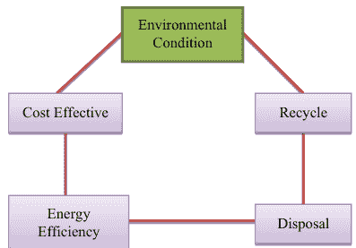

图 1.1 绿色计算的目标。

- 1997年，联合国京都议定书要求制造商减少碳排放并计算电力利用情况。
- 2003年，欧盟要求实施危害性物质限制指令（RoHS），限制在电子产品制造中使用某些有毒物质。
- 2006年，美国通过一项法律，以促进和研究节能计算机服务器。
- 2007年，美国总统乔治·W·布什通过第13423号行政令，要求所有美国联邦机构使用电子产品环境评估工具（EPEAT），该工具制定标准以提高电子产品的效率和寿命。
- 由瑞典组织TCO Development推出的TCO认证，旨在促进基于CRT的计算机显示器产生低电磁辐射 [4]。

## 1.2 绿色计算在工业中的作用

信息和通信技术（ICT）正以快速的速度席卷全球，同时带来了IT革命，并因其对环境造成的问题而令人警觉。我们都熟悉全球变暖的速度和臭氧层的消耗；IT行业造成的二氧化碳排放量占相当大的比例，破坏了生命周期 [7–9]。

除了政府的举措，工业界也有责任采取措施推广绿色计算 [1, 2]。以下是一些工业界的绿色计算措施：

- 1. 2000年6月12日，气候拯救者计算机倡议（CSCI）启动，旨在降低PC在活动和非活动模式下的电力消耗。
- 2. 绿色网格成立于2007年。这是一个全球性的信托组织，致力于推进节能数据中心和商业计算机生态系统。绿色网格得到工业界多家公司的支持，包括AMD、APC、Dell、HP、IBM、Intel、Microsoft、Sun Microsystems和VMware。
- 3. IT行业的公司现在正在使用节能硬件来减少碳排放。
- 4. Google现在正在使用服务器和节能冷却技术，以减少对环境的有害影响。
- 5. 为鼓励公司推广绿色计算，有一个组织通过为实施不影响环境的软件和硬件的公司颁发特别奖项来促进它们。
- 6. IT公司也有责任负责任地处置电子废弃物，应回收和再利用铝、铜、铁和塑料等物质，不可使用的物质应进行回收。
- 7. 工业界还应着重延长其产品的使用寿命，使其不会在短短几年后就无法运行。


## 1.3 绿色计算实施策略

由于 IT 业界造成的污染与航空业相当，因此控制它非常重要，某些方法如下列出 [10]。

### 1.3.1 虚拟化

虚拟化是创建某物的虚拟版本，例如服务器、桌面、存储设备、操作系统等。它是一个允许多个客户端或组织共享单个资源或应用程序实例的过程 [8]。它通过为物理存储提供逻辑名称，并按需提供对该材料来源的引用来实现。图 1.2 显示了我们使用的虚拟化类型 [11, 12]。

现有软件和硬件之上的机器虚拟化称为硬件虚拟化 [3]。虚拟机提供了一个与普通硬件分隔的合理环境。

### 1.3.2 算法效率

使用高效算法将减少完成计算功能的计算机消耗 [4]。例如，用快速搜索算法（如哈希搜索算法）替换慢速搜索算法（如线性搜索）将降低资源利用率，从长远来看将减少使用计算机资源造成的浪费。

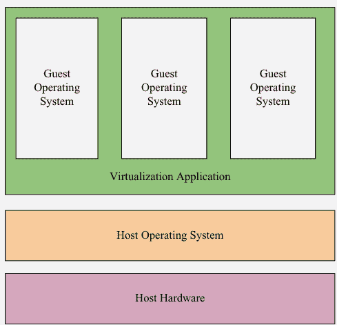

图 1.2 不同层次的虚拟化。

### 1.3.3 电源管理

高级配置和电源接口 (ACPI) 已制定了标准来规范电源节约方面，例如允许系统在一定时间后关闭或使监视器和硬盘驱动器等设备进入睡眠状态。当主要部件关闭时，系统也可以进入休眠模式，它们还提供计算机 BIOS 来管理电源功能。除此之外，一些系统允许用户根据其工作负载手动调整电源负载。

### 1.3.4 存储设备

在早期，大型存储磁盘驱动器用于存储数据，它们体积庞大，也带有组件，但现在较小的磁盘或固态硬盘 (SSD) 在闪存中存储数据，减少了早期大型驱动器造成的大量额外浪费 [7]。现在，由于存储技术的进步，存储设备已转向在线，这不仅避免了资源占用，而且与驱动器相比提供了更多空间。

### 1.3.5 显示设备

显示屏中使用的光耗电量很大。早期的 CRT 屏幕比 LCD 显示器耗能更多。LCD 使用荧光灯泡，而 LED 屏幕使用发光二极管代替灯泡，大大削减了电力消耗 [6]。现在，我们引入了深色模式功能，该模式的主要动机是最大程度地降低显示功耗，并直接影响电池寿命增长和功耗。

### 1.3.6 云计算

云计算的引入为绿色计算领域带来了巨大的革命。将所有事情带到云端已经完全终止了许多资源的利用，例如将存储带到云端减少了由磁盘驱动器造成的消耗，网上购物平台也为用户创造了一个无忧的平台，并节省了大量前往市场的汽油 [10]。

### 1.3.7 数据中心电源

数据中心电源是 IT 行业中耗电量最大的领域之一。根据绿色和平组织的研究，数据中心占 IT 行业电力消耗的 21%，每年高达 3820 亿千瓦时。因此，使用虚拟化等技术来限制其电力消耗 [5]。IT 行业也在检查消除利用率不足的数据中心，Google 是最佳示例之一，因为它已将行业平均水平的电力消耗降低了 50% [11]。

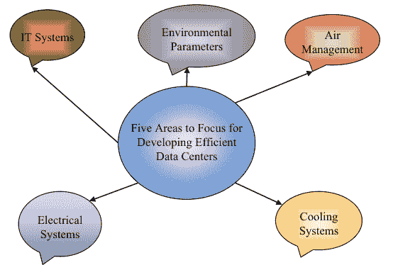

图 1.3 五种不同的数据中心设计约束。

### 1.3.8 数据中心设计

由于数据中心占 2010 年世界总能源消耗的约 1.1%–1.5%，因此以减少能源消耗的方式设计数据中心是当务之急 [4, 12]。美国能源部列出了开发高效数据中心的五个主要关注领域：IT 系统、环境参数、空气管理、冷却系统和电气系统，如图 1.3 所示。

该领域正在进行大量的先进研究，以设计高效数据中心，充分利用数据中心空间并提高效率。

## 1.4 环保绿色计算的优势

- 绿色计算已大大降低碳排放百分比。
- 由于减少了员工和客户的出行，降低了温室气体排放。
- 绿色计算法律和法规促使行业延长产品寿命。
- 通过采用重用、翻新和回收技术，最大限度地减少了设备处置。
- 通过不使用某些有害化学品，还提高了行业员工的安全性。
- 在制造计算机时考虑使用回收产品，已降低了对环境的影响。

## 1.5 绿色计算设计的障碍

- 建立绿色计算成本高昂。
- 并非对所有人都可行。
- 绿色计算技术可能还涉及安全问题。
- 它需要高昂的维护成本。
- 绿色 IT 对小型企业主可能并不具有盈利效益 [13]。

## 1.6 区块链开发简介

区块链是一种允许交易被收集在区块中，并以加密方式记录和排列的技术，这使得不同服务器可以访问账本。每个有效交易都存储在共享公共账本中，且不可更改，这意味着存储的数据不能被篡改，为数据提供了高安全性 [14]。

区块链是一个点对点分布式网络、加密算法和一致性机制，通常称为 POW（工作量证明）。在这些机制中，一致性机制是区块链精髓的核心。该机制定义了整个区块链网络中节点之间的信任 [3, 4]。

区块链是技术研发领域的热门趋势。许多学者正在研究借助区块链实现新的高度，不仅在研究领域，而且由于其提供的安全性，还在工业界被大量且显著地使用 [2]。

主要而明显的问题是为什么使用区块链而不是普通账本？区块链与普通账本的区别在于“去中心化”，而 POW 正是区块链去中心化部分的负责机制。

### 1.6.1 区块链历史

1982 年，密码学家 David Chaum 在其论文《由相互猜疑的群体建立、维护和信任的计算机系统》中首次提出了区块链构想，随后大量研究集中于此，并于 1991 年 Stuart Haber 和 W. Scott Stornetta 实现了文档时间戳不可更改 [7]。

2008 年，中本聪介绍了第一个区块链的概念化。该区块链设计采用一种方法对区块进行时间戳，无需任何可信方签名，中本聪的这一设计被引入作为比特币的核心组件。该设计于次年由中本聪作为加密货币比特币的主要组件推出，其中它充当网络上所有交易的公共账本 [8, 15]。

2014 年 8 月，包含网络上所做一切记录的比特币区块链文件大小达到 20 GB（千兆字节）。到 2015 年 1 月，大小已增长到近 30 GB，从 2016 年 1 月到 2017 年 1 月，比特币区块链从 50 GB 增长到 100 GB。到 2020 年初，账本大小已超过 200 GiB。


中本聪的第一篇论文中，“block”和“chain”最初是分开使用的，但最终于2016年被重命名为一个词“blockchain”。

根据Accenture的说法，创新理论的广泛应用表明，区块链在2016年于金融服务领域实现了13.5%的采用率，从而进入了第一阶段。工业贸易集团于2016年加入了全球区块链论坛的创建，这是数字商会的一项倡议。

2018年5月，Gartner发现只有1%的CIO在其组织中表现出任何类型的区块链采用，且只有8%的CIO在短时间内“计划或[正在查看]活跃的区块链测试”。图1.4展示了区块链技术的里程碑。

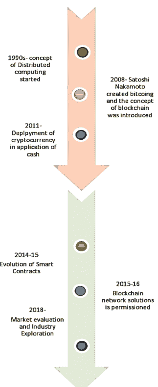

图 1.4 区块链技术里程碑。

## 1.7 区块链的特性

区块链是技术领域的热门话题，其功能日益渗透到各个领域[5, 6]。根据普华永道（PwC）的说法，到2030年，区块链技术有望创造超过3万亿美元的价值。区块链的主要应用曾是分布式账本或加密货币，但由于其概念验证，该领域现在正在探索；行业目前正在测试区块链技术，以便将来能在区块链上完全实施其工作。因此，请查看图1.5，它展示了区块链的各种特性[16]。

### 1.7.1 加密货币

加密货币就像虚拟货币或一种不以实体形式存在的资产，被用作交换媒介，交易记录在由区块链控制的账本中，区块链可以审查硬币的所有权。在区块链或加密货币的早期，这些数字货币并不引人注目，但现在需求量很大。为了证明这一点，我们可以查看统计数据：2009年比特币价值约为1美元，但若现在来看，其价值巨大，约为58,000美元，根据研究人员和投资者的说法，比特币价格的这一曲线在不久的将来可能会呈指数级增长。

### 1.7.2 智能合约

智能合约是被编程用来自动执行或控制根据协议条款监管的事件的协议。智能合约的主要目标是创造透明度并消除第三方的参与，这也有助于消除任何欺诈或恶意例外。现在，如果我们查看智能合约的工作原理：当从区块链钱包进行交易时，会生成智能合约，该交易被存储在区块链中，然后执行智能合约代码，从而启动智能合约。一旦合约达成，就无法更新。以太坊是运行智能合约最著名的区块链。以太坊智能合约是用一种名为Solidity的图灵完备编程语言编写的。但其合法性尚不明确，因为智能合约的使用非常有限，但在未来，我们可能会看到智能合约的广泛应用，就像加密货币出现一样。图1.6展示了通过区块链在两个不同方之间的智能合约[17]。

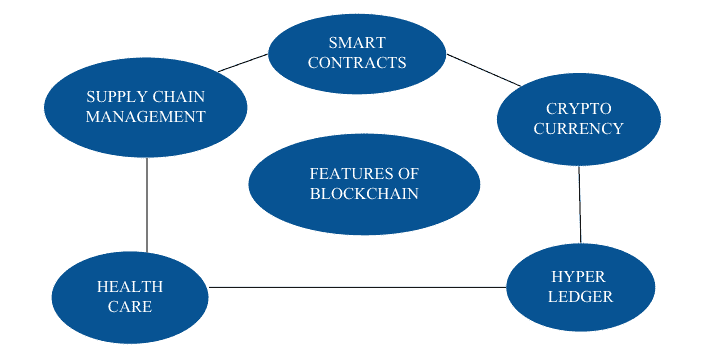

图 1.5 区块链技术特性。

### 1.7.3 供应链

供应过程中的透明度越高，对客户和制造商越有利，区块链也已触及供应链领域。基于区块链的采购可以帮助参与者记录价格、日期、地点、质量、认证以及成功管理交易所需的其他信息。在区块链中获取这些信息可以增加采购追踪，降低欺诈和灰市场造成的损失，提高出口合同的可见性和合规性，并可能改善组织作为

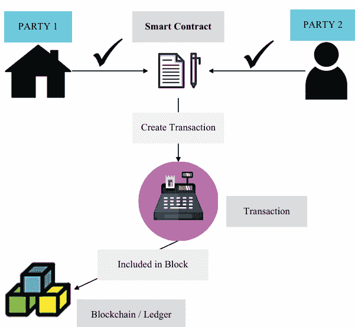

图 1.6 双方之间的基于区块链的智能合约。

生产领域的领导者。供应链管理面临许多挑战，例如——缺乏可追溯性、缺乏信任、高成本。借助区块链，可以消除这些约束，因为你可以知道你正在与谁交易、原材料的产地、产品的合法性以及公平定价[18]。

### 1.7.4 医疗保健

《华尔街日报》报道，安永正在开发一个基于区块链的系统，用于查看所有雇主等人员，并统计持有抗体和可能对疾病具有免疫力的人数。不仅如此，区块链还能帮助安全存储患者数据、管理电子病历（EMR）数据、个人健康管理、点护理基因组学管理以及电子健康记录数据管理[19]。

### 1.7.5 超级账本

这就像是一个开源的区块链项目及其工具；该项目于2015年12月由Linux基金会发起，并得到多家公司的支持，以推动基于区块链的分布式账本的发展。该项目的核心是利用区块链和分布式账本构建一个平台，重点是提高系统效率，使其达到加密货币设计的水平，从而能够在全球范围内执行任务，例如技术领域、金融服务或供应链管理等工作。2018年1月，Hyperledger发布了可用于生产的Sawtooth 1.0。2019年1月，宣布了Hyperledger Fabric的第一个长期支持版本[20]。

## 1.8 区块链的类型

图1.7显示区块链分为以下几种类型[21]。

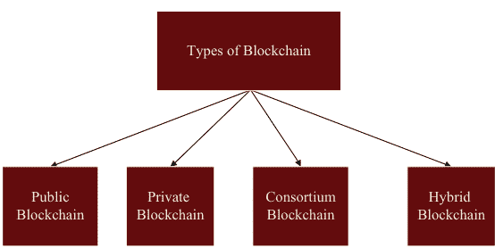

图 1.7 不同的区块链种类。

### 1.8.1 公有链

正如其名称所示，这是面向所有人的。在这种类型的区块链中，您无需任何权限即可进入并进行交易。它没有任何实体来监督网络，且不能被单个人篡改，从而提供更高的安全性。以太坊、比特币和莱特币等加密货币使用公有链，因此进行任何交易都没有限制，任何人都可以进入账本并以去中心化的方式执行交易[22]。

### 1.8.2 私有链

正如其名称所示，这种类型的区块链不像公有链那样任何人都可以访问。它也被称为许可链，其中组织的某些实体监督网络并向特定人员提供访问权限，同时也有权撤销其他人的访问权限。这种类型的区块链主要用于供应链管理，以便除了团队之外没有人知道货物情况[23]。

### 1.8.3 混合链

混合链是另一种类型的区块链。这是同时包含公有链和私有链的区块链。与其公开，不如创建一个封闭的环境。它对51%攻击也更安全，且法规可根据情况进行调整。在与航空相关的行业中，供应链管理使用混合链，因为它在用户和员工之间提供了信任和透明度[24]。

### 1.8.4 联盟链

这是一种具有多个实体的半去中心化网络；它们由某个团队或一组指令监管，而非由中心化或去中心化节点监管。其主要目标是提供更高的安全性、可扩展性、更高的效率，并可更改法规[25]。

## 1.9 区块链技术面临的挑战

现在，许多公司已开始试验使用区块链。如果查看德勤关于区块链采用的报告，在接受采访的1,386位高管中，有53%表示区块链的使用至关重要。区块链的增长和发展机会巨大，但它仍有许多漏洞需要修复，以实现区块链的最佳应用[26]。区块链技术面临的挑战如图1.8所示。

### 1.9.1 可扩展性

可扩展性是区块链不断发展并日益普及（尤其是在公有链中）时面临的主要挑战之一。


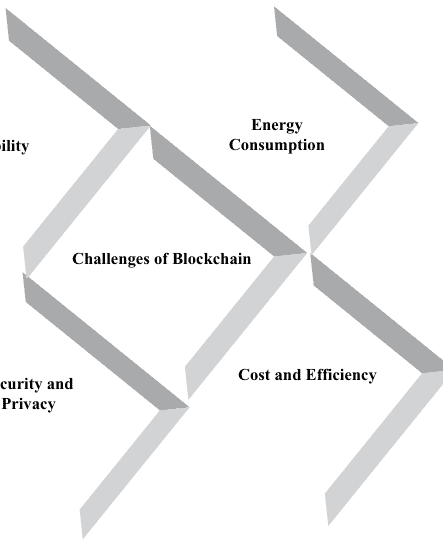

## 图 1.8 区块链技术面临的挑战

比特币区块链中的数据以每 10 分钟一个区块 1 MB 的速度增长，而以太坊的数据量高达三太字节。据研究人员预测，到 2025 年，数据量每年将达到约 175 波字节 [27]。

### 1.9.2 成本与效率

企业采用区块链的主要动因是去除第三方以降低成本。由于区块链仍处于起步阶段，且点对点交易成本高昂，所有节点都倾向于执行相同任务以争取成为第一个找到解决方案的节点，这降低了效率。

### 1.9.3 安全与隐私

该技术带来了便利，但随之而来的安全和隐私问题也非常显著。它是一个开放账本，这意味着每个人都可以访问您的数据。如果比特币要大规模采用，因为一旦存储了一些敏感信息，保障数据安全将变得更加困难。因此，研究人员正在努力增强区块链中数据的安全性 [28, 29]。

### 1.9.4 能源消耗

能源消耗是去中心化网络中的另一大主要问题。目前使用最广泛的共识机制 POW（工作量证明）涉及解决各种复杂谜题，每小时能源利用量约为 66.7 太瓦。但研究正在开展中，还有其他共识机制可以取代 POW，且其能耗远低于 POW。

## 1.10 结论

各行业目前正致力于寻求既有利于自然又不影响成果的绿色方式和环保运动。区块链如今不仅局限于加密货币，凭借其分布式账本，正在推动绿色能源发展，这是由全球制造业与工业化峰会（GIMS）作为绿色链倡议发起的；该倡议以一种减少碳化并推动绿色发展的方式结合了区块链和可再生能源。GIMS 组织委员会主席 Badri-Al-Olama 表示：“绿色链倡议将众筹可再生能源项目，这些项目将使用 4IR [第四次工业革命] 技术，为所有人创造一个更绿色的星球。”区块链也是电动汽车的解决方案，每辆车将被分配一个唯一的数字 ID，用于记录充电情况并自动完成充电支付，车辆还能将这些电池作为电力来源，为车辆的所有功能提供动力。采用区块链推动绿色倡议为可持续发展提供了重大突破，例如在能源领域，采用点对点太阳能交易和电网管理技术，交易无需任何高级机构协助即可进行。能源领域的公司如 Acciona Energy 正在不断挖掘区块链的潜力，研究并开发基于区块链的系统，以确保供电 100% 来自可再生能源。区块链技术推动环境可持续发展的潜力越来越大。然而，该技术尚未足够成熟，可能不被视为能源领域的可行解决方案。许多公司仍在开发概念验证并进行测试以验证其能力。企业可能需要时间才能意识到区块链的真正潜力，并在快速变化的世界中推进数字化转型 [30, 31]。

## 参考文献

- 1 Arjun, K.P., N.M. Sreenarayanan, K. Sampath Kumar 和 R. Viswanathan，“分布式计算和/或分布式数据库系统”，《区块链平台与应用》，ISBN 9780367533403，Auerbach Publications，CRC Press，2020 年 9 月。
- 2 Dr. Saini, K.,“区块链：未来的主导技术——数字化转型”，《2018 年 IEEE 计算、电力与通信技术国际会议（GUCON 2018）》论文集，由加尔戈蒂亚大学（Galgotias University）组织，地点：大诺伊达，2018 年 9 月，第 28–29 页。doi:10.1109/GUCON.2018.8675075。
- 3 Dutta, S. 和 S. Kavita，“保障数据安全：不同变换域技术研究”，《WSEAS 系统与控制交易》，第 16 卷，2021 年。E-ISSN: 2224-2856。doi:10.37394/23203.2021.16.8。
- 4 Dutta, S. 和 K. Saini，“面向中小企业领域的混合区块链统计评估”，《WSEAS 系统与控制交易》，第 16 卷，2021 年。E-ISSN: 2224-2856。doi:10.37394/23203.2021.16.6。
- 5 Narayanan, N., K.P. Arjun 和 K. Saini，“跨国运营中资产管理的区块链技术”，《基本企业区块链技术与应用》，第 26 页，CRC Press Taylor & Francis，2021 年。
- 6 Raj, P., K. Saini 和 C. Surianarayanan，《区块链技术与应用》（第 1 版）。CRC Press。doi:10.1201/9781003081487，ISBN-10: 0367533405，ISBN-13: 978-0367533403。2020 年。
- 7 Saini, K.（编），P.R. Chelliah（编）和 D.K. Saini（编），《基本企业区块链技术概念与应用》。Auerbach Publications。ISBN 9780367564889，2021 年。
- 8 Dutta, S. 和 K. Saini，“区块链与社交媒体”，《区块链技术与应用》，Auerbach Publications，第 101–114 页，2020 年。
- 9 Saini, K.，章节标题“区块链基础”，《基本企业区块链技术与应用》，第 26 页，CRC Press Taylor & Francis，2021 年。
- 10 Arjun, K.P., 等，“医疗保健中 ML 与区块链的兴起”，《电子医疗保健系统的区块链与机器学习》，ISBN: 9781839531149，IET，2021 年 1 月。
- 11 Vikram, S.，“绿色计算”，《2015 年绿色计算与物联网国际会议（ICGCIoT）》论文集，印度大诺伊达，2015 年，第 767–772 页，doi:10.1109/ICGCIoT.2015.7380566。
- 12 Kumar, N., R. Chaudhry, O. Kaiwartya, N. Kumar 和 S.H. Ahmed，“软件定义社交通信车辆中的绿色计算”，《IEEE 智能交通系统交易》，doi:10.1109/TITS.2020.3028695。
- 13 Shree, T., R. Kumar 和 N. Kumar，“云计算中的绿色计算”，《2020 年第 2 届计算、通信控制与网络技术国际会议（ICACCCN）》论文集，印度大诺伊达，2020 年，第 903–905 页，doi:10.1109/ICACCCN51052.2020.9362822。
- 14 Butt, S., M. Ahmadi 和 M. Razavi，“绿色计算：可持续设计与技术”，《2020 年第 5 届智能系统与工业应用创新技术国际会议（CITISIA）》论文集，澳大利亚悉尼，2020 年，第 1–7 页，doi:10.1109/CITISIA50690.2020.9371781。
- 15 Sharma, H. 和 J.B. Singh，“使用绿色云计算进行高效实时处理：简要综述”，《2020 年第 9 届系统建模与研究趋势进展国际会议（SMART）》论文集，印度莫拉达巴德，2020 年，第 275–280 页，doi:10.1190/SMART50582.2020.9337066。
- 16 Guelzim, T.，《绿色信息与通信系统手册：绿色计算与通信架构》，第 209–227 页，2013 年。
- 17 Sr. Jainy Jacob, M.，“信息技术中绿色计算的相关性与影响”，《工程研究与技术国际期刊（IJERT）RTTPTDM》，第 3 卷第 30 期，2015 年。
- 18 Jena, Om Prakash 等，《绿色工程与技术创新、设计与架构实现》。CRC Press，2021 年 6 月。
- 19 Sadiku, Matthew N.O.，《新兴绿色技术》。CRC Press，2020 年 3 月。
- 20 Al Sadoon, G.M.W., H.A. Makki 和 A.R. Saleh，“绿色计算系统、健康与安全环境管理系统”，《2017 年第 4 届 IEEE 工程技术与应用科学国际会议（ICETAS）》论文集，巴林萨尔马巴德，2017 年，第 1–6 页，doi:10.1109/ICETAS.2017.8277847。
- 21 Khan, M.A. 和 Salah, K.，“物联网安全：综述、区块链解决方案与开放挑战”，《未来世代计算机系统》，第 82 卷，2018 年，第 395–411 页。
- 22 Hussien, H.M., Yasin, S.M. 和 Udzir, S.N.I. 等，“医疗保健应用中区块链技术发展的系统性综述：分类学、实质性分析、动机、挑战、建议与未来方向”，《医学系统期刊》，第 43 卷，2019 年，第 320 页。
- 23 McGhin, T., K.-K. Raymond Choo, C.Z. Liu 和 D. He，“医疗保健应用中的区块链：研究挑战与机遇”，《网络与计算机应用期刊》，第 135 卷，2019 年，第 62–75 页。
- 24 Nagasubramanian, G., R.K. Sakthivel, R. Patan, A.H. Gandomi, M. Sankayya 和 B. Balusamy，“使用基于云的无密钥签名基础架构区块链技术保护电子健康记录”，《神经计算与应用》，第 32 卷，（2018 年），第 1–9 页。
- 25 Li, X., P. Jiang, T. Chen, X. Luo 和 Q. Wen，“区块链系统安全性调查”，《未来世代计算机系统》，第 107 卷，2017 年，第 841–853 页。
- 26 Tasatanattakool, P. 和 C. Techapanupreeda，“区块链：挑战与应用”，《2018 年信息网络国际会议（ICOIN）》论文集，泰国清迈，2018 年，第 473–475 页，doi:10.1109/ICOIN.2018.8343163。
- 27 Zheng, Z., S. Xie, H.N. Dai, X. Chen 和 H. Wang，“区块链挑战与机遇：一项调查”，《Web 与 Grid 服务国际期刊》，第 14 卷第 4 期，2018 年，第 352 页。
- 28 Zheng, Z., S. Xie, H. Dai, X. Chen 和 H. Wang，“区块链技术概述：架构、共识与未来趋势”，《2017 年 IEEE 大数据国际大会（BigData Congress）》论文集，美国夏威夷州檀香山，2017 年，第 557–564 页，doi:10.1109/BigDataCongress.2017.85。
- 29 Chen, G., B. Xu, M. Lu 等，“探索区块链技术及其在教育中的潜在应用”，《智能学习环境》，第 5 卷，2018 年，第 1 页。
- 30 Ahram, T., A. Sargolzaei, S. Sargolzaei, J. Daniels 和 B. Amaba，“区块链技术创新”，《2017 年 IEEE 技术与工程管理会议（TEMSCON）》论文集，美国加利福尼亚州圣克拉拉，2017 年，第 137–141 页，doi:10.1109/TEMSCON.2017.7998367。
- 31 Golosova, J. 和 A. Romanovs，“区块链技术的优缺点”，《2018 年 IEEE 第 6 届信息、电子与电气工程进步研讨会（AIEEE）》论文集，立陶宛维尔纽斯，2018 年，第 1–6 页，doi:10.1109/AIEEE.2018.8592253。


# 2 绿色计算与物联网 (IoT)

Nilanjana Pradhan, Shraddha Sagar, Kavita Saini, Nikita Bhatia, 和 Mayur Mathur

## 目录

| 章节 | 页码 |
|---------|------|
| 2.1 绿色计算 | 17 |
| 2.2 绿色计算与物联网 | 18 |
| 2.3 物联网与医疗健康科学 | 18 |
| 2.4 医疗健康领域的绿色物联网 | 22 |
| 2.5 在医疗领域使用物联网面临的挑战 | 24 |
| 2.6 识别问题及其解决方案 | 25 |
| 2.7 印度的物联网设备使用 | 27 |
| 2.8 农村地区的基于物联网的应用 | 27 |
| 2.9 结论与未来展望 | 28 |
| 参考文献 | 28 |

## 2.1 绿色计算

绿色计算是指以环保方式使用计算机及其能源。它也被称为设计、制造和使用计算机及服务器子系统的研究与实践，以消除它们。绿色计算的最佳示例是可再生能源。可再生能源是指来源于长期储备且能在人类时间尺度上得到补充的能源，例如阳光、风能、雨水、波浪能和地热能。它们易于获取，环境质量高，并且产生的排放量显著减少。太阳能系统、风力涡轮机计划和地热能是不同类型的绿色计算。

能源之星自愿标识计划是美国最早的绿色计算计划之一。美国环境保护署 (EPA) 于 1992 年创建了该计划，以鼓励各类硬件的能源效率。能源之星标签开始更频繁地出现，尤其是在笔记本电脑和显示器上。在欧洲和亚洲，已实施了类似项目 [1, 2]。

如今，每个人都需要机器。机器简化了我们的生活，节省了时间和精力。另一方面，使用机器会增加能源摄入并产生额外热量。能源和热能技术的使用越多，会导致二氧化碳 (CO2) 等温室气体排放量更高，这对我们的气候和植物资源产生多种负面影响。这是因为我们对计算机使用对环境的负面影响缺乏认识 [3]。

## 2.2 绿色计算与物联网

未来几年，有几个信息技术热门词汇是技术官僚和企业无法忽视或阻止的。移动优先、人工智能、区块链、沉浸式体验、微服务架构、泽字节时代、机器人流程自动化、3D 修改、物联网 (IoT)、量子计算等都是这些趋势中的一些 [2, 5]。这些事物将改变我们今天的生活方式，并将在未来主导世界。本论文在这些趋势技术中，专注于物联网及其在当前场景下的绿色计算实现 [1]。

物联网 (IoT) 是一个术语，指连接世界上几乎所有人和万物的智能技术。数字世界与洗衣机、冰箱、微波炉、时钟、水龙头、家居用品、炊具和锅具相关 [6]。为了环境安全，这些物联网设备必须环保、经济可行且节能 [2]。IoTGC（基于物联网的绿色计算）注定用于此类服务，以使环境更加绿色和智能。重点在于设计、开发、运行、维护和控制既具成本效益又易于使用的节能物联网 (IoT) 系统 [7, 8]。由于全球气候变化、能源危机、环境问题等众多挑战性问题，该领域在研究人员中引发了真正的兴趣 [9]。

根据全球绿色 ICT 联合会 (IFGICT) 的说法，绿色物联网 (IoTGC) 或绿色 IT 要求以最佳方式使用互联网、计算机及其资源，以维护健康的气候。计算系统和外围设备必须具成本效益、节能、安全、易于丢弃/可回收且环保。需要手持设备和大规模数据中心来适应从移动设备到大规模数据中心的各种系统 [2, 5]。

基于实时数据的 IoTGC 设备规划与部署政策和计划将提供关于其潜在环境影响的信息。此外，如果政策在各个层面上果断，可以实现显著的能源节约。能源使用、自动化系统、数据管理和用户输入等方面的政策，将帮助终端用户和行业采取必要的纠正措施来改进 IoTGC [7, 10]。城市探索者就是一个例子。在现实生活中，它是一个家庭自动化解决方案，包含数据收集、数据处理和服务等层级，可将能源消耗降低 20%。

## 2.3 物联网与医疗健康科学

物联网涉及向多种硬件设备提供扩展的网络连接。这些设备可以借助传感器、收发器和微控制器轻松通过互联网进行通信。物联网设备嵌入了不同的技术。这些嵌入式技术负责在设备上运行特定任务 [1, 6]。这些设备可以通过互联网轻松监控和控制。物联网设备具有唯一标识，允许无论时间和地点如何都进行远程访问，即，它允许随时随地远程访问设备 [11]。最初，物联网广泛用于制造目的，但现在重点是将物联网实施于家庭、办公室以及农业和医疗保健等各个领域。

医疗保健可以定义为通过在正确的时间预防、治疗和诊断各种疾病来实现人类的福祉。医疗保健不仅仅是没有疾病，也被定义为一个人身心健康的状态。它在国内生产总值 (GDP) 或一国经济中发挥着重要作用。此外，医疗专业人员可以使用最新的物联网技术来实现医疗保健 [7, 12]。虽然物联网并非当今世界医疗保健中使用的唯一智能方法，但它提供了充当医疗科学和医疗保健发展最终构建块的智能对象。物联网是一种下一代方法，将改变未来一代人的生活方式 [3]。由于具有许多优势，物联网正在医疗保健领域被广泛使用。其中一些优势如下：

- 1. 疾病检测：物联网设备具有感知和检测物理世界的独特功能。因此，它有助于轻松检测疾病。因此，疾病漏检的机会非常小。
- 2. 降低护理成本：使用物联网设备可降低定期就医的成本。因此，这使得治疗更加负担得起。
- 3. 高效结果：由于物联网的特性，设备可以记录患者健康状况的任何重大变化。因此，这些设备提供高效结果，从而使患者满意。
- 4. 有效治疗：物联网设备分析患者所需的参数，并根据患者的需求提供有效治疗。
- 5. 减少纸质文档：借助物联网设备，所有数据都可以在线存储。因此，医院和诊所无需管理纸质文档。
- 6. 减少人力劳动：大部分工作由机器完成。因此，无需大量人员来执行任何工作。
- 7. 节省时间：在传统时代，患者需要长途跋涉到医院或诊所，并排长队接受治疗。但现在，这些设备通过在家中完成治疗节省了大量时间。现在，患者不需要长途跋涉或排长队。
- 8. 挽救生命：患者健康状况的任何变化都会向不同方触发通知，并可采取适当措施。因此，生命将得到挽救。
- 9. 降低维护成本：现在，随着这项技术的投入使用，无需在医疗设备维护上花费巨额资金。

因此，物联网将在医疗保健领域证明是一项福音。它可以以负担得起的成本提供有效治疗，从而延长患者寿命并减少因慢性疾病导致的死亡 [4]。这可以在医疗保健领域带来巨大发展 [5]。


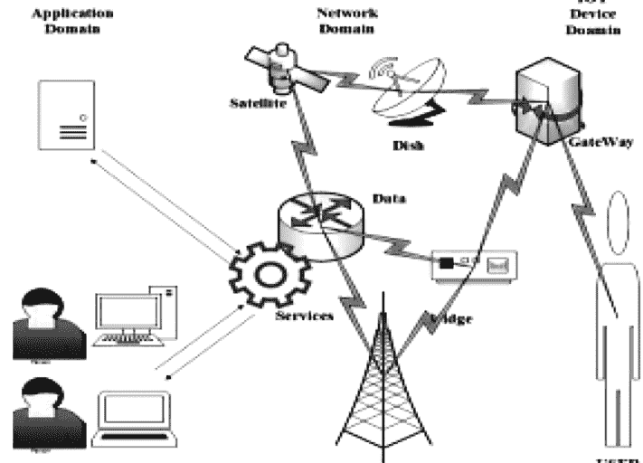

图 2.1 网络设备的扩展。

图 2.1 [13] 展示了通过互联网连接和扩展各种设备。此外，它还展示了各领域应用中设备之间的数据交换方式 [12]。

物联网（IoT）具有一些特性，使这些设备独特且适用于各个领域。物联网使这些设备适用于各个领域的特性如下：

- (i) 自适应与动态性：物联网不仅具有自适应性，而且其本质也是动态的，因为物联网设备倾向于根据其运行的环境条件改变自身。例如，以闭路电视（CCTV）摄像头为例，它们会根据光照强度改变模式，以录制更好的图像和视频。即使是医疗领域使用的心电图（ECG）机器也能自动适应患者体温的变化 [5]。

- (ii) 自配置：物联网的自配置功能允许物联网设备根据关联设备自行配置。

- (iii) 唯一标识：这些设备的唯一标识——即互联网协议（IP）或统一资源定位符（URL）——使这些系统成为智能界面，从而允许与用户通信 [14]。

- (iv) 智能界面：由于内置了感知设备，物联网设备具有智能界面。智能界面负责使这些设备变得智能并智能运行。这些界面有助于在无需人工干预的情况下通过互联网进行通信和信息交换 [14]。

- (v) 通信协议：物联网设备拥有多种协议。协议用于加强两台或多台设备之间通过互联网的通信 [14]。

- (vi) 互操作性：物联网设备具有一种独特的互操作性特性，即两台或多台设备可以相互以及与基础设施进行交互，而不会影响系统的硬件和整体性能 [14]。

- (vii) 存储大量数据：物联网涉及从不同设备的各种来源收集和存储大量数据。数据可以是结构化或非结构化数据。这些设备有助于轻松高效地管理大量数据。

- (viii) 数据分析：物联网分析存储的数据，以向用户提供有用的信息。它有助于提供高效且准确的结果，从而提高患者的满意度。

- (ix) 不同形式的数据：物联网设备可以处理各种类型的数据，如音频、视频、图像和数学读数 [2, 4]。

凭借这些特性，物联网已被证明在多个领域得到应用。其中包括智能家居、农业、健康与医学科学、智慧城市、工业、环境等众多领域 [13]。谈到物联网在医疗保健领域的应用，现代技术的运用使疾病的检测和治疗变得快速高效 [7, 14]。物联网的应用涵盖从疾病检测到治疗的各个环节。此外，它在医疗保健领域的应用范围从人类延伸到动物以及地球上所有其他生物。在医疗保健领域，物联网可以应用于多个领域：

- (i) 远程健康监测——远程健康监测是指监测远离医生的患者的活动。基于物联网的设备可以用于将血压、心率、血型、血小板计数等信息发送给远在他处的医生。所有这些都可以通过一些特殊传感器和软件来检测，收集的数据可以进一步存储，随后发送出去。由于使用这些设备，位于无法立即获得医疗援助地点的患者可以通过使用这些设备发送的信息轻松接受治疗。这些设备在边境地区和欠发达地区大有帮助。此外，当一位经验丰富的资深医生并不实际出现在患者治疗现场，而是通过视频会议与现场的初级医生联系，由资深医生对其进行监督，以使治疗取得成功时，也会使用这些设备 [6]。

- (ii) 实时定位——可以通过不同的传感器（如 GPS 系统）追踪患者的实时位置。这使医生和救护车更容易找到患者。此外，如果每台设备都安装了此系统，我们可以轻松追踪所有设备和患者及其实时位置。而且，这将帮助我们提供最近可用治疗中心以及患者可轻松获得最近援助地点的信息。

- (iii) 健身计划——它被广泛应用于许多健身计划中。

- (iv) 慢性病远程治疗：物联网也应用于疾病治疗。物联网简化了疾病治疗，并有助于减少治疗中的错误。许多疾病的治疗只需使用特定设备即可完成。色盲、癌症、肾结石等疾病以及许多其他慢性病可以借助此类设备轻松治疗。

- (v) 身体健康追踪——它有助于追踪身体的健康状况。例如，Fitbit 手环

- (vi) 慢性病检测——它有助于早期发现各种慢性疾病，如癌症。

- (vii) 远程用药——该领域为患者提供负担得起的药物，并有助于慢性病的治疗。

- (viii) 移动健康：在本领域中，我们将讨论手机中存在的应用程序。例如，用于追踪卡路里摄入量。

- (ix) 智慧医院：基础设施薄弱曾是医院的主要问题。随着技术的发展，这些医院已转变为智慧医院，从而将医院设备转变为智能病床。

这些是物联网在医疗保健与医学科学领域中的一些应用案例。在本文中，我们将讨论其中一个领域——即慢性病远程治疗。我们将结核病（TB）纳入考虑，这是印度最广泛流行的疾病之一。这种疾病不仅攻击肺部，还可能影响身体的其他部位。当人们吐痰、咳嗽和打喷嚏时，它可以通过空气传播 [1, 2]。

## 2.4 医疗保健领域的绿色物联网

根据一份报告，世界卫生组织（WHO）指出，即使在像印度这样的发达国家，不到一半的慢性病患者会按照医生的指示服药。结核病（TB）就是其中一种疾病。用药不遵医嘱导致了 2013 年约 45 万例耐药病例 [15]。为克服这一重大问题，微软研究院印度的 Andrews Cross 和 William Thies 于 2013 年提出了一种名为“99DOTS”的模型。99DOTS 模型的主要目的是确保患者定期服药，不漏服任何剂量 [15]。99DOTS 项目由修订后的国家结核病控制计划（RNTCP）发起，尤其针对人类免疫缺陷病毒（HIV）相关结核病患者。此前，患者每天必须前往最近的直接观察疗法（DOT）中心服药，并在 DOT 提供者的直接监督下服药。直接观察疗法短程（DOTS）隶属于 RNTCP，该计划由印度政府制定，用于控制结核病 [14–16]。RNTCP 的主要目标是减少因结核病造成的死亡人数，并提高结核病患者的治愈率 [16]。

### 印度的结核病

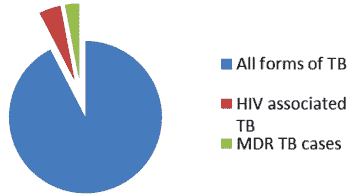

图 2.2 印度结核病估计发病率。

患者尤其是与 HIV 相关的结核病患者，由于免疫力低下，无法长途跋涉去服药，因此为他们采取了 99DOTS 计划。该计划确保患者能够在家中服药，而无需长途跋涉 [14]。99DOTS 计划解决了患者的许多问题。其实施简便、使用方便且负担得起。

图 2.2 说明，在所有结核病患者中，5% 患有与 HIV 相关的结核病，约 3% 为多重耐药（MDR）病例 [3]。与 HIV 相关的结核病发生在已经患有艾滋病的患者身上。MDR 患者是指不按照医生指示服药的患者。因此，他们的身体对药物产生耐药性 [4]。


图 2.3 99DOTS 模型 [5]。


在这个项目中，患者每次服药时都必须拨打一个号码，以便提供商可以监控和保存记录。给患者的药物被装在信封中，上面印有剂量说明以及药片后面隐藏的一系列数字。每次患者服用一剂药物时，患者完全无法预测的隐藏数字就会显现出来 [12, 15]。显现的数字完成了电话号码的数位，电话号码的前几位数字印在信封上，其余数字则是显现出来的数字。然后患者需要拨打完整的电话号码以确认服用的药物，并将其通知给医生。自动呼叫和提醒会发送给患者，以确保他们不漏服剂量 [14, 17]。

99DOTS模型是对DOTS疗法的改进，旨在消除患者在DOTS疗法期间面临的挑战。此外，通过阅读各种研究论文并访问99DOTS官方网站（https://www.99dots.org/），我们知道该技术的成功率高达约99%。这就是它被称为99DOTS的原因 [4, 18]。

## 2.5 在医疗保健中使用物联网的挑战

众所周知，物联网设备通过互联网相互连接在网络上，无需任何人为干预 [5]。这些设备还负责设备与用户之间的通信和交互。尽管物联网设备具有独特的特性和优势，但这些设备也面临许多挑战。物联网设备实施过程中出现的各种挑战如下：

- (i) **网络问题**：失去与互联网的连接以及无线网络拥塞。这可能是由于物理和电子干扰引起的。
- (ii) **复杂软件**：这些设备使用的软件必须不时更新，但由于这些设备的设计复杂，此类设备使用的软件非常复杂。因此，它们很难修改和更新。
- (iii) **高安装成本**：物联网设备通常成本很高，因为这些设备使用了复杂的硬件和传感器，因此对某些人来说可能听起来负担不起。
- (iv) **安全问题**：这些设备从各种来源收集和存储数据。存储的数据可能包含一些机密信息。此类设备可能面临网络攻击，可能导致敏感数据被未经授权访问。
- (v) **缺乏教育**：许多受教育程度不高的人可能无法理解这些设备的实施和设计。
- (vi) **社会问题**：根据社会的需求制造设备非常重要。他们的需求会随时间变化，改变设备功能的需求也是如此。重新集成新功能成本非常高，需要大量投资。
- (vii) **技术采用缓慢**：许多人对这项新技术物联网并不十分了解。这将导致该技术的采用缓慢 [3]。
- (viii) **电池电量有限**：物联网设备的电池电量有限，因此容易发生故障。
- (ix) **存储有限**：此类设备通常存储容量有限 [7]。因此，大量数据可能无法保存。
- (x) **缺乏技能**：设计和实施这些设备需要某些技能。缺乏技能可能导致安全系统受损 [4]。

所有这些挑战都记录并列举自各种知名期刊。这些挑战可能会影响系统的整体性能。正如我们所记录，部分挑战是缺乏教育和知识。因此，可以通过多种方式在人们中提高意识来解决这个问题。此外，剩余的挑战和问题可以通过应用各种先进的标准和协议来解决。

## 2.6 识别问题及其解决方案

在99DOTS项目中，患者会被发放特殊药物包装上的药物，药物包装上印有一个电话号码，其中缺少一个数字。只有当药片从包装中取出时，这个缺失的数字才会显现。此外，每次药物包装显示一个数字时，人员都必须拨打该电话号码，以确保患者服用了药片 [7]。但它无法保证药片是否真的被患者服用。如果患者取出药片并拨打显示的电话号码，然后扔掉药片怎么办？这是医生和患者都面临的问题，因为这会导致患者报告不准确。

这个问题可以通过一个颈带来解决，该颈带可以感知药片的形状和重量。如果被患者吞下，它可以将此信息通知最近的健康中心，以确保患者已经服用了药片 [9]。

颈带可以连同药物一起发放给患者，并在服药时要求他们将其佩戴在脖子上 [19]。

这些颈带将由太阳能供电，另一侧将包含一个微型X射线发射器和一种数字色谱胶片，以识别所服药物的形状和大小。胶片捕捉到的图像将与物联网设备内存中已存储的原始药物的形状和大小进行比较。连接互联网的全球定位系统（GPS）技术可用于将确认信息发送给医生，确认患者已服药。

颈带的拟议方法和实现方式如下流程图所示。该流程图讨论了颈带的工作原理以及患者信息将如何存储在数据库中。

从图2.4中，我们可以清楚地识别出，根据拟议方法，医生将药物给患者。然后，患者会被注册一个代码用于跟踪目的。患者注册后，助理医生会收到新患者的通知，患者的所有详细信息都存储在数据库中 [1, 2]。如果患者服用药物，智能带会确认服药情况并将确认信息发送给助理医生。然后助理医生会收到通知，服药详情会存储在数据库中 [17]。如果患者未服药，智能带会每隔2分钟向患者发送一次通知。助理医生会定期向医生提供患者报告。

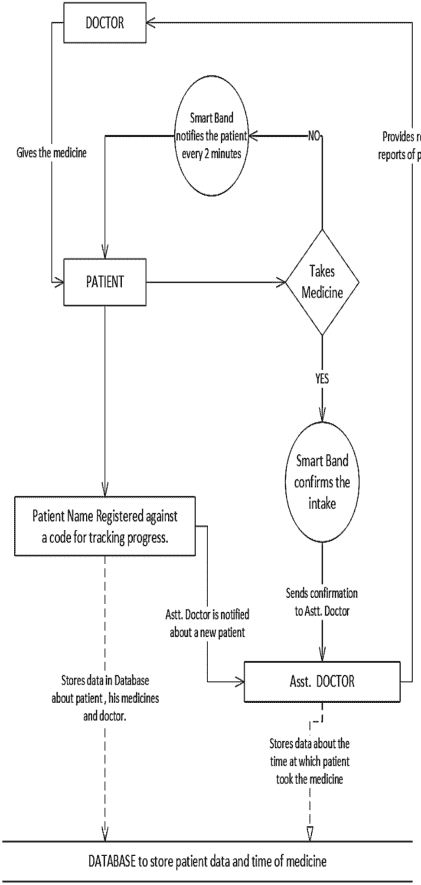

图2.4 拟议方法。

所有信息都存储在数据库中。因此，不需要物理管理患者记录。所有数据都将在线存储 [18]。

使用颈带不仅能确认正在服用的药物，还能确认患者服药的真实时间。而在早期情况中，我们只知道患者从信封中取出药物的时间。拟议方法倾向于解决结核病患者在DOTS疗法期间面临的许多挑战。

一些挑战包括：

- 医疗保健基础设施差
- 无法负担服务费用 [14]
- 实施困难 [14]
- 患者长途跋涉不便 [19]

通过拟议方法，患者现在可以在家中服药，无需长途跋涉。它易于使用且价格实惠。此外，医生可以跟踪患者的状况。因此，降低了因结核病导致的死亡率。

## 2.7 在印度使用物联网设备

物联网设备在印度被广泛用于医疗保健目的。物联网已成为印度医学和医疗保健领域的一种日益增长的趋势。如今，印度的大多数诊所和医院都安装了此类设备，以方便患者和医生。

例如，X光、CT扫描和MRI扫描等技术常用于医院和诊所来治疗和检测各种疾病。

- (i) **X光**：X光是一种用于检测人类骨骼缺陷的技术。X光是一种具有不同波长的电磁辐射。这些辐射用于骨骼的医学成像。
- (ii) **CT扫描**：CT扫描使用不同角度的X光成像来从所有2D图像生成3D图像。CT扫描机安装了可旋转的X射线管，用于从不同角度和不同位置拍摄器官的图像。
- (iii) **磁共振成像（MRI）**：MRI使用强磁场、电场梯度和无线电波来生成人体器官的图像。

物联网提高了印度的医疗保健可负担性、可及性和质量。这些设备使印度朝着更智能的医疗保健方式发展。

## 2.8 农村地区的物联网应用

物联网技术在印度的使用正在迅速增加。由于易于接触，城市地区更多地受到基于物联网的设备的影响以获取各种服务和产品；而另一方面，农村地区对这些现代设备及其产品和服务的影响不大 [2, 7]。因此，物联网充当连接印度城市和农村地区的桥梁。物联网可以在……中发挥关键作用


为印度农村地区的发展提供与城市地区相同的服务。通过在这些农村地区引入这些设备，人们获得了以下好处：

- 便捷就医
- 有效治疗
- 早期发现疾病
- 人们转向现代技术
- 提高生活质量

## 2.9 结论与未来展望

本文介绍了物联网的各种优势和特点，因此它在许多领域（尤其是医疗保健）中得到广泛应用。我们还记录了在实施物联网时可能出现的挑战。我们将肺结核（TB）纳入考量，这是一种非常慢性的疾病，甚至可能导致人死亡。

此外，通过阅读各种研究论文，我们发现只有少数结核病患者按照医生处方服药。并且，尽管DOTS已付诸实施，但2013年艾滋病相关结核病患者数量有所增加。DOTS要求患者前往最近的卫生中心，在DOT提供者的监督下服药。因此，2013年为艾滋病相关结核病患者发起了一项名为“99DOTS”的计划。在这种技术中，患者会获得一个月的药物，每次取药时都必须拨打一个号码。此外，我们知道该模型的成功率高达约99%。但我们发现，该模型无法保证药片是否被患者服用。患者甚至可以在取药后丢弃药片。针对这一问题，我们发现可以制作一个颈带，它能感知药物的形状和重量。如果患者吞服药物，将向最近的卫生中心发送通知。此外，我们还了解到颈带如何解决结核病患者面临的所有主要问题，并将提高结核病患者的治愈率。

物联网的进步将检测各种因素，有助于提高生活质量。此外，这项技术将帮助医生做出正确决策，从而延长寿命。此外，许多研究人员估计，未来5年医疗保健领域的物联网将呈指数级增长。而且，各组织将使用物联网设备来治疗患者并维护有关患者及疾病的信息。另外，许多研究学者估计，物联网将把医疗保健发展到没有无法治愈的疾病的程度。此外，据估计，到今年年底，几乎所有医院和诊所都将使用物联网设备。

## 参考文献

- 1 Zhu, C, Leung, VC, Shu, L, and Ngai, EC (2015) 面向智慧世界的绿色物联网. IEEE Access 3:2151–2162.
- 2 Saini, K, Chelliah, PR, and Saini, DK (编) (2021) 企业区块链核心概念与应用. 纽约：Auerbach Publications. ISBN 9780367564889.
- 3 Dutta, S, and Saini, K (2021) 中小企业领域混合区块链的统计评估. WSEAS 系统与控制交易 16. E-ISSN: 2224-2856. doi:10.37394/23203.2021.16.6.
- 4 Narayanan, N, Arjun, KP, and Saini, K (2021) 跨国运营中资产管理的区块链技术. 载于 Saini, K, Chelliah, PR, and Saini, DK (编) 企业区块链技术与应用，第152–178页. 纽约：Auerbach Publications.
- 5 Saini, K (2021) 区块链基础. 载于 Saini, K, Chelliah, PR, and Saini, DK (编) 企业区块链技术与应用，第1–14页. 纽约：Auerbach Publications.
- 6 Dr. Saini, K. 未来的主导技术：区块链——数字化转型. IEEE 2018年计算、电力与通信技术国际会议（GUCON 2018），由加尔戈蒂亚大学（大诺伊达）举办，2018年9月28–29日. doi:10.1109/GUCON.2018.8675075.
- 7 Raj, P, Saini, K, and Surianarayanan, C (2020). 区块链技术与应用（第1版）. CRC Press. https://doi.org/10.1201/9781003081487, ISBN-10: 0367533405, ISBN-13: 978-0367533403.
- 8 Sarhan, QI (2018) 物联网：挑战与问题调查. 物联网与网络保证国际期刊 1(1):40–75.
- 9 Visalakshi, P, Paul, S, and Mandal, M (2013) 绿色计算. 现代工程分辨率国际期刊. 录入：架构、软件系统与绿色计算全国会议论文集（NCASG），第63–69页.
- 10 Al-Sharekh, SI, and Al-Shqeerat, KHA (2019年2月) 物联网环境中的安全挑战与局限性. 计算机科学与网络安全国际期刊 19(2):193–200.
- 11 Nandyala, CS, and Kim, HK (2016) 绿色物联网农业和医疗保健应用（GAHA）. 智慧之家国际期刊 10(4):289–300.
- 12 Dutta, S, and Saini, K (2020) “区块链与社交媒体.” 区块链技术与应用，第101–114页. 纽约：Auerbach Publications.
- 13 Karthik, BN, Durga Parameswari, L, Harshini, R, and Akshaya, A (2018) 基于IoT和Arduino的患者健康监测系统调查. 计算机科学、工程与信息技术科学研究国际期刊 3(1): 1414–1417. ISSN: 2456-3307.
- 14 Kodali, RK, Swamy, G, and Lakshmi, B (2015) 医疗保健物联网实现，IEEE
- 15 Islam, SMR, Kwak, D, Humayun Kabir, MD, Hossain, M, and Kwak, KS (2015) 医疗保健物联网：全面调查. IEEE Access 3:678–708.
- 16 Joyia, GJ, Liaqat, RM, Farooq, A, Rahman, S (2017) 医疗物联网：医疗领域中的应用、优势与未来挑战. 通信期刊，12(4):240–247.
- 17 Cross, A, Rodrigues, R, D’Souza, G, and Theis, W (2014) 99DOTS：使用移动电话监测结核病用药依从性. 华盛顿：全球mHealth论坛.
- 18 Rai, N, Singh, SP, Kushwah, SS, and Dubey, D (2017) 结核病患者满意度评价的横断面研究. 社区医学与公共卫生国际期刊 4(1):5–8.
- 19 He mlata, KN, and Saini, SK (2011) 针对昌迪加尔达杜马杰拉殖民地社区实施RNTCP的研究. 护理与助产研究期刊 7(1).
- 20 Oberoi, S. Gupta, VK, Chaudhary, N, and Singh, A (2016) 99DOTS. 当代医学研究国际期刊 3(9):2760–2762.
- 21 99 DOTS网站. 可访问: https://www.99dots.org/ 访问日期: 2019年1月18日.
- 22 Jindal, F, Jamar, R, and Churi, P (2018年4月) 物联网的未来与挑战. 计算机科学与信息技术国际期刊 10(2):13–25.

# 3 神经网络与区块链的融合

Mohit Dayal, Ameya Chawla, and Manju Khari

## 目录

- 3.1 人工神经网络简介 .................................... 31
- 3.2 人工神经网络架构 .................................... 32
- 3.2.1 层.................................................................................... 32
- 3.2.1.1 输入层.......................................................................... 32
- 3.2.1.2 输出层 ........................................................................ 32
- 3.2.1.3 隐藏层 ....................................................................... 33
- 3.2.2 神经元.................................................................................... 33
- 3.2.3 神经网络中偏置和权重的重要性 .................... 34
- 3.2.3.1 权重 ............................................................................... 34
- 3.2.3.2 偏置 ................................................................................ 34
- 3.2.4 激活函数 ................................................................ 35
- 3.2.4.1 线性函数 ..................................................................... 35
- 3.2.4.2 Sigmoid函数 .................................................................. 35
- 3.2.4.3 双曲正切函数 ................................................. 35
- 3.2.4.4 修正线性单元 ............................................................. 36
- 3.2.4.5 指数函数 ............................................................. 36
- 3.3 人工神经网络的工作原理 .......................................... 36
- 3.3.1 前向传播 ................................................................ 36
- 3.3.2 反向传播 .............................................................. 37
- 3.4 使用Python实现神经网络 .............................. 40
- 3.5 文献综述 ........................................................................... 42
- 3.6 公开挑战 ............................................................................. 43
- 参考文献............................................................................................. 43

## 3.1 人工神经网络简介

顾名思义，神经网络或人工神经网络是由我们称为神经元或人工神经元的节点连接而成。该结构由许多相互连接的人工神经元层组成，其灵感来源于人脑结构。由于能够发现输入数据与输出数据之间的复杂关系，神经网络被认为优于许多其他机器学习算法。


神经网络是深度学习的一部分，而深度学习是机器学习的一个子集，其中我们试图复制人脑的结构。由于其强大的计算能力和广泛的应用范围，神经网络是最常用的机器学习模型之一，例如 CNN（卷积神经网络）用于与图像相关的深度学习问题，RNN（循环神经网络）用于与语音相关的深度学习问题等。

区块链是一个不断扩展的记录列表，这些记录被称为块，这些块通过密码学相互链接，形成类似链条的结构，因此得名区块链。每个新添加的块包含以下信息：哈希码、时间戳和交易数据，所有这些都存储在块中，而哈希码是链中最近添加的块的加密代码。这种结构无法被篡改，因为每笔交易都会添加一个块，且其设计旨在有效防止修改。区块链技术最常见的用途是加密货币，例如比特币。

区块链支持的数据系统可以应用于医疗或学生教育等领域，都可以使用区块链技术实现，这使得添加用户数据更容易且更安全。然后，可以在该类数据上训练神经网络，以便以比通用数据收集方式更简单的方法分析数据并拟合模型 [1]。

目标：本章将向读者简要介绍神经网络，使其全面理解与神经网络相关的术语、神经网络架构以及与神经网络相关的方程推导。还将简要概述区块链技术及其实际应用以及神经网络的实际应用。

## 3.2 人工神经网络架构

神经网络架构主要分为包含神经元的层以及具有权重、偏置和激活函数的神经元这两个基本组件。

### 3.2.1 层

人工神经网络基本上有三种类型的层：

#### 3.2.1.1 输入层

神经网络的第一层，从数据中获取输入，其中每个神经元从给定数据的特征中获取输入，且输入层神经元数量等于给定数据中的特征数量。

#### 3.2.1.2 输出层

神经网络的最后一层，用于输出模型结果，神经网络的输出可以是回归或分类。具有回归输出的神经网络在输出层只有一个神经元，而在分类任务中，输出层神经元数量取决于类别数量。在回归中，神经网络将返回一个单一值；而在有 n 个类别的情况下，将给出 n 个概率，每个概率表示该类别为预测类别的概率。概率最高的类别将被视为最终预测类别。

#### 3.2.1.3 隐藏层

输入层和输出层之间的所有层都被视为隐藏层。每个层都与其前一层和后一层相连，因为它从前一层接收输入并向下一层输出。这些层对用户不可见，因为用户只提供输入并期望输出，因此从用户的角度来看，这些层是隐藏的（图 3.1）。

黄色神经元表示接收输入的输入层神经元，粉色神经元表示从输入层接收输入的隐藏层神经元，蓝色神经元表示输出层神经元，用于给出预测类别或回归输出。

### 3.2.2 神经元

神经元是神经网络的最小单位，它接收来自所有前一层神经元的输入，对其进行处理，并发送到下一层的所有神经元。让我们了解当神经元接收到前一层的输入时会发生什么：首先，它计算该神经元中每个输入值与分配给该值的权重的乘积之和，然后加上偏置值，应用激活函数后，将该输出发送到下一层神经元。激活函数对权重和输入的乘积之和（加上偏置）进行变换，以便下一层可以轻松识别该输入是否有用（图 3.2）。

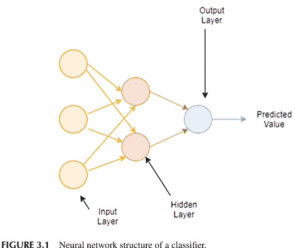

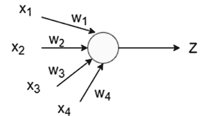

**图 3.2** 层中神经元的详细视图。

```
y = w₁x₁ + w₂x₂ + w₃x₃ + ... + wₙxₙ + b
z = Activate (y)
```

x₁、x₂、x₃...xₙ 是神经元接收的 n 个输入，w₁、w₂、w₃...wₙ 是分配给接收到的输入的权重，b 是分配给神经元的偏置。神经元将 z 传输到下一层神经元。

### 3.2.3 神经网络中偏置和权重的重要性

#### 3.2.3.1 权重

权重与输入到神经元的每个特征一起使用，权重指示哪个特征更重要。例如，如果一个特征的权重大于另一个特征，则意味着在预测输出时，该特征比权重值较小的其他特征更重要。权重的负值确定该特征与我们正在预测的目标值成反比。

#### 3.2.3.2 偏置

偏置是添加到权重与特征乘积之和中的常数值。添加偏置是为了使激活函数向左或向右移动其方向，例如，如果我们做出这样的决定：当求和值大于 0.5 时将类别分配为 1，当小于 0.5 时将类别分配为 0。我们设置的这个阈值 0.5 可用于比较，而这个阈值常数用于决策制定。让我们考虑求和大于 0 的情况。

```
∑ wᵢ.xᵢ > 0.5
∑ wᵢ.xᵢ - 0.5 > 0
```

现在我们可以看到，激活函数更容易在给定数据上正确拟合，其中对于类别 1，求和大于 0 被定义为边界，而对于类别 0，求和小于 0 被定义为边界。偏置值也可以被视为截距；它不改变斜率，但改变图表的位置，以便根据我们的需求进行拟合。

### 3.2.4 激活函数

激活函数是决定神经元输出的数学函数。不同类型的问题使用不同的激活函数，所使用的激活函数也取决于问题是回归问题还是分类问题。在选择激活函数时，权重和偏置的梯度起着非常重要的作用。梯度定义为一个变量相对于另一个变量的变化率，训练后获得的误差相对于权重和偏置的梯度用于更新偏置和权重，以减少预测误差 [2]。

#### 3.2.4.1 线性函数

这是最简单的激活函数，其中常数乘以无变量。

```
z = ay

z' = a
```

z 对 y 的梯度显示一个常数值，这意味着权重和偏置将始终以常数因子更新，误差将保持不变。

#### 3.2.4.2 Sigmoid 函数

Sigmoid 函数是一种数学函数，它将值转换到 [0,1] 范围内，是一种非线性激活函数。

```
z = \frac{1}{1 + e^{-y}}
```

```
z' = \frac{1}{1 + e^{-y}} * \left\{ 1 - \frac{1}{1 + e^{-y}} \right\}
```

Sigmoid 函数的梯度显示梯度取决于变量 y，当 y 趋向于 +∞ 或 –∞ 时，梯度将变为 0，对于较大的值，它将与线性函数的梯度相同。

#### 3.2.4.3 双曲正切函数

这是一个非线性函数，通过对 Sigmoid 函数进行小的更改从 Sigmoid 函数中推导而来。

```
z = 2 * \frac{1}{1 + e^{-2y}} - 1
```

该函数的范围为 [-1,1]，关于原点对称。

```
z' = 1 - \left\{ 2 * \frac{1}{1 + e^{-2y}} - 1 \right\}^2
```


当 y 趋向于 +∞ 或 -∞ 时，梯度将变为 0，并且对于较大的值将与线性函数梯度相同。

#### 3.2.4.4 修正线性单元

这是一个非线性函数，如果我们的 y 值大于 0 则返回 y，否则返回 0。这一特性是修正线性单元的优势：它只输出正值或 0。

```
z = max(0, y)
z' = 1 if y > 0 else 0
```

在这种情况下，梯度始终是常数，这意味着权重和偏差将始终以常数因子更新，误差将保持不变。

#### 3.2.4.5 指数函数

指数函数是一个非线性函数，如果 y 大于或等于零则保持不变，否则使用指数函数进行转换。

```
z = y       if       y > 0
z = a * { e^y - 1}   if       y <= 0
```

对于正值它是线性曲线，对于负值它是指数曲线。此函数允许负值作为输出，这使模型学习得更快更好。

```
z' = 1       if       y > 0
z' = a * { e^y }   if       y <= 0
```

对于 y 大于 0 的值梯度是常数，对于小于 0 的值是指数，这意味着在 y 为负值的情况下模型权重和偏差将被更新。

## 3.3 人工神经网络的工作原理

当我们训练人工神经网络时，数据在每个 epoch 中会通过模型传输两次：一次向前传输，一次向后传输。数据通过整个模型的传输称为传播。

### 3.3.1 前向传播

数据从输入层神经元传输到输出层，并从输出层预测输出。来自输出层的输出标志着前向传播的结束。每个神经元通过计算加权和并加上偏差，然后将其传递给激活函数来执行相同的函数。输出被传递给下一层的每个神经元 [3]（图 3.3）。

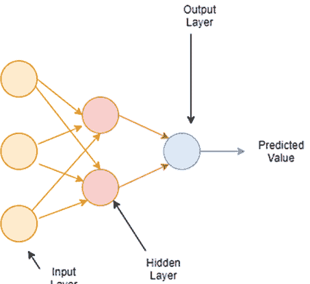

图 3.3 前向传播。

黄色、粉色和蓝色箭头显示了数据在前向传播中是如何传输的。

### 3.3.2 后向传播

这是前向传播的逆过程，过程向后方进行。后向传播基于误差原理：我们首先计算预测中的误差，然后尝试向后传播并通过计算误差相对于可变权重和偏差的梯度来检查特定神经元的权重和偏差如何影响误差，然后相应地更新它们 [4]。

让我们考虑图 3.4 中的示例：

蓝色箭头显示了数据如何从输出层传输到带有粉色神经元的隐藏层。让我们找到损失函数，它定义为实际值与预测值之差的平方。

$E = \{z_p - z_a\}^2$

$z_p$ 是神经网络预测的值，$z_a$ 是输出处预期的实际值，其中 $z_a$ 是常数，$z_p$ 使用最后一个神经元中的激活公式计算。

$z_p = \text{Activation}(y_p)$

$y_p = \sum w_i x_i + b$

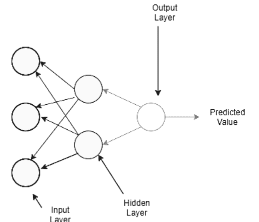

图 3.4 后向传播。

现在让我们考虑下一张图 3.5 中的权重：

让我们考虑输出神经元（蓝色神经元）：它接收 2 个权重 W4 和 W3 并具有偏差值 b3，因此在反向传播时，它们的值将按以下方式更新：

```
W_4 = \{W_4 - \eta * \text{gradient (loss)}\} \text{ gradient with respect to } W_4
```

```
W_3 = \{W_3 - \eta * \text{gradient (loss)}\} \text{ gradient with respect to } W_3
```

```
b_3 = \{b_3 - \eta * \text{gradient (loss)}\} \text{ gradient with respect to } b_3
```

其中 \(\eta\) 是学习因子，是一个超参数，算法的目标是更新每个神经元的权重和偏差并优化误差。

损失相对于 \(W_4\) 的梯度计算如下：

```
\frac{\partial E}{\partial W_4} = \frac{\partial \{y_p - y_a\}^2}{\partial W_4}
```

```
\frac{\partial \{y_p - y_a\}^2}{\partial W_4} = 2 * \{y_p - y_a\} * \frac{\partial y_p}{\partial W_4}
```

让我们考虑线性激活函数：

```
y_p = a * (W_4x_4 + W_5x_5 + b_3)
```

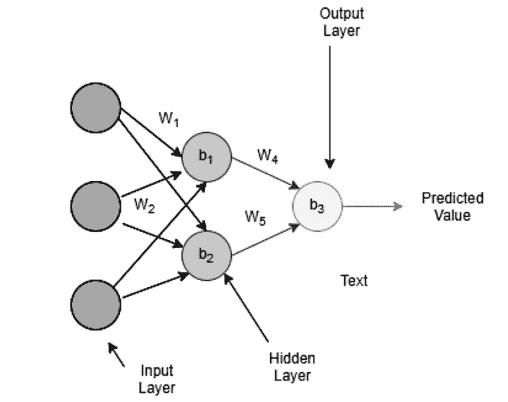

图 3.5 后向传播。

```
\frac{\partial y_p}{\partial W_4} = a x_4
```

在对 $W_4$ 求偏导时，$W_3, x_4, x_3, b_3$ 被视为常数。同样，我们可以计算由于偏差引起的误差梯度。

```
\frac{\partial y_p}{\partial b_3} = a
```

让我们考虑带有偏差 $b_2$ 的粉色神经元示例。假设它将 $z_2$ 作为输入发送，则：

```
\frac{\partial E}{\partial b_2} = \frac{\partial E}{\partial z_2} * \frac{\partial z_2}{\partial b_2}
```

$z_2$ 可以被视为作为输入发送的 $x_5$，这意味着

```
\frac{\partial z_2}{\partial b_2} = a
```

```
\frac{\partial E}{\partial x_5} = \frac{\partial \{y_p - y_a\}^2}{\partial x_5}
```

```
\frac{\partial \{y_p - y_a\}^2}{\partial x_5} = 2 * \{y_p - y_a\} * \frac{\partial y_p}{\partial x_5}
```

由于我们已经计算了 $y_p$，代入后，我们可以计算以下梯度。

$y_p = a * (W_4x_4 + W_5x_5 + b_3)$

\frac{\partial y_p}{\partial W_4} = W_5

使用上述结果

\frac{\partial E}{\partial b_2} = aW_4

因此我们可以计算每个神经元所有权重和偏差的梯度，并在每个 epoch 中更新它们。

## 3.4 使用 Python 实现神经网络

实现神经网络有多种方式，可以通过创建自己的类并定义所有权重、偏差和激活函数；我们将使用 Python 中的预定义模块。我们将使用 Scikit-learn 库来创建我们的神经网络模块。本实现中将使用的数据是 Titanic 数据集。许多领域都有 ANN 的实际实现 [5, 7]（图 3.6–3.9）。

```
### Used to build model
from sklearn.neural_network import MLPClassifier
### Used to split given training data into test and train set
from sklearn.model_selection import train_test_split
### Used to read the data set
import pandas as pd
### Reading training data set from file saved locally
train = pd.read_csv("train.csv")
### This method prints information about a DataFrame
### including the index, dtype and columns, non-null
### values and memory usage.
```

图 3.6 数据预处理和导入所需库的初步步骤。（续）

```
train.info()
### This method generates descriptive statistics.
train.describe()
### Dropping all the columns which have no relation with the death of the person
train = train.drop(["PassengerId", "Ticket", "Fare", "Embarked", "Name", "Cabin"], axis=1)
### Dropping all rows with null values
train = train.dropna()
### Checking info after dropping null value rows and columns
```

图 3.6（续）

```
train.info()
### Label encoding the categorical data
train_x["Sex"] = LabelEncoder().fit_transform(train_x["Sex"])
### Dividing the training data into train_x and train_y
train_x = train.drop(["Survived"], axis=1)
train_y = train["Survived"]
### Further dividing them into train and test data sets
train_xx = train_x[train_x.columns][:640]
train_yy = train_y[:640]
test_xx = train_x[train_x.columns][640:]
test_yy = train_y[640:]
model = MLPClassifier(solver='sgd', alpha=1e-5, hidden_layer_sizes=(2, 1), random_state=1, activation="logistic", max_iter=100)
### Fitting the model for our training data
model.fit(train_xx, train_yy)
### Testing the model for test accuracy
model.score(test_xx, test_yy)
```

图 3.7 初始化模型并训练和测试它。

<class 'pandas.core.frame.DataFrame'>
RangeIndex: 891 个条目，0 到 890
数据列（共 6 列）：

| # | 列 | 非空计数 | 类型 |
|---|--------|----------------|-------|
| 0 | Survived | 891 non-null | int64 |
| 1 | Pclass | 891 non-null | int64 |
| 2 | Sex | 891 non-null | object |
| 3 | Age | 714 non-null | float64 |
| 4 | SibSp | 891 non-null | int64 |
| 5 | Parch | 891 non-null | int64 |

dtypes: float64(1), int64(4), object(1)
内存使用：41.9* KB

图 3.8 使用 info 方法获取数据信息。

<class 'pandas.core.frame.DataFrame'>
Int64Index: 714 个条目，0 到 890
数据列（共 6 列）：

| # | 列 | 非空计数 | 类型 |
|---|--------|----------------|-------|
| 0 | Survived | 714 non-null | int64 |
| 1 | Pclass | 714 non-null | int64 |
| 2 | Sex | 714 non-null | object |
| 3 | Age | 714 non-null | float64 |
| 4 | SibSp | 714 non-null | int64 |
| 5 | Parch | 714 non-null | int64 |

dtypes: float64(1), int64(4), object(1)
内存使用：39.0+ KB

图 3.9 使用 describe 方法获取数据统计信息。

训练好的模型获得了 60.81% 的准确率。准确率取决于许多特性，例如选择激活函数、每层神经元数量、层数和优化算法等。

## 3.5 文献综述

- 1. DeepRing：使用区块链保护深度神经网络

深度神经网络有广泛的应用，区块链技术也被网络安全领域公认为最安全的技术之一。本文通过先构建深度神经网络模型，然后使用区块链技术保护该模型，呈现了两者的结合 [8]。


### 2. 基于区块链的智能应用中机器学习的应用：挑战与前进之路

安全是任何技术中最重要的方面之一；即使是最安全的区块链技术也可能面临攻击，因此为了保护它，机器学习模型被用来分析区块链上的攻击并使其更加安全 [9]。

### 3. 区块链网络中基于 AI 的超级节点选择算法

区块链技术面临的主要问题之一是大量耗电。人工智能（AI）的应用可以帮助减少不必要的哈希运算，从而帮助节省电力 [10]。

### 4. 面向区块链的机器学习：未来与挑战

机器学习和区块链都是世界上最重要的技术之一，且两者都是数据驱动技术。机器学习与区块链的结合，可为数据驱动技术提供更高效、更有效的解决方案 [11]。

### 5. 基于分布式账本技术的安全去中心化点对点深度神经网络训练

在构建安全系统时，隐私是关键因素，而区块链是最安全的交易技术之一。利用深度学习技术，可以在区块链技术基础上构建基于点对点的安全框架，从而为交易构建更安全的系统 [12]。

## 3.6 公开挑战

与区块链技术相关的公开挑战有很多，但最常见的挑战是说服公众采用它，因为大多数用户心中存在一种误区，将区块链技术与加密货币联系起来，而大多数人认为加密货币是非法货币或黑客和欺诈用户使用的货币。该技术面临的另一个主要挑战是速度，因为与现代技术中使用的其他交易系统相比，该系统用于交易的速度非常慢。

## 参考文献

- 1. M. Dayal, N. Singh, Indian health care analysis using big data programming tool, Procedia Computer Science 89 (2016) 521–527.
- 2. M. M. Lau, K. H. Lim, Review of adaptive activation function in deep neural network, in: 2018 IEEE-EMBS Conference on Biomedical Engineering and Sciences (IECBES), IEEE, 2018, pp. 686–690.
- 3. G. Cerri, M. Cinalli, F. Michetti, P. Russo, Feed forward neural networks for path loss prediction in urban environment, IEEE Transactions on Antennas and Propagation 52 (11) (2004) 3137–3139.
- 4. Z. Tang, O. Ishizuka, H. Matsumoto, Backpropagation learning in analog t-model neural network hardware, in: Proceedings of 1993 International Conference on Neural Networks (IJCNN-93-Nagoya, Japan), Vol. 1, IEEE, 1993, pp. 899–902.
- 5. M. Khari, A. K. Garg, R. G. Crespo, E. Verdu, Gesture recognition of rgb and rgb-d static images using convolutional neural networks, International Journal of Interactive Multimedia & Artificial Intelligence 5 (7) (2019) 22–27.
- 6. M. Dua, R. Gupta, M. Khari, R. G. Crespo, Biometric iris recognition using radial basis function neural network, Soft Computing 23 (22) (2019) 11801–11815.
- 7. Y. H. Robinson, S. Vimal, M. Khari, F. C. L. Hernandez, R. G. Crespo, Tree-based convolutional neural networks for object classification in segmented satellite images, The International Journal of High Performance Computing Applications (2020) 1094342020945026.
- 8. A. Goel, A. Agarwal, M. Vatsa, R. Singh, N. Ratha, Deeprig: Protecting deep neural network with blockchain, in: Proceedings of the IEEE/CVF 16 Conference on Computer Vision and Pattern Recognition Workshops, 2019, pp. 2821–2828.
- 9. S. Tanwar, Q. Bhatia, P. Patel, A. Kumari, P. K. Singh, W.-C. Hong, Machine learning adoption in blockchain-based smart applications: The challenges, and a way forward, IEEE Access 8 (2019) 474–488.
- 10. J. Chen, K. Duan, R. Zhang, L. Zeng, W. Wang, An AI based super nodes selection algorithm in blockchain networks, arXiv preprint arXiv:1808.00216.
- 11. F. Chen, H. Wan, H. Cai, G. Cheng, Machine learning in/for blockchain: Future and challenges, arXiv preprint arXiv:1909.06189.
- 12. A. Fadaeddini, B. Majidi, M. Eshghi, Secure decentralized peer-to-peer training of deep neural networks based on distributed ledger technology, The Journal of Supercomputing 76 (2020) 1–15.

# 4 区块链在行政中的应用
去中心化应用在信息共享中的进展与影响

M. Kumar, Himanshu Dubey, 和 K. Kumar

## 目录

- 4.1 引言....................................................................45
- 4.2 文献综述 ...........................................................46
- 4.3 文献缺口 .................................................................47
- 4.4 提出的框架............................................................48
- 4.5 区块链中的数据流分析............................................49
- 4.6 研究意义...........................................................51
- 4.7 研究局限...........................................................52
- 4.8 结论与未来展望...................................................52
- 参考文献............................................................................53

## 4.1 引言

区块链技术（BCT）的广泛确定性被视为未来几年将影响商业和文化的最具远景的技术趋势。BCT 已经作为一种可能具有颠覆性的通用技术出现，供组织和行政用于支持需要信任和认证的交易和信息。

Vos et al. (2017) 讨论了 BCT，它在各个节点中携带等效数据，数据将仅根据节点间的共识写入。可以追加新交易，但数据不能删除。通过分布式节点中的交易存储信息，称为分布式账本。这减少了对主体参与者的需求以及操作或安排失败的风险，所有节点都拥有完整的信息。

Dimitrov (2019) 发现，区块链（BC）可用于任何变更所有权的情况以及重要信息和传单的存储，如“许可证”、“证书”、“政府相关决定和立法”。通常，存储在 BC 中的数据是交易数据，如土地管理的所有权、出生和结婚证书、卡车注册、商业许可证、教育证书、学生贷款、社会福利和选票。BCT 有可能为行政和文明带来改进，并可代表“电子政务”发展的下一阶段，因为它们允许降低成本和复杂性、共享正确流程、更好地发现审计测试以及确认可靠的记录卡。在本文中，作者专注于层级技术，讨论使用 BC 技术进行点对点（P2P）方式的技术复杂性。

有必要在封闭环境中为设计交易和数据变更流程提供机会。相比之下，鲜有研究关注 BC 技术及其满足社会需求的能力。在本文中，作者对重要福利印象深刻，并识别出行政为实现 BC 技术并保障其利益的新角色。作者的主要目标是通过将关注点转移到被低估且需要进一步研究的方面，为行政中的 BC 更有依据的讨论做出贡献。

## 4.2 文献综述

Vos et al. (2017)：作者讨论了区块链技术在行政中的潜在用途，总结了区块链技术领域的最新进展，作为方法论成熟度的一个实例，以及行政。政府系统中被个人（们）、权利（s）和实体（s）之间的关联是描述强制性功能的基础，假设在这三个基本要素内存在复杂性：个人的唯一性、对象的法律多样性。本文探讨了如何通过区块链技术实现良好行政的某些原则，包括透明度、问责制、安全性和监管。结论是，该方法目前还不够成熟，无法在行政中运行。

Paik et al. (2019)：作者旨在提高人们对区块链技术作为数据存储的关注，并支持一种克服其过于笨重的软件系统的系统方法。Jha et al. (2019)：在本文中，作者将典型带有数据存储的软件系统的共同层进行分类，并用区块链术语对每个层进行概念化。另外，作者检查了“基于区块链”操作中信息的位置和流动。最后，作者研究了区块链中信息管理的复杂性，以隐私和安全方面的关系保证为准。

Grover et al. (2019) 描述了区块链及其分散外观，看起来对不同行业是可变的。本研究的目的是通过学术文献和社交媒体的混合，发现各种行业中区块链技术的扩散。

Farouk et al. (2020) 阐述了医疗保健中数据、网络和区块链技术的结合。医疗保健数据已成为该领域的一个必要元素。组织之间需要安全可靠地传输医疗数据。主要挑战是收集患者疾病的信息，这对于限制全球大流行病已成为必不可少的。虽然有许多方法可以做到这一点，但不可能获得完整的和


特定时间点的时间信息。为了实现全球组织之间的透明度，有必要在全球范围内直接共享数据。这只能通过包含 IoT 网络和区块链组合的技术来实现，这些技术在系统中是去中心化的，并具有以分布式方式存储数据的能力。

Gökalp et al. (2018)：本文的主要目的是提出医疗领域的区块链框架，该框架包含医疗系统中所有利益相关方，通过提供统一的区块链设计来审视前景与挑战。

Bell et al. (2018) 讨论了可使用区块链技术改进的医疗系统及安全性的众多领域。这些领域包括通过分布式应用检测现象、医疗检测、药品检测以及健康保险。可检测设备能够在区块链基础设施中追踪其用途。收集的信息可用于通过获取市场零售分析的深度细节，有效提升安全性和患者保护，从而增强效率。在本文中，作者介绍了药品可追溯性、数据共享、临床试验和设备追踪等最新领域。

Hoy (2017)：作者讨论了区块链技术，这是一种相对较新的技术，用于证明和提供比特币等虚拟加密货币的交易记录。该过程所使用的系统在本质上是分布式且冗余的，这使得交易难以被撤销或伪造。

Dimitrov (2019) 对区块链技术在医疗系统中萌发的实际基础进行了理论探讨，这对于理解精确的区块链应用、评估包括区块链初创企业在内的商业案例，或追踪其预期经济影响相关的论点是必需的。

Casino et al. (2019) 提供了多个领域中区块链技术应用的系统性文献综述。本文展示了区块链技术的当前状态，并呈现了在供应链、医疗保健、商业、IoT、隐私和数据管理等各个领域中聚焦区块链应用的分类。本文还有助于区块链技术新兴研究领域的发展。

Myeong and Jung (2019)：作者讨论了行政管理中对区块链技术日益增长的兴趣，该技术可以提高行政管理的经济效率、安全性和去中心化程度。作者还指出，未来可在公共部门（如电子政务）中使用此技术，以增强各国政府的行政流程、安全性以及治理领域的数据管理。

## 4.3 文献空白

本文所讨论的文献综述中存在各种局限性或文献空白，具体如下：

- 1. 可扩展性问题：在各种管理系统中现有的区块链研究中，处理的交易数量有限，区块链中使用的区块在频率和大小上受到限制。

- 2. **缺乏透明度**：现有管理系统区块链中缺乏透明度，或者说缺乏集中式交易流程，这导致人们对管理系统缺乏信任。

- 3. **网络信任缺失**：在各种管理系统中，组织和机构等所使用的网络缺乏信任，这使得管理系统更容易受到网络攻击。

- 4. **安全性**：要在现有管理系统中运行区块链技术，需要高级安全功能，如用于加密每个交易过程的加密技术，以及用于将加密交易过程与旧交易过程关联的哈希方法。

- 5. **虚假可追溯性**：现有或传统管理系统供应链中存在较高的虚假可追溯性比率，这可能导致盗窃、假冒和货物丢失等多种问题。

- 6. **成本**：组织在管理现有管理系统上花费大量资金，组织需要降低成本，并将资金用于组织发展，例如改进现有系统、改进基础设施、开发新技术等。

## 4.4 拟议框架

区块链技术是一种广泛掌握的广域技术，用于在分布式网状网络中处理数据和数字资产，并在行政管理系统中使用此技术可以解决上一节讨论的各种行政问题，并增强州、国家或全球的行政流程。在下文图 4.1 所给出的行政区块链拟议框架中，我们将解决行政管理系统组成部分税务部门中的腐败水平问题。

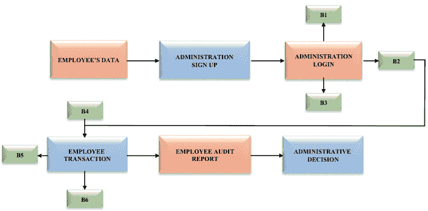

**图 4.1** 拟议框架。

图 4.1 中上述拟议框架说明了在税务部门行政流程中使用区块链，在此过程中，我们使用员工数据，并借助审计报告分析员工交易中的腐败水平，由税务管理员做出行政决策。该拟议框架也可应用于各种行政管理系统、医疗保健、商业和电子政务等领域，从而改善行政流程。

所讨论的拟议框架涉及开发行政系统的方法，该方法基于机器学习方法，包括基于签名的行政系统和基于档案的行政系统。作者分析认为，基于签名的方法基于当前和先前存储的信息，使用已知数据模式来识别税务部门中的腐败行为。基于签名方法的缺点是它仅能发现基于已知模式的腐败行为。第二种是基于异常的方法，用于基于先前未确定的未知模式样本来预测腐败行为。为了发现未知模式，需要基于异常的深度学习方法，即卷积神经网络、循环神经网络和人工神经网络。在追踪系统领域需要开展先进研究，这可能使许多人受益，并可在固定时期内为员工生成员工审计报告。图 4.1 展示了一个行政系统，该系统允许以多种格式集成来自多个数据中心的数据。用户连同行政问题陈述向行政官员发送请求，行政管理中有一些员工在部门内需要遵循的标准，以生成注册和登录身份，并将请求转发到行政系统的智能系统，以生成包含员工交易历史记录的报告。上述图表代表了通过 IoT 网络连接行政系统税务部门员工的行政系统。连接到 IoT 网络的员工通过现有员工交易与与行政系统相关的近期问题之间的相互关系，与行政智能系统进行通信。

## 4.5 区块链中的数据流分析

本节通过全球关联行政网络中的行政管理系统，展示了区块链架构中的数据流，该网络由相互关联并协同工作的事件组成，通常显示通过区块链在行政网络中为实现透明度和改善行政流程而进行的数据流动。

图 4.2 展示了行政中区块链的图表。显示了组织系统内的程序流程，该流程由相互关联并在组织中协同工作并链接的程序组成，通常显示组织内通过各种流程的数据流动。由于存储在区块链中的数据是不可更改的，因此区块链从数据生成到结束所采取的路径可忽略不计。为了更好的流动


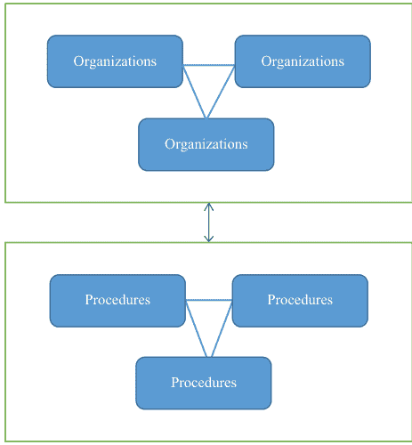

图表，区块链的必要特征已存在。这指的是用于生产数据传输的内部和外部数据库中数字数据采集的流程（Khari et al. 2019）。预处理后的实际数据库和反馈数据库并非那么必要，因为每个场景的基础设施相同，因此可以假设或忽略（Le et al. 2019）。这些生产技术在区块链技术生产中有用且有帮助。在审视数字化生产时，应遵循程序方法的链条如下：

- (1) 系统
- (2) 传感器
- (3) 网关
- (4) 互联网

基于区块链的政府可以保护数据、减少欺诈、简化流程、减少浪费和滥用，同时增强信心和责任。基于区块链模型的政府与独立组织企业在使用加密技术保护的分布式账本上划分资产。为保护敏感公民信息和政府数据，使用上述结构，该结构还将消除单点故障。基于区块链的政府有能力解决主要供给点，并允许以下优势：

- (1) 保护敏感公民、政府和企业数据的存储
- (2) 减少劳动密集型流程
- (3) 消除与管理责任和问责相关的过度成本
- (4) 减少滥用和腐败的潜在可能性
- (5) 提高对在线公民系统和政府的信任
- (6) 与公民建立信任
- (7) 提高效率
- (8) 保护敏感和重要数据

管理员-分布式账本模式可以被理解为协助一组政府和公共部门流程，包括数字支付、身份管理、医疗保健、投票、供应链管理和土地登记。有多个政府加入竞赛来处理法定立法并开始以区块链技术为中心的试点项目。它可以利用区块链技术提供流程优化和网络安全。政府和企业面临着身份和安全的复杂且不断演变的问题。为了解决与数字系统和身份相关的问题，使用区块链，因为它具有提供解决方案的卓越实用性。企业和组织使用区块链技术有许多优势。

- (1) 企业将在高安全级别下得到更好的保护
- (2) 交易是透明的，因此可以轻松追踪
- (3) 组织使用区块链进行的交易更快
- (4) 被黑客攻击的威胁机会也大大降低
- (5) 不需要支付集中式服务，因为区块链拥有去中心化平台
- (6) 组织的区块链技术还提供不同级别的可访问性
- (7) 自动对账

## 4.6 研究意义

本文作者讨论了文献中存在的各种局限性或差距，如下。在各种管理系统中区块链的现有研究中，处理的交易数量有限，区块链中的区块数量在大小和频率上受到限制。现有管理系统的区块链中缺乏透明度，或者说缺乏集中式交易流程，这导致人们对管理系统缺乏信任。在各种管理系统中，组织、机构等使用的网络缺乏信任，这使得管理系统更容易受到网络攻击。本文作者对相关工作中创建的区块链技术反复效益进行了重要评估，并讨论了他们对行政流程的建议。需要从“技术驱动”转向“需求驱动方法”，其中区块链利用是定制的，以确保与管理方法的需求相匹配，并且管理方法得到改进以从技术中获益。治理框架被创建为取得进步的状态。基于重要评估，作者为进一步研究区块链应用在政府数字化中的显著优势以及区块链结构及其利用以满足公共价值社区需求提供了指示。未来工作包括整合多家医院数据以早期诊断疾病。未来还将致力于结合去中心化系统与云计算的弹性分布式数据方法，发明广泛的健康跟踪系统。

## 4.7 研究局限性

研究人员在提出区块链中建议和改进的管理系统时遇到的研究难题被标记为：

- 1. 在此背景下采用类似方法的不断增长和广泛研究排挤了研究人员的新方法。
- 2. 凭证便利性的缺失使得某些研究可能无法关注研究论文，因为其中存在一些无法公开获取的表述。
- 3. 信息安全领域研究需求的不断增长和巨大，使得研究人员可能会忽略由调查人员主持的一致研究中的一些主要目标。

## 4.8 结论与未来展望

研究的主要关注点是区块链技术如何帮助发明和革新政府流程，例如在减少腐败和医疗保健等方面的应用。本文作者对相关工作中确立的区块链技术反复效益进行了重要评估，并考虑了他们对行政流程的建议。需要从“技术驱动”转向“需求驱动方法”，其中区块链利用是定制的，以确保与管理方法的需求相匹配，并且管理方法得到改进以从技术中获益。治理框架被创建为取得进步的状态。基于重要评估，作者为进一步探索区块链应用在政府数字化中的巨大优势以及区块链结构及其利用以满足公共价值社区需求提供了指示。

- 未来工作包括整合多家医院数据以早期诊断疾病。
- 致力于结合去中心化系统与云计算的弹性分布式数据方法，发明广泛的健康跟踪系统。

## 参考文献

- Bell, L., Buchanan, W. J., Cameron, J., & Lo, O. (2018). Applications of blockchain within healthcare. Blockchain in Healthcare Today, 1(8). 10.30953/bhty.v1.8

- Casino, F., Dasaklis, T.K., & Patsakis, C. (2019). A systematic literature review of blockchain-based applications: current status, classification and open issues. Telematics and Informatics, 36, 55–81.

- Dimitrov, D. V. (2019). Blockchain applications for healthcare data management. Healthcare Informatics Research, 25(1), 51.

- Farouk, A., Alahmadi, A., Ghose, S., & Mashatan, A. (2020). Blockchain platform for industrial healthcare: Vision and future opportunities. Computer Communications, 154, 223–235.

- Gökalp, E., Gökalp, M. O., Çoban, S., & Eren, P. E. (2018, September). Analysing opportunities and challenges of integrated blockchain technologies in healthcare. In Europosium on systems analysis and design (pp. 174–183). Springer, Cham.

- Grover, P., Kar, A. K., & Janssen, M. (2019). Diffusion of blockchain technology: Insights from academic literature and social media analytics. Journal of Enterprise Information Management 32(5): 735–757.

- Hoy, M. B. (2017). An introduction to the blockchain and its implications for libraries and medicine. Medical Reference Services Quarterly, 36(3), 273–279.

- Jha, S., Kumar, R., Chatterjee, J. M., & Khari, M. (2019). Collaborative handshaking approaches between internet of computing and internet of things towards a smart world: a review from 2009–2017. Telecommunication Systems, 70(4), 617–634.

- Khari, M., Garg, A. K., Gandomi, A. H., Gupta, R., Patan, R., & Balusamy, B. (2019). Securing data in Internet of Things (IoT) using cryptography and steganography techniques. IEEE Transactions on Systems, Man, and Cybernetics: Systems, 50(1), 73–80.

- Le, D., Kumar, R., Mishra, B. K., Khari, M., & Chatterjee, J. M. (2019). Cyber security in parallel and distributed computing. Wiley, Hoboken.

- Myeong, S., & Jung, Y. (2019). Administrative reforms in the fourth industrial revolution: The case of blockchain use. Sustainability, 11(14), 3971.

- Paik, H. Y., Xu, X., Bandara, H. D., Lee, S. U., & Lo, S. K. (2019). Analysis of data management in blockchain-based systems: From architecture to governance. IEEE Access, 7, 186091–186107.

- Vos, Jacob, Lemmen, Christiaan, & Beentjes, Bert (2017, March). Blockchain based land administration feasible, illusory or a panacea. In Netherlands Cadastre, Land Registry and Mapping Agency. Paper prepared for presentation at the 2017 World Bank Conference on Land and Poverty. The World Bank, Washington, DC.


Taylor & Francis

Taylor & Francis Group

http://taylorandfrancis.com

# 5 手写数字识别中卷积神经网络与区块链的组合

Mohit Dayal, Ameya Chawla, Deepti Singh, and Rupesh Kumar Garg

## 目录

- 5.1 卷积神经网络简介.....55
- 5.2 卷积神经网络的架构.....56
- 5.2.1 层.....56
- 5.2.1.1 卷积层.....56
- 5.2.1.2 池化层.....57
- 5.2.1.3 全连接层.....58
- 5.2.2 填充.....58
- 5.2.3 最小-最大缩放.....59
- 5.3 卷积神经网络的工作原理.....59
- 5.3.1 正向传播.....59
- 5.3.2 反向传播.....59
- 5.4 使用 Python 实现卷积神经网络.....62
- 5.5 文献综述.....66
- 5.6 未解决的挑战.....67
- 参考文献.....67

## 5.1 卷积神经网络简介

数学上，卷积意味着利用两个函数以相同的方式产生一个新函数。在卷积神经网络中，我们尝试将输入图像转换为更具洞察力的图像，通过在图像上应用许多滤波器来检测特征，从而非常容易地检测特征并获得模型更好的训练阶段。卷积神经网络广泛用于输入数据集为图像且模型的主要目标是在图像中发现不同模式或特征的问题。

卷积神经网络是深度学习的一部分，而深度学习是机器学习的一个子集，其中我们试图复制人类大脑的后部，即大脑皮层，其中有一个重要部分，视觉皮层，用于人类视觉。由于其使用滤波器从图像中获取有意义洞察的结构，卷积神经网络是图像分类、模式检测、目标检测和目标识别中最常用的机器学习模型之一。最流行的应用之一是自动驾驶汽车，它使用目标检测算法来检测和识别物体，并决定如何移动汽车。

区块链是一个不断扩展的记录列表，这些记录被称为块，这些块的链接通过密码学完成，形成类似链的结构，因此得名区块链。每个添加的块包含以下信息，如哈希代码、时间戳和交易数据，所有这些都存储在块中，哈希代码是添加到链中的最后一个块的加密代码。这种结构无法被篡改，因为每笔交易都会添加一个块，并且其设计旨在有效防止篡改。区块链技术最常见的用途是加密货币，如比特币。

区块链支持的数据系统可以用于医疗保健或学生教育领域，所有这些都可以使用区块链技术实现，这使得添加用户数据更加容易且更安全。然后可以在该类型数据上训练神经网络，以便更容易地分析数据并将模型拟合到其上，而不是以通用方式收集数据 [1]。

**目标：** 本章将向读者简要介绍卷积神经网络，使其充分理解与卷积神经网络相关的术语、卷积神经网络的架构以及图像通过各种滤波器传播的机制，并了解如何从图像中识别模式。还将简要介绍区块链技术以及区块链技术和卷积神经网络的现实应用。

## 5.2 卷积神经网络的架构

卷积神经网络由卷积层组成，后跟池化层，最后馈入全连接神经网络。

### 5.2.1 层

卷积神经网络基本上有三种类型的层：

#### 5.2.1.1 卷积层

卷积层有一个定义的映射，它依次在图像上移动，并将其项与其所放置的项相乘，然后将乘积存储在新的输出矩阵中。滤波器的移动也由步长值定义，该值告诉在对图像应用滤波器时滤波器向右和向下移动多少个块。例如，如果滤波器放置在图像的左上角，则滤波器将向右移动一个块，直到覆盖图像的整个宽度，然后从左侧向下一行重新开始，直到覆盖宽度，这样一直持续到覆盖整个图像，这是步长值为 1 的滤波器的示例。卷积层的主要目的是检测给定输入图像中的特征（图 5.1）。

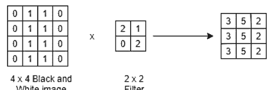

图 5.1 步长为 1、填充为 0 的 2 x 2 形状滤波器在 4 x 4 图像上移动。

如果填充为零，我们可以推导输出图像大小的公式，n x n 图像的输出图像大小为

size = n - s + 1

其中 n x n 是输入图像的形状，k x k 是卷积矩阵的形状。

#### 5.2.1.2 池化层

池化层的工作机制与卷积层相同，但有一些小的变化，即不是将滤波器的项相乘，而是将图像部分的平均值或最大值存储在输出矩阵中。最大池化层有助于删除额外信息并从图像中提取这些特征，并去除剩余的额外部分。卷积层多次应用并在其后接池化层，以从图像中提取最多的信息、特征和模式（图 5.2）。

如果填充为零，我们可以推导输出图像大小的公式，n x n 图像的输出图像大小为

size = n - s + 1

其中 n x n 是输入图像的形状，k x k 是最大池化矩阵的形状。

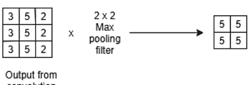

图 5.2 步长为 1、填充为 0 的 2 x 2 形状最大池化层在 3 x 3 图像上移动。

#### 5.2.1.3 全连接层

多个卷积层后跟池化层的应用会得到一个提取了大部分特征的最终图像。然后将该图像转换为具有一列的展平向量或矩阵，并作为输入馈入全连接神经网络结构或人工神经网络，然后使用前向和后向传播进行训练，在此基础上根据其特征进行图像分类（图 5.3）。

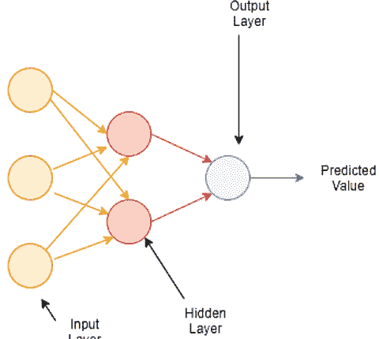

图 5.3 全连接层示例。

### 5.2.2 填充

在对图像应用任何操作之前，会将填充添加到图像中，因为应用任何操作最终都会减小图像的大小，为了保持图像的相同大小，会添加额外的填充层，该层在图像周围形成整个边界，添加的边界值可以是 0（表示边界为白色）或与图像边框上的像素相同。边界值取决于给定的输入图像数据集，填充值 n 指行数增加 2 x n，列数增加 2 x n，额外值可以是白色或与边界相同（图 5.4）。

```
size = (n - k + 2p) s + 1
```

其中 n x n 是输入图像的形状，k x k 是卷积矩阵的形状，p 是填充大小，s 是步长值。

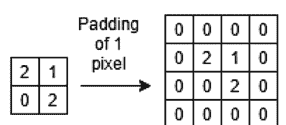

图 5.4 1 像素大小的填充示例。

### 5.2.3 最小-最大缩放

最小-最大缩放是最常用的技术之一，用于将图像中给定的像素值转换为 [0,1] 范围，以提高速度并减少卷积神经网络进行的计算，可以通过将所有值除以 255 来实现，因为 255 是图像像素的最大值，像素可以是一个字节，而一个字节存储的最大值是 255。

## 5.3 卷积神经网络的工作原理

当我们训练卷积神经网络时，数据在每个时代通过模型传输两次，一次正向传输，一次反向传输。数据通过整个模型的传输称为传播。

### 5.3.1 正向传播

在正向传播过程中，图像通过多个层传输，这些层中的滤波器是用随机值创建的，全连接层的偏置和权重也是如此。基于图像正向传播后的输出，输出值用于更新所有权重、偏置和滤波器值（图 5.5）。

### 5.3.2 反向传播

反向传播是相反的传输方向，基于输出生成错误，从而用于更新全连接层的权重和偏置以及滤波器值。梯度下降算法用于更新所有权重、偏置和滤波器值。

让我们考虑图 5.6 中的示例：

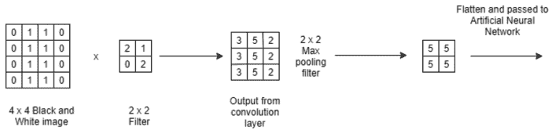

图 5.5 图像通过各种层的传播。


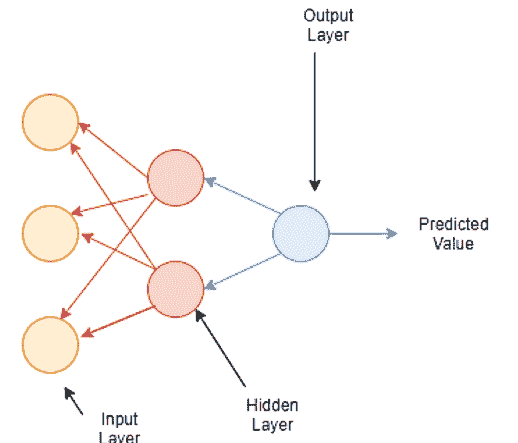

FIGURE 5.6 反向传播。

蓝色箭头显示数据如何从输出层传输到带有粉色神经元的隐藏层。让我们找到损失函数，它定义为实际值和预测值之差的平方。

\( E = \{z_p - z_a\}^2 \)

\( z_p \) 是神经网络预测的值，\( z_a \) 是输出端期望的实际值，其中 \( z_a \) 是常数，\( z_p \) 使用最后一个神经元中的激活公式计算。

\( z_p = \text{激活}(y_p) \)

\( y_p = \sum w_i x_i + b \)

现在让我们考虑下一张图 5.7 中的权重：

让我们考虑输出神经元（蓝色神经元）：它接收 2 个权重 \( W_4 \) 和 \( W_3 \)，并具有偏差值 \( b_3 \)，因此在反向传播时，它们的值将按以下方式更新：

\( W_4 = \{W_4 - \eta * \text{梯度} \, (\text{损失})\} \, \text{对} \, W_4 \, \text{的梯度} \)

\( W_3 = \{W_3 - \eta * \text{梯度} \, (\text{损失})\} \, \text{对} \, W_3 \, \text{的梯度} \)

\( b_3 = \{b_3 - \eta * \text{梯度} \, (\text{损失})\} \, \text{对} \, b_3 \, \text{的梯度} \)

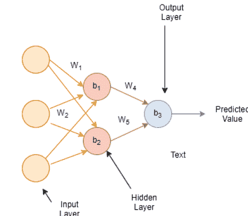

FIGURE 5.7 反向传播。

其中 \(\eta\) 是学习因子，是一个超参数，算法的目标是更新每个神经元的权重和偏差，并优化误差。损失相对于 \(W_4\) 的梯度计算如下：

```
\frac{\partial E}{\partial W_4} = \frac{\partial \{y_p - y_a\}^2}{\partial W_4}
```

```
\frac{\partial \{y_p - y_a\}^2}{\partial W_4} = 2 * \{y_p - y_a\} * \frac{\partial y_p}{\partial W_4}
```

让我们考虑线性激活函数：

```
y_p = a * (W_4 x_4 + W_5 x_5 + b_3)
```

```
\frac{\partial y_p}{\partial W_4} = a x_4
```

在对 \( W_4 \) 求偏导数时，\( W_3, x_4, x_3, b_3 \) 被视为常数。同样，我们可以计算由于偏差引起的误差梯度。

```
\frac{\partial y_p}{\partial b_3} = a
```

让我们考虑一个带有偏差 $b_2$ 的粉色神经元示例。让我们假设它将 $z_2$ 发送为输入，那么：

\(\frac{\partial E}{\partial b_2} = \frac{\partial E}{\partial \dot{z}_2} * \frac{\partial \dot{z}_2}{\partial b_2}\)

$z_2$ 可以被视为作为输入发送的 $x_5$，这意味着

\(\frac{\partial \dot{z}_2}{\partial b_2} = a\)

\(\frac{\partial E}{\partial x_5} = \frac{\partial \{y_p - y_a\}^2}{\partial x_5}\)

\(\frac{\partial \{y_p - y_a\}^2}{\partial x_5} = 2 * \{y_p - y_a\} * \frac{\partial y_p}{\partial x_5}\)

由于我们已经计算了 $y_p$，代入它我们可以计算以下梯度。

$y_p = a * \big(W_4 x_4 + W_5 x_5 + b_3 \big)$

\(\frac{\partial y_p}{\partial W_4} = W_5\)

使用上述结果

\(\frac{\partial E}{\partial b_2} = a W_4\)

因此，我们可以计算每个神经元的所有权重和偏差的梯度，并在每个时代中更新它们。

## 5.4 使用 Python 实现卷积神经网络

实现卷积神经网络有多种方式，可以通过创建自己的类并定义所有权重、偏差、激活函数和滤波器，但我们将使用 Python 中的预定义模块。我们将使用 Keras 库来创建卷积神经网络模块。此实现中使用的数据是 MNIST 数据集，这是手写数字的集合。许多领域都有 CNN 的实际应用 [2–4]（图 5.8–5.15）。

```python
#used to create layers for the model and to load the dataset
import tensorflow.keras as keras

#used to plot sample images given in the dataset
import matplotlib.pyplot as plt

#Loading the mnist dataset
from keras.datasets import mnist
(x_train,y_train),(x_test,y_test)=mnist.load_data()

#Min Max scaling the pixel values
x_train=x_train/255.0
x_test=x_test/255.0

#Printing the shape of the data set
print(x_train.shape,x_test.shape)
```

FIGURE 5.8 导入并加载所有所需的数据集。

```
print(x_train.shape,x_test.shape)

(60000, 28, 28) (10000, 28, 28)
```

FIGURE 5.9 使用 shape 方法获取图像形状。

```python
#Plotting sample image
plt.imshow(x_train[0].reshape(28,28))
```

FIGURE 5.10 使用 imshow 方法绘制数字 5 的图像。

<matplotlib.image.AxesImage at 0x7f4e4a0aaed0>


FIGURE 5.11 使用 imshow 方法绘制数字 5 的图像。

```
#Reshaping the Images
x_train=x_train.reshape((60000,28,28,1))
x_test=x_test.reshape((10000,28,28,1))

#Declaring the Input layer
i=keras.layers.Input(shape=(28,28,1))

#Declaring multiple convolution layers and maxpooling layers
#Convolution layers with kernel/filter size 3 x 3
#Max pooling layers with kernel/filter size 2 x 2
c=keras.layers.Conv2D(32,(3,3),padding='valid')(i)
m=keras.layers.MaxPooling2D((2,2),(2,2))(c)
c=keras.layers.Conv2D(64,(3,3),padding='valid')(m)
m=keras.layers.MaxPooling2D((2,2),(2,2))(c)
c=keras.layers.Conv2D(128,(3,3),padding='valid')(m)
m=keras.layers.MaxPooling2D((2,2),(2,2))(c)

#Declaring the Image flattening layer
f=keras.layers.Flatten()(m)

#Declaring the dense layer with softmax activation
d=keras.layers.Dense(10,activation=tf.nn.softmax)(f)

#Declaring the model with input and output
model=keras.Model(i,d)
model.summary()
```

FIGURE 5.12 模型初始化并添加所有所需层。

Model: "model_2_"

| 层 (类型) | 输出形状 | 参数数量 |
|---|---|---|
| input_3 (InputLayer) | [(None, 28, 28, 1)] | 0 |
| conv2d_5 (Conv2D) | (None, 26, 26, 32) | 320 |
| max_pooling2d_5 (MaxPooling2D) | (None, 13, 13, 32) | 0 |
| conv2d_6 (Conv2D) | (None, 11, 11, 64) | 18496 |
| max_pooling2d_6 (MaxPooling2D) | (None, 5, 5, 64) | 0 |
| conv2d_7 (Conv2D) | (None, 3, 3, 128) | 73856 |
| max_pooling2d_7 (MaxPooling2D) | (None, 1, 1, 128) | 0 |
| flatten_2 (Flatten) | (None, 128) | 0 |
| dense_2 (Dense) | (None, 10) | 1290 |

总参数: 93,962
可训练参数: 93,962
不可训练参数: 0

FIGURE 5.13 显示所有层的模型摘要。

```
#Compiling the model
model.compile(optimizer="adam",loss='sparse_categorical_crossentropy',metrics=['accuracy'])

#Fitting the model on the training data
model.fit(x_train,y_train,epochs=5)

#Testing model for accuracy
test_loss,test_accuracy=model.evaluate(x_test,y_test)
print(test_loss,test_accuracy)
```

FIGURE 5.14 编译模型并测试其准确性。

```
print(test_loss,test_accuracy)
```

0.05564744397997856  0.9836999773979187

FIGURE 5.15 模型的测试准确性。

该模型获得了约 98.4% 的准确率，并且通过在训练中更改超参数（如添加更多卷积层和最大池化层以及时代数），可以进一步提高此准确率。

## 5.5 文献综述

- **1. 使用区块链保护 CNN 模型和生物识别模板**
- 区块链是最安全的系统之一，最近区块链已被用于将任何普通深度学习模型转换为安全系统。生物识别模型经过训练以利用区块链技术提供容错能力 [4, 5, 6]。

- **2. 用于加密货币预测的高级 CNN-LSTM 模型**
- 加密货币已成为交易中最常用的货币之一，并占据了很大的市场份额。大多数人已经开始投资加密货币，并且需要一个系统来预测加密货币的价值，因此该模型是基于三种加密货币（比特币、瑞波币和以太坊）的历史价格构建的 [7]。

- **3. 基于 CNN 的比特币趋势预测多变量数据分析**
- 比特币是区块链最大的应用之一，也是交易中最常用的加密货币。比特币价格波动剧烈，由于投资者和使用人数众多，价格变化频繁。需要使用基于 1D CNN 的模型预先预测比特币价格 [8]。

- **4. 用于分段卫星图像中对象分类的基于树的卷积神经网络**
- 卫星拍摄的图像始终是高分辨率的，这增加了这些图像的计算和处理成本。需要一个图像系统，在这些高质量图像上分类、计算和处理的成本较低，这可以通过使用基于树的卷积神经网络来实现 [4]。

- **5. 加密货币价格预测问题调查：一种深度学习方法**
- 加密货币已经占据了投资市场份额，许多人开始投资加密货币，因此需要一个系统能够对加密货币价格进行高效、有效的预测，以帮助人们在加密货币上进行更好的投资 [9]。


## 5.6 未解决的挑战

与区块链技术相关的未解决挑战有很多，但最常见的挑战是说服公众采用它，因为大多数用户心中存在一种误区，即将区块链技术与加密货币联系起来，而大多数人认为加密货币是一种非法货币或黑客和欺诈用户使用的货币。

该技术面临的另一个主要挑战是速度，因为与现代技术中使用的其他交易系统相比，用于交易的此系统非常慢。

## REFERENCES

- 1 M. Dayal, N. Singh, 使用大数据编程工具进行印度医疗保健分析, Procedia Computer Science 89 (2016) 521–527.
- 2 M. Khari, A. K. Garg, R. G. Crespo, E. Verdu, 使用卷积神经网络对 RGB 和 RGB-D 静态图像进行手势识别, International Journal of Interactive Multimedia & Artificial Intelligence 5 (7) (2019) 22–27.
- 3 M. Dua, R. Gupta, M. Khari, R. G. Crespo, 使用径向基函数神经网络进行生物特征虹膜识别, Soft Computing 23 (22) (2019) 11801–11815.
- 4 Y. H. Robinson, S. Vimal, M. Khari, F. C. L. Hernandez, R. G. Crespo, 基于树的卷积神经网络用于分段卫星图像中的对象分类, The International Journal of High Performance Computing Applications (2020) doi:1094342020945026.
- 5 A. Goel, A. Agarwal, M. Vatsa, R. Singh, N. Ratha, 使用区块链保护 CNN 模型和生物特征模板, 收录于: 2019 IEEE 第 10 届生物特征理论、应用与系统国际会议 (BTAS), 2019, pp. 1–7. doi:10.1109/BTAS46853.2019.9185999.
- 6 M. Dayal, B. Nagpal, Android 恶意软件系列的全面调查, International Journal of Information Privacy, Security and Integrity 2 (4) (2016) 330–352.
- 7 I. E. Livieris, N. Kiriakidou, S. Stavroyiannis, P. Pintelas, 用于加密货币预测的先进 CNN-LSTM 模型, Electronics 10 (3) (2021) 287.
- 8 S. Cavalli, M. Amoretti, 基于 CNN 的比特币趋势预测多变量数据分析, Applied Soft Computing 101 (2021) 107065.
- 9 E. Pintelas, I. E. Livieris, S. Stavroyiannis, T. Kotsilieris, P. Pintelas, 探讨加密货币价格预测问题: 一种深度学习方法, 收录于: IFIP 人工智能应用与创新国际会议, Springer, 2020, pp. 99–110.


# Taylor & Francis

泰勒与弗朗西斯集团

http://taylorandfrancis.com

# 6 区块链技术如何改变印度农业领域: 一篇综述

Urvashi Sugandh, Manju Khari, and Swati Nigam

## CONTENTS

- 6.1 简介 .................................................... 69
- 6.2 区块链技术: 概述 ........................ 70
- 6.3 印度农业部门: 概述 .................... 76
- 6.4 区块链如何改变农业部门 .... 79
- 6.5 结论与未来工作 ................................. 87
- 参考文献 ............................................................ 87

## 6.1 引言

区块链技术是近年来最受关注的研究话题。自 2008 年中本聪（Satoshi Nakamoto）发布白皮书“比特币：一种点对点现金系统”（Bitcoin: A Peer-to-Peer Cash System）以来，已有 11 多年。作者在货币领域提出了区块链技术的一种应用，以实现经过验证的无现金支付。以同一份白皮书为基础，人们发现了各种可以实施区块链技术的领域。而且，仍在日复一日地探索新的领域，以便在其中实施该技术。由于区块链技术具有不可篡改性，它已被应用于许多领域以解决该领域的挑战；一些示例包括：医疗保健、银行业（Tschorsch & Scheuermann 2016）、航空公司（英国航空）、企业（沃尔玛）、法律账单和税收。此外，近期正在分享关于改善农业领域的想法 [2]。

农业部门是全世界最重要的部门之一。从商业角度以及满足各国粮食需求的角度来看，它发挥着重要作用。许多国家依靠其农业产出推动经济增长。此外，该部门占据主导地位，因为它为国家提供安全、营养、膳食和健康。因此，既要提高农产品的产量，又要提高其质量，这一点非常重要。可以通过用与最新技术相关的现代方法取代传统方法来实现这一点。目前，许多国家正在使用各种最新技术，例如物联网（IoT）、机器学习、深度学习和区块链，以改进其农业部门 [3]。

由于区块链技术的分布式账本系统和不可篡改特性，它变得非常流行。近年来已发表了多篇系统性文献综述。这些文献综述也在帮助我们识别已研究过的与农业部门相关的主题。我们还应该了解未来工作的挑战和制约因素。在第 6.3 节中，将讨论印度农业部门；在第 6.4 节中，提出了一种关于农业部门转型的架构，包括其可能的用例，随后是区块链技术的优势和局限性。

## 6.2 区块链技术: 概述

在中本聪（Satoshi Nakamoto）于 2008 年开发比特币（数字货币）之后，区块链技术开始受到重视。区块链技术可定义为一种分布式账本技术（DLT），它在去中心化的点对点网络中获取非信任各方之间每笔交易的不可篡改的时间戳值。存储在分布式账本中的记录随后无法更改。所有记录的形成和验证均由该网络中所有参与方基于共识协议完成。基本上，它由多个区块组成，一个区块通过哈希函数连接到下一个区块，依此类推，形成类似链条的结构 [4]。该结构可以与链表的结构相比较。

**I. 区块链中的节点类型：** 节点基本上是连接到其他计算机并用于形成区块链网络的计算机或机器。节点示例包括服务器、笔记本电脑和手机。节点用于存储和维护数据。节点数量增加将提高网络的去中心化程度。区块链中有两种类型的节点：普通节点和矿工节点，如图 6.1 所示：

- **普通节点**：普通节点是用于在其账本中存储完整信息的标准节点。它会创建区块链账本的多个副本，并负责分发相同副本。如果传入的交易无效，此类节点可以拒绝该交易。

- **矿工节点**：矿工节点也称为矿工。这些节点负责创建新块并将其添加到区块链中。这可以通过满足方案和条款来完成。

**II. 账本和区块链的类型：** 账本是一个维护所有记录的交易数据库。存储在账本中的记录不可

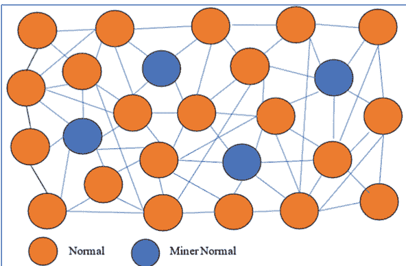

图 6.1 区块链网络示例。

被篡改，这些记录是不可更改的 [5]。在区块链中，引入了三种类型的账本：集中式、分散式和分布式账本，如图 6.2 所示。分布式账本进一步分为两个子类别：无许可（公共）和有许可（私有），如下所述。

- **集中式账本**：在集中式账本中，与网络相关的所有数据和功能都集中化。只有中央机构有权为同一网络中存在的所有组件做出决策。集中式系统的示例包括银行，以及 Instagram、Facebook 和 YouTube 等社交媒体。集中式系统仍面临系统故障和安全漏洞的高风险 [6]。

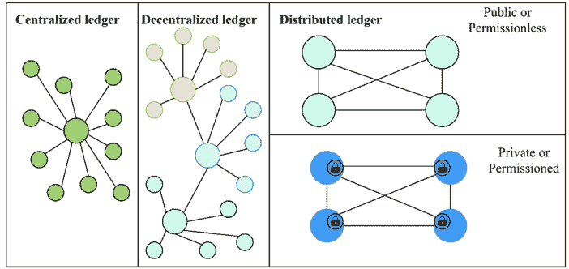

图 6.2 不同类型的账本。


- **去中心化账本**：在这类账本中，没有单一机构负责管理数据和网络的所有功能。多个机构参与该系统，该系统面向部分最终用户。每个用户都是独立实体，并持有账本的副本。如果对账本上存储的数据进行了更改，这些更改会同时反映出来。

- **分布式账本**：从控制态度来看，分布式账本的节点表现为去中心化，但按位置分布。在这个网络中，每个节点作为一个单元运行，因为没有最终用户。分布式账本分为两个子类别：
  - **公共（无许可）**：公共账本又称为无许可账本。用户加入此类网络不需要许可。公共账本为所有人提供进行交易、验证区块等功能，无需任何许可。公共账本或无许可账本的示例是比特币。
  - **私有（许可）**：私有账本也称为许可账本。用户只有在拥有交易许可的情况下才能加入此类账本。如果用户经过身份验证，他们可以使用与许可或私有账本相关的所有功能。私有账本的示例是 Hyperledger Fabric。

比特币——即公共区块链——是第一种区块链类型的说明，其余区块链类型为私有区块链和联盟区块链 [7]。下表 6.1 给出了简要说明：

**表 6.1**
**公共和私有区块链的区别**

| 参数 | 公共区块链 | 私有区块链 | 联盟区块链 |
| :--- | :--- | :--- | :--- |
| **用户类型** | 无许可且可能匿名 | 许可且仅限已知身份 | 许可且仅限已知身份 |
| **区块链中区块的矿工或验证者** | 所有对等节点 | 一个组织 | 选定的对等节点 |
| **交易速度** | 慢 | 更轻便且更快 | 更轻便且更快 |
| **对网络的控制类型** | 去中心化 | 集中化 | 部分集中化 |
| **成本** | 昂贵 | 较低成本 | 较低成本 |
| **不可更改性** | 无法篡改数据 | 数据可能被篡改 | 数据可能被篡改 |
| **共识机制** | PoW, PoS, PoI, PoB, PBFT | 自定义，多方 | 自定义，多方 |

### III. 共识机制

共识机制是一种达成协议的协议，必须被该网络中的所有节点接受。它有助于验证节点之间发生的交易 [8]。共识机制对于区块链网络确认节点连接到同一网络非常重要。各种共识机制说明如下：

- **工作量证明（PoW）**：该机制用于在区块链中创建新区块，通过解决问题来完成。这种计算谜题作为挑战分配给矿工。在 PoW 共识机制中，需要大量能源或计算能力，这使得该机制非常昂贵。使用 PoW 的加密货币示例有莱特币、门罗币和以太坊。

- **容量证明（PoC）**：容量证明共识机制也称为空间证明（PoS）。这种共识机制非常有趣。在此算法中，挖矿节点使用硬盘等数字存储空间来存储服务提供商提供的挑战数据。这称为绘图。之后，这些预先存储的解决方案用于解决挑战。与 PoW 相比，这种 PoC 速度快得多。因此，与 PoW 相比，PoC 创建区块所需的时间少得多。

- **拜占庭容错（BFT）**：这是一种属性，系统具备容忍网络故障的能力。BFT 以适当方式排列记录，直到叛徒数量超过网络中节点总数的三分之一之前，这些记录均不可篡改。

- **实用拜占庭容错（PBFT）**：该机制由 Barbara Liskov 和 Miguel Castro 提出。该机制的概念是容忍分布式系统中失效和恶意节点以达成共识。之后，当故障或恶意节点数量超过网络中所有节点的三分之一时，这些节点将被副本节点替换。PBFT 的实现示例是 Hyperledger Fabric。

- **权益证明（PoS）**：在此共识机制中，节点被随机选中以验证区块，被选中的节点称为验证者。这种机制与之前的共识机制截然不同且颇具趣味。在此机制中，验证者无法相对于其他节点充当竞争者。验证者质押其加密货币（代币或令牌）以有限方式参与区块验证活动。他们根据最大币种数量随机选中以解决挑战。区块验证后，验证者将获得其质押数量一定比例的奖励。与 PoW 相比，此过程所需能源更少、成本更低且速度更快。

- **授权权益证明（DPoS）**：该机制用于选择验证者，不依赖于币种或加密货币的最大数量。在 DPoS 中，所有拥有加密货币的节点组成一个代表节点组，其任务是授权和验证交易。该共识机制保持去中心化。

- **经过时间证明（PoET）**：该机制常用于许可区块链网络。PoET 用于决定网络上的挖矿权和区块获胜者。该机制工作的基础是等待时间。网络中每个参与节点会被随机分配一定的等待时间，完成分配等待时间的节点将获得新区块奖励。该过程将重复以发现新区块。该机制可节省能源，因为节点在等待时间内进入休眠状态。PoET 用于 Hyperledger Sawtooth 和资源高效挖矿。

### IV. 区块链网络的关键组件：搭建任何网络都需要硬件、软件、协议等。同样，区块链网络也可以通过一些关键组件来建模：

- **节点**：在区块链网络中，计算机被视为节点。我们已经讨论过普通节点和矿工节点。

- **矿工**：这些是特定节点，其任务是验证和确认信息或交易的交换。

- **区块**：定义为一种数据结构，其作用是记录所有交易，并充当记录文件或账本的页面。

- **链**：由按定义顺序排列的区块组成。

- **交易**：这是两个或多个节点之间所有信息交换的记录，并进一步广播到整个网络。

- **共识**：这是网络中现有节点接受的协议或条款。

- **智能合约**：智能合约是编写的程序，有助于为通信提供安全环境。此外，它会检查节点或设备是否在其限制范围内工作。

### V. 区块结构：每个区块的架构包含区块头和区块主体，如图 6.3 所示。区块头包含以下字段：

- **版本**：此字段大小为 4 字节，用于了解协议更新。

- **时间戳**：此值用于确定网络对该区块中数据的形成和接受。其大小为 4 字节。

- **前区块哈希**：此字段用于存储前一个区块的哈希码。该哈希码负责建立关系并保持其（区块）创建与区块链中其他区块的顺序。前区块哈希的大小为 256 字节。

- **默克尔树**：通过使用与其关联的每个交易的哈希来创建。默克尔树的结构与二叉树几乎相同。在默克尔树中，每个哈希交易在同一区块中进行，并再次哈希以形成树。此字段的大小为 32 字节。

- **N-bits**：这定义了矿工解决区块时遇到的难度目标。

- **随机数**：这是“仅用一次的数字”的缩写，大小为 4 字节。随机数是一种伪随机数，随后由矿工用于生成有效区块。


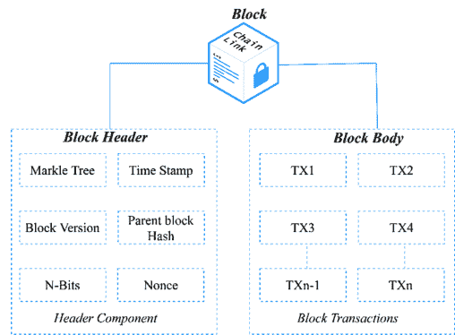

### 图 6.3 区块结构。

区块中一笔交易的大小约为 250 字节。区块头是区块中 80 字节的字段。一个具有最大交易数量的完整区块大小约为区块头的 1,000 倍。其余字段如下：

- 区块大小：表示区块大小的 4 字节。
- 交易：它是可变的，并存储在同一区块中。
- 交易计数器：其大小可变（1–9 字节），定义已完成的交易数量。

### VI. 区块创建与验证：

区块链由多个区块组成，用于存储网络中交易产生的数据。要发起一笔新交易，需要公钥和私钥来在双方之间实施安全且成功的交易。在交易过程中，这两个密钥都用于生成数字签名，进而用于授权和验证交易 [9]。如果任何第三方尝试修改交易数据，将导致数字签名发生剧烈变化。为了在网络上验证交易，使用了各种共识算法。简而言之，如果某个节点有意发起交易，该交易将进一步广播到对等网络中的每个节点，如图 6.4 所示。

下一步是借助共识机制验证和认证已完成的交易。交易验证后，它将被添加到区块中。当区块达到最大容量时，则借助哈希函数 [10] 将其添加到当前区块链中。该函数用于生成地址、数字签名，并用于将任意大小的数据映射到固定大小的值。每个区块通过使用前一区块的哈希值作为“前一区块哈希值”来链接到下一个区块，如图 6.5 所示。

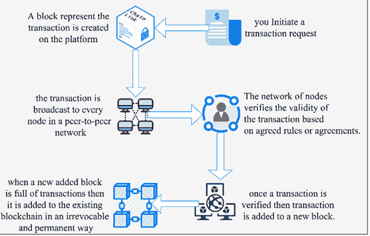

### 图 6.4 区块链的工作原理。

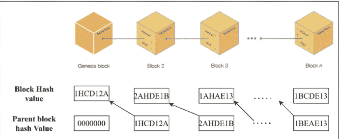

### 图 6.5 作为节点序列的区块链。

## 6.3 印度农业部门：概览

### I. 事实：

印度农业部门正在利用技术进行发展。在本节中，我们将概览印度农业部门。该部门对印度人口至关重要，因为约 60% 的人口依靠农业生存。农业部门约占全球总农产品的 7.8%。因此，该部门从农场到餐桌为 14.2 亿人提供食品。出口食品在全球范围内大规模进行。根据最新数据，约 52.3% 的印度人口将农业视为其收入来源。因此，农业部门约占 GDP 的 13.8%。尽管如此，印度农民仍在自杀，许多农民感到不快乐并正在放弃农业。

### II. 印度农民的现状：

农民，人人都对他们怀有极大的感激和感恩之情，他们努力工作，尽力种植和培育农作物。由于他们努力工作，尽力培育良好作物。尽管辛勤劳作，他们却连一口饱饭都吃不上。

### III. 农民财务危机的主要原因：

农业部门缺乏财务稳定性，因为与之相关的许多风险因素。图 6.6 显示了一些财务危机的统计数据。风险因素如下：

- 气候变化
  - 天气不可预测
  - 降雨不足及分布不均
  - 灌溉用水供应有限
  - 产量经常失败。
- 土地面积缩小
  - 土地分配不均
  - 约 62% 的农业用地容易受到自然灾害（如洪水或缺水等）的影响。
- 储存设施
  - 由于缺乏冷藏设施，农产品受损
  - 因此，农产品在市场上以不合适的价格出售。
- 产品定价不盈利
  - 农民由于缺乏知识，无法在市场上以合适的价格出售农产品。
  - 经纪人或中间商牟取暴利，农民只能得到较低的价格。
- 负债及其原因
  - 大多数农民不使用银行系统，因此被迫依赖高利贷的私人放贷人。
- 农业所需前提条件相当昂贵。
- 政府支持几乎不存在，因此农民无法偿还贷款。
- 中间商或经纪人以低价收购农产品，再以高价转卖，导致农民日益贫困。
- 连续的收成失败迫使农民借款。

### IV. 农业部门如何走向衰落：

图 6.7 显示了2016年农场贷款的统计数据，且持续增加。尽管印度52.3%的人口依靠农产品生存，但该部门仍落后于其他行业。他们付出大量辛勤劳动来培育良好作物，但作为回报，获得的收入却很少，难以维持生计。由于结果不盈利，人们正转向其他职业。在印度，农民几乎完全依赖大自然，如气候、降雨、干旱等。从盈利角度来看，农民对农业产出的利润不满意。他们仍在使用传统的耕作方法。在播种前购买所需投入品缺乏财务援助 [11]。他们需要关于耕作的指导，但这些指导并未以恰当的方式传达给农民。在农业部门，有必要改革传统的耕作方式。必须采用新技术来避免农业部门的衰落，并且农民必须了解其使用方法。为了避免作物过度储存，系统必须可追踪，以便农民可以绕过中间商/经纪人，以最佳价格出售其产品。


### V. 农业行业的现状：

印度农业危机已有所讨论。当前情景下存在的农业部门问题正在显现。如图 6.8 所示，在当前的农业行业情景中，农产品实际记录被篡改、虚假陈述和替换，导致经济损失。在下一步中，从农场接收的农产品经过加工，过程中使用毒素、细菌等进行污染。进行污染是为了使农产品保持更长时间的新鲜，而这一步骤可能涉及法律问题。这些受污染的农产品被送往分销商 [12]。此时，部分产品因高温、湿度等原因变质或过期。此外，剩余的数量分发给零售商，由消费者消费。解决这些问题将导致生产率提高。因此，产品质量将得到提高。但是，与发达国家相比，发展中国家的人口增长率几乎是一倍多。不知何故，这一因素也是该部门发展的巨大障碍 [13]。

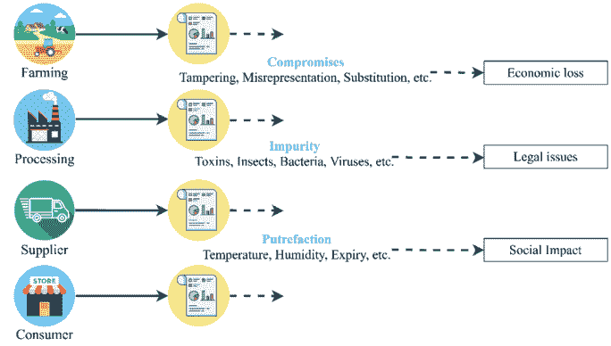

### 图 6.8 农业现状。

## 6.4 区块链如何改变农业部门

### 1. 提议的架构：

正如上文所述，区块链和分布式账本因其金融应用比特币而声名鹊起，但经过探索，研究人员发现它在加密货币之外拥有广泛的不同应用领域。这项技术即将极大地改变法律、银行、医疗保健、房地产等各个行业。然而，区块链技术有望彻底改变的最不被探索的领域之一是印度农业部门。更为突出的是，它


存在大量需要尽快克服的挑战。区块链技术可以通过多种方式帮助转变印度农业部门。

物联网（IoT）与区块链技术相结合，正在重塑农业行业。通过利用农业资源数据，它将实现可持续的农业实践。它将使用一种简便的策略来提升水、肥料、劳动力、运输等农业资源的利用率。

让我们讨论一下区块链技术如何帮助所有利益相关者和种植者转变农业部门。图 6.9 展示了在农业部门使用区块链的拟议架构。拟议架构中有四个关键部分：一是数据生成阶段，二是智能合约，三是区块链平台，最后一个是数据消费。

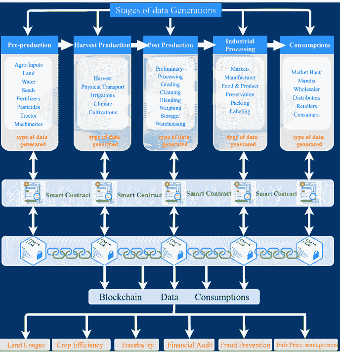

在第一阶段，系统将从不同阶段的各种资源中收集所有数据。构建了一个系统，用于监控前生产阶段生成的温度、土壤湿度、光照、湿度、pH值、种子、肥料等数据。在生产作物阶段，会生成收获、实物运输、灌溉等一些数据。生产后，会生成加工、清洁、混合、储存和仓储等方面的数据，这些数据对消费者了解食品的加工和清洁过程非常有用。在工业加工过程中，会产生一些重要数据，例如包装、保质期和制造详情。

在第二阶段，我们使用智能合约，因为智能合约是自动化的，这意味着当条件匹配时，它们会作为触发器工作。智能合约被编写用于从第一阶段获取数据并发送到分布式账本区块链。在第三阶段，我们可以使用像 Hyperledger Fabric 这样的私有区块链，或其他区块链。在第一阶段生成的所有数据都会借助智能合约存储在区块链中。最后，我们可以将该数据用于不同目的，例如土地利用、作物效率、可追溯性和欺诈预防，作者将在后续章节中对此进行解释。

### II. 区块链在农业中的优势：

图 6.10 展示了区块链在农业中使用的一些重要优势，将在下文解释：

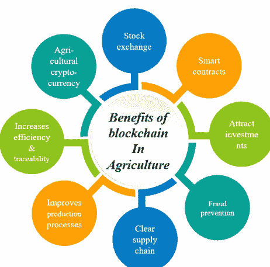

- **清晰的供应链**：借助共享区块链账本，所有利益相关者可以管理农产品运输并监控整个流程，这提升了农业商品的价值，因为受益人可以监控作物、牲畜和机械，以确保道德性和质量 [14]。消费者可以轻松追踪和验证产品从农田到家门口的整个旅程，因为消费者希望了解食品的来源。

- **改进生产流程**：数据是现代石油，是组织在劳动力之后最大的资产。所有从传感器和其他来源收集的数据都上传到区块链，这有助于改进生产流程 [15, 16]。

- **提高效率和可追溯性**：对本地农产品和有机产品的需求与日俱增。借助农业中区块链的实施，消费者可以轻松追踪和验证产品从农田到家门口的整个旅程。区块链存储关于谁种植该产品、谁收获、谁生产，以及最后谁运输该产品的所有数据 [17]。

- **农业加密货币**：比特币是全球领先的加密货币。在比特币取得巨大成功后，约 4,000 种加密货币被发明并在市场上流通。借助区块链，农民可以拥有自己的加密货币或进行加密货币交易。

- **股票交易所**：市场上有许多用于交易的加密货币，并且为此设有股票交易所。如果在农业中使用区块链和加密货币，初创企业可以通过股票交易所获得投资。

- **智能合约**：借助智能合约，种植者可以按时获得付款，因为智能合约是自动化的。

- **吸引投资**：农业中区块链的实施为种植者提供了通过 ICO 或首次代币发行吸引资金的机会，这是一种使用加密货币进行群众筹资的新方式。

### III. 区块链在农业中的局限性

在关注印度农业部门盈利能力的同时，在不利天气条件下，种植者面临许多挑战。其中一些挑战如下，并在图 6.11 中显示：

- **数据的不准确性和复杂性**：数据是新武器，如果数据错误，任何人都可能输掉战争。从传感器收集或由人工输入的数据并非总是可靠的。因此，收集的信息可能不一致。从农业供应链收集的数据非常复杂 [18, 19]。

- **能耗过高**：第一个区块链平台是比特币，它使用 PoW 共识机制，该机制依赖于矿工的辛苦工作，矿工通过解决数学问题获得奖励。系统使用非常高的能量来解决这些数学谜题 [20]。在比特币之后，许多区块链框架采用了不同的共识算法，能耗更低，但能源消耗仍然是区块链的一个主要问题。

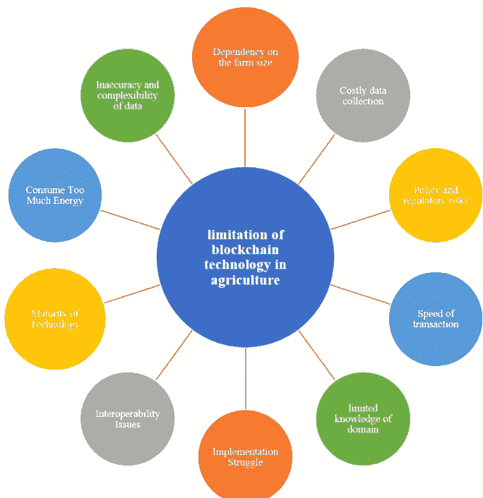

图 6.11 农业中区块链技术的局限性。

- **技术成熟度**：区块链技术仅有十年历史，在农业中应用不多。这意味着区块链是一种新技术，需要时间来成熟。

- **互操作性问题**：区块链的一个主要局限性是互操作性问题。在市场上，有不同类型的区块链平台，它们以完全不同的方式工作，并尝试以自己的方式解决问题。这导致不同区块链平台无法有效通信的问题 [21, 22]。

- **成本与实施困难**：区块链技术实施成本高昂，虽然像 Hyperledger 这样的某些平台是开源的，但仍需要希望追求该技术的企业投入巨资。

- **领域知识有限**：区块链技术仅有十年历史，在农业中应用不多。这意味着缺乏专业劳动力。要在农业中实施区块链，需要来自不同领域的多名专家，而要找到具有领域专业知识的合适劳动力总是很困难。

- **交易速度**：比特币区块链完成一笔交易需要一到十分钟。农业中区块链的实施受此交易速度影响。在选择区块链平台时，交易速度起着至关重要的作用。

- **政策与监管风险**：农业开发者面临的主要挑战之一是国家政策和法规。印度对农业有非常不同的政策。印度政府也针对加密货币发布了一些法规，这些法规影响区块链的实施。

- **数据采集成本高昂**：数据是现代石油，是组织在劳动力之后最大的资产。所有从传感器和其他来源收集的数据都上传到区块链，而这项数据采集成本非常高，因为农民需要使用多种传感器。对于小农户来说，这是主要局限性之一。

- **对农场规模的依赖**：在农业部门使用区块链的主要挑战之一是，有时收益取决于农田规模。例如，小种植者可能难以集成和收集农场数据，因为预算有限，他们无法负担区块链基础设施；另一方面，小农户可以通过区块链获得农场保险。

### IV. 区块链在农业中的可能应用场景

根据印度政府2020–2021年经济调查，约50%的印度劳动力依赖农业及相关部门，印度农业部门在印度GDP（国内生产总值）中的占比为20%，这使该部门成为印度GDP表现中的领先部门。印度政府计划在未来5年内将农业部门在GDP中的占比提高到约30%，并希望将印度农民的收入翻倍。印度农业部门需要借助新一代技术进行技术革命。区块链技术将在重组印度农业部门中发挥重要作用。下面列出并在图6.12中展示了一些领域，我们可以在这些领域利用区块链技术在农业部门中通过透明度来重新设计和推动经济发展。

- **农业供应链**：根据美国农业部的一份报告，实施某些ASM（农业管理软件）可以在同一块土地上产生高达65%–70%的更高利润。这些ASM为农业部门从种植者到消费者提供完整的供应链管理。区块链技术可以在该领域发挥关键作用 [23]。借助共享区块链账本，所有利益相关者可以管理农产品运输并监控整个流程，这提升了农业商品的价值，因为受益人可以监控作物、牲畜和机械，以确保道德性和质量。

- **公平定价管理**：僵硬的需求、气候条件、供给缺乏弹性和全球市场状况都会影响统计数据


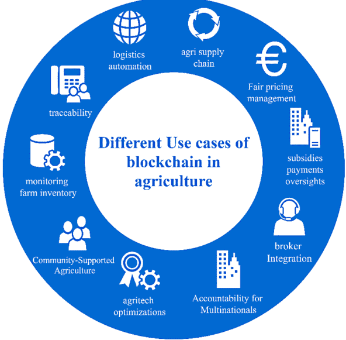

图 6.12 区块链在农业中的不同应用场景。

农民收入和产品价格极不稳定。在印度等发展中国家，中间商和经纪人也对农民收入起着负面作用。中间商储存农作物并控制市场定价，而农民承受苦果。借助农业区块链技术，每个参与者都可以监控和追踪农作物，这将减少中间商层面的农作物囤积，并能够管理价格。

- 3. 补贴与支付监管：印度政府为农民提供广泛的补贴，例如灌溉补贴、电力补贴、化肥补贴、农业基础设施补贴、信贷补贴、农业设备补贴、种子补贴和出口补贴，但这些政府补贴经常无法送到正确的人手中。印度政府实施向农民直接银行转账计划，这非常有用，但仍存在追踪问题 [24]。借助区块链，政府可以追踪和监控单个农民的补贴，这既有利于农民也有利于政府。

- 4. 经纪人集成：在印度等发展中国家，中间商和经纪人是农业供应链的一部分。中间商和经纪人从农民手中购买农作物，以高额利润转售给集市或企业，导致价格飞涨，影响消费者。很多时候，在政客的帮助下，这些经纪人控制农产品市场价格。借助农业区块链技术，每个参与者都可以监控和追踪农作物，这将减少中间商层面的农作物囤积，并能够管理价格。

- 5. **跨国公司问责制**：在全球市场上，各个领域总是有一些具有两极分化、争议或引发争论的名称。一些公司欺骗农民，不按时支付款项。有时不提供合适的农作物价格。为克服此类异常情况，可以使用区块链，它能提供完全透明度 [25]。

- 6. **农业技术优化**：根据美国农业部的一份报告，实施某些 ASM（农业管理软件）将在同一片土地上产生高达 65%–70% 的更高利润。机器学习、人工智能、物联网、云计算等技术在农业领域表现良好。根据 Gartner 调查，区块链技术与人工智能将彻底改变农业。区块链将用于透明度和可追溯性，而人工智能将用于分析一切。

- 7. **社区支持农业**：CSA（社区支持农业）在美国非常流行，印度也在实践 CSA，但以其自身方式且不使用技术。CSA 将社区中的许多人聚集在一起，他们在财务上帮助农民，作为回报获得部分农作物分成或一定比例的收入。区块链可以改善 CSA 运营，并为 CSA 所有成员提供透明度，这有助于根据预定协议分配无争议的收入。

- 8. **农场库存监控**：为避免收获后的损失，种植者需要非常积极地监控作物储存技术。他们必须确保 CO2 吸收低于 600，以避免虫害和霉变生长。幸运的是，市场上有多种传感器可用，它们在比旧式温度监测方法早 4–5 周检测潜在损失方面起着非常关键的作用。借助区块链技术，种植者可以轻松监控库存，并向所有关键参与者提供关于需要做什么的持续支持。

- 9. **货物可追溯性**：对本地农产品和有机产品的需求与日俱增。借助农业区块链实施，消费者可以轻松追踪和验证产品从农田到家门口的整个旅程。区块链存储关于谁种植了该产品、谁收获、谁生产，以及最终谁运输该产品的所有数据。

- 10. **物流自动化**：区块链有潜力记录和追踪各方之间的每一笔交易。许多组织现在正在物流领域使用区块链，以提高效率、实现不可篡改的追踪、增强安全性以及实现自动化智能合约。

## 6.5 结论与未来工作

本研究观察到，区块链技术可以通过不允许篡改数据来维护记录的隐私，从而提供一个值得信赖的环境。该技术可以与 IoT 等其他技术结合使用，以改善农业领域。在本章中，我们试图阐明印度农业产业的事实，详细说明农民的现状以及失败的原因。此外，作者提出了一种架构，以展示区块链技术的概念性实施。从未来工作的角度来看，可以讨论一些其他新问题，例如推荐解决方案所引发的挑战和局限性。

## 参考文献

- 1. N. Niknejad, W. Ismail, M. Bahari, R. Hendradi, and A. Z. Salleh, “食品和农业行业区块链技术研究趋势的制图：一种书目计量分析,” Environ. Technol. Innov., vol. 21, p. 101272, 2021, doi:10.1016/j.eti.2020.101272.
- 2. P. Mukherjee, R. K. Barik, and C. Pradhan, “Agrochain：向智慧农业推进区块链技术,” in books.google.com, 2021, pp. 53–60.
- 3. S. Mohapatra, K. C. Amirudh, R. K. Nithin, G. Bhandari, and J. Nyika, “农业食品系统中区块链技术应用：系统书目计量分析和政策要务，” 2021, 访问日期：2021 年 4 月 20 日。[在线]。可用：https://papers.ssrn.com/sol3/papers.cfm?abstract_id=3814912.
- 4. W. Liu, X. F. Shao, C. H. Wu, and P. Qiao, “面向精准农业发展的信息通信技术和区块链技术应用系统文献综述,” J. Clean. Prod., vol. 298, 2021, doi:10.1016/j.jclepro.2021.126763.
- 5. M. A. Ferrag, L. Shu, X. Yang, A. Derhab, and L. Maglaras, “基于绿色物联网农业的安全与隐私：综述、区块链解决方案和挑战,” IEEE Access, vol. 8, pp. 32031–32053, 2020, doi:10.1109/ACCESS.2020.2973178.
- 6. M. Torky, and A. E. Hassanein, “将区块链和物联网集成到精准农业中：分析、机遇和挑战,” Comput. Electron. Agric., vol. 178, p. 105476, 2020, doi:10.1016/j.compag.2020.105476.
- 7. H. Xiong, T. Dalhaus, P. Wang, and J. Huang, “农业区块链技术：应用与理由,” Frontiers in Blockchain, vol. 3, 2020, doi:10.3389/fbloc.2020.00007.
- 8. S. Ahmed, M. E. Islam, M. T. Hosen, and M. H. Hasan, “基于区块链的肥料分销系统：孟加拉国视角,” ACM Int. Conf. Proceeding Ser., 2020, doi:10.1145/3377049.3377116.
- 9. V. S. Yadav, A. R. Singh, R. D. Raut, and U. H. Govindarajan, “印度农业供应链中区块链技术采用障碍：一种综合方法,” Resour. Conserv. Recycl., vol. 161, p. 104877, 2020, doi:10.1016/j.resconrec.2020.104877.
- 10. Y. Chen, Y. Li, and C. Li, “电子农业、区块链和数字农业民主化：起源、理论与应用,” J. Clean. Prod., vol. 268, 2020, doi:10.1016/j.jclepro.2020.122071.
- 11. D. Prashar, N. Jha, S. Jha, Y. Lee, and G. P. Joshi, “农产品基于区块链的可追溯性和可见性：确保印度食品安全的分散方式,” Sustain., vol. 12, no. 8, 2020, doi:10.3390/SU12083497.
- 12. L. Hang, I. Ullah, and D. H. Kim, “基于区块链的安全鱼场平台，用于农业数据完整性,” Comput. Electron. Agric., vol. 170, no. December 2019, p. 105251, 2020, doi:10.1016/j.compag.2020.105251.
- 13. X. Li, D. Wang, and M. Li, “基于区块链技术的可持续电子农业便捷性分析,” J. Clean. Prod., vol. 271, p. 122503, 2020, doi:10.1016/j.jclepro.2020.122503.
- 14. K. Dinesh Kumar, D. S. Manoj Kumar, and R. Anandh, “食品供应链安全中的区块链技术,” Int. J. Sci. Technol. Res., vol. 9, no. 1, pp. 3446–3450, 2020.
- 15. L. Song, X. Wang, and N. Merveille, “可持续电子农业区块链研究,” 2020 IEEE Technol. Eng. Manag. Conf. TEMSCON 2020, vol. 7, 2020, doi:10.1109/TEMSCON47658.2020.9140121.
- 16. A. Vangala, A. K. Das, N. Kumar, and M. Alazab, “基于物联网农业的智能安全感知：区块链视角,” IEEE Sens. J., vol. 1748, no. c, pp. 1–1, 2020, doi:10.1109/jsen.2020.3012294.
- 17. S. S. Kamble, A. Gunasekaran, and R. Sharma, “农业供应链中区块链支持的可追溯性建模,” Int. J. Inf. Manage., vol. 52, November 2018, pp. 1–16, 2020, doi:10.1016/j.ijinfomgt.2019.05.023.
- 18. P. W. Khan, Y. C. Byun, and N. Park, “面向食品工业 4.0 的先进深度学习的 IoT-区块链支持的优化溯源系统,” Sensors (Switzerland), vol. 20, no. 10, pp. 1–24, 2020, doi:10.3390/s20102990.
- 19. M. Shyamala Devi, R. Suguna, A. S. Joshi, and R. A. Bagate, “基于物联网区块链的智能农业设计，以启迪安全与保障,” Commun. Comput. Inf. Sci., vol. 985, pp. 7–19, 2019, doi:10.1007/978-981-13-8300-7_2.
- 20. A. Kamilaris, A. Fonts, and F. X. Prenafeta-Boldú, “农业和食品供应链中区块链技术的兴起,” Trends in Food Science & Technology, vol. 91, arXiv, pp. 1–33, 2019.
- 21. S. Umamaheswari, S. Sreeram, N. Kritika, and D. R. Jyothi Prasanth, “BIoT：基于区块链的农业物联网,” Proc. 11th Int. Conf. Adv. Comput. ICoAC 2019, pp. 324–327, 2019, doi:10.1109/ICoAC48765.2019.246860.
- 22. J. Hua, X. Wang, M. Kang, H. Wang, and F. Y. Wang, “农产品基于区块链的溯源：具有复制和共享簿记的分布式平台,” IEEE Intell. Veh. Symp. Proc., vol. 2018, no. Iv, pp. 97–101, June 2018, doi:10.1109/IVS.2018.8500647.
- 23. L. Ge, C. Brewster, J. Spek, A. Smeenk, and J. Top, Blockchain for Agriculture and Food. Wageningen: Wageningen Economic Research, 2017.
- 24. Y. P. Lin et al., “区块链：ICT 电子农业的演进下一步,” Environ. - MDPI, vol. 4, no. 3, pp. 1–13, 2017, doi:10.3390/environments4030050.
- 25. G. Leduc, S. Kubler, J-P. Georges, and U, “创新的基于区块链的农业市场和智能合约性能评估,” J of C. Production, Elsevier, 访问日期 April 20, 2021。[在线]。可用：https://www.sciencedirect.com/science/article/pii/S0959652621012749.


# 7 COVID-19 爆发：供应链编排中的区块链安全交易

Sushant Kumar, Vinita Tiwari, Basant Agarwal, and Jagannath Jayanti

## 目录

- 7.1 引言 ....................................................89
- 7.2 相关工作 ....................................................93
- 7.3 提出的架构 ...........................................95
- 7.4 结果分析..................................................100
- 7.5 使用区块链的供应链中可能面临的挑战 .......101
- 7.6 结论 ......................................................102
- 参考文献..........................................................103

## 7.1 引言

新型冠状病毒疾病（2019-nCoV）给整个世界带来了严峻挑战。COVID-19 的严重担忧在于它从感染者传播到与其近距离接触的人的速度 [1, 2]。或许，毫不夸张地说，没有哪个行业不受这场前所未有的全球病毒性感染暴发的影响。虽然主要关注点不是病毒的致死率，而是病毒如何从感染者传播给其他人。病例和死亡人数的增加导致了全球范围的隔离和封锁。

全球科学界正在积极寻找治愈方法、治疗方案，并更加积极地研发疫苗。尽管迄今报告的若干临床试验已显示出有希望的结果，但一个更具体、更可行的解决方案仍备受期待。尽管 SputnikV、Covaxin、辉瑞、Covishield 等不同疫苗正在全球范围内接种，但要完全解除封锁并回归疫情之前的生活方式，尚未取得确定性。在社交和与他人互动方面仍需谨慎。因此，企业也必须在严格指导方针下运营，保持适当的卫生和环境卫生，并遵守社交距离规范。

由于上述原因，各种企业接待和服务的人数也受到限制。这带来了严重的经济后果。病毒传播的时间越长，对经济的影响就越大。这也引发了关于财务可持续性的担忧 [3]。全球许多国家采取了部分或完全封锁（印度就是其中之一）以防止疾病传播。这一前所未有的举措导致许多人失业，制造业也受到严重打击，全球经济危机迫在眉睫。电影院、餐厅、购物综合体等场所被迫关闭。在这种情况下，网上购物似乎是一个可行的替代方案。然而，由于病毒在彼此近距离的人群之间传播的速度，病毒从配送人员传播到消费者以及反之亦然的可能性不可忽视。因此，许多国家的多个地区甚至暂停了电子商务服务。由于这些严峻时期造成的阻碍，需要建立一个系统来应对当前的局面，并建立一个系统或方法来保持各种企业的运营，以便人们至少能够获得基本生活必需品。无论获得什么样的解决方案或替代方案，都应足够可持续，以便在未来面临任何此类前所未有的情况时，世界仍能运行。针对这一主题进行了大量研究，以开发克服世界目前面临的严峻问题的方法。

本作品的基础在于这样的事实：在全球化时代，供应链遍布全球，亟需一个更好的技术辅助系统，以取代传统的供应链管理技术，同时保留各利益相关者的个体利益。随着技术的进步，现在有广阔的空间进行大量研究、探索，以寻找有效维护供应链的潜在解决方案。区块链被提议作为维护供应链的一种替代方法，而供应链在全球危机中至关重要。本文回顾了区块链技术的关键方面及其改善供应链管理的潜力 [4]。凭借其分布式特性、多重记录保存以及无需集中式服务提供商即可运作的特点，区块链有助于保密、保护数据、确保透明度，并允许联盟中各利益相关者之间进行交易。除了医疗挑战之外，COVID-19 危机期间的另一大担忧是其对全球经济的不利影响。国际货币基金组织（IMF）负责人 Kristalina Georgieva 在 2020 年 3 月 28 日的官方声明中解释了 COVID-19 对世界经济造成的影响程度。然而，制约经济的主要障碍不在于病毒本身，而在于病毒传播的性质。在全球范围内实施社交距离规范、旅行限制以及消费者的焦虑，都可以说是过去 100 年来世界所见过的最严重衰退的潜在后果。

供应链是维持生产和业务本身连续性的最关键部分之一。它是确保公司成功与增长的组成部分。供应链至关重要，因为它执行许多功能，例如提升客户服务、降低运营成本（包括降低采购成本和降低生产成本）、改善企业的财务状况（包括增加利润、降低固定资产和增加现金流）[5]。

由于供应链对任何企业都具有如此重大的重要性，毋庸置疑，它需要得到妥善管理。供应链管理涉及每一个步骤或过程，从服务或产品的源头开始，一直到最终用户的交付或消费为止。简而言之，它是一个“商业实体网络”，参与向最终用户交付产品和/或服务。

图 7.1 展示了制造业的传统供应链管理。每个方块代表一个“商业实体”。流程始于原材料采购，接着是使用原材料制造产品，然后是交付（分销）、仓储（产品的批量存储）、零售商，最后是最终用户。

以下是对供应链各主要要素的简要概述。

原材料：这些是产品（进而间接是供应链）的基本构建模块。原材料是指制造产品所需的基本组件和未加工材料。原材料不仅是构建模块，也是任何制造过程的起点。它们也是创建产品的组织的一项投资。由于购买制造所需原材料取决于组织的采购能力，而采购能力是衡量企业财务实力的指标。因此，公司采取适当且有效的措施来管理其原材料库存至关重要。

制造商：制造商可以是任何创造产品的人。从生产智能手机和笔记本电脑的苹果等大型企业，到将布料缝制成精致西装的小型裁缝店，都是在其产品上运营、遍布整个地球的巨大商业光谱中不同部分的制造商。每个组织、每个企业、每个制造产品的业务，都需要确保无论他们在构建什么，都要给予产品质量至高无上的重要性，同时考虑生产成本和产生的收入。在过程中做到一丝不苟，可确保最大程度的客户留存和蓬勃发展的业务。

分销商：在一个行业不断变化、新技术以快速步伐被发明的动荡世界中，分销商在供应链管理中发挥着关键作用。近年来，客户不再倾向于批量订购商品，而是倾向于

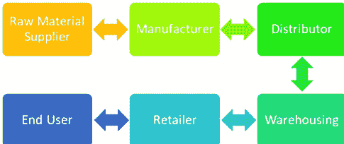

图 7.1 制造业的传统供应链管理。


目前仍小批量订购。在这种情况下，持续生产产品至关重要。然而，生产优质产品固然重要，确保产品在运输过程中不受损坏并以良好状态送达买家或最终用户同样重要。制造商需要值得信赖的人来确保其产品正确交付。分销商负责产品的交付。消费者可能会好奇，为什么要为有分销商作为中间商的产品支付更多费用。然而事实是，作为较低价格的回报，他们需要自己扮演分销商的角色，所付出的努力远超过购买产品所多付的钱。因此，分销商发挥着至关重要的作用，因为他们辛勤维护着供应链的连续性。

仓储：仓储是供应链中同样重要的一个方面。随着全球化和工业化的到来以及技术和机械的巨大增长，生产规模已变得庞大。运往各个制造现场的大量物料以及相应产生的产品数量，实在令人难以承受。在这种情况下，按需让所有物品始终在途中对组织来说非常昂贵且风险很高。在这种情形下，产品损坏的几率会显著增加。因此，以如此巨大的产量制造的产品需要基于运输、可用空间大小等多种因素，堆放并存储在合适的地点。仓库正是为此目的而存在。在仓库中，产品成批存储并得到妥善分类，从而方便定位仓库内的物品。

零售商：向目标用户销售产品的实体。零售商可以是销售制造商所制造产品的企业或个人。零售商从分销商处获取产品，进而将其销售给消费者。零售商是供应链中的倒数第二个环节，产品由此环节到达其应到达的地方。

最终用户：最后但同样重要的是最终用户或消费者。他们可以被称为供应链中最重要或最有价值的部分。制造商正是为了消费者而创造产品。消费者对产品越满意，购买量就越大，制造商获得的利润也就越多。

以上所有环节共同构成了供应链，协同工作以确保供应链的流畅、和谐流动与连续性。

这是一个高度简化的供应链管理模型，不失一般性。值得提及的是，供应链的规模可以大可以小，实体内部也可能存在独立的供应链（例如，制造可能是一个多步骤过程，每个步骤都依赖于前一步骤的输出）。

模型中相邻商业实体之间的双头箭头表示两者之间的通信链路。观察该模型可得出的一个重要结论是，通信只能在两个相邻的“商业实体”之间进行。这导致了几个问题。主要问题是缺乏透明度、信息不足以规划下一个产品开发周期，并且由于当今几个行业中供应链具有全球分布的特性，采用这种模式时，如果任何一个商业实体因本地问题而中断，整个链条都将中断，危及整个行业。如果各个商业实体之间共享了一些信息，那么就有可能做出替代安排来弥补损失，并在常规服务恢复之前维持运营。

供应链是复杂的机器，拥有多个利益相关者。根据2020年供应商信息研究，81%的供应链领导者对其供应商数据不完全有信心，而60%的人表示更新过时的供应商信息花了四天时间，导致客户不满和财务损失[6]。由于全球大流行和强制限制，这一问题的影响将成倍增加。需要采取一些方法来解决这一问题。尽管人工智能（AI）、机器学习和区块链等技术无法对抗COVID-19，但它们可以帮助管理经济系统。本文旨在讨论利用区块链技术规避COVID-19带来的挑战的可能性。

区块链作为一种颠覆性技术闯入市场，并可能成为近未来行业的主导工具之一。它提供了当今世界至关重要的若干特性，例如数据隐私、透明度、去中心化和数据不可篡改性。这些特性改善了生产中涉及的流程，并通过提高供应链的敏捷性、韧性和响应能力，为当前的供应链增添了价值。因此，企业应该研究和评估面向区块链的供应链与传统供应链的对比。与传统供应链相比，集成区块链的供应链的全球认可度指数值较高，这表明在供应链中使用区块链技术以赋予其可持续性是合理的[7]。

## 7.2 相关工作

担心医疗系统超负荷运转以及全球封锁导致资源匮乏，使供应链中断的直接后果压在他们肩上。根据世界经济论坛的说法，2019年冠状病毒病暴露了全球供应链管理系统中的许多弱点[8]。大流行的最后五个月揭示了全球供应链中缺乏连接和数据交换的问题[9]。根据摩根大通公司（JPMorgan Chase & Co.）的预测，大流行COVID-19有可能使全球经济瘫痪，未来18至24个月的预计损失将超过5.5万亿美元[10]。

协作出现了中断，而这种协作原本用于通过贸易渠道以受信任、可验证且高效的方式追踪、认证、追溯、融资并清关医疗货物和物资[11]。COVID-19对全球互联网络的供应链产生了巨大影响。大流行凸显了世界对互联互通且可互操作的供应链的需求。挑战不仅体现在技术方面，贸易限制还进一步加剧供应链中断，导致大多数供应商停产以及多个物流合作伙伴推迟货物运输。许多组织在供应链中仅具备“上一级”和“下一级”的可视性，因此，食品供应缺乏真正的端到端可视性[12]。无法实时获取可信数据，结果，许多地区出现食品短缺或必需品价格上涨的情况。由于缺乏供应链可见性，许多零售商囤积食品而不是提供给客户，然后向客户收取大笔费用。通过使用区块链和物联网（IoT），食品公司和零售商可以与政府建立联系，政府可以监督食品供应链，并具备端到端的可见性和信任[13]。

因此，许多国家正在探索区块链技术，以向民众平稳交付服务。阿联酋就是这样一个国家，正逐步过渡到区块链技术，以实现政府服务的平稳分发[14]。UAE Pass是阿联酋政府开发的此类应用之一。中国正在部署区块链技术以应对大流行情况；应用包括慈善捐赠管理、为中小型企业提供融资。中国药品必需成分集中化使其容易中断，因此中国在大流行期间在医疗保健数据分析中采用了区块链技术[15]。同样，悉尼正在采用区块链，结合物联网和5G，预计到2029年将为其经济贡献300亿澳元[16]。

随着全球化的发展，供应链管理和控制变得更加困难。区块链在这方面提供了帮助，因为作为分布式账本技术，它确保了透明度、安全性和可追溯性。它正在被证明可信，能够缓解供应链管理中遇到的问题所带来的困难。实现可持续发展目标日益增大的压力，为研究如何利用区块链协助供应链管理流程提供了更多动力[17]。

区块链日益流行，并已成功吸引了各行各业的关注。随着许多人持积极态度接受这项新技术，可以探索许多详细的调查和用例，以更多地了解它如何对供应链管理产生深远影响[18]。

已识别出一系列好处，表明区块链反而能够成为供应链管理的助力者。其中包括改善可持续供应链管理、降低供应链中的交易成本以及减少非法假冒。然而，由于该技术仍处于萌芽阶段，供应链管理领域的研究人员需要进一步深入调查区块链如何在供应链管理中应用[19]。

除了区块链，AI也被引入以帮助供应链管理。AI已被用于分析数据、揭示业务模式，并帮助更好地洞察供应链[20]。

当今世界产生的数据量巨大，增长速度前所未有，因此有必要就供应链管理开展研究。可以使用数据科学技术来理解数据。揭示数据中的模式和趋势，并以更深入的洞察了解供应链的各个方面，开发更敏捷的系统可能会非常有帮助。JH Tseng等人[21]建议使用Gcoin区块链。其被建议作为与药品相关的数据流的基础，以生成关于药品交易的透明数据。参与药品供应链的所有单位都将能够同时参与，以防止假药传播，目标是保护公众健康。


Khalid et al. [22] 开发了一种消除对可信赖中央机构需求的共识算法。他们以以太坊区块链为基础，切入农业供应链。该算法性能最优，并促进供应链所有成员之间的交易。区块链的不可篡改账本用于存储和记录所有交易。

医药供应链是另一个正在寻求利用技术实现重大突破和发展的领域。基于区块链的供应链在药品召回管理和应对处方药滥用方面取得了可观的成果。利用智能合约自动化所考虑供应链中的各种流程，可以显著降低成本。除了医药供应链应用外，区块链还可应用于医疗用品和设备以及公共健康等领域 [23]。

论文 [24] 中介绍的一家初创公司 Modum.io，使用带有传感器的物联网设备并结合区块链，以便于获取温度记录，同时确保医药供应链中的数据不可篡改，从而降低运营成本。所有关于温度和湿度的数据以确保质量控制，都会被添加到区块链中。

在葡萄酒供应链中，构建安全且可追溯的系统也是势在必行的。随着掺假行为增加、防腐剂和有害化学品大量使用以及假冒伪劣产品增多，此类系统的需求变得更加不可或缺。在基于区块链的供应链中，每一笔交易都会被记录，每位相关成员都可以以区块的形式查看这些记录。该系统除了提供可追溯性外，还提供安全性、透明性和安全保障 [25]。

在现代世界中，当有多个利益相关方时，维护供应链颇具挑战性。当前使用的系统存在诸多缺陷，例如缺乏可靠数据。区块链已成为一种强有力的替代方案，可能弥补传统方法的这些缺陷。区块链提供许多特性，如安全性 [26, 27]、可追溯性、不可篡改性、透明性，最重要的是企业利益相关方之间的信任 [28]。

由于 RFID 标签在任何公共场所都容易被克隆，其在后续供应链中的可信度无法完全保证。文章 [29] 中提出了产品所有权管理系统（POMS）。该系统借鉴了比特币区块链的动机。使用该系统，客户有机会拒绝假冒产品 [30]。该系统是使用基于区块链的去中心化应用程序开发的。

区块链结合其他技术有助于解决全球供应链的各种挑战。区块链作为共享账本，在点对点网络系统中使用强大的加密标准来记录和验证交易。交易是去中心化且透明的，因此网络中的每个节点都拥有信息的副本。这有助于消除任何单点故障和欺诈行为。

## 7.3 提议的架构

图 7.1 和图 7.2 所示的制造业示例，代表了一种基于区块链的供应链管理替代模型。可以看出，通过区块链技术，各种“商业实体”之间建立了共同连接。然而，必须记住，在

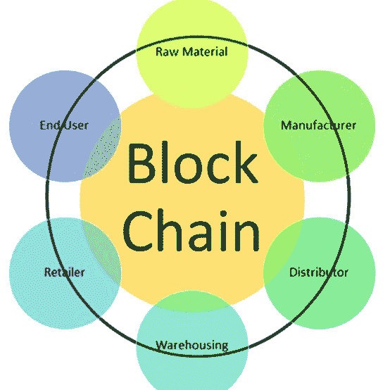

图 7.2 制造业的基于区块链的供应链管理。

这种技术中，不存在能够访问所有信息并可能损害利益相关方个人利益的中央服务器或记录保存机制。信息以去中心化的方式共享，但仅按选择性基础与每个利益相关方共享。

区块链有两种模型：无许可型和许可型。在无许可型中，参与者数量庞大，其身份匿名；这种类型通常用于加密货币挖矿。另一种模型是许可型，其中只有少数受邀参与者组成一个用于任何商业活动的群体或联盟，并且其身份事先经过身份验证。各方都知道其他各方，并在友好的环境中工作。然而，各方之间为实现公平交易而建立的信任可能并不普遍。因此，区块链框架应运而生。区块链框架可以彻底改变不同参与方之间的全球贸易。不可篡改性、透明性、安全性和自动化等区块链属性使供应链编排成为可能。

在到达最终消费者之前，货物会经过庞大的参与者网络，包括采购原材料、制造商品、分销中心、政府审计员、集装箱、港口、零售商，最终到达最终用户消费者，如图 7.3 所示。在这个漫长的供应链中，

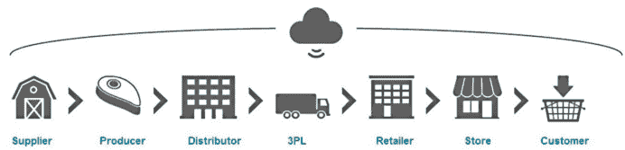

图 7.3 间歇性停顿的庞大供应链。（来源：参考文献 [5]）。

有大量人员参与，其间歇性干预是不可避免的。Covid-19 预防措施无意中给这一链条刹了车。为了让经济复苏并步入正轨，必须消除这些障碍。

在图 7.3 中，所有环节都可能存在集成、可追溯性、可审计性、不可篡改性和自动化等方面的潜在漏洞。超级账本框架以可行的方式构想了这些方面。通过在该框架上共享货物详细信息，最终用户可以自动自行验证货物的真实性。

Hyperledger Fabric 是一种无许可型区块链，使用分布式账本技术（DLT）。它包含智能合约，即带有逻辑的代码，也称为链码，用于描述系统的应用逻辑。Fabric 的其他关键要素包括成员服务提供者（MSP）、账本以及由背书节点、提交节点和排序节点组成的对等节点（节点）[31]。

联盟中涉及的所有组织都拥有多个对等节点，这些节点包含涉及交易的账本。智能合约包含链码和事件。MSP 包含组织所有对等节点的数字证书。它对它们进行身份验证，以授予访问权限。Fabric 客户端与区块链交互。账本存储所有保留不可更改历史记录的块链。提交节点维护账本并提交交易 [31]。背书节点负责执行链码、给出输出，然后达成一致判断交易是否合法。它还持有智能合约。另一方面，排序节点对所有交易进行排序，批准将交易块纳入账本，并与提交节点和背书节点进行通信。

如图 7.4 所示，共识是通过遵循交易流程来实现的：背书、排序、验证。客户端应用程序调用交易。背书策略指定哪些背书节点必须对其签名，以使策略生效。每个用户都有来自 MSP 的唯一客户端应用程序 ID。它将交易发送给多个与其相关的背书节点。所有由策略确定的背书节点都会对其输出进行签名。随后，这些节点会执行交易但不提交它。每个节点或对等节点都会捕获读写集（RW）并对其签名。现在交易已被加密。RW 集被发送回应用程序。现在客户端应用程序将响应提交给排序节点。与此同时，其他应用程序也在向排序节点提交交易。排序节点还具有一种用于

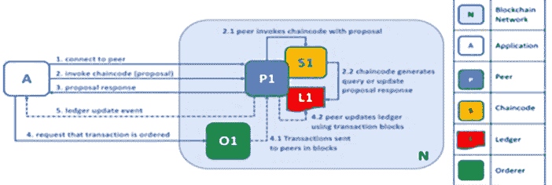

图 7.4 Hyperledger Fabric 交易。（来源：参考文献 [32]）。

在不同账本之间提供隐私保护。排序节点将交易收集到提议的区块中，以分发给提交节点。

每个提交节点都会根据背书策略进行验证。这些经过验证的交易被应用到账本并保留在那里。这些已提交并经过验证的交易将作为区块添加到区块链中。在发生任何故障时，对等节点可以向应用程序发送事件以通知相同情况。

在此，图 7.5 显示，一名生产商品的制造商，在掌握所有详细信息后，通过 MSP 登录客户端应用程序，进行身份识别，并设定商品价格，然后其他作为对等节点的可用组织会验证客户端签名并背书交易。随后，这些交易被排序并发送给提交节点进行验证。最后，它会在商业活动账本中更新。账本会发送给制造商以运送货物。运送的商品信息会通过渠道发送给相关对等节点，整个活动状态正在

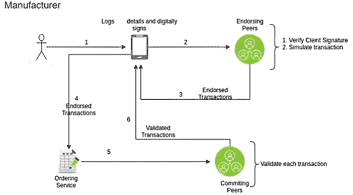

图 7.5 智能合约在行动中。（来源：参考文献 [33]）。


区块链。IoT 有助于随时查找货物位置，并集成在区块链内部。利益相关方之间的任何实物接触都被排除，并建立了电子数字交换。

装载货物的集装箱已设置并安装了 IoT 设备，以便随时通过 GPS 监控位置。位置可追踪，且对区块链网络中的所有实体透明。此外，食品零售商可以随时间监控特定易腐食品的温度和湿度。实时库存和货物运输可见。货物到达仓库后，借助 IoT 可以轻松定位。由于实时位置追踪，工人还可以找到特定物品的特定通道。IoT 能够实现几乎无需人工干预的无缝工作流程。负责设置货物的员工必须遵守安全规程，例如对所有包装设备进行消毒、个人防护装备（PPE）、口罩等。一旦货物安全运出，分销商在将货物带回其仓库时也必须遵循同样的模式。分销商随后可以在区块链网络上与零售商建立联系，并促成业务交易。

在图 7.6 中，系统中的所有利益相关方（例如制造商、分销商、监管人员、承运商、零售商和消费者）均显示连接到 Hyperledger Fabric 网络，所有业务活动均通过该网络完成。制造商可以通过在系统中其他节点间调用智能合约来出售其货物。他将提供有关食品的详细信息，如唯一 ID、时间、位置、质量、重量、集装箱编号等，同时审计员/监管人员可以检查并

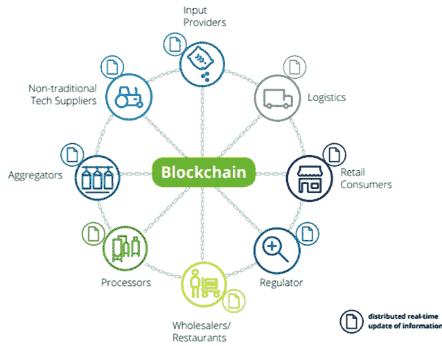

图 7.6 区块链网络。（来源：参考文献 [34]。）

验证他是否在政府监管范围内。一旦他经过验证，其他节点可以检查他的智能合约背书，如果愿意购买，可以按他要求的金额为其背书。此外，如先前所述，制造商可以通过通道以不同价格将同一货物出售给不同的节点或组织。该信息在制造商和分销商之间保持私密。每个人都可以在彼此之间进行交易，并满足其业务需求。所有数据均作为交易保存在区块上，并由 Hyperledger Fabric 本身确保的区块链维护。随时都有不可否认性和数字签名。因此，内部建立了一个生态系统，业务可以蓬勃发展。

在 COVID-19 场景下，由于实施社交距离，所有企业的生产力均受阻碍。允许的最少数量的工人，并实施了口罩和消毒剂等安全规程。在这些情况下，原材料采集、生产、运输、销售均陷入极低速度。因此，Hyperledger Fabric 网络可能非常有效，因为只需要最少的人工干预。无需人类聚集、会议、小组、合同文件、签名等。这将推动陷入蜗牛速度的业务活动。

## 7.4 结果分析

在文献 [35] 中，讨论了一种制造供应链，其中产品的生命周期始于共享和存储可交换数据的安全记录。如图 7.7 所示，每个产品都将拥有其独特数据，例如 RFID、条形码等。因此，将针对其实体形式设置虚拟身份（唯一数字加密标识符）。这些详细信息将由所有受益方共享。受益方可以是认证者（CA）、制造商、分销商、承运商、消费者、零售商等。

此外，受益方将注册其配置文件，其所有详细信息将共享并存储在组织的选项卡中。此外，他们由注册审计员认证。

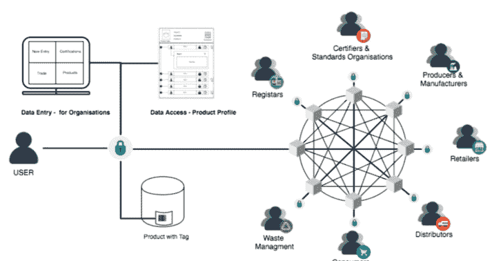

图 7.7 支持区块链的供应链。（来源：参考文献 [35]。）

系统中的任何实体都可以查看这些详细信息（如果配置文件为公开）；否则，他们也可以保持匿名（但认证仍为强制性），由能够达成交易的注册审计员提供。所有受益方都拥有公钥-私钥对。公钥帮助他们在网络中进行通信，而私钥对产品合同代码进行数字签名。该软件运行在区块链网络上，例如以太坊区块链。网络系统中的数据访问取决于授予受益方的授权角色。

## 7.5 使用区块链的供应链中的可能挑战

区块链的整个概念基于不可篡改且分布式的账本理念，具有在无需任何中央机构干预的情况下以可信且透明的方式运行业务的潜力。区块链在为各个行业（包括本讨论的供应链领域）增加巨大价值方面显示出巨大前景 [36, 37]。尽管区块链备受炒作，但需要一种更现实的视角，以便更客观地评估与其相关的各个方面。区块链在存储方面会产生高成本和高开销。它主要用于存储信任缺乏的交易相关数据。只有在其实现的成本能被其提供的收益所抵消时，区块链才是一个可行的选择。

首要挑战可能是在处理区块链时产生高计算开销。尽管用于供应链管理的区块链应用比加密货币中的应用更高效，但仍需要高计算能力，例如，从区块链读取数据。与使用区块链的应用相关的操作可能比传统数据库的操作更慢。

由于区块链是去中心化的，这是其一大优势，但管理它可能会很麻烦。维护去中心化应用可能比管理中心化应用要困难得多。目前，区块链在企业中尚未非常流行。

区块链记录分布式账本中发生的每一笔交易，当由多方使用时，这可能会开始累积。用于加密以生成信任的算法本身就是增加数据开销的算法。处理数据复杂性是使用区块链的应用面临的另一个挑战。由于组织需要处理的数据量巨大，他们可能最终需要管理比以往大得多的数据结构。早期的区块链在应用程序的业务逻辑级别运行，需要将数据和元数据都推送到区块链上。因此，企业在处理区块链应用时需要解决这一问题。他们可以通过在传统数据库中存储的数据与去中心化账本中存储的数据之间取得平衡，来降低遇到此问题的风险 [38]。

区块链与其他数据处理技术最显著的不同特征之一是数据不可更改性；然而，供应链中的数据是由人输入的。因此，依赖人员来添加高质量数据，因为否则修改输入到区块链应用中的错误数据可能会非常麻烦。供应链的本质是整合业务的不同方面。为了进行这些整合，供应链依赖于各种工具，而将区块链平台添加到所有工具中可能证明是一项棘手的任务。这是因为并非每个系统目前都与区块链兼容，而且每个人都尚未接受将区块链集成到系统中 [39]。

尽管区块链尽可能安全，但它也面临几个安全问题。其中一个问题是“51% 攻击”。如果任何实体在任一时点拥有超过 51% 的算力，它们就有能力控制区块链。另一个问题是分叉问题。这些问题与软件即将升级时节点的版本有关。分叉分为两种类型：软分叉和硬分叉 [40]。

区块链的另一个主要问题是可扩展性问题。传统交易系统因其交易处理速度而被广泛接受。另一方面，比特币和以太坊，这两个在区块链上运行的最大网络，在这方面相差甚远。此外，关于区块链本身也缺乏足够的清晰度，这成为其被大众采用的重大障碍 [41]。

## 7.6 结论

这是前所未有的时代。由于新冠病毒引发的全球大流行，让我们意识到，无论世界多么先进，即使在 AI、机器学习、机器人等领域技术不断增加的情况下，世界也无法完全为这种情况做好准备或配备。大流行暴露了许多领域的缺陷，并对现代科学及其能力提出了一系列问题。整个世界被迫暂时封锁，直到情况好转。由于封锁和隔离，数百万人的生活受到影响。人们失去了生计、工作，与他人完全隔离，特别是与居住在不同城市的亲人隔离。这是一种没有人选择但每个人都被迫处于的孤独。大量人也因此在精神上受到影响。除了感染冠状病毒之外，获得其他疾病的医疗保健也变得越来越困难，因为人们不愿走出家门，甚至更害怕进入医院，因为那里收治了大量新冠患者。除了医疗保健，获得基本生活必需品也似乎是一项艰巨的任务，这要归咎于封锁和限制。从一个车流繁忙、交通拥堵的世界来看，新常态正朝着一个方向发展，即即使是最繁忙的道路也会空无一人。

在这样的时期，保持世界运转的重担落在了许多行业身上。其中包括医疗保健、科技行业以及许多生产日用品的企业。医疗专家正在积极寻找疫苗和其他方法，既防止传播又治愈感染冠状病毒的患者。然而，技术无论多么先进，都无法对抗新冠病毒。幸运的是，它在疫苗发布之前，在帮助世界运转方面发挥了至关重要的作用。正因如此，居家办公等规范成为现实。此外，技术帮助企业继续运营，正如本文的目的一样，区块链被证明是供应链管理当前和未来非常可行的选择。当世界正处于严重新冠病毒的困境中，所需要的就是安全和业务场所的顺畅流动。A


在不同对业务连续性感兴趣的组织/利益相关者之间成立了联盟。此时，人力不足，且人们正努力在这种不稳定的情况下生存。在此背景下，在实现人员安全所有目标并推进社会物质需求的同时，区块链可以成为救星。本文提出了一种模型，其中人工干预最少，业务也能快速增长。任何货物运输都可以通过友好的工作环境和利益相关者之间的信任，从制造商到消费者进行。这提高了整个生态系统的效率和增长。端到端交易的可追溯性和透明度将增强整个供应链系统的信任。这种流程自动化将节省成本和时间。简而言之，本文的目标是提供一种架构，确保企业的整个流程（从产品制造到最终用户消费）能够以最少的人工干预实现。这提高了整个供应链的效率和信任，节省了大量的开支和时间，同时也帮助企业扩张和增长。

## 参考文献

- [1] Sarfraz, Z., Sarfraz, A., Iftikar, H. M., & Akhund, R. (2021). COVID-19 是否正将我们推向第五次工业革命（社会 5.0）?. 巴基斯坦医学科学杂志, 37(2), 591.

- [2] Bhatnagar, V., Poonia, R. C., Nagar, P., Kumar, S., Singh, V., Raja, L., & Dass, P. (2020). 印度背景下 COVID-19 患者的描述性分析. 交叉数学杂志, doi:10.1080/09720502.2020.1761635.

- [3] Gupta, M., Abdelmaksoud, A., Jafferany, M., Lotti, T., Sadoughifar, R., & Goldust, M. (2020). COVID-19 与经济. 皮肤病学治疗.

- [4] Baudet, C., Medina, M. J., & Lebraty, J. F. 动荡环境下的区块链与供应链. IEEE Access, 4(14), 2292–2303.

- [5] Kohl, H., Henke, M., & Daus, D. (2021). 02 全球价值链中供应链管理对可持续发展的重要性. 全球价值链可持续发展：负责任企业的措施、伦理与最佳实践, 3.

- [6] Jairoun, A. A., Al-Hemyari, S. S., Abdulla, N. M., El-Dahiyat, F., Jairou, M., Al-Tamimi, S. K., & Barag, Z. B. (2021). COVID-19 大流行期间的在线药品购买：来自阿拉伯联合酋长国的试点研究. 药房政策与实践杂志, 14, 38.

- [7] Mukherjee, A. A., Singh, R. K., Mishra, R., & Bag, S. (2021). 区块链技术在农业供应链可持续发展中的应用：合理性框架. 运营管理研究, 1079, 1–16.

- [8] Ivanov, D. (2021). 供应链可行性与 COVID-19 大流行：四大适应策略的概念与形式化推广. 国际生产研究杂志, 59(12), 1–18.

- [9] Alsamhi, S. H., Lee, B., Guizani, M., Kumar, N., Qiao, Y., & Liu, X. (2021). 用于去中心化多无人机对抗 COVID-19 的区块链. arXiv 预印本 arXiv:2102.00969.

- [10] Ceccato, I., Palumbo, R., Di Crosta, A., Marchetti, D., La Malva, P., Maiella, R., ... & Di Domenico, A. (2021). “接下来是什么？” COVID-19 大流行预期后果的个体差异. 人格与个体差异, 174, 110674.

- [11] Liang, S., Liu, H., Gu, Y., Guo, X., Li, H., Li, L., ... & Tao, L. (2021). 基于卷积神经网络的医学图像中 COVID-19 的快速自动检测. 通讯生物学, 4(1), 1–13.

- [12] Karmaker, C. L., Ahmed, T., Ahmed, S., Ali, S. M., Moktadir, M. A., & Kabir, G. (2021). 新兴经济体中 COVID-19 大流行背景下供应链可持续性的提升：使用综合模型探索驱动因素. 可持续生产与消费, 26, 411–427.

- [13] Singh, S., Kumar, R., Panchal, R., & Tiwari, M. K. (2021). COVID-19 对物流系统和食品供应链中断的影响. 国际生产研究杂志, 59(7), 1993–2008.

- [14] Papadaki, M., & Karamitsos, I. (2021). 中东和北非地区的区块链技术. 发展信息技术, 27(3), 1–18.

- [15] Hasan, M. R., Deng, S., Sultana, N., & Hossain, M. Z. (2021). 区块链技术在医疗保健情境中应用以应对 COVID-19 挑战的适用性. 图书馆高科技.

- [16] Sartipi, F. (2021). 通过加密货币公开建筑公司. 建筑材料杂志, 2, 3.

- [17] Saberi, S., Kouhizadeh, M., Sarkis, J., & Shen, L. (2019). 区块链技术及其与可持续供应链管理的关系. 国际生产研究杂志, 57(7), 2117–2135.

- [18] Hackius, N., & Petersen, M. (2017). 物流与供应链中的区块链：是福是祸？. 在《供应链管理与物流的数字化：工业 4.0 环境中的智能与数字化解决方案》. 汉堡国际物流会议 (HICL) 论文集，第 23 卷（第 3–18 页）. Berlin: epubli GmbH.

- [19] Cole, R., Stevenson, M., & Aitken, J. (2019). 区块链技术：对运营和供应链管理的影响. 供应链管理：国际期刊, 24(4), 469–483. doi:10.1108/SCM-09-2018-0309.

- [20] Min, H. (2010). 供应链管理中的人工智能：理论与应用. 国际物流杂志：研究与应用, 13(1), 13–39.

- [21] Tseng, J. H., Liao, Y. C., Chong, B., & Liao, S. W. (2018). 通过 goin 区块链对药品供应链进行治理. 环境与公共卫生国际杂志, 15(6), 1055.

- [22] Salah, K., Nizamuddin, N., Jayaraman, R., & Omar, M. (2019). 农业供应链中基于区块链的大豆可追溯性. IEEE Access, 7, 73295–73305.

- [23] Clauson, K. A., Breeden, E. A., Davidson, C., & Mackey, T. K. (2018). 利用区块链技术增强医疗保健供应链管理：对健康供应链中挑战与机遇的探索. 区块链在医疗保健中的应用, 1(3), 1–12.

- [24] Bocek, T., Rodrigues, B. B., Strasser, T., & Stiller, B. (2017 年 5 月). 无处不在的区块链——制药供应链中区块链的一个用例. 在 2017 年 IFIP/IEEE 综合网络与服务管理研讨会 (IM) (第 772–777 页). IEEE.

- [25] Biswas, K., Muthukkumarasamy, V., & Tan, W. L. (2017). 基于区块链的葡萄酒供应链可追溯性系统. 在 2017 年未来技术会议 (FTC) (第 56–62 页). 科学与信息组织.

- [26] Jha, S., Kumar, R., Chatterjee, J. M., & Khari, M. (2019). 面向智慧世界的计算互联网与物联网之间的协作握手方法：2009–2017 年综述. 电信系统, 70(4), 617–634.

- [27] Khari, M., Garg, A. K., Gandomi, A. H., Gupta, R., Patan, R., & Balusamy, B. (2019). 使用密码学和隐写术技术保护物联网 (IoT) 中的数据. IEEE 系统、人与控制论：系统汇刊, 50(1), 73–80.

- [28] Jabbar, S., Lloyd, H., Hammoudeh, M., Adebisi, B., & Raza, U. (2020). 支持区块链的供应链：分析、挑战与未来方向. 多媒体系统, 27, 787–806. doi:10.1007/s00530-020-00687-0

- [29] Toyoda, K., Mathiopoulos, P. T., Sasase, I., & Ohtsuki, T. (2017). 用于供应链后端中防伪的创新区块链产品所有权管理系统 (POMS). IEEE Access, 5, 17465–17477.

- [30] Chatterjee, J. M., Ghatak, S., Kumar, R., & Khari, M. (2018). 仅作为信息货币的比特币：2010 至 2017 年的有价值回顾. 质量与数量, 52(5), 2037–2054.

- [31] Stefanovic, N. (2021). 供应链管理中的区块链：机遇、技术与应用. 在《组织知识、管理与技术百科全书》 (第 2472–2487 页). IGI Global.

- [32] Kernahan, A., Bernskov, U., & Beck, (2021 年 1 月). 区块链开箱即用——服务型区块链中的区块链在哪里？. 在第 54 届夏威夷系统科学国际会议论文集 (第 4281 页).

- [33] Alves, L., Carvalho, T., Cruz, E. F., & da Cruz, A. M. R. (2021). 使用区块链追踪 PDO/PGI/TSG 产品. 在第 23 届企业信息系统国际会议 (ICEIS 2021) 论文集，第 2 卷，第 368–376 页.

- [34] Balamurugan, S., Ayyasamy, A., & Joseph, K. S. (2021). 驱动食品供应链改进安全措施的 IoT-区块链可追溯性技术. 国际信息技术杂志, 1–12. doi:10.1007/s41870-020-00581-y

- [35] Bhat, M., Qadri, M., Beg, N. U., Kundroo, M., Ahanger, N., & Agarwal, B. (2020). 社交媒体对 Covid19 爆发反应的情感分析. 脑、行为与免疫, 87, 136–137. doi:10.1016/j.bbi.2020.05.006.

- [36] Abeyratne, S.A., & Monfared, R.P., 2016. 使用分布式账本的区块链就绪制造供应链. 工程与技术研究国际杂志, 05(09), 第 1–10 页.

- [37] Kumar, A., Liu, R., & Shan, Z. (2020). 区块链是供应链管理的灵丹妙药吗？技术挑战与研究机遇. 决策科学, 51(1), 8–37.

- [38] Hobbs, J. E. (2021). 食品供应链韧性与 COVID-19 大流行：我们学到了什么？. 加拿大农业经济学杂志/Revue canadienne d’agroeconomie. doi:10.1111/cjag.12279

- [39] Rana, N. P., Dwivedi, Y. K., & Hughes, D. L. (2021). 印度公共部门区块链采用挑战分析：诠释结构建模方法. 信息技术与人员.

- [40] Lin, I. C., & Liao, T. C. (2017). 区块链安全问题与挑战调查. 国际网络安全杂志, 19(5), 653–659.

- [41] Yaqoob, I., Salah, K., Jayaraman, R., & Al-Hammadi, Y. (2021). 医疗保健数据管理中的区块链：机遇、挑战与未来建议. 神经计算与应用, 2260, 1–16.


## Taylor & Francis

Taylor & Francis Group

http://taylorandfrancis.com

# 8 能源领域的区块链技术
挑战与机遇的系统性综述
M. Arvindhan, M. Thirunavukarasar, and A. Daniel

## 目录

- 8.1 区块链技术简介 .................................................... 107
- 8.2 区块链技术概述 .................................................... 108
- 8.2.1 区块链技术应用 ................................................ 108
- 8.3 区块链生态 ........................................................ 109
- 8.3.1 未来思考者已构建相应模型................................... 110
- 8.4 多网络嵌入与绿色供应链绩效 ................................ 111
- 8.5 区块链对能源公司运营的潜在影响 ........................... 113
- 8.6 批发能源交易 ...................................................... 115
- 8.7 公用事业和能源系统利益相关者的区块链交易 ............. 116
- 8.8 结论 .................................................................... 117
- 参考文献 .................................................................... 117

## 8.1 区块链技术简介

区块链具有多种结构，大多共享四个主要特点：分布式信息存储（交易记录的公共账本）、加密、永久性和共识算法。作为一种特定的分布式账本创新，区块链在共享网络中存储编码信息，将连续的“数据块”连接成“链”。所有组织成员可访问的数据是区块链上所有数据交换的共同记录。共识算法保证数据在此分布式组织中保持一致和不变，并阻止个别客户在未获得组织批准的情况下将此数据添加到账本中。此外，由于区块链的设计，链上的早期数据不能被更改或删除，因为这样做会损害分布式账本的完整性 [1]。

## 8.2 区块链技术概述

区块链的默认发展路径如下：从被动到主动。区块链无论如何都可以向公众开放，并提供清晰可辨的记录。大量数字货币被用作免费的去中心化区块链（参见图 8.1）。完全私有的区块链提供给单个成员公司，用于董事会监控或记录保存等任何用途。私有/公共区块链联盟（或混合区块链）可以促进金融机构或医疗保健提供者等实体进行更高效的交易，但也可以在这些网络的成员之间分发数据。某种形式的区块链，反过来，取决于动机和计划。公共和私有区块链专注于大型群体；因此，它们对个人来说更便宜、更易获得 [2]。

区块链的运行方式存在很大差异，取决于其设计架构，涉及共识算法、数据可访问性和不可篡改性。此外，某些区块链平台建立在已有区块链之上（例如以太坊等平台）（即应用层）。

其他类型的分布式账本技术（DLT）包括 Hashgraph、DAG 和 Tangle。与依赖计算流言（gossip）来达成共识的普通 DLT 不同，基于流言的 D-Lite 享有共识，并像交织链一样组织。有向无环图允许并行事务和子树。

### 8.2.1 区块链技术应用

对于一系列应用，董事会可以并且已经使用了数据，范围从信息技术到医疗再到石油。在 2017 年之前的三年里出现了许多区块链，现在这些区块链被分为三个基本分类：公共、专有和联盟。

按需（去中心化应用程序）：这些应用程序正处于不同的增长阶段，最常见的都涉及游戏或交易，以及融资和支付。一种加密货币可以实现为代币（基于加密的收费），或作为实用性（在区块链上运行的数字现金）（代表数字证券的代币）。（参见图 8.2。）目前存在三种主要的区块链

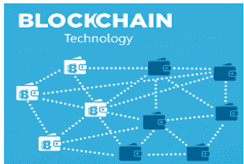

图 8.1 区块链技术。

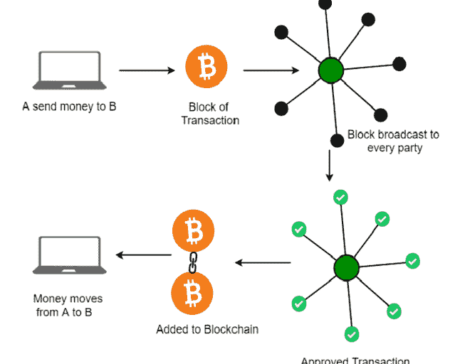

图 8.2 区块链技术中的交易。

变体：公共区块链、私有区块链和定制区块链；在后两者中，定制区块链引发最重大的法律问题。正如“客户”所指出的，人们可以将公共区块链作为一种投机行为，而非其本身。关于社交网络的重要对话包括 Ripple（Ripple 会议）和 block.one（blockchain.io）（EOS 公有链）[3]。

## 8.3 区块链生态

根据字典，“区块链”一词可能指比特币或其他数字货币交易被复制且不可更改的记录。尽管其位置与高额资金相关联，但它目前被赞誉为一个应用范围涵盖一切的网络，基于价值而非货币。区块链创新的优势是双重的：没有需要追随的单一贷方，也没有单一故障点。区块链的使用在增加，其影响更加深远，这对其未来是一种保证。那么，总体而言，这一新发现带来了什么后果 [4]？

2014 年的最后几个月也出现了关于“数字货币挖矿”与意外后果相关联的新闻事件。挖矿是寻找区块、检查交易是否有效，然后在区块链中广播它们的过程（这也是发行新数字货币的方法）。任何可以访问网络的人都有权参与挖矿（Investopedia）。为了提取有价值的矿石，矿工必须使用大量能源。据估计，比特币对环境的影响相当于 235 万辆汽车。每次发生该事件时，都会创建一个新区块并启动另一个耗能过程。在试图节约资源的同时，中国仍然存在低效的能源设施。就转向挖矿策略而言，存在燃料来源（及其他必需品）的多样性，但就电力而言，我们正在从一边走向另一边 [5, 6]。

例如，一个组织正在构建一种先进的货币和区块链（Chia），它提议“耕作”而非“挖矿”——其理念是使用硬盘上的未使用容量，而不是处理能力。GENERCoin 是一种“支持项目的、整合环保电力与数字货币的计算机化货币”。在此示例中，该货币由“环保电力”能源支持。它可以兑换为所支持的能源，或大量交易；与其他数字货币一样。EverGreenCoin 是一种用于为自然绿色项目筹集资金的加密货币——例如可再生能源和水资源保护 [7, 8]。

区块链甚至被宣称为一种确保气候的方法；因为区块链对众多客户开放，所持有的信息是透明的、不可更改的，并且一旦添加就无法删除——在添加另一条记录之前需要不同计算机的批准。这减少了交易成本和中介，并提高了生产力。区块链还允许分布式协会。这些事物可以用来帮助气候 [9, 10]。

### 8.3.1 未来思考者已构建相应模型

- 1. 分布式将改善追求生态和国际条约的能力。
- 2. 对善事事业的捐款应准确、公正地分配。
- 3. 产品可以一路追溯到其起源。这有助于降低碳足迹，改善环境责任，并减少可疑程序的数量。
- 4. 制定回收计划是个好主意——例如，如果您为参与者设置了奖励。
- 5. 与集中式分布相反，可以提供点对点系统并限定能量流动。
- 6. 可以使用区块链来追踪货物，以评估碳成本。

能源系统必须考虑日益增长的可再生能源发电量，包括风能和太阳能光伏。由于私有化、能源市场拆分以及有利的金融政策，许多创新的可再生能源最近涌现出来。已广泛研究了新兴能源的环境影响，以区分可再生能源和基于化石燃料的能源替代方案。将来自风电场或太阳能农场的可变电力整合进来是困难的。


融入整体电力系统。分散这些实体资产以重新思考我们的能源管理系统至关重要。适应未来可再生能源的可能电网包括微电网的“蜂窝”结构，其中一些微电网可以结合风能、水能、太阳能和微交易。区块链技术被认为能够承载合法且可追踪的交易。区块链需要弹性工具、数据存储和用于开发应用程序的开发环境，除此之外，还需要弹性计算，因为它能够在短时间内实现快速计算（预防性维护、能源管理优化、需求响应应用程序）。根据作者的说法，传统供应链使用大量资源并产生巨大排放，从而对环境造成重大危害。绿色供应链强调从开始到结束整个流程的绿色化，不仅是产品，还包括中间的一切环节，包括设计、制造、分销、回收和废弃物管理。因此，企业选择突出低碳经济，将其融入供应链，阐明企业未来的优先事项，并在低碳背景下提升产出 [11, 12]。

## 8.4 多网络嵌入与绿色供应链绩效

在过去十年中，绿色供应链的发展已从单一链条转变为由各种链条组成的互联系统网络，由上游的多个利益相关者和下游的众多消费者构成。多尺度网络具有节点密度和供应多样性的多种组合，而非链式绩效（特别是与知识和资源异质性嵌入相关的绩效）可以为企业提供多种不同类型的优势。它促进并维护异质信息和技术系统，同时防止密集知识提供的“窒息影响”。与双重网络或单一网络相比，单一网络内更多的网络意识和活动可能会导致较低的创新成功率 [13, 14]。

区块链是一种去中心化和分布式数据库系统，不使用单点故障或第三方信任。智能合约可以在使用区块链的 P2P 网络中执行（参见图 8.3）。同步更新允许更多用户保持活跃，进而促进账本的多种变体 [15, 16]。成员不是通过单一信任核心来处理账本，而是基于文档副本达成一致。我们仍在努力确定共识究竟是如何达成的，但它可能在不同领域以不同方式实现。将交易与后续交易和前一笔交易关联起来，使区块链能够进行全面且可验证的记录保存。每个网络上的任何客户都可以进行检查，以查看交易是否正确且可信，并提供证据。区块链已开始在多个领域实现其潜力，包括不同行业的初创公司、试点、测试和研究。根据德国能源与安全署委托的一项调查，20% 的能源决策者同意区块链是能源供应商的游戏规则改变者。这基于 70 名受雇于能源

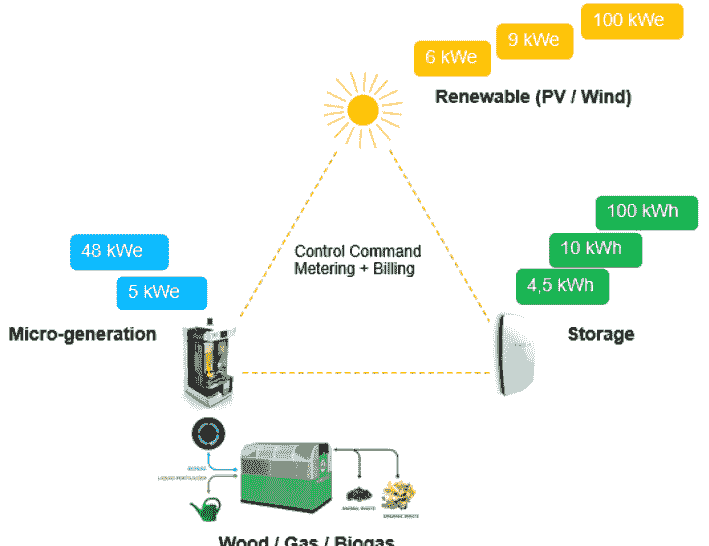

图 8.3 基于可再生能源的绿色供应链绩效。

行业，以及能源供应商、聚合商、公用事业、输电和发电供应商 [17]。

大约一半的参与者已经开始或正在准备将区块链或加密货币纳入其组织或业务。许多能源公用事业公司热衷于使用分布式账本应用程序（DLT）来减少碳足迹并促进可持续发展。此外，根据德勤和普华永道的高级业务和技术咨询报告，由于不断发展的加密货币作为可以跨境交换的数字资产，区块链有机会颠覆多个不同的行业。这项早期研究提高了人们的希望，即区块链可能有能力解决能源行业的问题 [18]。未来能源系统可识别出三项要求：脱碳、去中心化和个性化。然而，迄今为止，能源和电力市场已证明对这一意图反应不佳。因此，少数参与者基本上已被逐出市场，财务激励未能说服活跃客户群体参与（参见图 8.4）。通过构建早期基于区块链的交易网络，早期采用者正在为点对点能源交易打下基础。他们正致力于整合本地能源生态系统和物联网（IoT），以进一步实现其智能电网概念。能源公司对不断上升的能源成本和下降的收入流日益担忧；

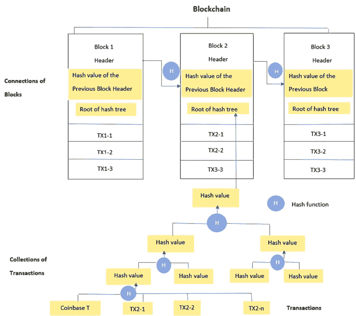

图 8.4 块和块中头部值的交易哈希。

根据普华永道的说法，监管机构对问责制增加的要求与对公用事业研究人员创造力的相应要求增加同步发展。能源系统运营中的任何节省和效率都可能因潜在安全问题而抵消，因此调查所有这些问题比假设它们不存在更安全 [19, 20]。

## 8.5 区块链对能源公司运营的潜在影响

预计区块链技术将影响能源领域相关的一系列市场流程和活动。

根据现有文献，以下是可能受到影响的实施方式和业务模式特征。

使用区块链、智能合约和智能计量，客户和分布式发电商可以获得实时结算。能源微支付、预付费电表和按需付费解决方案对公用事业公司很有用。

然而，消费者的能源档案、优先事项以及对环境的担忧可能会显著影响营销方式。区块链与机器学习等人工智能技术结合，能够识别用户模式，从而提供越来越个性化的能源解决方案。

分布式交易平台可能会挑战市场管理、商品交易和风险管理运营。假设区块链也用于碳信用交易 [21]。

去中心化和微电网可能从区块链的自动化中受益。在分布式平台上重新本地化点对点能源交易将允许本地能源产出和用量大幅增加，从而影响收入和电价。

区块链可用于智能设备通信、数据传输或两者兼而有之，包括智能电表、复杂传感器、网络监控系统以及用于调节电力的设施，这些都是智能电网的一部分。除了使信息更安全之外，电网实施还可以提供许多其他好处，例如区块链提供的信息标准化和可追溯性 [22]。

DLT 应用已被提议用于零售交易流程。包括经纪商、交易所、市场报告公司、银行、物流公司和监管机构在内的第三方系统在能源市场中发挥着关键作用 [23]。

从这种电网管理的角度来看，点对点电力交易系统的主要技术障碍在于，每个设备都必须处理电网状况和基本经济学，以及价格和本地状况。（参见图 8.5.）因此，

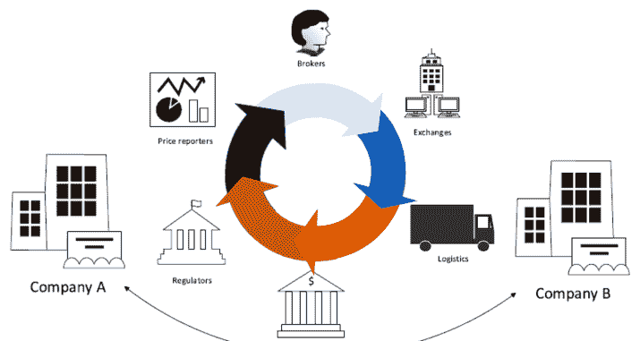

- 价格发现
- 交易执行
- 交易录入
- 物流
- 确认
- 保证金
- 了解您的客户
- 对账
- 结算
- 报告

图 8.5 公司 A 和公司 B 模型的能源构成。


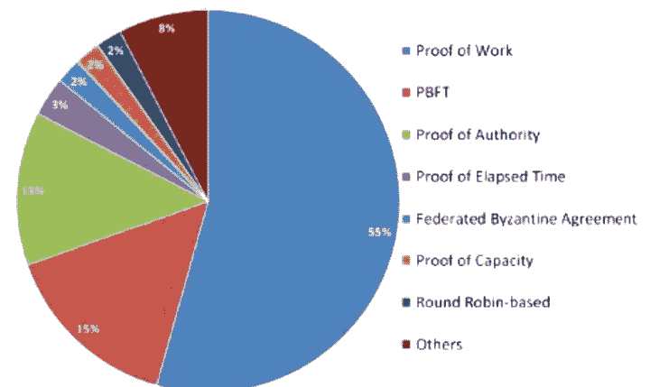

图 8.6 操作系统技术比较比率。

客户需求预计将向设备运营商提供电力预测，这在现有能源市场中已有实践。在大规模应用中，机器学习可以帮助预测电力用户的潜在行为。

多个组织正在开发新的区块链，包括水表和热量表。区块链基础设施是一种联网计量系统，用于在分布式系统上监测用水量。他们试图制造一种能够在不发出通知的情况下检测维修需求的机器。还希望能为电力和天然气开发出类似的应用。Engie 最近与 Air Products 建立了新的合作伙伴关系，利用区块链技术来绘制和验证其生产过程中使用的可再生能源。在使用区块链管理智能电表数据时，必须仔细考虑区块链问题。区块链或账本之定义对所有人开放（参见图 8.6）。维护数据的保密性可能需要开发新技术，使得能源消耗难以被识别。与区块链等去中心化系统相比，确保隐私可能要困难得多，例如欧盟《通用数据保护条例》(GDPR)。一种可能的替代方案是使用化名或许可账本，只有获得数据查看权限的人才能获得数据。另一个关键问题将是是否保存分布式长篇账本的问题。

## 8.6 能源批发交易

被动光网络（PON）的目的是在能源领域创建基于区块链的解决方案，用于特定地区的能源交易。2016 年，一个基于区块链的网络被用于在 Proigen 和 GoByte 之间买卖电力。该 P2P 交易平台迄今已与超过 40 家欧洲能源交易公司和公用事业公司建立合作伙伴关系，以发展区域性和基于时间的实物及日前市场交易，以及上游和下游环境下的交易 [24]。PON 的另一个重要合作伙伴是由 Norddeutsche Energiewende 4.0 (NEW) 牵头的面向灵活、平衡和本地能源转型的智能电网联合倡议 [25]。

## 8.7 公用事业和能源系统利益相关者的区块链交易

各种项目试图向能源系统的所有领域开放大门。这旨在开发一个建立在以太坊上的数字网络，用于连接运营商、制造商、客户以及供应能源和消费能源的各方。为了与利益相关者交换实时运营信息，能源分配、计量和账单将使用区块链协议实现去中心化（参见图 8.7）。该平台使用人工智能技术来实现自动响应并收集商业情报。Bitt 还结合供需在一小时内达成交易。建议可以使用 Bittwatt 的最新加密货币 BWT 进行 P2P 交易。它已构建一个分布式网络，利益相关者（发电者、公用事业公司、监管机构）可以以可信的方式交换实时价格信息 [26]。

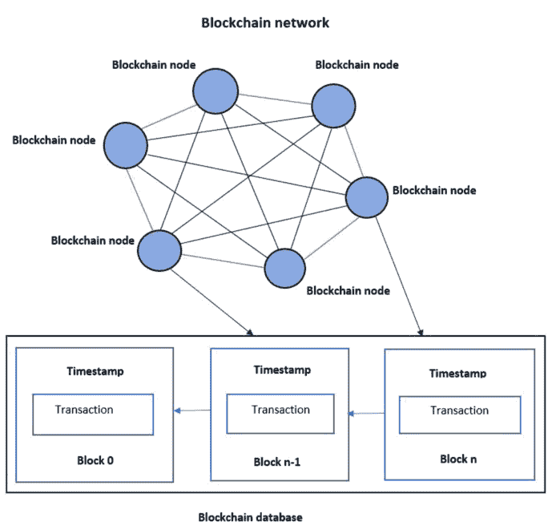

图 8.7 区块链网络上的数据库连接。

## 8.8 结论

区块链是一种用于可信测量和监控能源相关资产的有前景的技术，随着自发电和微电网业务场景在公共和私营部门普及，这些资产预计将变得更加去中心化。在区块链的理论基础以及能源管理的相关商业应用方面，仍有大量研究待做。智能合约和点对点交易作为区域能源交易模型的基础和重要组成部分，未来将继续是区块链和能源研究的热点。区块链技术在可再生能源、电动汽车充电和共享充电基础设施领域的应用，始终将是区块链和能源研究的焦点。

## 参考文献

- [1] Zheng Z., Xie S., Dai H.-N., Wang H. 区块链挑战与机遇：一项调查。https://www.henylab.net/wp-content/uploads/2017/10/blockchain.pdf, [访问于 2018 年 6 月 5 日] (2017).
- [2] Froystad P., Holm J. 区块链：驱动价值互联网（白皮书）。https://www.evry.com/globalassets/insight/bank2020/bank-2020-blockchainpowering-the-internet-of-value-whitepaper.pdf, [访问于 2017 年 6 月 18 日] (2016).
- [3] Baliga A. 理解区块链共识模型。https://pdfs.semanticscholar.org/da8a/37b10bc1521a4d3de925d7ebc44bb606d740.pdf, [访问于 2017 年 6 月 29 日] (2017).
- [4] Hyperledger. Hyperledger 架构，第 1 卷：Hyperledger 商业区块链设计理念和共识简介。https://www.hyperledger.org/wp-content/uploads/2017/08/Hyperledger_Arch_WG_Paper_1_Consensus.pdf, [访问于 2017 年 11 月 20 日] (2016).
- [5] Ethereum Wiki. 权益证明常见问题解答。https://github.com/ethereum/wiki/wiki/Proof-of-Stake-FAQ, [访问于 2017 年 10 月 24 日] (2017).
- [6] Ethereum Wiki. 关于分片区块链。https://github.com/ethereum/wiki/wiki/Sharding-FAQ, [访问于 2018 年 6 月 8 日] (2018).
- [7] Benke J. 链上与链下。https://energyweb.atlassian.net/wiki/spaces/EWF/pages/17760291/On-Chain-vs+Off-Chain, [访问于 2018 年 6 月 8 日] (2018).
- [8] Reese A.A. 区块链扩容第二层方案调查，第 1 部分。https://www.ethnews.com/a-survey-of-second-layer-solutions-for-blockchain-scaling-part-1, [访问于 2018 年 6 月 8 日] (2018).
- [9] Poon J., Dryja T. 比特币闪电网络：可扩展的链下即时支付。https://lightning.network/lightning-network-paper.pdf, [访问于 2018 年 8 月 29 日] (2016).
- [10] Swanson T. 共识即服务：关于许可型分布式账本系统出现的简要报告。http://www.ofnumbers.com/wp-content/uploads/2015/04/Permissioned-distributed-ledgers.pdf, [访问于 2017 年 7 月 21 日] (2015).
- [11] Pilkington M. 区块链技术：原理与应用。https://ssrn.com/abstract=2662660, [访问于 2017 年 6 月 18 日] (2015).
- [12] Mazieres D. 星际共识协议：面向互联网级共识的联邦模型。https://www.stellar.org/papers/stellar-consensus-protocol.pdf, [访问于 2018 年 2 月 1 日] (2015).
- [13] Energy Web Foundation. 能源网基金会。http://energyweb.org/, [访问于 2017 年 11 月 24 日] (2017).
- [14] Intel Corporation. Sawtooth 简介。https://sawtooth.hyperledger.org/docs/core/releases/latest/introduction.html#, [访问于 2017 年 11 月 4 日] (2017).
- [15] Buntinx J.P. 什么是经过时间证明？https://themerkle.com/what-isproof-of-elapsed-time/, [访问于 2017 年 11 月 4 日] (2017).
- [16] Hertig A. Intel 通过重新构想比特币的 DNA 赢得区块链批评者的青睐。https://www.coindesk.com/intel-winning-blockchain-critics-reimaginingbitcoins-dna/, [访问于 2017 年 11 月 4 日] (2017).
- [17] Li X., Ma E., Qu H. 款待业研究知识图谱——基于 CiteSpace 的可视化分析，Int. J. Hosp. Manag. 60 (2017) 77–93.
- [18] Chen C. CiteSpace II：检测和可视化科学文献中的新兴趋势和瞬态模式，Wiley Online Library 57 (2006) 359–377.
- [19] Peng R.-Z., Zhu C., Wu W.-P. 跨文化能力研究领域的知识域可视化：一项计量分析，Int. J. Intercult. Relat. 74 (2020) 58–68.
- [20] Fang Y., Xu H., Jiang J. 时间序列数据可视化研究综述，MS & E 782 (2020) 022013.
- [21] Mylrea M., Gourisetti S.N.G. 面向智能电网韧性的区块链：以速度、规模和安全性交换分布式能源。载于：Resilience Week (RWS) 2017 论文集，IEEE，2017，第 18–23 页.
- [22] Mengelkamp E., Gärtner J., Rock K., Kessler S., Orsini L., Weinhardt C. 设计微电网能源市场：个案研究——布鲁克林微电网，Appl. Energy 210 (2018) 870–880.
- [23] Mylrea M., Gourisetti S.N.G. 智能“自动”建筑中的网络安全与优化。载于：Lawless W., Mitu R., Sofge D., Russell S.（编）。自主与人工智能：威胁还是救星？Springer International Publishing；（2017）。第 263–294 页.
- [24] Mustafa M.A., Cleempunt S., Abidin A. 本地电力交易市场：安全性分析。载于：IEEE PES Innov Smart Grid Technol Conference Europe 论文集，IEEE，2016，第 1–6 页.
- [25] Jansen J., Drabik E., Eigenhofer C. 原产地保证的披露：与 2030 年气候和能源框架的相互作用，CEPS 特别报告，第 149 号，2016.
- [26] Awasthi D. 从物物交换到比特币：交易面貌的变化，Elk Asia Pacific Journal of Finance and Risk Management 6 4 (2015) 64–71.


# 9 Blockchain and Government

Anupama Sharma, Ruchi Gupta, Jitendra Kumar Seth, and Seema Garg

## CONTENTS

- 9.1 简介....................................................................................120
- 9.2 区块链的独特功能............................................................122
- 9.3 基于区块链的治理目的 ...........................................122
- 9.4 区块链技术 – 协助政府的途径 .................122
- 9.4.1 使福利供应更高效 ............................123
- 9.4.2 交易成本 ........................................................................123
- 9.4.3 土地登记 ........................................................................123
- 9.4.4 食品价值链 ........................................................................123
- 9.4.5 确保基本政府基础 ........................................123
- 9.4.6 作物保险 ............................................................................123
- 9.4.7 区块链经济 .....124
- 9.5 区块链在治理中的权宜之计 .............................................124
- 9.5.1 数字身份管理..........................................................124
- 9.5.2 分布式账本上的选举 ..................................................124
- 9.5.3 用于资本化的区块链 ........................................................124
- 9.5.4 建立信任 .....124
- 9.5.5 直截了当的治理 ........................................................125
- 9.5.6 真正的追踪 .....125
- 9.6 政府使用区块链的现状 ...........................125
- 9.6.1 中国 .....125
- 9.6.2 迪拜 .....126
- 9.6.3 美国.....126
- 9.6.4 英国.....126
- 9.6.5 印度 .....126
- 9.7 政府流程中的区块链应用 .................................127
- 9.7.1 选举流程中的区块链 ...............................................127
- 9.7.2 透明的公共采购....................................................127
- 9.7.3 公司所有权登记 ......................................................127
- 9.7.4 拨款发放....................................................................127
- 9.8 通过区块链进行治理 – 主要问题与挑战 ........128
- 9.8.1 初始实施成本 ........................128
- 9.8.2 技术的早期状态 ......................128
- 9.8.3 隐私风险与数据泄露 ................128
- 9.9 印度的区块链用例研究 ...............128
- 9.9.1 土地记录 ....................................129
- 9.9.1.1 诉讼高成本 ........................129
- 9.9.1.2 确立土地所有权.....................129
- 9.9.1.3 信息的异步性 ..................129
- 9.9.2 药品供应链管理...130
- 9.10 区块链与政府 – 未来治理.........130
- 9.11 结论 ........................................130
- 参考文献....................................................131

## 9.1 简介

通过区块链进行数字化并制作政府数据账本，是各种政府运作中的变革力量 [1]。区块链有可能协助各种政府活动，随着技术不断发展，其采用也在增加。基于区块链的政府 [2] 文档有助于保护数据，使运作公平，拒绝双重交易，同时增加其确定性和问责性。用于政府数据的基于区块链的分布式账本代表了一种使用密码学安全共享资源的高效方式。基于区块链的模式在宪法上保护持有于政府的一个国家公民的数据。

政府通过基于区块链的政府数据账本获得以下优势：

- 政府和公民信息的不可动摇保留
- 政府无需中介高效运作
- 更好的执法
- 在政府和公民之间建立信任
- 降低与维护问责制相关的昂贵支出
- 减少腐败
- 增加政府运作的透明度
- 在在线公民系统中建立信任

图 9.1 描绘了区块链在许多领域（无论是政府还是其他领域）的一些直接好处。政府也可以从区块链辅助的新兴技术（如物联网（IoT）和人工智能（AI））中受益。包括数字货币/支付、土地登记、身份管理、供应链可追溯性、医疗保健、公司注册、税收和投票在内的许多政府和公共部门应用，都可以利用来支持分布式账本格式。因此，政府活动可以使用区块链和其他新兴技术更好地组织，以服务国家。图 9.2 代表了区块链用于政府流程的一些主要作用。

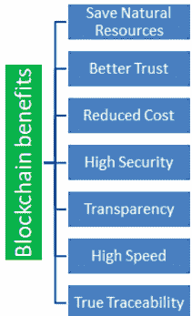

图 9.1 区块链的优势。


图 9.2 治理中的区块链。

## 9.2 区块链的独特功能

区块链技术由一些技术组件组成，包括哈希函数、加密算法和去中心化网络。**分布式或去中心化**账本相比中央机构提供了均匀分布的权力。这些去中心化账本是**不可篡改且可审计的**，因为不可篡改意味着存储的数据不能被擦除或更改。哈希函数用于避免存储数据被篡改。区块链中使用的加密算法是公钥加密。

## 9.3 基于区块链的治理目的

采用区块链技术进行政府运作将有助于启动一个司法和财政系统的信心循环，近年来该系统一直缺乏这种信心。以下是受区块链技术影响的几个领域：

- 产权登记
- 身份管理
- 投票系统和选举流程
- 敏感数据保护
- 供应链管理追踪。

基于区块链的治理的主要目的是更好地服务国家。只有在民众对政府活动建立信任，才有可能实现这一点。真正的可追溯性、透明度、身份管理、分布式账本上的未改变数据、福利分配、税务问题处理等，都由区块链管理并发挥着重要作用。

## 9.4 区块链技术 – 协助政府的途径

区块链协助政府运作，以恰当管理其关键职能。虽然区块链作为一个去中心化的公共账本，与治理基础（主要基于集中式公共部门单位）不同，但这种技术的引入有可能彻底改变政府处理事务的方式，使其迅速、高效且透明。

近年来，印度政府宣布了许多使用这种革命性技术进行电子政务项目的计划。州政府也表现出了对区块链的兴趣。2017 年 6 月，安得拉邦和特伦甘纳邦政府表示，他们计划采用区块链解决方案用于土地登记、数据保护和 KYC（了解你的客户）记录。

马哈拉施特拉邦、古吉拉特邦和北方邦等州也表达了采用区块链解决方案的兴趣。以下列出的三个关键领域是将区块链纳入治理可以对政府实施其社会议程的方式产生根本性影响的地方。

### 9.4.1 使福利供应更高效

对于世界各国政府来说，照顾弱势群体和社会弱势群体是其基本义务之一。养老金、残疾人奖学金、补贴液化石油气（LPG）以及电力等福利计划，对于像印度这样数以百万计的人口处于贫困线以下的国家来说，是穷人和弱势群体唯一的生计来源。在直接福利转账计划下，这些付款中的大部分可以得到覆盖。然而，该过程中仍然存在一些困难，例如欺诈、人为错误、一些没有银行账户的申请人以及难以优先处理最需要政府援助的人。

### 9.4.2 交易成本

政府实施区块链技术可以显著降低这些成本。由于不需要第三方来进行交易和维护记录，欺诈、泄露和人为错误的机会将大大降低。

### 9.4.3 土地登记

印度目前模糊的土地产权是一个令人担忧的主要原因，导致长期诉讼。通过将土地契据/记录集成到区块链中，可以使其永久且防篡改。

### 9.4.4 食品价值链

政府将通过区块链技术确保农业供应链的可追溯性和问责性。有可能成功处理与价格不平等、拖欠付款和中间商相关的问题。

### 9.4.5 确保基本政府基础

在当前攻击危险突出的时代，怀有邪恶计划的个人很有可能夺取基本开关的控制权。因此，政府协会和组织的基本信息面临被夺取的风险。此外，随着铁路、防洪堤坝、能源设施和许多其他领域也使用创新，事故和攻击对财产和人员造成损害的危险也随之增加。通过分布式账本，可以监控产品的可信度，以防止任何非法更改。它还确保来自使用物联网的系统传输的信息不会被篡改。

### 9.4.6 作物保险

区块链是监管作物保护的理想平台。在当前结构中，总理农作物保险计划（PMFBY）是分批管理的。利用


区块链安排使公共机构能够为其服务增加附加值——例如，转移有关收获和产量限制的警告和规则。同样，保险机构也可以转移该批次所有收获的费率，利用群体的专家协议。

### 9.4.7 区块链经济 [3]

区块链能够在自主模式下实现交易。去中心化自治组织通过区块链上的智能合约进行治理，从而使整个系统高效且经济。

## 9.5 区块链在治理中的便利性

全球众多立法机构并非为接受数字货币而设计；但它们确实理解区块链的重要性。公共机构可以利用区块链处理多项任务以提升日常运营效率。区块链在政府中的优势涵盖以下各方面。

### 9.5.1 数字身份管理 [4]

数字身份管理是区块链技术的关键规划，用于处理组织的个人数据并连接各种客户数据库。所有这些流程无需由相关单个组织存储数据。此外，数据库无需集中化即可连接并从任何地方访问。

### 9.5.2 分布式账本上的选举

区块链技术提供安全、分布式且可审计的记录保存。该概念可用于选举投票过程中，以避免舞弊。此外，投票计数变得自动化，并能提供无扭曲的直接决策。

### 9.5.3 区块链用于资本化

金融交易可以通过区块链技术进行保护，从而确保其安全。基于区块链的公共账本可能可供无权修改的成员访问，从而保护交易数据并防止欺诈。整个数据库在使用适当加密存储后将得到保障。政府的财务计划可以在不丢失数据的情况下维护，从而降低文书工作成本。这提高了生产率并提供直接的结果。

### 9.5.4 信任构建 [5]

受区块链治理的应用目前在银行和医疗保健等多个领域增长，因为这带来了速度提升和高效实现。

皮尤研究中心指出，美国公民对美国政府的信任几乎降至历史最低点的18%。公众信任可以通过使用区块链技术得到增强。

受区块链治理的安排是直接且去中心化的。例如，瑞典、爱沙尼亚和格鲁吉亚的政府正在实施基于区块链的土地保险库，使众多各方能够安全地保存账本副本。这种模式有助于快速解决财产争议，或以透明的方式预防此类争议。当公民和政府共享记录访问权限时，怀疑的可能性会降低。这些活动提高了公民对政府流程的信任。

### 9.5.5 直接治理

政府组织可以通过使用区块链技术实现更顺畅的运作，涉及减少重复、减少审查问题以及增强安全性。政府当局可能对该技术有更好的协调。GSA FAST_Lane计量框架用于监督卖家的建议；目前处理一项即将到来的提案需要40天，而采用区块链后，时间可缩短至10天。此外，GSA官员认为，采用该技术后，费用已降低约80%。

### 9.5.6 真正的追踪

区块链提供了传统追踪系统无法实现的真正商品追踪。由区块链赋能的生产网络变得非常高效。它能高效处理各种网络问题，并使后续跟进非常便捷和现实。

## 9.6 政府中区块链使用现状

各国商业格局已通过区块链经历许多变革。迈向国际经济数字化的步伐将支持经济增长的发展。下文简要介绍了几个正在积极探索这一概念的国家。

### 9.6.1 中国

阿里巴巴集团（M/s Alibaba Incorporated）是一家来自中国的大型电子商务公司，已建立国际声誉并在中国经济中发挥重要作用。若论中国经济，阿里巴巴在其运营中利用区块链进行跨境可追溯性。它还提供区块链即服务（BaaS），用户可在其中学习如何使用区块链。BaaS 为组织提供了一个平台，让它们专注于创新，而非基础设施。阿里巴巴的 BaaS 积极支持 Hyperledger Fabric、蚂蚁区块链和 Quorum。此外，阿里巴巴还将区块链技术用于慈善，也称为“链上慈善”（'Charities on the Chain'），为捐赠者和受益人提供透明度。不可更改的捐赠记录存储在数字账本中。另一个大集团腾讯公司（M/s Tencent Incorporated）正通过与中国物流与采购联合会合作，发展成为一个由区块链驱动的物流平台。作为世界最大经济体之一，中国正在成为区块链创新中心。

### 9.6.2 迪拜

借助区块链和物联网等新兴技术，迪拜正在通过政府、产业和全球化领导力三个战略效率领域的工作，成为一座智慧城市。

他们估计，仅基于区块链的运营就能在文档资源方面节省约55亿迪拉姆。此外，这些节省的资源将推动经济增长。

### 9.6.3 美国

美国食品药品监督管理局（US FDA）已与 IBM Watson Health 分支机构签署协议，利用区块链的分布式账本技术来跟踪患者数据。此次合作旨在解决卫生机构数据流程中的透明度和安全性问题。

美国前政府还于2018年批准国土安全部采用物联网和区块链技术，以保护敏感的边境数据。

### 9.6.4 英国

英国食品标准署（FSA）也已采取措施采用区块链。其基于区块链的发展涉及通过集成区块链进行食品可追溯性应用和土地登记市场，利用该技术实现高效的买卖流程并减少土地登记欺诈。

养老金部门也在评估该技术，旨在通过对资金的透明管理，为申请人提供便利和满意。

### 9.6.5 印度

基于区块链的项目数量在印度正在快速增长。喀拉拉邦、安得拉邦和马哈拉施特拉邦等大多数州政府开始推出方案，鼓励初创企业和项目使用区块链技术。世界知识产权组织最近的一份报告预计，印度将在区块链技术相关专利方面跻身前六。基于区块链的应用无处不在；因此，几乎每个领域（尤其是政府的所有流程）都在出现新的探索。

## 9.7 政府流程中的区块链应用

区块链可用于政治进程的各个方面，这有助于它在公民眼中获得更透明的形象。它还将改善政治决策的高效工作流程。一个公平的政治性政府可能对文化、一个国家的经济、伦理、社会价值观、幸福指数、增长指数以及许多其他方面产生影响。区块链为政策和决策者提供了一个平台，以便直接向公民展示其意识形态，并且可以在他们之间培养牢固的纽带，从而维持公民对包括政治家（民主国家）在内的其他利益相关者的更大信心。以下是政府可以使用区块链技术的各种活动：

### 9.7.1 选举流程中的区块链

区块链技术提供了一个平台，公民可以在该平台上在分布式账本上投票。该技术消除了投票过程及后续步骤中伪造的可能性，从而实现对领导人的透明选举。此外，选民身份将通过隐藏其真实身份而得到更好的保护。面向区块链的选举流程可以是一个高效有效的流程，可能会提升良好治理的未来前景。

### 9.7.2 透明的公共采购

腐败是公共采购的主要问题之一[6]。供应商选择是公共采购的一个步骤，其透明度未达可接受水平。该流程凸显出许多问题，例如资金浪费、健康竞争下降等。此外，它给人一种复杂和不透明的印象，从而在各群体之间产生分歧。在区块链的支持下，治理有机会建立一个系统，通过建立一些防篡改交易并通过智能合约[7]维护记录，来解决相关风险因素。建议的智能合约不会阻碍问责制和透明度。

### 9.7.3 公司所有权登记

在许多国家，政府已开始使用区块链技术创建和使用中央登记册，以消除伪造和操纵。预计在使用这一新兴技术后，包括公司在内的各利益相关方中的腐败可能性将被消除。这将直接影响洗钱、收受和行贿以及利用政府资源进行不道德用途等既得利益。

### 9.7.4 拨款发放

政党的效率通常通过其在各个领域（如教育部门、社会工作、建筑、不同层级


协助等。基于区块链的服务实施可能会增加与整个涉及过程相关的信任 [8]。该技术有能力减少中介在相关活动中授予许可和向实际受益人释放资金方面的参与。

## 9.8 通过区块链进行治理——主要问题与挑战

区块链技术已在各个工作领域广泛接受，各国政府正准备利用它 [9]。一枚硬币总有两面；同样，区块链也可能存在一些无可争议的问题和挑战。这些问题虽然尚处萌芽阶段，但可能会阻碍区块链在政府活动中的主要益处。此类问题和挑战简要描述如下：

### 9.8.1 初始实施成本

为特定系统实施区块链的初始成本需要对技术进行适当的设置。技术开发可能存在较高的初始成本，以及用户部门必须承担的维护成本。

### 9.8.2 技术的萌芽状态

由于区块链是一项新兴技术，对该技术的认识不足。即使是实施部门在使用这项技术时也可能面临人力资源限制。目前，全球区块链开发人员数量稀少。所需的区块链技术专家供应不足，至少在印度是这样。

### 9.8.3 对隐私和数据泄露的风险

尽管区块链数据通过哈希函数和公钥密码学得到保护，但公钥仍存在遭受网络攻击的风险。

在采用区块链技术方面，还有许多其他问题和挑战，例如流程分散化的社会影响、基于区块链的治理过程中决策不成熟或决策失当 [10]。然而，仔细审视会凸显任何技术应用（甚至包括区块链技术）的明显缺陷。此外，这些问题并非特定于政府实施区块链。而且，区块链技术人员正在努力寻找相关问题的解决方案。

## 9.9 印度的区块链用例研究

在印度，中央政府的最高政策制定机构称为 NITI Aayog [11]，它分析了在各种政府流程中实施区块链的影响并开发了一个案例研究。它指出了在实施此类系统时存在许多障碍。以下将讨论其中一些问题。

### 9.9.1 土地记录

获取和维护土地记录以及转让土地所有权的传统方法被认为效率低下，因为许多部门可能参与上述过程。这涉及诸如土地数据未在文件中正确记录、各部门协调不畅导致实施延迟、自然灾害导致文件丢失，或土地记录所有权争议等问题。跟踪土地记录是一项艰巨的任务，使其成为一个低效的过程。区块链被发现是将记录保存在分布式账本上的一种新方法，使用此技术将使所有权转让变得容易。分布式账本是不可篡改且易于审计的，因此可以高效地用于记录土地登记。

NITI Aayog 在为土地登记采用这项技术时发现了许多复杂性，这是一个复杂的过程。在将记录转移到分布式账本之前，需要解决的主要问题将在下文讨论：

#### 9.9.1.1 高昂的诉讼成本

法院登记了大量关于土地问题的争议，例如所有权冲突、房产产权、房产价格。许多司法和行政论坛中悬而未决此类未决案件。那些需要在转移到区块链之前解决的案件可能需要超过 10 年才能解决。

#### 9.9.1.2 确立土地所有权

获取土地所有权有多种方式；可以是赠与、基于继承转让、购买等。要验证所有权细节，需要验证多种文件（房产税单、电费账单等）。此外，在转移到新系统之前，所有土地所有权的司法案件都需要完成。

#### 9.9.1.3 信息的异步性

地产和次级注册处等各种机构参与土地登记；因此，为了构建同步系统，需要完成许多繁琐的前置流程。

NITI Aayog 已对昌迪加尔联邦领地中基于区块链的治理使用情况完成了调查，并强调了对流程进行“数字化”的必要性，以增强现有 IT 系统的使用。对区块链特性进行了分析，其对于执行“智能合约”以及简化涉及的政府流程至关重要。

一般而言，基于区块链的系统能够创建土地所有权的不可篡改记录。这些记录以数字形式存储以备将来使用，并且可以随时随地进行审计。该技术备受推荐，并正在许多国家的治理中采用。

### 9.9.2 药品供应链管理

全球性问题之一与假药有关。印度卫生和家庭福利部于 2016 年进行了一次全国药品调查。世界卫生组织根据全国药品调查估计，每 10 种药品中就有 1 种是假药，这需要立即关注。假药生产是一种不法行为，会对患者健康造成重大风险。

在使用区块链进行药品供应链管理方面已观察到众多益处，因为它增强了制药行业交易的透明度和可靠性。区块链使制造商能够访问实时数据。此外，消费者将能够在购买时验证药品来源。

因此，区块链的主要益处如下：

- 药品端到端优化追踪：区块链可在运输的任何环节追踪药品。真实追踪对于履行业务承诺是必需的。
- 通过透明度增强问责制：这有助于高效管理库存，并允许批次提醒，这对患者健康安全是必需的。

区块链技术将能够消除药品供应链中对中介代理人的依赖。带有质量控制的高效供应链管理将提升该行业的声誉。

NITI Aayog 关于使用区块链的用例研究 [11] 包含许多其他问题，并提出了一些解决方案，例如通过区块链进行数字身份管理以消除教育认证中的欺诈、用于法律平台的区块链、用于保险的区块链、用于有机农业的区块链、用于能源交易的区块链。

## 9.10 区块链与政府——未来治理

区块链技术具有巨大潜力，可以建立一个富有成果的政治体系，从而消除当前体系的漏洞 [12]。国家资源的高效利用将通过基于区块链的分布式账本技术透明地实施和跟踪。智能合约将简化供应商选择流程，没有任何欺诈和既得利益的介入。

基于区块链的治理预计将完全透明，并且平民也可以访问。主要变化将朝着透明流程方向发展，因为政府资金的分配和利用可以由系统中的利益相关者分析。

## 9.11 结论

区块链与治理是一个需要实现的重大里程碑，尤其是在发展中国家。发达国家政府，即美国政府，已经采取措施实施新兴技术，以在各种治理活动和流程中发挥其作用。

区块链技术辅助治理的主要成果包括透明流程以赢得公民更好的信任、快速高效地执行政府流程、执法和采购，仅举几例。政府资产可以通过基于区块链的分布式账本得到恰当追踪。在基于区块链的治理下，各政府部门的系统化组织成为可能。政府有责任为平民维护一个社会、道德、安全和进步的环境。基于区块链的治理将能更好地维护此类安全环境，并为国家人民的福祉实现优先事项的均衡排序。基于区块链的治理是未来的治理，旨在为政治带来革命。通过这项技术变革，将能够实现没有任何欺诈和不道德步骤的政策。各种政治事务中为自身利益介入的所有第三方参与将被消除。希望为国家服务的政治领导人将获得一个无所畏惧工作的平台。他们的决策和公平执行将在公共账本上向每个人可见。智能合约在消除各种采购流程中的伪造方面发挥着重要作用。基于区块链的政府是以高效方式服务国家的唯一途径，在节约自然资源的同时增强各项活动。它将成为未来几代人的游戏规则改变者，以带来高效治理，这也是当前自律社会的要求。

## 参考文献

- [1] Arruñada, B., & Garicano, L. (2018). 区块链：分散治理的诞生. Pompeu Fabra University, Economics and Business Working Paper Series, 1608.
- [2] De Filippi, P., & McMullen, G. (2018). 区块链系统的治理：基于分布式基础设施的治理 (Doctoral dissertation, Blockchain Research Institute and COALA).
- [3] Beck, R., Müller-Bloch, C., & King, J. L. (2018). 区块链经济中的治理：一个框架与研究议程. Journal of the Association for Information Systems, 19(10), 1.
- [4] Lesavre, L., Varin, P., Mell, P., Davidson, M., & Shook, J. (2019). 基于分类学的理解新兴区块链身份管理系统的方法. arXiv preprint arXiv:1908.00929.
- [5] De Filippi, P., Mannan, M., & Reijers, W. (2020). 区块链作为信任机器：信任问题与治理挑战. Technology in Society, 62, 101284.
- [6] AlShamsi, M., Salloum, S. A., Alshurideh, M., & Abdallah, S. (2021). 治理透明度的人工智能与区块链. In Artificial Intelligence for Sustainable Development: Theory, Practice and Future Applications (pp. 219–230). Springer, Cham.
- [7] Murray, A., Kuban, S., Josefy, M., & Anderson, J. (2019). 智能时代的合同：区块链和去中心化自治组织对合同与公司治理的影响. Academy of Management Perspectives, (ja).
- [8] Paech, P. (2017). 区块链金融网络的治理. The Modern Law Review, 80(6), 1073–1110.
- [9] Rikken, O., Janssen, M., & Kwee, Z. (2019). 区块链和去中心化自治组织的治理挑战. Information Polity, 24(4), 397–417.


- [10] Ziolkowski, R., Miscione, G., & Schwabe, G. (2020). 区块链治理中的决策问题：旧瓶装新酒，还是穿他人的鞋？. Journal of Management Information Systems, 37(2), 316–348.

- [11] https://niti.gov.in/sites/default/files/2020-01/Blockchain_The_India_Strategy__Part_I.pdf

- [12] Katina, P. F., Keating, C. B., Sisti, J. A., & Gheorghe, A. V. (2019). 区块链治理. International Journal of Critical Infrastructures, 15(2), 121–135.

# 10 医疗保健中的区块链

## 由区块链驱动的医疗保健智能分层去中心化追踪应用

M. Kumar、Himanshu Dubey 和 K. Kumar

## 目录

- 10.1 引言 ................................................... 133
- 10.2 文献综述 .............................................. 134
- 10.3 提议框架 ............................................. 135
- 10.4 区块链中的数据流分析 ............................. 136
- 10.5 研究启示 .......................................... 139
- 10.6 应用工作.................................................. 139
- 10.7 结论与未来展望..................................... 139
- 参考文献................................................................... 140

## 10.1 引言

区块链技术支持分布式和混合环境，无需主管机构。

在编写脚本时，人们对区块链的关注主要集中在加密货币上，主要是“比特币”，预计区块链对金融领域的影响。

这一结果指向知名咨询机构，将其“标记”为将改变财务服务世界的三项技能之一。

尽管对金融设施关注度高，但在房地产、供应链管理和医疗保健等领域仍有众多可推进之处。

医疗保健是主要变革领域，因为该行业存在多种故障，可通过区块链的不可篡改性、欺诈预防以及在无需信任的情况下在医院间共享数据的能力来解决。

当前医疗保健系统中存在的复杂性已记录在表 10.1 中。

根据 Frost & Sullivan 的认识，一项主要复杂性是为医疗设备贴上可操作 ID 标签，并在设备识别与追踪中建立信任。

当蒸馏泵等设备被发现发生故障时，追踪该设备可以揭示复杂性的根源，并在设备丢失的情况下防止不必要的重复采购。

在治疗设备识别周围建立强大的信任机制有可能减少这些限制。

信息显示，由于安全和保密方面的复杂性，仅 20% 至 30% 的医疗设备在医院内关联。

在医疗行业，区块链可以缓解关于假药和未获批药物的累积风险。

通过设备追踪，可以为止痛药解释“智能合约”，然后对药瓶进行分类，并采用统一的“GPS”和保管链分类。

在临床试验中，区块链可用于消除虚假结果的复杂性，并剔除不符合作者或资助方目的的信息，从而确保临床试验的真实性。

这将在临床试验中应用真实性。

### 表 10.1 当前医疗行业中存在的复杂性

| 领域问题 | 描述 |
| :--- | :--- |
| 医疗数据交换 | 医疗工作者与所需第三方、经纪人和患者之间的信息必须清晰，同时始终遵守医疗系统中的数据保护规定。 |
| 全国协调 | 采用单一患者信息交换标准，可实现医疗工作者之间临时信息的轻松流动，而请求系统通常不提供此功能。 |
| 医疗设备追踪 | 从供应链到出院的医疗设备追踪，可实现设备快速回收、避免不必要的采购等。 |
| 药品追踪 | 在医疗保健领域，区块链提供了从供应链到患者追踪护理链的能力，还能快速检测和限制假药。 |

## 10.2 文献综述

在文献 [1] 中，作者讨论了物联网（IoT）及其进展，这催生了新术语“物理计算”（IoC）。同时还介绍了在未来众多传感器技术中结合使用 IoT 和 IoC 的情况。

在文献 [2] 中，作者讨论了在 IoT 中使用密码学和隐写术技术进行安全保护。本文采用椭圆伽罗瓦密码协议，其中一种密码技术用于加密秘密信息，然后使用矩阵 XOR 编码隐写术技术嵌入秘密消息；接着使用改进萤火虫算法优化图像中的树冠块，并恢复和解密隐藏的信息。

在文献 [3] 中，作者讨论了在分布式和平行计算系统中使用网络安全，以及在网络安全系统中使用区块链，这可以增强信息系统的安全性。

在文献 [4] 中，作者提出了一种医疗领域的区块链框架，该框架涵盖医疗系统中的所有利益相关者，通过提供统一的区块链设计来审视前景与挑战。

在文献 [5] 中，作者详细阐述了数据、网络和区块链技术在医疗保健中的结合。医疗数据已成为该领域的重要元素。组织间需要安全可靠地传输医疗数据。一个重大挑战是收集患者疾病信息，这对于遏制全球流行病至关重要。虽然在特定时间无法获取完整和及时的信息，但有许多方法可以做到这一点。为了实现全球医院之间的透明度，需要直接在全球共享数据。这只能通过包含 IoT 网络和区块链的技术实现，该技术在系统中是去中心化的，并具有以分布式方式存储数据的能力。

在文献 [6] 中，作者回顾了区块链技术在医疗系统中的应用。该技术的使用日益增加，医疗系统中存在多种区块链技术可能产生重大影响并改善我们医疗体系的领域。

在文献 [7] 中，作者提出了可编程区块链方法，以克服医疗系统中的挑战，如通信差距、临床报告传递效率低下以及健康记录管理不善。它还可以提供评估指标，用于根据可行性、功能性和医疗系统合规性评估基于区块链的分布式应用。

在文献 [8] 中，作者提出了提升区块链技术作为数据存储的重视程度，并为庞大的软件系统推荐一种系统化方法。在本文中，作者对典型带有数据存储的软件系统的相互层进行了分类，并用区块链术语概念化每个层。作者还检查了“基于区块链”操作中信息的位置和流动。最后，作者审查了区块链中的信息管理复杂性，并就隐私和安全方面的关系保障进行了论证。

在文献 [9] 中，作者讨论了区块链技术在行政管理中的潜在应用，并总结了区块链技术领域的最新进展，作为系统性成熟度和管理的一个实例。医院系统中个人、权利与实体之间的关联是描述强制性功能的基础，前提是这三个基本要素之间存在复杂性：个人的唯一性和对象的合法多样性。本文探讨了良好管理的若干原则，包括透明度、问责制、安全性和监管，这些都由区块链技术实现。结论认为，该方法目前尚不适合在行政管理中运行。

在文献 [10] 中，作者描述了区块链及其扩散，看起来对不同行业具有变革性。本研究的目标是通过学术文献和社交媒体的混合，发现各行业中区块链技术的扩散情况。

## 10.3 提议框架

健康追踪结构对于在特定时间内提供健康报告变得至关重要。健康追踪系统可以通过三层架构追踪人类健康，人们通过该架构互联到 IoT 网络和包含人工智能系统的医院管理系统，以便实现


基于个人身份的信息，用于创建特定患者的链并根据患者病史检测健康问题，这是一种区块链技术现象，其中需要获取患者的数据请求，并将该信息传输到系统中所有现有节点，以克隆信息并以分布式方式存储信息。分布式信息有助于从任何想要访问的地方获取信息的可用性。区块链架构推荐一种去中心化系统作为分布式节点环境，存储特定人员的信息并在需要时在链中提供。该架构的好处在于其分布式特性，因为单个节点的故障不会导致所有节点信息的故障，而单个节点的崩溃也不会导致整个系统崩溃。在本文中，作者描述了一种疾病追踪系统，以及如何通过区块链的透明追踪和引入称为机器学习的另一种学习概念来限制大流行病，该概念有助于评估模式。

受疾病影响的患者需要尽快确定，并且可以在境内对大量人群进行分析，因为它是人传人且需要保护个人。一个区块链系统的先决条件是形成一个系统来获取患者数据以在境内进行测试和分析，并可以立即提供结果。存在许多特定情况下无用的现有技术，这促使我们改进领域特定的研究以发展一个系统。存在许多基于患者提供的信息来评估和预测疾病的健康专家系统（图 10.1）。

上图中的框架展示了如何基于区块链技术开发专家系统，其中一条连接的节点链携带用户的请求，并在分布式环境中分发它，每个节点都包含副本数据用于验证和核实目的。这有助于追踪患者的健康状况，其病历保存在分布式数据库中。这样，就形成了一个用于追踪患者健康的健康追踪系统。

因此，该系统基于区块链，被称为医疗保健追踪系统，用于追踪特定医生控制下患者的数据，但患者数据将分布在全球多个真实的实验室中。

## 10.4 区块链中的数据流分析

该部分通过全球关联医院网络中的医院系统展示了区块链架构中的数据流，该网络由相互关联并运行的事件组成，通常显示通过区块链在医院网络中进行数据流，以实现关于大流行病的透明度和追踪。图 10.2 显示了医院中区块链的图表，其中显示了医院系统中事件的流程，该事件由医院中相互关联、运行并链接的事件组成，通常显示通过各种流程在医院中进行数据流。由于存储在区块链中的数据是不可更改的。区块链用于从数据生成到结束的数据流路径微不足道。为了更好的流程图，必要的


图 10.1 提议的框架。


图 10.2 医疗保健中的区块链。

区块链的特征是存在的。这指的是用于数据发布传输的内部和外部数据库中的数字数据采集流程。预处理后的实际数据库和反馈数据库不那么必要，因为两种场景的基础架构相同，因此可以假设或忽略。这些医疗技术在区块链技术生产中有用且有帮助。在数字化生产中，事件链方法如下：

- (1) 系统
- (2) 患者数据
- (3) 处理
- (4) 记录。

基于区块链的医疗保健系统可以保护数据、减少欺诈，并简化流程、浪费和滥用，同时增加信任和责任感。基于区块链模型的医院中，独立企业和医院在分散式账本上划分资产，并通过加密进行保护。为了保护敏感的公民和医院数据，使用上述结构，该结构还将消除单点故障。基于区块链的医院有能力解决供应主要问题并允许以下优势：

- (1) 保护患者和医院的数据
- (2) 减少以患者为中心的流程
- (3) 减轻与管理责任和接待相关的过高成本
- (4) 减少数据滥用和不诚实
- (5) 增强对在线医疗保健系统的信任
- (6) 在医疗保健工作者和患者之间建立信任
- (7) 提高效率
- (8) 保护敏感和重要的数据
- (9) 维护患者索引。

医疗保健工作者的分布式账本风格可以被理解为协助一组医院，其中包括注册和登录、身份管理、医疗保健、投票、供应链管理和土地登记。有许多医院加入这场斗争来处理法定立法并开始以区块链技术为中心的试点项目。它可以利用区块链技术提供流程优化和数据安全。医院和权威系统有着复杂且不断演变的身份和安全问题。为了解决与数据真实性和透明度系统及身份相关的问题，使用区块链，因为它具有提供解决方案的卓越效用。使用区块链技术改进医疗保健系统有很多好处：

- (1) 医疗设备将具备高级别安全性
- (2) 医院中患者数据是透明的，因此可以轻松追踪
- (3) 医院进行的交易通过区块链更快
- (4) 黑客威胁的机会也大大降低
- (5) 不需要支付集中式服务，因为区块链具有去中心化平台
- (6) 组织的区块链技术还提供不同级别的访问权限
- (7) 互操作性
- (8) 裁决确认
- (9) 供应链管理。

## 10.5 研究意义

在医疗保健领域，区块链技术已显现出巨大的潜力，以发展一种更以患者为中心的方法，该方法可以连接不同的系统，通过在电子医疗记录中获得更精确的结果来快速追踪疾病。本章讨论了在医疗保健背景下的高级研究和分析。主要目标是获取现有系统及其局限性的信息，并寻求医疗保健领域区块链技术的解决方案。分析方法包括数据及其属性的收集，并伴随书目计量学综述。结论指出，医疗保健领域的区块链技术研究是累积的，通常用于共享信息，以追踪全球健康。因此，区块链在发展医疗保健背景下的系统方面发挥着至关重要的作用，该系统分发疾病信息并通过保存患者所有记录来管理患者健康。

- • 未来工作包括整合多家医院数据以实现疾病早期诊断。
- • 致力于结合去中心化系统与云计算的弹性分布式数据方法，以发明一种健康追踪系统。

## 10.6 应用工作

研究人员在定位预测和先进的医疗管理系统时遇到的研究差距描述如下：

- (1) 该领域与平行方法相结合的巨大且大量的调查排除了作者的新方法。
- (2) 论文的可访问性缺乏意味着对于研究者来说，明确的研究缺失于研究论文中，因为存在一些无法立即获得的连接词。
- (3) 信息安全领域日益增长和巨大的研究需求使得作者可能会遗漏由研究者主导的相互关联研究中的一些主要研究。

## 10.7 结论与未来范畴

近年来，区块链技术在各种背景下变得非常流行，特别是由于加密货币的吸引力。在医疗保健领域，区块链技术已显现出巨大的潜力，以发展一种方法


这更加以患者为中心，并可以通过获得更精确的电子医疗记录结果来连接不同系统以快速追踪疾病。本章讨论了医疗保健领域的高级研究和分析。本章讨论了现有系统的工作原理及其局限性。本章还讨论了使用区块链技术在医疗保健领域的解决方案。

## REFERENCES

- 1 Jha, S., Kumar, R., Chatterjee, J. M., & Khari, M. (2019). Collaborative handshaking approaches between internet of computing and internet of things towards a smart world: A review from 2009–2017. *电信系统*, 70(4), 617–634.
- 2 Khari, M., Garg, A. K., Gandomi, A. H., Gupta, R., Patan, R., & Balusamy, B. (2019). 使用密码学和隐写术技术保护物联网（IoT）中的数据. *IEEE 系统、人与控制论汇刊：系统*, 50(1), 73–80.
- 3 Le, D., Kumar, R., Mishra, B. K., Khari, M., & Chatterjee, J. M. (2019). *并行与分布式计算中的网络安全*. Wiley, Hoboken.
- 4 Gökalp, E., Gökalp, M. O., Çoban, S., & Eren, P. E. (2018, September). 分析医疗保健中集成区块链技术的机遇与挑战. In *系统分析与设计欧洲研讨会* (pp. 174–183). Springer, Cham.
- 5 Farouk, A., Alahmadi, A., Ghose, S., & Mashatan, A. (2020). 工业医疗保健区块链平台：愿景与未来机遇. *计算机通信*, 154, 223–235.
- 6 Hasselgren, A., Kralevska, K., Gligoroski, D., Pedersen, S. A., & Faxvaag, A. (2020). 医疗保健和健康科学中的区块链——范围综述. *国际医学信息学杂志*, 134, 104040.
- 7 Zhang, P., Walker, M. A., White, J., Schmidt, D. C., & Lenz, G. (2017, October). 用于评估基于区块链的医疗保健去中心化应用的指标. In *2017年第19届IEEE电子健康网络、应用与服务国际会议（Healthcom）* (pp. 1–4). IEEE.
- 8 Paik, H. Y., Xu, X., Bandara, H. D., Lee, S. U., & Lo, S. K. (2019). 基于区块链系统中的数据管理分析：从架构到治理. *IEEE Access*, 7, 186091–186107.
- 9 Vos, Jacob, Lemmen, Christiaan, & Beentjes, Bert (2017, March). *基于区块链的土地管理：可行、幻象还是万能药*. In Netherlands Cadastre, Land Registry and Mapping Agency. Paper prepared for presentation at the 2017 World Bank Conference on Land and Poverty. The World Bank, Washington, DC.
- 10 Grover, P., Kar, A. K., & Janssen, M. (2019). 区块链技术的扩散：来自学术文献和社交媒体分析的见解. *企业信息管理杂志*. ahead-of-print. doi: 10.1108/JEIM-06-2018-0132.

# 11 物联网边缘设备和数据安全的区块链

Anubhav Singh, Swaroop S. Sonone, Mahipal Singh Sankhla, Kapil Parihar, and Mansi Saxena

## 目录

- 11.1 简介 .................................................................... 141
- 11.2 区块链 ............................................................................ 143
- 11.3 存储容量和可扩展性 ............................................ 145
- 11.4 安全性（弱点和威胁） ............................................ 146
- 11.5 匿名性和数据安全 ...................................................... 147
- 11.6 智能合约 ........................................................................ 149
- 11.7 法律问题 ............................................................................ 150
- 11.8 共识 ............................................................................... 151
- 11.9 物联网与区块链集成 .................................................... 154
- 11.10 区块链–物联网集成中的挑战 ................................... 156
- 11.10.1 存储容量和可扩展性 ............................................ 157
- 11.10.2 安全性 .............................................................................. 158
- 11.10.3 匿名性和数据隐私 .................................................... 159
- 11.10.4 智能合约 ..................................................................... 160
- 11.10.5 法律问题 .......................................................................... 161
- 11.10.6 共识 ............................................................................. 161
- 11.11 平台和应用 ......................................................... 162
- 11.11.1 物联网区块链阶段 ....................................................... 162
- 11.12 结论 .............................................................................. 163
- 参考文献 ...................................................................................... 164

## 11.1 简介

对控制器和设备通信进步的快速评估有利于我们总体人口的重要进步。这导致几乎所有领域中明智电子机器数量的增加、其制造成本的降低，以及从当代现实向前沿世界的视角转变。因此，我们与任何人和环境交互的方法已经焕然一新，通过最新发展来获得对世界的更普遍认识。随着物联网（IoT）的兴起，从射频识别（RFID）到无线传感器网络（WSN）等许多发展，使人们能够在互联网上发现、与之交互并讨论事物[1, 7]。目前，物联网设备可能是从赋能到设备开发平台的电子设备，其可能被滥用的应用机会遍布普通大众的众多领域。

正如开头所述，物联网在将当前大都市区转变为智慧大都市区、电力网络转变为智慧电网以及议会转变为智慧家庭方面发挥着核心作用。根据各项调查数据，相关设备的数量预计将在2020年达到200亿至500亿[2, 8]，这主要归因于物联网能够支撑的海量设备数量。物联网设想了一个完全互联的世界，其中事物准备好交换评估数据并相互协作。这还使得对当前现实的电子描述成为可能，从而可以在各种任务中创建大多数智能应用。这包括智能水务、可穿戴设备、智能家居、智慧大都市区、汽车、医疗保健、环境、智能电网等。IoT解决方案正在各个领域部署，以优化生产并数字化组织。IoT应用具有不可否认的优点，它们产生海量数据，并且需要长期的管理和电力[9, 1]。

识别、计算能力、连接和有限电力存储方面的限制带来了各种挑战。物联网的巨大扩张应由典型框架和程序支持，以减少该领域当前的展示。这种展示直接导致存储设施，并减少了物联网的集合。然而，除了物联网中现有的展示和协调经验外，其数据的可靠性也是一个需要重视的重大问题[7, 15]。目前，我们信任经济实体和公共当局等机构的统计数据，但我们能否确认来自任何外部实体（例如物联网组织）提供给他们的数据未以任何方式被修改/更改/扭曲呢？在集中式架构中回答这个请求是令人困扰的。不可信的实体可能会为了自身利益更改信息同意，因此它们提供的信息可能不完全可靠[8, 16]。这凸显了确认信息从未被更改的必要性。提供IoT数据可靠性的一种方法是通过一种由其所有成员信任的分散协助，该协助保证数据保持永久。如果所有成员获取数据并以此方式确认数据未与最初描述发生变化，则可实现可靠性[8, 16]。

此外，共享一个保证数据恒定性的系统将使组织能够与居民共享和安全地传输信息。在各个领域中，规则要求对资产在整个生命周期内进行广泛的可见性，数据不可更改性因此成为一项关键挑战[8, 17]。具体来说，欧盟（EU）规则要求食品生产商跟踪并识别其食品制备中使用的每种原材料，无论其最终目标如何。例如，由于拥有大量采购供应商和无数客户的大型食品协会，信息应当数字化并进行自动化处理以符合规则。强有力规则的一个典范是各国管理的猪肉供应链。在目前的情况下，尽管跟踪猪肉食品和药品中使用的原材料以及猪肉的最终目标，动物在工厂之间的运输也应由指南进行同样选择[7, 22]。


这种情形涉及各类个人，其中一些人确实依赖于非自动化信息处理流程。由于食品污染一直是从远古时代起对公众健康的重大威胁，丢失或难以找到的信息表明问题关注点存在漏洞。同样，对受污染物品的调查也会对个人利益造成巨大损失。根据世界卫生组织（WHO）的估计，全球约有6亿人经常因食用受污染食品而遭受不良影响，其中42万人死于类似原因 [3]。因此，丢失或无法访问的信息可能影响食品监管和消费者健康。在这种情况下，物联网（IoT）可以改变和调整商业与社会，对数据进行数字化，使其能够被表示和实时处理。这项技术可用于在多个领域（如城市地区、行业、健康和交通）中改进现有流程。尽管物联网能够自主实现信息数字化，但此类信息的可靠性目前仍是一项基本挑战 [16, 23]。此外，一种被设想为原始本地化数字货币的技术可为数据可靠性问题提供解决方案：比特币，它已改变了货币转移的方式 [24]。

比特币数字货币；此外，其众多即将出现的变体，可以在全球范围内转移，无需金融中介和新交易，使用高度不可适应的钱包。比特币由一个程序维护，该程序确保信息在一段时间后保持不变。该程序称为区块链 [2, 23]。这适用于多个领域，因为信息的永久性得到了保证，使得应用程序可以转向过去的数字货币标准。区块链也可能令人困惑地确保信息的可靠性。例如，这项技术已被政府组织用于公正系统、租赁和数据聚集等领域 [4]。本节探讨了区块链和物联网的当前挑战以及其融合实践的可行核心目的。本节还包括不便的应用，以及对可用区块链平台的回顾以解决这些问题 [5]。

## 11.2 区块链

当缺乏确认或审计工具时，信息结构中的信任问题会变得复杂，尤其是在需要管理敏感信息时——例如，与虚拟金融体系进行货币交易。在此特定情况下，中本聪在2008年 [5] 引入了两种革命性的推理方法，产生了惊人的结果 [9, 16]。其中第一种是比特币，一种计算机生成的加密货币，无需任何集中化整合性或金融组件的协助即可保持其价值。或者换句话说，该币由分散支付方到付款方的表演者网络安全地持有，形成一个可审计且明确的关联 [8, 22]。此外，与加密货币本身相比，其突出程度已大大超越，即区块链。区块链是一种框架，允许一群不诚实的表演者检查交易。它提供了一个分布式、不可变、直接、安全且可审计的记录。区块链可以直接且完全地管理，允许访问自系统首笔交易以来发生的所有交易，并且可以由任何实体随时检查和分析 [16, 23]。

由于区块链将链条中的数据存储在方块链中，每个方块包含特定时间执行的许多比特币交易。方块通过指向过去方块的指向相互关联和协调，形成一条链。为了支持和运行区块链，网络贵族需要提供以下价值：协调、存储、钱包服务和挖矿 [6]。根据其提供的服务，不同类型的节点可以成为网络的重要组成部分。协调服务对于检查P2P网络至关重要，这包括交易和方块传播。存储工作负责在节点中保存副本链（完整节点保存整条链，轻量节点仅保存一部分）。钱包服务提供安全密钥，使用户能够安排交易，即管理其比特币。最后，挖矿工作负责通过解决工作量证明来创建新方块 [5, 23]。执行工作量证明（或挖矿）的节点被称为矿工，他们作为奖励获得新铸造的比特币和交易费用。工作量证明的概念是实现区块链网络中无领导共识的关键之一 [10, 24]。工作量证明包括计算量大的任务，这是生成方块所必需的。这项工作应该难以解决，但完成后又很容易验证。当矿工完成工作量证明时，它将新方块广播到网络中，其余网络在将其添加到链之前检查其真实性。由于方块在网络中同时生成，方块链可能会意外分叉成不同分支（由不同矿工广播）。这种错误通过认为最长的方块链将被视为有效来解决。这，加上方块生成过程的集中性，提供了一种新颖、分布式的无领导共识组件。

对于恶意攻击者来说，在计算上修改方块并破坏方块链是过度昂贵的，因为其余被接受的矿工会在方块生成过程中击败攻击者；因此，被认可的方块链将摧毁攻击者创建的方块。具体来说，为了让受控方块成功添加到链中，必须比网络其余部分更快地处理工作量证明，这在计算上极其昂贵——需要控制网络至少51%的计算资源。考虑到修改区块链所需的巨大计算能力，其方块被篡改基本上是反常的。这表明，无论人们是否完全真诚地使用比特币，网络都会持续达成共识，直到网络的很大一部分由真实人士勾勒出来。中本聪提出的策略在去中心化系统中冲突参与者的生存方面是一种非凡的刺激。

关于区块链架构的更多细节可见 [5, 7]。区块链还提供了一种改进，其中快速共识的机会得以实现。总体而言，智能合约是指计算机程序或任务，它们允许协议根据大量预定义条件定期执行/完成。例如，智能合约描述了在数字货币交易发生时将被执行的应用逻辑。在极端计划中，可以超越电子金融体系交易描述界限和条件，例如，在带有非金融组件的特定交易量中批准资产，这使其成为将区块链发展扩展到各个领域的理想组件。以太坊 [8] 是最早加入智能合约的区块链之一。如今，智能合约已被广泛应用于现有的区块链应用中，例如 Hyperledger [9]，这是一个为组织构建的区块链，允许根据客户需求（智能合约、协会或聚会等）发送组件，并借助 IBM、JP Morgan、Intel 和 BBVA 等巨头组织的支持。所有这一切都推动了区块链发展在许多领域取得进展，这些领域需要这项技术提供的特性：忠实度、持久性和可审计性。事实上，区块链目前是持续事件中顶级的研究主题之一，据 PwC [10] 报告，仅在2016年前9个月，新公司就投入了超过14亿美元。尽管区块链的基本概念很简单，但其实施面临着诸多挑战。本节介绍了其使用所带来的标准挑战。

## 11.3 存储容量和可扩展性

存储限制和适应性在区块链中已得到本质关注。在此发展中，链在不断增长，比特币的速度为每10分钟1 MB，并且网络中的节点中保存着副本。然而，全节点（能够完全验证交易和方块的节点）存储完整链，聚合需求巨大。随着链的增长，节点需要不断增加的资源，从而降低了系统的可扩展性。此外，过长的链会对性能产生负面影响，例如，会增加新客户端的同步时间。交易支持是分布式共识模型的基本组成部分，因为区块链网络中的节点被期望验证每个方块的每笔交易。方块中的交易量和方块之间的时间平衡了所需的计算能力，这明显影响交易确认时间。因此，共识模型直接影响区块链网络的灵活性。

考虑到比特币的信任模型及其灵活性目标，Bitcoin-NG [11] 提出了一种拜占庭容错宽容区块链方案，改进了比特币的共识延迟。Litecoin [12] 与比特币截然不同，但还具有更快的交易声明时间，并通过减少方块生成时间改进了存储限制效率


时间和工作确认，其取决于 Scrypt，一种基于内存认证的密钥式密钥确认工作。需要 Phantom [13] 来通过改变其链选择原则来提高 Bitcoin 的适应性。提出了链外方案 [14] 来对链进行妥协，同时提高交易速度，但也增加了信息丢失的可能性。

另一项建议推荐减少 Bitcoin 程序中的传播延迟 [15]；无论如何，这都可能危及网络的安全。与其在区块链上开发适应性，不如 BigchainDB [16] 将区块链特性添加到关键的信息认证数据库中。BigchainDB 将大规模分布式数据集的高吞吐量和低延迟特性与区块链的一致性和去中心化策略相结合。另一项基本进展是星际文件系统（IPFS）[17]。IPFS 是一个旨在存储去中心化共享文件的程序，使 P2P 分布式记录构架能够使网络更安全、更快速、更开放。IPFS 旨在扩展网络的覆盖范围，同时消除重复，并为每个文件跟踪翻译历史记录。

## 11.4 SECURITY (WEAKNESSES AND THREATS)
## 11.4 安全性（弱点与威胁）

Bitcoin 程序已经经历并被彻底隔离 [18]，发现了不同的弱点和安全威胁。最著名的攻击是 51% 或多数算力攻击 [19]。如果区块链节点能够控制超过 51% 的挖矿算力，此攻击就可能发生。在这种情况下，他/她可以控制网络中的交易。挖矿池的影响和快速发展（GHash.io 在 2014 年偶然达到 Bitcoin 挖矿算力的 51%），增加了此类攻击发生的可能性，从而可能危及 Bitcoin 的可靠性。此外，[20] 的作者讨论了通过某种方式获得大量挖矿算力的可能性。展示性挖矿说服力或 P2P 挖矿将有助于缓解此问题。针对区块链提出的其他多种共识机制同样容易受到多数攻击，尤其是那些将交易集中在预定数量客户端中的机制。双重支付攻击是指花费同一枚代币两次 [21]。

在 Bitcoin 中，交易只有在包含该交易的区块在区块链中具有特定重要性（通常是 5 或 6 个区块确认）后才应被视为完成。这平均需要 20 到 40 分钟 [22]。确认时间存在很大差异，因为它取决于多个因素。在快速比特条件下，接收者无法承担此缓解的代价。因此，在这些条件下，双重支付攻击仍然可能。基本上，竞赛攻击可以在这些条件下实施。为实施此攻击，客户端直接将交易发送给卖家，卖家极快地确认交易。随后，客户端向网络发送多个冲突交易，将比特币转移到自身。后续交易更有可能被确认，而商家被欺骗。

基本上，Finney [23] 攻击是一种较新的双重支付攻击，因为它需要矿工参与。拒绝服务（DoS）、中间人（MitM）或 Sybil 等攻击也可能削弱网络活动。大多数 P2P 程序和 IoT 基础设施对此类攻击很脆弱，因为它们坚定地依赖于通信。在整体攻击 [24] 中，攻击者可以占用中间节点的连接，将其与网络其余部分隔离，并改变该中间节点对网络的视角。区块链网络中的代码更新和优化通常由数字货币领域的一部分人员维护，旨在改进其底层程序。这些增强在区块链通信中被称为软分叉和硬分叉。从一个角度看，软分叉对编程规范进行更新，与过去的区块保持向后兼容。这要求大多数矿工升级到新软件。然而，更新的支持也可以被大多数坚持旧原则的节点原谅。显然，硬分叉对程序进行剧烈更改，与过去的区块和交易不兼容。因此，所有节点都需要迁移到最新更新，而使用较旧版本的节点将不再被认可。当发生硬分叉时，网络可能被隔离，从而产生两个截然不同的网络分叉。如果硬分叉未能产生足够共识（如 SegWit2x [25]），也可以被废弃。这种分裂的著名实例包括以太坊和以太坊经典；以及 Bitcoin、Bitcoin Cash 和 Bitcoin Gold。

最近被称为硬分叉的东西与主要网络同时发展，如今它们正在彼此争斗。节点和客户端需要做出选择，分叉的一致性将取决于这些选择。因此，分叉（特别是硬分叉）可以将本地网络分割为两个完全不同的区块链，这可能对区块链用户构成风险。虚拟货币相关标准的一个常见问题，超出其合法价值的讨论范围，是代币丢失问题。如果钱包密钥被遗忘，就没有系统可以处理这些代币。据估计，30% 的比特币已经丢失。最后，量子计算可能被视为对 Bitcoin 的威胁，因为这些计算机的算力可能破解电子签名的安全性。此外，改进随着时间推移，新的漏洞和安全入口会不断被发现。这些更新和漏洞可能会危及带有加密信息的公共区块链，因为区块链信息是不可更改的。

## 11.5 ANONYMITY AND DATA SECURITY
## 11.5 匿名性和数据安全

Bitcoin 程序并非由设计来实现安全性。Bitcoin 的一个基本要素是其透明性。在区块链中，每笔交易都可以从系统的第一笔交易开始进行检查、评估和追溯。这无疑是一种新的透明度水平，显然有助于建立信任。然而，这种透明性会影响安全性，尽管钱包和人之间没有直接关系，但尽管 Bitcoin 提供了诸如假名化和使用多个钱包等工具，客户缺乏明确性似乎仍然受到破坏。从这个意义上说，已经做了一些努力来为 Bitcoin 提供更强大的隐私保护。显然，开放式虚拟货币标准，以及基于开放式区块链开发的各种应用，都需要在链上具有更高的安全性，特别是那些处理敏感信息的应用。解决 Bitcoin 缺乏明确性问题的标准努力包括 Zcash [26] 和 Zerocoin [27]，它们建议 Bitcoin 增量具有完全隐匿的交易，永久隐藏发送方、接收方和实际数据。Monero [28] 使用签名环使交易无法追踪，因此无法轻易追溯到特定个人或计算机。

基本上，由 Bitcoin Fog [29] 和 Bit Laundry 提供的交易混合服务或混币器可以收集隐私。这些服务将交易分解为更小的部分，并安排它们以收取费用混淆交易。然而，此类服务容易受到盗窃。同样，最初在 CoinJoin [30] 中提出的币混合方法旨在匿名化 Bitcoin。其原理是客户端同意共同支付，因此无法再识别交易输入是否来自同一钱包。然而，客户端之间过去需要的协调（通常由混合服务执行）可能无法提供所需的匿名性，这取决于实现。因此，这一过程催生了 Dark Wallet [31]，一个允许完全私密的出色 Bitcoin 交易的程序模块；Dash [32]，一种以匿名性和安全性为重点的标准数字货币；Mix Coin [33]，它添加密码学义务结构以及随机混合费用以增强安全性；Coin Shuffle [34]，它提出一种 CoinJoin 的变体以扩展安全性；Coin Swap [35]，它提出一种四笔交易系统，考虑由接收代币并制作分离代币的裁判的联合；以及 Blind coin [36]，它扩展了混合服务器的隐私。总而言之，这些扩展 Bitcoin 隐私的努力通常处理保持自由 Bitcoin 的可能性，因此普遍因助长非法活动（例如在 Darknet 上购买非法物品或逃税）而受到指责。为了构建安全性，区块链中的信息可以被加密。Hawk [37] 存储混合交易。Hawk 编译器有责任将工程师制作的常规代码转换为支持交易中数据隐私的加密本地代码。Enigma 项目 [38] 正在开发用于加密，将信息分成不可识别的集群，并通过网络传播它们，其最终目标是没有中间人真的能够访问信息。它使用一个通过区块链可访问的去中心化链外分布式哈希表（DHT）来存储信息引用。

私有区块链中的安全性问题可以以一种惊人的方式来管理，因为根据定义，它们应该提供验证和认可机制。然而，即使在私有区块链内，人们也需要保证其信息的安全性。例如，Predominant part [39] 是一个基于以太坊的私有许可区块链，它使用密码学来限制有趣信息的可感知性，并通过分区来构建信息的安全性。Multichain [40] 组织客户端同意以绑定可见性，并确定哪些交易被允许以及哪些客户端可以挖矿的权限。Rock chain [41] 同样基于以太坊，遵循一种以信息为导向的系统，可以在私有信息上执行公共检查，并在保护信息安全性的同时获得汇总结果。这种方法提供了一个专门报告框架，允许客户端通过尖锐


以太坊中的安排。Hyperledger Fabric [9] 提供了一种面向大型商业环境的流式和多功能账本。

为了让区块链网络获得保护控制，Hyperledger Fabric 通过私有频道提供身份控制协会和访问控制记录，客户可以在其中管理和限制其在联盟中共享数据的注册。

考虑到这一点，联盟中的个人通过其公共身份相互认识，但他们不需要知道在联盟中共享的数据。

处理信息安全的另一种方法是将敏感信息存储在链外，通常称为链外策略 [42]。

这样的方案有利于处理大量信息的结构，因为将其存储在区块链内是不现实的。

此外，它们特别适合管理需要更严格访问控制的极其敏感信息的框架，例如医疗应用程序。

因此，可以使用公共区块链来存储锚定信息，以便验证信息的完整性和时间戳是公开的。

客户可以通过检查区块链来认证信息，而无需依赖专家，并且信息在链外得到安全处理。

显然，这些链外源应该是容错的，不应出现瓶颈或单点故障。

在 [43] 中，创作者建议使用 Kademlia（一种显著的 DHT）来存储键值对（客户身份和背书），以访问、控制和限制信息。

在 [44] 中，指针和用于支持获取信息的哈希被处理在链中。

因此，链中的信息是指向私有信息的链接，哈希是验证获取的数据未被更改的结构。

为链外源提供了访问控制结构，以确保所谓的授权方可以访问数据。

因此，数据可以通过区块链以确保和验证的方式从外部来源得到保护。

## 11.6 智能合约

1993 年，Nick Szabo 将智能合约描述为“一种执行协议条款的电子协议”。

智能合约的基本特征之一是，它有一种方式来促进或自动执行合同条款。

在区块链技术出现之前，这都是不可行的。

区块链已成为帮助智能合约的理想技术。

此外，智能合约对区块链的演进做出了重大贡献，而且这种耦合导致了第二代区块链，通常称为 Blockchain 2.0。

在无中心化控制的受信环境中，自执行合约的组合有望改变当前商业的运作方式。

从根本上说，智能合约代码在区块链上处理，同样，每个合约由唯一地址标识，客户只需将交易发送到该地址即可与其协作。

合约的正确执行由区块链执行模型实现。

智能合约带来了许多优势，例如降低成本、速度、精度、能力和简单性，这些优势加强了各种新应用在广泛领域中的存在。

虽然比特币提供了一种基本的脚本语言，但已被证明不足，这导致了具有增强智能合约支持的新区块链平台的兴起。

最著名的智能合约平台是以太坊 [8]。

以太坊是一种带有图灵完备编程语言的区块链，允许定义智能合约和去中心化应用程序。

以太坊智能合约中的代码是用“以太坊虚拟机代码”编写的，这是一种低级的基于栈的字节码语言。

有时，金融智能合约要求相关方了解特定状态和事件。

这些信息由所谓的预言机提供。

这些组件对于智能合约在现实世界中的有效运行至关重要，但必须提供对预言机的身份验证、安全性和信任 [45]。

智能合约的预期好处并非没有代价，因为它们容易受到一系列攻击 [46–48] 的影响，这些攻击带来了新的挑战。

将合约执行委托给计算机会带来几个问题，因为这使它们容易受到黑客攻击、错误、损坏或通信故障等特定问题的影响。

由于设计的不可逆和不可变性，合约代码中的错误尤为关键。

验证和确保智能合约正确运行的系统对于它们被客户和供应商广泛采用和信任至关重要。

合约逻辑的正式规范及其正确性是未来几年需要努力的研究领域 [49]。

基本上，智能合约传统上具有不可量化的条款或条件。

从这个意义上说，仍有许多工作要做，以便在智能合约中表达合同条件，使其可被机器表示和量化以执行。

此外，还需要机制来使用户能够选择和理解智能合约 [50]。

## 11.7 法律问题

比特币中缺乏中央机构、不存在发行者，因此完全缺乏监管，这是一种既有吸引力又危险的现象。

比特币用户常被指责将系统用于非法目的，因此该技术与促进或助长非法活动联系在一起。

作为第一个去中心化加密货币，比特币面临许多挑战 [51]。

从一个角度来看，关于其价值，一些专家声称它是一个泡沫 [52] 并且将完全崩溃 [53]，而另一些人估计其价值将在 10 年内达到 100,000 美元 [54]。

欧洲中央银行已放弃其作为货币创新的潜力 [55]。

但是，关于缺乏监管，各国正在制定新法律，试图规范虚拟货币的使用（比特币监管状态地图可在 [56] 查看）。

当前状况有许多缺点，并且显然是其最近下跌的原因 [57]。

对货币体系的现实影响是一个主要关切，因为它们可以直接且矛盾地影响基于该货币的区块链应用程序。

各种私有和许可型区块链应用程序已经出现。

这些是向预定义的组或参与者集授予访问权限的区块链。

这可以为支持和审计组件带来几个优势，例如密钥恢复或交易恢复，同样可以帮助提高安全性并减少交易延迟。

事实上，比特币交易确认中已经出现了有吸引力的商业机会，但如果监管机构管理这一责任，这些机会很快将不再至关重要。

矿池控制网络的风险以及其他缺陷，有利于此类区块链的发展，各国政府显然鼓励在各种应用中对这项技术进行受监管和受控的使用。

但是，这意味着无信任网络将失去对外部受信第三方的信任，失去部分其本质。

此外，如果合约包含中心化组件，这可能会造成瓶颈。

这些区块链的特性更接近于分布式数据库。

显然，扩大对这项技术信任的最佳方式可能是政府或可能是大型组织联盟在其开发中的责任。

朝这个方向推广活动将有用 [58, 59]。

目前，特定数据分散在各个领域：政府、学校、组织等。

数据分布在不同领域，访问它是冗余的，但是，当这些领域向同一机构（例如政府）报告时。

尽管没有可靠服务来确保数据，但这阻碍了对数据的访问。

与每个人的数据相关联的可靠且通用的数字身份目前是不切实际的。

毕竟，每个国家都有自己的法律和规则。

如 Alastria [60] 等倡议旨在让各种实体参与公共联邦区块链的运营，从公证处到学校和私营公司。

他们旨在为每个人创建一个公共和合法的钱包。

组织也可以是联邦的一部分。

在这种情况下，每个数字钱包可以是资产、工作过的组织、学位等的电子证明。

这些数据可以以可靠、安全的方式用于特定组织。

例如，在协调的招聘过程中，候选人可以与招聘人员共享他们的学位和工作经验数据。

这种数据在定义上是可靠且可验证的。

这些倡议是在政府机构中扩大区块链的最佳方式，也是为区块链系统创建标准化和监管框架的第一步。

此外，这还可以支持个人合法访问其数据、跨国数据流动、敏感数据减少，以及个人、组织、政府和大学之间预期的平衡。

但是，这也使得获取基本私有数据的基本过程成为可能，因此论文余下部分讨论的隐私和安全应基本与这些倡议保持一致。

## 11.8 共识

共识机制 [61–63] 负责区块链中所含数据的公平性，同时防止双重支付攻击，以及


因此，它们是区块链改进的核心部分。最终目标是实现分散关系中的理解，无需主题专家，也无需人们真正信任彼此。基于工作量证明（PoW）的方案，该方案在比特币中效果显著，迫使节点处理一个以计算为中心的足够难的任务来创建新块。解决后，解决方案会被广播，新块会被添加到链中。新块会在网络中传播，其余参与者会检查它并将其追加到本地区块链副本中。此过程可以在网络的各个部分同时发生。这就是为什么链实际上是一棵树。区块链网络中同时存在多个巨大的分支。当参与者添加另一个块时，他们还需要观察该分支是否是累积工作量（负载）最大的分支，即被认为是真实链的最长链。这些奖励预计会迅速实现。一个关键缺点是PoW使比特币受制于能源使用。前述的51%攻击是比特币系统上的常见攻击。

同样，正如矿池发展所证明的那样，PoW中的激励力量正在极大地推动中心化。这连同铸造减少、奖励减少和费用增加，可能日后[64]危及设计。显然，PoW存在某些缺点，例如高延迟、低交易速率和高能耗，这使其不适合特定应用。如前所述，10分钟的延迟或区块时间在不同条件下也可能不可行。尽管如此，一些平台确实使用或修改了PoW，例如NameCoin、LiteCoin、Ethereum、DogeCoin和Monero。例如，Primecoin通过提出计算密集型任务（例如素数搜索，可与其他应用并行）来减轻能源消耗。显然，确实提出了不同的修改PoW的尝试，可能批评这种变化所暗示的不寻常之处，总而言之，不确定它们是否像PoW一样揭示安全属性。在区块链中实现共识的最标准替代方式是权益证明（Proof of Stake，PoS）。它基于这样一个事实：拥有更多代币的客户对系统的持续性和正常运行更加致力，因此最适合承担保障系统安全的责任。本质上，使用PoS背后的理念是将机会成本从系统外部转移到系统内部。

该算法根据节点持有的代币数量随机选择负责创建每个区块的节点。一个常见的批评是，这种方法不提供选择正确区块的激励（称为“无利害问题”）。此外，它是负面的，因为它促进富人变得更有钱。PoS最初由Peercoin使用，后来在Nextcoin、Nxt [65]、Pine for和Ethereum中使用。PoS的一个变体是BitShares、Monax、Lisk或Tendermint的委托权益证明（Delegated PoS，DPoS）。在BitShares [66]中，当选见证者通过将其包含在区块中来验证交易的检查和时间戳。选举通过投票系统进行，每当见证者成功创建一个区块时，就会对其进行审查。这种方法允许见证者设置区块延迟、区块速率和每秒交易需求。

租赁权益证明（Leased Proof of Stake，LPoS）允许客户将质押出租给不同的节点，目的是让它们更有可能被选中创建区块，增加合格参与者的数量，从而降低网络被单一节点群体控制的可能性。奖励大多共享。权益销毁证明（Proof of Burn，PoB）[67]建议销毁代币，即将其发送到明显不可花费的地址，以创建新块。与PoW一样，PoB难以执行且易于验证，但奇怪的是不需要能源消耗。此外，PoB有一些有助于更稳定环境的经济结果。Nem [68] 的受管理共识方法，称为重要性证明（Proof of Importance，PoI），为每个账户关联一个重要性得分，从而在网络中构建声誉系统。被选中创建区块的可能性取决于此值；其计算还考虑代币数量和执行的交易数量。总的来说，有利可图的网络活动也会获得奖励，而不仅仅是数量，鼓励用户的协作行为。

其他扩展变体包括活动证明（Proof of Activity，PoA），一种结合PoW和PoS的混合方法，以及由IBM开发的流逝时间测试（Elapsed Time Test，PoET），它基于安全执行环境中的运行时间，使用随机选择的领导者来挖掘每个区块。容量证明（Proof of Capacity，PoC）[69]，也称为容量证明或空间证明，使用可用硬盘空间而不是计算资源。这种方法用于Permacoin、SpaceMint和Burstcoin。私有区块链具有特定特征，因为参与者数量通常低于公有区块链，并且是半信任的。它们通常基于具有预定义一组背书的设计。因此，这些系统需要特定的共识模块来适应这些属性。这些替代部分中包括Paxos [70]，由Lamport和Microsoft基于状态机复制创建；Chubby [71]，基于过去并由Google创建，被描述为锁服务。

这些方法的优势在于它们是正式投票的变体，因此其特性已被明确证明。Raft [72]将共识的关键部分（例如领导者选举、日志复制和安全性）分离，并强制实施更高一致性级别以减少需要考虑的状态数量。实用拜占庭容错（Practical Byzantine Fault Tolerance，PBFT）算法，除了基于状态机复制外，还复制执行以准许状态变更，用于Hyperledger和Multichain。Sifter [73]将区块链视为副本，执行操作并比较每个副本的输出。如果版本之间存在分歧，则不支持该交易。PBFT的另一个变体是拜占庭协议联邦拜占庭协议（Byzantine agreement Federated Byzantine Agreement，FBA）。在FBA中，每个节点都保留一份可信人员列表，并监控这些人以在交易被视为提交之前接受该交易。它用于Ripple [74]。FaB [75]是另一个使用多数和部分多数概念的变体。多数是足以达成一致的节点集合，部分多数是多数的一个子集，具有说服另一个给定社区关于策略的能力。HDAC [76]是一个正在实施的系统，它提出了一个基于Multichain的IoT合同和M2M交易平台。

HDAC专为IoT环境设计。它使用ePoW方案，其主要目标是支持不同的矿池，同时防止浪费性能源消耗。最后，Hydrachain中提出的HC共识取决于验证者的快速概览，其中近33%是恶意的。总结，公有区块链中的共识机制已被完全提出，但正式分析不足。在使用之前，有必要了解它们提供的保证及其弱点[77]。就此而言，研究界与行业需要共同推动这些工具的验证以证明其有效性。相比之下，私有区块链采用了众所周知的解决方案，但这些区块链中有限的参与者数量也限制了行业的多样性和能力。

## 11.9 物联网与区块链集成

物联网正在改变和更新手动流程，使其成为实时的一部分，并获取大量在信息水平上令人难以置信的信息。这些信息正在推动智能应用程序的发展，例如，通过城市组织中服务的数字化来改善网络和居民的个人满意度。在过去几年中，分布式计算的发展有助于赋予物联网调查和评估数据并将其转化为一致行动和信息的关键能力[1]。物联网中的这项突破性进展开辟了新的领域，例如用于访问和共享数据的系统。开放数据视角是这些活动的先驱。然而，这些活动可能存在的基本不足，正如在不同情境中发生的情况一样，是缺乏验证。类似云计算中使用的集成模型在很大程度上促进了物联网的发展。然而，从信息透明度来看，它们充当秘密组件，网络参与者不知道他们提供的数据将在何处以及如何被使用。

物联网和云计算等有前途技术的集成已被证明是巨大的。同样，我们看到区块链在改善物联网方面具有最大的潜力。区块链可以通过在数据共享中提供信任来推动物联网，其中数据可靠且可验证。数据源可以随时查看，数据长期保持持久，从而提高其安全性。在需要在不同参与者之间安全共享物联网数据的情况下，这种集成将解决关键挑战。例如，各种食品中的集中可追溯性是保证清洁的必要视角。食品溯源可能需要不同参与者的参与：生产、处理、加工、分销等。链中任何部分的信息泄露都可能导致欺诈并破坏污染模式，这可能真正影响人们的生活，并因食源性事件给组织、地区和国家造成巨大的财务成本[78]。这些领域的统一控制将确保食品安全，改善人与人之间的信息共享，并减少因食源性事件而导致的溯源时间，这可以挽救人类生命。同样，在不同领域，例如智能


图 11.1 区块链 – 物联网集成。

此外，都市型组织、敏锐的载具等，通过共享可靠信息，可以为特征系统中的新参与者带来前景，并有助于改善其关联和聚集。因此，利用区块链可以用可靠且安全的数据增强物联网。这已开始被视为如 [79] 中所述，其中区块链进展被视为解决与物联网视角相关的适应性、安全性和可靠性问题的最佳途径。

从我们的角度来看，物联网可以极大地受益于区块链提供的便利，并将有助于推进当前的物联网项目。关键的是，目前仍有数不清的研究难题和悬而未决的问题需要集中研究，才能完美地结合使用这两项技术，而且这一研究课题目前仍处于初级阶段（图 11.1）。

更具体地说，这种结合所能带来的改进包括（但不限于）：

- i. **去中心化与多样性**：从僵化的规划转向 P2P 分布式模式，将消除故障和瓶颈等关键问题 [80]。它还有助于防止少数杰出机构控制数百万人数据的管理和切断。随着方案去中心化而带来的不同优势包括：提升对内部挫折的适应性以及系统的灵活性。这将减少物联网孤岛，并有助于提升物联网的灵活性。

- ii. **身份识别**：利用常规的区块链框架组件可以识别每一台设备。输入并管理到框架中的信息是持久的，并且能够极好地辨认由设备提供的真实信息。此外，区块链可以为 IoT 应用中设备的适当背书和认可提供信心 [81]。这将改善物联网领域及其参与者。

- iii. **自治**：区块链进步与前沿应用特性相接，使得开发出色的自治资源和设备成为可能，作为一个整体 [82, 83]。借助区块链，设备无需任何服务器即可相互协作。IoT 应用可以利用这种支持性来提供设备怀疑和解耦的应用。

- iv. **可靠性**：IoT 数据可以在区块链中长期保持稳定和分布式 [84]。框架中的参与者能够验证信息的真实性，并确信其未被篡改。同样，该进步关联着传感器信息的可追溯性和问责制。可靠性是区块链保障物联网的基本组成部分。

- v. **安全性**：如果数据和交易被视为区块链上的交易，就可以得到保障 [85]。区块链可以将设备消息交易视为交易，并由出色的方案认可，从而确保设备间的交易。目前物联网中使用的安全标准协议可以通过采用区块链来改进 [86]。

- vi. **服务市场**：区块链可以推动形成一个由组织和信息市场构成的 IoT 生态系统，其中同伴之间无需专家即可进行交易。微服务可以高效交付，比典型的组件更小的部分可以在无信任环境中安全构建 [87–89]。这将改善 IoT 互联互通以及物联网信息在区块链中的流通方式。

- vii. **安全代码部署**：利用区块链的安全恒定界限，代码可以蓬勃发展并安全地部署到设备上 [80, 90]。生产者可以跟踪状态加，并以最高可靠性赋能 [85]。IoT 中间件可以利用这种便利来安全地增强 IoT 设备。

需要考虑的另一个观点与物联网关联有关，即基础物联网基础架构之间的通信。在规划区块链时，应确定这些关联将发生在何处：在物联网内部、包含物联网和区块链的混合配置中，或通过区块链。雾计算 [91] 也通过在分布式处理和物联网设备之间引入新层颠覆了物联网，并可能进一步促进这种结合。

## 11.10 区块链 – 物联网集成中的挑战

本部分将探讨在将区块链进步应用于物联网领域时需要注意的根本困难。区块链进步与物联网的协同并非易事。区块链原本设想用于配备强大计算机的互联网环境，这与物联网现实相去甚远。区块链交易故意设置为阶梯式，因此具备使用该功能的设备应配备相应便利。将区块链集成到物联网中颇具挑战。部分明显的困难在本节中介绍（图 11.2）。


图 11.2 区块链 – 物联网集成中的挑战。

### 11.10.1 存储容量与可扩展性

如前所述，区块链的存储限制和适应性目前仍在讨论中，但针对物联网应用的超出常人想象的可能性和适应性目标，使这些困难显得更加重要。从这个意义上说，区块链看似显然不适用于物联网应用，但至少存在一些方法可以减少或总体避免这些限制。在物联网中，传感器可以动态传输千兆字节（GB）级别的信息，这种限制对其与区块链的融合构成了显著障碍。人们认为，一些当前的区块链应用基本上每秒只能处理几笔交易，因此这可能成为物联网的一个潜在瓶颈。此外，区块链并非旨在存储像物联网产生的那样大量的信息。

权衡这些技术应当能够管理这些难题。目前，海量的物联网信息正在被处理，但只有极小部分对提取信息和开展工作有用。在物联网中，已提出各种方法来筛选、标准化和压缩物联网信息以减少数据量。物联网融合了嵌入式设备、通信和目标关联（区块链、云），因此在物联网提供的信息范围内进行理论资源分配，可以使各个层面受益。信息压缩变量有助于传输、处理任务以及高频生成的物联网信息的处理上限。常规做法通常不需要额外的头部数据，而只需特定信息。最后，区块链（尤其是导致其瓶颈的架构）同样可以被调整，以扩大数据传输并降低其交易的迟缓，从而实现比 Bitcoin-NG 示例中更优越的物联网改进 [11]。

### 11.10.2 安全性

IoT 应用需要在不同层级上监督安全问题，但由于设备缺乏执行能力且异质性高，还需要额外的复杂方案。此外，物联网情境包含大量影响安全的属性，例如便利性、远程通信或规模。对物联网安全的深入评估超出了本文的范围，但详细研究可见 [97–100]。针对物联网关联日益增加的攻击及其真实影响，构建具有更强韧性的物联网变得极为重要。许多专家认为区块链是为物联网提供关键安全升级的必要进步。然而，将物联网与区块链相结合的关键困难之一，是 IoT 生成信息的可靠性。区块链可以保证链上信息的一致性并识别其变化，总体而言，当信息在进入区块链时已被有效损坏，它仍会保持损坏状态。退化的物联网信息可能源于各种与恶意行为无关的条件。物联网规划的成功受到多种因素的影响，例如气候、人为因素、篡改以及设备故障。在某些情况下，实际的设备及其传感器和执行器从最早阶段起就无法正常工作。直到被提及的传感器经过测试后，才能识别当前状况；或者，它可能长期表现正常，随后无故改变其行为（如中断、重新配置过时质量等）。尽管存在这些状况，但仍有多种威胁可能影响物联网，例如窃听、拒绝服务或操纵 [98]。因此，物联网设备在与区块链集成之前应当经过充分测试，并应当被部署在理想位置以避免严重损害，同时还需加入在设备故障发生时检测的机制。这些设备无疑会被黑客攻击，因为其目标限制了固件功能，使其免受潜在漏洞或安全缺陷的触发。

此外，独立复苏传感器有时很困难，如大多数物联网方案所示。因此，应在物联网中设置运行时激活和重新配置模块，以保持其长期运行。例如，GUITAR [101] 和 REMOWARE [102] 等活动支持运行时的关联和固件复苏，对于长期保障物联网与区块链的确定性集成至关重要。物联网与区块链的协同同样会对物联网交易产生影响 [86]。目前，物联网应用程序（例如 CoAP 和 MQTT）使用其他安全程序（例如 TLS 或 DTLS）来提供安全交易。这些受保护的程序既复杂又重要，尽管需要统一的关联和关键基础设施管理，通常是 PKI。

在区块链网络中，每个物联网设备一旦与关联建立，就会拥有自己的 GUID（全局唯一标识符）和非对称密钥对。这将改进当前的安全程序，因为它们通常需要交换 PKI 支持，并可使其在资源有限的设备上使用。一个


在安全性方面具有区块链保障的可识别物联网项目是 Filament [83]。Fiber 是一种面向基于 Bitcoin 的组件以及物联网中出色方案的东西和编程策略。Fiber 设备安装了加密处理器，支持五个程序：Block name、Telehash 以及用于运行的赋能方案，此外还有 Penny back 和 BitTorrent 程序。设备身份管理通过 Block name 完成，而 Telehash（Kademlia DHT 的开源实现）提供安全的混合交易，出色的方案描述了设备可以如何使用。

### 11.10.3 匿名性和数据隐私

不同的物联网应用处理秘密信息，例如当设备与个人相关联时，如在电子健康场景中，必须解决信息确认和缺乏透明度的问题。区块链被引入作为解决物联网中身份管理问题的理想方案，但与比特币一样，可能存在需要确保缺乏透明度的应用。这种情况出现在佩戴式设备上，它能够在发送特定信息时掩盖个人身份，或者在能够保护客户计划安全的出色车辆上。直接和公共区块链中的信息保护问题最近已被讨论，同时也讨论了一些当前策略。然而，物联网设备中信息确认的问题更加棘手，因为它从数据收集开始，一直到通信和应用层级。确保设备安全以便数据被安全处理且未经授权的人员无法访问是一项挑战，因为这需要将安全密码编程集成到设备中。这些升级应考虑设备资源的限制以及与经济合理性相关的约束。

已使用不同的技术通过加密（IPsec、SSL/TLS、DTLS）来保障通信安全。物联网设备的限制有时使得使用网关来加入这些安全程序变得至关重要。使用加密硬件可以恢复加密操作并避免复杂安全编程规范的沉重负担。信息安全和保护是物联网的关键难题，利用区块链改进，物联网中的身份管理问题可以从外部干预中获益。信任是物联网的另一个基本组成部分，区块链的结合可以在其中发挥作用。在 [103] 中，信任在物联网架构中的重要性被视为确保其繁荣的核心目标之一。信息可靠性程序是另一种选择，可以在保证信息访问的同时，努力不让物联网产生的海量数据过度给区块链增加负担。这可以实现开放框架，但采用法定且受限的权限控制。MuR-DPA [104] 提供动态信息更新和成功的检查，无论公开分析验证如何。

在 [105] 中，生产者通过另一种安全防护的公共调查框架来保证信息内容。有关良好断言系统的广泛综述，推荐 [106]。最后，有一些法规管理信息安全，例如欧盟的信息安全框架应重新审查，以涵盖改进所使可能的新模式。将区块链作为真实平台的保证应落实这些原则，以在法律范围内保证信息安全

### 11.10.4 智能合约

智能合约是在满足预定义条件后在区块链上运行的程序。智能合约是双方以计算机代码形式达成的协议。它们在区块链上运行，因此存储在公共数据库中且无法更改。智能方案已被视为区块链发展的杀手级应用，但如前所述，仍有一些困难有待解决。物联网可以从使用审慎方案中获益，无论它们如何融入物联网应用都有所不同。从常识角度来看，方案是驻留在特定区块链地址上的代码（限制点）和信息（传递）的集合。方案中的公共限制点可以由设备调用。限制点还可以触发事件，应用程序可以监听它们以便适当响应已完成的事件。要更改方案的状态，即调整区块链，需要在网络中花费一次交易。交易由发送者发起，并应得到网络的确认。物联网可以感知并推动互联网上的不同区域 [1]。例如，在食品可追溯性模型中，食品包装将配备能够检查环境条件并与区块链交互（签署交易）的传感器。在区块链中，协议将提供启动发货、完成运输流程以及记录和查询评估的功能。

不断地，快速方案的执行是在单个社区中完成的，同时代码执行由不同节点完成。这种传播主要用于背书流程，而不是用于分发任务。物联网利用了分布式处理和大数据的边缘极限来发展其处理能力。从现在起并在相当长一段时间内，数据挖掘框架已能够总体上处理物联网数据，从而获得对物联网的无与伦比的理解，即分布式处理所扩展的处理能力。大数据使得同时处理海量数据成为可能，允许从大型数据集中分离数据，这在以前极其困难。在物联网与区块链的结合中，出色的方案应利用其传播特性来发挥不同范式（大数据和分散计算）中提供的处理能力，并满足物联网的需求。了不起的方案还应同样考虑物联网中存在的异质性和需求。分离和收集工具应由了不起的方案来增强，以使应用程序能够根据具体情况和需求处理物联网。一种披露工具可以实时与设备固化连接，使这些应用程序更加出色。最后，来自敏锐方案的激励工具将引起与物联网的快速响应。

### 11.10.5 法律问题

无监管区块链的愿景对其本质至关重要，在一定程度上也促成了比特币的成功。如所见，区块链（特别是关于虚拟货币结构方面）引发了大量关于合法性的讨论。对网络实施控制部分的需求或机遇，催生了许可型、私有和联盟区块链。物联网领域也受到各国关于信息安全法律或规则的影响，例如信息保护指令。这些法律中的大部分已过时，应予以修改，特别是鉴于区块链等新兴颠覆性技术的崛起。新法律和规则的出台可以推动设备安全功能的认证，从而帮助打造最安全、最可信的物联网网络。从这个意义上说，监督数据确认和数据管理的法律目前是物联网中需要解决的关键挑战，因此在与区块链结合使用时将成为更加严峻的挑战。

如所述，缺乏规则会造成漏洞，因为私钥恢复或重置、交易撤销等功能都不可能实现。一些物联网应用设想了面向设备的全球性特殊区块链，但尚不清楚这样的网络是由创建者控制还是面向客户开放。无论如何，它通常将需要法律原则。这些标准将影响区块链和物联网的命运，并可能通过引入控制性、集中的部分（例如国家）来真正破坏区块链的去中心化和自由本质。

### 11.10.6 共识

关于物联网应用，设备资源有限的特性使得它们无法直接参与方案部分（例如 PoW）。如所述，有关达成共识的建议种类繁多，但无论如何，它们大多尚年轻，未经充分验证。资源基础取决于区块链网络中方案展示的具体类型。通常，方法会将这些任务委派给网关或其他能够提供此便利的非受限设备。另一方面，链下方案将数据移至区块链外以降低区块链的高延迟，可能提供激励，尽管有计划将区块链全节点整合到物联网设备中 [92, 93]，但由于限制，挖矿在物联网中仍是一项根本挑战。物联网主要由资源受限设备组成，但总体上物联网拥有潜在的巨大处理能力，考虑到设备数量预计将在 2020 年达到 200 亿至 500 亿之间。研究应集中于该领域，并发挥物联网的适当本质和整体能力，以改变物联网中的方案。

在 Babchain [107] 中，提出了一种名为“理解证明（PoU）”的新型方案展示，旨在替代物联网应用中的 PoW。该方案能耗更低，通过让矿工解决哈希难题来评估，提出了


从各种展示中解读。因此，工作更多基于批判性评估，同时管理IoT通信中核心关注事项。关系中的参与方，而不是认可交换状态，会就消息意义（计划、同等内容、发展）达成一致。此外，区块链信息提供学习数据，类似于学习集。

## 11.11 平台与应用程序

实际上，区块链平台和应用已从不同精心构思的领域涌现，因为这项进步提供的核心优势。本节探讨融合IoT和区块链的最专业应用和平台。

### 11.11.1 IoT的区块链平台

区块链已被视为一种有趣的进步，能够明确影响不同事业。平台数量极大且不断变化，难以将它们全部区分开来，在本节中我们围绕最受赞誉且通常适用于IoT领域的平台展开讨论。

比特币是首个电子现金和第一个区块链平台。

它提供了一种系统，以快速、隐蔽且可靠的方式进行交易相关交换，可构建为安全分区结构的应用程序。

在IoT领域，独立设备可使用比特币进行小额划分，通常作为钱包。

通常，当区块链的使用局限于有限范围的划分时，应用程序与货币相关，这可能是一个障碍，因为货币贬值会对应用程序产生不利影响。

如所述，在区块链与IoT规划中，使用精明安排是常见方案。

比特币内置了一种脚本语言，允许在完成交易时设置明确条件。

不过，与其他精明安排平台相比，脚本特别受限。

如前所述，近期产生重大影响的平台之一是Ethereum [8]。

Ethereum是包含精明计划的先驱区块链之一。

Ethereum既可描述为具有特色编程语言（Solidity）的区块链，也可描述为基于计划的虚拟机（Ethereum Virtual Machine，EVM），在全球范围内运行。

精明安排的加入使区块链脱离与现金相关的规则，并支持将此进步融入新领域。

这加上其活跃且清晰的社区，使Ethereum成为开发应用程序的最常用平台。

大多数IoT应用使用Ethereum或与其兼容。

最简单的方法是描述一个精明计划，其中收缩可以发布其度量值并响应变化的方法。

Hyperledger [9] 也产生了显著影响。

Hyperledger是一个开源平台，上构建了各种与区块链相关的项目，其中包括Hyperledger Fabric，一种无背书且无加密货币的区块链，IBM的区块链平台等商业用途基于此。

它提供了用于计划行动和注册的各种组件。

可在区块链上使用完全适应的语言开发分散式应用程序。

IoT设备可通过IBM Watson IoT Platform向区块链提供数据，该平台管理设备并允许数据评估和筛选。

IBM的Bluemix平台通过将区块链作为服务提供，支持区块链进步的集成。

使用该平台可加速应用程序原型设计，已制作出一些用例。

有一个正在进行的食品可追溯项目使用该平台 [108]。

Multichain平台允许创建和规划私有区块链。

Multichain使用一个API，扩展了基本Bitcoin API的核心功能，新增了对主要投资组合集合、资产、许可、交易等的支持。

此外，它还提供了一个用于与网络交互的命令行工具，以及多个可通过JSON-RPC与网络通信的客户端，例如Node.js、Java、C#和Ruby。

Multichain是Bitcoin Core的一个分支，其源代码适用于64位架构。

在[109]中，Multichain区块链包被部署到三个地点，其中一个是Arduino开发板，作为IoT–区块链应用的概念证明。

Litecoin [12] 与Bitcoin几乎相同，但结合了更快的交易确认时间和更高的存储效率，这得益于减少区块生成时间（从10分钟降至2.5分钟）以及基于Scrypt（一种基于内存的密码工作量函数）的工作量证明。

这意味着Litecoin节点的计算需求较低，因此更适合IoT。

Lisk [110] 提供了一个区块链平台，在其中可以使用分散式区块链应用程序和可选的加密货币（例如Bitcoin、Ethereum等）来描述子区块链或侧链。

Lisk被称为面向JavaScript开发者的区块链平台，同样支持在平台内创建和部署分散式应用程序，以供最终用户直接使用，从而构建可互操作的区块链关联自然计划。

所创建的应用程序可以使用LSK货币或创建自定义代币。

Lisk使用委托权益证明计划。

Lisk正与Chain of Things合作，探讨区块链进步是否适用于建立IoT内部的安全性。

Lion's offer [39] 是一个区块链平台，旨在为金融服务行业提供具有交易和计划安全性支持的许可型Ethereum实现。

它允许不同的计划系统，并通过加密和分区实现信息安全。

该平台确实整合了Zero Cash进步，以隐藏有关交易的所有突出数据。

Quorum平台已被Chronicled [111] 用于在真实资产与区块链之间建立安全关联。

HDAC [76] 是一个基于区块链的IoT理解和M2M交易平台，目前仍在开发中。

HDAC框架使用公有链和私有链的混合体，以及量子自信数生成来保障这些交易。

吸引公有区块链的HDAC现代化货币可与多种私有区块链充分配合使用。

HDac IoT合同概念证明将于今年部署 [112]。

## 11.12 结论

不安全的进步总会引发非同寻常的讨论。

尽管虚拟货币规则有不同的损害者，但支持它们的进步无疑是一种巨大的机械烦扰。

不过，在没有充分确保其发展的情况下调整进步，或将其应用于成本无法补偿进步的条件下，都是轻易陷入的风险。

因此，将区块链应用于IoT的潜在收益应经过仔细探索并谨慎对待。

本章对区块链和IoT应解决的重大不便之处进行了评估，其最终目标是使二者能够可行地共存。

我们已确定区块链进步可帮助改善IoT应用程序的核心问题。

还提供了评估，以证明在IoT设备上使用区块链节点的合理性。

还探讨了现有平台和应用程序以完成评估，提供了区块链进步与IoT视角之间协作的完整概览。

区块链将改变IoT，这是常识。

应考虑本文中所识别的困难，来处理这两种进步的融合。

规则的选择对于区块链和IoT作为政府框架的一部分的可能性至关重要。

这一决定将加速居民、政府和组织之间的联系。

计划在将IoT作为采矿措施和传播更多区块链的一个要素方面也将发挥重要作用。

不过，可能会出现信念与允许连接展示设备之间的二元性。

最后，除了影响这两种发展的适应性和限制之外，还应开展研究，以保障IoT和区块链可能转变为的基础进步的安全性和保护性。

关于区块链（尤其是加密货币）的一个主要担忧仍然在于其不寻常性，这同样被人们利用来滥用当前状况。

IoT和区块链的协调将普遍发展区块链的使用，以建立与当前守护货币处于同等水平的先进货币类型。

## 参考文献

- 1 M. Díaz, C. Martín, B. Rubio, 物联网与云计算集成的现状、挑战与开放问题, J. Netw. Comput. Appl. 67 2016 99–117.
- 2 J. Rivera, R. van der Meulen, 预警：物联网——全球终端及关联服务, 2016, Gartner 2016.
- 3 世界卫生组织 食品安全资料表, 2017. 在线可用: http://www.who.int/mediacentre/factsheets/fs399/en/ (访问于 2018年2月1日).
- 4 17 种区块链颠覆性用例, 2016. 在线可用: https://everisnext.com/2016/05/31/blockchain-disruptive-use-cases/ (访问于 2018年2月1日).
- 5 S. Nakamoto, Bitcoin: 一种点对点电子现金系统, 2008. 在线可用: https://bitcoin.org/bitcoin.pdf (访问于 2018年2月1日).
- 6 A. M. Antonopoulos, 精通比特币：解锁数字加密货币, O'Reilly Media, Inc., 2014.
- 7 K. P. Arjuna et al., 分布式计算和/或分布式数据库系统, 区块链平台与应用, ISBN 9780367533403, Auerbach Publications, CRC Press, 2020年9月.


- 8 Dr. K. Saini, 区块链：未来的主导技术，数字化转型，载于 IEEE 计算、电力和通信技术国际会议，2018 (GUCON 2018) 由加尔戈蒂亚斯大学主办，大诺伊达，2018 年 9 月 28–29 日。doi:10.1109/GUCON.2018.8675075.

- 9 S. Dutta, K. Saini, 保护数据：不同变换域技术研究，WSEAS 系统与控制事务 16 2021. E-ISSN: 2224-2856. doi:10.37394/23203.2021.16.6.

- 10 J. Kennedy, PwC 专家表示，过去 9 个月区块链初创企业投资达 $1.4bn，2016 年。在线可用：http://linkis.com/Ayjzj（2018 年 2 月 1 日访问）.

- 11 I. Eyal, A. E. Gencer, E. G. Sirer, R. Van Renesse, Bitcoin-NG：可扩展区块链协议，载于：第 13 届 USENIX 网络系统设计与实现研讨会 (NSDI 16)，美国加利福尼亚州圣克拉拉，2016 年，第 45–59 页.

- 12 Litecoin, 2011 年。https://litecoin.org（2018 年 2 月 4 日访问）.

- 13 Y. Sompolinsky, A. Zohar, 加速比特币交易处理，载于：钱长在树上，不在硬币里。IACR 密码学电子预印档案，第 881 卷，2013 年.

- 14 C. Decker, R. Wattenhofer, 基于比特币双工微支付通道的快速可扩展支付网络，载于：自稳定系统研讨会，加拿大阿尔伯塔省埃德蒙顿，Springer，2015 年，第 3–18 页.

- 15 S. Dutta, K. Saini, 中小企业领域混合区块链的统计评估，WSEAS 系统与控制事务 16 2021. E-ISSN: 2224-2856. doi:10.37394/23203.2021.16.6.

- 16 N. Narayanan, K. P. Arjun, K. Saini, 跨国运营中资产管理的区块链技术，《企业区块链技术与应用要论》，CRC Press Taylor & Francis 即将出版，2021 年，第 153–178 页.

- 17 P. Raj, K. Saini, C. Surianarayanan, (2020)，区块链技术与应用（第 1 版）。CRC Press。doi: 10.1201/97810030081487, ISBN-10: 0367533405, ISBN-13: 978-0367533403.

- 18 X. Li, P. Jiang, T. Chen, X. Luo, Q. Wen, 区块链系统安全性综述，《未来生成计算机系统》。2017 年，107，841–853.

- 19 I. Eyal, E. G. Sirer, 多数并不充足：比特币挖矿存在漏洞，载于：金融密码学与数据安全国际会议，波多黎各圣胡安，Springer，2014 年，第 436–454 页.

- 20 J. Bonneau, E. W. Felten, S. Goldfeder, J. A. Kroll, A. Narayanan, 何必购买，不如租赁？比特币共识的贿赂攻击，Citeseer，2016 年.

- 21 G. Karame, E. Androulaki, S. Capkun, 一份比特币两个价格？比特币快速支付中的双重支付攻击，IACR 密码学电子预印档案 2012 (248) 2012 年.

- 22 S. Dutta, K. Saini, 区块链与社交媒体，《区块链技术与应用》，Auerbach 出版社，2020 年，第 101–114 页.

- 23 K. Saini，章节标题 区块链基础，《企业区块链技术与应用要论》，CRC Press，2021 年.

- 24 K. Saini (编), P. R. Chelliah (编), D. K. Saini (编), 《企业区块链概念与应用要论》，Auerbach 出版社，ISBN 9780367564889，2021 年.

- 25 SegWit2x 支持者取消比特币硬分叉计划，2017 年。在线可用：https://techcrunch.com/2017/11/08/segwit2x-backers-cancel-plans-for-bitcoin-hard-fork/（2018 年 2 月 1 日访问）.

- 26 E. B. Sasson, A. Chiesa, C. Garman, M. Green, I. Miers, E. Tromer, M. Virza, Zerocash：基于比特币的去中心化匿名支付，载于：2014 年 IEEE 安全与隐私研讨会 (SP)，美国加利福尼亚州圣何塞，IEEE，2014 年，第 459–474 页.

- 27 I. Miers, C. Garman, M. Green, A. D. Rubin, Zerocoin：基于比特币的匿名分布式电子现金，载于：2013 年 IEEE 安全与隐私研讨会 (SP)，美国加利福尼亚州伯克利，IEEE，2013 年，第 397–411 页.

- 28 Monero, 2017 年。在线可用：https://getmonero.org/（2017 年 10 月 20 日访问）.

- 29 Bitcoin Fog, 2017 年。在线可用：http://bitcoinfog.info/（2018 年 2 月 1 日访问）.

- 30 G. Maxwell, CoinJoin：现实世界中的比特币隐私，2013 年比特币论坛帖子。在线可用：https://bitcointalk.org/index.php?topic=279249.msg2983902#msg2983902（2018 年 2 月 1 日访问）.

- 31 A. Greenberg，“暗钱包”即将使比特币洗钱比以往任何时候都更容易，2014 年。在线可用：http://www.wired.com/2014/04/dark-wallet

- 32 Dash, 2017 年。在线可用：https://www.dash.org/es/（2017 年 10 月 20 日访问）.

- 33 J. Bonneau, A. Narayanan, A. Miller, J. Clark, J.A. Kroll, E.W. Felten, Mixcoin：带有可问混合器的比特币匿名性，载于：金融密码学与数据安全国际会议，波多黎各圣胡安，Springer，2014 年，第 486–504 页.

- 34 T. Ruffing, P. Moreno-Sanchez, A. Kate, Coinshuffle：比特币的实用去中心化币币混合，载于：欧洲计算机安全研究研讨会，希腊克里特岛伊拉克利翁，Springer，2014 年，第 345–364 页.

- 35 G. Maxwell, CoinSwap：交易图不相连的无信任交易（2013 年 10 月），2013 年.

- 36 L. Valenta, B. Rowan, Blindcoin：比特币的盲化可问混合，载于：金融密码学与数据安全国际会议，波多黎各圣胡安，Springer，2015 年，第 112–126 页.

- 37 A. Kosba, A. Miller, E. Shi, Z. Wen, C. Papamanthou, Hawk：区块链密码学模型与隐私保护智能合约，载于：2016 年 IEEE 安全与隐私研讨会 (SP)，美国加利福尼亚州圣何塞：IEEE，2016 年，第 839–858 页.

- 38 G. Zyskind, O. Nathan, A. Pentland, Enigma：具有保证隐私的去中心化计算平台，2015 年，arXiv 预印本 arXiv:1506.03471.

- 39 Quorum 白皮书，2016 年。在线可用：https://github.com/jpmorganchase/quorum-docs/blob/master/Quorum%20Whitepaper%20v0.1.pdf（2018 年 2 月 1 日访问）.

- 40 G. Greenspan, MultiChain 私有区块链白皮书，2015 年。在线可用：https://www.multichain.com/download/MultiChain-White-Paper.pdf（2018 年 2 月 1 日访问）.

- 41 S. Jehan, Rockchain 分布式数据情报平台，2017 年。https://icobazaar.com/static/4dd610d6601de7fe70eb5590b78ed7cd/RockchainWhitePaper.pdf（2017 年 10 月 20 日访问）.

- 42 A. Lazarovich, 隐形墨水：用于数据隐私的区块链（博士论文），麻省理工学院，2015 年.

- 43 G. Zyskind, O. Nathan, 等人，去中心化隐私：使用区块链保护个人数据，载于：2015 年 IEEE 安全与隐私研讨会 (SPW)，美国加利福尼亚州圣何塞，IEEE，2015 年，第 180–184 页.

- 44 D. Houlding, 医疗保健区块链：上链即永在链上，2017 年。在线可用：https://itpeernetwork.intel.com/healthcare-blockchain-goes-chain-stays-chain/（2018 年 2 月 1 日访问）.

- 45 F. Zhang, E. Cecchetti, K. Croman, A. Juels, E. Shi, 公告信使：面向智能合约的经认证数据馈送，载于：2016 年 ACM SIGSAC 计算机与通信安全会议论文集，奥地利维也纳，ACM，2016 年，第 270–282 页.

- 46 K. Delmolino, M. Arnett, A. Kosba, A. Miller, E. Shi, 创建安全智能合约的循序渐进：来自加密货币实验室的经验与见解，载于：金融密码学与数据安全国际会议，巴巴多斯 Christ Church，Springer，2016 年，第 79–94 页.

- 47 N. Atzei, M. Bartoletti, T. Cimoli, 以太坊智能合约攻击调查 (SoK)，载于：安全与信任原则国际会议，瑞典乌普萨拉，Springer，2017 年，第 164–186 页.

- 48 K. Christidis, M. Devetsikiotis, 面向物联网的区块链与智能合约，IEEE Access 4 (2016) 2292–2303.

- 49 L. Luu, D.-H. Chu, H. Olickel, P. Saxena, A. Hobor, 让智能合约更智能，载于：2016 年 ACM SIGSAC 计算机与通信安全会议论文集，奥地利维也纳，ACM，2016 年，第 254–269 页.

- 50 C.K. Franz, M. Nowostawski, 从机构到代码：迈向智能合约自动生成，载于：自系统基础与应用，IEEE 国际研讨会，德国奥格斯堡，IEEE，2016 年，第 210–215 页.

- 51 C.K. Elwell, M.M. Murphy, M.V. Seitzinger, 比特币：问题、解答与法律问题分析，国会研究服务处，2013 年。在线可用：https://fas.org/sgp/crs/misc/R43339.pdf（2018 年 2 月 1 日访问）.

- 52 摩根大通老板称比特币是会破灭的骗局，2017 年。在线可用：https://www.theguardian.com/technology/2017/sep/13/bitcoin-fraud-jp-morgan-cryptocurrency-drug-dealers（2018 年 2 月 1 日访问）.

- 53 诺贝尔奖获得者称比特币可能存在 100 年，但更可能“彻底崩溃”，2018 年。在线可用：https://www.cnbc.com/2018/01/19/bitcoin-likely-to-totally-collapse-nobel-laureate-robert-shiller-says.html（2018 年 2 月 1 日访问）.

- 54 一位曾正确预测比特币 2,000 美元价格的分析师称，比特币未来 10 年可能达到 100,000 美元，2017 年。在线可用：https://www.cnbc.com/2017/05/31/bitcoin-price-forecast-hit-100000-in-10-years.html（2018 年 2 月 1 日访问）.

- 55 E.B. Centralny, 虚拟货币方案——进一步分析，Luty，2015 年。在线可用：https://www.ecb.europa.eu/pub/pdf/other/virtualcurrencyschemesen.pdf（2018 年 2 月 1 日访问）.

- 56 BitLegal, 2017 年。在线可用：http://bitlegal.io/（2018 年 2 月 1 日访问）.

- 57 监管担忧导致比特币跌破 10,000 美元，为其峰值的一半，2017 年。在线可用：https://www.reuters.com/article/uk-global-bitcoin/regulatory-fears-hammer-bitcoin-below-10000-half-its-peak-idUSKBN1F60CG（2018 年 2 月 1 日访问）.

- 58 R3, 2017 年。在线可用：https://www.r3.com/（2018 年 2 月 1 日访问）.

- 59 可信物联网联盟，2017 年。在线可用：https://www.trusted-iot.org/（2018 年 2 月 1 日访问）.

- 60 Alastria：国家区块链生态系统，2017 年。在线可用：https://alastria.io/（2018 年 2 月 1 日访问）.

- 61 C. Cachin, M. Vukolić, 野外的区块链共识协议，2017 年，arXiv 预印本 arXiv:1707.01873.

- 62 A. Baliga, 理解区块链共识模型，2017 年。在线可用：https://www.persistent.com/wp-content/uploads/2017/04/WP-Understanding-Blockchain-Consensus-Models.pdf（2018 年 4 月 4 日访问）.

- 63 F. Tschorsch, B. Scheuermann, 比特币及更远：去中心化数字货币技术综述，IEEE 通信调查与教程 18 (3) (2016) 2084–2123.

- 64 N.T. Courtois, 关于最长链规则和加密货币的程序化自我销毁，2014 年，arXiv 预印本 arXiv:1405.0534.

- 65 Nxt 白皮书，2014 年。在线可用：https://bravenewcoin.com/assets/Whitepapers/Nxt-Whitepaper-v122-rev4.pdf（2018 年 3 月 4 日访问）.

- 66 F. Schuh, D. Larimer, Bitshares 2.0：总体概述，2017 年。在线可用：https://bravenewcoin.com/assets/Whitepapers/bitshares-general.pdf（2018 年 3 月 4 日访问）.

- 67 I. Stewart, 烧毁证明。bitcoin.it，2012 年。在线可用：https://en.bitcoin.it/wiki/Proof_of_burn（2018 年 3 月 4 日访问）.

- 68 A. Nember, NEM 技术参考，2018 年。在线可用：https://nem.io/wp-content/themes/nem/files/NEM_TechRef.pdf（2018 年 3 月 4 日访问）.


- 69. A. Miller, A. Juels, E. Shi, B. Parno, J. Katz, Permacoin：将比特币工作重新用于数据保存，收录于：2014 年 IEEE 安全与隐私（SP）国际研讨会，美国加州圣何塞，IEEE，2014 年，第 475–490 页。

- 70. L. Lamport, 等人，Paxos 简介，ACM Sigact 新闻 32 (4) (2001): 18–25.

- 71. M. Burrows，松耦合分布式系统的 Chubby 锁服务，收录于：第 7 届操作系统设计与实现研讨会论文集，美国华盛顿州西雅图，USENIX 协会，2006 年，第 335–350 页。

- 72. D. Ongaro, J.K. Ousterhout，寻找可理解的共识算法，收录于：USENIX 年度技术会议，美国宾夕法尼亚州费城，USENIX 协会，2014 年，第 305–319 页。

- 73. M. Nabi-Abdolyousefi, M. Mesbahi，共识类型网络断层扫描的筛法，IET 控制理论与应用 6 (12) (2012): 1926–1932.

- 74. Ripple，2017 年。https://ripple.com/。（2017 年 10 月 20 日访问）。

- 75. D. Mazieres，星际共识协议：面向互联网级共识的联邦模型，星际开发基金会（2015 年）。

- 76. HDAC，2017 年。可在线查阅：https://hdac.io/。（2018 年 2 月 1 日访问）。

- 77. V. Gramoli，从区块链共识回到拜占庭共识，未来世代计算机系统 107 (2017): 760–769.

- 78. J.C. Buzby, T. Roberts，肠道感染的经济学：人类食源性疾病成本，胃肠病学 136 (6) (2009): 1851–1862.

- 79. H. Malviya，区块链将如何保卫物联网，2016 年。可在线查阅：https://ssrn.com/abstract=2883711。（2018 年 2 月 1 日访问）。

- 80. P. Veena, S. Panikkar, S. Nair, P. Brody，赋能边缘：去中心化物联网的实际洞察，收录于：赋能边缘：去中心化物联网的实际洞察，第 17 卷，IBM 商业价值研究院，2015 年。

- 81. S. Gan，NS3 中的物联网模拟器及基于区块链的物联网设备密钥认证架构，印度理工学院坎普尔分校，2017 年。

- 82. Chain of things，2017 年。可在线查阅：https://www.blockchainofthings.com/。（2018 年 2 月 1 日访问）。

- 83. Filament，2017 年。可在线查阅：https://filament.com/。（2018 年 2 月 1 日访问）。

- 84. Modum，2017 年。可在线查阅：https://modum.io/。（2018 年 2 月 1 日访问）。

- 85. G. Prisco，Slack：它将引入与以太坊智能合约关联的智能锁，去中心化共享经济，2016 年。可在线查阅：https://bitcoinmagazine.com/articles/slack-it-to-introduce-smart-locks-linked-to-smart-ethereum-contracts-decentralize-the-sharing-economy-1446746719/。（2018 年 2 月 1 日访问）。

- 86. M.A. Khan, K. Salah，物联网安全：综述、区块链解决方案与开放挑战，未来世代计算机系统 82 (2017): 395–411.

- 87. LO3ENERGY，2017 年。可在线查阅：https://lo3energy.com/。（2018 年 2 月 1 日访问）。

- 88. Aigang，2017 年。可在线查阅：https://aigang.network/。（2018 年 2 月 1 日访问）。

- 89. My bit，2017 年。可在线查阅：https://mybit.io/。（2018 年 2 月 1 日访问）。

- 90. M. Samaniego, R. Deters，基于区块链在边缘主机上托管虚拟物联网资源，收录于：2016 年 IEEE 计算机与信息技术（CIT）国际会议，斐济亚努卡岛，IEEE，2016 年，第 116–119 页。

- 91. M. Aazam, E.-N. Huh，基于雾计算和智能网关的物云通信，收录于：第 2 届未来物联网与云国际会议论文集，FiCloud-2014，西班牙巴塞罗那，2014 年 8 月，第 27–29 页。

- 92. Ethembedded，2017 年。可在线查阅：http://ethembedded.com/。（2018 年 2 月 1 日访问）。

- 93. Raspnode，2017 年。可在线查阅：http://raspnode.com/。（2018 年 2 月 1 日访问）。

- 94. K. Wüst, A. Gervais，你需要区块链吗？，IACR 密码学 EPrint 档案 2017 (2017): 375.

- 95. Ant Router R1-LTC 挖掘莱特币的 WiFi 路由器，2017 年。可在线查阅：https://shop.bitmain.com/antrouter_r1_ltc_wireless_router_and_asic_litecoin_miner.html。（2018 年 2 月 1 日访问）。

- 96. Ethraspian，2017 年。可在线查阅：http://ethrasbian.com/。（2018 年 2 月 1 日访问）。

- 97. R. Roman, J. Lopez, M. Mambo，移动边缘计算、雾计算等：安全威胁与挑战的调查与分析，未来世代计算机系统 78 (2018): 680–698.

- 98. R. Roman, J. Zhou, J. Lopez，分布式物联网中安全与隐私的特征与挑战，计算机网络 57 (10) (2013): 2266–2279.

- 99. J. Lopez, R. Rios, F. Bao, G. Wang，隐私的演变：从传感器到物联网，未来世代计算机系统 75 (2017): 46–57.

- 100. M. Banerjee, J. Lee, K.-K.R. Choo，面向物联网安全的区块链未来：立场文件，数字通信网络 (2017)。doi: 10.1016/j.dcan.2017.10.006。http://www.sciencedirect.com/science/article/pii/S2352864817302900

- 101. P. Ruckebusch, E. De Poorter, C. Fortuna, I. Moerman，Gitar：用于物联网架构的通用扩展，支持动态更新网络和应用模块，自组网 36 (2016): 127–151.

- 102. A. Taherkordi, F. Loiiret, R. Rouvoy, F. Eliassen，通过原位可重构组件优化传感器网络重编程，ACM 传感器网络事务 (TOSN) 9 (2) (2013): 14.

- 103. C. Fernandez-Gago, F. Moyano, J. Lopez，物联网中信任动态建模，信息科学 396 (2017): 72–82.

- 104. C. Liu, R. Ranjan, C. Yang, X. Zhang, L. Wang, J. Chen，Mur-dpa：基于自上而下分层多副本 Merkle 哈希树的云上动态大数据存储安全公共审计，IEEE 计算机汇刊 64 (9) (2015): 2609–2622.

- 105. C. Wang, Q. Wang, K. Ren, W. Lou，云计算中数据存储安全的隐私保护公共审计，收录于：IEEE INFOCOM 2010 论文集，美国加利福尼亚州圣地亚哥，IEEE，2010 年，第 1–9 页。

- 106. C. Liu, C. Yang, X. Zhang, J. Chen，云和物联网中外包大数据的外部完整性验证：全景，未来世代计算机系统 49 (2015): 58–67.

- 107. Bitcoin Fog，2016 年。可在线查阅：http://www.theblockchain.com/2016/05/01/babel-chain-machine-communication-proof-understanding-new-paper/。（2018 年 2 月 1 日访问）。

- 108. I.A. Naidu R，雀巢、联合利华、泰森等与 IBM 合作开展区块链项目，路透社，2017 年。http://www.reuters.com/article/us-ibm-retailers-blockchain/nestle-unilever-tyson-and-others-team-with-ibm-on-blockchain-idUSKCN1B21B1。（2017 年 10 月 20 日访问）。

- 109. M. Samaniego, R. Deters，智能物联网-IoST：使用区块链和 Clips 使事物自主，收录于：2017 年 IEEE 认知计算（ICCC）国际会议，美国夏威夷州檀香山，IEEE，2017 年，第 9–16 页。

- 110. Lisk 协议，2017 年。可在线查阅：https://docs.lisk.io/docs/the-liskprotocol。（2018 年 2 月 1 日访问）。

- 111. Chronicled，2017 年。可在线查阅：https://chronicled.com/。（2018 年 2 月 1 日访问）。

- 112. Reyna, Ana, Cristian Martín, Jaime Chen, Enrique Soler, and Manuel Díaz. “面向区块链及其与物联网的集成：挑战与机遇。” 未来世代计算机系统 88 (2018): 173–190.


泰勒和弗朗西斯

泰勒和弗朗西斯集团

http://taylorandfrancis.com

# 12 医疗保健中的区块链

Mohit Dayal, Rupesh Kumar Garg, Sweta Chaudhary, Chitrangada Chaubey, and Ameya Chawla

## 目录

| 章节 | 页码 |
| :--- | :--- |
| 12.1 引言 | 171 |
| 12.1.1 什么是区块链？ | 172 |
| 12.1.2 区块链可信 | 172 |
| 12.2 中本聪共识机制 | 175 |
| 12.3 对等网络 | 175 |
| 12.4 如何在我们的系统中添加新块 | 176 |
| 12.5 应用 | 177 |
| 12.6 区块链将如何改变医疗保健系统 | 177 |
| 12.7 具体应用示例 | 179 |
| 12.8 未来机遇 | 181 |
| 参考文献 | 181 |

## 12.1 引言

如今，互联网对于将全世界数十亿人连接在一起对我们所有人都至关重要。它被用于在线沟通与协作。然而，它最初是为移动和存储信息而构建的。它改变了我们开展业务的方式。如今，历史上第一次，世界各地的两个或多个方可以借助区块链进行点对点交易和开展业务。如今，区块链——“信任协议”——代表了互联网的第二个时代。

互联网最初是为移动信息而设计的。它并非为发送或管理资产而创建。

- 现有两种系统：
  1. 集中式
  2. 去中心化

在集中式系统中，存在单一权威，系统中的每个人都依赖该单一权威来获取数据的可用性。在我们的日常生活中，大多数系统本质上都是集中式的。例如 Facebook、Google、Uber、Amazon、Netflix 等。集中式系统也有缺点，例如：


- 1. 如果中央机构失败，我们的整个系统将无法运行。
- 2. 中央机构也可能偏向系统中的某些参与者。

与集中式系统不同，分散式系统没有单一的权威机构。事实上，系统中的所有参与者都拥有数据的副本。这意味着，如果任何人都可以更改数据库，其他人也可以看到他们的反映。

为了克服集中式系统的缺点，区块链应运而生。它最早由研究人员于1991年提出。但主要是在2009年用于比特币。如今，比特币应用在加密货币领域需求量很大。

### 12.1.1 什么是区块链？

它是一个点对点交换数字资产的平台，从我到你。这就是我们称之为价值互联网的原因。

区块链被定义为一种去中心化的分布式账本，用于记录数字资产交易的来源。账本指的是不可更改的数据库 [1]。

换句话说，它是一条由区块通过前一个区块哈希相互连接而成的链。每个区块包含三项内容：哈希、数据、前一个区块哈希（图 12.1）。

上图表明，每个区块都与前一个区块哈希相连，该特定区块的新哈希是通过将数据和前一个区块哈希结合计算得出的。

### 12.1.2 区块链是可信的

假设我们更改第二个区块的数据（图 12.2）。

那么，该特定区块的哈希将发生变化。最终，之后所有区块的哈希都将发生变化（图 12.3）。

然后，该特定区块的哈希与下一个区块不匹配。结果，系统将提示数据已更改（图 12.4 和 12.5）。

现在，下一个区块哈希也会相应地发生变化（图 12.6 和 12.7）。因此，我们会看到，如果我们更改系统中的数据，之后的后续区块也会随之改变。因此，它是可信的。

- 链表
  - 1. 副本
  - 2. 分布式


- 3. 通过共识维护一致性
- 4. 密码学链接
- 5. 数据的密码学完整性保证

- 用途：
  - 1. 事件、交易或带时间戳数据的不可更改账本
  - 2. 防篡改日志
  - 3. 创建和交易加密货币的平台
  - 4. 与货币无关的事件/交易日志。


### 图 12.6 第三个区块哈希发生变化。


### 图 12.7 第四个区块也是如此。

我们都知道，链表是一组通过某种链接相互连接的区块。在数据结构链表的例子中，你有节点，节点通过指针相互连接，而指针基本上是内存地址。但是，在区块链技术中，区块链是一种分布式数据结构，它在各个节点或各台计算机上复制，因此链接不是基于内存地址的。因此，我们在节点之间有不同的链接概念，每个节点都称为区块。因此，我们可以将区块链想象为一系列区块，每个区块通过某种链接与其前一个区块和后一个区块相连。

因此，它被到处复制，因为复制带来了许多不同的优势，例如，如果其中一个副本损坏，其他副本可以确保数据结构中包含的信息的完整性得以维持。此外，复制还为数据完整性提供了一定的保证。因此，区块链是一种分布式维护、被复制的数据结构，其主要目的是维护数据的完全完整性。

那么什么是完整性？完整性意味着，一旦数据经过所有相关方同意并放入数据结构，就没有被篡改过。

没有人来更改数据并声称这是放入的数据。区块链的设计就是使其成为不可更改的事件账本，这意味着它是一份无法被恶意方或因错误而更改的日志。因此，你放入其中的所有数据都可能是事件日志、交易、对其他事物（如数据）的各种访问和修改，或者是财产交易。

当你进行银行交易时，银行会记录你何时与其银行服务器交互、你做了什么、进行了哪些交易；所有这些都会被记录。在没有任何完整性保护概念的情况下保存日志的主要问题是，有人可能会篡改日志，有人可能会删除一些访问记录。因此，以后当你检查日志时，你就会知道其历史的一部分。所有这些日志都必须保存在不可更改的账本中。而这就是区块链所提供的。


### 图 12.8 参与者之间的去中心化共识。

另一方面，物联网在连接设备网络中也扮演着重要角色。物联网的目标是提供可靠且受保护的事物交换，但安全挑战将通过密码学技术解决。这些技术包括用户身份验证和知识隐私 [2]。

## 12.2 中本聪共识机制

### 作为涌现现象的共识

比特币创建者中本聪的主要发明是一种去中心化共识机制。它让参与者能够就数据库的内容达成一致（图 12.8）。

如果我们想更改数据，则需要大多数投票赞成更改数据。只有那时，我们才能更改数据 [3]。

由于区块链是去中心化的并且被复制，因此不存在单点故障。

## 12.3 点对点网络

区块链中的数据是点对点连接的。这意味着一个系统中的数据在其他系统中也具有相同的数据。系统中的每个节点都与系统中的其他节点相连。这意味着，如果我们想更改一台计算机中的数据


### 图 12.9 点对点网络。

那么，我们还应在以点对点方式连接的系统中更改其他计算机的数据（图 12.9）。

## 12.4 如何在我们的系统中添加新区块

中本聪在2008年提出的流程在以下步骤中解释：

- 1. 当新交易到来时，它将首先广播到所有节点。
- 2. 在第二步中，每个节点都将此新交易收集到特定区块中。
- 3. 在下一步中，每个节点都在努力为该区块寻找共识。
- 4. 在下一步中，当节点获得共识时，它会将该区块广播到所有可用节点。
- 5. 现在，如果区块中的所有交易都标记为有效且没有恶意行为，那么只有节点才会接受该区块。
- 6. 最后，节点通过在链中创建下一个区块来表示接受该区块，即将接受区块的哈希作为前一个哈希 [3]。

现在，我们来到这样一个观点：我们系统中的数据是透明且不可更改的。

## 12.5 应用

现在我们可以说，在需要恒定数据量且无人能更改的情况下，可以使用区块链。

- 1. 在房地产中存储与房屋所有者相关的信息。
- 2. 在线投票
- 3. 用于存储出生证明、唯一选民身份证、护照、PAN卡、Aadhar卡、驾驶执照、医疗记录、保险等信息的数字身份证。
- 4. 在银行和金融领域
- 5. 在医学和医疗保健领域
- 6. 在物联网领域
- 7. 在旅行和运输领域
- 8. 在比特币等加密货币中。

现在我们将详细讨论医学和医疗保健中的区块链。区块链最佳用途之一是在医疗保健领域。

发达国家和发展中国家都在其国内生产总值（GDP）中投入大量资金用于医疗保健领域。与此同时，医院费用过高，加上不合适的方式以及健康数据丢失的情况将继续存在。

这是我们可以使用区块链的一个领域。它可以为我们做许多事情，例如存储受保护的患者信息到处理流行病。

与医疗保健领域区块链应用相关的主要问题包括：

- 1. 不同层级的大规模网络基础设施。
- 2. 应对所有参与者进行身份验证和授权。
- 3. 应访问电子健康数据或信息时保持验证流程的恒定模式。

应该有患者分布式数据，在不同医院之间共享，但必须授予患者共享其数据的权限。

## 12.6 区块链将如何改变医疗保健系统

- a) 健康记录：

我们非常清楚，电子病历（EMR）是我们现代医疗保健系统的支柱或基础。每次我们去看医生，这些病历就会增长。由于每家医院和每个医生办公室都有自己的存储患者信息的方式，医疗服务提供者始终很难获取这些记录。Patientory、Medibloc 和 Medicalchain 等许多公司的基本目标就是解决这个问题。这样做的目的是让患者对其全部病历拥有身份验证权。


历史，并为患者和医生提供灵活的访问。区块链作为一个整体将更高效地简化数据访问，并为该领域带来数据安全性 [4]。

随着数据与日俱增，医疗记录非常复杂，使用传统工具处理这些复杂数据非常困难。我们也可以使用大数据分析将原始数据处理成有意义的信息，以便我们可以使用 [5]。

大数据指大量的数据。这种海量医疗数据用于数据分析和研究目的。大型组织使用这些大数据来预测未来事件的发生，例如去年某个特定时间段内患有同一种疾病的患者数量。我们可以使用大数据进行分析，然后形成与之相关的所需信息 [6]。

### b) 供应链:

近年来，制药行业为产品包装、安全性和产品坚固性制定了最高标准。例如，如果供应链管理系统与区块链协同工作，则可以对其进行监控、保护并实现透明化。它可以大幅减少时间延误和人为错误。它还应用于监控成本、劳动力，甚至供应链每个阶段释放的不需要的材料。它还应用于通过从起点开始跟踪产品来确认产品验证，这使得药品和医药市场更加高效并每年防止损失。迄今为止，Chronicled、Blockpharma 和 Modum 等公司正在朝着更结构化的区块链物流解决方案的目标努力。Modum 等公司专门致力于遵守欧盟法律的领域，该法律要求提供证据表明药品和药物相关产品不应暴露于特殊条件下，尤其是某些温度（高温），这会影响其产品质量。Modum 的解决方案是构建一个传感器，用于记录和跟踪环境条件。与此同时，当物理产品在运输过程中时，永久记录并将这些数据保存在区块链上 [7]。

### c) 基因组市场:

EnrypGen 和 Nebula Genomics 等公司已经在致力于构建区块链平台，授权人们在新兴且不断增长的市场上安全、可靠地共享其基因组数据。他们赌注在未来，围绕个人基因组测序的机遇将创造一个高成本的大数据市场。解决这些问题并确保数据从源头传递给最终用户的最佳技术，非区块链莫属。这些公司高度专注，其目标是利用区块链技术有效管理基因组数据保护；这将使买家能够正确获取基因组数据并管理其背后的挑战。这些公司是市场上的新公司，称为初创公司 [8]。

与旧的存储固定数据库的医疗数据库系统相比，应用区块链的优势在于数据去中心化、数据溯源、数据管理、数据活跃性以及在需要时向验证用户提供数据的可用性。

数据库应保持安全。如今，网络安全针对数据，有时也针对无意的攻击。这还包括网络犯罪分子和网络风险。因此，为了防止网络攻击，我们必须使用带有安全架构的风险管理。我们必须采取对策或预防措施以确保安全 [9]。

它可以应用于五个主要领域：

- 1. 它为我们提供了一种管理电子病历（EMR）的方法。
- 2. 它提供医疗数据屏蔽。
- 3. 它为每个人提供了一种检查其自身健康记录数据管理的方法。
- 4. 它为我们提供了一种点位护理基因组管理的方法。
- 5. 它为我们提供电子健康记录数据管理的方法。

## 12.7 一些特定应用

- a) **研究：**
  如今，电子健康记录允许在组织内自动修改和共享特定患者的医疗信息。这一组数据将使研究人员和其他组织能够访问这些大量数据。结果，这极大地影响了临床研究、健康报告识别、公共健康报告及安全事件的创建及其不良反应报告。

- b) **不同提供者之间患者数据的无缝流动：**
  存储在区块链中的数据允许每个个体患者轻松验证并与其他提供者或任何组织共享其健康数据，借助可共享的私钥。它使健康信息技术（HIT）在不同用户之间更加高效和可共享 [10]。

- c) **快速、经济且更好的患者护理：**
  它具有一个存储系统，不断修改健康数据，以便经过验证的用户能够更快、更安全地访问。必须防止照顾同一患者的不同医疗专业人员或医生之间的误解。可以避免这些错误，结果是每位患者都能更快速地诊断并获得适当的护理。

- d) **数据安全性：**
  区块链通过为每个人提供密钥或公共标识符和私钥（可在特定持续时间内解锁）来提供高数据安全性。区块链还提供事件的不可篡改账本。结果，我们的健康信息以更高效和安全的方式存储。

- e) **移动健康应用程序和远程追踪：**
  如今，随着先进技术的发展，移动健康应用程序越来越受欢迎。在这方面，电子病历被安全存储，医疗人员可根据需要随时轻松访问。结果，区块链便进入了视野 [11]。

- f) **医疗物资的监控与安全性：**
  它可以帮助以完全透明的方式保障和识别药品供应。它还可以追踪制造这些物资所涉及的人工成本和碳排放。

- g) **健康保险索赔：**
  区块链用于存储与医疗索赔相关的信息，因为其性质不可更改。结果，无人能够修改它。它应对用户保持透明。

- h) **疾病和疫情追踪：**
  它帮助我们识别实时疾病，然后报告和探索疾病模式，这有助于我们识别其起源和传播参数 [12]。


图 12.10 医学和医疗保健中的用例。

最终，我们得出结论，如果以高效方式使用（特别是在医疗保健领域），区块链将发挥非常重要的作用。结果，成本降低，应维护适当的医疗保健系统，其中数据安全且分布式（图 12.10）。

## 12.8 未来机遇

在区块链领域，在安全性以及降低复杂性方面存在许多悬而未决的挑战。还有一些先进技术被采用，以使区块链系统在更快执行方面更加可靠。仍有大量研究正在进行中，以解决这些缺点 [10]。

## 参考文献

- 1 G. Drosatos, “生物医学领域的区块链应用：范围综述,” Biotechnology Journal, 2019. [在线]. 可用: https://doi.org/10.1016/j.scib.2019.01.010. https://www.sciencedirect.com/science/article/pii/S200103701830285X.
- 2 M. Khari, A. K. Garg, A. H. Gandomi, R. Gupta, R. Patan and B. Balusamy, “使用密码学和隐写术技术保护物联网(IOT)中的数据,” IEEE Transactions on Systems, Man, and Cybernetics: Systems 50 (1), pp. 73–80, 2019.
- 3 S. Nakamoto, “比特币：点对点电子现金系统,” 2008. [在线]. 可用: https://bitcoin.org/bitcoin.pdf.
- 4 S. Khezr, “医疗保健中的区块链技术：全面综述和未来研究方向,” Applied Sciences, 2019. [在线]. 可用: https://doi.org/10.3390/app9091736. https://www.mdpi.com/2076-3417/9/9/1736.htm.
- 5 M. Dayal and N. Singh, “Aadhar卡数据集的解剖学 – 一个大数据挑战,” Procedia Computer Science 85, pp. 733–739, New Delhi, 2016.
- 6 M. Dayal and N. Singh, “使用大数据编程工具进行印度医疗保健分析,” Procedia Computer Science 89, pp. 521–527, New Delhi, 2016.
- 7 R. Ben Fekih and M. Lahami, “医疗保健中区块链技术的应用：全面研究。数字技术对发达国家和发展中国家公共卫生的影响,” 2020. [在线]. 可用: https://www.ncbi.nlm.nih.gov/pmc/articles/PMC7313278/.
- 8 S. Daley, “在医疗保健中使用区块链如何复苏行业的能力,” 2019年7月1日. [在线]. 可用: https://builtin.com/blockchain/blockchain-healthcare-applications-companies.
- 9 M. Khari, G. Shrivastava, S. Gupta and R. Gupta, “当今场景中网络安全的作用,” 在《检测和减轻机器人网络安全风险》中, 2017, IGI Global.
- 10 www2.deloitte.com, “医疗保健的区块链机遇,” 2020. [在线]. 可用: https://www2.deloitte.com/us/en/pages/public-sector/articles/blockchain-opportunities-for-health-care.html.
- 11 H. S. chen, “医疗保健中的区块链：以患者为中心的模型,” Biomedical Journal of Scientific & Technical Research. doi:10.26717/BJSTR.2019.20.003448, 2019. [在线]. 可用: https://biomedres.us/fulltexts/BJSTR.MS.ID.003448.php.
- 12 L. Thomas, “医疗保健中的区块链应用,” 2021年1月19日. [在线]. 可用: https://www.news-medical.net/health/Blockchain-Applications-in-Healthcare.aspx.


## Taylor & Francis

Taylor & Francis Group

http://taylorandfrancis.com

# 索引

## A

- 激活函数, 35
- 算法效率, 4
- 匿名性和数据安全, 147
- 应用, 177
- 区块链技术的应用, 108
- 卷积神经网络的架构, 56
- 人工神经网络的架构, 32

## B

- 反向传播, 37, 59
- 绿色计算的障碍, 7
- 优势, 6
- 区块链在农业中的优势, 81
- 区块, 74
- 结构, 74
- 区块链, 143, 172
  - 政府中的应用, 127
  - 在治理中的应用, 124
  - 潜力, 113
  - 技术, 70, 122
- 拜占庭容错 (BFT), 73

## C

- 链, 74
- 区块链-IoT 集成面临的挑战, 156
- 在医疗保健中使用 IoT 面临的挑战, 24
- 云计算, 5
- 共识, 74, 151, 161
  - 机制, 72-73, 175
- 联盟链, 12
- 卷积层, 56
- COVID-19, 89-90, 93, 100
- 农作物保险, 123
- 加密货币, 9, 82
  - 预测, 66
- CT 扫描, 27

## D

- 比特币趋势预测的数据分析, 66
- 数据中心
  - 设计, 5
  - 电源, 5
- 区块链中的数据流分析, 49
- 去中心化与通用性, 155
- 去中心化账本, 72
- 委托权益证明 (DPoS), 73
- 公有链与私有链的区别, 72
- 数字身份管理, 124
- 分布式账本, 72
- 分布式或去中心化, 122

## E

- 区块链生态, 109
- 能耗, 14
- 指数函数, 36

## F

- 虚假可追溯性, 48
- 区块链特性, 9
- 食品价值链, 123
- 正向传播, 59
- 欺诈预防, 81
- 全连接层, 58

## G

- 绿色计算, 2, 17
  - 与 IoT, 18
- 医疗保健领域的绿色 IoT, 22
- 绿色供应链绩效, 111

## H

- 医疗保健, 9
- 健康记录, 177
- 区块链历史, 7
- 绿色计算历史, 2
- 混合链, 12
- 双曲正切函数, 35
- 超级账本, 11
- 超级账本 Fabric 交易, 98

## I

- 使用 Python 实现卷积神经网络, 62
- 改进生产流程, 82
- 印度农业部门, 76
- 简介, 45, 69, 89, 120, 133
  - 人工神经网络简介, 31
  - 区块链简介, 7
  - 区块链技术简介, 107
  - 卷积神经网络简介, 55
- IoT
  - 农村地区的基于 IoT 的应用, 27
  - 与区块链集成, 153
  - 与医疗保健, 18

## K

- 区块链的关键组件, 74

## L

- 技能缺乏, 25
- 层, 32, 56
- 区块链在农业中的局限性, 82
- 电池电量有限, 24
- 存储有限, 25
- 线性函数, 35
- 文献空白, 47
- 文献综述, 42, 46, 66, 134

## M

- 区块链中的/用于机器学习, 43
- 磁共振成像 (MRI), 27
- 默克尔树, 74
- 矿工节点, 70
- 矿工, 74
- min-max 缩放, 59

## N

- N 位, 74
- 节点, 74
- 随机数, 74

## O

- 公开挑战, 43
- 区块链技术概览, 108

## P

- 填充, 58
- 对等网络, 175
- 平台与应用, 162
- 池化层, 57
- 电源管理, 5
- 实用拜占庭容错 (PBFT), 73
- 前一区块哈希, 74
- 私有链, 12
- 私有 (许可型), 72
- 容量证明 (PoC), 73
- 流逝时间证明 (PoET), 74
- 权益证明 (PoS), 73
- 工作量证明 (PoW), 73
- 提议的架构, 95
- 提议的框架, 48
- 公有链, 12
- 公开 (无许可型), 72

## R

- 研究意义, 51, 139
- 结果分析, 100
- 绿色计算的作用, 3

## S

- 可扩展性, 12
- 问题, 47
- 安全代码排列, 156
- 深度神经网络的安全去中心化对等训练, 43
- CNN 模型安全, 66
- 安全, 13, 48, 146, 156
- 与隐私, 13
- Sigmoid 函数, 35
- 智能合约, 9, 74, 82, 149, 160
- 存储容量和可扩展性, 157
- 存储设备, 5
- 供应链, 9, 178
- 使用区块链, 101
- 药品供应链管理, 130

## T

- 交易, 74–75
- 成本, 123
- 区块链类型, 11
- 账本和区块链类型, 71
- 区块链中的节点类型, 70

## V

- 虚拟化, 4

## W

- 批发能源交易, 115
- 卷积神经网络的工作原理, 59
- 人工神经网络的工作原理, 36

## X

- X 射线, 27

