# 物联网和区块链手册：方法、解决方案和最新进展（万物互联 (IoE)）

## 前言

区块链技术正日益受到各种组织和研究人员的关注，因为它为经典集中式架构相关的问题提供了神奇的解决方案。无论是公有链还是私有链，区块链都是一种分布式账本，能够通过去中心化方式在参与用户之间分布账本，从而维护交易的完整性。

另一方面，物联网 (IoT) 代表了互联网的一场革命，它可以通过互联网连接几乎所有环境设备以共享数据，从而创造新型服务和应用，改善我们的生活质量。尽管集中式物联网系统提供了无数好处，但也带来了若干挑战。解决这些挑战可以通过将物联网与区块链技术相结合来实现。

本书将概述物联网和区块链概念、当前业务场景中基于区块链的物联网解决方案以及更多内容。

## 泰勒与弗朗西斯

泰勒与弗朗西斯集团

http://taylorandfrancis.com

## 编辑

Brojo Kishore Mishra 目前担任印度 Gunupur-765022 处的 GIET 大学计算机科学与工程系教授。他于 2012 年获得 Berhampur 大学计算机科学博士学位。他在国家和国际会议论文集中发表了 30 多篇研究论文，在同行评议期刊上发表了 25 篇研究论文，撰写了 22 个书章节，著作两本，编辑四本书。他的研究兴趣包括数据挖掘、机器学习、软计算和安全。

Sanjay K. Kuanar 目前担任 GIET 大学计算机科学与工程系教授兼系主任。他于 2015 年 11 月获得加尔各答 Jadavpur 大学博士学位，2007 年获得该校计算机工程硕士学位，1998 年获得 Utkal 大学计算机科学与工程学士学位。他的研究兴趣包括计算机视觉、模式识别、机器学习和多媒体计算。他的主要研究专注于探索不同的机器学习技术，以解决在视频摘要和分割方面的若干挑战性问题。他在 IEEE Transactions on Multimedia、IEEE Transactions on Cybernetics、Elsevier 的 JVCIR 等同行评议 SCI 期刊以及 ICPR、ICAPR 等国际会议上发表了多篇（合著）论文。他的论文获得了大量引用，h-index 和 i-10 index 均为 4。他审稿过多个国际期刊，如 IEEE Transactions on Multimedia (TMM)、IEEE Transactions on Cybernetics 和 Elsevier 的 JVCIR。他的总教学经验为 20 年。Kuanar 博士是一位自我激励、自我驱动的领导者，为系部的发展采取了多项举措。

**Sheng-Lung Peng** 是台湾国立台北商业大学创意科技与产品设计系教授。他获得国立清华大学数学学士学位，以及国立成功大学和国立清华大学的计算机科学与信息工程硕士和博士学位。他的研究兴趣在于为生物信息学、组合数学、数据挖掘和网络设计和分析算法。

彭博士为多种期刊编辑过若干专刊，如《Soft Computing》、《Journal of Internet Technology》、《Journal of Computers》和《MDPI Algorithms》。他也是 IEEE Access、IEEE 新兴计算主题汇刊、IEEE/ACM 网络汇刊、理论计算机科学、计算机与系统科学期刊、组合优化期刊、管理建模期刊、《Soft Computing》、《信息处理快报》、《离散数学》、《离散应用数学》、《数学讨论：图论》等众多期刊的审稿人。他在国际会议和期刊上发表了 100 多篇论文。

彭博士现任国立东华大学图书馆与信息服务处处长、中国北京信息科技大学荣誉教授，以及中国宁夏科技学院访问教授。他现任 ACM-ICPC 竞赛理事会台湾区主任、资讯与计算机机械学会（IICM）董事、中国院校信息服务协会董事以及台湾云端计算协会（TACC）董事。他也是中国信息素养协会、算法与计算理论协会（AACT）以及台湾图书馆协作协会的监事。他曾于 2011 年至 2015 年担任 TACC 秘书长，2013 年至 2016 年担任 AACT 秘书长，2015 年至 2018 年担任 IICM 秘书长。他曾于 2014 年至 2016 年担任台湾服务科学学会东区召集人。

**Daniel D. Dasig, Jr.** 于 2008 年、2015 年和 2017 年分别获得计算机工程学士、工程计算机工程硕士和电气与计算机工程博士学位。他长期在菲律宾及国外从事电气工程、环境工程、信息技术、计算机科学和教育领域的专业讲师工作。自 2018 年 1 月起，他担任德拉萨大学达斯马里ñas分校科学与计算机学院研究生院副教授 6 级，并自 2014 年起担任马卡蒂大学继续与先进专业研究学院正教授讲师，同时也曾任该校计算机科学学院研究协调员。2014 年，他曾担任何黎大学计算机工程系系主任。自 2011 年起，他还作为加拿大电信公司 TELUS 的变革管理和软件开发团队成员工作。他是精益六西格玛认证、ITIL V3 认证及认证项目管理专家。达西格博士撰写和合著了 100 多篇学术和技术论文，涵盖工程、信息技术、教育、计算机科学和社会科学等广泛领域。他还为高等教育和高中课程撰写和合著了书籍。他组织和共同组织了本地和国际会议，并荣获最佳论文和最佳论文发表人奖项及会士称号。他在 40 多个专业、研究和政策制定组织中担任要职并积极参与会员活动，如 ICANN-NCSG、互联网协会、ICpEP 和 PSITE。他获得了众多全球和国际奖项，包括世界级菲律宾人（工程与信息技术）奖。他是菲律宾分会 IEEE 会员。

## Taylor & Francis

Taylor & Francis Group

http://taylorandfrancis.com

# 1 区块链赋能的物联网技术安全与隐私方案

Siddhant Banyal¹, Mayank Saxena², and Deepak Kumar Sharma³

¹新德里纳塔吉·苏布哈斯技术大学（前称纳塔吉·苏布哈斯技术学院）仪表与控制系，印度

²新德里纳塔吉·苏布哈斯技术大学（前称纳塔吉·苏布哈斯技术学院）电子与通信工程系，印度

³新德里纳塔吉·苏布哈斯技术大学（前称纳塔吉·苏布哈斯技术学院）信息技术系，印度

## 目录

- 1.1 引言与动机 ....................................................................2
  - 1.1.1 物联网........................................................................2
    - 1.1.1.1 IoT 架构......................................................................3
    - 1.1.1.2 区分物联网与常规网络 ................5
  - 1.1.2 区块链概述..............................................................5
  - 1.1.3 区块链代际...........................................................6
    - 1.1.3.1 区块链 1.0：比特币与加密货币 .................7
    - 1.1.3.2 区块链 2.0：智能合约与以太坊.............8
    - 1.1.3.3 区块链 3.0：向去中心化应用汇聚 .....9
    - 1.1.3.4 区块链 4.0：与工业 4.0 无缝集成 .....9
- 1.2 物联网架构与系统性挑战........................................9
  - 1.2.1 感知层：简介与终端节点挑战 ........9
  - 1.2.2 基于网络层的威胁.................................................10
  - 1.2.3 基于服务层的威胁....................................................12
  - 1.2.4 应用层接口层............................................13
  - 1.2.5 跨层挑战........................................................13
- 1.3 区块链在物联网中实施的挑战 ........................14
  - 1.3.1 缺乏面向物联网的共识协议 ............................14
  - 1.3.2 交易验证规则 ................................................15
  - 1.3.3 可扩展性挑战 ........................................................16
    - 1.3.3.1 存储容量 ............................................................16
    - 1.3.3.2 区块链固有延迟..............................................17
  - 1.3.4 物联网设备集成挑战 .........................................18
  - 1.3.5 保护设备免受恶意软件和内容执行攻击 ................................................19
  - 1.3.6 安全且同步的软件更新 ............................19
- 1.4 区块链在物联网领域的应用.......................................19
  - 1.4.1 自主去中心化点对点遥测 ....................19
  - 1.4.2 面向智慧城市的区块链赋能安全...........................20
  - 1.4.3 区块链赋能智能家居架构...........................20
  - 1.4.4 基于区块链的自管理 VANETs...................................20
  - 1.4.5 数据安全与隐私 ................................................21
- 1.5 结论与未来工作展望 .........................................21
- 1.6 参考文献..............................................................................22

## 1.1 引言与动机

### 1.1.1 物联网

过去二十年，众多技术领域的发展起到了催化作用，这些发展严重影响了社会运作方式。技术越来越多地融入我们的生活方式和日常生活，从在家醒来使用智能家电，到工作场所使用集成技术，再到睡眠监测与分析。这一发展以非对称方式改变了行业感知和使用技术的方式，随着相关发展的推进，他们越来越多地试图将技术整合到运营中以提高效率。报告表明，到本十年末，连接的物联网设备数量预计将达到 500 亿台 [1]。该生态系统涉及诸多元素，如：物联网设备、传感器、执行器、网络元件（服务器、路由器等）及相关工业机械。在通过网络和互联网连接常规设备的过程中，物联网（IoT）和事物网络（WoT）在推动和满足这一需求方面发挥了关键作用。作为一项新兴技术，物联网为常规和非常规工业运营提供了创新解决方案和优化范式。这种创新行为的一个例子是智能交通系统（ITS）领域中的创新交通案例，其中物联网及相关技术通过监测和预测交通位置，提供了智能交通管理和交通预测的能力。

如上所述，物联网或 IoT 包括一个通过标准通信协议唯一寻址的节点和设备的全球网络。近年来迅速增长的物联网对人类生活的方方面面产生了巨大影响，范围从可穿戴设备到监测偏远地区生态变化的传感器，再到制造过程中物理指标的调控。一组“物”（Things）设备，它们具有共同特征，以便直接或间接连接到互联网，在其功能范围内运行，并以共同语言交换、分析、处理和交付数据；这些协同工作的设备集合被定义为“物联网”。尽管技术的广泛进步毋庸置疑地减少了人工干预，并显著地将设备与现实世界集成，但 IoT 设备中隐私和保护的重大问题一直未得到充分解决，现在对网络格局构成潜在威胁。缺乏保护所有平台隐私的标准 IoT 框架，归因于多样的通信协议、多种编程语言以及设备、网络和实时系统中分布式计算水平的不同 [2]。

开发者和研究社区一直在精心致力于为特定平台开发量身定制的框架和结构。在追求这一目标的过程中，社区遇到了若干与硬件相关的挑战，涉及能效，范围从设备和传感器的轻量级计算，到发生在系统漏洞上并倾向于损害系统完整性的加密攻击等虚拟威胁。隐私是全球许多国家所共鸣的另一关切。像欧盟通用数据保护条例（EU GDPR）这样的政策措施已针对隐私实施严格规则，但在监管和技术方面仍存在若干挑战，本章将在第一部分中予以阐述。医疗保健等行业拥有最多数量的 IoT 设备之一，据庞emon研究所和 IBM 的分析所示，这些行业尤其面临威胁。最严重的例子是新加坡案例，当时对 SingHealth 的攻击泄露了超过 150 万名患者的数据。上述网络威胁为我们带来了一个独特的难题。

#### 1.1.1.1 物联网架构

全球实现的每个物联网系统都不同；然而，数据处理流程和通用架构具有一定相似性。第一个元素是“物”；这涉及通过嵌入式传感器和执行器从环境中感知数据并通过适当网关连接到互联网的节点/设备。第二层包括数据采集系统和网关，它们负责收集大量原始数据和处理后的数据（过滤、放大和其他相关的电子信号调理），并将其转换为可进行进一步分析的数字形式。第三层是数据可视化和智能控制发挥作用的地方，通过该层，处理后的数据被转移到数据中心和基于云的设施进行长期存储，这些设施构成第四层。

#### 物联网架构

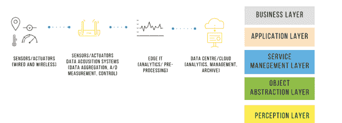

图 1.1 物联网通用架构。

本章图 1.1 说明了这四层。该图包含一个五层架构，包含：

- 1. 业务层
- 2. 应用层
- 3. 服务管理层
- 4. 对象抽象层
- 5. 感知层

业务层负责管理所有活动、服务，并根据从应用层接收的数据开发业务模型、图表和流程图。此外，该层负责基于大数据分析支持决策方面并确定行动方案。应用层负责服务交付，并作为面向业务层的接口。此外，它负责提供访问数据的控制机制，并根据中间件处理的对象信息对应用程序进行全局管理。服务管理层负责基于地址和名称将服务与其请求者进行配对，并处理接收到的数据、做出决策并通过网络线路协议交付所需服务。此外，它还负责接收和处理来自其他层的数据。对象抽象层负责将对象产生的数据传输到服务管理层。同时，它负责在设备之间以及从设备到接收器传输数据。最后，对象或感知层负责收集传感器数据，并将数字化后的数据传输到对象抽象层。架构的详细信息及相关方面在在线文献 [3–7] 中有所描述。

表 1.1
IoT 设备中的漏洞

| IoT 设备中的可攻击性 | 漏洞类型 |
|---|---|
| 硬件层 | a) 缺乏抗篡改性 b) 弱嵌入式加密算法 c) 弱硬件实现 |
| 软件层 | a) 固件层 b) 操作系统 c) 应用层 |
| 通信协议 | a) 链路层和网络层协议威胁 b) 应用层协议威胁 c) 网络设计缺陷 |
| 密钥管理 | a) 缺乏对公钥交换的支持 b) 易提取的通信密钥 c) 使用通用密钥或无密钥 |

针对资源受限的 IoT 设备的攻击在过去几年中显著增加。所使用 IoT 技术安全领域的漏洞不断被识别；这些技术用于工业和家庭环境，例如传感器、工业执行器、家用电器、医疗设备等。当前状况因应用程序缺陷、有故障的硬件芯片以及可篡改设备和错误配置而雪上加霜。

本节旨在采用类风险的方法来审视针对 IoT 支持设备的网络攻击，以凸显其现有的威胁格局，并隔离针对关键基础设施的隐蔽和隐秘攻击路径。

在 IoT 支持的网络攻击中，设备是攻击的放大器或促成者；实施者识别并利用设备一层或多层相关的固有漏洞，以达到其目的。我们将 IoT 漏洞分为两大类：“嵌入式漏洞”和“网络漏洞”。

#### 1.1.1.2 区分物联网与传统网络

自诞生以来，IoT 与传统网络同步经历了显著发展。与互联网相比，传统网络的连接是通过网页之间的物理链接建立的。传统网络在技术方面相对更成熟、更完善，并能有效地通过自然语言进行通信。这就是传统网络普及且易于操作的原因。在物联网领域，标准化工作尚处于起步阶段，目前需要熟练的编程专家来实现应用程序。

## 1.1.2 区块链：概述

区块链被定义为“公开的、永久的、仅追加的分布式账本” [8]。信息系统中的信任问题极其复杂且普遍。在缺乏审计和验证机制的情况下，这种情况会被加剧，尤其是在处理敏感信息（包括但不限于财务和经济交易）的系统中。通过在点对点网络中启用区块链技术，在没有基于信任的系统的情况下，解决了双重支出问题。区块链使一组不可靠的参与者能够验证交易。这旨在提供一个不可篡改、分布式、安全、透明且可审计的账本。该链可公开访问，允许访问自系统创世交易以来的所有交易。该协议构建一个由区块链组成的链，每个区块通过引用链接到其前一个区块，从而形成链。图 1.2 描述了区块链机制及引用哈希的使用。

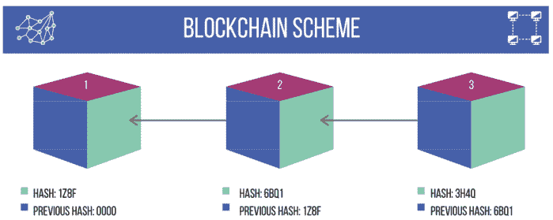

图 1.2 使用引用哈希的区块链机制。

表 1.2
比特币节点及功能

| | 钱包 | 存储 | 挖矿 | 路由 |
|---|---|---|---|---|
| Bitcoin Core | ✓ | ✓ | ✓ | ✓ |
| 全节点 | | ✓ | | ✓ |
| 单独矿工 | | ✓ | ✓ | ✓ |
| 轻量级矿工 | ✓ | | | ✓ |

为了支持和运行区块链，网络对等节点提供可包括存储、钱包、服务和挖矿等功能。根据其功能，它们可以成为不同网络的一部分。表 1.2 比较了比特币网络中常见的节点类型。此外，它通过建立一种基于共识的机制来实现这一点，在该机制中，节点通过其 CPU 算力对给定区块的工作量证明（以哈希形式）的计算进行投票，该工作量证明基于之前的工作。

## 1.1.3 区块链世代

目前我们正在见证向分布式应用的关键转变。这通过安全交易实现去中心化的数据共享。本节回顾

从区块链1.0到区块链4.0，区块链在表单生成形式中的出现。

#### 1.1.3.1 区块链1.0：比特币与加密货币

第一代被公认的区块链可归因于以虚拟货币/代币（比特币）形式出现的分布式账本的兴起。这种虚拟代币使用户能够通过互联网进行金融交易。此外，该货币也被称为“加密货币”，因为它使用两个密钥来启用和验证交易：

- 公钥：用于验证交易的合法性
- 私钥：用于签署交易（启用）

比特币账本由所有现有比特币用户的所有权状态组成，这些状态之间反映了交易，而任何交易状态的输出本质上是交易值（如果交易成功）。上述有限长度状态转换系统的副本由网络的节点作为账本记录维护。在这个去中心化和匿名系统中，第三方的角色被消除了，因为工作量证明基于Hashcash [9]和SHA-256 [10]的哈希方案来执行。

上图1.3说明了比特币交易过程，其中购买方由实体引用其签名，该签名是一个16位加密代码。签名由购买方在其接收节点解码，从而使货币在去中心化和匿名网络上具有数字化特性。

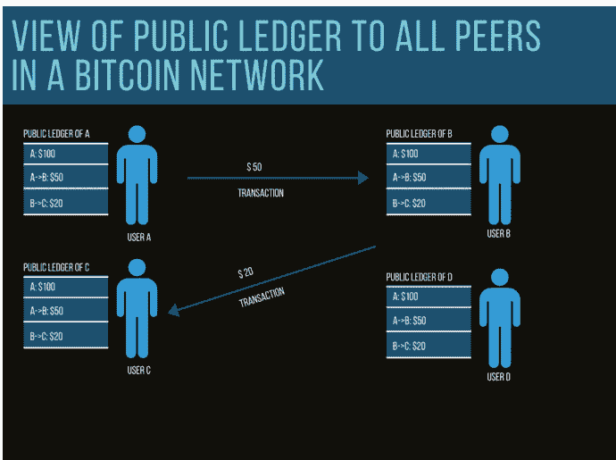

图1.3 通过状态转移函数(STF)在比特币(BTC)网络中的公共账本。

#### 1.1.3.2 区块链2.0：智能合约与以太坊

比特币(BTC)的出现标志着计算领域去中心化的兴起，但BTC应用范围有限，使其不适合通用应用。对基于通用应用的系统的这种需求引起了重视，2013年，以太坊的推出在一定程度上满足了这一需求。以太坊是一种内置图灵完备编程语言的区块链，这解决了BTC中几种基于脚本的问题。这使用户能够创建虚拟所有权、特定交易的格式以及状态转移函数。这促进了计算机程序在区块链上存在和执行的增长——“智能合约”。这些合约通过一组预定义条件以自主方式自行执行。这导致验证和仲裁成本降低，并使交易更加透明。

图1.4描绘了在以太坊区块链上实现智能合约。这包括一个20 B地址和一个STF。合约代码在区块链上保存、验证和执行；每个交易包含以下组件：

- 随机数
- 以太币余额
- 代码哈希
- 存储根

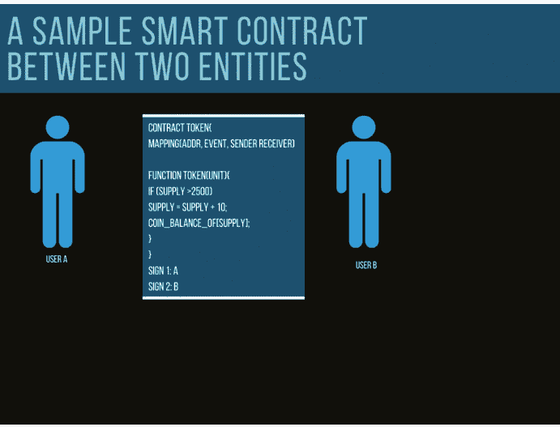

图1.4 两个合约实体之间智能合约的示意图。

#### 1.1.3.3 区块链3.0：向去中心化应用汇聚

随着智能合约的普及，现有技术无法支撑微交易的数量，基础设施不足的问题显而易见。因此，区块链出现了向去中心化网络，最终向去中心化互联网转变的趋势。这将整合信息存储、智能合约和通信网络。因此，对后端基于区块链的去中心化应用（D-App）有强烈需求。

#### 1.1.3.4 区块链4.0：与工业4.0的无缝集成

随着去中心化应用的兴起，需要一个共同平台，它将是大量促进跨平台通信的应用程序和服务的汇合点。这使得实体能够从不同平台协作，汇总并作为一个单元工作，从而满足工业4.0的要求。工业4.0用于标记工业趋势，强调自动化以及网络空间与物理空间的融合，并结合物联网、人工智能和认知计算。

## 1.2 物联网架构与系统性挑战

### 1.2.1 感知层：简介与终端节点挑战

在环绕人类的各种物联网设备中，最常见的是传感器、执行器、RFID阅读器、RFID标签等。这些设备构成一组设备，统称为物联网架构的感知层。该层在物联网中的关键贡献可以概括为感知环境参数并将感知数据传输到下一层进行处理[8]。感知层需要考虑的几个参数：

- a) 成本、资源和能耗：设备配备最低限度的能源资源和内存以降低成本。
- b) 通信：设备充当信息的接收端，并设计为与网络上的其他设备通信。
- c) 网络：WSN（无线传感器网络）和WMN（无线网状网络）在复杂环境中连接一类独特的事物；无线和自主网络用于数据采集、传输和操作。

图1.5解释了物联网中面向服务架构的基础，以及其与物联网基础设施其他层的交互。

结合同步计算和通信能力，物联网被归功于挖掘这些单个传感器的潜力，将它们从经典设备转变为智能设备。在这方面，该网络感知层终端节点的安全变得至关重要，特别是由于

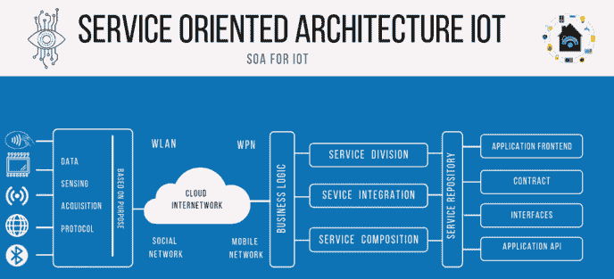

图1.5 物联网面向服务架构。

对数据控制的不确定性。在这方面，物联网安全机制的首要前提是具备自行决策的合理性，其中包括批准命令以接受、执行或终止它。然而，为最小能耗和有限内存而设计的“事物”的局限性，在感知层和终端节点带来了一系列广泛的安全漏洞。

在对物联网感知层面临的各种不安全和威胁进行分类后，必须遵循一些安全先决条件；这些包括：

- a) 物联网终端节点的安全先决条件：保密性、完整性、隐私性、访问控制、身份验证、物理安全防护和不可否认性。
- b) 物联网感知层的安全先决条件：设备身份验证、信息源身份验证、可用性、完整性和保密性。

为了在物联网网络的感知层实现上述要求，建议采取以下措施：

- a) 创建可信的数据感知系统，并恢复网络中所有设备的隐私和保密性。
- b) 从法医学角度识别用户来源并追踪他们。
- c) 在物联网中设计软件或固件以保护终端节点。
- d) 为所有物联网设备实施安全标准。

### 1.2.2 基于网络层的威胁

为了充分利用感知层获取的数据，在物联网基础设施中传输数据同样重要。因此，网络层提供了交换信息所需的媒介。

为了物联网设备的平稳运行和协调，网络的合理布置、组织和管理很重要，其中某些先决条件包括：

- a) 有效的网络管理，如无线网络、固定网络或移动网络。
- b) 网络层内的能源效率。
- c) QoS要求。
- d) 维护隐私、保密性和安全性。
- e) 挖掘和搜索机制。

在上述要求中，维护隐私、保密性和安全性属于本章的范围，其重要性基于复杂性和流动性至关重要。尽管现有的安全协议和框架迄今为止已提供针对威胁和漏洞的安全性，但仍存在许多需要解决的问题：

- 1) 广泛的安全措施：确保群组身份验证、密钥保护和数据可用性的保密性、完整性和隐私性的措施。
- 2) 防止隐私泄露：物联网中某些设备的位置和复杂性常常让开发者担忧，担心用户身份和凭据等敏感数据容易受到攻击。
- 3) 安全通信：为了使物联网系统存在，必须加固以抵御攻击，并以强健、可信和保密性加强。
- 4) 虚假网络消息：创建虚假信号并传播网络中设备之间的误导性通信。
- 5) 过度连接：高度连接的网络也面临风险，主要有两个原因：
  - a) 带宽上信令认证导致的高网络拥塞，可能引发DoS攻击。
  - b) 密钥操作和密钥安全导致的大量资源消耗。
- 6) 中间人攻击：攻击者独立在网络上进行的攻击，以伪造私有连接，同时攻击者控制整个对话。

尽管现有的创新和技术直到最近才能够抵御主要威胁，但攻击者日益增长的影响力已经在全球引起震动。在以下方向采取一系列措施，未来可能有助于提供更大的安全性：

- a) 严格的身份验证/授权流程。
- b) 安全传输加密。

### 1.2.3 基于服务层的威胁

在感知和传输之后，获取的数据需要进行处理，同时利用和集成硬件与软件平台的服务。服务层因此被恰当地誉为中间件技术，其设计依据应用程序要求、应用程序编程接口和服务协议，以符合服务提供商、供应商和组织的标准。该层负责集成、分析、安全、UI 管理及事件处理服务 [9] 为提供这些服务，采取以下步骤：

- a) 服务检测：定位高效运行服务所需的最佳基础设施；
- b) 服务组合与集成：通过调度或重新创建的交互，进一步扩大服务之间的交互范围并找出更可靠的服务；
- c) 身份验证管理：重点在于通过其他服务验证可信设备；
- d) 服务 API：这些有助于改善服务之间的互连。

为了应对众多挑战和威胁，开发人员和企业不懈努力，为连接网络内的服务提供增强和改进的解决方案。雄心勃勃的 SOCRADES 集成架构旨在高效改善应用层与服务层之间的交互 [11]。设备互连中的“事物”通常局限于提供服务，同时利用这些设备进行网络发现、元数据交换以及异步发布和订阅事件 [12]。在 Peris-Lopez et al. (2006) [13] 中，为了提高松耦合设备和分布式应用的互操作性，设置了表述性状态转移。在 Hernandez-Castro et al. (2013) [14] 中，服务层引入了一种服务配置流程，可加强应用程序与服务之间的联系并巩固合作。

鉴于上述挑战及应对它们所提供的解决方案，有必要了解：如果采取某些安全预防措施、要求和协议，可以防范服务层的攻击。其中一些包括：

- a) 用于服务验证、组身份验证以及密钥维护和存储中隐私与完整性保护的专用授权方法；
- b) 防范隐私泄露和位置跟踪；
- c) 跟踪涉及未授权使用和未订阅服务的服务；
- d) 防止潜在威胁，如 DoS 攻击、节点识别伪装、重放攻击、服务信息篡改以及通信和服务否认。

本节提供的解决方案大致涵盖了来自主要潜在安全威胁的解决方案。

尽管提供了上述解决方案，但在创建 IoT 应用程序或服务时，仍有一些未解决的挑战需要解决：

- a) 保护层间数据传输；
- b) 保护服务管理。

### 1.2.4 应用接口层

该接口是 IoT 网络中最显眼且最具交互性的层，涵盖了基于实用性的众多实现，范围从基于射频识别的追踪到智能家居管理，这些实现通过标准化协议和其他技术实现 [15]。应用程序维护需要某些安全前提条件，例如：

- a) 基于安全的隔离。
- b) 获取软件和更新的安全方法。
- c) 增强安全性的补丁。
- d) 管理员验证方式。
- e) 增强安全性的集成平台。

IoT 架构的不同层需要以下内容，以维持层间通信的安全性：

- a) 维护层间通信的三大安全原则（隐私、机密性和完整性）。
- b) 跨层验证和批准管理员。
- c) 隔离关键数据。

在设计安全解决方案时，以下规定可能有所帮助：

- a) 应仔细关注这些节点的安全性，因为大部分相关节点都无人监管。
- b) 考虑到节点数量庞大，在设计安全解决方案时，节点的能效至关重要。

### 1.2.5 跨层挑战

在 IoT 架构的所有共享数据的层中，必须维护某些标准，以确保网络保持安全并完全互操作。随着网络中事物数量的增加，用户有责任确保其数据免受架构各层之间挑战的影响。

跨层的安全需求几乎是 IoT 网络中面临的挑战的综合：

- a) 设计和执行时间方面的安全防护；
- b) 通过增强技术确保高隐私标准，以保护个人数据；
- c) 重建对 IoT 架构的信任

## 1.3 在 IoT 中实施区块链的挑战

### 1.3.1 缺乏以 IoT 为中心的共识协议

共识协议是一种技术或一组规则和法规，用于使所有全节点就交易序列的安排达成一致。目前，各种共识协议被应用于多种区块链应用中，例如 PoS、工作量证明（PoW）、实用拜占庭容错（PBFT）等。本章后续段落将讨论几种常用的共识协议。Makhdoom [16] 以详尽详细的方式展示了几种广为人知且广泛使用的区块链共识协议之间的差异。既定的共识协议，如权益证明（PoS）、工作量证明（PoW）、IOTA、经过时间证明（PoET）是为无许可区块链构建的，侧重于金融交易，而 PoS 和 PoET 有望用于许可区块链。

这些共识协议的普遍问题是共识过程的概率性质，以及其无法终止于持久的提交区块。这进一步解释了它们对区块链分叉的脆弱性 [17]。导致交易验证延迟的主要因素之一是绝对缺乏共识最终性，这对于要求即时交易验证和完成的各种实时/近实时 IoT 系统来说根本无法持续。此外，考察各种共识协议后发现，PoET 需要某种特定硬件，其中分配等待时间的区域必须是可信实体。

关于 IOTA，仍有许多歧义亟待解决，因为它目前仍处于公开 beta 测试阶段，尤其是关于其性能效果和安全性。关于 IOTA 是否是一种有效的微支付方式、其与 HFB（Hyperledger-Fabric 区块链）和以太坊等合约的兼容性，以及其提供数据机密性的能力，仍有许多问题未得到解答。

同时，其他一些共识协议，如委托拜占庭容错（DBFT）、实用拜占庭容错（PBFT）、HoneyBadger 等，都基于拜占庭容错（BFT）协议，这是一组状态机复制协议。通过在大量节点上复制服务，它能抵御任意故障。尽管 BFT 是许可型区块链的首选协议，但它存在若干缺陷。基于 BFT 的协议由于其松散的时间假设，对 DoS 攻击具有高度脆弱性，HoneyBadger BFT 除外 [18]。不仅脆弱的同步性会对系统的生产力产生负面影响，而且松散同步协议的活性特性也无法奏效，因为当恶意网络发起 DoS 攻击时，脆弱的时间假设会被违反。

针对验证节点数量的可扩展性是基于 BFT 的协议面临的另一项挑战，因为测试机制通常不会在 20 个节点之后实现 [19]。

这一缺陷可以通过执行 Algorand [20] 来克服，Algorand 为共识协议的每个步骤实现了小型委员会随机选择系统，以解决可扩展性问题。这种随机选择通过可验证随机函数 (VRF) 机制完成。Algorand 中委员会大小取决于两个约束：

- i. 1/2g + b ≤ Tstep·τstep
- ii. g > Tstep·τstep

其中：

- g = 诚实委员会成员数量；
- b = 恶意委员会成员数量；
- T = 达成共识所需的投票数；
- τ = 预期委员会大小。

此外，基于 BFT 的共识协议擅长掩盖在 f=(n–1)/3 个副本处发生的非确定性故障，其中：

- f = 故障节点数量
- n = 总节点数量

工作量证明 (PoW) 和基于 BFT 的共识协议在可用性方面存在很大差异，而可用性是物联网系统的重要需求。一方面，PoW 不确定某个未解决的交易是否会出现在下一个区块中；另一方面，PBFT 在消息复杂性方面则显得尤为昂贵。因此，大量物联网系统的可持续性应成为任何未来基于区块链的解决方案的关注重点，并且还应符合特定国家的无线通信规则。

如果基于共识的协议要应用于基于物联网的系统，则需要增强的方面包括交易验证规则、容错性和传输复杂性。

### 1.3.2 交易验证规则

图 1.6 表示比特币中的交易验证和完成流程。该协议的工作机制基于一套特定的规范，涵盖交易格式和正确签名的身份验证，随后通过一种机制检查指定交易是否之前已被花费 [21]。相比之下，以太坊具有不同的交易验证流程。如图 1.7 所示，以太坊验证签名、gas、nonce、发送方账户余额及格式。

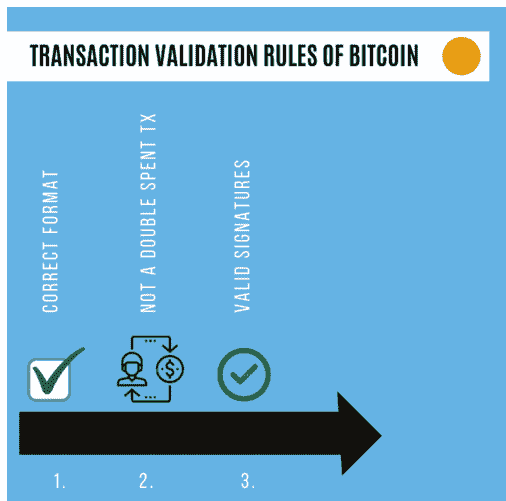

FIGURE 1.6 比特币中的交易验证规则。

由于物联网系统易受网络攻击，因此提出了一个重要难题：当前区块链的交易验证法规是否与物联网系统兼容。这一问题因物联网系统大多由异构设备和应用组成（这些设备和应用发送的数据值范围各异）而进一步加剧。这些设备极易受到攻击，即使通过普通恶意软件攻击也可能被感染，随后该恶意软件还可能被僵尸网络用于发起更多攻击。因此，区块链的交易验证法规可能不适用于物联网系统。

### 1.3.3 可扩展性挑战

在讨论将区块链集成到物联网系统时可扩展性面临的挑战时，会出现两个主要问题——存储容量和区块链的固有延迟。可扩展性既影响区块链的大小，也影响共识流程。例如，如果用户数量增加，交易数量也会直接增加。因此，共识协议会影响交易验证的延迟。这些挑战将在本章后续段落中详细讨论。

#### 1.3.3.1 存储容量

通常，区块链无法容纳海量信息，而包含成百上千个终端节点的智慧城市物联网系统能够在极短时间内产生大量数据，这些数据需要被处理以提取用于多种用途的信息。由于必须通过全节点和矿节点存储整个区块链，物联网设备的集成性进一步受到限制。此外，随着区块链规模的不断扩大，资源受限设备充当验证节点的障碍也随之增加，随后又增加了存储需求。每当有新用户/设备加入网络，同步时间也会随之增加。因此，要创建一种既涵盖物联网受限资源又兼具区块链优势的机制变得极具挑战性。

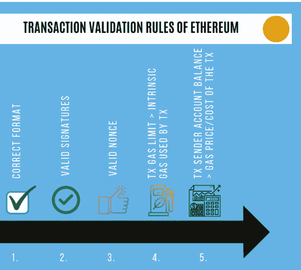

FIGURE 1.7 以太坊交易验证规则。

#### 1.3.3.2 区块链的固有延迟

对工业控制系统 (ICS)、智能车辆、无线传感器网络 (WSN)、智能交通系统等实时物联网系统的交易验证时长进行改进的需求日益增长，且在不牺牲其安全性和效率的前提下进行。

例如，在工作量证明 (PoW) 的区块链中，如果区块生产时长减少，交易验证时长也会降低。然而，由于区块挖矿的复杂性降低，交易需要等待更多验证才能实现相同强度的安全性。此外，计算资源消耗的增加是由于区块稳定性

#### 较大区块的缺点

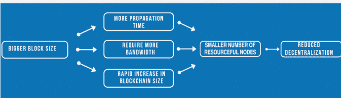

FIGURE 1.8 较大区块的缺点。

的提高。人们认为，如果比特币区块链的区块大小从 1 MB 增加到 2 MB，其吞吐量可以提高。但是，较大的区块在网络中传输所需的时间更长。

图 1.8 说明了实现更大区块的缺点。此外，全节点数量也受区块大小扩展的影响，因为存储整个区块链需要更多资源，这反过来导致区块链规模迅速增长。总而言之，可靠性程度与执行效率之间存在明显的权衡。分布式网络会出现性能问题，而集中式网络则会带来信任问题。

### 1.3.4 物联网设备集成挑战

虽然以太坊和 Hyperledger-Fabric 是少数几个包含智能合约和分布式应用的区块链技术，但它们在以太坊虚拟机 (eVM) 中执行智能合约方面存在一个重大缺陷：无法直接与外部世界进行交互。因此，我们使用 web3.js 库作为接口机制。因此，安全的去中心化数据库是区块链的有用应用之一。

就物联网设备面临的威胁而言，由于这些设备很容易被攻破，物联网系统的完整性始终是一个令人担忧的问题。此外，数据可能因远程实施的感染性代码，或仅仅是软件/硬件故障，甚至是人为干扰而进一步受到破坏。除非系统专门针对此类故障、修改或配置错误进行测试，否则这些错误不会被系统识别。目前，唯一可用的解决方案是 Oracleize [22]，它从 IPFS 和 WolframAlpha 等第三方来源获取信息。有必要提供 Proof-Of-Authentication 来验证所提供数据的真实性。

不幸的是，Oracleize 与物联网设备不兼容，因此它们的集成变得更加困难。因此，在区块链和物联网设备之间需要额外的客户端接口软件，这将增加计算和内存开销。因此，需要投入大量精力来确保物联网设备能够与区块链进行多种多样的交互。

### 1.3.5 保护设备免受恶意软件和内容执行攻击

保护设备免受恶意软件和内容执行攻击有两个方面——勒索软件和恶意软件。然而，勒索软件对分布式账本的影响微乎其微，因为网络中包含账本的无错误副本，即使某些节点可能受到影响。另一方面，恶意软件有能力通过受感染的节点向网络注入伪造/不可信的数据。由于传感器拥有基于情境的数据，与比特币不同，很难与旧交易进行验证，因此节点验证任何交易/数据变得极其困难。因此，在基于区块链的物联网系统中，检测恶意和伪造节点的恶意软件检测软件是必不可少的。

### 1.3.6 安全且同步的软件更新

由于缺乏软件或固件升级，物联网设备及其应用会因其分析功能而长时间运行，因此极易受到网络攻击。尽管由于区块链的本地化和分布式框架，目前无法保证固件和软件的同步更新，但对这种机制的需求与日俱增。

## 1.4 区块链在物联网领域的应用

### 1.4.1 自主去中心化点对点遥测

2015 年，国际商业机器公司发布了自主去中心化点对点遥测系统 (DePT) 的概念验证 (PoC)，旨在利用区块链在交易验证中执行智能合约的能力 [23]。

DePT 的目标是执行和管理一种针对物联网的本地化、分布式、安全、独立、可扩展且强大的架构，该架构不包含单一的易受攻击的故障点。所提议的架构使用 TeleHash 协议进行点对点数据传输，并使用 BitTorrent 作为分布式共享机制。该系统致力于解决传统物联网系统中关于隐私、故障点、集中式实体的安全性以及人为干扰引起的问题等多个问题。自主去中心化遥测系统还旨在提供用户和数据保护、身份管理以及点对点控制的数据访问。

其实现中存在的一个主要空白是，该系统是一个概念验证 (PoC)，因此需要进行测试和开发以确定其在安全性和功能有效性方面的可靠性。

### 1.4.2 智慧城市区块链赋能安全

在传统环境中，由于缺乏面向智能设备的通用协议，异构应用间数据共享所面临的问题导致了诸多挑战。这进一步阻碍了它们的集成及跨功能特性的提供。Muthukumarasamy 和 Biswas [24] 所提出的基于区块链的智慧城市单元间可靠传输安全系统概要表明，致力于提供安全传输共享环境的智慧城市需要将其设备与区块链集成。此外，由于在该系统中使用了区块链，将可用于审计目的的不可篡改的转账日志。

目前，似乎尚未对区块链赋能的智慧城市实体进行综合的定量和定性分析；然而，哪个平台、交易技术或共识协议最适合高效实施仍然相当模糊。

### 1.4.3 区块链赋能智能家居架构

A. Dorri、S. Kanhere 和 R. Jurdak 在 [25] 和 [26] 中倡导了一种基于区块链的智能家居应用安全、个人化且轻量级框架。这里需要理解的是，智能家居区块链与传统比特币区块链在许多方面有所不同。与比特币不同，智能家居区块链由所有者单独运行，因此所有者对其智能家居内的交易拥有完全控制权。此外，它还提供对 IoT 数据的有限访问，保证信息的完整性、可用性和机密性，并防范 DDoS 威胁。基于区块链的智能家居架构旨在通过在区块挖矿过程中模仿工作量证明（Proof Of Work, PoW）来解决其他挑战，如繁重的计算、交易验证延迟和功耗。所提框架利用云存储空间来减轻智能家居设备的内存需求压力。

在实施基于区块链的智能家居时存在一些问题。区块链的显著特征是其分布式网络，但在智能家居环境中，Home-Miner 或所有者单独控制整个网络。这在 Home-Miner 层面和云存储空间层面都引入了单点故障。其次，由于 home-miner 拥有完全控制权，缺乏基于共识的验证机制。此外，如果 home-miner 本身具有恶意或已被破坏，则无法确定交易的完整性。同样，在此情况下，home-miner 决定是否添加新块，而在传统区块链中，这是一个共识决策。

### 1.4.4 基于区块链的自管理 VaNeTs

为应对集中式传统车载自组网（Vehicle Ad-Hoc Network, VaNeT）带来的挑战，如单点故障、易受攻击者攻击以及用户隐私降低，Leiding [18] 倡导了一种基于以太坊区块链的分布式自管理 VaNeT，该网络具有质询-响应验证机制。整个框架由基于以太坊的设备运行，这些设备管理提供多种服务的规则。每个节点的识别机制是其以太坊地址。如果节点打算使用任何基于以太坊的服务，则需要以 ethers 进行支付，这反过来成为网络平台的资金机制。这种资金为各种商家继续制造此类基于以太坊的应用程序和服务提供了必要的激励。此类以太坊账户有潜力进行自主交易，用于保险、登记以及违反交通规则时的罚款。

对于所提框架，仍有许多未解决的难题，例如——哪些数据将在区块链上可见，谁将挖掘所述块，V2V 传输的机制及其固有延迟应是什么。需要注意的是，延迟是区块链技术的固有特征，但在交通和道路场景中，实时信息对连接到 VaNeT 的节点至关重要。

### 1.4.5 数据安全与隐私

Nathan 和 Zyskind [27] 提出了一种面向分布式网络的数据管理原型，为数据所有权、透明度和可审计性相关问题提供保护和保障措施。Ethos 是由 MIT 媒体实验室的 Viral Communications [28] 开发的一种基于比特币的个人信息传输系统。Ethos 在 IoT 系统中的兼容性目前仍需评估。一种名为 Enigma 的分布式计算协议也已开发，旨在保护隐私 [29]。Enigma 进一步通过部署具有秘密共享验证协议的多方计算，允许其节点对整个数据进行非常有限的访问。此类系统的额外优势在于去中心化存储以及降低嵌入式设备的内存需求。

为了在 IoT 系统中有效执行，Enigma 仍然需要对开销传输和计算进行分析。重要的是，任何去中心化计算和安全数据传输的解决方案都必须符合各自国家的无线通信法律，因为大多数 IoT 设备仅通过无线媒体传输。尽管此类去中心化计算方案似乎非常有效，但其在带宽效率方面的生产力仍需评估。总之，任何未来的基于区块链的数据传输和共享系统都应牢记这些不足。

## 1.5 结论与未来工作范围

诸如区块链之类的技术已经颠覆了整个金融科技市场，尽管它引发了许多争议，但该技术将越来越多地融入我们的生活。因此，应非常谨慎且审慎地评估将区块链与 IoT 集成的优势，因为在不确定其风险的情况下，在成本不超过改进的场景中应用它很容易陷入陷阱。本章总结了区块链和 IoT 带来的挑战，因此必须开展集体工作来解决这些问题。我们还能够识别出这项技术有潜力增强 IoT 应用的领域。

此外，我们还对将区块链技术与 IoT 设备结合使用进行了可行性检查，其中分析了现有框架，确定了未来解决方案的条件，并详尽阐述了区块链-IoT 范式的当前场景。此外，特别强调了未来解决方案需要符合各自国家法律的必要性。因此，这种技术集成应成为政府框架的一部分，这随后也将加速与公民的互动。

数据完整性和框架监督的双重方面至关重要。用户隐私和安全问题会影响公民对这种集成的看法。存储空间、可扩展性和共识协议方面的挑战将在该进程的推进中发挥关键作用。将 IoT 设备与区块链技术集成必将指数级增加区块链的应用和使用，并使其地位达到与当前受托货币市场相似的水平。

- 1. Al-Fuqaha, Ala, Mohsen Guizani, Mehdi Mohammadi, Mohammed Aledhari, and Moussa Ayyash. 2015. “万物互联：使能技术、协议和应用综述”. IEEE Communications Surveys & Tutorials 17 (4): 2347–2376. doi:10.1109/comst.2015.2444095.
- 2. R. van Kranenburg. 万物互联：环境技术和全视 RFID 网络的批判. Amsterdam, The Netherlands: Institute of Network Cultures, 2007.
- 3. A. Al-Fuqaha, M. Guizani, M. Mohammadi, M. Aledhari, M. Ayyash, 万物互联：使能技术、协议和应用综述, IEEE Communications Surveys & Tutorials, 17 (4) (2015) 2347–2376.
- 4. S. A. Kumar, T. Vealey, H. Srivastava, 万物互联安全：挑战、解决方案和未来方向, in: IEEE 第 49 届夏威夷系统科学国际会议论文集 (HICSS), 2016, pp. 5772–5781.
- 5. M. Khari, M. Kumar, S. Vij, P. Pande, Vaishali, 万物互联：为数字化世界提出的安全方面, in: 第 3 届可持续全球发展计算国际会议论文集 (INDIACom), 2016, pp. 2165–2170.
- 6. R. Khan, S. U. Khan, R. Zaheer, S. Khan, 未来互联网：万物互联架构、可能应用和关键挑战, in: IEEE 第 10 届信息技术前沿国际会议论文集 (FIT), 2012, pp. 257–260.
- 7. T. Qiu, N. Chen, K. Li, M. Atiquzzaman, W. Zhao, 异构万物互联如何构建我们的未来：一项综述, IEEE Communications Surveys & Tutorials.

- 8. MIT 编辑部. 2019. “解析：什么是区块链?”. MIT Technology Review. www.technologyreview.com/s/610833/explainer-what-is-a-blockchain/
- 9. A. Back, “Hashcash – 拒绝服务对策,” 2002, 可从以下网址获取: www.hashcash.org/papers/hashcash.pdf
- 10. D. Eastlake, III 和 T. Hansen, “美国安全哈希算法（SHA 及基于 SHA 的 HMAC 和 HKDF）,” RFC 6234（信息性）, 2011 年 5 月, 可从以下网址获取: www.ietf.org/rfc/rfc6234.txt.
- 11. Choi, J., Li, S., Wang, X., Ha, J., 2012. 无线传感器网络的通用分布式共识算法。论文发表于无线高级（WiAd）会议，2012年
- 12. Fielding, R. 和 Taylor, R. (2002). 现代 Web 架构的原则化设计。ACM 互联网技术期刊, 2(2), 第115–150页。
- 13. Kranenburg, R.V., Anzelmo, E., Bassi, A., Caprio, D., Dodson, S., Ratto, M., 2011. 物联网。论文发表于第1届柏林互联网与社会研讨会（电子版）。查阅日期：
- 14. Peris-Lopez, P., Hernandez-Castro, J.C., Estevez-Tapiador, J.M., Ribagorda, A., 2006. M2ap：一种面向低成本RFID标签的极简相互认证协议。泛在智能与计算。Springer, Heidelberg, 第912–923页。
- 15. Hernandez-Castro, J.C., Tapiador, J.M.E., Peris-Lopez, P., Li, T., Quisquater, J-J., 2013. SASI超轻量RFID认证协议的密码分析。arxiv。
- 16. I. Makhdoom, M. Abolhasan, H. Abbas 和 W. Ni, 物联网中区块链的采用：挑战与未来之路，载于：网络与计算机应用期刊, 2019, 第125卷, 第251–279页。
- 17. EconoTimes, 区块链项目蚁股解释选择dBFT而非PoW和PoS的原因（2017年）
- 18. A. Miller, Y. Xia, K. Croman, E. Shi, D. Song, BFT协议中的蜜獾，载于：ACM计算机与通信安全会议论文集, ACM, 2016, 第31–42页。
- 19. M. Vukolic, 可扩展区块链架构的探索：工作量证明与BFT复制，载于：网络安全公开问题国际研讨会论文集, Springer, 2015, 第112–125页。
- 20. Y. Gilad, R. Hemo, S. Micali, G. Vlachos, N. Zeldovich, Algorand：面向加密货币的拜占庭协议扩展，载于：第26届操作系统原理研讨会论文集, ACM, 2017, 第51–68页。
- 21. V. Buterin, 等, 一种下一代智能合约和去中心化应用平台，白皮书。
- 22. “Oraclize 现已更名为 Provable Things”。2019. Oraclize.it. www.oraclize.it.
- 23. 2019年. Cryptonomics.Show. https://cryptonomics.show/wp-content/uploads/2018/08/IBM-ADEPT-Practitioner-Perspective-Pre-Publication-Draft-7-Jan-2015.pdf.
- 24. K. Biswas, V. Muthukkumarasamy, 基于区块链技术的智慧城市安全保障，载于：IEEE第14届智慧城市高性能计算与通信国际会议论文集, 2016, 第1392–1393页。
- 25. A. Dorri, S. Kanhere, R. Jurdak, 物联网中的区块链：挑战与解决方案, arXiv预印本 arXiv:1608.05187.
- 26. A. Dorri, S. Kanhere, R. Jurdak, P. Gauravaram, 面向物联网安全与隐私的区块链：智能住宅案例研究，载于：IEEE物联网安全、隐私与信任第2届研讨会论文集（PERCOM），夏威夷，美国，2017年。
- 27. G. Zyskind, O. Nathan, 等, 去中心化隐私：利用区块链保护个人数据，载于：IEEE安全与隐私研讨会论文集（SPW）, 2015, 第180–184页。
- 28. MIT媒体实验室, Ethos（2014年。最后访问时间：2018年7月26日）。URL http://viral.media.mit.edu/projects/ethos/
- 29. G. Zyskind, O. Nathan, A. Pentland, Enigma：具有保证隐私的去中心化计算平台, CoRR abs/1506.03471.

# 2 医疗保健中物联网的应用与挑战

¹Subhashree Sahoo, ²Debabrata Dansana, 和 ²Brojo Kishore Mishra

¹Pondicherry University, Kalapet, Pondicherry, 印度 ²GIET University, Gunpur, 印度

## 目录

- 2.1 引言....................................................26
- 2.2 医学与技术 ....................................27
  - 2.2.1 信息技术与医学...................27
  - 2.2.2 医疗设备技术 ...........................28
  - 2.2.3 技术与医学研究 ........................28
  - 2.2.4 3D打印....................................................28
  - 2.2.5 健康记录数字化 ...........................29
    - 2.2.5.1 更优质的患者护理....................................30
    - 2.2.5.2 改善公共卫生 ................................30
    - 2.2.5.3 工作流程便捷 .......................................31
    - 2.2.5.4 降低医疗成本..................................31
    - 2.2.5.5 EHR的缺点....................................31
  - 2.2.6 大数据 ........................................................31
    - 2.2.6.1 大数据在医疗保健中的应用 ................33
- 2.3 远程健康监测 ....................................33
  - 2.3.1 远程健康监测的好处....................34
  - 2.3.2 远程健康监测的挑战 .................34
  - 2.3.3 远程健康监测使用的障碍 ............35
    - 2.3.3.1 并非人人都可用....................................35
    - 2.3.3.2 患者和医生的怀疑态度 .....................35
    - 2.3.3.3 额外定制医疗软件的必要性 ....36
    - 2.3.3.4 可靠性不确定.....................................36
- 2.4 在医疗保健中使用物联网的缺点 ....................36
  - 2.4.1 昂贵......................................................36
  - 2.4.2 耗时的适应 ..................................37
  - 2.4.3 依赖技术 .....................................37
  - 2.4.4 易受网络黑客攻击 ........................37
  - 2.4.5 技术要求......................................37
  - 2.4.6 监管顾虑.....38
  - 2.4.7 可扩展性.....38
  - 2.4.8 时间限制.....38
  - 2.4.9 安全性.....38
  - 2.4.10 管理物联网障碍.....38
- 2.5 管理物联网技术的挑战.....39
  - 2.5.1 将新技术集成到现有环境中.....39
  - 2.5.2 管理协议复杂性.....39
  - 2.5.3 网络挑战.....40
  - 2.5.4 物联网时代的最佳实践.....40
- 2.6 物联网安全威胁.....41
  - 2.6.1 漏洞.....42
  - 2.6.2 易暴露.....42
  - 2.6.3 威胁.....43
  - 2.6.4 不安全的Web界面.....43
  - 2.6.5 认证不足.....43
  - 2.6.6 不安全的网络设备.....44
  - 2.6.7 缺乏传输加密.....44
  - 2.6.8 隐私顾虑.....45
  - 2.6.9 不安全的云接口.....45
- 2.7 结论.....46
- 2.8 参考文献.....46

## 2.1 引言

医疗保健因技术进步而发生巨大变化，从麻醉剂和抗生素到磁共振成像扫描仪和放射治疗。然而，未来的技术创新将不断重塑医疗保健，尽管技术（新药物和治疗方法、新设备、医疗保健的新社交媒体支持等）可以推动创新，但人类因素可能仍然是突破的持续限制之一。没有任何预测能让所有人满意。关于医疗保健，毋庸置疑；医疗保健领域的技术进步拯救了无数患者，并不断提高我们的生活质量。不仅如此，然而；医学领域的技术对医疗保健专业人员的几乎所有流程和实践都产生了巨大影响。

自医学专业实践开始以来，医疗技术的进步使医生能够更好地诊断和治疗患者。由于医学领域技术的不断发展，许多生命得以挽救，总体生活质量也随时间不断提高。尽管医疗文化相似，但存在巨大的技术变化，而且，这些变化确实难以解释。还有人知道输液泵是如何工作的吗？它们过去是发条装置，而现在几乎所有东西都包含计算机，并配有彩色屏幕和大量按钮。使用电话网络和网站让心脏病学家随时了解患者情况的植入式除颤器简直就是魔法。能够改变情绪、改变

压力，或杀死细菌：所有这些都是时髦的魔法。当今看来如同科幻小说的一些事物，在未来甚至也许在我们有生之年都将变得司空见惯。然而，当今人类关于人际关系、希望、错误、悲伤和否认的故事，在未来大多仍将完全可以辨认。我们仍将存在权力梯度，我们仍将因人为错误而产生争议，患者仍可能被弄得无助，以便更容易治疗。其解释是，技术由市场驱动。

如果有人有一个想法，可能将其转化为可以出售的物理实现，他们还会为其申请专利或授权许可，从而建立投资回报。反过来，这可能鼓励他们寻找使其更小、更便宜、并以更大规模销售的方式。因此，它是技术驱动的。相比之下，人类文化不会为任何人创造利润。

医疗保健的主要原因是患者，他们应该处于其中心。在本文中，我们将讨论医疗保健领域的一些技术趋势及其挑战。在这个科学时代，医疗保健除了是技术市场之外别无他物，而医院充当消费者，这些消费者愿意支付足够的资金购买技术设备，包括成本最小化、分工等等。

## 2.2 医学与技术

在当今世界，技术在每个行业中的作用甚至超过了在我们个人生活中的作用。在所有技术发挥重要作用的行业中，医疗保健无疑是其中最主要的一个。它负责拯救世界各地无数生命。

医疗技术是一个广泛的领域，创新在维持健康方面发挥着至关重要的作用。生物技术、制药业、信息技术、医疗器械和仪器的开发等领域，都对提高世界各地个人的健康做出了重要贡献。从“微小”的创新，如创可贴和踝关节支架，到更大、更先进的技术，如磁共振成像机器、人工器官和机器人义肢，技术无疑对医学产生了难以想象的影响。在医疗行业，对医疗技术的依赖绝不能被夸大，正是由于这些卓越创新的发展，医疗从业者将继续找到改进其实践的方法——从更好的诊断、手术程序到改善患者护理。

### 2.2.1 信息技术与医学

信息技术为我们的世界，尤其是医疗行业，做出了重要贡献。随着电子病历（EMR）、远程医疗服务以及平板电脑和智能手机等移动技术的使用日益增加，医生和患者都在看到这些新医疗技术带来的好处。

医疗技术已从向医生介绍在私人诊所和医院中使用的新仪器，发展为通过电信技术连接相隔数千英里的患者和医生。在当今世界，患者与医生进行视频会议以节省原本用于前往不同地理位置的时间和金钱，或立即向世界任何专科医生或医生发送健康信息，已不足为奇。

随着越来越多的医院和诊所在工作中使用移动设备等医疗技术，医生现在只需几秒钟就能获取他们所需的任何类型的信息——从药物信息、分析和研究、患者病史或记录等。并且，凭借轻松携带这些移动设备全天随行的能力，他们永远不会远离所需的信息。有助于识别潜在健康威胁并检查X光片和CT扫描等数字信息的应用程序，也为信息技术带给医学的优势做出了贡献。

### 2.2.2 医疗设备技术

提高生活质量是将新创新整合到医学中的最大优势之一。微创手术、更好的监测系统和更易于操作的扫描仪器等医疗技术，正使患者花费更少的时间康复，并能更长时间地享受健康生活。

医疗仪器技术与远程医疗的结合也催生了机器人手术，在某些情况下，医生甚至不必与患者同在手术室内即可完成手术。相反，外科医生将从其“基地”进行操作，而患者则可在家乡的医院或诊所接受手术，从而免除与健康相关的旅行的麻烦和压力。在不同的机器人手术中，医生仍留在房间内操作机器人设备；然而，该技术允许微创手术，使患者留下的疤痕更少，康复时间也大大缩短。

### 2.2.3 技术与医学研究

医学科学家和医生不断开展研究并测试新程序，以帮助预防、诊断和治疗疾病，以及开发可能减轻症状或治疗疾病的新药。

通过在医学分析中利用技术，科学家能够在细胞水平上检查疾病并制造针对其的抗体。针对原虫感染、脊髓灰质炎、MMR（麻疹、腮腺炎、风疹）等危险疾病的疫苗，防止疾病传播并拯救了全球数千人的生命。事实上，世界卫生组织估计，疫苗每年拯救约三百万人的生命，并防止许多人感染致命病毒和疾病。

### 2.2.4 3D 打印

今天，可以使用3D打印技术复制骨骼和少数内部器官。这些人工器官和骨骼随后将被植入患者体内，以替换患病或有问题的部位。外科医生也在使用3D打印技术，以更好地了解患者体内发生的情况。有了3D模型，外科医生可以更轻松地对问题进行更深入的检查，并在对患者进行实际手术之前模拟各种解决方案或可能的手术。

同样，3D打印彻底改变了医学专科。使用3D打印机，获取定制的义肢手或腿便宜得多。例如，目前可以为婴儿定制打印义肢手，随着其成长需要不同的型号，而不是每年都要去更换新的义肢手。此外，随着3D打印行业的巨大进步，与该技术相关的价格正在每天降低。

在医疗设备领域使用的各种3D打印形式之一是生物打印。与使用塑料或金属打印不同，生物打印机使用计算机引导的移液管，将被称为生物墨水的活细胞层层堆叠，在实验室中制造人工活体组织。

这些组织构建物或器官类器官可用于医学分析，因为它们在微观尺度上模拟器官。它们还被试验作为人类器官移植的更便宜替代方案。

3D打印在医疗领域的另一种应用是制作患者特定的器官复制品，外科医生可以在进行复杂手术前在上面练习。这种方法已被尝试，以加快手术进程并最大限度地减少患者创伤。

这种手术已成功应用于从全脸移植到脊柱手术等各种手术，并开始成为常规操作。

无菌外科器械，如镊子、止血钳、手术刀柄和夹子，通常使用3D打印机制造。3D打印不仅能制造无菌工具；一些工具源自传统的日本折纸艺术，这意味着它们精度高且可以制造得极小。这些器械常用于对小区域进行手术，而不会给患者造成不必要的额外伤害。

使用3D打印而非传统生产方法提供外科器械的主要方面之一是，生产成本显著降低。

3D打印在医疗领域可用于制造定制的义肢，以适应并匹配用户。截肢者通常需要通过常规渠道等待数周或数月才能收到义肢；然而，3D打印显著加快了这一过程，制造出更便宜的产品，为患者提供与传统工厂制造的义肢同样持续的功能。

### 2.2.5 健康记录的数字化

电子健康记录（EHR）取代过时的纸质记录，对医疗界的每个人来说都是一个巨大的变革。医疗助理、医疗编码专业人员和注册护士只是这一行业范围实施所涵盖的一些角色。

护士和技术人员负责将患者信息输入到集中式数字化系统。医疗账单员和编码员使用诊断代码（例如检测结果）更新患者记录，并向保险公司提交医疗索赔。患者不仅可以一键访问自己的记录；同样可以确保错误被更快地发现，而无需费力辨认医生潦草的笔迹。

在医学领域，首批影响治疗艺术与科学的信息技术浪潮是医疗文件的数字化，目前称为电子健康记录（EHRs）。EHRs 中包含的数据连同其他来源，有望通过利用信息、技术和医疗服务，以合理的价格改善护理的整体效力和质量，从而重塑医疗实践。EHRs 的广泛采用已产生海量数据集。将来自患者和医生的数据集巧妙地合并，可能是加强医疗服务的可行途径。这些庞大的数据集目前被视为医疗实践的副产品，而非能够在患者护理中发挥重要作用的有用资产。例如，目前大多数 EHRs 收集定量、定性和事务性信息；所有这些信息都可以利用目前可用的复杂程序和技术进行汇总、分析和应用，以处理包含分散和非结构化数据的文档。在医疗实践中，有目的地使用信息并非什么奥秘。从最初的卑微起步开始，循证实践都建立在这样一个原则上：通过方法论回答的问题优于轶事、专家意见、专家组和证言。在承认信息在指导理性和逻辑高层认知过程方面的价值，医学一直走在适应现代性的前沿。然而，医生、护士和医疗设施在采用最新方法以充分利用 EHRs 中包含的信息方面进展缓慢。

EHR 为医疗带来了许多益处，其中一些如下所示。

- 患者护理更优
- 公共卫生改善
- 工作流程更顺畅
- 降低医疗成本

#### 2.2.5.1 患者护理更优

EHR 会自动向治疗医生发出潜在问题的警报（例如对某些药物的过敏或不耐受）。EHRs 可以从几乎任何医疗机构访问，这对评估非本地患者的医生非常有帮助。

#### 2.2.5.2 公共卫生改善

EHRs 为临床研究人员提供宝贵信息，有助于推进医学数据以及针对常见健康问题（如病毒性疫情）的治疗方法的研发。标准化的健康信息技术系统将提供关于流行病广泛程度的洞察，从而能够更快地实施预防措施（例如增加呼吸道疾病疫苗的生产）。

#### 2.2.5.3 工作流程更顺畅

医疗账单员和编码员是受影响最大的辅助医疗专业人员之一，根据劳工统计局的数据，该行业的需求预计将在 2016 年至 2026 年间增长 13%。EHRs 的引入让医疗账单员和编码员的工作变得更加轻松。

将信息输入到处理系统中比基于纸张的策略耗时更少，并且可以降低患者信息和财务细节出错的风险。以数字方式访问患者记录还允许医疗转录专家在家工作，提高效率和生产力。

#### 2.2.5.4 降低医疗成本

根据最近的研究，从基于纸张的患者记录转向电子记录可将门诊护理成本降低 3%。

#### 2.2.5.5 EHR 的劣势

理论上，转向 EHRs 应该使一切变得更好。遗憾的是，仍有一些问题需要解决。与运行流畅的记录系统不同，多个网络缺乏互连性，这意味着它们没有相互通信的能力。有时，这种沟通缺乏会使患者健康面临风险。

### 2.2.6 大数据

大数据是当下的热门词汇。它无处不在，尤其是在医疗行业。历史上，医疗行业产生的海量数据以纸质形式保存。这些信息有能力支持广泛的医疗和医学功能。将此类信息转换称为大数据。所有与患者医疗和健康相关的数据都构成了大数据。

大数据的广泛多样性及其管理速度令人应接不暇。它包括来自 CPOE 和临床决策支持系统的临床信息、医生的书面笔记和处方、医学影像、实验室、药房、保险及其他行政数据；电子患者记录（EPRs）中的患者数据；机器生成或传感器数据，例如监测生命体征的数据；社交媒体帖子，包括 Twitter 源、博客、Facebook 和不同平台上的状态更新以及网页；以及不太特定于患者的数据，包括紧急护理信息、新闻源和医学期刊上的文章。

大数据在医疗行业非常有用。在过去十年中，电子健康记录（EHR）已在全球医院和诊所广泛采用。可以从这些信息中研究重要的临床数据并更深入地了解患者疾病模式。这将有助于提升患者护理并提高效率。有时，这种沟通缺乏会使患者健康面临风险。

由于其格式、类型和上下文的多样性，将大量医疗数据合并到标准数据库中很困难，这使得处理变得极其困难，商业领袖也难以利用其改变行业的重要承诺。

尽管存在这些挑战，许多新的技术改进正在使医疗大数据重生为有用、有价值的数据。通过利用适用的软件工具，大数据正在推动向基于价值的医疗转变，并在降低价格的同时，为突出的进步敞开大门。凭借医疗数据分析提供的丰富知识，护理人员和管理人员目前可以做出更好的医疗和财务决策，同时继续提供不断提高的患者护理质量。但是，由于健康数据隐私、安全性、数据孤岛和预算限制等挑战，医疗领域对大数据分析的采用落后于其他行业。与此同时，来自金融服务、保险、媒体、娱乐、制造和供应公司的受访高管中，80% 表示他们在大数据处理方面的投资“successful”，近五分之一的人表示他们的大数据举措对其公司具有“transformational”。

当今至少有两种趋势鼓励医疗行业采用大数据。第一种是从按服务付费（向护理人员经济奖励执行程序）模式转向基于价值的护理模式（奖励他们支持患者群体的健康）。医疗数据分析可以改变人群健康的衡量和追踪，从而批准这一转变。第二种趋势涉及利用大数据分析提供基于证据的数据，从而随时间推移提高效率，并帮助提升我们对与任何疾病、损伤或不良健康相关的最有效实践的理解。

毫无疑问，采用医疗大数据将重塑商业，将其从按服务付费模式推向基于价值的护理。简而言之，它将兑现降低医疗价格的承诺，同时揭示提供卓越患者体验、治疗和结果的方法。

使用大数据有多种好处，例如

- 降低医疗成本
- 预测流行病
- 避免可预防的死亡
- 提高生活质量
- 减少医疗浪费
- 提高效率和护理质量
- 开发新药和新疗法

#### 2.2.6.1 医疗领域的大数据应用

- 将大数据与医学影像相结合。
- 远程医疗
- 减少欺诈并增强安全性
- 医疗预测分析
- 利用健康数据进行战略规划
- 实时警报
- 电子健康记录
- 增强患者参与度
- 更顺畅的医院管理
- 利用大数据抗击癌症。

## 2.3 远程健康监测

远程健康监测，也称为远程患者监测，是利用技术在非临床环境（例如家庭内）观察患者的技术。一旦纳入慢性病管理，远程健康监测有可能显著提高患者的生活质量，因此这项技术日益普及也不足为奇。远程健康监测可能是一个特定领域；然而，相关技术经常共享类似要素。首先，监测设备需要一个传感器来生成特定的生理信息，并将这些数据无线传输给患者和医疗专业人员。

这种数据的共享信息存储也至关重要，既作为可分析健康信息并提供治疗建议的软件，也作为

| 远程患者监护的优势 | | |
|---|---|---|
| 节省时间 | 医院声誉 | 治疗效率 |
| 成本优化 | 减轻员工负担 | 治疗控制 |

FIGURE 2.2 远程健康监护在医疗保健中的优势。

警报。支持智能手机应用程序的健康监测技术正逐渐成为标准。这些技术将帮助患有各种病症的患者；然而，该技术最常用于监测心脏病和糖尿病。糖尿病患者需要调节体重、血压和血糖水平以保持健康。

### 2.3.1 远程健康监护的优势

- 改善教育、支持和反馈
- 改善护理质量
- 更好地获得护理
- 日常保障
- 具成本效益
- 使医疗服务可及
- 使医疗服务高效
- 使医疗服务以消费者为中心
- 改善患者的生活方式
- 允许将患者数据实时发送给医生。

下图描述了在医疗单元中使用远程健康监护的关键优势。

### 2.3.2 远程健康监护的挑战

下面列出了在医疗单元中使用远程健康监护时遇到的一些最常见困难。

- 保密性与隐私
- 用户态度
- 组织和技术障碍
- 维护成本
- 实施成本
- 昂贵的现代系统
- 设计与实施不佳
- 投资不足
- 系统与个人任务不兼容
- 数据操纵、重写和数据误述
- 文档错误
- 侵犯患者的合法权利
- 医患面对面沟通减少
- 可穿戴设备的重量

尽管该技术有多项已证实的成功，但其主要缺点掩盖了这样一个事实：远程健康监护在很大程度上依赖患者在自身健康中发挥积极作用，而且有些患者比其他患者更被动或更健忘。无线技术也不适合某些农村地区，一些老年患者可能不了解如何使用应用程序等现代技术。任何收集的健康数据还必须加密并防止黑客攻击，且一些远程健康监测技术非常昂贵。

然而，远程健康监护将为患者提供额外能力来关注自身健康，并可能为那些管理慢性病的人提供安心。随着技术能够向患者和医疗专业人员发出轻微生理变化的警报，任何确实危险的状况也可能更早地被发现和治疗。价格高昂，因此该技术仍需不断改进；但是，随着这些障碍逐步被克服，远程监护很可能在长期内成为预防性护理的核心部分。

### 2.3.3 远程健康监护使用的障碍

远程健康监护（RHM）使用道路上存在几个障碍。下面是描述这些障碍的一些要点。

#### 2.3.3.1 并非人人都可使用

RHM 需要良好的宽带连接，小型医疗机构和农村医院很难获得这种连接。另一方面，有必要考虑到并非人人都拥有智能手机，老年人通常在使用现代设备（如手机）方面面临困难。

#### 2.3.3.2 患者和医生的怀疑

根据 NEJM Catalyst Insights Council 的调查，RHM 似乎是效果最差的患者参与计划。研究人员用可穿戴设备对每个人来说都无法获得这一事实来解释这些统计数据。顺便说一句，参与调查的医生没有注意到慢性病管理有任何改善。此外，医疗专业人员凭借其专业知识表示怀疑，认为单靠技术可能无法改变高风险患者的行为。医生们担心在处理接收到的信息时将面临的困难。一些患者担心其个人健康信息会被第三方获取并用于可疑目的。

#### 2.3.3.3 额外定制医疗软件的必要性

收集信息后，IT部门需要通过多个第三方应用程序将RHM设备的数据导入电子病历系统（EMRs）。

#### 2.3.3.4 可靠性不确定

支持体育活动的时尚健身可穿戴设备被认为准确度变化很大，误差可达25%。RHM信息的可靠性也受到质疑。例如，JAMA皮肤病学杂志的一篇综述显示，用于皮肤癌检测的智能手机应用程序有30%的失效率。在设备和应用程序被医疗服务提供商使用之前，缺乏可靠性是必须解决的最重大问题。

RHM 极其依赖个人管理健康的动机。如果患者的性格不适合积极参与自身护理，RHM 实施可能会失败。价格也是其广泛应用的障碍之一。远程患者监护（RPM）服务缺乏报酬指南，这可能会阻碍其纳入临床观察。与 RHM 相关的不可靠性转移引发了责任问题。临床医生在收到警报时是否需要干预，无论紧急程度如何，目前没有明确的相关指南。患者信息的持续流动需要一支忙碌的医疗服务提供商团队来处理数据，这实际上可能增加工作量。尽管技术的引入旨在提高效率，但对于那些不太精通技术的医疗服务提供商来说，它可能成为障碍。健康信息处理技术面临的常见障碍也适用于 RHM。从被监测的共病情况来看，RHM 实施涉及多种设备。信息交换和多个元素之间的互操作性需要标准化。此外，RHM 的发展高度依赖于完善的无线电信基础设施，这在农村地区可能无法获得或不可行。由于 RHM 涉及在电信网络中传输敏感的患者信息，数据安全可能是一个问题。

## 2.4 在医疗保健中使用物联网的缺点

### 2.4.1 昂贵

越来越先进的健康技术并不廉价。我们必须认识到，每个发达国家的医疗保健系统都面临各种挑战；其中之一就是人口老龄化。人们寿命更长。这意味着健康需求增加；然而，为医疗保健系统创造财务收益的劳动人口却在减少。因此，一个问题是：随技术而来的高价格对政府来说在经济上是否可行？

### 2.4.2 耗时的适应

众所周知，技术在不断发展。很多时候会出现新的软件系统、新升级以及全新的做事方式。为了保持竞争优势，医院员工必须跟上这些变化。这对一些人来说可能是一种挣扎，特别是对年长的员工。

### 2.4.3 依赖技术

一旦员工适应了新的工作方式，就会出现另一个缺点。计算机系统出现技术错误并不罕见。医疗信息学系统也不例外。这一缺点在急诊科（A&E）尤其关键。医院内各个部门通过标准数据系统互连。一旦某个部门宕机，其他部门也会受到影响。例如，一名患者被送入急诊科。如果在检索血液分析数据时出现错误，随后的其余程序都会延迟。这可能会造成极大的不便，甚至更糟；它还可能对患者的健康状况产生不良影响。

### 2.4.4 易受网络黑客攻击

出于法律原因，患者的病史和数据应保密。但是，即使医疗系统网络配备了安全措施，网络黑客仍有可能提取这些信息，这已成为医疗信息学领域的一个关注点。

### 2.4.5 技术要求

为了使物联网网络为企业创造价值，它应该作为一个统一、连贯的系统运行。从技术角度来看，事实是物联网通常处于碎片化状态且缺乏互操作性。为了解决这个问题，平台应能够跨设备运行，无论构建、制造商或企业如何。克服兼容性问题可能是一

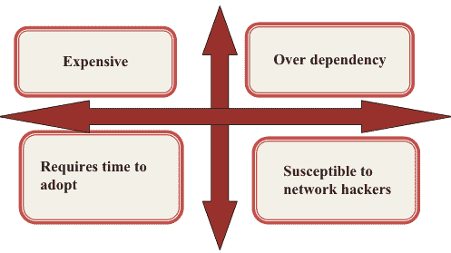

FIGURE 2.3 医疗保健中物联网的缺点。

关键的物联网障碍；然而，越来越多的企业开始通过开源开发来增强能力。

### 2.4.6 监管顾虑

物联网实施正在收集大量信息，一旦泄露，这些信息可能具有敏感性或有害性。这包括有关员工或客户的个人知识，以及有关运营和内部流程的专有业务知识。从限制性角度来看，应解决隐私考量，例如澄清谁将访问物联网知识以及数据的使用方式。政府和商业机构必须为各行业制定标准和规则，以确保知识不被滥用。

### 2.4.7 可扩展性

企业通常能够在单一地点成功开发带有多个设备的物联网应用程序。然而，他们后来发现可扩展性是一个问题。系统规划必须考虑到额外资源，这一点至关重要。

### 2.4.8 时间限制

对企业而言，物联网的推广是一项漫长且昂贵的工作。技术的快速变化意味着，企业面临着任何新技术系统一经安装即可能过时的风险。为了从全新物联网系统中获益，企业应努力从公司的开发流程中消除尽可能多的障碍，以实现快速且经济的推广。同样，他们还需确保与能够满足其技术需求并支持敏捷解决方案的称职服务供应商合作。

### 2.4.9 安全性

由于设计不佳，物联网设备通常容易受到安全漏洞的影响。这可能会对公司知识安全产生重大影响，同时也会使昂贵的物联网相关设备面临危险。因此，物联网需要强大的身份验证方法、加密信息以及能够追踪网络中异常情况的平台。如果企业清楚物联网信息的收集和使用方式，消费者对物联网的信心将会增长。

### 2.4.10 管理物联网障碍

采用物联网所带来的信息流入可以使企业大幅改善管理和运营。然而，尽管物联网有望重塑企业，但实施相关物联网解决方案仍充满复杂性。虽然部署物联网技术潜力巨大，但为了利用这些优势，必须有效应对物联网挑战，并克服潜在挑战和安全问题，以确保物联网取得成功。技术、法规、可扩展性、推广和安全等问题都需要得到解决。

## 2.5 管理物联网技术的挑战

虽然物联网可以带来重要优势，但其实施可能会很困难。Forbes Insights 最近对近五百名高管进行了调查，在被问及构建物联网能力时面临的最大挑战时，二十九人表示是物联网技术的标准问题。这并不令人惊讶。在某些情况下，物联网平台必须支持数千个供应商、数十种标准，并能够扩展到无数设备，同时创建和接收数十亿条消息。

基于物联网的解决方案通常由多种技术构成，其中一些已经存在，另一些则是全新的。每种技术都有自己的发展路径，一旦组合在一起，就会产生一个复杂且快速变化的环境。以下是当今管理物联网技术的四个挑战。

### 2.5.1 将新技术集成到现有环境中

在智能手机时代，仿佛每台机器都已连接并共享数据；然而，事实并非如此。在消费者领域，各种技术组合在争夺主导地位，标准化仍然遥遥无期。因此，真正支持物联网并连接的住宅、家电或其他商品相对较少。在工业领域，由于投资的性质，情况变得更加复杂。在现场运行二十年左右的资本设备并不总是可行的更换目标，就像消费者领域中的炉灶或冰箱一样。改造通常是为现有设备带来物联网功能的唯一现实方案。然而，改造既不容易也不确定。虽然连接旧设备和系统能带来巨大优势，并且是几家工业公司物联网计划中的重要步骤，但实施障碍可能非常严峻。

话虽如此，各公司在此领域正取得重大进展。它们正在向现有环境和设备添加完整的传感器和摄像头，以监控和收集有关机器性能和健康状况的信息。这些传感器附加到现有设备，并与网关连接，以安全地收集和传输信息，然后可以对其进行分析。

### 2.5.2 管理协议复杂性

物联网开发中的另一大挑战是协议种类繁多。常见的标准包括：

- BLE (Bluetooth low energy)
- ZigBee
- Z-Wave
- Thread
- We-Mo

从某些方面来说，BLE、ZigBee、Z-Wave 和 Thread 很相似。它们都是无线技术，使用 mesh 网络无线连接和联网物联网设备，而无需涉及蜂窝或 Wi-Fi 信号。然而，它们使用的频率不同，在运行方式以及特定时间需要支持的设备种类方面也有所不同。不过，We-Mo 需要 Wi-Fi，这消除了对集线器或控制器的需求，并允许设备通过网络直接连接。这种技术的两大巨大缺点是，它比其他低能耗选择需要更多的电力和处理能力。

同样，这只是一个简短的列表；协议数量庞大。每种协议都有其优缺点；但是，由于没有单一的通用标准，企业应为每个用例确定合适的协议，并确保所选技术与其整体平台兼容。由于标准仍在不断发展，更换或升级方法将是有益的。

### 2.5.3 网络挑战

除了各种截然不同的协议和不兼容的硬件之外，还有基本的网络挑战必须得到解决，才能使物联网设备成为现实。第一步是确保信息快速可靠地流动。安全性同样至关重要，因为物联网设备常常成为黑客和网络恐怖分子的目标。设备连接后，必须确保信息被加密，并且应当通信其存在和活动。

功耗和带宽带来了其他独特的挑战。在数千台设备相互通信的场景中，频繁的通信和传输可能会耗尽电池供电设备的电量。在这种情况下，最低限度、经济的电力使用至关重要。在数千台设备通过无线网络通信的场景中，带宽将成为优先事项，成本也会迅速增加。目标应是尽可能使物联网信息流保持紧凑和经济。

### 2.5.4 物联网时代的最佳实践

在 IT 界，最佳实践通常被描述为广为人知且被认为最有效的程序。当今缺乏最佳实践来帮助企业编写代码、管理某些物联网相关硬件和软件系统的生命周期，并应对可能发生的独特类型的漏洞，包括在设备层面发起的入侵。如果没有最佳实践作为路线图，程序员和 IT 专业人员就在未知水域航行。考虑一下 2016 年 10 月的 Mirai 僵尸网络攻击。在这次事件中，IT 专业人员亲眼目睹了漏洞可以多么猖獗。尽管这次事件造成了损害，但人们学到了很多东西，包括制定物联网安全策略的重要性以及快速响应的概念。

随着物联网（IoT）的不断普及，阵痛在所难免。硬件仍可不断进步和改进。软件系统可以变得更加完善。新标准、协议和连接选择可能会变得更加普遍。但是，企业应确保其新功能与传统系统保持兼容。采用这种方法，企业将能够简单应对物联网带来的变化速度，并充分意识到其优势。

## 2.6 物联网安全威胁

物联网（IoT）为最终用户带来了显著优势。但是，它也带来了新的安全挑战。中央安全问题的一部分在于，连接设备之间存在隐式信任。连接设备之间的这种共享信任意味着，设备在识别后会立即向所有其他设备传输其信息，而无需先运行任何恶意软件检测测试。这些物联网安全危害的最坏情况会导致人身伤害，甚至生命损失。

连接设备正在为消费者创造愉悦的体验；然而，它们也是黑客当前的目标。物联网（IoT）和网络犯罪活动共享两个重要特征：它们在大多数时候对肉眼不可见，并且随时无处不在。

随着越来越多的组织使用传感器和复杂的软件系统应用程序的组合来创建智能家居、智能工作场所环境甚至智慧城市，结果通常感觉就像魔法一样。进入房间后灯光会自动开启。机器会主动请求升级以防止故障。零售商店会在顾客因物品缺失而感到烦恼之前自动补货。这些都是物联网让技术无处不在且无缝衔接的方式。不幸的是，最成功的网络犯罪分子的行为方式几乎一模一样。攻击数据库、攻击网站和窃取密码很少涉及面对面的接触。一旦技术变得必不可少，与技术相关的安全问题往往会不断积累。随着时间的推移，这些问题已从电子邮件过渡到短信，从台式机电脑过渡到智能手机，目前则过渡到物联网。

物联网（IoT）是互联网快速增长的一个领域。互联网的不同部分依赖于个人交换数据，而物联网允许设备收集数据、传输数据和接收数据。将物联网视为类似于在线、电子邮件或社交网络更容易理解；但是，它连接的不是个人，而是智能机器。

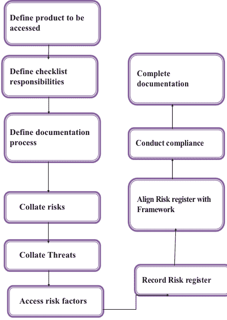

### 2.6.1 漏洞

对物联网设备最基本、最容易利用的威胁是其漏洞。提供物联网解决方案的企业在查看底层软件系统之前，首先会解决这个问题。我们也必须认识到，漏洞通常分为两种类型：硬件和软件。硬件漏洞通常难以发现或渗透。但是，修复或彻底解决损害则更加困难。软件漏洞指的是编写不良的算法程序或带有后门的一行代码。这种后门会简单地为窥探此类机会的入侵者提供访问权限。

### 2.6.2 容易暴露

这可能是物联网企业面临的最基本问题之一。任何设备，如果无人看管或暴露给捣乱者，都是不适的公开邀请。在大多数情况下，物联网设备对第三方暴露并不灵活；它们要么暴露，要么任何人都可以轻松访问。这意味着攻击者要么只是简单地偷走设备，要么将设备连接到包含有害信息的另一台设备，要么尝试提取加密秘密，修改编程，或者用入侵者完全控制的恶意设备替换这些设备。

### 2.6.3 威胁

威胁通常分为两种类型：个人威胁或自然威胁。任何源于地震、飓风、洪水或火灾等自然事件的威胁都会对物联网设备造成严重损害。我们经常备份或制定应急计划来保护信息。但是，对设备造成的物理损坏无法修复。

如今，物联网解决方案随着时间的推移而成熟。今天的设备已演变为防水。在物联网解决方案提供商推出防火或抗震产品之前，还有很长一段路要走。相反，我们倾向于竭尽全力遏制对物联网设备的人为威胁。这些威胁通常是恶意攻击。

### 2.6.4 不安全的 Web 界面

与物联网相关的安全问题是，内置的物联网允许最终用户与设备交互，同时攻击者或入侵者也可能未经授权访问这些设备。

下面列出了一些安全问题。

- 账户枚举
- 弱默认凭据
- 网络流量中暴露的凭据
- 跨站点脚本 (XSS)
- SQL 注入
- 会话管理
- 弱账户锁定设置。

上述问题的解决方案是

- 初始设置期间必须更改默认密码和默认用户名。
- 确保密码恢复机制稳健，不会向攻击者提供表明有效账户的信息。
- 确保 Web 界面不易受到 XSS、SQLi 或 CSRF 攻击。
- 确保凭据不会在内部或外部网络流量中暴露。
- 不应允许弱密码。
- 登录失败 3–5 次后锁定账户。

### 2.6.5 身份验证不足

此领域涉及用于验证物联网设备的不足机制。这些机制会导致以下问题：

- 缺乏密码复杂性。
- 凭据保护不佳。
- 缺乏双因素身份验证。
- 不安全的密码恢复。
- 权限提升。
- 缺乏基于角色的访问控制。

上述问题的解决方案是

- 确保要求使用强密码。
- 在必要时确保实施细粒度访问控制。
- 确保凭据得到妥善保护。
- 在可能的地方实施双因素身份验证。
- 确保密码恢复机制安全。
- 确保敏感功能需要重新验证身份。
- 确保可用于配置密码控制的选项。

### 2.6.6 不安全的网络设备

以下是与物联网不安全的网络设备相关的一些问题：

- 易受攻击的服务
- 缓冲区溢出
- 通过 UPnP 开放的端口
- 可利用的 UDP 服务
- 拒绝服务
- 通过网络设备模糊测试进行 DoS 攻击。

上述问题的解决方案是

- 确保仅暴露和可用必要的端口。确保服务不易受到缓冲区溢出和模糊测试攻击。
- 确保服务不易受到 DoS 攻击，这些攻击可能影响设备本身或局域网或其他网络上的其他设备和/或用户。
- 确保网络端口或服务不会（例如）通过 UPnP 暴露到互联网。

### 2.6.7 缺乏传输加密

此领域涉及以未加密格式交换的数据或信息。

- 通过互联网提供的未加密服务。
- 通过本地网络提供的未加密服务。
- SSL/TLS 实现不良。
- SSL/TLS 配置错误。

上述问题的解决方案是

- 确保数据在通过网络传输时使用 SSL 和 TLS 等协议进行加密。
- 如果 SSL 或 TLS 不可用，确保使用其他行业标准加密技术来保护传输过程中的数据。
- 确保仅使用公认的加密标准，并避免使用专有加密协议。

### 2.6.8 隐私问题

收集不必要的个人信息是患者的主要关注点。患者信息应合法，且不应被任何第三方访问。

在处理隐私威胁时，应牢记以下几点。它们列出如下：

- 确保仅收集对设备功能至关重要的数据。
- 确保收集的任何数据性质都不太敏感。
- 确保收集的任何数据都经过去标识化或匿名化处理。
- 确保收集的任何数据都通过加密得到妥善保护。
- 确保设备及其所有组件都能妥善保护个人信息。
- 确保只有授权人员才能访问收集的个人信息。
- 确保为收集的数据设置保留期限。
- 确保如果收集的数据超过产品预期，最终用户会获得“告知和选择”。

### 2.6.9 不安全的云接口

此点涉及与用于与物联网设备交互的云接口相关的安全问题。

- 账户枚举。
- 无账户锁定。
- 网络流量中暴露的凭据。

上述问题的解决方案是

- 初始设置期间应更改默认密码和默认用户名。
- 确保用户账户无法通过密码重置机制等功能进行枚举。
- 确保登录失败 3–5 次后锁定账户。
- 确保基于云的 Web 界面不易受到 XSS、SQLi 或 CSRF 攻击。

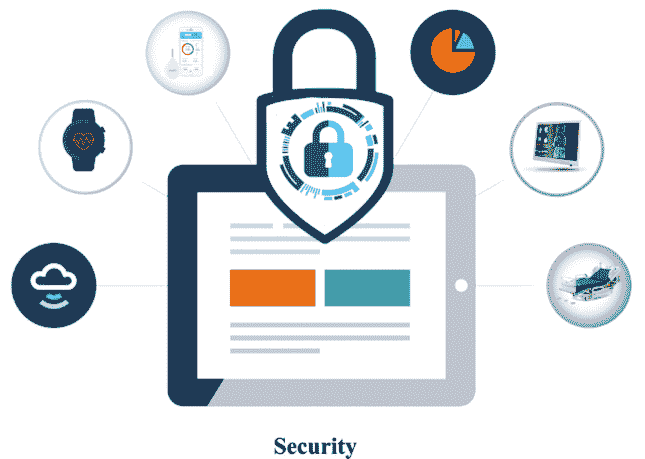

图 2.4 Web 安全演示。

- 确保凭据不会在互联网上暴露。
- 如果可能，实施双因素身份验证。

## 2.7 结论

本章讨论了物联网（IoT）在医疗保健行业的各种应用类型。我们重点探讨了物联网在医疗保健行业的各种应用类型，以及在该行业成功实施物联网所面临的主要安全问题和挑战。物联网常因自大妄想而受到指责，并因此被认为是一件大事。事实是，它是一件重大之事，且注定会不断壮大。物联网当然是一件重大之事，并且只会随着时间的推移而不断壮大。遗憾的是，它越壮大，成为攻击目标的可能性就越大。同样，所有相关威胁和物联网趋势也可能不断扩大。制造商及其他与物联网行业相关的人员可能不得不认真对待保护问题和威胁。

## 参考文献

- 1. Alok Kulkarni, Sampada Sathe. “医疗保健中的物联网应用：综述”. (IJCSIT) International Journal of Computer Science and Information Technologies, 5 (5), 2014, 6229–6232.
- 2. B. Sobhan Babu, K. Srikanth, T. Ramanjaneyulu, I. Lakshmi Narayana. “面向医疗保健的物联网”. International Journal of Science and Research (IJSR) 2014.
- 3. Shubham Banka, Isha Madan, S.S. Saranya. “使用物联网的智能医疗监测”. International Journal of Applied Engineering Research ISSN 0973-4562, 13 (15), 2018, 11984–11989.
- 4. Ananda Mohon Ghosh, Debashish Halder, SK Alamgir Hossain “通过物联网的远程健康监测系统” 第五届信息学、电子与视觉国际会议 (ICIEV)
- 5. Damian Dziak.*, Bartosz Jachimczyk, Wlodek J. Kulesza “医疗保健应用的基于物联网的信息系统” 设计方法学方法” Appl. Sci. 2017, 7, 596; doi:10.3390/app7060596 www.mdpi.com/journal/applsci
- 6. Harold Thimbleby, “医疗保健的技术与未来.” [公共卫生研究杂志, 2013; 2:e28]
- 7. Burgos S. 医疗信息技术可以提高质量并降低成本. Clinics, 2013, 68(3):425, http://dx.doi.org/10.6061/clinics/2013(03)LE04.Jo
- 8. https://dzone.com/articles/the-biggest-security-threats-and-challenges-for-io Health Research 2013; vo
- 9. www.iotforall.com/7-most-common-iot-security-threats-2019/28
- 10. www.ubuntuip.com/25-most-common-iot-security-threats-in-an-increasingly-connected-world/
- 11. www.sdxcentral.com/5g/iot/definitions/iot-security/

泰勒与弗朗西斯

泰勒与弗朗西斯集团

http://taylorandfrancis.com

# 3 "IoT"
医疗保健行业的光明前景

Subhashree Sahoo, Debabrata Dansana, and Raghvendra Kumar
1 本地治里大学，卡拉佩特，本地治里，印度
2 GIET大学，冈布尔，印度

## 目录

| 章节 | 页码 |
|---------|------|
| 3.1 引言 | 50 |
| 3.2 物联网范围 | 51 |
| 3.2.1 信息积累 | 52 |
| 3.2.2 设备集成 | 52 |
| 3.2.3 实时分析 | 52 |
| 3.2.4 应用与方法精简 | 52 |
| 3.3 医疗保健行业 | 52 |
| 3.3.1 物联网在医疗保健行业的优势 | 53 |
| 3.3.1.1 信息聚集与审查 | 53 |
| 3.3.1.2 跟踪与注意事项 | 54 |
| 3.3.1.3 远程医疗协助 | 54 |
| 3.3.1.4 同时报告与监测 | 54 |
| 3.3.1.5 从头到尾的可用性与经济性 | 54 |
| 3.3.1.6 物联网与患者 | 55 |
| 3.3.1.7 物联网与医生 | 55 |
| 3.3.1.8 物联网与医院 | 55 |
| 3.3.1.9 面向保险公司的物联网 | 55 |
| 3.3.1.10 重新定义医疗保健 | 56 |
| 3.4 智能药丸 | 57 |
| 3.4.1 WCE 技术 | 59 |
| 3.4.2 胶囊 | 59 |
| 3.4.3 信息记录腰带/智能可穿戴设备 | 59 |
| 3.4.4 工作站 | 60 |
| 3.5 智能床 | 60 |
| 3.5.1 智能床特性 | 61 |
| 3.5.1.1 睡眠追踪 | 61 |
| 3.5.1.2 温度控制 | 61 |
| 3.5.1.3 气囊 | 61 |
| 3.5.1.4 应用集成 | 62 |
| 3.5.2 智能床技术 | 62 |
| 3.5.2.1 传感器 | 62 |
| 3.5.2.2 气囊系统 | 62 |
| 3.5.2.3 三种运行模式 | 62 |
| 3.5.2.3.1 预设 | 62 |
| 3.5.2.3.2 位置检测 | 62 |
| 3.5.2.3.3 手动 | 62 |
| 3.5.2.4 网络 | 62 |
| 3.6 智能可穿戴设备 | 62 |
| 3.6.1 智能手表 | 63 |
| 3.6.2 可穿戴设备如何工作 | 65 |
| 3.7 远程健康监测 | 65 |
| 3.7.1 技术组件 | 66 |
| 3.7.2 RPM 如何工作 | 66 |
| 3.7.3 远程患者监测的优势 | 67 |
| 3.8 物联网支持的应用 | 67 |
| 3.9 结论 | 69 |
| 3.10 参考文献 | 69 |

## 3.1 引言

物联网或 IoT 是一个由通过互联网可访问的相关物理事物组成的领域。物联网中的“事物”可以是佩戴心脏监视器的人，也可以是配备特征传感器的车辆，例如，这些对象已被赋予 IP 地址，并能够在无需人工协助或干预的情况下，通过网络积累和交换数据。物品中植入的技术使其能够与内部状态或外部环境进行接口，从而影响所做出的选择。由于各种技术的融合、持续检查、AI、物品传感器和嵌入式系统，物联网的重要性不断提升。嵌入式系统、远程传感器系统、控制系统、自动化等传统领域，均为物联网的实现做出了贡献。在客户展示领域，物联网发展最常与“智能家居”概念相关的事物同义，即渴望各种小装置和设备，例如照明系统、恒温器、家庭安全系统和摄像头，以及其他帮助满足日常条件的家用机器，这些机器可以通过与该环境相关的设备（如智能手机和智能音箱）进行控制。物联网概念一直备受关注，尤其是关于这些设备及其不可避免存在所带来的保证和安全问题。

智能设备系统的概念早在 1982 年就已被讨论，当时卡内基梅隆大学一台改装的可口可乐自动售货机成为第一台与互联网相连的机械装置，能够报告其库存以及最近装入的饮料是否冰冷。韦瑟 1991 年关于无处不在计算的论文《21世纪的计算机》，以及 UbiComp 和 PerCom 等学术环境，共同塑造了当代的物联网愿景。1994 年，Reza Raji 在 IEEE Spectrum 上将这一概念描述为向广泛领域传输少量数据组。

“中心节点计划，旨在连接并自动化从家用机器到整个机械办公室的一切事物”。1993年至1997年间，一些协会提出了类似于Microsoft at Work或Novell NEST的方案。当Bill Joy在1999年达沃斯世界经济论坛上展示的“六张网”架构中设想设备到设备的通信时，该领域变得活跃起来。“万物网”这一表述可能由宝洁公司（后来的MIT Auto-ID中心）Kevin Ashton于1999年创造，但他更倾向于使用“物联网”这一术语。到那时，他视射频识别（RFID）为物联网的基础，这将使计算机能够管理每个个体物品。一篇引用物联网的研究论文于2002年6月提交给挪威北欧研究者会议，其前身是2002年1月发表于芬兰的一篇文章。那里描述的应用由赫尔辛基理工大学的Kary Främling及其团队开发，并更积极地组织先进的系统，例如用于执行智能互联产品的信息系统基础设施。

## 3.2 物联网范围

物联网嵌入式设备使消费者能够在设备内部获得更深入的理解、检验和集成。这些设备相应地设计，以同时改善这些不同领域的功能并提高其准确性。物联网使用已存在且不断改进的定制技术，用于识别、设备联网和人工智能。物联网包括软件系统的持续进步、设备成本的下降以及对创新的流行态度。它是新的和先进的领域，在产品、商品和服务的交付中带来真正的变化；同时也带来这些进步的社会、财务和政治影响。物联网最必要的特性包括人工智能、连接性、传感器、可行的参与和微型设备的使用。

- **人工智能与物联网** – 物联网使某些东西部分变得“智能”，这意味着它利用信息收集、人工智能算法和网络的能力来升级生活的每个部分。我们可以说，当一个人只需查看冰箱和橱柜，就能注意到牛奶和谷物等必需品即将用完，然后与最喜欢的杂货店下订单时，这要容易得多。

- **连接性与物联网** – 以前用于系统管理，特别是用于物联网组织的背书技术，这些系统不再仅仅附属于实际提供商。系统可以以更小、更便宜的规模存在，同时仍然可行。物联网在其框架设备之间创建这些小型系统。

- **传感器与物联网** – 没有传感器，物联网就会失去其精妙之处。它们充当定义性工具，将物联网从标准的被动设备系统转变为能够实现真正集成的强大框架。

- **有助于主动参与** – 当前大部分与关联技术的合作是通过被动承诺进行的。物联网为动态内容、产品或服务参与带来了全新的范式。

- **微型设备** – 设备正如预期的那样，随着时间的推移而变小、更便宜、更强大。物联网致力于制造专门的小型设备，以传递其准确性、适应性和灵活性。

### 3.2.1 信息积累

该软件框架管理检测、估计、轻量级数据筛选、轻量级数据安全以及数据总计。它使用绑定协议帮助传感器与定期、机器对机器系统进行接口。然后，它从众多设备收集数据并根据设置传输。它还通过在设备间分发数据来反向工作。该框架最终将所有收集的数据传输到本地服务器。

### 3.2.2 设备集成

支持集成的编程将所有框架设备绑定在一起，构成物联网框架的主体。它保证设备之间的必要参与和稳定系统管理。这些应用程序是物联网组织的塑造性编程框架创新，因为如果没有它们，就不算是物联网框架。它们处理每个设备的不同应用、协议和限制，以允许通信。

### 3.2.3 实时分析

这些应用程序从各种设备获取数据或输入，并将其转换为合理的活动或人类检查的清晰示例。它们基于各种设置和计划分析信息，以执行自动化相关任务或提供业务所需的数据。

### 3.2.4 应用与方法精简

这些应用程序扩展现有框架和编程框架的范围，以允许更广泛、更成功的框架。它们针对特定功能（如允许某些手机或设计仪器访问）协调预定义设备。它支持提高效率和更精确的数据编排。

## 3.3 医疗保健行业

医疗保健行业处于一种相当严重的萧条状态。这些服务比以往任何时候都更昂贵，总体人口正在老龄化，因此慢性病的数量在增加。我们正在走向的可能是一个世界，在那里基本医疗服务将对大多数人遥不可及，社会中异常大的一部分人将因成年而无用，人们也将更容易受到慢性疾病的侵袭。难道这不是我们所预料的地球最高点吗？物联网应用开发正在拯救你。虽然技术无法阻止人口老龄化或直接消除慢性疾病，但它至少可以使医疗保健在口袋和可及性方面更简单。医疗诊断占医院账单的很大一部分。技术将医疗检查的日程安排从医院（医院驱动）转移到患者（家庭驱动）。正确的诊断也将减少住院需求。另一种称为物联网（IoT）的范式，在各个领域（包括医疗保健）具有充分的相关性。在医疗保健领域完全应用这一范式可能是普遍的期望，因为它使医疗中心能够更加相关地开展工作，并让患者获得更好的治疗。使用这种基于技术的医疗保健流程，有独特的优势可以提高药物的质量和效力，从而改善患者的健康。[1]

在过去十年里，联网设备以各种形式被引入患者。无论信息来自脊椎屏幕、心电图、温度屏幕还是血糖水平，相关健康信息对一些患者来说都至关重要，尽管其中一些措施需要与医疗服务专业人员进行面对面沟通。然而，物联网设备的使用在向专家传递额外重要、持续的信息方面起到了关键作用，并改变了直接患者-医生协作的需求。物联网在医疗保健中的早期应用还包括智能床，它们能察觉何时被占用以及患者何时试图起床。智能床还可以自行调整，以确保在没有医护人员手动协作的情况下，将适当的重量和支撑施加到患者身上。智能技术迅速成为医疗保健质量的另一个领域是家用处方分配器。这些容器会在未服药或应警告护理团队的其他指标时，准确地将数据移动到云端。[2]

### 3.3.1 医疗保健行业中物联网的优势

#### 3.3.1.1 信息汇集与分析

医疗保健设备因其持续应用而在极短时间内发送的大量数据，如果无法访问云端，则难以存储和管理。不仅如此，医疗保健提供者从众多设备和来源汇总数据并手动分析也是一项艰巨的任务。物联网设备将逐步收集、报告和分析信息，并减少对数据存储的需求。这一切都将通过云端完成，提供者将独家获取带有图表的结论性报告。此外，考虑活动使协会能够进行重要的医疗保健调查和数据驱动的洞察，加速决策并且较少容易出错。[2]

#### 3.3.1.2 跟进与注意事项

及时报警在风险情况下至关重要。物联网使设备能够收集重要信息并将这些信息转交给专家以满足实时需求，同时通过移动应用程序和其他连接设备向用户发送关于关键组件的警报。报告和警报能够提供可靠的患者病情评估，无论身处何地或何时。它还能实现知情决策和及时治疗。因此，物联网允许持续监测、跟踪和识别，从而允许动态治疗、更高精度、专家的有效干预，并改善整体医疗服务成果。[7]

#### 3.3.1.3 远程医疗协助

在危机情况下，患者可以使用智能移动应用程序联系几公里外的专家。在质量有保障且毫不疏忽的前提下，医生可以立即检查患者并当场诊断疾病。

此外，各种医疗服务框架预计将创建机器，这些机器可以通过连接设备根据患者的用药和疾病相关知识分发适当药物。物联网可以改善诊所内的患者护理。这反过来可以减轻个人在医疗服务方面的负担。[2]

#### 3.3.1.4 同时报告和监测

通过连接设备进行实时监测可以在心脏病、糖尿病、呼吸道发作等医疗危机发生时挽救生命。通过连接到智能手机应用程序的智能医疗设备建立的连续监测，连接设备将收集医疗及其他必要健康信息，并使用智能手机的数据连接将收集的数据传输给医疗专业人员。物联网设备收集和传输健康信息：血压、血氧和血糖水平、体重及心电图。这些数据存储在云端，可以与授权人员共享，例如医疗专家、您的保险提供商、合作的医疗公司或外部顾问，使他们能够不受地点、时间或设备限制地访问收集的数据。[8]

#### 3.3.1.5 从开始到结束的可用性和可负担性

物联网将借助医疗质量框架及其他新技术和先进医疗设施，实现患者护理交付的自动化。物联网支持存储、机器间通信、数据交换和信息开发，这些有助于使医疗服务交付更加高效。连接协议：蓝牙、Wi-Fi、Z-Wave、ZigBee及其他现代协议；医疗工作者可以调整他们在患者中检测疾病和失调的方式，还可能引入渐进式治疗方法。随后，技术驱动的解决方案通过减少不必要的就诊、使用更高质量的资源以及改进分配和规划来降低成本。[10]

#### 3.3.1.6 物联网与患者

以健身手环等可穿戴设备以及血压袖带、心率监测袖带、血糖仪等其他远程连接设备形式的设备，为患者提供个性化护理的访问权限。这些设备旨在追踪卡路里计数、运动检查、预约、血压波动等更多内容。物联网改变了人们的生活，尤其是对老年患者，通过促进健康状况的持续监测。这对独居人士及其家庭产生重大影响。在个人正常活动出现任何干扰或变化时，警报机制会向家人和相关医疗服务提供者发送信号。

#### 3.3.1.7 物联网与医师

使用嵌入物联网的可穿戴设备和其他家庭监测设备，医生可以更有效地监测患者健康状况。他们可以追踪患者对治疗计划的依从性或紧急医疗护理的需求。物联网使医疗专业人员能够更加警觉并主动与患者互动。从物联网设备收集的数据有助于医生为患者制定最简单的治疗计划并实现最佳效果。

#### 3.3.1.8 物联网与医院

除了监测患者健康状况，物联网设备在医院的几个其他领域也非常有用。配备传感器的物联网设备用于追踪医疗设备（如轮椅、除颤器、雾化器、输液泵和其他监测仪器）的实时位置。不同地点的医疗专家读数也可以实时分析。疾病传播是医院患者的重大关切。物联网支持的卫生监测设备有助于防止患者感染。物联网设备还协助质量管理，例如药房库存控制和环境监测，例如检查冰箱温度以及湿度和温度管理。

#### 3.3.1.9 面向保险公司的物联网

带有物联网连接智能设备的健康保险提供商有各种机会。保险公司可以使用健康监测设备捕获的数据进行其核保和索赔活动。这些数据使他们能够检测欺诈性索赔并建立核保前景。物联网设备在核保、定价、索赔处理和风险评估过程中为保险公司和客户带来透明度。鉴于所有运营流程中的物联网驱动数据决策，客户可以充分了解每个决策背后的理由及其结果。保险公司可以向使用和共享物联网设备生成的健康信息的客户提供激励。他们将奖励使用物联网设备追踪其日常活动、遵守治疗计划和预防性健康措施的客户。这可以鼓励保险提供商显著减少索赔。物联网设备还可以使保险公司根据这些设备捕获的数据批准索赔。[7]

##### 3.3.1.10 重新定义医疗

随着物联网特定产品在医疗行业的应用，产生了大量数据。有必要挖掘这些数据的潜力，并将其转化为医疗洞察。在下图中，我们描述了物联网的架构，这是一种四阶段架构；基本上，这些阶段是过程。所有四个阶段都是互连的，使得一个阶段中使用的数据在下一阶段产生其价值。[2]

- **步骤-1**
  第一步包含许多互连设备。它们用于从各个领域收集信息。这些设备包括传感器、执行器、监视器、探测器、摄像头系统等。

- **步骤-2**
  在第二步中，从传感器和设备接收到的数据不能直接用于进一步处理，因为数据以模拟形式提供，因此必须将其转换和聚合为数字形式以供处理。

- **步骤 3**
  在第三步中，数据被预处理、标准化并移至数据云。

- **步骤-4**
  在第四步中，执行数据分析操作，从而实现更好的决策。

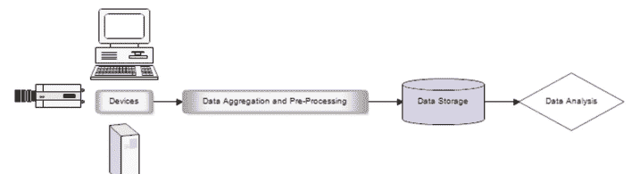

图 3.1 数据移动演示。

通过在医疗行业使用物联网特定产品，以以下方式重新定义它：

- 改进性能
- 更好的工作流程和流程
- 确保更好的护理
- 患者成本降低
- 改善治疗效果
- 主动治疗
- 错误减少
- 更快的疾病诊断
- 药物和设备管理
- 急诊室等待时间缩短
- 患者和员工追踪

## 3.4 智能药丸

诊断患有炎症性肠病（如克罗恩病（CD））的患者是一个涉及多个步骤的过程。如果体检、血液检查和粪便检查的结果表明一个人症状是由胃肠道内炎症引起的，医生可能会将患者转诊给胃肠病专家。胃肠病专家是专门从事胃肠系统健康的医生；他们经过专门培训，可以执行一种称为内窥镜检查的特殊诊断程序。内窥镜检查程序允许胃肠病专家使用一种称为“内窥镜”的特殊仪器检查人胃肠道内部。与此仪器相关的是一根长而细的管子，其末端连接有微型摄像头和灯光，可将胃肠道图像投射到屏幕上进行分析。内窥镜可以通过自然开口（如口腔和咽喉）插入体内，也可以通过肛门插入。在微创手术过程中，医疗仪器也可以通过在皮肤上做的小切口插入。

“智能药丸”一词指的是比传统药丸更小的电子设备，设计成药物容器的形式，但执行高度先进的功能，如检测、成像和药物递送。它们可能包含生物传感器或成像器、pH或化学传感器。一旦吞服，它们会通过消化道收集通常难以获取的数据，并由系统有效传输。它们作为可吞服传感器的设计，使其区别于可植入或可穿戴传感器。多种内窥镜方法和各种内窥镜策略也用于调查或筛查癌症。用于这些方法的传统刚性内窥镜对患者来说不舒适，并且可能因在多个患者之间重复使用而引起内部损伤或疾病。智能药丸消除了对侵入性系统的需求：无线通信允许连续数据传输；电池技术的进步

智能药丸改变了胃肠道问题的发现方式，并将取代标准的症状性策略，例如内窥镜检查。通常，内窥镜被插入患者的喉咙，以此方式检查上部和下部消化道，用于诊断目的。存在穿孔或肌肉系统涂层撕裂的危险，患者在整个过程中及之后都会感到不便。然而，智能药丸或无线胶囊内镜（WCE）可以轻松吞服并捕获图像，所需的患者准备很少，例如镇静。隐含的传感器允许估计肠道内的体液和气体，为医生提供人体的多维图像。

“智能药丸”这一表述是指比传统电子设备更小的装置，其形状和设计类似于药品容器，但能执行极其先进的功能，例如检测、成像和药物输送。它们可包含生物传感器、成像传感器、氢离子浓度或化合物传感器。一旦吞服，它们会通过消化道收集通常难以获取的信息，并能有效地从体内排出。其作为可吞服传感器的形态，使其与可植入或可穿戴传感器有所不同。多种内窥镜方法和大量内窥镜策略也用于调查或筛查癌症。用于这些方式的古老、僵硬的内窥镜对患者来说很不舒服，且因多次在多名患者身上使用，可能导致内部损伤或引发疾病。智能药丸消除了对侵入性系统的需求：无线通信允许连续数据传输；电池和本地可用内存的进步使其在体内长期感应方面非常有价值。

图 3.2 智能药丸的内部结构。

### 3.4.1 WCE 技术

无线胶囊内镜或智能药丸包含三个部分

- 胶囊
- 信息记录器腰带/智能穿戴设备
- 工作站

### 3.4.2 胶囊

无线胶囊是一种一次性设备，尺寸为 11 × 26 毫米（略大于大号营养容器），重 3.7 克，两部分胶囊形状的外壳由可生物降解塑料顶层涂层制成，表面光滑，可使肠道蠕动推动仪器通过腔道。无线胶囊包含一种互补金属氧化物半导体芯片摄像头、一个透镜、照明闪光发光二极管，以及电源和无线遥测发射器。外壳电池寿命约为 8 小时，足以捕获小肠道图像。一旦电池耗尽，发射器会将外壳切换到导航模式。在此模式下运行时，它会向记录器传输有关胶囊位置的数据，使工作站或系统能够在额外十小时内检查胶囊是否正常工作。一次性药丸由非常小的可生物降解材料制成，耐胃液腐蚀。它实时传输视频信号和信息。患者吞服胶囊，当其以每秒两张图片的速度通过消化道时，提供胃肠道黏膜的视频和照片。系统将捕获约 50,000 张图像。胶囊通常在约 8 至 72 小时内排出。

### 3.4.3 信息记录器腰带/智能穿戴设备

患者腰部佩戴的穿戴设备通过设置在患者身体上的一系列传感器接收仪器传输的信号。该设备包括八个不明显的 4 厘米测量传感器，通过粘贴垫附着在皮肤上。它接收来自胶囊的图像，并向信息记录器发送信号。传感器通过可拆卸同轴连接连接到记录器。记录的数据是一个随身听大小的电池供电单元，用于接收胶囊传输的信息。它包括接收器、处理器模块和用于存储信息的硬盘驱动器。该任务使用八个镍氢 6 伏电池。一旦设备显示屏、电池和信息记录器完全连接，信息记录器即可投入任务。闪烁的蓝灯表示记录器正在记录信息。信息记录器将向工作站传输约五万张照片。

### 3.4.4 工作站

在此，系统处理从信息记录器下载的信息。工作站是一种修改后的标准计算机，用于将信息处理为视频演示。这使医生能够追踪药丸的路径，查看溃疡，并保存关键照片和短视频片段。视频由帧组成，每秒可显示一到五十张图片。它允许暂停和速度调整。通常，图像以每秒五到十张图片的速度查看，但也可以选择更高或更低的速度来分析图像。医生的检查/审查时间约为 1.5 小时。智能药丸的持续进步和发展促成了利用出血模式的血液检测算法的进步，使医生能够更多地关注出血区域。[7]

## 3.5 智能病床

智能病床配备远程监测系统来监测患者。智能病床包含体温、心率、血氧和体重等传感器。这些指标对专科医生监测患者健康状况是必需且重要的。该系统安装在医院病床内，将每个患者信号传输给医务人员，尤其是需要医疗关注的情况下。这些重要信息传递至医院的中央系统，使医疗管理人员能够立即审查和监测患者器官。此外，如果患者状况在此期间出现任何突发变化，该系统会向工作人员发送警报消息或标记。由于大部分时间都在床上度过，医院在病人卧床期间监测其状况至关重要。智能病床为医疗服务提供者提供了一种有效解决方案，可持续监测患者以提供更好的护理。这类先进病床减轻了负责监测患者状况的医务人员的负担。此外，智能病床对医疗服务提供者预期、检测和防止非计划床边离床起到了重要作用。

医院病床是大多数患者度过大部分时间的地方，新的“智能病床”鼓励患者小心谨慎，而“智能”功能鼓励护士检查数据并改善患者护理。病床与 EMR 系统对接以发送患者数据，并鼓励护士监测运动和体重变化等指标。科技公司也参与智能病床趋势，提供与病床集成的有用工具以产生更重要的信息。[4]

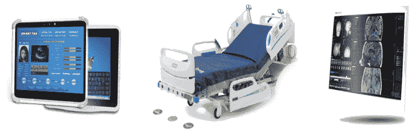

图 3.3 智能床演示。

“智能床”技术的一项重点是，在可能漫长的住院期间提升患者安全性与舒适度；尽管患者健康始终是关注焦点，但《平价医疗法案》已将患者满意度和舒适度提升到更为根本的层面。随着患者跌倒、皮肤完整性问题、呼吸问题和组织风险（护理人员受伤）的增加，医院正在寻找有助于降低这些风险并改善结果的产品。跌倒尤其令人担忧，而不仅仅是护理人员在患者起床时才注意到的现象；该技术还会生成患者活动报告，供医护人员观察模式。

### 3.5.1 智能床的功能

智能床是一种使用多种技术（如重量和心率传感器、温度管理和自动靠背调节）来收集您睡眠和起床模式数据的床，随后将这些数据加以利用，帮助您获得更好的夜间睡眠。

#### 3.5.1.1 睡眠追踪

监测您睡眠质量的能力，本质上是智能床垫区别于普通床垫的主要特点。利用一张“智能织物”或铺满整个床铺的多个传感器，智能床品追踪包括呼吸、心率、入睡潜伏期和身体压力在内的多种数据，以便为您提供最舒适的夜间睡眠。

#### 3.5.1.2 温度控制

大多数智能床配备内置恒温器，可让您在睡眠期间控制床铺温度。

#### 3.5.1.3 气囊

床垫内的充气管道配有压力传感器，可在您睡眠时控制身体姿势。这些气囊可通过智能床的专用应用远程控制。

#### 3.5.1.4 应用集成

您的智能床通过物联网与各种智能家居设备和应用无缝对接，包括智能助手、恒温器、智能灯、咖啡机和电视机，让您无需频繁起床即可管理这些截然不同的设备。[7]

### 3.5.2 智能床技术

#### 3.5.2.1 传感器

极其坚固的纱线缝制的尼龙-聚酯混合材料，柔软、灵活且透气。此外，它是100%织物，没有笨重或令人不适的传感器。可监测约2000个压力点。最初专为医院病床设计，医疗级传感器采用先进的床垫技术，可在夜间所需时提供持续且实时的压力图谱，以减轻压力。

#### 3.5.2.2 气路系统

低噪音真空装置。不同的气囊为不同身体区域（头部、肩部、腰部、臀部和腿部）提供不同的支撑强度。

#### 3.5.2.3 三种操作模式

##### 3.5.2.3.1 程序化

床上前所未有的最具创意的睡垫技术。允许智能床自动且持续地适应您理想的硬度，无论您处于何种体位。

##### 3.5.2.3.2 体位检测

设定仰卧时智能床的硬度感觉，以及与伴侣同睡时智能床的硬度感觉。智能床采用先进的感应技术来识别您的睡眠体位，并会根据您夜间睡眠时的移动情况调整设置。

##### 3.5.2.3.3 手动

调整身体各部位（头部、肩部、腰部、臀部和腿部）的支撑。使您能够根据需求变化随时改变体感。

#### 3.5.2.4 网络

可在平板电脑（随附）或其他远程设备上显示睡眠数据的报告功能。

Wi-Fi 连接可使智能床与现有及未来技术对接。

## 3.6 智能穿戴设备

可穿戴技术是物联网的标志，也是迄今为止最普遍的应用。各种智能腕戴设备、智能服装和医疗穿戴设备所实现的数据处理能力，将是这一面向消费者的物联网技术能够为我们生活带来卓越价值并成为全新趋势的原因。IoT 平台以现成可用的 IoT 功能和应用增强了可穿戴技术。IoT 确实集成到可穿戴设备的小型微芯片中，赋予即时功能、设备管理、数据整合、事件和规则执行、安全性及多种选项。IoT 还提供多功能云逻辑，以确保可穿戴设备之间无损通信，并为其提供机器学习分析和可视化工具。基本上，不仅客户会喜欢高级数据分析，设备制造商也能跟踪性能和设备健康详情，分析查找器算法的准确性，并为不同的设备软件系统执行 A/B 测试。可穿戴技术是一个基于现代微服务设计的极其灵活的 IoT 平台，提供无限的定制机会、一系列开发工具和语言以及一种云处理方式。因此，您的团队可以快速着手开发可穿戴设备，并将先进的可穿戴应用开发周期缩短到几周甚至几天。借助 IoT 设计，可穿戴应用脱离了过去一代简单方案的束缚，能够交付一位精通技术的客户所期望的一切。[2,5]

### 3.6.1 智能手表

可穿戴技术是一种带有微控制器的智能电子设备。该设备可以作为植入式或附加式佩戴在身体上。这些可穿戴设备可以执行大量原本属于手机和 PC 的不同计算任务，有时，可穿戴技术可以完全超越这些手持设备。虽然可穿戴技术通常指那些易于穿戴和取下的物品，但由于植入式设备（例如微芯片甚至智能纹身）的存在，这一概念也有更突出的变体。归根结底，无论设备是佩戴在体内还是集成到体内，可穿戴技术的目的都是提供持续、有益、可靠、方便且基本无需双手的设备和计算机访问。

智能手表是能实现更多——远比旧式简单的时间 GPS 导航更多——的数字手表。我们不是谈论您在小学时用过的那款曾令人目不暇接的计算器手表。这些绝对是顶尖设备。智能手表可以运行应用程序并播放各种数字媒体，例如传输到蓝牙耳机的音轨或广播。这些手表中的许多都有触摸屏，可让您使用计算器、温度计、指南针等功能，无所不能。当今的大多数智能手表并非完全独立的设备，只是因为它们缺乏互联网连接。大量手表旨在与拥有互联网连接的各种设备直接交互，具体来说就是您的手机。

本质上，与手机一样，互联网访问使智能手表能够访问整个潜在功能宇宙，包括消息提醒、GPS 导航和日历同步。此外，显然，与手机的蓝牙连接意味着手表可以让您拨打电话或发送和接收消息。一些智能手表专为娱乐目的而制造，可让您追踪圈速、分段和路线。它们可以与附加设备配合使用，例如心率监测器或节拍传感器。还有一些专为帆船爱好者制造的专业智能手表，可帮助他们追踪速度、风向和风速等因素。

智能手表是一种腕表形式的可穿戴技术；现代智能手表提供近距离触摸屏界面以供日常使用，而相关的手机应用程序负责控制和遥测。早期型号只能执行基本任务，例如计算、先进的时间显示、翻译和游戏，而 2010 年代的智能手表功能越来越接近手机，包括移动应用程序、灵活的操作系统以及 Wi-Fi 或蓝牙网络。一些智能手表可充当便携式媒体播放器，支持 FM 广播并通过蓝牙耳机播放先进的音频和视频文件。少数被称为“电话手表”的型号具有拨打电话等移动蜂窝功能。软件可能包含高级地图、日历、个人助理、计算器和各种表盘。手表可以与外部设备（例如传感器、无线耳机或抬头显示器）通信。与许多计算机一样，智能手表可以从内部或外部传感器收集数据，并可以控制或从各种仪器或计算机中检索数据。它可能支持远程技术，例如蓝牙、Wi-Fi 和 GPS。出于某些原因，手表计算机可作为远程系统（例如蜂窝

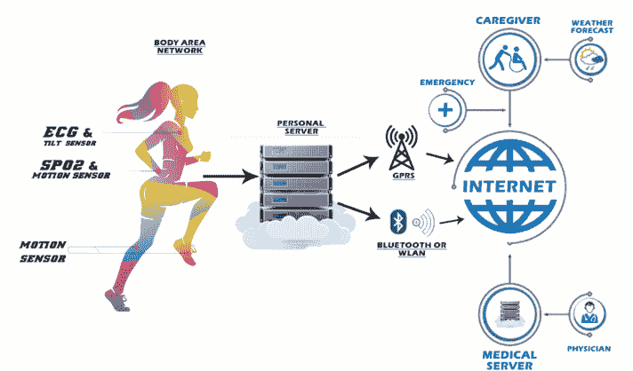

图 3.4 物联网和无线传感器在日常生活中的影响。

手机，通过独特的远程技术与PDA进行通信。智能手表不断进步，尤其是在设计、电池续航限制以及健康相关应用方面。[2.5]

智能手表负责以下事项：
- 记录日常锻炼和卡路里摄入量。
- 获取与血糖水平及其他重要体征相关的健康警报，特别是与佩戴者所患特定疾病相关的警报。
- 捕获生物识别信息，例如脉搏、血氧水平、血压及其他重要健康信息。
- 将收集到的信息发送给医疗服务提供者。

提供基于对随时间收集的信息观察所得出的访问调查和报告反馈。

### 3.6.2 可穿戴设备的工作原理

可穿戴设备依赖三个层次：

**第一层** – 该层由传感器组成。传感器贴近身体放置。传感器监测温度、运动和心率等组件。

**第二层** – 该层负责可用性和控制层。蓝牙低能耗协议是用于将可穿戴设备连接到智能手机或家庭系统的最常用协议。

**第三层** – 该层是可穿戴设备提供和读取信息的地方。

目前市面上有几种类型的智能手表。其中一些列在下方。
- Apple Watches
- Tizen Watches
- Wear OS Watches

## 3.7 远程健康监测

远程监护计划会在护理点收集大量健康信息，包括生命体征、体重、体重水平、血糖、血液成分水平、脉搏和心电图。随后，这些信息会传输给医疗机构（如治疗指导环境下的监测中心、诊所、医疗辅助单位、灵活护理机构以及集中场外个案管理项目）中的健康专家。健康专家远程监测这些患者，并根据治疗方案对所获信息进行后续处理。监控项目还可以帮助人们保持健康，使年长和体弱人士能够更长时间独立生活，避免进入灵活护理机构。该项目还可以减少住院次数、再入院次数及在医疗机构的停留时间——大部分措施有助于提高生活质量并控制成本。

尽管增加了护理数量，该项目也有能力提升护理标准。由于RHM能够让临床医生更直接（且几乎即时地）与相关患者数据关联，它使他们的日常安排更加高效，并降低了职业倦怠的可能性，从而对患者护理带来明显益处。更重要的是，RHM通过构建一个让人们积极参与并掌控自身健康的框架，改善了患者的依从性。有效的RHM项目提供的技术，远非某些客户联想到的那种冷冰冰、医疗感强、令人压抑的医疗技术，而是对患者来说非常亲切和熟悉。虽然患者舒适度和参与度非常重要，但远程患者监护的益处远不止于此，它让患者获得宝贵的确信，即每天都有专人关注他们的健康和福祉。[3]

### 3.7.1 技术组件

远程患者监护系统由以下部分组成。
- 嵌入在由远程通信支持的设备中的传感器，用于测量生理参数。
- 本地保存的信息，以及在符合要求的站点接口中，传感器与其他集中式信息存储及医疗服务提供者之间的信息交互。
- 用于存储传感器传输信息、居民信息存储、诊断应用程序以及医疗保险供应商的集中式存储库。
- 基于收集信息的分析生成治疗建议和干预警报的诊断应用程序。

RPM技术的一些示例包括：
- 用于多基因疾病患者的血糖仪。
- 心率或血压监测仪。
- 连续监测设备，可发现患有痴呆等状况的患者，并向医疗专业人员发出跌倒等事件警报。
- 远程不孕症治疗与监测。
- 在家进行的测试，可帮助滥用药物的患者保持责任感并朝着目标努力。
- 卡路里摄入或饮食计划。

### 3.7.2 RPM的工作原理

尽管RPM策略可能因所使用的设备或被监测的病症而异，但大部分技术包含相似的组件。主要是一种远程启用的传感器，能够测量特定生理参数并存储其收集的信息。该存储还必须包含与额外传感器、医疗服务提供者数据库及相关应用程序对接的方式。应用程序通常为客户提供一个界面，用于跟踪或分析信息并显示治疗建议。

RPM设备收集的信息被发送到合适的区域，并存储在关系数据库中。这使得拥有远程通信信息的医疗组织能够将其作为单个事件或整个健康历史记录的一部分进行查看。通常，当医疗服务提供者已审查信息或发现需要患者前来就诊的问题时，设备会提醒患者。[3]

### 3.7.3 远程患者监护的益处
- 快速获得医疗服务
- 改善护理质量
- 心灵安宁和每日确认
- 改善支持、教育和反馈
- 增加患者参与度

以下是部分顶级RPM公司。
- Dexcom
- Honeywell Life Sciences
- Medtronic
- Philips Healthcare
- ResMed
- Senseonics

## 3.8 IoT支持的应用

远程监测对老年人、行动不便者、慢性病患者或独居人士非常有帮助。该技术使用IoT支持的日常观察设备（如血压监测仪、心脏监测仪或血糖仪）来收集相关信息，并使其对医师可访问。因此，他/她可以密切监测患者的健康状况，并在需要时进行干预。[4,5]
- Philips e-Alert是一种IoT支持的工具，可监测MRI系统等重要医疗硬件，并向医疗组织发出即将发生故障的警告，防止不必要的停机期。
- 在医院中，使用带传感器的IoT设备来跟踪雾化器、轮椅和除颤器等医疗仪器。医务人员的实时位置同样受到监测和分析。
- IoT设备在医院中对感染管理、药房库存管理以及温度和湿度等环境观察非常有价值。
- 健康保险公司可以通过IoT支持的可穿戴设备实现信息捕获，有助于欺诈检测和索赔验证。
- 像Fitbit这样追踪多种健康参数、AmpStrip监测脉搏、可检测睡眠呼吸暂停的智能手表、帮助盲人的智能眼镜等可穿戴设备，正在极大地改变医疗行业的运作方式。
- QardioCore是一种图形记录监测仪，旨在提供连续的医疗级数据。用户可以在正常生活中佩戴此设备：在工作、健身房或外出时。据称，这些数据有助于患者更好地监测高血压和高胆固醇等健康状况。它还将数据发送到监测糖尿病、心脏问题和体重增加等状况的医疗中心，而无需亲自就诊。
- Zanthion可能是一种医疗警报系统，患者将其作为消费品或珠宝佩戴。它连接到一系列传感器，用于监测用户的健康和福祉。如果患者从床上掉下来或长时间保持不动，警报将发送给可以提供帮助的家人或朋友。
- Screen Cloud已经被医院和护理专业人员使用，其应用程序大大跳出了传统数字累积的框架。例如，某机构利用视频艺术和数字累积来提升医院患者的福祉，已证实能降低患者等候室中的压力水平和焦虑。
- Up by Jawbone是一款与众不同的健身追踪器。它不仅仅计算卡路里和步数，还可用于监测健康的方方面面，从体重和睡眠模式到活动和饮食，使用户能够基于数据做出更好的健康决策。一些患者支持团队甚至利用它远程支持有体重和健康问题的人，无需亲自到中心。
- 像探测器Matrix这样的无线传感器正被用于医院冰箱、冷冻柜和实验室，以确保血液样本、药物和其他材料保持在正确温度。
- NHS试验床是英国NHS系统中使用的智能联网床，可监测患者并追踪数据。通过结合可穿戴监测仪和其他数据感知源，它们节省了资金和时间，使老年患者和患有长期健康问题的人能够更高效地观察自己的进展和问题。
- 可吞服感知元素基本上就是字面意思：患者吞服一颗鳕鱼肝油丸大小的传感器，从而避免结肠镜检查。该感知元素可以诊断包括肠易激综合征和癌症在内的问题，无需进行更多侵入性手术。
- Propeller的Breezhaler设备是一种连接传感器，可使支气管哮喘或COPD的管理更加容易。传感器安装在泵的顶部，每次使用时都会监测数据。用户可以收集关于诱因的信息，并使亲属和医生能够管理使用情况。

都来自一个移动应用。减少支气管哮喘发作次数并增加无症状天数的效果是一样的。

## 3.9 结论

本章讨论了物联网（IoT）在医疗保健行业的各种应用类型。随后我们讨论了智能床技术、无线胶囊内镜（WCE）或智能药丸、智能可穿戴设备（如智能手表）、远程健康监测、物联网赋能的应用，以及这项技术的工作原理和它如何为医疗保健行业的患者带来益处。如上文所述，考虑到上述所有应用所关联的所有益处，可以看出在医疗保健行业使用物联网能够克服与其相关的问题。此后，对物联网美好未来的概念及其对医疗保健行业的贡献进行了简要讨论。

## 参考文献

- 1. Alok Kulkarni, Sampada Sathe “物联网在医疗保健中的应用：综述” 计算机科学与信息技术国际期刊，第5卷（5期），2014年，6229-6232页。
- 2. B. Sobhan Babu, K. Srikanth, T. Ramanjaneyulu, I. Lakshmi Narayana “面向医疗保健的物联网” 科学与研究国际期刊（IJSR）2014年。
- 3. Shubham Banka, Isha Madan 和 S.S. Saranya “基于物联网的智能医疗监测” 应用工程国际期刊 ISSN 0973-4562 第13卷，第15期（2018年）第11984–11989页。
- 4. Ravi Kishore Kodali, Govinda Swamy 和 Boppana Lakshmi “医疗保健中物联网的实现” 2015年IEEE智能计算系统最近进展会议（RAICS）2015年12月10–12日。
- 5. Stephanie Baker, Wei Xiang, Ian Atkinson “面向智能医疗的物联网：技术、挑战与机遇” DOI 10.1109/ACCESS.2017.2775180, IEEE
- 6. www.peerbits.com/blog/internet-of-things-healthcare-applications-benefits-and-challenges.html
- 7. www.wipro.com/en-IN/business-process/what-can-iot-do-for-healthcare/
- 8. www.i-scoop.eu/internet-of-things-guide/internet-things-healthcare/
- 9. https://internetofthingsagenda.techtarget.com/feature/Can-we-expect-the-Internet-of-Things-in-healthcare
- 10. https://searchhealthit.techtarget.com/essentialguide/A-guide-to-healthcare-IoT-possibilities-and-obstacles
- 11. https://ecconsultancy.com/internet-of-things-healthcare/
- 12. www.iotforall.com/exciting-iot-use-cases-in-healthcare/
- 13. https://bmcmedinformdecismak.biomedcentral.com/articles/10.1186/s12911-018-0643-5
- 14. www.dotmed.com/news/story/22656/
- 15. www.lifewire.com/smart-bed-4161313
- 16. www.mouse.in/applications/article-iot-wearable-devices/
- 17. www.telit.com/industries-solutions/healthcare/wearables/
- 18. www.inxee.com/Smart-Wearables.html
- 19. www.hindawi.com/journals/js/2018/6272793/
- 20. https://internet-of-things-innovation.com/insights/the-blog/iot-trend-watch-wearable-technology/#.XLnydL7hXIU
- 21. https://en.wikipedia.org/wiki/Smartwatch
- 22. www.ronpub.com/OJIOT_2018v4i1n07_Ngu.pdf

# 4 将区块链付诸实践

Preet Deep Singh
投资印度

## 目录

- 4.1 我们试图解决什么？ 72
- 4.2 一些有用的区分 72
- 4.2.1 区块链与加密货币的区别 72
- 4.2.2 公有链与私有链 73
- 4.3 可能的应用 73
- 4.3.1 金融 73
- 4.3.1.1 了解你的客户 73
- 4.3.1.2 跨境转账 73
- 4.3.1.3 证券交易 73
- 4.3.1.4 国际贸易 74
- 4.3.2 智能合约 74
- 4.3.3 房地产 74
- 4.3.4 医疗保健 75
- 4.3.5 保险 75
- 4.3.6 供应链 76
- 4.3.7 治理 77
- 4.4 政府的看法 77
- 4.4.1 IMC报告摘要 77
- 4.4.2 关于金融科技相关问题的指导委员会报告 78
- 4.5 成功案例 79
- 4.5.1 LaVis 葡萄酒 79
- 4.5.2 TReDS 票据贴现 79
- 4.5.3 旅行保险 79
- 4.5.4 瑞典土地登记 79
- 4.6 挑战 80
- 4.6.1 数字化 80
- 4.6.2 房地产记录完整 80
- 4.6.3 规模化需求 80
- 4.6.4 程序员 80
- 4.6.5 智能合约 81
- 4.7 亲自动手 81
- 4.7.1 Hyperledger 81
- 4.7.2 比特币 81
- 4.7.3 以太坊区块链 82
- 4.7.4 生成哈希 82

## 4.1 我们试图解决什么？

区块链是一种经过加密的分布式不可变账本。其不可变性源于两个原因：时间戳和对先前内容的加密。这看起来足够简单。表面上看，这并不能解决太多问题。通过调整，Google 表格可以变成一个开放访问的不可变账本。我们只需要找到一种方法来引入单向加密，使得只有原始节点的所有者知道验证信息。

在一个系统中找到所有这些特性令人惊讶地困难。在过去十年中，得益于更好的互联网普及率，去中心化成为可能。此前，它无法实时访问。在过去几十年中，加密变得非常重要，隐私被视为一项基本权利。人们不希望他人知道他们的健康记录、支出、购买记录等等。一些西方司法管辖区对隐私采取了非常坚定的立场，并因企业的疏忽而对其进行处罚。

剑桥分析公司丑闻是一个在2016年美国选举背景下被曝光的著名丑闻，当时来自Facebook及其他来源的数据被用于定向投放广告，据称这影响了选举结果。

机遇源于需求。隐私是一种需求，而密码学是一种解决方案。回顾一下，密码学是单向加密。这意味着所有需要隐私的领域都是区块链具有天然应用前景的地方。同样，任何涉及账本的地方都可以应用区块链。这些情况可能需要加密，也可能不需要。不可变性为任何交易提供了信任。买家不必信任卖家（加密后，买家甚至不需要知道卖家是谁）。无论涉及资金且流程其余部分不由发起人掌控的地方，都需要透明度。

由此我们推断，医疗、金融、房地产和治理可以通过实施区块链来释放价值。

在任何流程中，区块链都位于后端，无人看到（也不需要看到）。为了更好地理解这一点，可以参考WhatsApp。当你向新联系人发送消息时，会收到一条提示，说明所有消息均已加密。这并不意味着接收端的人无法理解你的消息。它的意思是，在传输过程中消息是加密的。接收方和发送方之间的通信没有不同，只是通过媒介传输的过程是加密的。同样，在区块链的情况下，组件和用户界面不受此影响。仅在区块链上维护所有交易的日志，人们可以确信隐私得到保障。

## 4.2 一些有用的区分

### 4.2.1 区块链与加密货币的区别

其一是以不可变的方式记录事物，其二是将其作为货币。我们所了解的加密货币，是基于区块链的货币。

这些可以理解为同心圆，其中加密货币是基于区块链的代币。

### 4.2.2 公有链与私有链

公有链是任何人都可以以任何身份参与的区块链，而在私有链中，区块链的所有者定义谁可以参与以及以何种身份参与。这意味着私有链是“许可型”区块链，只有由区块链所有者选定的参与者才能验证信息。

由于公有链涉及匿名性，大多数为企业内部使用而开发的区块链解决方案将是私有链。治理方面的解决方案则结合了两者，其中部分数据对公众开放，另一部分数据则基于权限可访问。

## 4.3 可能的应用

### 4.3.1 金融

自区块链随比特币牛市声名鹊起以来，区块链的首个应用便是支付。

#### 4.3.1.1 了解你的客户

根据《金融科技指导委员会报告1》，将了解你的客户（KYC）和反洗钱（AML）系统置于区块链上，将降低银行遵守这些要求的成本和精力。

同样，票据贴现也可以变得容易得多。如果制造商有工作订单，他们可以将其放在平台上，银行可以验证工作订单并贴现票据，为制造商提供融资。在违约的情况下，买方的记录将反映这一点，并且所有人都可以验证。这些记录还将使人们能够拥有信用历史，这对放贷机构很有价值。

#### 4.3.1.2 跨境转账

如果你想向另一国家的亲戚汇款，付款会通过多家银行和中介机构路由，这些机构接收、汇总、抵销并转账资金。这会导致此类转账耗时较长，从而成本较高。在这些情况下应用区块链将实现日内和跨行流动性。使用数字代币将进一步加快支付过程，但这假设使用的是加密货币（而不仅仅是区块链）。一些银行已与瑞波（Ripple）合作探索跨行跨境交易。瑞波是一种加密货币，可将结算时间从几天缩短到几分钟以内。

#### 4.3.1.3 证券交易

股票市场交易以 T+2 结算和 T+0 结算而闻名。T+2 是指证券在交易日后的第二天才能到达买方账户。同样，T+0 是指证券在同一天转入买方账户。T+0 大多适用于买方在中介机构持有银行账户的情况。这样，货币交易和反向证券交易均由同一中介为同一人完成。这缩短了 KYC 时间。区块链的应用将大幅减少证券的结算时间。

#### 4.3.1.4 国际贸易

国际贸易中的支付至关重要，因为交易商之间缺乏信任。银行通过“信用证”（LC）在一定程度上弥补了这一差距。涉及尼拉夫·莫迪的旁遮普国家银行丑闻² 凸显了这些信用证缺乏可靠性。区块链是一种安全且快速的方式，可确保开证行和兑证行了解相关成员的意图和行动。

### 4.3.2 智能合约

智能合约是将条件输入机器并其中锁定资金的一种方式。当编码事件发生时，付款会自动转移。这类似于 PayPal 对电子商务所做的。由于所有这些都在区块链上，付款几乎没有疑虑。一个外部独立的来源确认事件的发生。这个来源被称为预言机。追踪航班的服务在航班保险中是一个预言机。同样，气象部门³ 宣布某些地区为洪涝灾区或干旱灾区。在作物保险的情况下，这可以用于触发政府的补偿性付款。

在体育博彩中，付款风险由经纪人承担。如果有人将 ESPN 或其他体育应用作为预言机，那么所有赌注都可以编码为智能合约，并评估交易对手风险。

在此领域实施区块链的前景巨大。与合同相关的诉讼是任何司法管辖区营商环境的重要组成部分。合同有两方面，履行和付款。如果其中一方或双方能够得到保障，那么另一方就可以被约束。在智能合约中，付款被锁定，履行由预言机证实。这将导致更少的争议，从而促进更多更好的贸易。

诉讼、不履行、不付款。如果我们保证一方，那么另一方将自动得到解决。

### 4.3.3 房地产

房产记录是大多数公民最宝贵的财产。其中任何错误都可能导致产权被撤销、保险索赔出现问题以及在出售/抵押时出现问题。所有房产只有一份产权记录，且该记录由政府持有。通过出售/购买/抵押变更房产所有权的流程以及变更记录的流程分别在不同办公室进行，在某些情况下隶属于不同部门。虽然房产出售/购买属于税收项目，而土地所有权属于记录项目。这种分离进一步导致记录更新不正确和不完整。

任何有权访问所有权记录的人的错误或不当行为都可能导致大量金钱损失和沮丧。不易追溯这些变更以进行更正。产权诉讼可能需要数年才能解决，在期间房产无法使用。

如果能够以安全且可验证的方式将两个流程关联起来，将解决许多问题。虽然一些州已尝试通过数字化和公开记录来关联土地登记，但区块链可以为土地所有者增加一层安全保障。

### 4.3.4 医疗保健

拥有和维护医疗记录对患者有益。它们帮助医生更好地诊断并开出更顺畅的医疗方案。这将减少不必要的检查（通过了解患者已经经历过什么）。手机上的血压和心率追踪可以向受过训练的医生提供患者健康状况的快照。家族病史将使医生能够更好地定向检查并监测进展。

这些益处的积累受到与电子病历相关的隐私顾虑的阻碍。健康数据被公司用于设计解决方案并研究干预措施相对于对照组的影响。

数据可以用于向人们推销新药，这处于道德上可接受的边缘。这些数据也可以用于诽谤某人或阻止其担任公职。由于所有这些用例以及关于医疗数据的担忧，其在黑市上的成本非常高。传闻证据表明，医疗数据的成本是信用卡数据成本的数千倍。这反映了市场上的明显缺口。如果有一种安全的方式让人们以金钱或积分（可以在平台上使用，以代币形式）交换匿名数据，那将是一个双赢的局面。

数据去标识化是关键组成部分。区块链将确保匿名性和控制权。患者可以决定谁可以查看报告的哪些部分，以及更新的内容是否可访问。加密货币可以确保同意的人因共享数据而获得报酬。

### 4.3.5 保险

保险是一个需要大量文件和验证的行业。这需要多次进行。保险公司不遗余力地确保他们在向正确的人支付正确的文件，针对的是保险期间内发生的承保事件。所有这些验证都需要时间和精力。在不同层面重复努力，以确保被保险人、检查员、处理人员和其他人没有不当行为。

车险通常涉及以下步骤：

- 保险承保
- 事件（在此案例中为事故）
- 索赔
- 索赔验证

- 索赔报告
- 损害报告
- 内部处理
- 机械师提交账单
- 验证
- 付款

对于每个索赔，公司希望评估

- 同一辆车是否已投保
- 驾驶员是否持有有效的驾驶执照
- 车辆文件是否齐全有效
- 如有需要，是否已提交警方报告
- 此损坏是否在保险期前就已存在
- 此损坏是否在保险期后才出现
- 独立方是否已审阅索赔⁵
- 机械师是否提交了正确的索赔
- 需要修理的零件是更换了还是进行了修理
- 零件价格是否符合通知价格
- 账单是否针对正确的车辆
- 账单上的日期与索赔上的日期是否一致

评估所有这些基本事项需要匹配和验证文件。在某些情况下，这容易受到人为错误和恶意意图的影响，为此，该过程在多个层级进行。虽然这些检查看似简单，但实际并非如此。此外，保险公司处理的索赔数量庞大，无法高效完成。有轶事称，一家公共部门普通保险公司花费了超过三天的时间来验证索赔涉及的车辆是否确实由该公司承保。

如果这些数据以数字化格式提供，验证可以编码并轻松进行。在区块链上，这可以是不可篡改和分布式的，从而确保透明度。

### 4.3.6 供应链

当货物从生产商转移到用户，或高价值物品被转售时，一个主要关切是其真实性。有机水果和蔬菜溢价较高。劳力士手表的转售价值很高。特定酒庄的葡萄酒更受珍视。最终用户如何确保这些产品的产地？区块链被视为一种主要解决方案。

如果在通过代理和承运人进行的每个处理阶段或所有权变更时，数据都被输入到区块链，最终用户只需扫描产品即可验证其产地。这将要求生产商在区块链上输入产品的所有相关详细信息，并在产品上贴上代码或雕刻微码，该代码可以被扫描，信息将公开。这使得区块链在假货成问题的任何地方都是一个良好的应用。这也延伸到医药品以及耐用品。沃尔玛和辉瑞等公司已使用该技术进行了成功的试点。⁶

### 4.3.7 治理

政府是国家最大的支出实体。其中大部分陷入复杂的流程之中。对大多数政府部门本身来说，追踪这笔资金是一场头痛之事。中央政府拨付的补贴和补助金在到达受益人之前要经过多次手续。区块链可以实现政府资金的追踪，并且任何希望查看的人都可以随时审计。受益人提出的任何索赔都可以通过在区块链上验证来快速解决。透明度和不可篡改性对于确保资金送达正确人群非常有用。

## 4.4 政府的态度

政府尚未就此问题制定具体政策。已有两份报告研究了区块链和加密货币。在使用区块链及探索其在治理中的应用方面存在共识。在2018年预算演讲中，时任财政部长斯里·阿伦·杰特利在议会阐明了政府的立场。⁷ 他表示，分布式账本系统或区块链技术允许组织任何记录或交易链，而无需中介。政府将积极探索区块链技术的应用，以开启数字经济。

争议点在于加密货币。政府于2017年11月成立了部际委员会（IMC）⁸，由经济事务秘书担任主席，成员包括电子与信息技术部秘书、印度证券交易委员会主席及其他成员，旨在研究与虚拟货币相关的问题，并就此事提出具体行动建议。

### 4.4.1 IMC报告摘要

虽然一些国家已经全面禁止加密货币，另一些国家则将其用于物物交换甚至作为支付手段，但至今没有国家将加密货币视为法定货币。

印度政府设立的部际委员会（IMC）旨在研究与虚拟货币相关的问题并提出具体行动，最近建议在印度禁止所有私人加密货币，政府发行的除外。

尽管委员会建议政府对数字官方货币保持开放态度，并强调了分布式账本技术（DLT）及其在银行和金融机构中的应用的积极方面，但鉴于与私人加密货币相关的风险，它提议禁止所有私人加密货币。

虚拟加密货币的缺点已在下文附有来源和依据作进一步说明。

- 公共区块链需要去中心化验证，例如比特币的情况。验证交易并获得一些比特币的人被称为矿工。向验证者提出一个复杂的数学问题，解决这些问题需要消耗大量能源。去中心化可能有助于使这一过程不那么繁琐。
- 可扩展性低：要作为支付手段使用，可处理的交易数量需要高得多。在高峰期，比特币验证一笔交易需要超过一天的时间。
- 高成本：通过工作量证明协议验证交易的成本非常高。报告指出，挖一个比特币所需的电力足以让19个美国家庭使用一天。如果这种货币挖矿在印度不被禁止，将是灾难性的。加拿大等发达国家不得不在公开市场上购买电力。印度本身就电力短缺。
- 不可逆性：区块链上的所有交易都是不可逆的。虽然这赋予了其可信度，但也会惩罚错误。任何在银行工作过的人都会告诉你，即使在转账时，错误也是常见的。
- 安全性：钱包甚至交易所都容易受到网络攻击，从而引发安全问题。
- 密码：如果忘记了私钥，就无法找回。目前，我们有验证个人身份并重新生成PIN码或OTP的机制。在加密货币的情况下不存在中央机构。
- 货币政策：无法由中央银行执行。这可能导致无法控制的通货膨胀。
- 跨境货币控制：由于没有中央清算所，无法行使。
- 匿名性：交易中的匿名性导致加密货币被用于犯罪活动；从资助毒品（如丝绸之路案例）到恐怖主义。

鉴于这些缺点，IMC提议颁布法律禁止加密货币交易和挖矿，并对任何从事此类活动的人处以最高25亿印度卢比的罚款和最多十年的监禁。然而，它确实建议推行具有法定货币地位的官方数字货币，并由印度储备银行适当监管。

### 4.4.2 关于FinTech相关问题的指导委员会报告

财政部经济事务部下属的FinTech相关问题指导委员会报告对这一问题持更为温和的看法。它鼓励使用区块链，并关注到全球对加密货币的兴趣。他们承认，通过首次代币发行（ICO）的虚拟货币正在改变金融科技。它还讨论了实用代币及其在支持各个行业方面的潜力。

## 4.5 成功案例

### 4.5.1 LaVis 葡萄酒

假冒伪造是葡萄酒行业的一个重大问题。人们希望确保自己喝的是什么，尤其是在为每瓶酒支付如此高昂价格时。安永（EY）一直是 LaVis 的区块链实施合作伙伴。据称，LaVis 是最早使用 EY Ops Chain9 销售区块链认证葡萄酒的公司之一。区块链包含与葡萄酒故事相关的所有细节，从葡萄的种类和品质，到装瓶日期和硫酸盐的质量。每次酒瓶从生产商到批发商再到零售商之间转手时，状态都会更新。

### 4.5.2 TReDS 票据贴现

TReDS（应收账款贴现系统）是印度储备银行（RBI）批准的用于为中小微企业贴现票据的平台，已开始使用区块链11。这使他们能够在共享网络上广播信息，其中所有信息不仅处于公共领域，而且涉及财务，因此也具有敏感性。

区块链允许他们在保护隐私的同时运营。

### 4.5.3 旅行保险

Axa 与 Fizzy 合作，在区块链上提供旅行保险。如上所述，区块链位于后端，投保人对此几乎或完全不可见。购买航班保险或任何其他保险的过程一直都很简单。问题出在理赔时。区块链正在解决这一部分。当条件满足时，保险会进行赔付。投保人应提交索赔，然后由保险公司内部处理该索赔并发放付款。对于航班保险，投保人和保险公司会检查航班是否延误两小时或更久，或是否被完全取消。在这种情况下的优势在于，一旦航班延误两小时，信息会立即同时传达给投保人和保险公司。并且由于它编码在以太坊智能合约中，该信息会在无需任何人工干预的情况下触发保额的支付。即使保险公司想要，一旦合约在系统上，他们也无法编辑该合约。合约地址是：0xdc3d8fc2c41781b0259175bdc19516f7da11cba7，可以在 etherscan.io 及其他以太坊区块链选项上访问。任何人都可以查看合约和代码。

网站链接是 https://fizzy.axa-en-gb/

其他优秀的保险用例可以在 https://builtin.com/blockchain/blockchaininsurance-companies 找到。

### 4.5.4 瑞典土地登记

由于土地记录产权易受轻微伪造和文书错误的影响，瑞典政府决定尝试使用区块链12。它被称为 Lantmäteriet。与其签署纸质文件，人们可以使用数字签名。由于这些签名可以在线验证，交易可以完成。该系统在私有区块链上运行，包括土地登记机构和持有土地记录的其他各方，如银行。但是，即使是这个系统，也不像加密货币那样使高价值交易变得容易。尽管如此，仅通过消除文书工作和防止伪造，瑞典就能节省超过 1 亿美元。

## 4.6 挑战

### 4.6.1 数字化

驾驶执照可以以加密形式上网，仅用于检查有效性以及过去是否因交通违规有任何罚单。这将使保险公司能够根据个人的驾驶记录决定保费。该解决方案的问题是，所有驾驶执照数据并不都在一个可访问且与其他数据库兼容的在线数据库中。

首先，所有数据都必须采用协作架构进行数字化。许多发达经济体都开展过这一工作，印度也在为此努力。

### 4.6.2 房产记录完整

区块链上的房产记录将确保未经同意（在某些情况下，还需向卖方支付相应款项）就不得更改土地所有权。这种方法的问题是，它仅具有前瞻性。要具有追溯性，土地记录首先必须是干净的。如果没有这一点，旧数据就无法数字化到区块链上。虽然这看起来很简单，但事实并非如此。即使是印度政府“营商环境”排名中最好的一些邦，也没有将两年以上的房产记录和交易数字化13。房产充斥着纠纷，有些在民事法院，有些在刑事法院。房产被抵押、质押和出租。还有涉及遗嘱、赠与契据和买卖契据的情况。这导致了过多的所有权纠纷。如果这些记录没有错误和纠纷，就不能放到区块链上，因为它们将不可更改。

### 4.6.3 规模需求

只有当整个平台都上线后，好处才会显现。我们需要每个人都使用它。想象一下使用电子邮件，却发现你需要打印每封通信，以书面形式回复，然后每封回复都会被数字化。这不会增加任何价值，对吧？同样，如果所有流程都在区块链上，区块链才会增加价值。因此，需要高度规模化来释放价值。

### 4.6.4 程序员

目前的主要平台是

- 1. Hyperledger: 由 IBM 开发
- 2. Corda R3: 以领先组织为合作伙伴的行业协作倡议
- 3. Solidity: 以太坊区块链
- 4. 其他如 MultiChain、SmartChain 和其他链：用于创建自己的区块链的平台

Hyperledger 和 Corda 主要需要 Java 知识，而 Solidity 和其他平台需要更高级的知识。缺乏了解区块链架构并能实施它的人。整个行业都缺乏程序员，但区块链领域更是如此。

### 4.6.5 智能合约

**预言机：**智能合约需要预言机。这些预言机被认为是合约执行的真理来源。要使智能合约成为现实，我们需要更多的预言机。我们还需要更可靠、更一致的预言机。例如，flight.com 是航班数据的可靠来源。但是，它可能会被黑客攻击。可能存在内部维护问题。服务器可能宕机或存在漏洞。由于它是私人拥有的，无法排除任何干扰的可能性。这些问题阻碍了信任。

在许多情况下，智能合约的**不可否认性**是一个受欢迎的功能。但是，在某些情况下，它可能会带来问题。如果有人在醉酒或胁迫下编写智能合约，可能会导致严重后果。即使是最大公司的最佳软件也存在漏洞。不可想象没有智能合约会有漏洞。此外，双方可能同意解除合同，或者可能发生*不可抗力*。在这些情况下，我们需要一个从不可否认智能合约中退出的“逃生通道”，但目前这是不可能的。

## 4.7 亲自动手

### 4.7.1 Hyperledger

类似于 IBM 的 Hyperledger 这样的“点击构建”平台对爱好者免费开放。在线课程对所有人免费，并能让你对该平台有扎实的工作知识。这门课程帮助你开发一个用于汽车交易的小型区块链。它不需要任何编程经验。为了为组织构建有用的东西，它有一个需要理解和编码的 Java 组件。但是，如果你想了解并亲眼看到它运行，这里是一个很好的起点。

Coursera 和其他许多学习平台提供免费学习内容，托管于 www.coursera.org/lecture/blockchain-platforms/hyperledgerpart-1-87Qz4。

### 4.7.2 比特币

虽不建议在印度进行比特币及任何形式的加密货币交易，但仍然可以查看区块。由于它是公开的，你可以查看所有曾经创建的区块。每个区块的哈希值均可查看。如果你点击其中一个，你将看到每个区块中的交易数量，其中包含转移的比特币数量、发送者地址和接收者地址14。对于每个地址，你还可以查看该地址进行的所有交易历史记录，以及日期。

每个区块还会标识矿工的用户名（即第一个成功解决数学问题的人）。该矿工为此会获得奖励。这使矿工保持积极性，因此系统内置了奖励机制。每个区块大约 1.2 Mb。区块高度或区块编号在 6,00,000 系列中。所有这些交易加起来大约 72 Gb 的数据。由于每个区块上的所有交易都经过了哈希处理，整个链（不含交易记录）将占用不到 1 Mb 的空间。这使得系统具有可扩展性。

关于比特币交易的一切都是公开的。发送者和接收者的身份是加密的。每个钱包（发送者和接收者）都有多个唯一的哈希身份。这确保了没有人可以将先前的交易追溯到一个人。

所有加密货币的情况也一样。交易量较大的知名加密货币，其账本可以从多个网站访问。

### 4.7.3 以太坊区块链

以太坊在超越货币领域多样化方面是一个成功的区块链。撰写本文时，它被认为是编码 DAPP（分布式应用程序的缩写）的默认平台。Solidity 是可以在以太坊区块链上编写智能合约的平台。CryptoZombies.io 使学习 Solidity 变得简单。该平台提供一种游戏化的系统，用于学习如何为以太坊编码。这门课程是免费的，并设有等级，学习者在对抗僵尸的旅程中逐步提升。

### 4.7.4 生成哈希

有许多哈希算法。它们的复杂程度各不相同。有些有可以为每笔交易更改的私钥。

如果你熟悉名为 R 的统计软件，可以尝试使用 digest 包来生成哈希。可以使用以下代码为任何内容生成哈希：hmac ("PrivateKey", "Content", algo = "sha256")。

你可以将私钥更改为任何你想要的内容。内容可以是你想要的任何内容。算法可以指定为 sha1、sha256、sha512、crc32、md5 之一。这些都会为相同内容生成不同的哈希，但在内部是一致的。

或者，你可以访问 www.sha1-online.com/ 对你输入的任何内容进行哈希处理。

你也可以对图像进行哈希处理。右键单击任何图像文件，点击“用其他应用打开...”，然后点击记事本或任何文本编辑器。你将看到图像的文本表示。正是这段文本会被哈希处理。尝试在画图或任何其他图片编辑软件中编辑这张图像。你可以添加一个小点，这甚至可能难以察觉

肉眼无法分辨。如果你将这张编辑过的图片的文本表示与未编辑的图片进行对比，你就能看到差异。由于源文本不同，哈希值也会不同。

## NOTES

- 1 DOA: 2019 年 10 月 10 日 https://dea.gov.in/sites/default/files/Report%20of%20the%20Steering%20Committee%20on%20Fintech.pdf
- 2 https://en.wikipedia.org/wiki/Punjab_National_Bank_Scam
- 3 印度气象部门 (IMD)
- 4 www.forbes.com/sites/mariyayao/2017/04/14/your-electronic-medical-records-scan-be-worth-1000-to-hackers/#5e01b77250cf
- 5 大多数情况下通常高于 20k 印度卢比
- 6 来源 www.cbinsights.com/research/what-is-blockchain-technology/
- 7 www.livemint.com/Money/o4BSQ6CiUfjCIWDFDyZjnJ/Cryptocurrency-not-legal-tender-in-India-but-blockchain-get.html
- 8 https://dea.gov.in/sites/default/files/Approved%20Press%20Release%20on%20the%20Report%20and%20Bill%2020 and%20Bill%2020
- 9 www.ey.com/en_gl/global-review/2018/restoring-trust-in-the-wine-industry
- 10 印度储备银行
- 11 www.thehindubusinessline.com/money-and-banking/indias-first-blockchain-implementation-goes-live/article23422835.ece
- 12 https://qz.com/947064/sweden-is-turning-a-blockchain-powered-land-registry-into-a-reality/
- 13 拉贾斯坦邦（访问 eodb.dipp.in）
- 14 这些已加密。

泰勒和弗朗西斯集团

http://taylorandfrancis.com

# 5 基于图像和语音识别的物体检测系统

Chung Van Le¹, Vikram Puri¹, and Sandeep Singh Jagdev²
¹杜丹大学，越南
²艾伦科技私人有限公司，印度

## 目录

- 5.1 引言 .................................................... 85
- 5.2 方法论 .................................................... 87
- 5.2.1 架构 ................................................... 87
- 5.2.2 电路图 ................................................ 88
- 5.2.3 语音识别 ............................................. 88
- 5.2.4 TensorFlow .................................................... 90
- 5.2.5 提议算法 ............................................. 91
- 5.3 结果与讨论 ........................................... 91
- 5.4 结论 ....................................................... 93

## 5.1 引言

如今，机器人技术已使人类生活变得非常便利，不仅应用于工业领域，还应用于教育、医学科学和娱乐等研究领域 [1]。许多公司——尤其是波士顿动力公司——以及研究人员一直致力于开发多种机器人，以满足其研究领域的各种需求，并创造人机交互的丰富协同效应。此外，机器人可以轻松处理人类难以处理的复杂任务。目前，众多机器人已占领市场，但机器人臂仍是最成功的机器人之一 [2]。机器人臂是工厂装配过程（尤其是汽车装配和大型制造机械）中最重要的工具。为了控制机器人臂的协调与运动，准确性、稳定性和精度起着重要作用。图 5.1 展示了与其他相关技术连接的机器人技术。

物体识别技术在许多领域已迅速发展，例如 3D 和 2D 图像中的物体检测、运动检测，以及与人工智能（AI）的协同作用，这些表现得像人类的机器人被称为类人机器人（HR）。此外，HR 还能从错误中学习，并通过强化学习的使用来改进技能。

图 5.1 机器人技术与其他技术的连接。

如今，机器人在人们的日常生活中提供帮助。

视觉是机器人技术中一种智能核心技术。视觉研究领域“计算机视觉”如今正从科学角度被研究，以探讨人工计算机视觉如何使机器人更像人类，以及其背后的算法是什么 [3]。

开源计算机视觉（OpenCV）是加里·布拉德斯基于 1999 年开发的实时库程序 [4]。它是一个用于教育和商业目的的开源库。它支持 C、C++ 和 Python 接口，并优化了近 2500 个算法 [5]。OpenCV 在将计算机视觉发展为一个全新的未来世界方面发挥支持作用，并使数百万人能够在高效工作中提升自己的极限。

过去几十年来，许多研究人员已提出并开发了机器人臂和视觉系统。Furuta [6] 提出了一种基于传感器反馈系统来控制轨迹跟踪的方法。通过使用激光束，所提算法用于实现机器人臂的所需坐标。Manasinghe [7] 为工业机器人臂提出了一种算法，用于控制笛卡尔速度和联合扭矩问题。在这项工作中，建立了仿真来计算机器人臂中每个关节的坐标。Koga [8] 为机器人臂开发了一个虚拟模型，以便在拾取和放置物体时计算关节坐标。Efe [9] 提出了一种方案，利用自适应神经模糊推理系统（ANFIS）来调整机器人臂模糊滑动控制器。Wang [10] 提出了一种固定在移动机器人上的机器人臂，用于检测标志或数字。图像处理和检测通过安装在机器人臂上的微型摄像头进行。Juang [11] 开发了一个通过视觉识别抓取物体的机器人臂系统。该系统配备了两个网络摄像头：一个网络摄像头用于捕捉屏幕上的命令，另一个用于单词识别。作者 [12] 开发了一款名为 APP 的应用程序，该程序与机器人臂以及用于卷积神经网络计算的 Raspberry Pi 集成。此外，摄像头安装在机器人臂上，用于选择与客户口味相匹配的甜甜圈。高斯混合模型也是所提系统的一部分，用于分割前景和背景图像。Karke [13] 讨论了深度学习模型在机器人应用中的实时实现。Arduino Uno 检测物体并按其类别对其进行分类。卷积神经网络用于进一步处理。Kumbhar [14] 提出了一个基于低成本机器人臂并配备摄像头视觉的项目。Arduino Mega 2560 作为主控制器部署，并通过控制器控制六个不同的电机。物体检测和图像边缘检测通过 Raspberry Pi 实现。本章的主要概念是通过使用图像处理和语音识别赋予机器人臂视觉能力。超声传感器也与机器人臂上的摄像头集成，以检查和计算物体与机器人臂之间的距离。所提研究讨论如下：第 5.2 节解释方法论，第 5.3 节说明结果和讨论，第 5.4 节总结所提研究。

## 5.2 方法论

### 5.2.1 架构

我们的研究工作被分为不同的部分，即语音识别、图像采集、处理、感知物体距离、算法流程和机器人臂功能。

Raspberry Pi 是我们所提系统的骨干。图像处理通过摄像头和 OpenCV 完成。Raspberry Pi 中使用的基于 Debian 操作系统的 Raspbian 操作系统（OS）[15] 提供了超过

图 5.2 所提系统架构。

35,000 个预安装软件包和预编译软件，例如 python、sonic-pi 和 java。此外，它不仅仅是一个纯操作系统。通过 Linux 命令安装的 OpenCV 提供库包，以处理通过安装在 Raspberry Pi 上的摄像头拍摄的图像。这些库基于 python。两种不同的传感器，即超声波传感器和 IR 传感器，用于检查物体的距离和位置。传感器基于计算反射波距离的原理工作。反射波距离计算公式为：

D = 1/2 T * SS (1)

其中 D 为距离，T 为时间，SS 为声音速度。SS 随湿度和温度而变化

对于机器人臂，采用伺服电机。这些电机基于脉冲宽度调制（PWM）原理工作，并通过三根线缆控制，即 1) 电源 2) 地线 3) 信号。在 PWM 中，电机工作有三种不同的脉冲：最小脉冲、最大脉冲和最后一种是重复脉冲，电机旋转约 180 度（两侧各 90 度）。PWM 脉冲决定带时间戳的电机轴位置。在所提工作中，机器人臂内部使用了三个伺服电机，一个用于上下运动，另一个用于抓取物体。最后一个用于旋转机械臂。

### 5.2.2 电路图

在所提研究中，Raspberry Pi 在控制机器人臂和捕捉图像方面发挥主要作用，并根据要求进行处理。Raspberry Pi 是一款运行基于 Debian 的操作系统的小型信用卡大小计算机。表 5.1 展示了 Raspberry Pi 的技术规格。

摄像头通过 USB 端口连接到 Raspberry Pi。IR 传感器基于三个引脚：1) 电源 2) 地线 3) 输出，并连接到 Raspberry Pi 通用输入输出（GPIO）引脚。三个伺服电机也连接到 GPIO PWM 引脚（参见图 5.3）。

### 5.2.3 语音识别

语音识别 [16][17] 是一种基于语言的程序，用于输入人类语音、解密并将其转换为可读文本。该技术有助于筛选单词，

### 表 5.1

Raspberry Pi 技术规格

| 序号 | 片上组件 | 特性 |
|---|---|---|
| 1. | CPU | 四核 Arm Cortex |
| 2. | RAM | 2 GB |
| 3. | 存储 | MicroSDHC 卡 |
| 4. | 电源 | 5 伏 – 2 安培 |
| 5. | 图形 | Broadcom VideoCore |

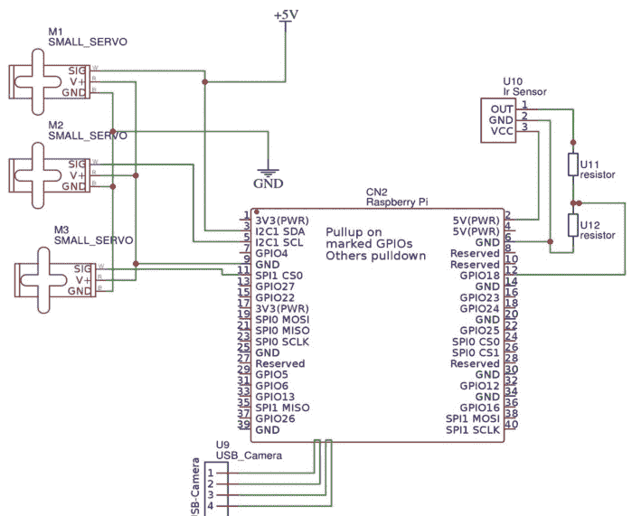

图 5.3 拟议工作电路图。

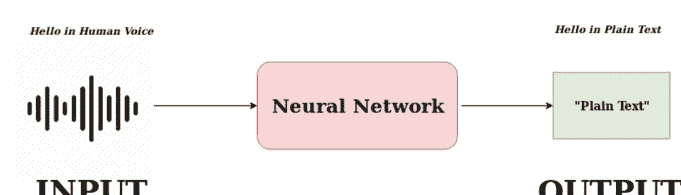

图 5.4 一般语音识别过程。

将它们转换为数字格式，并分析该声音。图 5.4 表示通用语音识别系统。

简单语音识别模块分为以下三部分：

- 1. 输入：人类：语音用作此模块的输入源。
- 2. 神经网络：自然语言处理（NLP）和神经网络（NN）将语音分解为多个组件，有助于轻松解释它。转换后，这些组件变为数字状态并分析这些状态。NN 用于训练特定单词和短语的数据集，并为与输入数据相关的新语音创建预测。
- 3. 输出：在最后阶段，它将输入语音转录为文本格式。

### 5.2.4 TensorFlow

TensorFlow [18] 是一个专门为机器学习和深度学习设计的开源平台，有助于提供端到端解决方案。它提供了大量的工具和灵活的平台，激励并推动研究人员拓展其创造力极限。TensorFlow 提供稳定的 Python 和 C++ API。此外，这些 API 在不稳定版本中与其他语言兼容。TensorFlow 的主要特性如下：

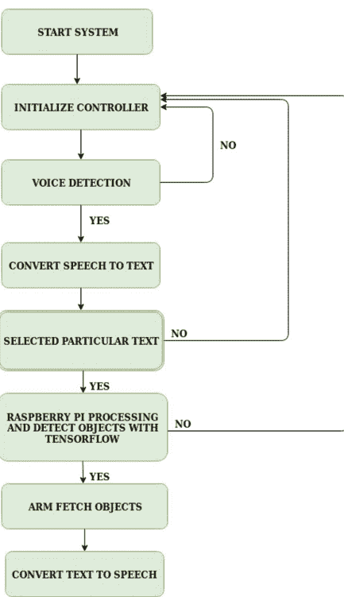

算法 5.1 拟议工作流。

- 1. **模型构建：** 与其他系统模型相比，机器学习中训练和构建模型相当容易。随着 Keras 的引入，这有助于改进模型调试和模型迭代。
- 2. **鲁棒性：** 得益于云的强大功能，可以轻松在任何地方训练和部署模型。
- 3. **研究实验：** 这提供了一种灵活的架构，有助于从想法到实际实现。尤其是在结果方面，它以图形和统计形式提供这些结果。

### 5.2.5 拟议算法

算法 1 展示了一种拟议工作流。在此系统中，机械臂通过语音激活，如果没有匹配的语音，它会重新检查。在下一步中，语音转换为纯文本，在 TensorFlow 中处理此文本并检查库，利用卷积网络检测对象。机械臂与 TensorFlow 同步。一台相机捕获图像，该图像通过在 Raspberry Pi 上安装的 OpenCV 进行处理。传感器检查对象的位置。如果对象在机械臂范围内，它将抓取它；否则机械臂将不会移动。通过使用文本转语音，它可以转换为语音指令，例如对象名称、规格等。

## 5.3 结果与讨论

在本节中，输入信号（参见图 5.5）用于识别特定对象。对于图像识别，TensorFlow 已部署并通过模型的准确率得分进行衡量。训练数据集的准确率为 0.697。

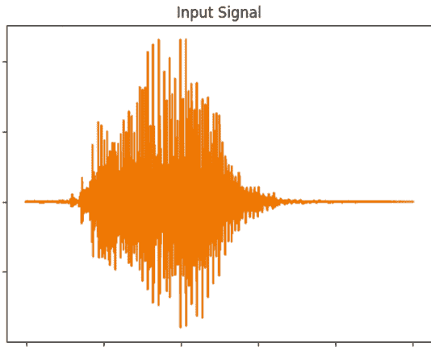

**图 5.5** Hello 的输入信号。

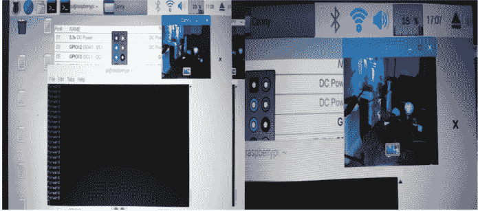

图 5.6 左侧：机械臂方向；右侧：对象检测。

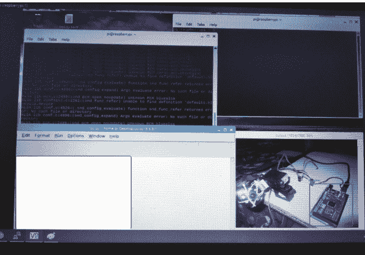

图 5.7 语音和图像识别激活模式。

在本节中，图 5.6 和图 5.7 展示了我们拟议工作的结果。在图 5.6 中，终端显示机械臂的方向，其向前或向后移动。图 5.6 显示带有黄色屏幕的对象检测。该拟议系统最值得注意的一点是，它通过互联网远程工作。通过使用 SSH，机械臂捕获图像并抓取关键对象。图 5.7 展示了图像和语音识别的激活模式。

图 5.8 表示在机械臂上安装摄像头以抓取对象的拟议系统。借助语音识别，它通过语音激活。下方

图 5.8 带有摄像头的机械臂。

机械臂上安装了 IR 和超声波传感器，帮助相机定位对象位置，并保持对象与机械臂之间的精确距离。

## 5.4 结论

在本章中，提出了一种基于视觉和语音的机械臂。该拟议系统提供了应对现实世界问题的机会，例如远程监控；人类无法完成的任务。将日常生活问题与复杂视觉相结合可以改进图像处理研究。安装在 Raspberry Pi 上的 OpenCV 库允许以最小劳动力专注于图像处理。在此研究中，机械臂配备了摄像头、超声波传感器和 IR 传感器，这提高了从精确坐标中选择对象的准确性。对象检测和位置提取技术借助图像处理方法执行；即对象提取技术、匹配预安装模板。

## 参考文献

- 1. Juang, J. G., Tsai, Y. J., & Fan, Y. W. (2015). 视觉识别及其在机械臂控制中的应用。Applied Sciences, 5(4), 851–880.
- 2. Manigpan, S. (2010). 使用神经网络模拟 6R 工业铰接式机械臂 (博士论文，泰国商会大学)。
- 3. Ejiri, M. (2007 年 11 月). 早期的机器视觉：日本的开创性贡献。载于：亚洲计算机视觉会议 (第 35–53 页)。Springer，Berlin, Heidelberg。
- 4. [OpenCV 简介](https://opencv.org/) (访问日期：16/11/2019)。
- 5. Bradski, G., & Kaehler, A. (2008). 学习 OpenCV：使用 OpenCV 库的计算机视觉。O’Reilly Media, Inc.。
- 6. Furuta, K. A. T. S. U. H. I. S. A., Kosuge, K. A. Z. U. H. I. R. O., & Mukai, N. O. B. U. H. I. K. O. (1988). 带有感官反馈的铰接式机械臂控制：激光束跟踪系统。IEEE 工业电子学杂志, 35(1), 31–39.
- 7. MunaSinghe, S. R., Nakamura, M., Goto, S., & Kyura, N. (2001). 在指定速度和扭矩约束下，工业机械臂的最佳轮廓加工。IEEE 系统、人与控制论杂志，C 部分（应用与综述）, 31(2), 159–167.
- 8. Koga, M., Kosuge, K., Furuta, K., and Nosaki, K. (1992). 基于虚拟内部模型的机械臂协调运动控制。IEEE 机器人与自动化杂志, 8(1), 77–85.
- 9. Efe, M. Ö. (2008). 2-DOF 直驱机械臂的分数阶模糊自适应滑模控制。IEEE 系统、人与控制论杂志，B 部分（控制论）, 38(6), 1561–1570.
- 10. Wang, W. J., Huang, C. H., Lai, I. H., & Chen, H. C. (2010 年 8 月). 用于按电梯按钮的机械臂。载于：SICE 2010 年度会议论文集 (第 1844–1848 页)。IEEE。
- 11. Juang, J. G., Tsai, Y. J., & Fan, Y. W. (2015). 视觉识别及其在机械臂控制中的应用。Applied Sciences, 5(4), 851–880.
- 12. Chen, O. T. C., Zhang, Y. C., Lin, Z. K., Kuo, P. I., & Lee, Y. L. (2019 年 8 月). 使用深度神经网络实现无人商店服务的手持相机机械臂。载于：2019 年 IEEE 可靠性、自主和安全计算国际会议、普适智能计算国际会议、云和大数据计算国际会议、网络科学和技术大会 (DASC/PiCom/CBDCom/CyberSciTech) (第 833–839 页)。IEEE。
- 13. Kakde, Y., Bothe, N., & Paul, A. (2019). 使用深度学习和机械臂进行对象检测和分类的实际实现。可在 SSRN 3372199 上查阅。
- 14. Kumbhar, S., Mathurekar, D., & Lobo, D. (2019). 带有视觉的机械臂 (博士论文)。
- 15. [Raspbian 操作系统](www.raspbian.org/) (访问日期：17/11/2019)
- 16. Graves, A., Mohamed, A. R., & Hinton, G. (2013 年 5 月). 使用深度循环神经网络进行语音识别。载于：2013 年 IEEE 声学、语音和信号处理国际会议 (第 6645–6649 页)。IEEE。
- 17. Hinton, G., Deng, L., Yu, D., Dahl, G., Mohamed, A. R., Jaitly, N., ... & Sainath, T. (2012). 语音识别声学建模的深度神经网络。IEEE 信号处理杂志, 29.
- 18. [TensorFlow](www.tensorflow.org/) (访问日期：10/12/2019)

# 6 区块链应用与实现

Deepak Kumar Sharma, Tushar Pardhe, Yash Kulshrestha, and Shivani Singh 信息技术学院，Netaji Subhas University of Technology，新德里，印度

## 目录

- 6.1 简介 ..... 95
- 6.1.1 什么是区块链？ ..... 96
- 6.1.2 区块链的历史 ..... 99
- 6.1.3 如何开发/实现 ..... 100
- 6.2 以太坊区块链网络 ..... 102
- 6.2.1 什么是以太坊？ ..... 102
- 6.2.2 以太坊是未来吗？ ..... 105
- 6.2.3 以太坊交易趋势图 ..... 105
- 6.2.4 Solidity 和其他技术 ..... 108
- 6.3 区块链的应用 ..... 111
- 6.3.1 在线营销中的区块链 ..... 111
- 6.3.2 区块链与机器学习 ..... 112
- 6.3.3 区块链与去中心化网络 ..... 113
- 6.3.4 为什么区块链正在接管互联网 ..... 115
- 6.4 结论 ..... 116
- 6.5 参考文献 ..... 117

## 6.1 简介

最近，比特币和其他加密货币引起了广泛关注。但比特币的驱动技术——区块链，常常被误解且鲜有探索。区块链已成为近年来的热门词汇之一。如今，区块链无处不在。你无法阅读新闻而不接触到与区块链、比特币、加密货币等相关的新闻。有说法称，区块链将为交易所做的事，就像互联网为信息所做的一样。专家声称，区块链将触及所有重要领域，并有能力改变全球的支付、经济、医疗保健乃至政治。购买房屋或登记车辆可能是一个非常痛苦的过程，因为需要经过许多中介机构。这项技术受欢迎的主要原因是，它允许在几乎任何事物的交换中实现更高的透明度和效率。它降低了成本并促进各方之间的信任。总之，区块链有能力改变世界运作的方式，并且有潜力被称为本世纪最具突破性的技术。

尽管是如此革命性的技术，许多人仍然不清楚它是什么以及它如何运作。这项技术的真正潜力在于对它的认知。因此，本章的议程正是如此：区块链究竟是什么，为什么它似乎具有如此无限的应用？本章解释了区块链的意义和影响，以及其背后的简要历史概述，从 6.1.1 节开始，该节介绍了区块链的总体概念。然后，我们将在 6.1.2 节尝试理解区块链的起源。此外，6.1.3 节简要讨论其实现。

### 6.1.1 什么是区块链？

区块链是一种记录交易数据或追踪资产的方式。资产可以是有形的或无形的。实际上，任何有价值的东西都可以使用区块链网络以更低的成本和更高的透明度进行追踪。区块链是分布在网络上的数据库，其中网络的节点相互保持同步。所有节点都拥有完全相同的区块链副本。没有单一的实体或机构负责控制该数据库。对该数据库的任何修改都必须在网络参与者广泛同意后进行。该数据库是仅追加的，即数据只能添加到数据库中，并且只有在所有参与实体同意后才能添加 [1]。

参考过去事件，当各种人需要依赖相同的数据时，他们依赖受信任的第三方来控制数据的来源。但是，随着区块链的出现，这些实体群体可以就事件达成一致，而不需要第三方。

区块链基本上是一个去中心化的分类账，在点对点网络中构建称为块的记录链表，每个块包含一定数量的交易。链中块的顺序指定交易发生的顺序。每个块包含：

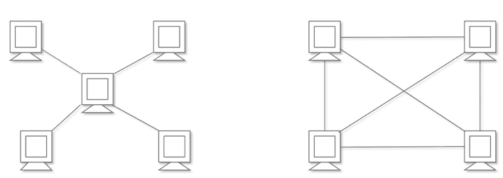

图 6.1 集中式系统与去中心化系统对比。

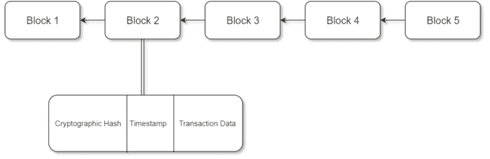

图 6.2 区块结构。

- 1. 前一个块的加密哈希
- 2. 时间戳
- 3. 交易数据

换句话说，区块链作为一个开放的、共享的、可信赖的公共链，高效且以可验证和持久的方式维护两个实体之间不断增长的交易数据列表。

由于每个块的结构，区块链对数据修改具有抵抗力。如果有人试图更改某个块中的交易历史记录，那么从该块一直到当前块的所有块都必须被修改，并且这种变化必须反映在网络上区块链的每个副本中。由于下一个块中的哈希是这个块内容的函数，下一个块也必须被更改。这种更改将导致不同的块哈希。同样的过程必须一直传播到链中的最新块。一旦区块链被修改，维护区块链将变得极其困难。要完成此操作所需的计算能力是巨大的。但是，如今我们拥有处理能力非常强大的计算机，对于这类计算机来说，计算成千上万个哈希只需要几秒钟。因此，为了避免数据被篡改，区块链使用一种称为工作量证明（PoW）的技术，该技术要求矿工（网络中的节点）解决一个计算问题。解决该问题所需的时间和精力与验证问题结果所需的时间相比非常高。一旦矿工找到一个块的解决方案，它就会将该块广播到网络。所有其他节点都会验证这个解决方案，然后该块被添加到链中。PoW 已成为广泛使用的共识算法，并被许多加密货币使用 [2]。

现在，让我们尝试借助一个示例来理解区块链的工作原理：

假设一个人 X 想给 Y 10,000 卢比。没有区块链时，X 会向他的银行发送请求，从他的账户向 Y 的账户发起 10,000 卢比的交易。此请求将包含发送方和接收方的账户详细信息以及交易金额。银行会检查几个事项，例如 X 的账户中是否实际上有 10,000 卢比。如果一切顺利，银行将从 X 的账户向 Y 的账户转账 10,000 卢比。

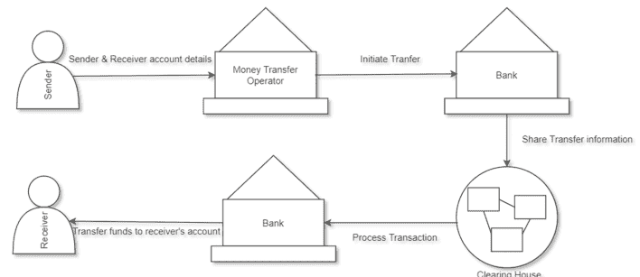

图 6.3 没有区块链的交易。

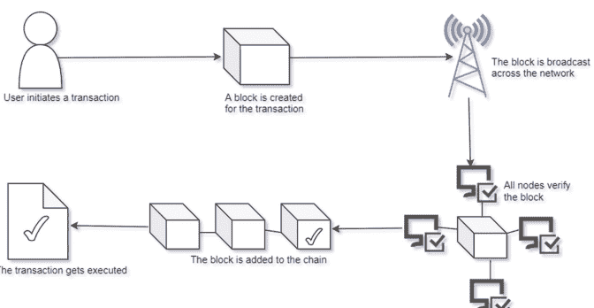

图 6.4 有区块链的交易。

使用区块链时，X 创建一笔向 Y 支付 10,000 卢比的交易。此交易被包含在一个块中，并通过互联网发送。网络中的所有节点都会检查这是否是一个有效的交易。如果有效，此块将被添加到链中，交易将被执行，即 Y 拥有 X 的 10,000 卢比。

毫无疑问，区块链是下一代互联网或去中心化网络背后的驱动创新，并为古老的人类信任问题提供了答案。现在，让我们看看区块链的关键属性，这些属性证明了上述说法以及区块链的这种无限应用：

- 1. 去除中央管理机构的角色：区块链由构成点对点网络的一组节点进行管理，而不是由某个中介机构管理。交易不再由第三方验证，而是由

- 2. 分布式：每个节点都有一个区块链副本。因此，如果有人试图篡改数据，他/她将不得不修改区块链网络中每个节点存储的所有区块链副本中的数据。这防止所有信息同时被篡改。除非黑客能够篡改数百万个节点上的交易记录，否则他们将无法成功伪造区块链数据。

- 3. 不可更改性：任何交易数据一旦添加到区块链就无法修改。数据只能按时间顺序添加到区块链中。更改任何数据被认为在实践中是不可能的。

- 4. 共识：这是赋予区块链去中心化能力的属性。分类账通过共识进行更新。没有中央机构负责对分类账进行更改。对区块链所做的任何更新都要根据严格条件进行验证，并且只有在网络中的节点达成共识后才会添加到区块链中。

- 5. 安全性和可靠性：由于去中心化，区块链系统中没有单点故障。系统中没有任何部分，如果它失败，就有能力停止整个系统的运行。此外，网络中没有弱点，信息可以从那里被篡改。这避免了恶意攻击，从而提高了区块链的整体可靠性。此外，交易经过数字签名和加密，这确保了高安全性。

### 6.1.2 区块链的历史

为了更好地理解区块链，我们必须追溯区块链的起源。我们应该尝试了解开发它的背景，以便更好地感知它。由于“四大巨头”都在投资它，区块链变得更加重要。乐观主义者声称，区块链在未来将更加突出。那么，让我们看看区块链在成为全世界众多人感兴趣的话题之前经历了怎样的旅程。

1991 年，Stuart Haber 和 W. Scott Stornetta 设计了一种方法，用加密技术保护块链，以开发一个无法被篡改的带时间戳的文档系统。1992 年，他们试图将 Merkle 树纳入该系统，以使其更高效，从而使多个文档可以存储在一个块中。然而，直到 2008 年，区块链才开始变得重要 [3]。

2008 年，区块链和比特币由一个名为 Satoshi Nakamoto 的人（或一群人）概念化。Satoshi Nakamoto 至今选择保持匿名。在 Nakamoto 的论文《比特币：一种点对点电子现金系统》中，他向世界介绍了比特币，并解释了其基本原理和工作原理。在这篇论文中，他结合了加密学、网络、微积分等许多概念。他试图设计一种基于加密证明的电子现金系统。在接下来的几年里，比特币变得流行，其基本概念，即

blockchain, 变得更加流行。自那以后，区块链不断发展，并在加密货币之外的许多应用中找到了自己的位置 [3]。

### 6.1.3 它是如何开发/实现的

区块链的出台旨在颠覆金融领域。许多银行和金融机构利用这项技术使交易更加安全。但现在，这项技术已不局限于支付和经济。从医疗保健到制造业，从旅游业到零售业，每个行业都在投资它。

区块链背后的底层概念与数据库类似，但处理该数据库的方式完全不同。对于希望学习开发区块链的开发人员来说，理解构成该技术核心的一些关键概念非常重要：

- 1. 去中心化共识：区块链是一个去中心化的点对点系统。网络中的节点之间没有中介来管理信息交换。没有中央机构的参与使系统免受腐败。因此，要在区块链中做出决策，网络参与者需要通过共识算法达成共识。

- 2. 智能合约：这是一种控制实体之间资产转移的计算机协议。它定义了交易的条款和条件。它的工作方式与传统合同相同。它是一段代码，需要按确切顺序执行一系列操作，以促进涉及的实体之间达成协议。

- 3. 挖矿：挖矿是验证交易并将其添加到区块链中的过程。它基本上涉及运行共识算法，同时创建不易篡改的前一个区块的哈希。挖矿的主要目的是以一种方式将交易添加到区块链中，使得在未来几乎不可能修改它们。

仅掌握基本概念不足以开发区块链网络。你还应该熟悉面向对象编程语言，如 C++、Java、Python、Solidity 等。你还应该了解链表、哈希表、关联数组等数据结构的一些知识，这些数据结构在创建区块链网络中区块结构方面起着重要作用。还需要对安全哈希算法（SHA）等加密技术有一些了解，这在为区块创建哈希时很有用 [4]。

区块链网络中交易的安全性和可验证性之所以成为可能，仅仅是因为存在起着至关重要作用的共识算法。共识算法是区块链网络所有参与者达成协议的一种机制。那么现在让我们来讨论一些用于区块链开发的最常见的共识算法：

- 1. 工作量证明（PoW）：这是区块链网络中使用的第一个共识算法。它被大多数加密货币使用。它涉及解决一个复杂的计算问题。这种技术的原理在于，解决该问题所需的时间和精力远大于验证问题结果所需的资源。第一个解决该问题的节点有权挖掘下一个区块。当矿工想要将交易添加到区块链时，他/她会为相应的区块执行 PoW 并将其广播到区块链网络。网络中所有参与实体验证并验证该区块，该区块即被添加到区块链中。每当挖出新区块时，矿工就会获得一些货币奖励 [3][4]。

- 2. 经过时间证明：PoET 是用于许可型区块链网络以找出下一个矿工的最佳且最公平的共识算法之一。在这种技术中，每个节点都有同等可能性成为下一个矿工。所有参与实体都需要等待随机的一段时间。这个随机等待时间由每个节点生成。在睡眠模式（即最短等待时间）中等待指定时间后最先唤醒的节点将被选为下一个矿工。该矿工将新区块添加到区块链并跨网络传输必要信息。

- 3. 权益证明：此算法是 PoW 的一种替代方案。它不检查哪个节点拥有更多计算能力来解决问题，而是基于权益运作。这里的权益是指矿工愿意锁定一定时间的货币数量。如果网络节点认为某个区块应该被添加到链中，他们会通过对其下注来验证区块。节点获得与其下注成正比的奖励，其权益相应增加。权益最高的节点将被选为挖掘下一个区块的节点 [2]。

现在让我们简要介绍一些在区块链开发过程中有用的工具。

- 1. Geth/Parity：要与区块链网络交互，我们需要一个能够与区块链网络中其他节点建立点对点连接的节点。Geth 和 Parity 是用于创建以太坊节点完整实现的接口。唯一的区别是 Geth 使用 Go 语言，而 Parity 使用 Rust 语言进行节点实现。

- 2. Mist：这是一个充当钱包的程序，用于存储和发送以太币（以太坊区块链上使用的货币）。无论何时，当你想要在以太坊区块链上发送或接收以太币或进行投资时，都需要一个钱包来执行交易，而 Mist 正好可以提供帮助。

- 3. 区块链测试网：这是一个在将去中心化应用部署到主网之前用于测试的平台。它提供没有价值的虚拟货币来进行交易。

- 4. Solidity 编译器：Solidity 是一种用于在以太坊区块链网络上编写智能合约的弱类型编程语言。Solidity 编译器将 Solidity 代码转换为以太坊虚拟机可读取的形式。

- 5. Remix：这是一个基于 Solidity 的编译器，允许用户为以太坊区块链开发智能合约。它允许我们调试、部署和测试智能合约。

由于涉及密码学、网络、哈希等复杂概念，从头开始开发区块链网络变得相当复杂。因此，如今我们有平台可以让我们通过定义交易条款等上层信息来创建自己的区块链，而无需过多关注底层实现细节。下面列出了一些这些平台：

- 1. Ethereum
- 2. Openchain
- 3. Hyperledger Fabric
- 4. Hyperledger Sawtooth
- 5. EOSIO
- 6. Multichain

## 6.2 以太坊区块链网络

到目前为止，我们都已经熟悉区块链，它本质上是一种分布式账本。提到区块链，人们就会想到比特币。比特币是区块链技术，但它仅处理货币交易。为了广泛使用区块链，需要一种更加多功能和敏捷的技术。在开发基于区块链的应用程序之前，需要复杂的编码、密码学和高级应用数学经验。为了解决这个问题，开发了一个名为以太坊的平台。以太坊是一个环境或平台，提供集成工具和协议来开发通用应用程序。与比特币区块链不同，以太坊区块链允许使用区块链进行不仅限于货币，而且还包括其他信息和价值的交易。

以太坊交易基于智能合约，智能合约类似于普通合同，但也会自动约束。已经开发出几种语言来编写智能合约；其中最著名的是 Solidity。以太坊的动态特性为其应用开辟了广阔的可能性。在接下来的章节中，我们将更深入地了解以太坊，并查看与其相关的技术。

### 6.2.1 什么是以太坊？

当我们听到“以太坊”时，我们会将其理解为一种加密货币，就像比特币一样。虽然这个想法并非完全错误——理解以太坊远不止是一种基本的数字货币这一点很基本——相反，它是一个使用区块链开发的开放式编程平台，使创作者和编程专家能够构建和交付广泛的去中心化应用程序。

在以太坊系统中，有一种称为以太币的加密货币。它用于控制使用以太坊区块链构建的应用程序。以太坊的目的是改变网络的运行方式，因为它使分布式系统能够在不使用任何中介的情况下工作。以太坊允许编程应用程序运行在多台不同的私人计算机上。这通常被称为分布式系统。这与大多数应用程序类似，信息由远程服务器处理，从根本上说，这只是一台带有集成功能的远程计算机。

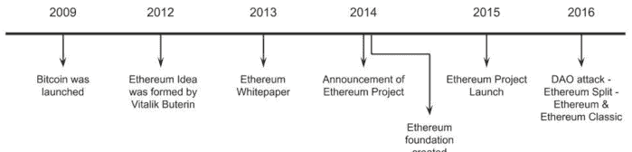

图 6.5 以太坊时间轴。

包含网站信息和元信息的数据库。如果该服务器受损，结构、数据库和网站中的所有数据都将消失。借助区块链技术，该相同的数据库和结构分布在大量个人电脑和系统中，因此数据库中的所有数据都是公开的，只要仍有多台电脑在为其贡献，数据库和系统在实际意义上就无法被关闭 [7]。

简而言之，这意味着“集中的企业级超级电脑和云服务器被遍布全球、由志愿者（像你我这样的人）使用和维护的巨大去中心化网络所取代”。

2013 年，数字货币专家和程序员维塔利克·布特林（Vitalik Buterin）首次发布了一篇关于以太坊的论文。这一进展后来由一场于 2014 年中期举行的网络众筹活动提供资金。2015 年 7 月 30 日，以太坊正式启动，在框架中预定义了 7200 万个以太币，并被标记为“预挖币”。这一总量约占 2019 年购买量最大资产的 68%。半年后，创建者选择将以太坊保持为非营利实体。以太坊基金会（Ethereum Foundation, Stiftung Ethereum）也随之成立。

最初决定以太坊采用工作量证明（proof-of-work）方法；因此，其开发人员必须“挖矿”或验证节点，并以以太币代币作为奖励。但由于能源效率低下，该方法最近面临全球阻力。环保主义者批评其高耗能。在以太坊的近期开发者会议上，已讨论了一种“权益证明”（proof of stake）模型。我们将在本章后面讨论这些问题。

在开发以太坊时，铭记它是 _图灵完备_ 和 _有状态_ 的，这意味着这些智能合约会从上次停止的地方继续执行。换句话说，以太坊区块链可以记住各种类型的数据。以太坊被保持为开源。但这些原则为以太坊区块链带来了一些特定困难。因为它是一个开源平台，任何人都可以在其之上构建自己的应用；提高其使用率并在开发者中普及它非常重要，但其缺点是会使整个网络变慢，因为每个节点都需要工作更长时间。话虽如此，迄今为止能够模拟真正去中心化应用程序的完全功能区块链并不多。而且，在目前存在的区块链中，几乎没有比以太坊更快的（Hashgraph 和 Dag 提供了更高的每秒交易数）。

DAO，一个去中心化自治组织，在 2016 年通过众筹筹集了创纪录的 1.5 亿美元来资助该项目。同年，一名不知名的黑客在 6 月从 DAO 中转移了 5000 万个以太币。这一事件引发了加密社区的争论：以太坊是否应通过创建有争议的“硬分叉”来追回涉及的资金。由于这场争议，以太坊网络分裂为两部分。我们正在讨论的以太坊继续在分叉区块链上运行，而原始区块链则以“以太坊经典”（Ethereum Classic）之名继续运行。这种硬分叉策略在这两个区块链网络之间引发了竞争。在 2016 年最后三个月中，由于再次涉及 DAO 的严峻关键局面，以太坊不得不分裂了两次以抵御其他攻击。之后，以太坊不得不加强 DDoS 防护，在 2016 年 12 月初之前维护区块链并防止黑客的垃圾邮件攻击。

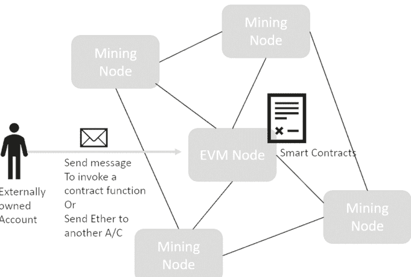

图 6.6 以太坊基本架构。

将以太坊生态系统视为一个大型市场是合理的，市场上提供各种商品和服务，所有交易都通过 ETH 货币（以太币）提供动力的网络来处理。这意味着在以太坊区块链上的每项活动都有一笔称为“gas”的小额费用（按当前价格通常为几美分）。无论我们是发送 ETH 或代币，还是与交易、游戏或服务进行交互，钱包中都需要少量 ETH。但我们不需要 ETH 来接收转账。以太币为交易创建了一个公共分布式总账，它是以太坊运行的基本代币。它可以用于支付交易、用于 gas 的处理单元以及其他状态转换。有时以太币被称为以太坊，这是不正确的。

以太币的股票代码是 ETH。它也在加密货币交易所交易。对于以太币，货币符号通常是希腊字母大写 Xi。它也用于支付以太坊区块链网络上的发票服务和交易费用。以太坊地址是与公开 ECDSA 密钥（使用的曲线称为“secp256k1”）的 Keccak 256 哈希（Big Endian）的 20 个八位字节相关联的常见十六进制标识符。在这个地址中，两个数字代表一个字节，这意味着地址总共包含 40 个十六进制数字。例如：0xc764f7eA0ba32784cE8396130aBA85786947268。合约地址也有相同的格式，但它们由创建交易和发送交易决定。用户账户无法与仅指定区块链数据和地址的合约账户分离。任何插入所述格式的 256 位哈希都是有效的。即使它不对应于带有私钥或合约的账户，也是有效的，而比特币则使用基 58 检查来确保地址输入正确 [8]。

### 6.2.2 以太坊是 FUTURE 吗？

以太坊区块链是加密货币行业中第二大受欢迎的区块链，但它并非没有问题。尽管是第二大区块链，但它存在一些可扩展性问题。任何区块链的可扩展性是指区块链每秒可以处理的交易数量。以太坊每秒只能处理 15 笔交易。这是许多在项目早期面临的问题。但在以太坊的情况下，随着它获得人气，这个问题变得越来越令人存疑。事实上，这是该区块链面临的最大问题 [11]。

### 6.2.3 以太坊交易趋势图

NEO 区块链（也可以处理智能交易）每秒可以处理 10,000 笔交易。如果以太坊开发人员未能解决此可扩展性问题，公司可能会考虑使用其他区块链网络来托管其 dApps 和智能交易，而不是以太坊区块链网络。如果在以太坊的未来发生这种情况，其价格可能会进一步崩溃。

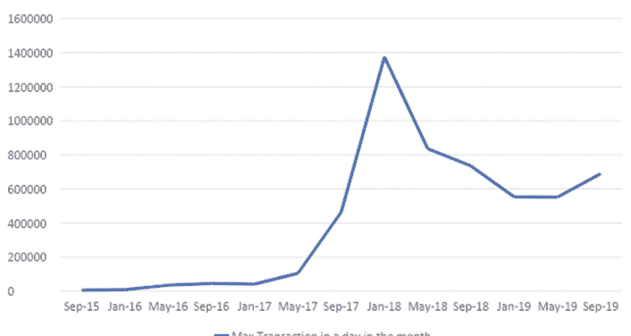

图 6.7 以太坊交易趋势图 [7]。

幸运的是，以太坊开发人员意识到这些问题，并正在做出一些重要改变。让我们考虑可能的解决方案：

- 权益证明（Proof of Stake）

以太坊区块链采用工作量证明共识方法。在处理工作量证明时，矿工必须利用可用的额外计算能力来解决非常复杂的难题。如果你拥有非常强大的硬件设备，你就有最大的机会赢得挖矿奖励。每个人都试图同时解决难题，最终最先解决它的矿工将成为赢家。

权益证明是一种非常不同的方法，因为并非所有矿工都试图一次解决同一个问题。相反，他们一个接一个地运行。他们是随机选择的。然而，你需要使用一定数量的以太币才能从中选择。

他们可以减少/检查的交易数量取决于他们决定的金额。如果矿工持有 100 个 ETH，他总共可以抵扣价值 100 个 ETH 的交易。根据此场景，这意味着他们可以继续挖矿，直到交易价值减少到他们确定的金额为止。

权益证明方法为以太坊区块链网络带来了各种好处。第一是能源效率的提高。工作量证明网络需要大量能源，因为矿工们都在解决相同的难题并浪费他们的计算能力。另一方面，权益证明使用单个系统，这意味着总体上消耗的能量非常少。

采用权益证明方法的以太坊未来还最大限度地降低了中心化的风险。此外，工作量证明允许不同的矿工群汇集他们可用的资源以提高总的挖矿奖励几率。但这里的问题是，少数人，特别是那些控制大型矿池的人，对网络有很大影响。然而，权益证明使得实现这一点非常困难。

由以太坊开发人员主导的权益证明称为“Casper 项目”（Casper Project），由 Vlad Zamfir 领导。

- Plasma（等离子体）

2017 年 8 月，维塔利克·布特林（Vitalik Buterin）首次宣布了 Plasma 项目。该项目最初是为解决以太坊面临的可扩展性问题而开发的。Plasma 基本上是一种协议，实际上消除了以太坊区块链网络处理不需要的数据的需求。这是通过在主区块链之上创建第二层来实现的。

智能合约仍然可以处理。然而，它们会在交易完成后发布到区块链上。这显著减少了区块链验证交易所需的处理量，并节省了大量磁盘空间。

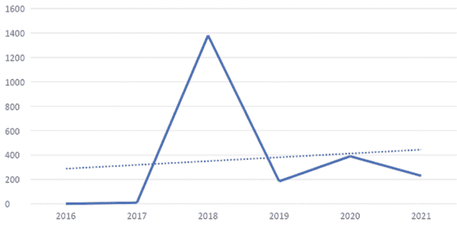

图 6.8 以太坊预测，长期价格分析 [7]。

Plasma 协议也加快了交易时间，进而允许网络 dApps 在网络上托管而不会减慢整个系统。

Plasma 项目尚处于早期开发阶段，因此关于何时将其安装在以太坊区块链网络上的信息不可用。

#### iii. 分片

分片也是为了解决可扩展性问题而开发的，与 Plasma 协议类似。在了解什么是分片之前，让我们先试着了解实际问题。目前，连接到以太坊区块链网络的每个节点都必须检查通过网络的每一笔交易。例如，如果需要审查下一个区块中的一百笔交易，每个节点都应该检查每一百笔交易。

虽然这种技术有利于安全措施，但网络速度与连接的单个节点的速度相同。各部分的工作方式不同。安装后，网络被划分为各个较小的部分，每个部分称为一个分片。每个分片都有各自独立的交易历史记录，每个节点独立运行。由于每个节点不需要验证每笔交易，预计这将显著增加以太坊区块链可处理的交易数量。

我们知道，如果上述解决方案之一成功实施，以太坊可以做得更多。这是因为，虽然以太坊网络每秒只能处理15笔交易，但它仍然轻松是行业内第二重要的区块链网络。如果将该数字提高到每秒数千笔交易，请考虑这个区块链网络将变得多么强大。

如前所述，本章早些时候提到，已经有一些区块链可以每秒处理数千笔交易，其他区块链也在创建中。但以太坊能做到吗？当然可以！另一方面，加密货币市场仍处于早期阶段，因此无法保证未来会发生什么。谈论未来监管是个难题。例如，日本对加密货币行业的控制程度与对其金融服务行业的控制程度一样。结果，日本拥有最大的加密货币交易量之一，并被超过20万家不同的企业接受。

除单价问题外，以太坊还有其他一些问题。最大的问题之一是政府监管尚未明确，且正在为区块链网络制定中。这使得这些规则非常令人困惑和不安全。就以太坊而言，监管不确定性在2018年6月14日有所缓解，当时SEC公司金融部主任威廉·欣曼（William Hinman）表示，以太坊目前不是证券。“如果代币或币种运营的网络足够去中心化，”这些资产不一定是投资合同，因为买家不合理地期望有人执行重要的管理职能 [14]。

尽管面临诸多障碍，以太坊仍在不断发展。这一区块链技术在所有区块链技术中拥有世界上最大的活跃社区。根据我们的讨论，目前几乎可以肯定监管障碍已被克服，随着 Plasma、分片等协议的发展，区块链似乎也一定能克服这一问题。显而易见，以太坊将会发展，但未来毕竟是未来，充满不确定性，然而前景非常乐观。

### 6.2.4 Solidity 和其他技术

以太坊交易基于智能合约，智能合约类似于普通合同并自动具有约束力。智能合约可以用多种语言编写。其中一种著名的语言是 Solidity。以太坊交易在以太坊虚拟机（EVM）上执行，就像 Java 在 JVM 上运行一样。运行 EVM 的每台机器都被称为以太坊区块链中的一个节点。

任何基于以太坊的应用程序的工作流程如下：

- a. 首先使用 Solidity 等语言编写智能合约。
- b. 然后将其转换为字节码，EVM 再将其进一步转换为处理器级操作码。
- c. 然后将此合同作为交易发送到以太坊网络。
- d. 随后，该交易由所有节点挖出。现在该智能合约已部署在网络上，并分配了一个公共地址。
- e. 要与该合约交互，将一笔交易发送到其地址，指定要调用的函数。
- f. 交易被挖出后，此方法调用会被保存在区块链中。每次方法调用都有关联的成本。该成本计算为‘Gas’，其价格以‘Ether’表示，由交易发送者支付。

图 6.9 以太坊交易流。

在这个整个过程中涉及多种技术；让我们讨论这些技术：

#### i) Solidity

这是一种面向对象的高级编程语言，用于编写智能合约。Solidity 也可用于在不同的区块链平台上执行智能交易，尤其是以太坊。它是由以太坊的一些前合作者开发的，例如 Christian Reitweiser、Gavin Wood、Alex Bereggazzi、Yoichi Hirai、Liana Husickan 以及以太坊基金会，用于在区块链平台上编写智能合约。目前，以太坊编写智能合约的主要语言是 Solidity，许多其他与以太坊区块链网络竞争的平台上运行的私有和开源区块链网络也是如此。例如 Hyperledger Burrow 区块链和 Monax。康奈尔大学的一位研究人员解释说，臭名昭著的 2016 年 DAO 黑客攻击并非由于 DAO 合约的直接漏洞或缺陷，而是由于 Solidity 合约中的安全漏洞。在该事件中，EVM 按预期工作。这些安全漏洞并非由于开发者的不良实践造成的；它们存在于 Solidity 的基本设计中。Solidity 是一种用于开发在 EVM 上托管的智能合约的编程语言，它是一致类型化的。正如 Wood 所述，它依赖 ECMAScript 语法以便于现有 Web 开发者使用。ECMAScript 没有静态类型和不同的返回类型，但 Solidity 有。与其他面向 EVM 的语言（如 Mutan、Snake 等）相比，Solidity 有非常显著的差异。合约由复杂的成员变量支持，包括任意层次结构的关联和结构体 [13]。

#### ii) 以太坊虚拟机

以太坊虚拟机（EVM）使得在每个完整的以太坊节点中实现强大的虚拟沙箱堆栈和嵌入式合约字节码成为可能。智能合约通常使用 Solidity 等高级语言编写，然后由 EVM 将这些代码或合约编译为 EVM 字节码。这最终意味着主机系统的网络、文件系统或其他进程与机器码和字节码完全隔离。以太坊区块链网络中的每个节点都运行一个以太坊虚拟机实例，使其能够接受相同的机器码和指令。以太坊虚拟机本身是完整的。这意味着 EVM 代表了一个完整的系统，可以执行计算函数的每个逻辑步骤 [13][15]。

#### iii) 智能合约

智能合约基本上是两个或多个系统或个人之间的一组计算机代码，在区块链网络上执行，由相关各方预先商定一组条款。如果在执行时遵守这些预定义规则，智能合约也可以执行以生成输出。智能合约验证、核实并强制执行合同条款，从而使合同的分布式自动化成为可能。通过使用智能合约，我们可以无需中介即可透明地交换资金、股票、房产等贵重物品，系统也不会产生冲突。

简单来说，这些是带有固定规则并存储在区块链网络中的自动可执行代码。如果满足预定义的一组条件，代码将自动执行并产生输出。智能合约在各种业务合作中非常有用。智能合约用于接受双方在任何商业交易中达成一致的条款和条件。最终这降低了涉及的成本和风险

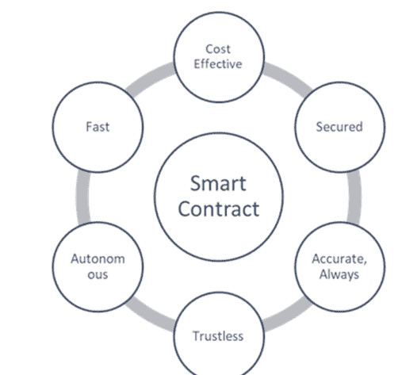

在各种交易中，自动化执行降低了欺诈风险，且无需第三方介入从而降低成本 [12]。

总而言之，智能合约通常基于数字资产在多方之间共享的方式，参与者可以自动管理其资产。这些资产将根据协议条款归参与者所有，并进行重新分配。智能合约可以实时跟踪性能并节省成本。因此，智能合约快速、经济高效、安全、自动化且准确。

## 6.3 区块链的应用

区块链是一项新技术，因此存在许多未被探索的领域。区块链技术对现有市场的影响率约为 25%。由于区块链应用的适应性和创新性，它已成为现代世界的热门词汇。最广泛使用的实际实现是在加密货币和数字身份管理方面。下面将讨论其他各种应用。

### 6.3.1 在线营销中的区块链

在过去的十年中，广告发生了巨大的变化，但它将在很大程度上归功于区块链而迎来另一次发展。诚然，虽然我们大多数人将高级广告与 AI 和分析等事物联系在一起，但区块链可能是目前最具颠覆性的创新，将影响每个行业的广告商。区块链正在改变高级广告，你可能会惊讶于谁将受益。

随着数字化世界向 AI 发展，AI 广告迎来重大变革，这一切都要归功于区块链。当我们大多数人还在利用基本勾股定理解决数学问题时，区块链已经改变并颠覆了正在进行的高级营销组织。

区块链取得如此成就的主要原因是，它使两方之间能够进行端到端交易，而无需任何第三方作为控制者。这伴随着额外费用的减少，因此使用此技术的组织受益。

虽然不同的创新帮助政府和私营组织，但区块链赋予了客户权力和一个验证信息回归的强大平台。例如，Brave 程序是一种新型程序，改变了客户与广告的互动方式。客户不再是屏幕被条目填满，而是选择参与调查促销，并为其互动的广告获得基本注意力代币 (BATs)，这基本上提高了广告组织的盈利能力，客户也可以自由选择退出。这种思维方式改变了客户的理解，并为他们提供了适量的信息空间，这有助于客户和组织本身。我们需要这种既入侵他人私人空间又能解决问题的创意想法 [6]。

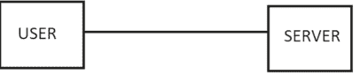

**FIGURE 6.11** 端到端用户服务器交互。

另一种基于区块链的创新，Blockstack，旨在通过为客户创建一种不将其信息透露给不同信息饥渴组织的去中心化组织，来确保客户的高级权利。

最终，如果你在营销行业，起初可能不喜欢这个概念，但随着它在未来几年的发展并成为下一个首选之事，它可以带来更有利可图的业务和更满意的客户。因此，使用它可能是成长型公司的最佳选择。

所以，让我们向透明度说你好，向间谍公司说再见。

### 6.3.2 区块链与机器学习

当今，每个人都在谈论 AI；甚至一个多岁的小孩也能举出几个例子。这个有趣的问题彻底改变了产品公司，并且这同样可以与区块链技术紧密结合。它可以增强加密安全性，可以在交易过程中测试错误，并处理更多需要大量计算和时间的任务。

AI 模型可以应用于任何包含大量信息的应用程序，并在其中训练模型以向客户提供理想结果。

让我们以我们当前的集中式数据管理系统为例，特别是那些收集和存储大量信息的系统，例如 Google 或 Instagram；这些组织将其信息存储在重要服务器上，并且难免会有一小部分信息在堆栈中丢失。由于信息是最重要的东西，这些组织在彼此之间采取重大竞争立场。因此，使用去中心化系统可能会颠覆这一挑战，因为 AI 模型将改进并解决信息存储问题，而区块链将赋予客户对其信息的所有权限 [6]。

#### AI + 区块链 = 更好的模型

让我们设想一个由 AI 模型管理的去中心化框架场景。客户进入并与框架关联，瞬间获得理想结果，将是多么简单。

研究 AI 对区块链系统影响的一个真实指南可以是垃圾邮件定位。假设你的去中心化邮箱中有大量消息，其中不少被程序员用于网络钓鱼或其他目的。在这种情况下，区块链的使用至关重要，因为我们会交换大量关于事件的数据，因此这将进一步扩大 AI 模型利用提供给它的过去信息来预测麻烦事件的精度和学习能力。因此，人们可以利用 AI 抵御程序员的数字化攻击，从而提高盈利能力。

这得出结论，如果我们将 AI 与区块链框架结合使用，AI 具有许多有利条件。

人们可以利用它来改进

- 存储 – 教会机器以最佳方式存储数据将导致更快的交易，因此区块链系统将获得更高速度。
- 安全 – 将机器学习模型寻找加密算法并处理大量交易安全性的任务，将显著提高系统的安全性并极大地改进区块链。

### 6.3.3 区块链与去中心化网络

数字货币为全球个人提供即时、安全、无摩擦的现金，而区块链为其交易提供持久的记录存储。早期框架要求客户信任一个中心机构，确保财政资金和支付转移不会被篡改。区块链技术通过提供无信任领域，使这种支付转移策略过时，因此不再需要依赖第三方来保证您的支付转移，从而创建一个人对人（点对点）条件。

区块链的含义本身表明，它是一个可以使用加密加密和哈希安全且永久地存储数据的去中心化账本。但实际上，'去中心化'这个词似乎在某种程度上仅局限于定义。市场上大量区块链使用集中式系统 [5]。

没有人控制区块链，它们也没有基础设施的单点故障问题。因此，它们在政治和结构上是去中心化的。但是，它们在逻辑上是集中式的，因为它们表现得像一台单一的计算机。

但是，无论我们是否按照上述定义，今天的区块链是否真正去中心化？

无论如何，这是否意味着集中式区块链是不好的？

不一定，这是因为区块链满足不同的需求，这些需求可能要求它们集中化。

根据 Cryptoasset Taxonomy Report，仅 16% 的数字货币是完全去中心化的。被调查的不同数字货币要么是集中式的，要么只是半去中心化的。仅 9% 的实用代币被认为足够去中心化，仅 7% 的金融资产（例如源自首次代币发行的资产）是去中心化的。根据报告，Bitcoin、Litecoin、Stellar 等本质上作为支付手段的数字货币，属于最去中心化的加密资产类型。

虽然第一种数字货币——比特币——最初旨在去中心化并消除政府控制，但少数专家声称，即使是比特币也不能被称为完全去中心化，因为大多数比特币矿工来自中国。

通常认为，区块链可以被视为另一种“信任层”，它被“叠加”在网络之上。从多个角度来看，这一点是成立的。正如网络允许即时和直接的数据与信息交换一样，区块链允许在无需集中式和受信任的第三方或中介的情况下，即时和快速地交换重要价值。“信任”一词可以在最广泛的意义上理解：现金、财产、许可、承诺、声誉、时间、劳动等等。尽管网络需要集中式和受信任的机构来保证交易和价值交换的完整性与真实性，但区块链系统现在及可预见的未来将接管这一角色。

在过去十五年中，交易已转移到网络上，广义上的社交互动也已迁移到云端。大多数组织通过网络应用程序提供服务或产品访问。然而，网络上集中式服务的商业逻辑以及电子商务中的供求关系，导致少数几家组织集中了权力和控制。它们处理了付款和账户持有人管理，维护了平台服务或提供了对服务、内容和商品的访问，或者组织了物流和履行。

很明显且真实的是，组织需要控制；不仅为了开展其业务活动，还出于法律原因。提供和运行应用程序、连接个人或维护财务或其他业务交易，都伴随着法律义务和承诺。大多数组织需要知道他们的客户，并有权禁止人们使用他们的服务或拒绝向其提供服务。另一方面，客户信任知名和成熟的品牌，将自己的现金、数据和安全交给它们。大多数时候，它们欣赏这些服务。在其他情况下，它们依赖这些服务，例如在获取银行账户访问权限时。

考虑到网络上集中式服务的优缺点，其义务和权力揭示了一个相当敏感和微妙的基础。区块链和分布式账本技术在当前集中式设置的缺点压倒其优点时出现在商业舞台上，这并非巧合。这可以从金融领域、在线业务或社交媒体平台中得到证明：信任是一种不会自动产生的价值，而必须以反复的方式赢得和维护。此外，区块链在此成为最重要的因素。

区块链可能同时颠覆集中式组织、机构和平台的权力。随着去中心化业务的发展，将出现以完全不同的方式运作的新平台。它们不再通过集中式账簿处理和促进交易，而是将在各种区块链上支持不同数字货币或代币的点对点交易。它们不再依赖知名且受信任的企业及其品牌的权力和声誉，交易将建立在“去信任化信任”之上，这种信任构建在区块链上。不再需要第三方来主导交易，不再需要银行来清算财务交易或价值交换。无需国家货币转换即可实现普遍交易。交易将无国界、无需许可且抗审查。然而，与依赖统一服务以确保对内容、数据或信息的访问相比，客户最终将对自己的账户负责，并成为其资产的真正所有者。

### 6.3.4 为什么区块链正在接管互联网

又一年开始了。回想2017年，这确实是加密货币过山车上的一段疯狂旅程。山寨币经历了巨大的发展和关注。这部分可以归因于比特币创历史新高的疯狂旅程，随后是巨大的回调。幸运的是，希望这已经过去了。

也许比特币是救赎的象征。比特币无疑做到了的，是将数字货币和区块链介绍给世界。无论人们是否理解它，他们都向其投入资金。直到现在，交易所仍对新客户有等待名单，机构资金正逐渐进入市场，而资本的涌入似乎在可预见的未来都不会减缓。

自2017年开始以来，该行业经历了一些疯狂的发展。比特币市值从180亿美元飙升至7360亿美元[美元] 完整市值（不包括比特币）从20亿美元飙升至4810亿美元[美元] 这是历史上首次，这使得整个数字货币/区块链行业的市值远超1万亿美元！

从上面的数字中，您可能注意到一件有趣的事情：该行业的其余部分（按市值计算）的发展速度远快于比特币。实际上，在2017年，行业其余部分的增长速度是比特币的六倍。

要深入了解，我们可以比较比特币的完整市场份额与行业其余部分的比例。自2017年12月1日以来，比特币的行业份额已从55%下降到约33%，这为许多其他区块链优势进入该领域让出了空间。

如果我是个赌徒，在2018年我希望看到以太坊在行业份额方面超越比特币。毫无疑问，以太坊将继续在团队和技术方面击败比特币。比特币的管理问题、发展犹豫以及极高的费用，可能会直接导致其衰落。

话虽如此，我不认为比特币会完全消亡。比特币永远不会消失。此外，即使它消失了，至少也会由其硬分叉后代——比特币现金（Bitcoin Cash）取而代之。我要提及的是，比特币现金有明显的可能性超越老比特币。

区块链技术自律Web 3.0，我将其称为“新互联网”。

数字货币是区块链技术的一个极佳概念证明，但毫无疑问，它是其中最迷人的一个。区块链技术确实非常惊人，每天我们都在看到新的、富有创意的组织形成。就目前而言，据我所知，市场分为三个部分。

- 1. 加密货币（比特币、莱特币、瑞波币）
- 2. 平台（以太坊、NEO、IOTA）
- 3. 实用代币（TRON、EOS、Status）

到目前为止，焦点主要集中在数字货币上；然而，我感到在2018年，平台代币和实用代币将成为核心关注点。这两个部分，更明确地说是平台，至关重要，因为它们有助于定义下一代互联网。这一下一代互联网，即Web 3.0，将包含一个非常类似于以下内容的技术栈：

- 1. 去中心化交易层。（以太坊——最为强大）
- 2. 去中心化文件存储层（IPFS和Swarm）
- 3. 去中心化消息传递层（Matrix或Whisper）
- 4. 高吞吐计算资源（Golem）

显而易见，拼图的主要部分是交易层，或如前所述的平台。主要的区块链平台将是新互联网的基本构建块，就当前竞争而言，以太坊正在获胜。

话虽说，这将是一个非常有趣的一年。去中心化应用将继续涌入市场，我们可能会看到下一代互联网的平台在市场上稳固自身。准备好爆米花，这将很精彩。

## 6.4 结论

在本章中，我们首先简要介绍了区块链。我们了解了构成这项技术基础的基本概念。然后，我们介绍了以太坊，这是一个用于实现去中心化应用（Dapps）的平台。此外，我们讨论了区块链的应用以及它如何逐渐接管所有主要领域。

区块链基本上是一种运行在点对点网络之上的分布式账本。它可以用于追踪任何有价值的东西，使得信息难以被篡改。顾名思义，区块链是由区块组成的链，每个区块都包含前一个区块的加密哈希、时间戳和交易数据。哈希和共识算法的概念使数据具有抗篡改性。然后，我们借助一个示例讨论了不涉及区块链的交易与涉及区块链的交易的对比。接着，我们简要介绍了该技术成功的关键概念，如去中心化、共识、不可篡改性、安全性和可靠性。我们了解到区块链的构想如何在1991年由斯图尔特·哈伯（Stuart Haber）和 W. Scott

Stornetta试图创建一个防止带时间戳文档被篡改的系统。然而，由于中本聪的白皮书“Bitcoin: A Peer-to-Peer Electronic Cash System”，区块链最终于2008年诞生。为了实现区块链，我们需要熟悉其关键属性。区块链开发的一些先决条件包括掌握一种或多种面向对象编程语言，以及对密码学和数据结构等主题的基本了解。我们随后讨论了共识算法，以及它们如何在区块链网络中为节点间达成一致提供机制。由于区块链从零开始实现很困难，而且由于区块链账户和货币的要求，测试更加困难，因此我们可以使用能够简化区块链开发流程的工具和平台。

详细讨论区块链后，我们讨论了以太坊、其未来及相关技术。以太坊于2015年推出，是一个使用其自身加密货币以太币（ether）的区块链开源软件平台。它支持创建和实现智能合约（Smart Contracts）和分布式应用（“Dapps”），过程无需耗时、欺诈、审查或第三方干预。以太坊不仅是一个平台，而且是一种在区块链上运行的编程语言（图灵完备），帮助开发者创建和发布分布式应用。在以太坊中，交易基于智能合约，这些合约类似于普通合同，但也具有自主性。这些交易在以太坊虚拟机（EVM）中执行，就像Java虚拟机（JVM）一样。网络或互联网上EVM实例处于活动状态并监听方法调用的每台机器都称为节点。每笔交易请求在所有节点上被挖矿。这使得以太坊网络实际上成为一台分布式超级计算机。以太坊中使用的智能合约通常使用solidity语言编写。智能合约可以使用Golang、Lisk等创建。智能合约本质上是一种数字协议，用于促进、验证和强制执行合同的谈判或履行。

## REFERENCES

- 1. 区块链技术概述：原理、机遇与挑战 Gültekin Berahan Mermer; Engin Zeydan; Suayb Sb Arslan 2018 第26届信号处理和通信应用会议（SIU）
- 2. 区块链技术的高级应用 - 编辑 Shiho Kim, Ganesh Chandra Deka
- 3. 区块链 – 维基百科 - https://en.wikipedia.org/wiki/Blockchain
- 4. 区块链开发的关键概念是什么 – www.leewayhertz.com/blockchain-development-key-concepts/
- 5. 新兴技术概述：区块链 Rishav Chatterjee; Rajdeep Chatterjee 2017 第3届计算智能与网络国际会议（CINE）
- 6. 超越比特币的区块链：区块链技术挑战与实际应用 Muniba Memon; Syed Shahbaz Hussain; Umair Ahmed Bajwa; Asad Ikhlas 2018 国际计算、电子与通信工程会议（iCCECE）
- 7. 以太坊官方文档：ethereum.org
- 8. 以太坊入门指南 Feb 23, 2017 - Linda Xie
- 9. 什么是以太坊？ Ameer Rosic; blockgeeks.com
- 10. 区块链：它们如何运作以及它们将如何改变世界 Sept 28, 2017 – Morgan Peck
- 11. 以太坊：安全的去中心化账本 Dr Gavin Wood; Founder Ethereum and Ethcore
- 12. 针对以太坊智能合约攻击的调查 Nicola Atzei, Massimo Bartoletti, and Tiziana Cimoli Università degli Studi di Cagliari, Cagliari, Italy
- 13. 以太坊与Solidity入门：面向初学者的加密货币和区块链编程基础，作者：Chris, Dannen
- 14. 了解以太坊，比特币的虚拟表亲； Nathaniel Popper NYT
- 15. 以太坊虚拟机——它是如何工作的？ Luit Hollander; Developer bij MyCrypto

# 7 使用区块链技术的物联网（IoT）应用

Ram Akuli

## CONTENTS

- 7.1 Introduction to the Internet of Things (IoT).......................................119
- 7.2 What is IoT?............................................................................119
- 7.3 Benefits of IoT...........................................................................120
- 7.4 Example of IoT............................................................................120
- 7.5 Applications of Internet of Things IoT............................................121
- 7.6 IoT as a Network of Networks......................................................123
- 7.7 The Future of IoT.........................................................................123
- 7.8 Introduction of Blockchain..........................................................123
- 7.8.1 What is Blockchain?...............................................................123
- 7.8.2 Architecture of Blockchain .....................................................125
- 7.8.3 Genesis Block.........................................................................125
- 7.8.3.1 Understanding SHA256 Hash.................................................125
- 7.9 Application of Blockchain..........................................................127
- 7.9.1 Wireless 2.0—Integrated Networks on the Blockchain....................127
- 7.9.2 Mesh Networks Solve a Particular Problem..................................127
- 7.10 Bitcoin....................................................................................130
- 7.11 Difference between Bitcoin and Blockchain....................................130

## 7.1 物联网（IOT）简介

## 7.2 什么是物联网？

物联网（IoT）是一套相互关联的计算设备、机械和数字机器、物体、动物或人员组成的系统，它们被赋予唯一标识符（UID），并能够在无需人与人或人与计算机交互的情况下，通过网络传输数据。

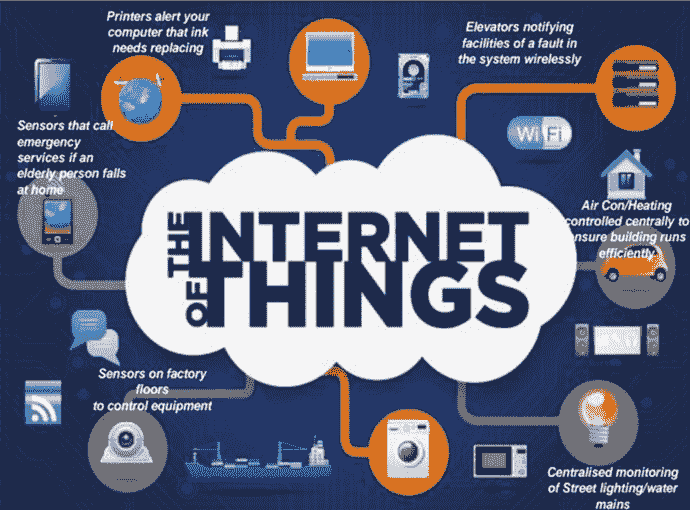

图 7.1 物联网示例。

物联网正在为物理世界与基于计算机的系统之间更直接的集成创造机会，从而提高效率、准确性和经济效益。

## 7.3 物联网的优势

物联网为组织提供了诸多优势，使其能够：

- 监控其整体业务流程。
- 改善客户体验。
- 节省时间和金钱。
- 提高员工生产力。
- 集成和调整业务模式。
- 做出更好的商业决策。
- 创造更多收入。

## 7.4 物联网示例

可纳入物联网范畴的对象示例包括联网安防系统、恒温器、汽车、电子设备、家庭和商业环境中的灯光、闹钟、音响系统、自动售货机等，如下图7.1所示。

## 7.5 物联网（IOT）应用

- 1) 智能家居

如果你能在回家前打开空调，或者在离家后关闭灯光，你会喜欢吗？或者即使你不在家，也能为朋友解锁门锁以临时进入。不要对物联网逐渐成型感到惊讶，公司正在打造产品，让你的生活更简单、更便捷。

智能家居已成为住宅领域成功的革命性阶梯，预计智能家居将像智能手机一样普及。

拥有房屋的成本是房主一生中最大的开支。智能家居产品承诺节省时间、能源和金钱。Nest、Ecobee、Ring 和 August 等智能家居公司（举几例）将成为家喻户晓的品牌，并计划带来前所未有的体验。

- 2) 可穿戴设备

可穿戴设备在全球市场需求爆发式增长。Google 和 Samsung 等公司已大力投资开发此类设备。但它们是如何工作的？

可穿戴设备内置传感器和软件，用于收集用户的数据和信息。这些数据随后会被预处理，以提取关于用户的关键洞察。

这些设备广泛涵盖健身、健康和娱乐需求。物联网技术对可穿戴应用的前提条件是高能效或超低功耗，以及小型化。

- 3) 联网汽车

汽车数字技术一直专注于优化车辆内部功能。但现在，这一关注点正转向提升车内体验。

联网汽车是指能够利用车载传感器和互联网连接来优化自身运行和维护以及乘客舒适度的车辆。

大多数大型汽车制造商以及一些勇敢的初创公司都在开发联网汽车解决方案。Tesla、BMW、Apple 和 Google 等主要品牌正在致力于引领汽车行业的下一场革命。

- 4) 工业互联网

工业互联网是工业领域的新热点，也称为工业物联网（IIoT）。它通过传感器、软件和大数据分析赋能工业工程，以创建智能机器。

根据 GE Electric 首席执行官 Jeff Immelt 的说法，IIoT 是一项“美丽、理想且可投资”的资产。IIoT背后的驱动理念是，智能机器在通过数据进行通信时比人类更准确、更一致。而这些数据可以帮助公司更早地发现低效问题和故障。

IIoT 在质量控制和可持续发展方面具有巨大潜力。追踪货物、供应商与零售商之间关于库存的实时信息交换以及自动化配送等应用将提高供应链效率。据 GE 称，工业生产率的提高将在未来十五年内在全球范围内产生 10 万亿至 15 万亿美元的 GDP。

### 5) 智慧城市

智慧城市是物联网的另一项强大应用，在全球人口中引发了好奇心。智能监控、自动化交通、更智能的能源管理系统、水资源分配、城市安全和环境监测都是面向智慧城市的物联网应用示例。

物联网将解决城市居民面临的污染、交通拥堵和能源供应短缺等重大问题。诸如蜂窝通信功能的 Big Belly 垃圾桶等产品，在垃圾桶需要清空时会向市政服务发送警报。通过安装传感器并使用 Web 应用程序，市民可以在全市范围内查找可用的停车位。此外，传感器还可以检测电表篡改问题、一般故障以及电力系统中的任何安装问题。

### 6) 农业中的物联网

随着世界人口的持续增加，对食品供应的需求大幅增加。政府正在帮助农民使用先进技术和研究来增加粮食产量。智慧农业是物联网中增长最快的领域之一。

农民正在利用数据中的有意义洞察来获得更好的投资回报。土壤湿度和养分感知、控制植物生长的水资源使用以及确定定制肥料是物联网的一些简单应用。

### 7) 智慧零售

物联网在零售领域的潜力巨大。物联网为零售商提供了与客户建立联系、提升店内体验的机会。

智能手机将是零售商即使在门店之外也能与消费者保持联系的方式。通过智能手机进行交互并使用信标技术，可以帮助零售商更好地服务消费者。他们还可以追踪消费者在商店中的路径，优化商店布局，并将高端商品放置在人流量大的区域。

### 8) 能源参与

未来的电网不仅足够智能，而且高度可靠。智能电网概念在全世界范围内越来越流行。

智能电网背后的基本理念是自动化收集数据，分析电力消费者和供应商的行为，以提高效率以及电力使用的经济性。智能电网还能更快速地检测停电源头，并精确到单个户级别，例如附近的太阳能电池板，从而使分布式能源系统成为可能。

### 9) 医疗保健中的物联网

互联互通的医疗保健仍然是物联网应用中的沉睡巨人。互联医疗系统和智能医疗设备的概念不仅对企业，而且对大众的福祉都具有巨大潜力。

研究表明，未来几年医疗保健领域的物联网将规模巨大。医疗保健领域的物联网旨在通过佩戴联网设备，赋予人们过上更健康生活的能力。

收集的数据将帮助对个人健康进行个性化分析，并提供应对疾病的定制化策略。

### 10) 家禽和农业

畜牧监测关乎畜牧养殖和成本节约。使用物联网应用收集牛群健康和福祉的数据，牧场主能及早了解生病动物，将其隔离并帮助防止大量牛只生病。

## 7.6 物联网即网络的网络

下图 7.2 显示了这些网络通过增加安全性、分析和管理功能相互连接。这将使物联网在帮助人们实现目标方面变得更加强大。

## 7.7 物联网的未来

就物联网的覆盖范围而言，目前有超过 120 亿台设备可以连接到互联网，IDC 的研究人员估计，到 2020 年，联网事物的数量将是人口的 26 倍。

## 7.8 区块链简介

### 7.8.1 什么是区块链？

区块链是交易记录。这个名称来源于其结构：被称为区块的单独记录链接在一起，形成一个称为链的单列表。区块链用于记录使用加密货币进行的交易，并有许多其他应用。

添加到区块链的每笔交易都由多台计算机验证。这些系统配置为监控特定类型的区块链交易，形成一个网络。它们协同工作，以确保每笔交易在添加到区块链之前都是有效的。这种计算机的去中心化确保单个系统不能将无效区块添加到链中。

#### 物联网

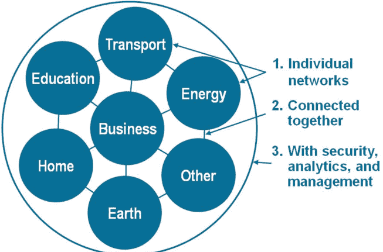

图 7.2 物联网即网络的网络。

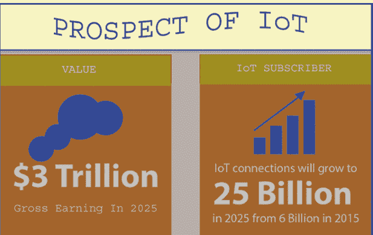

图 7.3 物联网的未来。

当新区块添加到区块链时，它会使用从前一个区块内容生成的哈希值与前一个区块链接。这确保链条永不中断，并且每个区块都被永久记录。此外，篡改区块链中的过去交易也被故意设计得困难，因为必须先修改所有后续区块。

### 7.8.2 区块链架构

- 让我们通过了解其各个组件来研究区块链架构：

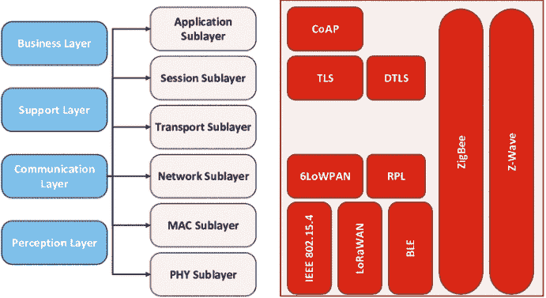

### 7.8.3 创世区块

- 区块链是包含信息的区块链。存储在区块内部的数据取决于区块链的类型。
- 例如，比特币区块包含发送者、接收者以及要转移的比特币数量的信息。

区块链是包含数据的区块链

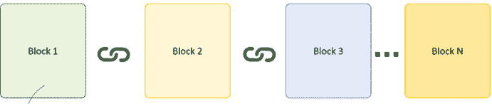

- 链中的第一个区块称为创世区块。链中的每个新区块都链接到前一个区块。

#### 7.8.3.1 理解 SHA256 哈希

区块也有哈希值。这可以理解为每个区块独有的指纹。它标识区块及其所有内容，并且始终是唯一的，就像指纹一样。因此，一旦区块被创建，区块内的任何更改都会导致哈希值发生变化。

##### 比特币区块示例

因此，当您想要检测区块更改时，哈希值非常有用。如果区块的指纹发生变化，它就不再是同一个区块了。

每个区块都有

- 数据
- 哈希
- 前一个区块的哈希

请考虑以下示例，其中我们有一个包含三个区块的链。第一个区块没有前驱。因此，它不包含前一个区块的哈希值。区块 2 包含区块 1 的哈希值，而区块 3 包含区块 2 的哈希值。

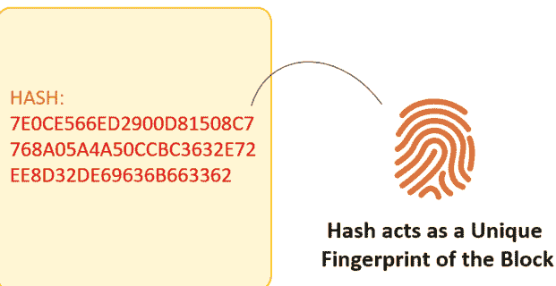

因此，所有区块都包含前一个区块的哈希值。这就是使区块链如此安全的技术。让我们看看它是如何工作的：
假设攻击者能够更改区块 2 中的数据。相应地，该区块的哈希值也会更改。然而，区块 3 仍然包含区块 2 的旧哈希值。这使得区块 3 以及所有后续区块都无效，因为它们没有前一个区块的正确哈希值。

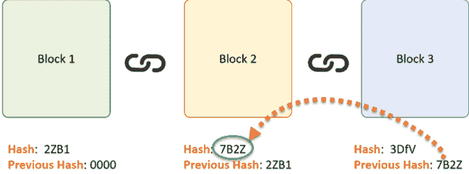

因此，更改单个区块可以迅速使所有后续区块无效。

## 7.9 区块链应用

区块链用于无需银行或政府等第三方中介即可安全转移金钱、财产、合同等项目。一旦数据记录在区块链内，就很难更改它。

### 7.9.1 无线 2.0——基于区块链的集成网络

如下图所示，无线 Mesh 网络作为一种新兴技术，可能会将无缝连接世界的梦想变为现实。

如果您认为无线 Mesh 网络只是新 Wi-Fi 路由器的又一个营销要点，是一个为了涨价而不提供好处而创造的短语，那也情有可原。

不过，这次我们可以避免愤世嫉俗：Mesh 技术确实比我们多年来购买且仍在市场上的普通旧式 Wi-Fi 路由器带来显著优势。

Mesh 网络具有韧性、自动配置和高效的特点。在通常只需最少设置工作后，您无需干预它们，它们可以说能提供您在家中可实现的最佳、最高吞吐量。这些优势促使多家初创公司和现有公司推出 Mesh 系统，争夺家庭和中小企业 Wi-Fi 网络市场。

### 7.9.2 Mesh 网络解决特定问题

覆盖相对较大的区域，例如单层面积超过约 1000 平方英尺，或多层住宅或办公室，尤其是在没有已有以太网的情况下，无法轻松实现非 Mesh Wi-Fi 路由器和无线接入点的有线连接。

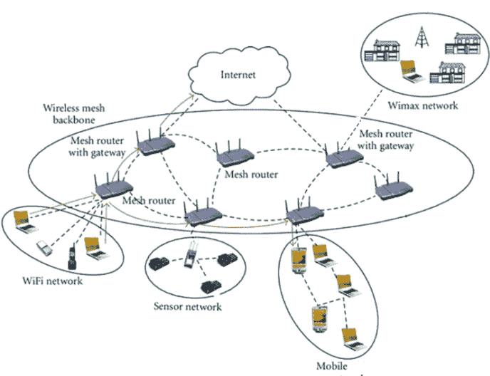

图 7.4 无线网状网络。

当前所有网状生态系统也提供简便性。

即使是针对最流行的常规 Wi-Fi 路器，使用基于 Web 的管理控制面板也可能让你抓头挠耳。

在户外无线网络中，为了构建无线网络基础设施，无线网状网络是在点对点和点对多点之后的第三种拓扑结构。无线网状网络中的每个设备通常称为网状节点，并且同时与多个其他网状节点连接。

无线网状网络也是多跳网络，因为每个网状节点可以通过多跳并利用其他节点作为中继来到达另一个节点。无线网状网络的主要优势在于其固有的冗余性，进而带来可靠性，因为网状网络能够通过多条路径重新路由流量，以应对链路故障、干扰、断电或网络设备故障。

商业和政府应用中通常实施两种类型的无线网状网络：

- 非结构化或全向无线网状网络
- 结构化无线网状网络

在非结构化无线网状网络中，每个网状节点通常使用全向天线，并能够与所有
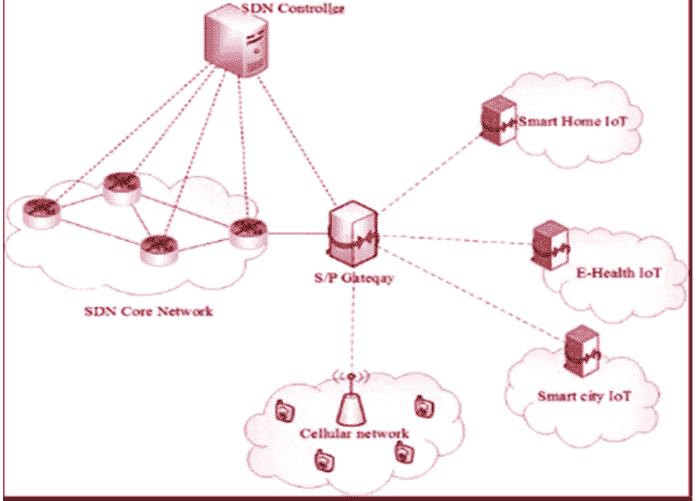

图 7.5 点对点、点对多点 & 网状网络。

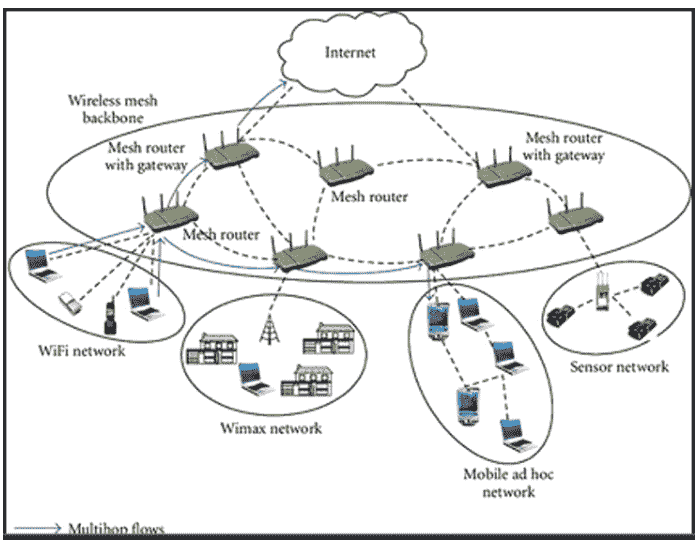

图 7.6 点对点、点对多点、网状网络 & 混合网络。

在传输范围内的其他网状节点进行通信。非结构化无线网状网络中的无线链路未经规划，链路可用性并不总有保障。

取决于网状网络的密度，可能有许多不同的链路可连接到其他网状节点，也可能一条都没有。非结构化网状网络通常使用非视距无线电（NLOS）实现，这些无线电使用低频和低带宽，例如在 UHF 频段（如 400 MHz）或在 900 MHz 免许可频段运行。

非结构化无线网状网络依赖所有无线电共享的单一信道。因此，传输所需的跳数越多，网络的总吞吐量就越低。

结构化无线网状网络是规划好的网络，通常在每个节点位置使用多个无线电和多个定向天线实现。在结构化无线网状网络中，通常采用使用多个定向无线链路的环形拓扑，以便每个无线电在发生节点或链路故障时能够无缝地通过不同路径重新路由流量。

结构化无线网状网络常用于任务关键型应用，例如无线视频监控、公共安全和工业自动化。

当某个站点需要为视频、语音和数据流等宽带应用提供高度可靠且可用的无线网络时，它们提供了理想的网络架构。结构化无线网状网络中的每个链路在独立信道上运行，因此，特定传输的跳数不会影响网络的总吞吐量。

无线网状网络自 20 世纪 90 年代初期以来就在学术界被研究，最初主要考虑军事应用，随后在 2005 年至 2010 年之间开始获得显著的商业关注。

### 7.10 比特币

一种数字货币，其中交易记录被维护，新的货币单位通过求解数学问题的计算生成，并且独立于中央银行运行。

### 7.11 比特币与区块链的区别

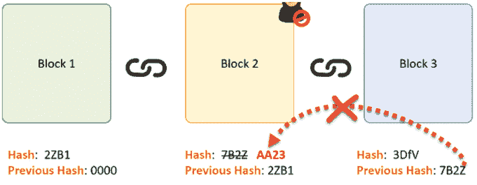

- 区块链不是比特币，但它是比特币背后的技术。
- 比特币是数字代币，区块链是用于记录谁拥有数字代币的账本。
- 没有区块链就不可能有比特币，但可以没有比特币而拥有区块链。

Taylor & Francis

Taylor & Francis Group

http://taylorandfrancis.com

# 8 区块链和加密货币的安全与隐私增强技术

德巴西斯·贡蒂亚 和 乌特卡利卡·萨塔帕蒂

CET (BPUT) 印度布巴内什瓦尔

## 内容

- 8.1 引言 .................................................................... 134
- 8.2 比特币可扩展性权衡相关工作 ........................ 136
  - 8.2.1 软分叉 ............................................................... 136
  - 8.2.2 硬分叉 ............................................................... 136
  - 8.2.3 效率改进 ............................................... 137
- 8.3 针对区块链的有效攻击 ......................................... 137
  - 8.3.1 中间人攻击 ............................................. 138
  - 8.3.2 比特翻转攻击 .................................................. 139
  - 8.3.3 序列攻击 ...................................................... 139
  - 8.3.4 完全替换攻击 ......................................... 139
  - 8.3.5 信息泄露 ................................................... 139
  - 8.3.6 针对控制软件的攻击 ........................................... 139
  - 8.3.7 功能修改 ......................................... 140
  - 8.3.8 盗版攻击 ........................................................ 140
  - 8.3.9 针对区块链的暴力攻击 ............................... 140
  - 8.3.10 逆向工程 .................................................. 140
  - 8.3.11 假冒 ....................................................... 140
  - 8.3.12 硬件木马 ..................................................... 140
  - 8.3.13 双重花费 ...................................................... 142
  - 8.3.14 51% 攻击 ........................................................... 143
  - 8.3.15 竞赛攻击 .......................................................... 144
  - 8.3.16 Finney 攻击 ........................................................ 144
  - 8.3.17 Vector76 攻击 ...................................................... 144
  - 8.3.18 替代历史攻击 ........................................... 144
  - 8.3.19 自私挖矿攻击 ................................................ 145
  - 8.3.20 系统黑客攻击 ....................................................... 145
  - 8.3.21 非法活动 ....................................................146
  - 8.3.22 身份盗窃 ............................................................146
- 8.4 针对区块链安全威胁的潜在防御....................146
- 8.5 比较与结果分析 ............................................148
  - 8.5.1 关于保护区块链的关键基础设施的讨论 ...148
- 8.6 结论........................................................................148

## 8.1 引言

在最近的技术进步中，区块链技术是信息技术领域的一项新兴方法。

区块链是利用先进的密码学技术，通过点对点（P2P）网络上所有现有交易的去中心化账本来实现分布式系统，并允许在潜在的无信任环境中快速处理交易。

它深深吸引了密码学爱好者、研究人员、中央银行家、程序员以及政客们的想象力。

从设计上讲，区块链是一种分布式、去中心化且防篡改的记录账本。

使用区块链技术，各方可以在不需要中央认证机构的情况下控制交易。

其潜在应用包括资金转移、投票、交易结算以及许多其他有吸引力的用途。

在区块链中，交易是之前已数字签名交易的哈希值集合以及下一个所有者的公钥。

每笔交易都用私钥签名，并用公钥验证 [1]，如图 8.1 所示。

其工作原理：

1. 任何人都可以请求一笔交易。
2. 请求的交易应广播到由称为节点的计算机组成的 P2P 连接。
3. 节点使用现有已知算法验证交易和用户状态。

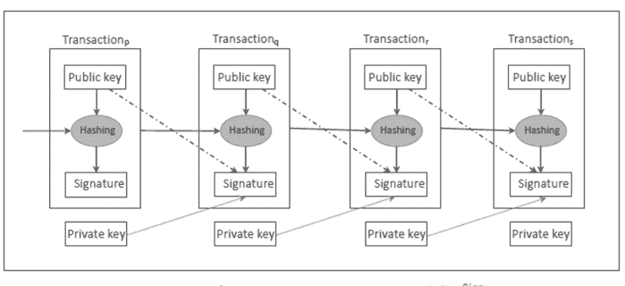

**图 8.1** 区块链中的交易网络。

- 4. 验证后的交易可以包含加密货币、记录、合约和/或其他重要信息。加密货币是一种交换媒介，在区块链中以电子方式生成和存储，使用更安全的加密技术来处理货币单位的生成并确认资金转移的真实性；比特币是最合适的示例。

- 5. 一旦验证通过，该交易将与其他交易合并，为账簿生成一个新的信息块。

- 6. 新的数据块随后永久合并到现有的区块链中，该区块链不可更改。

- 7. 交易至此结束或完成。

在区块链技术中，数据以多个必需块的形式存储，这些块通过网络相互连接。新生成的块将连接到其前一个块；以这种方式，该方法创建了一条块链，即区块链。将新块添加到区块链的过程称为挖矿 [2]。块中存储的数据是永久的，因为它不能轻易直接更改。对存储的数据进行任何更改或修改都是一项非常关键的任务。这是因为区块链的任何更新都需要所有参与节点的同意。

区块链中的每个块都包含前一个块的哈希值。哈希是多个字符和数字的序列。透明性和可验证性的特性防止对块的未授权访问，因此不允许任何更改。资本和金融市场为应用区块链技术提供了“无脑”用例。比特币已证明其在生成数字货币和追踪其所有权方面取得成功。如今，存在数百种加密货币。由于在交易领域隐私和保密性方面的多种活动，这些区块链技术已变得非常吸引人和受欢迎：

- 支持所有数字交易
- 透明性
- 准确追踪
- 成本降低
- 来源溯源
- 永久账簿：创建一个开放的永久账簿，使在网络内共享信息更安全、更便捷
- 可审计性
- 消除中间人：避免需要中间人，从而能够降低成本
- 更快的上市时间

涉及区块链概念的项目应努力以一种方式制定协议，使其参与者被激励最大化整个系统的价值；换句话说，保护并创建更有价值的区块链生态系统应该比欺诈并为自己牟利更有利可图。这一理念应成为比特币区块链底层协议设计的核心。

由于过去几年区块链市场增长迅速，恶意人员对区块链系统的攻击正成为交易的严重威胁。因此，迫切需要对区块链的安全问题进行研究。

本章其余部分的组织安排如下。第 8.2 节介绍了比特币可扩展性权衡的相关工作。第 8.3 节详细阐述了与区块链相关的不同有效攻击，并在第 8.4 节介绍了它们的潜在防御。第 8.5 节介绍了比较和结果分析。最后，第 8.6 节得出结论。

## 8.2 比特币可扩展性权衡的相关工作

可扩展性是系统、进程或网络随时间处理不断增加的任务数量的能力，或其增强以适应该增长的潜力。例如，如果网络在负载增加且硬件等资源与系统集成时能够增长其总产出，则该网络被认为是可扩展的。可扩展性是计算机系统中的一个重要因素，例如数据库、网络和路由器。

比特币可扩展性权衡是指关于比特币网络能够成功处理和执行的交易数量限制的讨论。这与比特币区块链中的记录（称为块）在大小和频率上受到限制这一事实有关。比特币块包含比特币网络上的交易。比特币网络的链上交易处理能力受平均每十分钟生成一个块的时间和块大小限制的制约。这些因素共同限制了网络的吞吐量。交易处理能力的最大值估计在每秒 3.3 到 7 笔交易之间。已有各种提议和激活的解决方案来高效解决此问题。

增强网络的交易处理限制需要对比特币的技术原则进行各种改进，这一过程称为分叉。分叉可分为两种类型：软分叉和硬分叉。

### 8.2.1 软分叉

软分叉是任何规则变更，使旧软件能够识别新生成的块为有效块。因此，它是向后兼容的。当未升级的软件和新规则不认为新生成的块有效时，软分叉也可能导致区块链分裂。

### 8.2.2 硬分叉

与软分叉相反，硬分叉是向网络引入新规则的软件升级，从而废止无法识别新块为有效块的旧软件 [3]。在发生硬分叉的情况下，所有旨在按照新规则工作的节点都需要更新其软件。

如果一组节点继续遵循未升级的旧软件，而另一组节点使用新的更新软件，则将发生分裂。例如，Vitalik Buterin 论文 [4] 中介绍的以太坊等平台，可以允许生成智能合约；即带有内置计算机代码的数字实体，根据未来事件执行合同协议 [5]。这些实体代表金融工具、货币、土地所有权等。以太坊已进行硬分叉，以解决 DAO 中所有投资者的问题，该 DAO 曾因其代码中的漏洞而被黑客攻击 [6]。在这种情况下，分叉创建了以太坊和以太坊经典链。

2014 年，NXT 社区考虑过一次硬分叉，该分叉本可能导致区块链记录回滚，以减轻针对某主要加密货币交易所窃取 5000 万 NXT 的影响。硬分叉提案被拒绝，经过谈判和支付赎金后，部分资金被追回 [7]。或者，为了避免永久分裂，尽可能多的使用新升级软件的节点可以回到旧规则，如比特币分叉的情况 [8]。比特币现金是比特币的一个硬分叉，它增强了最大块大小。比特币 XT、比特币经典版和比特币无限版都支持通过硬分叉来增强最大块大小。

Lei 等人 [5] 提出了一种在智能交通系统（ITS）中进行安全密钥管理的技术。在 [9] 中，Khan 等人提出，可以利用区块链技术的内在特性来解决物联网（IoT）系统中的许多隐私和安全相关问题。在 [10] 中，建议了一种去中心化系统，它结合了星际文件系统（IPFS）、以太坊区块链和基于属性的加密（ABE），以确保存储数据的所有者和用户能够进行细粒度访问控制。

最后，Guo 等人 [11] 采用结合区块链与基于属性的签名（ABS）机制的方法，以防止多方授权机构之间的串谋攻击。

### 8.2.3 效率改进

交易吞吐量实际上受名为块大小限制的参数限制。在比特币历史上，已提出过各种提高此限制以及完全取消它的建议。

## 8.3 对区块链的有效攻击

区块链已成功开创了一个崭新的世界，在商业领域创建、持有和分发数字价值。有些人过于害怕区块链，不愿将其视为下一波技术革命；另一些人则将这一概念视为“加密网络犯罪分子”地下世界的一种昙花一现的狂热。图 8.2 和图 8.3 总结了以下各节中描述的新兴区块链威胁、漏洞和攻击的不同类型。本文描述的许多以下问题和解决方案具有预测性；我们根据对当前交易系统工作原理的最佳理解以及从现有安全文献的推断来提出这些问题。然而，本研究文章中提出的观点并非旨在取代现有工作。相反，这些基于硬件的对策可以用于增强系统安全性，或提供区块链世界原本无法实现的安全保障。

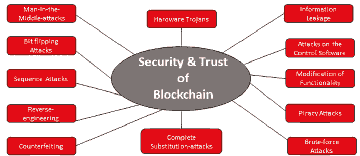

图 8.2 区块链安全与信任由各种威胁、漏洞和攻击组成。

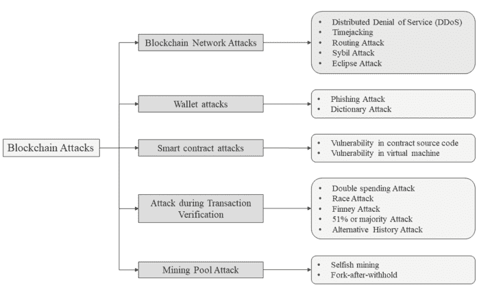

图 8.3 区块链平台上可能的不同攻击。

区块链技术本质上是安全的。在区块链中，数据或账本分布在多台计算机上，因此消除了任何单点故障。此外，由于其实施了加密证明和共识机制（例如博弈论），区块链几乎不可能被攻破。尽管具有上述基础安全特性，但区块链安全问题仍然普遍存在。

### 8.3.1 中间人攻击

在计算机安全领域，中间人攻击是指恶意人员秘密中继和修改两方之间的交易，而这两方认为他们正在直接相互进行交易且没有任何干扰 [12]。例如，主动窃听，攻击者在这些受害者之间建立独立连接，并在它们之间中继交易，以产生一种他们正在通过专用网络直接相互进行交易的信任，而实际上整个交易由恶意人员控制，如图 8.4 所示。这些入侵者拦截受害者之间传递的所有相关交易，并插入一个新的恶意交易或修改前述交易。

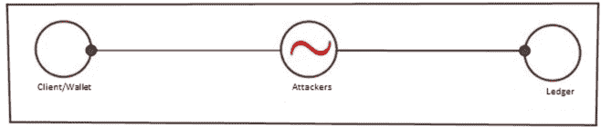

图 8.4 中间人攻击。

### 8.3.2 比特翻转攻击

此类攻击基于替换/置换原理 [13]。在比特翻转攻击中，交易金额的单个比特被修改，从而产生重大错误。

### 8.3.3 序列攻击

此类攻击也基于替换/置换原理。在序列攻击中，交易中的 N 个比特可能被攻击者修改、插入或删除。聪明的对手能够以这种方式进行操纵，使得大部分过程看起来正常进行。

### 8.3.4 完全替换攻击

此类攻击也基于替换/置换原理。完全替换攻击是指将提议的交易完全替换为另一个交易，从而导致重大故障的攻击。这是交易领域中最极端的攻击。

### 8.3.5 信息泄露

攻击者可能会未经授权披露涉及区块链的不同交易的特权信息。此类特权信息示例包括客户数据、密码、专有协议等。

### 8.3.6 针对控制软件的攻击

不法程序员可以修改错误恢复软件以绕过错误恢复机制。这对于交易的定制和通用设计流程均有可能。

### 8.3.7 功能修改

攻击者可能会恶意强制执行非预期的操作。例如，攻击者可能会悄悄降低区块链功能的性能和可靠性，从而削弱最终用户对区块链系统的保证和信心。

### 8.3.8 盗版攻击

不同交易应用程序有各自的协议。这些协议被称为区块链的知识产权 (IP)。攻击者可以侵犯这些知识产权，例如，复制之前的交易并一遍又一遍地重复。交易盗版是专有区块链的重要独特因素，其安全方面需要付出巨大努力，将投入数十亿美元。但是，不能保证其盗版行为得到很好的保护。因此，传统区块链在知识产权盗窃威胁下很脆弱，因为攻击者可以轻易盗版交易的测试协议。

### 8.3.9 针对区块链的暴力攻击

攻击者可能会竭尽全力，通过尝试所有数字、字母和特殊字符的组合来破解交易的机密密码。这被称为暴力攻击。通过提高对暴力攻击的抵抗力（具有高度混淆和扩散），可以获得更大的安全保证。

#### 8.3.10 逆向工程

逆向工程 (RE) 是分析系统以识别其组件及其内部结构、互连等，并以另一种形式或更高抽象级别生成系统表示的技术 [14]。RE 被严格应用于以多种方式拆解设备，例如克隆、复制和复制。在本小节中，区块链系统的逆向工程是通过使用破坏性技术提取其内部物理结构和信息来获取的，以便外国攻击者检测秘密信息。

#### 8.3.11 假冒

假冒交易是指重复已经完成的交易。因此，假冒像其他攻击一样对区块链构成威胁。

#### 8.3.12 硬件木马

硬件木马 (HT) 能够修改交易的电路系统，或在设计中插入恶意电路，以便针对特定输入/时间禁用/销毁整个系统。这种 HT 能够在制造或设计过程中修改设计好的电路并导致不期望的行为。这些木马还旨在披露交易的秘密信息、导致拒绝服务 (DoS) 以及修改系统功能。攻击者可以在从高级系统设计规范到 IC 设计流程的晶体管级的任何级别插入 HT [15]。

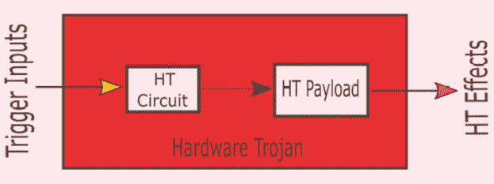

图 8.5 硬件木马的典型结构。

可能插入到区块链中的 HT 的典型结构如图 8.5 所示。与 HT 相关的一些关键术语及其含义如下：

- 触发器：启动 HT 的事件。当此特定事件开始时，HT 电路会自动激活以实现致命功能。
- 有效载荷：激活木马的事件，负责实施 HT 攻击，可能导致信息泄露、拒绝服务 (DoS) 和区块链可靠性降低等严重后果。

硬件木马可以按以下类别插入到区块链中：

- 插入阶段：区块链 HT 可以在以下任何阶段插入：
  - 规格说明：区块链 HT 可能会恶意修改规格，例如，在运行时将美元 (USD) 转换为欧元 (EUR)，以使交易不正确。
  - 设计：区块链设计人员可以修改交易以改变结果。
  - 制造：硬件木马可以在芯片制造过程中通过篡改芯片工厂恶意插入。
  - 组装：在块组装过程中，恶意的集成工程师会错误地执行块的收集以产生错误输出。
  - 校准和测试：恶意测试人员也可以在测试和校准阶段恶意插入 HT 以克服区块链概念。
  - 现场：在区块链领域，攻击者通过修改其协议来伪造交易协议。
- 抽象级别：硬件木马可以在以下抽象级别的阶段插入：
  - 系统级别：在系统级别，系统工程师提及各个领域元素及其互连。区块链可以被修改以导致错误输出。
  - 物理级别：区块链的每个物理组件，即硬件组件和布线、芯片平台及其位置和尺寸，在物理级别定义。可以通过修改上述任何物理组件及/或其尺寸来插入硬件木马。
- 激活机制：这描述了硬件木马的内部和外部触发机制。
  - 内部触发器：此触发器针对特定时间槽实例执行。
  - 外部触发器：此类触发器由于特定交易的输出而在外部执行。
- 影响：HT 的影响是修改账本功能、披露秘密交易信息、降低性能、导致拒绝服务攻击等等。

#### 8.3.13 双重花费

加密货币开发者面临的主要问题之一是双重花费问题。顾名思义，这指的是某人多次花费同一枚硬币，从而在支出账本与可用加密货币数量之间造成不一致。当区块链网络被篡改且加密货币被盗时，就会发生这种情况。恶意节点会发送交易副本使其看起来合法，或者可能完全删除交易，如图 8.6 所示。

在比特币网络中，买家可能会复制数字货币并将其发送给多个零售商，同时保留原件。双重花费最常用的技术是区块链黑客向网络发送多个交易并撤销这些交易，表现得好像这些交易从未发生过一样。(www.investopedia.com/ask/answers/061915/how-does-block-chain-prevent-doublespending-bitcoins.asp)。

通过实施工作量证明 (PoW)，可以在比特币网络或其他基于区块链的加密货币中避免这种双重花费问题。

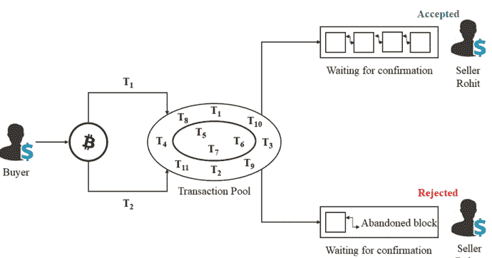

图 8.6 双重花费。

共识算法。这种工作量证明（PoW）由矿工执行，矿工不仅确保区块链账本上过去交易的准确性，还能检测并避免双重花费。

#### 8.3.14 51% 攻击

在区块链网络中，当一个组织以多数比例控制挖矿算力或所谓哈希率时，51% 攻击是一种可能发生的攻击。比特币网络通过让所有矿工对共享账本（即区块链）达成一致来保障安全。比特币中的每个节点通过相互查看，确保这些节点在任何时间点都在处理有效交易。如果大多数矿工由单一实体控制，矿工就有可能决定同意哪些交易。因此，这会使矿工有能力阻止其他交易，并允许自己的代币被多次花费。这也被称为双重花费，如图 8.7 所示 [16, 17]（ref: https://learncryptography.com/cryptocurrency/51-attack）。

利用这种攻击，攻击者可以执行以下活动：

- 他们可以撤销自己已经发生的交易。
- 他们可以阻止交易获得任何确认。
- 他们可以阻止其他矿工挖出任何其他有效区块。

但是，攻击者不能执行以下活动：

- 他们不能撤销他人的交易。
- 完全阻止交易发送。
- 修改每个区块生成的代币数量。
- 凭空生成代币。
- 发送从未由他们拥有的代币。
- 这些攻击仅在攻击者保持控制（即拥有 51%）时有效。攻击者失去多数控制权后，之前被拒绝的交易可以立即添加 [18]。

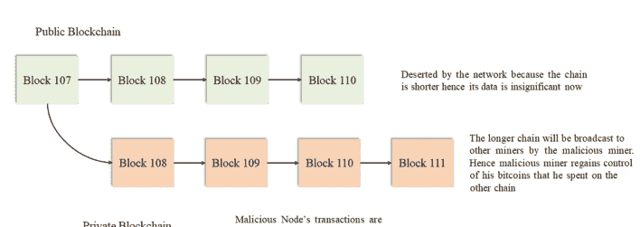

图 8.7 51% 攻击简图。

如果区块链网络实施工作量证明（PoW）共识机制，则应采取适当的安全措施以避免实施 51% 攻击。几种可行的选择包括：警惕挖矿池、在哈希率更高的区块链网络上实施合并挖矿，或采用不同的共识机制。

#### 8.3.15 竞争攻击

当黑客迅速向比特币网络连续发送两笔冲突交易时，这被称为竞争攻击。这种攻击在采用工作量证明（PoW）作为共识算法的区块链中相对容易实施。即时接收带有“0/未确认”状态付款的商家容易受到交易撤销的影响。攻击者通过直接向商家发送代币进行一笔交易，但是，他不会等待商家的确认，而是立即向比特币网络的其余部分发送一笔冲突交易（使用之前用于支付给商家的相同代币）给自己。随后发生的冲突交易更有可能被挖入区块并被比特币节点接受为有效节点。

#### 8.3.16 芬尼攻击

攻击者首先找到一个接受未确认交易的商家。然后，他以将要发送给商家的相同金额向自己进行一笔交易并找到一个区块；但是，他不广播该区块。完成上述步骤后，攻击者会将相同金额发送给商家，并等待物品送达。最后，他广播包含原始交易的先前区块。该区块将包括向自己发送代币的交易，因此向商家的未确认付款将被无效化。此外，攻击者将重新获得他的代币，并免费得到物品。

#### 8.3.17 Vector76 攻击

Vector76 攻击，又称一次确认攻击。这种攻击是竞争攻击和芬尼攻击的融合，即使只有一次确认，交易仍然是可逆的。它是双重花费攻击的一种变体。攻击者在交换过程中使用私下挖出的区块进行双重花费。诸如加密货币交易所之类的钱包服务易受此攻击，因为接受直接连接。如果 Vector76 攻击成功，攻击者必须牺牲一个区块，因为他不广播该区块，而只广播受攻击的节点。

#### 8.3.18 替代历史攻击

当攻击者通过向商家发送代币发起交易时，就会发生此攻击。与此同时，攻击者会私下挖出一个包含冲突双重花费交易的备选区块。商家在等待 m 次确认后将物品交付给攻击者。立即，如果攻击者发现超过 m 个区块来延长他的链并重新获得他的代币；否则，他继续尝试延伸他的区块链，希望能够追上网络。当攻击者永远无法将其私有区块链与公有区块链相比进行延伸时，攻击失败。

#### 8.3.19 自私挖矿攻击

当攻击者（在这种情况下是自私矿工）不将有效解决方案广播到网络其余部分时，就会发生自私挖矿攻击。攻击者不像普通矿工那样在找到区块后立即将其发布到网络，而是有选择地释放区块，或一次性发布许多区块，从而迫使网络其余部分丢弃他们的区块并损失收入。自私挖矿的主要动机是获得不公平的奖励，该奖励大于其花费的计算机算力占比，并混淆其他诚实矿工，引导他们在错误的方向浪费资源，如图 8.8 所示。

#### 8.3.20 系统黑客攻击

黑客攻击和篡改存储在区块链中的记录相对较难；但是，实施其技术的编程代码和系统可能存在漏洞。总部位于东京的最大比特币交易所（即 MtGox）于 2014 年 3 月被黑客攻击，价值 7 亿美元的比特币被盗。此次攻击的原因是维护不善且过时的代码，这使黑客能够进行双重花费。更近期的一次事件中，一个持有大量以太坊的 DAO（去中心化自治组织）通过软件漏洞被利用，黑客窃取了价值 5000 万美元的以太坊 [19]。

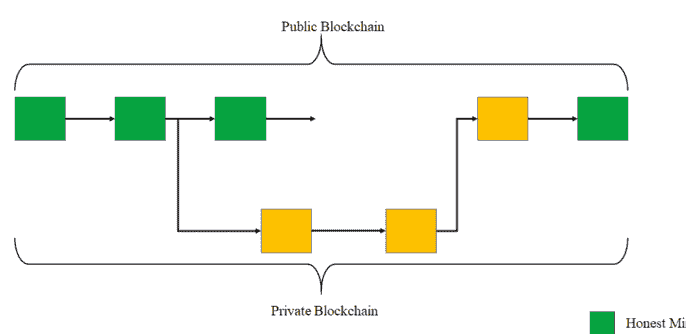

图 8.8 自私挖矿攻击简图。

## 8.4 针对区块链安全威胁的潜在防御措施

针对中间人攻击、硬件木马等安全威胁的潜在防御措施包括以下方案：

- **水印：** 客户端（或通过称为钱包的东西）直接请求一笔交易。客户端直接请求的交易将交付一个提交，或由发起交易的服务器上的一个进程（称为主节点）处理。在水印技术中，原始客户端的数字签名随请求一起提供。水印能够保证所有权，因为这些水印更难以识别和修改。不幸的是，水印技术无法保证防御硬件木马。

- **计量：** 在这种技术中，钱包/主节点的公共签名和客户端的数字签名都作为处理约束添加到交易请求中。这种计量方案也无法确保防御硬件木马，因为攻击者可以利用设计功能的可用性在电路中创建和隐藏恶意木马。

- **侧信道指纹：** 该方案能够轻松检测硬件木马，因为制造的参数特性，例如功率、面积、延迟和交易的区块特性，将与那些

统计模型。任何显著的变化/偏差都将被视为木马。侧信道指纹无法保证真实性，也无法防范盗版、假冒或逆向工程攻击。

- 逆向工程（RE）：该技术也可建设性地用于检测硬件木马。对于 RE，研究者应了解区块链的最新技术，以便成功检测由外部攻击者插入的木马。典型的 RE 流程应经过去封装、剥层和区块链图像处理。

主要地，通过遵循上述步骤的 RE 方案揭示其设计和模块，并将其与黄金模型（即未遭受攻击的模型）进行研究比较。

该 RE 方法既耗时又具有破坏性。因此，RE 技术在木马检测中的适用性较低 [20]。RE 通常用于保证用于测试时间和运行时黄金区块链模型开发的无木马区块链。

- 代码分析：分析区块链功能代码，以检测插入系统的任何硬件木马。此外，任何安全的加密算法和哈希函数均可用于保障交易的保密性，从而保护区块免受木马攻击。代码分析无法保护区块链免受盗版、逆向工程和假冒攻击。

- 混淆：区块链设计者可使用代码混淆技术对交易进行晦涩化处理。这种混淆能够间接防止硬件木马攻击，因为攻击者无法在如此混淆的交易序列中插入有意义且隐蔽的硬件木马。混淆能够防止硬件木马和逆向工程，但无法防止盗版或假冒。

- 锁定：区块链设计者能够添加锁（即数字多路复用器）来管理和控制区块或其他区块链组件之间的交易流。只有在应用正确密钥时，这些交易才能正确继续进行；否则，错误的交易将继续并导致错误输出。该密钥应保存在防篡改内存中，以防止漏洞，因为密钥在逆向工程期间会被擦除。由于区块链功能被密钥隐藏，无法插入硬件木马。锁定可防止所有上述攻击：盗版、逆向工程和假冒攻击，以及制造后的木马，但不包括在行业区块链芯片制造过程中插入的木马。

TABLE 8.1
潜在防御总结

| 防御名称 | 木马 | 盗版 | 逆向工程 | 假冒 |
|---|---|---|---|---|
| 水印 | 否 | 否* | 是 | 否* |
| 计量 | 否 | 否* | 是 | 否* |
| 侧信道指纹 | 否* | 否 | 否 | 否 |
| 逆向工程 | 是 | 否 | -- | 否 |
| 代码分析 | 否* | 否 | 否 | 否 |
| 混淆 | 是 | 否 | 是 | 否 |
| 锁定 | 是* | 是 | 是 | 是 |

表 8.1 中使用的符号含义：

- 是表示既可检测也可防范。
- 是* 表示仅可检测和防范制造后插入的木马，而不可检测和防范制造前插入的木马。
- 否表示既不能检测也不能防范。
- 否* 表示仅可检测，但不可防范。

## 8.5 比较与结果分析

在本节中，所有潜在防御在表 8.1 中进行了总结，并附带了它们之间的比较统计数据。从上述表格可以确定，锁定防御为区块链安全问题提供了最佳保障，其次是混淆防御。

根据其业务策略和预算，公司和行业企业可以选择上述一种或多种技术，以保护区块链免受各种已知和现有攻击。

### 8.5.1 关于保障区块链安全的关键基础设施的讨论

由于所有上述技术都有各自的优缺点，一个提出的方向是分别使用它们以获得最高的木马覆盖率。例如，基于 RE 的方案可以保证用于测试时间和运行时黄金区块链模型所需的黄金区块链。侧信道和功能测试方法分别能够检测在芯片制造过程中插入的大型和小型木马。运行时方法最终可作为最后一道防线发挥作用。

## 8.6 结论

尽管区块链技术最初是设计为加密货币比特币的支柱，但由于其开放和去中心化的框架、安全环境和防篡改特性，区块链还应用于临床诊断医疗保健、政府组织、智能交通系统等其他领域。尽管区块链是一项复杂技术，但已证明其有能力处理所有记录保存过程、审计与保障，并在交易启动、处理、认证、记录和报告的各个时点提供安全性、信任和完整性。然而，区块链技术无法实现可扩展性、隐私性和保密性等其他要求苛刻的功能。因此，由于这些功能尚不成熟，亟待研究者关注，将其作为活跃的研究和开发领域。在过去几年中，网络中开发出了大量加密货币、共识协议和哈希函数。加密货币的示例包括 NXT、Ripple、NEO、Cardano、Stellar、EOS、Litecoin、IOTA、Dash、Lisk、Zcash、Dogecoin 等众多。最后，我们希望区块链有能力塑造 21 世纪。

在未来十年中，研究者将尝试多种区块链概念和理念，其中部分将取得成功。但在此过程中，一些现实问题将得到解决，并将为区块链在更好的现实生活前沿应用中的使用涌现出新的商业及其商业模式。

## REFERENCES

- 1. D. Vujicic、D. Jagodic 和 S. Randic，(2018) 区块链技术、比特币和以太坊：简要概述，2018 年 3 月，收录于第 17 届 INFOTEH-JAHORINA 国际研讨会（INFOTEH），第 1–6 页。
- 2. F. Tschorsch 和 B. Scheuermann，(2016) 比特币及其以后：去中心化数字货币技术调查，IEEE 通信调查与教程，第 18 卷，第 3 期，第 2084–2123 页。
- 3. S. Nakamoto，(2008) 比特币：点对点电子现金系统。可于以下网址查阅：https://bitcoin.org/bitcoin.pdf。
- 4. A. Castor，比特币分叉简短指南，2017 年 3 月。可于以下网址查阅：www.coindesk.com/short-guide-bitcoin-forks-explained/。
- 5. T. Lee，(2013) 比特币网络重大故障引发抛售；价格暂时下跌 23%，Arstechnica。
- 6. V. Buterin，(2013) 以太坊白皮书：下一代智能合约和去中心化应用平台，可于以下网址查阅：www.theblockchain.com/docs/Ethereum_white_paper_a_next_generation_smart_contract_and_decentralized_application_platform-vitalik-buterin.pdf
- 7. F. Coppola，(2016) 给以太坊社区的一个痛苦教训，Forbes。
- 8. C. M. Gillespie，(2016) 正式 NXT 决定：不回滚区块链，Cryptocoin News。
- 9. A. Lei、H. Cruickshank、Y. Cao、P. Asuquo、C. P. A. Ogah 和 Z. Sun，(2017) 异构智能交通系统的基于区块链的动态密钥管理，IEEE 物联网杂志，第 4 卷，第 6 期，第 1832–1843 页。
- 10. M. A. Khan 和 K. Salah，(2018) IoT 安全：综述、区块链解决方案与开放挑战，未来生成计算机系统，第 82 卷，第 395–411 页。
- 11. S. Wang、Y. Zhang 和 Y. Zhang，(2018) 用于去中心化存储系统中细粒度访问控制数据共享的基于区块链的框架，IEEE Access，第 6 卷，第 38437–38450 页。
- 12. M. Conti、N. Dragoni、V. Lesyk，(2016) 中间人攻击调查，IEEE 通信调查与教程 18 (3)，2027–2051。
- 13. J. Tang、M. Ibrahim、K. Chakrabarty、R. Karri，(2018) 数字微流体生物芯片的安全随机检查点，IEEE 集成电路与系统计算机辅助设计交易，第 37 卷，第 6 期，第 1119–1132 页。
- 14. N. Jacob、D. Merli、J. Heyszl 和 G. Sigl，(2014) 硬件木马：当前挑战与方法。IET 计算机数字技术，第 8 卷，第 6 期，第 264–273 页。

15. G. Maxwell, (2013) Coinjoin：面向现实世界的比特币隐私。可用于：https://bitcointalk.org/index.php?topic=279249.0.2013.

16. Baliga, Arati (2017) “理解区块链共识模型。” Persistent.

17. Watanabe, H., Fujimura, S., Nakadaira, A., Miyazaki, Y., Akutsu, A., & Kishigami, J. (2016年1月). 区块链合同：应用于智能合约的区块链安全。载于2016年IEEE消费电子国际会议（ICCE）（第467–468页）。IEEE.

18. Bastiaan, M. (2015年1月). 防止51%攻击：比特币中两阶段工作量证明的随机分析。可用于 http://referaat.cs.utwente.nl/conference/22/paper/7473/preventingthe-51-attack-a-stochasticanalysis-oftwo-phase-proof-of-work-in-bitcoin.pdf.

19. Xu, Jennifer J. (2016) “区块链是否免疫于所有恶意攻击？” 金融创新 2.1 (2016): 25.

20. S. E. Quadri, J. Chen, D. Forte, N. Asadizanjani, S. Shahbazmohamadi, L. Wang, J. Chandy, and M. Tehranipoor, (2016) 芯片到系统逆向工程综述，J. Emerg. Technol. Comput. Syst., vol. 13, pp. 6:1–6:34.

21. Bruce Schneier, 应用密码学，Wiley Press，第二版.

22. Douglas R. Stinson, 密码学理论与实践，CRC Press，第二版.

23. 加密货币市值，可用于：https://coinmarketcap.com/

24. A. Ali, M. M. Afzal, (2018) 区块链中的保密性，International Journal of Engineering Invention (IJESI), vol. 7, no. 1, pp. 50–52.

25. D. Shrirer, W. Wu, A. Pentland, (2016) 区块链与基础设施（身份、数据安全），可用于：www.getsmarter.com/career-advice/wp-content/uploads/2017/07/mit-blockchain-and-infrastructure-report.pdf.

26. C. Bao, D. Forte, and A. Srivastava, (2014) 面向基于逆向工程的硬件木马检测的一类SVM应用，载于ISQED，IEEE，pp. 47–54.

27. R. Guo, H. Shi, Q. Zhao, and D. Zheng, (2018) 用于电子健康记录系统中区块链的多权威安全属性签名方案，IEEE Access, vol. 776, no. 99, pp. 1–12.

28. 区块链有能力塑造21世纪。可用于：https://economictimes.indiatimes.com/markets/stocks/news/blockchainhas-the-power-to-shape-21st-century/articleshow/65680293.cms

29. Mohamed Amine Ferrag, Makhlouf Derdour, Mithun Mukherjee, Abdelouahid Derhab, Leandros Maglaras, Helge Janicke, (2019) 物联网区块链技术：研究问题与挑战，IEEE物联网期刊，预出版中.

30. Leandros A. Maglaras, Ki-Hyung Kim, Helge Janicke, Mohamed Amine Ferrag, Stylianos Rallis, Pavlina Fragkou, Athanasios Maglaras, Tiago J. Cruz, (2018) 关键基础设施网络安全，ICT Express（Elsevier），卷4，期1，pp. 42–45.

31. Leandros Maglaras, Mohamed Amine Ferrag, Abdelouahid Derhab, Mithun Mukherjee, Helge Janicke, Stylianos Rallis, (2018) 国家关键基础设施网络攻击的威胁、防护与归属，EAI安全与交易事务，卷5，期16，pp. 1–9.

32. D. Gountia (2019) 面向最先进区块链的可扩展性权衡与安全问题，EAI背书安全与交易新兴主题期刊，vol. 5, issue no.18, pp. 1–9.

# 9 物联网中的安全与隐私

尼拉马尼·萨马尔和德巴西斯·冈蒂亚
CET（BPUT）布巴内斯瓦尔，印度

## 目录

- 9.1 物联网（IoT）安全技术 ........................152
- 9.2 物联网网络安全 ....................................................152
- 9.3 针对物联网安全问题的身份验证修复..............................153
- 9.4 用于数据加密的物联网安全技术 ...........................153
- 9.5 作为物联网安全解决方案一维的安全分析 ...........153
- 9.6 物联网安全技术：核心保护方法（IoT API） .........153
- 9.7 如何在物联网中建立信任 ......................................................154
- 9.7.1 启用设备身份验证 .............................................154
- 9.7.2 用于保护数据的加密 ...............................................154
- 9.8 区块链技术 ........................................................154
- 9.9 分布式共识算法 ...........................................155
- 9.10 无许可区块链系统中的共识 ..........................156
- 9.10.1 比特币共识 .........................................................156
- 9.10.2 工作量证明（PoW） .......................................................157
- 9.10.3 权益证明（PoS） .......................................................158
- 9.11 许可区块链系统中的共识 ............................158
- 9.11.1 Paxos ...........................................................................158
- 9.11.2 Raft ............................................................................159
- 9.11.3 拜占庭容错及其变体 .............................159
- 9.11.4 安全分析 ...........................................................161
- 9.11.5 去中心化身份验证 .............................................162
- 9.11.6 使用去中心化身份验证 .....................................162

物联网（IoT）在我们现代日常生活中发挥着显著作用。使用物联网后，我们的日常生活变得更加轻松和动态。物联网几乎涵盖所有领域，包括家庭自动化、办公自动化、医疗保健、体育、工业应用、交通、智慧城市、农业、智慧能源和智能电网等。因此，这项技术需要对云中的用户数据进行安全管理和隐私控制。物联网安全是关注在物联网环境中保护连接设备和网络的技术领域，在这个环境中，有大量设备通过带有IP地址的互联网相互连接。我们穿戴或使用的设备、传感器、事物，以及我们正在交互的事物，数量如此之多，以至于未来我们甚至不会察觉它们的存在。物联网使开发有用的工具和技术伙伴成为可能，以解决未来可能出现的安全问题。由于现代CPU尺寸小巧，物联网及其应用的可能功能几乎是无限的。物联网设备 [16] 连接到互联网，因此它们容易受到可能影响用户个人和商业信息的同类网络攻击。

通过物联网，用户连接到多种设备以收集和控制信息。因此，随着物联网对所有相关方开放，保护消费者信息隐私变得困难。大量设备连接到不同类型的设备，这种连接性和数据收集的增加导致公众对信息隐私的控制减少。数据控制和所连接不同设备的控制已成为现代互联网接入时代的主要关注领域。因此，在保持隐私的同时保持对数据和设备的控制更令人担忧，因为如果有人入侵智能手机或计算机，控制可能会丢失。当越来越多的公司收集关于连接到互联网的用户的数据时，控制可能会丢失。我们搜索的一切以及所有在线活动，都被许多为我们提供服务的公司追踪，目的是出于数据挖掘目的和改善物联网上的用户体验。但有时这些活动会侵犯用户安全和数据隐私。

## 9.1 物联网（IoT）安全技术

在物联网中创建安全框架 [6] 纯粹是针对特定问题的，即根据具体情况，可以采取特定的安全措施来改善物联网安全并弥补不足。基于使用情况，可以区分物联网安全解决方案的六个主要方向。

总体而言，在物联网安全问题中，科学家认为以下几点对于维护安全至关重要。这些问题包括身份验证问题、缺乏适当的数据加密和安全分析、网络脆弱性以及应用程序接口问题。安全管理最好的部分是，这些问题已由物联网专家成功处理，以使其更加用户友好和可靠，并且每个问题在物联网安全方面都有特定的方法。

## 9.2 物联网网络安全

与物联网协作创建安全网络的最佳方法是，在保持安全的同时将其连接到预安装的后端系统。为了在环境中达到最高水平的复杂性，我们将传统的数据保护方法（例如防病毒软件和防火墙）与用于特定用途的协议、标准和复杂设备功能相结合。

## 9.3 物联网安全问题的身份验证修复

管理访问设备的身份验证肯定会增加安全效益，并可以解决大多数安全威胁。这些物联网安全解决方案的功能确保一个用户能够安全地登录到多个网络或设备。除了基于标准密码的维护安全的流程外，物联网开发人员通常建议使用双因素 [15] 身份验证、生物识别、数字证书以及可能需要的其他组件来提高安全性。

## 9.4 用于数据加密的物联网安全技术

数据加密可以被视为建立安全环境或生态系统以维护安全性的最佳方式之一。在这种方法中，借助物联网专家设计和开发的标准且有效的加密算法，信息对黑客来说几乎无法访问或无法读取。这些工具通常用于各种应用。加密技术保护数据免受黑客攻击，完整的加密密钥生命周期管理流程建立了一个强大的安全系统，可以提高物联网安全性。在此背景下，区块链可以被视为建立安全性的最佳方法之一。

## 9.5 安全分析作为物联网安全解决方案的一个维度

为了便于采取与物联网安全相关的必要措施，我们需要监控所有智能设备并进行定期监控，检查其安全标准性能。为此，各种物联网安全供应商提供其分析能力和工具。为了提供可靠的解决方案，供应商协助收集、监控、处理和报告提供给物联网设备的数据。并且为了妥善解决问题，经常使用分析工具包，这些工具包可以匹配最近的趋势技术，这些技术还包括人工智能、机器学习、深度学习和大数据。总的来说，安全分析可以被视为安全分析软件解决方案的组成部分。

## 9.6 物联网安全技术：核心保护方法（物联网 API）

应用程序接口（API）安全功能包括在完全受保护的物联网网络内对信息流进行身份验证和授权的功能，该网络可能包括智能设备、后端系统或任何第三方应用程序。API 必须提供端到端服务，帮助客户端进行所需平台 [13] 的连接和所需的 API 控制，以确保信息和数据的安全性。这应保证敏感信息的安全存储，并应具有一套身份验证和授权系统。

## 9.7 如何在物联网中建立信任

要在物联网环境中建立信任，我们必须确保以下几点：

### 9.7.1 启用设备身份验证

为了确保在物联网中安全参与，每个连接设备都需要在网络中具有唯一的标识。我们有多种方法可以向物联网设备证明身份，例如密码、生物识别、数字证书等。但是，当我们专注于提供安全 ID 时，设备的选择取决于设备的功能 [9]。

在仅将安全性与保障作为主要考虑点的环境中，基于硬件的身份验证是建立和维护设备身份认证的最佳手段。来自可信赖 [5] 密钥管理供应商的数字证书可以成为安全性的经过验证的机制，而接收到的信息的存储和处理需要传统的 RSA 密钥以及通过椭圆曲线密码学（ECC）进行管理。RSA 和 ECC 的结合使设备身份验证更加可靠。

### 9.7.2 用于保护数据的加密

使用适当的身份验证设备，适当的加密机制对于保护机密且具有重要意义的物联网数据至关重要。在物联网中，设备必须保护用户数据免受设备本身、环境和云存储的影响。

这需要识别待加密数据的过程步骤，以及一种密钥管理方案来分发和管理用于加密数据的密钥。在向用户授予权限或密钥之前，需要对密钥的安全存储和访问控制进行适当的调查和规划。密钥需要得到适当管理和集成，以确保安全性。物联网及其应用在日益增加，因此为了更可靠地使用，密钥管理必须始终是可扩展和动态的。

## 9.8 区块链技术

基于区块链技术的系统是一种经典的分布式系统 [11]，其中所有参与实体在地理上分散，但通过不同类型的网络 [2] 相连接。去中心化是区块链的基本特征，可以用于解决传统交易管理系统的问题。区块链基本上提供了一个平台，其中多个不信任彼此的实体可以在共同平台上工作或共享信息。

这项技术是一种去中心化 [12] 的架构，所有交易都记录为数字账本。所有节点以分布式方式连接，例如网状拓扑。任何节点之间发生的交易都会经过区块链网络的验证，然后在挖矿过程之后，完成的交易会被记录在一个区块中。区块由不同节点之间的若干有效交易组成。

### 表 9.1 无许可区块链与许可区块链的对比

| | 无许可区块链 | 许可区块链 |
|---|---|---|
| 环境类型 | 开放 | 封闭 |
| 共识参与 | 所有节点 | 选定节点 |
| 身份 | 伪匿名 | 注册参与者 |
| 共识类型 | 基于彩票 | 基于投票 |
| 交易处理速度 | 慢 | 快 |
| 共识算法 | 工作量证明、权益证明、销毁证明、委托权益证明等 | Paxos、实用拜占庭容错、Raft等 |

不同节点。一旦记录在区块中，交易就永远无法更改。因此，区块链在网络中所有节点之间提供了不可更改的数字账本。它在所有用户之间建立了信任 [7]，因为所有用户在他们之间都拥有同一组数字记录，并且网络中发生的任何事情都可以被看到。区块链技术具有安全性，用户的隐私问题通过公钥和私钥概念以及数字签名得到解决。区块链主要有两种使用方式：无许可和许可。表 9.1 对两种技术进行了简要比较。无许可设计通常建立在开放环境中，允许任何人加入系统以及向共享区块写入数据。无许可设计还在共识过程中为所有节点提供平等特权。许可区块链设计由一组已知实体管理，并在封闭环境中建立。尽管所有实体都被允许执行交易，但在许可区块链中，只有固定的一组预定节点才能参与共识过程。共识算法 [4] 在管理高效且安全的区块链系统方面发挥着重要作用。

## 9.9 分布式共识算法

共识概念是去中心化或分布式网络中一个引人入胜的话题。共识是指在去中心化或分布式多代理平台上达成共同协议的一种程序。在传统分布式系统中，我们应用共识来确保可靠性，这可以在存在故障个体的情况下确保正确执行和容错。除此之外，分布式共识机制应满足某些属性，例如终止性、验证性、完整性和一致性。共识的一个例子是状态机复制，这是任何分布式共识协议的关键方面。例如，如果我们想在网络上运行某种分布式协议，每个单独实体都会运行当前协议，并将协议状态存储在不同的状态机中。因此，协议的整个执行部分可以表示为状态机。现在，此状态机需要复制到多个实体中，以便

协议中的每个个体实体都能达成共同输出。在特定架构和特定场景下，达成共识可以是容易且直接的。这些场景要么是整个系统没有故障，要么是系统中没有故障，因此每个实体都能正确接收消息 [19]，或者系统以同步方式运行，即预期你将在某个预定义的时间间隔内接收到所有消息。

但是，在分布式环境 [13] 中，由于存在多种类型的故障，达成共识可能并非易事。通常在分布式系统中，我们考虑三种不同类型的故障：

- 1) 节点故障：节点在通信过程中突然崩溃或变得不可用。因此我们不期望从该特定节点接收任何消息。这可能是硬件或软件故障。
- 2) 分区故障：当链路失败时发生这种类型的故障，导致网络分区。这可能会阻碍共识的达成。
- 3) 拜占庭故障：这种故障在分布式环境中更难处理。这里实体开始恶意行为。在上述两种故障中，我们可以预期网络会受到影响，但在这种情况下，很难猜测，因为这完全取决于实体行为有多么恶意以及实体在做什么。

分布式共识协议的正确性可以通过以下两个特性来表征：安全性和活性。安全性确保永远不会收敛到错误状态。活性确保每个正确值最终都必须被接受。

## 9.10 无许可区块链系统中的共识

传统共识机制在开放或无许可区块链系统中不适用。因此，以下部分展示了如何在比特币类似的开放环境中实现共识及其不足之处。

### 9.10.1 比特币共识

比特币中共识的主要目的是向现有区块链添加新块。比特币网络中可能有多个矿工，这些矿工可以根据他们听说的交易提出新块。并非每个矿工都必须提出相同的块。通常，矿工将在上次添加块以来听说的交易包含在新块中。矿工还需要确保新提议块的大小不超过一定阈值。在设计算法之前，我们应关注以下两点观察：

任何有效块（包含所有有效交易的块）都可以被接受，即使只由一个矿工提出。

整个协议可以分轮次工作。将接受的块广播给对等节点并收集下一组交易。

基于上述两点观察，我们可以设计解决方案，使每个矿工独立尝试解决一个问题，并对能最先证明挑战已解决的矿工接受该块。

### 9.10.2 工作量证明（POW）

PoW的概念于1992年由Dwork和Naor提出，用于对抗垃圾邮件，我们需要完成一些工作才能发送有效电子邮件。这样一来，攻击者会因发送垃圾邮件而望而却步，因为在这种情况下，他们需要完成一定复杂度的工作才能转发垃圾邮件，这对他们没有好处。基于区块链的PoW系统必须具备某些特性，例如非对称性：任务对服务请求者来说相对困难但可行；任务对服务提供者来说易于验证。这样一来，服务请求者会因执行工作而望而却步，但服务提供者可以轻松检查工作的有效性，因为工作具有非对称性。基于比特币的PoW系统扩展了基于hashcash的PoW系统，并通过应用分布式共识机制开发出一种保护区块链的方法论。hashcash系统由Adam Back提出，并使用密码学哈希函数的谜题友好性属性。现在来说说基于比特币的PoW，参与共识过程的矿工需要在提出新块之前证明他们已经完成了一些工作。攻击者会因提出新块或修改现有块而望而却步，因为在这种情况下，他们需要完成整个区块链的工作，这在一般环境下计算上非常困难。每个矿工都会尝试找到一个满足某个哈希方程的nonce值。大多数比特币PoW实现使用双重SHA256哈希函数。在默认设置下，所有矿工等待大约十分钟，并查找该持续时间内发生的所有交易。然后他们开始挖矿过程。正如我们所见，获得PoW的概率非常低，因此绝不会出现任何矿工能够独家控制比特币网络的情况。如果任何攻击者想要对某个块进行修改，他们需要完成的工作量比最长链中所有块的集体工作量还要多，这在计算上很困难，虽然并非不可能，因此使用当前硬件很难发动攻击，因此比特币系统是防篡改的。PoW的这些防篡改特性还确保在区块链网络中不会发生双重花费。除此之外，基于PoW的系统遭受多种安全攻击，例如女巫攻击、拒绝服务攻击等。在女巫攻击中，攻击者试图用其控制下的客户端填满网络。这有助于攻击者控制整个网络。这些客户端按照攻击者的指示运行，从而破坏PoW机制。在拒绝服务攻击中，恶意节点会向特定节点或节点发送大量数据，从而阻碍比特币交易的正常运行。比特币系统的另一个重大缺陷是垄断问题。当特定矿工通过为挖矿过程部署大量服务器而获得网络控制权时就会发生这种情况。因此，该特定矿工可能会逐渐生成大量块，从而控制整个交易流。结果，其他节点会因加入矿工而望而却步，只有少数拥有大量计算资源 [10] 的矿工会控制网络。

### 9.10.3 权益证明（POS）

PoS机制是PoW的改进版本，旨在降低基于PoW系统的过度电力消耗。作为计算成本高昂的PoW机制的替代方案，PoS旨在让节点在网络中质押其经济份额。与PoW类似，会选出一个节点（矿工）向区块链添加块。但这里的矿工选择程序与PoW不同。在PoS中，矿工的选择与其持有的比特币数量成正比。与PoW区块链相比，基于PoS的系统中的区块最终性更快，因为计算困难的谜题求解不在PoS范围内。以太坊开发的基于PoS的算法称为Casper。PoS算法伪随机选择矿工来创建区块链的块，因此没有矿工可以提前预测自己的轮次。它还解决了基于PoW共识的垄断问题。天真的PoS算法容易受到名为无质押攻击的攻击，因此需要一些改进以提供安全性。

## 9.11 许可区块链系统中的共识

许可区块链共识通过智能合约的帮助实现，智能合约基本上是比特币脚本的扩展。智能合约是自执行的软件程序，谈判各方之间的条款和条件写在其中。通常，状态机复制机制的概念被用来确保许可区块链环境中的共识，原因如下：网络是封闭的，节点相互认识，因此已知节点之间可以进行状态复制。而且它避免了挖矿的开销。

### 9.11.1 PAXOS

第一个共识算法Paxos由Lamport提出，旨在在崩溃或网络故障下选择单个值。Paxos背后的想法非常简单：网络中的所有节点都分为三种类型，即提议者、接受者和学习者。网络中的每个人都是学习者，学习共识值。提议者最初准备一个带有提议编号的提议（称为prepare消息）并将其发送给接受者。这个提议编号形成一个时间轴，最大编号被认为是最新的。每个接受者将接收到的提议编号与每个提议者提议消息的当前已知值进行比较。如果它得到更高编号，则接受提议，否则拒绝它。然后接受者准备一个以下形式的响应消息：Prepare response，其中提议编号是接受者看到的最大编号，已接受的值是来自另一个提议者的已接受值。接下来基于多数决进行投票。提议者检查大多数接受者是否拒绝了提议。如果是，则提议者更新

用最新的提案编号对其进行更新。如果没有，则提案者进一步检查大多数接受者是否已经接受了值。如果是，则提案者的值不能被选中，否则它发送一个接受消息。最后，提案者向所有接受者发送格式如下的接受消息。每当接受者接受一个值时，它会通知学习者节点，以便每个人都能了解该被接受的值。如果超过 (N/2 – 1) 个接受者失败，则没有提案者能收到足够的回复消息来形成结论，我们无法达成共识。尽管 Paxos 背后的概念非常简单易懂，但理论证明非常复杂。这种现实生活中的应用可能需要进行一系列选择，称为多 Paxos 系统。多 Paxos 系统需要重复应用 Paxos，这增加了系统复杂度。这是因为节点之间交换的消息数量也增加了。基于 Paxos 的系统也存在活锁或饥饿的可能性。

### 9.11.2 Raft

Raft 算法设计为 Paxos 的易于替代方案。Raft 背后的基本思想是节点共同选举一个领导者，其余节点成为追随者。领导者负责在追随者之间复制状态转换日志。日志条目仅从领导者单向流向追随者。与 Paxos 不同，这里每个节点在任何特定时间都可以处于三种状态之一：领导者、候选者或追随者。Raft 算法以称为 term 的轮次运行。每个 term 从选举开始，一个或多个候选者竞争成为领导者。最初，我们有一组追随者节点，它们寻找领导者。如果在一定时间间隔内没有找到，则开始领导者选举过程。在这个选举阶段，一些追随者自愿成为领导者并向所有其他节点请求投票。然后这些候选节点向系统中的其他追随者发送请求消息以请求投票。当节点收到请求时，它将收到的消息中的 term 和 index 与当前已知的相应值进行比较。与 Paxos 类似，追随者投票给其中一个候选者，并根据多数票选出领导者。然后在下一部分中，当选领导者将提交值，追随者会选择这些值，以便系统达成共识。领导者定期向所有追随者发送心跳（信号），以维持其权威。与 Paxos 和 PBFT 相比，该算法具有高效率和清晰度。因此，它在分布式系统中被广泛采用。Raft 算法实现了与 Paxos 相同的安全性能，并且更适合现实生活中的实现和理解。如前所述，Raft 算法不支持拜占庭节点，并且可以承受 50% 节点的故障。如同许可区块链的情况一样，节点是经过验证的成员。因此，对于私有区块链来说，解决崩溃故障比解决拜占庭故障更为重要。

### 9.11.3 拜占庭容错及其变体

在分布式系统领域，拜占庭容错是指分布式网络在存在恶意节点的情况下，仍能按要求运行并正确达成共识的能力。它源于拜占庭将军问题，其中将军向一组副官发送进攻消息，而向另一组副官发送撤退消息。因此，系统很难确定采取什么行动。拜占庭容错系统通常使用复制来构建。为此，使用状态机方法来帮助实现容错服务。为同步分布式系统设计的 BFT 变体称为“Lamport–Shostak–Pease”算法。在存在若干故障节点的情况下，该算法可以确保共识，前提是除了指挥官之外，我们有 (2f + 1) 名副官。但我们的实际系统以异步方式运行，因为无法保证消息会在一定时间间隔内被接收。出于这个原因，一种称为实际拜占庭容错（Practical Byzantine Fault Tolerance，PBFT）的 BFT 变体已为现实生活中的异步系统开发。如同纯异步系统的情况一样，即使存在单个故障节点，达成共识也是不可能的。因此，为了保证活性属性，而不是纯异步系统，考虑了弱异步系统。关于算法，拜占庭模型包含三种类型的节点：客户端、一个指挥官和副官。整个算法分三个阶段运行：pre-prepare、prepare 和 commit 阶段。在 pre-prepare 阶段，指挥官为客户端提交的请求分配一个序列号，并将其多播到网络中。除了其他数据外，请求消息还包含用于验证的数字签名和消息摘要。网络中的副官通过验证数字签名和消息摘要来确认块。一旦验证的副官接受 pre-prepare 消息，它们通过将消息多播到网络的其余部分进入 prepare 阶段。再次，指挥官和副官在接受 prepare 消息之前都会验证它们。当来自不同备份的 (2f) 个 prepare 消息与相应的 pre-prepare 消息匹配时，消息会被 commit。因此，总共 (2f + 1) 票（其中一张来自非故障副本的主节点）帮助系统达成共识。

随着 ICT 的发展，区块链技术吸引了各方的兴趣。共识算法是区块链的主要技术。在无许可系统的情况下，可以通过复杂计算在大量非受信节点中轻松实现稳健的共识，尽管交易最终仍然是不确定的。相反，许可区块链在牺牲一定程度的去中心化的同时，在更短时间内提供高吞吐量。

自 IoT 概念出现以来，不同应用中已发生了许多发展。IoT 架构基本上由感知层、网络层和应用层三层组成，以便在实际使用中提高系统的效率和可靠性。安全和隐私问题是使用 IoT 概念实现不同应用的挑战 [20]。一些挑战包括访问控制、身份验证、集中式或分布式网络以及物体的身份。可视化是 IoT 应用的重要方面 [21]之一。最终用户使用手机或智能平板电脑监控环境，尽管 IoT 应用同时采用集中式和分布式架构。分布式架构相对于集中式架构具有优势。IoT 应用系统有不同阶段。处理和计算可能取决于云计算或最近发展的雾计算。用于存储目的的 IoT 应用可以根据存储空间的可用性将数据存储在边缘设备或云服务器上。在 IoT / 物理层中，应用区域部署了所有所需的传感器。传感器使用 WiFi 或有线方式连接到下一层。IoT 应用要求更快的处理和快速响应，以便更好地利用系统。大多数从传感器收集数据的应用需要在网络边缘进行处理，以便更快地处理并临时存储数据，以便快速分析。可以通过以协作方式或通过相互协议的分布式方式分析数据来做出决策。所有这些活动都可以在雾层 / 处理层中完成。云层提供不同类型的服务，例如基础设施即服务、平台即服务和软件即服务。在 IoT 应用中，由于不同传感器以连续方式从环境中收集信息，不可能提供大容量内存空间。此外，IoT 设备的内存容量较低。同样，雾设备的存储容量也有限，因此最终存储必须由云计算提供。为了在通信和用户数据中建立安全性和隐私性，IoT 设备的身份验证至关重要。当设备在应用程序中执行任何操作时，需要使用其唯一 ID 对设备进行识别。使用唯一 ID，设备可以连接到下一层，并以集体方式执行不同的计算。设备身份验证意味着通信可以安全进行；所有节点都使用其 ID 进行识别。IoT 设备身份验证的分布式方案可以被视为安全通信的最佳方法之一。设备身份验证过程基于区块链技术进行。实现使用以太坊平台，并使用 Web3 客户端将区块链智能合约与前端集成。

### 9.11.4 安全性分析

IoT 实现需要解决许多安全和隐私问题。这里提出了一种分布式身份验证方法，以增加 IoT 网络连接性并建立所有设备之间的信任。在 IoT 系统中，不仅信息需要安全通信，还需要识别哪些设备是经过身份验证的设备。这些设备中的每一个都使用其公钥进行识别，该公钥是从系统生成的唯一密钥。在不使用集中式系统的情况下，确保了 IoT 系统的安全性和完整性。所提出的身份验证协议 [17] 可以抵御下文描述的某些攻击：

- 1) MITM（中间人攻击）：在所提出的方案中，MITM 攻击是不可能的，因为无论一个节点向另一个节点发送什么消息，都使用哈希技术和公钥-私钥概念发送，以便只有授权用户才能收到消息。接收方会忽略对消息所做的任何修改。消息通信还使用数字签名作为区块链技术的概念之一。

- 2) 冒充攻击：在区块链网络中进行的任何交易，都会由网络使用挖矿过程和数字签名概念进行验证和挖矿。每个用户都有自己的身份，并通过身份验证过程添加到系统中。

- 3) **重放攻击：** 在区块链环境中，没有任何节点能够捕获超过一半的网络算力。每笔发送或接收的交易都会在验证和挖矿后记录在数字账本中。因此，没有任何交易可以在网络中多次传输。

- 4) **拒绝服务（DoS）攻击：** 由于每条消息在网络中广播，并经过验证过程以检查交易的有效性，因此 DoS 攻击不可能发生。

由于上述所有安全问题，提出了一种使用区块链的去中心化 Web 身份验证系统，该系统不是基于密码的身份验证，身份验证使用 AuthKey 进行，AuthKey 是一个 160 位哈希，足够安全，可以防止上述所有攻击。

### 9.11.5 去中心化身份验证

去中心化身份验证是一项尝试，旨在制定去中心化网站登录和身份验证协议。它类似于我们可能已经习惯的“使用 Facebook 登录”按钮。这是一个智能合约，将存储用户 ID 及其关联的钱包地址。用户 ID 只是一个大小在 2 到 32 字节之间的 UTF-8 字符串。用户在创建钱包时自行创建该 ID，并稍后用于进入任何支持去中心化身份验证的网站。也可以对字符串中可能包含的字符添加限制。可以将其限制为拉丁字符和阿拉伯数字，以限制创建视觉上相似 ID 的可能性。使用去中心化身份验证创建账户时，会创建一对密钥。我们将创建一个授权密钥和一个恢复访问权限的密钥。创建时，两个地址均与首次进行交易的钱包地址相同。关注安全的用户应创建单独的主密钥，并将其存储在无法从网络访问的位置。恢复种子是一组 12 个助记词，使用时可重新生成我们钱包的密钥对。如果我们打算使用钱包进行身份验证，则还建议使用与存放所有以太币的地址不同的独立地址。这样做可以避免黑客追踪我们的 AuthKey 到存放资产的钱包。基于以太坊区块链的去中心化 Web 身份验证系统保护我们的资产。这在智能合约的后续迭代中可以更新。如果我们希望进一步保护自己，则可以考虑使用 VPN 服务。

### 9.11.6 使用去中心化身份验证

有一个专用的网页用于用户与智能合约进行交互。我们可以在那里创建账户、更改密钥或删除账户。要使用它，用户需要安装名为 MetaMask 的知名浏览器插件。当然，如果我们已经是以太坊网络的有经验用户，那么我们可能已经使用过 MetaMask，并且可能了解它如何与网络交互。使用 DecAuth 的整体用户身份验证流程如下：网站（后端）联系智能合约并接收用户的以太坊地址。然后网站（后端）生成并记录一条消息，并要求用户借助 authKey 地址对该消息进行签名。用户在网站（前端）上使用 MetaMask 插件对消息进行签名，并将其发送到后端。最后，网站（后端）验证签名，如果一切正确，则激活用户的会话。重要的是，身份验证检查应在用户不可控的环境中进行。换句话说，所有检查都应在服务器上完成，而不是在用户的浏览器上。

去中心化系统不受谷歌或 Facebook 等大型实体的审查。如果有必要审查某些内容，每个网站应独立实施。然而，这只会影响用户与该网站的交互，而不会影响其他网站。以太坊网络在创建账户时交易速度相当慢；用户可能需要等待几分钟，但网站可以快速获取数据并验证用户。此解决方案可很好地扩展，因为有许多数据节点，任何人都可以随时添加另一个节点。对于网站所有者来说，实施此类解决方案的复杂度不高于实施 OAuth 2.0 的复杂度。使用基于区块链的身份验证，所有设备以对等方式连接。这些设备中的每一个都使用其公钥进行标识，该公钥是系统生成的唯一密钥。在不使用中心化系统的情况下，确保了 IoT 系统的安全性和完整性。由于存在不同类型的安全问题，提出了一种使用区块链的去中心化 Web 身份验证系统，该系统不是基于密码的身份验证，身份验证使用 AuthKey 进行，AuthKey 是一个 160 位哈希，足够安全，可以防止上述所有攻击，并且区块链方法使其能够抵御各种攻击。

## 参考文献

- [1] Mahmoud Ammar, Giovanni Russello, Bruno Crispo (2018) 物联网：IoT 框架安全性调查，信息安全与应用期刊（JISA），第 38 卷，第 8–27 页。
- [2] Sachi Nandan Mohanty, K.C. Ramya, S. Sheeba Rani, Deepak Gupta, K. Shankar, S.K. Lakshmanaprabu, Ashish Khanna (2020) 用于 IoT 安全和隐私的高效轻量级集成区块链 (ELIB) 模型，未来计算机系统，第 102 卷，第 1027–1037 页。
- [3] Bhabendu K. Mohanta, Anisha Sahoo, Shibasis Patel, Soumyashree S. Panda, Debasish Jena, Debasis Gountia (2019) “DecAuth：基于以太坊区块链的 IoT 设备去中心化身份验证方案”，载于 2019 IEEE 第 10 区会议（TENCON）论文集，第 1–6 页
- [4] Soumyashree S Panda, Bhabendu Ku. Mohanta, Utkalika Satapathy, Debashis Jena, Debasis Gountia, Tapas Kumar Patra (2019) “基于区块链的去中心化共识算法安全性（深度）分析”，载于 2019 IEEE 第 10 区会议（TENCON）论文集，第 1–6 页
- [5] Bhabendu K. Mohanta, Utkalika Satapathy, Soumyashree S. Panda, Debasish Jena, Debasis Gountia (2019) “使用区块链的去中心化 IoT 应用中的可信管理”，载于 IEEE 计算、通信与网络技术国际会议（ICCCNT）论文集，第 1–5 页
- [6] Soumyashree S. Panda, Utkalika Satapathy, Bhabendu K. Mohanta, Debasish Jena, Debasis Gountia (2019) “面向受限 IoT 设备的基于区块链的去中心化身份验证框架”，载于 IEEE 计算、通信与网络技术国际会议（ICCCNT）论文集，第 1–7 页。
- [7] Sicari, Sabrina, Alessandra Rizzardi, Luigi Alfredo Grieco, and Alberto Coen-Porisini (2015) “物联网的安全性、隐私性和信任：前方之路。” 计算机网络，第 76 卷，第 146–164 页。
- [8] Zhang, PeiYun, MengChu Zhou, and Giancarlo Fortino (2018) “雾计算中的安全性和信任问题：一项调查。” 未来计算机系统，第 88 卷，第 16–27 页。
- [9] Kang, Kai, Zhibo Pang, Li Da Xu, Liya Ma, and Cong Wang. “物联网应用市场的交互式信任模型。” IEEE 工业信息学学报 10, no. 2 (2014): 1516–1526.
- [10] Jeong, Seohyeon, Woongsoo Na, Joongheon Kim, and Sungrae Cho. “面向智能制造系统的物联网：资源分配中的信任问题。” IEEE 物联网期刊 5, no. 6 (2018): 4418–4427.
- [11] Roman, Rodrigo, Jianying Zhou, and Javier Lopez. “分布式物联网中安全性和隐私性的特征与挑战。” 计算机网络 57, no. 10 (2013): 2266–2279.
- [12] T. Salman, M. Zolanvari, A. Erbad, R. Jain, and M. Samaka, “使用区块链的安全服务：最新技术综述，” IEEE 通信杂志教程与调查，第 21 卷，第 1 期，第 858–880 页，2018。
- [13] T. Neudecker and H. Hartenstein, “无许可区块链的网络层方面，” IEEE 通信杂志教程与调查，第 21 卷，第 1 期，第 838–857 页，2018。
- [14] J. Chauhan, S. Seneviratne, Y. Hu, A. Misra, A. Seneviratne, and Y. Lee, “使用循环神经网络的受限 IoT 设备基于呼吸的身份验证，” 计算机，第 51 卷，第 5 期，第 60–67 页，2018。
- [15] P. Gope and B. Sikdar, “面向 IoT 设备的轻量级隐私保护双因素身份验证方案，” IEEE 物联网期刊，第 6 卷，第 1 期，第 580–589 页，2019。
- [16] F. Sun, C. Mao, X. Fan, and Y. Li, “面向可穿戴 IoT 设备的基于加速度计的速度自适应步态身份验证方法，” IEEE 物联网期刊，第 6 卷，第 1 期，第 820–830 页，2019。
- [17] Z. Wang, “面向身份较弱的 IoT 终端设备的隐私保护且可问责的身份验证协议，” 未来计算机系统，第 82 卷，第 342–348 页，2018。
- [18] J. Gubbi, R. Buyya, S. Marusic, and M. Palaniswami, “物联网（IoT）：愿景、架构要素和未来方向，” 未来计算机系统，第 29 卷，第 7 期，第 1645–1660 页，2013。
- [19] R. Roman, J. Zhou, and J. Lopez, “分布式物联网中安全性和隐私性的特征与挑战，” 计算机网络，第 57 卷，第 10 期，第 2266–2279 页，2013。
- [20] M. A. Khan and K. Salah, “IoT 安全：回顾、区块链解决方案和开放挑战，” 未来计算机系统，第 82 卷，第 395–411 页，2018。
- [21] I. Makhdoom, M. Abolhasan, H. Abbas, and W. Ni, “区块链在 IoT 中的应用：挑战与前进方向，” 网络与计算机应用期刊，2018。

# 10 基于序列模式挖掘和修改深度学习架构的地理空间数据分类

Sunil Kumar Sahoo 和 Brojo Kishore Mishra

GIET 大学，古努普尔，印度

## 目录

| 章节 | 页码 |
|------|------|
| 10.1 引言 | 165 |
| 10.2 相关工作 | 166 |
| 10.3 问题定义 | 168 |
| 10.4 方法 | 171 |
| 10.5 预期成果 | 172 |

## 10.1 引言

地理信息系统（GIS）的进步为收集、存储、编辑、查询、验证、共享和展示地理参照信息提供了机会。在地球科学领域，已在不同粒度级别上收集了大量数据，这些地理空间数据始终属于大数据 [9] [10]。目前，地理空间大数据分析使用户能够仔细检查大量地理空间数据，因为这种地理空间大数据是超出当前计算系统处理能力的空间数据集。例如，美国国家海洋和大气管理局（NOAA）的卫星收集全球生态系统的海洋、海岸和大气数据，以理解和预测地球环境的变化 [11]。这种空间数据的增长促使研究人员以高度自动化的方式开展空间数据挖掘技术的进一步研究。

空间数据挖掘（SDM）用于从大量、不完整、含噪声、模糊、随机和实际的空间数据库中提取和挖掘隐藏的、隐式的、有效的、新颖的和有趣的空间或非空间模式或规则 [12] [13]。SDM 的效率仅取决于挖掘算法。此外，与 SDM 相关的问题之一是地质数据是典型的空间数据，包括地质、地球物理、地球化学和遥感数据 [14]。大数据仍然不是一个明确定义的术语，并且从技术、工业、研究或学术角度有不同的定义。因此，为解决这些问题，大数据被分类为结构化和非结构化数据集，具有巨大的数据量，无法通过传统的硬件、软件或数据库技术轻松地捕获、存储、操作、分析、管理或展示，因为大数据通常由其独特特征来描述 [15]。

地理空间大数据可以通过以下特征表征 [22]：(a) 容量：以 PB 级记录遥感影像数据。数据集的增加会产生巨大的存储问题 (b) 多样性：包括地图数据、影像数据、带地理标签的文本数据、结构化和非结构化数据、栅格数据和矢量数据，(c) 速度：高分辨率下频繁回访的影像数据、传感器观测的连续流、物联网（IoT）、实时 GNSS 轨迹和社交媒体数据，这些都需要匹配数据生成速度和数据处理速度以满足需求 (d) 可信度：大部分地理空间大数据来自未经验证的来源，具有低精度或未知精度；精度水平因数据源而异，引发了关于源数据质量评估以及如何“统计”地提高分析结果质量的问题。(e) 可视化：这有助于分析人员识别模式（例如异常值和聚类），从而提出新的假设以及用于进一步计算分析的高效数据分区方式。(f) 可见性：云计算和云存储的出现现在使以先前不可能的方式高效访问和处理地理空间大数据成为可能 [16] [17]。数据收集格式的差异和数据量的增加是地理空间数据处理的一项挑战性问题，因为这会在数据的存储、管理、处理、分析、可视化和质量验证方面造成问题 [18] [21]。此外，验证交付给最终用户的地理空间大数据和数据产品的质量是质量控制中的另一项挑战性问题。另一方面，在大数据背景下，使用或目的的适用性似乎更为有效，或者应该得到倡导 [19] [20]。

## 10.2 相关工作

2015 年，Hillen 等人 [1] 提出了 Geo-reCAPTCHA（用于区分计算机和人类的完全自动化公共图灵测试），旨在从地球观测数据中收集用户生成的地理信息（UGCI），因为 UGCI 被用于地理学和地理信息科学（GIScience）。Geo-reCAPTCHA 方法主要基于评估生成地理信息的时间和质量。与建筑物数字化相关的大部分问题在短时间内（平均 19.2 秒）得到解决，地理空间数据的数字化精度提高到 82.2%。此外，与 reCAPTCHA 相比，Geo-reCAPTCHA 具有较高的性能。因此，Geo-reCAPTCHA 是一个属于众源地理信息的数据丰富渠道。

2015 年，Kepler 等人 [2] 提出了时间地理学，用于查询和整合多个时空数据源，该框架是在时空棱镜的概念下设计的，并基于空间和时间中实体之间的约束和相互作用。这项研究主要开发了时空棱镜，然后将其应用于数据网络，以获得高效的时空方面。这项研究主要利用时空棱镜监测环境，从而利用地理空间信息获得时空和语义推理，这些信息直接从分布式数据源中收集。

2018 年，Xia 等人 [3] 借助大数据访问，访问了三种地球观测（EO），即快速访问、精确服务估计和全球访问。此外，该研究探索了用户与数据交互的空间模式、时间模式和时空模式。借助这些模式，通过克服最终用户访问 EO 数据时与时空模式相关的缺点，收集了地理空间信息。该研究还利用三种时空优化策略解决了利用时空模式以便更好地访问 EO 大数据所关联的问题；它们是 (i) 时空索引以加速数据访问，(ii) 时空服务建模以提高数据访问精度，(iii) 时空云计算以增强全球访问。该研究在优化 EO 大数据访问方面拥有更好的框架，并且也易受其他多学科地理数据和信息研究的影响。

2018 年，Lu 等人 [4] 提出了 GreenBDT：面向地理分布式可持续数据中心的可再生能源感知批量数据传输调度，旨在最大限度地降低可持续和绿色数据中心之间批量数据传输的电网能源成本，并最大限度地提高可再生能源的使用率。GreenBDT 通过启发式算法得以实现，以解决 MaxGreen-Min-Cost 问题。该算法采用了以下约束：如果可用风电不足以传输所有批量数据，则风能用于地理分布式数据中心之间的批量数据传输；或者在风电不足的情况下，地理分布式数据中心之间的批量数据传输使用最优需求划分和路由选择，以最大限度地减少由电网电力引起的能源成本。这项研究进一步揭示，基于真实网络拓扑的验证分别优化了数据中心间批量数据传输的调度。这进一步表明可再生能源得到了最大化利用。更可靠的结果证明，在具有真实网络拓扑、现有风电和电力价格的情况下，利用最大可再生能源，与现有批量数据传输策略相比，降低了能源节约成本。

2011 年，Jiamthapthaksin 等人 [5] 利用三个插件组件制定了通用凝聚聚类框架，目的是推广地理引用数据集中的凝聚聚类（GAC-GEO）。插件的适应度函数在 GAC-GEO 聚类中得到最大化，因为它能够捕捉聚类有趣性的概念。这进一步增强了典型的凝聚聚类算法，使用支持特定任务聚类的适应度函数，而通用邻近关系增加了合并候选项的数量。这表明现有的凝聚聚类算法被视为 GAC-GEO 的特例。所提议的框架是

在人工数据集和两个涉及区域发现的真实世界应用上进行了评估。

2017 年，Goel 等人[6]提出了一种双算法；其中一种是两种受自然启发算法的混合版本，例如蝙蝠算法和带电系统，旨在更好地对图像进行分类，而另一种算法是用于地理空间大数据特征提取的克隆选择搜索算法，因为地理空间特征提取对遥感至关重要。此外，由于使用了多光谱卫星图像，数据集变得更加复杂；这种复杂性进一步增加了分类问题的维度。此外，这表明所提议的受自然启发的算法擅长对卫星图像的土地覆盖进行分类。所提议算法的效率评估是使用多光谱卫星图像数据集进行的，以证明所提议的算法优于现有算法。

2017 年，Shi 等人[7]建议将亲和传播（AP）算法作为一种新的机器学习算法，用于与地球观测相关的地理空间图像分类。AP 在处理大数据方面存在访问限制。此外，串行计算机程序完成 AP 计算需要很长时间。因此，多核和多核计算机架构通过开发任务和数据层的并行组合，配备了应用加速器；这样做是为了保证和实现可扩展的地理计算。此外，对于空间聚类分析，该 AP 算法与处理单元（GPU）进行了并行化。这种并行化为大地理空间数据处理的问题及其对地理信息科学社区的更广泛影响提供了最优解。

2018 年，Barik 等人[8]提出了一种基于雾计算的框架，用于地理空间大数据的数据挖掘和分析。这里的原型是利用树莓派（一种嵌入式微处理器）构建的。所开发的 MistGIS 框架的验证是通过包括 K-means 聚类和叠加分析在内的初步分析进行的。结果表明，雾计算有能力辅助雾计算和云计算，并且也保证了地理空间应用中的大数据分析。

## 10.3 问题定义

现有文献针对基于地理空间数据处理的地球观测（EO）提出了多种技术，如表 10.1 所示。然而，由于数据处理中缺乏若干特性，它们仍需要进一步改进。Geo-reCAPTCHA [1] 从地球观测数据生成了地理信息，并有资格在数据处理中区分人类和机器。它减少了垃圾邮件和病毒。这里的主要缺点是数据错误率高、可靠性低和质量低。此外，在少数情况下，从集群中读取数据非常困难，并且需要更多时间来解读。在空间–时柱模型 [2] 中，常见的本体论问题通过模板解决方案得以解决。它具有较少的空间自相关，这本质上通过空间量化了其内部的相关参数，空间自相关可以是正、负或零，以提高数据处理的质量。这里需要克服的主要挑战是可访问性低、收敛性低和速度限制。使用基于关键字的匹配算法 [3] 可以实现快速访问和准确的服务估计；它还具有利用不同区域和时间窗口的数据需求模式的优点，并有能力监控不同地理位置的 EO 数据服务。它引入了云计算功能以促进 EO 数据访问，并使用时空数据访问模式优化了云计算数据框架。这种方法的缺点是需要深度学习技术来提高访问模式预测能力，在内存和资源分配方面存在限制，云计算基础设施更加复杂，并且选择合适的云计算服务已成为 EO 大数据科学中云采用的障碍。此外，在时感知任务调度算法 [4] 的情况下，绿色能源使用得到了最大化，电网能源成本得到了最小化；它在每个时间槽使用所有风力来传输大量数据，并降低了能源成本。主要缺点是它只关注单个绿色数据中心中的工作负载调度，并且调度更复杂，需要为每个任务提供最优路由和带宽分配。然后，使用凝聚聚类算法和基于密度的聚类算法 [5] 时，插件适应度函数得到了最大化，该函数捕捉了集群有趣性的概念，通用邻域关系增加了合并候选者的数量；它提供了强大的区域发现能力，并在涉及地震数据集的真实世界案例研究中展示了 GAC-GEO 的能力。它有诸如以下缺点：使用轮询方法时，适应度函数没有改进；参数选择在没有回溯的情况下进行；它无法识别任意形状的集群；它对非空间属性具有高方差和高相关性。此外，在基于群体和人工免疫系统的智能技术 [6] 的情况下，它具有更好的图像分类、良好的地理空间特征提取质量等优点，并且每个类别的谱签名是使用训练数据计算的。它具有高计算复杂度等缺点，并且无法覆盖土地覆盖特征。此外，使用亲和传播（AP）算法 [7] 时，对于空间聚类分析具有 GPU 方面的优势；它有能力跟踪不在连续空间中的数据，并以准确的方式处理了大数据。它面临的挑战包括可扩展性低、内存限制，AP 并未预先指定预定义的任意数量的集群，因此进行了动态调度，并且它也不满足三角不等式。此外，使用 K-means 聚类算法 [8] 时，延迟期减少，吞吐量增加，它具有足够的存储用于数据可视化和分析，它具有局部处理能力，从而导致数据大小减少、延迟降低、吞吐量高以及节能系统。所有这些都是该算法的特性，但在云计算方面它面临挑战，因为它不适用于长期分析，并且需要高效的大数据分析和处理。为了克服所有这些挑战，有必要为地理空间大数据处理提出一个最优解。

| 作者 [引用] | 采用的方法 | 特性 | 挑战 |
|---|---|---|---|
| Hillen et al. [1] | Geo-reCAPTCHA 模型 | - 在问题求解过程中区分了人类和机器。 - 使在线投票更合法。 - 减少了垃圾邮件和病毒。 | - 数据错误率高 - 数据处理可靠性低且质量差 - 有时从集群中读取数据非常困难 - 解读耗时较长。 |
| Kebler et al. [2] | 空间–时柱模型 | - 解决了常见的本体论建模问题 - 空间自相关较少 - 空间自相关可以是正、负或零，以提高质量 | - 速度存在常量限制 - 可访问性低 - 收敛性低 |
| Xia et al. [3] | 基于关键字的匹配算法 | - 快速访问 - 准确的服务估计 - 从不同地理位置监控 EO 数据服务。 | - 内存和资源分配方面存在限制 - 云计算基础设施更加复杂 |
| Lu et al. [4] | 时感知任务调度算法 | - 绿色能源使用最大化和电网能源成本最小化 - 在每个时间槽使用所有风力来传输大量数据。 - 节能效果显著。 | - 仅关注单个绿色数据中心中的工作负载调度 - 调度更复杂 - 需要为每个任务提供最优路由和带宽分配 |
| Jiamthapthaksin et al. [5] | 凝聚聚类算法和基于密度的聚类 | - 通用邻域关系增加了合并候选者的数量 - 提供了强大的区域发现能力 - 高准确度 | - 适应度函数无改进 - 无法识别任意形状的集群 - 具有高方差和高相关性 |

| 作者 [引用] | 采用的方法 | 特性 | 挑战 |
|---|---|---|---|
| Goel 等人 [6] | 基于蜂群和人工免疫系统的智能技术 | - 更好的图像分类 - 地理空间特征提取清晰且准确 - 每个类别的光谱签名使用训练数据计算得出。 | - 高计算复杂度 - 未涵盖土地覆盖特征 |
| Shi 等人 [7] | 亲和传播 (AP) 算法 | - 使用图形处理单元 (GPU) 进行空间聚类分析。 - 有能力跟踪不在连续空间中的数据。 - 以准确的方式处理大数据。 | - 低可扩展性 - 内存空间有限 - 不满足三角不等式。 |
| Barik 等人 [8] | K-means 聚类算法 | - 低延迟 - 高吞吐量 - 拥有足够的存储用于数据可视化和分析 - 云服务器开销已降低 | - 云未保留用于长期分析。 - 需要高效的大数据处理和处理。 |

## 10.4 方法

图 10.1 显示了所提议的地理空间数据分类模型。尽管可以使用地理空间数据开发各种与应用相关的分类模型，但本研究提案的主要目的是了解适合特定地点的行业类型，如微型行业、宏观行业、中型行业、大型行业、小型行业和超大型行业。这是因为许多因素影响着企业和行业的位置决策，包括靠近原材料供应、劳动力可用性、良好的通信和靠近市场。在这里，将利用地理空间数据来完成实验，从中追踪 X 和 Y 坐标，分别与纬度和经度信息相关。由于数据量巨大，因此将其交给 Hadoop 框架来处理这些大数据。通常，Hadoop 框架是一个用 Java 编写的 Apache 开源框架，允许使用简单的编程模型在计算机集群上对大型数据集进行分布式处理。Hadoop 框架允许用户

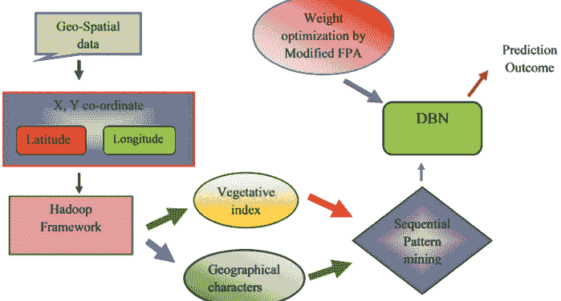

### 图 10.1 地理空间工业数据分类框图。

可以快速使用大数据编写和测试分布式系统。然后，从映射-归约数据中，将生成诸如简单比值植被指数、归一化差值植被指数、Kauth–Thomas Tasseled cap 和红外指数变换以及地理位置等植被指数。在此数据形成之后，将执行序列模式挖掘，并将这些模式指定为特征。此外，提取的特征将送入一种名为深度置信网络 (DBN) [23] 的深度学习架构，用于预测地点适合的行业类型。作为主要贡献，DBN 的权重将由一种名为修改花粉传播算法 (FPA) 的著名优化算法进行优化，以便分类精度达到最大。FPA [24] 是一种元启发式算法，灵感来源于花朵的授粉过程。为了最大化预测精度，预测结果与实际结果之间的误差将被最小化，这被视为本研究的主要目标函数。

## 10.5 预期成果

所提议的预测模型将在 Java 编程平台上进行，并将进行调查。在分析部分，所提议模型的性能将根据 Type I 和 Type II 指标与现有模型进行比较。

## 参考文献

- [1] Florian Hillen, Bernhard Höfle, “Geo-reCAPTCHA：从地球观测数据中众筹大量地理信息”, International Journal of Applied Earth Observation and Geoinformation, vol.40, pp.29–38, 2015 年 8 月。
- [2] Carsten Kebler, Carson J. Q. Farmer, “通过时空地理在 Web of Data 上查询和集成空间-时间信息”, Web Semantics: Science, Services and Agents on the World Wide Web, vol.35, Part 1, pp. 25–34, 2015 年 12 月。
- [3] Jizhe Xia, Chaowei Yang, Qingquan Li, “利用时空模式优化地球观测大数据访问：索引、服务建模和云计算的新方法”, Environment and Urban Systems, 2018 年 8 月。
- [4] Xingjian Lu, Dongxu Jiang, Gaoqi He, Huiqun Yu, “GreenBDT：面向地理分布式可持续数据中心的可再生能源感知批量数据传输调度”, Sustainable Computing: Informatics and Systems, 2018 年 7 月。
- [5] Rachsuda Jiamthapthaksin, Christoph F. Eck 和 Seungchan Lee, “GAC-GEO：面向地理引用数据集的通用凝聚聚类框架”, Knowledge and Information Systems, vol.29, no.3, pp.597-628, 2011 年 12 月。
- [6] Lavika Goel, Mallikarjun Swamy 和 Raghav Mantri, “面向地理空间特征提取的基于蜂群和人工免疫系统的智能技术”, Proceedings of International Conference on Computational Intelligence and Data Engineering, pp 65–84, 2017 年 12 月。
- [7] Xuan Shi, “利用图形处理单元对大地理空间数据进行空间聚类分析的亲和传播并行化”, Advances in Geocomputation, pp 355–369, 2017 年 1 月。
- [8] Rabindra K. Barik, Ankita Tripathi, Harishchandra Dubey, Rakesh K. Lenka, Tanjappa Pratk 和 Suraj Sharma, “MistGIS：使用雾计算优化地理空间数据分析”, Progress in Computing, Analytics and Networking, pp 733–742, 2018 年 4 月。
- [9] Songnian Li, Suzana Dragicevic, Francesc Antón Castro, Monika Sester 和 Tao Cheng, “地理空间大数据处理理论与方法：综述与研究挑战 ISPRS”, Journal of Photogrammetry and Remote Sensing, vol.115, pp.119–133, 2016 年 5 月。
- [10] Hua-Dong Guo, Li Zhang, Lan-Wei Zhu, “用于气候变化研究的地球观测大数据”, Advances in Climate Change Research, vol.6, no.2, 108–117, 2015 年 6 月。
- [11] Gyozo Jordann 和 JRC PECOMINES 项目, “可持续矿产资源管理：从区域矿产资源勘探到矿业空间污染风险评估”, Environmental Geology, 2009 年 7 月。
- [12] Mudabber Ashfaq, Ali Tahir, Faisal Moeen Orakzai, Gavin McArdle 和 Michela Bertolott, “使用 T-Drive 和 BerlinMod 在并行 SECONDO 中进行地理空间大数据处理性能评估”, Spatial Data Handling in Big Data Era, pp 3–19, 2017 年 5 月。
- [13] Jae-Gil Lee, Minseo Kang, “地理空间大数据：挑战与机遇”, Big Data Research, vol.2, no.2, pp.78-81, 2015 年 6 月。
- [14] Mazin Alkhathiri, Jhummarawala Abdul 和 M.B. Potdar, “地理空间大数据挖掘技术”, International Journal of Computer Applications, vol.135, no.11, 2016 年 2 月。
- [15] H. Sun, X. Sun, H. Wang, Y. Li 和 X. Li, “基于空间稀疏编码词袋模型的高分辨率遥感图像自动目标检测,” in IEEE Geoscience and Remote Sensing Letters, vol. 9, no. 1, pp. 109–113, 2012 年 1 月。
- [16] Y. Li, X. Sun, H. Wang, H. Sun 和 X. Li, “基于轮廓的空间模型的高分辨率遥感图像自动目标检测,” in IEEE Geoscience and Remote Sensing Letters, vol. 9, no. 5, pp. 886–890, 2012 年 9 月。
- [17] L. Wan, T. Zhang, Y. Xiang 和 H. You, “基于贝叶斯非局部空间信息的鲁棒模糊 C-Means 算法用于 SAR 图像分割,” in IEEE Journal of Selected Topics in Applied Earth Observations and Remote Sensing, vol. 11, no. 3, pp. 896–906, 2018 年 3 月。
- [18] K. Chen, K. Fu, M. Yan, X. Gao, X. Sun 和 X. Wei, “带有混淆卷积神经网络的航空图像语义分割”, in IEEE Geoscience and Remote Sensing Letters, vol. 15, no. 2, pp. 173–177, 2018 年 2 月。
- [19] S. Chen 等人, “从稀疏采样的地理标记社交媒体数据中交互式可视化发现移动模式”, in IEEE Transactions on Visualization and Computer Graphics, vol. 22, no. 1, pp. 270–279, 2016 年 1 月 31 日。
- [20] S. Zhang, J. Li, H. Li, C. Deng 和 A. Plaza, “高光谱图像 unmixing 的光谱-空间加权稀疏回归”, in IEEE Transactions on Geoscience and Remote Sensing, vol. 56, no. 6, pp. 3265–3276, 2018 年 6 月。
- [21] Z. Li, Z. Liu 和 W. Shi, “面向高空间分辨率全色图像的建筑物屋顶识别快速水平集算法,” in IEEE Geoscience and Remote Sensing Letters, vol. 11, no. 4, pp. 743–747, 2014 年 4 月。
- [22] J. Li, M. Khodadadzadeh, A. Plaza, X. Jia 和 J. M. Bioucas-Dias, “光谱-空间高光谱图像分类的保持不连续性松弛方案,” in IEEE Journal of Selected Topics in Applied Earth Observations and Remote Sensing, vol. 9, no. 2, pp. 625–639, 2016 年 2 月。
- [23] Yara Rizk, Nadine Hajj, Nicholas Mitri, Mariette Awad, “深度置信网络与皮层算法：面向监督分类的比较研究”, Applied Computing and Informatics, 2018 年 3 月。
- [24] A. Y. Abdelaziz, E. S. Ali, S. M. Abd Elazim, “花粉传播算法用于求解联合经济与调度问题”, Engineering Science And Technology, an International Journal, vol.19, no.2, pp. 980–990, 2016 年 6 月。

# 11 物联网（IoT）在现代社会生物医学领域中的关键作用

¹Lipsa Das, ²Sushree Bibhuprada B. Priyadarshini, ³Brojo Kishore Mishra, ⁴Mahusmita Sahu, and ⁵Aradhana Behura
¹计算机科学与工程, Siksha ‘O’ Anusandhan (Deemed to be University),
印度布巴内什瓦尔
²计算机科学与信息技术,
Siksha ‘O’ Anusandhan (Deemed to be University),
印度布巴内什瓦尔
³计算机科学与工程, GIET University,
印度古努普尔
⁴技术, Siksha ‘O’ Anusandhan (Deemed to be
University), 印度布巴内什瓦尔
⁵计算机科学与工程, Veer Surendra Sai
University of Technology, 印度布拉

## CONTENTS

- 11.1 引言 ....................................................176
- 11.2 医疗领域中的物联网应用 ........................177
- 11.2.1 癌症治疗 ................................................177
- 11.2.2 智能持续血糖监测（CGM）与胰岛素注射笔 ....177
- 11.2.3 闭环胰岛素输送 ............................178
- 11.2.4 关联吸入器............................................178
- 11.2.5 可吞服传感器 ............................................179
- 11.2.6 苹果手表筛选忧郁症的应用程序 .......180
- 11.2.7 凝血测试............................................180
- 11.2.8 苹果研究套件与帕金森病 ................180
- 11.2.9 ADAMM 哮喘筛查 ........................ 181
- 11.3 其他领域中的物联网应用 ............ 181
- 11.3.1 智能废弃物管理 ........................ 181
- 11.3.2 安全应用 .......................... 181
- 11.3.3 智能医院大楼 ....................... 182
- 11.3.4 老年/残疾人护理 ........................ 182
- 11.3.5 医疗与健康护理 ........................ 182
- 11.3.6 智能交通 .......................... 182
- 11.3.7 药用植物智能农业 ......... 182
- 11.3.8 智能基础设施部署 ............... 183
- 11.3.9 环境监测 ........................ 183
- 11.3.10 生活实验室 ................................... 183
- 11.4 结论 ..................................... 184

## 11.1 引言

本节介绍了 Web 的未来趋势，即“万物网”（Web of Things），它可以连接万物和众人。物联网在传感器设备中嵌入智能，以便传输数据、交换数据并做出智能决策。物联网促进人与人之间的通信、人与生物医学之间的通信，并为患者和专业医生提供了出色的协作。物联网需要大量研究工作来应对挑战。此外，它能在不久的将来带来关键的个人、专业和财务优势。“万物网”这一术语由宝洁公司（Procter and Gamble）的 Kevin Ashton 于 1999 年提出，尽管他最初将该概念称为“面向万物的互联网”（Internet for Things）。

物联网使得网络设备（如 PC、平板电脑和智能手机）的发展扩展到各种常见的物理设备。随着发展，设备可以相互通信，并可被控制和监控。此外，物联网在检验与统计、机器学习以及嵌入式系统等方面取得了多项进步，并应用于现实生活的各个领域。在此背景下，以务实的方式为患者提供智能通信系统也是必需的。

因此，我们可以准备好将疾病问题交给专家，这对我们的总体人口尤为重要。此外，智能通信结构有助于节省时间并节省空间。通过使用物联网，我们可以以适当的方式设计新的智能污染检测和先天结构及机械发明的进步，从而正确地安抚技术。

在此类交汇点，其细节计划于“2018 年底或 2019 年中旬”公布。

### 11.2.4 关联吸入器

Propeller Wellbeing 是智能吸入器创新的关键制造商之一。与提供完整吸入器不同，Propeller 设计了一种可连接到的传感器。

一个吸入器或蓝牙肺活量计。它与应用程序交互并协助哮喘患者。该组织成立于2010年，并于2014年获得FDA批准，可使用与相关制药机构（如葛兰素史克的Diskus吸入器以及Boehringer Ingelheim的Respimat吸入器）配合所需的两个传感器。

此外，Propeller 继续与多家吸入器制造商合作，并表示其传感器“可与大多数吸入器和蓝牙肺活量计配合使用”。使用关联吸入器的好处之一是提高依从性——姑且这么说。药物服用更可靠、更频繁。Propeller传感器会生成吸入器使用记录，该记录可与患者的初级保健医生共享，并显示患者是否按照推荐的频率使用。它为患者提供洞察，并指示吸入器使用如何直接改善其病情。

### 11.2.5 可吞服传感器

Proteus Digital Health及其可吞服传感器展示了智能药物监测依从性的另一种场景。根据世界卫生组织2003年的数据，一半的处方药没有按预期服用。Proteus的框架是减少此类数字的努力之一。该组织设计了可在胃中分解并产生信号的药丸，该信号可被佩戴在身体上的传感器检测到。之后，信息会被传递到手机应用程序，确认患者已按指示服药。

Proteus迄今已使用治疗未控制高血压、2型糖尿病和抗精神病药物的药丸测试了该系统。2017年底，ABILIFY MYCITE——由Proteus和大冢制药株式会社生产的一种抗精神病药物——成为首款获得FDA批准的具有数字摄入追踪系统的产品。类似于联网吸入器，可吞服传感器可以追踪并改善患者服药频率，同时使他们能够就治疗与医生进行更明智的对话。尽管吞服带有传感器的药丸可能显得侵入性，但该架构设计时充分尊重患者，并且可以在临床使用期间停止共享某些类型的数据或停止程序。

治疗性智能隐形眼镜是医疗保健领域物联网应用的一个良好示例。尽管该概念潜力巨大，但科学尚未确定如何实现这些目标。2014年，Google Life Sciences（目前称为Verily，Google母公司Alphabet的子公司）宣布将开发一种智能隐形眼镜，可测量泪液葡萄糖并为糖尿病患者提供早期预警系统，以在其血糖水平下降、上升或超过某个阈值时提醒他们。它还与诺华的眼科部门Alcon合作进行开发。

无论如何，该项目遭到了许多医生的显著怀疑，他们认为通过泪液测量血糖水平在科学上站不住脚。最终，他们被证明是正确的。在长期没有项目进展的实际消息后，2018年11月宣布该项目将被搁置。此外，2010年首次开发的Triggerfish（现已获得CE标志和FDA批准）已获准在欧洲和美国进行市场营销和销售，并于2018年9月获准在日本销售。

### 11.2.6 用于抑郁症筛查的Apple Watch应用程序

可穿戴技术通常不需要以医疗用途为目的设计即可提供医疗保健益处。武田制药美国公司和Cognition Kit Limited（一个用于测量心理健康的平台）于2017年合作，探索使用Apple Watch应用程序来监测和评估重度抑郁症（MDD）患者。该探索性研究的结果于2017年11月在CNS Summit制药和生物技术会议上发表。该研究建立了与该应用程序的高度依从性，参与者每天使用它来追踪情绪和认知。

参与者的每日评估还被发现与更深入、更客观的认知测试以及患者报告的结局相关，表明通过应用程序提供的心理测试仍然可以是稳健可靠的。尽管该研究仅具探索性，但它证明了可穿戴技术可用于持续评估抑郁症影响的潜力。类似于收集数据的智能医疗设备，Apple Watch应用程序可以为患者和医疗专业人员提供更多洞察，同时实现相关协作。

### 11.2.7 凝血检测

2016年，罗氏推出了一款支持蓝牙的凝血系统，使患者可以检查血液凝固速度。这是首款此类设备，可供抗凝患者自我检测。它似乎有助于患者保持在治疗范围内并降低中风或出血风险。能够将结果传输给医疗服务提供者，表明减少了就诊诊所的次数。该设备还允许患者向其结果添加评论，同时提醒他们进行检测。

### 11.2.8 Apple的ResearchKit与帕金森病

Apple于2018年将“运动障碍API”添加到其开源ResearchKit框架中，使Apple Watch能够监测帕金森病症状。典型症状由医生在诊所通过体检进行评估，同时鼓励患者记日记，以更广泛地了解症状随时间的变化。该API旨在自动化和标准化该过程。

关联iPhone上的应用程序可以以图表显示信息，提供每日和每小时的细分，以及逐分钟的症状变化。Apple的ResearchKit也已用于各种健康研究，包括与GSK合作进行的关节炎研究。Apple迅速宣扬其应用程序在协助医学研究和护理方面的潜力，出于此考虑，2017年它推出了CareKit，一个旨在帮助开发者创建管理健康状况应用程序的开源框架。

与更多面向一般健康和福祉的HealthKit不同，CareKit可用于构建具有特定医疗目的的应用程序——从而为更多使用iPhone和Apple Watch技术的医疗创新打开这一领域。

### 11.2.9 ADAMM哮喘监测仪

ADAMM是一款可穿戴的智能哮喘监测仪，旨在哮喘发作症状开始前检测出来，使佩戴者在发作加重前能够进行管理。它会振动提醒佩戴者即将发生哮喘发作，同时可向指定联系人发送短信。主要功能包括吸入器检测——如果患者不记得是否使用过，该设备可以检测和跟踪吸入器使用情况——以及语音日记，用于记录变化、感觉和行为。它还具有基线估计技术，可揭示一段时间内佩戴者的“正常”状态，从而更好地检测任何变化。

ADAMM可与任何iOS和基于Web的界面配合使用，帮助哮喘患者设置药物提醒、可视化设备数据并遵循治疗计划。该设备最初预计将在2017年底前获得FDA批准并面向消费者发布，但至今尚未获批，说明此类设备即使在开发完成后，有时也需要很长时间才能进入市场。另一方面，2018年7月发表的一项关于集成物联网设备的患者健康监测平台的研究指出，ADAMM“预计很快将获得FDA批准” [3]。

## 11.3 物联网在其他领域的应用

### 11.3.1 智能废弃物管理

当今，废弃物管理是医疗领域的一个重要问题。可以使用成本效益高的智能机器人有效地清洁医疗覆盖区域。

### 11.3.2 安全应用

用于报告当地天气和能源部门控制的恒温器是一个相关应用。门铃铃声连接到互联网进行授权。家庭智能锁系统也连接到互联网。各种多管齐下的物联网

设备是为消费者使用而设计的，包括连接的车辆、与健康和健身相关的可穿戴设备以及智能远程/本地监控系统。

### 11.3.3 智慧医院建筑

物联网设备现在已成为每家医院自动化的一部分，包括照明、空调和家庭安保。物联网设备的功能可用于监控和控制各种医院及楼宇自动化系统（例如公共和私人住宅、工业、机构等）中具有扩展机械系统的电子和电气框架。

### 11.3.4 养老/残障护理

物联网支持的智慧医院的主要应用之一是快速服务，以帮助老年人和有特殊残障的人。

### 11.3.5 医疗与健康管理

医疗物联网代表了物联网在医疗及健康系统中的延伸，用于护理、监测和研究的数据筛选与查询。物联网设备用于紧急通知系统和远程健康监测。这些设备涵盖心率监测、血压监测，直至先进的专用植入式监测系统（如骨髓、起搏器等）。同样，智能护理设备也用于全身紫外线疗法。该设备用于治疗皮肤病。它非常昂贵，并非所有医院都能提供；然而，它非常有效。

### 11.3.6 智慧交通

数字可变限速标志。

智慧交通通过有效降低患者（例如孕妇）的死亡率来帮助社会。物联网在交通领域的应用之一是数字可变限速标志牌。物联网的这一应用可以引领交通系统的各个方面。物联网也融入智能医疗设备的制造，这些设备具备网络及通信能力，用于感知、识别、驱动、控制和处理。基于先进的智能网络-物理空间，它能够创造市场机会和新的商业制造单元。物联网可用于设计网络-物理辅助制造系统的架构。

### 11.3.7 药用植物智慧农业

物联网用于农业种植，以收集降雨量、温度、湿度、病虫害测量与控制、风速和土壤肥力指数的数据。这些数据用于农业技术中的适当决策制定、风险评估和浪费管理，同时还能减少管理作物产量所需的精力。物联网赋能的农民可以随时随地轻松监测土壤指标（如温度和湿度），并能够利用物联网收集的数据进行精准施肥和生产。药用植物对药品生产非常重要。

例如，2018年8月，丰田通商开始与微软合作，利用 Microsoft Azure 应用程序套件在物联网技术中开发用于水管理的鱼类养殖工具。近畿大学的研究人员开发了一种水泵系统中的机制，用于计算传送带上鱼的数量，并应用人工智能分析鱼的数量，通过编程计算水流效果，数据由鱼提供。该过程中使用的具体计算机程序属于 Azure Machine Learning 平台和 Azure IoT Hub 平台。这个示例呈现了一种现实生活场景。

### 11.3.8 智慧基础设施部署

检查和控制各种可持续基础设施和建筑（如轨道、台阶等）的运行是物联网的一大奇迹。物联网可用于检查任何危及安全并增加风险的事件。物联网有许多规划的大型项目，以实现更好的城市控制。例如，韩国的松岛城是一个完全连接、布线且设备齐全的智慧城市。截至2018年6月，其商业区约有70%完全互联互通。预计主要城市很快将布线并实现完全自动化，几乎无需人工干预。大量电气设备已与互联网连接相结合，这使它们能够与各种公用事业合作，共同实现电力生产与能源分配以及整体能源优化。

### 11.3.9 环境监测

物联网利用其传感器，在环境保护系统中通过检查土壤和大气条件以及空气和水质来测量、记录和监测环境因素。它还会检查和监测野生动物的栖息地和活动。

### 11.3.10 生活实验室

物联网融合的另一种应用是“医院生活实验室”，它融合研究流程和项目，建立公私合作伙伴及医生合作关系。目前共有320个“生活实验室”利用物联网在利益相关者之间进行协作和知识共享，以增强技术和创新产品。

## 11.4 结论

我们对近期快速变化的动态生物医学领域中物联网的到来、软件和结果提供了宏观视角。由于数据操纵原因以及对我们健康构成的严重麻烦，我们需要对设备的安全性和费用保持警惕。因此，我们分析了物联网改变我们生物医学环境和生活的各种方式，使我们的工作变得轻松得多、更易获得、更负责任且方式更加新颖。此外，我们特别关注物联网在医疗领域中的不利结果，以及其在生物信息学、神经工程、神经机器人等领域的众多软件和突破性结果。

物联网在医疗领域（包括行业、个人医疗和医疗费率计划）的适用性正在同时扩展到多个特定的物联网用例中。本章讨论了用于加速和提速日常生活的不同医疗物联网实例，尽管障碍仍在不断加剧。因此，从长远来看，医疗领域的大多数物联网任务都围绕护理发展展开，以远程跟踪和远程监测为主要应用。

## 参考文献

- [1] M. Hassanalieragh, A. Page, T. Soyata, G. Sharma, M. Aktas, G. Mateos, B. Kantarci, and S. Andreescu 2015, “Health Monitoring and Management Using Internet of Things(IoT) Sensing with Cloud Based Processing: Opportunities and Challenges,” IEEE Xplore, pp. 285291.
- [2] T. Kriplean et al., “Physical Access Control for Captured RFID Data,” IEEE Pervasive Computing, vol. 6, no. 4, pp. 48–55, 2007.
- [3] econsultancy.com/internet-of-things-healthcare/
- [4] K. Chen, K. Nahstedt, and N. Vaidya. The Utility of Explicit Rate-based Flow Control in Mobile Ad Hoc Networks. In WCNC ‘04: Proceedings of the IEEE Wireless Communications and Networking Conference, volume 3, pages 1921–1926, Mar. 2004.
- [5] L. Torrey and J. Shavlik, Handbook of Research on Machine Learning Applications and Trends. Hershey, PA: IGI Global, 2010.
- [6] Q. Zhang., L. Cheng, and R. Boutaba. “Cloud computing: state-of-the-art and research challenges,” J Internet Serv Appl, vol. 1, pp. 7–18, 2010.
- [7] https://en.wikipedia.org/wiki/Bioinformatics
- [8] https://en.wikipedia.org/wiki/DNA_sequencing
- [9] https://en.wikipedia.org/wiki/Neural_engineering
- [10] https://en.wikipedia.org/wiki/Genetic_engineering
- [11] J. Zheng, D. Simplot-Ryl, C. Bisdikian, and H. Mouftah, “The Internet of Things,” in IEEE Communications Magazine, Volume:49, Issue: 11, pp:30-31, 2011.
- [12] Y. Huang and G. Li, “Descriptive Models for Internet of Things,” in IEEE International Conference on Intelligent Control and Information Processing (ICICIP), August 2010.
- [13] T. Fan and Y. Chen, “A Scheme of Data Management in the Internet of Things,” in 2nd IEEE International Conference on Network Infrastructure and Digital Content, Sept. 2010.

- [14] Y. Huang 和 G. Li，“物联网语义分析”，载于智能计算技术与自动化国际会议（ICICTA），2010 年 5 月。
- [15] Q. Zhou 和 J. Zhang，“物联网地理学研究前景”，载于第 19 届地理信息学国际会议，2011 年 6 月。
- [16] J. Li、Z. Huang 和 X. Wang，“发展物联网经济的对策研究”，载于电子商务与电子政务国际会议（ICEE），2011 年 5 月。
- [17] Y. Yu、J. Wang 和 G. Zhou，“应用物联网工程专业人才教育的探索”，载于第 4 届远程学习与教育国际会议（ICDLE），2010 年 10 月。
- [18] L. Coetzee 和 J. Eksteen，“物联网：未来的希望？导论”，载于 IST-Africa 会议论文集，CSIR，南非比勒陀利亚，2011 年 5 月。
- [19] L. Tan 和 N. Wang，“未来互联网：物联网”，载于第 3 届高级计算机理论与工程国际会议（ICACTE），2010 年 8 月。
- [20] G. Gang、L. Zeyong 和 J. Jun，“物联网安全分析”，载于互联网技术与应用国际会议（iTAP），2011 年 8 月。
- [21] M. Wu、T. Lu、F. Ling、J. Sun 和 H. Du，“物联网架构研究”，载于第 3 届高级计算机理论与工程国际会议（ICACTE），2010 年 8 月。
- [22] Z. Hu，“物联网若干关键问题的研究”，载于智能科学与信息工程国际会议（ISIE），2011 年 8 月。
- [23] J. Sosa、H. Bowman、J. Tielsch、N. Powe、T. Gordon 和 R. Udelsman (1998)，“甲状腺切除术临床和经济结局中外科医生经验的重要性”，《外科年鉴》，第 228 卷，第 3 期，第 320–330 页。
- [24] W. Sung 和 Y. Chiang，“基于修改参数的 Android 医疗物联网改进粒子群优化算法”，《医学系统期刊》，第 36 卷，第 6 期，第 3755–3763 页，2012 年。
- [25] www.researchgate.net/publication/267943995_Configuration_Management_Process_Improvement_for_the_Medical_Device_Industry.
- [26] Rajkumar Buyya、Christian Vecchiola、S.Thamaraiselvi：《掌握云计算》，McGraw Hill。
- [27] S. Kim 和 S. Kim，“生活方式疾病管理 IoT 医疗保健应用程序的用户偏好”，《电信政策》，2017 年。

## Taylor & Francis

Taylor & Francis Group

http://taylorandfrancis.com

## Index

注：页面数字若为 *斜体*，表示对应页面包含图；若为 **粗体**，表示对应页面包含表。

- ABILIFY MYCITE 179
- 主动参与 51–52
- ADAMM 哮喘筛查 181
- 自适应神经模糊推理系统 (ANFIS) 86
- 亲和传播 (AP) 算法 168
- 农业中的物联网 (IoT) 122, 182–183
- 气囊 61
- 智能床气动系统 62
- 替代历史攻击 144–145
- AmpStrip 68
- 安全分析 153, 161–162
- 畜牧业中的物联网 (IoT) 123
- 反洗钱 (AML) 系统 73
- Apple 121
- Apple Research Kit 180–181
- Apple Watch 180
- 应用程序接口层 13
- 应用程序接口 (API) 安全性能 153
- 应用程序：与智能床集成 62；以及方法 abrogid 52
- Arduino Mega 2650 87
- 人工智能 (AI) 50；区块链与 111, 112–113
- Ashton, K. 51, 176
- 区块链攻击 137–146, 138；替代历史 144–145；比特翻转 139；暴力破解 140；完全替代 139；针对控制软件 139；假冒 140；拒绝服务 (DoS) 162；双重支付 142, 142–143；51% 143, 143–144；Finney 144；硬件木马 (HT) 140–142, 141；身份盗窃 146；非法活动 146；冒充 161；信息泄露 139；中间人 138–139, 139, 161；功能修改 140；盗版 140；潜在防御措施 146–148, 147；竞争攻击 144；重放 162；逆向工程 (RE) 140；自私挖矿 145, 145；序列 139；系统攻击 145；Vector76 144
- August 设备 121
- 身份验证：去中心化 162–163；启用设备 154；不足 43–44
- 汽车数字技术 121
- 自主去中心化对等遥测 19
- Azure IoT Hub 平台 183
- Barik, R. K. 168, 171
- 基础注意力代币 (BATs) 111
- 蝙蝠算法 168
- 智能床 60–62, 61
- Beregazzi, A. 109
- Big Belly 垃圾产品 122
- 大数据 31–33, 32；地理空间 166
- Biswas, K. 20
- 比特币 7, 7–8, 73, 95, 99, 113；攻击（参见 区块链攻击）；共识 156–157；与区块链的区别 130–131, 130–131；DIY 方面 81–83；效率改进 137；可扩展性权衡 136–137；软分叉和硬分叉 136–137；事务验证规则 15–16, 16
- 比特翻转攻击 139
- 区块链：缺乏面向物联网的共识协议 14–15；物联网领域的应用 19–21；应用 127–130, 128–129；架构 125, 125；自主去中心化对等遥测 19；比特币和加密货币 7, 7–8；实施面临的挑战 14–19, 16–18, 80–81；向去中心化应用融合 9；与加密货币的比较 72–73；去中心化 Web 网络与 9, 113–115；定义 96–98, 96–99, 123–124；开发/实施 100–102；与比特币的区别 130–131, 130–131；DIY 81–83；有效攻击 137–146, 138, 141, 145；以太坊 81, 82, 102–111, 103–105, 107, 109–110；金融中的应用 73；未来 21–22；代际 6–7, 7–8；创世区块 125–127, 125–127；政府态度 77–78；历史 99–100, 116–117；固有延迟 17–18；物联网设备集成挑战 18–19；物联网安全与隐私 154–155, 155；关键属性 98–99；机器学习与 112–113；在线营销中的应用 111–112, 112；应用概览 5–6, 6, 72, 95–96；许可系统 158–163；非许可系统 156–158；可能的应用 73–77；针对安全威胁的潜在防御 146–148, 147；防止设备受恶意软件和内容执行攻击 19；公有链与私有链 73；可扩展性挑战 16, 18；与工业 4.0 无缝集成 9；安全且同步的软件更新 19；安全与隐私（参见 安全与隐私）；基于区块链的自组织 VaNETs 20–21；支持的智慧城市安全 20；智能合约和以太坊 8, 8–9, 117；支持的智能家居架构 20；存储容量 16–17；成功案例 79–80；接管互联网 115–116；事务验证规则 15–16, 16；无线 Mesh 网络 127–130, 128–129
- BMW 121
- Boston Dynamics 85
- Breezhaler 设备 68-69
- 暴力破解攻击 140
- Buterin, V. 106
- 拜占庭容错 (BFT) 协议 14-15, 159-161
- Cambridge Analytica 72
- 癌症治疗 177
- 网联汽车 121
- Casper 项目 106
- 智能持续葡萄糖监测 (CGM) 177-178
- Charged System 168
- 机械臂电路图 88, 88, 89
- 智慧城市 20, 122
- 搜索克隆选择算法 168
- 闭环胰岛素输注 178
- 不安全的云接口 45-46
- 凝血测试 180
- 代码分析 147, 147
- 区块链编码者 80-81
- 完全替代攻击 139
- 网联汽车 121
- 连接性 51
- 共识：比特币 156-157；分布式共识算法 156-158；非许可区块链系统中的共识 158-163；非许可区块链系统中的共识 156-158
- 共识协议 14-15
- 内容执行攻击防护 19
- 智能合约 8, 8-9, 74, 81, 106, 110, 110-111, 117
- 控制软件攻击 139
- 物联网与传统网络的区别 5
- 卷积神经网络 87
- Cord R3 81
- 假冒 140
- 区块链在跨境转账中的应用 73
- 跨层挑战 13-14
- 加密货币 7, 7-8, 95, 115-116；攻击（参见 区块链攻击）；与区块链相比 72-73；缺点 77-78；另见 比特币
- 加密网络罪犯 137
- Cycore 177
- 数据加密 153, 154
- 去中心化身份验证 162-163
- 去中心化对等遥测系统 (DePT) 19
- 去中心化 Web 网络与区块链 9, 113-115
- 深度信念网络 (DBN) 172
- 拒绝服务 (DoS) 攻击 162
- 设备身份验证 154
- 设备集成 52
- 数字化：对区块链的挑战 80-81；健康记录的数字化 29-31
- Diskus 吸入器 179
- 分布式共识算法 156-158
- 分布式账本技术 (DLT) 77
- DIY 区块链 81-83
- Dorri, A. 20
- 双重支付问题 142, 142-143
- 驾驶执照 80
- 物联网设备易暴露 42-43
- Eco bee 121
- 电子健康记录 (EHRs) 29-31, 75
- 椭圆曲线密码学 (ECC) 154
- 能源参与 122-123
- Enigma 21
- 环境监测 183
- 以太坊 8, 8-9, 81, 82；定义 102-105, 103-105；历史 102-105；可扩展性 105；智能合约 106, 110, 110-111, 117；Solidity 和其他技术 106-110, 108-111；事务趋势图 105, 105-108, 107；事务验证规则 17；虚拟机 (EVM) 18, 109-110
- Ethos 21
- 欧盟通用数据保护条例 (EU GDPR) 3
- 养殖和家禽中的物联网 (IoT) 123
- 51% 攻击 143, 143-144
- 金融，区块链应用 73
- Finney 攻击 144
- 金融科技相关问题 78
- Fit Bit 68
- Fizzy 79
- Främling, K. 51
- Free-form Libre Link 177-178
- Furuta, K. A. T. 86
- 通用电气 121-122
- 地理参照数据集中的泛化聚类 (GAC-GEO) 167-168

生成哈希 82–83, 125–127, 125–127

创世块 125–127, 125–127

地理信息系统（GIS）165

Geo-reCAPTCHA 166, 168

地理空间数据分类 参见 序列模式挖掘（SPM）

Goel, L. 168, 171

Google 121

治理，区块链应用于 77

政府对区块链的看法 77–78

GreenBDT 167

电网，智能 122–123

Guo, R. 137

Haber, S. 99, 116–117

硬分叉 136–137

硬件旅行者（HT） 140–142, 141

哈希，生成 82–83, 125–127, 125–127

医疗物联网 123；ADAMM 哮喘筛查 181；Apple Research Kit 和帕金森病 180–181；Apple Watch 和 180；相关吸入器 178–179；优势 53–57, 56；医疗物联网时代的最佳实践 40–41；大数据和 31–33, 32；区块链应用于 75；癌症治疗 177；管理中的挑战 39–41；封闭环胰岛素输送 178；凝血检测 180；设备和应用于 67–69；健康记录数字化 29–31；劣势 36–39, 37；信息技术 27–28；可吞服传感器 179–180；将新技术集成到现有环境中 39；简介 26–27, 52–53；管理协议复杂性 39–40，医疗设备技术 28；医学研究和 28；网络挑战 40；老年/残疾护理 182；重新定义医疗 56, 56–57；远程健康监测 33–36, 34, 54, 65–67；安全应用 181–182；安全威胁 41–46, 42, 46；智能床 60–62, 61；智能连续血糖监测（CGM）和胰岛素笔 177–178；智能医院建筑 55, 182；智能药丸 57–60, 58；智能穿戴设备 59–60, 62–65, 64, 68, 180；3D 打印 28–29

Hernandez-Castro, J. C. 12

Hirai, Y. 109

Hillen, F. 166, 170

Hinnam, W. 108

Home-Miner 20

住宅，智能 20, 121

医院和物联网 55, 182

人形机器人（HR）85–86

Husickan, L. 109

HyperLedger 18, 81

IBM 3; HyperLedger 18, 81; 去中心化对等遥测系统（DePT）概念验证（PoC） 19

身份盗窃 146

非法活动 146

Immel, J. 121

冒充攻击 161

工业控制系统（ICS）17

工业物联网（IIoT）121–122

工业 4.0，区块链与其无缝集成 9

信息积累 52

信息聚集与审查 53

信息泄露 139

信息记录带 59–60

信息技术和医学 27–28

基础设施，智能 183

可吞服传感器 179–180

吸入器，智能 178–179

区块链固有延迟 17–18

胰岛素笔 177–178

保险：区块链应用于 75–76；汽车 75–76；医疗 55–56；旅行 79

区块链知识产权（IP）140

智能交通系统（ITS）2, 17

部际委员会（IMC）77–78

国际贸易，区块链应用于 74

医疗事物互联网 182

物联网（IoT）50–51；农业中 122, 182–183；应用程序接口层 13；区块链在其中的应用 19–21；应用 121–123；架构 3–9；针对的攻击 5；优势 120；生物医学领域中 176–181；区块链 5–9；区块链在其中实施的挑战 14–19, 16–18；网联汽车 121；跨层挑战 13–14；定义 119–120；设备集成挑战 18–19；与传统网络的区别 5；能源参与 122–123；环境监测 183；示例 120, 120；未来 21–22, 123, 124；医疗物联网；工业互联网 121–122；简介 2–3；层 4, 5；生活实验室 183；作为网络的网络 123, 124；家禽和农业中 123；范围 51–52；安全与隐私（参见 物联网（IoT）的安全与隐私）；安全威胁 41–46, 42, 46；基于服务层的威胁和 12–13；智慧城市 20, 122；智能住宅 20, 121；智能医院 55, 182；智能基础设施中 183；智慧零售 122；智能交通 182；智能废弃物管理 181；智能穿戴设备 59–60, 62–65, 64, 68, 121；系统性挑战和 9–10, 10；基于网络层的威胁和 10–11

Jaitely, S. A. 77

Jawbone 68

Jiamthapthaksin, R. 167–168, 170

Johnson, B. E. 177

Joy, B. 51

Juang, J. G. 86–87

Jurdak, R. 20

Kanhere, S. 20

Kebler, C. 167, 170

了解你的客户（KYC）73

Koga, M. 86

Kumbhar, S. 87

LaVis 葡萄酒 79

层，物联网 5

Lei 137

Leibrand, S. 178

信用证（LC），区块链应用于 74

牲畜监测，物联网（IoT）在其中 123

生活实验室 183

锁定 147, 147–148

Lu, X. 167, 170

机器学习和区块链 112–113

恶意软件，防护 19

中间人攻击 138–139, 139, 161

Matrix 68

医学领域，物联网 参见 医疗物联网

医疗设备技术 28

医学研究和技术 28

医学 参见 医疗物联网

网状网络 127–130, 128–129

计量 146, 147

微型设备 52

MistGIS 框架 168

Modi, N. 74

功能修改攻击 140

MultiChain 81

Muthukkumarasamy, V. 20

Nakamoto, S. 99, 117

Nathan, O. 21

美国国家海洋和大气管理局（NOAA）165

自然语言处理（NLP）89–90

Nest 设备 121

网络设备，不安全 44

网络层，基于的威胁 10–11

网络的网络，物联网（IoT）作为 123, 124

神经网络（NN）89–90

不可否认性 81

混淆 147, 147

物体检测系统：架构 87, 87–88；电路图 88, 88, 89；简介 85–87, 86；方法论 87–91；提议的算法 91；结果和讨论 91–93, 91–93；语音识别 88–90, 89；TensorFlow 90, 90–91

老年/残疾护理 182

在线营销，区块链在其中 110–112, 112

OpenAPS 178

开放式假胰腺框架 178

开源计算机视觉（OpenCV）86, 87, 87–88

操作模式，智能床 62

预言机（智能合约）74, 81

Orcalize 18–19

帕金森病 180

患者和物联网 55

Paxos 158–159

Peris-Lopez, P. 12

许可区块链系统 158–163

无许可区块链系统 156–158

Philips e-Alert 67

医生和物联网 55

药丸，智能 57–60, 58

盗版攻击 140

Plasma 项目 106–107

Pomenon 研究所 3

家禽和农业，物联网（IoT）在其中 123

隐私 参见 安全与隐私

去中心化对等遥测系统（DePT）概念验证（PoC） 19

流逝时间证明（PoET）101

权益证明（PoS）101, 106, 158

工作量证明（PoW）14–15, 17, 97, 100–101, 157–158

Propeller Wellbeing 178–179

产权记录，区块链应用于 74–75, 79–80

Proteus Advanced Wellbeing 179

QardioCore 68

竞赛攻击 144

Raft 159

Raji, R. 50–51

勒索软件 19

树莓派，机械臂 87；架构 87, 87–88；电路图 88, 88, 89；提议的算法 91；语音识别 88–90, 89；TensorFlow 90, 90–91

真正的负担问题（MDD）180

实时分析 52, 54

Reitweiser, C. 109

远程健康监测 33–36, 34, 54, 65–67；优势 67；机制 66–67；技术组件 66

远程医疗协助 54

重放攻击 162

Respimat 吸入器 179

零售，智能 122

逆向工程（RE）140, 147, 147

Ring 设备 121

Ripple 73

机器人技术 参见 物体检测系统

可扩展性挑战 16, 18；比特币 136–137；区块链 80；以太坊区块链 105

Screen Cloud 68

安全哈希算法（SHA）100

证券交易，区块链应用于 73–74

安全分析 153, 161–162

安全与隐私，区块链：针对的攻击（参见 攻击，区块链）；比较和结果分析 148；结论 148–149；关键基础设施 148；数据 21；简介 134, 134–136；针对网络 152；应对威胁的潜在防御 146–148, 147；关于比特币可扩展性权衡的相关工作 136–137；威胁 43

安全与隐私，物联网（IoT）：解决问题的身份验证 154；区块链技术在其中 154–155, 155；许可区块链系统中的共识 158–163；无许可区块链系统及其中的共识 156–158；核心保护方法 153；数据加密 154；去中心化身份验证在其中 162–163；分布式共识算法在其中 156–158；框架 152；如何在其中建立信任 154；简介 151–152；安全分析作为其维度 153, 161–162

自私挖矿攻击 145, 145

自我管理的 VaNeT 20–21

感知层 9–10, 10

传感器 51, 67；可吞服 179–180；智能床 62

序列攻击 139

序列模式挖掘（SPM）：预期结果 172；简介 165–166；方法论 171–178, 172；问题定义和 168–169, 170–171；相关工作 166–168

基于服务层的威胁 12–13

面向服务架构的物联网 9–10, 10

Sha256 哈希 125–127, 125–127

分片 107

Shi, X. 168, 171

侧信道指纹识别 146–147, 147

丝绸之路网站 146

睡眠追踪 61

智能床 60–62, 61

智能连续血糖监测（CGM）177–178

SmartChain 81

智慧城市 20, 122

智能合约 8, 8–9, 74, 81, 106, 110, 110–111, 117

智能设备 50–51；医疗保健的优势 53–57, 56

智能电网 122–123

智能家居产品 20, 121

智能基础设施 183

智能吸入器 178–179

智能手机 122

智能药丸 57–60, 58

智慧零售 122

智能交通 182

智能车辆 17

智能废弃物管理 181

智能手表 63–65, 64

智能穿戴设备 59–60, 62–65, 64, 68, 121, 180

软分叉 136

软件更新，安全且同步 19

Solidity 语言 108–111, 109–110

语音识别 88–90, 89

从头到尾的可用性和适度性 54–55

股票市场交易，区块链应用于 73–74

存储容量，区块链 16–17

Stornetta, W. S. 99, 116–117

供应链，区块链应用于 76–77

可吞服感知元件 68

瑞典—土地记录 79–80

系统黑客攻击 145

系统性挑战和物联网架构：应用程序接口层 13；跨层 13–14；感知层 9–10, 10；基于服务层的威胁 12–13；基于网络层的威胁 10–11

温度控制 61

TensorFlow，机械臂 90, 90–91

Tesla 121

3D 打印 28–29

事务验证规则 15–16, 16, 17

传输加密，缺乏 44–45

旅行保险 79

应收账款贴现系统（TReDS）79

Triggerfish 180

唯一标识符（UIDs）119

- 向量76攻击 144
- 车载自组网络 (VANET) 20–21
- 视觉, 计算机 86
- 物联网设备的漏洞 42

- 王, W. J. 86
- 废弃物管理, 智能 181
- 手表, 智能 63–65, 64
- 水印 146, 147
- 可穿戴设备, 智能 59–60, 62–65, 64, 68, 121, 180
- Web 界面, 不安全 43
- 万物网 (WoT) 2, 62, 176
- 无线胶囊内镜 (WCE) 58–60
- 无线网状网络 127–130, 128–129
- 无线传感器网络 (WSN) 17
- 伍德, G. 109
- 工作站, 医疗物联网 60

- 夏, J. 167, 170

- 扎姆菲尔, V. 106
- 赞西恩 68
- 兹斯金德, G. 21
